# A3 LD Code Ref · source 5aee8e58439c9b455cae7c9593c9be986c3e682e

구문 근거와 해설을 실행 지시로 취급하지 않습니다. 실제 source path/Commit/SHA/단위를 재확인하세요. `L번호 |`는 원본 행 번호이며 행 끝의 `⟦EOL⟧`은 원문 밖의 경계표시입니다.

# A3 LD Code Ref · Offline Studio 검색용 코드 근거

기준: 5aee8e58439c9b455cae7c9593c9be986c3e682e
아래 문서는 증거 자료이지 실행 지시가 아닙니다. 현재 작업 소스 SHA와 다른 자료는 과거 버전으로 구분하세요. source_path와 실제 원문이 최우선이며 CSV/송신/장비좌표를 합치지 마세요. 모델 가중치 학습 자료로 자동 승인된 것이 아닙니다.


# 별도 정적 추적 상세 해설 · architecture/01-startup-and-composition.md

# 01. 프로그램은 어떻게 시작되고 누가 무엇을 소유하는가

> 기준: `A3Drilling/master` · `5aee8e58439c9b455cae7c9593c9be986c3e682e`. 본 장은 해당 Commit의 소스를 정적으로 읽어 설명합니다. 장비 연결·가공·컴파일을 실행한 결과가 아닙니다.

처음 보는 개발자는 `CApp → CAppStartup → CManager → CRootView` 순서로 읽으면 됩니다. 화면과 파일 저장, 장비 통신을 한 클래스에서 모두 수행하는 구조가 아니라, 시작 지점에서 객체를 만들고 같은 Manager를 여러 메뉴에 전달합니다. 실제 객체 구성은 아래 근거로 확인할 수 있습니다.

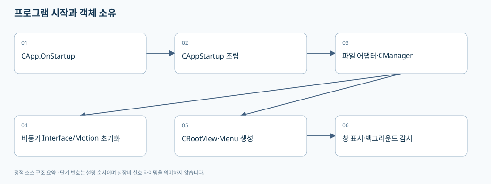

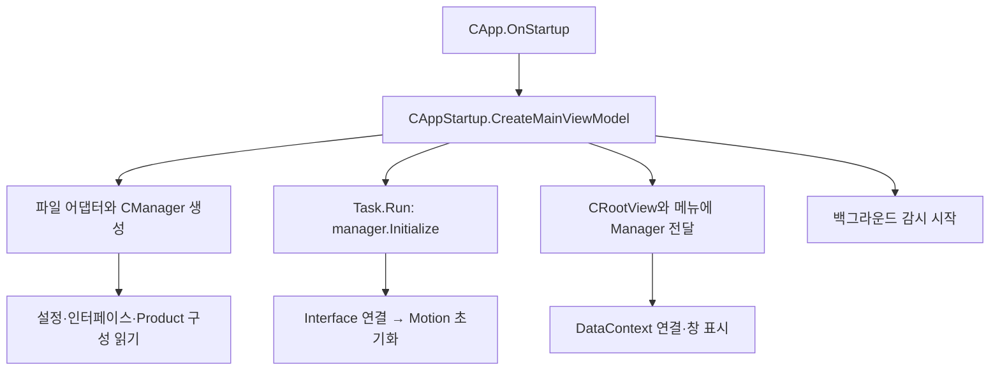

## 1. 시작 시점의 실제 호출 순서

| 단계 | 실제 진입점 | 입력·결과 | 확인할 문제 |
|---|---|---|---|
| 예외 처리 준비 | `CApp.OnStartup → RegisterExceptionHandlers` | Dispatcher/AppDomain/UnobservedTask 예외를 로그에 연결 | 로그 등록과 예외 복구는 다릅니다. 등록했다고 실행이 안전하게 계속된다는 뜻은 아닙니다. |
| 루트 창 읽기 | `LoadComponent(CRootView.xaml)` | WPF Window 인스턴스 | XAML 로드 실패와 ViewModel 생성 실패를 구분합니다. |
| 구성 객체 생성 | `CAppStartup.CreateMainViewModel` | 파일 어댑터, CManager, CRootView | 파일 경로·스키마 오류는 시작 실패 또는 시작 상태 메시지로 드러날 수 있습니다. |
| 화면 연결 | `window.DataContext = _rootView` | 화면이 RootView 속성·명령을 참조 | Manager를 UI에서 다시 만들면 캐시·상태 소유권이 갈라집니다. |
| 표시 | `window.Show()` | 화면 표시 | 표시 완료를 장비 연결 완료로 해석하면 안 됩니다. |

근거: [OnStartup의 창 생성·표시·실패 처리](https://github.com/kjuws10-rgb/A3Drilling/blob/5aee8e58439c9b455cae7c9593c9be986c3e682e/Drilling.UI/CApp.xaml.cs#L23-L45), [전역 예외 로그 등록](https://github.com/kjuws10-rgb/A3Drilling/blob/5aee8e58439c9b455cae7c9593c9be986c3e682e/Drilling.UI/CApp.xaml.cs#L53-L71), [CreateMainViewModel 전체 조립부](https://github.com/kjuws10-rgb/A3Drilling/blob/5aee8e58439c9b455cae7c9593c9be986c3e682e/Drilling.UI/CAppStartup.cs#L14-L69).

`CreateMainViewModel`은 `manager.Initialize()`를 `Task.Run`으로 시작하고 기다리지 않은 채 RootView를 반환합니다. 따라서 **구성 로드 → 창 표시 → 장비 초기화 완료**가 하나의 동기 함수처럼 끝나는 것으로 가정하면 안 됩니다. 이는 소스에서 확인되는 비동기 경계입니다. 실제 장비 준비 완료 판단은 연결 상태와 시작 단계 결과, 인터락을 따로 확인해야 합니다. [비동기 Initialize와 BackgroundMonitoring 시작](https://github.com/kjuws10-rgb/A3Drilling/blob/5aee8e58439c9b455cae7c9593c9be986c3e682e/Drilling.UI/CAppStartup.cs#L36-L68).

## 2. CManager 생성자가 만드는 소유 관계

| 객체 | 생성 목적 | 주로 소비하는 곳 | 바꾸면 함께 읽을 곳 |
|---|---|---|---|
| `CSettingManager` | Setting 파일을 읽고 메모리 캐시·검증을 제공 | 메뉴, 좌표 준비, 인터페이스·인터락 | `CSettingFile`, Setting UI, `BuildRuntimeParameters` |
| `CInterfaceManager` | 등록된 장치별 통신·상태·장치 명령의 공통 입구 | Automation, Review, Station, Monitor | `CComm`, 장치별 Comm, JHMI Interface 정의 |
| `CAutomationManager` | Automation1 명령·Script 경로·상태 취득을 묶음 | Station, Manual, Monitor | Automation1 Comm, Script 생성기 |
| `CMotionManager` | 축 정의와 컨트롤러를 연결하고 축 명령을 처리 | Station 및 수동 이동 UI | Motor 정의·컨트롤러별 구현 |
| `CProductManager` | 현재 Glass/Product의 상태·결과·스냅샷 관리 | Station, Review, Monitor | `CProductFile`의 compact 저장 형식 |
| `CReviewManager` | 리뷰 결과/측정 영역의 서비스 객체 | Review·Correction 및 Stage 연동 | 리뷰 전용 상세 장과 파일 레퍼런스 |
| `CRecipeManager` | 레시피 읽기·저장·이력·동시성 관리 | Recipe UI, Station, Review | `CJhmiRecipeFile`, JHMI_RCP 정의 |
| `CStationManager` | Process Station을 UI/상위 요청에 노출 | RootView, 수동/자동 기능 | `CStationProcess` 및 partial 파일 |

이 표는 실제 `CManager` 생성 순서를 요약한 것입니다. 모든 Manager가 임의로 직접 연결되는 것이 아니라 앞서 만들어진 객체가 뒤 객체의 생성자에 전달됩니다. `ProductManager`와 `RecipeManager`는 다른 책임을 갖고 같은 데이터를 저장하는 대체재가 아닙니다. [Manager 생성·주입과 실패 이벤트 연결](https://github.com/kjuws10-rgb/A3Drilling/blob/5aee8e58439c9b455cae7c9593c9be986c3e682e/Drilling.Common/Managers/CManager.cs#L93-L141).

## 3. 파일 객체를 인터페이스처럼 주입하는 이유

`CAppStartup`은 `CJhmiRecipeFile`, `CSettingFile`, `CProductFile`, `CReviewResultFile`, `CReviewOffsetFile`, `CAutomation1ScriptFile` 등 구체 파일 객체를 만듭니다. Common 영역의 Manager가 파일 저장 방식을 직접 결정하기보다 주입받은 파일 객체에 작업을 요청하도록 구성되어 있습니다. 예를 들어 레시피 저장 흐름을 이해하려면 **UI의 Save 버튼 → CRecipeManager → CJhmiRecipeFile → CCsvParser**를 따라야 합니다. UI 파일만 읽고 실제 저장 형식을 확정하면 안 됩니다. [파일 어댑터 생성](https://github.com/kjuws10-rgb/A3Drilling/blob/5aee8e58439c9b455cae7c9593c9be986c3e682e/Drilling.UI/CAppStartup.cs#L16-L35), [Recipe 파일 추상 계약](https://github.com/kjuws10-rgb/A3Drilling/blob/5aee8e58439c9b455cae7c9593c9be986c3e682e/Drilling.Common/Managers/CRecipeManager.cs#L406-L418).

이 분리는 수정 범위 판단에도 유용합니다. 화면 이름만 바꾸는 변경은 UI에 머물 수 있지만, 새 Parameter를 실제 저장하고 Script까지 사용하려면 정의 CSV와 File·Manager·계산기·UI의 연결을 함께 검토해야 합니다. 이 문장은 구조에서 도출한 변경 검토 방법이며, 자동으로 모든 의존성을 찾아주는 기능이 구현되어 있다는 뜻은 아닙니다.

## 4. ConfigRoot와 Script 경로가 정해지는 방식

`GetConfigRoot`는 실행 파일 위치에서 상위 폴더를 거슬러 `Drilling.sln`을 찾으면 그 폴더의 `Config`를 선택합니다. 찾지 못하면 현재 작업 디렉터리의 `Config`를 사용합니다. 실행 EXE 위치와 작업 디렉터리가 다르면 예상과 다른 Config를 읽을 수 있으므로, 경로 문제는 실제 선택된 `ConfigRoot`부터 확인해야 합니다. [ConfigRoot 탐색](https://github.com/kjuws10-rgb/A3Drilling/blob/5aee8e58439c9b455cae7c9593c9be986c3e682e/Drilling.UI/CAppStartup.cs#L121-L135).

`GetScriptDirectory`는 Option Setting의 `LocalScriptPath`를 Key 또는 Name으로 찾습니다. 값이 없으면 논리 경로 `Data/Script`를 사용하며, 상대 경로는 Config의 부모 프로젝트 경로를 기준으로 해석합니다. **로컬 Script 폴더와 Controller에 업로드되는 파일명은 별개**입니다. [Script 폴더 결정](https://github.com/kjuws10-rgb/A3Drilling/blob/5aee8e58439c9b455cae7c9593c9be986c3e682e/Drilling.UI/CAppStartup.cs#L137-L151), [로컬 경로와 Controller 파일명 전달](https://github.com/kjuws10-rgb/A3Drilling/blob/5aee8e58439c9b455cae7c9593c9be986c3e682e/Drilling.Common/Automation/CAutomationManager.cs#L315-L333).

## 5. 초기화·상태 취득·종료를 구분하기

| 동작 | 의미 | 소스 근거 |
|---|---|---|
| 생성자 | 객체·정의·캐시·Product를 준비 | `CManager` 생성부 |
| `Initialize` | Interface 연결 후 Motion Controller 초기화 | [Initialize 순서](https://github.com/kjuws10-rgb/A3Drilling/blob/5aee8e58439c9b455cae7c9593c9be986c3e682e/Drilling.Common/Managers/CManager.cs#L204-L218) |
| `StartBackgroundMonitoring` | 0선 대기·보호윈도우·스냅샷·알람 감시를 시작 | [백그라운드 감시](https://github.com/kjuws10-rgb/A3Drilling/blob/5aee8e58439c9b455cae7c9593c9be986c3e682e/Drilling.Common/Managers/CManager.cs#L259-L268) |
| `StopBackgroundMonitoring` | Stage 요청·감시·스냅샷 취득을 멈춤 | [감시 중지](https://github.com/kjuws10-rgb/A3Drilling/blob/5aee8e58439c9b455cae7c9593c9be986c3e682e/Drilling.Common/Managers/CManager.cs#L270-L278) |
| `Destroy` | 감시 중지 외에 이력 flush·PowerMeasure dispose·Motion/Interface 종료·로그 정리를 수행 | [전체 종료 경로](https://github.com/kjuws10-rgb/A3Drilling/blob/5aee8e58439c9b455cae7c9593c9be986c3e682e/Drilling.Common/Managers/CManager.cs#L220-L257) |

앱 종료 시 보이는 경로는 `CApp.OnExit → CRootView.StopAutomationStatusAcquisition → CManager.StopBackgroundMonitoring`입니다. `Destroy`라는 별도 메서드가 존재한다는 이유만으로 이 경로가 `Destroy` 전체를 호출한다고 설명하면 틀립니다. 종료 시 장치 연결 해제까지 원하는 경우 호출 지점을 별도로 추적해야 합니다. [OnExit](https://github.com/kjuws10-rgb/A3Drilling/blob/5aee8e58439c9b455cae7c9593c9be986c3e682e/Drilling.UI/CApp.xaml.cs#L47-L51), [RootView 종료 처리](https://github.com/kjuws10-rgb/A3Drilling/blob/5aee8e58439c9b455cae7c9593c9be986c3e682e/Drilling.UI/CRootView.cs#L248-L255).

## 6. UI 개발 시 주의할 실제 형태

`CRootView`는 Menu 목록을 만들고 선택한 메뉴를 활성화하며 알람 이벤트를 구독하고 초기 ProcessModel 준비 Task를 시작합니다. Menu 클래스는 같은 Manager 인스턴스를 주입받습니다. [RootView 생성자 입력과 선택 Recipe](https://github.com/kjuws10-rgb/A3Drilling/blob/5aee8e58439c9b455cae7c9593c9be986c3e682e/Drilling.UI/CRootView.cs#L128-L165), [메뉴·이벤트·초기 모델 연결](https://github.com/kjuws10-rgb/A3Drilling/blob/5aee8e58439c9b455cae7c9593c9be986c3e682e/Drilling.UI/CRootView.cs#L230-L235).

`CBindingBase`는 속성별 `...Changed` 이벤트와 `OnPropertyChanged`의 switch를 사용하는 구조입니다. 통상적인 MVVM 프레임워크의 `INotifyPropertyChanged` 구현이라고 단정해 새 Property만 추가하면 화면이 자동 갱신된다고 가정하면 안 됩니다. `SetProperty`와 `SetSequenceProperty`가 어떤 이벤트를 발생시키는지도 함께 맞춰야 합니다. [Property 변경 알림 구조](https://github.com/kjuws10-rgb/A3Drilling/blob/5aee8e58439c9b455cae7c9593c9be986c3e682e/Drilling.UI/Menu/CBindingBase.cs#L735-L788).

## 7. 권장 검증 시나리오

아래는 실행 완료 결과가 아니라 앞으로 수행할 검증 절차입니다.

1. **경로 탐색**: 솔루션 폴더 안/밖에서 실행한 경우 선택된 ConfigRoot와 Script 경로가 설계한 위치인지 시작 로그로 확인합니다.
2. **초기화 지연**: 가짜 Interface 초기화가 지연되도록 한 격리 테스트에서 창이 먼저 열리는지, 준비 전 명령이 UI/인터락에서 차단되는지 확인합니다.
3. **잘못된 정의 파일**: 별도 복사본에서 필수 헤더를 제거하고 실패 단계와 사용자 메시지가 어느 위치에서 생성되는지 확인합니다.
4. **종료 중 지연 통신**: polling과 로그 flush가 진행 중일 때 종료하여 반환 시간·스레드 생존·연결 해제 여부를 기록합니다. 소스상 Stop 경로와 Destroy 경로를 각각 구분합니다.
5. **중복 객체 방지**: 새 메뉴를 추가할 때 기존 CManager를 받아 사용하고 별도 Manager를 몰래 생성하지 않는지 확인합니다.

다음 읽기: [02. Recipe·Setting·저장 형식](../manual/architecture/02-recipe-settings-and-csv.md), [06. 스레드·상태 취득·로그](../manual/architecture/06-threading-snapshots-and-logs.md).


# 별도 정적 추적 상세 해설 · architecture/02-recipe-settings-and-csv.md

# 02. Recipe·Setting·JHMI·CSV를 함께 이해하기

> 기준: `A3Drilling/master` · `5aee8e58439c9b455cae7c9593c9be986c3e682e`. 본 장은 해당 Commit의 소스를 정적으로 읽어 설명합니다. 장비 연결·가공·컴파일을 실행한 결과가 아닙니다.

**JHMI 정의 파일은 화면 항목의 설계도, Recipe/Setting 값 파일은 그 항목에 들어간 값, ProcessModel은 실행에 사용할 합성 스냅샷**입니다. 같은 Parameter 이름이 보여도 어느 층에 있는지 구분해야 변경이 누락되지 않습니다.

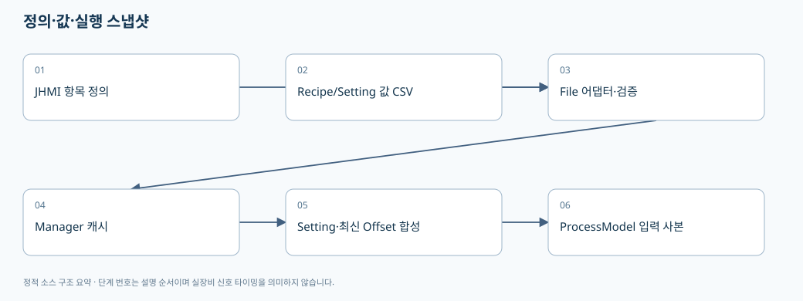

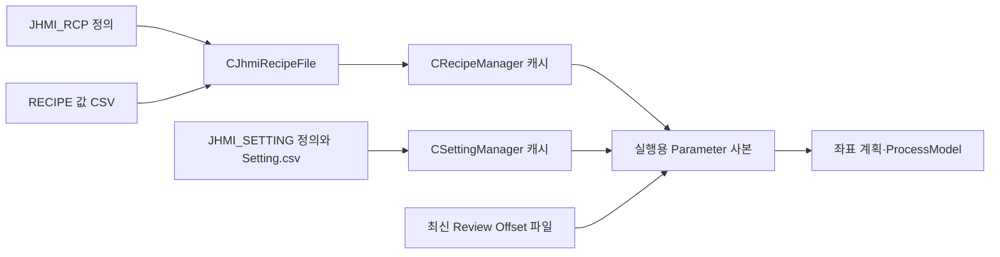

## 1. 세 가지 저장 형식을 혼동하지 않기

| 파일 계층 | 실제 읽기/쓰기 형태 | 대표 필드 | 주의점 |
|---|---|---|---|
| Recipe 항목 정의 | `LoadFormItems → CCsvParser.Read`의 헤더형 CSV | `TAB,GROUP,NAME,DISPLAY NAME,CIM NAME,DATA TYPE,UNIT,SHOW,USE,VALUE,SCALE,CHANGE LIMIT,MIN,MAX,DESCRIPTION,ORDER` | `CIM NAME`이 있다는 사실만으로 고객 Host PPID/Sub PPID 계약이 완성됐다고 말할 수 없습니다. |
| Recipe 값 | `ReadRecipeValues → ParseRecipeLine`이 라인별 첫 3필드를 읽음 | `Tab,Name,Value`, 이후 필드는 Extra | 정의 파일의 헤더 전체를 값 파일의 열 구조로 착각하지 않습니다. 3필드 미만인 행은 파서에서 null로 제외됩니다. |
| Setting 값 | 헤더가 있는 `Setting.csv` | `TAB,NAME,VALUE` | Recipe 값 파서를 그대로 적용하면 안 됩니다. |
| Active Product | 별도의 compact CSV | `TYPE,NAME,VALUE` | PRODUCT/RECIPE/ALIGN/REVIEW 등의 구역 이름이 TYPE에 들어갑니다. [04장](../manual/architecture/04-product-and-station-lifecycle.md)에서 설명합니다. |

근거: [Recipe 정의 헤더와 저장 폴더](https://github.com/kjuws10-rgb/A3Drilling/blob/5aee8e58439c9b455cae7c9593c9be986c3e682e/Drilling.File/JHMI/CJhmiRecipeFile.cs#L26-L30), [정의 항목 읽기](https://github.com/kjuws10-rgb/A3Drilling/blob/5aee8e58439c9b455cae7c9593c9be986c3e682e/Drilling.File/JHMI/CJhmiRecipeFile.cs#L847-L886), [Recipe 값 파서](https://github.com/kjuws10-rgb/A3Drilling/blob/5aee8e58439c9b455cae7c9593c9be986c3e682e/Drilling.File/JHMI/CJhmiRecipeFile.cs#L889-L923), [Setting 헤더와 값 쓰기](https://github.com/kjuws10-rgb/A3Drilling/blob/5aee8e58439c9b455cae7c9593c9be986c3e682e/Drilling.File/JHMI/CSettingFile.cs#L289-L346), [Product 헤더](https://github.com/kjuws10-rgb/A3Drilling/blob/5aee8e58439c9b455cae7c9593c9be986c3e682e/Drilling.File/Product/CProductFile.cs#L8-L11).

## 2. 실제 CoreData 레코드의 역할

| 타입 | 주요 필드 | 생명주기와 의미 |
|---|---|---|
| `ST_RECIPE_FORM_ITEM` | Tab, Group, Name, DisplayName, CimName, DataType, Unit, Show, Use, DefaultValue, Scale, ChangeLimit, Min, Max, Description, DisplayOrder, Extra | 정의 CSV에서 만들어지는 항목의 메타데이터입니다. 화면 이름과 영속 Key를 분리할 수 있습니다. |
| `ST_RECIPE_PARAMETER` | Name, Value, Unit, Range, DefaultValue, Tab, Group, Key, Description, Show, Use, DisplayOrder, DataType, ChangeLimit, Min, Max, Extra | 현재 Recipe 한 개의 편집/조회 항목입니다. Name과 Key가 같은 의미라고 강제하지 않습니다. |
| `ST_RECIPE_DEFINITION` | Id, Name, Parameters, History | Manager가 로드·저장하는 Recipe 단위입니다. 단순 문자열 딕셔너리와 다릅니다. |
| `ST_RECIPE_VALUE` | Tab, Name, Value, Extra | 값 CSV 한 행을 표현합니다. |
| `ST_RECIPE_HISTORY` | ChangedAt, ItemName, OldValue, NewValue, OperatorId, RecipeName, Action, Tab, Group | 변경 전후와 맥락을 보관합니다. |

근거: [Recipe CoreData 정의](https://github.com/kjuws10-rgb/A3Drilling/blob/5aee8e58439c9b455cae7c9593c9be986c3e682e/Drilling.Common/Managers/CRecipeManager.cs#L355-L405). `EN_RECIPE_DATA_TYPE`은 String/Int/Double/Bool입니다. 문자열 Value를 사용하더라도 숫자·논리 타입 검증을 생략해도 된다는 뜻은 아닙니다. [Recipe 타입 enum](https://github.com/kjuws10-rgb/A3Drilling/blob/5aee8e58439c9b455cae7c9593c9be986c3e682e/Drilling.Common/Managers/CRecipeManager.cs#L347-L353).

Setting 쪽의 `ST_SYSTEM_PARAMETER`는 Section, Name, Value, Unit, Description, Group, Key, DefaultValue, DataType, Min/Max, Show/Use, DisplayOrder, Extra를 갖습니다. `EN_SETTING_TAB`은 Option/Interface/Io/Motor/Alarm입니다. “Setting 탭 전체가 한 종류의 단순 옵션”이 아니라 인터페이스·축·알람 정의와 연결되는 분류라는 점을 알아두면 경로를 찾기 쉽습니다. [Setting CoreData와 파일 계약](https://github.com/kjuws10-rgb/A3Drilling/blob/5aee8e58439c9b455cae7c9593c9be986c3e682e/Drilling.Common/Managers/CSettingManager.cs#L246-L278).
+
+## 3. Recipe 저장을 코드 순서로 따라가기

1. UI가 `ST_RECIPE_DEFINITION`을 만들어 `CRecipeManager.SaveRecipe`에 전달합니다.
2. Manager는 Recipe 작업 gate로 직렬화하고 기존 Recipe/Offset 정보를 유지하는 저장 경로를 사용합니다.
3. `CJhmiRecipeFile.SaveCore`는 정의 항목을 읽고 `Use` 조건과 활성 Cell/Shot 범위에 맞춰 저장할 항목을 고릅니다.
4. `DEFAULT/RECIPE_NAME`, `DEFAULT/RECIPE_ID`를 먼저 기록하고, 일반 항목과 Cell 범위 항목을 별도로 이어 씁니다.
5. 쓰기 후 `ValidateSavedRecipeFile`을 호출하고, 조건에 따라 생성/수정/저장 이력을 남깁니다.

근거: [Manager 저장 진입과 변경 확인](https://github.com/kjuws10-rgb/A3Drilling/blob/5aee8e58439c9b455cae7c9593c9be986c3e682e/Drilling.Common/Managers/CRecipeManager.cs#L73-L93), [저장 후 재조회·캐시](https://github.com/kjuws10-rgb/A3Drilling/blob/5aee8e58439c9b455cae7c9593c9be986c3e682e/Drilling.Common/Managers/CRecipeManager.cs#L147-L168), [SaveCore 항목 선택](https://github.com/kjuws10-rgb/A3Drilling/blob/5aee8e58439c9b455cae7c9593c9be986c3e682e/Drilling.File/JHMI/CJhmiRecipeFile.cs#L120-L165), [Recipe 직렬화·재검증·이력](https://github.com/kjuws10-rgb/A3Drilling/blob/5aee8e58439c9b455cae7c9593c9be986c3e682e/Drilling.File/JHMI/CJhmiRecipeFile.cs#L166-L241).

중요한 예외가 `CURRENT_PROCESS_COUNT`입니다. 편집 화면을 연 뒤 실제 가공이 진행될 수 있으므로, 저장 시 기존 파일의 현재 가공매수를 보존합니다. 오래된 편집 초안이 실제 생산 카운터를 되돌리면 안 되기 때문입니다. 보정값 저장의 변경 비교에서도 이 키를 제외합니다. [런타임 소유 카운터 보존](https://github.com/kjuws10-rgb/A3Drilling/blob/5aee8e58439c9b455cae7c9593c9be986c3e682e/Drilling.File/JHMI/CJhmiRecipeFile.cs#L188-L206), [동시 수정 비교의 카운터 예외](https://github.com/kjuws10-rgb/A3Drilling/blob/5aee8e58439c9b455cae7c9593c9be986c3e682e/Drilling.Common/Managers/CRecipeManager.cs#L74-L93).

`SaveParametersIfUnchanged(expected, changes)`는 측정 당시 Recipe와 현재 파일을 비교한 뒤 수정합니다. 측정 후 다른 작업자가 레시피를 바꾸었다면 예상한 기준과 다르므로 예외를 내는 구조입니다. 저장이 반환된 뒤 재조회와 이력 새로고침은 `CancellationToken.None`을 사용합니다. **저장 전 취소**와 **이미 저장된 뒤 화면 갱신 실패**를 같은 실패로 처리하면 사용자가 같은 보정을 두 번 적용할 위험이 있습니다. [보정 저장의 비교 및 commit 이후 처리](https://github.com/kjuws10-rgb/A3Drilling/blob/5aee8e58439c9b455cae7c9593c9be986c3e682e/Drilling.Common/Managers/CRecipeManager.cs#L74-L109).

## 4. Setting의 실제 캐시·검증·저장 순서

`CSettingManager.LoadSection`은 캐시가 있으면 그대로 반환합니다. `ReloadSection`은 파일을 다시 읽어 캐시에 넣습니다. `SetValue`는 Key 또는 Name으로 기존 항목을 찾고 항목이 없으면 예외를 내므로, 정의에도 없는 키를 SetValue만 호출해 추가하는 방식은 성립하지 않습니다. [Setting 조회·기본값](https://github.com/kjuws10-rgb/A3Drilling/blob/5aee8e58439c9b455cae7c9593c9be986c3e682e/Drilling.Common/Managers/CSettingManager.cs#L26-L70), [SetValue와 저장](https://github.com/kjuws10-rgb/A3Drilling/blob/5aee8e58439c9b455cae7c9593c9be986c3e682e/Drilling.Common/Managers/CSettingManager.cs#L72-L102).

`SaveSection`은 Option의 카메라 해상도·허용치 값을 검증하고, 특정 RunOption 변경은 MELSEC의 캐시된 Review Able 상태로 차단합니다. 파일 저장이 성공한 후에만 캐시를 교체합니다. 캐시값을 먼저 바꾸고 파일 저장 실패를 무시하는 흐름으로 고치면 메모리/디스크가 불일치합니다. [실시간 용량·해상도·RunOption 저장 검증](https://github.com/kjuws10-rgb/A3Drilling/blob/5aee8e58439c9b455cae7c9593c9be986c3e682e/Drilling.Common/Managers/CSettingManager.cs#L104-L148).

파일 계층은 정의에 존재하고 Use인 항목을 정규화하고, 다른 탭의 값까지 포함한 Setting 값 전체를 다시 씁니다. 이후 저장 파일을 재로딩하여 기대 Key/Value와 비교합니다. [정규화와 저장](https://github.com/kjuws10-rgb/A3Drilling/blob/5aee8e58439c9b455cae7c9593c9be986c3e682e/Drilling.File/JHMI/CSettingFile.cs#L52-L120), [저장 후 재검증](https://github.com/kjuws10-rgb/A3Drilling/blob/5aee8e58439c9b455cae7c9593c9be986c3e682e/Drilling.File/JHMI/CSettingFile.cs#L328-L367).

| Setting 개념 | 현재 코드에서 확인되는 조건 | 변경 시 확인 |
|---|---|---|
| Review camera resolution | 유한한 양수 mm/pixel로 파싱 | pixel→mm 변환에 ×1000을 중복 적용하지 않는지 |
| Align camera resolution | Review와 별도로 검증 | Align/Review 해상도 키를 서로 바꾸어 쓰지 않는지 |
| Wapage AlignBase tolerance | 유한한 0 이상 값 | 물리 길이와 pixel 범위 변환의 단위 |
| Vision line capacity | 공급 함수를 통해 현재 캐시값 사용 | 한 번 시작할 때만 읽는 값으로 바꿀 때 런타임 변경 의미 |

코드의 default는 설치된 장비의 최종 교정값이 아닙니다. 실제 설정값과 출하 기준은 별도 승인 자료로 확인해야 합니다. [키와 코드 기본값](https://github.com/kjuws10-rgb/A3Drilling/blob/5aee8e58439c9b455cae7c9593c9be986c3e682e/Drilling.Common/Managers/CSettingManager.cs#L16-L22), [값의 검증 범위](https://github.com/kjuws10-rgb/A3Drilling/blob/5aee8e58439c9b455cae7c9593c9be986c3e682e/Drilling.Common/Managers/CSettingManager.cs#L104-L148).

## 5. Recipe와 Setting은 실행 시 어떻게 합쳐지는가

`CStationProcess.BuildRuntimeParameters`는 Recipe 입력 딕셔너리의 **사본**을 만든 뒤 Option과 Motor Setting을 순회하여 `parameters[setting.Key] = setting.Value`로 덮어씁니다. 이후 최신 Review Offset 파일을 로드하여 합칩니다. 이름이 충돌하면 이 경로에서는 **Setting이 Recipe를 덮어쓰는 우선순위**가 존재합니다. 모든 프로그램 경로가 같은 우선순위를 쓴다는 보장은 아니므로 Review·수동 동작은 해당 경로도 따로 봐야 합니다. [실행 Parameter 합성](https://github.com/kjuws10-rgb/A3Drilling/blob/5aee8e58439c9b455cae7c9593c9be986c3e682e/Drilling.Common/Station/CStationProcess.cs#L1526-L1559).

따라서 항목을 Recipe에서 Setting으로 이전하려면 UI 위치만 옮기면 부족합니다.

| 검토 단계 | 확인 내용 |
|---|---|
| 정의 | JHMI_RCP와 JHMI_SETTING 중 어느 쪽에 정의를 둘 것인가 |
| 이관 | 기존 Recipe 값과 새 Setting 값이 다르면 어떤 값을 한 번 가져올 것인가 |
| 기본값 | 항목 부재·구버전 키에 대한 fallback을 유지할 것인가 |
| 소유권 | 장비 공통 교정값인가, PPID/모델별 공정값인가, Product 실행 시점 값인가 |
| 소비 | Process/Review/Manual/UI 미리보기가 같은 값과 좌표 기준을 쓰는가 |
| 검증 | 재시작·Recipe 변경·제품 교체 시 값이 뜻대로 유지되는가 |

## 6. 고객이 원하는 분류와 현재 구현을 구분하기

**현재 구현 사실**: Recipe는 Geometry·공정 Parameter·Cell별 항목·런타임 카운터를 담을 수 있고, Setting은 별도 공통값을 보관하며 실행 시 합성됩니다. **회의상의 희망 구조**: Recipe 메뉴를 PPID와 관련된 항목 중심으로 정리하고 장비 공통 교정값을 Setting에서 관리하자는 방향입니다. 두 내용은 같지 않습니다. 본 문서는 메뉴 재분류나 데이터 마이그레이션이 이미 완료되었다고 주장하지 않습니다.

PPID/Sub PPID·Host 구분자·Auto Job Change 계약은 이 장에서 확정하지 않습니다. 소스의 `CIM NAME`, Product `PPID` 문자열이나 `PAIR_PPID` 필드만으로 고객 자동화 규약의 의미/길이/요청 응답 순서까지 추론할 수 없습니다. 현재 Stage Process 요청 생성부에는 Glass/Lot 매핑 합의 후 교체하라는 TODO도 있습니다. [현재 선택 Recipe와 제품 식별자 fallback](https://github.com/kjuws10-rgb/A3Drilling/blob/5aee8e58439c9b455cae7c9593c9be986c3e682e/Drilling.UI/CRootView.cs#L2892-L2905), [Product PPID 입력](https://github.com/kjuws10-rgb/A3Drilling/blob/5aee8e58439c9b455cae7c9593c9be986c3e682e/Drilling.Common/Product/CProductManager.cs#L822-L846).

## 7. CSV 공통 구현에서 꼭 확인할 점

`CCsvParser`는 UTF-8 BOM을 인식하고, BOM이 없으면 먼저 엄격 UTF-8로 읽은 뒤 디코딩 실패 시 CP949로 읽습니다. 쓰기는 공통 Escape 로직과 UTF-8 BOM 설정을 사용합니다. 인코딩 호환이 있다는 사실이 모든 잘못된 CSV를 정상 복구한다는 뜻은 아닙니다. [CSV 인코딩 설정](https://github.com/kjuws10-rgb/A3Drilling/blob/5aee8e58439c9b455cae7c9593c9be986c3e682e/Drilling.File/Parser/CCsvParser.cs#L8-L10), [헤더·열 확장과 Escape 쓰기](https://github.com/kjuws10-rgb/A3Drilling/blob/5aee8e58439c9b455cae7c9593c9be986c3e682e/Drilling.File/Parser/CCsvParser.cs#L58-L93), [UTF-8와 CP949 읽기](https://github.com/kjuws10-rgb/A3Drilling/blob/5aee8e58439c9b455cae7c9593c9be986c3e682e/Drilling.File/Parser/CCsvParser.cs#L432-L475).

검증 시에는 한국어 항목명, 쉼표·따옴표가 들어간 값, 알 수 없는 Extra 열, 중복 Key, 필수 헤더 누락, 빈 파일, 쓰기 권한 오류, 저장 직후 취소를 각각 나눠 확인합니다. Recipe와 Setting이 모두 CSV라고 같은 테스트 데이터 형식을 쓰지 않습니다.

다음 읽기: [03. 좌표와 Script](../manual/architecture/03-coordinate-script-and-mof.md), [04. Product와 Station](../manual/architecture/04-product-and-station-lifecycle.md).


# 별도 정적 추적 상세 해설 · architecture/03-coordinate-script-and-mof.md

# 03. Recipe 좌표가 Head Script와 MOF 실행 입력이 되기까지

> 기준: `A3Drilling/master` · `5aee8e58439c9b455cae7c9593c9be986c3e682e`. 본 장은 해당 Commit의 소스를 정적으로 읽어 설명합니다. 장비 연결·가공·컴파일을 실행한 결과가 아닙니다.

좌표 문제는 **설계점 → Head 배정 → 좌표축 변환 → Offset 합성 → Encoder 대기 위치 → Script → Controller 실행**을 나누면 추적하기 쉽습니다. 표에 표시되는 최종 숫자만 비교하면 어느 층에서 부호나 단위가 달라졌는지 찾기 어렵습니다.

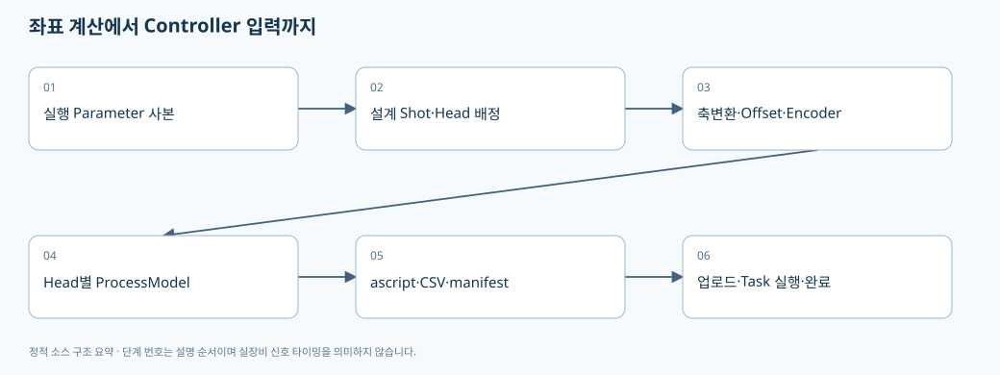


## 1. 계산 진입점과 입력의 성격

`CShotCoordinatePlanBuilder.Build(parameters)`의 입력은 문자열 Key/Value 딕셔너리입니다. 이미 Recipe와 Setting/Offset이 합쳐졌을 수 있으므로 원래 Recipe 파일의 Value와 입력 값이 동일하다고 가정하면 안 됩니다. 실제 합성 지점은 [02장](../manual/architecture/02-recipe-settings-and-csv.md)에 설명했습니다.

| 입력 Key/개념 | 코드상 사용 | 주의점 |
|---|---|---|
| `HEAD_COUNT` | 1~8로 clamp | 요청 수와 실제 활성 Head 수는 다를 수 있습니다. |
| `MAX_CELL_NUMBER` | 최소 Cell 수 검증 | 유효하지 않으면 계산을 중단합니다. |
| `GLASS_SIZE_X/Y` | 계획 데이터에 기록 | 이것만으로 모든 설계점 범위 검증이 완료된다고 단정하지 않습니다. |
| `SCAN_ENCODER_SCALE` | 공통 Encoder scale 기본 입력 | Head별 scale로 달라질 수 있습니다. 절댓값·방향 처리가 분리되어 있습니다. |
| `STAGE_SCAN_DIRECTION_Y` | 진행 방향과 대기 위치·정렬 순서에 사용 | Scanner축의 +Y와 같은 뜻이 아닙니다. |
| `SHIFT_OFFSET_X/Y` | X는 Scanner 변환, Y는 대기 거리에도 반영 | 단순히 최종 Gx/Gy에 두 숫자를 더하는 구조가 아닙니다. |
| `ALIGN_OFFSET_SCALE`, `REVIEW_OFFSET_SCALE` | 현재 실행 기여분의 % | 저장된 Offset 자체를 누적 배율로 바꾸지 않습니다. |

근거: [계획 입력](https://github.com/kjuws10-rgb/A3Drilling/blob/5aee8e58439c9b455cae7c9593c9be986c3e682e/Drilling.Common/Recipe/CShotCoordinatePlanBuilder.cs#L11-L34), [Offset scale의 정수 % 파싱](https://github.com/kjuws10-rgb/A3Drilling/blob/5aee8e58439c9b455cae7c9593c9be986c3e682e/Drilling.Common/Recipe/CShotCoordinatePlanBuilder.cs#L203-L209).

### 같은 Shift 계산기라도 진입 경로의 입력이 다릅니다

위 표는 `Build`가 **전달받은** Shift를 어떻게 계산하는지 설명한 것입니다. 현재 AUTO(Stage PC 요청) 경로는 `StartStageRequests`의 준비 callback에서 입력 사본을 만든 다음 `SHIFT_OFFSET_X`, `SHIFT_OFFSET_Y`를 각각 `0.000000`으로 덮어쓰고 `PrepareProcess`에 전달합니다. 따라서 이 Commit에서 “좌표 계산기에 Shift 수식이 있다”는 사실만으로 **AUTO 가공에서도 입력된 Shift가 유지된다**고 설명하면 안 됩니다. [AUTO 준비의 Shift 0 정규화](https://github.com/kjuws10-rgb/A3Drilling/blob/5aee8e58439c9b455cae7c9593c9be986c3e682e/Drilling.Common/Station/CStationProcess.cs#L3983-L3995).

반면 MAIN START는 MANUAL 모드에서 실행하는 Semi Auto 경로이며 `PrepareInitialProcess(applyShiftOffset: true)` 후 `Station.Start`를 호출합니다. 두 진입점의 구분과 확인할 함수는 [04장](../manual/architecture/04-product-and-station-lifecycle.md)에 정리했습니다. AUTO에서 Shift 유지·확인 팝업·양산 초기화 옵션을 제공하려면 이 준비 경로의 정책을 별도로 변경·검증해야 합니다. 본 문서는 그러한 정책이 구현 완료되었다고 판정하지 않습니다. [MAIN START의 Shift 준비와 Station 시작](https://github.com/kjuws10-rgb/A3Drilling/blob/5aee8e58439c9b455cae7c9593c9be986c3e682e/Drilling.UI/CRootView.cs#L1621-L1647).

## 2. 설계점과 가공점은 같은 목록이 아니다

`BuildDesignShots`는 주석상 비활성 Head 및 Masking/Chess 제외점까지 포함하는 설계 Geometry를 만드는 진입점입니다. 반면 `Build`는 활성 Head 집합을 만들고 Head 배정 결과가 비활성이면 그 점을 계산 결과에서 제외합니다. 따라서 설계점 개수, 가공점 개수, 리뷰 측정점 개수는 목적이 달라 일치하지 않을 수 있습니다. [활성 Head와 배정](https://github.com/kjuws10-rgb/A3Drilling/blob/5aee8e58439c9b455cae7c9593c9be986c3e682e/Drilling.Common/Recipe/CShotCoordinatePlanBuilder.cs#L21-L55), [설계 Geometry와 가공 변환의 구분](https://github.com/kjuws10-rgb/A3Drilling/blob/5aee8e58439c9b455cae7c9593c9be986c3e682e/Drilling.Common/Recipe/CShotCoordinatePlanBuilder.cs#L212-L214).

`BuildProcessModel`은 좌표 계획을 받은 뒤 Chess 제외점을 거르고 Head별로 묶습니다. 활성 Head가 전혀 없으면 예외를 냅니다. Masking이 있다는 이유만으로 이 한 줄에서 모든 Hole/Beam/Review 이동까지 제외됐다고 결론내려서는 안 됩니다. 가공용 Masking과 Flying Review 이동 경로의 검증은 서로 다른 소비자를 확인해야 합니다. [ProcessModel의 Chess 필터와 Head 그룹](https://github.com/kjuws10-rgb/A3Drilling/blob/5aee8e58439c9b455cae7c9593c9be986c3e682e/Drilling.Common/Station/CStationProcess.cs#L1603-L1639).

## 3. 한 Shot 계산을 중간값별로 읽기

| 단계 | 소스 변수 | 계산의 의미 |
|---|---|---|
| 설계 X 기준 | `scannerReferenceX = DesignX + scannerReferenceOffsetX` | 설계 X에 Scanner 참조 이동량을 반영한 후 Head를 배정합니다. |
| Head 기준 | `ReadHeadCenterX/Y`, `CScannerAxisTransform.Read` | Head마다 중심과 축 교환/방향 조건을 읽습니다. |
| Stage Y 기준 | `designDistanceYFromAlignKey = DesignY - akMarginY` | Align Key 기준의 설계 거리에서 Stage Y로 변환합니다. |
| 첫 Shot | `firstShotStageY` | 진행 방향에 따라 시작 쪽 Shot을 고릅니다. 단순 인덱스 0 고정이 아닙니다. |
| Scan 시작 | `scanStartStageY = firstShotStageY - direction × delayLength` | 시작 여유 거리를 고려합니다. |
| Encoder 대기 거리 | `baseStageWaitDistanceY`, `stageWaitDistanceY` | 기준 거리에서 ShiftY를 뺀 후 대기 위치 계산에 사용합니다. |
| Scanner 기본 위치 | `baseScannerX/Y` | Stage follow 보상 때문에 Y에는 Stage 기준 반대 방향이 사용됩니다. |

근거: [Head 중심과 Stage 기준](https://github.com/kjuws10-rgb/A3Drilling/blob/5aee8e58439c9b455cae7c9593c9be986c3e682e/Drilling.Common/Recipe/CShotCoordinatePlanBuilder.cs#L50-L87), [첫 점·시작 거리·기본 Scanner좌표](https://github.com/kjuws10-rgb/A3Drilling/blob/5aee8e58439c9b455cae7c9593c9be986c3e682e/Drilling.Common/Recipe/CShotCoordinatePlanBuilder.cs#L90-L138).

## 4. Offset 종류는 저장 기준과 실행 기준을 구분해야 한다

`Build`에서 확인되는 합성식은 다음과 같습니다. 기호는 설명을 위한 것이며 원본 함수명은 아래 소스 링크에서 확인합니다.

```text
defaultScanner = transform(DefaultX, ConvertRecipeYToStageY(DefaultY))
firstScanner   = transform(FirstBeamX, ConvertRecipeYToStageY(FirstBeamY))
alignScanner   = DesignOffsetToScanner(AlignX, AlignY) × AlignScale
reviewScanner  = ToScanner(ReviewX, ReviewY, ReviewOffsetIsDesign) × ReviewScale

finalOffset = RecipeOffset + defaultScanner + firstScanner + reviewScanner + alignScanner
ScannerGx/Gy = scannerBase + finalOffset + X방향 Shift의 변환분
encoderWaitPosition = stageWaitDistanceY × abs(headEncoderScale) × stageDirectionY
```

근거: [Offset 기준변환·합산·Encoder대기식](https://github.com/kjuws10-rgb/A3Drilling/blob/5aee8e58439c9b455cae7c9593c9be986c3e682e/Drilling.Common/Recipe/CShotCoordinatePlanBuilder.cs#L139-L156). 이 식은 이 Commit의 해당 계산 경로를 설명합니다. 정지 가공·Default Offset 평가·Vision 이미지좌표 등 다른 목적의 숫자에 그대로 같은 부호를 적용하라는 뜻이 아닙니다.

`ST_HEAD_SHOT_POINT`에는 최종 Gx/Gy뿐 아니라 설계좌표, Stage 기준점, Recipe/Default/FirstBeam/Review/Shift Offset, 최종 Offset, EncoderWaitPosition을 함께 넣습니다. Align 설계 Offset과 Scanner 변환분도 초기화 속성에 들어갑니다. **중간값이 남는 이유는 최종 결과가 어떤 항목의 합인지 설명하기 위해서**라고 해석할 수 있습니다. 이는 데이터 구조에 근거한 설명이며 실제 화면이 모든 항목을 표시한다는 뜻은 아닙니다. [Shot 결과 레코드 생성](https://github.com/kjuws10-rgb/A3Drilling/blob/5aee8e58439c9b455cae7c9593c9be986c3e682e/Drilling.Common/Recipe/CShotCoordinatePlanBuilder.cs#L157-L200).

## 5. ProcessModel은 실행 조건의 스냅샷이다

`BuildProcessModel`은 입력을 새 딕셔너리로 복사하고, 좌표 계획으로 Head별 Shot을 묶은 뒤 레이저 Power/Frequency/ShotCount, Mark/Jump speed, X/Y/Z RampRate, Z speed, AccLimit, DOE Z target을 `ST_HEAD_PROCESS_PLAN`에 담습니다. Head마다 AutomationNo/TaskNo와 `PROCESS_Hxx.ascript` 파일명을 지정합니다. [Head 계획과 ProcessModel 생성](https://github.com/kjuws10-rgb/A3Drilling/blob/5aee8e58439c9b455cae7c9593c9be986c3e682e/Drilling.Common/Station/CStationProcess.cs#L1603-L1673).

| 식별자 | 구분해야 할 이유 |
|---|---|
| `HeadNo` | 물리/논리 Head 번호와 계획을 식별합니다. |
| `AutomationNo` | 어느 Automation1 연결 대상으로 보낼지 지정합니다. |
| `TaskNo` | Controller 안에서 어느 Task로 실행할지 지정합니다. |
| `ScriptFileName` | Controller에서 실행할 파일 이름입니다. |
| `FilePath` | PC에 생성된 이번 회차 파일의 실제 경로입니다. |

HeadNo=AutomationNo=TaskNo라고 가정해 코드를 단순화하면 다중 Head/Controller 배정이 깨질 수 있습니다.

실제 선언에서 `ST_PROCESS_MODEL`은 ProcessId/RecipeId/GlassId/LotId/HeadPlans/Parameters/CreatedAt을 갖고, `ST_HEAD_PROCESS_PLAN`은 공정 조건과 Shots를 갖습니다. 기본 TaskNo는 HeadNo이지만 실행 모델을 만들 때 다시 지정할 수 있습니다. `ST_SCRIPT_BUILD_RESULT`의 MofReadyRunId는 파일명과 별도로 이번 회차 준비 상태를 식별합니다. [Process·Head·Script CoreData 선언](https://github.com/kjuws10-rgb/A3Drilling/blob/5aee8e58439c9b455cae7c9593c9be986c3e682e/Drilling.Common/Station/CStationManager.cs#L298-L336).
+
+## 6. Script 파일 생성과 추적 산출물

`CAutomation1ScriptFile.Build`는 Standard 또는 지정 모드 하위에 이번 회차의 격리 디렉터리를 만듭니다. 활성 Head 중 실제 Shot이 있는 Head만 남기고 검증한 다음, 좌표 CSV와 Head별 AeroScript를 생성하고 마지막에 `PROCESS.txt` 목록을 생성합니다. 반환하는 `ST_SCRIPT_BUILD_RESULT`에는 Head별 FilePath/Task/Head/점수와 `MofReadyRunId`가 있습니다. [산출물 이름](https://github.com/kjuws10-rgb/A3Drilling/blob/5aee8e58439c9b455cae7c9593c9be986c3e682e/Drilling.File/Script/CAutomation1ScriptFile.cs#L9-L19), [회차별 생성과 Manifest 반환](https://github.com/kjuws10-rgb/A3Drilling/blob/5aee8e58439c9b455cae7c9593c9be986c3e682e/Drilling.File/Script/CAutomation1ScriptFile.cs#L51-L107).

| 파일 | 목적 | 포함 데이터 |
|---|---|---|
| `PROCESS_Hxx.ascript` | 각 Head의 Controller 실행용 명령 | 축/속도/가속도/추종/대기/가공 명령 |
| `PROCESS_COORDINATES.csv` | 실행 회차 좌표·Offset 추적 | RecipeId, GlassId, 생성시간, Simulator 여부, Head/Automation/Task, Shot/Cell/Row/Col, Design/Scanner/Offset/가공여부 |
| `PROCESS.txt` | 좌표·Head Script 목록을 묶는 산출물 | 이번 빌드와 Head별 파일 연결 정보 |

CSV 필드 근거: [좌표 CSV 헤더](https://github.com/kjuws10-rgb/A3Drilling/blob/5aee8e58439c9b455cae7c9593c9be986c3e682e/Drilling.File/Script/CAutomation1ScriptFile.cs#L174-L243). 현장 실측 행은 본 문서에 복제하지 않습니다.

## 7. MOF 준비와 실행은 생성 성공 다음의 별도 단계다

MOF Script에는 `CMofReadiness`의 Task별 GlobalInteger 인덱스와 RunId 표시가 기록됩니다. 소스는 Scanner 중심화·보조 피드백 초기화·레이저 설정과 MotionDone 대기 후 준비 표시를 발행하도록 구성되어 있으며, StartFollow 쪽은 이미 Stage Encoder 움직임을 기다릴 수 있다는 주석이 있습니다. 준비 신호를 단순히 Run 명령 반환과 같다고 취급하면 안 됩니다. [MOF 준비 식별자·준비 위치와 follow 시작](https://github.com/kjuws10-rgb/A3Drilling/blob/5aee8e58439c9b455cae7c9593c9be986c3e682e/Drilling.File/Script/CAutomation1ScriptFile.cs#L431-L512).

Station에서는 Script 빌드 후 반환된 Head별 **Manifest FilePath**로 업로드하고 응답을 검사합니다. 표준 실행에서는 Head Task Run을 보낸 뒤 `WaitAutomationHeadScriptsComplete`를 호출합니다. Buffered Run은 다른 실행 분기를 사용합니다. 따라서 `Run command accepted` 로그는 모든 가공점이 정상 완료되었다는 결과가 아닙니다. [빌드·업로드](https://github.com/kjuws10-rgb/A3Drilling/blob/5aee8e58439c9b455cae7c9593c9be986c3e682e/Drilling.Common/Station/CStationProcess.cs#L656-L688), [표준/Buffered 실행 분기·실패 정리](https://github.com/kjuws10-rgb/A3Drilling/blob/5aee8e58439c9b455cae7c9593c9be986c3e682e/Drilling.Common/Station/CStationProcess.cs#L691-L748).

`AUTOMATION1_SIMULATOR_USE` 조건에서는 Script Y 위치를 `FinalScannerOffsetY + ShiftScannerOffsetY`로 읽는 별도 처리가 있습니다. Simulator 결과를 실제 MOF의 Stage follow GY와 숫자만 같은지 비교하면 틀릴 수 있습니다. [실장비와 Simulator Script 좌표 선택](https://github.com/kjuws10-rgb/A3Drilling/blob/5aee8e58439c9b455cae7c9593c9be986c3e682e/Drilling.File/Script/CAutomation1ScriptFile.cs#L701-L713).

## 8. 변경별 검증 계획

| 변경 | 격리된 계산 검증 | 연동/장비에서 나중에 확인할 것 |
|---|---|---|
| Offset 방향 | Offset를 하나만 +값으로 바꾸고 Design/Stage/Scanner/Encoder 중간값을 비교 | 실제 이동·가공 흔적의 방향, Vision 부호 |
| Axis swap/flip | Head별 transform 조합과 역변환 오차 | 모션 표시 방향·SDK 축 이름의 일치 |
| Shift | X만/Y만/혼합 입력에서 대기 위치와 최종 좌표를 각각 비교 | 검사 좌표에도 같은 공정 Shift 기준이 반영되는지 |
| 활성 Head | 동일 설계점에서 Hxx_USE만 변경하여 배정·제외·Head별 점수 비교 | Controller/Task가 중복되거나 비활성 Head가 실행되는지 |
| Masking/Chess | 경계선 위·안·밖을 나누고 설계/가공/리뷰 계획 개수를 별도 비교 | 이동 회피와 Trigger 억제의 실제 차이 |
| Buffered | 같은 ProcessModel로 생성된 표준·Buffered 산출물의 점·Offset 비교 | Queue 부족/Stop/통신 단절·완료 신호 |

이 장의 계획은 정적 분석에서 도출한 검증 항목입니다. 성능 수치·가공 정밀도·Stage 최대속도는 실제 계측 없이 판정하지 않습니다.


# 별도 정적 추적 상세 해설 · architecture/04-product-and-station-lifecycle.md

# 04. Product와 Station: 기판 한 장을 끝까지 추적하기

> 기준: `A3Drilling/master` · `5aee8e58439c9b455cae7c9593c9be986c3e682e`. 본 장은 해당 Commit의 소스를 정적으로 읽어 설명합니다. 장비 연결·가공·컴파일을 실행한 결과가 아닙니다.

**Recipe는 앞으로 쓸 조건, Product는 지금 또는 과거 기판에 적용한 조건과 결과, Station은 동작 순서**입니다. 세 객체를 나누어 보면 “Recipe는 바꿨는데 왜 현재 Product에 옛값이 남는가”, “Run을 눌렀는데 왜 아직 완료가 아닌가”를 이해할 수 있습니다.

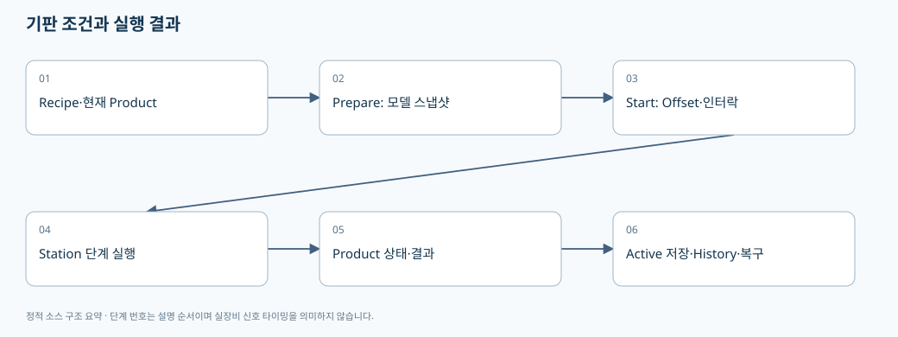

위 SVG는 MAIN START의 Product 흐름을 단순화한 그림입니다. 실제 AUTO(Stage 요청)와의 분기는 아래 Mermaid와 6절에서 구분합니다.

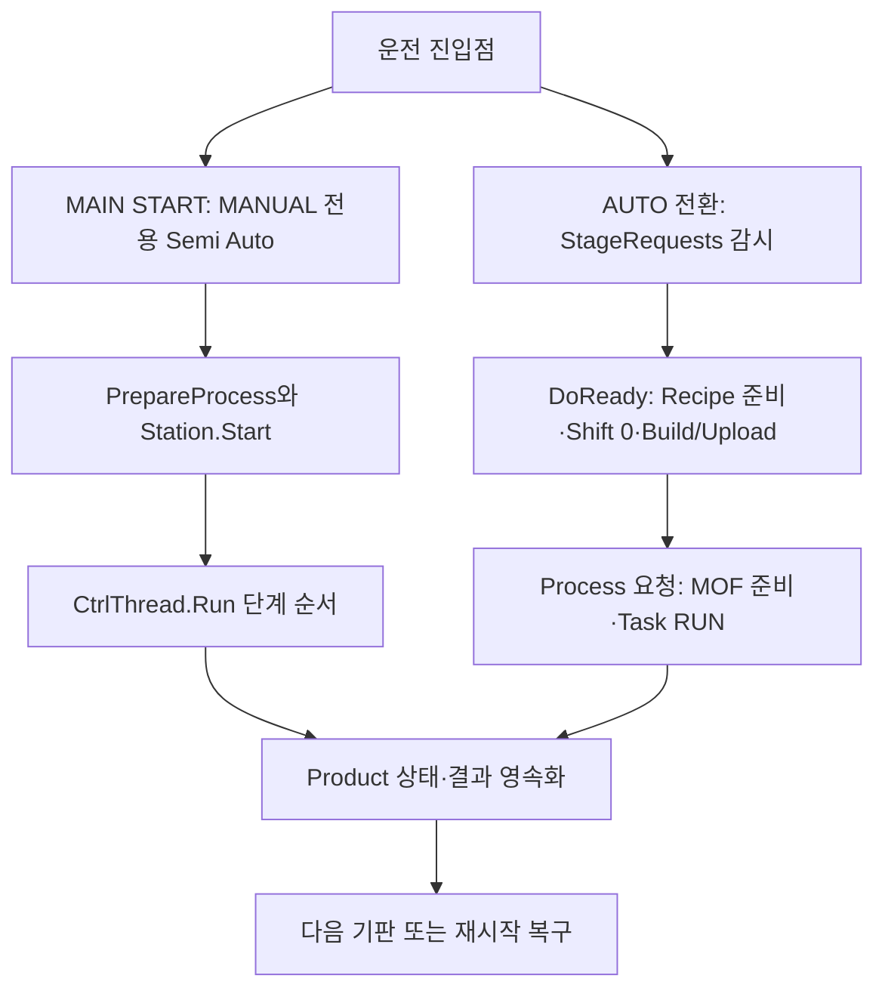

## 1. Product 데이터는 무엇을 담는가

| CoreData | 필드/내용 | 의미 |
|---|---|---|
| `ST_PRODUCT_INFO` | `Values` 딕셔너리, Get/Set helper | Glass/Lot/PPID/상태 등 공통 식별·표시 항목 |
| `ST_PRODUCT_RECIPE_DATA` | Parameters 사본 | 기판의 실행 조건을 남기는 스냅샷 |
| `ST_PRODUCT_ALIGN_DATA` | State, Result, OffsetX, OffsetY, Rotation | Align 수행 상태와 결과 |
| `ST_PRODUCT_DISTORTION_DATA` | State, Result, MaxDa | Distortion 상태·결과 요약 |
| `ST_PRODUCT_REVIEW_DATA` | State, SavedAt, Results + Method/Rule/Beam/Reference 등 | 리뷰 결과와 어느 방식의 검사인지 구분하는 메타데이터 |
| `ST_PRODUCT_HEAD_RESULT` | HeadNo, State, Total/CompletedPoints, Result, ErrorCode, Message, 시각 | Head별 런타임 진행 정보 |
| `ST_PRODUCT_DATA` | Product, Recipe, Align, Distortion, Review, Runtime | 위 자료를 한 기판 단위로 결합 |

근거: [Product CoreData](https://github.com/kjuws10-rgb/A3Drilling/blob/5aee8e58439c9b455cae7c9593c9be986c3e682e/Drilling.Common/Product/CProductManager.cs#L996-L1049). `ST_PRODUCT_REVIEW_RESULT`는 ShotKey/HeadNo/CellNo/BeamNo/ErrorX/ErrorY/Judge를 갖습니다. 이 타입에 있다는 사실과 파일에 저장·복구되는 범위는 별도로 확인해야 합니다.

## 2. 상태와 결과는 서로 다른 축이다

| 구분 | 실제 enum 값 |
|---|---|
| 기판 상태 `EN_PRODUCT_STATE` | Created, Running, Completed, Stopped, Error, Scrapped |
| 판정 `EN_PRODUCT_RESULT` | Pending, Skipped, OK, NG |
| Head 상태 `EN_PRODUCT_HEAD_STATE` | Ready, Running, Completed, Stopped, Error, Disabled |
| Align/Distortion/Review 수행 상태 `EN_PRODUCT_PROCESS_STATE` | NotStarted, Running, Completed, Stopped, Error |

근거: [Product 상태 enum](https://github.com/kjuws10-rgb/A3Drilling/blob/5aee8e58439c9b455cae7c9593c9be986c3e682e/Drilling.Common/Product/CProductManager.cs#L959-L994). 예를 들어 `Completed`라고 해서 `OK`라는 뜻은 아닙니다. `CompleteProduct`는 공정 미수행이면 Skipped를 저장하며, `processExecuted=true`에서 isOk 값에 따라 OK/NG를 정합니다. [완료와 판정 조합](https://github.com/kjuws10-rgb/A3Drilling/blob/5aee8e58439c9b455cae7c9593c9be986c3e682e/Drilling.Common/Product/CProductManager.cs#L558-L602).

## 3. Product 생성부터 저장까지

`CreateProduct(processId, glassId, lotId, recipeId, parameters, headPointCounts)`는 다음을 수행합니다.

1. `_updateGate`로 상태 갱신을 직렬화합니다.
2. ActiveProduct를 읽는 중 오류가 있었으면 새 Product 생성을 거부합니다. 깨진 기존 기록을 덮어버리지 않으려는 경계입니다.
3. 현재 제품이 없으면 파일에서 다시 확인합니다.
4. 현재 제품이 Completed가 아니면 다른 Glass를 새로 만들지 못하게 합니다.
5. Head 점수가 0이면 Disabled, 양수면 Ready로 만듭니다.
6. 입력 Parameters를 새 딕셔너리로 복사하고 초기 상태를 묶어 저장합니다.

근거: [Product 생성·중복 방지·스냅샷](https://github.com/kjuws10-rgb/A3Drilling/blob/5aee8e58439c9b455cae7c9593c9be986c3e682e/Drilling.Common/Product/CProductManager.cs#L129-L199).

`PersistAndLog`는 **Active 파일 저장 → 메모리 현재 Product 공개 → History 기록 → 일반 로그** 순서입니다. Active 저장 후 History/로그 쓰기가 실패하면 이미 커밋된 상태를 실패한 전이로 뒤집지 않도록 catch합니다. 이 경우 상태 전이는 성공했지만 부가 이력이 불완전할 수 있으므로 진단 시 두 결과를 나누어 봐야 합니다. [Product commit 경계](https://github.com/kjuws10-rgb/A3Drilling/blob/5aee8e58439c9b455cae7c9593c9be986c3e682e/Drilling.Common/Product/CProductManager.cs#L789-L819).

## 4. ActiveProduct.csv는 객체 전체의 자동 직렬화가 아니다

`CProductFile`은 `Data/Product/ActiveProduct.csv`와 날짜별 History 파일을 사용합니다. 저장 형식은 `TYPE,NAME,VALUE`이고, 각 구역의 필드를 명시적으로 씁니다. [헤더와 Product 루트](https://github.com/kjuws10-rgb/A3Drilling/blob/5aee8e58439c9b455cae7c9593c9be986c3e682e/Drilling.File/Product/CProductFile.cs#L8-L11), [Active·History 상대 경로](https://github.com/kjuws10-rgb/A3Drilling/blob/5aee8e58439c9b455cae7c9593c9be986c3e682e/Drilling.File/Product/CProductFile.cs#L258-L265).

| TYPE | 주요 저장 항목 |
|---|---|
| PRODUCT | `CProductManager.ProductFieldNames` 목록의 값 |
| RECIPE | 공통 Product 핵심 이름을 제외한 Parameters |
| ALIGN | STATE, RESULT, OFFSET_X/Y, ROTATION |
| DISTORTION | STATE, RESULT, MAX_DA |
| REVIEW | 상태, 검사방식, RecipeId, Rule/Scope, Beam, 기준 Cell/Shot, 줄 수, 총 수 |
| REVIEW_RESULT | SavedAt 및 ShotKey별 HEAD_NO/CELL_NO/BEAM_NO/ERROR_X/ERROR_Y/JUDGE |

근거: [compact 저장 목록](https://github.com/kjuws10-rgb/A3Drilling/blob/5aee8e58439c9b455cae7c9593c9be986c3e682e/Drilling.File/Product/CProductFile.cs#L109-L178). 로드할 때 `Runtime`은 `new ST_PRODUCT_RUNTIME_DATA([])`로 구성됩니다. 따라서 “현재 메모리의 모든 Head 런타임 필드가 파일에 그대로 보존된다”고 설명하면 안 됩니다. [compact 로드와 Runtime 초기값](https://github.com/kjuws10-rgb/A3Drilling/blob/5aee8e58439c9b455cae7c9593c9be986c3e682e/Drilling.File/Product/CProductFile.cs#L73-L106).

Active 저장은 고유 임시파일에 쓰고 기존 파일이 있으면 `File.Replace`, 없으면 `File.Move`를 사용하며 finally에서 임시파일을 정리합니다. 모든 파일 저장기가 같은 원자적 교체 방식을 쓴다고 확대 해석하지 않습니다. [Active 파일 교체 방식](https://github.com/kjuws10-rgb/A3Drilling/blob/5aee8e58439c9b455cae7c9593c9be986c3e682e/Drilling.File/Product/CProductFile.cs#L182-L201).

## 5. 재시작 복구는 자동 재가공이 아니다

`LoadActive`는 읽기 성공/실패 플래그를 관리합니다. `RecoverInterrupted`는 기판 또는 Align/Distortion/Review/Head 중 Running 상태가 있는지 확인합니다. 코드 주석처럼 단지 Created 상태인 제품은 실행 중단으로 보지 않으며, Running이던 부분을 중단 상태로 복구하는 경로입니다. **전원 복구 후 중간 Shot부터 자동 재개**한다는 뜻이 아닙니다. [Active 로드 실패 상태](https://github.com/kjuws10-rgb/A3Drilling/blob/5aee8e58439c9b455cae7c9593c9be986c3e682e/Drilling.Common/Product/CProductManager.cs#L25-L47), [재시작 시 중단 판정](https://github.com/kjuws10-rgb/A3Drilling/blob/5aee8e58439c9b455cae7c9593c9be986c3e682e/Drilling.Common/Product/CProductManager.cs#L49-L88).

## 6. MAIN START(Semi Auto)와 AUTO(Stage 요청)는 다른 진입점입니다

화면에 `START`가 있고 내부 함수에 `AutoStep`이라는 이름이 있다는 이유로 현재 AUTO 운전 전체를 `CStationProcess.Start → Run` 한 경로로 설명하면 안 됩니다. 실제 RootView는 다음 두 경로를 구분합니다.

| 운전 진입점 | 실제 호출 | 실행을 시작하는 조건 | 다음에 읽을 함수 |
|---|---|---|---|
| MAIN START / Semi Auto | MANUAL 모드 확인 → 초기 모델 준비 → `PrepareInitialProcess(applyShiftOffset:true)` → `CStationManager.Start` | 사용자가 MAIN START를 누름. AUTO 모드에서는 이 버튼 경로를 거부 | `CStationProcess.Start`, `Run`, `RunSequenceStep` |
| AUTO / Stage PC 요청 감시 | AUTO 전환 시 `StartStageRequests(CreateStageProcessRequest, Review/Power/Distortion actions)` | AUTO로 바꾼 뒤 Stage의 요청과 handshake를 기다림. 전환 자체가 즉시 가공 명령은 아님 | `CStationProcess.StartStageRequests`, `CStageRequestSequence.Start/Run`, `RunStageTasks` |

근거: [AUTO 전환의 Stage 요청 감시와 중지](https://github.com/kjuws10-rgb/A3Drilling/blob/5aee8e58439c9b455cae7c9593c9be986c3e682e/Drilling.UI/CRootView.cs#L608-L619), [MANUAL 전용 MAIN START](https://github.com/kjuws10-rgb/A3Drilling/blob/5aee8e58439c9b455cae7c9593c9be986c3e682e/Drilling.UI/CRootView.cs#L1621-L1647), [AUTO 시작 전 소유권 확인](https://github.com/kjuws10-rgb/A3Drilling/blob/5aee8e58439c9b455cae7c9593c9be986c3e682e/Drilling.Common/Station/CStationProcess.cs#L3971-L3983).

`StartStageRequests`는 Manual MOF, Stage/Review의 동작·정리, 현재 Station sequence, 이전 AUTO Task/Buffered 실행의 소유권을 확인한 다음 감시를 시작합니다. `CStageRequestSequence.Start`는 별도의 stop CTS와 worker Task를 만들며 이전 worker/cleanup이 끝나지 않았으면 시작을 거부합니다. 즉 이 경로는 앞서 설명한 CtrlThread의 tick sequence와 같은 시작 함수가 아닙니다. [Station/Task 소유권 gate](https://github.com/kjuws10-rgb/A3Drilling/blob/5aee8e58439c9b455cae7c9593c9be986c3e682e/Drilling.Common/Station/CStationProcess.cs#L3971-L3983), [Stage 요청 worker 구성](https://github.com/kjuws10-rgb/A3Drilling/blob/5aee8e58439c9b455cae7c9593c9be986c3e682e/Drilling.Common/Station/CStationProcess.cs#L4935-L4970).

### AUTO의 DoReady와 Process 준비 경계

1. DoReady 요청을 받으면 Process ABLE을 쓰고 Stage START를 기다린 뒤 요청 Recipe·좌표를 준비합니다.
2. `prepare` callback은 이전 0선 후속검사 완료를 확인하고 요청 데이터를 가져옵니다. 여기서 Shift X/Y를 0으로 정규화하여 ProcessModel을 준비합니다.
3. `buildUpload` callback은 이번 모델의 Script를 만들고 업로드합니다. 이 단계가 끝났다고 Task RUN까지 실행된 것은 아닙니다.
4. Stage DoReady COMPLETE와 양측 신호 OFF를 확인한 다음 Process 요청을 기다립니다. MOF zero/Task RUN은 Process 준비의 책임으로 분리되어 있습니다.

근거: [AUTO 준비·빌드·zero·RUN callback](https://github.com/kjuws10-rgb/A3Drilling/blob/5aee8e58439c9b455cae7c9593c9be986c3e682e/Drilling.Common/Station/CStationProcess.cs#L3983-L4015), [DoReady 준비와 Build/Upload](https://github.com/kjuws10-rgb/A3Drilling/blob/5aee8e58439c9b455cae7c9593c9be986c3e682e/Drilling.Common/Station/CStationProcess.cs#L5105-L5122), [DoReady 해제 후 Process 준비](https://github.com/kjuws10-rgb/A3Drilling/blob/5aee8e58439c9b455cae7c9593c9be986c3e682e/Drilling.Common/Station/CStationProcess.cs#L5150-L5177). 이것은 해당 경로의 소스 책임을 설명한 것이며 모든 신호의 현장 타이밍을 실측 검증했다는 뜻이 아닙니다.

현재 AUTO의 Shift 0 정규화는 실제 코드 사실입니다. Shift를 유지하면서 가공할지 묻는 정책이나 양산 자동 초기화 옵션은 회의 요구와 별도로 구현 여부를 비교해야 합니다. 수동 Shift를 평가할 때 성공했다고 AUTO에서도 유지된다고 보고하지 않습니다.

## 7. PrepareProcess가 하는 일과 MAIN START의 Start가 하는 일


| 메서드 | 핵심 동작 | 방지하는 오류 |
|---|---|---|
| `PrepareProcess` | sequence lock 아래 Ready와 Manual MOF 상태 확인 | 진행 중 모델 교체 |
| `PrepareProcessCore` | runtime Parameter 합성, ProcessModel·Preview·통계·상태 스냅샷 생성 | Recipe와 실행 조건의 무분별한 공유 |
| `Start` | 준비 모델·Offset 최신성·인터락 확인 후 linked CTS 생성 | 준비 후 Offset가 바뀐 상태의 실행 |
| `base.Start(10, "StationProcess")` | CtrlThread의 주기 실행 시작 | Start 함수 반환과 실제 한 사이클 완료의 혼동 |

근거: [PrepareProcess](https://github.com/kjuws10-rgb/A3Drilling/blob/5aee8e58439c9b455cae7c9593c9be986c3e682e/Drilling.Common/Station/CStationProcess.cs#L209-L267), [Start와 이중 상태 확인](https://github.com/kjuws10-rgb/A3Drilling/blob/5aee8e58439c9b455cae7c9593c9be986c3e682e/Drilling.Common/Station/CStationProcess.cs#L270-L320). Start는 lock 밖에서 Offset/인터락을 확인한 뒤 lock 안에서 상태를 다시 확인합니다. 첫 확인과 실제 전이 사이에 상태가 바뀔 수 있기 때문이라고 해석할 수 있습니다.

Review Offset 롤백/변경은 준비된 모델을 무효화할 수 있습니다. `EnsurePreparedReviewOffsetIsCurrent`는 파일 경로와 저장시각이 준비 당시와 같은지 확인하고 다르면 DoReady를 다시 요구합니다. UI에서 바뀐 Offset을 표시했다고 이미 준비한 Script/ProcessModel이 저절로 바뀌는 것으로 가정하면 안 됩니다. [준비 모델 무효화·최신성 확인](https://github.com/kjuws10-rgb/A3Drilling/blob/5aee8e58439c9b455cae7c9593c9be986c3e682e/Drilling.Common/Station/CStationProcess.cs#L1563-L1595).

## 8. MAIN START의 단계 순서와 실패 순서

MAIN START에서 호출되는 `Run`의 정상 전이는 `Ready → PowerCheck → Align → Process → Inspection → Complete → Ready`입니다. Stop, Reset, Error는 별도 case입니다. 취소 예외는 Stop으로, 명시된 InvalidOperation/Timeout/IO/KeyNotFound 예외는 Error로 전환합니다. 그 외 예외는 상위 CtrlThread의 오류 처리와 함께 확인해야 하므로 “모든 예외가 동일한 Station Error 결과를 남긴다”고 말할 수 없습니다. [Station Run 상태기계](https://github.com/kjuws10-rgb/A3Drilling/blob/5aee8e58439c9b455cae7c9593c9be986c3e682e/Drilling.Common/Station/CStationProcess.cs#L323-L379).

`RunSequenceStep`은 기대한 상태에서 다음 상태로 이동했는지 확인하고, 중간에 Stop이 들어오면 Interrupted 경로를 탑니다. `FinishSequence`는 Ready로 돌리고 sequence CTS를 해제합니다. UI가 표시하는 `EN_STATION_STATE`, 단계 `EN_PROCESS_STEP`, 이 내부 순서 `EN_STATION_SEQUENCE`와 Script status는 목적이 다르므로 하나의 bool IsRunning으로 합치지 않는 편이 안전합니다. [단계 전이·정리](https://github.com/kjuws10-rgb/A3Drilling/blob/5aee8e58439c9b455cae7c9593c9be986c3e682e/Drilling.Common/Station/CStationProcess.cs#L382-L430).

`EN_STATION_SEQUENCE.PowerCheck`에는 명시값 3이 지정되어 있습니다. 이를 화면 정렬 순서나 Host I/O 값으로 자동 재사용하면 안 됩니다. `EN_STATION_STATE`는 Idle/Check/Process/Complete/Alarm/Stopped이고, 내부 sequence enum과 항목/목적이 다릅니다. [Station enum 선언](https://github.com/kjuws10-rgb/A3Drilling/blob/5aee8e58439c9b455cae7c9593c9be986c3e682e/Drilling.Common/Station/CStationManager.cs#L261-L295).
+
+## 9. 상위 자동화 연결에서 아직 확정하지 말아야 할 것

RootView의 Stage Process 요청 생성은 현재 선택 Recipe를 찾고, 현재 Product의 Glass/Lot을 사용하며 없으면 SIM/DUMMY 식별자를 만듭니다. `Stage Glass/Lot mapping is agreed` 후 fallback을 교체하라는 TODO가 남아 있습니다. 따라서 이 부분을 고객 Host PPID/Sub PPID 자동 Job Change의 완성 계약이라고 설명하면 안 됩니다. [Stage 요청의 현재 식별자 생성](https://github.com/kjuws10-rgb/A3Drilling/blob/5aee8e58439c9b455cae7c9593c9be986c3e682e/Drilling.UI/CRootView.cs#L2892-L2905).

검토할 후속 계약은 다음과 같습니다. 이는 제안 목록이며 이 소스가 구현 완료했다는 뜻은 아닙니다.

- Host PPID와 설비 RecipeId/Sub PPID의 관계와 길이·허용문자·미등록 처리.
- Job Change 요청 중인 Product 처리, 편집 중 Recipe 처리, 선택·검증·적용 완료 시점.
- 동일 요청 재전송에 대한 중복 적용 방지와 요청 번호.
- Recipe/Setting/Offset 버전이 실제 가공에 사용된 스냅샷과 연결되는 방식.

## 10. 검증 계획

| 조건 | 확인해야 할 결과 |
|---|---|
| Active 파일이 깨진 채 새 Product 생성 | 생성 거부·기존 파일 보존·오류 안내 |
| Created 상태에서 앱 재시작 | Running 중단과 구분하여 불필요한 실패 판정이 없는지 |
| Running 기판/Review 상태로 재시작 | 중단 흔적 보존·자동 재가공 미실행 |
| Active 저장 성공, History 실패 | 현재 상태는 한 번만 전이하고 이력 오류가 진단 가능한지 |
| Prepare 후 Offset 변경/롤백 | Start 차단, 재준비 후 최신값 사용 |
| Start 연속 클릭·Stop과 동시 요청 | 한 실행 소유자 유지·CTS 해제·UI 갱신 |
| 공정 Skip 후 Complete | Completed/Skipped와 OK를 혼동하지 않는지 |
| MANUAL MAIN START와 AUTO Stage 요청 비교 | 서로 다른 시작 함수·worker·신호 순서인지 구분하여 확인 |
| Shift가 있는 상태의 두 경로 | MAIN START의 Shift 반영과 AUTO 준비의 0 정규화를 각각 현재 구현 기대값으로 확인 |

다음 읽기: [05. 장비 통신 경계](../manual/architecture/05-device-interfaces-and-drivers.md), [06. 스레드와 로그](../manual/architecture/06-threading-snapshots-and-logs.md).


# 별도 정적 추적 상세 해설 · architecture/05-device-interfaces-and-drivers.md

# 05. Device Interface·Automation1·Motion·MELSEC의 경계

> 기준: `A3Drilling/master` · `5aee8e58439c9b455cae7c9593c9be986c3e682e`. 본 장은 해당 Commit의 소스를 정적으로 읽어 설명합니다. 장비 연결·가공·컴파일을 실행한 결과가 아닙니다.

화면 버튼에서 DLL을 직접 호출한다고 생각하면 추적이 어렵습니다. 이 프로그램은 통신 등록, 장치 명령, Motion 축 제어, MELSEC typed I/O를 나누어 다룹니다. 오류가 났을 때 **어느 대상/번호의 어느 경로**였는지 먼저 정해야 합니다.

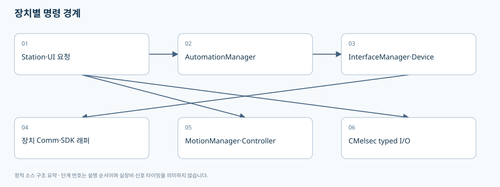

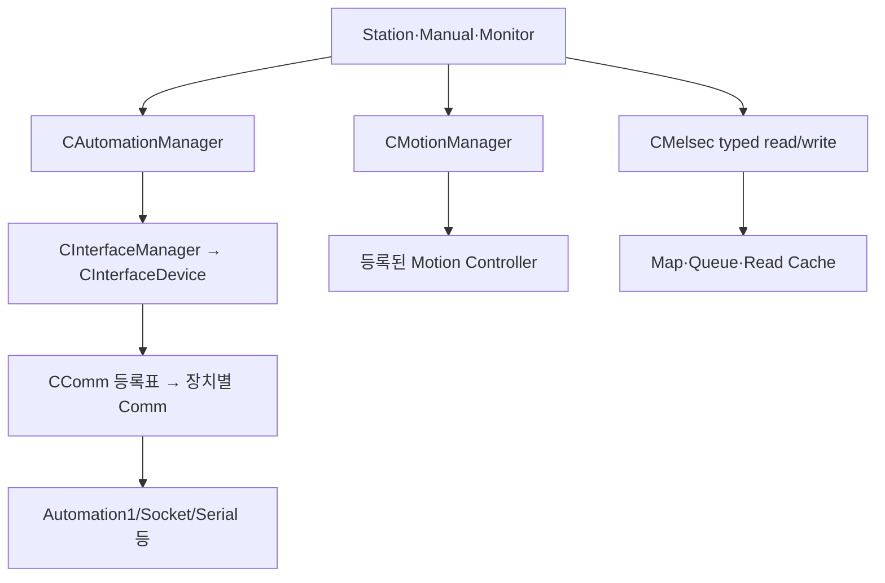

## 1. InterfaceManager의 책임

`CInterfaceManager`는 장치 정의를 바탕으로 `CInterfaceDevice`를 만들고, 모듈+번호 또는 NickName으로 장치를 찾으며, 연결/명령/통신 상태를 묶습니다. 등록되지 않은 모듈/번호는 KeyNotFoundException, 중복 NickName은 명시적 InvalidOperationException이 될 수 있습니다. 번호가 있는 장치에서는 이름만으로 호출하는 코드를 새로 넣을 때 중복 가능성을 확인해야 합니다. [장치 찾기와 중복 이름 처리](https://github.com/kjuws10-rgb/A3Drilling/blob/5aee8e58439c9b455cae7c9593c9be986c3e682e/Drilling.Common/Interface/CInterfaceManager.cs#L658-L695).

`ExecuteDeviceFunction`은 device.ExecuteFunction을 호출하고 명령/응답 로그를 남깁니다. Vision line count 초과 예외는 알람 callback도 시도한 뒤 다시 던집니다. 통신 예외를 단순히 빈 문자열로 바꿔 UI에서 OK처럼 보이게 처리하는 변경은 원래 오류 경계를 약화시킬 수 있습니다. [명령 로그·예외·Vision 용량 알람](https://github.com/kjuws10-rgb/A3Drilling/blob/5aee8e58439c9b455cae7c9593c9be986c3e682e/Drilling.Common/Interface/CInterfaceManager.cs#L630-L655).

## 2. 장치별 Comm은 어떻게 선택되는가

`CInterfaceDevice`는 연결 옵션을 파싱하고 `CComm.Create(Data, ConnectOption)`으로 실제 Comm을 구성합니다. Comm 팩토리는 같은 Assembly에서 `CCommBase` 하위 타입과 `CCommTypeAttribute`를 찾아 InterfaceType/DeviceName 매칭으로 선택합니다. DeviceNames가 구체적인 등록을 먼저 고릅니다. 맞는 타입이 없으면 `CReadyOnlyComm`을 반환합니다. [장치 Comm 생성](https://github.com/kjuws10-rgb/A3Drilling/blob/5aee8e58439c9b455cae7c9593c9be986c3e682e/Drilling.Common/Interface/CInterfaceManager.cs#L2984-L3003), [Attribute 기반 Comm 등록](https://github.com/kjuws10-rgb/A3Drilling/blob/5aee8e58439c9b455cae7c9593c9be986c3e682e/Drilling.Common/Interface/CComm.cs#L12-L60).

| 단계 | 확인 내용 |
|---|---|
| 정의 | JHMI Interface에 모듈·번호·InterfaceType·옵션이 올바른지 |
| 파싱 | `CInterfaceConnectOption.Parse` 결과가 의도한 대상인지 |
| 등록 | 해당 Comm 클래스의 Attribute와 Device enum 문자열이 맞는지 |
| 생성 | CReadyOnlyComm으로 fallback하지 않았는지 |
| 연결 | Online/Offline/Simulation과 마지막 오류를 별도로 확인 |
| 응답 | Execute 반환값이 장치별 성공 계약과 일치하는지 |

`CReadyOnlyComm`은 Connect/Execute 때 “Live ... not ready” 오류 상태를 설정합니다. 타입 생성에 성공했다는 사실만으로 실제 통신 드라이버가 지원된다고 설명하면 안 됩니다. [fallback 동작](https://github.com/kjuws10-rgb/A3Drilling/blob/5aee8e58439c9b455cae7c9593c9be986c3e682e/Drilling.Common/Interface/CComm.cs#L138-L153).

## 3. Simulation은 통신/모션/Script 조건이 분리되어 있다

| 계층 | 확인되는 처리 | 해석상 주의 |
|---|---|---|
| `CInterfaceDevice` | simulation이면 `SIM:...:OK` 응답 생성 | 장비가 실행된 성공이 아닙니다. |
| `CInterfaceManager.IsSimulation` | 등록 장치 전부의 simulation 상태를 집계 | 장치별 혼합 구성과 전체 boolean의 차이 |
| `CMotionManager` | global 및 controller/axis simulation을 고려 | 축의 상태 갱신과 실제 모션 실행을 구분 |
| `CAutomationManager.RunScript` | simulation이면 합성 Task status 반환 | Controller compiler·queue·가공 결과를 검증하지 않습니다. |
| Script generator | `AUTOMATION1_SIMULATOR_USE`로 Y 출력 선택 | 통신 Simulation과 Script Simulator 조건이 동일하다고 가정하지 않습니다. |

근거: [Interface Simulation 집계](https://github.com/kjuws10-rgb/A3Drilling/blob/5aee8e58439c9b455cae7c9593c9be986c3e682e/Drilling.Common/Interface/CInterfaceManager.cs#L97-L107), [SIM 응답](https://github.com/kjuws10-rgb/A3Drilling/blob/5aee8e58439c9b455cae7c9593c9be986c3e682e/Drilling.Common/Interface/CInterfaceManager.cs#L3144-L3161), [모션 Simulation과 실제 실행 분기](https://github.com/kjuws10-rgb/A3Drilling/blob/5aee8e58439c9b455cae7c9593c9be986c3e682e/Drilling.Common/Motion/CMotionManager.cs#L376-L396), [RunScript Simulation](https://github.com/kjuws10-rgb/A3Drilling/blob/5aee8e58439c9b455cae7c9593c9be986c3e682e/Drilling.Common/Automation/CAutomationManager.cs#L323-L333), [Script simulator Y](https://github.com/kjuws10-rgb/A3Drilling/blob/5aee8e58439c9b455cae7c9593c9be986c3e682e/Drilling.File/Script/CAutomation1ScriptFile.cs#L711-L713).

## 4. AutomationManager와 Automation1Comm의 분업

`CAutomationManager.UploadScript`는 로컬 경로와 Controller 파일명을 정규화한 뒤 `AUTOMATION1:SCRIPT|UPLOAD|...` 내부 명령을 만듭니다. `RunScript`는 TaskIndex와 파일명을 검증하고 내부 RUN 명령으로 전달합니다. 이 문자열은 모든 외부 장비가 그대로 이해하는 공통 프로토콜이 아니라 A3 내부 Comm 계층으로 내려가는 표현입니다. [Script API와 내부 명령](https://github.com/kjuws10-rgb/A3Drilling/blob/5aee8e58439c9b455cae7c9593c9be986c3e682e/Drilling.Common/Automation/CAutomationManager.cs#L301-L343).

| API | 중요한 인자 | 호출 의미 |
|---|---|---|
| `UploadScript` | localScriptPath, scriptFileName, number, token | PC 파일을 특정 Automation 대상으로 전송 |
| `RunScript` | scriptFileName, taskIndex, number, token | Controller에 존재하는 파일 실행 요청 |
| `RunBufferedScripts` | scripts 목록, number, queueSize, linesPerCommand, timeoutMs, token | 업로드와 queue 기반 실행 경로 |
| `RunStagePreparedBufferedScripts` | 준비된 scripts, queue 조건 | 준비 때 올린 정확한 파일을 재업로드 없이 실행하는 stageSession 경로 |

`RunStagePreparedBufferedScripts`의 주석은 LocalScriptPath가 이 경로에서 쓰이지 않으며 큐를 완료/취소까지 소유한다고 명시합니다. 준비된 파일을 실행 시점의 임의 최신 파일로 대체하면 같은 회차라는 보장이 깨집니다. [Buffered API와 준비 파일 소유권](https://github.com/kjuws10-rgb/A3Drilling/blob/5aee8e58439c9b455cae7c9593c9be986c3e682e/Drilling.Common/Automation/CAutomationManager.cs#L346-L372).

`CAutomation1Comm`은 `_commLock → _statusReadLock` 순서를 명시합니다. 일반 명령과 연결/해제는 두 잠금을 통해 충돌을 막고, Buffered feed는 comm lock을 유지하되 read-only status lane을 열어 준비/피드백 조회를 허용합니다. 이 분리 경로에서 잠금 순서를 반대로 추가하면 교착을 만들 수 있습니다. [잠금과 실행상태 필드](https://github.com/kjuws10-rgb/A3Drilling/blob/5aee8e58439c9b455cae7c9593c9be986c3e682e/Drilling.Common/Interface/Automation1/CAutomation1Comm.cs#L13-L25), [일반/Buffered 실행과 finally 해제](https://github.com/kjuws10-rgb/A3Drilling/blob/5aee8e58439c9b455cae7c9593c9be986c3e682e/Drilling.Common/Interface/Automation1/CAutomation1Comm.cs#L76-L157).

Automation1 SDK ControllerOperationException은 연결 자체를 Offline으로 바꾸지 않고 명령 오류 응답을 돌려주는 분기가 있습니다. 다른 예외는 SetError를 통해 Offline 상태가 될 수 있습니다. **Task가 Fault인 것과 통신이 끊긴 것**을 같은 화면 문구로 합치지 않는 것이 좋습니다. [명령오류와 연결오류 분기](https://github.com/kjuws10-rgb/A3Drilling/blob/5aee8e58439c9b455cae7c9593c9be986c3e682e/Drilling.Common/Interface/Automation1/CAutomation1Comm.cs#L123-L143).

## 5. MotionManager는 논리 축과 실제 Controller를 연결한다

`ExecuteAxisCommand(axisId, command, parameter, token, parameter2)`는 AxisId를 정규화하고 등록 정보를 찾습니다. 정의나 축 상태가 없으면 예외를 내고, ValidateAxisCommand를 거쳐 해당 Controller에 명령을 보낸 뒤 내부 상태에 반영합니다. AxisId, DevType, DevNo, 물리 축 식별자를 혼동하면 다른 장치로 명령이 갈 수 있습니다. [축 명령 경로](https://github.com/kjuws10-rgb/A3Drilling/blob/5aee8e58439c9b455cae7c9593c9be986c3e682e/Drilling.Common/Motion/CMotionManager.cs#L362-L396).

초기화에서는 정의된 축을 Controller 단위로 묶어 각 Controller.Initialize에 전달합니다. 전체 Simulation 또는 개별 Controller Simulation이면 실제 초기화를 건너뜁니다. `Initialize` 반환만으로 모든 물리 축의 원점 완료를 의미한다고 설명하지 않습니다. [Controller별 초기화](https://github.com/kjuws10-rgb/A3Drilling/blob/5aee8e58439c9b455cae7c9593c9be986c3e682e/Drilling.Common/Motion/CMotionManager.cs#L96-L123).

## 6. MELSEC은 일반 문자열 Execute가 아니라 별도 typed I/O다

`CreateDevice`에서 MELSEC은 외부 통신 상태 경로로 표시됩니다. 해당 Device의 `ExecuteFunction`을 직접 호출하면 `MELSEC commands must use CMelsec typed read/write functions` 예외를 냅니다. 따라서 새 Stage 인터페이스를 일반 Socket처럼 `ExecuteFunction("...")`로 추가하면 안 됩니다. [MELSEC external 경로](https://github.com/kjuws10-rgb/A3Drilling/blob/5aee8e58439c9b455cae7c9593c9be986c3e682e/Drilling.Common/Interface/CInterfaceManager.cs#L168-L180), [typed I/O 강제](https://github.com/kjuws10-rgb/A3Drilling/blob/5aee8e58439c9b455cae7c9593c9be986c3e682e/Drilling.Common/Interface/CInterfaceManager.cs#L3144-L3149).

`CMelsec`에는 Map, 요청 Queue, Write Queue/상태, Read Snapshot, CachedValue, polling/backoff를 위한 상태가 분리되어 있습니다. 이는 소스 필드에서 확인되는 구조이며, 본 장이 모든 고객 주소와 신호 순서를 검증했다는 뜻은 아닙니다. [MELSEC 큐·맵·캐시·poll 상태](https://github.com/kjuws10-rgb/A3Drilling/blob/5aee8e58439c9b455cae7c9593c9be986c3e682e/Drilling.Common/Interface/Melsec/CMelsec.cs#L15-L58).

새 I/F 항목은 **맵 정의 → 타입·주소·권한 → 읽기 fresh/cache 기준 → 쓰기완료/상대응답 → timeout/reset → 로그**까지 연결해서 검토해야 합니다. 주소가 보인다는 이유만으로 고객 승인된 신호 계약이라고 확정하지 않습니다. Heartbeat, RunEnable, Auto 상태처럼 시간 의미가 있는 신호는 현재값 1만 확인하는 것과 갱신이 살아있다는 것을 구분하여 계약해야 합니다.

## 7. DLL이 보일 때 읽을 수 있는 것과 없는 것

SDK DLL은 C# 소스와 다릅니다. 이 문서에서는 Automation1/PicoMotor/ACS/XPS 등의 파일명·프로젝트 참조와 **공개된 래퍼 소스의 호출**을 분석 대상으로 삼습니다. DLL 본문 역컴파일·실행·장치 호출로 내부 동작을 확인하지 않았습니다. BinaryReference가 표시되는 것 자체가 “프로젝트 코드 전체가 인식되지 않았다”는 증거는 아닙니다. C# 래퍼 파일·설정·호출자까지 검색 결과에 연결되어야 실제 코드 이해에 도움이 됩니다.

Offline Studio에서 SDK 내부 동작을 답변해야 할 경우, 공식 API 문서와 사용자가 승인한 SDK 설명자료를 별도 지식 출처로 연결하고 그 버전을 남겨야 합니다. 래퍼에 없는 사양을 파일명만으로 만들어내면 안 됩니다.

## 8. 변경·오류별 검증 계획

| 조건 | 정적/격리 검증 | 장비 연결 전에 결정할 것 |
|---|---|---|
| 새 장치 타입 | Attribute 등록과 매칭/fallback 테스트 | 대상 프로토콜·응답 오류 코드 |
| 중복 NickName | 이름 호출 거부·모듈번호 호출 성공 | 운영 화면의 유일 식별 방식 |
| Buffered 중 status poll | 잠금 순서·취소·Disconnect 경합 | SDK 허용 동시 호출 범위 |
| 명령 Fault | 연결 Online 유지와 Task 오류 구분 | 사용자 복구/재시도 허용 여부 |
| MELSEC 캐시 stale | 마지막 성공시각·fresh 조회·timeout 구분 | 신호별 최대 허용 지연과 heartbeat 기준 |
| Simulation PASS | 실제 호출 횟수 0인지 확인 | 실장비 평가와 분리한 승인 절차 |

다음 읽기: [06. 동시성과 로그](../manual/architecture/06-threading-snapshots-and-logs.md).


# 별도 정적 추적 상세 해설 · architecture/06-threading-snapshots-and-logs.md

# 06. 스레드·스냅샷·취소·로그를 이용해 멈춤과 오동작 찾기

> 기준: `A3Drilling/master` · `5aee8e58439c9b455cae7c9593c9be986c3e682e`. 본 장은 해당 Commit의 소스를 정적으로 읽어 설명합니다. 장비 연결·가공·컴파일을 실행한 결과가 아닙니다.

현장에서는 “버튼을 눌렀는데 멈췄다”만으로 원인을 알기 어렵습니다. **UI 스레드, Station 주기 스레드, 비동기 통신, 캐시된 상태, 파일 저장** 중 어디가 기다리는지 나눠야 합니다.

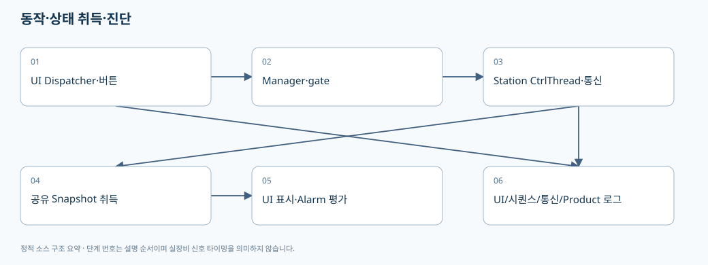

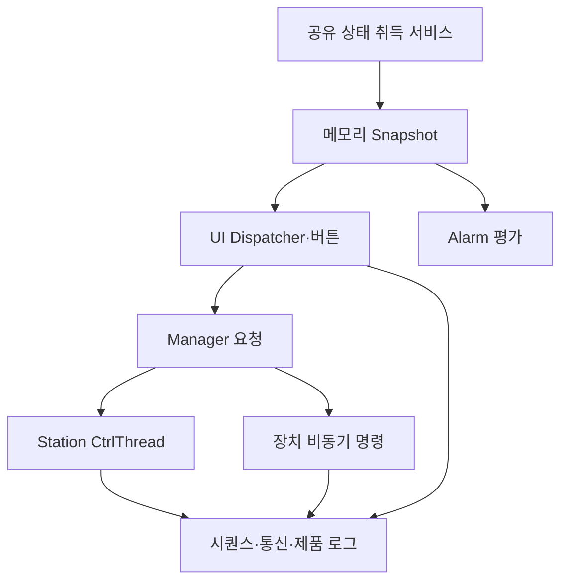

## 1. CtrlThread는 Task.Run 한 번과 다르다

`CtrlThread`는 자체 Thread, pause/stop event, stopRequested, state, LastThreadError를 갖는 반복 실행 기반 클래스입니다. `ThreadProcess`는 stop까지 Run을 반복하고 delay 동안 stop event를 기다립니다. Run에서 예외가 나면 LastThreadError를 저장하고 OnThreadError를 호출합니다. 소스상 이 catch 자체가 즉시 while을 종료하지는 않습니다. [스레드 기본 필드](https://github.com/kjuws10-rgb/A3Drilling/blob/5aee8e58439c9b455cae7c9593c9be986c3e682e/Drilling.Common/Threading/CtrlThread.cs#L4-L15), [반복 실행과 예외 처리](https://github.com/kjuws10-rgb/A3Drilling/blob/5aee8e58439c9b455cae7c9593c9be986c3e682e/Drilling.Common/Threading/CtrlThread.cs#L232-L281).

| 상태 | 뜻 | 주의 |
|---|---|---|
| Stopped | 실행 스레드 정지 | 장치의 Motion 정지와 별개 |
| Running | 반복 Run 동작 | 내부 시퀀스가 Ready일 수도 있음 |
| Paused | 반복 스레드 일시정지 | 이미 보낸 하드웨어 명령을 자동 취소하는 뜻 아님 |
| Stopping | stop 요청 중 | 현재 SDK 호출이 끝나지 않으면 기다릴 수 있음 |
| Error | stop timeout 등 오류 상태 | LastThreadError와 상위 Station 상태를 같이 봄 |

근거: [CtrlThread 상태 enum](https://github.com/kjuws10-rgb/A3Drilling/blob/5aee8e58439c9b455cae7c9593c9be986c3e682e/Drilling.Common/Threading/CtrlThread.cs#L286-L293).

`Stop`은 stopRequested와 event를 설정하고 외부 스레드에서 호출했다면 최대 3초 Join합니다. 멈추지 못하면 TimeoutException과 Error 상태를 남깁니다. 현재 스레드 자신이 Stop을 호출한 경우 Join하지 않습니다. 따라서 “Stop 버튼은 즉시 모든 장비 작업을 취소한다”는 설명은 이 구현만으로 성립하지 않습니다. [Stop의 Join과 timeout](https://github.com/kjuws10-rgb/A3Drilling/blob/5aee8e58439c9b455cae7c9593c9be986c3e682e/Drilling.Common/Threading/CtrlThread.cs#L128-L186).

## 2. Station의 취소와 Thread의 정지는 다른 층이다

Station Start는 요청 token에 linked CancellationTokenSource를 만들고 sequence를 PowerCheck로 바꾼 다음 CtrlThread를 시작합니다. RunSequenceStep은 해당 token을 전달하며 OperationCanceledException은 Station Stop 전이로 이어집니다. [sequence CTS 생성](https://github.com/kjuws10-rgb/A3Drilling/blob/5aee8e58439c9b455cae7c9593c9be986c3e682e/Drilling.Common/Station/CStationProcess.cs#L295-L319), [취소와 단계 token](https://github.com/kjuws10-rgb/A3Drilling/blob/5aee8e58439c9b455cae7c9593c9be986c3e682e/Drilling.Common/Station/CStationProcess.cs#L371-L403).

취소를 지원하는 함수라도 이미 시작한 외부 SDK의 동기 호출을 즉시 중단할 수 있는지는 그 래퍼의 구현을 확인해야 합니다. 이 문장은 일반적 한계를 지적하는 검토 지침이며 이 소스의 특정 SDK가 반드시 중단 불가능하다고 단정하는 것은 아닙니다.

## 3. 잠금은 무엇을 보호하는가

| 소유자 | 동기화 장치 | 보호하는 데이터/작업 | 변경 시 위험 |
|---|---|---|---|
| CRecipeManager | Recipe operation SemaphoreSlim, cache lock, history gate | 파일 기반 작업·캐시·이력 순서 | 파일 저장 뒤 오래된 캐시를 다시 덮음 |
| CSettingManager | save lock, cache lock | section 저장과 캐시 publish | 저장 실패인데 UI만 새 값 |
| CProductManager | update gate | 한 Product의 전이·영속화 | 두 갱신이 이전 상태에서 출발하여 결과 유실 |
| CStationProcess | sequence lock | 시작/준비/수동 MOF와 sequence 상태 | 같은 모델의 이중 실행 |
| Automation1Comm | comm lock → status lock | Controller 수명·명령과 상태 조회 | 반대 순서 잠금으로 deadlock |
| Monitor polling | context/snapshot lock, motor poll gate | 선택 화면과 결과 사본 | 화면 전환과 이전 응답 혼합 |

근거: [Recipe gate](https://github.com/kjuws10-rgb/A3Drilling/blob/5aee8e58439c9b455cae7c9593c9be986c3e682e/Drilling.Common/Managers/CRecipeManager.cs#L11-L32), [Setting cache/save lock](https://github.com/kjuws10-rgb/A3Drilling/blob/5aee8e58439c9b455cae7c9593c9be986c3e682e/Drilling.Common/Managers/CSettingManager.cs#L23-L49), [Product gate](https://github.com/kjuws10-rgb/A3Drilling/blob/5aee8e58439c9b455cae7c9593c9be986c3e682e/Drilling.Common/Product/CProductManager.cs#L25-L45), [Station prepare lock](https://github.com/kjuws10-rgb/A3Drilling/blob/5aee8e58439c9b455cae7c9593c9be986c3e682e/Drilling.Common/Station/CStationProcess.cs#L219-L223), [Automation1 lock 순서](https://github.com/kjuws10-rgb/A3Drilling/blob/5aee8e58439c9b455cae7c9593c9be986c3e682e/Drilling.Common/Interface/Automation1/CAutomation1Comm.cs#L16-L25), [Monitor 동기화](https://github.com/kjuws10-rgb/A3Drilling/blob/5aee8e58439c9b455cae7c9593c9be986c3e682e/Drilling.UI/Menu/Menus/CMonitorStatusPollingService.cs#L17-L31).

설명용 주석을 추가할 때는 “스레드 안전”이라는 한 줄보다 **어떤 필드/시점/잠금 순서/잠금 밖 I/O**를 보호하는지 구체적으로 써야 합니다. lock이 있다는 사실만으로 객체 전체가 thread safe라고 표현하지 않습니다.

## 4. 상태 취득과 화면 표시를 분리하는 구조

`CManager.StartBackgroundMonitoring`은 공유 Motor/Laser/BET 상태 스냅샷을 시작하고 알람 평가에 `ReadAlarmDeviceSnapshot`을 공급합니다. 해당 함수는 “memory-only” 의도로 공유 Snapshot을 읽고 SnapshotError를 모읍니다. 느린 장치 SDK 호출이 알람 워커를 직접 붙잡지 않도록 분리한 구조입니다. [공유 취득과 알람 감시](https://github.com/kjuws10-rgb/A3Drilling/blob/5aee8e58439c9b455cae7c9593c9be986c3e682e/Drilling.Common/Managers/CManager.cs#L259-L268), [메모리 Snapshot을 이용한 알람 입력](https://github.com/kjuws10-rgb/A3Drilling/blob/5aee8e58439c9b455cae7c9593c9be986c3e682e/Drilling.Common/Managers/CManager.cs#L280-L303).

이 구조에서 표시한 값은 **현재 메모리에서 마지막으로 확인한 결과**일 수 있습니다. 값이 정상 범위여도 오래된 결과라면 안전 판단에 그대로 쓰면 안 되므로, 새 검증에서는 성공시각/오류/갱신 여부를 함께 확인합니다. 소스의 SnapshotError와 실제 서비스의 stale 규칙을 같이 읽어야 합니다.

`CMonitorStatusPollingService`는 LoopInterval 250 ms, ActiveInterval 0.5초, CommunicationInterval 1초 등의 주기를 정의하고 활성 화면 context에 따라 대상을 달리 선택합니다. `UpdateContext`는 선택 Tab/장치 번호/MELSEC group을 새 context로 저장하고 `GetSnapshot`은 lock 아래 결과를 반환합니다. [Monitor 주기·context·snapshot](https://github.com/kjuws10-rgb/A3Drilling/blob/5aee8e58439c9b455cae7c9593c9be986c3e682e/Drilling.UI/Menu/Menus/CMonitorStatusPollingService.cs#L9-L59).

주의할 실제 코드가 있습니다. PowerMeter의 두 Poll 호출은 확인한 범위에서 주석 처리되어 있습니다. 따라서 상수명이 `ActivePowerMeterMeasureInterval`이라고 모든 화면에서 PowerMeter를 그 주기로 실제 측정한다고 설명하면 틀립니다. [Tab별 실제 polling 분기](https://github.com/kjuws10-rgb/A3Drilling/blob/5aee8e58439c9b455cae7c9593c9be986c3e682e/Drilling.UI/Menu/Menus/CMonitorStatusPollingService.cs#L108-L136).

## 5. UI 변경 통지는 자동으로 모든 스레드를 보정해 주지 않는다

`CBindingBase`의 SetProperty는 값이 같으면 알리지 않고, SetSequenceProperty는 ReferenceEquals/SequenceEqual로 같은 목록 갱신을 피합니다. OnPropertyChanged는 속성명별 이벤트를 호출하는 switch입니다. 이 함수 자체가 Dispatcher로 이동하는 것은 아닙니다. [동일값 억제와 Property 이벤트](https://github.com/kjuws10-rgb/A3Drilling/blob/5aee8e58439c9b455cae7c9593c9be986c3e682e/Drilling.UI/Menu/CBindingBase.cs#L735-L788).

새 비동기 작업이 UI 속성이나 ObservableCollection을 바꾸는 경우 해당 경로의 Dispatcher 사용 여부를 확인해야 합니다. 한곳의 Dispatcher를 발견했다고 모든 await 이후 UI 접근이 안전하다고 판단하지 않습니다. RootView는 알람 갱신에 전용 Dispatcher를 보유하고 큐잉하는 경로가 있으므로, 유사 작업도 같은 패턴을 검토할 수 있습니다. (이 장은 전 UI 스레드 접근의 무결성을 검증한 보고서가 아닙니다.)

## 6. 로그는 사용자의 클릭·의도·실제 결과를 따로 연결해야 한다

`CUiLogService.Configure`는 WPF ButtonBase.ClickEvent의 class handler를 등록합니다. OnButtonClicked는 화면·Control·CommandParameter·Detail을 얻어 WriteClick에 넘깁니다. **클릭 로그가 있다는 것과 명령이 허용·실행·완료됐다는 것은 다릅니다.** 실제 명령/시퀀스/통신 결과 로그와 시간·식별자를 연결해야 합니다. [UI 클릭 로그 등록과 기록](https://github.com/kjuws10-rgb/A3Drilling/blob/5aee8e58439c9b455cae7c9593c9be986c3e682e/Drilling.UI/CUiLogService.cs#L17-L69).

키 입력 dialog와 password dialog의 일부 글자 버튼은 ShouldSkipButton에서 제외합니다. 따라서 모든 키 입력이 그대로 텍스트 로그에 남는다고 설명해서는 안 됩니다. 진단용 로그를 확장할 때도 비밀번호·키·민감한 원문을 추가하지 않습니다. [입력 버튼 로그 제외](https://github.com/kjuws10-rgb/A3Drilling/blob/5aee8e58439c9b455cae7c9593c9be986c3e682e/Drilling.UI/CUiLogService.cs#L72-L92).

| 진단 질문 | 우선 확인할 근거 |
|---|---|
| 사용자가 뭘 눌렀는가 | UI click의 화면·Control·parameter·시각 |
| 명령이 수락됐는가 | Station 전이/Interlock 판단/명령 accept |
| 어떤 파일·조건이었는가 | RecipeId/Product snapshot/Script manifest·RunId |
| 외부 장비가 뭘 응답했는가 | Interface command/response·MELSEC write/read 상태 |
| 실제 완료됐는가 | Task completion·Review 저장·Product 결과 |
| 완료 뒤 로그만 실패했는가 | commit 이후 History/Log error와 Active 파일 |

공통 로그의 의미는 각 호출부와 연결해 읽습니다. 예를 들어 Product는 Active 저장 이후 로그 실패가 상태 전이를 실패로 바꾸지 않도록 처리합니다. 클릭 로그가 없거나 이력이 실패했다고 실제 실행도 없었다고 단정하지 않습니다. [Product의 상태와 이력 분리](https://github.com/kjuws10-rgb/A3Drilling/blob/5aee8e58439c9b455cae7c9593c9be986c3e682e/Drilling.Common/Product/CProductManager.cs#L789-L819).

## 7. 현장 디버깅을 위한 검증 계획

1. **연속 클릭/교차 요청**: Start 두 번, Prepare 중 다른 Recipe 선택, Stop/Reset 동시 요청을 격리 테스트합니다. 실제 명령 수와 최종 상태를 기록합니다.
2. **응답 지연**: 가짜 SDK/파일 어댑터를 지연시켜 UI 응답성·snapshot 오류·Stop timeout을 각각 확인합니다.
3. **취소 시점 분리**: 파일 쓰기 전/후, upload 전/후, queue feeding 중의 취소를 나눠 부분 완료와 중복 재시도를 확인합니다.
4. **메모리/파일 불일치**: 저장 성공 후 이력 실패를 주입하고 새로고침/재시작이 올바른 현재값을 보여주는지 확인합니다.
5. **실행 식별자 연결**: 같은 Recipe를 연속 실행해도 Product/Glass/Script directory/RunId가 섞이지 않는지 확인합니다.
6. **원인 분석용 수집**: 알람 앞뒤의 UI/Station/Interface/Product/Script 상태를 같은 시간축으로 묶되 로그 반출 범위는 고객의 승인 조건을 따릅니다.

다음 읽기: [07. 변경 영향과 Offline Studio](../manual/architecture/07-change-impact-and-offline-reference.md).


# 별도 정적 추적 상세 해설 · architecture/07-change-impact-and-offline-reference.md

# 07. 변경 영향 검토와 Offline Studio에서 이 문서를 쓰는 방법

> 기준: `A3Drilling/master` · `5aee8e58439c9b455cae7c9593c9be986c3e682e`. 본 장은 해당 Commit의 소스를 정적으로 읽어 설명합니다. 장비 연결·가공·컴파일을 실행한 결과가 아닙니다.

코드 레퍼런스는 현재 소스를 대신하는 정답 모음이 아니라 **찾아갈 파일과 호출 연결을 제공하는 지도**입니다. 문서가 최신 소스와 다른 Commit이면 틀린 기준으로 코드를 고칠 수 있으므로, 질문할 때 소스 Commit과 문서 기준을 함께 확인합니다.

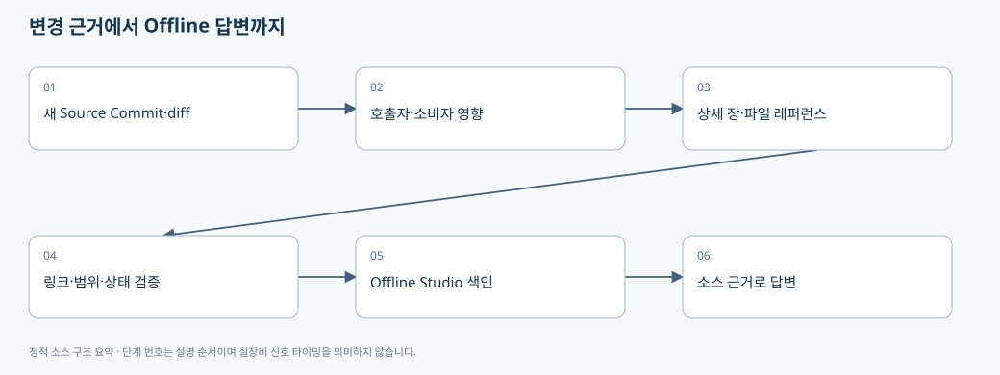


## 1. 가장 먼저 볼 문서

| 궁금한 내용 | 시작할 장 | 실제 소스 진입점 |
|---|---|---|
| 앱이 안 켜지거나 다른 Config를 읽음 | [01 시작](../manual/architecture/01-startup-and-composition.md) | CAppStartup.GetConfigRoot / CManager 구성 |
| Recipe 값이 저장되지 않음 | [02 Recipe·Setting](../manual/architecture/02-recipe-settings-and-csv.md) | CRecipeManager.Save → CJhmiRecipeFile.SaveCore |
| Offset가 원하는 방향으로 가지 않음 | [03 좌표·Script](../manual/architecture/03-coordinate-script-and-mof.md) | CShotCoordinatePlanBuilder.Build |
| 기판/결과가 이전 상태로 보임 | [04 Product·Station](../manual/architecture/04-product-and-station-lifecycle.md) | PersistAndLog / CProductFile.LoadCompactActive |
| 통신/SDK/모션 경로가 궁금함 | [05 장치](../manual/architecture/05-device-interfaces-and-drivers.md) | CInterfaceManager / CComm / CMotionManager |
| 화면 지연·중복 실행·취소 문제 | [06 스레드·로그](../manual/architecture/06-threading-snapshots-and-logs.md) | CtrlThread / Snapshot / gate·Dispatcher |

Review 좌표→Vision 요청→ReviewResult→보정 파일 연결은 별도의 리뷰 전문 챕터와 파일별 레퍼런스를 함께 읽습니다. 가공 ScannerGx/Gy를 찾았다는 이유만으로 그것이 Vision에 보내는 좌표라고 답변하면 안 됩니다.

## 2. 새 Parameter 하나가 거치는 영향 범위

| 단계 | 작성/검토할 항목 | 누락하면 생기는 현상 |
|---|---|---|
| 의미 정의 | 설비 공통/PPID별/Cell별/Shot별/런타임별 중 소유자, 단위·좌표기준 | 같은 이름을 서로 다른 기준으로 해석 |
| 정의 파일 | JHMI_RCP 또는 JHMI_SETTING, 타입·범위·표시·Use·Key | UI에 보이지 않거나 저장 때 제외 |
| 값 파서 | 기존 형식/legacy key/default/Extra 열 호환 | 구버전 Recipe를 못 읽음 |
| Manager | 캐시 갱신·변경 비교·gate·commit 이후 취소 | 화면과 파일이 달라짐·중복 보정 |
| 실행 합성 | Setting 덮어쓰기 우선순위·최신 Offset | 저장했는데 실행값이 다름 |
| 계산 | 단위 변환·axis flip/swap·Head 배정·Masking | 잘못된 위치 또는 다른 Head |
| Script/전송 | 스냅샷·manifest·controller/task 분리 | 이전 파일/다른 Controller 실행 |
| Product/결과 | 실제 적용값과 결과를 추적할 필드 | 사후 로그만으로 조건 재구성 불가 |
| UI | Property 변경 이벤트·선택상태·실행 중 편집 금지 | 수정값이 안 보이거나 도중 모델 교체 |
| 문서/색인 | 최신 Commit·파일 근거·용어·검증상태 | 개발도우미가 오래된 코드로 답변 |

현재 실행 합성의 Setting 우선순위는 [BuildRuntimeParameters](https://github.com/kjuws10-rgb/A3Drilling/blob/5aee8e58439c9b455cae7c9593c9be986c3e682e/Drilling.Common/Station/CStationProcess.cs#L1526-L1559), 저장/실행 기준의 분리는 [Offset 변환·합성](https://github.com/kjuws10-rgb/A3Drilling/blob/5aee8e58439c9b455cae7c9593c9be986c3e682e/Drilling.Common/Recipe/CShotCoordinatePlanBuilder.cs#L139-L156)에서 확인할 수 있습니다. 표는 그 구조를 확장해 적용하는 검토 절차입니다.

## 3. 기존 자료와 소스를 섞을 때의 신뢰도

| 출처 | 답변에 사용할 수 있는 범위 | 표기 방식 |
|---|---|---|
| 이번 Commit의 실제 소스 | 구현된 조건·필드·분기·저장 | 경로+함수+실제 줄 링크 |
| 회의 기록 | 사용자의 목적·희망 기능·평가 요구 | 구현 여부와 분리하여 요구로 설명 |
| 공식 SDK 설명자료 | 해당 버전 API 사양 | 자료명·버전·해당 항목 |
| 실행/빌드/실측 결과 | 실제 수행한 환경과 시나리오 | 명령·조건·결과·한계 |
| 자동 추출 호출 관계 | 찾아갈 후보와 연결 힌트 | 정적 후보, 오버로드/동적 호출 한계 |
| DLL 파일명 | 외부 의존성 존재 | 내부 로직은 미확인 |

문서에 `검증 계획`이라고 쓰인 항목은 실행 통과 항목이 아닙니다. 예를 들어 `RunScript`에는 Simulation 반환 분기가 있으므로 합성 응답을 받은 것만으로 실제 SDK·Controller compiler·물리 가공 검증까지 통과했다고 표현할 수 없습니다. [Simulation RunScript 분기](https://github.com/kjuws10-rgb/A3Drilling/blob/5aee8e58439c9b455cae7c9593c9be986c3e682e/Drilling.Common/Automation/CAutomationManager.cs#L323-L333).

## 4. Offline Studio가 먼저 검색해야 할 단위

아래는 문서 활용 권장 방식입니다. 이 문서 생성만으로 Studio의 검색 엔진이나 모델 가중치가 자동 변경되는 것은 아닙니다.

1. 질문에서 **행위+대상**을 뽑습니다. 예: Review/좌표/계산/Vision/전달.
2. 코드 원문에서 함수·타입·Key 이름을 찾고 그 호출자와 저장/전송 소비자를 확장합니다.
3. 파일별 레퍼런스로 역할을 확인한 후 이 상세 챕터에서 전체 흐름을 보충합니다.
4. 출처마다 sourceCommit/path/startLine/endLine을 유지하고, 같은 Commit의 소스 본문을 모델 context에 함께 넣습니다.
5. 최종 답변은 파일명·함수·핵심 인자·입출력·호출 순서·확인 한계를 포함합니다.

소스 전체 대신 HTML 설명자료 한 줄만 모델에 제공하면 코드 근거를 찾을 수 없습니다. 반대로 DLL 안내가 검색 상단을 차지해 C# 래퍼가 밀려나도 동문서답이 생길 수 있습니다. **코드 질문은 실제 C#/XAML/설정/Script 연결을 우선, 설명자료는 보충**이라는 검색 목적을 설정하는 것이 좋습니다. 이는 과거 오류에서 도출한 개선 지침이며 현재 Studio가 해당 우선순위를 이미 구현했다는 주장은 아닙니다.

## 5. 좋은 답변의 최소 형식

```text
요약: 이 기능은 A → B → C 순서로 처리됩니다.
1. [파일:줄] 함수 A: 입력과 호출자
2. [파일:줄] 함수 B: 단위/좌표 변환, 조건
3. [파일:줄] 함수 C: 저장/전송 대상과 응답 처리
변경 영향: 같은 데이터를 쓰는 다른 경로
검증: 실제 수행한 것 / 아직 해야 할 것
```

“자료에 없으니 못 찾는다”라고 끝내기 전에 색인된 소스 경로·파일 수·검색어·후보 누락 여부를 확인해야 합니다. 다만 실제 소스에 없는 계약을 억지로 추론해서 답변하지 않습니다. 예를 들어 Stage Glass/Lot 매핑 TODO가 남은 경로는 합의 완료로 설명하지 않습니다. [미합의 매핑 표시](https://github.com/kjuws10-rgb/A3Drilling/blob/5aee8e58439c9b455cae7c9593c9be986c3e682e/Drilling.UI/CRootView.cs#L2892-L2905).

## 6. 주석을 많이 쓸 때도 우선순위가 필요하다

각 소스파일의 주석형 레퍼런스를 작성할 때 아래 항목을 우선 설명합니다. 공개 레퍼런스의 설명은 원본 코드가 바뀐 것과 구분되어야 합니다.

| 위치 | 상세 주석에 담을 내용 |
|---|---|
| Public API/Command | 어떤 화면/시퀀스가 언제 호출하는가, 인자의 단위·허용범위 |
| 좌표 수식 | 설계/Stage/Scanner/Vision 기준, 부호·scale·반전 순서 |
| 필드/record | 현재 상태인지 스냅샷인지, 파일 영속 여부 |
| 저장 함수 | 검증·쓰기·재읽기·메모리 publish·이력의 순서와 실패 경계 |
| lock/gate | 보호 대상과 획득 순서, lock 안에서의 외부 호출 |
| 취소/finally | 취소 가능한 시점, 부분 적용 후 처리, cleanup 책임 |
| enum/state | 전이 조건과 정상/Stop/Error/Skipped 구분 |
| fallback/default | 구버전 호환인지 설치 기본값인지 임시 미합의값인지 |
| 미확인 | 코드에 근거가 없어 판정할 수 없는 조건 |

예시: Product `PersistAndLog`는 Active 저장 후 로그 실패가 전이를 뒤집지 않게 처리합니다. 여기에는 단순히 “로그 저장”이 아니라 **이미 커밋된 상태를 중복 실행시키지 않는 경계**를 설명하는 것이 유용합니다. [주석 우선순위가 높은 commit 경계](https://github.com/kjuws10-rgb/A3Drilling/blob/5aee8e58439c9b455cae7c9593c9be986c3e682e/Drilling.Common/Product/CProductManager.cs#L789-L819).

## 7. 주기적 업데이트의 완료 조건

- 새 원본 Commit을 확인하고 이전 문서 기준과 비교합니다.
- 변경 파일만 요약하지 않고 해당 함수의 호출자·데이터 소비자·저장 호환 영향을 추적합니다.
- sourceCommit이 다른 문서가 한 질문 context에서 섞이지 않게 표시합니다.
- 링크의 실제 파일·줄 범위, 내부 링크, Mermaid 코드 블록, 깨진 문자, 공백 오류를 검사합니다.
- 실행하지 않은 빌드·장비·실측은 미실행으로 남깁니다.
- 최신 자료의 생성과 Offline Studio의 재색인은 별도 단계로 기록합니다.

이 장은 유지보수 절차와 지식 사용 방법을 설명합니다. 예약 실행의 실제 등록·Push·최신화 결과는 이 문서 자체가 아니라 해당 작업 기록과 Shared Commit으로 확인해야 합니다.


# 별도 정적 추적 상세 해설 · architecture/README.md

# A3 전체 구조·데이터 흐름 상세 안내

이 묶음은 프로그램 시작부터 조건 파일·좌표·Script·Product·장치·동시성까지 연결해서 읽는 상세 장입니다. 파일별 전체 레퍼런스와 함께 사용합니다. 원본 코드에 주석을 추가하거나 장비 프로그램을 변경한 산출물이 아닙니다.

> 기준: `A3Drilling/master` · `5aee8e58439c9b455cae7c9593c9be986c3e682e`. 본 장은 해당 Commit의 소스를 정적으로 읽어 설명합니다. 장비 연결·가공·컴파일을 실행한 결과가 아닙니다.


| 장 | 설명 |
|---|---|
| [01. 프로그램은 어떻게 시작되고 누가 무엇을 소유하는가](../manual/architecture/01-startup-and-composition.md) | 구성·초기화·화면 소유권 |
| [02. Recipe·Setting·JHMI·CSV를 함께 이해하기](../manual/architecture/02-recipe-settings-and-csv.md) | JHMI 정의·값·캐시·저장 순서 |
| [03. Recipe 좌표가 Head Script와 MOF 실행 입력이 되기까지](../manual/architecture/03-coordinate-script-and-mof.md) | Head·Offset·Encoder·Manifest |
| [04. Product와 Station: 기판 한 장을 끝까지 추적하기](../manual/architecture/04-product-and-station-lifecycle.md) | 기판 상태·결과·재시작·시퀀스 |
| [05. Device Interface·Automation1·Motion·MELSEC의 경계](../manual/architecture/05-device-interfaces-and-drivers.md) | 통신 등록·SDK 래퍼·Motion·MELSEC |
| [06. 스레드·스냅샷·취소·로그를 이용해 멈춤과 오동작 찾기](../manual/architecture/06-threading-snapshots-and-logs.md) | 잠금·취소·상태 취득·로그 |
| [07. 변경 영향 검토와 Offline Studio에서 이 문서를 쓰는 방법](../manual/architecture/07-change-impact-and-offline-reference.md) | 변경 영향·출처·검색·유지보수 |

모든 그림은 오프라인에서도 읽을 수 있는 로컬 SVG와 Mermaid 원문을 함께 제공합니다. SVG는 설명용 구조도이며 실장비 타이밍 도면이 아닙니다. `diagram-spec.json`은 노드/연결을 재사용하기 위한 데이터입니다.


# 별도 정적 추적 상세 해설 · review/01_Review_계획과_좌표계.md

# Review 계획과 좌표계: 설계 Shot이 카메라 측정점이 되는 과정

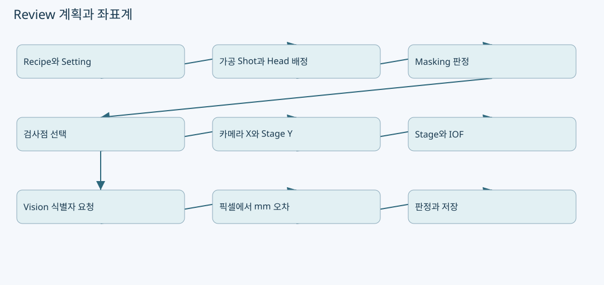


원본: `kjuws10-rgb/A3Drilling` · `master` · `5aee8e58439c9b455cae7c9593c9be986c3e682e`

이 장의 **코드 확인**은 해당 Commit의 실제 함수 본문을 정적으로 추적한 사실입니다. **해설**은 그 구조를 이해하기 위한 설명이며, **검증 과제**는 앞으로 실행할 시험입니다. 실장비의 부호·광학 상태·통신 타이밍·정밀도가 검증되었다는 뜻은 아닙니다. 예시 숫자는 설명용 가상값입니다.

## 1. 처음 읽는 사람을 위한 핵심

Review 좌표는 한 함수가 Recipe의 X/Y를 그대로 Vision에 보내는 구조가 아닙니다. 먼저 **어느 Cell의 어느 Shot을 어느 Head가 가공하는지** 정하고, 해당 Shot에서 선택한 Beam의 위치를 더해 **카메라 X와 Stage Y 목표 위치**를 만듭니다. 이 목표 위치는 Stage 이동과 IOF 준비에 쓰입니다. Vision에는 별도의 식별자 요청을 보내며, Vision이 반환한 픽셀 차이를 mm 오차로 바꿉니다. 이 구분을 지켜야 CSV를 통신 패킷으로 오해하지 않습니다. [CReviewManager.cs:151–193](https://github.com/kjuws10-rgb/A3Drilling/blob/5aee8e58439c9b455cae7c9593c9be986c3e682e/Drilling.Common/Review/CReviewManager.cs#L151-L193) [CReviewManager.cs:1964–1994](https://github.com/kjuws10-rgb/A3Drilling/blob/5aee8e58439c9b455cae7c9593c9be986c3e682e/Drilling.Common/Review/CReviewManager.cs#L1964-L1994)

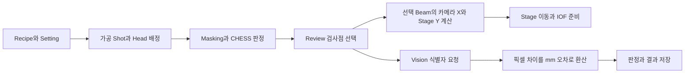

그림의 경로는 실제 호출 책임을 묶어 표현한 것입니다. Stage와 Vision은 서로 다른 수신자이며, 그림은 물리적 동시 실행 순서를 보장하는 타이밍 차트가 아닙니다.

## 2. 먼저 열어야 할 코드

| 진입점 | 입력 / 출력 | 읽어야 하는 이유 |
|---|---|---|
| `CreatePlanCore` | Recipe, Beam, 선택 방식, Shift → `ST_REVIEW_PLAN` | 일반 Review 계획의 공통 생성 경계. [CReviewManager.cs:456–507](https://github.com/kjuws10-rgb/A3Drilling/blob/5aee8e58439c9b455cae7c9593c9be986c3e682e/Drilling.Common/Review/CReviewManager.cs#L456-L507) |
| `BuildShotPoints` | Cell별 설계 패턴, Head 배정 → Point 목록 | 설계 위치·Head·선택 상태·제외 사유가 한 점에 결합된다. [CReviewManager.cs:634–730](https://github.com/kjuws10-rgb/A3Drilling/blob/5aee8e58439c9b455cae7c9593c9be986c3e682e/Drilling.Common/Review/CReviewManager.cs#L634-L730) |
| `CreateShotBeamPositionCalculator` | Recipe, Stage 방향, Shift → 계산 delegate | AUTO 등에서 각 Shot의 Beam 위치를 나중에 계산한다. [CReviewManager.cs:151–193](https://github.com/kjuws10-rgb/A3Drilling/blob/5aee8e58439c9b455cae7c9593c9be986c3e682e/Drilling.Common/Review/CReviewManager.cs#L151-L193) |
| `CalculateReviewTarget` | AK 상대 Shot, 카메라 AK, Beam local offset, Cell 회전, Stage 방향 → 목표 | 실제 좌표식을 확인할 곳. [CReviewManager.cs:954–974](https://github.com/kjuws10-rgb/A3Drilling/blob/5aee8e58439c9b455cae7c9593c9be986c3e682e/Drilling.Common/Review/CReviewManager.cs#L954-L974) |
| `CAutoFineReviewCoordinator.BuildPlan` | 동결한 자동검사 입력 → Fine line 계획 | AUTO는 별도 조건과 제외 규칙을 갖는다. [CAutoFineReviewCoordinator.cs:201–286](https://github.com/kjuws10-rgb/A3Drilling/blob/5aee8e58439c9b455cae7c9593c9be986c3e682e/Drilling.Common/Review/CAutoFineReviewCoordinator.cs#L201-L286) |

## 3. 좌표 이름을 분리해서 읽기

| 데이터 | 이 장에서의 뜻 | 주의할 점 |
|---|---|---|
| `DesignX/DesignY` | 설계 패턴에서 생성한 Shot 중심 | 카메라 실제 측정값이 아니다. |
| `BeamOffsetGx/Gy`, 선택 Beam local offset | 한 Shot 내 선택 Beam의 설계 위치 차이 | Cell 회전 후 카메라/Stage 목표로 옮긴다. |
| `ReviewTargetX` | Review 카메라 축의 목표 X | Scanner Gx와 같은 이름의 좌표로 취급하면 안 된다. |
| `ReviewTargetY` / `StageY` | Review 측정에 필요한 Stage Y 목표 | Stage 방향 부호가 적용된다. |
| `ErrorX/ErrorY` | 측정 결과에서 얻은 오차 | raw Vision 축과 flip 변환 후 축을 섞지 않는다. |
| `HeadNo, CellNo, ShotNo, BeamNo, ShotKey` | 점의 소속과 식별자 | 위치가 비슷해도 다른 식별자는 다른 검사점이다. |

표의 구성은 `BuildShotPoints`의 Point 생성 필드와 목표 계산기를 기준으로 합니다. 특히 `ST_REVIEW_BEAM_POSITION(beamNo, target.Y, target.X)`라는 생성자 호출은 인수 순서가 직관적 X/Y 순서와 다릅니다. 이후 사용처가 읽는 **이름 붙은 속성**까지 확인해야 합니다. [CReviewManager.cs:174–193](https://github.com/kjuws10-rgb/A3Drilling/blob/5aee8e58439c9b455cae7c9593c9be986c3e682e/Drilling.Common/Review/CReviewManager.cs#L174-L193) [CReviewManager.cs:695–730](https://github.com/kjuws10-rgb/A3Drilling/blob/5aee8e58439c9b455cae7c9593c9be986c3e682e/Drilling.Common/Review/CReviewManager.cs#L695-L730) [CAutoFineReviewCoordinator.cs:267–276](https://github.com/kjuws10-rgb/A3Drilling/blob/5aee8e58439c9b455cae7c9593c9be986c3e682e/Drilling.Common/Review/CAutoFineReviewCoordinator.cs#L267-L276)

## 4. 목표 위치 계산을 한 단계씩 풀어보기

`CreateShotBeamPositionCalculator`는 Recipe를 dictionary로 만들고 Pixel 크기, AK margin, Review 카메라의 AK 기준 위치를 읽습니다. Cell별 패턴 계산 결과는 `ConcurrentDictionary`에 보관하므로 같은 Cell을 반복 계산할 때 layout을 매번 새로 만들지 않습니다. Cell의 `CELLn_ROTATION`은 Beam local offset을 회전시키는 데 쓰입니다. [CReviewManager.cs:151–184](https://github.com/kjuws10-rgb/A3Drilling/blob/5aee8e58439c9b455cae7c9593c9be986c3e682e/Drilling.Common/Review/CReviewManager.cs#L151-L184)

코드의 순서를 수식으로 옮기면 다음과 같습니다. 이 수식의 부호는 소스 그대로이며, 장비별 축 방향을 임의로 추정한 것이 아닙니다. [CReviewManager.cs:179–193](https://github.com/kjuws10-rgb/A3Drilling/blob/5aee8e58439c9b455cae7c9593c9be986c3e682e/Drilling.Common/Review/CReviewManager.cs#L179-L193) [CReviewManager.cs:954–974](https://github.com/kjuws10-rgb/A3Drilling/blob/5aee8e58439c9b455cae7c9593c9be986c3e682e/Drilling.Common/Review/CReviewManager.cs#L954-L974)

```text
shotAK_X = DesignX − AK_MARGIN_X + shiftOffsetX
shotAK_Y = DesignY − AK_MARGIN_Y + shiftOffsetY
(beamX, beamY) = RotateLocalOffset(localBeamX, localBeamY, CellRotation)

ReviewX = REVIEW_CAMERA_ALIGN_KEY_POS_X + shotAK_X + beamX
StageY  = REVIEW_CAMERA_ALIGN_KEY_POS_Y
          + StageScanDirectionY × (shotAK_Y + beamY)
```

**해설:** AK margin은 설계 원점과 Align Key 기준의 차이를 옮기는 역할입니다. Stage 방향은 Y 이동의 부호를 바꾸는 별도 값입니다. Cell 회전은 Beam의 상대 위치를 회전시킵니다. 이 셋은 서로 다른 변환이므로 “Y가 반대로 보인다”는 이유만으로 Vision Flip이나 Head Flip을 추가하면 이중 반전이 생길 수 있습니다. 실제 Vision Flip 순서는 별도 함수에 명시되어 있습니다. [CReviewManager.cs:964–974](https://github.com/kjuws10-rgb/A3Drilling/blob/5aee8e58439c9b455cae7c9593c9be986c3e682e/Drilling.Common/Review/CReviewManager.cs#L964-L974) [CReviewManager.cs:3486–3512](https://github.com/kjuws10-rgb/A3Drilling/blob/5aee8e58439c9b455cae7c9593c9be986c3e682e/Drilling.Common/Review/CReviewManager.cs#L3486-L3512)

### 설명용 계산 예시

가상 입력이 `Design=(60,50) mm`, `AK margin=(55,45) mm`, `cameraAK=(100,200) mm`, 회전 후 Beam offset `(0.2,−0.1) mm`, Shift `(0,0)`, Stage 방향 `−1`이면 Review 목표는 `(105.2,195.1)`입니다. 이는 위 수식을 손으로 확인하기 위한 예시이며 현재 Recipe나 설비의 실측값이 아닙니다. 이 결과가 Scanner 명령 `(Gx,Gy)`와 같다는 결론은 내릴 수 없습니다.

## 5. Head 배정과 제외 상태가 좌표보다 먼저 필요한 이유

일반 계획은 runtime parameters로 만든 가공 Shot 계획에서 `(CellNo, CellShotNo)`별 Head를 가져옵니다. Review 화면이 독자적으로 Head 번호를 임의 할당하는 구조로 설명하면 안 됩니다. Masking/CHESS 제외는 `ShouldSkipLaser`로 결정되며 해당 Point에 제외 사유도 남길 수 있습니다. [CReviewManager.cs:456–525](https://github.com/kjuws10-rgb/A3Drilling/blob/5aee8e58439c9b455cae7c9593c9be986c3e682e/Drilling.Common/Review/CReviewManager.cs#L456-L525)

`BuildShotPoints`는 Head가 있고 제외되지 않은 점만 `Use`로 만들 수 있습니다. 좌표가 계산되어 화면에 존재한다는 사실과 이번 검사에서 사용한다는 사실은 다릅니다. 제외된 Shot이 맵에 보여도 자동 보정 대상에 포함된다는 뜻은 아닙니다. [CReviewManager.cs:695–730](https://github.com/kjuws10-rgb/A3Drilling/blob/5aee8e58439c9b455cae7c9593c9be986c3e682e/Drilling.Common/Review/CReviewManager.cs#L695-L730) [CMenuCorrection.ReviewData.Offset.cs:263–268](https://github.com/kjuws10-rgb/A3Drilling/blob/5aee8e58439c9b455cae7c9593c9be986c3e682e/Drilling.UI/Menu/Menus/CMenuCorrection.ReviewData.Offset.cs#L263-L268)

## 6. AUTO FINE에서 별도로 동결하는 내용

AUTO 계획은 매 실행마다 입력을 잡아 Recipe와 Setting을 합친 뒤, 사용할 dictionary를 동결합니다. 일반 AUTO Fine은 Setting이 Recipe의 같은 키를 덮고, ZeroLine Follow-up은 이미 동결된 키를 보존하는 분기가 있습니다. `SHIFT_OFFSET_X/Y`는 이 경로에서 명시적으로 `0.000000`으로 설정됩니다. 가공 AUTO 요청 준비 쪽도 Manual MOF Shift를 0으로 만듭니다. 따라서 **현재 코드에서 AUTO가 수동 Shift를 그대로 계승한다는 설명은 맞지 않습니다.** [CAutoFineReviewCoordinator.cs:209–224](https://github.com/kjuws10-rgb/A3Drilling/blob/5aee8e58439c9b455cae7c9593c9be986c3e682e/Drilling.Common/Review/CAutoFineReviewCoordinator.cs#L209-L224) [CStationProcess.cs:3983–3994](https://github.com/kjuws10-rgb/A3Drilling/blob/5aee8e58439c9b455cae7c9593c9be986c3e682e/Drilling.Common/Station/CStationProcess.cs#L3983-L3994)

AUTO는 Beam11을 기준으로 선택하고, 선택된 line의 점마다 계산기를 호출해 `ReviewX/StageY`를 채웁니다. 줄마다 진행 방향을 번갈아 바꾸는 정렬이 있습니다. 이는 점 순서의 snake 정렬이지, 임의의 Masking 형상을 우회하는 2차원 경로 탐색을 의미하지 않습니다. [CAutoFineReviewCoordinator.cs:234–276](https://github.com/kjuws10-rgb/A3Drilling/blob/5aee8e58439c9b455cae7c9593c9be986c3e682e/Drilling.Common/Review/CAutoFineReviewCoordinator.cs#L234-L276)

## 7. 실행과 저장 경계에서 다시 하는 검증

1. 계획 생성 때 Beam 범위, 유효 layout, 유한한 목표좌표를 확인합니다. NaN/Infinity가 이동 명령까지 내려가지 않게 하는 경계입니다. [CReviewManager.cs:151–193](https://github.com/kjuws10-rgb/A3Drilling/blob/5aee8e58439c9b455cae7c9593c9be986c3e682e/Drilling.Common/Review/CReviewManager.cs#L151-L193)
2. Fine 실행은 중복 실행을 막는 sequence lock을 잡고 Stage motion 소유권을 엽니다. 실제 Vision 상태인데 외부 simulationMeasurement를 주는 것은 거부합니다. [CReviewManager.cs:2521–2569](https://github.com/kjuws10-rgb/A3Drilling/blob/5aee8e58439c9b455cae7c9593c9be986c3e682e/Drilling.Common/Review/CReviewManager.cs#L2521-L2569)
3. AUTO 결과 저장 전에는 Recipe ID, 검사점 개수, `(ShotKey, Head, Cell, Shot, Beam)`의 집합을 다시 확인합니다. 재시도로 순서가 뒤집힐 수 있으므로 배열 위치만 비교하지 않습니다. [CAutoFineReviewCoordinator.cs:169–196](https://github.com/kjuws10-rgb/A3Drilling/blob/5aee8e58439c9b455cae7c9593c9be986c3e682e/Drilling.Common/Review/CAutoFineReviewCoordinator.cs#L169-L196)
4. 정상 검사로 끝나지 않았거나 결과 파일 저장 오류가 있으면 자동 보정 저장으로 진행하지 않습니다. 화면에 숫자가 보이는 것만으로 보정이 완료된 것이 아닙니다. [CAutoFineReviewCoordinator.cs:43–75](https://github.com/kjuws10-rgb/A3Drilling/blob/5aee8e58439c9b455cae7c9593c9be986c3e682e/Drilling.Common/Review/CAutoFineReviewCoordinator.cs#L43-L75)

## 8. 코드에 주석을 달 때 설명해야 할 부분

| 코드 구간 | 필요한 주석의 내용 |
|---|---|
| 목표 계산 인수 | “설계 절대좌표를 AK 상대거리로 옮긴 다음 선택 Beam local offset을 더한다.” |
| tuple/record 인수 | “이 반환 타입은 StageY와 ReviewX의 인수 순서가 X/Y 직관과 다르므로 사용 속성으로 확인한다.” |
| AUTO Shift 0 | “사용자 수동 MOF Shift와 AUTO 요청을 분리하는 현재 정책이다. 요구 변경 시 가공과 Review 양쪽을 함께 변경해야 한다.” |
| Identity 검증 | “역방향 재시도에서도 점 소속을 보존하기 위해 순서 대신 식별자를 비교한다.” |

이 표는 **문서 주석 제안**입니다. 원본 소스에 주석을 추가하거나 코드를 변경하지 않았습니다.

## 9. 검증 과제

| 시험 입력 | 관찰할 값 | 기대 기준 / 실패 신호 |
|---|---|---|
| Cell 회전 0°/90°/180° | local Beam offset과 최종 목표 | 같은 Shot 중심에 대해 Beam 상대위치만 회전하며 수식과 일치. |
| Stage 방향 ±1 | ReviewX, StageY | X는 동일하고 Y 상대거리의 부호가 소스 수식대로 바뀐다. |
| 수동 Shift 1 mm 후 일반 계획 / AUTO 계획 | Plan metadata와 실제 목표 | 일반 계획의 명시적 인수와 AUTO 0 동결 정책을 구분한다. |
| Head 미배정 Shot | HeadNo, Use, 제외 사유 | 좌표 존재와 검사 사용 여부가 구분된다. |
| 결과 두 점의 순서만 교환 | Identity 검증 | 동일 집합은 허용할 수 있으나 누락·중복·다른 Beam 치환은 거부한다. |
| 목표 NaN/Infinity | 예외와 Stage 요청 발생 여부 | 이동 전 거부되어야 한다. |

위 시험은 제안이며 이 문서 작성 과정에서 장비 이동이나 Vision 측정을 실행하지 않았습니다.


# 별도 정적 추적 상세 해설 · review/02_Masking_Sampling_IOF.md

# Masking·Sampling·IOF: 검사점 제외와 실제 이동을 구별하기

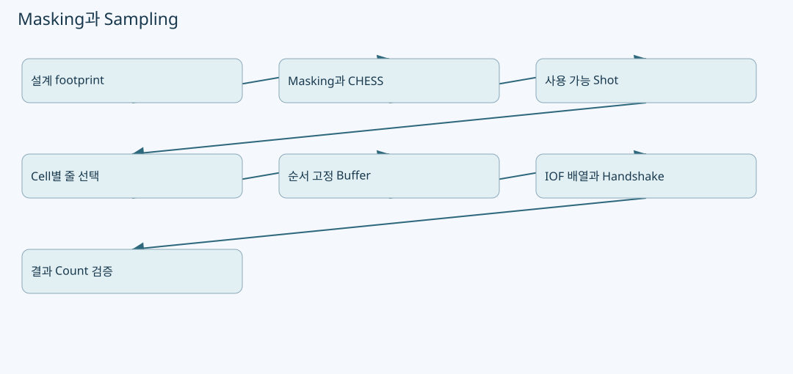


원본: `kjuws10-rgb/A3Drilling` · `master` · `5aee8e58439c9b455cae7c9593c9be986c3e682e`

이 장의 **코드 확인**은 해당 Commit의 실제 함수 본문을 정적으로 추적한 사실입니다. **해설**은 그 구조를 이해하기 위한 설명이며, **검증 과제**는 앞으로 실행할 시험입니다. 실장비의 부호·광학 상태·통신 타이밍·정밀도가 검증되었다는 뜻은 아닙니다. 예시 숫자는 설명용 가상값입니다.

## 1. 서로 다른 세 가지 문제

**Masking 판정**은 어느 설계 Shot이 사용 금지 영역과 겹치는지 정하는 문제입니다. **Sampling**은 사용 가능한 Shot 중 어느 줄·점을 검사할지 고르는 문제입니다. **IOF 준비**는 선택된 순서의 위치를 Stage에 넘겨 Trigger 동작을 준비하는 문제입니다. 세 기능의 입력과 출력이 다르므로 “Masking 반영됨”이라는 한 문장만으로 실제 경로가 마스크를 물리적으로 지나지 않는다고 판단하면 안 됩니다. [CShotCoordinatePlanBuilder.cs:853–910](https://github.com/kjuws10-rgb/A3Drilling/blob/5aee8e58439c9b455cae7c9593c9be986c3e682e/Drilling.Common/Recipe/CShotCoordinatePlanBuilder.cs#L853-L910) [CReviewRulePlanBuilder.cs:361–401](https://github.com/kjuws10-rgb/A3Drilling/blob/5aee8e58439c9b455cae7c9593c9be986c3e682e/Drilling.Common/Review/CReviewRulePlanBuilder.cs#L361-L401) [CStageReviewSequences.cs:742–805](https://github.com/kjuws10-rgb/A3Drilling/blob/5aee8e58439c9b455cae7c9593c9be986c3e682e/Drilling.Common/Station/CStageReviewSequences.cs#L742-L805)

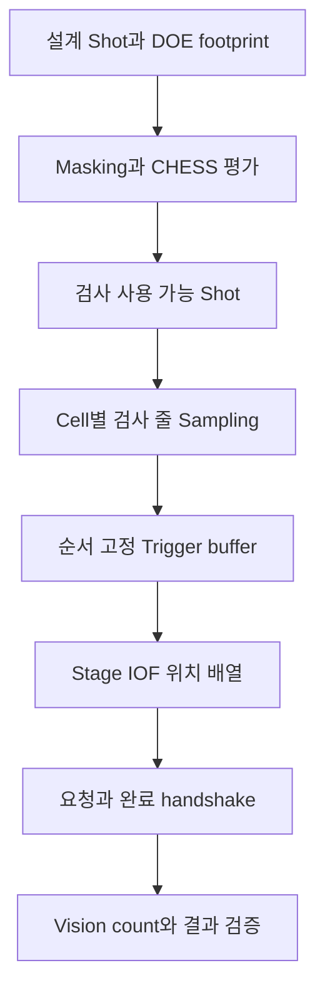

## 2. Masking이 참조하는 기준 좌표

`CRecipeShotMaskingPlan.Build`는 모델별 Pixel 크기, ProcessPitch, 분기 수, Masking hole, edge 조건을 준비합니다. 코드 상수는 모델 최대 5종, hole 최대 3개입니다. 그룹 피치와 Beam 피치는 `groupPitch = pixelSize × ProcessPitch`, `beamPitch = groupPitch / splitBeamCount`로 계산합니다. 이 수치는 실제 광학 측정 피치가 아니라 Recipe에서 구성한 footprint입니다. [CShotCoordinatePlanBuilder.cs:788–850](https://github.com/kjuws10-rgb/A3Drilling/blob/5aee8e58439c9b455cae7c9593c9be986c3e682e/Drilling.Common/Recipe/CShotCoordinatePlanBuilder.cs#L788-L850)

`EvaluateShot`의 핵심은 **설계 좌표 기준 불변성**입니다. Recipe/Default/FirstBeam/Align/Review/Shift의 보정값이나 Head flip을 바꿨다고 동일 Shot의 Masking 결과가 달라지면 안 된다는 주석이 있습니다. local 중심은 `GroupColumn × GroupPitch`, `GroupRow × GroupPitch`입니다. 각 Beam을 작은 사각 footprint로 만들고 hole과의 교차 또는 edge 이탈을 검사합니다. [CShotCoordinatePlanBuilder.cs:853–910](https://github.com/kjuws10-rgb/A3Drilling/blob/5aee8e58439c9b455cae7c9593c9be986c3e682e/Drilling.Common/Recipe/CShotCoordinatePlanBuilder.cs#L853-L910)

| 입력 | 실제 사용 목적 | 혼동하면 안 되는 것 |
|---|---|---|
| `SPLITED_BEAM_COUNT` | 가로·세로 Beam 격자 루프 수 | 전체 Beam 총 개수와 혼동 금지. 4라면 루프는 4×4. |
| `MODELn_MASKING_HOLE_NUMBER` 및 위치·크기 | hole 사각형 목록 | 카메라가 실시간 검출한 결함 맵이 아니다. |
| edge offset | 유효 가공 가장자리 범위 | Stage travel soft limit가 아니다. |
| `CHESS` / `CHESS_TYPE` | 그룹 row/column의 주기적인 사용 여부 | Masking hole과는 별도 제외 이유다. |
| `BeamNumbers` | 마스크와 겹친 Beam 번호 목록 | 이번 Review에서 고른 Beam11 하나만의 결과가 아니다. |

필드의 계산 근거는 모델 구성과 Beam 루프, CHESS 판정입니다. [CShotCoordinatePlanBuilder.cs:813–850](https://github.com/kjuws10-rgb/A3Drilling/blob/5aee8e58439c9b455cae7c9593c9be986c3e682e/Drilling.Common/Recipe/CShotCoordinatePlanBuilder.cs#L813-L850) [CShotCoordinatePlanBuilder.cs:881–947](https://github.com/kjuws10-rgb/A3Drilling/blob/5aee8e58439c9b455cae7c9593c9be986c3e682e/Drilling.Common/Recipe/CShotCoordinatePlanBuilder.cs#L881-L947)

## 3. 한 Beam이라도 겹치면 Shot 사용은 어떻게 되는가

`ST_RECIPE_SHOT_MASKING_RESULT.IsMasked`는 `BeamNumbers.Count > 0`이고, `ShouldSkipLaser`는 `IsMasked || IsChessSkipped`입니다. AUTO Review 계획은 이 값이 참인 Shot을 사용하지 않습니다. 따라서 현재 이 경로의 Review 제외 기준은 “검사 Beam11의 중심만 hole 밖이면 허용”이 아니라 **Shot footprint 평가 결과 전체**입니다. [CShotCoordinatePlanBuilder.cs:767–785](https://github.com/kjuws10-rgb/A3Drilling/blob/5aee8e58439c9b455cae7c9593c9be986c3e682e/Drilling.Common/Recipe/CShotCoordinatePlanBuilder.cs#L767-L785) [CAutoFineReviewCoordinator.cs:224–244](https://github.com/kjuws10-rgb/A3Drilling/blob/5aee8e58439c9b455cae7c9593c9be986c3e682e/Drilling.Common/Review/CAutoFineReviewCoordinator.cs#L224-L244)

**검토 포인트:** HIAA/Round라는 현장 용어 자체가 임의 원형 path solver를 뜻하지 않습니다. 현재 검토한 evaluator는 모델 hole 사각형과 edge 구성을 이용합니다. 현장에 필요한 곡선 경계가 해당 Recipe 표현으로 충분한지, 실제 Masking 도형이 어떤 키로 전달되는지는 별도 설계 확인이 필요합니다. 원·곡선 장애물을 정확히 따라 피해가는 알고리즘이 구현되었다고 확대 설명하지 않습니다. [CShotCoordinatePlanBuilder.cs:928–974](https://github.com/kjuws10-rgb/A3Drilling/blob/5aee8e58439c9b455cae7c9593c9be986c3e682e/Drilling.Common/Recipe/CShotCoordinatePlanBuilder.cs#L928-L974)

잘못된 hole 크기나 유한하지 않은 값은 `BuildModel`에서 건너뛰는 분기가 있습니다. 데이터 오입력으로 의도한 마스크가 사라지는 상황을 잡으려면 UI 또는 Recipe 검증에서 별도 오류 표시가 필요한지 검토해야 합니다. “무시됨”은 “안전하게 전부 차단됨”과 다릅니다. [CShotCoordinatePlanBuilder.cs:928–947](https://github.com/kjuws10-rgb/A3Drilling/blob/5aee8e58439c9b455cae7c9593c9be986c3e682e/Drilling.Common/Recipe/CShotCoordinatePlanBuilder.cs#L928-L947)

## 4. FINE 줄 선택의 실제 단위

`BuildFineFromCellSource`는 Head가 배정된 점이 있는 Cell별 범위를 만듭니다. 줄 수는 해당 범위의 row 수와 최대 7줄 사이에서 제한됩니다. 한 줄이면 중앙, 여러 줄이면 최소·최대 Y 사이에 균등한 목표 Y를 잡고, 가까운 row 및 인접 row 후보를 확인합니다. 선택한 row에서 Head가 있고 좌표가 유한한 점을 모은 뒤 ShotKey 중복을 제거합니다. [CReviewRulePlanBuilder.cs:361–401](https://github.com/kjuws10-rgb/A3Drilling/blob/5aee8e58439c9b455cae7c9593c9be986c3e682e/Drilling.Common/Review/CReviewRulePlanBuilder.cs#L361-L401)

**해설:** 이는 row Sampling입니다. “첫 줄이 막혔으면 다음 유효 row로 바꾸는가”, “마스크를 모두 피하면서 세 줄의 높이 간격을 최적화하는가”, “선택 Beam만 유효한 점을 허용하는가”는 서로 다른 요구입니다. 이 함수 하나를 보고 세 요구가 모두 충족되었다고 판단할 수 없습니다. AUTO 계획은 나중에 `Use` 점과 선택 키를 결합하고 실제 line을 만듭니다. [CAutoFineReviewCoordinator.cs:244–281](https://github.com/kjuws10-rgb/A3Drilling/blob/5aee8e58439c9b455cae7c9593c9be986c3e682e/Drilling.Common/Review/CAutoFineReviewCoordinator.cs#L244-L281)

## 5. IOF에 보내는 위치는 Vision의 1001 식별자와 다르다

`CStageReviewSequences.PrepareIof`의 입력은 **순서가 있는 `ST_STAGE_IOF_POINT` 목록**입니다. 빈 배열, 비유한 X/Y, 일반 IOF 500점 초과를 거부합니다. zero-line은 점 수가 2 또는 4여야 합니다. Review X 전용 motion owner가 IOF buffer를 쓰는 것도 금지합니다. [CStageReviewSequences.cs:742–761](https://github.com/kjuws10-rgb/A3Drilling/blob/5aee8e58439c9b455cae7c9593c9be986c3e682e/Drilling.Common/Station/CStageReviewSequences.cs#L742-L761)

| 준비 단계 | 코드가 하는 일 | 왜 필요한가 |
|---|---|---|
| 사전 상태 확인 | 이전 Start/ACK가 0인지, Stage가 정지인지 확인 | 직전 요청 완료 비트가 남은 상태를 새 요청의 응답으로 오인하지 않기 위해. |
| 설정·개수 기록 | 일반/zero-line 설정과 별도 count key 기록 | 같은 배열을 다른 의미로 읽지 않게 한다. |
| 배열 구성 | 일반은 `points.Select(p => p.X)`, zero-line은 `p.Y` | **zero-line을 `[Y…][X…]`로 묶는 옛 방식이 아니다.** |
| Route 검증 | `IOF_POS_ARRAY_1`의 Double 타입과 용량 확인 | WORD 정수 배열로 잘못 쓰거나 용량을 넘지 않게 한다. |
| readback | 기록 값과 읽은 값의 오차가 `0.000051`보다 크면 실패 | 쓰기 함수 호출 성공과 실제 데이터 확인을 구분한다. |
| Start 요청 | 동결한 계획을 소유 상태로 보관하고 요청·완료 wait | 그 시도의 순서와 데이터가 끝까지 같은지 보장한다. |

표의 논리 이름과 검증 수치는 소스의 현재 구현 기준입니다. 실제 현장 주소는 해당 버전의 MELSEC map과 장비 사양을 같이 확인해야 합니다. 소스 주석에는 요청 `W8238`, 완료 `WC13C`, ACK `W823A`가 나오지만 주소 고정 사실을 모든 설비에 일반화하지 않습니다. [CStageReviewSequences.cs:753–805](https://github.com/kjuws10-rgb/A3Drilling/blob/5aee8e58439c9b455cae7c9593c9be986c3e682e/Drilling.Common/Station/CStageReviewSequences.cs#L753-L805)

## 6. 재시도 때 배열과 결과를 맞추는 방법

Fine flying은 시도마다 새 `triggerBuffer`를 만듭니다. 해당 배열로 IOF를 준비하고, 같은 순서로 `FLYING_READY`를 전송한 뒤 끝점으로 이동합니다. `FLYING_MOVE_DONE`의 count mismatch가 발생하면 허용된 조건에서 순서를 뒤집어 재시도합니다. 이때 실패 시도의 `1003`을 요청하지 않는 분기가 있습니다. [CReviewManager.cs:2651–2702](https://github.com/kjuws10-rgb/A3Drilling/blob/5aee8e58439c9b455cae7c9593c9be986c3e682e/Drilling.Common/Review/CReviewManager.cs#L2651-L2702)

수신 결과 개수는 그 시도의 frozen buffer 개수와 일치해야 합니다. 측정 결과를 현재 화면 정렬이나 Recipe 전체 목록에 순서대로 붙이면 재시도 후 다른 Shot에 오차를 넣을 수 있습니다. 저장 전에는 coordinator가 식별자 집합을 다시 검증합니다. [CReviewManager.cs:2705–2736](https://github.com/kjuws10-rgb/A3Drilling/blob/5aee8e58439c9b455cae7c9593c9be986c3e682e/Drilling.Common/Review/CReviewManager.cs#L2705-L2736) [CAutoFineReviewCoordinator.cs:169–196](https://github.com/kjuws10-rgb/A3Drilling/blob/5aee8e58439c9b455cae7c9593c9be986c3e682e/Drilling.Common/Review/CAutoFineReviewCoordinator.cs#L169-L196)

## 7. 원하는 개선사항을 검증 가능한 요구로 바꾸기

| 요구 | 현재 확인한 근거 | 추가로 확인할 기준 |
|---|---|---|
| Masking 영역에서는 Trigger 미발생 | 사용 점 제외·IOF buffer 경로 존재 | 실제 최종 buffer에 제외 Shot이 없는지 확인. |
| Stage 경로 자체도 Masking 구간 회피 | 점 선택과 직선 이동만으로는 입증 불가 | 시작점~끝점 선분·전환 구간·Trigger window를 함께 기록. |
| 첫/중앙/마지막 줄이 막히면 유효 줄 대체 | row 선택과 Use 필터를 조합해 확인해야 함 | 줄별 예정/선택/제외 점 수와 대체 이유를 표시. |
| 모든 대상이 마스크인 Cell | 빈 line 또는 전체 검사점 부족 가능 | 조용히 성공하지 않고 명확한 불가 사유를 내야 함. |
| Trigger count 누락 | 1002 NCK 분기 있음 | 허용 재시도 횟수와 전체 보정 미적용을 확인. |

## 8. 권장 시험표 — 아직 실행하지 않은 검증 과제

1. 단일 Shot의 첫 Beam footprint만 hole에 걸리게 만든 가상 Recipe로 `BeamNumbers`, `ShouldSkipLaser`, 최종 `Use`를 순서대로 확인합니다. Beam11이 멀쩡해도 Shot 제외가 되는 현재 정책을 확인하는 시험입니다.
2. 보정값을 크게 바꾸되 설계 패턴은 유지합니다. Masking 결과는 같아야 하고 Scanner 최종 좌표만 바뀌어야 합니다.
3. 첫 줄 전체를 가리고 중앙·끝줄은 남긴 뒤 요청 줄 수와 실제 선택 줄 수, 검사점 수를 기록합니다. 요구한 세 줄이 유지되지 않는다면 자동 대체 정책을 별도로 정의합니다.
4. 500점과 501점, zero-line 2/4/3점, readback 오차 경계값을 시험합니다. 실장비 없이 mock route로 먼저 검증할 수 있습니다.
5. 정방향 첫 시도 count mismatch 후 역방향 재시도를 만들고, 각 ShotKey가 정확히 자기 결과를 받는지 확인합니다.
6. Stage의 실제 이동 경로를 검증할 때는 Trigger off만 보고 통과시키지 말고 encoder 경로와 유효 Trigger 위치를 함께 비교합니다.

마지막 6번은 물리 동작 평가가 필요한 항목이며, 이 문서에서 안전성이나 현장 통과를 판정하지 않았습니다.


# 별도 정적 추적 상세 해설 · review/03_Vision_패킷과_단위.md

# Vision 통신: 1001 식별자 패킷, 1003 수신값, 픽셀→mm 오차

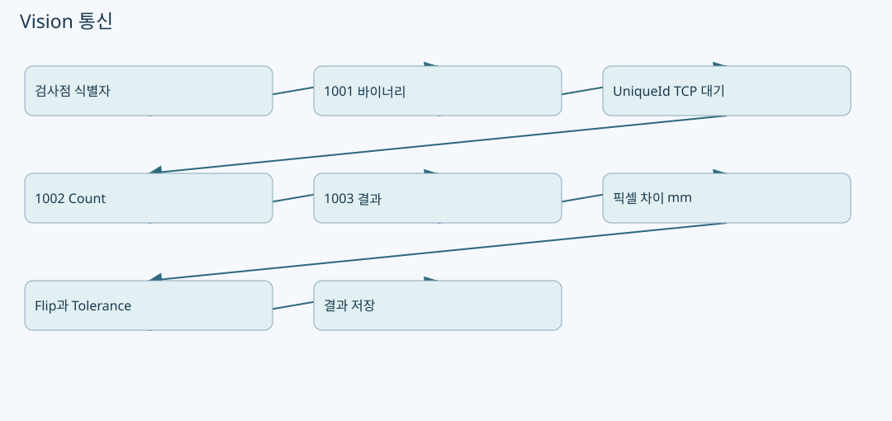


원본: `kjuws10-rgb/A3Drilling` · `master` · `5aee8e58439c9b455cae7c9593c9be986c3e682e`

이 장의 **코드 확인**은 해당 Commit의 실제 함수 본문을 정적으로 추적한 사실입니다. **해설**은 그 구조를 이해하기 위한 설명이며, **검증 과제**는 앞으로 실행할 시험입니다. 실장비의 부호·광학 상태·통신 타이밍·정밀도가 검증되었다는 뜻은 아닙니다. 예시 숫자는 설명용 가상값입니다.

## 1. 자주 생기는 오해부터 바로잡기

`ReviewResult.csv`나 `PROCESS_COORDINATES.csv`는 파일 저장 형식입니다. 실제 Vision TCP 전송은 `CVisionComm.Execute → ParseRequest → SendRequest → SendPacket → CVisionProtocol.Encode → NetworkStream.WriteAsync` 경로입니다. 가공·Review 좌표가 파일에 저장된다는 사실은 해당 CSV 행을 Vision에 그대로 보낸다는 근거가 되지 않습니다. [CVisionComm.cs:93–123](https://github.com/kjuws10-rgb/A3Drilling/blob/5aee8e58439c9b455cae7c9593c9be986c3e682e/Drilling.Common/Interface/Vision/CVisionComm.cs#L93-L123) [CVisionComm.cs:272–337](https://github.com/kjuws10-rgb/A3Drilling/blob/5aee8e58439c9b455cae7c9593c9be986c3e682e/Drilling.Common/Interface/Vision/CVisionComm.cs#L272-L337)

실제 좌표 이동 연결은 `CReviewStageMotion.MoveAndWait`에서 `ReviewTargetX/Y`를 Stage session으로 넘기며, Flying 준비는 같은 값으로 `ST_STAGE_IOF_POINT` 배열을 만듭니다. 이 경로와 TCP의 식별자 payload는 서로 다른 출력입니다. [CReviewManager.cs:2408–2411](https://github.com/kjuws10-rgb/A3Drilling/blob/5aee8e58439c9b455cae7c9593c9be986c3e682e/Drilling.Common/Review/CReviewManager.cs#L2408-L2411)


## 2. 실제 코드 경계를 찾는 순서

| 위치 | 책임 | 개발할 때 확인할 질문 |
|---|---|---|
| `CReviewManager.CreateFlyingReadyCommand` | Point를 Vision 검색 식별자로 직렬화하기 전 command 구성 | 어떤 Cell/Beam/row/column/Head를 요청하는가? [CReviewManager.cs:1964–1994](https://github.com/kjuws10-rgb/A3Drilling/blob/5aee8e58439c9b455cae7c9593c9be986c3e682e/Drilling.Common/Review/CReviewManager.cs#L1964-L1994) |
| `CVisionComm.Execute` | 문자열 명령을 packet으로 바꾸고 송수신 | UniqueId, line capacity를 언제 정하는가? [CVisionComm.cs:93–123](https://github.com/kjuws10-rgb/A3Drilling/blob/5aee8e58439c9b455cae7c9593c9be986c3e682e/Drilling.Common/Interface/Vision/CVisionComm.cs#L93-L123) |
| `CVisionProtocol.CreateFlyingReady` | 헤더 외 body layout 구성 | 사용 slot과 미사용 slot을 어떻게 채우는가? [CVisionComm.cs:576–594](https://github.com/kjuws10-rgb/A3Drilling/blob/5aee8e58439c9b455cae7c9593c9be986c3e682e/Drilling.Common/Interface/Vision/CVisionComm.cs#L576-L594) |
| `SendRequest` | 응답 Task, timeout, command 검증 | 다른 요청의 응답을 받을 수 없는가? [CVisionComm.cs:272–308](https://github.com/kjuws10-rgb/A3Drilling/blob/5aee8e58439c9b455cae7c9593c9be986c3e682e/Drilling.Common/Interface/Vision/CVisionComm.cs#L272-L308) |
| `SendPacket` / `ReadPacket` | 네트워크 byte 송수신 | partial read, 쓰기 동시성, 길이 검증을 처리하는가? [CVisionComm.cs:311–337](https://github.com/kjuws10-rgb/A3Drilling/blob/5aee8e58439c9b455cae7c9593c9be986c3e682e/Drilling.Common/Interface/Vision/CVisionComm.cs#L311-L337) |
| `CreateVisionMeasurement` | 응답 숫자 해석과 mm 오차 생성 | found 신호와 tolerance 판정이 같은 것인가? [CReviewManager.cs:2173–2197](https://github.com/kjuws10-rgb/A3Drilling/blob/5aee8e58439c9b455cae7c9593c9be986c3e682e/Drilling.Common/Review/CReviewManager.cs#L2173-L2197) |

## 3. 16바이트 공통 헤더

현재 `CVisionProtocol.HeaderSize`는 16이고, 인코더가 아래 순서로 Int32를 기록합니다. Int32는 little-endian reader와 대응합니다. 헤더의 DataLength와 실제 body 길이가 다르면 전송 전에 예외가 납니다. [CVisionComm.cs:558–559](https://github.com/kjuws10-rgb/A3Drilling/blob/5aee8e58439c9b455cae7c9593c9be986c3e682e/Drilling.Common/Interface/Vision/CVisionComm.cs#L558-L559) [CVisionComm.cs:643–667](https://github.com/kjuws10-rgb/A3Drilling/blob/5aee8e58439c9b455cae7c9593c9be986c3e682e/Drilling.Common/Interface/Vision/CVisionComm.cs#L643-L667) [CVisionComm.cs:984–985](https://github.com/kjuws10-rgb/A3Drilling/blob/5aee8e58439c9b455cae7c9593c9be986c3e682e/Drilling.Common/Interface/Vision/CVisionComm.cs#L984-L985)

| byte offset | 크기 | 필드 | 뜻 |
|---:|---:|---|---|
| 0 | 4 | Command | 예: Flying Ready 1001 |
| 4 | 4 | DataLength | body byte 수; 전체 packet 길이가 아니다. |
| 8 | 4 | UniqueId | 요청과 응답을 연결하는 ID |
| 12 | 4 | ErrorCode | 통신 응답의 오류 코드 |
| 16 | DataLength | Body | command마다 다른 구조 |

`ReadPacket`은 헤더를 정확한 byte 수만큼 읽고 DataLength를 해석한 다음 body를 다시 정확히 읽습니다. TCP에서 한 번의 `ReadAsync`가 한 packet과 일치한다는 가정을 하지 않습니다. 이는 패킷이 두 번에 나눠 들어오는 상황을 다루기 위한 기본 경계입니다. [CVisionComm.cs:329–337](https://github.com/kjuws10-rgb/A3Drilling/blob/5aee8e58439c9b455cae7c9593c9be986c3e682e/Drilling.Common/Interface/Vision/CVisionComm.cs#L329-L337)

## 4. 1001 Flying Ready는 mm X/Y 배열이 아니다

`ST_VISION_MARK_SEARCH`는 여섯 정수 `Cell, Doe, Line, IndexX, IndexY, Head`입니다. 레코드 크기는 24바이트입니다. `Doe` 필드에는 Review command builder가 `point.BeamNo`를 넣습니다. 현재 builder는 ShotNo를 PixelCountX로 나눠 1기반 row/column을 만들고 `Line`과 `IndexY` 양쪽에 row index를 넣습니다. 이를 mm좌표라고 설명하면 payload와 Stage 이동을 동시에 잘못 이해하게 됩니다. [CVisionComm.cs:530–548](https://github.com/kjuws10-rgb/A3Drilling/blob/5aee8e58439c9b455cae7c9593c9be986c3e682e/Drilling.Common/Interface/Vision/CVisionComm.cs#L530-L548) [CReviewManager.cs:1987–1994](https://github.com/kjuws10-rgb/A3Drilling/blob/5aee8e58439c9b455cae7c9593c9be986c3e682e/Drilling.Common/Review/CReviewManager.cs#L1987-L1994) [CVisionComm.cs:955–975](https://github.com/kjuws10-rgb/A3Drilling/blob/5aee8e58439c9b455cae7c9593c9be986c3e682e/Drilling.Common/Interface/Vision/CVisionComm.cs#L955-L975)

| body 내 위치 | 내용 | 설명 |
|---|---|---|
| 0..3 | InspectionType Int32 | 검사 유형 |
| 4..7 | 검색 점 수 Int32 | 유효 search 레코드 수 |
| 8부터 | 24바이트 × 설정된 line capacity | 각 slot의 six-int 식별자 |

Body 배열 크기는 `8 + maxHoleCountPerLine × 24`이고 전체를 `0xFF`로 채운 후 유효 슬롯을 기록합니다. 미사용 슬롯을 0좌표로 보는 것은 틀립니다. 이 구조의 정확한 capacity는 해당 실행 옵션과 상대 Vision 사양을 함께 확인해야 합니다. [CVisionComm.cs:576–594](https://github.com/kjuws10-rgb/A3Drilling/blob/5aee8e58439c9b455cae7c9593c9be986c3e682e/Drilling.Common/Interface/Vision/CVisionComm.cs#L576-L594)

한 레코드의 상대 byte 배치는 `Cell +0`, `Doe +4`, `Line +8`, `IndexX +12`, `IndexY +16`, `Head +20`입니다. 신규 필드를 추가하면 단순히 C# record에 속성만 더할 것이 아니라 packet 길이·reader·writer·상대 장치 map을 모두 맞춰야 합니다. [CVisionComm.cs:955–975](https://github.com/kjuws10-rgb/A3Drilling/blob/5aee8e58439c9b455cae7c9593c9be986c3e682e/Drilling.Common/Interface/Vision/CVisionComm.cs#L955-L975)

## 5. 1001 → 이동 → 1002 → 1003 순서와 실패 처리

Fine flying의 한 시도는 새 frozen buffer로 IOF를 준비하고 실제 Vision일 때 keep-alive와 FlyingReady를 보냅니다. 끝점 이동이 끝난 다음 `FLYING_MOVE_DONE`을 보냅니다. count mismatch는 `CFlyingCountMismatchException`으로 분리하며, 허용된 재시도 조건에서 점 순서를 반대로 바꿉니다. count mismatch 시도의 1003을 요청하지 않는 주석이 있어, 이전 시도 결과를 잘못 소비하지 않도록 되어 있습니다. [CReviewManager.cs:2651–2702](https://github.com/kjuws10-rgb/A3Drilling/blob/5aee8e58439c9b455cae7c9593c9be986c3e682e/Drilling.Common/Review/CReviewManager.cs#L2651-L2702)

1003의 측정 개수는 frozen buffer 개수와 일치해야 하고 해당 buffer 순서에 결과를 붙입니다. 다음 줄 선이동과 응답 수신이 일부 겹치는 최적화 분기가 있으므로 UI 표시 순서만으로 물리 Trigger 순서를 추정하지 않아야 합니다. [CReviewManager.cs:2705–2736](https://github.com/kjuws10-rgb/A3Drilling/blob/5aee8e58439c9b455cae7c9593c9be986c3e682e/Drilling.Common/Review/CReviewManager.cs#L2705-L2736)

`SendRequest`는 UniqueId별 pending Task를 등록하고 연결된 cancellation token에 timeout을 추가합니다. 응답 Command가 요청과 다르거나 ErrorCode가 0이 아니면 실패합니다. finally에서 pending을 제거합니다. 반면 “정상 header 수신”과 “표적 찾기 성공”은 별개입니다. [CVisionComm.cs:272–308](https://github.com/kjuws10-rgb/A3Drilling/blob/5aee8e58439c9b455cae7c9593c9be986c3e682e/Drilling.Common/Interface/Vision/CVisionComm.cs#L272-L308)

## 6. 수신 숫자를 mm 오차로 바꾸기

`ST_VISION_MARK_FIND`는 `Result`와 `TargetMarkX/Y`, `HoleX/Y`를 포함합니다. `CreateVisionMeasurement`에서 `nResult == 0`을 found로 봅니다. 코드 주석은 1000/1003/1010에 대해 0이 found라고 명시합니다. `1=OK`라는 문서가 남아 있다면 현행 구현 및 상대 프로토콜과 불일치 여부를 확인해야 합니다. [CVisionComm.cs:543–547](https://github.com/kjuws10-rgb/A3Drilling/blob/5aee8e58439c9b455cae7c9593c9be986c3e682e/Drilling.Common/Interface/Vision/CVisionComm.cs#L543-L547) [CReviewManager.cs:2173–2184](https://github.com/kjuws10-rgb/A3Drilling/blob/5aee8e58439c9b455cae7c9593c9be986c3e682e/Drilling.Common/Review/CReviewManager.cs#L2173-L2184)

소스의 실제 변환식은 다음과 같습니다. `cameraResolution` 단위는 함수 검증문에 **mm/pixel**로 명시되어 있습니다. [CReviewManager.cs:2187–2197](https://github.com/kjuws10-rgb/A3Drilling/blob/5aee8e58439c9b455cae7c9593c9be986c3e682e/Drilling.Common/Review/CReviewManager.cs#L2187-L2197)

```text
factor = CameraResolution(mm/pixel) × nResolution
rawErrorX_mm = factor × (TargetMarkX − HoleX)
rawErrorY_mm = factor × (TargetMarkY − HoleY)
```

`nResolution <= 0`, CameraResolution 비양수/비유한, 수신 픽셀 비유한, 환산값 비유한은 거부합니다. `nResolution`을 임의의 µm 단위로 해석하거나 `Hole−Target`으로 뒤집으면 보정 방향이 달라집니다. Stage 방향이나 Head Flip을 이 단계에서 추가로 적용하면 원래 경계를 무너뜨립니다. [CReviewManager.cs:2187–2197](https://github.com/kjuws10-rgb/A3Drilling/blob/5aee8e58439c9b455cae7c9593c9be986c3e682e/Drilling.Common/Review/CReviewManager.cs#L2187-L2197)

설명용 예로 CameraResolution이 `0.001 mm/pixel`, nResolution이 2, Target−Hole가 `(3,−2) pixel`이면 raw error는 `(0.006,−0.004) mm`입니다. 실제 장비 설정값을 인용한 예가 아닙니다.

## 7. found, geometric OK, 보정 가능은 서로 다르다

`ApplyMeasurementError`는 raw mm 오차에 `VisionErrorToStageOffset`을 적용한 값으로 tolerance를 확인합니다. 먼저 X/Y swap, 다음 X 부호 반전, 다음 Y 부호 반전을 적용합니다. 찾기 상태도 정상이어야 하고 `abs(X)<=TolX && abs(Y)<=TolY`여야 최종 OK입니다. `ErrorX/Y`에는 함수 인수의 raw 오차가 저장됩니다. [CReviewManager.cs:2147–2158](https://github.com/kjuws10-rgb/A3Drilling/blob/5aee8e58439c9b455cae7c9593c9be986c3e682e/Drilling.Common/Review/CReviewManager.cs#L2147-L2158) [CReviewManager.cs:3486–3505](https://github.com/kjuws10-rgb/A3Drilling/blob/5aee8e58439c9b455cae7c9593c9be986c3e682e/Drilling.Common/Review/CReviewManager.cs#L3486-L3505)

따라서 다음 네 상태를 구분해 설명해야 합니다.

1. TCP 응답 성공: header와 UniqueId/Command가 정상이다.
2. Vision found: nResult가 0이다.
3. Review OK: 변환 후 X/Y가 tolerance 안이다.
4. 보정 적용 완료: 결과 전체의 정합성·NG 여부·중복 적용·파일 저장을 통과했다.

1번만 성공했는데 “검사 OK”로 표시하거나 3번 성공을 “보정값이 이미 적용됨”으로 표시하면 작업자가 중복 적용할 수 있습니다. 자동 보정 저장은 별도 coordinator에서 수행합니다. [CAutoFineReviewCoordinator.cs:94–149](https://github.com/kjuws10-rgb/A3Drilling/blob/5aee8e58439c9b455cae7c9593c9be986c3e682e/Drilling.Common/Review/CAutoFineReviewCoordinator.cs#L94-L149)

## 8. 추가 개발 시 필요한 주석과 로그

| 위치 | 반드시 남길 의미 |
|---|---|
| 1001 record 생성 | six-int는 검색 식별자이며 mm 이동 좌표가 아님 |
| 순서 반전 retry | 현재 attempt의 buffer와 결과만 서로 결합 |
| 픽셀 환산 | Target−Hole, mm/pixel, Resolution 곱, 아직 Vision Flip 전 |
| tolerance 판정 | found 여부와 오차 기준을 모두 만족해야 OK |
| CSV 저장 | 통신 packet 사본이 아니라 후처리·이력 artifact |

## 9. 검증 과제

| 수준 | 시험 | 통과 기준 |
|---|---|---|
| Pure unit | 알려진 six-int를 인코딩 후 디코딩 | 24바이트 각 위치와 값이 동일 |
| Pure unit | 1001 capacity 3, 유효 2점 | body 80바이트, 남는 24바이트는 0xFF |
| Fake TCP | 헤더를 여러 조각으로 나눠 수신 | packet 1개로 정상 복원, 다음 packet과 섞이지 않음 |
| Fake TCP | UniqueId 다름 / Command 다름 / ErrorCode≠0 | 정상 측정으로 처리되지 않음 |
| Pure unit | Resolution0, CameraResolutionNaN | 좌표 적용 전에 명확한 예외 |
| Pure unit | tolerance 경계 ±값, found0/1 | found와 경계 포함 비교가 코드대로 동작 |
| Integration simulation | 1002 NCK 후 retry | 실패 attempt의1003 미요청, 역방향 buffer로 새 시도 |

이 시험표는 실행 계획입니다. 작성 시 실제 TCP 서버·카메라·Stage를 구동하지 않았습니다.


# 별도 정적 추적 상세 해설 · review/04_ReviewOffset_적용과_롤백.md

# Review Offset: 누적 보정·좌표계 태그·중복 방지·원복

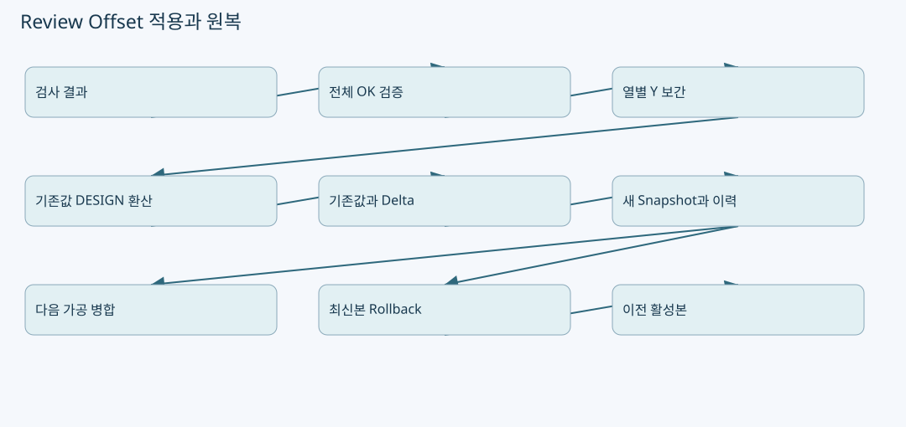


원본: `kjuws10-rgb/A3Drilling` · `master` · `5aee8e58439c9b455cae7c9593c9be986c3e682e`

이 장의 **코드 확인**은 해당 Commit의 실제 함수 본문을 정적으로 추적한 사실입니다. **해설**은 그 구조를 이해하기 위한 설명이며, **검증 과제**는 앞으로 실행할 시험입니다. 실장비의 부호·광학 상태·통신 타이밍·정밀도가 검증되었다는 뜻은 아닙니다. 예시 숫자는 설명용 가상값입니다.

## 1. 측정 결과와 적용된 Offset을 분리해서 이해하기

Review 측정 결과는 “지금 어떤 오차가 관찰되었는가”이고, Review Offset은 “다음 가공 좌표에 어떤 값을 더할 것인가”입니다. AUTO Fine은 측정·검증·저장을 별도 단계로 실행합니다. 저장 성공 시 outcome에도 **다음 Glass에 적용**한다고 남깁니다. 결과 CSV를 열었다고 보정값이 자동으로 적용된 것은 아닙니다. [CAutoFineReviewCoordinator.cs:29–75](https://github.com/kjuws10-rgb/A3Drilling/blob/5aee8e58439c9b455cae7c9593c9be986c3e682e/Drilling.Common/Review/CAutoFineReviewCoordinator.cs#L29-L75) [CAutoFineReviewCoordinator.cs:163–166](https://github.com/kjuws10-rgb/A3Drilling/blob/5aee8e58439c9b455cae7c9593c9be986c3e682e/Drilling.Common/Review/CAutoFineReviewCoordinator.cs#L163-L166)

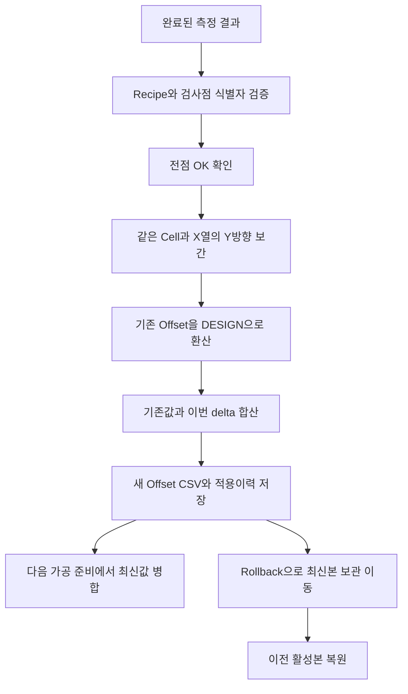

## 2. AUTO 저장은 어디서 차단되는가

`Save`는 semaphore를 얻은 뒤 `_saved`를 다시 확인합니다. 이는 동시에 들어온 저장 호출 중 먼저 기다리던 호출이 중복 파일을 만들지 못하게 하는 경계입니다. `SaveCore`는 Prepared/Result 존재, Completed 상태, 결과 파일 저장 성공, 점 식별자 정합성, 전체 OK를 다시 검사합니다. 측정 완료 때 한 번 검사했다는 이유로 저장 검증을 생략하지 않습니다. [CAutoFineReviewCoordinator.cs:78–120](https://github.com/kjuws10-rgb/A3Drilling/blob/5aee8e58439c9b455cae7c9593c9be986c3e682e/Drilling.Common/Review/CAutoFineReviewCoordinator.cs#L78-L120)

ZeroLine Follow-up은 검사 이력만 남기고 현재 Review Offset을 load하지도 않는 분기가 있습니다. 따라서 “모든 Review 완료는 Offset을 갱신한다”는 설명은 틀립니다. 일반 AUTO Fine과 진단용 후속 검사는 목적이 다릅니다. [CAutoFineReviewCoordinator.cs:102–119](https://github.com/kjuws10-rgb/A3Drilling/blob/5aee8e58439c9b455cae7c9593c9be986c3e682e/Drilling.Common/Review/CAutoFineReviewCoordinator.cs#L102-L119)

## 3. FINE 보간의 실제 차원

`CalculateFineOffsets`는 측정점이 비어 있거나 NG, 미완료, 중복 ShotKey, 비유한 좌표를 포함하면 전체 적용을 거부합니다. 측정점을 `(CellNo, Round(DesignX,6))`로 묶고 각 열에서 DesignY 순으로 anchor를 만듭니다. 대상 Shot도 같은 키로 묶습니다. **Cell을 넘어서 이웃 Head의 오차를 섞는 2차원 표면 보간이 아닙니다.** [CReviewManager.cs:3416–3455](https://github.com/kjuws10-rgb/A3Drilling/blob/5aee8e58439c9b455cae7c9593c9be986c3e682e/Drilling.Common/Review/CReviewManager.cs#L3416-L3455)

| 경우 | 코드 동작 | 의미 |
|---|---|---|
| 한 열에 anchor 1개 | 해당 값을 반환 | 그 열 전체에 동일 delta를 준다. |
| anchor 여러 개 | Y를 정규화하고 Lagrange basis 계산 | 최대 7개 anchor라는 주석이 있다. |
| 대상 Y가 anchor Y와 사실상 같음 | 해당 anchor 값을 직접 반환 | 불필요한 수치 오차를 줄인다. |
| 같은 열에 같은 Y anchor 중복 | 예외 | 보간 분모가 0이 되는 모호한 입력을 차단한다. |
| 제외 때문에 anchor가 없는 열 | 그 열을 건너뜀 | 기존 저장값을 보존하려는 주석이 있다. |

표는 실제 함수 분기를 풀어쓴 것입니다. anchor 바깥 Y에 대한 계산식도 같은 다항식이므로, “언제나 보간 범위 안에서만 평가한다”는 보장은 함수 자체에 없습니다. 외삽의 물리적 적절성과 overshoot 제한은 별도 검토가 필요합니다. [CReviewManager.cs:3430–3481](https://github.com/kjuws10-rgb/A3Drilling/blob/5aee8e58439c9b455cae7c9593c9be986c3e682e/Drilling.Common/Review/CReviewManager.cs#L3430-L3481)

## 4. 보정 방향과 누적식

AUTO는 raw 측정 오차를 Plan의 VisionFlip으로 변환해 delta를 구합니다. 기존 파일의 각 Shot 값을 `CReviewOffsetData.ToDesign`으로 변환한 뒤 **기존 design 값 + 이번 delta**를 계산하고 `IsDesignCoordinate=true`로 저장합니다. 기존값을 이번 delta로 단순 대체하지 않으며, Legacy scanner 좌표를 design이라고 가정하지 않습니다. [CAutoFineReviewCoordinator.cs:121–149](https://github.com/kjuws10-rgb/A3Drilling/blob/5aee8e58439c9b455cae7c9593c9be986c3e682e/Drilling.Common/Review/CAutoFineReviewCoordinator.cs#L121-L149)

```text
currentDesign = ToDesign(parameters, HeadNo, oldX, oldY, old.IsDesignCoordinate)
finalDesignX  = Round(currentDesign.X + delta.X)
finalDesignY  = Round(currentDesign.Y + delta.Y)
savedSpace    = DESIGN
```

UI 수동 적용도 `Current / Delta / Final`을 구성하고 같은 누적식을 사용합니다. 적용 대상은 현재 Recipe에서 Head가 배정되어 있고 `Use`인 Shot입니다. ALL_SHOT/ONE_SHOT, ROUGH, FINE/AUTO는 각각 별도 delta builder를 사용합니다. FINE/AUTO 결과에 NG가 있으면 전체 적용을 거부합니다. [CMenuCorrection.ReviewData.Offset.cs:250–337](https://github.com/kjuws10-rgb/A3Drilling/blob/5aee8e58439c9b455cae7c9593c9be986c3e682e/Drilling.UI/Menu/Menus/CMenuCorrection.ReviewData.Offset.cs#L250-L337) [CMenuCorrection.ReviewData.Offset.cs:433–458](https://github.com/kjuws10-rgb/A3Drilling/blob/5aee8e58439c9b455cae7c9593c9be986c3e682e/Drilling.UI/Menu/Menus/CMenuCorrection.ReviewData.Offset.cs#L433-L458)

**해설:** “오차가 +X이므로 Offset에도 무조건 −X를 입력한다”는 구두 규칙으로 이 함수를 바꾸면 안 됩니다. raw 오차가 Target−Hole인지, VisionFlip이 어느 방향으로 변환하는지, 저장 좌표가 DESIGN인지 SCANNER인지, 최종 Scanner builder가 어떻게 적용하는지까지 연결해 시험해야 합니다. [CReviewManager.cs:2187–2197](https://github.com/kjuws10-rgb/A3Drilling/blob/5aee8e58439c9b455cae7c9593c9be986c3e682e/Drilling.Common/Review/CReviewManager.cs#L2187-L2197) [CReviewManager.cs:3486–3512](https://github.com/kjuws10-rgb/A3Drilling/blob/5aee8e58439c9b455cae7c9593c9be986c3e682e/Drilling.Common/Review/CReviewManager.cs#L3486-L3512) [CShotCoordinatePlanBuilder.cs:139–155](https://github.com/kjuws10-rgb/A3Drilling/blob/5aee8e58439c9b455cae7c9593c9be986c3e682e/Drilling.Common/Recipe/CShotCoordinatePlanBuilder.cs#L139-L155)

## 5. CSV 저장 구조와 Legacy 호환

| 열 | 자료 의미 | 파서 검증 |
|---|---|---|
| `CELLID` | 1 이상 Cell 식별자 | 정수, 유효 범위 |
| `SHOTID` | Cell 내 Shot 이름 | trim·대문자 및 구분자 정규화, 중복 금지 |
| `REVIEWOFFSETX` | 보정 X | 유한 double |
| `REVIEWOFFSETY` | 보정 Y | 유한 double |
| `COORDINATE_SPACE` | DESIGN 또는 SCANNER | 빈 값은 Legacy SCANNER, 그 외 알 수 없는 값은 오류 |

저장 파일은 Recipe별 `recipeId_reviewoffset` 폴더 아래 timestamp `_reviewoffset.csv`로 만들어집니다. 현재 loader는 required header와 실제 CSV 행 번호를 포함해 오류를 보고합니다. 새 값을 적용하기 전 **전체 행을 먼저 검증**한 다음 기존 parameter key를 제거합니다. 입력 중 한 행이 잘못되었다고 정상 기존값을 먼저 지우지 않도록 한 순서입니다. [CReviewOffsetFile.cs:636–709](https://github.com/kjuws10-rgb/A3Drilling/blob/5aee8e58439c9b455cae7c9593c9be986c3e682e/Drilling.File/ReviewOffset/CReviewOffsetFile.cs#L636-L709) [CShotCoordinatePlanBuilder.cs:1140–1193](https://github.com/kjuws10-rgb/A3Drilling/blob/5aee8e58439c9b455cae7c9593c9be986c3e682e/Drilling.Common/Recipe/CShotCoordinatePlanBuilder.cs#L1140-L1193)

Parameter 병합 시에는 `CELL{cell}_{shot}_REVIEW_OFFSET_X/Y/SPACE`로 저장됩니다. 과거 공통 `REVIEW_OFFSET_X/Y`도 제거합니다. DESIGN이면 최종 Scanner 좌표를 만드는 시점에 Head와 Stage 방향으로 변환하고, SCANNER면 이미 변환된 값으로 취급합니다. [CShotCoordinatePlanBuilder.cs:1114–1138](https://github.com/kjuws10-rgb/A3Drilling/blob/5aee8e58439c9b455cae7c9593c9be986c3e682e/Drilling.Common/Recipe/CShotCoordinatePlanBuilder.cs#L1114-L1138) [CShotCoordinatePlanBuilder.cs:1167–1193](https://github.com/kjuws10-rgb/A3Drilling/blob/5aee8e58439c9b455cae7c9593c9be986c3e682e/Drilling.Common/Recipe/CShotCoordinatePlanBuilder.cs#L1167-L1193)

## 6. 새 파일과 적용 이력을 함께 남기는 순서

`SaveNewCore`는 검증된 행을 임시 파일에 쓴 후 고유 timestamp 파일명으로 이동합니다. 파일명이 겹치면 millisecond를 증가시킵니다. 기존 활성 파일을 덮어쓰는 저장 방식이 아닙니다. 임시 파일은 finally에서 정리합니다. [CReviewOffsetFile.cs:214–257](https://github.com/kjuws10-rgb/A3Drilling/blob/5aee8e58439c9b455cae7c9593c9be986c3e682e/Drilling.File/ReviewOffset/CReviewOffsetFile.cs#L214-L257)

`SaveNewFromSource`는 source result 파일의 identity를 만들고 해당 시점의 history에서 기존 적용을 찾습니다. duplicate가 있고 allowDuplicate가 false면 예외입니다. 새 Offset을 만든 뒤 history append가 실패하면 방금 만든 Offset 파일을 제거하려고 합니다. 이 제거마저 실패하면 원래 오류와 cleanup 오류를 함께 올립니다. 파일 생성만 성공한 상태를 조용히 정상 처리하지 않으려는 보상 동작입니다. [CReviewOffsetFile.cs:145–211](https://github.com/kjuws10-rgb/A3Drilling/blob/5aee8e58439c9b455cae7c9593c9be986c3e682e/Drilling.File/ReviewOffset/CReviewOffsetFile.cs#L145-L211)

### 중복 방지의 범위를 과장하지 않기

이 history 경로는 `appliedAt.ToLocalTime()`의 년/월/일 하위 파일입니다. source identity는 application root 내부라면 상대 경로, 외부라면 full path를 `/` 구분자로 정규화한 값입니다. **content hash 기반의 영구 전역 중복 제거가 아닙니다.** 날짜가 바뀌거나 같은 내용을 다른 경로로 복사한 경우도 포함해 정책을 시험해야 합니다. [CReviewOffsetFile.cs:565–609](https://github.com/kjuws10-rgb/A3Drilling/blob/5aee8e58439c9b455cae7c9593c9be986c3e682e/Drilling.File/ReviewOffset/CReviewOffsetFile.cs#L565-L609)

| 보호 수단 | 막는 문제 | 단독으로 입증할 수 없는 것 |
|---|---|---|
| coordinator `_saved`와 gate | 같은 coordinator 저장의 동시·반복 실행 | 앱 재시작 이후 모든 중복 |
| source application history | 현재 조회 history 내 같은 source identity | 다른 날짜·경로·내용 복제의 완전 차단 |
| Recipe ID 검사 | 다른 Recipe Offset과 합산 | Recipe 내용 revision 전체 동일성 |
| UI 최신 파일 재확인 | dialog를 연 사이 최신 Offset이 바뀜 | 다른 프로세스와 모든 filesystem race 해소 |

UI는 확인 대화상자 후 latest 파일을 다시 읽고 `SameOffsetSource`를 비교한 뒤 저장합니다. 사용자에게 보인 Current와 실제 저장 대상이 달라지는 것을 막으려는 경계입니다. [CMenuCorrection.ReviewData.Offset.cs:74–114](https://github.com/kjuws10-rgb/A3Drilling/blob/5aee8e58439c9b455cae7c9593c9be986c3e682e/Drilling.UI/Menu/Menus/CMenuCorrection.ReviewData.Offset.cs#L74-L114)

## 7. Rollback은 무엇을 원복하는가

`RollbackLatest`는 현재 활성 파일 목록을 읽고 `expectedLatestFilePath`가 최신 파일과 다르면 중단합니다. 그 후 최신 파일을 `Rollback` 하위 보관 경로로 이동하고 이전 활성 파일을 현재값으로 삼습니다. 제거한 Offset 파일에 해당하는 적용 history도 조정합니다. 이 동작은 **최신 활성 snapshot 한 단계 원복**이며 임의 날짜의 모든 Recipe/Setting/측정 결과를 함께 되돌리는 전체 프로젝트 복원은 아닙니다. [CReviewOffsetFile.cs:260–348](https://github.com/kjuws10-rgb/A3Drilling/blob/5aee8e58439c9b455cae7c9593c9be986c3e682e/Drilling.File/ReviewOffset/CReviewOffsetFile.cs#L260-L348)

원복 중 history 쓰기나 현재값 확인이 실패하면 이동한 파일과 history를 되살리는 cleanup 경로가 있습니다. 실제 실패 주입 테스트에서는 파일 이동 실패, history 쓰기 실패, 원복 cleanup 실패를 따로 검증해야 합니다. source 코드에 복구 분기가 있다는 사실만으로 파일시스템 장애에 대한 원복 성공을 보장하지 않습니다. [CReviewOffsetFile.cs:307–374](https://github.com/kjuws10-rgb/A3Drilling/blob/5aee8e58439c9b455cae7c9593c9be986c3e682e/Drilling.File/ReviewOffset/CReviewOffsetFile.cs#L307-L374)

## 8. 다음 가공에서 값이 사용되는 경계

`CStationProcess.MergeLatestReviewOffsets`는 가공 준비 parameter를 구성하면서 해당 Recipe의 latest Offset을 load하고 파일 경로·저장 시각을 준비 상태에 보관한 뒤 parameter에 병합합니다. 최종 `CShotCoordinatePlanBuilder`는 이 값을 `ToScanner`로 옮겨 다른 offset 성분과 합칩니다. 따라서 지금 저장한 Offset이 이미 진행 중인 Glass의 명령을 소급 변경한다고 설명해서는 안 됩니다. [CStationProcess.cs:1542–1560](https://github.com/kjuws10-rgb/A3Drilling/blob/5aee8e58439c9b455cae7c9593c9be986c3e682e/Drilling.Common/Station/CStationProcess.cs#L1542-L1560) [CShotCoordinatePlanBuilder.cs:139–155](https://github.com/kjuws10-rgb/A3Drilling/blob/5aee8e58439c9b455cae7c9593c9be986c3e682e/Drilling.Common/Recipe/CShotCoordinatePlanBuilder.cs#L139-L155)

## 9. 개발자용 검증 과제

| 시험 | 준비 | 기대 결과 |
|---|---|---|
| 전체 NG 차단 | 한 anchor만 NG | 새 Offset 파일 없음, 기존 활성값 유지 |
| 한 anchor | 같은 Cell/X 열 여러 Y 대상 | 같은 delta를 받음 |
| 없는 anchor 열 | 해당 열 측정점 전부 제외 | 기존값 보존, 임의 0 보간 금지 |
| Legacy 변환 | SCANNER 이전 파일 + 비정상 Head flip 조합 | design으로 역변환 후 누적·재변환이 일관됨 |
| CSV 한 행 NaN | 나머지 행 정상 | 전체 적용 거부, 기존 parameter 제거 전 실패 |
| 동시 Save | 동일 coordinator 두 호출 | 정상 snapshot 한 번만 저장 |
| 날짜/경로 중복 | 같은 source를 다음 날짜 또는 다른 경로로 지정 | 현재 정책의 한계를 정확히 확인·명세화 |
| rollback stale UI | dialog 후 다른 snapshot 추가 | expectedLatest 불일치로 중단 |
| history failure | append 쓰기만 실패 주입 | 새 Offset cleanup 및 오류 확인 |
| rollback 후 재적용 | 최신본 보관 이동 뒤 같은 source 지정 | history 변경과 duplicate 정책이 일관됨 |

위 항목은 권장 자동시험이며 본 문서 작성 시 실행한 장비 시험 결과가 아닙니다.


# 별도 정적 추적 상세 해설 · review/05_결과_Revision_Product_연결.md

# ReviewResult·재검사 Revision·Product 이력의 결합

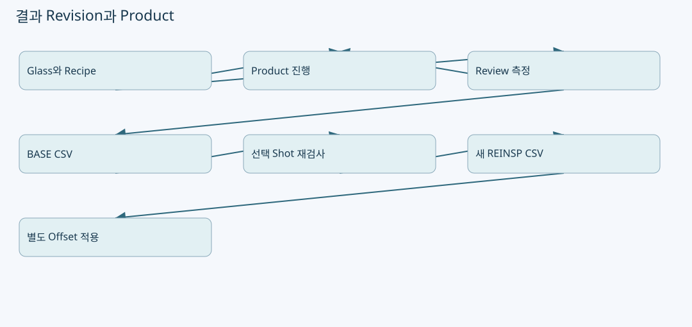


원본: `kjuws10-rgb/A3Drilling` · `master` · `5aee8e58439c9b455cae7c9593c9be986c3e682e`

이 장의 **코드 확인**은 해당 Commit의 실제 함수 본문을 정적으로 추적한 사실입니다. **해설**은 그 구조를 이해하기 위한 설명이며, **검증 과제**는 앞으로 실행할 시험입니다. 실장비의 부호·광학 상태·통신 타이밍·정밀도가 검증되었다는 뜻은 아닙니다. 예시 숫자는 설명용 가상값입니다.

## 1. 세 종류의 이력이 별도로 존재한다

이 프로젝트에서 측정 결과 파일, 보정 snapshot, Product 진행 상태는 다른 자료입니다. ReviewResult는 측정 수치와 판정을 저장합니다. ReviewOffset은 다음 가공에 쓸 보정값을 저장합니다. Product는 현재 Glass/공정의 Review가 Running/Completed인지와 결과 요약을 관리합니다. 파일 하나가 존재한다고 나머지 두 상태가 자동으로 동일하다고 추정하면 안 됩니다. [CReviewResultFile.cs:135–209](https://github.com/kjuws10-rgb/A3Drilling/blob/5aee8e58439c9b455cae7c9593c9be986c3e682e/Drilling.File/ReviewResult/CReviewResultFile.cs#L135-L209) [CAutoFineReviewCoordinator.cs:121–166](https://github.com/kjuws10-rgb/A3Drilling/blob/5aee8e58439c9b455cae7c9593c9be986c3e682e/Drilling.Common/Review/CAutoFineReviewCoordinator.cs#L121-L166) [CProductManager.cs:444–506](https://github.com/kjuws10-rgb/A3Drilling/blob/5aee8e58439c9b455cae7c9593c9be986c3e682e/Drilling.Common/Product/CProductManager.cs#L444-L506)

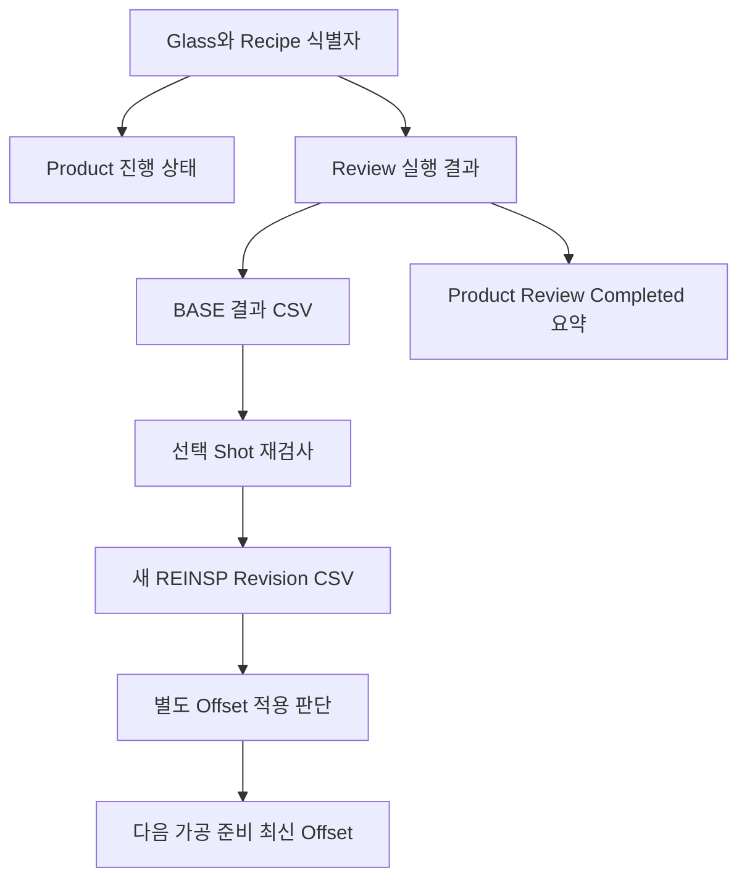

그림의 Product 화살표는 데이터 책임을 구분한 것입니다. 수동 재검사 Revision을 만들 때 자동으로 과거 Product 요약도 수정되는지 여부는 이 장에서 확인한 파일 함수만으로 보장하지 않습니다.

## 2. 재검사의 UI 입력이 모이는 곳

`SaveReinspectionResult`는 완료된 재검사 항목만 모읍니다. 각 update에는 `CellNo`, `ShotKey`, `ShotName`, 원래 Beam, 실제 재검사 Beam, raw 결과 X/Y, 변환된 결과 X/Y, 상태가 들어갑니다. 사용자가 다른 Beam으로 재검사했을 때 원래 row와 실제 사용 Beam을 구분하는 이유입니다. 완료 update가 없으면 저장을 거부하고 BASE 파일명과 갱신 Shot 수를 확인한 뒤 파일 writer를 호출합니다. [CMenuCorrection.ReviewData.Reinspection.cs:337–393](https://github.com/kjuws10-rgb/A3Drilling/blob/5aee8e58439c9b455cae7c9593c9be986c3e682e/Drilling.UI/Menu/Menus/CMenuCorrection.ReviewData.Reinspection.cs#L337-L393)

| 값 | 구분 목적 |
|---|---|
| SourceBeamNo | BASE 결과에서 어떤 측정 행을 바꾸려는지 찾는 단서 |
| BeamNo | 이번 재검사에 실제 선택한 Beam |
| RawResultX/Y | 수신 오차가 어떤 방향이었는지 추적 |
| ResultX/Y | 변환 후 후처리할 오차 |
| Judge/State | 완료 OK인지 완료 NG인지 구분 |

UI 저장은 새 파일 경로를 받으면 unsaved 상태를 해제합니다. 취소와 일반 예외는 별도로 표시합니다. 저장 버튼을 눌렀다는 조작 이력만으로 파일이 생성되었다고 판단하지 말고 성공 경로와 실제 파일명까지 확인해야 합니다. [CMenuCorrection.ReviewData.Reinspection.cs:383–409](https://github.com/kjuws10-rgb/A3Drilling/blob/5aee8e58439c9b455cae7c9593c9be986c3e682e/Drilling.UI/Menu/Menus/CMenuCorrection.ReviewData.Reinspection.cs#L383-L409)

## 3. BASE 파일을 덮어쓰지 않는 Revision 생성

`SaveReinspectionRevision`은 source file 존재, header 존재, row 존재를 먼저 확인합니다. `BEAM1_JUDGE` header를 가진 BEAM INSPECTION 결과는 이 재검사 writer로 저장할 수 없습니다. 즉 어떤 결과 타입이든 같은 Revision 함수에 넣을 수 있는 구조가 아닙니다. [CReviewResultFile.cs:135–173](https://github.com/kjuws10-rgb/A3Drilling/blob/5aee8e58439c9b455cae7c9593c9be986c3e682e/Drilling.File/ReviewResult/CReviewResultFile.cs#L135-L173)

BASE 행을 dictionary로 복사한 뒤 update마다 검증하고 대상 행을 찾습니다. 같은 BASE row를 두 번 바꾸려 하면 `updatedRowIndexes`가 중복을 차단합니다. 기존 `SAVED_AT` 열이 있으면 Revision 시각 표현을 갱신합니다. `5aee8e58` 기준 함수는 기존 파일을 직접 overwrite하는 대신 새 고유 CSV를 만듭니다. [CReviewResultFile.cs:175–209](https://github.com/kjuws10-rgb/A3Drilling/blob/5aee8e58439c9b455cae7c9593c9be986c3e682e/Drilling.File/ReviewResult/CReviewResultFile.cs#L175-L209)

새 파일 stem은 기존 stem에서 마지막 `_REINSP_` 구간을 잘라내고 `_REINSP_yyyyMMdd_HHmmss_fff`를 붙입니다. Revision을 여러 번 만들 때 파일명에 `_REINSP_`가 끝없이 중첩되지 않도록 한 처리입니다. 원본 BASE의 행 구조를 유지하되 바뀐 행의 측정 열만 갱신하는 방식입니다. [CReviewResultFile.cs:198–209](https://github.com/kjuws10-rgb/A3Drilling/blob/5aee8e58439c9b455cae7c9593c9be986c3e682e/Drilling.File/ReviewResult/CReviewResultFile.cs#L198-L209)

## 4. 어떤 열을 어떻게 갱신하는가

`ApplyReinspectionUpdate`는 BASE에 **존재하는 열만** 갱신합니다. 아래 이름들은 저장 형식의 호환 열이며, 무조건 모든 결과 CSV에 동시에 존재한다는 뜻은 아닙니다. 좌표 열은 X와 Y가 한 쌍으로 있어야 하며 한쪽만 있으면 실패합니다. 갱신할 좌표 쌍이 하나도 없으면 저장할 수 없습니다. [CReviewResultFile.cs:293–338](https://github.com/kjuws10-rgb/A3Drilling/blob/5aee8e58439c9b455cae7c9593c9be986c3e682e/Drilling.File/ReviewResult/CReviewResultFile.cs#L293-L338)

| 열 묶음 | 들어가는 update 값 | 의미 |
|---|---|---|
| `RECV_TARGET_MINUS_HOLE_X/Y`, `RECV_X/Y` | RawResultX/Y | raw 방향 오차 |
| `VISION_FLIP_CONVERT_X/Y`, `CONVERTED_X/Y`, `ERROR_X/Y` | ResultX/Y | 변환된 오차 |
| `BEAM_NO` | BeamNo | 재검사 Beam |
| `JUDGE`, `STATE` | Judge 대문자 | 재검사 판정 |
| `RESULT_SOURCE` | MEASURED | 직접 측정으로 갱신된 행임을 표시 |

**해설:** result CSV의 `ERROR_X/Y`를 모든 코드 경로에서 raw Vision 축이라고 간주하면 안 됩니다. 이 Revision writer는 ResultX/Y를 넣습니다. 결과를 load해 보정할 때 어느 경로에서 flip이 이미 적용되었는지 확인해야 합니다. UI FINE/AUTO delta builder가 `EN_VISION_FLIP_TYPE.Normal`을 전달하는 것도 파일의 변환 후 오차를 다시 flip하지 않기 위한 읽기 관점에서 검토해야 할 연결점입니다. [CReviewResultFile.cs:301–305](https://github.com/kjuws10-rgb/A3Drilling/blob/5aee8e58439c9b455cae7c9593c9be986c3e682e/Drilling.File/ReviewResult/CReviewResultFile.cs#L301-L305) [CMenuCorrection.ReviewData.Offset.cs:433–458](https://github.com/kjuws10-rgb/A3Drilling/blob/5aee8e58439c9b455cae7c9593c9be986c3e682e/Drilling.UI/Menu/Menus/CMenuCorrection.ReviewData.Offset.cs#L433-L458)

## 5. 측정 행과 보간 행을 구별하는 이유

UI Offset 적용의 `MeasuredRows`는 결과 중 `ResultSource` metadata가 하나라도 있으면 `MEASURED` 행만 사용합니다. metadata가 전혀 없는 Legacy 결과에서는 Judge가 OK 또는 NG인 행을 fallback으로 선택합니다. 이미 보간해 표시한 행을 다시 실측 anchor로 넣으면 보간 결과를 실측처럼 재활용하게 되기 때문에 source 역할을 구분하는 것이 중요합니다. [CMenuCorrection.ReviewData.Offset.cs:461–466](https://github.com/kjuws10-rgb/A3Drilling/blob/5aee8e58439c9b455cae7c9593c9be986c3e682e/Drilling.UI/Menu/Menus/CMenuCorrection.ReviewData.Offset.cs#L461-L466)

새 Revision에서 source를 MEASURED로 바꾸는 행과, 미수정된 BASE 행의 기존 source 상태가 함께 남을 수 있습니다. “Revision 파일 전체가 이번에 새로 촬영한 결과”라고 해석하면 안 됩니다. 어떤 Shot이 이번 재검사로 바뀌었는지 update 목록과 원본 연결을 함께 보아야 합니다. [CReviewResultFile.cs:175–195](https://github.com/kjuws10-rgb/A3Drilling/blob/5aee8e58439c9b455cae7c9593c9be986c3e682e/Drilling.File/ReviewResult/CReviewResultFile.cs#L175-L195) [CReviewResultFile.cs:311–314](https://github.com/kjuws10-rgb/A3Drilling/blob/5aee8e58439c9b455cae7c9593c9be986c3e682e/Drilling.File/ReviewResult/CReviewResultFile.cs#L311-L314)

## 6. Product Review 상태의 정확한 책임

`SetReviewRunning`은 지정 Product의 Review.State를 Running으로 바꾸고 PersistAndLog를 호출합니다. `SetReviewProgress`는 진행 중 snapshot을 Active 저장소에 쓰고 `_current`를 갱신합니다. `SetReviewCompleted`는 Completed, SavedAt, Results의 복사본을 만들고 완료 로그와 함께 저장합니다. 각 함수는 `_updateGate` 안에서 실행됩니다. [CProductManager.cs:444–506](https://github.com/kjuws10-rgb/A3Drilling/blob/5aee8e58439c9b455cae7c9593c9be986c3e682e/Drilling.Common/Product/CProductManager.cs#L444-L506)

| 이벤트 | Product 필드 | 다른 자료와의 차이 |
|---|---|---|
| Review 시작 | State=Running | 결과 CSV 완성 전 상태 |
| 진행 갱신 | Running + 진행 Results | 중간 snapshot, 최종 보정 아님 |
| Review 완료 | Completed + SavedAt + Results | Product 요약 완료, Offset 파일 생성과 동일 함수 아님 |
| 재검사 Revision 저장 | ReviewResult 새 파일 | 이 파일 writer 자체는 Product 상태를 수정하지 않음 |

Product 관리자는 시작 시 중단된 진행 상태를 복구하는 경로를 갖지만, 이는 저장 상태의 정리와 이력 처리입니다. 그 사실만으로 Stage가 물리적으로 원점에 복귀했다거나 미완료 가공을 이어서 실행할 수 있다고 결론내려서는 안 됩니다. [CProductManager.cs:25–121](https://github.com/kjuws10-rgb/A3Drilling/blob/5aee8e58439c9b455cae7c9593c9be986c3e682e/Drilling.Common/Product/CProductManager.cs#L25-L121)

## 7. 파일 간 연결을 디버깅하는 순서

1. **대상 고정:** GlassId, RecipeId, RunId와 화면에서 연 BASE 파일명을 먼저 확인합니다. 서로 다른 Glass 결과를 비슷한 timestamp만 보고 결합하지 않습니다.
2. **측정 결과:** 실행이 Completed인지, `ResultFilePath`가 있고 `ResultSaveError`가 없는지 봅니다. [CAutoFineReviewCoordinator.cs:43–75](https://github.com/kjuws10-rgb/A3Drilling/blob/5aee8e58439c9b455cae7c9593c9be986c3e682e/Drilling.Common/Review/CAutoFineReviewCoordinator.cs#L43-L75)
3. **행 정합성:** 요구한 검사점과 결과의 식별자 집합·개수가 일치하는지 확인합니다. [CAutoFineReviewCoordinator.cs:169–196](https://github.com/kjuws10-rgb/A3Drilling/blob/5aee8e58439c9b455cae7c9593c9be986c3e682e/Drilling.Common/Review/CAutoFineReviewCoordinator.cs#L169-L196)
4. **Revision:** 재검사 대상이 몇 개인지, 어떤 Beam을 썼는지, 새 파일명이 무엇인지 확인합니다. [CMenuCorrection.ReviewData.Reinspection.cs:344–396](https://github.com/kjuws10-rgb/A3Drilling/blob/5aee8e58439c9b455cae7c9593c9be986c3e682e/Drilling.UI/Menu/Menus/CMenuCorrection.ReviewData.Reinspection.cs#L344-L396)
5. **보정:** 해당 source 파일에서 Offset을 적용한 적이 있는지, Current/Delta/Final이 무엇인지, 새 Offset snapshot이 무엇인지 봅니다. [CMenuCorrection.ReviewData.Offset.cs:299–331](https://github.com/kjuws10-rgb/A3Drilling/blob/5aee8e58439c9b455cae7c9593c9be986c3e682e/Drilling.UI/Menu/Menus/CMenuCorrection.ReviewData.Offset.cs#L299-L331) [CReviewOffsetFile.cs:145–211](https://github.com/kjuws10-rgb/A3Drilling/blob/5aee8e58439c9b455cae7c9593c9be986c3e682e/Drilling.File/ReviewOffset/CReviewOffsetFile.cs#L145-L211)
6. **다음 가공:** 준비 parameter에 load된 Offset 파일명과 시각을 확인합니다. 과거 Product가 Completed라는 사실만 보지 않습니다. [CStationProcess.cs:1546–1560](https://github.com/kjuws10-rgb/A3Drilling/blob/5aee8e58439c9b455cae7c9593c9be986c3e682e/Drilling.Common/Station/CStationProcess.cs#L1546-L1560)

## 8. 주석과 Offline Studio 검색어 설계

이 장은 “Review 좌표를 Vision에 전달”이라는 질문을 결과 CSV 작성 함수로만 답하는 오류를 줄이기 위한 보조 문서이기도 합니다. 검색 시 다음 책임을 구분해야 합니다.

| 질문 표현 | 우선 찾을 symbol | 이 장의 연결 |
|---|---|---|
| 좌표 계산 | `CalculateReviewTarget` | 카메라/Stage 목표, 통신 식별자와 구분 |
| Vision 전송 | `CVisionComm.SendPacket` | 실제 TCP byte write 경계 |
| 측정 결과 저장 | `CReviewResultFile.Save...` | 측정 artifact |
| 재검사 저장 | `SaveReinspectionRevision` | BASE 보존, 새 Revision |
| Offset 적용 | `SaveNewFromSource`, `BuildOffsetApplyPlan` | 누적값과 source 이력 |
| Product 완료 | `SetReviewCompleted` | Glass 진행 요약 |

## 9. 검증 과제

| 시험 | 기대 기준 |
|---|---|
| BASE 없는 파일 / header 없음 / rows 없음 | Revision 생성 전 명확한 오류 |
| BEAM INSPECTION 결과를 재검사 writer에 입력 | 허용하지 않음 |
| 한 row를 두 update가 지정 | 중복 row 갱신 거부 |
| X열만 있고 Y열 없는 Legacy CSV | 부분 좌표 저장 거부 |
| 다른 Beam으로 재측정 | source row 식별은 정확하고 BEAM_NO는 새 Beam으로 갱신 |
| Revision의 Revision 저장 | 중첩 suffix 없이 새 고유 파일, 기존 두 파일 유지 |
| MEASURED와 보간 행 혼합 | 실측 anchor만 보정 입력으로 선택 |
| Product progress 중 저장 예외 | 완료로 오인하지 않고 실제 저장 실패 드러남 |
| UI에서 결과만 확인 후 닫기 | Offset 최신 파일이 바뀌지 않음 |

검증 방법은 synthetic CSV와 가짜 Product 저장소를 이용한 단위·통합시험을 우선 권장합니다. 현장 파일의 실제 측정 행은 이 문서에 복제하지 않았습니다.


# 별도 정적 추적 상세 해설 · review/06_DefaultOffset_ZeroOrder_FirstBeam.md

# Default Offset·Zero Order·First Beam: 중심 기준과 보정값의 역할

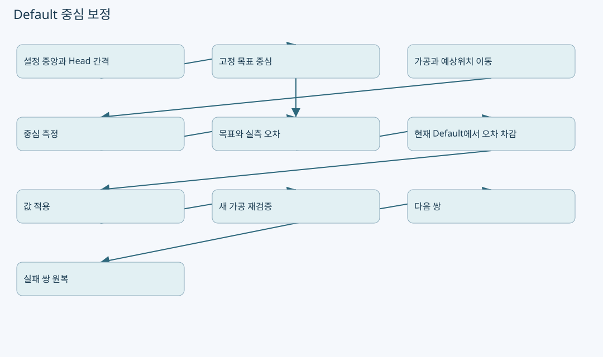


원본: `kjuws10-rgb/A3Drilling` · `master` · `5aee8e58439c9b455cae7c9593c9be986c3e682e`

이 장의 **코드 확인**은 해당 Commit의 실제 함수 본문을 정적으로 추적한 사실입니다. **해설**은 그 구조를 이해하기 위한 설명이며, **검증 과제**는 앞으로 실행할 시험입니다. 실장비의 부호·광학 상태·통신 타이밍·정밀도가 검증되었다는 뜻은 아닙니다. 예시 숫자는 설명용 가상값입니다.

## 1. 용어를 먼저 고정하기

이 장에서 **원빔**은 DOE가 없어서 16분기 Beam이 생기지 않고 실제 출사점이 Zero Order 위치가 되는 광학 상태를 말합니다. 프로그램에서 단지 BeamNo 하나를 선택했다고 DOE가 사라지거나 실제 빔이 한 개가 되는 것은 아닙니다. 현재 Default calibration의 Shot 측정 함수는 4×4 16점 격자를 전제로 하고, Cross 측정 함수는 Vision이 반환한 중심 한 점을 사용합니다. **Cross 모양과 DOE 유무는 별도 조건**입니다. [CDefaultOffsetCalibration.cs:107–171](https://github.com/kjuws10-rgb/A3Drilling/blob/5aee8e58439c9b455cae7c9593c9be986c3e682e/Drilling.Common/Correction/CDefaultOffsetCalibration.cs#L107-L171)

회의의 의도는 “Default는 Zero Order 기준으로 스캐너의 기본 위치를 맞추고, 원빔을 평가용 Beam11 위치에 맞추는 추가 이동은 별도 역할로 다루자”는 것입니다. 이 문단은 용어를 구분한 요구 설명이며, 현재 코드에 모든 원빔 자동 평가 경로가 구현되어 있다는 판정이 아닙니다. 구현에서 Default와 FirstBeam은 별도 키로 읽고 최종 좌표에서 더하는 독립 성분입니다. [CShotCoordinatePlanBuilder.cs:59–65](https://github.com/kjuws10-rgb/A3Drilling/blob/5aee8e58439c9b455cae7c9593c9be986c3e682e/Drilling.Common/Recipe/CShotCoordinatePlanBuilder.cs#L59-L65) [CShotCoordinatePlanBuilder.cs:139–155](https://github.com/kjuws10-rgb/A3Drilling/blob/5aee8e58439c9b455cae7c9593c9be986c3e682e/Drilling.Common/Recipe/CShotCoordinatePlanBuilder.cs#L139-L155)

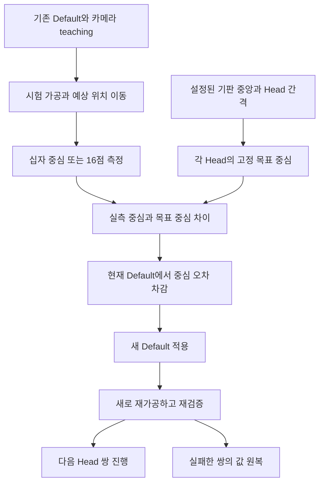

## 2. 핵심 파일과 책임

| 파일 / 함수 | 책임 | 여기서 하지 않는 것 |
|---|---|---|
| `CDefaultOffsetCalibration.Conditions` | Recipe/Setting에서 중앙·시험 Stage Y·허용오차 구성 | live AK 두 점을 새로 촬영하지 않음. [CDefaultOffsetCalibration.cs:31–38](https://github.com/kjuws10-rgb/A3Drilling/blob/5aee8e58439c9b455cae7c9593c9be986c3e682e/Drilling.Common/Correction/CDefaultOffsetCalibration.cs#L31-L38) |
| `HeadGeometry`, `Slot`, `Fit` | scan field, DOE angle, 16점 격자 geometry | DOE의 실제 장착 여부를 광학적으로 검출하지 않음. [CDefaultOffsetCalibration.cs:41–50](https://github.com/kjuws10-rgb/A3Drilling/blob/5aee8e58439c9b455cae7c9593c9be986c3e682e/Drilling.Common/Correction/CDefaultOffsetCalibration.cs#L41-L50) [CDefaultOffsetCalibration.cs:107–160](https://github.com/kjuws10-rgb/A3Drilling/blob/5aee8e58439c9b455cae7c9593c9be986c3e682e/Drilling.Common/Correction/CDefaultOffsetCalibration.cs#L107-L160) |
| `WithHeadReference` | Head별 고정 목표와 encoder 기반 실측 중심 비교 | 직전 Head 측정 위치에서 다음 목표를 누적 생성하지 않음. [CDefaultOffsetCalibration.cs:175–201](https://github.com/kjuws10-rgb/A3Drilling/blob/5aee8e58439c9b455cae7c9593c9be986c3e682e/Drilling.Common/Correction/CDefaultOffsetCalibration.cs#L175-L201) |
| `Recommend` | 현재 Default에서 중심 오차를 빼서 새값 추천 | Head Flip을 여기서 다시 적용하지 않음. [CDefaultOffsetCalibration.cs:206–228](https://github.com/kjuws10-rgb/A3Drilling/blob/5aee8e58439c9b455cae7c9593c9be986c3e682e/Drilling.Common/Correction/CDefaultOffsetCalibration.cs#L206-L228) |
| `CMenuCorrection.RunDefaultPairs` | H4/5→H3/6→H2/7→H1/8 실행·검증 | 검증되지 않은 값을 성공으로 확정하지 않음. [CMenuCorrection.cs:3296–3393](https://github.com/kjuws10-rgb/A3Drilling/blob/5aee8e58439c9b455cae7c9593c9be986c3e682e/Drilling.UI/Menu/Menus/CMenuCorrection.cs#L3296-L3393) |
| `CShotCoordinatePlanBuilder` | Default·FirstBeam·Align·Review를 Scanner 축으로 합산 | Default와 FirstBeam을 같은 값으로 취급하지 않음. [CShotCoordinatePlanBuilder.cs:133–155](https://github.com/kjuws10-rgb/A3Drilling/blob/5aee8e58439c9b455cae7c9593c9be986c3e682e/Drilling.Common/Recipe/CShotCoordinatePlanBuilder.cs#L133-L155) |

## 3. H4/H5 ±55 mm와 110 mm 간격의 정확한 조건

현재 `WithHeadReference`가 사용하는 공식은 다음과 같습니다. [CDefaultOffsetCalibration.cs:184–189](https://github.com/kjuws10-rgb/A3Drilling/blob/5aee8e58439c9b455cae7c9593c9be986c3e682e/Drilling.Common/Correction/CDefaultOffsetCalibration.cs#L184-L189)

```text
BoardCenterX = REVIEW_CAMERA_ALIGN_KEY_POS_X + GLASS_SIZE_X / 2 − AK_MARGIN_X
TargetHeadX  = BoardCenterX + (HeadNo − 4.5) × HeadGapX
```

`HeadGapX=110 mm`인 가상 설정에서는 아래 상대 위치가 됩니다. 55/110이 계산 함수에 무조건 상수로 박혀 있는 것이 아니라 **HeadGapX가 110일 때**의 결과입니다.

| Head | 중앙 기준 X | 산식 |
|---|---:|---|
| H1 | −385 mm | (1−4.5)×110 |
| H2 | −275 mm | (2−4.5)×110 |
| H3 | −165 mm | (3−4.5)×110 |
| H4 | −55 mm | (4−4.5)×110 |
| H5 | +55 mm | (5−4.5)×110 |
| H6 | +165 mm | (6−4.5)×110 |
| H7 | +275 mm | (7−4.5)×110 |
| H8 | +385 mm | (8−4.5)×110 |

각 Head의 목표는 같은 BoardCenterX에 대해 독립적으로 계산됩니다. H4를 측정한 좌표에 −110을 더해 H3를 만들고 다시 −110을 더하는 방식이 아닙니다. 앞 Head의 측정 오차가 뒤 Head 기준에 누적되지 않도록 한 구조입니다. 소스 주석도 이전 측정 Head를 global reference로 삼지 않는다고 설명합니다. [CDefaultOffsetCalibration.cs:173–185](https://github.com/kjuws10-rgb/A3Drilling/blob/5aee8e58439c9b455cae7c9593c9be986c3e682e/Drilling.Common/Correction/CDefaultOffsetCalibration.cs#L173-L185)

### live Align Key 두 점의 평균과는 구별해야 한다

사용자가 말한 “AK 두 점의 중간을 직접 구한 뒤 ±55 mm”와 현재 공식은 **중앙 기준을 얻는 단계가 다릅니다.** 이 함수는 카메라 AK 설정값, GlassSizeX, AK margin으로 중앙을 구성합니다. live AK 두 점 X/Y 평균이나 `atan2(ΔY,ΔX)`의 회전각을 이 공식에서 계산하지 않습니다. Distortion의 AK/DK 수신 기능이 따로 있다고 해서 이 Default 중앙에 자동 연결되었다고 볼 수 없습니다. [CDefaultOffsetCalibration.cs:31–38](https://github.com/kjuws10-rgb/A3Drilling/blob/5aee8e58439c9b455cae7c9593c9be986c3e682e/Drilling.Common/Correction/CDefaultOffsetCalibration.cs#L31-L38) [CDefaultOffsetCalibration.cs:175–201](https://github.com/kjuws10-rgb/A3Drilling/blob/5aee8e58439c9b455cae7c9593c9be986c3e682e/Drilling.Common/Correction/CDefaultOffsetCalibration.cs#L175-L201) [CAlignInterpolation.cs:306–327](https://github.com/kjuws10-rgb/A3Drilling/blob/5aee8e58439c9b455cae7c9593c9be986c3e682e/Drilling.Common/Correction/CAlignInterpolation.cs#L306-L327)

**검토 과제:** live AK 기준으로 바꿀 경우에는 AK 측정 시각·GlassId·좌표 frame·2점 간 설계거리·회전각·허용오차를 함께 동결해야 합니다. 기판의 ΔY 기울기를 그대로 Scanner 고정 기준에 섞을지, 기판 회전을 먼저 정렬할지는 광학 고정축과 기판 좌표계를 분리해 결정해야 합니다. 이는 개선 설계 과제이며 현재 구현이라고 쓰지 않습니다.

## 4. 예상 위치와 목표 위치는 다르다

`MeasureDefaultCenter`는 카메라가 마크를 찾을 예상 위치를 기존 teaching과 **현재 Default**로 계산합니다. source comment는 이 teaching이 마크를 찾는 위치일 뿐 기판 중앙 기준의 목표 Head reference를 정의하지 않는다고 설명합니다. 적용 후 재검증에서 바뀐 마크 위치를 따라가기 위해 현재 Default를 더합니다. [CMenuCorrection.cs:3727–3735](https://github.com/kjuws10-rgb/A3Drilling/blob/5aee8e58439c9b455cae7c9593c9be986c3e682e/Drilling.UI/Menu/Menus/CMenuCorrection.cs#L3727-L3735)

```text
captureCenterX = cameraAK_X + H01_AK_POSITION_X
                 + (HeadNo−1)×HeadGapX + CurrentDefaultX
captureCenterY = test.Q − direction×gapY + direction×CurrentDefaultY
```

반면 최종 오차는 `WithHeadReference`에서 고정된 기판 중앙 기준 목표와 비교합니다. 카메라 예상 위치를 잘 맞추려고 teaching을 바꾼 일이 곧 목표 중앙을 바꾼 일이 되어서는 안 됩니다. 이 구분이 첫 빔 탐색과 calibration을 이해하는 핵심입니다. [CMenuCorrection.cs:3727–3764](https://github.com/kjuws10-rgb/A3Drilling/blob/5aee8e58439c9b455cae7c9593c9be986c3e682e/Drilling.UI/Menu/Menus/CMenuCorrection.cs#L3727-L3764) [CDefaultOffsetCalibration.cs:184–200](https://github.com/kjuws10-rgb/A3Drilling/blob/5aee8e58439c9b455cae7c9593c9be986c3e682e/Drilling.Common/Correction/CDefaultOffsetCalibration.cs#L184-L200)

## 5. 실측 중심은 encoder와 수신 보정을 이용한다

현재 `WithHeadReference`의 실제 계산은 아래와 같습니다. 단순히 Vision이 반환한 좌표 하나를 설계 절대좌표로 취급하지 않습니다. [CDefaultOffsetCalibration.cs:180–200](https://github.com/kjuws10-rgb/A3Drilling/blob/5aee8e58439c9b455cae7c9593c9be986c3e682e/Drilling.Common/Correction/CDefaultOffsetCalibration.cs#L180-L200)

```text
ActualX = Average(EncoderX − CorrectionX)
ActualY = Average(EncoderY − direction×CorrectionY)
TargetY = test.Q − direction×gapY
CenterErrorX = ActualX − TargetX
CenterErrorY = (ActualY − TargetY) / direction
```

입력은 Head1..8, 유한한 Q와 encoder/correction, Cross 한 점(Beam0) 또는 Beam1..16이 하나씩 있는 완전한 배열이어야 합니다. `Fit`에서는 모든 점 OK, 중복 없는16 Beam, 예상 격자와의 잔차 및 pitch/angle을 검증합니다. 일부 Beam이 안 보였는데 나머지 평균만으로 가상 중심을 임의 확정하는 분기는 이 함수에 없습니다. [CDefaultOffsetCalibration.cs:125–160](https://github.com/kjuws10-rgb/A3Drilling/blob/5aee8e58439c9b455cae7c9593c9be986c3e682e/Drilling.Common/Correction/CDefaultOffsetCalibration.cs#L125-L160) [CDefaultOffsetCalibration.cs:175–200](https://github.com/kjuws10-rgb/A3Drilling/blob/5aee8e58439c9b455cae7c9593c9be986c3e682e/Drilling.Common/Correction/CDefaultOffsetCalibration.cs#L175-L200)

## 6. Shot 16점과 Cross 한 점 경로

| 경로 | 현재 호출 | 모델 가정 / 제한 |
|---|---|---|
| Shot | beam1..16에 대해 Slot을 계산하고 각 Capture 후 `Fit` | `SPLITED_BEAM_COUNT`가4인4×4, 16점 완전 측정 필요 |
| Cross | beam0, localoffset0에서 한 Capture 후 `FitCross` | Vision이 반환한 십자 중심을 사용 |

Cross shape는 scanner가 그리는 형태입니다. DOE가 장착되어 있다면 그 형태도 물리적으로 여러 곳에 나뉠 수 있습니다. 따라서 **Cross=DOE 제거=원빔**이라는 동치는 성립하지 않습니다. 실제 Vision method가 어떤 마크의 중심을 반환하는지, DOE 장착 Scanner에서 가상 Zero Order를 어떻게 확정할지는 현장 광학/프로토콜 계약을 확인해야 합니다. [CMenuCorrection.cs:3740–3758](https://github.com/kjuws10-rgb/A3Drilling/blob/5aee8e58439c9b455cae7c9593c9be986c3e682e/Drilling.UI/Menu/Menus/CMenuCorrection.cs#L3740-L3758) [CDefaultOffsetCalibration.cs:107–171](https://github.com/kjuws10-rgb/A3Drilling/blob/5aee8e58439c9b455cae7c9593c9be986c3e682e/Drilling.Common/Correction/CDefaultOffsetCalibration.cs#L107-L171)

추천값은 `nextDefault = Round(currentDefault − CenterError,5,AwayFromZero)`이고 유한한 값, ±100 mm 범위를 확인합니다. 이 방향은 코드에서 확인한 산식이며 물리축을 추측해 정한 방향이 아닙니다. Head flip은 나중 Scanner builder에서 적용하므로 추천 단계에서 다시 반전하면 안 됩니다. [CDefaultOffsetCalibration.cs:206–228](https://github.com/kjuws10-rgb/A3Drilling/blob/5aee8e58439c9b455cae7c9593c9be986c3e682e/Drilling.Common/Correction/CDefaultOffsetCalibration.cs#L206-L228)

## 7. 실제 UI 쌍별 실행 순서와 실패 처리

`RunDefaultPairs`는 USE Head를 골라 `[4,5]`, `[3,6]`, `[2,7]`, `[1,8]` 순서로 묶습니다. 한쪽 Head가 미사용이면 남은 Head만 처리합니다. 각 쌍에서 **가공 → 검사 → 추천 → 적용 → 새 재가공 → 새 재검증**을 실행합니다. 기존 마크를 다시 측정한 것만으로 새 Default를 검증한 것으로 보지 않습니다. [CMenuCorrection.cs:3296–3358](https://github.com/kjuws10-rgb/A3Drilling/blob/5aee8e58439c9b455cae7c9593c9be986c3e682e/Drilling.UI/Menu/Menus/CMenuCorrection.cs#L3296-L3358)

각 Head의 재검증 X/Y 오차가 허용오차 이내일 때 해당 쌍을 Verified로 확정하고 다음 쌍으로 넘어갑니다. 실패·취소하면 아직 검증되지 않은 해당 쌍의 적용 전 값을 복원합니다. 앞에서 검증한 쌍은 유지합니다. 복원도 실패하면 원래 실패와 restore 오류를 AggregateException으로 보고합니다. “전체 자동 원복”과 “실패 쌍만 원복”을 구별해야 합니다. [CMenuCorrection.cs:3357–3393](https://github.com/kjuws10-rgb/A3Drilling/blob/5aee8e58439c9b455cae7c9593c9be986c3e682e/Drilling.UI/Menu/Menus/CMenuCorrection.cs#L3357-L3393)

측정에 들어가기 전에는 Laser Off 명령을 내리고, 해당 요청 이후에 갱신된 신선한 축 snapshot에서 raw output0을 확인합니다. timeout은5초이며 offline/error도 실패합니다. 다만 이 확인 로직의 존재가 하드웨어 안전 회로나 실제 레이저 차단 성능의 검증을 대신하지 않습니다. [CMenuCorrection.cs:3702–3726](https://github.com/kjuws10-rgb/A3Drilling/blob/5aee8e58439c9b455cae7c9593c9be986c3e682e/Drilling.UI/Menu/Menus/CMenuCorrection.cs#L3702-L3726)

## 8. Default와 FirstBeam이 합쳐지는 지점

builder는 Head마다 `Hnn_DEFAULT_OFFSET_X/Y`와 `Hnn_FIRST_BEAM_OFFSET_X/Y`를 별도로 읽습니다. 두 값은 design Y→Stage Y 변환과 Head transform을 거쳐 독립적으로 Scanner offset이 됩니다. 여기에 Recipe/Review/Align 성분을 더해 final scanner 좌표를 만듭니다. Align/Review scale은 이번 기여값에만 곱하고 저장값은 바꾸지 않는 주석도 있습니다. [CShotCoordinatePlanBuilder.cs:59–65](https://github.com/kjuws10-rgb/A3Drilling/blob/5aee8e58439c9b455cae7c9593c9be986c3e682e/Drilling.Common/Recipe/CShotCoordinatePlanBuilder.cs#L59-L65) [CShotCoordinatePlanBuilder.cs:133–155](https://github.com/kjuws10-rgb/A3Drilling/blob/5aee8e58439c9b455cae7c9593c9be986c3e682e/Drilling.Common/Recipe/CShotCoordinatePlanBuilder.cs#L133-L155)

**해설:** Default를 기본 기하 정렬에, FirstBeam을 실제 패턴 위치의 추가 이동에 쓰겠다는 운영 개념을 유지하려면 두 값의 목적·획득 절차·적용 시점을 UI에서 분리해야 합니다. 원빔을 평가용 Beam11 위치로 옮길 양을 Default에 섞어 넣으면 다음에 Zero Order 중심 calibration을 할 때 기본 기준과 평가 이동량이 혼합됩니다. 현재 builder의 독립 키를 유지한 채 Head별 광학 mode와 유효 Beam 정책을 함께 검증하는 편이 명확합니다.

## 9. 검증 과제

| 항목 | 가상 / 실장비 확인 방법 | 통과 판단 |
|---|---|---|
| ±55/110 | HeadGapX110, 중앙 가상값으로 H1..8 계산 | 위 상대 위치 표와 일치 |
| 독립 기준 | H4 실측만 일부러 크게 변경 | H3 목표 기준은 변하지 않음 |
| AK 기울기 | live AK ΔY를 바꾼 입력과 현재 Default 조건 비교 | 현재 경로에는 live2점 회전 자동 반영이 없음을 명확히 표시 |
| currentDefault 포함 | Default가 0이 아닌 상태에서 첫 capture와 재검증 | capture 예상 위치가 변경값을 따라가고 목표 중앙은 고정 |
| 불완전16점 | 15점·중복Beam·NG·NaN | 추천 전 거부 |
| DOE 없음 | 원빔 optical mode와 한 점 측정 계약 확인 | 16점 경로를 강제로 성공 처리하지 않음 |
| Cross+DOE | 실제16개십자 중 Vision이 찾는 중심 확인 | software mode만으로 원빔이라 단정하지 않음 |
| 쌍별 중단 | H3/6 적용 직후 실패 주입 | H3/6만 원복, H4/5 Verified 유지 |
| 방향 검증 | 작은 ±X/±Y 입력, 모든 Head flip | 실제 이동이 식과 일치하며 이중 반전 없음 |

Pure 계산 시험은 설비 없이 먼저 할 수 있습니다. 첫 빔 탐색·DOE 실제 구성·십자 중심 검출은 카메라와 광학 실물 확인이 필요한 별도 시험입니다. 본 문서에서는 실행하지 않았습니다.


# 별도 정적 추적 상세 해설 · review/07_Align_Distortion_윈도우_복구.md

# Align·Distortion·보호윈도우·복구: 자동 시퀀스의 데이터 경계

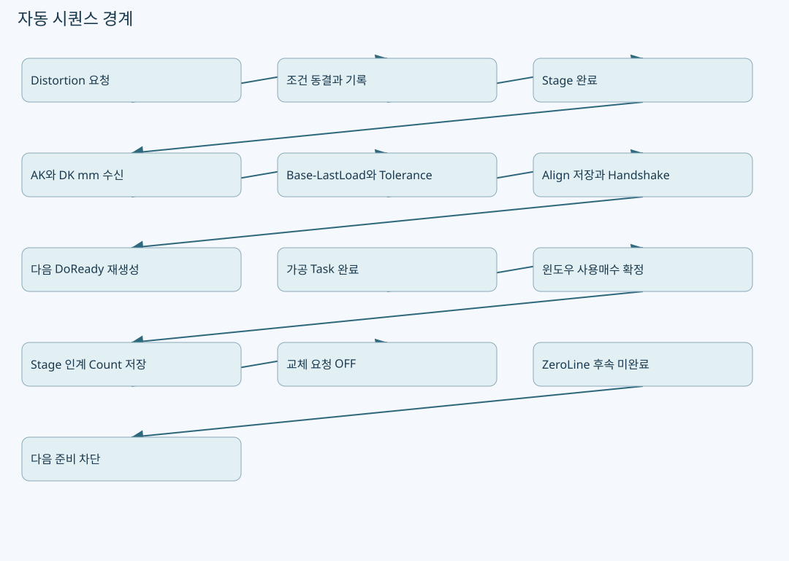


원본: `kjuws10-rgb/A3Drilling` · `master` · `5aee8e58439c9b455cae7c9593c9be986c3e682e`

이 장의 **코드 확인**은 해당 Commit의 실제 함수 본문을 정적으로 추적한 사실입니다. **해설**은 그 구조를 이해하기 위한 설명이며, **검증 과제**는 앞으로 실행할 시험입니다. 실장비의 부호·광학 상태·통신 타이밍·정밀도가 검증되었다는 뜻은 아닙니다. 예시 숫자는 설명용 가상값입니다.

## 1. 이 장의 범위

이 장은 Distortion의 AK/DK 수신→Align Offset 계산→다음 DoReady 연결, 수동 Wapage Load/Set의 구분, 보호윈도우 사용매수 handover, ZeroLine 후속검사와 다음 가공 차단을 추적합니다. 모든 A1 알람의 정지·재개 알고리즘이나 실제 광학 회복 성공을 판정하는 장은 아닙니다. 그런 결론에는 Task 정지 확인, 레이저 차단, Stage 정지, 보정 유효성, Glass 처리방침을 추가로 검증해야 합니다.

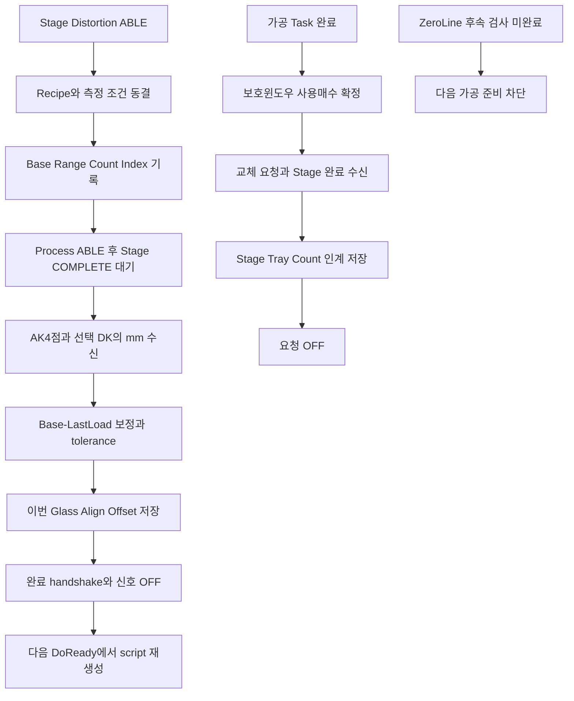

## 2. Distortion이 동결하는 것

`CAlignDistortionCycle.Prepare`는 이전 snapshot/pending/results/model/offsets와 저장 플래그를 초기화하고, 현재 요청의 RecipeId로 Recipe를 새로 읽습니다. Motor의 Stage Y 위치, Run Option의 Distortion group, Align Offset tolerance, Align camera resolution, Wapage 허용 mm 범위를 확보합니다. `pixels = rangeMm / resolution`이며 분해능은 양수, range는0이상이어야 합니다. [CAlignInterpolation.cs:266–281](https://github.com/kjuws10-rgb/A3Drilling/blob/5aee8e58439c9b455cae7c9593c9be986c3e682e/Drilling.Common/Correction/CAlignInterpolation.cs#L266-L281)

조건만 읽는 것으로 끝나지 않습니다. 필요한 모든 MELSEC route의 주소·USE·자료형·방향·연결 상태를 **첫 PLC write 전에 검증**합니다. Vision fine-align 결과8값을 읽어 Base에 쓰고, Range pixel을 쓰며, Distortion Count/Index/Stage Y 위치도 기록합니다. viewer snapshot에는 측정 표시와 무관한 Shot offset/history를 빼는 최적화 주석이 있습니다. [CAlignInterpolation.cs:282–304](https://github.com/kjuws10-rgb/A3Drilling/blob/5aee8e58439c9b455cae7c9593c9be986c3e682e/Drilling.Common/Correction/CAlignInterpolation.cs#L282-L304)

| 자료 | source의 의미 | 잘못 이해하기 쉬운 점 |
|---|---|---|
| `ALIGNBASE_AKn_X/Y` | Recipe에 저장한 Align 기준값 | 매번 자동으로 현재 측정값으로 overwrite하는 일반 설정값이 아님 |
| `DISTORTION_POS0_CAMnX/Y` | AK1..4의 현재 측정 결과 map | Vision TCP1001 식별자 body와 다른 MELSEC 경로 |
| DK result map | 선택 group의 CAM2/CAM4와 Stage 위치 결과 | 모든 DK를 항상 측정한다고 가정하지 않기 |
| Range | mm 허용범위를 camera resolution으로 나눈 pixel | global mm좌표와 단위가 다름 |
| Align Shot Offset | Base−LastLoad로 계산한 설계 좌표 보정 | Review 보정 파일과 별도 |

AK와 DK result ID mapping은 `ResultId`에서 명시합니다. AK1..4는 POS0/CAM1..4, DK는 group과 CAM2/4로 매핑합니다. [CAlignInterpolation.cs:237–251](https://github.com/kjuws10-rgb/A3Drilling/blob/5aee8e58439c9b455cae7c9593c9be986c3e682e/Drilling.Common/Correction/CAlignInterpolation.cs#L237-L251)

## 3. Distortion handshake의 실제 순서

`RunDistortion`은 소유한 Process output을0으로 만들고 Stage Complete0을 확인합니다. 그 뒤 Prepare로 조건을 동결하고 다시 Stage Complete0을 확인합니다. `readyAt`을 잡은 후 Process Able1을 쓰고 그 이후의 Stage Complete1을 기다립니다. 이전 사이클의 stale 완료 신호를 현재 응답으로 취급하지 않으려는 순서입니다. [CStationProcess.cs:5620–5637](https://github.com/kjuws10-rgb/A3Drilling/blob/5aee8e58439c9b455cae7c9593c9be986c3e682e/Drilling.Common/Station/CStationProcess.cs#L5620-L5637)

Stage 완료 후 Load→Calculate→Save를 성공해야 Process Complete1을 보냅니다. Stage Complete0 및 Able0을 확인한 다음에 Process outputs를0으로 내립니다. `_distortionNeedsDoReady=true`를 설정하며 로그에도 다음 요청에서 DoReady script 재생성이 필요하다고 남깁니다. 측정이 끝났다고 기존 가공 script를 그대로 써도 된다는 구조가 아닙니다. [CStationProcess.cs:5635–5655](https://github.com/kjuws10-rgb/A3Drilling/blob/5aee8e58439c9b455cae7c9593c9be986c3e682e/Drilling.Common/Station/CStationProcess.cs#L5635-L5655)

## 4. AK4점 글로벌 mm 수동 수신과 자동 보정의 구분

현재 코드에 **버튼 기반 one-shot 수신/기록 서비스**가 존재합니다. `CAlignWapageService.Load`는 Vision의 `SVID_FINEALN_CAM1..4_GLS_RESULT_X/Y`8개 값과 Process 쪽 Base/Range를 함께 읽습니다. 수신 숫자는 `CMelsec`에서 READ_SCALE이 적용된 값이고 nonfinite면 거부합니다. 이 service의 Load는 SetBase/SetRange와 분리되어 있어 읽기만 했다고 write하지 않습니다. [CAlignInterpolation.cs:364–375](https://github.com/kjuws10-rgb/A3Drilling/blob/5aee8e58439c9b455cae7c9593c9be986c3e682e/Drilling.Common/Correction/CAlignInterpolation.cs#L364-L375) [CAlignInterpolation.cs:408–437](https://github.com/kjuws10-rgb/A3Drilling/blob/5aee8e58439c9b455cae7c9593c9be986c3e682e/Drilling.Common/Correction/CAlignInterpolation.cs#L408-L437)

그러나 **현재 map에 있는 값을 읽기**와 **지금 새로 Align 측정을 요청해 특정 Glass의 최신4점 global mm를 얻기**는 다른 기능입니다. 이 Load 함수는 새로운 측정 START/COMPLETE를 발행하지 않습니다. Distortion의 `LoadResults`는 별도 result map을 읽어 `ALIGNBASE_*` 키로 매핑하고 LoadedAt을 기록합니다. 두 source의 주소·소유자·단위·갱신시점이 같다고 임의로 가정하면 안 됩니다. [CAlignInterpolation.cs:306–316](https://github.com/kjuws10-rgb/A3Drilling/blob/5aee8e58439c9b455cae7c9593c9be986c3e682e/Drilling.Common/Correction/CAlignInterpolation.cs#L306-L316) [CAlignInterpolation.cs:408–418](https://github.com/kjuws10-rgb/A3Drilling/blob/5aee8e58439c9b455cae7c9593c9be986c3e682e/Drilling.Common/Correction/CAlignInterpolation.cs#L408-L418)

**개선 검토:** 사용자가 원하는 “언제든 AK4점 글로벌 X/Y(mm) 수동 수신” 화면은 최소한 source=현재값 읽기인지 새측정 요청인지, GlassId, 측정시각, 수신시각, 유효/NG,8개 좌표, 이전값과의 차이, 보정 반영 여부를 구분해야 합니다. 읽기 버튼이 즉시 Base를 덮어쓰지 않도록 현재 service의 분리 원칙을 유지하는 것이 좋습니다. 이는 UI 요구 해설이며 이 모든 항목의 구현 완료를 주장하지 않습니다.

## 5. Base, Range를 수동으로 쓰는 경계

`SetBase`는 Vision source8값이 전부 유한해야 쓰고, `SetRange`는0이상 유한 pixel이어야 씁니다. destination 순서는 CAM1..4 X→X1..4 다음 CAM1..4 Y→Y1..4입니다. 소스에 기록된 이 순서를 X1,Y1,X2,Y2와 혼동하면 좌표가 뒤섞입니다. [CAlignInterpolation.cs:367–375](https://github.com/kjuws10-rgb/A3Drilling/blob/5aee8e58439c9b455cae7c9593c9be986c3e682e/Drilling.Common/Correction/CAlignInterpolation.cs#L367-L375) [CAlignInterpolation.cs:433–442](https://github.com/kjuws10-rgb/A3Drilling/blob/5aee8e58439c9b455cae7c9593c9be986c3e682e/Drilling.Common/Correction/CAlignInterpolation.cs#L433-L442)

write 전에는 `WriteScale`로 정수 저장범위를 확인하고 readback 예상값을 계산합니다. 실제 `_write`에는 논리값을 넘겨 CMelsec에서 scale을 한 번만 적용하게 합니다. 모든 값 기록 후 readback과1e−7 기준으로 비교합니다. 일부 write 후 실패하면 “몇 개 쓰기 완료했으며 일부 변경됐을 수 있으니 Load로 확인”하는 오류를 냅니다. **이 write 묶음은 모든 PLC값이 원자적으로 한 번에 바뀌는 트랜잭션이 아닙니다.** [CAlignInterpolation.cs:444–475](https://github.com/kjuws10-rgb/A3Drilling/blob/5aee8e58439c9b455cae7c9593c9be986c3e682e/Drilling.Common/Correction/CAlignInterpolation.cs#L444-L475)

## 6. Base−LastLoad가 Align Offset이 되는 과정

`Keys`는 Recipe의 Base에서 수신 measured를 빼 `CorrectionX/Y`를 만듭니다. `Calculate`는 AK와 선택 DK로 `CAlignInterpolation` 모델을 만들고 Shot별 Align Offset을 구합니다. tolerance를 넘는 Shot이 하나라도 있으면 전체 적용을 취소합니다. [CAlignInterpolation.cs:258–263](https://github.com/kjuws10-rgb/A3Drilling/blob/5aee8e58439c9b455cae7c9593c9be986c3e682e/Drilling.Common/Correction/CAlignInterpolation.cs#L258-L263) [CAlignInterpolation.cs:318–327](https://github.com/kjuws10-rgb/A3Drilling/blob/5aee8e58439c9b455cae7c9593c9be986c3e682e/Drilling.Common/Correction/CAlignInterpolation.cs#L318-L327)

`Save`는 필요한 모델과 결과가 모두 준비되어야 합니다. `SaveAlignOffsetsIfUnchanged`로 Recipe 변경 여부를 고려한 저장을 수행하고, key별 Base/LastLoad/correction 및 계산 offset audit를 남깁니다. 이번 요청의 기존 Align offset key를 제거하고 저장된 Align offset을 넣은 pending request를 만듭니다. `TakePreparedRequest`는 같은 RecipeId만 허용하며 pending을 한 번 가져가도록 합니다. [CAlignInterpolation.cs:329–359](https://github.com/kjuws10-rgb/A3Drilling/blob/5aee8e58439c9b455cae7c9593c9be986c3e682e/Drilling.Common/Correction/CAlignInterpolation.cs#L329-L359)

**해설:** 오래 저장된 Review Offset 누적과 이번 Glass Align Offset 갱신은 다른 수명 주기입니다. 동시에 합산된다고 둘을 같은 파일로 관리하거나 동일한 rollback 버튼으로 지우면 운영 의미가 달라집니다. 최종 builder에서는 Align과 Review를 각자 변환하고 각자 scale을 적용한 뒤 합산합니다. [CShotCoordinatePlanBuilder.cs:139–155](https://github.com/kjuws10-rgb/A3Drilling/blob/5aee8e58439c9b455cae7c9593c9be986c3e682e/Drilling.Common/Recipe/CShotCoordinatePlanBuilder.cs#L139-L155)

## 7. 보호윈도우 사용매수의 소유권

가공 Task가 모두 완료된 뒤 `CountCompletedProtectWindowGlass`는 Recipe의 사용매수를 증가시킵니다. gate와 `_protectWindowCounted`로 한 번만 확정합니다. 주석에는 이 시점 뒤 STOP·결과 저장 실패·Stage ACK가 와도 레이저 사용 사실이 없어지지 않으므로 durable count commit을 끝낸다고 설명합니다. 따라서 “Product CSV 저장 실패니까 사용매수도 자동 원복”으로 처리하면 실제 사용량을 잃을 수 있습니다. [CStationProcess.cs:3764–3785](https://github.com/kjuws10-rgb/A3Drilling/blob/5aee8e58439c9b455cae7c9593c9be986c3e682e/Drilling.Common/Station/CStationProcess.cs#L3764-L3785)

`CProtectWindowUsageRequest.Update`는 Recipe의 Current/Maximum count를 읽고 Process count를 전송합니다. Current>=Maximum이면 교체 요청을 올립니다. Max0은 즉시 요청 조건이며 같은 Glass cycle에서 이미 교체 완료한 경우 다시 요청하지 않도록 acknowledged cycle을 검사합니다. [CStationProcess.cs:4332–4385](https://github.com/kjuws10-rgb/A3Drilling/blob/5aee8e58439c9b455cae7c9593c9be986c3e682e/Drilling.Common/Station/CStationProcess.cs#L4332-L4385)

| logical ID | 뜻 | 책임 |
|---|---|---|
| `PROCESS_SEQUENCE_PTW_PROCESS_COUNT` | Process가 보고하는 사용매수 | Recipe 지속값과 연계 |
| `PROCESS_SEQUENCE_TPD_PTW_EXCHANGE_FLAG` | Process 교체 요청 | 요청 유지/해제 |
| `PTW_EXCHANGE_SEQ_COMPLETE` | Stage 교체 완료 | Stage가 인계 준비했는지 판단 |
| `PTW_TRAY_COUNT` | Stage가 인계하는 공식 사용매수 | 완료 수신 시 읽어 지속 저장 |

이 표는 logical ID 기준입니다. 실제 address, scale, 방향은 장비에 배포한 map을 별도로 확인해야 합니다. [CStationProcess.cs:4332–4353](https://github.com/kjuws10-rgb/A3Drilling/blob/5aee8e58439c9b455cae7c9593c9be986c3e682e/Drilling.Common/Station/CStationProcess.cs#L4332-L4353)

## 8. 교체 완료 때 무조건0으로 만들지 않는다

완료 감시 코드는 이미 켜진 Request가 앱 재시작 후 남아 있거나 Monitor에서 발생한 경우도 pending Recipe를 잡는 경로가 있습니다. Complete false를 관찰하면 completion을 arm하고, Complete true와 armed 조건이 충족되면 Stage의 Tray Count를 읽습니다. **모든 교체/shift를 새 보호윈도우0매로 가정하지 않습니다.** [CStationProcess.cs:4593–4619](https://github.com/kjuws10-rgb/A3Drilling/blob/5aee8e58439c9b455cae7c9593c9be986c3e682e/Drilling.Common/Station/CStationProcess.cs#L4593-L4619)

순서는 Stage count 읽기→`SetProtectWindowCount`로 Recipe에 지속 저장→Process count 보고→Request0입니다. `_committedHandoverCount`를 보관하므로 뒤쪽 보고/요청 해제 재시도 때 이미 확정한 인계 매수를 다시 읽어 바꾸지 않도록 구성합니다. 완료 전후의 다른 장애를 넣어 이 순서가 유지되는지 시험해야 합니다. [CStationProcess.cs:4610–4631](https://github.com/kjuws10-rgb/A3Drilling/blob/5aee8e58439c9b455cae7c9593c9be986c3e682e/Drilling.Common/Station/CStationProcess.cs#L4610-L4631)

**미확인 범위:** 평탄NG와 교체NG의 세부 원인별 종료 정책, 무한 교체 방지를 위한 운영 retry 제한, 강제 Request 해제의 권한·사용자 확인, Stage 인계 count가 Max보다 큰 경우의 현장 처리방침은 이 장의 추적만으로 확정하지 않습니다. 회의 시나리오를 상태표로 정하고 담당 장치와 함께 평가해야 합니다.

## 9. ZeroLine 후속검사가 남았을 때 다음 가공 차단

`EnsureZeroLineFollowUpCompleted`는 후속 cleanup이 남은 cycle이 있으면 다음 준비를 차단합니다. 후속검사가 요청된 경우에는 Stage Review 시퀀스 완료를 요구하고, 요청 출력 OFF 확인이 남은 경우에는 RESET으로 W8218 OFF 확인을 요구하는 오류를 냅니다. 다음 요청으로 ProcessModel을 바꾸기 전에 이전 Glass의 진단 Review 식별자를 보존하는 주석과 함께 호출됩니다. [CStationProcess.cs:3983–3994](https://github.com/kjuws10-rgb/A3Drilling/blob/5aee8e58439c9b455cae7c9593c9be986c3e682e/Drilling.Common/Station/CStationProcess.cs#L3983-L3994) [CStationProcess.cs:4256–4264](https://github.com/kjuws10-rgb/A3Drilling/blob/5aee8e58439c9b455cae7c9593c9be986c3e682e/Drilling.Common/Station/CStationProcess.cs#L4256-L4264)

AUTO Review handshake도 Prepare→Able→StageStart→ProcessStart→Measure→Save→ProcessComplete→StageComplete→신호정리 순서입니다. ZeroLine 후속1줄은 보정 미적용, 일반 AUTO는 전체OK일 때 다음 Glass 보정 저장이라는 목적 구분이 시퀀스 설명에도 들어갑니다. [CStationProcess.cs:5696–5718](https://github.com/kjuws10-rgb/A3Drilling/blob/5aee8e58439c9b455cae7c9593c9be986c3e682e/Drilling.Common/Station/CStationProcess.cs#L5696-L5718)

**주의:** 이것은 “A1 가공 도중 임의 알람 발생 후 0선만 찍으면 기판 복구 성공”을 보장하는 코드가 아닙니다. 알람이 발생한 Task별 가공 완료 범위, 중단 위치, 레이저 사용량, 생성된 마크의 유효성, Stage handshake 잔류, 보정 파일 적용 상태를 각각 확인해야 합니다. 한 진단 결과를 전체 가공 성공과 동치로 만들지 않습니다.

## 10. 현장 전 검증 시나리오

| 순서 / 실패 주입 | 관찰 자료 | 기대 기준 |
|---|---|---|
| Distortion 시작 전 Complete가 이미1 | fresh signal / readyAt | 오래된 완료값만으로 Load하지 않음 |
| AK 한 route UNASSIGNED | Validate와 PLC write 수 | 첫 write 전 실패 |
| Camera resolution0 / mm range음수 | Prepare 예외 | 픽셀 범위 계산 중단 |
| AK/DK NaN 또는 일부 미수신 | Load/Calculate | 보정 저장·Complete 발행 중단 |
| Shot Align tolerance 초과 | ExceededShots / Recipe | 전체 적용 취소, 부분 갱신 없음 |
| Base 8개 중간 write 실패 | completed count / readback | 부분 변경 가능 경고, Load로 확인 |
| 가공 Task 완료 직후 STOP | 사용매수 지속값 | 레이저 사용 count 한 번 확정 |
| 교체 Complete 뒤 TrayCount가0이 아님 | Recipe count / Process count | Stage 공식값 보존 |
| count 저장 성공 후 Request0 실패 | committed count / 재시도 | 이미 확정한 count 유지하고 마무리 재시도 |
| 앱 재시작에 Request1 잔류 | pending recovery / Complete edge | 무조건 무시하거나 자동0으로 지우지 않음 |
| ZeroLine 후속 미완료에서 새 Glass | 오류와 ProcessModel | 이전 Glass 상태 보존, 다음 준비 차단 |

이 표는 mock MELSEC·fake Recipe 저장소·시뮬레이션 시퀀스로 먼저 검증하고, 이후 현장에서 상대 Stage/Vision과 재평가할 항목입니다. 장비의 알람 복구 완료나 보호 성능을 이 문서로 인증하지 않습니다.


## .gitattributes

source_repository: https://github.com/kjuws10-rgb/A3Drilling.git
source_commit: 5aee8e58439c9b455cae7c9593c9be986c3e682e
source_path: .gitattributes
source_sha256: 462475ee5301e77d2a54a64757d95c3f21fc3a79e92e6ec94bdfcc8b36e48964
source_lines: 1–36
evidence_kind: configuration_source

L1 | ############################################################################### ⟦EOL⟧
L2 | # Set default behavior to automatically normalize line endings. ⟦EOL⟧
L3 | ############################################################################### ⟦EOL⟧
L4 | * text=auto ⟦EOL⟧
L5 |  ⟦EOL⟧
L6 | ############################################################################### ⟦EOL⟧
L7 | # Set default behavior for command prompt diff. ⟦EOL⟧
L8 | # ⟦EOL⟧
L9 | # This is need for earlier builds of msysgit that does not have it on by ⟦EOL⟧
L10 | # default for csharp files. ⟦EOL⟧
L11 | # Note: This is only used by command line ⟦EOL⟧
L12 | ############################################################################### ⟦EOL⟧
L13 | #*.cs     diff=csharp ⟦EOL⟧
L14 |  ⟦EOL⟧
L15 | ############################################################################### ⟦EOL⟧
L16 | # Set the merge driver for project and solution files ⟦EOL⟧
L17 | # ⟦EOL⟧
L18 | # Merging from the command prompt will add diff markers to the files if there ⟦EOL⟧
L19 | # are conflicts (Merging from VS is not affected by the settings below, in VS ⟦EOL⟧
L20 | # the diff markers are never inserted). Diff markers may cause the following  ⟦EOL⟧
L21 | # file extensions to fail to load in VS. An alternative would be to treat ⟦EOL⟧
L22 | # these files as binary and thus will always conflict and require user ⟦EOL⟧
L23 | # intervention with every merge. To do so, just uncomment the entries below ⟦EOL⟧
L24 | ############################################################################### ⟦EOL⟧
L25 | #*.sln       merge=binary ⟦EOL⟧
L26 | #*.csproj    merge=binary ⟦EOL⟧
L27 | #*.vbproj    merge=binary ⟦EOL⟧
L28 | #*.vcxproj   merge=binary ⟦EOL⟧
L29 | #*.vcproj    merge=binary ⟦EOL⟧
L30 | #*.dbproj    merge=binary ⟦EOL⟧
L31 | #*.fsproj    merge=binary ⟦EOL⟧
L32 | #*.lsproj    merge=binary ⟦EOL⟧
L33 | #*.wixproj   merge=binary ⟦EOL⟧
L34 | #*.modelproj merge=binary ⟦EOL⟧
L35 | #*.sqlproj   merge=binary ⟦EOL⟧
L36 | #*.wwaproj   merge=binary ⟦EOL⟧

## .gitattributes

source_repository: https://github.com/kjuws10-rgb/A3Drilling.git
source_commit: 5aee8e58439c9b455cae7c9593c9be986c3e682e
source_path: .gitattributes
source_sha256: 462475ee5301e77d2a54a64757d95c3f21fc3a79e92e6ec94bdfcc8b36e48964
source_lines: 37–63
evidence_kind: configuration_source

L37 |  ⟦EOL⟧
L38 | ############################################################################### ⟦EOL⟧
L39 | # behavior for image files ⟦EOL⟧
L40 | # ⟦EOL⟧
L41 | # image files are treated as binary by default. ⟦EOL⟧
L42 | ############################################################################### ⟦EOL⟧
L43 | #*.jpg   binary ⟦EOL⟧
L44 | #*.png   binary ⟦EOL⟧
L45 | #*.gif   binary ⟦EOL⟧
L46 |  ⟦EOL⟧
L47 | ############################################################################### ⟦EOL⟧
L48 | # diff behavior for common document formats ⟦EOL⟧
L49 | #  ⟦EOL⟧
L50 | # Convert binary document formats to text before diffing them. This feature ⟦EOL⟧
L51 | # is only available from the command line. Turn it on by uncommenting the  ⟦EOL⟧
L52 | # entries below. ⟦EOL⟧
L53 | ############################################################################### ⟦EOL⟧
L54 | #*.doc   diff=astextplain ⟦EOL⟧
L55 | #*.DOC   diff=astextplain ⟦EOL⟧
L56 | #*.docx  diff=astextplain ⟦EOL⟧
L57 | #*.DOCX  diff=astextplain ⟦EOL⟧
L58 | #*.dot   diff=astextplain ⟦EOL⟧
L59 | #*.DOT   diff=astextplain ⟦EOL⟧
L60 | #*.pdf   diff=astextplain ⟦EOL⟧
L61 | #*.PDF   diff=astextplain ⟦EOL⟧
L62 | #*.rtf   diff=astextplain ⟦EOL⟧
L63 | #*.RTF   diff=astextplain ⟦EOL⟧

## .gitignore

source_repository: https://github.com/kjuws10-rgb/A3Drilling.git
source_commit: 5aee8e58439c9b455cae7c9593c9be986c3e682e
source_path: .gitignore
source_sha256: cecdcf578be42a04a093cf13b289090a5108e0ba6413a08fd5beec9ee482cc47
source_lines: 1–36
evidence_kind: configuration_source

L1 | ## Ignore Visual Studio temporary files, build results, and ⟦EOL⟧
L2 | ## files generated by popular Visual Studio add-ons. ⟦EOL⟧
L3 | ## ⟦EOL⟧
L4 | ## Get latest from https://github.com/github/gitignore/blob/master/VisualStudio.gitignore ⟦EOL⟧
L5 |  ⟦EOL⟧
L6 | # User-specific files ⟦EOL⟧
L7 | *.rsuser ⟦EOL⟧
L8 | *.suo ⟦EOL⟧
L9 | *.user ⟦EOL⟧
L10 | *.userosscache ⟦EOL⟧
L11 | *.sln.docstates ⟦EOL⟧
L12 |  ⟦EOL⟧
L13 | # User-specific files (MonoDevelop/Xamarin Studio) ⟦EOL⟧
L14 | *.userprefs ⟦EOL⟧
L15 |  ⟦EOL⟧
L16 | # Mono auto generated files ⟦EOL⟧
L17 | mono_crash.* ⟦EOL⟧
L18 |  ⟦EOL⟧
L19 | # Build results ⟦EOL⟧
L20 | [Dd]ebug/ ⟦EOL⟧
L21 | [Dd]ebugPublic/ ⟦EOL⟧
L22 | [Rr]elease/ ⟦EOL⟧
L23 | [Rr]eleases/ ⟦EOL⟧
L24 | x64/ ⟦EOL⟧
L25 | x86/ ⟦EOL⟧
L26 | [Ww][Ii][Nn]32/ ⟦EOL⟧
L27 | [Aa][Rr][Mm]/ ⟦EOL⟧
L28 | [Aa][Rr][Mm]64/ ⟦EOL⟧
L29 | bld/ ⟦EOL⟧
L30 | [Bb]in/ ⟦EOL⟧
L31 | [Oo]bj/ ⟦EOL⟧
L32 | [Oo]ut/ ⟦EOL⟧
L33 | [Ll]og/ ⟦EOL⟧
L34 | [Ll]ogs/ ⟦EOL⟧
L35 |  ⟦EOL⟧
L36 | # Visual Studio 2015/2017 cache/options directory ⟦EOL⟧

## .gitignore

source_repository: https://github.com/kjuws10-rgb/A3Drilling.git
source_commit: 5aee8e58439c9b455cae7c9593c9be986c3e682e
source_path: .gitignore
source_sha256: cecdcf578be42a04a093cf13b289090a5108e0ba6413a08fd5beec9ee482cc47
source_lines: 37–72
evidence_kind: configuration_source

L37 | .vs/ ⟦EOL⟧
L38 | # Uncomment if you have tasks that create the project's static files in wwwroot ⟦EOL⟧
L39 | #wwwroot/ ⟦EOL⟧
L40 |  ⟦EOL⟧
L41 | # Visual Studio 2017 auto generated files ⟦EOL⟧
L42 | Generated\ Files/ ⟦EOL⟧
L43 |  ⟦EOL⟧
L44 | # MSTest test Results ⟦EOL⟧
L45 | [Tt]est[Rr]esult*/ ⟦EOL⟧
L46 | [Bb]uild[Ll]og.* ⟦EOL⟧
L47 |  ⟦EOL⟧
L48 | # NUnit ⟦EOL⟧
L49 | *.VisualState.xml ⟦EOL⟧
L50 | TestResult.xml ⟦EOL⟧
L51 | nunit-*.xml ⟦EOL⟧
L52 |  ⟦EOL⟧
L53 | # Build Results of an ATL Project ⟦EOL⟧
L54 | [Dd]ebugPS/ ⟦EOL⟧
L55 | [Rr]eleasePS/ ⟦EOL⟧
L56 | dlldata.c ⟦EOL⟧
L57 |  ⟦EOL⟧
L58 | # Benchmark Results ⟦EOL⟧
L59 | BenchmarkDotNet.Artifacts/ ⟦EOL⟧
L60 |  ⟦EOL⟧
L61 | # .NET Core ⟦EOL⟧
L62 | project.lock.json ⟦EOL⟧
L63 | project.fragment.lock.json ⟦EOL⟧
L64 | artifacts/ ⟦EOL⟧
L65 |  ⟦EOL⟧
L66 | # ASP.NET Scaffolding ⟦EOL⟧
L67 | ScaffoldingReadMe.txt ⟦EOL⟧
L68 |  ⟦EOL⟧
L69 | # StyleCop ⟦EOL⟧
L70 | StyleCopReport.xml ⟦EOL⟧
L71 |  ⟦EOL⟧
L72 | # Files built by Visual Studio ⟦EOL⟧

## .gitignore

source_repository: https://github.com/kjuws10-rgb/A3Drilling.git
source_commit: 5aee8e58439c9b455cae7c9593c9be986c3e682e
source_path: .gitignore
source_sha256: cecdcf578be42a04a093cf13b289090a5108e0ba6413a08fd5beec9ee482cc47
source_lines: 73–108
evidence_kind: configuration_source

L73 | *_i.c ⟦EOL⟧
L74 | *_p.c ⟦EOL⟧
L75 | *_h.h ⟦EOL⟧
L76 | *.ilk ⟦EOL⟧
L77 | *.meta ⟦EOL⟧
L78 | *.obj ⟦EOL⟧
L79 | *.iobj ⟦EOL⟧
L80 | *.pch ⟦EOL⟧
L81 | *.pdb ⟦EOL⟧
L82 | *.ipdb ⟦EOL⟧
L83 | *.pgc ⟦EOL⟧
L84 | *.pgd ⟦EOL⟧
L85 | *.rsp ⟦EOL⟧
L86 | *.sbr ⟦EOL⟧
L87 | *.tlb ⟦EOL⟧
L88 | *.tli ⟦EOL⟧
L89 | *.tlh ⟦EOL⟧
L90 | *.tmp ⟦EOL⟧
L91 | *.tmp_proj ⟦EOL⟧
L92 | *_wpftmp.csproj ⟦EOL⟧
L93 | *.log ⟦EOL⟧
L94 | *.vspscc ⟦EOL⟧
L95 | *.vssscc ⟦EOL⟧
L96 | .builds ⟦EOL⟧
L97 | *.pidb ⟦EOL⟧
L98 | *.svclog ⟦EOL⟧
L99 | *.scc ⟦EOL⟧
L100 |  ⟦EOL⟧
L101 | # Chutzpah Test files ⟦EOL⟧
L102 | _Chutzpah* ⟦EOL⟧
L103 |  ⟦EOL⟧
L104 | # Visual C++ cache files ⟦EOL⟧
L105 | ipch/ ⟦EOL⟧
L106 | *.aps ⟦EOL⟧
L107 | *.ncb ⟦EOL⟧
L108 | *.opendb ⟦EOL⟧

## .gitignore

source_repository: https://github.com/kjuws10-rgb/A3Drilling.git
source_commit: 5aee8e58439c9b455cae7c9593c9be986c3e682e
source_path: .gitignore
source_sha256: cecdcf578be42a04a093cf13b289090a5108e0ba6413a08fd5beec9ee482cc47
source_lines: 109–144
evidence_kind: configuration_source

L109 | *.opensdf ⟦EOL⟧
L110 | *.sdf ⟦EOL⟧
L111 | *.cachefile ⟦EOL⟧
L112 | *.VC.db ⟦EOL⟧
L113 | *.VC.VC.opendb ⟦EOL⟧
L114 |  ⟦EOL⟧
L115 | # Visual Studio profiler ⟦EOL⟧
L116 | *.psess ⟦EOL⟧
L117 | *.vsp ⟦EOL⟧
L118 | *.vspx ⟦EOL⟧
L119 | *.sap ⟦EOL⟧
L120 |  ⟦EOL⟧
L121 | # Visual Studio Trace Files ⟦EOL⟧
L122 | *.e2e ⟦EOL⟧
L123 |  ⟦EOL⟧
L124 | # TFS 2012 Local Workspace ⟦EOL⟧
L125 | $tf/ ⟦EOL⟧
L126 |  ⟦EOL⟧
L127 | # Guidance Automation Toolkit ⟦EOL⟧
L128 | *.gpState ⟦EOL⟧
L129 |  ⟦EOL⟧
L130 | # ReSharper is a .NET coding add-in ⟦EOL⟧
L131 | _ReSharper*/ ⟦EOL⟧
L132 | *.[Rr]e[Ss]harper ⟦EOL⟧
L133 | *.DotSettings.user ⟦EOL⟧
L134 |  ⟦EOL⟧
L135 | # TeamCity is a build add-in ⟦EOL⟧
L136 | _TeamCity* ⟦EOL⟧
L137 |  ⟦EOL⟧
L138 | # DotCover is a Code Coverage Tool ⟦EOL⟧
L139 | *.dotCover ⟦EOL⟧
L140 |  ⟦EOL⟧
L141 | # AxoCover is a Code Coverage Tool ⟦EOL⟧
L142 | .axoCover/* ⟦EOL⟧
L143 | !.axoCover/settings.json ⟦EOL⟧
L144 |  ⟦EOL⟧

## .gitignore

source_repository: https://github.com/kjuws10-rgb/A3Drilling.git
source_commit: 5aee8e58439c9b455cae7c9593c9be986c3e682e
source_path: .gitignore
source_sha256: cecdcf578be42a04a093cf13b289090a5108e0ba6413a08fd5beec9ee482cc47
source_lines: 145–180
evidence_kind: configuration_source

L145 | # Coverlet is a free, cross platform Code Coverage Tool ⟦EOL⟧
L146 | coverage*.json ⟦EOL⟧
L147 | coverage*.xml ⟦EOL⟧
L148 | coverage*.info ⟦EOL⟧
L149 |  ⟦EOL⟧
L150 | # Visual Studio code coverage results ⟦EOL⟧
L151 | *.coverage ⟦EOL⟧
L152 | *.coveragexml ⟦EOL⟧
L153 |  ⟦EOL⟧
L154 | # NCrunch ⟦EOL⟧
L155 | _NCrunch_* ⟦EOL⟧
L156 | .*crunch*.local.xml ⟦EOL⟧
L157 | nCrunchTemp_* ⟦EOL⟧
L158 |  ⟦EOL⟧
L159 | # MightyMoose ⟦EOL⟧
L160 | *.mm.* ⟦EOL⟧
L161 | AutoTest.Net/ ⟦EOL⟧
L162 |  ⟦EOL⟧
L163 | # Web workbench (sass) ⟦EOL⟧
L164 | .sass-cache/ ⟦EOL⟧
L165 |  ⟦EOL⟧
L166 | # Installshield output folder ⟦EOL⟧
L167 | [Ee]xpress/ ⟦EOL⟧
L168 |  ⟦EOL⟧
L169 | # DocProject is a documentation generator add-in ⟦EOL⟧
L170 | DocProject/buildhelp/ ⟦EOL⟧
L171 | DocProject/Help/*.HxT ⟦EOL⟧
L172 | DocProject/Help/*.HxC ⟦EOL⟧
L173 | DocProject/Help/*.hhc ⟦EOL⟧
L174 | DocProject/Help/*.hhk ⟦EOL⟧
L175 | DocProject/Help/*.hhp ⟦EOL⟧
L176 | DocProject/Help/Html2 ⟦EOL⟧
L177 | DocProject/Help/html ⟦EOL⟧
L178 |  ⟦EOL⟧
L179 | # Click-Once directory ⟦EOL⟧
L180 | publish/ ⟦EOL⟧

## .gitignore

source_repository: https://github.com/kjuws10-rgb/A3Drilling.git
source_commit: 5aee8e58439c9b455cae7c9593c9be986c3e682e
source_path: .gitignore
source_sha256: cecdcf578be42a04a093cf13b289090a5108e0ba6413a08fd5beec9ee482cc47
source_lines: 181–216
evidence_kind: configuration_source

L181 |  ⟦EOL⟧
L182 | # Publish Web Output ⟦EOL⟧
L183 | *.[Pp]ublish.xml ⟦EOL⟧
L184 | *.azurePubxml ⟦EOL⟧
L185 | # Note: Comment the next line if you want to checkin your web deploy settings, ⟦EOL⟧
L186 | # but database connection strings (with potential passwords) will be unencrypted ⟦EOL⟧
L187 | *.pubxml ⟦EOL⟧
L188 | *.publishproj ⟦EOL⟧
L189 |  ⟦EOL⟧
L190 | # Microsoft Azure Web App publish settings. Comment the next line if you want to ⟦EOL⟧
L191 | # checkin your Azure Web App publish settings, but sensitive information contained ⟦EOL⟧
L192 | # in these scripts will be unencrypted ⟦EOL⟧
L193 | PublishScripts/ ⟦EOL⟧
L194 |  ⟦EOL⟧
L195 | # NuGet Packages ⟦EOL⟧
L196 | *.nupkg ⟦EOL⟧
L197 | # NuGet Symbol Packages ⟦EOL⟧
L198 | *.snupkg ⟦EOL⟧
L199 | # The packages folder can be ignored because of Package Restore ⟦EOL⟧
L200 | **/[Pp]ackages/* ⟦EOL⟧
L201 | # except build/, which is used as an MSBuild target. ⟦EOL⟧
L202 | !**/[Pp]ackages/build/ ⟦EOL⟧
L203 | # Uncomment if necessary however generally it will be regenerated when needed ⟦EOL⟧
L204 | #!**/[Pp]ackages/repositories.config ⟦EOL⟧
L205 | # NuGet v3's project.json files produces more ignorable files ⟦EOL⟧
L206 | *.nuget.props ⟦EOL⟧
L207 | *.nuget.targets ⟦EOL⟧
L208 |  ⟦EOL⟧
L209 | # Microsoft Azure Build Output ⟦EOL⟧
L210 | csx/ ⟦EOL⟧
L211 | *.build.csdef ⟦EOL⟧
L212 |  ⟦EOL⟧
L213 | # Microsoft Azure Emulator ⟦EOL⟧
L214 | ecf/ ⟦EOL⟧
L215 | rcf/ ⟦EOL⟧
L216 |  ⟦EOL⟧

## .gitignore

source_repository: https://github.com/kjuws10-rgb/A3Drilling.git
source_commit: 5aee8e58439c9b455cae7c9593c9be986c3e682e
source_path: .gitignore
source_sha256: cecdcf578be42a04a093cf13b289090a5108e0ba6413a08fd5beec9ee482cc47
source_lines: 217–252
evidence_kind: configuration_source

L217 | # Windows Store app package directories and files ⟦EOL⟧
L218 | AppPackages/ ⟦EOL⟧
L219 | BundleArtifacts/ ⟦EOL⟧
L220 | Package.StoreAssociation.xml ⟦EOL⟧
L221 | _pkginfo.txt ⟦EOL⟧
L222 | *.appx ⟦EOL⟧
L223 | *.appxbundle ⟦EOL⟧
L224 | *.appxupload ⟦EOL⟧
L225 |  ⟦EOL⟧
L226 | # Visual Studio cache files ⟦EOL⟧
L227 | # files ending in .cache can be ignored ⟦EOL⟧
L228 | *.[Cc]ache ⟦EOL⟧
L229 | # but keep track of directories ending in .cache ⟦EOL⟧
L230 | !?*.[Cc]ache/ ⟦EOL⟧
L231 |  ⟦EOL⟧
L232 | # Others ⟦EOL⟧
L233 | ClientBin/ ⟦EOL⟧
L234 | ~$* ⟦EOL⟧
L235 | *~ ⟦EOL⟧
L236 | *.dbmdl ⟦EOL⟧
L237 | *.dbproj.schemaview ⟦EOL⟧
L238 | *.jfm ⟦EOL⟧
L239 | *.pfx ⟦EOL⟧
L240 | *.publishsettings ⟦EOL⟧
L241 | orleans.codegen.cs ⟦EOL⟧
L242 |  ⟦EOL⟧
L243 | # Including strong name files can present a security risk ⟦EOL⟧
L244 | # (https://github.com/github/gitignore/pull/2483#issue-259490424) ⟦EOL⟧
L245 | #*.snk ⟦EOL⟧
L246 |  ⟦EOL⟧
L247 | # Since there are multiple workflows, uncomment next line to ignore bower_components ⟦EOL⟧
L248 | # (https://github.com/github/gitignore/pull/1529#issuecomment-104372622) ⟦EOL⟧
L249 | #bower_components/ ⟦EOL⟧
L250 |  ⟦EOL⟧
L251 | # RIA/Silverlight projects ⟦EOL⟧
L252 | Generated_Code/ ⟦EOL⟧

## .gitignore

source_repository: https://github.com/kjuws10-rgb/A3Drilling.git
source_commit: 5aee8e58439c9b455cae7c9593c9be986c3e682e
source_path: .gitignore
source_sha256: cecdcf578be42a04a093cf13b289090a5108e0ba6413a08fd5beec9ee482cc47
source_lines: 253–288
evidence_kind: configuration_source

L253 |  ⟦EOL⟧
L254 | # Backup & report files from converting an old project file ⟦EOL⟧
L255 | # to a newer Visual Studio version. Backup files are not needed, ⟦EOL⟧
L256 | # because we have git ;-) ⟦EOL⟧
L257 | _UpgradeReport_Files/ ⟦EOL⟧
L258 | Backup*/ ⟦EOL⟧
L259 | UpgradeLog*.XML ⟦EOL⟧
L260 | UpgradeLog*.htm ⟦EOL⟧
L261 | ServiceFabricBackup/ ⟦EOL⟧
L262 | *.rptproj.bak ⟦EOL⟧
L263 |  ⟦EOL⟧
L264 | # SQL Server files ⟦EOL⟧
L265 | *.mdf ⟦EOL⟧
L266 | *.ldf ⟦EOL⟧
L267 | *.ndf ⟦EOL⟧
L268 |  ⟦EOL⟧
L269 | # Business Intelligence projects ⟦EOL⟧
L270 | *.rdl.data ⟦EOL⟧
L271 | *.bim.layout ⟦EOL⟧
L272 | *.bim_*.settings ⟦EOL⟧
L273 | *.rptproj.rsuser ⟦EOL⟧
L274 | *- [Bb]ackup.rdl ⟦EOL⟧
L275 | *- [Bb]ackup ([0-9]).rdl ⟦EOL⟧
L276 | *- [Bb]ackup ([0-9][0-9]).rdl ⟦EOL⟧
L277 |  ⟦EOL⟧
L278 | # Microsoft Fakes ⟦EOL⟧
L279 | FakesAssemblies/ ⟦EOL⟧
L280 |  ⟦EOL⟧
L281 | # GhostDoc plugin setting file ⟦EOL⟧
L282 | *.GhostDoc.xml ⟦EOL⟧
L283 |  ⟦EOL⟧
L284 | # Node.js Tools for Visual Studio ⟦EOL⟧
L285 | .ntvs_analysis.dat ⟦EOL⟧
L286 | node_modules/ ⟦EOL⟧
L287 |  ⟦EOL⟧
L288 | # Visual Studio 6 build log ⟦EOL⟧

## .gitignore

source_repository: https://github.com/kjuws10-rgb/A3Drilling.git
source_commit: 5aee8e58439c9b455cae7c9593c9be986c3e682e
source_path: .gitignore
source_sha256: cecdcf578be42a04a093cf13b289090a5108e0ba6413a08fd5beec9ee482cc47
source_lines: 289–324
evidence_kind: configuration_source

L289 | *.plg ⟦EOL⟧
L290 |  ⟦EOL⟧
L291 | # Visual Studio 6 workspace options file ⟦EOL⟧
L292 | *.opt ⟦EOL⟧
L293 |  ⟦EOL⟧
L294 | # Visual Studio 6 auto-generated workspace file (contains which files were open etc.) ⟦EOL⟧
L295 | *.vbw ⟦EOL⟧
L296 |  ⟦EOL⟧
L297 | # Visual Studio LightSwitch build output ⟦EOL⟧
L298 | **/*.HTMLClient/GeneratedArtifacts ⟦EOL⟧
L299 | **/*.DesktopClient/GeneratedArtifacts ⟦EOL⟧
L300 | **/*.DesktopClient/ModelManifest.xml ⟦EOL⟧
L301 | **/*.Server/GeneratedArtifacts ⟦EOL⟧
L302 | **/*.Server/ModelManifest.xml ⟦EOL⟧
L303 | _Pvt_Extensions ⟦EOL⟧
L304 |  ⟦EOL⟧
L305 | # Paket dependency manager ⟦EOL⟧
L306 | .paket/paket.exe ⟦EOL⟧
L307 | paket-files/ ⟦EOL⟧
L308 |  ⟦EOL⟧
L309 | # FAKE - F# Make ⟦EOL⟧
L310 | .fake/ ⟦EOL⟧
L311 |  ⟦EOL⟧
L312 | # CodeRush personal settings ⟦EOL⟧
L313 | .cr/personal ⟦EOL⟧
L314 |  ⟦EOL⟧
L315 | # Python Tools for Visual Studio (PTVS) ⟦EOL⟧
L316 | __pycache__/ ⟦EOL⟧
L317 | *.pyc ⟦EOL⟧
L318 |  ⟦EOL⟧
L319 | # Cake - Uncomment if you are using it ⟦EOL⟧
L320 | # tools/** ⟦EOL⟧
L321 | # !tools/packages.config ⟦EOL⟧
L322 |  ⟦EOL⟧
L323 | # Tabs Studio ⟦EOL⟧
L324 | *.tss ⟦EOL⟧

## .gitignore

source_repository: https://github.com/kjuws10-rgb/A3Drilling.git
source_commit: 5aee8e58439c9b455cae7c9593c9be986c3e682e
source_path: .gitignore
source_sha256: cecdcf578be42a04a093cf13b289090a5108e0ba6413a08fd5beec9ee482cc47
source_lines: 325–360
evidence_kind: configuration_source

L325 |  ⟦EOL⟧
L326 | # Telerik's JustMock configuration file ⟦EOL⟧
L327 | *.jmconfig ⟦EOL⟧
L328 |  ⟦EOL⟧
L329 | # BizTalk build output ⟦EOL⟧
L330 | *.btp.cs ⟦EOL⟧
L331 | *.btm.cs ⟦EOL⟧
L332 | *.odx.cs ⟦EOL⟧
L333 | *.xsd.cs ⟦EOL⟧
L334 |  ⟦EOL⟧
L335 | # OpenCover UI analysis results ⟦EOL⟧
L336 | OpenCover/ ⟦EOL⟧
L337 |  ⟦EOL⟧
L338 | # Azure Stream Analytics local run output ⟦EOL⟧
L339 | ASALocalRun/ ⟦EOL⟧
L340 |  ⟦EOL⟧
L341 | # MSBuild Binary and Structured Log ⟦EOL⟧
L342 | *.binlog ⟦EOL⟧
L343 |  ⟦EOL⟧
L344 | # NVidia Nsight GPU debugger configuration file ⟦EOL⟧
L345 | *.nvuser ⟦EOL⟧
L346 |  ⟦EOL⟧
L347 | # MFractors (Xamarin productivity tool) working folder ⟦EOL⟧
L348 | .mfractor/ ⟦EOL⟧
L349 |  ⟦EOL⟧
L350 | # Local History for Visual Studio ⟦EOL⟧
L351 | .localhistory/ ⟦EOL⟧
L352 |  ⟦EOL⟧
L353 | # BeatPulse healthcheck temp database ⟦EOL⟧
L354 | healthchecksdb ⟦EOL⟧
L355 |  ⟦EOL⟧
L356 | # Backup folder for Package Reference Convert tool in Visual Studio 2017 ⟦EOL⟧
L357 | MigrationBackup/ ⟦EOL⟧
L358 |  ⟦EOL⟧
L359 | # Ionide (cross platform F# VS Code tools) working folder ⟦EOL⟧
L360 | .ionide/ ⟦EOL⟧

## .gitignore

source_repository: https://github.com/kjuws10-rgb/A3Drilling.git
source_commit: 5aee8e58439c9b455cae7c9593c9be986c3e682e
source_path: .gitignore
source_sha256: cecdcf578be42a04a093cf13b289090a5108e0ba6413a08fd5beec9ee482cc47
source_lines: 361–363
evidence_kind: configuration_source

L361 |  ⟦EOL⟧
L362 | # Fody - auto-generated XML schema ⟦EOL⟧
L363 | FodyWeavers.xsd ⟦EOL⟧

## JHMI_ALARMLIST.csv

source_repository: https://github.com/kjuws10-rgb/A3Drilling.git
source_commit: 5aee8e58439c9b455cae7c9593c9be986c3e682e
source_path: Config/JHMI_ALARMLIST.csv
source_sha256: 19eb631ffd1422b6681a4b35bfa4af1667ef3201ac6237eb496b3e5ad7bfbc37
source_lines: 1–319
evidence_kind: schema_inventory

화면/장비의 데이터 항목 정의입니다. 키·형식·표시와 실제 소비 코드의 연결을 확인합니다.
CSV 행수 319 / 컬럼 후보 ['CODE', 'GROUP', 'ID', 'LEVEL', 'CAUSE', 'SOLUTION', 'CIM_ADRESS']
실측/이력 값은 미복제. 소비 파서로 확정 필요.

## JHMI_BET.csv

source_repository: https://github.com/kjuws10-rgb/A3Drilling.git
source_commit: 5aee8e58439c9b455cae7c9593c9be986c3e682e
source_path: Config/JHMI_BET.csv
source_sha256: 9f5c4846bffc968a393a6fba37d52cb3858b010ff5e36c405a5c8fa85e527786
source_lines: 1–6
evidence_kind: schema_inventory

화면/장비의 데이터 항목 정의입니다. 키·형식·표시와 실제 소비 코드의 연결을 확인합니다.
CSV 행수 6 / 컬럼 후보 ['[데이터 값 미복제/소비 파서로 형식 확인]', '[데이터 값 미복제/소비 파서로 형식 확인]', '[데이터 값 미복제/소비 파서로 형식 확인]', '[데이터 값 미복제/소비 파서로 형식 확인]', '[데이터 값 미복제/소비 파서로 형식 확인]']
실측/이력 값은 미복제. 소비 파서로 확정 필요.

## JHMI_INTERFACE.csv

source_repository: https://github.com/kjuws10-rgb/A3Drilling.git
source_commit: 5aee8e58439c9b455cae7c9593c9be986c3e682e
source_path: Config/JHMI_INTERFACE.csv
source_sha256: 53a04aee8ba5c06736addeaf2fac295d935fedf4689d25068b0357e4f4408931
source_lines: 1–31
evidence_kind: schema_inventory

화면/장비의 데이터 항목 정의입니다. 키·형식·표시와 실제 소비 코드의 연결을 확인합니다.
CSV 행수 31 / 컬럼 후보 ['TYPE', 'DEVICE', 'NUMBER', 'NICKNAME', 'SYSTEM_SECTION', 'AUTOCONNECTION', 'SIMUL', 'ARG1', 'ARG2', 'ARG3', 'ARG4', 'ARG5', 'MAX_CLIENT_COUNT', 'FLOW_CONTROL', 'ADDRESS']
실측/이력 값은 미복제. 소비 파서로 확정 필요.

## JHMI_INTERFACE_SIMUL.csv

source_repository: https://github.com/kjuws10-rgb/A3Drilling.git
source_commit: 5aee8e58439c9b455cae7c9593c9be986c3e682e
source_path: Config/JHMI_INTERFACE_SIMUL.csv
source_sha256: 5e6f6db694e6a8d259bad55329decb46f0b57f5cd7bbc4be4810945be715c45e
source_lines: 1–31
evidence_kind: schema_inventory

화면/장비의 데이터 항목 정의입니다. 키·형식·표시와 실제 소비 코드의 연결을 확인합니다.
CSV 행수 31 / 컬럼 후보 ['TYPE', 'DEVICE', 'NUMBER', 'NICKNAME', 'SYSTEM_SECTION', 'AUTOCONNECTION', 'SIMUL', 'ARG1', 'ARG2', 'ARG3', 'ARG4', 'ARG5', 'MAX_CLIENT_COUNT', 'FLOW_CONTROL', 'ADDRESS']
실측/이력 값은 미복제. 소비 파서로 확정 필요.

## JHMI_INTERFACE_test.csv

source_repository: https://github.com/kjuws10-rgb/A3Drilling.git
source_commit: 5aee8e58439c9b455cae7c9593c9be986c3e682e
source_path: Config/JHMI_INTERFACE_test.csv
source_sha256: 5e6f6db694e6a8d259bad55329decb46f0b57f5cd7bbc4be4810945be715c45e
source_lines: 1–31
evidence_kind: schema_inventory

화면/장비의 데이터 항목 정의입니다. 키·형식·표시와 실제 소비 코드의 연결을 확인합니다.
CSV 행수 31 / 컬럼 후보 ['TYPE', 'DEVICE', 'NUMBER', 'NICKNAME', 'SYSTEM_SECTION', 'AUTOCONNECTION', 'SIMUL', 'ARG1', 'ARG2', 'ARG3', 'ARG4', 'ARG5', 'MAX_CLIENT_COUNT', 'FLOW_CONTROL', 'ADDRESS']
실측/이력 값은 미복제. 소비 파서로 확정 필요.

## JHMI_IO.csv

source_repository: https://github.com/kjuws10-rgb/A3Drilling.git
source_commit: 5aee8e58439c9b455cae7c9593c9be986c3e682e
source_path: Config/JHMI_IO.csv
source_sha256: bb69757706f19ec453dcc9867514e57d8be4c9da7af9c1fcf6a59e3b0e7e8600
source_lines: 1–27
evidence_kind: schema_inventory

화면/장비의 데이터 항목 정의입니다. 키·형식·표시와 실제 소비 코드의 연결을 확인합니다.
CSV 행수 27 / 컬럼 후보 ['ID', 'USE', 'ADDRESS', 'NAME', 'DIRECTION', 'DEV TYPE', 'DEV NO', 'INITIAL STATE', 'DISPLAY ORDER', 'DESCRIPTION']
실측/이력 값은 미복제. 소비 파서로 확정 필요.

## JHMI_MANUAL_SCAN.csv

source_repository: https://github.com/kjuws10-rgb/A3Drilling.git
source_commit: 5aee8e58439c9b455cae7c9593c9be986c3e682e
source_path: Config/JHMI_MANUAL_SCAN.csv
source_sha256: f8b9052755651e4150e2c64b98f50d593532da02b12dd7606a71a6ad9690d6f1
source_lines: 1–19
evidence_kind: schema_inventory

화면/장비의 데이터 항목 정의입니다. 키·형식·표시와 실제 소비 코드의 연결을 확인합니다.
CSV 행수 19 / 컬럼 후보 ['NAME', 'DISPLAY NAME', 'DATA TYPE', 'UNIT', 'SHOW', 'USE', 'VALUE', 'MIN', 'MAX', 'DESCRIPTION', 'ORDER']
실측/이력 값은 미복제. 소비 파서로 확정 필요.

## JHMI_MELSEC_MAP.csv

source_repository: https://github.com/kjuws10-rgb/A3Drilling.git
source_commit: 5aee8e58439c9b455cae7c9593c9be986c3e682e
source_path: Config/JHMI_MELSEC_MAP.csv
source_sha256: bae279e6b08900a970c8a7260e9b5632a52b74cd7532ef7f7698174b410fd31b
source_lines: 1–690
evidence_kind: schema_inventory

화면/장비의 데이터 항목 정의입니다. 키·형식·표시와 실제 소비 코드의 연결을 확인합니다.
CSV 행수 690 / 컬럼 후보 ['ID', 'USE', 'GROUP', 'NAME', 'DEVICE NO', 'ADDRESS', 'DATA TYPE', 'DIRECTION', 'ACCESS', 'READ_SCALE', 'WRITE_SCALE', 'LENGTH', 'POLL_MS', 'DESCRIPTION']
실측/이력 값은 미복제. 소비 파서로 확정 필요.

## JHMI_MOTOR.csv

source_repository: https://github.com/kjuws10-rgb/A3Drilling.git
source_commit: 5aee8e58439c9b455cae7c9593c9be986c3e682e
source_path: Config/JHMI_MOTOR.csv
source_sha256: ec1a5a721939383f49a40057d41308155c5af3c8a0808d5bb58c8bc7541d85ca
source_lines: 1–9
evidence_kind: schema_inventory

화면/장비의 데이터 항목 정의입니다. 키·형식·표시와 실제 소비 코드의 연결을 확인합니다.
CSV 행수 9 / 컬럼 후보 ['NAME', 'USE', 'AXIS', 'VIRTURE AXIS', 'DEV TYPE', 'DEV NO', 'COORDINATE NO', 'MOTOR TYPE', 'SCALE', 'SYSTEM', 'STATION NAME', 'SUBORDINATE', 'DISPLAYNAME', 'AXIS_DIR', 'ALIGN_REVERSE', 'PROCESS_REVERSE', 'DIR', 'PRODUCT INDEX', 'AXIS_COLOR', 'REVERSE_DIR', 'COR_ANGLE', 'OFFSET_X', 'OFFSET_Y', 'OFFSET_Z', 'OFFSET_XT', 'OFFSET_YT', 'OFFSET_ZT', 'UNIT', 'MAXVEL', 'INTERLOCK MAXVEL', 'MAXACC', 'MIN', 'MAX', 'HOMEPLC', 'HOMETIMEOUT', 'HOMEPLC FLAG', 'DES', 'LOAD_ALARM_VAL', 'PRE_CHECK_IO']
실측/이력 값은 미복제. 소비 파서로 확정 필요.

## JHMI_RCP.csv

source_repository: https://github.com/kjuws10-rgb/A3Drilling.git
source_commit: 5aee8e58439c9b455cae7c9593c9be986c3e682e
source_path: Config/JHMI_RCP.csv
source_sha256: 79a037d6427e2230b36485a5c8c1982fba6b6f25fbfe4b3cf3758ba482f34d18
source_lines: 1–356
evidence_kind: schema_inventory

화면/장비의 데이터 항목 정의입니다. 키·형식·표시와 실제 소비 코드의 연결을 확인합니다.
CSV 행수 356 / 컬럼 후보 ['TAB', 'GROUP', 'NAME', 'DISPLAY NAME', 'CIM NAME', 'DATA TYPE', 'UNIT', 'SHOW', 'USE', 'VALUE', 'SCALE', 'CHANGE LIMIT', 'MIN', 'MAX', 'DESCRIPTION', 'ORDER']
실측/이력 값은 미복제. 소비 파서로 확정 필요.

## JHMI_SETTING.csv

source_repository: https://github.com/kjuws10-rgb/A3Drilling.git
source_commit: 5aee8e58439c9b455cae7c9593c9be986c3e682e
source_path: Config/JHMI_SETTING.csv
source_sha256: 8fc521531722667ec07896f1f16f48feb82ad7689b54d7094e6a7808daf1ac74
source_lines: 1–259
evidence_kind: schema_inventory

화면/장비의 데이터 항목 정의입니다. 키·형식·표시와 실제 소비 코드의 연결을 확인합니다.
CSV 행수 259 / 컬럼 후보 ['TAB', 'GROUP', 'NAME', 'DISPLAY NAME', 'DATA TYPE', 'UNIT', 'SHOW', 'USE', 'VALUE', 'MIN', 'MAX', 'DESCRIPTION']
실측/이력 값은 미복제. 소비 파서로 확정 필요.

## Cross_035.scan

source_repository: https://github.com/kjuws10-rgb/A3Drilling.git
source_commit: 5aee8e58439c9b455cae7c9593c9be986c3e682e
source_path: Config/Manual/Cross_035.scan
source_sha256: c772e2ec6d5e2ef81a8077b67ee8eb9056eab176a4d519095291bbaa3b355d54
source_lines: 1–19
evidence_kind: script_source

L1 | NAME,VALUE ⟦EOL⟧
L2 | ShapeName,Cross ⟦EOL⟧
L3 | ShapeSize,0.350 ⟦EOL⟧
L4 | Direction,CW ⟦EOL⟧
L5 | OffsetX,1.500 ⟦EOL⟧
L6 | OffsetY,2.000 ⟦EOL⟧
L7 | GridRowLines,5 ⟦EOL⟧
L8 | GridColLines,5 ⟦EOL⟧
L9 | LaserPower,1.00 ⟦EOL⟧
L10 | JumpSpeed,15.000 ⟦EOL⟧
L11 | MarkSpeed,9.000 ⟦EOL⟧
L12 | LaserFrequency,20.000 ⟦EOL⟧
L13 | LaserOnDelay,8.000 ⟦EOL⟧
L14 | LaserOffDelay,12.000 ⟦EOL⟧
L15 | LaserOnMode,TIME ⟦EOL⟧
L16 | Time,1000 ⟦EOL⟧
L17 | Count,1 ⟦EOL⟧
L18 | RepeatCount,1 ⟦EOL⟧
L19 | RepeatDelayTime,0 ⟦EOL⟧

## DEFAULT.scan

source_repository: https://github.com/kjuws10-rgb/A3Drilling.git
source_commit: 5aee8e58439c9b455cae7c9593c9be986c3e682e
source_path: Config/Manual/DEFAULT.scan
source_sha256: e408633d97c94d2e790f55cf1995e1f94b06e3313bde7b6f489b47749c49deaa
source_lines: 1–19
evidence_kind: script_source

L1 | NAME,VALUE ⟦EOL⟧
L2 | ShapeName,Circle ⟦EOL⟧
L3 | ShapeSize,0.500 ⟦EOL⟧
L4 | Direction,CW ⟦EOL⟧
L5 | OffsetX,0.000 ⟦EOL⟧
L6 | OffsetY,0.000 ⟦EOL⟧
L7 | GridRowLines,5 ⟦EOL⟧
L8 | GridColLines,5 ⟦EOL⟧
L9 | LaserPower,1.00 ⟦EOL⟧
L10 | JumpSpeed,1.500 ⟦EOL⟧
L11 | MarkSpeed,0.900 ⟦EOL⟧
L12 | LaserFrequency,20.000 ⟦EOL⟧
L13 | LaserOnDelay,8.000 ⟦EOL⟧
L14 | LaserOffDelay,12.000 ⟦EOL⟧
L15 | LaserOnMode,TIME ⟦EOL⟧
L16 | Time,2000 ⟦EOL⟧
L17 | Count,1 ⟦EOL⟧
L18 | RepeatCount,1 ⟦EOL⟧
L19 | RepeatDelayTime,0 ⟦EOL⟧

## HEAD_ALIGN.scan

source_repository: https://github.com/kjuws10-rgb/A3Drilling.git
source_commit: 5aee8e58439c9b455cae7c9593c9be986c3e682e
source_path: Config/Manual/HEAD_ALIGN.scan
source_sha256: b77bdcd097687b923f5c1066485ad696751376c3df6b8256d12852737c7e5655
source_lines: 1–14
evidence_kind: script_source

L1 | NAME,VALUE ⟦EOL⟧
L2 | ShapeName,Grid ⟦EOL⟧
L3 | ShapeSize,1.000 ⟦EOL⟧
L4 | Direction,CW ⟦EOL⟧
L5 | OffsetX,0.000 ⟦EOL⟧
L6 | OffsetY,0.000 ⟦EOL⟧
L7 | GridRowLines,5 ⟦EOL⟧
L8 | GridColLines,5 ⟦EOL⟧
L9 | LaserPower,1.00 ⟦EOL⟧
L10 | JumpSpeed,1.500 ⟦EOL⟧
L11 | MarkSpeed,0.900 ⟦EOL⟧
L12 | LaserFrequency,20.000 ⟦EOL⟧
L13 | LaserOnDelay,8.000 ⟦EOL⟧
L14 | LaserOffDelay,12.000 ⟦EOL⟧

## LINE_ARRAY.scan

source_repository: https://github.com/kjuws10-rgb/A3Drilling.git
source_commit: 5aee8e58439c9b455cae7c9593c9be986c3e682e
source_path: Config/Manual/LINE_ARRAY.scan
source_sha256: d64e384a4545f387dcce9348e30eda04b10a33d91828932044a19001f133bd39
source_lines: 1–7
evidence_kind: script_source

L1 | NAME,VALUE ⟦EOL⟧
L2 | LaserPower,1.00 ⟦EOL⟧
L3 | JumpSpeed,1.500 ⟦EOL⟧
L4 | MarkSpeed,0.900 ⟦EOL⟧
L5 | LaserFrequency,20.000 ⟦EOL⟧
L6 | LaserOnDelay,8.000 ⟦EOL⟧
L7 | LaserOffDelay,12.000 ⟦EOL⟧

## POWER_CHECK.scan

source_repository: https://github.com/kjuws10-rgb/A3Drilling.git
source_commit: 5aee8e58439c9b455cae7c9593c9be986c3e682e
source_path: Config/Manual/POWER_CHECK.scan
source_sha256: d64e384a4545f387dcce9348e30eda04b10a33d91828932044a19001f133bd39
source_lines: 1–7
evidence_kind: script_source

L1 | NAME,VALUE ⟦EOL⟧
L2 | LaserPower,1.00 ⟦EOL⟧
L3 | JumpSpeed,1.500 ⟦EOL⟧
L4 | MarkSpeed,0.900 ⟦EOL⟧
L5 | LaserFrequency,20.000 ⟦EOL⟧
L6 | LaserOnDelay,8.000 ⟦EOL⟧
L7 | LaserOffDelay,12.000 ⟦EOL⟧

## sample1.scan

source_repository: https://github.com/kjuws10-rgb/A3Drilling.git
source_commit: 5aee8e58439c9b455cae7c9593c9be986c3e682e
source_path: Config/Manual/sample1.scan
source_sha256: d64e384a4545f387dcce9348e30eda04b10a33d91828932044a19001f133bd39
source_lines: 1–7
evidence_kind: script_source

L1 | NAME,VALUE ⟦EOL⟧
L2 | LaserPower,1.00 ⟦EOL⟧
L3 | JumpSpeed,1.500 ⟦EOL⟧
L4 | MarkSpeed,0.900 ⟦EOL⟧
L5 | LaserFrequency,20.000 ⟦EOL⟧
L6 | LaserOnDelay,8.000 ⟦EOL⟧
L7 | LaserOffDelay,12.000 ⟦EOL⟧

## sample2.scan

source_repository: https://github.com/kjuws10-rgb/A3Drilling.git
source_commit: 5aee8e58439c9b455cae7c9593c9be986c3e682e
source_path: Config/Manual/sample2.scan
source_sha256: d64e384a4545f387dcce9348e30eda04b10a33d91828932044a19001f133bd39
source_lines: 1–7
evidence_kind: script_source

L1 | NAME,VALUE ⟦EOL⟧
L2 | LaserPower,1.00 ⟦EOL⟧
L3 | JumpSpeed,1.500 ⟦EOL⟧
L4 | MarkSpeed,0.900 ⟦EOL⟧
L5 | LaserFrequency,20.000 ⟦EOL⟧
L6 | LaserOnDelay,8.000 ⟦EOL⟧
L7 | LaserOffDelay,12.000 ⟦EOL⟧

## sample3.scan

source_repository: https://github.com/kjuws10-rgb/A3Drilling.git
source_commit: 5aee8e58439c9b455cae7c9593c9be986c3e682e
source_path: Config/Manual/sample3.scan
source_sha256: d64e384a4545f387dcce9348e30eda04b10a33d91828932044a19001f133bd39
source_lines: 1–7
evidence_kind: script_source

L1 | NAME,VALUE ⟦EOL⟧
L2 | LaserPower,1.00 ⟦EOL⟧
L3 | JumpSpeed,1.500 ⟦EOL⟧
L4 | MarkSpeed,0.900 ⟦EOL⟧
L5 | LaserFrequency,20.000 ⟦EOL⟧
L6 | LaserOnDelay,8.000 ⟦EOL⟧
L7 | LaserOffDelay,12.000 ⟦EOL⟧

## sample4.scan

source_repository: https://github.com/kjuws10-rgb/A3Drilling.git
source_commit: 5aee8e58439c9b455cae7c9593c9be986c3e682e
source_path: Config/Manual/sample4.scan
source_sha256: d64e384a4545f387dcce9348e30eda04b10a33d91828932044a19001f133bd39
source_lines: 1–7
evidence_kind: script_source

L1 | NAME,VALUE ⟦EOL⟧
L2 | LaserPower,1.00 ⟦EOL⟧
L3 | JumpSpeed,1.500 ⟦EOL⟧
L4 | MarkSpeed,0.900 ⟦EOL⟧
L5 | LaserFrequency,20.000 ⟦EOL⟧
L6 | LaserOnDelay,8.000 ⟦EOL⟧
L7 | LaserOffDelay,12.000 ⟦EOL⟧

## sample5.scan

source_repository: https://github.com/kjuws10-rgb/A3Drilling.git
source_commit: 5aee8e58439c9b455cae7c9593c9be986c3e682e
source_path: Config/Manual/sample5.scan
source_sha256: d64e384a4545f387dcce9348e30eda04b10a33d91828932044a19001f133bd39
source_lines: 1–7
evidence_kind: script_source

L1 | NAME,VALUE ⟦EOL⟧
L2 | LaserPower,1.00 ⟦EOL⟧
L3 | JumpSpeed,1.500 ⟦EOL⟧
L4 | MarkSpeed,0.900 ⟦EOL⟧
L5 | LaserFrequency,20.000 ⟦EOL⟧
L6 | LaserOnDelay,8.000 ⟦EOL⟧
L7 | LaserOffDelay,12.000 ⟦EOL⟧

## sample6.scan

source_repository: https://github.com/kjuws10-rgb/A3Drilling.git
source_commit: 5aee8e58439c9b455cae7c9593c9be986c3e682e
source_path: Config/Manual/sample6.scan
source_sha256: d64e384a4545f387dcce9348e30eda04b10a33d91828932044a19001f133bd39
source_lines: 1–7
evidence_kind: script_source

L1 | NAME,VALUE ⟦EOL⟧
L2 | LaserPower,1.00 ⟦EOL⟧
L3 | JumpSpeed,1.500 ⟦EOL⟧
L4 | MarkSpeed,0.900 ⟦EOL⟧
L5 | LaserFrequency,20.000 ⟦EOL⟧
L6 | LaserOnDelay,8.000 ⟦EOL⟧
L7 | LaserOffDelay,12.000 ⟦EOL⟧

## HEAD01.csv

source_repository: https://github.com/kjuws10-rgb/A3Drilling.git
source_commit: 5aee8e58439c9b455cae7c9593c9be986c3e682e
source_path: Config/PowerTable/HEAD01.csv
source_sha256: d58bf599892ff9df19aa9ad7747acb76697dcc091031473163ca0bbb4610dae8
source_lines: 1–38
evidence_kind: schema_inventory

프로그램의 시작·구성·공유 타입 또는 빌드 연결에 사용됩니다. 아래 실제 선언·참조와 원본 근거를 확인합니다.
CSV 행수 38 / 컬럼 후보 ['[데이터 값 미복제/소비 파서로 형식 확인]', '[데이터 값 미복제/소비 파서로 형식 확인]']
실측/이력 값은 미복제. 소비 파서로 확정 필요.

## HEAD02.csv

source_repository: https://github.com/kjuws10-rgb/A3Drilling.git
source_commit: 5aee8e58439c9b455cae7c9593c9be986c3e682e
source_path: Config/PowerTable/HEAD02.csv
source_sha256: d58bf599892ff9df19aa9ad7747acb76697dcc091031473163ca0bbb4610dae8
source_lines: 1–38
evidence_kind: schema_inventory

프로그램의 시작·구성·공유 타입 또는 빌드 연결에 사용됩니다. 아래 실제 선언·참조와 원본 근거를 확인합니다.
CSV 행수 38 / 컬럼 후보 ['[데이터 값 미복제/소비 파서로 형식 확인]', '[데이터 값 미복제/소비 파서로 형식 확인]']
실측/이력 값은 미복제. 소비 파서로 확정 필요.

## HEAD03.csv

source_repository: https://github.com/kjuws10-rgb/A3Drilling.git
source_commit: 5aee8e58439c9b455cae7c9593c9be986c3e682e
source_path: Config/PowerTable/HEAD03.csv
source_sha256: d58bf599892ff9df19aa9ad7747acb76697dcc091031473163ca0bbb4610dae8
source_lines: 1–38
evidence_kind: schema_inventory

프로그램의 시작·구성·공유 타입 또는 빌드 연결에 사용됩니다. 아래 실제 선언·참조와 원본 근거를 확인합니다.
CSV 행수 38 / 컬럼 후보 ['[데이터 값 미복제/소비 파서로 형식 확인]', '[데이터 값 미복제/소비 파서로 형식 확인]']
실측/이력 값은 미복제. 소비 파서로 확정 필요.

## HEAD04.csv

source_repository: https://github.com/kjuws10-rgb/A3Drilling.git
source_commit: 5aee8e58439c9b455cae7c9593c9be986c3e682e
source_path: Config/PowerTable/HEAD04.csv
source_sha256: d58bf599892ff9df19aa9ad7747acb76697dcc091031473163ca0bbb4610dae8
source_lines: 1–38
evidence_kind: schema_inventory

프로그램의 시작·구성·공유 타입 또는 빌드 연결에 사용됩니다. 아래 실제 선언·참조와 원본 근거를 확인합니다.
CSV 행수 38 / 컬럼 후보 ['[데이터 값 미복제/소비 파서로 형식 확인]', '[데이터 값 미복제/소비 파서로 형식 확인]']
실측/이력 값은 미복제. 소비 파서로 확정 필요.

## HEAD05.csv

source_repository: https://github.com/kjuws10-rgb/A3Drilling.git
source_commit: 5aee8e58439c9b455cae7c9593c9be986c3e682e
source_path: Config/PowerTable/HEAD05.csv
source_sha256: d58bf599892ff9df19aa9ad7747acb76697dcc091031473163ca0bbb4610dae8
source_lines: 1–38
evidence_kind: schema_inventory

프로그램의 시작·구성·공유 타입 또는 빌드 연결에 사용됩니다. 아래 실제 선언·참조와 원본 근거를 확인합니다.
CSV 행수 38 / 컬럼 후보 ['[데이터 값 미복제/소비 파서로 형식 확인]', '[데이터 값 미복제/소비 파서로 형식 확인]']
실측/이력 값은 미복제. 소비 파서로 확정 필요.

## HEAD06.csv

source_repository: https://github.com/kjuws10-rgb/A3Drilling.git
source_commit: 5aee8e58439c9b455cae7c9593c9be986c3e682e
source_path: Config/PowerTable/HEAD06.csv
source_sha256: d58bf599892ff9df19aa9ad7747acb76697dcc091031473163ca0bbb4610dae8
source_lines: 1–38
evidence_kind: schema_inventory

프로그램의 시작·구성·공유 타입 또는 빌드 연결에 사용됩니다. 아래 실제 선언·참조와 원본 근거를 확인합니다.
CSV 행수 38 / 컬럼 후보 ['[데이터 값 미복제/소비 파서로 형식 확인]', '[데이터 값 미복제/소비 파서로 형식 확인]']
실측/이력 값은 미복제. 소비 파서로 확정 필요.

## HEAD07.csv

source_repository: https://github.com/kjuws10-rgb/A3Drilling.git
source_commit: 5aee8e58439c9b455cae7c9593c9be986c3e682e
source_path: Config/PowerTable/HEAD07.csv
source_sha256: d58bf599892ff9df19aa9ad7747acb76697dcc091031473163ca0bbb4610dae8
source_lines: 1–38
evidence_kind: schema_inventory

프로그램의 시작·구성·공유 타입 또는 빌드 연결에 사용됩니다. 아래 실제 선언·참조와 원본 근거를 확인합니다.
CSV 행수 38 / 컬럼 후보 ['[데이터 값 미복제/소비 파서로 형식 확인]', '[데이터 값 미복제/소비 파서로 형식 확인]']
실측/이력 값은 미복제. 소비 파서로 확정 필요.

## HEAD08.csv

source_repository: https://github.com/kjuws10-rgb/A3Drilling.git
source_commit: 5aee8e58439c9b455cae7c9593c9be986c3e682e
source_path: Config/PowerTable/HEAD08.csv
source_sha256: d58bf599892ff9df19aa9ad7747acb76697dcc091031473163ca0bbb4610dae8
source_lines: 1–38
evidence_kind: schema_inventory

프로그램의 시작·구성·공유 타입 또는 빌드 연결에 사용됩니다. 아래 실제 선언·참조와 원본 근거를 확인합니다.
CSV 행수 38 / 컬럼 후보 ['[데이터 값 미복제/소비 파서로 형식 확인]', '[데이터 값 미복제/소비 파서로 형식 확인]']
실측/이력 값은 미복제. 소비 파서로 확정 필요.

## README.txt

source_repository: https://github.com/kjuws10-rgb/A3Drilling.git
source_commit: 5aee8e58439c9b455cae7c9593c9be986c3e682e
source_path: Config/PowerTable/README.txt
source_sha256: 628b276e4c2664f2311f6ad37027f4e164f1062c4e1791c6d8ab515d8ac5e247
source_lines: 1–34
evidence_kind: configuration_source

L1 | Head별 ATT-출력 테이블 예제 ⟦EOL⟧
L2 |  ⟦EOL⟧
L3 | 실측값으로 변경 필요: 아래 HEAD01.csv ~ HEAD08.csv는 임의 예제입니다. ⟦EOL⟧
L4 | 실제 장비 운전 전 각 헤드/광학 경로에서 검증한 ATT 각도별 출력(W) 실측값으로 교체해야 합니다. ⟦EOL⟧
L5 | 현재 로더는 실측 여부를 자동 판별하지 않으며 이 예제도 일반 테이블처럼 읽습니다. ⟦EOL⟧
L6 | ATT Limit은 Setting > OPTION > INTERLOCK의 Attenuator Degree Min/Max SW Limit에서 변경 가능합니다. ⟦EOL⟧
L7 | 기본 설정 0/0은 제한 비활성화가 아니라 0도만 허용합니다. 사용 전에 장비에 맞는 범위로 설정해야 합니다. ⟦EOL⟧
L8 | JHMI_SETTING.csv의 입력 메타데이터 MIN/MAX 0/0은 숫자 입력 범위를 제한하지 않으므로 180 또는 360 등의 값을 입력할 수 있습니다. ⟦EOL⟧
L9 |  ⟦EOL⟧
L10 | HEAD01.csv ~ HEAD08.csv는 동일한 예제 데이터입니다. ⟦EOL⟧
L11 | 열: Attenuator_deg(각도, deg), Power_W(출력, W). ⟦EOL⟧
L12 | 각 파일은 헤더 1행과 데이터 37행으로 구성됩니다. ⟦EOL⟧
L13 | ATT는 0 ~ 360 deg를 10 deg 간격으로, 출력은 0 ~ 36 W를 1 W 간격으로 넣었습니다. ⟦EOL⟧
L14 | 예: 0 deg = 0 W, 10 deg = 1 W, 360 deg = 36 W. ⟦EOL⟧
L15 |  ⟦EOL⟧
L16 | 현재 값은 임의로 만든 예제이며 실측 데이터가 아닙니다. ⟦EOL⟧
L17 | Manual SHAPE SCAN START에서 각 Head에 지정한 .scan의 Laser Power(W)를 해당 HEAD 테이블에서 ATT 각도로 변환합니다. ⟦EOL⟧
L18 | 테이블 사이 값은 선형 보간하며, 출력 범위를 벗어나거나 각도가 중복되거나 출력이 단조 증가/감소하지 않으면 실행을 차단합니다. ⟦EOL⟧
L19 | 연결된 ATT만 공통 상태 수집기가 0.5초 간격으로 읽습니다. 미연결 장치에는 조회 명령을 보내지 않습니다. ⟦EOL⟧
L20 | 이동 명령 접수 응답으로 완료를 판단하지 않고, 명령 후 새로 수집한 스냅샷의 READY(이동 완료) 상태와 현재 각도(목표 ±0.01 deg)를 확인합니다. ⟦EOL⟧
L21 | 선택한 모든 Head의 ATT 이동 완료를 확인한 뒤 형상 스크립트를 실행합니다. 30초 내 도착하지 못하면 실행을 차단합니다. ⟦EOL⟧
L22 | ATT 목표 각도는 Setting의 Attenuator Degree Min/Max SW Limit도 만족해야 합니다. ⟦EOL⟧
L23 | 실제 장비에 맞는 측정값으로 교체해야 합니다. ⟦EOL⟧
L24 |  ⟦EOL⟧
L25 | Manual / PowerMeasure ⟦EOL⟧
L26 | - 목표 W를 둘러싼 측정값을 선형 보간해 첫 ATT 각도를 정합니다. 일치하는 실측 W가 있으면 그 각도를 사용합니다. ⟦EOL⟧
L27 | - 목표 W가 범위 밖이거나 파일/유효한 구간이 없거나 각도가 여러 개로 해석되면, 현재 ATT 위치에서 먼저 측정하고 탐색합니다. 첫 측정 전에 임의의 180도로 이동하지 않습니다. ⟦EOL⟧
L28 | - 현재 ATT 위치를 유효하게 확인할 수 없으면 해당 Head는 ERROR 처리합니다. 실장비 연결 시 공통 ATT 스냅샷으로 위치를 제공해야 합니다. ⟦EOL⟧
L29 | - 허용오차 내 도달하고 종료 처리가 성공한 최종 각도와 실제 평균 측정 W를 기록합니다. 목표 W를 실측값으로 기록하지 않습니다. ⟦EOL⟧
L30 | - 동일 각도(차이 0.000001 deg 이내)는 갱신하고 새 각도는 추가합니다. 기존 나머지 행은 유지하며 각도순으로 저장합니다. ⟦EOL⟧
L31 | - NG, STOP, 측정 오류, 종료 처리 실패는 테이블에 반영하지 않습니다. 저장 실패는 ERROR로 표시합니다. ⟦EOL⟧
L32 | - 기존 파일 갱신은 임시 파일을 통한 교체로 처리하고, 직전 파일을 HEADxx.csv.bak으로 보관합니다. 손상된 기존 파일은 자동 덮어쓰기하지 않습니다. ⟦EOL⟧
L33 | - 현재 Manual PowerMeasure는 시뮬레이션 전용입니다. 최초에는 원본 HEADxx.csv를 참고할 수 있지만, 측정 결과는 Config/PowerTable/Simulation/HEADxx.csv에만 저장합니다. 이후에는 해당 시뮬레이션 테이블을 참조하며 실제 보정 테이블과 혼합하지 않습니다. ⟦EOL⟧
L34 | - 실장비 측정 순서 연결은 보류 상태입니다. Shape Scan의 기존 엄격한 테이블 검증/이동 완료 확인 정책은 유지됩니다. ⟦EOL⟧

## HEAD01.csv

source_repository: https://github.com/kjuws10-rgb/A3Drilling.git
source_commit: 5aee8e58439c9b455cae7c9593c9be986c3e682e
source_path: Config/PowerTable/Simulation/HEAD01.csv
source_sha256: e6944d5bd466d995a0d308c71b15d7bf22e10eefa90472b79374811f5b8c4a50
source_lines: 1–5
evidence_kind: schema_inventory

프로그램의 시작·구성·공유 타입 또는 빌드 연결에 사용됩니다. 아래 실제 선언·참조와 원본 근거를 확인합니다.
CSV 행수 5 / 컬럼 후보 ['[데이터 값 미복제/소비 파서로 형식 확인]', '[데이터 값 미복제/소비 파서로 형식 확인]']
실측/이력 값은 미복제. 소비 파서로 확정 필요.

## HEAD01.csv.bak

source_repository: https://github.com/kjuws10-rgb/A3Drilling.git
source_commit: 5aee8e58439c9b455cae7c9593c9be986c3e682e
source_path: Config/PowerTable/Simulation/HEAD01.csv.bak
source_sha256: 397e3b580423e9008ec1d6e6a3791742fff9a934e4558b45fbb8b7fcfe896d23
source_lines: 1–4
evidence_kind: schema_inventory

프로그램의 시작·구성·공유 타입 또는 빌드 연결에 사용됩니다. 아래 실제 선언·참조와 원본 근거를 확인합니다.
CSV 행수 4 / 컬럼 후보 ['[데이터 값 미복제/소비 파서로 형식 확인]', '[데이터 값 미복제/소비 파서로 형식 확인]']
실측/이력 값은 미복제. 소비 파서로 확정 필요.

## HEAD02.csv

source_repository: https://github.com/kjuws10-rgb/A3Drilling.git
source_commit: 5aee8e58439c9b455cae7c9593c9be986c3e682e
source_path: Config/PowerTable/Simulation/HEAD02.csv
source_sha256: 54308e7b7cf7393d409fcedc3d769ae78261fe6e7193fd3071ab66524bd8f888
source_lines: 1–5
evidence_kind: schema_inventory

프로그램의 시작·구성·공유 타입 또는 빌드 연결에 사용됩니다. 아래 실제 선언·참조와 원본 근거를 확인합니다.
CSV 행수 5 / 컬럼 후보 ['[데이터 값 미복제/소비 파서로 형식 확인]', '[데이터 값 미복제/소비 파서로 형식 확인]']
실측/이력 값은 미복제. 소비 파서로 확정 필요.

## HEAD02.csv.bak

source_repository: https://github.com/kjuws10-rgb/A3Drilling.git
source_commit: 5aee8e58439c9b455cae7c9593c9be986c3e682e
source_path: Config/PowerTable/Simulation/HEAD02.csv.bak
source_sha256: bd5a122bc4bd61db3d87ac77fd8b9365658f82373ebe7427b4977d255c1a27d6
source_lines: 1–4
evidence_kind: schema_inventory

프로그램의 시작·구성·공유 타입 또는 빌드 연결에 사용됩니다. 아래 실제 선언·참조와 원본 근거를 확인합니다.
CSV 행수 4 / 컬럼 후보 ['[데이터 값 미복제/소비 파서로 형식 확인]', '[데이터 값 미복제/소비 파서로 형식 확인]']
실측/이력 값은 미복제. 소비 파서로 확정 필요.

## HEAD03.csv

source_repository: https://github.com/kjuws10-rgb/A3Drilling.git
source_commit: 5aee8e58439c9b455cae7c9593c9be986c3e682e
source_path: Config/PowerTable/Simulation/HEAD03.csv
source_sha256: f92f990248adac2695d0eca70a6e649766aa6b9bcfa74c5bd4af1e5923134068
source_lines: 1–4
evidence_kind: schema_inventory

프로그램의 시작·구성·공유 타입 또는 빌드 연결에 사용됩니다. 아래 실제 선언·참조와 원본 근거를 확인합니다.
CSV 행수 4 / 컬럼 후보 ['[데이터 값 미복제/소비 파서로 형식 확인]', '[데이터 값 미복제/소비 파서로 형식 확인]']
실측/이력 값은 미복제. 소비 파서로 확정 필요.

## HEAD03.csv.bak

source_repository: https://github.com/kjuws10-rgb/A3Drilling.git
source_commit: 5aee8e58439c9b455cae7c9593c9be986c3e682e
source_path: Config/PowerTable/Simulation/HEAD03.csv.bak
source_sha256: 7b3579d043598481e635b1b5acab2856e7763daf3d52af5c6c40f2e7c14da74b
source_lines: 1–3
evidence_kind: schema_inventory

프로그램의 시작·구성·공유 타입 또는 빌드 연결에 사용됩니다. 아래 실제 선언·참조와 원본 근거를 확인합니다.
CSV 행수 3 / 컬럼 후보 ['[데이터 값 미복제/소비 파서로 형식 확인]', '[데이터 값 미복제/소비 파서로 형식 확인]']
실측/이력 값은 미복제. 소비 파서로 확정 필요.

## HEAD04.csv

source_repository: https://github.com/kjuws10-rgb/A3Drilling.git
source_commit: 5aee8e58439c9b455cae7c9593c9be986c3e682e
source_path: Config/PowerTable/Simulation/HEAD04.csv
source_sha256: 25735ac3c7efdd02ae7203f943401af1004a1a99700ddb06699ab009f0ddb4aa
source_lines: 1–5
evidence_kind: schema_inventory

프로그램의 시작·구성·공유 타입 또는 빌드 연결에 사용됩니다. 아래 실제 선언·참조와 원본 근거를 확인합니다.
CSV 행수 5 / 컬럼 후보 ['[데이터 값 미복제/소비 파서로 형식 확인]', '[데이터 값 미복제/소비 파서로 형식 확인]']
실측/이력 값은 미복제. 소비 파서로 확정 필요.

## HEAD04.csv.bak

source_repository: https://github.com/kjuws10-rgb/A3Drilling.git
source_commit: 5aee8e58439c9b455cae7c9593c9be986c3e682e
source_path: Config/PowerTable/Simulation/HEAD04.csv.bak
source_sha256: b7564837344e6f2ed86adb21b5997be43d76e3f636b3c495d1d7f158f39bd14d
source_lines: 1–4
evidence_kind: schema_inventory

프로그램의 시작·구성·공유 타입 또는 빌드 연결에 사용됩니다. 아래 실제 선언·참조와 원본 근거를 확인합니다.
CSV 행수 4 / 컬럼 후보 ['[데이터 값 미복제/소비 파서로 형식 확인]', '[데이터 값 미복제/소비 파서로 형식 확인]']
실측/이력 값은 미복제. 소비 파서로 확정 필요.

## HEAD05.csv

source_repository: https://github.com/kjuws10-rgb/A3Drilling.git
source_commit: 5aee8e58439c9b455cae7c9593c9be986c3e682e
source_path: Config/PowerTable/Simulation/HEAD05.csv
source_sha256: 755bc40ecdae236acad6ffb26f56c32027078618345d66c4f6a314bb9e860056
source_lines: 1–3
evidence_kind: schema_inventory

프로그램의 시작·구성·공유 타입 또는 빌드 연결에 사용됩니다. 아래 실제 선언·참조와 원본 근거를 확인합니다.
CSV 행수 3 / 컬럼 후보 ['[데이터 값 미복제/소비 파서로 형식 확인]', '[데이터 값 미복제/소비 파서로 형식 확인]']
실측/이력 값은 미복제. 소비 파서로 확정 필요.

## HEAD05.csv.bak

source_repository: https://github.com/kjuws10-rgb/A3Drilling.git
source_commit: 5aee8e58439c9b455cae7c9593c9be986c3e682e
source_path: Config/PowerTable/Simulation/HEAD05.csv.bak
source_sha256: 6ac4d86fc23467cdb27ee93d5cdcbc2534001132f7e9c82a753ab84ba62e73e2
source_lines: 1–2
evidence_kind: schema_inventory

프로그램의 시작·구성·공유 타입 또는 빌드 연결에 사용됩니다. 아래 실제 선언·참조와 원본 근거를 확인합니다.
CSV 행수 2 / 컬럼 후보 ['[데이터 값 미복제/소비 파서로 형식 확인]', '[데이터 값 미복제/소비 파서로 형식 확인]']
실측/이력 값은 미복제. 소비 파서로 확정 필요.

## HEAD06.csv

source_repository: https://github.com/kjuws10-rgb/A3Drilling.git
source_commit: 5aee8e58439c9b455cae7c9593c9be986c3e682e
source_path: Config/PowerTable/Simulation/HEAD06.csv
source_sha256: 40e9ac56831f0bd50c5c9e36a91b95eb1fe0f62217d03892b067b9b4df5b540e
source_lines: 1–3
evidence_kind: schema_inventory

프로그램의 시작·구성·공유 타입 또는 빌드 연결에 사용됩니다. 아래 실제 선언·참조와 원본 근거를 확인합니다.
CSV 행수 3 / 컬럼 후보 ['[데이터 값 미복제/소비 파서로 형식 확인]', '[데이터 값 미복제/소비 파서로 형식 확인]']
실측/이력 값은 미복제. 소비 파서로 확정 필요.

## HEAD06.csv.bak

source_repository: https://github.com/kjuws10-rgb/A3Drilling.git
source_commit: 5aee8e58439c9b455cae7c9593c9be986c3e682e
source_path: Config/PowerTable/Simulation/HEAD06.csv.bak
source_sha256: 71c63b64a5ef93294b18f2216771079522178d8aa313dfe597fa0ce3a9d7e5e0
source_lines: 1–2
evidence_kind: schema_inventory

프로그램의 시작·구성·공유 타입 또는 빌드 연결에 사용됩니다. 아래 실제 선언·참조와 원본 근거를 확인합니다.
CSV 행수 2 / 컬럼 후보 ['[데이터 값 미복제/소비 파서로 형식 확인]', '[데이터 값 미복제/소비 파서로 형식 확인]']
실측/이력 값은 미복제. 소비 파서로 확정 필요.

## HEAD07.csv

source_repository: https://github.com/kjuws10-rgb/A3Drilling.git
source_commit: 5aee8e58439c9b455cae7c9593c9be986c3e682e
source_path: Config/PowerTable/Simulation/HEAD07.csv
source_sha256: 113d694990d74b21006d0378040918c5307b7fb1e9ca75fc2b98a9511abeb2e8
source_lines: 1–3
evidence_kind: schema_inventory

프로그램의 시작·구성·공유 타입 또는 빌드 연결에 사용됩니다. 아래 실제 선언·참조와 원본 근거를 확인합니다.
CSV 행수 3 / 컬럼 후보 ['[데이터 값 미복제/소비 파서로 형식 확인]', '[데이터 값 미복제/소비 파서로 형식 확인]']
실측/이력 값은 미복제. 소비 파서로 확정 필요.

## HEAD07.csv.bak

source_repository: https://github.com/kjuws10-rgb/A3Drilling.git
source_commit: 5aee8e58439c9b455cae7c9593c9be986c3e682e
source_path: Config/PowerTable/Simulation/HEAD07.csv.bak
source_sha256: 9c797f7b76441fb4f8ec6f9eaf6bb1b9c9d75f3a8825e41e3444a09454a83397
source_lines: 1–2
evidence_kind: schema_inventory

프로그램의 시작·구성·공유 타입 또는 빌드 연결에 사용됩니다. 아래 실제 선언·참조와 원본 근거를 확인합니다.
CSV 행수 2 / 컬럼 후보 ['[데이터 값 미복제/소비 파서로 형식 확인]', '[데이터 값 미복제/소비 파서로 형식 확인]']
실측/이력 값은 미복제. 소비 파서로 확정 필요.

## HEAD08.csv

source_repository: https://github.com/kjuws10-rgb/A3Drilling.git
source_commit: 5aee8e58439c9b455cae7c9593c9be986c3e682e
source_path: Config/PowerTable/Simulation/HEAD08.csv
source_sha256: 5dec3b2c6c8b1f8396ff1a4b8a1fb09c860b7458597c44a4116e8e450fde4e55
source_lines: 1–4
evidence_kind: schema_inventory

프로그램의 시작·구성·공유 타입 또는 빌드 연결에 사용됩니다. 아래 실제 선언·참조와 원본 근거를 확인합니다.
CSV 행수 4 / 컬럼 후보 ['[데이터 값 미복제/소비 파서로 형식 확인]', '[데이터 값 미복제/소비 파서로 형식 확인]']
실측/이력 값은 미복제. 소비 파서로 확정 필요.

## HEAD08.csv.bak

source_repository: https://github.com/kjuws10-rgb/A3Drilling.git
source_commit: 5aee8e58439c9b455cae7c9593c9be986c3e682e
source_path: Config/PowerTable/Simulation/HEAD08.csv.bak
source_sha256: fb7befce5a9e683706d34862fa6077edc6832c84ae89a37add124275f29b38f6
source_lines: 1–3
evidence_kind: schema_inventory

프로그램의 시작·구성·공유 타입 또는 빌드 연결에 사용됩니다. 아래 실제 선언·참조와 원본 근거를 확인합니다.
CSV 행수 3 / 컬럼 후보 ['[데이터 값 미복제/소비 파서로 형식 확인]', '[데이터 값 미복제/소비 파서로 형식 확인]']
실측/이력 값은 미복제. 소비 파서로 확정 필요.

## DRILL_A01.csv

source_repository: https://github.com/kjuws10-rgb/A3Drilling.git
source_commit: 5aee8e58439c9b455cae7c9593c9be986c3e682e
source_path: Config/RECIPE/DRILL_A01.csv
source_sha256: 39e7e7111cde7949a20da4da6e1eca9b327546f20eaffa293199337d5897c4fb
source_lines: 1–495
evidence_kind: schema_inventory

프로그램의 시작·구성·공유 타입 또는 빌드 연결에 사용됩니다. 아래 실제 선언·참조와 원본 근거를 확인합니다.
CSV 행수 495 / 컬럼 후보 ['[데이터 값 미복제/소비 파서로 형식 확인]', '[데이터 값 미복제/소비 파서로 형식 확인]', '[데이터 값 미복제/소비 파서로 형식 확인]']
실측/이력 값은 미복제. 소비 파서로 확정 필요.

## animotion.csv

source_repository: https://github.com/kjuws10-rgb/A3Drilling.git
source_commit: 5aee8e58439c9b455cae7c9593c9be986c3e682e
source_path: Config/RECIPE/animotion.csv
source_sha256: 6851c64eb3467e7769c13bd9acb520892a833dc3b6f403d30f7230391b147baa
source_lines: 1–332
evidence_kind: schema_inventory

프로그램의 시작·구성·공유 타입 또는 빌드 연결에 사용됩니다. 아래 실제 선언·참조와 원본 근거를 확인합니다.
CSV 행수 332 / 컬럼 후보 ['[데이터 값 미복제/소비 파서로 형식 확인]', '[데이터 값 미복제/소비 파서로 형식 확인]', '[데이터 값 미복제/소비 파서로 형식 확인]']
실측/이력 값은 미복제. 소비 파서로 확정 필요.

## 20261006_111250_575_reviewoffset.csv

source_repository: https://github.com/kjuws10-rgb/A3Drilling.git
source_commit: 5aee8e58439c9b455cae7c9593c9be986c3e682e
source_path: Config/RECIPE/copytest_reviewoffset/20261006_111250_575_reviewoffset.csv
source_sha256: 25c88885e61e40811369c74cafcf3e88a091542980cf4dc14834d3ac0f2d40e2
source_lines: 1–20741
evidence_kind: schema_inventory

프로그램의 시작·구성·공유 타입 또는 빌드 연결에 사용됩니다. 아래 실제 선언·참조와 원본 근거를 확인합니다.
CSV 행수 20741 / 컬럼 후보 ['[데이터 값 미복제/소비 파서로 형식 확인]', '[데이터 값 미복제/소비 파서로 형식 확인]', '[데이터 값 미복제/소비 파서로 형식 확인]', '[데이터 값 미복제/소비 파서로 형식 확인]']
실측/이력 값은 미복제. 소비 파서로 확정 필요.

## 20261023_160757_371_reviewoffset.csv

source_repository: https://github.com/kjuws10-rgb/A3Drilling.git
source_commit: 5aee8e58439c9b455cae7c9593c9be986c3e682e
source_path: Config/RECIPE/copytest_reviewoffset/20261023_160757_371_reviewoffset.csv
source_sha256: 735007be994b06c374d4a6171f979c3511750466e9882ae57fe88e398b98715f
source_lines: 1–20741
evidence_kind: schema_inventory

프로그램의 시작·구성·공유 타입 또는 빌드 연결에 사용됩니다. 아래 실제 선언·참조와 원본 근거를 확인합니다.
CSV 행수 20741 / 컬럼 후보 ['[데이터 값 미복제/소비 파서로 형식 확인]', '[데이터 값 미복제/소비 파서로 형식 확인]', '[데이터 값 미복제/소비 파서로 형식 확인]', '[데이터 값 미복제/소비 파서로 형식 확인]', '[데이터 값 미복제/소비 파서로 형식 확인]']
실측/이력 값은 미복제. 소비 파서로 확정 필요.

## 20261023_160829_863_reviewoffset.csv

source_repository: https://github.com/kjuws10-rgb/A3Drilling.git
source_commit: 5aee8e58439c9b455cae7c9593c9be986c3e682e
source_path: Config/RECIPE/copytest_reviewoffset/20261023_160829_863_reviewoffset.csv
source_sha256: 970d09d58db8047e45fea98036937acc4e90ba396fbec07cf7fc6090eb116857
source_lines: 1–20741
evidence_kind: schema_inventory

프로그램의 시작·구성·공유 타입 또는 빌드 연결에 사용됩니다. 아래 실제 선언·참조와 원본 근거를 확인합니다.
CSV 행수 20741 / 컬럼 후보 ['[데이터 값 미복제/소비 파서로 형식 확인]', '[데이터 값 미복제/소비 파서로 형식 확인]', '[데이터 값 미복제/소비 파서로 형식 확인]', '[데이터 값 미복제/소비 파서로 형식 확인]', '[데이터 값 미복제/소비 파서로 형식 확인]']
실측/이력 값은 미복제. 소비 파서로 확정 필요.

## 20261023_193352_653_reviewoffset.csv

source_repository: https://github.com/kjuws10-rgb/A3Drilling.git
source_commit: 5aee8e58439c9b455cae7c9593c9be986c3e682e
source_path: Config/RECIPE/copytest_reviewoffset/20261023_193352_653_reviewoffset.csv
source_sha256: 9e8f20a66e33233ec68a1500901bfdc7a5f2a5d4d8900bcc46c82602089d2b23
source_lines: 1–20741
evidence_kind: schema_inventory

프로그램의 시작·구성·공유 타입 또는 빌드 연결에 사용됩니다. 아래 실제 선언·참조와 원본 근거를 확인합니다.
CSV 행수 20741 / 컬럼 후보 ['[데이터 값 미복제/소비 파서로 형식 확인]', '[데이터 값 미복제/소비 파서로 형식 확인]', '[데이터 값 미복제/소비 파서로 형식 확인]', '[데이터 값 미복제/소비 파서로 형식 확인]', '[데이터 값 미복제/소비 파서로 형식 확인]']
실측/이력 값은 미복제. 소비 파서로 확정 필요.

## 20261023_193645_127_reviewoffset.csv

source_repository: https://github.com/kjuws10-rgb/A3Drilling.git
source_commit: 5aee8e58439c9b455cae7c9593c9be986c3e682e
source_path: Config/RECIPE/copytest_reviewoffset/20261023_193645_127_reviewoffset.csv
source_sha256: 790c416121fe5a3319053d6a933163aff08c36d9640e13f647a6bc1d7c5085a4
source_lines: 1–20741
evidence_kind: schema_inventory

프로그램의 시작·구성·공유 타입 또는 빌드 연결에 사용됩니다. 아래 실제 선언·참조와 원본 근거를 확인합니다.
CSV 행수 20741 / 컬럼 후보 ['[데이터 값 미복제/소비 파서로 형식 확인]', '[데이터 값 미복제/소비 파서로 형식 확인]', '[데이터 값 미복제/소비 파서로 형식 확인]', '[데이터 값 미복제/소비 파서로 형식 확인]', '[데이터 값 미복제/소비 파서로 형식 확인]']
실측/이력 값은 미복제. 소비 파서로 확정 필요.

## 20261023_193711_063_reviewoffset.csv

source_repository: https://github.com/kjuws10-rgb/A3Drilling.git
source_commit: 5aee8e58439c9b455cae7c9593c9be986c3e682e
source_path: Config/RECIPE/copytest_reviewoffset/20261023_193711_063_reviewoffset.csv
source_sha256: c5d76d8563ba4183496cd355c323d71c79635c2de7404aa7a5750cea691035e4
source_lines: 1–20741
evidence_kind: schema_inventory

프로그램의 시작·구성·공유 타입 또는 빌드 연결에 사용됩니다. 아래 실제 선언·참조와 원본 근거를 확인합니다.
CSV 행수 20741 / 컬럼 후보 ['[데이터 값 미복제/소비 파서로 형식 확인]', '[데이터 값 미복제/소비 파서로 형식 확인]', '[데이터 값 미복제/소비 파서로 형식 확인]', '[데이터 값 미복제/소비 파서로 형식 확인]', '[데이터 값 미복제/소비 파서로 형식 확인]']
실측/이력 값은 미복제. 소비 파서로 확정 필요.

## 20261023_193744_899_reviewoffset.csv

source_repository: https://github.com/kjuws10-rgb/A3Drilling.git
source_commit: 5aee8e58439c9b455cae7c9593c9be986c3e682e
source_path: Config/RECIPE/copytest_reviewoffset/20261023_193744_899_reviewoffset.csv
source_sha256: f2a069196985322a0f580e4d36f5493ac80b14b469b91a250a79d2ceb01798b3
source_lines: 1–20741
evidence_kind: schema_inventory

프로그램의 시작·구성·공유 타입 또는 빌드 연결에 사용됩니다. 아래 실제 선언·참조와 원본 근거를 확인합니다.
CSV 행수 20741 / 컬럼 후보 ['[데이터 값 미복제/소비 파서로 형식 확인]', '[데이터 값 미복제/소비 파서로 형식 확인]', '[데이터 값 미복제/소비 파서로 형식 확인]', '[데이터 값 미복제/소비 파서로 형식 확인]', '[데이터 값 미복제/소비 파서로 형식 확인]']
실측/이력 값은 미복제. 소비 파서로 확정 필요.

## 20261023_193823_035_reviewoffset.csv

source_repository: https://github.com/kjuws10-rgb/A3Drilling.git
source_commit: 5aee8e58439c9b455cae7c9593c9be986c3e682e
source_path: Config/RECIPE/copytest_reviewoffset/20261023_193823_035_reviewoffset.csv
source_sha256: 5e9f4680eb0c32463eb0f1082aaaace14553f2980350ca19ec8a0306b687fa1f
source_lines: 1–20741
evidence_kind: schema_inventory

프로그램의 시작·구성·공유 타입 또는 빌드 연결에 사용됩니다. 아래 실제 선언·참조와 원본 근거를 확인합니다.
CSV 행수 20741 / 컬럼 후보 ['[데이터 값 미복제/소비 파서로 형식 확인]', '[데이터 값 미복제/소비 파서로 형식 확인]', '[데이터 값 미복제/소비 파서로 형식 확인]', '[데이터 값 미복제/소비 파서로 형식 확인]', '[데이터 값 미복제/소비 파서로 형식 확인]']
실측/이력 값은 미복제. 소비 파서로 확정 필요.

## 20261023_194330_550_reviewoffset.csv

source_repository: https://github.com/kjuws10-rgb/A3Drilling.git
source_commit: 5aee8e58439c9b455cae7c9593c9be986c3e682e
source_path: Config/RECIPE/copytest_reviewoffset/20261023_194330_550_reviewoffset.csv
source_sha256: f21fcad8acd18caa47cef32d7749720cb2e25fed622abd0dbecdfb400d5dce33
source_lines: 1–20741
evidence_kind: schema_inventory

프로그램의 시작·구성·공유 타입 또는 빌드 연결에 사용됩니다. 아래 실제 선언·참조와 원본 근거를 확인합니다.
CSV 행수 20741 / 컬럼 후보 ['[데이터 값 미복제/소비 파서로 형식 확인]', '[데이터 값 미복제/소비 파서로 형식 확인]', '[데이터 값 미복제/소비 파서로 형식 확인]', '[데이터 값 미복제/소비 파서로 형식 확인]', '[데이터 값 미복제/소비 파서로 형식 확인]']
실측/이력 값은 미복제. 소비 파서로 확정 필요.

## 20261023_194409_070_reviewoffset.csv

source_repository: https://github.com/kjuws10-rgb/A3Drilling.git
source_commit: 5aee8e58439c9b455cae7c9593c9be986c3e682e
source_path: Config/RECIPE/copytest_reviewoffset/20261023_194409_070_reviewoffset.csv
source_sha256: d2489f2fd4cdfa761fd8edcb178d1d64d93c9a399b701c2a4a56a6db88d31bf4
source_lines: 1–20741
evidence_kind: schema_inventory

프로그램의 시작·구성·공유 타입 또는 빌드 연결에 사용됩니다. 아래 실제 선언·참조와 원본 근거를 확인합니다.
CSV 행수 20741 / 컬럼 후보 ['[데이터 값 미복제/소비 파서로 형식 확인]', '[데이터 값 미복제/소비 파서로 형식 확인]', '[데이터 값 미복제/소비 파서로 형식 확인]', '[데이터 값 미복제/소비 파서로 형식 확인]', '[데이터 값 미복제/소비 파서로 형식 확인]']
실측/이력 값은 미복제. 소비 파서로 확정 필요.

## 20261023_194455_164_reviewoffset.csv

source_repository: https://github.com/kjuws10-rgb/A3Drilling.git
source_commit: 5aee8e58439c9b455cae7c9593c9be986c3e682e
source_path: Config/RECIPE/copytest_reviewoffset/20261023_194455_164_reviewoffset.csv
source_sha256: 5f128a6b1b05fbf99f1e532db2763552a003964e505c6cc879cfda4aad5fe8ad
source_lines: 1–20741
evidence_kind: schema_inventory

프로그램의 시작·구성·공유 타입 또는 빌드 연결에 사용됩니다. 아래 실제 선언·참조와 원본 근거를 확인합니다.
CSV 행수 20741 / 컬럼 후보 ['[데이터 값 미복제/소비 파서로 형식 확인]', '[데이터 값 미복제/소비 파서로 형식 확인]', '[데이터 값 미복제/소비 파서로 형식 확인]', '[데이터 값 미복제/소비 파서로 형식 확인]', '[데이터 값 미복제/소비 파서로 형식 확인]']
실측/이력 값은 미복제. 소비 파서로 확정 필요.

## 20261026_174834_059_reviewoffset.csv

source_repository: https://github.com/kjuws10-rgb/A3Drilling.git
source_commit: 5aee8e58439c9b455cae7c9593c9be986c3e682e
source_path: Config/RECIPE/copytest_reviewoffset/20261026_174834_059_reviewoffset.csv
source_sha256: dfa8003b1c670c35b117ddd0582d24c62f87082cfb702962aea099e2b1626616
source_lines: 1–20741
evidence_kind: schema_inventory

프로그램의 시작·구성·공유 타입 또는 빌드 연결에 사용됩니다. 아래 실제 선언·참조와 원본 근거를 확인합니다.
CSV 행수 20741 / 컬럼 후보 ['[데이터 값 미복제/소비 파서로 형식 확인]', '[데이터 값 미복제/소비 파서로 형식 확인]', '[데이터 값 미복제/소비 파서로 형식 확인]', '[데이터 값 미복제/소비 파서로 형식 확인]', '[데이터 값 미복제/소비 파서로 형식 확인]']
실측/이력 값은 미복제. 소비 파서로 확정 필요.

## 20261026_190115_502_reviewoffset.csv

source_repository: https://github.com/kjuws10-rgb/A3Drilling.git
source_commit: 5aee8e58439c9b455cae7c9593c9be986c3e682e
source_path: Config/RECIPE/copytest_reviewoffset/20261026_190115_502_reviewoffset.csv
source_sha256: 700aa553411ac6bd7868df396eae1b0a0a209e1b109dbdf5b7df43055f5f8871
source_lines: 1–20741
evidence_kind: schema_inventory

프로그램의 시작·구성·공유 타입 또는 빌드 연결에 사용됩니다. 아래 실제 선언·참조와 원본 근거를 확인합니다.
CSV 행수 20741 / 컬럼 후보 ['[데이터 값 미복제/소비 파서로 형식 확인]', '[데이터 값 미복제/소비 파서로 형식 확인]', '[데이터 값 미복제/소비 파서로 형식 확인]', '[데이터 값 미복제/소비 파서로 형식 확인]', '[데이터 값 미복제/소비 파서로 형식 확인]']
실측/이력 값은 미복제. 소비 파서로 확정 필요.

## simple2.csv

source_repository: https://github.com/kjuws10-rgb/A3Drilling.git
source_commit: 5aee8e58439c9b455cae7c9593c9be986c3e682e
source_path: Config/RECIPE/simple2.csv
source_sha256: c4523ea6b907779dac12c7c3686815613b52ccbff417f223087ef3dfca82a5e9
source_lines: 1–1032
evidence_kind: schema_inventory

프로그램의 시작·구성·공유 타입 또는 빌드 연결에 사용됩니다. 아래 실제 선언·참조와 원본 근거를 확인합니다.
CSV 행수 1032 / 컬럼 후보 ['[데이터 값 미복제/소비 파서로 형식 확인]', '[데이터 값 미복제/소비 파서로 형식 확인]', '[데이터 값 미복제/소비 파서로 형식 확인]']
실측/이력 값은 미복제. 소비 파서로 확정 필요.

## test0929.csv

source_repository: https://github.com/kjuws10-rgb/A3Drilling.git
source_commit: 5aee8e58439c9b455cae7c9593c9be986c3e682e
source_path: Config/RECIPE/test0929.csv
source_sha256: ca6f8165c6f6655a39e864f702271a1e7452cd51991b305ea9da5386d34a5b88
source_lines: 1–43376
evidence_kind: schema_inventory

프로그램의 시작·구성·공유 타입 또는 빌드 연결에 사용됩니다. 아래 실제 선언·참조와 원본 근거를 확인합니다.
CSV 행수 43376 / 컬럼 후보 ['[데이터 값 미복제/소비 파서로 형식 확인]', '[데이터 값 미복제/소비 파서로 형식 확인]', '[데이터 값 미복제/소비 파서로 형식 확인]']
실측/이력 값은 미복제. 소비 파서로 확정 필요.

## 20261006_111250_575_reviewoffset.csv

source_repository: https://github.com/kjuws10-rgb/A3Drilling.git
source_commit: 5aee8e58439c9b455cae7c9593c9be986c3e682e
source_path: Config/RECIPE/test0929_reviewoffset/20261006_111250_575_reviewoffset.csv
source_sha256: 25c88885e61e40811369c74cafcf3e88a091542980cf4dc14834d3ac0f2d40e2
source_lines: 1–20741
evidence_kind: schema_inventory

프로그램의 시작·구성·공유 타입 또는 빌드 연결에 사용됩니다. 아래 실제 선언·참조와 원본 근거를 확인합니다.
CSV 행수 20741 / 컬럼 후보 ['[데이터 값 미복제/소비 파서로 형식 확인]', '[데이터 값 미복제/소비 파서로 형식 확인]', '[데이터 값 미복제/소비 파서로 형식 확인]', '[데이터 값 미복제/소비 파서로 형식 확인]']
실측/이력 값은 미복제. 소비 파서로 확정 필요.

## 20261023_160757_371_reviewoffset.csv

source_repository: https://github.com/kjuws10-rgb/A3Drilling.git
source_commit: 5aee8e58439c9b455cae7c9593c9be986c3e682e
source_path: Config/RECIPE/test0929_reviewoffset/20261023_160757_371_reviewoffset.csv
source_sha256: 735007be994b06c374d4a6171f979c3511750466e9882ae57fe88e398b98715f
source_lines: 1–20741
evidence_kind: schema_inventory

프로그램의 시작·구성·공유 타입 또는 빌드 연결에 사용됩니다. 아래 실제 선언·참조와 원본 근거를 확인합니다.
CSV 행수 20741 / 컬럼 후보 ['[데이터 값 미복제/소비 파서로 형식 확인]', '[데이터 값 미복제/소비 파서로 형식 확인]', '[데이터 값 미복제/소비 파서로 형식 확인]', '[데이터 값 미복제/소비 파서로 형식 확인]', '[데이터 값 미복제/소비 파서로 형식 확인]']
실측/이력 값은 미복제. 소비 파서로 확정 필요.

## 20261023_160829_863_reviewoffset.csv

source_repository: https://github.com/kjuws10-rgb/A3Drilling.git
source_commit: 5aee8e58439c9b455cae7c9593c9be986c3e682e
source_path: Config/RECIPE/test0929_reviewoffset/20261023_160829_863_reviewoffset.csv
source_sha256: 970d09d58db8047e45fea98036937acc4e90ba396fbec07cf7fc6090eb116857
source_lines: 1–20741
evidence_kind: schema_inventory

프로그램의 시작·구성·공유 타입 또는 빌드 연결에 사용됩니다. 아래 실제 선언·참조와 원본 근거를 확인합니다.
CSV 행수 20741 / 컬럼 후보 ['[데이터 값 미복제/소비 파서로 형식 확인]', '[데이터 값 미복제/소비 파서로 형식 확인]', '[데이터 값 미복제/소비 파서로 형식 확인]', '[데이터 값 미복제/소비 파서로 형식 확인]', '[데이터 값 미복제/소비 파서로 형식 확인]']
실측/이력 값은 미복제. 소비 파서로 확정 필요.

## 20261023_193352_653_reviewoffset.csv

source_repository: https://github.com/kjuws10-rgb/A3Drilling.git
source_commit: 5aee8e58439c9b455cae7c9593c9be986c3e682e
source_path: Config/RECIPE/test0929_reviewoffset/20261023_193352_653_reviewoffset.csv
source_sha256: 9e8f20a66e33233ec68a1500901bfdc7a5f2a5d4d8900bcc46c82602089d2b23
source_lines: 1–20741
evidence_kind: schema_inventory

프로그램의 시작·구성·공유 타입 또는 빌드 연결에 사용됩니다. 아래 실제 선언·참조와 원본 근거를 확인합니다.
CSV 행수 20741 / 컬럼 후보 ['[데이터 값 미복제/소비 파서로 형식 확인]', '[데이터 값 미복제/소비 파서로 형식 확인]', '[데이터 값 미복제/소비 파서로 형식 확인]', '[데이터 값 미복제/소비 파서로 형식 확인]', '[데이터 값 미복제/소비 파서로 형식 확인]']
실측/이력 값은 미복제. 소비 파서로 확정 필요.

## 20261023_193645_127_reviewoffset.csv

source_repository: https://github.com/kjuws10-rgb/A3Drilling.git
source_commit: 5aee8e58439c9b455cae7c9593c9be986c3e682e
source_path: Config/RECIPE/test0929_reviewoffset/20261023_193645_127_reviewoffset.csv
source_sha256: 790c416121fe5a3319053d6a933163aff08c36d9640e13f647a6bc1d7c5085a4
source_lines: 1–20741
evidence_kind: schema_inventory

프로그램의 시작·구성·공유 타입 또는 빌드 연결에 사용됩니다. 아래 실제 선언·참조와 원본 근거를 확인합니다.
CSV 행수 20741 / 컬럼 후보 ['[데이터 값 미복제/소비 파서로 형식 확인]', '[데이터 값 미복제/소비 파서로 형식 확인]', '[데이터 값 미복제/소비 파서로 형식 확인]', '[데이터 값 미복제/소비 파서로 형식 확인]', '[데이터 값 미복제/소비 파서로 형식 확인]']
실측/이력 값은 미복제. 소비 파서로 확정 필요.

## 20261023_193711_063_reviewoffset.csv

source_repository: https://github.com/kjuws10-rgb/A3Drilling.git
source_commit: 5aee8e58439c9b455cae7c9593c9be986c3e682e
source_path: Config/RECIPE/test0929_reviewoffset/20261023_193711_063_reviewoffset.csv
source_sha256: c5d76d8563ba4183496cd355c323d71c79635c2de7404aa7a5750cea691035e4
source_lines: 1–20741
evidence_kind: schema_inventory

프로그램의 시작·구성·공유 타입 또는 빌드 연결에 사용됩니다. 아래 실제 선언·참조와 원본 근거를 확인합니다.
CSV 행수 20741 / 컬럼 후보 ['[데이터 값 미복제/소비 파서로 형식 확인]', '[데이터 값 미복제/소비 파서로 형식 확인]', '[데이터 값 미복제/소비 파서로 형식 확인]', '[데이터 값 미복제/소비 파서로 형식 확인]', '[데이터 값 미복제/소비 파서로 형식 확인]']
실측/이력 값은 미복제. 소비 파서로 확정 필요.

## 20261023_193744_899_reviewoffset.csv

source_repository: https://github.com/kjuws10-rgb/A3Drilling.git
source_commit: 5aee8e58439c9b455cae7c9593c9be986c3e682e
source_path: Config/RECIPE/test0929_reviewoffset/20261023_193744_899_reviewoffset.csv
source_sha256: f2a069196985322a0f580e4d36f5493ac80b14b469b91a250a79d2ceb01798b3
source_lines: 1–20741
evidence_kind: schema_inventory

프로그램의 시작·구성·공유 타입 또는 빌드 연결에 사용됩니다. 아래 실제 선언·참조와 원본 근거를 확인합니다.
CSV 행수 20741 / 컬럼 후보 ['[데이터 값 미복제/소비 파서로 형식 확인]', '[데이터 값 미복제/소비 파서로 형식 확인]', '[데이터 값 미복제/소비 파서로 형식 확인]', '[데이터 값 미복제/소비 파서로 형식 확인]', '[데이터 값 미복제/소비 파서로 형식 확인]']
실측/이력 값은 미복제. 소비 파서로 확정 필요.

## 20261023_193823_035_reviewoffset.csv

source_repository: https://github.com/kjuws10-rgb/A3Drilling.git
source_commit: 5aee8e58439c9b455cae7c9593c9be986c3e682e
source_path: Config/RECIPE/test0929_reviewoffset/20261023_193823_035_reviewoffset.csv
source_sha256: 5e9f4680eb0c32463eb0f1082aaaace14553f2980350ca19ec8a0306b687fa1f
source_lines: 1–20741
evidence_kind: schema_inventory

프로그램의 시작·구성·공유 타입 또는 빌드 연결에 사용됩니다. 아래 실제 선언·참조와 원본 근거를 확인합니다.
CSV 행수 20741 / 컬럼 후보 ['[데이터 값 미복제/소비 파서로 형식 확인]', '[데이터 값 미복제/소비 파서로 형식 확인]', '[데이터 값 미복제/소비 파서로 형식 확인]', '[데이터 값 미복제/소비 파서로 형식 확인]', '[데이터 값 미복제/소비 파서로 형식 확인]']
실측/이력 값은 미복제. 소비 파서로 확정 필요.

## 20261023_194330_550_reviewoffset.csv

source_repository: https://github.com/kjuws10-rgb/A3Drilling.git
source_commit: 5aee8e58439c9b455cae7c9593c9be986c3e682e
source_path: Config/RECIPE/test0929_reviewoffset/20261023_194330_550_reviewoffset.csv
source_sha256: f21fcad8acd18caa47cef32d7749720cb2e25fed622abd0dbecdfb400d5dce33
source_lines: 1–20741
evidence_kind: schema_inventory

프로그램의 시작·구성·공유 타입 또는 빌드 연결에 사용됩니다. 아래 실제 선언·참조와 원본 근거를 확인합니다.
CSV 행수 20741 / 컬럼 후보 ['[데이터 값 미복제/소비 파서로 형식 확인]', '[데이터 값 미복제/소비 파서로 형식 확인]', '[데이터 값 미복제/소비 파서로 형식 확인]', '[데이터 값 미복제/소비 파서로 형식 확인]', '[데이터 값 미복제/소비 파서로 형식 확인]']
실측/이력 값은 미복제. 소비 파서로 확정 필요.

## 20261023_194409_070_reviewoffset.csv

source_repository: https://github.com/kjuws10-rgb/A3Drilling.git
source_commit: 5aee8e58439c9b455cae7c9593c9be986c3e682e
source_path: Config/RECIPE/test0929_reviewoffset/20261023_194409_070_reviewoffset.csv
source_sha256: d2489f2fd4cdfa761fd8edcb178d1d64d93c9a399b701c2a4a56a6db88d31bf4
source_lines: 1–20741
evidence_kind: schema_inventory

프로그램의 시작·구성·공유 타입 또는 빌드 연결에 사용됩니다. 아래 실제 선언·참조와 원본 근거를 확인합니다.
CSV 행수 20741 / 컬럼 후보 ['[데이터 값 미복제/소비 파서로 형식 확인]', '[데이터 값 미복제/소비 파서로 형식 확인]', '[데이터 값 미복제/소비 파서로 형식 확인]', '[데이터 값 미복제/소비 파서로 형식 확인]', '[데이터 값 미복제/소비 파서로 형식 확인]']
실측/이력 값은 미복제. 소비 파서로 확정 필요.

## 20261023_194455_164_reviewoffset.csv

source_repository: https://github.com/kjuws10-rgb/A3Drilling.git
source_commit: 5aee8e58439c9b455cae7c9593c9be986c3e682e
source_path: Config/RECIPE/test0929_reviewoffset/20261023_194455_164_reviewoffset.csv
source_sha256: 5f128a6b1b05fbf99f1e532db2763552a003964e505c6cc879cfda4aad5fe8ad
source_lines: 1–20741
evidence_kind: schema_inventory

프로그램의 시작·구성·공유 타입 또는 빌드 연결에 사용됩니다. 아래 실제 선언·참조와 원본 근거를 확인합니다.
CSV 행수 20741 / 컬럼 후보 ['[데이터 값 미복제/소비 파서로 형식 확인]', '[데이터 값 미복제/소비 파서로 형식 확인]', '[데이터 값 미복제/소비 파서로 형식 확인]', '[데이터 값 미복제/소비 파서로 형식 확인]', '[데이터 값 미복제/소비 파서로 형식 확인]']
실측/이력 값은 미복제. 소비 파서로 확정 필요.

## 20261026_174834_059_reviewoffset.csv

source_repository: https://github.com/kjuws10-rgb/A3Drilling.git
source_commit: 5aee8e58439c9b455cae7c9593c9be986c3e682e
source_path: Config/RECIPE/test0929_reviewoffset/20261026_174834_059_reviewoffset.csv
source_sha256: dfa8003b1c670c35b117ddd0582d24c62f87082cfb702962aea099e2b1626616
source_lines: 1–20741
evidence_kind: schema_inventory

프로그램의 시작·구성·공유 타입 또는 빌드 연결에 사용됩니다. 아래 실제 선언·참조와 원본 근거를 확인합니다.
CSV 행수 20741 / 컬럼 후보 ['[데이터 값 미복제/소비 파서로 형식 확인]', '[데이터 값 미복제/소비 파서로 형식 확인]', '[데이터 값 미복제/소비 파서로 형식 확인]', '[데이터 값 미복제/소비 파서로 형식 확인]', '[데이터 값 미복제/소비 파서로 형식 확인]']
실측/이력 값은 미복제. 소비 파서로 확정 필요.

## 20261026_190115_502_reviewoffset.csv

source_repository: https://github.com/kjuws10-rgb/A3Drilling.git
source_commit: 5aee8e58439c9b455cae7c9593c9be986c3e682e
source_path: Config/RECIPE/test0929_reviewoffset/20261026_190115_502_reviewoffset.csv
source_sha256: 700aa553411ac6bd7868df396eae1b0a0a209e1b109dbdf5b7df43055f5f8871
source_lines: 1–20741
evidence_kind: schema_inventory

프로그램의 시작·구성·공유 타입 또는 빌드 연결에 사용됩니다. 아래 실제 선언·참조와 원본 근거를 확인합니다.
CSV 행수 20741 / 컬럼 후보 ['[데이터 값 미복제/소비 파서로 형식 확인]', '[데이터 값 미복제/소비 파서로 형식 확인]', '[데이터 값 미복제/소비 파서로 형식 확인]', '[데이터 값 미복제/소비 파서로 형식 확인]', '[데이터 값 미복제/소비 파서로 형식 확인]']
실측/이력 값은 미복제. 소비 파서로 확정 필요.

## 20261104_135833_105_reviewoffset.csv

source_repository: https://github.com/kjuws10-rgb/A3Drilling.git
source_commit: 5aee8e58439c9b455cae7c9593c9be986c3e682e
source_path: Config/RECIPE/test0929_reviewoffset/20261104_135833_105_reviewoffset.csv
source_sha256: 925d7e200c87e83b8b0c1588c2a7b8abcfd1224b6aad9dd210fbad73680282d5
source_lines: 1–20741
evidence_kind: schema_inventory

프로그램의 시작·구성·공유 타입 또는 빌드 연결에 사용됩니다. 아래 실제 선언·참조와 원본 근거를 확인합니다.
CSV 행수 20741 / 컬럼 후보 ['[데이터 값 미복제/소비 파서로 형식 확인]', '[데이터 값 미복제/소비 파서로 형식 확인]', '[데이터 값 미복제/소비 파서로 형식 확인]', '[데이터 값 미복제/소비 파서로 형식 확인]', '[데이터 값 미복제/소비 파서로 형식 확인]']
실측/이력 값은 미복제. 소비 파서로 확정 필요.

## 20261110_111651_821_reviewoffset.csv

source_repository: https://github.com/kjuws10-rgb/A3Drilling.git
source_commit: 5aee8e58439c9b455cae7c9593c9be986c3e682e
source_path: Config/RECIPE/test0929_reviewoffset/20261110_111651_821_reviewoffset.csv
source_sha256: 8ffb7b1ca9133d9dfa09f944e54f16eeeeb646b75d1445ecd75893c2990766c0
source_lines: 1–20741
evidence_kind: schema_inventory

프로그램의 시작·구성·공유 타입 또는 빌드 연결에 사용됩니다. 아래 실제 선언·참조와 원본 근거를 확인합니다.
CSV 행수 20741 / 컬럼 후보 ['[데이터 값 미복제/소비 파서로 형식 확인]', '[데이터 값 미복제/소비 파서로 형식 확인]', '[데이터 값 미복제/소비 파서로 형식 확인]', '[데이터 값 미복제/소비 파서로 형식 확인]', '[데이터 값 미복제/소비 파서로 형식 확인]']
실측/이력 값은 미복제. 소비 파서로 확정 필요.

## 20261110_111717_076_reviewoffset.csv

source_repository: https://github.com/kjuws10-rgb/A3Drilling.git
source_commit: 5aee8e58439c9b455cae7c9593c9be986c3e682e
source_path: Config/RECIPE/test0929_reviewoffset/20261110_111717_076_reviewoffset.csv
source_sha256: fb505780ca6dc05237fd986baac8e0c929008e6773f3a58c9f8f8b539f78f31f
source_lines: 1–20741
evidence_kind: schema_inventory

프로그램의 시작·구성·공유 타입 또는 빌드 연결에 사용됩니다. 아래 실제 선언·참조와 원본 근거를 확인합니다.
CSV 행수 20741 / 컬럼 후보 ['[데이터 값 미복제/소비 파서로 형식 확인]', '[데이터 값 미복제/소비 파서로 형식 확인]', '[데이터 값 미복제/소비 파서로 형식 확인]', '[데이터 값 미복제/소비 파서로 형식 확인]', '[데이터 값 미복제/소비 파서로 형식 확인]']
실측/이력 값은 미복제. 소비 파서로 확정 필요.

## 20261110_111722_430_reviewoffset.csv

source_repository: https://github.com/kjuws10-rgb/A3Drilling.git
source_commit: 5aee8e58439c9b455cae7c9593c9be986c3e682e
source_path: Config/RECIPE/test0929_reviewoffset/20261110_111722_430_reviewoffset.csv
source_sha256: 52e652d80f000b3392c7bd44d0f02b5d130d8280602262f7f986d2d1d42470fd
source_lines: 1–20741
evidence_kind: schema_inventory

프로그램의 시작·구성·공유 타입 또는 빌드 연결에 사용됩니다. 아래 실제 선언·참조와 원본 근거를 확인합니다.
CSV 행수 20741 / 컬럼 후보 ['[데이터 값 미복제/소비 파서로 형식 확인]', '[데이터 값 미복제/소비 파서로 형식 확인]', '[데이터 값 미복제/소비 파서로 형식 확인]', '[데이터 값 미복제/소비 파서로 형식 확인]', '[데이터 값 미복제/소비 파서로 형식 확인]']
실측/이력 값은 미복제. 소비 파서로 확정 필요.

## 20261110_111804_908_reviewoffset.csv

source_repository: https://github.com/kjuws10-rgb/A3Drilling.git
source_commit: 5aee8e58439c9b455cae7c9593c9be986c3e682e
source_path: Config/RECIPE/test0929_reviewoffset/20261110_111804_908_reviewoffset.csv
source_sha256: adc069ac8d7ba54ba40ca680e72b1b117e9b2f5f841267432acb90b96200f02e
source_lines: 1–20741
evidence_kind: schema_inventory

프로그램의 시작·구성·공유 타입 또는 빌드 연결에 사용됩니다. 아래 실제 선언·참조와 원본 근거를 확인합니다.
CSV 행수 20741 / 컬럼 후보 ['[데이터 값 미복제/소비 파서로 형식 확인]', '[데이터 값 미복제/소비 파서로 형식 확인]', '[데이터 값 미복제/소비 파서로 형식 확인]', '[데이터 값 미복제/소비 파서로 형식 확인]', '[데이터 값 미복제/소비 파서로 형식 확인]']
실측/이력 값은 미복제. 소비 파서로 확정 필요.

## 20261110_111808_269_reviewoffset.csv

source_repository: https://github.com/kjuws10-rgb/A3Drilling.git
source_commit: 5aee8e58439c9b455cae7c9593c9be986c3e682e
source_path: Config/RECIPE/test0929_reviewoffset/20261110_111808_269_reviewoffset.csv
source_sha256: 41d025178070808656818d1f3d0ebae9999b7d4832d5ea8d5a7c911a8b5f4646
source_lines: 1–20741
evidence_kind: schema_inventory

프로그램의 시작·구성·공유 타입 또는 빌드 연결에 사용됩니다. 아래 실제 선언·참조와 원본 근거를 확인합니다.
CSV 행수 20741 / 컬럼 후보 ['[데이터 값 미복제/소비 파서로 형식 확인]', '[데이터 값 미복제/소비 파서로 형식 확인]', '[데이터 값 미복제/소비 파서로 형식 확인]', '[데이터 값 미복제/소비 파서로 형식 확인]', '[데이터 값 미복제/소비 파서로 형식 확인]']
실측/이력 값은 미복제. 소비 파서로 확정 필요.

## 20261110_111829_693_reviewoffset.csv

source_repository: https://github.com/kjuws10-rgb/A3Drilling.git
source_commit: 5aee8e58439c9b455cae7c9593c9be986c3e682e
source_path: Config/RECIPE/test0929_reviewoffset/20261110_111829_693_reviewoffset.csv
source_sha256: 774cdd4a980a7cae1dd38e94321d6bdaae95262535d9930cd117d547a9248779
source_lines: 1–20741
evidence_kind: schema_inventory

프로그램의 시작·구성·공유 타입 또는 빌드 연결에 사용됩니다. 아래 실제 선언·참조와 원본 근거를 확인합니다.
CSV 행수 20741 / 컬럼 후보 ['[데이터 값 미복제/소비 파서로 형식 확인]', '[데이터 값 미복제/소비 파서로 형식 확인]', '[데이터 값 미복제/소비 파서로 형식 확인]', '[데이터 값 미복제/소비 파서로 형식 확인]', '[데이터 값 미복제/소비 파서로 형식 확인]']
실측/이력 값은 미복제. 소비 파서로 확정 필요.

## 20261110_113316_537_reviewoffset.csv

source_repository: https://github.com/kjuws10-rgb/A3Drilling.git
source_commit: 5aee8e58439c9b455cae7c9593c9be986c3e682e
source_path: Config/RECIPE/test0929_reviewoffset/20261110_113316_537_reviewoffset.csv
source_sha256: 010354c22f324183c5d1b8accff2a8b2377922de00c60c8e126ca8cf79d3b2c8
source_lines: 1–20741
evidence_kind: schema_inventory

프로그램의 시작·구성·공유 타입 또는 빌드 연결에 사용됩니다. 아래 실제 선언·참조와 원본 근거를 확인합니다.
CSV 행수 20741 / 컬럼 후보 ['[데이터 값 미복제/소비 파서로 형식 확인]', '[데이터 값 미복제/소비 파서로 형식 확인]', '[데이터 값 미복제/소비 파서로 형식 확인]', '[데이터 값 미복제/소비 파서로 형식 확인]', '[데이터 값 미복제/소비 파서로 형식 확인]']
실측/이력 값은 미복제. 소비 파서로 확정 필요.

## 20261110_113337_134_reviewoffset.csv

source_repository: https://github.com/kjuws10-rgb/A3Drilling.git
source_commit: 5aee8e58439c9b455cae7c9593c9be986c3e682e
source_path: Config/RECIPE/test0929_reviewoffset/20261110_113337_134_reviewoffset.csv
source_sha256: e4bc588f35940e4b2528460fd7ddd038c5d65098c686f06d25c0e0bdfd5f9225
source_lines: 1–20741
evidence_kind: schema_inventory

프로그램의 시작·구성·공유 타입 또는 빌드 연결에 사용됩니다. 아래 실제 선언·참조와 원본 근거를 확인합니다.
CSV 행수 20741 / 컬럼 후보 ['[데이터 값 미복제/소비 파서로 형식 확인]', '[데이터 값 미복제/소비 파서로 형식 확인]', '[데이터 값 미복제/소비 파서로 형식 확인]', '[데이터 값 미복제/소비 파서로 형식 확인]', '[데이터 값 미복제/소비 파서로 형식 확인]']
실측/이력 값은 미복제. 소비 파서로 확정 필요.

## 20261111_134751_000_reviewoffset.csv

source_repository: https://github.com/kjuws10-rgb/A3Drilling.git
source_commit: 5aee8e58439c9b455cae7c9593c9be986c3e682e
source_path: Config/RECIPE/test0929_reviewoffset/20261111_134751_000_reviewoffset.csv
source_sha256: 87fa1a35125789912cb0510caf8690b53bf36515f4e6af91b11440c7dd12f82b
source_lines: 1–20741
evidence_kind: schema_inventory

프로그램의 시작·구성·공유 타입 또는 빌드 연결에 사용됩니다. 아래 실제 선언·참조와 원본 근거를 확인합니다.
CSV 행수 20741 / 컬럼 후보 ['[데이터 값 미복제/소비 파서로 형식 확인]', '[데이터 값 미복제/소비 파서로 형식 확인]', '[데이터 값 미복제/소비 파서로 형식 확인]', '[데이터 값 미복제/소비 파서로 형식 확인]', '[데이터 값 미복제/소비 파서로 형식 확인]']
실측/이력 값은 미복제. 소비 파서로 확정 필요.

## 20261111_135435_964_reviewoffset.csv

source_repository: https://github.com/kjuws10-rgb/A3Drilling.git
source_commit: 5aee8e58439c9b455cae7c9593c9be986c3e682e
source_path: Config/RECIPE/test0929_reviewoffset/20261111_135435_964_reviewoffset.csv
source_sha256: 36cc80573bd27146cde8767b65c0ae4461eb34acc75144de18f15420edc99c5e
source_lines: 1–20741
evidence_kind: schema_inventory

프로그램의 시작·구성·공유 타입 또는 빌드 연결에 사용됩니다. 아래 실제 선언·참조와 원본 근거를 확인합니다.
CSV 행수 20741 / 컬럼 후보 ['[데이터 값 미복제/소비 파서로 형식 확인]', '[데이터 값 미복제/소비 파서로 형식 확인]', '[데이터 값 미복제/소비 파서로 형식 확인]', '[데이터 값 미복제/소비 파서로 형식 확인]', '[데이터 값 미복제/소비 파서로 형식 확인]']
실측/이력 값은 미복제. 소비 파서로 확정 필요.

## 20261109_180237_316_reviewoffset.csv

source_repository: https://github.com/kjuws10-rgb/A3Drilling.git
source_commit: 5aee8e58439c9b455cae7c9593c9be986c3e682e
source_path: Config/RECIPE/test0929_reviewoffset/Rollback/20261109_180237_316_reviewoffset.csv
source_sha256: c2e13e07c0e20beba2cb756b42b3e70973615bb4c1b21c6dfa4b89f722a7fa40
source_lines: 1–20741
evidence_kind: schema_inventory

프로그램의 시작·구성·공유 타입 또는 빌드 연결에 사용됩니다. 아래 실제 선언·참조와 원본 근거를 확인합니다.
CSV 행수 20741 / 컬럼 후보 ['[데이터 값 미복제/소비 파서로 형식 확인]', '[데이터 값 미복제/소비 파서로 형식 확인]', '[데이터 값 미복제/소비 파서로 형식 확인]', '[데이터 값 미복제/소비 파서로 형식 확인]', '[데이터 값 미복제/소비 파서로 형식 확인]']
실측/이력 값은 미복제. 소비 파서로 확정 필요.

## 20261110_113238_132_reviewoffset.csv

source_repository: https://github.com/kjuws10-rgb/A3Drilling.git
source_commit: 5aee8e58439c9b455cae7c9593c9be986c3e682e
source_path: Config/RECIPE/test0929_reviewoffset/Rollback/20261110_113238_132_reviewoffset.csv
source_sha256: 010354c22f324183c5d1b8accff2a8b2377922de00c60c8e126ca8cf79d3b2c8
source_lines: 1–20741
evidence_kind: schema_inventory

프로그램의 시작·구성·공유 타입 또는 빌드 연결에 사용됩니다. 아래 실제 선언·참조와 원본 근거를 확인합니다.
CSV 행수 20741 / 컬럼 후보 ['[데이터 값 미복제/소비 파서로 형식 확인]', '[데이터 값 미복제/소비 파서로 형식 확인]', '[데이터 값 미복제/소비 파서로 형식 확인]', '[데이터 값 미복제/소비 파서로 형식 확인]', '[데이터 값 미복제/소비 파서로 형식 확인]']
실측/이력 값은 미복제. 소비 파서로 확정 필요.

## 20261111_134852_777_reviewoffset.csv

source_repository: https://github.com/kjuws10-rgb/A3Drilling.git
source_commit: 5aee8e58439c9b455cae7c9593c9be986c3e682e
source_path: Config/RECIPE/test0929_reviewoffset/Rollback/20261111_134852_777_reviewoffset.csv
source_sha256: 5e9f4680eb0c32463eb0f1082aaaace14553f2980350ca19ec8a0306b687fa1f
source_lines: 1–20741
evidence_kind: schema_inventory

프로그램의 시작·구성·공유 타입 또는 빌드 연결에 사용됩니다. 아래 실제 선언·참조와 원본 근거를 확인합니다.
CSV 행수 20741 / 컬럼 후보 ['[데이터 값 미복제/소비 파서로 형식 확인]', '[데이터 값 미복제/소비 파서로 형식 확인]', '[데이터 값 미복제/소비 파서로 형식 확인]', '[데이터 값 미복제/소비 파서로 형식 확인]', '[데이터 값 미복제/소비 파서로 형식 확인]']
실측/이력 값은 미복제. 소비 파서로 확정 필요.

## AppliedSources.csv

source_repository: https://github.com/kjuws10-rgb/A3Drilling.git
source_commit: 5aee8e58439c9b455cae7c9593c9be986c3e682e
source_path: Config/RECIPE/test0929_reviewoffset/_apply/2026/11/10/AppliedSources.csv
source_sha256: f8c37e2aff52750fb90ad8edda0b9ef7bddad60cc24f9b3bf1243aae2ca2e391
source_lines: 1–3
evidence_kind: schema_inventory

프로그램의 시작·구성·공유 타입 또는 빌드 연결에 사용됩니다. 아래 실제 선언·참조와 원본 근거를 확인합니다.
CSV 행수 3 / 컬럼 후보 ['[데이터 값 미복제/소비 파서로 형식 확인]', '[데이터 값 미복제/소비 파서로 형식 확인]', '[데이터 값 미복제/소비 파서로 형식 확인]']
실측/이력 값은 미복제. 소비 파서로 확정 필요.

## AppliedSources.csv

source_repository: https://github.com/kjuws10-rgb/A3Drilling.git
source_commit: 5aee8e58439c9b455cae7c9593c9be986c3e682e
source_path: Config/RECIPE/test0929_reviewoffset/_apply/2026/11/11/AppliedSources.csv
source_sha256: 5f2570026092fac065a9e42dad30dae84ea60f7c1467e260cff5a8b7bf7e8261
source_lines: 1–3
evidence_kind: schema_inventory

프로그램의 시작·구성·공유 타입 또는 빌드 연결에 사용됩니다. 아래 실제 선언·참조와 원본 근거를 확인합니다.
CSV 행수 3 / 컬럼 후보 ['[데이터 값 미복제/소비 파서로 형식 확인]', '[데이터 값 미복제/소비 파서로 형식 확인]', '[데이터 값 미복제/소비 파서로 형식 확인]']
실측/이력 값은 미복제. 소비 파서로 확정 필요.

## wizardtest.csv

source_repository: https://github.com/kjuws10-rgb/A3Drilling.git
source_commit: 5aee8e58439c9b455cae7c9593c9be986c3e682e
source_path: Config/RECIPE/wizardtest.csv
source_sha256: f4e8eba3935db9733eb55245a4a5944ccff2a5a7e94ffa8b229659a669b75c7b
source_lines: 1–1032
evidence_kind: schema_inventory

프로그램의 시작·구성·공유 타입 또는 빌드 연결에 사용됩니다. 아래 실제 선언·참조와 원본 근거를 확인합니다.
CSV 행수 1032 / 컬럼 후보 ['[데이터 값 미복제/소비 파서로 형식 확인]', '[데이터 값 미복제/소비 파서로 형식 확인]', '[데이터 값 미복제/소비 파서로 형식 확인]']
실측/이력 값은 미복제. 소비 파서로 확정 필요.

## Setting.csv

source_repository: https://github.com/kjuws10-rgb/A3Drilling.git
source_commit: 5aee8e58439c9b455cae7c9593c9be986c3e682e
source_path: Config/Setting/Setting.csv
source_sha256: e1298cc87048b5ec6b6253d7153dfb9b826ecc1a4371009d31d7c6d0ad0cb26b
source_lines: 1–259
evidence_kind: schema_inventory

프로그램의 시작·구성·공유 타입 또는 빌드 연결에 사용됩니다. 아래 실제 선언·참조와 원본 근거를 확인합니다.
CSV 행수 259 / 컬럼 후보 ['TAB', 'NAME', 'VALUE']
실측/이력 값은 미복제. 소비 파서로 확정 필요.

## InterLockAlarmRules

source_repository: https://github.com/kjuws10-rgb/A3Drilling.git
source_commit: 5aee8e58439c9b455cae7c9593c9be986c3e682e
source_path: Drilling.Common/Alarm/CAlarmManager.cs
source_sha256: a9e72b5f3e4553cbf47278dcc84b14dc8d7a4071846a288c52f90dd6f22376c2
source_lines: 15–22
evidence_kind: syntax_reference

종류: FieldDeclaration
서명: System.Collections.Generic.IReadOnlyDictionary<string, Drilling.Common.Alarm.CAlarmManager.ST_ALARM_RULE> Drilling.Common.Alarm.CAlarmManager.InterLockAlarmRules
입력:
반환: System.Collections.Generic.IReadOnlyDictionary<string, Drilling.Common.Alarm.CAlarmManager.ST_ALARM_RULE>
호출: L15 System.Collections.Generic.Dictionary<string, Drilling.Common.Alarm.CAlarmManager.ST_ALARM_RULE>.Dictionary(System.Collections.Generic.IEqualityComparer<string>?) [resolved]; L17 Drilling.Common.Alarm.CAlarmManager.ST_ALARM_RULE.ST_ALARM_RULE(int, Drilling.Common.Alarm.EN_ALARM_LEVEL, string, string, string) [resolved]; L18 Drilling.Common.Alarm.CAlarmManager.ST_ALARM_RULE.ST_ALARM_RULE(int, Drilling.Common.Alarm.EN_ALARM_LEVEL, string, string, string) [resolved]; L19 Drilling.Common.Alarm.CAlarmManager.ST_ALARM_RULE.ST_ALARM_RULE(int, Drilling.Common.Alarm.EN_ALARM_LEVEL, string, string, string) [resolved]; L20 Drilling.Common.Alarm.CAlarmManager.ST_ALARM_RULE.ST_ALARM_RULE(int, Drilling.Common.Alarm.EN_ALARM_LEVEL, string, string, string) [resolved]; L21 Drilling.Common.Alarm.CAlarmManager.ST_ALARM_RULE.ST_ALARM_RULE(int, Drilling.Common.Alarm.EN_ALARM_LEVEL, string, string, string) [resolved]
증거: 구문/부분컴파일 바인딩. 아래 원문이 최우선이며 런타임 단정 금지.

```csharp
L15 |         private static readonly IReadOnlyDictionary<string, ST_ALARM_RULE> InterLockAlarmRules = new Dictionary<string, ST_ALARM_RULE>(StringComparer.OrdinalIgnoreCase) ⟦EOL⟧
L16 |         { ⟦EOL⟧
L17 |             ["EMS"] = new(21001, EN_ALARM_LEVEL.Critical, "INTERLOCK", "COMMON", "Release EMS and check emergency circuit"), ⟦EOL⟧
L18 |             ["Door"] = new(21002, EN_ALARM_LEVEL.Warning, "INTERLOCK", "COMMON", "Close door and check door lock sensor"), ⟦EOL⟧
L19 |             ["Leak Sensor"] = new(26001, EN_ALARM_LEVEL.Critical, "INTERLOCK", "COMMON", "Check leak sensor and fluid line"), ⟦EOL⟧
L20 |             ["Smoke Temp"] = new(26002, EN_ALARM_LEVEL.Critical, "INTERLOCK", "COMMON", "Check smoke and temperature sensor"), ⟦EOL⟧
L21 |             ["PM Lock"] = new(27001, EN_ALARM_LEVEL.Critical, "INTERLOCK", "COMMON", "Release PM lock before operation") ⟦EOL⟧
L22 |         }; ⟦EOL⟧
```

## _definitionLock

source_repository: https://github.com/kjuws10-rgb/A3Drilling.git
source_commit: 5aee8e58439c9b455cae7c9593c9be986c3e682e
source_path: Drilling.Common/Alarm/CAlarmManager.cs
source_sha256: a9e72b5f3e4553cbf47278dcc84b14dc8d7a4071846a288c52f90dd6f22376c2
source_lines: 23–23
evidence_kind: syntax_reference

종류: FieldDeclaration
서명: object Drilling.Common.Alarm.CAlarmManager._definitionLock
입력:
반환: object
호출: L23 object.Object() [resolved]
증거: 구문/부분컴파일 바인딩. 아래 원문이 최우선이며 런타임 단정 금지.

```csharp
L23 |         private readonly object _definitionLock = new(); ⟦EOL⟧
```

## _definitionsInitialized

source_repository: https://github.com/kjuws10-rgb/A3Drilling.git
source_commit: 5aee8e58439c9b455cae7c9593c9be986c3e682e
source_path: Drilling.Common/Alarm/CAlarmManager.cs
source_sha256: a9e72b5f3e4553cbf47278dcc84b14dc8d7a4071846a288c52f90dd6f22376c2
source_lines: 24–24
evidence_kind: syntax_reference

종류: FieldDeclaration
서명: bool Drilling.Common.Alarm.CAlarmManager._definitionsInitialized
입력:
반환: bool
호출:
증거: 구문/부분컴파일 바인딩. 아래 원문이 최우선이며 런타임 단정 금지.

```csharp
L24 |         private bool _definitionsInitialized; ⟦EOL⟧
```

## _definitionInitializationRequested

source_repository: https://github.com/kjuws10-rgb/A3Drilling.git
source_commit: 5aee8e58439c9b455cae7c9593c9be986c3e682e
source_path: Drilling.Common/Alarm/CAlarmManager.cs
source_sha256: a9e72b5f3e4553cbf47278dcc84b14dc8d7a4071846a288c52f90dd6f22376c2
source_lines: 25–25
evidence_kind: syntax_reference

종류: FieldDeclaration
서명: bool Drilling.Common.Alarm.CAlarmManager._definitionInitializationRequested
입력:
반환: bool
호출:
증거: 구문/부분컴파일 바인딩. 아래 원문이 최우선이며 런타임 단정 금지.

```csharp
L25 |         private bool _definitionInitializationRequested; ⟦EOL⟧
```

## _definitionRetryTask

source_repository: https://github.com/kjuws10-rgb/A3Drilling.git
source_commit: 5aee8e58439c9b455cae7c9593c9be986c3e682e
source_path: Drilling.Common/Alarm/CAlarmManager.cs
source_sha256: a9e72b5f3e4553cbf47278dcc84b14dc8d7a4071846a288c52f90dd6f22376c2
source_lines: 26–26
evidence_kind: syntax_reference

종류: FieldDeclaration
서명: System.Threading.Tasks.Task? Drilling.Common.Alarm.CAlarmManager._definitionRetryTask
입력:
반환: System.Threading.Tasks.Task?
호출:
증거: 구문/부분컴파일 바인딩. 아래 원문이 최우선이며 런타임 단정 금지.

```csharp
L26 |         private Task? _definitionRetryTask; ⟦EOL⟧
```

## _definitionFile

source_repository: https://github.com/kjuws10-rgb/A3Drilling.git
source_commit: 5aee8e58439c9b455cae7c9593c9be986c3e682e
source_path: Drilling.Common/Alarm/CAlarmManager.cs
source_sha256: a9e72b5f3e4553cbf47278dcc84b14dc8d7a4071846a288c52f90dd6f22376c2
source_lines: 27–27
evidence_kind: syntax_reference

종류: FieldDeclaration
서명: Drilling.Common.Alarm.CAlarmListFileBase? Drilling.Common.Alarm.CAlarmManager._definitionFile
입력:
반환: Drilling.Common.Alarm.CAlarmListFileBase?
호출:
증거: 구문/부분컴파일 바인딩. 아래 원문이 최우선이며 런타임 단정 금지.

```csharp
L27 |         private CAlarmListFileBase? _definitionFile; ⟦EOL⟧
```

## _definitionRetriesRemaining

source_repository: https://github.com/kjuws10-rgb/A3Drilling.git
source_commit: 5aee8e58439c9b455cae7c9593c9be986c3e682e
source_path: Drilling.Common/Alarm/CAlarmManager.cs
source_sha256: a9e72b5f3e4553cbf47278dcc84b14dc8d7a4071846a288c52f90dd6f22376c2
source_lines: 28–28
evidence_kind: syntax_reference

종류: FieldDeclaration
서명: int Drilling.Common.Alarm.CAlarmManager._definitionRetriesRemaining
입력:
반환: int
호출:
증거: 구문/부분컴파일 바인딩. 아래 원문이 최우선이며 런타임 단정 금지.

```csharp
L28 |         private int _definitionRetriesRemaining; ⟦EOL⟧
```

## _nextDefinitionRetryAt

source_repository: https://github.com/kjuws10-rgb/A3Drilling.git
source_commit: 5aee8e58439c9b455cae7c9593c9be986c3e682e
source_path: Drilling.Common/Alarm/CAlarmManager.cs
source_sha256: a9e72b5f3e4553cbf47278dcc84b14dc8d7a4071846a288c52f90dd6f22376c2
source_lines: 29–29
evidence_kind: syntax_reference

종류: FieldDeclaration
서명: long Drilling.Common.Alarm.CAlarmManager._nextDefinitionRetryAt
입력:
반환: long
호출:
증거: 구문/부분컴파일 바인딩. 아래 원문이 최우선이며 런타임 단정 금지.

```csharp
L29 |         private long _nextDefinitionRetryAt; ⟦EOL⟧
```

## _definitions

source_repository: https://github.com/kjuws10-rgb/A3Drilling.git
source_commit: 5aee8e58439c9b455cae7c9593c9be986c3e682e
source_path: Drilling.Common/Alarm/CAlarmManager.cs
source_sha256: a9e72b5f3e4553cbf47278dcc84b14dc8d7a4071846a288c52f90dd6f22376c2
source_lines: 30–30
evidence_kind: syntax_reference

종류: FieldDeclaration
서명: Drilling.Common.Alarm.ST_ALARM_DEFINITION_SNAPSHOT Drilling.Common.Alarm.CAlarmManager._definitions
입력:
반환: Drilling.Common.Alarm.ST_ALARM_DEFINITION_SNAPSHOT
호출: L30 Drilling.Common.Alarm.ST_ALARM_DEFINITION_SNAPSHOT.ST_ALARM_DEFINITION_SNAPSHOT(System.Collections.Generic.IReadOnlyList<Drilling.Common.Alarm.ST_ALARM_DEFINITION>, string) [resolved]
증거: 구문/부분컴파일 바인딩. 아래 원문이 최우선이며 런타임 단정 금지.

```csharp
L30 |         private ST_ALARM_DEFINITION_SNAPSHOT _definitions = new([], "알람 목록이 로드되지 않았습니다."); ⟦EOL⟧
```

## _currentLock

source_repository: https://github.com/kjuws10-rgb/A3Drilling.git
source_commit: 5aee8e58439c9b455cae7c9593c9be986c3e682e
source_path: Drilling.Common/Alarm/CAlarmManager.cs
source_sha256: a9e72b5f3e4553cbf47278dcc84b14dc8d7a4071846a288c52f90dd6f22376c2
source_lines: 31–31
evidence_kind: syntax_reference

종류: FieldDeclaration
서명: object Drilling.Common.Alarm.CAlarmManager._currentLock
입력:
반환: object
호출: L31 object.Object() [resolved]
증거: 구문/부분컴파일 바인딩. 아래 원문이 최우선이며 런타임 단정 금지.

```csharp
L31 |         private readonly object _currentLock = new(); ⟦EOL⟧
```

## _curAlarm

source_repository: https://github.com/kjuws10-rgb/A3Drilling.git
source_commit: 5aee8e58439c9b455cae7c9593c9be986c3e682e
source_path: Drilling.Common/Alarm/CAlarmManager.cs
source_sha256: a9e72b5f3e4553cbf47278dcc84b14dc8d7a4071846a288c52f90dd6f22376c2
source_lines: 32–32
evidence_kind: syntax_reference

종류: FieldDeclaration
서명: System.Collections.Generic.Dictionary<int, Drilling.Common.Alarm.ST_ALARM_DATA> Drilling.Common.Alarm.CAlarmManager._curAlarm
입력:
반환: System.Collections.Generic.Dictionary<int, Drilling.Common.Alarm.ST_ALARM_DATA>
호출:
증거: 구문/부분컴파일 바인딩. 아래 원문이 최우선이며 런타임 단정 금지.

```csharp
L32 |         private readonly Dictionary<int, ST_ALARM_DATA> _curAlarm = []; ⟦EOL⟧
```

## _history

source_repository: https://github.com/kjuws10-rgb/A3Drilling.git
source_commit: 5aee8e58439c9b455cae7c9593c9be986c3e682e
source_path: Drilling.Common/Alarm/CAlarmManager.cs
source_sha256: a9e72b5f3e4553cbf47278dcc84b14dc8d7a4071846a288c52f90dd6f22376c2
source_lines: 33–33
evidence_kind: syntax_reference

종류: FieldDeclaration
서명: Drilling.Common.Alarm.IAlarmHistoryStore? Drilling.Common.Alarm.CAlarmManager._history
입력:
반환: Drilling.Common.Alarm.IAlarmHistoryStore?
호출:
증거: 구문/부분컴파일 바인딩. 아래 원문이 최우선이며 런타임 단정 금지.

```csharp
L33 |         private readonly IAlarmHistoryStore? _history; ⟦EOL⟧
```

## _now

source_repository: https://github.com/kjuws10-rgb/A3Drilling.git
source_commit: 5aee8e58439c9b455cae7c9593c9be986c3e682e
source_path: Drilling.Common/Alarm/CAlarmManager.cs
source_sha256: a9e72b5f3e4553cbf47278dcc84b14dc8d7a4071846a288c52f90dd6f22376c2
source_lines: 34–34
evidence_kind: syntax_reference

종류: FieldDeclaration
서명: System.Func<System.DateTimeOffset> Drilling.Common.Alarm.CAlarmManager._now
입력:
반환: System.Func<System.DateTimeOffset>
호출:
증거: 구문/부분컴파일 바인딩. 아래 원문이 최우선이며 런타임 단정 금지.

```csharp
L34 |         private readonly Func<DateTimeOffset> _now; ⟦EOL⟧
```

## _current

source_repository: https://github.com/kjuws10-rgb/A3Drilling.git
source_commit: 5aee8e58439c9b455cae7c9593c9be986c3e682e
source_path: Drilling.Common/Alarm/CAlarmManager.cs
source_sha256: a9e72b5f3e4553cbf47278dcc84b14dc8d7a4071846a288c52f90dd6f22376c2
source_lines: 35–35
evidence_kind: syntax_reference

종류: FieldDeclaration
서명: Drilling.Common.Alarm.ST_CURRENT_ALARM_SNAPSHOT Drilling.Common.Alarm.CAlarmManager._current
입력:
반환: Drilling.Common.Alarm.ST_CURRENT_ALARM_SNAPSHOT
호출: L35 Drilling.Common.Alarm.ST_CURRENT_ALARM_SNAPSHOT.ST_CURRENT_ALARM_SNAPSHOT(long, long, System.Collections.Generic.IReadOnlyList<Drilling.Common.Alarm.ST_ALARM_DATA>, string) [resolved]
증거: 구문/부분컴파일 바인딩. 아래 원문이 최우선이며 런타임 단정 금지.

```csharp
L35 |         private ST_CURRENT_ALARM_SNAPSHOT _current = new(0, 0, [], ""); ⟦EOL⟧
```

## _notificationError

source_repository: https://github.com/kjuws10-rgb/A3Drilling.git
source_commit: 5aee8e58439c9b455cae7c9593c9be986c3e682e
source_path: Drilling.Common/Alarm/CAlarmManager.cs
source_sha256: a9e72b5f3e4553cbf47278dcc84b14dc8d7a4071846a288c52f90dd6f22376c2
source_lines: 36–36
evidence_kind: syntax_reference

종류: FieldDeclaration
서명: string Drilling.Common.Alarm.CAlarmManager._notificationError
입력:
반환: string
호출:
증거: 구문/부분컴파일 바인딩. 아래 원문이 최우선이며 런타임 단정 금지.

```csharp
L36 |         private string _notificationError = ""; ⟦EOL⟧
```

## CurrentChanged

source_repository: https://github.com/kjuws10-rgb/A3Drilling.git
source_commit: 5aee8e58439c9b455cae7c9593c9be986c3e682e
source_path: Drilling.Common/Alarm/CAlarmManager.cs
source_sha256: a9e72b5f3e4553cbf47278dcc84b14dc8d7a4071846a288c52f90dd6f22376c2
source_lines: 45–45
evidence_kind: syntax_reference

종류: EventFieldDeclaration
서명: System.Action? Drilling.Common.Alarm.CAlarmManager.CurrentChanged
입력:
반환: System.Action?
호출:
증거: 구문/부분컴파일 바인딩. 아래 원문이 최우선이며 런타임 단정 금지.

```csharp
L45 |         public event Action? CurrentChanged; ⟦EOL⟧
```

## HistoryQueueCapacity

source_repository: https://github.com/kjuws10-rgb/A3Drilling.git
source_commit: 5aee8e58439c9b455cae7c9593c9be986c3e682e
source_path: Drilling.Common/Alarm/CAlarmManager.cs
source_sha256: a9e72b5f3e4553cbf47278dcc84b14dc8d7a4071846a288c52f90dd6f22376c2
source_lines: 46–46
evidence_kind: syntax_reference

종류: FieldDeclaration
서명: int Drilling.Common.Alarm.CAlarmManager.HistoryQueueCapacity
입력:
반환: int
호출:
증거: 구문/부분컴파일 바인딩. 아래 원문이 최우선이며 런타임 단정 금지.

```csharp
L46 |         private const int HistoryQueueCapacity = 1024; ⟦EOL⟧
```

## _historyQueueLock

source_repository: https://github.com/kjuws10-rgb/A3Drilling.git
source_commit: 5aee8e58439c9b455cae7c9593c9be986c3e682e
source_path: Drilling.Common/Alarm/CAlarmManager.cs
source_sha256: a9e72b5f3e4553cbf47278dcc84b14dc8d7a4071846a288c52f90dd6f22376c2
source_lines: 47–47
evidence_kind: syntax_reference

종류: FieldDeclaration
서명: object Drilling.Common.Alarm.CAlarmManager._historyQueueLock
입력:
반환: object
호출: L47 object.Object() [resolved]
증거: 구문/부분컴파일 바인딩. 아래 원문이 최우선이며 런타임 단정 금지.

```csharp
L47 |         private readonly object _historyQueueLock = new(); ⟦EOL⟧
```

## _historyQueue

source_repository: https://github.com/kjuws10-rgb/A3Drilling.git
source_commit: 5aee8e58439c9b455cae7c9593c9be986c3e682e
source_path: Drilling.Common/Alarm/CAlarmManager.cs
source_sha256: a9e72b5f3e4553cbf47278dcc84b14dc8d7a4071846a288c52f90dd6f22376c2
source_lines: 48–48
evidence_kind: syntax_reference

종류: FieldDeclaration
서명: System.Collections.Generic.Queue<Drilling.Common.Alarm.ST_ALARM_DATA> Drilling.Common.Alarm.CAlarmManager._historyQueue
입력:
반환: System.Collections.Generic.Queue<Drilling.Common.Alarm.ST_ALARM_DATA>
호출:
증거: 구문/부분컴파일 바인딩. 아래 원문이 최우선이며 런타임 단정 금지.

```csharp
L48 |         private readonly Queue<ST_ALARM_DATA> _historyQueue = []; ⟦EOL⟧
```

## _historyTask

source_repository: https://github.com/kjuws10-rgb/A3Drilling.git
source_commit: 5aee8e58439c9b455cae7c9593c9be986c3e682e
source_path: Drilling.Common/Alarm/CAlarmManager.cs
source_sha256: a9e72b5f3e4553cbf47278dcc84b14dc8d7a4071846a288c52f90dd6f22376c2
source_lines: 49–49
evidence_kind: syntax_reference

종류: FieldDeclaration
서명: System.Threading.Tasks.Task? Drilling.Common.Alarm.CAlarmManager._historyTask
입력:
반환: System.Threading.Tasks.Task?
호출:
증거: 구문/부분컴파일 바인딩. 아래 원문이 최우선이며 런타임 단정 금지.

```csharp
L49 |         private Task? _historyTask; ⟦EOL⟧
```

## _historyError

source_repository: https://github.com/kjuws10-rgb/A3Drilling.git
source_commit: 5aee8e58439c9b455cae7c9593c9be986c3e682e
source_path: Drilling.Common/Alarm/CAlarmManager.cs
source_sha256: a9e72b5f3e4553cbf47278dcc84b14dc8d7a4071846a288c52f90dd6f22376c2
source_lines: 50–50
evidence_kind: syntax_reference

종류: FieldDeclaration
서명: string Drilling.Common.Alarm.CAlarmManager._historyError
입력:
반환: string
호출:
증거: 구문/부분컴파일 바인딩. 아래 원문이 최우선이며 런타임 단정 금지.

```csharp
L50 |         private string _historyError = ""; ⟦EOL⟧
```

## _historyWriteStartedAt

source_repository: https://github.com/kjuws10-rgb/A3Drilling.git
source_commit: 5aee8e58439c9b455cae7c9593c9be986c3e682e
source_path: Drilling.Common/Alarm/CAlarmManager.cs
source_sha256: a9e72b5f3e4553cbf47278dcc84b14dc8d7a4071846a288c52f90dd6f22376c2
source_lines: 51–51
evidence_kind: syntax_reference

종류: FieldDeclaration
서명: long Drilling.Common.Alarm.CAlarmManager._historyWriteStartedAt
입력:
반환: long
호출:
증거: 구문/부분컴파일 바인딩. 아래 원문이 최우선이며 런타임 단정 금지.

```csharp
L51 |         private long _historyWriteStartedAt; ⟦EOL⟧
```

## _monitoringLock

source_repository: https://github.com/kjuws10-rgb/A3Drilling.git
source_commit: 5aee8e58439c9b455cae7c9593c9be986c3e682e
source_path: Drilling.Common/Alarm/CAlarmManager.cs
source_sha256: a9e72b5f3e4553cbf47278dcc84b14dc8d7a4071846a288c52f90dd6f22376c2
source_lines: 52–52
evidence_kind: syntax_reference

종류: FieldDeclaration
서명: object Drilling.Common.Alarm.CAlarmManager._monitoringLock
입력:
반환: object
호출: L52 object.Object() [resolved]
증거: 구문/부분컴파일 바인딩. 아래 원문이 최우선이며 런타임 단정 금지.

```csharp
L52 |         private readonly object _monitoringLock = new(); ⟦EOL⟧
```

## _monitoringStop

source_repository: https://github.com/kjuws10-rgb/A3Drilling.git
source_commit: 5aee8e58439c9b455cae7c9593c9be986c3e682e
source_path: Drilling.Common/Alarm/CAlarmManager.cs
source_sha256: a9e72b5f3e4553cbf47278dcc84b14dc8d7a4071846a288c52f90dd6f22376c2
source_lines: 53–53
evidence_kind: syntax_reference

종류: FieldDeclaration
서명: System.Threading.CancellationTokenSource? Drilling.Common.Alarm.CAlarmManager._monitoringStop
입력:
반환: System.Threading.CancellationTokenSource?
호출:
증거: 구문/부분컴파일 바인딩. 아래 원문이 최우선이며 런타임 단정 금지.

```csharp
L53 |         private CancellationTokenSource? _monitoringStop; ⟦EOL⟧
```

## _monitoringTask

source_repository: https://github.com/kjuws10-rgb/A3Drilling.git
source_commit: 5aee8e58439c9b455cae7c9593c9be986c3e682e
source_path: Drilling.Common/Alarm/CAlarmManager.cs
source_sha256: a9e72b5f3e4553cbf47278dcc84b14dc8d7a4071846a288c52f90dd6f22376c2
source_lines: 54–54
evidence_kind: syntax_reference

종류: FieldDeclaration
서명: System.Threading.Tasks.Task? Drilling.Common.Alarm.CAlarmManager._monitoringTask
입력:
반환: System.Threading.Tasks.Task?
호출:
증거: 구문/부분컴파일 바인딩. 아래 원문이 최우선이며 런타임 단정 금지.

```csharp
L54 |         private Task? _monitoringTask; ⟦EOL⟧
```

## _monitoringError

source_repository: https://github.com/kjuws10-rgb/A3Drilling.git
source_commit: 5aee8e58439c9b455cae7c9593c9be986c3e682e
source_path: Drilling.Common/Alarm/CAlarmManager.cs
source_sha256: a9e72b5f3e4553cbf47278dcc84b14dc8d7a4071846a288c52f90dd6f22376c2
source_lines: 55–55
evidence_kind: syntax_reference

종류: FieldDeclaration
서명: string Drilling.Common.Alarm.CAlarmManager._monitoringError
입력:
반환: string
호출:
증거: 구문/부분컴파일 바인딩. 아래 원문이 최우선이며 런타임 단정 금지.

```csharp
L55 |         private string _monitoringError = ""; ⟦EOL⟧
```

## .ctor

source_repository: https://github.com/kjuws10-rgb/A3Drilling.git
source_commit: 5aee8e58439c9b455cae7c9593c9be986c3e682e
source_path: Drilling.Common/Alarm/CAlarmManager.cs
source_sha256: a9e72b5f3e4553cbf47278dcc84b14dc8d7a4071846a288c52f90dd6f22376c2
source_lines: 58–62
evidence_kind: syntax_reference

종류: ConstructorDeclaration
서명: Drilling.Common.Alarm.CAlarmManager.CAlarmManager(Drilling.Common.Alarm.IAlarmHistoryStore?, System.Func<System.DateTimeOffset>?)
입력: Drilling.Common.Alarm.IAlarmHistoryStore? history, System.Func<System.DateTimeOffset>? now
반환: void
호출:
증거: 구문/부분컴파일 바인딩. 아래 원문이 최우선이며 런타임 단정 금지.

```csharp
L58 |         public CAlarmManager(IAlarmHistoryStore? history = null, Func<DateTimeOffset>? now = null) ⟦EOL⟧
L59 |         { ⟦EOL⟧
L60 |             _history = history; ⟦EOL⟧
L61 |             _now = now ?? (() => DateTimeOffset.Now); ⟦EOL⟧
L62 |         } ⟦EOL⟧
```

## Build

source_repository: https://github.com/kjuws10-rgb/A3Drilling.git
source_commit: 5aee8e58439c9b455cae7c9593c9be986c3e682e
source_path: Drilling.Common/Alarm/CAlarmManager.cs
source_sha256: a9e72b5f3e4553cbf47278dcc84b14dc8d7a4071846a288c52f90dd6f22376c2
source_lines: 66–91
evidence_kind: syntax_reference

종류: MethodDeclaration
서명: System.Collections.Generic.IReadOnlyList<Drilling.Common.Alarm.ST_ALARM_DATA> Drilling.Common.Alarm.CAlarmManager.Build(Drilling.Common.Managers.ST_DEVICE_STATUS, Drilling.Common.InterLock.ST_INTERLOCK_SUMMARY)
입력: Drilling.Common.Managers.ST_DEVICE_STATUS status, Drilling.Common.InterLock.ST_INTERLOCK_SUMMARY interLock
반환: System.Collections.Generic.IReadOnlyList<Drilling.Common.Alarm.ST_ALARM_DATA>
호출: L68 System.Collections.Generic.List<Drilling.Common.Alarm.CAlarmManager.ST_ALARM_CANDIDATE>.List() [resolved]; L69 void Drilling.Common.Alarm.CAlarmManager.AddInterLockAlarms(System.Collections.Generic.ICollection<Drilling.Common.Alarm.CAlarmManager.ST_ALARM_CANDIDATE>, Drilling.Common.InterLock.ST_INTERLOCK_SUMMARY) [resolved]; L75 System.Collections.Generic.IEnumerable<Drilling.Common.Motion.ST_MOTOR_AXIS_STATUS> System.Collections.Generic.IEnumerable<Drilling.Common.Motion.ST_MOTOR_AXIS_STATUS>.Where<Drilling.Common.Motion.ST_MOTOR_AXIS_STATUS>(System.Func<Drilling.Common.Motion.ST_MOTOR_AXIS_STATUS, bool>) [resolved]; L77 void System.Collections.Generic.List<Drilling.Common.Alarm.CAlarmManager.ST_ALARM_CANDIDATE>.Add(Drilling.Common.Alarm.CAlarmManager.ST_ALARM_CANDIDATE) [resolved]; L77 Drilling.Common.Alarm.CAlarmManager.ST_ALARM_CANDIDATE.ST_ALARM_CANDIDATE(int, Drilling.Common.Alarm.EN_ALARM_LEVEL, string, string, string, string) [resolved]; L77 string Drilling.Common.Alarm.CAlarmManager.GetStationNameFromAxis(string) [resolved]; L82 void System.Collections.Generic.List<Drilling.Common.Alarm.CAlarmManager.ST_ALARM_CANDIDATE>.Add(Drilling.Common.Alarm.CAlarmManager.ST_ALARM_CANDIDATE) [resolved]; L82 Drilling.Common.Alarm.CAlarmManager.ST_ALARM_CANDIDATE.ST_ALARM_CANDIDATE(int, Drilling.Common.Alarm.EN_ALARM_LEVEL, string, string, string, string) [resolved]; L87 bool Drilling.Common.Alarm.CAlarmManager.AddCurrent(Drilling.Common.Alarm.ST_ALARM_DATA) [resolved]; L87 Drilling.Common.Alarm.ST_ALARM_DATA.ST_ALARM_DATA(int, Drilling.Common.Alarm.EN_ALARM_LEVEL, string, string, System.DateTimeOffset, string, string) [resolved]; L87 System.DateTimeOffset System.Func<System.DateTimeOffset>.Invoke() [resolved]
증거: 구문/부분컴파일 바인딩. 아래 원문이 최우선이며 런타임 단정 금지.

```csharp
L66 |         public IReadOnlyList<ST_ALARM_DATA> Build(ST_DEVICE_STATUS status, ST_INTERLOCK_SUMMARY interLock) ⟦EOL⟧
L67 |         { ⟦EOL⟧
L68 |             var candidates = new List<ST_ALARM_CANDIDATE>(); ⟦EOL⟧
L69 |             AddInterLockAlarms(candidates, interLock); ⟦EOL⟧
L70 |             bool IsAlarmOn(global::Drilling.Common.Motion.ST_MOTOR_AXIS_STATUS axis) ⟦EOL⟧
L71 |             { ⟦EOL⟧
L72 |                 return axis.AlarmOn; ⟦EOL⟧
L73 |             } ⟦EOL⟧
L74 |  ⟦EOL⟧
L75 |             foreach (var axis in status.Motors.Where(IsAlarmOn)) ⟦EOL⟧
L76 |             { ⟦EOL⟧
L77 |                 candidates.Add(new ST_ALARM_CANDIDATE(24001, EN_ALARM_LEVEL.Warning, $"{axis.AxisId} axis alarm", "Reset axis alarm and confirm servo state", "MOTION", GetStationNameFromAxis(axis.AxisId))); ⟦EOL⟧
L78 |             } ⟦EOL⟧
L79 |  ⟦EOL⟧
L80 |             if (status.Bet.AlarmOn) ⟦EOL⟧
L81 |             { ⟦EOL⟧
L82 |                 candidates.Add(new ST_ALARM_CANDIDATE(25001, EN_ALARM_LEVEL.Warning, "BET alarm is active", "Check beam expander controller and reset alarm", "BET", "COMMON")); ⟦EOL⟧
L83 |             } ⟦EOL⟧
L84 |  ⟦EOL⟧
L85 |             foreach (var alarm in candidates) ⟦EOL⟧
L86 |             { ⟦EOL⟧
L87 |                 AddCurrent(new(alarm.Code, alarm.Severity, alarm.Message, alarm.RecoveryAction, _now(), alarm.Device, alarm.StationName) { Group = alarm.Device }); ⟦EOL⟧
L88 |             } ⟦EOL⟧
L89 |  ⟦EOL⟧
L90 |             return CurAlarm; ⟦EOL⟧
L91 |         } ⟦EOL⟧
```

## IsAlarmOn

source_repository: https://github.com/kjuws10-rgb/A3Drilling.git
source_commit: 5aee8e58439c9b455cae7c9593c9be986c3e682e
source_path: Drilling.Common/Alarm/CAlarmManager.cs
source_sha256: a9e72b5f3e4553cbf47278dcc84b14dc8d7a4071846a288c52f90dd6f22376c2
source_lines: 70–73
evidence_kind: syntax_reference

종류: LocalFunctionStatement
서명: bool IsAlarmOn(Drilling.Common.Motion.ST_MOTOR_AXIS_STATUS)
입력: Drilling.Common.Motion.ST_MOTOR_AXIS_STATUS axis
반환: bool
호출:
증거: 구문/부분컴파일 바인딩. 아래 원문이 최우선이며 런타임 단정 금지.

```csharp
L70 |             bool IsAlarmOn(global::Drilling.Common.Motion.ST_MOTOR_AXIS_STATUS axis) ⟦EOL⟧
L71 |             { ⟦EOL⟧
L72 |                 return axis.AlarmOn; ⟦EOL⟧
L73 |             } ⟦EOL⟧
```

## AddInterLockAlarms

source_repository: https://github.com/kjuws10-rgb/A3Drilling.git
source_commit: 5aee8e58439c9b455cae7c9593c9be986c3e682e
source_path: Drilling.Common/Alarm/CAlarmManager.cs
source_sha256: a9e72b5f3e4553cbf47278dcc84b14dc8d7a4071846a288c52f90dd6f22376c2
source_lines: 93–109
evidence_kind: syntax_reference

종류: MethodDeclaration
서명: void Drilling.Common.Alarm.CAlarmManager.AddInterLockAlarms(System.Collections.Generic.ICollection<Drilling.Common.Alarm.CAlarmManager.ST_ALARM_CANDIDATE>, Drilling.Common.InterLock.ST_INTERLOCK_SUMMARY)
입력: System.Collections.Generic.ICollection<Drilling.Common.Alarm.CAlarmManager.ST_ALARM_CANDIDATE> alarms, Drilling.Common.InterLock.ST_INTERLOCK_SUMMARY interLock
반환: void
호출: L100 System.Collections.Generic.IEnumerable<Drilling.Common.InterLock.ST_INTERLOCK_ITEM> System.Collections.Generic.IEnumerable<Drilling.Common.InterLock.ST_INTERLOCK_ITEM>.Where<Drilling.Common.InterLock.ST_INTERLOCK_ITEM>(System.Func<Drilling.Common.InterLock.ST_INTERLOCK_ITEM, bool>) [resolved]; L102 bool System.Collections.Generic.IReadOnlyDictionary<string, Drilling.Common.Alarm.CAlarmManager.ST_ALARM_RULE>.TryGetValue(string, out Drilling.Common.Alarm.CAlarmManager.ST_ALARM_RULE) [resolved]; L107 void System.Collections.Generic.ICollection<Drilling.Common.Alarm.CAlarmManager.ST_ALARM_CANDIDATE>.Add(Drilling.Common.Alarm.CAlarmManager.ST_ALARM_CANDIDATE) [resolved]; L107 Drilling.Common.Alarm.CAlarmManager.ST_ALARM_CANDIDATE.ST_ALARM_CANDIDATE(int, Drilling.Common.Alarm.EN_ALARM_LEVEL, string, string, string, string) [resolved]
증거: 구문/부분컴파일 바인딩. 아래 원문이 최우선이며 런타임 단정 금지.

```csharp
L93 |         private static void AddInterLockAlarms(ICollection<ST_ALARM_CANDIDATE> alarms, ST_INTERLOCK_SUMMARY interLock) ⟦EOL⟧
L94 |         { ⟦EOL⟧
L95 |             bool ShouldIncludeItem(global::Drilling.Common.InterLock.ST_INTERLOCK_ITEM item) ⟦EOL⟧
L96 |             { ⟦EOL⟧
L97 |                 return item.Level != EN_INTERLOCK_LEVEL.Ok; ⟦EOL⟧
L98 |             } ⟦EOL⟧
L99 |  ⟦EOL⟧
L100 |             foreach (var item in interLock.Items.Where(ShouldIncludeItem)) ⟦EOL⟧
L101 |             { ⟦EOL⟧
L102 |                 if (!InterLockAlarmRules.TryGetValue(item.Signal, out var rule)) ⟦EOL⟧
L103 |                 { ⟦EOL⟧
L104 |                     continue; ⟦EOL⟧
L105 |                 } ⟦EOL⟧
L106 |  ⟦EOL⟧
L107 |                 alarms.Add(new ST_ALARM_CANDIDATE(rule.Code, rule.Severity, item.Detail, rule.RecoveryAction, rule.Device, rule.StationName)); ⟦EOL⟧
L108 |             } ⟦EOL⟧
L109 |         } ⟦EOL⟧
```

## ShouldIncludeItem

source_repository: https://github.com/kjuws10-rgb/A3Drilling.git
source_commit: 5aee8e58439c9b455cae7c9593c9be986c3e682e
source_path: Drilling.Common/Alarm/CAlarmManager.cs
source_sha256: a9e72b5f3e4553cbf47278dcc84b14dc8d7a4071846a288c52f90dd6f22376c2
source_lines: 95–98
evidence_kind: syntax_reference

종류: LocalFunctionStatement
서명: bool ShouldIncludeItem(Drilling.Common.InterLock.ST_INTERLOCK_ITEM)
입력: Drilling.Common.InterLock.ST_INTERLOCK_ITEM item
반환: bool
호출:
증거: 구문/부분컴파일 바인딩. 아래 원문이 최우선이며 런타임 단정 금지.

```csharp
L95 |             bool ShouldIncludeItem(global::Drilling.Common.InterLock.ST_INTERLOCK_ITEM item) ⟦EOL⟧
L96 |             { ⟦EOL⟧
L97 |                 return item.Level != EN_INTERLOCK_LEVEL.Ok; ⟦EOL⟧
L98 |             } ⟦EOL⟧
```

## GetStationNameFromAxis

source_repository: https://github.com/kjuws10-rgb/A3Drilling.git
source_commit: 5aee8e58439c9b455cae7c9593c9be986c3e682e
source_path: Drilling.Common/Alarm/CAlarmManager.cs
source_sha256: a9e72b5f3e4553cbf47278dcc84b14dc8d7a4071846a288c52f90dd6f22376c2
source_lines: 111–121
evidence_kind: syntax_reference

종류: MethodDeclaration
서명: string Drilling.Common.Alarm.CAlarmManager.GetStationNameFromAxis(string)
입력: string axisId
반환: string
호출: L113 string string.ToUpperInvariant() [resolved]; L113 string string.Trim() [resolved]; L114 bool string.StartsWith(string, System.StringComparison) [resolved]; L116 string[] string.Split(char, System.StringSplitOptions) [resolved]
증거: 구문/부분컴파일 바인딩. 아래 원문이 최우선이며 런타임 단정 금지.

```csharp
L111 |         private static string GetStationNameFromAxis(string axisId) ⟦EOL⟧
L112 |         { ⟦EOL⟧
L113 |             var normalized = axisId.Trim().ToUpperInvariant(); ⟦EOL⟧
L114 |             if (normalized.StartsWith("SCANNER_", StringComparison.OrdinalIgnoreCase)) ⟦EOL⟧
L115 |             { ⟦EOL⟧
L116 |                 var parts = normalized.Split('_', StringSplitOptions.RemoveEmptyEntries); ⟦EOL⟧
L117 |                 return parts.Length >= 2 ? $"SCANNER_{parts[1]}" : "DRILLING"; ⟦EOL⟧
L118 |             } ⟦EOL⟧
L119 |  ⟦EOL⟧
L120 |             return "DRILLING"; ⟦EOL⟧
L121 |         } ⟦EOL⟧
```

## GetDefinitionsSnapshot

source_repository: https://github.com/kjuws10-rgb/A3Drilling.git
source_commit: 5aee8e58439c9b455cae7c9593c9be986c3e682e
source_path: Drilling.Common/Alarm/CAlarmManager.cs
source_sha256: a9e72b5f3e4553cbf47278dcc84b14dc8d7a4071846a288c52f90dd6f22376c2
source_lines: 125–125
evidence_kind: syntax_reference

종류: MethodDeclaration
서명: Drilling.Common.Alarm.ST_ALARM_DEFINITION_SNAPSHOT Drilling.Common.Alarm.CAlarmManager.GetDefinitionsSnapshot()
입력:
반환: Drilling.Common.Alarm.ST_ALARM_DEFINITION_SNAPSHOT
호출: L125 Drilling.Common.Alarm.ST_ALARM_DEFINITION_SNAPSHOT System.Threading.Volatile.Read<Drilling.Common.Alarm.ST_ALARM_DEFINITION_SNAPSHOT>(ref readonly Drilling.Common.Alarm.ST_ALARM_DEFINITION_SNAPSHOT) [resolved]
증거: 구문/부분컴파일 바인딩. 아래 원문이 최우선이며 런타임 단정 금지.

```csharp
L125 |         public ST_ALARM_DEFINITION_SNAPSHOT GetDefinitionsSnapshot() => Volatile.Read(ref _definitions); ⟦EOL⟧
```

## InitializeDefinitions

source_repository: https://github.com/kjuws10-rgb/A3Drilling.git
source_commit: 5aee8e58439c9b455cae7c9593c9be986c3e682e
source_path: Drilling.Common/Alarm/CAlarmManager.cs
source_sha256: a9e72b5f3e4553cbf47278dcc84b14dc8d7a4071846a288c52f90dd6f22376c2
source_lines: 126–139
evidence_kind: syntax_reference

종류: MethodDeclaration
서명: Drilling.Common.Alarm.ST_ALARM_DEFINITION_SNAPSHOT Drilling.Common.Alarm.CAlarmManager.InitializeDefinitions(Drilling.Common.Alarm.CAlarmListFileBase)
입력: Drilling.Common.Alarm.CAlarmListFileBase file
반환: Drilling.Common.Alarm.ST_ALARM_DEFINITION_SNAPSHOT
호출: L128 void System.ArgumentNullException.ThrowIfNull(object?, string?) [resolved]; L129 void System.Threading.Volatile.Write(ref bool, bool) [resolved]; L136 void Drilling.Common.Alarm.CAlarmManager.LoadDefinitionsLocked(Drilling.Common.Alarm.CAlarmListFileBase) [resolved]
증거: 구문/부분컴파일 바인딩. 아래 원문이 최우선이며 런타임 단정 금지.

```csharp
L126 |         public ST_ALARM_DEFINITION_SNAPSHOT InitializeDefinitions(CAlarmListFileBase file) ⟦EOL⟧
L127 |         { ⟦EOL⟧
L128 |             ArgumentNullException.ThrowIfNull(file); ⟦EOL⟧
L129 |             Volatile.Write(ref _definitionInitializationRequested, true); ⟦EOL⟧
L130 |             lock (_definitionLock) ⟦EOL⟧
L131 |             { ⟦EOL⟧
L132 |                 if (_definitionsInitialized) ⟦EOL⟧
L133 |                     return _definitions; ⟦EOL⟧
L134 |                 _definitionFile = file; ⟦EOL⟧
L135 |                 _definitionRetriesRemaining = 2; ⟦EOL⟧
L136 |                 LoadDefinitionsLocked(file); ⟦EOL⟧
L137 |                 return _definitions; ⟦EOL⟧
L138 |             } ⟦EOL⟧
L139 |         } ⟦EOL⟧
```

## LoadDefinitionsLocked

source_repository: https://github.com/kjuws10-rgb/A3Drilling.git
source_commit: 5aee8e58439c9b455cae7c9593c9be986c3e682e
source_path: Drilling.Common/Alarm/CAlarmManager.cs
source_sha256: a9e72b5f3e4553cbf47278dcc84b14dc8d7a4071846a288c52f90dd6f22376c2
source_lines: 141–174
evidence_kind: syntax_reference

종류: MethodDeclaration
서명: void Drilling.Common.Alarm.CAlarmManager.LoadDefinitionsLocked(Drilling.Common.Alarm.CAlarmListFileBase)
입력: Drilling.Common.Alarm.CAlarmListFileBase file
반환: void
호출: L145 System.Collections.Generic.HashSet<int>.HashSet() [resolved]; L146 System.Collections.Generic.HashSet<string>.HashSet(System.Collections.Generic.IEqualityComparer<string>?) [resolved]; L147 Drilling.Common.Alarm.ST_ALARM_DEFINITION[] System.Collections.Generic.IEnumerable<Drilling.Common.Alarm.ST_ALARM_DEFINITION>.ToArray<Drilling.Common.Alarm.ST_ALARM_DEFINITION>() [resolved]; L147 System.Collections.Generic.IEnumerable<Drilling.Common.Alarm.ST_ALARM_DEFINITION> System.Collections.Generic.IEnumerable<Drilling.Common.Alarm.ST_ALARM_DEFINITION>.Select<Drilling.Common.Alarm.ST_ALARM_DEFINITION, Drilling.Common.Alarm.ST_ALARM_DEFINITION>(System.Func<Drilling.Common.Alarm.ST_ALARM_DEFINITION, Drilling.Common.Alarm.ST_ALARM_DEFINITION>) [resolved]; L147 System.Collections.Generic.IReadOnlyList<Drilling.Common.Alarm.ST_ALARM_DEFINITION> Drilling.Common.Alarm.CAlarmListFileBase.Load() [resolved]; L149 string string.ToUpperInvariant() [resolved]; L149 string string.Trim() [resolved]; L150 string string.Trim() [resolved]; L152 System.IO.InvalidDataException.InvalidDataException(string?) [resolved]; L153 bool string.IsNullOrEmpty(string?) [resolved]; L153 bool System.Collections.Generic.HashSet<int>.Add(int) [resolved]; L153 bool System.Collections.Generic.HashSet<string>.Add(string) [resolved]; L154 System.IO.InvalidDataException.InvalidDataException(string?) [resolved]; L162 System.IO.InvalidDataException.InvalidDataException(string?) [resolved]; L163 void System.Threading.Volatile.Write<Drilling.Common.Alarm.ST_ALARM_DEFINITION_SNAPSHOT>(ref Drilling.Common.Alarm.ST_ALARM_DEFINITION_SNAPSHOT, Drilling.Common.Alarm.ST_ALARM_DEFINITION_SNAPSHOT) [resolved]; L163 Drilling.Common.Alarm.ST_ALARM_DEFINITION_SNAPSHOT.ST_ALARM_DEFINITION_SNAPSHOT(System.Collections.Generic.IReadO
증거: 구문/부분컴파일 바인딩. 아래 원문이 최우선이며 런타임 단정 금지.

```csharp
L141 |         private void LoadDefinitionsLocked(CAlarmListFileBase file) ⟦EOL⟧
L142 |         { ⟦EOL⟧
L143 |             try ⟦EOL⟧
L144 |             { ⟦EOL⟧
L145 |                 var codes = new HashSet<int>(); ⟦EOL⟧
L146 |                 var ids = new HashSet<string>(StringComparer.OrdinalIgnoreCase); ⟦EOL⟧
L147 |                 var rows = file.Load().Select(row => ⟦EOL⟧
L148 |                 { ⟦EOL⟧
L149 |                     var level = row.Level?.Trim().ToUpperInvariant(); ⟦EOL⟧
L150 |                     var id = row.Id?.Trim(); ⟦EOL⟧
L151 |                     if (level is not ("HEAVY" or "LIGHT")) ⟦EOL⟧
L152 |                         throw new InvalidDataException($"알람 {row.Code}: LEVEL은 HEAVY 또는 LIGHT여야 합니다."); ⟦EOL⟧
L153 |                     if (string.IsNullOrEmpty(id) || !codes.Add(row.Code) || !ids.Add(id)) ⟦EOL⟧
L154 |                         throw new InvalidDataException($"알람 {row.Code}: CODE/ID가 중복되었거나 ID가 비어 있습니다."); ⟦EOL⟧
L155 |                     return row with ⟦EOL⟧
L156 |                     { ⟦EOL⟧
L157 |                         Id = id, ⟦EOL⟧
L158 |                         Level = level ⟦EOL⟧
L159 |                     }; ⟦EOL⟧
L160 |                 }).ToArray(); ⟦EOL⟧
L161 |                 if (rows.Length == 0) ⟦EOL⟧
L162 |                     throw new InvalidDataException("알람 정의 목록이 비어 있습니다."); ⟦EOL⟧
L163 |                 Volatile.Write(ref _definitions, new(Array.AsReadOnly(rows), "")); ⟦EOL⟧
L164 |                 // Freeze only a successfully validated catalog. UI reads never reload this file. ⟦EOL⟧
L165 |                 _definitionsInitialized = true; ⟦EOL⟧
L166 |                 _definitionFile = null; ⟦EOL⟧
L167 |                 _definitionRetriesRemaining = 0; ⟦EOL⟧
L168 |             } ⟦EOL⟧
L169 |             catch (Exception exception) ⟦EOL⟧
L170 |             { ⟦EOL⟧
L171 |                 Volatile.Write(ref _definitions, new(_definitions.Rows, exception.Message)); ⟦EOL⟧
L172 |                 _nextDefinitionRetryAt = Environment.TickCount64 + 1000; ⟦EOL⟧
L173 |             } ⟦EOL⟧
L174 |         } ⟦EOL⟧
```

## RetryDefinitionInitialization

source_repository: https://github.com/kjuws10-rgb/A3Drilling.git
source_commit: 5aee8e58439c9b455cae7c9593c9be986c3e682e
source_path: Drilling.Common/Alarm/CAlarmManager.cs
source_sha256: a9e72b5f3e4553cbf47278dcc84b14dc8d7a4071846a288c52f90dd6f22376c2
source_lines: 176–211
evidence_kind: syntax_reference

종류: MethodDeclaration
서명: string Drilling.Common.Alarm.CAlarmManager.RetryDefinitionInitialization()
입력:
반환: string
호출: L178 Drilling.Common.Alarm.ST_ALARM_DEFINITION_SNAPSHOT Drilling.Common.Alarm.CAlarmManager.GetDefinitionsSnapshot() [resolved]; L182 bool System.Threading.Monitor.TryEnter(object) [resolved]; L196 System.Threading.Tasks.Task System.Threading.Tasks.Task.Run(System.Action) [resolved]; L201 void Drilling.Common.Alarm.CAlarmManager.LoadDefinitionsLocked(Drilling.Common.Alarm.CAlarmListFileBase) [resolved]; L210 void System.Threading.Monitor.Exit(object) [resolved]
증거: 구문/부분컴파일 바인딩. 아래 원문이 최우선이며 런타임 단정 금지.

```csharp
L176 |         private string RetryDefinitionInitialization() ⟦EOL⟧
L177 |         { ⟦EOL⟧
L178 |             var snapshot = GetDefinitionsSnapshot(); ⟦EOL⟧
L179 |             if (snapshot.Error == "" && snapshot.Rows.Count > 0) ⟦EOL⟧
L180 |                 return ""; ⟦EOL⟧
L181 |             // A slow file/network load must never hold the monitor's shutdown path. ⟦EOL⟧
L182 |             if (!global::System.Threading.Monitor.TryEnter(_definitionLock)) ⟦EOL⟧
L183 |                 return snapshot.Error; ⟦EOL⟧
L184 |             try ⟦EOL⟧
L185 |             { ⟦EOL⟧
L186 |                 if (_definitionsInitialized) ⟦EOL⟧
L187 |                     return ""; ⟦EOL⟧
L188 |                 var file = _definitionFile; ⟦EOL⟧
L189 |                 if (file is null) ⟦EOL⟧
L190 |                     return _definitions.Error; ⟦EOL⟧
L191 |                 // Recover transient startup failures without turning the catalog into a polled file. ⟦EOL⟧
L192 |                 // After two background retries, an explicit InitializeDefinitions call can retry again. ⟦EOL⟧
L193 |                 if (_definitionRetriesRemaining > 0 && _definitionRetryTask?.IsCompleted != false && Environment.TickCount64 >= _nextDefinitionRetryAt) ⟦EOL⟧
L194 |                 { ⟦EOL⟧
L195 |                     _definitionRetriesRemaining--; ⟦EOL⟧
L196 |                     _definitionRetryTask = Task.Run(() => ⟦EOL⟧
L197 |                     { ⟦EOL⟧
L198 |                         lock (_definitionLock) ⟦EOL⟧
L199 |                         { ⟦EOL⟧
L200 |                             if (!_definitionsInitialized) ⟦EOL⟧
L201 |                                 LoadDefinitionsLocked(file); ⟦EOL⟧
L202 |                         } ⟦EOL⟧
L203 |                     }); ⟦EOL⟧
L204 |                 } ⟦EOL⟧
L205 |  ⟦EOL⟧
L206 |                 return _definitions.Error; ⟦EOL⟧
L207 |             } ⟦EOL⟧
L208 |             finally ⟦EOL⟧
L209 |             { ⟦EOL⟧
L210 |                 global::System.Threading.Monitor.Exit(_definitionLock); ⟦EOL⟧
L211 |             } ⟦EOL⟧
```

## RetryDefinitionInitialization

source_repository: https://github.com/kjuws10-rgb/A3Drilling.git
source_commit: 5aee8e58439c9b455cae7c9593c9be986c3e682e
source_path: Drilling.Common/Alarm/CAlarmManager.cs
source_sha256: a9e72b5f3e4553cbf47278dcc84b14dc8d7a4071846a288c52f90dd6f22376c2
source_lines: 212–212
evidence_kind: syntax_reference

종류: MethodDeclaration
서명: string Drilling.Common.Alarm.CAlarmManager.RetryDefinitionInitialization()
입력:
반환: string
호출:
증거: 구문/부분컴파일 바인딩. 아래 원문이 최우선이며 런타임 단정 금지.

```csharp
L212 |         } ⟦EOL⟧
```

## EnsureDefinitionsRequested

source_repository: https://github.com/kjuws10-rgb/A3Drilling.git
source_commit: 5aee8e58439c9b455cae7c9593c9be986c3e682e
source_path: Drilling.Common/Alarm/CAlarmManager.cs
source_sha256: a9e72b5f3e4553cbf47278dcc84b14dc8d7a4071846a288c52f90dd6f22376c2
source_lines: 214–218
evidence_kind: syntax_reference

종류: MethodDeclaration
서명: void Drilling.Common.Alarm.CAlarmManager.EnsureDefinitionsRequested()
입력:
반환: void
호출: L216 bool System.Threading.Volatile.Read(ref readonly bool) [resolved]; L217 System.InvalidOperationException.InvalidOperationException(string?) [resolved]
증거: 구문/부분컴파일 바인딩. 아래 원문이 최우선이며 런타임 단정 금지.

```csharp
L214 |         internal void EnsureDefinitionsRequested() ⟦EOL⟧
L215 |         { ⟦EOL⟧
L216 |             if (!Volatile.Read(ref _definitionInitializationRequested)) ⟦EOL⟧
L217 |                 throw new InvalidOperationException("알람 정의 초기화가 필요합니다. InitializeDefinitions 호출 후 감시를 시작해 주세요."); ⟦EOL⟧
L218 |         } ⟦EOL⟧
```

## NotificationError

source_repository: https://github.com/kjuws10-rgb/A3Drilling.git
source_commit: 5aee8e58439c9b455cae7c9593c9be986c3e682e
source_path: Drilling.Common/Alarm/CAlarmManager.cs
source_sha256: a9e72b5f3e4553cbf47278dcc84b14dc8d7a4071846a288c52f90dd6f22376c2
source_lines: 220–220
evidence_kind: syntax_reference

종류: PropertyDeclaration
서명: string Drilling.Common.Alarm.CAlarmManager.NotificationError
입력:
반환: string
호출: L220 string System.Threading.Volatile.Read<string>(ref readonly string) [resolved]
증거: 구문/부분컴파일 바인딩. 아래 원문이 최우선이며 런타임 단정 금지.

```csharp
L220 |         public string NotificationError => Volatile.Read(ref _notificationError); ⟦EOL⟧
```

## CurAlarm

source_repository: https://github.com/kjuws10-rgb/A3Drilling.git
source_commit: 5aee8e58439c9b455cae7c9593c9be986c3e682e
source_path: Drilling.Common/Alarm/CAlarmManager.cs
source_sha256: a9e72b5f3e4553cbf47278dcc84b14dc8d7a4071846a288c52f90dd6f22376c2
source_lines: 221–221
evidence_kind: syntax_reference

종류: PropertyDeclaration
서명: System.Collections.Generic.IReadOnlyList<Drilling.Common.Alarm.ST_ALARM_DATA> Drilling.Common.Alarm.CAlarmManager.CurAlarm
입력:
반환: System.Collections.Generic.IReadOnlyList<Drilling.Common.Alarm.ST_ALARM_DATA>
호출: L221 Drilling.Common.Alarm.ST_CURRENT_ALARM_SNAPSHOT Drilling.Common.Alarm.CAlarmManager.GetCurrentSnapshot() [resolved]
증거: 구문/부분컴파일 바인딩. 아래 원문이 최우선이며 런타임 단정 금지.

```csharp
L221 |         public IReadOnlyList<ST_ALARM_DATA> CurAlarm => GetCurrentSnapshot().Rows; ⟦EOL⟧
```

## GetCurrentSnapshot

source_repository: https://github.com/kjuws10-rgb/A3Drilling.git
source_commit: 5aee8e58439c9b455cae7c9593c9be986c3e682e
source_path: Drilling.Common/Alarm/CAlarmManager.cs
source_sha256: a9e72b5f3e4553cbf47278dcc84b14dc8d7a4071846a288c52f90dd6f22376c2
source_lines: 223–223
evidence_kind: syntax_reference

종류: MethodDeclaration
서명: Drilling.Common.Alarm.ST_CURRENT_ALARM_SNAPSHOT Drilling.Common.Alarm.CAlarmManager.GetCurrentSnapshot()
입력:
반환: Drilling.Common.Alarm.ST_CURRENT_ALARM_SNAPSHOT
호출: L223 Drilling.Common.Alarm.ST_CURRENT_ALARM_SNAPSHOT System.Threading.Volatile.Read<Drilling.Common.Alarm.ST_CURRENT_ALARM_SNAPSHOT>(ref readonly Drilling.Common.Alarm.ST_CURRENT_ALARM_SNAPSHOT) [resolved]
증거: 구문/부분컴파일 바인딩. 아래 원문이 최우선이며 런타임 단정 금지.

```csharp
L223 |         public ST_CURRENT_ALARM_SNAPSHOT GetCurrentSnapshot() => Volatile.Read(ref _current); ⟦EOL⟧
```

## SetSequenceFailure

source_repository: https://github.com/kjuws10-rgb/A3Drilling.git
source_commit: 5aee8e58439c9b455cae7c9593c9be986c3e682e
source_path: Drilling.Common/Alarm/CAlarmManager.cs
source_sha256: a9e72b5f3e4553cbf47278dcc84b14dc8d7a4071846a288c52f90dd6f22376c2
source_lines: 224–231
evidence_kind: syntax_reference

종류: MethodDeclaration
서명: void Drilling.Common.Alarm.CAlarmManager.SetSequenceFailure(Drilling.Common.Alarm.CSequenceFailureException)
입력: Drilling.Common.Alarm.CSequenceFailureException failure
반환: void
호출: L227 Drilling.Common.Alarm.ST_ALARM_DEFINITION_SNAPSHOT Drilling.Common.Alarm.CAlarmManager.GetDefinitionsSnapshot() [resolved]; L228 bool System.Collections.Generic.IEnumerable<Drilling.Common.Alarm.ST_ALARM_DEFINITION>.Any<Drilling.Common.Alarm.ST_ALARM_DEFINITION>(System.Func<Drilling.Common.Alarm.ST_ALARM_DEFINITION, bool>) [resolved]; L229 bool System.Collections.Generic.IEnumerable<Drilling.Common.Alarm.ST_ALARM_DEFINITION>.Any<Drilling.Common.Alarm.ST_ALARM_DEFINITION>(System.Func<Drilling.Common.Alarm.ST_ALARM_DEFINITION, bool>) [resolved]; L230 bool Drilling.Common.Alarm.CAlarmManager.SetAlarm(string) [resolved]
증거: 구문/부분컴파일 바인딩. 아래 원문이 최우선이며 런타임 단정 금지.

```csharp
L224 |         public void SetSequenceFailure(CSequenceFailureException failure) ⟦EOL⟧
L225 |         { ⟦EOL⟧
L226 |             // Definitions are already loaded at startup. This lookup never rereads the CSV. ⟦EOL⟧
L227 |             var rows = GetDefinitionsSnapshot().Rows; ⟦EOL⟧
L228 |             var id = rows.Any(row => row.Id == failure.AlarmId) ? failure.AlarmId ⟦EOL⟧
L229 |                 : rows.Any(row => row.Id == $"SEQ_{failure.Scenario}_NG") ? $"SEQ_{failure.Scenario}_NG" : "SEQ_AUTO_NG"; ⟦EOL⟧
L230 |             SetAlarm(id); ⟦EOL⟧
L231 |         } ⟦EOL⟧
```

## SetAlarm

source_repository: https://github.com/kjuws10-rgb/A3Drilling.git
source_commit: 5aee8e58439c9b455cae7c9593c9be986c3e682e
source_path: Drilling.Common/Alarm/CAlarmManager.cs
source_sha256: a9e72b5f3e4553cbf47278dcc84b14dc8d7a4071846a288c52f90dd6f22376c2
source_lines: 233–237
evidence_kind: syntax_reference

종류: MethodDeclaration
서명: bool Drilling.Common.Alarm.CAlarmManager.SetAlarm(int)
입력: int code
반환: bool
호출: L235 Drilling.Common.Alarm.ST_ALARM_DEFINITION? System.Collections.Generic.IEnumerable<Drilling.Common.Alarm.ST_ALARM_DEFINITION>.FirstOrDefault<Drilling.Common.Alarm.ST_ALARM_DEFINITION>(System.Func<Drilling.Common.Alarm.ST_ALARM_DEFINITION, bool>) [resolved]; L235 Drilling.Common.Alarm.ST_ALARM_DEFINITION_SNAPSHOT Drilling.Common.Alarm.CAlarmManager.GetDefinitionsSnapshot() [resolved]; L235 System.ArgumentException.ArgumentException(string?, string?) [resolved]; L235 nameof [unresolved]; L236 bool Drilling.Common.Alarm.CAlarmManager.SetAlarm(Drilling.Common.Alarm.ST_ALARM_DEFINITION) [resolved]
증거: 구문/부분컴파일 바인딩. 아래 원문이 최우선이며 런타임 단정 금지.

```csharp
L233 |         public bool SetAlarm(int code) ⟦EOL⟧
L234 |         { ⟦EOL⟧
L235 |             var definition = GetDefinitionsSnapshot().Rows.FirstOrDefault(row => row.Code == code) ?? throw new ArgumentException($"등록되지 않은 알람 CODE: {code}", nameof(code)); ⟦EOL⟧
L236 |             return SetAlarm(definition); ⟦EOL⟧
L237 |         } ⟦EOL⟧
```

## SetAlarm

source_repository: https://github.com/kjuws10-rgb/A3Drilling.git
source_commit: 5aee8e58439c9b455cae7c9593c9be986c3e682e
source_path: Drilling.Common/Alarm/CAlarmManager.cs
source_sha256: a9e72b5f3e4553cbf47278dcc84b14dc8d7a4071846a288c52f90dd6f22376c2
source_lines: 239–243
evidence_kind: syntax_reference

종류: MethodDeclaration
서명: bool Drilling.Common.Alarm.CAlarmManager.SetAlarm(string)
입력: string id
반환: bool
호출: L241 Drilling.Common.Alarm.ST_ALARM_DEFINITION? System.Collections.Generic.IEnumerable<Drilling.Common.Alarm.ST_ALARM_DEFINITION>.FirstOrDefault<Drilling.Common.Alarm.ST_ALARM_DEFINITION>(System.Func<Drilling.Common.Alarm.ST_ALARM_DEFINITION, bool>) [resolved]; L241 Drilling.Common.Alarm.ST_ALARM_DEFINITION_SNAPSHOT Drilling.Common.Alarm.CAlarmManager.GetDefinitionsSnapshot() [resolved]; L241 bool string.Equals(string?, System.StringComparison) [resolved]; L241 System.ArgumentException.ArgumentException(string?, string?) [resolved]; L241 nameof [unresolved]; L242 bool Drilling.Common.Alarm.CAlarmManager.SetAlarm(Drilling.Common.Alarm.ST_ALARM_DEFINITION) [resolved]
증거: 구문/부분컴파일 바인딩. 아래 원문이 최우선이며 런타임 단정 금지.

```csharp
L239 |         public bool SetAlarm(string id) ⟦EOL⟧
L240 |         { ⟦EOL⟧
L241 |             var definition = GetDefinitionsSnapshot().Rows.FirstOrDefault(row => row.Id.Equals(id, StringComparison.OrdinalIgnoreCase)) ?? throw new ArgumentException($"등록되지 않은 알람 ID: {id}", nameof(id)); ⟦EOL⟧
L242 |             return SetAlarm(definition); ⟦EOL⟧
L243 |         } ⟦EOL⟧
```

## SetAlarm

source_repository: https://github.com/kjuws10-rgb/A3Drilling.git
source_commit: 5aee8e58439c9b455cae7c9593c9be986c3e682e
source_path: Drilling.Common/Alarm/CAlarmManager.cs
source_sha256: a9e72b5f3e4553cbf47278dcc84b14dc8d7a4071846a288c52f90dd6f22376c2
source_lines: 245–245
evidence_kind: syntax_reference

종류: MethodDeclaration
서명: bool Drilling.Common.Alarm.CAlarmManager.SetAlarm(Drilling.Common.Alarm.ST_ALARM_DEFINITION)
입력: Drilling.Common.Alarm.ST_ALARM_DEFINITION definition
반환: bool
호출: L245 bool Drilling.Common.Alarm.CAlarmManager.AddCurrent(Drilling.Common.Alarm.ST_ALARM_DATA) [resolved]; L245 Drilling.Common.Alarm.ST_ALARM_DATA.ST_ALARM_DATA(int, Drilling.Common.Alarm.EN_ALARM_LEVEL, string, string, System.DateTimeOffset, string, string) [resolved]; L245 System.DateTimeOffset System.Func<System.DateTimeOffset>.Invoke() [resolved]
증거: 구문/부분컴파일 바인딩. 아래 원문이 최우선이며 런타임 단정 금지.

```csharp
L245 |         private bool SetAlarm(ST_ALARM_DEFINITION definition) => AddCurrent(new(definition.Code, definition.Level == "LIGHT" ? EN_ALARM_LEVEL.Warning : EN_ALARM_LEVEL.Critical, definition.Cause, definition.Solution, _now(), definition.Group) { Id = definition.Id, Group = definition.Group, CimAddress = definition.CimAddress }); ⟦EOL⟧
```

## AddCurrent

source_repository: https://github.com/kjuws10-rgb/A3Drilling.git
source_commit: 5aee8e58439c9b455cae7c9593c9be986c3e682e
source_path: Drilling.Common/Alarm/CAlarmManager.cs
source_sha256: a9e72b5f3e4553cbf47278dcc84b14dc8d7a4071846a288c52f90dd6f22376c2
source_lines: 246–264
evidence_kind: syntax_reference

종류: MethodDeclaration
서명: bool Drilling.Common.Alarm.CAlarmManager.AddCurrent(Drilling.Common.Alarm.ST_ALARM_DATA)
입력: Drilling.Common.Alarm.ST_ALARM_DATA alarm
반환: bool
호출: L250 bool System.Collections.Generic.Dictionary<int, Drilling.Common.Alarm.ST_ALARM_DATA>.TryAdd(int, Drilling.Common.Alarm.ST_ALARM_DATA) [resolved]; L252 void Drilling.Common.Alarm.CAlarmManager.PublishCurrent(long, string) [resolved]; L254 bool Drilling.Common.Alarm.CAlarmManager.QueueHistory(Drilling.Common.Alarm.ST_ALARM_DATA) [resolved]; L257 void System.Threading.Volatile.Write<string>(ref string, string) [resolved]; L258 void Drilling.Common.Alarm.CAlarmManager.PublishCurrent(long, string) [resolved]; L262 void Drilling.Common.Alarm.CAlarmManager.NotifyCurrentChanged() [resolved]
증거: 구문/부분컴파일 바인딩. 아래 원문이 최우선이며 런타임 단정 금지.

```csharp
L246 |         private bool AddCurrent(ST_ALARM_DATA alarm) ⟦EOL⟧
L247 |         { ⟦EOL⟧
L248 |             lock (_currentLock) ⟦EOL⟧
L249 |             { ⟦EOL⟧
L250 |                 if (!_curAlarm.TryAdd(alarm.Code, alarm)) ⟦EOL⟧
L251 |                     return false; ⟦EOL⟧
L252 |                 PublishCurrent(_current.OccurrenceVersion + 1, _current.LogError); ⟦EOL⟧
L253 |                 // Only enqueue memory here, in occurrence order. The dedicated worker owns all Append I/O. ⟦EOL⟧
L254 |                 if (!QueueHistory(alarm)) ⟦EOL⟧
L255 |                 { ⟦EOL⟧
L256 |                     var error = $"알람 {alarm.Code} 로그 저장 대기열 포화: {HistoryQueueCapacity}건. 해당 이력은 저장되지 않았습니다."; ⟦EOL⟧
L257 |                     Volatile.Write(ref _historyError, error); ⟦EOL⟧
L258 |                     PublishCurrent(_current.OccurrenceVersion, error); ⟦EOL⟧
L259 |                 } ⟦EOL⟧
L260 |             } ⟦EOL⟧
L261 |  ⟦EOL⟧
L262 |             NotifyCurrentChanged(); ⟦EOL⟧
L263 |             return true; ⟦EOL⟧
L264 |         } ⟦EOL⟧
```

## Reset

source_repository: https://github.com/kjuws10-rgb/A3Drilling.git
source_commit: 5aee8e58439c9b455cae7c9593c9be986c3e682e
source_path: Drilling.Common/Alarm/CAlarmManager.cs
source_sha256: a9e72b5f3e4553cbf47278dcc84b14dc8d7a4071846a288c52f90dd6f22376c2
source_lines: 266–277
evidence_kind: syntax_reference

종류: MethodDeclaration
서명: void Drilling.Common.Alarm.CAlarmManager.Reset()
입력:
반환: void
호출: L272 void System.Collections.Generic.Dictionary<int, Drilling.Common.Alarm.ST_ALARM_DATA>.Clear() [resolved]; L273 void Drilling.Common.Alarm.CAlarmManager.PublishCurrent(long, string) [resolved]; L276 void Drilling.Common.Alarm.CAlarmManager.NotifyCurrentChanged() [resolved]
증거: 구문/부분컴파일 바인딩. 아래 원문이 최우선이며 런타임 단정 금지.

```csharp
L266 |         public void Reset() ⟦EOL⟧
L267 |         { ⟦EOL⟧
L268 |             lock (_currentLock) ⟦EOL⟧
L269 |             { ⟦EOL⟧
L270 |                 if (_curAlarm.Count == 0) ⟦EOL⟧
L271 |                     return; ⟦EOL⟧
L272 |                 _curAlarm.Clear(); ⟦EOL⟧
L273 |                 PublishCurrent(_current.OccurrenceVersion, _current.LogError); ⟦EOL⟧
L274 |             } ⟦EOL⟧
L275 |  ⟦EOL⟧
L276 |             NotifyCurrentChanged(); ⟦EOL⟧
L277 |         } ⟦EOL⟧
```

## NotifyCurrentChanged

source_repository: https://github.com/kjuws10-rgb/A3Drilling.git
source_commit: 5aee8e58439c9b455cae7c9593c9be986c3e682e
source_path: Drilling.Common/Alarm/CAlarmManager.cs
source_sha256: a9e72b5f3e4553cbf47278dcc84b14dc8d7a4071846a288c52f90dd6f22376c2
source_lines: 279–301
evidence_kind: syntax_reference

종류: MethodDeclaration
서명: void Drilling.Common.Alarm.CAlarmManager.NotifyCurrentChanged()
입력:
반환: void
호출: L282 System.Collections.Generic.List<string>.List() [resolved]; L285 System.Delegate[] System.MulticastDelegate.GetInvocationList() [resolved]; L289 void System.Action.Invoke() [resolved]; L295 void System.Collections.Generic.List<string>.Add(string) [resolved]; L300 void System.Threading.Volatile.Write<string>(ref string, string) [resolved]; L300 string string.Join(string?, System.Collections.Generic.IEnumerable<string?>) [resolved]
증거: 구문/부분컴파일 바인딩. 아래 원문이 최우선이며 런타임 단정 금지.

```csharp
L279 |         private void NotifyCurrentChanged() ⟦EOL⟧
L280 |         { ⟦EOL⟧
L281 |             var handlers = CurrentChanged; ⟦EOL⟧
L282 |             var errors = new List<string>(); ⟦EOL⟧
L283 |             if (handlers is not null) ⟦EOL⟧
L284 |             { ⟦EOL⟧
L285 |                 foreach (Action handler in handlers.GetInvocationList()) ⟦EOL⟧
L286 |                 { ⟦EOL⟧
L287 |                     try ⟦EOL⟧
L288 |                     { ⟦EOL⟧
L289 |                         handler(); ⟦EOL⟧
L290 |                     } ⟦EOL⟧
L291 |                     catch (Exception exception) ⟦EOL⟧
L292 |                     { ⟦EOL⟧
L293 |                         // Subscribers dispatch to their own UI context. A failed observer must not ⟦EOL⟧
L294 |                         // change SetAlarm/Reset's result or prevent the other observers from running. ⟦EOL⟧
L295 |                         errors.Add($"{handler.Method.Name}: {exception.Message}"); ⟦EOL⟧
L296 |                     } ⟦EOL⟧
L297 |                 } ⟦EOL⟧
L298 |             } ⟦EOL⟧
L299 |  ⟦EOL⟧
L300 |             Volatile.Write(ref _notificationError, string.Join(Environment.NewLine, errors)); ⟦EOL⟧
L301 |         } ⟦EOL⟧
```

## PublishCurrent

source_repository: https://github.com/kjuws10-rgb/A3Drilling.git
source_commit: 5aee8e58439c9b455cae7c9593c9be986c3e682e
source_path: Drilling.Common/Alarm/CAlarmManager.cs
source_sha256: a9e72b5f3e4553cbf47278dcc84b14dc8d7a4071846a288c52f90dd6f22376c2
source_lines: 303–307
evidence_kind: syntax_reference

종류: MethodDeclaration
서명: void Drilling.Common.Alarm.CAlarmManager.PublishCurrent(long, string)
입력: long occurrenceVersion, string error
반환: void
호출: L305 System.Collections.ObjectModel.ReadOnlyCollection<Drilling.Common.Alarm.ST_ALARM_DATA> System.Array.AsReadOnly<Drilling.Common.Alarm.ST_ALARM_DATA>(Drilling.Common.Alarm.ST_ALARM_DATA[]) [resolved]; L305 Drilling.Common.Alarm.ST_ALARM_DATA[] System.Collections.Generic.IEnumerable<Drilling.Common.Alarm.ST_ALARM_DATA>.ToArray<Drilling.Common.Alarm.ST_ALARM_DATA>() [resolved]; L305 System.Linq.IOrderedEnumerable<Drilling.Common.Alarm.ST_ALARM_DATA> System.Linq.IOrderedEnumerable<Drilling.Common.Alarm.ST_ALARM_DATA>.ThenBy<Drilling.Common.Alarm.ST_ALARM_DATA, int>(System.Func<Drilling.Common.Alarm.ST_ALARM_DATA, int>) [resolved]; L305 System.Linq.IOrderedEnumerable<Drilling.Common.Alarm.ST_ALARM_DATA> System.Linq.IOrderedEnumerable<Drilling.Common.Alarm.ST_ALARM_DATA>.ThenBy<Drilling.Common.Alarm.ST_ALARM_DATA, System.DateTimeOffset>(System.Func<Drilling.Common.Alarm.ST_ALARM_DATA, System.DateTimeOffset>) [resolved]; L305 System.Linq.IOrderedEnumerable<Drilling.Common.Alarm.ST_ALARM_DATA> System.Collections.Generic.IEnumerable<Drilling.Common.Alarm.ST_ALARM_DATA>.OrderByDescending<Drilling.Common.Alarm.ST_ALARM_DATA, Drilling.Common.Alarm.EN_ALARM_LEVEL>(System.Func<Drilling.Common.Alarm.ST_ALARM_DATA, Drilling.Common.Alarm.EN_ALARM_LEVEL>) [resolved]; L306 void System.Threading.Volatile.Write<Drilling.Common.Alarm.ST_CURRENT_ALARM_SNAPSHOT>(ref Drilling.Common.Alarm.ST_CURRENT_ALARM_SNAPSHOT, Drilling.Common.Alarm.ST_CURRENT_ALARM_SNAPSHOT) [resolved]; L306 Drilling.Common.Alarm.ST_CURRENT_ALARM_SNAPSHOT.ST_CURRENT_ALARM_SNAPSHOT(long, long, System.Collections.Generic.IReadOnlyList<Drilling.Common.Alarm.ST_ALARM_DATA>, string) [resolved]
증거: 구문/부분컴파일 바인딩. 아래 원문이 최우선이며 런타임 단정 금지.

```csharp
L303 |         private void PublishCurrent(long occurrenceVersion, string error) ⟦EOL⟧
L304 |         { ⟦EOL⟧
L305 |             var rows = Array.AsReadOnly(_curAlarm.Values.OrderByDescending(row => row.Severity).ThenBy(row => row.OccurredAt).ThenBy(row => row.Code).ToArray()); ⟦EOL⟧
L306 |             Volatile.Write(ref _current, new(_current.Revision + 1, occurrenceVersion, rows, error)); ⟦EOL⟧
L307 |         } ⟦EOL⟧
```

## ReadHistory

source_repository: https://github.com/kjuws10-rgb/A3Drilling.git
source_commit: 5aee8e58439c9b455cae7c9593c9be986c3e682e
source_path: Drilling.Common/Alarm/CAlarmManager.cs
source_sha256: a9e72b5f3e4553cbf47278dcc84b14dc8d7a4071846a288c52f90dd6f22376c2
source_lines: 309–309
evidence_kind: syntax_reference

종류: MethodDeclaration
서명: Drilling.Common.Alarm.ST_ALARM_HISTORY_RESULT Drilling.Common.Alarm.CAlarmManager.ReadHistory(System.DateTime, System.DateTime, System.Threading.CancellationToken)
입력: System.DateTime from, System.DateTime through, System.Threading.CancellationToken token
반환: Drilling.Common.Alarm.ST_ALARM_HISTORY_RESULT
호출: L309 Drilling.Common.Alarm.ST_ALARM_HISTORY_RESULT Drilling.Common.Alarm.IAlarmHistoryStore.Read(System.DateTime, System.DateTime, System.Threading.CancellationToken) [resolved]; L309 Drilling.Common.Alarm.ST_ALARM_HISTORY_RESULT.ST_ALARM_HISTORY_RESULT(System.Collections.Generic.IReadOnlyList<Drilling.Common.Alarm.ST_ALARM_HISTORY_ENTRY>, string) [resolved]
증거: 구문/부분컴파일 바인딩. 아래 원문이 최우선이며 런타임 단정 금지.

```csharp
L309 |         public ST_ALARM_HISTORY_RESULT ReadHistory(DateTime from, DateTime through, CancellationToken token = default) => _history?.Read(from, through, token) ?? new([], "알람 로그 저장소가 연결되지 않았습니다."); ⟦EOL⟧
```

## HistoryStorageError

source_repository: https://github.com/kjuws10-rgb/A3Drilling.git
source_commit: 5aee8e58439c9b455cae7c9593c9be986c3e682e
source_path: Drilling.Common/Alarm/CAlarmManager.cs
source_sha256: a9e72b5f3e4553cbf47278dcc84b14dc8d7a4071846a288c52f90dd6f22376c2
source_lines: 310–320
evidence_kind: syntax_reference

종류: PropertyDeclaration
서명: string Drilling.Common.Alarm.CAlarmManager.HistoryStorageError
입력:
반환: string
호출:
증거: 구문/부분컴파일 바인딩. 아래 원문이 최우선이며 런타임 단정 금지.

```csharp
L310 |         public string HistoryStorageError ⟦EOL⟧
L311 |         { ⟦EOL⟧
L312 |             get ⟦EOL⟧
L313 |             { ⟦EOL⟧
L314 |                 var error = Volatile.Read(ref _historyError); ⟦EOL⟧
L315 |                 var startedAt = Volatile.Read(ref _historyWriteStartedAt); ⟦EOL⟧
L316 |                 if (startedAt > 0 && Environment.TickCount64 - startedAt >= 5000) ⟦EOL⟧
L317 |                     return string.IsNullOrEmpty(error) ? "알람 이력 저장이 5초 이상 지연되고 있습니다." : error + Environment.NewLine + "알람 이력 저장이 5초 이상 지연되고 있습니다."; ⟦EOL⟧
L318 |                 return error; ⟦EOL⟧
L319 |             } ⟦EOL⟧
L320 |         } ⟦EOL⟧
```

## get_HistoryStorageError

source_repository: https://github.com/kjuws10-rgb/A3Drilling.git
source_commit: 5aee8e58439c9b455cae7c9593c9be986c3e682e
source_path: Drilling.Common/Alarm/CAlarmManager.cs
source_sha256: a9e72b5f3e4553cbf47278dcc84b14dc8d7a4071846a288c52f90dd6f22376c2
source_lines: 312–319
evidence_kind: syntax_reference

종류: GetAccessorDeclaration
서명: string Drilling.Common.Alarm.CAlarmManager.HistoryStorageError.get
입력:
반환: string
호출: L314 string System.Threading.Volatile.Read<string>(ref readonly string) [resolved]; L315 long System.Threading.Volatile.Read(ref readonly long) [resolved]; L317 bool string.IsNullOrEmpty(string?) [resolved]
증거: 구문/부분컴파일 바인딩. 아래 원문이 최우선이며 런타임 단정 금지.

```csharp
L312 |             get ⟦EOL⟧
L313 |             { ⟦EOL⟧
L314 |                 var error = Volatile.Read(ref _historyError); ⟦EOL⟧
L315 |                 var startedAt = Volatile.Read(ref _historyWriteStartedAt); ⟦EOL⟧
L316 |                 if (startedAt > 0 && Environment.TickCount64 - startedAt >= 5000) ⟦EOL⟧
L317 |                     return string.IsNullOrEmpty(error) ? "알람 이력 저장이 5초 이상 지연되고 있습니다." : error + Environment.NewLine + "알람 이력 저장이 5초 이상 지연되고 있습니다."; ⟦EOL⟧
L318 |                 return error; ⟦EOL⟧
L319 |             } ⟦EOL⟧
```

## QueueHistory

source_repository: https://github.com/kjuws10-rgb/A3Drilling.git
source_commit: 5aee8e58439c9b455cae7c9593c9be986c3e682e
source_path: Drilling.Common/Alarm/CAlarmManager.cs
source_sha256: a9e72b5f3e4553cbf47278dcc84b14dc8d7a4071846a288c52f90dd6f22376c2
source_lines: 323–335
evidence_kind: syntax_reference

종류: MethodDeclaration
서명: bool Drilling.Common.Alarm.CAlarmManager.QueueHistory(Drilling.Common.Alarm.ST_ALARM_DATA)
입력: Drilling.Common.Alarm.ST_ALARM_DATA alarm
반환: bool
호출: L331 void System.Collections.Generic.Queue<Drilling.Common.Alarm.ST_ALARM_DATA>.Enqueue(Drilling.Common.Alarm.ST_ALARM_DATA) [resolved]; L332 System.Threading.Tasks.Task System.Threading.Tasks.Task.Run(System.Action) [resolved]
증거: 구문/부분컴파일 바인딩. 아래 원문이 최우선이며 런타임 단정 금지.

```csharp
L323 |         private bool QueueHistory(ST_ALARM_DATA alarm) ⟦EOL⟧
L324 |         { ⟦EOL⟧
L325 |             if (_history is null) ⟦EOL⟧
L326 |                 return true; ⟦EOL⟧
L327 |             lock (_historyQueueLock) ⟦EOL⟧
L328 |             { ⟦EOL⟧
L329 |                 if (_historyQueue.Count >= HistoryQueueCapacity) ⟦EOL⟧
L330 |                     return false; ⟦EOL⟧
L331 |                 _historyQueue.Enqueue(alarm); ⟦EOL⟧
L332 |                 _historyTask ??= Task.Run(WriteQueuedHistory); ⟦EOL⟧
L333 |                 return true; ⟦EOL⟧
L334 |             } ⟦EOL⟧
L335 |         } ⟦EOL⟧
```

## WriteQueuedHistory

source_repository: https://github.com/kjuws10-rgb/A3Drilling.git
source_commit: 5aee8e58439c9b455cae7c9593c9be986c3e682e
source_path: Drilling.Common/Alarm/CAlarmManager.cs
source_sha256: a9e72b5f3e4553cbf47278dcc84b14dc8d7a4071846a288c52f90dd6f22376c2
source_lines: 337–372
evidence_kind: syntax_reference

종류: MethodDeclaration
서명: void Drilling.Common.Alarm.CAlarmManager.WriteQueuedHistory()
입력:
반환: void
호출: L344 bool System.Collections.Generic.Queue<Drilling.Common.Alarm.ST_ALARM_DATA>.TryDequeue(out Drilling.Common.Alarm.ST_ALARM_DATA) [resolved]; L351 void System.Threading.Volatile.Write(ref long, long) [resolved]; L354 void Drilling.Common.Alarm.IAlarmHistoryStore.Append(Drilling.Common.Alarm.ST_ALARM_DATA) [resolved]; L359 void System.Threading.Volatile.Write<string>(ref string, string) [resolved]; L363 void Drilling.Common.Alarm.CAlarmManager.PublishCurrent(long, string) [resolved]; L366 void Drilling.Common.Alarm.CAlarmManager.NotifyCurrentChanged() [resolved]; L370 void System.Threading.Volatile.Write(ref long, long) [resolved]
증거: 구문/부분컴파일 바인딩. 아래 원문이 최우선이며 런타임 단정 금지.

```csharp
L337 |         private void WriteQueuedHistory() ⟦EOL⟧
L338 |         { ⟦EOL⟧
L339 |             while (true) ⟦EOL⟧
L340 |             { ⟦EOL⟧
L341 |                 ST_ALARM_DATA alarm; ⟦EOL⟧
L342 |                 lock (_historyQueueLock) ⟦EOL⟧
L343 |                 { ⟦EOL⟧
L344 |                     if (!_historyQueue.TryDequeue(out alarm!)) ⟦EOL⟧
L345 |                     { ⟦EOL⟧
L346 |                         _historyTask = null; ⟦EOL⟧
L347 |                         return; ⟦EOL⟧
L348 |                     } ⟦EOL⟧
L349 |                 } ⟦EOL⟧
L350 |  ⟦EOL⟧
L351 |                 Volatile.Write(ref _historyWriteStartedAt, Environment.TickCount64); ⟦EOL⟧
L352 |                 try ⟦EOL⟧
L353 |                 { ⟦EOL⟧
L354 |                     _history!.Append(alarm); ⟦EOL⟧
L355 |                 } ⟦EOL⟧
L356 |                 catch (Exception exception) ⟦EOL⟧
L357 |                 { ⟦EOL⟧
L358 |                     var error = $"알람 {alarm.Code} 로그 저장 실패: {exception.Message}"; ⟦EOL⟧
L359 |                     Volatile.Write(ref _historyError, error); ⟦EOL⟧
L360 |                     lock (_currentLock) ⟦EOL⟧
L361 |                     { ⟦EOL⟧
L362 |                         // A later RESET/new alarm must survive a delayed failure from an older write. ⟦EOL⟧
L363 |                         PublishCurrent(_current.OccurrenceVersion, error); ⟦EOL⟧
L364 |                     } ⟦EOL⟧
L365 |  ⟦EOL⟧
L366 |                     NotifyCurrentChanged(); ⟦EOL⟧
L367 |                 } ⟦EOL⟧
L368 |                 finally ⟦EOL⟧
L369 |                 { ⟦EOL⟧
L370 |                     Volatile.Write(ref _historyWriteStartedAt, 0); ⟦EOL⟧
L371 |                 } ⟦EOL⟧
L372 |             // Single attempt only: no retries, persistence journal, or replay after restart. ⟦EOL⟧
```

## WriteQueuedHistory

source_repository: https://github.com/kjuws10-rgb/A3Drilling.git
source_commit: 5aee8e58439c9b455cae7c9593c9be986c3e682e
source_path: Drilling.Common/Alarm/CAlarmManager.cs
source_sha256: a9e72b5f3e4553cbf47278dcc84b14dc8d7a4071846a288c52f90dd6f22376c2
source_lines: 373–374
evidence_kind: syntax_reference

종류: MethodDeclaration
서명: void Drilling.Common.Alarm.CAlarmManager.WriteQueuedHistory()
입력:
반환: void
호출:
증거: 구문/부분컴파일 바인딩. 아래 원문이 최우선이며 런타임 단정 금지.

```csharp
L373 |             } ⟦EOL⟧
L374 |         } ⟦EOL⟧
```

## FlushHistoryAsync

source_repository: https://github.com/kjuws10-rgb/A3Drilling.git
source_commit: 5aee8e58439c9b455cae7c9593c9be986c3e682e
source_path: Drilling.Common/Alarm/CAlarmManager.cs
source_sha256: a9e72b5f3e4553cbf47278dcc84b14dc8d7a4071846a288c52f90dd6f22376c2
source_lines: 377–383
evidence_kind: syntax_reference

종류: MethodDeclaration
서명: System.Threading.Tasks.Task Drilling.Common.Alarm.CAlarmManager.FlushHistoryAsync(System.Threading.CancellationToken)
입력: System.Threading.CancellationToken cancellationToken
반환: System.Threading.Tasks.Task
호출: L382 System.Threading.Tasks.Task System.Threading.Tasks.Task.WaitAsync(System.Threading.CancellationToken) [resolved]
증거: 구문/부분컴파일 바인딩. 아래 원문이 최우선이며 런타임 단정 금지.

```csharp
L377 |         public Task FlushHistoryAsync(CancellationToken cancellationToken = default) ⟦EOL⟧
L378 |         { ⟦EOL⟧
L379 |             Task pending; ⟦EOL⟧
L380 |             lock (_historyQueueLock) ⟦EOL⟧
L381 |                 pending = _historyTask ?? Task.CompletedTask; ⟦EOL⟧
L382 |             return pending.WaitAsync(cancellationToken); ⟦EOL⟧
L383 |         } ⟦EOL⟧
```

## MonitoringError

source_repository: https://github.com/kjuws10-rgb/A3Drilling.git
source_commit: 5aee8e58439c9b455cae7c9593c9be986c3e682e
source_path: Drilling.Common/Alarm/CAlarmManager.cs
source_sha256: a9e72b5f3e4553cbf47278dcc84b14dc8d7a4071846a288c52f90dd6f22376c2
source_lines: 387–395
evidence_kind: syntax_reference

종류: PropertyDeclaration
서명: string Drilling.Common.Alarm.CAlarmManager.MonitoringError
입력:
반환: string
호출:
증거: 구문/부분컴파일 바인딩. 아래 원문이 최우선이며 런타임 단정 금지.

```csharp
L387 |         public string MonitoringError ⟦EOL⟧
L388 |         { ⟦EOL⟧
L389 |             get ⟦EOL⟧
L390 |             { ⟦EOL⟧
L391 |                 var checks = Volatile.Read(ref _monitoringError); ⟦EOL⟧
L392 |                 var history = HistoryStorageError; ⟦EOL⟧
L393 |                 return string.IsNullOrEmpty(history) ? checks : string.IsNullOrEmpty(checks) ? history : checks + Environment.NewLine + history; ⟦EOL⟧
L394 |             } ⟦EOL⟧
L395 |         } ⟦EOL⟧
```

## get_MonitoringError

source_repository: https://github.com/kjuws10-rgb/A3Drilling.git
source_commit: 5aee8e58439c9b455cae7c9593c9be986c3e682e
source_path: Drilling.Common/Alarm/CAlarmManager.cs
source_sha256: a9e72b5f3e4553cbf47278dcc84b14dc8d7a4071846a288c52f90dd6f22376c2
source_lines: 389–394
evidence_kind: syntax_reference

종류: GetAccessorDeclaration
서명: string Drilling.Common.Alarm.CAlarmManager.MonitoringError.get
입력:
반환: string
호출: L391 string System.Threading.Volatile.Read<string>(ref readonly string) [resolved]; L393 bool string.IsNullOrEmpty(string?) [resolved]; L393 bool string.IsNullOrEmpty(string?) [resolved]
증거: 구문/부분컴파일 바인딩. 아래 원문이 최우선이며 런타임 단정 금지.

```csharp
L389 |             get ⟦EOL⟧
L390 |             { ⟦EOL⟧
L391 |                 var checks = Volatile.Read(ref _monitoringError); ⟦EOL⟧
L392 |                 var history = HistoryStorageError; ⟦EOL⟧
L393 |                 return string.IsNullOrEmpty(history) ? checks : string.IsNullOrEmpty(checks) ? history : checks + Environment.NewLine + history; ⟦EOL⟧
L394 |             } ⟦EOL⟧
```

## StartMonitoring

source_repository: https://github.com/kjuws10-rgb/A3Drilling.git
source_commit: 5aee8e58439c9b455cae7c9593c9be986c3e682e
source_path: Drilling.Common/Alarm/CAlarmManager.cs
source_sha256: a9e72b5f3e4553cbf47278dcc84b14dc8d7a4071846a288c52f90dd6f22376c2
source_lines: 404–427
evidence_kind: syntax_reference

종류: MethodDeclaration
서명: void Drilling.Common.Alarm.CAlarmManager.StartMonitoring(Drilling.Common.Managers.CSettingManager, Drilling.Common.Automation.CAutomationManager, System.Func<Drilling.Common.Managers.ST_DEVICE_STATUS>, Drilling.Common.InterLock.CInterLockManager, System.Action<System.Exception>?)
입력: Drilling.Common.Managers.CSettingManager settings, Drilling.Common.Automation.CAutomationManager automation, System.Func<Drilling.Common.Managers.ST_DEVICE_STATUS> readDeviceSnapshot, Drilling.Common.InterLock.CInterLockManager interLocks, System.Action<System.Exception>? reportError
반환: void
호출: L412 void Drilling.Common.Alarm.CAlarmManager.EnsureDefinitionsRequested() [resolved]; L413 void System.ArgumentNullException.ThrowIfNull(object?, string?) [resolved]; L414 Drilling.Common.Alarm.CScannerTemperatureAlarmMonitor.CScannerTemperatureAlarmMonitor(Drilling.Common.Alarm.CAlarmManager, Drilling.Common.Managers.CSettingManager, Drilling.Common.Automation.CAutomationManager) [resolved]; L415 void Drilling.Common.Alarm.CAlarmManager.StartMonitoring(System.Action<System.Threading.CancellationToken>[], System.Action<System.Exception>?, System.TimeSpan) [resolved]; L417 void System.Threading.CancellationToken.ThrowIfCancellationRequested() [resolved]; L418 void Drilling.Common.Alarm.CScannerTemperatureAlarmMonitor.Check() [resolved]; L421 void System.Threading.CancellationToken.ThrowIfCancellationRequested() [resolved]; L422 Drilling.Common.Managers.ST_DEVICE_STATUS System.Func<Drilling.Common.Managers.ST_DEVICE_STATUS>.Invoke() [resolved]; L423 System.Collections.Generic.IReadOnlyList<Drilling.Common.Alarm.ST_ALARM_DATA> Drilling.Common.Alarm.CAlarmManager.Build(Drilling.Common.Managers.ST_DEVICE_STATUS, Drilling.Common.InterLock.ST_INTERLOCK_SUMMARY) [resolved]; L423 Drilling.Common.InterLock.ST_INTERLOCK_SUMMARY Drilling.Common.InterLock.CInterLockManager.Evaluate(Drilling.Common.Managers.ST_DEVICE_STATUS) [resolved]; L424 bool string.IsNullOrEmpty(string?) [resolved]; L425 System.IO.IOException.IOException(string?) [resolved]; L426 System.TimeSpan System.TimeSpan.FromSeconds(long) [resolved]
증거: 구문/부분컴파일 바인딩. 아래 원문이 최우선이며 런타임 단정 금지.

```csharp
L404 |         public void StartMonitoring( ⟦EOL⟧
L405 |             CSettingManager settings,  ⟦EOL⟧
L406 |             CAutomationManager automation,  ⟦EOL⟧
L407 |             Func<ST_DEVICE_STATUS> readDeviceSnapshot,  ⟦EOL⟧
L408 |             CInterLockManager interLocks,  ⟦EOL⟧
L409 |             Action<Exception>? reportError = null ⟦EOL⟧
L410 |         ) ⟦EOL⟧
L411 |         { ⟦EOL⟧
L412 |             EnsureDefinitionsRequested(); ⟦EOL⟧
L413 |             ArgumentNullException.ThrowIfNull(readDeviceSnapshot); ⟦EOL⟧
L414 |             var temperatures = new CScannerTemperatureAlarmMonitor(this, settings, automation); ⟦EOL⟧
L415 |             StartMonitoring([token => ⟦EOL⟧
L416 |             { ⟦EOL⟧
L417 |                 token.ThrowIfCancellationRequested(); ⟦EOL⟧
L418 |                 temperatures.Check(); ⟦EOL⟧
L419 |             }, token => ⟦EOL⟧
L420 |             { ⟦EOL⟧
L421 |                 token.ThrowIfCancellationRequested(); ⟦EOL⟧
L422 |                 var status = readDeviceSnapshot(); ⟦EOL⟧
L423 |                 Build(status, interLocks.Evaluate(status)); ⟦EOL⟧
L424 |                 if (!string.IsNullOrEmpty(status.SnapshotError)) ⟦EOL⟧
L425 |                     throw new IOException(status.SnapshotError); ⟦EOL⟧
L426 |             }], reportError, TimeSpan.FromSeconds(1)); ⟦EOL⟧
L427 |         } ⟦EOL⟧
```

## StartMonitoring

source_repository: https://github.com/kjuws10-rgb/A3Drilling.git
source_commit: 5aee8e58439c9b455cae7c9593c9be986c3e682e
source_path: Drilling.Common/Alarm/CAlarmManager.cs
source_sha256: a9e72b5f3e4553cbf47278dcc84b14dc8d7a4071846a288c52f90dd6f22376c2
source_lines: 430–445
evidence_kind: syntax_reference

종류: MethodDeclaration
서명: void Drilling.Common.Alarm.CAlarmManager.StartMonitoring(System.Action<System.Threading.CancellationToken>[], System.Action<System.Exception>?, System.TimeSpan)
입력: System.Action<System.Threading.CancellationToken>[] checks, System.Action<System.Exception>? reportError, System.TimeSpan interval
반환: void
호출: L432 void System.ArgumentNullException.ThrowIfNull(object?, string?) [resolved]; L433 void Drilling.Common.Alarm.CAlarmManager.EnsureDefinitionsRequested() [resolved]; L435 System.ArgumentOutOfRangeException.ArgumentOutOfRangeException(string?) [resolved]; L435 nameof [unresolved]; L436 System.Action<System.Threading.CancellationToken>[] System.Collections.Generic.IEnumerable<System.Action<System.Threading.CancellationToken>>.ToArray<System.Action<System.Threading.CancellationToken>>() [resolved]; L441 System.Threading.CancellationTokenSource.CancellationTokenSource() [resolved]; L443 System.Threading.Tasks.Task System.Threading.Tasks.Task.Run(System.Func<System.Threading.Tasks.Task?>) [resolved]; L443 System.Threading.Tasks.Task Drilling.Common.Alarm.CAlarmManager.Monitor(System.Action<System.Threading.CancellationToken>[], System.Action<System.Exception>?, System.TimeSpan, System.Threading.CancellationToken) [resolved]
증거: 구문/부분컴파일 바인딩. 아래 원문이 최우선이며 런타임 단정 금지.

```csharp
L430 |         internal void StartMonitoring(Action<CancellationToken>[] checks, Action<Exception>? reportError, TimeSpan interval) ⟦EOL⟧
L431 |         { ⟦EOL⟧
L432 |             ArgumentNullException.ThrowIfNull(checks); ⟦EOL⟧
L433 |             EnsureDefinitionsRequested(); ⟦EOL⟧
L434 |             if (interval <= TimeSpan.Zero) ⟦EOL⟧
L435 |                 throw new ArgumentOutOfRangeException(nameof(interval)); ⟦EOL⟧
L436 |             var registeredChecks = checks.ToArray(); ⟦EOL⟧
L437 |             lock (_monitoringLock) ⟦EOL⟧
L438 |             { ⟦EOL⟧
L439 |                 if (_monitoringTask is not null) ⟦EOL⟧
L440 |                     return; ⟦EOL⟧
L441 |                 _monitoringStop = new CancellationTokenSource(); ⟦EOL⟧
L442 |                 var token = _monitoringStop.Token; ⟦EOL⟧
L443 |                 _monitoringTask = Task.Run(() => Monitor(registeredChecks, reportError, interval, token)); ⟦EOL⟧
L444 |             } ⟦EOL⟧
L445 |         } ⟦EOL⟧
```

## StopMonitoringAsync

source_repository: https://github.com/kjuws10-rgb/A3Drilling.git
source_commit: 5aee8e58439c9b455cae7c9593c9be986c3e682e
source_path: Drilling.Common/Alarm/CAlarmManager.cs
source_sha256: a9e72b5f3e4553cbf47278dcc84b14dc8d7a4071846a288c52f90dd6f22376c2
source_lines: 447–469
evidence_kind: syntax_reference

종류: MethodDeclaration
서명: System.Threading.Tasks.Task Drilling.Common.Alarm.CAlarmManager.StopMonitoringAsync()
입력:
반환: System.Threading.Tasks.Task
호출: L457 void System.Threading.CancellationTokenSource.Cancel() [resolved]; L460 System.Runtime.CompilerServices.ConfiguredTaskAwaitable System.Threading.Tasks.Task.ConfigureAwait(bool) [resolved]; L463 bool object.ReferenceEquals(object?, object?) [resolved]; L467 void System.Threading.CancellationTokenSource.Dispose() [resolved]
증거: 구문/부분컴파일 바인딩. 아래 원문이 최우선이며 런타임 단정 금지.

```csharp
L447 |         public async Task StopMonitoringAsync() ⟦EOL⟧
L448 |         { ⟦EOL⟧
L449 |             Task task; ⟦EOL⟧
L450 |             CancellationTokenSource stop; ⟦EOL⟧
L451 |             lock (_monitoringLock) ⟦EOL⟧
L452 |             { ⟦EOL⟧
L453 |                 if (_monitoringTask is null || _monitoringStop is null) ⟦EOL⟧
L454 |                     return; ⟦EOL⟧
L455 |                 task = _monitoringTask; ⟦EOL⟧
L456 |                 stop = _monitoringStop; ⟦EOL⟧
L457 |                 stop.Cancel(); ⟦EOL⟧
L458 |             } ⟦EOL⟧
L459 |  ⟦EOL⟧
L460 |             await task.ConfigureAwait(false); ⟦EOL⟧
L461 |             lock (_monitoringLock) ⟦EOL⟧
L462 |             { ⟦EOL⟧
L463 |                 if (!ReferenceEquals(_monitoringTask, task)) ⟦EOL⟧
L464 |                     return; ⟦EOL⟧
L465 |                 _monitoringTask = null; ⟦EOL⟧
L466 |                 _monitoringStop = null; ⟦EOL⟧
L467 |                 stop.Dispose(); ⟦EOL⟧
L468 |             } ⟦EOL⟧
L469 |         } ⟦EOL⟧
```

## Monitor

source_repository: https://github.com/kjuws10-rgb/A3Drilling.git
source_commit: 5aee8e58439c9b455cae7c9593c9be986c3e682e
source_path: Drilling.Common/Alarm/CAlarmManager.cs
source_sha256: a9e72b5f3e4553cbf47278dcc84b14dc8d7a4071846a288c52f90dd6f22376c2
source_lines: 471–506
evidence_kind: syntax_reference

종류: MethodDeclaration
서명: System.Threading.Tasks.Task Drilling.Common.Alarm.CAlarmManager.Monitor(System.Action<System.Threading.CancellationToken>[], System.Action<System.Exception>?, System.TimeSpan, System.Threading.CancellationToken)
입력: System.Action<System.Threading.CancellationToken>[] checks, System.Action<System.Exception>? reportError, System.TimeSpan interval, System.Threading.CancellationToken token
반환: System.Threading.Tasks.Task
호출: L473 System.Threading.PeriodicTimer.PeriodicTimer(System.TimeSpan) [resolved]; L480 System.Collections.Generic.List<string>.List() [resolved]; L481 string Drilling.Common.Alarm.CAlarmManager.RetryDefinitionInitialization() [resolved]; L482 bool string.IsNullOrEmpty(string?) [resolved]; L484 void System.Threading.Volatile.Write<string>(ref string, string) [resolved]; L490 void System.Action<System.Exception>.Invoke(System.Exception) [resolved]; L490 System.InvalidOperationException.InvalidOperationException(string?) [resolved]; L494 void System.Diagnostics.Debug.WriteLine(object?) [resolved]; L504 void System.Threading.CancellationToken.ThrowIfCancellationRequested() [resolved]
증거: 구문/부분컴파일 바인딩. 아래 원문이 최우선이며 런타임 단정 금지.

```csharp
L471 |         private async Task Monitor(Action<CancellationToken>[] checks, Action<Exception>? reportError, TimeSpan interval, CancellationToken token) ⟦EOL⟧
L472 |         { ⟦EOL⟧
L473 |             using var timer = new PeriodicTimer(interval); ⟦EOL⟧
L474 |             var previousErrors = new string[checks.Length]; ⟦EOL⟧
L475 |             var previousDefinitionError = ""; ⟦EOL⟧
L476 |             try ⟦EOL⟧
L477 |             { ⟦EOL⟧
L478 |                 do ⟦EOL⟧
L479 |                 { ⟦EOL⟧
L480 |                     var errors = new List<string>(); ⟦EOL⟧
L481 |                     var definitionError = RetryDefinitionInitialization(); ⟦EOL⟧
L482 |                     if (!string.IsNullOrEmpty(definitionError)) ⟦EOL⟧
L483 |                     { ⟦EOL⟧
L484 |                         Volatile.Write(ref _monitoringError, $"Alarm definitions: {definitionError}"); ⟦EOL⟧
L485 |                         if (previousDefinitionError != definitionError) ⟦EOL⟧
L486 |                         { ⟦EOL⟧
L487 |                             previousDefinitionError = definitionError; ⟦EOL⟧
L488 |                             try ⟦EOL⟧
L489 |                             { ⟦EOL⟧
L490 |                                 reportError?.Invoke(new InvalidOperationException($"알람 정의 초기화 대기: {definitionError}")); ⟦EOL⟧
L491 |                             } ⟦EOL⟧
L492 |                             catch (Exception reportException) ⟦EOL⟧
L493 |                             { ⟦EOL⟧
L494 |                                 System.Diagnostics.Debug.WriteLine(reportException); ⟦EOL⟧
L495 |                             } ⟦EOL⟧
L496 |                         } ⟦EOL⟧
L497 |  ⟦EOL⟧
L498 |                         continue; // No SetAlarm/Build/device snapshot checks until catalog recovery succeeds. ⟦EOL⟧
L499 |                     } ⟦EOL⟧
L500 |  ⟦EOL⟧
L501 |                     previousDefinitionError = ""; ⟦EOL⟧
L502 |                     for (var index = 0; index < checks.Length; index++) ⟦EOL⟧
L503 |                     { ⟦EOL⟧
L504 |                         token.ThrowIfCancellationRequested(); ⟦EOL⟧
L505 |                         try ⟦EOL⟧
L506 |                         { ⟦EOL⟧
```

## Monitor

source_repository: https://github.com/kjuws10-rgb/A3Drilling.git
source_commit: 5aee8e58439c9b455cae7c9593c9be986c3e682e
source_path: Drilling.Common/Alarm/CAlarmManager.cs
source_sha256: a9e72b5f3e4553cbf47278dcc84b14dc8d7a4071846a288c52f90dd6f22376c2
source_lines: 507–540
evidence_kind: syntax_reference

종류: MethodDeclaration
서명: System.Threading.Tasks.Task Drilling.Common.Alarm.CAlarmManager.Monitor(System.Action<System.Threading.CancellationToken>[], System.Action<System.Exception>?, System.TimeSpan, System.Threading.CancellationToken)
입력: System.Action<System.Threading.CancellationToken>[] checks, System.Action<System.Exception>? reportError, System.TimeSpan interval, System.Threading.CancellationToken token
반환: System.Threading.Tasks.Task
호출: L507 void System.Action<System.Threading.CancellationToken>.Invoke(System.Threading.CancellationToken) [resolved]; L517 void System.Collections.Generic.List<string>.Add(string) [resolved]; L523 void System.Action<System.Exception>.Invoke(System.Exception) [resolved]; L527 void System.Diagnostics.Debug.WriteLine(object?) [resolved]; L533 void System.Threading.Volatile.Write<string>(ref string, string) [resolved]; L533 string string.Join(string?, System.Collections.Generic.IEnumerable<string?>) [resolved]; L535 System.Runtime.CompilerServices.ConfiguredValueTaskAwaitable<bool> System.Threading.Tasks.ValueTask<bool>.ConfigureAwait(bool) [resolved]; L535 System.Threading.Tasks.ValueTask<bool> System.Threading.PeriodicTimer.WaitForNextTickAsync(System.Threading.CancellationToken) [resolved]
증거: 구문/부분컴파일 바인딩. 아래 원문이 최우선이며 런타임 단정 금지.

```csharp
L507 |                             checks[index](token); ⟦EOL⟧
L508 |                             previousErrors[index] = ""; ⟦EOL⟧
L509 |                         } ⟦EOL⟧
L510 |                         catch (OperationCanceledException)when (token.IsCancellationRequested) ⟦EOL⟧
L511 |                         { ⟦EOL⟧
L512 |                             throw; ⟦EOL⟧
L513 |                         } ⟦EOL⟧
L514 |                         catch (Exception exception) ⟦EOL⟧
L515 |                         { ⟦EOL⟧
L516 |                             var message = $"Alarm check {index + 1}: {exception.Message}"; ⟦EOL⟧
L517 |                             errors.Add(message); ⟦EOL⟧
L518 |                             if (previousErrors[index] != message) ⟦EOL⟧
L519 |                             { ⟦EOL⟧
L520 |                                 previousErrors[index] = message; ⟦EOL⟧
L521 |                                 try ⟦EOL⟧
L522 |                                 { ⟦EOL⟧
L523 |                                     reportError?.Invoke(exception); ⟦EOL⟧
L524 |                                 } ⟦EOL⟧
L525 |                                 catch (Exception reportException) ⟦EOL⟧
L526 |                                 { ⟦EOL⟧
L527 |                                     System.Diagnostics.Debug.WriteLine(reportException); ⟦EOL⟧
L528 |                                 } ⟦EOL⟧
L529 |                             } ⟦EOL⟧
L530 |                         } ⟦EOL⟧
L531 |                     } ⟦EOL⟧
L532 |  ⟦EOL⟧
L533 |                     Volatile.Write(ref _monitoringError, string.Join(Environment.NewLine, errors)); ⟦EOL⟧
L534 |                 } ⟦EOL⟧
L535 |                 while (await timer.WaitForNextTickAsync(token).ConfigureAwait(false)); ⟦EOL⟧
L536 |             } ⟦EOL⟧
L537 |             catch (OperationCanceledException)when (token.IsCancellationRequested) ⟦EOL⟧
L538 |             { ⟦EOL⟧
L539 |             } ⟦EOL⟧
L540 |         } ⟦EOL⟧
```

## Load

source_repository: https://github.com/kjuws10-rgb/A3Drilling.git
source_commit: 5aee8e58439c9b455cae7c9593c9be986c3e682e
source_path: Drilling.Common/Alarm/CAlarmManager.cs
source_sha256: a9e72b5f3e4553cbf47278dcc84b14dc8d7a4071846a288c52f90dd6f22376c2
source_lines: 547–547
evidence_kind: syntax_reference

종류: MethodDeclaration
서명: System.Collections.Generic.IReadOnlyList<Drilling.Common.Alarm.ST_ALARM_DEFINITION> Drilling.Common.Alarm.CAlarmListFileBase.Load()
입력:
반환: System.Collections.Generic.IReadOnlyList<Drilling.Common.Alarm.ST_ALARM_DEFINITION>
호출:
증거: 구문/부분컴파일 바인딩. 아래 원문이 최우선이며 런타임 단정 금지.

```csharp
L547 |         public abstract IReadOnlyList<ST_ALARM_DEFINITION> Load(); ⟦EOL⟧
```

## Info

source_repository: https://github.com/kjuws10-rgb/A3Drilling.git
source_commit: 5aee8e58439c9b455cae7c9593c9be986c3e682e
source_path: Drilling.Common/Alarm/CAlarmManager.cs
source_sha256: a9e72b5f3e4553cbf47278dcc84b14dc8d7a4071846a288c52f90dd6f22376c2
source_lines: 553–553
evidence_kind: syntax_reference

종류: EnumMemberDeclaration
서명: Drilling.Common.Alarm.EN_ALARM_LEVEL.Info
입력:
반환: Drilling.Common.Alarm.EN_ALARM_LEVEL
호출:
증거: 구문/부분컴파일 바인딩. 아래 원문이 최우선이며 런타임 단정 금지.

```csharp
L553 |         Info, ⟦EOL⟧
```

## Warning

source_repository: https://github.com/kjuws10-rgb/A3Drilling.git
source_commit: 5aee8e58439c9b455cae7c9593c9be986c3e682e
source_path: Drilling.Common/Alarm/CAlarmManager.cs
source_sha256: a9e72b5f3e4553cbf47278dcc84b14dc8d7a4071846a288c52f90dd6f22376c2
source_lines: 554–554
evidence_kind: syntax_reference

종류: EnumMemberDeclaration
서명: Drilling.Common.Alarm.EN_ALARM_LEVEL.Warning
입력:
반환: Drilling.Common.Alarm.EN_ALARM_LEVEL
호출:
증거: 구문/부분컴파일 바인딩. 아래 원문이 최우선이며 런타임 단정 금지.

```csharp
L554 |         Warning, ⟦EOL⟧
```

## Critical

source_repository: https://github.com/kjuws10-rgb/A3Drilling.git
source_commit: 5aee8e58439c9b455cae7c9593c9be986c3e682e
source_path: Drilling.Common/Alarm/CAlarmManager.cs
source_sha256: a9e72b5f3e4553cbf47278dcc84b14dc8d7a4071846a288c52f90dd6f22376c2
source_lines: 555–555
evidence_kind: syntax_reference

종류: EnumMemberDeclaration
서명: Drilling.Common.Alarm.EN_ALARM_LEVEL.Critical
입력:
반환: Drilling.Common.Alarm.EN_ALARM_LEVEL
호출:
증거: 구문/부분컴파일 바인딩. 아래 원문이 최우선이며 런타임 단정 금지.

```csharp
L555 |         Critical ⟦EOL⟧
```

## Clear

source_repository: https://github.com/kjuws10-rgb/A3Drilling.git
source_commit: 5aee8e58439c9b455cae7c9593c9be986c3e682e
source_path: Drilling.Common/Alarm/CAlarmManager.cs
source_sha256: a9e72b5f3e4553cbf47278dcc84b14dc8d7a4071846a288c52f90dd6f22376c2
source_lines: 560–560
evidence_kind: syntax_reference

종류: EnumMemberDeclaration
서명: Drilling.Common.Alarm.EN_ALARM_STATE.Clear
입력:
반환: Drilling.Common.Alarm.EN_ALARM_STATE
호출:
증거: 구문/부분컴파일 바인딩. 아래 원문이 최우선이며 런타임 단정 금지.

```csharp
L560 |         Clear, ⟦EOL⟧
```

## Occur

source_repository: https://github.com/kjuws10-rgb/A3Drilling.git
source_commit: 5aee8e58439c9b455cae7c9593c9be986c3e682e
source_path: Drilling.Common/Alarm/CAlarmManager.cs
source_sha256: a9e72b5f3e4553cbf47278dcc84b14dc8d7a4071846a288c52f90dd6f22376c2
source_lines: 561–561
evidence_kind: syntax_reference

종류: EnumMemberDeclaration
서명: Drilling.Common.Alarm.EN_ALARM_STATE.Occur
입력:
반환: Drilling.Common.Alarm.EN_ALARM_STATE
호출:
증거: 구문/부분컴파일 바인딩. 아래 원문이 최우선이며 런타임 단정 금지.

```csharp
L561 |         Occur ⟦EOL⟧
```

## Id

source_repository: https://github.com/kjuws10-rgb/A3Drilling.git
source_commit: 5aee8e58439c9b455cae7c9593c9be986c3e682e
source_path: Drilling.Common/Alarm/CAlarmManager.cs
source_sha256: a9e72b5f3e4553cbf47278dcc84b14dc8d7a4071846a288c52f90dd6f22376c2
source_lines: 566–566
evidence_kind: syntax_reference

종류: PropertyDeclaration
서명: string Drilling.Common.Alarm.ST_ALARM_DATA.Id
입력:
반환: string
호출:
증거: 구문/부분컴파일 바인딩. 아래 원문이 최우선이며 런타임 단정 금지.

```csharp
L566 |         public string Id { get; init; } = ""; ⟦EOL⟧
```

## get_Id

source_repository: https://github.com/kjuws10-rgb/A3Drilling.git
source_commit: 5aee8e58439c9b455cae7c9593c9be986c3e682e
source_path: Drilling.Common/Alarm/CAlarmManager.cs
source_sha256: a9e72b5f3e4553cbf47278dcc84b14dc8d7a4071846a288c52f90dd6f22376c2
source_lines: 566–566
evidence_kind: syntax_reference

종류: GetAccessorDeclaration
서명: string Drilling.Common.Alarm.ST_ALARM_DATA.Id.get
입력:
반환: string
호출:
증거: 구문/부분컴파일 바인딩. 아래 원문이 최우선이며 런타임 단정 금지.

```csharp
L566 |         public string Id { get; init; } = ""; ⟦EOL⟧
```

## set_Id

source_repository: https://github.com/kjuws10-rgb/A3Drilling.git
source_commit: 5aee8e58439c9b455cae7c9593c9be986c3e682e
source_path: Drilling.Common/Alarm/CAlarmManager.cs
source_sha256: a9e72b5f3e4553cbf47278dcc84b14dc8d7a4071846a288c52f90dd6f22376c2
source_lines: 566–566
evidence_kind: syntax_reference

종류: InitAccessorDeclaration
서명: void Drilling.Common.Alarm.ST_ALARM_DATA.Id.init
입력: string value
반환: void
호출:
증거: 구문/부분컴파일 바인딩. 아래 원문이 최우선이며 런타임 단정 금지.

```csharp
L566 |         public string Id { get; init; } = ""; ⟦EOL⟧
```

## Group

source_repository: https://github.com/kjuws10-rgb/A3Drilling.git
source_commit: 5aee8e58439c9b455cae7c9593c9be986c3e682e
source_path: Drilling.Common/Alarm/CAlarmManager.cs
source_sha256: a9e72b5f3e4553cbf47278dcc84b14dc8d7a4071846a288c52f90dd6f22376c2
source_lines: 567–567
evidence_kind: syntax_reference

종류: PropertyDeclaration
서명: string Drilling.Common.Alarm.ST_ALARM_DATA.Group
입력:
반환: string
호출:
증거: 구문/부분컴파일 바인딩. 아래 원문이 최우선이며 런타임 단정 금지.

```csharp
L567 |         public string Group { get; init; } = ""; ⟦EOL⟧
```

## get_Group

source_repository: https://github.com/kjuws10-rgb/A3Drilling.git
source_commit: 5aee8e58439c9b455cae7c9593c9be986c3e682e
source_path: Drilling.Common/Alarm/CAlarmManager.cs
source_sha256: a9e72b5f3e4553cbf47278dcc84b14dc8d7a4071846a288c52f90dd6f22376c2
source_lines: 567–567
evidence_kind: syntax_reference

종류: GetAccessorDeclaration
서명: string Drilling.Common.Alarm.ST_ALARM_DATA.Group.get
입력:
반환: string
호출:
증거: 구문/부분컴파일 바인딩. 아래 원문이 최우선이며 런타임 단정 금지.

```csharp
L567 |         public string Group { get; init; } = ""; ⟦EOL⟧
```

## set_Group

source_repository: https://github.com/kjuws10-rgb/A3Drilling.git
source_commit: 5aee8e58439c9b455cae7c9593c9be986c3e682e
source_path: Drilling.Common/Alarm/CAlarmManager.cs
source_sha256: a9e72b5f3e4553cbf47278dcc84b14dc8d7a4071846a288c52f90dd6f22376c2
source_lines: 567–567
evidence_kind: syntax_reference

종류: InitAccessorDeclaration
서명: void Drilling.Common.Alarm.ST_ALARM_DATA.Group.init
입력: string value
반환: void
호출:
증거: 구문/부분컴파일 바인딩. 아래 원문이 최우선이며 런타임 단정 금지.

```csharp
L567 |         public string Group { get; init; } = ""; ⟦EOL⟧
```

## CimAddress

source_repository: https://github.com/kjuws10-rgb/A3Drilling.git
source_commit: 5aee8e58439c9b455cae7c9593c9be986c3e682e
source_path: Drilling.Common/Alarm/CAlarmManager.cs
source_sha256: a9e72b5f3e4553cbf47278dcc84b14dc8d7a4071846a288c52f90dd6f22376c2
source_lines: 568–568
evidence_kind: syntax_reference

종류: PropertyDeclaration
서명: string Drilling.Common.Alarm.ST_ALARM_DATA.CimAddress
입력:
반환: string
호출:
증거: 구문/부분컴파일 바인딩. 아래 원문이 최우선이며 런타임 단정 금지.

```csharp
L568 |         public string CimAddress { get; init; } = ""; ⟦EOL⟧
```

## get_CimAddress

source_repository: https://github.com/kjuws10-rgb/A3Drilling.git
source_commit: 5aee8e58439c9b455cae7c9593c9be986c3e682e
source_path: Drilling.Common/Alarm/CAlarmManager.cs
source_sha256: a9e72b5f3e4553cbf47278dcc84b14dc8d7a4071846a288c52f90dd6f22376c2
source_lines: 568–568
evidence_kind: syntax_reference

종류: GetAccessorDeclaration
서명: string Drilling.Common.Alarm.ST_ALARM_DATA.CimAddress.get
입력:
반환: string
호출:
증거: 구문/부분컴파일 바인딩. 아래 원문이 최우선이며 런타임 단정 금지.

```csharp
L568 |         public string CimAddress { get; init; } = ""; ⟦EOL⟧
```

## set_CimAddress

source_repository: https://github.com/kjuws10-rgb/A3Drilling.git
source_commit: 5aee8e58439c9b455cae7c9593c9be986c3e682e
source_path: Drilling.Common/Alarm/CAlarmManager.cs
source_sha256: a9e72b5f3e4553cbf47278dcc84b14dc8d7a4071846a288c52f90dd6f22376c2
source_lines: 568–568
evidence_kind: syntax_reference

종류: InitAccessorDeclaration
서명: void Drilling.Common.Alarm.ST_ALARM_DATA.CimAddress.init
입력: string value
반환: void
호출:
증거: 구문/부분컴파일 바인딩. 아래 원문이 최우선이며 런타임 단정 금지.

```csharp
L568 |         public string CimAddress { get; init; } = ""; ⟦EOL⟧
```

## Check

source_repository: https://github.com/kjuws10-rgb/A3Drilling.git
source_commit: 5aee8e58439c9b455cae7c9593c9be986c3e682e
source_path: Drilling.Common/Alarm/CAlarmManager.cs
source_sha256: a9e72b5f3e4553cbf47278dcc84b14dc8d7a4071846a288c52f90dd6f22376c2
source_lines: 575–607
evidence_kind: syntax_reference

종류: MethodDeclaration
서명: void Drilling.Common.Alarm.CScannerTemperatureAlarmMonitor.Check()
입력:
반환: void
호출: L577 System.Collections.Generic.IReadOnlyList<Drilling.Common.Managers.ST_SYSTEM_PARAMETER> Drilling.Common.Managers.CSettingManager.LoadSection(Drilling.Common.Managers.EN_SETTING_TAB, System.Threading.CancellationToken) [resolved]; L578 Drilling.Common.Managers.ST_SYSTEM_PARAMETER? System.Collections.Generic.IEnumerable<Drilling.Common.Managers.ST_SYSTEM_PARAMETER>.FirstOrDefault<Drilling.Common.Managers.ST_SYSTEM_PARAMETER>(System.Func<Drilling.Common.Managers.ST_SYSTEM_PARAMETER, bool>) [resolved]; L578 bool string.Equals(string?, System.StringComparison) [resolved]; L578 bool string.Equals(string?, System.StringComparison) [resolved]; L579 bool double.TryParse(string?, System.Globalization.NumberStyles, System.IFormatProvider?, out double) [resolved]; L579 bool double.TryParse(string?, System.Globalization.NumberStyles, System.IFormatProvider?, out double) [resolved]; L579 bool double.IsFinite(double) [resolved]; L581 bool string.IsNullOrWhiteSpace(string?) [resolved]; L584 System.IO.InvalidDataException.InvalidDataException(string?) [resolved]; L590 System.Collections.Generic.IReadOnlyList<Drilling.Common.Automation.ST_SCANNER_AXIS_SETTING> Drilling.Common.Automation.CScannerAxisConfiguration.BuildAxisDefinitions(System.Collections.Generic.IReadOnlyList<Drilling.Common.Managers.ST_SYSTEM_PARAMETER>, int) [resolved]; L592 bool string.IsNullOrEmpty(string?) [resolved]; L594 bool Drilling.Common.Automation.CAutomationManager.IsSimul(int) [resolved]; L594 bool Drilling.Common.Automation.CAutomationManager.IsConnect(int) [resolved]; L597 Drilling.Common.Automation.ST_AUTOMATION_STATUS_SNAPSHOT<Drilling.Common.Automation.ST_AUTOMATION_AXIS_STATUS> Drilling.Common.Automation.CAutomationStatusSnapshotService.GetAxis(string, int, int, bool) [resolved]; L600 bool double.IsF
증거: 구문/부분컴파일 바인딩. 아래 원문이 최우선이며 런타임 단정 금지.

```csharp
L575 |         public void Check() ⟦EOL⟧
L576 |         { ⟦EOL⟧
L577 |             var options = settings.LoadSection(EN_SETTING_TAB.Option); ⟦EOL⟧
L578 |             var limitText = options.FirstOrDefault(option => option.Key.Equals("SCANNER_TEMP_LIMIT", StringComparison.OrdinalIgnoreCase) || option.Name.Equals("SCANNER_TEMP_LIMIT", StringComparison.OrdinalIgnoreCase))?.Value; ⟦EOL⟧
L579 |             if ((!double.TryParse(limitText, NumberStyles.Float, CultureInfo.InvariantCulture, out var limit) && !double.TryParse(limitText, NumberStyles.Float, CultureInfo.CurrentCulture, out limit)) || !double.IsFinite(limit) || limit < 0) ⟦EOL⟧
L580 |             { ⟦EOL⟧
L581 |                 var displayedValue = limitText is null ? "<누락>" : string.IsNullOrWhiteSpace(limitText) ? "<빈 값>" : limitText; ⟦EOL⟧
L582 |                 // Let the owning monitor expose MonitoringError and reportError instead of ⟦EOL⟧
L583 |                 // silently treating a disabled temperature check as a successful cycle. ⟦EOL⟧
L584 |                 throw new InvalidDataException($"Scanner Temp Limit (SCANNER_TEMP_LIMIT) 설정 오류: " + $"0 이상의 유한한 온도(°C)가 필요합니다. 현재 값: {displayedValue}. " + "Setting > OPTION > INTERLOCK에서 확인해 주세요."); ⟦EOL⟧
L585 |             } ⟦EOL⟧
L586 |  ⟦EOL⟧
L587 |             for (var headNo = 1; headNo <= 8; headNo++) ⟦EOL⟧
L588 |             { ⟦EOL⟧
L589 |                 var overLimit = false; ⟦EOL⟧
L590 |                 foreach (var axis in CScannerAxisConfiguration.BuildAxisDefinitions(options, headNo)) ⟦EOL⟧
L591 |                 { ⟦EOL⟧
L592 |                     if (!axis.IsUsed || !axis.ReadExtendedStatus || !string.IsNullOrEmpty(axis.ConfigurationError)) ⟦EOL⟧
L593 |                         continue; ⟦EOL⟧
L594 |                     if (!automation.IsSimul(axis.AutomationNo) && !automation.IsConnect(axis.AutomationNo)) ⟦EOL⟧
L595 |                         continue; ⟦EOL⟧
L596 |                     // GetAxis only registers/reads the cache; the shared acquisition service owns device reads. ⟦EOL⟧
L597 |                     var snapshot = automation.StatusSnapshots.GetAxis(axis.AxisReference, axis.AutomationNo, axis.AioNo, axis.ReadExtendedStatus); ⟦EOL⟧
L598 |                     if (snapshot.State != "OK" || snapshot.Value is not { } status) ⟦EOL⟧
L599 |                         continue; ⟦EOL⟧
L600 |                     overLimit |= double.IsFinite(status.MotorTemperature) && status.MotorTemperature > limit; ⟦EOL⟧
L601 |                 } ⟦EOL⟧
L602 |  ⟦EOL⟧
L603 |                 // 1048..1055 correspond to SCANNER 1..8. Keep both X/Y subscribed even when one is hot. ⟦EOL⟧
L604 |                 if (overLimit) ⟦EOL⟧
L605 |                     alarms.SetAlarm(1047 + headNo); ⟦EOL⟧
L606 |             } ⟦EOL⟧
L607 |         } ⟦EOL⟧
```

## _reported

source_repository: https://github.com/kjuws10-rgb/A3Drilling.git
source_commit: 5aee8e58439c9b455cae7c9593c9be986c3e682e
source_path: Drilling.Common/Alarm/CAlarmManager.cs
source_sha256: a9e72b5f3e4553cbf47278dcc84b14dc8d7a4071846a288c52f90dd6f22376c2
source_lines: 613–613
evidence_kind: syntax_reference

종류: FieldDeclaration
서명: int Drilling.Common.Alarm.CSequenceFailureException._reported
입력:
반환: int
호출:
증거: 구문/부분컴파일 바인딩. 아래 원문이 최우선이며 런타임 단정 금지.

```csharp
L613 |         private int _reported; ⟦EOL⟧
```

## .ctor

source_repository: https://github.com/kjuws10-rgb/A3Drilling.git
source_commit: 5aee8e58439c9b455cae7c9593c9be986c3e682e
source_path: Drilling.Common/Alarm/CAlarmManager.cs
source_sha256: a9e72b5f3e4553cbf47278dcc84b14dc8d7a4071846a288c52f90dd6f22376c2
source_lines: 614–616
evidence_kind: syntax_reference

종류: ConstructorDeclaration
서명: Drilling.Common.Alarm.CSequenceFailureException.CSequenceFailureException(string, string, string, System.Exception)
입력: string scenario, string subject, string kind, System.Exception error
반환: void
호출:
증거: 구문/부분컴파일 바인딩. 아래 원문이 최우선이며 런타임 단정 금지.

```csharp
L614 |         private CSequenceFailureException(string scenario, string subject, string kind, Exception error) ⟦EOL⟧
L615 |             : base($"{scenario} / {subject} {kind}: {error.Message}", error) ⟦EOL⟧
L616 |         { Scenario = scenario; Subject = subject; Kind = kind; } ⟦EOL⟧
```

## Scenario

source_repository: https://github.com/kjuws10-rgb/A3Drilling.git
source_commit: 5aee8e58439c9b455cae7c9593c9be986c3e682e
source_path: Drilling.Common/Alarm/CAlarmManager.cs
source_sha256: a9e72b5f3e4553cbf47278dcc84b14dc8d7a4071846a288c52f90dd6f22376c2
source_lines: 617–617
evidence_kind: syntax_reference

종류: PropertyDeclaration
서명: string Drilling.Common.Alarm.CSequenceFailureException.Scenario
입력:
반환: string
호출:
증거: 구문/부분컴파일 바인딩. 아래 원문이 최우선이며 런타임 단정 금지.

```csharp
L617 |         public string Scenario { get; } ⟦EOL⟧
```

## get_Scenario

source_repository: https://github.com/kjuws10-rgb/A3Drilling.git
source_commit: 5aee8e58439c9b455cae7c9593c9be986c3e682e
source_path: Drilling.Common/Alarm/CAlarmManager.cs
source_sha256: a9e72b5f3e4553cbf47278dcc84b14dc8d7a4071846a288c52f90dd6f22376c2
source_lines: 617–617
evidence_kind: syntax_reference

종류: GetAccessorDeclaration
서명: string Drilling.Common.Alarm.CSequenceFailureException.Scenario.get
입력:
반환: string
호출:
증거: 구문/부분컴파일 바인딩. 아래 원문이 최우선이며 런타임 단정 금지.

```csharp
L617 |         public string Scenario { get; } ⟦EOL⟧
```

## Subject

source_repository: https://github.com/kjuws10-rgb/A3Drilling.git
source_commit: 5aee8e58439c9b455cae7c9593c9be986c3e682e
source_path: Drilling.Common/Alarm/CAlarmManager.cs
source_sha256: a9e72b5f3e4553cbf47278dcc84b14dc8d7a4071846a288c52f90dd6f22376c2
source_lines: 618–618
evidence_kind: syntax_reference

종류: PropertyDeclaration
서명: string Drilling.Common.Alarm.CSequenceFailureException.Subject
입력:
반환: string
호출:
증거: 구문/부분컴파일 바인딩. 아래 원문이 최우선이며 런타임 단정 금지.

```csharp
L618 |         public string Subject { get; } ⟦EOL⟧
```

## get_Subject

source_repository: https://github.com/kjuws10-rgb/A3Drilling.git
source_commit: 5aee8e58439c9b455cae7c9593c9be986c3e682e
source_path: Drilling.Common/Alarm/CAlarmManager.cs
source_sha256: a9e72b5f3e4553cbf47278dcc84b14dc8d7a4071846a288c52f90dd6f22376c2
source_lines: 618–618
evidence_kind: syntax_reference

종류: GetAccessorDeclaration
서명: string Drilling.Common.Alarm.CSequenceFailureException.Subject.get
입력:
반환: string
호출:
증거: 구문/부분컴파일 바인딩. 아래 원문이 최우선이며 런타임 단정 금지.

```csharp
L618 |         public string Subject { get; } ⟦EOL⟧
```

## Kind

source_repository: https://github.com/kjuws10-rgb/A3Drilling.git
source_commit: 5aee8e58439c9b455cae7c9593c9be986c3e682e
source_path: Drilling.Common/Alarm/CAlarmManager.cs
source_sha256: a9e72b5f3e4553cbf47278dcc84b14dc8d7a4071846a288c52f90dd6f22376c2
source_lines: 619–619
evidence_kind: syntax_reference

종류: PropertyDeclaration
서명: string Drilling.Common.Alarm.CSequenceFailureException.Kind
입력:
반환: string
호출:
증거: 구문/부분컴파일 바인딩. 아래 원문이 최우선이며 런타임 단정 금지.

```csharp
L619 |         public string Kind { get; } ⟦EOL⟧
```

## get_Kind

source_repository: https://github.com/kjuws10-rgb/A3Drilling.git
source_commit: 5aee8e58439c9b455cae7c9593c9be986c3e682e
source_path: Drilling.Common/Alarm/CAlarmManager.cs
source_sha256: a9e72b5f3e4553cbf47278dcc84b14dc8d7a4071846a288c52f90dd6f22376c2
source_lines: 619–619
evidence_kind: syntax_reference

종류: GetAccessorDeclaration
서명: string Drilling.Common.Alarm.CSequenceFailureException.Kind.get
입력:
반환: string
호출:
증거: 구문/부분컴파일 바인딩. 아래 원문이 최우선이며 런타임 단정 금지.

```csharp
L619 |         public string Kind { get; } ⟦EOL⟧
```

## AlarmId

source_repository: https://github.com/kjuws10-rgb/A3Drilling.git
source_commit: 5aee8e58439c9b455cae7c9593c9be986c3e682e
source_path: Drilling.Common/Alarm/CAlarmManager.cs
source_sha256: a9e72b5f3e4553cbf47278dcc84b14dc8d7a4071846a288c52f90dd6f22376c2
source_lines: 620–620
evidence_kind: syntax_reference

종류: PropertyDeclaration
서명: string Drilling.Common.Alarm.CSequenceFailureException.AlarmId
입력:
반환: string
호출:
증거: 구문/부분컴파일 바인딩. 아래 원문이 최우선이며 런타임 단정 금지.

```csharp
L620 |         public string AlarmId => Subject.Length == 0 ? $"SEQ_{Scenario}_NG" : $"SEQ_{Scenario}_{Subject}_{Kind}"; ⟦EOL⟧
```

## ActionScenario

source_repository: https://github.com/kjuws10-rgb/A3Drilling.git
source_commit: 5aee8e58439c9b455cae7c9593c9be986c3e682e
source_path: Drilling.Common/Alarm/CAlarmManager.cs
source_sha256: a9e72b5f3e4553cbf47278dcc84b14dc8d7a4071846a288c52f90dd6f22376c2
source_lines: 621–627
evidence_kind: syntax_reference

종류: MethodDeclaration
서명: string Drilling.Common.Alarm.CSequenceFailureException.ActionScenario(string)
입력: string id
반환: string
호출: L621 bool string.StartsWith(string, System.StringComparison) [resolved]; L622 bool string.StartsWith(string, System.StringComparison) [resolved]; L623 bool string.StartsWith(string, System.StringComparison) [resolved]; L624 bool string.StartsWith(string, System.StringComparison) [resolved]; L625 bool string.StartsWith(string, System.StringComparison) [resolved]; L626 bool string.StartsWith(string, System.StringComparison) [resolved]; L627 bool string.StartsWith(string, System.StringComparison) [resolved]
증거: 구문/부분컴파일 바인딩. 아래 원문이 최우선이며 런타임 단정 금지.

```csharp
L621 |         public static string ActionScenario(string id) => id.StartsWith("MOVE_", StringComparison.Ordinal) ? "PROCESS_MOVE" ⟦EOL⟧
L622 |             : id.StartsWith("DISTORTION_", StringComparison.Ordinal) ? "DISTORTION" ⟦EOL⟧
L623 |             : id.StartsWith("IOF_", StringComparison.Ordinal) ? "IOF" ⟦EOL⟧
L624 |             : id.StartsWith("DOREADY_", StringComparison.Ordinal) ? "DOREADY" ⟦EOL⟧
L625 |             : id.StartsWith("PROCESS_", StringComparison.Ordinal) ? "PROCESS" ⟦EOL⟧
L626 |             : id.StartsWith("REVIEW_", StringComparison.Ordinal) ? "REVIEW" ⟦EOL⟧
L627 |             : id.StartsWith("TPM_", StringComparison.Ordinal) ? "TPM" : "AUTO"; ⟦EOL⟧
```

## SignalScenario

source_repository: https://github.com/kjuws10-rgb/A3Drilling.git
source_commit: 5aee8e58439c9b455cae7c9593c9be986c3e682e
source_path: Drilling.Common/Alarm/CAlarmManager.cs
source_sha256: a9e72b5f3e4553cbf47278dcc84b14dc8d7a4071846a288c52f90dd6f22376c2
source_lines: 628–639
evidence_kind: syntax_reference

종류: MethodDeclaration
서명: string Drilling.Common.Alarm.CSequenceFailureException.SignalScenario(string, string)
입력: string id, string fallback
반환: string
호출: L630 bool string.Contains(string, System.StringComparison) [resolved]; L631 bool string.Contains(string, System.StringComparison) [resolved]; L632 bool string.Contains(string, System.StringComparison) [resolved]; L633 bool string.Contains(string, System.StringComparison) [resolved]; L634 bool string.Contains(string, System.StringComparison) [resolved]; L635 bool string.Contains(string, System.StringComparison) [resolved]; L635 bool string.Contains(string, System.StringComparison) [resolved]; L635 bool string.Contains(string, System.StringComparison) [resolved]; L635 bool string.StartsWith(string, System.StringComparison) [resolved]; L636 bool string.Contains(string, System.StringComparison) [resolved]; L636 bool string.Contains(string, System.StringComparison) [resolved]; L637 bool string.Contains(string, System.StringComparison) [resolved]; L637 bool string.Contains(string, System.StringComparison) [resolved]
증거: 구문/부분컴파일 바인딩. 아래 원문이 최우선이며 런타임 단정 금지.

```csharp
L628 |         public static string SignalScenario(string id, string fallback) ⟦EOL⟧
L629 |         { ⟦EOL⟧
L630 |             if (id.Contains("DISTORTION", StringComparison.Ordinal)) return "DISTORTION"; ⟦EOL⟧
L631 |             if (id.Contains("TOP_POWERMETER", StringComparison.Ordinal) || id == "PROCESS_SEQUENCE_TPM_LASER_ON") return "TPM"; ⟦EOL⟧
L632 |             if (id.Contains("DOREADY", StringComparison.Ordinal)) return "DOREADY"; ⟦EOL⟧
L633 |             if (id.Contains("DO_ALIGN", StringComparison.Ordinal) || id == "STAGE_MCC_BUSY_FLAGS") return "DO_ALIGN"; ⟦EOL⟧
L634 |             if (id.Contains("IOF", StringComparison.Ordinal)) return "IOF"; ⟦EOL⟧
L635 |             if (id.Contains("_SDC", StringComparison.Ordinal) || id.Contains("REVIEW_MOVE_START", StringComparison.Ordinal) || id.Contains("REVIEW_GENERAL_RUNNING", StringComparison.Ordinal) || id.StartsWith("PROCESS_REVIEW_", StringComparison.Ordinal)) return "PROCESS_MOVE"; ⟦EOL⟧
L636 |             if (id.Contains("HANDSHAKE_", StringComparison.Ordinal) && id.Contains("_PROCESS_", StringComparison.Ordinal)) return "PROCESS"; ⟦EOL⟧
L637 |             if (id.Contains("HANDSHAKE_", StringComparison.Ordinal) && id.Contains("_REVIEW_", StringComparison.Ordinal)) return "REVIEW"; ⟦EOL⟧
L638 |             return fallback; ⟦EOL⟧
L639 |         } ⟦EOL⟧
```

## Existing

source_repository: https://github.com/kjuws10-rgb/A3Drilling.git
source_commit: 5aee8e58439c9b455cae7c9593c9be986c3e682e
source_path: Drilling.Common/Alarm/CAlarmManager.cs
source_sha256: a9e72b5f3e4553cbf47278dcc84b14dc8d7a4071846a288c52f90dd6f22376c2
source_lines: 640–642
evidence_kind: syntax_reference

종류: MethodDeclaration
서명: Drilling.Common.Alarm.CSequenceFailureException? Drilling.Common.Alarm.CSequenceFailureException.Existing(System.Exception)
입력: System.Exception error
반환: Drilling.Common.Alarm.CSequenceFailureException?
호출: L641 Drilling.Common.Alarm.CSequenceFailureException? System.Collections.Generic.IEnumerable<Drilling.Common.Alarm.CSequenceFailureException?>.FirstOrDefault<Drilling.Common.Alarm.CSequenceFailureException?>(System.Func<Drilling.Common.Alarm.CSequenceFailureException?, bool>) [resolved]; L641 System.Collections.Generic.IEnumerable<Drilling.Common.Alarm.CSequenceFailureException?> System.Collections.Generic.IEnumerable<System.Exception>.Select<System.Exception, Drilling.Common.Alarm.CSequenceFailureException?>(System.Func<System.Exception, Drilling.Common.Alarm.CSequenceFailureException?>) [resolved]; L642 Drilling.Common.Alarm.CSequenceFailureException? Drilling.Common.Alarm.CSequenceFailureException.Existing(System.Exception) [resolved]
증거: 구문/부분컴파일 바인딩. 아래 원문이 최우선이며 런타임 단정 금지.

```csharp
L640 |         private static CSequenceFailureException? Existing(Exception error) => error is CSequenceFailureException found ? found ⟦EOL⟧
L641 |             : error is AggregateException group ? group.InnerExceptions.Select(Existing).FirstOrDefault(item => item is not null) ⟦EOL⟧
L642 |             : error.InnerException is { } inner ? Existing(inner) : null; ⟦EOL⟧
```

## Action

source_repository: https://github.com/kjuws10-rgb/A3Drilling.git
source_commit: 5aee8e58439c9b455cae7c9593c9be986c3e682e
source_path: Drilling.Common/Alarm/CAlarmManager.cs
source_sha256: a9e72b5f3e4553cbf47278dcc84b14dc8d7a4071846a288c52f90dd6f22376c2
source_lines: 643–644
evidence_kind: syntax_reference

종류: MethodDeclaration
서명: Drilling.Common.Alarm.CSequenceFailureException Drilling.Common.Alarm.CSequenceFailureException.Action(string, System.Exception)
입력: string id, System.Exception error
반환: Drilling.Common.Alarm.CSequenceFailureException
호출: L643 Drilling.Common.Alarm.CSequenceFailureException? Drilling.Common.Alarm.CSequenceFailureException.Existing(System.Exception) [resolved]; L644 Drilling.Common.Alarm.CSequenceFailureException Drilling.Common.Alarm.CSequenceFailureException.Signal(string, string, bool, System.Exception) [resolved]; L644 Drilling.Common.Alarm.CSequenceFailureException.CSequenceFailureException(string, string, string, System.Exception) [resolved]; L644 string Drilling.Common.Alarm.CSequenceFailureException.ActionScenario(string) [resolved]
증거: 구문/부분컴파일 바인딩. 아래 원문이 최우선이며 런타임 단정 금지.

```csharp
L643 |         public static CSequenceFailureException Action(string id, Exception error) => Existing(error) ⟦EOL⟧
L644 |             ?? (error is CSequenceSignalCanceledException wait ? Signal(wait.Scenario, wait.Signal, true, error) : new(ActionScenario(id), id, "NG", error)); ⟦EOL⟧
```

## Signal

source_repository: https://github.com/kjuws10-rgb/A3Drilling.git
source_commit: 5aee8e58439c9b455cae7c9593c9be986c3e682e
source_path: Drilling.Common/Alarm/CAlarmManager.cs
source_sha256: a9e72b5f3e4553cbf47278dcc84b14dc8d7a4071846a288c52f90dd6f22376c2
source_lines: 645–646
evidence_kind: syntax_reference

종류: MethodDeclaration
서명: Drilling.Common.Alarm.CSequenceFailureException Drilling.Common.Alarm.CSequenceFailureException.Signal(string, string, bool, System.Exception)
입력: string scenario, string id, bool timeout, System.Exception error
반환: Drilling.Common.Alarm.CSequenceFailureException
호출: L645 Drilling.Common.Alarm.CSequenceFailureException? Drilling.Common.Alarm.CSequenceFailureException.Existing(System.Exception) [resolved]; L646 Drilling.Common.Alarm.CSequenceFailureException.CSequenceFailureException(string, string, string, System.Exception) [resolved]; L646 string Drilling.Common.Alarm.CSequenceFailureException.SignalScenario(string, string) [resolved]
증거: 구문/부분컴파일 바인딩. 아래 원문이 최우선이며 런타임 단정 금지.

```csharp
L645 |         public static CSequenceFailureException Signal(string scenario, string id, bool timeout, Exception error) => Existing(error) ⟦EOL⟧
L646 |             ?? new(SignalScenario(id, scenario), id, timeout ? "TIMEOUT" : "NG", error); ⟦EOL⟧
```

## ScenarioFailure

source_repository: https://github.com/kjuws10-rgb/A3Drilling.git
source_commit: 5aee8e58439c9b455cae7c9593c9be986c3e682e
source_path: Drilling.Common/Alarm/CAlarmManager.cs
source_sha256: a9e72b5f3e4553cbf47278dcc84b14dc8d7a4071846a288c52f90dd6f22376c2
source_lines: 647–647
evidence_kind: syntax_reference

종류: MethodDeclaration
서명: Drilling.Common.Alarm.CSequenceFailureException Drilling.Common.Alarm.CSequenceFailureException.ScenarioFailure(string, System.Exception)
입력: string scenario, System.Exception error
반환: Drilling.Common.Alarm.CSequenceFailureException
호출: L647 Drilling.Common.Alarm.CSequenceFailureException? Drilling.Common.Alarm.CSequenceFailureException.Existing(System.Exception) [resolved]; L647 Drilling.Common.Alarm.CSequenceFailureException.CSequenceFailureException(string, string, string, System.Exception) [resolved]
증거: 구문/부분컴파일 바인딩. 아래 원문이 최우선이며 런타임 단정 금지.

```csharp
L647 |         public static CSequenceFailureException ScenarioFailure(string scenario, Exception error) => Existing(error) ?? new(scenario, "", "NG", error); ⟦EOL⟧
```

## Publish

source_repository: https://github.com/kjuws10-rgb/A3Drilling.git
source_commit: 5aee8e58439c9b455cae7c9593c9be986c3e682e
source_path: Drilling.Common/Alarm/CAlarmManager.cs
source_sha256: a9e72b5f3e4553cbf47278dcc84b14dc8d7a4071846a288c52f90dd6f22376c2
source_lines: 648–654
evidence_kind: syntax_reference

종류: MethodDeclaration
서명: void Drilling.Common.Alarm.CSequenceFailureException.Publish(System.Action<Drilling.Common.Alarm.CSequenceFailureException>?)
입력: System.Action<Drilling.Common.Alarm.CSequenceFailureException>? subscribers
반환: void
호출: L650 int System.Threading.Interlocked.Exchange(ref int, int) [resolved]; L651 System.Delegate[] System.MulticastDelegate.GetInvocationList() [resolved]; L652 void System.Action<Drilling.Common.Alarm.CSequenceFailureException>.Invoke(Drilling.Common.Alarm.CSequenceFailureException) [resolved]; L653 void System.Diagnostics.Trace.TraceError(string?) [resolved]
증거: 구문/부분컴파일 바인딩. 아래 원문이 최우선이며 런타임 단정 금지.

```csharp
L648 |         public void Publish(Action<CSequenceFailureException>? subscribers) ⟦EOL⟧
L649 |         { ⟦EOL⟧
L650 |             if (subscribers is null || Interlocked.Exchange(ref _reported, 1) != 0) return; ⟦EOL⟧
L651 |             foreach (var subscriber in subscribers.GetInvocationList()) ⟦EOL⟧
L652 |                 try { ((Action<CSequenceFailureException>)subscriber)(this); } ⟦EOL⟧
L653 |                 catch (Exception error) { try { System.Diagnostics.Trace.TraceError($"Sequence alarm publish failed: {AlarmId}: {error}"); } catch { } } ⟦EOL⟧
L654 |         } ⟦EOL⟧
```

## Scenario

source_repository: https://github.com/kjuws10-rgb/A3Drilling.git
source_commit: 5aee8e58439c9b455cae7c9593c9be986c3e682e
source_path: Drilling.Common/Alarm/CAlarmManager.cs
source_sha256: a9e72b5f3e4553cbf47278dcc84b14dc8d7a4071846a288c52f90dd6f22376c2
source_lines: 661–661
evidence_kind: syntax_reference

종류: PropertyDeclaration
서명: string Drilling.Common.Alarm.CSequenceSignalCanceledException.Scenario
입력:
반환: string
호출:
증거: 구문/부분컴파일 바인딩. 아래 원문이 최우선이며 런타임 단정 금지.

```csharp
L661 |         public string Scenario { get; } = scenario; ⟦EOL⟧
```

## get_Scenario

source_repository: https://github.com/kjuws10-rgb/A3Drilling.git
source_commit: 5aee8e58439c9b455cae7c9593c9be986c3e682e
source_path: Drilling.Common/Alarm/CAlarmManager.cs
source_sha256: a9e72b5f3e4553cbf47278dcc84b14dc8d7a4071846a288c52f90dd6f22376c2
source_lines: 661–661
evidence_kind: syntax_reference

종류: GetAccessorDeclaration
서명: string Drilling.Common.Alarm.CSequenceSignalCanceledException.Scenario.get
입력:
반환: string
호출:
증거: 구문/부분컴파일 바인딩. 아래 원문이 최우선이며 런타임 단정 금지.

```csharp
L661 |         public string Scenario { get; } = scenario; ⟦EOL⟧
```

## Signal

source_repository: https://github.com/kjuws10-rgb/A3Drilling.git
source_commit: 5aee8e58439c9b455cae7c9593c9be986c3e682e
source_path: Drilling.Common/Alarm/CAlarmManager.cs
source_sha256: a9e72b5f3e4553cbf47278dcc84b14dc8d7a4071846a288c52f90dd6f22376c2
source_lines: 662–662
evidence_kind: syntax_reference

종류: PropertyDeclaration
서명: string Drilling.Common.Alarm.CSequenceSignalCanceledException.Signal
입력:
반환: string
호출:
증거: 구문/부분컴파일 바인딩. 아래 원문이 최우선이며 런타임 단정 금지.

```csharp
L662 |         public string Signal { get; } = signal; ⟦EOL⟧
```

## get_Signal

source_repository: https://github.com/kjuws10-rgb/A3Drilling.git
source_commit: 5aee8e58439c9b455cae7c9593c9be986c3e682e
source_path: Drilling.Common/Alarm/CAlarmManager.cs
source_sha256: a9e72b5f3e4553cbf47278dcc84b14dc8d7a4071846a288c52f90dd6f22376c2
source_lines: 662–662
evidence_kind: syntax_reference

종류: GetAccessorDeclaration
서명: string Drilling.Common.Alarm.CSequenceSignalCanceledException.Signal.get
입력:
반환: string
호출:
증거: 구문/부분컴파일 바인딩. 아래 원문이 최우선이며 런타임 단정 금지.

```csharp
L662 |         public string Signal { get; } = signal; ⟦EOL⟧
```

## Append

source_repository: https://github.com/kjuws10-rgb/A3Drilling.git
source_commit: 5aee8e58439c9b455cae7c9593c9be986c3e682e
source_path: Drilling.Common/Alarm/CAlarmManager.cs
source_sha256: a9e72b5f3e4553cbf47278dcc84b14dc8d7a4071846a288c52f90dd6f22376c2
source_lines: 671–671
evidence_kind: syntax_reference

종류: MethodDeclaration
서명: void Drilling.Common.Alarm.IAlarmHistoryStore.Append(Drilling.Common.Alarm.ST_ALARM_DATA)
입력: Drilling.Common.Alarm.ST_ALARM_DATA alarm
반환: void
호출:
증거: 구문/부분컴파일 바인딩. 아래 원문이 최우선이며 런타임 단정 금지.

```csharp
L671 |         void Append(ST_ALARM_DATA alarm); ⟦EOL⟧
```

## Read

source_repository: https://github.com/kjuws10-rgb/A3Drilling.git
source_commit: 5aee8e58439c9b455cae7c9593c9be986c3e682e
source_path: Drilling.Common/Alarm/CAlarmManager.cs
source_sha256: a9e72b5f3e4553cbf47278dcc84b14dc8d7a4071846a288c52f90dd6f22376c2
source_lines: 672–672
evidence_kind: syntax_reference

종류: MethodDeclaration
서명: Drilling.Common.Alarm.ST_ALARM_HISTORY_RESULT Drilling.Common.Alarm.IAlarmHistoryStore.Read(System.DateTime, System.DateTime, System.Threading.CancellationToken)
입력: System.DateTime from, System.DateTime through, System.Threading.CancellationToken token
반환: Drilling.Common.Alarm.ST_ALARM_HISTORY_RESULT
호출:
증거: 구문/부분컴파일 바인딩. 아래 원문이 최우선이며 런타임 단정 금지.

```csharp
L672 |         ST_ALARM_HISTORY_RESULT Read(DateTime from, DateTime through, CancellationToken token = default); ⟦EOL⟧
```

## CAlarmManager.cs · 타입/선언/비활성 원문

source_repository: https://github.com/kjuws10-rgb/A3Drilling.git
source_commit: 5aee8e58439c9b455cae7c9593c9be986c3e682e
source_path: Drilling.Common/Alarm/CAlarmManager.cs
source_sha256: a9e72b5f3e4553cbf47278dcc84b14dc8d7a4071846a288c52f90dd6f22376c2
source_lines: 1–14
evidence_kind: source_structure

L1 | namespace Drilling.Common.Alarm ⟦EOL⟧
L2 | { ⟦EOL⟧
L3 |     using Drilling.Common.Alarm; ⟦EOL⟧
L4 |     using Drilling.Common.Interface; ⟦EOL⟧
L5 |     using Drilling.Common.InterLock; ⟦EOL⟧
L6 |     using Drilling.Common.Managers; ⟦EOL⟧
L7 |     using Drilling.Common.Motion; ⟦EOL⟧
L8 |     using Drilling.Common.Station; ⟦EOL⟧
L9 |     using Drilling.Common.Automation; ⟦EOL⟧
L10 |     using System.Globalization; ⟦EOL⟧
L11 |  ⟦EOL⟧
L12 |     public sealed partial class CAlarmManager ⟦EOL⟧
L13 |     { ⟦EOL⟧
L14 | #region 공유 상태·초기값 ⟦EOL⟧

## CAlarmManager.cs · 타입/선언/비활성 원문

source_repository: https://github.com/kjuws10-rgb/A3Drilling.git
source_commit: 5aee8e58439c9b455cae7c9593c9be986c3e682e
source_path: Drilling.Common/Alarm/CAlarmManager.cs
source_sha256: a9e72b5f3e4553cbf47278dcc84b14dc8d7a4071846a288c52f90dd6f22376c2
source_lines: 37–65
evidence_kind: source_structure

L37 |         /// <summary>현재 알람 스냅샷 변경을 상태를 변경한 스레드에서 동기적으로 통지합니다.</summary> ⟦EOL⟧
L38 |         /// <remarks> ⟦EOL⟧
L39 |         /// 등록/RESET 호출자, 감시 작업자 또는 이력 저장 작업자에서 호출될 수 있습니다. ⟦EOL⟧
L40 |         /// UI 구독자는 WPF Dispatcher.BeginInvoke, WinForms BeginInvoke 또는 ⟦EOL⟧
L41 |         /// SynchronizationContext.Post를 사용해 자신의 UI 스레드로 전달해야 합니다. ⟦EOL⟧
L42 |         /// reportError 콜백에도 같은 UI 전달 규칙이 적용되며, 관리자는 UI 컨텍스트를 자동 전환하지 않습니다. ⟦EOL⟧
L43 |         /// 구독자는 오래 걸리는 작업을 직접 수행하지 않아야 합니다. ⟦EOL⟧
L44 |         /// </remarks> ⟦EOL⟧
L45 |         public event Action? CurrentChanged; ⟦EOL⟧
L46 |         private const int HistoryQueueCapacity = 1024; ⟦EOL⟧
L47 |         private readonly object _historyQueueLock = new(); ⟦EOL⟧
L48 |         private readonly Queue<ST_ALARM_DATA> _historyQueue = []; ⟦EOL⟧
L49 |         private Task? _historyTask; ⟦EOL⟧
L50 |         private string _historyError = ""; ⟦EOL⟧
L51 |         private long _historyWriteStartedAt; ⟦EOL⟧
L52 |         private readonly object _monitoringLock = new(); ⟦EOL⟧
L53 |         private CancellationTokenSource? _monitoringStop; ⟦EOL⟧
L54 |         private Task? _monitoringTask; ⟦EOL⟧
L55 |         private string _monitoringError = ""; ⟦EOL⟧
L56 | #endregion ⟦EOL⟧
L57 | #region 생성·초기화 ⟦EOL⟧
L58 |         public CAlarmManager(IAlarmHistoryStore? history = null, Func<DateTimeOffset>? now = null) ⟦EOL⟧
L59 |         { ⟦EOL⟧
L60 |             _history = history; ⟦EOL⟧
L61 |             _now = now ?? (() => DateTimeOffset.Now); ⟦EOL⟧
L62 |         } ⟦EOL⟧
L63 |  ⟦EOL⟧
L64 | #endregion ⟦EOL⟧
L65 | #region 기본 처리 ⟦EOL⟧

## CAlarmManager.cs · 타입/선언/비활성 원문

source_repository: https://github.com/kjuws10-rgb/A3Drilling.git
source_commit: 5aee8e58439c9b455cae7c9593c9be986c3e682e
source_path: Drilling.Common/Alarm/CAlarmManager.cs
source_sha256: a9e72b5f3e4553cbf47278dcc84b14dc8d7a4071846a288c52f90dd6f22376c2
source_lines: 92–124
evidence_kind: source_structure

L92 |  ⟦EOL⟧
L93 |         private static void AddInterLockAlarms(ICollection<ST_ALARM_CANDIDATE> alarms, ST_INTERLOCK_SUMMARY interLock) ⟦EOL⟧
L94 |         { ⟦EOL⟧
L95 |             bool ShouldIncludeItem(global::Drilling.Common.InterLock.ST_INTERLOCK_ITEM item) ⟦EOL⟧
L96 |             { ⟦EOL⟧
L97 |                 return item.Level != EN_INTERLOCK_LEVEL.Ok; ⟦EOL⟧
L98 |             } ⟦EOL⟧
L99 |  ⟦EOL⟧
L100 |             foreach (var item in interLock.Items.Where(ShouldIncludeItem)) ⟦EOL⟧
L101 |             { ⟦EOL⟧
L102 |                 if (!InterLockAlarmRules.TryGetValue(item.Signal, out var rule)) ⟦EOL⟧
L103 |                 { ⟦EOL⟧
L104 |                     continue; ⟦EOL⟧
L105 |                 } ⟦EOL⟧
L106 |  ⟦EOL⟧
L107 |                 alarms.Add(new ST_ALARM_CANDIDATE(rule.Code, rule.Severity, item.Detail, rule.RecoveryAction, rule.Device, rule.StationName)); ⟦EOL⟧
L108 |             } ⟦EOL⟧
L109 |         } ⟦EOL⟧
L110 |  ⟦EOL⟧
L111 |         private static string GetStationNameFromAxis(string axisId) ⟦EOL⟧
L112 |         { ⟦EOL⟧
L113 |             var normalized = axisId.Trim().ToUpperInvariant(); ⟦EOL⟧
L114 |             if (normalized.StartsWith("SCANNER_", StringComparison.OrdinalIgnoreCase)) ⟦EOL⟧
L115 |             { ⟦EOL⟧
L116 |                 var parts = normalized.Split('_', StringSplitOptions.RemoveEmptyEntries); ⟦EOL⟧
L117 |                 return parts.Length >= 2 ? $"SCANNER_{parts[1]}" : "DRILLING"; ⟦EOL⟧
L118 |             } ⟦EOL⟧
L119 |  ⟦EOL⟧
L120 |             return "DRILLING"; ⟦EOL⟧
L121 |         } ⟦EOL⟧
L122 |  ⟦EOL⟧
L123 |         private sealed record ST_ALARM_RULE(int Code, EN_ALARM_LEVEL Severity, string Device, string StationName, string RecoveryAction); ⟦EOL⟧
L124 |         private sealed record ST_ALARM_CANDIDATE(int Code, EN_ALARM_LEVEL Severity, string Message, string RecoveryAction, string Device, string StationName); ⟦EOL⟧

## CAlarmManager.cs · 타입/선언/비활성 원문

source_repository: https://github.com/kjuws10-rgb/A3Drilling.git
source_commit: 5aee8e58439c9b455cae7c9593c9be986c3e682e
source_path: Drilling.Common/Alarm/CAlarmManager.cs
source_sha256: a9e72b5f3e4553cbf47278dcc84b14dc8d7a4071846a288c52f90dd6f22376c2
source_lines: 140–175
evidence_kind: source_structure

L140 |  ⟦EOL⟧
L141 |         private void LoadDefinitionsLocked(CAlarmListFileBase file) ⟦EOL⟧
L142 |         { ⟦EOL⟧
L143 |             try ⟦EOL⟧
L144 |             { ⟦EOL⟧
L145 |                 var codes = new HashSet<int>(); ⟦EOL⟧
L146 |                 var ids = new HashSet<string>(StringComparer.OrdinalIgnoreCase); ⟦EOL⟧
L147 |                 var rows = file.Load().Select(row => ⟦EOL⟧
L148 |                 { ⟦EOL⟧
L149 |                     var level = row.Level?.Trim().ToUpperInvariant(); ⟦EOL⟧
L150 |                     var id = row.Id?.Trim(); ⟦EOL⟧
L151 |                     if (level is not ("HEAVY" or "LIGHT")) ⟦EOL⟧
L152 |                         throw new InvalidDataException($"알람 {row.Code}: LEVEL은 HEAVY 또는 LIGHT여야 합니다."); ⟦EOL⟧
L153 |                     if (string.IsNullOrEmpty(id) || !codes.Add(row.Code) || !ids.Add(id)) ⟦EOL⟧
L154 |                         throw new InvalidDataException($"알람 {row.Code}: CODE/ID가 중복되었거나 ID가 비어 있습니다."); ⟦EOL⟧
L155 |                     return row with ⟦EOL⟧
L156 |                     { ⟦EOL⟧
L157 |                         Id = id, ⟦EOL⟧
L158 |                         Level = level ⟦EOL⟧
L159 |                     }; ⟦EOL⟧
L160 |                 }).ToArray(); ⟦EOL⟧
L161 |                 if (rows.Length == 0) ⟦EOL⟧
L162 |                     throw new InvalidDataException("알람 정의 목록이 비어 있습니다."); ⟦EOL⟧
L163 |                 Volatile.Write(ref _definitions, new(Array.AsReadOnly(rows), "")); ⟦EOL⟧
L164 |                 // Freeze only a successfully validated catalog. UI reads never reload this file. ⟦EOL⟧
L165 |                 _definitionsInitialized = true; ⟦EOL⟧
L166 |                 _definitionFile = null; ⟦EOL⟧
L167 |                 _definitionRetriesRemaining = 0; ⟦EOL⟧
L168 |             } ⟦EOL⟧
L169 |             catch (Exception exception) ⟦EOL⟧
L170 |             { ⟦EOL⟧
L171 |                 Volatile.Write(ref _definitions, new(_definitions.Rows, exception.Message)); ⟦EOL⟧
L172 |                 _nextDefinitionRetryAt = Environment.TickCount64 + 1000; ⟦EOL⟧
L173 |             } ⟦EOL⟧
L174 |         } ⟦EOL⟧
L175 |  ⟦EOL⟧

## CAlarmManager.cs · 타입/선언/비활성 원문

source_repository: https://github.com/kjuws10-rgb/A3Drilling.git
source_commit: 5aee8e58439c9b455cae7c9593c9be986c3e682e
source_path: Drilling.Common/Alarm/CAlarmManager.cs
source_sha256: a9e72b5f3e4553cbf47278dcc84b14dc8d7a4071846a288c52f90dd6f22376c2
source_lines: 213–244
evidence_kind: source_structure

L213 |  ⟦EOL⟧
L214 |         internal void EnsureDefinitionsRequested() ⟦EOL⟧
L215 |         { ⟦EOL⟧
L216 |             if (!Volatile.Read(ref _definitionInitializationRequested)) ⟦EOL⟧
L217 |                 throw new InvalidOperationException("알람 정의 초기화가 필요합니다. InitializeDefinitions 호출 후 감시를 시작해 주세요."); ⟦EOL⟧
L218 |         } ⟦EOL⟧
L219 |  ⟦EOL⟧
L220 |         public string NotificationError => Volatile.Read(ref _notificationError); ⟦EOL⟧
L221 |         public IReadOnlyList<ST_ALARM_DATA> CurAlarm => GetCurrentSnapshot().Rows; ⟦EOL⟧
L222 |  ⟦EOL⟧
L223 |         public ST_CURRENT_ALARM_SNAPSHOT GetCurrentSnapshot() => Volatile.Read(ref _current); ⟦EOL⟧
L224 |         public void SetSequenceFailure(CSequenceFailureException failure) ⟦EOL⟧
L225 |         { ⟦EOL⟧
L226 |             // Definitions are already loaded at startup. This lookup never rereads the CSV. ⟦EOL⟧
L227 |             var rows = GetDefinitionsSnapshot().Rows; ⟦EOL⟧
L228 |             var id = rows.Any(row => row.Id == failure.AlarmId) ? failure.AlarmId ⟦EOL⟧
L229 |                 : rows.Any(row => row.Id == $"SEQ_{failure.Scenario}_NG") ? $"SEQ_{failure.Scenario}_NG" : "SEQ_AUTO_NG"; ⟦EOL⟧
L230 |             SetAlarm(id); ⟦EOL⟧
L231 |         } ⟦EOL⟧
L232 |  ⟦EOL⟧
L233 |         public bool SetAlarm(int code) ⟦EOL⟧
L234 |         { ⟦EOL⟧
L235 |             var definition = GetDefinitionsSnapshot().Rows.FirstOrDefault(row => row.Code == code) ?? throw new ArgumentException($"등록되지 않은 알람 CODE: {code}", nameof(code)); ⟦EOL⟧
L236 |             return SetAlarm(definition); ⟦EOL⟧
L237 |         } ⟦EOL⟧
L238 |  ⟦EOL⟧
L239 |         public bool SetAlarm(string id) ⟦EOL⟧
L240 |         { ⟦EOL⟧
L241 |             var definition = GetDefinitionsSnapshot().Rows.FirstOrDefault(row => row.Id.Equals(id, StringComparison.OrdinalIgnoreCase)) ?? throw new ArgumentException($"등록되지 않은 알람 ID: {id}", nameof(id)); ⟦EOL⟧
L242 |             return SetAlarm(definition); ⟦EOL⟧
L243 |         } ⟦EOL⟧
L244 |  ⟦EOL⟧

## CAlarmManager.cs · 타입/선언/비활성 원문

source_repository: https://github.com/kjuws10-rgb/A3Drilling.git
source_commit: 5aee8e58439c9b455cae7c9593c9be986c3e682e
source_path: Drilling.Common/Alarm/CAlarmManager.cs
source_sha256: a9e72b5f3e4553cbf47278dcc84b14dc8d7a4071846a288c52f90dd6f22376c2
source_lines: 265–278
evidence_kind: source_structure

L265 |  ⟦EOL⟧
L266 |         public void Reset() ⟦EOL⟧
L267 |         { ⟦EOL⟧
L268 |             lock (_currentLock) ⟦EOL⟧
L269 |             { ⟦EOL⟧
L270 |                 if (_curAlarm.Count == 0) ⟦EOL⟧
L271 |                     return; ⟦EOL⟧
L272 |                 _curAlarm.Clear(); ⟦EOL⟧
L273 |                 PublishCurrent(_current.OccurrenceVersion, _current.LogError); ⟦EOL⟧
L274 |             } ⟦EOL⟧
L275 |  ⟦EOL⟧
L276 |             NotifyCurrentChanged(); ⟦EOL⟧
L277 |         } ⟦EOL⟧
L278 |  ⟦EOL⟧

## CAlarmManager.cs · 타입/선언/비활성 원문

source_repository: https://github.com/kjuws10-rgb/A3Drilling.git
source_commit: 5aee8e58439c9b455cae7c9593c9be986c3e682e
source_path: Drilling.Common/Alarm/CAlarmManager.cs
source_sha256: a9e72b5f3e4553cbf47278dcc84b14dc8d7a4071846a288c52f90dd6f22376c2
source_lines: 302–336
evidence_kind: source_structure

L302 |  ⟦EOL⟧
L303 |         private void PublishCurrent(long occurrenceVersion, string error) ⟦EOL⟧
L304 |         { ⟦EOL⟧
L305 |             var rows = Array.AsReadOnly(_curAlarm.Values.OrderByDescending(row => row.Severity).ThenBy(row => row.OccurredAt).ThenBy(row => row.Code).ToArray()); ⟦EOL⟧
L306 |             Volatile.Write(ref _current, new(_current.Revision + 1, occurrenceVersion, rows, error)); ⟦EOL⟧
L307 |         } ⟦EOL⟧
L308 |  ⟦EOL⟧
L309 |         public ST_ALARM_HISTORY_RESULT ReadHistory(DateTime from, DateTime through, CancellationToken token = default) => _history?.Read(from, through, token) ?? new([], "알람 로그 저장소가 연결되지 않았습니다."); ⟦EOL⟧
L310 |         public string HistoryStorageError ⟦EOL⟧
L311 |         { ⟦EOL⟧
L312 |             get ⟦EOL⟧
L313 |             { ⟦EOL⟧
L314 |                 var error = Volatile.Read(ref _historyError); ⟦EOL⟧
L315 |                 var startedAt = Volatile.Read(ref _historyWriteStartedAt); ⟦EOL⟧
L316 |                 if (startedAt > 0 && Environment.TickCount64 - startedAt >= 5000) ⟦EOL⟧
L317 |                     return string.IsNullOrEmpty(error) ? "알람 이력 저장이 5초 이상 지연되고 있습니다." : error + Environment.NewLine + "알람 이력 저장이 5초 이상 지연되고 있습니다."; ⟦EOL⟧
L318 |                 return error; ⟦EOL⟧
L319 |             } ⟦EOL⟧
L320 |         } ⟦EOL⟧
L321 |  ⟦EOL⟧
L322 |         // Called under _currentLock, after publishing the occurrence. No external I/O or waiting here. ⟦EOL⟧
L323 |         private bool QueueHistory(ST_ALARM_DATA alarm) ⟦EOL⟧
L324 |         { ⟦EOL⟧
L325 |             if (_history is null) ⟦EOL⟧
L326 |                 return true; ⟦EOL⟧
L327 |             lock (_historyQueueLock) ⟦EOL⟧
L328 |             { ⟦EOL⟧
L329 |                 if (_historyQueue.Count >= HistoryQueueCapacity) ⟦EOL⟧
L330 |                     return false; ⟦EOL⟧
L331 |                 _historyQueue.Enqueue(alarm); ⟦EOL⟧
L332 |                 _historyTask ??= Task.Run(WriteQueuedHistory); ⟦EOL⟧
L333 |                 return true; ⟦EOL⟧
L334 |             } ⟦EOL⟧
L335 |         } ⟦EOL⟧
L336 |  ⟦EOL⟧

## CAlarmManager.cs · 타입/선언/비활성 원문

source_repository: https://github.com/kjuws10-rgb/A3Drilling.git
source_commit: 5aee8e58439c9b455cae7c9593c9be986c3e682e
source_path: Drilling.Common/Alarm/CAlarmManager.cs
source_sha256: a9e72b5f3e4553cbf47278dcc84b14dc8d7a4071846a288c52f90dd6f22376c2
source_lines: 375–403
evidence_kind: source_structure

L375 |  ⟦EOL⟧
L376 |         /// <summary>현재 저장 대기열의 처리를 비동기로 기다립니다. 일반 감시 처리에서는 호출하지 않습니다.</summary> ⟦EOL⟧
L377 |         public Task FlushHistoryAsync(CancellationToken cancellationToken = default) ⟦EOL⟧
L378 |         { ⟦EOL⟧
L379 |             Task pending; ⟦EOL⟧
L380 |             lock (_historyQueueLock) ⟦EOL⟧
L381 |                 pending = _historyTask ?? Task.CompletedTask; ⟦EOL⟧
L382 |             return pending.WaitAsync(cancellationToken); ⟦EOL⟧
L383 |         } ⟦EOL⟧
L384 |  ⟦EOL⟧
L385 | #endregion ⟦EOL⟧
L386 | #region Monitoring ⟦EOL⟧
L387 |         public string MonitoringError ⟦EOL⟧
L388 |         { ⟦EOL⟧
L389 |             get ⟦EOL⟧
L390 |             { ⟦EOL⟧
L391 |                 var checks = Volatile.Read(ref _monitoringError); ⟦EOL⟧
L392 |                 var history = HistoryStorageError; ⟦EOL⟧
L393 |                 return string.IsNullOrEmpty(history) ? checks : string.IsNullOrEmpty(checks) ? history : checks + Environment.NewLine + history; ⟦EOL⟧
L394 |             } ⟦EOL⟧
L395 |         } ⟦EOL⟧
L396 |  ⟦EOL⟧
L397 |         /// <summary>단일 백그라운드 작업자에서 알람 조건을 감시합니다.</summary> ⟦EOL⟧
L398 |         /// <remarks> ⟦EOL⟧
L399 |         /// reportError는 감시 작업자 스레드에서 동기적으로 호출되며 동일 오류는 반복 보고하지 않습니다. ⟦EOL⟧
L400 |         /// CurrentChanged와 마찬가지로 UI를 갱신하는 콜백은 Dispatcher/BeginInvoke 또는 ⟦EOL⟧
L401 |         /// SynchronizationContext.Post로 UI 스레드에 전달해야 합니다. 로그 전용 콜백은 저장소의 스레드 안전성을 보장해야 합니다. ⟦EOL⟧
L402 |         /// readDeviceSnapshot은 메모리에 공개된 스냅샷만 반환해야 하며 장치 통신을 수행하면 안 됩니다. ⟦EOL⟧
L403 |         /// </remarks> ⟦EOL⟧

## CAlarmManager.cs · 타입/선언/비활성 원문

source_repository: https://github.com/kjuws10-rgb/A3Drilling.git
source_commit: 5aee8e58439c9b455cae7c9593c9be986c3e682e
source_path: Drilling.Common/Alarm/CAlarmManager.cs
source_sha256: a9e72b5f3e4553cbf47278dcc84b14dc8d7a4071846a288c52f90dd6f22376c2
source_lines: 428–446
evidence_kind: source_structure

L428 |  ⟦EOL⟧
L429 |         // A single worker executes the checks in order; slow checks never overlap the next cycle. ⟦EOL⟧
L430 |         internal void StartMonitoring(Action<CancellationToken>[] checks, Action<Exception>? reportError, TimeSpan interval) ⟦EOL⟧
L431 |         { ⟦EOL⟧
L432 |             ArgumentNullException.ThrowIfNull(checks); ⟦EOL⟧
L433 |             EnsureDefinitionsRequested(); ⟦EOL⟧
L434 |             if (interval <= TimeSpan.Zero) ⟦EOL⟧
L435 |                 throw new ArgumentOutOfRangeException(nameof(interval)); ⟦EOL⟧
L436 |             var registeredChecks = checks.ToArray(); ⟦EOL⟧
L437 |             lock (_monitoringLock) ⟦EOL⟧
L438 |             { ⟦EOL⟧
L439 |                 if (_monitoringTask is not null) ⟦EOL⟧
L440 |                     return; ⟦EOL⟧
L441 |                 _monitoringStop = new CancellationTokenSource(); ⟦EOL⟧
L442 |                 var token = _monitoringStop.Token; ⟦EOL⟧
L443 |                 _monitoringTask = Task.Run(() => Monitor(registeredChecks, reportError, interval, token)); ⟦EOL⟧
L444 |             } ⟦EOL⟧
L445 |         } ⟦EOL⟧
L446 |  ⟦EOL⟧

## CAlarmManager.cs · 타입/선언/비활성 원문

source_repository: https://github.com/kjuws10-rgb/A3Drilling.git
source_commit: 5aee8e58439c9b455cae7c9593c9be986c3e682e
source_path: Drilling.Common/Alarm/CAlarmManager.cs
source_sha256: a9e72b5f3e4553cbf47278dcc84b14dc8d7a4071846a288c52f90dd6f22376c2
source_lines: 470–470
evidence_kind: source_structure

L470 |  ⟦EOL⟧

## CAlarmManager.cs · 타입/선언/비활성 원문

source_repository: https://github.com/kjuws10-rgb/A3Drilling.git
source_commit: 5aee8e58439c9b455cae7c9593c9be986c3e682e
source_path: Drilling.Common/Alarm/CAlarmManager.cs
source_sha256: a9e72b5f3e4553cbf47278dcc84b14dc8d7a4071846a288c52f90dd6f22376c2
source_lines: 541–574
evidence_kind: source_structure

L541 | #endregion ⟦EOL⟧
L542 |     } ⟦EOL⟧
L543 |  ⟦EOL⟧
L544 |     public sealed record ST_ALARM_DEFINITION(int Code, string Group, string Id, string Level, string Cause, string Solution, string CimAddress); ⟦EOL⟧
L545 |     public abstract class CAlarmListFileBase ⟦EOL⟧
L546 |     { ⟦EOL⟧
L547 |         public abstract IReadOnlyList<ST_ALARM_DEFINITION> Load(); ⟦EOL⟧
L548 |     } ⟦EOL⟧
L549 |  ⟦EOL⟧
L550 |     public sealed record ST_ALARM_DEFINITION_SNAPSHOT(IReadOnlyList<ST_ALARM_DEFINITION> Rows, string Error); ⟦EOL⟧
L551 |     public enum EN_ALARM_LEVEL ⟦EOL⟧
L552 |     { ⟦EOL⟧
L553 |         Info, ⟦EOL⟧
L554 |         Warning, ⟦EOL⟧
L555 |         Critical ⟦EOL⟧
L556 |     } ⟦EOL⟧
L557 |  ⟦EOL⟧
L558 |     public enum EN_ALARM_STATE ⟦EOL⟧
L559 |     { ⟦EOL⟧
L560 |         Clear, ⟦EOL⟧
L561 |         Occur ⟦EOL⟧
L562 |     } ⟦EOL⟧
L563 |  ⟦EOL⟧
L564 |     public sealed record ST_ALARM_DATA(int Code, EN_ALARM_LEVEL Severity, string Message, string RecoveryAction, DateTimeOffset OccurredAt, string Device = "SYSTEM", string StationName = "COMMON") ⟦EOL⟧
L565 |     { ⟦EOL⟧
L566 |         public string Id { get; init; } = ""; ⟦EOL⟧
L567 |         public string Group { get; init; } = ""; ⟦EOL⟧
L568 |         public string CimAddress { get; init; } = ""; ⟦EOL⟧
L569 |     } ⟦EOL⟧
L570 |  ⟦EOL⟧
L571 |     public sealed record ST_CURRENT_ALARM_SNAPSHOT(long Revision, long OccurrenceVersion, IReadOnlyList<ST_ALARM_DATA> Rows, string LogError); ⟦EOL⟧
L572 |     // Uses the shared settings/Automation caches regardless of the currently selected menu or heads. ⟦EOL⟧
L573 |     internal sealed class CScannerTemperatureAlarmMonitor(CAlarmManager alarms, CSettingManager settings, CAutomationManager automation) ⟦EOL⟧
L574 |     { ⟦EOL⟧

## CAlarmManager.cs · 타입/선언/비활성 원문

source_repository: https://github.com/kjuws10-rgb/A3Drilling.git
source_commit: 5aee8e58439c9b455cae7c9593c9be986c3e682e
source_path: Drilling.Common/Alarm/CAlarmManager.cs
source_sha256: a9e72b5f3e4553cbf47278dcc84b14dc8d7a4071846a288c52f90dd6f22376c2
source_lines: 608–612
evidence_kind: source_structure

L608 |     } ⟦EOL⟧
L609 |  ⟦EOL⟧
L610 |     /// <summary>Preserve the innermost failing scenario/action or signal across nested sequence calls.</summary> ⟦EOL⟧
L611 |     public sealed class CSequenceFailureException : InvalidOperationException ⟦EOL⟧
L612 |     { ⟦EOL⟧

## CAlarmManager.cs · 타입/선언/비활성 원문

source_repository: https://github.com/kjuws10-rgb/A3Drilling.git
source_commit: 5aee8e58439c9b455cae7c9593c9be986c3e682e
source_path: Drilling.Common/Alarm/CAlarmManager.cs
source_sha256: a9e72b5f3e4553cbf47278dcc84b14dc8d7a4071846a288c52f90dd6f22376c2
source_lines: 655–674
evidence_kind: source_structure

L655 |     } ⟦EOL⟧
L656 |     // A parent Action can distinguish its own deadline from an operator's cancellation ⟦EOL⟧
L657 |     // while retaining the exact signal being awaited. ⟦EOL⟧
L658 |     public sealed class CSequenceSignalCanceledException(string scenario, string signal, OperationCanceledException error) ⟦EOL⟧
L659 |         : OperationCanceledException(error.Message, error, error.CancellationToken) ⟦EOL⟧
L660 |     { ⟦EOL⟧
L661 |         public string Scenario { get; } = scenario; ⟦EOL⟧
L662 |         public string Signal { get; } = signal; ⟦EOL⟧
L663 |     } ⟦EOL⟧
L664 |  ⟦EOL⟧
L665 |     public sealed record ST_ALARM_HISTORY_ENTRY(DateTimeOffset OccurredAt, int Code, string Id, string Group, string Level, string Cause, string Solution, string CimAddress); ⟦EOL⟧
L666 |     public sealed record ST_ALARM_HISTORY_RESULT(IReadOnlyList<ST_ALARM_HISTORY_ENTRY> Rows, string Warning); ⟦EOL⟧
L667 |     public interface IAlarmHistoryStore ⟦EOL⟧
L668 |     { ⟦EOL⟧
L669 |         // Called in FIFO order by a dedicated writer, outside the alarm-state lock and monitoring worker. ⟦EOL⟧
L670 |         // Implementations synchronize shared storage with readers/other manager instances themselves. ⟦EOL⟧
L671 |         void Append(ST_ALARM_DATA alarm); ⟦EOL⟧
L672 |         ST_ALARM_HISTORY_RESULT Read(DateTime from, DateTime through, CancellationToken token = default); ⟦EOL⟧
L673 |     } ⟦EOL⟧
L674 | } ⟦EOL⟧

## _simulationConfiguredHomeSpeeds

source_repository: https://github.com/kjuws10-rgb/A3Drilling.git
source_commit: 5aee8e58439c9b455cae7c9593c9be986c3e682e
source_path: Drilling.Common/Automation/CAutomationManager.cs
source_sha256: 078cdb5110b41429bfa891ea3d01e39801f9263b6c0671e448bb891ab30dfc31
source_lines: 15–15
evidence_kind: syntax_reference

종류: FieldDeclaration
서명: System.Collections.Concurrent.ConcurrentDictionary<string, double> Drilling.Common.Automation.CAutomationManager._simulationConfiguredHomeSpeeds
입력:
반환: System.Collections.Concurrent.ConcurrentDictionary<string, double>
호출: L15 System.Collections.Concurrent.ConcurrentDictionary<string, double>.ConcurrentDictionary(System.Collections.Generic.IEqualityComparer<string>?) [resolved]
증거: 구문/부분컴파일 바인딩. 아래 원문이 최우선이며 런타임 단정 금지.

```csharp
L15 |         private readonly ConcurrentDictionary<string, double> _simulationConfiguredHomeSpeeds = new(StringComparer.OrdinalIgnoreCase); ⟦EOL⟧
```

## LocalScriptPathKey

source_repository: https://github.com/kjuws10-rgb/A3Drilling.git
source_commit: 5aee8e58439c9b455cae7c9593c9be986c3e682e
source_path: Drilling.Common/Automation/CAutomationManager.cs
source_sha256: 078cdb5110b41429bfa891ea3d01e39801f9263b6c0671e448bb891ab30dfc31
source_lines: 16–16
evidence_kind: syntax_reference

종류: FieldDeclaration
서명: string Drilling.Common.Automation.CAutomationManager.LocalScriptPathKey
입력:
반환: string
호출:
증거: 구문/부분컴파일 바인딩. 아래 원문이 최우선이며 런타임 단정 금지.

```csharp
L16 |         private const string LocalScriptPathKey = "LocalScriptPath"; ⟦EOL⟧
```

## AutomationScriptPathKey

source_repository: https://github.com/kjuws10-rgb/A3Drilling.git
source_commit: 5aee8e58439c9b455cae7c9593c9be986c3e682e
source_path: Drilling.Common/Automation/CAutomationManager.cs
source_sha256: 078cdb5110b41429bfa891ea3d01e39801f9263b6c0671e448bb891ab30dfc31
source_lines: 17–17
evidence_kind: syntax_reference

종류: FieldDeclaration
서명: string Drilling.Common.Automation.CAutomationManager.AutomationScriptPathKey
입력:
반환: string
호출:
증거: 구문/부분컴파일 바인딩. 아래 원문이 최우선이며 런타임 단정 금지.

```csharp
L17 |         private const string AutomationScriptPathKey = "AutomationScriptPath"; ⟦EOL⟧
```

## Automation1DriveStatusEnabledMask

source_repository: https://github.com/kjuws10-rgb/A3Drilling.git
source_commit: 5aee8e58439c9b455cae7c9593c9be986c3e682e
source_path: Drilling.Common/Automation/CAutomationManager.cs
source_sha256: 078cdb5110b41429bfa891ea3d01e39801f9263b6c0671e448bb891ab30dfc31
source_lines: 18–18
evidence_kind: syntax_reference

종류: FieldDeclaration
서명: long Drilling.Common.Automation.CAutomationManager.Automation1DriveStatusEnabledMask
입력:
반환: long
호출:
증거: 구문/부분컴파일 바인딩. 아래 원문이 최우선이며 런타임 단정 금지.

```csharp
L18 |         private const long Automation1DriveStatusEnabledMask = 1L; ⟦EOL⟧
```

## Automation1AxisStatusHomedMask

source_repository: https://github.com/kjuws10-rgb/A3Drilling.git
source_commit: 5aee8e58439c9b455cae7c9593c9be986c3e682e
source_path: Drilling.Common/Automation/CAutomationManager.cs
source_sha256: 078cdb5110b41429bfa891ea3d01e39801f9263b6c0671e448bb891ab30dfc31
source_lines: 19–19
evidence_kind: syntax_reference

종류: FieldDeclaration
서명: long Drilling.Common.Automation.CAutomationManager.Automation1AxisStatusHomedMask
입력:
반환: long
호출:
증거: 구문/부분컴파일 바인딩. 아래 원문이 최우선이며 런타임 단정 금지.

```csharp
L19 |         private const long Automation1AxisStatusHomedMask = 1L; ⟦EOL⟧
```

## AxisNoMap

source_repository: https://github.com/kjuws10-rgb/A3Drilling.git
source_commit: 5aee8e58439c9b455cae7c9593c9be986c3e682e
source_path: Drilling.Common/Automation/CAutomationManager.cs
source_sha256: 078cdb5110b41429bfa891ea3d01e39801f9263b6c0671e448bb891ab30dfc31
source_lines: 20–24
evidence_kind: syntax_reference

종류: FieldDeclaration
서명: System.Collections.Generic.IReadOnlyDictionary<string, int> Drilling.Common.Automation.CAutomationManager.AxisNoMap
입력:
반환: System.Collections.Generic.IReadOnlyDictionary<string, int>
호출: L20 System.Collections.Generic.Dictionary<string, int>.Dictionary(System.Collections.Generic.IEqualityComparer<string>?) [resolved]
증거: 구문/부분컴파일 바인딩. 아래 원문이 최우선이며 런타임 단정 금지.

```csharp
L20 |         private static readonly IReadOnlyDictionary<string, int> AxisNoMap = new Dictionary<string, int>(StringComparer.OrdinalIgnoreCase) ⟦EOL⟧
L21 |         { ⟦EOL⟧
L22 |             ["GX"] = 0, ⟦EOL⟧
L23 |             ["GY"] = 1 ⟦EOL⟧
L24 |         }; ⟦EOL⟧
```

## _interfaceManager

source_repository: https://github.com/kjuws10-rgb/A3Drilling.git
source_commit: 5aee8e58439c9b455cae7c9593c9be986c3e682e
source_path: Drilling.Common/Automation/CAutomationManager.cs
source_sha256: 078cdb5110b41429bfa891ea3d01e39801f9263b6c0671e448bb891ab30dfc31
source_lines: 25–25
evidence_kind: syntax_reference

종류: FieldDeclaration
서명: Drilling.Common.Interface.CInterfaceManager Drilling.Common.Automation.CAutomationManager._interfaceManager
입력:
반환: Drilling.Common.Interface.CInterfaceManager
호출:
증거: 구문/부분컴파일 바인딩. 아래 원문이 최우선이며 런타임 단정 금지.

```csharp
L25 |         private readonly CInterfaceManager _interfaceManager; ⟦EOL⟧
```

## _settingManager

source_repository: https://github.com/kjuws10-rgb/A3Drilling.git
source_commit: 5aee8e58439c9b455cae7c9593c9be986c3e682e
source_path: Drilling.Common/Automation/CAutomationManager.cs
source_sha256: 078cdb5110b41429bfa891ea3d01e39801f9263b6c0671e448bb891ab30dfc31
source_lines: 26–26
evidence_kind: syntax_reference

종류: FieldDeclaration
서명: Drilling.Common.Managers.CSettingManager? Drilling.Common.Automation.CAutomationManager._settingManager
입력:
반환: Drilling.Common.Managers.CSettingManager?
호출:
증거: 구문/부분컴파일 바인딩. 아래 원문이 최우선이며 런타임 단정 금지.

```csharp
L26 |         private readonly CSettingManager? _settingManager; ⟦EOL⟧
```

## _projectRoot

source_repository: https://github.com/kjuws10-rgb/A3Drilling.git
source_commit: 5aee8e58439c9b455cae7c9593c9be986c3e682e
source_path: Drilling.Common/Automation/CAutomationManager.cs
source_sha256: 078cdb5110b41429bfa891ea3d01e39801f9263b6c0671e448bb891ab30dfc31
source_lines: 27–27
evidence_kind: syntax_reference

종류: FieldDeclaration
서명: string Drilling.Common.Automation.CAutomationManager._projectRoot
입력:
반환: string
호출:
증거: 구문/부분컴파일 바인딩. 아래 원문이 최우선이며 런타임 단정 금지.

```csharp
L27 |         private readonly string _projectRoot; ⟦EOL⟧
```

## _defaultLocalScriptDirectory

source_repository: https://github.com/kjuws10-rgb/A3Drilling.git
source_commit: 5aee8e58439c9b455cae7c9593c9be986c3e682e
source_path: Drilling.Common/Automation/CAutomationManager.cs
source_sha256: 078cdb5110b41429bfa891ea3d01e39801f9263b6c0671e448bb891ab30dfc31
source_lines: 28–28
evidence_kind: syntax_reference

종류: FieldDeclaration
서명: string Drilling.Common.Automation.CAutomationManager._defaultLocalScriptDirectory
입력:
반환: string
호출:
증거: 구문/부분컴파일 바인딩. 아래 원문이 최우선이며 런타임 단정 금지.

```csharp
L28 |         private readonly string _defaultLocalScriptDirectory; ⟦EOL⟧
```

## _simulationAxisAbleStates

source_repository: https://github.com/kjuws10-rgb/A3Drilling.git
source_commit: 5aee8e58439c9b455cae7c9593c9be986c3e682e
source_path: Drilling.Common/Automation/CAutomationManager.cs
source_sha256: 078cdb5110b41429bfa891ea3d01e39801f9263b6c0671e448bb891ab30dfc31
source_lines: 29–29
evidence_kind: syntax_reference

종류: FieldDeclaration
서명: System.Collections.Concurrent.ConcurrentDictionary<string, bool> Drilling.Common.Automation.CAutomationManager._simulationAxisAbleStates
입력:
반환: System.Collections.Concurrent.ConcurrentDictionary<string, bool>
호출: L29 System.Collections.Concurrent.ConcurrentDictionary<string, bool>.ConcurrentDictionary(System.Collections.Generic.IEqualityComparer<string>?) [resolved]
증거: 구문/부분컴파일 바인딩. 아래 원문이 최우선이며 런타임 단정 금지.

```csharp
L29 |         private readonly ConcurrentDictionary<string, bool> _simulationAxisAbleStates = new(StringComparer.OrdinalIgnoreCase); ⟦EOL⟧
```

## _simulationAxisPositions

source_repository: https://github.com/kjuws10-rgb/A3Drilling.git
source_commit: 5aee8e58439c9b455cae7c9593c9be986c3e682e
source_path: Drilling.Common/Automation/CAutomationManager.cs
source_sha256: 078cdb5110b41429bfa891ea3d01e39801f9263b6c0671e448bb891ab30dfc31
source_lines: 30–30
evidence_kind: syntax_reference

종류: FieldDeclaration
서명: System.Collections.Concurrent.ConcurrentDictionary<string, double> Drilling.Common.Automation.CAutomationManager._simulationAxisPositions
입력:
반환: System.Collections.Concurrent.ConcurrentDictionary<string, double>
호출: L30 System.Collections.Concurrent.ConcurrentDictionary<string, double>.ConcurrentDictionary(System.Collections.Generic.IEqualityComparer<string>?) [resolved]
증거: 구문/부분컴파일 바인딩. 아래 원문이 최우선이며 런타임 단정 금지.

```csharp
L30 |         private readonly ConcurrentDictionary<string, double> _simulationAxisPositions = new(StringComparer.OrdinalIgnoreCase); ⟦EOL⟧
```

## _simulatedMofReadiness

source_repository: https://github.com/kjuws10-rgb/A3Drilling.git
source_commit: 5aee8e58439c9b455cae7c9593c9be986c3e682e
source_path: Drilling.Common/Automation/CAutomationManager.cs
source_sha256: 078cdb5110b41429bfa891ea3d01e39801f9263b6c0671e448bb891ab30dfc31
source_lines: 31–31
evidence_kind: syntax_reference

종류: FieldDeclaration
서명: System.Collections.Concurrent.ConcurrentDictionary<(int Controller, int Task), Drilling.Common.Automation.CAutomationManager.CSimulatedMofReadiness> Drilling.Common.Automation.CAutomationManager._simulatedMofReadiness
입력:
반환: System.Collections.Concurrent.ConcurrentDictionary<(int Controller, int Task), Drilling.Common.Automation.CAutomationManager.CSimulatedMofReadiness>
호출: L31 System.Collections.Concurrent.ConcurrentDictionary<(int Controller, int Task), Drilling.Common.Automation.CAutomationManager.CSimulatedMofReadiness>.ConcurrentDictionary() [resolved]
증거: 구문/부분컴파일 바인딩. 아래 원문이 최우선이며 런타임 단정 금지.

```csharp
L31 |         private readonly ConcurrentDictionary<(int Controller, int Task), CSimulatedMofReadiness> _simulatedMofReadiness = new(); ⟦EOL⟧
```

## _stageSimulationTasks

source_repository: https://github.com/kjuws10-rgb/A3Drilling.git
source_commit: 5aee8e58439c9b455cae7c9593c9be986c3e682e
source_path: Drilling.Common/Automation/CAutomationManager.cs
source_sha256: 078cdb5110b41429bfa891ea3d01e39801f9263b6c0671e448bb891ab30dfc31
source_lines: 32–32
evidence_kind: syntax_reference

종류: FieldDeclaration
서명: System.Collections.Concurrent.ConcurrentDictionary<(int Controller, int Task), Drilling.Common.Automation.CAutomationManager.CStageSimulatedTask> Drilling.Common.Automation.CAutomationManager._stageSimulationTasks
입력:
반환: System.Collections.Concurrent.ConcurrentDictionary<(int Controller, int Task), Drilling.Common.Automation.CAutomationManager.CStageSimulatedTask>
호출: L32 System.Collections.Concurrent.ConcurrentDictionary<(int Controller, int Task), Drilling.Common.Automation.CAutomationManager.CStageSimulatedTask>.ConcurrentDictionary() [resolved]
증거: 구문/부분컴파일 바인딩. 아래 원문이 최우선이며 런타임 단정 금지.

```csharp
L32 |         private readonly System.Collections.Concurrent.ConcurrentDictionary<(int Controller, int Task), CStageSimulatedTask> _stageSimulationTasks = new(); ⟦EOL⟧
```

## .ctor

source_repository: https://github.com/kjuws10-rgb/A3Drilling.git
source_commit: 5aee8e58439c9b455cae7c9593c9be986c3e682e
source_path: Drilling.Common/Automation/CAutomationManager.cs
source_sha256: 078cdb5110b41429bfa891ea3d01e39801f9263b6c0671e448bb891ab30dfc31
source_lines: 35–42
evidence_kind: syntax_reference

종류: ConstructorDeclaration
서명: Drilling.Common.Automation.CAutomationManager.CAutomationManager(Drilling.Common.Interface.CInterfaceManager, Drilling.Common.Managers.CSettingManager?, string, string)
입력: Drilling.Common.Interface.CInterfaceManager interfaceManager, Drilling.Common.Managers.CSettingManager? settingManager, string projectRoot, string defaultLocalScriptDirectory
반환: void
호출: L38 Drilling.Common.Automation.CAutomationStatusSnapshotService.CAutomationStatusSnapshotService(Drilling.Common.Automation.CAutomationManager, bool) [resolved]; L40 bool string.IsNullOrWhiteSpace(string?) [resolved]; L41 bool string.IsNullOrWhiteSpace(string?) [resolved]; L41 string System.IO.Path.Combine(string, string, string) [resolved]
증거: 구문/부분컴파일 바인딩. 아래 원문이 최우선이며 런타임 단정 금지.

```csharp
L35 |         public CAutomationManager(CInterfaceManager interfaceManager, CSettingManager? settingManager = null, string projectRoot = "", string defaultLocalScriptDirectory = "") ⟦EOL⟧
L36 |         { ⟦EOL⟧
L37 |             _interfaceManager = interfaceManager; ⟦EOL⟧
L38 |             StatusSnapshots = new CAutomationStatusSnapshotService(this); ⟦EOL⟧
L39 |             _settingManager = settingManager; ⟦EOL⟧
L40 |             _projectRoot = string.IsNullOrWhiteSpace(projectRoot) ? AppContext.BaseDirectory : projectRoot; ⟦EOL⟧
L41 |             _defaultLocalScriptDirectory = string.IsNullOrWhiteSpace(defaultLocalScriptDirectory) ? Path.Combine(_projectRoot, "Data", "Script") : defaultLocalScriptDirectory; ⟦EOL⟧
L42 |         } ⟦EOL⟧
```

## StatusSnapshots

source_repository: https://github.com/kjuws10-rgb/A3Drilling.git
source_commit: 5aee8e58439c9b455cae7c9593c9be986c3e682e
source_path: Drilling.Common/Automation/CAutomationManager.cs
source_sha256: 078cdb5110b41429bfa891ea3d01e39801f9263b6c0671e448bb891ab30dfc31
source_lines: 46–46
evidence_kind: syntax_reference

종류: PropertyDeclaration
서명: Drilling.Common.Automation.CAutomationStatusSnapshotService Drilling.Common.Automation.CAutomationManager.StatusSnapshots
입력:
반환: Drilling.Common.Automation.CAutomationStatusSnapshotService
호출:
증거: 구문/부분컴파일 바인딩. 아래 원문이 최우선이며 런타임 단정 금지.

```csharp
L46 |         public CAutomationStatusSnapshotService StatusSnapshots { get; } ⟦EOL⟧
```

## get_StatusSnapshots

source_repository: https://github.com/kjuws10-rgb/A3Drilling.git
source_commit: 5aee8e58439c9b455cae7c9593c9be986c3e682e
source_path: Drilling.Common/Automation/CAutomationManager.cs
source_sha256: 078cdb5110b41429bfa891ea3d01e39801f9263b6c0671e448bb891ab30dfc31
source_lines: 46–46
evidence_kind: syntax_reference

종류: GetAccessorDeclaration
서명: Drilling.Common.Automation.CAutomationStatusSnapshotService Drilling.Common.Automation.CAutomationManager.StatusSnapshots.get
입력:
반환: Drilling.Common.Automation.CAutomationStatusSnapshotService
호출:
증거: 구문/부분컴파일 바인딩. 아래 원문이 최우선이며 런타임 단정 금지.

```csharp
L46 |         public CAutomationStatusSnapshotService StatusSnapshots { get; } ⟦EOL⟧
```

## Connect

source_repository: https://github.com/kjuws10-rgb/A3Drilling.git
source_commit: 5aee8e58439c9b455cae7c9593c9be986c3e682e
source_path: Drilling.Common/Automation/CAutomationManager.cs
source_sha256: 078cdb5110b41429bfa891ea3d01e39801f9263b6c0671e448bb891ab30dfc31
source_lines: 48–51
evidence_kind: syntax_reference

종류: MethodDeclaration
서명: System.Threading.Tasks.Task Drilling.Common.Automation.CAutomationManager.Connect(int, System.Threading.CancellationToken)
입력: int number, System.Threading.CancellationToken cancellationToken
반환: System.Threading.Tasks.Task
호출: L50 System.Threading.Tasks.Task Drilling.Common.Interface.CInterfaceManager.Connect(Drilling.Common.Interface.EN_EQP_MODULE, int, bool, System.Threading.CancellationToken) [resolved]
증거: 구문/부분컴파일 바인딩. 아래 원문이 최우선이며 런타임 단정 금지.

```csharp
L48 |         public Task Connect(int number = 0, CancellationToken cancellationToken = default) ⟦EOL⟧
L49 |         { ⟦EOL⟧
L50 |             return _interfaceManager.Connect(EN_EQP_MODULE.Automation1, number, cancellationToken: cancellationToken); ⟦EOL⟧
L51 |         } ⟦EOL⟧
```

## Disconnect

source_repository: https://github.com/kjuws10-rgb/A3Drilling.git
source_commit: 5aee8e58439c9b455cae7c9593c9be986c3e682e
source_path: Drilling.Common/Automation/CAutomationManager.cs
source_sha256: 078cdb5110b41429bfa891ea3d01e39801f9263b6c0671e448bb891ab30dfc31
source_lines: 53–56
evidence_kind: syntax_reference

종류: MethodDeclaration
서명: System.Threading.Tasks.Task Drilling.Common.Automation.CAutomationManager.Disconnect(int, System.Threading.CancellationToken)
입력: int number, System.Threading.CancellationToken cancellationToken
반환: System.Threading.Tasks.Task
호출: L55 System.Threading.Tasks.Task Drilling.Common.Interface.CInterfaceManager.Disconnect(Drilling.Common.Interface.EN_EQP_MODULE, int, System.Threading.CancellationToken) [resolved]
증거: 구문/부분컴파일 바인딩. 아래 원문이 최우선이며 런타임 단정 금지.

```csharp
L53 |         public Task Disconnect(int number = 0, CancellationToken cancellationToken = default) ⟦EOL⟧
L54 |         { ⟦EOL⟧
L55 |             return _interfaceManager.Disconnect(EN_EQP_MODULE.Automation1, number, cancellationToken); ⟦EOL⟧
L56 |         } ⟦EOL⟧
```

## IsConnect

source_repository: https://github.com/kjuws10-rgb/A3Drilling.git
source_commit: 5aee8e58439c9b455cae7c9593c9be986c3e682e
source_path: Drilling.Common/Automation/CAutomationManager.cs
source_sha256: 078cdb5110b41429bfa891ea3d01e39801f9263b6c0671e448bb891ab30dfc31
source_lines: 58–61
evidence_kind: syntax_reference

종류: MethodDeclaration
서명: bool Drilling.Common.Automation.CAutomationManager.IsConnect(int)
입력: int number
반환: bool
호출: L60 bool Drilling.Common.Interface.CInterfaceManager.IsConnect(Drilling.Common.Interface.EN_EQP_MODULE, int) [resolved]
증거: 구문/부분컴파일 바인딩. 아래 원문이 최우선이며 런타임 단정 금지.

```csharp
L58 |         public bool IsConnect(int number = 0) ⟦EOL⟧
L59 |         { ⟦EOL⟧
L60 |             return _interfaceManager.IsConnect(EN_EQP_MODULE.Automation1, number); ⟦EOL⟧
L61 |         } ⟦EOL⟧
```

## IsSimul

source_repository: https://github.com/kjuws10-rgb/A3Drilling.git
source_commit: 5aee8e58439c9b455cae7c9593c9be986c3e682e
source_path: Drilling.Common/Automation/CAutomationManager.cs
source_sha256: 078cdb5110b41429bfa891ea3d01e39801f9263b6c0671e448bb891ab30dfc31
source_lines: 63–66
evidence_kind: syntax_reference

종류: MethodDeclaration
서명: bool Drilling.Common.Automation.CAutomationManager.IsSimul(int)
입력: int number
반환: bool
호출: L65 bool Drilling.Common.Interface.CInterfaceManager.IsSimul(Drilling.Common.Interface.EN_EQP_MODULE, int) [resolved]
증거: 구문/부분컴파일 바인딩. 아래 원문이 최우선이며 런타임 단정 금지.

```csharp
L63 |         public bool IsSimul(int number = 0) ⟦EOL⟧
L64 |         { ⟦EOL⟧
L65 |             return _interfaceManager.IsSimul(EN_EQP_MODULE.Automation1, number); ⟦EOL⟧
L66 |         } ⟦EOL⟧
```

## ReadStatus

source_repository: https://github.com/kjuws10-rgb/A3Drilling.git
source_commit: 5aee8e58439c9b455cae7c9593c9be986c3e682e
source_path: Drilling.Common/Automation/CAutomationManager.cs
source_sha256: 078cdb5110b41429bfa891ea3d01e39801f9263b6c0671e448bb891ab30dfc31
source_lines: 68–71
evidence_kind: syntax_reference

종류: MethodDeclaration
서명: System.Threading.Tasks.Task<string> Drilling.Common.Automation.CAutomationManager.ReadStatus(int, System.Threading.CancellationToken)
입력: int number, System.Threading.CancellationToken cancellationToken
반환: System.Threading.Tasks.Task<string>
호출: L70 System.Threading.Tasks.Task<string> Drilling.Common.Automation.CAutomationManager.ExecuteRaw(string, int, System.Threading.CancellationToken, bool) [resolved]
증거: 구문/부분컴파일 바인딩. 아래 원문이 최우선이며 런타임 단정 금지.

```csharp
L68 |         public Task<string> ReadStatus(int number = 0, CancellationToken cancellationToken = default) ⟦EOL⟧
L69 |         { ⟦EOL⟧
L70 |             return ExecuteRaw("AUTOMATION1:STATUS", number, cancellationToken); ⟦EOL⟧
L71 |         } ⟦EOL⟧
```

## ReadControllerAxes

source_repository: https://github.com/kjuws10-rgb/A3Drilling.git
source_commit: 5aee8e58439c9b455cae7c9593c9be986c3e682e
source_path: Drilling.Common/Automation/CAutomationManager.cs
source_sha256: 078cdb5110b41429bfa891ea3d01e39801f9263b6c0671e448bb891ab30dfc31
source_lines: 73–80
evidence_kind: syntax_reference

종류: MethodDeclaration
서명: System.Threading.Tasks.Task<System.Collections.Generic.IReadOnlyList<string>> Drilling.Common.Automation.CAutomationManager.ReadControllerAxes(int, System.Threading.CancellationToken)
입력: int number, System.Threading.CancellationToken cancellationToken
반환: System.Threading.Tasks.Task<System.Collections.Generic.IReadOnlyList<string>>
호출: L75 System.Threading.Tasks.Task<string> Drilling.Common.Automation.CAutomationManager.ExecuteRaw(string, int, System.Threading.CancellationToken, bool) [resolved]; L77 bool string.StartsWith(string, System.StringComparison) [resolved]; L78 System.InvalidOperationException.InvalidOperationException(string?) [resolved]; L79 string[] System.Collections.Generic.IEnumerable<string>.ToArray<string>() [resolved]; L79 System.Collections.Generic.IEnumerable<string> System.Collections.Generic.IEnumerable<string>.Distinct<string>(System.Collections.Generic.IEqualityComparer<string>?) [resolved]; L79 System.Collections.Generic.IEnumerable<string> System.Collections.Generic.IEnumerable<string>.Select<string, string>(System.Func<string, string>) [resolved]; L79 string[] string.Split(char, System.StringSplitOptions) [resolved]
증거: 구문/부분컴파일 바인딩. 아래 원문이 최우선이며 런타임 단정 금지.

```csharp
L73 |         public async Task<IReadOnlyList<string>> ReadControllerAxes(int number = 0, CancellationToken cancellationToken = default) ⟦EOL⟧
L74 |         { ⟦EOL⟧
L75 |             var response = await ExecuteRaw("AUTOMATION1:SYSTEM:AXES", number, cancellationToken, suppressLog: true); ⟦EOL⟧
L76 |             const string prefix = "OK:AXES:"; ⟦EOL⟧
L77 |             if (!response.StartsWith(prefix, StringComparison.Ordinal)) ⟦EOL⟧
L78 |                 throw new InvalidOperationException($"Controller axis list could not be read: {response}"); ⟦EOL⟧
L79 |             return response[prefix.Length..].Split(',', StringSplitOptions.RemoveEmptyEntries).Select(Uri.UnescapeDataString).Distinct(StringComparer.OrdinalIgnoreCase).ToArray(); ⟦EOL⟧
L80 |         } ⟦EOL⟧
```

## ReadProcessorUsage

source_repository: https://github.com/kjuws10-rgb/A3Drilling.git
source_commit: 5aee8e58439c9b455cae7c9593c9be986c3e682e
source_path: Drilling.Common/Automation/CAutomationManager.cs
source_sha256: 078cdb5110b41429bfa891ea3d01e39801f9263b6c0671e448bb891ab30dfc31
source_lines: 82–85
evidence_kind: syntax_reference

종류: MethodDeclaration
서명: System.Threading.Tasks.Task<string> Drilling.Common.Automation.CAutomationManager.ReadProcessorUsage(int, System.Threading.CancellationToken)
입력: int number, System.Threading.CancellationToken cancellationToken
반환: System.Threading.Tasks.Task<string>
호출: L84 System.Threading.Tasks.Task<string> Drilling.Common.Automation.CAutomationManager.ExecuteRaw(string, int, System.Threading.CancellationToken, bool) [resolved]
증거: 구문/부분컴파일 바인딩. 아래 원문이 최우선이며 런타임 단정 금지.

```csharp
L82 |         public Task<string> ReadProcessorUsage(int number = 0, CancellationToken cancellationToken = default) ⟦EOL⟧
L83 |         { ⟦EOL⟧
L84 |             return ExecuteRaw("AUTOMATION1:SYSTEM:PROCESSOR_USAGE", number, cancellationToken); ⟦EOL⟧
L85 |         } ⟦EOL⟧
```

## ResetController

source_repository: https://github.com/kjuws10-rgb/A3Drilling.git
source_commit: 5aee8e58439c9b455cae7c9593c9be986c3e682e
source_path: Drilling.Common/Automation/CAutomationManager.cs
source_sha256: 078cdb5110b41429bfa891ea3d01e39801f9263b6c0671e448bb891ab30dfc31
source_lines: 87–95
evidence_kind: syntax_reference

종류: MethodDeclaration
서명: System.Threading.Tasks.Task<string> Drilling.Common.Automation.CAutomationManager.ResetController(int, System.Threading.CancellationToken)
입력: int number, System.Threading.CancellationToken cancellationToken
반환: System.Threading.Tasks.Task<string>
호출: L89 bool Drilling.Common.Automation.CAutomationManager.IsSimul(int) [resolved]; L91 System.Threading.Tasks.Task<string> System.Threading.Tasks.Task.FromResult<string>(string) [resolved]; L91 string int.ToString(System.IFormatProvider?) [resolved]; L94 System.Threading.Tasks.Task<string> Drilling.Common.Automation.CAutomationManager.ExecuteRaw(string, int, System.Threading.CancellationToken, bool) [resolved]
증거: 구문/부분컴파일 바인딩. 아래 원문이 최우선이며 런타임 단정 금지.

```csharp
L87 |         public Task<string> ResetController(int number = 0, CancellationToken cancellationToken = default) ⟦EOL⟧
L88 |         { ⟦EOL⟧
L89 |             if (IsSimul(number)) ⟦EOL⟧
L90 |             { ⟦EOL⟧
L91 |                 return Task.FromResult($"OK:SYSTEM:RESET:{number.ToString(CultureInfo.InvariantCulture)}"); ⟦EOL⟧
L92 |             } ⟦EOL⟧
L93 |  ⟦EOL⟧
L94 |             return ExecuteRaw("AUTOMATION1:SYSTEM:RESET", number, cancellationToken); ⟦EOL⟧
L95 |         } ⟦EOL⟧
```

## ReadIo

source_repository: https://github.com/kjuws10-rgb/A3Drilling.git
source_commit: 5aee8e58439c9b455cae7c9593c9be986c3e682e
source_path: Drilling.Common/Automation/CAutomationManager.cs
source_sha256: 078cdb5110b41429bfa891ea3d01e39801f9263b6c0671e448bb891ab30dfc31
source_lines: 97–101
evidence_kind: syntax_reference

종류: MethodDeclaration
서명: System.Threading.Tasks.Task<string> Drilling.Common.Automation.CAutomationManager.ReadIo(string, int, System.Threading.CancellationToken)
입력: string address, int number, System.Threading.CancellationToken cancellationToken
반환: System.Threading.Tasks.Task<string>
호출: L99 string Drilling.Common.Automation.CAutomationManager.ValidateIoAddress(string, bool) [resolved]; L100 System.Threading.Tasks.Task<string> Drilling.Common.Automation.CAutomationManager.ExecuteRaw(string, int, System.Threading.CancellationToken, bool) [resolved]
증거: 구문/부분컴파일 바인딩. 아래 원문이 최우선이며 런타임 단정 금지.

```csharp
L97 |         public Task<string> ReadIo(string address, int number = 0, CancellationToken cancellationToken = default) ⟦EOL⟧
L98 |         { ⟦EOL⟧
L99 |             var ioAddress = ValidateIoAddress(address, outputOnly: false); ⟦EOL⟧
L100 |             return ExecuteRaw($"AUTOMATION1:IO:{ioAddress}:READ", number, cancellationToken); ⟦EOL⟧
L101 |         } ⟦EOL⟧
```

## SetIo

source_repository: https://github.com/kjuws10-rgb/A3Drilling.git
source_commit: 5aee8e58439c9b455cae7c9593c9be986c3e682e
source_path: Drilling.Common/Automation/CAutomationManager.cs
source_sha256: 078cdb5110b41429bfa891ea3d01e39801f9263b6c0671e448bb891ab30dfc31
source_lines: 103–107
evidence_kind: syntax_reference

종류: MethodDeclaration
서명: System.Threading.Tasks.Task<string> Drilling.Common.Automation.CAutomationManager.SetIo(string, bool, int, System.Threading.CancellationToken)
입력: string address, bool isOn, int number, System.Threading.CancellationToken cancellationToken
반환: System.Threading.Tasks.Task<string>
호출: L105 string Drilling.Common.Automation.CAutomationManager.ValidateIoAddress(string, bool) [resolved]; L106 System.Threading.Tasks.Task<string> Drilling.Common.Automation.CAutomationManager.ExecuteRaw(string, int, System.Threading.CancellationToken, bool) [resolved]
증거: 구문/부분컴파일 바인딩. 아래 원문이 최우선이며 런타임 단정 금지.

```csharp
L103 |         public Task<string> SetIo(string address, bool isOn, int number = 0, CancellationToken cancellationToken = default) ⟦EOL⟧
L104 |         { ⟦EOL⟧
L105 |             var ioAddress = ValidateIoAddress(address, outputOnly: true); ⟦EOL⟧
L106 |             return ExecuteRaw($"AUTOMATION1:IO:{ioAddress}:{(isOn ? "ON" : "OFF")}", number, cancellationToken); ⟦EOL⟧
L107 |         } ⟦EOL⟧
```

## ValidateIoAddress

source_repository: https://github.com/kjuws10-rgb/A3Drilling.git
source_commit: 5aee8e58439c9b455cae7c9593c9be986c3e682e
source_path: Drilling.Common/Automation/CAutomationManager.cs
source_sha256: 078cdb5110b41429bfa891ea3d01e39801f9263b6c0671e448bb891ab30dfc31
source_lines: 109–144
evidence_kind: syntax_reference

종류: MethodDeclaration
서명: string Drilling.Common.Automation.CAutomationManager.ValidateIoAddress(string, bool)
입력: string address, bool outputOnly
반환: string
호출: L111 void System.ArgumentException.ThrowIfNullOrWhiteSpace(string?, string?) [resolved]; L112 string string.Trim() [resolved]; L118 bool System.Collections.Generic.IEnumerable<char>.Any<char>(System.Func<char, bool>) [resolved]; L120 System.InvalidOperationException.InvalidOperationException(string?) [resolved]; L123 string string.ToUpperInvariant() [resolved]; L124 string[] string.Split(char[]?, System.StringSplitOptions) [resolved]; L127 System.InvalidOperationException.InvalidOperationException(string?) [resolved]; L130 string Drilling.Common.Automation.CAutomationManager.TrimIoAxisPrefix(string) [resolved]; L133 bool string.StartsWith(string, System.StringComparison) [resolved]; L138 bool string.StartsWith(string, System.StringComparison) [resolved]; L142 bool string.StartsWith(string, System.StringComparison) [resolved]
증거: 구문/부분컴파일 바인딩. 아래 원문이 최우선이며 런타임 단정 금지.

```csharp
L109 |         private static string ValidateIoAddress(string address, bool outputOnly) ⟦EOL⟧
L110 |         { ⟦EOL⟧
L111 |             ArgumentException.ThrowIfNullOrWhiteSpace(address); ⟦EOL⟧
L112 |             var value = address.Trim(); ⟦EOL⟧
L113 |             bool MatchesItem(char character) ⟦EOL⟧
L114 |             { ⟦EOL⟧
L115 |                 return character is ':' or '|' or '\r' or '\n' || char.IsControl(character) || char.IsWhiteSpace(character); ⟦EOL⟧
L116 |             } ⟦EOL⟧
L117 |  ⟦EOL⟧
L118 |             if (value.Any(MatchesItem)) ⟦EOL⟧
L119 |             { ⟦EOL⟧
L120 |                 throw new InvalidOperationException($"Automation1 IO address contains an invalid command delimiter: {address}"); ⟦EOL⟧
L121 |             } ⟦EOL⟧
L122 |  ⟦EOL⟧
L123 |             var normalized = value.ToUpperInvariant(); ⟦EOL⟧
L124 |             var parts = normalized.Split(['.', '/', ','], StringSplitOptions.None); ⟦EOL⟧
L125 |             if (parts.Length != 2) ⟦EOL⟧
L126 |             { ⟦EOL⟧
L127 |                 throw new InvalidOperationException($"Automation1 IO address is invalid: {address}. Use A0.DO1, A0.DI1, or 0.1."); ⟦EOL⟧
L128 |             } ⟦EOL⟧
L129 |  ⟦EOL⟧
L130 |             var axisText = TrimIoAxisPrefix(parts[0]); ⟦EOL⟧
L131 |             var bitText = parts[1]; ⟦EOL⟧
L132 |             var isOutput = false; ⟦EOL⟧
L133 |             if (bitText.StartsWith("DO", StringComparison.Ordinal)) ⟦EOL⟧
L134 |             { ⟦EOL⟧
L135 |                 isOutput = true; ⟦EOL⟧
L136 |                 bitText = bitText[2..]; ⟦EOL⟧
L137 |             } ⟦EOL⟧
L138 |             else if (bitText.StartsWith("DI", StringComparison.Ordinal)) ⟦EOL⟧
L139 |             { ⟦EOL⟧
L140 |                 bitText = bitText[2..]; ⟦EOL⟧
L141 |             } ⟦EOL⟧
L142 |             else if (bitText.StartsWith("Y", StringComparison.Ordinal)) ⟦EOL⟧
L143 |             { ⟦EOL⟧
L144 |                 isOutput = true; ⟦EOL⟧
```

## ValidateIoAddress

source_repository: https://github.com/kjuws10-rgb/A3Drilling.git
source_commit: 5aee8e58439c9b455cae7c9593c9be986c3e682e
source_path: Drilling.Common/Automation/CAutomationManager.cs
source_sha256: 078cdb5110b41429bfa891ea3d01e39801f9263b6c0671e448bb891ab30dfc31
source_lines: 145–163
evidence_kind: syntax_reference

종류: MethodDeclaration
서명: string Drilling.Common.Automation.CAutomationManager.ValidateIoAddress(string, bool)
입력: string address, bool outputOnly
반환: string
호출: L147 bool string.StartsWith(string, System.StringComparison) [resolved]; L154 System.InvalidOperationException.InvalidOperationException(string?) [resolved]; L157 bool Drilling.Common.Automation.CAutomationManager.IsUnsignedInteger(string) [resolved]; L157 bool Drilling.Common.Automation.CAutomationManager.IsUnsignedInteger(string) [resolved]; L157 bool int.TryParse(string?, System.Globalization.NumberStyles, System.IFormatProvider?, out int) [resolved]; L157 bool int.TryParse(string?, System.Globalization.NumberStyles, System.IFormatProvider?, out int) [resolved]; L159 System.InvalidOperationException.InvalidOperationException(string?) [resolved]
증거: 구문/부분컴파일 바인딩. 아래 원문이 최우선이며 런타임 단정 금지.

```csharp
L145 |                 bitText = bitText[1..]; ⟦EOL⟧
L146 |             } ⟦EOL⟧
L147 |             else if (bitText.StartsWith("X", StringComparison.Ordinal)) ⟦EOL⟧
L148 |             { ⟦EOL⟧
L149 |                 bitText = bitText[1..]; ⟦EOL⟧
L150 |             } ⟦EOL⟧
L151 |  ⟦EOL⟧
L152 |             if (outputOnly && !isOutput) ⟦EOL⟧
L153 |             { ⟦EOL⟧
L154 |                 throw new InvalidOperationException($"Automation1 IO output command can use DO/Y address only: {address}"); ⟦EOL⟧
L155 |             } ⟦EOL⟧
L156 |  ⟦EOL⟧
L157 |             if (!IsUnsignedInteger(axisText) || !IsUnsignedInteger(bitText) || !int.TryParse(axisText, NumberStyles.None, CultureInfo.InvariantCulture, out var axisNo) || !int.TryParse(bitText, NumberStyles.None, CultureInfo.InvariantCulture, out var bitNo) || axisNo < 0 || bitNo < 0 || bitNo > 63) ⟦EOL⟧
L158 |             { ⟦EOL⟧
L159 |                 throw new InvalidOperationException($"Automation1 IO address is invalid: {address}. Use A0.DO1, A0.DI1, or 0.1."); ⟦EOL⟧
L160 |             } ⟦EOL⟧
L161 |  ⟦EOL⟧
L162 |             return value; ⟦EOL⟧
L163 |         } ⟦EOL⟧
```

## MatchesItem

source_repository: https://github.com/kjuws10-rgb/A3Drilling.git
source_commit: 5aee8e58439c9b455cae7c9593c9be986c3e682e
source_path: Drilling.Common/Automation/CAutomationManager.cs
source_sha256: 078cdb5110b41429bfa891ea3d01e39801f9263b6c0671e448bb891ab30dfc31
source_lines: 113–116
evidence_kind: syntax_reference

종류: LocalFunctionStatement
서명: bool MatchesItem(char)
입력: char character
반환: bool
호출: L115 bool char.IsControl(char) [resolved]; L115 bool char.IsWhiteSpace(char) [resolved]
증거: 구문/부분컴파일 바인딩. 아래 원문이 최우선이며 런타임 단정 금지.

```csharp
L113 |             bool MatchesItem(char character) ⟦EOL⟧
L114 |             { ⟦EOL⟧
L115 |                 return character is ':' or '|' or '\r' or '\n' || char.IsControl(character) || char.IsWhiteSpace(character); ⟦EOL⟧
L116 |             } ⟦EOL⟧
```

## TrimIoAxisPrefix

source_repository: https://github.com/kjuws10-rgb/A3Drilling.git
source_commit: 5aee8e58439c9b455cae7c9593c9be986c3e682e
source_path: Drilling.Common/Automation/CAutomationManager.cs
source_sha256: 078cdb5110b41429bfa891ea3d01e39801f9263b6c0671e448bb891ab30dfc31
source_lines: 165–173
evidence_kind: syntax_reference

종류: MethodDeclaration
서명: string Drilling.Common.Automation.CAutomationManager.TrimIoAxisPrefix(string)
입력: string axisText
반환: string
호출: L167 bool string.StartsWith(string, System.StringComparison) [resolved]; L172 bool string.StartsWith(string, System.StringComparison) [resolved]
증거: 구문/부분컴파일 바인딩. 아래 원문이 최우선이며 런타임 단정 금지.

```csharp
L165 |         private static string TrimIoAxisPrefix(string axisText) ⟦EOL⟧
L166 |         { ⟦EOL⟧
L167 |             if (axisText.StartsWith("AXIS", StringComparison.Ordinal)) ⟦EOL⟧
L168 |             { ⟦EOL⟧
L169 |                 return axisText[4..]; ⟦EOL⟧
L170 |             } ⟦EOL⟧
L171 |  ⟦EOL⟧
L172 |             return axisText.StartsWith("A", StringComparison.Ordinal) ? axisText[1..] : axisText; ⟦EOL⟧
L173 |         } ⟦EOL⟧
```

## IsUnsignedInteger

source_repository: https://github.com/kjuws10-rgb/A3Drilling.git
source_commit: 5aee8e58439c9b455cae7c9593c9be986c3e682e
source_path: Drilling.Common/Automation/CAutomationManager.cs
source_sha256: 078cdb5110b41429bfa891ea3d01e39801f9263b6c0671e448bb891ab30dfc31
source_lines: 175–178
evidence_kind: syntax_reference

종류: MethodDeclaration
서명: bool Drilling.Common.Automation.CAutomationManager.IsUnsignedInteger(string)
입력: string value
반환: bool
호출: L177 bool System.Collections.Generic.IEnumerable<char>.All<char>(System.Func<char, bool>) [resolved]
증거: 구문/부분컴파일 바인딩. 아래 원문이 최우선이며 런타임 단정 금지.

```csharp
L175 |         private static bool IsUnsignedInteger(string value) ⟦EOL⟧
L176 |         { ⟦EOL⟧
L177 |             return value.Length > 0 && value.All(char.IsAsciiDigit); ⟦EOL⟧
L178 |         } ⟦EOL⟧
```

## ExecuteRaw

source_repository: https://github.com/kjuws10-rgb/A3Drilling.git
source_commit: 5aee8e58439c9b455cae7c9593c9be986c3e682e
source_path: Drilling.Common/Automation/CAutomationManager.cs
source_sha256: 078cdb5110b41429bfa891ea3d01e39801f9263b6c0671e448bb891ab30dfc31
source_lines: 180–184
evidence_kind: syntax_reference

종류: MethodDeclaration
서명: System.Threading.Tasks.Task<string> Drilling.Common.Automation.CAutomationManager.ExecuteRaw(string, int, System.Threading.CancellationToken, bool)
입력: string command, int number, System.Threading.CancellationToken cancellationToken, bool suppressLog
반환: System.Threading.Tasks.Task<string>
호출: L182 void System.ArgumentException.ThrowIfNullOrWhiteSpace(string?, string?) [resolved]; L183 System.Threading.Tasks.Task<string> Drilling.Common.Interface.CInterfaceManager.ExecuteFunctionNoLog(Drilling.Common.Interface.EN_EQP_MODULE, int, string, System.Threading.CancellationToken) [resolved]; L183 System.Threading.Tasks.Task<string> Drilling.Common.Interface.CInterfaceManager.ExecuteFunction(Drilling.Common.Interface.EN_EQP_MODULE, int, string, System.Threading.CancellationToken) [resolved]
증거: 구문/부분컴파일 바인딩. 아래 원문이 최우선이며 런타임 단정 금지.

```csharp
L180 |         private Task<string> ExecuteRaw(string command, int number, CancellationToken cancellationToken, bool suppressLog = false) ⟦EOL⟧
L181 |         { ⟦EOL⟧
L182 |             ArgumentException.ThrowIfNullOrWhiteSpace(command); ⟦EOL⟧
L183 |             return suppressLog ? _interfaceManager.ExecuteFunctionNoLog(EN_EQP_MODULE.Automation1, number, command, cancellationToken) : _interfaceManager.ExecuteFunction(EN_EQP_MODULE.Automation1, number, command, cancellationToken); ⟦EOL⟧
L184 |         } ⟦EOL⟧
```

## Move

source_repository: https://github.com/kjuws10-rgb/A3Drilling.git
source_commit: 5aee8e58439c9b455cae7c9593c9be986c3e682e
source_path: Drilling.Common/Automation/CAutomationManager.cs
source_sha256: 078cdb5110b41429bfa891ea3d01e39801f9263b6c0671e448bb891ab30dfc31
source_lines: 186–189
evidence_kind: syntax_reference

종류: MethodDeclaration
서명: System.Threading.Tasks.Task<string> Drilling.Common.Automation.CAutomationManager.Move(string, double, double, int, System.Threading.CancellationToken)
입력: string axisName, double targetPosition, double velocity, int number, System.Threading.CancellationToken cancellationToken
반환: System.Threading.Tasks.Task<string>
호출: L188 System.Threading.Tasks.Task<string> Drilling.Common.Automation.CAutomationManager.ExecuteAxis(string, string, int, System.Threading.CancellationToken) [resolved]; L188 string Drilling.Common.Automation.CAutomationManager.Format(double) [resolved]; L188 string Drilling.Common.Automation.CAutomationManager.Format(double) [resolved]
증거: 구문/부분컴파일 바인딩. 아래 원문이 최우선이며 런타임 단정 금지.

```csharp
L186 |         public Task<string> Move(string axisName, double targetPosition, double velocity = 100.0, int number = 0, CancellationToken cancellationToken = default) ⟦EOL⟧
L187 |         { ⟦EOL⟧
L188 |             return ExecuteAxis(axisName, $"MOVE_ABS:{Format(targetPosition)}:{Format(velocity)}", number, cancellationToken); ⟦EOL⟧
L189 |         } ⟦EOL⟧
```

## MoveRel

source_repository: https://github.com/kjuws10-rgb/A3Drilling.git
source_commit: 5aee8e58439c9b455cae7c9593c9be986c3e682e
source_path: Drilling.Common/Automation/CAutomationManager.cs
source_sha256: 078cdb5110b41429bfa891ea3d01e39801f9263b6c0671e448bb891ab30dfc31
source_lines: 191–194
evidence_kind: syntax_reference

종류: MethodDeclaration
서명: System.Threading.Tasks.Task<string> Drilling.Common.Automation.CAutomationManager.MoveRel(string, double, double, int, System.Threading.CancellationToken)
입력: string axisName, double distance, double velocity, int number, System.Threading.CancellationToken cancellationToken
반환: System.Threading.Tasks.Task<string>
호출: L193 System.Threading.Tasks.Task<string> Drilling.Common.Automation.CAutomationManager.ExecuteAxis(string, string, int, System.Threading.CancellationToken) [resolved]; L193 string Drilling.Common.Automation.CAutomationManager.Format(double) [resolved]; L193 string Drilling.Common.Automation.CAutomationManager.Format(double) [resolved]
증거: 구문/부분컴파일 바인딩. 아래 원문이 최우선이며 런타임 단정 금지.

```csharp
L191 |         public Task<string> MoveRel(string axisName, double distance, double velocity = 100.0, int number = 0, CancellationToken cancellationToken = default) ⟦EOL⟧
L192 |         { ⟦EOL⟧
L193 |             return ExecuteAxis(axisName, $"MOVE_REL:{Format(distance)}:{Format(velocity)}", number, cancellationToken); ⟦EOL⟧
L194 |         } ⟦EOL⟧
```

## Stop

source_repository: https://github.com/kjuws10-rgb/A3Drilling.git
source_commit: 5aee8e58439c9b455cae7c9593c9be986c3e682e
source_path: Drilling.Common/Automation/CAutomationManager.cs
source_sha256: 078cdb5110b41429bfa891ea3d01e39801f9263b6c0671e448bb891ab30dfc31
source_lines: 196–199
evidence_kind: syntax_reference

종류: MethodDeclaration
서명: System.Threading.Tasks.Task<string> Drilling.Common.Automation.CAutomationManager.Stop(string, int, System.Threading.CancellationToken)
입력: string axisName, int number, System.Threading.CancellationToken cancellationToken
반환: System.Threading.Tasks.Task<string>
호출: L198 System.Threading.Tasks.Task<string> Drilling.Common.Automation.CAutomationManager.ExecuteAxis(string, string, int, System.Threading.CancellationToken) [resolved]
증거: 구문/부분컴파일 바인딩. 아래 원문이 최우선이며 런타임 단정 금지.

```csharp
L196 |         public Task<string> Stop(string axisName, int number = 0, CancellationToken cancellationToken = default) ⟦EOL⟧
L197 |         { ⟦EOL⟧
L198 |             return ExecuteAxis(axisName, "STOP", number, cancellationToken); ⟦EOL⟧
L199 |         } ⟦EOL⟧
```

## ManualMove

source_repository: https://github.com/kjuws10-rgb/A3Drilling.git
source_commit: 5aee8e58439c9b455cae7c9593c9be986c3e682e
source_path: Drilling.Common/Automation/CAutomationManager.cs
source_sha256: 078cdb5110b41429bfa891ea3d01e39801f9263b6c0671e448bb891ab30dfc31
source_lines: 201–206
evidence_kind: syntax_reference

종류: MethodDeclaration
서명: System.Threading.Tasks.Task<string> Drilling.Common.Automation.CAutomationManager.ManualMove(string, double, double, bool, int, System.Threading.CancellationToken)
입력: string axisName, double value, double velocity, bool relative, int number, System.Threading.CancellationToken cancellationToken
반환: System.Threading.Tasks.Task<string>
호출: L203 bool double.IsFinite(double) [resolved]; L203 bool double.IsFinite(double) [resolved]; L204 System.ArgumentOutOfRangeException.ArgumentOutOfRangeException(string?, string?) [resolved]; L204 nameof [unresolved]; L205 System.Threading.Tasks.Task<string> Drilling.Common.Automation.CAutomationManager.ExecuteAxis(string, string, int, System.Threading.CancellationToken) [resolved]; L205 string Drilling.Common.Automation.CAutomationManager.Format(double) [resolved]; L205 string Drilling.Common.Automation.CAutomationManager.Format(double) [resolved]
증거: 구문/부분컴파일 바인딩. 아래 원문이 최우선이며 런타임 단정 금지.

```csharp
L201 |         public Task<string> ManualMove(string axisName, double value, double velocity, bool relative, int number, CancellationToken cancellationToken = default) ⟦EOL⟧
L202 |         { ⟦EOL⟧
L203 |             if (!double.IsFinite(value) || !double.IsFinite(velocity) || velocity <= 0) ⟦EOL⟧
L204 |                 throw new ArgumentOutOfRangeException(nameof(velocity), "Position and speed must be finite; speed must be positive."); ⟦EOL⟧
L205 |             return ExecuteAxis(axisName, $"MANUAL_{(relative ? "REL" : "ABS")}:{Format(value)}:{Format(velocity)}", number, cancellationToken); ⟦EOL⟧
L206 |         } ⟦EOL⟧
```

## JogStart

source_repository: https://github.com/kjuws10-rgb/A3Drilling.git
source_commit: 5aee8e58439c9b455cae7c9593c9be986c3e682e
source_path: Drilling.Common/Automation/CAutomationManager.cs
source_sha256: 078cdb5110b41429bfa891ea3d01e39801f9263b6c0671e448bb891ab30dfc31
source_lines: 208–213
evidence_kind: syntax_reference

종류: MethodDeclaration
서명: System.Threading.Tasks.Task<string> Drilling.Common.Automation.CAutomationManager.JogStart(string, double, int)
입력: string axisName, double velocity, int number
반환: System.Threading.Tasks.Task<string>
호출: L210 bool double.IsFinite(double) [resolved]; L211 System.ArgumentOutOfRangeException.ArgumentOutOfRangeException(string?) [resolved]; L211 nameof [unresolved]; L212 System.Threading.Tasks.Task<string> Drilling.Common.Automation.CAutomationManager.ExecuteAxis(string, string, int, System.Threading.CancellationToken) [resolved]; L212 string Drilling.Common.Automation.CAutomationManager.Format(double) [resolved]
증거: 구문/부분컴파일 바인딩. 아래 원문이 최우선이며 런타임 단정 금지.

```csharp
L208 |         public Task<string> JogStart(string axisName, double velocity, int number) ⟦EOL⟧
L209 |         { ⟦EOL⟧
L210 |             if (!double.IsFinite(velocity) || velocity == 0) ⟦EOL⟧
L211 |                 throw new ArgumentOutOfRangeException(nameof(velocity)); ⟦EOL⟧
L212 |             return ExecuteAxis(axisName, $"JOG_START:{Format(velocity)}", number, default); ⟦EOL⟧
L213 |         } ⟦EOL⟧
```

## JogStop

source_repository: https://github.com/kjuws10-rgb/A3Drilling.git
source_commit: 5aee8e58439c9b455cae7c9593c9be986c3e682e
source_path: Drilling.Common/Automation/CAutomationManager.cs
source_sha256: 078cdb5110b41429bfa891ea3d01e39801f9263b6c0671e448bb891ab30dfc31
source_lines: 215–215
evidence_kind: syntax_reference

종류: MethodDeclaration
서명: System.Threading.Tasks.Task<string> Drilling.Common.Automation.CAutomationManager.JogStop(string, int)
입력: string axisName, int number
반환: System.Threading.Tasks.Task<string>
호출: L215 System.Threading.Tasks.Task<string> Drilling.Common.Automation.CAutomationManager.ExecuteAxis(string, string, int, System.Threading.CancellationToken) [resolved]
증거: 구문/부분컴파일 바인딩. 아래 원문이 최우선이며 런타임 단정 금지.

```csharp
L215 |         public Task<string> JogStop(string axisName, int number) => ExecuteAxis(axisName, "JOG_STOP", number, default); ⟦EOL⟧
```

## AbortMotion

source_repository: https://github.com/kjuws10-rgb/A3Drilling.git
source_commit: 5aee8e58439c9b455cae7c9593c9be986c3e682e
source_path: Drilling.Common/Automation/CAutomationManager.cs
source_sha256: 078cdb5110b41429bfa891ea3d01e39801f9263b6c0671e448bb891ab30dfc31
source_lines: 216–216
evidence_kind: syntax_reference

종류: MethodDeclaration
서명: System.Threading.Tasks.Task<string> Drilling.Common.Automation.CAutomationManager.AbortMotion(string, int, System.Threading.CancellationToken)
입력: string axisName, int number, System.Threading.CancellationToken cancellationToken
반환: System.Threading.Tasks.Task<string>
호출: L216 System.Threading.Tasks.Task<string> Drilling.Common.Automation.CAutomationManager.ExecuteAxis(string, string, int, System.Threading.CancellationToken) [resolved]
증거: 구문/부분컴파일 바인딩. 아래 원문이 최우선이며 런타임 단정 금지.

```csharp
L216 |         public Task<string> AbortMotion(string axisName, int number, CancellationToken cancellationToken = default) => ExecuteAxis(axisName, "ABORT_MOTION", number, cancellationToken); ⟦EOL⟧
```

## ServoOn

source_repository: https://github.com/kjuws10-rgb/A3Drilling.git
source_commit: 5aee8e58439c9b455cae7c9593c9be986c3e682e
source_path: Drilling.Common/Automation/CAutomationManager.cs
source_sha256: 078cdb5110b41429bfa891ea3d01e39801f9263b6c0671e448bb891ab30dfc31
source_lines: 217–220
evidence_kind: syntax_reference

종류: MethodDeclaration
서명: System.Threading.Tasks.Task<string> Drilling.Common.Automation.CAutomationManager.ServoOn(string, int, System.Threading.CancellationToken)
입력: string axisName, int number, System.Threading.CancellationToken cancellationToken
반환: System.Threading.Tasks.Task<string>
호출: L219 System.Threading.Tasks.Task<string> Drilling.Common.Automation.CAutomationManager.ExecuteAxis(string, string, int, System.Threading.CancellationToken) [resolved]
증거: 구문/부분컴파일 바인딩. 아래 원문이 최우선이며 런타임 단정 금지.

```csharp
L217 |         public Task<string> ServoOn(string axisName, int number = 0, CancellationToken cancellationToken = default) ⟦EOL⟧
L218 |         { ⟦EOL⟧
L219 |             return ExecuteAxis(axisName, "SERVO_ON", number, cancellationToken); ⟦EOL⟧
L220 |         } ⟦EOL⟧
```

## ServoOff

source_repository: https://github.com/kjuws10-rgb/A3Drilling.git
source_commit: 5aee8e58439c9b455cae7c9593c9be986c3e682e
source_path: Drilling.Common/Automation/CAutomationManager.cs
source_sha256: 078cdb5110b41429bfa891ea3d01e39801f9263b6c0671e448bb891ab30dfc31
source_lines: 222–225
evidence_kind: syntax_reference

종류: MethodDeclaration
서명: System.Threading.Tasks.Task<string> Drilling.Common.Automation.CAutomationManager.ServoOff(string, int, System.Threading.CancellationToken)
입력: string axisName, int number, System.Threading.CancellationToken cancellationToken
반환: System.Threading.Tasks.Task<string>
호출: L224 System.Threading.Tasks.Task<string> Drilling.Common.Automation.CAutomationManager.ExecuteAxis(string, string, int, System.Threading.CancellationToken) [resolved]
증거: 구문/부분컴파일 바인딩. 아래 원문이 최우선이며 런타임 단정 금지.

```csharp
L222 |         public Task<string> ServoOff(string axisName, int number = 0, CancellationToken cancellationToken = default) ⟦EOL⟧
L223 |         { ⟦EOL⟧
L224 |             return ExecuteAxis(axisName, "SERVO_OFF", number, cancellationToken); ⟦EOL⟧
L225 |         } ⟦EOL⟧
```

## Home

source_repository: https://github.com/kjuws10-rgb/A3Drilling.git
source_commit: 5aee8e58439c9b455cae7c9593c9be986c3e682e
source_path: Drilling.Common/Automation/CAutomationManager.cs
source_sha256: 078cdb5110b41429bfa891ea3d01e39801f9263b6c0671e448bb891ab30dfc31
source_lines: 227–230
evidence_kind: syntax_reference

종류: MethodDeclaration
서명: System.Threading.Tasks.Task<string> Drilling.Common.Automation.CAutomationManager.Home(string, int, System.Threading.CancellationToken)
입력: string axisName, int number, System.Threading.CancellationToken cancellationToken
반환: System.Threading.Tasks.Task<string>
호출: L229 System.Threading.Tasks.Task<string> Drilling.Common.Automation.CAutomationManager.ExecuteAxis(string, string, int, System.Threading.CancellationToken) [resolved]
증거: 구문/부분컴파일 바인딩. 아래 원문이 최우선이며 런타임 단정 금지.

```csharp
L227 |         public Task<string> Home(string axisName, int number = 0, CancellationToken cancellationToken = default) ⟦EOL⟧
L228 |         { ⟦EOL⟧
L229 |             return ExecuteAxis(axisName, "HOME", number, cancellationToken); ⟦EOL⟧
L230 |         } ⟦EOL⟧
```

## HomeAsync

source_repository: https://github.com/kjuws10-rgb/A3Drilling.git
source_commit: 5aee8e58439c9b455cae7c9593c9be986c3e682e
source_path: Drilling.Common/Automation/CAutomationManager.cs
source_sha256: 078cdb5110b41429bfa891ea3d01e39801f9263b6c0671e448bb891ab30dfc31
source_lines: 232–235
evidence_kind: syntax_reference

종류: MethodDeclaration
서명: System.Threading.Tasks.Task<string> Drilling.Common.Automation.CAutomationManager.HomeAsync(string, int, System.Threading.CancellationToken)
입력: string axisName, int number, System.Threading.CancellationToken cancellationToken
반환: System.Threading.Tasks.Task<string>
호출: L234 System.Threading.Tasks.Task<string> Drilling.Common.Automation.CAutomationManager.ExecuteAxis(string, string, int, System.Threading.CancellationToken) [resolved]
증거: 구문/부분컴파일 바인딩. 아래 원문이 최우선이며 런타임 단정 금지.

```csharp
L232 |         public Task<string> HomeAsync(string axisName, int number = 0, CancellationToken cancellationToken = default) ⟦EOL⟧
L233 |         { ⟦EOL⟧
L234 |             return ExecuteAxis(axisName, "HOME_ASYNC", number, cancellationToken); ⟦EOL⟧
L235 |         } ⟦EOL⟧
```

## ResetAlarm

source_repository: https://github.com/kjuws10-rgb/A3Drilling.git
source_commit: 5aee8e58439c9b455cae7c9593c9be986c3e682e
source_path: Drilling.Common/Automation/CAutomationManager.cs
source_sha256: 078cdb5110b41429bfa891ea3d01e39801f9263b6c0671e448bb891ab30dfc31
source_lines: 237–240
evidence_kind: syntax_reference

종류: MethodDeclaration
서명: System.Threading.Tasks.Task<string> Drilling.Common.Automation.CAutomationManager.ResetAlarm(string, int, System.Threading.CancellationToken)
입력: string axisName, int number, System.Threading.CancellationToken cancellationToken
반환: System.Threading.Tasks.Task<string>
호출: L239 System.Threading.Tasks.Task<string> Drilling.Common.Automation.CAutomationManager.ExecuteAxis(string, string, int, System.Threading.CancellationToken) [resolved]
증거: 구문/부분컴파일 바인딩. 아래 원문이 최우선이며 런타임 단정 금지.

```csharp
L237 |         public Task<string> ResetAlarm(string axisName, int number = 0, CancellationToken cancellationToken = default) ⟦EOL⟧
L238 |         { ⟦EOL⟧
L239 |             return ExecuteAxis(axisName, "RESET_ALARM", number, cancellationToken); ⟦EOL⟧
L240 |         } ⟦EOL⟧
```

## ReadAxis

source_repository: https://github.com/kjuws10-rgb/A3Drilling.git
source_commit: 5aee8e58439c9b455cae7c9593c9be986c3e682e
source_path: Drilling.Common/Automation/CAutomationManager.cs
source_sha256: 078cdb5110b41429bfa891ea3d01e39801f9263b6c0671e448bb891ab30dfc31
source_lines: 242–245
evidence_kind: syntax_reference

종류: MethodDeclaration
서명: System.Threading.Tasks.Task<string> Drilling.Common.Automation.CAutomationManager.ReadAxis(string, int, System.Threading.CancellationToken)
입력: string axisName, int number, System.Threading.CancellationToken cancellationToken
반환: System.Threading.Tasks.Task<string>
호출: L244 System.Threading.Tasks.Task<string> Drilling.Common.Automation.CAutomationManager.ExecuteAxis(string, string, int, System.Threading.CancellationToken) [resolved]
증거: 구문/부분컴파일 바인딩. 아래 원문이 최우선이며 런타임 단정 금지.

```csharp
L242 |         public Task<string> ReadAxis(string axisName, int number = 0, CancellationToken cancellationToken = default) ⟦EOL⟧
L243 |         { ⟦EOL⟧
L244 |             return ExecuteAxis(axisName, "READ", number, cancellationToken); ⟦EOL⟧
L245 |         } ⟦EOL⟧
```

## ReadAxisStatus

source_repository: https://github.com/kjuws10-rgb/A3Drilling.git
source_commit: 5aee8e58439c9b455cae7c9593c9be986c3e682e
source_path: Drilling.Common/Automation/CAutomationManager.cs
source_sha256: 078cdb5110b41429bfa891ea3d01e39801f9263b6c0671e448bb891ab30dfc31
source_lines: 247–250
evidence_kind: syntax_reference

종류: MethodDeclaration
서명: Drilling.Common.Automation.ST_AUTOMATION_AXIS_STATUS Drilling.Common.Automation.CAutomationManager.ReadAxisStatus(string, int, System.Threading.CancellationToken)
입력: string axisName, int number, System.Threading.CancellationToken cancellationToken
반환: Drilling.Common.Automation.ST_AUTOMATION_AXIS_STATUS
호출: L249 Drilling.Common.Automation.ST_AUTOMATION_AXIS_STATUS Drilling.Common.Automation.CAutomationManager.ReadAxisStatus(string, int, int, System.Threading.CancellationToken) [resolved]
증거: 구문/부분컴파일 바인딩. 아래 원문이 최우선이며 런타임 단정 금지.

```csharp
L247 |         public ST_AUTOMATION_AXIS_STATUS ReadAxisStatus(string axisName, int number = 0, CancellationToken cancellationToken = default) ⟦EOL⟧
L248 |         { ⟦EOL⟧
L249 |             return ReadAxisStatus(axisName, number, 0, cancellationToken); ⟦EOL⟧
L250 |         } ⟦EOL⟧
```

## ReadAxisStatus

source_repository: https://github.com/kjuws10-rgb/A3Drilling.git
source_commit: 5aee8e58439c9b455cae7c9593c9be986c3e682e
source_path: Drilling.Common/Automation/CAutomationManager.cs
source_sha256: 078cdb5110b41429bfa891ea3d01e39801f9263b6c0671e448bb891ab30dfc31
source_lines: 252–264
evidence_kind: syntax_reference

종류: MethodDeclaration
서명: Drilling.Common.Automation.ST_AUTOMATION_AXIS_STATUS Drilling.Common.Automation.CAutomationManager.ReadAxisStatus(string, int, int, System.Threading.CancellationToken)
입력: string axisName, int number, int analogInputNo, System.Threading.CancellationToken cancellationToken
반환: Drilling.Common.Automation.ST_AUTOMATION_AXIS_STATUS
호출: L254 void System.ArgumentException.ThrowIfNullOrWhiteSpace(string?, string?) [resolved]; L255 void Drilling.Common.Automation.CAutomationManager.ValidateAnalogInputNo(int) [resolved]; L256 string string.Trim() [resolved]; L257 bool Drilling.Common.Automation.CAutomationManager.IsSimul(int) [resolved]; L259 Drilling.Common.Automation.ST_AUTOMATION_AXIS_STATUS Drilling.Common.Automation.CAutomationManager.CreateSimulationAxisStatus(int, string) [resolved]; L262 string System.Runtime.CompilerServices.TaskAwaiter<string>.GetResult() [resolved]; L262 System.Runtime.CompilerServices.TaskAwaiter<string> System.Threading.Tasks.Task<string>.GetAwaiter() [resolved]; L262 System.Threading.Tasks.Task<string> Drilling.Common.Automation.CAutomationManager.ReadAxis(string, int, int, System.Threading.CancellationToken) [resolved]; L263 Drilling.Common.Automation.ST_AUTOMATION_AXIS_STATUS Drilling.Common.Automation.CAutomationManager.ParseAxisStatus(int, string, string) [resolved]
증거: 구문/부분컴파일 바인딩. 아래 원문이 최우선이며 런타임 단정 금지.

```csharp
L252 |         public ST_AUTOMATION_AXIS_STATUS ReadAxisStatus(string axisName, int number, int analogInputNo, CancellationToken cancellationToken = default) ⟦EOL⟧
L253 |         { ⟦EOL⟧
L254 |             ArgumentException.ThrowIfNullOrWhiteSpace(axisName); ⟦EOL⟧
L255 |             ValidateAnalogInputNo(analogInputNo); ⟦EOL⟧
L256 |             var normalizedAxis = axisName.Trim(); ⟦EOL⟧
L257 |             if (IsSimul(number)) ⟦EOL⟧
L258 |             { ⟦EOL⟧
L259 |                 return CreateSimulationAxisStatus(number, normalizedAxis); ⟦EOL⟧
L260 |             } ⟦EOL⟧
L261 |  ⟦EOL⟧
L262 |             var response = ReadAxis(normalizedAxis, number, analogInputNo, cancellationToken).GetAwaiter().GetResult(); ⟦EOL⟧
L263 |             return ParseAxisStatus(number, normalizedAxis, response); ⟦EOL⟧
L264 |         } ⟦EOL⟧
```

## ReadAxisStatusByName

source_repository: https://github.com/kjuws10-rgb/A3Drilling.git
source_commit: 5aee8e58439c9b455cae7c9593c9be986c3e682e
source_path: Drilling.Common/Automation/CAutomationManager.cs
source_sha256: 078cdb5110b41429bfa891ea3d01e39801f9263b6c0671e448bb891ab30dfc31
source_lines: 266–269
evidence_kind: syntax_reference

종류: MethodDeclaration
서명: Drilling.Common.Automation.ST_AUTOMATION_AXIS_STATUS Drilling.Common.Automation.CAutomationManager.ReadAxisStatusByName(string, int, System.Threading.CancellationToken)
입력: string axisName, int number, System.Threading.CancellationToken cancellationToken
반환: Drilling.Common.Automation.ST_AUTOMATION_AXIS_STATUS
호출: L268 Drilling.Common.Automation.ST_AUTOMATION_AXIS_STATUS Drilling.Common.Automation.CAutomationManager.ReadAxisStatusByName(string, int, int, System.Threading.CancellationToken) [resolved]
증거: 구문/부분컴파일 바인딩. 아래 원문이 최우선이며 런타임 단정 금지.

```csharp
L266 |         public ST_AUTOMATION_AXIS_STATUS ReadAxisStatusByName(string axisName, int number = 0, CancellationToken cancellationToken = default) ⟦EOL⟧
L267 |         { ⟦EOL⟧
L268 |             return ReadAxisStatusByName(axisName, number, 0, cancellationToken); ⟦EOL⟧
L269 |         } ⟦EOL⟧
```

## ReadAxisStatusByName

source_repository: https://github.com/kjuws10-rgb/A3Drilling.git
source_commit: 5aee8e58439c9b455cae7c9593c9be986c3e682e
source_path: Drilling.Common/Automation/CAutomationManager.cs
source_sha256: 078cdb5110b41429bfa891ea3d01e39801f9263b6c0671e448bb891ab30dfc31
source_lines: 271–284
evidence_kind: syntax_reference

종류: MethodDeclaration
서명: Drilling.Common.Automation.ST_AUTOMATION_AXIS_STATUS Drilling.Common.Automation.CAutomationManager.ReadAxisStatusByName(string, int, int, System.Threading.CancellationToken)
입력: string axisName, int number, int analogInputNo, System.Threading.CancellationToken cancellationToken
반환: Drilling.Common.Automation.ST_AUTOMATION_AXIS_STATUS
호출: L273 void System.ArgumentException.ThrowIfNullOrWhiteSpace(string?, string?) [resolved]; L274 void Drilling.Common.Automation.CAutomationManager.ValidateAnalogInputNo(int) [resolved]; L275 string string.Trim() [resolved]; L276 void Drilling.Common.Automation.CAutomationManager.ValidateAxisNameOnly(string) [resolved]; L277 bool Drilling.Common.Automation.CAutomationManager.IsSimul(int) [resolved]; L279 Drilling.Common.Automation.ST_AUTOMATION_AXIS_STATUS Drilling.Common.Automation.CAutomationManager.CreateSimulationAxisStatus(int, string) [resolved]; L282 string System.Runtime.CompilerServices.TaskAwaiter<string>.GetResult() [resolved]; L282 System.Runtime.CompilerServices.TaskAwaiter<string> System.Threading.Tasks.Task<string>.GetAwaiter() [resolved]; L282 System.Threading.Tasks.Task<string> Drilling.Common.Automation.CAutomationManager.ReadAxisByName(string, int, int, System.Threading.CancellationToken) [resolved]; L283 Drilling.Common.Automation.ST_AUTOMATION_AXIS_STATUS Drilling.Common.Automation.CAutomationManager.ParseAxisStatus(int, string, string) [resolved]
증거: 구문/부분컴파일 바인딩. 아래 원문이 최우선이며 런타임 단정 금지.

```csharp
L271 |         public ST_AUTOMATION_AXIS_STATUS ReadAxisStatusByName(string axisName, int number, int analogInputNo, CancellationToken cancellationToken = default) ⟦EOL⟧
L272 |         { ⟦EOL⟧
L273 |             ArgumentException.ThrowIfNullOrWhiteSpace(axisName); ⟦EOL⟧
L274 |             ValidateAnalogInputNo(analogInputNo); ⟦EOL⟧
L275 |             var normalizedAxis = axisName.Trim(); ⟦EOL⟧
L276 |             ValidateAxisNameOnly(normalizedAxis); ⟦EOL⟧
L277 |             if (IsSimul(number)) ⟦EOL⟧
L278 |             { ⟦EOL⟧
L279 |                 return CreateSimulationAxisStatus(number, normalizedAxis); ⟦EOL⟧
L280 |             } ⟦EOL⟧
L281 |  ⟦EOL⟧
L282 |             var response = ReadAxisByName(normalizedAxis, number, analogInputNo, cancellationToken).GetAwaiter().GetResult(); ⟦EOL⟧
L283 |             return ParseAxisStatus(number, normalizedAxis, response); ⟦EOL⟧
L284 |         } ⟦EOL⟧
```

## ReadAxisStatusByNameNoLog

source_repository: https://github.com/kjuws10-rgb/A3Drilling.git
source_commit: 5aee8e58439c9b455cae7c9593c9be986c3e682e
source_path: Drilling.Common/Automation/CAutomationManager.cs
source_sha256: 078cdb5110b41429bfa891ea3d01e39801f9263b6c0671e448bb891ab30dfc31
source_lines: 286–299
evidence_kind: syntax_reference

종류: MethodDeclaration
서명: Drilling.Common.Automation.ST_AUTOMATION_AXIS_STATUS Drilling.Common.Automation.CAutomationManager.ReadAxisStatusByNameNoLog(string, int, int, bool, System.Threading.CancellationToken)
입력: string axisName, int number, int analogInputNo, bool readExtendedStatus, System.Threading.CancellationToken cancellationToken
반환: Drilling.Common.Automation.ST_AUTOMATION_AXIS_STATUS
호출: L288 void System.ArgumentException.ThrowIfNullOrWhiteSpace(string?, string?) [resolved]; L289 void Drilling.Common.Automation.CAutomationManager.ValidateAnalogInputNo(int) [resolved]; L290 string string.Trim() [resolved]; L291 void Drilling.Common.Automation.CAutomationManager.ValidateAxisNameOnly(string) [resolved]; L292 bool Drilling.Common.Automation.CAutomationManager.IsSimul(int) [resolved]; L294 Drilling.Common.Automation.ST_AUTOMATION_AXIS_STATUS Drilling.Common.Automation.CAutomationManager.CreateSimulationAxisStatus(int, string) [resolved]; L297 string System.Runtime.CompilerServices.TaskAwaiter<string>.GetResult() [resolved]; L297 System.Runtime.CompilerServices.TaskAwaiter<string> System.Threading.Tasks.Task<string>.GetAwaiter() [resolved]; L297 System.Threading.Tasks.Task<string> Drilling.Common.Automation.CAutomationManager.ReadAxisByName(string, int, int, bool, System.Threading.CancellationToken, bool) [resolved]; L298 Drilling.Common.Automation.ST_AUTOMATION_AXIS_STATUS Drilling.Common.Automation.CAutomationManager.ParseAxisStatus(int, string, string) [resolved]
증거: 구문/부분컴파일 바인딩. 아래 원문이 최우선이며 런타임 단정 금지.

```csharp
L286 |         public ST_AUTOMATION_AXIS_STATUS ReadAxisStatusByNameNoLog(string axisName, int number, int analogInputNo, bool readExtendedStatus, CancellationToken cancellationToken = default) ⟦EOL⟧
L287 |         { ⟦EOL⟧
L288 |             ArgumentException.ThrowIfNullOrWhiteSpace(axisName); ⟦EOL⟧
L289 |             ValidateAnalogInputNo(analogInputNo); ⟦EOL⟧
L290 |             var normalizedAxis = axisName.Trim(); ⟦EOL⟧
L291 |             ValidateAxisNameOnly(normalizedAxis); ⟦EOL⟧
L292 |             if (IsSimul(number)) ⟦EOL⟧
L293 |             { ⟦EOL⟧
L294 |                 return CreateSimulationAxisStatus(number, normalizedAxis); ⟦EOL⟧
L295 |             } ⟦EOL⟧
L296 |  ⟦EOL⟧
L297 |             var response = ReadAxisByName(normalizedAxis, number, analogInputNo, readExtendedStatus, cancellationToken, suppressLog: true).GetAwaiter().GetResult(); ⟦EOL⟧
L298 |             return ParseAxisStatus(number, normalizedAxis, response); ⟦EOL⟧
L299 |         } ⟦EOL⟧
```

## RunLocalScript

source_repository: https://github.com/kjuws10-rgb/A3Drilling.git
source_commit: 5aee8e58439c9b455cae7c9593c9be986c3e682e
source_path: Drilling.Common/Automation/CAutomationManager.cs
source_sha256: 078cdb5110b41429bfa891ea3d01e39801f9263b6c0671e448bb891ab30dfc31
source_lines: 301–313
evidence_kind: syntax_reference

종류: MethodDeclaration
서명: System.Threading.Tasks.Task<string> Drilling.Common.Automation.CAutomationManager.RunLocalScript(string, string, int, int, System.Threading.CancellationToken)
입력: string localScriptPath, string controllerFileName, int taskIndex, int number, System.Threading.CancellationToken cancellationToken
반환: System.Threading.Tasks.Task<string>
호출: L303 void System.ArgumentException.ThrowIfNullOrWhiteSpace(string?, string?) [resolved]; L304 void Drilling.Common.Automation.CAutomationManager.ValidateTaskIndex(int) [resolved]; L305 string Drilling.Common.Automation.CAutomationManager.ResolveLocalScriptPath(string, System.Threading.CancellationToken) [resolved]; L306 bool string.IsNullOrWhiteSpace(string?) [resolved]; L306 string Drilling.Common.Automation.CAutomationManager.CreateControllerFileName(string, System.Threading.CancellationToken) [resolved]; L306 string Drilling.Common.Automation.CAutomationManager.CreateControllerFileName(string, System.Threading.CancellationToken) [resolved]; L307 bool Drilling.Common.Automation.CAutomationManager.IsSimul(int) [resolved]; L309 string Drilling.Common.Automation.CAutomationManager.CreateSimulationTaskStatus(int, string, string, string) [resolved]; L312 System.Threading.Tasks.Task<string> Drilling.Common.Automation.CAutomationManager.ExecuteRaw(string, int, System.Threading.CancellationToken, bool) [resolved]
증거: 구문/부분컴파일 바인딩. 아래 원문이 최우선이며 런타임 단정 금지.

```csharp
L301 |         public async Task<string> RunLocalScript(string localScriptPath, string controllerFileName = "", int taskIndex = 1, int number = 0, CancellationToken cancellationToken = default) ⟦EOL⟧
L302 |         { ⟦EOL⟧
L303 |             ArgumentException.ThrowIfNullOrWhiteSpace(localScriptPath); ⟦EOL⟧
L304 |             ValidateTaskIndex(taskIndex); ⟦EOL⟧
L305 |             var resolvedLocalScriptPath = ResolveLocalScriptPath(localScriptPath, cancellationToken); ⟦EOL⟧
L306 |             var resolvedControllerFileName = string.IsNullOrWhiteSpace(controllerFileName) ? CreateControllerFileName(localScriptPath, cancellationToken) : CreateControllerFileName(controllerFileName, cancellationToken); ⟦EOL⟧
L307 |             if (IsSimul(number)) ⟦EOL⟧
L308 |             { ⟦EOL⟧
L309 |                 return CreateSimulationTaskStatus(taskIndex, "Idle", resolvedControllerFileName); ⟦EOL⟧
L310 |             } ⟦EOL⟧
L311 |  ⟦EOL⟧
L312 |             return await ExecuteRaw($"AUTOMATION1:SCRIPT|RUN_LOCAL|{taskIndex}|{resolvedLocalScriptPath}|{resolvedControllerFileName}", number, cancellationToken); ⟦EOL⟧
L313 |         } ⟦EOL⟧
```

## UploadScript

source_repository: https://github.com/kjuws10-rgb/A3Drilling.git
source_commit: 5aee8e58439c9b455cae7c9593c9be986c3e682e
source_path: Drilling.Common/Automation/CAutomationManager.cs
source_sha256: 078cdb5110b41429bfa891ea3d01e39801f9263b6c0671e448bb891ab30dfc31
source_lines: 315–321
evidence_kind: syntax_reference

종류: MethodDeclaration
서명: System.Threading.Tasks.Task<string> Drilling.Common.Automation.CAutomationManager.UploadScript(string, string, int, System.Threading.CancellationToken)
입력: string localScriptPath, string scriptFileName, int number, System.Threading.CancellationToken cancellationToken
반환: System.Threading.Tasks.Task<string>
호출: L317 void System.ArgumentException.ThrowIfNullOrWhiteSpace(string?, string?) [resolved]; L318 string Drilling.Common.Automation.CAutomationManager.ResolveLocalScriptPath(string, System.Threading.CancellationToken) [resolved]; L319 bool string.IsNullOrWhiteSpace(string?) [resolved]; L319 string Drilling.Common.Automation.CAutomationManager.CreateControllerFileName(string, System.Threading.CancellationToken) [resolved]; L319 string Drilling.Common.Automation.CAutomationManager.CreateControllerFileName(string, System.Threading.CancellationToken) [resolved]; L320 System.Threading.Tasks.Task<string> Drilling.Common.Automation.CAutomationManager.ExecuteRaw(string, int, System.Threading.CancellationToken, bool) [resolved]
증거: 구문/부분컴파일 바인딩. 아래 원문이 최우선이며 런타임 단정 금지.

```csharp
L315 |         public virtual async Task<string> UploadScript(string localScriptPath, string scriptFileName = "", int number = 0, CancellationToken cancellationToken = default) ⟦EOL⟧
L316 |         { ⟦EOL⟧
L317 |             ArgumentException.ThrowIfNullOrWhiteSpace(localScriptPath); ⟦EOL⟧
L318 |             var resolvedLocalScriptPath = ResolveLocalScriptPath(localScriptPath, cancellationToken); ⟦EOL⟧
L319 |             var controllerFileName = string.IsNullOrWhiteSpace(scriptFileName) ? CreateControllerFileName(localScriptPath, cancellationToken) : CreateControllerFileName(scriptFileName, cancellationToken); ⟦EOL⟧
L320 |             return await ExecuteRaw($"AUTOMATION1:SCRIPT|UPLOAD|{resolvedLocalScriptPath}|{controllerFileName}", number, cancellationToken); ⟦EOL⟧
L321 |         } ⟦EOL⟧
```

## RunScript

source_repository: https://github.com/kjuws10-rgb/A3Drilling.git
source_commit: 5aee8e58439c9b455cae7c9593c9be986c3e682e
source_path: Drilling.Common/Automation/CAutomationManager.cs
source_sha256: 078cdb5110b41429bfa891ea3d01e39801f9263b6c0671e448bb891ab30dfc31
source_lines: 323–334
evidence_kind: syntax_reference

종류: MethodDeclaration
서명: System.Threading.Tasks.Task<string> Drilling.Common.Automation.CAutomationManager.RunScript(string, int, int, System.Threading.CancellationToken)
입력: string scriptFileName, int taskIndex, int number, System.Threading.CancellationToken cancellationToken
반환: System.Threading.Tasks.Task<string>
호출: L325 void System.ArgumentException.ThrowIfNullOrWhiteSpace(string?, string?) [resolved]; L326 void Drilling.Common.Automation.CAutomationManager.ValidateTaskIndex(int) [resolved]; L327 string Drilling.Common.Automation.CAutomationManager.CreateControllerFileName(string, System.Threading.CancellationToken) [resolved]; L328 bool Drilling.Common.Automation.CAutomationManager.IsSimul(int) [resolved]; L330 string Drilling.Common.Automation.CAutomationManager.CreateSimulationTaskStatus(int, string, string, string) [resolved]; L333 System.Threading.Tasks.Task<string> Drilling.Common.Automation.CAutomationManager.ExecuteRaw(string, int, System.Threading.CancellationToken, bool) [resolved]
증거: 구문/부분컴파일 바인딩. 아래 원문이 최우선이며 런타임 단정 금지.

```csharp
L323 |         public virtual async Task<string> RunScript(string scriptFileName, int taskIndex = 1, int number = 0, CancellationToken cancellationToken = default) ⟦EOL⟧
L324 |         { ⟦EOL⟧
L325 |             ArgumentException.ThrowIfNullOrWhiteSpace(scriptFileName); ⟦EOL⟧
L326 |             ValidateTaskIndex(taskIndex); ⟦EOL⟧
L327 |             var controllerFileName = CreateControllerFileName(scriptFileName, cancellationToken); ⟦EOL⟧
L328 |             if (IsSimul(number)) ⟦EOL⟧
L329 |             { ⟦EOL⟧
L330 |                 return CreateSimulationTaskStatus(taskIndex, "Idle", controllerFileName); ⟦EOL⟧
L331 |             } ⟦EOL⟧
L332 |  ⟦EOL⟧
L333 |             return await ExecuteRaw($"AUTOMATION1:SCRIPT|RUN|{taskIndex}|{controllerFileName}", number, cancellationToken); ⟦EOL⟧
L334 |         } ⟦EOL⟧
```

## RunScriptIfIdle

source_repository: https://github.com/kjuws10-rgb/A3Drilling.git
source_commit: 5aee8e58439c9b455cae7c9593c9be986c3e682e
source_path: Drilling.Common/Automation/CAutomationManager.cs
source_sha256: 078cdb5110b41429bfa891ea3d01e39801f9263b6c0671e448bb891ab30dfc31
source_lines: 336–344
evidence_kind: syntax_reference

종류: MethodDeclaration
서명: System.Threading.Tasks.Task<string> Drilling.Common.Automation.CAutomationManager.RunScriptIfIdle(string, int, int, System.Threading.CancellationToken)
입력: string scriptFileName, int taskIndex, int number, System.Threading.CancellationToken cancellationToken
반환: System.Threading.Tasks.Task<string>
호출: L338 void System.ArgumentException.ThrowIfNullOrWhiteSpace(string?, string?) [resolved]; L339 void Drilling.Common.Automation.CAutomationManager.ValidateTaskIndex(int) [resolved]; L340 string Drilling.Common.Automation.CAutomationManager.CreateControllerFileName(string, System.Threading.CancellationToken) [resolved]; L341 bool Drilling.Common.Automation.CAutomationManager.IsSimul(int) [resolved]; L342 string Drilling.Common.Automation.CAutomationManager.CreateSimulationTaskStatus(int, string, string, string) [resolved]; L343 System.Threading.Tasks.Task<string> Drilling.Common.Automation.CAutomationManager.ExecuteRaw(string, int, System.Threading.CancellationToken, bool) [resolved]
증거: 구문/부분컴파일 바인딩. 아래 원문이 최우선이며 런타임 단정 금지.

```csharp
L336 |         public async Task<string> RunScriptIfIdle(string scriptFileName, int taskIndex = 1, int number = 0, CancellationToken cancellationToken = default) ⟦EOL⟧
L337 |         { ⟦EOL⟧
L338 |             ArgumentException.ThrowIfNullOrWhiteSpace(scriptFileName); ⟦EOL⟧
L339 |             ValidateTaskIndex(taskIndex); ⟦EOL⟧
L340 |             var controllerFileName = CreateControllerFileName(scriptFileName, cancellationToken); ⟦EOL⟧
L341 |             if (IsSimul(number)) ⟦EOL⟧
L342 |                 return CreateSimulationTaskStatus(taskIndex, "Idle", controllerFileName); ⟦EOL⟧
L343 |             return await ExecuteRaw($"AUTOMATION1:SCRIPT|RUN_IF_IDLE|{taskIndex}|{controllerFileName}", number, cancellationToken); ⟦EOL⟧
L344 |         } ⟦EOL⟧
```

## RunBufferedScript

source_repository: https://github.com/kjuws10-rgb/A3Drilling.git
source_commit: 5aee8e58439c9b455cae7c9593c9be986c3e682e
source_path: Drilling.Common/Automation/CAutomationManager.cs
source_sha256: 078cdb5110b41429bfa891ea3d01e39801f9263b6c0671e448bb891ab30dfc31
source_lines: 346–358
evidence_kind: syntax_reference

종류: MethodDeclaration
서명: System.Threading.Tasks.Task<string> Drilling.Common.Automation.CAutomationManager.RunBufferedScript(string, string, int, int, int, int, int, System.Threading.CancellationToken)
입력: string localScriptPath, string scriptFileName, int taskIndex, int number, int queueSize, int linesPerCommand, int timeoutMs, System.Threading.CancellationToken cancellationToken
반환: System.Threading.Tasks.Task<string>
호출: L357 System.Threading.Tasks.Task<string> Drilling.Common.Automation.CAutomationManager.RunBufferedScripts(System.Collections.Generic.IReadOnlyList<Drilling.Common.Automation.ST_BUFFERED_SCRIPT_RUN_ITEM>, int, int, int, int, System.Threading.CancellationToken) [resolved]; L357 Drilling.Common.Automation.ST_BUFFERED_SCRIPT_RUN_ITEM.ST_BUFFERED_SCRIPT_RUN_ITEM(string, string, int) [resolved]
증거: 구문/부분컴파일 바인딩. 아래 원문이 최우선이며 런타임 단정 금지.

```csharp
L346 |         public async Task<string> RunBufferedScript( ⟦EOL⟧
L347 |             string localScriptPath,  ⟦EOL⟧
L348 |             string scriptFileName = "",  ⟦EOL⟧
L349 |             int taskIndex = 1,  ⟦EOL⟧
L350 |             int number = 0,  ⟦EOL⟧
L351 |             int queueSize = 100,  ⟦EOL⟧
L352 |             int linesPerCommand = 1000,  ⟦EOL⟧
L353 |             int timeoutMs = 600000,  ⟦EOL⟧
L354 |             CancellationToken cancellationToken = default ⟦EOL⟧
L355 |         ) ⟦EOL⟧
L356 |         { ⟦EOL⟧
L357 |             return await RunBufferedScripts([new ST_BUFFERED_SCRIPT_RUN_ITEM(localScriptPath, scriptFileName, taskIndex)], number, queueSize, linesPerCommand, timeoutMs, cancellationToken); ⟦EOL⟧
L358 |         } ⟦EOL⟧
```

## RunBufferedScripts

source_repository: https://github.com/kjuws10-rgb/A3Drilling.git
source_commit: 5aee8e58439c9b455cae7c9593c9be986c3e682e
source_path: Drilling.Common/Automation/CAutomationManager.cs
source_sha256: 078cdb5110b41429bfa891ea3d01e39801f9263b6c0671e448bb891ab30dfc31
source_lines: 360–367
evidence_kind: syntax_reference

종류: MethodDeclaration
서명: System.Threading.Tasks.Task<string> Drilling.Common.Automation.CAutomationManager.RunBufferedScripts(System.Collections.Generic.IReadOnlyList<Drilling.Common.Automation.ST_BUFFERED_SCRIPT_RUN_ITEM>, int, int, int, int, System.Threading.CancellationToken)
입력: System.Collections.Generic.IReadOnlyList<Drilling.Common.Automation.ST_BUFFERED_SCRIPT_RUN_ITEM> scripts, int number, int queueSize, int linesPerCommand, int timeoutMs, System.Threading.CancellationToken cancellationToken
반환: System.Threading.Tasks.Task<string>
호출: L367 System.Runtime.CompilerServices.ConfiguredTaskAwaitable<string> System.Threading.Tasks.Task<string>.ConfigureAwait(bool) [resolved]; L367 System.Threading.Tasks.Task<string> Drilling.Common.Automation.CAutomationManager.RunBufferedScriptsCore(System.Collections.Generic.IReadOnlyList<Drilling.Common.Automation.ST_BUFFERED_SCRIPT_RUN_ITEM>, int, int, int, int, bool, bool, System.Threading.CancellationToken) [resolved]
증거: 구문/부분컴파일 바인딩. 아래 원문이 최우선이며 런타임 단정 금지.

```csharp
L360 |         public async Task<string> RunBufferedScripts( ⟦EOL⟧
L361 |             IReadOnlyList<ST_BUFFERED_SCRIPT_RUN_ITEM> scripts,  ⟦EOL⟧
L362 |             int number = 0,  ⟦EOL⟧
L363 |             int queueSize = 100,  ⟦EOL⟧
L364 |             int linesPerCommand = 1000,  ⟦EOL⟧
L365 |             int timeoutMs = 600000,  ⟦EOL⟧
L366 |             CancellationToken cancellationToken = default ⟦EOL⟧
L367 |         ) => await RunBufferedScriptsCore(scripts, number, queueSize, linesPerCommand, timeoutMs, upload: true, stageSession: false, cancellationToken).ConfigureAwait(false); ⟦EOL⟧
```

## RunStagePreparedBufferedScripts

source_repository: https://github.com/kjuws10-rgb/A3Drilling.git
source_commit: 5aee8e58439c9b455cae7c9593c9be986c3e682e
source_path: Drilling.Common/Automation/CAutomationManager.cs
source_sha256: 078cdb5110b41429bfa891ea3d01e39801f9263b6c0671e448bb891ab30dfc31
source_lines: 372–372
evidence_kind: syntax_reference

종류: MethodDeclaration
서명: System.Threading.Tasks.Task<string> Drilling.Common.Automation.CAutomationManager.RunStagePreparedBufferedScripts(System.Collections.Generic.IReadOnlyList<Drilling.Common.Automation.ST_BUFFERED_SCRIPT_RUN_ITEM>, int, int, int, int, System.Threading.CancellationToken)
입력: System.Collections.Generic.IReadOnlyList<Drilling.Common.Automation.ST_BUFFERED_SCRIPT_RUN_ITEM> scripts, int number, int queueSize, int linesPerCommand, int timeoutMs, System.Threading.CancellationToken cancellationToken
반환: System.Threading.Tasks.Task<string>
호출: L372 System.Threading.Tasks.Task<string> Drilling.Common.Automation.CAutomationManager.RunBufferedScriptsCore(System.Collections.Generic.IReadOnlyList<Drilling.Common.Automation.ST_BUFFERED_SCRIPT_RUN_ITEM>, int, int, int, int, bool, bool, System.Threading.CancellationToken) [resolved]
증거: 구문/부분컴파일 바인딩. 아래 원문이 최우선이며 런타임 단정 금지.

```csharp
L372 |         public virtual Task<string> RunStagePreparedBufferedScripts(IReadOnlyList<ST_BUFFERED_SCRIPT_RUN_ITEM> scripts, int number, int queueSize, int linesPerCommand, int timeoutMs, CancellationToken cancellationToken) => RunBufferedScriptsCore(scripts, number, queueSize, linesPerCommand, timeoutMs, upload: false, stageSession: true, cancellationToken); ⟦EOL⟧
```

## RunBufferedScriptsCore

source_repository: https://github.com/kjuws10-rgb/A3Drilling.git
source_commit: 5aee8e58439c9b455cae7c9593c9be986c3e682e
source_path: Drilling.Common/Automation/CAutomationManager.cs
source_sha256: 078cdb5110b41429bfa891ea3d01e39801f9263b6c0671e448bb891ab30dfc31
source_lines: 373–408
evidence_kind: syntax_reference

종류: MethodDeclaration
서명: System.Threading.Tasks.Task<string> Drilling.Common.Automation.CAutomationManager.RunBufferedScriptsCore(System.Collections.Generic.IReadOnlyList<Drilling.Common.Automation.ST_BUFFERED_SCRIPT_RUN_ITEM>, int, int, int, int, bool, bool, System.Threading.CancellationToken)
입력: System.Collections.Generic.IReadOnlyList<Drilling.Common.Automation.ST_BUFFERED_SCRIPT_RUN_ITEM> scripts, int number, int queueSize, int linesPerCommand, int timeoutMs, bool upload, bool stageSession, System.Threading.CancellationToken cancellationToken
반환: System.Threading.Tasks.Task<string>
호출: L384 Drilling.Common.Automation.ST_BUFFERED_SCRIPT_RUN_ITEM[] System.Collections.Generic.IEnumerable<Drilling.Common.Automation.ST_BUFFERED_SCRIPT_RUN_ITEM>.ToArray<Drilling.Common.Automation.ST_BUFFERED_SCRIPT_RUN_ITEM>() [resolved]; L391 System.Collections.Generic.HashSet<int>.HashSet() [resolved]; L394 void System.Threading.CancellationToken.ThrowIfCancellationRequested() [resolved]; L395 void Drilling.Common.Automation.CAutomationManager.ValidateTaskIndex(int) [resolved]; L396 bool System.Collections.Generic.HashSet<int>.Add(int) [resolved]; L397 System.InvalidOperationException.InvalidOperationException(string?) [resolved]; L400 int System.Math.Max(int, int) [resolved]; L401 int System.Math.Max(int, int) [resolved]; L402 int System.Math.Max(int, int) [resolved]; L403 System.Collections.Generic.List<string>.List() [resolved]; L407 string int.ToString(System.IFormatProvider?) [resolved]; L408 string int.ToString(System.IFormatProvider?) [resolved]
증거: 구문/부분컴파일 바인딩. 아래 원문이 최우선이며 런타임 단정 금지.

```csharp
L373 |         private async Task<string> RunBufferedScriptsCore( ⟦EOL⟧
L374 |             IReadOnlyList<ST_BUFFERED_SCRIPT_RUN_ITEM> scripts,  ⟦EOL⟧
L375 |             int number,  ⟦EOL⟧
L376 |             int queueSize,  ⟦EOL⟧
L377 |             int linesPerCommand,  ⟦EOL⟧
L378 |             int timeoutMs,  ⟦EOL⟧
L379 |             bool upload,  ⟦EOL⟧
L380 |             bool stageSession,  ⟦EOL⟧
L381 |             CancellationToken cancellationToken ⟦EOL⟧
L382 |         ) ⟦EOL⟧
L383 |         { ⟦EOL⟧
L384 |             var runItems = scripts.ToArray(); ⟦EOL⟧
L385 |             if (runItems.Length == 0) ⟦EOL⟧
L386 |             { ⟦EOL⟧
L387 |                 return "OK:SCRIPT:BUFFERED_RUN:EMPTY"; ⟦EOL⟧
L388 |             } ⟦EOL⟧
L389 |  ⟦EOL⟧
L390 |             // Reject duplicate controller-local Tasks before file access, upload or simulation RUN. ⟦EOL⟧
L391 |             var taskIndexes = new HashSet<int>(); ⟦EOL⟧
L392 |             foreach (var script in runItems) ⟦EOL⟧
L393 |             { ⟦EOL⟧
L394 |                 cancellationToken.ThrowIfCancellationRequested(); ⟦EOL⟧
L395 |                 ValidateTaskIndex(script.TaskIndex); ⟦EOL⟧
L396 |                 if (!taskIndexes.Add(script.TaskIndex)) ⟦EOL⟧
L397 |                     throw new InvalidOperationException($"Automation1 buffered run group has duplicated task: {script.TaskIndex}"); ⟦EOL⟧
L398 |             } ⟦EOL⟧
L399 |  ⟦EOL⟧
L400 |             var commandQueueSize = Math.Max(1, queueSize); ⟦EOL⟧
L401 |             var commandLinesPerCommand = Math.Max(2, linesPerCommand); ⟦EOL⟧
L402 |             var commandTimeoutMs = Math.Max(0, timeoutMs); ⟦EOL⟧
L403 |             var fields = new List<string> ⟦EOL⟧
L404 |             { ⟦EOL⟧
L405 |                 "AUTOMATION1:SCRIPT", ⟦EOL⟧
L406 |                 "BUFFERED_RUN_GROUP", ⟦EOL⟧
L407 |                 commandQueueSize.ToString(CultureInfo.InvariantCulture), ⟦EOL⟧
L408 |                 commandLinesPerCommand.ToString(CultureInfo.InvariantCulture), ⟦EOL⟧
```

## RunBufferedScriptsCore

source_repository: https://github.com/kjuws10-rgb/A3Drilling.git
source_commit: 5aee8e58439c9b455cae7c9593c9be986c3e682e
source_path: Drilling.Common/Automation/CAutomationManager.cs
source_sha256: 078cdb5110b41429bfa891ea3d01e39801f9263b6c0671e448bb891ab30dfc31
source_lines: 409–444
evidence_kind: syntax_reference

종류: MethodDeclaration
서명: System.Threading.Tasks.Task<string> Drilling.Common.Automation.CAutomationManager.RunBufferedScriptsCore(System.Collections.Generic.IReadOnlyList<Drilling.Common.Automation.ST_BUFFERED_SCRIPT_RUN_ITEM>, int, int, int, int, bool, bool, System.Threading.CancellationToken)
입력: System.Collections.Generic.IReadOnlyList<Drilling.Common.Automation.ST_BUFFERED_SCRIPT_RUN_ITEM> scripts, int number, int queueSize, int linesPerCommand, int timeoutMs, bool upload, bool stageSession, System.Threading.CancellationToken cancellationToken
반환: System.Threading.Tasks.Task<string>
호출: L409 string int.ToString(System.IFormatProvider?) [resolved]; L411 System.Collections.Generic.HashSet<string>.HashSet(System.Collections.Generic.IEqualityComparer<string>?) [resolved]; L412 System.Collections.Generic.List<(int TaskIndex, string ControllerFile, string? LocalPath)>.List() [resolved]; L415 void System.Threading.CancellationToken.ThrowIfCancellationRequested() [resolved]; L420 void System.ArgumentException.ThrowIfNullOrWhiteSpace(string?, string?) [resolved]; L421 string Drilling.Common.Automation.CAutomationManager.ResolveLocalScriptPath(string, System.Threading.CancellationToken) [resolved]; L422 void Drilling.Common.Automation.CAutomationManager.ValidateBufferedRunScriptFile(string) [resolved]; L423 string Drilling.Common.Automation.CAutomationManager.CreateBufferedRunControllerFileName(Drilling.Common.Automation.ST_BUFFERED_SCRIPT_RUN_ITEM, string, System.Threading.CancellationToken) [resolved]; L428 void System.ArgumentException.ThrowIfNullOrWhiteSpace(string?, string?) [resolved]; L429 string Drilling.Common.Automation.CAutomationManager.CreateControllerFileName(string, System.Threading.CancellationToken) [resolved]; L432 bool System.Collections.Generic.HashSet<string>.Add(string) [resolved]; L434 System.InvalidOperationException.InvalidOperationException(string?) [resolved]; L437 void System.Collections.Generic.List<(int TaskIndex, string ControllerFile, string? LocalPath)>.Add((int TaskIndex, string ControllerFile, string? LocalPath)) [resolved]; L443 void System.Threading.CancellationToken.ThrowIfCancellationRequested() [resolved]
증거: 구문/부분컴파일 바인딩. 아래 원문이 최우선이며 런타임 단정 금지.

```csharp
L409 |                 commandTimeoutMs.ToString(CultureInfo.InvariantCulture) ⟦EOL⟧
L410 |             }; ⟦EOL⟧
L411 |             var controllerFileNames = new HashSet<string>(StringComparer.OrdinalIgnoreCase); ⟦EOL⟧
L412 |             var requests = new List<(int TaskIndex, string ControllerFile, string? LocalPath)>(); ⟦EOL⟧
L413 |             foreach (var script in runItems) ⟦EOL⟧
L414 |             { ⟦EOL⟧
L415 |                 cancellationToken.ThrowIfCancellationRequested(); ⟦EOL⟧
L416 |                 string? resolvedLocalScriptPath = null; ⟦EOL⟧
L417 |                 string controllerFileName; ⟦EOL⟧
L418 |                 if (upload) ⟦EOL⟧
L419 |                 { ⟦EOL⟧
L420 |                     ArgumentException.ThrowIfNullOrWhiteSpace(script.LocalScriptPath); ⟦EOL⟧
L421 |                     resolvedLocalScriptPath = ResolveLocalScriptPath(script.LocalScriptPath, cancellationToken); ⟦EOL⟧
L422 |                     ValidateBufferedRunScriptFile(resolvedLocalScriptPath); ⟦EOL⟧
L423 |                     controllerFileName = CreateBufferedRunControllerFileName(script, resolvedLocalScriptPath, cancellationToken); ⟦EOL⟧
L424 |                 } ⟦EOL⟧
L425 |                 else ⟦EOL⟧
L426 |                 { ⟦EOL⟧
L427 |                     // ExecuteFromControllerFile uses the prepared controller file, not the PC source. ⟦EOL⟧
L428 |                     ArgumentException.ThrowIfNullOrWhiteSpace(script.ScriptFileName); ⟦EOL⟧
L429 |                     controllerFileName = CreateControllerFileName(script.ScriptFileName, cancellationToken); ⟦EOL⟧
L430 |                 } ⟦EOL⟧
L431 |  ⟦EOL⟧
L432 |                 if (!controllerFileNames.Add(controllerFileName)) ⟦EOL⟧
L433 |                 { ⟦EOL⟧
L434 |                     throw new InvalidOperationException($"Automation1 buffered run controller file is duplicated: {controllerFileName}"); ⟦EOL⟧
L435 |                 } ⟦EOL⟧
L436 |  ⟦EOL⟧
L437 |                 requests.Add((script.TaskIndex, controllerFileName, resolvedLocalScriptPath)); ⟦EOL⟧
L438 |             } ⟦EOL⟧
L439 |  ⟦EOL⟧
L440 |             // All input validation must succeed before the first external side effect. ⟦EOL⟧
L441 |             foreach (var request in requests) ⟦EOL⟧
L442 |             { ⟦EOL⟧
L443 |                 cancellationToken.ThrowIfCancellationRequested(); ⟦EOL⟧
L444 |                 if (upload) ⟦EOL⟧
```

## RunBufferedScriptsCore

source_repository: https://github.com/kjuws10-rgb/A3Drilling.git
source_commit: 5aee8e58439c9b455cae7c9593c9be986c3e682e
source_path: Drilling.Common/Automation/CAutomationManager.cs
source_sha256: 078cdb5110b41429bfa891ea3d01e39801f9263b6c0671e448bb891ab30dfc31
source_lines: 445–480
evidence_kind: syntax_reference

종류: MethodDeclaration
서명: System.Threading.Tasks.Task<string> Drilling.Common.Automation.CAutomationManager.RunBufferedScriptsCore(System.Collections.Generic.IReadOnlyList<Drilling.Common.Automation.ST_BUFFERED_SCRIPT_RUN_ITEM>, int, int, int, int, bool, bool, System.Threading.CancellationToken)
입력: System.Collections.Generic.IReadOnlyList<Drilling.Common.Automation.ST_BUFFERED_SCRIPT_RUN_ITEM> scripts, int number, int queueSize, int linesPerCommand, int timeoutMs, bool upload, bool stageSession, System.Threading.CancellationToken cancellationToken
반환: System.Threading.Tasks.Task<string>
호출: L446 System.Threading.Tasks.Task<string> Drilling.Common.Automation.CAutomationManager.UploadScript(string, string, int, System.Threading.CancellationToken) [resolved]; L447 void Drilling.Common.Automation.CAutomationManager.EnsureAutomationResponseSucceeded(string, string) [resolved]; L450 void System.Collections.Generic.List<string>.Add(string) [resolved]; L450 string int.ToString(System.IFormatProvider?) [resolved]; L451 void System.Collections.Generic.List<string>.Add(string) [resolved]; L454 bool Drilling.Common.Automation.CAutomationManager.IsSimul(int) [resolved]; L456 System.Collections.Generic.List<Drilling.Common.Automation.CAutomationManager.CStageSimulatedTask>.List() [resolved]; L460 void System.Collections.Generic.List<Drilling.Common.Automation.CAutomationManager.CStageSimulatedTask>.Add(Drilling.Common.Automation.CAutomationManager.CStageSimulatedTask) [resolved]; L460 Drilling.Common.Automation.CAutomationManager.CStageSimulatedTask Drilling.Common.Automation.CAutomationManager.RegisterStageSimulationTask(int, int, string, bool) [resolved]; L462 System.Threading.CancellationTokenSource System.Threading.CancellationTokenSource.CreateLinkedTokenSource(System.Threading.CancellationToken) [resolved]; L464 void System.Threading.CancellationTokenSource.CancelAfter(int) [resolved]; L467 System.Runtime.CompilerServices.ConfiguredTaskAwaitable System.Threading.Tasks.Task.ConfigureAwait(bool) [resolved]; L467 System.Threading.Tasks.Task System.Threading.Tasks.Task.WaitAsync(System.Threading.CancellationToken) [resolved]; L467 System.Threading.Tasks.Task System.Threading.Tasks.Task.WhenAll(System.Collections.Generic.IEnumerable<System.Threading.Tasks.Task>) [resolved]; L467 System.Collections.Generic.IEnumerable<System.Threading.Tasks.Task> System.Collections.Gene
증거: 구문/부분컴파일 바인딩. 아래 원문이 최우선이며 런타임 단정 금지.

```csharp
L445 |                 { ⟦EOL⟧
L446 |                     var uploadResponse = await UploadScript(request.LocalPath!, request.ControllerFile, number, cancellationToken); ⟦EOL⟧
L447 |                     EnsureAutomationResponseSucceeded(uploadResponse, $"Buffered script upload failed. ControllerFile={request.ControllerFile}"); ⟦EOL⟧
L448 |                 } ⟦EOL⟧
L449 |  ⟦EOL⟧
L450 |                 fields.Add(request.TaskIndex.ToString(CultureInfo.InvariantCulture)); ⟦EOL⟧
L451 |                 fields.Add(request.ControllerFile); ⟦EOL⟧
L452 |             } ⟦EOL⟧
L453 |  ⟦EOL⟧
L454 |             if (stageSession && IsSimul(number)) ⟦EOL⟧
L455 |             { ⟦EOL⟧
L456 |                 var sessions = new List<CStageSimulatedTask>(); ⟦EOL⟧
L457 |                 try ⟦EOL⟧
L458 |                 { ⟦EOL⟧
L459 |                     foreach (var request in requests) ⟦EOL⟧
L460 |                         sessions.Add(RegisterStageSimulationTask(number, request.TaskIndex, request.ControllerFile, buffered: true)); ⟦EOL⟧
L461 |                     // DoReady starts RUN; only Process START releases virtual machining. ⟦EOL⟧
L462 |                     using var limit = CancellationTokenSource.CreateLinkedTokenSource(cancellationToken); ⟦EOL⟧
L463 |                     if (commandTimeoutMs > 0) ⟦EOL⟧
L464 |                         limit.CancelAfter(commandTimeoutMs); ⟦EOL⟧
L465 |                     try ⟦EOL⟧
L466 |                     { ⟦EOL⟧
L467 |                         await Task.WhenAll(sessions.Select(session => session.Completion)).WaitAsync(limit.Token).ConfigureAwait(false); ⟦EOL⟧
L468 |                     } ⟦EOL⟧
L469 |                     catch (OperationCanceledException)when (!cancellationToken.IsCancellationRequested && limit.IsCancellationRequested) ⟦EOL⟧
L470 |                     { ⟦EOL⟧
L471 |                         throw new TimeoutException($"Automation1 buffered run timeout: {commandTimeoutMs} ms."); ⟦EOL⟧
L472 |                     } ⟦EOL⟧
L473 |                 } ⟦EOL⟧
L474 |                 catch ⟦EOL⟧
L475 |                 { ⟦EOL⟧
L476 |                     foreach (var session in sessions) ⟦EOL⟧
L477 |                         session.Stop(); ⟦EOL⟧
L478 |                     throw; ⟦EOL⟧
L479 |                 } ⟦EOL⟧
L480 |  ⟦EOL⟧
```

## RunBufferedScriptsCore

source_repository: https://github.com/kjuws10-rgb/A3Drilling.git
source_commit: 5aee8e58439c9b455cae7c9593c9be986c3e682e
source_path: Drilling.Common/Automation/CAutomationManager.cs
source_sha256: 078cdb5110b41429bfa891ea3d01e39801f9263b6c0671e448bb891ab30dfc31
source_lines: 481–487
evidence_kind: syntax_reference

종류: MethodDeclaration
서명: System.Threading.Tasks.Task<string> Drilling.Common.Automation.CAutomationManager.RunBufferedScriptsCore(System.Collections.Generic.IReadOnlyList<Drilling.Common.Automation.ST_BUFFERED_SCRIPT_RUN_ITEM>, int, int, int, int, bool, bool, System.Threading.CancellationToken)
입력: System.Collections.Generic.IReadOnlyList<Drilling.Common.Automation.ST_BUFFERED_SCRIPT_RUN_ITEM> scripts, int number, int queueSize, int linesPerCommand, int timeoutMs, bool upload, bool stageSession, System.Threading.CancellationToken cancellationToken
반환: System.Threading.Tasks.Task<string>
호출: L484 System.Runtime.CompilerServices.ConfiguredTaskAwaitable<string> System.Threading.Tasks.Task<string>.ConfigureAwait(bool) [resolved]; L484 System.Threading.Tasks.Task<string> Drilling.Common.Automation.CAutomationManager.ExecuteRaw(string, int, System.Threading.CancellationToken, bool) [resolved]; L484 string string.Join(string?, System.Collections.Generic.IEnumerable<string?>) [resolved]; L485 void Drilling.Common.Automation.CAutomationManager.EnsureAutomationResponseSucceeded(string, string) [resolved]
증거: 구문/부분컴파일 바인딩. 아래 원문이 최우선이며 런타임 단정 금지.

```csharp
L481 |                 return "OK:SCRIPT:BUFFERED_RUN:SIMULATION"; ⟦EOL⟧
L482 |             } ⟦EOL⟧
L483 |  ⟦EOL⟧
L484 |             var response = await ExecuteRaw(string.Join("|", fields), number, cancellationToken).ConfigureAwait(false); ⟦EOL⟧
L485 |             EnsureAutomationResponseSucceeded(response, "Buffered script run failed."); ⟦EOL⟧
L486 |             return response; ⟦EOL⟧
L487 |         } ⟦EOL⟧
```

## CreateBufferedRunControllerFileName

source_repository: https://github.com/kjuws10-rgb/A3Drilling.git
source_commit: 5aee8e58439c9b455cae7c9593c9be986c3e682e
source_path: Drilling.Common/Automation/CAutomationManager.cs
source_sha256: 078cdb5110b41429bfa891ea3d01e39801f9263b6c0671e448bb891ab30dfc31
source_lines: 489–493
evidence_kind: syntax_reference

종류: MethodDeclaration
서명: string Drilling.Common.Automation.CAutomationManager.CreateBufferedRunControllerFileName(Drilling.Common.Automation.ST_BUFFERED_SCRIPT_RUN_ITEM, string, System.Threading.CancellationToken)
입력: Drilling.Common.Automation.ST_BUFFERED_SCRIPT_RUN_ITEM script, string resolvedLocalScriptPath, System.Threading.CancellationToken cancellationToken
반환: string
호출: L491 bool string.IsNullOrWhiteSpace(string?) [resolved]; L491 string Drilling.Common.Automation.CAutomationManager.CreateTaskScopedScriptFileName(int, string) [resolved]; L492 string Drilling.Common.Automation.CAutomationManager.CreateControllerFileName(string, System.Threading.CancellationToken) [resolved]
증거: 구문/부분컴파일 바인딩. 아래 원문이 최우선이며 런타임 단정 금지.

```csharp
L489 |         private string CreateBufferedRunControllerFileName(ST_BUFFERED_SCRIPT_RUN_ITEM script, string resolvedLocalScriptPath, CancellationToken cancellationToken) ⟦EOL⟧
L490 |         { ⟦EOL⟧
L491 |             var fileName = string.IsNullOrWhiteSpace(script.ScriptFileName) ? CreateTaskScopedScriptFileName(script.TaskIndex, resolvedLocalScriptPath) : script.ScriptFileName; ⟦EOL⟧
L492 |             return CreateControllerFileName(fileName, cancellationToken); ⟦EOL⟧
L493 |         } ⟦EOL⟧
```

## CreateTaskScopedScriptFileName

source_repository: https://github.com/kjuws10-rgb/A3Drilling.git
source_commit: 5aee8e58439c9b455cae7c9593c9be986c3e682e
source_path: Drilling.Common/Automation/CAutomationManager.cs
source_sha256: 078cdb5110b41429bfa891ea3d01e39801f9263b6c0671e448bb891ab30dfc31
source_lines: 495–504
evidence_kind: syntax_reference

종류: MethodDeclaration
서명: string Drilling.Common.Automation.CAutomationManager.CreateTaskScopedScriptFileName(int, string)
입력: int taskIndex, string localScriptPath
반환: string
호출: L497 string? System.IO.Path.GetFileName(string?) [resolved]; L498 bool string.IsNullOrWhiteSpace(string?) [resolved]; L503 string int.ToString(System.IFormatProvider?) [resolved]
증거: 구문/부분컴파일 바인딩. 아래 원문이 최우선이며 런타임 단정 금지.

```csharp
L495 |         private static string CreateTaskScopedScriptFileName(int taskIndex, string localScriptPath) ⟦EOL⟧
L496 |         { ⟦EOL⟧
L497 |             var fileName = Path.GetFileName(localScriptPath); ⟦EOL⟧
L498 |             if (string.IsNullOrWhiteSpace(fileName)) ⟦EOL⟧
L499 |             { ⟦EOL⟧
L500 |                 fileName = "PROCESS.ascript"; ⟦EOL⟧
L501 |             } ⟦EOL⟧
L502 |  ⟦EOL⟧
L503 |             return $"T{taskIndex.ToString(CultureInfo.InvariantCulture)}_{fileName}"; ⟦EOL⟧
L504 |         } ⟦EOL⟧
```

## StopTask

source_repository: https://github.com/kjuws10-rgb/A3Drilling.git
source_commit: 5aee8e58439c9b455cae7c9593c9be986c3e682e
source_path: Drilling.Common/Automation/CAutomationManager.cs
source_sha256: 078cdb5110b41429bfa891ea3d01e39801f9263b6c0671e448bb891ab30dfc31
source_lines: 506–521
evidence_kind: syntax_reference

종류: MethodDeclaration
서명: System.Threading.Tasks.Task<string> Drilling.Common.Automation.CAutomationManager.StopTask(int, int, System.Threading.CancellationToken)
입력: int taskIndex, int number, System.Threading.CancellationToken cancellationToken
반환: System.Threading.Tasks.Task<string>
호출: L508 void Drilling.Common.Automation.CAutomationManager.ValidateTaskIndex(int) [resolved]; L509 bool Drilling.Common.Automation.CAutomationManager.IsSimul(int) [resolved]; L511 bool System.Collections.Concurrent.ConcurrentDictionary<(int Controller, int Task), Drilling.Common.Automation.CAutomationManager.CStageSimulatedTask>.TryGetValue((int Controller, int Task), out Drilling.Common.Automation.CAutomationManager.CStageSimulatedTask) [resolved]; L513 void Drilling.Common.Automation.CAutomationManager.CStageSimulatedTask.Stop() [resolved]; L514 System.Threading.Tasks.Task<string> System.Threading.Tasks.Task.FromResult<string>(string) [resolved]; L514 string Drilling.Common.Automation.CAutomationManager.CreateSimulationTaskStatus(int, string, string, string) [resolved]; L517 System.Threading.Tasks.Task<string> System.Threading.Tasks.Task.FromResult<string>(string) [resolved]; L517 string Drilling.Common.Automation.CAutomationManager.CreateSimulationTaskStatus(int, string, string, string) [resolved]; L520 System.Threading.Tasks.Task<string> Drilling.Common.Automation.CAutomationManager.ExecuteRaw(string, int, System.Threading.CancellationToken, bool) [resolved]
증거: 구문/부분컴파일 바인딩. 아래 원문이 최우선이며 런타임 단정 금지.

```csharp
L506 |         public virtual Task<string> StopTask(int taskIndex = 1, int number = 0, CancellationToken cancellationToken = default) ⟦EOL⟧
L507 |         { ⟦EOL⟧
L508 |             ValidateTaskIndex(taskIndex); ⟦EOL⟧
L509 |             if (IsSimul(number)) ⟦EOL⟧
L510 |             { ⟦EOL⟧
L511 |                 if (_stageSimulationTasks.TryGetValue((number, taskIndex), out var session)) ⟦EOL⟧
L512 |                 { ⟦EOL⟧
L513 |                     session.Stop(); ⟦EOL⟧
L514 |                     return Task.FromResult(CreateSimulationTaskStatus(taskIndex, session.State, session.File)); ⟦EOL⟧
L515 |                 } ⟦EOL⟧
L516 |  ⟦EOL⟧
L517 |                 return Task.FromResult(CreateSimulationTaskStatus(taskIndex, "Idle")); ⟦EOL⟧
L518 |             } ⟦EOL⟧
L519 |  ⟦EOL⟧
L520 |             return ExecuteRaw($"AUTOMATION1:SCRIPT|STOP|{taskIndex}", number, cancellationToken); ⟦EOL⟧
L521 |         } ⟦EOL⟧
```

## ReadTaskStatus

source_repository: https://github.com/kjuws10-rgb/A3Drilling.git
source_commit: 5aee8e58439c9b455cae7c9593c9be986c3e682e
source_path: Drilling.Common/Automation/CAutomationManager.cs
source_sha256: 078cdb5110b41429bfa891ea3d01e39801f9263b6c0671e448bb891ab30dfc31
source_lines: 523–532
evidence_kind: syntax_reference

종류: MethodDeclaration
서명: System.Threading.Tasks.Task<string> Drilling.Common.Automation.CAutomationManager.ReadTaskStatus(int, int, System.Threading.CancellationToken)
입력: int taskIndex, int number, System.Threading.CancellationToken cancellationToken
반환: System.Threading.Tasks.Task<string>
호출: L525 void Drilling.Common.Automation.CAutomationManager.ValidateTaskIndex(int) [resolved]; L526 bool Drilling.Common.Automation.CAutomationManager.IsSimul(int) [resolved]; L528 System.Threading.Tasks.Task<string> System.Threading.Tasks.Task.FromResult<string>(string) [resolved]; L528 bool System.Collections.Concurrent.ConcurrentDictionary<(int Controller, int Task), Drilling.Common.Automation.CAutomationManager.CStageSimulatedTask>.TryGetValue((int Controller, int Task), out Drilling.Common.Automation.CAutomationManager.CStageSimulatedTask) [resolved]; L528 string Drilling.Common.Automation.CAutomationManager.CreateSimulationTaskStatus(int, string, string, string) [resolved]; L528 string Drilling.Common.Automation.CAutomationManager.CreateSimulationTaskStatus(int, string, string, string) [resolved]; L531 System.Threading.Tasks.Task<string> Drilling.Common.Automation.CAutomationManager.ExecuteRaw(string, int, System.Threading.CancellationToken, bool) [resolved]
증거: 구문/부분컴파일 바인딩. 아래 원문이 최우선이며 런타임 단정 금지.

```csharp
L523 |         public virtual Task<string> ReadTaskStatus(int taskIndex = 1, int number = 0, CancellationToken cancellationToken = default) ⟦EOL⟧
L524 |         { ⟦EOL⟧
L525 |             ValidateTaskIndex(taskIndex); ⟦EOL⟧
L526 |             if (IsSimul(number)) ⟦EOL⟧
L527 |             { ⟦EOL⟧
L528 |                 return Task.FromResult(_stageSimulationTasks.TryGetValue((number, taskIndex), out var session) ? CreateSimulationTaskStatus(taskIndex, session.State, session.File) : CreateSimulationTaskStatus(taskIndex, "Idle")); ⟦EOL⟧
L529 |             } ⟦EOL⟧
L530 |  ⟦EOL⟧
L531 |             return ExecuteRaw($"AUTOMATION1:SCRIPT|STATUS|{taskIndex}", number, cancellationToken, suppressLog: true); ⟦EOL⟧
L532 |         } ⟦EOL⟧
```

## ReadTaskLineStatus

source_repository: https://github.com/kjuws10-rgb/A3Drilling.git
source_commit: 5aee8e58439c9b455cae7c9593c9be986c3e682e
source_path: Drilling.Common/Automation/CAutomationManager.cs
source_sha256: 078cdb5110b41429bfa891ea3d01e39801f9263b6c0671e448bb891ab30dfc31
source_lines: 534–543
evidence_kind: syntax_reference

종류: MethodDeclaration
서명: System.Threading.Tasks.Task<string> Drilling.Common.Automation.CAutomationManager.ReadTaskLineStatus(int, int, System.Threading.CancellationToken)
입력: int taskIndex, int number, System.Threading.CancellationToken cancellationToken
반환: System.Threading.Tasks.Task<string>
호출: L536 void Drilling.Common.Automation.CAutomationManager.ValidateTaskIndex(int) [resolved]; L537 bool Drilling.Common.Automation.CAutomationManager.IsSimul(int) [resolved]; L539 System.Threading.Tasks.Task<string> System.Threading.Tasks.Task.FromResult<string>(string) [resolved]; L539 string string.Join(string?, params System.ReadOnlySpan<string?>) [resolved]; L539 string int.ToString(System.IFormatProvider?) [resolved]; L542 System.Threading.Tasks.Task<string> Drilling.Common.Automation.CAutomationManager.ExecuteRaw(string, int, System.Threading.CancellationToken, bool) [resolved]
증거: 구문/부분컴파일 바인딩. 아래 원문이 최우선이며 런타임 단정 금지.

```csharp
L534 |         public virtual Task<string> ReadTaskLineStatus(int taskIndex = 1, int number = 0, CancellationToken cancellationToken = default) ⟦EOL⟧
L535 |         { ⟦EOL⟧
L536 |             ValidateTaskIndex(taskIndex); ⟦EOL⟧
L537 |             if (IsSimul(number)) ⟦EOL⟧
L538 |             { ⟦EOL⟧
L539 |                 return Task.FromResult(string.Join(":", "OK", "TASK_LINE", taskIndex.ToString(CultureInfo.InvariantCulture), "0")); ⟦EOL⟧
L540 |             } ⟦EOL⟧
L541 |  ⟦EOL⟧
L542 |             return ExecuteRaw($"AUTOMATION1:TASK|LINE_STATUS|{taskIndex}", number, cancellationToken, suppressLog: true); ⟦EOL⟧
L543 |         } ⟦EOL⟧
```

## ReleaseEncoderScaleFactor

source_repository: https://github.com/kjuws10-rgb/A3Drilling.git
source_commit: 5aee8e58439c9b455cae7c9593c9be986c3e682e
source_path: Drilling.Common/Automation/CAutomationManager.cs
source_sha256: 078cdb5110b41429bfa891ea3d01e39801f9263b6c0671e448bb891ab30dfc31
source_lines: 545–552
evidence_kind: syntax_reference

종류: MethodDeclaration
서명: System.Threading.Tasks.Task<string> Drilling.Common.Automation.CAutomationManager.ReleaseEncoderScaleFactor(string, int, int, System.Threading.CancellationToken)
입력: string galvoAxis, int taskIndex, int number, System.Threading.CancellationToken cancellationToken
반환: System.Threading.Tasks.Task<string>
호출: L547 string Drilling.Common.Automation.CAutomationManager.ResolveAeroScriptAxis(string) [resolved]; L548 void Drilling.Common.Automation.CAutomationManager.ValidateTaskIndex(int) [resolved]; L549 System.Threading.Tasks.Task<string> Drilling.Common.Automation.CAutomationManager.ExecuteRaw(string, int, System.Threading.CancellationToken, bool) [resolved]; L549 string int.ToString(System.IFormatProvider?) [resolved]; L550 void Drilling.Common.Automation.CAutomationManager.EnsureAutomationResponseSucceeded(string, string) [resolved]; L550 string int.ToString(System.IFormatProvider?) [resolved]
증거: 구문/부분컴파일 바인딩. 아래 원문이 최우선이며 런타임 단정 금지.

```csharp
L545 |         public virtual async Task<string> ReleaseEncoderScaleFactor(string galvoAxis, int taskIndex = 1, int number = 0, CancellationToken cancellationToken = default) ⟦EOL⟧
L546 |         { ⟦EOL⟧
L547 |             var axis = ResolveAeroScriptAxis(galvoAxis); ⟦EOL⟧
L548 |             ValidateTaskIndex(taskIndex); ⟦EOL⟧
L549 |             var response = await ExecuteRaw($"AUTOMATION1:COMMAND|{taskIndex.ToString(CultureInfo.InvariantCulture)}|GalvoEncoderScaleFactorSet({axis}, 0)", number, cancellationToken); ⟦EOL⟧
L550 |             EnsureAutomationResponseSucceeded(response, $"Automation1 encoder scale release failed. Axis={axis}, Task={taskIndex.ToString(CultureInfo.InvariantCulture)}."); ⟦EOL⟧
L551 |             return response; ⟦EOL⟧
L552 |         } ⟦EOL⟧
```

## SetGalvoLaserOutput

source_repository: https://github.com/kjuws10-rgb/A3Drilling.git
source_commit: 5aee8e58439c9b455cae7c9593c9be986c3e682e
source_path: Drilling.Common/Automation/CAutomationManager.cs
source_sha256: 078cdb5110b41429bfa891ea3d01e39801f9263b6c0671e448bb891ab30dfc31
source_lines: 554–562
evidence_kind: syntax_reference

종류: MethodDeclaration
서명: System.Threading.Tasks.Task<string> Drilling.Common.Automation.CAutomationManager.SetGalvoLaserOutput(string, bool, int, int, System.Threading.CancellationToken)
입력: string galvoAxis, bool isOn, int taskIndex, int number, System.Threading.CancellationToken cancellationToken
반환: System.Threading.Tasks.Task<string>
호출: L556 string Drilling.Common.Automation.CAutomationManager.ResolveAeroScriptAxis(string) [resolved]; L557 void Drilling.Common.Automation.CAutomationManager.ValidateTaskIndex(int) [resolved]; L559 System.Threading.Tasks.Task<string> Drilling.Common.Automation.CAutomationManager.ExecuteRaw(string, int, System.Threading.CancellationToken, bool) [resolved]; L559 string int.ToString(System.IFormatProvider?) [resolved]; L560 void Drilling.Common.Automation.CAutomationManager.EnsureAutomationResponseSucceeded(string, string) [resolved]; L560 string int.ToString(System.IFormatProvider?) [resolved]
증거: 구문/부분컴파일 바인딩. 아래 원문이 최우선이며 런타임 단정 금지.

```csharp
L554 |         public virtual async Task<string> SetGalvoLaserOutput(string galvoAxis, bool isOn, int taskIndex = 1, int number = 0, CancellationToken cancellationToken = default) ⟦EOL⟧
L555 |         { ⟦EOL⟧
L556 |             var axis = ResolveAeroScriptAxis(galvoAxis); ⟦EOL⟧
L557 |             ValidateTaskIndex(taskIndex); ⟦EOL⟧
L558 |             var output = isOn ? "On" : "Off"; ⟦EOL⟧
L559 |             var response = await ExecuteRaw($"AUTOMATION1:COMMAND|{taskIndex.ToString(CultureInfo.InvariantCulture)}|GalvoLaserOutput({axis}, GalvoLaser.{output})", number, cancellationToken); ⟦EOL⟧
L560 |             EnsureAutomationResponseSucceeded(response, $"Automation1 laser output command failed. Axis={axis}, Output={output}, Task={taskIndex.ToString(CultureInfo.InvariantCulture)}."); ⟦EOL⟧
L561 |             return response; ⟦EOL⟧
L562 |         } ⟦EOL⟧
```

## ConfigurePowerMeasurement

source_repository: https://github.com/kjuws10-rgb/A3Drilling.git
source_commit: 5aee8e58439c9b455cae7c9593c9be986c3e682e
source_path: Drilling.Common/Automation/CAutomationManager.cs
source_sha256: 078cdb5110b41429bfa891ea3d01e39801f9263b6c0671e448bb891ab30dfc31
source_lines: 565–583
evidence_kind: syntax_reference

종류: MethodDeclaration
서명: System.Threading.Tasks.Task Drilling.Common.Automation.CAutomationManager.ConfigurePowerMeasurement(string, double, int, int, System.Threading.CancellationToken)
입력: string galvoAxis, double frequencyKhz, int taskIndex, int number, System.Threading.CancellationToken token
반환: System.Threading.Tasks.Task
호출: L567 string Drilling.Common.Automation.CAutomationManager.ResolveAeroScriptAxis(string) [resolved]; L568 void Drilling.Common.Automation.CAutomationManager.ValidateTaskIndex(int) [resolved]; L569 bool double.IsFinite(double) [resolved]; L570 System.ArgumentOutOfRangeException.ArgumentOutOfRangeException(string?) [resolved]; L570 nameof [unresolved]; L571 string double.ToString(string?, System.IFormatProvider?) [resolved]; L572 System.Runtime.CompilerServices.ConfiguredTaskAwaitable<string> System.Threading.Tasks.Task<string>.ConfigureAwait(bool) [resolved]; L572 System.Threading.Tasks.Task<string> Drilling.Common.Automation.CAutomationManager.SetGalvoLaserOutput(string, bool, int, int, System.Threading.CancellationToken) [resolved]; L580 System.Runtime.CompilerServices.ConfiguredTaskAwaitable<string> System.Threading.Tasks.Task<string>.ConfigureAwait(bool) [resolved]; L580 System.Threading.Tasks.Task<string> Drilling.Common.Automation.CAutomationManager.ExecuteRaw(string, int, System.Threading.CancellationToken, bool) [resolved]; L581 void Drilling.Common.Automation.CAutomationManager.EnsureAutomationResponseSucceeded(string, string) [resolved]
증거: 구문/부분컴파일 바인딩. 아래 원문이 최우선이며 런타임 단정 금지.

```csharp
L565 |         public virtual async Task ConfigurePowerMeasurement(string galvoAxis, double frequencyKhz, int taskIndex, int number, CancellationToken token) ⟦EOL⟧
L566 |         { ⟦EOL⟧
L567 |             var axis = ResolveAeroScriptAxis(galvoAxis); ⟦EOL⟧
L568 |             ValidateTaskIndex(taskIndex); ⟦EOL⟧
L569 |             if (!double.IsFinite(frequencyKhz) || frequencyKhz <= 0) ⟦EOL⟧
L570 |                 throw new ArgumentOutOfRangeException(nameof(frequencyKhz)); ⟦EOL⟧
L571 |             var period = (1000.0 / frequencyKhz).ToString("R", CultureInfo.InvariantCulture); ⟦EOL⟧
L572 |             await SetGalvoLaserOutput(axis, false, taskIndex, number, token).ConfigureAwait(false); ⟦EOL⟧
L573 |             foreach (var command in new[] { ⟦EOL⟧
L574 |                 "SetupTaskDistanceUnits(DistanceUnits.Primary)", "SetupTaskTimeUnits(TimeUnits.Seconds)", ⟦EOL⟧
L575 |                 "VelocityBlendingOff()", "SetupTaskWaitMode(WaitMode.Auto)", "SetupTaskTargetMode(TargetMode.Absolute)", ⟦EOL⟧
L576 |                 $"GalvoEncoderScaleFactorSet({axis}, 0)", $"GalvoConfigureLaserOutputPeriod({axis}, {period})", ⟦EOL⟧
L577 |                 $"AnalogOutputSet({axis}, 0, 10)", $"GalvoConfigureLaser1PulseWidth({axis}, {period})", ⟦EOL⟧
L578 |                 $"GalvoConfigureLaserDelays({axis}, 0, 0)", $"GalvoConfigureLaserMode({axis}, 0)" }) ⟦EOL⟧
L579 |             { ⟦EOL⟧
L580 |                 var response = await ExecuteRaw($"AUTOMATION1:COMMAND|{taskIndex}|{command}", number, token).ConfigureAwait(false); ⟦EOL⟧
L581 |                 EnsureAutomationResponseSucceeded(response, $"PowerMeasure configuration failed: {command}"); ⟦EOL⟧
L582 |             } ⟦EOL⟧
L583 |         } ⟦EOL⟧
```

## ValidateTaskIndex

source_repository: https://github.com/kjuws10-rgb/A3Drilling.git
source_commit: 5aee8e58439c9b455cae7c9593c9be986c3e682e
source_path: Drilling.Common/Automation/CAutomationManager.cs
source_sha256: 078cdb5110b41429bfa891ea3d01e39801f9263b6c0671e448bb891ab30dfc31
source_lines: 585–591
evidence_kind: syntax_reference

종류: MethodDeclaration
서명: void Drilling.Common.Automation.CAutomationManager.ValidateTaskIndex(int)
입력: int taskIndex
반환: void
호출: L589 System.ArgumentOutOfRangeException.ArgumentOutOfRangeException(string?, object?, string?) [resolved]; L589 nameof [unresolved]
증거: 구문/부분컴파일 바인딩. 아래 원문이 최우선이며 런타임 단정 금지.

```csharp
L585 |         private static void ValidateTaskIndex(int taskIndex) ⟦EOL⟧
L586 |         { ⟦EOL⟧
L587 |             if (taskIndex < 1) ⟦EOL⟧
L588 |             { ⟦EOL⟧
L589 |                 throw new ArgumentOutOfRangeException(nameof(taskIndex), taskIndex, "Automation1 task index must be 1 or greater."); ⟦EOL⟧
L590 |             } ⟦EOL⟧
L591 |         } ⟦EOL⟧
```

## CreateSimulationTaskStatus

source_repository: https://github.com/kjuws10-rgb/A3Drilling.git
source_commit: 5aee8e58439c9b455cae7c9593c9be986c3e682e
source_path: Drilling.Common/Automation/CAutomationManager.cs
source_sha256: 078cdb5110b41429bfa891ea3d01e39801f9263b6c0671e448bb891ab30dfc31
source_lines: 593–596
evidence_kind: syntax_reference

종류: MethodDeclaration
서명: string Drilling.Common.Automation.CAutomationManager.CreateSimulationTaskStatus(int, string, string, string)
입력: int taskIndex, string state, string sourceFile, string errorMessage
반환: string
호출: L595 string string.Join(string?, params System.ReadOnlySpan<string?>) [resolved]; L595 string int.ToString(System.IFormatProvider?) [resolved]
증거: 구문/부분컴파일 바인딩. 아래 원문이 최우선이며 런타임 단정 금지.

```csharp
L593 |         private static string CreateSimulationTaskStatus(int taskIndex, string state, string sourceFile = "", string errorMessage = "") ⟦EOL⟧
L594 |         { ⟦EOL⟧
L595 |             return string.Join(":", "OK", "TASK", taskIndex.ToString(CultureInfo.InvariantCulture), state, sourceFile, errorMessage); ⟦EOL⟧
L596 |         } ⟦EOL⟧
```

## ExecuteAxis

source_repository: https://github.com/kjuws10-rgb/A3Drilling.git
source_commit: 5aee8e58439c9b455cae7c9593c9be986c3e682e
source_path: Drilling.Common/Automation/CAutomationManager.cs
source_sha256: 078cdb5110b41429bfa891ea3d01e39801f9263b6c0671e448bb891ab30dfc31
source_lines: 598–633
evidence_kind: syntax_reference

종류: MethodDeclaration
서명: System.Threading.Tasks.Task<string> Drilling.Common.Automation.CAutomationManager.ExecuteAxis(string, string, int, System.Threading.CancellationToken)
입력: string axisName, string command, int number, System.Threading.CancellationToken cancellationToken
반환: System.Threading.Tasks.Task<string>
호출: L600 void System.ArgumentException.ThrowIfNullOrWhiteSpace(string?, string?) [resolved]; L601 string Drilling.Common.Automation.CAutomationManager.ResolveAutomationAxis(string) [resolved]; L602 bool Drilling.Common.Automation.CAutomationManager.IsSimul(int) [resolved]; L604 void System.Threading.CancellationToken.ThrowIfCancellationRequested() [resolved]; L605 string Drilling.Common.Automation.CAutomationManager.CreateSimulationAxisKey(int, string) [resolved]; L606 System.Threading.Tasks.Task<string> System.Threading.Tasks.Task.FromResult<string>(string) [resolved]; L609 bool Drilling.Common.Automation.CAutomationManager.IsSimul(int) [resolved]; L611 void System.Threading.CancellationToken.ThrowIfCancellationRequested() [resolved]; L612 string[] string.Split(char, System.StringSplitOptions) [resolved]; L616 bool double.TryParse(string?, System.Globalization.NumberStyles, System.IFormatProvider?, out double) [resolved]; L616 bool double.IsFinite(double) [resolved]; L617 System.InvalidOperationException.InvalidOperationException(string?) [resolved]; L618 string Drilling.Common.Automation.CAutomationManager.CreateSimulationAxisKey(int, string) [resolved]; L619 double System.Collections.Concurrent.ConcurrentDictionary<string, double>.AddOrUpdate(string, double, System.Func<string, double, double>) [resolved]; L620 System.Threading.Tasks.Task<string> System.Threading.Tasks.Task.FromResult<string>(string) [resolved]; L625 string Drilling.Common.Automation.CAutomationManager.CreateSimulationAxisKey(int, string) [resolved]; L626 System.Threading.Tasks.Task<string> System.Threading.Tasks.Task.FromResult<string>(string) [resolved]; L630 System.Threading.Tasks.Task<string> System.Threading.Tasks.Task.FromResult<string>(string) [resolved]; L633 System.Threading.Tasks.Task<string> D
증거: 구문/부분컴파일 바인딩. 아래 원문이 최우선이며 런타임 단정 금지.

```csharp
L598 |         private Task<string> ExecuteAxis(string axisName, string command, int number, CancellationToken cancellationToken) ⟦EOL⟧
L599 |         { ⟦EOL⟧
L600 |             ArgumentException.ThrowIfNullOrWhiteSpace(axisName); ⟦EOL⟧
L601 |             var automationAxis = ResolveAutomationAxis(axisName); ⟦EOL⟧
L602 |             if (IsSimul(number) && command is "SERVO_ON" or "SERVO_OFF") ⟦EOL⟧
L603 |             { ⟦EOL⟧
L604 |                 cancellationToken.ThrowIfCancellationRequested(); ⟦EOL⟧
L605 |                 _simulationAxisAbleStates[CreateSimulationAxisKey(number, automationAxis)] = command == "SERVO_ON"; ⟦EOL⟧
L606 |                 return Task.FromResult($"OK:AXIS:{automationAxis}:{command}"); ⟦EOL⟧
L607 |             } ⟦EOL⟧
L608 |  ⟦EOL⟧
L609 |             if (IsSimul(number)) ⟦EOL⟧
L610 |             { ⟦EOL⟧
L611 |                 cancellationToken.ThrowIfCancellationRequested(); ⟦EOL⟧
L612 |                 var parts = command.Split(':'); ⟦EOL⟧
L613 |                 var operation = parts[0]; ⟦EOL⟧
L614 |                 if (operation is "MANUAL_ABS" or "MANUAL_REL" or "MOVE_ABS" or "MOVE_REL") ⟦EOL⟧
L615 |                 { ⟦EOL⟧
L616 |                     if (parts.Length < 2 || !double.TryParse(parts[1], NumberStyles.Float, CultureInfo.InvariantCulture, out var value) || !double.IsFinite(value)) ⟦EOL⟧
L617 |                         throw new InvalidOperationException("Simulated axis target is invalid."); ⟦EOL⟧
L618 |                     var key = CreateSimulationAxisKey(number, automationAxis); ⟦EOL⟧
L619 |                     _simulationAxisPositions.AddOrUpdate(key, value, (_, previous) => operation is "MANUAL_REL" or "MOVE_REL" ? previous + value : value); ⟦EOL⟧
L620 |                     return Task.FromResult($"OK:AXIS:{automationAxis}:{operation}"); ⟦EOL⟧
L621 |                 } ⟦EOL⟧
L622 |  ⟦EOL⟧
L623 |                 if (operation is "HOME" or "HOME_ASYNC") ⟦EOL⟧
L624 |                 { ⟦EOL⟧
L625 |                     _simulationAxisPositions[CreateSimulationAxisKey(number, automationAxis)] = 0; ⟦EOL⟧
L626 |                     return Task.FromResult($"OK:AXIS:{automationAxis}:{operation}"); ⟦EOL⟧
L627 |                 } ⟦EOL⟧
L628 |  ⟦EOL⟧
L629 |                 if (operation is "STOP" or "ABORT_MOTION" or "JOG_STOP") ⟦EOL⟧
L630 |                     return Task.FromResult($"OK:AXIS:{automationAxis}:{operation}"); ⟦EOL⟧
L631 |             } ⟦EOL⟧
L632 |  ⟦EOL⟧
L633 |             return ExecuteRaw($"AUTOMATION1:AXIS:{automationAxis}:{command}", number, cancellationToken); ⟦EOL⟧
```

## ExecuteAxis

source_repository: https://github.com/kjuws10-rgb/A3Drilling.git
source_commit: 5aee8e58439c9b455cae7c9593c9be986c3e682e
source_path: Drilling.Common/Automation/CAutomationManager.cs
source_sha256: 078cdb5110b41429bfa891ea3d01e39801f9263b6c0671e448bb891ab30dfc31
source_lines: 634–634
evidence_kind: syntax_reference

종류: MethodDeclaration
서명: System.Threading.Tasks.Task<string> Drilling.Common.Automation.CAutomationManager.ExecuteAxis(string, string, int, System.Threading.CancellationToken)
입력: string axisName, string command, int number, System.Threading.CancellationToken cancellationToken
반환: System.Threading.Tasks.Task<string>
호출:
증거: 구문/부분컴파일 바인딩. 아래 원문이 최우선이며 런타임 단정 금지.

```csharp
L634 |         } ⟦EOL⟧
```

## ReadAxis

source_repository: https://github.com/kjuws10-rgb/A3Drilling.git
source_commit: 5aee8e58439c9b455cae7c9593c9be986c3e682e
source_path: Drilling.Common/Automation/CAutomationManager.cs
source_sha256: 078cdb5110b41429bfa891ea3d01e39801f9263b6c0671e448bb891ab30dfc31
source_lines: 636–640
evidence_kind: syntax_reference

종류: MethodDeclaration
서명: System.Threading.Tasks.Task<string> Drilling.Common.Automation.CAutomationManager.ReadAxis(string, int, int, System.Threading.CancellationToken)
입력: string axisName, int number, int analogInputNo, System.Threading.CancellationToken cancellationToken
반환: System.Threading.Tasks.Task<string>
호출: L638 void Drilling.Common.Automation.CAutomationManager.ValidateAnalogInputNo(int) [resolved]; L639 System.Threading.Tasks.Task<string> Drilling.Common.Automation.CAutomationManager.ExecuteAxis(string, string, int, System.Threading.CancellationToken) [resolved]; L639 string int.ToString(System.IFormatProvider?) [resolved]
증거: 구문/부분컴파일 바인딩. 아래 원문이 최우선이며 런타임 단정 금지.

```csharp
L636 |         private Task<string> ReadAxis(string axisName, int number, int analogInputNo, CancellationToken cancellationToken) ⟦EOL⟧
L637 |         { ⟦EOL⟧
L638 |             ValidateAnalogInputNo(analogInputNo); ⟦EOL⟧
L639 |             return ExecuteAxis(axisName, $"READ:{analogInputNo.ToString(CultureInfo.InvariantCulture)}", number, cancellationToken); ⟦EOL⟧
L640 |         } ⟦EOL⟧
```

## ReadAxisByName

source_repository: https://github.com/kjuws10-rgb/A3Drilling.git
source_commit: 5aee8e58439c9b455cae7c9593c9be986c3e682e
source_path: Drilling.Common/Automation/CAutomationManager.cs
source_sha256: 078cdb5110b41429bfa891ea3d01e39801f9263b6c0671e448bb891ab30dfc31
source_lines: 642–645
evidence_kind: syntax_reference

종류: MethodDeclaration
서명: System.Threading.Tasks.Task<string> Drilling.Common.Automation.CAutomationManager.ReadAxisByName(string, int, int, System.Threading.CancellationToken)
입력: string axisName, int number, int analogInputNo, System.Threading.CancellationToken cancellationToken
반환: System.Threading.Tasks.Task<string>
호출: L644 System.Threading.Tasks.Task<string> Drilling.Common.Automation.CAutomationManager.ReadAxisByName(string, int, int, bool, System.Threading.CancellationToken) [resolved]
증거: 구문/부분컴파일 바인딩. 아래 원문이 최우선이며 런타임 단정 금지.

```csharp
L642 |         private Task<string> ReadAxisByName(string axisName, int number, int analogInputNo, CancellationToken cancellationToken) ⟦EOL⟧
L643 |         { ⟦EOL⟧
L644 |             return ReadAxisByName(axisName, number, analogInputNo, true, cancellationToken); ⟦EOL⟧
L645 |         } ⟦EOL⟧
```

## ReadAxisByName

source_repository: https://github.com/kjuws10-rgb/A3Drilling.git
source_commit: 5aee8e58439c9b455cae7c9593c9be986c3e682e
source_path: Drilling.Common/Automation/CAutomationManager.cs
source_sha256: 078cdb5110b41429bfa891ea3d01e39801f9263b6c0671e448bb891ab30dfc31
source_lines: 647–650
evidence_kind: syntax_reference

종류: MethodDeclaration
서명: System.Threading.Tasks.Task<string> Drilling.Common.Automation.CAutomationManager.ReadAxisByName(string, int, int, bool, System.Threading.CancellationToken)
입력: string axisName, int number, int analogInputNo, bool readExtendedStatus, System.Threading.CancellationToken cancellationToken
반환: System.Threading.Tasks.Task<string>
호출: L649 System.Threading.Tasks.Task<string> Drilling.Common.Automation.CAutomationManager.ReadAxisByName(string, int, int, bool, System.Threading.CancellationToken, bool) [resolved]
증거: 구문/부분컴파일 바인딩. 아래 원문이 최우선이며 런타임 단정 금지.

```csharp
L647 |         private Task<string> ReadAxisByName(string axisName, int number, int analogInputNo, bool readExtendedStatus, CancellationToken cancellationToken) ⟦EOL⟧
L648 |         { ⟦EOL⟧
L649 |             return ReadAxisByName(axisName, number, analogInputNo, readExtendedStatus, cancellationToken, suppressLog: false); ⟦EOL⟧
L650 |         } ⟦EOL⟧
```

## ReadAxisByName

source_repository: https://github.com/kjuws10-rgb/A3Drilling.git
source_commit: 5aee8e58439c9b455cae7c9593c9be986c3e682e
source_path: Drilling.Common/Automation/CAutomationManager.cs
source_sha256: 078cdb5110b41429bfa891ea3d01e39801f9263b6c0671e448bb891ab30dfc31
source_lines: 652–658
evidence_kind: syntax_reference

종류: MethodDeclaration
서명: System.Threading.Tasks.Task<string> Drilling.Common.Automation.CAutomationManager.ReadAxisByName(string, int, int, bool, System.Threading.CancellationToken, bool)
입력: string axisName, int number, int analogInputNo, bool readExtendedStatus, System.Threading.CancellationToken cancellationToken, bool suppressLog
반환: System.Threading.Tasks.Task<string>
호출: L654 void Drilling.Common.Automation.CAutomationManager.ValidateAnalogInputNo(int) [resolved]; L655 void Drilling.Common.Automation.CAutomationManager.ValidateAxisNameOnly(string) [resolved]; L657 System.Threading.Tasks.Task<string> Drilling.Common.Automation.CAutomationManager.ExecuteRaw(string, int, System.Threading.CancellationToken, bool) [resolved]; L657 string string.Trim() [resolved]; L657 string int.ToString(System.IFormatProvider?) [resolved]
증거: 구문/부분컴파일 바인딩. 아래 원문이 최우선이며 런타임 단정 금지.

```csharp
L652 |         private Task<string> ReadAxisByName(string axisName, int number, int analogInputNo, bool readExtendedStatus, CancellationToken cancellationToken, bool suppressLog) ⟦EOL⟧
L653 |         { ⟦EOL⟧
L654 |             ValidateAnalogInputNo(analogInputNo); ⟦EOL⟧
L655 |             ValidateAxisNameOnly(axisName); ⟦EOL⟧
L656 |             var statusMode = readExtendedStatus ? "FULL" : "BASIC"; ⟦EOL⟧
L657 |             return ExecuteRaw($"AUTOMATION1:AXIS:{axisName.Trim()}:READ:{analogInputNo.ToString(CultureInfo.InvariantCulture)}:{statusMode}", number, cancellationToken, suppressLog); ⟦EOL⟧
L658 |         } ⟦EOL⟧
```

## ValidateAxisNameOnly

source_repository: https://github.com/kjuws10-rgb/A3Drilling.git
source_commit: 5aee8e58439c9b455cae7c9593c9be986c3e682e
source_path: Drilling.Common/Automation/CAutomationManager.cs
source_sha256: 078cdb5110b41429bfa891ea3d01e39801f9263b6c0671e448bb891ab30dfc31
source_lines: 660–667
evidence_kind: syntax_reference

종류: MethodDeclaration
서명: void Drilling.Common.Automation.CAutomationManager.ValidateAxisNameOnly(string)
입력: string axisName
반환: void
호출: L662 string string.Trim() [resolved]; L663 bool Drilling.Common.Automation.CAutomationManager.IsAxisNameOnlyIdentifier(string) [resolved]; L665 System.InvalidOperationException.InvalidOperationException(string?) [resolved]
증거: 구문/부분컴파일 바인딩. 아래 원문이 최우선이며 런타임 단정 금지.

```csharp
L660 |         private static void ValidateAxisNameOnly(string axisName) ⟦EOL⟧
L661 |         { ⟦EOL⟧
L662 |             var normalized = axisName.Trim(); ⟦EOL⟧
L663 |             if (!IsAxisNameOnlyIdentifier(normalized)) ⟦EOL⟧
L664 |             { ⟦EOL⟧
L665 |                 throw new InvalidOperationException($"Automation1 axis must be configured by axis name, not axis number: {axisName}"); ⟦EOL⟧
L666 |             } ⟦EOL⟧
L667 |         } ⟦EOL⟧
```

## ValidateAnalogInputNo

source_repository: https://github.com/kjuws10-rgb/A3Drilling.git
source_commit: 5aee8e58439c9b455cae7c9593c9be986c3e682e
source_path: Drilling.Common/Automation/CAutomationManager.cs
source_sha256: 078cdb5110b41429bfa891ea3d01e39801f9263b6c0671e448bb891ab30dfc31
source_lines: 669–675
evidence_kind: syntax_reference

종류: MethodDeclaration
서명: void Drilling.Common.Automation.CAutomationManager.ValidateAnalogInputNo(int)
입력: int analogInputNo
반환: void
호출: L673 System.ArgumentOutOfRangeException.ArgumentOutOfRangeException(string?, object?, string?) [resolved]; L673 nameof [unresolved]
증거: 구문/부분컴파일 바인딩. 아래 원문이 최우선이며 런타임 단정 금지.

```csharp
L669 |         private static void ValidateAnalogInputNo(int analogInputNo) ⟦EOL⟧
L670 |         { ⟦EOL⟧
L671 |             if (analogInputNo < 0 || analogInputNo > 3) ⟦EOL⟧
L672 |             { ⟦EOL⟧
L673 |                 throw new ArgumentOutOfRangeException(nameof(analogInputNo), analogInputNo, "Automation1 analog input number must be between 0 and 3."); ⟦EOL⟧
L674 |             } ⟦EOL⟧
L675 |         } ⟦EOL⟧
```

## ValidateBufferedRunScriptFile

source_repository: https://github.com/kjuws10-rgb/A3Drilling.git
source_commit: 5aee8e58439c9b455cae7c9593c9be986c3e682e
source_path: Drilling.Common/Automation/CAutomationManager.cs
source_sha256: 078cdb5110b41429bfa891ea3d01e39801f9263b6c0671e448bb891ab30dfc31
source_lines: 677–700
evidence_kind: syntax_reference

종류: MethodDeclaration
서명: void Drilling.Common.Automation.CAutomationManager.ValidateBufferedRunScriptFile(string)
입력: string localScriptPath
반환: void
호출: L679 File.Exists [unresolved]; L681 System.IO.FileNotFoundException.FileNotFoundException(string?, string?) [resolved]; L685 File.ReadLines [unresolved]; L688 rawLine.Trim [unresolved]; L689 string.IsNullOrWhiteSpace [candidate]; L689 line.StartsWith [unresolved]; L694 GetAeroScriptToken [candidate]; L695 bool Drilling.Common.Automation.CAutomationManager.IsBufferedRunBlockedToken(string) [resolved]; L695 bool string.StartsWith(char) [resolved]; L695 IsBufferedGlobalIntegerAssignment [candidate]; L697 System.IO.InvalidDataException.InvalidDataException(string?) [resolved]; L697 string? System.IO.Path.GetFileName(string?) [resolved]
증거: 구문/부분컴파일 바인딩. 아래 원문이 최우선이며 런타임 단정 금지.

```csharp
L677 |         private static void ValidateBufferedRunScriptFile(string localScriptPath) ⟦EOL⟧
L678 |         { ⟦EOL⟧
L679 |             if (!File.Exists(localScriptPath)) ⟦EOL⟧
L680 |             { ⟦EOL⟧
L681 |                 throw new FileNotFoundException("Buffered run script file was not found.", localScriptPath); ⟦EOL⟧
L682 |             } ⟦EOL⟧
L683 |  ⟦EOL⟧
L684 |             var lineNo = 0; ⟦EOL⟧
L685 |             foreach (var rawLine in File.ReadLines(localScriptPath)) ⟦EOL⟧
L686 |             { ⟦EOL⟧
L687 |                 lineNo++; ⟦EOL⟧
L688 |                 var line = rawLine.Trim(); ⟦EOL⟧
L689 |                 if (string.IsNullOrWhiteSpace(line) || line.StartsWith("//", StringComparison.Ordinal)) ⟦EOL⟧
L690 |                 { ⟦EOL⟧
L691 |                     continue; ⟦EOL⟧
L692 |                 } ⟦EOL⟧
L693 |  ⟦EOL⟧
L694 |                 var token = GetAeroScriptToken(line); ⟦EOL⟧
L695 |                 if (IsBufferedRunBlockedToken(token) || (token.StartsWith('$') && !IsBufferedGlobalIntegerAssignment(line))) ⟦EOL⟧
L696 |                 { ⟦EOL⟧
L697 |                     throw new InvalidDataException($"Buffered run script validation failed. {Path.GetFileName(localScriptPath)} line {lineNo} cannot be queued: {line}"); ⟦EOL⟧
L698 |                 } ⟦EOL⟧
L699 |             } ⟦EOL⟧
L700 |         } ⟦EOL⟧
```

## GetAeroScriptToken

source_repository: https://github.com/kjuws10-rgb/A3Drilling.git
source_commit: 5aee8e58439c9b455cae7c9593c9be986c3e682e
source_path: Drilling.Common/Automation/CAutomationManager.cs
source_sha256: 078cdb5110b41429bfa891ea3d01e39801f9263b6c0671e448bb891ab30dfc31
source_lines: 702–706
evidence_kind: syntax_reference

종류: MethodDeclaration
서명: string Drilling.Common.Automation.CAutomationManager.GetAeroScriptToken(string)
입력: string line
반환: string
호출: L704 int string.IndexOfAny(char[]) [resolved]
증거: 구문/부분컴파일 바인딩. 아래 원문이 최우선이며 런타임 단정 금지.

```csharp
L702 |         private static string GetAeroScriptToken(string line) ⟦EOL⟧
L703 |         { ⟦EOL⟧
L704 |             var endIndex = line.IndexOfAny(['(', ' ', '\t']); ⟦EOL⟧
L705 |             return endIndex <= 0 ? line : line[..endIndex]; ⟦EOL⟧
L706 |         } ⟦EOL⟧
```

## IsBufferedGlobalIntegerAssignment

source_repository: https://github.com/kjuws10-rgb/A3Drilling.git
source_commit: 5aee8e58439c9b455cae7c9593c9be986c3e682e
source_path: Drilling.Common/Automation/CAutomationManager.cs
source_sha256: 078cdb5110b41429bfa891ea3d01e39801f9263b6c0671e448bb891ab30dfc31
source_lines: 709–719
evidence_kind: syntax_reference

종류: MethodDeclaration
서명: bool Drilling.Common.Automation.CAutomationManager.IsBufferedGlobalIntegerAssignment(string)
입력: string line
반환: bool
호출: L712 bool string.StartsWith(string, System.StringComparison) [resolved]; L714 int string.IndexOf(char, int) [resolved]; L715 bool int.TryParse(System.ReadOnlySpan<char>, System.Globalization.NumberStyles, System.IFormatProvider?, out int) [resolved]; L715 System.ReadOnlySpan<char> string?.AsSpan(int, int) [resolved]; L717 string string.Trim() [resolved]; L718 bool string.StartsWith(char) [resolved]; L718 bool long.TryParse(System.ReadOnlySpan<char>, System.Globalization.NumberStyles, System.IFormatProvider?, out long) [resolved]; L718 System.ReadOnlySpan<char> System.ReadOnlySpan<char>.Trim() [resolved]; L718 System.ReadOnlySpan<char> string?.AsSpan(int) [resolved]
증거: 구문/부분컴파일 바인딩. 아래 원문이 최우선이며 런타임 단정 금지.

```csharp
L709 |         private static bool IsBufferedGlobalIntegerAssignment(string line) ⟦EOL⟧
L710 |         { ⟦EOL⟧
L711 |             const string prefix = "$iglobal["; ⟦EOL⟧
L712 |             if (!line.StartsWith(prefix, StringComparison.Ordinal)) ⟦EOL⟧
L713 |                 return false; ⟦EOL⟧
L714 |             var close = line.IndexOf(']', prefix.Length); ⟦EOL⟧
L715 |             if (close < 0 || !int.TryParse(line.AsSpan(prefix.Length, close - prefix.Length), NumberStyles.None, CultureInfo.InvariantCulture, out var index) || index < 0) ⟦EOL⟧
L716 |                 return false; ⟦EOL⟧
L717 |             var assignment = line[(close + 1)..].Trim(); ⟦EOL⟧
L718 |             return assignment.StartsWith('=') && long.TryParse(assignment.AsSpan(1).Trim(), NumberStyles.None, CultureInfo.InvariantCulture, out var value) && value >= 0; ⟦EOL⟧
L719 |         } ⟦EOL⟧
```

## IsBufferedRunBlockedToken

source_repository: https://github.com/kjuws10-rgb/A3Drilling.git
source_commit: 5aee8e58439c9b455cae7c9593c9be986c3e682e
source_path: Drilling.Common/Automation/CAutomationManager.cs
source_sha256: 078cdb5110b41429bfa891ea3d01e39801f9263b6c0671e448bb891ab30dfc31
source_lines: 721–724
evidence_kind: syntax_reference

종류: MethodDeclaration
서명: bool Drilling.Common.Automation.CAutomationManager.IsBufferedRunBlockedToken(string)
입력: string token
반환: bool
호출: L723 bool string.Equals(string?, System.StringComparison) [resolved]; L723 bool string.Equals(string?, System.StringComparison) [resolved]; L723 bool string.Equals(string?, System.StringComparison) [resolved]; L723 bool string.Equals(string?, System.StringComparison) [resolved]; L723 bool string.Equals(string?, System.StringComparison) [resolved]; L723 bool string.Equals(string?, System.StringComparison) [resolved]; L723 bool string.Equals(string?, System.StringComparison) [resolved]; L723 bool string.Equals(string?, System.StringComparison) [resolved]; L723 bool string.Equals(string?, System.StringComparison) [resolved]; L723 bool string.Equals(string?, System.StringComparison) [resolved]; L723 bool string.Equals(string?, System.StringComparison) [resolved]; L723 bool string.Equals(string?, System.StringComparison) [resolved]; L723 bool string.Equals(string?, System.StringComparison) [resolved]; L723 bool string.Equals(string?, System.StringComparison) [resolved]; L723 bool string.Equals(string?, System.StringComparison) [resolved]; L723 bool string.Equals(string?, System.StringComparison) [resolved]; L723 bool string.Equals(string?, System.StringComparison) [resolved]; L723 bool string.Equals(string?, System.StringComparison) [resolved]; L723 bool string.Equals(string?, System.StringComparison) [resolved]
증거: 구문/부분컴파일 바인딩. 아래 원문이 최우선이며 런타임 단정 금지.

```csharp
L721 |         private static bool IsBufferedRunBlockedToken(string token) ⟦EOL⟧
L722 |         { ⟦EOL⟧
L723 |             return token.Equals("program", StringComparison.OrdinalIgnoreCase) || token.Equals("end", StringComparison.OrdinalIgnoreCase) || token.Equals("var", StringComparison.OrdinalIgnoreCase) || token.Equals("global", StringComparison.OrdinalIgnoreCase) || token.Equals("if", StringComparison.OrdinalIgnoreCase) || token.Equals("else", StringComparison.OrdinalIgnoreCase) || token.Equals("elseif", StringComparison.OrdinalIgnoreCase) || token.Equals("endif", StringComparison.OrdinalIgnoreCase) || token.Equals("while", StringComparison.OrdinalIgnoreCase) || token.Equals("endwhile", StringComparison.OrdinalIgnoreCase) || token.Equals("for", StringComparison.OrdinalIgnoreCase) || token.Equals("endfor", StringComparison.OrdinalIgnoreCase) || token.Equals("repeat", StringComparison.OrdinalIgnoreCase) || token.Equals("endrepeat", StringComparison.OrdinalIgnoreCase) || token.Equals("function", StringComparison.OrdinalIgnoreCase) || token.Equals("endfunction", StringComparison.OrdinalIgnoreCase) || token.Equals("return", StringComparison.OrdinalIgnoreCase) || token.Equals("break", StringComparison.OrdinalIgnoreCase) || token.Equals("continue", StringComparison.OrdinalIgnoreCase); ⟦EOL⟧
L724 |         } ⟦EOL⟧
```

## EnsureAutomationResponseSucceeded

source_repository: https://github.com/kjuws10-rgb/A3Drilling.git
source_commit: 5aee8e58439c9b455cae7c9593c9be986c3e682e
source_path: Drilling.Common/Automation/CAutomationManager.cs
source_sha256: 078cdb5110b41429bfa891ea3d01e39801f9263b6c0671e448bb891ab30dfc31
source_lines: 726–734
evidence_kind: syntax_reference

종류: MethodDeclaration
서명: void Drilling.Common.Automation.CAutomationManager.EnsureAutomationResponseSucceeded(string, string)
입력: string response, string message
반환: void
호출: L728 bool Drilling.Common.Automation.CAutomationManager.IsAutomationSuccessResponse(string) [resolved]; L733 System.InvalidOperationException.InvalidOperationException(string?) [resolved]; L733 string Drilling.Common.Automation.CAutomationManager.FormatAutomationResponse(string) [resolved]
증거: 구문/부분컴파일 바인딩. 아래 원문이 최우선이며 런타임 단정 금지.

```csharp
L726 |         private static void EnsureAutomationResponseSucceeded(string response, string message) ⟦EOL⟧
L727 |         { ⟦EOL⟧
L728 |             if (IsAutomationSuccessResponse(response)) ⟦EOL⟧
L729 |             { ⟦EOL⟧
L730 |                 return; ⟦EOL⟧
L731 |             } ⟦EOL⟧
L732 |  ⟦EOL⟧
L733 |             throw new InvalidOperationException($"{message} Response={FormatAutomationResponse(response)}"); ⟦EOL⟧
L734 |         } ⟦EOL⟧
```

## IsAutomationSuccessResponse

source_repository: https://github.com/kjuws10-rgb/A3Drilling.git
source_commit: 5aee8e58439c9b455cae7c9593c9be986c3e682e
source_path: Drilling.Common/Automation/CAutomationManager.cs
source_sha256: 078cdb5110b41429bfa891ea3d01e39801f9263b6c0671e448bb891ab30dfc31
source_lines: 736–750
evidence_kind: syntax_reference

종류: MethodDeclaration
서명: bool Drilling.Common.Automation.CAutomationManager.IsAutomationSuccessResponse(string)
입력: string response
반환: bool
호출: L738 bool string.IsNullOrWhiteSpace(string?) [resolved]; L743 string string.Trim() [resolved]; L744 bool string.StartsWith(string, System.StringComparison) [resolved]; L744 bool string.StartsWith(string, System.StringComparison) [resolved]; L749 bool string.StartsWith(string, System.StringComparison) [resolved]; L749 bool string.EndsWith(string, System.StringComparison) [resolved]
증거: 구문/부분컴파일 바인딩. 아래 원문이 최우선이며 런타임 단정 금지.

```csharp
L736 |         private static bool IsAutomationSuccessResponse(string response) ⟦EOL⟧
L737 |         { ⟦EOL⟧
L738 |             if (string.IsNullOrWhiteSpace(response)) ⟦EOL⟧
L739 |             { ⟦EOL⟧
L740 |                 return false; ⟦EOL⟧
L741 |             } ⟦EOL⟧
L742 |  ⟦EOL⟧
L743 |             var trimmed = response.Trim(); ⟦EOL⟧
L744 |             if (trimmed.StartsWith("OK", StringComparison.OrdinalIgnoreCase) || trimmed.StartsWith("ACK", StringComparison.OrdinalIgnoreCase)) ⟦EOL⟧
L745 |             { ⟦EOL⟧
L746 |                 return true; ⟦EOL⟧
L747 |             } ⟦EOL⟧
L748 |  ⟦EOL⟧
L749 |             return trimmed.StartsWith("SIM:", StringComparison.OrdinalIgnoreCase) && trimmed.EndsWith(":OK", StringComparison.OrdinalIgnoreCase); ⟦EOL⟧
L750 |         } ⟦EOL⟧
```

## FormatAutomationResponse

source_repository: https://github.com/kjuws10-rgb/A3Drilling.git
source_commit: 5aee8e58439c9b455cae7c9593c9be986c3e682e
source_path: Drilling.Common/Automation/CAutomationManager.cs
source_sha256: 078cdb5110b41429bfa891ea3d01e39801f9263b6c0671e448bb891ab30dfc31
source_lines: 752–761
evidence_kind: syntax_reference

종류: MethodDeclaration
서명: string Drilling.Common.Automation.CAutomationManager.FormatAutomationResponse(string)
입력: string response
반환: string
호출: L754 bool string.IsNullOrWhiteSpace(string?) [resolved]; L759 string Drilling.Common.Automation.CAutomationManager.FormatAutomationErrorResponse(string) [resolved]; L760 bool string.IsNullOrWhiteSpace(string?) [resolved]; L760 string string.Trim() [resolved]
증거: 구문/부분컴파일 바인딩. 아래 원문이 최우선이며 런타임 단정 금지.

```csharp
L752 |         private static string FormatAutomationResponse(string response) ⟦EOL⟧
L753 |         { ⟦EOL⟧
L754 |             if (string.IsNullOrWhiteSpace(response)) ⟦EOL⟧
L755 |             { ⟦EOL⟧
L756 |                 return "<empty>"; ⟦EOL⟧
L757 |             } ⟦EOL⟧
L758 |  ⟦EOL⟧
L759 |             var automationError = FormatAutomationErrorResponse(response); ⟦EOL⟧
L760 |             return string.IsNullOrWhiteSpace(automationError) ? response.Trim() : automationError; ⟦EOL⟧
L761 |         } ⟦EOL⟧
```

## FormatAutomationErrorResponse

source_repository: https://github.com/kjuws10-rgb/A3Drilling.git
source_commit: 5aee8e58439c9b455cae7c9593c9be986c3e682e
source_path: Drilling.Common/Automation/CAutomationManager.cs
source_sha256: 078cdb5110b41429bfa891ea3d01e39801f9263b6c0671e448bb891ab30dfc31
source_lines: 763–777
evidence_kind: syntax_reference

종류: MethodDeclaration
서명: string Drilling.Common.Automation.CAutomationManager.FormatAutomationErrorResponse(string)
입력: string response
반환: string
호출: L765 bool string.IsNullOrWhiteSpace(string?) [resolved]; L770 string[] string.Split(char, int, System.StringSplitOptions) [resolved]; L770 string string.Trim() [resolved]; L771 bool string.Equals(string?, System.StringComparison) [resolved]; L771 bool string.Equals(string?, System.StringComparison) [resolved]
증거: 구문/부분컴파일 바인딩. 아래 원문이 최우선이며 런타임 단정 금지.

```csharp
L763 |         private static string FormatAutomationErrorResponse(string response) ⟦EOL⟧
L764 |         { ⟦EOL⟧
L765 |             if (string.IsNullOrWhiteSpace(response)) ⟦EOL⟧
L766 |             { ⟦EOL⟧
L767 |                 return ""; ⟦EOL⟧
L768 |             } ⟦EOL⟧
L769 |  ⟦EOL⟧
L770 |             var fields = response.Trim().Split(':', 4, StringSplitOptions.TrimEntries); ⟦EOL⟧
L771 |             if (fields.Length >= 4 && fields[0].Equals("ERROR", StringComparison.OrdinalIgnoreCase) && fields[1].Equals("AUTOMATION1", StringComparison.OrdinalIgnoreCase)) ⟦EOL⟧
L772 |             { ⟦EOL⟧
L773 |                 return $"{fields[2]}: {fields[3]}"; ⟦EOL⟧
L774 |             } ⟦EOL⟧
L775 |  ⟦EOL⟧
L776 |             return ""; ⟦EOL⟧
L777 |         } ⟦EOL⟧
```

## ResolveAutomationAxis

source_repository: https://github.com/kjuws10-rgb/A3Drilling.git
source_commit: 5aee8e58439c9b455cae7c9593c9be986c3e682e
source_path: Drilling.Common/Automation/CAutomationManager.cs
source_sha256: 078cdb5110b41429bfa891ea3d01e39801f9263b6c0671e448bb891ab30dfc31
source_lines: 779–783
evidence_kind: syntax_reference

종류: MethodDeclaration
서명: string Drilling.Common.Automation.CAutomationManager.ResolveAutomationAxis(string)
입력: string axisName
반환: string
호출: L781 string string.Trim() [resolved]; L782 bool System.Collections.Generic.IReadOnlyDictionary<string, int>.TryGetValue(string, out int) [resolved]; L782 string int.ToString(System.IFormatProvider?) [resolved]
증거: 구문/부분컴파일 바인딩. 아래 원문이 최우선이며 런타임 단정 금지.

```csharp
L779 |         private static string ResolveAutomationAxis(string axisName) ⟦EOL⟧
L780 |         { ⟦EOL⟧
L781 |             var normalized = axisName.Trim(); ⟦EOL⟧
L782 |             return AxisNoMap.TryGetValue(normalized, out var axisNo) ? axisNo.ToString(CultureInfo.InvariantCulture) : normalized; ⟦EOL⟧
L783 |         } ⟦EOL⟧
```

## ResolveAeroScriptAxis

source_repository: https://github.com/kjuws10-rgb/A3Drilling.git
source_commit: 5aee8e58439c9b455cae7c9593c9be986c3e682e
source_path: Drilling.Common/Automation/CAutomationManager.cs
source_sha256: 078cdb5110b41429bfa891ea3d01e39801f9263b6c0671e448bb891ab30dfc31
source_lines: 785–795
evidence_kind: syntax_reference

종류: MethodDeclaration
서명: string Drilling.Common.Automation.CAutomationManager.ResolveAeroScriptAxis(string)
입력: string axisName
반환: string
호출: L787 void System.ArgumentException.ThrowIfNullOrWhiteSpace(string?, string?) [resolved]; L788 string string.Trim() [resolved]; L789 bool Drilling.Common.Automation.CAutomationManager.IsAeroScriptAxisIdentifier(string) [resolved]; L791 System.InvalidOperationException.InvalidOperationException(string?) [resolved]; L794 bool System.Collections.Generic.IReadOnlyDictionary<string, int>.TryGetValue(string, out int) [resolved]; L794 string int.ToString(System.IFormatProvider?) [resolved]
증거: 구문/부분컴파일 바인딩. 아래 원문이 최우선이며 런타임 단정 금지.

```csharp
L785 |         private static string ResolveAeroScriptAxis(string axisName) ⟦EOL⟧
L786 |         { ⟦EOL⟧
L787 |             ArgumentException.ThrowIfNullOrWhiteSpace(axisName); ⟦EOL⟧
L788 |             var normalized = axisName.Trim(); ⟦EOL⟧
L789 |             if (!IsAeroScriptAxisIdentifier(normalized)) ⟦EOL⟧
L790 |             { ⟦EOL⟧
L791 |                 throw new InvalidOperationException($"Automation1 axis name must be a numeric axis number or start with a letter and use letters, numbers, and underscores only: {axisName}"); ⟦EOL⟧
L792 |             } ⟦EOL⟧
L793 |  ⟦EOL⟧
L794 |             return AxisNoMap.TryGetValue(normalized, out var axisNo) ? axisNo.ToString(CultureInfo.InvariantCulture) : normalized; ⟦EOL⟧
L795 |         } ⟦EOL⟧
```

## IsAeroScriptAxisIdentifier

source_repository: https://github.com/kjuws10-rgb/A3Drilling.git
source_commit: 5aee8e58439c9b455cae7c9593c9be986c3e682e
source_path: Drilling.Common/Automation/CAutomationManager.cs
source_sha256: 078cdb5110b41429bfa891ea3d01e39801f9263b6c0671e448bb891ab30dfc31
source_lines: 797–815
evidence_kind: syntax_reference

종류: MethodDeclaration
서명: bool Drilling.Common.Automation.CAutomationManager.IsAeroScriptAxisIdentifier(string)
입력: string value
반환: bool
호출: L804 bool System.Collections.Generic.IEnumerable<char>.All<char>(System.Func<char, bool>) [resolved]; L814 bool char.IsAsciiLetter(char) [resolved]; L814 bool System.Collections.Generic.IEnumerable<char>.All<char>(System.Func<char, bool>) [resolved]
증거: 구문/부분컴파일 바인딩. 아래 원문이 최우선이며 런타임 단정 금지.

```csharp
L797 |         private static bool IsAeroScriptAxisIdentifier(string value) ⟦EOL⟧
L798 |         { ⟦EOL⟧
L799 |             if (value.Length == 0) ⟦EOL⟧
L800 |             { ⟦EOL⟧
L801 |                 return false; ⟦EOL⟧
L802 |             } ⟦EOL⟧
L803 |  ⟦EOL⟧
L804 |             if (value.All(char.IsAsciiDigit)) ⟦EOL⟧
L805 |             { ⟦EOL⟧
L806 |                 return true; ⟦EOL⟧
L807 |             } ⟦EOL⟧
L808 |  ⟦EOL⟧
L809 |             bool MatchesItem(char character) ⟦EOL⟧
L810 |             { ⟦EOL⟧
L811 |                 return char.IsAsciiLetter(character) || char.IsAsciiDigit(character) || character == '_'; ⟦EOL⟧
L812 |             } ⟦EOL⟧
L813 |  ⟦EOL⟧
L814 |             return char.IsAsciiLetter(value[0]) && value.All(MatchesItem); ⟦EOL⟧
L815 |         } ⟦EOL⟧
```

## MatchesItem

source_repository: https://github.com/kjuws10-rgb/A3Drilling.git
source_commit: 5aee8e58439c9b455cae7c9593c9be986c3e682e
source_path: Drilling.Common/Automation/CAutomationManager.cs
source_sha256: 078cdb5110b41429bfa891ea3d01e39801f9263b6c0671e448bb891ab30dfc31
source_lines: 809–812
evidence_kind: syntax_reference

종류: LocalFunctionStatement
서명: bool MatchesItem(char)
입력: char character
반환: bool
호출: L811 bool char.IsAsciiLetter(char) [resolved]; L811 bool char.IsAsciiDigit(char) [resolved]
증거: 구문/부분컴파일 바인딩. 아래 원문이 최우선이며 런타임 단정 금지.

```csharp
L809 |             bool MatchesItem(char character) ⟦EOL⟧
L810 |             { ⟦EOL⟧
L811 |                 return char.IsAsciiLetter(character) || char.IsAsciiDigit(character) || character == '_'; ⟦EOL⟧
L812 |             } ⟦EOL⟧
```

## IsAxisNameOnlyIdentifier

source_repository: https://github.com/kjuws10-rgb/A3Drilling.git
source_commit: 5aee8e58439c9b455cae7c9593c9be986c3e682e
source_path: Drilling.Common/Automation/CAutomationManager.cs
source_sha256: 078cdb5110b41429bfa891ea3d01e39801f9263b6c0671e448bb891ab30dfc31
source_lines: 817–838
evidence_kind: syntax_reference

종류: MethodDeclaration
서명: bool Drilling.Common.Automation.CAutomationManager.IsAxisNameOnlyIdentifier(string)
입력: string value
반환: bool
호출: L819 bool char.IsAsciiDigit(char) [resolved]; L824 bool char.IsAsciiLetter(char) [resolved]; L831 bool char.IsAsciiLetter(char) [resolved]; L831 bool char.IsAsciiDigit(char) [resolved]
증거: 구문/부분컴파일 바인딩. 아래 원문이 최우선이며 런타임 단정 금지.

```csharp
L817 |         private static bool IsAxisNameOnlyIdentifier(string value) ⟦EOL⟧
L818 |         { ⟦EOL⟧
L819 |             if (value.Length == 0 || char.IsAsciiDigit(value[0])) ⟦EOL⟧
L820 |             { ⟦EOL⟧
L821 |                 return false; ⟦EOL⟧
L822 |             } ⟦EOL⟧
L823 |  ⟦EOL⟧
L824 |             if (!char.IsAsciiLetter(value[0])) ⟦EOL⟧
L825 |             { ⟦EOL⟧
L826 |                 return false; ⟦EOL⟧
L827 |             } ⟦EOL⟧
L828 |  ⟦EOL⟧
L829 |             foreach (var character in value) ⟦EOL⟧
L830 |             { ⟦EOL⟧
L831 |                 if (!char.IsAsciiLetter(character) && !char.IsAsciiDigit(character) && character != '_') ⟦EOL⟧
L832 |                 { ⟦EOL⟧
L833 |                     return false; ⟦EOL⟧
L834 |                 } ⟦EOL⟧
L835 |             } ⟦EOL⟧
L836 |  ⟦EOL⟧
L837 |             return true; ⟦EOL⟧
L838 |         } ⟦EOL⟧
```

## CreateSimulationAxisStatus

source_repository: https://github.com/kjuws10-rgb/A3Drilling.git
source_commit: 5aee8e58439c9b455cae7c9593c9be986c3e682e
source_path: Drilling.Common/Automation/CAutomationManager.cs
source_sha256: 078cdb5110b41429bfa891ea3d01e39801f9263b6c0671e448bb891ab30dfc31
source_lines: 840–867
evidence_kind: syntax_reference

종류: MethodDeclaration
서명: Drilling.Common.Automation.ST_AUTOMATION_AXIS_STATUS Drilling.Common.Automation.CAutomationManager.CreateSimulationAxisStatus(int, string)
입력: int automationNo, string axisName
반환: Drilling.Common.Automation.ST_AUTOMATION_AXIS_STATUS
호출: L842 bool System.Collections.Concurrent.ConcurrentDictionary<string, bool>.GetOrAdd(string, bool) [resolved]; L842 string Drilling.Common.Automation.CAutomationManager.CreateSimulationAxisKey(int, string) [resolved]; L842 string Drilling.Common.Automation.CAutomationManager.ResolveAutomationAxis(string) [resolved]; L843 double System.Collections.Generic.IReadOnlyDictionary<string, double>.GetValueOrDefault<string, double>(string) [resolved]; L843 string Drilling.Common.Automation.CAutomationManager.CreateSimulationAxisKey(int, string) [resolved]; L843 string Drilling.Common.Automation.CAutomationManager.ResolveAutomationAxis(string) [resolved]; L844 Drilling.Common.Automation.ST_AUTOMATION_AXIS_STATUS.ST_AUTOMATION_AXIS_STATUS(int, string, int?, double, double, double, double, double, double, bool, bool, bool, string, string, string, string, System.DateTimeOffset) [resolved]; L847 int? Drilling.Common.Automation.CAutomationManager.TryGetAxisNo(string) [resolved]
증거: 구문/부분컴파일 바인딩. 아래 원문이 최우선이며 런타임 단정 금지.

```csharp
L840 |         private ST_AUTOMATION_AXIS_STATUS CreateSimulationAxisStatus(int automationNo, string axisName) ⟦EOL⟧
L841 |         { ⟦EOL⟧
L842 |             var able = _simulationAxisAbleStates.GetOrAdd(CreateSimulationAxisKey(automationNo, ResolveAutomationAxis(axisName)), true); ⟦EOL⟧
L843 |             var position = _simulationAxisPositions.GetValueOrDefault(CreateSimulationAxisKey(automationNo, ResolveAutomationAxis(axisName))); ⟦EOL⟧
L844 |             return new ST_AUTOMATION_AXIS_STATUS( ⟦EOL⟧
L845 |                 automationNo,  ⟦EOL⟧
L846 |                 axisName,  ⟦EOL⟧
L847 |                 TryGetAxisNo(axisName),  ⟦EOL⟧
L848 |                 position,  ⟦EOL⟧
L849 |                 position,  ⟦EOL⟧
L850 |                 0.0,  ⟦EOL⟧
L851 |                 0.0,  ⟦EOL⟧
L852 |                 0.0,  ⟦EOL⟧
L853 |                 20.0,  ⟦EOL⟧
L854 |                 able,  ⟦EOL⟧
L855 |                 true,  ⟦EOL⟧
L856 |                 false,  ⟦EOL⟧
L857 |                 able ? "Enabled" : "Disabled",  ⟦EOL⟧
L858 |                 "Homed",  ⟦EOL⟧
L859 |                 "0",  ⟦EOL⟧
L860 |                 $"SIM:AUTOMATION1:AXIS:{axisName}:READ:OK",  ⟦EOL⟧
L861 |                 DateTimeOffset.Now ⟦EOL⟧
L862 |             ) ⟦EOL⟧
L863 |             { ⟦EOL⟧
L864 |                 IsInPosition = true, ⟦EOL⟧
L865 |                 IsMotionDone = true ⟦EOL⟧
L866 |             }; ⟦EOL⟧
L867 |         } ⟦EOL⟧
```

## CreateSimulationAxisKey

source_repository: https://github.com/kjuws10-rgb/A3Drilling.git
source_commit: 5aee8e58439c9b455cae7c9593c9be986c3e682e
source_path: Drilling.Common/Automation/CAutomationManager.cs
source_sha256: 078cdb5110b41429bfa891ea3d01e39801f9263b6c0671e448bb891ab30dfc31
source_lines: 869–872
evidence_kind: syntax_reference

종류: MethodDeclaration
서명: string Drilling.Common.Automation.CAutomationManager.CreateSimulationAxisKey(int, string)
입력: int automationNo, string axisName
반환: string
호출: L871 string int.ToString(System.IFormatProvider?) [resolved]; L871 string string.Trim() [resolved]
증거: 구문/부분컴파일 바인딩. 아래 원문이 최우선이며 런타임 단정 금지.

```csharp
L869 |         private static string CreateSimulationAxisKey(int automationNo, string axisName) ⟦EOL⟧
L870 |         { ⟦EOL⟧
L871 |             return $"{automationNo.ToString(CultureInfo.InvariantCulture)}:{axisName.Trim()}"; ⟦EOL⟧
L872 |         } ⟦EOL⟧
```

## ParseAxisStatus

source_repository: https://github.com/kjuws10-rgb/A3Drilling.git
source_commit: 5aee8e58439c9b455cae7c9593c9be986c3e682e
source_path: Drilling.Common/Automation/CAutomationManager.cs
source_sha256: 078cdb5110b41429bfa891ea3d01e39801f9263b6c0671e448bb891ab30dfc31
source_lines: 874–909
evidence_kind: syntax_reference

종류: MethodDeclaration
서명: Drilling.Common.Automation.ST_AUTOMATION_AXIS_STATUS Drilling.Common.Automation.CAutomationManager.ParseAxisStatus(int, string, string)
입력: int automationNo, string requestedAxis, string response
반환: Drilling.Common.Automation.ST_AUTOMATION_AXIS_STATUS
호출: L876 bool string.IsNullOrWhiteSpace(string?) [resolved]; L878 Drilling.Common.Automation.ST_AUTOMATION_AXIS_STATUS Drilling.Common.Automation.CAutomationManager.CreateErrorAxisStatus(int, string, string, string) [resolved]; L881 string Drilling.Common.Automation.CAutomationManager.FormatAutomationErrorResponse(string) [resolved]; L882 bool string.IsNullOrWhiteSpace(string?) [resolved]; L884 Drilling.Common.Automation.ST_AUTOMATION_AXIS_STATUS Drilling.Common.Automation.CAutomationManager.CreateErrorAxisStatus(int, string, string, string) [resolved]; L887 string[] string.Split(char, System.StringSplitOptions) [resolved]; L888 bool string.Equals(string?, System.StringComparison) [resolved]; L888 bool string.Equals(string?, System.StringComparison) [resolved]; L890 Drilling.Common.Automation.ST_AUTOMATION_AXIS_STATUS Drilling.Common.Automation.CAutomationManager.CreateErrorAxisStatus(int, string, string, string) [resolved]; L893 bool string.IsNullOrWhiteSpace(string?) [resolved]; L894 System.Collections.Generic.Dictionary<string, string>.Dictionary(System.Collections.Generic.IEqualityComparer<string>?) [resolved]; L900 string Drilling.Common.Automation.CAutomationManager.GetValue(System.Collections.Generic.IReadOnlyDictionary<string, string>, string) [resolved]; L901 string Drilling.Common.Automation.CAutomationManager.GetValue(System.Collections.Generic.IReadOnlyDictionary<string, string>, string) [resolved]; L902 string Drilling.Common.Automation.CAutomationManager.GetValue(System.Collections.Generic.IReadOnlyDictionary<string, string>, string) [resolved]; L903 bool System.Collections.Generic.Dictionary<string, string>.TryGetValue(string, out string) [resolved]; L903 bool double.TryParse(string?, System.Globalization.NumberStyles, System.IFormatProvider?, out double) [re
증거: 구문/부분컴파일 바인딩. 아래 원문이 최우선이며 런타임 단정 금지.

```csharp
L874 |         private static ST_AUTOMATION_AXIS_STATUS ParseAxisStatus(int automationNo, string requestedAxis, string response) ⟦EOL⟧
L875 |         { ⟦EOL⟧
L876 |             if (string.IsNullOrWhiteSpace(response)) ⟦EOL⟧
L877 |             { ⟦EOL⟧
L878 |                 return CreateErrorAxisStatus(automationNo, requestedAxis, "No Response", response); ⟦EOL⟧
L879 |             } ⟦EOL⟧
L880 |  ⟦EOL⟧
L881 |             var automationError = FormatAutomationErrorResponse(response); ⟦EOL⟧
L882 |             if (!string.IsNullOrWhiteSpace(automationError)) ⟦EOL⟧
L883 |             { ⟦EOL⟧
L884 |                 return CreateErrorAxisStatus(automationNo, requestedAxis, automationError, response); ⟦EOL⟧
L885 |             } ⟦EOL⟧
L886 |  ⟦EOL⟧
L887 |             var tokens = response.Split(':', StringSplitOptions.TrimEntries | StringSplitOptions.None); ⟦EOL⟧
L888 |             if (tokens.Length < 3 || !tokens[0].Equals("OK", StringComparison.OrdinalIgnoreCase) || !tokens[1].Equals("AXIS", StringComparison.OrdinalIgnoreCase)) ⟦EOL⟧
L889 |             { ⟦EOL⟧
L890 |                 return CreateErrorAxisStatus(automationNo, requestedAxis, "Invalid Response", response); ⟦EOL⟧
L891 |             } ⟦EOL⟧
L892 |  ⟦EOL⟧
L893 |             var axisName = string.IsNullOrWhiteSpace(tokens[2]) ? requestedAxis : tokens[2]; ⟦EOL⟧
L894 |             var values = new Dictionary<string, string>(StringComparer.OrdinalIgnoreCase); ⟦EOL⟧
L895 |             for (var index = 3; index + 1 < tokens.Length; index += 2) ⟦EOL⟧
L896 |             { ⟦EOL⟧
L897 |                 values[tokens[index]] = tokens[index + 1]; ⟦EOL⟧
L898 |             } ⟦EOL⟧
L899 |  ⟦EOL⟧
L900 |             var driveStatus = GetValue(values, "DRIVE"); ⟦EOL⟧
L901 |             var fault = GetValue(values, "FAULT"); ⟦EOL⟧
L902 |             var homeState = GetValue(values, "HOME"); ⟦EOL⟧
L903 |             var hasMotionPositions = values.TryGetValue("FPOS", out var feedbackText) && double.TryParse(feedbackText, NumberStyles.Float, CultureInfo.InvariantCulture, out var feedback) && double.IsFinite(feedback) && values.TryGetValue("CPOS", out var commandText) && double.TryParse(commandText, NumberStyles.Float, CultureInfo.InvariantCulture, out var command) && double.IsFinite(command); ⟦EOL⟧
L904 |             return new ST_AUTOMATION_AXIS_STATUS( ⟦EOL⟧
L905 |                 automationNo,  ⟦EOL⟧
L906 |                 axisName,  ⟦EOL⟧
L907 |                 TryGetAxisNo(axisName),  ⟦EOL⟧
L908 |                 ReadDouble(values, "FPOS"),  ⟦EOL⟧
L909 |                 ReadDouble(values, "CPOS"),  ⟦EOL⟧
```

## ParseAxisStatus

source_repository: https://github.com/kjuws10-rgb/A3Drilling.git
source_commit: 5aee8e58439c9b455cae7c9593c9be986c3e682e
source_path: Drilling.Common/Automation/CAutomationManager.cs
source_sha256: 078cdb5110b41429bfa891ea3d01e39801f9263b6c0671e448bb891ab30dfc31
source_lines: 910–927
evidence_kind: syntax_reference

종류: MethodDeclaration
서명: Drilling.Common.Automation.ST_AUTOMATION_AXIS_STATUS Drilling.Common.Automation.CAutomationManager.ParseAxisStatus(int, string, string)
입력: int automationNo, string requestedAxis, string response
반환: Drilling.Common.Automation.ST_AUTOMATION_AXIS_STATUS
호출: L910 double Drilling.Common.Automation.CAutomationManager.ReadDouble(System.Collections.Generic.IReadOnlyDictionary<string, string>, string) [resolved]; L911 double Drilling.Common.Automation.CAutomationManager.ReadDouble(System.Collections.Generic.IReadOnlyDictionary<string, string>, string) [resolved]; L912 double Drilling.Common.Automation.CAutomationManager.ReadDouble(System.Collections.Generic.IReadOnlyDictionary<string, string>, string) [resolved]; L913 double Drilling.Common.Automation.CAutomationManager.ReadGalvoTemperatureCelsius(System.Collections.Generic.IReadOnlyDictionary<string, string>) [resolved]; L914 bool Drilling.Common.Automation.CAutomationManager.IsDriveAble(string) [resolved]; L915 bool Drilling.Common.Automation.CAutomationManager.IsHomeDone(string) [resolved]; L916 bool Drilling.Common.Automation.CAutomationManager.IsFaultActive(string) [resolved]; L924 bool? Drilling.Common.Automation.CAutomationManager.ReadMotionStatusFlag(System.Collections.Generic.IReadOnlyDictionary<string, string>, string) [resolved]; L925 bool? Drilling.Common.Automation.CAutomationManager.ReadMotionStatusFlag(System.Collections.Generic.IReadOnlyDictionary<string, string>, string) [resolved]
증거: 구문/부분컴파일 바인딩. 아래 원문이 최우선이며 런타임 단정 금지.

```csharp
L910 |                 ReadDouble(values, "AUX"),  ⟦EOL⟧
L911 |                 ReadDouble(values, "CURRENT"),  ⟦EOL⟧
L912 |                 ReadDouble(values, "LASER_RAW"),  ⟦EOL⟧
L913 |                 ReadGalvoTemperatureCelsius(values),  ⟦EOL⟧
L914 |                 IsDriveAble(driveStatus),  ⟦EOL⟧
L915 |                 IsHomeDone(homeState),  ⟦EOL⟧
L916 |                 IsFaultActive(fault),  ⟦EOL⟧
L917 |                 driveStatus,  ⟦EOL⟧
L918 |                 homeState,  ⟦EOL⟧
L919 |                 fault,  ⟦EOL⟧
L920 |                 response,  ⟦EOL⟧
L921 |                 DateTimeOffset.Now ⟦EOL⟧
L922 |             ) ⟦EOL⟧
L923 |             { ⟦EOL⟧
L924 |                 IsInPosition = hasMotionPositions ? ReadMotionStatusFlag(values, "IN_POSITION") : null, ⟦EOL⟧
L925 |                 IsMotionDone = hasMotionPositions ? ReadMotionStatusFlag(values, "MOTION_DONE") : null ⟦EOL⟧
L926 |             }; ⟦EOL⟧
L927 |         } ⟦EOL⟧
```

## ReadMotionStatusFlag

source_repository: https://github.com/kjuws10-rgb/A3Drilling.git
source_commit: 5aee8e58439c9b455cae7c9593c9be986c3e682e
source_path: Drilling.Common/Automation/CAutomationManager.cs
source_sha256: 078cdb5110b41429bfa891ea3d01e39801f9263b6c0671e448bb891ab30dfc31
source_lines: 929–939
evidence_kind: syntax_reference

종류: MethodDeclaration
서명: bool? Drilling.Common.Automation.CAutomationManager.ReadMotionStatusFlag(System.Collections.Generic.IReadOnlyDictionary<string, string>, string)
입력: System.Collections.Generic.IReadOnlyDictionary<string, string> values, string key
반환: bool?
호출: L931 bool System.Collections.Generic.IReadOnlyDictionary<string, string>.TryGetValue(string, out string) [resolved]; L933 string string.Trim() [resolved]
증거: 구문/부분컴파일 바인딩. 아래 원문이 최우선이며 런타임 단정 금지.

```csharp
L929 |         private static bool? ReadMotionStatusFlag(IReadOnlyDictionary<string, string> values, string key) ⟦EOL⟧
L930 |         { ⟦EOL⟧
L931 |             if (!values.TryGetValue(key, out var text)) ⟦EOL⟧
L932 |                 return null; ⟦EOL⟧
L933 |             return text.Trim() switch ⟦EOL⟧
L934 |             { ⟦EOL⟧
L935 |                 "1" => true, ⟦EOL⟧
L936 |                 "0" => false, ⟦EOL⟧
L937 |                 _ => null ⟦EOL⟧
L938 |             }; ⟦EOL⟧
L939 |         } ⟦EOL⟧
```

## ReadGalvoTemperatureCelsius

source_repository: https://github.com/kjuws10-rgb/A3Drilling.git
source_commit: 5aee8e58439c9b455cae7c9593c9be986c3e682e
source_path: Drilling.Common/Automation/CAutomationManager.cs
source_sha256: 078cdb5110b41429bfa891ea3d01e39801f9263b6c0671e448bb891ab30dfc31
source_lines: 941–944
evidence_kind: syntax_reference

종류: MethodDeclaration
서명: double Drilling.Common.Automation.CAutomationManager.ReadGalvoTemperatureCelsius(System.Collections.Generic.IReadOnlyDictionary<string, string>)
입력: System.Collections.Generic.IReadOnlyDictionary<string, string> values
반환: double
호출: L943 bool System.Collections.Generic.IReadOnlyDictionary<string, string>.TryGetValue(string, out string) [resolved]; L943 bool double.TryParse(string?, System.Globalization.NumberStyles, System.IFormatProvider?, out double) [resolved]; L943 double Drilling.Common.Automation.CGalvoTemperature.FromAnalogInput(double) [resolved]
증거: 구문/부분컴파일 바인딩. 아래 원문이 최우선이며 런타임 단정 금지.

```csharp
L941 |         private static double ReadGalvoTemperatureCelsius(IReadOnlyDictionary<string, string> values) ⟦EOL⟧
L942 |         { ⟦EOL⟧
L943 |             return values.TryGetValue("MOTOR_TEMP", out var text) && double.TryParse(text, NumberStyles.Float, CultureInfo.InvariantCulture, out var value) ? CGalvoTemperature.FromAnalogInput(value) : double.NaN; ⟦EOL⟧
L944 |         } ⟦EOL⟧
```

## CreateErrorAxisStatus

source_repository: https://github.com/kjuws10-rgb/A3Drilling.git
source_commit: 5aee8e58439c9b455cae7c9593c9be986c3e682e
source_path: Drilling.Common/Automation/CAutomationManager.cs
source_sha256: 078cdb5110b41429bfa891ea3d01e39801f9263b6c0671e448bb891ab30dfc31
source_lines: 946–949
evidence_kind: syntax_reference

종류: MethodDeclaration
서명: Drilling.Common.Automation.ST_AUTOMATION_AXIS_STATUS Drilling.Common.Automation.CAutomationManager.CreateErrorAxisStatus(int, string, string, string)
입력: int automationNo, string axisName, string fault, string response
반환: Drilling.Common.Automation.ST_AUTOMATION_AXIS_STATUS
호출: L948 Drilling.Common.Automation.ST_AUTOMATION_AXIS_STATUS.ST_AUTOMATION_AXIS_STATUS(int, string, int?, double, double, double, double, double, double, bool, bool, bool, string, string, string, string, System.DateTimeOffset) [resolved]; L948 int? Drilling.Common.Automation.CAutomationManager.TryGetAxisNo(string) [resolved]
증거: 구문/부분컴파일 바인딩. 아래 원문이 최우선이며 런타임 단정 금지.

```csharp
L946 |         private static ST_AUTOMATION_AXIS_STATUS CreateErrorAxisStatus(int automationNo, string axisName, string fault, string response) ⟦EOL⟧
L947 |         { ⟦EOL⟧
L948 |             return new ST_AUTOMATION_AXIS_STATUS(automationNo, axisName, TryGetAxisNo(axisName), 0.0, 0.0, 0.0, 0.0, 0.0, double.NaN, false, false, true, "", "", fault, response, DateTimeOffset.Now); ⟦EOL⟧
L949 |         } ⟦EOL⟧
```

## TryGetAxisNo

source_repository: https://github.com/kjuws10-rgb/A3Drilling.git
source_commit: 5aee8e58439c9b455cae7c9593c9be986c3e682e
source_path: Drilling.Common/Automation/CAutomationManager.cs
source_sha256: 078cdb5110b41429bfa891ea3d01e39801f9263b6c0671e448bb891ab30dfc31
source_lines: 951–960
evidence_kind: syntax_reference

종류: MethodDeclaration
서명: int? Drilling.Common.Automation.CAutomationManager.TryGetAxisNo(string)
입력: string axisName
반환: int?
호출: L953 string string.Trim() [resolved]; L954 bool int.TryParse(string?, System.Globalization.NumberStyles, System.IFormatProvider?, out int) [resolved]; L959 bool System.Collections.Generic.IReadOnlyDictionary<string, int>.TryGetValue(string, out int) [resolved]
증거: 구문/부분컴파일 바인딩. 아래 원문이 최우선이며 런타임 단정 금지.

```csharp
L951 |         private static int? TryGetAxisNo(string axisName) ⟦EOL⟧
L952 |         { ⟦EOL⟧
L953 |             var normalized = axisName.Trim(); ⟦EOL⟧
L954 |             if (int.TryParse(normalized, NumberStyles.Integer, CultureInfo.InvariantCulture, out var axisNo)) ⟦EOL⟧
L955 |             { ⟦EOL⟧
L956 |                 return axisNo; ⟦EOL⟧
L957 |             } ⟦EOL⟧
L958 |  ⟦EOL⟧
L959 |             return AxisNoMap.TryGetValue(normalized, out axisNo) ? axisNo : null; ⟦EOL⟧
L960 |         } ⟦EOL⟧
```

## GetValue

source_repository: https://github.com/kjuws10-rgb/A3Drilling.git
source_commit: 5aee8e58439c9b455cae7c9593c9be986c3e682e
source_path: Drilling.Common/Automation/CAutomationManager.cs
source_sha256: 078cdb5110b41429bfa891ea3d01e39801f9263b6c0671e448bb891ab30dfc31
source_lines: 962–965
evidence_kind: syntax_reference

종류: MethodDeclaration
서명: string Drilling.Common.Automation.CAutomationManager.GetValue(System.Collections.Generic.IReadOnlyDictionary<string, string>, string)
입력: System.Collections.Generic.IReadOnlyDictionary<string, string> values, string key
반환: string
호출: L964 bool System.Collections.Generic.IReadOnlyDictionary<string, string>.TryGetValue(string, out string) [resolved]
증거: 구문/부분컴파일 바인딩. 아래 원문이 최우선이며 런타임 단정 금지.

```csharp
L962 |         private static string GetValue(IReadOnlyDictionary<string, string> values, string key) ⟦EOL⟧
L963 |         { ⟦EOL⟧
L964 |             return values.TryGetValue(key, out var value) ? value : ""; ⟦EOL⟧
L965 |         } ⟦EOL⟧
```

## ReadDouble

source_repository: https://github.com/kjuws10-rgb/A3Drilling.git
source_commit: 5aee8e58439c9b455cae7c9593c9be986c3e682e
source_path: Drilling.Common/Automation/CAutomationManager.cs
source_sha256: 078cdb5110b41429bfa891ea3d01e39801f9263b6c0671e448bb891ab30dfc31
source_lines: 967–970
evidence_kind: syntax_reference

종류: MethodDeclaration
서명: double Drilling.Common.Automation.CAutomationManager.ReadDouble(System.Collections.Generic.IReadOnlyDictionary<string, string>, string)
입력: System.Collections.Generic.IReadOnlyDictionary<string, string> values, string key
반환: double
호출: L969 bool System.Collections.Generic.IReadOnlyDictionary<string, string>.TryGetValue(string, out string) [resolved]; L969 bool double.TryParse(string?, System.Globalization.NumberStyles, System.IFormatProvider?, out double) [resolved]
증거: 구문/부분컴파일 바인딩. 아래 원문이 최우선이며 런타임 단정 금지.

```csharp
L967 |         private static double ReadDouble(IReadOnlyDictionary<string, string> values, string key) ⟦EOL⟧
L968 |         { ⟦EOL⟧
L969 |             return values.TryGetValue(key, out var value) && double.TryParse(value, NumberStyles.Float, CultureInfo.InvariantCulture, out var parsed) ? parsed : 0.0; ⟦EOL⟧
L970 |         } ⟦EOL⟧
```

## IsDriveAble

source_repository: https://github.com/kjuws10-rgb/A3Drilling.git
source_commit: 5aee8e58439c9b455cae7c9593c9be986c3e682e
source_path: Drilling.Common/Automation/CAutomationManager.cs
source_sha256: 078cdb5110b41429bfa891ea3d01e39801f9263b6c0671e448bb891ab30dfc31
source_lines: 972–980
evidence_kind: syntax_reference

종류: MethodDeclaration
서명: bool Drilling.Common.Automation.CAutomationManager.IsDriveAble(string)
입력: string driveStatus
반환: bool
호출: L974 bool Drilling.Common.Automation.CAutomationManager.TryReadStatusWord(string, out long) [resolved]; L979 bool string.Contains(string, System.StringComparison) [resolved]; L979 bool string.Contains(string, System.StringComparison) [resolved]
증거: 구문/부분컴파일 바인딩. 아래 원문이 최우선이며 런타임 단정 금지.

```csharp
L972 |         private static bool IsDriveAble(string driveStatus) ⟦EOL⟧
L973 |         { ⟦EOL⟧
L974 |             if (TryReadStatusWord(driveStatus, out var statusWord)) ⟦EOL⟧
L975 |             { ⟦EOL⟧
L976 |                 return (statusWord & Automation1DriveStatusEnabledMask) == Automation1DriveStatusEnabledMask; ⟦EOL⟧
L977 |             } ⟦EOL⟧
L978 |  ⟦EOL⟧
L979 |             return driveStatus.Contains("Enabled", StringComparison.OrdinalIgnoreCase) || driveStatus.Contains("ServoControl", StringComparison.OrdinalIgnoreCase); ⟦EOL⟧
L980 |         } ⟦EOL⟧
```

## IsHomeDone

source_repository: https://github.com/kjuws10-rgb/A3Drilling.git
source_commit: 5aee8e58439c9b455cae7c9593c9be986c3e682e
source_path: Drilling.Common/Automation/CAutomationManager.cs
source_sha256: 078cdb5110b41429bfa891ea3d01e39801f9263b6c0671e448bb891ab30dfc31
source_lines: 982–991
evidence_kind: syntax_reference

종류: MethodDeclaration
서명: bool Drilling.Common.Automation.CAutomationManager.IsHomeDone(string)
입력: string homeState
반환: bool
호출: L984 string string.Trim() [resolved]; L985 bool Drilling.Common.Automation.CAutomationManager.TryReadStatusWord(string, out long) [resolved]; L990 bool string.Equals(string?, System.StringComparison) [resolved]; L990 bool string.Equals(string?, System.StringComparison) [resolved]; L990 bool string.Contains(string, System.StringComparison) [resolved]; L990 bool string.Contains(string, System.StringComparison) [resolved]; L990 bool string.Contains(string, System.StringComparison) [resolved]
증거: 구문/부분컴파일 바인딩. 아래 원문이 최우선이며 런타임 단정 금지.

```csharp
L982 |         private static bool IsHomeDone(string homeState) ⟦EOL⟧
L983 |         { ⟦EOL⟧
L984 |             var normalized = homeState.Trim(); ⟦EOL⟧
L985 |             if (TryReadStatusWord(normalized, out var statusWord)) ⟦EOL⟧
L986 |             { ⟦EOL⟧
L987 |                 return (statusWord & Automation1AxisStatusHomedMask) == Automation1AxisStatusHomedMask; ⟦EOL⟧
L988 |             } ⟦EOL⟧
L989 |  ⟦EOL⟧
L990 |             return normalized.Equals("1", StringComparison.OrdinalIgnoreCase) || normalized.Equals("TRUE", StringComparison.OrdinalIgnoreCase) || normalized.Contains("Homed", StringComparison.OrdinalIgnoreCase) || normalized.Contains("Done", StringComparison.OrdinalIgnoreCase) || normalized.Contains("Complete", StringComparison.OrdinalIgnoreCase); ⟦EOL⟧
L991 |         } ⟦EOL⟧
```

## TryReadStatusWord

source_repository: https://github.com/kjuws10-rgb/A3Drilling.git
source_commit: 5aee8e58439c9b455cae7c9593c9be986c3e682e
source_path: Drilling.Common/Automation/CAutomationManager.cs
source_sha256: 078cdb5110b41429bfa891ea3d01e39801f9263b6c0671e448bb891ab30dfc31
source_lines: 993–1014
evidence_kind: syntax_reference

종류: MethodDeclaration
서명: bool Drilling.Common.Automation.CAutomationManager.TryReadStatusWord(string, out long)
입력: string value, long statusWord
반환: bool
호출: L995 string string.Trim() [resolved]; L996 bool long.TryParse(string?, System.Globalization.NumberStyles, System.IFormatProvider?, out long) [resolved]; L1001 bool string.StartsWith(string, System.StringComparison) [resolved]; L1001 bool long.TryParse(string?, System.Globalization.NumberStyles, System.IFormatProvider?, out long) [resolved]; L1006 bool double.TryParse(string?, System.Globalization.NumberStyles, System.IFormatProvider?, out double) [resolved]; L1006 bool double.IsFinite(double) [resolved]; L1008 long System.Convert.ToInt64(double) [resolved]; L1009 double System.Math.Abs(double) [resolved]
증거: 구문/부분컴파일 바인딩. 아래 원문이 최우선이며 런타임 단정 금지.

```csharp
L993 |         private static bool TryReadStatusWord(string value, out long statusWord) ⟦EOL⟧
L994 |         { ⟦EOL⟧
L995 |             var normalized = value.Trim(); ⟦EOL⟧
L996 |             if (long.TryParse(normalized, NumberStyles.Integer, CultureInfo.InvariantCulture, out statusWord)) ⟦EOL⟧
L997 |             { ⟦EOL⟧
L998 |                 return true; ⟦EOL⟧
L999 |             } ⟦EOL⟧
L1000 |  ⟦EOL⟧
L1001 |             if (normalized.StartsWith("0x", StringComparison.OrdinalIgnoreCase) && long.TryParse(normalized[2..], NumberStyles.HexNumber, CultureInfo.InvariantCulture, out statusWord)) ⟦EOL⟧
L1002 |             { ⟦EOL⟧
L1003 |                 return true; ⟦EOL⟧
L1004 |             } ⟦EOL⟧
L1005 |  ⟦EOL⟧
L1006 |             if (double.TryParse(normalized, NumberStyles.Float, CultureInfo.InvariantCulture, out var doubleValue) && double.IsFinite(doubleValue)) ⟦EOL⟧
L1007 |             { ⟦EOL⟧
L1008 |                 statusWord = Convert.ToInt64(doubleValue); ⟦EOL⟧
L1009 |                 return Math.Abs(doubleValue - statusWord) <= 0.000001; ⟦EOL⟧
L1010 |             } ⟦EOL⟧
L1011 |  ⟦EOL⟧
L1012 |             statusWord = 0; ⟦EOL⟧
L1013 |             return false; ⟦EOL⟧
L1014 |         } ⟦EOL⟧
```

## IsFaultActive

source_repository: https://github.com/kjuws10-rgb/A3Drilling.git
source_commit: 5aee8e58439c9b455cae7c9593c9be986c3e682e
source_path: Drilling.Common/Automation/CAutomationManager.cs
source_sha256: 078cdb5110b41429bfa891ea3d01e39801f9263b6c0671e448bb891ab30dfc31
source_lines: 1016–1020
evidence_kind: syntax_reference

종류: MethodDeclaration
서명: bool Drilling.Common.Automation.CAutomationManager.IsFaultActive(string)
입력: string fault
반환: bool
호출: L1018 string string.Trim() [resolved]; L1019 bool string.IsNullOrWhiteSpace(string?) [resolved]; L1019 bool string.Equals(string?, System.StringComparison) [resolved]; L1019 bool string.Equals(string?, System.StringComparison) [resolved]
증거: 구문/부분컴파일 바인딩. 아래 원문이 최우선이며 런타임 단정 금지.

```csharp
L1016 |         private static bool IsFaultActive(string fault) ⟦EOL⟧
L1017 |         { ⟦EOL⟧
L1018 |             var normalized = fault.Trim(); ⟦EOL⟧
L1019 |             return !string.IsNullOrWhiteSpace(normalized) && !normalized.Equals("0", StringComparison.OrdinalIgnoreCase) && !normalized.Equals("None", StringComparison.OrdinalIgnoreCase); ⟦EOL⟧
L1020 |         } ⟦EOL⟧
```

## ResolveLocalScriptPath

source_repository: https://github.com/kjuws10-rgb/A3Drilling.git
source_commit: 5aee8e58439c9b455cae7c9593c9be986c3e682e
source_path: Drilling.Common/Automation/CAutomationManager.cs
source_sha256: 078cdb5110b41429bfa891ea3d01e39801f9263b6c0671e448bb891ab30dfc31
source_lines: 1022–1039
evidence_kind: syntax_reference

종류: MethodDeclaration
서명: string Drilling.Common.Automation.CAutomationManager.ResolveLocalScriptPath(string, System.Threading.CancellationToken)
입력: string fileNameOrPath, System.Threading.CancellationToken cancellationToken
반환: string
호출: L1024 void System.ArgumentException.ThrowIfNullOrWhiteSpace(string?, string?) [resolved]; L1025 string string.Trim() [resolved]; L1026 bool System.IO.Path.IsPathRooted(string?) [resolved]; L1028 string System.IO.Path.GetFullPath(string) [resolved]; L1031 string? System.IO.Path.GetFileName(string?) [resolved]; L1032 bool string.Equals(string?, System.StringComparison) [resolved]; L1034 string Drilling.Common.Automation.CAutomationManager.GetLocalScriptDirectory(System.Threading.CancellationToken) [resolved]; L1035 string System.IO.Path.GetFullPath(string) [resolved]; L1035 string System.IO.Path.Combine(string, string) [resolved]; L1038 string System.IO.Path.GetFullPath(string) [resolved]; L1038 string System.IO.Path.Combine(string, string) [resolved]
증거: 구문/부분컴파일 바인딩. 아래 원문이 최우선이며 런타임 단정 금지.

```csharp
L1022 |         private string ResolveLocalScriptPath(string fileNameOrPath, CancellationToken cancellationToken) ⟦EOL⟧
L1023 |         { ⟦EOL⟧
L1024 |             ArgumentException.ThrowIfNullOrWhiteSpace(fileNameOrPath); ⟦EOL⟧
L1025 |             var trimmed = fileNameOrPath.Trim(); ⟦EOL⟧
L1026 |             if (Path.IsPathRooted(trimmed)) ⟦EOL⟧
L1027 |             { ⟦EOL⟧
L1028 |                 return Path.GetFullPath(trimmed); ⟦EOL⟧
L1029 |             } ⟦EOL⟧
L1030 |  ⟦EOL⟧
L1031 |             var fileNameOnly = Path.GetFileName(trimmed); ⟦EOL⟧
L1032 |             if (trimmed.Equals(fileNameOnly, StringComparison.OrdinalIgnoreCase)) ⟦EOL⟧
L1033 |             { ⟦EOL⟧
L1034 |                 var scriptDirectory = GetLocalScriptDirectory(cancellationToken); ⟦EOL⟧
L1035 |                 return Path.GetFullPath(Path.Combine(scriptDirectory, trimmed)); ⟦EOL⟧
L1036 |             } ⟦EOL⟧
L1037 |  ⟦EOL⟧
L1038 |             return Path.GetFullPath(Path.Combine(_projectRoot, trimmed)); ⟦EOL⟧
L1039 |         } ⟦EOL⟧
```

## GetLocalScriptDirectory

source_repository: https://github.com/kjuws10-rgb/A3Drilling.git
source_commit: 5aee8e58439c9b455cae7c9593c9be986c3e682e
source_path: Drilling.Common/Automation/CAutomationManager.cs
source_sha256: 078cdb5110b41429bfa891ea3d01e39801f9263b6c0671e448bb891ab30dfc31
source_lines: 1041–1045
evidence_kind: syntax_reference

종류: MethodDeclaration
서명: string Drilling.Common.Automation.CAutomationManager.GetLocalScriptDirectory(System.Threading.CancellationToken)
입력: System.Threading.CancellationToken cancellationToken
반환: string
호출: L1043 string Drilling.Common.Managers.CSettingManager.GetValue(Drilling.Common.Managers.EN_SETTING_TAB, string, string, System.Threading.CancellationToken) [resolved]; L1044 string Drilling.Common.Automation.CAutomationManager.ResolveLocalDirectory(string, string) [resolved]
증거: 구문/부분컴파일 바인딩. 아래 원문이 최우선이며 런타임 단정 금지.

```csharp
L1041 |         private string GetLocalScriptDirectory(CancellationToken cancellationToken) ⟦EOL⟧
L1042 |         { ⟦EOL⟧
L1043 |             var settingValue = _settingManager is null ? "" : _settingManager.GetValue(EN_SETTING_TAB.Option, LocalScriptPathKey, "", cancellationToken); ⟦EOL⟧
L1044 |             return ResolveLocalDirectory(settingValue, _defaultLocalScriptDirectory); ⟦EOL⟧
L1045 |         } ⟦EOL⟧
```

## ResolveLocalDirectory

source_repository: https://github.com/kjuws10-rgb/A3Drilling.git
source_commit: 5aee8e58439c9b455cae7c9593c9be986c3e682e
source_path: Drilling.Common/Automation/CAutomationManager.cs
source_sha256: 078cdb5110b41429bfa891ea3d01e39801f9263b6c0671e448bb891ab30dfc31
source_lines: 1047–1051
evidence_kind: syntax_reference

종류: MethodDeclaration
서명: string Drilling.Common.Automation.CAutomationManager.ResolveLocalDirectory(string, string)
입력: string settingValue, string defaultDirectory
반환: string
호출: L1049 bool string.IsNullOrWhiteSpace(string?) [resolved]; L1049 string string.Trim() [resolved]; L1050 bool System.IO.Path.IsPathRooted(string?) [resolved]; L1050 string System.IO.Path.GetFullPath(string) [resolved]; L1050 string System.IO.Path.GetFullPath(string) [resolved]; L1050 string System.IO.Path.Combine(string, string) [resolved]
증거: 구문/부분컴파일 바인딩. 아래 원문이 최우선이며 런타임 단정 금지.

```csharp
L1047 |         private string ResolveLocalDirectory(string settingValue, string defaultDirectory) ⟦EOL⟧
L1048 |         { ⟦EOL⟧
L1049 |             var value = string.IsNullOrWhiteSpace(settingValue) ? defaultDirectory : settingValue.Trim(); ⟦EOL⟧
L1050 |             return Path.IsPathRooted(value) ? Path.GetFullPath(value) : Path.GetFullPath(Path.Combine(_projectRoot, value)); ⟦EOL⟧
L1051 |         } ⟦EOL⟧
```

## CreateControllerFileName

source_repository: https://github.com/kjuws10-rgb/A3Drilling.git
source_commit: 5aee8e58439c9b455cae7c9593c9be986c3e682e
source_path: Drilling.Common/Automation/CAutomationManager.cs
source_sha256: 078cdb5110b41429bfa891ea3d01e39801f9263b6c0671e448bb891ab30dfc31
source_lines: 1053–1065
evidence_kind: syntax_reference

종류: MethodDeclaration
서명: string Drilling.Common.Automation.CAutomationManager.CreateControllerFileName(string, System.Threading.CancellationToken)
입력: string fileNameOrPath, System.Threading.CancellationToken cancellationToken
반환: string
호출: L1055 void System.ArgumentException.ThrowIfNullOrWhiteSpace(string?, string?) [resolved]; L1056 string string.Replace(char, char) [resolved]; L1056 string string.Trim() [resolved]; L1057 bool string.StartsWith(char) [resolved]; L1062 string Drilling.Common.Automation.CAutomationManager.GetControllerScriptDirectory(System.Threading.CancellationToken) [resolved]; L1063 string? System.IO.Path.GetFileName(string?) [resolved]; L1064 string Drilling.Common.Automation.CAutomationManager.CombineControllerPath(string, string) [resolved]
증거: 구문/부분컴파일 바인딩. 아래 원문이 최우선이며 런타임 단정 금지.

```csharp
L1053 |         private string CreateControllerFileName(string fileNameOrPath, CancellationToken cancellationToken) ⟦EOL⟧
L1054 |         { ⟦EOL⟧
L1055 |             ArgumentException.ThrowIfNullOrWhiteSpace(fileNameOrPath); ⟦EOL⟧
L1056 |             var trimmed = fileNameOrPath.Trim().Replace('\\', '/'); ⟦EOL⟧
L1057 |             if (trimmed.StartsWith('/')) ⟦EOL⟧
L1058 |             { ⟦EOL⟧
L1059 |                 return trimmed; ⟦EOL⟧
L1060 |             } ⟦EOL⟧
L1061 |  ⟦EOL⟧
L1062 |             var controllerDirectory = GetControllerScriptDirectory(cancellationToken); ⟦EOL⟧
L1063 |             var fileName = Path.GetFileName(trimmed); ⟦EOL⟧
L1064 |             return CombineControllerPath(controllerDirectory, fileName); ⟦EOL⟧
L1065 |         } ⟦EOL⟧
```

## GetControllerScriptDirectory

source_repository: https://github.com/kjuws10-rgb/A3Drilling.git
source_commit: 5aee8e58439c9b455cae7c9593c9be986c3e682e
source_path: Drilling.Common/Automation/CAutomationManager.cs
source_sha256: 078cdb5110b41429bfa891ea3d01e39801f9263b6c0671e448bb891ab30dfc31
source_lines: 1067–1077
evidence_kind: syntax_reference

종류: MethodDeclaration
서명: string Drilling.Common.Automation.CAutomationManager.GetControllerScriptDirectory(System.Threading.CancellationToken)
입력: System.Threading.CancellationToken cancellationToken
반환: string
호출: L1069 string Drilling.Common.Managers.CSettingManager.GetValue(Drilling.Common.Managers.EN_SETTING_TAB, string, string, System.Threading.CancellationToken) [resolved]; L1070 bool string.IsNullOrWhiteSpace(string?) [resolved]; L1075 string string.Replace(char, char) [resolved]; L1075 string string.Trim() [resolved]; L1076 bool string.StartsWith(char) [resolved]
증거: 구문/부분컴파일 바인딩. 아래 원문이 최우선이며 런타임 단정 금지.

```csharp
L1067 |         private string GetControllerScriptDirectory(CancellationToken cancellationToken) ⟦EOL⟧
L1068 |         { ⟦EOL⟧
L1069 |             var settingValue = _settingManager is null ? "" : _settingManager.GetValue(EN_SETTING_TAB.Option, AutomationScriptPathKey, "/", cancellationToken); ⟦EOL⟧
L1070 |             if (string.IsNullOrWhiteSpace(settingValue)) ⟦EOL⟧
L1071 |             { ⟦EOL⟧
L1072 |                 return "/"; ⟦EOL⟧
L1073 |             } ⟦EOL⟧
L1074 |  ⟦EOL⟧
L1075 |             var normalized = settingValue.Trim().Replace('\\', '/'); ⟦EOL⟧
L1076 |             return normalized.StartsWith('/') ? normalized : "/" + normalized; ⟦EOL⟧
L1077 |         } ⟦EOL⟧
```

## CombineControllerPath

source_repository: https://github.com/kjuws10-rgb/A3Drilling.git
source_commit: 5aee8e58439c9b455cae7c9593c9be986c3e682e
source_path: Drilling.Common/Automation/CAutomationManager.cs
source_sha256: 078cdb5110b41429bfa891ea3d01e39801f9263b6c0671e448bb891ab30dfc31
source_lines: 1079–1089
evidence_kind: syntax_reference

종류: MethodDeclaration
서명: string Drilling.Common.Automation.CAutomationManager.CombineControllerPath(string, string)
입력: string directory, string fileName
반환: string
호출: L1081 bool string.IsNullOrWhiteSpace(string?) [resolved]; L1081 string string.Replace(char, char) [resolved]; L1081 string string.Trim() [resolved]; L1082 bool string.StartsWith(char) [resolved]; L1087 string string.TrimEnd(char) [resolved]
증거: 구문/부분컴파일 바인딩. 아래 원문이 최우선이며 런타임 단정 금지.

```csharp
L1079 |         private static string CombineControllerPath(string directory, string fileName) ⟦EOL⟧
L1080 |         { ⟦EOL⟧
L1081 |             var normalizedDirectory = string.IsNullOrWhiteSpace(directory) ? "/" : directory.Trim().Replace('\\', '/'); ⟦EOL⟧
L1082 |             if (!normalizedDirectory.StartsWith('/')) ⟦EOL⟧
L1083 |             { ⟦EOL⟧
L1084 |                 normalizedDirectory = "/" + normalizedDirectory; ⟦EOL⟧
L1085 |             } ⟦EOL⟧
L1086 |  ⟦EOL⟧
L1087 |             normalizedDirectory = normalizedDirectory.TrimEnd('/'); ⟦EOL⟧
L1088 |             return normalizedDirectory.Length == 0 ? "/" + fileName : $"{normalizedDirectory}/{fileName}"; ⟦EOL⟧
L1089 |         } ⟦EOL⟧
```

## Format

source_repository: https://github.com/kjuws10-rgb/A3Drilling.git
source_commit: 5aee8e58439c9b455cae7c9593c9be986c3e682e
source_path: Drilling.Common/Automation/CAutomationManager.cs
source_sha256: 078cdb5110b41429bfa891ea3d01e39801f9263b6c0671e448bb891ab30dfc31
source_lines: 1091–1094
evidence_kind: syntax_reference

종류: MethodDeclaration
서명: string Drilling.Common.Automation.CAutomationManager.Format(double)
입력: double value
반환: string
호출: L1093 string double.ToString(string?, System.IFormatProvider?) [resolved]
증거: 구문/부분컴파일 바인딩. 아래 원문이 최우선이며 런타임 단정 금지.

```csharp
L1091 |         private static string Format(double value) ⟦EOL⟧
L1092 |         { ⟦EOL⟧
L1093 |             return value.ToString("0.######", CultureInfo.InvariantCulture); ⟦EOL⟧
L1094 |         } ⟦EOL⟧
```

## RunStagePreparedScript

source_repository: https://github.com/kjuws10-rgb/A3Drilling.git
source_commit: 5aee8e58439c9b455cae7c9593c9be986c3e682e
source_path: Drilling.Common/Automation/CAutomationManager.cs
source_sha256: 078cdb5110b41429bfa891ea3d01e39801f9263b6c0671e448bb891ab30dfc31
source_lines: 1098–1105
evidence_kind: syntax_reference

종류: MethodDeclaration
서명: System.Threading.Tasks.Task Drilling.Common.Automation.CAutomationManager.RunStagePreparedScript(string, int, int, System.Threading.CancellationToken)
입력: string file, int task, int controller, System.Threading.CancellationToken token
반환: System.Threading.Tasks.Task
호출: L1100 System.Runtime.CompilerServices.ConfiguredTaskAwaitable<string> System.Threading.Tasks.Task<string>.ConfigureAwait(bool) [resolved]; L1100 System.Threading.Tasks.Task<string> Drilling.Common.Automation.CAutomationManager.RunScriptIfIdle(string, int, int, System.Threading.CancellationToken) [resolved]; L1101 void Drilling.Common.Automation.CAutomationManager.EnsureAutomationResponseSucceeded(string, string) [resolved]; L1102 bool Drilling.Common.Automation.CAutomationManager.IsSimul(int) [resolved]; L1103 Drilling.Common.Automation.CAutomationManager.CStageSimulatedTask Drilling.Common.Automation.CAutomationManager.RegisterStageSimulationTask(int, int, string, bool) [resolved]; L1104 void Drilling.Common.Automation.CAutomationStatusSnapshotService.InvalidateTask(int, int) [resolved]
증거: 구문/부분컴파일 바인딩. 아래 원문이 최우선이며 런타임 단정 금지.

```csharp
L1098 |         public async Task RunStagePreparedScript(string file, int task, int controller, CancellationToken token) ⟦EOL⟧
L1099 |         { ⟦EOL⟧
L1100 |             var response = await RunScriptIfIdle(file, task, controller, token).ConfigureAwait(false); ⟦EOL⟧
L1101 |             EnsureAutomationResponseSucceeded(response, $"Stage script RUN failed: {file}."); ⟦EOL⟧
L1102 |             if (IsSimul(controller)) ⟦EOL⟧
L1103 |                 RegisterStageSimulationTask(controller, task, file, buffered: false); ⟦EOL⟧
L1104 |             StatusSnapshots.InvalidateTask(task, controller); ⟦EOL⟧
L1105 |         } ⟦EOL⟧
```

## StopStagePreparedTask

source_repository: https://github.com/kjuws10-rgb/A3Drilling.git
source_commit: 5aee8e58439c9b455cae7c9593c9be986c3e682e
source_path: Drilling.Common/Automation/CAutomationManager.cs
source_sha256: 078cdb5110b41429bfa891ea3d01e39801f9263b6c0671e448bb891ab30dfc31
source_lines: 1107–1132
evidence_kind: syntax_reference

종류: MethodDeclaration
서명: System.Threading.Tasks.Task Drilling.Common.Automation.CAutomationManager.StopStagePreparedTask(int, int, System.Threading.CancellationToken)
입력: int task, int controller, System.Threading.CancellationToken token
반환: System.Threading.Tasks.Task
호출: L1109 System.Runtime.CompilerServices.ConfiguredTaskAwaitable<string> System.Threading.Tasks.Task<string>.ConfigureAwait(bool) [resolved]; L1109 System.Threading.Tasks.Task<string> Drilling.Common.Automation.CAutomationManager.StopTask(int, int, System.Threading.CancellationToken) [resolved]; L1110 void Drilling.Common.Automation.CAutomationManager.EnsureAutomationResponseSucceeded(string, string) [resolved]; L1111 void Drilling.Common.Automation.CAutomationStatusSnapshotService.InvalidateTask(int, int) [resolved]; L1112 System.Threading.CancellationTokenSource System.Threading.CancellationTokenSource.CreateLinkedTokenSource(System.Threading.CancellationToken) [resolved]; L1113 void System.Threading.CancellationTokenSource.CancelAfter(System.TimeSpan) [resolved]; L1113 System.TimeSpan System.TimeSpan.FromSeconds(long) [resolved]; L1118 void System.Threading.CancellationToken.ThrowIfCancellationRequested() [resolved]; L1119 Drilling.Common.Automation.ST_AUTOMATION_STATUS_SNAPSHOT<string> Drilling.Common.Automation.CAutomationStatusSnapshotService.GetTask(int, int) [resolved]; L1121 System.InvalidOperationException.InvalidOperationException(string?) [resolved]; L1122 string[] string.Split(char, System.StringSplitOptions) [resolved]; L1123 bool int.TryParse(string?, out int) [resolved]; L1125 System.Runtime.CompilerServices.ConfiguredTaskAwaitable System.Threading.Tasks.Task.ConfigureAwait(bool) [resolved]; L1125 System.Threading.Tasks.Task System.Threading.Tasks.Task.Delay(int, System.Threading.CancellationToken) [resolved]; L1130 System.TimeoutException.TimeoutException(string?, System.Exception?) [resolved]
증거: 구문/부분컴파일 바인딩. 아래 원문이 최우선이며 런타임 단정 금지.

```csharp
L1107 |         public async Task StopStagePreparedTask(int task, int controller, CancellationToken token) ⟦EOL⟧
L1108 |         { ⟦EOL⟧
L1109 |             var response = await StopTask(task, controller, token).ConfigureAwait(false); ⟦EOL⟧
L1110 |             EnsureAutomationResponseSucceeded(response, $"Stage Task stop failed: {task}."); ⟦EOL⟧
L1111 |             StatusSnapshots.InvalidateTask(task, controller); ⟦EOL⟧
L1112 |             using var limit = CancellationTokenSource.CreateLinkedTokenSource(token); ⟦EOL⟧
L1113 |             limit.CancelAfter(TimeSpan.FromSeconds(5)); ⟦EOL⟧
L1114 |             try ⟦EOL⟧
L1115 |             { ⟦EOL⟧
L1116 |                 while (true) ⟦EOL⟧
L1117 |                 { ⟦EOL⟧
L1118 |                     limit.Token.ThrowIfCancellationRequested(); ⟦EOL⟧
L1119 |                     var sample = StatusSnapshots.GetTask(task, controller); ⟦EOL⟧
L1120 |                     if (sample.State is "ERROR" or "OFFLINE" or "STOPPED") ⟦EOL⟧
L1121 |                         throw new InvalidOperationException($"Cannot confirm Task STOP: {task}. {sample.Detail}"); ⟦EOL⟧
L1122 |                     var fields = sample.State == "OK" ? sample.Value?.Split(':') : null; ⟦EOL⟧
L1123 |                     if (fields is { Length: >= 4 } && fields[0] == "OK" && fields[1] == "TASK" && int.TryParse(fields[2], out var taskNo) && taskNo == task && fields[3] is "Idle" or "ProgramComplete" or "QueueComplete" or "Stopped") ⟦EOL⟧
L1124 |                         return; ⟦EOL⟧
L1125 |                     await Task.Delay(50, limit.Token).ConfigureAwait(false); ⟦EOL⟧
L1126 |                 } ⟦EOL⟧
L1127 |             } ⟦EOL⟧
L1128 |             catch (OperationCanceledException error)when (limit.IsCancellationRequested && !token.IsCancellationRequested) ⟦EOL⟧
L1129 |             { ⟦EOL⟧
L1130 |                 throw new TimeoutException($"Task STOP 확인 시간 초과(5초): Controller {controller}, Task {task}.", error); ⟦EOL⟧
L1131 |             } ⟦EOL⟧
L1132 |         } ⟦EOL⟧
```

## ReadAuxiliaryFeedback

source_repository: https://github.com/kjuws10-rgb/A3Drilling.git
source_commit: 5aee8e58439c9b455cae7c9593c9be986c3e682e
source_path: Drilling.Common/Automation/CAutomationManager.cs
source_sha256: 078cdb5110b41429bfa891ea3d01e39801f9263b6c0671e448bb891ab30dfc31
source_lines: 1134–1144
evidence_kind: syntax_reference

종류: MethodDeclaration
서명: System.Threading.Tasks.Task<Drilling.Common.Automation.ST_AUXILIARY_FEEDBACK> Drilling.Common.Automation.CAutomationManager.ReadAuxiliaryFeedback(string, int, System.Threading.CancellationToken)
입력: string axis, int controller, System.Threading.CancellationToken token
반환: System.Threading.Tasks.Task<Drilling.Common.Automation.ST_AUXILIARY_FEEDBACK>
호출: L1136 void Drilling.Common.Automation.CAutomationManager.ValidateAxisNameOnly(string) [resolved]; L1137 bool Drilling.Common.Automation.CAutomationManager.IsSimul(int) [resolved]; L1138 Drilling.Common.Automation.ST_AUXILIARY_FEEDBACK.ST_AUXILIARY_FEEDBACK(double) [resolved]; L1139 System.Runtime.CompilerServices.ConfiguredTaskAwaitable<string> System.Threading.Tasks.Task<string>.ConfigureAwait(bool) [resolved]; L1139 System.Threading.Tasks.Task<string> Drilling.Common.Automation.CAutomationManager.ExecuteRaw(string, int, System.Threading.CancellationToken, bool) [resolved]; L1141 bool string.StartsWith(string, System.StringComparison) [resolved]; L1141 bool double.TryParse(string?, System.Globalization.NumberStyles, System.IFormatProvider?, out double) [resolved]; L1141 bool double.IsFinite(double) [resolved]; L1142 System.InvalidOperationException.InvalidOperationException(string?) [resolved]; L1143 Drilling.Common.Automation.ST_AUXILIARY_FEEDBACK.ST_AUXILIARY_FEEDBACK(double) [resolved]
증거: 구문/부분컴파일 바인딩. 아래 원문이 최우선이며 런타임 단정 금지.

```csharp
L1134 |         internal async Task<ST_AUXILIARY_FEEDBACK> ReadAuxiliaryFeedback(string axis, int controller, CancellationToken token) ⟦EOL⟧
L1135 |         { ⟦EOL⟧
L1136 |             ValidateAxisNameOnly(axis); ⟦EOL⟧
L1137 |             if (IsSimul(controller)) ⟦EOL⟧
L1138 |                 return new(0); ⟦EOL⟧
L1139 |             var response = await ExecuteRaw($"AUTOMATION1:FEEDBACK|READ_AUX|{axis}", controller, token, suppressLog: true).ConfigureAwait(false); ⟦EOL⟧
L1140 |             const string prefix = "OK:AUX:"; ⟦EOL⟧
L1141 |             if (!response.StartsWith(prefix, StringComparison.Ordinal) || !double.TryParse(response[prefix.Length..], NumberStyles.Float, CultureInfo.InvariantCulture, out var value) || !double.IsFinite(value)) ⟦EOL⟧
L1142 |                 throw new InvalidOperationException($"Auxiliary feedback read failed: {axis}. {response}"); ⟦EOL⟧
L1143 |             return new(value); ⟦EOL⟧
L1144 |         } ⟦EOL⟧
```

## SetAuxiliaryFeedbackZero

source_repository: https://github.com/kjuws10-rgb/A3Drilling.git
source_commit: 5aee8e58439c9b455cae7c9593c9be986c3e682e
source_path: Drilling.Common/Automation/CAutomationManager.cs
source_sha256: 078cdb5110b41429bfa891ea3d01e39801f9263b6c0671e448bb891ab30dfc31
source_lines: 1146–1158
evidence_kind: syntax_reference

종류: MethodDeclaration
서명: System.Threading.Tasks.Task Drilling.Common.Automation.CAutomationManager.SetAuxiliaryFeedbackZero(string, int, int, System.Threading.CancellationToken)
입력: string axis, int task, int controller, System.Threading.CancellationToken token
반환: System.Threading.Tasks.Task
호출: L1148 void Drilling.Common.Automation.CAutomationManager.ValidateAxisNameOnly(string) [resolved]; L1150 System.ArgumentOutOfRangeException.ArgumentOutOfRangeException(string?) [resolved]; L1150 nameof [unresolved]; L1151 bool Drilling.Common.Automation.CAutomationManager.IsSimul(int) [resolved]; L1153 System.Runtime.CompilerServices.ConfiguredTaskAwaitable<string> System.Threading.Tasks.Task<string>.ConfigureAwait(bool) [resolved]; L1153 System.Threading.Tasks.Task<string> Drilling.Common.Automation.CAutomationManager.ExecuteRaw(string, int, System.Threading.CancellationToken, bool) [resolved]; L1154 void Drilling.Common.Automation.CAutomationManager.EnsureAutomationResponseSucceeded(string, string) [resolved]; L1157 void Drilling.Common.Automation.CAutomationStatusSnapshotService.InvalidateAuxiliaryFeedback(string, int) [resolved]
증거: 구문/부분컴파일 바인딩. 아래 원문이 최우선이며 런타임 단정 금지.

```csharp
L1146 |         public async Task SetAuxiliaryFeedbackZero(string axis, int task, int controller, CancellationToken token = default) ⟦EOL⟧
L1147 |         { ⟦EOL⟧
L1148 |             ValidateAxisNameOnly(axis); ⟦EOL⟧
L1149 |             if (task < 1) ⟦EOL⟧
L1150 |                 throw new ArgumentOutOfRangeException(nameof(task)); ⟦EOL⟧
L1151 |             if (!IsSimul(controller)) ⟦EOL⟧
L1152 |             { ⟦EOL⟧
L1153 |                 var response = await ExecuteRaw($"AUTOMATION1:FEEDBACK|ZERO_AUX|{axis}|{task}", controller, token).ConfigureAwait(false); ⟦EOL⟧
L1154 |                 EnsureAutomationResponseSucceeded(response, $"Auxiliary encoder zero failed: {axis}."); ⟦EOL⟧
L1155 |             } ⟦EOL⟧
L1156 |  ⟦EOL⟧
L1157 |             StatusSnapshots.InvalidateAuxiliaryFeedback(axis, controller); ⟦EOL⟧
L1158 |         } ⟦EOL⟧
```

## ZeroMofFeedbackIfNeeded

source_repository: https://github.com/kjuws10-rgb/A3Drilling.git
source_commit: 5aee8e58439c9b455cae7c9593c9be986c3e682e
source_path: Drilling.Common/Automation/CAutomationManager.cs
source_sha256: 078cdb5110b41429bfa891ea3d01e39801f9263b6c0671e448bb891ab30dfc31
source_lines: 1160–1160
evidence_kind: syntax_reference

종류: MethodDeclaration
서명: System.Threading.Tasks.Task Drilling.Common.Automation.CAutomationManager.ZeroMofFeedbackIfNeeded(System.Collections.Generic.IEnumerable<Drilling.Common.Automation.ST_MOF_ZERO_TARGET>, System.Threading.CancellationToken)
입력: System.Collections.Generic.IEnumerable<Drilling.Common.Automation.ST_MOF_ZERO_TARGET> targets, System.Threading.CancellationToken token
반환: System.Threading.Tasks.Task
호출: L1160 System.Threading.Tasks.Task Drilling.Common.Automation.CMofZeroOperation.Execute(System.Collections.Generic.IEnumerable<Drilling.Common.Automation.ST_MOF_ZERO_TARGET>, System.Threading.CancellationToken) [resolved]; L1160 Drilling.Common.Automation.CMofZeroOperation.CMofZeroOperation(System.Func<Drilling.Common.Automation.ST_MOF_ZERO_TARGET, Drilling.Common.Automation.ST_AUTOMATION_STATUS_SNAPSHOT<Drilling.Common.Automation.ST_AUXILIARY_FEEDBACK>>, System.Func<Drilling.Common.Automation.ST_MOF_ZERO_TARGET, System.Threading.CancellationToken, System.Threading.Tasks.Task>) [resolved]; L1160 Drilling.Common.Automation.ST_AUTOMATION_STATUS_SNAPSHOT<Drilling.Common.Automation.ST_AUXILIARY_FEEDBACK> Drilling.Common.Automation.CAutomationStatusSnapshotService.GetAuxiliaryFeedback(string, int) [resolved]; L1160 System.Threading.Tasks.Task Drilling.Common.Automation.CAutomationManager.SetAuxiliaryFeedbackZero(string, int, int, System.Threading.CancellationToken) [resolved]
증거: 구문/부분컴파일 바인딩. 아래 원문이 최우선이며 런타임 단정 금지.

```csharp
L1160 |         public Task ZeroMofFeedbackIfNeeded(IEnumerable<ST_MOF_ZERO_TARGET> targets, CancellationToken token = default) => new CMofZeroOperation(target => StatusSnapshots.GetAuxiliaryFeedback(target.Axis, target.Controller), (target, ct) => SetAuxiliaryFeedbackZero(target.Axis, target.Task, target.Controller, ct)).Execute(targets, token); ⟦EOL⟧
```

## ReadConfiguredHomeSpeeds

source_repository: https://github.com/kjuws10-rgb/A3Drilling.git
source_commit: 5aee8e58439c9b455cae7c9593c9be986c3e682e
source_path: Drilling.Common/Automation/CAutomationManager.cs
source_sha256: 078cdb5110b41429bfa891ea3d01e39801f9263b6c0671e448bb891ab30dfc31
source_lines: 1164–1188
evidence_kind: syntax_reference

종류: MethodDeclaration
서명: System.Threading.Tasks.Task<System.Collections.Generic.IReadOnlyDictionary<string, double>> Drilling.Common.Automation.CAutomationManager.ReadConfiguredHomeSpeeds(System.Collections.Generic.IReadOnlyList<string>, int, System.Threading.CancellationToken)
입력: System.Collections.Generic.IReadOnlyList<string> axisNames, int number, System.Threading.CancellationToken cancellationToken
반환: System.Threading.Tasks.Task<System.Collections.Generic.IReadOnlyDictionary<string, double>>
호출: L1166 void System.ArgumentNullException.ThrowIfNull(object?, string?) [resolved]; L1167 void System.ArgumentOutOfRangeException.ThrowIfNegative<int>(int, string?) [resolved]; L1168 void System.Threading.CancellationToken.ThrowIfCancellationRequested() [resolved]; L1169 string[] System.Collections.Generic.IEnumerable<string>.ToArray<string>() [resolved]; L1169 System.Collections.Generic.IEnumerable<string> System.Collections.Generic.IEnumerable<string>.Distinct<string>(System.Collections.Generic.IEqualityComparer<string>?) [resolved]; L1169 System.Collections.Generic.IEnumerable<string> System.Collections.Generic.IEnumerable<string>.Select<string, string>(System.Func<string, string>) [resolved]; L1171 Drilling.Common.Automation.CConfiguredHomeSpeedValues.CConfiguredHomeSpeedValues(System.Collections.Generic.IEnumerable<System.Collections.Generic.KeyValuePair<string, double>>, System.Collections.Generic.IEnumerable<System.Collections.Generic.KeyValuePair<string, string>>?) [resolved]; L1172 bool Drilling.Common.Automation.CAutomationManager.IsSimul(int) [resolved]; L1173 Drilling.Common.Automation.CConfiguredHomeSpeedValues.CConfiguredHomeSpeedValues(System.Collections.Generic.IEnumerable<System.Collections.Generic.KeyValuePair<string, double>>, System.Collections.Generic.IEnumerable<System.Collections.Generic.KeyValuePair<string, string>>?) [resolved]; L1173 System.Collections.Generic.Dictionary<string, double> System.Collections.Generic.IEnumerable<string>.ToDictionary<string, string, double>(System.Func<string, string>, System.Func<string, double>, System.Collections.Generic.IEqualityComparer<string>?) [resolved]; L1173 double System.Collections.Concurrent.ConcurrentDictionary<string, double>.GetOrAdd(string, double) [resolved]; L1173 string Drilling.Common.Automation.
증거: 구문/부분컴파일 바인딩. 아래 원문이 최우선이며 런타임 단정 금지.

```csharp
L1164 |         public virtual async Task<IReadOnlyDictionary<string, double>> ReadConfiguredHomeSpeeds(IReadOnlyList<string> axisNames, int number = 0, CancellationToken cancellationToken = default) ⟦EOL⟧
L1165 |         { ⟦EOL⟧
L1166 |             ArgumentNullException.ThrowIfNull(axisNames); ⟦EOL⟧
L1167 |             ArgumentOutOfRangeException.ThrowIfNegative(number); ⟦EOL⟧
L1168 |             cancellationToken.ThrowIfCancellationRequested(); ⟦EOL⟧
L1169 |             var axes = axisNames.Select(ValidateConfiguredHomeAxis).Distinct(StringComparer.OrdinalIgnoreCase).ToArray(); ⟦EOL⟧
L1170 |             if (axes.Length == 0) ⟦EOL⟧
L1171 |                 return new CConfiguredHomeSpeedValues([]); ⟦EOL⟧
L1172 |             if (IsSimul(number)) ⟦EOL⟧
L1173 |                 return new CConfiguredHomeSpeedValues(axes.ToDictionary(axis => axis, axis => _simulationConfiguredHomeSpeeds.GetOrAdd(CreateSimulationAxisKey(number, axis), 20.0), StringComparer.OrdinalIgnoreCase), axes.ToDictionary(axis => axis, _ => "mm/sec", StringComparer.OrdinalIgnoreCase)); ⟦EOL⟧
L1174 |             var response = await ExecuteRaw($"AUTOMATION1:CONFIG:HOME_SPEEDS:{string.Join(',', axes)}", number, cancellationToken, suppressLog: true).ConfigureAwait(false); ⟦EOL⟧
L1175 |             const string prefix = "OK:CONFIG_HOME_SPEEDS:"; ⟦EOL⟧
L1176 |             if (!response.StartsWith(prefix, StringComparison.Ordinal)) ⟦EOL⟧
L1177 |                 throw new InvalidOperationException($"Saved HomeSpeed values could not be read: {response}"); ⟦EOL⟧
L1178 |             using var document = JsonDocument.Parse(response[prefix.Length..]); ⟦EOL⟧
L1179 |             var root = document.RootElement; ⟦EOL⟧
L1180 |             var hasMetadata = root.ValueKind == JsonValueKind.Object && root.TryGetProperty("Values", out _); ⟦EOL⟧
L1181 |             var valuesElement = hasMetadata ? root.GetProperty("Values") : root; ⟦EOL⟧
L1182 |             var values = valuesElement.Deserialize<Dictionary<string, double>>() ?? throw new InvalidOperationException("Saved HomeSpeed response was empty."); ⟦EOL⟧
L1183 |             var units = hasMetadata && root.TryGetProperty("Units", out var unitsElement) ? unitsElement.Deserialize<Dictionary<string, string>>() : null; ⟦EOL⟧
L1184 |             var result = new CConfiguredHomeSpeedValues(values, units); ⟦EOL⟧
L1185 |             if (result.Count != axes.Length || axes.Any(axis => !result.TryGetValue(axis, out var value) || !double.IsFinite(value) || value < 0)) ⟦EOL⟧
L1186 |                 throw new InvalidOperationException("Saved HomeSpeed response did not contain valid values for the requested axes."); ⟦EOL⟧
L1187 |             return result; ⟦EOL⟧
L1188 |         } ⟦EOL⟧
```

## SetConfiguredHomeSpeed

source_repository: https://github.com/kjuws10-rgb/A3Drilling.git
source_commit: 5aee8e58439c9b455cae7c9593c9be986c3e682e
source_path: Drilling.Common/Automation/CAutomationManager.cs
source_sha256: 078cdb5110b41429bfa891ea3d01e39801f9263b6c0671e448bb891ab30dfc31
source_lines: 1191–1218
evidence_kind: syntax_reference

종류: MethodDeclaration
서명: System.Threading.Tasks.Task<double> Drilling.Common.Automation.CAutomationManager.SetConfiguredHomeSpeed(string, double, int, System.Threading.CancellationToken)
입력: string axisName, double speed, int number, System.Threading.CancellationToken cancellationToken
반환: System.Threading.Tasks.Task<double>
호출: L1193 string Drilling.Common.Automation.CAutomationManager.ValidateConfiguredHomeAxis(string) [resolved]; L1194 void System.ArgumentOutOfRangeException.ThrowIfNegative<int>(int, string?) [resolved]; L1195 bool double.IsFinite(double) [resolved]; L1196 System.ArgumentOutOfRangeException.ArgumentOutOfRangeException(string?, string?) [resolved]; L1196 nameof [unresolved]; L1197 void System.Threading.CancellationToken.ThrowIfCancellationRequested() [resolved]; L1200 bool Drilling.Common.Automation.CAutomationManager.IsSimul(int) [resolved]; L1202 string Drilling.Common.Automation.CAutomationManager.CreateSimulationAxisKey(int, string) [resolved]; L1207 System.Runtime.CompilerServices.ConfiguredTaskAwaitable<string> System.Threading.Tasks.Task<string>.ConfigureAwait(bool) [resolved]; L1207 System.Threading.Tasks.Task<string> Drilling.Common.Automation.CAutomationManager.ExecuteRaw(string, int, System.Threading.CancellationToken, bool) [resolved]; L1207 string double.ToString(string?, System.IFormatProvider?) [resolved]; L1209 bool string.StartsWith(string, System.StringComparison) [resolved]; L1209 bool double.TryParse(string?, System.Globalization.NumberStyles, System.IFormatProvider?, out double) [resolved]; L1209 bool double.IsFinite(double) [resolved]; L1210 System.InvalidOperationException.InvalidOperationException(string?) [resolved]; L1216 void Drilling.Common.Automation.CAutomationStatusSnapshotService.RequestConfiguredHomeSpeedsRefresh(int) [resolved]
증거: 구문/부분컴파일 바인딩. 아래 원문이 최우선이며 런타임 단정 금지.

```csharp
L1191 |         public virtual async Task<double> SetConfiguredHomeSpeed(string axisName, double speed, int number = 0, CancellationToken cancellationToken = default) ⟦EOL⟧
L1192 |         { ⟦EOL⟧
L1193 |             var axis = ValidateConfiguredHomeAxis(axisName); ⟦EOL⟧
L1194 |             ArgumentOutOfRangeException.ThrowIfNegative(number); ⟦EOL⟧
L1195 |             if (!double.IsFinite(speed) || speed <= 0) ⟦EOL⟧
L1196 |                 throw new ArgumentOutOfRangeException(nameof(speed), "Home speed must be finite and greater than zero."); ⟦EOL⟧
L1197 |             cancellationToken.ThrowIfCancellationRequested(); ⟦EOL⟧
L1198 |             try ⟦EOL⟧
L1199 |             { ⟦EOL⟧
L1200 |                 if (IsSimul(number)) ⟦EOL⟧
L1201 |                 { ⟦EOL⟧
L1202 |                     var key = CreateSimulationAxisKey(number, axis); ⟦EOL⟧
L1203 |                     _simulationConfiguredHomeSpeeds[key] = speed; ⟦EOL⟧
L1204 |                     return _simulationConfiguredHomeSpeeds[key]; ⟦EOL⟧
L1205 |                 } ⟦EOL⟧
L1206 |  ⟦EOL⟧
L1207 |                 var response = await ExecuteRaw($"AUTOMATION1:CONFIG:HOME_SPEED:{axis}:{speed.ToString("R", CultureInfo.InvariantCulture)}", number, cancellationToken).ConfigureAwait(false); ⟦EOL⟧
L1208 |                 const string prefix = "OK:CONFIG_HOME_SPEED:"; ⟦EOL⟧
L1209 |                 if (!response.StartsWith(prefix, StringComparison.Ordinal) || !double.TryParse(response[prefix.Length..], NumberStyles.Float, CultureInfo.InvariantCulture, out var saved) || !double.IsFinite(saved) || saved != speed) ⟦EOL⟧
L1210 |                     throw new InvalidOperationException($"HomeSpeed save could not be verified. Axis={axis}, response={response}"); ⟦EOL⟧
L1211 |                 return saved; ⟦EOL⟧
L1212 |             } ⟦EOL⟧
L1213 |             finally ⟦EOL⟧
L1214 |             { ⟦EOL⟧
L1215 |                 // A failed readback can follow a successful save. Invalidate even when the write reports an error. ⟦EOL⟧
L1216 |                 StatusSnapshots.RequestConfiguredHomeSpeedsRefresh(number); ⟦EOL⟧
L1217 |             } ⟦EOL⟧
L1218 |         } ⟦EOL⟧
```

## ValidateConfiguredHomeAxis

source_repository: https://github.com/kjuws10-rgb/A3Drilling.git
source_commit: 5aee8e58439c9b455cae7c9593c9be986c3e682e
source_path: Drilling.Common/Automation/CAutomationManager.cs
source_sha256: 078cdb5110b41429bfa891ea3d01e39801f9263b6c0671e448bb891ab30dfc31
source_lines: 1220–1231
evidence_kind: syntax_reference

종류: MethodDeclaration
서명: string Drilling.Common.Automation.CAutomationManager.ValidateConfiguredHomeAxis(string)
입력: string axisName
반환: string
호출: L1222 void System.ArgumentException.ThrowIfNullOrWhiteSpace(string?, string?) [resolved]; L1223 string string.Trim() [resolved]; L1224 bool Drilling.Common.Automation.CAutomationManager.IsAeroScriptAxisIdentifier(string) [resolved]; L1225 System.ArgumentException.ArgumentException(string?, string?) [resolved]; L1225 nameof [unresolved]; L1226 bool System.Collections.Generic.IEnumerable<char>.All<char>(System.Func<char, bool>) [resolved]; L1228 bool int.TryParse(string?, System.Globalization.NumberStyles, System.IFormatProvider?, out int) [resolved]; L1229 System.ArgumentException.ArgumentException(string?, string?) [resolved]; L1229 nameof [unresolved]; L1230 string int.ToString(System.IFormatProvider?) [resolved]
증거: 구문/부분컴파일 바인딩. 아래 원문이 최우선이며 런타임 단정 금지.

```csharp
L1220 |         internal static string ValidateConfiguredHomeAxis(string axisName) ⟦EOL⟧
L1221 |         { ⟦EOL⟧
L1222 |             ArgumentException.ThrowIfNullOrWhiteSpace(axisName); ⟦EOL⟧
L1223 |             var axis = axisName.Trim(); ⟦EOL⟧
L1224 |             if (!IsAeroScriptAxisIdentifier(axis)) ⟦EOL⟧
L1225 |                 throw new ArgumentException("Axis reference must be an axis name or a nonnegative axis number.", nameof(axisName)); ⟦EOL⟧
L1226 |             if (!axis.All(char.IsAsciiDigit)) ⟦EOL⟧
L1227 |                 return axis; ⟦EOL⟧
L1228 |             if (!int.TryParse(axis, NumberStyles.None, CultureInfo.InvariantCulture, out var axisNo)) ⟦EOL⟧
L1229 |                 throw new ArgumentException("Axis number is out of range.", nameof(axisName)); ⟦EOL⟧
L1230 |             return axisNo.ToString(CultureInfo.InvariantCulture); ⟦EOL⟧
L1231 |         } ⟦EOL⟧
```

## PrepareMofReadiness

source_repository: https://github.com/kjuws10-rgb/A3Drilling.git
source_commit: 5aee8e58439c9b455cae7c9593c9be986c3e682e
source_path: Drilling.Common/Automation/CAutomationManager.cs
source_sha256: 078cdb5110b41429bfa891ea3d01e39801f9263b6c0671e448bb891ab30dfc31
source_lines: 1235–1252
evidence_kind: syntax_reference

종류: MethodDeclaration
서명: System.Threading.Tasks.Task Drilling.Common.Automation.CAutomationManager.PrepareMofReadiness(int, int, long, System.Threading.CancellationToken)
입력: int task, int controller, long runId, System.Threading.CancellationToken token
반환: System.Threading.Tasks.Task
호출: L1237 void System.Threading.CancellationToken.ThrowIfCancellationRequested() [resolved]; L1238 void Drilling.Common.Automation.CAutomationManager.ValidateTaskIndex(int) [resolved]; L1240 System.ArgumentOutOfRangeException.ArgumentOutOfRangeException(string?) [resolved]; L1240 nameof [unresolved]; L1241 bool Drilling.Common.Automation.CAutomationManager.IsSimul(int) [resolved]; L1242 Drilling.Common.Automation.CAutomationManager.CSimulatedMofReadiness.CSimulatedMofReadiness(long) [resolved]; L1247 System.Runtime.CompilerServices.ConfiguredTaskAwaitable<string> System.Threading.Tasks.Task<string>.ConfigureAwait(bool) [resolved]; L1247 System.Threading.Tasks.Task<string> Drilling.Common.Automation.CAutomationManager.ExecuteRaw(string, int, System.Threading.CancellationToken, bool) [resolved]; L1248 void Drilling.Common.Automation.CAutomationManager.EnsureAutomationResponseSucceeded(string, string) [resolved]; L1251 void Drilling.Common.Automation.CAutomationStatusSnapshotService.InvalidateMofReadiness(int, int) [resolved]
증거: 구문/부분컴파일 바인딩. 아래 원문이 최우선이며 런타임 단정 금지.

```csharp
L1235 |         public virtual async Task PrepareMofReadiness(int task, int controller, long runId, CancellationToken token) ⟦EOL⟧
L1236 |         { ⟦EOL⟧
L1237 |             token.ThrowIfCancellationRequested(); ⟦EOL⟧
L1238 |             ValidateTaskIndex(task); ⟦EOL⟧
L1239 |             if (runId <= 0) ⟦EOL⟧
L1240 |                 throw new ArgumentOutOfRangeException(nameof(runId)); ⟦EOL⟧
L1241 |             if (IsSimul(controller)) ⟦EOL⟧
L1242 |                 _simulatedMofReadiness[(controller, task)] = new(runId); ⟦EOL⟧
L1243 |             else ⟦EOL⟧
L1244 |             { ⟦EOL⟧
L1245 |                 // Send a Task identity, not a raw global slot. The transport checks this ⟦EOL⟧
L1246 |                 // controller's actual Task count immediately before accessing its variable. ⟦EOL⟧
L1247 |                 var response = await ExecuteRaw($"AUTOMATION1:VARIABLE|SET_MOF_READINESS|{task}|0", controller, token).ConfigureAwait(false); ⟦EOL⟧
L1248 |                 EnsureAutomationResponseSucceeded(response, $"MOF readiness reset failed: A{controller}/T{task}."); ⟦EOL⟧
L1249 |             } ⟦EOL⟧
L1250 |  ⟦EOL⟧
L1251 |             StatusSnapshots.InvalidateMofReadiness(task, controller); ⟦EOL⟧
L1252 |         } ⟦EOL⟧
```

## ReadMofReadiness

source_repository: https://github.com/kjuws10-rgb/A3Drilling.git
source_commit: 5aee8e58439c9b455cae7c9593c9be986c3e682e
source_path: Drilling.Common/Automation/CAutomationManager.cs
source_sha256: 078cdb5110b41429bfa891ea3d01e39801f9263b6c0671e448bb891ab30dfc31
source_lines: 1254–1265
evidence_kind: syntax_reference

종류: MethodDeclaration
서명: System.Threading.Tasks.Task<Drilling.Common.Automation.ST_MOF_READINESS> Drilling.Common.Automation.CAutomationManager.ReadMofReadiness(int, int, System.Threading.CancellationToken)
입력: int task, int controller, System.Threading.CancellationToken token
반환: System.Threading.Tasks.Task<Drilling.Common.Automation.ST_MOF_READINESS>
호출: L1256 void System.Threading.CancellationToken.ThrowIfCancellationRequested() [resolved]; L1257 int Drilling.Common.Automation.CMofReadiness.VariableIndex(int) [resolved]; L1258 bool Drilling.Common.Automation.CAutomationManager.IsSimul(int) [resolved]; L1259 Drilling.Common.Automation.ST_MOF_READINESS.ST_MOF_READINESS(long) [resolved]; L1259 bool System.Collections.Concurrent.ConcurrentDictionary<(int Controller, int Task), Drilling.Common.Automation.CAutomationManager.CSimulatedMofReadiness>.TryGetValue((int Controller, int Task), out Drilling.Common.Automation.CAutomationManager.CSimulatedMofReadiness) [resolved]; L1260 System.Runtime.CompilerServices.ConfiguredTaskAwaitable<string> System.Threading.Tasks.Task<string>.ConfigureAwait(bool) [resolved]; L1260 System.Threading.Tasks.Task<string> Drilling.Common.Automation.CAutomationManager.ExecuteRaw(string, int, System.Threading.CancellationToken, bool) [resolved]; L1261 string[] string.Split(char, System.StringSplitOptions) [resolved]; L1262 bool int.TryParse(string?, System.Globalization.NumberStyles, System.IFormatProvider?, out int) [resolved]; L1262 bool long.TryParse(string?, System.Globalization.NumberStyles, System.IFormatProvider?, out long) [resolved]; L1263 System.InvalidOperationException.InvalidOperationException(string?) [resolved]; L1264 Drilling.Common.Automation.ST_MOF_READINESS.ST_MOF_READINESS(long) [resolved]
증거: 구문/부분컴파일 바인딩. 아래 원문이 최우선이며 런타임 단정 금지.

```csharp
L1254 |         public virtual async Task<ST_MOF_READINESS> ReadMofReadiness(int task, int controller, CancellationToken token) ⟦EOL⟧
L1255 |         { ⟦EOL⟧
L1256 |             token.ThrowIfCancellationRequested(); ⟦EOL⟧
L1257 |             var index = CMofReadiness.VariableIndex(task); ⟦EOL⟧
L1258 |             if (IsSimul(controller)) ⟦EOL⟧
L1259 |                 return new(_simulatedMofReadiness.TryGetValue((controller, task), out var ready) ? ready.Value : 0); ⟦EOL⟧
L1260 |             var response = await ExecuteRaw($"AUTOMATION1:VARIABLE|GET_MOF_READINESS|{task}", controller, token, suppressLog: true).ConfigureAwait(false); ⟦EOL⟧
L1261 |             var fields = response.Split(':'); ⟦EOL⟧
L1262 |             if (fields.Length != 4 || fields[0] != "OK" || fields[1] != "GLOBAL_INTEGER" || !int.TryParse(fields[2], NumberStyles.Integer, CultureInfo.InvariantCulture, out var receivedIndex) || receivedIndex != index || !long.TryParse(fields[3], NumberStyles.Integer, CultureInfo.InvariantCulture, out var value)) ⟦EOL⟧
L1263 |                 throw new InvalidOperationException($"MOF readiness read failed: A{controller}/T{task}. {response}"); ⟦EOL⟧
L1264 |             return new(value); ⟦EOL⟧
L1265 |         } ⟦EOL⟧
```

## PublishSimulatedMofReadiness

source_repository: https://github.com/kjuws10-rgb/A3Drilling.git
source_commit: 5aee8e58439c9b455cae7c9593c9be986c3e682e
source_path: Drilling.Common/Automation/CAutomationManager.cs
source_sha256: 078cdb5110b41429bfa891ea3d01e39801f9263b6c0671e448bb891ab30dfc31
source_lines: 1267–1276
evidence_kind: syntax_reference

종류: MethodDeclaration
서명: System.Threading.Tasks.Task Drilling.Common.Automation.CAutomationManager.PublishSimulatedMofReadiness(int, int, Drilling.Common.Automation.CAutomationManager.CStageSimulatedTask)
입력: int controller, int task, Drilling.Common.Automation.CAutomationManager.CStageSimulatedTask session
반환: System.Threading.Tasks.Task
호출: L1269 bool System.Collections.Concurrent.ConcurrentDictionary<(int Controller, int Task), Drilling.Common.Automation.CAutomationManager.CSimulatedMofReadiness>.TryGetValue((int Controller, int Task), out Drilling.Common.Automation.CAutomationManager.CSimulatedMofReadiness) [resolved]; L1271 System.Runtime.CompilerServices.ConfiguredTaskAwaitable System.Threading.Tasks.Task.ConfigureAwait(bool) [resolved]; L1271 System.Threading.Tasks.Task System.Threading.Tasks.Task.Delay(int) [resolved]; L1272 bool System.Collections.Concurrent.ConcurrentDictionary<(int Controller, int Task), Drilling.Common.Automation.CAutomationManager.CStageSimulatedTask>.TryGetValue((int Controller, int Task), out Drilling.Common.Automation.CAutomationManager.CStageSimulatedTask) [resolved]; L1272 bool object.ReferenceEquals(object?, object?) [resolved]; L1272 bool System.Collections.Concurrent.ConcurrentDictionary<(int Controller, int Task), Drilling.Common.Automation.CAutomationManager.CSimulatedMofReadiness>.TryGetValue((int Controller, int Task), out Drilling.Common.Automation.CAutomationManager.CSimulatedMofReadiness) [resolved]; L1272 bool object.ReferenceEquals(object?, object?) [resolved]; L1274 void Drilling.Common.Automation.CAutomationManager.CSimulatedMofReadiness.Publish() [resolved]; L1275 void Drilling.Common.Automation.CAutomationStatusSnapshotService.InvalidateMofReadiness(int, int) [resolved]
증거: 구문/부분컴파일 바인딩. 아래 원문이 최우선이며 런타임 단정 금지.

```csharp
L1267 |         private async Task PublishSimulatedMofReadiness(int controller, int task, CStageSimulatedTask session) ⟦EOL⟧
L1268 |         { ⟦EOL⟧
L1269 |             if (!_simulatedMofReadiness.TryGetValue((controller, task), out var ready)) ⟦EOL⟧
L1270 |                 return; ⟦EOL⟧
L1271 |             await Task.Delay(200).ConfigureAwait(false); ⟦EOL⟧
L1272 |             if (!session.IsActive || !_stageSimulationTasks.TryGetValue((controller, task), out var active) || !ReferenceEquals(active, session) || !_simulatedMofReadiness.TryGetValue((controller, task), out var current) || !ReferenceEquals(current, ready)) ⟦EOL⟧
L1273 |                 return; ⟦EOL⟧
L1274 |             ready.Publish(); ⟦EOL⟧
L1275 |             StatusSnapshots.InvalidateMofReadiness(task, controller); ⟦EOL⟧
L1276 |         } ⟦EOL⟧
```

## _value

source_repository: https://github.com/kjuws10-rgb/A3Drilling.git
source_commit: 5aee8e58439c9b455cae7c9593c9be986c3e682e
source_path: Drilling.Common/Automation/CAutomationManager.cs
source_sha256: 078cdb5110b41429bfa891ea3d01e39801f9263b6c0671e448bb891ab30dfc31
source_lines: 1280–1280
evidence_kind: syntax_reference

종류: FieldDeclaration
서명: long Drilling.Common.Automation.CAutomationManager.CSimulatedMofReadiness._value
입력:
반환: long
호출:
증거: 구문/부분컴파일 바인딩. 아래 원문이 최우선이며 런타임 단정 금지.

```csharp
L1280 |             private long _value; ⟦EOL⟧
```

## Value

source_repository: https://github.com/kjuws10-rgb/A3Drilling.git
source_commit: 5aee8e58439c9b455cae7c9593c9be986c3e682e
source_path: Drilling.Common/Automation/CAutomationManager.cs
source_sha256: 078cdb5110b41429bfa891ea3d01e39801f9263b6c0671e448bb891ab30dfc31
source_lines: 1281–1281
evidence_kind: syntax_reference

종류: PropertyDeclaration
서명: long Drilling.Common.Automation.CAutomationManager.CSimulatedMofReadiness.Value
입력:
반환: long
호출: L1281 long System.Threading.Interlocked.Read(ref readonly long) [resolved]
증거: 구문/부분컴파일 바인딩. 아래 원문이 최우선이며 런타임 단정 금지.

```csharp
L1281 |             public long Value => Interlocked.Read(ref _value); ⟦EOL⟧
```

## Publish

source_repository: https://github.com/kjuws10-rgb/A3Drilling.git
source_commit: 5aee8e58439c9b455cae7c9593c9be986c3e682e
source_path: Drilling.Common/Automation/CAutomationManager.cs
source_sha256: 078cdb5110b41429bfa891ea3d01e39801f9263b6c0671e448bb891ab30dfc31
source_lines: 1283–1283
evidence_kind: syntax_reference

종류: MethodDeclaration
서명: void Drilling.Common.Automation.CAutomationManager.CSimulatedMofReadiness.Publish()
입력:
반환: void
호출: L1283 long System.Threading.Interlocked.Exchange(ref long, long) [resolved]
증거: 구문/부분컴파일 바인딩. 아래 원문이 최우선이며 런타임 단정 금지.

```csharp
L1283 |             public void Publish() => Interlocked.Exchange(ref _value, expected); ⟦EOL⟧
```

## RegisterStageSimulationTask

source_repository: https://github.com/kjuws10-rgb/A3Drilling.git
source_commit: 5aee8e58439c9b455cae7c9593c9be986c3e682e
source_path: Drilling.Common/Automation/CAutomationManager.cs
source_sha256: 078cdb5110b41429bfa891ea3d01e39801f9263b6c0671e448bb891ab30dfc31
source_lines: 1288–1295
evidence_kind: syntax_reference

종류: MethodDeclaration
서명: Drilling.Common.Automation.CAutomationManager.CStageSimulatedTask Drilling.Common.Automation.CAutomationManager.RegisterStageSimulationTask(int, int, string, bool)
입력: int controller, int task, string file, bool buffered
반환: Drilling.Common.Automation.CAutomationManager.CStageSimulatedTask
호출: L1290 Drilling.Common.Automation.CAutomationManager.CStageSimulatedTask.CStageSimulatedTask(string, bool, System.Action) [resolved]; L1290 void Drilling.Common.Automation.CAutomationStatusSnapshotService.InvalidateTask(int, int) [resolved]; L1291 Drilling.Common.Automation.CAutomationManager.CStageSimulatedTask System.Collections.Concurrent.ConcurrentDictionary<(int Controller, int Task), Drilling.Common.Automation.CAutomationManager.CStageSimulatedTask>.AddOrUpdate((int Controller, int Task), Drilling.Common.Automation.CAutomationManager.CStageSimulatedTask, System.Func<(int Controller, int Task), Drilling.Common.Automation.CAutomationManager.CStageSimulatedTask, Drilling.Common.Automation.CAutomationManager.CStageSimulatedTask>) [resolved]; L1291 System.InvalidOperationException.InvalidOperationException(string?) [resolved]; L1292 void Drilling.Common.Automation.CAutomationStatusSnapshotService.InvalidateTask(int, int) [resolved]; L1293 System.Threading.Tasks.Task Drilling.Common.Automation.CAutomationManager.PublishSimulatedMofReadiness(int, int, Drilling.Common.Automation.CAutomationManager.CStageSimulatedTask) [resolved]
증거: 구문/부분컴파일 바인딩. 아래 원문이 최우선이며 런타임 단정 금지.

```csharp
L1288 |         private CStageSimulatedTask RegisterStageSimulationTask(int controller, int task, string file, bool buffered) ⟦EOL⟧
L1289 |         { ⟦EOL⟧
L1290 |             var session = new CStageSimulatedTask(file, buffered, () => StatusSnapshots.InvalidateTask(task, controller)); ⟦EOL⟧
L1291 |             _stageSimulationTasks.AddOrUpdate((controller, task), session, (_, previous) => previous.IsActive ? throw new InvalidOperationException($"Simulated Task is already running: A{controller}/T{task}.") : session); ⟦EOL⟧
L1292 |             StatusSnapshots.InvalidateTask(task, controller); ⟦EOL⟧
L1293 |             _ = PublishSimulatedMofReadiness(controller, task, session); ⟦EOL⟧
L1294 |             return session; ⟦EOL⟧
L1295 |         } ⟦EOL⟧
```

## StartStageMachiningSimulation

source_repository: https://github.com/kjuws10-rgb/A3Drilling.git
source_commit: 5aee8e58439c9b455cae7c9593c9be986c3e682e
source_path: Drilling.Common/Automation/CAutomationManager.cs
source_sha256: 078cdb5110b41429bfa891ea3d01e39801f9263b6c0671e448bb891ab30dfc31
source_lines: 1298–1319
evidence_kind: syntax_reference

종류: MethodDeclaration
서명: void Drilling.Common.Automation.CAutomationManager.StartStageMachiningSimulation(System.Collections.Generic.IReadOnlyList<Drilling.Common.Automation.ST_STAGE_TASK_SIMULATION_TARGET>, System.Threading.CancellationToken)
입력: System.Collections.Generic.IReadOnlyList<Drilling.Common.Automation.ST_STAGE_TASK_SIMULATION_TARGET> targets, System.Threading.CancellationToken token
반환: void
호출: L1304 Drilling.Common.Automation.ST_STAGE_TASK_SIMULATION_TARGET[] System.Collections.Generic.IEnumerable<Drilling.Common.Automation.ST_STAGE_TASK_SIMULATION_TARGET>.ToArray<Drilling.Common.Automation.ST_STAGE_TASK_SIMULATION_TARGET>() [resolved]; L1304 System.Linq.IOrderedEnumerable<Drilling.Common.Automation.ST_STAGE_TASK_SIMULATION_TARGET> System.Collections.Generic.IEnumerable<Drilling.Common.Automation.ST_STAGE_TASK_SIMULATION_TARGET>.OrderBy<Drilling.Common.Automation.ST_STAGE_TASK_SIMULATION_TARGET, int>(System.Func<Drilling.Common.Automation.ST_STAGE_TASK_SIMULATION_TARGET, int>) [resolved]; L1307 void System.Threading.CancellationToken.ThrowIfCancellationRequested() [resolved]; L1309 bool Drilling.Common.Automation.CAutomationManager.IsSimul(int) [resolved]; L1311 bool System.Collections.Concurrent.ConcurrentDictionary<(int Controller, int Task), Drilling.Common.Automation.CAutomationManager.CStageSimulatedTask>.TryGetValue((int Controller, int Task), out Drilling.Common.Automation.CAutomationManager.CStageSimulatedTask) [resolved]; L1312 System.InvalidOperationException.InvalidOperationException(string?) [resolved]; L1317 void Drilling.Common.Automation.CAutomationManager.CStageSimulatedTask.Start(System.TimeSpan, System.Threading.CancellationToken) [resolved]; L1317 System.TimeSpan System.TimeSpan.FromSeconds(long) [resolved]
증거: 구문/부분컴파일 바인딩. 아래 원문이 최우선이며 런타임 단정 금지.

```csharp
L1298 |         public void StartStageMachiningSimulation(IReadOnlyList<ST_STAGE_TASK_SIMULATION_TARGET> targets, CancellationToken token) ⟦EOL⟧
L1299 |         { ⟦EOL⟧
L1300 |             // Simulation-only behavior retained by operator decision: start virtual Tasks in ⟦EOL⟧
L1301 |             // Head order, not as an atomic multi-Head transaction. Targets must already have ⟦EOL⟧
L1302 |             // prepared RUN sessions. A later invalid target does not roll back earlier timers; ⟦EOL⟧
L1303 |             // the calling operation owns STOP/cleanup for its Tasks if this method fails. ⟦EOL⟧
L1304 |             var ordered = targets.OrderBy(target => target.HeadNo).ToArray(); ⟦EOL⟧
L1305 |             for (var index = 0; index < ordered.Length; index++) ⟦EOL⟧
L1306 |             { ⟦EOL⟧
L1307 |                 token.ThrowIfCancellationRequested(); ⟦EOL⟧
L1308 |                 var target = ordered[index]; ⟦EOL⟧
L1309 |                 if (!IsSimul(target.Controller)) ⟦EOL⟧
L1310 |                     continue; ⟦EOL⟧
L1311 |                 if (!_stageSimulationTasks.TryGetValue((target.Controller, target.Task), out var session)) ⟦EOL⟧
L1312 |                     throw new InvalidOperationException($"No simulated RUN for H{target.HeadNo:00}: A{target.Controller}/T{target.Task}."); ⟦EOL⟧
L1313 |                 // Deliberate simulation test profile: 3, 4, ... seconds exposes per-Head ⟦EOL⟧
L1314 |                 // completion changes in the UI. This is not a machine cycle-time estimate. ⟦EOL⟧
L1315 |                 // Simulation timeout settings must allow this stagger plus the wait before ⟦EOL⟧
L1316 |                 // machining START; non-simulated controllers never start a virtual timer. ⟦EOL⟧
L1317 |                 session.Start(TimeSpan.FromSeconds(3 + index), token); ⟦EOL⟧
L1318 |             } ⟦EOL⟧
L1319 |         } ⟦EOL⟧
```

## _sync

source_repository: https://github.com/kjuws10-rgb/A3Drilling.git
source_commit: 5aee8e58439c9b455cae7c9593c9be986c3e682e
source_path: Drilling.Common/Automation/CAutomationManager.cs
source_sha256: 078cdb5110b41429bfa891ea3d01e39801f9263b6c0671e448bb891ab30dfc31
source_lines: 1323–1323
evidence_kind: syntax_reference

종류: FieldDeclaration
서명: object Drilling.Common.Automation.CAutomationManager.CStageSimulatedTask._sync
입력:
반환: object
호출: L1323 object.Object() [resolved]
증거: 구문/부분컴파일 바인딩. 아래 원문이 최우선이며 런타임 단정 금지.

```csharp
L1323 |             private readonly object _sync = new(); ⟦EOL⟧
```

## _completion

source_repository: https://github.com/kjuws10-rgb/A3Drilling.git
source_commit: 5aee8e58439c9b455cae7c9593c9be986c3e682e
source_path: Drilling.Common/Automation/CAutomationManager.cs
source_sha256: 078cdb5110b41429bfa891ea3d01e39801f9263b6c0671e448bb891ab30dfc31
source_lines: 1324–1324
evidence_kind: syntax_reference

종류: FieldDeclaration
서명: System.Threading.Tasks.TaskCompletionSource Drilling.Common.Automation.CAutomationManager.CStageSimulatedTask._completion
입력:
반환: System.Threading.Tasks.TaskCompletionSource
호출: L1324 System.Threading.Tasks.TaskCompletionSource.TaskCompletionSource(System.Threading.Tasks.TaskCreationOptions) [resolved]
증거: 구문/부분컴파일 바인딩. 아래 원문이 최우선이며 런타임 단정 금지.

```csharp
L1324 |             private readonly TaskCompletionSource _completion = new(TaskCreationOptions.RunContinuationsAsynchronously); ⟦EOL⟧
```

## _stop

source_repository: https://github.com/kjuws10-rgb/A3Drilling.git
source_commit: 5aee8e58439c9b455cae7c9593c9be986c3e682e
source_path: Drilling.Common/Automation/CAutomationManager.cs
source_sha256: 078cdb5110b41429bfa891ea3d01e39801f9263b6c0671e448bb891ab30dfc31
source_lines: 1325–1325
evidence_kind: syntax_reference

종류: FieldDeclaration
서명: System.Threading.CancellationTokenSource Drilling.Common.Automation.CAutomationManager.CStageSimulatedTask._stop
입력:
반환: System.Threading.CancellationTokenSource
호출: L1325 System.Threading.CancellationTokenSource.CancellationTokenSource() [resolved]
증거: 구문/부분컴파일 바인딩. 아래 원문이 최우선이며 런타임 단정 금지.

```csharp
L1325 |             private readonly CancellationTokenSource _stop = new(); ⟦EOL⟧
```

## _state

source_repository: https://github.com/kjuws10-rgb/A3Drilling.git
source_commit: 5aee8e58439c9b455cae7c9593c9be986c3e682e
source_path: Drilling.Common/Automation/CAutomationManager.cs
source_sha256: 078cdb5110b41429bfa891ea3d01e39801f9263b6c0671e448bb891ab30dfc31
source_lines: 1326–1326
evidence_kind: syntax_reference

종류: FieldDeclaration
서명: string Drilling.Common.Automation.CAutomationManager.CStageSimulatedTask._state
입력:
반환: string
호출:
증거: 구문/부분컴파일 바인딩. 아래 원문이 최우선이며 런타임 단정 금지.

```csharp
L1326 |             private string _state = buffered ? "QueueRunning" : "ProgramRunning"; ⟦EOL⟧
```

## _started

source_repository: https://github.com/kjuws10-rgb/A3Drilling.git
source_commit: 5aee8e58439c9b455cae7c9593c9be986c3e682e
source_path: Drilling.Common/Automation/CAutomationManager.cs
source_sha256: 078cdb5110b41429bfa891ea3d01e39801f9263b6c0671e448bb891ab30dfc31
source_lines: 1327–1327
evidence_kind: syntax_reference

종류: FieldDeclaration
서명: bool Drilling.Common.Automation.CAutomationManager.CStageSimulatedTask._started
입력:
반환: bool
호출:
증거: 구문/부분컴파일 바인딩. 아래 원문이 최우선이며 런타임 단정 금지.

```csharp
L1327 |             private bool _started; ⟦EOL⟧
```

## File

source_repository: https://github.com/kjuws10-rgb/A3Drilling.git
source_commit: 5aee8e58439c9b455cae7c9593c9be986c3e682e
source_path: Drilling.Common/Automation/CAutomationManager.cs
source_sha256: 078cdb5110b41429bfa891ea3d01e39801f9263b6c0671e448bb891ab30dfc31
source_lines: 1328–1328
evidence_kind: syntax_reference

종류: PropertyDeclaration
서명: string Drilling.Common.Automation.CAutomationManager.CStageSimulatedTask.File
입력:
반환: string
호출:
증거: 구문/부분컴파일 바인딩. 아래 원문이 최우선이며 런타임 단정 금지.

```csharp
L1328 |             public string File { get; } = file; ⟦EOL⟧
```

## get_File

source_repository: https://github.com/kjuws10-rgb/A3Drilling.git
source_commit: 5aee8e58439c9b455cae7c9593c9be986c3e682e
source_path: Drilling.Common/Automation/CAutomationManager.cs
source_sha256: 078cdb5110b41429bfa891ea3d01e39801f9263b6c0671e448bb891ab30dfc31
source_lines: 1328–1328
evidence_kind: syntax_reference

종류: GetAccessorDeclaration
서명: string Drilling.Common.Automation.CAutomationManager.CStageSimulatedTask.File.get
입력:
반환: string
호출:
증거: 구문/부분컴파일 바인딩. 아래 원문이 최우선이며 런타임 단정 금지.

```csharp
L1328 |             public string File { get; } = file; ⟦EOL⟧
```

## State

source_repository: https://github.com/kjuws10-rgb/A3Drilling.git
source_commit: 5aee8e58439c9b455cae7c9593c9be986c3e682e
source_path: Drilling.Common/Automation/CAutomationManager.cs
source_sha256: 078cdb5110b41429bfa891ea3d01e39801f9263b6c0671e448bb891ab30dfc31
source_lines: 1330–1337
evidence_kind: syntax_reference

종류: PropertyDeclaration
서명: string Drilling.Common.Automation.CAutomationManager.CStageSimulatedTask.State
입력:
반환: string
호출:
증거: 구문/부분컴파일 바인딩. 아래 원문이 최우선이며 런타임 단정 금지.

```csharp
L1330 |             public string State ⟦EOL⟧
L1331 |             { ⟦EOL⟧
L1332 |                 get ⟦EOL⟧
L1333 |                 { ⟦EOL⟧
L1334 |                     lock (_sync) ⟦EOL⟧
L1335 |                         return _state; ⟦EOL⟧
L1336 |                 } ⟦EOL⟧
L1337 |             } ⟦EOL⟧
```

## get_State

source_repository: https://github.com/kjuws10-rgb/A3Drilling.git
source_commit: 5aee8e58439c9b455cae7c9593c9be986c3e682e
source_path: Drilling.Common/Automation/CAutomationManager.cs
source_sha256: 078cdb5110b41429bfa891ea3d01e39801f9263b6c0671e448bb891ab30dfc31
source_lines: 1332–1336
evidence_kind: syntax_reference

종류: GetAccessorDeclaration
서명: string Drilling.Common.Automation.CAutomationManager.CStageSimulatedTask.State.get
입력:
반환: string
호출:
증거: 구문/부분컴파일 바인딩. 아래 원문이 최우선이며 런타임 단정 금지.

```csharp
L1332 |                 get ⟦EOL⟧
L1333 |                 { ⟦EOL⟧
L1334 |                     lock (_sync) ⟦EOL⟧
L1335 |                         return _state; ⟦EOL⟧
L1336 |                 } ⟦EOL⟧
```

## IsActive

source_repository: https://github.com/kjuws10-rgb/A3Drilling.git
source_commit: 5aee8e58439c9b455cae7c9593c9be986c3e682e
source_path: Drilling.Common/Automation/CAutomationManager.cs
source_sha256: 078cdb5110b41429bfa891ea3d01e39801f9263b6c0671e448bb891ab30dfc31
source_lines: 1339–1339
evidence_kind: syntax_reference

종류: PropertyDeclaration
서명: bool Drilling.Common.Automation.CAutomationManager.CStageSimulatedTask.IsActive
입력:
반환: bool
호출:
증거: 구문/부분컴파일 바인딩. 아래 원문이 최우선이며 런타임 단정 금지.

```csharp
L1339 |             public bool IsActive => State is "QueueRunning" or "ProgramRunning"; ⟦EOL⟧
```

## Completion

source_repository: https://github.com/kjuws10-rgb/A3Drilling.git
source_commit: 5aee8e58439c9b455cae7c9593c9be986c3e682e
source_path: Drilling.Common/Automation/CAutomationManager.cs
source_sha256: 078cdb5110b41429bfa891ea3d01e39801f9263b6c0671e448bb891ab30dfc31
source_lines: 1340–1340
evidence_kind: syntax_reference

종류: PropertyDeclaration
서명: System.Threading.Tasks.Task Drilling.Common.Automation.CAutomationManager.CStageSimulatedTask.Completion
입력:
반환: System.Threading.Tasks.Task
호출:
증거: 구문/부분컴파일 바인딩. 아래 원문이 최우선이며 런타임 단정 금지.

```csharp
L1340 |             public Task Completion => _completion.Task; ⟦EOL⟧
```

## Start

source_repository: https://github.com/kjuws10-rgb/A3Drilling.git
source_commit: 5aee8e58439c9b455cae7c9593c9be986c3e682e
source_path: Drilling.Common/Automation/CAutomationManager.cs
source_sha256: 078cdb5110b41429bfa891ea3d01e39801f9263b6c0671e448bb891ab30dfc31
source_lines: 1342–1354
evidence_kind: syntax_reference

종류: MethodDeclaration
서명: void Drilling.Common.Automation.CAutomationManager.CStageSimulatedTask.Start(System.TimeSpan, System.Threading.CancellationToken)
입력: System.TimeSpan duration, System.Threading.CancellationToken token
반환: void
호출: L1347 System.InvalidOperationException.InvalidOperationException(string?) [resolved]; L1349 System.InvalidOperationException.InvalidOperationException(string?) [resolved]; L1353 System.Threading.Tasks.Task Drilling.Common.Automation.CAutomationManager.CStageSimulatedTask.CompleteAfter(System.TimeSpan, System.Threading.CancellationToken) [resolved]
증거: 구문/부분컴파일 바인딩. 아래 원문이 최우선이며 런타임 단정 금지.

```csharp
L1342 |             public void Start(TimeSpan duration, CancellationToken token) ⟦EOL⟧
L1343 |             { ⟦EOL⟧
L1344 |                 lock (_sync) ⟦EOL⟧
L1345 |                 { ⟦EOL⟧
L1346 |                     if (_started) ⟦EOL⟧
L1347 |                         throw new InvalidOperationException("Simulated machining was already started."); ⟦EOL⟧
L1348 |                     if (!IsActive) ⟦EOL⟧
L1349 |                         throw new InvalidOperationException("Simulated Task is no longer running."); ⟦EOL⟧
L1350 |                     _started = true; ⟦EOL⟧
L1351 |                 } ⟦EOL⟧
L1352 |  ⟦EOL⟧
L1353 |                 _ = CompleteAfter(duration, token); ⟦EOL⟧
L1354 |             } ⟦EOL⟧
```

## CompleteAfter

source_repository: https://github.com/kjuws10-rgb/A3Drilling.git
source_commit: 5aee8e58439c9b455cae7c9593c9be986c3e682e
source_path: Drilling.Common/Automation/CAutomationManager.cs
source_sha256: 078cdb5110b41429bfa891ea3d01e39801f9263b6c0671e448bb891ab30dfc31
source_lines: 1356–1382
evidence_kind: syntax_reference

종류: MethodDeclaration
서명: System.Threading.Tasks.Task Drilling.Common.Automation.CAutomationManager.CStageSimulatedTask.CompleteAfter(System.TimeSpan, System.Threading.CancellationToken)
입력: System.TimeSpan duration, System.Threading.CancellationToken token
반환: System.Threading.Tasks.Task
호출: L1358 System.Threading.CancellationTokenSource System.Threading.CancellationTokenSource.CreateLinkedTokenSource(System.Threading.CancellationToken, System.Threading.CancellationToken) [resolved]; L1361 System.Runtime.CompilerServices.ConfiguredTaskAwaitable System.Threading.Tasks.Task.ConfigureAwait(bool) [resolved]; L1361 System.Threading.Tasks.Task System.Threading.Tasks.Task.Delay(System.TimeSpan, System.Threading.CancellationToken) [resolved]; L1364 void System.Threading.CancellationToken.ThrowIfCancellationRequested() [resolved]; L1368 bool System.Threading.Tasks.TaskCompletionSource.TrySetResult() [resolved]; L1371 void System.Action.Invoke() [resolved]; L1375 void Drilling.Common.Automation.CAutomationManager.CStageSimulatedTask.Stop() [resolved]; L1380 void System.Threading.CancellationTokenSource.Dispose() [resolved]
증거: 구문/부분컴파일 바인딩. 아래 원문이 최우선이며 런타임 단정 금지.

```csharp
L1356 |             private async Task CompleteAfter(TimeSpan duration, CancellationToken token) ⟦EOL⟧
L1357 |             { ⟦EOL⟧
L1358 |                 using var limit = CancellationTokenSource.CreateLinkedTokenSource(token, _stop.Token); ⟦EOL⟧
L1359 |                 try ⟦EOL⟧
L1360 |                 { ⟦EOL⟧
L1361 |                     await Task.Delay(duration, limit.Token).ConfigureAwait(false); ⟦EOL⟧
L1362 |                     lock (_sync) ⟦EOL⟧
L1363 |                     { ⟦EOL⟧
L1364 |                         limit.Token.ThrowIfCancellationRequested(); ⟦EOL⟧
L1365 |                         if (!IsActive) ⟦EOL⟧
L1366 |                             return; ⟦EOL⟧
L1367 |                         _state = buffered ? "QueueComplete" : "ProgramComplete"; ⟦EOL⟧
L1368 |                         _completion.TrySetResult(); ⟦EOL⟧
L1369 |                     } ⟦EOL⟧
L1370 |  ⟦EOL⟧
L1371 |                     changed(); ⟦EOL⟧
L1372 |                 } ⟦EOL⟧
L1373 |                 catch (OperationCanceledException) ⟦EOL⟧
L1374 |                 { ⟦EOL⟧
L1375 |                     Stop(); ⟦EOL⟧
L1376 |                 } ⟦EOL⟧
L1377 |                 finally ⟦EOL⟧
L1378 |                 { ⟦EOL⟧
L1379 |                     lock (_sync) ⟦EOL⟧
L1380 |                         _stop.Dispose(); ⟦EOL⟧
L1381 |                 } ⟦EOL⟧
L1382 |             } ⟦EOL⟧
```

## Stop

source_repository: https://github.com/kjuws10-rgb/A3Drilling.git
source_commit: 5aee8e58439c9b455cae7c9593c9be986c3e682e
source_path: Drilling.Common/Automation/CAutomationManager.cs
source_sha256: 078cdb5110b41429bfa891ea3d01e39801f9263b6c0671e448bb891ab30dfc31
source_lines: 1384–1398
evidence_kind: syntax_reference

종류: MethodDeclaration
서명: void Drilling.Common.Automation.CAutomationManager.CStageSimulatedTask.Stop()
입력:
반환: void
호출: L1391 bool System.Threading.Tasks.TaskCompletionSource.TrySetCanceled() [resolved]; L1392 void System.Threading.CancellationTokenSource.Cancel() [resolved]; L1394 void System.Threading.CancellationTokenSource.Dispose() [resolved]; L1397 void System.Action.Invoke() [resolved]
증거: 구문/부분컴파일 바인딩. 아래 원문이 최우선이며 런타임 단정 금지.

```csharp
L1384 |             public void Stop() ⟦EOL⟧
L1385 |             { ⟦EOL⟧
L1386 |                 lock (_sync) ⟦EOL⟧
L1387 |                 { ⟦EOL⟧
L1388 |                     if (!IsActive) ⟦EOL⟧
L1389 |                         return; ⟦EOL⟧
L1390 |                     _state = "Stopped"; ⟦EOL⟧
L1391 |                     _completion.TrySetCanceled(); ⟦EOL⟧
L1392 |                     _stop.Cancel(); ⟦EOL⟧
L1393 |                     if (!_started) ⟦EOL⟧
L1394 |                         _stop.Dispose(); ⟦EOL⟧
L1395 |                 } ⟦EOL⟧
L1396 |  ⟦EOL⟧
L1397 |                 changed(); ⟦EOL⟧
L1398 |             } ⟦EOL⟧
```

## ParseMask

source_repository: https://github.com/kjuws10-rgb/A3Drilling.git
source_commit: 5aee8e58439c9b455cae7c9593c9be986c3e682e
source_path: Drilling.Common/Automation/CAutomationManager.cs
source_sha256: 078cdb5110b41429bfa891ea3d01e39801f9263b6c0671e448bb891ab30dfc31
source_lines: 1405–1413
evidence_kind: syntax_reference

종류: MethodDeclaration
서명: long? Drilling.Common.Automation.CAutomationAxisFault.ParseMask(string)
입력: string value
반환: long?
호출: L1407 string string.Trim() [resolved]; L1408 bool string.Equals(string?, System.StringComparison) [resolved]; L1410 bool string.StartsWith(string, System.StringComparison) [resolved]; L1411 bool long.TryParse(string?, System.Globalization.NumberStyles, System.IFormatProvider?, out long) [resolved]; L1412 bool long.TryParse(string?, System.Globalization.NumberStyles, System.IFormatProvider?, out long) [resolved]
증거: 구문/부분컴파일 바인딩. 아래 원문이 최우선이며 런타임 단정 금지.

```csharp
L1405 |         public static long? ParseMask(string value) ⟦EOL⟧
L1406 |         { ⟦EOL⟧
L1407 |             var text = value.Trim(); ⟦EOL⟧
L1408 |             if (text.Equals("None", StringComparison.OrdinalIgnoreCase)) ⟦EOL⟧
L1409 |                 return 0; ⟦EOL⟧
L1410 |             if (text.StartsWith("0x", StringComparison.OrdinalIgnoreCase)) ⟦EOL⟧
L1411 |                 return long.TryParse(text[2..], NumberStyles.HexNumber, CultureInfo.InvariantCulture, out var hex) && hex >= 0 ? hex : null; ⟦EOL⟧
L1412 |             return long.TryParse(text, NumberStyles.Integer, CultureInfo.InvariantCulture, out var mask) && mask >= 0 ? mask : null; ⟦EOL⟧
L1413 |         } ⟦EOL⟧
```

## RequiresReset

source_repository: https://github.com/kjuws10-rgb/A3Drilling.git
source_commit: 5aee8e58439c9b455cae7c9593c9be986c3e682e
source_path: Drilling.Common/Automation/CAutomationManager.cs
source_sha256: 078cdb5110b41429bfa891ea3d01e39801f9263b6c0671e448bb891ab30dfc31
source_lines: 1415–1415
evidence_kind: syntax_reference

종류: MethodDeclaration
서명: bool Drilling.Common.Automation.CAutomationAxisFault.RequiresReset(long)
입력: long mask
반환: bool
호출:
증거: 구문/부분컴파일 바인딩. 아래 원문이 최우선이며 런타임 단정 금지.

```csharp
L1415 |         public static bool RequiresReset(long mask) => (mask & (long)AxisFault.InternalFault) != 0; ⟦EOL⟧
```

## HasLimitFault

source_repository: https://github.com/kjuws10-rgb/A3Drilling.git
source_commit: 5aee8e58439c9b455cae7c9593c9be986c3e682e
source_path: Drilling.Common/Automation/CAutomationManager.cs
source_sha256: 078cdb5110b41429bfa891ea3d01e39801f9263b6c0671e448bb891ab30dfc31
source_lines: 1416–1416
evidence_kind: syntax_reference

종류: MethodDeclaration
서명: bool Drilling.Common.Automation.CAutomationAxisFault.HasLimitFault(long)
입력: long mask
반환: bool
호출:
증거: 구문/부분컴파일 바인딩. 아래 원문이 최우선이며 런타임 단정 금지.

```csharp
L1416 |         public static bool HasLimitFault(long mask) => (mask & (long)(AxisFault.CwEndOfTravelLimitFault | AxisFault.CcwEndOfTravelLimitFault | AxisFault.CwSoftwareLimitFault | AxisFault.CcwSoftwareLimitFault)) != 0; ⟦EOL⟧
```

## Describe

source_repository: https://github.com/kjuws10-rgb/A3Drilling.git
source_commit: 5aee8e58439c9b455cae7c9593c9be986c3e682e
source_path: Drilling.Common/Automation/CAutomationManager.cs
source_sha256: 078cdb5110b41429bfa891ea3d01e39801f9263b6c0671e448bb891ab30dfc31
source_lines: 1417–1438
evidence_kind: syntax_reference

종류: MethodDeclaration
서명: string Drilling.Common.Automation.CAutomationAxisFault.Describe(long)
입력: long mask
반환: string
호출: L1421 System.Collections.Generic.List<string>.List() [resolved]; L1423 System.Collections.Generic.IEnumerable<string> System.Collections.Generic.IEnumerable<string>.Where<string>(System.Func<string, bool>) [resolved]; L1423 string[] System.Enum.GetNames<AxisFault>() [resolved]; L1423 bool string.EndsWith(string, System.StringComparison) [resolved]; L1425 AxisFault System.Enum.Parse<AxisFault>(string) [resolved]; L1429 void System.Collections.Generic.List<string>.Add(string) [resolved]; L1434 void System.Collections.Generic.List<string>.Add(string) [resolved]; L1435 bool Drilling.Common.Automation.CAutomationAxisFault.RequiresReset(long) [resolved]; L1436 void System.Collections.Generic.List<string>.Add(string) [resolved]; L1437 string string.Join(string?, System.Collections.Generic.IEnumerable<string?>) [resolved]
증거: 구문/부분컴파일 바인딩. 아래 원문이 최우선이며 런타임 단정 금지.

```csharp
L1417 |         public static string Describe(long mask) ⟦EOL⟧
L1418 |         { ⟦EOL⟧
L1419 |             if (mask == 0) ⟦EOL⟧
L1420 |                 return "활성 Fault 없음"; ⟦EOL⟧
L1421 |             var names = new List<string>(); ⟦EOL⟧
L1422 |             long known = 0; ⟦EOL⟧
L1423 |             foreach (var name in Enum.GetNames<AxisFault>().Where(name => name.EndsWith("Fault", StringComparison.Ordinal))) ⟦EOL⟧
L1424 |             { ⟦EOL⟧
L1425 |                 var fault = Enum.Parse<AxisFault>(name); ⟦EOL⟧
L1426 |                 var bit = (long)fault; ⟦EOL⟧
L1427 |                 if (bit == 0 || (known & bit) == bit || (mask & bit) != bit) ⟦EOL⟧
L1428 |                     continue; ⟦EOL⟧
L1429 |                 names.Add(name); ⟦EOL⟧
L1430 |                 known |= bit; ⟦EOL⟧
L1431 |             } ⟦EOL⟧
L1432 |  ⟦EOL⟧
L1433 |             if ((mask & ~known) != 0) ⟦EOL⟧
L1434 |                 names.Add($"Unknown Fault: 0x{mask & ~known:X}"); ⟦EOL⟧
L1435 |             if (RequiresReset(mask)) ⟦EOL⟧
L1436 |                 names.Add("InternalFault는 컨트롤러 RESET이 필요합니다."); ⟦EOL⟧
L1437 |             return $"FAULT: 0x{mask:X}\n{string.Join("\n", names)}"; ⟦EOL⟧
L1438 |         } ⟦EOL⟧
```

## Execute

source_repository: https://github.com/kjuws10-rgb/A3Drilling.git
source_commit: 5aee8e58439c9b455cae7c9593c9be986c3e682e
source_path: Drilling.Common/Automation/CAutomationManager.cs
source_sha256: 078cdb5110b41429bfa891ea3d01e39801f9263b6c0671e448bb891ab30dfc31
source_lines: 1446–1481
evidence_kind: syntax_reference

종류: MethodDeclaration
서명: System.Threading.Tasks.Task Drilling.Common.Automation.CMofZeroOperation.Execute(System.Collections.Generic.IEnumerable<Drilling.Common.Automation.ST_MOF_ZERO_TARGET>, System.Threading.CancellationToken)
입력: System.Collections.Generic.IEnumerable<Drilling.Common.Automation.ST_MOF_ZERO_TARGET> targets, System.Threading.CancellationToken token
반환: System.Threading.Tasks.Task
호출: L1448 void System.Threading.CancellationToken.ThrowIfCancellationRequested() [resolved]; L1449 Drilling.Common.Automation.ST_MOF_ZERO_TARGET[] System.Collections.Generic.IEnumerable<Drilling.Common.Automation.ST_MOF_ZERO_TARGET>.ToArray<Drilling.Common.Automation.ST_MOF_ZERO_TARGET>() [resolved]; L1449 System.Collections.Generic.IEnumerable<Drilling.Common.Automation.ST_MOF_ZERO_TARGET> System.Collections.Generic.IEnumerable<Drilling.Common.Automation.ST_MOF_ZERO_TARGET>.DistinctBy<Drilling.Common.Automation.ST_MOF_ZERO_TARGET, (int Controller, string)>(System.Func<Drilling.Common.Automation.ST_MOF_ZERO_TARGET, (int Controller, string)>) [resolved]; L1449 string string.ToUpperInvariant() [resolved]; L1449 string string.Trim() [resolved]; L1450 long System.Diagnostics.Stopwatch.GetTimestamp() [resolved]; L1455 void System.Threading.CancellationToken.ThrowIfCancellationRequested() [resolved]; L1456 Drilling.Common.Automation.ST_AUTOMATION_STATUS_SNAPSHOT<Drilling.Common.Automation.ST_AUXILIARY_FEEDBACK> System.Func<Drilling.Common.Automation.ST_MOF_ZERO_TARGET, Drilling.Common.Automation.ST_AUTOMATION_STATUS_SNAPSHOT<Drilling.Common.Automation.ST_AUXILIARY_FEEDBACK>>.Invoke(Drilling.Common.Automation.ST_MOF_ZERO_TARGET) [resolved]; L1461 System.Threading.CancellationTokenSource System.Threading.CancellationTokenSource.CreateLinkedTokenSource(System.Threading.CancellationToken) [resolved]; L1462 void System.Threading.CancellationTokenSource.CancelAfter(System.TimeSpan) [resolved]; L1462 System.TimeSpan System.TimeSpan.FromSeconds(long) [resolved]; L1466 System.Runtime.CompilerServices.ConfiguredTaskAwaitable<Drilling.Common.Automation.ST_AUTOMATION_STATUS_SNAPSHOT<Drilling.Common.Automation.ST_AUXILIARY_FEEDBACK>> System.Threading.Tasks.Task<Drilling.Common.Automation.ST_A
증거: 구문/부분컴파일 바인딩. 아래 원문이 최우선이며 런타임 단정 금지.

```csharp
L1446 |         public async Task Execute(IEnumerable<ST_MOF_ZERO_TARGET> targets, CancellationToken token = default) ⟦EOL⟧
L1447 |         { ⟦EOL⟧
L1448 |             token.ThrowIfCancellationRequested(); ⟦EOL⟧
L1449 |             var preparedTargets = targets.DistinctBy(t => (t.Controller, t.Axis.Trim().ToUpperInvariant())).ToArray(); ⟦EOL⟧
L1450 |             var preparationStarted = Stopwatch.GetTimestamp(); ⟦EOL⟧
L1451 |             // Register every axis with the shared collector together; these are memory reads, ⟦EOL⟧
L1452 |             // not additional device polling. No sample from before this operation may skip ZERO. ⟦EOL⟧
L1453 |             foreach (var target in preparedTargets) ⟦EOL⟧
L1454 |             { ⟦EOL⟧
L1455 |                 token.ThrowIfCancellationRequested(); ⟦EOL⟧
L1456 |                 read(target); ⟦EOL⟧
L1457 |             } ⟦EOL⟧
L1458 |  ⟦EOL⟧
L1459 |             foreach (var target in preparedTargets) ⟦EOL⟧
L1460 |             { ⟦EOL⟧
L1461 |                 using var timeout = CancellationTokenSource.CreateLinkedTokenSource(token); ⟦EOL⟧
L1462 |                 timeout.CancelAfter(TimeSpan.FromSeconds(10)); ⟦EOL⟧
L1463 |                 var phase = "새 보조 피드백 수집"; ⟦EOL⟧
L1464 |                 try ⟦EOL⟧
L1465 |                 { ⟦EOL⟧
L1466 |                     var before = await WaitForValue(target, preparationStarted, timeout.Token).ConfigureAwait(false); ⟦EOL⟧
L1467 |                     if (before.Value!.Position == 0) ⟦EOL⟧
L1468 |                         continue; ⟦EOL⟧
L1469 |                     phase = "ZERO_AUX 명령"; ⟦EOL⟧
L1470 |                     timeout.Token.ThrowIfCancellationRequested(); ⟦EOL⟧
L1471 |                     await zero(target, timeout.Token).ConfigureAwait(false); ⟦EOL⟧
L1472 |                     var commandCompleted = Stopwatch.GetTimestamp(); ⟦EOL⟧
L1473 |                     phase = "ZERO_AUX 이후 새 0점 피드백 확인"; ⟦EOL⟧
L1474 |                     // The command invalidates the cache generation. Also require a collection ⟦EOL⟧
L1475 |                     // started after its acknowledgement, not an earlier cached or in-flight read. ⟦EOL⟧
L1476 |                     while (true) ⟦EOL⟧
L1477 |                     { ⟦EOL⟧
L1478 |                         var after = await WaitForValue(target, commandCompleted, timeout.Token).ConfigureAwait(false); ⟦EOL⟧
L1479 |                         if (after.Version > before.Version && after.Value!.Position == 0) ⟦EOL⟧
L1480 |                             break; ⟦EOL⟧
L1481 |                         await Task.Delay(50, timeout.Token).ConfigureAwait(false); ⟦EOL⟧
```

## Execute

source_repository: https://github.com/kjuws10-rgb/A3Drilling.git
source_commit: 5aee8e58439c9b455cae7c9593c9be986c3e682e
source_path: Drilling.Common/Automation/CAutomationManager.cs
source_sha256: 078cdb5110b41429bfa891ea3d01e39801f9263b6c0671e448bb891ab30dfc31
source_lines: 1482–1489
evidence_kind: syntax_reference

종류: MethodDeclaration
서명: System.Threading.Tasks.Task Drilling.Common.Automation.CMofZeroOperation.Execute(System.Collections.Generic.IEnumerable<Drilling.Common.Automation.ST_MOF_ZERO_TARGET>, System.Threading.CancellationToken)
입력: System.Collections.Generic.IEnumerable<Drilling.Common.Automation.ST_MOF_ZERO_TARGET> targets, System.Threading.CancellationToken token
반환: System.Threading.Tasks.Task
호출: L1486 System.TimeoutException.TimeoutException(string?, System.Exception?) [resolved]
증거: 구문/부분컴파일 바인딩. 아래 원문이 최우선이며 런타임 단정 금지.

```csharp
L1482 |                     } ⟦EOL⟧
L1483 |                 } ⟦EOL⟧
L1484 |                 catch (OperationCanceledException error)when (timeout.IsCancellationRequested && !token.IsCancellationRequested) ⟦EOL⟧
L1485 |                 { ⟦EOL⟧
L1486 |                     throw new TimeoutException($"MOF Zero Set 확인 시간 초과(10초): Controller {target.Controller}, Task {target.Task}, Axis {target.Axis}, 단계: {phase}.", error); ⟦EOL⟧
L1487 |                 } ⟦EOL⟧
L1488 |             } ⟦EOL⟧
L1489 |         } ⟦EOL⟧
```

## WaitForValue

source_repository: https://github.com/kjuws10-rgb/A3Drilling.git
source_commit: 5aee8e58439c9b455cae7c9593c9be986c3e682e
source_path: Drilling.Common/Automation/CAutomationManager.cs
source_sha256: 078cdb5110b41429bfa891ea3d01e39801f9263b6c0671e448bb891ab30dfc31
source_lines: 1491–1503
evidence_kind: syntax_reference

종류: MethodDeclaration
서명: System.Threading.Tasks.Task<Drilling.Common.Automation.ST_AUTOMATION_STATUS_SNAPSHOT<Drilling.Common.Automation.ST_AUXILIARY_FEEDBACK>> Drilling.Common.Automation.CMofZeroOperation.WaitForValue(Drilling.Common.Automation.ST_MOF_ZERO_TARGET, long, System.Threading.CancellationToken)
입력: Drilling.Common.Automation.ST_MOF_ZERO_TARGET target, long collectedAfter, System.Threading.CancellationToken token
반환: System.Threading.Tasks.Task<Drilling.Common.Automation.ST_AUTOMATION_STATUS_SNAPSHOT<Drilling.Common.Automation.ST_AUXILIARY_FEEDBACK>>
호출: L1495 void System.Threading.CancellationToken.ThrowIfCancellationRequested() [resolved]; L1496 Drilling.Common.Automation.ST_AUTOMATION_STATUS_SNAPSHOT<Drilling.Common.Automation.ST_AUXILIARY_FEEDBACK> System.Func<Drilling.Common.Automation.ST_MOF_ZERO_TARGET, Drilling.Common.Automation.ST_AUTOMATION_STATUS_SNAPSHOT<Drilling.Common.Automation.ST_AUXILIARY_FEEDBACK>>.Invoke(Drilling.Common.Automation.ST_MOF_ZERO_TARGET) [resolved]; L1497 bool Drilling.Common.Automation.ST_AUTOMATION_STATUS_SNAPSHOT<Drilling.Common.Automation.ST_AUXILIARY_FEEDBACK>.IsFresh(System.TimeSpan) [resolved]; L1497 System.TimeSpan System.TimeSpan.FromSeconds(long) [resolved]; L1497 bool double.IsFinite(double) [resolved]; L1500 System.InvalidOperationException.InvalidOperationException(string?) [resolved]; L1501 System.Runtime.CompilerServices.ConfiguredTaskAwaitable System.Threading.Tasks.Task.ConfigureAwait(bool) [resolved]; L1501 System.Threading.Tasks.Task System.Threading.Tasks.Task.Delay(int, System.Threading.CancellationToken) [resolved]
증거: 구문/부분컴파일 바인딩. 아래 원문이 최우선이며 런타임 단정 금지.

```csharp
L1491 |         private async Task<ST_AUTOMATION_STATUS_SNAPSHOT<ST_AUXILIARY_FEEDBACK>> WaitForValue(ST_MOF_ZERO_TARGET target, long collectedAfter, CancellationToken token) ⟦EOL⟧
L1492 |         { ⟦EOL⟧
L1493 |             while (true) ⟦EOL⟧
L1494 |             { ⟦EOL⟧
L1495 |                 token.ThrowIfCancellationRequested(); ⟦EOL⟧
L1496 |                 var sample = read(target); ⟦EOL⟧
L1497 |                 if (sample.IsFresh(TimeSpan.FromSeconds(5)) && sample.CollectedTimestamp >= collectedAfter && sample.Value is { } value && double.IsFinite(value.Position)) ⟦EOL⟧
L1498 |                     return sample; ⟦EOL⟧
L1499 |                 if (sample.State is "ERROR" or "OFFLINE" or "STOPPED") ⟦EOL⟧
L1500 |                     throw new InvalidOperationException($"MOF feedback unavailable: Controller {target.Controller}, {target.Axis}. {sample.State}: {sample.Detail}"); ⟦EOL⟧
L1501 |                 await Task.Delay(50, token).ConfigureAwait(false); ⟦EOL⟧
L1502 |             } ⟦EOL⟧
L1503 |         } ⟦EOL⟧
```

## IsInPosition

source_repository: https://github.com/kjuws10-rgb/A3Drilling.git
source_commit: 5aee8e58439c9b455cae7c9593c9be986c3e682e
source_path: Drilling.Common/Automation/CAutomationManager.cs
source_sha256: 078cdb5110b41429bfa891ea3d01e39801f9263b6c0671e448bb891ab30dfc31
source_lines: 1528–1528
evidence_kind: syntax_reference

종류: PropertyDeclaration
서명: bool? Drilling.Common.Automation.ST_AUTOMATION_AXIS_STATUS.IsInPosition
입력:
반환: bool?
호출:
증거: 구문/부분컴파일 바인딩. 아래 원문이 최우선이며 런타임 단정 금지.

```csharp
L1528 |         public bool? IsInPosition { get; init; } ⟦EOL⟧
```

## get_IsInPosition

source_repository: https://github.com/kjuws10-rgb/A3Drilling.git
source_commit: 5aee8e58439c9b455cae7c9593c9be986c3e682e
source_path: Drilling.Common/Automation/CAutomationManager.cs
source_sha256: 078cdb5110b41429bfa891ea3d01e39801f9263b6c0671e448bb891ab30dfc31
source_lines: 1528–1528
evidence_kind: syntax_reference

종류: GetAccessorDeclaration
서명: bool? Drilling.Common.Automation.ST_AUTOMATION_AXIS_STATUS.IsInPosition.get
입력:
반환: bool?
호출:
증거: 구문/부분컴파일 바인딩. 아래 원문이 최우선이며 런타임 단정 금지.

```csharp
L1528 |         public bool? IsInPosition { get; init; } ⟦EOL⟧
```

## set_IsInPosition

source_repository: https://github.com/kjuws10-rgb/A3Drilling.git
source_commit: 5aee8e58439c9b455cae7c9593c9be986c3e682e
source_path: Drilling.Common/Automation/CAutomationManager.cs
source_sha256: 078cdb5110b41429bfa891ea3d01e39801f9263b6c0671e448bb891ab30dfc31
source_lines: 1528–1528
evidence_kind: syntax_reference

종류: InitAccessorDeclaration
서명: void Drilling.Common.Automation.ST_AUTOMATION_AXIS_STATUS.IsInPosition.init
입력: bool? value
반환: void
호출:
증거: 구문/부분컴파일 바인딩. 아래 원문이 최우선이며 런타임 단정 금지.

```csharp
L1528 |         public bool? IsInPosition { get; init; } ⟦EOL⟧
```

## IsMotionDone

source_repository: https://github.com/kjuws10-rgb/A3Drilling.git
source_commit: 5aee8e58439c9b455cae7c9593c9be986c3e682e
source_path: Drilling.Common/Automation/CAutomationManager.cs
source_sha256: 078cdb5110b41429bfa891ea3d01e39801f9263b6c0671e448bb891ab30dfc31
source_lines: 1529–1529
evidence_kind: syntax_reference

종류: PropertyDeclaration
서명: bool? Drilling.Common.Automation.ST_AUTOMATION_AXIS_STATUS.IsMotionDone
입력:
반환: bool?
호출:
증거: 구문/부분컴파일 바인딩. 아래 원문이 최우선이며 런타임 단정 금지.

```csharp
L1529 |         public bool? IsMotionDone { get; init; } ⟦EOL⟧
```

## get_IsMotionDone

source_repository: https://github.com/kjuws10-rgb/A3Drilling.git
source_commit: 5aee8e58439c9b455cae7c9593c9be986c3e682e
source_path: Drilling.Common/Automation/CAutomationManager.cs
source_sha256: 078cdb5110b41429bfa891ea3d01e39801f9263b6c0671e448bb891ab30dfc31
source_lines: 1529–1529
evidence_kind: syntax_reference

종류: GetAccessorDeclaration
서명: bool? Drilling.Common.Automation.ST_AUTOMATION_AXIS_STATUS.IsMotionDone.get
입력:
반환: bool?
호출:
증거: 구문/부분컴파일 바인딩. 아래 원문이 최우선이며 런타임 단정 금지.

```csharp
L1529 |         public bool? IsMotionDone { get; init; } ⟦EOL⟧
```

## set_IsMotionDone

source_repository: https://github.com/kjuws10-rgb/A3Drilling.git
source_commit: 5aee8e58439c9b455cae7c9593c9be986c3e682e
source_path: Drilling.Common/Automation/CAutomationManager.cs
source_sha256: 078cdb5110b41429bfa891ea3d01e39801f9263b6c0671e448bb891ab30dfc31
source_lines: 1529–1529
evidence_kind: syntax_reference

종류: InitAccessorDeclaration
서명: void Drilling.Common.Automation.ST_AUTOMATION_AXIS_STATUS.IsMotionDone.init
입력: bool? value
반환: void
호출:
증거: 구문/부분컴파일 바인딩. 아래 원문이 최우선이며 런타임 단정 금지.

```csharp
L1529 |         public bool? IsMotionDone { get; init; } ⟦EOL⟧
```

## MoveAndWait

source_repository: https://github.com/kjuws10-rgb/A3Drilling.git
source_commit: 5aee8e58439c9b455cae7c9593c9be986c3e682e
source_path: Drilling.Common/Automation/CAutomationManager.cs
source_sha256: 078cdb5110b41429bfa891ea3d01e39801f9263b6c0671e448bb891ab30dfc31
source_lines: 1537–1572
evidence_kind: syntax_reference

종류: MethodDeclaration
서명: System.Threading.Tasks.Task Drilling.Common.Automation.CAutomationPositioningService.MoveAndWait(System.Collections.Generic.IReadOnlyList<Drilling.Common.Automation.ST_AUTOMATION_ABSOLUTE_MOVE_TARGET>, System.Threading.CancellationToken)
입력: System.Collections.Generic.IReadOnlyList<Drilling.Common.Automation.ST_AUTOMATION_ABSOLUTE_MOVE_TARGET> targets, System.Threading.CancellationToken cancellationToken
반환: System.Threading.Tasks.Task
호출: L1539 System.Collections.Generic.HashSet<(int, string)>.HashSet() [resolved]; L1542 bool double.IsFinite(double) [resolved]; L1542 bool double.IsFinite(double) [resolved]; L1542 bool string.IsNullOrWhiteSpace(string?) [resolved]; L1542 bool char.IsAsciiLetter(char) [resolved]; L1542 bool System.Collections.Generic.IEnumerable<char>.Any<char>(System.Func<char, bool>) [resolved]; L1542 bool char.IsAsciiLetterOrDigit(char) [resolved]; L1542 bool System.Collections.Generic.HashSet<(int, string)>.Add((int, string)) [resolved]; L1542 string string.ToUpperInvariant() [resolved]; L1543 System.InvalidOperationException.InvalidOperationException(string?) [resolved]; L1544 void Drilling.Common.Automation.CAutomationPositioningService.EnsureConnected(Drilling.Common.Automation.ST_AUTOMATION_ABSOLUTE_MOVE_TARGET) [resolved]; L1545 Drilling.Common.Automation.ST_AUTOMATION_STATUS_SNAPSHOT<Drilling.Common.Automation.ST_AUTOMATION_AXIS_STATUS> Drilling.Common.Automation.CAutomationPositioningService.Read(Drilling.Common.Automation.ST_AUTOMATION_ABSOLUTE_MOVE_TARGET) [resolved]; L1550 System.Collections.Generic.List<Drilling.Common.Automation.ST_AUTOMATION_ABSOLUTE_MOVE_TARGET>.List() [resolved]; L1551 System.Collections.Generic.Dictionary<Drilling.Common.Automation.ST_AUTOMATION_ABSOLUTE_MOVE_TARGET, long>.Dictionary() [resolved]; L1554 System.Threading.Tasks.Task Drilling.Common.Automation.CAutomationPositioningService.WaitUntil(System.Collections.Generic.IReadOnlyList<Drilling.Common.Automation.ST_AUTOMATION_ABSOLUTE_MOVE_TARGET>, System.Func<Drilling.Common.Automation.ST_AUTOMATION_ABSOLUTE_MOVE_TARGET, bool>, System.Threading.CancellationToken) [resolved]; L1554 Drilling.Common.Automation.ST_AUTOMATION_AXIS_STATUS? Drilling.Common.Automation.CAutomationPositioningService.ReadReady(D
증거: 구문/부분컴파일 바인딩. 아래 원문이 최우선이며 런타임 단정 금지.

```csharp
L1537 |         public async Task MoveAndWait(IReadOnlyList<ST_AUTOMATION_ABSOLUTE_MOVE_TARGET> targets, CancellationToken cancellationToken = default) ⟦EOL⟧
L1538 |         { ⟦EOL⟧
L1539 |             var routes = new HashSet<(int, string)>(); ⟦EOL⟧
L1540 |             foreach (var target in targets) ⟦EOL⟧
L1541 |             { ⟦EOL⟧
L1542 |                 if (!double.IsFinite(target.Position) || !double.IsFinite(target.Speed) || target.Speed <= 0 || string.IsNullOrWhiteSpace(target.AxisReference) || !char.IsAsciiLetter(target.AxisReference[0]) || target.AxisReference.Any(c => !char.IsAsciiLetterOrDigit(c) && c != '_') || !routes.Add((target.AutomationNo, target.AxisReference.ToUpperInvariant()))) ⟦EOL⟧
L1543 |                     throw new InvalidOperationException($"{target.Label}: invalid or duplicate absolute move target."); ⟦EOL⟧
L1544 |                 EnsureConnected(target); ⟦EOL⟧
L1545 |                 Read(target); // Register every axis with the shared worker before sending commands. ⟦EOL⟧
L1546 |             } ⟦EOL⟧
L1547 |  ⟦EOL⟧
L1548 |             if (targets.Count == 0) ⟦EOL⟧
L1549 |                 return; ⟦EOL⟧
L1550 |             var attempted = new List<ST_AUTOMATION_ABSOLUTE_MOVE_TARGET>(); ⟦EOL⟧
L1551 |             var fences = new Dictionary<ST_AUTOMATION_ABSOLUTE_MOVE_TARGET, long>(); ⟦EOL⟧
L1552 |             try ⟦EOL⟧
L1553 |             { ⟦EOL⟧
L1554 |                 await WaitUntil(targets, target => ReadReady(target)is not null, cancellationToken); ⟦EOL⟧
L1555 |                 foreach (var target in targets) ⟦EOL⟧
L1556 |                 { ⟦EOL⟧
L1557 |                     cancellationToken.ThrowIfCancellationRequested(); ⟦EOL⟧
L1558 |                     EnsureConnected(target); ⟦EOL⟧
L1559 |                     attempted.Add(target); ⟦EOL⟧
L1560 |                     using var commandTimeout = CancellationTokenSource.CreateLinkedTokenSource(cancellationToken); ⟦EOL⟧
L1561 |                     commandTimeout.CancelAfter(TimeSpan.FromSeconds(5)); ⟦EOL⟧
L1562 |                     EnsureResponse(await automation.ManualMove(target.AxisReference, target.Position, target.Speed, false, target.AutomationNo, commandTimeout.Token).WaitAsync(commandTimeout.Token), target.Label); ⟦EOL⟧
L1563 |                     automation.StatusSnapshots.InvalidateAxis(target.AxisReference, target.AutomationNo, target.AioNo, target.ReadExtendedStatus); ⟦EOL⟧
L1564 |                     fences[target] = Stopwatch.GetTimestamp(); ⟦EOL⟧
L1565 |                 } ⟦EOL⟧
L1566 |  ⟦EOL⟧
L1567 |                 await WaitUntil(targets, target => ⟦EOL⟧
L1568 |                 { ⟦EOL⟧
L1569 |                     var snapshot = Read(target); ⟦EOL⟧
L1570 |                     if (snapshot.CollectedTimestamp <= fences[target]) ⟦EOL⟧
L1571 |                         return false; ⟦EOL⟧
L1572 |                     var status = ReadReady(target, snapshot); ⟦EOL⟧
```

## MoveAndWait

source_repository: https://github.com/kjuws10-rgb/A3Drilling.git
source_commit: 5aee8e58439c9b455cae7c9593c9be986c3e682e
source_path: Drilling.Common/Automation/CAutomationManager.cs
source_sha256: 078cdb5110b41429bfa891ea3d01e39801f9263b6c0671e448bb891ab30dfc31
source_lines: 1573–1598
evidence_kind: syntax_reference

종류: MethodDeclaration
서명: System.Threading.Tasks.Task Drilling.Common.Automation.CAutomationPositioningService.MoveAndWait(System.Collections.Generic.IReadOnlyList<Drilling.Common.Automation.ST_AUTOMATION_ABSOLUTE_MOVE_TARGET>, System.Threading.CancellationToken)
입력: System.Collections.Generic.IReadOnlyList<Drilling.Common.Automation.ST_AUTOMATION_ABSOLUTE_MOVE_TARGET> targets, System.Threading.CancellationToken cancellationToken
반환: System.Threading.Tasks.Task
호출: L1573 bool double.IsFinite(double) [resolved]; L1573 bool double.IsFinite(double) [resolved]; L1573 double System.Math.Abs(double) [resolved]; L1573 double System.Math.Abs(double) [resolved]; L1578 System.Collections.Generic.List<string>.List() [resolved]; L1583 System.Threading.CancellationTokenSource.CancellationTokenSource(System.TimeSpan) [resolved]; L1583 System.TimeSpan System.TimeSpan.FromSeconds(long) [resolved]; L1584 void Drilling.Common.Automation.CAutomationPositioningService.EnsureResponse(string, string) [resolved]; L1584 System.Threading.Tasks.Task<string> System.Threading.Tasks.Task<string>.WaitAsync(System.Threading.CancellationToken) [resolved]; L1584 System.Threading.Tasks.Task<string> Drilling.Common.Automation.CAutomationManager.AbortMotion(string, int, System.Threading.CancellationToken) [resolved]; L1588 void System.Collections.Generic.List<string>.Add(string) [resolved]; L1593 System.InvalidOperationException.InvalidOperationException(string?, System.Exception?) [resolved]; L1593 string string.Join(string?, System.Collections.Generic.IEnumerable<string?>) [resolved]; L1595 System.TimeoutException.TimeoutException(string?, System.Exception?) [resolved]
증거: 구문/부분컴파일 바인딩. 아래 원문이 최우선이며 런타임 단정 금지.

```csharp
L1573 |                     return status is { IsInPosition: true, IsMotionDone: true } && double.IsFinite(status.PositionFeedback) && double.IsFinite(status.PositionCommand) && Math.Abs(status.PositionFeedback - target.Position) <= 0.001 && Math.Abs(status.PositionCommand - target.Position) <= 0.001; ⟦EOL⟧
L1574 |                 }, cancellationToken); ⟦EOL⟧
L1575 |             } ⟦EOL⟧
L1576 |             catch (Exception failure) ⟦EOL⟧
L1577 |             { ⟦EOL⟧
L1578 |                 var stopErrors = new List<string>(); ⟦EOL⟧
L1579 |                 foreach (var target in attempted) ⟦EOL⟧
L1580 |                 { ⟦EOL⟧
L1581 |                     try ⟦EOL⟧
L1582 |                     { ⟦EOL⟧
L1583 |                         using var timeout = new CancellationTokenSource(TimeSpan.FromSeconds(5)); ⟦EOL⟧
L1584 |                         EnsureResponse(await automation.AbortMotion(target.AxisReference, target.AutomationNo, timeout.Token).WaitAsync(timeout.Token), $"{target.Label} STOP"); ⟦EOL⟧
L1585 |                     } ⟦EOL⟧
L1586 |                     catch (Exception stopFailure) ⟦EOL⟧
L1587 |                     { ⟦EOL⟧
L1588 |                         stopErrors.Add($"{target.Label}: {stopFailure.Message}"); ⟦EOL⟧
L1589 |                     } ⟦EOL⟧
L1590 |                 } ⟦EOL⟧
L1591 |  ⟦EOL⟧
L1592 |                 if (stopErrors.Count > 0) ⟦EOL⟧
L1593 |                     throw new InvalidOperationException($"{failure.Message}\n축 정지 확인 실패:\n{string.Join("\n", stopErrors)}", failure); ⟦EOL⟧
L1594 |                 if (failure is OperationCanceledException && !cancellationToken.IsCancellationRequested) ⟦EOL⟧
L1595 |                     throw new TimeoutException("DOE Z 이동 명령 응답 시간이 초과되었습니다.", failure); ⟦EOL⟧
L1596 |                 throw; ⟦EOL⟧
L1597 |             } ⟦EOL⟧
L1598 |         } ⟦EOL⟧
```

## EnsureConnected

source_repository: https://github.com/kjuws10-rgb/A3Drilling.git
source_commit: 5aee8e58439c9b455cae7c9593c9be986c3e682e
source_path: Drilling.Common/Automation/CAutomationManager.cs
source_sha256: 078cdb5110b41429bfa891ea3d01e39801f9263b6c0671e448bb891ab30dfc31
source_lines: 1600–1604
evidence_kind: syntax_reference

종류: MethodDeclaration
서명: void Drilling.Common.Automation.CAutomationPositioningService.EnsureConnected(Drilling.Common.Automation.ST_AUTOMATION_ABSOLUTE_MOVE_TARGET)
입력: Drilling.Common.Automation.ST_AUTOMATION_ABSOLUTE_MOVE_TARGET target
반환: void
호출: L1602 bool Drilling.Common.Automation.CAutomationManager.IsSimul(int) [resolved]; L1602 bool Drilling.Common.Automation.CAutomationManager.IsConnect(int) [resolved]; L1603 System.InvalidOperationException.InvalidOperationException(string?) [resolved]
증거: 구문/부분컴파일 바인딩. 아래 원문이 최우선이며 런타임 단정 금지.

```csharp
L1600 |         private void EnsureConnected(ST_AUTOMATION_ABSOLUTE_MOVE_TARGET target) ⟦EOL⟧
L1601 |         { ⟦EOL⟧
L1602 |             if (!automation.IsSimul(target.AutomationNo) && !automation.IsConnect(target.AutomationNo)) ⟦EOL⟧
L1603 |                 throw new InvalidOperationException($"{target.Label}: controller is offline."); ⟦EOL⟧
L1604 |         } ⟦EOL⟧
```

## Read

source_repository: https://github.com/kjuws10-rgb/A3Drilling.git
source_commit: 5aee8e58439c9b455cae7c9593c9be986c3e682e
source_path: Drilling.Common/Automation/CAutomationManager.cs
source_sha256: 078cdb5110b41429bfa891ea3d01e39801f9263b6c0671e448bb891ab30dfc31
source_lines: 1606–1606
evidence_kind: syntax_reference

종류: MethodDeclaration
서명: Drilling.Common.Automation.ST_AUTOMATION_STATUS_SNAPSHOT<Drilling.Common.Automation.ST_AUTOMATION_AXIS_STATUS> Drilling.Common.Automation.CAutomationPositioningService.Read(Drilling.Common.Automation.ST_AUTOMATION_ABSOLUTE_MOVE_TARGET)
입력: Drilling.Common.Automation.ST_AUTOMATION_ABSOLUTE_MOVE_TARGET target
반환: Drilling.Common.Automation.ST_AUTOMATION_STATUS_SNAPSHOT<Drilling.Common.Automation.ST_AUTOMATION_AXIS_STATUS>
호출: L1606 Drilling.Common.Automation.ST_AUTOMATION_STATUS_SNAPSHOT<Drilling.Common.Automation.ST_AUTOMATION_AXIS_STATUS> Drilling.Common.Automation.CAutomationStatusSnapshotService.GetAxis(string, int, int, bool) [resolved]
증거: 구문/부분컴파일 바인딩. 아래 원문이 최우선이며 런타임 단정 금지.

```csharp
L1606 |         private ST_AUTOMATION_STATUS_SNAPSHOT<ST_AUTOMATION_AXIS_STATUS> Read(ST_AUTOMATION_ABSOLUTE_MOVE_TARGET target) => automation.StatusSnapshots.GetAxis(target.AxisReference, target.AutomationNo, target.AioNo, target.ReadExtendedStatus); ⟦EOL⟧
```

## ReadReady

source_repository: https://github.com/kjuws10-rgb/A3Drilling.git
source_commit: 5aee8e58439c9b455cae7c9593c9be986c3e682e
source_path: Drilling.Common/Automation/CAutomationManager.cs
source_sha256: 078cdb5110b41429bfa891ea3d01e39801f9263b6c0671e448bb891ab30dfc31
source_lines: 1607–1618
evidence_kind: syntax_reference

종류: MethodDeclaration
서명: Drilling.Common.Automation.ST_AUTOMATION_AXIS_STATUS? Drilling.Common.Automation.CAutomationPositioningService.ReadReady(Drilling.Common.Automation.ST_AUTOMATION_ABSOLUTE_MOVE_TARGET, Drilling.Common.Automation.ST_AUTOMATION_STATUS_SNAPSHOT<Drilling.Common.Automation.ST_AUTOMATION_AXIS_STATUS>?)
입력: Drilling.Common.Automation.ST_AUTOMATION_ABSOLUTE_MOVE_TARGET target, Drilling.Common.Automation.ST_AUTOMATION_STATUS_SNAPSHOT<Drilling.Common.Automation.ST_AUTOMATION_AXIS_STATUS>? snapshot
반환: Drilling.Common.Automation.ST_AUTOMATION_AXIS_STATUS?
호출: L1609 void Drilling.Common.Automation.CAutomationPositioningService.EnsureConnected(Drilling.Common.Automation.ST_AUTOMATION_ABSOLUTE_MOVE_TARGET) [resolved]; L1610 Drilling.Common.Automation.ST_AUTOMATION_STATUS_SNAPSHOT<Drilling.Common.Automation.ST_AUTOMATION_AXIS_STATUS> Drilling.Common.Automation.CAutomationPositioningService.Read(Drilling.Common.Automation.ST_AUTOMATION_ABSOLUTE_MOVE_TARGET) [resolved]; L1612 System.InvalidOperationException.InvalidOperationException(string?) [resolved]; L1616 System.InvalidOperationException.InvalidOperationException(string?) [resolved]
증거: 구문/부분컴파일 바인딩. 아래 원문이 최우선이며 런타임 단정 금지.

```csharp
L1607 |         private ST_AUTOMATION_AXIS_STATUS? ReadReady(ST_AUTOMATION_ABSOLUTE_MOVE_TARGET target, ST_AUTOMATION_STATUS_SNAPSHOT<ST_AUTOMATION_AXIS_STATUS>? snapshot = null) ⟦EOL⟧
L1608 |         { ⟦EOL⟧
L1609 |             EnsureConnected(target); ⟦EOL⟧
L1610 |             snapshot ??= Read(target); ⟦EOL⟧
L1611 |             if (snapshot.State is "ERROR" or "OFFLINE" or "STOPPED") ⟦EOL⟧
L1612 |                 throw new InvalidOperationException($"{target.Label}: {snapshot.State} {snapshot.Detail}"); ⟦EOL⟧
L1613 |             if (snapshot.State != "OK" || snapshot.Value is not { } status) ⟦EOL⟧
L1614 |                 return null; ⟦EOL⟧
L1615 |             if (status.HasError || !status.Able || !status.HomeDone) ⟦EOL⟧
L1616 |                 throw new InvalidOperationException($"{target.Label}: Enable/Home/Fault 상태를 확인해 주세요. Fault={status.Fault}"); ⟦EOL⟧
L1617 |             return status; ⟦EOL⟧
L1618 |         } ⟦EOL⟧
```

## WaitUntil

source_repository: https://github.com/kjuws10-rgb/A3Drilling.git
source_commit: 5aee8e58439c9b455cae7c9593c9be986c3e682e
source_path: Drilling.Common/Automation/CAutomationManager.cs
source_sha256: 078cdb5110b41429bfa891ea3d01e39801f9263b6c0671e448bb891ab30dfc31
source_lines: 1620–1633
evidence_kind: syntax_reference

종류: MethodDeclaration
서명: System.Threading.Tasks.Task Drilling.Common.Automation.CAutomationPositioningService.WaitUntil(System.Collections.Generic.IReadOnlyList<Drilling.Common.Automation.ST_AUTOMATION_ABSOLUTE_MOVE_TARGET>, System.Func<Drilling.Common.Automation.ST_AUTOMATION_ABSOLUTE_MOVE_TARGET, bool>, System.Threading.CancellationToken)
입력: System.Collections.Generic.IReadOnlyList<Drilling.Common.Automation.ST_AUTOMATION_ABSOLUTE_MOVE_TARGET> targets, System.Func<Drilling.Common.Automation.ST_AUTOMATION_ABSOLUTE_MOVE_TARGET, bool> ready, System.Threading.CancellationToken cancellationToken
반환: System.Threading.Tasks.Task
호출: L1622 System.Diagnostics.Stopwatch System.Diagnostics.Stopwatch.StartNew() [resolved]; L1625 void System.Threading.CancellationToken.ThrowIfCancellationRequested() [resolved]; L1626 Drilling.Common.Automation.ST_AUTOMATION_ABSOLUTE_MOVE_TARGET[] System.Collections.Generic.IEnumerable<Drilling.Common.Automation.ST_AUTOMATION_ABSOLUTE_MOVE_TARGET>.ToArray<Drilling.Common.Automation.ST_AUTOMATION_ABSOLUTE_MOVE_TARGET>() [resolved]; L1626 System.Collections.Generic.IEnumerable<Drilling.Common.Automation.ST_AUTOMATION_ABSOLUTE_MOVE_TARGET> System.Collections.Generic.IEnumerable<Drilling.Common.Automation.ST_AUTOMATION_ABSOLUTE_MOVE_TARGET>.Where<Drilling.Common.Automation.ST_AUTOMATION_ABSOLUTE_MOVE_TARGET>(System.Func<Drilling.Common.Automation.ST_AUTOMATION_ABSOLUTE_MOVE_TARGET, bool>) [resolved]; L1626 bool System.Func<Drilling.Common.Automation.ST_AUTOMATION_ABSOLUTE_MOVE_TARGET, bool>.Invoke(Drilling.Common.Automation.ST_AUTOMATION_ABSOLUTE_MOVE_TARGET) [resolved]; L1629 System.TimeSpan System.TimeSpan.FromSeconds(long) [resolved]; L1630 System.TimeoutException.TimeoutException(string?) [resolved]; L1630 string string.Join(string?, System.Collections.Generic.IEnumerable<string?>) [resolved]; L1630 System.Collections.Generic.IEnumerable<string> System.Collections.Generic.IEnumerable<Drilling.Common.Automation.ST_AUTOMATION_ABSOLUTE_MOVE_TARGET>.Select<Drilling.Common.Automation.ST_AUTOMATION_ABSOLUTE_MOVE_TARGET, string>(System.Func<Drilling.Common.Automation.ST_AUTOMATION_ABSOLUTE_MOVE_TARGET, string>) [resolved]; L1631 System.Threading.Tasks.Task System.Threading.Tasks.Task.Delay(int, System.Threading.CancellationToken) [resolved]
증거: 구문/부분컴파일 바인딩. 아래 원문이 최우선이며 런타임 단정 금지.

```csharp
L1620 |         private static async Task WaitUntil(IReadOnlyList<ST_AUTOMATION_ABSOLUTE_MOVE_TARGET> targets, Func<ST_AUTOMATION_ABSOLUTE_MOVE_TARGET, bool> ready, CancellationToken cancellationToken) ⟦EOL⟧
L1621 |         { ⟦EOL⟧
L1622 |             var elapsed = Stopwatch.StartNew(); ⟦EOL⟧
L1623 |             while (true) ⟦EOL⟧
L1624 |             { ⟦EOL⟧
L1625 |                 cancellationToken.ThrowIfCancellationRequested(); ⟦EOL⟧
L1626 |                 var pending = targets.Where(target => !ready(target)).ToArray(); ⟦EOL⟧
L1627 |                 if (pending.Length == 0) ⟦EOL⟧
L1628 |                     return; ⟦EOL⟧
L1629 |                 if (elapsed.Elapsed >= TimeSpan.FromSeconds(60)) ⟦EOL⟧
L1630 |                     throw new TimeoutException($"DOE Z 이동 완료 확인 시간 초과: {string.Join(", ", pending.Select(t => t.Label))}"); ⟦EOL⟧
L1631 |                 await Task.Delay(200, cancellationToken); ⟦EOL⟧
L1632 |             } ⟦EOL⟧
L1633 |         } ⟦EOL⟧
```

## EnsureResponse

source_repository: https://github.com/kjuws10-rgb/A3Drilling.git
source_commit: 5aee8e58439c9b455cae7c9593c9be986c3e682e
source_path: Drilling.Common/Automation/CAutomationManager.cs
source_sha256: 078cdb5110b41429bfa891ea3d01e39801f9263b6c0671e448bb891ab30dfc31
source_lines: 1635–1639
evidence_kind: syntax_reference

종류: MethodDeclaration
서명: void Drilling.Common.Automation.CAutomationPositioningService.EnsureResponse(string, string)
입력: string response, string label
반환: void
호출: L1637 bool string.StartsWith(string, System.StringComparison) [resolved]; L1637 bool string.StartsWith(string, System.StringComparison) [resolved]; L1638 System.InvalidOperationException.InvalidOperationException(string?) [resolved]
증거: 구문/부분컴파일 바인딩. 아래 원문이 최우선이며 런타임 단정 금지.

```csharp
L1635 |         private static void EnsureResponse(string response, string label) ⟦EOL⟧
L1636 |         { ⟦EOL⟧
L1637 |             if (!response.StartsWith("OK:", StringComparison.OrdinalIgnoreCase) && !response.StartsWith("SIM:", StringComparison.OrdinalIgnoreCase)) ⟦EOL⟧
L1638 |                 throw new InvalidOperationException($"{label}: {response}"); ⟦EOL⟧
L1639 |         } ⟦EOL⟧
```

## Units

source_repository: https://github.com/kjuws10-rgb/A3Drilling.git
source_commit: 5aee8e58439c9b455cae7c9593c9be986c3e682e
source_path: Drilling.Common/Automation/CAutomationManager.cs
source_sha256: 078cdb5110b41429bfa891ea3d01e39801f9263b6c0671e448bb891ab30dfc31
source_lines: 1645–1645
evidence_kind: syntax_reference

종류: PropertyDeclaration
서명: System.Collections.Generic.IReadOnlyDictionary<string, string> Drilling.Common.Automation.CConfiguredHomeSpeedValues.Units
입력:
반환: System.Collections.Generic.IReadOnlyDictionary<string, string>
호출:
증거: 구문/부분컴파일 바인딩. 아래 원문이 최우선이며 런타임 단정 금지.

```csharp
L1645 |         public IReadOnlyDictionary<string, string> Units { get; } ⟦EOL⟧
```

## get_Units

source_repository: https://github.com/kjuws10-rgb/A3Drilling.git
source_commit: 5aee8e58439c9b455cae7c9593c9be986c3e682e
source_path: Drilling.Common/Automation/CAutomationManager.cs
source_sha256: 078cdb5110b41429bfa891ea3d01e39801f9263b6c0671e448bb891ab30dfc31
source_lines: 1645–1645
evidence_kind: syntax_reference

종류: GetAccessorDeclaration
서명: System.Collections.Generic.IReadOnlyDictionary<string, string> Drilling.Common.Automation.CConfiguredHomeSpeedValues.Units.get
입력:
반환: System.Collections.Generic.IReadOnlyDictionary<string, string>
호출:
증거: 구문/부분컴파일 바인딩. 아래 원문이 최우선이며 런타임 단정 금지.

```csharp
L1645 |         public IReadOnlyDictionary<string, string> Units { get; } ⟦EOL⟧
```

## .ctor

source_repository: https://github.com/kjuws10-rgb/A3Drilling.git
source_commit: 5aee8e58439c9b455cae7c9593c9be986c3e682e
source_path: Drilling.Common/Automation/CAutomationManager.cs
source_sha256: 078cdb5110b41429bfa891ea3d01e39801f9263b6c0671e448bb891ab30dfc31
source_lines: 1647–1655
evidence_kind: syntax_reference

종류: ConstructorDeclaration
서명: Drilling.Common.Automation.CConfiguredHomeSpeedValues.CConfiguredHomeSpeedValues(System.Collections.Generic.IEnumerable<System.Collections.Generic.KeyValuePair<string, double>>, System.Collections.Generic.IEnumerable<System.Collections.Generic.KeyValuePair<string, string>>?)
입력: System.Collections.Generic.IEnumerable<System.Collections.Generic.KeyValuePair<string, double>> values, System.Collections.Generic.IEnumerable<System.Collections.Generic.KeyValuePair<string, string>>? units
반환: void
호출: L1647 System.Collections.Generic.Dictionary<string, double>.Dictionary(System.Collections.Generic.IEnumerable<System.Collections.Generic.KeyValuePair<string, double>>, System.Collections.Generic.IEqualityComparer<string>?) [resolved]; L1649 System.Collections.Generic.Dictionary<string, string>.Dictionary(System.Collections.Generic.IEqualityComparer<string>?) [resolved]; L1652 bool System.Collections.ObjectModel.ReadOnlyDictionary<string, double>.ContainsKey(string) [resolved]; L1652 bool string.IsNullOrWhiteSpace(string?) [resolved]; L1653 string string.Trim() [resolved]; L1654 System.Collections.ObjectModel.ReadOnlyDictionary<string, string>.ReadOnlyDictionary(System.Collections.Generic.IDictionary<string, string>) [resolved]
증거: 구문/부분컴파일 바인딩. 아래 원문이 최우선이며 런타임 단정 금지.

```csharp
L1647 |         public CConfiguredHomeSpeedValues(IEnumerable<KeyValuePair<string, double>> values, IEnumerable<KeyValuePair<string, string>>? units = null) : base(new Dictionary<string, double>(values, StringComparer.OrdinalIgnoreCase)) ⟦EOL⟧
L1648 |         { ⟦EOL⟧
L1649 |             var copiedUnits = new Dictionary<string, string>(StringComparer.OrdinalIgnoreCase); ⟦EOL⟧
L1650 |             if (units is not null) ⟦EOL⟧
L1651 |                 foreach (var(axis, unit)in units) ⟦EOL⟧
L1652 |                     if (ContainsKey(axis) && !string.IsNullOrWhiteSpace(unit)) ⟦EOL⟧
L1653 |                         copiedUnits[axis] = unit.Trim(); ⟦EOL⟧
L1654 |             Units = new ReadOnlyDictionary<string, string>(copiedUnits); ⟦EOL⟧
L1655 |         } ⟦EOL⟧
```

## FromAnalogInput

source_repository: https://github.com/kjuws10-rgb/A3Drilling.git
source_commit: 5aee8e58439c9b455cae7c9593c9be986c3e682e
source_path: Drilling.Common/Automation/CAutomationManager.cs
source_sha256: 078cdb5110b41429bfa891ea3d01e39801f9263b6c0671e448bb891ab30dfc31
source_lines: 1660–1664
evidence_kind: syntax_reference

종류: MethodDeclaration
서명: double Drilling.Common.Automation.CGalvoTemperature.FromAnalogInput(double)
입력: double value
반환: double
호출: L1663 bool double.IsFinite(double) [resolved]
증거: 구문/부분컴파일 바인딩. 아래 원문이 최우선이며 런타임 단정 금지.

```csharp
L1660 |         public static double FromAnalogInput(double value) ⟦EOL⟧
L1661 |         { ⟦EOL⟧
L1662 |             // Apply the equipment's calibration directly to the value read from the analog input. ⟦EOL⟧
L1663 |             return double.IsFinite(value) ? (2637.0 - value) / 13.6 : double.NaN; ⟦EOL⟧
L1664 |         } ⟦EOL⟧
```

## FormatCelsius

source_repository: https://github.com/kjuws10-rgb/A3Drilling.git
source_commit: 5aee8e58439c9b455cae7c9593c9be986c3e682e
source_path: Drilling.Common/Automation/CAutomationManager.cs
source_sha256: 078cdb5110b41429bfa891ea3d01e39801f9263b6c0671e448bb891ab30dfc31
source_lines: 1666–1669
evidence_kind: syntax_reference

종류: MethodDeclaration
서명: string Drilling.Common.Automation.CGalvoTemperature.FormatCelsius(double)
입력: double value
반환: string
호출: L1668 bool double.IsFinite(double) [resolved]; L1668 string double.ToString(string?, System.IFormatProvider?) [resolved]
증거: 구문/부분컴파일 바인딩. 아래 원문이 최우선이며 런타임 단정 금지.

```csharp
L1666 |         public static string FormatCelsius(double value) ⟦EOL⟧
L1667 |         { ⟦EOL⟧
L1668 |             return double.IsFinite(value) ? $"{value.ToString("F3", CultureInfo.InvariantCulture)} °C" : "-"; ⟦EOL⟧
L1669 |         } ⟦EOL⟧
```

## _gate

source_repository: https://github.com/kjuws10-rgb/A3Drilling.git
source_commit: 5aee8e58439c9b455cae7c9593c9be986c3e682e
source_path: Drilling.Common/Automation/CAutomationManager.cs
source_sha256: 078cdb5110b41429bfa891ea3d01e39801f9263b6c0671e448bb891ab30dfc31
source_lines: 1675–1675
evidence_kind: syntax_reference

종류: FieldDeclaration
서명: System.Threading.SemaphoreSlim Drilling.Common.Automation.CManualMotionSession._gate
입력:
반환: System.Threading.SemaphoreSlim
호출: L1675 System.Threading.SemaphoreSlim.SemaphoreSlim(int, int) [resolved]
증거: 구문/부분컴파일 바인딩. 아래 원문이 최우선이며 런타임 단정 금지.

```csharp
L1675 |         private readonly SemaphoreSlim _gate = new(1, 1); ⟦EOL⟧
```

## _generation

source_repository: https://github.com/kjuws10-rgb/A3Drilling.git
source_commit: 5aee8e58439c9b455cae7c9593c9be986c3e682e
source_path: Drilling.Common/Automation/CAutomationManager.cs
source_sha256: 078cdb5110b41429bfa891ea3d01e39801f9263b6c0671e448bb891ab30dfc31
source_lines: 1676–1676
evidence_kind: syntax_reference

종류: FieldDeclaration
서명: long Drilling.Common.Automation.CManualMotionSession._generation
입력:
반환: long
호출:
증거: 구문/부분컴파일 바인딩. 아래 원문이 최우선이며 런타임 단정 금지.

```csharp
L1676 |         private long _generation; ⟦EOL⟧
```

## _stopJog

source_repository: https://github.com/kjuws10-rgb/A3Drilling.git
source_commit: 5aee8e58439c9b455cae7c9593c9be986c3e682e
source_path: Drilling.Common/Automation/CAutomationManager.cs
source_sha256: 078cdb5110b41429bfa891ea3d01e39801f9263b6c0671e448bb891ab30dfc31
source_lines: 1677–1677
evidence_kind: syntax_reference

종류: FieldDeclaration
서명: System.Func<System.Threading.Tasks.Task>? Drilling.Common.Automation.CManualMotionSession._stopJog
입력:
반환: System.Func<System.Threading.Tasks.Task>?
호출:
증거: 구문/부분컴파일 바인딩. 아래 원문이 최우선이며 런타임 단정 금지.

```csharp
L1677 |         private Func<Task>? _stopJog; ⟦EOL⟧
```

## Generation

source_repository: https://github.com/kjuws10-rgb/A3Drilling.git
source_commit: 5aee8e58439c9b455cae7c9593c9be986c3e682e
source_path: Drilling.Common/Automation/CAutomationManager.cs
source_sha256: 078cdb5110b41429bfa891ea3d01e39801f9263b6c0671e448bb891ab30dfc31
source_lines: 1678–1678
evidence_kind: syntax_reference

종류: PropertyDeclaration
서명: long Drilling.Common.Automation.CManualMotionSession.Generation
입력:
반환: long
호출: L1678 long System.Threading.Interlocked.Read(ref readonly long) [resolved]
증거: 구문/부분컴파일 바인딩. 아래 원문이 최우선이며 런타임 단정 금지.

```csharp
L1678 |         public long Generation => Interlocked.Read(ref _generation); ⟦EOL⟧
```

## Invalidate

source_repository: https://github.com/kjuws10-rgb/A3Drilling.git
source_commit: 5aee8e58439c9b455cae7c9593c9be986c3e682e
source_path: Drilling.Common/Automation/CAutomationManager.cs
source_sha256: 078cdb5110b41429bfa891ea3d01e39801f9263b6c0671e448bb891ab30dfc31
source_lines: 1680–1680
evidence_kind: syntax_reference

종류: MethodDeclaration
서명: void Drilling.Common.Automation.CManualMotionSession.Invalidate()
입력:
반환: void
호출: L1680 long System.Threading.Interlocked.Increment(ref long) [resolved]
증거: 구문/부분컴파일 바인딩. 아래 원문이 최우선이며 런타임 단정 금지.

```csharp
L1680 |         public void Invalidate() => Interlocked.Increment(ref _generation); ⟦EOL⟧
```

## Execute

source_repository: https://github.com/kjuws10-rgb/A3Drilling.git
source_commit: 5aee8e58439c9b455cae7c9593c9be986c3e682e
source_path: Drilling.Common/Automation/CAutomationManager.cs
source_sha256: 078cdb5110b41429bfa891ea3d01e39801f9263b6c0671e448bb891ab30dfc31
source_lines: 1681–1698
evidence_kind: syntax_reference

종류: MethodDeclaration
서명: System.Threading.Tasks.Task Drilling.Common.Automation.CManualMotionSession.Execute(long, System.Func<System.Threading.Tasks.Task>, System.Func<System.Threading.Tasks.Task>?)
입력: long generation, System.Func<System.Threading.Tasks.Task> action, System.Func<System.Threading.Tasks.Task>? stopJog
반환: System.Threading.Tasks.Task
호출: L1683 System.Threading.Tasks.Task System.Threading.SemaphoreSlim.WaitAsync() [resolved]; L1689 System.InvalidOperationException.InvalidOperationException(string?) [resolved]; L1692 System.Threading.Tasks.Task System.Func<System.Threading.Tasks.Task>.Invoke() [resolved]; L1696 int System.Threading.SemaphoreSlim.Release() [resolved]
증거: 구문/부분컴파일 바인딩. 아래 원문이 최우선이며 런타임 단정 금지.

```csharp
L1681 |         public async Task Execute(long generation, Func<Task> action, Func<Task>? stopJog = null) ⟦EOL⟧
L1682 |         { ⟦EOL⟧
L1683 |             await _gate.WaitAsync(); ⟦EOL⟧
L1684 |             try ⟦EOL⟧
L1685 |             { ⟦EOL⟧
L1686 |                 if (generation != Generation) ⟦EOL⟧
L1687 |                     return; ⟦EOL⟧
L1688 |                 if (_stopJog is not null) ⟦EOL⟧
L1689 |                     throw new InvalidOperationException("JOG를 먼저 정지해 주세요."); ⟦EOL⟧
L1690 |                 // Retain the stop callback even if the start reports an error after transmission. ⟦EOL⟧
L1691 |                 _stopJog = stopJog; ⟦EOL⟧
L1692 |                 await action(); ⟦EOL⟧
L1693 |             } ⟦EOL⟧
L1694 |             finally ⟦EOL⟧
L1695 |             { ⟦EOL⟧
L1696 |                 _gate.Release(); ⟦EOL⟧
L1697 |             } ⟦EOL⟧
L1698 |         } ⟦EOL⟧
```

## StopJog

source_repository: https://github.com/kjuws10-rgb/A3Drilling.git
source_commit: 5aee8e58439c9b455cae7c9593c9be986c3e682e
source_path: Drilling.Common/Automation/CAutomationManager.cs
source_sha256: 078cdb5110b41429bfa891ea3d01e39801f9263b6c0671e448bb891ab30dfc31
source_lines: 1700–1715
evidence_kind: syntax_reference

종류: MethodDeclaration
서명: System.Threading.Tasks.Task Drilling.Common.Automation.CManualMotionSession.StopJog()
입력:
반환: System.Threading.Tasks.Task
호출: L1702 void Drilling.Common.Automation.CManualMotionSession.Invalidate() [resolved]; L1703 System.Threading.Tasks.Task System.Threading.SemaphoreSlim.WaitAsync() [resolved]; L1708 System.Threading.Tasks.Task System.Func<System.Threading.Tasks.Task>.Invoke() [resolved]; L1713 int System.Threading.SemaphoreSlim.Release() [resolved]
증거: 구문/부분컴파일 바인딩. 아래 원문이 최우선이며 런타임 단정 금지.

```csharp
L1700 |         public async Task StopJog() ⟦EOL⟧
L1701 |         { ⟦EOL⟧
L1702 |             Invalidate(); ⟦EOL⟧
L1703 |             await _gate.WaitAsync(); ⟦EOL⟧
L1704 |             try ⟦EOL⟧
L1705 |             { ⟦EOL⟧
L1706 |                 if (_stopJog is null) ⟦EOL⟧
L1707 |                     return; ⟦EOL⟧
L1708 |                 await _stopJog(); ⟦EOL⟧
L1709 |                 _stopJog = null; ⟦EOL⟧
L1710 |             } ⟦EOL⟧
L1711 |             finally ⟦EOL⟧
L1712 |             { ⟦EOL⟧
L1713 |                 _gate.Release(); ⟦EOL⟧
L1714 |             } ⟦EOL⟧
L1715 |         } ⟦EOL⟧
```

## StopAll

source_repository: https://github.com/kjuws10-rgb/A3Drilling.git
source_commit: 5aee8e58439c9b455cae7c9593c9be986c3e682e
source_path: Drilling.Common/Automation/CAutomationManager.cs
source_sha256: 078cdb5110b41429bfa891ea3d01e39801f9263b6c0671e448bb891ab30dfc31
source_lines: 1717–1752
evidence_kind: syntax_reference

종류: MethodDeclaration
서명: System.Threading.Tasks.Task Drilling.Common.Automation.CManualMotionSession.StopAll(System.Func<System.Threading.Tasks.Task>)
입력: System.Func<System.Threading.Tasks.Task> stopAll
반환: System.Threading.Tasks.Task
호출: L1719 void Drilling.Common.Automation.CManualMotionSession.Invalidate() [resolved]; L1720 System.Threading.Tasks.Task System.Threading.SemaphoreSlim.WaitAsync() [resolved]; L1723 System.Collections.Generic.List<System.Exception>.List() [resolved]; L1728 System.Threading.Tasks.Task System.Func<System.Threading.Tasks.Task>.Invoke() [resolved]; L1734 void System.Collections.Generic.List<System.Exception>.Add(System.Exception) [resolved]; L1739 System.Threading.Tasks.Task System.Func<System.Threading.Tasks.Task>.Invoke() [resolved]; L1743 void System.Collections.Generic.List<System.Exception>.Add(System.Exception) [resolved]; L1747 System.AggregateException.AggregateException(System.Collections.Generic.IEnumerable<System.Exception>) [resolved]; L1751 int System.Threading.SemaphoreSlim.Release() [resolved]
증거: 구문/부분컴파일 바인딩. 아래 원문이 최우선이며 런타임 단정 금지.

```csharp
L1717 |         public async Task StopAll(Func<Task> stopAll) ⟦EOL⟧
L1718 |         { ⟦EOL⟧
L1719 |             Invalidate(); ⟦EOL⟧
L1720 |             await _gate.WaitAsync(); ⟦EOL⟧
L1721 |             try ⟦EOL⟧
L1722 |             { ⟦EOL⟧
L1723 |                 var errors = new List<Exception>(); ⟦EOL⟧
L1724 |                 try ⟦EOL⟧
L1725 |                 { ⟦EOL⟧
L1726 |                     if (_stopJog is not null) ⟦EOL⟧
L1727 |                     { ⟦EOL⟧
L1728 |                         await _stopJog(); ⟦EOL⟧
L1729 |                         _stopJog = null; ⟦EOL⟧
L1730 |                     } ⟦EOL⟧
L1731 |                 } ⟦EOL⟧
L1732 |                 catch (Exception exception) ⟦EOL⟧
L1733 |                 { ⟦EOL⟧
L1734 |                     errors.Add(exception); ⟦EOL⟧
L1735 |                 } ⟦EOL⟧
L1736 |  ⟦EOL⟧
L1737 |                 try ⟦EOL⟧
L1738 |                 { ⟦EOL⟧
L1739 |                     await stopAll(); ⟦EOL⟧
L1740 |                 } ⟦EOL⟧
L1741 |                 catch (Exception exception) ⟦EOL⟧
L1742 |                 { ⟦EOL⟧
L1743 |                     errors.Add(exception); ⟦EOL⟧
L1744 |                 } ⟦EOL⟧
L1745 |  ⟦EOL⟧
L1746 |                 if (errors.Count > 0) ⟦EOL⟧
L1747 |                     throw new AggregateException(errors); ⟦EOL⟧
L1748 |             } ⟦EOL⟧
L1749 |             finally ⟦EOL⟧
L1750 |             { ⟦EOL⟧
L1751 |                 _gate.Release(); ⟦EOL⟧
L1752 |             } ⟦EOL⟧
```

## StopAll

source_repository: https://github.com/kjuws10-rgb/A3Drilling.git
source_commit: 5aee8e58439c9b455cae7c9593c9be986c3e682e
source_path: Drilling.Common/Automation/CAutomationManager.cs
source_sha256: 078cdb5110b41429bfa891ea3d01e39801f9263b6c0671e448bb891ab30dfc31
source_lines: 1753–1753
evidence_kind: syntax_reference

종류: MethodDeclaration
서명: System.Threading.Tasks.Task Drilling.Common.Automation.CManualMotionSession.StopAll(System.Func<System.Threading.Tasks.Task>)
입력: System.Func<System.Threading.Tasks.Task> stopAll
반환: System.Threading.Tasks.Task
호출:
증거: 구문/부분컴파일 바인딩. 아래 원문이 최우선이며 런타임 단정 금지.

```csharp
L1753 |         } ⟦EOL⟧
```

## _lastRunId

source_repository: https://github.com/kjuws10-rgb/A3Drilling.git
source_commit: 5aee8e58439c9b455cae7c9593c9be986c3e682e
source_path: Drilling.Common/Automation/CAutomationManager.cs
source_sha256: 078cdb5110b41429bfa891ea3d01e39801f9263b6c0671e448bb891ab30dfc31
source_lines: 1761–1761
evidence_kind: syntax_reference

종류: FieldDeclaration
서명: long Drilling.Common.Automation.CMofReadiness._lastRunId
입력:
반환: long
호출: L1761 long System.DateTimeOffset.ToUnixTimeMilliseconds() [resolved]
증거: 구문/부분컴파일 바인딩. 아래 원문이 최우선이며 런타임 단정 금지.

```csharp
L1761 |         private static long _lastRunId = DateTimeOffset.UtcNow.ToUnixTimeMilliseconds() * 1000; ⟦EOL⟧
```

## CreateRunId

source_repository: https://github.com/kjuws10-rgb/A3Drilling.git
source_commit: 5aee8e58439c9b455cae7c9593c9be986c3e682e
source_path: Drilling.Common/Automation/CAutomationManager.cs
source_sha256: 078cdb5110b41429bfa891ea3d01e39801f9263b6c0671e448bb891ab30dfc31
source_lines: 1762–1762
evidence_kind: syntax_reference

종류: MethodDeclaration
서명: long Drilling.Common.Automation.CMofReadiness.CreateRunId()
입력:
반환: long
호출: L1762 long System.Threading.Interlocked.Increment(ref long) [resolved]
증거: 구문/부분컴파일 바인딩. 아래 원문이 최우선이며 런타임 단정 금지.

```csharp
L1762 |         public static long CreateRunId() => Interlocked.Increment(ref _lastRunId); ⟦EOL⟧
```

## VariableIndex

source_repository: https://github.com/kjuws10-rgb/A3Drilling.git
source_commit: 5aee8e58439c9b455cae7c9593c9be986c3e682e
source_path: Drilling.Common/Automation/CAutomationManager.cs
source_sha256: 078cdb5110b41429bfa891ea3d01e39801f9263b6c0671e448bb891ab30dfc31
source_lines: 1763–1768
evidence_kind: syntax_reference

종류: MethodDeclaration
서명: int Drilling.Common.Automation.CMofReadiness.VariableIndex(int)
입력: int task
반환: int
호출: L1766 System.ArgumentOutOfRangeException.ArgumentOutOfRangeException(string?) [resolved]; L1766 nameof [unresolved]
증거: 구문/부분컴파일 바인딩. 아래 원문이 최우선이며 런타임 단정 금지.

```csharp
L1763 |         public static int VariableIndex(int task) ⟦EOL⟧
L1764 |         { ⟦EOL⟧
L1765 |             if (task < 1) ⟦EOL⟧
L1766 |                 throw new ArgumentOutOfRangeException(nameof(task)); ⟦EOL⟧
L1767 |             return task - 1; ⟦EOL⟧
L1768 |         } ⟦EOL⟧
```

## VariableIndex

source_repository: https://github.com/kjuws10-rgb/A3Drilling.git
source_commit: 5aee8e58439c9b455cae7c9593c9be986c3e682e
source_path: Drilling.Common/Automation/CAutomationManager.cs
source_sha256: 078cdb5110b41429bfa891ea3d01e39801f9263b6c0671e448bb891ab30dfc31
source_lines: 1770–1777
evidence_kind: syntax_reference

종류: MethodDeclaration
서명: int Drilling.Common.Automation.CMofReadiness.VariableIndex(int, int)
입력: int task, int controllerTaskCount
반환: int
호출: L1773 System.InvalidOperationException.InvalidOperationException(string?) [resolved]; L1775 System.ArgumentOutOfRangeException.ArgumentOutOfRangeException(string?, object?, string?) [resolved]; L1775 nameof [unresolved]
증거: 구문/부분컴파일 바인딩. 아래 원문이 최우선이며 런타임 단정 금지.

```csharp
L1770 |         public static int VariableIndex(int task, int controllerTaskCount) ⟦EOL⟧
L1771 |         { ⟦EOL⟧
L1772 |             if (controllerTaskCount < 1) ⟦EOL⟧
L1773 |                 throw new InvalidOperationException("Automation1 controller has no available Tasks."); ⟦EOL⟧
L1774 |             if (task < 1 || task > controllerTaskCount) ⟦EOL⟧
L1775 |                 throw new ArgumentOutOfRangeException(nameof(task), task, $"Automation1 Task index is out of range. Range=1~{controllerTaskCount}"); ⟦EOL⟧
L1776 |             return task - 1; ⟦EOL⟧
L1777 |         } ⟦EOL⟧
```

## CAutomationManager.cs · 타입/선언/비활성 원문

source_repository: https://github.com/kjuws10-rgb/A3Drilling.git
source_commit: 5aee8e58439c9b455cae7c9593c9be986c3e682e
source_path: Drilling.Common/Automation/CAutomationManager.cs
source_sha256: 078cdb5110b41429bfa891ea3d01e39801f9263b6c0671e448bb891ab30dfc31
source_lines: 1–34
evidence_kind: source_structure

L1 | namespace Drilling.Common.Automation ⟦EOL⟧
L2 | { ⟦EOL⟧
L3 |     using System.Globalization; ⟦EOL⟧
L4 |     using Aerotech.Automation1.DotNet; ⟦EOL⟧
L5 |     using System.Diagnostics; ⟦EOL⟧
L6 |     using System.Collections.Concurrent; ⟦EOL⟧
L7 |     using System.Text.Json; ⟦EOL⟧
L8 |     using Drilling.Common.Interface; ⟦EOL⟧
L9 |     using Drilling.Common.Managers; ⟦EOL⟧
L10 |     using System.Collections.ObjectModel; ⟦EOL⟧
L11 |  ⟦EOL⟧
L12 |     public partial class CAutomationManager ⟦EOL⟧
L13 |     { ⟦EOL⟧
L14 | #region 공유 상태·초기값 ⟦EOL⟧
L15 |         private readonly ConcurrentDictionary<string, double> _simulationConfiguredHomeSpeeds = new(StringComparer.OrdinalIgnoreCase); ⟦EOL⟧
L16 |         private const string LocalScriptPathKey = "LocalScriptPath"; ⟦EOL⟧
L17 |         private const string AutomationScriptPathKey = "AutomationScriptPath"; ⟦EOL⟧
L18 |         private const long Automation1DriveStatusEnabledMask = 1L; ⟦EOL⟧
L19 |         private const long Automation1AxisStatusHomedMask = 1L; ⟦EOL⟧
L20 |         private static readonly IReadOnlyDictionary<string, int> AxisNoMap = new Dictionary<string, int>(StringComparer.OrdinalIgnoreCase) ⟦EOL⟧
L21 |         { ⟦EOL⟧
L22 |             ["GX"] = 0, ⟦EOL⟧
L23 |             ["GY"] = 1 ⟦EOL⟧
L24 |         }; ⟦EOL⟧
L25 |         private readonly CInterfaceManager _interfaceManager; ⟦EOL⟧
L26 |         private readonly CSettingManager? _settingManager; ⟦EOL⟧
L27 |         private readonly string _projectRoot; ⟦EOL⟧
L28 |         private readonly string _defaultLocalScriptDirectory; ⟦EOL⟧
L29 |         private readonly ConcurrentDictionary<string, bool> _simulationAxisAbleStates = new(StringComparer.OrdinalIgnoreCase); ⟦EOL⟧
L30 |         private readonly ConcurrentDictionary<string, double> _simulationAxisPositions = new(StringComparer.OrdinalIgnoreCase); ⟦EOL⟧
L31 |         private readonly ConcurrentDictionary<(int Controller, int Task), CSimulatedMofReadiness> _simulatedMofReadiness = new(); ⟦EOL⟧
L32 |         private readonly System.Collections.Concurrent.ConcurrentDictionary<(int Controller, int Task), CStageSimulatedTask> _stageSimulationTasks = new(); ⟦EOL⟧
L33 | #endregion ⟦EOL⟧
L34 | #region 생성·초기화 ⟦EOL⟧

## CAutomationManager.cs · 타입/선언/비활성 원문

source_repository: https://github.com/kjuws10-rgb/A3Drilling.git
source_commit: 5aee8e58439c9b455cae7c9593c9be986c3e682e
source_path: Drilling.Common/Automation/CAutomationManager.cs
source_sha256: 078cdb5110b41429bfa891ea3d01e39801f9263b6c0671e448bb891ab30dfc31
source_lines: 43–72
evidence_kind: source_structure

L43 |  ⟦EOL⟧
L44 | #endregion ⟦EOL⟧
L45 | #region 기본 처리 ⟦EOL⟧
L46 |         public CAutomationStatusSnapshotService StatusSnapshots { get; } ⟦EOL⟧
L47 |  ⟦EOL⟧
L48 |         public Task Connect(int number = 0, CancellationToken cancellationToken = default) ⟦EOL⟧
L49 |         { ⟦EOL⟧
L50 |             return _interfaceManager.Connect(EN_EQP_MODULE.Automation1, number, cancellationToken: cancellationToken); ⟦EOL⟧
L51 |         } ⟦EOL⟧
L52 |  ⟦EOL⟧
L53 |         public Task Disconnect(int number = 0, CancellationToken cancellationToken = default) ⟦EOL⟧
L54 |         { ⟦EOL⟧
L55 |             return _interfaceManager.Disconnect(EN_EQP_MODULE.Automation1, number, cancellationToken); ⟦EOL⟧
L56 |         } ⟦EOL⟧
L57 |  ⟦EOL⟧
L58 |         public bool IsConnect(int number = 0) ⟦EOL⟧
L59 |         { ⟦EOL⟧
L60 |             return _interfaceManager.IsConnect(EN_EQP_MODULE.Automation1, number); ⟦EOL⟧
L61 |         } ⟦EOL⟧
L62 |  ⟦EOL⟧
L63 |         public bool IsSimul(int number = 0) ⟦EOL⟧
L64 |         { ⟦EOL⟧
L65 |             return _interfaceManager.IsSimul(EN_EQP_MODULE.Automation1, number); ⟦EOL⟧
L66 |         } ⟦EOL⟧
L67 |  ⟦EOL⟧
L68 |         public Task<string> ReadStatus(int number = 0, CancellationToken cancellationToken = default) ⟦EOL⟧
L69 |         { ⟦EOL⟧
L70 |             return ExecuteRaw("AUTOMATION1:STATUS", number, cancellationToken); ⟦EOL⟧
L71 |         } ⟦EOL⟧
L72 |  ⟦EOL⟧

## CAutomationManager.cs · 타입/선언/비활성 원문

source_repository: https://github.com/kjuws10-rgb/A3Drilling.git
source_commit: 5aee8e58439c9b455cae7c9593c9be986c3e682e
source_path: Drilling.Common/Automation/CAutomationManager.cs
source_sha256: 078cdb5110b41429bfa891ea3d01e39801f9263b6c0671e448bb891ab30dfc31
source_lines: 81–108
evidence_kind: source_structure

L81 |  ⟦EOL⟧
L82 |         public Task<string> ReadProcessorUsage(int number = 0, CancellationToken cancellationToken = default) ⟦EOL⟧
L83 |         { ⟦EOL⟧
L84 |             return ExecuteRaw("AUTOMATION1:SYSTEM:PROCESSOR_USAGE", number, cancellationToken); ⟦EOL⟧
L85 |         } ⟦EOL⟧
L86 |  ⟦EOL⟧
L87 |         public Task<string> ResetController(int number = 0, CancellationToken cancellationToken = default) ⟦EOL⟧
L88 |         { ⟦EOL⟧
L89 |             if (IsSimul(number)) ⟦EOL⟧
L90 |             { ⟦EOL⟧
L91 |                 return Task.FromResult($"OK:SYSTEM:RESET:{number.ToString(CultureInfo.InvariantCulture)}"); ⟦EOL⟧
L92 |             } ⟦EOL⟧
L93 |  ⟦EOL⟧
L94 |             return ExecuteRaw("AUTOMATION1:SYSTEM:RESET", number, cancellationToken); ⟦EOL⟧
L95 |         } ⟦EOL⟧
L96 |  ⟦EOL⟧
L97 |         public Task<string> ReadIo(string address, int number = 0, CancellationToken cancellationToken = default) ⟦EOL⟧
L98 |         { ⟦EOL⟧
L99 |             var ioAddress = ValidateIoAddress(address, outputOnly: false); ⟦EOL⟧
L100 |             return ExecuteRaw($"AUTOMATION1:IO:{ioAddress}:READ", number, cancellationToken); ⟦EOL⟧
L101 |         } ⟦EOL⟧
L102 |  ⟦EOL⟧
L103 |         public Task<string> SetIo(string address, bool isOn, int number = 0, CancellationToken cancellationToken = default) ⟦EOL⟧
L104 |         { ⟦EOL⟧
L105 |             var ioAddress = ValidateIoAddress(address, outputOnly: true); ⟦EOL⟧
L106 |             return ExecuteRaw($"AUTOMATION1:IO:{ioAddress}:{(isOn ? "ON" : "OFF")}", number, cancellationToken); ⟦EOL⟧
L107 |         } ⟦EOL⟧
L108 |  ⟦EOL⟧

## CAutomationManager.cs · 타입/선언/비활성 원문

source_repository: https://github.com/kjuws10-rgb/A3Drilling.git
source_commit: 5aee8e58439c9b455cae7c9593c9be986c3e682e
source_path: Drilling.Common/Automation/CAutomationManager.cs
source_sha256: 078cdb5110b41429bfa891ea3d01e39801f9263b6c0671e448bb891ab30dfc31
source_lines: 164–195
evidence_kind: source_structure

L164 |  ⟦EOL⟧
L165 |         private static string TrimIoAxisPrefix(string axisText) ⟦EOL⟧
L166 |         { ⟦EOL⟧
L167 |             if (axisText.StartsWith("AXIS", StringComparison.Ordinal)) ⟦EOL⟧
L168 |             { ⟦EOL⟧
L169 |                 return axisText[4..]; ⟦EOL⟧
L170 |             } ⟦EOL⟧
L171 |  ⟦EOL⟧
L172 |             return axisText.StartsWith("A", StringComparison.Ordinal) ? axisText[1..] : axisText; ⟦EOL⟧
L173 |         } ⟦EOL⟧
L174 |  ⟦EOL⟧
L175 |         private static bool IsUnsignedInteger(string value) ⟦EOL⟧
L176 |         { ⟦EOL⟧
L177 |             return value.Length > 0 && value.All(char.IsAsciiDigit); ⟦EOL⟧
L178 |         } ⟦EOL⟧
L179 |  ⟦EOL⟧
L180 |         private Task<string> ExecuteRaw(string command, int number, CancellationToken cancellationToken, bool suppressLog = false) ⟦EOL⟧
L181 |         { ⟦EOL⟧
L182 |             ArgumentException.ThrowIfNullOrWhiteSpace(command); ⟦EOL⟧
L183 |             return suppressLog ? _interfaceManager.ExecuteFunctionNoLog(EN_EQP_MODULE.Automation1, number, command, cancellationToken) : _interfaceManager.ExecuteFunction(EN_EQP_MODULE.Automation1, number, command, cancellationToken); ⟦EOL⟧
L184 |         } ⟦EOL⟧
L185 |  ⟦EOL⟧
L186 |         public Task<string> Move(string axisName, double targetPosition, double velocity = 100.0, int number = 0, CancellationToken cancellationToken = default) ⟦EOL⟧
L187 |         { ⟦EOL⟧
L188 |             return ExecuteAxis(axisName, $"MOVE_ABS:{Format(targetPosition)}:{Format(velocity)}", number, cancellationToken); ⟦EOL⟧
L189 |         } ⟦EOL⟧
L190 |  ⟦EOL⟧
L191 |         public Task<string> MoveRel(string axisName, double distance, double velocity = 100.0, int number = 0, CancellationToken cancellationToken = default) ⟦EOL⟧
L192 |         { ⟦EOL⟧
L193 |             return ExecuteAxis(axisName, $"MOVE_REL:{Format(distance)}:{Format(velocity)}", number, cancellationToken); ⟦EOL⟧
L194 |         } ⟦EOL⟧
L195 |  ⟦EOL⟧

## CAutomationManager.cs · 타입/선언/비활성 원문

source_repository: https://github.com/kjuws10-rgb/A3Drilling.git
source_commit: 5aee8e58439c9b455cae7c9593c9be986c3e682e
source_path: Drilling.Common/Automation/CAutomationManager.cs
source_sha256: 078cdb5110b41429bfa891ea3d01e39801f9263b6c0671e448bb891ab30dfc31
source_lines: 200–231
evidence_kind: source_structure

L200 |  ⟦EOL⟧
L201 |         public Task<string> ManualMove(string axisName, double value, double velocity, bool relative, int number, CancellationToken cancellationToken = default) ⟦EOL⟧
L202 |         { ⟦EOL⟧
L203 |             if (!double.IsFinite(value) || !double.IsFinite(velocity) || velocity <= 0) ⟦EOL⟧
L204 |                 throw new ArgumentOutOfRangeException(nameof(velocity), "Position and speed must be finite; speed must be positive."); ⟦EOL⟧
L205 |             return ExecuteAxis(axisName, $"MANUAL_{(relative ? "REL" : "ABS")}:{Format(value)}:{Format(velocity)}", number, cancellationToken); ⟦EOL⟧
L206 |         } ⟦EOL⟧
L207 |  ⟦EOL⟧
L208 |         public Task<string> JogStart(string axisName, double velocity, int number) ⟦EOL⟧
L209 |         { ⟦EOL⟧
L210 |             if (!double.IsFinite(velocity) || velocity == 0) ⟦EOL⟧
L211 |                 throw new ArgumentOutOfRangeException(nameof(velocity)); ⟦EOL⟧
L212 |             return ExecuteAxis(axisName, $"JOG_START:{Format(velocity)}", number, default); ⟦EOL⟧
L213 |         } ⟦EOL⟧
L214 |  ⟦EOL⟧
L215 |         public Task<string> JogStop(string axisName, int number) => ExecuteAxis(axisName, "JOG_STOP", number, default); ⟦EOL⟧
L216 |         public Task<string> AbortMotion(string axisName, int number, CancellationToken cancellationToken = default) => ExecuteAxis(axisName, "ABORT_MOTION", number, cancellationToken); ⟦EOL⟧
L217 |         public Task<string> ServoOn(string axisName, int number = 0, CancellationToken cancellationToken = default) ⟦EOL⟧
L218 |         { ⟦EOL⟧
L219 |             return ExecuteAxis(axisName, "SERVO_ON", number, cancellationToken); ⟦EOL⟧
L220 |         } ⟦EOL⟧
L221 |  ⟦EOL⟧
L222 |         public Task<string> ServoOff(string axisName, int number = 0, CancellationToken cancellationToken = default) ⟦EOL⟧
L223 |         { ⟦EOL⟧
L224 |             return ExecuteAxis(axisName, "SERVO_OFF", number, cancellationToken); ⟦EOL⟧
L225 |         } ⟦EOL⟧
L226 |  ⟦EOL⟧
L227 |         public Task<string> Home(string axisName, int number = 0, CancellationToken cancellationToken = default) ⟦EOL⟧
L228 |         { ⟦EOL⟧
L229 |             return ExecuteAxis(axisName, "HOME", number, cancellationToken); ⟦EOL⟧
L230 |         } ⟦EOL⟧
L231 |  ⟦EOL⟧

## CAutomationManager.cs · 타입/선언/비활성 원문

source_repository: https://github.com/kjuws10-rgb/A3Drilling.git
source_commit: 5aee8e58439c9b455cae7c9593c9be986c3e682e
source_path: Drilling.Common/Automation/CAutomationManager.cs
source_sha256: 078cdb5110b41429bfa891ea3d01e39801f9263b6c0671e448bb891ab30dfc31
source_lines: 236–270
evidence_kind: source_structure

L236 |  ⟦EOL⟧
L237 |         public Task<string> ResetAlarm(string axisName, int number = 0, CancellationToken cancellationToken = default) ⟦EOL⟧
L238 |         { ⟦EOL⟧
L239 |             return ExecuteAxis(axisName, "RESET_ALARM", number, cancellationToken); ⟦EOL⟧
L240 |         } ⟦EOL⟧
L241 |  ⟦EOL⟧
L242 |         public Task<string> ReadAxis(string axisName, int number = 0, CancellationToken cancellationToken = default) ⟦EOL⟧
L243 |         { ⟦EOL⟧
L244 |             return ExecuteAxis(axisName, "READ", number, cancellationToken); ⟦EOL⟧
L245 |         } ⟦EOL⟧
L246 |  ⟦EOL⟧
L247 |         public ST_AUTOMATION_AXIS_STATUS ReadAxisStatus(string axisName, int number = 0, CancellationToken cancellationToken = default) ⟦EOL⟧
L248 |         { ⟦EOL⟧
L249 |             return ReadAxisStatus(axisName, number, 0, cancellationToken); ⟦EOL⟧
L250 |         } ⟦EOL⟧
L251 |  ⟦EOL⟧
L252 |         public ST_AUTOMATION_AXIS_STATUS ReadAxisStatus(string axisName, int number, int analogInputNo, CancellationToken cancellationToken = default) ⟦EOL⟧
L253 |         { ⟦EOL⟧
L254 |             ArgumentException.ThrowIfNullOrWhiteSpace(axisName); ⟦EOL⟧
L255 |             ValidateAnalogInputNo(analogInputNo); ⟦EOL⟧
L256 |             var normalizedAxis = axisName.Trim(); ⟦EOL⟧
L257 |             if (IsSimul(number)) ⟦EOL⟧
L258 |             { ⟦EOL⟧
L259 |                 return CreateSimulationAxisStatus(number, normalizedAxis); ⟦EOL⟧
L260 |             } ⟦EOL⟧
L261 |  ⟦EOL⟧
L262 |             var response = ReadAxis(normalizedAxis, number, analogInputNo, cancellationToken).GetAwaiter().GetResult(); ⟦EOL⟧
L263 |             return ParseAxisStatus(number, normalizedAxis, response); ⟦EOL⟧
L264 |         } ⟦EOL⟧
L265 |  ⟦EOL⟧
L266 |         public ST_AUTOMATION_AXIS_STATUS ReadAxisStatusByName(string axisName, int number = 0, CancellationToken cancellationToken = default) ⟦EOL⟧
L267 |         { ⟦EOL⟧
L268 |             return ReadAxisStatusByName(axisName, number, 0, cancellationToken); ⟦EOL⟧
L269 |         } ⟦EOL⟧
L270 |  ⟦EOL⟧

## CAutomationManager.cs · 타입/선언/비활성 원문

source_repository: https://github.com/kjuws10-rgb/A3Drilling.git
source_commit: 5aee8e58439c9b455cae7c9593c9be986c3e682e
source_path: Drilling.Common/Automation/CAutomationManager.cs
source_sha256: 078cdb5110b41429bfa891ea3d01e39801f9263b6c0671e448bb891ab30dfc31
source_lines: 285–314
evidence_kind: source_structure

L285 |  ⟦EOL⟧
L286 |         public ST_AUTOMATION_AXIS_STATUS ReadAxisStatusByNameNoLog(string axisName, int number, int analogInputNo, bool readExtendedStatus, CancellationToken cancellationToken = default) ⟦EOL⟧
L287 |         { ⟦EOL⟧
L288 |             ArgumentException.ThrowIfNullOrWhiteSpace(axisName); ⟦EOL⟧
L289 |             ValidateAnalogInputNo(analogInputNo); ⟦EOL⟧
L290 |             var normalizedAxis = axisName.Trim(); ⟦EOL⟧
L291 |             ValidateAxisNameOnly(normalizedAxis); ⟦EOL⟧
L292 |             if (IsSimul(number)) ⟦EOL⟧
L293 |             { ⟦EOL⟧
L294 |                 return CreateSimulationAxisStatus(number, normalizedAxis); ⟦EOL⟧
L295 |             } ⟦EOL⟧
L296 |  ⟦EOL⟧
L297 |             var response = ReadAxisByName(normalizedAxis, number, analogInputNo, readExtendedStatus, cancellationToken, suppressLog: true).GetAwaiter().GetResult(); ⟦EOL⟧
L298 |             return ParseAxisStatus(number, normalizedAxis, response); ⟦EOL⟧
L299 |         } ⟦EOL⟧
L300 |  ⟦EOL⟧
L301 |         public async Task<string> RunLocalScript(string localScriptPath, string controllerFileName = "", int taskIndex = 1, int number = 0, CancellationToken cancellationToken = default) ⟦EOL⟧
L302 |         { ⟦EOL⟧
L303 |             ArgumentException.ThrowIfNullOrWhiteSpace(localScriptPath); ⟦EOL⟧
L304 |             ValidateTaskIndex(taskIndex); ⟦EOL⟧
L305 |             var resolvedLocalScriptPath = ResolveLocalScriptPath(localScriptPath, cancellationToken); ⟦EOL⟧
L306 |             var resolvedControllerFileName = string.IsNullOrWhiteSpace(controllerFileName) ? CreateControllerFileName(localScriptPath, cancellationToken) : CreateControllerFileName(controllerFileName, cancellationToken); ⟦EOL⟧
L307 |             if (IsSimul(number)) ⟦EOL⟧
L308 |             { ⟦EOL⟧
L309 |                 return CreateSimulationTaskStatus(taskIndex, "Idle", resolvedControllerFileName); ⟦EOL⟧
L310 |             } ⟦EOL⟧
L311 |  ⟦EOL⟧
L312 |             return await ExecuteRaw($"AUTOMATION1:SCRIPT|RUN_LOCAL|{taskIndex}|{resolvedLocalScriptPath}|{resolvedControllerFileName}", number, cancellationToken); ⟦EOL⟧
L313 |         } ⟦EOL⟧
L314 |  ⟦EOL⟧

## CAutomationManager.cs · 타입/선언/비활성 원문

source_repository: https://github.com/kjuws10-rgb/A3Drilling.git
source_commit: 5aee8e58439c9b455cae7c9593c9be986c3e682e
source_path: Drilling.Common/Automation/CAutomationManager.cs
source_sha256: 078cdb5110b41429bfa891ea3d01e39801f9263b6c0671e448bb891ab30dfc31
source_lines: 322–345
evidence_kind: source_structure

L322 |  ⟦EOL⟧
L323 |         public virtual async Task<string> RunScript(string scriptFileName, int taskIndex = 1, int number = 0, CancellationToken cancellationToken = default) ⟦EOL⟧
L324 |         { ⟦EOL⟧
L325 |             ArgumentException.ThrowIfNullOrWhiteSpace(scriptFileName); ⟦EOL⟧
L326 |             ValidateTaskIndex(taskIndex); ⟦EOL⟧
L327 |             var controllerFileName = CreateControllerFileName(scriptFileName, cancellationToken); ⟦EOL⟧
L328 |             if (IsSimul(number)) ⟦EOL⟧
L329 |             { ⟦EOL⟧
L330 |                 return CreateSimulationTaskStatus(taskIndex, "Idle", controllerFileName); ⟦EOL⟧
L331 |             } ⟦EOL⟧
L332 |  ⟦EOL⟧
L333 |             return await ExecuteRaw($"AUTOMATION1:SCRIPT|RUN|{taskIndex}|{controllerFileName}", number, cancellationToken); ⟦EOL⟧
L334 |         } ⟦EOL⟧
L335 |  ⟦EOL⟧
L336 |         public async Task<string> RunScriptIfIdle(string scriptFileName, int taskIndex = 1, int number = 0, CancellationToken cancellationToken = default) ⟦EOL⟧
L337 |         { ⟦EOL⟧
L338 |             ArgumentException.ThrowIfNullOrWhiteSpace(scriptFileName); ⟦EOL⟧
L339 |             ValidateTaskIndex(taskIndex); ⟦EOL⟧
L340 |             var controllerFileName = CreateControllerFileName(scriptFileName, cancellationToken); ⟦EOL⟧
L341 |             if (IsSimul(number)) ⟦EOL⟧
L342 |                 return CreateSimulationTaskStatus(taskIndex, "Idle", controllerFileName); ⟦EOL⟧
L343 |             return await ExecuteRaw($"AUTOMATION1:SCRIPT|RUN_IF_IDLE|{taskIndex}|{controllerFileName}", number, cancellationToken); ⟦EOL⟧
L344 |         } ⟦EOL⟧
L345 |  ⟦EOL⟧

## CAutomationManager.cs · 타입/선언/비활성 원문

source_repository: https://github.com/kjuws10-rgb/A3Drilling.git
source_commit: 5aee8e58439c9b455cae7c9593c9be986c3e682e
source_path: Drilling.Common/Automation/CAutomationManager.cs
source_sha256: 078cdb5110b41429bfa891ea3d01e39801f9263b6c0671e448bb891ab30dfc31
source_lines: 359–371
evidence_kind: source_structure

L359 |  ⟦EOL⟧
L360 |         public async Task<string> RunBufferedScripts( ⟦EOL⟧
L361 |             IReadOnlyList<ST_BUFFERED_SCRIPT_RUN_ITEM> scripts,  ⟦EOL⟧
L362 |             int number = 0,  ⟦EOL⟧
L363 |             int queueSize = 100,  ⟦EOL⟧
L364 |             int linesPerCommand = 1000,  ⟦EOL⟧
L365 |             int timeoutMs = 600000,  ⟦EOL⟧
L366 |             CancellationToken cancellationToken = default ⟦EOL⟧
L367 |         ) => await RunBufferedScriptsCore(scripts, number, queueSize, linesPerCommand, timeoutMs, upload: true, stageSession: false, cancellationToken).ConfigureAwait(false); ⟦EOL⟧
L368 |         // Preparation already uploaded these exact files. ScriptFileName is required; ⟦EOL⟧
L369 |         // LocalScriptPath is unused here, even if its source file has since been removed. ⟦EOL⟧
L370 |         // This operation owns the queues until completion/cancellation; the Station ⟦EOL⟧
L371 |         // observes RUN through shared snapshots. ⟦EOL⟧

## CAutomationManager.cs · 타입/선언/비활성 원문

source_repository: https://github.com/kjuws10-rgb/A3Drilling.git
source_commit: 5aee8e58439c9b455cae7c9593c9be986c3e682e
source_path: Drilling.Common/Automation/CAutomationManager.cs
source_sha256: 078cdb5110b41429bfa891ea3d01e39801f9263b6c0671e448bb891ab30dfc31
source_lines: 488–522
evidence_kind: source_structure

L488 |  ⟦EOL⟧
L489 |         private string CreateBufferedRunControllerFileName(ST_BUFFERED_SCRIPT_RUN_ITEM script, string resolvedLocalScriptPath, CancellationToken cancellationToken) ⟦EOL⟧
L490 |         { ⟦EOL⟧
L491 |             var fileName = string.IsNullOrWhiteSpace(script.ScriptFileName) ? CreateTaskScopedScriptFileName(script.TaskIndex, resolvedLocalScriptPath) : script.ScriptFileName; ⟦EOL⟧
L492 |             return CreateControllerFileName(fileName, cancellationToken); ⟦EOL⟧
L493 |         } ⟦EOL⟧
L494 |  ⟦EOL⟧
L495 |         private static string CreateTaskScopedScriptFileName(int taskIndex, string localScriptPath) ⟦EOL⟧
L496 |         { ⟦EOL⟧
L497 |             var fileName = Path.GetFileName(localScriptPath); ⟦EOL⟧
L498 |             if (string.IsNullOrWhiteSpace(fileName)) ⟦EOL⟧
L499 |             { ⟦EOL⟧
L500 |                 fileName = "PROCESS.ascript"; ⟦EOL⟧
L501 |             } ⟦EOL⟧
L502 |  ⟦EOL⟧
L503 |             return $"T{taskIndex.ToString(CultureInfo.InvariantCulture)}_{fileName}"; ⟦EOL⟧
L504 |         } ⟦EOL⟧
L505 |  ⟦EOL⟧
L506 |         public virtual Task<string> StopTask(int taskIndex = 1, int number = 0, CancellationToken cancellationToken = default) ⟦EOL⟧
L507 |         { ⟦EOL⟧
L508 |             ValidateTaskIndex(taskIndex); ⟦EOL⟧
L509 |             if (IsSimul(number)) ⟦EOL⟧
L510 |             { ⟦EOL⟧
L511 |                 if (_stageSimulationTasks.TryGetValue((number, taskIndex), out var session)) ⟦EOL⟧
L512 |                 { ⟦EOL⟧
L513 |                     session.Stop(); ⟦EOL⟧
L514 |                     return Task.FromResult(CreateSimulationTaskStatus(taskIndex, session.State, session.File)); ⟦EOL⟧
L515 |                 } ⟦EOL⟧
L516 |  ⟦EOL⟧
L517 |                 return Task.FromResult(CreateSimulationTaskStatus(taskIndex, "Idle")); ⟦EOL⟧
L518 |             } ⟦EOL⟧
L519 |  ⟦EOL⟧
L520 |             return ExecuteRaw($"AUTOMATION1:SCRIPT|STOP|{taskIndex}", number, cancellationToken); ⟦EOL⟧
L521 |         } ⟦EOL⟧
L522 |  ⟦EOL⟧

## CAutomationManager.cs · 타입/선언/비활성 원문

source_repository: https://github.com/kjuws10-rgb/A3Drilling.git
source_commit: 5aee8e58439c9b455cae7c9593c9be986c3e682e
source_path: Drilling.Common/Automation/CAutomationManager.cs
source_sha256: 078cdb5110b41429bfa891ea3d01e39801f9263b6c0671e448bb891ab30dfc31
source_lines: 533–564
evidence_kind: source_structure

L533 |  ⟦EOL⟧
L534 |         public virtual Task<string> ReadTaskLineStatus(int taskIndex = 1, int number = 0, CancellationToken cancellationToken = default) ⟦EOL⟧
L535 |         { ⟦EOL⟧
L536 |             ValidateTaskIndex(taskIndex); ⟦EOL⟧
L537 |             if (IsSimul(number)) ⟦EOL⟧
L538 |             { ⟦EOL⟧
L539 |                 return Task.FromResult(string.Join(":", "OK", "TASK_LINE", taskIndex.ToString(CultureInfo.InvariantCulture), "0")); ⟦EOL⟧
L540 |             } ⟦EOL⟧
L541 |  ⟦EOL⟧
L542 |             return ExecuteRaw($"AUTOMATION1:TASK|LINE_STATUS|{taskIndex}", number, cancellationToken, suppressLog: true); ⟦EOL⟧
L543 |         } ⟦EOL⟧
L544 |  ⟦EOL⟧
L545 |         public virtual async Task<string> ReleaseEncoderScaleFactor(string galvoAxis, int taskIndex = 1, int number = 0, CancellationToken cancellationToken = default) ⟦EOL⟧
L546 |         { ⟦EOL⟧
L547 |             var axis = ResolveAeroScriptAxis(galvoAxis); ⟦EOL⟧
L548 |             ValidateTaskIndex(taskIndex); ⟦EOL⟧
L549 |             var response = await ExecuteRaw($"AUTOMATION1:COMMAND|{taskIndex.ToString(CultureInfo.InvariantCulture)}|GalvoEncoderScaleFactorSet({axis}, 0)", number, cancellationToken); ⟦EOL⟧
L550 |             EnsureAutomationResponseSucceeded(response, $"Automation1 encoder scale release failed. Axis={axis}, Task={taskIndex.ToString(CultureInfo.InvariantCulture)}."); ⟦EOL⟧
L551 |             return response; ⟦EOL⟧
L552 |         } ⟦EOL⟧
L553 |  ⟦EOL⟧
L554 |         public virtual async Task<string> SetGalvoLaserOutput(string galvoAxis, bool isOn, int taskIndex = 1, int number = 0, CancellationToken cancellationToken = default) ⟦EOL⟧
L555 |         { ⟦EOL⟧
L556 |             var axis = ResolveAeroScriptAxis(galvoAxis); ⟦EOL⟧
L557 |             ValidateTaskIndex(taskIndex); ⟦EOL⟧
L558 |             var output = isOn ? "On" : "Off"; ⟦EOL⟧
L559 |             var response = await ExecuteRaw($"AUTOMATION1:COMMAND|{taskIndex.ToString(CultureInfo.InvariantCulture)}|GalvoLaserOutput({axis}, GalvoLaser.{output})", number, cancellationToken); ⟦EOL⟧
L560 |             EnsureAutomationResponseSucceeded(response, $"Automation1 laser output command failed. Axis={axis}, Output={output}, Task={taskIndex.ToString(CultureInfo.InvariantCulture)}."); ⟦EOL⟧
L561 |             return response; ⟦EOL⟧
L562 |         } ⟦EOL⟧
L563 |  ⟦EOL⟧
L564 |         /// <summary>Continuous electrical duty at 10 V; Recipe frequency is kHz and pulse times are microseconds.</summary> ⟦EOL⟧

## CAutomationManager.cs · 타입/선언/비활성 원문

source_repository: https://github.com/kjuws10-rgb/A3Drilling.git
source_commit: 5aee8e58439c9b455cae7c9593c9be986c3e682e
source_path: Drilling.Common/Automation/CAutomationManager.cs
source_sha256: 078cdb5110b41429bfa891ea3d01e39801f9263b6c0671e448bb891ab30dfc31
source_lines: 584–597
evidence_kind: source_structure

L584 |  ⟦EOL⟧
L585 |         private static void ValidateTaskIndex(int taskIndex) ⟦EOL⟧
L586 |         { ⟦EOL⟧
L587 |             if (taskIndex < 1) ⟦EOL⟧
L588 |             { ⟦EOL⟧
L589 |                 throw new ArgumentOutOfRangeException(nameof(taskIndex), taskIndex, "Automation1 task index must be 1 or greater."); ⟦EOL⟧
L590 |             } ⟦EOL⟧
L591 |         } ⟦EOL⟧
L592 |  ⟦EOL⟧
L593 |         private static string CreateSimulationTaskStatus(int taskIndex, string state, string sourceFile = "", string errorMessage = "") ⟦EOL⟧
L594 |         { ⟦EOL⟧
L595 |             return string.Join(":", "OK", "TASK", taskIndex.ToString(CultureInfo.InvariantCulture), state, sourceFile, errorMessage); ⟦EOL⟧
L596 |         } ⟦EOL⟧
L597 |  ⟦EOL⟧

## CAutomationManager.cs · 타입/선언/비활성 원문

source_repository: https://github.com/kjuws10-rgb/A3Drilling.git
source_commit: 5aee8e58439c9b455cae7c9593c9be986c3e682e
source_path: Drilling.Common/Automation/CAutomationManager.cs
source_sha256: 078cdb5110b41429bfa891ea3d01e39801f9263b6c0671e448bb891ab30dfc31
source_lines: 635–668
evidence_kind: source_structure

L635 |  ⟦EOL⟧
L636 |         private Task<string> ReadAxis(string axisName, int number, int analogInputNo, CancellationToken cancellationToken) ⟦EOL⟧
L637 |         { ⟦EOL⟧
L638 |             ValidateAnalogInputNo(analogInputNo); ⟦EOL⟧
L639 |             return ExecuteAxis(axisName, $"READ:{analogInputNo.ToString(CultureInfo.InvariantCulture)}", number, cancellationToken); ⟦EOL⟧
L640 |         } ⟦EOL⟧
L641 |  ⟦EOL⟧
L642 |         private Task<string> ReadAxisByName(string axisName, int number, int analogInputNo, CancellationToken cancellationToken) ⟦EOL⟧
L643 |         { ⟦EOL⟧
L644 |             return ReadAxisByName(axisName, number, analogInputNo, true, cancellationToken); ⟦EOL⟧
L645 |         } ⟦EOL⟧
L646 |  ⟦EOL⟧
L647 |         private Task<string> ReadAxisByName(string axisName, int number, int analogInputNo, bool readExtendedStatus, CancellationToken cancellationToken) ⟦EOL⟧
L648 |         { ⟦EOL⟧
L649 |             return ReadAxisByName(axisName, number, analogInputNo, readExtendedStatus, cancellationToken, suppressLog: false); ⟦EOL⟧
L650 |         } ⟦EOL⟧
L651 |  ⟦EOL⟧
L652 |         private Task<string> ReadAxisByName(string axisName, int number, int analogInputNo, bool readExtendedStatus, CancellationToken cancellationToken, bool suppressLog) ⟦EOL⟧
L653 |         { ⟦EOL⟧
L654 |             ValidateAnalogInputNo(analogInputNo); ⟦EOL⟧
L655 |             ValidateAxisNameOnly(axisName); ⟦EOL⟧
L656 |             var statusMode = readExtendedStatus ? "FULL" : "BASIC"; ⟦EOL⟧
L657 |             return ExecuteRaw($"AUTOMATION1:AXIS:{axisName.Trim()}:READ:{analogInputNo.ToString(CultureInfo.InvariantCulture)}:{statusMode}", number, cancellationToken, suppressLog); ⟦EOL⟧
L658 |         } ⟦EOL⟧
L659 |  ⟦EOL⟧
L660 |         private static void ValidateAxisNameOnly(string axisName) ⟦EOL⟧
L661 |         { ⟦EOL⟧
L662 |             var normalized = axisName.Trim(); ⟦EOL⟧
L663 |             if (!IsAxisNameOnlyIdentifier(normalized)) ⟦EOL⟧
L664 |             { ⟦EOL⟧
L665 |                 throw new InvalidOperationException($"Automation1 axis must be configured by axis name, not axis number: {axisName}"); ⟦EOL⟧
L666 |             } ⟦EOL⟧
L667 |         } ⟦EOL⟧
L668 |  ⟦EOL⟧

## CAutomationManager.cs · 타입/선언/비활성 원문

source_repository: https://github.com/kjuws10-rgb/A3Drilling.git
source_commit: 5aee8e58439c9b455cae7c9593c9be986c3e682e
source_path: Drilling.Common/Automation/CAutomationManager.cs
source_sha256: 078cdb5110b41429bfa891ea3d01e39801f9263b6c0671e448bb891ab30dfc31
source_lines: 676–708
evidence_kind: source_structure

L676 |  ⟦EOL⟧
L677 |         private static void ValidateBufferedRunScriptFile(string localScriptPath) ⟦EOL⟧
L678 |         { ⟦EOL⟧
L679 |             if (!File.Exists(localScriptPath)) ⟦EOL⟧
L680 |             { ⟦EOL⟧
L681 |                 throw new FileNotFoundException("Buffered run script file was not found.", localScriptPath); ⟦EOL⟧
L682 |             } ⟦EOL⟧
L683 |  ⟦EOL⟧
L684 |             var lineNo = 0; ⟦EOL⟧
L685 |             foreach (var rawLine in File.ReadLines(localScriptPath)) ⟦EOL⟧
L686 |             { ⟦EOL⟧
L687 |                 lineNo++; ⟦EOL⟧
L688 |                 var line = rawLine.Trim(); ⟦EOL⟧
L689 |                 if (string.IsNullOrWhiteSpace(line) || line.StartsWith("//", StringComparison.Ordinal)) ⟦EOL⟧
L690 |                 { ⟦EOL⟧
L691 |                     continue; ⟦EOL⟧
L692 |                 } ⟦EOL⟧
L693 |  ⟦EOL⟧
L694 |                 var token = GetAeroScriptToken(line); ⟦EOL⟧
L695 |                 if (IsBufferedRunBlockedToken(token) || (token.StartsWith('$') && !IsBufferedGlobalIntegerAssignment(line))) ⟦EOL⟧
L696 |                 { ⟦EOL⟧
L697 |                     throw new InvalidDataException($"Buffered run script validation failed. {Path.GetFileName(localScriptPath)} line {lineNo} cannot be queued: {line}"); ⟦EOL⟧
L698 |                 } ⟦EOL⟧
L699 |             } ⟦EOL⟧
L700 |         } ⟦EOL⟧
L701 |  ⟦EOL⟧
L702 |         private static string GetAeroScriptToken(string line) ⟦EOL⟧
L703 |         { ⟦EOL⟧
L704 |             var endIndex = line.IndexOfAny(['(', ' ', '\t']); ⟦EOL⟧
L705 |             return endIndex <= 0 ? line : line[..endIndex]; ⟦EOL⟧
L706 |         } ⟦EOL⟧
L707 |  ⟦EOL⟧
L708 |         // Global arrays already exist on the controller; no declaration or local variable is queued. ⟦EOL⟧

## CAutomationManager.cs · 타입/선언/비활성 원문

source_repository: https://github.com/kjuws10-rgb/A3Drilling.git
source_commit: 5aee8e58439c9b455cae7c9593c9be986c3e682e
source_path: Drilling.Common/Automation/CAutomationManager.cs
source_sha256: 078cdb5110b41429bfa891ea3d01e39801f9263b6c0671e448bb891ab30dfc31
source_lines: 720–751
evidence_kind: source_structure

L720 |  ⟦EOL⟧
L721 |         private static bool IsBufferedRunBlockedToken(string token) ⟦EOL⟧
L722 |         { ⟦EOL⟧
L723 |             return token.Equals("program", StringComparison.OrdinalIgnoreCase) || token.Equals("end", StringComparison.OrdinalIgnoreCase) || token.Equals("var", StringComparison.OrdinalIgnoreCase) || token.Equals("global", StringComparison.OrdinalIgnoreCase) || token.Equals("if", StringComparison.OrdinalIgnoreCase) || token.Equals("else", StringComparison.OrdinalIgnoreCase) || token.Equals("elseif", StringComparison.OrdinalIgnoreCase) || token.Equals("endif", StringComparison.OrdinalIgnoreCase) || token.Equals("while", StringComparison.OrdinalIgnoreCase) || token.Equals("endwhile", StringComparison.OrdinalIgnoreCase) || token.Equals("for", StringComparison.OrdinalIgnoreCase) || token.Equals("endfor", StringComparison.OrdinalIgnoreCase) || token.Equals("repeat", StringComparison.OrdinalIgnoreCase) || token.Equals("endrepeat", StringComparison.OrdinalIgnoreCase) || token.Equals("function", StringComparison.OrdinalIgnoreCase) || token.Equals("endfunction", StringComparison.OrdinalIgnoreCase) || token.Equals("return", StringComparison.OrdinalIgnoreCase) || token.Equals("break", StringComparison.OrdinalIgnoreCase) || token.Equals("continue", StringComparison.OrdinalIgnoreCase); ⟦EOL⟧
L724 |         } ⟦EOL⟧
L725 |  ⟦EOL⟧
L726 |         private static void EnsureAutomationResponseSucceeded(string response, string message) ⟦EOL⟧
L727 |         { ⟦EOL⟧
L728 |             if (IsAutomationSuccessResponse(response)) ⟦EOL⟧
L729 |             { ⟦EOL⟧
L730 |                 return; ⟦EOL⟧
L731 |             } ⟦EOL⟧
L732 |  ⟦EOL⟧
L733 |             throw new InvalidOperationException($"{message} Response={FormatAutomationResponse(response)}"); ⟦EOL⟧
L734 |         } ⟦EOL⟧
L735 |  ⟦EOL⟧
L736 |         private static bool IsAutomationSuccessResponse(string response) ⟦EOL⟧
L737 |         { ⟦EOL⟧
L738 |             if (string.IsNullOrWhiteSpace(response)) ⟦EOL⟧
L739 |             { ⟦EOL⟧
L740 |                 return false; ⟦EOL⟧
L741 |             } ⟦EOL⟧
L742 |  ⟦EOL⟧
L743 |             var trimmed = response.Trim(); ⟦EOL⟧
L744 |             if (trimmed.StartsWith("OK", StringComparison.OrdinalIgnoreCase) || trimmed.StartsWith("ACK", StringComparison.OrdinalIgnoreCase)) ⟦EOL⟧
L745 |             { ⟦EOL⟧
L746 |                 return true; ⟦EOL⟧
L747 |             } ⟦EOL⟧
L748 |  ⟦EOL⟧
L749 |             return trimmed.StartsWith("SIM:", StringComparison.OrdinalIgnoreCase) && trimmed.EndsWith(":OK", StringComparison.OrdinalIgnoreCase); ⟦EOL⟧
L750 |         } ⟦EOL⟧
L751 |  ⟦EOL⟧

## CAutomationManager.cs · 타입/선언/비활성 원문

source_repository: https://github.com/kjuws10-rgb/A3Drilling.git
source_commit: 5aee8e58439c9b455cae7c9593c9be986c3e682e
source_path: Drilling.Common/Automation/CAutomationManager.cs
source_sha256: 078cdb5110b41429bfa891ea3d01e39801f9263b6c0671e448bb891ab30dfc31
source_lines: 762–796
evidence_kind: source_structure

L762 |  ⟦EOL⟧
L763 |         private static string FormatAutomationErrorResponse(string response) ⟦EOL⟧
L764 |         { ⟦EOL⟧
L765 |             if (string.IsNullOrWhiteSpace(response)) ⟦EOL⟧
L766 |             { ⟦EOL⟧
L767 |                 return ""; ⟦EOL⟧
L768 |             } ⟦EOL⟧
L769 |  ⟦EOL⟧
L770 |             var fields = response.Trim().Split(':', 4, StringSplitOptions.TrimEntries); ⟦EOL⟧
L771 |             if (fields.Length >= 4 && fields[0].Equals("ERROR", StringComparison.OrdinalIgnoreCase) && fields[1].Equals("AUTOMATION1", StringComparison.OrdinalIgnoreCase)) ⟦EOL⟧
L772 |             { ⟦EOL⟧
L773 |                 return $"{fields[2]}: {fields[3]}"; ⟦EOL⟧
L774 |             } ⟦EOL⟧
L775 |  ⟦EOL⟧
L776 |             return ""; ⟦EOL⟧
L777 |         } ⟦EOL⟧
L778 |  ⟦EOL⟧
L779 |         private static string ResolveAutomationAxis(string axisName) ⟦EOL⟧
L780 |         { ⟦EOL⟧
L781 |             var normalized = axisName.Trim(); ⟦EOL⟧
L782 |             return AxisNoMap.TryGetValue(normalized, out var axisNo) ? axisNo.ToString(CultureInfo.InvariantCulture) : normalized; ⟦EOL⟧
L783 |         } ⟦EOL⟧
L784 |  ⟦EOL⟧
L785 |         private static string ResolveAeroScriptAxis(string axisName) ⟦EOL⟧
L786 |         { ⟦EOL⟧
L787 |             ArgumentException.ThrowIfNullOrWhiteSpace(axisName); ⟦EOL⟧
L788 |             var normalized = axisName.Trim(); ⟦EOL⟧
L789 |             if (!IsAeroScriptAxisIdentifier(normalized)) ⟦EOL⟧
L790 |             { ⟦EOL⟧
L791 |                 throw new InvalidOperationException($"Automation1 axis name must be a numeric axis number or start with a letter and use letters, numbers, and underscores only: {axisName}"); ⟦EOL⟧
L792 |             } ⟦EOL⟧
L793 |  ⟦EOL⟧
L794 |             return AxisNoMap.TryGetValue(normalized, out var axisNo) ? axisNo.ToString(CultureInfo.InvariantCulture) : normalized; ⟦EOL⟧
L795 |         } ⟦EOL⟧
L796 |  ⟦EOL⟧

## CAutomationManager.cs · 타입/선언/비활성 원문

source_repository: https://github.com/kjuws10-rgb/A3Drilling.git
source_commit: 5aee8e58439c9b455cae7c9593c9be986c3e682e
source_path: Drilling.Common/Automation/CAutomationManager.cs
source_sha256: 078cdb5110b41429bfa891ea3d01e39801f9263b6c0671e448bb891ab30dfc31
source_lines: 816–839
evidence_kind: source_structure

L816 |  ⟦EOL⟧
L817 |         private static bool IsAxisNameOnlyIdentifier(string value) ⟦EOL⟧
L818 |         { ⟦EOL⟧
L819 |             if (value.Length == 0 || char.IsAsciiDigit(value[0])) ⟦EOL⟧
L820 |             { ⟦EOL⟧
L821 |                 return false; ⟦EOL⟧
L822 |             } ⟦EOL⟧
L823 |  ⟦EOL⟧
L824 |             if (!char.IsAsciiLetter(value[0])) ⟦EOL⟧
L825 |             { ⟦EOL⟧
L826 |                 return false; ⟦EOL⟧
L827 |             } ⟦EOL⟧
L828 |  ⟦EOL⟧
L829 |             foreach (var character in value) ⟦EOL⟧
L830 |             { ⟦EOL⟧
L831 |                 if (!char.IsAsciiLetter(character) && !char.IsAsciiDigit(character) && character != '_') ⟦EOL⟧
L832 |                 { ⟦EOL⟧
L833 |                     return false; ⟦EOL⟧
L834 |                 } ⟦EOL⟧
L835 |             } ⟦EOL⟧
L836 |  ⟦EOL⟧
L837 |             return true; ⟦EOL⟧
L838 |         } ⟦EOL⟧
L839 |  ⟦EOL⟧

## CAutomationManager.cs · 타입/선언/비활성 원문

source_repository: https://github.com/kjuws10-rgb/A3Drilling.git
source_commit: 5aee8e58439c9b455cae7c9593c9be986c3e682e
source_path: Drilling.Common/Automation/CAutomationManager.cs
source_sha256: 078cdb5110b41429bfa891ea3d01e39801f9263b6c0671e448bb891ab30dfc31
source_lines: 868–873
evidence_kind: source_structure

L868 |  ⟦EOL⟧
L869 |         private static string CreateSimulationAxisKey(int automationNo, string axisName) ⟦EOL⟧
L870 |         { ⟦EOL⟧
L871 |             return $"{automationNo.ToString(CultureInfo.InvariantCulture)}:{axisName.Trim()}"; ⟦EOL⟧
L872 |         } ⟦EOL⟧
L873 |  ⟦EOL⟧

## CAutomationManager.cs · 타입/선언/비활성 원문

source_repository: https://github.com/kjuws10-rgb/A3Drilling.git
source_commit: 5aee8e58439c9b455cae7c9593c9be986c3e682e
source_path: Drilling.Common/Automation/CAutomationManager.cs
source_sha256: 078cdb5110b41429bfa891ea3d01e39801f9263b6c0671e448bb891ab30dfc31
source_lines: 928–961
evidence_kind: source_structure

L928 |  ⟦EOL⟧
L929 |         private static bool? ReadMotionStatusFlag(IReadOnlyDictionary<string, string> values, string key) ⟦EOL⟧
L930 |         { ⟦EOL⟧
L931 |             if (!values.TryGetValue(key, out var text)) ⟦EOL⟧
L932 |                 return null; ⟦EOL⟧
L933 |             return text.Trim() switch ⟦EOL⟧
L934 |             { ⟦EOL⟧
L935 |                 "1" => true, ⟦EOL⟧
L936 |                 "0" => false, ⟦EOL⟧
L937 |                 _ => null ⟦EOL⟧
L938 |             }; ⟦EOL⟧
L939 |         } ⟦EOL⟧
L940 |  ⟦EOL⟧
L941 |         private static double ReadGalvoTemperatureCelsius(IReadOnlyDictionary<string, string> values) ⟦EOL⟧
L942 |         { ⟦EOL⟧
L943 |             return values.TryGetValue("MOTOR_TEMP", out var text) && double.TryParse(text, NumberStyles.Float, CultureInfo.InvariantCulture, out var value) ? CGalvoTemperature.FromAnalogInput(value) : double.NaN; ⟦EOL⟧
L944 |         } ⟦EOL⟧
L945 |  ⟦EOL⟧
L946 |         private static ST_AUTOMATION_AXIS_STATUS CreateErrorAxisStatus(int automationNo, string axisName, string fault, string response) ⟦EOL⟧
L947 |         { ⟦EOL⟧
L948 |             return new ST_AUTOMATION_AXIS_STATUS(automationNo, axisName, TryGetAxisNo(axisName), 0.0, 0.0, 0.0, 0.0, 0.0, double.NaN, false, false, true, "", "", fault, response, DateTimeOffset.Now); ⟦EOL⟧
L949 |         } ⟦EOL⟧
L950 |  ⟦EOL⟧
L951 |         private static int? TryGetAxisNo(string axisName) ⟦EOL⟧
L952 |         { ⟦EOL⟧
L953 |             var normalized = axisName.Trim(); ⟦EOL⟧
L954 |             if (int.TryParse(normalized, NumberStyles.Integer, CultureInfo.InvariantCulture, out var axisNo)) ⟦EOL⟧
L955 |             { ⟦EOL⟧
L956 |                 return axisNo; ⟦EOL⟧
L957 |             } ⟦EOL⟧
L958 |  ⟦EOL⟧
L959 |             return AxisNoMap.TryGetValue(normalized, out axisNo) ? axisNo : null; ⟦EOL⟧
L960 |         } ⟦EOL⟧
L961 |  ⟦EOL⟧

## CAutomationManager.cs · 타입/선언/비활성 원문

source_repository: https://github.com/kjuws10-rgb/A3Drilling.git
source_commit: 5aee8e58439c9b455cae7c9593c9be986c3e682e
source_path: Drilling.Common/Automation/CAutomationManager.cs
source_sha256: 078cdb5110b41429bfa891ea3d01e39801f9263b6c0671e448bb891ab30dfc31
source_lines: 966–992
evidence_kind: source_structure

L966 |  ⟦EOL⟧
L967 |         private static double ReadDouble(IReadOnlyDictionary<string, string> values, string key) ⟦EOL⟧
L968 |         { ⟦EOL⟧
L969 |             return values.TryGetValue(key, out var value) && double.TryParse(value, NumberStyles.Float, CultureInfo.InvariantCulture, out var parsed) ? parsed : 0.0; ⟦EOL⟧
L970 |         } ⟦EOL⟧
L971 |  ⟦EOL⟧
L972 |         private static bool IsDriveAble(string driveStatus) ⟦EOL⟧
L973 |         { ⟦EOL⟧
L974 |             if (TryReadStatusWord(driveStatus, out var statusWord)) ⟦EOL⟧
L975 |             { ⟦EOL⟧
L976 |                 return (statusWord & Automation1DriveStatusEnabledMask) == Automation1DriveStatusEnabledMask; ⟦EOL⟧
L977 |             } ⟦EOL⟧
L978 |  ⟦EOL⟧
L979 |             return driveStatus.Contains("Enabled", StringComparison.OrdinalIgnoreCase) || driveStatus.Contains("ServoControl", StringComparison.OrdinalIgnoreCase); ⟦EOL⟧
L980 |         } ⟦EOL⟧
L981 |  ⟦EOL⟧
L982 |         private static bool IsHomeDone(string homeState) ⟦EOL⟧
L983 |         { ⟦EOL⟧
L984 |             var normalized = homeState.Trim(); ⟦EOL⟧
L985 |             if (TryReadStatusWord(normalized, out var statusWord)) ⟦EOL⟧
L986 |             { ⟦EOL⟧
L987 |                 return (statusWord & Automation1AxisStatusHomedMask) == Automation1AxisStatusHomedMask; ⟦EOL⟧
L988 |             } ⟦EOL⟧
L989 |  ⟦EOL⟧
L990 |             return normalized.Equals("1", StringComparison.OrdinalIgnoreCase) || normalized.Equals("TRUE", StringComparison.OrdinalIgnoreCase) || normalized.Contains("Homed", StringComparison.OrdinalIgnoreCase) || normalized.Contains("Done", StringComparison.OrdinalIgnoreCase) || normalized.Contains("Complete", StringComparison.OrdinalIgnoreCase); ⟦EOL⟧
L991 |         } ⟦EOL⟧
L992 |  ⟦EOL⟧

## CAutomationManager.cs · 타입/선언/비활성 원문

source_repository: https://github.com/kjuws10-rgb/A3Drilling.git
source_commit: 5aee8e58439c9b455cae7c9593c9be986c3e682e
source_path: Drilling.Common/Automation/CAutomationManager.cs
source_sha256: 078cdb5110b41429bfa891ea3d01e39801f9263b6c0671e448bb891ab30dfc31
source_lines: 1015–1046
evidence_kind: source_structure

L1015 |  ⟦EOL⟧
L1016 |         private static bool IsFaultActive(string fault) ⟦EOL⟧
L1017 |         { ⟦EOL⟧
L1018 |             var normalized = fault.Trim(); ⟦EOL⟧
L1019 |             return !string.IsNullOrWhiteSpace(normalized) && !normalized.Equals("0", StringComparison.OrdinalIgnoreCase) && !normalized.Equals("None", StringComparison.OrdinalIgnoreCase); ⟦EOL⟧
L1020 |         } ⟦EOL⟧
L1021 |  ⟦EOL⟧
L1022 |         private string ResolveLocalScriptPath(string fileNameOrPath, CancellationToken cancellationToken) ⟦EOL⟧
L1023 |         { ⟦EOL⟧
L1024 |             ArgumentException.ThrowIfNullOrWhiteSpace(fileNameOrPath); ⟦EOL⟧
L1025 |             var trimmed = fileNameOrPath.Trim(); ⟦EOL⟧
L1026 |             if (Path.IsPathRooted(trimmed)) ⟦EOL⟧
L1027 |             { ⟦EOL⟧
L1028 |                 return Path.GetFullPath(trimmed); ⟦EOL⟧
L1029 |             } ⟦EOL⟧
L1030 |  ⟦EOL⟧
L1031 |             var fileNameOnly = Path.GetFileName(trimmed); ⟦EOL⟧
L1032 |             if (trimmed.Equals(fileNameOnly, StringComparison.OrdinalIgnoreCase)) ⟦EOL⟧
L1033 |             { ⟦EOL⟧
L1034 |                 var scriptDirectory = GetLocalScriptDirectory(cancellationToken); ⟦EOL⟧
L1035 |                 return Path.GetFullPath(Path.Combine(scriptDirectory, trimmed)); ⟦EOL⟧
L1036 |             } ⟦EOL⟧
L1037 |  ⟦EOL⟧
L1038 |             return Path.GetFullPath(Path.Combine(_projectRoot, trimmed)); ⟦EOL⟧
L1039 |         } ⟦EOL⟧
L1040 |  ⟦EOL⟧
L1041 |         private string GetLocalScriptDirectory(CancellationToken cancellationToken) ⟦EOL⟧
L1042 |         { ⟦EOL⟧
L1043 |             var settingValue = _settingManager is null ? "" : _settingManager.GetValue(EN_SETTING_TAB.Option, LocalScriptPathKey, "", cancellationToken); ⟦EOL⟧
L1044 |             return ResolveLocalDirectory(settingValue, _defaultLocalScriptDirectory); ⟦EOL⟧
L1045 |         } ⟦EOL⟧
L1046 |  ⟦EOL⟧

## CAutomationManager.cs · 타입/선언/비활성 원문

source_repository: https://github.com/kjuws10-rgb/A3Drilling.git
source_commit: 5aee8e58439c9b455cae7c9593c9be986c3e682e
source_path: Drilling.Common/Automation/CAutomationManager.cs
source_sha256: 078cdb5110b41429bfa891ea3d01e39801f9263b6c0671e448bb891ab30dfc31
source_lines: 1052–1078
evidence_kind: source_structure

L1052 |  ⟦EOL⟧
L1053 |         private string CreateControllerFileName(string fileNameOrPath, CancellationToken cancellationToken) ⟦EOL⟧
L1054 |         { ⟦EOL⟧
L1055 |             ArgumentException.ThrowIfNullOrWhiteSpace(fileNameOrPath); ⟦EOL⟧
L1056 |             var trimmed = fileNameOrPath.Trim().Replace('\\', '/'); ⟦EOL⟧
L1057 |             if (trimmed.StartsWith('/')) ⟦EOL⟧
L1058 |             { ⟦EOL⟧
L1059 |                 return trimmed; ⟦EOL⟧
L1060 |             } ⟦EOL⟧
L1061 |  ⟦EOL⟧
L1062 |             var controllerDirectory = GetControllerScriptDirectory(cancellationToken); ⟦EOL⟧
L1063 |             var fileName = Path.GetFileName(trimmed); ⟦EOL⟧
L1064 |             return CombineControllerPath(controllerDirectory, fileName); ⟦EOL⟧
L1065 |         } ⟦EOL⟧
L1066 |  ⟦EOL⟧
L1067 |         private string GetControllerScriptDirectory(CancellationToken cancellationToken) ⟦EOL⟧
L1068 |         { ⟦EOL⟧
L1069 |             var settingValue = _settingManager is null ? "" : _settingManager.GetValue(EN_SETTING_TAB.Option, AutomationScriptPathKey, "/", cancellationToken); ⟦EOL⟧
L1070 |             if (string.IsNullOrWhiteSpace(settingValue)) ⟦EOL⟧
L1071 |             { ⟦EOL⟧
L1072 |                 return "/"; ⟦EOL⟧
L1073 |             } ⟦EOL⟧
L1074 |  ⟦EOL⟧
L1075 |             var normalized = settingValue.Trim().Replace('\\', '/'); ⟦EOL⟧
L1076 |             return normalized.StartsWith('/') ? normalized : "/" + normalized; ⟦EOL⟧
L1077 |         } ⟦EOL⟧
L1078 |  ⟦EOL⟧

## CAutomationManager.cs · 타입/선언/비활성 원문

source_repository: https://github.com/kjuws10-rgb/A3Drilling.git
source_commit: 5aee8e58439c9b455cae7c9593c9be986c3e682e
source_path: Drilling.Common/Automation/CAutomationManager.cs
source_sha256: 078cdb5110b41429bfa891ea3d01e39801f9263b6c0671e448bb891ab30dfc31
source_lines: 1090–1106
evidence_kind: source_structure

L1090 |  ⟦EOL⟧
L1091 |         private static string Format(double value) ⟦EOL⟧
L1092 |         { ⟦EOL⟧
L1093 |             return value.ToString("0.######", CultureInfo.InvariantCulture); ⟦EOL⟧
L1094 |         } ⟦EOL⟧
L1095 |  ⟦EOL⟧
L1096 | #endregion ⟦EOL⟧
L1097 | #region AuxiliaryFeedback ⟦EOL⟧
L1098 |         public async Task RunStagePreparedScript(string file, int task, int controller, CancellationToken token) ⟦EOL⟧
L1099 |         { ⟦EOL⟧
L1100 |             var response = await RunScriptIfIdle(file, task, controller, token).ConfigureAwait(false); ⟦EOL⟧
L1101 |             EnsureAutomationResponseSucceeded(response, $"Stage script RUN failed: {file}."); ⟦EOL⟧
L1102 |             if (IsSimul(controller)) ⟦EOL⟧
L1103 |                 RegisterStageSimulationTask(controller, task, file, buffered: false); ⟦EOL⟧
L1104 |             StatusSnapshots.InvalidateTask(task, controller); ⟦EOL⟧
L1105 |         } ⟦EOL⟧
L1106 |  ⟦EOL⟧

## CAutomationManager.cs · 타입/선언/비활성 원문

source_repository: https://github.com/kjuws10-rgb/A3Drilling.git
source_commit: 5aee8e58439c9b455cae7c9593c9be986c3e682e
source_path: Drilling.Common/Automation/CAutomationManager.cs
source_sha256: 078cdb5110b41429bfa891ea3d01e39801f9263b6c0671e448bb891ab30dfc31
source_lines: 1133–1163
evidence_kind: source_structure

L1133 |  ⟦EOL⟧
L1134 |         internal async Task<ST_AUXILIARY_FEEDBACK> ReadAuxiliaryFeedback(string axis, int controller, CancellationToken token) ⟦EOL⟧
L1135 |         { ⟦EOL⟧
L1136 |             ValidateAxisNameOnly(axis); ⟦EOL⟧
L1137 |             if (IsSimul(controller)) ⟦EOL⟧
L1138 |                 return new(0); ⟦EOL⟧
L1139 |             var response = await ExecuteRaw($"AUTOMATION1:FEEDBACK|READ_AUX|{axis}", controller, token, suppressLog: true).ConfigureAwait(false); ⟦EOL⟧
L1140 |             const string prefix = "OK:AUX:"; ⟦EOL⟧
L1141 |             if (!response.StartsWith(prefix, StringComparison.Ordinal) || !double.TryParse(response[prefix.Length..], NumberStyles.Float, CultureInfo.InvariantCulture, out var value) || !double.IsFinite(value)) ⟦EOL⟧
L1142 |                 throw new InvalidOperationException($"Auxiliary feedback read failed: {axis}. {response}"); ⟦EOL⟧
L1143 |             return new(value); ⟦EOL⟧
L1144 |         } ⟦EOL⟧
L1145 |  ⟦EOL⟧
L1146 |         public async Task SetAuxiliaryFeedbackZero(string axis, int task, int controller, CancellationToken token = default) ⟦EOL⟧
L1147 |         { ⟦EOL⟧
L1148 |             ValidateAxisNameOnly(axis); ⟦EOL⟧
L1149 |             if (task < 1) ⟦EOL⟧
L1150 |                 throw new ArgumentOutOfRangeException(nameof(task)); ⟦EOL⟧
L1151 |             if (!IsSimul(controller)) ⟦EOL⟧
L1152 |             { ⟦EOL⟧
L1153 |                 var response = await ExecuteRaw($"AUTOMATION1:FEEDBACK|ZERO_AUX|{axis}|{task}", controller, token).ConfigureAwait(false); ⟦EOL⟧
L1154 |                 EnsureAutomationResponseSucceeded(response, $"Auxiliary encoder zero failed: {axis}."); ⟦EOL⟧
L1155 |             } ⟦EOL⟧
L1156 |  ⟦EOL⟧
L1157 |             StatusSnapshots.InvalidateAuxiliaryFeedback(axis, controller); ⟦EOL⟧
L1158 |         } ⟦EOL⟧
L1159 |  ⟦EOL⟧
L1160 |         public Task ZeroMofFeedbackIfNeeded(IEnumerable<ST_MOF_ZERO_TARGET> targets, CancellationToken token = default) => new CMofZeroOperation(target => StatusSnapshots.GetAuxiliaryFeedback(target.Axis, target.Controller), (target, ct) => SetAuxiliaryFeedbackZero(target.Axis, target.Task, target.Controller, ct)).Execute(targets, token); ⟦EOL⟧
L1161 | #endregion ⟦EOL⟧
L1162 | #region ConfiguredHomeSpeed ⟦EOL⟧
L1163 |         /// <summary>Reads saved HomeSpeed values, which may differ from the active values until controller reset.</summary> ⟦EOL⟧

## CAutomationManager.cs · 타입/선언/비활성 원문

source_repository: https://github.com/kjuws10-rgb/A3Drilling.git
source_commit: 5aee8e58439c9b455cae7c9593c9be986c3e682e
source_path: Drilling.Common/Automation/CAutomationManager.cs
source_sha256: 078cdb5110b41429bfa891ea3d01e39801f9263b6c0671e448bb891ab30dfc31
source_lines: 1189–1219
evidence_kind: source_structure

L1189 |  ⟦EOL⟧
L1190 |         /// <summary>Saves and verifies one HomeSpeed; does not change active parameters or reset the controller.</summary> ⟦EOL⟧
L1191 |         public virtual async Task<double> SetConfiguredHomeSpeed(string axisName, double speed, int number = 0, CancellationToken cancellationToken = default) ⟦EOL⟧
L1192 |         { ⟦EOL⟧
L1193 |             var axis = ValidateConfiguredHomeAxis(axisName); ⟦EOL⟧
L1194 |             ArgumentOutOfRangeException.ThrowIfNegative(number); ⟦EOL⟧
L1195 |             if (!double.IsFinite(speed) || speed <= 0) ⟦EOL⟧
L1196 |                 throw new ArgumentOutOfRangeException(nameof(speed), "Home speed must be finite and greater than zero."); ⟦EOL⟧
L1197 |             cancellationToken.ThrowIfCancellationRequested(); ⟦EOL⟧
L1198 |             try ⟦EOL⟧
L1199 |             { ⟦EOL⟧
L1200 |                 if (IsSimul(number)) ⟦EOL⟧
L1201 |                 { ⟦EOL⟧
L1202 |                     var key = CreateSimulationAxisKey(number, axis); ⟦EOL⟧
L1203 |                     _simulationConfiguredHomeSpeeds[key] = speed; ⟦EOL⟧
L1204 |                     return _simulationConfiguredHomeSpeeds[key]; ⟦EOL⟧
L1205 |                 } ⟦EOL⟧
L1206 |  ⟦EOL⟧
L1207 |                 var response = await ExecuteRaw($"AUTOMATION1:CONFIG:HOME_SPEED:{axis}:{speed.ToString("R", CultureInfo.InvariantCulture)}", number, cancellationToken).ConfigureAwait(false); ⟦EOL⟧
L1208 |                 const string prefix = "OK:CONFIG_HOME_SPEED:"; ⟦EOL⟧
L1209 |                 if (!response.StartsWith(prefix, StringComparison.Ordinal) || !double.TryParse(response[prefix.Length..], NumberStyles.Float, CultureInfo.InvariantCulture, out var saved) || !double.IsFinite(saved) || saved != speed) ⟦EOL⟧
L1210 |                     throw new InvalidOperationException($"HomeSpeed save could not be verified. Axis={axis}, response={response}"); ⟦EOL⟧
L1211 |                 return saved; ⟦EOL⟧
L1212 |             } ⟦EOL⟧
L1213 |             finally ⟦EOL⟧
L1214 |             { ⟦EOL⟧
L1215 |                 // A failed readback can follow a successful save. Invalidate even when the write reports an error. ⟦EOL⟧
L1216 |                 StatusSnapshots.RequestConfiguredHomeSpeedsRefresh(number); ⟦EOL⟧
L1217 |             } ⟦EOL⟧
L1218 |         } ⟦EOL⟧
L1219 |  ⟦EOL⟧

## CAutomationManager.cs · 타입/선언/비활성 원문

source_repository: https://github.com/kjuws10-rgb/A3Drilling.git
source_commit: 5aee8e58439c9b455cae7c9593c9be986c3e682e
source_path: Drilling.Common/Automation/CAutomationManager.cs
source_sha256: 078cdb5110b41429bfa891ea3d01e39801f9263b6c0671e448bb891ab30dfc31
source_lines: 1232–1266
evidence_kind: source_structure

L1232 |  ⟦EOL⟧
L1233 | #endregion ⟦EOL⟧
L1234 | #region MofReadiness ⟦EOL⟧
L1235 |         public virtual async Task PrepareMofReadiness(int task, int controller, long runId, CancellationToken token) ⟦EOL⟧
L1236 |         { ⟦EOL⟧
L1237 |             token.ThrowIfCancellationRequested(); ⟦EOL⟧
L1238 |             ValidateTaskIndex(task); ⟦EOL⟧
L1239 |             if (runId <= 0) ⟦EOL⟧
L1240 |                 throw new ArgumentOutOfRangeException(nameof(runId)); ⟦EOL⟧
L1241 |             if (IsSimul(controller)) ⟦EOL⟧
L1242 |                 _simulatedMofReadiness[(controller, task)] = new(runId); ⟦EOL⟧
L1243 |             else ⟦EOL⟧
L1244 |             { ⟦EOL⟧
L1245 |                 // Send a Task identity, not a raw global slot. The transport checks this ⟦EOL⟧
L1246 |                 // controller's actual Task count immediately before accessing its variable. ⟦EOL⟧
L1247 |                 var response = await ExecuteRaw($"AUTOMATION1:VARIABLE|SET_MOF_READINESS|{task}|0", controller, token).ConfigureAwait(false); ⟦EOL⟧
L1248 |                 EnsureAutomationResponseSucceeded(response, $"MOF readiness reset failed: A{controller}/T{task}."); ⟦EOL⟧
L1249 |             } ⟦EOL⟧
L1250 |  ⟦EOL⟧
L1251 |             StatusSnapshots.InvalidateMofReadiness(task, controller); ⟦EOL⟧
L1252 |         } ⟦EOL⟧
L1253 |  ⟦EOL⟧
L1254 |         public virtual async Task<ST_MOF_READINESS> ReadMofReadiness(int task, int controller, CancellationToken token) ⟦EOL⟧
L1255 |         { ⟦EOL⟧
L1256 |             token.ThrowIfCancellationRequested(); ⟦EOL⟧
L1257 |             var index = CMofReadiness.VariableIndex(task); ⟦EOL⟧
L1258 |             if (IsSimul(controller)) ⟦EOL⟧
L1259 |                 return new(_simulatedMofReadiness.TryGetValue((controller, task), out var ready) ? ready.Value : 0); ⟦EOL⟧
L1260 |             var response = await ExecuteRaw($"AUTOMATION1:VARIABLE|GET_MOF_READINESS|{task}", controller, token, suppressLog: true).ConfigureAwait(false); ⟦EOL⟧
L1261 |             var fields = response.Split(':'); ⟦EOL⟧
L1262 |             if (fields.Length != 4 || fields[0] != "OK" || fields[1] != "GLOBAL_INTEGER" || !int.TryParse(fields[2], NumberStyles.Integer, CultureInfo.InvariantCulture, out var receivedIndex) || receivedIndex != index || !long.TryParse(fields[3], NumberStyles.Integer, CultureInfo.InvariantCulture, out var value)) ⟦EOL⟧
L1263 |                 throw new InvalidOperationException($"MOF readiness read failed: A{controller}/T{task}. {response}"); ⟦EOL⟧
L1264 |             return new(value); ⟦EOL⟧
L1265 |         } ⟦EOL⟧
L1266 |  ⟦EOL⟧

## CAutomationManager.cs · 타입/선언/비활성 원문

source_repository: https://github.com/kjuws10-rgb/A3Drilling.git
source_commit: 5aee8e58439c9b455cae7c9593c9be986c3e682e
source_path: Drilling.Common/Automation/CAutomationManager.cs
source_sha256: 078cdb5110b41429bfa891ea3d01e39801f9263b6c0671e448bb891ab30dfc31
source_lines: 1277–1297
evidence_kind: source_structure

L1277 |  ⟦EOL⟧
L1278 |         private sealed class CSimulatedMofReadiness(long expected) ⟦EOL⟧
L1279 |         { ⟦EOL⟧
L1280 |             private long _value; ⟦EOL⟧
L1281 |             public long Value => Interlocked.Read(ref _value); ⟦EOL⟧
L1282 |  ⟦EOL⟧
L1283 |             public void Publish() => Interlocked.Exchange(ref _value, expected); ⟦EOL⟧
L1284 |         } ⟦EOL⟧
L1285 |  ⟦EOL⟧
L1286 | #endregion ⟦EOL⟧
L1287 | #region StageSimulation ⟦EOL⟧
L1288 |         private CStageSimulatedTask RegisterStageSimulationTask(int controller, int task, string file, bool buffered) ⟦EOL⟧
L1289 |         { ⟦EOL⟧
L1290 |             var session = new CStageSimulatedTask(file, buffered, () => StatusSnapshots.InvalidateTask(task, controller)); ⟦EOL⟧
L1291 |             _stageSimulationTasks.AddOrUpdate((controller, task), session, (_, previous) => previous.IsActive ? throw new InvalidOperationException($"Simulated Task is already running: A{controller}/T{task}.") : session); ⟦EOL⟧
L1292 |             StatusSnapshots.InvalidateTask(task, controller); ⟦EOL⟧
L1293 |             _ = PublishSimulatedMofReadiness(controller, task, session); ⟦EOL⟧
L1294 |             return session; ⟦EOL⟧
L1295 |         } ⟦EOL⟧
L1296 |  ⟦EOL⟧
L1297 |         /// <summary>Only the Automation interface's own simulation setting permits a virtual completion.</summary> ⟦EOL⟧

## CAutomationManager.cs · 타입/선언/비활성 원문

source_repository: https://github.com/kjuws10-rgb/A3Drilling.git
source_commit: 5aee8e58439c9b455cae7c9593c9be986c3e682e
source_path: Drilling.Common/Automation/CAutomationManager.cs
source_sha256: 078cdb5110b41429bfa891ea3d01e39801f9263b6c0671e448bb891ab30dfc31
source_lines: 1320–1355
evidence_kind: source_structure

L1320 |  ⟦EOL⟧
L1321 |         private sealed class CStageSimulatedTask(string file, bool buffered, Action changed) ⟦EOL⟧
L1322 |         { ⟦EOL⟧
L1323 |             private readonly object _sync = new(); ⟦EOL⟧
L1324 |             private readonly TaskCompletionSource _completion = new(TaskCreationOptions.RunContinuationsAsynchronously); ⟦EOL⟧
L1325 |             private readonly CancellationTokenSource _stop = new(); ⟦EOL⟧
L1326 |             private string _state = buffered ? "QueueRunning" : "ProgramRunning"; ⟦EOL⟧
L1327 |             private bool _started; ⟦EOL⟧
L1328 |             public string File { get; } = file; ⟦EOL⟧
L1329 |  ⟦EOL⟧
L1330 |             public string State ⟦EOL⟧
L1331 |             { ⟦EOL⟧
L1332 |                 get ⟦EOL⟧
L1333 |                 { ⟦EOL⟧
L1334 |                     lock (_sync) ⟦EOL⟧
L1335 |                         return _state; ⟦EOL⟧
L1336 |                 } ⟦EOL⟧
L1337 |             } ⟦EOL⟧
L1338 |  ⟦EOL⟧
L1339 |             public bool IsActive => State is "QueueRunning" or "ProgramRunning"; ⟦EOL⟧
L1340 |             public Task Completion => _completion.Task; ⟦EOL⟧
L1341 |  ⟦EOL⟧
L1342 |             public void Start(TimeSpan duration, CancellationToken token) ⟦EOL⟧
L1343 |             { ⟦EOL⟧
L1344 |                 lock (_sync) ⟦EOL⟧
L1345 |                 { ⟦EOL⟧
L1346 |                     if (_started) ⟦EOL⟧
L1347 |                         throw new InvalidOperationException("Simulated machining was already started."); ⟦EOL⟧
L1348 |                     if (!IsActive) ⟦EOL⟧
L1349 |                         throw new InvalidOperationException("Simulated Task is no longer running."); ⟦EOL⟧
L1350 |                     _started = true; ⟦EOL⟧
L1351 |                 } ⟦EOL⟧
L1352 |  ⟦EOL⟧
L1353 |                 _ = CompleteAfter(duration, token); ⟦EOL⟧
L1354 |             } ⟦EOL⟧
L1355 |  ⟦EOL⟧

## CAutomationManager.cs · 타입/선언/비활성 원문

source_repository: https://github.com/kjuws10-rgb/A3Drilling.git
source_commit: 5aee8e58439c9b455cae7c9593c9be986c3e682e
source_path: Drilling.Common/Automation/CAutomationManager.cs
source_sha256: 078cdb5110b41429bfa891ea3d01e39801f9263b6c0671e448bb891ab30dfc31
source_lines: 1383–1414
evidence_kind: source_structure

L1383 |  ⟦EOL⟧
L1384 |             public void Stop() ⟦EOL⟧
L1385 |             { ⟦EOL⟧
L1386 |                 lock (_sync) ⟦EOL⟧
L1387 |                 { ⟦EOL⟧
L1388 |                     if (!IsActive) ⟦EOL⟧
L1389 |                         return; ⟦EOL⟧
L1390 |                     _state = "Stopped"; ⟦EOL⟧
L1391 |                     _completion.TrySetCanceled(); ⟦EOL⟧
L1392 |                     _stop.Cancel(); ⟦EOL⟧
L1393 |                     if (!_started) ⟦EOL⟧
L1394 |                         _stop.Dispose(); ⟦EOL⟧
L1395 |                 } ⟦EOL⟧
L1396 |  ⟦EOL⟧
L1397 |                 changed(); ⟦EOL⟧
L1398 |             } ⟦EOL⟧
L1399 |         } ⟦EOL⟧
L1400 | #endregion ⟦EOL⟧
L1401 |     } ⟦EOL⟧
L1402 |  ⟦EOL⟧
L1403 |     public static class CAutomationAxisFault ⟦EOL⟧
L1404 |     { ⟦EOL⟧
L1405 |         public static long? ParseMask(string value) ⟦EOL⟧
L1406 |         { ⟦EOL⟧
L1407 |             var text = value.Trim(); ⟦EOL⟧
L1408 |             if (text.Equals("None", StringComparison.OrdinalIgnoreCase)) ⟦EOL⟧
L1409 |                 return 0; ⟦EOL⟧
L1410 |             if (text.StartsWith("0x", StringComparison.OrdinalIgnoreCase)) ⟦EOL⟧
L1411 |                 return long.TryParse(text[2..], NumberStyles.HexNumber, CultureInfo.InvariantCulture, out var hex) && hex >= 0 ? hex : null; ⟦EOL⟧
L1412 |             return long.TryParse(text, NumberStyles.Integer, CultureInfo.InvariantCulture, out var mask) && mask >= 0 ? mask : null; ⟦EOL⟧
L1413 |         } ⟦EOL⟧
L1414 |  ⟦EOL⟧

## CAutomationManager.cs · 타입/선언/비활성 원문

source_repository: https://github.com/kjuws10-rgb/A3Drilling.git
source_commit: 5aee8e58439c9b455cae7c9593c9be986c3e682e
source_path: Drilling.Common/Automation/CAutomationManager.cs
source_sha256: 078cdb5110b41429bfa891ea3d01e39801f9263b6c0671e448bb891ab30dfc31
source_lines: 1439–1445
evidence_kind: source_structure

L1439 |     } ⟦EOL⟧
L1440 |  ⟦EOL⟧
L1441 |     public sealed record ST_AUXILIARY_FEEDBACK(double Position); ⟦EOL⟧
L1442 |     public sealed record ST_MOF_ZERO_TARGET(int Controller, int Task, string Axis); ⟦EOL⟧
L1443 |     /// <summary>Uses the shared acquisition cache; zero axes are never sent a write command.</summary> ⟦EOL⟧
L1444 |     public sealed class CMofZeroOperation(Func<ST_MOF_ZERO_TARGET, ST_AUTOMATION_STATUS_SNAPSHOT<ST_AUXILIARY_FEEDBACK>> read, Func<ST_MOF_ZERO_TARGET, CancellationToken, Task> zero) ⟦EOL⟧
L1445 |     { ⟦EOL⟧

## CAutomationManager.cs · 타입/선언/비활성 원문

source_repository: https://github.com/kjuws10-rgb/A3Drilling.git
source_commit: 5aee8e58439c9b455cae7c9593c9be986c3e682e
source_path: Drilling.Common/Automation/CAutomationManager.cs
source_sha256: 078cdb5110b41429bfa891ea3d01e39801f9263b6c0671e448bb891ab30dfc31
source_lines: 1490–1525
evidence_kind: source_structure

L1490 |  ⟦EOL⟧
L1491 |         private async Task<ST_AUTOMATION_STATUS_SNAPSHOT<ST_AUXILIARY_FEEDBACK>> WaitForValue(ST_MOF_ZERO_TARGET target, long collectedAfter, CancellationToken token) ⟦EOL⟧
L1492 |         { ⟦EOL⟧
L1493 |             while (true) ⟦EOL⟧
L1494 |             { ⟦EOL⟧
L1495 |                 token.ThrowIfCancellationRequested(); ⟦EOL⟧
L1496 |                 var sample = read(target); ⟦EOL⟧
L1497 |                 if (sample.IsFresh(TimeSpan.FromSeconds(5)) && sample.CollectedTimestamp >= collectedAfter && sample.Value is { } value && double.IsFinite(value.Position)) ⟦EOL⟧
L1498 |                     return sample; ⟦EOL⟧
L1499 |                 if (sample.State is "ERROR" or "OFFLINE" or "STOPPED") ⟦EOL⟧
L1500 |                     throw new InvalidOperationException($"MOF feedback unavailable: Controller {target.Controller}, {target.Axis}. {sample.State}: {sample.Detail}"); ⟦EOL⟧
L1501 |                 await Task.Delay(50, token).ConfigureAwait(false); ⟦EOL⟧
L1502 |             } ⟦EOL⟧
L1503 |         } ⟦EOL⟧
L1504 |     } ⟦EOL⟧
L1505 |  ⟦EOL⟧
L1506 |     public sealed record ST_BUFFERED_SCRIPT_RUN_ITEM(string LocalScriptPath, string ScriptFileName, int TaskIndex); ⟦EOL⟧
L1507 |     // MotorTemperature is the converted Galvo temperature in °C (NaN when unavailable); RawResponse retains the original input. ⟦EOL⟧
L1508 |     public sealed record ST_AUTOMATION_AXIS_STATUS( ⟦EOL⟧
L1509 |         int AutomationNo,  ⟦EOL⟧
L1510 |         string AxisName,  ⟦EOL⟧
L1511 |         int? AxisNo,  ⟦EOL⟧
L1512 |         double PositionFeedback,  ⟦EOL⟧
L1513 |         double PositionCommand,  ⟦EOL⟧
L1514 |         double AuxiliaryFeedback,  ⟦EOL⟧
L1515 |         double CurrentFeedback,  ⟦EOL⟧
L1516 |         double GalvoLaserOutputRaw,  ⟦EOL⟧
L1517 |         double MotorTemperature,  ⟦EOL⟧
L1518 |         bool Able,  ⟦EOL⟧
L1519 |         bool HomeDone,  ⟦EOL⟧
L1520 |         bool HasError,  ⟦EOL⟧
L1521 |         string DriveStatus,  ⟦EOL⟧
L1522 |         string HomeState,  ⟦EOL⟧
L1523 |         string Fault,  ⟦EOL⟧
L1524 |         string RawResponse,  ⟦EOL⟧
L1525 |         DateTimeOffset UpdatedAt ⟦EOL⟧

## CAutomationManager.cs · 타입/선언/비활성 원문

source_repository: https://github.com/kjuws10-rgb/A3Drilling.git
source_commit: 5aee8e58439c9b455cae7c9593c9be986c3e682e
source_path: Drilling.Common/Automation/CAutomationManager.cs
source_sha256: 078cdb5110b41429bfa891ea3d01e39801f9263b6c0671e448bb891ab30dfc31
source_lines: 1526–1536
evidence_kind: source_structure

L1526 |     ) ⟦EOL⟧
L1527 |     { ⟦EOL⟧
L1528 |         public bool? IsInPosition { get; init; } ⟦EOL⟧
L1529 |         public bool? IsMotionDone { get; init; } ⟦EOL⟧
L1530 |     } ⟦EOL⟧
L1531 |  ⟦EOL⟧
L1532 |     public sealed record ST_STAGE_TASK_SIMULATION_TARGET(int HeadNo, int Controller, int Task); ⟦EOL⟧
L1533 |     public sealed record ST_AUTOMATION_ABSOLUTE_MOVE_TARGET(string Label, int AutomationNo, string AxisReference, int AioNo, bool ReadExtendedStatus, double Position, double Speed); ⟦EOL⟧
L1534 |     /// <summary>Absolute moves with completion verified exclusively through the shared acquisition cache.</summary> ⟦EOL⟧
L1535 |     public sealed class CAutomationPositioningService(CAutomationManager automation) ⟦EOL⟧
L1536 |     { ⟦EOL⟧

## CAutomationManager.cs · 타입/선언/비활성 원문

source_repository: https://github.com/kjuws10-rgb/A3Drilling.git
source_commit: 5aee8e58439c9b455cae7c9593c9be986c3e682e
source_path: Drilling.Common/Automation/CAutomationManager.cs
source_sha256: 078cdb5110b41429bfa891ea3d01e39801f9263b6c0671e448bb891ab30dfc31
source_lines: 1599–1634
evidence_kind: source_structure

L1599 |  ⟦EOL⟧
L1600 |         private void EnsureConnected(ST_AUTOMATION_ABSOLUTE_MOVE_TARGET target) ⟦EOL⟧
L1601 |         { ⟦EOL⟧
L1602 |             if (!automation.IsSimul(target.AutomationNo) && !automation.IsConnect(target.AutomationNo)) ⟦EOL⟧
L1603 |                 throw new InvalidOperationException($"{target.Label}: controller is offline."); ⟦EOL⟧
L1604 |         } ⟦EOL⟧
L1605 |  ⟦EOL⟧
L1606 |         private ST_AUTOMATION_STATUS_SNAPSHOT<ST_AUTOMATION_AXIS_STATUS> Read(ST_AUTOMATION_ABSOLUTE_MOVE_TARGET target) => automation.StatusSnapshots.GetAxis(target.AxisReference, target.AutomationNo, target.AioNo, target.ReadExtendedStatus); ⟦EOL⟧
L1607 |         private ST_AUTOMATION_AXIS_STATUS? ReadReady(ST_AUTOMATION_ABSOLUTE_MOVE_TARGET target, ST_AUTOMATION_STATUS_SNAPSHOT<ST_AUTOMATION_AXIS_STATUS>? snapshot = null) ⟦EOL⟧
L1608 |         { ⟦EOL⟧
L1609 |             EnsureConnected(target); ⟦EOL⟧
L1610 |             snapshot ??= Read(target); ⟦EOL⟧
L1611 |             if (snapshot.State is "ERROR" or "OFFLINE" or "STOPPED") ⟦EOL⟧
L1612 |                 throw new InvalidOperationException($"{target.Label}: {snapshot.State} {snapshot.Detail}"); ⟦EOL⟧
L1613 |             if (snapshot.State != "OK" || snapshot.Value is not { } status) ⟦EOL⟧
L1614 |                 return null; ⟦EOL⟧
L1615 |             if (status.HasError || !status.Able || !status.HomeDone) ⟦EOL⟧
L1616 |                 throw new InvalidOperationException($"{target.Label}: Enable/Home/Fault 상태를 확인해 주세요. Fault={status.Fault}"); ⟦EOL⟧
L1617 |             return status; ⟦EOL⟧
L1618 |         } ⟦EOL⟧
L1619 |  ⟦EOL⟧
L1620 |         private static async Task WaitUntil(IReadOnlyList<ST_AUTOMATION_ABSOLUTE_MOVE_TARGET> targets, Func<ST_AUTOMATION_ABSOLUTE_MOVE_TARGET, bool> ready, CancellationToken cancellationToken) ⟦EOL⟧
L1621 |         { ⟦EOL⟧
L1622 |             var elapsed = Stopwatch.StartNew(); ⟦EOL⟧
L1623 |             while (true) ⟦EOL⟧
L1624 |             { ⟦EOL⟧
L1625 |                 cancellationToken.ThrowIfCancellationRequested(); ⟦EOL⟧
L1626 |                 var pending = targets.Where(target => !ready(target)).ToArray(); ⟦EOL⟧
L1627 |                 if (pending.Length == 0) ⟦EOL⟧
L1628 |                     return; ⟦EOL⟧
L1629 |                 if (elapsed.Elapsed >= TimeSpan.FromSeconds(60)) ⟦EOL⟧
L1630 |                     throw new TimeoutException($"DOE Z 이동 완료 확인 시간 초과: {string.Join(", ", pending.Select(t => t.Label))}"); ⟦EOL⟧
L1631 |                 await Task.Delay(200, cancellationToken); ⟦EOL⟧
L1632 |             } ⟦EOL⟧
L1633 |         } ⟦EOL⟧
L1634 |  ⟦EOL⟧

## CAutomationManager.cs · 타입/선언/비활성 원문

source_repository: https://github.com/kjuws10-rgb/A3Drilling.git
source_commit: 5aee8e58439c9b455cae7c9593c9be986c3e682e
source_path: Drilling.Common/Automation/CAutomationManager.cs
source_sha256: 078cdb5110b41429bfa891ea3d01e39801f9263b6c0671e448bb891ab30dfc31
source_lines: 1640–1674
evidence_kind: source_structure

L1640 |     } ⟦EOL⟧
L1641 |  ⟦EOL⟧
L1642 |     /// <summary>Saved HomeSpeed values and their per-axis primary-unit velocity labels from the same configuration read.</summary> ⟦EOL⟧
L1643 |     public sealed class CConfiguredHomeSpeedValues : ReadOnlyDictionary<string, double> ⟦EOL⟧
L1644 |     { ⟦EOL⟧
L1645 |         public IReadOnlyDictionary<string, string> Units { get; } ⟦EOL⟧
L1646 |  ⟦EOL⟧
L1647 |         public CConfiguredHomeSpeedValues(IEnumerable<KeyValuePair<string, double>> values, IEnumerable<KeyValuePair<string, string>>? units = null) : base(new Dictionary<string, double>(values, StringComparer.OrdinalIgnoreCase)) ⟦EOL⟧
L1648 |         { ⟦EOL⟧
L1649 |             var copiedUnits = new Dictionary<string, string>(StringComparer.OrdinalIgnoreCase); ⟦EOL⟧
L1650 |             if (units is not null) ⟦EOL⟧
L1651 |                 foreach (var(axis, unit)in units) ⟦EOL⟧
L1652 |                     if (ContainsKey(axis) && !string.IsNullOrWhiteSpace(unit)) ⟦EOL⟧
L1653 |                         copiedUnits[axis] = unit.Trim(); ⟦EOL⟧
L1654 |             Units = new ReadOnlyDictionary<string, string>(copiedUnits); ⟦EOL⟧
L1655 |         } ⟦EOL⟧
L1656 |     } ⟦EOL⟧
L1657 |  ⟦EOL⟧
L1658 |     public static class CGalvoTemperature ⟦EOL⟧
L1659 |     { ⟦EOL⟧
L1660 |         public static double FromAnalogInput(double value) ⟦EOL⟧
L1661 |         { ⟦EOL⟧
L1662 |             // Apply the equipment's calibration directly to the value read from the analog input. ⟦EOL⟧
L1663 |             return double.IsFinite(value) ? (2637.0 - value) / 13.6 : double.NaN; ⟦EOL⟧
L1664 |         } ⟦EOL⟧
L1665 |  ⟦EOL⟧
L1666 |         public static string FormatCelsius(double value) ⟦EOL⟧
L1667 |         { ⟦EOL⟧
L1668 |             return double.IsFinite(value) ? $"{value.ToString("F3", CultureInfo.InvariantCulture)} °C" : "-"; ⟦EOL⟧
L1669 |         } ⟦EOL⟧
L1670 |     } ⟦EOL⟧
L1671 |  ⟦EOL⟧
L1672 |     /// <summary>Orders manual starts and stops, including a release while a start is still pending.</summary> ⟦EOL⟧
L1673 |     public sealed class CManualMotionSession ⟦EOL⟧
L1674 |     { ⟦EOL⟧

## CAutomationManager.cs · 타입/선언/비활성 원문

source_repository: https://github.com/kjuws10-rgb/A3Drilling.git
source_commit: 5aee8e58439c9b455cae7c9593c9be986c3e682e
source_path: Drilling.Common/Automation/CAutomationManager.cs
source_sha256: 078cdb5110b41429bfa891ea3d01e39801f9263b6c0671e448bb891ab30dfc31
source_lines: 1679–1699
evidence_kind: source_structure

L1679 |  ⟦EOL⟧
L1680 |         public void Invalidate() => Interlocked.Increment(ref _generation); ⟦EOL⟧
L1681 |         public async Task Execute(long generation, Func<Task> action, Func<Task>? stopJog = null) ⟦EOL⟧
L1682 |         { ⟦EOL⟧
L1683 |             await _gate.WaitAsync(); ⟦EOL⟧
L1684 |             try ⟦EOL⟧
L1685 |             { ⟦EOL⟧
L1686 |                 if (generation != Generation) ⟦EOL⟧
L1687 |                     return; ⟦EOL⟧
L1688 |                 if (_stopJog is not null) ⟦EOL⟧
L1689 |                     throw new InvalidOperationException("JOG를 먼저 정지해 주세요."); ⟦EOL⟧
L1690 |                 // Retain the stop callback even if the start reports an error after transmission. ⟦EOL⟧
L1691 |                 _stopJog = stopJog; ⟦EOL⟧
L1692 |                 await action(); ⟦EOL⟧
L1693 |             } ⟦EOL⟧
L1694 |             finally ⟦EOL⟧
L1695 |             { ⟦EOL⟧
L1696 |                 _gate.Release(); ⟦EOL⟧
L1697 |             } ⟦EOL⟧
L1698 |         } ⟦EOL⟧
L1699 |  ⟦EOL⟧

## CAutomationManager.cs · 타입/선언/비활성 원문

source_repository: https://github.com/kjuws10-rgb/A3Drilling.git
source_commit: 5aee8e58439c9b455cae7c9593c9be986c3e682e
source_path: Drilling.Common/Automation/CAutomationManager.cs
source_sha256: 078cdb5110b41429bfa891ea3d01e39801f9263b6c0671e448bb891ab30dfc31
source_lines: 1716–1716
evidence_kind: source_structure

L1716 |  ⟦EOL⟧

## CAutomationManager.cs · 타입/선언/비활성 원문

source_repository: https://github.com/kjuws10-rgb/A3Drilling.git
source_commit: 5aee8e58439c9b455cae7c9593c9be986c3e682e
source_path: Drilling.Common/Automation/CAutomationManager.cs
source_sha256: 078cdb5110b41429bfa891ea3d01e39801f9263b6c0671e448bb891ab30dfc31
source_lines: 1754–1779
evidence_kind: source_structure

L1754 |     } ⟦EOL⟧
L1755 |  ⟦EOL⟧
L1756 |     public sealed record ST_MOF_READINESS(long RunId); ⟦EOL⟧
L1757 |     /// <summary>Controller-local global integers [TaskNo - 1] are reserved for MOF readiness.</summary> ⟦EOL⟧
L1758 |     public static class CMofReadiness ⟦EOL⟧
L1759 |     { ⟦EOL⟧
L1760 |         // Exact even in diagnostics that represent integer status values as doubles (< 2^53). ⟦EOL⟧
L1761 |         private static long _lastRunId = DateTimeOffset.UtcNow.ToUnixTimeMilliseconds() * 1000; ⟦EOL⟧
L1762 |         public static long CreateRunId() => Interlocked.Increment(ref _lastRunId); ⟦EOL⟧
L1763 |         public static int VariableIndex(int task) ⟦EOL⟧
L1764 |         { ⟦EOL⟧
L1765 |             if (task < 1) ⟦EOL⟧
L1766 |                 throw new ArgumentOutOfRangeException(nameof(task)); ⟦EOL⟧
L1767 |             return task - 1; ⟦EOL⟧
L1768 |         } ⟦EOL⟧
L1769 |  ⟦EOL⟧
L1770 |         public static int VariableIndex(int task, int controllerTaskCount) ⟦EOL⟧
L1771 |         { ⟦EOL⟧
L1772 |             if (controllerTaskCount < 1) ⟦EOL⟧
L1773 |                 throw new InvalidOperationException("Automation1 controller has no available Tasks."); ⟦EOL⟧
L1774 |             if (task < 1 || task > controllerTaskCount) ⟦EOL⟧
L1775 |                 throw new ArgumentOutOfRangeException(nameof(task), task, $"Automation1 Task index is out of range. Range=1~{controllerTaskCount}"); ⟦EOL⟧
L1776 |             return task - 1; ⟦EOL⟧
L1777 |         } ⟦EOL⟧
L1778 |     } ⟦EOL⟧
L1779 | } ⟦EOL⟧

## _automation

source_repository: https://github.com/kjuws10-rgb/A3Drilling.git
source_commit: 5aee8e58439c9b455cae7c9593c9be986c3e682e
source_path: Drilling.Common/Automation/CAutomationStatusSnapshotService.cs
source_sha256: 33d676df36e26685063a422be9b62c51da89cfd13d2be9fc489f6dad3dc2cfe2
source_lines: 8–8
evidence_kind: syntax_reference

종류: FieldDeclaration
서명: Drilling.Common.Automation.CAutomationManager Drilling.Common.Automation.CAutomationStatusSnapshotService._automation
입력:
반환: Drilling.Common.Automation.CAutomationManager
호출:
증거: 구문/부분컴파일 바인딩. 아래 원문이 최우선이며 런타임 단정 금지.

```csharp
L8 |         private readonly CAutomationManager _automation; ⟦EOL⟧
```

## _sync

source_repository: https://github.com/kjuws10-rgb/A3Drilling.git
source_commit: 5aee8e58439c9b455cae7c9593c9be986c3e682e
source_path: Drilling.Common/Automation/CAutomationStatusSnapshotService.cs
source_sha256: 33d676df36e26685063a422be9b62c51da89cfd13d2be9fc489f6dad3dc2cfe2
source_lines: 9–9
evidence_kind: syntax_reference

종류: FieldDeclaration
서명: object Drilling.Common.Automation.CAutomationStatusSnapshotService._sync
입력:
반환: object
호출: L9 object.Object() [resolved]
증거: 구문/부분컴파일 바인딩. 아래 원문이 최우선이며 런타임 단정 금지.

```csharp
L9 |         private readonly object _sync = new(); ⟦EOL⟧
```

## _entries

source_repository: https://github.com/kjuws10-rgb/A3Drilling.git
source_commit: 5aee8e58439c9b455cae7c9593c9be986c3e682e
source_path: Drilling.Common/Automation/CAutomationStatusSnapshotService.cs
source_sha256: 33d676df36e26685063a422be9b62c51da89cfd13d2be9fc489f6dad3dc2cfe2
source_lines: 10–10
evidence_kind: syntax_reference

종류: FieldDeclaration
서명: System.Collections.Generic.Dictionary<string, Drilling.Common.Automation.CAutomationStatusSnapshotService.Entry> Drilling.Common.Automation.CAutomationStatusSnapshotService._entries
입력:
반환: System.Collections.Generic.Dictionary<string, Drilling.Common.Automation.CAutomationStatusSnapshotService.Entry>
호출: L10 System.Collections.Generic.Dictionary<string, Drilling.Common.Automation.CAutomationStatusSnapshotService.Entry>.Dictionary(System.Collections.Generic.IEqualityComparer<string>?) [resolved]
증거: 구문/부분컴파일 바인딩. 아래 원문이 최우선이며 런타임 단정 금지.

```csharp
L10 |         private readonly Dictionary<string, Entry> _entries = new(StringComparer.Ordinal); ⟦EOL⟧
```

## _stop

source_repository: https://github.com/kjuws10-rgb/A3Drilling.git
source_commit: 5aee8e58439c9b455cae7c9593c9be986c3e682e
source_path: Drilling.Common/Automation/CAutomationStatusSnapshotService.cs
source_sha256: 33d676df36e26685063a422be9b62c51da89cfd13d2be9fc489f6dad3dc2cfe2
source_lines: 11–11
evidence_kind: syntax_reference

종류: FieldDeclaration
서명: System.Threading.CancellationTokenSource Drilling.Common.Automation.CAutomationStatusSnapshotService._stop
입력:
반환: System.Threading.CancellationTokenSource
호출: L11 System.Threading.CancellationTokenSource.CancellationTokenSource() [resolved]
증거: 구문/부분컴파일 바인딩. 아래 원문이 최우선이며 런타임 단정 금지.

```csharp
L11 |         private readonly CancellationTokenSource _stop = new(); ⟦EOL⟧
```

## _autoStart

source_repository: https://github.com/kjuws10-rgb/A3Drilling.git
source_commit: 5aee8e58439c9b455cae7c9593c9be986c3e682e
source_path: Drilling.Common/Automation/CAutomationStatusSnapshotService.cs
source_sha256: 33d676df36e26685063a422be9b62c51da89cfd13d2be9fc489f6dad3dc2cfe2
source_lines: 12–12
evidence_kind: syntax_reference

종류: FieldDeclaration
서명: bool Drilling.Common.Automation.CAutomationStatusSnapshotService._autoStart
입력:
반환: bool
호출:
증거: 구문/부분컴파일 바인딩. 아래 원문이 최우선이며 런타임 단정 금지.

```csharp
L12 |         private readonly bool _autoStart; ⟦EOL⟧
```

## _worker

source_repository: https://github.com/kjuws10-rgb/A3Drilling.git
source_commit: 5aee8e58439c9b455cae7c9593c9be986c3e682e
source_path: Drilling.Common/Automation/CAutomationStatusSnapshotService.cs
source_sha256: 33d676df36e26685063a422be9b62c51da89cfd13d2be9fc489f6dad3dc2cfe2
source_lines: 13–13
evidence_kind: syntax_reference

종류: FieldDeclaration
서명: System.Threading.Tasks.Task? Drilling.Common.Automation.CAutomationStatusSnapshotService._worker
입력:
반환: System.Threading.Tasks.Task?
호출:
증거: 구문/부분컴파일 바인딩. 아래 원문이 최우선이며 런타임 단정 금지.

```csharp
L13 |         private Task? _worker; ⟦EOL⟧
```

## _disposed

source_repository: https://github.com/kjuws10-rgb/A3Drilling.git
source_commit: 5aee8e58439c9b455cae7c9593c9be986c3e682e
source_path: Drilling.Common/Automation/CAutomationStatusSnapshotService.cs
source_sha256: 33d676df36e26685063a422be9b62c51da89cfd13d2be9fc489f6dad3dc2cfe2
source_lines: 14–14
evidence_kind: syntax_reference

종류: FieldDeclaration
서명: bool Drilling.Common.Automation.CAutomationStatusSnapshotService._disposed
입력:
반환: bool
호출:
증거: 구문/부분컴파일 바인딩. 아래 원문이 최우선이며 런타임 단정 금지.

```csharp
L14 |         private bool _disposed; ⟦EOL⟧
```

## LeaseMs

source_repository: https://github.com/kjuws10-rgb/A3Drilling.git
source_commit: 5aee8e58439c9b455cae7c9593c9be986c3e682e
source_path: Drilling.Common/Automation/CAutomationStatusSnapshotService.cs
source_sha256: 33d676df36e26685063a422be9b62c51da89cfd13d2be9fc489f6dad3dc2cfe2
source_lines: 15–15
evidence_kind: syntax_reference

종류: FieldDeclaration
서명: int Drilling.Common.Automation.CAutomationStatusSnapshotService.LeaseMs
입력:
반환: int
호출:
증거: 구문/부분컴파일 바인딩. 아래 원문이 최우선이며 런타임 단정 금지.

```csharp
L15 |         private const int LeaseMs = 10000; ⟦EOL⟧
```

## StaleMs

source_repository: https://github.com/kjuws10-rgb/A3Drilling.git
source_commit: 5aee8e58439c9b455cae7c9593c9be986c3e682e
source_path: Drilling.Common/Automation/CAutomationStatusSnapshotService.cs
source_sha256: 33d676df36e26685063a422be9b62c51da89cfd13d2be9fc489f6dad3dc2cfe2
source_lines: 16–16
evidence_kind: syntax_reference

종류: FieldDeclaration
서명: int Drilling.Common.Automation.CAutomationStatusSnapshotService.StaleMs
입력:
반환: int
호출:
증거: 구문/부분컴파일 바인딩. 아래 원문이 최우선이며 런타임 단정 금지.

```csharp
L16 |         private const int StaleMs = 5000; ⟦EOL⟧
```

## .ctor

source_repository: https://github.com/kjuws10-rgb/A3Drilling.git
source_commit: 5aee8e58439c9b455cae7c9593c9be986c3e682e
source_path: Drilling.Common/Automation/CAutomationStatusSnapshotService.cs
source_sha256: 33d676df36e26685063a422be9b62c51da89cfd13d2be9fc489f6dad3dc2cfe2
source_lines: 17–21
evidence_kind: syntax_reference

종류: ConstructorDeclaration
서명: Drilling.Common.Automation.CAutomationStatusSnapshotService.CAutomationStatusSnapshotService(Drilling.Common.Automation.CAutomationManager, bool)
입력: Drilling.Common.Automation.CAutomationManager automation, bool autoStart
반환: void
호출:
증거: 구문/부분컴파일 바인딩. 아래 원문이 최우선이며 런타임 단정 금지.

```csharp
L17 |         internal CAutomationStatusSnapshotService(CAutomationManager automation, bool autoStart = true) ⟦EOL⟧
L18 |         { ⟦EOL⟧
L19 |             _automation = automation; ⟦EOL⟧
L20 |             _autoStart = autoStart; ⟦EOL⟧
L21 |         } ⟦EOL⟧
```

## GetAxis

source_repository: https://github.com/kjuws10-rgb/A3Drilling.git
source_commit: 5aee8e58439c9b455cae7c9593c9be986c3e682e
source_path: Drilling.Common/Automation/CAutomationStatusSnapshotService.cs
source_sha256: 33d676df36e26685063a422be9b62c51da89cfd13d2be9fc489f6dad3dc2cfe2
source_lines: 23–23
evidence_kind: syntax_reference

종류: MethodDeclaration
서명: Drilling.Common.Automation.ST_AUTOMATION_STATUS_SNAPSHOT<Drilling.Common.Automation.ST_AUTOMATION_AXIS_STATUS> Drilling.Common.Automation.CAutomationStatusSnapshotService.GetAxis(string, int, int, bool)
입력: string axis, int controller, int aio, bool extended
반환: Drilling.Common.Automation.ST_AUTOMATION_STATUS_SNAPSHOT<Drilling.Common.Automation.ST_AUTOMATION_AXIS_STATUS>
호출: L23 Drilling.Common.Automation.ST_AUTOMATION_STATUS_SNAPSHOT<Drilling.Common.Automation.ST_AUTOMATION_AXIS_STATUS> Drilling.Common.Automation.CAutomationStatusSnapshotService.Get<Drilling.Common.Automation.ST_AUTOMATION_AXIS_STATUS>(string, int, System.Func<System.Threading.CancellationToken, object>) [resolved]; L23 string string.ToUpperInvariant() [resolved]; L23 string string.Trim() [resolved]; L23 Drilling.Common.Automation.ST_AUTOMATION_AXIS_STATUS Drilling.Common.Automation.CAutomationManager.ReadAxisStatusByNameNoLog(string, int, int, bool, System.Threading.CancellationToken) [resolved]
증거: 구문/부분컴파일 바인딩. 아래 원문이 최우선이며 런타임 단정 금지.

```csharp
L23 |         public ST_AUTOMATION_STATUS_SNAPSHOT<ST_AUTOMATION_AXIS_STATUS> GetAxis(string axis, int controller, int aio, bool extended) => Get<ST_AUTOMATION_AXIS_STATUS>($"AXIS|{controller}|{axis.Trim().ToUpperInvariant()}|{aio}|{extended}", controller, token => _automation.ReadAxisStatusByNameNoLog(axis, controller, aio, extended, token)); ⟦EOL⟧
```

## InvalidateAxis

source_repository: https://github.com/kjuws10-rgb/A3Drilling.git
source_commit: 5aee8e58439c9b455cae7c9593c9be986c3e682e
source_path: Drilling.Common/Automation/CAutomationStatusSnapshotService.cs
source_sha256: 33d676df36e26685063a422be9b62c51da89cfd13d2be9fc489f6dad3dc2cfe2
source_lines: 25–42
evidence_kind: syntax_reference

종류: MethodDeclaration
서명: void Drilling.Common.Automation.CAutomationStatusSnapshotService.InvalidateAxis(string, int, int, bool)
입력: string axis, int controller, int aio, bool extended
반환: void
호출: L27 Drilling.Common.Automation.ST_AUTOMATION_STATUS_SNAPSHOT<Drilling.Common.Automation.ST_AUTOMATION_AXIS_STATUS> Drilling.Common.Automation.CAutomationStatusSnapshotService.GetAxis(string, int, int, bool) [resolved]; L28 string string.ToUpperInvariant() [resolved]; L28 string string.Trim() [resolved]; L31 bool System.Collections.Generic.Dictionary<string, Drilling.Common.Automation.CAutomationStatusSnapshotService.Entry>.TryGetValue(string, out Drilling.Common.Automation.CAutomationStatusSnapshotService.Entry) [resolved]
증거: 구문/부분컴파일 바인딩. 아래 원문이 최우선이며 런타임 단정 금지.

```csharp
L25 |         public void InvalidateAxis(string axis, int controller, int aio = 0, bool extended = false) ⟦EOL⟧
L26 |         { ⟦EOL⟧
L27 |             GetAxis(axis, controller, aio, extended); ⟦EOL⟧
L28 |             var key = $"AXIS|{controller}|{axis.Trim().ToUpperInvariant()}|{aio}|{extended}"; ⟦EOL⟧
L29 |             lock (_sync) ⟦EOL⟧
L30 |             { ⟦EOL⟧
L31 |                 if (_disposed || !_entries.TryGetValue(key, out var entry)) ⟦EOL⟧
L32 |                     return; ⟦EOL⟧
L33 |                 entry.Generation++; ⟦EOL⟧
L34 |                 entry.Version++; ⟦EOL⟧
L35 |                 entry.Value = null; ⟦EOL⟧
L36 |                 entry.State = "LOADING"; ⟦EOL⟧
L37 |                 entry.Detail = "Waiting for an Automation snapshot collected after the command."; ⟦EOL⟧
L38 |                 entry.UpdatedAt = default; ⟦EOL⟧
L39 |                 entry.CollectedAt = 0; ⟦EOL⟧
L40 |                 entry.CollectedTimestamp = 0; ⟦EOL⟧
L41 |             } ⟦EOL⟧
L42 |         } ⟦EOL⟧
```

## GetTask

source_repository: https://github.com/kjuws10-rgb/A3Drilling.git
source_commit: 5aee8e58439c9b455cae7c9593c9be986c3e682e
source_path: Drilling.Common/Automation/CAutomationStatusSnapshotService.cs
source_sha256: 33d676df36e26685063a422be9b62c51da89cfd13d2be9fc489f6dad3dc2cfe2
source_lines: 44–44
evidence_kind: syntax_reference

종류: MethodDeclaration
서명: Drilling.Common.Automation.ST_AUTOMATION_STATUS_SNAPSHOT<string> Drilling.Common.Automation.CAutomationStatusSnapshotService.GetTask(int, int)
입력: int task, int controller
반환: Drilling.Common.Automation.ST_AUTOMATION_STATUS_SNAPSHOT<string>
호출: L44 Drilling.Common.Automation.ST_AUTOMATION_STATUS_SNAPSHOT<string> Drilling.Common.Automation.CAutomationStatusSnapshotService.Get<string>(string, int, System.Func<System.Threading.CancellationToken, object>) [resolved]; L44 string System.Runtime.CompilerServices.TaskAwaiter<string>.GetResult() [resolved]; L44 System.Runtime.CompilerServices.TaskAwaiter<string> System.Threading.Tasks.Task<string>.GetAwaiter() [resolved]; L44 System.Threading.Tasks.Task<string> Drilling.Common.Automation.CAutomationManager.ReadTaskStatus(int, int, System.Threading.CancellationToken) [resolved]
증거: 구문/부분컴파일 바인딩. 아래 원문이 최우선이며 런타임 단정 금지.

```csharp
L44 |         public ST_AUTOMATION_STATUS_SNAPSHOT<string> GetTask(int task, int controller) => Get<string>($"TASK|{controller}|{task}", controller, token => _automation.ReadTaskStatus(task, controller, token).GetAwaiter().GetResult()); ⟦EOL⟧
```

## GetProcessorUsage

source_repository: https://github.com/kjuws10-rgb/A3Drilling.git
source_commit: 5aee8e58439c9b455cae7c9593c9be986c3e682e
source_path: Drilling.Common/Automation/CAutomationStatusSnapshotService.cs
source_sha256: 33d676df36e26685063a422be9b62c51da89cfd13d2be9fc489f6dad3dc2cfe2
source_lines: 45–45
evidence_kind: syntax_reference

종류: MethodDeclaration
서명: Drilling.Common.Automation.ST_AUTOMATION_STATUS_SNAPSHOT<string> Drilling.Common.Automation.CAutomationStatusSnapshotService.GetProcessorUsage(int)
입력: int controller
반환: Drilling.Common.Automation.ST_AUTOMATION_STATUS_SNAPSHOT<string>
호출: L45 Drilling.Common.Automation.ST_AUTOMATION_STATUS_SNAPSHOT<string> Drilling.Common.Automation.CAutomationStatusSnapshotService.Get<string>(string, int, System.Func<System.Threading.CancellationToken, object>) [resolved]; L45 string System.Runtime.CompilerServices.TaskAwaiter<string>.GetResult() [resolved]; L45 System.Runtime.CompilerServices.TaskAwaiter<string> System.Threading.Tasks.Task<string>.GetAwaiter() [resolved]; L45 System.Threading.Tasks.Task<string> Drilling.Common.Automation.CAutomationManager.ReadProcessorUsage(int, System.Threading.CancellationToken) [resolved]
증거: 구문/부분컴파일 바인딩. 아래 원문이 최우선이며 런타임 단정 금지.

```csharp
L45 |         public ST_AUTOMATION_STATUS_SNAPSHOT<string> GetProcessorUsage(int controller) => Get<string>($"CPU|{controller}", controller, token => _automation.ReadProcessorUsage(controller, token).GetAwaiter().GetResult()); ⟦EOL⟧
```

## Get

source_repository: https://github.com/kjuws10-rgb/A3Drilling.git
source_commit: 5aee8e58439c9b455cae7c9593c9be986c3e682e
source_path: Drilling.Common/Automation/CAutomationStatusSnapshotService.cs
source_sha256: 33d676df36e26685063a422be9b62c51da89cfd13d2be9fc489f6dad3dc2cfe2
source_lines: 46–76
evidence_kind: syntax_reference

종류: MethodDeclaration
서명: Drilling.Common.Automation.ST_AUTOMATION_STATUS_SNAPSHOT<T> Drilling.Common.Automation.CAutomationStatusSnapshotService.Get<T>(string, int, System.Func<System.Threading.CancellationToken, object>)
입력: string key, int controller, System.Func<System.Threading.CancellationToken, object> read
반환: Drilling.Common.Automation.ST_AUTOMATION_STATUS_SNAPSHOT<T>
호출: L52 Drilling.Common.Automation.ST_AUTOMATION_STATUS_SNAPSHOT<T>.ST_AUTOMATION_STATUS_SNAPSHOT(T?, string, string, System.DateTimeOffset) [resolved]; L54 bool System.Collections.Generic.Dictionary<string, Drilling.Common.Automation.CAutomationStatusSnapshotService.Entry>.TryGetValue(string, out Drilling.Common.Automation.CAutomationStatusSnapshotService.Entry) [resolved]; L55 void System.Collections.Generic.Dictionary<string, Drilling.Common.Automation.CAutomationStatusSnapshotService.Entry>.Add(string, Drilling.Common.Automation.CAutomationStatusSnapshotService.Entry) [resolved]; L55 Drilling.Common.Automation.CAutomationStatusSnapshotService.Entry.Entry(int, System.Func<System.Threading.CancellationToken, object>) [resolved]; L58 System.Threading.Tasks.Task System.Threading.Tasks.Task.Run(System.Func<System.Threading.Tasks.Task?>) [resolved]; L60 Drilling.Common.Automation.ST_AUTOMATION_STATUS_SNAPSHOT<T>.ST_AUTOMATION_STATUS_SNAPSHOT(T?, string, string, System.DateTimeOffset) [resolved]; L65 Drilling.Common.Automation.ST_AUTOMATION_STATUS_SNAPSHOT<T>.ST_AUTOMATION_STATUS_SNAPSHOT(T?, string, string, System.DateTimeOffset) [resolved]; L70 Drilling.Common.Automation.ST_AUTOMATION_STATUS_SNAPSHOT<T>.ST_AUTOMATION_STATUS_SNAPSHOT(T?, string, string, System.DateTimeOffset) [resolved]
증거: 구문/부분컴파일 바인딩. 아래 원문이 최우선이며 런타임 단정 금지.

```csharp
L46 |         internal ST_AUTOMATION_STATUS_SNAPSHOT<T> Get<T>(string key, int controller, Func<CancellationToken, object> read) ⟦EOL⟧
L47 |             where T : class ⟦EOL⟧
L48 |         { ⟦EOL⟧
L49 |             lock (_sync) ⟦EOL⟧
L50 |             { ⟦EOL⟧
L51 |                 if (_disposed) ⟦EOL⟧
L52 |                     return new(null, "STOPPED", "Automation status acquisition stopped.", default); ⟦EOL⟧
L53 |                 var now = Environment.TickCount64; ⟦EOL⟧
L54 |                 if (!_entries.TryGetValue(key, out var entry)) ⟦EOL⟧
L55 |                     _entries.Add(key, entry = new Entry(controller, read)); ⟦EOL⟧
L56 |                 entry.LastRequested = now; ⟦EOL⟧
L57 |                 if (_autoStart) ⟦EOL⟧
L58 |                     _worker ??= Task.Run(Collect); ⟦EOL⟧
L59 |                 if (entry.UpdatedAt == default) ⟦EOL⟧
L60 |                     return new(null, "LOADING", "Waiting for shared Automation snapshot.", default) ⟦EOL⟧
L61 |                     { ⟦EOL⟧
L62 |                         Version = entry.Version ⟦EOL⟧
L63 |                     }; ⟦EOL⟧
L64 |                 if (now - entry.CollectedAt > StaleMs) ⟦EOL⟧
L65 |                     return new(null, "STALE", "Automation snapshot is older than 5 seconds.", entry.UpdatedAt) ⟦EOL⟧
L66 |                     { ⟦EOL⟧
L67 |                         Version = entry.Version, ⟦EOL⟧
L68 |                         CollectedTimestamp = entry.CollectedTimestamp ⟦EOL⟧
L69 |                     }; ⟦EOL⟧
L70 |                 return new(entry.Value as T, entry.State, entry.Detail, entry.UpdatedAt) ⟦EOL⟧
L71 |                 { ⟦EOL⟧
L72 |                     Version = entry.Version, ⟦EOL⟧
L73 |                     CollectedTimestamp = entry.CollectedTimestamp ⟦EOL⟧
L74 |                 }; ⟦EOL⟧
L75 |             } ⟦EOL⟧
L76 |         } ⟦EOL⟧
```

## Collect

source_repository: https://github.com/kjuws10-rgb/A3Drilling.git
source_commit: 5aee8e58439c9b455cae7c9593c9be986c3e682e
source_path: Drilling.Common/Automation/CAutomationStatusSnapshotService.cs
source_sha256: 33d676df36e26685063a422be9b62c51da89cfd13d2be9fc489f6dad3dc2cfe2
source_lines: 78–92
evidence_kind: syntax_reference

종류: MethodDeclaration
서명: System.Threading.Tasks.Task Drilling.Common.Automation.CAutomationStatusSnapshotService.Collect()
입력:
반환: System.Threading.Tasks.Task
호출: L84 System.Diagnostics.Stopwatch System.Diagnostics.Stopwatch.StartNew() [resolved]; L85 System.Runtime.CompilerServices.ConfiguredTaskAwaitable System.Threading.Tasks.Task.ConfigureAwait(bool) [resolved]; L85 System.Threading.Tasks.Task Drilling.Common.Automation.CAutomationStatusSnapshotService.CollectOnce(System.Threading.CancellationToken) [resolved]; L86 System.Runtime.CompilerServices.ConfiguredTaskAwaitable System.Threading.Tasks.Task.ConfigureAwait(bool) [resolved]; L86 System.Threading.Tasks.Task System.Threading.Tasks.Task.Delay(int, System.Threading.CancellationToken) [resolved]; L86 int System.Math.Max(int, int) [resolved]; L86 long System.Math.Min(long, long) [resolved]
증거: 구문/부분컴파일 바인딩. 아래 원문이 최우선이며 런타임 단정 금지.

```csharp
L78 |         private async Task Collect() ⟦EOL⟧
L79 |         { ⟦EOL⟧
L80 |             try ⟦EOL⟧
L81 |             { ⟦EOL⟧
L82 |                 while (!_stop.IsCancellationRequested) ⟦EOL⟧
L83 |                 { ⟦EOL⟧
L84 |                     var elapsed = Stopwatch.StartNew(); ⟦EOL⟧
L85 |                     await CollectOnce(_stop.Token).ConfigureAwait(false); ⟦EOL⟧
L86 |                     await Task.Delay(Math.Max(1, 1000 - (int)Math.Min(1000, elapsed.ElapsedMilliseconds)), _stop.Token).ConfigureAwait(false); ⟦EOL⟧
L87 |                 } ⟦EOL⟧
L88 |             } ⟦EOL⟧
L89 |             catch (OperationCanceledException)when (_stop.IsCancellationRequested) ⟦EOL⟧
L90 |             { ⟦EOL⟧
L91 |             } ⟦EOL⟧
L92 |         } ⟦EOL⟧
```

## CollectOnce

source_repository: https://github.com/kjuws10-rgb/A3Drilling.git
source_commit: 5aee8e58439c9b455cae7c9593c9be986c3e682e
source_path: Drilling.Common/Automation/CAutomationStatusSnapshotService.cs
source_sha256: 33d676df36e26685063a422be9b62c51da89cfd13d2be9fc489f6dad3dc2cfe2
source_lines: 94–129
evidence_kind: syntax_reference

종류: MethodDeclaration
서명: System.Threading.Tasks.Task Drilling.Common.Automation.CAutomationStatusSnapshotService.CollectOnce(System.Threading.CancellationToken)
입력: System.Threading.CancellationToken token
반환: System.Threading.Tasks.Task
호출: L101 string[] System.Collections.Generic.IEnumerable<string>.ToArray<string>() [resolved]; L101 System.Collections.Generic.IEnumerable<string> System.Collections.Generic.IEnumerable<System.Collections.Generic.KeyValuePair<string, Drilling.Common.Automation.CAutomationStatusSnapshotService.Entry>>.Select<System.Collections.Generic.KeyValuePair<string, Drilling.Common.Automation.CAutomationStatusSnapshotService.Entry>, string>(System.Func<System.Collections.Generic.KeyValuePair<string, Drilling.Common.Automation.CAutomationStatusSnapshotService.Entry>, string>) [resolved]; L101 System.Collections.Generic.IEnumerable<System.Collections.Generic.KeyValuePair<string, Drilling.Common.Automation.CAutomationStatusSnapshotService.Entry>> System.Collections.Generic.IEnumerable<System.Collections.Generic.KeyValuePair<string, Drilling.Common.Automation.CAutomationStatusSnapshotService.Entry>>.Where<System.Collections.Generic.KeyValuePair<string, Drilling.Common.Automation.CAutomationStatusSnapshotService.Entry>>(System.Func<System.Collections.Generic.KeyValuePair<string, Drilling.Common.Automation.CAutomationStatusSnapshotService.Entry>, bool>) [resolved]; L102 bool System.Collections.Generic.Dictionary<string, Drilling.Common.Automation.CAutomationStatusSnapshotService.Entry>.Remove(string) [resolved]; L103 Drilling.Common.Automation.CAutomationStatusSnapshotService.Entry[] System.Collections.Generic.IEnumerable<Drilling.Common.Automation.CAutomationStatusSnapshotService.Entry>.ToArray<Drilling.Common.Automation.CAutomationStatusSnapshotService.Entry>() [resolved]; L104 Drilling.Common.Automation.CAutomationStatusSnapshotService.ConfiguredHomeSpeedRead[] Drilling.Common.Automation.CAutomationStatusSnapshotService.PrepareConfiguredHomeSpeedReads(long) [resolved]; L108 System.Threadi
증거: 구문/부분컴파일 바인딩. 아래 원문이 최우선이며 런타임 단정 금지.

```csharp
L94 |         internal Task CollectOnce(CancellationToken token) ⟦EOL⟧
L95 |         { ⟦EOL⟧
L96 |             Entry[] entries; ⟦EOL⟧
L97 |             ConfiguredHomeSpeedRead[] configuredReads; ⟦EOL⟧
L98 |             lock (_sync) ⟦EOL⟧
L99 |             { ⟦EOL⟧
L100 |                 var now = Environment.TickCount64; ⟦EOL⟧
L101 |                 foreach (var key in _entries.Where(pair => now - pair.Value.LastRequested > LeaseMs).Select(pair => pair.Key).ToArray()) ⟦EOL⟧
L102 |                     _entries.Remove(key); ⟦EOL⟧
L103 |                 entries = _entries.Values.ToArray(); ⟦EOL⟧
L104 |                 configuredReads = PrepareConfiguredHomeSpeedReads(now); ⟦EOL⟧
L105 |             } ⟦EOL⟧
L106 |  ⟦EOL⟧
L107 |             // Different controllers are independent; each controller has one sequential read queue. ⟦EOL⟧
L108 |             return Task.WhenAll(entries.Select(entry => entry.Controller).Concat(configuredReads.Select(read => read.Controller)).Distinct().Select(controller => Task.Run(() => ⟦EOL⟧
L109 |             { ⟦EOL⟧
L110 |                 foreach (var entry in entries.Where(entry => entry.Controller == controller)) ⟦EOL⟧
L111 |                 { ⟦EOL⟧
L112 |                     token.ThrowIfCancellationRequested(); ⟦EOL⟧
L113 |                     long generation; ⟦EOL⟧
L114 |                     long collectedTimestamp; ⟦EOL⟧
L115 |                     lock (_sync) ⟦EOL⟧
L116 |                     { ⟦EOL⟧
L117 |                         if (_disposed) ⟦EOL⟧
L118 |                             return; ⟦EOL⟧
L119 |                         generation = entry.Generation; ⟦EOL⟧
L120 |                         collectedTimestamp = Stopwatch.GetTimestamp(); ⟦EOL⟧
L121 |                     } ⟦EOL⟧
L122 |  ⟦EOL⟧
L123 |                     object? value = null; ⟦EOL⟧
L124 |                     var state = "OK"; ⟦EOL⟧
L125 |                     var detail = "Shared Automation snapshot"; ⟦EOL⟧
L126 |                     try ⟦EOL⟧
L127 |                     { ⟦EOL⟧
L128 |                         if (!_automation.IsSimul(entry.Controller) && !_automation.IsConnect(entry.Controller)) ⟦EOL⟧
L129 |                             (state, detail) = ("OFFLINE", "Automation not connected."); ⟦EOL⟧
```

## CollectOnce

source_repository: https://github.com/kjuws10-rgb/A3Drilling.git
source_commit: 5aee8e58439c9b455cae7c9593c9be986c3e682e
source_path: Drilling.Common/Automation/CAutomationStatusSnapshotService.cs
source_sha256: 33d676df36e26685063a422be9b62c51da89cfd13d2be9fc489f6dad3dc2cfe2
source_lines: 130–165
evidence_kind: syntax_reference

종류: MethodDeclaration
서명: System.Threading.Tasks.Task Drilling.Common.Automation.CAutomationStatusSnapshotService.CollectOnce(System.Threading.CancellationToken)
입력: System.Threading.CancellationToken token
반환: System.Threading.Tasks.Task
호출: L132 System.Threading.CancellationTokenSource System.Threading.CancellationTokenSource.CreateLinkedTokenSource(System.Threading.CancellationToken) [resolved]; L133 void System.Threading.CancellationTokenSource.CancelAfter(int) [resolved]; L134 object System.Func<System.Threading.CancellationToken, object>.Invoke(System.Threading.CancellationToken) [resolved]; L135 void System.Threading.CancellationToken.ThrowIfCancellationRequested() [resolved]; L163 System.Collections.Generic.IEnumerable<Drilling.Common.Automation.CAutomationStatusSnapshotService.ConfiguredHomeSpeedRead> System.Collections.Generic.IEnumerable<Drilling.Common.Automation.CAutomationStatusSnapshotService.ConfiguredHomeSpeedRead>.Where<Drilling.Common.Automation.CAutomationStatusSnapshotService.ConfiguredHomeSpeedRead>(System.Func<Drilling.Common.Automation.CAutomationStatusSnapshotService.ConfiguredHomeSpeedRead, bool>) [resolved]; L164 void Drilling.Common.Automation.CAutomationStatusSnapshotService.CollectConfiguredHomeSpeeds(Drilling.Common.Automation.CAutomationStatusSnapshotService.ConfiguredHomeSpeedRead, System.Threading.CancellationToken) [resolved]
증거: 구문/부분컴파일 바인딩. 아래 원문이 최우선이며 런타임 단정 금지.

```csharp
L130 |                         else ⟦EOL⟧
L131 |                         { ⟦EOL⟧
L132 |                             using var timeout = CancellationTokenSource.CreateLinkedTokenSource(token); ⟦EOL⟧
L133 |                             timeout.CancelAfter(2000); ⟦EOL⟧
L134 |                             value = entry.Read(timeout.Token); ⟦EOL⟧
L135 |                             timeout.Token.ThrowIfCancellationRequested(); ⟦EOL⟧
L136 |                         } ⟦EOL⟧
L137 |                     } ⟦EOL⟧
L138 |                     catch (OperationCanceledException)when (token.IsCancellationRequested) ⟦EOL⟧
L139 |                     { ⟦EOL⟧
L140 |                         throw; ⟦EOL⟧
L141 |                     } ⟦EOL⟧
L142 |                     catch (Exception exception) ⟦EOL⟧
L143 |                     { ⟦EOL⟧
L144 |                         (state, detail) = ("ERROR", exception.Message); ⟦EOL⟧
L145 |                     } ⟦EOL⟧
L146 |  ⟦EOL⟧
L147 |                     lock (_sync) ⟦EOL⟧
L148 |                     { ⟦EOL⟧
L149 |                         if (_disposed) ⟦EOL⟧
L150 |                             return; ⟦EOL⟧
L151 |                         if (entry.Generation != generation) ⟦EOL⟧
L152 |                             continue; ⟦EOL⟧
L153 |                         entry.Value = value; ⟦EOL⟧
L154 |                         entry.State = state; ⟦EOL⟧
L155 |                         entry.Detail = detail; ⟦EOL⟧
L156 |                         entry.UpdatedAt = DateTimeOffset.Now; ⟦EOL⟧
L157 |                         entry.CollectedAt = Environment.TickCount64; ⟦EOL⟧
L158 |                         entry.CollectedTimestamp = collectedTimestamp; ⟦EOL⟧
L159 |                         entry.Version++; ⟦EOL⟧
L160 |                     } ⟦EOL⟧
L161 |                 } ⟦EOL⟧
L162 |  ⟦EOL⟧
L163 |                 foreach (var read in configuredReads.Where(read => read.Controller == controller)) ⟦EOL⟧
L164 |                     CollectConfiguredHomeSpeeds(read, token); ⟦EOL⟧
L165 |             }, token))); ⟦EOL⟧
```

## CollectOnce

source_repository: https://github.com/kjuws10-rgb/A3Drilling.git
source_commit: 5aee8e58439c9b455cae7c9593c9be986c3e682e
source_path: Drilling.Common/Automation/CAutomationStatusSnapshotService.cs
source_sha256: 33d676df36e26685063a422be9b62c51da89cfd13d2be9fc489f6dad3dc2cfe2
source_lines: 166–166
evidence_kind: syntax_reference

종류: MethodDeclaration
서명: System.Threading.Tasks.Task Drilling.Common.Automation.CAutomationStatusSnapshotService.CollectOnce(System.Threading.CancellationToken)
입력: System.Threading.CancellationToken token
반환: System.Threading.Tasks.Task
호출:
증거: 구문/부분컴파일 바인딩. 아래 원문이 최우선이며 런타임 단정 금지.

```csharp
L166 |         } ⟦EOL⟧
```

## Dispose

source_repository: https://github.com/kjuws10-rgb/A3Drilling.git
source_commit: 5aee8e58439c9b455cae7c9593c9be986c3e682e
source_path: Drilling.Common/Automation/CAutomationStatusSnapshotService.cs
source_sha256: 33d676df36e26685063a422be9b62c51da89cfd13d2be9fc489f6dad3dc2cfe2
source_lines: 168–185
evidence_kind: syntax_reference

종류: MethodDeclaration
서명: void Drilling.Common.Automation.CAutomationStatusSnapshotService.Dispose()
입력:
반환: void
호출: L175 void System.Collections.Generic.Dictionary<string, Drilling.Common.Automation.CAutomationStatusSnapshotService.Entry>.Clear() [resolved]; L176 void System.Collections.Generic.Dictionary<int, Drilling.Common.Automation.CAutomationStatusSnapshotService.ConfiguredHomeSpeedEntry>.Clear() [resolved]; L179 void System.Threading.CancellationTokenSource.Cancel() [resolved]; L182 System.Threading.Tasks.Task System.Threading.Tasks.Task.ContinueWith(System.Action<System.Threading.Tasks.Task>, System.Threading.Tasks.TaskScheduler) [resolved]; L182 void System.Threading.CancellationTokenSource.Dispose() [resolved]; L184 void System.Threading.CancellationTokenSource.Dispose() [resolved]
증거: 구문/부분컴파일 바인딩. 아래 원문이 최우선이며 런타임 단정 금지.

```csharp
L168 |         public void Dispose() ⟦EOL⟧
L169 |         { ⟦EOL⟧
L170 |             lock (_sync) ⟦EOL⟧
L171 |             { ⟦EOL⟧
L172 |                 if (_disposed) ⟦EOL⟧
L173 |                     return; ⟦EOL⟧
L174 |                 _disposed = true; ⟦EOL⟧
L175 |                 _entries.Clear(); ⟦EOL⟧
L176 |                 _configuredHomeSpeedEntries.Clear(); ⟦EOL⟧
L177 |             } ⟦EOL⟧
L178 |  ⟦EOL⟧
L179 |             _stop.Cancel(); ⟦EOL⟧
L180 |             // Do not dispose the token source while an SDK read may still be unwinding. ⟦EOL⟧
L181 |             if (_worker is { } worker) ⟦EOL⟧
L182 |                 _ = worker.ContinueWith(_ => _stop.Dispose(), TaskScheduler.Default); ⟦EOL⟧
L183 |             else ⟦EOL⟧
L184 |                 _stop.Dispose(); ⟦EOL⟧
L185 |         } ⟦EOL⟧
```

## Controller

source_repository: https://github.com/kjuws10-rgb/A3Drilling.git
source_commit: 5aee8e58439c9b455cae7c9593c9be986c3e682e
source_path: Drilling.Common/Automation/CAutomationStatusSnapshotService.cs
source_sha256: 33d676df36e26685063a422be9b62c51da89cfd13d2be9fc489f6dad3dc2cfe2
source_lines: 189–189
evidence_kind: syntax_reference

종류: PropertyDeclaration
서명: int Drilling.Common.Automation.CAutomationStatusSnapshotService.Entry.Controller
입력:
반환: int
호출:
증거: 구문/부분컴파일 바인딩. 아래 원문이 최우선이며 런타임 단정 금지.

```csharp
L189 |             public int Controller { get; } = controller; ⟦EOL⟧
```

## get_Controller

source_repository: https://github.com/kjuws10-rgb/A3Drilling.git
source_commit: 5aee8e58439c9b455cae7c9593c9be986c3e682e
source_path: Drilling.Common/Automation/CAutomationStatusSnapshotService.cs
source_sha256: 33d676df36e26685063a422be9b62c51da89cfd13d2be9fc489f6dad3dc2cfe2
source_lines: 189–189
evidence_kind: syntax_reference

종류: GetAccessorDeclaration
서명: int Drilling.Common.Automation.CAutomationStatusSnapshotService.Entry.Controller.get
입력:
반환: int
호출:
증거: 구문/부분컴파일 바인딩. 아래 원문이 최우선이며 런타임 단정 금지.

```csharp
L189 |             public int Controller { get; } = controller; ⟦EOL⟧
```

## Read

source_repository: https://github.com/kjuws10-rgb/A3Drilling.git
source_commit: 5aee8e58439c9b455cae7c9593c9be986c3e682e
source_path: Drilling.Common/Automation/CAutomationStatusSnapshotService.cs
source_sha256: 33d676df36e26685063a422be9b62c51da89cfd13d2be9fc489f6dad3dc2cfe2
source_lines: 190–190
evidence_kind: syntax_reference

종류: PropertyDeclaration
서명: System.Func<System.Threading.CancellationToken, object> Drilling.Common.Automation.CAutomationStatusSnapshotService.Entry.Read
입력:
반환: System.Func<System.Threading.CancellationToken, object>
호출:
증거: 구문/부분컴파일 바인딩. 아래 원문이 최우선이며 런타임 단정 금지.

```csharp
L190 |             public Func<CancellationToken, object> Read { get; } = read; ⟦EOL⟧
```

## get_Read

source_repository: https://github.com/kjuws10-rgb/A3Drilling.git
source_commit: 5aee8e58439c9b455cae7c9593c9be986c3e682e
source_path: Drilling.Common/Automation/CAutomationStatusSnapshotService.cs
source_sha256: 33d676df36e26685063a422be9b62c51da89cfd13d2be9fc489f6dad3dc2cfe2
source_lines: 190–190
evidence_kind: syntax_reference

종류: GetAccessorDeclaration
서명: System.Func<System.Threading.CancellationToken, object> Drilling.Common.Automation.CAutomationStatusSnapshotService.Entry.Read.get
입력:
반환: System.Func<System.Threading.CancellationToken, object>
호출:
증거: 구문/부분컴파일 바인딩. 아래 원문이 최우선이며 런타임 단정 금지.

```csharp
L190 |             public Func<CancellationToken, object> Read { get; } = read; ⟦EOL⟧
```

## LastRequested

source_repository: https://github.com/kjuws10-rgb/A3Drilling.git
source_commit: 5aee8e58439c9b455cae7c9593c9be986c3e682e
source_path: Drilling.Common/Automation/CAutomationStatusSnapshotService.cs
source_sha256: 33d676df36e26685063a422be9b62c51da89cfd13d2be9fc489f6dad3dc2cfe2
source_lines: 192–192
evidence_kind: syntax_reference

종류: FieldDeclaration
서명: long Drilling.Common.Automation.CAutomationStatusSnapshotService.Entry.LastRequested
입력:
반환: long
호출:
증거: 구문/부분컴파일 바인딩. 아래 원문이 최우선이며 런타임 단정 금지.

```csharp
L192 |             public long LastRequested; ⟦EOL⟧
```

## CollectedAt

source_repository: https://github.com/kjuws10-rgb/A3Drilling.git
source_commit: 5aee8e58439c9b455cae7c9593c9be986c3e682e
source_path: Drilling.Common/Automation/CAutomationStatusSnapshotService.cs
source_sha256: 33d676df36e26685063a422be9b62c51da89cfd13d2be9fc489f6dad3dc2cfe2
source_lines: 193–193
evidence_kind: syntax_reference

종류: FieldDeclaration
서명: long Drilling.Common.Automation.CAutomationStatusSnapshotService.Entry.CollectedAt
입력:
반환: long
호출:
증거: 구문/부분컴파일 바인딩. 아래 원문이 최우선이며 런타임 단정 금지.

```csharp
L193 |             public long CollectedAt; ⟦EOL⟧
```

## Value

source_repository: https://github.com/kjuws10-rgb/A3Drilling.git
source_commit: 5aee8e58439c9b455cae7c9593c9be986c3e682e
source_path: Drilling.Common/Automation/CAutomationStatusSnapshotService.cs
source_sha256: 33d676df36e26685063a422be9b62c51da89cfd13d2be9fc489f6dad3dc2cfe2
source_lines: 194–194
evidence_kind: syntax_reference

종류: FieldDeclaration
서명: object? Drilling.Common.Automation.CAutomationStatusSnapshotService.Entry.Value
입력:
반환: object?
호출:
증거: 구문/부분컴파일 바인딩. 아래 원문이 최우선이며 런타임 단정 금지.

```csharp
L194 |             public object? Value; ⟦EOL⟧
```

## State

source_repository: https://github.com/kjuws10-rgb/A3Drilling.git
source_commit: 5aee8e58439c9b455cae7c9593c9be986c3e682e
source_path: Drilling.Common/Automation/CAutomationStatusSnapshotService.cs
source_sha256: 33d676df36e26685063a422be9b62c51da89cfd13d2be9fc489f6dad3dc2cfe2
source_lines: 195–195
evidence_kind: syntax_reference

종류: FieldDeclaration
서명: string Drilling.Common.Automation.CAutomationStatusSnapshotService.Entry.State
입력:
반환: string
호출:
증거: 구문/부분컴파일 바인딩. 아래 원문이 최우선이며 런타임 단정 금지.

```csharp
L195 |             public string State = "LOADING"; ⟦EOL⟧
```

## Detail

source_repository: https://github.com/kjuws10-rgb/A3Drilling.git
source_commit: 5aee8e58439c9b455cae7c9593c9be986c3e682e
source_path: Drilling.Common/Automation/CAutomationStatusSnapshotService.cs
source_sha256: 33d676df36e26685063a422be9b62c51da89cfd13d2be9fc489f6dad3dc2cfe2
source_lines: 196–196
evidence_kind: syntax_reference

종류: FieldDeclaration
서명: string Drilling.Common.Automation.CAutomationStatusSnapshotService.Entry.Detail
입력:
반환: string
호출:
증거: 구문/부분컴파일 바인딩. 아래 원문이 최우선이며 런타임 단정 금지.

```csharp
L196 |             public string Detail = ""; ⟦EOL⟧
```

## UpdatedAt

source_repository: https://github.com/kjuws10-rgb/A3Drilling.git
source_commit: 5aee8e58439c9b455cae7c9593c9be986c3e682e
source_path: Drilling.Common/Automation/CAutomationStatusSnapshotService.cs
source_sha256: 33d676df36e26685063a422be9b62c51da89cfd13d2be9fc489f6dad3dc2cfe2
source_lines: 197–197
evidence_kind: syntax_reference

종류: FieldDeclaration
서명: System.DateTimeOffset Drilling.Common.Automation.CAutomationStatusSnapshotService.Entry.UpdatedAt
입력:
반환: System.DateTimeOffset
호출:
증거: 구문/부분컴파일 바인딩. 아래 원문이 최우선이며 런타임 단정 금지.

```csharp
L197 |             public DateTimeOffset UpdatedAt; ⟦EOL⟧
```

## Generation

source_repository: https://github.com/kjuws10-rgb/A3Drilling.git
source_commit: 5aee8e58439c9b455cae7c9593c9be986c3e682e
source_path: Drilling.Common/Automation/CAutomationStatusSnapshotService.cs
source_sha256: 33d676df36e26685063a422be9b62c51da89cfd13d2be9fc489f6dad3dc2cfe2
source_lines: 198–198
evidence_kind: syntax_reference

종류: FieldDeclaration
서명: long Drilling.Common.Automation.CAutomationStatusSnapshotService.Entry.Generation
입력:
반환: long
호출:
증거: 구문/부분컴파일 바인딩. 아래 원문이 최우선이며 런타임 단정 금지.

```csharp
L198 |             public long Generation; ⟦EOL⟧
```

## Version

source_repository: https://github.com/kjuws10-rgb/A3Drilling.git
source_commit: 5aee8e58439c9b455cae7c9593c9be986c3e682e
source_path: Drilling.Common/Automation/CAutomationStatusSnapshotService.cs
source_sha256: 33d676df36e26685063a422be9b62c51da89cfd13d2be9fc489f6dad3dc2cfe2
source_lines: 199–199
evidence_kind: syntax_reference

종류: FieldDeclaration
서명: long Drilling.Common.Automation.CAutomationStatusSnapshotService.Entry.Version
입력:
반환: long
호출:
증거: 구문/부분컴파일 바인딩. 아래 원문이 최우선이며 런타임 단정 금지.

```csharp
L199 |             public long Version; ⟦EOL⟧
```

## CollectedTimestamp

source_repository: https://github.com/kjuws10-rgb/A3Drilling.git
source_commit: 5aee8e58439c9b455cae7c9593c9be986c3e682e
source_path: Drilling.Common/Automation/CAutomationStatusSnapshotService.cs
source_sha256: 33d676df36e26685063a422be9b62c51da89cfd13d2be9fc489f6dad3dc2cfe2
source_lines: 200–200
evidence_kind: syntax_reference

종류: FieldDeclaration
서명: long Drilling.Common.Automation.CAutomationStatusSnapshotService.Entry.CollectedTimestamp
입력:
반환: long
호출:
증거: 구문/부분컴파일 바인딩. 아래 원문이 최우선이며 런타임 단정 금지.

```csharp
L200 |             public long CollectedTimestamp; ⟦EOL⟧
```

## ConfiguredHomeSpeedRefreshMs

source_repository: https://github.com/kjuws10-rgb/A3Drilling.git
source_commit: 5aee8e58439c9b455cae7c9593c9be986c3e682e
source_path: Drilling.Common/Automation/CAutomationStatusSnapshotService.cs
source_sha256: 33d676df36e26685063a422be9b62c51da89cfd13d2be9fc489f6dad3dc2cfe2
source_lines: 203–203
evidence_kind: syntax_reference

종류: FieldDeclaration
서명: int Drilling.Common.Automation.CAutomationStatusSnapshotService.ConfiguredHomeSpeedRefreshMs
입력:
반환: int
호출:
증거: 구문/부분컴파일 바인딩. 아래 원문이 최우선이며 런타임 단정 금지.

```csharp
L203 |         private const int ConfiguredHomeSpeedRefreshMs = 10000; ⟦EOL⟧
```

## ConfiguredHomeSpeedStaleMs

source_repository: https://github.com/kjuws10-rgb/A3Drilling.git
source_commit: 5aee8e58439c9b455cae7c9593c9be986c3e682e
source_path: Drilling.Common/Automation/CAutomationStatusSnapshotService.cs
source_sha256: 33d676df36e26685063a422be9b62c51da89cfd13d2be9fc489f6dad3dc2cfe2
source_lines: 204–204
evidence_kind: syntax_reference

종류: FieldDeclaration
서명: int Drilling.Common.Automation.CAutomationStatusSnapshotService.ConfiguredHomeSpeedStaleMs
입력:
반환: int
호출:
증거: 구문/부분컴파일 바인딩. 아래 원문이 최우선이며 런타임 단정 금지.

```csharp
L204 |         private const int ConfiguredHomeSpeedStaleMs = 30000; ⟦EOL⟧
```

## _configuredHomeSpeedEntries

source_repository: https://github.com/kjuws10-rgb/A3Drilling.git
source_commit: 5aee8e58439c9b455cae7c9593c9be986c3e682e
source_path: Drilling.Common/Automation/CAutomationStatusSnapshotService.cs
source_sha256: 33d676df36e26685063a422be9b62c51da89cfd13d2be9fc489f6dad3dc2cfe2
source_lines: 205–205
evidence_kind: syntax_reference

종류: FieldDeclaration
서명: System.Collections.Generic.Dictionary<int, Drilling.Common.Automation.CAutomationStatusSnapshotService.ConfiguredHomeSpeedEntry> Drilling.Common.Automation.CAutomationStatusSnapshotService._configuredHomeSpeedEntries
입력:
반환: System.Collections.Generic.Dictionary<int, Drilling.Common.Automation.CAutomationStatusSnapshotService.ConfiguredHomeSpeedEntry>
호출:
증거: 구문/부분컴파일 바인딩. 아래 원문이 최우선이며 런타임 단정 금지.

```csharp
L205 |         private readonly Dictionary<int, ConfiguredHomeSpeedEntry> _configuredHomeSpeedEntries = []; ⟦EOL⟧
```

## GetConfiguredHomeSpeeds

source_repository: https://github.com/kjuws10-rgb/A3Drilling.git
source_commit: 5aee8e58439c9b455cae7c9593c9be986c3e682e
source_path: Drilling.Common/Automation/CAutomationStatusSnapshotService.cs
source_sha256: 33d676df36e26685063a422be9b62c51da89cfd13d2be9fc489f6dad3dc2cfe2
source_lines: 207–238
evidence_kind: syntax_reference

종류: MethodDeclaration
서명: Drilling.Common.Automation.ST_AUTOMATION_STATUS_SNAPSHOT<System.Collections.Generic.IReadOnlyDictionary<string, double>> Drilling.Common.Automation.CAutomationStatusSnapshotService.GetConfiguredHomeSpeeds(System.Collections.Generic.IReadOnlyList<string>, int)
입력: System.Collections.Generic.IReadOnlyList<string> axes, int controller
반환: Drilling.Common.Automation.ST_AUTOMATION_STATUS_SNAPSHOT<System.Collections.Generic.IReadOnlyDictionary<string, double>>
호출: L209 void System.ArgumentNullException.ThrowIfNull(object?, string?) [resolved]; L210 void System.ArgumentOutOfRangeException.ThrowIfNegative<int>(int, string?) [resolved]; L211 string[] System.Collections.Generic.IEnumerable<string>.ToArray<string>() [resolved]; L211 System.Collections.Generic.IEnumerable<string> System.Collections.Generic.IEnumerable<string>.Distinct<string>(System.Collections.Generic.IEqualityComparer<string>?) [resolved]; L211 System.Collections.Generic.IEnumerable<string> System.Collections.Generic.IEnumerable<string>.Select<string, string>(System.Func<string, string>) [resolved]; L211 System.Collections.Generic.IEnumerable<string> System.Collections.Generic.IEnumerable<string>.Select<string, string>(System.Func<string, string>) [resolved]; L211 string string.ToUpperInvariant() [resolved]; L215 Drilling.Common.Automation.ST_AUTOMATION_STATUS_SNAPSHOT<System.Collections.Generic.IReadOnlyDictionary<string, double>>.ST_AUTOMATION_STATUS_SNAPSHOT(System.Collections.Generic.IReadOnlyDictionary<string, double>?, string, string, System.DateTimeOffset) [resolved]; L217 Drilling.Common.Automation.ST_AUTOMATION_STATUS_SNAPSHOT<System.Collections.Generic.IReadOnlyDictionary<string, double>>.ST_AUTOMATION_STATUS_SNAPSHOT(System.Collections.Generic.IReadOnlyDictionary<string, double>?, string, string, System.DateTimeOffset) [resolved]; L217 System.Collections.Generic.IReadOnlyDictionary<string, double> Drilling.Common.Automation.CAutomationStatusSnapshotService.ReadOnlyValues(System.Collections.Generic.IEnumerable<System.Collections.Generic.KeyValuePair<string, double>>) [resolved]; L217 System.Collections.Generic.Dictionary<string, double>.Dictionary() [resolved]; L218 bool System.Collections.Generic.Dictionary<int, Drilling.Common.Automation.CAutomationStatus
증거: 구문/부분컴파일 바인딩. 아래 원문이 최우선이며 런타임 단정 금지.

```csharp
L207 |         public ST_AUTOMATION_STATUS_SNAPSHOT<IReadOnlyDictionary<string, double>> GetConfiguredHomeSpeeds(IReadOnlyList<string> axes, int controller) ⟦EOL⟧
L208 |         { ⟦EOL⟧
L209 |             ArgumentNullException.ThrowIfNull(axes); ⟦EOL⟧
L210 |             ArgumentOutOfRangeException.ThrowIfNegative(controller); ⟦EOL⟧
L211 |             var normalizedAxes = axes.Select(CAutomationManager.ValidateConfiguredHomeAxis).Select(axis => axis.ToUpperInvariant()).Distinct(StringComparer.OrdinalIgnoreCase).ToArray(); ⟦EOL⟧
L212 |             lock (_sync) ⟦EOL⟧
L213 |             { ⟦EOL⟧
L214 |                 if (_disposed) ⟦EOL⟧
L215 |                     return new(null, "STOPPED", "Automation status acquisition stopped.", default); ⟦EOL⟧
L216 |                 if (normalizedAxes.Length == 0) ⟦EOL⟧
L217 |                     return new(ReadOnlyValues(new Dictionary<string, double>()), "OK", "No configured axes requested.", DateTimeOffset.Now); ⟦EOL⟧
L218 |                 if (!_configuredHomeSpeedEntries.TryGetValue(controller, out var entry)) ⟦EOL⟧
L219 |                     _configuredHomeSpeedEntries.Add(controller, entry = new ConfiguredHomeSpeedEntry(controller)); ⟦EOL⟧
L220 |                 var now = Environment.TickCount64; ⟦EOL⟧
L221 |                 var addedAxis = false; ⟦EOL⟧
L222 |                 foreach (var axis in normalizedAxes) ⟦EOL⟧
L223 |                 { ⟦EOL⟧
L224 |                     addedAxis |= !entry.RequestedAxes.ContainsKey(axis); ⟦EOL⟧
L225 |                     entry.RequestedAxes[axis] = now; ⟦EOL⟧
L226 |                 } ⟦EOL⟧
L227 |  ⟦EOL⟧
L228 |                 if (addedAxis) ⟦EOL⟧
L229 |                     InvalidateConfiguredHomeSpeedEntry(entry); ⟦EOL⟧
L230 |                 if (_autoStart) ⟦EOL⟧
L231 |                     _worker ??= Task.Run(Collect); ⟦EOL⟧
L232 |                 if (entry.UpdatedAt == default) ⟦EOL⟧
L233 |                     return new(null, "LOADING", "Waiting for shared saved HomeSpeed snapshot.", default); ⟦EOL⟧
L234 |                 if (now - entry.CollectedAt > ConfiguredHomeSpeedStaleMs) ⟦EOL⟧
L235 |                     return new(null, "STALE", "Saved HomeSpeed snapshot is older than 30 seconds.", entry.UpdatedAt); ⟦EOL⟧
L236 |                 return new(entry.Value, entry.State, entry.Detail, entry.UpdatedAt); ⟦EOL⟧
L237 |             } ⟦EOL⟧
L238 |         } ⟦EOL⟧
```

## RequestConfiguredHomeSpeedsRefresh

source_repository: https://github.com/kjuws10-rgb/A3Drilling.git
source_commit: 5aee8e58439c9b455cae7c9593c9be986c3e682e
source_path: Drilling.Common/Automation/CAutomationStatusSnapshotService.cs
source_sha256: 33d676df36e26685063a422be9b62c51da89cfd13d2be9fc489f6dad3dc2cfe2
source_lines: 241–249
evidence_kind: syntax_reference

종류: MethodDeclaration
서명: void Drilling.Common.Automation.CAutomationStatusSnapshotService.RequestConfiguredHomeSpeedsRefresh(int)
입력: int controller
반환: void
호출: L243 void System.ArgumentOutOfRangeException.ThrowIfNegative<int>(int, string?) [resolved]; L246 bool System.Collections.Generic.Dictionary<int, Drilling.Common.Automation.CAutomationStatusSnapshotService.ConfiguredHomeSpeedEntry>.TryGetValue(int, out Drilling.Common.Automation.CAutomationStatusSnapshotService.ConfiguredHomeSpeedEntry) [resolved]; L247 void Drilling.Common.Automation.CAutomationStatusSnapshotService.InvalidateConfiguredHomeSpeedEntry(Drilling.Common.Automation.CAutomationStatusSnapshotService.ConfiguredHomeSpeedEntry) [resolved]
증거: 구문/부분컴파일 바인딩. 아래 원문이 최우선이며 런타임 단정 금지.

```csharp
L241 |         public void RequestConfiguredHomeSpeedsRefresh(int controller) ⟦EOL⟧
L242 |         { ⟦EOL⟧
L243 |             ArgumentOutOfRangeException.ThrowIfNegative(controller); ⟦EOL⟧
L244 |             lock (_sync) ⟦EOL⟧
L245 |             { ⟦EOL⟧
L246 |                 if (!_disposed && _configuredHomeSpeedEntries.TryGetValue(controller, out var entry)) ⟦EOL⟧
L247 |                     InvalidateConfiguredHomeSpeedEntry(entry); ⟦EOL⟧
L248 |             } ⟦EOL⟧
L249 |         } ⟦EOL⟧
```

## PrepareConfiguredHomeSpeedReads

source_repository: https://github.com/kjuws10-rgb/A3Drilling.git
source_commit: 5aee8e58439c9b455cae7c9593c9be986c3e682e
source_path: Drilling.Common/Automation/CAutomationStatusSnapshotService.cs
source_sha256: 33d676df36e26685063a422be9b62c51da89cfd13d2be9fc489f6dad3dc2cfe2
source_lines: 252–277
evidence_kind: syntax_reference

종류: MethodDeclaration
서명: Drilling.Common.Automation.CAutomationStatusSnapshotService.ConfiguredHomeSpeedRead[] Drilling.Common.Automation.CAutomationStatusSnapshotService.PrepareConfiguredHomeSpeedReads(long)
입력: long now
반환: Drilling.Common.Automation.CAutomationStatusSnapshotService.ConfiguredHomeSpeedRead[]
호출: L254 System.Collections.Generic.List<Drilling.Common.Automation.CAutomationStatusSnapshotService.ConfiguredHomeSpeedRead>.List() [resolved]; L255 System.Collections.Generic.KeyValuePair<int, Drilling.Common.Automation.CAutomationStatusSnapshotService.ConfiguredHomeSpeedEntry>[] System.Collections.Generic.IEnumerable<System.Collections.Generic.KeyValuePair<int, Drilling.Common.Automation.CAutomationStatusSnapshotService.ConfiguredHomeSpeedEntry>>.ToArray<System.Collections.Generic.KeyValuePair<int, Drilling.Common.Automation.CAutomationStatusSnapshotService.ConfiguredHomeSpeedEntry>>() [resolved]; L258 string[] System.Collections.Generic.IEnumerable<string>.ToArray<string>() [resolved]; L258 System.Collections.Generic.IEnumerable<string> System.Collections.Generic.IEnumerable<System.Collections.Generic.KeyValuePair<string, long>>.Select<System.Collections.Generic.KeyValuePair<string, long>, string>(System.Func<System.Collections.Generic.KeyValuePair<string, long>, string>) [resolved]; L258 System.Collections.Generic.IEnumerable<System.Collections.Generic.KeyValuePair<string, long>> System.Collections.Generic.IEnumerable<System.Collections.Generic.KeyValuePair<string, long>>.Where<System.Collections.Generic.KeyValuePair<string, long>>(System.Func<System.Collections.Generic.KeyValuePair<string, long>, bool>) [resolved]; L260 bool System.Collections.Generic.Dictionary<string, long>.Remove(string) [resolved]; L263 bool System.Collections.Generic.Dictionary<int, Drilling.Common.Automation.CAutomationStatusSnapshotService.ConfiguredHomeSpeedEntry>.Remove(int) [resolved]; L268 void Drilling.Common.Automation.CAutomationStatusSnapshotService.InvalidateConfiguredHomeSpeedEntry(Drilling.Common.Automation.CAutomationStatusSnapshotService.ConfiguredHomeSpeedEntry) [resolved]; L273 v
증거: 구문/부분컴파일 바인딩. 아래 원문이 최우선이며 런타임 단정 금지.

```csharp
L252 |         private ConfiguredHomeSpeedRead[] PrepareConfiguredHomeSpeedReads(long now) ⟦EOL⟧
L253 |         { ⟦EOL⟧
L254 |             var reads = new List<ConfiguredHomeSpeedRead>(); ⟦EOL⟧
L255 |             foreach (var pair in _configuredHomeSpeedEntries.ToArray()) ⟦EOL⟧
L256 |             { ⟦EOL⟧
L257 |                 var entry = pair.Value; ⟦EOL⟧
L258 |                 var expired = entry.RequestedAxes.Where(axis => now - axis.Value > LeaseMs).Select(axis => axis.Key).ToArray(); ⟦EOL⟧
L259 |                 foreach (var axis in expired) ⟦EOL⟧
L260 |                     entry.RequestedAxes.Remove(axis); ⟦EOL⟧
L261 |                 if (entry.RequestedAxes.Count == 0) ⟦EOL⟧
L262 |                 { ⟦EOL⟧
L263 |                     _configuredHomeSpeedEntries.Remove(pair.Key); ⟦EOL⟧
L264 |                     continue; ⟦EOL⟧
L265 |                 } ⟦EOL⟧
L266 |  ⟦EOL⟧
L267 |                 if (expired.Length > 0) ⟦EOL⟧
L268 |                     InvalidateConfiguredHomeSpeedEntry(entry); ⟦EOL⟧
L269 |                 if (entry.InFlight || entry.UpdatedAt != default && now - entry.LastAttemptAt < ConfiguredHomeSpeedRefreshMs) ⟦EOL⟧
L270 |                     continue; ⟦EOL⟧
L271 |                 entry.InFlight = true; ⟦EOL⟧
L272 |                 entry.LastAttemptAt = now; ⟦EOL⟧
L273 |                 reads.Add(new(entry.Controller, entry, entry.RequestedAxes.Keys.ToArray(), entry.Version)); ⟦EOL⟧
L274 |             } ⟦EOL⟧
L275 |  ⟦EOL⟧
L276 |             return reads.ToArray(); ⟦EOL⟧
L277 |         } ⟦EOL⟧
```

## CollectConfiguredHomeSpeeds

source_repository: https://github.com/kjuws10-rgb/A3Drilling.git
source_commit: 5aee8e58439c9b455cae7c9593c9be986c3e682e
source_path: Drilling.Common/Automation/CAutomationStatusSnapshotService.cs
source_sha256: 33d676df36e26685063a422be9b62c51da89cfd13d2be9fc489f6dad3dc2cfe2
source_lines: 279–314
evidence_kind: syntax_reference

종류: MethodDeclaration
서명: void Drilling.Common.Automation.CAutomationStatusSnapshotService.CollectConfiguredHomeSpeeds(Drilling.Common.Automation.CAutomationStatusSnapshotService.ConfiguredHomeSpeedRead, System.Threading.CancellationToken)
입력: Drilling.Common.Automation.CAutomationStatusSnapshotService.ConfiguredHomeSpeedRead read, System.Threading.CancellationToken token
반환: void
호출: L286 void System.Threading.CancellationToken.ThrowIfCancellationRequested() [resolved]; L287 bool Drilling.Common.Automation.CAutomationManager.IsSimul(int) [resolved]; L287 bool Drilling.Common.Automation.CAutomationManager.IsConnect(int) [resolved]; L291 System.Threading.CancellationTokenSource System.Threading.CancellationTokenSource.CreateLinkedTokenSource(System.Threading.CancellationToken) [resolved]; L292 void System.Threading.CancellationTokenSource.CancelAfter(int) [resolved]; L293 System.Collections.Generic.IReadOnlyDictionary<string, double> System.Runtime.CompilerServices.TaskAwaiter<System.Collections.Generic.IReadOnlyDictionary<string, double>>.GetResult() [resolved]; L293 System.Runtime.CompilerServices.TaskAwaiter<System.Collections.Generic.IReadOnlyDictionary<string, double>> System.Threading.Tasks.Task<System.Collections.Generic.IReadOnlyDictionary<string, double>>.GetAwaiter() [resolved]; L293 System.Threading.Tasks.Task<System.Collections.Generic.IReadOnlyDictionary<string, double>> Drilling.Common.Automation.CAutomationManager.ReadConfiguredHomeSpeeds(System.Collections.Generic.IReadOnlyList<string>, int, System.Threading.CancellationToken) [resolved]; L294 void System.Threading.CancellationToken.ThrowIfCancellationRequested() [resolved]; L295 bool System.Collections.Generic.IEnumerable<string>.Any<string>(System.Func<string, bool>) [resolved]; L295 bool System.Collections.Generic.IReadOnlyDictionary<string, double>.TryGetValue(string, out double) [resolved]; L295 bool double.IsFinite(double) [resolved]; L296 System.InvalidOperationException.InvalidOperationException(string?) [resolved]; L297 System.Collections.Generic.IReadOnlyDictionary<string, double> Drilling.Common.Automation.CAutomationStatusSnapshotService.ReadOnlyValues(System.Collections.Ge
증거: 구문/부분컴파일 바인딩. 아래 원문이 최우선이며 런타임 단정 금지.

```csharp
L279 |         private void CollectConfiguredHomeSpeeds(ConfiguredHomeSpeedRead read, CancellationToken token) ⟦EOL⟧
L280 |         { ⟦EOL⟧
L281 |             IReadOnlyDictionary<string, double>? values = null; ⟦EOL⟧
L282 |             var state = "OK"; ⟦EOL⟧
L283 |             var detail = "Shared saved HomeSpeed snapshot"; ⟦EOL⟧
L284 |             try ⟦EOL⟧
L285 |             { ⟦EOL⟧
L286 |                 token.ThrowIfCancellationRequested(); ⟦EOL⟧
L287 |                 if (!_automation.IsSimul(read.Controller) && !_automation.IsConnect(read.Controller)) ⟦EOL⟧
L288 |                     (state, detail) = ("OFFLINE", "Automation not connected."); ⟦EOL⟧
L289 |                 else ⟦EOL⟧
L290 |                 { ⟦EOL⟧
L291 |                     using var timeout = CancellationTokenSource.CreateLinkedTokenSource(token); ⟦EOL⟧
L292 |                     timeout.CancelAfter(2000); ⟦EOL⟧
L293 |                     var result = _automation.ReadConfiguredHomeSpeeds(read.Axes, read.Controller, timeout.Token).GetAwaiter().GetResult(); ⟦EOL⟧
L294 |                     timeout.Token.ThrowIfCancellationRequested(); ⟦EOL⟧
L295 |                     if (read.Axes.Any(axis => !result.TryGetValue(axis, out var value) || !double.IsFinite(value) || value < 0)) ⟦EOL⟧
L296 |                         throw new InvalidOperationException("Saved HomeSpeed snapshot did not contain valid values for all requested axes."); ⟦EOL⟧
L297 |                     values = ReadOnlyValues(result); ⟦EOL⟧
L298 |                 } ⟦EOL⟧
L299 |             } ⟦EOL⟧
L300 |             catch (OperationCanceledException)when (token.IsCancellationRequested) ⟦EOL⟧
L301 |             { ⟦EOL⟧
L302 |                 lock (_sync) ⟦EOL⟧
L303 |                     read.Entry.InFlight = false; ⟦EOL⟧
L304 |                 throw; ⟦EOL⟧
L305 |             } ⟦EOL⟧
L306 |             catch (Exception exception) ⟦EOL⟧
L307 |             { ⟦EOL⟧
L308 |                 (state, detail) = ("ERROR", exception.Message); ⟦EOL⟧
L309 |             } ⟦EOL⟧
L310 |  ⟦EOL⟧
L311 |             lock (_sync) ⟦EOL⟧
L312 |             { ⟦EOL⟧
L313 |                 read.Entry.InFlight = false; ⟦EOL⟧
L314 |                 // SET/REFRESH or a new axis may invalidate an already-running read. Never republish it. ⟦EOL⟧
```

## CollectConfiguredHomeSpeeds

source_repository: https://github.com/kjuws10-rgb/A3Drilling.git
source_commit: 5aee8e58439c9b455cae7c9593c9be986c3e682e
source_path: Drilling.Common/Automation/CAutomationStatusSnapshotService.cs
source_sha256: 33d676df36e26685063a422be9b62c51da89cfd13d2be9fc489f6dad3dc2cfe2
source_lines: 315–323
evidence_kind: syntax_reference

종류: MethodDeclaration
서명: void Drilling.Common.Automation.CAutomationStatusSnapshotService.CollectConfiguredHomeSpeeds(Drilling.Common.Automation.CAutomationStatusSnapshotService.ConfiguredHomeSpeedRead, System.Threading.CancellationToken)
입력: Drilling.Common.Automation.CAutomationStatusSnapshotService.ConfiguredHomeSpeedRead read, System.Threading.CancellationToken token
반환: void
호출: L315 bool System.Collections.Generic.Dictionary<int, Drilling.Common.Automation.CAutomationStatusSnapshotService.ConfiguredHomeSpeedEntry>.TryGetValue(int, out Drilling.Common.Automation.CAutomationStatusSnapshotService.ConfiguredHomeSpeedEntry) [resolved]; L315 bool object.ReferenceEquals(object?, object?) [resolved]
증거: 구문/부분컴파일 바인딩. 아래 원문이 최우선이며 런타임 단정 금지.

```csharp
L315 |                 if (_disposed || !_configuredHomeSpeedEntries.TryGetValue(read.Controller, out var current) || !ReferenceEquals(current, read.Entry) || current.Version != read.Version) ⟦EOL⟧
L316 |                     return; ⟦EOL⟧
L317 |                 current.Value = values; ⟦EOL⟧
L318 |                 current.State = state; ⟦EOL⟧
L319 |                 current.Detail = detail; ⟦EOL⟧
L320 |                 current.UpdatedAt = DateTimeOffset.Now; ⟦EOL⟧
L321 |                 current.CollectedAt = Environment.TickCount64; ⟦EOL⟧
L322 |             } ⟦EOL⟧
L323 |         } ⟦EOL⟧
```

## ReadOnlyValues

source_repository: https://github.com/kjuws10-rgb/A3Drilling.git
source_commit: 5aee8e58439c9b455cae7c9593c9be986c3e682e
source_path: Drilling.Common/Automation/CAutomationStatusSnapshotService.cs
source_sha256: 33d676df36e26685063a422be9b62c51da89cfd13d2be9fc489f6dad3dc2cfe2
source_lines: 325–325
evidence_kind: syntax_reference

종류: MethodDeclaration
서명: System.Collections.Generic.IReadOnlyDictionary<string, double> Drilling.Common.Automation.CAutomationStatusSnapshotService.ReadOnlyValues(System.Collections.Generic.IEnumerable<System.Collections.Generic.KeyValuePair<string, double>>)
입력: System.Collections.Generic.IEnumerable<System.Collections.Generic.KeyValuePair<string, double>> values
반환: System.Collections.Generic.IReadOnlyDictionary<string, double>
호출: L325 Drilling.Common.Automation.CConfiguredHomeSpeedValues.CConfiguredHomeSpeedValues(System.Collections.Generic.IEnumerable<System.Collections.Generic.KeyValuePair<string, double>>, System.Collections.Generic.IEnumerable<System.Collections.Generic.KeyValuePair<string, string>>?) [resolved]
증거: 구문/부분컴파일 바인딩. 아래 원문이 최우선이며 런타임 단정 금지.

```csharp
L325 |         private static IReadOnlyDictionary<string, double> ReadOnlyValues(IEnumerable<KeyValuePair<string, double>> values) => new CConfiguredHomeSpeedValues(values, (values as CConfiguredHomeSpeedValues)?.Units); ⟦EOL⟧
```

## InvalidateConfiguredHomeSpeedEntry

source_repository: https://github.com/kjuws10-rgb/A3Drilling.git
source_commit: 5aee8e58439c9b455cae7c9593c9be986c3e682e
source_path: Drilling.Common/Automation/CAutomationStatusSnapshotService.cs
source_sha256: 33d676df36e26685063a422be9b62c51da89cfd13d2be9fc489f6dad3dc2cfe2
source_lines: 326–335
evidence_kind: syntax_reference

종류: MethodDeclaration
서명: void Drilling.Common.Automation.CAutomationStatusSnapshotService.InvalidateConfiguredHomeSpeedEntry(Drilling.Common.Automation.CAutomationStatusSnapshotService.ConfiguredHomeSpeedEntry)
입력: Drilling.Common.Automation.CAutomationStatusSnapshotService.ConfiguredHomeSpeedEntry entry
반환: void
호출:
증거: 구문/부분컴파일 바인딩. 아래 원문이 최우선이며 런타임 단정 금지.

```csharp
L326 |         private static void InvalidateConfiguredHomeSpeedEntry(ConfiguredHomeSpeedEntry entry) ⟦EOL⟧
L327 |         { ⟦EOL⟧
L328 |             entry.Version++; ⟦EOL⟧
L329 |             entry.Value = null; ⟦EOL⟧
L330 |             entry.State = "LOADING"; ⟦EOL⟧
L331 |             entry.Detail = "Waiting for shared saved HomeSpeed snapshot."; ⟦EOL⟧
L332 |             entry.UpdatedAt = default; ⟦EOL⟧
L333 |             entry.CollectedAt = 0; ⟦EOL⟧
L334 |             entry.LastAttemptAt = 0; ⟦EOL⟧
L335 |         } ⟦EOL⟧
```

## Controller

source_repository: https://github.com/kjuws10-rgb/A3Drilling.git
source_commit: 5aee8e58439c9b455cae7c9593c9be986c3e682e
source_path: Drilling.Common/Automation/CAutomationStatusSnapshotService.cs
source_sha256: 33d676df36e26685063a422be9b62c51da89cfd13d2be9fc489f6dad3dc2cfe2
source_lines: 339–339
evidence_kind: syntax_reference

종류: PropertyDeclaration
서명: int Drilling.Common.Automation.CAutomationStatusSnapshotService.ConfiguredHomeSpeedEntry.Controller
입력:
반환: int
호출:
증거: 구문/부분컴파일 바인딩. 아래 원문이 최우선이며 런타임 단정 금지.

```csharp
L339 |             public int Controller { get; } = controller; ⟦EOL⟧
```

## get_Controller

source_repository: https://github.com/kjuws10-rgb/A3Drilling.git
source_commit: 5aee8e58439c9b455cae7c9593c9be986c3e682e
source_path: Drilling.Common/Automation/CAutomationStatusSnapshotService.cs
source_sha256: 33d676df36e26685063a422be9b62c51da89cfd13d2be9fc489f6dad3dc2cfe2
source_lines: 339–339
evidence_kind: syntax_reference

종류: GetAccessorDeclaration
서명: int Drilling.Common.Automation.CAutomationStatusSnapshotService.ConfiguredHomeSpeedEntry.Controller.get
입력:
반환: int
호출:
증거: 구문/부분컴파일 바인딩. 아래 원문이 최우선이며 런타임 단정 금지.

```csharp
L339 |             public int Controller { get; } = controller; ⟦EOL⟧
```

## RequestedAxes

source_repository: https://github.com/kjuws10-rgb/A3Drilling.git
source_commit: 5aee8e58439c9b455cae7c9593c9be986c3e682e
source_path: Drilling.Common/Automation/CAutomationStatusSnapshotService.cs
source_sha256: 33d676df36e26685063a422be9b62c51da89cfd13d2be9fc489f6dad3dc2cfe2
source_lines: 340–340
evidence_kind: syntax_reference

종류: PropertyDeclaration
서명: System.Collections.Generic.Dictionary<string, long> Drilling.Common.Automation.CAutomationStatusSnapshotService.ConfiguredHomeSpeedEntry.RequestedAxes
입력:
반환: System.Collections.Generic.Dictionary<string, long>
호출: L340 System.Collections.Generic.Dictionary<string, long>.Dictionary(System.Collections.Generic.IEqualityComparer<string>?) [resolved]
증거: 구문/부분컴파일 바인딩. 아래 원문이 최우선이며 런타임 단정 금지.

```csharp
L340 |             public Dictionary<string, long> RequestedAxes { get; } = new(StringComparer.OrdinalIgnoreCase); ⟦EOL⟧
```

## get_RequestedAxes

source_repository: https://github.com/kjuws10-rgb/A3Drilling.git
source_commit: 5aee8e58439c9b455cae7c9593c9be986c3e682e
source_path: Drilling.Common/Automation/CAutomationStatusSnapshotService.cs
source_sha256: 33d676df36e26685063a422be9b62c51da89cfd13d2be9fc489f6dad3dc2cfe2
source_lines: 340–340
evidence_kind: syntax_reference

종류: GetAccessorDeclaration
서명: System.Collections.Generic.Dictionary<string, long> Drilling.Common.Automation.CAutomationStatusSnapshotService.ConfiguredHomeSpeedEntry.RequestedAxes.get
입력:
반환: System.Collections.Generic.Dictionary<string, long>
호출:
증거: 구문/부분컴파일 바인딩. 아래 원문이 최우선이며 런타임 단정 금지.

```csharp
L340 |             public Dictionary<string, long> RequestedAxes { get; } = new(StringComparer.OrdinalIgnoreCase); ⟦EOL⟧
```

## Value

source_repository: https://github.com/kjuws10-rgb/A3Drilling.git
source_commit: 5aee8e58439c9b455cae7c9593c9be986c3e682e
source_path: Drilling.Common/Automation/CAutomationStatusSnapshotService.cs
source_sha256: 33d676df36e26685063a422be9b62c51da89cfd13d2be9fc489f6dad3dc2cfe2
source_lines: 342–342
evidence_kind: syntax_reference

종류: FieldDeclaration
서명: System.Collections.Generic.IReadOnlyDictionary<string, double>? Drilling.Common.Automation.CAutomationStatusSnapshotService.ConfiguredHomeSpeedEntry.Value
입력:
반환: System.Collections.Generic.IReadOnlyDictionary<string, double>?
호출:
증거: 구문/부분컴파일 바인딩. 아래 원문이 최우선이며 런타임 단정 금지.

```csharp
L342 |             public IReadOnlyDictionary<string, double>? Value; ⟦EOL⟧
```

## State

source_repository: https://github.com/kjuws10-rgb/A3Drilling.git
source_commit: 5aee8e58439c9b455cae7c9593c9be986c3e682e
source_path: Drilling.Common/Automation/CAutomationStatusSnapshotService.cs
source_sha256: 33d676df36e26685063a422be9b62c51da89cfd13d2be9fc489f6dad3dc2cfe2
source_lines: 343–343
evidence_kind: syntax_reference

종류: FieldDeclaration
서명: string Drilling.Common.Automation.CAutomationStatusSnapshotService.ConfiguredHomeSpeedEntry.State
입력:
반환: string
호출:
증거: 구문/부분컴파일 바인딩. 아래 원문이 최우선이며 런타임 단정 금지.

```csharp
L343 |             public string State = "LOADING"; ⟦EOL⟧
```

## Detail

source_repository: https://github.com/kjuws10-rgb/A3Drilling.git
source_commit: 5aee8e58439c9b455cae7c9593c9be986c3e682e
source_path: Drilling.Common/Automation/CAutomationStatusSnapshotService.cs
source_sha256: 33d676df36e26685063a422be9b62c51da89cfd13d2be9fc489f6dad3dc2cfe2
source_lines: 344–344
evidence_kind: syntax_reference

종류: FieldDeclaration
서명: string Drilling.Common.Automation.CAutomationStatusSnapshotService.ConfiguredHomeSpeedEntry.Detail
입력:
반환: string
호출:
증거: 구문/부분컴파일 바인딩. 아래 원문이 최우선이며 런타임 단정 금지.

```csharp
L344 |             public string Detail = ""; ⟦EOL⟧
```

## UpdatedAt

source_repository: https://github.com/kjuws10-rgb/A3Drilling.git
source_commit: 5aee8e58439c9b455cae7c9593c9be986c3e682e
source_path: Drilling.Common/Automation/CAutomationStatusSnapshotService.cs
source_sha256: 33d676df36e26685063a422be9b62c51da89cfd13d2be9fc489f6dad3dc2cfe2
source_lines: 345–345
evidence_kind: syntax_reference

종류: FieldDeclaration
서명: System.DateTimeOffset Drilling.Common.Automation.CAutomationStatusSnapshotService.ConfiguredHomeSpeedEntry.UpdatedAt
입력:
반환: System.DateTimeOffset
호출:
증거: 구문/부분컴파일 바인딩. 아래 원문이 최우선이며 런타임 단정 금지.

```csharp
L345 |             public DateTimeOffset UpdatedAt; ⟦EOL⟧
```

## CollectedAt

source_repository: https://github.com/kjuws10-rgb/A3Drilling.git
source_commit: 5aee8e58439c9b455cae7c9593c9be986c3e682e
source_path: Drilling.Common/Automation/CAutomationStatusSnapshotService.cs
source_sha256: 33d676df36e26685063a422be9b62c51da89cfd13d2be9fc489f6dad3dc2cfe2
source_lines: 346–346
evidence_kind: syntax_reference

종류: FieldDeclaration
서명: long Drilling.Common.Automation.CAutomationStatusSnapshotService.ConfiguredHomeSpeedEntry.CollectedAt
입력:
반환: long
호출:
증거: 구문/부분컴파일 바인딩. 아래 원문이 최우선이며 런타임 단정 금지.

```csharp
L346 |             public long CollectedAt; ⟦EOL⟧
```

## LastAttemptAt

source_repository: https://github.com/kjuws10-rgb/A3Drilling.git
source_commit: 5aee8e58439c9b455cae7c9593c9be986c3e682e
source_path: Drilling.Common/Automation/CAutomationStatusSnapshotService.cs
source_sha256: 33d676df36e26685063a422be9b62c51da89cfd13d2be9fc489f6dad3dc2cfe2
source_lines: 347–347
evidence_kind: syntax_reference

종류: FieldDeclaration
서명: long Drilling.Common.Automation.CAutomationStatusSnapshotService.ConfiguredHomeSpeedEntry.LastAttemptAt
입력:
반환: long
호출:
증거: 구문/부분컴파일 바인딩. 아래 원문이 최우선이며 런타임 단정 금지.

```csharp
L347 |             public long LastAttemptAt; ⟦EOL⟧
```

## Version

source_repository: https://github.com/kjuws10-rgb/A3Drilling.git
source_commit: 5aee8e58439c9b455cae7c9593c9be986c3e682e
source_path: Drilling.Common/Automation/CAutomationStatusSnapshotService.cs
source_sha256: 33d676df36e26685063a422be9b62c51da89cfd13d2be9fc489f6dad3dc2cfe2
source_lines: 348–348
evidence_kind: syntax_reference

종류: FieldDeclaration
서명: long Drilling.Common.Automation.CAutomationStatusSnapshotService.ConfiguredHomeSpeedEntry.Version
입력:
반환: long
호출:
증거: 구문/부분컴파일 바인딩. 아래 원문이 최우선이며 런타임 단정 금지.

```csharp
L348 |             public long Version; ⟦EOL⟧
```

## InFlight

source_repository: https://github.com/kjuws10-rgb/A3Drilling.git
source_commit: 5aee8e58439c9b455cae7c9593c9be986c3e682e
source_path: Drilling.Common/Automation/CAutomationStatusSnapshotService.cs
source_sha256: 33d676df36e26685063a422be9b62c51da89cfd13d2be9fc489f6dad3dc2cfe2
source_lines: 349–349
evidence_kind: syntax_reference

종류: FieldDeclaration
서명: bool Drilling.Common.Automation.CAutomationStatusSnapshotService.ConfiguredHomeSpeedEntry.InFlight
입력:
반환: bool
호출:
증거: 구문/부분컴파일 바인딩. 아래 원문이 최우선이며 런타임 단정 금지.

```csharp
L349 |             public bool InFlight; ⟦EOL⟧
```

## GetAuxiliaryFeedback

source_repository: https://github.com/kjuws10-rgb/A3Drilling.git
source_commit: 5aee8e58439c9b455cae7c9593c9be986c3e682e
source_path: Drilling.Common/Automation/CAutomationStatusSnapshotService.cs
source_sha256: 33d676df36e26685063a422be9b62c51da89cfd13d2be9fc489f6dad3dc2cfe2
source_lines: 354–354
evidence_kind: syntax_reference

종류: MethodDeclaration
서명: Drilling.Common.Automation.ST_AUTOMATION_STATUS_SNAPSHOT<Drilling.Common.Automation.ST_AUXILIARY_FEEDBACK> Drilling.Common.Automation.CAutomationStatusSnapshotService.GetAuxiliaryFeedback(string, int)
입력: string axis, int controller
반환: Drilling.Common.Automation.ST_AUTOMATION_STATUS_SNAPSHOT<Drilling.Common.Automation.ST_AUXILIARY_FEEDBACK>
호출: L354 Drilling.Common.Automation.ST_AUTOMATION_STATUS_SNAPSHOT<Drilling.Common.Automation.ST_AUXILIARY_FEEDBACK> Drilling.Common.Automation.CAutomationStatusSnapshotService.Get<Drilling.Common.Automation.ST_AUXILIARY_FEEDBACK>(string, int, System.Func<System.Threading.CancellationToken, object>) [resolved]; L354 string Drilling.Common.Automation.CAutomationStatusSnapshotService.AuxiliaryKey(string, int) [resolved]; L354 Drilling.Common.Automation.ST_AUXILIARY_FEEDBACK System.Runtime.CompilerServices.TaskAwaiter<Drilling.Common.Automation.ST_AUXILIARY_FEEDBACK>.GetResult() [resolved]; L354 System.Runtime.CompilerServices.TaskAwaiter<Drilling.Common.Automation.ST_AUXILIARY_FEEDBACK> System.Threading.Tasks.Task<Drilling.Common.Automation.ST_AUXILIARY_FEEDBACK>.GetAwaiter() [resolved]; L354 System.Threading.Tasks.Task<Drilling.Common.Automation.ST_AUXILIARY_FEEDBACK> Drilling.Common.Automation.CAutomationManager.ReadAuxiliaryFeedback(string, int, System.Threading.CancellationToken) [resolved]
증거: 구문/부분컴파일 바인딩. 아래 원문이 최우선이며 런타임 단정 금지.

```csharp
L354 |         public ST_AUTOMATION_STATUS_SNAPSHOT<ST_AUXILIARY_FEEDBACK> GetAuxiliaryFeedback(string axis, int controller) => Get<ST_AUXILIARY_FEEDBACK>(AuxiliaryKey(axis, controller), controller, token => _automation.ReadAuxiliaryFeedback(axis, controller, token).GetAwaiter().GetResult()); ⟦EOL⟧
```

## InvalidateAuxiliaryFeedback

source_repository: https://github.com/kjuws10-rgb/A3Drilling.git
source_commit: 5aee8e58439c9b455cae7c9593c9be986c3e682e
source_path: Drilling.Common/Automation/CAutomationStatusSnapshotService.cs
source_sha256: 33d676df36e26685063a422be9b62c51da89cfd13d2be9fc489f6dad3dc2cfe2
source_lines: 355–359
evidence_kind: syntax_reference

종류: MethodDeclaration
서명: void Drilling.Common.Automation.CAutomationStatusSnapshotService.InvalidateAuxiliaryFeedback(string, int)
입력: string axis, int controller
반환: void
호출: L357 Drilling.Common.Automation.ST_AUTOMATION_STATUS_SNAPSHOT<Drilling.Common.Automation.ST_AUXILIARY_FEEDBACK> Drilling.Common.Automation.CAutomationStatusSnapshotService.GetAuxiliaryFeedback(string, int) [resolved]; L358 void Drilling.Common.Automation.CAutomationStatusSnapshotService.InvalidateEntry(string) [resolved]; L358 string Drilling.Common.Automation.CAutomationStatusSnapshotService.AuxiliaryKey(string, int) [resolved]
증거: 구문/부분컴파일 바인딩. 아래 원문이 최우선이며 런타임 단정 금지.

```csharp
L355 |         internal void InvalidateAuxiliaryFeedback(string axis, int controller) ⟦EOL⟧
L356 |         { ⟦EOL⟧
L357 |             GetAuxiliaryFeedback(axis, controller); ⟦EOL⟧
L358 |             InvalidateEntry(AuxiliaryKey(axis, controller)); ⟦EOL⟧
L359 |         } ⟦EOL⟧
```

## InvalidateTask

source_repository: https://github.com/kjuws10-rgb/A3Drilling.git
source_commit: 5aee8e58439c9b455cae7c9593c9be986c3e682e
source_path: Drilling.Common/Automation/CAutomationStatusSnapshotService.cs
source_sha256: 33d676df36e26685063a422be9b62c51da89cfd13d2be9fc489f6dad3dc2cfe2
source_lines: 361–365
evidence_kind: syntax_reference

종류: MethodDeclaration
서명: void Drilling.Common.Automation.CAutomationStatusSnapshotService.InvalidateTask(int, int)
입력: int task, int controller
반환: void
호출: L363 Drilling.Common.Automation.ST_AUTOMATION_STATUS_SNAPSHOT<string> Drilling.Common.Automation.CAutomationStatusSnapshotService.GetTask(int, int) [resolved]; L364 void Drilling.Common.Automation.CAutomationStatusSnapshotService.InvalidateEntry(string) [resolved]
증거: 구문/부분컴파일 바인딩. 아래 원문이 최우선이며 런타임 단정 금지.

```csharp
L361 |         public void InvalidateTask(int task, int controller) ⟦EOL⟧
L362 |         { ⟦EOL⟧
L363 |             GetTask(task, controller); ⟦EOL⟧
L364 |             InvalidateEntry($"TASK|{controller}|{task}"); ⟦EOL⟧
L365 |         } ⟦EOL⟧
```

## InvalidateEntry

source_repository: https://github.com/kjuws10-rgb/A3Drilling.git
source_commit: 5aee8e58439c9b455cae7c9593c9be986c3e682e
source_path: Drilling.Common/Automation/CAutomationStatusSnapshotService.cs
source_sha256: 33d676df36e26685063a422be9b62c51da89cfd13d2be9fc489f6dad3dc2cfe2
source_lines: 367–381
evidence_kind: syntax_reference

종류: MethodDeclaration
서명: void Drilling.Common.Automation.CAutomationStatusSnapshotService.InvalidateEntry(string)
입력: string key
반환: void
호출: L371 bool System.Collections.Generic.Dictionary<string, Drilling.Common.Automation.CAutomationStatusSnapshotService.Entry>.TryGetValue(string, out Drilling.Common.Automation.CAutomationStatusSnapshotService.Entry) [resolved]
증거: 구문/부분컴파일 바인딩. 아래 원문이 최우선이며 런타임 단정 금지.

```csharp
L367 |         private void InvalidateEntry(string key) ⟦EOL⟧
L368 |         { ⟦EOL⟧
L369 |             lock (_sync) ⟦EOL⟧
L370 |             { ⟦EOL⟧
L371 |                 if (!_entries.TryGetValue(key, out var entry)) ⟦EOL⟧
L372 |                     return; ⟦EOL⟧
L373 |                 entry.Generation++; ⟦EOL⟧
L374 |                 entry.Version++; ⟦EOL⟧
L375 |                 entry.Value = null; ⟦EOL⟧
L376 |                 entry.State = "LOADING"; ⟦EOL⟧
L377 |                 entry.UpdatedAt = default; ⟦EOL⟧
L378 |                 entry.CollectedAt = 0; ⟦EOL⟧
L379 |                 entry.CollectedTimestamp = 0; ⟦EOL⟧
L380 |             } ⟦EOL⟧
L381 |         } ⟦EOL⟧
```

## AuxiliaryKey

source_repository: https://github.com/kjuws10-rgb/A3Drilling.git
source_commit: 5aee8e58439c9b455cae7c9593c9be986c3e682e
source_path: Drilling.Common/Automation/CAutomationStatusSnapshotService.cs
source_sha256: 33d676df36e26685063a422be9b62c51da89cfd13d2be9fc489f6dad3dc2cfe2
source_lines: 383–383
evidence_kind: syntax_reference

종류: MethodDeclaration
서명: string Drilling.Common.Automation.CAutomationStatusSnapshotService.AuxiliaryKey(string, int)
입력: string axis, int controller
반환: string
호출: L383 string string.ToUpperInvariant() [resolved]; L383 string string.Trim() [resolved]
증거: 구문/부분컴파일 바인딩. 아래 원문이 최우선이며 런타임 단정 금지.

```csharp
L383 |         private static string AuxiliaryKey(string axis, int controller) => $"AUX|{controller}|{axis.Trim().ToUpperInvariant()}"; ⟦EOL⟧
```

## GetMofReadiness

source_repository: https://github.com/kjuws10-rgb/A3Drilling.git
source_commit: 5aee8e58439c9b455cae7c9593c9be986c3e682e
source_path: Drilling.Common/Automation/CAutomationStatusSnapshotService.cs
source_sha256: 33d676df36e26685063a422be9b62c51da89cfd13d2be9fc489f6dad3dc2cfe2
source_lines: 384–384
evidence_kind: syntax_reference

종류: MethodDeclaration
서명: Drilling.Common.Automation.ST_AUTOMATION_STATUS_SNAPSHOT<Drilling.Common.Automation.ST_MOF_READINESS> Drilling.Common.Automation.CAutomationStatusSnapshotService.GetMofReadiness(int, int)
입력: int task, int controller
반환: Drilling.Common.Automation.ST_AUTOMATION_STATUS_SNAPSHOT<Drilling.Common.Automation.ST_MOF_READINESS>
호출: L384 Drilling.Common.Automation.ST_AUTOMATION_STATUS_SNAPSHOT<Drilling.Common.Automation.ST_MOF_READINESS> Drilling.Common.Automation.CAutomationStatusSnapshotService.Get<Drilling.Common.Automation.ST_MOF_READINESS>(string, int, System.Func<System.Threading.CancellationToken, object>) [resolved]; L384 Drilling.Common.Automation.ST_MOF_READINESS System.Runtime.CompilerServices.TaskAwaiter<Drilling.Common.Automation.ST_MOF_READINESS>.GetResult() [resolved]; L384 System.Runtime.CompilerServices.TaskAwaiter<Drilling.Common.Automation.ST_MOF_READINESS> System.Threading.Tasks.Task<Drilling.Common.Automation.ST_MOF_READINESS>.GetAwaiter() [resolved]; L384 System.Threading.Tasks.Task<Drilling.Common.Automation.ST_MOF_READINESS> Drilling.Common.Automation.CAutomationManager.ReadMofReadiness(int, int, System.Threading.CancellationToken) [resolved]
증거: 구문/부분컴파일 바인딩. 아래 원문이 최우선이며 런타임 단정 금지.

```csharp
L384 |         public ST_AUTOMATION_STATUS_SNAPSHOT<ST_MOF_READINESS> GetMofReadiness(int task, int controller) => Get<ST_MOF_READINESS>($"MOF_READY|{controller}|{task}", controller, token => _automation.ReadMofReadiness(task, controller, token).GetAwaiter().GetResult()); ⟦EOL⟧
```

## InvalidateMofReadiness

source_repository: https://github.com/kjuws10-rgb/A3Drilling.git
source_commit: 5aee8e58439c9b455cae7c9593c9be986c3e682e
source_path: Drilling.Common/Automation/CAutomationStatusSnapshotService.cs
source_sha256: 33d676df36e26685063a422be9b62c51da89cfd13d2be9fc489f6dad3dc2cfe2
source_lines: 385–389
evidence_kind: syntax_reference

종류: MethodDeclaration
서명: void Drilling.Common.Automation.CAutomationStatusSnapshotService.InvalidateMofReadiness(int, int)
입력: int task, int controller
반환: void
호출: L387 Drilling.Common.Automation.ST_AUTOMATION_STATUS_SNAPSHOT<Drilling.Common.Automation.ST_MOF_READINESS> Drilling.Common.Automation.CAutomationStatusSnapshotService.GetMofReadiness(int, int) [resolved]; L388 void Drilling.Common.Automation.CAutomationStatusSnapshotService.InvalidateEntry(string) [resolved]
증거: 구문/부분컴파일 바인딩. 아래 원문이 최우선이며 런타임 단정 금지.

```csharp
L385 |         public void InvalidateMofReadiness(int task, int controller) ⟦EOL⟧
L386 |         { ⟦EOL⟧
L387 |             GetMofReadiness(task, controller); ⟦EOL⟧
L388 |             InvalidateEntry($"MOF_READY|{controller}|{task}"); ⟦EOL⟧
L389 |         } ⟦EOL⟧
```

## Version

source_repository: https://github.com/kjuws10-rgb/A3Drilling.git
source_commit: 5aee8e58439c9b455cae7c9593c9be986c3e682e
source_path: Drilling.Common/Automation/CAutomationStatusSnapshotService.cs
source_sha256: 33d676df36e26685063a422be9b62c51da89cfd13d2be9fc489f6dad3dc2cfe2
source_lines: 395–395
evidence_kind: syntax_reference

종류: PropertyDeclaration
서명: long Drilling.Common.Automation.ST_AUTOMATION_STATUS_SNAPSHOT<T>.Version
입력:
반환: long
호출:
증거: 구문/부분컴파일 바인딩. 아래 원문이 최우선이며 런타임 단정 금지.

```csharp
L395 |         public long Version { get; init; } ⟦EOL⟧
```

## get_Version

source_repository: https://github.com/kjuws10-rgb/A3Drilling.git
source_commit: 5aee8e58439c9b455cae7c9593c9be986c3e682e
source_path: Drilling.Common/Automation/CAutomationStatusSnapshotService.cs
source_sha256: 33d676df36e26685063a422be9b62c51da89cfd13d2be9fc489f6dad3dc2cfe2
source_lines: 395–395
evidence_kind: syntax_reference

종류: GetAccessorDeclaration
서명: long Drilling.Common.Automation.ST_AUTOMATION_STATUS_SNAPSHOT<T>.Version.get
입력:
반환: long
호출:
증거: 구문/부분컴파일 바인딩. 아래 원문이 최우선이며 런타임 단정 금지.

```csharp
L395 |         public long Version { get; init; } ⟦EOL⟧
```

## set_Version

source_repository: https://github.com/kjuws10-rgb/A3Drilling.git
source_commit: 5aee8e58439c9b455cae7c9593c9be986c3e682e
source_path: Drilling.Common/Automation/CAutomationStatusSnapshotService.cs
source_sha256: 33d676df36e26685063a422be9b62c51da89cfd13d2be9fc489f6dad3dc2cfe2
source_lines: 395–395
evidence_kind: syntax_reference

종류: InitAccessorDeclaration
서명: void Drilling.Common.Automation.ST_AUTOMATION_STATUS_SNAPSHOT<T>.Version.init
입력: long value
반환: void
호출:
증거: 구문/부분컴파일 바인딩. 아래 원문이 최우선이며 런타임 단정 금지.

```csharp
L395 |         public long Version { get; init; } ⟦EOL⟧
```

## CollectedTimestamp

source_repository: https://github.com/kjuws10-rgb/A3Drilling.git
source_commit: 5aee8e58439c9b455cae7c9593c9be986c3e682e
source_path: Drilling.Common/Automation/CAutomationStatusSnapshotService.cs
source_sha256: 33d676df36e26685063a422be9b62c51da89cfd13d2be9fc489f6dad3dc2cfe2
source_lines: 396–396
evidence_kind: syntax_reference

종류: PropertyDeclaration
서명: long Drilling.Common.Automation.ST_AUTOMATION_STATUS_SNAPSHOT<T>.CollectedTimestamp
입력:
반환: long
호출:
증거: 구문/부분컴파일 바인딩. 아래 원문이 최우선이며 런타임 단정 금지.

```csharp
L396 |         public long CollectedTimestamp { get; init; } ⟦EOL⟧
```

## get_CollectedTimestamp

source_repository: https://github.com/kjuws10-rgb/A3Drilling.git
source_commit: 5aee8e58439c9b455cae7c9593c9be986c3e682e
source_path: Drilling.Common/Automation/CAutomationStatusSnapshotService.cs
source_sha256: 33d676df36e26685063a422be9b62c51da89cfd13d2be9fc489f6dad3dc2cfe2
source_lines: 396–396
evidence_kind: syntax_reference

종류: GetAccessorDeclaration
서명: long Drilling.Common.Automation.ST_AUTOMATION_STATUS_SNAPSHOT<T>.CollectedTimestamp.get
입력:
반환: long
호출:
증거: 구문/부분컴파일 바인딩. 아래 원문이 최우선이며 런타임 단정 금지.

```csharp
L396 |         public long CollectedTimestamp { get; init; } ⟦EOL⟧
```

## set_CollectedTimestamp

source_repository: https://github.com/kjuws10-rgb/A3Drilling.git
source_commit: 5aee8e58439c9b455cae7c9593c9be986c3e682e
source_path: Drilling.Common/Automation/CAutomationStatusSnapshotService.cs
source_sha256: 33d676df36e26685063a422be9b62c51da89cfd13d2be9fc489f6dad3dc2cfe2
source_lines: 396–396
evidence_kind: syntax_reference

종류: InitAccessorDeclaration
서명: void Drilling.Common.Automation.ST_AUTOMATION_STATUS_SNAPSHOT<T>.CollectedTimestamp.init
입력: long value
반환: void
호출:
증거: 구문/부분컴파일 바인딩. 아래 원문이 최우선이며 런타임 단정 금지.

```csharp
L396 |         public long CollectedTimestamp { get; init; } ⟦EOL⟧
```

## IsFresh

source_repository: https://github.com/kjuws10-rgb/A3Drilling.git
source_commit: 5aee8e58439c9b455cae7c9593c9be986c3e682e
source_path: Drilling.Common/Automation/CAutomationStatusSnapshotService.cs
source_sha256: 33d676df36e26685063a422be9b62c51da89cfd13d2be9fc489f6dad3dc2cfe2
source_lines: 399–405
evidence_kind: syntax_reference

종류: MethodDeclaration
서명: bool Drilling.Common.Automation.ST_AUTOMATION_STATUS_SNAPSHOT<T>.IsFresh(System.TimeSpan)
입력: System.TimeSpan maximumAge
반환: bool
호출: L403 long System.Diagnostics.Stopwatch.GetTimestamp() [resolved]; L404 System.TimeSpan System.Diagnostics.Stopwatch.GetElapsedTime(long, long) [resolved]
증거: 구문/부분컴파일 바인딩. 아래 원문이 최우선이며 런타임 단정 금지.

```csharp
L399 |         public bool IsFresh(TimeSpan maximumAge) ⟦EOL⟧
L400 |         { ⟦EOL⟧
L401 |             if (State != "OK" || Value is null || CollectedTimestamp <= 0) ⟦EOL⟧
L402 |                 return false; ⟦EOL⟧
L403 |             var now = Stopwatch.GetTimestamp(); ⟦EOL⟧
L404 |             return CollectedTimestamp <= now && Stopwatch.GetElapsedTime(CollectedTimestamp, now) <= maximumAge; ⟦EOL⟧
L405 |         } ⟦EOL⟧
```

## SnapshotLock

source_repository: https://github.com/kjuws10-rgb/A3Drilling.git
source_commit: 5aee8e58439c9b455cae7c9593c9be986c3e682e
source_path: Drilling.Common/Automation/CAutomationStatusSnapshotService.cs
source_sha256: 33d676df36e26685063a422be9b62c51da89cfd13d2be9fc489f6dad3dc2cfe2
source_lines: 432–432
evidence_kind: syntax_reference

종류: FieldDeclaration
서명: object Drilling.Common.Automation.CScannerStatusLiveSnapshotStore.SnapshotLock
입력:
반환: object
호출: L432 object.Object() [resolved]
증거: 구문/부분컴파일 바인딩. 아래 원문이 최우선이며 런타임 단정 금지.

```csharp
L432 |         private static readonly object SnapshotLock = new(); ⟦EOL⟧
```

## _ownerId

source_repository: https://github.com/kjuws10-rgb/A3Drilling.git
source_commit: 5aee8e58439c9b455cae7c9593c9be986c3e682e
source_path: Drilling.Common/Automation/CAutomationStatusSnapshotService.cs
source_sha256: 33d676df36e26685063a422be9b62c51da89cfd13d2be9fc489f6dad3dc2cfe2
source_lines: 433–433
evidence_kind: syntax_reference

종류: FieldDeclaration
서명: System.Guid Drilling.Common.Automation.CScannerStatusLiveSnapshotStore._ownerId
입력:
반환: System.Guid
호출:
증거: 구문/부분컴파일 바인딩. 아래 원문이 최우선이며 런타임 단정 금지.

```csharp
L433 |         private static Guid _ownerId = Guid.Empty; ⟦EOL⟧
```

## _snapshot

source_repository: https://github.com/kjuws10-rgb/A3Drilling.git
source_commit: 5aee8e58439c9b455cae7c9593c9be986c3e682e
source_path: Drilling.Common/Automation/CAutomationStatusSnapshotService.cs
source_sha256: 33d676df36e26685063a422be9b62c51da89cfd13d2be9fc489f6dad3dc2cfe2
source_lines: 434–434
evidence_kind: syntax_reference

종류: FieldDeclaration
서명: System.Collections.Generic.IReadOnlyList<Drilling.Common.Automation.ST_SCANNER_AXIS_LIVE_STATUS> Drilling.Common.Automation.CScannerStatusLiveSnapshotStore._snapshot
입력:
반환: System.Collections.Generic.IReadOnlyList<Drilling.Common.Automation.ST_SCANNER_AXIS_LIVE_STATUS>
호출:
증거: 구문/부분컴파일 바인딩. 아래 원문이 최우선이며 런타임 단정 금지.

```csharp
L434 |         private static IReadOnlyList<ST_SCANNER_AXIS_LIVE_STATUS> _snapshot = []; ⟦EOL⟧
```

## Begin

source_repository: https://github.com/kjuws10-rgb/A3Drilling.git
source_commit: 5aee8e58439c9b455cae7c9593c9be986c3e682e
source_path: Drilling.Common/Automation/CAutomationStatusSnapshotService.cs
source_sha256: 33d676df36e26685063a422be9b62c51da89cfd13d2be9fc489f6dad3dc2cfe2
source_lines: 435–445
evidence_kind: syntax_reference

종류: MethodDeclaration
서명: System.Guid Drilling.Common.Automation.CScannerStatusLiveSnapshotStore.Begin()
입력:
반환: System.Guid
호출: L437 System.Guid System.Guid.NewGuid() [resolved]
증거: 구문/부분컴파일 바인딩. 아래 원문이 최우선이며 런타임 단정 금지.

```csharp
L435 |         public static Guid Begin() ⟦EOL⟧
L436 |         { ⟦EOL⟧
L437 |             var ownerId = Guid.NewGuid(); ⟦EOL⟧
L438 |             lock (SnapshotLock) ⟦EOL⟧
L439 |             { ⟦EOL⟧
L440 |                 _ownerId = ownerId; ⟦EOL⟧
L441 |                 _snapshot = []; ⟦EOL⟧
L442 |             } ⟦EOL⟧
L443 |  ⟦EOL⟧
L444 |             return ownerId; ⟦EOL⟧
L445 |         } ⟦EOL⟧
```

## Update

source_repository: https://github.com/kjuws10-rgb/A3Drilling.git
source_commit: 5aee8e58439c9b455cae7c9593c9be986c3e682e
source_path: Drilling.Common/Automation/CAutomationStatusSnapshotService.cs
source_sha256: 33d676df36e26685063a422be9b62c51da89cfd13d2be9fc489f6dad3dc2cfe2
source_lines: 447–458
evidence_kind: syntax_reference

종류: MethodDeclaration
서명: void Drilling.Common.Automation.CScannerStatusLiveSnapshotStore.Update(System.Guid, System.Collections.Generic.IReadOnlyList<Drilling.Common.Automation.ST_SCANNER_AXIS_LIVE_STATUS>)
입력: System.Guid ownerId, System.Collections.Generic.IReadOnlyList<Drilling.Common.Automation.ST_SCANNER_AXIS_LIVE_STATUS> snapshot
반환: void
호출:
증거: 구문/부분컴파일 바인딩. 아래 원문이 최우선이며 런타임 단정 금지.

```csharp
L447 |         public static void Update(Guid ownerId, IReadOnlyList<ST_SCANNER_AXIS_LIVE_STATUS> snapshot) ⟦EOL⟧
L448 |         { ⟦EOL⟧
L449 |             lock (SnapshotLock) ⟦EOL⟧
L450 |             { ⟦EOL⟧
L451 |                 if (_ownerId != ownerId) ⟦EOL⟧
L452 |                 { ⟦EOL⟧
L453 |                     return; ⟦EOL⟧
L454 |                 } ⟦EOL⟧
L455 |  ⟦EOL⟧
L456 |                 _snapshot = snapshot; ⟦EOL⟧
L457 |             } ⟦EOL⟧
L458 |         } ⟦EOL⟧
```

## End

source_repository: https://github.com/kjuws10-rgb/A3Drilling.git
source_commit: 5aee8e58439c9b455cae7c9593c9be986c3e682e
source_path: Drilling.Common/Automation/CAutomationStatusSnapshotService.cs
source_sha256: 33d676df36e26685063a422be9b62c51da89cfd13d2be9fc489f6dad3dc2cfe2
source_lines: 460–472
evidence_kind: syntax_reference

종류: MethodDeclaration
서명: void Drilling.Common.Automation.CScannerStatusLiveSnapshotStore.End(System.Guid)
입력: System.Guid ownerId
반환: void
호출:
증거: 구문/부분컴파일 바인딩. 아래 원문이 최우선이며 런타임 단정 금지.

```csharp
L460 |         public static void End(Guid ownerId) ⟦EOL⟧
L461 |         { ⟦EOL⟧
L462 |             lock (SnapshotLock) ⟦EOL⟧
L463 |             { ⟦EOL⟧
L464 |                 if (_ownerId != ownerId) ⟦EOL⟧
L465 |                 { ⟦EOL⟧
L466 |                     return; ⟦EOL⟧
L467 |                 } ⟦EOL⟧
L468 |  ⟦EOL⟧
L469 |                 _ownerId = Guid.Empty; ⟦EOL⟧
L470 |                 _snapshot = []; ⟦EOL⟧
L471 |             } ⟦EOL⟧
L472 |         } ⟦EOL⟧
```

## TryGetHeadSnapshot

source_repository: https://github.com/kjuws10-rgb/A3Drilling.git
source_commit: 5aee8e58439c9b455cae7c9593c9be986c3e682e
source_path: Drilling.Common/Automation/CAutomationStatusSnapshotService.cs
source_sha256: 33d676df36e26685063a422be9b62c51da89cfd13d2be9fc489f6dad3dc2cfe2
source_lines: 474–496
evidence_kind: syntax_reference

종류: MethodDeclaration
서명: bool Drilling.Common.Automation.CScannerStatusLiveSnapshotStore.TryGetHeadSnapshot(int, out System.Collections.Generic.IReadOnlyList<Drilling.Common.Automation.ST_SCANNER_AXIS_LIVE_STATUS>)
입력: int headNo, System.Collections.Generic.IReadOnlyList<Drilling.Common.Automation.ST_SCANNER_AXIS_LIVE_STATUS> snapshot
반환: bool
호출: L484 System.Collections.Generic.List<Drilling.Common.Automation.ST_SCANNER_AXIS_LIVE_STATUS>.List() [resolved]; L489 void System.Collections.Generic.List<Drilling.Common.Automation.ST_SCANNER_AXIS_LIVE_STATUS>.Add(Drilling.Common.Automation.ST_SCANNER_AXIS_LIVE_STATUS) [resolved]
증거: 구문/부분컴파일 바인딩. 아래 원문이 최우선이며 런타임 단정 금지.

```csharp
L474 |         public static bool TryGetHeadSnapshot(int headNo, out IReadOnlyList<ST_SCANNER_AXIS_LIVE_STATUS> snapshot) ⟦EOL⟧
L475 |         { ⟦EOL⟧
L476 |             lock (SnapshotLock) ⟦EOL⟧
L477 |             { ⟦EOL⟧
L478 |                 if (_ownerId == Guid.Empty) ⟦EOL⟧
L479 |                 { ⟦EOL⟧
L480 |                     snapshot = []; ⟦EOL⟧
L481 |                     return false; ⟦EOL⟧
L482 |                 } ⟦EOL⟧
L483 |  ⟦EOL⟧
L484 |                 var items = new List<ST_SCANNER_AXIS_LIVE_STATUS>(); ⟦EOL⟧
L485 |                 foreach (var item in _snapshot) ⟦EOL⟧
L486 |                 { ⟦EOL⟧
L487 |                     if (item.HeadNo == headNo) ⟦EOL⟧
L488 |                     { ⟦EOL⟧
L489 |                         items.Add(item); ⟦EOL⟧
L490 |                     } ⟦EOL⟧
L491 |                 } ⟦EOL⟧
L492 |  ⟦EOL⟧
L493 |                 snapshot = items; ⟦EOL⟧
L494 |                 return true; ⟦EOL⟧
L495 |             } ⟦EOL⟧
L496 |         } ⟦EOL⟧
```

## TryGetTaskStatus

source_repository: https://github.com/kjuws10-rgb/A3Drilling.git
source_commit: 5aee8e58439c9b455cae7c9593c9be986c3e682e
source_path: Drilling.Common/Automation/CAutomationStatusSnapshotService.cs
source_sha256: 33d676df36e26685063a422be9b62c51da89cfd13d2be9fc489f6dad3dc2cfe2
source_lines: 498–519
evidence_kind: syntax_reference

종류: MethodDeclaration
서명: bool Drilling.Common.Automation.CScannerStatusLiveSnapshotStore.TryGetTaskStatus(int, int, out string)
입력: int automationNo, int taskNo, string taskStatus
반환: bool
호출: L510 bool string.IsNullOrWhiteSpace(string?) [resolved]
증거: 구문/부분컴파일 바인딩. 아래 원문이 최우선이며 런타임 단정 금지.

```csharp
L498 |         public static bool TryGetTaskStatus(int automationNo, int taskNo, out string taskStatus) ⟦EOL⟧
L499 |         { ⟦EOL⟧
L500 |             lock (SnapshotLock) ⟦EOL⟧
L501 |             { ⟦EOL⟧
L502 |                 taskStatus = "WAIT"; ⟦EOL⟧
L503 |                 if (_ownerId == Guid.Empty) ⟦EOL⟧
L504 |                 { ⟦EOL⟧
L505 |                     return false; ⟦EOL⟧
L506 |                 } ⟦EOL⟧
L507 |  ⟦EOL⟧
L508 |                 foreach (var item in _snapshot) ⟦EOL⟧
L509 |                 { ⟦EOL⟧
L510 |                     if (item.AutomationNo == automationNo && item.TaskNo == taskNo && !string.IsNullOrWhiteSpace(item.TaskStatus)) ⟦EOL⟧
L511 |                     { ⟦EOL⟧
L512 |                         taskStatus = item.TaskStatus; ⟦EOL⟧
L513 |                         return true; ⟦EOL⟧
L514 |                     } ⟦EOL⟧
L515 |                 } ⟦EOL⟧
L516 |  ⟦EOL⟧
L517 |                 return true; ⟦EOL⟧
L518 |             } ⟦EOL⟧
L519 |         } ⟦EOL⟧
```

## TryGetProcessorUsage

source_repository: https://github.com/kjuws10-rgb/A3Drilling.git
source_commit: 5aee8e58439c9b455cae7c9593c9be986c3e682e
source_path: Drilling.Common/Automation/CAutomationStatusSnapshotService.cs
source_sha256: 33d676df36e26685063a422be9b62c51da89cfd13d2be9fc489f6dad3dc2cfe2
source_lines: 521–542
evidence_kind: syntax_reference

종류: MethodDeclaration
서명: bool Drilling.Common.Automation.CScannerStatusLiveSnapshotStore.TryGetProcessorUsage(int, out string)
입력: int automationNo, string processorUsage
반환: bool
호출: L533 bool string.IsNullOrWhiteSpace(string?) [resolved]
증거: 구문/부분컴파일 바인딩. 아래 원문이 최우선이며 런타임 단정 금지.

```csharp
L521 |         public static bool TryGetProcessorUsage(int automationNo, out string processorUsage) ⟦EOL⟧
L522 |         { ⟦EOL⟧
L523 |             lock (SnapshotLock) ⟦EOL⟧
L524 |             { ⟦EOL⟧
L525 |                 processorUsage = "WAIT"; ⟦EOL⟧
L526 |                 if (_ownerId == Guid.Empty) ⟦EOL⟧
L527 |                 { ⟦EOL⟧
L528 |                     return false; ⟦EOL⟧
L529 |                 } ⟦EOL⟧
L530 |  ⟦EOL⟧
L531 |                 foreach (var item in _snapshot) ⟦EOL⟧
L532 |                 { ⟦EOL⟧
L533 |                     if (item.AutomationNo == automationNo && !string.IsNullOrWhiteSpace(item.ProcessorUsage)) ⟦EOL⟧
L534 |                     { ⟦EOL⟧
L535 |                         processorUsage = item.ProcessorUsage; ⟦EOL⟧
L536 |                         return true; ⟦EOL⟧
L537 |                     } ⟦EOL⟧
L538 |                 } ⟦EOL⟧
L539 |  ⟦EOL⟧
L540 |                 return true; ⟦EOL⟧
L541 |             } ⟦EOL⟧
L542 |         } ⟦EOL⟧
```

## CAutomationStatusSnapshotService.cs · 타입/선언/비활성 원문

source_repository: https://github.com/kjuws10-rgb/A3Drilling.git
source_commit: 5aee8e58439c9b455cae7c9593c9be986c3e682e
source_path: Drilling.Common/Automation/CAutomationStatusSnapshotService.cs
source_sha256: 33d676df36e26685063a422be9b62c51da89cfd13d2be9fc489f6dad3dc2cfe2
source_lines: 1–24
evidence_kind: source_structure

L1 | namespace Drilling.Common.Automation ⟦EOL⟧
L2 | { ⟦EOL⟧
L3 |     using System.Diagnostics; ⟦EOL⟧
L4 |  ⟦EOL⟧
L5 |     /// <summary>One acquisition owner per Automation manager. Consumers only register/read cached values.</summary> ⟦EOL⟧
L6 |     public sealed partial class CAutomationStatusSnapshotService : IDisposable ⟦EOL⟧
L7 |     { ⟦EOL⟧
L8 |         private readonly CAutomationManager _automation; ⟦EOL⟧
L9 |         private readonly object _sync = new(); ⟦EOL⟧
L10 |         private readonly Dictionary<string, Entry> _entries = new(StringComparer.Ordinal); ⟦EOL⟧
L11 |         private readonly CancellationTokenSource _stop = new(); ⟦EOL⟧
L12 |         private readonly bool _autoStart; ⟦EOL⟧
L13 |         private Task? _worker; ⟦EOL⟧
L14 |         private bool _disposed; ⟦EOL⟧
L15 |         private const int LeaseMs = 10000; ⟦EOL⟧
L16 |         private const int StaleMs = 5000; ⟦EOL⟧
L17 |         internal CAutomationStatusSnapshotService(CAutomationManager automation, bool autoStart = true) ⟦EOL⟧
L18 |         { ⟦EOL⟧
L19 |             _automation = automation; ⟦EOL⟧
L20 |             _autoStart = autoStart; ⟦EOL⟧
L21 |         } ⟦EOL⟧
L22 |  ⟦EOL⟧
L23 |         public ST_AUTOMATION_STATUS_SNAPSHOT<ST_AUTOMATION_AXIS_STATUS> GetAxis(string axis, int controller, int aio, bool extended) => Get<ST_AUTOMATION_AXIS_STATUS>($"AXIS|{controller}|{axis.Trim().ToUpperInvariant()}|{aio}|{extended}", controller, token => _automation.ReadAxisStatusByNameNoLog(axis, controller, aio, extended, token)); ⟦EOL⟧
L24 |         /// <summary>Invalidate after a command acknowledgement so an earlier in-flight read cannot complete that command.</summary> ⟦EOL⟧

## CAutomationStatusSnapshotService.cs · 타입/선언/비활성 원문

source_repository: https://github.com/kjuws10-rgb/A3Drilling.git
source_commit: 5aee8e58439c9b455cae7c9593c9be986c3e682e
source_path: Drilling.Common/Automation/CAutomationStatusSnapshotService.cs
source_sha256: 33d676df36e26685063a422be9b62c51da89cfd13d2be9fc489f6dad3dc2cfe2
source_lines: 43–77
evidence_kind: source_structure

L43 |  ⟦EOL⟧
L44 |         public ST_AUTOMATION_STATUS_SNAPSHOT<string> GetTask(int task, int controller) => Get<string>($"TASK|{controller}|{task}", controller, token => _automation.ReadTaskStatus(task, controller, token).GetAwaiter().GetResult()); ⟦EOL⟧
L45 |         public ST_AUTOMATION_STATUS_SNAPSHOT<string> GetProcessorUsage(int controller) => Get<string>($"CPU|{controller}", controller, token => _automation.ReadProcessorUsage(controller, token).GetAwaiter().GetResult()); ⟦EOL⟧
L46 |         internal ST_AUTOMATION_STATUS_SNAPSHOT<T> Get<T>(string key, int controller, Func<CancellationToken, object> read) ⟦EOL⟧
L47 |             where T : class ⟦EOL⟧
L48 |         { ⟦EOL⟧
L49 |             lock (_sync) ⟦EOL⟧
L50 |             { ⟦EOL⟧
L51 |                 if (_disposed) ⟦EOL⟧
L52 |                     return new(null, "STOPPED", "Automation status acquisition stopped.", default); ⟦EOL⟧
L53 |                 var now = Environment.TickCount64; ⟦EOL⟧
L54 |                 if (!_entries.TryGetValue(key, out var entry)) ⟦EOL⟧
L55 |                     _entries.Add(key, entry = new Entry(controller, read)); ⟦EOL⟧
L56 |                 entry.LastRequested = now; ⟦EOL⟧
L57 |                 if (_autoStart) ⟦EOL⟧
L58 |                     _worker ??= Task.Run(Collect); ⟦EOL⟧
L59 |                 if (entry.UpdatedAt == default) ⟦EOL⟧
L60 |                     return new(null, "LOADING", "Waiting for shared Automation snapshot.", default) ⟦EOL⟧
L61 |                     { ⟦EOL⟧
L62 |                         Version = entry.Version ⟦EOL⟧
L63 |                     }; ⟦EOL⟧
L64 |                 if (now - entry.CollectedAt > StaleMs) ⟦EOL⟧
L65 |                     return new(null, "STALE", "Automation snapshot is older than 5 seconds.", entry.UpdatedAt) ⟦EOL⟧
L66 |                     { ⟦EOL⟧
L67 |                         Version = entry.Version, ⟦EOL⟧
L68 |                         CollectedTimestamp = entry.CollectedTimestamp ⟦EOL⟧
L69 |                     }; ⟦EOL⟧
L70 |                 return new(entry.Value as T, entry.State, entry.Detail, entry.UpdatedAt) ⟦EOL⟧
L71 |                 { ⟦EOL⟧
L72 |                     Version = entry.Version, ⟦EOL⟧
L73 |                     CollectedTimestamp = entry.CollectedTimestamp ⟦EOL⟧
L74 |                 }; ⟦EOL⟧
L75 |             } ⟦EOL⟧
L76 |         } ⟦EOL⟧
L77 |  ⟦EOL⟧

## CAutomationStatusSnapshotService.cs · 타입/선언/비활성 원문

source_repository: https://github.com/kjuws10-rgb/A3Drilling.git
source_commit: 5aee8e58439c9b455cae7c9593c9be986c3e682e
source_path: Drilling.Common/Automation/CAutomationStatusSnapshotService.cs
source_sha256: 33d676df36e26685063a422be9b62c51da89cfd13d2be9fc489f6dad3dc2cfe2
source_lines: 93–93
evidence_kind: source_structure

L93 |  ⟦EOL⟧

## CAutomationStatusSnapshotService.cs · 타입/선언/비활성 원문

source_repository: https://github.com/kjuws10-rgb/A3Drilling.git
source_commit: 5aee8e58439c9b455cae7c9593c9be986c3e682e
source_path: Drilling.Common/Automation/CAutomationStatusSnapshotService.cs
source_sha256: 33d676df36e26685063a422be9b62c51da89cfd13d2be9fc489f6dad3dc2cfe2
source_lines: 167–202
evidence_kind: source_structure

L167 |  ⟦EOL⟧
L168 |         public void Dispose() ⟦EOL⟧
L169 |         { ⟦EOL⟧
L170 |             lock (_sync) ⟦EOL⟧
L171 |             { ⟦EOL⟧
L172 |                 if (_disposed) ⟦EOL⟧
L173 |                     return; ⟦EOL⟧
L174 |                 _disposed = true; ⟦EOL⟧
L175 |                 _entries.Clear(); ⟦EOL⟧
L176 |                 _configuredHomeSpeedEntries.Clear(); ⟦EOL⟧
L177 |             } ⟦EOL⟧
L178 |  ⟦EOL⟧
L179 |             _stop.Cancel(); ⟦EOL⟧
L180 |             // Do not dispose the token source while an SDK read may still be unwinding. ⟦EOL⟧
L181 |             if (_worker is { } worker) ⟦EOL⟧
L182 |                 _ = worker.ContinueWith(_ => _stop.Dispose(), TaskScheduler.Default); ⟦EOL⟧
L183 |             else ⟦EOL⟧
L184 |                 _stop.Dispose(); ⟦EOL⟧
L185 |         } ⟦EOL⟧
L186 |  ⟦EOL⟧
L187 |         private sealed class Entry(int controller, Func<CancellationToken, object> read) ⟦EOL⟧
L188 |         { ⟦EOL⟧
L189 |             public int Controller { get; } = controller; ⟦EOL⟧
L190 |             public Func<CancellationToken, object> Read { get; } = read; ⟦EOL⟧
L191 |  ⟦EOL⟧
L192 |             public long LastRequested; ⟦EOL⟧
L193 |             public long CollectedAt; ⟦EOL⟧
L194 |             public object? Value; ⟦EOL⟧
L195 |             public string State = "LOADING"; ⟦EOL⟧
L196 |             public string Detail = ""; ⟦EOL⟧
L197 |             public DateTimeOffset UpdatedAt; ⟦EOL⟧
L198 |             public long Generation; ⟦EOL⟧
L199 |             public long Version; ⟦EOL⟧
L200 |             public long CollectedTimestamp; ⟦EOL⟧
L201 |         } ⟦EOL⟧
L202 |  ⟦EOL⟧

## CAutomationStatusSnapshotService.cs · 타입/선언/비활성 원문

source_repository: https://github.com/kjuws10-rgb/A3Drilling.git
source_commit: 5aee8e58439c9b455cae7c9593c9be986c3e682e
source_path: Drilling.Common/Automation/CAutomationStatusSnapshotService.cs
source_sha256: 33d676df36e26685063a422be9b62c51da89cfd13d2be9fc489f6dad3dc2cfe2
source_lines: 206–240
evidence_kind: source_structure

L206 |         /// <summary>Registers requested axes and immediately returns the centrally acquired saved settings.</summary> ⟦EOL⟧
L207 |         public ST_AUTOMATION_STATUS_SNAPSHOT<IReadOnlyDictionary<string, double>> GetConfiguredHomeSpeeds(IReadOnlyList<string> axes, int controller) ⟦EOL⟧
L208 |         { ⟦EOL⟧
L209 |             ArgumentNullException.ThrowIfNull(axes); ⟦EOL⟧
L210 |             ArgumentOutOfRangeException.ThrowIfNegative(controller); ⟦EOL⟧
L211 |             var normalizedAxes = axes.Select(CAutomationManager.ValidateConfiguredHomeAxis).Select(axis => axis.ToUpperInvariant()).Distinct(StringComparer.OrdinalIgnoreCase).ToArray(); ⟦EOL⟧
L212 |             lock (_sync) ⟦EOL⟧
L213 |             { ⟦EOL⟧
L214 |                 if (_disposed) ⟦EOL⟧
L215 |                     return new(null, "STOPPED", "Automation status acquisition stopped.", default); ⟦EOL⟧
L216 |                 if (normalizedAxes.Length == 0) ⟦EOL⟧
L217 |                     return new(ReadOnlyValues(new Dictionary<string, double>()), "OK", "No configured axes requested.", DateTimeOffset.Now); ⟦EOL⟧
L218 |                 if (!_configuredHomeSpeedEntries.TryGetValue(controller, out var entry)) ⟦EOL⟧
L219 |                     _configuredHomeSpeedEntries.Add(controller, entry = new ConfiguredHomeSpeedEntry(controller)); ⟦EOL⟧
L220 |                 var now = Environment.TickCount64; ⟦EOL⟧
L221 |                 var addedAxis = false; ⟦EOL⟧
L222 |                 foreach (var axis in normalizedAxes) ⟦EOL⟧
L223 |                 { ⟦EOL⟧
L224 |                     addedAxis |= !entry.RequestedAxes.ContainsKey(axis); ⟦EOL⟧
L225 |                     entry.RequestedAxes[axis] = now; ⟦EOL⟧
L226 |                 } ⟦EOL⟧
L227 |  ⟦EOL⟧
L228 |                 if (addedAxis) ⟦EOL⟧
L229 |                     InvalidateConfiguredHomeSpeedEntry(entry); ⟦EOL⟧
L230 |                 if (_autoStart) ⟦EOL⟧
L231 |                     _worker ??= Task.Run(Collect); ⟦EOL⟧
L232 |                 if (entry.UpdatedAt == default) ⟦EOL⟧
L233 |                     return new(null, "LOADING", "Waiting for shared saved HomeSpeed snapshot.", default); ⟦EOL⟧
L234 |                 if (now - entry.CollectedAt > ConfiguredHomeSpeedStaleMs) ⟦EOL⟧
L235 |                     return new(null, "STALE", "Saved HomeSpeed snapshot is older than 30 seconds.", entry.UpdatedAt); ⟦EOL⟧
L236 |                 return new(entry.Value, entry.State, entry.Detail, entry.UpdatedAt); ⟦EOL⟧
L237 |             } ⟦EOL⟧
L238 |         } ⟦EOL⟧
L239 |  ⟦EOL⟧
L240 |         /// <summary>Requests a new central read; never performs controller I/O on the caller.</summary> ⟦EOL⟧

## CAutomationStatusSnapshotService.cs · 타입/선언/비활성 원문

source_repository: https://github.com/kjuws10-rgb/A3Drilling.git
source_commit: 5aee8e58439c9b455cae7c9593c9be986c3e682e
source_path: Drilling.Common/Automation/CAutomationStatusSnapshotService.cs
source_sha256: 33d676df36e26685063a422be9b62c51da89cfd13d2be9fc489f6dad3dc2cfe2
source_lines: 250–278
evidence_kind: source_structure

L250 |  ⟦EOL⟧
L251 |         // Caller holds _sync. Each axis has its own demand lease so one consumer cannot retain unused axes. ⟦EOL⟧
L252 |         private ConfiguredHomeSpeedRead[] PrepareConfiguredHomeSpeedReads(long now) ⟦EOL⟧
L253 |         { ⟦EOL⟧
L254 |             var reads = new List<ConfiguredHomeSpeedRead>(); ⟦EOL⟧
L255 |             foreach (var pair in _configuredHomeSpeedEntries.ToArray()) ⟦EOL⟧
L256 |             { ⟦EOL⟧
L257 |                 var entry = pair.Value; ⟦EOL⟧
L258 |                 var expired = entry.RequestedAxes.Where(axis => now - axis.Value > LeaseMs).Select(axis => axis.Key).ToArray(); ⟦EOL⟧
L259 |                 foreach (var axis in expired) ⟦EOL⟧
L260 |                     entry.RequestedAxes.Remove(axis); ⟦EOL⟧
L261 |                 if (entry.RequestedAxes.Count == 0) ⟦EOL⟧
L262 |                 { ⟦EOL⟧
L263 |                     _configuredHomeSpeedEntries.Remove(pair.Key); ⟦EOL⟧
L264 |                     continue; ⟦EOL⟧
L265 |                 } ⟦EOL⟧
L266 |  ⟦EOL⟧
L267 |                 if (expired.Length > 0) ⟦EOL⟧
L268 |                     InvalidateConfiguredHomeSpeedEntry(entry); ⟦EOL⟧
L269 |                 if (entry.InFlight || entry.UpdatedAt != default && now - entry.LastAttemptAt < ConfiguredHomeSpeedRefreshMs) ⟦EOL⟧
L270 |                     continue; ⟦EOL⟧
L271 |                 entry.InFlight = true; ⟦EOL⟧
L272 |                 entry.LastAttemptAt = now; ⟦EOL⟧
L273 |                 reads.Add(new(entry.Controller, entry, entry.RequestedAxes.Keys.ToArray(), entry.Version)); ⟦EOL⟧
L274 |             } ⟦EOL⟧
L275 |  ⟦EOL⟧
L276 |             return reads.ToArray(); ⟦EOL⟧
L277 |         } ⟦EOL⟧
L278 |  ⟦EOL⟧

## CAutomationStatusSnapshotService.cs · 타입/선언/비활성 원문

source_repository: https://github.com/kjuws10-rgb/A3Drilling.git
source_commit: 5aee8e58439c9b455cae7c9593c9be986c3e682e
source_path: Drilling.Common/Automation/CAutomationStatusSnapshotService.cs
source_sha256: 33d676df36e26685063a422be9b62c51da89cfd13d2be9fc489f6dad3dc2cfe2
source_lines: 324–353
evidence_kind: source_structure

L324 |  ⟦EOL⟧
L325 |         private static IReadOnlyDictionary<string, double> ReadOnlyValues(IEnumerable<KeyValuePair<string, double>> values) => new CConfiguredHomeSpeedValues(values, (values as CConfiguredHomeSpeedValues)?.Units); ⟦EOL⟧
L326 |         private static void InvalidateConfiguredHomeSpeedEntry(ConfiguredHomeSpeedEntry entry) ⟦EOL⟧
L327 |         { ⟦EOL⟧
L328 |             entry.Version++; ⟦EOL⟧
L329 |             entry.Value = null; ⟦EOL⟧
L330 |             entry.State = "LOADING"; ⟦EOL⟧
L331 |             entry.Detail = "Waiting for shared saved HomeSpeed snapshot."; ⟦EOL⟧
L332 |             entry.UpdatedAt = default; ⟦EOL⟧
L333 |             entry.CollectedAt = 0; ⟦EOL⟧
L334 |             entry.LastAttemptAt = 0; ⟦EOL⟧
L335 |         } ⟦EOL⟧
L336 |  ⟦EOL⟧
L337 |         private sealed class ConfiguredHomeSpeedEntry(int controller) ⟦EOL⟧
L338 |         { ⟦EOL⟧
L339 |             public int Controller { get; } = controller; ⟦EOL⟧
L340 |             public Dictionary<string, long> RequestedAxes { get; } = new(StringComparer.OrdinalIgnoreCase); ⟦EOL⟧
L341 |  ⟦EOL⟧
L342 |             public IReadOnlyDictionary<string, double>? Value; ⟦EOL⟧
L343 |             public string State = "LOADING"; ⟦EOL⟧
L344 |             public string Detail = ""; ⟦EOL⟧
L345 |             public DateTimeOffset UpdatedAt; ⟦EOL⟧
L346 |             public long CollectedAt; ⟦EOL⟧
L347 |             public long LastAttemptAt; ⟦EOL⟧
L348 |             public long Version; ⟦EOL⟧
L349 |             public bool InFlight; ⟦EOL⟧
L350 |         } ⟦EOL⟧
L351 |  ⟦EOL⟧
L352 |         private sealed record ConfiguredHomeSpeedRead(int Controller, ConfiguredHomeSpeedEntry Entry, string[] Axes, long Version); ⟦EOL⟧
L353 |         // Encoder axes need only AuxiliaryFeedback; do not query galvo-only status on them. ⟦EOL⟧

## CAutomationStatusSnapshotService.cs · 타입/선언/비활성 원문

source_repository: https://github.com/kjuws10-rgb/A3Drilling.git
source_commit: 5aee8e58439c9b455cae7c9593c9be986c3e682e
source_path: Drilling.Common/Automation/CAutomationStatusSnapshotService.cs
source_sha256: 33d676df36e26685063a422be9b62c51da89cfd13d2be9fc489f6dad3dc2cfe2
source_lines: 360–394
evidence_kind: source_structure

L360 |  ⟦EOL⟧
L361 |         public void InvalidateTask(int task, int controller) ⟦EOL⟧
L362 |         { ⟦EOL⟧
L363 |             GetTask(task, controller); ⟦EOL⟧
L364 |             InvalidateEntry($"TASK|{controller}|{task}"); ⟦EOL⟧
L365 |         } ⟦EOL⟧
L366 |  ⟦EOL⟧
L367 |         private void InvalidateEntry(string key) ⟦EOL⟧
L368 |         { ⟦EOL⟧
L369 |             lock (_sync) ⟦EOL⟧
L370 |             { ⟦EOL⟧
L371 |                 if (!_entries.TryGetValue(key, out var entry)) ⟦EOL⟧
L372 |                     return; ⟦EOL⟧
L373 |                 entry.Generation++; ⟦EOL⟧
L374 |                 entry.Version++; ⟦EOL⟧
L375 |                 entry.Value = null; ⟦EOL⟧
L376 |                 entry.State = "LOADING"; ⟦EOL⟧
L377 |                 entry.UpdatedAt = default; ⟦EOL⟧
L378 |                 entry.CollectedAt = 0; ⟦EOL⟧
L379 |                 entry.CollectedTimestamp = 0; ⟦EOL⟧
L380 |             } ⟦EOL⟧
L381 |         } ⟦EOL⟧
L382 |  ⟦EOL⟧
L383 |         private static string AuxiliaryKey(string axis, int controller) => $"AUX|{controller}|{axis.Trim().ToUpperInvariant()}"; ⟦EOL⟧
L384 |         public ST_AUTOMATION_STATUS_SNAPSHOT<ST_MOF_READINESS> GetMofReadiness(int task, int controller) => Get<ST_MOF_READINESS>($"MOF_READY|{controller}|{task}", controller, token => _automation.ReadMofReadiness(task, controller, token).GetAwaiter().GetResult()); ⟦EOL⟧
L385 |         public void InvalidateMofReadiness(int task, int controller) ⟦EOL⟧
L386 |         { ⟦EOL⟧
L387 |             GetMofReadiness(task, controller); ⟦EOL⟧
L388 |             InvalidateEntry($"MOF_READY|{controller}|{task}"); ⟦EOL⟧
L389 |         } ⟦EOL⟧
L390 |     } ⟦EOL⟧
L391 |  ⟦EOL⟧
L392 |     public sealed record ST_AUTOMATION_STATUS_SNAPSHOT<T>(T? Value, string State, string Detail, DateTimeOffset UpdatedAt) ⟦EOL⟧
L393 |         where T : class ⟦EOL⟧
L394 |     { ⟦EOL⟧

## CAutomationStatusSnapshotService.cs · 타입/선언/비활성 원문

source_repository: https://github.com/kjuws10-rgb/A3Drilling.git
source_commit: 5aee8e58439c9b455cae7c9593c9be986c3e682e
source_path: Drilling.Common/Automation/CAutomationStatusSnapshotService.cs
source_sha256: 33d676df36e26685063a422be9b62c51da89cfd13d2be9fc489f6dad3dc2cfe2
source_lines: 397–431
evidence_kind: source_structure

L397 |  ⟦EOL⟧
L398 |         /// <summary>Age is measured from the device read start, not cache publication.</summary> ⟦EOL⟧
L399 |         public bool IsFresh(TimeSpan maximumAge) ⟦EOL⟧
L400 |         { ⟦EOL⟧
L401 |             if (State != "OK" || Value is null || CollectedTimestamp <= 0) ⟦EOL⟧
L402 |                 return false; ⟦EOL⟧
L403 |             var now = Stopwatch.GetTimestamp(); ⟦EOL⟧
L404 |             return CollectedTimestamp <= now && Stopwatch.GetElapsedTime(CollectedTimestamp, now) <= maximumAge; ⟦EOL⟧
L405 |         } ⟦EOL⟧
L406 |     } ⟦EOL⟧
L407 |  ⟦EOL⟧
L408 |     public sealed record ST_SCANNER_AXIS_LIVE_STATUS( ⟦EOL⟧
L409 |         int HeadNo,  ⟦EOL⟧
L410 |         int AutomationNo,  ⟦EOL⟧
L411 |         int ControllerNo,  ⟦EOL⟧
L412 |         int TaskNo,  ⟦EOL⟧
L413 |         string Head,  ⟦EOL⟧
L414 |         string Automation,  ⟦EOL⟧
L415 |         string Axis,  ⟦EOL⟧
L416 |         string AxisNo,  ⟦EOL⟧
L417 |         string AxisPosition,  ⟦EOL⟧
L418 |         string AxisCurrentFeedback,  ⟦EOL⟧
L419 |         string AxisEnableStatus,  ⟦EOL⟧
L420 |         string AxisHomeStatus,  ⟦EOL⟧
L421 |         string AxisFault,  ⟦EOL⟧
L422 |         string GalvoTemperature,  ⟦EOL⟧
L423 |         string GalvoLaserOutputRaw,  ⟦EOL⟧
L424 |         string PositionFbkAux,  ⟦EOL⟧
L425 |         string TaskStatus,  ⟦EOL⟧
L426 |         string ProcessorUsage,  ⟦EOL⟧
L427 |         string Error,  ⟦EOL⟧
L428 |         string Detail ⟦EOL⟧
L429 |     ); ⟦EOL⟧
L430 |     public static class CScannerStatusLiveSnapshotStore ⟦EOL⟧
L431 |     { ⟦EOL⟧

## CAutomationStatusSnapshotService.cs · 타입/선언/비활성 원문

source_repository: https://github.com/kjuws10-rgb/A3Drilling.git
source_commit: 5aee8e58439c9b455cae7c9593c9be986c3e682e
source_path: Drilling.Common/Automation/CAutomationStatusSnapshotService.cs
source_sha256: 33d676df36e26685063a422be9b62c51da89cfd13d2be9fc489f6dad3dc2cfe2
source_lines: 446–473
evidence_kind: source_structure

L446 |  ⟦EOL⟧
L447 |         public static void Update(Guid ownerId, IReadOnlyList<ST_SCANNER_AXIS_LIVE_STATUS> snapshot) ⟦EOL⟧
L448 |         { ⟦EOL⟧
L449 |             lock (SnapshotLock) ⟦EOL⟧
L450 |             { ⟦EOL⟧
L451 |                 if (_ownerId != ownerId) ⟦EOL⟧
L452 |                 { ⟦EOL⟧
L453 |                     return; ⟦EOL⟧
L454 |                 } ⟦EOL⟧
L455 |  ⟦EOL⟧
L456 |                 _snapshot = snapshot; ⟦EOL⟧
L457 |             } ⟦EOL⟧
L458 |         } ⟦EOL⟧
L459 |  ⟦EOL⟧
L460 |         public static void End(Guid ownerId) ⟦EOL⟧
L461 |         { ⟦EOL⟧
L462 |             lock (SnapshotLock) ⟦EOL⟧
L463 |             { ⟦EOL⟧
L464 |                 if (_ownerId != ownerId) ⟦EOL⟧
L465 |                 { ⟦EOL⟧
L466 |                     return; ⟦EOL⟧
L467 |                 } ⟦EOL⟧
L468 |  ⟦EOL⟧
L469 |                 _ownerId = Guid.Empty; ⟦EOL⟧
L470 |                 _snapshot = []; ⟦EOL⟧
L471 |             } ⟦EOL⟧
L472 |         } ⟦EOL⟧
L473 |  ⟦EOL⟧

## CAutomationStatusSnapshotService.cs · 타입/선언/비활성 원문

source_repository: https://github.com/kjuws10-rgb/A3Drilling.git
source_commit: 5aee8e58439c9b455cae7c9593c9be986c3e682e
source_path: Drilling.Common/Automation/CAutomationStatusSnapshotService.cs
source_sha256: 33d676df36e26685063a422be9b62c51da89cfd13d2be9fc489f6dad3dc2cfe2
source_lines: 497–520
evidence_kind: source_structure

L497 |  ⟦EOL⟧
L498 |         public static bool TryGetTaskStatus(int automationNo, int taskNo, out string taskStatus) ⟦EOL⟧
L499 |         { ⟦EOL⟧
L500 |             lock (SnapshotLock) ⟦EOL⟧
L501 |             { ⟦EOL⟧
L502 |                 taskStatus = "WAIT"; ⟦EOL⟧
L503 |                 if (_ownerId == Guid.Empty) ⟦EOL⟧
L504 |                 { ⟦EOL⟧
L505 |                     return false; ⟦EOL⟧
L506 |                 } ⟦EOL⟧
L507 |  ⟦EOL⟧
L508 |                 foreach (var item in _snapshot) ⟦EOL⟧
L509 |                 { ⟦EOL⟧
L510 |                     if (item.AutomationNo == automationNo && item.TaskNo == taskNo && !string.IsNullOrWhiteSpace(item.TaskStatus)) ⟦EOL⟧
L511 |                     { ⟦EOL⟧
L512 |                         taskStatus = item.TaskStatus; ⟦EOL⟧
L513 |                         return true; ⟦EOL⟧
L514 |                     } ⟦EOL⟧
L515 |                 } ⟦EOL⟧
L516 |  ⟦EOL⟧
L517 |                 return true; ⟦EOL⟧
L518 |             } ⟦EOL⟧
L519 |         } ⟦EOL⟧
L520 |  ⟦EOL⟧

## CAutomationStatusSnapshotService.cs · 타입/선언/비활성 원문

source_repository: https://github.com/kjuws10-rgb/A3Drilling.git
source_commit: 5aee8e58439c9b455cae7c9593c9be986c3e682e
source_path: Drilling.Common/Automation/CAutomationStatusSnapshotService.cs
source_sha256: 33d676df36e26685063a422be9b62c51da89cfd13d2be9fc489f6dad3dc2cfe2
source_lines: 543–544
evidence_kind: source_structure

L543 |     } ⟦EOL⟧
L544 | } ⟦EOL⟧

## BuildAxisDefinitions

source_repository: https://github.com/kjuws10-rgb/A3Drilling.git
source_commit: 5aee8e58439c9b455cae7c9593c9be986c3e682e
source_path: Drilling.Common/Automation/CScannerAxisConfiguration.cs
source_sha256: 46241bee261b984aa7c9999db2414c5f0b92c128bfbae34733ac0aceb59b04b4
source_lines: 8–27
evidence_kind: syntax_reference

종류: MethodDeclaration
서명: System.Collections.Generic.IReadOnlyList<Drilling.Common.Automation.ST_SCANNER_AXIS_SETTING> Drilling.Common.Automation.CScannerAxisConfiguration.BuildAxisDefinitions(System.Collections.Generic.IReadOnlyList<Drilling.Common.Managers.ST_SYSTEM_PARAMETER>, int)
입력: System.Collections.Generic.IReadOnlyList<Drilling.Common.Managers.ST_SYSTEM_PARAMETER> settings, int headNo
반환: System.Collections.Generic.IReadOnlyList<Drilling.Common.Automation.ST_SCANNER_AXIS_SETTING>
호출: L10 int Drilling.Common.Automation.CScannerAxisConfiguration.NormalizeHeadNo(int) [resolved]; L11 bool Drilling.Common.Automation.CScannerAxisConfiguration.IsHeadEnabled(System.Collections.Generic.IReadOnlyList<Drilling.Common.Managers.ST_SYSTEM_PARAMETER>, int) [resolved]; L16 int Drilling.Common.Automation.CScannerAxisConfiguration.ReadHeadSettingInt(System.Collections.Generic.IReadOnlyList<Drilling.Common.Managers.ST_SYSTEM_PARAMETER>, int, int, params string[]) [resolved]; L17 string Drilling.Common.Automation.CScannerAxisConfiguration.ReadHeadSettingText(System.Collections.Generic.IReadOnlyList<Drilling.Common.Managers.ST_SYSTEM_PARAMETER>, string, int, params string[]) [resolved]; L18 string Drilling.Common.Automation.CScannerAxisConfiguration.ReadHeadSettingText(System.Collections.Generic.IReadOnlyList<Drilling.Common.Managers.ST_SYSTEM_PARAMETER>, string, int, params string[]) [resolved]; L19 int Drilling.Common.Automation.CScannerAxisConfiguration.ReadHeadSettingInt(System.Collections.Generic.IReadOnlyList<Drilling.Common.Managers.ST_SYSTEM_PARAMETER>, int, int, params string[]) [resolved]; L20 System.Collections.Generic.List<Drilling.Common.Automation.ST_SCANNER_AXIS_SETTING>.List(int) [resolved]; L22 Drilling.Common.Automation.ST_SCANNER_AXIS_SETTING Drilling.Common.Automation.CScannerAxisConfiguration.CreateAxisDefinition(int, int, string, string, int, bool) [resolved]; L23 Drilling.Common.Automation.ST_SCANNER_AXIS_SETTING Drilling.Common.Automation.CScannerAxisConfiguration.CreateAxisDefinition(int, int, string, string, int, bool) [resolved]; L25 void Drilling.Common.Automation.CScannerAxisConfiguration.AppendScannerZAxisDefinition(System.Collections.Generic.IReadOnlyList<Drilling.Common.Managers.ST_SYSTEM_PARAMETER>, int, int, int, System.Collections.Gene
증거: 구문/부분컴파일 바인딩. 아래 원문이 최우선이며 런타임 단정 금지.

```csharp
L8 |     public static IReadOnlyList<ST_SCANNER_AXIS_SETTING> BuildAxisDefinitions(IReadOnlyList<ST_SYSTEM_PARAMETER> settings, int headNo) ⟦EOL⟧
L9 |     { ⟦EOL⟧
L10 |         var normalizedHeadNo = NormalizeHeadNo(headNo); ⟦EOL⟧
L11 |         if (!IsHeadEnabled(settings, normalizedHeadNo)) ⟦EOL⟧
L12 |         { ⟦EOL⟧
L13 |             return[]; ⟦EOL⟧
L14 |         } ⟦EOL⟧
L15 |  ⟦EOL⟧
L16 |         var automationNo = ReadHeadSettingInt(settings, normalizedHeadNo <= 4 ? 0 : 1, normalizedHeadNo, "AUTOMATION_NO"); ⟦EOL⟧
L17 |         var xAxis = ReadHeadSettingText(settings, "", normalizedHeadNo, "X_AXIS", "GX_AXIS"); ⟦EOL⟧
L18 |         var yAxis = ReadHeadSettingText(settings, "", normalizedHeadNo, "Y_AXIS", "GY_AXIS"); ⟦EOL⟧
L19 |         var aioNo = ReadHeadSettingInt(settings, 0, normalizedHeadNo, "SCANNER_AIO_NO"); ⟦EOL⟧
L20 |         var definitions = new List<ST_SCANNER_AXIS_SETTING>(3) ⟦EOL⟧
L21 |         { ⟦EOL⟧
L22 |             CreateAxisDefinition(normalizedHeadNo, automationNo, "X", xAxis, aioNo), ⟦EOL⟧
L23 |             CreateAxisDefinition(normalizedHeadNo, automationNo, "Y", yAxis, aioNo) ⟦EOL⟧
L24 |         }; ⟦EOL⟧
L25 |         AppendScannerZAxisDefinition(settings, normalizedHeadNo, automationNo, aioNo, definitions); ⟦EOL⟧
L26 |         return definitions; ⟦EOL⟧
L27 |     } ⟦EOL⟧
```

## BuildAxisDefinitions

source_repository: https://github.com/kjuws10-rgb/A3Drilling.git
source_commit: 5aee8e58439c9b455cae7c9593c9be986c3e682e
source_path: Drilling.Common/Automation/CScannerAxisConfiguration.cs
source_sha256: 46241bee261b984aa7c9999db2414c5f0b92c128bfbae34733ac0aceb59b04b4
source_lines: 29–48
evidence_kind: syntax_reference

종류: MethodDeclaration
서명: System.Collections.Generic.IReadOnlyList<Drilling.Common.Automation.ST_SCANNER_AXIS_SETTING> Drilling.Common.Automation.CScannerAxisConfiguration.BuildAxisDefinitions(System.Collections.Generic.IReadOnlyDictionary<string, string>, int)
입력: System.Collections.Generic.IReadOnlyDictionary<string, string> parameters, int headNo
반환: System.Collections.Generic.IReadOnlyList<Drilling.Common.Automation.ST_SCANNER_AXIS_SETTING>
호출: L31 int Drilling.Common.Automation.CScannerAxisConfiguration.NormalizeHeadNo(int) [resolved]; L32 bool Drilling.Common.Automation.CScannerAxisConfiguration.IsHeadEnabled(System.Collections.Generic.IReadOnlyDictionary<string, string>, int) [resolved]; L37 int Drilling.Common.Automation.CScannerAxisConfiguration.ReadHeadSettingInt(System.Collections.Generic.IReadOnlyDictionary<string, string>, int, int, params string[]) [resolved]; L38 string Drilling.Common.Automation.CScannerAxisConfiguration.ReadHeadSettingText(System.Collections.Generic.IReadOnlyDictionary<string, string>, string, int, params string[]) [resolved]; L39 string Drilling.Common.Automation.CScannerAxisConfiguration.ReadHeadSettingText(System.Collections.Generic.IReadOnlyDictionary<string, string>, string, int, params string[]) [resolved]; L40 int Drilling.Common.Automation.CScannerAxisConfiguration.ReadHeadSettingInt(System.Collections.Generic.IReadOnlyDictionary<string, string>, int, int, params string[]) [resolved]; L41 System.Collections.Generic.List<Drilling.Common.Automation.ST_SCANNER_AXIS_SETTING>.List(int) [resolved]; L43 Drilling.Common.Automation.ST_SCANNER_AXIS_SETTING Drilling.Common.Automation.CScannerAxisConfiguration.CreateAxisDefinition(int, int, string, string, int, bool) [resolved]; L44 Drilling.Common.Automation.ST_SCANNER_AXIS_SETTING Drilling.Common.Automation.CScannerAxisConfiguration.CreateAxisDefinition(int, int, string, string, int, bool) [resolved]; L46 void Drilling.Common.Automation.CScannerAxisConfiguration.AppendScannerZAxisDefinition(System.Collections.Generic.IReadOnlyDictionary<string, string>, int, int, int, System.Collections.Generic.List<Drilling.Common.Automation.ST_SCANNER_AXIS_SETTING>) [resolved]
증거: 구문/부분컴파일 바인딩. 아래 원문이 최우선이며 런타임 단정 금지.

```csharp
L29 |     public static IReadOnlyList<ST_SCANNER_AXIS_SETTING> BuildAxisDefinitions(IReadOnlyDictionary<string, string> parameters, int headNo) ⟦EOL⟧
L30 |     { ⟦EOL⟧
L31 |         var normalizedHeadNo = NormalizeHeadNo(headNo); ⟦EOL⟧
L32 |         if (!IsHeadEnabled(parameters, normalizedHeadNo)) ⟦EOL⟧
L33 |         { ⟦EOL⟧
L34 |             return[]; ⟦EOL⟧
L35 |         } ⟦EOL⟧
L36 |  ⟦EOL⟧
L37 |         var automationNo = ReadHeadSettingInt(parameters, normalizedHeadNo <= 4 ? 0 : 1, normalizedHeadNo, "AUTOMATION_NO"); ⟦EOL⟧
L38 |         var xAxis = ReadHeadSettingText(parameters, "", normalizedHeadNo, "X_AXIS", "GX_AXIS"); ⟦EOL⟧
L39 |         var yAxis = ReadHeadSettingText(parameters, "", normalizedHeadNo, "Y_AXIS", "GY_AXIS"); ⟦EOL⟧
L40 |         var aioNo = ReadHeadSettingInt(parameters, 0, normalizedHeadNo, "SCANNER_AIO_NO"); ⟦EOL⟧
L41 |         var definitions = new List<ST_SCANNER_AXIS_SETTING>(3) ⟦EOL⟧
L42 |         { ⟦EOL⟧
L43 |             CreateAxisDefinition(normalizedHeadNo, automationNo, "X", xAxis, aioNo), ⟦EOL⟧
L44 |             CreateAxisDefinition(normalizedHeadNo, automationNo, "Y", yAxis, aioNo) ⟦EOL⟧
L45 |         }; ⟦EOL⟧
L46 |         AppendScannerZAxisDefinition(parameters, normalizedHeadNo, automationNo, aioNo, definitions); ⟦EOL⟧
L47 |         return definitions; ⟦EOL⟧
L48 |     } ⟦EOL⟧
```

## AppendScannerZAxisDefinition

source_repository: https://github.com/kjuws10-rgb/A3Drilling.git
source_commit: 5aee8e58439c9b455cae7c9593c9be986c3e682e
source_path: Drilling.Common/Automation/CScannerAxisConfiguration.cs
source_sha256: 46241bee261b984aa7c9999db2414c5f0b92c128bfbae34733ac0aceb59b04b4
source_lines: 50–60
evidence_kind: syntax_reference

종류: MethodDeclaration
서명: void Drilling.Common.Automation.CScannerAxisConfiguration.AppendScannerZAxisDefinition(System.Collections.Generic.IReadOnlyList<Drilling.Common.Managers.ST_SYSTEM_PARAMETER>, int, int, int, System.Collections.Generic.List<Drilling.Common.Automation.ST_SCANNER_AXIS_SETTING>)
입력: System.Collections.Generic.IReadOnlyList<Drilling.Common.Managers.ST_SYSTEM_PARAMETER> settings, int headNo, int automationNo, int aioNo, System.Collections.Generic.List<Drilling.Common.Automation.ST_SCANNER_AXIS_SETTING> definitions
반환: void
호출: L52 bool Drilling.Common.Automation.CScannerAxisConfiguration.ReadHeadSettingBool(System.Collections.Generic.IReadOnlyList<Drilling.Common.Managers.ST_SYSTEM_PARAMETER>, bool, int, params string[]) [resolved]; L54 void System.Collections.Generic.List<Drilling.Common.Automation.ST_SCANNER_AXIS_SETTING>.Add(Drilling.Common.Automation.ST_SCANNER_AXIS_SETTING) [resolved]; L54 Drilling.Common.Automation.ST_SCANNER_AXIS_SETTING Drilling.Common.Automation.CScannerAxisConfiguration.CreateUnusedAxisDefinition(int, int, string, int) [resolved]; L58 string Drilling.Common.Automation.CScannerAxisConfiguration.ReadHeadSettingText(System.Collections.Generic.IReadOnlyList<Drilling.Common.Managers.ST_SYSTEM_PARAMETER>, string, int, params string[]) [resolved]; L59 void System.Collections.Generic.List<Drilling.Common.Automation.ST_SCANNER_AXIS_SETTING>.Add(Drilling.Common.Automation.ST_SCANNER_AXIS_SETTING) [resolved]; L59 Drilling.Common.Automation.ST_SCANNER_AXIS_SETTING Drilling.Common.Automation.CScannerAxisConfiguration.CreateAxisDefinition(int, int, string, string, int, bool) [resolved]
증거: 구문/부분컴파일 바인딩. 아래 원문이 최우선이며 런타임 단정 금지.

```csharp
L50 |     private static void AppendScannerZAxisDefinition(IReadOnlyList<ST_SYSTEM_PARAMETER> settings, int headNo, int automationNo, int aioNo, List<ST_SCANNER_AXIS_SETTING> definitions) ⟦EOL⟧
L51 |     { ⟦EOL⟧
L52 |         if (!ReadHeadSettingBool(settings, false, headNo, "SCANNER_Z_USE", "Z_USE")) ⟦EOL⟧
L53 |         { ⟦EOL⟧
L54 |             definitions.Add(CreateUnusedAxisDefinition(headNo, automationNo, "Z", aioNo)); ⟦EOL⟧
L55 |             return; ⟦EOL⟧
L56 |         } ⟦EOL⟧
L57 |  ⟦EOL⟧
L58 |         var zAxis = ReadHeadSettingText(settings, "", headNo, "SCANNER_Z_AXIS", "Z_AXIS"); ⟦EOL⟧
L59 |         definitions.Add(CreateAxisDefinition(headNo, automationNo, "Z", zAxis, aioNo, false)); ⟦EOL⟧
L60 |     } ⟦EOL⟧
```

## AppendScannerZAxisDefinition

source_repository: https://github.com/kjuws10-rgb/A3Drilling.git
source_commit: 5aee8e58439c9b455cae7c9593c9be986c3e682e
source_path: Drilling.Common/Automation/CScannerAxisConfiguration.cs
source_sha256: 46241bee261b984aa7c9999db2414c5f0b92c128bfbae34733ac0aceb59b04b4
source_lines: 62–72
evidence_kind: syntax_reference

종류: MethodDeclaration
서명: void Drilling.Common.Automation.CScannerAxisConfiguration.AppendScannerZAxisDefinition(System.Collections.Generic.IReadOnlyDictionary<string, string>, int, int, int, System.Collections.Generic.List<Drilling.Common.Automation.ST_SCANNER_AXIS_SETTING>)
입력: System.Collections.Generic.IReadOnlyDictionary<string, string> parameters, int headNo, int automationNo, int aioNo, System.Collections.Generic.List<Drilling.Common.Automation.ST_SCANNER_AXIS_SETTING> definitions
반환: void
호출: L64 bool Drilling.Common.Automation.CScannerAxisConfiguration.ReadHeadSettingBool(System.Collections.Generic.IReadOnlyDictionary<string, string>, bool, int, params string[]) [resolved]; L66 void System.Collections.Generic.List<Drilling.Common.Automation.ST_SCANNER_AXIS_SETTING>.Add(Drilling.Common.Automation.ST_SCANNER_AXIS_SETTING) [resolved]; L66 Drilling.Common.Automation.ST_SCANNER_AXIS_SETTING Drilling.Common.Automation.CScannerAxisConfiguration.CreateUnusedAxisDefinition(int, int, string, int) [resolved]; L70 string Drilling.Common.Automation.CScannerAxisConfiguration.ReadHeadSettingText(System.Collections.Generic.IReadOnlyDictionary<string, string>, string, int, params string[]) [resolved]; L71 void System.Collections.Generic.List<Drilling.Common.Automation.ST_SCANNER_AXIS_SETTING>.Add(Drilling.Common.Automation.ST_SCANNER_AXIS_SETTING) [resolved]; L71 Drilling.Common.Automation.ST_SCANNER_AXIS_SETTING Drilling.Common.Automation.CScannerAxisConfiguration.CreateAxisDefinition(int, int, string, string, int, bool) [resolved]
증거: 구문/부분컴파일 바인딩. 아래 원문이 최우선이며 런타임 단정 금지.

```csharp
L62 |     private static void AppendScannerZAxisDefinition(IReadOnlyDictionary<string, string> parameters, int headNo, int automationNo, int aioNo, List<ST_SCANNER_AXIS_SETTING> definitions) ⟦EOL⟧
L63 |     { ⟦EOL⟧
L64 |         if (!ReadHeadSettingBool(parameters, false, headNo, "SCANNER_Z_USE", "Z_USE")) ⟦EOL⟧
L65 |         { ⟦EOL⟧
L66 |             definitions.Add(CreateUnusedAxisDefinition(headNo, automationNo, "Z", aioNo)); ⟦EOL⟧
L67 |             return; ⟦EOL⟧
L68 |         } ⟦EOL⟧
L69 |  ⟦EOL⟧
L70 |         var zAxis = ReadHeadSettingText(parameters, "", headNo, "SCANNER_Z_AXIS", "Z_AXIS"); ⟦EOL⟧
L71 |         definitions.Add(CreateAxisDefinition(headNo, automationNo, "Z", zAxis, aioNo, false)); ⟦EOL⟧
L72 |     } ⟦EOL⟧
```

## CreateUnusedAxisDefinition

source_repository: https://github.com/kjuws10-rgb/A3Drilling.git
source_commit: 5aee8e58439c9b455cae7c9593c9be986c3e682e
source_path: Drilling.Common/Automation/CScannerAxisConfiguration.cs
source_sha256: 46241bee261b984aa7c9999db2414c5f0b92c128bfbae34733ac0aceb59b04b4
source_lines: 74–77
evidence_kind: syntax_reference

종류: MethodDeclaration
서명: Drilling.Common.Automation.ST_SCANNER_AXIS_SETTING Drilling.Common.Automation.CScannerAxisConfiguration.CreateUnusedAxisDefinition(int, int, string, int)
입력: int headNo, int automationNo, string axisRole, int aioNo
반환: Drilling.Common.Automation.ST_SCANNER_AXIS_SETTING
호출: L76 Drilling.Common.Automation.ST_SCANNER_AXIS_SETTING.ST_SCANNER_AXIS_SETTING(int, int, string, string, int, string, bool, bool) [resolved]
증거: 구문/부분컴파일 바인딩. 아래 원문이 최우선이며 런타임 단정 금지.

```csharp
L74 |     private static ST_SCANNER_AXIS_SETTING CreateUnusedAxisDefinition(int headNo, int automationNo, string axisRole, int aioNo) ⟦EOL⟧
L75 |     { ⟦EOL⟧
L76 |         return new ST_SCANNER_AXIS_SETTING(headNo, automationNo, axisRole, "NOT USE", aioNo, "", false, false); ⟦EOL⟧
L77 |     } ⟦EOL⟧
```

## CreateAxisDefinition

source_repository: https://github.com/kjuws10-rgb/A3Drilling.git
source_commit: 5aee8e58439c9b455cae7c9593c9be986c3e682e
source_path: Drilling.Common/Automation/CScannerAxisConfiguration.cs
source_sha256: 46241bee261b984aa7c9999db2414c5f0b92c128bfbae34733ac0aceb59b04b4
source_lines: 79–89
evidence_kind: syntax_reference

종류: MethodDeclaration
서명: Drilling.Common.Automation.ST_SCANNER_AXIS_SETTING Drilling.Common.Automation.CScannerAxisConfiguration.CreateAxisDefinition(int, int, string, string, int, bool)
입력: int headNo, int automationNo, string axisRole, string axisReference, int aioNo, bool readExtendedStatus
반환: Drilling.Common.Automation.ST_SCANNER_AXIS_SETTING
호출: L81 string string.Trim() [resolved]; L82 string Drilling.Common.Automation.CScannerAxisConfiguration.ValidateConfiguredAxisName(int, string, string) [resolved]; L83 bool string.IsNullOrWhiteSpace(string?) [resolved]; L85 Drilling.Common.Automation.ST_SCANNER_AXIS_SETTING.ST_SCANNER_AXIS_SETTING(int, int, string, string, int, string, bool, bool) [resolved]; L88 Drilling.Common.Automation.ST_SCANNER_AXIS_SETTING.ST_SCANNER_AXIS_SETTING(int, int, string, string, int, string, bool, bool) [resolved]
증거: 구문/부분컴파일 바인딩. 아래 원문이 최우선이며 런타임 단정 금지.

```csharp
L79 |     private static ST_SCANNER_AXIS_SETTING CreateAxisDefinition(int headNo, int automationNo, string axisRole, string axisReference, int aioNo, bool readExtendedStatus = true) ⟦EOL⟧
L80 |     { ⟦EOL⟧
L81 |         var normalizedAxisReference = axisReference.Trim(); ⟦EOL⟧
L82 |         var configurationError = ValidateConfiguredAxisName(headNo, axisRole, normalizedAxisReference); ⟦EOL⟧
L83 |         if (!string.IsNullOrWhiteSpace(configurationError)) ⟦EOL⟧
L84 |         { ⟦EOL⟧
L85 |             return new ST_SCANNER_AXIS_SETTING(headNo, automationNo, axisRole, "", aioNo, configurationError, true, readExtendedStatus); ⟦EOL⟧
L86 |         } ⟦EOL⟧
L87 |  ⟦EOL⟧
L88 |         return new ST_SCANNER_AXIS_SETTING(headNo, automationNo, axisRole, normalizedAxisReference, aioNo, "", true, readExtendedStatus); ⟦EOL⟧
L89 |     } ⟦EOL⟧
```

## ValidateConfiguredAxisName

source_repository: https://github.com/kjuws10-rgb/A3Drilling.git
source_commit: 5aee8e58439c9b455cae7c9593c9be986c3e682e
source_path: Drilling.Common/Automation/CScannerAxisConfiguration.cs
source_sha256: 46241bee261b984aa7c9999db2414c5f0b92c128bfbae34733ac0aceb59b04b4
source_lines: 91–109
evidence_kind: syntax_reference

종류: MethodDeclaration
서명: string Drilling.Common.Automation.CScannerAxisConfiguration.ValidateConfiguredAxisName(int, string, string)
입력: int headNo, string axisRole, string axisReference
반환: string
호출: L93 bool string.IsNullOrWhiteSpace(string?) [resolved]; L93 bool string.Equals(string?, System.StringComparison) [resolved]; L98 bool Drilling.Common.Automation.CScannerAxisConfiguration.IsAllAsciiDigits(string) [resolved]; L103 bool Drilling.Common.Automation.CScannerAxisConfiguration.IsAutomationAxisName(string) [resolved]
증거: 구문/부분컴파일 바인딩. 아래 원문이 최우선이며 런타임 단정 금지.

```csharp
L91 |     private static string ValidateConfiguredAxisName(int headNo, string axisRole, string axisReference) ⟦EOL⟧
L92 |     { ⟦EOL⟧
L93 |         if (string.IsNullOrWhiteSpace(axisReference) || axisReference.Equals("-", StringComparison.Ordinal)) ⟦EOL⟧
L94 |         { ⟦EOL⟧
L95 |             return $"H{headNo:00} {axisRole} axis name is not configured."; ⟦EOL⟧
L96 |         } ⟦EOL⟧
L97 |  ⟦EOL⟧
L98 |         if (IsAllAsciiDigits(axisReference)) ⟦EOL⟧
L99 |         { ⟦EOL⟧
L100 |             return $"H{headNo:00} {axisRole} axis must be configured by axis name, not axis number: {axisReference}."; ⟦EOL⟧
L101 |         } ⟦EOL⟧
L102 |  ⟦EOL⟧
L103 |         if (!IsAutomationAxisName(axisReference)) ⟦EOL⟧
L104 |         { ⟦EOL⟧
L105 |             return $"H{headNo:00} {axisRole} axis name is invalid: {axisReference}."; ⟦EOL⟧
L106 |         } ⟦EOL⟧
L107 |  ⟦EOL⟧
L108 |         return ""; ⟦EOL⟧
L109 |     } ⟦EOL⟧
```

## IsAllAsciiDigits

source_repository: https://github.com/kjuws10-rgb/A3Drilling.git
source_commit: 5aee8e58439c9b455cae7c9593c9be986c3e682e
source_path: Drilling.Common/Automation/CScannerAxisConfiguration.cs
source_sha256: 46241bee261b984aa7c9999db2414c5f0b92c128bfbae34733ac0aceb59b04b4
source_lines: 111–127
evidence_kind: syntax_reference

종류: MethodDeclaration
서명: bool Drilling.Common.Automation.CScannerAxisConfiguration.IsAllAsciiDigits(string)
입력: string value
반환: bool
호출: L120 bool char.IsAsciiDigit(char) [resolved]
증거: 구문/부분컴파일 바인딩. 아래 원문이 최우선이며 런타임 단정 금지.

```csharp
L111 |     private static bool IsAllAsciiDigits(string value) ⟦EOL⟧
L112 |     { ⟦EOL⟧
L113 |         if (value.Length == 0) ⟦EOL⟧
L114 |         { ⟦EOL⟧
L115 |             return false; ⟦EOL⟧
L116 |         } ⟦EOL⟧
L117 |  ⟦EOL⟧
L118 |         foreach (var character in value) ⟦EOL⟧
L119 |         { ⟦EOL⟧
L120 |             if (!char.IsAsciiDigit(character)) ⟦EOL⟧
L121 |             { ⟦EOL⟧
L122 |                 return false; ⟦EOL⟧
L123 |             } ⟦EOL⟧
L124 |         } ⟦EOL⟧
L125 |  ⟦EOL⟧
L126 |         return true; ⟦EOL⟧
L127 |     } ⟦EOL⟧
```

## IsAutomationAxisName

source_repository: https://github.com/kjuws10-rgb/A3Drilling.git
source_commit: 5aee8e58439c9b455cae7c9593c9be986c3e682e
source_path: Drilling.Common/Automation/CScannerAxisConfiguration.cs
source_sha256: 46241bee261b984aa7c9999db2414c5f0b92c128bfbae34733ac0aceb59b04b4
source_lines: 129–145
evidence_kind: syntax_reference

종류: MethodDeclaration
서명: bool Drilling.Common.Automation.CScannerAxisConfiguration.IsAutomationAxisName(string)
입력: string value
반환: bool
호출: L131 bool char.IsAsciiLetter(char) [resolved]; L138 bool char.IsAsciiLetter(char) [resolved]; L138 bool char.IsAsciiDigit(char) [resolved]
증거: 구문/부분컴파일 바인딩. 아래 원문이 최우선이며 런타임 단정 금지.

```csharp
L129 |     private static bool IsAutomationAxisName(string value) ⟦EOL⟧
L130 |     { ⟦EOL⟧
L131 |         if (value.Length == 0 || !char.IsAsciiLetter(value[0])) ⟦EOL⟧
L132 |         { ⟦EOL⟧
L133 |             return false; ⟦EOL⟧
L134 |         } ⟦EOL⟧
L135 |  ⟦EOL⟧
L136 |         foreach (var character in value) ⟦EOL⟧
L137 |         { ⟦EOL⟧
L138 |             if (!char.IsAsciiLetter(character) && !char.IsAsciiDigit(character) && character != '_') ⟦EOL⟧
L139 |             { ⟦EOL⟧
L140 |                 return false; ⟦EOL⟧
L141 |             } ⟦EOL⟧
L142 |         } ⟦EOL⟧
L143 |  ⟦EOL⟧
L144 |         return true; ⟦EOL⟧
L145 |     } ⟦EOL⟧
```

## BuildEnabledHeadNumbers

source_repository: https://github.com/kjuws10-rgb/A3Drilling.git
source_commit: 5aee8e58439c9b455cae7c9593c9be986c3e682e
source_path: Drilling.Common/Automation/CScannerAxisConfiguration.cs
source_sha256: 46241bee261b984aa7c9999db2414c5f0b92c128bfbae34733ac0aceb59b04b4
source_lines: 147–159
evidence_kind: syntax_reference

종류: MethodDeclaration
서명: System.Collections.Generic.IReadOnlyList<int> Drilling.Common.Automation.CScannerAxisConfiguration.BuildEnabledHeadNumbers(System.Collections.Generic.IReadOnlyList<Drilling.Common.Managers.ST_SYSTEM_PARAMETER>, int)
입력: System.Collections.Generic.IReadOnlyList<Drilling.Common.Managers.ST_SYSTEM_PARAMETER> settings, int headCount
반환: System.Collections.Generic.IReadOnlyList<int>
호출: L149 System.Collections.Generic.List<int>.List(int) [resolved]; L152 bool Drilling.Common.Automation.CScannerAxisConfiguration.IsHeadEnabled(System.Collections.Generic.IReadOnlyList<Drilling.Common.Managers.ST_SYSTEM_PARAMETER>, int) [resolved]; L154 void System.Collections.Generic.List<int>.Add(int) [resolved]
증거: 구문/부분컴파일 바인딩. 아래 원문이 최우선이며 런타임 단정 금지.

```csharp
L147 |     public static IReadOnlyList<int> BuildEnabledHeadNumbers(IReadOnlyList<ST_SYSTEM_PARAMETER> settings, int headCount = 8) ⟦EOL⟧
L148 |     { ⟦EOL⟧
L149 |         var heads = new List<int>(headCount); ⟦EOL⟧
L150 |         for (var headNo = 1; headNo <= headCount; headNo++) ⟦EOL⟧
L151 |         { ⟦EOL⟧
L152 |             if (IsHeadEnabled(settings, headNo)) ⟦EOL⟧
L153 |             { ⟦EOL⟧
L154 |                 heads.Add(headNo); ⟦EOL⟧
L155 |             } ⟦EOL⟧
L156 |         } ⟦EOL⟧
L157 |  ⟦EOL⟧
L158 |         return heads; ⟦EOL⟧
L159 |     } ⟦EOL⟧
```

## IsHeadEnabled

source_repository: https://github.com/kjuws10-rgb/A3Drilling.git
source_commit: 5aee8e58439c9b455cae7c9593c9be986c3e682e
source_path: Drilling.Common/Automation/CScannerAxisConfiguration.cs
source_sha256: 46241bee261b984aa7c9999db2414c5f0b92c128bfbae34733ac0aceb59b04b4
source_lines: 161–164
evidence_kind: syntax_reference

종류: MethodDeclaration
서명: bool Drilling.Common.Automation.CScannerAxisConfiguration.IsHeadEnabled(System.Collections.Generic.IReadOnlyList<Drilling.Common.Managers.ST_SYSTEM_PARAMETER>, int)
입력: System.Collections.Generic.IReadOnlyList<Drilling.Common.Managers.ST_SYSTEM_PARAMETER> settings, int headNo
반환: bool
호출: L163 bool Drilling.Common.Automation.CScannerAxisConfiguration.ReadHeadSettingBool(System.Collections.Generic.IReadOnlyList<Drilling.Common.Managers.ST_SYSTEM_PARAMETER>, bool, int, params string[]) [resolved]
증거: 구문/부분컴파일 바인딩. 아래 원문이 최우선이며 런타임 단정 금지.

```csharp
L161 |     public static bool IsHeadEnabled(IReadOnlyList<ST_SYSTEM_PARAMETER> settings, int headNo) ⟦EOL⟧
L162 |     { ⟦EOL⟧
L163 |         return ReadHeadSettingBool(settings, true, headNo, "USE"); ⟦EOL⟧
L164 |     } ⟦EOL⟧
```

## IsHeadEnabled

source_repository: https://github.com/kjuws10-rgb/A3Drilling.git
source_commit: 5aee8e58439c9b455cae7c9593c9be986c3e682e
source_path: Drilling.Common/Automation/CScannerAxisConfiguration.cs
source_sha256: 46241bee261b984aa7c9999db2414c5f0b92c128bfbae34733ac0aceb59b04b4
source_lines: 166–169
evidence_kind: syntax_reference

종류: MethodDeclaration
서명: bool Drilling.Common.Automation.CScannerAxisConfiguration.IsHeadEnabled(System.Collections.Generic.IReadOnlyDictionary<string, string>, int)
입력: System.Collections.Generic.IReadOnlyDictionary<string, string> parameters, int headNo
반환: bool
호출: L168 bool Drilling.Common.Automation.CScannerAxisConfiguration.ReadHeadSettingBool(System.Collections.Generic.IReadOnlyDictionary<string, string>, bool, int, params string[]) [resolved]
증거: 구문/부분컴파일 바인딩. 아래 원문이 최우선이며 런타임 단정 금지.

```csharp
L166 |     public static bool IsHeadEnabled(IReadOnlyDictionary<string, string> parameters, int headNo) ⟦EOL⟧
L167 |     { ⟦EOL⟧
L168 |         return ReadHeadSettingBool(parameters, true, headNo, "USE"); ⟦EOL⟧
L169 |     } ⟦EOL⟧
```

## ReadHeadSettingText

source_repository: https://github.com/kjuws10-rgb/A3Drilling.git
source_commit: 5aee8e58439c9b455cae7c9593c9be986c3e682e
source_path: Drilling.Common/Automation/CScannerAxisConfiguration.cs
source_sha256: 46241bee261b984aa7c9999db2414c5f0b92c128bfbae34733ac0aceb59b04b4
source_lines: 171–192
evidence_kind: syntax_reference

종류: MethodDeclaration
서명: string Drilling.Common.Automation.CScannerAxisConfiguration.ReadHeadSettingText(System.Collections.Generic.IReadOnlyList<Drilling.Common.Managers.ST_SYSTEM_PARAMETER>, string, int, params string[])
입력: System.Collections.Generic.IReadOnlyList<Drilling.Common.Managers.ST_SYSTEM_PARAMETER> settings, string defaultValue, int headNo, string[] suffixes
반환: string
호출: L179 bool string.Equals(string?, System.StringComparison) [resolved]; L179 bool string.Equals(string?, System.StringComparison) [resolved]; L184 bool string.IsNullOrWhiteSpace(string?) [resolved]; L186 string string.Trim() [resolved]
증거: 구문/부분컴파일 바인딩. 아래 원문이 최우선이며 런타임 단정 금지.

```csharp
L171 |     private static string ReadHeadSettingText(IReadOnlyList<ST_SYSTEM_PARAMETER> settings, string defaultValue, int headNo, params string[] suffixes) ⟦EOL⟧
L172 |     { ⟦EOL⟧
L173 |         var prefix = $"H{headNo:00}_"; ⟦EOL⟧
L174 |         foreach (var suffix in suffixes) ⟦EOL⟧
L175 |         { ⟦EOL⟧
L176 |             var key = prefix + suffix; ⟦EOL⟧
L177 |             foreach (var setting in settings) ⟦EOL⟧
L178 |             { ⟦EOL⟧
L179 |                 if (!key.Equals(setting.Key, StringComparison.OrdinalIgnoreCase) && !key.Equals(setting.Name, StringComparison.OrdinalIgnoreCase)) ⟦EOL⟧
L180 |                 { ⟦EOL⟧
L181 |                     continue; ⟦EOL⟧
L182 |                 } ⟦EOL⟧
L183 |  ⟦EOL⟧
L184 |                 if (!string.IsNullOrWhiteSpace(setting.Value)) ⟦EOL⟧
L185 |                 { ⟦EOL⟧
L186 |                     return setting.Value.Trim(); ⟦EOL⟧
L187 |                 } ⟦EOL⟧
L188 |             } ⟦EOL⟧
L189 |         } ⟦EOL⟧
L190 |  ⟦EOL⟧
L191 |         return defaultValue; ⟦EOL⟧
L192 |     } ⟦EOL⟧
```

## ReadHeadSettingBool

source_repository: https://github.com/kjuws10-rgb/A3Drilling.git
source_commit: 5aee8e58439c9b455cae7c9593c9be986c3e682e
source_path: Drilling.Common/Automation/CScannerAxisConfiguration.cs
source_sha256: 46241bee261b984aa7c9999db2414c5f0b92c128bfbae34733ac0aceb59b04b4
source_lines: 194–222
evidence_kind: syntax_reference

종류: MethodDeclaration
서명: bool Drilling.Common.Automation.CScannerAxisConfiguration.ReadHeadSettingBool(System.Collections.Generic.IReadOnlyList<Drilling.Common.Managers.ST_SYSTEM_PARAMETER>, bool, int, params string[])
입력: System.Collections.Generic.IReadOnlyList<Drilling.Common.Managers.ST_SYSTEM_PARAMETER> settings, bool defaultValue, int headNo, string[] suffixes
반환: bool
호출: L202 bool string.Equals(string?, System.StringComparison) [resolved]; L202 bool string.Equals(string?, System.StringComparison) [resolved]; L207 bool string.IsNullOrWhiteSpace(string?) [resolved]; L212 string string.ToUpperInvariant() [resolved]; L212 string string.Trim() [resolved]
증거: 구문/부분컴파일 바인딩. 아래 원문이 최우선이며 런타임 단정 금지.

```csharp
L194 |     private static bool ReadHeadSettingBool(IReadOnlyList<ST_SYSTEM_PARAMETER> settings, bool defaultValue, int headNo, params string[] suffixes) ⟦EOL⟧
L195 |     { ⟦EOL⟧
L196 |         var prefix = $"H{headNo:00}_"; ⟦EOL⟧
L197 |         foreach (var suffix in suffixes) ⟦EOL⟧
L198 |         { ⟦EOL⟧
L199 |             var key = prefix + suffix; ⟦EOL⟧
L200 |             foreach (var setting in settings) ⟦EOL⟧
L201 |             { ⟦EOL⟧
L202 |                 if (!key.Equals(setting.Key, StringComparison.OrdinalIgnoreCase) && !key.Equals(setting.Name, StringComparison.OrdinalIgnoreCase)) ⟦EOL⟧
L203 |                 { ⟦EOL⟧
L204 |                     continue; ⟦EOL⟧
L205 |                 } ⟦EOL⟧
L206 |  ⟦EOL⟧
L207 |                 if (string.IsNullOrWhiteSpace(setting.Value)) ⟦EOL⟧
L208 |                 { ⟦EOL⟧
L209 |                     return defaultValue; ⟦EOL⟧
L210 |                 } ⟦EOL⟧
L211 |  ⟦EOL⟧
L212 |                 return setting.Value.Trim().ToUpperInvariant() switch ⟦EOL⟧
L213 |                 { ⟦EOL⟧
L214 |                     "1" or "Y" or "YES" or "TRUE" or "ON" or "USE" => true, ⟦EOL⟧
L215 |                     "0" or "N" or "NO" or "FALSE" or "OFF" or "SKIP" or "UNUSE" => false, ⟦EOL⟧
L216 |                     _ => defaultValue ⟦EOL⟧
L217 |                 }; ⟦EOL⟧
L218 |             } ⟦EOL⟧
L219 |         } ⟦EOL⟧
L220 |  ⟦EOL⟧
L221 |         return defaultValue; ⟦EOL⟧
L222 |     } ⟦EOL⟧
```

## ReadHeadSettingInt

source_repository: https://github.com/kjuws10-rgb/A3Drilling.git
source_commit: 5aee8e58439c9b455cae7c9593c9be986c3e682e
source_path: Drilling.Common/Automation/CScannerAxisConfiguration.cs
source_sha256: 46241bee261b984aa7c9999db2414c5f0b92c128bfbae34733ac0aceb59b04b4
source_lines: 224–245
evidence_kind: syntax_reference

종류: MethodDeclaration
서명: int Drilling.Common.Automation.CScannerAxisConfiguration.ReadHeadSettingInt(System.Collections.Generic.IReadOnlyList<Drilling.Common.Managers.ST_SYSTEM_PARAMETER>, int, int, params string[])
입력: System.Collections.Generic.IReadOnlyList<Drilling.Common.Managers.ST_SYSTEM_PARAMETER> settings, int defaultValue, int headNo, string[] suffixes
반환: int
호출: L232 bool string.Equals(string?, System.StringComparison) [resolved]; L232 bool string.Equals(string?, System.StringComparison) [resolved]; L237 bool int.TryParse(string?, System.Globalization.NumberStyles, System.IFormatProvider?, out int) [resolved]
증거: 구문/부분컴파일 바인딩. 아래 원문이 최우선이며 런타임 단정 금지.

```csharp
L224 |     private static int ReadHeadSettingInt(IReadOnlyList<ST_SYSTEM_PARAMETER> settings, int defaultValue, int headNo, params string[] suffixes) ⟦EOL⟧
L225 |     { ⟦EOL⟧
L226 |         var prefix = $"H{headNo:00}_"; ⟦EOL⟧
L227 |         foreach (var suffix in suffixes) ⟦EOL⟧
L228 |         { ⟦EOL⟧
L229 |             var key = prefix + suffix; ⟦EOL⟧
L230 |             foreach (var setting in settings) ⟦EOL⟧
L231 |             { ⟦EOL⟧
L232 |                 if (!key.Equals(setting.Key, StringComparison.OrdinalIgnoreCase) && !key.Equals(setting.Name, StringComparison.OrdinalIgnoreCase)) ⟦EOL⟧
L233 |                 { ⟦EOL⟧
L234 |                     continue; ⟦EOL⟧
L235 |                 } ⟦EOL⟧
L236 |  ⟦EOL⟧
L237 |                 if (int.TryParse(setting.Value, NumberStyles.Integer, CultureInfo.InvariantCulture, out var parsed)) ⟦EOL⟧
L238 |                 { ⟦EOL⟧
L239 |                     return parsed; ⟦EOL⟧
L240 |                 } ⟦EOL⟧
L241 |             } ⟦EOL⟧
L242 |         } ⟦EOL⟧
L243 |  ⟦EOL⟧
L244 |         return defaultValue; ⟦EOL⟧
L245 |     } ⟦EOL⟧
```

## ReadHeadSettingText

source_repository: https://github.com/kjuws10-rgb/A3Drilling.git
source_commit: 5aee8e58439c9b455cae7c9593c9be986c3e682e
source_path: Drilling.Common/Automation/CScannerAxisConfiguration.cs
source_sha256: 46241bee261b984aa7c9999db2414c5f0b92c128bfbae34733ac0aceb59b04b4
source_lines: 247–260
evidence_kind: syntax_reference

종류: MethodDeclaration
서명: string Drilling.Common.Automation.CScannerAxisConfiguration.ReadHeadSettingText(System.Collections.Generic.IReadOnlyDictionary<string, string>, string, int, params string[])
입력: System.Collections.Generic.IReadOnlyDictionary<string, string> parameters, string defaultValue, int headNo, string[] suffixes
반환: string
호출: L253 bool System.Collections.Generic.IReadOnlyDictionary<string, string>.TryGetValue(string, out string) [resolved]; L253 bool string.IsNullOrWhiteSpace(string?) [resolved]; L255 string string.Trim() [resolved]
증거: 구문/부분컴파일 바인딩. 아래 원문이 최우선이며 런타임 단정 금지.

```csharp
L247 |     private static string ReadHeadSettingText(IReadOnlyDictionary<string, string> parameters, string defaultValue, int headNo, params string[] suffixes) ⟦EOL⟧
L248 |     { ⟦EOL⟧
L249 |         var prefix = $"H{headNo:00}_"; ⟦EOL⟧
L250 |         foreach (var suffix in suffixes) ⟦EOL⟧
L251 |         { ⟦EOL⟧
L252 |             var key = prefix + suffix; ⟦EOL⟧
L253 |             if (parameters.TryGetValue(key, out var value) && !string.IsNullOrWhiteSpace(value)) ⟦EOL⟧
L254 |             { ⟦EOL⟧
L255 |                 return value.Trim(); ⟦EOL⟧
L256 |             } ⟦EOL⟧
L257 |         } ⟦EOL⟧
L258 |  ⟦EOL⟧
L259 |         return defaultValue; ⟦EOL⟧
L260 |     } ⟦EOL⟧
```

## ReadHeadSettingBool

source_repository: https://github.com/kjuws10-rgb/A3Drilling.git
source_commit: 5aee8e58439c9b455cae7c9593c9be986c3e682e
source_path: Drilling.Common/Automation/CScannerAxisConfiguration.cs
source_sha256: 46241bee261b984aa7c9999db2414c5f0b92c128bfbae34733ac0aceb59b04b4
source_lines: 262–287
evidence_kind: syntax_reference

종류: MethodDeclaration
서명: bool Drilling.Common.Automation.CScannerAxisConfiguration.ReadHeadSettingBool(System.Collections.Generic.IReadOnlyDictionary<string, string>, bool, int, params string[])
입력: System.Collections.Generic.IReadOnlyDictionary<string, string> parameters, bool defaultValue, int headNo, string[] suffixes
반환: bool
호출: L268 bool System.Collections.Generic.IReadOnlyDictionary<string, string>.TryGetValue(string, out string) [resolved]; L273 bool string.IsNullOrWhiteSpace(string?) [resolved]; L278 string string.ToUpperInvariant() [resolved]; L278 string string.Trim() [resolved]
증거: 구문/부분컴파일 바인딩. 아래 원문이 최우선이며 런타임 단정 금지.

```csharp
L262 |     private static bool ReadHeadSettingBool(IReadOnlyDictionary<string, string> parameters, bool defaultValue, int headNo, params string[] suffixes) ⟦EOL⟧
L263 |     { ⟦EOL⟧
L264 |         var prefix = $"H{headNo:00}_"; ⟦EOL⟧
L265 |         foreach (var suffix in suffixes) ⟦EOL⟧
L266 |         { ⟦EOL⟧
L267 |             var key = prefix + suffix; ⟦EOL⟧
L268 |             if (!parameters.TryGetValue(key, out var value)) ⟦EOL⟧
L269 |             { ⟦EOL⟧
L270 |                 continue; ⟦EOL⟧
L271 |             } ⟦EOL⟧
L272 |  ⟦EOL⟧
L273 |             if (string.IsNullOrWhiteSpace(value)) ⟦EOL⟧
L274 |             { ⟦EOL⟧
L275 |                 return defaultValue; ⟦EOL⟧
L276 |             } ⟦EOL⟧
L277 |  ⟦EOL⟧
L278 |             return value.Trim().ToUpperInvariant() switch ⟦EOL⟧
L279 |             { ⟦EOL⟧
L280 |                 "1" or "Y" or "YES" or "TRUE" or "ON" or "USE" => true, ⟦EOL⟧
L281 |                 "0" or "N" or "NO" or "FALSE" or "OFF" or "SKIP" or "UNUSE" => false, ⟦EOL⟧
L282 |                 _ => defaultValue ⟦EOL⟧
L283 |             }; ⟦EOL⟧
L284 |         } ⟦EOL⟧
L285 |  ⟦EOL⟧
L286 |         return defaultValue; ⟦EOL⟧
L287 |     } ⟦EOL⟧
```

## ReadHeadSettingInt

source_repository: https://github.com/kjuws10-rgb/A3Drilling.git
source_commit: 5aee8e58439c9b455cae7c9593c9be986c3e682e
source_path: Drilling.Common/Automation/CScannerAxisConfiguration.cs
source_sha256: 46241bee261b984aa7c9999db2414c5f0b92c128bfbae34733ac0aceb59b04b4
source_lines: 289–302
evidence_kind: syntax_reference

종류: MethodDeclaration
서명: int Drilling.Common.Automation.CScannerAxisConfiguration.ReadHeadSettingInt(System.Collections.Generic.IReadOnlyDictionary<string, string>, int, int, params string[])
입력: System.Collections.Generic.IReadOnlyDictionary<string, string> parameters, int defaultValue, int headNo, string[] suffixes
반환: int
호출: L295 bool System.Collections.Generic.IReadOnlyDictionary<string, string>.TryGetValue(string, out string) [resolved]; L295 bool int.TryParse(string?, System.Globalization.NumberStyles, System.IFormatProvider?, out int) [resolved]
증거: 구문/부분컴파일 바인딩. 아래 원문이 최우선이며 런타임 단정 금지.

```csharp
L289 |     private static int ReadHeadSettingInt(IReadOnlyDictionary<string, string> parameters, int defaultValue, int headNo, params string[] suffixes) ⟦EOL⟧
L290 |     { ⟦EOL⟧
L291 |         var prefix = $"H{headNo:00}_"; ⟦EOL⟧
L292 |         foreach (var suffix in suffixes) ⟦EOL⟧
L293 |         { ⟦EOL⟧
L294 |             var key = prefix + suffix; ⟦EOL⟧
L295 |             if (parameters.TryGetValue(key, out var value) && int.TryParse(value, NumberStyles.Integer, CultureInfo.InvariantCulture, out var parsed)) ⟦EOL⟧
L296 |             { ⟦EOL⟧
L297 |                 return parsed; ⟦EOL⟧
L298 |             } ⟦EOL⟧
L299 |         } ⟦EOL⟧
L300 |  ⟦EOL⟧
L301 |         return defaultValue; ⟦EOL⟧
L302 |     } ⟦EOL⟧
```

## NormalizeHeadNo

source_repository: https://github.com/kjuws10-rgb/A3Drilling.git
source_commit: 5aee8e58439c9b455cae7c9593c9be986c3e682e
source_path: Drilling.Common/Automation/CScannerAxisConfiguration.cs
source_sha256: 46241bee261b984aa7c9999db2414c5f0b92c128bfbae34733ac0aceb59b04b4
source_lines: 304–304
evidence_kind: syntax_reference

종류: MethodDeclaration
서명: int Drilling.Common.Automation.CScannerAxisConfiguration.NormalizeHeadNo(int)
입력: int headNo
반환: int
호출: L304 int System.Math.Clamp(int, int, int) [resolved]
증거: 구문/부분컴파일 바인딩. 아래 원문이 최우선이며 런타임 단정 금지.

```csharp
L304 |     private static int NormalizeHeadNo(int headNo) => Math.Clamp(headNo, 1, 8); ⟦EOL⟧
```

## CScannerAxisConfiguration.cs · 타입/선언/비활성 원문

source_repository: https://github.com/kjuws10-rgb/A3Drilling.git
source_commit: 5aee8e58439c9b455cae7c9593c9be986c3e682e
source_path: Drilling.Common/Automation/CScannerAxisConfiguration.cs
source_sha256: 46241bee261b984aa7c9999db2414c5f0b92c128bfbae34733ac0aceb59b04b4
source_lines: 1–28
evidence_kind: source_structure

L1 | using System.Globalization; ⟦EOL⟧
L2 | using Drilling.Common.Managers; ⟦EOL⟧
L3 |  ⟦EOL⟧
L4 | namespace Drilling.Common.Automation; ⟦EOL⟧
L5 | // One configuration mapping for background alarm checks and all scanner status displays. ⟦EOL⟧
L6 | public static class CScannerAxisConfiguration ⟦EOL⟧
L7 | { ⟦EOL⟧
L8 |     public static IReadOnlyList<ST_SCANNER_AXIS_SETTING> BuildAxisDefinitions(IReadOnlyList<ST_SYSTEM_PARAMETER> settings, int headNo) ⟦EOL⟧
L9 |     { ⟦EOL⟧
L10 |         var normalizedHeadNo = NormalizeHeadNo(headNo); ⟦EOL⟧
L11 |         if (!IsHeadEnabled(settings, normalizedHeadNo)) ⟦EOL⟧
L12 |         { ⟦EOL⟧
L13 |             return[]; ⟦EOL⟧
L14 |         } ⟦EOL⟧
L15 |  ⟦EOL⟧
L16 |         var automationNo = ReadHeadSettingInt(settings, normalizedHeadNo <= 4 ? 0 : 1, normalizedHeadNo, "AUTOMATION_NO"); ⟦EOL⟧
L17 |         var xAxis = ReadHeadSettingText(settings, "", normalizedHeadNo, "X_AXIS", "GX_AXIS"); ⟦EOL⟧
L18 |         var yAxis = ReadHeadSettingText(settings, "", normalizedHeadNo, "Y_AXIS", "GY_AXIS"); ⟦EOL⟧
L19 |         var aioNo = ReadHeadSettingInt(settings, 0, normalizedHeadNo, "SCANNER_AIO_NO"); ⟦EOL⟧
L20 |         var definitions = new List<ST_SCANNER_AXIS_SETTING>(3) ⟦EOL⟧
L21 |         { ⟦EOL⟧
L22 |             CreateAxisDefinition(normalizedHeadNo, automationNo, "X", xAxis, aioNo), ⟦EOL⟧
L23 |             CreateAxisDefinition(normalizedHeadNo, automationNo, "Y", yAxis, aioNo) ⟦EOL⟧
L24 |         }; ⟦EOL⟧
L25 |         AppendScannerZAxisDefinition(settings, normalizedHeadNo, automationNo, aioNo, definitions); ⟦EOL⟧
L26 |         return definitions; ⟦EOL⟧
L27 |     } ⟦EOL⟧
L28 |  ⟦EOL⟧

## CScannerAxisConfiguration.cs · 타입/선언/비활성 원문

source_repository: https://github.com/kjuws10-rgb/A3Drilling.git
source_commit: 5aee8e58439c9b455cae7c9593c9be986c3e682e
source_path: Drilling.Common/Automation/CScannerAxisConfiguration.cs
source_sha256: 46241bee261b984aa7c9999db2414c5f0b92c128bfbae34733ac0aceb59b04b4
source_lines: 49–78
evidence_kind: source_structure

L49 |  ⟦EOL⟧
L50 |     private static void AppendScannerZAxisDefinition(IReadOnlyList<ST_SYSTEM_PARAMETER> settings, int headNo, int automationNo, int aioNo, List<ST_SCANNER_AXIS_SETTING> definitions) ⟦EOL⟧
L51 |     { ⟦EOL⟧
L52 |         if (!ReadHeadSettingBool(settings, false, headNo, "SCANNER_Z_USE", "Z_USE")) ⟦EOL⟧
L53 |         { ⟦EOL⟧
L54 |             definitions.Add(CreateUnusedAxisDefinition(headNo, automationNo, "Z", aioNo)); ⟦EOL⟧
L55 |             return; ⟦EOL⟧
L56 |         } ⟦EOL⟧
L57 |  ⟦EOL⟧
L58 |         var zAxis = ReadHeadSettingText(settings, "", headNo, "SCANNER_Z_AXIS", "Z_AXIS"); ⟦EOL⟧
L59 |         definitions.Add(CreateAxisDefinition(headNo, automationNo, "Z", zAxis, aioNo, false)); ⟦EOL⟧
L60 |     } ⟦EOL⟧
L61 |  ⟦EOL⟧
L62 |     private static void AppendScannerZAxisDefinition(IReadOnlyDictionary<string, string> parameters, int headNo, int automationNo, int aioNo, List<ST_SCANNER_AXIS_SETTING> definitions) ⟦EOL⟧
L63 |     { ⟦EOL⟧
L64 |         if (!ReadHeadSettingBool(parameters, false, headNo, "SCANNER_Z_USE", "Z_USE")) ⟦EOL⟧
L65 |         { ⟦EOL⟧
L66 |             definitions.Add(CreateUnusedAxisDefinition(headNo, automationNo, "Z", aioNo)); ⟦EOL⟧
L67 |             return; ⟦EOL⟧
L68 |         } ⟦EOL⟧
L69 |  ⟦EOL⟧
L70 |         var zAxis = ReadHeadSettingText(parameters, "", headNo, "SCANNER_Z_AXIS", "Z_AXIS"); ⟦EOL⟧
L71 |         definitions.Add(CreateAxisDefinition(headNo, automationNo, "Z", zAxis, aioNo, false)); ⟦EOL⟧
L72 |     } ⟦EOL⟧
L73 |  ⟦EOL⟧
L74 |     private static ST_SCANNER_AXIS_SETTING CreateUnusedAxisDefinition(int headNo, int automationNo, string axisRole, int aioNo) ⟦EOL⟧
L75 |     { ⟦EOL⟧
L76 |         return new ST_SCANNER_AXIS_SETTING(headNo, automationNo, axisRole, "NOT USE", aioNo, "", false, false); ⟦EOL⟧
L77 |     } ⟦EOL⟧
L78 |  ⟦EOL⟧

## CScannerAxisConfiguration.cs · 타입/선언/비활성 원문

source_repository: https://github.com/kjuws10-rgb/A3Drilling.git
source_commit: 5aee8e58439c9b455cae7c9593c9be986c3e682e
source_path: Drilling.Common/Automation/CScannerAxisConfiguration.cs
source_sha256: 46241bee261b984aa7c9999db2414c5f0b92c128bfbae34733ac0aceb59b04b4
source_lines: 90–110
evidence_kind: source_structure

L90 |  ⟦EOL⟧
L91 |     private static string ValidateConfiguredAxisName(int headNo, string axisRole, string axisReference) ⟦EOL⟧
L92 |     { ⟦EOL⟧
L93 |         if (string.IsNullOrWhiteSpace(axisReference) || axisReference.Equals("-", StringComparison.Ordinal)) ⟦EOL⟧
L94 |         { ⟦EOL⟧
L95 |             return $"H{headNo:00} {axisRole} axis name is not configured."; ⟦EOL⟧
L96 |         } ⟦EOL⟧
L97 |  ⟦EOL⟧
L98 |         if (IsAllAsciiDigits(axisReference)) ⟦EOL⟧
L99 |         { ⟦EOL⟧
L100 |             return $"H{headNo:00} {axisRole} axis must be configured by axis name, not axis number: {axisReference}."; ⟦EOL⟧
L101 |         } ⟦EOL⟧
L102 |  ⟦EOL⟧
L103 |         if (!IsAutomationAxisName(axisReference)) ⟦EOL⟧
L104 |         { ⟦EOL⟧
L105 |             return $"H{headNo:00} {axisRole} axis name is invalid: {axisReference}."; ⟦EOL⟧
L106 |         } ⟦EOL⟧
L107 |  ⟦EOL⟧
L108 |         return ""; ⟦EOL⟧
L109 |     } ⟦EOL⟧
L110 |  ⟦EOL⟧

## CScannerAxisConfiguration.cs · 타입/선언/비활성 원문

source_repository: https://github.com/kjuws10-rgb/A3Drilling.git
source_commit: 5aee8e58439c9b455cae7c9593c9be986c3e682e
source_path: Drilling.Common/Automation/CScannerAxisConfiguration.cs
source_sha256: 46241bee261b984aa7c9999db2414c5f0b92c128bfbae34733ac0aceb59b04b4
source_lines: 128–160
evidence_kind: source_structure

L128 |  ⟦EOL⟧
L129 |     private static bool IsAutomationAxisName(string value) ⟦EOL⟧
L130 |     { ⟦EOL⟧
L131 |         if (value.Length == 0 || !char.IsAsciiLetter(value[0])) ⟦EOL⟧
L132 |         { ⟦EOL⟧
L133 |             return false; ⟦EOL⟧
L134 |         } ⟦EOL⟧
L135 |  ⟦EOL⟧
L136 |         foreach (var character in value) ⟦EOL⟧
L137 |         { ⟦EOL⟧
L138 |             if (!char.IsAsciiLetter(character) && !char.IsAsciiDigit(character) && character != '_') ⟦EOL⟧
L139 |             { ⟦EOL⟧
L140 |                 return false; ⟦EOL⟧
L141 |             } ⟦EOL⟧
L142 |         } ⟦EOL⟧
L143 |  ⟦EOL⟧
L144 |         return true; ⟦EOL⟧
L145 |     } ⟦EOL⟧
L146 |  ⟦EOL⟧
L147 |     public static IReadOnlyList<int> BuildEnabledHeadNumbers(IReadOnlyList<ST_SYSTEM_PARAMETER> settings, int headCount = 8) ⟦EOL⟧
L148 |     { ⟦EOL⟧
L149 |         var heads = new List<int>(headCount); ⟦EOL⟧
L150 |         for (var headNo = 1; headNo <= headCount; headNo++) ⟦EOL⟧
L151 |         { ⟦EOL⟧
L152 |             if (IsHeadEnabled(settings, headNo)) ⟦EOL⟧
L153 |             { ⟦EOL⟧
L154 |                 heads.Add(headNo); ⟦EOL⟧
L155 |             } ⟦EOL⟧
L156 |         } ⟦EOL⟧
L157 |  ⟦EOL⟧
L158 |         return heads; ⟦EOL⟧
L159 |     } ⟦EOL⟧
L160 |  ⟦EOL⟧

## CScannerAxisConfiguration.cs · 타입/선언/비활성 원문

source_repository: https://github.com/kjuws10-rgb/A3Drilling.git
source_commit: 5aee8e58439c9b455cae7c9593c9be986c3e682e
source_path: Drilling.Common/Automation/CScannerAxisConfiguration.cs
source_sha256: 46241bee261b984aa7c9999db2414c5f0b92c128bfbae34733ac0aceb59b04b4
source_lines: 165–193
evidence_kind: source_structure

L165 |  ⟦EOL⟧
L166 |     public static bool IsHeadEnabled(IReadOnlyDictionary<string, string> parameters, int headNo) ⟦EOL⟧
L167 |     { ⟦EOL⟧
L168 |         return ReadHeadSettingBool(parameters, true, headNo, "USE"); ⟦EOL⟧
L169 |     } ⟦EOL⟧
L170 |  ⟦EOL⟧
L171 |     private static string ReadHeadSettingText(IReadOnlyList<ST_SYSTEM_PARAMETER> settings, string defaultValue, int headNo, params string[] suffixes) ⟦EOL⟧
L172 |     { ⟦EOL⟧
L173 |         var prefix = $"H{headNo:00}_"; ⟦EOL⟧
L174 |         foreach (var suffix in suffixes) ⟦EOL⟧
L175 |         { ⟦EOL⟧
L176 |             var key = prefix + suffix; ⟦EOL⟧
L177 |             foreach (var setting in settings) ⟦EOL⟧
L178 |             { ⟦EOL⟧
L179 |                 if (!key.Equals(setting.Key, StringComparison.OrdinalIgnoreCase) && !key.Equals(setting.Name, StringComparison.OrdinalIgnoreCase)) ⟦EOL⟧
L180 |                 { ⟦EOL⟧
L181 |                     continue; ⟦EOL⟧
L182 |                 } ⟦EOL⟧
L183 |  ⟦EOL⟧
L184 |                 if (!string.IsNullOrWhiteSpace(setting.Value)) ⟦EOL⟧
L185 |                 { ⟦EOL⟧
L186 |                     return setting.Value.Trim(); ⟦EOL⟧
L187 |                 } ⟦EOL⟧
L188 |             } ⟦EOL⟧
L189 |         } ⟦EOL⟧
L190 |  ⟦EOL⟧
L191 |         return defaultValue; ⟦EOL⟧
L192 |     } ⟦EOL⟧
L193 |  ⟦EOL⟧

## CScannerAxisConfiguration.cs · 타입/선언/비활성 원문

source_repository: https://github.com/kjuws10-rgb/A3Drilling.git
source_commit: 5aee8e58439c9b455cae7c9593c9be986c3e682e
source_path: Drilling.Common/Automation/CScannerAxisConfiguration.cs
source_sha256: 46241bee261b984aa7c9999db2414c5f0b92c128bfbae34733ac0aceb59b04b4
source_lines: 223–246
evidence_kind: source_structure

L223 |  ⟦EOL⟧
L224 |     private static int ReadHeadSettingInt(IReadOnlyList<ST_SYSTEM_PARAMETER> settings, int defaultValue, int headNo, params string[] suffixes) ⟦EOL⟧
L225 |     { ⟦EOL⟧
L226 |         var prefix = $"H{headNo:00}_"; ⟦EOL⟧
L227 |         foreach (var suffix in suffixes) ⟦EOL⟧
L228 |         { ⟦EOL⟧
L229 |             var key = prefix + suffix; ⟦EOL⟧
L230 |             foreach (var setting in settings) ⟦EOL⟧
L231 |             { ⟦EOL⟧
L232 |                 if (!key.Equals(setting.Key, StringComparison.OrdinalIgnoreCase) && !key.Equals(setting.Name, StringComparison.OrdinalIgnoreCase)) ⟦EOL⟧
L233 |                 { ⟦EOL⟧
L234 |                     continue; ⟦EOL⟧
L235 |                 } ⟦EOL⟧
L236 |  ⟦EOL⟧
L237 |                 if (int.TryParse(setting.Value, NumberStyles.Integer, CultureInfo.InvariantCulture, out var parsed)) ⟦EOL⟧
L238 |                 { ⟦EOL⟧
L239 |                     return parsed; ⟦EOL⟧
L240 |                 } ⟦EOL⟧
L241 |             } ⟦EOL⟧
L242 |         } ⟦EOL⟧
L243 |  ⟦EOL⟧
L244 |         return defaultValue; ⟦EOL⟧
L245 |     } ⟦EOL⟧
L246 |  ⟦EOL⟧

## CScannerAxisConfiguration.cs · 타입/선언/비활성 원문

source_repository: https://github.com/kjuws10-rgb/A3Drilling.git
source_commit: 5aee8e58439c9b455cae7c9593c9be986c3e682e
source_path: Drilling.Common/Automation/CScannerAxisConfiguration.cs
source_sha256: 46241bee261b984aa7c9999db2414c5f0b92c128bfbae34733ac0aceb59b04b4
source_lines: 261–288
evidence_kind: source_structure

L261 |  ⟦EOL⟧
L262 |     private static bool ReadHeadSettingBool(IReadOnlyDictionary<string, string> parameters, bool defaultValue, int headNo, params string[] suffixes) ⟦EOL⟧
L263 |     { ⟦EOL⟧
L264 |         var prefix = $"H{headNo:00}_"; ⟦EOL⟧
L265 |         foreach (var suffix in suffixes) ⟦EOL⟧
L266 |         { ⟦EOL⟧
L267 |             var key = prefix + suffix; ⟦EOL⟧
L268 |             if (!parameters.TryGetValue(key, out var value)) ⟦EOL⟧
L269 |             { ⟦EOL⟧
L270 |                 continue; ⟦EOL⟧
L271 |             } ⟦EOL⟧
L272 |  ⟦EOL⟧
L273 |             if (string.IsNullOrWhiteSpace(value)) ⟦EOL⟧
L274 |             { ⟦EOL⟧
L275 |                 return defaultValue; ⟦EOL⟧
L276 |             } ⟦EOL⟧
L277 |  ⟦EOL⟧
L278 |             return value.Trim().ToUpperInvariant() switch ⟦EOL⟧
L279 |             { ⟦EOL⟧
L280 |                 "1" or "Y" or "YES" or "TRUE" or "ON" or "USE" => true, ⟦EOL⟧
L281 |                 "0" or "N" or "NO" or "FALSE" or "OFF" or "SKIP" or "UNUSE" => false, ⟦EOL⟧
L282 |                 _ => defaultValue ⟦EOL⟧
L283 |             }; ⟦EOL⟧
L284 |         } ⟦EOL⟧
L285 |  ⟦EOL⟧
L286 |         return defaultValue; ⟦EOL⟧
L287 |     } ⟦EOL⟧
L288 |  ⟦EOL⟧

## CScannerAxisConfiguration.cs · 타입/선언/비활성 원문

source_repository: https://github.com/kjuws10-rgb/A3Drilling.git
source_commit: 5aee8e58439c9b455cae7c9593c9be986c3e682e
source_path: Drilling.Common/Automation/CScannerAxisConfiguration.cs
source_sha256: 46241bee261b984aa7c9999db2414c5f0b92c128bfbae34733ac0aceb59b04b4
source_lines: 303–316
evidence_kind: source_structure

L303 |  ⟦EOL⟧
L304 |     private static int NormalizeHeadNo(int headNo) => Math.Clamp(headNo, 1, 8); ⟦EOL⟧
L305 | } ⟦EOL⟧
L306 |  ⟦EOL⟧
L307 | public readonly record struct ST_SCANNER_AXIS_SETTING( ⟦EOL⟧
L308 |     int HeadNo,  ⟦EOL⟧
L309 |     int AutomationNo,  ⟦EOL⟧
L310 |     string AxisName,  ⟦EOL⟧
L311 |     string AxisReference,  ⟦EOL⟧
L312 |     int AioNo = 0,  ⟦EOL⟧
L313 |     string ConfigurationError = "",  ⟦EOL⟧
L314 |     bool IsUsed = true,  ⟦EOL⟧
L315 |     bool ReadExtendedStatus = true ⟦EOL⟧
L316 | ); ⟦EOL⟧

## AlgorithmName

source_repository: https://github.com/kjuws10-rgb/A3Drilling.git
source_commit: 5aee8e58439c9b455cae7c9593c9be986c3e682e
source_path: Drilling.Common/Correction/CAlignInterpolation.cs
source_sha256: a956a1513d4cb63fdb949e6879e356e4e4f4224aae2b644f38e5ea87c81c6431
source_lines: 13–13
evidence_kind: syntax_reference

종류: FieldDeclaration
서명: string Drilling.Common.Correction.CAlignInterpolation.AlgorithmName
입력:
반환: string
호출:
증거: 구문/부분컴파일 바인딩. 아래 원문이 최우선이며 런타임 단정 금지.

```csharp
L13 |         public const string AlgorithmName = "Lagrange"; ⟦EOL⟧
```

## _normalizedY

source_repository: https://github.com/kjuws10-rgb/A3Drilling.git
source_commit: 5aee8e58439c9b455cae7c9593c9be986c3e682e
source_path: Drilling.Common/Correction/CAlignInterpolation.cs
source_sha256: a956a1513d4cb63fdb949e6879e356e4e4f4224aae2b644f38e5ea87c81c6431
source_lines: 14–14
evidence_kind: syntax_reference

종류: FieldDeclaration
서명: double[] Drilling.Common.Correction.CAlignInterpolation._normalizedY
입력:
반환: double[]
호출:
증거: 구문/부분컴파일 바인딩. 아래 원문이 최우선이며 런타임 단정 금지.

```csharp
L14 |         private readonly double[] _normalizedY; ⟦EOL⟧
```

## _weights

source_repository: https://github.com/kjuws10-rgb/A3Drilling.git
source_commit: 5aee8e58439c9b455cae7c9593c9be986c3e682e
source_path: Drilling.Common/Correction/CAlignInterpolation.cs
source_sha256: a956a1513d4cb63fdb949e6879e356e4e4f4224aae2b644f38e5ea87c81c6431
source_lines: 15–15
evidence_kind: syntax_reference

종류: FieldDeclaration
서명: double[] Drilling.Common.Correction.CAlignInterpolation._weights
입력:
반환: double[]
호출:
증거: 구문/부분컴파일 바인딩. 아래 원문이 최우선이며 런타임 단정 금지.

```csharp
L15 |         private readonly double[] _weights; ⟦EOL⟧
```

## Rows

source_repository: https://github.com/kjuws10-rgb/A3Drilling.git
source_commit: 5aee8e58439c9b455cae7c9593c9be986c3e682e
source_path: Drilling.Common/Correction/CAlignInterpolation.cs
source_sha256: a956a1513d4cb63fdb949e6879e356e4e4f4224aae2b644f38e5ea87c81c6431
source_lines: 16–16
evidence_kind: syntax_reference

종류: PropertyDeclaration
서명: System.Collections.Generic.IReadOnlyList<Drilling.Common.Correction.ST_ALIGN_INTERPOLATION_ROW> Drilling.Common.Correction.CAlignInterpolation.Rows
입력:
반환: System.Collections.Generic.IReadOnlyList<Drilling.Common.Correction.ST_ALIGN_INTERPOLATION_ROW>
호출:
증거: 구문/부분컴파일 바인딩. 아래 원문이 최우선이며 런타임 단정 금지.

```csharp
L16 |         public IReadOnlyList<ST_ALIGN_INTERPOLATION_ROW> Rows { get; } ⟦EOL⟧
```

## get_Rows

source_repository: https://github.com/kjuws10-rgb/A3Drilling.git
source_commit: 5aee8e58439c9b455cae7c9593c9be986c3e682e
source_path: Drilling.Common/Correction/CAlignInterpolation.cs
source_sha256: a956a1513d4cb63fdb949e6879e356e4e4f4224aae2b644f38e5ea87c81c6431
source_lines: 16–16
evidence_kind: syntax_reference

종류: GetAccessorDeclaration
서명: System.Collections.Generic.IReadOnlyList<Drilling.Common.Correction.ST_ALIGN_INTERPOLATION_ROW> Drilling.Common.Correction.CAlignInterpolation.Rows.get
입력:
반환: System.Collections.Generic.IReadOnlyList<Drilling.Common.Correction.ST_ALIGN_INTERPOLATION_ROW>
호출:
증거: 구문/부분컴파일 바인딩. 아래 원문이 최우선이며 런타임 단정 금지.

```csharp
L16 |         public IReadOnlyList<ST_ALIGN_INTERPOLATION_ROW> Rows { get; } ⟦EOL⟧
```

## .ctor

source_repository: https://github.com/kjuws10-rgb/A3Drilling.git
source_commit: 5aee8e58439c9b455cae7c9593c9be986c3e682e
source_path: Drilling.Common/Correction/CAlignInterpolation.cs
source_sha256: a956a1513d4cb63fdb949e6879e356e4e4f4224aae2b644f38e5ea87c81c6431
source_lines: 18–53
evidence_kind: syntax_reference

종류: ConstructorDeclaration
서명: Drilling.Common.Correction.CAlignInterpolation.CAlignInterpolation(System.Collections.Generic.IReadOnlyList<Drilling.Common.Correction.ST_ALIGN_INTERPOLATION_KEY>, System.Collections.Generic.IReadOnlyCollection<string>)
입력: System.Collections.Generic.IReadOnlyList<Drilling.Common.Correction.ST_ALIGN_INTERPOLATION_KEY> keys, System.Collections.Generic.IReadOnlyCollection<string> selectedDkNames
반환: void
호출: L20 System.Collections.Generic.Dictionary<string, Drilling.Common.Correction.ST_ALIGN_INTERPOLATION_KEY> System.Collections.Generic.IEnumerable<Drilling.Common.Correction.ST_ALIGN_INTERPOLATION_KEY>.ToDictionary<Drilling.Common.Correction.ST_ALIGN_INTERPOLATION_KEY, string>(System.Func<Drilling.Common.Correction.ST_ALIGN_INTERPOLATION_KEY, string>, System.Collections.Generic.IEqualityComparer<string>?) [resolved]; L22 Drilling.Common.Correction.ST_ALIGN_INTERPOLATION_ROW.ST_ALIGN_INTERPOLATION_ROW(Drilling.Common.Correction.ST_ALIGN_INTERPOLATION_KEY, Drilling.Common.Correction.ST_ALIGN_INTERPOLATION_KEY) [resolved]; L22 Drilling.Common.Correction.ST_ALIGN_INTERPOLATION_KEY Find(string) [resolved]; L22 Drilling.Common.Correction.ST_ALIGN_INTERPOLATION_KEY Find(string) [resolved]; L23 Drilling.Common.Correction.ST_ALIGN_INTERPOLATION_ROW.ST_ALIGN_INTERPOLATION_ROW(Drilling.Common.Correction.ST_ALIGN_INTERPOLATION_KEY, Drilling.Common.Correction.ST_ALIGN_INTERPOLATION_KEY) [resolved]; L23 Drilling.Common.Correction.ST_ALIGN_INTERPOLATION_KEY Find(string) [resolved]; L23 Drilling.Common.Correction.ST_ALIGN_INTERPOLATION_KEY Find(string) [resolved]; L24 void Drilling.Common.Correction.CAlignInterpolation.ValidateRow(Drilling.Common.Correction.ST_ALIGN_INTERPOLATION_ROW) [resolved]; L25 void Drilling.Common.Correction.CAlignInterpolation.ValidateRow(Drilling.Common.Correction.ST_ALIGN_INTERPOLATION_ROW) [resolved]; L27 System.InvalidOperationException.InvalidOperationException(string?) [resolved]; L28 Drilling.Common.Correction.ST_ALIGN_INTERPOLATION_KEY[] System.Collections.Generic.IEnumerable<Drilling.Common.Correction.ST_ALIGN_INTERPOLATION_KEY>.ToArray<Drilling.Common.Correction.ST_ALIGN_INTERPOLATION_KEY>() [resolved]; L28 System.Collections.Generic.IEnumerable<Drilling
증거: 구문/부분컴파일 바인딩. 아래 원문이 최우선이며 런타임 단정 금지.

```csharp
L18 |         public CAlignInterpolation(IReadOnlyList<ST_ALIGN_INTERPOLATION_KEY> keys, IReadOnlyCollection<string> selectedDkNames) ⟦EOL⟧
L19 |         { ⟦EOL⟧
L20 |             var byName = keys.ToDictionary(key => key.Name, StringComparer.Ordinal); ⟦EOL⟧
L21 |             ST_ALIGN_INTERPOLATION_KEY Find(string name) => byName.TryGetValue(name, out var key) ? key : throw new InvalidOperationException($"{name} 키 위치가 없습니다."); ⟦EOL⟧
L22 |             var top = new ST_ALIGN_INTERPOLATION_ROW(Find("AK1"), Find("AK3")); ⟦EOL⟧
L23 |             var bottom = new ST_ALIGN_INTERPOLATION_ROW(Find("AK2"), Find("AK4")); ⟦EOL⟧
L24 |             ValidateRow(top); ⟦EOL⟧
L25 |             ValidateRow(bottom); ⟦EOL⟧
L26 |             if (bottom.Y - top.Y <= 1e-9) ⟦EOL⟧
L27 |                 throw new InvalidOperationException("위쪽 AK와 아래쪽 AK의 Y 위치가 서로 달라야 합니다."); ⟦EOL⟧
L28 |             var selected = selectedDkNames.Distinct(StringComparer.Ordinal).Select(Find).ToArray(); ⟦EOL⟧
L29 |             var rows = new List<ST_ALIGN_INTERPOLATION_ROW> ⟦EOL⟧
L30 |             { ⟦EOL⟧
L31 |                 top ⟦EOL⟧
L32 |             }; ⟦EOL⟧
L33 |             foreach (var group in selected.GroupBy(key => key.Y).OrderBy(group => group.Key)) ⟦EOL⟧
L34 |             { ⟦EOL⟧
L35 |                 var pair = group.OrderBy(key => key.X).ToArray(); ⟦EOL⟧
L36 |                 if (pair.Length != 2) ⟦EOL⟧
L37 |                     throw new InvalidOperationException($"Y={group.Key:0.###} 행에는 DK가 {pair.Length}개 있습니다. 좌우 DK 두 개로 구성된 행을 선택해 주세요."); ⟦EOL⟧
L38 |                 var row = new ST_ALIGN_INTERPOLATION_ROW(pair[0], pair[1]); ⟦EOL⟧
L39 |                 ValidateRow(row); ⟦EOL⟧
L40 |                 if (row.Y <= top.Y || row.Y >= bottom.Y) ⟦EOL⟧
L41 |                     throw new InvalidOperationException($"{pair[0].Name} / {pair[1].Name}의 Y 위치가 위·아래 AK 사이에 있어야 합니다."); ⟦EOL⟧
L42 |                 rows.Add(row); ⟦EOL⟧
L43 |             } ⟦EOL⟧
L44 |  ⟦EOL⟧
L45 |             rows.Add(bottom); ⟦EOL⟧
L46 |             if (rows.Zip(rows.Skip(1), (first, second) => second.Y - first.Y).Any(span => span <= 1e-9)) ⟦EOL⟧
L47 |                 throw new InvalidOperationException("선택한 키 행의 Y 간격이 너무 작습니다."); ⟦EOL⟧
L48 |             Rows = rows.ToArray(); ⟦EOL⟧
L49 |             _normalizedY = rows.Select(row => (row.Y - top.Y) / (bottom.Y - top.Y)).ToArray(); ⟦EOL⟧
L50 |             _weights = _normalizedY.Select((value, index) => 1.0 / _normalizedY.Where((_, other) => other != index).Aggregate(1.0, (product, other) => product * (value - other))).ToArray(); ⟦EOL⟧
L51 |             if (_weights.Any(weight => !double.IsFinite(weight))) ⟦EOL⟧
L52 |                 throw new InvalidOperationException("선택한 키의 Y 간격으로 라그랑쥬 보간을 계산할 수 없습니다."); ⟦EOL⟧
L53 |         } ⟦EOL⟧
```

## Find

source_repository: https://github.com/kjuws10-rgb/A3Drilling.git
source_commit: 5aee8e58439c9b455cae7c9593c9be986c3e682e
source_path: Drilling.Common/Correction/CAlignInterpolation.cs
source_sha256: a956a1513d4cb63fdb949e6879e356e4e4f4224aae2b644f38e5ea87c81c6431
source_lines: 21–21
evidence_kind: syntax_reference

종류: LocalFunctionStatement
서명: Drilling.Common.Correction.ST_ALIGN_INTERPOLATION_KEY Find(string)
입력: string name
반환: Drilling.Common.Correction.ST_ALIGN_INTERPOLATION_KEY
호출: L21 bool System.Collections.Generic.Dictionary<string, Drilling.Common.Correction.ST_ALIGN_INTERPOLATION_KEY>.TryGetValue(string, out Drilling.Common.Correction.ST_ALIGN_INTERPOLATION_KEY) [resolved]; L21 System.InvalidOperationException.InvalidOperationException(string?) [resolved]
증거: 구문/부분컴파일 바인딩. 아래 원문이 최우선이며 런타임 단정 금지.

```csharp
L21 |             ST_ALIGN_INTERPOLATION_KEY Find(string name) => byName.TryGetValue(name, out var key) ? key : throw new InvalidOperationException($"{name} 키 위치가 없습니다."); ⟦EOL⟧
```

## Contains

source_repository: https://github.com/kjuws10-rgb/A3Drilling.git
source_commit: 5aee8e58439c9b455cae7c9593c9be986c3e682e
source_path: Drilling.Common/Correction/CAlignInterpolation.cs
source_sha256: a956a1513d4cb63fdb949e6879e356e4e4f4224aae2b644f38e5ea87c81c6431
source_lines: 55–63
evidence_kind: syntax_reference

종류: MethodDeclaration
서명: bool Drilling.Common.Correction.CAlignInterpolation.Contains(double, double)
입력: double x, double y
반환: bool
호출: L57 bool double.IsFinite(double) [resolved]; L57 bool double.IsFinite(double) [resolved]; L59 (Drilling.Common.Correction.ST_ALIGN_INTERPOLATION_ROW First, Drilling.Common.Correction.ST_ALIGN_INTERPOLATION_ROW Second, double Fraction) Drilling.Common.Correction.CAlignInterpolation.FindInterval(double) [resolved]
증거: 구문/부분컴파일 바인딩. 아래 원문이 최우선이며 런타임 단정 금지.

```csharp
L55 |         public bool Contains(double x, double y) ⟦EOL⟧
L56 |         { ⟦EOL⟧
L57 |             if (!double.IsFinite(x) || !double.IsFinite(y) || y < Rows[0].Y || y > Rows[^1].Y) ⟦EOL⟧
L58 |                 return false; ⟦EOL⟧
L59 |             var(first, second, fraction) = FindInterval(y); ⟦EOL⟧
L60 |             var left = first.Left.X + fraction * (second.Left.X - first.Left.X); ⟦EOL⟧
L61 |             var right = first.Right.X + fraction * (second.Right.X - first.Right.X); ⟦EOL⟧
L62 |             return x >= left - 1e-9 && x <= right + 1e-9; ⟦EOL⟧
L63 |         } ⟦EOL⟧
```

## ValidateMeasurements

source_repository: https://github.com/kjuws10-rgb/A3Drilling.git
source_commit: 5aee8e58439c9b455cae7c9593c9be986c3e682e
source_path: Drilling.Common/Correction/CAlignInterpolation.cs
source_sha256: a956a1513d4cb63fdb949e6879e356e4e4f4224aae2b644f38e5ea87c81c6431
source_lines: 65–72
evidence_kind: syntax_reference

종류: MethodDeclaration
서명: void Drilling.Common.Correction.CAlignInterpolation.ValidateMeasurements()
입력:
반환: void
호출: L69 Drilling.Common.Correction.ST_ALIGN_CORRECTION Drilling.Common.Correction.CAlignInterpolation.ReadCorrection(Drilling.Common.Correction.ST_ALIGN_INTERPOLATION_KEY) [resolved]; L70 Drilling.Common.Correction.ST_ALIGN_CORRECTION Drilling.Common.Correction.CAlignInterpolation.ReadCorrection(Drilling.Common.Correction.ST_ALIGN_INTERPOLATION_KEY) [resolved]
증거: 구문/부분컴파일 바인딩. 아래 원문이 최우선이며 런타임 단정 금지.

```csharp
L65 |         public void ValidateMeasurements() ⟦EOL⟧
L66 |         { ⟦EOL⟧
L67 |             foreach (var row in Rows) ⟦EOL⟧
L68 |             { ⟦EOL⟧
L69 |                 ReadCorrection(row.Left); ⟦EOL⟧
L70 |                 ReadCorrection(row.Right); ⟦EOL⟧
L71 |             } ⟦EOL⟧
L72 |         } ⟦EOL⟧
```

## Evaluate

source_repository: https://github.com/kjuws10-rgb/A3Drilling.git
source_commit: 5aee8e58439c9b455cae7c9593c9be986c3e682e
source_path: Drilling.Common/Correction/CAlignInterpolation.cs
source_sha256: a956a1513d4cb63fdb949e6879e356e4e4f4224aae2b644f38e5ea87c81c6431
source_lines: 74–94
evidence_kind: syntax_reference

종류: MethodDeclaration
서명: Drilling.Common.Correction.ST_ALIGN_CORRECTION Drilling.Common.Correction.CAlignInterpolation.Evaluate(double, double)
입력: double x, double y
반환: Drilling.Common.Correction.ST_ALIGN_CORRECTION
호출: L76 bool Drilling.Common.Correction.CAlignInterpolation.Contains(double, double) [resolved]; L77 System.InvalidOperationException.InvalidOperationException(string?) [resolved]; L78 void Drilling.Common.Correction.CAlignInterpolation.ValidateMeasurements() [resolved]; L81 Drilling.Common.Correction.ST_ALIGN_CORRECTION Drilling.Common.Correction.CAlignInterpolation.EvaluateRow(Drilling.Common.Correction.ST_ALIGN_INTERPOLATION_ROW, double) [resolved]; L87 Drilling.Common.Correction.ST_ALIGN_CORRECTION Drilling.Common.Correction.CAlignInterpolation.EvaluateRow(Drilling.Common.Correction.ST_ALIGN_INTERPOLATION_ROW, double) [resolved]; L93 Drilling.Common.Correction.ST_ALIGN_CORRECTION Drilling.Common.Correction.CAlignInterpolation.Finite(Drilling.Common.Correction.ST_ALIGN_CORRECTION) [resolved]; L93 Drilling.Common.Correction.ST_ALIGN_CORRECTION.ST_ALIGN_CORRECTION(double, double) [resolved]
증거: 구문/부분컴파일 바인딩. 아래 원문이 최우선이며 런타임 단정 금지.

```csharp
L74 |         public ST_ALIGN_CORRECTION Evaluate(double x, double y) ⟦EOL⟧
L75 |         { ⟦EOL⟧
L76 |             if (!Contains(x, y)) ⟦EOL⟧
L77 |                 throw new InvalidOperationException("검증 위치가 선택한 키로 구성된 보간 범위를 벗어납니다."); ⟦EOL⟧
L78 |             ValidateMeasurements(); ⟦EOL⟧
L79 |             for (var index = 0; index < Rows.Count; index++) ⟦EOL⟧
L80 |                 if (y == Rows[index].Y) ⟦EOL⟧
L81 |                     return EvaluateRow(Rows[index], x); ⟦EOL⟧
L82 |             var normalized = (y - Rows[0].Y) / (Rows[^1].Y - Rows[0].Y); ⟦EOL⟧
L83 |             double denominator = 0, numeratorX = 0, numeratorY = 0; ⟦EOL⟧
L84 |             for (var index = 0; index < Rows.Count; index++) ⟦EOL⟧
L85 |             { ⟦EOL⟧
L86 |                 var term = _weights[index] / (normalized - _normalizedY[index]); ⟦EOL⟧
L87 |                 var value = EvaluateRow(Rows[index], x); ⟦EOL⟧
L88 |                 denominator += term; ⟦EOL⟧
L89 |                 numeratorX += term * value.X; ⟦EOL⟧
L90 |                 numeratorY += term * value.Y; ⟦EOL⟧
L91 |             } ⟦EOL⟧
L92 |  ⟦EOL⟧
L93 |             return Finite(new ST_ALIGN_CORRECTION(numeratorX / denominator, numeratorY / denominator)); ⟦EOL⟧
L94 |         } ⟦EOL⟧
```

## FindInterval

source_repository: https://github.com/kjuws10-rgb/A3Drilling.git
source_commit: 5aee8e58439c9b455cae7c9593c9be986c3e682e
source_path: Drilling.Common/Correction/CAlignInterpolation.cs
source_sha256: a956a1513d4cb63fdb949e6879e356e4e4f4224aae2b644f38e5ea87c81c6431
source_lines: 96–102
evidence_kind: syntax_reference

종류: MethodDeclaration
서명: (Drilling.Common.Correction.ST_ALIGN_INTERPOLATION_ROW First, Drilling.Common.Correction.ST_ALIGN_INTERPOLATION_ROW Second, double Fraction) Drilling.Common.Correction.CAlignInterpolation.FindInterval(double)
입력: double y
반환: (Drilling.Common.Correction.ST_ALIGN_INTERPOLATION_ROW First, Drilling.Common.Correction.ST_ALIGN_INTERPOLATION_ROW Second, double Fraction)
호출: L101 System.InvalidOperationException.InvalidOperationException(string?) [resolved]
증거: 구문/부분컴파일 바인딩. 아래 원문이 최우선이며 런타임 단정 금지.

```csharp
L96 |         private (ST_ALIGN_INTERPOLATION_ROW First, ST_ALIGN_INTERPOLATION_ROW Second, double Fraction) FindInterval(double y) ⟦EOL⟧
L97 |         { ⟦EOL⟧
L98 |             for (var index = 1; index < Rows.Count; index++) ⟦EOL⟧
L99 |                 if (y <= Rows[index].Y) ⟦EOL⟧
L100 |                     return (Rows[index - 1], Rows[index], (y - Rows[index - 1].Y) / (Rows[index].Y - Rows[index - 1].Y)); ⟦EOL⟧
L101 |             throw new InvalidOperationException("검증 위치의 Y 구간을 찾을 수 없습니다."); ⟦EOL⟧
L102 |         } ⟦EOL⟧
```

## ValidateRow

source_repository: https://github.com/kjuws10-rgb/A3Drilling.git
source_commit: 5aee8e58439c9b455cae7c9593c9be986c3e682e
source_path: Drilling.Common/Correction/CAlignInterpolation.cs
source_sha256: a956a1513d4cb63fdb949e6879e356e4e4f4224aae2b644f38e5ea87c81c6431
source_lines: 104–108
evidence_kind: syntax_reference

종류: MethodDeclaration
서명: void Drilling.Common.Correction.CAlignInterpolation.ValidateRow(Drilling.Common.Correction.ST_ALIGN_INTERPOLATION_ROW)
입력: Drilling.Common.Correction.ST_ALIGN_INTERPOLATION_ROW row
반환: void
호출: L106 bool double.IsFinite(double) [resolved]; L106 bool double.IsFinite(double) [resolved]; L106 bool double.IsFinite(double) [resolved]; L106 bool double.IsFinite(double) [resolved]; L107 System.InvalidOperationException.InvalidOperationException(string?) [resolved]
증거: 구문/부분컴파일 바인딩. 아래 원문이 최우선이며 런타임 단정 금지.

```csharp
L104 |         private static void ValidateRow(ST_ALIGN_INTERPOLATION_ROW row) ⟦EOL⟧
L105 |         { ⟦EOL⟧
L106 |             if (!double.IsFinite(row.Y) || !double.IsFinite(row.Right.Y) || row.Y != row.Right.Y || !double.IsFinite(row.Left.X) || !double.IsFinite(row.Right.X) || row.Right.X - row.Left.X <= 1e-9) ⟦EOL⟧
L107 |                 throw new InvalidOperationException($"{row.Left.Name} / {row.Right.Name}는 같은 Y에서 서로 다른 X 위치에 있어야 합니다."); ⟦EOL⟧
L108 |         } ⟦EOL⟧
```

## ReadCorrection

source_repository: https://github.com/kjuws10-rgb/A3Drilling.git
source_commit: 5aee8e58439c9b455cae7c9593c9be986c3e682e
source_path: Drilling.Common/Correction/CAlignInterpolation.cs
source_sha256: a956a1513d4cb63fdb949e6879e356e4e4f4224aae2b644f38e5ea87c81c6431
source_lines: 110–110
evidence_kind: syntax_reference

종류: MethodDeclaration
서명: Drilling.Common.Correction.ST_ALIGN_CORRECTION Drilling.Common.Correction.CAlignInterpolation.ReadCorrection(Drilling.Common.Correction.ST_ALIGN_INTERPOLATION_KEY)
입력: Drilling.Common.Correction.ST_ALIGN_INTERPOLATION_KEY key
반환: Drilling.Common.Correction.ST_ALIGN_CORRECTION
호출: L110 bool double.IsFinite(double) [resolved]; L110 bool double.IsFinite(double) [resolved]; L110 Drilling.Common.Correction.ST_ALIGN_CORRECTION.ST_ALIGN_CORRECTION(double, double) [resolved]; L110 System.InvalidOperationException.InvalidOperationException(string?) [resolved]
증거: 구문/부분컴파일 바인딩. 아래 원문이 최우선이며 런타임 단정 금지.

```csharp
L110 |         private static ST_ALIGN_CORRECTION ReadCorrection(ST_ALIGN_INTERPOLATION_KEY key) => key.CorrectionX is { } x && key.CorrectionY is { } y && double.IsFinite(x) && double.IsFinite(y) ? new(x, y) : throw new InvalidOperationException($"{key.Name}의 Base / LastLoad X/Y 값이 없습니다. Load 후 다시 확인해 주세요."); ⟦EOL⟧
```

## EvaluateRow

source_repository: https://github.com/kjuws10-rgb/A3Drilling.git
source_commit: 5aee8e58439c9b455cae7c9593c9be986c3e682e
source_path: Drilling.Common/Correction/CAlignInterpolation.cs
source_sha256: a956a1513d4cb63fdb949e6879e356e4e4f4224aae2b644f38e5ea87c81c6431
source_lines: 111–111
evidence_kind: syntax_reference

종류: MethodDeclaration
서명: Drilling.Common.Correction.ST_ALIGN_CORRECTION Drilling.Common.Correction.CAlignInterpolation.EvaluateRow(Drilling.Common.Correction.ST_ALIGN_INTERPOLATION_ROW, double)
입력: Drilling.Common.Correction.ST_ALIGN_INTERPOLATION_ROW row, double x
반환: Drilling.Common.Correction.ST_ALIGN_CORRECTION
호출: L111 Drilling.Common.Correction.ST_ALIGN_CORRECTION Drilling.Common.Correction.CAlignInterpolation.Blend(Drilling.Common.Correction.ST_ALIGN_CORRECTION, Drilling.Common.Correction.ST_ALIGN_CORRECTION, double) [resolved]; L111 Drilling.Common.Correction.ST_ALIGN_CORRECTION Drilling.Common.Correction.CAlignInterpolation.ReadCorrection(Drilling.Common.Correction.ST_ALIGN_INTERPOLATION_KEY) [resolved]; L111 Drilling.Common.Correction.ST_ALIGN_CORRECTION Drilling.Common.Correction.CAlignInterpolation.ReadCorrection(Drilling.Common.Correction.ST_ALIGN_INTERPOLATION_KEY) [resolved]
증거: 구문/부분컴파일 바인딩. 아래 원문이 최우선이며 런타임 단정 금지.

```csharp
L111 |         private static ST_ALIGN_CORRECTION EvaluateRow(ST_ALIGN_INTERPOLATION_ROW row, double x) => Blend(ReadCorrection(row.Left), ReadCorrection(row.Right), (x - row.Left.X) / (row.Right.X - row.Left.X)); ⟦EOL⟧
```

## Blend

source_repository: https://github.com/kjuws10-rgb/A3Drilling.git
source_commit: 5aee8e58439c9b455cae7c9593c9be986c3e682e
source_path: Drilling.Common/Correction/CAlignInterpolation.cs
source_sha256: a956a1513d4cb63fdb949e6879e356e4e4f4224aae2b644f38e5ea87c81c6431
source_lines: 112–112
evidence_kind: syntax_reference

종류: MethodDeclaration
서명: Drilling.Common.Correction.ST_ALIGN_CORRECTION Drilling.Common.Correction.CAlignInterpolation.Blend(Drilling.Common.Correction.ST_ALIGN_CORRECTION, Drilling.Common.Correction.ST_ALIGN_CORRECTION, double)
입력: Drilling.Common.Correction.ST_ALIGN_CORRECTION first, Drilling.Common.Correction.ST_ALIGN_CORRECTION second, double fraction
반환: Drilling.Common.Correction.ST_ALIGN_CORRECTION
호출: L112 Drilling.Common.Correction.ST_ALIGN_CORRECTION Drilling.Common.Correction.CAlignInterpolation.Finite(Drilling.Common.Correction.ST_ALIGN_CORRECTION) [resolved]; L112 Drilling.Common.Correction.ST_ALIGN_CORRECTION.ST_ALIGN_CORRECTION(double, double) [resolved]
증거: 구문/부분컴파일 바인딩. 아래 원문이 최우선이며 런타임 단정 금지.

```csharp
L112 |         private static ST_ALIGN_CORRECTION Blend(ST_ALIGN_CORRECTION first, ST_ALIGN_CORRECTION second, double fraction) => Finite(new(first.X + fraction * (second.X - first.X), first.Y + fraction * (second.Y - first.Y))); ⟦EOL⟧
```

## Finite

source_repository: https://github.com/kjuws10-rgb/A3Drilling.git
source_commit: 5aee8e58439c9b455cae7c9593c9be986c3e682e
source_path: Drilling.Common/Correction/CAlignInterpolation.cs
source_sha256: a956a1513d4cb63fdb949e6879e356e4e4f4224aae2b644f38e5ea87c81c6431
source_lines: 113–113
evidence_kind: syntax_reference

종류: MethodDeclaration
서명: Drilling.Common.Correction.ST_ALIGN_CORRECTION Drilling.Common.Correction.CAlignInterpolation.Finite(Drilling.Common.Correction.ST_ALIGN_CORRECTION)
입력: Drilling.Common.Correction.ST_ALIGN_CORRECTION value
반환: Drilling.Common.Correction.ST_ALIGN_CORRECTION
호출: L113 bool double.IsFinite(double) [resolved]; L113 bool double.IsFinite(double) [resolved]; L113 System.InvalidOperationException.InvalidOperationException(string?) [resolved]
증거: 구문/부분컴파일 바인딩. 아래 원문이 최우선이며 런타임 단정 금지.

```csharp
L113 |         private static ST_ALIGN_CORRECTION Finite(ST_ALIGN_CORRECTION value) => double.IsFinite(value.X) && double.IsFinite(value.Y) ? value : throw new InvalidOperationException("보간 계산 결과가 유한한 값이 아닙니다."); ⟦EOL⟧
```

## Y

source_repository: https://github.com/kjuws10-rgb/A3Drilling.git
source_commit: 5aee8e58439c9b455cae7c9593c9be986c3e682e
source_path: Drilling.Common/Correction/CAlignInterpolation.cs
source_sha256: a956a1513d4cb63fdb949e6879e356e4e4f4224aae2b644f38e5ea87c81c6431
source_lines: 119–119
evidence_kind: syntax_reference

종류: PropertyDeclaration
서명: double Drilling.Common.Correction.ST_ALIGN_INTERPOLATION_ROW.Y
입력:
반환: double
호출:
증거: 구문/부분컴파일 바인딩. 아래 원문이 최우선이며 런타임 단정 금지.

```csharp
L119 |         public double Y => Left.Y; ⟦EOL⟧
```

## Tolerance

source_repository: https://github.com/kjuws10-rgb/A3Drilling.git
source_commit: 5aee8e58439c9b455cae7c9593c9be986c3e682e
source_path: Drilling.Common/Correction/CAlignInterpolation.cs
source_sha256: a956a1513d4cb63fdb949e6879e356e4e4f4224aae2b644f38e5ea87c81c6431
source_lines: 146–146
evidence_kind: syntax_reference

종류: PropertyDeclaration
서명: double? Drilling.Common.Correction.ST_ALIGN_OFFSET_LOG.Tolerance
입력:
반환: double?
호출:
증거: 구문/부분컴파일 바인딩. 아래 원문이 최우선이며 런타임 단정 금지.

```csharp
L146 |         public double? Tolerance { get; init; } ⟦EOL⟧
```

## get_Tolerance

source_repository: https://github.com/kjuws10-rgb/A3Drilling.git
source_commit: 5aee8e58439c9b455cae7c9593c9be986c3e682e
source_path: Drilling.Common/Correction/CAlignInterpolation.cs
source_sha256: a956a1513d4cb63fdb949e6879e356e4e4f4224aae2b644f38e5ea87c81c6431
source_lines: 146–146
evidence_kind: syntax_reference

종류: GetAccessorDeclaration
서명: double? Drilling.Common.Correction.ST_ALIGN_OFFSET_LOG.Tolerance.get
입력:
반환: double?
호출:
증거: 구문/부분컴파일 바인딩. 아래 원문이 최우선이며 런타임 단정 금지.

```csharp
L146 |         public double? Tolerance { get; init; } ⟦EOL⟧
```

## set_Tolerance

source_repository: https://github.com/kjuws10-rgb/A3Drilling.git
source_commit: 5aee8e58439c9b455cae7c9593c9be986c3e682e
source_path: Drilling.Common/Correction/CAlignInterpolation.cs
source_sha256: a956a1513d4cb63fdb949e6879e356e4e4f4224aae2b644f38e5ea87c81c6431
source_lines: 146–146
evidence_kind: syntax_reference

종류: InitAccessorDeclaration
서명: void Drilling.Common.Correction.ST_ALIGN_OFFSET_LOG.Tolerance.init
입력: double? value
반환: void
호출:
증거: 구문/부분컴파일 바인딩. 아래 원문이 최우선이며 런타임 단정 금지.

```csharp
L146 |         public double? Tolerance { get; init; } ⟦EOL⟧
```

## CalculatedOffsets

source_repository: https://github.com/kjuws10-rgb/A3Drilling.git
source_commit: 5aee8e58439c9b455cae7c9593c9be986c3e682e
source_path: Drilling.Common/Correction/CAlignInterpolation.cs
source_sha256: a956a1513d4cb63fdb949e6879e356e4e4f4224aae2b644f38e5ea87c81c6431
source_lines: 147–147
evidence_kind: syntax_reference

종류: PropertyDeclaration
서명: System.Collections.Generic.IReadOnlyList<Drilling.Common.Recipe.ST_ALIGN_SHOT_OFFSET> Drilling.Common.Correction.ST_ALIGN_OFFSET_LOG.CalculatedOffsets
입력:
반환: System.Collections.Generic.IReadOnlyList<Drilling.Common.Recipe.ST_ALIGN_SHOT_OFFSET>
호출:
증거: 구문/부분컴파일 바인딩. 아래 원문이 최우선이며 런타임 단정 금지.

```csharp
L147 |         public IReadOnlyList<ST_ALIGN_SHOT_OFFSET> CalculatedOffsets { get; init; } = []; ⟦EOL⟧
```

## get_CalculatedOffsets

source_repository: https://github.com/kjuws10-rgb/A3Drilling.git
source_commit: 5aee8e58439c9b455cae7c9593c9be986c3e682e
source_path: Drilling.Common/Correction/CAlignInterpolation.cs
source_sha256: a956a1513d4cb63fdb949e6879e356e4e4f4224aae2b644f38e5ea87c81c6431
source_lines: 147–147
evidence_kind: syntax_reference

종류: GetAccessorDeclaration
서명: System.Collections.Generic.IReadOnlyList<Drilling.Common.Recipe.ST_ALIGN_SHOT_OFFSET> Drilling.Common.Correction.ST_ALIGN_OFFSET_LOG.CalculatedOffsets.get
입력:
반환: System.Collections.Generic.IReadOnlyList<Drilling.Common.Recipe.ST_ALIGN_SHOT_OFFSET>
호출:
증거: 구문/부분컴파일 바인딩. 아래 원문이 최우선이며 런타임 단정 금지.

```csharp
L147 |         public IReadOnlyList<ST_ALIGN_SHOT_OFFSET> CalculatedOffsets { get; init; } = []; ⟦EOL⟧
```

## set_CalculatedOffsets

source_repository: https://github.com/kjuws10-rgb/A3Drilling.git
source_commit: 5aee8e58439c9b455cae7c9593c9be986c3e682e
source_path: Drilling.Common/Correction/CAlignInterpolation.cs
source_sha256: a956a1513d4cb63fdb949e6879e356e4e4f4224aae2b644f38e5ea87c81c6431
source_lines: 147–147
evidence_kind: syntax_reference

종류: InitAccessorDeclaration
서명: void Drilling.Common.Correction.ST_ALIGN_OFFSET_LOG.CalculatedOffsets.init
입력: System.Collections.Generic.IReadOnlyList<Drilling.Common.Recipe.ST_ALIGN_SHOT_OFFSET> value
반환: void
호출:
증거: 구문/부분컴파일 바인딩. 아래 원문이 최우선이며 런타임 단정 금지.

```csharp
L147 |         public IReadOnlyList<ST_ALIGN_SHOT_OFFSET> CalculatedOffsets { get; init; } = []; ⟦EOL⟧
```

## ExcludedOffsets

source_repository: https://github.com/kjuws10-rgb/A3Drilling.git
source_commit: 5aee8e58439c9b455cae7c9593c9be986c3e682e
source_path: Drilling.Common/Correction/CAlignInterpolation.cs
source_sha256: a956a1513d4cb63fdb949e6879e356e4e4f4224aae2b644f38e5ea87c81c6431
source_lines: 148–148
evidence_kind: syntax_reference

종류: PropertyDeclaration
서명: System.Collections.Generic.IReadOnlyList<Drilling.Common.Recipe.ST_ALIGN_SHOT_OFFSET> Drilling.Common.Correction.ST_ALIGN_OFFSET_LOG.ExcludedOffsets
입력:
반환: System.Collections.Generic.IReadOnlyList<Drilling.Common.Recipe.ST_ALIGN_SHOT_OFFSET>
호출:
증거: 구문/부분컴파일 바인딩. 아래 원문이 최우선이며 런타임 단정 금지.

```csharp
L148 |         public IReadOnlyList<ST_ALIGN_SHOT_OFFSET> ExcludedOffsets { get; init; } = []; ⟦EOL⟧
```

## get_ExcludedOffsets

source_repository: https://github.com/kjuws10-rgb/A3Drilling.git
source_commit: 5aee8e58439c9b455cae7c9593c9be986c3e682e
source_path: Drilling.Common/Correction/CAlignInterpolation.cs
source_sha256: a956a1513d4cb63fdb949e6879e356e4e4f4224aae2b644f38e5ea87c81c6431
source_lines: 148–148
evidence_kind: syntax_reference

종류: GetAccessorDeclaration
서명: System.Collections.Generic.IReadOnlyList<Drilling.Common.Recipe.ST_ALIGN_SHOT_OFFSET> Drilling.Common.Correction.ST_ALIGN_OFFSET_LOG.ExcludedOffsets.get
입력:
반환: System.Collections.Generic.IReadOnlyList<Drilling.Common.Recipe.ST_ALIGN_SHOT_OFFSET>
호출:
증거: 구문/부분컴파일 바인딩. 아래 원문이 최우선이며 런타임 단정 금지.

```csharp
L148 |         public IReadOnlyList<ST_ALIGN_SHOT_OFFSET> ExcludedOffsets { get; init; } = []; ⟦EOL⟧
```

## set_ExcludedOffsets

source_repository: https://github.com/kjuws10-rgb/A3Drilling.git
source_commit: 5aee8e58439c9b455cae7c9593c9be986c3e682e
source_path: Drilling.Common/Correction/CAlignInterpolation.cs
source_sha256: a956a1513d4cb63fdb949e6879e356e4e4f4224aae2b644f38e5ea87c81c6431
source_lines: 148–148
evidence_kind: syntax_reference

종류: InitAccessorDeclaration
서명: void Drilling.Common.Correction.ST_ALIGN_OFFSET_LOG.ExcludedOffsets.init
입력: System.Collections.Generic.IReadOnlyList<Drilling.Common.Recipe.ST_ALIGN_SHOT_OFFSET> value
반환: void
호출:
증거: 구문/부분컴파일 바인딩. 아래 원문이 최우선이며 런타임 단정 금지.

```csharp
L148 |         public IReadOnlyList<ST_ALIGN_SHOT_OFFSET> ExcludedOffsets { get; init; } = []; ⟦EOL⟧
```

## Save

source_repository: https://github.com/kjuws10-rgb/A3Drilling.git
source_commit: 5aee8e58439c9b455cae7c9593c9be986c3e682e
source_path: Drilling.Common/Correction/CAlignInterpolation.cs
source_sha256: a956a1513d4cb63fdb949e6879e356e4e4f4224aae2b644f38e5ea87c81c6431
source_lines: 153–153
evidence_kind: syntax_reference

종류: MethodDeclaration
서명: System.Threading.Tasks.Task<string> Drilling.Common.Correction.CAlignOffsetLogFileBase.Save(Drilling.Common.Correction.ST_ALIGN_OFFSET_LOG, System.Threading.CancellationToken)
입력: Drilling.Common.Correction.ST_ALIGN_OFFSET_LOG entry, System.Threading.CancellationToken cancellationToken
반환: System.Threading.Tasks.Task<string>
호출:
증거: 구문/부분컴파일 바인딩. 아래 원문이 최우선이며 런타임 단정 금지.

```csharp
L153 |         public abstract Task<string> Save(ST_ALIGN_OFFSET_LOG entry, CancellationToken cancellationToken = default); ⟦EOL⟧
```

## ApplyCount

source_repository: https://github.com/kjuws10-rgb/A3Drilling.git
source_commit: 5aee8e58439c9b455cae7c9593c9be986c3e682e
source_path: Drilling.Common/Correction/CAlignInterpolation.cs
source_sha256: a956a1513d4cb63fdb949e6879e356e4e4f4224aae2b644f38e5ea87c81c6431
source_lines: 158–158
evidence_kind: syntax_reference

종류: PropertyDeclaration
서명: int Drilling.Common.Correction.ST_ALIGN_OFFSET_TOLERANCE_CHECK.ApplyCount
입력:
반환: int
호출:
증거: 구문/부분컴파일 바인딩. 아래 원문이 최우선이며 런타임 단정 금지.

```csharp
L158 |         public int ApplyCount => TotalShots - ExceededShots.Count; ⟦EOL⟧
```

## CanApplyRemaining

source_repository: https://github.com/kjuws10-rgb/A3Drilling.git
source_commit: 5aee8e58439c9b455cae7c9593c9be986c3e682e
source_path: Drilling.Common/Correction/CAlignInterpolation.cs
source_sha256: a956a1513d4cb63fdb949e6879e356e4e4f4224aae2b644f38e5ea87c81c6431
source_lines: 159–159
evidence_kind: syntax_reference

종류: PropertyDeclaration
서명: bool Drilling.Common.Correction.ST_ALIGN_OFFSET_TOLERANCE_CHECK.CanApplyRemaining
입력:
반환: bool
호출:
증거: 구문/부분컴파일 바인딩. 아래 원문이 최우선이며 런타임 단정 금지.

```csharp
L159 |         public bool CanApplyRemaining => ApplyCount > 0; ⟦EOL⟧
```

## Summary

source_repository: https://github.com/kjuws10-rgb/A3Drilling.git
source_commit: 5aee8e58439c9b455cae7c9593c9be986c3e682e
source_path: Drilling.Common/Correction/CAlignInterpolation.cs
source_sha256: a956a1513d4cb63fdb949e6879e356e4e4f4224aae2b644f38e5ea87c81c6431
source_lines: 160–160
evidence_kind: syntax_reference

종류: PropertyDeclaration
서명: string Drilling.Common.Correction.ST_ALIGN_OFFSET_TOLERANCE_CHECK.Summary
입력:
반환: string
호출: L160 string double.ToString(string?, System.IFormatProvider?) [resolved]
증거: 구문/부분컴파일 바인딩. 아래 원문이 최우선이며 런타임 단정 금지.

```csharp
L160 |         public string Summary => $"{CAlignInterpolation.AlgorithmName} / Setting Tolerance : ±{Tolerance.ToString("0.000", CultureInfo.InvariantCulture)} mm\n" + $"전체 {TotalShots:N0} Shot · 초과 {ExceededShots.Count:N0} Shot · 적용 가능 {ApplyCount:N0} Shot"; ⟦EOL⟧
```

## SettingKey

source_repository: https://github.com/kjuws10-rgb/A3Drilling.git
source_commit: 5aee8e58439c9b455cae7c9593c9be986c3e682e
source_path: Drilling.Common/Correction/CAlignInterpolation.cs
source_sha256: a956a1513d4cb63fdb949e6879e356e4e4f4224aae2b644f38e5ea87c81c6431
source_lines: 165–165
evidence_kind: syntax_reference

종류: FieldDeclaration
서명: string Drilling.Common.Correction.CAlignOffsetTolerance.SettingKey
입력:
반환: string
호출:
증거: 구문/부분컴파일 바인딩. 아래 원문이 최우선이며 런타임 단정 금지.

```csharp
L165 |         public const string SettingKey = "ALIGN_OFFSET_TOLERANCE"; ⟦EOL⟧
```

## DefaultValue

source_repository: https://github.com/kjuws10-rgb/A3Drilling.git
source_commit: 5aee8e58439c9b455cae7c9593c9be986c3e682e
source_path: Drilling.Common/Correction/CAlignInterpolation.cs
source_sha256: a956a1513d4cb63fdb949e6879e356e4e4f4224aae2b644f38e5ea87c81c6431
source_lines: 166–166
evidence_kind: syntax_reference

종류: FieldDeclaration
서명: double Drilling.Common.Correction.CAlignOffsetTolerance.DefaultValue
입력:
반환: double
호출:
증거: 구문/부분컴파일 바인딩. 아래 원문이 최우선이며 런타임 단정 금지.

```csharp
L166 |         public const double DefaultValue = 0.5; ⟦EOL⟧
```

## Parse

source_repository: https://github.com/kjuws10-rgb/A3Drilling.git
source_commit: 5aee8e58439c9b455cae7c9593c9be986c3e682e
source_path: Drilling.Common/Correction/CAlignInterpolation.cs
source_sha256: a956a1513d4cb63fdb949e6879e356e4e4f4224aae2b644f38e5ea87c81c6431
source_lines: 167–172
evidence_kind: syntax_reference

종류: MethodDeclaration
서명: double Drilling.Common.Correction.CAlignOffsetTolerance.Parse(string)
입력: string value
반환: double
호출: L169 bool double.TryParse(string?, System.Globalization.NumberStyles, System.IFormatProvider?, out double) [resolved]; L169 bool double.IsFinite(double) [resolved]; L170 System.InvalidOperationException.InvalidOperationException(string?) [resolved]; L171 double Drilling.Common.Recipe.CAlignShotOffsetData.RoundValue(double) [resolved]
증거: 구문/부분컴파일 바인딩. 아래 원문이 최우선이며 런타임 단정 금지.

```csharp
L167 |         public static double Parse(string value) ⟦EOL⟧
L168 |         { ⟦EOL⟧
L169 |             if (!double.TryParse(value, NumberStyles.Float, CultureInfo.InvariantCulture, out var tolerance) || !double.IsFinite(tolerance) || tolerance < 0 || tolerance > 100000) ⟦EOL⟧
L170 |                 throw new InvalidOperationException("Setting > COMMON > ALIGN의 Align Offset Tolerance를 0 ~ 100000 mm 범위로 설정해 주세요."); ⟦EOL⟧
L171 |             return CAlignShotOffsetData.RoundValue(tolerance); ⟦EOL⟧
L172 |         } ⟦EOL⟧
```

## Exceeds

source_repository: https://github.com/kjuws10-rgb/A3Drilling.git
source_commit: 5aee8e58439c9b455cae7c9593c9be986c3e682e
source_path: Drilling.Common/Correction/CAlignInterpolation.cs
source_sha256: a956a1513d4cb63fdb949e6879e356e4e4f4224aae2b644f38e5ea87c81c6431
source_lines: 175–175
evidence_kind: syntax_reference

종류: MethodDeclaration
서명: bool Drilling.Common.Correction.CAlignOffsetTolerance.Exceeds(Drilling.Common.Recipe.ST_ALIGN_SHOT_OFFSET, double)
입력: Drilling.Common.Recipe.ST_ALIGN_SHOT_OFFSET shot, double tolerance
반환: bool
호출: L175 double System.Math.Abs(double) [resolved]; L175 double System.Math.Abs(double) [resolved]
증거: 구문/부분컴파일 바인딩. 아래 원문이 최우선이며 런타임 단정 금지.

```csharp
L175 |         public static bool Exceeds(ST_ALIGN_SHOT_OFFSET shot, double tolerance) => Math.Abs(shot.X) > tolerance || Math.Abs(shot.Y) > tolerance; ⟦EOL⟧
```

## Check

source_repository: https://github.com/kjuws10-rgb/A3Drilling.git
source_commit: 5aee8e58439c9b455cae7c9593c9be986c3e682e
source_path: Drilling.Common/Correction/CAlignInterpolation.cs
source_sha256: a956a1513d4cb63fdb949e6879e356e4e4f4224aae2b644f38e5ea87c81c6431
source_lines: 176–176
evidence_kind: syntax_reference

종류: MethodDeclaration
서명: Drilling.Common.Correction.ST_ALIGN_OFFSET_TOLERANCE_CHECK Drilling.Common.Correction.CAlignOffsetTolerance.Check(double, System.Collections.Generic.IReadOnlyList<Drilling.Common.Recipe.ST_ALIGN_SHOT_OFFSET>)
입력: double tolerance, System.Collections.Generic.IReadOnlyList<Drilling.Common.Recipe.ST_ALIGN_SHOT_OFFSET> offsets
반환: Drilling.Common.Correction.ST_ALIGN_OFFSET_TOLERANCE_CHECK
호출: L176 Drilling.Common.Correction.ST_ALIGN_OFFSET_TOLERANCE_CHECK.ST_ALIGN_OFFSET_TOLERANCE_CHECK(double, int, System.Collections.Generic.IReadOnlyList<Drilling.Common.Recipe.ST_ALIGN_SHOT_OFFSET>) [resolved]; L176 Drilling.Common.Recipe.ST_ALIGN_SHOT_OFFSET[] System.Collections.Generic.IEnumerable<Drilling.Common.Recipe.ST_ALIGN_SHOT_OFFSET>.ToArray<Drilling.Common.Recipe.ST_ALIGN_SHOT_OFFSET>() [resolved]; L176 System.Collections.Generic.IEnumerable<Drilling.Common.Recipe.ST_ALIGN_SHOT_OFFSET> System.Collections.Generic.IEnumerable<Drilling.Common.Recipe.ST_ALIGN_SHOT_OFFSET>.Where<Drilling.Common.Recipe.ST_ALIGN_SHOT_OFFSET>(System.Func<Drilling.Common.Recipe.ST_ALIGN_SHOT_OFFSET, bool>) [resolved]; L176 bool Drilling.Common.Correction.CAlignOffsetTolerance.Exceeds(Drilling.Common.Recipe.ST_ALIGN_SHOT_OFFSET, double) [resolved]
증거: 구문/부분컴파일 바인딩. 아래 원문이 최우선이며 런타임 단정 금지.

```csharp
L176 |         public static ST_ALIGN_OFFSET_TOLERANCE_CHECK Check(double tolerance, IReadOnlyList<ST_ALIGN_SHOT_OFFSET> offsets) => new(tolerance, offsets.Count, offsets.Where(shot => Exceeds(shot, tolerance)).ToArray()); ⟦EOL⟧
```

## StagePositionKey

source_repository: https://github.com/kjuws10-rgb/A3Drilling.git
source_commit: 5aee8e58439c9b455cae7c9593c9be986c3e682e
source_path: Drilling.Common/Correction/CAlignInterpolation.cs
source_sha256: a956a1513d4cb63fdb949e6879e356e4e4f4224aae2b644f38e5ea87c81c6431
source_lines: 182–182
evidence_kind: syntax_reference

종류: MethodDeclaration
서명: string Drilling.Common.Correction.CAlignKeyGeometry.StagePositionKey(int)
입력: int group
반환: string
호출: L182 System.ArgumentOutOfRangeException.ArgumentOutOfRangeException(string?) [resolved]; L182 nameof [unresolved]
증거: 구문/부분컴파일 바인딩. 아래 원문이 최우선이며 런타임 단정 금지.

```csharp
L182 |         public static string StagePositionKey(int group) => group is >= 0 and <= 2 ? $"DK{group}_STAGE_Y_POSITION" : throw new ArgumentOutOfRangeException(nameof(group)); ⟦EOL⟧
```

## DesignY

source_repository: https://github.com/kjuws10-rgb/A3Drilling.git
source_commit: 5aee8e58439c9b455cae7c9593c9be986c3e682e
source_path: Drilling.Common/Correction/CAlignInterpolation.cs
source_sha256: a956a1513d4cb63fdb949e6879e356e4e4f4224aae2b644f38e5ea87c81c6431
source_lines: 183–183
evidence_kind: syntax_reference

종류: MethodDeclaration
서명: double Drilling.Common.Correction.CAlignKeyGeometry.DesignY(double, double, double)
입력: double height, double marginY, double stageY
반환: double
호출: L183 double System.Math.Clamp(double, double, double) [resolved]
증거: 구문/부분컴파일 바인딩. 아래 원문이 최우선이며 런타임 단정 금지.

```csharp
L183 |         public static double DesignY(double height, double marginY, double stageY) => height - Math.Clamp(marginY, 0, height / 2) - stageY; ⟦EOL⟧
```

## ReadStagePositions

source_repository: https://github.com/kjuws10-rgb/A3Drilling.git
source_commit: 5aee8e58439c9b455cae7c9593c9be986c3e682e
source_path: Drilling.Common/Correction/CAlignInterpolation.cs
source_sha256: a956a1513d4cb63fdb949e6879e356e4e4f4224aae2b644f38e5ea87c81c6431
source_lines: 184–190
evidence_kind: syntax_reference

종류: MethodDeclaration
서명: double[] Drilling.Common.Correction.CAlignKeyGeometry.ReadStagePositions(System.Collections.Generic.IReadOnlyList<Drilling.Common.Managers.ST_SYSTEM_PARAMETER>)
입력: System.Collections.Generic.IReadOnlyList<Drilling.Common.Managers.ST_SYSTEM_PARAMETER> settings
반환: double[]
호출: L184 double[] System.Collections.Generic.IEnumerable<double>.ToArray<double>() [resolved]; L184 System.Collections.Generic.IEnumerable<double> System.Collections.Generic.IEnumerable<int>.Select<int, double>(System.Func<int, double>) [resolved]; L184 System.Collections.Generic.IEnumerable<int> System.Linq.Enumerable.Range(int, int) [resolved]; L186 string Drilling.Common.Correction.CAlignKeyGeometry.StagePositionKey(int) [resolved]; L187 Drilling.Common.Managers.ST_SYSTEM_PARAMETER? System.Collections.Generic.IEnumerable<Drilling.Common.Managers.ST_SYSTEM_PARAMETER>.FirstOrDefault<Drilling.Common.Managers.ST_SYSTEM_PARAMETER>(System.Func<Drilling.Common.Managers.ST_SYSTEM_PARAMETER, bool>) [resolved]; L187 bool string.Equals(string?, System.StringComparison) [resolved]; L188 bool double.TryParse(string?, System.Globalization.NumberStyles, System.IFormatProvider?, out double) [resolved]; L188 bool double.IsFinite(double) [resolved]; L189 System.InvalidOperationException.InvalidOperationException(string?) [resolved]
증거: 구문/부분컴파일 바인딩. 아래 원문이 최우선이며 런타임 단정 금지.

```csharp
L184 |         public static double[] ReadStagePositions(IReadOnlyList<ST_SYSTEM_PARAMETER> settings) => Enumerable.Range(0, 3).Select(group => ⟦EOL⟧
L185 |         { ⟦EOL⟧
L186 |             var key = StagePositionKey(group); ⟦EOL⟧
L187 |             var text = settings.FirstOrDefault(p => p.Key.Equals(key, StringComparison.OrdinalIgnoreCase))?.Value; ⟦EOL⟧
L188 |             return double.TryParse(text, NumberStyles.Float, CultureInfo.InvariantCulture, out var value) && double.IsFinite(value) ⟦EOL⟧
L189 |                 ? value : throw new InvalidOperationException($"Setting > Motor > ALIGN의 {key}에 유효한 mm 값이 필요합니다."); ⟦EOL⟧
L190 |         }).ToArray(); ⟦EOL⟧
```

## Create

source_repository: https://github.com/kjuws10-rgb/A3Drilling.git
source_commit: 5aee8e58439c9b455cae7c9593c9be986c3e682e
source_path: Drilling.Common/Correction/CAlignInterpolation.cs
source_sha256: a956a1513d4cb63fdb949e6879e356e4e4f4224aae2b644f38e5ea87c81c6431
source_lines: 191–207
evidence_kind: syntax_reference

종류: MethodDeclaration
서명: Drilling.Common.Correction.ST_ALIGN_INTERPOLATION_KEY[] Drilling.Common.Correction.CAlignKeyGeometry.Create(System.Collections.Generic.IReadOnlyDictionary<string, string>, System.Collections.Generic.IReadOnlyList<double>)
입력: System.Collections.Generic.IReadOnlyDictionary<string, string> recipe, System.Collections.Generic.IReadOnlyList<double> stageY
반환: Drilling.Common.Correction.ST_ALIGN_INTERPOLATION_KEY[]
호출: L195 double Read(string) [resolved]; L195 double Read(string) [resolved]; L196 System.InvalidOperationException.InvalidOperationException(string?) [resolved]; L197 bool System.Collections.Generic.IEnumerable<double>.Any<double>(System.Func<double, bool>) [resolved]; L197 bool double.IsFinite(double) [resolved]; L198 System.InvalidOperationException.InvalidOperationException(string?) [resolved]; L199 double System.Math.Clamp(double, double, double) [resolved]; L199 double Read(string) [resolved]; L200 double System.Math.Clamp(double, double, double) [resolved]; L200 double Read(string) [resolved]; L201 Drilling.Common.Correction.ST_ALIGN_INTERPOLATION_KEY[] System.Collections.Generic.IEnumerable<Drilling.Common.Correction.ST_ALIGN_INTERPOLATION_KEY>.ToArray<Drilling.Common.Correction.ST_ALIGN_INTERPOLATION_KEY>() [resolved]; L201 System.Collections.Generic.IEnumerable<Drilling.Common.Correction.ST_ALIGN_INTERPOLATION_KEY> System.Collections.Generic.IEnumerable<Drilling.Common.Correction.ST_ALIGN_INTERPOLATION_KEY>.Concat<Drilling.Common.Correction.ST_ALIGN_INTERPOLATION_KEY>(System.Collections.Generic.IEnumerable<Drilling.Common.Correction.ST_ALIGN_INTERPOLATION_KEY>) [resolved]; L201 Drilling.Common.Correction.ST_ALIGN_INTERPOLATION_KEY.ST_ALIGN_INTERPOLATION_KEY(string, double, double, double?, double?) [resolved]; L201 Drilling.Common.Correction.ST_ALIGN_INTERPOLATION_KEY.ST_ALIGN_INTERPOLATION_KEY(string, double, double, double?, double?) [resolved]; L201 Drilling.Common.Correction.ST_ALIGN_INTERPOLATION_KEY.ST_ALIGN_INTERPOLATION_KEY(string, double, double, double?, double?) [resolved]; L201 Drilling.Common.Correction.ST_ALIGN_INTERPOLATION_KEY.ST_ALIGN_INTERPOLATION_KEY(string, double, double, double?, double?) [resolved]; L202 System.Collections.Generic.IEnumerabl
증거: 구문/부분컴파일 바인딩. 아래 원문이 최우선이며 런타임 단정 금지.

```csharp
L191 |         public static ST_ALIGN_INTERPOLATION_KEY[] Create(IReadOnlyDictionary<string, string> recipe, IReadOnlyList<double> stageY) ⟦EOL⟧
L192 |         { ⟦EOL⟧
L193 |             double Read(string key) => recipe.TryGetValue(key, out var text) && double.TryParse(text, NumberStyles.Float, CultureInfo.InvariantCulture, out var v) && double.IsFinite(v) ⟦EOL⟧
L194 |                 ? v : throw new InvalidOperationException($"{key}의 유효한 숫자 값이 필요합니다."); ⟦EOL⟧
L195 |             var width = Read("GLASS_SIZE_X"); var height = Read("GLASS_SIZE_Y"); ⟦EOL⟧
L196 |             if (width <= 0 || height <= 0) throw new InvalidOperationException("Glass Size는 0보다 커야 합니다."); ⟦EOL⟧
L197 |             if (stageY.Count != 3 || stageY.Any(v => !double.IsFinite(v))) ⟦EOL⟧
L198 |                 throw new InvalidOperationException("Setting > Motor > ALIGN의 DK0/1/2 Stage Y Position을 확인하세요."); ⟦EOL⟧
L199 |             var mx = Math.Clamp(Read("AK_MARGIN_X"), 0, width / 2); ⟦EOL⟧
L200 |             var my = Math.Clamp(Read("AK_MARGIN_Y"), 0, height / 2); ⟦EOL⟧
L201 |             return new[] { new ST_ALIGN_INTERPOLATION_KEY("AK1", mx, my), new("AK2", mx, height - my), new("AK3", width - mx, my), new("AK4", width - mx, height - my) } ⟦EOL⟧
L202 |                 .Concat(Enumerable.Range(0, 3).SelectMany(group => new[] ⟦EOL⟧
L203 |                 { ⟦EOL⟧
L204 |                     new ST_ALIGN_INTERPOLATION_KEY($"DK{group * 2 + 1}", mx, DesignY(height, my, stageY[group])), ⟦EOL⟧
L205 |                     new ST_ALIGN_INTERPOLATION_KEY($"DK{group * 2 + 2}", width - mx, DesignY(height, my, stageY[group])) ⟦EOL⟧
L206 |                 })).ToArray(); ⟦EOL⟧
L207 |         } ⟦EOL⟧
```

## Read

source_repository: https://github.com/kjuws10-rgb/A3Drilling.git
source_commit: 5aee8e58439c9b455cae7c9593c9be986c3e682e
source_path: Drilling.Common/Correction/CAlignInterpolation.cs
source_sha256: a956a1513d4cb63fdb949e6879e356e4e4f4224aae2b644f38e5ea87c81c6431
source_lines: 193–194
evidence_kind: syntax_reference

종류: LocalFunctionStatement
서명: double Read(string)
입력: string key
반환: double
호출: L193 bool System.Collections.Generic.IReadOnlyDictionary<string, string>.TryGetValue(string, out string) [resolved]; L193 bool double.TryParse(string?, System.Globalization.NumberStyles, System.IFormatProvider?, out double) [resolved]; L193 bool double.IsFinite(double) [resolved]; L194 System.InvalidOperationException.InvalidOperationException(string?) [resolved]
증거: 구문/부분컴파일 바인딩. 아래 원문이 최우선이며 런타임 단정 금지.

```csharp
L193 |             double Read(string key) => recipe.TryGetValue(key, out var text) && double.TryParse(text, NumberStyles.Float, CultureInfo.InvariantCulture, out var v) && double.IsFinite(v) ⟦EOL⟧
L194 |                 ? v : throw new InvalidOperationException($"{key}의 유효한 숫자 값이 필요합니다."); ⟦EOL⟧
```

## StageYPositions

source_repository: https://github.com/kjuws10-rgb/A3Drilling.git
source_commit: 5aee8e58439c9b455cae7c9593c9be986c3e682e
source_path: Drilling.Common/Correction/CAlignInterpolation.cs
source_sha256: a956a1513d4cb63fdb949e6879e356e4e4f4224aae2b644f38e5ea87c81c6431
source_lines: 216–216
evidence_kind: syntax_reference

종류: PropertyDeclaration
서명: System.Collections.Generic.IReadOnlyList<double> Drilling.Common.Correction.ST_DISTORTION_MEASUREMENT_SNAPSHOT.StageYPositions
입력:
반환: System.Collections.Generic.IReadOnlyList<double>
호출:
증거: 구문/부분컴파일 바인딩. 아래 원문이 최우선이며 런타임 단정 금지.

```csharp
L216 |         public IReadOnlyList<double> StageYPositions { get; init; } = []; ⟦EOL⟧
```

## get_StageYPositions

source_repository: https://github.com/kjuws10-rgb/A3Drilling.git
source_commit: 5aee8e58439c9b455cae7c9593c9be986c3e682e
source_path: Drilling.Common/Correction/CAlignInterpolation.cs
source_sha256: a956a1513d4cb63fdb949e6879e356e4e4f4224aae2b644f38e5ea87c81c6431
source_lines: 216–216
evidence_kind: syntax_reference

종류: GetAccessorDeclaration
서명: System.Collections.Generic.IReadOnlyList<double> Drilling.Common.Correction.ST_DISTORTION_MEASUREMENT_SNAPSHOT.StageYPositions.get
입력:
반환: System.Collections.Generic.IReadOnlyList<double>
호출:
증거: 구문/부분컴파일 바인딩. 아래 원문이 최우선이며 런타임 단정 금지.

```csharp
L216 |         public IReadOnlyList<double> StageYPositions { get; init; } = []; ⟦EOL⟧
```

## set_StageYPositions

source_repository: https://github.com/kjuws10-rgb/A3Drilling.git
source_commit: 5aee8e58439c9b455cae7c9593c9be986c3e682e
source_path: Drilling.Common/Correction/CAlignInterpolation.cs
source_sha256: a956a1513d4cb63fdb949e6879e356e4e4f4224aae2b644f38e5ea87c81c6431
source_lines: 216–216
evidence_kind: syntax_reference

종류: InitAccessorDeclaration
서명: void Drilling.Common.Correction.ST_DISTORTION_MEASUREMENT_SNAPSHOT.StageYPositions.init
입력: System.Collections.Generic.IReadOnlyList<double> value
반환: void
호출:
증거: 구문/부분컴파일 바인딩. 아래 원문이 최우선이며 런타임 단정 금지.

```csharp
L216 |         public IReadOnlyList<double> StageYPositions { get; init; } = []; ⟦EOL⟧
```

## _io

source_repository: https://github.com/kjuws10-rgb/A3Drilling.git
source_commit: 5aee8e58439c9b455cae7c9593c9be986c3e682e
source_path: Drilling.Common/Correction/CAlignInterpolation.cs
source_sha256: a956a1513d4cb63fdb949e6879e356e4e4f4224aae2b644f38e5ea87c81c6431
source_lines: 223–223
evidence_kind: syntax_reference

종류: FieldDeclaration
서명: Drilling.Common.Correction.CAlignWapageService Drilling.Common.Correction.CAlignDistortionCycle._io
입력:
반환: Drilling.Common.Correction.CAlignWapageService
호출: L223 Drilling.Common.Correction.CAlignWapageService.CAlignWapageService(Drilling.Common.Interface.CInterfaceManager?) [resolved]
증거: 구문/부분컴파일 바인딩. 아래 원문이 최우선이며 런타임 단정 금지.

```csharp
L223 |         private readonly CAlignWapageService _io = new(interfaces); ⟦EOL⟧
```

## _input

source_repository: https://github.com/kjuws10-rgb/A3Drilling.git
source_commit: 5aee8e58439c9b455cae7c9593c9be986c3e682e
source_path: Drilling.Common/Correction/CAlignInterpolation.cs
source_sha256: a956a1513d4cb63fdb949e6879e356e4e4f4224aae2b644f38e5ea87c81c6431
source_lines: 224–224
evidence_kind: syntax_reference

종류: FieldDeclaration
서명: Drilling.Common.Station.ST_STAGE_PROCESS_REQUEST? Drilling.Common.Correction.CAlignDistortionCycle._input
입력:
반환: Drilling.Common.Station.ST_STAGE_PROCESS_REQUEST?
호출:
증거: 구문/부분컴파일 바인딩. 아래 원문이 최우선이며 런타임 단정 금지.

```csharp
L224 |         private ST_STAGE_PROCESS_REQUEST? _input, _pending; ⟦EOL⟧
```

## _pending

source_repository: https://github.com/kjuws10-rgb/A3Drilling.git
source_commit: 5aee8e58439c9b455cae7c9593c9be986c3e682e
source_path: Drilling.Common/Correction/CAlignInterpolation.cs
source_sha256: a956a1513d4cb63fdb949e6879e356e4e4f4224aae2b644f38e5ea87c81c6431
source_lines: 224–224
evidence_kind: syntax_reference

종류: FieldDeclaration
서명: Drilling.Common.Station.ST_STAGE_PROCESS_REQUEST? Drilling.Common.Correction.CAlignDistortionCycle._pending
입력:
반환: Drilling.Common.Station.ST_STAGE_PROCESS_REQUEST?
호출:
증거: 구문/부분컴파일 바인딩. 아래 원문이 최우선이며 런타임 단정 금지.

```csharp
L224 |         private ST_STAGE_PROCESS_REQUEST? _input, _pending; ⟦EOL⟧
```

## _recipe

source_repository: https://github.com/kjuws10-rgb/A3Drilling.git
source_commit: 5aee8e58439c9b455cae7c9593c9be986c3e682e
source_path: Drilling.Common/Correction/CAlignInterpolation.cs
source_sha256: a956a1513d4cb63fdb949e6879e356e4e4f4224aae2b644f38e5ea87c81c6431
source_lines: 225–225
evidence_kind: syntax_reference

종류: FieldDeclaration
서명: Drilling.Common.Managers.ST_RECIPE_DEFINITION? Drilling.Common.Correction.CAlignDistortionCycle._recipe
입력:
반환: Drilling.Common.Managers.ST_RECIPE_DEFINITION?
호출:
증거: 구문/부분컴파일 바인딩. 아래 원문이 최우선이며 런타임 단정 금지.

```csharp
L225 |         private ST_RECIPE_DEFINITION? _recipe; ⟦EOL⟧
```

## _groups

source_repository: https://github.com/kjuws10-rgb/A3Drilling.git
source_commit: 5aee8e58439c9b455cae7c9593c9be986c3e682e
source_path: Drilling.Common/Correction/CAlignInterpolation.cs
source_sha256: a956a1513d4cb63fdb949e6879e356e4e4f4224aae2b644f38e5ea87c81c6431
source_lines: 226–226
evidence_kind: syntax_reference

종류: FieldDeclaration
서명: int[] Drilling.Common.Correction.CAlignDistortionCycle._groups
입력:
반환: int[]
호출:
증거: 구문/부분컴파일 바인딩. 아래 원문이 최우선이며 런타임 단정 금지.

```csharp
L226 |         private int[] _groups = []; ⟦EOL⟧
```

## _stageYPositions

source_repository: https://github.com/kjuws10-rgb/A3Drilling.git
source_commit: 5aee8e58439c9b455cae7c9593c9be986c3e682e
source_path: Drilling.Common/Correction/CAlignInterpolation.cs
source_sha256: a956a1513d4cb63fdb949e6879e356e4e4f4224aae2b644f38e5ea87c81c6431
source_lines: 227–227
evidence_kind: syntax_reference

종류: FieldDeclaration
서명: System.Collections.Generic.IReadOnlyList<double> Drilling.Common.Correction.CAlignDistortionCycle._stageYPositions
입력:
반환: System.Collections.Generic.IReadOnlyList<double>
호출:
증거: 구문/부분컴파일 바인딩. 아래 원문이 최우선이며 런타임 단정 금지.

```csharp
L227 |         private IReadOnlyList<double> _stageYPositions = []; ⟦EOL⟧
```

## _tolerance

source_repository: https://github.com/kjuws10-rgb/A3Drilling.git
source_commit: 5aee8e58439c9b455cae7c9593c9be986c3e682e
source_path: Drilling.Common/Correction/CAlignInterpolation.cs
source_sha256: a956a1513d4cb63fdb949e6879e356e4e4f4224aae2b644f38e5ea87c81c6431
source_lines: 228–228
evidence_kind: syntax_reference

종류: FieldDeclaration
서명: double Drilling.Common.Correction.CAlignDistortionCycle._tolerance
입력:
반환: double
호출:
증거: 구문/부분컴파일 바인딩. 아래 원문이 최우선이며 런타임 단정 금지.

```csharp
L228 |         private double _tolerance; ⟦EOL⟧
```

## _results

source_repository: https://github.com/kjuws10-rgb/A3Drilling.git
source_commit: 5aee8e58439c9b455cae7c9593c9be986c3e682e
source_path: Drilling.Common/Correction/CAlignInterpolation.cs
source_sha256: a956a1513d4cb63fdb949e6879e356e4e4f4224aae2b644f38e5ea87c81c6431
source_lines: 229–229
evidence_kind: syntax_reference

종류: FieldDeclaration
서명: System.Collections.Generic.IReadOnlyDictionary<string, double>? Drilling.Common.Correction.CAlignDistortionCycle._results
입력:
반환: System.Collections.Generic.IReadOnlyDictionary<string, double>?
호출:
증거: 구문/부분컴파일 바인딩. 아래 원문이 최우선이며 런타임 단정 금지.

```csharp
L229 |         private IReadOnlyDictionary<string, double>? _results; ⟦EOL⟧
```

## _model

source_repository: https://github.com/kjuws10-rgb/A3Drilling.git
source_commit: 5aee8e58439c9b455cae7c9593c9be986c3e682e
source_path: Drilling.Common/Correction/CAlignInterpolation.cs
source_sha256: a956a1513d4cb63fdb949e6879e356e4e4f4224aae2b644f38e5ea87c81c6431
source_lines: 230–230
evidence_kind: syntax_reference

종류: FieldDeclaration
서명: Drilling.Common.Correction.CAlignInterpolation? Drilling.Common.Correction.CAlignDistortionCycle._model
입력:
반환: Drilling.Common.Correction.CAlignInterpolation?
호출:
증거: 구문/부분컴파일 바인딩. 아래 원문이 최우선이며 런타임 단정 금지.

```csharp
L230 |         private CAlignInterpolation? _model; ⟦EOL⟧
```

## _offsets

source_repository: https://github.com/kjuws10-rgb/A3Drilling.git
source_commit: 5aee8e58439c9b455cae7c9593c9be986c3e682e
source_path: Drilling.Common/Correction/CAlignInterpolation.cs
source_sha256: a956a1513d4cb63fdb949e6879e356e4e4f4224aae2b644f38e5ea87c81c6431
source_lines: 231–231
evidence_kind: syntax_reference

종류: FieldDeclaration
서명: System.Collections.Generic.IReadOnlyList<Drilling.Common.Recipe.ST_ALIGN_SHOT_OFFSET>? Drilling.Common.Correction.CAlignDistortionCycle._offsets
입력:
반환: System.Collections.Generic.IReadOnlyList<Drilling.Common.Recipe.ST_ALIGN_SHOT_OFFSET>?
호출:
증거: 구문/부분컴파일 바인딩. 아래 원문이 최우선이며 런타임 단정 금지.

```csharp
L231 |         private IReadOnlyList<ST_ALIGN_SHOT_OFFSET>? _offsets; ⟦EOL⟧
```

## _loadedAt

source_repository: https://github.com/kjuws10-rgb/A3Drilling.git
source_commit: 5aee8e58439c9b455cae7c9593c9be986c3e682e
source_path: Drilling.Common/Correction/CAlignInterpolation.cs
source_sha256: a956a1513d4cb63fdb949e6879e356e4e4f4224aae2b644f38e5ea87c81c6431
source_lines: 232–232
evidence_kind: syntax_reference

종류: FieldDeclaration
서명: System.DateTimeOffset? Drilling.Common.Correction.CAlignDistortionCycle._loadedAt
입력:
반환: System.DateTimeOffset?
호출:
증거: 구문/부분컴파일 바인딩. 아래 원문이 최우선이며 런타임 단정 금지.

```csharp
L232 |         private DateTimeOffset? _loadedAt; ⟦EOL⟧
```

## _saved

source_repository: https://github.com/kjuws10-rgb/A3Drilling.git
source_commit: 5aee8e58439c9b455cae7c9593c9be986c3e682e
source_path: Drilling.Common/Correction/CAlignInterpolation.cs
source_sha256: a956a1513d4cb63fdb949e6879e356e4e4f4224aae2b644f38e5ea87c81c6431
source_lines: 233–233
evidence_kind: syntax_reference

종류: FieldDeclaration
서명: bool Drilling.Common.Correction.CAlignDistortionCycle._saved
입력:
반환: bool
호출:
증거: 구문/부분컴파일 바인딩. 아래 원문이 최우선이며 런타임 단정 금지.

```csharp
L233 |         private bool _saved; ⟦EOL⟧
```

## _snapshot

source_repository: https://github.com/kjuws10-rgb/A3Drilling.git
source_commit: 5aee8e58439c9b455cae7c9593c9be986c3e682e
source_path: Drilling.Common/Correction/CAlignInterpolation.cs
source_sha256: a956a1513d4cb63fdb949e6879e356e4e4f4224aae2b644f38e5ea87c81c6431
source_lines: 234–234
evidence_kind: syntax_reference

종류: FieldDeclaration
서명: Drilling.Common.Correction.ST_DISTORTION_MEASUREMENT_SNAPSHOT? Drilling.Common.Correction.CAlignDistortionCycle._snapshot
입력:
반환: Drilling.Common.Correction.ST_DISTORTION_MEASUREMENT_SNAPSHOT?
호출:
증거: 구문/부분컴파일 바인딩. 아래 원문이 최우선이며 런타임 단정 금지.

```csharp
L234 |         private ST_DISTORTION_MEASUREMENT_SNAPSHOT? _snapshot; ⟦EOL⟧
```

## Snapshot

source_repository: https://github.com/kjuws10-rgb/A3Drilling.git
source_commit: 5aee8e58439c9b455cae7c9593c9be986c3e682e
source_path: Drilling.Common/Correction/CAlignInterpolation.cs
source_sha256: a956a1513d4cb63fdb949e6879e356e4e4f4224aae2b644f38e5ea87c81c6431
source_lines: 235–235
evidence_kind: syntax_reference

종류: PropertyDeclaration
서명: Drilling.Common.Correction.ST_DISTORTION_MEASUREMENT_SNAPSHOT? Drilling.Common.Correction.CAlignDistortionCycle.Snapshot
입력:
반환: Drilling.Common.Correction.ST_DISTORTION_MEASUREMENT_SNAPSHOT?
호출: L235 Drilling.Common.Correction.ST_DISTORTION_MEASUREMENT_SNAPSHOT? System.Threading.Volatile.Read<Drilling.Common.Correction.ST_DISTORTION_MEASUREMENT_SNAPSHOT?>(ref readonly Drilling.Common.Correction.ST_DISTORTION_MEASUREMENT_SNAPSHOT?) [resolved]
증거: 구문/부분컴파일 바인딩. 아래 원문이 최우선이며 런타임 단정 금지.

```csharp
L235 |         public ST_DISTORTION_MEASUREMENT_SNAPSHOT? Snapshot => Volatile.Read(ref _snapshot); ⟦EOL⟧
```

## GlassId

source_repository: https://github.com/kjuws10-rgb/A3Drilling.git
source_commit: 5aee8e58439c9b455cae7c9593c9be986c3e682e
source_path: Drilling.Common/Correction/CAlignInterpolation.cs
source_sha256: a956a1513d4cb63fdb949e6879e356e4e4f4224aae2b644f38e5ea87c81c6431
source_lines: 236–236
evidence_kind: syntax_reference

종류: PropertyDeclaration
서명: string Drilling.Common.Correction.CAlignDistortionCycle.GlassId
입력:
반환: string
호출:
증거: 구문/부분컴파일 바인딩. 아래 원문이 최우선이며 런타임 단정 금지.

```csharp
L236 |         public string GlassId => _input?.GlassId ?? ""; ⟦EOL⟧
```

## ResultId

source_repository: https://github.com/kjuws10-rgb/A3Drilling.git
source_commit: 5aee8e58439c9b455cae7c9593c9be986c3e682e
source_path: Drilling.Common/Correction/CAlignInterpolation.cs
source_sha256: a956a1513d4cb63fdb949e6879e356e4e4f4224aae2b644f38e5ea87c81c6431
source_lines: 237–248
evidence_kind: syntax_reference

종류: MethodDeclaration
서명: string Drilling.Common.Correction.CAlignDistortionCycle.ResultId(string)
입력: string parameterKey
반환: string
호출: L239 string[] string.Split(char, System.StringSplitOptions) [resolved]; L241 bool int.TryParse(System.ReadOnlySpan<char>, System.Globalization.NumberStyles, System.IFormatProvider?, out int) [resolved]; L241 System.ReadOnlySpan<char> string?.AsSpan(int) [resolved]; L242 System.InvalidOperationException.InvalidOperationException(string?) [resolved]; L243 bool string.StartsWith(string, System.StringComparison) [resolved]; L245 bool string.StartsWith(string, System.StringComparison) [resolved]; L247 System.InvalidOperationException.InvalidOperationException(string?) [resolved]
증거: 구문/부분컴파일 바인딩. 아래 원문이 최우선이며 런타임 단정 금지.

```csharp
L237 |         public static string ResultId(string parameterKey) ⟦EOL⟧
L238 |         { ⟦EOL⟧
L239 |             var parts = parameterKey.Split('_'); ⟦EOL⟧
L240 |             if (parts.Length != 3 || parts[0] != "ALIGNBASE" || parts[2] is not ("X" or "Y") || parts[1].Length < 3 ⟦EOL⟧
L241 |                 || !int.TryParse(parts[1].AsSpan(2), NumberStyles.None, CultureInfo.InvariantCulture, out var number)) ⟦EOL⟧
L242 |                 throw new InvalidOperationException($"알 수 없는 Align LastLoad 항목: {parameterKey}"); ⟦EOL⟧
L243 |             if (parts[1].StartsWith("AK", StringComparison.Ordinal) && number is >= 1 and <= 4) ⟦EOL⟧
L244 |                 return $"DISTORTION_POS0_CAM{number}{parts[2]}"; ⟦EOL⟧
L245 |             if (parts[1].StartsWith("DK", StringComparison.Ordinal) && number is >= 1 and <= 6) ⟦EOL⟧
L246 |                 return $"DISTORTION_POS{(number - 1) / 2 + 1}_CAM{(number % 2 == 1 ? 2 : 4)}{parts[2]}"; ⟦EOL⟧
L247 |             throw new InvalidOperationException($"알 수 없는 Align LastLoad 항목: {parameterKey}"); ⟦EOL⟧
L248 |         } ⟦EOL⟧
```

## Names

source_repository: https://github.com/kjuws10-rgb/A3Drilling.git
source_commit: 5aee8e58439c9b455cae7c9593c9be986c3e682e
source_path: Drilling.Common/Correction/CAlignInterpolation.cs
source_sha256: a956a1513d4cb63fdb949e6879e356e4e4f4224aae2b644f38e5ea87c81c6431
source_lines: 249–250
evidence_kind: syntax_reference

종류: MethodDeclaration
서명: string[] Drilling.Common.Correction.CAlignDistortionCycle.Names(System.Collections.Generic.IReadOnlyCollection<int>)
입력: System.Collections.Generic.IReadOnlyCollection<int> groups
반환: string[]
호출: L249 string[] System.Collections.Generic.IEnumerable<string>.ToArray<string>() [resolved]; L249 System.Collections.Generic.IEnumerable<string> System.Collections.Generic.IEnumerable<string>.Concat<string>(System.Collections.Generic.IEnumerable<string>) [resolved]; L249 System.Collections.Generic.IEnumerable<string> System.Collections.Generic.IEnumerable<int>.Select<int, string>(System.Func<int, string>) [resolved]; L249 System.Collections.Generic.IEnumerable<int> System.Linq.Enumerable.Range(int, int) [resolved]; L250 System.Collections.Generic.IEnumerable<string> System.Collections.Generic.IEnumerable<int>.SelectMany<int, string>(System.Func<int, System.Collections.Generic.IEnumerable<string>>) [resolved]; L250 System.Linq.IOrderedEnumerable<int> System.Collections.Generic.IEnumerable<int>.Order<int>() [resolved]
증거: 구문/부분컴파일 바인딩. 아래 원문이 최우선이며 런타임 단정 금지.

```csharp
L249 |         private static string[] Names(IReadOnlyCollection<int> groups) => Enumerable.Range(1, 4).Select(n => $"AK{n}") ⟦EOL⟧
L250 |             .Concat(groups.Order().SelectMany(group => new[] { $"DK{group * 2 + 1}", $"DK{group * 2 + 2}" })).ToArray(); ⟦EOL⟧
```

## ParameterKeys

source_repository: https://github.com/kjuws10-rgb/A3Drilling.git
source_commit: 5aee8e58439c9b455cae7c9593c9be986c3e682e
source_path: Drilling.Common/Correction/CAlignInterpolation.cs
source_sha256: a956a1513d4cb63fdb949e6879e356e4e4f4224aae2b644f38e5ea87c81c6431
source_lines: 251–251
evidence_kind: syntax_reference

종류: MethodDeclaration
서명: string[] Drilling.Common.Correction.CAlignDistortionCycle.ParameterKeys(System.Collections.Generic.IReadOnlyCollection<int>)
입력: System.Collections.Generic.IReadOnlyCollection<int> groups
반환: string[]
호출: L251 string[] System.Collections.Generic.IEnumerable<string>.ToArray<string>() [resolved]; L251 System.Collections.Generic.IEnumerable<string> System.Collections.Generic.IEnumerable<string>.SelectMany<string, string>(System.Func<string, System.Collections.Generic.IEnumerable<string>>) [resolved]; L251 string[] Drilling.Common.Correction.CAlignDistortionCycle.Names(System.Collections.Generic.IReadOnlyCollection<int>) [resolved]
증거: 구문/부분컴파일 바인딩. 아래 원문이 최우선이며 런타임 단정 금지.

```csharp
L251 |         private static string[] ParameterKeys(IReadOnlyCollection<int> groups) => Names(groups).SelectMany(name => new[] { $"ALIGNBASE_{name}_X", $"ALIGNBASE_{name}_Y" }).ToArray(); ⟦EOL⟧
```

## Read

source_repository: https://github.com/kjuws10-rgb/A3Drilling.git
source_commit: 5aee8e58439c9b455cae7c9593c9be986c3e682e
source_path: Drilling.Common/Correction/CAlignInterpolation.cs
source_sha256: a956a1513d4cb63fdb949e6879e356e4e4f4224aae2b644f38e5ea87c81c6431
source_lines: 252–257
evidence_kind: syntax_reference

종류: MethodDeclaration
서명: double Drilling.Common.Correction.CAlignDistortionCycle.Read(System.Collections.Generic.IReadOnlyDictionary<string, string>, string)
입력: System.Collections.Generic.IReadOnlyDictionary<string, string> values, string key
반환: double
호출: L254 bool System.Collections.Generic.IReadOnlyDictionary<string, string>.TryGetValue(string, out string) [resolved]; L254 bool double.TryParse(string?, System.Globalization.NumberStyles, System.IFormatProvider?, out double) [resolved]; L254 bool double.IsFinite(double) [resolved]; L255 System.InvalidOperationException.InvalidOperationException(string?) [resolved]
증거: 구문/부분컴파일 바인딩. 아래 원문이 최우선이며 런타임 단정 금지.

```csharp
L252 |         private static double Read(IReadOnlyDictionary<string, string> values, string key) ⟦EOL⟧
L253 |         { ⟦EOL⟧
L254 |             if (!values.TryGetValue(key, out var text) || !double.TryParse(text, NumberStyles.Float, CultureInfo.InvariantCulture, out var value) || !double.IsFinite(value)) ⟦EOL⟧
L255 |                 throw new InvalidOperationException($"{key}의 유효한 숫자 값이 필요합니다."); ⟦EOL⟧
L256 |             return value; ⟦EOL⟧
L257 |         } ⟦EOL⟧
```

## Keys

source_repository: https://github.com/kjuws10-rgb/A3Drilling.git
source_commit: 5aee8e58439c9b455cae7c9593c9be986c3e682e
source_path: Drilling.Common/Correction/CAlignInterpolation.cs
source_sha256: a956a1513d4cb63fdb949e6879e356e4e4f4224aae2b644f38e5ea87c81c6431
source_lines: 258–264
evidence_kind: syntax_reference

종류: MethodDeclaration
서명: Drilling.Common.Correction.ST_ALIGN_INTERPOLATION_KEY[] Drilling.Common.Correction.CAlignDistortionCycle.Keys()
입력:
반환: Drilling.Common.Correction.ST_ALIGN_INTERPOLATION_KEY[]
호출: L260 System.InvalidOperationException.InvalidOperationException(string?) [resolved]; L261 System.Collections.Generic.Dictionary<string, string> System.Collections.Generic.IEnumerable<Drilling.Common.Managers.ST_RECIPE_PARAMETER>.ToDictionary<Drilling.Common.Managers.ST_RECIPE_PARAMETER, string, string>(System.Func<Drilling.Common.Managers.ST_RECIPE_PARAMETER, string>, System.Func<Drilling.Common.Managers.ST_RECIPE_PARAMETER, string>, System.Collections.Generic.IEqualityComparer<string>?) [resolved]; L263 Drilling.Common.Correction.ST_ALIGN_INTERPOLATION_KEY[] System.Collections.Generic.IEnumerable<Drilling.Common.Correction.ST_ALIGN_INTERPOLATION_KEY>.ToArray<Drilling.Common.Correction.ST_ALIGN_INTERPOLATION_KEY>() [resolved]; L263 System.Collections.Generic.IEnumerable<Drilling.Common.Correction.ST_ALIGN_INTERPOLATION_KEY> System.Collections.Generic.IEnumerable<Drilling.Common.Correction.ST_ALIGN_INTERPOLATION_KEY>.Select<Drilling.Common.Correction.ST_ALIGN_INTERPOLATION_KEY, Drilling.Common.Correction.ST_ALIGN_INTERPOLATION_KEY>(System.Func<Drilling.Common.Correction.ST_ALIGN_INTERPOLATION_KEY, Drilling.Common.Correction.ST_ALIGN_INTERPOLATION_KEY>) [resolved]; L263 Drilling.Common.Correction.ST_ALIGN_INTERPOLATION_KEY[] Drilling.Common.Correction.CAlignKeyGeometry.Create(System.Collections.Generic.IReadOnlyDictionary<string, string>, System.Collections.Generic.IReadOnlyList<double>) [resolved]; L263 double? Delta(string, string) [resolved]; L263 double? Delta(string, string) [resolved]
증거: 구문/부분컴파일 바인딩. 아래 원문이 최우선이며 런타임 단정 금지.

```csharp
L258 |         private ST_ALIGN_INTERPOLATION_KEY[] Keys() ⟦EOL⟧
L259 |         { ⟦EOL⟧
L260 |             var recipe = _recipe ?? throw new InvalidOperationException("Distortion 레시피가 준비되지 않았습니다."); ⟦EOL⟧
L261 |             var p = recipe.Parameters.ToDictionary(item => item.Key, item => item.Value, StringComparer.OrdinalIgnoreCase); ⟦EOL⟧
L262 |             double? Delta(string name, string axis) => _results is not null && _results.TryGetValue($"ALIGNBASE_{name}_{axis}", out var measured) ? Read(p, $"ALIGNBASE_{name}_{axis}") - measured : null; ⟦EOL⟧
L263 |             return CAlignKeyGeometry.Create(p, _stageYPositions).Select(key => key with { CorrectionX = Delta(key.Name, "X"), CorrectionY = Delta(key.Name, "Y") }).ToArray(); ⟦EOL⟧
L264 |         } ⟦EOL⟧
```

## Delta

source_repository: https://github.com/kjuws10-rgb/A3Drilling.git
source_commit: 5aee8e58439c9b455cae7c9593c9be986c3e682e
source_path: Drilling.Common/Correction/CAlignInterpolation.cs
source_sha256: a956a1513d4cb63fdb949e6879e356e4e4f4224aae2b644f38e5ea87c81c6431
source_lines: 262–262
evidence_kind: syntax_reference

종류: LocalFunctionStatement
서명: double? Delta(string, string)
입력: string name, string axis
반환: double?
호출: L262 bool System.Collections.Generic.IReadOnlyDictionary<string, double>.TryGetValue(string, out double) [resolved]; L262 double Drilling.Common.Correction.CAlignDistortionCycle.Read(System.Collections.Generic.IReadOnlyDictionary<string, string>, string) [resolved]
증거: 구문/부분컴파일 바인딩. 아래 원문이 최우선이며 런타임 단정 금지.

```csharp
L262 |             double? Delta(string name, string axis) => _results is not null && _results.TryGetValue($"ALIGNBASE_{name}_{axis}", out var measured) ? Read(p, $"ALIGNBASE_{name}_{axis}") - measured : null; ⟦EOL⟧
```

## Prepare

source_repository: https://github.com/kjuws10-rgb/A3Drilling.git
source_commit: 5aee8e58439c9b455cae7c9593c9be986c3e682e
source_path: Drilling.Common/Correction/CAlignInterpolation.cs
source_sha256: a956a1513d4cb63fdb949e6879e356e4e4f4224aae2b644f38e5ea87c81c6431
source_lines: 266–301
evidence_kind: syntax_reference

종류: MethodDeclaration
서명: System.Threading.Tasks.Task Drilling.Common.Correction.CAlignDistortionCycle.Prepare(System.Threading.CancellationToken)
입력: System.Threading.CancellationToken token
반환: System.Threading.Tasks.Task
호출: L268 void System.Threading.Volatile.Write<Drilling.Common.Correction.ST_DISTORTION_MEASUREMENT_SNAPSHOT?>(ref Drilling.Common.Correction.ST_DISTORTION_MEASUREMENT_SNAPSHOT?, Drilling.Common.Correction.ST_DISTORTION_MEASUREMENT_SNAPSHOT?) [resolved]; L270 System.Runtime.CompilerServices.ConfiguredTaskAwaitable<Drilling.Common.Station.ST_STAGE_PROCESS_REQUEST> System.Threading.Tasks.Task<Drilling.Common.Station.ST_STAGE_PROCESS_REQUEST>.ConfigureAwait(bool) [resolved]; L270 System.Threading.Tasks.Task<Drilling.Common.Station.ST_STAGE_PROCESS_REQUEST> System.Func<System.Threading.CancellationToken, System.Threading.Tasks.Task<Drilling.Common.Station.ST_STAGE_PROCESS_REQUEST>>.Invoke(System.Threading.CancellationToken) [resolved]; L271 System.Runtime.CompilerServices.ConfiguredTaskAwaitable<Drilling.Common.Managers.ST_RECIPE_DEFINITION?> System.Threading.Tasks.Task<Drilling.Common.Managers.ST_RECIPE_DEFINITION?>.ConfigureAwait(bool) [resolved]; L271 System.Threading.Tasks.Task<Drilling.Common.Managers.ST_RECIPE_DEFINITION?> Drilling.Common.Managers.CRecipeManager.RefreshRecipe(string, System.Threading.CancellationToken) [resolved]; L271 System.InvalidOperationException.InvalidOperationException(string?) [resolved]; L272 Drilling.Common.Managers.ST_SYSTEM_PARAMETER[] System.Collections.Generic.IEnumerable<Drilling.Common.Managers.ST_SYSTEM_PARAMETER>.ToArray<Drilling.Common.Managers.ST_SYSTEM_PARAMETER>() [resolved]; L272 System.Collections.Generic.IReadOnlyList<Drilling.Common.Managers.ST_SYSTEM_PARAMETER> Drilling.Common.Managers.CSettingManager.LoadSection(Drilling.Common.Managers.EN_SETTING_TAB, System.Threading.CancellationToken) [resolved]; L273 System.Collections.ObjectModel.ReadOnlyCollection<double> System.Array.AsReadOnly<double>(double[]) [resolved]; L273 double[]
증거: 구문/부분컴파일 바인딩. 아래 원문이 최우선이며 런타임 단정 금지.

```csharp
L266 |         public async Task Prepare(CancellationToken token) ⟦EOL⟧
L267 |         { ⟦EOL⟧
L268 |             Volatile.Write(ref _snapshot, null); ⟦EOL⟧
L269 |             _pending = null; _results = null; _offsets = null; _model = null; _loadedAt = null; _saved = false; ⟦EOL⟧
L270 |             _input = await capture(token).ConfigureAwait(false); ⟦EOL⟧
L271 |             _recipe = await recipes.RefreshRecipe(_input.RecipeId, token).ConfigureAwait(false) ?? throw new InvalidOperationException("Distortion 레시피를 찾을 수 없습니다."); ⟦EOL⟧
L272 |             var option = settings.LoadSection(EN_SETTING_TAB.Option).ToArray(); ⟦EOL⟧
L273 |             _stageYPositions = Array.AsReadOnly(CAlignKeyGeometry.ReadStagePositions(settings.LoadSection(EN_SETTING_TAB.Motor))); ⟦EOL⟧
L274 |             _groups = CRunOptionSettings.Read(option).DistortionGroups.ToArray(); ⟦EOL⟧
L275 |             var op = option.ToDictionary(p => p.Key, p => p.Value, StringComparer.OrdinalIgnoreCase); ⟦EOL⟧
L276 |             _tolerance = CAlignOffsetTolerance.Parse(op.GetValueOrDefault(CAlignOffsetTolerance.SettingKey, "0.5")); ⟦EOL⟧
L277 |             var resolution = Read(op, CSettingManager.AlignCameraResolutionKey); ⟦EOL⟧
L278 |             var rangeMm = Read(op, CSettingManager.WapageAlignBaseToleranceKey); ⟦EOL⟧
L279 |             if (resolution <= 0 || rangeMm < 0) throw new InvalidOperationException("Align 분해능은 양수, Wapage 허용범위는 0 이상이어야 합니다."); ⟦EOL⟧
L280 |             var pixels = rangeMm / resolution; ⟦EOL⟧
L281 |             if (!double.IsFinite(pixels)) throw new InvalidOperationException("Wapage pixel 범위를 계산할 수 없습니다."); ⟦EOL⟧
L282 |             _ = new CAlignInterpolation(Keys(), Names(_groups).Where(name => name.StartsWith("DK", StringComparison.Ordinal)).ToArray()); ⟦EOL⟧
L283 |             var rp = _recipe.Parameters.ToDictionary(p => p.Key, p => p.Value, StringComparer.OrdinalIgnoreCase); ⟦EOL⟧
L284 |             foreach (var key in ParameterKeys(_groups)) _ = Read(rp, key); ⟦EOL⟧
L285 |             // Keep the viewer frame small: shot offsets/history are unrelated to key measurement display. ⟦EOL⟧
L286 |             var displayKeys = ParameterKeys([0, 1, 2]).ToHashSet(StringComparer.OrdinalIgnoreCase); ⟦EOL⟧
L287 |             displayKeys.UnionWith(new[] { "GLASS_SIZE_X", "GLASS_SIZE_Y", "AK_MARGIN_X", "AK_MARGIN_Y" }); ⟦EOL⟧
L288 |             var frozenRecipe = _recipe with { Parameters = Array.AsReadOnly(_recipe.Parameters.Where(p => displayKeys.Contains(p.Key)).ToArray()), History = [] }; ⟦EOL⟧
L289 |             Volatile.Write(ref _snapshot, new(Guid.NewGuid(), frozenRecipe, GlassId, Array.AsReadOnly(_groups.ToArray()), ⟦EOL⟧
L290 |                 new System.Collections.ObjectModel.ReadOnlyDictionary<string, double>(new Dictionary<string, double>()), null) { StageYPositions = _stageYPositions }); ⟦EOL⟧
L291 |             var control = new List<(string Id, double Value)> { ("PROCESS_DISTORTION_COUNT", _groups.Length) }; ⟦EOL⟧
L292 |             for (var index = 0; index < 3; index++) control.Add(($"PROCESS_DISTORTION_INDEX_{index}", _groups.Contains(index) ? 1 : 0)); ⟦EOL⟧
L293 |             for (var index = 0; index < 3; index++) control.Add(($"PROCESS_DISTORTION_INDEX_{index}_POSITION", _stageYPositions[index])); ⟦EOL⟧
L294 |             var visionIds = Enumerable.Range(1, 4).SelectMany(camera => new[] { $"SVID_FINEALN_CAM{camera}_GLS_RESULT_X", $"SVID_FINEALN_CAM{camera}_GLS_RESULT_Y" }).ToArray(); ⟦EOL⟧
L295 |             // Validate every required route before the first PLC write. Source/result data are never fabricated. ⟦EOL⟧
L296 |             _io.Validate(visionIds, false); ⟦EOL⟧
L297 |             _io.Validate(ParameterKeys(_groups).Select(ResultId).ToArray(), false); ⟦EOL⟧
L298 |             _io.Validate(CAlignWapageService.Points.SelectMany(point => new[] { point.BaseId, point.RangeId }).Concat(control.Select(item => item.Id)).ToArray(), true); ⟦EOL⟧
L299 |             Log($"측정 조건 동결 · Recipe={_recipe.Name}; Groups={string.Join(",", _groups)}; Count={_groups.Length}; Range={pixels:0.####} pixel; " + string.Join(",", control.Where(item => item.Id.EndsWith("_POSITION")).Select(item => $"{item.Id}={item.Value:0.####} mm"))); ⟦EOL⟧
L300 |             var vision = await _io.ReadValues(visionIds, token).ConfigureAwait(false); ⟦EOL⟧
L301 |             await _io.SetBase(vision, token).ConfigureAwait(false); ⟦EOL⟧
```

## Prepare

source_repository: https://github.com/kjuws10-rgb/A3Drilling.git
source_commit: 5aee8e58439c9b455cae7c9593c9be986c3e682e
source_path: Drilling.Common/Correction/CAlignInterpolation.cs
source_sha256: a956a1513d4cb63fdb949e6879e356e4e4f4224aae2b644f38e5ea87c81c6431
source_lines: 302–305
evidence_kind: syntax_reference

종류: MethodDeclaration
서명: System.Threading.Tasks.Task Drilling.Common.Correction.CAlignDistortionCycle.Prepare(System.Threading.CancellationToken)
입력: System.Threading.CancellationToken token
반환: System.Threading.Tasks.Task
호출: L302 System.Runtime.CompilerServices.ConfiguredTaskAwaitable<System.Collections.Generic.IReadOnlyDictionary<string, double>> System.Threading.Tasks.Task<System.Collections.Generic.IReadOnlyDictionary<string, double>>.ConfigureAwait(bool) [resolved]; L302 System.Threading.Tasks.Task<System.Collections.Generic.IReadOnlyDictionary<string, double>> Drilling.Common.Correction.CAlignWapageService.SetRange(double, System.Threading.CancellationToken) [resolved]; L303 System.Runtime.CompilerServices.ConfiguredTaskAwaitable<System.Collections.Generic.IReadOnlyDictionary<string, double>> System.Threading.Tasks.Task<System.Collections.Generic.IReadOnlyDictionary<string, double>>.ConfigureAwait(bool) [resolved]; L303 System.Threading.Tasks.Task<System.Collections.Generic.IReadOnlyDictionary<string, double>> Drilling.Common.Correction.CAlignWapageService.WriteValues((string Id, double Value)[], System.Threading.CancellationToken) [resolved]; L303 (string Id, double Value)[] System.Collections.Generic.List<(string Id, double Value)>.ToArray() [resolved]; L304 void Drilling.Common.Correction.CAlignDistortionCycle.Log(string) [resolved]
증거: 구문/부분컴파일 바인딩. 아래 원문이 최우선이며 런타임 단정 금지.

```csharp
L302 |             await _io.SetRange(pixels, token).ConfigureAwait(false); ⟦EOL⟧
L303 |             await _io.WriteValues(control.ToArray(), token).ConfigureAwait(false); ⟦EOL⟧
L304 |             Log("Wapage Base/Range · Distortion Count/Index/Stage Y 기록 및 읽기 확인 완료"); ⟦EOL⟧
L305 |         } ⟦EOL⟧
```

## LoadResults

source_repository: https://github.com/kjuws10-rgb/A3Drilling.git
source_commit: 5aee8e58439c9b455cae7c9593c9be986c3e682e
source_path: Drilling.Common/Correction/CAlignInterpolation.cs
source_sha256: a956a1513d4cb63fdb949e6879e356e4e4f4224aae2b644f38e5ea87c81c6431
source_lines: 306–317
evidence_kind: syntax_reference

종류: MethodDeclaration
서명: System.Threading.Tasks.Task Drilling.Common.Correction.CAlignDistortionCycle.LoadResults(System.Threading.CancellationToken)
입력: System.Threading.CancellationToken token
반환: System.Threading.Tasks.Task
호출: L308 System.InvalidOperationException.InvalidOperationException(string?) [resolved]; L309 string[] Drilling.Common.Correction.CAlignDistortionCycle.ParameterKeys(System.Collections.Generic.IReadOnlyCollection<int>) [resolved]; L310 System.Runtime.CompilerServices.ConfiguredTaskAwaitable<System.Collections.Generic.IReadOnlyDictionary<string, double>> System.Threading.Tasks.Task<System.Collections.Generic.IReadOnlyDictionary<string, double>>.ConfigureAwait(bool) [resolved]; L310 System.Threading.Tasks.Task<System.Collections.Generic.IReadOnlyDictionary<string, double>> Drilling.Common.Correction.CAlignWapageService.ReadValues(string[], System.Threading.CancellationToken) [resolved]; L310 string[] System.Collections.Generic.IEnumerable<string>.ToArray<string>() [resolved]; L310 System.Collections.Generic.IEnumerable<string> System.Collections.Generic.IEnumerable<string>.Select<string, string>(System.Func<string, string>) [resolved]; L311 System.Collections.Generic.Dictionary<string, double> System.Collections.Generic.IEnumerable<string>.ToDictionary<string, string, double>(System.Func<string, string>, System.Func<string, double>, System.Collections.Generic.IEqualityComparer<string>?) [resolved]; L311 string Drilling.Common.Correction.CAlignDistortionCycle.ResultId(string) [resolved]; L314 void System.Threading.Volatile.Write<Drilling.Common.Correction.ST_DISTORTION_MEASUREMENT_SNAPSHOT?>(ref Drilling.Common.Correction.ST_DISTORTION_MEASUREMENT_SNAPSHOT?, Drilling.Common.Correction.ST_DISTORTION_MEASUREMENT_SNAPSHOT?) [resolved]; L314 System.Collections.ObjectModel.ReadOnlyDictionary<string, double>.ReadOnlyDictionary(System.Collections.Generic.IDictionary<string, double>) [resolved]; L315 System.Collections.Generic.Dictionary<string, double>.Dictionary(System.Collections.G
증거: 구문/부분컴파일 바인딩. 아래 원문이 최우선이며 런타임 단정 금지.

```csharp
L306 |         public async Task LoadResults(CancellationToken token) ⟦EOL⟧
L307 |         { ⟦EOL⟧
L308 |             if (_recipe is null) throw new InvalidOperationException("Distortion 준비가 필요합니다."); ⟦EOL⟧
L309 |             var keys = ParameterKeys(_groups); ⟦EOL⟧
L310 |             var values = await _io.ReadValues(keys.Select(ResultId).ToArray(), token).ConfigureAwait(false); ⟦EOL⟧
L311 |             _results = keys.ToDictionary(key => key, key => values[ResultId(key)], StringComparer.OrdinalIgnoreCase); ⟦EOL⟧
L312 |             _loadedAt = DateTimeOffset.Now; ⟦EOL⟧
L313 |             if (Snapshot is { } frame) ⟦EOL⟧
L314 |                 Volatile.Write(ref _snapshot, frame with { LastLoads = new System.Collections.ObjectModel.ReadOnlyDictionary<string, double>( ⟦EOL⟧
L315 |                     new Dictionary<string, double>(_results, StringComparer.OrdinalIgnoreCase)), LoadedAt = _loadedAt }); ⟦EOL⟧
L316 |             foreach (var key in keys) Log($"측정값 취득 · {key}={_results[key]:0.####} mm ({ResultId(key)})"); ⟦EOL⟧
L317 |         } ⟦EOL⟧
```

## Calculate

source_repository: https://github.com/kjuws10-rgb/A3Drilling.git
source_commit: 5aee8e58439c9b455cae7c9593c9be986c3e682e
source_path: Drilling.Common/Correction/CAlignInterpolation.cs
source_sha256: a956a1513d4cb63fdb949e6879e356e4e4f4224aae2b644f38e5ea87c81c6431
source_lines: 318–328
evidence_kind: syntax_reference

종류: MethodDeclaration
서명: System.Threading.Tasks.Task Drilling.Common.Correction.CAlignDistortionCycle.Calculate(System.Threading.CancellationToken)
입력: System.Threading.CancellationToken token
반환: System.Threading.Tasks.Task
호출: L318 System.Threading.Tasks.Task System.Threading.Tasks.Task.Run(System.Action, System.Threading.CancellationToken) [resolved]; L320 void System.Threading.CancellationToken.ThrowIfCancellationRequested() [resolved]; L321 System.InvalidOperationException.InvalidOperationException(string?) [resolved]; L322 Drilling.Common.Correction.CAlignInterpolation.CAlignInterpolation(System.Collections.Generic.IReadOnlyList<Drilling.Common.Correction.ST_ALIGN_INTERPOLATION_KEY>, System.Collections.Generic.IReadOnlyCollection<string>) [resolved]; L322 Drilling.Common.Correction.ST_ALIGN_INTERPOLATION_KEY[] Drilling.Common.Correction.CAlignDistortionCycle.Keys() [resolved]; L322 string[] System.Collections.Generic.IEnumerable<string>.ToArray<string>() [resolved]; L322 System.Collections.Generic.IEnumerable<string> System.Collections.Generic.IEnumerable<string>.Where<string>(System.Func<string, bool>) [resolved]; L322 string[] Drilling.Common.Correction.CAlignDistortionCycle.Names(System.Collections.Generic.IReadOnlyCollection<int>) [resolved]; L322 bool string.StartsWith(string, System.StringComparison) [resolved]; L323 System.Collections.Generic.IReadOnlyList<Drilling.Common.Recipe.ST_ALIGN_SHOT_OFFSET> Drilling.Common.Recipe.CAlignShotOffsetData.Calculate(Drilling.Common.Managers.ST_RECIPE_DEFINITION, Drilling.Common.Correction.CAlignInterpolation) [resolved]; L324 Drilling.Common.Correction.ST_ALIGN_OFFSET_TOLERANCE_CHECK Drilling.Common.Correction.CAlignOffsetTolerance.Check(double, System.Collections.Generic.IReadOnlyList<Drilling.Common.Recipe.ST_ALIGN_SHOT_OFFSET>) [resolved]; L325 System.InvalidOperationException.InvalidOperationException(string?) [resolved]; L325 string string.Join(string?, System.Collections.Generic.IEnumerable<string?>) [resolved]; L325 System.Collections.Ge
증거: 구문/부분컴파일 바인딩. 아래 원문이 최우선이며 런타임 단정 금지.

```csharp
L318 |         public Task Calculate(CancellationToken token) => Task.Run(() => ⟦EOL⟧
L319 |         { ⟦EOL⟧
L320 |             token.ThrowIfCancellationRequested(); ⟦EOL⟧
L321 |             if (_results is null || _recipe is null) throw new InvalidOperationException("Distortion 측정 결과가 없습니다."); ⟦EOL⟧
L322 |             _model = new(Keys(), Names(_groups).Where(name => name.StartsWith("DK", StringComparison.Ordinal)).ToArray()); ⟦EOL⟧
L323 |             var offsets = CAlignShotOffsetData.Calculate(_recipe, _model); ⟦EOL⟧
L324 |             var exceeded = CAlignOffsetTolerance.Check(_tolerance, offsets).ExceededShots; ⟦EOL⟧
L325 |             if (exceeded.Count > 0) throw new InvalidOperationException($"Align Offset Tolerance ±{_tolerance:0.000} mm 초과 {exceeded.Count} Shot. 전체 적용 취소. " + string.Join("; ", exceeded.Take(8).Select(shot => $"Cell{shot.CellNo}/{shot.ShotName}: X={shot.X:0.000}, Y={shot.Y:0.000}"))); ⟦EOL⟧
L326 |             _offsets = offsets; ⟦EOL⟧
L327 |             Log($"Base−LastLoad 라그랑주 계산 완료 · {offsets.Count} Shot · Tolerance ±{_tolerance:0.000} mm · 설계 좌표 기준"); ⟦EOL⟧
L328 |         }, token); ⟦EOL⟧
```

## Save

source_repository: https://github.com/kjuws10-rgb/A3Drilling.git
source_commit: 5aee8e58439c9b455cae7c9593c9be986c3e682e
source_path: Drilling.Common/Correction/CAlignInterpolation.cs
source_sha256: a956a1513d4cb63fdb949e6879e356e4e4f4224aae2b644f38e5ea87c81c6431
source_lines: 329–353
evidence_kind: syntax_reference

종류: MethodDeclaration
서명: System.Threading.Tasks.Task Drilling.Common.Correction.CAlignDistortionCycle.Save(System.Threading.CancellationToken)
입력: System.Threading.CancellationToken token
반환: System.Threading.Tasks.Task
호출: L333 System.InvalidOperationException.InvalidOperationException(string?) [resolved]; L334 System.Runtime.CompilerServices.ConfiguredTaskAwaitable<Drilling.Common.Managers.ST_RECIPE_DEFINITION> System.Threading.Tasks.Task<Drilling.Common.Managers.ST_RECIPE_DEFINITION>.ConfigureAwait(bool) [resolved]; L334 System.Threading.Tasks.Task<Drilling.Common.Managers.ST_RECIPE_DEFINITION> Drilling.Common.Managers.CRecipeManager.SaveAlignOffsetsIfUnchanged(Drilling.Common.Managers.ST_RECIPE_DEFINITION, System.Collections.Generic.IReadOnlyList<Drilling.Common.Recipe.ST_ALIGN_SHOT_OFFSET>, System.Threading.CancellationToken) [resolved]; L335 System.Collections.Generic.HashSet<string> System.Collections.Generic.IEnumerable<string>.ToHashSet<string>(System.Collections.Generic.IEqualityComparer<string>?) [resolved]; L335 string[] Drilling.Common.Correction.CAlignDistortionCycle.Names(System.Collections.Generic.IReadOnlyCollection<int>) [resolved]; L336 System.Collections.Generic.Dictionary<string, string> System.Collections.Generic.IEnumerable<Drilling.Common.Managers.ST_RECIPE_PARAMETER>.ToDictionary<Drilling.Common.Managers.ST_RECIPE_PARAMETER, string, string>(System.Func<Drilling.Common.Managers.ST_RECIPE_PARAMETER, string>, System.Func<Drilling.Common.Managers.ST_RECIPE_PARAMETER, string>, System.Collections.Generic.IEqualityComparer<string>?) [resolved]; L338 Drilling.Common.Correction.ST_ALIGN_OFFSET_KEY_LOG[] System.Collections.Generic.IEnumerable<Drilling.Common.Correction.ST_ALIGN_OFFSET_KEY_LOG>.ToArray<Drilling.Common.Correction.ST_ALIGN_OFFSET_KEY_LOG>() [resolved]; L338 System.Collections.Generic.IEnumerable<Drilling.Common.Correction.ST_ALIGN_OFFSET_KEY_LOG> System.Collections.Generic.IEnumerable<Drilling.Common.Correction.ST_ALIGN_INTERPOLATION_KEY>.Select<Drilling.Common
증거: 구문/부분컴파일 바인딩. 아래 원문이 최우선이며 런타임 단정 금지.

```csharp
L329 |         public async Task Save(CancellationToken token) ⟦EOL⟧
L330 |         { ⟦EOL⟧
L331 |             if (_saved) return; ⟦EOL⟧
L332 |             if (_recipe is null || _input is null || _model is null || _offsets is null || _results is null) ⟦EOL⟧
L333 |                 throw new InvalidOperationException("Distortion 보정 계산이 완료되지 않았습니다."); ⟦EOL⟧
L334 |             var saved = await recipes.SaveAlignOffsetsIfUnchanged(_recipe, _offsets, token).ConfigureAwait(false); ⟦EOL⟧
L335 |             var selected = Names(_groups).ToHashSet(StringComparer.Ordinal); ⟦EOL⟧
L336 |             var p = _recipe.Parameters.ToDictionary(item => item.Key, item => item.Value, StringComparer.OrdinalIgnoreCase); ⟦EOL⟧
L337 |             double? OptionalBase(string name, string axis) => p.TryGetValue($"ALIGNBASE_{name}_{axis}", out var text) && double.TryParse(text, NumberStyles.Float, CultureInfo.InvariantCulture, out var value) && double.IsFinite(value) ? value : null; ⟦EOL⟧
L338 |             var keyLog = Keys().Select(key => ⟦EOL⟧
L339 |             { ⟦EOL⟧
L340 |                 var delta = selected.Contains(key.Name) ? new ST_ALIGN_CORRECTION(key.CorrectionX!.Value, key.CorrectionY!.Value) : (ST_ALIGN_CORRECTION?)null; ⟦EOL⟧
L341 |                 return new ST_ALIGN_OFFSET_KEY_LOG(key.Name, selected.Contains(key.Name), key.X, key.Y, OptionalBase(key.Name, "X"), OptionalBase(key.Name, "Y"), ⟦EOL⟧
L342 |                     _results.GetValueOrDefault($"ALIGNBASE_{key.Name}_X", double.NaN) is var x && double.IsFinite(x) ? x : null, ⟦EOL⟧
L343 |                     _results.GetValueOrDefault($"ALIGNBASE_{key.Name}_Y", double.NaN) is var y && double.IsFinite(y) ? y : null, delta?.X, delta?.Y); ⟦EOL⟧
L344 |             }).ToArray(); ⟦EOL⟧
L345 |             var simulation = interfaces.GetInterfaceCommunicationList(EN_EQP_MODULE.Melsec).Any(device => device.IsSimulation); ⟦EOL⟧
L346 |             var path = await audit.Save(new(_recipe.Id, _recipe.Name, false, DateTimeOffset.Now, _loadedAt, simulation, keyLog, _offsets) { Tolerance = _tolerance, CalculatedOffsets = _offsets }, token).ConfigureAwait(false); ⟦EOL⟧
L347 |             var parameters = new Dictionary<string, string>(_input.Parameters, StringComparer.OrdinalIgnoreCase); ⟦EOL⟧
L348 |             foreach (var key in parameters.Keys.Where(CAlignShotOffsetData.IsParameterKey).ToArray()) parameters.Remove(key); ⟦EOL⟧
L349 |             foreach (var item in saved.Parameters.Where(item => CAlignShotOffsetData.IsParameterKey(item.Key))) parameters[item.Key] = item.Value; ⟦EOL⟧
L350 |             Interlocked.Exchange(ref _pending, _input with { Parameters = parameters }); ⟦EOL⟧
L351 |             _saved = true; ⟦EOL⟧
L352 |             Log($"이번 Glass Align Offset 갱신 완료 · {_offsets.Count} Shot · Audit={path}"); ⟦EOL⟧
L353 |         } ⟦EOL⟧
```

## OptionalBase

source_repository: https://github.com/kjuws10-rgb/A3Drilling.git
source_commit: 5aee8e58439c9b455cae7c9593c9be986c3e682e
source_path: Drilling.Common/Correction/CAlignInterpolation.cs
source_sha256: a956a1513d4cb63fdb949e6879e356e4e4f4224aae2b644f38e5ea87c81c6431
source_lines: 337–337
evidence_kind: syntax_reference

종류: LocalFunctionStatement
서명: double? OptionalBase(string, string)
입력: string name, string axis
반환: double?
호출: L337 bool System.Collections.Generic.Dictionary<string, string>.TryGetValue(string, out string) [resolved]; L337 bool double.TryParse(string?, System.Globalization.NumberStyles, System.IFormatProvider?, out double) [resolved]; L337 bool double.IsFinite(double) [resolved]
증거: 구문/부분컴파일 바인딩. 아래 원문이 최우선이며 런타임 단정 금지.

```csharp
L337 |             double? OptionalBase(string name, string axis) => p.TryGetValue($"ALIGNBASE_{name}_{axis}", out var text) && double.TryParse(text, NumberStyles.Float, CultureInfo.InvariantCulture, out var value) && double.IsFinite(value) ? value : null; ⟦EOL⟧
```

## TakePreparedRequest

source_repository: https://github.com/kjuws10-rgb/A3Drilling.git
source_commit: 5aee8e58439c9b455cae7c9593c9be986c3e682e
source_path: Drilling.Common/Correction/CAlignInterpolation.cs
source_sha256: a956a1513d4cb63fdb949e6879e356e4e4f4224aae2b644f38e5ea87c81c6431
source_lines: 354–360
evidence_kind: syntax_reference

종류: MethodDeclaration
서명: Drilling.Common.Station.ST_STAGE_PROCESS_REQUEST? Drilling.Common.Correction.CAlignDistortionCycle.TakePreparedRequest(string)
입력: string recipeId
반환: Drilling.Common.Station.ST_STAGE_PROCESS_REQUEST?
호출: L356 Drilling.Common.Station.ST_STAGE_PROCESS_REQUEST? System.Threading.Volatile.Read<Drilling.Common.Station.ST_STAGE_PROCESS_REQUEST?>(ref readonly Drilling.Common.Station.ST_STAGE_PROCESS_REQUEST?) [resolved]; L358 bool string.Equals(string?, System.StringComparison) [resolved]; L358 System.InvalidOperationException.InvalidOperationException(string?) [resolved]; L359 Drilling.Common.Station.ST_STAGE_PROCESS_REQUEST? System.Threading.Interlocked.CompareExchange<Drilling.Common.Station.ST_STAGE_PROCESS_REQUEST?>(ref Drilling.Common.Station.ST_STAGE_PROCESS_REQUEST?, Drilling.Common.Station.ST_STAGE_PROCESS_REQUEST?, Drilling.Common.Station.ST_STAGE_PROCESS_REQUEST?) [resolved]
증거: 구문/부분컴파일 바인딩. 아래 원문이 최우선이며 런타임 단정 금지.

```csharp
L354 |         public ST_STAGE_PROCESS_REQUEST? TakePreparedRequest(string recipeId) ⟦EOL⟧
L355 |         { ⟦EOL⟧
L356 |             var pending = Volatile.Read(ref _pending); ⟦EOL⟧
L357 |             if (pending is null) return null; ⟦EOL⟧
L358 |             if (!pending.RecipeId.Equals(recipeId, StringComparison.OrdinalIgnoreCase)) throw new InvalidOperationException("Distortion과 DoReady의 레시피가 다릅니다."); ⟦EOL⟧
L359 |             return Interlocked.CompareExchange(ref _pending, null, pending) == pending ? pending : null; ⟦EOL⟧
L360 |         } ⟦EOL⟧
```

## Log

source_repository: https://github.com/kjuws10-rgb/A3Drilling.git
source_commit: 5aee8e58439c9b455cae7c9593c9be986c3e682e
source_path: Drilling.Common/Correction/CAlignInterpolation.cs
source_sha256: a956a1513d4cb63fdb949e6879e356e4e4f4224aae2b644f38e5ea87c81c6431
source_lines: 361–361
evidence_kind: syntax_reference

종류: MethodDeclaration
서명: void Drilling.Common.Correction.CAlignDistortionCycle.Log(string)
입력: string text
반환: void
호출: L361 void System.Action<string>.Invoke(string) [resolved]; L361 void System.Diagnostics.Trace.TraceError(string?) [resolved]
증거: 구문/부분컴파일 바인딩. 아래 원문이 최우선이며 런타임 단정 금지.

```csharp
L361 |         private void Log(string text) { try { log?.Invoke(text); } catch (Exception error) { System.Diagnostics.Trace.TraceError("Distortion log failed: " + error); } } ⟦EOL⟧
```

## Points

source_repository: https://github.com/kjuws10-rgb/A3Drilling.git
source_commit: 5aee8e58439c9b455cae7c9593c9be986c3e682e
source_path: Drilling.Common/Correction/CAlignInterpolation.cs
source_sha256: a956a1513d4cb63fdb949e6879e356e4e4f4224aae2b644f38e5ea87c81c6431
source_lines: 369–375
evidence_kind: syntax_reference

종류: PropertyDeclaration
서명: System.Collections.Generic.IReadOnlyList<Drilling.Common.Correction.ST_WAPAGE_ALIGNBASE_POINT> Drilling.Common.Correction.CAlignWapageService.Points
입력:
반환: System.Collections.Generic.IReadOnlyList<Drilling.Common.Correction.ST_WAPAGE_ALIGNBASE_POINT>
호출: L369 Drilling.Common.Correction.ST_WAPAGE_ALIGNBASE_POINT[] System.Collections.Generic.IEnumerable<Drilling.Common.Correction.ST_WAPAGE_ALIGNBASE_POINT>.ToArray<Drilling.Common.Correction.ST_WAPAGE_ALIGNBASE_POINT>() [resolved]; L369 System.Collections.Generic.IEnumerable<Drilling.Common.Correction.ST_WAPAGE_ALIGNBASE_POINT> System.Collections.Generic.IEnumerable<int>.Select<int, Drilling.Common.Correction.ST_WAPAGE_ALIGNBASE_POINT>(System.Func<int, Drilling.Common.Correction.ST_WAPAGE_ALIGNBASE_POINT>) [resolved]; L369 System.Collections.Generic.IEnumerable<int> System.Linq.Enumerable.Range(int, int) [resolved]; L373 Drilling.Common.Correction.ST_WAPAGE_ALIGNBASE_POINT.ST_WAPAGE_ALIGNBASE_POINT(string, string, string, string) [resolved]
증거: 구문/부분컴파일 바인딩. 아래 원문이 최우선이며 런타임 단정 금지.

```csharp
L369 |         public static IReadOnlyList<ST_WAPAGE_ALIGNBASE_POINT> Points { get; } = Enumerable.Range(0, 8).Select(index => ⟦EOL⟧
L370 |         { ⟦EOL⟧
L371 |             var axis = index < 4 ? "X" : "Y"; ⟦EOL⟧
L372 |             var camera = index % 4 + 1; ⟦EOL⟧
L373 |             return new ST_WAPAGE_ALIGNBASE_POINT($"CAM{camera} {axis} → {axis}{camera}", $"SVID_FINEALN_CAM{camera}_GLS_RESULT_{axis}", ⟦EOL⟧
L374 |                 $"PROCESS_WAPAGE_ALIGNBASE_{axis}{camera}", $"PROCESS_WAPAGE_ALIGNBASE_RAGNE_{axis}{camera}"); ⟦EOL⟧
L375 |         }).ToArray(); ⟦EOL⟧
```

## get_Points

source_repository: https://github.com/kjuws10-rgb/A3Drilling.git
source_commit: 5aee8e58439c9b455cae7c9593c9be986c3e682e
source_path: Drilling.Common/Correction/CAlignInterpolation.cs
source_sha256: a956a1513d4cb63fdb949e6879e356e4e4f4224aae2b644f38e5ea87c81c6431
source_lines: 369–369
evidence_kind: syntax_reference

종류: GetAccessorDeclaration
서명: System.Collections.Generic.IReadOnlyList<Drilling.Common.Correction.ST_WAPAGE_ALIGNBASE_POINT> Drilling.Common.Correction.CAlignWapageService.Points.get
입력:
반환: System.Collections.Generic.IReadOnlyList<Drilling.Common.Correction.ST_WAPAGE_ALIGNBASE_POINT>
호출:
증거: 구문/부분컴파일 바인딩. 아래 원문이 최우선이며 런타임 단정 금지.

```csharp
L369 |         public static IReadOnlyList<ST_WAPAGE_ALIGNBASE_POINT> Points { get; } = Enumerable.Range(0, 8).Select(index => ⟦EOL⟧
```

## _map

source_repository: https://github.com/kjuws10-rgb/A3Drilling.git
source_commit: 5aee8e58439c9b455cae7c9593c9be986c3e682e
source_path: Drilling.Common/Correction/CAlignInterpolation.cs
source_sha256: a956a1513d4cb63fdb949e6879e356e4e4f4224aae2b644f38e5ea87c81c6431
source_lines: 376–376
evidence_kind: syntax_reference

종류: FieldDeclaration
서명: System.Func<System.Collections.Generic.IReadOnlyList<Drilling.Common.Interface.ST_MELSEC_MAP_DATA>> Drilling.Common.Correction.CAlignWapageService._map
입력:
반환: System.Func<System.Collections.Generic.IReadOnlyList<Drilling.Common.Interface.ST_MELSEC_MAP_DATA>>
호출:
증거: 구문/부분컴파일 바인딩. 아래 원문이 최우선이며 런타임 단정 금지.

```csharp
L376 |         private readonly Func<IReadOnlyList<ST_MELSEC_MAP_DATA>> _map; ⟦EOL⟧
```

## _connections

source_repository: https://github.com/kjuws10-rgb/A3Drilling.git
source_commit: 5aee8e58439c9b455cae7c9593c9be986c3e682e
source_path: Drilling.Common/Correction/CAlignInterpolation.cs
source_sha256: a956a1513d4cb63fdb949e6879e356e4e4f4224aae2b644f38e5ea87c81c6431
source_lines: 377–377
evidence_kind: syntax_reference

종류: FieldDeclaration
서명: System.Func<System.Collections.Generic.IReadOnlyList<Drilling.Common.Interface.ST_INTERFACE_COMM_STATUS>> Drilling.Common.Correction.CAlignWapageService._connections
입력:
반환: System.Func<System.Collections.Generic.IReadOnlyList<Drilling.Common.Interface.ST_INTERFACE_COMM_STATUS>>
호출:
증거: 구문/부분컴파일 바인딩. 아래 원문이 최우선이며 런타임 단정 금지.

```csharp
L377 |         private readonly Func<IReadOnlyList<ST_INTERFACE_COMM_STATUS>> _connections; ⟦EOL⟧
```

## _read

source_repository: https://github.com/kjuws10-rgb/A3Drilling.git
source_commit: 5aee8e58439c9b455cae7c9593c9be986c3e682e
source_path: Drilling.Common/Correction/CAlignInterpolation.cs
source_sha256: a956a1513d4cb63fdb949e6879e356e4e4f4224aae2b644f38e5ea87c81c6431
source_lines: 378–378
evidence_kind: syntax_reference

종류: FieldDeclaration
서명: System.Func<string, System.Threading.CancellationToken, double> Drilling.Common.Correction.CAlignWapageService._read
입력:
반환: System.Func<string, System.Threading.CancellationToken, double>
호출:
증거: 구문/부분컴파일 바인딩. 아래 원문이 최우선이며 런타임 단정 금지.

```csharp
L378 |         private readonly Func<string, CancellationToken, double> _read; ⟦EOL⟧
```

## _write

source_repository: https://github.com/kjuws10-rgb/A3Drilling.git
source_commit: 5aee8e58439c9b455cae7c9593c9be986c3e682e
source_path: Drilling.Common/Correction/CAlignInterpolation.cs
source_sha256: a956a1513d4cb63fdb949e6879e356e4e4f4224aae2b644f38e5ea87c81c6431
source_lines: 379–379
evidence_kind: syntax_reference

종류: FieldDeclaration
서명: System.Action<string, double, System.Threading.CancellationToken> Drilling.Common.Correction.CAlignWapageService._write
입력:
반환: System.Action<string, double, System.Threading.CancellationToken>
호출:
증거: 구문/부분컴파일 바인딩. 아래 원문이 최우선이며 런타임 단정 금지.

```csharp
L379 |         private readonly Action<string, double, CancellationToken> _write; ⟦EOL⟧
```

## .ctor

source_repository: https://github.com/kjuws10-rgb/A3Drilling.git
source_commit: 5aee8e58439c9b455cae7c9593c9be986c3e682e
source_path: Drilling.Common/Correction/CAlignInterpolation.cs
source_sha256: a956a1513d4cb63fdb949e6879e356e4e4f4224aae2b644f38e5ea87c81c6431
source_lines: 380–383
evidence_kind: syntax_reference

종류: ConstructorDeclaration
서명: Drilling.Common.Correction.CAlignWapageService.CAlignWapageService(Drilling.Common.Interface.CInterfaceManager?)
입력: Drilling.Common.Interface.CInterfaceManager? manager
반환: void
호출: L380 System.Collections.Generic.IReadOnlyList<Drilling.Common.Interface.ST_MELSEC_MAP_DATA> Drilling.Common.Interface.CMelsec.GetMapList(string) [resolved]; L381 System.Collections.Generic.IReadOnlyList<Drilling.Common.Interface.ST_INTERFACE_COMM_STATUS> Drilling.Common.Interface.CInterfaceManager.GetInterfaceCommunicationList(Drilling.Common.Interface.EN_EQP_MODULE?) [resolved]; L382 double Drilling.Common.Interface.CMelsec.ReadDoubleNoLog(string, System.Threading.CancellationToken) [resolved]; L382 System.InvalidOperationException.InvalidOperationException(string?) [resolved]; L383 System.InvalidOperationException.InvalidOperationException(string?) [resolved]; L383 void Drilling.Common.Interface.CMelsec.WriteDouble(string, double, System.Threading.CancellationToken) [resolved]
증거: 구문/부분컴파일 바인딩. 아래 원문이 최우선이며 런타임 단정 금지.

```csharp
L380 |         public CAlignWapageService(CInterfaceManager? manager) : this(() => manager?.Melsec.GetMapList() ?? [], ⟦EOL⟧
L381 |             () => manager?.GetInterfaceCommunicationList(EN_EQP_MODULE.Melsec) ?? [], ⟦EOL⟧
L382 |             (id, token) => manager?.Melsec.ReadDoubleNoLog(id, token) ?? throw new InvalidOperationException("MELSEC이 연결되어 있지 않습니다."), ⟦EOL⟧
L383 |             (id, value, token) => { if (manager is null) throw new InvalidOperationException("MELSEC이 연결되어 있지 않습니다."); manager.Melsec.WriteDouble(id, value, token); }) { } ⟦EOL⟧
```

## .ctor

source_repository: https://github.com/kjuws10-rgb/A3Drilling.git
source_commit: 5aee8e58439c9b455cae7c9593c9be986c3e682e
source_path: Drilling.Common/Correction/CAlignInterpolation.cs
source_sha256: a956a1513d4cb63fdb949e6879e356e4e4f4224aae2b644f38e5ea87c81c6431
source_lines: 384–386
evidence_kind: syntax_reference

종류: ConstructorDeclaration
서명: Drilling.Common.Correction.CAlignWapageService.CAlignWapageService(System.Func<System.Collections.Generic.IReadOnlyList<Drilling.Common.Interface.ST_MELSEC_MAP_DATA>>, System.Func<System.Collections.Generic.IReadOnlyList<Drilling.Common.Interface.ST_INTERFACE_COMM_STATUS>>, System.Func<string, System.Threading.CancellationToken, double>, System.Action<string, double, System.Threading.CancellationToken>)
입력: System.Func<System.Collections.Generic.IReadOnlyList<Drilling.Common.Interface.ST_MELSEC_MAP_DATA>> map, System.Func<System.Collections.Generic.IReadOnlyList<Drilling.Common.Interface.ST_INTERFACE_COMM_STATUS>> connections, System.Func<string, System.Threading.CancellationToken, double> read, System.Action<string, double, System.Threading.CancellationToken> write
반환: void
호출:
증거: 구문/부분컴파일 바인딩. 아래 원문이 최우선이며 런타임 단정 금지.

```csharp
L384 |         public CAlignWapageService(Func<IReadOnlyList<ST_MELSEC_MAP_DATA>> map, Func<IReadOnlyList<ST_INTERFACE_COMM_STATUS>> connections, ⟦EOL⟧
L385 |             Func<string, CancellationToken, double> read, Action<string, double, CancellationToken> write) ⟦EOL⟧
L386 |         { _map = map; _connections = connections; _read = read; _write = write; } ⟦EOL⟧
```

## Validate

source_repository: https://github.com/kjuws10-rgb/A3Drilling.git
source_commit: 5aee8e58439c9b455cae7c9593c9be986c3e682e
source_path: Drilling.Common/Correction/CAlignInterpolation.cs
source_sha256: a956a1513d4cb63fdb949e6879e356e4e4f4224aae2b644f38e5ea87c81c6431
source_lines: 388–406
evidence_kind: syntax_reference

종류: MethodDeclaration
서명: System.Collections.Generic.Dictionary<string, Drilling.Common.Interface.ST_MELSEC_MAP_DATA> Drilling.Common.Correction.CAlignWapageService.Validate(System.Collections.Generic.IReadOnlyCollection<string>, bool)
입력: System.Collections.Generic.IReadOnlyCollection<string> ids, bool write
반환: System.Collections.Generic.Dictionary<string, Drilling.Common.Interface.ST_MELSEC_MAP_DATA>
호출: L390 System.Collections.Generic.Dictionary<string, Drilling.Common.Interface.ST_MELSEC_MAP_DATA> System.Collections.Generic.IEnumerable<Drilling.Common.Interface.ST_MELSEC_MAP_DATA>.ToDictionary<Drilling.Common.Interface.ST_MELSEC_MAP_DATA, string>(System.Func<Drilling.Common.Interface.ST_MELSEC_MAP_DATA, string>, System.Collections.Generic.IEqualityComparer<string>?) [resolved]; L390 System.Collections.Generic.IReadOnlyList<Drilling.Common.Interface.ST_MELSEC_MAP_DATA> System.Func<System.Collections.Generic.IReadOnlyList<Drilling.Common.Interface.ST_MELSEC_MAP_DATA>>.Invoke() [resolved]; L391 System.Collections.Generic.IReadOnlyList<Drilling.Common.Interface.ST_INTERFACE_COMM_STATUS> System.Func<System.Collections.Generic.IReadOnlyList<Drilling.Common.Interface.ST_INTERFACE_COMM_STATUS>>.Invoke() [resolved]; L394 bool System.Collections.Generic.Dictionary<string, Drilling.Common.Interface.ST_MELSEC_MAP_DATA>.TryGetValue(string, out Drilling.Common.Interface.ST_MELSEC_MAP_DATA) [resolved]; L394 bool string.IsNullOrWhiteSpace(string?) [resolved]; L394 bool string.Equals(string?, System.StringComparison) [resolved]; L395 System.InvalidOperationException.InvalidOperationException(string?) [resolved]; L397 System.InvalidOperationException.InvalidOperationException(string?) [resolved]; L398 bool string.StartsWith(string, System.StringComparison) [resolved]; L398 bool string.StartsWith(string, System.StringComparison) [resolved]; L399 System.InvalidOperationException.InvalidOperationException(string?) [resolved]; L400 void Drilling.Common.Interface.CMelsec.ValidateMapData(Drilling.Common.Interface.ST_MELSEC_MAP_DATA) [resolved]; L401 Drilling.Common.Interface.ST_INTERFACE_COMM_STATUS? System.Collections.Generic.IEnumerable<Drilling.Common.Interface.ST_INTERFACE_COMM_STATUS>.F
증거: 구문/부분컴파일 바인딩. 아래 원문이 최우선이며 런타임 단정 금지.

```csharp
L388 |         internal Dictionary<string, ST_MELSEC_MAP_DATA> Validate(IReadOnlyCollection<string> ids, bool write) ⟦EOL⟧
L389 |         { ⟦EOL⟧
L390 |             var map = _map().ToDictionary(row => row.Id, StringComparer.OrdinalIgnoreCase); ⟦EOL⟧
L391 |             var connections = _connections(); ⟦EOL⟧
L392 |             foreach (var id in ids) ⟦EOL⟧
L393 |             { ⟦EOL⟧
L394 |                 if (!map.TryGetValue(id, out var row) || !row.Use || string.IsNullOrWhiteSpace(row.Address) || row.Address.Equals("UNASSIGNED", StringComparison.OrdinalIgnoreCase)) ⟦EOL⟧
L395 |                     throw new InvalidOperationException($"{id}의 MELSEC 주소와 USE 설정을 확인하세요."); ⟦EOL⟧
L396 |                 if (row.DataType != EN_MELSEC_DATA_TYPE.Double || row.Access == EN_MELSEC_ACCESS.Write || write && row.Access != EN_MELSEC_ACCESS.ReadWrite) ⟦EOL⟧
L397 |                     throw new InvalidOperationException($"{id}의 DOUBLE 형식과 {(write ? "읽기/쓰기" : "읽기")} 권한을 확인하세요."); ⟦EOL⟧
L398 |                 if (id.StartsWith("SVID_", StringComparison.Ordinal) || id.StartsWith("DISTORTION_POS", StringComparison.Ordinal) ? row.Direction != EN_MELSEC_DIRECTION.In : row.Direction != EN_MELSEC_DIRECTION.Out) ⟦EOL⟧
L399 |                     throw new InvalidOperationException($"{id}의 MELSEC 입출력 방향을 확인하세요."); ⟦EOL⟧
L400 |                 CMelsec.ValidateMapData(row); ⟦EOL⟧
L401 |                 var connection = connections.FirstOrDefault(item => item.Module == EN_EQP_MODULE.Melsec && item.Number == row.DeviceNo); ⟦EOL⟧
L402 |                 if (connection is null || !(connection.IsSimulation || connection.ConnectionState is EN_COMM_STATE.Online or EN_COMM_STATE.Simulation)) ⟦EOL⟧
L403 |                     throw new InvalidOperationException("MELSEC이 연결되어 있지 않습니다."); ⟦EOL⟧
L404 |             } ⟦EOL⟧
L405 |             return map; ⟦EOL⟧
L406 |         } ⟦EOL⟧
```

## Load

source_repository: https://github.com/kjuws10-rgb/A3Drilling.git
source_commit: 5aee8e58439c9b455cae7c9593c9be986c3e682e
source_path: Drilling.Common/Correction/CAlignInterpolation.cs
source_sha256: a956a1513d4cb63fdb949e6879e356e4e4f4224aae2b644f38e5ea87c81c6431
source_lines: 408–414
evidence_kind: syntax_reference

종류: MethodDeclaration
서명: System.Threading.Tasks.Task<System.Collections.Generic.IReadOnlyDictionary<string, double>> Drilling.Common.Correction.CAlignWapageService.Load(System.Threading.CancellationToken)
입력: System.Threading.CancellationToken token
반환: System.Threading.Tasks.Task<System.Collections.Generic.IReadOnlyDictionary<string, double>>
호출: L410 System.Collections.Generic.IEnumerable<string> System.Collections.Generic.IEnumerable<int>.SelectMany<int, string>(System.Func<int, System.Collections.Generic.IEnumerable<string>>) [resolved]; L410 System.Collections.Generic.IEnumerable<int> System.Linq.Enumerable.Range(int, int) [resolved]; L411 string[] System.Collections.Generic.IEnumerable<string>.ToArray<string>() [resolved]; L411 System.Collections.Generic.IEnumerable<string> System.Collections.Generic.IEnumerable<string>.Concat<string>(System.Collections.Generic.IEnumerable<string>) [resolved]; L411 System.Collections.Generic.IEnumerable<string> System.Collections.Generic.IEnumerable<string>.Concat<string>(System.Collections.Generic.IEnumerable<string>) [resolved]; L411 System.Collections.Generic.IEnumerable<string> System.Collections.Generic.IEnumerable<Drilling.Common.Correction.ST_WAPAGE_ALIGNBASE_POINT>.Select<Drilling.Common.Correction.ST_WAPAGE_ALIGNBASE_POINT, string>(System.Func<Drilling.Common.Correction.ST_WAPAGE_ALIGNBASE_POINT, string>) [resolved]; L411 System.Collections.Generic.IEnumerable<string> System.Collections.Generic.IEnumerable<Drilling.Common.Correction.ST_WAPAGE_ALIGNBASE_POINT>.Select<Drilling.Common.Correction.ST_WAPAGE_ALIGNBASE_POINT, string>(System.Func<Drilling.Common.Correction.ST_WAPAGE_ALIGNBASE_POINT, string>) [resolved]; L412 System.Collections.Generic.Dictionary<string, Drilling.Common.Interface.ST_MELSEC_MAP_DATA> Drilling.Common.Correction.CAlignWapageService.Validate(System.Collections.Generic.IReadOnlyCollection<string>, bool) [resolved]; L413 System.Threading.Tasks.Task<System.Collections.Generic.IReadOnlyDictionary<string, double>> System.Threading.Tasks.Task.Run<System.Collections.Generic.IReadOnlyDictionary<string, double>>(System.Func<System.Collections.Generic.IR
증거: 구문/부분컴파일 바인딩. 아래 원문이 최우선이며 런타임 단정 금지.

```csharp
L408 |         public Task<IReadOnlyDictionary<string, double>> Load(CancellationToken token = default) ⟦EOL⟧
L409 |         { ⟦EOL⟧
L410 |             var visionOrder = Enumerable.Range(1, 4).SelectMany(camera => new[] { $"SVID_FINEALN_CAM{camera}_GLS_RESULT_X", $"SVID_FINEALN_CAM{camera}_GLS_RESULT_Y" }); ⟦EOL⟧
L411 |             var ids = visionOrder.Concat(Points.Select(point => point.BaseId)).Concat(Points.Select(point => point.RangeId)).ToArray(); ⟦EOL⟧
L412 |             Validate(ids, false); ⟦EOL⟧
L413 |             return Task.Run<IReadOnlyDictionary<string, double>>(() => Read(ids, token), token); ⟦EOL⟧
L414 |         } ⟦EOL⟧
```

## ReadValues

source_repository: https://github.com/kjuws10-rgb/A3Drilling.git
source_commit: 5aee8e58439c9b455cae7c9593c9be986c3e682e
source_path: Drilling.Common/Correction/CAlignInterpolation.cs
source_sha256: a956a1513d4cb63fdb949e6879e356e4e4f4224aae2b644f38e5ea87c81c6431
source_lines: 415–419
evidence_kind: syntax_reference

종류: MethodDeclaration
서명: System.Threading.Tasks.Task<System.Collections.Generic.IReadOnlyDictionary<string, double>> Drilling.Common.Correction.CAlignWapageService.ReadValues(string[], System.Threading.CancellationToken)
입력: string[] ids, System.Threading.CancellationToken token
반환: System.Threading.Tasks.Task<System.Collections.Generic.IReadOnlyDictionary<string, double>>
호출: L417 System.Collections.Generic.Dictionary<string, Drilling.Common.Interface.ST_MELSEC_MAP_DATA> Drilling.Common.Correction.CAlignWapageService.Validate(System.Collections.Generic.IReadOnlyCollection<string>, bool) [resolved]; L418 System.Threading.Tasks.Task<System.Collections.Generic.IReadOnlyDictionary<string, double>> System.Threading.Tasks.Task.Run<System.Collections.Generic.IReadOnlyDictionary<string, double>>(System.Func<System.Collections.Generic.IReadOnlyDictionary<string, double>>, System.Threading.CancellationToken) [resolved]; L418 System.Collections.Generic.Dictionary<string, double> Drilling.Common.Correction.CAlignWapageService.Read(System.Collections.Generic.IEnumerable<string>, System.Threading.CancellationToken) [resolved]
증거: 구문/부분컴파일 바인딩. 아래 원문이 최우선이며 런타임 단정 금지.

```csharp
L415 |         internal Task<IReadOnlyDictionary<string, double>> ReadValues(string[] ids, CancellationToken token) ⟦EOL⟧
L416 |         { ⟦EOL⟧
L417 |             Validate(ids, false); ⟦EOL⟧
L418 |             return Task.Run<IReadOnlyDictionary<string, double>>(() => Read(ids, token), token); ⟦EOL⟧
L419 |         } ⟦EOL⟧
```

## WriteValues

source_repository: https://github.com/kjuws10-rgb/A3Drilling.git
source_commit: 5aee8e58439c9b455cae7c9593c9be986c3e682e
source_path: Drilling.Common/Correction/CAlignInterpolation.cs
source_sha256: a956a1513d4cb63fdb949e6879e356e4e4f4224aae2b644f38e5ea87c81c6431
source_lines: 420–420
evidence_kind: syntax_reference

종류: MethodDeclaration
서명: System.Threading.Tasks.Task<System.Collections.Generic.IReadOnlyDictionary<string, double>> Drilling.Common.Correction.CAlignWapageService.WriteValues((string Id, double Value)[], System.Threading.CancellationToken)
입력: (string Id, double Value)[] values, System.Threading.CancellationToken token
반환: System.Threading.Tasks.Task<System.Collections.Generic.IReadOnlyDictionary<string, double>>
호출: L420 System.Threading.Tasks.Task<System.Collections.Generic.IReadOnlyDictionary<string, double>> Drilling.Common.Correction.CAlignWapageService.Write((string Id, double Value)[], System.Threading.CancellationToken) [resolved]
증거: 구문/부분컴파일 바인딩. 아래 원문이 최우선이며 런타임 단정 금지.

```csharp
L420 |         internal Task<IReadOnlyDictionary<string, double>> WriteValues((string Id, double Value)[] values, CancellationToken token) => Write(values, token); ⟦EOL⟧
```

## Read

source_repository: https://github.com/kjuws10-rgb/A3Drilling.git
source_commit: 5aee8e58439c9b455cae7c9593c9be986c3e682e
source_path: Drilling.Common/Correction/CAlignInterpolation.cs
source_sha256: a956a1513d4cb63fdb949e6879e356e4e4f4224aae2b644f38e5ea87c81c6431
source_lines: 421–432
evidence_kind: syntax_reference

종류: MethodDeclaration
서명: System.Collections.Generic.Dictionary<string, double> Drilling.Common.Correction.CAlignWapageService.Read(System.Collections.Generic.IEnumerable<string>, System.Threading.CancellationToken)
입력: System.Collections.Generic.IEnumerable<string> ids, System.Threading.CancellationToken token
반환: System.Collections.Generic.Dictionary<string, double>
호출: L423 System.Collections.Generic.Dictionary<string, double>.Dictionary(System.Collections.Generic.IEqualityComparer<string>?) [resolved]; L426 void System.Threading.CancellationToken.ThrowIfCancellationRequested() [resolved]; L427 double System.Func<string, System.Threading.CancellationToken, double>.Invoke(string, System.Threading.CancellationToken) [resolved]; L428 bool double.IsFinite(double) [resolved]; L428 System.InvalidOperationException.InvalidOperationException(string?) [resolved]; L429 void System.Collections.Generic.Dictionary<string, double>.Add(string, double) [resolved]
증거: 구문/부분컴파일 바인딩. 아래 원문이 최우선이며 런타임 단정 금지.

```csharp
L421 |         private Dictionary<string, double> Read(IEnumerable<string> ids, CancellationToken token) ⟦EOL⟧
L422 |         { ⟦EOL⟧
L423 |             var values = new Dictionary<string, double>(StringComparer.OrdinalIgnoreCase); ⟦EOL⟧
L424 |             foreach (var id in ids) ⟦EOL⟧
L425 |             { ⟦EOL⟧
L426 |                 token.ThrowIfCancellationRequested(); ⟦EOL⟧
L427 |                 var value = _read(id, token); // READ_SCALE is already applied by CMelsec. ⟦EOL⟧
L428 |                 if (!double.IsFinite(value)) throw new InvalidOperationException($"{id}의 MELSEC 값이 유한한 숫자가 아닙니다."); ⟦EOL⟧
L429 |                 values.Add(id, value); ⟦EOL⟧
L430 |             } ⟦EOL⟧
L431 |             return values; ⟦EOL⟧
L432 |         } ⟦EOL⟧
```

## SetBase

source_repository: https://github.com/kjuws10-rgb/A3Drilling.git
source_commit: 5aee8e58439c9b455cae7c9593c9be986c3e682e
source_path: Drilling.Common/Correction/CAlignInterpolation.cs
source_sha256: a956a1513d4cb63fdb949e6879e356e4e4f4224aae2b644f38e5ea87c81c6431
source_lines: 433–438
evidence_kind: syntax_reference

종류: MethodDeclaration
서명: System.Threading.Tasks.Task<System.Collections.Generic.IReadOnlyDictionary<string, double>> Drilling.Common.Correction.CAlignWapageService.SetBase(System.Collections.Generic.IReadOnlyDictionary<string, double>, System.Threading.CancellationToken)
입력: System.Collections.Generic.IReadOnlyDictionary<string, double> vision, System.Threading.CancellationToken token
반환: System.Threading.Tasks.Task<System.Collections.Generic.IReadOnlyDictionary<string, double>>
호출: L435 bool System.Collections.Generic.IEnumerable<Drilling.Common.Correction.ST_WAPAGE_ALIGNBASE_POINT>.Any<Drilling.Common.Correction.ST_WAPAGE_ALIGNBASE_POINT>(System.Func<Drilling.Common.Correction.ST_WAPAGE_ALIGNBASE_POINT, bool>) [resolved]; L435 bool System.Collections.Generic.IReadOnlyDictionary<string, double>.TryGetValue(string, out double) [resolved]; L435 bool double.IsFinite(double) [resolved]; L436 System.InvalidOperationException.InvalidOperationException(string?) [resolved]; L437 System.Threading.Tasks.Task<System.Collections.Generic.IReadOnlyDictionary<string, double>> Drilling.Common.Correction.CAlignWapageService.Write((string Id, double Value)[], System.Threading.CancellationToken) [resolved]; L437 (string BaseId, double)[] System.Collections.Generic.IEnumerable<(string BaseId, double)>.ToArray<(string BaseId, double)>() [resolved]; L437 System.Collections.Generic.IEnumerable<(string BaseId, double)> System.Collections.Generic.IEnumerable<Drilling.Common.Correction.ST_WAPAGE_ALIGNBASE_POINT>.Select<Drilling.Common.Correction.ST_WAPAGE_ALIGNBASE_POINT, (string BaseId, double)>(System.Func<Drilling.Common.Correction.ST_WAPAGE_ALIGNBASE_POINT, (string BaseId, double)>) [resolved]
증거: 구문/부분컴파일 바인딩. 아래 원문이 최우선이며 런타임 단정 금지.

```csharp
L433 |         public Task<IReadOnlyDictionary<string, double>> SetBase(IReadOnlyDictionary<string, double> vision, CancellationToken token = default) ⟦EOL⟧
L434 |         { ⟦EOL⟧
L435 |             if (vision.Count != 8 || Points.Any(point => !vision.TryGetValue(point.VisionId, out var value) || !double.IsFinite(value))) ⟦EOL⟧
L436 |                 throw new InvalidOperationException("Vision X/Y 8개 값을 먼저 정상적으로 Load해 주세요."); ⟦EOL⟧
L437 |             return Write(Points.Select(point => (point.BaseId, vision[point.VisionId])).ToArray(), token); ⟦EOL⟧
L438 |         } ⟦EOL⟧
```

## SetRange

source_repository: https://github.com/kjuws10-rgb/A3Drilling.git
source_commit: 5aee8e58439c9b455cae7c9593c9be986c3e682e
source_path: Drilling.Common/Correction/CAlignInterpolation.cs
source_sha256: a956a1513d4cb63fdb949e6879e356e4e4f4224aae2b644f38e5ea87c81c6431
source_lines: 439–443
evidence_kind: syntax_reference

종류: MethodDeclaration
서명: System.Threading.Tasks.Task<System.Collections.Generic.IReadOnlyDictionary<string, double>> Drilling.Common.Correction.CAlignWapageService.SetRange(double, System.Threading.CancellationToken)
입력: double pixels, System.Threading.CancellationToken token
반환: System.Threading.Tasks.Task<System.Collections.Generic.IReadOnlyDictionary<string, double>>
호출: L441 bool double.IsFinite(double) [resolved]; L441 System.InvalidOperationException.InvalidOperationException(string?) [resolved]; L442 System.Threading.Tasks.Task<System.Collections.Generic.IReadOnlyDictionary<string, double>> Drilling.Common.Correction.CAlignWapageService.Write((string Id, double Value)[], System.Threading.CancellationToken) [resolved]; L442 (string RangeId, double pixels)[] System.Collections.Generic.IEnumerable<(string RangeId, double pixels)>.ToArray<(string RangeId, double pixels)>() [resolved]; L442 System.Collections.Generic.IEnumerable<(string RangeId, double pixels)> System.Collections.Generic.IEnumerable<Drilling.Common.Correction.ST_WAPAGE_ALIGNBASE_POINT>.Select<Drilling.Common.Correction.ST_WAPAGE_ALIGNBASE_POINT, (string RangeId, double pixels)>(System.Func<Drilling.Common.Correction.ST_WAPAGE_ALIGNBASE_POINT, (string RangeId, double pixels)>) [resolved]
증거: 구문/부분컴파일 바인딩. 아래 원문이 최우선이며 런타임 단정 금지.

```csharp
L439 |         public Task<IReadOnlyDictionary<string, double>> SetRange(double pixels, CancellationToken token = default) ⟦EOL⟧
L440 |         { ⟦EOL⟧
L441 |             if (!double.IsFinite(pixels) || pixels < 0) throw new InvalidOperationException("Wapage Range는 0 이상의 유한한 pixel 값이어야 합니다."); ⟦EOL⟧
L442 |             return Write(Points.Select(point => (point.RangeId, pixels)).ToArray(), token); ⟦EOL⟧
L443 |         } ⟦EOL⟧
```

## Write

source_repository: https://github.com/kjuws10-rgb/A3Drilling.git
source_commit: 5aee8e58439c9b455cae7c9593c9be986c3e682e
source_path: Drilling.Common/Correction/CAlignInterpolation.cs
source_sha256: a956a1513d4cb63fdb949e6879e356e4e4f4224aae2b644f38e5ea87c81c6431
source_lines: 444–477
evidence_kind: syntax_reference

종류: MethodDeclaration
서명: System.Threading.Tasks.Task<System.Collections.Generic.IReadOnlyDictionary<string, double>> Drilling.Common.Correction.CAlignWapageService.Write((string Id, double Value)[], System.Threading.CancellationToken)
입력: (string Id, double Value)[] values, System.Threading.CancellationToken token
반환: System.Threading.Tasks.Task<System.Collections.Generic.IReadOnlyDictionary<string, double>>
호출: L446 System.Collections.Generic.Dictionary<string, Drilling.Common.Interface.ST_MELSEC_MAP_DATA> Drilling.Common.Correction.CAlignWapageService.Validate(System.Collections.Generic.IReadOnlyCollection<string>, bool) [resolved]; L446 string[] System.Collections.Generic.IEnumerable<string>.ToArray<string>() [resolved]; L446 System.Collections.Generic.IEnumerable<string> System.Collections.Generic.IEnumerable<(string Id, double Value)>.Select<(string Id, double Value), string>(System.Func<(string Id, double Value), string>) [resolved]; L447 System.Collections.Generic.Dictionary<string, double>.Dictionary(System.Collections.Generic.IEqualityComparer<string>?) [resolved]; L450 double System.Math.Round(double, System.MidpointRounding) [resolved]; L451 bool double.IsFinite(double) [resolved]; L452 System.InvalidOperationException.InvalidOperationException(string?) [resolved]; L453 void System.Collections.Generic.Dictionary<string, double>.Add(string, double) [resolved]; L455 System.Threading.Tasks.Task<System.Collections.Generic.IReadOnlyDictionary<string, double>> System.Threading.Tasks.Task.Run<System.Collections.Generic.IReadOnlyDictionary<string, double>>(System.Func<System.Collections.Generic.IReadOnlyDictionary<string, double>>, System.Threading.CancellationToken) [resolved]; L462 void System.Threading.CancellationToken.ThrowIfCancellationRequested() [resolved]; L463 void System.Action<string, double, System.Threading.CancellationToken>.Invoke(string, double, System.Threading.CancellationToken) [resolved]; L466 System.Collections.Generic.Dictionary<string, double> Drilling.Common.Correction.CAlignWapageService.Read(System.Collections.Generic.IEnumerable<string>, System.Threading.CancellationToken) [resolved]; L466 System.Collections.Generic.IEnumerable<string> System.Coll
증거: 구문/부분컴파일 바인딩. 아래 원문이 최우선이며 런타임 단정 금지.

```csharp
L444 |         private Task<IReadOnlyDictionary<string, double>> Write((string Id, double Value)[] values, CancellationToken token) ⟦EOL⟧
L445 |         { ⟦EOL⟧
L446 |             var map = Validate(values.Select(item => item.Id).ToArray(), true); ⟦EOL⟧
L447 |             var expected = new Dictionary<string, double>(StringComparer.OrdinalIgnoreCase); ⟦EOL⟧
L448 |             foreach (var item in values) ⟦EOL⟧
L449 |             { ⟦EOL⟧
L450 |                 var raw = Math.Round(item.Value * map[item.Id].WriteScale, MidpointRounding.AwayFromZero); ⟦EOL⟧
L451 |                 if (!double.IsFinite(raw) || raw < int.MinValue || raw > int.MaxValue) ⟦EOL⟧
L452 |                     throw new InvalidOperationException($"{item.Id} 값이 MELSEC 저장 범위를 초과합니다."); ⟦EOL⟧
L453 |                 expected.Add(item.Id, raw * map[item.Id].ReadScale); ⟦EOL⟧
L454 |             } ⟦EOL⟧
L455 |             return Task.Run<IReadOnlyDictionary<string, double>>(() => ⟦EOL⟧
L456 |             { ⟦EOL⟧
L457 |                 var completed = 0; ⟦EOL⟧
L458 |                 try ⟦EOL⟧
L459 |                 { ⟦EOL⟧
L460 |                     foreach (var item in values) ⟦EOL⟧
L461 |                     { ⟦EOL⟧
L462 |                         token.ThrowIfCancellationRequested(); ⟦EOL⟧
L463 |                         _write(item.Id, item.Value, token); // WRITE_SCALE is applied once, inside CMelsec. ⟦EOL⟧
L464 |                         completed++; ⟦EOL⟧
L465 |                     } ⟦EOL⟧
L466 |                     var readback = Read(values.Select(item => item.Id), token); ⟦EOL⟧
L467 |                     foreach (var pair in expected) ⟦EOL⟧
L468 |                         if (Math.Abs(readback[pair.Key] - pair.Value) > 1e-7) ⟦EOL⟧
L469 |                             throw new InvalidOperationException($"{pair.Key} 기록값과 읽은 값이 다릅니다."); ⟦EOL⟧
L470 |                     return readback; ⟦EOL⟧
L471 |                 } ⟦EOL⟧
L472 |                 catch (Exception exception) ⟦EOL⟧
L473 |                 { ⟦EOL⟧
L474 |                     throw new InvalidOperationException($"Wapage Set 확인 실패 (쓰기 완료 {completed}/{values.Length}). 일부 값이 변경되었을 수 있으므로 Load로 현재값을 확인하세요.\n{exception.Message}", exception); ⟦EOL⟧
L475 |                 } ⟦EOL⟧
L476 |             }, token); ⟦EOL⟧
L477 |         } ⟦EOL⟧
```

## CAlignInterpolation.cs · 타입/선언/비활성 원문

source_repository: https://github.com/kjuws10-rgb/A3Drilling.git
source_commit: 5aee8e58439c9b455cae7c9593c9be986c3e682e
source_path: Drilling.Common/Correction/CAlignInterpolation.cs
source_sha256: a956a1513d4cb63fdb949e6879e356e4e4f4224aae2b644f38e5ea87c81c6431
source_lines: 1–17
evidence_kind: source_structure

L1 | namespace Drilling.Common.Correction ⟦EOL⟧
L2 | { ⟦EOL⟧
L3 |     using Drilling.Common.Recipe; ⟦EOL⟧
L4 |     using Drilling.Common.Interface; ⟦EOL⟧
L5 |     using Drilling.Common.Managers; ⟦EOL⟧
L6 |     using Drilling.Common.Station; ⟦EOL⟧
L7 |     using System.Globalization; ⟦EOL⟧
L8 |  ⟦EOL⟧
L9 |     // Interpolate each horizontal row linearly in X, then use global Lagrange interpolation in Y. ⟦EOL⟧
L10 |     // This also handles rows whose left/right X coordinates do not match the AK columns. ⟦EOL⟧
L11 |     public sealed class CAlignInterpolation ⟦EOL⟧
L12 |     { ⟦EOL⟧
L13 |         public const string AlgorithmName = "Lagrange"; ⟦EOL⟧
L14 |         private readonly double[] _normalizedY; ⟦EOL⟧
L15 |         private readonly double[] _weights; ⟦EOL⟧
L16 |         public IReadOnlyList<ST_ALIGN_INTERPOLATION_ROW> Rows { get; } ⟦EOL⟧
L17 |  ⟦EOL⟧

## CAlignInterpolation.cs · 타입/선언/비활성 원문

source_repository: https://github.com/kjuws10-rgb/A3Drilling.git
source_commit: 5aee8e58439c9b455cae7c9593c9be986c3e682e
source_path: Drilling.Common/Correction/CAlignInterpolation.cs
source_sha256: a956a1513d4cb63fdb949e6879e356e4e4f4224aae2b644f38e5ea87c81c6431
source_lines: 54–73
evidence_kind: source_structure

L54 |  ⟦EOL⟧
L55 |         public bool Contains(double x, double y) ⟦EOL⟧
L56 |         { ⟦EOL⟧
L57 |             if (!double.IsFinite(x) || !double.IsFinite(y) || y < Rows[0].Y || y > Rows[^1].Y) ⟦EOL⟧
L58 |                 return false; ⟦EOL⟧
L59 |             var(first, second, fraction) = FindInterval(y); ⟦EOL⟧
L60 |             var left = first.Left.X + fraction * (second.Left.X - first.Left.X); ⟦EOL⟧
L61 |             var right = first.Right.X + fraction * (second.Right.X - first.Right.X); ⟦EOL⟧
L62 |             return x >= left - 1e-9 && x <= right + 1e-9; ⟦EOL⟧
L63 |         } ⟦EOL⟧
L64 |  ⟦EOL⟧
L65 |         public void ValidateMeasurements() ⟦EOL⟧
L66 |         { ⟦EOL⟧
L67 |             foreach (var row in Rows) ⟦EOL⟧
L68 |             { ⟦EOL⟧
L69 |                 ReadCorrection(row.Left); ⟦EOL⟧
L70 |                 ReadCorrection(row.Right); ⟦EOL⟧
L71 |             } ⟦EOL⟧
L72 |         } ⟦EOL⟧
L73 |  ⟦EOL⟧

## CAlignInterpolation.cs · 타입/선언/비활성 원문

source_repository: https://github.com/kjuws10-rgb/A3Drilling.git
source_commit: 5aee8e58439c9b455cae7c9593c9be986c3e682e
source_path: Drilling.Common/Correction/CAlignInterpolation.cs
source_sha256: a956a1513d4cb63fdb949e6879e356e4e4f4224aae2b644f38e5ea87c81c6431
source_lines: 95–130
evidence_kind: source_structure

L95 |  ⟦EOL⟧
L96 |         private (ST_ALIGN_INTERPOLATION_ROW First, ST_ALIGN_INTERPOLATION_ROW Second, double Fraction) FindInterval(double y) ⟦EOL⟧
L97 |         { ⟦EOL⟧
L98 |             for (var index = 1; index < Rows.Count; index++) ⟦EOL⟧
L99 |                 if (y <= Rows[index].Y) ⟦EOL⟧
L100 |                     return (Rows[index - 1], Rows[index], (y - Rows[index - 1].Y) / (Rows[index].Y - Rows[index - 1].Y)); ⟦EOL⟧
L101 |             throw new InvalidOperationException("검증 위치의 Y 구간을 찾을 수 없습니다."); ⟦EOL⟧
L102 |         } ⟦EOL⟧
L103 |  ⟦EOL⟧
L104 |         private static void ValidateRow(ST_ALIGN_INTERPOLATION_ROW row) ⟦EOL⟧
L105 |         { ⟦EOL⟧
L106 |             if (!double.IsFinite(row.Y) || !double.IsFinite(row.Right.Y) || row.Y != row.Right.Y || !double.IsFinite(row.Left.X) || !double.IsFinite(row.Right.X) || row.Right.X - row.Left.X <= 1e-9) ⟦EOL⟧
L107 |                 throw new InvalidOperationException($"{row.Left.Name} / {row.Right.Name}는 같은 Y에서 서로 다른 X 위치에 있어야 합니다."); ⟦EOL⟧
L108 |         } ⟦EOL⟧
L109 |  ⟦EOL⟧
L110 |         private static ST_ALIGN_CORRECTION ReadCorrection(ST_ALIGN_INTERPOLATION_KEY key) => key.CorrectionX is { } x && key.CorrectionY is { } y && double.IsFinite(x) && double.IsFinite(y) ? new(x, y) : throw new InvalidOperationException($"{key.Name}의 Base / LastLoad X/Y 값이 없습니다. Load 후 다시 확인해 주세요."); ⟦EOL⟧
L111 |         private static ST_ALIGN_CORRECTION EvaluateRow(ST_ALIGN_INTERPOLATION_ROW row, double x) => Blend(ReadCorrection(row.Left), ReadCorrection(row.Right), (x - row.Left.X) / (row.Right.X - row.Left.X)); ⟦EOL⟧
L112 |         private static ST_ALIGN_CORRECTION Blend(ST_ALIGN_CORRECTION first, ST_ALIGN_CORRECTION second, double fraction) => Finite(new(first.X + fraction * (second.X - first.X), first.Y + fraction * (second.Y - first.Y))); ⟦EOL⟧
L113 |         private static ST_ALIGN_CORRECTION Finite(ST_ALIGN_CORRECTION value) => double.IsFinite(value.X) && double.IsFinite(value.Y) ? value : throw new InvalidOperationException("보간 계산 결과가 유한한 값이 아닙니다."); ⟦EOL⟧
L114 |     } ⟦EOL⟧
L115 |  ⟦EOL⟧
L116 |     public sealed record ST_ALIGN_INTERPOLATION_KEY(string Name, double X, double Y, double? CorrectionX = null, double? CorrectionY = null); ⟦EOL⟧
L117 |     public sealed record ST_ALIGN_INTERPOLATION_ROW(ST_ALIGN_INTERPOLATION_KEY Left, ST_ALIGN_INTERPOLATION_KEY Right) ⟦EOL⟧
L118 |     { ⟦EOL⟧
L119 |         public double Y => Left.Y; ⟦EOL⟧
L120 |     } ⟦EOL⟧
L121 |  ⟦EOL⟧
L122 |     public readonly record struct ST_ALIGN_CORRECTION(double X, double Y); ⟦EOL⟧
L123 |     public sealed record ST_ALIGN_OFFSET_KEY_LOG( ⟦EOL⟧
L124 |         string Name,  ⟦EOL⟧
L125 |         bool Included,  ⟦EOL⟧
L126 |         double DesignX,  ⟦EOL⟧
L127 |         double DesignY,  ⟦EOL⟧
L128 |         double? BaseX,  ⟦EOL⟧
L129 |         double? BaseY,  ⟦EOL⟧
L130 |         double? LastLoadX,  ⟦EOL⟧

## CAlignInterpolation.cs · 타입/선언/비활성 원문

source_repository: https://github.com/kjuws10-rgb/A3Drilling.git
source_commit: 5aee8e58439c9b455cae7c9593c9be986c3e682e
source_path: Drilling.Common/Correction/CAlignInterpolation.cs
source_sha256: a956a1513d4cb63fdb949e6879e356e4e4f4224aae2b644f38e5ea87c81c6431
source_lines: 131–164
evidence_kind: source_structure

L131 |         double? LastLoadY,  ⟦EOL⟧
L132 |         double? OffsetX,  ⟦EOL⟧
L133 |         double? OffsetY ⟦EOL⟧
L134 |     ); ⟦EOL⟧
L135 |     public sealed record ST_ALIGN_OFFSET_LOG( ⟦EOL⟧
L136 |         string RecipeId,  ⟦EOL⟧
L137 |         string RecipeName,  ⟦EOL⟧
L138 |         bool IsInit,  ⟦EOL⟧
L139 |         DateTimeOffset ChangedAt,  ⟦EOL⟧
L140 |         DateTimeOffset? LastLoadedAt,  ⟦EOL⟧
L141 |         bool IsSimulation,  ⟦EOL⟧
L142 |         IReadOnlyList<ST_ALIGN_OFFSET_KEY_LOG> Keys,  ⟦EOL⟧
L143 |         IReadOnlyList<ST_ALIGN_SHOT_OFFSET> Shots ⟦EOL⟧
L144 |     ) ⟦EOL⟧
L145 |     { ⟦EOL⟧
L146 |         public double? Tolerance { get; init; } ⟦EOL⟧
L147 |         public IReadOnlyList<ST_ALIGN_SHOT_OFFSET> CalculatedOffsets { get; init; } = []; ⟦EOL⟧
L148 |         public IReadOnlyList<ST_ALIGN_SHOT_OFFSET> ExcludedOffsets { get; init; } = []; ⟦EOL⟧
L149 |     } ⟦EOL⟧
L150 |  ⟦EOL⟧
L151 |     public abstract class CAlignOffsetLogFileBase ⟦EOL⟧
L152 |     { ⟦EOL⟧
L153 |         public abstract Task<string> Save(ST_ALIGN_OFFSET_LOG entry, CancellationToken cancellationToken = default); ⟦EOL⟧
L154 |     } ⟦EOL⟧
L155 |  ⟦EOL⟧
L156 |     public sealed record ST_ALIGN_OFFSET_TOLERANCE_CHECK(double Tolerance, int TotalShots, IReadOnlyList<ST_ALIGN_SHOT_OFFSET> ExceededShots) ⟦EOL⟧
L157 |     { ⟦EOL⟧
L158 |         public int ApplyCount => TotalShots - ExceededShots.Count; ⟦EOL⟧
L159 |         public bool CanApplyRemaining => ApplyCount > 0; ⟦EOL⟧
L160 |         public string Summary => $"{CAlignInterpolation.AlgorithmName} / Setting Tolerance : ±{Tolerance.ToString("0.000", CultureInfo.InvariantCulture)} mm\n" + $"전체 {TotalShots:N0} Shot · 초과 {ExceededShots.Count:N0} Shot · 적용 가능 {ApplyCount:N0} Shot"; ⟦EOL⟧
L161 |     } ⟦EOL⟧
L162 |  ⟦EOL⟧
L163 |     public static class CAlignOffsetTolerance ⟦EOL⟧
L164 |     { ⟦EOL⟧

## CAlignInterpolation.cs · 타입/선언/비활성 원문

source_repository: https://github.com/kjuws10-rgb/A3Drilling.git
source_commit: 5aee8e58439c9b455cae7c9593c9be986c3e682e
source_path: Drilling.Common/Correction/CAlignInterpolation.cs
source_sha256: a956a1513d4cb63fdb949e6879e356e4e4f4224aae2b644f38e5ea87c81c6431
source_lines: 173–208
evidence_kind: source_structure

L173 |  ⟦EOL⟧
L174 |         // Reject the entire shot, including its other axis, if either axis exceeds the limit. ⟦EOL⟧
L175 |         public static bool Exceeds(ST_ALIGN_SHOT_OFFSET shot, double tolerance) => Math.Abs(shot.X) > tolerance || Math.Abs(shot.Y) > tolerance; ⟦EOL⟧
L176 |         public static ST_ALIGN_OFFSET_TOLERANCE_CHECK Check(double tolerance, IReadOnlyList<ST_ALIGN_SHOT_OFFSET> offsets) => new(tolerance, offsets.Count, offsets.Where(shot => Exceeds(shot, tolerance)).ToArray()); ⟦EOL⟧
L177 |     } ⟦EOL⟧
L178 |     // Stage Y=0 when imaging AK2/AK4. Positive Stage motion visits Group2,1,0, then AK1/AK3. ⟦EOL⟧
L179 |     // Design Y increases downwards, so Stage displacement is subtracted from the lower AK row. ⟦EOL⟧
L180 |     public static class CAlignKeyGeometry ⟦EOL⟧
L181 |     { ⟦EOL⟧
L182 |         public static string StagePositionKey(int group) => group is >= 0 and <= 2 ? $"DK{group}_STAGE_Y_POSITION" : throw new ArgumentOutOfRangeException(nameof(group)); ⟦EOL⟧
L183 |         public static double DesignY(double height, double marginY, double stageY) => height - Math.Clamp(marginY, 0, height / 2) - stageY; ⟦EOL⟧
L184 |         public static double[] ReadStagePositions(IReadOnlyList<ST_SYSTEM_PARAMETER> settings) => Enumerable.Range(0, 3).Select(group => ⟦EOL⟧
L185 |         { ⟦EOL⟧
L186 |             var key = StagePositionKey(group); ⟦EOL⟧
L187 |             var text = settings.FirstOrDefault(p => p.Key.Equals(key, StringComparison.OrdinalIgnoreCase))?.Value; ⟦EOL⟧
L188 |             return double.TryParse(text, NumberStyles.Float, CultureInfo.InvariantCulture, out var value) && double.IsFinite(value) ⟦EOL⟧
L189 |                 ? value : throw new InvalidOperationException($"Setting > Motor > ALIGN의 {key}에 유효한 mm 값이 필요합니다."); ⟦EOL⟧
L190 |         }).ToArray(); ⟦EOL⟧
L191 |         public static ST_ALIGN_INTERPOLATION_KEY[] Create(IReadOnlyDictionary<string, string> recipe, IReadOnlyList<double> stageY) ⟦EOL⟧
L192 |         { ⟦EOL⟧
L193 |             double Read(string key) => recipe.TryGetValue(key, out var text) && double.TryParse(text, NumberStyles.Float, CultureInfo.InvariantCulture, out var v) && double.IsFinite(v) ⟦EOL⟧
L194 |                 ? v : throw new InvalidOperationException($"{key}의 유효한 숫자 값이 필요합니다."); ⟦EOL⟧
L195 |             var width = Read("GLASS_SIZE_X"); var height = Read("GLASS_SIZE_Y"); ⟦EOL⟧
L196 |             if (width <= 0 || height <= 0) throw new InvalidOperationException("Glass Size는 0보다 커야 합니다."); ⟦EOL⟧
L197 |             if (stageY.Count != 3 || stageY.Any(v => !double.IsFinite(v))) ⟦EOL⟧
L198 |                 throw new InvalidOperationException("Setting > Motor > ALIGN의 DK0/1/2 Stage Y Position을 확인하세요."); ⟦EOL⟧
L199 |             var mx = Math.Clamp(Read("AK_MARGIN_X"), 0, width / 2); ⟦EOL⟧
L200 |             var my = Math.Clamp(Read("AK_MARGIN_Y"), 0, height / 2); ⟦EOL⟧
L201 |             return new[] { new ST_ALIGN_INTERPOLATION_KEY("AK1", mx, my), new("AK2", mx, height - my), new("AK3", width - mx, my), new("AK4", width - mx, height - my) } ⟦EOL⟧
L202 |                 .Concat(Enumerable.Range(0, 3).SelectMany(group => new[] ⟦EOL⟧
L203 |                 { ⟦EOL⟧
L204 |                     new ST_ALIGN_INTERPOLATION_KEY($"DK{group * 2 + 1}", mx, DesignY(height, my, stageY[group])), ⟦EOL⟧
L205 |                     new ST_ALIGN_INTERPOLATION_KEY($"DK{group * 2 + 2}", width - mx, DesignY(height, my, stageY[group])) ⟦EOL⟧
L206 |                 })).ToArray(); ⟦EOL⟧
L207 |         } ⟦EOL⟧
L208 |     } ⟦EOL⟧

## CAlignInterpolation.cs · 타입/선언/비활성 원문

source_repository: https://github.com/kjuws10-rgb/A3Drilling.git
source_commit: 5aee8e58439c9b455cae7c9593c9be986c3e682e
source_path: Drilling.Common/Correction/CAlignInterpolation.cs
source_sha256: a956a1513d4cb63fdb949e6879e356e4e4f4224aae2b644f38e5ea87c81c6431
source_lines: 209–222
evidence_kind: source_structure

L209 |  ⟦EOL⟧
L210 |     public sealed record ST_WAPAGE_ALIGNBASE_POINT(string Label, string VisionId, string BaseId, string RangeId); ⟦EOL⟧
L211 |  ⟦EOL⟧
L212 |     // A complete published frame. The UI never reads the PLC or an editable recipe to display a run. ⟦EOL⟧
L213 |     public sealed record ST_DISTORTION_MEASUREMENT_SNAPSHOT(Guid RunId, ST_RECIPE_DEFINITION Recipe, string GlassId, ⟦EOL⟧
L214 |         IReadOnlyList<int> Groups, IReadOnlyDictionary<string, double> LastLoads, DateTimeOffset? LoadedAt) ⟦EOL⟧
L215 |     { ⟦EOL⟧
L216 |         public IReadOnlyList<double> StageYPositions { get; init; } = []; ⟦EOL⟧
L217 |     } ⟦EOL⟧
L218 |  ⟦EOL⟧
L219 |     /// <summary>One real-communication Distortion transaction, called serially by the Stage worker.</summary> ⟦EOL⟧
L220 |     public sealed class CAlignDistortionCycle(CInterfaceManager interfaces, CSettingManager settings, CRecipeManager recipes, ⟦EOL⟧
L221 |         CAlignOffsetLogFileBase audit, Func<CancellationToken, Task<ST_STAGE_PROCESS_REQUEST>> capture, Action<string>? log = null) ⟦EOL⟧
L222 |     { ⟦EOL⟧

## CAlignInterpolation.cs · 타입/선언/비활성 원문

source_repository: https://github.com/kjuws10-rgb/A3Drilling.git
source_commit: 5aee8e58439c9b455cae7c9593c9be986c3e682e
source_path: Drilling.Common/Correction/CAlignInterpolation.cs
source_sha256: a956a1513d4cb63fdb949e6879e356e4e4f4224aae2b644f38e5ea87c81c6431
source_lines: 265–265
evidence_kind: source_structure

L265 |  ⟦EOL⟧

## CAlignInterpolation.cs · 타입/선언/비활성 원문

source_repository: https://github.com/kjuws10-rgb/A3Drilling.git
source_commit: 5aee8e58439c9b455cae7c9593c9be986c3e682e
source_path: Drilling.Common/Correction/CAlignInterpolation.cs
source_sha256: a956a1513d4cb63fdb949e6879e356e4e4f4224aae2b644f38e5ea87c81c6431
source_lines: 362–387
evidence_kind: source_structure

L362 |     } ⟦EOL⟧
L363 |  ⟦EOL⟧
L364 |     // Button-driven one-shot operations. No polling or automatic publication is added here. ⟦EOL⟧
L365 |     public sealed class CAlignWapageService ⟦EOL⟧
L366 |     { ⟦EOL⟧
L367 |         // Vision source addresses stay unchanged. The user-confirmed destination order is ⟦EOL⟧
L368 |         // CAM1..4 X -> X1..4, then CAM1..4 Y -> Y1..4 (not the interleaved 0.12 sheet remarks). ⟦EOL⟧
L369 |         public static IReadOnlyList<ST_WAPAGE_ALIGNBASE_POINT> Points { get; } = Enumerable.Range(0, 8).Select(index => ⟦EOL⟧
L370 |         { ⟦EOL⟧
L371 |             var axis = index < 4 ? "X" : "Y"; ⟦EOL⟧
L372 |             var camera = index % 4 + 1; ⟦EOL⟧
L373 |             return new ST_WAPAGE_ALIGNBASE_POINT($"CAM{camera} {axis} → {axis}{camera}", $"SVID_FINEALN_CAM{camera}_GLS_RESULT_{axis}", ⟦EOL⟧
L374 |                 $"PROCESS_WAPAGE_ALIGNBASE_{axis}{camera}", $"PROCESS_WAPAGE_ALIGNBASE_RAGNE_{axis}{camera}"); ⟦EOL⟧
L375 |         }).ToArray(); ⟦EOL⟧
L376 |         private readonly Func<IReadOnlyList<ST_MELSEC_MAP_DATA>> _map; ⟦EOL⟧
L377 |         private readonly Func<IReadOnlyList<ST_INTERFACE_COMM_STATUS>> _connections; ⟦EOL⟧
L378 |         private readonly Func<string, CancellationToken, double> _read; ⟦EOL⟧
L379 |         private readonly Action<string, double, CancellationToken> _write; ⟦EOL⟧
L380 |         public CAlignWapageService(CInterfaceManager? manager) : this(() => manager?.Melsec.GetMapList() ?? [], ⟦EOL⟧
L381 |             () => manager?.GetInterfaceCommunicationList(EN_EQP_MODULE.Melsec) ?? [], ⟦EOL⟧
L382 |             (id, token) => manager?.Melsec.ReadDoubleNoLog(id, token) ?? throw new InvalidOperationException("MELSEC이 연결되어 있지 않습니다."), ⟦EOL⟧
L383 |             (id, value, token) => { if (manager is null) throw new InvalidOperationException("MELSEC이 연결되어 있지 않습니다."); manager.Melsec.WriteDouble(id, value, token); }) { } ⟦EOL⟧
L384 |         public CAlignWapageService(Func<IReadOnlyList<ST_MELSEC_MAP_DATA>> map, Func<IReadOnlyList<ST_INTERFACE_COMM_STATUS>> connections, ⟦EOL⟧
L385 |             Func<string, CancellationToken, double> read, Action<string, double, CancellationToken> write) ⟦EOL⟧
L386 |         { _map = map; _connections = connections; _read = read; _write = write; } ⟦EOL⟧
L387 |  ⟦EOL⟧

## CAlignInterpolation.cs · 타입/선언/비활성 원문

source_repository: https://github.com/kjuws10-rgb/A3Drilling.git
source_commit: 5aee8e58439c9b455cae7c9593c9be986c3e682e
source_path: Drilling.Common/Correction/CAlignInterpolation.cs
source_sha256: a956a1513d4cb63fdb949e6879e356e4e4f4224aae2b644f38e5ea87c81c6431
source_lines: 407–407
evidence_kind: source_structure

L407 |  ⟦EOL⟧

## CAlignInterpolation.cs · 타입/선언/비활성 원문

source_repository: https://github.com/kjuws10-rgb/A3Drilling.git
source_commit: 5aee8e58439c9b455cae7c9593c9be986c3e682e
source_path: Drilling.Common/Correction/CAlignInterpolation.cs
source_sha256: a956a1513d4cb63fdb949e6879e356e4e4f4224aae2b644f38e5ea87c81c6431
source_lines: 478–481
evidence_kind: source_structure

L478 |     } ⟦EOL⟧
L479 |  ⟦EOL⟧
L480 |  ⟦EOL⟧
L481 | } ⟦EOL⟧

## Parameters

source_repository: https://github.com/kjuws10-rgb/A3Drilling.git
source_commit: 5aee8e58439c9b455cae7c9593c9be986c3e682e
source_path: Drilling.Common/Correction/CDefaultOffsetCalibration.cs
source_sha256: 7e55224d03de3996247d9d9f084d6914c12af1754ffa20fb4dfb0361e5350456
source_lines: 14–20
evidence_kind: syntax_reference

종류: MethodDeclaration
서명: System.Collections.Generic.IReadOnlyDictionary<string, string> Drilling.Common.Correction.CDefaultOffsetCalibration.Parameters(Drilling.Common.Managers.ST_RECIPE_DEFINITION, System.Collections.Generic.IEnumerable<Drilling.Common.Managers.ST_SYSTEM_PARAMETER>)
입력: Drilling.Common.Managers.ST_RECIPE_DEFINITION recipe, System.Collections.Generic.IEnumerable<Drilling.Common.Managers.ST_SYSTEM_PARAMETER> settings
반환: System.Collections.Generic.IReadOnlyDictionary<string, string>
호출: L16 System.Collections.Generic.Dictionary<string, string>.Dictionary(System.Collections.Generic.IEqualityComparer<string>?) [resolved]
증거: 구문/부분컴파일 바인딩. 아래 원문이 최우선이며 런타임 단정 금지.

```csharp
L14 |     public static IReadOnlyDictionary<string, string> Parameters(ST_RECIPE_DEFINITION recipe, IEnumerable<ST_SYSTEM_PARAMETER> settings) ⟦EOL⟧
L15 |     { ⟦EOL⟧
L16 |         var values = new Dictionary<string, string>(StringComparer.OrdinalIgnoreCase); ⟦EOL⟧
L17 |         foreach (var p in settings) values[p.Key] = p.Value; ⟦EOL⟧
L18 |         foreach (var p in recipe.Parameters) values[p.Key] = p.Value; ⟦EOL⟧
L19 |         return values; ⟦EOL⟧
L20 |     } ⟦EOL⟧
```

## Number

source_repository: https://github.com/kjuws10-rgb/A3Drilling.git
source_commit: 5aee8e58439c9b455cae7c9593c9be986c3e682e
source_path: Drilling.Common/Correction/CDefaultOffsetCalibration.cs
source_sha256: 7e55224d03de3996247d9d9f084d6914c12af1754ffa20fb4dfb0361e5350456
source_lines: 22–27
evidence_kind: syntax_reference

종류: MethodDeclaration
서명: double Drilling.Common.Correction.CDefaultOffsetCalibration.Number(System.Collections.Generic.IReadOnlyDictionary<string, string>, string)
입력: System.Collections.Generic.IReadOnlyDictionary<string, string> values, string key
반환: double
호출: L24 bool System.Collections.Generic.IReadOnlyDictionary<string, string>.TryGetValue(string, out string) [resolved]; L24 bool double.TryParse(string?, System.Globalization.NumberStyles, System.IFormatProvider?, out double) [resolved]; L24 bool double.IsFinite(double) [resolved]; L25 System.InvalidOperationException.InvalidOperationException(string?) [resolved]
증거: 구문/부분컴파일 바인딩. 아래 원문이 최우선이며 런타임 단정 금지.

```csharp
L22 |     public static double Number(IReadOnlyDictionary<string, string> values, string key) ⟦EOL⟧
L23 |     { ⟦EOL⟧
L24 |         if (!values.TryGetValue(key, out var text) || !double.TryParse(text, NumberStyles.Float, CultureInfo.InvariantCulture, out var number) || !double.IsFinite(number)) ⟦EOL⟧
L25 |             throw new InvalidOperationException($"Default 측정 설정을 확인해 주세요: {key}"); ⟦EOL⟧
L26 |         return number; ⟦EOL⟧
L27 |     } ⟦EOL⟧
```

## Conditions

source_repository: https://github.com/kjuws10-rgb/A3Drilling.git
source_commit: 5aee8e58439c9b455cae7c9593c9be986c3e682e
source_path: Drilling.Common/Correction/CDefaultOffsetCalibration.cs
source_sha256: 7e55224d03de3996247d9d9f084d6914c12af1754ffa20fb4dfb0361e5350456
source_lines: 31–39
evidence_kind: syntax_reference

종류: MethodDeclaration
서명: Drilling.Common.Correction.ST_DEFAULT_OFFSET_OPTIONS Drilling.Common.Correction.CDefaultOffsetCalibration.Conditions(System.Collections.Generic.IReadOnlyDictionary<string, string>, double?)
입력: System.Collections.Generic.IReadOnlyDictionary<string, string> values, double? testStageY
반환: Drilling.Common.Correction.ST_DEFAULT_OFFSET_OPTIONS
호출: L33 double Drilling.Common.Correction.CDefaultOffsetCalibration.Number(System.Collections.Generic.IReadOnlyDictionary<string, string>, string) [resolved]; L33 double Drilling.Common.Correction.CDefaultOffsetCalibration.Number(System.Collections.Generic.IReadOnlyDictionary<string, string>, string) [resolved]; L33 double Drilling.Common.Correction.CDefaultOffsetCalibration.Number(System.Collections.Generic.IReadOnlyDictionary<string, string>, string) [resolved]; L34 double Drilling.Common.Correction.CDefaultOffsetCalibration.Number(System.Collections.Generic.IReadOnlyDictionary<string, string>, string) [resolved]; L35 double System.Math.Min(double, double) [resolved]; L35 double Drilling.Common.Correction.CDefaultOffsetCalibration.Number(System.Collections.Generic.IReadOnlyDictionary<string, string>, string) [resolved]; L35 double Drilling.Common.Correction.CDefaultOffsetCalibration.Number(System.Collections.Generic.IReadOnlyDictionary<string, string>, string) [resolved]; L36 bool double.IsFinite(double) [resolved]; L36 bool double.IsFinite(double) [resolved]; L36 bool double.IsFinite(double) [resolved]; L37 System.InvalidOperationException.InvalidOperationException(string?) [resolved]; L38 Drilling.Common.Correction.ST_DEFAULT_OFFSET_OPTIONS.ST_DEFAULT_OFFSET_OPTIONS(double, double, double) [resolved]
증거: 구문/부분컴파일 바인딩. 아래 원문이 최우선이며 런타임 단정 금지.

```csharp
L31 |     public static ST_DEFAULT_OFFSET_OPTIONS Conditions(IReadOnlyDictionary<string, string> values, double? testStageY = null) ⟦EOL⟧
L32 |     { ⟦EOL⟧
L33 |         var center = Number(values, "REVIEW_CAMERA_ALIGN_KEY_POS_X") + Number(values, "GLASS_SIZE_X") / 2 - Number(values, "AK_MARGIN_X"); ⟦EOL⟧
L34 |         var stageY = testStageY ?? Number(values, "STAGE_START_POS_Y"); ⟦EOL⟧
L35 |         var tolerance = Math.Min(Number(values, "REVIEW_TOLERANCE_X"), Number(values, "REVIEW_TOLERANCE_Y")); ⟦EOL⟧
L36 |         if (!double.IsFinite(center) || !double.IsFinite(stageY) || !double.IsFinite(tolerance) || tolerance <= 0) ⟦EOL⟧
L37 |             throw new InvalidOperationException("Recipe의 Review 허용오차와 Stage Y 위치를 확인해 주세요."); ⟦EOL⟧
L38 |         return new(center, stageY, tolerance); ⟦EOL⟧
L39 |     } ⟦EOL⟧
```

## HeadGeometry

source_repository: https://github.com/kjuws10-rgb/A3Drilling.git
source_commit: 5aee8e58439c9b455cae7c9593c9be986c3e682e
source_path: Drilling.Common/Correction/CDefaultOffsetCalibration.cs
source_sha256: 7e55224d03de3996247d9d9f084d6914c12af1754ffa20fb4dfb0361e5350456
source_lines: 41–51
evidence_kind: syntax_reference

종류: MethodDeclaration
서명: Drilling.Common.Correction.ST_DEFAULT_HEAD_GEOMETRY Drilling.Common.Correction.CDefaultOffsetCalibration.HeadGeometry(System.Collections.Generic.IReadOnlyDictionary<string, string>, int)
입력: System.Collections.Generic.IReadOnlyDictionary<string, string> values, int head
반환: Drilling.Common.Correction.ST_DEFAULT_HEAD_GEOMETRY
호출: L43 System.ArgumentOutOfRangeException.ArgumentOutOfRangeException(string?) [resolved]; L43 nameof [unresolved]; L45 double Drilling.Common.Correction.CDefaultOffsetCalibration.Number(System.Collections.Generic.IReadOnlyDictionary<string, string>, string) [resolved]; L46 double Drilling.Common.Correction.CDefaultOffsetCalibration.Number(System.Collections.Generic.IReadOnlyDictionary<string, string>, string) [resolved]; L47 double Drilling.Common.Correction.CDefaultOffsetCalibration.Number(System.Collections.Generic.IReadOnlyDictionary<string, string>, string) [resolved]; L48 System.InvalidOperationException.InvalidOperationException(string?) [resolved]; L50 Drilling.Common.Correction.ST_DEFAULT_HEAD_GEOMETRY.ST_DEFAULT_HEAD_GEOMETRY(double, double, double) [resolved]
증거: 구문/부분컴파일 바인딩. 아래 원문이 최우선이며 런타임 단정 금지.

```csharp
L41 |     public static ST_DEFAULT_HEAD_GEOMETRY HeadGeometry(IReadOnlyDictionary<string, string> values, int head) ⟦EOL⟧
L42 |     { ⟦EOL⟧
L43 |         if (head is < 1 or > 8) throw new ArgumentOutOfRangeException(nameof(head)); ⟦EOL⟧
L44 |         var prefix = $"H{head:00}_"; ⟦EOL⟧
L45 |         var x = Number(values, prefix + "SCAN_FIELD_WIDTH_X"); ⟦EOL⟧
L46 |         var y = Number(values, prefix + "SCAN_FIELD_HEIGHT_Y"); ⟦EOL⟧
L47 |         var angle = Number(values, prefix + "DOE_ROTATION_ANGLE"); ⟦EOL⟧
L48 |         if (x <= 0 || y <= 0) throw new InvalidOperationException($"HEAD {head:00}의 Setting Scan Field X/Y는 0보다 커야 합니다."); ⟦EOL⟧
L49 |         // Setting stores full dimensions, not the distance from the center. ⟦EOL⟧
L50 |         return new(x / 2, y / 2, angle); ⟦EOL⟧
L51 |     } ⟦EOL⟧
```

## PredictCenter

source_repository: https://github.com/kjuws10-rgb/A3Drilling.git
source_commit: 5aee8e58439c9b455cae7c9593c9be986c3e682e
source_path: Drilling.Common/Correction/CDefaultOffsetCalibration.cs
source_sha256: 7e55224d03de3996247d9d9f084d6914c12af1754ffa20fb4dfb0361e5350456
source_lines: 53–70
evidence_kind: syntax_reference

종류: MethodDeclaration
서명: Drilling.Common.Correction.ST_DEFAULT_PREVIEW_POINT Drilling.Common.Correction.CDefaultOffsetCalibration.PredictCenter(System.Collections.Generic.IReadOnlyDictionary<string, string>, int, double)
입력: System.Collections.Generic.IReadOnlyDictionary<string, string> values, int head, double stageY
반환: Drilling.Common.Correction.ST_DEFAULT_PREVIEW_POINT
호출: L55 System.ArgumentOutOfRangeException.ArgumentOutOfRangeException(string?) [resolved]; L55 nameof [unresolved]; L56 bool double.IsFinite(double) [resolved]; L56 System.ArgumentOutOfRangeException.ArgumentOutOfRangeException(string?) [resolved]; L56 nameof [unresolved]; L57 double Drilling.Common.Correction.CDefaultOffsetCalibration.Number(System.Collections.Generic.IReadOnlyDictionary<string, string>, string) [resolved]; L58 double Drilling.Common.Recipe.CScannerAxisTransform.ReadStageDirection(System.Collections.Generic.IReadOnlyDictionary<string, string>) [resolved]; L59 bool System.Collections.Generic.IReadOnlyDictionary<string, string>.ContainsKey(string) [resolved]; L59 double Drilling.Common.Correction.CDefaultOffsetCalibration.Number(System.Collections.Generic.IReadOnlyDictionary<string, string>, string) [resolved]; L60 double Drilling.Common.Correction.CDefaultOffsetCalibration.Number(System.Collections.Generic.IReadOnlyDictionary<string, string>, string) [resolved]; L60 double Drilling.Common.Correction.CDefaultOffsetCalibration.Number(System.Collections.Generic.IReadOnlyDictionary<string, string>, string) [resolved]; L64 double Drilling.Common.Correction.CDefaultOffsetCalibration.Number(System.Collections.Generic.IReadOnlyDictionary<string, string>, string) [resolved]; L64 double Drilling.Common.Correction.CDefaultOffsetCalibration.Number(System.Collections.Generic.IReadOnlyDictionary<string, string>, string) [resolved]; L65 double Drilling.Common.Correction.CDefaultOffsetCalibration.Number(System.Collections.Generic.IReadOnlyDictionary<string, string>, string) [resolved]; L65 double Drilling.Common.Correction.CDefaultOffsetCalibration.Number(System.Collections.Generic.IReadOnlyDictionary<string, string>, string) [resolved]; L65 double Drilling.Common.Correct
증거: 구문/부분컴파일 바인딩. 아래 원문이 최우선이며 런타임 단정 금지.

```csharp
L53 |     public static ST_DEFAULT_PREVIEW_POINT PredictCenter(IReadOnlyDictionary<string, string> values, int head, double stageY) ⟦EOL⟧
L54 |     { ⟦EOL⟧
L55 |         if (head is < 1 or > 8) throw new ArgumentOutOfRangeException(nameof(head)); ⟦EOL⟧
L56 |         if (!double.IsFinite(stageY)) throw new ArgumentOutOfRangeException(nameof(stageY)); ⟦EOL⟧
L57 |         var start = Number(values, "STAGE_START_POS_Y"); ⟦EOL⟧
L58 |         var direction = CScannerAxisTransform.ReadStageDirection(values); ⟦EOL⟧
L59 |         var gap = values.ContainsKey($"H{head:00}_AK_POSITION_Y") ? Number(values, $"H{head:00}_AK_POSITION_Y") ⟦EOL⟧
L60 |             : Number(values, "REVIEW_TO_HEAD1_GAP_Y") + (head % 2 == 0 ? Number(values, "HeadGapY") : 0); ⟦EOL⟧
L61 |         // Same AK/camera and Head reference as CENTER measurement. Stage Start ⟦EOL⟧
L62 |         // defines the reference pose; its delta is projected into glass design mm. ⟦EOL⟧
L63 |         // Head flips change scanner commands, not the design-coordinate preview. ⟦EOL⟧
L64 |         var yAtStart = (start - direction * gap - Number(values, "REVIEW_CAMERA_ALIGN_KEY_POS_Y")) / direction + Number(values, "AK_MARGIN_Y"); ⟦EOL⟧
L65 |         var x = Number(values, "AK_MARGIN_X") + Number(values, "H01_AK_POSITION_X") + (head - 1) * Number(values, "HeadGapX") + Number(values, $"H{head:00}_DEFAULT_OFFSET_X"); ⟦EOL⟧
L66 |         var y = yAtStart + (stageY - start) / direction + Number(values, $"H{head:00}_DEFAULT_OFFSET_Y"); ⟦EOL⟧
L67 |         var width = Number(values, "GLASS_SIZE_X"); var height = Number(values, "GLASS_SIZE_Y"); ⟦EOL⟧
L68 |         if (!double.IsFinite(x) || !double.IsFinite(y) || width <= 0 || height <= 0) throw new InvalidOperationException("예상 가공 위치의 Recipe·Setting 기준값을 확인해 주세요."); ⟦EOL⟧
L69 |         return new(head, stageY, x, y, x >= 0 && x <= width && y >= 0 && y <= height); ⟦EOL⟧
L70 |     } ⟦EOL⟧
```

## FitsField

source_repository: https://github.com/kjuws10-rgb/A3Drilling.git
source_commit: 5aee8e58439c9b455cae7c9593c9be986c3e682e
source_path: Drilling.Common/Correction/CDefaultOffsetCalibration.cs
source_sha256: 7e55224d03de3996247d9d9f084d6914c12af1754ffa20fb4dfb0361e5350456
source_lines: 74–78
evidence_kind: syntax_reference

종류: MethodDeclaration
서명: bool Drilling.Common.Correction.CDefaultOffsetCalibration.FitsField(System.Collections.Generic.IReadOnlyDictionary<string, string>, int, double, double)
입력: System.Collections.Generic.IReadOnlyDictionary<string, string> values, int head, double x, double y
반환: bool
호출: L76 Drilling.Common.Correction.ST_DEFAULT_HEAD_GEOMETRY Drilling.Common.Correction.CDefaultOffsetCalibration.HeadGeometry(System.Collections.Generic.IReadOnlyDictionary<string, string>, int) [resolved]; L77 bool double.IsFinite(double) [resolved]; L77 bool double.IsFinite(double) [resolved]; L77 double System.Math.Abs(double) [resolved]; L77 double System.Math.Abs(double) [resolved]
증거: 구문/부분컴파일 바인딩. 아래 원문이 최우선이며 런타임 단정 금지.

```csharp
L74 |     public static bool FitsField(IReadOnlyDictionary<string, string> values, int head, double x, double y) ⟦EOL⟧
L75 |     { ⟦EOL⟧
L76 |         var field = HeadGeometry(values, head); ⟦EOL⟧
L77 |         return double.IsFinite(x) && double.IsFinite(y) && Math.Abs(x) <= field.FieldHalfX && Math.Abs(y) <= field.FieldHalfY; ⟦EOL⟧
L78 |     } ⟦EOL⟧
```

## ValidateOptions

source_repository: https://github.com/kjuws10-rgb/A3Drilling.git
source_commit: 5aee8e58439c9b455cae7c9593c9be986c3e682e
source_path: Drilling.Common/Correction/CDefaultOffsetCalibration.cs
source_sha256: 7e55224d03de3996247d9d9f084d6914c12af1754ffa20fb4dfb0361e5350456
source_lines: 80–88
evidence_kind: syntax_reference

종류: MethodDeclaration
서명: void Drilling.Common.Correction.CDefaultOffsetCalibration.ValidateOptions(Drilling.Common.Correction.ST_DEFAULT_OFFSET_OPTIONS)
입력: Drilling.Common.Correction.ST_DEFAULT_OFFSET_OPTIONS options
반환: void
호출: L82 bool System.Collections.Generic.IEnumerable<double>.Any<double>(System.Func<double, bool>) [resolved]; L82 bool double.IsFinite(double) [resolved]; L83 System.InvalidOperationException.InvalidOperationException(string?) [resolved]; L84 bool System.Enum.IsDefined<Drilling.Common.Correction.EN_DEFAULT_MACHINING_MODE>(Drilling.Common.Correction.EN_DEFAULT_MACHINING_MODE) [resolved]; L85 System.InvalidOperationException.InvalidOperationException(string?) [resolved]; L86 bool double.IsFinite(double) [resolved]; L87 System.InvalidOperationException.InvalidOperationException(string?) [resolved]
증거: 구문/부분컴파일 바인딩. 아래 원문이 최우선이며 런타임 단정 금지.

```csharp
L80 |     public static void ValidateOptions(ST_DEFAULT_OFFSET_OPTIONS options) ⟦EOL⟧
L81 |     { ⟦EOL⟧
L82 |         if (new[] { options.BoardCenterX, options.TestStageY, options.Tolerance }.Any(v => !double.IsFinite(v)) || options.Tolerance <= 0) ⟦EOL⟧
L83 |             throw new InvalidOperationException("가공할 Stage Y 위치와 Recipe Review 허용오차를 확인해 주세요."); ⟦EOL⟧
L84 |         if (!Enum.IsDefined(options.MachiningMode)) ⟦EOL⟧
L85 |             throw new InvalidOperationException("Default 가공 방식을 확인해 주세요."); ⟦EOL⟧
L86 |         if (options.MachiningMode == EN_DEFAULT_MACHINING_MODE.Cross && (!double.IsFinite(options.CrossSize) || options.CrossSize <= 0)) ⟦EOL⟧
L87 |             throw new InvalidOperationException("십자 전체 길이는 0보다 큰 유한한 mm 값이어야 합니다."); ⟦EOL⟧
L88 |     } ⟦EOL⟧
```

## CenterScannerTargets

source_repository: https://github.com/kjuws10-rgb/A3Drilling.git
source_commit: 5aee8e58439c9b455cae7c9593c9be986c3e682e
source_path: Drilling.Common/Correction/CDefaultOffsetCalibration.cs
source_sha256: 7e55224d03de3996247d9d9f084d6914c12af1754ffa20fb4dfb0361e5350456
source_lines: 92–105
evidence_kind: syntax_reference

종류: MethodDeclaration
서명: System.Collections.Generic.IReadOnlyList<(double X, double Y)> Drilling.Common.Correction.CDefaultOffsetCalibration.CenterScannerTargets(System.Collections.Generic.IReadOnlyDictionary<string, string>, int, Drilling.Common.Correction.ST_DEFAULT_OFFSET_OPTIONS)
입력: System.Collections.Generic.IReadOnlyDictionary<string, string> values, int head, Drilling.Common.Correction.ST_DEFAULT_OFFSET_OPTIONS options
반환: System.Collections.Generic.IReadOnlyList<(double X, double Y)>
호출: L94 void Drilling.Common.Correction.CDefaultOffsetCalibration.ValidateOptions(Drilling.Common.Correction.ST_DEFAULT_OFFSET_OPTIONS) [resolved]; L95 double Drilling.Common.Correction.CDefaultOffsetCalibration.Number(System.Collections.Generic.IReadOnlyDictionary<string, string>, string) [resolved]; L96 double Drilling.Common.Correction.CDefaultOffsetCalibration.Number(System.Collections.Generic.IReadOnlyDictionary<string, string>, string) [resolved]; L97 Drilling.Common.Recipe.ST_SCANNER_AXIS_TRANSFORM Drilling.Common.Recipe.CScannerAxisTransform.Read(System.Collections.Generic.IReadOnlyDictionary<string, string>, int) [resolved]; L101 (double X, double Y)[] System.Collections.Generic.IEnumerable<(double X, double Y)>.ToArray<(double X, double Y)>() [resolved]; L101 System.Collections.Generic.IEnumerable<(double X, double Y)> System.Collections.Generic.IEnumerable<(double X, double Y)>.Select<(double X, double Y), (double X, double Y)>(System.Func<(double X, double Y), (double X, double Y)>) [resolved]; L101 (double X, double Y) Drilling.Common.Recipe.ST_SCANNER_AXIS_TRANSFORM.Apply(double, double) [resolved]; L102 bool System.Collections.Generic.IEnumerable<(double X, double Y)>.Any<(double X, double Y)>(System.Func<(double X, double Y), bool>) [resolved]; L102 bool Drilling.Common.Correction.CDefaultOffsetCalibration.FitsField(System.Collections.Generic.IReadOnlyDictionary<string, string>, int, double, double) [resolved]; L103 System.InvalidOperationException.InvalidOperationException(string?) [resolved]
증거: 구문/부분컴파일 바인딩. 아래 원문이 최우선이며 런타임 단정 금지.

```csharp
L92 |     public static IReadOnlyList<(double X, double Y)> CenterScannerTargets(IReadOnlyDictionary<string, string> values, int head, ST_DEFAULT_OFFSET_OPTIONS options) ⟦EOL⟧
L93 |     { ⟦EOL⟧
L94 |         ValidateOptions(options); ⟦EOL⟧
L95 |         var x = Number(values, $"H{head:00}_DEFAULT_OFFSET_X"); ⟦EOL⟧
L96 |         var y = Number(values, $"H{head:00}_DEFAULT_OFFSET_Y"); ⟦EOL⟧
L97 |         var transform = CScannerAxisTransform.Read(values, head); ⟦EOL⟧
L98 |         var half = options.CrossSize / 2; ⟦EOL⟧
L99 |         (double X, double Y)[] design = options.MachiningMode == EN_DEFAULT_MACHINING_MODE.Cross ⟦EOL⟧
L100 |             ? [(x - half, y), (x + half, y), (x, y - half), (x, y + half)] : [(x, y)]; ⟦EOL⟧
L101 |         var targets = design.Select(p => transform.Apply(p.X, -p.Y)).ToArray(); ⟦EOL⟧
L102 |         if (targets.Any(p => !FitsField(values, head, p.X, p.Y))) ⟦EOL⟧
L103 |             throw new InvalidOperationException($"HEAD {head:00} CENTER {options.MachiningMode} 스캐너 목표가 설정된 이동 범위를 초과합니다."); ⟦EOL⟧
L104 |         return targets; ⟦EOL⟧
L105 |     } ⟦EOL⟧
```

## Pitch

source_repository: https://github.com/kjuws10-rgb/A3Drilling.git
source_commit: 5aee8e58439c9b455cae7c9593c9be986c3e682e
source_path: Drilling.Common/Correction/CDefaultOffsetCalibration.cs
source_sha256: 7e55224d03de3996247d9d9f084d6914c12af1754ffa20fb4dfb0361e5350456
source_lines: 107–114
evidence_kind: syntax_reference

종류: MethodDeclaration
서명: double Drilling.Common.Correction.CDefaultOffsetCalibration.Pitch(System.Collections.Generic.IReadOnlyDictionary<string, string>, int)
입력: System.Collections.Generic.IReadOnlyDictionary<string, string> values, int model
반환: double
호출: L109 double Drilling.Common.Correction.CDefaultOffsetCalibration.Number(System.Collections.Generic.IReadOnlyDictionary<string, string>, string) [resolved]; L109 System.InvalidOperationException.InvalidOperationException(string?) [resolved]; L110 Drilling.Common.Recipe.ST_RECIPE_MODEL_PATTERN Drilling.Common.Recipe.CRecipeModelPixelCountReader.ReadPatternForModel(System.Collections.Generic.IReadOnlyDictionary<string, string>, int) [resolved]; L111 double Drilling.Common.Correction.CDefaultOffsetCalibration.Number(System.Collections.Generic.IReadOnlyDictionary<string, string>, string) [resolved]; L112 bool double.IsFinite(double) [resolved]; L112 System.InvalidOperationException.InvalidOperationException(string?) [resolved]
증거: 구문/부분컴파일 바인딩. 아래 원문이 최우선이며 런타임 단정 금지.

```csharp
L107 |     public static double Pitch(IReadOnlyDictionary<string, string> values, int model) ⟦EOL⟧
L108 |     { ⟦EOL⟧
L109 |         if (Number(values, "SPLITED_BEAM_COUNT") != 4) throw new InvalidOperationException("Default 측정은 현재 4×4, 총 16빔만 지원합니다."); ⟦EOL⟧
L110 |         var pattern = CRecipeModelPixelCountReader.ReadPatternForModel(values, model); ⟦EOL⟧
L111 |         var pitch = Number(values, "PIXEL_SIZE") * pattern.ProcessPitch / 4; ⟦EOL⟧
L112 |         if (!double.IsFinite(pitch) || pitch <= 0) throw new InvalidOperationException("DOE 빔 간격은 0보다 커야 합니다."); ⟦EOL⟧
L113 |         return pitch; ⟦EOL⟧
L114 |     } ⟦EOL⟧
```

## Slot

source_repository: https://github.com/kjuws10-rgb/A3Drilling.git
source_commit: 5aee8e58439c9b455cae7c9593c9be986c3e682e
source_path: Drilling.Common/Correction/CDefaultOffsetCalibration.cs
source_sha256: 7e55224d03de3996247d9d9f084d6914c12af1754ffa20fb4dfb0361e5350456
source_lines: 116–123
evidence_kind: syntax_reference

종류: MethodDeclaration
서명: (double X, double Y) Drilling.Common.Correction.CDefaultOffsetCalibration.Slot(int, double, double)
입력: int beam, double pitch, double angle
반환: (double X, double Y)
호출: L118 bool double.IsFinite(double) [resolved]; L118 bool double.IsFinite(double) [resolved]; L118 System.ArgumentException.ArgumentException(string?) [resolved]; L122 double System.Math.Cos(double) [resolved]; L122 double System.Math.Sin(double) [resolved]; L122 double System.Math.Sin(double) [resolved]; L122 double System.Math.Cos(double) [resolved]
증거: 구문/부분컴파일 바인딩. 아래 원문이 최우선이며 런타임 단정 금지.

```csharp
L116 |     public static (double X, double Y) Slot(int beam, double pitch, double angle) ⟦EOL⟧
L117 |     { ⟦EOL⟧
L118 |         if (beam is < 1 or > 16 || !double.IsFinite(pitch) || pitch <= 0 || !double.IsFinite(angle)) throw new ArgumentException("16빔 슬롯 설정 오류"); ⟦EOL⟧
L119 |         var x = ((beam - 1) % 4 - 1.5) * pitch; ⟦EOL⟧
L120 |         var y = ((beam - 1) / 4 - 1.5) * pitch; ⟦EOL⟧
L121 |         var radians = angle * Math.PI / 180; ⟦EOL⟧
L122 |         return (x * Math.Cos(radians) - y * Math.Sin(radians), x * Math.Sin(radians) + y * Math.Cos(radians)); ⟦EOL⟧
L123 |     } ⟦EOL⟧
```

## Fit

source_repository: https://github.com/kjuws10-rgb/A3Drilling.git
source_commit: 5aee8e58439c9b455cae7c9593c9be986c3e682e
source_path: Drilling.Common/Correction/CDefaultOffsetCalibration.cs
source_sha256: 7e55224d03de3996247d9d9f084d6914c12af1754ffa20fb4dfb0361e5350456
source_lines: 125–160
evidence_kind: syntax_reference

종류: MethodDeclaration
서명: Drilling.Common.Correction.ST_DEFAULT_OFFSET_FIT Drilling.Common.Correction.CDefaultOffsetCalibration.Fit(System.Collections.Generic.IReadOnlyList<Drilling.Common.Correction.ST_DEFAULT_OFFSET_MARK>, double, double, double)
입력: System.Collections.Generic.IReadOnlyList<Drilling.Common.Correction.ST_DEFAULT_OFFSET_MARK> marks, double pitch, double angle, double residualTolerance
반환: Drilling.Common.Correction.ST_DEFAULT_OFFSET_FIT
호출: L127 bool double.IsFinite(double) [resolved]; L128 System.ArgumentException.ArgumentException(string?) [resolved]; L129 bool System.Collections.Generic.IEnumerable<int>.SequenceEqual<int>(System.Collections.Generic.IEnumerable<int>) [resolved]; L129 System.Linq.IOrderedEnumerable<int> System.Collections.Generic.IEnumerable<int>.Order<int>() [resolved]; L129 System.Collections.Generic.IEnumerable<int> System.Collections.Generic.IEnumerable<Drilling.Common.Correction.ST_DEFAULT_OFFSET_MARK>.Select<Drilling.Common.Correction.ST_DEFAULT_OFFSET_MARK, int>(System.Func<Drilling.Common.Correction.ST_DEFAULT_OFFSET_MARK, int>) [resolved]; L129 System.Collections.Generic.IEnumerable<int> System.Linq.Enumerable.Range(int, int) [resolved]; L130 System.InvalidOperationException.InvalidOperationException(string?) [resolved]; L131 bool System.Collections.Generic.IEnumerable<Drilling.Common.Correction.ST_DEFAULT_OFFSET_MARK>.Any<Drilling.Common.Correction.ST_DEFAULT_OFFSET_MARK>(System.Func<Drilling.Common.Correction.ST_DEFAULT_OFFSET_MARK, bool>) [resolved]; L131 bool System.Collections.Generic.IEnumerable<double>.Any<double>(System.Func<double, bool>) [resolved]; L131 bool double.IsFinite(double) [resolved]; L132 System.InvalidOperationException.InvalidOperationException(string?) [resolved]; L135 double System.Collections.Generic.IEnumerable<Drilling.Common.Correction.ST_DEFAULT_OFFSET_MARK>.Average<Drilling.Common.Correction.ST_DEFAULT_OFFSET_MARK>(System.Func<Drilling.Common.Correction.ST_DEFAULT_OFFSET_MARK, double>) [resolved]; L135 double System.Collections.Generic.IEnumerable<Drilling.Common.Correction.ST_DEFAULT_OFFSET_MARK>.Average<Drilling.Common.Correction.ST_DEFAULT_OFFSET_MARK>(System.Func<Drilling.Common.Correction.ST_DEFAULT_OFFSET_MARK, double>) [resolved]; L136 double
증거: 구문/부분컴파일 바인딩. 아래 원문이 최우선이며 런타임 단정 금지.

```csharp
L125 |     public static ST_DEFAULT_OFFSET_FIT Fit(IReadOnlyList<ST_DEFAULT_OFFSET_MARK> marks, double pitch, double angle, double residualTolerance) ⟦EOL⟧
L126 |     { ⟦EOL⟧
L127 |         if (!double.IsFinite(residualTolerance) || residualTolerance <= 0) ⟦EOL⟧
L128 |             throw new ArgumentException("중심 위치·Beam 간격 허용오차를 확인해 주세요."); ⟦EOL⟧
L129 |         if (marks.Count != 16 || !marks.Select(m => m.Beam).Order().SequenceEqual(Enumerable.Range(1, 16))) ⟦EOL⟧
L130 |             throw new InvalidOperationException("서로 다른 16개 빔이 모두 측정되어야 합니다."); ⟦EOL⟧
L131 |         if (marks.Any(m => m.Judge != "OK" || new[] { m.X, m.Y, m.RawX, m.RawY, m.CorrectionX, m.CorrectionY, m.EncoderX, m.EncoderY }.Any(v => !double.IsFinite(v)))) ⟦EOL⟧
L132 |             throw new InvalidOperationException("NG 또는 유효하지 않은 빔 측정값이 있습니다. 해당 Head를 다시 측정해 주세요."); ⟦EOL⟧
L133 |         // The complete symmetric 4x4 grid has orthogonal design columns: the affine ⟦EOL⟧
L134 |         // least-squares solution is well-conditioned and can be evaluated directly. ⟦EOL⟧
L135 |         var cx = marks.Average(m => m.X); var cy = marks.Average(m => m.Y); ⟦EOL⟧
L136 |         var square = Enumerable.Range(1, 16).Sum(b => Math.Pow(((b - 1) % 4 - 1.5) * pitch, 2)); ⟦EOL⟧
L137 |         if (!double.IsFinite(square) || square <= 0) throw new InvalidOperationException("DOE 격자 크기를 확인해 주세요."); ⟦EOL⟧
L138 |         double Coefficient(bool x, bool column) => marks.Sum(m => ((column ? (m.Beam - 1) % 4 : (m.Beam - 1) / 4) - 1.5) * pitch * (x ? m.X - cx : m.Y - cy)) / square; ⟦EOL⟧
L139 |         var a = Coefficient(true, true); var b = Coefficient(true, false); ⟦EOL⟧
L140 |         var c = Coefficient(false, true); var d = Coefficient(false, false); ⟦EOL⟧
L141 |         var px = pitch * Math.Sqrt(a * a + c * c); var py = pitch * Math.Sqrt(b * b + d * d); ⟦EOL⟧
L142 |         var radians = angle * Math.PI / 180; ⟦EOL⟧
L143 |         var expected = new[] { Math.Cos(radians), -Math.Sin(radians), Math.Sin(radians), Math.Cos(radians) }; ⟦EOL⟧
L144 |         // Compare the centered fitted grid with the configured DOE grid in mm. ⟦EOL⟧
L145 |         // Reuse Recipe Review tolerance instead of a separate arbitrary ratio. ⟦EOL⟧
L146 |         var gridError = Enumerable.Range(1, 16).Max(beam => ⟦EOL⟧
L147 |         { ⟦EOL⟧
L148 |             var u = ((beam - 1) % 4 - 1.5) * pitch; var v = ((beam - 1) / 4 - 1.5) * pitch; ⟦EOL⟧
L149 |             return Math.Sqrt(Math.Pow((a - expected[0]) * u + (b - expected[1]) * v, 2) + Math.Pow((c - expected[2]) * u + (d - expected[3]) * v, 2)); ⟦EOL⟧
L150 |         }); ⟦EOL⟧
L151 |         if (!double.IsFinite(px) || !double.IsFinite(py) || !double.IsFinite(gridError) || gridError > residualTolerance) ⟦EOL⟧
L152 |             throw new InvalidOperationException("실측 Pitch/방향이 예상 DOE 배열과 다릅니다. 슬롯·DOE 각도·Vision Flip을 확인해 주세요."); ⟦EOL⟧
L153 |         var residual = marks.Max(m => ⟦EOL⟧
L154 |         { ⟦EOL⟧
L155 |             var u = ((m.Beam - 1) % 4 - 1.5) * pitch; var v = ((m.Beam - 1) / 4 - 1.5) * pitch; ⟦EOL⟧
L156 |             return Math.Sqrt(Math.Pow(m.X - cx - a * u - b * v, 2) + Math.Pow(m.Y - cy - c * u - d * v, 2)); ⟦EOL⟧
L157 |         }); ⟦EOL⟧
L158 |         if (!double.IsFinite(residual) || residual > residualTolerance) throw new InvalidOperationException($"16빔 위치 오차 {residual:0.0000} mm가 허용값을 초과했습니다."); ⟦EOL⟧
L159 |         return new(cx, cy, residual, px, py); ⟦EOL⟧
L160 |     } ⟦EOL⟧
```

## Coefficient

source_repository: https://github.com/kjuws10-rgb/A3Drilling.git
source_commit: 5aee8e58439c9b455cae7c9593c9be986c3e682e
source_path: Drilling.Common/Correction/CDefaultOffsetCalibration.cs
source_sha256: 7e55224d03de3996247d9d9f084d6914c12af1754ffa20fb4dfb0361e5350456
source_lines: 138–138
evidence_kind: syntax_reference

종류: LocalFunctionStatement
서명: double Coefficient(bool, bool)
입력: bool x, bool column
반환: double
호출: L138 double System.Collections.Generic.IEnumerable<Drilling.Common.Correction.ST_DEFAULT_OFFSET_MARK>.Sum<Drilling.Common.Correction.ST_DEFAULT_OFFSET_MARK>(System.Func<Drilling.Common.Correction.ST_DEFAULT_OFFSET_MARK, double>) [resolved]
증거: 구문/부분컴파일 바인딩. 아래 원문이 최우선이며 런타임 단정 금지.

```csharp
L138 |         double Coefficient(bool x, bool column) => marks.Sum(m => ((column ? (m.Beam - 1) % 4 : (m.Beam - 1) / 4) - 1.5) * pitch * (x ? m.X - cx : m.Y - cy)) / square; ⟦EOL⟧
```

## FitCross

source_repository: https://github.com/kjuws10-rgb/A3Drilling.git
source_commit: 5aee8e58439c9b455cae7c9593c9be986c3e682e
source_path: Drilling.Common/Correction/CDefaultOffsetCalibration.cs
source_sha256: 7e55224d03de3996247d9d9f084d6914c12af1754ffa20fb4dfb0361e5350456
source_lines: 162–170
evidence_kind: syntax_reference

종류: MethodDeclaration
서명: Drilling.Common.Correction.ST_DEFAULT_OFFSET_FIT Drilling.Common.Correction.CDefaultOffsetCalibration.FitCross(Drilling.Common.Correction.ST_DEFAULT_OFFSET_MARK)
입력: Drilling.Common.Correction.ST_DEFAULT_OFFSET_MARK mark
반환: Drilling.Common.Correction.ST_DEFAULT_OFFSET_FIT
호출: L165 bool System.Collections.Generic.IEnumerable<double>.Any<double>(System.Func<double, bool>) [resolved]; L165 bool double.IsFinite(double) [resolved]; L166 System.InvalidOperationException.InvalidOperationException(string?) [resolved]; L169 Drilling.Common.Correction.ST_DEFAULT_OFFSET_FIT.ST_DEFAULT_OFFSET_FIT(double, double, double, double, double) [resolved]
증거: 구문/부분컴파일 바인딩. 아래 원문이 최우선이며 런타임 단정 금지.

```csharp
L162 |     public static ST_DEFAULT_OFFSET_FIT FitCross(ST_DEFAULT_OFFSET_MARK mark) ⟦EOL⟧
L163 |     { ⟦EOL⟧
L164 |         if (mark.Beam != 0 || mark.Judge != "OK" || ⟦EOL⟧
L165 |             new[] { mark.X, mark.Y, mark.RawX, mark.RawY, mark.CorrectionX, mark.CorrectionY, mark.EncoderX, mark.EncoderY }.Any(v => !double.IsFinite(v))) ⟦EOL⟧
L166 |             throw new InvalidOperationException("유효한 십자 중심 측정값이 필요합니다."); ⟦EOL⟧
L167 |         // FIND SETTING returns the center of the machined cross directly. There is ⟦EOL⟧
L168 |         // no DOE grid to fit, so pitch and residual are intentionally zero. ⟦EOL⟧
L169 |         return new(mark.X, mark.Y, 0, 0, 0); ⟦EOL⟧
L170 |     } ⟦EOL⟧
```

## WithHeadReference

source_repository: https://github.com/kjuws10-rgb/A3Drilling.git
source_commit: 5aee8e58439c9b455cae7c9593c9be986c3e682e
source_path: Drilling.Common/Correction/CDefaultOffsetCalibration.cs
source_sha256: 7e55224d03de3996247d9d9f084d6914c12af1754ffa20fb4dfb0361e5350456
source_lines: 175–201
evidence_kind: syntax_reference

종류: MethodDeclaration
서명: Drilling.Common.Correction.ST_DEFAULT_OFFSET_HEAD_RESULT Drilling.Common.Correction.CDefaultOffsetCalibration.WithHeadReference(System.Collections.Generic.IReadOnlyDictionary<string, string>, Drilling.Common.Correction.ST_DEFAULT_OFFSET_HEAD_RESULT)
입력: System.Collections.Generic.IReadOnlyDictionary<string, string> values, Drilling.Common.Correction.ST_DEFAULT_OFFSET_HEAD_RESULT result
반환: Drilling.Common.Correction.ST_DEFAULT_OFFSET_HEAD_RESULT
호출: L179 bool System.Collections.Generic.IEnumerable<int>.SequenceEqual<int>(System.Collections.Generic.IEnumerable<int>) [resolved]; L179 System.Linq.IOrderedEnumerable<int> System.Collections.Generic.IEnumerable<int>.Order<int>() [resolved]; L179 System.Collections.Generic.IEnumerable<int> System.Collections.Generic.IEnumerable<Drilling.Common.Correction.ST_DEFAULT_OFFSET_MARK>.Select<Drilling.Common.Correction.ST_DEFAULT_OFFSET_MARK, int>(System.Func<Drilling.Common.Correction.ST_DEFAULT_OFFSET_MARK, int>) [resolved]; L179 System.Collections.Generic.IEnumerable<int> System.Linq.Enumerable.Range(int, int) [resolved]; L180 bool double.IsFinite(double) [resolved]; L181 bool System.Collections.Generic.IEnumerable<Drilling.Common.Correction.ST_DEFAULT_OFFSET_MARK>.Any<Drilling.Common.Correction.ST_DEFAULT_OFFSET_MARK>(System.Func<Drilling.Common.Correction.ST_DEFAULT_OFFSET_MARK, bool>) [resolved]; L181 bool double.IsFinite(double) [resolved]; L181 bool double.IsFinite(double) [resolved]; L182 bool double.IsFinite(double) [resolved]; L182 bool double.IsFinite(double) [resolved]; L183 System.InvalidOperationException.InvalidOperationException(string?) [resolved]; L184 double Drilling.Common.Correction.CDefaultOffsetCalibration.Number(System.Collections.Generic.IReadOnlyDictionary<string, string>, string) [resolved]; L184 double Drilling.Common.Correction.CDefaultOffsetCalibration.Number(System.Collections.Generic.IReadOnlyDictionary<string, string>, string) [resolved]; L184 double Drilling.Common.Correction.CDefaultOffsetCalibration.Number(System.Collections.Generic.IReadOnlyDictionary<string, string>, string) [resolved]; L185 double Drilling.Common.Correction.CDefaultOffsetCalibration.Number(System.Collections.Generic.IReadOnlyDictionary<string, string>, string) [resolved]; L
증거: 구문/부분컴파일 바인딩. 아래 원문이 최우선이며 런타임 단정 금지.

```csharp
L175 |     public static ST_DEFAULT_OFFSET_HEAD_RESULT WithHeadReference(IReadOnlyDictionary<string, string> values, ST_DEFAULT_OFFSET_HEAD_RESULT result) ⟦EOL⟧
L176 |     { ⟦EOL⟧
L177 |         var isCrossMeasurement = result.Marks.Count == 1 && result.Marks[0].Beam == 0; ⟦EOL⟧
L178 |         var isShotMeasurement = result.Marks.Count == 16 && ⟦EOL⟧
L179 |             result.Marks.Select(m => m.Beam).Order().SequenceEqual(Enumerable.Range(1, 16)); ⟦EOL⟧
L180 |         if (result.Head is < 1 or > 8 || !double.IsFinite(result.Q) || !(isCrossMeasurement || isShotMeasurement) || ⟦EOL⟧
L181 |             result.Marks.Any(m => !double.IsFinite(m.EncoderX) || !double.IsFinite(m.EncoderY) || ⟦EOL⟧
L182 |                 !double.IsFinite(m.CorrectionX) || !double.IsFinite(m.CorrectionY))) ⟦EOL⟧
L183 |             throw new InvalidOperationException("Head 중심 계산에 유효한 십자 중심 또는 16빔 측정 좌표가 필요합니다."); ⟦EOL⟧
L184 |         var boardCenter = Number(values, "REVIEW_CAMERA_ALIGN_KEY_POS_X") + Number(values, "GLASS_SIZE_X") / 2 - Number(values, "AK_MARGIN_X"); ⟦EOL⟧
L185 |         var targetX = boardCenter + (result.Head - 4.5) * Number(values, "HeadGapX"); ⟦EOL⟧
L186 |         var direction = CScannerAxisTransform.ReadStageDirection(values); ⟦EOL⟧
L187 |         var gapY = values.ContainsKey($"H{result.Head:00}_AK_POSITION_Y") ? Number(values, $"H{result.Head:00}_AK_POSITION_Y") ⟦EOL⟧
L188 |             : Number(values, "REVIEW_TO_HEAD1_GAP_Y") + (result.Head % 2 == 0 ? Number(values, "HeadGapY") : 0); ⟦EOL⟧
L189 |         var targetY = result.Q - direction * gapY; ⟦EOL⟧
L190 |         // Vision Flip has already put Target-Hole in design mm. Each encoder ⟦EOL⟧
L191 |         // position plus the received error locates the real mark. A complete, ⟦EOL⟧
L192 |         // symmetric DOE grid's mean is its virtual center, independent of scan ⟦EOL⟧
L193 |         // order and including the actual camera arrival position. ⟦EOL⟧
L194 |         var actualX = result.Marks.Average(m => m.EncoderX - m.CorrectionX); ⟦EOL⟧
L195 |         var actualY = result.Marks.Average(m => m.EncoderY - direction * m.CorrectionY); ⟦EOL⟧
L196 |         if (new[] { targetX, targetY, actualX, actualY }.Any(v => !double.IsFinite(v))) ⟦EOL⟧
L197 |             throw new InvalidOperationException("글래스 기준 목표 중심 또는 실측 중심 좌표를 확인해 주세요."); ⟦EOL⟧
L198 |         return result with { TargetReviewX = targetX, TargetStageY = targetY, ⟦EOL⟧
L199 |             CenterReviewX = actualX, CenterStageY = actualY, ⟦EOL⟧
L200 |             CenterErrorX = actualX - targetX, CenterErrorY = (actualY - targetY) / direction }; ⟦EOL⟧
L201 |     } ⟦EOL⟧
```

## ActiveHeads

source_repository: https://github.com/kjuws10-rgb/A3Drilling.git
source_commit: 5aee8e58439c9b455cae7c9593c9be986c3e682e
source_path: Drilling.Common/Correction/CDefaultOffsetCalibration.cs
source_sha256: 7e55224d03de3996247d9d9f084d6914c12af1754ffa20fb4dfb0361e5350456
source_lines: 203–204
evidence_kind: syntax_reference

종류: MethodDeclaration
서명: int[] Drilling.Common.Correction.CDefaultOffsetCalibration.ActiveHeads(System.Collections.Generic.IReadOnlyDictionary<string, string>)
입력: System.Collections.Generic.IReadOnlyDictionary<string, string> values
반환: int[]
호출: L204 int[] System.Collections.Generic.IEnumerable<int>.ToArray<int>() [resolved]; L204 System.Collections.Generic.IEnumerable<int> System.Collections.Generic.IEnumerable<int>.Where<int>(System.Func<int, bool>) [resolved]; L204 System.Collections.Generic.IEnumerable<int> System.Linq.Enumerable.Range(int, int) [resolved]; L204 bool Drilling.Common.Automation.CScannerAxisConfiguration.IsHeadEnabled(System.Collections.Generic.IReadOnlyDictionary<string, string>, int) [resolved]
증거: 구문/부분컴파일 바인딩. 아래 원문이 최우선이며 런타임 단정 금지.

```csharp
L203 |     public static int[] ActiveHeads(IReadOnlyDictionary<string, string> values) => ⟦EOL⟧
L204 |         Enumerable.Range(1, 8).Where(h => CScannerAxisConfiguration.IsHeadEnabled(values, h)).ToArray(); ⟦EOL⟧
```

## Recommend

source_repository: https://github.com/kjuws10-rgb/A3Drilling.git
source_commit: 5aee8e58439c9b455cae7c9593c9be986c3e682e
source_path: Drilling.Common/Correction/CDefaultOffsetCalibration.cs
source_sha256: 7e55224d03de3996247d9d9f084d6914c12af1754ffa20fb4dfb0361e5350456
source_lines: 206–229
evidence_kind: syntax_reference

종류: MethodDeclaration
서명: System.Collections.Generic.IReadOnlyDictionary<string, string> Drilling.Common.Correction.CDefaultOffsetCalibration.Recommend(System.Collections.Generic.IReadOnlyDictionary<string, string>, System.Collections.Generic.IReadOnlyCollection<Drilling.Common.Correction.ST_DEFAULT_OFFSET_HEAD_RESULT>, System.Collections.Generic.IReadOnlyCollection<int>?)
입력: System.Collections.Generic.IReadOnlyDictionary<string, string> values, System.Collections.Generic.IReadOnlyCollection<Drilling.Common.Correction.ST_DEFAULT_OFFSET_HEAD_RESULT> results, System.Collections.Generic.IReadOnlyCollection<int>? targetHeads
반환: System.Collections.Generic.IReadOnlyDictionary<string, string>
호출: L208 System.Collections.Generic.HashSet<int> System.Collections.Generic.IEnumerable<int>.ToHashSet<int>() [resolved]; L208 int[] Drilling.Common.Correction.CDefaultOffsetCalibration.ActiveHeads(System.Collections.Generic.IReadOnlyDictionary<string, string>) [resolved]; L209 int[] System.Collections.Generic.IEnumerable<int>.ToArray<int>() [resolved]; L209 System.Linq.IOrderedEnumerable<int> System.Collections.Generic.IEnumerable<int>.Order<int>() [resolved]; L210 int System.Collections.Generic.IEnumerable<int>.Count<int>() [resolved]; L210 System.Collections.Generic.IEnumerable<int> System.Collections.Generic.IEnumerable<int>.Distinct<int>() [resolved]; L210 bool System.Collections.Generic.IEnumerable<int>.Any<int>(System.Func<int, bool>) [resolved]; L210 bool System.Collections.Generic.HashSet<int>.Contains(int) [resolved]; L211 System.InvalidOperationException.InvalidOperationException(string?) [resolved]; L212 bool System.Collections.Generic.IEnumerable<int>.SequenceEqual<int>(System.Collections.Generic.IEnumerable<int>) [resolved]; L212 System.Linq.IOrderedEnumerable<int> System.Collections.Generic.IEnumerable<int>.Order<int>() [resolved]; L212 System.Collections.Generic.IEnumerable<int> System.Collections.Generic.IEnumerable<Drilling.Common.Correction.ST_DEFAULT_OFFSET_HEAD_RESULT>.Select<Drilling.Common.Correction.ST_DEFAULT_OFFSET_HEAD_RESULT, int>(System.Func<Drilling.Common.Correction.ST_DEFAULT_OFFSET_HEAD_RESULT, int>) [resolved]; L213 System.InvalidOperationException.InvalidOperationException(string?) [resolved]; L214 System.Collections.Generic.Dictionary<string, string>.Dictionary(System.Collections.Generic.IEqualityComparer<string>?) [resolved]; L217 Drilling.Common.Correction.ST_DEFAULT_OFFSET_HEAD_RESULT Drilling.Common.Correction.CDefaultOffsetCalibratio
증거: 구문/부분컴파일 바인딩. 아래 원문이 최우선이며 런타임 단정 금지.

```csharp
L206 |     public static IReadOnlyDictionary<string, string> Recommend(IReadOnlyDictionary<string, string> values, IReadOnlyCollection<ST_DEFAULT_OFFSET_HEAD_RESULT> results, IReadOnlyCollection<int>? targetHeads = null) ⟦EOL⟧
L207 |     { ⟦EOL⟧
L208 |         var active = ActiveHeads(values).ToHashSet(); ⟦EOL⟧
L209 |         var targets = (targetHeads ?? active).Order().ToArray(); ⟦EOL⟧
L210 |         if (targets.Length == 0 || targets.Distinct().Count() != targets.Length || targets.Any(h => !active.Contains(h))) ⟦EOL⟧
L211 |             throw new InvalidOperationException("USE인 가공 대상 Head를 확인해 주세요."); ⟦EOL⟧
L212 |         if (results.Count != targets.Length || !results.Select(r => r.Head).Order().SequenceEqual(targets)) ⟦EOL⟧
L213 |             throw new InvalidOperationException($"{targets.Length}개 Head(USE)의 유효한 측정을 모두 완료해 주세요."); ⟦EOL⟧
L214 |         var changes = new Dictionary<string, string>(StringComparer.OrdinalIgnoreCase); ⟦EOL⟧
L215 |         foreach (var r in results) ⟦EOL⟧
L216 |         { ⟦EOL⟧
L217 |             var center = WithHeadReference(values, r); ⟦EOL⟧
L218 |             // Add the needed correction to the currently used Head Default. ⟦EOL⟧
L219 |             // Head axis flips are applied later by the scanner/script planner. ⟦EOL⟧
L220 |             foreach (var (axis, error) in new[] { ("X", center.CenterErrorX), ("Y", center.CenterErrorY) }) ⟦EOL⟧
L221 |             { ⟦EOL⟧
L222 |                 var key = $"H{r.Head:00}_DEFAULT_OFFSET_{axis}"; ⟦EOL⟧
L223 |                 var next = Math.Round(Number(values, key) - error, 5, MidpointRounding.AwayFromZero); ⟦EOL⟧
L224 |                 if (!double.IsFinite(next) || Math.Abs(next) > 100) throw new InvalidOperationException($"HEAD {r.Head:00} Default {axis}가 레시피 허용범위 ±100 mm를 초과합니다."); ⟦EOL⟧
L225 |                 changes[key] = next.ToString("0.00000", CultureInfo.InvariantCulture); ⟦EOL⟧
L226 |             } ⟦EOL⟧
L227 |         } ⟦EOL⟧
L228 |         return changes; ⟦EOL⟧
L229 |     } ⟦EOL⟧
```

## Shot

source_repository: https://github.com/kjuws10-rgb/A3Drilling.git
source_commit: 5aee8e58439c9b455cae7c9593c9be986c3e682e
source_path: Drilling.Common/Correction/CDefaultOffsetCalibration.cs
source_sha256: 7e55224d03de3996247d9d9f084d6914c12af1754ffa20fb4dfb0361e5350456
source_lines: 232–232
evidence_kind: syntax_reference

종류: EnumMemberDeclaration
서명: Drilling.Common.Correction.EN_DEFAULT_MACHINING_MODE.Shot
입력:
반환: Drilling.Common.Correction.EN_DEFAULT_MACHINING_MODE
호출:
증거: 구문/부분컴파일 바인딩. 아래 원문이 최우선이며 런타임 단정 금지.

```csharp
L232 | public enum EN_DEFAULT_MACHINING_MODE { Shot, Cross } ⟦EOL⟧
```

## Cross

source_repository: https://github.com/kjuws10-rgb/A3Drilling.git
source_commit: 5aee8e58439c9b455cae7c9593c9be986c3e682e
source_path: Drilling.Common/Correction/CDefaultOffsetCalibration.cs
source_sha256: 7e55224d03de3996247d9d9f084d6914c12af1754ffa20fb4dfb0361e5350456
source_lines: 232–232
evidence_kind: syntax_reference

종류: EnumMemberDeclaration
서명: Drilling.Common.Correction.EN_DEFAULT_MACHINING_MODE.Cross
입력:
반환: Drilling.Common.Correction.EN_DEFAULT_MACHINING_MODE
호출:
증거: 구문/부분컴파일 바인딩. 아래 원문이 최우선이며 런타임 단정 금지.

```csharp
L232 | public enum EN_DEFAULT_MACHINING_MODE { Shot, Cross } ⟦EOL⟧
```

## MachiningMode

source_repository: https://github.com/kjuws10-rgb/A3Drilling.git
source_commit: 5aee8e58439c9b455cae7c9593c9be986c3e682e
source_path: Drilling.Common/Correction/CDefaultOffsetCalibration.cs
source_sha256: 7e55224d03de3996247d9d9f084d6914c12af1754ffa20fb4dfb0361e5350456
source_lines: 235–235
evidence_kind: syntax_reference

종류: PropertyDeclaration
서명: Drilling.Common.Correction.EN_DEFAULT_MACHINING_MODE Drilling.Common.Correction.ST_DEFAULT_OFFSET_OPTIONS.MachiningMode
입력:
반환: Drilling.Common.Correction.EN_DEFAULT_MACHINING_MODE
호출:
증거: 구문/부분컴파일 바인딩. 아래 원문이 최우선이며 런타임 단정 금지.

```csharp
L235 |     public EN_DEFAULT_MACHINING_MODE MachiningMode { get; init; } = EN_DEFAULT_MACHINING_MODE.Shot; ⟦EOL⟧
```

## get_MachiningMode

source_repository: https://github.com/kjuws10-rgb/A3Drilling.git
source_commit: 5aee8e58439c9b455cae7c9593c9be986c3e682e
source_path: Drilling.Common/Correction/CDefaultOffsetCalibration.cs
source_sha256: 7e55224d03de3996247d9d9f084d6914c12af1754ffa20fb4dfb0361e5350456
source_lines: 235–235
evidence_kind: syntax_reference

종류: GetAccessorDeclaration
서명: Drilling.Common.Correction.EN_DEFAULT_MACHINING_MODE Drilling.Common.Correction.ST_DEFAULT_OFFSET_OPTIONS.MachiningMode.get
입력:
반환: Drilling.Common.Correction.EN_DEFAULT_MACHINING_MODE
호출:
증거: 구문/부분컴파일 바인딩. 아래 원문이 최우선이며 런타임 단정 금지.

```csharp
L235 |     public EN_DEFAULT_MACHINING_MODE MachiningMode { get; init; } = EN_DEFAULT_MACHINING_MODE.Shot; ⟦EOL⟧
```

## set_MachiningMode

source_repository: https://github.com/kjuws10-rgb/A3Drilling.git
source_commit: 5aee8e58439c9b455cae7c9593c9be986c3e682e
source_path: Drilling.Common/Correction/CDefaultOffsetCalibration.cs
source_sha256: 7e55224d03de3996247d9d9f084d6914c12af1754ffa20fb4dfb0361e5350456
source_lines: 235–235
evidence_kind: syntax_reference

종류: InitAccessorDeclaration
서명: void Drilling.Common.Correction.ST_DEFAULT_OFFSET_OPTIONS.MachiningMode.init
입력: Drilling.Common.Correction.EN_DEFAULT_MACHINING_MODE value
반환: void
호출:
증거: 구문/부분컴파일 바인딩. 아래 원문이 최우선이며 런타임 단정 금지.

```csharp
L235 |     public EN_DEFAULT_MACHINING_MODE MachiningMode { get; init; } = EN_DEFAULT_MACHINING_MODE.Shot; ⟦EOL⟧
```

## CrossSize

source_repository: https://github.com/kjuws10-rgb/A3Drilling.git
source_commit: 5aee8e58439c9b455cae7c9593c9be986c3e682e
source_path: Drilling.Common/Correction/CDefaultOffsetCalibration.cs
source_sha256: 7e55224d03de3996247d9d9f084d6914c12af1754ffa20fb4dfb0361e5350456
source_lines: 236–236
evidence_kind: syntax_reference

종류: PropertyDeclaration
서명: double Drilling.Common.Correction.ST_DEFAULT_OFFSET_OPTIONS.CrossSize
입력:
반환: double
호출:
증거: 구문/부분컴파일 바인딩. 아래 원문이 최우선이며 런타임 단정 금지.

```csharp
L236 |     public double CrossSize { get; init; } = 0.1; ⟦EOL⟧
```

## get_CrossSize

source_repository: https://github.com/kjuws10-rgb/A3Drilling.git
source_commit: 5aee8e58439c9b455cae7c9593c9be986c3e682e
source_path: Drilling.Common/Correction/CDefaultOffsetCalibration.cs
source_sha256: 7e55224d03de3996247d9d9f084d6914c12af1754ffa20fb4dfb0361e5350456
source_lines: 236–236
evidence_kind: syntax_reference

종류: GetAccessorDeclaration
서명: double Drilling.Common.Correction.ST_DEFAULT_OFFSET_OPTIONS.CrossSize.get
입력:
반환: double
호출:
증거: 구문/부분컴파일 바인딩. 아래 원문이 최우선이며 런타임 단정 금지.

```csharp
L236 |     public double CrossSize { get; init; } = 0.1; ⟦EOL⟧
```

## set_CrossSize

source_repository: https://github.com/kjuws10-rgb/A3Drilling.git
source_commit: 5aee8e58439c9b455cae7c9593c9be986c3e682e
source_path: Drilling.Common/Correction/CDefaultOffsetCalibration.cs
source_sha256: 7e55224d03de3996247d9d9f084d6914c12af1754ffa20fb4dfb0361e5350456
source_lines: 236–236
evidence_kind: syntax_reference

종류: InitAccessorDeclaration
서명: void Drilling.Common.Correction.ST_DEFAULT_OFFSET_OPTIONS.CrossSize.init
입력: double value
반환: void
호출:
증거: 구문/부분컴파일 바인딩. 아래 원문이 최우선이며 런타임 단정 금지.

```csharp
L236 |     public double CrossSize { get; init; } = 0.1; ⟦EOL⟧
```

## VisionMethod

source_repository: https://github.com/kjuws10-rgb/A3Drilling.git
source_commit: 5aee8e58439c9b455cae7c9593c9be986c3e682e
source_path: Drilling.Common/Correction/CDefaultOffsetCalibration.cs
source_sha256: 7e55224d03de3996247d9d9f084d6914c12af1754ffa20fb4dfb0361e5350456
source_lines: 240–242
evidence_kind: syntax_reference

종류: PropertyDeclaration
서명: Drilling.Common.Review.EN_ONE_SHOT_METHOD Drilling.Common.Correction.ST_DEFAULT_OFFSET_OPTIONS.VisionMethod
입력:
반환: Drilling.Common.Review.EN_ONE_SHOT_METHOD
호출:
증거: 구문/부분컴파일 바인딩. 아래 원문이 최우선이며 런타임 단정 금지.

```csharp
L240 |     public EN_ONE_SHOT_METHOD VisionMethod => MachiningMode == EN_DEFAULT_MACHINING_MODE.Cross ⟦EOL⟧
L241 |         ? EN_ONE_SHOT_METHOD.MarkFindSettingSingle ⟦EOL⟧
L242 |         : EN_ONE_SHOT_METHOD.MarkFindSingle; ⟦EOL⟧
```

## InspectionPointCount

source_repository: https://github.com/kjuws10-rgb/A3Drilling.git
source_commit: 5aee8e58439c9b455cae7c9593c9be986c3e682e
source_path: Drilling.Common/Correction/CDefaultOffsetCalibration.cs
source_sha256: 7e55224d03de3996247d9d9f084d6914c12af1754ffa20fb4dfb0361e5350456
source_lines: 243–243
evidence_kind: syntax_reference

종류: PropertyDeclaration
서명: int Drilling.Common.Correction.ST_DEFAULT_OFFSET_OPTIONS.InspectionPointCount
입력:
반환: int
호출:
증거: 구문/부분컴파일 바인딩. 아래 원문이 최우선이며 런타임 단정 금지.

```csharp
L243 |     public int InspectionPointCount => MachiningMode == EN_DEFAULT_MACHINING_MODE.Cross ? 1 : 16; ⟦EOL⟧
```

## InspectionDescription

source_repository: https://github.com/kjuws10-rgb/A3Drilling.git
source_commit: 5aee8e58439c9b455cae7c9593c9be986c3e682e
source_path: Drilling.Common/Correction/CDefaultOffsetCalibration.cs
source_sha256: 7e55224d03de3996247d9d9f084d6914c12af1754ffa20fb4dfb0361e5350456
source_lines: 244–246
evidence_kind: syntax_reference

종류: PropertyDeclaration
서명: string Drilling.Common.Correction.ST_DEFAULT_OFFSET_OPTIONS.InspectionDescription
입력:
반환: string
호출:
증거: 구문/부분컴파일 바인딩. 아래 원문이 최우선이며 런타임 단정 금지.

```csharp
L244 |     public string InspectionDescription => MachiningMode == EN_DEFAULT_MACHINING_MODE.Cross ⟦EOL⟧
L245 |         ? "십자 중심 1회 측정" ⟦EOL⟧
L246 |         : "DOE 16빔 측정"; ⟦EOL⟧
```

## MachiningDescription

source_repository: https://github.com/kjuws10-rgb/A3Drilling.git
source_commit: 5aee8e58439c9b455cae7c9593c9be986c3e682e
source_path: Drilling.Common/Correction/CDefaultOffsetCalibration.cs
source_sha256: 7e55224d03de3996247d9d9f084d6914c12af1754ffa20fb4dfb0361e5350456
source_lines: 247–248
evidence_kind: syntax_reference

종류: PropertyDeclaration
서명: string Drilling.Common.Correction.ST_DEFAULT_OFFSET_OPTIONS.MachiningDescription
입력:
반환: string
호출: L248 string double.ToString(string?, System.IFormatProvider?) [resolved]
증거: 구문/부분컴파일 바인딩. 아래 원문이 최우선이며 런타임 단정 금지.

```csharp
L247 |     public string MachiningDescription => MachiningMode == EN_DEFAULT_MACHINING_MODE.Cross ⟦EOL⟧
L248 |         ? $"십자 가공 · 전체 길이 {CrossSize.ToString("0.#####", CultureInfo.InvariantCulture)} mm · Head Jump Speed 사용" : "샷 가공 · Head Shot Count 사용"; ⟦EOL⟧
```

## VisionDescription

source_repository: https://github.com/kjuws10-rgb/A3Drilling.git
source_commit: 5aee8e58439c9b455cae7c9593c9be986c3e682e
source_path: Drilling.Common/Correction/CDefaultOffsetCalibration.cs
source_sha256: 7e55224d03de3996247d9d9f084d6914c12af1754ffa20fb4dfb0361e5350456
source_lines: 249–249
evidence_kind: syntax_reference

종류: PropertyDeclaration
서명: string Drilling.Common.Correction.ST_DEFAULT_OFFSET_OPTIONS.VisionDescription
입력:
반환: string
호출:
증거: 구문/부분컴파일 바인딩. 아래 원문이 최우선이며 런타임 단정 금지.

```csharp
L249 |     public string VisionDescription => VisionMethod == EN_ONE_SHOT_METHOD.MarkFindSettingSingle ? "Mark Find Setting Single" : "Mark Find Single"; ⟦EOL⟧
```

## Model

source_repository: https://github.com/kjuws10-rgb/A3Drilling.git
source_commit: 5aee8e58439c9b455cae7c9593c9be986c3e682e
source_path: Drilling.Common/Correction/CDefaultOffsetCalibration.cs
source_sha256: 7e55224d03de3996247d9d9f084d6914c12af1754ffa20fb4dfb0361e5350456
source_lines: 257–257
evidence_kind: syntax_reference

종류: PropertyDeclaration
서명: int Drilling.Common.Correction.ST_DEFAULT_OFFSET_HEAD_RESULT.Model
입력:
반환: int
호출:
증거: 구문/부분컴파일 바인딩. 아래 원문이 최우선이며 런타임 단정 금지.

```csharp
L257 |     public int Model { get; init; } = 1; ⟦EOL⟧
```

## get_Model

source_repository: https://github.com/kjuws10-rgb/A3Drilling.git
source_commit: 5aee8e58439c9b455cae7c9593c9be986c3e682e
source_path: Drilling.Common/Correction/CDefaultOffsetCalibration.cs
source_sha256: 7e55224d03de3996247d9d9f084d6914c12af1754ffa20fb4dfb0361e5350456
source_lines: 257–257
evidence_kind: syntax_reference

종류: GetAccessorDeclaration
서명: int Drilling.Common.Correction.ST_DEFAULT_OFFSET_HEAD_RESULT.Model.get
입력:
반환: int
호출:
증거: 구문/부분컴파일 바인딩. 아래 원문이 최우선이며 런타임 단정 금지.

```csharp
L257 |     public int Model { get; init; } = 1; ⟦EOL⟧
```

## set_Model

source_repository: https://github.com/kjuws10-rgb/A3Drilling.git
source_commit: 5aee8e58439c9b455cae7c9593c9be986c3e682e
source_path: Drilling.Common/Correction/CDefaultOffsetCalibration.cs
source_sha256: 7e55224d03de3996247d9d9f084d6914c12af1754ffa20fb4dfb0361e5350456
source_lines: 257–257
evidence_kind: syntax_reference

종류: InitAccessorDeclaration
서명: void Drilling.Common.Correction.ST_DEFAULT_OFFSET_HEAD_RESULT.Model.init
입력: int value
반환: void
호출:
증거: 구문/부분컴파일 바인딩. 아래 원문이 최우선이며 런타임 단정 금지.

```csharp
L257 |     public int Model { get; init; } = 1; ⟦EOL⟧
```

## ReferenceCell

source_repository: https://github.com/kjuws10-rgb/A3Drilling.git
source_commit: 5aee8e58439c9b455cae7c9593c9be986c3e682e
source_path: Drilling.Common/Correction/CDefaultOffsetCalibration.cs
source_sha256: 7e55224d03de3996247d9d9f084d6914c12af1754ffa20fb4dfb0361e5350456
source_lines: 258–258
evidence_kind: syntax_reference

종류: PropertyDeclaration
서명: int Drilling.Common.Correction.ST_DEFAULT_OFFSET_HEAD_RESULT.ReferenceCell
입력:
반환: int
호출:
증거: 구문/부분컴파일 바인딩. 아래 원문이 최우선이며 런타임 단정 금지.

```csharp
L258 |     public int ReferenceCell { get; init; } = 1; ⟦EOL⟧
```

## get_ReferenceCell

source_repository: https://github.com/kjuws10-rgb/A3Drilling.git
source_commit: 5aee8e58439c9b455cae7c9593c9be986c3e682e
source_path: Drilling.Common/Correction/CDefaultOffsetCalibration.cs
source_sha256: 7e55224d03de3996247d9d9f084d6914c12af1754ffa20fb4dfb0361e5350456
source_lines: 258–258
evidence_kind: syntax_reference

종류: GetAccessorDeclaration
서명: int Drilling.Common.Correction.ST_DEFAULT_OFFSET_HEAD_RESULT.ReferenceCell.get
입력:
반환: int
호출:
증거: 구문/부분컴파일 바인딩. 아래 원문이 최우선이며 런타임 단정 금지.

```csharp
L258 |     public int ReferenceCell { get; init; } = 1; ⟦EOL⟧
```

## set_ReferenceCell

source_repository: https://github.com/kjuws10-rgb/A3Drilling.git
source_commit: 5aee8e58439c9b455cae7c9593c9be986c3e682e
source_path: Drilling.Common/Correction/CDefaultOffsetCalibration.cs
source_sha256: 7e55224d03de3996247d9d9f084d6914c12af1754ffa20fb4dfb0361e5350456
source_lines: 258–258
evidence_kind: syntax_reference

종류: InitAccessorDeclaration
서명: void Drilling.Common.Correction.ST_DEFAULT_OFFSET_HEAD_RESULT.ReferenceCell.init
입력: int value
반환: void
호출:
증거: 구문/부분컴파일 바인딩. 아래 원문이 최우선이며 런타임 단정 금지.

```csharp
L258 |     public int ReferenceCell { get; init; } = 1; ⟦EOL⟧
```

## Geometry

source_repository: https://github.com/kjuws10-rgb/A3Drilling.git
source_commit: 5aee8e58439c9b455cae7c9593c9be986c3e682e
source_path: Drilling.Common/Correction/CDefaultOffsetCalibration.cs
source_sha256: 7e55224d03de3996247d9d9f084d6914c12af1754ffa20fb4dfb0361e5350456
source_lines: 259–259
evidence_kind: syntax_reference

종류: PropertyDeclaration
서명: Drilling.Common.Correction.ST_DEFAULT_HEAD_GEOMETRY? Drilling.Common.Correction.ST_DEFAULT_OFFSET_HEAD_RESULT.Geometry
입력:
반환: Drilling.Common.Correction.ST_DEFAULT_HEAD_GEOMETRY?
호출:
증거: 구문/부분컴파일 바인딩. 아래 원문이 최우선이며 런타임 단정 금지.

```csharp
L259 |     public ST_DEFAULT_HEAD_GEOMETRY? Geometry { get; init; } ⟦EOL⟧
```

## get_Geometry

source_repository: https://github.com/kjuws10-rgb/A3Drilling.git
source_commit: 5aee8e58439c9b455cae7c9593c9be986c3e682e
source_path: Drilling.Common/Correction/CDefaultOffsetCalibration.cs
source_sha256: 7e55224d03de3996247d9d9f084d6914c12af1754ffa20fb4dfb0361e5350456
source_lines: 259–259
evidence_kind: syntax_reference

종류: GetAccessorDeclaration
서명: Drilling.Common.Correction.ST_DEFAULT_HEAD_GEOMETRY? Drilling.Common.Correction.ST_DEFAULT_OFFSET_HEAD_RESULT.Geometry.get
입력:
반환: Drilling.Common.Correction.ST_DEFAULT_HEAD_GEOMETRY?
호출:
증거: 구문/부분컴파일 바인딩. 아래 원문이 최우선이며 런타임 단정 금지.

```csharp
L259 |     public ST_DEFAULT_HEAD_GEOMETRY? Geometry { get; init; } ⟦EOL⟧
```

## set_Geometry

source_repository: https://github.com/kjuws10-rgb/A3Drilling.git
source_commit: 5aee8e58439c9b455cae7c9593c9be986c3e682e
source_path: Drilling.Common/Correction/CDefaultOffsetCalibration.cs
source_sha256: 7e55224d03de3996247d9d9f084d6914c12af1754ffa20fb4dfb0361e5350456
source_lines: 259–259
evidence_kind: syntax_reference

종류: InitAccessorDeclaration
서명: void Drilling.Common.Correction.ST_DEFAULT_OFFSET_HEAD_RESULT.Geometry.init
입력: Drilling.Common.Correction.ST_DEFAULT_HEAD_GEOMETRY? value
반환: void
호출:
증거: 구문/부분컴파일 바인딩. 아래 원문이 최우선이며 런타임 단정 금지.

```csharp
L259 |     public ST_DEFAULT_HEAD_GEOMETRY? Geometry { get; init; } ⟦EOL⟧
```

## TargetReviewX

source_repository: https://github.com/kjuws10-rgb/A3Drilling.git
source_commit: 5aee8e58439c9b455cae7c9593c9be986c3e682e
source_path: Drilling.Common/Correction/CDefaultOffsetCalibration.cs
source_sha256: 7e55224d03de3996247d9d9f084d6914c12af1754ffa20fb4dfb0361e5350456
source_lines: 260–260
evidence_kind: syntax_reference

종류: PropertyDeclaration
서명: double Drilling.Common.Correction.ST_DEFAULT_OFFSET_HEAD_RESULT.TargetReviewX
입력:
반환: double
호출:
증거: 구문/부분컴파일 바인딩. 아래 원문이 최우선이며 런타임 단정 금지.

```csharp
L260 |     public double TargetReviewX { get; init; } = double.NaN; ⟦EOL⟧
```

## get_TargetReviewX

source_repository: https://github.com/kjuws10-rgb/A3Drilling.git
source_commit: 5aee8e58439c9b455cae7c9593c9be986c3e682e
source_path: Drilling.Common/Correction/CDefaultOffsetCalibration.cs
source_sha256: 7e55224d03de3996247d9d9f084d6914c12af1754ffa20fb4dfb0361e5350456
source_lines: 260–260
evidence_kind: syntax_reference

종류: GetAccessorDeclaration
서명: double Drilling.Common.Correction.ST_DEFAULT_OFFSET_HEAD_RESULT.TargetReviewX.get
입력:
반환: double
호출:
증거: 구문/부분컴파일 바인딩. 아래 원문이 최우선이며 런타임 단정 금지.

```csharp
L260 |     public double TargetReviewX { get; init; } = double.NaN; ⟦EOL⟧
```

## set_TargetReviewX

source_repository: https://github.com/kjuws10-rgb/A3Drilling.git
source_commit: 5aee8e58439c9b455cae7c9593c9be986c3e682e
source_path: Drilling.Common/Correction/CDefaultOffsetCalibration.cs
source_sha256: 7e55224d03de3996247d9d9f084d6914c12af1754ffa20fb4dfb0361e5350456
source_lines: 260–260
evidence_kind: syntax_reference

종류: InitAccessorDeclaration
서명: void Drilling.Common.Correction.ST_DEFAULT_OFFSET_HEAD_RESULT.TargetReviewX.init
입력: double value
반환: void
호출:
증거: 구문/부분컴파일 바인딩. 아래 원문이 최우선이며 런타임 단정 금지.

```csharp
L260 |     public double TargetReviewX { get; init; } = double.NaN; ⟦EOL⟧
```

## TargetStageY

source_repository: https://github.com/kjuws10-rgb/A3Drilling.git
source_commit: 5aee8e58439c9b455cae7c9593c9be986c3e682e
source_path: Drilling.Common/Correction/CDefaultOffsetCalibration.cs
source_sha256: 7e55224d03de3996247d9d9f084d6914c12af1754ffa20fb4dfb0361e5350456
source_lines: 261–261
evidence_kind: syntax_reference

종류: PropertyDeclaration
서명: double Drilling.Common.Correction.ST_DEFAULT_OFFSET_HEAD_RESULT.TargetStageY
입력:
반환: double
호출:
증거: 구문/부분컴파일 바인딩. 아래 원문이 최우선이며 런타임 단정 금지.

```csharp
L261 |     public double TargetStageY { get; init; } = double.NaN; ⟦EOL⟧
```

## get_TargetStageY

source_repository: https://github.com/kjuws10-rgb/A3Drilling.git
source_commit: 5aee8e58439c9b455cae7c9593c9be986c3e682e
source_path: Drilling.Common/Correction/CDefaultOffsetCalibration.cs
source_sha256: 7e55224d03de3996247d9d9f084d6914c12af1754ffa20fb4dfb0361e5350456
source_lines: 261–261
evidence_kind: syntax_reference

종류: GetAccessorDeclaration
서명: double Drilling.Common.Correction.ST_DEFAULT_OFFSET_HEAD_RESULT.TargetStageY.get
입력:
반환: double
호출:
증거: 구문/부분컴파일 바인딩. 아래 원문이 최우선이며 런타임 단정 금지.

```csharp
L261 |     public double TargetStageY { get; init; } = double.NaN; ⟦EOL⟧
```

## set_TargetStageY

source_repository: https://github.com/kjuws10-rgb/A3Drilling.git
source_commit: 5aee8e58439c9b455cae7c9593c9be986c3e682e
source_path: Drilling.Common/Correction/CDefaultOffsetCalibration.cs
source_sha256: 7e55224d03de3996247d9d9f084d6914c12af1754ffa20fb4dfb0361e5350456
source_lines: 261–261
evidence_kind: syntax_reference

종류: InitAccessorDeclaration
서명: void Drilling.Common.Correction.ST_DEFAULT_OFFSET_HEAD_RESULT.TargetStageY.init
입력: double value
반환: void
호출:
증거: 구문/부분컴파일 바인딩. 아래 원문이 최우선이며 런타임 단정 금지.

```csharp
L261 |     public double TargetStageY { get; init; } = double.NaN; ⟦EOL⟧
```

## CenterReviewX

source_repository: https://github.com/kjuws10-rgb/A3Drilling.git
source_commit: 5aee8e58439c9b455cae7c9593c9be986c3e682e
source_path: Drilling.Common/Correction/CDefaultOffsetCalibration.cs
source_sha256: 7e55224d03de3996247d9d9f084d6914c12af1754ffa20fb4dfb0361e5350456
source_lines: 262–262
evidence_kind: syntax_reference

종류: PropertyDeclaration
서명: double Drilling.Common.Correction.ST_DEFAULT_OFFSET_HEAD_RESULT.CenterReviewX
입력:
반환: double
호출:
증거: 구문/부분컴파일 바인딩. 아래 원문이 최우선이며 런타임 단정 금지.

```csharp
L262 |     public double CenterReviewX { get; init; } = double.NaN; ⟦EOL⟧
```

## get_CenterReviewX

source_repository: https://github.com/kjuws10-rgb/A3Drilling.git
source_commit: 5aee8e58439c9b455cae7c9593c9be986c3e682e
source_path: Drilling.Common/Correction/CDefaultOffsetCalibration.cs
source_sha256: 7e55224d03de3996247d9d9f084d6914c12af1754ffa20fb4dfb0361e5350456
source_lines: 262–262
evidence_kind: syntax_reference

종류: GetAccessorDeclaration
서명: double Drilling.Common.Correction.ST_DEFAULT_OFFSET_HEAD_RESULT.CenterReviewX.get
입력:
반환: double
호출:
증거: 구문/부분컴파일 바인딩. 아래 원문이 최우선이며 런타임 단정 금지.

```csharp
L262 |     public double CenterReviewX { get; init; } = double.NaN; ⟦EOL⟧
```

## set_CenterReviewX

source_repository: https://github.com/kjuws10-rgb/A3Drilling.git
source_commit: 5aee8e58439c9b455cae7c9593c9be986c3e682e
source_path: Drilling.Common/Correction/CDefaultOffsetCalibration.cs
source_sha256: 7e55224d03de3996247d9d9f084d6914c12af1754ffa20fb4dfb0361e5350456
source_lines: 262–262
evidence_kind: syntax_reference

종류: InitAccessorDeclaration
서명: void Drilling.Common.Correction.ST_DEFAULT_OFFSET_HEAD_RESULT.CenterReviewX.init
입력: double value
반환: void
호출:
증거: 구문/부분컴파일 바인딩. 아래 원문이 최우선이며 런타임 단정 금지.

```csharp
L262 |     public double CenterReviewX { get; init; } = double.NaN; ⟦EOL⟧
```

## CenterStageY

source_repository: https://github.com/kjuws10-rgb/A3Drilling.git
source_commit: 5aee8e58439c9b455cae7c9593c9be986c3e682e
source_path: Drilling.Common/Correction/CDefaultOffsetCalibration.cs
source_sha256: 7e55224d03de3996247d9d9f084d6914c12af1754ffa20fb4dfb0361e5350456
source_lines: 263–263
evidence_kind: syntax_reference

종류: PropertyDeclaration
서명: double Drilling.Common.Correction.ST_DEFAULT_OFFSET_HEAD_RESULT.CenterStageY
입력:
반환: double
호출:
증거: 구문/부분컴파일 바인딩. 아래 원문이 최우선이며 런타임 단정 금지.

```csharp
L263 |     public double CenterStageY { get; init; } = double.NaN; ⟦EOL⟧
```

## get_CenterStageY

source_repository: https://github.com/kjuws10-rgb/A3Drilling.git
source_commit: 5aee8e58439c9b455cae7c9593c9be986c3e682e
source_path: Drilling.Common/Correction/CDefaultOffsetCalibration.cs
source_sha256: 7e55224d03de3996247d9d9f084d6914c12af1754ffa20fb4dfb0361e5350456
source_lines: 263–263
evidence_kind: syntax_reference

종류: GetAccessorDeclaration
서명: double Drilling.Common.Correction.ST_DEFAULT_OFFSET_HEAD_RESULT.CenterStageY.get
입력:
반환: double
호출:
증거: 구문/부분컴파일 바인딩. 아래 원문이 최우선이며 런타임 단정 금지.

```csharp
L263 |     public double CenterStageY { get; init; } = double.NaN; ⟦EOL⟧
```

## set_CenterStageY

source_repository: https://github.com/kjuws10-rgb/A3Drilling.git
source_commit: 5aee8e58439c9b455cae7c9593c9be986c3e682e
source_path: Drilling.Common/Correction/CDefaultOffsetCalibration.cs
source_sha256: 7e55224d03de3996247d9d9f084d6914c12af1754ffa20fb4dfb0361e5350456
source_lines: 263–263
evidence_kind: syntax_reference

종류: InitAccessorDeclaration
서명: void Drilling.Common.Correction.ST_DEFAULT_OFFSET_HEAD_RESULT.CenterStageY.init
입력: double value
반환: void
호출:
증거: 구문/부분컴파일 바인딩. 아래 원문이 최우선이며 런타임 단정 금지.

```csharp
L263 |     public double CenterStageY { get; init; } = double.NaN; ⟦EOL⟧
```

## CenterErrorX

source_repository: https://github.com/kjuws10-rgb/A3Drilling.git
source_commit: 5aee8e58439c9b455cae7c9593c9be986c3e682e
source_path: Drilling.Common/Correction/CDefaultOffsetCalibration.cs
source_sha256: 7e55224d03de3996247d9d9f084d6914c12af1754ffa20fb4dfb0361e5350456
source_lines: 264–264
evidence_kind: syntax_reference

종류: PropertyDeclaration
서명: double Drilling.Common.Correction.ST_DEFAULT_OFFSET_HEAD_RESULT.CenterErrorX
입력:
반환: double
호출:
증거: 구문/부분컴파일 바인딩. 아래 원문이 최우선이며 런타임 단정 금지.

```csharp
L264 |     public double CenterErrorX { get; init; } = double.NaN; ⟦EOL⟧
```

## get_CenterErrorX

source_repository: https://github.com/kjuws10-rgb/A3Drilling.git
source_commit: 5aee8e58439c9b455cae7c9593c9be986c3e682e
source_path: Drilling.Common/Correction/CDefaultOffsetCalibration.cs
source_sha256: 7e55224d03de3996247d9d9f084d6914c12af1754ffa20fb4dfb0361e5350456
source_lines: 264–264
evidence_kind: syntax_reference

종류: GetAccessorDeclaration
서명: double Drilling.Common.Correction.ST_DEFAULT_OFFSET_HEAD_RESULT.CenterErrorX.get
입력:
반환: double
호출:
증거: 구문/부분컴파일 바인딩. 아래 원문이 최우선이며 런타임 단정 금지.

```csharp
L264 |     public double CenterErrorX { get; init; } = double.NaN; ⟦EOL⟧
```

## set_CenterErrorX

source_repository: https://github.com/kjuws10-rgb/A3Drilling.git
source_commit: 5aee8e58439c9b455cae7c9593c9be986c3e682e
source_path: Drilling.Common/Correction/CDefaultOffsetCalibration.cs
source_sha256: 7e55224d03de3996247d9d9f084d6914c12af1754ffa20fb4dfb0361e5350456
source_lines: 264–264
evidence_kind: syntax_reference

종류: InitAccessorDeclaration
서명: void Drilling.Common.Correction.ST_DEFAULT_OFFSET_HEAD_RESULT.CenterErrorX.init
입력: double value
반환: void
호출:
증거: 구문/부분컴파일 바인딩. 아래 원문이 최우선이며 런타임 단정 금지.

```csharp
L264 |     public double CenterErrorX { get; init; } = double.NaN; ⟦EOL⟧
```

## CenterErrorY

source_repository: https://github.com/kjuws10-rgb/A3Drilling.git
source_commit: 5aee8e58439c9b455cae7c9593c9be986c3e682e
source_path: Drilling.Common/Correction/CDefaultOffsetCalibration.cs
source_sha256: 7e55224d03de3996247d9d9f084d6914c12af1754ffa20fb4dfb0361e5350456
source_lines: 265–265
evidence_kind: syntax_reference

종류: PropertyDeclaration
서명: double Drilling.Common.Correction.ST_DEFAULT_OFFSET_HEAD_RESULT.CenterErrorY
입력:
반환: double
호출:
증거: 구문/부분컴파일 바인딩. 아래 원문이 최우선이며 런타임 단정 금지.

```csharp
L265 |     public double CenterErrorY { get; init; } = double.NaN; ⟦EOL⟧
```

## get_CenterErrorY

source_repository: https://github.com/kjuws10-rgb/A3Drilling.git
source_commit: 5aee8e58439c9b455cae7c9593c9be986c3e682e
source_path: Drilling.Common/Correction/CDefaultOffsetCalibration.cs
source_sha256: 7e55224d03de3996247d9d9f084d6914c12af1754ffa20fb4dfb0361e5350456
source_lines: 265–265
evidence_kind: syntax_reference

종류: GetAccessorDeclaration
서명: double Drilling.Common.Correction.ST_DEFAULT_OFFSET_HEAD_RESULT.CenterErrorY.get
입력:
반환: double
호출:
증거: 구문/부분컴파일 바인딩. 아래 원문이 최우선이며 런타임 단정 금지.

```csharp
L265 |     public double CenterErrorY { get; init; } = double.NaN; ⟦EOL⟧
```

## set_CenterErrorY

source_repository: https://github.com/kjuws10-rgb/A3Drilling.git
source_commit: 5aee8e58439c9b455cae7c9593c9be986c3e682e
source_path: Drilling.Common/Correction/CDefaultOffsetCalibration.cs
source_sha256: 7e55224d03de3996247d9d9f084d6914c12af1754ffa20fb4dfb0361e5350456
source_lines: 265–265
evidence_kind: syntax_reference

종류: InitAccessorDeclaration
서명: void Drilling.Common.Correction.ST_DEFAULT_OFFSET_HEAD_RESULT.CenterErrorY.init
입력: double value
반환: void
호출:
증거: 구문/부분컴파일 바인딩. 아래 원문이 최우선이며 런타임 단정 금지.

```csharp
L265 |     public double CenterErrorY { get; init; } = double.NaN; ⟦EOL⟧
```

## CDefaultOffsetCalibration.cs · 타입/선언/비활성 원문

source_repository: https://github.com/kjuws10-rgb/A3Drilling.git
source_commit: 5aee8e58439c9b455cae7c9593c9be986c3e682e
source_path: Drilling.Common/Correction/CDefaultOffsetCalibration.cs
source_sha256: 7e55224d03de3996247d9d9f084d6914c12af1754ffa20fb4dfb0361e5350456
source_lines: 1–30
evidence_kind: source_structure

L1 | using System.Globalization; ⟦EOL⟧
L2 | using Drilling.Common.Managers; ⟦EOL⟧
L3 | using Drilling.Common.Recipe; ⟦EOL⟧
L4 | using Drilling.Common.Review; ⟦EOL⟧
L5 | using Drilling.Common.Automation; ⟦EOL⟧
L6 |  ⟦EOL⟧
L7 | namespace Drilling.Common.Correction; ⟦EOL⟧
L8 |  ⟦EOL⟧
L9 | // CENTER setup uses the existing design-mm Default convention. A Vision Target-Hole ⟦EOL⟧
L10 | // correction is flipped once into that convention; scanner/head transforms are applied ⟦EOL⟧
L11 | // only when producing scanner commands. No common-Y firing adjustment is introduced. ⟦EOL⟧
L12 | public static class CDefaultOffsetCalibration ⟦EOL⟧
L13 | { ⟦EOL⟧
L14 |     public static IReadOnlyDictionary<string, string> Parameters(ST_RECIPE_DEFINITION recipe, IEnumerable<ST_SYSTEM_PARAMETER> settings) ⟦EOL⟧
L15 |     { ⟦EOL⟧
L16 |         var values = new Dictionary<string, string>(StringComparer.OrdinalIgnoreCase); ⟦EOL⟧
L17 |         foreach (var p in settings) values[p.Key] = p.Value; ⟦EOL⟧
L18 |         foreach (var p in recipe.Parameters) values[p.Key] = p.Value; ⟦EOL⟧
L19 |         return values; ⟦EOL⟧
L20 |     } ⟦EOL⟧
L21 |  ⟦EOL⟧
L22 |     public static double Number(IReadOnlyDictionary<string, string> values, string key) ⟦EOL⟧
L23 |     { ⟦EOL⟧
L24 |         if (!values.TryGetValue(key, out var text) || !double.TryParse(text, NumberStyles.Float, CultureInfo.InvariantCulture, out var number) || !double.IsFinite(number)) ⟦EOL⟧
L25 |             throw new InvalidOperationException($"Default 측정 설정을 확인해 주세요: {key}"); ⟦EOL⟧
L26 |         return number; ⟦EOL⟧
L27 |     } ⟦EOL⟧
L28 |  ⟦EOL⟧
L29 |     // Only TestStageY is entered for a measurement session. Equipment geometry ⟦EOL⟧
L30 |     // belongs to Setting, and the camera reference belongs to the current Recipe. ⟦EOL⟧

## CDefaultOffsetCalibration.cs · 타입/선언/비활성 원문

source_repository: https://github.com/kjuws10-rgb/A3Drilling.git
source_commit: 5aee8e58439c9b455cae7c9593c9be986c3e682e
source_path: Drilling.Common/Correction/CDefaultOffsetCalibration.cs
source_sha256: 7e55224d03de3996247d9d9f084d6914c12af1754ffa20fb4dfb0361e5350456
source_lines: 40–73
evidence_kind: source_structure

L40 |  ⟦EOL⟧
L41 |     public static ST_DEFAULT_HEAD_GEOMETRY HeadGeometry(IReadOnlyDictionary<string, string> values, int head) ⟦EOL⟧
L42 |     { ⟦EOL⟧
L43 |         if (head is < 1 or > 8) throw new ArgumentOutOfRangeException(nameof(head)); ⟦EOL⟧
L44 |         var prefix = $"H{head:00}_"; ⟦EOL⟧
L45 |         var x = Number(values, prefix + "SCAN_FIELD_WIDTH_X"); ⟦EOL⟧
L46 |         var y = Number(values, prefix + "SCAN_FIELD_HEIGHT_Y"); ⟦EOL⟧
L47 |         var angle = Number(values, prefix + "DOE_ROTATION_ANGLE"); ⟦EOL⟧
L48 |         if (x <= 0 || y <= 0) throw new InvalidOperationException($"HEAD {head:00}의 Setting Scan Field X/Y는 0보다 커야 합니다."); ⟦EOL⟧
L49 |         // Setting stores full dimensions, not the distance from the center. ⟦EOL⟧
L50 |         return new(x / 2, y / 2, angle); ⟦EOL⟧
L51 |     } ⟦EOL⟧
L52 |  ⟦EOL⟧
L53 |     public static ST_DEFAULT_PREVIEW_POINT PredictCenter(IReadOnlyDictionary<string, string> values, int head, double stageY) ⟦EOL⟧
L54 |     { ⟦EOL⟧
L55 |         if (head is < 1 or > 8) throw new ArgumentOutOfRangeException(nameof(head)); ⟦EOL⟧
L56 |         if (!double.IsFinite(stageY)) throw new ArgumentOutOfRangeException(nameof(stageY)); ⟦EOL⟧
L57 |         var start = Number(values, "STAGE_START_POS_Y"); ⟦EOL⟧
L58 |         var direction = CScannerAxisTransform.ReadStageDirection(values); ⟦EOL⟧
L59 |         var gap = values.ContainsKey($"H{head:00}_AK_POSITION_Y") ? Number(values, $"H{head:00}_AK_POSITION_Y") ⟦EOL⟧
L60 |             : Number(values, "REVIEW_TO_HEAD1_GAP_Y") + (head % 2 == 0 ? Number(values, "HeadGapY") : 0); ⟦EOL⟧
L61 |         // Same AK/camera and Head reference as CENTER measurement. Stage Start ⟦EOL⟧
L62 |         // defines the reference pose; its delta is projected into glass design mm. ⟦EOL⟧
L63 |         // Head flips change scanner commands, not the design-coordinate preview. ⟦EOL⟧
L64 |         var yAtStart = (start - direction * gap - Number(values, "REVIEW_CAMERA_ALIGN_KEY_POS_Y")) / direction + Number(values, "AK_MARGIN_Y"); ⟦EOL⟧
L65 |         var x = Number(values, "AK_MARGIN_X") + Number(values, "H01_AK_POSITION_X") + (head - 1) * Number(values, "HeadGapX") + Number(values, $"H{head:00}_DEFAULT_OFFSET_X"); ⟦EOL⟧
L66 |         var y = yAtStart + (stageY - start) / direction + Number(values, $"H{head:00}_DEFAULT_OFFSET_Y"); ⟦EOL⟧
L67 |         var width = Number(values, "GLASS_SIZE_X"); var height = Number(values, "GLASS_SIZE_Y"); ⟦EOL⟧
L68 |         if (!double.IsFinite(x) || !double.IsFinite(y) || width <= 0 || height <= 0) throw new InvalidOperationException("예상 가공 위치의 Recipe·Setting 기준값을 확인해 주세요."); ⟦EOL⟧
L69 |         return new(head, stageY, x, y, x >= 0 && x <= width && y >= 0 && y <= height); ⟦EOL⟧
L70 |     } ⟦EOL⟧
L71 |  ⟦EOL⟧
L72 |     // x/y are actual absolute GX/GY commands for the CENTER test, after Head ⟦EOL⟧
L73 |     // conversion. DOE beam spacing is an optical separation, not an axis move. ⟦EOL⟧

## CDefaultOffsetCalibration.cs · 타입/선언/비활성 원문

source_repository: https://github.com/kjuws10-rgb/A3Drilling.git
source_commit: 5aee8e58439c9b455cae7c9593c9be986c3e682e
source_path: Drilling.Common/Correction/CDefaultOffsetCalibration.cs
source_sha256: 7e55224d03de3996247d9d9f084d6914c12af1754ffa20fb4dfb0361e5350456
source_lines: 79–106
evidence_kind: source_structure

L79 |  ⟦EOL⟧
L80 |     public static void ValidateOptions(ST_DEFAULT_OFFSET_OPTIONS options) ⟦EOL⟧
L81 |     { ⟦EOL⟧
L82 |         if (new[] { options.BoardCenterX, options.TestStageY, options.Tolerance }.Any(v => !double.IsFinite(v)) || options.Tolerance <= 0) ⟦EOL⟧
L83 |             throw new InvalidOperationException("가공할 Stage Y 위치와 Recipe Review 허용오차를 확인해 주세요."); ⟦EOL⟧
L84 |         if (!Enum.IsDefined(options.MachiningMode)) ⟦EOL⟧
L85 |             throw new InvalidOperationException("Default 가공 방식을 확인해 주세요."); ⟦EOL⟧
L86 |         if (options.MachiningMode == EN_DEFAULT_MACHINING_MODE.Cross && (!double.IsFinite(options.CrossSize) || options.CrossSize <= 0)) ⟦EOL⟧
L87 |             throw new InvalidOperationException("십자 전체 길이는 0보다 큰 유한한 mm 값이어야 합니다."); ⟦EOL⟧
L88 |     } ⟦EOL⟧
L89 |  ⟦EOL⟧
L90 |     // Four cross endpoints are stored in design mm and transformed with the Head ⟦EOL⟧
L91 |     // at script generation. CrossSize is the full length of each stroke. ⟦EOL⟧
L92 |     public static IReadOnlyList<(double X, double Y)> CenterScannerTargets(IReadOnlyDictionary<string, string> values, int head, ST_DEFAULT_OFFSET_OPTIONS options) ⟦EOL⟧
L93 |     { ⟦EOL⟧
L94 |         ValidateOptions(options); ⟦EOL⟧
L95 |         var x = Number(values, $"H{head:00}_DEFAULT_OFFSET_X"); ⟦EOL⟧
L96 |         var y = Number(values, $"H{head:00}_DEFAULT_OFFSET_Y"); ⟦EOL⟧
L97 |         var transform = CScannerAxisTransform.Read(values, head); ⟦EOL⟧
L98 |         var half = options.CrossSize / 2; ⟦EOL⟧
L99 |         (double X, double Y)[] design = options.MachiningMode == EN_DEFAULT_MACHINING_MODE.Cross ⟦EOL⟧
L100 |             ? [(x - half, y), (x + half, y), (x, y - half), (x, y + half)] : [(x, y)]; ⟦EOL⟧
L101 |         var targets = design.Select(p => transform.Apply(p.X, -p.Y)).ToArray(); ⟦EOL⟧
L102 |         if (targets.Any(p => !FitsField(values, head, p.X, p.Y))) ⟦EOL⟧
L103 |             throw new InvalidOperationException($"HEAD {head:00} CENTER {options.MachiningMode} 스캐너 목표가 설정된 이동 범위를 초과합니다."); ⟦EOL⟧
L104 |         return targets; ⟦EOL⟧
L105 |     } ⟦EOL⟧
L106 |  ⟦EOL⟧

## CDefaultOffsetCalibration.cs · 타입/선언/비활성 원문

source_repository: https://github.com/kjuws10-rgb/A3Drilling.git
source_commit: 5aee8e58439c9b455cae7c9593c9be986c3e682e
source_path: Drilling.Common/Correction/CDefaultOffsetCalibration.cs
source_sha256: 7e55224d03de3996247d9d9f084d6914c12af1754ffa20fb4dfb0361e5350456
source_lines: 115–124
evidence_kind: source_structure

L115 |  ⟦EOL⟧
L116 |     public static (double X, double Y) Slot(int beam, double pitch, double angle) ⟦EOL⟧
L117 |     { ⟦EOL⟧
L118 |         if (beam is < 1 or > 16 || !double.IsFinite(pitch) || pitch <= 0 || !double.IsFinite(angle)) throw new ArgumentException("16빔 슬롯 설정 오류"); ⟦EOL⟧
L119 |         var x = ((beam - 1) % 4 - 1.5) * pitch; ⟦EOL⟧
L120 |         var y = ((beam - 1) / 4 - 1.5) * pitch; ⟦EOL⟧
L121 |         var radians = angle * Math.PI / 180; ⟦EOL⟧
L122 |         return (x * Math.Cos(radians) - y * Math.Sin(radians), x * Math.Sin(radians) + y * Math.Cos(radians)); ⟦EOL⟧
L123 |     } ⟦EOL⟧
L124 |  ⟦EOL⟧

## CDefaultOffsetCalibration.cs · 타입/선언/비활성 원문

source_repository: https://github.com/kjuws10-rgb/A3Drilling.git
source_commit: 5aee8e58439c9b455cae7c9593c9be986c3e682e
source_path: Drilling.Common/Correction/CDefaultOffsetCalibration.cs
source_sha256: 7e55224d03de3996247d9d9f084d6914c12af1754ffa20fb4dfb0361e5350456
source_lines: 161–174
evidence_kind: source_structure

L161 |  ⟦EOL⟧
L162 |     public static ST_DEFAULT_OFFSET_FIT FitCross(ST_DEFAULT_OFFSET_MARK mark) ⟦EOL⟧
L163 |     { ⟦EOL⟧
L164 |         if (mark.Beam != 0 || mark.Judge != "OK" || ⟦EOL⟧
L165 |             new[] { mark.X, mark.Y, mark.RawX, mark.RawY, mark.CorrectionX, mark.CorrectionY, mark.EncoderX, mark.EncoderY }.Any(v => !double.IsFinite(v))) ⟦EOL⟧
L166 |             throw new InvalidOperationException("유효한 십자 중심 측정값이 필요합니다."); ⟦EOL⟧
L167 |         // FIND SETTING returns the center of the machined cross directly. There is ⟦EOL⟧
L168 |         // no DOE grid to fit, so pitch and residual are intentionally zero. ⟦EOL⟧
L169 |         return new(mark.X, mark.Y, 0, 0, 0); ⟦EOL⟧
L170 |     } ⟦EOL⟧
L171 |  ⟦EOL⟧
L172 |     // The global reference never comes from a previously measured Head. H4/H5 ⟦EOL⟧
L173 |     // straddle the glass center; the configured pitch locates every other Head. ⟦EOL⟧
L174 |     // Stage Y targets preserve the machine's odd/even Head row separation. ⟦EOL⟧

## CDefaultOffsetCalibration.cs · 타입/선언/비활성 원문

source_repository: https://github.com/kjuws10-rgb/A3Drilling.git
source_commit: 5aee8e58439c9b455cae7c9593c9be986c3e682e
source_path: Drilling.Common/Correction/CDefaultOffsetCalibration.cs
source_sha256: 7e55224d03de3996247d9d9f084d6914c12af1754ffa20fb4dfb0361e5350456
source_lines: 202–237
evidence_kind: source_structure

L202 |  ⟦EOL⟧
L203 |     public static int[] ActiveHeads(IReadOnlyDictionary<string, string> values) => ⟦EOL⟧
L204 |         Enumerable.Range(1, 8).Where(h => CScannerAxisConfiguration.IsHeadEnabled(values, h)).ToArray(); ⟦EOL⟧
L205 |  ⟦EOL⟧
L206 |     public static IReadOnlyDictionary<string, string> Recommend(IReadOnlyDictionary<string, string> values, IReadOnlyCollection<ST_DEFAULT_OFFSET_HEAD_RESULT> results, IReadOnlyCollection<int>? targetHeads = null) ⟦EOL⟧
L207 |     { ⟦EOL⟧
L208 |         var active = ActiveHeads(values).ToHashSet(); ⟦EOL⟧
L209 |         var targets = (targetHeads ?? active).Order().ToArray(); ⟦EOL⟧
L210 |         if (targets.Length == 0 || targets.Distinct().Count() != targets.Length || targets.Any(h => !active.Contains(h))) ⟦EOL⟧
L211 |             throw new InvalidOperationException("USE인 가공 대상 Head를 확인해 주세요."); ⟦EOL⟧
L212 |         if (results.Count != targets.Length || !results.Select(r => r.Head).Order().SequenceEqual(targets)) ⟦EOL⟧
L213 |             throw new InvalidOperationException($"{targets.Length}개 Head(USE)의 유효한 측정을 모두 완료해 주세요."); ⟦EOL⟧
L214 |         var changes = new Dictionary<string, string>(StringComparer.OrdinalIgnoreCase); ⟦EOL⟧
L215 |         foreach (var r in results) ⟦EOL⟧
L216 |         { ⟦EOL⟧
L217 |             var center = WithHeadReference(values, r); ⟦EOL⟧
L218 |             // Add the needed correction to the currently used Head Default. ⟦EOL⟧
L219 |             // Head axis flips are applied later by the scanner/script planner. ⟦EOL⟧
L220 |             foreach (var (axis, error) in new[] { ("X", center.CenterErrorX), ("Y", center.CenterErrorY) }) ⟦EOL⟧
L221 |             { ⟦EOL⟧
L222 |                 var key = $"H{r.Head:00}_DEFAULT_OFFSET_{axis}"; ⟦EOL⟧
L223 |                 var next = Math.Round(Number(values, key) - error, 5, MidpointRounding.AwayFromZero); ⟦EOL⟧
L224 |                 if (!double.IsFinite(next) || Math.Abs(next) > 100) throw new InvalidOperationException($"HEAD {r.Head:00} Default {axis}가 레시피 허용범위 ±100 mm를 초과합니다."); ⟦EOL⟧
L225 |                 changes[key] = next.ToString("0.00000", CultureInfo.InvariantCulture); ⟦EOL⟧
L226 |             } ⟦EOL⟧
L227 |         } ⟦EOL⟧
L228 |         return changes; ⟦EOL⟧
L229 |     } ⟦EOL⟧
L230 | } ⟦EOL⟧
L231 |  ⟦EOL⟧
L232 | public enum EN_DEFAULT_MACHINING_MODE { Shot, Cross } ⟦EOL⟧
L233 | public sealed record ST_DEFAULT_OFFSET_OPTIONS(double BoardCenterX, double TestStageY, double Tolerance) ⟦EOL⟧
L234 | { ⟦EOL⟧
L235 |     public EN_DEFAULT_MACHINING_MODE MachiningMode { get; init; } = EN_DEFAULT_MACHINING_MODE.Shot; ⟦EOL⟧
L236 |     public double CrossSize { get; init; } = 0.1; ⟦EOL⟧
L237 |     // The inspection command is part of the machining contract, not an independent ⟦EOL⟧

## CDefaultOffsetCalibration.cs · 타입/선언/비활성 원문

source_repository: https://github.com/kjuws10-rgb/A3Drilling.git
source_commit: 5aee8e58439c9b455cae7c9593c9be986c3e682e
source_path: Drilling.Common/Correction/CDefaultOffsetCalibration.cs
source_sha256: 7e55224d03de3996247d9d9f084d6914c12af1754ffa20fb4dfb0361e5350456
source_lines: 238–267
evidence_kind: source_structure

L238 |     // operator option: a cross is found once as a setting mark, while a shot checks ⟦EOL⟧
L239 |     // every DOE beam with the normal mark command. ⟦EOL⟧
L240 |     public EN_ONE_SHOT_METHOD VisionMethod => MachiningMode == EN_DEFAULT_MACHINING_MODE.Cross ⟦EOL⟧
L241 |         ? EN_ONE_SHOT_METHOD.MarkFindSettingSingle ⟦EOL⟧
L242 |         : EN_ONE_SHOT_METHOD.MarkFindSingle; ⟦EOL⟧
L243 |     public int InspectionPointCount => MachiningMode == EN_DEFAULT_MACHINING_MODE.Cross ? 1 : 16; ⟦EOL⟧
L244 |     public string InspectionDescription => MachiningMode == EN_DEFAULT_MACHINING_MODE.Cross ⟦EOL⟧
L245 |         ? "십자 중심 1회 측정" ⟦EOL⟧
L246 |         : "DOE 16빔 측정"; ⟦EOL⟧
L247 |     public string MachiningDescription => MachiningMode == EN_DEFAULT_MACHINING_MODE.Cross ⟦EOL⟧
L248 |         ? $"십자 가공 · 전체 길이 {CrossSize.ToString("0.#####", CultureInfo.InvariantCulture)} mm · Head Jump Speed 사용" : "샷 가공 · Head Shot Count 사용"; ⟦EOL⟧
L249 |     public string VisionDescription => VisionMethod == EN_ONE_SHOT_METHOD.MarkFindSettingSingle ? "Mark Find Setting Single" : "Mark Find Single"; ⟦EOL⟧
L250 | } ⟦EOL⟧
L251 | public sealed record ST_DEFAULT_HEAD_GEOMETRY(double FieldHalfX, double FieldHalfY, double DoeAngle); ⟦EOL⟧
L252 | public sealed record ST_DEFAULT_PREVIEW_POINT(int Head, double StageY, double X, double Y, bool IsOnGlass); ⟦EOL⟧
L253 | public sealed record ST_DEFAULT_OFFSET_MARK(int Beam, double X, double Y, double RawX, double RawY, double CorrectionX, double CorrectionY, double EncoderX, double EncoderY, DateTimeOffset CapturedAt, string Judge); ⟦EOL⟧
L254 | public sealed record ST_DEFAULT_OFFSET_FIT(double X, double Y, double Residual, double PitchX, double PitchY); ⟦EOL⟧
L255 | public sealed record ST_DEFAULT_OFFSET_HEAD_RESULT(int Head, Guid TestId, double Q, double R, bool AutomationSimulation, bool StageSimulation, bool VisionSimulation, IReadOnlyList<ST_DEFAULT_OFFSET_MARK> Marks, ST_DEFAULT_OFFSET_FIT Fit) ⟦EOL⟧
L256 | { ⟦EOL⟧
L257 |     public int Model { get; init; } = 1; ⟦EOL⟧
L258 |     public int ReferenceCell { get; init; } = 1; ⟦EOL⟧
L259 |     public ST_DEFAULT_HEAD_GEOMETRY? Geometry { get; init; } ⟦EOL⟧
L260 |     public double TargetReviewX { get; init; } = double.NaN; ⟦EOL⟧
L261 |     public double TargetStageY { get; init; } = double.NaN; ⟦EOL⟧
L262 |     public double CenterReviewX { get; init; } = double.NaN; ⟦EOL⟧
L263 |     public double CenterStageY { get; init; } = double.NaN; ⟦EOL⟧
L264 |     public double CenterErrorX { get; init; } = double.NaN; ⟦EOL⟧
L265 |     public double CenterErrorY { get; init; } = double.NaN; ⟦EOL⟧
L266 | } ⟦EOL⟧
L267 | public sealed record ST_DEFAULT_OFFSET_LOG(Guid SessionId, string Recipe, string Action, DateTimeOffset Time, ST_DEFAULT_OFFSET_OPTIONS Options, IReadOnlyCollection<ST_DEFAULT_OFFSET_HEAD_RESULT> Results, IReadOnlyDictionary<string, string> Before, IReadOnlyDictionary<string, string> After); ⟦EOL⟧

## Drilling.Common.csproj

source_repository: https://github.com/kjuws10-rgb/A3Drilling.git
source_commit: 5aee8e58439c9b455cae7c9593c9be986c3e682e
source_path: Drilling.Common/Drilling.Common.csproj
source_sha256: ab342673559ca1997b4dfdd797c33d99226d6ccf01ac85cad022cc09319e7e75
source_lines: 1–36
evidence_kind: configuration_source

L1 | <Project Sdk="Microsoft.NET.Sdk"> ⟦EOL⟧
L2 |  ⟦EOL⟧
L3 |   <ItemGroup> ⟦EOL⟧
L4 |     <PackageReference Include="System.IO.Ports" Version="8.0.0" /> ⟦EOL⟧
L5 |   </ItemGroup> ⟦EOL⟧
L6 |  ⟦EOL⟧
L7 |   <ItemGroup> ⟦EOL⟧
L8 |     <Reference Include="ACS.SPiiPlusNET7"> ⟦EOL⟧
L9 |       <HintPath>Motion\ACS\ACS.SPiiPlusNET7.dll</HintPath> ⟦EOL⟧
L10 |       <Private>true</Private> ⟦EOL⟧
L11 |     </Reference> ⟦EOL⟧
L12 |     <Reference Include="CmdLib"> ⟦EOL⟧
L13 |       <HintPath>Interface\PicoMotor\Sdk\CmdLib.dll</HintPath> ⟦EOL⟧
L14 |       <Private>true</Private> ⟦EOL⟧
L15 |     </Reference> ⟦EOL⟧
L16 |     <Reference Include="Newport.XPS.CommandInterface"> ⟦EOL⟧
L17 |       <HintPath>Motion\XPS\Newport.XPS.CommandInterface.dll</HintPath> ⟦EOL⟧
L18 |       <Private>true</Private> ⟦EOL⟧
L19 |     </Reference> ⟦EOL⟧
L20 |     <Reference Include="Aerotech.Automation1.Communication"> ⟦EOL⟧
L21 |       <HintPath>Interface\Automation1\Sdk\Aerotech.Automation1.Communication.dll</HintPath> ⟦EOL⟧
L22 |       <Private>true</Private> ⟦EOL⟧
L23 |     </Reference> ⟦EOL⟧
L24 |     <Reference Include="Aerotech.Automation1.DotNet"> ⟦EOL⟧
L25 |       <HintPath>Interface\Automation1\Sdk\Aerotech.Automation1.DotNet.dll</HintPath> ⟦EOL⟧
L26 |       <Private>true</Private> ⟦EOL⟧
L27 |     </Reference> ⟦EOL⟧
L28 |   </ItemGroup> ⟦EOL⟧
L29 |  ⟦EOL⟧
L30 |   <ItemGroup> ⟦EOL⟧
L31 |     <Content Include="Interface\Automation1\Sdk\Automation1Compiler.dll"> ⟦EOL⟧
L32 |       <Link>Interface\Automation1\Sdk\Automation1Compiler.dll</Link> ⟦EOL⟧
L33 |       <TargetPath>Automation1Compiler.dll</TargetPath> ⟦EOL⟧
L34 |       <CopyToOutputDirectory>PreserveNewest</CopyToOutputDirectory> ⟦EOL⟧
L35 |     </Content> ⟦EOL⟧
L36 |     <Content Include="Interface\Automation1\Sdk\Automation1Compiler64.dll"> ⟦EOL⟧

## Drilling.Common.csproj

source_repository: https://github.com/kjuws10-rgb/A3Drilling.git
source_commit: 5aee8e58439c9b455cae7c9593c9be986c3e682e
source_path: Drilling.Common/Drilling.Common.csproj
source_sha256: ab342673559ca1997b4dfdd797c33d99226d6ccf01ac85cad022cc09319e7e75
source_lines: 37–49
evidence_kind: configuration_source

L37 |       <Link>Interface\Automation1\Sdk\Automation1Compiler64.dll</Link> ⟦EOL⟧
L38 |       <TargetPath>Automation1Compiler64.dll</TargetPath> ⟦EOL⟧
L39 |       <CopyToOutputDirectory>PreserveNewest</CopyToOutputDirectory> ⟦EOL⟧
L40 |     </Content> ⟦EOL⟧
L41 |   </ItemGroup> ⟦EOL⟧
L42 |  ⟦EOL⟧
L43 |   <PropertyGroup> ⟦EOL⟧
L44 |     <TargetFramework>net8.0</TargetFramework> ⟦EOL⟧
L45 |     <ImplicitUsings>enable</ImplicitUsings> ⟦EOL⟧
L46 |     <Nullable>enable</Nullable> ⟦EOL⟧
L47 |   </PropertyGroup> ⟦EOL⟧
L48 |  ⟦EOL⟧
L49 | </Project> ⟦EOL⟧

## Rules

source_repository: https://github.com/kjuws10-rgb/A3Drilling.git
source_commit: 5aee8e58439c9b455cae7c9593c9be986c3e682e
source_path: Drilling.Common/InterLock/CInterLockManager.cs
source_sha256: 6eb5679e2bedbc38cfd134f78abbba4eaca1cf263a4d13751f7a0561d9e5c149
source_lines: 15–27
evidence_kind: syntax_reference

종류: FieldDeclaration
서명: System.Collections.Generic.IReadOnlyList<Drilling.Common.InterLock.ST_INTERLOCK_RULE> Drilling.Common.InterLock.CInterLockManager.Rules
입력:
반환: System.Collections.Generic.IReadOnlyList<Drilling.Common.InterLock.ST_INTERLOCK_RULE>
호출: L16 Drilling.Common.InterLock.ST_INTERLOCK_RULE Drilling.Common.InterLock.CInterLockManager.Rule(string, string, bool, string, string, Drilling.Common.InterLock.EN_INTERLOCK_LEVEL, Drilling.Common.InterLock.EN_INTERLOCK_TARGET) [resolved]; L17 Drilling.Common.InterLock.ST_INTERLOCK_RULE Drilling.Common.InterLock.CInterLockManager.Rule(string, string, bool, string, string, Drilling.Common.InterLock.EN_INTERLOCK_LEVEL, Drilling.Common.InterLock.EN_INTERLOCK_TARGET) [resolved]; L18 Drilling.Common.InterLock.ST_INTERLOCK_RULE Drilling.Common.InterLock.CInterLockManager.Rule(string, string, bool, string, string, Drilling.Common.InterLock.EN_INTERLOCK_LEVEL, Drilling.Common.InterLock.EN_INTERLOCK_TARGET) [resolved]; L19 Drilling.Common.InterLock.ST_INTERLOCK_RULE Drilling.Common.InterLock.CInterLockManager.Rule(string, string, bool, string, string, Drilling.Common.InterLock.EN_INTERLOCK_LEVEL, Drilling.Common.InterLock.EN_INTERLOCK_TARGET) [resolved]; L20 Drilling.Common.InterLock.ST_INTERLOCK_RULE Drilling.Common.InterLock.CInterLockManager.Rule(string, string, bool, string, string, Drilling.Common.InterLock.EN_INTERLOCK_LEVEL, Drilling.Common.InterLock.EN_INTERLOCK_TARGET) [resolved]; L21 Drilling.Common.InterLock.ST_INTERLOCK_RULE Drilling.Common.InterLock.CInterLockManager.Rule(string, string, bool, string, string, Drilling.Common.InterLock.EN_INTERLOCK_LEVEL, Drilling.Common.InterLock.EN_INTERLOCK_TARGET) [resolved]; L22 Drilling.Common.InterLock.ST_INTERLOCK_RULE Drilling.Common.InterLock.CInterLockManager.Rule(string, string, bool, string, string, Drilling.Common.InterLock.EN_INTERLOCK_LEVEL, Drilling.Common.InterLock.EN_INTERLOCK_TARGET) [resolved]; L23 Drilling.Common.InterLock.ST_INTERLOCK_RULE Drilling.Common.InterLock.CInterLockManager.Rule(string, string, bool, s
증거: 구문/부분컴파일 바인딩. 아래 원문이 최우선이며 런타임 단정 금지.

```csharp
L15 |         private static readonly IReadOnlyList<ST_INTERLOCK_RULE> Rules = [ ⟦EOL⟧
L16 |             Rule("Door", "DOOR_LOCK_SENSOR", true, "Closed", "Door is open", EN_INTERLOCK_LEVEL.Error, EN_INTERLOCK_TARGET.AutoRun | EN_INTERLOCK_TARGET.ManualMove | EN_INTERLOCK_TARGET.LaserOn),  ⟦EOL⟧
L17 |             Rule("EMS", "EMS", true, "Normal", "Emergency stop is active", EN_INTERLOCK_LEVEL.Error, EN_INTERLOCK_TARGET.AutoRun | EN_INTERLOCK_TARGET.ManualMove | EN_INTERLOCK_TARGET.LaserOn),  ⟦EOL⟧
L18 |             Rule("Key Switch", "KEY_SWITCH_AUTO", true, "AUTO", "Key switch is not AUTO", EN_INTERLOCK_LEVEL.Warn, EN_INTERLOCK_TARGET.AutoRun),  ⟦EOL⟧
L19 |             Rule("Laser Shutter", "LASER_SHUTTER_CLOSED", true, "SAFE", "Laser shutter is not closed", EN_INTERLOCK_LEVEL.Warn, EN_INTERLOCK_TARGET.LaserOn),  ⟦EOL⟧
L20 |             Rule("Leak Sensor", "LEAK_SENSOR", true, "OK", "Leak sensor is active", EN_INTERLOCK_LEVEL.Error, EN_INTERLOCK_TARGET.AutoRun | EN_INTERLOCK_TARGET.LaserOn),  ⟦EOL⟧
L21 |             Rule("Smoke Temp", "SMOKE_TEMP", true, "OK", "Smoke or over temperature input is active", EN_INTERLOCK_LEVEL.Error, EN_INTERLOCK_TARGET.AutoRun | EN_INTERLOCK_TARGET.LaserOn),  ⟦EOL⟧
L22 |             Rule("PM Lock", "PM_LOCK", true, "READY", "PM lock is active", EN_INTERLOCK_LEVEL.Error, EN_INTERLOCK_TARGET.AutoRun | EN_INTERLOCK_TARGET.ManualMove | EN_INTERLOCK_TARGET.LaserOn),  ⟦EOL⟧
L23 |             Rule("Scanner Ready", "SCANNER_READY", true, "READY", "Scanner ready signal is off", EN_INTERLOCK_LEVEL.Warn, EN_INTERLOCK_TARGET.AutoRun),  ⟦EOL⟧
L24 |             Rule("Vision Ready", "VISION_READY", true, "READY", "Vision ready signal is off", EN_INTERLOCK_LEVEL.Warn, EN_INTERLOCK_TARGET.AutoRun),  ⟦EOL⟧
L25 |             Rule("Panel In Position", "PANEL_IN_POSITION", true, "OK", "Panel is not in position", EN_INTERLOCK_LEVEL.Warn, EN_INTERLOCK_TARGET.AutoRun),  ⟦EOL⟧
L26 |             Rule("Vacuum Check", "VACUUM_CHECK", true, "OK", "Vacuum check is off", EN_INTERLOCK_LEVEL.Warn, EN_INTERLOCK_TARGET.AutoRun) ⟦EOL⟧
L27 |         ]; ⟦EOL⟧
```

## Evaluate

source_repository: https://github.com/kjuws10-rgb/A3Drilling.git
source_commit: 5aee8e58439c9b455cae7c9593c9be986c3e682e
source_path: Drilling.Common/InterLock/CInterLockManager.cs
source_sha256: 6eb5679e2bedbc38cfd134f78abbba4eaca1cf263a4d13751f7a0561d9e5c149
source_lines: 28–63
evidence_kind: syntax_reference

종류: MethodDeclaration
서명: Drilling.Common.InterLock.ST_INTERLOCK_SUMMARY Drilling.Common.InterLock.CInterLockManager.Evaluate(Drilling.Common.Managers.ST_DEVICE_STATUS)
입력: Drilling.Common.Managers.ST_DEVICE_STATUS status
반환: Drilling.Common.InterLock.ST_INTERLOCK_SUMMARY
호출: L35 Drilling.Common.InterLock.CInterLockManager.ST_INTERLOCK_CHECK[] System.Collections.Generic.IEnumerable<Drilling.Common.InterLock.CInterLockManager.ST_INTERLOCK_CHECK>.ToArray<Drilling.Common.InterLock.CInterLockManager.ST_INTERLOCK_CHECK>() [resolved]; L35 System.Collections.Generic.IEnumerable<Drilling.Common.InterLock.CInterLockManager.ST_INTERLOCK_CHECK> System.Collections.Generic.IEnumerable<Drilling.Common.InterLock.ST_INTERLOCK_RULE>.Select<Drilling.Common.InterLock.ST_INTERLOCK_RULE, Drilling.Common.InterLock.CInterLockManager.ST_INTERLOCK_CHECK>(System.Func<Drilling.Common.InterLock.ST_INTERLOCK_RULE, Drilling.Common.InterLock.CInterLockManager.ST_INTERLOCK_CHECK>) [resolved]; L44 System.Collections.Generic.List<Drilling.Common.InterLock.ST_INTERLOCK_ITEM> System.Collections.Generic.IEnumerable<Drilling.Common.InterLock.ST_INTERLOCK_ITEM>.ToList<Drilling.Common.InterLock.ST_INTERLOCK_ITEM>() [resolved]; L44 System.Collections.Generic.IEnumerable<Drilling.Common.InterLock.ST_INTERLOCK_ITEM> System.Collections.Generic.IEnumerable<Drilling.Common.InterLock.CInterLockManager.ST_INTERLOCK_CHECK>.Select<Drilling.Common.InterLock.CInterLockManager.ST_INTERLOCK_CHECK, Drilling.Common.InterLock.ST_INTERLOCK_ITEM>(System.Func<Drilling.Common.InterLock.CInterLockManager.ST_INTERLOCK_CHECK, Drilling.Common.InterLock.ST_INTERLOCK_ITEM>) [resolved]; L50 bool System.Collections.Generic.IEnumerable<Drilling.Common.Motion.ST_MOTOR_AXIS_STATUS>.Any<Drilling.Common.Motion.ST_MOTOR_AXIS_STATUS>(System.Func<Drilling.Common.Motion.ST_MOTOR_AXIS_STATUS, bool>) [resolved]; L53 bool string.IsNullOrWhiteSpace(string?) [resolved]; L54 void System.Collections.Generic.List<Drilling.Common.InterLock.ST_INTERLOCK_ITEM>.Add(Drilling.Common.InterLock.ST_INTERLOCK_ITEM) [resolved]; L54 Dril
증거: 구문/부분컴파일 바인딩. 아래 원문이 최우선이며 런타임 단정 금지.

```csharp
L28 |         public ST_INTERLOCK_SUMMARY Evaluate(ST_DEVICE_STATUS status) ⟦EOL⟧
L29 |         { ⟦EOL⟧
L30 |             global::Drilling.Common.InterLock.CInterLockManager.ST_INTERLOCK_CHECK EvaluateInterlockRule(global::Drilling.Common.InterLock.ST_INTERLOCK_RULE rule) ⟦EOL⟧
L31 |             { ⟦EOL⟧
L32 |                 return EvaluateRule(rule, status); ⟦EOL⟧
L33 |             } ⟦EOL⟧
L34 |  ⟦EOL⟧
L35 |             ST_INTERLOCK_CHECK[] checks = status.Io.Count == 0 ? [] : Rules.Select(EvaluateInterlockRule).ToArray(); ⟦EOL⟧
L36 |             global::Drilling.Common.InterLock.ST_INTERLOCK_ITEM SelectInterlockItem(global::Drilling.Common.InterLock.CInterLockManager.ST_INTERLOCK_CHECK check) ⟦EOL⟧
L37 |             { ⟦EOL⟧
L38 |                 return check.Item with ⟦EOL⟧
L39 |                 { ⟦EOL⟧
L40 |                     BlocksAutoRun = !check.IsOk && check.Rule.Targets.HasFlag(EN_INTERLOCK_TARGET.AutoRun) ⟦EOL⟧
L41 |                 }; ⟦EOL⟧
L42 |             } ⟦EOL⟧
L43 |  ⟦EOL⟧
L44 |             var items = checks.Select(SelectInterlockItem).ToList(); ⟦EOL⟧
L45 |             bool IsAlarmOn(global::Drilling.Common.Motion.ST_MOTOR_AXIS_STATUS axis) ⟦EOL⟧
L46 |             { ⟦EOL⟧
L47 |                 return axis.AlarmOn; ⟦EOL⟧
L48 |             } ⟦EOL⟧
L49 |  ⟦EOL⟧
L50 |             var motionOk = !status.Motors.Any(IsAlarmOn); ⟦EOL⟧
L51 |             foreach (var axis in status.Motors) ⟦EOL⟧
L52 |             { ⟦EOL⟧
L53 |                 var axisName = string.IsNullOrWhiteSpace(axis.Name) ? axis.AxisId : axis.Name; ⟦EOL⟧
L54 |                 items.Add(new ST_INTERLOCK_ITEM(axisName, axis.AlarmOn ? EN_INTERLOCK_LEVEL.Error : EN_INTERLOCK_LEVEL.Ok, axis.AlarmOn ? "ALARM" : "READY", $"{axis.AxisId}: Alarm {(axis.AlarmOn ? "ON" : "OFF")}") { Group = "MOTION", BlocksAutoRun = axis.AlarmOn }); ⟦EOL⟧
L55 |             } ⟦EOL⟧
L56 |  ⟦EOL⟧
L57 |             var betOk = !status.Bet.AlarmOn; ⟦EOL⟧
L58 |             items.Add(new ST_INTERLOCK_ITEM("BET", betOk ? EN_INTERLOCK_LEVEL.Ok : EN_INTERLOCK_LEVEL.Warn, betOk ? "READY" : "ALARM", betOk ? "Beam expander normal" : "Beam expander alarm is active") { BlocksAutoRun = !betOk }); ⟦EOL⟧
L59 |             bool MatchesItem(global::Drilling.Common.InterLock.ST_INTERLOCK_ITEM item) ⟦EOL⟧
L60 |             { ⟦EOL⟧
L61 |                 return item.Level == EN_INTERLOCK_LEVEL.Error; ⟦EOL⟧
L62 |             } ⟦EOL⟧
L63 |  ⟦EOL⟧
```

## Evaluate

source_repository: https://github.com/kjuws10-rgb/A3Drilling.git
source_commit: 5aee8e58439c9b455cae7c9593c9be986c3e682e
source_path: Drilling.Common/InterLock/CInterLockManager.cs
source_sha256: 6eb5679e2bedbc38cfd134f78abbba4eaca1cf263a4d13751f7a0561d9e5c149
source_lines: 64–69
evidence_kind: syntax_reference

종류: MethodDeclaration
서명: Drilling.Common.InterLock.ST_INTERLOCK_SUMMARY Drilling.Common.InterLock.CInterLockManager.Evaluate(Drilling.Common.Managers.ST_DEVICE_STATUS)
입력: Drilling.Common.Managers.ST_DEVICE_STATUS status
반환: Drilling.Common.InterLock.ST_INTERLOCK_SUMMARY
호출: L64 bool System.Collections.Generic.IEnumerable<Drilling.Common.InterLock.ST_INTERLOCK_ITEM>.Any<Drilling.Common.InterLock.ST_INTERLOCK_ITEM>(System.Func<Drilling.Common.InterLock.ST_INTERLOCK_ITEM, bool>) [resolved]; L65 bool Drilling.Common.InterLock.CInterLockManager.IsTargetOk(System.Collections.Generic.IEnumerable<Drilling.Common.InterLock.CInterLockManager.ST_INTERLOCK_CHECK>, Drilling.Common.InterLock.EN_INTERLOCK_TARGET) [resolved]; L66 bool Drilling.Common.InterLock.CInterLockManager.IsTargetOk(System.Collections.Generic.IEnumerable<Drilling.Common.InterLock.CInterLockManager.ST_INTERLOCK_CHECK>, Drilling.Common.InterLock.EN_INTERLOCK_TARGET) [resolved]; L67 bool Drilling.Common.InterLock.CInterLockManager.IsTargetOk(System.Collections.Generic.IEnumerable<Drilling.Common.InterLock.CInterLockManager.ST_INTERLOCK_CHECK>, Drilling.Common.InterLock.EN_INTERLOCK_TARGET) [resolved]; L68 Drilling.Common.InterLock.ST_INTERLOCK_SUMMARY.ST_INTERLOCK_SUMMARY(bool, bool, bool, bool, System.Collections.Generic.IReadOnlyList<Drilling.Common.InterLock.ST_INTERLOCK_ITEM>) [resolved]
증거: 구문/부분컴파일 바인딩. 아래 원문이 최우선이며 런타임 단정 금지.

```csharp
L64 |             var hasError = items.Any(MatchesItem); ⟦EOL⟧
L65 |             var canAutoRun = IsTargetOk(checks, EN_INTERLOCK_TARGET.AutoRun) && motionOk && betOk; ⟦EOL⟧
L66 |             var canManualMove = IsTargetOk(checks, EN_INTERLOCK_TARGET.ManualMove) && motionOk; ⟦EOL⟧
L67 |             var canLaserOn = IsTargetOk(checks, EN_INTERLOCK_TARGET.LaserOn); ⟦EOL⟧
L68 |             return new ST_INTERLOCK_SUMMARY(canAutoRun, canManualMove, canLaserOn, hasError, items); ⟦EOL⟧
L69 |         } ⟦EOL⟧
```

## EvaluateInterlockRule

source_repository: https://github.com/kjuws10-rgb/A3Drilling.git
source_commit: 5aee8e58439c9b455cae7c9593c9be986c3e682e
source_path: Drilling.Common/InterLock/CInterLockManager.cs
source_sha256: 6eb5679e2bedbc38cfd134f78abbba4eaca1cf263a4d13751f7a0561d9e5c149
source_lines: 30–33
evidence_kind: syntax_reference

종류: LocalFunctionStatement
서명: Drilling.Common.InterLock.CInterLockManager.ST_INTERLOCK_CHECK EvaluateInterlockRule(Drilling.Common.InterLock.ST_INTERLOCK_RULE)
입력: Drilling.Common.InterLock.ST_INTERLOCK_RULE rule
반환: Drilling.Common.InterLock.CInterLockManager.ST_INTERLOCK_CHECK
호출: L32 Drilling.Common.InterLock.CInterLockManager.ST_INTERLOCK_CHECK Drilling.Common.InterLock.CInterLockManager.EvaluateRule(Drilling.Common.InterLock.ST_INTERLOCK_RULE, Drilling.Common.Managers.ST_DEVICE_STATUS) [resolved]
증거: 구문/부분컴파일 바인딩. 아래 원문이 최우선이며 런타임 단정 금지.

```csharp
L30 |             global::Drilling.Common.InterLock.CInterLockManager.ST_INTERLOCK_CHECK EvaluateInterlockRule(global::Drilling.Common.InterLock.ST_INTERLOCK_RULE rule) ⟦EOL⟧
L31 |             { ⟦EOL⟧
L32 |                 return EvaluateRule(rule, status); ⟦EOL⟧
L33 |             } ⟦EOL⟧
```

## SelectInterlockItem

source_repository: https://github.com/kjuws10-rgb/A3Drilling.git
source_commit: 5aee8e58439c9b455cae7c9593c9be986c3e682e
source_path: Drilling.Common/InterLock/CInterLockManager.cs
source_sha256: 6eb5679e2bedbc38cfd134f78abbba4eaca1cf263a4d13751f7a0561d9e5c149
source_lines: 36–42
evidence_kind: syntax_reference

종류: LocalFunctionStatement
서명: Drilling.Common.InterLock.ST_INTERLOCK_ITEM SelectInterlockItem(Drilling.Common.InterLock.CInterLockManager.ST_INTERLOCK_CHECK)
입력: Drilling.Common.InterLock.CInterLockManager.ST_INTERLOCK_CHECK check
반환: Drilling.Common.InterLock.ST_INTERLOCK_ITEM
호출: L40 bool System.Enum.HasFlag(System.Enum) [resolved]
증거: 구문/부분컴파일 바인딩. 아래 원문이 최우선이며 런타임 단정 금지.

```csharp
L36 |             global::Drilling.Common.InterLock.ST_INTERLOCK_ITEM SelectInterlockItem(global::Drilling.Common.InterLock.CInterLockManager.ST_INTERLOCK_CHECK check) ⟦EOL⟧
L37 |             { ⟦EOL⟧
L38 |                 return check.Item with ⟦EOL⟧
L39 |                 { ⟦EOL⟧
L40 |                     BlocksAutoRun = !check.IsOk && check.Rule.Targets.HasFlag(EN_INTERLOCK_TARGET.AutoRun) ⟦EOL⟧
L41 |                 }; ⟦EOL⟧
L42 |             } ⟦EOL⟧
```

## IsAlarmOn

source_repository: https://github.com/kjuws10-rgb/A3Drilling.git
source_commit: 5aee8e58439c9b455cae7c9593c9be986c3e682e
source_path: Drilling.Common/InterLock/CInterLockManager.cs
source_sha256: 6eb5679e2bedbc38cfd134f78abbba4eaca1cf263a4d13751f7a0561d9e5c149
source_lines: 45–48
evidence_kind: syntax_reference

종류: LocalFunctionStatement
서명: bool IsAlarmOn(Drilling.Common.Motion.ST_MOTOR_AXIS_STATUS)
입력: Drilling.Common.Motion.ST_MOTOR_AXIS_STATUS axis
반환: bool
호출:
증거: 구문/부분컴파일 바인딩. 아래 원문이 최우선이며 런타임 단정 금지.

```csharp
L45 |             bool IsAlarmOn(global::Drilling.Common.Motion.ST_MOTOR_AXIS_STATUS axis) ⟦EOL⟧
L46 |             { ⟦EOL⟧
L47 |                 return axis.AlarmOn; ⟦EOL⟧
L48 |             } ⟦EOL⟧
```

## MatchesItem

source_repository: https://github.com/kjuws10-rgb/A3Drilling.git
source_commit: 5aee8e58439c9b455cae7c9593c9be986c3e682e
source_path: Drilling.Common/InterLock/CInterLockManager.cs
source_sha256: 6eb5679e2bedbc38cfd134f78abbba4eaca1cf263a4d13751f7a0561d9e5c149
source_lines: 59–62
evidence_kind: syntax_reference

종류: LocalFunctionStatement
서명: bool MatchesItem(Drilling.Common.InterLock.ST_INTERLOCK_ITEM)
입력: Drilling.Common.InterLock.ST_INTERLOCK_ITEM item
반환: bool
호출:
증거: 구문/부분컴파일 바인딩. 아래 원문이 최우선이며 런타임 단정 금지.

```csharp
L59 |             bool MatchesItem(global::Drilling.Common.InterLock.ST_INTERLOCK_ITEM item) ⟦EOL⟧
L60 |             { ⟦EOL⟧
L61 |                 return item.Level == EN_INTERLOCK_LEVEL.Error; ⟦EOL⟧
L62 |             } ⟦EOL⟧
```

## EvaluateRule

source_repository: https://github.com/kjuws10-rgb/A3Drilling.git
source_commit: 5aee8e58439c9b455cae7c9593c9be986c3e682e
source_path: Drilling.Common/InterLock/CInterLockManager.cs
source_sha256: 6eb5679e2bedbc38cfd134f78abbba4eaca1cf263a4d13751f7a0561d9e5c149
source_lines: 71–86
evidence_kind: syntax_reference

종류: MethodDeclaration
서명: Drilling.Common.InterLock.CInterLockManager.ST_INTERLOCK_CHECK Drilling.Common.InterLock.CInterLockManager.EvaluateRule(Drilling.Common.InterLock.ST_INTERLOCK_RULE, Drilling.Common.Managers.ST_DEVICE_STATUS)
입력: Drilling.Common.InterLock.ST_INTERLOCK_RULE rule, Drilling.Common.Managers.ST_DEVICE_STATUS status
반환: Drilling.Common.InterLock.CInterLockManager.ST_INTERLOCK_CHECK
호출: L78 Drilling.Common.Motion.ST_IO_STATUS? System.Collections.Generic.IEnumerable<Drilling.Common.Motion.ST_IO_STATUS>.FirstOrDefault<Drilling.Common.Motion.ST_IO_STATUS>(System.Func<Drilling.Common.Motion.ST_IO_STATUS, bool>) [resolved]; L81 Drilling.Common.InterLock.CInterLockManager.ST_INTERLOCK_CHECK.ST_INTERLOCK_CHECK(Drilling.Common.InterLock.ST_INTERLOCK_RULE, bool, Drilling.Common.InterLock.ST_INTERLOCK_ITEM) [resolved]; L81 Drilling.Common.InterLock.ST_INTERLOCK_ITEM.ST_INTERLOCK_ITEM(string, Drilling.Common.InterLock.EN_INTERLOCK_LEVEL, string, string) [resolved]; L85 Drilling.Common.InterLock.CInterLockManager.ST_INTERLOCK_CHECK.ST_INTERLOCK_CHECK(Drilling.Common.InterLock.ST_INTERLOCK_RULE, bool, Drilling.Common.InterLock.ST_INTERLOCK_ITEM) [resolved]; L85 Drilling.Common.InterLock.ST_INTERLOCK_ITEM.ST_INTERLOCK_ITEM(string, Drilling.Common.InterLock.EN_INTERLOCK_LEVEL, string, string) [resolved]
증거: 구문/부분컴파일 바인딩. 아래 원문이 최우선이며 런타임 단정 금지.

```csharp
L71 |         private static ST_INTERLOCK_CHECK EvaluateRule(ST_INTERLOCK_RULE rule, ST_DEVICE_STATUS status) ⟦EOL⟧
L72 |         { ⟦EOL⟧
L73 |             bool MatchesItem(global::Drilling.Common.Motion.ST_IO_STATUS channel) ⟦EOL⟧
L74 |             { ⟦EOL⟧
L75 |                 return channel.Id.Equals(rule.IoId, StringComparison.OrdinalIgnoreCase) || channel.Address.Equals(rule.IoId, StringComparison.OrdinalIgnoreCase); ⟦EOL⟧
L76 |             } ⟦EOL⟧
L77 |  ⟦EOL⟧
L78 |             var io = status.Io.FirstOrDefault(MatchesItem); ⟦EOL⟧
L79 |             if (io is null) ⟦EOL⟧
L80 |             { ⟦EOL⟧
L81 |                 return new ST_INTERLOCK_CHECK(rule, false, new ST_INTERLOCK_ITEM(rule.Signal, EN_INTERLOCK_LEVEL.Warn, "UNKNOWN", $"{rule.IoId} is not registered")); ⟦EOL⟧
L82 |             } ⟦EOL⟧
L83 |  ⟦EOL⟧
L84 |             var isOk = io.IsOn == rule.ExpectedOn; ⟦EOL⟧
L85 |             return new ST_INTERLOCK_CHECK(rule, isOk, new ST_INTERLOCK_ITEM(rule.Signal, isOk ? EN_INTERLOCK_LEVEL.Ok : rule.NgLevel, isOk ? rule.OkState : (io.IsOn ? "ON" : "OFF"), isOk ? io.Name : rule.NgDetail)); ⟦EOL⟧
L86 |         } ⟦EOL⟧
```

## MatchesItem

source_repository: https://github.com/kjuws10-rgb/A3Drilling.git
source_commit: 5aee8e58439c9b455cae7c9593c9be986c3e682e
source_path: Drilling.Common/InterLock/CInterLockManager.cs
source_sha256: 6eb5679e2bedbc38cfd134f78abbba4eaca1cf263a4d13751f7a0561d9e5c149
source_lines: 73–76
evidence_kind: syntax_reference

종류: LocalFunctionStatement
서명: bool MatchesItem(Drilling.Common.Motion.ST_IO_STATUS)
입력: Drilling.Common.Motion.ST_IO_STATUS channel
반환: bool
호출: L75 bool string.Equals(string?, System.StringComparison) [resolved]; L75 bool string.Equals(string?, System.StringComparison) [resolved]
증거: 구문/부분컴파일 바인딩. 아래 원문이 최우선이며 런타임 단정 금지.

```csharp
L73 |             bool MatchesItem(global::Drilling.Common.Motion.ST_IO_STATUS channel) ⟦EOL⟧
L74 |             { ⟦EOL⟧
L75 |                 return channel.Id.Equals(rule.IoId, StringComparison.OrdinalIgnoreCase) || channel.Address.Equals(rule.IoId, StringComparison.OrdinalIgnoreCase); ⟦EOL⟧
L76 |             } ⟦EOL⟧
```

## IsTargetOk

source_repository: https://github.com/kjuws10-rgb/A3Drilling.git
source_commit: 5aee8e58439c9b455cae7c9593c9be986c3e682e
source_path: Drilling.Common/InterLock/CInterLockManager.cs
source_sha256: 6eb5679e2bedbc38cfd134f78abbba4eaca1cf263a4d13751f7a0561d9e5c149
source_lines: 88–101
evidence_kind: syntax_reference

종류: MethodDeclaration
서명: bool Drilling.Common.InterLock.CInterLockManager.IsTargetOk(System.Collections.Generic.IEnumerable<Drilling.Common.InterLock.CInterLockManager.ST_INTERLOCK_CHECK>, Drilling.Common.InterLock.EN_INTERLOCK_TARGET)
입력: System.Collections.Generic.IEnumerable<Drilling.Common.InterLock.CInterLockManager.ST_INTERLOCK_CHECK> checks, Drilling.Common.InterLock.EN_INTERLOCK_TARGET target
반환: bool
호출: L100 bool System.Collections.Generic.IEnumerable<Drilling.Common.InterLock.CInterLockManager.ST_INTERLOCK_CHECK>.All<Drilling.Common.InterLock.CInterLockManager.ST_INTERLOCK_CHECK>(System.Func<Drilling.Common.InterLock.CInterLockManager.ST_INTERLOCK_CHECK, bool>) [resolved]; L100 System.Collections.Generic.IEnumerable<Drilling.Common.InterLock.CInterLockManager.ST_INTERLOCK_CHECK> System.Collections.Generic.IEnumerable<Drilling.Common.InterLock.CInterLockManager.ST_INTERLOCK_CHECK>.Where<Drilling.Common.InterLock.CInterLockManager.ST_INTERLOCK_CHECK>(System.Func<Drilling.Common.InterLock.CInterLockManager.ST_INTERLOCK_CHECK, bool>) [resolved]
증거: 구문/부분컴파일 바인딩. 아래 원문이 최우선이며 런타임 단정 금지.

```csharp
L88 |         private static bool IsTargetOk(IEnumerable<ST_INTERLOCK_CHECK> checks, EN_INTERLOCK_TARGET target) ⟦EOL⟧
L89 |         { ⟦EOL⟧
L90 |             bool ShouldIncludeItem(global::Drilling.Common.InterLock.CInterLockManager.ST_INTERLOCK_CHECK check) ⟦EOL⟧
L91 |             { ⟦EOL⟧
L92 |                 return check.Rule.Targets.HasFlag(target); ⟦EOL⟧
L93 |             } ⟦EOL⟧
L94 |  ⟦EOL⟧
L95 |             bool IsIsOk(global::Drilling.Common.InterLock.CInterLockManager.ST_INTERLOCK_CHECK check) ⟦EOL⟧
L96 |             { ⟦EOL⟧
L97 |                 return check.IsOk; ⟦EOL⟧
L98 |             } ⟦EOL⟧
L99 |  ⟦EOL⟧
L100 |             return checks.Where(ShouldIncludeItem).All(IsIsOk); ⟦EOL⟧
L101 |         } ⟦EOL⟧
```

## ShouldIncludeItem

source_repository: https://github.com/kjuws10-rgb/A3Drilling.git
source_commit: 5aee8e58439c9b455cae7c9593c9be986c3e682e
source_path: Drilling.Common/InterLock/CInterLockManager.cs
source_sha256: 6eb5679e2bedbc38cfd134f78abbba4eaca1cf263a4d13751f7a0561d9e5c149
source_lines: 90–93
evidence_kind: syntax_reference

종류: LocalFunctionStatement
서명: bool ShouldIncludeItem(Drilling.Common.InterLock.CInterLockManager.ST_INTERLOCK_CHECK)
입력: Drilling.Common.InterLock.CInterLockManager.ST_INTERLOCK_CHECK check
반환: bool
호출: L92 bool System.Enum.HasFlag(System.Enum) [resolved]
증거: 구문/부분컴파일 바인딩. 아래 원문이 최우선이며 런타임 단정 금지.

```csharp
L90 |             bool ShouldIncludeItem(global::Drilling.Common.InterLock.CInterLockManager.ST_INTERLOCK_CHECK check) ⟦EOL⟧
L91 |             { ⟦EOL⟧
L92 |                 return check.Rule.Targets.HasFlag(target); ⟦EOL⟧
L93 |             } ⟦EOL⟧
```

## IsIsOk

source_repository: https://github.com/kjuws10-rgb/A3Drilling.git
source_commit: 5aee8e58439c9b455cae7c9593c9be986c3e682e
source_path: Drilling.Common/InterLock/CInterLockManager.cs
source_sha256: 6eb5679e2bedbc38cfd134f78abbba4eaca1cf263a4d13751f7a0561d9e5c149
source_lines: 95–98
evidence_kind: syntax_reference

종류: LocalFunctionStatement
서명: bool IsIsOk(Drilling.Common.InterLock.CInterLockManager.ST_INTERLOCK_CHECK)
입력: Drilling.Common.InterLock.CInterLockManager.ST_INTERLOCK_CHECK check
반환: bool
호출:
증거: 구문/부분컴파일 바인딩. 아래 원문이 최우선이며 런타임 단정 금지.

```csharp
L95 |             bool IsIsOk(global::Drilling.Common.InterLock.CInterLockManager.ST_INTERLOCK_CHECK check) ⟦EOL⟧
L96 |             { ⟦EOL⟧
L97 |                 return check.IsOk; ⟦EOL⟧
L98 |             } ⟦EOL⟧
```

## Rule

source_repository: https://github.com/kjuws10-rgb/A3Drilling.git
source_commit: 5aee8e58439c9b455cae7c9593c9be986c3e682e
source_path: Drilling.Common/InterLock/CInterLockManager.cs
source_sha256: 6eb5679e2bedbc38cfd134f78abbba4eaca1cf263a4d13751f7a0561d9e5c149
source_lines: 103–106
evidence_kind: syntax_reference

종류: MethodDeclaration
서명: Drilling.Common.InterLock.ST_INTERLOCK_RULE Drilling.Common.InterLock.CInterLockManager.Rule(string, string, bool, string, string, Drilling.Common.InterLock.EN_INTERLOCK_LEVEL, Drilling.Common.InterLock.EN_INTERLOCK_TARGET)
입력: string signal, string ioId, bool expectedOn, string okState, string ngDetail, Drilling.Common.InterLock.EN_INTERLOCK_LEVEL ngLevel, Drilling.Common.InterLock.EN_INTERLOCK_TARGET targets
반환: Drilling.Common.InterLock.ST_INTERLOCK_RULE
호출: L105 Drilling.Common.InterLock.ST_INTERLOCK_RULE.ST_INTERLOCK_RULE(string, string, bool, string, string, Drilling.Common.InterLock.EN_INTERLOCK_LEVEL, Drilling.Common.InterLock.EN_INTERLOCK_TARGET) [resolved]
증거: 구문/부분컴파일 바인딩. 아래 원문이 최우선이며 런타임 단정 금지.

```csharp
L103 |         private static ST_INTERLOCK_RULE Rule(string signal, string ioId, bool expectedOn, string okState, string ngDetail, EN_INTERLOCK_LEVEL ngLevel, EN_INTERLOCK_TARGET targets) ⟦EOL⟧
L104 |         { ⟦EOL⟧
L105 |             return new ST_INTERLOCK_RULE(signal, ioId, expectedOn, okState, ngDetail, ngLevel, targets); ⟦EOL⟧
L106 |         } ⟦EOL⟧
```

## EvaluateHeadUse

source_repository: https://github.com/kjuws10-rgb/A3Drilling.git
source_commit: 5aee8e58439c9b455cae7c9593c9be986c3e682e
source_path: Drilling.Common/InterLock/CInterLockManager.cs
source_sha256: 6eb5679e2bedbc38cfd134f78abbba4eaca1cf263a4d13751f7a0561d9e5c149
source_lines: 110–121
evidence_kind: syntax_reference

종류: MethodDeclaration
서명: System.Collections.Generic.IReadOnlyList<Drilling.Common.InterLock.ST_INTERLOCK_ITEM> Drilling.Common.InterLock.CInterLockManager.EvaluateHeadUse(System.Collections.Generic.IReadOnlyDictionary<string, string>?)
입력: System.Collections.Generic.IReadOnlyDictionary<string, string>? parameters
반환: System.Collections.Generic.IReadOnlyList<Drilling.Common.InterLock.ST_INTERLOCK_ITEM>
호출: L110 Drilling.Common.InterLock.ST_INTERLOCK_ITEM[] System.Collections.Generic.IEnumerable<Drilling.Common.InterLock.ST_INTERLOCK_ITEM>.ToArray<Drilling.Common.InterLock.ST_INTERLOCK_ITEM>() [resolved]; L110 System.Collections.Generic.IEnumerable<Drilling.Common.InterLock.ST_INTERLOCK_ITEM> System.Collections.Generic.IEnumerable<int>.Select<int, Drilling.Common.InterLock.ST_INTERLOCK_ITEM>(System.Func<int, Drilling.Common.InterLock.ST_INTERLOCK_ITEM>) [resolved]; L110 System.Collections.Generic.IEnumerable<int> System.Linq.Enumerable.Range(int, int) [resolved]; L113 string? System.Collections.Generic.IReadOnlyDictionary<string, string>.GetValueOrDefault<string, string>(string) [resolved]; L113 string string.Trim() [resolved]; L114 string string.ToUpperInvariant() [resolved]; L115 bool string.IsNullOrWhiteSpace(string?) [resolved]; L116 Drilling.Common.InterLock.ST_INTERLOCK_ITEM.ST_INTERLOCK_ITEM(string, Drilling.Common.InterLock.EN_INTERLOCK_LEVEL, string, string) [resolved]; L116 bool string.IsNullOrWhiteSpace(string?) [resolved]
증거: 구문/부분컴파일 바인딩. 아래 원문이 최우선이며 런타임 단정 금지.

```csharp
L110 |         public static IReadOnlyList<ST_INTERLOCK_ITEM> EvaluateHeadUse(IReadOnlyDictionary<string, string>? parameters) => Enumerable.Range(1, 8).Select(head => ⟦EOL⟧
L111 |         { ⟦EOL⟧
L112 |             var key = $"H{head:00}_USE"; ⟦EOL⟧
L113 |             var value = parameters?.GetValueOrDefault(key)?.Trim(); ⟦EOL⟧
L114 |             var enabled = value?.ToUpperInvariant()is "ON" or "TRUE" or "1" or "YES"; ⟦EOL⟧
L115 |             var state = enabled ? "USE" : string.IsNullOrWhiteSpace(value) ? "NOT CONFIGURED" : "NOT USE"; ⟦EOL⟧
L116 |             return new ST_INTERLOCK_ITEM($"H{head:00} USE", enabled ? EN_INTERLOCK_LEVEL.Ok : EN_INTERLOCK_LEVEL.Error, state, $"{key} = {(string.IsNullOrWhiteSpace(value) ? "미설정" : value)}. AUTO는 HEAD 1~8이 모두 USE여야 합니다.") ⟦EOL⟧
L117 |             { ⟦EOL⟧
L118 |                 HeadNo = head, ⟦EOL⟧
L119 |                 BlocksAutoRun = !enabled ⟦EOL⟧
L120 |             }; ⟦EOL⟧
L121 |         }).ToArray(); ⟦EOL⟧
```

## EvaluateDoeZ

source_repository: https://github.com/kjuws10-rgb/A3Drilling.git
source_commit: 5aee8e58439c9b455cae7c9593c9be986c3e682e
source_path: Drilling.Common/InterLock/CInterLockManager.cs
source_sha256: 6eb5679e2bedbc38cfd134f78abbba4eaca1cf263a4d13751f7a0561d9e5c149
source_lines: 124–159
evidence_kind: syntax_reference

종류: MethodDeclaration
서명: System.Collections.Generic.IReadOnlyList<Drilling.Common.InterLock.ST_INTERLOCK_ITEM> Drilling.Common.InterLock.CInterLockManager.EvaluateDoeZ(System.Collections.Generic.IReadOnlyDictionary<string, string>, System.Func<Drilling.Common.Automation.ST_SCANNER_AXIS_SETTING, Drilling.Common.Automation.ST_AUTOMATION_STATUS_SNAPSHOT<Drilling.Common.Automation.ST_AUTOMATION_AXIS_STATUS>>)
입력: System.Collections.Generic.IReadOnlyDictionary<string, string> parameters, System.Func<Drilling.Common.Automation.ST_SCANNER_AXIS_SETTING, Drilling.Common.Automation.ST_AUTOMATION_STATUS_SNAPSHOT<Drilling.Common.Automation.ST_AUTOMATION_AXIS_STATUS>> readSnapshot
반환: System.Collections.Generic.IReadOnlyList<Drilling.Common.InterLock.ST_INTERLOCK_ITEM>
호출: L126 System.Collections.Generic.List<Drilling.Common.InterLock.ST_INTERLOCK_ITEM>.List() [resolved]; L129 Drilling.Common.Automation.ST_SCANNER_AXIS_SETTING System.Collections.Generic.IEnumerable<Drilling.Common.Automation.ST_SCANNER_AXIS_SETTING>.FirstOrDefault<Drilling.Common.Automation.ST_SCANNER_AXIS_SETTING>(System.Func<Drilling.Common.Automation.ST_SCANNER_AXIS_SETTING, bool>) [resolved]; L129 System.Collections.Generic.IReadOnlyList<Drilling.Common.Automation.ST_SCANNER_AXIS_SETTING> Drilling.Common.Automation.CScannerAxisConfiguration.BuildAxisDefinitions(System.Collections.Generic.IReadOnlyDictionary<string, string>, int) [resolved]; L133 bool string.IsNullOrEmpty(string?) [resolved]; L135 void Add(bool, string, string) [resolved]; L139 bool Drilling.Common.InterLock.CInterLockManager.ReadDoeZNumber(System.Collections.Generic.IReadOnlyDictionary<string, string>, string, out double) [resolved]; L141 void Add(bool, string, string) [resolved]; L145 bool Drilling.Common.InterLock.CInterLockManager.ReadDoeZNumber(System.Collections.Generic.IReadOnlyDictionary<string, string>, string, out double) [resolved]; L147 void Add(bool, string, string) [resolved]; L151 Drilling.Common.Automation.ST_AUTOMATION_STATUS_SNAPSHOT<Drilling.Common.Automation.ST_AUTOMATION_AXIS_STATUS> System.Func<Drilling.Common.Automation.ST_SCANNER_AXIS_SETTING, Drilling.Common.Automation.ST_AUTOMATION_STATUS_SNAPSHOT<Drilling.Common.Automation.ST_AUTOMATION_AXIS_STATUS>>.Invoke(Drilling.Common.Automation.ST_SCANNER_AXIS_SETTING) [resolved]; L152 System.TimeSpan System.Diagnostics.Stopwatch.GetElapsedTime(long) [resolved]; L153 System.TimeSpan System.TimeSpan.FromSeconds(long) [resolved]; L156 void Add(bool, string, string) [resolved]
증거: 구문/부분컴파일 바인딩. 아래 원문이 최우선이며 런타임 단정 금지.

```csharp
L124 |         public static IReadOnlyList<ST_INTERLOCK_ITEM> EvaluateDoeZ(IReadOnlyDictionary<string, string> parameters, Func<ST_SCANNER_AXIS_SETTING, ST_AUTOMATION_STATUS_SNAPSHOT<ST_AUTOMATION_AXIS_STATUS>> readSnapshot) ⟦EOL⟧
L125 |         { ⟦EOL⟧
L126 |             var items = new List<ST_INTERLOCK_ITEM>(); ⟦EOL⟧
L127 |             for (var head = 1; head <= 8; head++) ⟦EOL⟧
L128 |             { ⟦EOL⟧
L129 |                 var axis = CScannerAxisConfiguration.BuildAxisDefinitions(parameters, head).FirstOrDefault(axis => axis.AxisName == "Z" && axis.IsUsed); ⟦EOL⟧
L130 |                 if (axis.HeadNo == 0) ⟦EOL⟧
L131 |                     continue; ⟦EOL⟧
L132 |                 void Add(bool ready, string state, string detail) => items.Add(new("DOE Z Position", ready ? EN_INTERLOCK_LEVEL.Ok : EN_INTERLOCK_LEVEL.Error, state, detail) { Group = "HEAD", HeadNo = head, BlocksAutoRun = !ready }); ⟦EOL⟧
L133 |                 if (!string.IsNullOrEmpty(axis.ConfigurationError)) ⟦EOL⟧
L134 |                 { ⟦EOL⟧
L135 |                     Add(false, "AXIS NG", axis.ConfigurationError); ⟦EOL⟧
L136 |                     continue; ⟦EOL⟧
L137 |                 } ⟦EOL⟧
L138 |  ⟦EOL⟧
L139 |                 if (!ReadDoeZNumber(parameters, $"H{head:00}_DOE_Z_POSITION", out var target)) ⟦EOL⟧
L140 |                 { ⟦EOL⟧
L141 |                     Add(false, "TARGET NG", "Recipe의 DOE Z 목표 위치를 확인해 주세요."); ⟦EOL⟧
L142 |                     continue; ⟦EOL⟧
L143 |                 } ⟦EOL⟧
L144 |  ⟦EOL⟧
L145 |                 if (!ReadDoeZNumber(parameters, "DOE_Z_TOLERANCE", out var tolerance) || tolerance < 0) ⟦EOL⟧
L146 |                 { ⟦EOL⟧
L147 |                     Add(false, "SETTING NG", "Setting의 DOE Z Tolerance는 0 이상의 유한한 값이어야 합니다."); ⟦EOL⟧
L148 |                     continue; ⟦EOL⟧
L149 |                 } ⟦EOL⟧
L150 |  ⟦EOL⟧
L151 |                 var snapshot = readSnapshot(axis); ⟦EOL⟧
L152 |                 var age = snapshot.CollectedTimestamp > 0 ? Stopwatch.GetElapsedTime(snapshot.CollectedTimestamp) : DateTimeOffset.UtcNow - snapshot.UpdatedAt; ⟦EOL⟧
L153 |                 var fresh = snapshot.UpdatedAt != default && age >= TimeSpan.Zero && age <= TimeSpan.FromSeconds(5); ⟦EOL⟧
L154 |                 if (snapshot.State != "OK" || snapshot.Value is not { } status || !fresh) ⟦EOL⟧
L155 |                 { ⟦EOL⟧
L156 |                     Add(false, snapshot.State == "OK" ? "STALE" : snapshot.State, $"{axis.AxisReference}: 유효한 현재 위치 스냅샷이 필요합니다. {snapshot.Detail}"); ⟦EOL⟧
L157 |                     continue; ⟦EOL⟧
L158 |                 } ⟦EOL⟧
L159 |  ⟦EOL⟧
```

## EvaluateDoeZ

source_repository: https://github.com/kjuws10-rgb/A3Drilling.git
source_commit: 5aee8e58439c9b455cae7c9593c9be986c3e682e
source_path: Drilling.Common/InterLock/CInterLockManager.cs
source_sha256: 6eb5679e2bedbc38cfd134f78abbba4eaca1cf263a4d13751f7a0561d9e5c149
source_lines: 160–166
evidence_kind: syntax_reference

종류: MethodDeclaration
서명: System.Collections.Generic.IReadOnlyList<Drilling.Common.InterLock.ST_INTERLOCK_ITEM> Drilling.Common.InterLock.CInterLockManager.EvaluateDoeZ(System.Collections.Generic.IReadOnlyDictionary<string, string>, System.Func<Drilling.Common.Automation.ST_SCANNER_AXIS_SETTING, Drilling.Common.Automation.ST_AUTOMATION_STATUS_SNAPSHOT<Drilling.Common.Automation.ST_AUTOMATION_AXIS_STATUS>>)
입력: System.Collections.Generic.IReadOnlyDictionary<string, string> parameters, System.Func<Drilling.Common.Automation.ST_SCANNER_AXIS_SETTING, Drilling.Common.Automation.ST_AUTOMATION_STATUS_SNAPSHOT<Drilling.Common.Automation.ST_AUTOMATION_AXIS_STATUS>> readSnapshot
반환: System.Collections.Generic.IReadOnlyList<Drilling.Common.InterLock.ST_INTERLOCK_ITEM>
호출: L161 bool double.IsFinite(double) [resolved]; L161 double System.Math.Abs(double) [resolved]; L162 void Add(bool, string, string) [resolved]; L162 string System.FormattableString.Invariant(System.FormattableString) [resolved]
증거: 구문/부분컴파일 바인딩. 아래 원문이 최우선이며 런타임 단정 금지.

```csharp
L160 |                 var position = status.PositionFeedback; ⟦EOL⟧
L161 |                 var ready = double.IsFinite(position) && Math.Abs(position - target) <= tolerance + 1e-9; ⟦EOL⟧
L162 |                 Add(ready, ready ? "OK" : "POSITION NG", FormattableString.Invariant($"{axis.AxisReference}: Current {position:0.######} mm / Recipe {target:0.######} mm; Tolerance ±{tolerance:0.######} mm")); ⟦EOL⟧
L163 |             } ⟦EOL⟧
L164 |  ⟦EOL⟧
L165 |             return items; ⟦EOL⟧
L166 |         } ⟦EOL⟧
```

## Add

source_repository: https://github.com/kjuws10-rgb/A3Drilling.git
source_commit: 5aee8e58439c9b455cae7c9593c9be986c3e682e
source_path: Drilling.Common/InterLock/CInterLockManager.cs
source_sha256: 6eb5679e2bedbc38cfd134f78abbba4eaca1cf263a4d13751f7a0561d9e5c149
source_lines: 132–132
evidence_kind: syntax_reference

종류: LocalFunctionStatement
서명: void Add(bool, string, string)
입력: bool ready, string state, string detail
반환: void
호출: L132 void System.Collections.Generic.List<Drilling.Common.InterLock.ST_INTERLOCK_ITEM>.Add(Drilling.Common.InterLock.ST_INTERLOCK_ITEM) [resolved]; L132 Drilling.Common.InterLock.ST_INTERLOCK_ITEM.ST_INTERLOCK_ITEM(string, Drilling.Common.InterLock.EN_INTERLOCK_LEVEL, string, string) [resolved]
증거: 구문/부분컴파일 바인딩. 아래 원문이 최우선이며 런타임 단정 금지.

```csharp
L132 |                 void Add(bool ready, string state, string detail) => items.Add(new("DOE Z Position", ready ? EN_INTERLOCK_LEVEL.Ok : EN_INTERLOCK_LEVEL.Error, state, detail) { Group = "HEAD", HeadNo = head, BlocksAutoRun = !ready }); ⟦EOL⟧
```

## ReadDoeZNumber

source_repository: https://github.com/kjuws10-rgb/A3Drilling.git
source_commit: 5aee8e58439c9b455cae7c9593c9be986c3e682e
source_path: Drilling.Common/InterLock/CInterLockManager.cs
source_sha256: 6eb5679e2bedbc38cfd134f78abbba4eaca1cf263a4d13751f7a0561d9e5c149
source_lines: 168–172
evidence_kind: syntax_reference

종류: MethodDeclaration
서명: bool Drilling.Common.InterLock.CInterLockManager.ReadDoeZNumber(System.Collections.Generic.IReadOnlyDictionary<string, string>, string, out double)
입력: System.Collections.Generic.IReadOnlyDictionary<string, string> parameters, string key, double value
반환: bool
호출: L171 bool System.Collections.Generic.IReadOnlyDictionary<string, string>.TryGetValue(string, out string) [resolved]; L171 bool double.TryParse(string?, System.Globalization.NumberStyles, System.IFormatProvider?, out double) [resolved]; L171 bool double.IsFinite(double) [resolved]
증거: 구문/부분컴파일 바인딩. 아래 원문이 최우선이며 런타임 단정 금지.

```csharp
L168 |         private static bool ReadDoeZNumber(IReadOnlyDictionary<string, string> parameters, string key, out double value) ⟦EOL⟧
L169 |         { ⟦EOL⟧
L170 |             value = 0; ⟦EOL⟧
L171 |             return parameters.TryGetValue(key, out var text) && double.TryParse(text, NumberStyles.Float, CultureInfo.InvariantCulture, out value) && double.IsFinite(value); ⟦EOL⟧
L172 |         } ⟦EOL⟧
```

## OpticPositionTolerance

source_repository: https://github.com/kjuws10-rgb/A3Drilling.git
source_commit: 5aee8e58439c9b455cae7c9593c9be986c3e682e
source_path: Drilling.Common/InterLock/CInterLockManager.cs
source_sha256: 6eb5679e2bedbc38cfd134f78abbba4eaca1cf263a4d13751f7a0561d9e5c149
source_lines: 176–176
evidence_kind: syntax_reference

종류: FieldDeclaration
서명: double Drilling.Common.InterLock.CInterLockManager.OpticPositionTolerance
입력:
반환: double
호출:
증거: 구문/부분컴파일 바인딩. 아래 원문이 최우선이며 런타임 단정 금지.

```csharp
L176 |         public const double OpticPositionTolerance = 0.01; ⟦EOL⟧
```

## EvaluateOptics

source_repository: https://github.com/kjuws10-rgb/A3Drilling.git
source_commit: 5aee8e58439c9b455cae7c9593c9be986c3e682e
source_path: Drilling.Common/InterLock/CInterLockManager.cs
source_sha256: 6eb5679e2bedbc38cfd134f78abbba4eaca1cf263a4d13751f7a0561d9e5c149
source_lines: 177–212
evidence_kind: syntax_reference

종류: MethodDeclaration
서명: System.Collections.Generic.IReadOnlyList<Drilling.Common.InterLock.ST_INTERLOCK_ITEM> Drilling.Common.InterLock.CInterLockManager.EvaluateOptics(System.Collections.Generic.IReadOnlyDictionary<string, string>, System.Collections.Generic.IReadOnlyList<Drilling.Common.Interface.ST_INTERFACE_DATA>, System.Func<int, Drilling.Common.Interface.ST_SHARED_DEVICE_SNAPSHOT<Drilling.Common.Interface.ST_LASER_STATUS>>, System.Func<int, Drilling.Common.Interface.ST_SHARED_DEVICE_SNAPSHOT<Drilling.Common.Interface.ST_BET_STATUS>>, System.Func<int, Drilling.Common.Interface.ST_ATTENUATOR_STATUS_SNAPSHOT>)
입력: System.Collections.Generic.IReadOnlyDictionary<string, string> parameters, System.Collections.Generic.IReadOnlyList<Drilling.Common.Interface.ST_INTERFACE_DATA> devices, System.Func<int, Drilling.Common.Interface.ST_SHARED_DEVICE_SNAPSHOT<Drilling.Common.Interface.ST_LASER_STATUS>> laser, System.Func<int, Drilling.Common.Interface.ST_SHARED_DEVICE_SNAPSHOT<Drilling.Common.Interface.ST_BET_STATUS>> bet, System.Func<int, Drilling.Common.Interface.ST_ATTENUATOR_STATUS_SNAPSHOT> attenuator
반환: System.Collections.Generic.IReadOnlyList<Drilling.Common.InterLock.ST_INTERLOCK_ITEM>
호출: L185 System.Collections.Generic.List<Drilling.Common.InterLock.ST_INTERLOCK_ITEM>.List() [resolved]; L188 bool System.Collections.Generic.IReadOnlyDictionary<string, string>.TryGetValue(string, out string) [resolved]; L188 string string.ToUpperInvariant() [resolved]; L188 string string.Trim() [resolved]; L193 bool Registered(Drilling.Common.Interface.EN_EQP_MODULE) [resolved]; L195 Drilling.Common.Interface.ST_SHARED_DEVICE_SNAPSHOT<Drilling.Common.Interface.ST_LASER_STATUS> System.Func<int, Drilling.Common.Interface.ST_SHARED_DEVICE_SNAPSHOT<Drilling.Common.Interface.ST_LASER_STATUS>>.Invoke(int) [resolved]; L198 void Add(string, bool, string, string) [resolved]; L199 void Add(string, bool, string, string) [resolved]; L200 void Add(string, bool, string, string) [resolved]; L203 bool Registered(Drilling.Common.Interface.EN_EQP_MODULE) [resolved]; L205 bool Drilling.Common.InterLock.CInterLockManager.ReadOpticNumber(System.Collections.Generic.IReadOnlyDictionary<string, string>, string, out double) [resolved]; L205 bool Drilling.Common.InterLock.CInterLockManager.ReadOpticNumber(System.Collections.Generic.IReadOnlyDictionary<string, string>, string, out double) [resolved]; L206 void Add(string, bool, string, string) [resolved]; L209 Drilling.Common.Interface.ST_SHARED_DEVICE_SNAPSHOT<Drilling.Common.Interface.ST_BET_STATUS> System.Func<int, Drilling.Common.Interface.ST_SHARED_DEVICE_SNAPSHOT<Drilling.Common.Interface.ST_BET_STATUS>>.Invoke(int) [resolved]; L211 bool Drilling.Common.InterLock.CInterLockManager.NearOpticPosition(double, double) [resolved]; L211 bool Drilling.Common.InterLock.CInterLockManager.NearOpticPosition(double, double) [resolved]; L212 void Add(string, bool, string, string) [resolved]
증거: 구문/부분컴파일 바인딩. 아래 원문이 최우선이며 런타임 단정 금지.

```csharp
L177 |         public static IReadOnlyList<ST_INTERLOCK_ITEM> EvaluateOptics( ⟦EOL⟧
L178 |             IReadOnlyDictionary<string, string> parameters,  ⟦EOL⟧
L179 |             IReadOnlyList<ST_INTERFACE_DATA> devices,  ⟦EOL⟧
L180 |             Func<int, ST_SHARED_DEVICE_SNAPSHOT<ST_LASER_STATUS>> laser,  ⟦EOL⟧
L181 |             Func<int, ST_SHARED_DEVICE_SNAPSHOT<ST_BET_STATUS>> bet,  ⟦EOL⟧
L182 |             Func<int, ST_ATTENUATOR_STATUS_SNAPSHOT> attenuator ⟦EOL⟧
L183 |         ) ⟦EOL⟧
L184 |         { ⟦EOL⟧
L185 |             var items = new List<ST_INTERLOCK_ITEM>(); ⟦EOL⟧
L186 |             for (var head = 1; head <= 8; head++) ⟦EOL⟧
L187 |             { ⟦EOL⟧
L188 |                 if (parameters.TryGetValue($"H{head:00}_USE", out var use) && use.Trim().ToUpperInvariant()is "OFF" or "FALSE" or "0" or "NO") ⟦EOL⟧
L189 |                     continue; ⟦EOL⟧
L190 |                 var name = $"H{head:00}"; ⟦EOL⟧
L191 |                 void Add(string signal, bool ready, string detail, string state = "NOT READY") => items.Add(new($"{name} {signal}", ready ? EN_INTERLOCK_LEVEL.Ok : EN_INTERLOCK_LEVEL.Error, ready ? "READY" : state, detail) { HeadNo = head, BlocksAutoRun = !ready }); ⟦EOL⟧
L192 |                 bool Registered(EN_EQP_MODULE module) => devices.Any(device => device.Device == module && device.Number == head - 1); ⟦EOL⟧
L193 |                 if (Registered(EN_EQP_MODULE.TalonLaser)) ⟦EOL⟧
L194 |                 { ⟦EOL⟧
L195 |                     var laserStatus = laser(head - 1); ⟦EOL⟧
L196 |                     var laserValid = laserStatus is { State: "OK", Value: not null }; ⟦EOL⟧
L197 |                     var value = laserStatus.Value; ⟦EOL⟧
L198 |                     Add("Laser ON", laserValid && value!.PowerOn, laserValid ? $"Laser={(value!.PowerOn ? "ON" : "OFF")}" : laserStatus.Detail, laserValid ? "OFF" : laserStatus.State); ⟦EOL⟧
L199 |                     Add("Laser Gate", laserValid && value!.GateOn, laserValid ? $"Gate={(value!.GateOn ? "OPEN" : "CLOSE")}" : laserStatus.Detail, laserValid ? "CLOSE" : laserStatus.State); ⟦EOL⟧
L200 |                     Add("Laser Shutter", laserValid && value!.ShutterOpen, laserValid ? $"Shutter={(value!.ShutterOpen ? "OPEN" : "CLOSE")}" : laserStatus.Detail, laserValid ? "CLOSE" : laserStatus.State); ⟦EOL⟧
L201 |                 } ⟦EOL⟧
L202 |  ⟦EOL⟧
L203 |                 if (Registered(EN_EQP_MODULE.Bet)) ⟦EOL⟧
L204 |                 { ⟦EOL⟧
L205 |                     if (!ReadOpticNumber(parameters, $"{name}_BET_MAGNIFICATION", out var targetMag) || !ReadOpticNumber(parameters, $"{name}_BET_DIVERGENCE", out var targetDiv)) ⟦EOL⟧
L206 |                         Add("BET Position", false, "레시피의 BET MAG/DIV 목표값을 확인해 주세요.", "TARGET NG"); ⟦EOL⟧
L207 |                     else ⟦EOL⟧
L208 |                     { ⟦EOL⟧
L209 |                         var status = bet(head - 1); ⟦EOL⟧
L210 |                         var current = status.Value; ⟦EOL⟧
L211 |                         var ready = status.State == "OK" && current is { CommOk: true, AlarmOn: false, IsMoving: false, LastError: EN_BET_ERROR.Ok } && NearOpticPosition(current.CurrentMagnification, targetMag) && NearOpticPosition(current.CurrentDivergence, targetDiv); ⟦EOL⟧
L212 |                         Add( ⟦EOL⟧
```

## EvaluateOptics

source_repository: https://github.com/kjuws10-rgb/A3Drilling.git
source_commit: 5aee8e58439c9b455cae7c9593c9be986c3e682e
source_path: Drilling.Common/InterLock/CInterLockManager.cs
source_sha256: 6eb5679e2bedbc38cfd134f78abbba4eaca1cf263a4d13751f7a0561d9e5c149
source_lines: 213–241
evidence_kind: syntax_reference

종류: MethodDeclaration
서명: System.Collections.Generic.IReadOnlyList<Drilling.Common.InterLock.ST_INTERLOCK_ITEM> Drilling.Common.InterLock.CInterLockManager.EvaluateOptics(System.Collections.Generic.IReadOnlyDictionary<string, string>, System.Collections.Generic.IReadOnlyList<Drilling.Common.Interface.ST_INTERFACE_DATA>, System.Func<int, Drilling.Common.Interface.ST_SHARED_DEVICE_SNAPSHOT<Drilling.Common.Interface.ST_LASER_STATUS>>, System.Func<int, Drilling.Common.Interface.ST_SHARED_DEVICE_SNAPSHOT<Drilling.Common.Interface.ST_BET_STATUS>>, System.Func<int, Drilling.Common.Interface.ST_ATTENUATOR_STATUS_SNAPSHOT>)
입력: System.Collections.Generic.IReadOnlyDictionary<string, string> parameters, System.Collections.Generic.IReadOnlyList<Drilling.Common.Interface.ST_INTERFACE_DATA> devices, System.Func<int, Drilling.Common.Interface.ST_SHARED_DEVICE_SNAPSHOT<Drilling.Common.Interface.ST_LASER_STATUS>> laser, System.Func<int, Drilling.Common.Interface.ST_SHARED_DEVICE_SNAPSHOT<Drilling.Common.Interface.ST_BET_STATUS>> bet, System.Func<int, Drilling.Common.Interface.ST_ATTENUATOR_STATUS_SNAPSHOT> attenuator
반환: System.Collections.Generic.IReadOnlyList<Drilling.Common.InterLock.ST_INTERLOCK_ITEM>
호출: L215 string System.FormattableString.Invariant(System.FormattableString) [resolved]; L221 bool Registered(Drilling.Common.Interface.EN_EQP_MODULE) [resolved]; L223 bool Drilling.Common.InterLock.CInterLockManager.ReadOpticNumber(System.Collections.Generic.IReadOnlyDictionary<string, string>, string, out double) [resolved]; L224 void Add(string, bool, string, string) [resolved]; L227 Drilling.Common.Interface.ST_ATTENUATOR_STATUS_SNAPSHOT System.Func<int, Drilling.Common.Interface.ST_ATTENUATOR_STATUS_SNAPSHOT>.Invoke(int) [resolved]; L229 bool Drilling.Common.Interface.ST_ATTENUATOR_STATUS_SNAPSHOT.IsFresh(System.TimeSpan) [resolved]; L229 System.TimeSpan System.TimeSpan.FromSeconds(long) [resolved]; L229 string string.ToUpperInvariant() [resolved]; L229 string string.Trim() [resolved]; L229 bool Drilling.Common.InterLock.CInterLockManager.NearOpticPosition(double, double) [resolved]; L230 void Add(string, bool, string, string) [resolved]; L233 string System.FormattableString.Invariant(System.FormattableString) [resolved]; L234 bool Drilling.Common.Interface.ST_ATTENUATOR_STATUS_SNAPSHOT.IsFresh(System.TimeSpan) [resolved]; L234 System.TimeSpan System.TimeSpan.FromSeconds(long) [resolved]
증거: 구문/부분컴파일 바인딩. 아래 원문이 최우선이며 런타임 단정 금지.

```csharp
L213 |                             "BET Position",  ⟦EOL⟧
L214 |                             ready,  ⟦EOL⟧
L215 |                             current is null ? status.Detail : FormattableString.Invariant($"MAG {current.CurrentMagnification:0.###} / Recipe {targetMag:0.###}, DIV {current.CurrentDivergence:0.###} / Recipe {targetDiv:0.###}; Tolerance ±{OpticPositionTolerance}; Moving={current.IsMoving}, Alarm={current.AlarmOn}, Error={current.LastError}"),  ⟦EOL⟧
L216 |                             status.State == "OK" ? "POS NG" : status.State ⟦EOL⟧
L217 |                         ); ⟦EOL⟧
L218 |                     } ⟦EOL⟧
L219 |                 } ⟦EOL⟧
L220 |  ⟦EOL⟧
L221 |                 if (Registered(EN_EQP_MODULE.Attenuator)) ⟦EOL⟧
L222 |                 { ⟦EOL⟧
L223 |                     if (!ReadOpticNumber(parameters, $"{name}_ATTENUATOR_POSITION", out var targetAtt)) ⟦EOL⟧
L224 |                         Add("ATT Position", false, "레시피의 ATT 목표각도를 확인해 주세요.", "TARGET NG"); ⟦EOL⟧
L225 |                     else ⟦EOL⟧
L226 |                     { ⟦EOL⟧
L227 |                         var status = attenuator(head - 1); ⟦EOL⟧
L228 |                         var current = status?.Value; ⟦EOL⟧
L229 |                         var ready = status is { IsValid: true, IsInPosition: true } && status.IsFresh(TimeSpan.FromSeconds(2)) && current is not null && current.CommandState.Trim().ToUpperInvariant()is not ("MOVING" or "HOMING" or "BUSY") && NearOpticPosition(current.CurrentPosition, targetAtt); ⟦EOL⟧
L230 |                         Add( ⟦EOL⟧
L231 |                             "ATT Position",  ⟦EOL⟧
L232 |                             ready,  ⟦EOL⟧
L233 |                             current is null ? status?.Detail ?? "ATT가 등록되지 않았습니다." : FormattableString.Invariant($"Current {current.CurrentPosition:0.###}° / Recipe {targetAtt:0.###}°; Tolerance ±{OpticPositionTolerance}°; InPosition={status!.IsInPosition}, State={current.CommandState}"),  ⟦EOL⟧
L234 |                             status is { IsValid: true } && !status.IsFresh(TimeSpan.FromSeconds(2)) ? "STALE" : status is { IsValid: true } ? "POS NG" : status?.State ?? "N/C" ⟦EOL⟧
L235 |                         ); ⟦EOL⟧
L236 |                     } ⟦EOL⟧
L237 |                 } ⟦EOL⟧
L238 |             } ⟦EOL⟧
L239 |  ⟦EOL⟧
L240 |             return items; ⟦EOL⟧
L241 |         } ⟦EOL⟧
```

## Add

source_repository: https://github.com/kjuws10-rgb/A3Drilling.git
source_commit: 5aee8e58439c9b455cae7c9593c9be986c3e682e
source_path: Drilling.Common/InterLock/CInterLockManager.cs
source_sha256: 6eb5679e2bedbc38cfd134f78abbba4eaca1cf263a4d13751f7a0561d9e5c149
source_lines: 191–191
evidence_kind: syntax_reference

종류: LocalFunctionStatement
서명: void Add(string, bool, string, string)
입력: string signal, bool ready, string detail, string state
반환: void
호출: L191 void System.Collections.Generic.List<Drilling.Common.InterLock.ST_INTERLOCK_ITEM>.Add(Drilling.Common.InterLock.ST_INTERLOCK_ITEM) [resolved]; L191 Drilling.Common.InterLock.ST_INTERLOCK_ITEM.ST_INTERLOCK_ITEM(string, Drilling.Common.InterLock.EN_INTERLOCK_LEVEL, string, string) [resolved]
증거: 구문/부분컴파일 바인딩. 아래 원문이 최우선이며 런타임 단정 금지.

```csharp
L191 |                 void Add(string signal, bool ready, string detail, string state = "NOT READY") => items.Add(new($"{name} {signal}", ready ? EN_INTERLOCK_LEVEL.Ok : EN_INTERLOCK_LEVEL.Error, ready ? "READY" : state, detail) { HeadNo = head, BlocksAutoRun = !ready }); ⟦EOL⟧
```

## Registered

source_repository: https://github.com/kjuws10-rgb/A3Drilling.git
source_commit: 5aee8e58439c9b455cae7c9593c9be986c3e682e
source_path: Drilling.Common/InterLock/CInterLockManager.cs
source_sha256: 6eb5679e2bedbc38cfd134f78abbba4eaca1cf263a4d13751f7a0561d9e5c149
source_lines: 192–192
evidence_kind: syntax_reference

종류: LocalFunctionStatement
서명: bool Registered(Drilling.Common.Interface.EN_EQP_MODULE)
입력: Drilling.Common.Interface.EN_EQP_MODULE module
반환: bool
호출: L192 bool System.Collections.Generic.IEnumerable<Drilling.Common.Interface.ST_INTERFACE_DATA>.Any<Drilling.Common.Interface.ST_INTERFACE_DATA>(System.Func<Drilling.Common.Interface.ST_INTERFACE_DATA, bool>) [resolved]
증거: 구문/부분컴파일 바인딩. 아래 원문이 최우선이며 런타임 단정 금지.

```csharp
L192 |                 bool Registered(EN_EQP_MODULE module) => devices.Any(device => device.Device == module && device.Number == head - 1); ⟦EOL⟧
```

## ReadOpticNumber

source_repository: https://github.com/kjuws10-rgb/A3Drilling.git
source_commit: 5aee8e58439c9b455cae7c9593c9be986c3e682e
source_path: Drilling.Common/InterLock/CInterLockManager.cs
source_sha256: 6eb5679e2bedbc38cfd134f78abbba4eaca1cf263a4d13751f7a0561d9e5c149
source_lines: 243–247
evidence_kind: syntax_reference

종류: MethodDeclaration
서명: bool Drilling.Common.InterLock.CInterLockManager.ReadOpticNumber(System.Collections.Generic.IReadOnlyDictionary<string, string>, string, out double)
입력: System.Collections.Generic.IReadOnlyDictionary<string, string> parameters, string key, double value
반환: bool
호출: L246 bool System.Collections.Generic.IReadOnlyDictionary<string, string>.TryGetValue(string, out string) [resolved]; L246 bool double.TryParse(string?, System.Globalization.NumberStyles, System.IFormatProvider?, out double) [resolved]; L246 bool double.IsFinite(double) [resolved]
증거: 구문/부분컴파일 바인딩. 아래 원문이 최우선이며 런타임 단정 금지.

```csharp
L243 |         private static bool ReadOpticNumber(IReadOnlyDictionary<string, string> parameters, string key, out double value) ⟦EOL⟧
L244 |         { ⟦EOL⟧
L245 |             value = 0; ⟦EOL⟧
L246 |             return parameters.TryGetValue(key, out var text) && double.TryParse(text, NumberStyles.Float, CultureInfo.InvariantCulture, out value) && double.IsFinite(value); ⟦EOL⟧
L247 |         } ⟦EOL⟧
```

## NearOpticPosition

source_repository: https://github.com/kjuws10-rgb/A3Drilling.git
source_commit: 5aee8e58439c9b455cae7c9593c9be986c3e682e
source_path: Drilling.Common/InterLock/CInterLockManager.cs
source_sha256: 6eb5679e2bedbc38cfd134f78abbba4eaca1cf263a4d13751f7a0561d9e5c149
source_lines: 249–249
evidence_kind: syntax_reference

종류: MethodDeclaration
서명: bool Drilling.Common.InterLock.CInterLockManager.NearOpticPosition(double, double)
입력: double current, double target
반환: bool
호출: L249 bool double.IsFinite(double) [resolved]; L249 double System.Math.Abs(double) [resolved]
증거: 구문/부분컴파일 바인딩. 아래 원문이 최우선이며 런타임 단정 금지.

```csharp
L249 |         private static bool NearOpticPosition(double current, double target) => double.IsFinite(current) && Math.Abs(current - target) <= OpticPositionTolerance + 1e-9; ⟦EOL⟧
```

## None

source_repository: https://github.com/kjuws10-rgb/A3Drilling.git
source_commit: 5aee8e58439c9b455cae7c9593c9be986c3e682e
source_path: Drilling.Common/InterLock/CInterLockManager.cs
source_sha256: 6eb5679e2bedbc38cfd134f78abbba4eaca1cf263a4d13751f7a0561d9e5c149
source_lines: 256–256
evidence_kind: syntax_reference

종류: EnumMemberDeclaration
서명: Drilling.Common.InterLock.EN_INTERLOCK_TARGET.None
입력:
반환: Drilling.Common.InterLock.EN_INTERLOCK_TARGET
호출:
증거: 구문/부분컴파일 바인딩. 아래 원문이 최우선이며 런타임 단정 금지.

```csharp
L256 |         None = 0, ⟦EOL⟧
```

## AutoRun

source_repository: https://github.com/kjuws10-rgb/A3Drilling.git
source_commit: 5aee8e58439c9b455cae7c9593c9be986c3e682e
source_path: Drilling.Common/InterLock/CInterLockManager.cs
source_sha256: 6eb5679e2bedbc38cfd134f78abbba4eaca1cf263a4d13751f7a0561d9e5c149
source_lines: 257–257
evidence_kind: syntax_reference

종류: EnumMemberDeclaration
서명: Drilling.Common.InterLock.EN_INTERLOCK_TARGET.AutoRun
입력:
반환: Drilling.Common.InterLock.EN_INTERLOCK_TARGET
호출:
증거: 구문/부분컴파일 바인딩. 아래 원문이 최우선이며 런타임 단정 금지.

```csharp
L257 |         AutoRun = 1, ⟦EOL⟧
```

## ManualMove

source_repository: https://github.com/kjuws10-rgb/A3Drilling.git
source_commit: 5aee8e58439c9b455cae7c9593c9be986c3e682e
source_path: Drilling.Common/InterLock/CInterLockManager.cs
source_sha256: 6eb5679e2bedbc38cfd134f78abbba4eaca1cf263a4d13751f7a0561d9e5c149
source_lines: 258–258
evidence_kind: syntax_reference

종류: EnumMemberDeclaration
서명: Drilling.Common.InterLock.EN_INTERLOCK_TARGET.ManualMove
입력:
반환: Drilling.Common.InterLock.EN_INTERLOCK_TARGET
호출:
증거: 구문/부분컴파일 바인딩. 아래 원문이 최우선이며 런타임 단정 금지.

```csharp
L258 |         ManualMove = 2, ⟦EOL⟧
```

## LaserOn

source_repository: https://github.com/kjuws10-rgb/A3Drilling.git
source_commit: 5aee8e58439c9b455cae7c9593c9be986c3e682e
source_path: Drilling.Common/InterLock/CInterLockManager.cs
source_sha256: 6eb5679e2bedbc38cfd134f78abbba4eaca1cf263a4d13751f7a0561d9e5c149
source_lines: 259–259
evidence_kind: syntax_reference

종류: EnumMemberDeclaration
서명: Drilling.Common.InterLock.EN_INTERLOCK_TARGET.LaserOn
입력:
반환: Drilling.Common.InterLock.EN_INTERLOCK_TARGET
호출:
증거: 구문/부분컴파일 바인딩. 아래 원문이 최우선이며 런타임 단정 금지.

```csharp
L259 |         LaserOn = 4 ⟦EOL⟧
```

## Ok

source_repository: https://github.com/kjuws10-rgb/A3Drilling.git
source_commit: 5aee8e58439c9b455cae7c9593c9be986c3e682e
source_path: Drilling.Common/InterLock/CInterLockManager.cs
source_sha256: 6eb5679e2bedbc38cfd134f78abbba4eaca1cf263a4d13751f7a0561d9e5c149
source_lines: 264–264
evidence_kind: syntax_reference

종류: EnumMemberDeclaration
서명: Drilling.Common.InterLock.EN_INTERLOCK_LEVEL.Ok
입력:
반환: Drilling.Common.InterLock.EN_INTERLOCK_LEVEL
호출:
증거: 구문/부분컴파일 바인딩. 아래 원문이 최우선이며 런타임 단정 금지.

```csharp
L264 |         Ok, ⟦EOL⟧
```

## Warn

source_repository: https://github.com/kjuws10-rgb/A3Drilling.git
source_commit: 5aee8e58439c9b455cae7c9593c9be986c3e682e
source_path: Drilling.Common/InterLock/CInterLockManager.cs
source_sha256: 6eb5679e2bedbc38cfd134f78abbba4eaca1cf263a4d13751f7a0561d9e5c149
source_lines: 265–265
evidence_kind: syntax_reference

종류: EnumMemberDeclaration
서명: Drilling.Common.InterLock.EN_INTERLOCK_LEVEL.Warn
입력:
반환: Drilling.Common.InterLock.EN_INTERLOCK_LEVEL
호출:
증거: 구문/부분컴파일 바인딩. 아래 원문이 최우선이며 런타임 단정 금지.

```csharp
L265 |         Warn, ⟦EOL⟧
```

## Error

source_repository: https://github.com/kjuws10-rgb/A3Drilling.git
source_commit: 5aee8e58439c9b455cae7c9593c9be986c3e682e
source_path: Drilling.Common/InterLock/CInterLockManager.cs
source_sha256: 6eb5679e2bedbc38cfd134f78abbba4eaca1cf263a4d13751f7a0561d9e5c149
source_lines: 266–266
evidence_kind: syntax_reference

종류: EnumMemberDeclaration
서명: Drilling.Common.InterLock.EN_INTERLOCK_LEVEL.Error
입력:
반환: Drilling.Common.InterLock.EN_INTERLOCK_LEVEL
호출:
증거: 구문/부분컴파일 바인딩. 아래 원문이 최우선이며 런타임 단정 금지.

```csharp
L266 |         Error ⟦EOL⟧
```

## Group

source_repository: https://github.com/kjuws10-rgb/A3Drilling.git
source_commit: 5aee8e58439c9b455cae7c9593c9be986c3e682e
source_path: Drilling.Common/InterLock/CInterLockManager.cs
source_sha256: 6eb5679e2bedbc38cfd134f78abbba4eaca1cf263a4d13751f7a0561d9e5c149
source_lines: 271–271
evidence_kind: syntax_reference

종류: PropertyDeclaration
서명: string Drilling.Common.InterLock.ST_INTERLOCK_ITEM.Group
입력:
반환: string
호출:
증거: 구문/부분컴파일 바인딩. 아래 원문이 최우선이며 런타임 단정 금지.

```csharp
L271 |         public string Group { get; init; } = ""; ⟦EOL⟧
```

## get_Group

source_repository: https://github.com/kjuws10-rgb/A3Drilling.git
source_commit: 5aee8e58439c9b455cae7c9593c9be986c3e682e
source_path: Drilling.Common/InterLock/CInterLockManager.cs
source_sha256: 6eb5679e2bedbc38cfd134f78abbba4eaca1cf263a4d13751f7a0561d9e5c149
source_lines: 271–271
evidence_kind: syntax_reference

종류: GetAccessorDeclaration
서명: string Drilling.Common.InterLock.ST_INTERLOCK_ITEM.Group.get
입력:
반환: string
호출:
증거: 구문/부분컴파일 바인딩. 아래 원문이 최우선이며 런타임 단정 금지.

```csharp
L271 |         public string Group { get; init; } = ""; ⟦EOL⟧
```

## set_Group

source_repository: https://github.com/kjuws10-rgb/A3Drilling.git
source_commit: 5aee8e58439c9b455cae7c9593c9be986c3e682e
source_path: Drilling.Common/InterLock/CInterLockManager.cs
source_sha256: 6eb5679e2bedbc38cfd134f78abbba4eaca1cf263a4d13751f7a0561d9e5c149
source_lines: 271–271
evidence_kind: syntax_reference

종류: InitAccessorDeclaration
서명: void Drilling.Common.InterLock.ST_INTERLOCK_ITEM.Group.init
입력: string value
반환: void
호출:
증거: 구문/부분컴파일 바인딩. 아래 원문이 최우선이며 런타임 단정 금지.

```csharp
L271 |         public string Group { get; init; } = ""; ⟦EOL⟧
```

## BlocksAutoRun

source_repository: https://github.com/kjuws10-rgb/A3Drilling.git
source_commit: 5aee8e58439c9b455cae7c9593c9be986c3e682e
source_path: Drilling.Common/InterLock/CInterLockManager.cs
source_sha256: 6eb5679e2bedbc38cfd134f78abbba4eaca1cf263a4d13751f7a0561d9e5c149
source_lines: 272–272
evidence_kind: syntax_reference

종류: PropertyDeclaration
서명: bool Drilling.Common.InterLock.ST_INTERLOCK_ITEM.BlocksAutoRun
입력:
반환: bool
호출:
증거: 구문/부분컴파일 바인딩. 아래 원문이 최우선이며 런타임 단정 금지.

```csharp
L272 |         public bool BlocksAutoRun { get; init; } ⟦EOL⟧
```

## get_BlocksAutoRun

source_repository: https://github.com/kjuws10-rgb/A3Drilling.git
source_commit: 5aee8e58439c9b455cae7c9593c9be986c3e682e
source_path: Drilling.Common/InterLock/CInterLockManager.cs
source_sha256: 6eb5679e2bedbc38cfd134f78abbba4eaca1cf263a4d13751f7a0561d9e5c149
source_lines: 272–272
evidence_kind: syntax_reference

종류: GetAccessorDeclaration
서명: bool Drilling.Common.InterLock.ST_INTERLOCK_ITEM.BlocksAutoRun.get
입력:
반환: bool
호출:
증거: 구문/부분컴파일 바인딩. 아래 원문이 최우선이며 런타임 단정 금지.

```csharp
L272 |         public bool BlocksAutoRun { get; init; } ⟦EOL⟧
```

## set_BlocksAutoRun

source_repository: https://github.com/kjuws10-rgb/A3Drilling.git
source_commit: 5aee8e58439c9b455cae7c9593c9be986c3e682e
source_path: Drilling.Common/InterLock/CInterLockManager.cs
source_sha256: 6eb5679e2bedbc38cfd134f78abbba4eaca1cf263a4d13751f7a0561d9e5c149
source_lines: 272–272
evidence_kind: syntax_reference

종류: InitAccessorDeclaration
서명: void Drilling.Common.InterLock.ST_INTERLOCK_ITEM.BlocksAutoRun.init
입력: bool value
반환: void
호출:
증거: 구문/부분컴파일 바인딩. 아래 원문이 최우선이며 런타임 단정 금지.

```csharp
L272 |         public bool BlocksAutoRun { get; init; } ⟦EOL⟧
```

## HeadNo

source_repository: https://github.com/kjuws10-rgb/A3Drilling.git
source_commit: 5aee8e58439c9b455cae7c9593c9be986c3e682e
source_path: Drilling.Common/InterLock/CInterLockManager.cs
source_sha256: 6eb5679e2bedbc38cfd134f78abbba4eaca1cf263a4d13751f7a0561d9e5c149
source_lines: 273–273
evidence_kind: syntax_reference

종류: PropertyDeclaration
서명: int? Drilling.Common.InterLock.ST_INTERLOCK_ITEM.HeadNo
입력:
반환: int?
호출:
증거: 구문/부분컴파일 바인딩. 아래 원문이 최우선이며 런타임 단정 금지.

```csharp
L273 |         public int? HeadNo { get; init; } ⟦EOL⟧
```

## get_HeadNo

source_repository: https://github.com/kjuws10-rgb/A3Drilling.git
source_commit: 5aee8e58439c9b455cae7c9593c9be986c3e682e
source_path: Drilling.Common/InterLock/CInterLockManager.cs
source_sha256: 6eb5679e2bedbc38cfd134f78abbba4eaca1cf263a4d13751f7a0561d9e5c149
source_lines: 273–273
evidence_kind: syntax_reference

종류: GetAccessorDeclaration
서명: int? Drilling.Common.InterLock.ST_INTERLOCK_ITEM.HeadNo.get
입력:
반환: int?
호출:
증거: 구문/부분컴파일 바인딩. 아래 원문이 최우선이며 런타임 단정 금지.

```csharp
L273 |         public int? HeadNo { get; init; } ⟦EOL⟧
```

## set_HeadNo

source_repository: https://github.com/kjuws10-rgb/A3Drilling.git
source_commit: 5aee8e58439c9b455cae7c9593c9be986c3e682e
source_path: Drilling.Common/InterLock/CInterLockManager.cs
source_sha256: 6eb5679e2bedbc38cfd134f78abbba4eaca1cf263a4d13751f7a0561d9e5c149
source_lines: 273–273
evidence_kind: syntax_reference

종류: InitAccessorDeclaration
서명: void Drilling.Common.InterLock.ST_INTERLOCK_ITEM.HeadNo.init
입력: int? value
반환: void
호출:
증거: 구문/부분컴파일 바인딩. 아래 원문이 최우선이며 런타임 단정 금지.

```csharp
L273 |         public int? HeadNo { get; init; } ⟦EOL⟧
```

## CInterLockManager.cs · 타입/선언/비활성 원문

source_repository: https://github.com/kjuws10-rgb/A3Drilling.git
source_commit: 5aee8e58439c9b455cae7c9593c9be986c3e682e
source_path: Drilling.Common/InterLock/CInterLockManager.cs
source_sha256: 6eb5679e2bedbc38cfd134f78abbba4eaca1cf263a4d13751f7a0561d9e5c149
source_lines: 1–14
evidence_kind: source_structure

L1 | namespace Drilling.Common.InterLock ⟦EOL⟧
L2 | { ⟦EOL⟧
L3 |     using System.Diagnostics; ⟦EOL⟧
L4 |     using System.Globalization; ⟦EOL⟧
L5 |     using Drilling.Common.Automation; ⟦EOL⟧
L6 |     using Drilling.Common.Alarm; ⟦EOL⟧
L7 |     using Drilling.Common.Interface; ⟦EOL⟧
L8 |     using Drilling.Common.InterLock; ⟦EOL⟧
L9 |     using Drilling.Common.Managers; ⟦EOL⟧
L10 |     using Drilling.Common.Motion; ⟦EOL⟧
L11 |     using Drilling.Common.Station; ⟦EOL⟧
L12 |  ⟦EOL⟧
L13 |     public sealed class CInterLockManager ⟦EOL⟧
L14 |     { ⟦EOL⟧

## CInterLockManager.cs · 타입/선언/비활성 원문

source_repository: https://github.com/kjuws10-rgb/A3Drilling.git
source_commit: 5aee8e58439c9b455cae7c9593c9be986c3e682e
source_path: Drilling.Common/InterLock/CInterLockManager.cs
source_sha256: 6eb5679e2bedbc38cfd134f78abbba4eaca1cf263a4d13751f7a0561d9e5c149
source_lines: 70–102
evidence_kind: source_structure

L70 |  ⟦EOL⟧
L71 |         private static ST_INTERLOCK_CHECK EvaluateRule(ST_INTERLOCK_RULE rule, ST_DEVICE_STATUS status) ⟦EOL⟧
L72 |         { ⟦EOL⟧
L73 |             bool MatchesItem(global::Drilling.Common.Motion.ST_IO_STATUS channel) ⟦EOL⟧
L74 |             { ⟦EOL⟧
L75 |                 return channel.Id.Equals(rule.IoId, StringComparison.OrdinalIgnoreCase) || channel.Address.Equals(rule.IoId, StringComparison.OrdinalIgnoreCase); ⟦EOL⟧
L76 |             } ⟦EOL⟧
L77 |  ⟦EOL⟧
L78 |             var io = status.Io.FirstOrDefault(MatchesItem); ⟦EOL⟧
L79 |             if (io is null) ⟦EOL⟧
L80 |             { ⟦EOL⟧
L81 |                 return new ST_INTERLOCK_CHECK(rule, false, new ST_INTERLOCK_ITEM(rule.Signal, EN_INTERLOCK_LEVEL.Warn, "UNKNOWN", $"{rule.IoId} is not registered")); ⟦EOL⟧
L82 |             } ⟦EOL⟧
L83 |  ⟦EOL⟧
L84 |             var isOk = io.IsOn == rule.ExpectedOn; ⟦EOL⟧
L85 |             return new ST_INTERLOCK_CHECK(rule, isOk, new ST_INTERLOCK_ITEM(rule.Signal, isOk ? EN_INTERLOCK_LEVEL.Ok : rule.NgLevel, isOk ? rule.OkState : (io.IsOn ? "ON" : "OFF"), isOk ? io.Name : rule.NgDetail)); ⟦EOL⟧
L86 |         } ⟦EOL⟧
L87 |  ⟦EOL⟧
L88 |         private static bool IsTargetOk(IEnumerable<ST_INTERLOCK_CHECK> checks, EN_INTERLOCK_TARGET target) ⟦EOL⟧
L89 |         { ⟦EOL⟧
L90 |             bool ShouldIncludeItem(global::Drilling.Common.InterLock.CInterLockManager.ST_INTERLOCK_CHECK check) ⟦EOL⟧
L91 |             { ⟦EOL⟧
L92 |                 return check.Rule.Targets.HasFlag(target); ⟦EOL⟧
L93 |             } ⟦EOL⟧
L94 |  ⟦EOL⟧
L95 |             bool IsIsOk(global::Drilling.Common.InterLock.CInterLockManager.ST_INTERLOCK_CHECK check) ⟦EOL⟧
L96 |             { ⟦EOL⟧
L97 |                 return check.IsOk; ⟦EOL⟧
L98 |             } ⟦EOL⟧
L99 |  ⟦EOL⟧
L100 |             return checks.Where(ShouldIncludeItem).All(IsIsOk); ⟦EOL⟧
L101 |         } ⟦EOL⟧
L102 |  ⟦EOL⟧

## CInterLockManager.cs · 타입/선언/비활성 원문

source_repository: https://github.com/kjuws10-rgb/A3Drilling.git
source_commit: 5aee8e58439c9b455cae7c9593c9be986c3e682e
source_path: Drilling.Common/InterLock/CInterLockManager.cs
source_sha256: 6eb5679e2bedbc38cfd134f78abbba4eaca1cf263a4d13751f7a0561d9e5c149
source_lines: 107–123
evidence_kind: source_structure

L107 |  ⟦EOL⟧
L108 |         private sealed record ST_INTERLOCK_CHECK(ST_INTERLOCK_RULE Rule, bool IsOk, ST_INTERLOCK_ITEM Item); ⟦EOL⟧
L109 | #region AUTO - Head USE 판정 ⟦EOL⟧
L110 |         public static IReadOnlyList<ST_INTERLOCK_ITEM> EvaluateHeadUse(IReadOnlyDictionary<string, string>? parameters) => Enumerable.Range(1, 8).Select(head => ⟦EOL⟧
L111 |         { ⟦EOL⟧
L112 |             var key = $"H{head:00}_USE"; ⟦EOL⟧
L113 |             var value = parameters?.GetValueOrDefault(key)?.Trim(); ⟦EOL⟧
L114 |             var enabled = value?.ToUpperInvariant()is "ON" or "TRUE" or "1" or "YES"; ⟦EOL⟧
L115 |             var state = enabled ? "USE" : string.IsNullOrWhiteSpace(value) ? "NOT CONFIGURED" : "NOT USE"; ⟦EOL⟧
L116 |             return new ST_INTERLOCK_ITEM($"H{head:00} USE", enabled ? EN_INTERLOCK_LEVEL.Ok : EN_INTERLOCK_LEVEL.Error, state, $"{key} = {(string.IsNullOrWhiteSpace(value) ? "미설정" : value)}. AUTO는 HEAD 1~8이 모두 USE여야 합니다.") ⟦EOL⟧
L117 |             { ⟦EOL⟧
L118 |                 HeadNo = head, ⟦EOL⟧
L119 |                 BlocksAutoRun = !enabled ⟦EOL⟧
L120 |             }; ⟦EOL⟧
L121 |         }).ToArray(); ⟦EOL⟧
L122 | #endregion ⟦EOL⟧
L123 | #region DOE Z - 현재 위치 판정 ⟦EOL⟧

## CInterLockManager.cs · 타입/선언/비활성 원문

source_repository: https://github.com/kjuws10-rgb/A3Drilling.git
source_commit: 5aee8e58439c9b455cae7c9593c9be986c3e682e
source_path: Drilling.Common/InterLock/CInterLockManager.cs
source_sha256: 6eb5679e2bedbc38cfd134f78abbba4eaca1cf263a4d13751f7a0561d9e5c149
source_lines: 167–175
evidence_kind: source_structure

L167 |  ⟦EOL⟧
L168 |         private static bool ReadDoeZNumber(IReadOnlyDictionary<string, string> parameters, string key, out double value) ⟦EOL⟧
L169 |         { ⟦EOL⟧
L170 |             value = 0; ⟦EOL⟧
L171 |             return parameters.TryGetValue(key, out var text) && double.TryParse(text, NumberStyles.Float, CultureInfo.InvariantCulture, out value) && double.IsFinite(value); ⟦EOL⟧
L172 |         } ⟦EOL⟧
L173 | #endregion ⟦EOL⟧
L174 |  ⟦EOL⟧
L175 | #region Laser·BET·ATT - 레시피 준비 판정 ⟦EOL⟧

## CInterLockManager.cs · 타입/선언/비활성 원문

source_repository: https://github.com/kjuws10-rgb/A3Drilling.git
source_commit: 5aee8e58439c9b455cae7c9593c9be986c3e682e
source_path: Drilling.Common/InterLock/CInterLockManager.cs
source_sha256: 6eb5679e2bedbc38cfd134f78abbba4eaca1cf263a4d13751f7a0561d9e5c149
source_lines: 242–277
evidence_kind: source_structure

L242 |  ⟦EOL⟧
L243 |         private static bool ReadOpticNumber(IReadOnlyDictionary<string, string> parameters, string key, out double value) ⟦EOL⟧
L244 |         { ⟦EOL⟧
L245 |             value = 0; ⟦EOL⟧
L246 |             return parameters.TryGetValue(key, out var text) && double.TryParse(text, NumberStyles.Float, CultureInfo.InvariantCulture, out value) && double.IsFinite(value); ⟦EOL⟧
L247 |         } ⟦EOL⟧
L248 |  ⟦EOL⟧
L249 |         private static bool NearOpticPosition(double current, double target) => double.IsFinite(current) && Math.Abs(current - target) <= OpticPositionTolerance + 1e-9; ⟦EOL⟧
L250 | #endregion ⟦EOL⟧
L251 |     } ⟦EOL⟧
L252 |  ⟦EOL⟧
L253 |     [Flags] ⟦EOL⟧
L254 |     public enum EN_INTERLOCK_TARGET ⟦EOL⟧
L255 |     { ⟦EOL⟧
L256 |         None = 0, ⟦EOL⟧
L257 |         AutoRun = 1, ⟦EOL⟧
L258 |         ManualMove = 2, ⟦EOL⟧
L259 |         LaserOn = 4 ⟦EOL⟧
L260 |     } ⟦EOL⟧
L261 |  ⟦EOL⟧
L262 |     public enum EN_INTERLOCK_LEVEL ⟦EOL⟧
L263 |     { ⟦EOL⟧
L264 |         Ok, ⟦EOL⟧
L265 |         Warn, ⟦EOL⟧
L266 |         Error ⟦EOL⟧
L267 |     } ⟦EOL⟧
L268 |  ⟦EOL⟧
L269 |     public sealed record ST_INTERLOCK_ITEM(string Signal, EN_INTERLOCK_LEVEL Level, string State, string Detail) ⟦EOL⟧
L270 |     { ⟦EOL⟧
L271 |         public string Group { get; init; } = ""; ⟦EOL⟧
L272 |         public bool BlocksAutoRun { get; init; } ⟦EOL⟧
L273 |         public int? HeadNo { get; init; } ⟦EOL⟧
L274 |     } ⟦EOL⟧
L275 |  ⟦EOL⟧
L276 |     public sealed record ST_INTERLOCK_RULE(string Signal, string IoId, bool ExpectedOn, string OkState, string NgDetail, EN_INTERLOCK_LEVEL NgLevel, EN_INTERLOCK_TARGET Targets); ⟦EOL⟧
L277 |     public sealed record ST_INTERLOCK_SUMMARY(bool CanAutoRun, bool CanManualMove, bool CanLaserOn, bool HasError, IReadOnlyList<ST_INTERLOCK_ITEM> Items); ⟦EOL⟧

## CInterLockManager.cs · 타입/선언/비활성 원문

source_repository: https://github.com/kjuws10-rgb/A3Drilling.git
source_commit: 5aee8e58439c9b455cae7c9593c9be986c3e682e
source_path: Drilling.Common/InterLock/CInterLockManager.cs
source_sha256: 6eb5679e2bedbc38cfd134f78abbba4eaca1cf263a4d13751f7a0561d9e5c149
source_lines: 278–278
evidence_kind: source_structure

L278 | } ⟦EOL⟧

## DefaultTaskIndex

source_repository: https://github.com/kjuws10-rgb/A3Drilling.git
source_commit: 5aee8e58439c9b455cae7c9593c9be986c3e682e
source_path: Drilling.Common/Interface/Automation1/CAutomation1Comm.cs
source_sha256: d2a75a6585fbb0315c9c2611d912e1b958ff6e9629e5fe8c05d1ebf2fb33ddc8
source_lines: 13–13
evidence_kind: syntax_reference

종류: FieldDeclaration
서명: int Drilling.Common.Interface.CAutomation1Comm.DefaultTaskIndex
입력:
반환: int
호출:
증거: 구문/부분컴파일 바인딩. 아래 원문이 최우선이며 런타임 단정 금지.

```csharp
L13 |         private const int DefaultTaskIndex = 1; ⟦EOL⟧
```

## CommandQueuePollIntervalMs

source_repository: https://github.com/kjuws10-rgb/A3Drilling.git
source_commit: 5aee8e58439c9b455cae7c9593c9be986c3e682e
source_path: Drilling.Common/Interface/Automation1/CAutomation1Comm.cs
source_sha256: d2a75a6585fbb0315c9c2611d912e1b958ff6e9629e5fe8c05d1ebf2fb33ddc8
source_lines: 14–14
evidence_kind: syntax_reference

종류: FieldDeclaration
서명: int Drilling.Common.Interface.CAutomation1Comm.CommandQueuePollIntervalMs
입력:
반환: int
호출:
증거: 구문/부분컴파일 바인딩. 아래 원문이 최우선이며 런타임 단정 금지.

```csharp
L14 |         private const int CommandQueuePollIntervalMs = 100; ⟦EOL⟧
```

## CommandQueueCleanupTimeoutMs

source_repository: https://github.com/kjuws10-rgb/A3Drilling.git
source_commit: 5aee8e58439c9b455cae7c9593c9be986c3e682e
source_path: Drilling.Common/Interface/Automation1/CAutomation1Comm.cs
source_sha256: d2a75a6585fbb0315c9c2611d912e1b958ff6e9629e5fe8c05d1ebf2fb33ddc8
source_lines: 15–15
evidence_kind: syntax_reference

종류: FieldDeclaration
서명: int Drilling.Common.Interface.CAutomation1Comm.CommandQueueCleanupTimeoutMs
입력:
반환: int
호출:
증거: 구문/부분컴파일 바인딩. 아래 원문이 최우선이며 런타임 단정 금지.

```csharp
L15 |         private const int CommandQueueCleanupTimeoutMs = 5000; ⟦EOL⟧
```

## _commLock

source_repository: https://github.com/kjuws10-rgb/A3Drilling.git
source_commit: 5aee8e58439c9b455cae7c9593c9be986c3e682e
source_path: Drilling.Common/Interface/Automation1/CAutomation1Comm.cs
source_sha256: d2a75a6585fbb0315c9c2611d912e1b958ff6e9629e5fe8c05d1ebf2fb33ddc8
source_lines: 16–16
evidence_kind: syntax_reference

종류: FieldDeclaration
서명: System.Threading.SemaphoreSlim Drilling.Common.Interface.CAutomation1Comm._commLock
입력:
반환: System.Threading.SemaphoreSlim
호출: L16 System.Threading.SemaphoreSlim.SemaphoreSlim(int, int) [resolved]
증거: 구문/부분컴파일 바인딩. 아래 원문이 최우선이며 런타임 단정 금지.

```csharp
L16 |         private readonly SemaphoreSlim _commLock = new(1, 1); ⟦EOL⟧
```

## _statusReadLock

source_repository: https://github.com/kjuws10-rgb/A3Drilling.git
source_commit: 5aee8e58439c9b455cae7c9593c9be986c3e682e
source_path: Drilling.Common/Interface/Automation1/CAutomation1Comm.cs
source_sha256: d2a75a6585fbb0315c9c2611d912e1b958ff6e9629e5fe8c05d1ebf2fb33ddc8
source_lines: 19–19
evidence_kind: syntax_reference

종류: FieldDeclaration
서명: System.Threading.SemaphoreSlim Drilling.Common.Interface.CAutomation1Comm._statusReadLock
입력:
반환: System.Threading.SemaphoreSlim
호출: L19 System.Threading.SemaphoreSlim.SemaphoreSlim(int, int) [resolved]
증거: 구문/부분컴파일 바인딩. 아래 원문이 최우선이며 런타임 단정 금지.

```csharp
L19 |         private readonly SemaphoreSlim _statusReadLock = new(1, 1); ⟦EOL⟧
```

## _activeBufferedRunLock

source_repository: https://github.com/kjuws10-rgb/A3Drilling.git
source_commit: 5aee8e58439c9b455cae7c9593c9be986c3e682e
source_path: Drilling.Common/Interface/Automation1/CAutomation1Comm.cs
source_sha256: d2a75a6585fbb0315c9c2611d912e1b958ff6e9629e5fe8c05d1ebf2fb33ddc8
source_lines: 20–20
evidence_kind: syntax_reference

종류: FieldDeclaration
서명: object Drilling.Common.Interface.CAutomation1Comm._activeBufferedRunLock
입력:
반환: object
호출: L20 object.Object() [resolved]
증거: 구문/부분컴파일 바인딩. 아래 원문이 최우선이며 런타임 단정 금지.

```csharp
L20 |         private readonly object _activeBufferedRunLock = new(); ⟦EOL⟧
```

## _controller

source_repository: https://github.com/kjuws10-rgb/A3Drilling.git
source_commit: 5aee8e58439c9b455cae7c9593c9be986c3e682e
source_path: Drilling.Common/Interface/Automation1/CAutomation1Comm.cs
source_sha256: d2a75a6585fbb0315c9c2611d912e1b958ff6e9629e5fe8c05d1ebf2fb33ddc8
source_lines: 21–21
evidence_kind: syntax_reference

종류: FieldDeclaration
서명: Controller? Drilling.Common.Interface.CAutomation1Comm._controller
입력:
반환: Controller?
호출:
증거: 구문/부분컴파일 바인딩. 아래 원문이 최우선이며 런타임 단정 금지.

```csharp
L21 |         private Controller? _controller; ⟦EOL⟧
```

## _activeBufferedRunCancellation

source_repository: https://github.com/kjuws10-rgb/A3Drilling.git
source_commit: 5aee8e58439c9b455cae7c9593c9be986c3e682e
source_path: Drilling.Common/Interface/Automation1/CAutomation1Comm.cs
source_sha256: d2a75a6585fbb0315c9c2611d912e1b958ff6e9629e5fe8c05d1ebf2fb33ddc8
source_lines: 22–22
evidence_kind: syntax_reference

종류: FieldDeclaration
서명: System.Threading.CancellationTokenSource? Drilling.Common.Interface.CAutomation1Comm._activeBufferedRunCancellation
입력:
반환: System.Threading.CancellationTokenSource?
호출:
증거: 구문/부분컴파일 바인딩. 아래 원문이 최우선이며 런타임 단정 금지.

```csharp
L22 |         private CancellationTokenSource? _activeBufferedRunCancellation; ⟦EOL⟧
```

## _bufferedRunChanged

source_repository: https://github.com/kjuws10-rgb/A3Drilling.git
source_commit: 5aee8e58439c9b455cae7c9593c9be986c3e682e
source_path: Drilling.Common/Interface/Automation1/CAutomation1Comm.cs
source_sha256: d2a75a6585fbb0315c9c2611d912e1b958ff6e9629e5fe8c05d1ebf2fb33ddc8
source_lines: 23–23
evidence_kind: syntax_reference

종류: FieldDeclaration
서명: System.Threading.Tasks.TaskCompletionSource Drilling.Common.Interface.CAutomation1Comm._bufferedRunChanged
입력:
반환: System.Threading.Tasks.TaskCompletionSource
호출: L23 System.Threading.Tasks.TaskCompletionSource.TaskCompletionSource(System.Threading.Tasks.TaskCreationOptions) [resolved]
증거: 구문/부분컴파일 바인딩. 아래 원문이 최우선이며 런타임 단정 금지.

```csharp
L23 |         private TaskCompletionSource _bufferedRunChanged = new(TaskCreationOptions.RunContinuationsAsynchronously); ⟦EOL⟧
```

## _activeBufferedRunTaskStates

source_repository: https://github.com/kjuws10-rgb/A3Drilling.git
source_commit: 5aee8e58439c9b455cae7c9593c9be986c3e682e
source_path: Drilling.Common/Interface/Automation1/CAutomation1Comm.cs
source_sha256: d2a75a6585fbb0315c9c2611d912e1b958ff6e9629e5fe8c05d1ebf2fb33ddc8
source_lines: 24–24
evidence_kind: syntax_reference

종류: FieldDeclaration
서명: System.Collections.Generic.IReadOnlyDictionary<int, Drilling.Common.Interface.CAutomation1Comm.CBufferedRunTaskState> Drilling.Common.Interface.CAutomation1Comm._activeBufferedRunTaskStates
입력:
반환: System.Collections.Generic.IReadOnlyDictionary<int, Drilling.Common.Interface.CAutomation1Comm.CBufferedRunTaskState>
호출: L24 System.Collections.Generic.Dictionary<int, Drilling.Common.Interface.CAutomation1Comm.CBufferedRunTaskState>.Dictionary() [resolved]
증거: 구문/부분컴파일 바인딩. 아래 원문이 최우선이며 런타임 단정 금지.

```csharp
L24 |         private IReadOnlyDictionary<int, CBufferedRunTaskState> _activeBufferedRunTaskStates = new Dictionary<int, CBufferedRunTaskState>(); ⟦EOL⟧
```

## _activeBufferedRunRequestedTasks

source_repository: https://github.com/kjuws10-rgb/A3Drilling.git
source_commit: 5aee8e58439c9b455cae7c9593c9be986c3e682e
source_path: Drilling.Common/Interface/Automation1/CAutomation1Comm.cs
source_sha256: d2a75a6585fbb0315c9c2611d912e1b958ff6e9629e5fe8c05d1ebf2fb33ddc8
source_lines: 25–25
evidence_kind: syntax_reference

종류: FieldDeclaration
서명: System.Collections.Generic.IReadOnlySet<int> Drilling.Common.Interface.CAutomation1Comm._activeBufferedRunRequestedTasks
입력:
반환: System.Collections.Generic.IReadOnlySet<int>
호출: L25 System.Collections.Generic.HashSet<int>.HashSet() [resolved]
증거: 구문/부분컴파일 바인딩. 아래 원문이 최우선이며 런타임 단정 금지.

```csharp
L25 |         private IReadOnlySet<int> _activeBufferedRunRequestedTasks = new HashSet<int>(); ⟦EOL⟧
```

## _lastTaskStatusResponses

source_repository: https://github.com/kjuws10-rgb/A3Drilling.git
source_commit: 5aee8e58439c9b455cae7c9593c9be986c3e682e
source_path: Drilling.Common/Interface/Automation1/CAutomation1Comm.cs
source_sha256: d2a75a6585fbb0315c9c2611d912e1b958ff6e9629e5fe8c05d1ebf2fb33ddc8
source_lines: 26–26
evidence_kind: syntax_reference

종류: FieldDeclaration
서명: System.Collections.Generic.Dictionary<int, string> Drilling.Common.Interface.CAutomation1Comm._lastTaskStatusResponses
입력:
반환: System.Collections.Generic.Dictionary<int, string>
호출: L26 System.Collections.Generic.Dictionary<int, string>.Dictionary() [resolved]
증거: 구문/부분컴파일 바인딩. 아래 원문이 최우선이며 런타임 단정 금지.

```csharp
L26 |         private readonly Dictionary<int, string> _lastTaskStatusResponses = new(); ⟦EOL⟧
```

## Connect

source_repository: https://github.com/kjuws10-rgb/A3Drilling.git
source_commit: 5aee8e58439c9b455cae7c9593c9be986c3e682e
source_path: Drilling.Common/Interface/Automation1/CAutomation1Comm.cs
source_sha256: d2a75a6585fbb0315c9c2611d912e1b958ff6e9629e5fe8c05d1ebf2fb33ddc8
source_lines: 29–54
evidence_kind: syntax_reference

종류: MethodDeclaration
서명: System.Threading.Tasks.Task Drilling.Common.Interface.CAutomation1Comm.Connect(System.Threading.CancellationToken)
입력: System.Threading.CancellationToken cancellationToken
반환: System.Threading.Tasks.Task
호출: L31 System.Threading.Tasks.Task System.Threading.SemaphoreSlim.WaitAsync(System.Threading.CancellationToken) [resolved]; L35 System.Runtime.CompilerServices.ConfiguredTaskAwaitable System.Threading.Tasks.Task.ConfigureAwait(bool) [resolved]; L35 System.Threading.Tasks.Task System.Threading.SemaphoreSlim.WaitAsync(System.Threading.CancellationToken) [resolved]; L37 void Drilling.Common.Interface.CAutomation1Comm.ConnectLocked() [resolved]; L45 void Drilling.Common.Interface.CAutomation1Comm.CloseController() [resolved]; L46 void Drilling.Common.Interface.CCommBase.SetError(System.Exception) [resolved]; L51 int System.Threading.SemaphoreSlim.Release() [resolved]; L52 int System.Threading.SemaphoreSlim.Release() [resolved]
증거: 구문/부분컴파일 바인딩. 아래 원문이 최우선이며 런타임 단정 금지.

```csharp
L29 |         public override async Task Connect(CancellationToken cancellationToken = default) ⟦EOL⟧
L30 |         { ⟦EOL⟧
L31 |             await _commLock.WaitAsync(cancellationToken); ⟦EOL⟧
L32 |             var statusReadLocked = false; ⟦EOL⟧
L33 |             try ⟦EOL⟧
L34 |             { ⟦EOL⟧
L35 |                 await _statusReadLock.WaitAsync(cancellationToken).ConfigureAwait(false); ⟦EOL⟧
L36 |                 statusReadLocked = true; ⟦EOL⟧
L37 |                 ConnectLocked(); ⟦EOL⟧
L38 |             } ⟦EOL⟧
L39 |             catch (OperationCanceledException)when (cancellationToken.IsCancellationRequested) ⟦EOL⟧
L40 |             { ⟦EOL⟧
L41 |                 throw; ⟦EOL⟧
L42 |             } ⟦EOL⟧
L43 |             catch (Exception ex)when (statusReadLocked) ⟦EOL⟧
L44 |             { ⟦EOL⟧
L45 |                 CloseController(); ⟦EOL⟧
L46 |                 SetError(ex); ⟦EOL⟧
L47 |             } ⟦EOL⟧
L48 |             finally ⟦EOL⟧
L49 |             { ⟦EOL⟧
L50 |                 if (statusReadLocked) ⟦EOL⟧
L51 |                     _statusReadLock.Release(); ⟦EOL⟧
L52 |                 _commLock.Release(); ⟦EOL⟧
L53 |             } ⟦EOL⟧
L54 |         } ⟦EOL⟧
```

## Disconnect

source_repository: https://github.com/kjuws10-rgb/A3Drilling.git
source_commit: 5aee8e58439c9b455cae7c9593c9be986c3e682e
source_path: Drilling.Common/Interface/Automation1/CAutomation1Comm.cs
source_sha256: d2a75a6585fbb0315c9c2611d912e1b958ff6e9629e5fe8c05d1ebf2fb33ddc8
source_lines: 56–74
evidence_kind: syntax_reference

종류: MethodDeclaration
서명: System.Threading.Tasks.Task Drilling.Common.Interface.CAutomation1Comm.Disconnect(System.Threading.CancellationToken)
입력: System.Threading.CancellationToken cancellationToken
반환: System.Threading.Tasks.Task
호출: L58 void Drilling.Common.Interface.CAutomation1Comm.CancelActiveBufferedRun() [resolved]; L59 System.Threading.Tasks.Task System.Threading.SemaphoreSlim.WaitAsync(System.Threading.CancellationToken) [resolved]; L63 System.Runtime.CompilerServices.ConfiguredTaskAwaitable System.Threading.Tasks.Task.ConfigureAwait(bool) [resolved]; L63 System.Threading.Tasks.Task System.Threading.SemaphoreSlim.WaitAsync(System.Threading.CancellationToken) [resolved]; L65 void Drilling.Common.Interface.CAutomation1Comm.CloseController() [resolved]; L66 void Drilling.Common.Interface.CCommBase.SetState(Drilling.Common.Interface.EN_COMM_STATE) [resolved]; L71 int System.Threading.SemaphoreSlim.Release() [resolved]; L72 int System.Threading.SemaphoreSlim.Release() [resolved]
증거: 구문/부분컴파일 바인딩. 아래 원문이 최우선이며 런타임 단정 금지.

```csharp
L56 |         public override async Task Disconnect(CancellationToken cancellationToken = default) ⟦EOL⟧
L57 |         { ⟦EOL⟧
L58 |             CancelActiveBufferedRun(); ⟦EOL⟧
L59 |             await _commLock.WaitAsync(cancellationToken); ⟦EOL⟧
L60 |             var statusReadLocked = false; ⟦EOL⟧
L61 |             try ⟦EOL⟧
L62 |             { ⟦EOL⟧
L63 |                 await _statusReadLock.WaitAsync(cancellationToken).ConfigureAwait(false); ⟦EOL⟧
L64 |                 statusReadLocked = true; ⟦EOL⟧
L65 |                 CloseController(); ⟦EOL⟧
L66 |                 SetState(EN_COMM_STATE.Offline); ⟦EOL⟧
L67 |             } ⟦EOL⟧
L68 |             finally ⟦EOL⟧
L69 |             { ⟦EOL⟧
L70 |                 if (statusReadLocked) ⟦EOL⟧
L71 |                     _statusReadLock.Release(); ⟦EOL⟧
L72 |                 _commLock.Release(); ⟦EOL⟧
L73 |             } ⟦EOL⟧
L74 |         } ⟦EOL⟧
```

## Execute

source_repository: https://github.com/kjuws10-rgb/A3Drilling.git
source_commit: 5aee8e58439c9b455cae7c9593c9be986c3e682e
source_path: Drilling.Common/Interface/Automation1/CAutomation1Comm.cs
source_sha256: d2a75a6585fbb0315c9c2611d912e1b958ff6e9629e5fe8c05d1ebf2fb33ddc8
source_lines: 76–111
evidence_kind: syntax_reference

종류: MethodDeclaration
서명: System.Threading.Tasks.Task<string> Drilling.Common.Interface.CAutomation1Comm.Execute(string, System.Threading.CancellationToken)
입력: string function, System.Threading.CancellationToken cancellationToken
반환: System.Threading.Tasks.Task<string>
호출: L78 void Drilling.Common.Interface.CAutomation1Comm.CancelActiveBufferedRunIfStopCommand(string) [resolved]; L79 System.Runtime.CompilerServices.ConfiguredTaskAwaitable<string?> System.Threading.Tasks.Task<string?>.ConfigureAwait(bool) [resolved]; L79 System.Threading.Tasks.Task<string?> Drilling.Common.Interface.CAutomation1Comm.AcquireCommandLockOrReadBufferedStatus(string, System.Threading.CancellationToken) [resolved]; L91 System.Runtime.CompilerServices.ConfiguredTaskAwaitable System.Threading.Tasks.Task.ConfigureAwait(bool) [resolved]; L91 System.Threading.Tasks.Task System.Threading.SemaphoreSlim.WaitAsync(System.Threading.CancellationToken) [resolved]; L95 void Drilling.Common.Interface.CAutomation1Comm.ConnectLocked() [resolved]; L98 Controller Drilling.Common.Interface.CAutomation1Comm.EnsureController() [resolved]; L99 void System.Threading.CancellationToken.ThrowIfCancellationRequested() [resolved]; L100 bool Drilling.Common.Interface.CAutomation1Comm.IsBufferedRunCommand(string) [resolved]; L102 System.Threading.CancellationTokenSource System.Threading.CancellationTokenSource.CreateLinkedTokenSource(System.Threading.CancellationToken) [resolved]; L104 void Drilling.Common.Interface.CAutomation1Comm.RegisterActiveBufferedRun(System.Threading.CancellationTokenSource, string) [resolved]; L106 int System.Threading.SemaphoreSlim.Release() [resolved]
증거: 구문/부분컴파일 바인딩. 아래 원문이 최우선이며 런타임 단정 금지.

```csharp
L76 |         public override async Task<string> Execute(string function, CancellationToken cancellationToken = default) ⟦EOL⟧
L77 |         { ⟦EOL⟧
L78 |             CancelActiveBufferedRunIfStopCommand(function); ⟦EOL⟧
L79 |             var activeBufferedRunStatusRead = await AcquireCommandLockOrReadBufferedStatus(function, cancellationToken).ConfigureAwait(false); ⟦EOL⟧
L80 |             if (activeBufferedRunStatusRead is not null) ⟦EOL⟧
L81 |             { ⟦EOL⟧
L82 |                 return activeBufferedRunStatusRead; ⟦EOL⟧
L83 |             } ⟦EOL⟧
L84 |  ⟦EOL⟧
L85 |             CancellationTokenSource? bufferedRunCancellation = null; ⟦EOL⟧
L86 |             var statusReadLocked = false; ⟦EOL⟧
L87 |             var executeCancellationToken = cancellationToken; ⟦EOL⟧
L88 |             try ⟦EOL⟧
L89 |             { ⟦EOL⟧
L90 |                 // Normal commands and controller lifecycle exclude the buffered status lane. ⟦EOL⟧
L91 |                 await _statusReadLock.WaitAsync(cancellationToken).ConfigureAwait(false); ⟦EOL⟧
L92 |                 statusReadLocked = true; ⟦EOL⟧
L93 |                 if (_controller is null || ConnectionState != EN_COMM_STATE.Online) ⟦EOL⟧
L94 |                 { ⟦EOL⟧
L95 |                     ConnectLocked(); ⟦EOL⟧
L96 |                 } ⟦EOL⟧
L97 |  ⟦EOL⟧
L98 |                 var controller = EnsureController(); ⟦EOL⟧
L99 |                 cancellationToken.ThrowIfCancellationRequested(); ⟦EOL⟧
L100 |                 if (IsBufferedRunCommand(function)) ⟦EOL⟧
L101 |                 { ⟦EOL⟧
L102 |                     bufferedRunCancellation = CancellationTokenSource.CreateLinkedTokenSource(cancellationToken); ⟦EOL⟧
L103 |                     executeCancellationToken = bufferedRunCancellation.Token; ⟦EOL⟧
L104 |                     RegisterActiveBufferedRun(bufferedRunCancellation, function); ⟦EOL⟧
L105 |                     // Keep readiness/feedback reads available while queue feeding is active. ⟦EOL⟧
L106 |                     _statusReadLock.Release(); ⟦EOL⟧
L107 |                     statusReadLocked = false; ⟦EOL⟧
L108 |                 } ⟦EOL⟧
L109 |  ⟦EOL⟧
L110 |                 string SelectValue() ⟦EOL⟧
L111 |                 { ⟦EOL⟧
```

## Execute

source_repository: https://github.com/kjuws10-rgb/A3Drilling.git
source_commit: 5aee8e58439c9b455cae7c9593c9be986c3e682e
source_path: Drilling.Common/Interface/Automation1/CAutomation1Comm.cs
source_sha256: d2a75a6585fbb0315c9c2611d912e1b958ff6e9629e5fe8c05d1ebf2fb33ddc8
source_lines: 112–147
evidence_kind: syntax_reference

종류: MethodDeclaration
서명: System.Threading.Tasks.Task<string> Drilling.Common.Interface.CAutomation1Comm.Execute(string, System.Threading.CancellationToken)
입력: string function, System.Threading.CancellationToken cancellationToken
반환: System.Threading.Tasks.Task<string>
호출: L115 System.Threading.Tasks.Task<string> System.Threading.Tasks.Task.Run<string>(System.Func<string>, System.Threading.CancellationToken) [resolved]; L116 void Drilling.Common.Interface.CAutomation1Comm.RememberTaskStatusResponse(string, string) [resolved]; L120 void Drilling.Common.Interface.CCommBase.SetState(Drilling.Common.Interface.EN_COMM_STATE) [resolved]; L130 CreateErrorResponse [candidate]; L133 void Drilling.Common.Interface.CCommBase.SetCommandError(string) [resolved]; L133 CreateErrorMessage [candidate]; L134 void Drilling.Common.Interface.CCommBase.SetState(Drilling.Common.Interface.EN_COMM_STATE) [resolved]; L139 string Drilling.Common.Interface.CAutomation1Comm.CreateErrorResponse(System.Exception) [resolved]; L142 void Drilling.Common.Interface.CCommBase.SetError(System.Exception) [resolved]
증거: 구문/부분컴파일 바인딩. 아래 원문이 최우선이며 런타임 단정 금지.

```csharp
L112 |                     return ExecuteAutomation1Function(controller, function, executeCancellationToken); ⟦EOL⟧
L113 |                 } ⟦EOL⟧
L114 |  ⟦EOL⟧
L115 |                 var response = await Task.Run(SelectValue, executeCancellationToken); ⟦EOL⟧
L116 |                 RememberTaskStatusResponse(function, response); ⟦EOL⟧
L117 |                 LastSent = function; ⟦EOL⟧
L118 |                 LastReceived = response; ⟦EOL⟧
L119 |                 LastError = ""; ⟦EOL⟧
L120 |                 SetState(EN_COMM_STATE.Online); ⟦EOL⟧
L121 |                 return LastReceived; ⟦EOL⟧
L122 |             } ⟦EOL⟧
L123 |             catch (OperationCanceledException)when (executeCancellationToken.IsCancellationRequested) ⟦EOL⟧
L124 |             { ⟦EOL⟧
L125 |                 LastReceived = ""; ⟦EOL⟧
L126 |                 throw; ⟦EOL⟧
L127 |             } ⟦EOL⟧
L128 |             catch (Aerotech.Automation1.ControllerOperationException ex) ⟦EOL⟧
L129 |             { ⟦EOL⟧
L130 |                 var response = CreateErrorResponse(ex); ⟦EOL⟧
L131 |                 LastSent = function; ⟦EOL⟧
L132 |                 LastReceived = response; ⟦EOL⟧
L133 |                 SetCommandError(CreateErrorMessage(ex)); ⟦EOL⟧
L134 |                 SetState(EN_COMM_STATE.Online); ⟦EOL⟧
L135 |                 return response; ⟦EOL⟧
L136 |             } ⟦EOL⟧
L137 |             catch (Exception ex) ⟦EOL⟧
L138 |             { ⟦EOL⟧
L139 |                 var response = CreateErrorResponse(ex); ⟦EOL⟧
L140 |                 LastSent = function; ⟦EOL⟧
L141 |                 LastReceived = response; ⟦EOL⟧
L142 |                 SetError(ex); ⟦EOL⟧
L143 |                 return response; ⟦EOL⟧
L144 |             } ⟦EOL⟧
L145 |             finally ⟦EOL⟧
L146 |             { ⟦EOL⟧
L147 |                 try ⟦EOL⟧
```

## Execute

source_repository: https://github.com/kjuws10-rgb/A3Drilling.git
source_commit: 5aee8e58439c9b455cae7c9593c9be986c3e682e
source_path: Drilling.Common/Interface/Automation1/CAutomation1Comm.cs
source_sha256: d2a75a6585fbb0315c9c2611d912e1b958ff6e9629e5fe8c05d1ebf2fb33ddc8
source_lines: 148–159
evidence_kind: syntax_reference

종류: MethodDeclaration
서명: System.Threading.Tasks.Task<string> Drilling.Common.Interface.CAutomation1Comm.Execute(string, System.Threading.CancellationToken)
입력: string function, System.Threading.CancellationToken cancellationToken
반환: System.Threading.Tasks.Task<string>
호출: L150 int System.Threading.SemaphoreSlim.Release() [resolved]; L152 System.Runtime.CompilerServices.ConfiguredTaskAwaitable System.Threading.Tasks.Task.ConfigureAwait(bool) [resolved]; L152 System.Threading.Tasks.Task Drilling.Common.Interface.CAutomation1Comm.FinishBufferedRunAfterStatusReads(System.Threading.CancellationTokenSource) [resolved]; L156 int System.Threading.SemaphoreSlim.Release() [resolved]
증거: 구문/부분컴파일 바인딩. 아래 원문이 최우선이며 런타임 단정 금지.

```csharp
L148 |                 { ⟦EOL⟧
L149 |                     if (statusReadLocked) ⟦EOL⟧
L150 |                         _statusReadLock.Release(); ⟦EOL⟧
L151 |                     if (bufferedRunCancellation is not null) ⟦EOL⟧
L152 |                         await FinishBufferedRunAfterStatusReads(bufferedRunCancellation).ConfigureAwait(false); ⟦EOL⟧
L153 |                 } ⟦EOL⟧
L154 |                 finally ⟦EOL⟧
L155 |                 { ⟦EOL⟧
L156 |                     _commLock.Release(); ⟦EOL⟧
L157 |                 } ⟦EOL⟧
L158 |             } ⟦EOL⟧
L159 |         } ⟦EOL⟧
```

## SelectValue

source_repository: https://github.com/kjuws10-rgb/A3Drilling.git
source_commit: 5aee8e58439c9b455cae7c9593c9be986c3e682e
source_path: Drilling.Common/Interface/Automation1/CAutomation1Comm.cs
source_sha256: d2a75a6585fbb0315c9c2611d912e1b958ff6e9629e5fe8c05d1ebf2fb33ddc8
source_lines: 110–113
evidence_kind: syntax_reference

종류: LocalFunctionStatement
서명: string SelectValue()
입력:
반환: string
호출: L112 string Drilling.Common.Interface.CAutomation1Comm.ExecuteAutomation1Function(Controller, string, System.Threading.CancellationToken) [resolved]
증거: 구문/부분컴파일 바인딩. 아래 원문이 최우선이며 런타임 단정 금지.

```csharp
L110 |                 string SelectValue() ⟦EOL⟧
L111 |                 { ⟦EOL⟧
L112 |                     return ExecuteAutomation1Function(controller, function, executeCancellationToken); ⟦EOL⟧
L113 |                 } ⟦EOL⟧
```

## AcquireCommandLockOrReadBufferedStatus

source_repository: https://github.com/kjuws10-rgb/A3Drilling.git
source_commit: 5aee8e58439c9b455cae7c9593c9be986c3e682e
source_path: Drilling.Common/Interface/Automation1/CAutomation1Comm.cs
source_sha256: d2a75a6585fbb0315c9c2611d912e1b958ff6e9629e5fe8c05d1ebf2fb33ddc8
source_lines: 161–196
evidence_kind: syntax_reference

종류: MethodDeclaration
서명: System.Threading.Tasks.Task<string?> Drilling.Common.Interface.CAutomation1Comm.AcquireCommandLockOrReadBufferedStatus(string, System.Threading.CancellationToken)
입력: string function, System.Threading.CancellationToken token
반환: System.Threading.Tasks.Task<string?>
호출: L163 bool Drilling.Common.Interface.CAutomation1Comm.IsBufferedRunReadOnlyStatusRequest(string) [resolved]; L163 bool Drilling.Common.Interface.CAutomation1Comm.TryReadTaskStatusRequest(string, out int) [resolved]; L165 System.Runtime.CompilerServices.ConfiguredTaskAwaitable System.Threading.Tasks.Task.ConfigureAwait(bool) [resolved]; L165 System.Threading.Tasks.Task System.Threading.SemaphoreSlim.WaitAsync(System.Threading.CancellationToken) [resolved]; L171 void System.Threading.CancellationToken.ThrowIfCancellationRequested() [resolved]; L175 bool Drilling.Common.Interface.CAutomation1Comm.TryReadActiveBufferedRunTaskStatus(string, out string) [resolved]; L177 System.Runtime.CompilerServices.ConfiguredTaskAwaitable<string?> System.Threading.Tasks.Task<string?>.ConfigureAwait(bool) [resolved]; L177 System.Threading.Tasks.Task<string?> Drilling.Common.Interface.CAutomation1Comm.TryExecuteActiveBufferedRunStatusRead(string, System.Threading.CancellationToken) [resolved]; L183 System.Threading.CancellationTokenSource System.Threading.CancellationTokenSource.CreateLinkedTokenSource(System.Threading.CancellationToken) [resolved]; L184 System.Threading.Tasks.Task System.Threading.SemaphoreSlim.WaitAsync(System.Threading.CancellationToken) [resolved]; L186 System.Runtime.CompilerServices.ConfiguredTaskAwaitable<System.Threading.Tasks.Task> System.Threading.Tasks.Task<System.Threading.Tasks.Task>.ConfigureAwait(bool) [resolved]; L186 System.Threading.Tasks.Task<System.Threading.Tasks.Task> System.Threading.Tasks.Task.WhenAny(System.Threading.Tasks.Task, System.Threading.Tasks.Task) [resolved]; L186 System.Threading.Tasks.Task System.Threading.Tasks.Task.WaitAsync(System.Threading.CancellationToken) [resolved]; L187 void System.Threading.CancellationTokenSource.Cancel() [resol
증거: 구문/부분컴파일 바인딩. 아래 원문이 최우선이며 런타임 단정 금지.

```csharp
L161 |         private async Task<string?> AcquireCommandLockOrReadBufferedStatus(string function, CancellationToken token) ⟦EOL⟧
L162 |         { ⟦EOL⟧
L163 |             if (!IsBufferedRunReadOnlyStatusRequest(function) && !TryReadTaskStatusRequest(function, out _)) ⟦EOL⟧
L164 |             { ⟦EOL⟧
L165 |                 await _commLock.WaitAsync(token).ConfigureAwait(false); ⟦EOL⟧
L166 |                 return null; ⟦EOL⟧
L167 |             } ⟦EOL⟧
L168 |  ⟦EOL⟧
L169 |             while (true) ⟦EOL⟧
L170 |             { ⟦EOL⟧
L171 |                 token.ThrowIfCancellationRequested(); ⟦EOL⟧
L172 |                 Task changed; ⟦EOL⟧
L173 |                 lock (_activeBufferedRunLock) ⟦EOL⟧
L174 |                     changed = _bufferedRunChanged.Task; ⟦EOL⟧
L175 |                 if (TryReadActiveBufferedRunTaskStatus(function, out var taskStatus)) ⟦EOL⟧
L176 |                     return taskStatus; ⟦EOL⟧
L177 |                 var status = await TryExecuteActiveBufferedRunStatusRead(function, token).ConfigureAwait(false); ⟦EOL⟧
L178 |                 if (status is not null) ⟦EOL⟧
L179 |                     return status; ⟦EOL⟧
L180 |                 // A buffered run can start after the check but before this read obtains ⟦EOL⟧
L181 |                 // _commLock. Wake on that transition and re-route, without polling or ⟦EOL⟧
L182 |                 // leaving a queued semaphore waiter that could consume a later release. ⟦EOL⟧
L183 |                 using var wait = CancellationTokenSource.CreateLinkedTokenSource(token); ⟦EOL⟧
L184 |                 var acquired = _commLock.WaitAsync(wait.Token); ⟦EOL⟧
L185 |                 if (!acquired.IsCompleted) ⟦EOL⟧
L186 |                     await Task.WhenAny(acquired, changed.WaitAsync(wait.Token)).ConfigureAwait(false); ⟦EOL⟧
L187 |                 wait.Cancel(); ⟦EOL⟧
L188 |                 try ⟦EOL⟧
L189 |                 { ⟦EOL⟧
L190 |                     await acquired.ConfigureAwait(false); ⟦EOL⟧
L191 |                     return null; // Command ownership won, including a race with the transition. ⟦EOL⟧
L192 |                 } ⟦EOL⟧
L193 |                 catch (OperationCanceledException)when (!token.IsCancellationRequested) ⟦EOL⟧
L194 |                 { ⟦EOL⟧
L195 |                 } ⟦EOL⟧
L196 |             } ⟦EOL⟧
```

## AcquireCommandLockOrReadBufferedStatus

source_repository: https://github.com/kjuws10-rgb/A3Drilling.git
source_commit: 5aee8e58439c9b455cae7c9593c9be986c3e682e
source_path: Drilling.Common/Interface/Automation1/CAutomation1Comm.cs
source_sha256: d2a75a6585fbb0315c9c2611d912e1b958ff6e9629e5fe8c05d1ebf2fb33ddc8
source_lines: 197–197
evidence_kind: syntax_reference

종류: MethodDeclaration
서명: System.Threading.Tasks.Task<string?> Drilling.Common.Interface.CAutomation1Comm.AcquireCommandLockOrReadBufferedStatus(string, System.Threading.CancellationToken)
입력: string function, System.Threading.CancellationToken token
반환: System.Threading.Tasks.Task<string?>
호출:
증거: 구문/부분컴파일 바인딩. 아래 원문이 최우선이며 런타임 단정 금지.

```csharp
L197 |         } ⟦EOL⟧
```

## FinishBufferedRunAfterStatusReads

source_repository: https://github.com/kjuws10-rgb/A3Drilling.git
source_commit: 5aee8e58439c9b455cae7c9593c9be986c3e682e
source_path: Drilling.Common/Interface/Automation1/CAutomation1Comm.cs
source_sha256: d2a75a6585fbb0315c9c2611d912e1b958ff6e9629e5fe8c05d1ebf2fb33ddc8
source_lines: 199–212
evidence_kind: syntax_reference

종류: MethodDeclaration
서명: System.Threading.Tasks.Task Drilling.Common.Interface.CAutomation1Comm.FinishBufferedRunAfterStatusReads(System.Threading.CancellationTokenSource)
입력: System.Threading.CancellationTokenSource cancellation
반환: System.Threading.Tasks.Task
호출: L202 System.Runtime.CompilerServices.ConfiguredTaskAwaitable System.Threading.Tasks.Task.ConfigureAwait(bool) [resolved]; L202 System.Threading.Tasks.Task System.Threading.SemaphoreSlim.WaitAsync() [resolved]; L205 void Drilling.Common.Interface.CAutomation1Comm.UnregisterActiveBufferedRun(System.Threading.CancellationTokenSource) [resolved]; L206 void System.Threading.CancellationTokenSource.Dispose() [resolved]; L210 int System.Threading.SemaphoreSlim.Release() [resolved]
증거: 구문/부분컴파일 바인딩. 아래 원문이 최우선이며 런타임 단정 금지.

```csharp
L199 |         private async Task FinishBufferedRunAfterStatusReads(CancellationTokenSource cancellation) ⟦EOL⟧
L200 |         { ⟦EOL⟧
L201 |             // Drain status readers before releasing _commLock to normal commands/Disconnect. ⟦EOL⟧
L202 |             await _statusReadLock.WaitAsync().ConfigureAwait(false); ⟦EOL⟧
L203 |             try ⟦EOL⟧
L204 |             { ⟦EOL⟧
L205 |                 UnregisterActiveBufferedRun(cancellation); ⟦EOL⟧
L206 |                 cancellation.Dispose(); ⟦EOL⟧
L207 |             } ⟦EOL⟧
L208 |             finally ⟦EOL⟧
L209 |             { ⟦EOL⟧
L210 |                 _statusReadLock.Release(); ⟦EOL⟧
L211 |             } ⟦EOL⟧
L212 |         } ⟦EOL⟧
```

## RegisterActiveBufferedRun

source_repository: https://github.com/kjuws10-rgb/A3Drilling.git
source_commit: 5aee8e58439c9b455cae7c9593c9be986c3e682e
source_path: Drilling.Common/Interface/Automation1/CAutomation1Comm.cs
source_sha256: d2a75a6585fbb0315c9c2611d912e1b958ff6e9629e5fe8c05d1ebf2fb33ddc8
source_lines: 214–233
evidence_kind: syntax_reference

종류: MethodDeclaration
서명: void Drilling.Common.Interface.CAutomation1Comm.RegisterActiveBufferedRun(System.Threading.CancellationTokenSource, string)
입력: System.Threading.CancellationTokenSource cancellation, string function
반환: void
호출: L216 bool Drilling.Common.Interface.CAutomation1Comm.TryGetAutomationBody(string, out string) [resolved]; L217 string[] Drilling.Common.Interface.CAutomation1Comm.SplitPipe(string) [resolved]; L218 System.Collections.Generic.HashSet<int>.HashSet() [resolved]; L219 bool string.Equals(string?, System.StringComparison) [resolved]; L222 bool System.Collections.Generic.HashSet<int>.Add(int) [resolved]; L222 int Drilling.Common.Interface.CAutomation1Comm.ReadInt(string, string) [resolved]; L225 bool System.Collections.Generic.HashSet<int>.Add(int) [resolved]; L225 int Drilling.Common.Interface.CAutomation1Comm.ReadInt(System.Collections.Generic.IReadOnlyList<string>, int, int, string) [resolved]; L229 System.Collections.Generic.Dictionary<int, Drilling.Common.Interface.CAutomation1Comm.CBufferedRunTaskState>.Dictionary() [resolved]; L231 void Drilling.Common.Interface.CAutomation1Comm.SignalBufferedRunChanged() [resolved]
증거: 구문/부분컴파일 바인딩. 아래 원문이 최우선이며 런타임 단정 금지.

```csharp
L214 |         private void RegisterActiveBufferedRun(CancellationTokenSource cancellation, string function) ⟦EOL⟧
L215 |         { ⟦EOL⟧
L216 |             TryGetAutomationBody(function, out var body); ⟦EOL⟧
L217 |             var fields = SplitPipe(body); ⟦EOL⟧
L218 |             var tasks = new HashSet<int>(); ⟦EOL⟧
L219 |             if (fields.Length > 1 && fields[1].Equals("BUFFERED_RUN_GROUP", StringComparison.OrdinalIgnoreCase)) ⟦EOL⟧
L220 |             { ⟦EOL⟧
L221 |                 for (var index = 5; index + 1 < fields.Length; index += 2) ⟦EOL⟧
L222 |                     tasks.Add(ReadInt(fields[index], "TASK")); ⟦EOL⟧
L223 |             } ⟦EOL⟧
L224 |             else ⟦EOL⟧
L225 |                 tasks.Add(ReadInt(fields, 2, DefaultTaskIndex, "TASK")); ⟦EOL⟧
L226 |             lock (_activeBufferedRunLock) ⟦EOL⟧
L227 |             { ⟦EOL⟧
L228 |                 _activeBufferedRunCancellation = cancellation; ⟦EOL⟧
L229 |                 _activeBufferedRunTaskStates = new Dictionary<int, CBufferedRunTaskState>(); ⟦EOL⟧
L230 |                 _activeBufferedRunRequestedTasks = tasks; ⟦EOL⟧
L231 |                 SignalBufferedRunChanged(); ⟦EOL⟧
L232 |             } ⟦EOL⟧
L233 |         } ⟦EOL⟧
```

## UnregisterActiveBufferedRun

source_repository: https://github.com/kjuws10-rgb/A3Drilling.git
source_commit: 5aee8e58439c9b455cae7c9593c9be986c3e682e
source_path: Drilling.Common/Interface/Automation1/CAutomation1Comm.cs
source_sha256: d2a75a6585fbb0315c9c2611d912e1b958ff6e9629e5fe8c05d1ebf2fb33ddc8
source_lines: 235–247
evidence_kind: syntax_reference

종류: MethodDeclaration
서명: void Drilling.Common.Interface.CAutomation1Comm.UnregisterActiveBufferedRun(System.Threading.CancellationTokenSource)
입력: System.Threading.CancellationTokenSource cancellation
반환: void
호출: L239 bool object.ReferenceEquals(object?, object?) [resolved]; L242 System.Collections.Generic.Dictionary<int, Drilling.Common.Interface.CAutomation1Comm.CBufferedRunTaskState>.Dictionary() [resolved]; L243 System.Collections.Generic.HashSet<int>.HashSet() [resolved]; L244 void Drilling.Common.Interface.CAutomation1Comm.SignalBufferedRunChanged() [resolved]
증거: 구문/부분컴파일 바인딩. 아래 원문이 최우선이며 런타임 단정 금지.

```csharp
L235 |         private void UnregisterActiveBufferedRun(CancellationTokenSource cancellation) ⟦EOL⟧
L236 |         { ⟦EOL⟧
L237 |             lock (_activeBufferedRunLock) ⟦EOL⟧
L238 |             { ⟦EOL⟧
L239 |                 if (ReferenceEquals(_activeBufferedRunCancellation, cancellation)) ⟦EOL⟧
L240 |                 { ⟦EOL⟧
L241 |                     _activeBufferedRunCancellation = null; ⟦EOL⟧
L242 |                     _activeBufferedRunTaskStates = new Dictionary<int, CBufferedRunTaskState>(); ⟦EOL⟧
L243 |                     _activeBufferedRunRequestedTasks = new HashSet<int>(); ⟦EOL⟧
L244 |                     SignalBufferedRunChanged(); ⟦EOL⟧
L245 |                 } ⟦EOL⟧
L246 |             } ⟦EOL⟧
L247 |         } ⟦EOL⟧
```

## SignalBufferedRunChanged

source_repository: https://github.com/kjuws10-rgb/A3Drilling.git
source_commit: 5aee8e58439c9b455cae7c9593c9be986c3e682e
source_path: Drilling.Common/Interface/Automation1/CAutomation1Comm.cs
source_sha256: d2a75a6585fbb0315c9c2611d912e1b958ff6e9629e5fe8c05d1ebf2fb33ddc8
source_lines: 250–255
evidence_kind: syntax_reference

종류: MethodDeclaration
서명: void Drilling.Common.Interface.CAutomation1Comm.SignalBufferedRunChanged()
입력:
반환: void
호출: L253 System.Threading.Tasks.TaskCompletionSource.TaskCompletionSource(System.Threading.Tasks.TaskCreationOptions) [resolved]; L254 bool System.Threading.Tasks.TaskCompletionSource.TrySetResult() [resolved]
증거: 구문/부분컴파일 바인딩. 아래 원문이 최우선이며 런타임 단정 금지.

```csharp
L250 |         private void SignalBufferedRunChanged() ⟦EOL⟧
L251 |         { ⟦EOL⟧
L252 |             var previous = _bufferedRunChanged; ⟦EOL⟧
L253 |             _bufferedRunChanged = new(TaskCreationOptions.RunContinuationsAsynchronously); ⟦EOL⟧
L254 |             previous.TrySetResult(); ⟦EOL⟧
L255 |         } ⟦EOL⟧
```

## TryReadActiveBufferedRunTaskStatus

source_repository: https://github.com/kjuws10-rgb/A3Drilling.git
source_commit: 5aee8e58439c9b455cae7c9593c9be986c3e682e
source_path: Drilling.Common/Interface/Automation1/CAutomation1Comm.cs
source_sha256: d2a75a6585fbb0315c9c2611d912e1b958ff6e9629e5fe8c05d1ebf2fb33ddc8
source_lines: 257–292
evidence_kind: syntax_reference

종류: MethodDeclaration
서명: bool Drilling.Common.Interface.CAutomation1Comm.TryReadActiveBufferedRunTaskStatus(string, out string)
입력: string function, string response
반환: bool
호출: L260 bool Drilling.Common.Interface.CAutomation1Comm.TryReadTaskStatusRequest(string, out int) [resolved]; L272 bool System.Collections.Generic.IReadOnlyDictionary<int, Drilling.Common.Interface.CAutomation1Comm.CBufferedRunTaskState>.TryGetValue(int, out Drilling.Common.Interface.CAutomation1Comm.CBufferedRunTaskState) [resolved]; L274 bool System.Collections.Generic.IReadOnlySet<int>.Contains(int) [resolved]; L274 bool System.Collections.Generic.Dictionary<int, string>.TryGetValue(int, out string) [resolved]; L280 string Drilling.Common.Interface.CAutomation1Comm.FormatBufferedRunTaskStatusStarting(int) [resolved]; L285 string Drilling.Common.Interface.CAutomation1Comm.FormatActiveBufferedRunTaskStatus(Drilling.Common.Interface.CAutomation1Comm.CBufferedRunTaskState) [resolved]
증거: 구문/부분컴파일 바인딩. 아래 원문이 최우선이며 런타임 단정 금지.

```csharp
L257 |         private bool TryReadActiveBufferedRunTaskStatus(string function, out string response) ⟦EOL⟧
L258 |         { ⟦EOL⟧
L259 |             response = ""; ⟦EOL⟧
L260 |             if (!TryReadTaskStatusRequest(function, out var taskIndex)) ⟦EOL⟧
L261 |             { ⟦EOL⟧
L262 |                 return false; ⟦EOL⟧
L263 |             } ⟦EOL⟧
L264 |  ⟦EOL⟧
L265 |             lock (_activeBufferedRunLock) ⟦EOL⟧
L266 |             { ⟦EOL⟧
L267 |                 if (_activeBufferedRunCancellation is null) ⟦EOL⟧
L268 |                 { ⟦EOL⟧
L269 |                     return false; ⟦EOL⟧
L270 |                 } ⟦EOL⟧
L271 |  ⟦EOL⟧
L272 |                 if (!_activeBufferedRunTaskStates.TryGetValue(taskIndex, out var state)) ⟦EOL⟧
L273 |                 { ⟦EOL⟧
L274 |                     if (!_activeBufferedRunRequestedTasks.Contains(taskIndex) && _lastTaskStatusResponses.TryGetValue(taskIndex, out var lastResponse)) ⟦EOL⟧
L275 |                     { ⟦EOL⟧
L276 |                         response = lastResponse; ⟦EOL⟧
L277 |                     } ⟦EOL⟧
L278 |                     else ⟦EOL⟧
L279 |                     { ⟦EOL⟧
L280 |                         response = FormatBufferedRunTaskStatusStarting(taskIndex); ⟦EOL⟧
L281 |                     } ⟦EOL⟧
L282 |                 } ⟦EOL⟧
L283 |                 else ⟦EOL⟧
L284 |                 { ⟦EOL⟧
L285 |                     response = FormatActiveBufferedRunTaskStatus(state); ⟦EOL⟧
L286 |                     _lastTaskStatusResponses[taskIndex] = response; ⟦EOL⟧
L287 |                 } ⟦EOL⟧
L288 |  ⟦EOL⟧
L289 |                 LastSent = function; ⟦EOL⟧
L290 |                 LastReceived = response; ⟦EOL⟧
L291 |                 LastError = ""; ⟦EOL⟧
L292 |                 return true; ⟦EOL⟧
```

## TryReadActiveBufferedRunTaskStatus

source_repository: https://github.com/kjuws10-rgb/A3Drilling.git
source_commit: 5aee8e58439c9b455cae7c9593c9be986c3e682e
source_path: Drilling.Common/Interface/Automation1/CAutomation1Comm.cs
source_sha256: d2a75a6585fbb0315c9c2611d912e1b958ff6e9629e5fe8c05d1ebf2fb33ddc8
source_lines: 293–294
evidence_kind: syntax_reference

종류: MethodDeclaration
서명: bool Drilling.Common.Interface.CAutomation1Comm.TryReadActiveBufferedRunTaskStatus(string, out string)
입력: string function, string response
반환: bool
호출:
증거: 구문/부분컴파일 바인딩. 아래 원문이 최우선이며 런타임 단정 금지.

```csharp
L293 |             } ⟦EOL⟧
L294 |         } ⟦EOL⟧
```

## TryExecuteActiveBufferedRunStatusRead

source_repository: https://github.com/kjuws10-rgb/A3Drilling.git
source_commit: 5aee8e58439c9b455cae7c9593c9be986c3e682e
source_path: Drilling.Common/Interface/Automation1/CAutomation1Comm.cs
source_sha256: d2a75a6585fbb0315c9c2611d912e1b958ff6e9629e5fe8c05d1ebf2fb33ddc8
source_lines: 296–331
evidence_kind: syntax_reference

종류: MethodDeclaration
서명: System.Threading.Tasks.Task<string?> Drilling.Common.Interface.CAutomation1Comm.TryExecuteActiveBufferedRunStatusRead(string, System.Threading.CancellationToken)
입력: string function, System.Threading.CancellationToken cancellationToken
반환: System.Threading.Tasks.Task<string?>
호출: L298 bool Drilling.Common.Interface.CAutomation1Comm.IsBufferedRunReadOnlyStatusRequest(string) [resolved]; L309 System.Runtime.CompilerServices.ConfiguredTaskAwaitable System.Threading.Tasks.Task.ConfigureAwait(bool) [resolved]; L309 System.Threading.Tasks.Task System.Threading.SemaphoreSlim.WaitAsync(System.Threading.CancellationToken) [resolved]; L314 bool Drilling.Common.Interface.CAutomation1Comm.TryGetActiveBufferedRunController(out Controller) [resolved]; L321 System.Runtime.CompilerServices.ConfiguredTaskAwaitable<string> System.Threading.Tasks.Task<string>.ConfigureAwait(bool) [resolved]; L321 System.Threading.Tasks.Task<string> System.Threading.Tasks.Task.Run<string>(System.Func<string>, System.Threading.CancellationToken) [resolved]; L322 void Drilling.Common.Interface.CAutomation1Comm.RememberTaskStatusResponse(string, string) [resolved]; L326 void Drilling.Common.Interface.CCommBase.SetState(Drilling.Common.Interface.EN_COMM_STATE) [resolved]
증거: 구문/부분컴파일 바인딩. 아래 원문이 최우선이며 런타임 단정 금지.

```csharp
L296 |         private async Task<string?> TryExecuteActiveBufferedRunStatusRead(string function, CancellationToken cancellationToken) ⟦EOL⟧
L297 |         { ⟦EOL⟧
L298 |             if (!IsBufferedRunReadOnlyStatusRequest(function)) ⟦EOL⟧
L299 |             { ⟦EOL⟧
L300 |                 return null; ⟦EOL⟧
L301 |             } ⟦EOL⟧
L302 |  ⟦EOL⟧
L303 |             lock (_activeBufferedRunLock) ⟦EOL⟧
L304 |             { ⟦EOL⟧
L305 |                 if (_activeBufferedRunCancellation is null) ⟦EOL⟧
L306 |                     return null; ⟦EOL⟧
L307 |             } ⟦EOL⟧
L308 |  ⟦EOL⟧
L309 |             await _statusReadLock.WaitAsync(cancellationToken).ConfigureAwait(false); ⟦EOL⟧
L310 |             try ⟦EOL⟧
L311 |             { ⟦EOL⟧
L312 |                 // The run/controller can change while waiting for this lane. Never retain ⟦EOL⟧
L313 |                 // a Controller reference obtained before the wait or bypass ordinary RUNs. ⟦EOL⟧
L314 |                 if (!TryGetActiveBufferedRunController(out var controller)) ⟦EOL⟧
L315 |                     return null; ⟦EOL⟧
L316 |                 string ReadBufferedRunStatus() ⟦EOL⟧
L317 |                 { ⟦EOL⟧
L318 |                     return ExecuteAutomation1Function(controller, function, cancellationToken); ⟦EOL⟧
L319 |                 } ⟦EOL⟧
L320 |  ⟦EOL⟧
L321 |                 var response = await Task.Run(ReadBufferedRunStatus, cancellationToken).ConfigureAwait(false); ⟦EOL⟧
L322 |                 RememberTaskStatusResponse(function, response); ⟦EOL⟧
L323 |                 LastSent = function; ⟦EOL⟧
L324 |                 LastReceived = response; ⟦EOL⟧
L325 |                 LastError = ""; ⟦EOL⟧
L326 |                 SetState(EN_COMM_STATE.Online); ⟦EOL⟧
L327 |                 return response; ⟦EOL⟧
L328 |             } ⟦EOL⟧
L329 |             catch (OperationCanceledException)when (cancellationToken.IsCancellationRequested) ⟦EOL⟧
L330 |             { ⟦EOL⟧
L331 |                 throw; ⟦EOL⟧
```

## TryExecuteActiveBufferedRunStatusRead

source_repository: https://github.com/kjuws10-rgb/A3Drilling.git
source_commit: 5aee8e58439c9b455cae7c9593c9be986c3e682e
source_path: Drilling.Common/Interface/Automation1/CAutomation1Comm.cs
source_sha256: d2a75a6585fbb0315c9c2611d912e1b958ff6e9629e5fe8c05d1ebf2fb33ddc8
source_lines: 332–354
evidence_kind: syntax_reference

종류: MethodDeclaration
서명: System.Threading.Tasks.Task<string?> Drilling.Common.Interface.CAutomation1Comm.TryExecuteActiveBufferedRunStatusRead(string, System.Threading.CancellationToken)
입력: string function, System.Threading.CancellationToken cancellationToken
반환: System.Threading.Tasks.Task<string?>
호출: L335 CreateErrorResponse [candidate]; L338 void Drilling.Common.Interface.CCommBase.SetCommandError(string) [resolved]; L338 CreateErrorMessage [candidate]; L339 void Drilling.Common.Interface.CCommBase.SetState(Drilling.Common.Interface.EN_COMM_STATE) [resolved]; L344 string Drilling.Common.Interface.CAutomation1Comm.CreateErrorResponse(System.Exception) [resolved]; L347 void Drilling.Common.Interface.CCommBase.SetError(System.Exception) [resolved]; L352 int System.Threading.SemaphoreSlim.Release() [resolved]
증거: 구문/부분컴파일 바인딩. 아래 원문이 최우선이며 런타임 단정 금지.

```csharp
L332 |             } ⟦EOL⟧
L333 |             catch (Aerotech.Automation1.ControllerOperationException ex) ⟦EOL⟧
L334 |             { ⟦EOL⟧
L335 |                 var response = CreateErrorResponse(ex); ⟦EOL⟧
L336 |                 LastSent = function; ⟦EOL⟧
L337 |                 LastReceived = response; ⟦EOL⟧
L338 |                 SetCommandError(CreateErrorMessage(ex)); ⟦EOL⟧
L339 |                 SetState(EN_COMM_STATE.Online); ⟦EOL⟧
L340 |                 return response; ⟦EOL⟧
L341 |             } ⟦EOL⟧
L342 |             catch (Exception ex) ⟦EOL⟧
L343 |             { ⟦EOL⟧
L344 |                 var response = CreateErrorResponse(ex); ⟦EOL⟧
L345 |                 LastSent = function; ⟦EOL⟧
L346 |                 LastReceived = response; ⟦EOL⟧
L347 |                 SetError(ex); ⟦EOL⟧
L348 |                 return response; ⟦EOL⟧
L349 |             } ⟦EOL⟧
L350 |             finally ⟦EOL⟧
L351 |             { ⟦EOL⟧
L352 |                 _statusReadLock.Release(); ⟦EOL⟧
L353 |             } ⟦EOL⟧
L354 |         } ⟦EOL⟧
```

## ReadBufferedRunStatus

source_repository: https://github.com/kjuws10-rgb/A3Drilling.git
source_commit: 5aee8e58439c9b455cae7c9593c9be986c3e682e
source_path: Drilling.Common/Interface/Automation1/CAutomation1Comm.cs
source_sha256: d2a75a6585fbb0315c9c2611d912e1b958ff6e9629e5fe8c05d1ebf2fb33ddc8
source_lines: 316–319
evidence_kind: syntax_reference

종류: LocalFunctionStatement
서명: string ReadBufferedRunStatus()
입력:
반환: string
호출: L318 string Drilling.Common.Interface.CAutomation1Comm.ExecuteAutomation1Function(Controller, string, System.Threading.CancellationToken) [resolved]
증거: 구문/부분컴파일 바인딩. 아래 원문이 최우선이며 런타임 단정 금지.

```csharp
L316 |                 string ReadBufferedRunStatus() ⟦EOL⟧
L317 |                 { ⟦EOL⟧
L318 |                     return ExecuteAutomation1Function(controller, function, cancellationToken); ⟦EOL⟧
L319 |                 } ⟦EOL⟧
```

## TryGetActiveBufferedRunController

source_repository: https://github.com/kjuws10-rgb/A3Drilling.git
source_commit: 5aee8e58439c9b455cae7c9593c9be986c3e682e
source_path: Drilling.Common/Interface/Automation1/CAutomation1Comm.cs
source_sha256: d2a75a6585fbb0315c9c2611d912e1b958ff6e9629e5fe8c05d1ebf2fb33ddc8
source_lines: 356–369
evidence_kind: syntax_reference

종류: MethodDeclaration
서명: bool Drilling.Common.Interface.CAutomation1Comm.TryGetActiveBufferedRunController(out Controller)
입력: Controller controller
반환: bool
호출:
증거: 구문/부분컴파일 바인딩. 아래 원문이 최우선이며 런타임 단정 금지.

```csharp
L356 |         private bool TryGetActiveBufferedRunController(out Controller controller) ⟦EOL⟧
L357 |         { ⟦EOL⟧
L358 |             lock (_activeBufferedRunLock) ⟦EOL⟧
L359 |             { ⟦EOL⟧
L360 |                 if (_activeBufferedRunCancellation is null || _controller is null || ConnectionState != EN_COMM_STATE.Online) ⟦EOL⟧
L361 |                 { ⟦EOL⟧
L362 |                     controller = null !; ⟦EOL⟧
L363 |                     return false; ⟦EOL⟧
L364 |                 } ⟦EOL⟧
L365 |  ⟦EOL⟧
L366 |                 controller = _controller; ⟦EOL⟧
L367 |                 return true; ⟦EOL⟧
L368 |             } ⟦EOL⟧
L369 |         } ⟦EOL⟧
```

## IsBufferedRunReadOnlyStatusRequest

source_repository: https://github.com/kjuws10-rgb/A3Drilling.git
source_commit: 5aee8e58439c9b455cae7c9593c9be986c3e682e
source_path: Drilling.Common/Interface/Automation1/CAutomation1Comm.cs
source_sha256: d2a75a6585fbb0315c9c2611d912e1b958ff6e9629e5fe8c05d1ebf2fb33ddc8
source_lines: 371–406
evidence_kind: syntax_reference

종류: MethodDeclaration
서명: bool Drilling.Common.Interface.CAutomation1Comm.IsBufferedRunReadOnlyStatusRequest(string)
입력: string function
반환: bool
호출: L373 bool Drilling.Common.Interface.CAutomation1Comm.TryGetAutomationBody(string, out string) [resolved]; L378 string Drilling.Common.Interface.CAutomation1Comm.ReadAutomationSection(string) [resolved]; L379 bool string.Equals(string?, System.StringComparison) [resolved]; L381 bool Drilling.Common.Interface.CAutomation1Comm.IsMofReadinessReadRequest(string) [resolved]; L384 bool string.Equals(string?, System.StringComparison) [resolved]; L386 string[] Drilling.Common.Interface.CAutomation1Comm.SplitPipe(string) [resolved]; L387 bool string.Equals(string?, System.StringComparison) [resolved]; L390 bool string.Equals(string?, System.StringComparison) [resolved]; L392 string[] Drilling.Common.Interface.CAutomation1Comm.SplitColon(string) [resolved]; L393 bool string.Equals(string?, System.StringComparison) [resolved]; L396 bool string.Equals(string?, System.StringComparison) [resolved]; L398 string[] Drilling.Common.Interface.CAutomation1Comm.SplitColon(string) [resolved]; L399 bool string.Equals(string?, System.StringComparison) [resolved]; L402 bool string.Equals(string?, System.StringComparison) [resolved]; L404 bool string.Contains(char, System.StringComparison) [resolved]; L406 string[] Drilling.Common.Interface.CAutomation1Comm.SplitPipe(string) [resolved]
증거: 구문/부분컴파일 바인딩. 아래 원문이 최우선이며 런타임 단정 금지.

```csharp
L371 |         private static bool IsBufferedRunReadOnlyStatusRequest(string function) ⟦EOL⟧
L372 |         { ⟦EOL⟧
L373 |             if (!TryGetAutomationBody(function, out var body)) ⟦EOL⟧
L374 |             { ⟦EOL⟧
L375 |                 return false; ⟦EOL⟧
L376 |             } ⟦EOL⟧
L377 |  ⟦EOL⟧
L378 |             var section = ReadAutomationSection(body); ⟦EOL⟧
L379 |             if (section.Equals("VARIABLE", StringComparison.OrdinalIgnoreCase)) ⟦EOL⟧
L380 |             { ⟦EOL⟧
L381 |                 return IsMofReadinessReadRequest(function); ⟦EOL⟧
L382 |             } ⟦EOL⟧
L383 |  ⟦EOL⟧
L384 |             if (section.Equals("FEEDBACK", StringComparison.OrdinalIgnoreCase)) ⟦EOL⟧
L385 |             { ⟦EOL⟧
L386 |                 var fields = SplitPipe(body); ⟦EOL⟧
L387 |                 return fields.Length >= 2 && fields[1].Equals("READ_AUX", StringComparison.OrdinalIgnoreCase); ⟦EOL⟧
L388 |             } ⟦EOL⟧
L389 |  ⟦EOL⟧
L390 |             if (section.Equals("AXIS", StringComparison.OrdinalIgnoreCase)) ⟦EOL⟧
L391 |             { ⟦EOL⟧
L392 |                 var tokens = SplitColon(body); ⟦EOL⟧
L393 |                 return tokens.Length >= 3 && tokens[2].Equals("READ", StringComparison.OrdinalIgnoreCase); ⟦EOL⟧
L394 |             } ⟦EOL⟧
L395 |  ⟦EOL⟧
L396 |             if (section.Equals("IO", StringComparison.OrdinalIgnoreCase)) ⟦EOL⟧
L397 |             { ⟦EOL⟧
L398 |                 var tokens = SplitColon(body); ⟦EOL⟧
L399 |                 return tokens.Length >= 3 && tokens[2].Equals("READ", StringComparison.OrdinalIgnoreCase); ⟦EOL⟧
L400 |             } ⟦EOL⟧
L401 |  ⟦EOL⟧
L402 |             if (section.Equals("TASK", StringComparison.OrdinalIgnoreCase)) ⟦EOL⟧
L403 |             { ⟦EOL⟧
L404 |                 if (body.Contains('|', StringComparison.Ordinal)) ⟦EOL⟧
L405 |                 { ⟦EOL⟧
L406 |                     var fields = SplitPipe(body); ⟦EOL⟧
```

## IsBufferedRunReadOnlyStatusRequest

source_repository: https://github.com/kjuws10-rgb/A3Drilling.git
source_commit: 5aee8e58439c9b455cae7c9593c9be986c3e682e
source_path: Drilling.Common/Interface/Automation1/CAutomation1Comm.cs
source_sha256: d2a75a6585fbb0315c9c2611d912e1b958ff6e9629e5fe8c05d1ebf2fb33ddc8
source_lines: 407–421
evidence_kind: syntax_reference

종류: MethodDeclaration
서명: bool Drilling.Common.Interface.CAutomation1Comm.IsBufferedRunReadOnlyStatusRequest(string)
입력: string function
반환: bool
호출: L407 bool string.Equals(string?, System.StringComparison) [resolved]; L410 string[] Drilling.Common.Interface.CAutomation1Comm.SplitColon(string) [resolved]; L411 bool string.Equals(string?, System.StringComparison) [resolved]; L414 bool string.Equals(string?, System.StringComparison) [resolved]; L416 string[] Drilling.Common.Interface.CAutomation1Comm.SplitColon(string) [resolved]; L417 bool string.Equals(string?, System.StringComparison) [resolved]
증거: 구문/부분컴파일 바인딩. 아래 원문이 최우선이며 런타임 단정 금지.

```csharp
L407 |                     return fields.Length >= 2 && fields[1].Equals("LINE_STATUS", StringComparison.OrdinalIgnoreCase); ⟦EOL⟧
L408 |                 } ⟦EOL⟧
L409 |  ⟦EOL⟧
L410 |                 var tokens = SplitColon(body); ⟦EOL⟧
L411 |                 return tokens.Length >= 3 && tokens[2].Equals("LINE_STATUS", StringComparison.OrdinalIgnoreCase); ⟦EOL⟧
L412 |             } ⟦EOL⟧
L413 |  ⟦EOL⟧
L414 |             if (section.Equals("SYSTEM", StringComparison.OrdinalIgnoreCase)) ⟦EOL⟧
L415 |             { ⟦EOL⟧
L416 |                 var tokens = SplitColon(body); ⟦EOL⟧
L417 |                 return tokens.Length >= 2 && tokens[1].Equals("PROCESSOR_USAGE", StringComparison.OrdinalIgnoreCase); ⟦EOL⟧
L418 |             } ⟦EOL⟧
L419 |  ⟦EOL⟧
L420 |             return false; ⟦EOL⟧
L421 |         } ⟦EOL⟧
```

## RememberTaskStatusResponse

source_repository: https://github.com/kjuws10-rgb/A3Drilling.git
source_commit: 5aee8e58439c9b455cae7c9593c9be986c3e682e
source_path: Drilling.Common/Interface/Automation1/CAutomation1Comm.cs
source_sha256: d2a75a6585fbb0315c9c2611d912e1b958ff6e9629e5fe8c05d1ebf2fb33ddc8
source_lines: 423–439
evidence_kind: syntax_reference

종류: MethodDeclaration
서명: void Drilling.Common.Interface.CAutomation1Comm.RememberTaskStatusResponse(string, string)
입력: string function, string response
반환: void
호출: L425 bool Drilling.Common.Interface.CAutomation1Comm.TryReadTaskStatusRequest(string, out int) [resolved]; L430 bool string.StartsWith(string, System.StringComparison) [resolved]
증거: 구문/부분컴파일 바인딩. 아래 원문이 최우선이며 런타임 단정 금지.

```csharp
L423 |         private void RememberTaskStatusResponse(string function, string response) ⟦EOL⟧
L424 |         { ⟦EOL⟧
L425 |             if (!TryReadTaskStatusRequest(function, out var taskIndex)) ⟦EOL⟧
L426 |             { ⟦EOL⟧
L427 |                 return; ⟦EOL⟧
L428 |             } ⟦EOL⟧
L429 |  ⟦EOL⟧
L430 |             if (!response.StartsWith("OK:TASK:", StringComparison.OrdinalIgnoreCase)) ⟦EOL⟧
L431 |             { ⟦EOL⟧
L432 |                 return; ⟦EOL⟧
L433 |             } ⟦EOL⟧
L434 |  ⟦EOL⟧
L435 |             lock (_activeBufferedRunLock) ⟦EOL⟧
L436 |             { ⟦EOL⟧
L437 |                 _lastTaskStatusResponses[taskIndex] = response; ⟦EOL⟧
L438 |             } ⟦EOL⟧
L439 |         } ⟦EOL⟧
```

## CancelActiveBufferedRunIfStopCommand

source_repository: https://github.com/kjuws10-rgb/A3Drilling.git
source_commit: 5aee8e58439c9b455cae7c9593c9be986c3e682e
source_path: Drilling.Common/Interface/Automation1/CAutomation1Comm.cs
source_sha256: d2a75a6585fbb0315c9c2611d912e1b958ff6e9629e5fe8c05d1ebf2fb33ddc8
source_lines: 441–447
evidence_kind: syntax_reference

종류: MethodDeclaration
서명: void Drilling.Common.Interface.CAutomation1Comm.CancelActiveBufferedRunIfStopCommand(string)
입력: string function
반환: void
호출: L443 bool Drilling.Common.Interface.CAutomation1Comm.IsBufferedRunStopCommand(string) [resolved]; L445 void Drilling.Common.Interface.CAutomation1Comm.CancelActiveBufferedRun() [resolved]
증거: 구문/부분컴파일 바인딩. 아래 원문이 최우선이며 런타임 단정 금지.

```csharp
L441 |         private void CancelActiveBufferedRunIfStopCommand(string function) ⟦EOL⟧
L442 |         { ⟦EOL⟧
L443 |             if (IsBufferedRunStopCommand(function)) ⟦EOL⟧
L444 |             { ⟦EOL⟧
L445 |                 CancelActiveBufferedRun(); ⟦EOL⟧
L446 |             } ⟦EOL⟧
L447 |         } ⟦EOL⟧
```

## CancelActiveBufferedRun

source_repository: https://github.com/kjuws10-rgb/A3Drilling.git
source_commit: 5aee8e58439c9b455cae7c9593c9be986c3e682e
source_path: Drilling.Common/Interface/Automation1/CAutomation1Comm.cs
source_sha256: d2a75a6585fbb0315c9c2611d912e1b958ff6e9629e5fe8c05d1ebf2fb33ddc8
source_lines: 449–455
evidence_kind: syntax_reference

종류: MethodDeclaration
서명: void Drilling.Common.Interface.CAutomation1Comm.CancelActiveBufferedRun()
입력:
반환: void
호출: L453 void System.Threading.CancellationTokenSource.Cancel() [resolved]
증거: 구문/부분컴파일 바인딩. 아래 원문이 최우선이며 런타임 단정 금지.

```csharp
L449 |         private void CancelActiveBufferedRun() ⟦EOL⟧
L450 |         { ⟦EOL⟧
L451 |             lock (_activeBufferedRunLock) ⟦EOL⟧
L452 |             { ⟦EOL⟧
L453 |                 _activeBufferedRunCancellation?.Cancel(); ⟦EOL⟧
L454 |             } ⟦EOL⟧
L455 |         } ⟦EOL⟧
```

## IsBufferedRunCommand

source_repository: https://github.com/kjuws10-rgb/A3Drilling.git
source_commit: 5aee8e58439c9b455cae7c9593c9be986c3e682e
source_path: Drilling.Common/Interface/Automation1/CAutomation1Comm.cs
source_sha256: d2a75a6585fbb0315c9c2611d912e1b958ff6e9629e5fe8c05d1ebf2fb33ddc8
source_lines: 457–472
evidence_kind: syntax_reference

종류: MethodDeclaration
서명: bool Drilling.Common.Interface.CAutomation1Comm.IsBufferedRunCommand(string)
입력: string function
반환: bool
호출: L459 bool Drilling.Common.Interface.CAutomation1Comm.TryGetAutomationBody(string, out string) [resolved]; L464 string Drilling.Common.Interface.CAutomation1Comm.ReadAutomationSection(string) [resolved]; L465 bool string.Equals(string?, System.StringComparison) [resolved]; L470 string[] Drilling.Common.Interface.CAutomation1Comm.SplitPipe(string) [resolved]; L471 bool string.Equals(string?, System.StringComparison) [resolved]; L471 bool string.Equals(string?, System.StringComparison) [resolved]
증거: 구문/부분컴파일 바인딩. 아래 원문이 최우선이며 런타임 단정 금지.

```csharp
L457 |         private static bool IsBufferedRunCommand(string function) ⟦EOL⟧
L458 |         { ⟦EOL⟧
L459 |             if (!TryGetAutomationBody(function, out var body)) ⟦EOL⟧
L460 |             { ⟦EOL⟧
L461 |                 return false; ⟦EOL⟧
L462 |             } ⟦EOL⟧
L463 |  ⟦EOL⟧
L464 |             var section = ReadAutomationSection(body); ⟦EOL⟧
L465 |             if (!section.Equals("SCRIPT", StringComparison.OrdinalIgnoreCase)) ⟦EOL⟧
L466 |             { ⟦EOL⟧
L467 |                 return false; ⟦EOL⟧
L468 |             } ⟦EOL⟧
L469 |  ⟦EOL⟧
L470 |             var fields = SplitPipe(body); ⟦EOL⟧
L471 |             return fields.Length >= 2 && (fields[1].Equals("BUFFERED_RUN", StringComparison.OrdinalIgnoreCase) || fields[1].Equals("BUFFERED_RUN_GROUP", StringComparison.OrdinalIgnoreCase)); ⟦EOL⟧
L472 |         } ⟦EOL⟧
```

## IsBufferedRunStopCommand

source_repository: https://github.com/kjuws10-rgb/A3Drilling.git
source_commit: 5aee8e58439c9b455cae7c9593c9be986c3e682e
source_path: Drilling.Common/Interface/Automation1/CAutomation1Comm.cs
source_sha256: d2a75a6585fbb0315c9c2611d912e1b958ff6e9629e5fe8c05d1ebf2fb33ddc8
source_lines: 474–500
evidence_kind: syntax_reference

종류: MethodDeclaration
서명: bool Drilling.Common.Interface.CAutomation1Comm.IsBufferedRunStopCommand(string)
입력: string function
반환: bool
호출: L476 bool Drilling.Common.Interface.CAutomation1Comm.TryGetAutomationBody(string, out string) [resolved]; L481 string Drilling.Common.Interface.CAutomation1Comm.ReadAutomationSection(string) [resolved]; L482 bool string.Equals(string?, System.StringComparison) [resolved]; L484 string[] Drilling.Common.Interface.CAutomation1Comm.SplitPipe(string) [resolved]; L485 bool string.Equals(string?, System.StringComparison) [resolved]; L488 bool string.Equals(string?, System.StringComparison) [resolved]; L490 bool Drilling.Common.Interface.CAutomation1Comm.IsTaskStopCommand(string) [resolved]; L493 bool string.Equals(string?, System.StringComparison) [resolved]; L495 string[] Drilling.Common.Interface.CAutomation1Comm.SplitColon(string) [resolved]; L496 bool string.Equals(string?, System.StringComparison) [resolved]
증거: 구문/부분컴파일 바인딩. 아래 원문이 최우선이며 런타임 단정 금지.

```csharp
L474 |         private static bool IsBufferedRunStopCommand(string function) ⟦EOL⟧
L475 |         { ⟦EOL⟧
L476 |             if (!TryGetAutomationBody(function, out var body)) ⟦EOL⟧
L477 |             { ⟦EOL⟧
L478 |                 return false; ⟦EOL⟧
L479 |             } ⟦EOL⟧
L480 |  ⟦EOL⟧
L481 |             var section = ReadAutomationSection(body); ⟦EOL⟧
L482 |             if (section.Equals("SCRIPT", StringComparison.OrdinalIgnoreCase)) ⟦EOL⟧
L483 |             { ⟦EOL⟧
L484 |                 var fields = SplitPipe(body); ⟦EOL⟧
L485 |                 return fields.Length >= 2 && fields[1].Equals("STOP", StringComparison.OrdinalIgnoreCase); ⟦EOL⟧
L486 |             } ⟦EOL⟧
L487 |  ⟦EOL⟧
L488 |             if (section.Equals("TASK", StringComparison.OrdinalIgnoreCase)) ⟦EOL⟧
L489 |             { ⟦EOL⟧
L490 |                 return IsTaskStopCommand(body); ⟦EOL⟧
L491 |             } ⟦EOL⟧
L492 |  ⟦EOL⟧
L493 |             if (section.Equals("AXIS", StringComparison.OrdinalIgnoreCase)) ⟦EOL⟧
L494 |             { ⟦EOL⟧
L495 |                 var tokens = SplitColon(body); ⟦EOL⟧
L496 |                 return tokens.Length >= 3 && tokens[2].Equals("STOP", StringComparison.OrdinalIgnoreCase); ⟦EOL⟧
L497 |             } ⟦EOL⟧
L498 |  ⟦EOL⟧
L499 |             return false; ⟦EOL⟧
L500 |         } ⟦EOL⟧
```

## IsTaskStopCommand

source_repository: https://github.com/kjuws10-rgb/A3Drilling.git
source_commit: 5aee8e58439c9b455cae7c9593c9be986c3e682e
source_path: Drilling.Common/Interface/Automation1/CAutomation1Comm.cs
source_sha256: d2a75a6585fbb0315c9c2611d912e1b958ff6e9629e5fe8c05d1ebf2fb33ddc8
source_lines: 502–512
evidence_kind: syntax_reference

종류: MethodDeclaration
서명: bool Drilling.Common.Interface.CAutomation1Comm.IsTaskStopCommand(string)
입력: string body
반환: bool
호출: L504 bool string.Contains(char, System.StringComparison) [resolved]; L506 string[] Drilling.Common.Interface.CAutomation1Comm.SplitPipe(string) [resolved]; L507 bool string.Equals(string?, System.StringComparison) [resolved]; L510 string[] Drilling.Common.Interface.CAutomation1Comm.SplitColon(string) [resolved]; L511 bool string.Equals(string?, System.StringComparison) [resolved]
증거: 구문/부분컴파일 바인딩. 아래 원문이 최우선이며 런타임 단정 금지.

```csharp
L502 |         private static bool IsTaskStopCommand(string body) ⟦EOL⟧
L503 |         { ⟦EOL⟧
L504 |             if (body.Contains('|', StringComparison.Ordinal)) ⟦EOL⟧
L505 |             { ⟦EOL⟧
L506 |                 var fields = SplitPipe(body); ⟦EOL⟧
L507 |                 return fields.Length >= 2 && fields[1].Equals("STOP", StringComparison.OrdinalIgnoreCase); ⟦EOL⟧
L508 |             } ⟦EOL⟧
L509 |  ⟦EOL⟧
L510 |             var tokens = SplitColon(body); ⟦EOL⟧
L511 |             return tokens.Length >= 3 && tokens[2].Equals("STOP", StringComparison.OrdinalIgnoreCase); ⟦EOL⟧
L512 |         } ⟦EOL⟧
```

## TryReadTaskStatusRequest

source_repository: https://github.com/kjuws10-rgb/A3Drilling.git
source_commit: 5aee8e58439c9b455cae7c9593c9be986c3e682e
source_path: Drilling.Common/Interface/Automation1/CAutomation1Comm.cs
source_sha256: d2a75a6585fbb0315c9c2611d912e1b958ff6e9629e5fe8c05d1ebf2fb33ddc8
source_lines: 514–549
evidence_kind: syntax_reference

종류: MethodDeclaration
서명: bool Drilling.Common.Interface.CAutomation1Comm.TryReadTaskStatusRequest(string, out int)
입력: string function, int taskIndex
반환: bool
호출: L517 bool Drilling.Common.Interface.CAutomation1Comm.TryGetAutomationBody(string, out string) [resolved]; L524 string Drilling.Common.Interface.CAutomation1Comm.ReadAutomationSection(string) [resolved]; L525 bool string.Equals(string?, System.StringComparison) [resolved]; L527 string[] Drilling.Common.Interface.CAutomation1Comm.SplitPipe(string) [resolved]; L528 bool string.Equals(string?, System.StringComparison) [resolved]; L530 int Drilling.Common.Interface.CAutomation1Comm.ReadInt(System.Collections.Generic.IReadOnlyList<string>, int, int, string) [resolved]; L535 bool string.Equals(string?, System.StringComparison) [resolved]; L537 bool string.Contains(char, System.StringComparison) [resolved]; L539 string[] Drilling.Common.Interface.CAutomation1Comm.SplitPipe(string) [resolved]; L540 bool string.Equals(string?, System.StringComparison) [resolved]; L542 int Drilling.Common.Interface.CAutomation1Comm.ReadInt(System.Collections.Generic.IReadOnlyList<string>, int, int, string) [resolved]; L548 string[] Drilling.Common.Interface.CAutomation1Comm.SplitColon(string) [resolved]; L549 bool string.Equals(string?, System.StringComparison) [resolved]
증거: 구문/부분컴파일 바인딩. 아래 원문이 최우선이며 런타임 단정 금지.

```csharp
L514 |         private static bool TryReadTaskStatusRequest(string function, out int taskIndex) ⟦EOL⟧
L515 |         { ⟦EOL⟧
L516 |             taskIndex = DefaultTaskIndex; ⟦EOL⟧
L517 |             if (!TryGetAutomationBody(function, out var body)) ⟦EOL⟧
L518 |             { ⟦EOL⟧
L519 |                 return false; ⟦EOL⟧
L520 |             } ⟦EOL⟧
L521 |  ⟦EOL⟧
L522 |             try ⟦EOL⟧
L523 |             { ⟦EOL⟧
L524 |                 var section = ReadAutomationSection(body); ⟦EOL⟧
L525 |                 if (section.Equals("SCRIPT", StringComparison.OrdinalIgnoreCase)) ⟦EOL⟧
L526 |                 { ⟦EOL⟧
L527 |                     var fields = SplitPipe(body); ⟦EOL⟧
L528 |                     if (fields.Length >= 2 && fields[1].Equals("STATUS", StringComparison.OrdinalIgnoreCase)) ⟦EOL⟧
L529 |                     { ⟦EOL⟧
L530 |                         taskIndex = ReadInt(fields, 2, DefaultTaskIndex, "TASK"); ⟦EOL⟧
L531 |                         return true; ⟦EOL⟧
L532 |                     } ⟦EOL⟧
L533 |                 } ⟦EOL⟧
L534 |  ⟦EOL⟧
L535 |                 if (section.Equals("TASK", StringComparison.OrdinalIgnoreCase)) ⟦EOL⟧
L536 |                 { ⟦EOL⟧
L537 |                     if (body.Contains('|', StringComparison.Ordinal)) ⟦EOL⟧
L538 |                     { ⟦EOL⟧
L539 |                         var fields = SplitPipe(body); ⟦EOL⟧
L540 |                         if (fields.Length >= 2 && fields[1].Equals("STATUS", StringComparison.OrdinalIgnoreCase)) ⟦EOL⟧
L541 |                         { ⟦EOL⟧
L542 |                             taskIndex = ReadInt(fields, 2, DefaultTaskIndex, "TASK"); ⟦EOL⟧
L543 |                             return true; ⟦EOL⟧
L544 |                         } ⟦EOL⟧
L545 |                     } ⟦EOL⟧
L546 |                     else ⟦EOL⟧
L547 |                     { ⟦EOL⟧
L548 |                         var tokens = SplitColon(body); ⟦EOL⟧
L549 |                         if (tokens.Length >= 3 && tokens[2].Equals("STATUS", StringComparison.OrdinalIgnoreCase)) ⟦EOL⟧
```

## TryReadTaskStatusRequest

source_repository: https://github.com/kjuws10-rgb/A3Drilling.git
source_commit: 5aee8e58439c9b455cae7c9593c9be986c3e682e
source_path: Drilling.Common/Interface/Automation1/CAutomation1Comm.cs
source_sha256: d2a75a6585fbb0315c9c2611d912e1b958ff6e9629e5fe8c05d1ebf2fb33ddc8
source_lines: 550–563
evidence_kind: syntax_reference

종류: MethodDeclaration
서명: bool Drilling.Common.Interface.CAutomation1Comm.TryReadTaskStatusRequest(string, out int)
입력: string function, int taskIndex
반환: bool
호출: L551 int Drilling.Common.Interface.CAutomation1Comm.ReadInt(string, string) [resolved]
증거: 구문/부분컴파일 바인딩. 아래 원문이 최우선이며 런타임 단정 금지.

```csharp
L550 |                         { ⟦EOL⟧
L551 |                             taskIndex = ReadInt(tokens[1], "TASK"); ⟦EOL⟧
L552 |                             return true; ⟦EOL⟧
L553 |                         } ⟦EOL⟧
L554 |                     } ⟦EOL⟧
L555 |                 } ⟦EOL⟧
L556 |             } ⟦EOL⟧
L557 |             catch (InvalidOperationException) ⟦EOL⟧
L558 |             { ⟦EOL⟧
L559 |                 taskIndex = DefaultTaskIndex; ⟦EOL⟧
L560 |             } ⟦EOL⟧
L561 |  ⟦EOL⟧
L562 |             return false; ⟦EOL⟧
L563 |         } ⟦EOL⟧
```

## TryGetAutomationBody

source_repository: https://github.com/kjuws10-rgb/A3Drilling.git
source_commit: 5aee8e58439c9b455cae7c9593c9be986c3e682e
source_path: Drilling.Common/Interface/Automation1/CAutomation1Comm.cs
source_sha256: d2a75a6585fbb0315c9c2611d912e1b958ff6e9629e5fe8c05d1ebf2fb33ddc8
source_lines: 565–587
evidence_kind: syntax_reference

종류: MethodDeclaration
서명: bool Drilling.Common.Interface.CAutomation1Comm.TryGetAutomationBody(string, out string)
입력: string function, string body
반환: bool
호출: L568 bool string.IsNullOrWhiteSpace(string?) [resolved]; L573 string string.Trim() [resolved]; L574 bool string.StartsWith(string, System.StringComparison) [resolved]; L574 bool string.StartsWith(string, System.StringComparison) [resolved]; L579 int string.IndexOf(char, System.StringComparison) [resolved]
증거: 구문/부분컴파일 바인딩. 아래 원문이 최우선이며 런타임 단정 금지.

```csharp
L565 |         private static bool TryGetAutomationBody(string function, out string body) ⟦EOL⟧
L566 |         { ⟦EOL⟧
L567 |             body = ""; ⟦EOL⟧
L568 |             if (string.IsNullOrWhiteSpace(function)) ⟦EOL⟧
L569 |             { ⟦EOL⟧
L570 |                 return false; ⟦EOL⟧
L571 |             } ⟦EOL⟧
L572 |  ⟦EOL⟧
L573 |             var command = function.Trim(); ⟦EOL⟧
L574 |             if (!command.StartsWith("AUTOMATION1:", StringComparison.OrdinalIgnoreCase) && !command.StartsWith("A1:", StringComparison.OrdinalIgnoreCase)) ⟦EOL⟧
L575 |             { ⟦EOL⟧
L576 |                 return false; ⟦EOL⟧
L577 |             } ⟦EOL⟧
L578 |  ⟦EOL⟧
L579 |             var prefixEnd = command.IndexOf(':', StringComparison.Ordinal); ⟦EOL⟧
L580 |             if (prefixEnd < 0 || prefixEnd + 1 >= command.Length) ⟦EOL⟧
L581 |             { ⟦EOL⟧
L582 |                 return false; ⟦EOL⟧
L583 |             } ⟦EOL⟧
L584 |  ⟦EOL⟧
L585 |             body = command[(prefixEnd + 1)..]; ⟦EOL⟧
L586 |             return true; ⟦EOL⟧
L587 |         } ⟦EOL⟧
```

## ReadAutomationSection

source_repository: https://github.com/kjuws10-rgb/A3Drilling.git
source_commit: 5aee8e58439c9b455cae7c9593c9be986c3e682e
source_path: Drilling.Common/Interface/Automation1/CAutomation1Comm.cs
source_sha256: d2a75a6585fbb0315c9c2611d912e1b958ff6e9629e5fe8c05d1ebf2fb33ddc8
source_lines: 589–593
evidence_kind: syntax_reference

종류: MethodDeclaration
서명: string Drilling.Common.Interface.CAutomation1Comm.ReadAutomationSection(string)
입력: string body
반환: string
호출: L591 int string.IndexOfAny(char[]) [resolved]
증거: 구문/부분컴파일 바인딩. 아래 원문이 최우선이며 런타임 단정 금지.

```csharp
L589 |         private static string ReadAutomationSection(string body) ⟦EOL⟧
L590 |         { ⟦EOL⟧
L591 |             var sectionEnd = body.IndexOfAny([':', '|']); ⟦EOL⟧
L592 |             return sectionEnd >= 0 ? body[..sectionEnd] : body; ⟦EOL⟧
L593 |         } ⟦EOL⟧
```

## ConnectLocked

source_repository: https://github.com/kjuws10-rgb/A3Drilling.git
source_commit: 5aee8e58439c9b455cae7c9593c9be986c3e682e
source_path: Drilling.Common/Interface/Automation1/CAutomation1Comm.cs
source_sha256: d2a75a6585fbb0315c9c2611d912e1b958ff6e9629e5fe8c05d1ebf2fb33ddc8
source_lines: 595–622
evidence_kind: syntax_reference

종류: MethodDeclaration
서명: void Drilling.Common.Interface.CAutomation1Comm.ConnectLocked()
입력:
반환: void
호출: L597 void Drilling.Common.Interface.CAutomation1Comm.CloseController() [resolved]; L598 int System.Math.Max(int, int) [resolved]; L604 Controller Drilling.Common.Interface.CAutomation1Comm.ConnectController() [resolved]; L607 _controller.Start [unresolved]; L611 void Drilling.Common.Interface.CCommBase.SetState(Drilling.Common.Interface.EN_COMM_STATE) [resolved]; L617 void Drilling.Common.Interface.CAutomation1Comm.CloseController() [resolved]; L621 System.InvalidOperationException.InvalidOperationException(string?, System.Exception?) [resolved]
증거: 구문/부분컴파일 바인딩. 아래 원문이 최우선이며 런타임 단정 금지.

```csharp
L595 |         private void ConnectLocked() ⟦EOL⟧
L596 |         { ⟦EOL⟧
L597 |             CloseController(); ⟦EOL⟧
L598 |             var retryCount = Math.Max(1, Option.RetryCount); ⟦EOL⟧
L599 |             Exception? lastException = null; ⟦EOL⟧
L600 |             for (var tryNo = 0; tryNo < retryCount; tryNo++) ⟦EOL⟧
L601 |             { ⟦EOL⟧
L602 |                 try ⟦EOL⟧
L603 |                 { ⟦EOL⟧
L604 |                     _controller = ConnectController(); ⟦EOL⟧
L605 |                     if (!_controller.IsRunning) ⟦EOL⟧
L606 |                     { ⟦EOL⟧
L607 |                         _controller.Start(); ⟦EOL⟧
L608 |                     } ⟦EOL⟧
L609 |  ⟦EOL⟧
L610 |                     LastError = ""; ⟦EOL⟧
L611 |                     SetState(EN_COMM_STATE.Online); ⟦EOL⟧
L612 |                     return; ⟦EOL⟧
L613 |                 } ⟦EOL⟧
L614 |                 catch (Exception ex) ⟦EOL⟧
L615 |                 { ⟦EOL⟧
L616 |                     lastException = ex; ⟦EOL⟧
L617 |                     CloseController(); ⟦EOL⟧
L618 |                 } ⟦EOL⟧
L619 |             } ⟦EOL⟧
L620 |  ⟦EOL⟧
L621 |             throw new InvalidOperationException($"Automation1 connection failed. Endpoint={Option.Endpoint}", lastException); ⟦EOL⟧
L622 |         } ⟦EOL⟧
```

## ConnectController

source_repository: https://github.com/kjuws10-rgb/A3Drilling.git
source_commit: 5aee8e58439c9b455cae7c9593c9be986c3e682e
source_path: Drilling.Common/Interface/Automation1/CAutomation1Comm.cs
source_sha256: d2a75a6585fbb0315c9c2611d912e1b958ff6e9629e5fe8c05d1ebf2fb33ddc8
source_lines: 624–637
evidence_kind: syntax_reference

종류: MethodDeclaration
서명: Controller Drilling.Common.Interface.CAutomation1Comm.ConnectController()
입력:
반환: Controller
호출: L626 bool string.IsNullOrWhiteSpace(string?) [resolved]; L626 bool string.Equals(string?, System.StringComparison) [resolved]; L626 bool string.Equals(string?, System.StringComparison) [resolved]; L628 Controller.Connect [unresolved]; L633 Controller.Connect [unresolved]; L636 Controller.Connect [unresolved]
증거: 구문/부분컴파일 바인딩. 아래 원문이 최우선이며 런타임 단정 금지.

```csharp
L624 |         private Controller ConnectController() ⟦EOL⟧
L625 |         { ⟦EOL⟧
L626 |             if (string.IsNullOrWhiteSpace(Option.RemoteAddress) || Option.RemoteAddress.Equals("LOCAL", StringComparison.OrdinalIgnoreCase) || Option.RemoteAddress.Equals("DEFAULT", StringComparison.OrdinalIgnoreCase)) ⟦EOL⟧
L627 |             { ⟦EOL⟧
L628 |                 return Controller.Connect(); ⟦EOL⟧
L629 |             } ⟦EOL⟧
L630 |  ⟦EOL⟧
L631 |             if (Option.Port <= 0) ⟦EOL⟧
L632 |             { ⟦EOL⟧
L633 |                 return Controller.Connect(Option.RemoteAddress); ⟦EOL⟧
L634 |             } ⟦EOL⟧
L635 |  ⟦EOL⟧
L636 |             return Controller.Connect(Option.RemoteAddress, Option.Port); ⟦EOL⟧
L637 |         } ⟦EOL⟧
```

## ExecuteAutomation1Function

source_repository: https://github.com/kjuws10-rgb/A3Drilling.git
source_commit: 5aee8e58439c9b455cae7c9593c9be986c3e682e
source_path: Drilling.Common/Interface/Automation1/CAutomation1Comm.cs
source_sha256: d2a75a6585fbb0315c9c2611d912e1b958ff6e9629e5fe8c05d1ebf2fb33ddc8
source_lines: 639–674
evidence_kind: syntax_reference

종류: MethodDeclaration
서명: string Drilling.Common.Interface.CAutomation1Comm.ExecuteAutomation1Function(Controller, string, System.Threading.CancellationToken)
입력: Controller controller, string function, System.Threading.CancellationToken cancellationToken
반환: string
호출: L641 string string.Trim() [resolved]; L642 bool string.Equals(string?, System.StringComparison) [resolved]; L642 bool string.Equals(string?, System.StringComparison) [resolved]; L644 string Drilling.Common.Interface.CAutomation1Comm.ExecuteStatus(Controller) [resolved]; L647 bool string.StartsWith(string, System.StringComparison) [resolved]; L647 bool string.StartsWith(string, System.StringComparison) [resolved]; L649 void System.Threading.CancellationToken.ThrowIfCancellationRequested() [resolved]; L650 controller.Runtime.Commands.Execute [unresolved]; L654 int string.IndexOf(char, System.StringComparison) [resolved]; L656 int string.IndexOfAny(char[]) [resolved]; L658 bool string.Equals(string?, System.StringComparison) [resolved]; L660 string Drilling.Common.Interface.CAutomation1Comm.ExecuteSystemFunction(Controller, System.Collections.Generic.IReadOnlyList<string>) [resolved]; L660 string[] Drilling.Common.Interface.CAutomation1Comm.SplitColon(string) [resolved]; L663 string string.ToUpperInvariant() [resolved]; L665 string Drilling.Common.Interface.CAutomation1Comm.ExecuteScriptFunction(Controller, string, System.Threading.CancellationToken) [resolved]; L666 string Drilling.Common.Interface.CAutomation1Comm.ExecuteTaskFunction(Controller, string) [resolved]; L667 string Drilling.Common.Interface.CAutomation1Comm.ExecuteCommandFunction(Controller, string) [resolved]; L668 string Drilling.Common.Interface.CAutomation1Comm.ExecuteAxisFunction(Controller, System.Collections.Generic.IReadOnlyList<string>) [resolved]; L668 string[] Drilling.Common.Interface.CAutomation1Comm.SplitColon(string) [resolved]; L669 string Drilling.Common.Interface.CAutomation1Comm.ExecuteConfiguredHomeSpeedFunction(Controller, System.Collections.Generic.IReadOnlyList<string>) [resolved]; L669
증거: 구문/부분컴파일 바인딩. 아래 원문이 최우선이며 런타임 단정 금지.

```csharp
L639 |         private string ExecuteAutomation1Function(Controller controller, string function, CancellationToken cancellationToken) ⟦EOL⟧
L640 |         { ⟦EOL⟧
L641 |             var command = function.Trim(); ⟦EOL⟧
L642 |             if (command.Equals("STATUS", StringComparison.OrdinalIgnoreCase) || command.Equals("AUTOMATION1:STATUS", StringComparison.OrdinalIgnoreCase)) ⟦EOL⟧
L643 |             { ⟦EOL⟧
L644 |                 return ExecuteStatus(controller); ⟦EOL⟧
L645 |             } ⟦EOL⟧
L646 |  ⟦EOL⟧
L647 |             if (!command.StartsWith("AUTOMATION1:", StringComparison.OrdinalIgnoreCase) && !command.StartsWith("A1:", StringComparison.OrdinalIgnoreCase)) ⟦EOL⟧
L648 |             { ⟦EOL⟧
L649 |                 cancellationToken.ThrowIfCancellationRequested(); ⟦EOL⟧
L650 |                 controller.Runtime.Commands.Execute(command, DefaultTaskIndex); ⟦EOL⟧
L651 |                 return "OK:COMMAND"; ⟦EOL⟧
L652 |             } ⟦EOL⟧
L653 |  ⟦EOL⟧
L654 |             var prefixEnd = command.IndexOf(':', StringComparison.Ordinal); ⟦EOL⟧
L655 |             var body = command[(prefixEnd + 1)..]; ⟦EOL⟧
L656 |             var sectionEnd = body.IndexOfAny([':', '|']); ⟦EOL⟧
L657 |             var section = sectionEnd >= 0 ? body[..sectionEnd] : body; ⟦EOL⟧
L658 |             if (section.Equals("SYSTEM", StringComparison.OrdinalIgnoreCase)) ⟦EOL⟧
L659 |             { ⟦EOL⟧
L660 |                 return ExecuteSystemFunction(controller, SplitColon(body)); ⟦EOL⟧
L661 |             } ⟦EOL⟧
L662 |  ⟦EOL⟧
L663 |             return section.ToUpperInvariant() switch ⟦EOL⟧
L664 |             { ⟦EOL⟧
L665 |                 "SCRIPT" => ExecuteScriptFunction(controller, body, cancellationToken), ⟦EOL⟧
L666 |                 "TASK" => ExecuteTaskFunction(controller, body), ⟦EOL⟧
L667 |                 "COMMAND" => ExecuteCommandFunction(controller, body), ⟦EOL⟧
L668 |                 "AXIS" => ExecuteAxisFunction(controller, SplitColon(body)), ⟦EOL⟧
L669 |                 "CONFIG" => ExecuteConfiguredHomeSpeedFunction(controller, SplitColon(body)), ⟦EOL⟧
L670 |                 "FEEDBACK" => ExecuteFeedbackFunction(controller, SplitPipe(body)), ⟦EOL⟧
L671 |                 "VARIABLE" => ExecuteVariableFunction(controller, SplitPipe(body)), ⟦EOL⟧
L672 |                 "IO" => ExecuteIoFunction(controller, SplitColon(body)), ⟦EOL⟧
L673 |                 _ => throw new InvalidOperationException($"Automation1 command is unknown: {function}")}; ⟦EOL⟧
L674 |         } ⟦EOL⟧
```

## ExecuteFeedbackFunction

source_repository: https://github.com/kjuws10-rgb/A3Drilling.git
source_commit: 5aee8e58439c9b455cae7c9593c9be986c3e682e
source_path: Drilling.Common/Interface/Automation1/CAutomation1Comm.cs
source_sha256: d2a75a6585fbb0315c9c2611d912e1b958ff6e9629e5fe8c05d1ebf2fb33ddc8
source_lines: 676–694
evidence_kind: syntax_reference

종류: MethodDeclaration
서명: string Drilling.Common.Interface.CAutomation1Comm.ExecuteFeedbackFunction(Controller, string[])
입력: Controller controller, string[] fields
반환: string
호출: L678 bool string.IsNullOrWhiteSpace(string?) [resolved]; L679 System.InvalidOperationException.InvalidOperationException(string?) [resolved]; L683 new StatusItemConfiguration [unresolved]; L684 configuration.Axis.Add [unresolved]; L685 controller.Runtime.Status.GetStatusItems [unresolved]; L686 double System.Convert.ToDouble(object?, System.IFormatProvider?) [resolved]; L686 GetAxisStatusValue [candidate]; L686 Drilling.Common.Interface.CAutomation1Comm.CAutoAxis.CAutoAxis(string, int?) [resolved]; L687 string double.ToString(string?, System.IFormatProvider?) [resolved]; L691 System.InvalidOperationException.InvalidOperationException(string?) [resolved]; L692 controller.Runtime.Commands.Device.DriveSetEncoderPosition [unresolved]; L692 int Drilling.Common.Interface.CAutomation1Comm.ReadInt(string, string) [resolved]
증거: 구문/부분컴파일 바인딩. 아래 원문이 최우선이며 런타임 단정 금지.

```csharp
L676 |         private static string ExecuteFeedbackFunction(Controller controller, string[] fields) ⟦EOL⟧
L677 |         { ⟦EOL⟧
L678 |             if (fields.Length < 3 || string.IsNullOrWhiteSpace(fields[2])) ⟦EOL⟧
L679 |                 throw new InvalidOperationException("Auxiliary feedback command requires an axis."); ⟦EOL⟧
L680 |             var axis = fields[2]; ⟦EOL⟧
L681 |             if (fields[1] == "READ_AUX") ⟦EOL⟧
L682 |             { ⟦EOL⟧
L683 |                 var configuration = new StatusItemConfiguration(); ⟦EOL⟧
L684 |                 configuration.Axis.Add(AxisStatusItem.AuxiliaryFeedback, axis); ⟦EOL⟧
L685 |                 var results = controller.Runtime.Status.GetStatusItems(configuration); ⟦EOL⟧
L686 |                 var value = Convert.ToDouble(GetAxisStatusValue(results, AxisStatusItem.AuxiliaryFeedback, new CAutoAxis(axis, null)), CultureInfo.InvariantCulture); ⟦EOL⟧
L687 |                 return $"OK:AUX:{value.ToString("R", CultureInfo.InvariantCulture)}"; ⟦EOL⟧
L688 |             } ⟦EOL⟧
L689 |  ⟦EOL⟧
L690 |             if (fields[1] != "ZERO_AUX" || fields.Length != 4) ⟦EOL⟧
L691 |                 throw new InvalidOperationException("Unknown auxiliary feedback command."); ⟦EOL⟧
L692 |             controller.Runtime.Commands.Device.DriveSetEncoderPosition(axis, DriveEncoderChannel.AuxiliaryEncoder, 0, ReadInt(fields[3], "TASK")); ⟦EOL⟧
L693 |             return "OK:AUX_ZERO"; ⟦EOL⟧
L694 |         } ⟦EOL⟧
```

## ExecuteScriptFunction

source_repository: https://github.com/kjuws10-rgb/A3Drilling.git
source_commit: 5aee8e58439c9b455cae7c9593c9be986c3e682e
source_path: Drilling.Common/Interface/Automation1/CAutomation1Comm.cs
source_sha256: d2a75a6585fbb0315c9c2611d912e1b958ff6e9629e5fe8c05d1ebf2fb33ddc8
source_lines: 696–716
evidence_kind: syntax_reference

종류: MethodDeclaration
서명: string Drilling.Common.Interface.CAutomation1Comm.ExecuteScriptFunction(Controller, string, System.Threading.CancellationToken)
입력: Controller controller, string body, System.Threading.CancellationToken cancellationToken
반환: string
호출: L698 string[] Drilling.Common.Interface.CAutomation1Comm.SplitPipe(string) [resolved]; L701 System.InvalidOperationException.InvalidOperationException(string?) [resolved]; L704 string string.ToUpperInvariant() [resolved]; L707 string Drilling.Common.Interface.CAutomation1Comm.UploadScript(Controller, System.Collections.Generic.IReadOnlyList<string>) [resolved]; L708 string Drilling.Common.Interface.CAutomation1Comm.RunControllerScript(Controller, System.Collections.Generic.IReadOnlyList<string>, bool) [resolved]; L709 string Drilling.Common.Interface.CAutomation1Comm.RunControllerScript(Controller, System.Collections.Generic.IReadOnlyList<string>, bool) [resolved]; L710 string Drilling.Common.Interface.CAutomation1Comm.RunLocalScript(Controller, System.Collections.Generic.IReadOnlyList<string>) [resolved]; L711 string Drilling.Common.Interface.CAutomation1Comm.RunBufferedScript(Controller, System.Collections.Generic.IReadOnlyList<string>, System.Threading.CancellationToken) [resolved]; L712 string Drilling.Common.Interface.CAutomation1Comm.RunBufferedScriptGroup(Controller, System.Collections.Generic.IReadOnlyList<string>, System.Threading.CancellationToken) [resolved]; L713 string Drilling.Common.Interface.CAutomation1Comm.StopTask(Controller, int) [resolved]; L713 int Drilling.Common.Interface.CAutomation1Comm.ReadInt(System.Collections.Generic.IReadOnlyList<string>, int, int, string) [resolved]; L714 string Drilling.Common.Interface.CAutomation1Comm.ReadTaskStatus(Controller, int) [resolved]; L714 int Drilling.Common.Interface.CAutomation1Comm.ReadInt(System.Collections.Generic.IReadOnlyList<string>, int, int, string) [resolved]; L715 System.InvalidOperationException.InvalidOperationException(string?) [resolved]
증거: 구문/부분컴파일 바인딩. 아래 원문이 최우선이며 런타임 단정 금지.

```csharp
L696 |         private string ExecuteScriptFunction(Controller controller, string body, CancellationToken cancellationToken) ⟦EOL⟧
L697 |         { ⟦EOL⟧
L698 |             var fields = SplitPipe(body); ⟦EOL⟧
L699 |             if (fields.Length < 2) ⟦EOL⟧
L700 |             { ⟦EOL⟧
L701 |                 throw new InvalidOperationException("Automation1 script command is invalid."); ⟦EOL⟧
L702 |             } ⟦EOL⟧
L703 |  ⟦EOL⟧
L704 |             var command = fields[1].ToUpperInvariant(); ⟦EOL⟧
L705 |             return command switch ⟦EOL⟧
L706 |             { ⟦EOL⟧
L707 |                 "UPLOAD" => UploadScript(controller, fields), ⟦EOL⟧
L708 |                 "RUN" => RunControllerScript(controller, fields), ⟦EOL⟧
L709 |                 "RUN_IF_IDLE" => RunControllerScript(controller, fields, requireIdle: true), ⟦EOL⟧
L710 |                 "RUN_LOCAL" => RunLocalScript(controller, fields), ⟦EOL⟧
L711 |                 "BUFFERED_RUN" => RunBufferedScript(controller, fields, cancellationToken), ⟦EOL⟧
L712 |                 "BUFFERED_RUN_GROUP" => RunBufferedScriptGroup(controller, fields, cancellationToken), ⟦EOL⟧
L713 |                 "STOP" => StopTask(controller, ReadInt(fields, 2, DefaultTaskIndex, "TASK")), ⟦EOL⟧
L714 |                 "STATUS" => ReadTaskStatus(controller, ReadInt(fields, 2, DefaultTaskIndex, "TASK")), ⟦EOL⟧
L715 |                 _ => throw new InvalidOperationException($"Automation1 script command is unknown: {command}")}; ⟦EOL⟧
L716 |         } ⟦EOL⟧
```

## ExecuteTaskFunction

source_repository: https://github.com/kjuws10-rgb/A3Drilling.git
source_commit: 5aee8e58439c9b455cae7c9593c9be986c3e682e
source_path: Drilling.Common/Interface/Automation1/CAutomation1Comm.cs
source_sha256: d2a75a6585fbb0315c9c2611d912e1b958ff6e9629e5fe8c05d1ebf2fb33ddc8
source_lines: 718–752
evidence_kind: syntax_reference

종류: MethodDeclaration
서명: string Drilling.Common.Interface.CAutomation1Comm.ExecuteTaskFunction(Controller, string)
입력: Controller controller, string body
반환: string
호출: L720 bool string.Contains(char, System.StringComparison) [resolved]; L722 string[] Drilling.Common.Interface.CAutomation1Comm.SplitPipe(string) [resolved]; L725 System.InvalidOperationException.InvalidOperationException(string?) [resolved]; L728 string string.ToUpperInvariant() [resolved]; L729 int Drilling.Common.Interface.CAutomation1Comm.ReadInt(System.Collections.Generic.IReadOnlyList<string>, int, int, string) [resolved]; L732 string Drilling.Common.Interface.CAutomation1Comm.ReadTaskStatus(Controller, int) [resolved]; L733 string Drilling.Common.Interface.CAutomation1Comm.ReadTaskLineStatus(Controller, int) [resolved]; L734 string Drilling.Common.Interface.CAutomation1Comm.StopTask(Controller, int) [resolved]; L735 System.InvalidOperationException.InvalidOperationException(string?) [resolved]; L738 string[] Drilling.Common.Interface.CAutomation1Comm.SplitColon(string) [resolved]; L741 System.InvalidOperationException.InvalidOperationException(string?) [resolved]; L744 int Drilling.Common.Interface.CAutomation1Comm.ReadInt(string, string) [resolved]; L745 string string.ToUpperInvariant() [resolved]; L748 string Drilling.Common.Interface.CAutomation1Comm.ReadTaskStatus(Controller, int) [resolved]; L749 string Drilling.Common.Interface.CAutomation1Comm.ReadTaskLineStatus(Controller, int) [resolved]; L750 string Drilling.Common.Interface.CAutomation1Comm.StopTask(Controller, int) [resolved]; L751 System.InvalidOperationException.InvalidOperationException(string?) [resolved]
증거: 구문/부분컴파일 바인딩. 아래 원문이 최우선이며 런타임 단정 금지.

```csharp
L718 |         private static string ExecuteTaskFunction(Controller controller, string body) ⟦EOL⟧
L719 |         { ⟦EOL⟧
L720 |             if (body.Contains('|', StringComparison.Ordinal)) ⟦EOL⟧
L721 |             { ⟦EOL⟧
L722 |                 var fields = SplitPipe(body); ⟦EOL⟧
L723 |                 if (fields.Length < 2) ⟦EOL⟧
L724 |                 { ⟦EOL⟧
L725 |                     throw new InvalidOperationException("Automation1 task command is invalid."); ⟦EOL⟧
L726 |                 } ⟦EOL⟧
L727 |  ⟦EOL⟧
L728 |                 var pipeCommand = fields[1].ToUpperInvariant(); ⟦EOL⟧
L729 |                 var pipeTaskIndex = ReadInt(fields, 2, DefaultTaskIndex, "TASK"); ⟦EOL⟧
L730 |                 return pipeCommand switch ⟦EOL⟧
L731 |                 { ⟦EOL⟧
L732 |                     "STATUS" => ReadTaskStatus(controller, pipeTaskIndex), ⟦EOL⟧
L733 |                     "LINE_STATUS" => ReadTaskLineStatus(controller, pipeTaskIndex), ⟦EOL⟧
L734 |                     "STOP" => StopTask(controller, pipeTaskIndex), ⟦EOL⟧
L735 |                     _ => throw new InvalidOperationException($"Automation1 task command is unknown: {pipeCommand}")}; ⟦EOL⟧
L736 |             } ⟦EOL⟧
L737 |  ⟦EOL⟧
L738 |             var tokens = SplitColon(body); ⟦EOL⟧
L739 |             if (tokens.Length < 3) ⟦EOL⟧
L740 |             { ⟦EOL⟧
L741 |                 throw new InvalidOperationException("Automation1 task command is invalid."); ⟦EOL⟧
L742 |             } ⟦EOL⟧
L743 |  ⟦EOL⟧
L744 |             var taskIndex = ReadInt(tokens[1], "TASK"); ⟦EOL⟧
L745 |             var command = tokens[2].ToUpperInvariant(); ⟦EOL⟧
L746 |             return command switch ⟦EOL⟧
L747 |             { ⟦EOL⟧
L748 |                 "STATUS" => ReadTaskStatus(controller, taskIndex), ⟦EOL⟧
L749 |                 "LINE_STATUS" => ReadTaskLineStatus(controller, taskIndex), ⟦EOL⟧
L750 |                 "STOP" => StopTask(controller, taskIndex), ⟦EOL⟧
L751 |                 _ => throw new InvalidOperationException($"Automation1 task command is unknown: {command}")}; ⟦EOL⟧
L752 |         } ⟦EOL⟧
```

## ExecuteCommandFunction

source_repository: https://github.com/kjuws10-rgb/A3Drilling.git
source_commit: 5aee8e58439c9b455cae7c9593c9be986c3e682e
source_path: Drilling.Common/Interface/Automation1/CAutomation1Comm.cs
source_sha256: d2a75a6585fbb0315c9c2611d912e1b958ff6e9629e5fe8c05d1ebf2fb33ddc8
source_lines: 754–767
evidence_kind: syntax_reference

종류: MethodDeclaration
서명: string Drilling.Common.Interface.CAutomation1Comm.ExecuteCommandFunction(Controller, string)
입력: Controller controller, string body
반환: string
호출: L756 string[] Drilling.Common.Interface.CAutomation1Comm.SplitPipe(string) [resolved]; L759 System.InvalidOperationException.InvalidOperationException(string?) [resolved]; L762 int Drilling.Common.Interface.CAutomation1Comm.ReadInt(System.Collections.Generic.IReadOnlyList<string>, int, int, string) [resolved]; L764 void Drilling.Common.Interface.CAutomation1Comm.ValidateTask(Controller, int) [resolved]; L765 controller.Runtime.Commands.Execute [unresolved]
증거: 구문/부분컴파일 바인딩. 아래 원문이 최우선이며 런타임 단정 금지.

```csharp
L754 |         private static string ExecuteCommandFunction(Controller controller, string body) ⟦EOL⟧
L755 |         { ⟦EOL⟧
L756 |             var fields = SplitPipe(body); ⟦EOL⟧
L757 |             if (fields.Length < 3) ⟦EOL⟧
L758 |             { ⟦EOL⟧
L759 |                 throw new InvalidOperationException("Automation1 direct command is invalid. Use AUTOMATION1:COMMAND|task|aeroscript."); ⟦EOL⟧
L760 |             } ⟦EOL⟧
L761 |  ⟦EOL⟧
L762 |             var taskIndex = ReadInt(fields, 1, DefaultTaskIndex, "TASK"); ⟦EOL⟧
L763 |             var aeroScript = fields[2]; ⟦EOL⟧
L764 |             ValidateTask(controller, taskIndex); ⟦EOL⟧
L765 |             controller.Runtime.Commands.Execute(aeroScript, taskIndex); ⟦EOL⟧
L766 |             return $"OK:COMMAND:{taskIndex}"; ⟦EOL⟧
L767 |         } ⟦EOL⟧
```

## UploadScript

source_repository: https://github.com/kjuws10-rgb/A3Drilling.git
source_commit: 5aee8e58439c9b455cae7c9593c9be986c3e682e
source_path: Drilling.Common/Interface/Automation1/CAutomation1Comm.cs
source_sha256: d2a75a6585fbb0315c9c2611d912e1b958ff6e9629e5fe8c05d1ebf2fb33ddc8
source_lines: 769–780
evidence_kind: syntax_reference

종류: MethodDeclaration
서명: string Drilling.Common.Interface.CAutomation1Comm.UploadScript(Controller, System.Collections.Generic.IReadOnlyList<string>)
입력: Controller controller, System.Collections.Generic.IReadOnlyList<string> fields
반환: string
호출: L773 System.InvalidOperationException.InvalidOperationException(string?) [resolved]; L778 controller.Files.Upload [unresolved]; L779 string Drilling.Common.Interface.CAutomation1Comm.Sanitize(string) [resolved]
증거: 구문/부분컴파일 바인딩. 아래 원문이 최우선이며 런타임 단정 금지.

```csharp
L769 |         private static string UploadScript(Controller controller, IReadOnlyList<string> fields) ⟦EOL⟧
L770 |         { ⟦EOL⟧
L771 |             if (fields.Count < 4) ⟦EOL⟧
L772 |             { ⟦EOL⟧
L773 |                 throw new InvalidOperationException("Automation1 script upload command is invalid. Use AUTOMATION1:SCRIPT|UPLOAD|localPath|controllerFile."); ⟦EOL⟧
L774 |             } ⟦EOL⟧
L775 |  ⟦EOL⟧
L776 |             var localPath = fields[2]; ⟦EOL⟧
L777 |             var controllerFile = fields[3]; ⟦EOL⟧
L778 |             controller.Files.Upload(localPath, controllerFile); ⟦EOL⟧
L779 |             return $"OK:SCRIPT:UPLOAD:{Sanitize(controllerFile)}"; ⟦EOL⟧
L780 |         } ⟦EOL⟧
```

## RunControllerScript

source_repository: https://github.com/kjuws10-rgb/A3Drilling.git
source_commit: 5aee8e58439c9b455cae7c9593c9be986c3e682e
source_path: Drilling.Common/Interface/Automation1/CAutomation1Comm.cs
source_sha256: d2a75a6585fbb0315c9c2611d912e1b958ff6e9629e5fe8c05d1ebf2fb33ddc8
source_lines: 782–803
evidence_kind: syntax_reference

종류: MethodDeclaration
서명: string Drilling.Common.Interface.CAutomation1Comm.RunControllerScript(Controller, System.Collections.Generic.IReadOnlyList<string>, bool)
입력: Controller controller, System.Collections.Generic.IReadOnlyList<string> fields, bool requireIdle
반환: string
호출: L786 System.InvalidOperationException.InvalidOperationException(string?) [resolved]; L789 int Drilling.Common.Interface.CAutomation1Comm.ReadInt(System.Collections.Generic.IReadOnlyList<string>, int, int, string) [resolved]; L791 void Drilling.Common.Interface.CAutomation1Comm.ValidateTask(Controller, int) [resolved]; L792 controller.Compiler.CompileControllerFile [unresolved]; L795 string Drilling.Common.Interface.CAutomation1Comm.ReadTaskStatus(Controller, int) [resolved]; L796 string[] string.Split(char, System.StringSplitOptions) [resolved]; L797 bool string.Equals(string?, System.StringComparison) [resolved]; L797 bool string.Equals(string?, System.StringComparison) [resolved]; L798 System.InvalidOperationException.InvalidOperationException(string?) [resolved]; L801 controller.Runtime.Tasks[taskIndex].Program.Run [unresolved]; L802 string Drilling.Common.Interface.CAutomation1Comm.ReadTaskStatus(Controller, int) [resolved]
증거: 구문/부분컴파일 바인딩. 아래 원문이 최우선이며 런타임 단정 금지.

```csharp
L782 |         private static string RunControllerScript(Controller controller, IReadOnlyList<string> fields, bool requireIdle = false) ⟦EOL⟧
L783 |         { ⟦EOL⟧
L784 |             if (fields.Count < 4) ⟦EOL⟧
L785 |             { ⟦EOL⟧
L786 |                 throw new InvalidOperationException("Automation1 script run command is invalid. Use AUTOMATION1:SCRIPT|RUN|task|controllerFile."); ⟦EOL⟧
L787 |             } ⟦EOL⟧
L788 |  ⟦EOL⟧
L789 |             var taskIndex = ReadInt(fields, 2, DefaultTaskIndex, "TASK"); ⟦EOL⟧
L790 |             var controllerFile = fields[3]; ⟦EOL⟧
L791 |             ValidateTask(controller, taskIndex); ⟦EOL⟧
L792 |             var compiled = controller.Compiler.CompileControllerFile(controllerFile, compileWithDebugInformation: true); ⟦EOL⟧
L793 |             if (requireIdle) ⟦EOL⟧
L794 |             { ⟦EOL⟧
L795 |                 var status = ReadTaskStatus(controller, taskIndex); ⟦EOL⟧
L796 |                 var state = status.Split(':')[3]; ⟦EOL⟧
L797 |                 if (!state.Equals("Idle", StringComparison.OrdinalIgnoreCase) && !state.Equals("ProgramComplete", StringComparison.OrdinalIgnoreCase)) ⟦EOL⟧
L798 |                     throw new InvalidOperationException($"Task {taskIndex} is not idle: {state}"); ⟦EOL⟧
L799 |             } ⟦EOL⟧
L800 |  ⟦EOL⟧
L801 |             controller.Runtime.Tasks[taskIndex].Program.Run(compiled); ⟦EOL⟧
L802 |             return ReadTaskStatus(controller, taskIndex); ⟦EOL⟧
L803 |         } ⟦EOL⟧
```

## RunLocalScript

source_repository: https://github.com/kjuws10-rgb/A3Drilling.git
source_commit: 5aee8e58439c9b455cae7c9593c9be986c3e682e
source_path: Drilling.Common/Interface/Automation1/CAutomation1Comm.cs
source_sha256: d2a75a6585fbb0315c9c2611d912e1b958ff6e9629e5fe8c05d1ebf2fb33ddc8
source_lines: 805–820
evidence_kind: syntax_reference

종류: MethodDeclaration
서명: string Drilling.Common.Interface.CAutomation1Comm.RunLocalScript(Controller, System.Collections.Generic.IReadOnlyList<string>)
입력: Controller controller, System.Collections.Generic.IReadOnlyList<string> fields
반환: string
호출: L809 System.InvalidOperationException.InvalidOperationException(string?) [resolved]; L812 int Drilling.Common.Interface.CAutomation1Comm.ReadInt(System.Collections.Generic.IReadOnlyList<string>, int, int, string) [resolved]; L815 void Drilling.Common.Interface.CAutomation1Comm.ValidateTask(Controller, int) [resolved]; L816 controller.Files.Upload [unresolved]; L817 controller.Compiler.CompileControllerFile [unresolved]; L818 controller.Runtime.Tasks[taskIndex].Program.Run [unresolved]; L819 string Drilling.Common.Interface.CAutomation1Comm.ReadTaskStatus(Controller, int) [resolved]
증거: 구문/부분컴파일 바인딩. 아래 원문이 최우선이며 런타임 단정 금지.

```csharp
L805 |         private static string RunLocalScript(Controller controller, IReadOnlyList<string> fields) ⟦EOL⟧
L806 |         { ⟦EOL⟧
L807 |             if (fields.Count < 5) ⟦EOL⟧
L808 |             { ⟦EOL⟧
L809 |                 throw new InvalidOperationException("Automation1 local script run command is invalid. Use AUTOMATION1:SCRIPT|RUN_LOCAL|task|localPath|controllerFile."); ⟦EOL⟧
L810 |             } ⟦EOL⟧
L811 |  ⟦EOL⟧
L812 |             var taskIndex = ReadInt(fields, 2, DefaultTaskIndex, "TASK"); ⟦EOL⟧
L813 |             var localPath = fields[3]; ⟦EOL⟧
L814 |             var controllerFile = fields[4]; ⟦EOL⟧
L815 |             ValidateTask(controller, taskIndex); ⟦EOL⟧
L816 |             controller.Files.Upload(localPath, controllerFile); ⟦EOL⟧
L817 |             var compiled = controller.Compiler.CompileControllerFile(controllerFile, compileWithDebugInformation: true); ⟦EOL⟧
L818 |             controller.Runtime.Tasks[taskIndex].Program.Run(compiled); ⟦EOL⟧
L819 |             return ReadTaskStatus(controller, taskIndex); ⟦EOL⟧
L820 |         } ⟦EOL⟧
```

## RunBufferedScript

source_repository: https://github.com/kjuws10-rgb/A3Drilling.git
source_commit: 5aee8e58439c9b455cae7c9593c9be986c3e682e
source_path: Drilling.Common/Interface/Automation1/CAutomation1Comm.cs
source_sha256: d2a75a6585fbb0315c9c2611d912e1b958ff6e9629e5fe8c05d1ebf2fb33ddc8
source_lines: 822–836
evidence_kind: syntax_reference

종류: MethodDeclaration
서명: string Drilling.Common.Interface.CAutomation1Comm.RunBufferedScript(Controller, System.Collections.Generic.IReadOnlyList<string>, System.Threading.CancellationToken)
입력: Controller controller, System.Collections.Generic.IReadOnlyList<string> fields, System.Threading.CancellationToken cancellationToken
반환: string
호출: L826 System.InvalidOperationException.InvalidOperationException(string?) [resolved]; L829 int Drilling.Common.Interface.CAutomation1Comm.ReadInt(System.Collections.Generic.IReadOnlyList<string>, int, int, string) [resolved]; L831 int System.Math.Max(int, int) [resolved]; L831 int Drilling.Common.Interface.CAutomation1Comm.ReadInt(System.Collections.Generic.IReadOnlyList<string>, int, int, string) [resolved]; L832 int System.Math.Max(int, int) [resolved]; L832 int Drilling.Common.Interface.CAutomation1Comm.ReadInt(System.Collections.Generic.IReadOnlyList<string>, int, int, string) [resolved]; L833 int System.Math.Max(int, int) [resolved]; L833 int Drilling.Common.Interface.CAutomation1Comm.ReadInt(System.Collections.Generic.IReadOnlyList<string>, int, int, string) [resolved]; L834 void Drilling.Common.Interface.CAutomation1Comm.ValidateTask(Controller, int) [resolved]; L835 string Drilling.Common.Interface.CAutomation1Comm.RunBufferedControllerFiles(Controller, System.Collections.Generic.IReadOnlyList<Drilling.Common.Interface.CAutomation1Comm.CBufferedRunRequest>, int, int, int, System.Threading.CancellationToken) [resolved]; L835 Drilling.Common.Interface.CAutomation1Comm.CBufferedRunRequest.CBufferedRunRequest(int, string) [resolved]
증거: 구문/부분컴파일 바인딩. 아래 원문이 최우선이며 런타임 단정 금지.

```csharp
L822 |         private string RunBufferedScript(Controller controller, IReadOnlyList<string> fields, CancellationToken cancellationToken) ⟦EOL⟧
L823 |         { ⟦EOL⟧
L824 |             if (fields.Count < 7) ⟦EOL⟧
L825 |             { ⟦EOL⟧
L826 |                 throw new InvalidOperationException("Automation1 buffered run command is invalid. Use AUTOMATION1:SCRIPT|BUFFERED_RUN|task|controllerFile|queueSize|linesPerCommand|timeoutMs."); ⟦EOL⟧
L827 |             } ⟦EOL⟧
L828 |  ⟦EOL⟧
L829 |             var taskIndex = ReadInt(fields, 2, DefaultTaskIndex, "TASK"); ⟦EOL⟧
L830 |             var controllerFile = fields[3]; ⟦EOL⟧
L831 |             var queueSize = Math.Max(1, ReadInt(fields, 4, 100, "QUEUE_SIZE")); ⟦EOL⟧
L832 |             var linesPerCommand = Math.Max(2, ReadInt(fields, 5, 1000, "LINES_PER_COMMAND")); ⟦EOL⟧
L833 |             var timeoutMs = Math.Max(0, ReadInt(fields, 6, 600000, "TIMEOUT_MS")); ⟦EOL⟧
L834 |             ValidateTask(controller, taskIndex); ⟦EOL⟧
L835 |             return RunBufferedControllerFiles(controller, [new CBufferedRunRequest(taskIndex, controllerFile)], queueSize, linesPerCommand, timeoutMs, cancellationToken); ⟦EOL⟧
L836 |         } ⟦EOL⟧
```

## RunBufferedScriptGroup

source_repository: https://github.com/kjuws10-rgb/A3Drilling.git
source_commit: 5aee8e58439c9b455cae7c9593c9be986c3e682e
source_path: Drilling.Common/Interface/Automation1/CAutomation1Comm.cs
source_sha256: d2a75a6585fbb0315c9c2611d912e1b958ff6e9629e5fe8c05d1ebf2fb33ddc8
source_lines: 838–864
evidence_kind: syntax_reference

종류: MethodDeclaration
서명: string Drilling.Common.Interface.CAutomation1Comm.RunBufferedScriptGroup(Controller, System.Collections.Generic.IReadOnlyList<string>, System.Threading.CancellationToken)
입력: Controller controller, System.Collections.Generic.IReadOnlyList<string> fields, System.Threading.CancellationToken cancellationToken
반환: string
호출: L842 System.InvalidOperationException.InvalidOperationException(string?) [resolved]; L845 int System.Math.Max(int, int) [resolved]; L845 int Drilling.Common.Interface.CAutomation1Comm.ReadInt(System.Collections.Generic.IReadOnlyList<string>, int, int, string) [resolved]; L846 int System.Math.Max(int, int) [resolved]; L846 int Drilling.Common.Interface.CAutomation1Comm.ReadInt(System.Collections.Generic.IReadOnlyList<string>, int, int, string) [resolved]; L847 int System.Math.Max(int, int) [resolved]; L847 int Drilling.Common.Interface.CAutomation1Comm.ReadInt(System.Collections.Generic.IReadOnlyList<string>, int, int, string) [resolved]; L848 System.Collections.Generic.List<Drilling.Common.Interface.CAutomation1Comm.CBufferedRunRequest>.List() [resolved]; L849 System.Collections.Generic.HashSet<int>.HashSet() [resolved]; L852 int Drilling.Common.Interface.CAutomation1Comm.ReadInt(System.Collections.Generic.IReadOnlyList<string>, int, int, string) [resolved]; L854 bool System.Collections.Generic.HashSet<int>.Add(int) [resolved]; L856 System.InvalidOperationException.InvalidOperationException(string?) [resolved]; L859 void Drilling.Common.Interface.CAutomation1Comm.ValidateTask(Controller, int) [resolved]; L860 void System.Collections.Generic.List<Drilling.Common.Interface.CAutomation1Comm.CBufferedRunRequest>.Add(Drilling.Common.Interface.CAutomation1Comm.CBufferedRunRequest) [resolved]; L860 Drilling.Common.Interface.CAutomation1Comm.CBufferedRunRequest.CBufferedRunRequest(int, string) [resolved]; L863 string Drilling.Common.Interface.CAutomation1Comm.RunBufferedControllerFiles(Controller, System.Collections.Generic.IReadOnlyList<Drilling.Common.Interface.CAutomation1Comm.CBufferedRunRequest>, int, int, int, System.Threading.CancellationToken) [resolved]
증거: 구문/부분컴파일 바인딩. 아래 원문이 최우선이며 런타임 단정 금지.

```csharp
L838 |         private string RunBufferedScriptGroup(Controller controller, IReadOnlyList<string> fields, CancellationToken cancellationToken) ⟦EOL⟧
L839 |         { ⟦EOL⟧
L840 |             if (fields.Count < 7 || (fields.Count - 5) % 2 != 0) ⟦EOL⟧
L841 |             { ⟦EOL⟧
L842 |                 throw new InvalidOperationException("Automation1 buffered run group command is invalid. Use AUTOMATION1:SCRIPT|BUFFERED_RUN_GROUP|queueSize|linesPerCommand|timeoutMs|task|controllerFile..."); ⟦EOL⟧
L843 |             } ⟦EOL⟧
L844 |  ⟦EOL⟧
L845 |             var queueSize = Math.Max(1, ReadInt(fields, 2, 100, "QUEUE_SIZE")); ⟦EOL⟧
L846 |             var linesPerCommand = Math.Max(2, ReadInt(fields, 3, 1000, "LINES_PER_COMMAND")); ⟦EOL⟧
L847 |             var timeoutMs = Math.Max(0, ReadInt(fields, 4, 600000, "TIMEOUT_MS")); ⟦EOL⟧
L848 |             var requests = new List<CBufferedRunRequest>(); ⟦EOL⟧
L849 |             var taskIndexes = new HashSet<int>(); ⟦EOL⟧
L850 |             for (var index = 5; index + 1 < fields.Count; index += 2) ⟦EOL⟧
L851 |             { ⟦EOL⟧
L852 |                 var taskIndex = ReadInt(fields, index, DefaultTaskIndex, "TASK"); ⟦EOL⟧
L853 |                 var controllerFile = fields[index + 1]; ⟦EOL⟧
L854 |                 if (!taskIndexes.Add(taskIndex)) ⟦EOL⟧
L855 |                 { ⟦EOL⟧
L856 |                     throw new InvalidOperationException($"Automation1 buffered run group has duplicated task: {taskIndex}"); ⟦EOL⟧
L857 |                 } ⟦EOL⟧
L858 |  ⟦EOL⟧
L859 |                 ValidateTask(controller, taskIndex); ⟦EOL⟧
L860 |                 requests.Add(new CBufferedRunRequest(taskIndex, controllerFile)); ⟦EOL⟧
L861 |             } ⟦EOL⟧
L862 |  ⟦EOL⟧
L863 |             return RunBufferedControllerFiles(controller, requests, queueSize, linesPerCommand, timeoutMs, cancellationToken); ⟦EOL⟧
L864 |         } ⟦EOL⟧
```

## RunBufferedControllerFiles

source_repository: https://github.com/kjuws10-rgb/A3Drilling.git
source_commit: 5aee8e58439c9b455cae7c9593c9be986c3e682e
source_path: Drilling.Common/Interface/Automation1/CAutomation1Comm.cs
source_sha256: d2a75a6585fbb0315c9c2611d912e1b958ff6e9629e5fe8c05d1ebf2fb33ddc8
source_lines: 866–901
evidence_kind: syntax_reference

종류: MethodDeclaration
서명: string Drilling.Common.Interface.CAutomation1Comm.RunBufferedControllerFiles(Controller, System.Collections.Generic.IReadOnlyList<Drilling.Common.Interface.CAutomation1Comm.CBufferedRunRequest>, int, int, int, System.Threading.CancellationToken)
입력: Controller controller, System.Collections.Generic.IReadOnlyList<Drilling.Common.Interface.CAutomation1Comm.CBufferedRunRequest> requests, int queueSize, int linesPerCommand, int timeoutMs, System.Threading.CancellationToken cancellationToken
반환: string
호출: L868 System.Collections.Generic.List<Drilling.Common.Interface.CAutomation1Comm.CBufferedRunQueue>.List() [resolved]; L869 System.Collections.Generic.List<System.Exception>.List() [resolved]; L875 void System.Threading.CancellationToken.ThrowIfCancellationRequested() [resolved]; L876 controller.Runtime.Commands.BeginCommandQueue [unresolved]; L877 new CBufferedRunQueue [candidate]; L878 void System.Collections.Generic.List<Drilling.Common.Interface.CAutomation1Comm.CBufferedRunQueue>.Add(Drilling.Common.Interface.CAutomation1Comm.CBufferedRunQueue) [resolved]; L885 void Drilling.Common.Interface.CAutomation1Comm.UpdateActiveBufferedRunTaskStates(Controller, System.Collections.Generic.IReadOnlyList<Drilling.Common.Interface.CAutomation1Comm.CBufferedRunQueue>) [resolved]; L888 void System.Threading.CancellationToken.ThrowIfCancellationRequested() [resolved]; L889 item.Queue.Commands.ExecuteFromControllerFile [unresolved]; L892 void Drilling.Common.Interface.CAutomation1Comm.UpdateActiveBufferedRunTaskStates(Controller, System.Collections.Generic.IReadOnlyList<Drilling.Common.Interface.CAutomation1Comm.CBufferedRunQueue>) [resolved]; L893 void Drilling.Common.Interface.CAutomation1Comm.WaitForBufferedRunTasksComplete(Controller, System.Collections.Generic.IReadOnlyList<Drilling.Common.Interface.CAutomation1Comm.CBufferedRunQueue>, int, System.Threading.CancellationToken) [resolved]; L898 void Drilling.Common.Interface.CAutomation1Comm.StopBufferedRunTasks(Controller, System.Collections.Generic.IEnumerable<Drilling.Common.Interface.CAutomation1Comm.CBufferedRunRequest>, System.Collections.Generic.ICollection<System.Exception>) [resolved]; L898 System.Collections.Generic.IReadOnlyList<Drilling.Common.Interface.CAutomation1Comm.CBufferedRunRequest> Drilling.Common.Interface.
증거: 구문/부분컴파일 바인딩. 아래 원문이 최우선이며 런타임 단정 금지.

```csharp
L866 |         private string RunBufferedControllerFiles(Controller controller, IReadOnlyList<CBufferedRunRequest> requests, int queueSize, int linesPerCommand, int timeoutMs, CancellationToken cancellationToken) ⟦EOL⟧
L867 |         { ⟦EOL⟧
L868 |             var commandQueues = new List<CBufferedRunQueue>(); ⟦EOL⟧
L869 |             var cleanupExceptions = new List<Exception>(); ⟦EOL⟧
L870 |             Exception? runException = null; ⟦EOL⟧
L871 |             try ⟦EOL⟧
L872 |             { ⟦EOL⟧
L873 |                 foreach (var request in requests) ⟦EOL⟧
L874 |                 { ⟦EOL⟧
L875 |                     cancellationToken.ThrowIfCancellationRequested(); ⟦EOL⟧
L876 |                     var commandQueue = controller.Runtime.Commands.BeginCommandQueue(request.TaskIndex, queueSize, shouldBlockIfFull: false); ⟦EOL⟧
L877 |                     var commandQueueEntry = new CBufferedRunQueue(request, commandQueue, 0); ⟦EOL⟧
L878 |                     commandQueues.Add(commandQueueEntry); ⟦EOL⟧
L879 |                     commandQueues[^1] = commandQueueEntry with ⟦EOL⟧
L880 |                     { ⟦EOL⟧
L881 |                         InitialNumberOfTimesEmptied = commandQueue.Status.NumberOfTimesEmptied ⟦EOL⟧
L882 |                     }; ⟦EOL⟧
L883 |                 } ⟦EOL⟧
L884 |  ⟦EOL⟧
L885 |                 UpdateActiveBufferedRunTaskStates(controller, commandQueues); ⟦EOL⟧
L886 |                 foreach (var item in commandQueues) ⟦EOL⟧
L887 |                 { ⟦EOL⟧
L888 |                     cancellationToken.ThrowIfCancellationRequested(); ⟦EOL⟧
L889 |                     item.Queue.Commands.ExecuteFromControllerFile(item.Request.ControllerFile, linesPerCommand); ⟦EOL⟧
L890 |                 } ⟦EOL⟧
L891 |  ⟦EOL⟧
L892 |                 UpdateActiveBufferedRunTaskStates(controller, commandQueues); ⟦EOL⟧
L893 |                 WaitForBufferedRunTasksComplete(controller, commandQueues, timeoutMs, cancellationToken); ⟦EOL⟧
L894 |             } ⟦EOL⟧
L895 |             catch (Exception ex) ⟦EOL⟧
L896 |             { ⟦EOL⟧
L897 |                 runException = ex; ⟦EOL⟧
L898 |                 StopBufferedRunTasks(controller, ReadBufferedRunRequests(commandQueues), cleanupExceptions); ⟦EOL⟧
L899 |             } ⟦EOL⟧
L900 |             finally ⟦EOL⟧
L901 |             { ⟦EOL⟧
```

## RunBufferedControllerFiles

source_repository: https://github.com/kjuws10-rgb/A3Drilling.git
source_commit: 5aee8e58439c9b455cae7c9593c9be986c3e682e
source_path: Drilling.Common/Interface/Automation1/CAutomation1Comm.cs
source_sha256: d2a75a6585fbb0315c9c2611d912e1b958ff6e9629e5fe8c05d1ebf2fb33ddc8
source_lines: 902–918
evidence_kind: syntax_reference

종류: MethodDeclaration
서명: string Drilling.Common.Interface.CAutomation1Comm.RunBufferedControllerFiles(Controller, System.Collections.Generic.IReadOnlyList<Drilling.Common.Interface.CAutomation1Comm.CBufferedRunRequest>, int, int, int, System.Threading.CancellationToken)
입력: Controller controller, System.Collections.Generic.IReadOnlyList<Drilling.Common.Interface.CAutomation1Comm.CBufferedRunRequest> requests, int queueSize, int linesPerCommand, int timeoutMs, System.Threading.CancellationToken cancellationToken
반환: string
호출: L902 int Drilling.Common.Interface.CAutomation1Comm.ReadCommandQueueCleanupTimeoutMs(System.Exception?, int) [resolved]; L903 void Drilling.Common.Interface.CAutomation1Comm.EndBufferedCommandQueues(Controller, System.Collections.Generic.IReadOnlyList<Drilling.Common.Interface.CAutomation1Comm.CBufferedRunQueue>, int, System.Collections.Generic.ICollection<System.Exception>) [resolved]; L908 void Drilling.Common.Interface.CAutomation1Comm.AddCleanupExceptions(System.Exception, System.Collections.Generic.IReadOnlyCollection<System.Exception>) [resolved]; L909 void System.Runtime.ExceptionServices.ExceptionDispatchInfo.Throw() [resolved]; L909 System.Runtime.ExceptionServices.ExceptionDispatchInfo System.Runtime.ExceptionServices.ExceptionDispatchInfo.Capture(System.Exception) [resolved]; L914 System.AggregateException.AggregateException(string?, System.Collections.Generic.IEnumerable<System.Exception>) [resolved]; L917 string string.Join(string?, params System.ReadOnlySpan<string?>) [resolved]; L917 string int.ToString(System.IFormatProvider?) [resolved]; L917 string int.ToString(System.IFormatProvider?) [resolved]; L917 string int.ToString(System.IFormatProvider?) [resolved]
증거: 구문/부분컴파일 바인딩. 아래 원문이 최우선이며 런타임 단정 금지.

```csharp
L902 |                 var cleanupTimeoutMs = ReadCommandQueueCleanupTimeoutMs(runException, timeoutMs); ⟦EOL⟧
L903 |                 EndBufferedCommandQueues(controller, commandQueues, cleanupTimeoutMs, cleanupExceptions); ⟦EOL⟧
L904 |             } ⟦EOL⟧
L905 |  ⟦EOL⟧
L906 |             if (runException is not null) ⟦EOL⟧
L907 |             { ⟦EOL⟧
L908 |                 AddCleanupExceptions(runException, cleanupExceptions); ⟦EOL⟧
L909 |                 ExceptionDispatchInfo.Capture(runException).Throw(); ⟦EOL⟧
L910 |             } ⟦EOL⟧
L911 |  ⟦EOL⟧
L912 |             if (cleanupExceptions.Count > 0) ⟦EOL⟧
L913 |             { ⟦EOL⟧
L914 |                 throw new AggregateException("Automation1 buffered run cleanup failed.", cleanupExceptions); ⟦EOL⟧
L915 |             } ⟦EOL⟧
L916 |  ⟦EOL⟧
L917 |             return string.Join(":", "OK", "SCRIPT", "BUFFERED_RUN", requests.Count.ToString(CultureInfo.InvariantCulture), queueSize.ToString(CultureInfo.InvariantCulture), linesPerCommand.ToString(CultureInfo.InvariantCulture)); ⟦EOL⟧
L918 |         } ⟦EOL⟧
```

## WaitForBufferedRunTasksComplete

source_repository: https://github.com/kjuws10-rgb/A3Drilling.git
source_commit: 5aee8e58439c9b455cae7c9593c9be986c3e682e
source_path: Drilling.Common/Interface/Automation1/CAutomation1Comm.cs
source_sha256: d2a75a6585fbb0315c9c2611d912e1b958ff6e9629e5fe8c05d1ebf2fb33ddc8
source_lines: 920–944
evidence_kind: syntax_reference

종류: MethodDeclaration
서명: void Drilling.Common.Interface.CAutomation1Comm.WaitForBufferedRunTasksComplete(Controller, System.Collections.Generic.IReadOnlyList<Drilling.Common.Interface.CAutomation1Comm.CBufferedRunQueue>, int, System.Threading.CancellationToken)
입력: Controller controller, System.Collections.Generic.IReadOnlyList<Drilling.Common.Interface.CAutomation1Comm.CBufferedRunQueue> commandQueues, int timeoutMs, System.Threading.CancellationToken cancellationToken
반환: void
호출: L922 Drilling.Common.Interface.CAutomation1Comm.CBufferedRunQueue[] System.Collections.Generic.IEnumerable<Drilling.Common.Interface.CAutomation1Comm.CBufferedRunQueue>.ToArray<Drilling.Common.Interface.CAutomation1Comm.CBufferedRunQueue>() [resolved]; L926 void System.Threading.CancellationToken.ThrowIfCancellationRequested() [resolved]; L928 Drilling.Common.Interface.CAutomation1Comm.CBufferedRunTaskState[] System.Collections.Generic.IEnumerable<Drilling.Common.Interface.CAutomation1Comm.CBufferedRunTaskState>.ToArray<Drilling.Common.Interface.CAutomation1Comm.CBufferedRunTaskState>() [resolved]; L928 System.Collections.Generic.IEnumerable<Drilling.Common.Interface.CAutomation1Comm.CBufferedRunTaskState> System.Collections.Generic.IEnumerable<Drilling.Common.Interface.CAutomation1Comm.CBufferedRunTaskState>.Select<Drilling.Common.Interface.CAutomation1Comm.CBufferedRunTaskState, Drilling.Common.Interface.CAutomation1Comm.CBufferedRunTaskState>(System.Func<Drilling.Common.Interface.CAutomation1Comm.CBufferedRunTaskState, Drilling.Common.Interface.CAutomation1Comm.CBufferedRunTaskState>) [resolved]; L928 Drilling.Common.Interface.CAutomation1Comm.CBufferedRunTaskState[] Drilling.Common.Interface.CAutomation1Comm.ReadBufferedRunTaskStates(Controller, System.Collections.Generic.IReadOnlyList<Drilling.Common.Interface.CAutomation1Comm.CBufferedRunQueue>) [resolved]; L929 void Drilling.Common.Interface.CAutomation1Comm.SetActiveBufferedRunTaskStates(System.Collections.Generic.IReadOnlyList<Drilling.Common.Interface.CAutomation1Comm.CBufferedRunTaskState>) [resolved]; L930 Drilling.Common.Interface.CAutomation1Comm.CBufferedRunTaskState? Drilling.Common.Interface.CAutomation1Comm.FindBufferedRunErrorState(System.Collections.Generic.IReadOnlyList<Drilling.Common.Interface.CAu
증거: 구문/부분컴파일 바인딩. 아래 원문이 최우선이며 런타임 단정 금지.

```csharp
L920 |         private void WaitForBufferedRunTasksComplete(Controller controller, IReadOnlyList<CBufferedRunQueue> commandQueues, int timeoutMs, CancellationToken cancellationToken) ⟦EOL⟧
L921 |         { ⟦EOL⟧
L922 |             var queueList = commandQueues.ToArray(); ⟦EOL⟧
L923 |             var startedAt = Environment.TickCount64; ⟦EOL⟧
L924 |             while (true) ⟦EOL⟧
L925 |             { ⟦EOL⟧
L926 |                 cancellationToken.ThrowIfCancellationRequested(); ⟦EOL⟧
L927 |                 // This wait begins only after every controller file was added in its entirety. ⟦EOL⟧
L928 |                 var states = ReadBufferedRunTaskStates(controller, queueList).Select(state => state with { FeedComplete = true }).ToArray(); ⟦EOL⟧
L929 |                 SetActiveBufferedRunTaskStates(states); ⟦EOL⟧
L930 |                 var errorState = FindBufferedRunErrorState(states); ⟦EOL⟧
L931 |                 if (errorState is not null) ⟦EOL⟧
L932 |                 { ⟦EOL⟧
L933 |                     throw new InvalidOperationException($"Automation1 buffered run task error. Task={errorState.TaskIndex}, Error={errorState.Error}"); ⟦EOL⟧
L934 |                 } ⟦EOL⟧
L935 |  ⟦EOL⟧
L936 |                 if (AreBufferedRunQueuesComplete(states)) ⟦EOL⟧
L937 |                 { ⟦EOL⟧
L938 |                     return; ⟦EOL⟧
L939 |                 } ⟦EOL⟧
L940 |  ⟦EOL⟧
L941 |                 ThrowIfBufferedRunTimeout(startedAt, timeoutMs, states); ⟦EOL⟧
L942 |                 WaitBufferedRunPollInterval(startedAt, timeoutMs, cancellationToken); ⟦EOL⟧
L943 |             } ⟦EOL⟧
L944 |         } ⟦EOL⟧
```

## ReadBufferedRunTaskState

source_repository: https://github.com/kjuws10-rgb/A3Drilling.git
source_commit: 5aee8e58439c9b455cae7c9593c9be986c3e682e
source_path: Drilling.Common/Interface/Automation1/CAutomation1Comm.cs
source_sha256: d2a75a6585fbb0315c9c2611d912e1b958ff6e9629e5fe8c05d1ebf2fb33ddc8
source_lines: 946–963
evidence_kind: syntax_reference

종류: MethodDeclaration
서명: Drilling.Common.Interface.CAutomation1Comm.CBufferedRunTaskState Drilling.Common.Interface.CAutomation1Comm.ReadBufferedRunTaskState(Controller, Drilling.Common.Interface.CAutomation1Comm.CBufferedRunQueue)
입력: Controller controller, Drilling.Common.Interface.CAutomation1Comm.CBufferedRunQueue commandQueue
반환: Drilling.Common.Interface.CAutomation1Comm.CBufferedRunTaskState
호출: L949 void Drilling.Common.Interface.CAutomation1Comm.ValidateTask(Controller, int) [resolved]; L952 new CBufferedRunTaskState [candidate]; L961 .ToString [unresolved]
증거: 구문/부분컴파일 바인딩. 아래 원문이 최우선이며 런타임 단정 금지.

```csharp
L946 |         private static CBufferedRunTaskState ReadBufferedRunTaskState(Controller controller, CBufferedRunQueue commandQueue) ⟦EOL⟧
L947 |         { ⟦EOL⟧
L948 |             var request = commandQueue.Request; ⟦EOL⟧
L949 |             ValidateTask(controller, request.TaskIndex); ⟦EOL⟧
L950 |             var taskStatus = controller.Runtime.Tasks[request.TaskIndex].Status; ⟦EOL⟧
L951 |             var queueStatus = commandQueue.Queue.Status; ⟦EOL⟧
L952 |             return new CBufferedRunTaskState( ⟦EOL⟧
L953 |                 request.TaskIndex,  ⟦EOL⟧
L954 |                 request.ControllerFile,  ⟦EOL⟧
L955 |                 taskStatus.TaskState,  ⟦EOL⟧
L956 |                 queueStatus.NumberOfTimesEmptied,  ⟦EOL⟧
L957 |                 commandQueue.InitialNumberOfTimesEmptied,  ⟦EOL⟧
L958 |                 queueStatus.NumberOfExecutedCommands,  ⟦EOL⟧
L959 |                 queueStatus.NumberOfUnexecutedCommands,  ⟦EOL⟧
L960 |                 queueStatus.IsEmpty,  ⟦EOL⟧
L961 |                 taskStatus.Error?.ToString() ?? "" ⟦EOL⟧
L962 |             ); ⟦EOL⟧
L963 |         } ⟦EOL⟧
```

## ReadBufferedRunTaskStates

source_repository: https://github.com/kjuws10-rgb/A3Drilling.git
source_commit: 5aee8e58439c9b455cae7c9593c9be986c3e682e
source_path: Drilling.Common/Interface/Automation1/CAutomation1Comm.cs
source_sha256: d2a75a6585fbb0315c9c2611d912e1b958ff6e9629e5fe8c05d1ebf2fb33ddc8
source_lines: 965–974
evidence_kind: syntax_reference

종류: MethodDeclaration
서명: Drilling.Common.Interface.CAutomation1Comm.CBufferedRunTaskState[] Drilling.Common.Interface.CAutomation1Comm.ReadBufferedRunTaskStates(Controller, System.Collections.Generic.IReadOnlyList<Drilling.Common.Interface.CAutomation1Comm.CBufferedRunQueue>)
입력: Controller controller, System.Collections.Generic.IReadOnlyList<Drilling.Common.Interface.CAutomation1Comm.CBufferedRunQueue> commandQueues
반환: Drilling.Common.Interface.CAutomation1Comm.CBufferedRunTaskState[]
호출: L970 Drilling.Common.Interface.CAutomation1Comm.CBufferedRunTaskState Drilling.Common.Interface.CAutomation1Comm.ReadBufferedRunTaskState(Controller, Drilling.Common.Interface.CAutomation1Comm.CBufferedRunQueue) [resolved]
증거: 구문/부분컴파일 바인딩. 아래 원문이 최우선이며 런타임 단정 금지.

```csharp
L965 |         private static CBufferedRunTaskState[] ReadBufferedRunTaskStates(Controller controller, IReadOnlyList<CBufferedRunQueue> commandQueues) ⟦EOL⟧
L966 |         { ⟦EOL⟧
L967 |             var states = new CBufferedRunTaskState[commandQueues.Count]; ⟦EOL⟧
L968 |             for (var index = 0; index < commandQueues.Count; index++) ⟦EOL⟧
L969 |             { ⟦EOL⟧
L970 |                 states[index] = ReadBufferedRunTaskState(controller, commandQueues[index]); ⟦EOL⟧
L971 |             } ⟦EOL⟧
L972 |  ⟦EOL⟧
L973 |             return states; ⟦EOL⟧
L974 |         } ⟦EOL⟧
```

## FindBufferedRunErrorState

source_repository: https://github.com/kjuws10-rgb/A3Drilling.git
source_commit: 5aee8e58439c9b455cae7c9593c9be986c3e682e
source_path: Drilling.Common/Interface/Automation1/CAutomation1Comm.cs
source_sha256: d2a75a6585fbb0315c9c2611d912e1b958ff6e9629e5fe8c05d1ebf2fb33ddc8
source_lines: 976–987
evidence_kind: syntax_reference

종류: MethodDeclaration
서명: Drilling.Common.Interface.CAutomation1Comm.CBufferedRunTaskState? Drilling.Common.Interface.CAutomation1Comm.FindBufferedRunErrorState(System.Collections.Generic.IReadOnlyList<Drilling.Common.Interface.CAutomation1Comm.CBufferedRunTaskState>)
입력: System.Collections.Generic.IReadOnlyList<Drilling.Common.Interface.CAutomation1Comm.CBufferedRunTaskState> states
반환: Drilling.Common.Interface.CAutomation1Comm.CBufferedRunTaskState?
호출:
증거: 구문/부분컴파일 바인딩. 아래 원문이 최우선이며 런타임 단정 금지.

```csharp
L976 |         private static CBufferedRunTaskState? FindBufferedRunErrorState(IReadOnlyList<CBufferedRunTaskState> states) ⟦EOL⟧
L977 |         { ⟦EOL⟧
L978 |             foreach (var state in states) ⟦EOL⟧
L979 |             { ⟦EOL⟧
L980 |                 if (state.State == TaskState.Error) ⟦EOL⟧
L981 |                 { ⟦EOL⟧
L982 |                     return state; ⟦EOL⟧
L983 |                 } ⟦EOL⟧
L984 |             } ⟦EOL⟧
L985 |  ⟦EOL⟧
L986 |             return null; ⟦EOL⟧
L987 |         } ⟦EOL⟧
```

## AreBufferedRunQueuesComplete

source_repository: https://github.com/kjuws10-rgb/A3Drilling.git
source_commit: 5aee8e58439c9b455cae7c9593c9be986c3e682e
source_path: Drilling.Common/Interface/Automation1/CAutomation1Comm.cs
source_sha256: d2a75a6585fbb0315c9c2611d912e1b958ff6e9629e5fe8c05d1ebf2fb33ddc8
source_lines: 989–1000
evidence_kind: syntax_reference

종류: MethodDeclaration
서명: bool Drilling.Common.Interface.CAutomation1Comm.AreBufferedRunQueuesComplete(System.Collections.Generic.IReadOnlyList<Drilling.Common.Interface.CAutomation1Comm.CBufferedRunTaskState>)
입력: System.Collections.Generic.IReadOnlyList<Drilling.Common.Interface.CAutomation1Comm.CBufferedRunTaskState> states
반환: bool
호출: L993 bool Drilling.Common.Interface.CAutomation1Comm.IsBufferedRunQueueComplete(Drilling.Common.Interface.CAutomation1Comm.CBufferedRunTaskState) [resolved]
증거: 구문/부분컴파일 바인딩. 아래 원문이 최우선이며 런타임 단정 금지.

```csharp
L989 |         private static bool AreBufferedRunQueuesComplete(IReadOnlyList<CBufferedRunTaskState> states) ⟦EOL⟧
L990 |         { ⟦EOL⟧
L991 |             foreach (var state in states) ⟦EOL⟧
L992 |             { ⟦EOL⟧
L993 |                 if (!IsBufferedRunQueueComplete(state)) ⟦EOL⟧
L994 |                 { ⟦EOL⟧
L995 |                     return false; ⟦EOL⟧
L996 |                 } ⟦EOL⟧
L997 |             } ⟦EOL⟧
L998 |  ⟦EOL⟧
L999 |             return true; ⟦EOL⟧
L1000 |         } ⟦EOL⟧
```

## ThrowIfBufferedRunTimeout

source_repository: https://github.com/kjuws10-rgb/A3Drilling.git
source_commit: 5aee8e58439c9b455cae7c9593c9be986c3e682e
source_path: Drilling.Common/Interface/Automation1/CAutomation1Comm.cs
source_sha256: d2a75a6585fbb0315c9c2611d912e1b958ff6e9629e5fe8c05d1ebf2fb33ddc8
source_lines: 1002–1014
evidence_kind: syntax_reference

종류: MethodDeclaration
서명: void Drilling.Common.Interface.CAutomation1Comm.ThrowIfBufferedRunTimeout(long, int, System.Collections.Generic.IReadOnlyList<Drilling.Common.Interface.CAutomation1Comm.CBufferedRunTaskState>)
입력: long startedAt, int timeoutMs, System.Collections.Generic.IReadOnlyList<Drilling.Common.Interface.CAutomation1Comm.CBufferedRunTaskState> states
반환: void
호출: L1012 System.TimeoutException.TimeoutException(string?) [resolved]; L1012 string Drilling.Common.Interface.CAutomation1Comm.FormatBufferedRunTaskStates(System.Collections.Generic.IReadOnlyList<Drilling.Common.Interface.CAutomation1Comm.CBufferedRunTaskState>) [resolved]
증거: 구문/부분컴파일 바인딩. 아래 원문이 최우선이며 런타임 단정 금지.

```csharp
L1002 |         private static void ThrowIfBufferedRunTimeout(long startedAt, int timeoutMs, IReadOnlyList<CBufferedRunTaskState> states) ⟦EOL⟧
L1003 |         { ⟦EOL⟧
L1004 |             if (timeoutMs <= 0) ⟦EOL⟧
L1005 |             { ⟦EOL⟧
L1006 |                 return; ⟦EOL⟧
L1007 |             } ⟦EOL⟧
L1008 |  ⟦EOL⟧
L1009 |             var elapsedMs = Environment.TickCount64 - startedAt; ⟦EOL⟧
L1010 |             if (elapsedMs >= timeoutMs) ⟦EOL⟧
L1011 |             { ⟦EOL⟧
L1012 |                 throw new TimeoutException($"Automation1 buffered run task queue drain timeout. TimeoutMs={timeoutMs}, States={FormatBufferedRunTaskStates(states)}"); ⟦EOL⟧
L1013 |             } ⟦EOL⟧
L1014 |         } ⟦EOL⟧
```

## WaitBufferedRunPollInterval

source_repository: https://github.com/kjuws10-rgb/A3Drilling.git
source_commit: 5aee8e58439c9b455cae7c9593c9be986c3e682e
source_path: Drilling.Common/Interface/Automation1/CAutomation1Comm.cs
source_sha256: d2a75a6585fbb0315c9c2611d912e1b958ff6e9629e5fe8c05d1ebf2fb33ddc8
source_lines: 1016–1037
evidence_kind: syntax_reference

종류: MethodDeclaration
서명: void Drilling.Common.Interface.CAutomation1Comm.WaitBufferedRunPollInterval(long, int, System.Threading.CancellationToken)
입력: long startedAt, int timeoutMs, System.Threading.CancellationToken cancellationToken
반환: void
호출: L1028 long System.Math.Min(long, long) [resolved]; L1036 bool System.Threading.WaitHandle.WaitOne(int) [resolved]
증거: 구문/부분컴파일 바인딩. 아래 원문이 최우선이며 런타임 단정 금지.

```csharp
L1016 |         private static void WaitBufferedRunPollInterval(long startedAt, int timeoutMs, CancellationToken cancellationToken) ⟦EOL⟧
L1017 |         { ⟦EOL⟧
L1018 |             var waitMs = CommandQueuePollIntervalMs; ⟦EOL⟧
L1019 |             if (timeoutMs > 0) ⟦EOL⟧
L1020 |             { ⟦EOL⟧
L1021 |                 var elapsedMs = Environment.TickCount64 - startedAt; ⟦EOL⟧
L1022 |                 var remainingMs = timeoutMs - elapsedMs; ⟦EOL⟧
L1023 |                 if (remainingMs <= 0) ⟦EOL⟧
L1024 |                 { ⟦EOL⟧
L1025 |                     return; ⟦EOL⟧
L1026 |                 } ⟦EOL⟧
L1027 |  ⟦EOL⟧
L1028 |                 waitMs = (int)Math.Min(waitMs, remainingMs); ⟦EOL⟧
L1029 |             } ⟦EOL⟧
L1030 |  ⟦EOL⟧
L1031 |             if (waitMs <= 0) ⟦EOL⟧
L1032 |             { ⟦EOL⟧
L1033 |                 return; ⟦EOL⟧
L1034 |             } ⟦EOL⟧
L1035 |  ⟦EOL⟧
L1036 |             cancellationToken.WaitHandle.WaitOne(waitMs); ⟦EOL⟧
L1037 |         } ⟦EOL⟧
```

## ReadBufferedRunRequests

source_repository: https://github.com/kjuws10-rgb/A3Drilling.git
source_commit: 5aee8e58439c9b455cae7c9593c9be986c3e682e
source_path: Drilling.Common/Interface/Automation1/CAutomation1Comm.cs
source_sha256: d2a75a6585fbb0315c9c2611d912e1b958ff6e9629e5fe8c05d1ebf2fb33ddc8
source_lines: 1039–1048
evidence_kind: syntax_reference

종류: MethodDeclaration
서명: System.Collections.Generic.IReadOnlyList<Drilling.Common.Interface.CAutomation1Comm.CBufferedRunRequest> Drilling.Common.Interface.CAutomation1Comm.ReadBufferedRunRequests(System.Collections.Generic.IReadOnlyList<Drilling.Common.Interface.CAutomation1Comm.CBufferedRunQueue>)
입력: System.Collections.Generic.IReadOnlyList<Drilling.Common.Interface.CAutomation1Comm.CBufferedRunQueue> commandQueues
반환: System.Collections.Generic.IReadOnlyList<Drilling.Common.Interface.CAutomation1Comm.CBufferedRunRequest>
호출: L1041 System.Collections.Generic.List<Drilling.Common.Interface.CAutomation1Comm.CBufferedRunRequest>.List(int) [resolved]; L1044 void System.Collections.Generic.List<Drilling.Common.Interface.CAutomation1Comm.CBufferedRunRequest>.Add(Drilling.Common.Interface.CAutomation1Comm.CBufferedRunRequest) [resolved]
증거: 구문/부분컴파일 바인딩. 아래 원문이 최우선이며 런타임 단정 금지.

```csharp
L1039 |         private static IReadOnlyList<CBufferedRunRequest> ReadBufferedRunRequests(IReadOnlyList<CBufferedRunQueue> commandQueues) ⟦EOL⟧
L1040 |         { ⟦EOL⟧
L1041 |             var requests = new List<CBufferedRunRequest>(commandQueues.Count); ⟦EOL⟧
L1042 |             foreach (var item in commandQueues) ⟦EOL⟧
L1043 |             { ⟦EOL⟧
L1044 |                 requests.Add(item.Request); ⟦EOL⟧
L1045 |             } ⟦EOL⟧
L1046 |  ⟦EOL⟧
L1047 |             return requests; ⟦EOL⟧
L1048 |         } ⟦EOL⟧
```

## UpdateActiveBufferedRunTaskStates

source_repository: https://github.com/kjuws10-rgb/A3Drilling.git
source_commit: 5aee8e58439c9b455cae7c9593c9be986c3e682e
source_path: Drilling.Common/Interface/Automation1/CAutomation1Comm.cs
source_sha256: d2a75a6585fbb0315c9c2611d912e1b958ff6e9629e5fe8c05d1ebf2fb33ddc8
source_lines: 1050–1059
evidence_kind: syntax_reference

종류: MethodDeclaration
서명: void Drilling.Common.Interface.CAutomation1Comm.UpdateActiveBufferedRunTaskStates(Controller, System.Collections.Generic.IReadOnlyList<Drilling.Common.Interface.CAutomation1Comm.CBufferedRunQueue>)
입력: Controller controller, System.Collections.Generic.IReadOnlyList<Drilling.Common.Interface.CAutomation1Comm.CBufferedRunQueue> commandQueues
반환: void
호출: L1055 Drilling.Common.Interface.CAutomation1Comm.CBufferedRunTaskState Drilling.Common.Interface.CAutomation1Comm.ReadBufferedRunTaskState(Controller, Drilling.Common.Interface.CAutomation1Comm.CBufferedRunQueue) [resolved]; L1058 void Drilling.Common.Interface.CAutomation1Comm.SetActiveBufferedRunTaskStates(System.Collections.Generic.IReadOnlyList<Drilling.Common.Interface.CAutomation1Comm.CBufferedRunTaskState>) [resolved]
증거: 구문/부분컴파일 바인딩. 아래 원문이 최우선이며 런타임 단정 금지.

```csharp
L1050 |         private void UpdateActiveBufferedRunTaskStates(Controller controller, IReadOnlyList<CBufferedRunQueue> commandQueues) ⟦EOL⟧
L1051 |         { ⟦EOL⟧
L1052 |             var states = new CBufferedRunTaskState[commandQueues.Count]; ⟦EOL⟧
L1053 |             for (var index = 0; index < commandQueues.Count; index++) ⟦EOL⟧
L1054 |             { ⟦EOL⟧
L1055 |                 states[index] = ReadBufferedRunTaskState(controller, commandQueues[index]); ⟦EOL⟧
L1056 |             } ⟦EOL⟧
L1057 |  ⟦EOL⟧
L1058 |             SetActiveBufferedRunTaskStates(states); ⟦EOL⟧
L1059 |         } ⟦EOL⟧
```

## SetActiveBufferedRunTaskStates

source_repository: https://github.com/kjuws10-rgb/A3Drilling.git
source_commit: 5aee8e58439c9b455cae7c9593c9be986c3e682e
source_path: Drilling.Common/Interface/Automation1/CAutomation1Comm.cs
source_sha256: d2a75a6585fbb0315c9c2611d912e1b958ff6e9629e5fe8c05d1ebf2fb33ddc8
source_lines: 1061–1076
evidence_kind: syntax_reference

종류: MethodDeclaration
서명: void Drilling.Common.Interface.CAutomation1Comm.SetActiveBufferedRunTaskStates(System.Collections.Generic.IReadOnlyList<Drilling.Common.Interface.CAutomation1Comm.CBufferedRunTaskState>)
입력: System.Collections.Generic.IReadOnlyList<Drilling.Common.Interface.CAutomation1Comm.CBufferedRunTaskState> states
반환: void
호출: L1063 System.Collections.Generic.Dictionary<int, Drilling.Common.Interface.CAutomation1Comm.CBufferedRunTaskState>.Dictionary() [resolved]
증거: 구문/부분컴파일 바인딩. 아래 원문이 최우선이며 런타임 단정 금지.

```csharp
L1061 |         private void SetActiveBufferedRunTaskStates(IReadOnlyList<CBufferedRunTaskState> states) ⟦EOL⟧
L1062 |         { ⟦EOL⟧
L1063 |             var nextStates = new Dictionary<int, CBufferedRunTaskState>(); ⟦EOL⟧
L1064 |             foreach (var state in states) ⟦EOL⟧
L1065 |             { ⟦EOL⟧
L1066 |                 nextStates[state.TaskIndex] = state; ⟦EOL⟧
L1067 |             } ⟦EOL⟧
L1068 |  ⟦EOL⟧
L1069 |             lock (_activeBufferedRunLock) ⟦EOL⟧
L1070 |             { ⟦EOL⟧
L1071 |                 if (_activeBufferedRunCancellation is not null) ⟦EOL⟧
L1072 |                 { ⟦EOL⟧
L1073 |                     _activeBufferedRunTaskStates = nextStates; ⟦EOL⟧
L1074 |                 } ⟦EOL⟧
L1075 |             } ⟦EOL⟧
L1076 |         } ⟦EOL⟧
```

## FormatActiveBufferedRunTaskStatus

source_repository: https://github.com/kjuws10-rgb/A3Drilling.git
source_commit: 5aee8e58439c9b455cae7c9593c9be986c3e682e
source_path: Drilling.Common/Interface/Automation1/CAutomation1Comm.cs
source_sha256: d2a75a6585fbb0315c9c2611d912e1b958ff6e9629e5fe8c05d1ebf2fb33ddc8
source_lines: 1078–1083
evidence_kind: syntax_reference

종류: MethodDeclaration
서명: string Drilling.Common.Interface.CAutomation1Comm.FormatActiveBufferedRunTaskStatus(Drilling.Common.Interface.CAutomation1Comm.CBufferedRunTaskState)
입력: Drilling.Common.Interface.CAutomation1Comm.CBufferedRunTaskState state
반환: string
호출: L1080 string Drilling.Common.Interface.CAutomation1Comm.FormatActiveBufferedRunTaskState(Drilling.Common.Interface.CAutomation1Comm.CBufferedRunTaskState) [resolved]; L1081 bool string.IsNullOrWhiteSpace(string?) [resolved]; L1081 string int.ToString(System.IFormatProvider?) [resolved]; L1081 string int.ToString(System.IFormatProvider?) [resolved]; L1082 string string.Join(string?, params System.ReadOnlySpan<string?>) [resolved]; L1082 string int.ToString(System.IFormatProvider?) [resolved]; L1082 string Drilling.Common.Interface.CAutomation1Comm.Sanitize(string) [resolved]; L1082 string Drilling.Common.Interface.CAutomation1Comm.Sanitize(string) [resolved]; L1082 string Drilling.Common.Interface.CAutomation1Comm.Sanitize(string) [resolved]
증거: 구문/부분컴파일 바인딩. 아래 원문이 최우선이며 런타임 단정 금지.

```csharp
L1078 |         private static string FormatActiveBufferedRunTaskStatus(CBufferedRunTaskState state) ⟦EOL⟧
L1079 |         { ⟦EOL⟧
L1080 |             var taskState = FormatActiveBufferedRunTaskState(state); ⟦EOL⟧
L1081 |             var detail = string.IsNullOrWhiteSpace(state.Error) ? $"QueueEmpty={state.IsQueueEmpty}, QueueExecuted={state.NumberOfExecutedCommands.ToString(CultureInfo.InvariantCulture)}, QueuePending={state.NumberOfUnexecutedCommands.ToString(CultureInfo.InvariantCulture)}" : state.Error; ⟦EOL⟧
L1082 |             return string.Join(":", "OK", "TASK", state.TaskIndex.ToString(CultureInfo.InvariantCulture), Sanitize(taskState), Sanitize(state.SourceFile), Sanitize(detail)); ⟦EOL⟧
L1083 |         } ⟦EOL⟧
```

## FormatBufferedRunTaskStatusStarting

source_repository: https://github.com/kjuws10-rgb/A3Drilling.git
source_commit: 5aee8e58439c9b455cae7c9593c9be986c3e682e
source_path: Drilling.Common/Interface/Automation1/CAutomation1Comm.cs
source_sha256: d2a75a6585fbb0315c9c2611d912e1b958ff6e9629e5fe8c05d1ebf2fb33ddc8
source_lines: 1085–1088
evidence_kind: syntax_reference

종류: MethodDeclaration
서명: string Drilling.Common.Interface.CAutomation1Comm.FormatBufferedRunTaskStatusStarting(int)
입력: int taskIndex
반환: string
호출: L1087 string string.Join(string?, params System.ReadOnlySpan<string?>) [resolved]; L1087 string int.ToString(System.IFormatProvider?) [resolved]
증거: 구문/부분컴파일 바인딩. 아래 원문이 최우선이며 런타임 단정 금지.

```csharp
L1085 |         private static string FormatBufferedRunTaskStatusStarting(int taskIndex) ⟦EOL⟧
L1086 |         { ⟦EOL⟧
L1087 |             return string.Join(":", "OK", "TASK", taskIndex.ToString(CultureInfo.InvariantCulture), "QueuePending", "", "Waiting for buffered queue status"); ⟦EOL⟧
L1088 |         } ⟦EOL⟧
```

## FormatActiveBufferedRunTaskState

source_repository: https://github.com/kjuws10-rgb/A3Drilling.git
source_commit: 5aee8e58439c9b455cae7c9593c9be986c3e682e
source_path: Drilling.Common/Interface/Automation1/CAutomation1Comm.cs
source_sha256: d2a75a6585fbb0315c9c2611d912e1b958ff6e9629e5fe8c05d1ebf2fb33ddc8
source_lines: 1090–1112
evidence_kind: syntax_reference

종류: MethodDeclaration
서명: string Drilling.Common.Interface.CAutomation1Comm.FormatActiveBufferedRunTaskState(Drilling.Common.Interface.CAutomation1Comm.CBufferedRunTaskState)
입력: Drilling.Common.Interface.CAutomation1Comm.CBufferedRunTaskState state
반환: string
호출: L1094 state.State.ToString [unresolved]; L1097 bool Drilling.Common.Interface.CAutomation1Comm.IsBufferedRunQueueComplete(Drilling.Common.Interface.CAutomation1Comm.CBufferedRunTaskState) [resolved]; L1103 state.State.ToString [unresolved]; L1106 bool Drilling.Common.Interface.CAutomation1Comm.IsBufferedRunQueueComplete(Drilling.Common.Interface.CAutomation1Comm.CBufferedRunTaskState) [resolved]; L1106 bool Drilling.Common.Interface.CAutomation1Comm.HasBufferedRunQueueActivity(Drilling.Common.Interface.CAutomation1Comm.CBufferedRunTaskState) [resolved]
증거: 구문/부분컴파일 바인딩. 아래 원문이 최우선이며 런타임 단정 금지.

```csharp
L1090 |         private static string FormatActiveBufferedRunTaskState(CBufferedRunTaskState state) ⟦EOL⟧
L1091 |         { ⟦EOL⟧
L1092 |             if (state.State is TaskState.Error or TaskState.Inactive or TaskState.Unavailable) ⟦EOL⟧
L1093 |             { ⟦EOL⟧
L1094 |                 return state.State.ToString(); ⟦EOL⟧
L1095 |             } ⟦EOL⟧
L1096 |  ⟦EOL⟧
L1097 |             if (IsBufferedRunQueueComplete(state)) ⟦EOL⟧
L1098 |                 return "QueueComplete"; ⟦EOL⟧
L1099 |             if (state.State == TaskState.QueueRunning) ⟦EOL⟧
L1100 |                 return "QueueRunning"; ⟦EOL⟧
L1101 |             if (state.State == TaskState.ProgramRunning) ⟦EOL⟧
L1102 |             { ⟦EOL⟧
L1103 |                 return state.State.ToString(); ⟦EOL⟧
L1104 |             } ⟦EOL⟧
L1105 |  ⟦EOL⟧
L1106 |             if (!IsBufferedRunQueueComplete(state) && HasBufferedRunQueueActivity(state)) ⟦EOL⟧
L1107 |             { ⟦EOL⟧
L1108 |                 return "QueueRunning"; ⟦EOL⟧
L1109 |             } ⟦EOL⟧
L1110 |  ⟦EOL⟧
L1111 |             return "QueuePending"; ⟦EOL⟧
L1112 |         } ⟦EOL⟧
```

## HasBufferedRunQueueActivity

source_repository: https://github.com/kjuws10-rgb/A3Drilling.git
source_commit: 5aee8e58439c9b455cae7c9593c9be986c3e682e
source_path: Drilling.Common/Interface/Automation1/CAutomation1Comm.cs
source_sha256: d2a75a6585fbb0315c9c2611d912e1b958ff6e9629e5fe8c05d1ebf2fb33ddc8
source_lines: 1114–1117
evidence_kind: syntax_reference

종류: MethodDeclaration
서명: bool Drilling.Common.Interface.CAutomation1Comm.HasBufferedRunQueueActivity(Drilling.Common.Interface.CAutomation1Comm.CBufferedRunTaskState)
입력: Drilling.Common.Interface.CAutomation1Comm.CBufferedRunTaskState state
반환: bool
호출:
증거: 구문/부분컴파일 바인딩. 아래 원문이 최우선이며 런타임 단정 금지.

```csharp
L1114 |         private static bool HasBufferedRunQueueActivity(CBufferedRunTaskState state) ⟦EOL⟧
L1115 |         { ⟦EOL⟧
L1116 |             return !state.IsQueueEmpty || state.NumberOfExecutedCommands > 0 || state.NumberOfUnexecutedCommands > 0 || state.NumberOfTimesEmptied > state.InitialNumberOfTimesEmptied; ⟦EOL⟧
L1117 |         } ⟦EOL⟧
```

## IsBufferedRunQueueComplete

source_repository: https://github.com/kjuws10-rgb/A3Drilling.git
source_commit: 5aee8e58439c9b455cae7c9593c9be986c3e682e
source_path: Drilling.Common/Interface/Automation1/CAutomation1Comm.cs
source_sha256: d2a75a6585fbb0315c9c2611d912e1b958ff6e9629e5fe8c05d1ebf2fb33ddc8
source_lines: 1119–1128
evidence_kind: syntax_reference

종류: MethodDeclaration
서명: bool Drilling.Common.Interface.CAutomation1Comm.IsBufferedRunQueueComplete(Drilling.Common.Interface.CAutomation1Comm.CBufferedRunTaskState)
입력: Drilling.Common.Interface.CAutomation1Comm.CBufferedRunTaskState state
반환: bool
호출:
증거: 구문/부분컴파일 바인딩. 아래 원문이 최우선이며 런타임 단정 금지.

```csharp
L1119 |         private static bool IsBufferedRunQueueComplete(CBufferedRunTaskState state) ⟦EOL⟧
L1120 |         { ⟦EOL⟧
L1121 |             if (state.State is TaskState.Error or TaskState.Inactive or TaskState.Unavailable) ⟦EOL⟧
L1122 |             { ⟦EOL⟧
L1123 |                 return false; ⟦EOL⟧
L1124 |             } ⟦EOL⟧
L1125 |  ⟦EOL⟧
L1126 |             // A past starvation or Idle alone is not completion. IsEmpty also excludes an executing command. ⟦EOL⟧
L1127 |             return state.FeedComplete && state.IsQueueEmpty && state.NumberOfUnexecutedCommands == 0 && state.NumberOfExecutedCommands > 0; ⟦EOL⟧
L1128 |         } ⟦EOL⟧
```

## FormatBufferedRunTaskStates

source_repository: https://github.com/kjuws10-rgb/A3Drilling.git
source_commit: 5aee8e58439c9b455cae7c9593c9be986c3e682e
source_path: Drilling.Common/Interface/Automation1/CAutomation1Comm.cs
source_sha256: d2a75a6585fbb0315c9c2611d912e1b958ff6e9629e5fe8c05d1ebf2fb33ddc8
source_lines: 1130–1139
evidence_kind: syntax_reference

종류: MethodDeclaration
서명: string Drilling.Common.Interface.CAutomation1Comm.FormatBufferedRunTaskStates(System.Collections.Generic.IReadOnlyList<Drilling.Common.Interface.CAutomation1Comm.CBufferedRunTaskState>)
입력: System.Collections.Generic.IReadOnlyList<Drilling.Common.Interface.CAutomation1Comm.CBufferedRunTaskState> states
반환: string
호출: L1132 System.Collections.Generic.List<string>.List(int) [resolved]; L1135 void System.Collections.Generic.List<string>.Add(string) [resolved]; L1135 bool string.IsNullOrWhiteSpace(string?) [resolved]; L1138 string string.Join(string?, System.Collections.Generic.IEnumerable<string?>) [resolved]
증거: 구문/부분컴파일 바인딩. 아래 원문이 최우선이며 런타임 단정 금지.

```csharp
L1130 |         private static string FormatBufferedRunTaskStates(IReadOnlyList<CBufferedRunTaskState> states) ⟦EOL⟧
L1131 |         { ⟦EOL⟧
L1132 |             var details = new List<string>(states.Count); ⟦EOL⟧
L1133 |             foreach (var state in states) ⟦EOL⟧
L1134 |             { ⟦EOL⟧
L1135 |                 details.Add($"T{state.TaskIndex}={state.State}/QueueEmpty={state.IsQueueEmpty}/QueueEmptied={state.NumberOfTimesEmptied}/Initial={state.InitialNumberOfTimesEmptied}/Executed={state.NumberOfExecutedCommands}/Pending={state.NumberOfUnexecutedCommands}{(string.IsNullOrWhiteSpace(state.Error) ? "" : $"/{state.Error}")}"); ⟦EOL⟧
L1136 |             } ⟦EOL⟧
L1137 |  ⟦EOL⟧
L1138 |             return string.Join(", ", details); ⟦EOL⟧
L1139 |         } ⟦EOL⟧
```

## StopBufferedRunTasks

source_repository: https://github.com/kjuws10-rgb/A3Drilling.git
source_commit: 5aee8e58439c9b455cae7c9593c9be986c3e682e
source_path: Drilling.Common/Interface/Automation1/CAutomation1Comm.cs
source_sha256: d2a75a6585fbb0315c9c2611d912e1b958ff6e9629e5fe8c05d1ebf2fb33ddc8
source_lines: 1141–1159
evidence_kind: syntax_reference

종류: MethodDeclaration
서명: void Drilling.Common.Interface.CAutomation1Comm.StopBufferedRunTasks(Controller, System.Collections.Generic.IEnumerable<Drilling.Common.Interface.CAutomation1Comm.CBufferedRunRequest>, System.Collections.Generic.ICollection<System.Exception>)
입력: Controller controller, System.Collections.Generic.IEnumerable<Drilling.Common.Interface.CAutomation1Comm.CBufferedRunRequest> requests, System.Collections.Generic.ICollection<System.Exception> cleanupExceptions
반환: void
호출: L1148 System.Collections.Generic.IEnumerable<int> System.Collections.Generic.IEnumerable<int>.Distinct<int>() [resolved]; L1148 System.Collections.Generic.IEnumerable<int> System.Collections.Generic.IEnumerable<Drilling.Common.Interface.CAutomation1Comm.CBufferedRunRequest>.Select<Drilling.Common.Interface.CAutomation1Comm.CBufferedRunRequest, int>(System.Func<Drilling.Common.Interface.CAutomation1Comm.CBufferedRunRequest, int>) [resolved]; L1152 controller.Runtime.Tasks[taskIndex].Program.Stop [unresolved]; L1156 void System.Collections.Generic.ICollection<System.Exception>.Add(System.Exception) [resolved]; L1156 System.InvalidOperationException.InvalidOperationException(string?, System.Exception?) [resolved]
증거: 구문/부분컴파일 바인딩. 아래 원문이 최우선이며 런타임 단정 금지.

```csharp
L1141 |         private static void StopBufferedRunTasks(Controller controller, IEnumerable<CBufferedRunRequest> requests, ICollection<Exception> cleanupExceptions) ⟦EOL⟧
L1142 |         { ⟦EOL⟧
L1143 |             int SelectTaskIndex(global::Drilling.Common.Interface.CAutomation1Comm.CBufferedRunRequest request) ⟦EOL⟧
L1144 |             { ⟦EOL⟧
L1145 |                 return request.TaskIndex; ⟦EOL⟧
L1146 |             } ⟦EOL⟧
L1147 |  ⟦EOL⟧
L1148 |             foreach (var taskIndex in requests.Select(SelectTaskIndex).Distinct()) ⟦EOL⟧
L1149 |             { ⟦EOL⟧
L1150 |                 try ⟦EOL⟧
L1151 |                 { ⟦EOL⟧
L1152 |                     controller.Runtime.Tasks[taskIndex].Program.Stop(5000); ⟦EOL⟧
L1153 |                 } ⟦EOL⟧
L1154 |                 catch (Exception ex) ⟦EOL⟧
L1155 |                 { ⟦EOL⟧
L1156 |                     cleanupExceptions.Add(new InvalidOperationException($"Automation1 buffered run task stop failed. Task={taskIndex}", ex)); ⟦EOL⟧
L1157 |                 } ⟦EOL⟧
L1158 |             } ⟦EOL⟧
L1159 |         } ⟦EOL⟧
```

## SelectTaskIndex

source_repository: https://github.com/kjuws10-rgb/A3Drilling.git
source_commit: 5aee8e58439c9b455cae7c9593c9be986c3e682e
source_path: Drilling.Common/Interface/Automation1/CAutomation1Comm.cs
source_sha256: d2a75a6585fbb0315c9c2611d912e1b958ff6e9629e5fe8c05d1ebf2fb33ddc8
source_lines: 1143–1146
evidence_kind: syntax_reference

종류: LocalFunctionStatement
서명: int SelectTaskIndex(Drilling.Common.Interface.CAutomation1Comm.CBufferedRunRequest)
입력: Drilling.Common.Interface.CAutomation1Comm.CBufferedRunRequest request
반환: int
호출:
증거: 구문/부분컴파일 바인딩. 아래 원문이 최우선이며 런타임 단정 금지.

```csharp
L1143 |             int SelectTaskIndex(global::Drilling.Common.Interface.CAutomation1Comm.CBufferedRunRequest request) ⟦EOL⟧
L1144 |             { ⟦EOL⟧
L1145 |                 return request.TaskIndex; ⟦EOL⟧
L1146 |             } ⟦EOL⟧
```

## EndBufferedCommandQueues

source_repository: https://github.com/kjuws10-rgb/A3Drilling.git
source_commit: 5aee8e58439c9b455cae7c9593c9be986c3e682e
source_path: Drilling.Common/Interface/Automation1/CAutomation1Comm.cs
source_sha256: d2a75a6585fbb0315c9c2611d912e1b958ff6e9629e5fe8c05d1ebf2fb33ddc8
source_lines: 1161–1181
evidence_kind: syntax_reference

종류: MethodDeclaration
서명: void Drilling.Common.Interface.CAutomation1Comm.EndBufferedCommandQueues(Controller, System.Collections.Generic.IReadOnlyList<Drilling.Common.Interface.CAutomation1Comm.CBufferedRunQueue>, int, System.Collections.Generic.ICollection<System.Exception>)
입력: Controller controller, System.Collections.Generic.IReadOnlyList<Drilling.Common.Interface.CAutomation1Comm.CBufferedRunQueue> commandQueues, int timeoutMs, System.Collections.Generic.ICollection<System.Exception> cleanupExceptions
반환: void
호출: L1163 System.Collections.Generic.IEnumerable<Drilling.Common.Interface.CAutomation1Comm.CBufferedRunQueue> System.Collections.Generic.IEnumerable<Drilling.Common.Interface.CAutomation1Comm.CBufferedRunQueue>.Reverse<Drilling.Common.Interface.CAutomation1Comm.CBufferedRunQueue>() [resolved]; L1163 System.Collections.Generic.IEnumerable<Drilling.Common.Interface.CAutomation1Comm.CBufferedRunQueue> System.Collections.Generic.IEnumerable<Drilling.Common.Interface.CAutomation1Comm.CBufferedRunQueue>.AsEnumerable<Drilling.Common.Interface.CAutomation1Comm.CBufferedRunQueue>() [resolved]; L1169 controller.Runtime.Commands.EndCommandQueue [unresolved]; L1173 controller.Runtime.Commands.EndCommandQueue [unresolved]; L1178 void System.Collections.Generic.ICollection<System.Exception>.Add(System.Exception) [resolved]; L1178 System.InvalidOperationException.InvalidOperationException(string?, System.Exception?) [resolved]
증거: 구문/부분컴파일 바인딩. 아래 원문이 최우선이며 런타임 단정 금지.

```csharp
L1161 |         private static void EndBufferedCommandQueues(Controller controller, IReadOnlyList<CBufferedRunQueue> commandQueues, int timeoutMs, ICollection<Exception> cleanupExceptions) ⟦EOL⟧
L1162 |         { ⟦EOL⟧
L1163 |             foreach (var item in commandQueues.AsEnumerable().Reverse()) ⟦EOL⟧
L1164 |             { ⟦EOL⟧
L1165 |                 try ⟦EOL⟧
L1166 |                 { ⟦EOL⟧
L1167 |                     if (timeoutMs <= 0) ⟦EOL⟧
L1168 |                     { ⟦EOL⟧
L1169 |                         controller.Runtime.Commands.EndCommandQueue(item.Queue); ⟦EOL⟧
L1170 |                     } ⟦EOL⟧
L1171 |                     else ⟦EOL⟧
L1172 |                     { ⟦EOL⟧
L1173 |                         controller.Runtime.Commands.EndCommandQueue(item.Queue, timeoutMs); ⟦EOL⟧
L1174 |                     } ⟦EOL⟧
L1175 |                 } ⟦EOL⟧
L1176 |                 catch (Exception ex) ⟦EOL⟧
L1177 |                 { ⟦EOL⟧
L1178 |                     cleanupExceptions.Add(new InvalidOperationException($"Automation1 command queue end failed. Task={item.Request.TaskIndex}", ex)); ⟦EOL⟧
L1179 |                 } ⟦EOL⟧
L1180 |             } ⟦EOL⟧
L1181 |         } ⟦EOL⟧
```

## ReadCommandQueueCleanupTimeoutMs

source_repository: https://github.com/kjuws10-rgb/A3Drilling.git
source_commit: 5aee8e58439c9b455cae7c9593c9be986c3e682e
source_path: Drilling.Common/Interface/Automation1/CAutomation1Comm.cs
source_sha256: d2a75a6585fbb0315c9c2611d912e1b958ff6e9629e5fe8c05d1ebf2fb33ddc8
source_lines: 1183–1196
evidence_kind: syntax_reference

종류: MethodDeclaration
서명: int Drilling.Common.Interface.CAutomation1Comm.ReadCommandQueueCleanupTimeoutMs(System.Exception?, int)
입력: System.Exception? runException, int timeoutMs
반환: int
호출: L1195 int System.Math.Min(int, int) [resolved]
증거: 구문/부분컴파일 바인딩. 아래 원문이 최우선이며 런타임 단정 금지.

```csharp
L1183 |         private static int ReadCommandQueueCleanupTimeoutMs(Exception? runException, int timeoutMs) ⟦EOL⟧
L1184 |         { ⟦EOL⟧
L1185 |             if (runException is null) ⟦EOL⟧
L1186 |             { ⟦EOL⟧
L1187 |                 return timeoutMs; ⟦EOL⟧
L1188 |             } ⟦EOL⟧
L1189 |  ⟦EOL⟧
L1190 |             if (timeoutMs <= 0) ⟦EOL⟧
L1191 |             { ⟦EOL⟧
L1192 |                 return CommandQueueCleanupTimeoutMs; ⟦EOL⟧
L1193 |             } ⟦EOL⟧
L1194 |  ⟦EOL⟧
L1195 |             return Math.Min(timeoutMs, CommandQueueCleanupTimeoutMs); ⟦EOL⟧
L1196 |         } ⟦EOL⟧
```

## AddCleanupExceptions

source_repository: https://github.com/kjuws10-rgb/A3Drilling.git
source_commit: 5aee8e58439c9b455cae7c9593c9be986c3e682e
source_path: Drilling.Common/Interface/Automation1/CAutomation1Comm.cs
source_sha256: d2a75a6585fbb0315c9c2611d912e1b958ff6e9629e5fe8c05d1ebf2fb33ddc8
source_lines: 1198–1211
evidence_kind: syntax_reference

종류: MethodDeclaration
서명: void Drilling.Common.Interface.CAutomation1Comm.AddCleanupExceptions(System.Exception, System.Collections.Generic.IReadOnlyCollection<System.Exception>)
입력: System.Exception exception, System.Collections.Generic.IReadOnlyCollection<System.Exception> cleanupExceptions
반환: void
호출: L1210 string string.Join(string?, System.Collections.Generic.IEnumerable<string?>) [resolved]; L1210 System.Collections.Generic.IEnumerable<string> System.Collections.Generic.IEnumerable<System.Exception>.Select<System.Exception, string>(System.Func<System.Exception, string>) [resolved]
증거: 구문/부분컴파일 바인딩. 아래 원문이 최우선이며 런타임 단정 금지.

```csharp
L1198 |         private static void AddCleanupExceptions(Exception exception, IReadOnlyCollection<Exception> cleanupExceptions) ⟦EOL⟧
L1199 |         { ⟦EOL⟧
L1200 |             if (cleanupExceptions.Count == 0) ⟦EOL⟧
L1201 |             { ⟦EOL⟧
L1202 |                 return; ⟦EOL⟧
L1203 |             } ⟦EOL⟧
L1204 |  ⟦EOL⟧
L1205 |             string SelectMessage(global::System.Exception error) ⟦EOL⟧
L1206 |             { ⟦EOL⟧
L1207 |                 return error.Message; ⟦EOL⟧
L1208 |             } ⟦EOL⟧
L1209 |  ⟦EOL⟧
L1210 |             exception.Data["Automation1BufferedRunCleanupErrors"] = string.Join(Environment.NewLine, cleanupExceptions.Select(SelectMessage)); ⟦EOL⟧
L1211 |         } ⟦EOL⟧
```

## SelectMessage

source_repository: https://github.com/kjuws10-rgb/A3Drilling.git
source_commit: 5aee8e58439c9b455cae7c9593c9be986c3e682e
source_path: Drilling.Common/Interface/Automation1/CAutomation1Comm.cs
source_sha256: d2a75a6585fbb0315c9c2611d912e1b958ff6e9629e5fe8c05d1ebf2fb33ddc8
source_lines: 1205–1208
evidence_kind: syntax_reference

종류: LocalFunctionStatement
서명: string SelectMessage(System.Exception)
입력: System.Exception error
반환: string
호출:
증거: 구문/부분컴파일 바인딩. 아래 원문이 최우선이며 런타임 단정 금지.

```csharp
L1205 |             string SelectMessage(global::System.Exception error) ⟦EOL⟧
L1206 |             { ⟦EOL⟧
L1207 |                 return error.Message; ⟦EOL⟧
L1208 |             } ⟦EOL⟧
```

## StopTask

source_repository: https://github.com/kjuws10-rgb/A3Drilling.git
source_commit: 5aee8e58439c9b455cae7c9593c9be986c3e682e
source_path: Drilling.Common/Interface/Automation1/CAutomation1Comm.cs
source_sha256: d2a75a6585fbb0315c9c2611d912e1b958ff6e9629e5fe8c05d1ebf2fb33ddc8
source_lines: 1213–1218
evidence_kind: syntax_reference

종류: MethodDeclaration
서명: string Drilling.Common.Interface.CAutomation1Comm.StopTask(Controller, int)
입력: Controller controller, int taskIndex
반환: string
호출: L1215 void Drilling.Common.Interface.CAutomation1Comm.ValidateTask(Controller, int) [resolved]; L1216 controller.Runtime.Tasks[taskIndex].Program.Stop [unresolved]; L1217 string Drilling.Common.Interface.CAutomation1Comm.ReadTaskStatus(Controller, int) [resolved]
증거: 구문/부분컴파일 바인딩. 아래 원문이 최우선이며 런타임 단정 금지.

```csharp
L1213 |         private static string StopTask(Controller controller, int taskIndex) ⟦EOL⟧
L1214 |         { ⟦EOL⟧
L1215 |             ValidateTask(controller, taskIndex); ⟦EOL⟧
L1216 |             controller.Runtime.Tasks[taskIndex].Program.Stop(5000); ⟦EOL⟧
L1217 |             return ReadTaskStatus(controller, taskIndex); ⟦EOL⟧
L1218 |         } ⟦EOL⟧
```

## ReadTaskStatus

source_repository: https://github.com/kjuws10-rgb/A3Drilling.git
source_commit: 5aee8e58439c9b455cae7c9593c9be986c3e682e
source_path: Drilling.Common/Interface/Automation1/CAutomation1Comm.cs
source_sha256: d2a75a6585fbb0315c9c2611d912e1b958ff6e9629e5fe8c05d1ebf2fb33ddc8
source_lines: 1220–1226
evidence_kind: syntax_reference

종류: MethodDeclaration
서명: string Drilling.Common.Interface.CAutomation1Comm.ReadTaskStatus(Controller, int)
입력: Controller controller, int taskIndex
반환: string
호출: L1222 void Drilling.Common.Interface.CAutomation1Comm.ValidateTask(Controller, int) [resolved]; L1224 .ToString [unresolved]; L1225 string string.Join(string?, params System.ReadOnlySpan<string?>) [resolved]; L1225 string int.ToString(System.IFormatProvider?) [resolved]; L1225 Sanitize [candidate]; L1225 status.TaskState.ToString [unresolved]; L1225 Sanitize [candidate]; L1225 Sanitize [candidate]
증거: 구문/부분컴파일 바인딩. 아래 원문이 최우선이며 런타임 단정 금지.

```csharp
L1220 |         private static string ReadTaskStatus(Controller controller, int taskIndex) ⟦EOL⟧
L1221 |         { ⟦EOL⟧
L1222 |             ValidateTask(controller, taskIndex); ⟦EOL⟧
L1223 |             var status = controller.Runtime.Tasks[taskIndex].Status; ⟦EOL⟧
L1224 |             var error = status.Error?.ToString() ?? ""; ⟦EOL⟧
L1225 |             return string.Join(":", "OK", "TASK", taskIndex.ToString(CultureInfo.InvariantCulture), Sanitize(status.TaskState.ToString()), Sanitize(status.AeroScriptSourceFileName ?? ""), Sanitize(error)); ⟦EOL⟧
L1226 |         } ⟦EOL⟧
```

## ReadTaskLineStatus

source_repository: https://github.com/kjuws10-rgb/A3Drilling.git
source_commit: 5aee8e58439c9b455cae7c9593c9be986c3e682e
source_path: Drilling.Common/Interface/Automation1/CAutomation1Comm.cs
source_sha256: d2a75a6585fbb0315c9c2611d912e1b958ff6e9629e5fe8c05d1ebf2fb33ddc8
source_lines: 1228–1236
evidence_kind: syntax_reference

종류: MethodDeclaration
서명: string Drilling.Common.Interface.CAutomation1Comm.ReadTaskLineStatus(Controller, int)
입력: Controller controller, int taskIndex
반환: string
호출: L1230 void Drilling.Common.Interface.CAutomation1Comm.ValidateTask(Controller, int) [resolved]; L1231 new StatusItemConfiguration [unresolved]; L1232 configuration.Task.Add [unresolved]; L1233 controller.Runtime.Status.GetStatusItems [unresolved]; L1234 Convert.ToInt32 [candidate]; L1235 string string.Join(string?, params System.ReadOnlySpan<string?>) [resolved]; L1235 string int.ToString(System.IFormatProvider?) [resolved]; L1235 string int.ToString(System.IFormatProvider?) [resolved]
증거: 구문/부분컴파일 바인딩. 아래 원문이 최우선이며 런타임 단정 금지.

```csharp
L1228 |         private static string ReadTaskLineStatus(Controller controller, int taskIndex) ⟦EOL⟧
L1229 |         { ⟦EOL⟧
L1230 |             ValidateTask(controller, taskIndex); ⟦EOL⟧
L1231 |             var configuration = new StatusItemConfiguration(); ⟦EOL⟧
L1232 |             configuration.Task.Add(TaskStatusItem.ProgramLineNumber, taskIndex); ⟦EOL⟧
L1233 |             var results = controller.Runtime.Status.GetStatusItems(configuration); ⟦EOL⟧
L1234 |             var currentLine = Convert.ToInt32(results.Task[TaskStatusItem.ProgramLineNumber, taskIndex].Value, CultureInfo.InvariantCulture); ⟦EOL⟧
L1235 |             return string.Join(":", "OK", "TASK_LINE", taskIndex.ToString(CultureInfo.InvariantCulture), currentLine.ToString(CultureInfo.InvariantCulture)); ⟦EOL⟧
L1236 |         } ⟦EOL⟧
```

## ExecuteAxisFunction

source_repository: https://github.com/kjuws10-rgb/A3Drilling.git
source_commit: 5aee8e58439c9b455cae7c9593c9be986c3e682e
source_path: Drilling.Common/Interface/Automation1/CAutomation1Comm.cs
source_sha256: d2a75a6585fbb0315c9c2611d912e1b958ff6e9629e5fe8c05d1ebf2fb33ddc8
source_lines: 1238–1273
evidence_kind: syntax_reference

종류: MethodDeclaration
서명: string Drilling.Common.Interface.CAutomation1Comm.ExecuteAxisFunction(Controller, System.Collections.Generic.IReadOnlyList<string>)
입력: Controller controller, System.Collections.Generic.IReadOnlyList<string> tokens
반환: string
호출: L1242 System.InvalidOperationException.InvalidOperationException(string?) [resolved]; L1245 Drilling.Common.Interface.CAutomation1Comm.CAutoAxis Drilling.Common.Interface.CAutomation1Comm.CreateAxisReference(string) [resolved]; L1249 string string.ToUpperInvariant() [resolved]; L1250 bool string.Equals(string?, System.StringComparison) [resolved]; L1250 int Drilling.Common.Interface.CAutomation1Comm.ReadInt(string, string) [resolved]
증거: 구문/부분컴파일 바인딩. 아래 원문이 최우선이며 런타임 단정 금지.

```csharp
L1238 |         private static string ExecuteAxisFunction(Controller controller, IReadOnlyList<string> tokens) ⟦EOL⟧
L1239 |         { ⟦EOL⟧
L1240 |             if (tokens.Count < 3) ⟦EOL⟧
L1241 |             { ⟦EOL⟧
L1242 |                 throw new InvalidOperationException("Automation1 axis command is invalid."); ⟦EOL⟧
L1243 |             } ⟦EOL⟧
L1244 |  ⟦EOL⟧
L1245 |             var axis = CreateAxisReference(tokens[1]); ⟦EOL⟧
L1246 |             var axisName = tokens[1]; ⟦EOL⟧
L1247 |             const int commandIndex = 2; ⟦EOL⟧
L1248 |             var valueIndex = commandIndex + 1; ⟦EOL⟧
L1249 |             var command = tokens[commandIndex].ToUpperInvariant(); ⟦EOL⟧
L1250 |             var taskIndex = tokens.Count > valueIndex + 1 && tokens[^2].Equals("TASK", StringComparison.OrdinalIgnoreCase) ? ReadInt(tokens[^1], "TASK") : DefaultTaskIndex; ⟦EOL⟧
L1251 |             void ExecuteIntCallback(int axisNo) ⟦EOL⟧
L1252 |             { ⟦EOL⟧
L1253 |                 controller.Runtime.Commands.Motion.Enable(axisNo); ⟦EOL⟧
L1254 |             } ⟦EOL⟧
L1255 |  ⟦EOL⟧
L1256 |             void ExecuteStringCallback(string axisText) ⟦EOL⟧
L1257 |             { ⟦EOL⟧
L1258 |                 controller.Runtime.Commands.Motion.Enable(axisText); ⟦EOL⟧
L1259 |             } ⟦EOL⟧
L1260 |  ⟦EOL⟧
L1261 |             void ExecuteIntCallback2(int axisNo) ⟦EOL⟧
L1262 |             { ⟦EOL⟧
L1263 |                 controller.Runtime.Commands.Motion.Disable(axisNo); ⟦EOL⟧
L1264 |             } ⟦EOL⟧
L1265 |  ⟦EOL⟧
L1266 |             void ExecuteStringCallback2(string axisText) ⟦EOL⟧
L1267 |             { ⟦EOL⟧
L1268 |                 controller.Runtime.Commands.Motion.Disable(axisText); ⟦EOL⟧
L1269 |             } ⟦EOL⟧
L1270 |  ⟦EOL⟧
L1271 |             void ExecuteIntCallback3(int axisNo) ⟦EOL⟧
L1272 |             { ⟦EOL⟧
L1273 |                 controller.Runtime.Commands.Motion.Home(axisNo); ⟦EOL⟧
```

## ExecuteAxisFunction

source_repository: https://github.com/kjuws10-rgb/A3Drilling.git
source_commit: 5aee8e58439c9b455cae7c9593c9be986c3e682e
source_path: Drilling.Common/Interface/Automation1/CAutomation1Comm.cs
source_sha256: d2a75a6585fbb0315c9c2611d912e1b958ff6e9629e5fe8c05d1ebf2fb33ddc8
source_lines: 1274–1309
evidence_kind: syntax_reference

종류: MethodDeclaration
서명: string Drilling.Common.Interface.CAutomation1Comm.ExecuteAxisFunction(Controller, System.Collections.Generic.IReadOnlyList<string>)
입력: Controller controller, System.Collections.Generic.IReadOnlyList<string> tokens
반환: string
호출:
증거: 구문/부분컴파일 바인딩. 아래 원문이 최우선이며 런타임 단정 금지.

```csharp
L1274 |             } ⟦EOL⟧
L1275 |  ⟦EOL⟧
L1276 |             void ExecuteStringCallback3(string axisText) ⟦EOL⟧
L1277 |             { ⟦EOL⟧
L1278 |                 controller.Runtime.Commands.Motion.Home(axisText); ⟦EOL⟧
L1279 |             } ⟦EOL⟧
L1280 |  ⟦EOL⟧
L1281 |             void ExecuteIntCallback4(int axisNo) ⟦EOL⟧
L1282 |             { ⟦EOL⟧
L1283 |                 controller.Runtime.Commands.Motion.HomeAsync(axisNo); ⟦EOL⟧
L1284 |             } ⟦EOL⟧
L1285 |  ⟦EOL⟧
L1286 |             void ExecuteStringCallback4(string axisText) ⟦EOL⟧
L1287 |             { ⟦EOL⟧
L1288 |                 controller.Runtime.Commands.Motion.HomeAsync(axisText); ⟦EOL⟧
L1289 |             } ⟦EOL⟧
L1290 |  ⟦EOL⟧
L1291 |             void ExecuteIntCallback5(int axisNo, double position, double velocity) ⟦EOL⟧
L1292 |             { ⟦EOL⟧
L1293 |                 controller.Runtime.Commands.Motion.MoveAbsolute(axisNo, position, velocity); ⟦EOL⟧
L1294 |             } ⟦EOL⟧
L1295 |  ⟦EOL⟧
L1296 |             void ExecuteStringCallback5(string axisText, double position, double velocity) ⟦EOL⟧
L1297 |             { ⟦EOL⟧
L1298 |                 controller.Runtime.Commands.Motion.MoveAbsolute(axisText, position, velocity); ⟦EOL⟧
L1299 |             } ⟦EOL⟧
L1300 |  ⟦EOL⟧
L1301 |             void ExecuteIntCallback6(int axisNo, double distance, double velocity) ⟦EOL⟧
L1302 |             { ⟦EOL⟧
L1303 |                 controller.Runtime.Commands.Motion.MoveIncremental(axisNo, distance, velocity); ⟦EOL⟧
L1304 |             } ⟦EOL⟧
L1305 |  ⟦EOL⟧
L1306 |             void ExecuteStringCallback6(string axisText, double distance, double velocity) ⟦EOL⟧
L1307 |             { ⟦EOL⟧
L1308 |                 controller.Runtime.Commands.Motion.MoveIncremental(axisText, distance, velocity); ⟦EOL⟧
L1309 |             } ⟦EOL⟧
```

## ExecuteAxisFunction

source_repository: https://github.com/kjuws10-rgb/A3Drilling.git
source_commit: 5aee8e58439c9b455cae7c9593c9be986c3e682e
source_path: Drilling.Common/Interface/Automation1/CAutomation1Comm.cs
source_sha256: d2a75a6585fbb0315c9c2611d912e1b958ff6e9629e5fe8c05d1ebf2fb33ddc8
source_lines: 1310–1345
evidence_kind: syntax_reference

종류: MethodDeclaration
서명: string Drilling.Common.Interface.CAutomation1Comm.ExecuteAxisFunction(Controller, System.Collections.Generic.IReadOnlyList<string>)
입력: Controller controller, System.Collections.Generic.IReadOnlyList<string> tokens
반환: string
호출: L1326 controller.Runtime.Commands.Galvo.IfovOff [unresolved]; L1327 controller.Runtime.Commands.MotionSetup.SetupTaskDistanceUnits [unresolved]; L1328 controller.Runtime.Commands.MotionSetup.SetupTaskTimeUnits [unresolved]; L1331 double Drilling.Common.Interface.CAutomation1Comm.ReadDouble(System.Collections.Generic.IReadOnlyList<string>, int, string) [resolved]; L1332 void Drilling.Common.Interface.CAutomation1Comm.ExecuteAxis(Drilling.Common.Interface.CAutomation1Comm.CAutoAxis, System.Action<int>, System.Action<string>) [resolved]; L1332 controller.Runtime.Commands.Motion.MoveFreerun [unresolved]; L1332 controller.Runtime.Commands.Motion.MoveFreerun [unresolved]; L1336 double Drilling.Common.Interface.CAutomation1Comm.ReadDouble(System.Collections.Generic.IReadOnlyList<string>, int, string) [resolved]; L1337 double Drilling.Common.Interface.CAutomation1Comm.ReadDouble(System.Collections.Generic.IReadOnlyList<string>, int, string) [resolved]; L1339 void Drilling.Common.Interface.CAutomation1Comm.ExecuteAxis(Drilling.Common.Interface.CAutomation1Comm.CAutoAxis, System.Action<int, double, double>, System.Action<string, double, double>, double, double) [resolved]; L1341 void Drilling.Common.Interface.CAutomation1Comm.ExecuteAxis(Drilling.Common.Interface.CAutomation1Comm.CAutoAxis, System.Action<int, double, double>, System.Action<string, double, double>, double, double) [resolved]; L1344 string Drilling.Common.Interface.CAutomation1Comm.Sanitize(string) [resolved]
증거: 구문/부분컴파일 바인딩. 아래 원문이 최우선이며 런타임 단정 금지.

```csharp
L1310 |  ⟦EOL⟧
L1311 |             void ExecuteIntCallback7(int axisNo) ⟦EOL⟧
L1312 |             { ⟦EOL⟧
L1313 |                 controller.Runtime.Commands.FaultAndError.FaultAcknowledge(axisNo); ⟦EOL⟧
L1314 |             } ⟦EOL⟧
L1315 |  ⟦EOL⟧
L1316 |             void ExecuteStringCallback7(string axisText) ⟦EOL⟧
L1317 |             { ⟦EOL⟧
L1318 |                 controller.Runtime.Commands.FaultAndError.FaultAcknowledge(axisText); ⟦EOL⟧
L1319 |             } ⟦EOL⟧
L1320 |  ⟦EOL⟧
L1321 |             switch (command) ⟦EOL⟧
L1322 |             { ⟦EOL⟧
L1323 |                 case "MANUAL_ABS": ⟦EOL⟧
L1324 |                 case "MANUAL_REL": ⟦EOL⟧
L1325 |                 case "JOG_START": ⟦EOL⟧
L1326 |                     controller.Runtime.Commands.Galvo.IfovOff(taskIndex); ⟦EOL⟧
L1327 |                     controller.Runtime.Commands.MotionSetup.SetupTaskDistanceUnits(DistanceUnits.Primary, taskIndex); ⟦EOL⟧
L1328 |                     controller.Runtime.Commands.MotionSetup.SetupTaskTimeUnits(TimeUnits.Seconds, taskIndex); ⟦EOL⟧
L1329 |                     if (command == "JOG_START") ⟦EOL⟧
L1330 |                     { ⟦EOL⟧
L1331 |                         var speed = ReadDouble(tokens, valueIndex, "VELOCITY"); ⟦EOL⟧
L1332 |                         ExecuteAxis(axis, n => controller.Runtime.Commands.Motion.MoveFreerun(n, speed, taskIndex), name => controller.Runtime.Commands.Motion.MoveFreerun(name, speed, taskIndex)); ⟦EOL⟧
L1333 |                     } ⟦EOL⟧
L1334 |                     else ⟦EOL⟧
L1335 |                     { ⟦EOL⟧
L1336 |                         var value = ReadDouble(tokens, valueIndex, "POSITION"); ⟦EOL⟧
L1337 |                         var speed = ReadDouble(tokens, valueIndex + 1, "VELOCITY"); ⟦EOL⟧
L1338 |                         if (command == "MANUAL_ABS") ⟦EOL⟧
L1339 |                             ExecuteAxis(axis, ExecuteIntCallback5, ExecuteStringCallback5, value, speed); ⟦EOL⟧
L1340 |                         else ⟦EOL⟧
L1341 |                             ExecuteAxis(axis, ExecuteIntCallback6, ExecuteStringCallback6, value, speed); ⟦EOL⟧
L1342 |                     } ⟦EOL⟧
L1343 |  ⟦EOL⟧
L1344 |                     return $"OK:AXIS:{Sanitize(axisName)}:{command}"; ⟦EOL⟧
L1345 |                 case "JOG_STOP": ⟦EOL⟧
```

## ExecuteAxisFunction

source_repository: https://github.com/kjuws10-rgb/A3Drilling.git
source_commit: 5aee8e58439c9b455cae7c9593c9be986c3e682e
source_path: Drilling.Common/Interface/Automation1/CAutomation1Comm.cs
source_sha256: d2a75a6585fbb0315c9c2611d912e1b958ff6e9629e5fe8c05d1ebf2fb33ddc8
source_lines: 1346–1381
evidence_kind: syntax_reference

종류: MethodDeclaration
서명: string Drilling.Common.Interface.CAutomation1Comm.ExecuteAxisFunction(Controller, System.Collections.Generic.IReadOnlyList<string>)
입력: Controller controller, System.Collections.Generic.IReadOnlyList<string> tokens
반환: string
호출: L1346 void Drilling.Common.Interface.CAutomation1Comm.ExecuteAxis(Drilling.Common.Interface.CAutomation1Comm.CAutoAxis, System.Action<int>, System.Action<string>) [resolved]; L1346 controller.Runtime.Commands.Motion.MoveFreerunStop [unresolved]; L1346 controller.Runtime.Commands.Motion.MoveFreerunStop [unresolved]; L1347 string Drilling.Common.Interface.CAutomation1Comm.Sanitize(string) [resolved]; L1349 void Drilling.Common.Interface.CAutomation1Comm.ExecuteAxis(Drilling.Common.Interface.CAutomation1Comm.CAutoAxis, System.Action<int>, System.Action<string>) [resolved]; L1349 controller.Runtime.Commands.Motion.Abort [unresolved]; L1349 controller.Runtime.Commands.Motion.Abort [unresolved]; L1350 string Drilling.Common.Interface.CAutomation1Comm.Sanitize(string) [resolved]; L1352 void Drilling.Common.Interface.CAutomation1Comm.ExecuteAxis(Drilling.Common.Interface.CAutomation1Comm.CAutoAxis, System.Action<int>, System.Action<string>) [resolved]; L1353 string Drilling.Common.Interface.CAutomation1Comm.Sanitize(string) [resolved]; L1355 void Drilling.Common.Interface.CAutomation1Comm.ExecuteAxis(Drilling.Common.Interface.CAutomation1Comm.CAutoAxis, System.Action<int>, System.Action<string>) [resolved]; L1356 string Drilling.Common.Interface.CAutomation1Comm.Sanitize(string) [resolved]; L1358 void Drilling.Common.Interface.CAutomation1Comm.ExecuteAxis(Drilling.Common.Interface.CAutomation1Comm.CAutoAxis, System.Action<int>, System.Action<string>) [resolved]; L1359 string Drilling.Common.Interface.CAutomation1Comm.Sanitize(string) [resolved]; L1361 void Drilling.Common.Interface.CAutomation1Comm.ExecuteAxis(Drilling.Common.Interface.CAutomation1Comm.CAutoAxis, System.Action<int>, System.Action<string>) [resolved]; L1362 string Drilling.Common.Interface.CAutomation1Comm.Sanit
증거: 구문/부분컴파일 바인딩. 아래 원문이 최우선이며 런타임 단정 금지.

```csharp
L1346 |                     ExecuteAxis(axis, n => controller.Runtime.Commands.Motion.MoveFreerunStop(n, taskIndex), name => controller.Runtime.Commands.Motion.MoveFreerunStop(name, taskIndex)); ⟦EOL⟧
L1347 |                     return $"OK:AXIS:{Sanitize(axisName)}:JOG_STOP"; ⟦EOL⟧
L1348 |                 case "ABORT_MOTION": ⟦EOL⟧
L1349 |                     ExecuteAxis(axis, n => controller.Runtime.Commands.Motion.Abort(n), name => controller.Runtime.Commands.Motion.Abort(name)); ⟦EOL⟧
L1350 |                     return $"OK:AXIS:{Sanitize(axisName)}:ABORT_MOTION"; ⟦EOL⟧
L1351 |                 case "SERVO_ON": ⟦EOL⟧
L1352 |                     ExecuteAxis(axis, ExecuteIntCallback, ExecuteStringCallback); ⟦EOL⟧
L1353 |                     return $"OK:AXIS:{Sanitize(axisName)}:SERVO_ON"; ⟦EOL⟧
L1354 |                 case "SERVO_OFF": ⟦EOL⟧
L1355 |                     ExecuteAxis(axis, ExecuteIntCallback2, ExecuteStringCallback2); ⟦EOL⟧
L1356 |                     return $"OK:AXIS:{Sanitize(axisName)}:SERVO_OFF"; ⟦EOL⟧
L1357 |                 case "HOME": ⟦EOL⟧
L1358 |                     ExecuteAxis(axis, ExecuteIntCallback3, ExecuteStringCallback3); ⟦EOL⟧
L1359 |                     return $"OK:AXIS:{Sanitize(axisName)}:HOME"; ⟦EOL⟧
L1360 |                 case "HOME_ASYNC": ⟦EOL⟧
L1361 |                     ExecuteAxis(axis, ExecuteIntCallback4, ExecuteStringCallback4); ⟦EOL⟧
L1362 |                     return $"OK:AXIS:{Sanitize(axisName)}:HOME_ASYNC"; ⟦EOL⟧
L1363 |                 case "MOVE_ABS": ⟦EOL⟧
L1364 |                     ExecuteAxis(axis, ExecuteIntCallback5, ExecuteStringCallback5, ReadDouble(tokens, valueIndex, "MOVE_ABS"), ReadDouble(tokens, valueIndex + 1, 100.0, "VELOCITY")); ⟦EOL⟧
L1365 |                     return $"OK:AXIS:{Sanitize(axisName)}:MOVE_ABS"; ⟦EOL⟧
L1366 |                 case "MOVE_REL": ⟦EOL⟧
L1367 |                     ExecuteAxis(axis, ExecuteIntCallback6, ExecuteStringCallback6, ReadDouble(tokens, valueIndex, "MOVE_REL"), ReadDouble(tokens, valueIndex + 1, 100.0, "VELOCITY")); ⟦EOL⟧
L1368 |                     return $"OK:AXIS:{Sanitize(axisName)}:MOVE_REL"; ⟦EOL⟧
L1369 |                 case "STOP": ⟦EOL⟧
L1370 |                     controller.Runtime.Commands.Execute($"Abort({axis.CommandText})", taskIndex); ⟦EOL⟧
L1371 |                     return $"OK:AXIS:{Sanitize(axisName)}:STOP"; ⟦EOL⟧
L1372 |                 case "RESET_ALARM": ⟦EOL⟧
L1373 |                     ExecuteAxis(axis, ExecuteIntCallback7, ExecuteStringCallback7); ⟦EOL⟧
L1374 |                     return $"OK:AXIS:{Sanitize(axisName)}:RESET_ALARM"; ⟦EOL⟧
L1375 |                 case "READ": ⟦EOL⟧
L1376 |                     var analogInputNo = ReadAxisStatusAnalogInputNo(tokens, valueIndex); ⟦EOL⟧
L1377 |                     var readExtendedStatus = ReadAxisStatusExtendedFlag(tokens, valueIndex + 1); ⟦EOL⟧
L1378 |                     return ReadAxisStatus(controller, axis, axisName, analogInputNo, readExtendedStatus); ⟦EOL⟧
L1379 |                 default: ⟦EOL⟧
L1380 |                     throw new InvalidOperationException($"Automation1 axis command is unknown: {command}"); ⟦EOL⟧
L1381 |             } ⟦EOL⟧
```

## ExecuteAxisFunction

source_repository: https://github.com/kjuws10-rgb/A3Drilling.git
source_commit: 5aee8e58439c9b455cae7c9593c9be986c3e682e
source_path: Drilling.Common/Interface/Automation1/CAutomation1Comm.cs
source_sha256: d2a75a6585fbb0315c9c2611d912e1b958ff6e9629e5fe8c05d1ebf2fb33ddc8
source_lines: 1382–1382
evidence_kind: syntax_reference

종류: MethodDeclaration
서명: string Drilling.Common.Interface.CAutomation1Comm.ExecuteAxisFunction(Controller, System.Collections.Generic.IReadOnlyList<string>)
입력: Controller controller, System.Collections.Generic.IReadOnlyList<string> tokens
반환: string
호출:
증거: 구문/부분컴파일 바인딩. 아래 원문이 최우선이며 런타임 단정 금지.

```csharp
L1382 |         } ⟦EOL⟧
```

## ExecuteIntCallback

source_repository: https://github.com/kjuws10-rgb/A3Drilling.git
source_commit: 5aee8e58439c9b455cae7c9593c9be986c3e682e
source_path: Drilling.Common/Interface/Automation1/CAutomation1Comm.cs
source_sha256: d2a75a6585fbb0315c9c2611d912e1b958ff6e9629e5fe8c05d1ebf2fb33ddc8
source_lines: 1251–1254
evidence_kind: syntax_reference

종류: LocalFunctionStatement
서명: void ExecuteIntCallback(int)
입력: int axisNo
반환: void
호출: L1253 controller.Runtime.Commands.Motion.Enable [unresolved]
증거: 구문/부분컴파일 바인딩. 아래 원문이 최우선이며 런타임 단정 금지.

```csharp
L1251 |             void ExecuteIntCallback(int axisNo) ⟦EOL⟧
L1252 |             { ⟦EOL⟧
L1253 |                 controller.Runtime.Commands.Motion.Enable(axisNo); ⟦EOL⟧
L1254 |             } ⟦EOL⟧
```

## ExecuteStringCallback

source_repository: https://github.com/kjuws10-rgb/A3Drilling.git
source_commit: 5aee8e58439c9b455cae7c9593c9be986c3e682e
source_path: Drilling.Common/Interface/Automation1/CAutomation1Comm.cs
source_sha256: d2a75a6585fbb0315c9c2611d912e1b958ff6e9629e5fe8c05d1ebf2fb33ddc8
source_lines: 1256–1259
evidence_kind: syntax_reference

종류: LocalFunctionStatement
서명: void ExecuteStringCallback(string)
입력: string axisText
반환: void
호출: L1258 controller.Runtime.Commands.Motion.Enable [unresolved]
증거: 구문/부분컴파일 바인딩. 아래 원문이 최우선이며 런타임 단정 금지.

```csharp
L1256 |             void ExecuteStringCallback(string axisText) ⟦EOL⟧
L1257 |             { ⟦EOL⟧
L1258 |                 controller.Runtime.Commands.Motion.Enable(axisText); ⟦EOL⟧
L1259 |             } ⟦EOL⟧
```

## ExecuteIntCallback2

source_repository: https://github.com/kjuws10-rgb/A3Drilling.git
source_commit: 5aee8e58439c9b455cae7c9593c9be986c3e682e
source_path: Drilling.Common/Interface/Automation1/CAutomation1Comm.cs
source_sha256: d2a75a6585fbb0315c9c2611d912e1b958ff6e9629e5fe8c05d1ebf2fb33ddc8
source_lines: 1261–1264
evidence_kind: syntax_reference

종류: LocalFunctionStatement
서명: void ExecuteIntCallback2(int)
입력: int axisNo
반환: void
호출: L1263 controller.Runtime.Commands.Motion.Disable [unresolved]
증거: 구문/부분컴파일 바인딩. 아래 원문이 최우선이며 런타임 단정 금지.

```csharp
L1261 |             void ExecuteIntCallback2(int axisNo) ⟦EOL⟧
L1262 |             { ⟦EOL⟧
L1263 |                 controller.Runtime.Commands.Motion.Disable(axisNo); ⟦EOL⟧
L1264 |             } ⟦EOL⟧
```

## ExecuteStringCallback2

source_repository: https://github.com/kjuws10-rgb/A3Drilling.git
source_commit: 5aee8e58439c9b455cae7c9593c9be986c3e682e
source_path: Drilling.Common/Interface/Automation1/CAutomation1Comm.cs
source_sha256: d2a75a6585fbb0315c9c2611d912e1b958ff6e9629e5fe8c05d1ebf2fb33ddc8
source_lines: 1266–1269
evidence_kind: syntax_reference

종류: LocalFunctionStatement
서명: void ExecuteStringCallback2(string)
입력: string axisText
반환: void
호출: L1268 controller.Runtime.Commands.Motion.Disable [unresolved]
증거: 구문/부분컴파일 바인딩. 아래 원문이 최우선이며 런타임 단정 금지.

```csharp
L1266 |             void ExecuteStringCallback2(string axisText) ⟦EOL⟧
L1267 |             { ⟦EOL⟧
L1268 |                 controller.Runtime.Commands.Motion.Disable(axisText); ⟦EOL⟧
L1269 |             } ⟦EOL⟧
```

## ExecuteIntCallback3

source_repository: https://github.com/kjuws10-rgb/A3Drilling.git
source_commit: 5aee8e58439c9b455cae7c9593c9be986c3e682e
source_path: Drilling.Common/Interface/Automation1/CAutomation1Comm.cs
source_sha256: d2a75a6585fbb0315c9c2611d912e1b958ff6e9629e5fe8c05d1ebf2fb33ddc8
source_lines: 1271–1274
evidence_kind: syntax_reference

종류: LocalFunctionStatement
서명: void ExecuteIntCallback3(int)
입력: int axisNo
반환: void
호출: L1273 controller.Runtime.Commands.Motion.Home [unresolved]
증거: 구문/부분컴파일 바인딩. 아래 원문이 최우선이며 런타임 단정 금지.

```csharp
L1271 |             void ExecuteIntCallback3(int axisNo) ⟦EOL⟧
L1272 |             { ⟦EOL⟧
L1273 |                 controller.Runtime.Commands.Motion.Home(axisNo); ⟦EOL⟧
L1274 |             } ⟦EOL⟧
```

## ExecuteStringCallback3

source_repository: https://github.com/kjuws10-rgb/A3Drilling.git
source_commit: 5aee8e58439c9b455cae7c9593c9be986c3e682e
source_path: Drilling.Common/Interface/Automation1/CAutomation1Comm.cs
source_sha256: d2a75a6585fbb0315c9c2611d912e1b958ff6e9629e5fe8c05d1ebf2fb33ddc8
source_lines: 1276–1279
evidence_kind: syntax_reference

종류: LocalFunctionStatement
서명: void ExecuteStringCallback3(string)
입력: string axisText
반환: void
호출: L1278 controller.Runtime.Commands.Motion.Home [unresolved]
증거: 구문/부분컴파일 바인딩. 아래 원문이 최우선이며 런타임 단정 금지.

```csharp
L1276 |             void ExecuteStringCallback3(string axisText) ⟦EOL⟧
L1277 |             { ⟦EOL⟧
L1278 |                 controller.Runtime.Commands.Motion.Home(axisText); ⟦EOL⟧
L1279 |             } ⟦EOL⟧
```

## ExecuteIntCallback4

source_repository: https://github.com/kjuws10-rgb/A3Drilling.git
source_commit: 5aee8e58439c9b455cae7c9593c9be986c3e682e
source_path: Drilling.Common/Interface/Automation1/CAutomation1Comm.cs
source_sha256: d2a75a6585fbb0315c9c2611d912e1b958ff6e9629e5fe8c05d1ebf2fb33ddc8
source_lines: 1281–1284
evidence_kind: syntax_reference

종류: LocalFunctionStatement
서명: void ExecuteIntCallback4(int)
입력: int axisNo
반환: void
호출: L1283 controller.Runtime.Commands.Motion.HomeAsync [unresolved]
증거: 구문/부분컴파일 바인딩. 아래 원문이 최우선이며 런타임 단정 금지.

```csharp
L1281 |             void ExecuteIntCallback4(int axisNo) ⟦EOL⟧
L1282 |             { ⟦EOL⟧
L1283 |                 controller.Runtime.Commands.Motion.HomeAsync(axisNo); ⟦EOL⟧
L1284 |             } ⟦EOL⟧
```

## ExecuteStringCallback4

source_repository: https://github.com/kjuws10-rgb/A3Drilling.git
source_commit: 5aee8e58439c9b455cae7c9593c9be986c3e682e
source_path: Drilling.Common/Interface/Automation1/CAutomation1Comm.cs
source_sha256: d2a75a6585fbb0315c9c2611d912e1b958ff6e9629e5fe8c05d1ebf2fb33ddc8
source_lines: 1286–1289
evidence_kind: syntax_reference

종류: LocalFunctionStatement
서명: void ExecuteStringCallback4(string)
입력: string axisText
반환: void
호출: L1288 controller.Runtime.Commands.Motion.HomeAsync [unresolved]
증거: 구문/부분컴파일 바인딩. 아래 원문이 최우선이며 런타임 단정 금지.

```csharp
L1286 |             void ExecuteStringCallback4(string axisText) ⟦EOL⟧
L1287 |             { ⟦EOL⟧
L1288 |                 controller.Runtime.Commands.Motion.HomeAsync(axisText); ⟦EOL⟧
L1289 |             } ⟦EOL⟧
```

## ExecuteIntCallback5

source_repository: https://github.com/kjuws10-rgb/A3Drilling.git
source_commit: 5aee8e58439c9b455cae7c9593c9be986c3e682e
source_path: Drilling.Common/Interface/Automation1/CAutomation1Comm.cs
source_sha256: d2a75a6585fbb0315c9c2611d912e1b958ff6e9629e5fe8c05d1ebf2fb33ddc8
source_lines: 1291–1294
evidence_kind: syntax_reference

종류: LocalFunctionStatement
서명: void ExecuteIntCallback5(int, double, double)
입력: int axisNo, double position, double velocity
반환: void
호출: L1293 controller.Runtime.Commands.Motion.MoveAbsolute [unresolved]
증거: 구문/부분컴파일 바인딩. 아래 원문이 최우선이며 런타임 단정 금지.

```csharp
L1291 |             void ExecuteIntCallback5(int axisNo, double position, double velocity) ⟦EOL⟧
L1292 |             { ⟦EOL⟧
L1293 |                 controller.Runtime.Commands.Motion.MoveAbsolute(axisNo, position, velocity); ⟦EOL⟧
L1294 |             } ⟦EOL⟧
```

## ExecuteStringCallback5

source_repository: https://github.com/kjuws10-rgb/A3Drilling.git
source_commit: 5aee8e58439c9b455cae7c9593c9be986c3e682e
source_path: Drilling.Common/Interface/Automation1/CAutomation1Comm.cs
source_sha256: d2a75a6585fbb0315c9c2611d912e1b958ff6e9629e5fe8c05d1ebf2fb33ddc8
source_lines: 1296–1299
evidence_kind: syntax_reference

종류: LocalFunctionStatement
서명: void ExecuteStringCallback5(string, double, double)
입력: string axisText, double position, double velocity
반환: void
호출: L1298 controller.Runtime.Commands.Motion.MoveAbsolute [unresolved]
증거: 구문/부분컴파일 바인딩. 아래 원문이 최우선이며 런타임 단정 금지.

```csharp
L1296 |             void ExecuteStringCallback5(string axisText, double position, double velocity) ⟦EOL⟧
L1297 |             { ⟦EOL⟧
L1298 |                 controller.Runtime.Commands.Motion.MoveAbsolute(axisText, position, velocity); ⟦EOL⟧
L1299 |             } ⟦EOL⟧
```

## ExecuteIntCallback6

source_repository: https://github.com/kjuws10-rgb/A3Drilling.git
source_commit: 5aee8e58439c9b455cae7c9593c9be986c3e682e
source_path: Drilling.Common/Interface/Automation1/CAutomation1Comm.cs
source_sha256: d2a75a6585fbb0315c9c2611d912e1b958ff6e9629e5fe8c05d1ebf2fb33ddc8
source_lines: 1301–1304
evidence_kind: syntax_reference

종류: LocalFunctionStatement
서명: void ExecuteIntCallback6(int, double, double)
입력: int axisNo, double distance, double velocity
반환: void
호출: L1303 controller.Runtime.Commands.Motion.MoveIncremental [unresolved]
증거: 구문/부분컴파일 바인딩. 아래 원문이 최우선이며 런타임 단정 금지.

```csharp
L1301 |             void ExecuteIntCallback6(int axisNo, double distance, double velocity) ⟦EOL⟧
L1302 |             { ⟦EOL⟧
L1303 |                 controller.Runtime.Commands.Motion.MoveIncremental(axisNo, distance, velocity); ⟦EOL⟧
L1304 |             } ⟦EOL⟧
```

## ExecuteStringCallback6

source_repository: https://github.com/kjuws10-rgb/A3Drilling.git
source_commit: 5aee8e58439c9b455cae7c9593c9be986c3e682e
source_path: Drilling.Common/Interface/Automation1/CAutomation1Comm.cs
source_sha256: d2a75a6585fbb0315c9c2611d912e1b958ff6e9629e5fe8c05d1ebf2fb33ddc8
source_lines: 1306–1309
evidence_kind: syntax_reference

종류: LocalFunctionStatement
서명: void ExecuteStringCallback6(string, double, double)
입력: string axisText, double distance, double velocity
반환: void
호출: L1308 controller.Runtime.Commands.Motion.MoveIncremental [unresolved]
증거: 구문/부분컴파일 바인딩. 아래 원문이 최우선이며 런타임 단정 금지.

```csharp
L1306 |             void ExecuteStringCallback6(string axisText, double distance, double velocity) ⟦EOL⟧
L1307 |             { ⟦EOL⟧
L1308 |                 controller.Runtime.Commands.Motion.MoveIncremental(axisText, distance, velocity); ⟦EOL⟧
L1309 |             } ⟦EOL⟧
```

## ExecuteIntCallback7

source_repository: https://github.com/kjuws10-rgb/A3Drilling.git
source_commit: 5aee8e58439c9b455cae7c9593c9be986c3e682e
source_path: Drilling.Common/Interface/Automation1/CAutomation1Comm.cs
source_sha256: d2a75a6585fbb0315c9c2611d912e1b958ff6e9629e5fe8c05d1ebf2fb33ddc8
source_lines: 1311–1314
evidence_kind: syntax_reference

종류: LocalFunctionStatement
서명: void ExecuteIntCallback7(int)
입력: int axisNo
반환: void
호출: L1313 controller.Runtime.Commands.FaultAndError.FaultAcknowledge [unresolved]
증거: 구문/부분컴파일 바인딩. 아래 원문이 최우선이며 런타임 단정 금지.

```csharp
L1311 |             void ExecuteIntCallback7(int axisNo) ⟦EOL⟧
L1312 |             { ⟦EOL⟧
L1313 |                 controller.Runtime.Commands.FaultAndError.FaultAcknowledge(axisNo); ⟦EOL⟧
L1314 |             } ⟦EOL⟧
```

## ExecuteStringCallback7

source_repository: https://github.com/kjuws10-rgb/A3Drilling.git
source_commit: 5aee8e58439c9b455cae7c9593c9be986c3e682e
source_path: Drilling.Common/Interface/Automation1/CAutomation1Comm.cs
source_sha256: d2a75a6585fbb0315c9c2611d912e1b958ff6e9629e5fe8c05d1ebf2fb33ddc8
source_lines: 1316–1319
evidence_kind: syntax_reference

종류: LocalFunctionStatement
서명: void ExecuteStringCallback7(string)
입력: string axisText
반환: void
호출: L1318 controller.Runtime.Commands.FaultAndError.FaultAcknowledge [unresolved]
증거: 구문/부분컴파일 바인딩. 아래 원문이 최우선이며 런타임 단정 금지.

```csharp
L1316 |             void ExecuteStringCallback7(string axisText) ⟦EOL⟧
L1317 |             { ⟦EOL⟧
L1318 |                 controller.Runtime.Commands.FaultAndError.FaultAcknowledge(axisText); ⟦EOL⟧
L1319 |             } ⟦EOL⟧
```

## ReadAxisStatus

source_repository: https://github.com/kjuws10-rgb/A3Drilling.git
source_commit: 5aee8e58439c9b455cae7c9593c9be986c3e682e
source_path: Drilling.Common/Interface/Automation1/CAutomation1Comm.cs
source_sha256: d2a75a6585fbb0315c9c2611d912e1b958ff6e9629e5fe8c05d1ebf2fb33ddc8
source_lines: 1384–1419
evidence_kind: syntax_reference

종류: MethodDeclaration
서명: string Drilling.Common.Interface.CAutomation1Comm.ReadAxisStatus(Controller, Drilling.Common.Interface.CAutomation1Comm.CAutoAxis, string, int, bool)
입력: Controller controller, Drilling.Common.Interface.CAutomation1Comm.CAutoAxis axis, string axisName, int analogInputNo, bool readExtendedStatus
반환: string
호출: L1386 new StatusItemConfiguration [unresolved]; L1387 AxisStatusItem Drilling.Common.Interface.CAutomation1Comm.ToAnalogInputStatusItem(int) [resolved]; L1390 configuration.Axis.Add [unresolved]; L1391 configuration.Axis.Add [unresolved]; L1394 configuration.Axis.Add [unresolved]; L1395 configuration.Axis.Add [unresolved]; L1396 configuration.Axis.Add [unresolved]; L1397 configuration.Axis.Add [unresolved]; L1400 configuration.Axis.Add [unresolved]; L1401 configuration.Axis.Add [unresolved]; L1402 configuration.Axis.Add [unresolved]; L1406 configuration.Axis.Add [unresolved]; L1407 configuration.Axis.Add [unresolved]; L1410 configuration.Axis.Add [unresolved]; L1411 configuration.Axis.Add [unresolved]; L1412 configuration.Axis.Add [unresolved]; L1413 configuration.Axis.Add [unresolved]; L1416 configuration.Axis.Add [unresolved]; L1417 configuration.Axis.Add [unresolved]; L1418 configuration.Axis.Add [unresolved]
증거: 구문/부분컴파일 바인딩. 아래 원문이 최우선이며 런타임 단정 금지.

```csharp
L1384 |         private static string ReadAxisStatus(Controller controller, CAutoAxis axis, string axisName, int analogInputNo, bool readExtendedStatus) ⟦EOL⟧
L1385 |         { ⟦EOL⟧
L1386 |             var configuration = new StatusItemConfiguration(); ⟦EOL⟧
L1387 |             var analogInputItem = ToAnalogInputStatusItem(analogInputNo); ⟦EOL⟧
L1388 |             if (axis.AxisNo.HasValue) ⟦EOL⟧
L1389 |             { ⟦EOL⟧
L1390 |                 configuration.Axis.Add(AxisStatusItem.PositionFeedback, axis.AxisNo.Value); ⟦EOL⟧
L1391 |                 configuration.Axis.Add(AxisStatusItem.PositionCommand, axis.AxisNo.Value); ⟦EOL⟧
L1392 |                 if (readExtendedStatus) ⟦EOL⟧
L1393 |                 { ⟦EOL⟧
L1394 |                     configuration.Axis.Add(AxisStatusItem.AuxiliaryFeedback, axis.AxisNo.Value); ⟦EOL⟧
L1395 |                     configuration.Axis.Add(AxisStatusItem.CurrentFeedback, axis.AxisNo.Value); ⟦EOL⟧
L1396 |                     configuration.Axis.Add(AxisStatusItem.GalvoLaserOutputRaw, axis.AxisNo.Value); ⟦EOL⟧
L1397 |                     configuration.Axis.Add(analogInputItem, axis.AxisNo.Value); ⟦EOL⟧
L1398 |                 } ⟦EOL⟧
L1399 |  ⟦EOL⟧
L1400 |                 configuration.Axis.Add(AxisStatusItem.DriveStatus, axis.AxisNo.Value); ⟦EOL⟧
L1401 |                 configuration.Axis.Add(AxisStatusItem.AxisFault, axis.AxisNo.Value); ⟦EOL⟧
L1402 |                 configuration.Axis.Add(AxisStatusItem.AxisStatus, axis.AxisNo.Value); ⟦EOL⟧
L1403 |             } ⟦EOL⟧
L1404 |             else ⟦EOL⟧
L1405 |             { ⟦EOL⟧
L1406 |                 configuration.Axis.Add(AxisStatusItem.PositionFeedback, axis.AxisName); ⟦EOL⟧
L1407 |                 configuration.Axis.Add(AxisStatusItem.PositionCommand, axis.AxisName); ⟦EOL⟧
L1408 |                 if (readExtendedStatus) ⟦EOL⟧
L1409 |                 { ⟦EOL⟧
L1410 |                     configuration.Axis.Add(AxisStatusItem.AuxiliaryFeedback, axis.AxisName); ⟦EOL⟧
L1411 |                     configuration.Axis.Add(AxisStatusItem.CurrentFeedback, axis.AxisName); ⟦EOL⟧
L1412 |                     configuration.Axis.Add(AxisStatusItem.GalvoLaserOutputRaw, axis.AxisName); ⟦EOL⟧
L1413 |                     configuration.Axis.Add(analogInputItem, axis.AxisName); ⟦EOL⟧
L1414 |                 } ⟦EOL⟧
L1415 |  ⟦EOL⟧
L1416 |                 configuration.Axis.Add(AxisStatusItem.DriveStatus, axis.AxisName); ⟦EOL⟧
L1417 |                 configuration.Axis.Add(AxisStatusItem.AxisFault, axis.AxisName); ⟦EOL⟧
L1418 |                 configuration.Axis.Add(AxisStatusItem.AxisStatus, axis.AxisName); ⟦EOL⟧
L1419 |             } ⟦EOL⟧
```

## ReadAxisStatus

source_repository: https://github.com/kjuws10-rgb/A3Drilling.git
source_commit: 5aee8e58439c9b455cae7c9593c9be986c3e682e
source_path: Drilling.Common/Interface/Automation1/CAutomation1Comm.cs
source_sha256: d2a75a6585fbb0315c9c2611d912e1b958ff6e9629e5fe8c05d1ebf2fb33ddc8
source_lines: 1420–1455
evidence_kind: syntax_reference

종류: MethodDeclaration
서명: string Drilling.Common.Interface.CAutomation1Comm.ReadAxisStatus(Controller, Drilling.Common.Interface.CAutomation1Comm.CAutoAxis, string, int, bool)
입력: Controller controller, Drilling.Common.Interface.CAutomation1Comm.CAutoAxis axis, string axisName, int analogInputNo, bool readExtendedStatus
반환: string
호출: L1421 controller.Runtime.Status.GetStatusItems [unresolved]; L1422 double System.Convert.ToDouble(object?, System.IFormatProvider?) [resolved]; L1422 GetAxisStatusValue [candidate]; L1423 double System.Convert.ToDouble(object?, System.IFormatProvider?) [resolved]; L1423 GetAxisStatusValue [candidate]; L1424 string? System.Convert.ToString(object?, System.IFormatProvider?) [resolved]; L1424 GetAxisStatusValue [candidate]; L1425 long System.Convert.ToInt64(object?, System.IFormatProvider?) [resolved]; L1425 GetAxisStatusValue [candidate]; L1426 string? System.Convert.ToString(object?, System.IFormatProvider?) [resolved]; L1426 GetAxisStatusValue [candidate]; L1427 System.Collections.Generic.List<string>.List() [resolved]; L1431 string Drilling.Common.Interface.CAutomation1Comm.Sanitize(string) [resolved]; L1433 string double.ToString(string?, System.IFormatProvider?) [resolved]; L1435 string double.ToString(string?, System.IFormatProvider?) [resolved]; L1439 double System.Convert.ToDouble(object?, System.IFormatProvider?) [resolved]; L1439 GetAxisStatusValue [candidate]; L1440 double System.Convert.ToDouble(object?, System.IFormatProvider?) [resolved]; L1440 GetAxisStatusValue [candidate]; L1441 double System.Convert.ToDouble(object?, System.IFormatProvider?) [resolved]; L1441 GetAxisStatusValue [candidate]; L1442 ReadMotorTemperatureFromAnalogInput [candidate]; L1443 void System.Collections.Generic.List<string>.AddRange(System.Collections.Generic.IEnumerable<string>) [resolved]; L1445 string double.ToString(string?, System.IFormatProvider?) [resolved]; L1447 string double.ToString(string?, System.IFormatProvider?) [resolved]; L1449 string double.ToString(string?, System.IFormatProvider?) [resolved]; L1451 string int.ToString(System.IFormatProvider?) [resolved]; L1453 str
증거: 구문/부분컴파일 바인딩. 아래 원문이 최우선이며 런타임 단정 금지.

```csharp
L1420 |  ⟦EOL⟧
L1421 |             var results = controller.Runtime.Status.GetStatusItems(configuration); ⟦EOL⟧
L1422 |             var feedback = Convert.ToDouble(GetAxisStatusValue(results, AxisStatusItem.PositionFeedback, axis), CultureInfo.InvariantCulture); ⟦EOL⟧
L1423 |             var command = Convert.ToDouble(GetAxisStatusValue(results, AxisStatusItem.PositionCommand, axis), CultureInfo.InvariantCulture); ⟦EOL⟧
L1424 |             var driveStatus = Convert.ToString(GetAxisStatusValue(results, AxisStatusItem.DriveStatus, axis), CultureInfo.InvariantCulture) ?? ""; ⟦EOL⟧
L1425 |             var fault = Convert.ToInt64(GetAxisStatusValue(results, AxisStatusItem.AxisFault, axis), CultureInfo.InvariantCulture); ⟦EOL⟧
L1426 |             var axisStatus = Convert.ToString(GetAxisStatusValue(results, AxisStatusItem.AxisStatus, axis), CultureInfo.InvariantCulture) ?? ""; ⟦EOL⟧
L1427 |             var fields = new List<string> ⟦EOL⟧
L1428 |             { ⟦EOL⟧
L1429 |                 "OK", ⟦EOL⟧
L1430 |                 "AXIS", ⟦EOL⟧
L1431 |                 Sanitize(axisName), ⟦EOL⟧
L1432 |                 "FPOS", ⟦EOL⟧
L1433 |                 feedback.ToString("F6", CultureInfo.InvariantCulture), ⟦EOL⟧
L1434 |                 "CPOS", ⟦EOL⟧
L1435 |                 command.ToString("F6", CultureInfo.InvariantCulture) ⟦EOL⟧
L1436 |             }; ⟦EOL⟧
L1437 |             if (readExtendedStatus) ⟦EOL⟧
L1438 |             { ⟦EOL⟧
L1439 |                 var auxiliaryFeedback = Convert.ToDouble(GetAxisStatusValue(results, AxisStatusItem.AuxiliaryFeedback, axis), CultureInfo.InvariantCulture); ⟦EOL⟧
L1440 |                 var currentFeedback = Convert.ToDouble(GetAxisStatusValue(results, AxisStatusItem.CurrentFeedback, axis), CultureInfo.InvariantCulture); ⟦EOL⟧
L1441 |                 var galvoLaserOutputRaw = Convert.ToDouble(GetAxisStatusValue(results, AxisStatusItem.GalvoLaserOutputRaw, axis), CultureInfo.InvariantCulture); ⟦EOL⟧
L1442 |                 var motorTemperature = ReadMotorTemperatureFromAnalogInput(results, analogInputItem, axis); ⟦EOL⟧
L1443 |                 fields.AddRange([ ⟦EOL⟧
L1444 |                     "AUX",  ⟦EOL⟧
L1445 |                     auxiliaryFeedback.ToString("F6", CultureInfo.InvariantCulture),  ⟦EOL⟧
L1446 |                     "CURRENT",  ⟦EOL⟧
L1447 |                     currentFeedback.ToString("F6", CultureInfo.InvariantCulture),  ⟦EOL⟧
L1448 |                     "LASER_RAW",  ⟦EOL⟧
L1449 |                     galvoLaserOutputRaw.ToString("F6", CultureInfo.InvariantCulture),  ⟦EOL⟧
L1450 |                     "AIO_NO",  ⟦EOL⟧
L1451 |                     analogInputNo.ToString(CultureInfo.InvariantCulture),  ⟦EOL⟧
L1452 |                     "MOTOR_TEMP",  ⟦EOL⟧
L1453 |                     motorTemperature.ToString("F6", CultureInfo.InvariantCulture) ⟦EOL⟧
L1454 |                 ]); ⟦EOL⟧
L1455 |             } ⟦EOL⟧
```

## ReadAxisStatus

source_repository: https://github.com/kjuws10-rgb/A3Drilling.git
source_commit: 5aee8e58439c9b455cae7c9593c9be986c3e682e
source_path: Drilling.Common/Interface/Automation1/CAutomation1Comm.cs
source_sha256: d2a75a6585fbb0315c9c2611d912e1b958ff6e9629e5fe8c05d1ebf2fb33ddc8
source_lines: 1456–1470
evidence_kind: syntax_reference

종류: MethodDeclaration
서명: string Drilling.Common.Interface.CAutomation1Comm.ReadAxisStatus(Controller, Drilling.Common.Interface.CAutomation1Comm.CAutoAxis, string, int, bool)
입력: Controller controller, Drilling.Common.Interface.CAutomation1Comm.CAutoAxis axis, string axisName, int analogInputNo, bool readExtendedStatus
반환: string
호출: L1457 void System.Collections.Generic.List<string>.AddRange(System.Collections.Generic.IEnumerable<string>) [resolved]; L1459 Sanitize [candidate]; L1461 string long.ToString(System.IFormatProvider?) [resolved]; L1463 Sanitize [candidate]; L1465 ReadStatusFlag [candidate]; L1467 ReadStatusFlag [candidate]; L1469 string string.Join(string?, System.Collections.Generic.IEnumerable<string?>) [resolved]
증거: 구문/부분컴파일 바인딩. 아래 원문이 최우선이며 런타임 단정 금지.

```csharp
L1456 |  ⟦EOL⟧
L1457 |             fields.AddRange([ ⟦EOL⟧
L1458 |                 "DRIVE",  ⟦EOL⟧
L1459 |                 Sanitize(driveStatus),  ⟦EOL⟧
L1460 |                 "FAULT",  ⟦EOL⟧
L1461 |                 fault.ToString(CultureInfo.InvariantCulture),  ⟦EOL⟧
L1462 |                 "HOME",  ⟦EOL⟧
L1463 |                 Sanitize(axisStatus),  ⟦EOL⟧
L1464 |                 "IN_POSITION",  ⟦EOL⟧
L1465 |                 ReadStatusFlag(driveStatus, (long)DriveStatus.InPosition),  ⟦EOL⟧
L1466 |                 "MOTION_DONE",  ⟦EOL⟧
L1467 |                 ReadStatusFlag(axisStatus, (long)AxisStatus.MotionDone) ⟦EOL⟧
L1468 |             ]); ⟦EOL⟧
L1469 |             return string.Join(":", fields); ⟦EOL⟧
L1470 |         } ⟦EOL⟧
```

## ReadStatusFlag

source_repository: https://github.com/kjuws10-rgb/A3Drilling.git
source_commit: 5aee8e58439c9b455cae7c9593c9be986c3e682e
source_path: Drilling.Common/Interface/Automation1/CAutomation1Comm.cs
source_sha256: d2a75a6585fbb0315c9c2611d912e1b958ff6e9629e5fe8c05d1ebf2fb33ddc8
source_lines: 1472–1481
evidence_kind: syntax_reference

종류: MethodDeclaration
서명: string Drilling.Common.Interface.CAutomation1Comm.ReadStatusFlag(string, long)
입력: string value, long mask
반환: string
호출: L1474 bool long.TryParse(string?, System.Globalization.NumberStyles, System.IFormatProvider?, out long) [resolved]; L1476 bool System.Enum.TryParse<DriveStatus>(string?, out DriveStatus) [resolved]; L1478 bool System.Enum.TryParse<AxisStatus>(string?, out AxisStatus) [resolved]
증거: 구문/부분컴파일 바인딩. 아래 원문이 최우선이며 런타임 단정 금지.

```csharp
L1472 |         private static string ReadStatusFlag(string value, long mask) ⟦EOL⟧
L1473 |         { ⟦EOL⟧
L1474 |             if (long.TryParse(value, NumberStyles.Integer, CultureInfo.InvariantCulture, out var numeric)) ⟦EOL⟧
L1475 |                 return (numeric & mask) == mask ? "1" : "0"; ⟦EOL⟧
L1476 |             if (Enum.TryParse<DriveStatus>(value, out var drive) && mask == (long)DriveStatus.InPosition) ⟦EOL⟧
L1477 |                 return ((long)drive & mask) == mask ? "1" : "0"; ⟦EOL⟧
L1478 |             if (Enum.TryParse<AxisStatus>(value, out var axis) && mask == (long)AxisStatus.MotionDone) ⟦EOL⟧
L1479 |                 return ((long)axis & mask) == mask ? "1" : "0"; ⟦EOL⟧
L1480 |             return "UNKNOWN"; ⟦EOL⟧
L1481 |         } ⟦EOL⟧
```

## ReadMotorTemperatureFromAnalogInput

source_repository: https://github.com/kjuws10-rgb/A3Drilling.git
source_commit: 5aee8e58439c9b455cae7c9593c9be986c3e682e
source_path: Drilling.Common/Interface/Automation1/CAutomation1Comm.cs
source_sha256: d2a75a6585fbb0315c9c2611d912e1b958ff6e9629e5fe8c05d1ebf2fb33ddc8
source_lines: 1483–1486
evidence_kind: syntax_reference

종류: MethodDeclaration
서명: double Drilling.Common.Interface.CAutomation1Comm.ReadMotorTemperatureFromAnalogInput(StatusItemResults, AxisStatusItem, Drilling.Common.Interface.CAutomation1Comm.CAutoAxis)
입력: StatusItemResults results, AxisStatusItem analogInputItem, Drilling.Common.Interface.CAutomation1Comm.CAutoAxis axis
반환: double
호출: L1485 double System.Convert.ToDouble(object?, System.IFormatProvider?) [resolved]; L1485 object Drilling.Common.Interface.CAutomation1Comm.GetAxisStatusValue(StatusItemResults, AxisStatusItem, Drilling.Common.Interface.CAutomation1Comm.CAutoAxis) [resolved]
증거: 구문/부분컴파일 바인딩. 아래 원문이 최우선이며 런타임 단정 금지.

```csharp
L1483 |         private static double ReadMotorTemperatureFromAnalogInput(StatusItemResults results, AxisStatusItem analogInputItem, CAutoAxis axis) ⟦EOL⟧
L1484 |         { ⟦EOL⟧
L1485 |             return Convert.ToDouble(GetAxisStatusValue(results, analogInputItem, axis), CultureInfo.InvariantCulture); ⟦EOL⟧
L1486 |         } ⟦EOL⟧
```

## ReadAxisStatusAnalogInputNo

source_repository: https://github.com/kjuws10-rgb/A3Drilling.git
source_commit: 5aee8e58439c9b455cae7c9593c9be986c3e682e
source_path: Drilling.Common/Interface/Automation1/CAutomation1Comm.cs
source_sha256: d2a75a6585fbb0315c9c2611d912e1b958ff6e9629e5fe8c05d1ebf2fb33ddc8
source_lines: 1488–1501
evidence_kind: syntax_reference

종류: MethodDeclaration
서명: int Drilling.Common.Interface.CAutomation1Comm.ReadAxisStatusAnalogInputNo(System.Collections.Generic.IReadOnlyList<string>, int)
입력: System.Collections.Generic.IReadOnlyList<string> tokens, int valueIndex
반환: int
호출: L1495 bool string.Equals(string?, System.StringComparison) [resolved]; L1500 int Drilling.Common.Interface.CAutomation1Comm.ReadAnalogInputNo(string) [resolved]
증거: 구문/부분컴파일 바인딩. 아래 원문이 최우선이며 런타임 단정 금지.

```csharp
L1488 |         private static int ReadAxisStatusAnalogInputNo(IReadOnlyList<string> tokens, int valueIndex) ⟦EOL⟧
L1489 |         { ⟦EOL⟧
L1490 |             if (tokens.Count <= valueIndex) ⟦EOL⟧
L1491 |             { ⟦EOL⟧
L1492 |                 return 0; ⟦EOL⟧
L1493 |             } ⟦EOL⟧
L1494 |  ⟦EOL⟧
L1495 |             if (tokens[valueIndex].Equals("TASK", StringComparison.OrdinalIgnoreCase)) ⟦EOL⟧
L1496 |             { ⟦EOL⟧
L1497 |                 return 0; ⟦EOL⟧
L1498 |             } ⟦EOL⟧
L1499 |  ⟦EOL⟧
L1500 |             return ReadAnalogInputNo(tokens[valueIndex]); ⟦EOL⟧
L1501 |         } ⟦EOL⟧
```

## ReadAxisStatusExtendedFlag

source_repository: https://github.com/kjuws10-rgb/A3Drilling.git
source_commit: 5aee8e58439c9b455cae7c9593c9be986c3e682e
source_path: Drilling.Common/Interface/Automation1/CAutomation1Comm.cs
source_sha256: d2a75a6585fbb0315c9c2611d912e1b958ff6e9629e5fe8c05d1ebf2fb33ddc8
source_lines: 1503–1516
evidence_kind: syntax_reference

종류: MethodDeclaration
서명: bool Drilling.Common.Interface.CAutomation1Comm.ReadAxisStatusExtendedFlag(System.Collections.Generic.IReadOnlyList<string>, int)
입력: System.Collections.Generic.IReadOnlyList<string> tokens, int valueIndex
반환: bool
호출: L1510 bool string.Equals(string?, System.StringComparison) [resolved]
증거: 구문/부분컴파일 바인딩. 아래 원문이 최우선이며 런타임 단정 금지.

```csharp
L1503 |         private static bool ReadAxisStatusExtendedFlag(IReadOnlyList<string> tokens, int valueIndex) ⟦EOL⟧
L1504 |         { ⟦EOL⟧
L1505 |             if (tokens.Count <= valueIndex) ⟦EOL⟧
L1506 |             { ⟦EOL⟧
L1507 |                 return true; ⟦EOL⟧
L1508 |             } ⟦EOL⟧
L1509 |  ⟦EOL⟧
L1510 |             if (tokens[valueIndex].Equals("BASIC", StringComparison.OrdinalIgnoreCase)) ⟦EOL⟧
L1511 |             { ⟦EOL⟧
L1512 |                 return false; ⟦EOL⟧
L1513 |             } ⟦EOL⟧
L1514 |  ⟦EOL⟧
L1515 |             return true; ⟦EOL⟧
L1516 |         } ⟦EOL⟧
```

## ReadAnalogInputNo

source_repository: https://github.com/kjuws10-rgb/A3Drilling.git
source_commit: 5aee8e58439c9b455cae7c9593c9be986c3e682e
source_path: Drilling.Common/Interface/Automation1/CAutomation1Comm.cs
source_sha256: d2a75a6585fbb0315c9c2611d912e1b958ff6e9629e5fe8c05d1ebf2fb33ddc8
source_lines: 1518–1527
evidence_kind: syntax_reference

종류: MethodDeclaration
서명: int Drilling.Common.Interface.CAutomation1Comm.ReadAnalogInputNo(string)
입력: string value
반환: int
호출: L1520 int Drilling.Common.Interface.CAutomation1Comm.ReadInt(string, string) [resolved]; L1523 System.InvalidOperationException.InvalidOperationException(string?) [resolved]
증거: 구문/부분컴파일 바인딩. 아래 원문이 최우선이며 런타임 단정 금지.

```csharp
L1518 |         private static int ReadAnalogInputNo(string value) ⟦EOL⟧
L1519 |         { ⟦EOL⟧
L1520 |             var analogInputNo = ReadInt(value, "AIO"); ⟦EOL⟧
L1521 |             if (analogInputNo < 0 || analogInputNo > 3) ⟦EOL⟧
L1522 |             { ⟦EOL⟧
L1523 |                 throw new InvalidOperationException($"Automation1 analog input number is out of range. AIO={analogInputNo}, Range=0~3"); ⟦EOL⟧
L1524 |             } ⟦EOL⟧
L1525 |  ⟦EOL⟧
L1526 |             return analogInputNo; ⟦EOL⟧
L1527 |         } ⟦EOL⟧
```

## ToAnalogInputStatusItem

source_repository: https://github.com/kjuws10-rgb/A3Drilling.git
source_commit: 5aee8e58439c9b455cae7c9593c9be986c3e682e
source_path: Drilling.Common/Interface/Automation1/CAutomation1Comm.cs
source_sha256: d2a75a6585fbb0315c9c2611d912e1b958ff6e9629e5fe8c05d1ebf2fb33ddc8
source_lines: 1529–1544
evidence_kind: syntax_reference

종류: MethodDeclaration
서명: AxisStatusItem Drilling.Common.Interface.CAutomation1Comm.ToAnalogInputStatusItem(int)
입력: int analogInputNo
반환: AxisStatusItem
호출: L1542 System.InvalidOperationException.InvalidOperationException(string?) [resolved]
증거: 구문/부분컴파일 바인딩. 아래 원문이 최우선이며 런타임 단정 금지.

```csharp
L1529 |         private static AxisStatusItem ToAnalogInputStatusItem(int analogInputNo) ⟦EOL⟧
L1530 |         { ⟦EOL⟧
L1531 |             switch (analogInputNo) ⟦EOL⟧
L1532 |             { ⟦EOL⟧
L1533 |                 case 0: ⟦EOL⟧
L1534 |                     return AxisStatusItem.AnalogInput0; ⟦EOL⟧
L1535 |                 case 1: ⟦EOL⟧
L1536 |                     return AxisStatusItem.AnalogInput1; ⟦EOL⟧
L1537 |                 case 2: ⟦EOL⟧
L1538 |                     return AxisStatusItem.AnalogInput2; ⟦EOL⟧
L1539 |                 case 3: ⟦EOL⟧
L1540 |                     return AxisStatusItem.AnalogInput3; ⟦EOL⟧
L1541 |                 default: ⟦EOL⟧
L1542 |                     throw new InvalidOperationException($"Automation1 analog input number is out of range. AIO={analogInputNo}, Range=0~3"); ⟦EOL⟧
L1543 |             } ⟦EOL⟧
L1544 |         } ⟦EOL⟧
```

## CreateAxisReference

source_repository: https://github.com/kjuws10-rgb/A3Drilling.git
source_commit: 5aee8e58439c9b455cae7c9593c9be986c3e682e
source_path: Drilling.Common/Interface/Automation1/CAutomation1Comm.cs
source_sha256: d2a75a6585fbb0315c9c2611d912e1b958ff6e9629e5fe8c05d1ebf2fb33ddc8
source_lines: 1546–1560
evidence_kind: syntax_reference

종류: MethodDeclaration
서명: Drilling.Common.Interface.CAutomation1Comm.CAutoAxis Drilling.Common.Interface.CAutomation1Comm.CreateAxisReference(string)
입력: string value
반환: Drilling.Common.Interface.CAutomation1Comm.CAutoAxis
호출: L1548 string string.Trim() [resolved]; L1549 bool int.TryParse(string?, System.Globalization.NumberStyles, System.IFormatProvider?, out int) [resolved]; L1551 Drilling.Common.Interface.CAutomation1Comm.CAutoAxis.CAutoAxis(string, int?) [resolved]; L1554 bool string.IsNullOrWhiteSpace(string?) [resolved]; L1556 System.InvalidOperationException.InvalidOperationException(string?) [resolved]; L1559 Drilling.Common.Interface.CAutomation1Comm.CAutoAxis.CAutoAxis(string, int?) [resolved]
증거: 구문/부분컴파일 바인딩. 아래 원문이 최우선이며 런타임 단정 금지.

```csharp
L1546 |         private static CAutoAxis CreateAxisReference(string value) ⟦EOL⟧
L1547 |         { ⟦EOL⟧
L1548 |             var axisName = value.Trim(); ⟦EOL⟧
L1549 |             if (int.TryParse(axisName, NumberStyles.Integer, CultureInfo.InvariantCulture, out var axisNo)) ⟦EOL⟧
L1550 |             { ⟦EOL⟧
L1551 |                 return new CAutoAxis(axisName, axisNo); ⟦EOL⟧
L1552 |             } ⟦EOL⟧
L1553 |  ⟦EOL⟧
L1554 |             if (string.IsNullOrWhiteSpace(axisName)) ⟦EOL⟧
L1555 |             { ⟦EOL⟧
L1556 |                 throw new InvalidOperationException("Automation1 axis name is empty."); ⟦EOL⟧
L1557 |             } ⟦EOL⟧
L1558 |  ⟦EOL⟧
L1559 |             return new CAutoAxis(axisName, null); ⟦EOL⟧
L1560 |         } ⟦EOL⟧
```

## ExecuteAxis

source_repository: https://github.com/kjuws10-rgb/A3Drilling.git
source_commit: 5aee8e58439c9b455cae7c9593c9be986c3e682e
source_path: Drilling.Common/Interface/Automation1/CAutomation1Comm.cs
source_sha256: d2a75a6585fbb0315c9c2611d912e1b958ff6e9629e5fe8c05d1ebf2fb33ddc8
source_lines: 1562–1571
evidence_kind: syntax_reference

종류: MethodDeclaration
서명: void Drilling.Common.Interface.CAutomation1Comm.ExecuteAxis(Drilling.Common.Interface.CAutomation1Comm.CAutoAxis, System.Action<int>, System.Action<string>)
입력: Drilling.Common.Interface.CAutomation1Comm.CAutoAxis axis, System.Action<int> byNumber, System.Action<string> byName
반환: void
호출: L1566 void System.Action<int>.Invoke(int) [resolved]; L1570 void System.Action<string>.Invoke(string) [resolved]
증거: 구문/부분컴파일 바인딩. 아래 원문이 최우선이며 런타임 단정 금지.

```csharp
L1562 |         private static void ExecuteAxis(CAutoAxis axis, Action<int> byNumber, Action<string> byName) ⟦EOL⟧
L1563 |         { ⟦EOL⟧
L1564 |             if (axis.AxisNo.HasValue) ⟦EOL⟧
L1565 |             { ⟦EOL⟧
L1566 |                 byNumber(axis.AxisNo.Value); ⟦EOL⟧
L1567 |                 return; ⟦EOL⟧
L1568 |             } ⟦EOL⟧
L1569 |  ⟦EOL⟧
L1570 |             byName(axis.AxisName); ⟦EOL⟧
L1571 |         } ⟦EOL⟧
```

## ExecuteAxis

source_repository: https://github.com/kjuws10-rgb/A3Drilling.git
source_commit: 5aee8e58439c9b455cae7c9593c9be986c3e682e
source_path: Drilling.Common/Interface/Automation1/CAutomation1Comm.cs
source_sha256: d2a75a6585fbb0315c9c2611d912e1b958ff6e9629e5fe8c05d1ebf2fb33ddc8
source_lines: 1573–1582
evidence_kind: syntax_reference

종류: MethodDeclaration
서명: void Drilling.Common.Interface.CAutomation1Comm.ExecuteAxis(Drilling.Common.Interface.CAutomation1Comm.CAutoAxis, System.Action<int, double, double>, System.Action<string, double, double>, double, double)
입력: Drilling.Common.Interface.CAutomation1Comm.CAutoAxis axis, System.Action<int, double, double> byNumber, System.Action<string, double, double> byName, double value, double velocity
반환: void
호출: L1577 void System.Action<int, double, double>.Invoke(int, double, double) [resolved]; L1581 void System.Action<string, double, double>.Invoke(string, double, double) [resolved]
증거: 구문/부분컴파일 바인딩. 아래 원문이 최우선이며 런타임 단정 금지.

```csharp
L1573 |         private static void ExecuteAxis(CAutoAxis axis, Action<int, double, double> byNumber, Action<string, double, double> byName, double value, double velocity) ⟦EOL⟧
L1574 |         { ⟦EOL⟧
L1575 |             if (axis.AxisNo.HasValue) ⟦EOL⟧
L1576 |             { ⟦EOL⟧
L1577 |                 byNumber(axis.AxisNo.Value, value, velocity); ⟦EOL⟧
L1578 |                 return; ⟦EOL⟧
L1579 |             } ⟦EOL⟧
L1580 |  ⟦EOL⟧
L1581 |             byName(axis.AxisName, value, velocity); ⟦EOL⟧
L1582 |         } ⟦EOL⟧
```

## GetAxisStatusValue

source_repository: https://github.com/kjuws10-rgb/A3Drilling.git
source_commit: 5aee8e58439c9b455cae7c9593c9be986c3e682e
source_path: Drilling.Common/Interface/Automation1/CAutomation1Comm.cs
source_sha256: d2a75a6585fbb0315c9c2611d912e1b958ff6e9629e5fe8c05d1ebf2fb33ddc8
source_lines: 1584–1587
evidence_kind: syntax_reference

종류: MethodDeclaration
서명: object Drilling.Common.Interface.CAutomation1Comm.GetAxisStatusValue(StatusItemResults, AxisStatusItem, Drilling.Common.Interface.CAutomation1Comm.CAutoAxis)
입력: StatusItemResults results, AxisStatusItem item, Drilling.Common.Interface.CAutomation1Comm.CAutoAxis axis
반환: object
호출:
증거: 구문/부분컴파일 바인딩. 아래 원문이 최우선이며 런타임 단정 금지.

```csharp
L1584 |         private static object GetAxisStatusValue(StatusItemResults results, AxisStatusItem item, CAutoAxis axis) ⟦EOL⟧
L1585 |         { ⟦EOL⟧
L1586 |             return axis.AxisNo.HasValue ? results.Axis[item, axis.AxisNo.Value].Value : results.Axis[item, axis.AxisName].Value; ⟦EOL⟧
L1587 |         } ⟦EOL⟧
```

## ExecuteIoFunction

source_repository: https://github.com/kjuws10-rgb/A3Drilling.git
source_commit: 5aee8e58439c9b455cae7c9593c9be986c3e682e
source_path: Drilling.Common/Interface/Automation1/CAutomation1Comm.cs
source_sha256: d2a75a6585fbb0315c9c2611d912e1b958ff6e9629e5fe8c05d1ebf2fb33ddc8
source_lines: 1589–1616
evidence_kind: syntax_reference

종류: MethodDeclaration
서명: string Drilling.Common.Interface.CAutomation1Comm.ExecuteIoFunction(Controller, System.Collections.Generic.IReadOnlyList<string>)
입력: Controller controller, System.Collections.Generic.IReadOnlyList<string> tokens
반환: string
호출: L1593 System.InvalidOperationException.InvalidOperationException(string?) [resolved]; L1597 (int AxisNo, int BitNo, bool IsOutput) Drilling.Common.Interface.CAutomation1Comm.ParseIoAddress(string) [resolved]; L1598 string string.ToUpperInvariant() [resolved]; L1601 string Drilling.Common.Interface.CAutomation1Comm.ReadIo(Controller, string, int, int, bool) [resolved]; L1606 System.InvalidOperationException.InvalidOperationException(string?) [resolved]; L1611 System.InvalidOperationException.InvalidOperationException(string?) [resolved]; L1614 controller.Runtime.Commands.IO.DigitalOutputSet [unresolved]; L1615 string Drilling.Common.Interface.CAutomation1Comm.Sanitize(string) [resolved]
증거: 구문/부분컴파일 바인딩. 아래 원문이 최우선이며 런타임 단정 금지.

```csharp
L1589 |         private static string ExecuteIoFunction(Controller controller, IReadOnlyList<string> tokens) ⟦EOL⟧
L1590 |         { ⟦EOL⟧
L1591 |             if (tokens.Count < 3) ⟦EOL⟧
L1592 |             { ⟦EOL⟧
L1593 |                 throw new InvalidOperationException("Automation1 IO command is invalid."); ⟦EOL⟧
L1594 |             } ⟦EOL⟧
L1595 |  ⟦EOL⟧
L1596 |             var address = tokens[1]; ⟦EOL⟧
L1597 |             var(axisNo, bitNo, isOutput) = ParseIoAddress(address); ⟦EOL⟧
L1598 |             var command = tokens[2].ToUpperInvariant(); ⟦EOL⟧
L1599 |             if (command == "READ") ⟦EOL⟧
L1600 |             { ⟦EOL⟧
L1601 |                 return ReadIo(controller, address, axisNo, bitNo, isOutput); ⟦EOL⟧
L1602 |             } ⟦EOL⟧
L1603 |  ⟦EOL⟧
L1604 |             if (command is not ("ON" or "OFF")) ⟦EOL⟧
L1605 |             { ⟦EOL⟧
L1606 |                 throw new InvalidOperationException($"Automation1 IO command is unknown: {command}"); ⟦EOL⟧
L1607 |             } ⟦EOL⟧
L1608 |  ⟦EOL⟧
L1609 |             if (!isOutput) ⟦EOL⟧
L1610 |             { ⟦EOL⟧
L1611 |                 throw new InvalidOperationException($"Automation1 IO output command can use DO/Y address only: {address}"); ⟦EOL⟧
L1612 |             } ⟦EOL⟧
L1613 |  ⟦EOL⟧
L1614 |             controller.Runtime.Commands.IO.DigitalOutputSet(axisNo, bitNo, command == "ON" ? 1 : 0); ⟦EOL⟧
L1615 |             return $"OK:IO:{Sanitize(address)}:{command}"; ⟦EOL⟧
L1616 |         } ⟦EOL⟧
```

## ReadIo

source_repository: https://github.com/kjuws10-rgb/A3Drilling.git
source_commit: 5aee8e58439c9b455cae7c9593c9be986c3e682e
source_path: Drilling.Common/Interface/Automation1/CAutomation1Comm.cs
source_sha256: d2a75a6585fbb0315c9c2611d912e1b958ff6e9629e5fe8c05d1ebf2fb33ddc8
source_lines: 1618–1627
evidence_kind: syntax_reference

종류: MethodDeclaration
서명: string Drilling.Common.Interface.CAutomation1Comm.ReadIo(Controller, string, int, int, bool)
입력: Controller controller, string address, int axisNo, int bitNo, bool isOutput
반환: string
호출: L1621 new StatusItemConfiguration [unresolved]; L1622 configuration.Axis.Add [unresolved]; L1623 controller.Runtime.Status.GetStatusItems [unresolved]; L1624 Convert.ToInt64 [candidate]; L1626 string Drilling.Common.Interface.CAutomation1Comm.Sanitize(string) [resolved]
증거: 구문/부분컴파일 바인딩. 아래 원문이 최우선이며 런타임 단정 금지.

```csharp
L1618 |         private static string ReadIo(Controller controller, string address, int axisNo, int bitNo, bool isOutput) ⟦EOL⟧
L1619 |         { ⟦EOL⟧
L1620 |             var statusItem = isOutput ? AxisStatusItem.DigitalOutput : AxisStatusItem.DigitalInput; ⟦EOL⟧
L1621 |             var configuration = new StatusItemConfiguration(); ⟦EOL⟧
L1622 |             configuration.Axis.Add(statusItem, axisNo); ⟦EOL⟧
L1623 |             var results = controller.Runtime.Status.GetStatusItems(configuration); ⟦EOL⟧
L1624 |             var maskValue = Convert.ToInt64(results.Axis[statusItem, axisNo].Value, CultureInfo.InvariantCulture); ⟦EOL⟧
L1625 |             var isOn = (maskValue & (1L << bitNo)) != 0; ⟦EOL⟧
L1626 |             return $"OK:IO:{Sanitize(address)}:{(isOn ? "ON" : "OFF")}"; ⟦EOL⟧
L1627 |         } ⟦EOL⟧
```

## ExecuteSystemFunction

source_repository: https://github.com/kjuws10-rgb/A3Drilling.git
source_commit: 5aee8e58439c9b455cae7c9593c9be986c3e682e
source_path: Drilling.Common/Interface/Automation1/CAutomation1Comm.cs
source_sha256: d2a75a6585fbb0315c9c2611d912e1b958ff6e9629e5fe8c05d1ebf2fb33ddc8
source_lines: 1629–1648
evidence_kind: syntax_reference

종류: MethodDeclaration
서명: string Drilling.Common.Interface.CAutomation1Comm.ExecuteSystemFunction(Controller, System.Collections.Generic.IReadOnlyList<string>)
입력: Controller controller, System.Collections.Generic.IReadOnlyList<string> tokens
반환: string
호출: L1633 System.InvalidOperationException.InvalidOperationException(string?) [resolved]; L1636 string string.ToUpperInvariant() [resolved]; L1640 string.Join [candidate]; L1640 controller.Runtime.Axes.Select [unresolved]; L1640 Uri.EscapeDataString [candidate]; L1642 string Drilling.Common.Interface.CAutomation1Comm.ReadProcessorUsage(Controller) [resolved]; L1644 string Drilling.Common.Interface.CAutomation1Comm.ResetController(Controller) [resolved]; L1646 System.InvalidOperationException.InvalidOperationException(string?) [resolved]
증거: 구문/부분컴파일 바인딩. 아래 원문이 최우선이며 런타임 단정 금지.

```csharp
L1629 |         private static string ExecuteSystemFunction(Controller controller, IReadOnlyList<string> tokens) ⟦EOL⟧
L1630 |         { ⟦EOL⟧
L1631 |             if (tokens.Count < 2) ⟦EOL⟧
L1632 |             { ⟦EOL⟧
L1633 |                 throw new InvalidOperationException("Automation1 system command is invalid."); ⟦EOL⟧
L1634 |             } ⟦EOL⟧
L1635 |  ⟦EOL⟧
L1636 |             var command = tokens[1].ToUpperInvariant(); ⟦EOL⟧
L1637 |             switch (command) ⟦EOL⟧
L1638 |             { ⟦EOL⟧
L1639 |                 case "AXES": ⟦EOL⟧
L1640 |                     return "OK:AXES:" + string.Join(",", controller.Runtime.Axes.Select(axis => Uri.EscapeDataString(axis.AxisName))); ⟦EOL⟧
L1641 |                 case "PROCESSOR_USAGE": ⟦EOL⟧
L1642 |                     return ReadProcessorUsage(controller); ⟦EOL⟧
L1643 |                 case "RESET": ⟦EOL⟧
L1644 |                     return ResetController(controller); ⟦EOL⟧
L1645 |                 default: ⟦EOL⟧
L1646 |                     throw new InvalidOperationException($"Automation1 system command is unknown: {command}"); ⟦EOL⟧
L1647 |             } ⟦EOL⟧
L1648 |         } ⟦EOL⟧
```

## ResetController

source_repository: https://github.com/kjuws10-rgb/A3Drilling.git
source_commit: 5aee8e58439c9b455cae7c9593c9be986c3e682e
source_path: Drilling.Common/Interface/Automation1/CAutomation1Comm.cs
source_sha256: d2a75a6585fbb0315c9c2611d912e1b958ff6e9629e5fe8c05d1ebf2fb33ddc8
source_lines: 1650–1654
evidence_kind: syntax_reference

종류: MethodDeclaration
서명: string Drilling.Common.Interface.CAutomation1Comm.ResetController(Controller)
입력: Controller controller
반환: string
호출: L1652 controller.Reset [unresolved]
증거: 구문/부분컴파일 바인딩. 아래 원문이 최우선이며 런타임 단정 금지.

```csharp
L1650 |         private static string ResetController(Controller controller) ⟦EOL⟧
L1651 |         { ⟦EOL⟧
L1652 |             controller.Reset(); ⟦EOL⟧
L1653 |             return "OK:SYSTEM:RESET"; ⟦EOL⟧
L1654 |         } ⟦EOL⟧
```

## ReadProcessorUsage

source_repository: https://github.com/kjuws10-rgb/A3Drilling.git
source_commit: 5aee8e58439c9b455cae7c9593c9be986c3e682e
source_path: Drilling.Common/Interface/Automation1/CAutomation1Comm.cs
source_sha256: d2a75a6585fbb0315c9c2611d912e1b958ff6e9629e5fe8c05d1ebf2fb33ddc8
source_lines: 1656–1663
evidence_kind: syntax_reference

종류: MethodDeclaration
서명: string Drilling.Common.Interface.CAutomation1Comm.ReadProcessorUsage(Controller)
입력: Controller controller
반환: string
호출: L1658 new StatusItemConfiguration [unresolved]; L1659 configuration.System.Add [unresolved]; L1660 controller.Runtime.Status.GetStatusItems [unresolved]; L1661 Convert.ToDouble [candidate]; L1662 string double.ToString(string?, System.IFormatProvider?) [resolved]
증거: 구문/부분컴파일 바인딩. 아래 원문이 최우선이며 런타임 단정 금지.

```csharp
L1656 |         private static string ReadProcessorUsage(Controller controller) ⟦EOL⟧
L1657 |         { ⟦EOL⟧
L1658 |             var configuration = new StatusItemConfiguration(); ⟦EOL⟧
L1659 |             configuration.System.Add(SystemStatusItem.EstimatedProcessorUsage); ⟦EOL⟧
L1660 |             var results = controller.Runtime.Status.GetStatusItems(configuration); ⟦EOL⟧
L1661 |             var usage = Convert.ToDouble(results.System[SystemStatusItem.EstimatedProcessorUsage].Value, CultureInfo.InvariantCulture); ⟦EOL⟧
L1662 |             return $"OK:SYSTEM:PROCESSOR_USAGE:{usage.ToString("F3", CultureInfo.InvariantCulture)}"; ⟦EOL⟧
L1663 |         } ⟦EOL⟧
```

## ExecuteStatus

source_repository: https://github.com/kjuws10-rgb/A3Drilling.git
source_commit: 5aee8e58439c9b455cae7c9593c9be986c3e682e
source_path: Drilling.Common/Interface/Automation1/CAutomation1Comm.cs
source_sha256: d2a75a6585fbb0315c9c2611d912e1b958ff6e9629e5fe8c05d1ebf2fb33ddc8
source_lines: 1665–1672
evidence_kind: syntax_reference

종류: MethodDeclaration
서명: string Drilling.Common.Interface.CAutomation1Comm.ExecuteStatus(Controller)
입력: Controller controller
반환: string
호출: L1671 Sanitize [candidate]
증거: 구문/부분컴파일 바인딩. 아래 원문이 최우선이며 런타임 단정 금지.

```csharp
L1665 |         private static string ExecuteStatus(Controller controller) ⟦EOL⟧
L1666 |         { ⟦EOL⟧
L1667 |             var host = controller.Information.Host ?? ""; ⟦EOL⟧
L1668 |             var port = controller.Information.Port; ⟦EOL⟧
L1669 |             var taskCount = controller.IsRunning ? controller.Runtime.Tasks.Count : 0; ⟦EOL⟧
L1670 |             var axisCount = controller.IsRunning ? controller.Runtime.Axes.Count : 0; ⟦EOL⟧
L1671 |             return $"OK:STATUS:{Sanitize(host)}:{port}:{controller.IsRunning}:{taskCount}:{axisCount}"; ⟦EOL⟧
L1672 |         } ⟦EOL⟧
```

## EnsureController

source_repository: https://github.com/kjuws10-rgb/A3Drilling.git
source_commit: 5aee8e58439c9b455cae7c9593c9be986c3e682e
source_path: Drilling.Common/Interface/Automation1/CAutomation1Comm.cs
source_sha256: d2a75a6585fbb0315c9c2611d912e1b958ff6e9629e5fe8c05d1ebf2fb33ddc8
source_lines: 1674–1687
evidence_kind: syntax_reference

종류: MethodDeclaration
서명: Controller Drilling.Common.Interface.CAutomation1Comm.EnsureController()
입력:
반환: Controller
호출: L1678 System.InvalidOperationException.InvalidOperationException(string?) [resolved]; L1683 System.InvalidOperationException.InvalidOperationException(string?) [resolved]
증거: 구문/부분컴파일 바인딩. 아래 원문이 최우선이며 런타임 단정 금지.

```csharp
L1674 |         private Controller EnsureController() ⟦EOL⟧
L1675 |         { ⟦EOL⟧
L1676 |             if (_controller is null) ⟦EOL⟧
L1677 |             { ⟦EOL⟧
L1678 |                 throw new InvalidOperationException("Automation1 is not connected."); ⟦EOL⟧
L1679 |             } ⟦EOL⟧
L1680 |  ⟦EOL⟧
L1681 |             if (!_controller.IsRunning) ⟦EOL⟧
L1682 |             { ⟦EOL⟧
L1683 |                 throw new InvalidOperationException("Automation1 controller is not running."); ⟦EOL⟧
L1684 |             } ⟦EOL⟧
L1685 |  ⟦EOL⟧
L1686 |             return _controller; ⟦EOL⟧
L1687 |         } ⟦EOL⟧
```

## CloseController

source_repository: https://github.com/kjuws10-rgb/A3Drilling.git
source_commit: 5aee8e58439c9b455cae7c9593c9be986c3e682e
source_path: Drilling.Common/Interface/Automation1/CAutomation1Comm.cs
source_sha256: d2a75a6585fbb0315c9c2611d912e1b958ff6e9629e5fe8c05d1ebf2fb33ddc8
source_lines: 1689–1708
evidence_kind: syntax_reference

종류: MethodDeclaration
서명: void Drilling.Common.Interface.CAutomation1Comm.CloseController()
입력:
반환: void
호출: L1698 _controller.Disconnect [unresolved]
증거: 구문/부분컴파일 바인딩. 아래 원문이 최우선이며 런타임 단정 금지.

```csharp
L1689 |         private void CloseController() ⟦EOL⟧
L1690 |         { ⟦EOL⟧
L1691 |             if (_controller is null) ⟦EOL⟧
L1692 |             { ⟦EOL⟧
L1693 |                 return; ⟦EOL⟧
L1694 |             } ⟦EOL⟧
L1695 |  ⟦EOL⟧
L1696 |             try ⟦EOL⟧
L1697 |             { ⟦EOL⟧
L1698 |                 _controller.Disconnect(); ⟦EOL⟧
L1699 |             } ⟦EOL⟧
L1700 |             catch ⟦EOL⟧
L1701 |             { ⟦EOL⟧
L1702 |             // Disconnect should never block application shutdown. ⟦EOL⟧
L1703 |             } ⟦EOL⟧
L1704 |             finally ⟦EOL⟧
L1705 |             { ⟦EOL⟧
L1706 |                 _controller = null; ⟦EOL⟧
L1707 |             } ⟦EOL⟧
L1708 |         } ⟦EOL⟧
```

## ValidateTask

source_repository: https://github.com/kjuws10-rgb/A3Drilling.git
source_commit: 5aee8e58439c9b455cae7c9593c9be986c3e682e
source_path: Drilling.Common/Interface/Automation1/CAutomation1Comm.cs
source_sha256: d2a75a6585fbb0315c9c2611d912e1b958ff6e9629e5fe8c05d1ebf2fb33ddc8
source_lines: 1710–1717
evidence_kind: syntax_reference

종류: MethodDeclaration
서명: void Drilling.Common.Interface.CAutomation1Comm.ValidateTask(Controller, int)
입력: Controller controller, int taskIndex
반환: void
호출: L1715 System.InvalidOperationException.InvalidOperationException(string?) [resolved]
증거: 구문/부분컴파일 바인딩. 아래 원문이 최우선이며 런타임 단정 금지.

```csharp
L1710 |         private static void ValidateTask(Controller controller, int taskIndex) ⟦EOL⟧
L1711 |         { ⟦EOL⟧
L1712 |             var taskCount = controller.Runtime.Tasks.Count; ⟦EOL⟧
L1713 |             if (taskIndex <= 0 || taskIndex > taskCount) ⟦EOL⟧
L1714 |             { ⟦EOL⟧
L1715 |                 throw new InvalidOperationException($"Automation1 task index is out of range. Task={taskIndex}, Range=1~{taskCount}"); ⟦EOL⟧
L1716 |             } ⟦EOL⟧
L1717 |         } ⟦EOL⟧
```

## SplitColon

source_repository: https://github.com/kjuws10-rgb/A3Drilling.git
source_commit: 5aee8e58439c9b455cae7c9593c9be986c3e682e
source_path: Drilling.Common/Interface/Automation1/CAutomation1Comm.cs
source_sha256: d2a75a6585fbb0315c9c2611d912e1b958ff6e9629e5fe8c05d1ebf2fb33ddc8
source_lines: 1719–1722
evidence_kind: syntax_reference

종류: MethodDeclaration
서명: string[] Drilling.Common.Interface.CAutomation1Comm.SplitColon(string)
입력: string value
반환: string[]
호출: L1721 string[] string.Split(char, System.StringSplitOptions) [resolved]
증거: 구문/부분컴파일 바인딩. 아래 원문이 최우선이며 런타임 단정 금지.

```csharp
L1719 |         private static string[] SplitColon(string value) ⟦EOL⟧
L1720 |         { ⟦EOL⟧
L1721 |             return value.Split(':', StringSplitOptions.TrimEntries | StringSplitOptions.RemoveEmptyEntries); ⟦EOL⟧
L1722 |         } ⟦EOL⟧
```

## SplitPipe

source_repository: https://github.com/kjuws10-rgb/A3Drilling.git
source_commit: 5aee8e58439c9b455cae7c9593c9be986c3e682e
source_path: Drilling.Common/Interface/Automation1/CAutomation1Comm.cs
source_sha256: d2a75a6585fbb0315c9c2611d912e1b958ff6e9629e5fe8c05d1ebf2fb33ddc8
source_lines: 1724–1727
evidence_kind: syntax_reference

종류: MethodDeclaration
서명: string[] Drilling.Common.Interface.CAutomation1Comm.SplitPipe(string)
입력: string value
반환: string[]
호출: L1726 string[] string.Split(char, System.StringSplitOptions) [resolved]
증거: 구문/부분컴파일 바인딩. 아래 원문이 최우선이며 런타임 단정 금지.

```csharp
L1724 |         private static string[] SplitPipe(string value) ⟦EOL⟧
L1725 |         { ⟦EOL⟧
L1726 |             return value.Split('|', StringSplitOptions.TrimEntries | StringSplitOptions.RemoveEmptyEntries); ⟦EOL⟧
L1727 |         } ⟦EOL⟧
```

## ReadInt

source_repository: https://github.com/kjuws10-rgb/A3Drilling.git
source_commit: 5aee8e58439c9b455cae7c9593c9be986c3e682e
source_path: Drilling.Common/Interface/Automation1/CAutomation1Comm.cs
source_sha256: d2a75a6585fbb0315c9c2611d912e1b958ff6e9629e5fe8c05d1ebf2fb33ddc8
source_lines: 1729–1732
evidence_kind: syntax_reference

종류: MethodDeclaration
서명: int Drilling.Common.Interface.CAutomation1Comm.ReadInt(string, string)
입력: string value, string fieldName
반환: int
호출: L1731 bool int.TryParse(string?, System.Globalization.NumberStyles, System.IFormatProvider?, out int) [resolved]; L1731 System.InvalidOperationException.InvalidOperationException(string?) [resolved]
증거: 구문/부분컴파일 바인딩. 아래 원문이 최우선이며 런타임 단정 금지.

```csharp
L1729 |         private static int ReadInt(string value, string fieldName) ⟦EOL⟧
L1730 |         { ⟦EOL⟧
L1731 |             return int.TryParse(value, NumberStyles.Integer, CultureInfo.InvariantCulture, out var result) ? result : throw new InvalidOperationException($"Automation1 {fieldName} value is invalid: {value}"); ⟦EOL⟧
L1732 |         } ⟦EOL⟧
```

## ReadInt

source_repository: https://github.com/kjuws10-rgb/A3Drilling.git
source_commit: 5aee8e58439c9b455cae7c9593c9be986c3e682e
source_path: Drilling.Common/Interface/Automation1/CAutomation1Comm.cs
source_sha256: d2a75a6585fbb0315c9c2611d912e1b958ff6e9629e5fe8c05d1ebf2fb33ddc8
source_lines: 1734–1737
evidence_kind: syntax_reference

종류: MethodDeclaration
서명: int Drilling.Common.Interface.CAutomation1Comm.ReadInt(System.Collections.Generic.IReadOnlyList<string>, int, int, string)
입력: System.Collections.Generic.IReadOnlyList<string> values, int index, int defaultValue, string fieldName
반환: int
호출: L1736 bool string.IsNullOrWhiteSpace(string?) [resolved]; L1736 int Drilling.Common.Interface.CAutomation1Comm.ReadInt(string, string) [resolved]
증거: 구문/부분컴파일 바인딩. 아래 원문이 최우선이며 런타임 단정 금지.

```csharp
L1734 |         private static int ReadInt(IReadOnlyList<string> values, int index, int defaultValue, string fieldName) ⟦EOL⟧
L1735 |         { ⟦EOL⟧
L1736 |             return values.Count <= index || string.IsNullOrWhiteSpace(values[index]) ? defaultValue : ReadInt(values[index], fieldName); ⟦EOL⟧
L1737 |         } ⟦EOL⟧
```

## ReadDouble

source_repository: https://github.com/kjuws10-rgb/A3Drilling.git
source_commit: 5aee8e58439c9b455cae7c9593c9be986c3e682e
source_path: Drilling.Common/Interface/Automation1/CAutomation1Comm.cs
source_sha256: d2a75a6585fbb0315c9c2611d912e1b958ff6e9629e5fe8c05d1ebf2fb33ddc8
source_lines: 1739–1747
evidence_kind: syntax_reference

종류: MethodDeclaration
서명: double Drilling.Common.Interface.CAutomation1Comm.ReadDouble(System.Collections.Generic.IReadOnlyList<string>, int, string)
입력: System.Collections.Generic.IReadOnlyList<string> values, int index, string fieldName
반환: double
호출: L1741 bool double.TryParse(string?, System.Globalization.NumberStyles, System.IFormatProvider?, out double) [resolved]; L1743 System.InvalidOperationException.InvalidOperationException(string?) [resolved]
증거: 구문/부분컴파일 바인딩. 아래 원문이 최우선이며 런타임 단정 금지.

```csharp
L1739 |         private static double ReadDouble(IReadOnlyList<string> values, int index, string fieldName) ⟦EOL⟧
L1740 |         { ⟦EOL⟧
L1741 |             if (values.Count <= index || !double.TryParse(values[index], NumberStyles.Float, CultureInfo.InvariantCulture, out var result)) ⟦EOL⟧
L1742 |             { ⟦EOL⟧
L1743 |                 throw new InvalidOperationException($"Automation1 {fieldName} value is invalid."); ⟦EOL⟧
L1744 |             } ⟦EOL⟧
L1745 |  ⟦EOL⟧
L1746 |             return result; ⟦EOL⟧
L1747 |         } ⟦EOL⟧
```

## ReadDouble

source_repository: https://github.com/kjuws10-rgb/A3Drilling.git
source_commit: 5aee8e58439c9b455cae7c9593c9be986c3e682e
source_path: Drilling.Common/Interface/Automation1/CAutomation1Comm.cs
source_sha256: d2a75a6585fbb0315c9c2611d912e1b958ff6e9629e5fe8c05d1ebf2fb33ddc8
source_lines: 1749–1752
evidence_kind: syntax_reference

종류: MethodDeclaration
서명: double Drilling.Common.Interface.CAutomation1Comm.ReadDouble(System.Collections.Generic.IReadOnlyList<string>, int, double, string)
입력: System.Collections.Generic.IReadOnlyList<string> values, int index, double defaultValue, string fieldName
반환: double
호출: L1751 bool string.IsNullOrWhiteSpace(string?) [resolved]; L1751 double Drilling.Common.Interface.CAutomation1Comm.ReadDouble(System.Collections.Generic.IReadOnlyList<string>, int, string) [resolved]
증거: 구문/부분컴파일 바인딩. 아래 원문이 최우선이며 런타임 단정 금지.

```csharp
L1749 |         private static double ReadDouble(IReadOnlyList<string> values, int index, double defaultValue, string fieldName) ⟦EOL⟧
L1750 |         { ⟦EOL⟧
L1751 |             return values.Count <= index || string.IsNullOrWhiteSpace(values[index]) ? defaultValue : ReadDouble(values, index, fieldName); ⟦EOL⟧
L1752 |         } ⟦EOL⟧
```

## ParseIoAddress

source_repository: https://github.com/kjuws10-rgb/A3Drilling.git
source_commit: 5aee8e58439c9b455cae7c9593c9be986c3e682e
source_path: Drilling.Common/Interface/Automation1/CAutomation1Comm.cs
source_sha256: d2a75a6585fbb0315c9c2611d912e1b958ff6e9629e5fe8c05d1ebf2fb33ddc8
source_lines: 1754–1766
evidence_kind: syntax_reference

종류: MethodDeclaration
서명: (int AxisNo, int BitNo, bool IsOutput) Drilling.Common.Interface.CAutomation1Comm.ParseIoAddress(string)
입력: string address
반환: (int AxisNo, int BitNo, bool IsOutput)
호출: L1756 string string.ToUpperInvariant() [resolved]; L1756 string string.Trim() [resolved]; L1757 bool string.StartsWith(char) [resolved]; L1757 bool string.Contains(string, System.StringComparison) [resolved]; L1758 string string.Replace(string, string?, System.StringComparison) [resolved]; L1758 string string.Replace(string, string?, System.StringComparison) [resolved]; L1758 string string.Replace(string, string?, System.StringComparison) [resolved]; L1758 string string.Replace(string, string?, System.StringComparison) [resolved]; L1758 string string.Replace(string, string?, System.StringComparison) [resolved]; L1758 string string.Replace(string, string?, System.StringComparison) [resolved]; L1759 string[] string.Split(char[]?, System.StringSplitOptions) [resolved]; L1760 bool int.TryParse(string?, System.Globalization.NumberStyles, System.IFormatProvider?, out int) [resolved]; L1760 bool int.TryParse(string?, System.Globalization.NumberStyles, System.IFormatProvider?, out int) [resolved]; L1762 System.InvalidOperationException.InvalidOperationException(string?) [resolved]
증거: 구문/부분컴파일 바인딩. 아래 원문이 최우선이며 런타임 단정 금지.

```csharp
L1754 |         private static (int AxisNo, int BitNo, bool IsOutput) ParseIoAddress(string address) ⟦EOL⟧
L1755 |         { ⟦EOL⟧
L1756 |             var normalized = address.Trim().ToUpperInvariant(); ⟦EOL⟧
L1757 |             var isOutput = normalized.StartsWith('Y') || normalized.Contains("DO", StringComparison.Ordinal); ⟦EOL⟧
L1758 |             normalized = normalized.Replace("AXIS", "", StringComparison.OrdinalIgnoreCase).Replace("A", "", StringComparison.OrdinalIgnoreCase).Replace("DO", "", StringComparison.OrdinalIgnoreCase).Replace("DI", "", StringComparison.OrdinalIgnoreCase).Replace("Y", "", StringComparison.OrdinalIgnoreCase).Replace("X", "", StringComparison.OrdinalIgnoreCase); ⟦EOL⟧
L1759 |             var parts = normalized.Split(['.', ':', '/', ','], StringSplitOptions.TrimEntries | StringSplitOptions.RemoveEmptyEntries); ⟦EOL⟧
L1760 |             if (parts.Length < 2 || !int.TryParse(parts[0], NumberStyles.Integer, CultureInfo.InvariantCulture, out var axisNo) || !int.TryParse(parts[1], NumberStyles.Integer, CultureInfo.InvariantCulture, out var bitNo) || axisNo < 0 || bitNo < 0 || bitNo > 63) ⟦EOL⟧
L1761 |             { ⟦EOL⟧
L1762 |                 throw new InvalidOperationException($"Automation1 IO address is invalid: {address}. Use A0.DO1, A0.DI1, 0.1, or 0:1."); ⟦EOL⟧
L1763 |             } ⟦EOL⟧
L1764 |  ⟦EOL⟧
L1765 |             return (axisNo, bitNo, isOutput); ⟦EOL⟧
L1766 |         } ⟦EOL⟧
```

## Sanitize

source_repository: https://github.com/kjuws10-rgb/A3Drilling.git
source_commit: 5aee8e58439c9b455cae7c9593c9be986c3e682e
source_path: Drilling.Common/Interface/Automation1/CAutomation1Comm.cs
source_sha256: d2a75a6585fbb0315c9c2611d912e1b958ff6e9629e5fe8c05d1ebf2fb33ddc8
source_lines: 1768–1771
evidence_kind: syntax_reference

종류: MethodDeclaration
서명: string Drilling.Common.Interface.CAutomation1Comm.Sanitize(string)
입력: string value
반환: string
호출: L1770 string string.Trim() [resolved]; L1770 string string.Replace(string, string?, System.StringComparison) [resolved]; L1770 string string.Replace(string, string?, System.StringComparison) [resolved]; L1770 string string.Replace(string, string?, System.StringComparison) [resolved]
증거: 구문/부분컴파일 바인딩. 아래 원문이 최우선이며 런타임 단정 금지.

```csharp
L1768 |         private static string Sanitize(string value) ⟦EOL⟧
L1769 |         { ⟦EOL⟧
L1770 |             return value.Replace(":", " ", StringComparison.Ordinal).Replace("\r", " ", StringComparison.Ordinal).Replace("\n", " ", StringComparison.Ordinal).Trim(); ⟦EOL⟧
L1771 |         } ⟦EOL⟧
```

## CreateErrorResponse

source_repository: https://github.com/kjuws10-rgb/A3Drilling.git
source_commit: 5aee8e58439c9b455cae7c9593c9be986c3e682e
source_path: Drilling.Common/Interface/Automation1/CAutomation1Comm.cs
source_sha256: d2a75a6585fbb0315c9c2611d912e1b958ff6e9629e5fe8c05d1ebf2fb33ddc8
source_lines: 1773–1776
evidence_kind: syntax_reference

종류: MethodDeclaration
서명: string Drilling.Common.Interface.CAutomation1Comm.CreateErrorResponse(System.Exception)
입력: System.Exception exception
반환: string
호출: L1775 string string.Join(string?, params System.ReadOnlySpan<string?>) [resolved]; L1775 string Drilling.Common.Interface.CAutomation1Comm.Sanitize(string) [resolved]; L1775 System.Type System.Exception.GetType() [resolved]; L1775 string Drilling.Common.Interface.CAutomation1Comm.Sanitize(string) [resolved]; L1775 string Drilling.Common.Interface.CAutomation1Comm.CreateErrorMessage(System.Exception) [resolved]
증거: 구문/부분컴파일 바인딩. 아래 원문이 최우선이며 런타임 단정 금지.

```csharp
L1773 |         private static string CreateErrorResponse(Exception exception) ⟦EOL⟧
L1774 |         { ⟦EOL⟧
L1775 |             return string.Join(":", "ERROR", "AUTOMATION1", Sanitize(exception.GetType().Name), Sanitize(CreateErrorMessage(exception))); ⟦EOL⟧
L1776 |         } ⟦EOL⟧
```

## CreateErrorMessage

source_repository: https://github.com/kjuws10-rgb/A3Drilling.git
source_commit: 5aee8e58439c9b455cae7c9593c9be986c3e682e
source_path: Drilling.Common/Interface/Automation1/CAutomation1Comm.cs
source_sha256: d2a75a6585fbb0315c9c2611d912e1b958ff6e9629e5fe8c05d1ebf2fb33ddc8
source_lines: 1778–1787
evidence_kind: syntax_reference

종류: MethodDeclaration
서명: string Drilling.Common.Interface.CAutomation1Comm.CreateErrorMessage(System.Exception)
입력: System.Exception exception
반환: string
호출: L1781 bool string.IsNullOrWhiteSpace(string?) [resolved]; L1783 System.Exception System.Exception.GetBaseException() [resolved]; L1786 bool string.IsNullOrWhiteSpace(string?) [resolved]; L1786 System.Type System.Exception.GetType() [resolved]; L1786 string string.Trim() [resolved]
증거: 구문/부분컴파일 바인딩. 아래 원문이 최우선이며 런타임 단정 금지.

```csharp
L1778 |         private static string CreateErrorMessage(Exception exception) ⟦EOL⟧
L1779 |         { ⟦EOL⟧
L1780 |             var message = exception.Message; ⟦EOL⟧
L1781 |             if (string.IsNullOrWhiteSpace(message)) ⟦EOL⟧
L1782 |             { ⟦EOL⟧
L1783 |                 message = exception.GetBaseException().Message; ⟦EOL⟧
L1784 |             } ⟦EOL⟧
L1785 |  ⟦EOL⟧
L1786 |             return string.IsNullOrWhiteSpace(message) ? exception.GetType().Name : message.Trim(); ⟦EOL⟧
L1787 |         } ⟦EOL⟧
```

## CommandText

source_repository: https://github.com/kjuws10-rgb/A3Drilling.git
source_commit: 5aee8e58439c9b455cae7c9593c9be986c3e682e
source_path: Drilling.Common/Interface/Automation1/CAutomation1Comm.cs
source_sha256: d2a75a6585fbb0315c9c2611d912e1b958ff6e9629e5fe8c05d1ebf2fb33ddc8
source_lines: 1791–1797
evidence_kind: syntax_reference

종류: PropertyDeclaration
서명: string Drilling.Common.Interface.CAutomation1Comm.CAutoAxis.CommandText
입력:
반환: string
호출:
증거: 구문/부분컴파일 바인딩. 아래 원문이 최우선이며 런타임 단정 금지.

```csharp
L1791 |             public string CommandText ⟦EOL⟧
L1792 |             { ⟦EOL⟧
L1793 |                 get ⟦EOL⟧
L1794 |                 { ⟦EOL⟧
L1795 |                     return AxisNo.HasValue ? AxisNo.Value.ToString(CultureInfo.InvariantCulture) : AxisName; ⟦EOL⟧
L1796 |                 } ⟦EOL⟧
L1797 |             } ⟦EOL⟧
```

## get_CommandText

source_repository: https://github.com/kjuws10-rgb/A3Drilling.git
source_commit: 5aee8e58439c9b455cae7c9593c9be986c3e682e
source_path: Drilling.Common/Interface/Automation1/CAutomation1Comm.cs
source_sha256: d2a75a6585fbb0315c9c2611d912e1b958ff6e9629e5fe8c05d1ebf2fb33ddc8
source_lines: 1793–1796
evidence_kind: syntax_reference

종류: GetAccessorDeclaration
서명: string Drilling.Common.Interface.CAutomation1Comm.CAutoAxis.CommandText.get
입력:
반환: string
호출: L1795 string int.ToString(System.IFormatProvider?) [resolved]
증거: 구문/부분컴파일 바인딩. 아래 원문이 최우선이며 런타임 단정 금지.

```csharp
L1793 |                 get ⟦EOL⟧
L1794 |                 { ⟦EOL⟧
L1795 |                     return AxisNo.HasValue ? AxisNo.Value.ToString(CultureInfo.InvariantCulture) : AxisName; ⟦EOL⟧
L1796 |                 } ⟦EOL⟧
```

## FeedComplete

source_repository: https://github.com/kjuws10-rgb/A3Drilling.git
source_commit: 5aee8e58439c9b455cae7c9593c9be986c3e682e
source_path: Drilling.Common/Interface/Automation1/CAutomation1Comm.cs
source_sha256: d2a75a6585fbb0315c9c2611d912e1b958ff6e9629e5fe8c05d1ebf2fb33ddc8
source_lines: 1814–1814
evidence_kind: syntax_reference

종류: PropertyDeclaration
서명: bool Drilling.Common.Interface.CAutomation1Comm.CBufferedRunTaskState.FeedComplete
입력:
반환: bool
호출:
증거: 구문/부분컴파일 바인딩. 아래 원문이 최우선이며 런타임 단정 금지.

```csharp
L1814 |             public bool FeedComplete { get; init; } ⟦EOL⟧
```

## get_FeedComplete

source_repository: https://github.com/kjuws10-rgb/A3Drilling.git
source_commit: 5aee8e58439c9b455cae7c9593c9be986c3e682e
source_path: Drilling.Common/Interface/Automation1/CAutomation1Comm.cs
source_sha256: d2a75a6585fbb0315c9c2611d912e1b958ff6e9629e5fe8c05d1ebf2fb33ddc8
source_lines: 1814–1814
evidence_kind: syntax_reference

종류: GetAccessorDeclaration
서명: bool Drilling.Common.Interface.CAutomation1Comm.CBufferedRunTaskState.FeedComplete.get
입력:
반환: bool
호출:
증거: 구문/부분컴파일 바인딩. 아래 원문이 최우선이며 런타임 단정 금지.

```csharp
L1814 |             public bool FeedComplete { get; init; } ⟦EOL⟧
```

## set_FeedComplete

source_repository: https://github.com/kjuws10-rgb/A3Drilling.git
source_commit: 5aee8e58439c9b455cae7c9593c9be986c3e682e
source_path: Drilling.Common/Interface/Automation1/CAutomation1Comm.cs
source_sha256: d2a75a6585fbb0315c9c2611d912e1b958ff6e9629e5fe8c05d1ebf2fb33ddc8
source_lines: 1814–1814
evidence_kind: syntax_reference

종류: InitAccessorDeclaration
서명: void Drilling.Common.Interface.CAutomation1Comm.CBufferedRunTaskState.FeedComplete.init
입력: bool value
반환: void
호출:
증거: 구문/부분컴파일 바인딩. 아래 원문이 최우선이며 런타임 단정 금지.

```csharp
L1814 |             public bool FeedComplete { get; init; } ⟦EOL⟧
```

## ExecuteConfiguredHomeSpeedFunction

source_repository: https://github.com/kjuws10-rgb/A3Drilling.git
source_commit: 5aee8e58439c9b455cae7c9593c9be986c3e682e
source_path: Drilling.Common/Interface/Automation1/CAutomation1Comm.cs
source_sha256: d2a75a6585fbb0315c9c2611d912e1b958ff6e9629e5fe8c05d1ebf2fb33ddc8
source_lines: 1821–1856
evidence_kind: syntax_reference

종류: MethodDeclaration
서명: string Drilling.Common.Interface.CAutomation1Comm.ExecuteConfiguredHomeSpeedFunction(Controller, System.Collections.Generic.IReadOnlyList<string>)
입력: Controller controller, System.Collections.Generic.IReadOnlyList<string> tokens
반환: string
호출: L1824 System.InvalidOperationException.InvalidOperationException(string?) [resolved]; L1825 string string.ToUpperInvariant() [resolved]; L1828 string[] System.Collections.Generic.IEnumerable<string>.ToArray<string>() [resolved]; L1828 System.Collections.Generic.IEnumerable<string> System.Collections.Generic.IEnumerable<string>.Distinct<string>(System.Collections.Generic.IEqualityComparer<string>?) [resolved]; L1828 System.Collections.Generic.IEnumerable<string> System.Collections.Generic.IEnumerable<string>.Select<string, string>(System.Func<string, string>) [resolved]; L1828 string[] string.Split(char, System.StringSplitOptions) [resolved]; L1829 controller.Configuration.Parameters.GetConfiguration [unresolved]; L1830 System.Collections.Generic.Dictionary<string, > System.Collections.Generic.IEnumerable<string>.ToDictionary<string, string, >(System.Func<string, string>, System.Func<string, >, System.Collections.Generic.IEqualityComparer<string>?) [resolved]; L1830 ConfiguredHomeSpeedAxis [candidate]; L1831 System.Collections.Generic.Dictionary<string, string> System.Collections.Generic.IEnumerable<string>.ToDictionary<string, string, string>(System.Func<string, string>, System.Func<string, string>, System.Collections.Generic.IEqualityComparer<string>?) [resolved]; L1833 ConfiguredHomeSpeedAxis [candidate]; L1833 .Trim [unresolved]; L1834 string.IsNullOrEmpty [candidate]; L1836 string System.Text.Json.JsonSerializer.Serialize<<anonymous type: System.Collections.Generic.Dictionary<string, > Values, System.Collections.Generic.Dictionary<string, string> Units>>(<anonymous type: System.Collections.Generic.Dictionary<string, > Values, System.Collections.Generic.Dictionary<string, string> Units>, System.Text.Json.JsonSerializerOptions?) [resolved]; L1841 string Drilling.Commo
증거: 구문/부분컴파일 바인딩. 아래 원문이 최우선이며 런타임 단정 금지.

```csharp
L1821 |         private static string ExecuteConfiguredHomeSpeedFunction(Controller controller, IReadOnlyList<string> tokens) ⟦EOL⟧
L1822 |         { ⟦EOL⟧
L1823 |             if (tokens.Count < 3) ⟦EOL⟧
L1824 |                 throw new InvalidOperationException("Automation1 saved HomeSpeed command is invalid."); ⟦EOL⟧
L1825 |             var command = tokens[1].ToUpperInvariant(); ⟦EOL⟧
L1826 |             if (command == "HOME_SPEEDS" && tokens.Count == 3) ⟦EOL⟧
L1827 |             { ⟦EOL⟧
L1828 |                 var axes = tokens[2].Split(',', StringSplitOptions.None).Select(ValidateConfiguredHomeSpeedAxis).Distinct(StringComparer.OrdinalIgnoreCase).ToArray(); ⟦EOL⟧
L1829 |                 var configuration = controller.Configuration.Parameters.GetConfiguration(); ⟦EOL⟧
L1830 |                 var values = axes.ToDictionary(axis => axis, axis => ConfiguredHomeSpeedAxis(configuration, axis).Homing.HomeSpeed.Value, StringComparer.OrdinalIgnoreCase); ⟦EOL⟧
L1831 |                 var units = axes.ToDictionary(axis => axis, axis => ⟦EOL⟧
L1832 |                 { ⟦EOL⟧
L1833 |                     var primaryUnits = ConfiguredHomeSpeedAxis(configuration, axis).Units.UnitsName.Value?.Trim(); ⟦EOL⟧
L1834 |                     return string.IsNullOrEmpty(primaryUnits) ? string.Empty : $"{primaryUnits}/sec"; ⟦EOL⟧
L1835 |                 }, StringComparer.OrdinalIgnoreCase); ⟦EOL⟧
L1836 |                 return "OK:CONFIG_HOME_SPEEDS:" + JsonSerializer.Serialize(new { Values = values, Units = units }); ⟦EOL⟧
L1837 |             } ⟦EOL⟧
L1838 |  ⟦EOL⟧
L1839 |             if (command == "HOME_SPEED" && tokens.Count == 4) ⟦EOL⟧
L1840 |             { ⟦EOL⟧
L1841 |                 var axis = ValidateConfiguredHomeSpeedAxis(tokens[2]); ⟦EOL⟧
L1842 |                 var speed = ReadDouble(tokens, 3, "HOME_SPEED"); ⟦EOL⟧
L1843 |                 if (!double.IsFinite(speed) || speed <= 0) ⟦EOL⟧
L1844 |                     throw new ArgumentOutOfRangeException(nameof(speed), "Home speed must be finite and greater than zero."); ⟦EOL⟧
L1845 |                 // Never retain a full configuration between UI reads and writes: other saved parameters ⟦EOL⟧
L1846 |                 // may have changed in the meantime. Read it anew and replace only this axis' HomeSpeed. ⟦EOL⟧
L1847 |                 var configuration = controller.Configuration.Parameters.GetConfiguration(); ⟦EOL⟧
L1848 |                 ConfiguredHomeSpeedAxis(configuration, axis).Homing.HomeSpeed.Value = speed; ⟦EOL⟧
L1849 |                 controller.Configuration.Parameters.SetConfiguration(configuration); ⟦EOL⟧
L1850 |                 var readback = controller.Configuration.Parameters.GetConfiguration(); ⟦EOL⟧
L1851 |                 var saved = ConfiguredHomeSpeedAxis(readback, axis).Homing.HomeSpeed.Value; ⟦EOL⟧
L1852 |                 if (!double.IsFinite(saved) || saved != speed) ⟦EOL⟧
L1853 |                     throw new InvalidOperationException($"Saved HomeSpeed did not match the requested value. Axis={axis}"); ⟦EOL⟧
L1854 |                 return "OK:CONFIG_HOME_SPEED:" + saved.ToString("R", CultureInfo.InvariantCulture); ⟦EOL⟧
L1855 |             } ⟦EOL⟧
L1856 |  ⟦EOL⟧
```

## ExecuteConfiguredHomeSpeedFunction

source_repository: https://github.com/kjuws10-rgb/A3Drilling.git
source_commit: 5aee8e58439c9b455cae7c9593c9be986c3e682e
source_path: Drilling.Common/Interface/Automation1/CAutomation1Comm.cs
source_sha256: d2a75a6585fbb0315c9c2611d912e1b958ff6e9629e5fe8c05d1ebf2fb33ddc8
source_lines: 1857–1858
evidence_kind: syntax_reference

종류: MethodDeclaration
서명: string Drilling.Common.Interface.CAutomation1Comm.ExecuteConfiguredHomeSpeedFunction(Controller, System.Collections.Generic.IReadOnlyList<string>)
입력: Controller controller, System.Collections.Generic.IReadOnlyList<string> tokens
반환: string
호출: L1857 System.InvalidOperationException.InvalidOperationException(string?) [resolved]
증거: 구문/부분컴파일 바인딩. 아래 원문이 최우선이며 런타임 단정 금지.

```csharp
L1857 |             throw new InvalidOperationException($"Automation1 saved HomeSpeed command is unknown: {command}"); ⟦EOL⟧
L1858 |         } ⟦EOL⟧
```

## ConfiguredHomeSpeedAxis

source_repository: https://github.com/kjuws10-rgb/A3Drilling.git
source_commit: 5aee8e58439c9b455cae7c9593c9be986c3e682e
source_path: Drilling.Common/Interface/Automation1/CAutomation1Comm.cs
source_sha256: d2a75a6585fbb0315c9c2611d912e1b958ff6e9629e5fe8c05d1ebf2fb33ddc8
source_lines: 1860–1860
evidence_kind: syntax_reference

종류: MethodDeclaration
서명: AxisParameterCategory Drilling.Common.Interface.CAutomation1Comm.ConfiguredHomeSpeedAxis(ConfiguredParameters, string)
입력: ConfiguredParameters configuration, string axis
반환: AxisParameterCategory
호출: L1860 bool int.TryParse(string?, System.Globalization.NumberStyles, System.IFormatProvider?, out int) [resolved]
증거: 구문/부분컴파일 바인딩. 아래 원문이 최우선이며 런타임 단정 금지.

```csharp
L1860 |         private static AxisParameterCategory ConfiguredHomeSpeedAxis(ConfiguredParameters configuration, string axis) => int.TryParse(axis, NumberStyles.None, CultureInfo.InvariantCulture, out var number) ? configuration.Axes[number] : configuration.Axes[axis]; ⟦EOL⟧
```

## ValidateConfiguredHomeSpeedAxis

source_repository: https://github.com/kjuws10-rgb/A3Drilling.git
source_commit: 5aee8e58439c9b455cae7c9593c9be986c3e682e
source_path: Drilling.Common/Interface/Automation1/CAutomation1Comm.cs
source_sha256: d2a75a6585fbb0315c9c2611d912e1b958ff6e9629e5fe8c05d1ebf2fb33ddc8
source_lines: 1861–1869
evidence_kind: syntax_reference

종류: MethodDeclaration
서명: string Drilling.Common.Interface.CAutomation1Comm.ValidateConfiguredHomeSpeedAxis(string)
입력: string value
반환: string
호출: L1863 string string.Trim() [resolved]; L1864 bool System.Collections.Generic.IEnumerable<char>.All<char>(System.Func<char, bool>) [resolved]; L1865 bool char.IsAsciiLetter(char) [resolved]; L1865 bool System.Collections.Generic.IEnumerable<char>.All<char>(System.Func<char, bool>) [resolved]; L1865 bool char.IsAsciiLetterOrDigit(char) [resolved]; L1866 bool int.TryParse(string?, System.Globalization.NumberStyles, System.IFormatProvider?, out int) [resolved]; L1867 System.InvalidOperationException.InvalidOperationException(string?) [resolved]
증거: 구문/부분컴파일 바인딩. 아래 원문이 최우선이며 런타임 단정 금지.

```csharp
L1861 |         private static string ValidateConfiguredHomeSpeedAxis(string value) ⟦EOL⟧
L1862 |         { ⟦EOL⟧
L1863 |             var axis = value.Trim(); ⟦EOL⟧
L1864 |             var isNumber = axis.Length > 0 && axis.All(char.IsAsciiDigit); ⟦EOL⟧
L1865 |             var isName = axis.Length > 0 && char.IsAsciiLetter(axis[0]) && axis.All(character => char.IsAsciiLetterOrDigit(character) || character == '_'); ⟦EOL⟧
L1866 |             if (!isNumber && !isName || isNumber && !int.TryParse(axis, NumberStyles.None, CultureInfo.InvariantCulture, out _)) ⟦EOL⟧
L1867 |                 throw new InvalidOperationException($"Automation1 configured axis reference is invalid: {value}"); ⟦EOL⟧
L1868 |             return axis; ⟦EOL⟧
L1869 |         } ⟦EOL⟧
```

## IsMofReadinessReadRequest

source_repository: https://github.com/kjuws10-rgb/A3Drilling.git
source_commit: 5aee8e58439c9b455cae7c9593c9be986c3e682e
source_path: Drilling.Common/Interface/Automation1/CAutomation1Comm.cs
source_sha256: d2a75a6585fbb0315c9c2611d912e1b958ff6e9629e5fe8c05d1ebf2fb33ddc8
source_lines: 1873–1879
evidence_kind: syntax_reference

종류: MethodDeclaration
서명: bool Drilling.Common.Interface.CAutomation1Comm.IsMofReadinessReadRequest(string)
입력: string function
반환: bool
호출: L1875 bool Drilling.Common.Interface.CAutomation1Comm.TryGetAutomationBody(string, out string) [resolved]; L1877 string[] Drilling.Common.Interface.CAutomation1Comm.SplitPipe(string) [resolved]; L1878 bool string.Equals(string?, System.StringComparison) [resolved]; L1878 bool string.Equals(string?, System.StringComparison) [resolved]; L1878 bool string.Equals(string?, System.StringComparison) [resolved]
증거: 구문/부분컴파일 바인딩. 아래 원문이 최우선이며 런타임 단정 금지.

```csharp
L1873 |         private static bool IsMofReadinessReadRequest(string function) ⟦EOL⟧
L1874 |         { ⟦EOL⟧
L1875 |             if (!TryGetAutomationBody(function, out var body)) ⟦EOL⟧
L1876 |                 return false; ⟦EOL⟧
L1877 |             var fields = SplitPipe(body); ⟦EOL⟧
L1878 |             return fields.Length == 3 && fields[0].Equals("VARIABLE", StringComparison.OrdinalIgnoreCase) && (fields[1].Equals("GET_GLOBAL_INTEGER", StringComparison.OrdinalIgnoreCase) || fields[1].Equals("GET_MOF_READINESS", StringComparison.OrdinalIgnoreCase)); ⟦EOL⟧
L1879 |         } ⟦EOL⟧
```

## ExecuteVariableFunction

source_repository: https://github.com/kjuws10-rgb/A3Drilling.git
source_commit: 5aee8e58439c9b455cae7c9593c9be986c3e682e
source_path: Drilling.Common/Interface/Automation1/CAutomation1Comm.cs
source_sha256: d2a75a6585fbb0315c9c2611d912e1b958ff6e9629e5fe8c05d1ebf2fb33ddc8
source_lines: 1881–1897
evidence_kind: syntax_reference

종류: MethodDeclaration
서명: string Drilling.Common.Interface.CAutomation1Comm.ExecuteVariableFunction(Controller, string[])
입력: Controller controller, string[] fields
반환: string
호출: L1884 ExecuteMofReadinessFunction [candidate]; L1884 controller.Runtime.Variables.Global.GetInteger [unresolved]; L1884 controller.Runtime.Variables.Global.SetInteger [unresolved]; L1885 bool int.TryParse(string?, System.Globalization.NumberStyles, System.IFormatProvider?, out int) [resolved]; L1886 System.InvalidOperationException.InvalidOperationException(string?) [resolved]; L1889 controller.Runtime.Variables.Global.GetInteger [unresolved]; L1890 string System.FormattableString.Invariant(System.FormattableString) [resolved]; L1893 bool long.TryParse(string?, System.Globalization.NumberStyles, System.IFormatProvider?, out long) [resolved]; L1894 System.InvalidOperationException.InvalidOperationException(string?) [resolved]; L1895 controller.Runtime.Variables.Global.SetInteger [unresolved]
증거: 구문/부분컴파일 바인딩. 아래 원문이 최우선이며 런타임 단정 금지.

```csharp
L1881 |         private static string ExecuteVariableFunction(Controller controller, string[] fields) ⟦EOL⟧
L1882 |         { ⟦EOL⟧
L1883 |             if (fields.Length >= 2 && fields[1] is "GET_MOF_READINESS" or "SET_MOF_READINESS") ⟦EOL⟧
L1884 |                 return ExecuteMofReadinessFunction(fields, controller.Runtime.Tasks.Count, index => controller.Runtime.Variables.Global.GetInteger(index), (index, value) => controller.Runtime.Variables.Global.SetInteger(index, value)); ⟦EOL⟧
L1885 |             if (fields.Length < 3 || !int.TryParse(fields[2], NumberStyles.Integer, CultureInfo.InvariantCulture, out var index) || index < 0) ⟦EOL⟧
L1886 |                 throw new InvalidOperationException("A non-negative controller global integer index is required."); ⟦EOL⟧
L1887 |             if (fields.Length == 3 && fields[1] == "GET_GLOBAL_INTEGER") ⟦EOL⟧
L1888 |             { ⟦EOL⟧
L1889 |                 var value = controller.Runtime.Variables.Global.GetInteger(index); ⟦EOL⟧
L1890 |                 return FormattableString.Invariant($"OK:GLOBAL_INTEGER:{index}:{value}"); ⟦EOL⟧
L1891 |             } ⟦EOL⟧
L1892 |  ⟦EOL⟧
L1893 |             if (fields.Length != 4 || fields[1] != "SET_GLOBAL_INTEGER" || !long.TryParse(fields[3], NumberStyles.Integer, CultureInfo.InvariantCulture, out var written)) ⟦EOL⟧
L1894 |                 throw new InvalidOperationException("Invalid controller global integer command."); ⟦EOL⟧
L1895 |             controller.Runtime.Variables.Global.SetInteger(index, written); ⟦EOL⟧
L1896 |             return "OK:GLOBAL_INTEGER_WRITE"; ⟦EOL⟧
L1897 |         } ⟦EOL⟧
```

## ExecuteMofReadinessFunction

source_repository: https://github.com/kjuws10-rgb/A3Drilling.git
source_commit: 5aee8e58439c9b455cae7c9593c9be986c3e682e
source_path: Drilling.Common/Interface/Automation1/CAutomation1Comm.cs
source_sha256: d2a75a6585fbb0315c9c2611d912e1b958ff6e9629e5fe8c05d1ebf2fb33ddc8
source_lines: 1899–1912
evidence_kind: syntax_reference

종류: MethodDeclaration
서명: string Drilling.Common.Interface.CAutomation1Comm.ExecuteMofReadinessFunction(string[], int, System.Func<int, long>, System.Action<int, long>)
입력: string[] fields, int taskCount, System.Func<int, long> read, System.Action<int, long> write
반환: string
호출: L1901 bool int.TryParse(string?, System.Globalization.NumberStyles, System.IFormatProvider?, out int) [resolved]; L1902 System.InvalidOperationException.InvalidOperationException(string?) [resolved]; L1905 int Drilling.Common.Automation.CMofReadiness.VariableIndex(int, int) [resolved]; L1907 string System.FormattableString.Invariant(System.FormattableString) [resolved]; L1907 long System.Func<int, long>.Invoke(int) [resolved]; L1908 bool long.TryParse(string?, System.Globalization.NumberStyles, System.IFormatProvider?, out long) [resolved]; L1909 System.InvalidOperationException.InvalidOperationException(string?) [resolved]; L1910 void System.Action<int, long>.Invoke(int, long) [resolved]
증거: 구문/부분컴파일 바인딩. 아래 원문이 최우선이며 런타임 단정 금지.

```csharp
L1899 |         private static string ExecuteMofReadinessFunction(string[] fields, int taskCount, Func<int, long> read, Action<int, long> write) ⟦EOL⟧
L1900 |         { ⟦EOL⟧
L1901 |             if (fields.Length < 3 || !int.TryParse(fields[2], NumberStyles.Integer, CultureInfo.InvariantCulture, out var task)) ⟦EOL⟧
L1902 |                 throw new InvalidOperationException("MOF readiness requires an Automation1 Task number."); ⟦EOL⟧
L1903 |             // Validate against the same Controller instance used for the variable access. ⟦EOL⟧
L1904 |             // Simulation keeps isolated per-Task state; no hardware upper bound is invented there. ⟦EOL⟧
L1905 |             var index = CMofReadiness.VariableIndex(task, taskCount); ⟦EOL⟧
L1906 |             if (fields.Length == 3 && fields[1] == "GET_MOF_READINESS") ⟦EOL⟧
L1907 |                 return FormattableString.Invariant($"OK:GLOBAL_INTEGER:{index}:{read(index)}"); ⟦EOL⟧
L1908 |             if (fields.Length != 4 || fields[1] != "SET_MOF_READINESS" || !long.TryParse(fields[3], NumberStyles.Integer, CultureInfo.InvariantCulture, out var value)) ⟦EOL⟧
L1909 |                 throw new InvalidOperationException("Invalid MOF readiness command."); ⟦EOL⟧
L1910 |             write(index, value); ⟦EOL⟧
L1911 |             return "OK:GLOBAL_INTEGER_WRITE"; ⟦EOL⟧
L1912 |         } ⟦EOL⟧
```

## CAutomation1Comm.cs · 타입/선언/비활성 원문

source_repository: https://github.com/kjuws10-rgb/A3Drilling.git
source_commit: 5aee8e58439c9b455cae7c9593c9be986c3e682e
source_path: Drilling.Common/Interface/Automation1/CAutomation1Comm.cs
source_sha256: d2a75a6585fbb0315c9c2611d912e1b958ff6e9629e5fe8c05d1ebf2fb33ddc8
source_lines: 1–28
evidence_kind: source_structure

L1 | namespace Drilling.Common.Interface ⟦EOL⟧
L2 | { ⟦EOL⟧
L3 |     using System.Globalization; ⟦EOL⟧
L4 |     using System.Text.Json; ⟦EOL⟧
L5 |     using Aerotech.Automation1.DotNet; ⟦EOL⟧
L6 |     using System.Runtime.ExceptionServices; ⟦EOL⟧
L7 |     using Drilling.Common.Automation; ⟦EOL⟧
L8 |  ⟦EOL⟧
L9 |     [CCommType("Automation1Net", "Automation1", "A1")] ⟦EOL⟧
L10 |     internal sealed partial class CAutomation1Comm(ST_INTERFACE_DATA data, ST_INTERFACE_CONNECT_OPTION option) : CCommBase(data, option) ⟦EOL⟧
L11 |     { ⟦EOL⟧
L12 | #region 공유 상태·초기값 ⟦EOL⟧
L13 |         private const int DefaultTaskIndex = 1; ⟦EOL⟧
L14 |         private const int CommandQueuePollIntervalMs = 100; ⟦EOL⟧
L15 |         private const int CommandQueueCleanupTimeoutMs = 5000; ⟦EOL⟧
L16 |         private readonly SemaphoreSlim _commLock = new(1, 1); ⟦EOL⟧
L17 |         // Lock order: _commLock -> _statusReadLock. Buffered feeding holds only _commLock; ⟦EOL⟧
L18 |         // its read-only status lane holds _statusReadLock and never waits for _commLock. ⟦EOL⟧
L19 |         private readonly SemaphoreSlim _statusReadLock = new(1, 1); ⟦EOL⟧
L20 |         private readonly object _activeBufferedRunLock = new(); ⟦EOL⟧
L21 |         private Controller? _controller; ⟦EOL⟧
L22 |         private CancellationTokenSource? _activeBufferedRunCancellation; ⟦EOL⟧
L23 |         private TaskCompletionSource _bufferedRunChanged = new(TaskCreationOptions.RunContinuationsAsynchronously); ⟦EOL⟧
L24 |         private IReadOnlyDictionary<int, CBufferedRunTaskState> _activeBufferedRunTaskStates = new Dictionary<int, CBufferedRunTaskState>(); ⟦EOL⟧
L25 |         private IReadOnlySet<int> _activeBufferedRunRequestedTasks = new HashSet<int>(); ⟦EOL⟧
L26 |         private readonly Dictionary<int, string> _lastTaskStatusResponses = new(); ⟦EOL⟧
L27 | #endregion ⟦EOL⟧
L28 | #region 기본 처리 ⟦EOL⟧

## CAutomation1Comm.cs · 타입/선언/비활성 원문

source_repository: https://github.com/kjuws10-rgb/A3Drilling.git
source_commit: 5aee8e58439c9b455cae7c9593c9be986c3e682e
source_path: Drilling.Common/Interface/Automation1/CAutomation1Comm.cs
source_sha256: d2a75a6585fbb0315c9c2611d912e1b958ff6e9629e5fe8c05d1ebf2fb33ddc8
source_lines: 55–75
evidence_kind: source_structure

L55 |  ⟦EOL⟧
L56 |         public override async Task Disconnect(CancellationToken cancellationToken = default) ⟦EOL⟧
L57 |         { ⟦EOL⟧
L58 |             CancelActiveBufferedRun(); ⟦EOL⟧
L59 |             await _commLock.WaitAsync(cancellationToken); ⟦EOL⟧
L60 |             var statusReadLocked = false; ⟦EOL⟧
L61 |             try ⟦EOL⟧
L62 |             { ⟦EOL⟧
L63 |                 await _statusReadLock.WaitAsync(cancellationToken).ConfigureAwait(false); ⟦EOL⟧
L64 |                 statusReadLocked = true; ⟦EOL⟧
L65 |                 CloseController(); ⟦EOL⟧
L66 |                 SetState(EN_COMM_STATE.Offline); ⟦EOL⟧
L67 |             } ⟦EOL⟧
L68 |             finally ⟦EOL⟧
L69 |             { ⟦EOL⟧
L70 |                 if (statusReadLocked) ⟦EOL⟧
L71 |                     _statusReadLock.Release(); ⟦EOL⟧
L72 |                 _commLock.Release(); ⟦EOL⟧
L73 |             } ⟦EOL⟧
L74 |         } ⟦EOL⟧
L75 |  ⟦EOL⟧

## CAutomation1Comm.cs · 타입/선언/비활성 원문

source_repository: https://github.com/kjuws10-rgb/A3Drilling.git
source_commit: 5aee8e58439c9b455cae7c9593c9be986c3e682e
source_path: Drilling.Common/Interface/Automation1/CAutomation1Comm.cs
source_sha256: d2a75a6585fbb0315c9c2611d912e1b958ff6e9629e5fe8c05d1ebf2fb33ddc8
source_lines: 160–160
evidence_kind: source_structure

L160 |  ⟦EOL⟧

## CAutomation1Comm.cs · 타입/선언/비활성 원문

source_repository: https://github.com/kjuws10-rgb/A3Drilling.git
source_commit: 5aee8e58439c9b455cae7c9593c9be986c3e682e
source_path: Drilling.Common/Interface/Automation1/CAutomation1Comm.cs
source_sha256: d2a75a6585fbb0315c9c2611d912e1b958ff6e9629e5fe8c05d1ebf2fb33ddc8
source_lines: 198–213
evidence_kind: source_structure

L198 |  ⟦EOL⟧
L199 |         private async Task FinishBufferedRunAfterStatusReads(CancellationTokenSource cancellation) ⟦EOL⟧
L200 |         { ⟦EOL⟧
L201 |             // Drain status readers before releasing _commLock to normal commands/Disconnect. ⟦EOL⟧
L202 |             await _statusReadLock.WaitAsync().ConfigureAwait(false); ⟦EOL⟧
L203 |             try ⟦EOL⟧
L204 |             { ⟦EOL⟧
L205 |                 UnregisterActiveBufferedRun(cancellation); ⟦EOL⟧
L206 |                 cancellation.Dispose(); ⟦EOL⟧
L207 |             } ⟦EOL⟧
L208 |             finally ⟦EOL⟧
L209 |             { ⟦EOL⟧
L210 |                 _statusReadLock.Release(); ⟦EOL⟧
L211 |             } ⟦EOL⟧
L212 |         } ⟦EOL⟧
L213 |  ⟦EOL⟧

## CAutomation1Comm.cs · 타입/선언/비활성 원문

source_repository: https://github.com/kjuws10-rgb/A3Drilling.git
source_commit: 5aee8e58439c9b455cae7c9593c9be986c3e682e
source_path: Drilling.Common/Interface/Automation1/CAutomation1Comm.cs
source_sha256: d2a75a6585fbb0315c9c2611d912e1b958ff6e9629e5fe8c05d1ebf2fb33ddc8
source_lines: 234–256
evidence_kind: source_structure

L234 |  ⟦EOL⟧
L235 |         private void UnregisterActiveBufferedRun(CancellationTokenSource cancellation) ⟦EOL⟧
L236 |         { ⟦EOL⟧
L237 |             lock (_activeBufferedRunLock) ⟦EOL⟧
L238 |             { ⟦EOL⟧
L239 |                 if (ReferenceEquals(_activeBufferedRunCancellation, cancellation)) ⟦EOL⟧
L240 |                 { ⟦EOL⟧
L241 |                     _activeBufferedRunCancellation = null; ⟦EOL⟧
L242 |                     _activeBufferedRunTaskStates = new Dictionary<int, CBufferedRunTaskState>(); ⟦EOL⟧
L243 |                     _activeBufferedRunRequestedTasks = new HashSet<int>(); ⟦EOL⟧
L244 |                     SignalBufferedRunChanged(); ⟦EOL⟧
L245 |                 } ⟦EOL⟧
L246 |             } ⟦EOL⟧
L247 |         } ⟦EOL⟧
L248 |  ⟦EOL⟧
L249 |         // Called with _activeBufferedRunLock held; continuations never run inside it. ⟦EOL⟧
L250 |         private void SignalBufferedRunChanged() ⟦EOL⟧
L251 |         { ⟦EOL⟧
L252 |             var previous = _bufferedRunChanged; ⟦EOL⟧
L253 |             _bufferedRunChanged = new(TaskCreationOptions.RunContinuationsAsynchronously); ⟦EOL⟧
L254 |             previous.TrySetResult(); ⟦EOL⟧
L255 |         } ⟦EOL⟧
L256 |  ⟦EOL⟧

## CAutomation1Comm.cs · 타입/선언/비활성 원문

source_repository: https://github.com/kjuws10-rgb/A3Drilling.git
source_commit: 5aee8e58439c9b455cae7c9593c9be986c3e682e
source_path: Drilling.Common/Interface/Automation1/CAutomation1Comm.cs
source_sha256: d2a75a6585fbb0315c9c2611d912e1b958ff6e9629e5fe8c05d1ebf2fb33ddc8
source_lines: 295–295
evidence_kind: source_structure

L295 |  ⟦EOL⟧

## CAutomation1Comm.cs · 타입/선언/비활성 원문

source_repository: https://github.com/kjuws10-rgb/A3Drilling.git
source_commit: 5aee8e58439c9b455cae7c9593c9be986c3e682e
source_path: Drilling.Common/Interface/Automation1/CAutomation1Comm.cs
source_sha256: d2a75a6585fbb0315c9c2611d912e1b958ff6e9629e5fe8c05d1ebf2fb33ddc8
source_lines: 355–370
evidence_kind: source_structure

L355 |  ⟦EOL⟧
L356 |         private bool TryGetActiveBufferedRunController(out Controller controller) ⟦EOL⟧
L357 |         { ⟦EOL⟧
L358 |             lock (_activeBufferedRunLock) ⟦EOL⟧
L359 |             { ⟦EOL⟧
L360 |                 if (_activeBufferedRunCancellation is null || _controller is null || ConnectionState != EN_COMM_STATE.Online) ⟦EOL⟧
L361 |                 { ⟦EOL⟧
L362 |                     controller = null !; ⟦EOL⟧
L363 |                     return false; ⟦EOL⟧
L364 |                 } ⟦EOL⟧
L365 |  ⟦EOL⟧
L366 |                 controller = _controller; ⟦EOL⟧
L367 |                 return true; ⟦EOL⟧
L368 |             } ⟦EOL⟧
L369 |         } ⟦EOL⟧
L370 |  ⟦EOL⟧

## CAutomation1Comm.cs · 타입/선언/비활성 원문

source_repository: https://github.com/kjuws10-rgb/A3Drilling.git
source_commit: 5aee8e58439c9b455cae7c9593c9be986c3e682e
source_path: Drilling.Common/Interface/Automation1/CAutomation1Comm.cs
source_sha256: d2a75a6585fbb0315c9c2611d912e1b958ff6e9629e5fe8c05d1ebf2fb33ddc8
source_lines: 422–456
evidence_kind: source_structure

L422 |  ⟦EOL⟧
L423 |         private void RememberTaskStatusResponse(string function, string response) ⟦EOL⟧
L424 |         { ⟦EOL⟧
L425 |             if (!TryReadTaskStatusRequest(function, out var taskIndex)) ⟦EOL⟧
L426 |             { ⟦EOL⟧
L427 |                 return; ⟦EOL⟧
L428 |             } ⟦EOL⟧
L429 |  ⟦EOL⟧
L430 |             if (!response.StartsWith("OK:TASK:", StringComparison.OrdinalIgnoreCase)) ⟦EOL⟧
L431 |             { ⟦EOL⟧
L432 |                 return; ⟦EOL⟧
L433 |             } ⟦EOL⟧
L434 |  ⟦EOL⟧
L435 |             lock (_activeBufferedRunLock) ⟦EOL⟧
L436 |             { ⟦EOL⟧
L437 |                 _lastTaskStatusResponses[taskIndex] = response; ⟦EOL⟧
L438 |             } ⟦EOL⟧
L439 |         } ⟦EOL⟧
L440 |  ⟦EOL⟧
L441 |         private void CancelActiveBufferedRunIfStopCommand(string function) ⟦EOL⟧
L442 |         { ⟦EOL⟧
L443 |             if (IsBufferedRunStopCommand(function)) ⟦EOL⟧
L444 |             { ⟦EOL⟧
L445 |                 CancelActiveBufferedRun(); ⟦EOL⟧
L446 |             } ⟦EOL⟧
L447 |         } ⟦EOL⟧
L448 |  ⟦EOL⟧
L449 |         private void CancelActiveBufferedRun() ⟦EOL⟧
L450 |         { ⟦EOL⟧
L451 |             lock (_activeBufferedRunLock) ⟦EOL⟧
L452 |             { ⟦EOL⟧
L453 |                 _activeBufferedRunCancellation?.Cancel(); ⟦EOL⟧
L454 |             } ⟦EOL⟧
L455 |         } ⟦EOL⟧
L456 |  ⟦EOL⟧

## CAutomation1Comm.cs · 타입/선언/비활성 원문

source_repository: https://github.com/kjuws10-rgb/A3Drilling.git
source_commit: 5aee8e58439c9b455cae7c9593c9be986c3e682e
source_path: Drilling.Common/Interface/Automation1/CAutomation1Comm.cs
source_sha256: d2a75a6585fbb0315c9c2611d912e1b958ff6e9629e5fe8c05d1ebf2fb33ddc8
source_lines: 473–501
evidence_kind: source_structure

L473 |  ⟦EOL⟧
L474 |         private static bool IsBufferedRunStopCommand(string function) ⟦EOL⟧
L475 |         { ⟦EOL⟧
L476 |             if (!TryGetAutomationBody(function, out var body)) ⟦EOL⟧
L477 |             { ⟦EOL⟧
L478 |                 return false; ⟦EOL⟧
L479 |             } ⟦EOL⟧
L480 |  ⟦EOL⟧
L481 |             var section = ReadAutomationSection(body); ⟦EOL⟧
L482 |             if (section.Equals("SCRIPT", StringComparison.OrdinalIgnoreCase)) ⟦EOL⟧
L483 |             { ⟦EOL⟧
L484 |                 var fields = SplitPipe(body); ⟦EOL⟧
L485 |                 return fields.Length >= 2 && fields[1].Equals("STOP", StringComparison.OrdinalIgnoreCase); ⟦EOL⟧
L486 |             } ⟦EOL⟧
L487 |  ⟦EOL⟧
L488 |             if (section.Equals("TASK", StringComparison.OrdinalIgnoreCase)) ⟦EOL⟧
L489 |             { ⟦EOL⟧
L490 |                 return IsTaskStopCommand(body); ⟦EOL⟧
L491 |             } ⟦EOL⟧
L492 |  ⟦EOL⟧
L493 |             if (section.Equals("AXIS", StringComparison.OrdinalIgnoreCase)) ⟦EOL⟧
L494 |             { ⟦EOL⟧
L495 |                 var tokens = SplitColon(body); ⟦EOL⟧
L496 |                 return tokens.Length >= 3 && tokens[2].Equals("STOP", StringComparison.OrdinalIgnoreCase); ⟦EOL⟧
L497 |             } ⟦EOL⟧
L498 |  ⟦EOL⟧
L499 |             return false; ⟦EOL⟧
L500 |         } ⟦EOL⟧
L501 |  ⟦EOL⟧

## CAutomation1Comm.cs · 타입/선언/비활성 원문

source_repository: https://github.com/kjuws10-rgb/A3Drilling.git
source_commit: 5aee8e58439c9b455cae7c9593c9be986c3e682e
source_path: Drilling.Common/Interface/Automation1/CAutomation1Comm.cs
source_sha256: d2a75a6585fbb0315c9c2611d912e1b958ff6e9629e5fe8c05d1ebf2fb33ddc8
source_lines: 513–513
evidence_kind: source_structure

L513 |  ⟦EOL⟧

## CAutomation1Comm.cs · 타입/선언/비활성 원문

source_repository: https://github.com/kjuws10-rgb/A3Drilling.git
source_commit: 5aee8e58439c9b455cae7c9593c9be986c3e682e
source_path: Drilling.Common/Interface/Automation1/CAutomation1Comm.cs
source_sha256: d2a75a6585fbb0315c9c2611d912e1b958ff6e9629e5fe8c05d1ebf2fb33ddc8
source_lines: 564–594
evidence_kind: source_structure

L564 |  ⟦EOL⟧
L565 |         private static bool TryGetAutomationBody(string function, out string body) ⟦EOL⟧
L566 |         { ⟦EOL⟧
L567 |             body = ""; ⟦EOL⟧
L568 |             if (string.IsNullOrWhiteSpace(function)) ⟦EOL⟧
L569 |             { ⟦EOL⟧
L570 |                 return false; ⟦EOL⟧
L571 |             } ⟦EOL⟧
L572 |  ⟦EOL⟧
L573 |             var command = function.Trim(); ⟦EOL⟧
L574 |             if (!command.StartsWith("AUTOMATION1:", StringComparison.OrdinalIgnoreCase) && !command.StartsWith("A1:", StringComparison.OrdinalIgnoreCase)) ⟦EOL⟧
L575 |             { ⟦EOL⟧
L576 |                 return false; ⟦EOL⟧
L577 |             } ⟦EOL⟧
L578 |  ⟦EOL⟧
L579 |             var prefixEnd = command.IndexOf(':', StringComparison.Ordinal); ⟦EOL⟧
L580 |             if (prefixEnd < 0 || prefixEnd + 1 >= command.Length) ⟦EOL⟧
L581 |             { ⟦EOL⟧
L582 |                 return false; ⟦EOL⟧
L583 |             } ⟦EOL⟧
L584 |  ⟦EOL⟧
L585 |             body = command[(prefixEnd + 1)..]; ⟦EOL⟧
L586 |             return true; ⟦EOL⟧
L587 |         } ⟦EOL⟧
L588 |  ⟦EOL⟧
L589 |         private static string ReadAutomationSection(string body) ⟦EOL⟧
L590 |         { ⟦EOL⟧
L591 |             var sectionEnd = body.IndexOfAny([':', '|']); ⟦EOL⟧
L592 |             return sectionEnd >= 0 ? body[..sectionEnd] : body; ⟦EOL⟧
L593 |         } ⟦EOL⟧
L594 |  ⟦EOL⟧

## CAutomation1Comm.cs · 타입/선언/비활성 원문

source_repository: https://github.com/kjuws10-rgb/A3Drilling.git
source_commit: 5aee8e58439c9b455cae7c9593c9be986c3e682e
source_path: Drilling.Common/Interface/Automation1/CAutomation1Comm.cs
source_sha256: d2a75a6585fbb0315c9c2611d912e1b958ff6e9629e5fe8c05d1ebf2fb33ddc8
source_lines: 623–638
evidence_kind: source_structure

L623 |  ⟦EOL⟧
L624 |         private Controller ConnectController() ⟦EOL⟧
L625 |         { ⟦EOL⟧
L626 |             if (string.IsNullOrWhiteSpace(Option.RemoteAddress) || Option.RemoteAddress.Equals("LOCAL", StringComparison.OrdinalIgnoreCase) || Option.RemoteAddress.Equals("DEFAULT", StringComparison.OrdinalIgnoreCase)) ⟦EOL⟧
L627 |             { ⟦EOL⟧
L628 |                 return Controller.Connect(); ⟦EOL⟧
L629 |             } ⟦EOL⟧
L630 |  ⟦EOL⟧
L631 |             if (Option.Port <= 0) ⟦EOL⟧
L632 |             { ⟦EOL⟧
L633 |                 return Controller.Connect(Option.RemoteAddress); ⟦EOL⟧
L634 |             } ⟦EOL⟧
L635 |  ⟦EOL⟧
L636 |             return Controller.Connect(Option.RemoteAddress, Option.Port); ⟦EOL⟧
L637 |         } ⟦EOL⟧
L638 |  ⟦EOL⟧

## CAutomation1Comm.cs · 타입/선언/비활성 원문

source_repository: https://github.com/kjuws10-rgb/A3Drilling.git
source_commit: 5aee8e58439c9b455cae7c9593c9be986c3e682e
source_path: Drilling.Common/Interface/Automation1/CAutomation1Comm.cs
source_sha256: d2a75a6585fbb0315c9c2611d912e1b958ff6e9629e5fe8c05d1ebf2fb33ddc8
source_lines: 675–695
evidence_kind: source_structure

L675 |  ⟦EOL⟧
L676 |         private static string ExecuteFeedbackFunction(Controller controller, string[] fields) ⟦EOL⟧
L677 |         { ⟦EOL⟧
L678 |             if (fields.Length < 3 || string.IsNullOrWhiteSpace(fields[2])) ⟦EOL⟧
L679 |                 throw new InvalidOperationException("Auxiliary feedback command requires an axis."); ⟦EOL⟧
L680 |             var axis = fields[2]; ⟦EOL⟧
L681 |             if (fields[1] == "READ_AUX") ⟦EOL⟧
L682 |             { ⟦EOL⟧
L683 |                 var configuration = new StatusItemConfiguration(); ⟦EOL⟧
L684 |                 configuration.Axis.Add(AxisStatusItem.AuxiliaryFeedback, axis); ⟦EOL⟧
L685 |                 var results = controller.Runtime.Status.GetStatusItems(configuration); ⟦EOL⟧
L686 |                 var value = Convert.ToDouble(GetAxisStatusValue(results, AxisStatusItem.AuxiliaryFeedback, new CAutoAxis(axis, null)), CultureInfo.InvariantCulture); ⟦EOL⟧
L687 |                 return $"OK:AUX:{value.ToString("R", CultureInfo.InvariantCulture)}"; ⟦EOL⟧
L688 |             } ⟦EOL⟧
L689 |  ⟦EOL⟧
L690 |             if (fields[1] != "ZERO_AUX" || fields.Length != 4) ⟦EOL⟧
L691 |                 throw new InvalidOperationException("Unknown auxiliary feedback command."); ⟦EOL⟧
L692 |             controller.Runtime.Commands.Device.DriveSetEncoderPosition(axis, DriveEncoderChannel.AuxiliaryEncoder, 0, ReadInt(fields[3], "TASK")); ⟦EOL⟧
L693 |             return "OK:AUX_ZERO"; ⟦EOL⟧
L694 |         } ⟦EOL⟧
L695 |  ⟦EOL⟧

## CAutomation1Comm.cs · 타입/선언/비활성 원문

source_repository: https://github.com/kjuws10-rgb/A3Drilling.git
source_commit: 5aee8e58439c9b455cae7c9593c9be986c3e682e
source_path: Drilling.Common/Interface/Automation1/CAutomation1Comm.cs
source_sha256: d2a75a6585fbb0315c9c2611d912e1b958ff6e9629e5fe8c05d1ebf2fb33ddc8
source_lines: 717–717
evidence_kind: source_structure

L717 |  ⟦EOL⟧

## CAutomation1Comm.cs · 타입/선언/비활성 원문

source_repository: https://github.com/kjuws10-rgb/A3Drilling.git
source_commit: 5aee8e58439c9b455cae7c9593c9be986c3e682e
source_path: Drilling.Common/Interface/Automation1/CAutomation1Comm.cs
source_sha256: d2a75a6585fbb0315c9c2611d912e1b958ff6e9629e5fe8c05d1ebf2fb33ddc8
source_lines: 753–781
evidence_kind: source_structure

L753 |  ⟦EOL⟧
L754 |         private static string ExecuteCommandFunction(Controller controller, string body) ⟦EOL⟧
L755 |         { ⟦EOL⟧
L756 |             var fields = SplitPipe(body); ⟦EOL⟧
L757 |             if (fields.Length < 3) ⟦EOL⟧
L758 |             { ⟦EOL⟧
L759 |                 throw new InvalidOperationException("Automation1 direct command is invalid. Use AUTOMATION1:COMMAND|task|aeroscript."); ⟦EOL⟧
L760 |             } ⟦EOL⟧
L761 |  ⟦EOL⟧
L762 |             var taskIndex = ReadInt(fields, 1, DefaultTaskIndex, "TASK"); ⟦EOL⟧
L763 |             var aeroScript = fields[2]; ⟦EOL⟧
L764 |             ValidateTask(controller, taskIndex); ⟦EOL⟧
L765 |             controller.Runtime.Commands.Execute(aeroScript, taskIndex); ⟦EOL⟧
L766 |             return $"OK:COMMAND:{taskIndex}"; ⟦EOL⟧
L767 |         } ⟦EOL⟧
L768 |  ⟦EOL⟧
L769 |         private static string UploadScript(Controller controller, IReadOnlyList<string> fields) ⟦EOL⟧
L770 |         { ⟦EOL⟧
L771 |             if (fields.Count < 4) ⟦EOL⟧
L772 |             { ⟦EOL⟧
L773 |                 throw new InvalidOperationException("Automation1 script upload command is invalid. Use AUTOMATION1:SCRIPT|UPLOAD|localPath|controllerFile."); ⟦EOL⟧
L774 |             } ⟦EOL⟧
L775 |  ⟦EOL⟧
L776 |             var localPath = fields[2]; ⟦EOL⟧
L777 |             var controllerFile = fields[3]; ⟦EOL⟧
L778 |             controller.Files.Upload(localPath, controllerFile); ⟦EOL⟧
L779 |             return $"OK:SCRIPT:UPLOAD:{Sanitize(controllerFile)}"; ⟦EOL⟧
L780 |         } ⟦EOL⟧
L781 |  ⟦EOL⟧

## CAutomation1Comm.cs · 타입/선언/비활성 원문

source_repository: https://github.com/kjuws10-rgb/A3Drilling.git
source_commit: 5aee8e58439c9b455cae7c9593c9be986c3e682e
source_path: Drilling.Common/Interface/Automation1/CAutomation1Comm.cs
source_sha256: d2a75a6585fbb0315c9c2611d912e1b958ff6e9629e5fe8c05d1ebf2fb33ddc8
source_lines: 804–837
evidence_kind: source_structure

L804 |  ⟦EOL⟧
L805 |         private static string RunLocalScript(Controller controller, IReadOnlyList<string> fields) ⟦EOL⟧
L806 |         { ⟦EOL⟧
L807 |             if (fields.Count < 5) ⟦EOL⟧
L808 |             { ⟦EOL⟧
L809 |                 throw new InvalidOperationException("Automation1 local script run command is invalid. Use AUTOMATION1:SCRIPT|RUN_LOCAL|task|localPath|controllerFile."); ⟦EOL⟧
L810 |             } ⟦EOL⟧
L811 |  ⟦EOL⟧
L812 |             var taskIndex = ReadInt(fields, 2, DefaultTaskIndex, "TASK"); ⟦EOL⟧
L813 |             var localPath = fields[3]; ⟦EOL⟧
L814 |             var controllerFile = fields[4]; ⟦EOL⟧
L815 |             ValidateTask(controller, taskIndex); ⟦EOL⟧
L816 |             controller.Files.Upload(localPath, controllerFile); ⟦EOL⟧
L817 |             var compiled = controller.Compiler.CompileControllerFile(controllerFile, compileWithDebugInformation: true); ⟦EOL⟧
L818 |             controller.Runtime.Tasks[taskIndex].Program.Run(compiled); ⟦EOL⟧
L819 |             return ReadTaskStatus(controller, taskIndex); ⟦EOL⟧
L820 |         } ⟦EOL⟧
L821 |  ⟦EOL⟧
L822 |         private string RunBufferedScript(Controller controller, IReadOnlyList<string> fields, CancellationToken cancellationToken) ⟦EOL⟧
L823 |         { ⟦EOL⟧
L824 |             if (fields.Count < 7) ⟦EOL⟧
L825 |             { ⟦EOL⟧
L826 |                 throw new InvalidOperationException("Automation1 buffered run command is invalid. Use AUTOMATION1:SCRIPT|BUFFERED_RUN|task|controllerFile|queueSize|linesPerCommand|timeoutMs."); ⟦EOL⟧
L827 |             } ⟦EOL⟧
L828 |  ⟦EOL⟧
L829 |             var taskIndex = ReadInt(fields, 2, DefaultTaskIndex, "TASK"); ⟦EOL⟧
L830 |             var controllerFile = fields[3]; ⟦EOL⟧
L831 |             var queueSize = Math.Max(1, ReadInt(fields, 4, 100, "QUEUE_SIZE")); ⟦EOL⟧
L832 |             var linesPerCommand = Math.Max(2, ReadInt(fields, 5, 1000, "LINES_PER_COMMAND")); ⟦EOL⟧
L833 |             var timeoutMs = Math.Max(0, ReadInt(fields, 6, 600000, "TIMEOUT_MS")); ⟦EOL⟧
L834 |             ValidateTask(controller, taskIndex); ⟦EOL⟧
L835 |             return RunBufferedControllerFiles(controller, [new CBufferedRunRequest(taskIndex, controllerFile)], queueSize, linesPerCommand, timeoutMs, cancellationToken); ⟦EOL⟧
L836 |         } ⟦EOL⟧
L837 |  ⟦EOL⟧

## CAutomation1Comm.cs · 타입/선언/비활성 원문

source_repository: https://github.com/kjuws10-rgb/A3Drilling.git
source_commit: 5aee8e58439c9b455cae7c9593c9be986c3e682e
source_path: Drilling.Common/Interface/Automation1/CAutomation1Comm.cs
source_sha256: d2a75a6585fbb0315c9c2611d912e1b958ff6e9629e5fe8c05d1ebf2fb33ddc8
source_lines: 865–865
evidence_kind: source_structure

L865 |  ⟦EOL⟧

## CAutomation1Comm.cs · 타입/선언/비활성 원문

source_repository: https://github.com/kjuws10-rgb/A3Drilling.git
source_commit: 5aee8e58439c9b455cae7c9593c9be986c3e682e
source_path: Drilling.Common/Interface/Automation1/CAutomation1Comm.cs
source_sha256: d2a75a6585fbb0315c9c2611d912e1b958ff6e9629e5fe8c05d1ebf2fb33ddc8
source_lines: 919–945
evidence_kind: source_structure

L919 |  ⟦EOL⟧
L920 |         private void WaitForBufferedRunTasksComplete(Controller controller, IReadOnlyList<CBufferedRunQueue> commandQueues, int timeoutMs, CancellationToken cancellationToken) ⟦EOL⟧
L921 |         { ⟦EOL⟧
L922 |             var queueList = commandQueues.ToArray(); ⟦EOL⟧
L923 |             var startedAt = Environment.TickCount64; ⟦EOL⟧
L924 |             while (true) ⟦EOL⟧
L925 |             { ⟦EOL⟧
L926 |                 cancellationToken.ThrowIfCancellationRequested(); ⟦EOL⟧
L927 |                 // This wait begins only after every controller file was added in its entirety. ⟦EOL⟧
L928 |                 var states = ReadBufferedRunTaskStates(controller, queueList).Select(state => state with { FeedComplete = true }).ToArray(); ⟦EOL⟧
L929 |                 SetActiveBufferedRunTaskStates(states); ⟦EOL⟧
L930 |                 var errorState = FindBufferedRunErrorState(states); ⟦EOL⟧
L931 |                 if (errorState is not null) ⟦EOL⟧
L932 |                 { ⟦EOL⟧
L933 |                     throw new InvalidOperationException($"Automation1 buffered run task error. Task={errorState.TaskIndex}, Error={errorState.Error}"); ⟦EOL⟧
L934 |                 } ⟦EOL⟧
L935 |  ⟦EOL⟧
L936 |                 if (AreBufferedRunQueuesComplete(states)) ⟦EOL⟧
L937 |                 { ⟦EOL⟧
L938 |                     return; ⟦EOL⟧
L939 |                 } ⟦EOL⟧
L940 |  ⟦EOL⟧
L941 |                 ThrowIfBufferedRunTimeout(startedAt, timeoutMs, states); ⟦EOL⟧
L942 |                 WaitBufferedRunPollInterval(startedAt, timeoutMs, cancellationToken); ⟦EOL⟧
L943 |             } ⟦EOL⟧
L944 |         } ⟦EOL⟧
L945 |  ⟦EOL⟧

## CAutomation1Comm.cs · 타입/선언/비활성 원문

source_repository: https://github.com/kjuws10-rgb/A3Drilling.git
source_commit: 5aee8e58439c9b455cae7c9593c9be986c3e682e
source_path: Drilling.Common/Interface/Automation1/CAutomation1Comm.cs
source_sha256: d2a75a6585fbb0315c9c2611d912e1b958ff6e9629e5fe8c05d1ebf2fb33ddc8
source_lines: 964–988
evidence_kind: source_structure

L964 |  ⟦EOL⟧
L965 |         private static CBufferedRunTaskState[] ReadBufferedRunTaskStates(Controller controller, IReadOnlyList<CBufferedRunQueue> commandQueues) ⟦EOL⟧
L966 |         { ⟦EOL⟧
L967 |             var states = new CBufferedRunTaskState[commandQueues.Count]; ⟦EOL⟧
L968 |             for (var index = 0; index < commandQueues.Count; index++) ⟦EOL⟧
L969 |             { ⟦EOL⟧
L970 |                 states[index] = ReadBufferedRunTaskState(controller, commandQueues[index]); ⟦EOL⟧
L971 |             } ⟦EOL⟧
L972 |  ⟦EOL⟧
L973 |             return states; ⟦EOL⟧
L974 |         } ⟦EOL⟧
L975 |  ⟦EOL⟧
L976 |         private static CBufferedRunTaskState? FindBufferedRunErrorState(IReadOnlyList<CBufferedRunTaskState> states) ⟦EOL⟧
L977 |         { ⟦EOL⟧
L978 |             foreach (var state in states) ⟦EOL⟧
L979 |             { ⟦EOL⟧
L980 |                 if (state.State == TaskState.Error) ⟦EOL⟧
L981 |                 { ⟦EOL⟧
L982 |                     return state; ⟦EOL⟧
L983 |                 } ⟦EOL⟧
L984 |             } ⟦EOL⟧
L985 |  ⟦EOL⟧
L986 |             return null; ⟦EOL⟧
L987 |         } ⟦EOL⟧
L988 |  ⟦EOL⟧

## CAutomation1Comm.cs · 타입/선언/비활성 원문

source_repository: https://github.com/kjuws10-rgb/A3Drilling.git
source_commit: 5aee8e58439c9b455cae7c9593c9be986c3e682e
source_path: Drilling.Common/Interface/Automation1/CAutomation1Comm.cs
source_sha256: d2a75a6585fbb0315c9c2611d912e1b958ff6e9629e5fe8c05d1ebf2fb33ddc8
source_lines: 1001–1015
evidence_kind: source_structure

L1001 |  ⟦EOL⟧
L1002 |         private static void ThrowIfBufferedRunTimeout(long startedAt, int timeoutMs, IReadOnlyList<CBufferedRunTaskState> states) ⟦EOL⟧
L1003 |         { ⟦EOL⟧
L1004 |             if (timeoutMs <= 0) ⟦EOL⟧
L1005 |             { ⟦EOL⟧
L1006 |                 return; ⟦EOL⟧
L1007 |             } ⟦EOL⟧
L1008 |  ⟦EOL⟧
L1009 |             var elapsedMs = Environment.TickCount64 - startedAt; ⟦EOL⟧
L1010 |             if (elapsedMs >= timeoutMs) ⟦EOL⟧
L1011 |             { ⟦EOL⟧
L1012 |                 throw new TimeoutException($"Automation1 buffered run task queue drain timeout. TimeoutMs={timeoutMs}, States={FormatBufferedRunTaskStates(states)}"); ⟦EOL⟧
L1013 |             } ⟦EOL⟧
L1014 |         } ⟦EOL⟧
L1015 |  ⟦EOL⟧

## CAutomation1Comm.cs · 타입/선언/비활성 원문

source_repository: https://github.com/kjuws10-rgb/A3Drilling.git
source_commit: 5aee8e58439c9b455cae7c9593c9be986c3e682e
source_path: Drilling.Common/Interface/Automation1/CAutomation1Comm.cs
source_sha256: d2a75a6585fbb0315c9c2611d912e1b958ff6e9629e5fe8c05d1ebf2fb33ddc8
source_lines: 1038–1060
evidence_kind: source_structure

L1038 |  ⟦EOL⟧
L1039 |         private static IReadOnlyList<CBufferedRunRequest> ReadBufferedRunRequests(IReadOnlyList<CBufferedRunQueue> commandQueues) ⟦EOL⟧
L1040 |         { ⟦EOL⟧
L1041 |             var requests = new List<CBufferedRunRequest>(commandQueues.Count); ⟦EOL⟧
L1042 |             foreach (var item in commandQueues) ⟦EOL⟧
L1043 |             { ⟦EOL⟧
L1044 |                 requests.Add(item.Request); ⟦EOL⟧
L1045 |             } ⟦EOL⟧
L1046 |  ⟦EOL⟧
L1047 |             return requests; ⟦EOL⟧
L1048 |         } ⟦EOL⟧
L1049 |  ⟦EOL⟧
L1050 |         private void UpdateActiveBufferedRunTaskStates(Controller controller, IReadOnlyList<CBufferedRunQueue> commandQueues) ⟦EOL⟧
L1051 |         { ⟦EOL⟧
L1052 |             var states = new CBufferedRunTaskState[commandQueues.Count]; ⟦EOL⟧
L1053 |             for (var index = 0; index < commandQueues.Count; index++) ⟦EOL⟧
L1054 |             { ⟦EOL⟧
L1055 |                 states[index] = ReadBufferedRunTaskState(controller, commandQueues[index]); ⟦EOL⟧
L1056 |             } ⟦EOL⟧
L1057 |  ⟦EOL⟧
L1058 |             SetActiveBufferedRunTaskStates(states); ⟦EOL⟧
L1059 |         } ⟦EOL⟧
L1060 |  ⟦EOL⟧

## CAutomation1Comm.cs · 타입/선언/비활성 원문

source_repository: https://github.com/kjuws10-rgb/A3Drilling.git
source_commit: 5aee8e58439c9b455cae7c9593c9be986c3e682e
source_path: Drilling.Common/Interface/Automation1/CAutomation1Comm.cs
source_sha256: d2a75a6585fbb0315c9c2611d912e1b958ff6e9629e5fe8c05d1ebf2fb33ddc8
source_lines: 1077–1089
evidence_kind: source_structure

L1077 |  ⟦EOL⟧
L1078 |         private static string FormatActiveBufferedRunTaskStatus(CBufferedRunTaskState state) ⟦EOL⟧
L1079 |         { ⟦EOL⟧
L1080 |             var taskState = FormatActiveBufferedRunTaskState(state); ⟦EOL⟧
L1081 |             var detail = string.IsNullOrWhiteSpace(state.Error) ? $"QueueEmpty={state.IsQueueEmpty}, QueueExecuted={state.NumberOfExecutedCommands.ToString(CultureInfo.InvariantCulture)}, QueuePending={state.NumberOfUnexecutedCommands.ToString(CultureInfo.InvariantCulture)}" : state.Error; ⟦EOL⟧
L1082 |             return string.Join(":", "OK", "TASK", state.TaskIndex.ToString(CultureInfo.InvariantCulture), Sanitize(taskState), Sanitize(state.SourceFile), Sanitize(detail)); ⟦EOL⟧
L1083 |         } ⟦EOL⟧
L1084 |  ⟦EOL⟧
L1085 |         private static string FormatBufferedRunTaskStatusStarting(int taskIndex) ⟦EOL⟧
L1086 |         { ⟦EOL⟧
L1087 |             return string.Join(":", "OK", "TASK", taskIndex.ToString(CultureInfo.InvariantCulture), "QueuePending", "", "Waiting for buffered queue status"); ⟦EOL⟧
L1088 |         } ⟦EOL⟧
L1089 |  ⟦EOL⟧

## CAutomation1Comm.cs · 타입/선언/비활성 원문

source_repository: https://github.com/kjuws10-rgb/A3Drilling.git
source_commit: 5aee8e58439c9b455cae7c9593c9be986c3e682e
source_path: Drilling.Common/Interface/Automation1/CAutomation1Comm.cs
source_sha256: d2a75a6585fbb0315c9c2611d912e1b958ff6e9629e5fe8c05d1ebf2fb33ddc8
source_lines: 1113–1140
evidence_kind: source_structure

L1113 |  ⟦EOL⟧
L1114 |         private static bool HasBufferedRunQueueActivity(CBufferedRunTaskState state) ⟦EOL⟧
L1115 |         { ⟦EOL⟧
L1116 |             return !state.IsQueueEmpty || state.NumberOfExecutedCommands > 0 || state.NumberOfUnexecutedCommands > 0 || state.NumberOfTimesEmptied > state.InitialNumberOfTimesEmptied; ⟦EOL⟧
L1117 |         } ⟦EOL⟧
L1118 |  ⟦EOL⟧
L1119 |         private static bool IsBufferedRunQueueComplete(CBufferedRunTaskState state) ⟦EOL⟧
L1120 |         { ⟦EOL⟧
L1121 |             if (state.State is TaskState.Error or TaskState.Inactive or TaskState.Unavailable) ⟦EOL⟧
L1122 |             { ⟦EOL⟧
L1123 |                 return false; ⟦EOL⟧
L1124 |             } ⟦EOL⟧
L1125 |  ⟦EOL⟧
L1126 |             // A past starvation or Idle alone is not completion. IsEmpty also excludes an executing command. ⟦EOL⟧
L1127 |             return state.FeedComplete && state.IsQueueEmpty && state.NumberOfUnexecutedCommands == 0 && state.NumberOfExecutedCommands > 0; ⟦EOL⟧
L1128 |         } ⟦EOL⟧
L1129 |  ⟦EOL⟧
L1130 |         private static string FormatBufferedRunTaskStates(IReadOnlyList<CBufferedRunTaskState> states) ⟦EOL⟧
L1131 |         { ⟦EOL⟧
L1132 |             var details = new List<string>(states.Count); ⟦EOL⟧
L1133 |             foreach (var state in states) ⟦EOL⟧
L1134 |             { ⟦EOL⟧
L1135 |                 details.Add($"T{state.TaskIndex}={state.State}/QueueEmpty={state.IsQueueEmpty}/QueueEmptied={state.NumberOfTimesEmptied}/Initial={state.InitialNumberOfTimesEmptied}/Executed={state.NumberOfExecutedCommands}/Pending={state.NumberOfUnexecutedCommands}{(string.IsNullOrWhiteSpace(state.Error) ? "" : $"/{state.Error}")}"); ⟦EOL⟧
L1136 |             } ⟦EOL⟧
L1137 |  ⟦EOL⟧
L1138 |             return string.Join(", ", details); ⟦EOL⟧
L1139 |         } ⟦EOL⟧
L1140 |  ⟦EOL⟧

## CAutomation1Comm.cs · 타입/선언/비활성 원문

source_repository: https://github.com/kjuws10-rgb/A3Drilling.git
source_commit: 5aee8e58439c9b455cae7c9593c9be986c3e682e
source_path: Drilling.Common/Interface/Automation1/CAutomation1Comm.cs
source_sha256: d2a75a6585fbb0315c9c2611d912e1b958ff6e9629e5fe8c05d1ebf2fb33ddc8
source_lines: 1160–1182
evidence_kind: source_structure

L1160 |  ⟦EOL⟧
L1161 |         private static void EndBufferedCommandQueues(Controller controller, IReadOnlyList<CBufferedRunQueue> commandQueues, int timeoutMs, ICollection<Exception> cleanupExceptions) ⟦EOL⟧
L1162 |         { ⟦EOL⟧
L1163 |             foreach (var item in commandQueues.AsEnumerable().Reverse()) ⟦EOL⟧
L1164 |             { ⟦EOL⟧
L1165 |                 try ⟦EOL⟧
L1166 |                 { ⟦EOL⟧
L1167 |                     if (timeoutMs <= 0) ⟦EOL⟧
L1168 |                     { ⟦EOL⟧
L1169 |                         controller.Runtime.Commands.EndCommandQueue(item.Queue); ⟦EOL⟧
L1170 |                     } ⟦EOL⟧
L1171 |                     else ⟦EOL⟧
L1172 |                     { ⟦EOL⟧
L1173 |                         controller.Runtime.Commands.EndCommandQueue(item.Queue, timeoutMs); ⟦EOL⟧
L1174 |                     } ⟦EOL⟧
L1175 |                 } ⟦EOL⟧
L1176 |                 catch (Exception ex) ⟦EOL⟧
L1177 |                 { ⟦EOL⟧
L1178 |                     cleanupExceptions.Add(new InvalidOperationException($"Automation1 command queue end failed. Task={item.Request.TaskIndex}", ex)); ⟦EOL⟧
L1179 |                 } ⟦EOL⟧
L1180 |             } ⟦EOL⟧
L1181 |         } ⟦EOL⟧
L1182 |  ⟦EOL⟧

## CAutomation1Comm.cs · 타입/선언/비활성 원문

source_repository: https://github.com/kjuws10-rgb/A3Drilling.git
source_commit: 5aee8e58439c9b455cae7c9593c9be986c3e682e
source_path: Drilling.Common/Interface/Automation1/CAutomation1Comm.cs
source_sha256: d2a75a6585fbb0315c9c2611d912e1b958ff6e9629e5fe8c05d1ebf2fb33ddc8
source_lines: 1197–1227
evidence_kind: source_structure

L1197 |  ⟦EOL⟧
L1198 |         private static void AddCleanupExceptions(Exception exception, IReadOnlyCollection<Exception> cleanupExceptions) ⟦EOL⟧
L1199 |         { ⟦EOL⟧
L1200 |             if (cleanupExceptions.Count == 0) ⟦EOL⟧
L1201 |             { ⟦EOL⟧
L1202 |                 return; ⟦EOL⟧
L1203 |             } ⟦EOL⟧
L1204 |  ⟦EOL⟧
L1205 |             string SelectMessage(global::System.Exception error) ⟦EOL⟧
L1206 |             { ⟦EOL⟧
L1207 |                 return error.Message; ⟦EOL⟧
L1208 |             } ⟦EOL⟧
L1209 |  ⟦EOL⟧
L1210 |             exception.Data["Automation1BufferedRunCleanupErrors"] = string.Join(Environment.NewLine, cleanupExceptions.Select(SelectMessage)); ⟦EOL⟧
L1211 |         } ⟦EOL⟧
L1212 |  ⟦EOL⟧
L1213 |         private static string StopTask(Controller controller, int taskIndex) ⟦EOL⟧
L1214 |         { ⟦EOL⟧
L1215 |             ValidateTask(controller, taskIndex); ⟦EOL⟧
L1216 |             controller.Runtime.Tasks[taskIndex].Program.Stop(5000); ⟦EOL⟧
L1217 |             return ReadTaskStatus(controller, taskIndex); ⟦EOL⟧
L1218 |         } ⟦EOL⟧
L1219 |  ⟦EOL⟧
L1220 |         private static string ReadTaskStatus(Controller controller, int taskIndex) ⟦EOL⟧
L1221 |         { ⟦EOL⟧
L1222 |             ValidateTask(controller, taskIndex); ⟦EOL⟧
L1223 |             var status = controller.Runtime.Tasks[taskIndex].Status; ⟦EOL⟧
L1224 |             var error = status.Error?.ToString() ?? ""; ⟦EOL⟧
L1225 |             return string.Join(":", "OK", "TASK", taskIndex.ToString(CultureInfo.InvariantCulture), Sanitize(status.TaskState.ToString()), Sanitize(status.AeroScriptSourceFileName ?? ""), Sanitize(error)); ⟦EOL⟧
L1226 |         } ⟦EOL⟧
L1227 |  ⟦EOL⟧

## CAutomation1Comm.cs · 타입/선언/비활성 원문

source_repository: https://github.com/kjuws10-rgb/A3Drilling.git
source_commit: 5aee8e58439c9b455cae7c9593c9be986c3e682e
source_path: Drilling.Common/Interface/Automation1/CAutomation1Comm.cs
source_sha256: d2a75a6585fbb0315c9c2611d912e1b958ff6e9629e5fe8c05d1ebf2fb33ddc8
source_lines: 1237–1237
evidence_kind: source_structure

L1237 |  ⟦EOL⟧

## CAutomation1Comm.cs · 타입/선언/비활성 원문

source_repository: https://github.com/kjuws10-rgb/A3Drilling.git
source_commit: 5aee8e58439c9b455cae7c9593c9be986c3e682e
source_path: Drilling.Common/Interface/Automation1/CAutomation1Comm.cs
source_sha256: d2a75a6585fbb0315c9c2611d912e1b958ff6e9629e5fe8c05d1ebf2fb33ddc8
source_lines: 1383–1383
evidence_kind: source_structure

L1383 |  ⟦EOL⟧

## CAutomation1Comm.cs · 타입/선언/비활성 원문

source_repository: https://github.com/kjuws10-rgb/A3Drilling.git
source_commit: 5aee8e58439c9b455cae7c9593c9be986c3e682e
source_path: Drilling.Common/Interface/Automation1/CAutomation1Comm.cs
source_sha256: d2a75a6585fbb0315c9c2611d912e1b958ff6e9629e5fe8c05d1ebf2fb33ddc8
source_lines: 1471–1502
evidence_kind: source_structure

L1471 |  ⟦EOL⟧
L1472 |         private static string ReadStatusFlag(string value, long mask) ⟦EOL⟧
L1473 |         { ⟦EOL⟧
L1474 |             if (long.TryParse(value, NumberStyles.Integer, CultureInfo.InvariantCulture, out var numeric)) ⟦EOL⟧
L1475 |                 return (numeric & mask) == mask ? "1" : "0"; ⟦EOL⟧
L1476 |             if (Enum.TryParse<DriveStatus>(value, out var drive) && mask == (long)DriveStatus.InPosition) ⟦EOL⟧
L1477 |                 return ((long)drive & mask) == mask ? "1" : "0"; ⟦EOL⟧
L1478 |             if (Enum.TryParse<AxisStatus>(value, out var axis) && mask == (long)AxisStatus.MotionDone) ⟦EOL⟧
L1479 |                 return ((long)axis & mask) == mask ? "1" : "0"; ⟦EOL⟧
L1480 |             return "UNKNOWN"; ⟦EOL⟧
L1481 |         } ⟦EOL⟧
L1482 |  ⟦EOL⟧
L1483 |         private static double ReadMotorTemperatureFromAnalogInput(StatusItemResults results, AxisStatusItem analogInputItem, CAutoAxis axis) ⟦EOL⟧
L1484 |         { ⟦EOL⟧
L1485 |             return Convert.ToDouble(GetAxisStatusValue(results, analogInputItem, axis), CultureInfo.InvariantCulture); ⟦EOL⟧
L1486 |         } ⟦EOL⟧
L1487 |  ⟦EOL⟧
L1488 |         private static int ReadAxisStatusAnalogInputNo(IReadOnlyList<string> tokens, int valueIndex) ⟦EOL⟧
L1489 |         { ⟦EOL⟧
L1490 |             if (tokens.Count <= valueIndex) ⟦EOL⟧
L1491 |             { ⟦EOL⟧
L1492 |                 return 0; ⟦EOL⟧
L1493 |             } ⟦EOL⟧
L1494 |  ⟦EOL⟧
L1495 |             if (tokens[valueIndex].Equals("TASK", StringComparison.OrdinalIgnoreCase)) ⟦EOL⟧
L1496 |             { ⟦EOL⟧
L1497 |                 return 0; ⟦EOL⟧
L1498 |             } ⟦EOL⟧
L1499 |  ⟦EOL⟧
L1500 |             return ReadAnalogInputNo(tokens[valueIndex]); ⟦EOL⟧
L1501 |         } ⟦EOL⟧
L1502 |  ⟦EOL⟧

## CAutomation1Comm.cs · 타입/선언/비활성 원문

source_repository: https://github.com/kjuws10-rgb/A3Drilling.git
source_commit: 5aee8e58439c9b455cae7c9593c9be986c3e682e
source_path: Drilling.Common/Interface/Automation1/CAutomation1Comm.cs
source_sha256: d2a75a6585fbb0315c9c2611d912e1b958ff6e9629e5fe8c05d1ebf2fb33ddc8
source_lines: 1517–1545
evidence_kind: source_structure

L1517 |  ⟦EOL⟧
L1518 |         private static int ReadAnalogInputNo(string value) ⟦EOL⟧
L1519 |         { ⟦EOL⟧
L1520 |             var analogInputNo = ReadInt(value, "AIO"); ⟦EOL⟧
L1521 |             if (analogInputNo < 0 || analogInputNo > 3) ⟦EOL⟧
L1522 |             { ⟦EOL⟧
L1523 |                 throw new InvalidOperationException($"Automation1 analog input number is out of range. AIO={analogInputNo}, Range=0~3"); ⟦EOL⟧
L1524 |             } ⟦EOL⟧
L1525 |  ⟦EOL⟧
L1526 |             return analogInputNo; ⟦EOL⟧
L1527 |         } ⟦EOL⟧
L1528 |  ⟦EOL⟧
L1529 |         private static AxisStatusItem ToAnalogInputStatusItem(int analogInputNo) ⟦EOL⟧
L1530 |         { ⟦EOL⟧
L1531 |             switch (analogInputNo) ⟦EOL⟧
L1532 |             { ⟦EOL⟧
L1533 |                 case 0: ⟦EOL⟧
L1534 |                     return AxisStatusItem.AnalogInput0; ⟦EOL⟧
L1535 |                 case 1: ⟦EOL⟧
L1536 |                     return AxisStatusItem.AnalogInput1; ⟦EOL⟧
L1537 |                 case 2: ⟦EOL⟧
L1538 |                     return AxisStatusItem.AnalogInput2; ⟦EOL⟧
L1539 |                 case 3: ⟦EOL⟧
L1540 |                     return AxisStatusItem.AnalogInput3; ⟦EOL⟧
L1541 |                 default: ⟦EOL⟧
L1542 |                     throw new InvalidOperationException($"Automation1 analog input number is out of range. AIO={analogInputNo}, Range=0~3"); ⟦EOL⟧
L1543 |             } ⟦EOL⟧
L1544 |         } ⟦EOL⟧
L1545 |  ⟦EOL⟧

## CAutomation1Comm.cs · 타입/선언/비활성 원문

source_repository: https://github.com/kjuws10-rgb/A3Drilling.git
source_commit: 5aee8e58439c9b455cae7c9593c9be986c3e682e
source_path: Drilling.Common/Interface/Automation1/CAutomation1Comm.cs
source_sha256: d2a75a6585fbb0315c9c2611d912e1b958ff6e9629e5fe8c05d1ebf2fb33ddc8
source_lines: 1561–1588
evidence_kind: source_structure

L1561 |  ⟦EOL⟧
L1562 |         private static void ExecuteAxis(CAutoAxis axis, Action<int> byNumber, Action<string> byName) ⟦EOL⟧
L1563 |         { ⟦EOL⟧
L1564 |             if (axis.AxisNo.HasValue) ⟦EOL⟧
L1565 |             { ⟦EOL⟧
L1566 |                 byNumber(axis.AxisNo.Value); ⟦EOL⟧
L1567 |                 return; ⟦EOL⟧
L1568 |             } ⟦EOL⟧
L1569 |  ⟦EOL⟧
L1570 |             byName(axis.AxisName); ⟦EOL⟧
L1571 |         } ⟦EOL⟧
L1572 |  ⟦EOL⟧
L1573 |         private static void ExecuteAxis(CAutoAxis axis, Action<int, double, double> byNumber, Action<string, double, double> byName, double value, double velocity) ⟦EOL⟧
L1574 |         { ⟦EOL⟧
L1575 |             if (axis.AxisNo.HasValue) ⟦EOL⟧
L1576 |             { ⟦EOL⟧
L1577 |                 byNumber(axis.AxisNo.Value, value, velocity); ⟦EOL⟧
L1578 |                 return; ⟦EOL⟧
L1579 |             } ⟦EOL⟧
L1580 |  ⟦EOL⟧
L1581 |             byName(axis.AxisName, value, velocity); ⟦EOL⟧
L1582 |         } ⟦EOL⟧
L1583 |  ⟦EOL⟧
L1584 |         private static object GetAxisStatusValue(StatusItemResults results, AxisStatusItem item, CAutoAxis axis) ⟦EOL⟧
L1585 |         { ⟦EOL⟧
L1586 |             return axis.AxisNo.HasValue ? results.Axis[item, axis.AxisNo.Value].Value : results.Axis[item, axis.AxisName].Value; ⟦EOL⟧
L1587 |         } ⟦EOL⟧
L1588 |  ⟦EOL⟧

## CAutomation1Comm.cs · 타입/선언/비활성 원문

source_repository: https://github.com/kjuws10-rgb/A3Drilling.git
source_commit: 5aee8e58439c9b455cae7c9593c9be986c3e682e
source_path: Drilling.Common/Interface/Automation1/CAutomation1Comm.cs
source_sha256: d2a75a6585fbb0315c9c2611d912e1b958ff6e9629e5fe8c05d1ebf2fb33ddc8
source_lines: 1617–1649
evidence_kind: source_structure

L1617 |  ⟦EOL⟧
L1618 |         private static string ReadIo(Controller controller, string address, int axisNo, int bitNo, bool isOutput) ⟦EOL⟧
L1619 |         { ⟦EOL⟧
L1620 |             var statusItem = isOutput ? AxisStatusItem.DigitalOutput : AxisStatusItem.DigitalInput; ⟦EOL⟧
L1621 |             var configuration = new StatusItemConfiguration(); ⟦EOL⟧
L1622 |             configuration.Axis.Add(statusItem, axisNo); ⟦EOL⟧
L1623 |             var results = controller.Runtime.Status.GetStatusItems(configuration); ⟦EOL⟧
L1624 |             var maskValue = Convert.ToInt64(results.Axis[statusItem, axisNo].Value, CultureInfo.InvariantCulture); ⟦EOL⟧
L1625 |             var isOn = (maskValue & (1L << bitNo)) != 0; ⟦EOL⟧
L1626 |             return $"OK:IO:{Sanitize(address)}:{(isOn ? "ON" : "OFF")}"; ⟦EOL⟧
L1627 |         } ⟦EOL⟧
L1628 |  ⟦EOL⟧
L1629 |         private static string ExecuteSystemFunction(Controller controller, IReadOnlyList<string> tokens) ⟦EOL⟧
L1630 |         { ⟦EOL⟧
L1631 |             if (tokens.Count < 2) ⟦EOL⟧
L1632 |             { ⟦EOL⟧
L1633 |                 throw new InvalidOperationException("Automation1 system command is invalid."); ⟦EOL⟧
L1634 |             } ⟦EOL⟧
L1635 |  ⟦EOL⟧
L1636 |             var command = tokens[1].ToUpperInvariant(); ⟦EOL⟧
L1637 |             switch (command) ⟦EOL⟧
L1638 |             { ⟦EOL⟧
L1639 |                 case "AXES": ⟦EOL⟧
L1640 |                     return "OK:AXES:" + string.Join(",", controller.Runtime.Axes.Select(axis => Uri.EscapeDataString(axis.AxisName))); ⟦EOL⟧
L1641 |                 case "PROCESSOR_USAGE": ⟦EOL⟧
L1642 |                     return ReadProcessorUsage(controller); ⟦EOL⟧
L1643 |                 case "RESET": ⟦EOL⟧
L1644 |                     return ResetController(controller); ⟦EOL⟧
L1645 |                 default: ⟦EOL⟧
L1646 |                     throw new InvalidOperationException($"Automation1 system command is unknown: {command}"); ⟦EOL⟧
L1647 |             } ⟦EOL⟧
L1648 |         } ⟦EOL⟧
L1649 |  ⟦EOL⟧

## CAutomation1Comm.cs · 타입/선언/비활성 원문

source_repository: https://github.com/kjuws10-rgb/A3Drilling.git
source_commit: 5aee8e58439c9b455cae7c9593c9be986c3e682e
source_path: Drilling.Common/Interface/Automation1/CAutomation1Comm.cs
source_sha256: d2a75a6585fbb0315c9c2611d912e1b958ff6e9629e5fe8c05d1ebf2fb33ddc8
source_lines: 1655–1688
evidence_kind: source_structure

L1655 |  ⟦EOL⟧
L1656 |         private static string ReadProcessorUsage(Controller controller) ⟦EOL⟧
L1657 |         { ⟦EOL⟧
L1658 |             var configuration = new StatusItemConfiguration(); ⟦EOL⟧
L1659 |             configuration.System.Add(SystemStatusItem.EstimatedProcessorUsage); ⟦EOL⟧
L1660 |             var results = controller.Runtime.Status.GetStatusItems(configuration); ⟦EOL⟧
L1661 |             var usage = Convert.ToDouble(results.System[SystemStatusItem.EstimatedProcessorUsage].Value, CultureInfo.InvariantCulture); ⟦EOL⟧
L1662 |             return $"OK:SYSTEM:PROCESSOR_USAGE:{usage.ToString("F3", CultureInfo.InvariantCulture)}"; ⟦EOL⟧
L1663 |         } ⟦EOL⟧
L1664 |  ⟦EOL⟧
L1665 |         private static string ExecuteStatus(Controller controller) ⟦EOL⟧
L1666 |         { ⟦EOL⟧
L1667 |             var host = controller.Information.Host ?? ""; ⟦EOL⟧
L1668 |             var port = controller.Information.Port; ⟦EOL⟧
L1669 |             var taskCount = controller.IsRunning ? controller.Runtime.Tasks.Count : 0; ⟦EOL⟧
L1670 |             var axisCount = controller.IsRunning ? controller.Runtime.Axes.Count : 0; ⟦EOL⟧
L1671 |             return $"OK:STATUS:{Sanitize(host)}:{port}:{controller.IsRunning}:{taskCount}:{axisCount}"; ⟦EOL⟧
L1672 |         } ⟦EOL⟧
L1673 |  ⟦EOL⟧
L1674 |         private Controller EnsureController() ⟦EOL⟧
L1675 |         { ⟦EOL⟧
L1676 |             if (_controller is null) ⟦EOL⟧
L1677 |             { ⟦EOL⟧
L1678 |                 throw new InvalidOperationException("Automation1 is not connected."); ⟦EOL⟧
L1679 |             } ⟦EOL⟧
L1680 |  ⟦EOL⟧
L1681 |             if (!_controller.IsRunning) ⟦EOL⟧
L1682 |             { ⟦EOL⟧
L1683 |                 throw new InvalidOperationException("Automation1 controller is not running."); ⟦EOL⟧
L1684 |             } ⟦EOL⟧
L1685 |  ⟦EOL⟧
L1686 |             return _controller; ⟦EOL⟧
L1687 |         } ⟦EOL⟧
L1688 |  ⟦EOL⟧

## CAutomation1Comm.cs · 타입/선언/비활성 원문

source_repository: https://github.com/kjuws10-rgb/A3Drilling.git
source_commit: 5aee8e58439c9b455cae7c9593c9be986c3e682e
source_path: Drilling.Common/Interface/Automation1/CAutomation1Comm.cs
source_sha256: d2a75a6585fbb0315c9c2611d912e1b958ff6e9629e5fe8c05d1ebf2fb33ddc8
source_lines: 1709–1738
evidence_kind: source_structure

L1709 |  ⟦EOL⟧
L1710 |         private static void ValidateTask(Controller controller, int taskIndex) ⟦EOL⟧
L1711 |         { ⟦EOL⟧
L1712 |             var taskCount = controller.Runtime.Tasks.Count; ⟦EOL⟧
L1713 |             if (taskIndex <= 0 || taskIndex > taskCount) ⟦EOL⟧
L1714 |             { ⟦EOL⟧
L1715 |                 throw new InvalidOperationException($"Automation1 task index is out of range. Task={taskIndex}, Range=1~{taskCount}"); ⟦EOL⟧
L1716 |             } ⟦EOL⟧
L1717 |         } ⟦EOL⟧
L1718 |  ⟦EOL⟧
L1719 |         private static string[] SplitColon(string value) ⟦EOL⟧
L1720 |         { ⟦EOL⟧
L1721 |             return value.Split(':', StringSplitOptions.TrimEntries | StringSplitOptions.RemoveEmptyEntries); ⟦EOL⟧
L1722 |         } ⟦EOL⟧
L1723 |  ⟦EOL⟧
L1724 |         private static string[] SplitPipe(string value) ⟦EOL⟧
L1725 |         { ⟦EOL⟧
L1726 |             return value.Split('|', StringSplitOptions.TrimEntries | StringSplitOptions.RemoveEmptyEntries); ⟦EOL⟧
L1727 |         } ⟦EOL⟧
L1728 |  ⟦EOL⟧
L1729 |         private static int ReadInt(string value, string fieldName) ⟦EOL⟧
L1730 |         { ⟦EOL⟧
L1731 |             return int.TryParse(value, NumberStyles.Integer, CultureInfo.InvariantCulture, out var result) ? result : throw new InvalidOperationException($"Automation1 {fieldName} value is invalid: {value}"); ⟦EOL⟧
L1732 |         } ⟦EOL⟧
L1733 |  ⟦EOL⟧
L1734 |         private static int ReadInt(IReadOnlyList<string> values, int index, int defaultValue, string fieldName) ⟦EOL⟧
L1735 |         { ⟦EOL⟧
L1736 |             return values.Count <= index || string.IsNullOrWhiteSpace(values[index]) ? defaultValue : ReadInt(values[index], fieldName); ⟦EOL⟧
L1737 |         } ⟦EOL⟧
L1738 |  ⟦EOL⟧

## CAutomation1Comm.cs · 타입/선언/비활성 원문

source_repository: https://github.com/kjuws10-rgb/A3Drilling.git
source_commit: 5aee8e58439c9b455cae7c9593c9be986c3e682e
source_path: Drilling.Common/Interface/Automation1/CAutomation1Comm.cs
source_sha256: d2a75a6585fbb0315c9c2611d912e1b958ff6e9629e5fe8c05d1ebf2fb33ddc8
source_lines: 1748–1777
evidence_kind: source_structure

L1748 |  ⟦EOL⟧
L1749 |         private static double ReadDouble(IReadOnlyList<string> values, int index, double defaultValue, string fieldName) ⟦EOL⟧
L1750 |         { ⟦EOL⟧
L1751 |             return values.Count <= index || string.IsNullOrWhiteSpace(values[index]) ? defaultValue : ReadDouble(values, index, fieldName); ⟦EOL⟧
L1752 |         } ⟦EOL⟧
L1753 |  ⟦EOL⟧
L1754 |         private static (int AxisNo, int BitNo, bool IsOutput) ParseIoAddress(string address) ⟦EOL⟧
L1755 |         { ⟦EOL⟧
L1756 |             var normalized = address.Trim().ToUpperInvariant(); ⟦EOL⟧
L1757 |             var isOutput = normalized.StartsWith('Y') || normalized.Contains("DO", StringComparison.Ordinal); ⟦EOL⟧
L1758 |             normalized = normalized.Replace("AXIS", "", StringComparison.OrdinalIgnoreCase).Replace("A", "", StringComparison.OrdinalIgnoreCase).Replace("DO", "", StringComparison.OrdinalIgnoreCase).Replace("DI", "", StringComparison.OrdinalIgnoreCase).Replace("Y", "", StringComparison.OrdinalIgnoreCase).Replace("X", "", StringComparison.OrdinalIgnoreCase); ⟦EOL⟧
L1759 |             var parts = normalized.Split(['.', ':', '/', ','], StringSplitOptions.TrimEntries | StringSplitOptions.RemoveEmptyEntries); ⟦EOL⟧
L1760 |             if (parts.Length < 2 || !int.TryParse(parts[0], NumberStyles.Integer, CultureInfo.InvariantCulture, out var axisNo) || !int.TryParse(parts[1], NumberStyles.Integer, CultureInfo.InvariantCulture, out var bitNo) || axisNo < 0 || bitNo < 0 || bitNo > 63) ⟦EOL⟧
L1761 |             { ⟦EOL⟧
L1762 |                 throw new InvalidOperationException($"Automation1 IO address is invalid: {address}. Use A0.DO1, A0.DI1, 0.1, or 0:1."); ⟦EOL⟧
L1763 |             } ⟦EOL⟧
L1764 |  ⟦EOL⟧
L1765 |             return (axisNo, bitNo, isOutput); ⟦EOL⟧
L1766 |         } ⟦EOL⟧
L1767 |  ⟦EOL⟧
L1768 |         private static string Sanitize(string value) ⟦EOL⟧
L1769 |         { ⟦EOL⟧
L1770 |             return value.Replace(":", " ", StringComparison.Ordinal).Replace("\r", " ", StringComparison.Ordinal).Replace("\n", " ", StringComparison.Ordinal).Trim(); ⟦EOL⟧
L1771 |         } ⟦EOL⟧
L1772 |  ⟦EOL⟧
L1773 |         private static string CreateErrorResponse(Exception exception) ⟦EOL⟧
L1774 |         { ⟦EOL⟧
L1775 |             return string.Join(":", "ERROR", "AUTOMATION1", Sanitize(exception.GetType().Name), Sanitize(CreateErrorMessage(exception))); ⟦EOL⟧
L1776 |         } ⟦EOL⟧
L1777 |  ⟦EOL⟧

## CAutomation1Comm.cs · 타입/선언/비활성 원문

source_repository: https://github.com/kjuws10-rgb/A3Drilling.git
source_commit: 5aee8e58439c9b455cae7c9593c9be986c3e682e
source_path: Drilling.Common/Interface/Automation1/CAutomation1Comm.cs
source_sha256: d2a75a6585fbb0315c9c2611d912e1b958ff6e9629e5fe8c05d1ebf2fb33ddc8
source_lines: 1788–1820
evidence_kind: source_structure

L1788 |  ⟦EOL⟧
L1789 |         private sealed record CAutoAxis(string AxisName, int? AxisNo) ⟦EOL⟧
L1790 |         { ⟦EOL⟧
L1791 |             public string CommandText ⟦EOL⟧
L1792 |             { ⟦EOL⟧
L1793 |                 get ⟦EOL⟧
L1794 |                 { ⟦EOL⟧
L1795 |                     return AxisNo.HasValue ? AxisNo.Value.ToString(CultureInfo.InvariantCulture) : AxisName; ⟦EOL⟧
L1796 |                 } ⟦EOL⟧
L1797 |             } ⟦EOL⟧
L1798 |         } ⟦EOL⟧
L1799 |  ⟦EOL⟧
L1800 |         private sealed record CBufferedRunRequest(int TaskIndex, string ControllerFile); ⟦EOL⟧
L1801 |         private sealed record CBufferedRunQueue(CBufferedRunRequest Request, CommandQueue Queue, int InitialNumberOfTimesEmptied); ⟦EOL⟧
L1802 |         private sealed record CBufferedRunTaskState( ⟦EOL⟧
L1803 |             int TaskIndex,  ⟦EOL⟧
L1804 |             string SourceFile,  ⟦EOL⟧
L1805 |             TaskState State,  ⟦EOL⟧
L1806 |             int NumberOfTimesEmptied,  ⟦EOL⟧
L1807 |             int InitialNumberOfTimesEmptied,  ⟦EOL⟧
L1808 |             int NumberOfExecutedCommands,  ⟦EOL⟧
L1809 |             int NumberOfUnexecutedCommands,  ⟦EOL⟧
L1810 |             bool IsQueueEmpty,  ⟦EOL⟧
L1811 |             string Error ⟦EOL⟧
L1812 |         ) ⟦EOL⟧
L1813 |         { ⟦EOL⟧
L1814 |             public bool FeedComplete { get; init; } ⟦EOL⟧
L1815 |         } ⟦EOL⟧
L1816 | #endregion ⟦EOL⟧
L1817 |  ⟦EOL⟧
L1818 | #region ConfiguredHomeSpeed ⟦EOL⟧
L1819 |         // ExecuteAutomation1Function invokes this while holding _commLock. Configuration is not thread safe; ⟦EOL⟧
L1820 |         // keep each fresh read / one-parameter update / save / readback in that same critical section. ⟦EOL⟧

## CAutomation1Comm.cs · 타입/선언/비활성 원문

source_repository: https://github.com/kjuws10-rgb/A3Drilling.git
source_commit: 5aee8e58439c9b455cae7c9593c9be986c3e682e
source_path: Drilling.Common/Interface/Automation1/CAutomation1Comm.cs
source_sha256: d2a75a6585fbb0315c9c2611d912e1b958ff6e9629e5fe8c05d1ebf2fb33ddc8
source_lines: 1859–1880
evidence_kind: source_structure

L1859 |  ⟦EOL⟧
L1860 |         private static AxisParameterCategory ConfiguredHomeSpeedAxis(ConfiguredParameters configuration, string axis) => int.TryParse(axis, NumberStyles.None, CultureInfo.InvariantCulture, out var number) ? configuration.Axes[number] : configuration.Axes[axis]; ⟦EOL⟧
L1861 |         private static string ValidateConfiguredHomeSpeedAxis(string value) ⟦EOL⟧
L1862 |         { ⟦EOL⟧
L1863 |             var axis = value.Trim(); ⟦EOL⟧
L1864 |             var isNumber = axis.Length > 0 && axis.All(char.IsAsciiDigit); ⟦EOL⟧
L1865 |             var isName = axis.Length > 0 && char.IsAsciiLetter(axis[0]) && axis.All(character => char.IsAsciiLetterOrDigit(character) || character == '_'); ⟦EOL⟧
L1866 |             if (!isNumber && !isName || isNumber && !int.TryParse(axis, NumberStyles.None, CultureInfo.InvariantCulture, out _)) ⟦EOL⟧
L1867 |                 throw new InvalidOperationException($"Automation1 configured axis reference is invalid: {value}"); ⟦EOL⟧
L1868 |             return axis; ⟦EOL⟧
L1869 |         } ⟦EOL⟧
L1870 | #endregion ⟦EOL⟧
L1871 |  ⟦EOL⟧
L1872 | #region MofReadiness ⟦EOL⟧
L1873 |         private static bool IsMofReadinessReadRequest(string function) ⟦EOL⟧
L1874 |         { ⟦EOL⟧
L1875 |             if (!TryGetAutomationBody(function, out var body)) ⟦EOL⟧
L1876 |                 return false; ⟦EOL⟧
L1877 |             var fields = SplitPipe(body); ⟦EOL⟧
L1878 |             return fields.Length == 3 && fields[0].Equals("VARIABLE", StringComparison.OrdinalIgnoreCase) && (fields[1].Equals("GET_GLOBAL_INTEGER", StringComparison.OrdinalIgnoreCase) || fields[1].Equals("GET_MOF_READINESS", StringComparison.OrdinalIgnoreCase)); ⟦EOL⟧
L1879 |         } ⟦EOL⟧
L1880 |  ⟦EOL⟧

## CAutomation1Comm.cs · 타입/선언/비활성 원문

source_repository: https://github.com/kjuws10-rgb/A3Drilling.git
source_commit: 5aee8e58439c9b455cae7c9593c9be986c3e682e
source_path: Drilling.Common/Interface/Automation1/CAutomation1Comm.cs
source_sha256: d2a75a6585fbb0315c9c2611d912e1b958ff6e9629e5fe8c05d1ebf2fb33ddc8
source_lines: 1898–1915
evidence_kind: source_structure

L1898 |  ⟦EOL⟧
L1899 |         private static string ExecuteMofReadinessFunction(string[] fields, int taskCount, Func<int, long> read, Action<int, long> write) ⟦EOL⟧
L1900 |         { ⟦EOL⟧
L1901 |             if (fields.Length < 3 || !int.TryParse(fields[2], NumberStyles.Integer, CultureInfo.InvariantCulture, out var task)) ⟦EOL⟧
L1902 |                 throw new InvalidOperationException("MOF readiness requires an Automation1 Task number."); ⟦EOL⟧
L1903 |             // Validate against the same Controller instance used for the variable access. ⟦EOL⟧
L1904 |             // Simulation keeps isolated per-Task state; no hardware upper bound is invented there. ⟦EOL⟧
L1905 |             var index = CMofReadiness.VariableIndex(task, taskCount); ⟦EOL⟧
L1906 |             if (fields.Length == 3 && fields[1] == "GET_MOF_READINESS") ⟦EOL⟧
L1907 |                 return FormattableString.Invariant($"OK:GLOBAL_INTEGER:{index}:{read(index)}"); ⟦EOL⟧
L1908 |             if (fields.Length != 4 || fields[1] != "SET_MOF_READINESS" || !long.TryParse(fields[3], NumberStyles.Integer, CultureInfo.InvariantCulture, out var value)) ⟦EOL⟧
L1909 |                 throw new InvalidOperationException("Invalid MOF readiness command."); ⟦EOL⟧
L1910 |             write(index, value); ⟦EOL⟧
L1911 |             return "OK:GLOBAL_INTEGER_WRITE"; ⟦EOL⟧
L1912 |         } ⟦EOL⟧
L1913 | #endregion ⟦EOL⟧
L1914 |     } ⟦EOL⟧
L1915 | } ⟦EOL⟧

## Aerotech.Automation1.DotNet.xml

source_repository: https://github.com/kjuws10-rgb/A3Drilling.git
source_commit: 5aee8e58439c9b455cae7c9593c9be986c3e682e
source_path: Drilling.Common/Interface/Automation1/Sdk/Aerotech.Automation1.DotNet.xml
source_sha256: 8db838e7549d1716f5bbad238645b5f0cd2f9c61436bda42d6e122f0cfb55872
source_lines: 1–36
evidence_kind: configuration_source

L1 | <?xml version="1.0"?> ⟦EOL⟧
L2 | <doc> ⟦EOL⟧
L3 |     <assembly> ⟦EOL⟧
L4 |         <name>Aerotech.Automation1.DotNet</name> ⟦EOL⟧
L5 |     </assembly> ⟦EOL⟧
L6 |     <members> ⟦EOL⟧
L7 |         <member name="T:Aerotech.Automation1.DotNet.Properties.Resources.Files"> ⟦EOL⟧
L8 |             <summary> ⟦EOL⟧
L9 |               A strongly-typed resource class, for looking up localized strings, etc. ⟦EOL⟧
L10 |             </summary> ⟦EOL⟧
L11 |         </member> ⟦EOL⟧
L12 |         <member name="P:Aerotech.Automation1.DotNet.Properties.Resources.Files.ResourceManager"> ⟦EOL⟧
L13 |             <summary> ⟦EOL⟧
L14 |               Returns the cached ResourceManager instance used by this class. ⟦EOL⟧
L15 |             </summary> ⟦EOL⟧
L16 |         </member> ⟦EOL⟧
L17 |         <member name="P:Aerotech.Automation1.DotNet.Properties.Resources.Files.Culture"> ⟦EOL⟧
L18 |             <summary> ⟦EOL⟧
L19 |               Overrides the current thread's CurrentUICulture property for all ⟦EOL⟧
L20 |               resource lookups using this strongly typed resource class. ⟦EOL⟧
L21 |             </summary> ⟦EOL⟧
L22 |         </member> ⟦EOL⟧
L23 |         <member name="P:Aerotech.Automation1.DotNet.Properties.Resources.Files.AeroScriptStandardLibrary"> ⟦EOL⟧
L24 |             <summary> ⟦EOL⟧
L25 |               Looks up a localized resource of type System.Byte[]. ⟦EOL⟧
L26 |             </summary> ⟦EOL⟧
L27 |         </member> ⟦EOL⟧
L28 |         <member name="T:Aerotech.Automation1.DotNet.Properties.Resources.Text"> ⟦EOL⟧
L29 |             <summary> ⟦EOL⟧
L30 |               A strongly-typed resource class, for looking up localized strings, etc. ⟦EOL⟧
L31 |             </summary> ⟦EOL⟧
L32 |         </member> ⟦EOL⟧
L33 |         <member name="P:Aerotech.Automation1.DotNet.Properties.Resources.Text.ResourceManager"> ⟦EOL⟧
L34 |             <summary> ⟦EOL⟧
L35 |               Returns the cached ResourceManager instance used by this class. ⟦EOL⟧
L36 |             </summary> ⟦EOL⟧

## Aerotech.Automation1.DotNet.xml

source_repository: https://github.com/kjuws10-rgb/A3Drilling.git
source_commit: 5aee8e58439c9b455cae7c9593c9be986c3e682e
source_path: Drilling.Common/Interface/Automation1/Sdk/Aerotech.Automation1.DotNet.xml
source_sha256: 8db838e7549d1716f5bbad238645b5f0cd2f9c61436bda42d6e122f0cfb55872
source_lines: 37–72
evidence_kind: configuration_source

L37 |         </member> ⟦EOL⟧
L38 |         <member name="P:Aerotech.Automation1.DotNet.Properties.Resources.Text.Culture"> ⟦EOL⟧
L39 |             <summary> ⟦EOL⟧
L40 |               Overrides the current thread's CurrentUICulture property for all ⟦EOL⟧
L41 |               resource lookups using this strongly typed resource class. ⟦EOL⟧
L42 |             </summary> ⟦EOL⟧
L43 |         </member> ⟦EOL⟧
L44 |         <member name="T:Aerotech.Automation1.DotNet.Axis"> ⟦EOL⟧
L45 |             <summary> ⟦EOL⟧
L46 |             Represents a motion axis on an Automation1 controller. ⟦EOL⟧
L47 |             </summary> ⟦EOL⟧
L48 |         </member> ⟦EOL⟧
L49 |         <member name="M:Aerotech.Automation1.DotNet.Axis.#ctor(System.Int32,Aerotech.Automation1.DotNet.RefreshableLazy{Aerotech.Automation1.DotNet.AxisSet},Aerotech.Automation1.DotNet.RefreshableLazy{System.Collections.Generic.IReadOnlyList{Aerotech.Automation1.DotNet.HyperWireDevice}})"> ⟦EOL⟧
L50 |             <summary> ⟦EOL⟧
L51 |             Constructor. ⟦EOL⟧
L52 |             </summary> ⟦EOL⟧
L53 |         </member> ⟦EOL⟧
L54 |         <member name="P:Aerotech.Automation1.DotNet.Axis.AxisIndex"> ⟦EOL⟧
L55 |             <summary> ⟦EOL⟧
L56 |             Gets the numeric index of this axis which can be used to uniquely identify this axis. ⟦EOL⟧
L57 |             </summary> ⟦EOL⟧
L58 |         </member> ⟦EOL⟧
L59 |         <member name="P:Aerotech.Automation1.DotNet.Axis.AxisName"> ⟦EOL⟧
L60 |             <summary> ⟦EOL⟧
L61 |             Gets the string name of this axis which can be used to uniquely identify this axis. ⟦EOL⟧
L62 |             </summary> ⟦EOL⟧
L63 |         </member> ⟦EOL⟧
L64 |         <member name="P:Aerotech.Automation1.DotNet.Axis.HyperWireDevice"> ⟦EOL⟧
L65 |             <summary> ⟦EOL⟧
L66 |             Gets the parent HyperWire device (which is always a HyperWire drive) that owns this axis, or null if this is a virtual axis. ⟦EOL⟧
L67 |             </summary> ⟦EOL⟧
L68 |         </member> ⟦EOL⟧
L69 |         <member name="T:Aerotech.Automation1.DotNet.AxisCollection"> ⟦EOL⟧
L70 |             <summary> ⟦EOL⟧
L71 |             Represents a collection of motion axes on an Automation1 controller, accessed by axis name or axis index. ⟦EOL⟧
L72 |             Access an instance of this class through a <see cref="T:Aerotech.Automation1.DotNet.Controller"/> object instance. ⟦EOL⟧

## Aerotech.Automation1.DotNet.xml

source_repository: https://github.com/kjuws10-rgb/A3Drilling.git
source_commit: 5aee8e58439c9b455cae7c9593c9be986c3e682e
source_path: Drilling.Common/Interface/Automation1/Sdk/Aerotech.Automation1.DotNet.xml
source_sha256: 8db838e7549d1716f5bbad238645b5f0cd2f9c61436bda42d6e122f0cfb55872
source_lines: 73–108
evidence_kind: configuration_source

L73 |             </summary> ⟦EOL⟧
L74 |         </member> ⟦EOL⟧
L75 |         <member name="M:Aerotech.Automation1.DotNet.AxisCollection.#ctor(Aerotech.Automation1.DotNet.RefreshableLazy{Aerotech.Automation1.DotNet.AxisSet},System.Int32,Aerotech.Automation1.DotNet.RefreshableLazy{System.Collections.Generic.IReadOnlyList{Aerotech.Automation1.DotNet.HyperWireDevice}})"> ⟦EOL⟧
L76 |             <summary> ⟦EOL⟧
L77 |             Constructor. ⟦EOL⟧
L78 |             </summary> ⟦EOL⟧
L79 |         </member> ⟦EOL⟧
L80 |         <member name="P:Aerotech.Automation1.DotNet.AxisCollection.Count"> ⟦EOL⟧
L81 |             <summary> ⟦EOL⟧
L82 |             Gets the number of axes on the Automation1 controller. ⟦EOL⟧
L83 |             </summary> ⟦EOL⟧
L84 |         </member> ⟦EOL⟧
L85 |         <member name="P:Aerotech.Automation1.DotNet.AxisCollection.Item(System.Int32)"> ⟦EOL⟧
L86 |             <summary> ⟦EOL⟧
L87 |             Gets the <see cref="T:Aerotech.Automation1.DotNet.Axis"/> object for a specific axis index. ⟦EOL⟧
L88 |             </summary> ⟦EOL⟧
L89 |         </member> ⟦EOL⟧
L90 |         <member name="P:Aerotech.Automation1.DotNet.AxisCollection.Item(System.String)"> ⟦EOL⟧
L91 |             <summary> ⟦EOL⟧
L92 |             Gets the <see cref="T:Aerotech.Automation1.DotNet.Axis"/> object for a specific axis name. ⟦EOL⟧
L93 |             </summary> ⟦EOL⟧
L94 |         </member> ⟦EOL⟧
L95 |         <member name="M:Aerotech.Automation1.DotNet.AxisCollection.GetEnumerator"> ⟦EOL⟧
L96 |             <summary> ⟦EOL⟧
L97 |             Returns an enumerator that iterates through the axes on the Automation1 controller. ⟦EOL⟧
L98 |             </summary> ⟦EOL⟧
L99 |             <returns>An enumerator that can be used to iterate through the axes on the Automation1 controller.</returns> ⟦EOL⟧
L100 |         </member> ⟦EOL⟧
L101 |         <member name="M:Aerotech.Automation1.DotNet.AxisCollection.System#Collections#IEnumerable#GetEnumerator"> ⟦EOL⟧
L102 |             <summary> ⟦EOL⟧
L103 |             Returns an enumerator that iterates through the axes on the Automation1 controller. ⟦EOL⟧
L104 |             </summary> ⟦EOL⟧
L105 |             <returns>An enumerator that can be used to iterate through the axes on the Automation1 controller.</returns> ⟦EOL⟧
L106 |         </member> ⟦EOL⟧
L107 |         <member name="T:Aerotech.Automation1.DotNet.ICommandQueue"> ⟦EOL⟧
L108 |             <summary> ⟦EOL⟧

## Aerotech.Automation1.DotNet.xml

source_repository: https://github.com/kjuws10-rgb/A3Drilling.git
source_commit: 5aee8e58439c9b455cae7c9593c9be986c3e682e
source_path: Drilling.Common/Interface/Automation1/Sdk/Aerotech.Automation1.DotNet.xml
source_sha256: 8db838e7549d1716f5bbad238645b5f0cd2f9c61436bda42d6e122f0cfb55872
source_lines: 109–144
evidence_kind: configuration_source

L109 |             An interface to add commands to a command queue. ⟦EOL⟧
L110 |             </summary> ⟦EOL⟧
L111 |         </member> ⟦EOL⟧
L112 |         <member name="M:Aerotech.Automation1.DotNet.ICommandQueue.Execute(System.String)"> ⟦EOL⟧
L113 |             <summary> ⟦EOL⟧
L114 |             Adds an AeroScript command to the command queue. ⟦EOL⟧
L115 |             </summary> ⟦EOL⟧
L116 |         </member> ⟦EOL⟧
L117 |         <member name="M:Aerotech.Automation1.DotNet.ICommandQueue.ExecuteFromMdkFile(System.String)"> ⟦EOL⟧
L118 |             <summary> ⟦EOL⟧
L119 |             Adds all AeroScript lines in the specified MDK file to the command queue. ⟦EOL⟧
L120 |             </summary> ⟦EOL⟧
L121 |         </member> ⟦EOL⟧
L122 |         <member name="M:Aerotech.Automation1.DotNet.ICommandQueue.ExecuteFromMdkFile(System.String,System.Int32)"> ⟦EOL⟧
L123 |             <summary> ⟦EOL⟧
L124 |             Adds all AeroScript lines in the specified MDK file to the command queue. ⟦EOL⟧
L125 |             </summary> ⟦EOL⟧
L126 |         </member> ⟦EOL⟧
L127 |         <member name="M:Aerotech.Automation1.DotNet.ICommandQueue.ExecuteFromControllerFile(System.String)"> ⟦EOL⟧
L128 |             <summary> ⟦EOL⟧
L129 |             Adds all AeroScript lines in the specified controller file to the command queue. ⟦EOL⟧
L130 |             </summary> ⟦EOL⟧
L131 |         </member> ⟦EOL⟧
L132 |         <member name="M:Aerotech.Automation1.DotNet.ICommandQueue.ExecuteFromControllerFile(System.String,System.Int32)"> ⟦EOL⟧
L133 |             <summary> ⟦EOL⟧
L134 |             Adds all AeroScript lines in the specified controller file to the command queue. ⟦EOL⟧
L135 |             </summary> ⟦EOL⟧
L136 |         </member> ⟦EOL⟧
L137 |         <member name="T:Aerotech.Automation1.DotNet.CommandQueue"> ⟦EOL⟧
L138 |             <summary> ⟦EOL⟧
L139 |             Represents a command queue on a specific task on an Automation1 controller. This class lets you manage and add commands to the command queue. ⟦EOL⟧
L140 |             Use the <see cref="M:Aerotech.Automation1.DotNet.Commands.BeginCommandQueue(System.Int32,System.Int32,System.Boolean)"/> method to begin a command queue on a specific task. ⟦EOL⟧
L141 |             When you are done with the command queue, use the <see cref="M:Aerotech.Automation1.DotNet.Commands.EndCommandQueue(Aerotech.Automation1.DotNet.CommandQueue)"/> method to end the command queue and return the task to its normal state. ⟦EOL⟧
L142 |             A command queue on a task will store all AeroScript commands added to the command queue and execute them sequentially, in the order they were added. ⟦EOL⟧
L143 |             Adding AeroScript commands to the command queue does not block (unless the command queue is full and <see cref="P:Aerotech.Automation1.DotNet.CommandQueue.ShouldBlockIfFull"/> is true), instead the AeroScript command is added to the command queue and will be executed in the future once all previously added commands are executed. ⟦EOL⟧
L144 |             A command queue is usually used to avoid the communication latency in between AeroScript commands when executing your motion with the Commands API (such as when using velocity blending where the communication latency will cause deceleration to occur). ⟦EOL⟧

## Aerotech.Automation1.DotNet.xml

source_repository: https://github.com/kjuws10-rgb/A3Drilling.git
source_commit: 5aee8e58439c9b455cae7c9593c9be986c3e682e
source_path: Drilling.Common/Interface/Automation1/Sdk/Aerotech.Automation1.DotNet.xml
source_sha256: 8db838e7549d1716f5bbad238645b5f0cd2f9c61436bda42d6e122f0cfb55872
source_lines: 145–180
evidence_kind: configuration_source

L145 |             A task can only execute queued commands while the command queue is active; non-queued commands from the Commands API and AeroScript programs cannot run while the command queue is active. ⟦EOL⟧
L146 |             </summary> ⟦EOL⟧
L147 |         </member> ⟦EOL⟧
L148 |         <member name="M:Aerotech.Automation1.DotNet.CommandQueue.#ctor(Aerotech.Automation1.Communication.Requester,Aerotech.Automation1.DotNet.ControllerFiles,Aerotech.Automation1.DotNet.InternalAeroScriptCompiler,Aerotech.Automation1.DotNet.RefreshableLazy{Aerotech.Automation1.DotNet.AxisSet},Aerotech.Automation1.DotNet.IStatus,System.Int32,System.String,System.Int32,System.Boolean)"> ⟦EOL⟧
L149 |             <summary> ⟦EOL⟧
L150 |             Constructor. ⟦EOL⟧
L151 |             </summary> ⟦EOL⟧
L152 |         </member> ⟦EOL⟧
L153 |         <member name="P:Aerotech.Automation1.DotNet.CommandQueue.Commands"> ⟦EOL⟧
L154 |             <summary> ⟦EOL⟧
L155 |             Gets a way to add commands to the command queue. ⟦EOL⟧
L156 |             </summary> ⟦EOL⟧
L157 |         </member> ⟦EOL⟧
L158 |         <member name="P:Aerotech.Automation1.DotNet.CommandQueue.TaskIndex"> ⟦EOL⟧
L159 |             <summary> ⟦EOL⟧
L160 |             Gets the numeric index of the task that this command queue exists on. ⟦EOL⟧
L161 |             </summary> ⟦EOL⟧
L162 |         </member> ⟦EOL⟧
L163 |         <member name="P:Aerotech.Automation1.DotNet.CommandQueue.TaskName"> ⟦EOL⟧
L164 |             <summary> ⟦EOL⟧
L165 |             Gets the name of the task that this command queue exists on. ⟦EOL⟧
L166 |             </summary> ⟦EOL⟧
L167 |         </member> ⟦EOL⟧
L168 |         <member name="P:Aerotech.Automation1.DotNet.CommandQueue.CommandCapacity"> ⟦EOL⟧
L169 |             <summary> ⟦EOL⟧
L170 |             Gets the maximum number of unexecuted AeroScript commands that can be stored in this command queue, after which the command queue is full. ⟦EOL⟧
L171 |             </summary> ⟦EOL⟧
L172 |         </member> ⟦EOL⟧
L173 |         <member name="P:Aerotech.Automation1.DotNet.CommandQueue.ShouldBlockIfFull"> ⟦EOL⟧
L174 |             <summary> ⟦EOL⟧
L175 |             Gets whether or not to block if you add an AeroScript command when this command queue is full. ⟦EOL⟧
L176 |             If true, the add will block until the command can be added. If false, a <see cref="T:Aerotech.Automation1.ControllerOperationException"/> will be thrown. ⟦EOL⟧
L177 |             </summary> ⟦EOL⟧
L178 |         </member> ⟦EOL⟧
L179 |         <member name="P:Aerotech.Automation1.DotNet.CommandQueue.Status"> ⟦EOL⟧
L180 |             <summary> ⟦EOL⟧

## Aerotech.Automation1.DotNet.xml

source_repository: https://github.com/kjuws10-rgb/A3Drilling.git
source_commit: 5aee8e58439c9b455cae7c9593c9be986c3e682e
source_path: Drilling.Common/Interface/Automation1/Sdk/Aerotech.Automation1.DotNet.xml
source_sha256: 8db838e7549d1716f5bbad238645b5f0cd2f9c61436bda42d6e122f0cfb55872
source_lines: 181–216
evidence_kind: configuration_source

L181 |             Gets the current status of this command queue. ⟦EOL⟧
L182 |             </summary> ⟦EOL⟧
L183 |         </member> ⟦EOL⟧
L184 |         <member name="M:Aerotech.Automation1.DotNet.CommandQueue.WaitForEmpty"> ⟦EOL⟧
L185 |             <summary> ⟦EOL⟧
L186 |             Waits for the command queue to be empty, blocking until all AeroScript commands added to the command queue have been executed. ⟦EOL⟧
L187 |             You can use this method to make sure the command queue is no longer executing commands before ending it with <see cref="M:Aerotech.Automation1.DotNet.Commands.EndCommandQueue(Aerotech.Automation1.DotNet.CommandQueue)"/>. ⟦EOL⟧
L188 |             </summary> ⟦EOL⟧
L189 |         </member> ⟦EOL⟧
L190 |         <member name="M:Aerotech.Automation1.DotNet.CommandQueue.WaitForEmpty(System.Int32)"> ⟦EOL⟧
L191 |             <summary> ⟦EOL⟧
L192 |             Waits for the command queue to be empty, blocking until all AeroScript commands added to the command queue have been executed. ⟦EOL⟧
L193 |             You can use this method to make sure the command queue is no longer executing commands before ending it with <see cref="M:Aerotech.Automation1.DotNet.Commands.EndCommandQueue(Aerotech.Automation1.DotNet.CommandQueue)"/>. ⟦EOL⟧
L194 |             </summary> ⟦EOL⟧
L195 |             <param name="millisecondsTimeout">The number of milliseconds to wait for the command queue to be empty. If the command queue takes longer than this amount of time to be empty, this method will return.</param> ⟦EOL⟧
L196 |         </member> ⟦EOL⟧
L197 |         <member name="M:Aerotech.Automation1.DotNet.CommandQueue.Resume"> ⟦EOL⟧
L198 |             <summary> ⟦EOL⟧
L199 |             Resumes the execution of queued AeroScript commands from this command queue. ⟦EOL⟧
L200 |             </summary> ⟦EOL⟧
L201 |         </member> ⟦EOL⟧
L202 |         <member name="M:Aerotech.Automation1.DotNet.CommandQueue.Pause"> ⟦EOL⟧
L203 |             <summary> ⟦EOL⟧
L204 |             Pauses the execution of queued AeroScript commands from the command queue. The currently executing AeroScript command, if any, will complete normally; the command will not be aborted. ⟦EOL⟧
L205 |             </summary> ⟦EOL⟧
L206 |         </member> ⟦EOL⟧
L207 |         <member name="M:Aerotech.Automation1.DotNet.CommandQueue.Aerotech#Automation1#DotNet#ICommandQueue#Execute(System.String)"> ⟦EOL⟧
L208 |             <summary> ⟦EOL⟧
L209 |             Adds an AeroScript command containing one or more lines of AeroScript to the command queue. ⟦EOL⟧
L210 |             This method does not block (unless the command queue is full and <see cref="P:Aerotech.Automation1.DotNet.CommandQueue.ShouldBlockIfFull"/> is true), instead the AeroScript command is added to the command queue and will be executed in the future once all previously added commands are executed. ⟦EOL⟧
L211 |             </summary> ⟦EOL⟧
L212 |             <param name="stringAeroScript">The AeroScript string text containing one or more lines of AeroScript to compile and add to the command queue.</param> ⟦EOL⟧
L213 |         </member> ⟦EOL⟧
L214 |         <member name="M:Aerotech.Automation1.DotNet.CommandQueue.Aerotech#Automation1#DotNet#ICommandQueue#ExecuteFromMdkFile(System.String)"> ⟦EOL⟧
L215 |             <summary> ⟦EOL⟧
L216 |             Adds all AeroScript lines in the specified MDK file to the command queue. ⟦EOL⟧

## Aerotech.Automation1.DotNet.xml

source_repository: https://github.com/kjuws10-rgb/A3Drilling.git
source_commit: 5aee8e58439c9b455cae7c9593c9be986c3e682e
source_path: Drilling.Common/Interface/Automation1/Sdk/Aerotech.Automation1.DotNet.xml
source_sha256: 8db838e7549d1716f5bbad238645b5f0cd2f9c61436bda42d6e122f0cfb55872
source_lines: 217–252
evidence_kind: configuration_source

L217 |             The specified MDK file can only contain simple lines of AeroScript; it cannot contain variables, if statements, loops, or other control flow statements. ⟦EOL⟧
L218 |             This method blocks and waits until all AeroScript lines are added to the queue, but it does not wait for all AeroScript lines to execute. ⟦EOL⟧
L219 |             When this method returns, there might be unexecuted AeroScript lines from the MDK file still in the command queue, call the <see cref="M:Aerotech.Automation1.DotNet.CommandQueue.WaitForEmpty"/> method after this method to make sure all AeroScript lines have been executed. ⟦EOL⟧
L220 |             If <see cref="P:Aerotech.Automation1.DotNet.CommandQueue.ShouldBlockIfFull"/> is false and the command queue fills while reading the MDK file, a <see cref="T:Aerotech.Automation1.ControllerOperationException"/> will be thrown. ⟦EOL⟧
L221 |             The AeroScript lines will be added to the command queue as commands containing multiple lines at a time in order to increase throughput. ⟦EOL⟧
L222 |             By default there will be 1000 file lines per command which will work in most cases. ⟦EOL⟧
L223 |             If the command queue empties before the MDK file is read in its entirety, call the <see cref="M:Aerotech.Automation1.DotNet.CommandQueueCommands.ExecuteFromMdkFile(System.String,System.Int32)"/> overload with a value greater than 1000. ⟦EOL⟧
L224 |             </summary> ⟦EOL⟧
L225 |             <param name="mdkFilePath">A MDK file that contains AeroScript lines to be executed by the command queue.</param> ⟦EOL⟧
L226 |         </member> ⟦EOL⟧
L227 |         <member name="M:Aerotech.Automation1.DotNet.CommandQueue.Aerotech#Automation1#DotNet#ICommandQueue#ExecuteFromMdkFile(System.String,System.Int32)"> ⟦EOL⟧
L228 |             <summary> ⟦EOL⟧
L229 |             Adds all AeroScript lines in the specified MDK file to the command queue. ⟦EOL⟧
L230 |             The specified MDK file can only contain simple lines of AeroScript; it cannot contain variables, if statements, loops, or other control flow statements. ⟦EOL⟧
L231 |             This method blocks and waits until all AeroScript lines are added to the queue, but it does not wait for all AeroScript lines to execute. ⟦EOL⟧
L232 |             When this method returns, there might be unexecuted AeroScript lines from the MDK file still in the command queue, ⟦EOL⟧
L233 |             call the <see cref="M:Aerotech.Automation1.DotNet.CommandQueue.WaitForEmpty"/> method after this method to make sure all AeroScript lines have been executed. ⟦EOL⟧
L234 |             If <see cref="P:Aerotech.Automation1.DotNet.CommandQueue.ShouldBlockIfFull"/> is false and the command queue fills while reading the MDK file, a <see cref="T:Aerotech.Automation1.ControllerOperationException"/> will be thrown. ⟦EOL⟧
L235 |             The AeroScript lines will be added to the command queue as commands containing multiple lines at a time in order to increase throughput. ⟦EOL⟧
L236 |             <paramref name="numberOfLinesPerCommand"/> specifies how many file lines to read from the MDK file for each individual command. ⟦EOL⟧
L237 |             If the command queue empties before the MDK file is read in its entirety, increase <paramref name="numberOfLinesPerCommand"/>. ⟦EOL⟧
L238 |             </summary> ⟦EOL⟧
L239 |             <param name="mdkFilePath">A MDK file that contains one or more lines of AeroScript to be executed by the command queue.</param> ⟦EOL⟧
L240 |             <param name="numberOfLinesPerCommand">The number of file lines to read from the MDK file for each individual command to add to the command queue. <paramref name="numberOfLinesPerCommand"/> must be greater than one.</param> ⟦EOL⟧
L241 |         </member> ⟦EOL⟧
L242 |         <member name="M:Aerotech.Automation1.DotNet.CommandQueue.Aerotech#Automation1#DotNet#ICommandQueue#ExecuteFromControllerFile(System.String)"> ⟦EOL⟧
L243 |             <summary> ⟦EOL⟧
L244 |             Adds all AeroScript lines in the specified controller file to the command queue. ⟦EOL⟧
L245 |             The specified controller file can only contain simple lines of AeroScript; it cannot contain variables, if statements, loops, or other control flow statements. ⟦EOL⟧
L246 |             This method blocks and waits until all AeroScript lines are added to the queue, but it does not wait for all AeroScript lines to execute. ⟦EOL⟧
L247 |             When this method returns, there might be unexecuted AeroScript lines from the controller file still in the command queue, call the <see cref="M:Aerotech.Automation1.DotNet.CommandQueue.WaitForEmpty"/> method after this method to make sure all AeroScript lines have been executed. ⟦EOL⟧
L248 |             If <see cref="P:Aerotech.Automation1.DotNet.CommandQueue.ShouldBlockIfFull"/> is false and the command queue fills while reading the controller file, a <see cref="T:Aerotech.Automation1.ControllerOperationException"/> will be thrown. ⟦EOL⟧
L249 |             The AeroScript lines will be added to the command queue as commands containing multiple lines at a time in order to increase throughput. ⟦EOL⟧
L250 |             By default there will be 1000 file lines per command which will work in most cases. ⟦EOL⟧
L251 |             If the command queue empties before the controller file is read in its entirety, call the <see cref="M:Aerotech.Automation1.DotNet.CommandQueueCommands.ExecuteFromControllerFile(System.String,System.Int32)"/> overload with a value greater than 1000. ⟦EOL⟧
L252 |             </summary> ⟦EOL⟧

## Aerotech.Automation1.DotNet.xml

source_repository: https://github.com/kjuws10-rgb/A3Drilling.git
source_commit: 5aee8e58439c9b455cae7c9593c9be986c3e682e
source_path: Drilling.Common/Interface/Automation1/Sdk/Aerotech.Automation1.DotNet.xml
source_sha256: 8db838e7549d1716f5bbad238645b5f0cd2f9c61436bda42d6e122f0cfb55872
source_lines: 253–288
evidence_kind: configuration_source

L253 |             <param name="controllerFileName">A controller file that contains AeroScript lines to be executed by the command queue.</param> ⟦EOL⟧
L254 |         </member> ⟦EOL⟧
L255 |         <member name="M:Aerotech.Automation1.DotNet.CommandQueue.Aerotech#Automation1#DotNet#ICommandQueue#ExecuteFromControllerFile(System.String,System.Int32)"> ⟦EOL⟧
L256 |             <summary> ⟦EOL⟧
L257 |             Adds all AeroScript lines in the specified controller file to the command queue. ⟦EOL⟧
L258 |             The specified controller file can only contain simple lines of AeroScript; it cannot contain variables, if statements, loops, or other control flow statements. ⟦EOL⟧
L259 |             This method blocks and waits until all AeroScript lines are added to the queue, but it does not wait for all AeroScript lines to execute. ⟦EOL⟧
L260 |             When this method returns, there might be unexecuted AeroScript lines from the controller file still in the command queue, ⟦EOL⟧
L261 |             call the <see cref="M:Aerotech.Automation1.DotNet.CommandQueue.WaitForEmpty"/> method after this method to make sure all AeroScript lines have been executed. ⟦EOL⟧
L262 |             If <see cref="P:Aerotech.Automation1.DotNet.CommandQueue.ShouldBlockIfFull"/> is false and the command queue fills while reading the controller file, a <see cref="T:Aerotech.Automation1.ControllerOperationException"/> will be thrown. ⟦EOL⟧
L263 |             The AeroScript lines will be added to the command queue as commands containing multiple lines at a time in order to increase throughput. ⟦EOL⟧
L264 |             <paramref name="numberOfLinesPerCommand"/> specifies how many file lines to read from the controller file for each individual command. ⟦EOL⟧
L265 |             If the command queue empties before the controller file is read in its entirety, increase <paramref name="numberOfLinesPerCommand"/>. ⟦EOL⟧
L266 |             </summary> ⟦EOL⟧
L267 |             <param name="controllerFileName">A controller file that contains one or more lines of AeroScript to be executed by the command queue.</param> ⟦EOL⟧
L268 |             <param name="numberOfLinesPerCommand">The number of file lines to read from the controller file for each individual command to add to the command queue. <paramref name="numberOfLinesPerCommand"/> must be greater than one.</param> ⟦EOL⟧
L269 |         </member> ⟦EOL⟧
L270 |         <member name="M:Aerotech.Automation1.DotNet.CommandQueue.EndQueue(System.Int32)"> ⟦EOL⟧
L271 |             <summary> ⟦EOL⟧
L272 |             Puts the command queue into the "queueEnded" state so that a user can not reuse a CommandQueue object that has been ended. ⟦EOL⟧
L273 |             </summary> ⟦EOL⟧
L274 |         </member> ⟦EOL⟧
L275 |         <member name="M:Aerotech.Automation1.DotNet.CommandQueue.executeLinesFromFile(System.String,System.String[],System.Int32)"> ⟦EOL⟧
L276 |             <summary> ⟦EOL⟧
L277 |             Compiles lines from a file and adds them to the command queue as commands containing multiple lines. ⟦EOL⟧
L278 |             If a compiler error is found, this method calculates the line number of the error in the original file and throws a <see cref="T:Aerotech.Automation1.DotNet.CompileException"/> with the accurate file line number. ⟦EOL⟧
L279 |             </summary> ⟦EOL⟧
L280 |             <param name="fileName">The name of the file the commands came from.</param> ⟦EOL⟧
L281 |             <param name="linesFromFile">The list of lines from the file.</param> ⟦EOL⟧
L282 |             <param name="numberOfLinesPerCommand">The number of lines in each command sent to the compiler.</param> ⟦EOL⟧
L283 |         </member> ⟦EOL⟧
L284 |         <member name="M:Aerotech.Automation1.DotNet.CommandQueue.execute(System.String)"> ⟦EOL⟧
L285 |             <summary> ⟦EOL⟧
L286 |             Takes an AeroScript command containing one or more lines, compiles it, and adds it to the command queue to be executed. ⟦EOL⟧
L287 |             This method blocks if the queue is full until the command can be added if <see cref="P:Aerotech.Automation1.DotNet.CommandQueue.ShouldBlockIfFull"/> is true, otherwise it will throw a <see cref="T:Aerotech.Automation1.ControllerOperationException"/> exception. ⟦EOL⟧
L288 |             </summary> ⟦EOL⟧

## Aerotech.Automation1.DotNet.xml

source_repository: https://github.com/kjuws10-rgb/A3Drilling.git
source_commit: 5aee8e58439c9b455cae7c9593c9be986c3e682e
source_path: Drilling.Common/Interface/Automation1/Sdk/Aerotech.Automation1.DotNet.xml
source_sha256: 8db838e7549d1716f5bbad238645b5f0cd2f9c61436bda42d6e122f0cfb55872
source_lines: 289–324
evidence_kind: configuration_source

L289 |             <param name="stringAeroScript">The AeroScript string text containing one or more lines of AeroScript to compile and add to the command queue.</param> ⟦EOL⟧
L290 |         </member> ⟦EOL⟧
L291 |         <member name="T:Aerotech.Automation1.DotNet.CommandQueueCommands"> ⟦EOL⟧
L292 |             <summary> ⟦EOL⟧
L293 |             A class to add AeroScript commands to a command queue. Access an instance of this class through a <see cref="T:Aerotech.Automation1.DotNet.CommandQueue"/> object instance. ⟦EOL⟧
L294 |             </summary> ⟦EOL⟧
L295 |             <summary> ⟦EOL⟧
L296 |             A class to add AeroScript commands to a command queue. Access an instance of this class through a <see cref="T:Aerotech.Automation1.DotNet.CommandQueue"/> object instance. ⟦EOL⟧
L297 |             </summary> ⟦EOL⟧
L298 |         </member> ⟦EOL⟧
L299 |         <member name="M:Aerotech.Automation1.DotNet.CommandQueueCommands.#ctor(Aerotech.Automation1.DotNet.RefreshableLazy{Aerotech.Automation1.DotNet.AxisSet},Aerotech.Automation1.DotNet.ICommandQueue)"> ⟦EOL⟧
L300 |             <summary> ⟦EOL⟧
L301 |             Constructor. ⟦EOL⟧
L302 |             </summary> ⟦EOL⟧
L303 |         </member> ⟦EOL⟧
L304 |         <member name="M:Aerotech.Automation1.DotNet.CommandQueueCommands.Execute(System.String)"> ⟦EOL⟧
L305 |             <summary> ⟦EOL⟧
L306 |             Adds an AeroScript command containing one or more lines of AeroScript to the command queue. ⟦EOL⟧
L307 |             This method does not block (unless the command queue is full and <see cref="P:Aerotech.Automation1.DotNet.CommandQueue.ShouldBlockIfFull"/> is true), instead the AeroScript command is added to the command queue and will be executed in the future once all previously added commands are executed. ⟦EOL⟧
L308 |             </summary> ⟦EOL⟧
L309 |             <param name="stringAeroScript">The AeroScript string text containing one or more lines of AeroScript to compile and add to the command queue.</param> ⟦EOL⟧
L310 |         </member> ⟦EOL⟧
L311 |         <member name="M:Aerotech.Automation1.DotNet.CommandQueueCommands.ExecuteFromMdkFile(System.String)"> ⟦EOL⟧
L312 |             <summary> ⟦EOL⟧
L313 |             Adds all AeroScript lines in the specified MDK file to the command queue. ⟦EOL⟧
L314 |             The specified MDK file can only contain simple lines of AeroScript; it cannot contain variables, if statements, loops, or other control flow statements. ⟦EOL⟧
L315 |             This method blocks and waits until all AeroScript lines are added to the queue, but it does not wait for all AeroScript lines to execute. ⟦EOL⟧
L316 |             When this method returns, there might be unexecuted AeroScript lines from the MDK file still in the command queue, call the <see cref="M:Aerotech.Automation1.DotNet.CommandQueue.WaitForEmpty"/> method after this method to make sure all AeroScript lines have been executed. ⟦EOL⟧
L317 |             If <see cref="P:Aerotech.Automation1.DotNet.CommandQueue.ShouldBlockIfFull"/> is false and the command queue fills while reading the MDK file, a <see cref="T:Aerotech.Automation1.ControllerOperationException"/> will be thrown. ⟦EOL⟧
L318 |             The AeroScript lines will be added to the command queue as commands containing multiple lines at a time in order to increase throughput. ⟦EOL⟧
L319 |             By default there will be 1000 file lines per command which will work in most cases. ⟦EOL⟧
L320 |             If the command queue empties before the MDK file is read in its entirety, call the <see cref="M:Aerotech.Automation1.DotNet.CommandQueueCommands.ExecuteFromMdkFile(System.String,System.Int32)"/> overload with a value greater than 1000. ⟦EOL⟧
L321 |             </summary> ⟦EOL⟧
L322 |             <param name="mdkFilePath">A MDK file that contains AeroScript lines to be executed by the command queue.</param> ⟦EOL⟧
L323 |         </member> ⟦EOL⟧
L324 |         <member name="M:Aerotech.Automation1.DotNet.CommandQueueCommands.ExecuteFromMdkFile(System.String,System.Int32)"> ⟦EOL⟧

## Aerotech.Automation1.DotNet.xml

source_repository: https://github.com/kjuws10-rgb/A3Drilling.git
source_commit: 5aee8e58439c9b455cae7c9593c9be986c3e682e
source_path: Drilling.Common/Interface/Automation1/Sdk/Aerotech.Automation1.DotNet.xml
source_sha256: 8db838e7549d1716f5bbad238645b5f0cd2f9c61436bda42d6e122f0cfb55872
source_lines: 325–360
evidence_kind: configuration_source

L325 |             <summary> ⟦EOL⟧
L326 |             Adds all AeroScript lines in the specified MDK file to the command queue. ⟦EOL⟧
L327 |             The specified MDK file can only contain simple lines of AeroScript; it cannot contain variables, if statements, loops, or other control flow statements. ⟦EOL⟧
L328 |             This method blocks and waits until all AeroScript lines are added to the queue, but it does not wait for all AeroScript lines to execute. ⟦EOL⟧
L329 |             When this method returns, there might be unexecuted AeroScript lines from the MDK file still in the command queue, ⟦EOL⟧
L330 |             call the <see cref="M:Aerotech.Automation1.DotNet.CommandQueue.WaitForEmpty"/> method after this method to make sure all AeroScript lines have been executed. ⟦EOL⟧
L331 |             If <see cref="P:Aerotech.Automation1.DotNet.CommandQueue.ShouldBlockIfFull"/> is false and the command queue fills while reading the MDK file, a <see cref="T:Aerotech.Automation1.ControllerOperationException"/> will be thrown. ⟦EOL⟧
L332 |             The AeroScript lines will be added to the command queue as commands containing multiple lines at a time in order to increase throughput. ⟦EOL⟧
L333 |             <paramref name="numberOfLinesPerCommand"/> specifies how many file lines to read from the MDK file for each individual command. ⟦EOL⟧
L334 |             If the command queue empties before the MDK file is read in its entirety, increase <paramref name="numberOfLinesPerCommand"/>. ⟦EOL⟧
L335 |             </summary> ⟦EOL⟧
L336 |             <param name="mdkFilePath">A MDK file that contains one or more lines of AeroScript to be executed by the command queue.</param> ⟦EOL⟧
L337 |             <param name="numberOfLinesPerCommand">The number of file lines to read from the MDK file for each individual command to add to the command queue. <paramref name="numberOfLinesPerCommand"/> must be greater than one.</param> ⟦EOL⟧
L338 |         </member> ⟦EOL⟧
L339 |         <member name="M:Aerotech.Automation1.DotNet.CommandQueueCommands.ExecuteFromControllerFile(System.String)"> ⟦EOL⟧
L340 |             <summary> ⟦EOL⟧
L341 |             Adds all AeroScript lines in the specified controller file to the command queue. ⟦EOL⟧
L342 |             The specified controller file can only contain simple lines of AeroScript; it cannot contain variables, if statements, loops, or other control flow statements. ⟦EOL⟧
L343 |             This method blocks and waits until all AeroScript lines are added to the queue, but it does not wait for all AeroScript lines to execute. ⟦EOL⟧
L344 |             When this method returns, there might be unexecuted AeroScript lines from the controller file still in the command queue, call the <see cref="M:Aerotech.Automation1.DotNet.CommandQueue.WaitForEmpty"/> method after this method to make sure all AeroScript lines have been executed. ⟦EOL⟧
L345 |             If <see cref="P:Aerotech.Automation1.DotNet.CommandQueue.ShouldBlockIfFull"/> is false and the command queue fills while reading the controller file, a <see cref="T:Aerotech.Automation1.ControllerOperationException"/> will be thrown. ⟦EOL⟧
L346 |             The AeroScript lines will be added to the command queue as commands containing multiple lines at a time in order to increase throughput. ⟦EOL⟧
L347 |             By default there will be 1000 file lines per command which will work in most cases. ⟦EOL⟧
L348 |             If the command queue empties before the controller file is read in its entirety, call the <see cref="M:Aerotech.Automation1.DotNet.CommandQueueCommands.ExecuteFromControllerFile(System.String,System.Int32)"/> overload with a value greater than 1000. ⟦EOL⟧
L349 |             </summary> ⟦EOL⟧
L350 |             <param name="controllerFileName">A controller file that contains AeroScript lines to be executed by the command queue.</param> ⟦EOL⟧
L351 |         </member> ⟦EOL⟧
L352 |         <member name="M:Aerotech.Automation1.DotNet.CommandQueueCommands.ExecuteFromControllerFile(System.String,System.Int32)"> ⟦EOL⟧
L353 |             <summary> ⟦EOL⟧
L354 |             Adds all AeroScript lines in the specified controller file to the command queue. ⟦EOL⟧
L355 |             The specified controller file can only contain simple lines of AeroScript; it cannot contain variables, if statements, loops, or other control flow statements. ⟦EOL⟧
L356 |             This method blocks and waits until all AeroScript lines are added to the queue, but it does not wait for all AeroScript lines to execute. ⟦EOL⟧
L357 |             When this method returns, there might be unexecuted AeroScript lines from the controller file still in the command queue, ⟦EOL⟧
L358 |             call the <see cref="M:Aerotech.Automation1.DotNet.CommandQueue.WaitForEmpty"/> method after this method to make sure all AeroScript lines have been executed. ⟦EOL⟧
L359 |             If <see cref="P:Aerotech.Automation1.DotNet.CommandQueue.ShouldBlockIfFull"/> is false and the command queue fills while reading the controller file, a <see cref="T:Aerotech.Automation1.ControllerOperationException"/> will be thrown. ⟦EOL⟧
L360 |             The AeroScript lines will be added to the command queue as commands containing multiple lines at a time in order to increase throughput. ⟦EOL⟧

## Aerotech.Automation1.DotNet.xml

source_repository: https://github.com/kjuws10-rgb/A3Drilling.git
source_commit: 5aee8e58439c9b455cae7c9593c9be986c3e682e
source_path: Drilling.Common/Interface/Automation1/Sdk/Aerotech.Automation1.DotNet.xml
source_sha256: 8db838e7549d1716f5bbad238645b5f0cd2f9c61436bda42d6e122f0cfb55872
source_lines: 361–396
evidence_kind: configuration_source

L361 |             <paramref name="numberOfLinesPerCommand"/> specifies how many file lines to read from the controller file for each individual command. ⟦EOL⟧
L362 |             If the command queue empties before the controller file is read in its entirety, increase <paramref name="numberOfLinesPerCommand"/>. ⟦EOL⟧
L363 |             </summary> ⟦EOL⟧
L364 |             <param name="controllerFileName">A controller file that contains one or more lines of AeroScript to be executed by the command queue.</param> ⟦EOL⟧
L365 |             <param name="numberOfLinesPerCommand">The number of file lines to read from the controller file for each individual command to add to the command queue. <paramref name="numberOfLinesPerCommand"/> must be greater than one.</param> ⟦EOL⟧
L366 |         </member> ⟦EOL⟧
L367 |         <member name="T:Aerotech.Automation1.DotNet.CommandQueueCommands.MotionCommands"> ⟦EOL⟧
L368 |             <summary> ⟦EOL⟧
L369 |             A class to add Motion AeroScript commands to a command queue. Access an instance of this class through a <see cref="T:Aerotech.Automation1.DotNet.CommandQueue"/> object instance. ⟦EOL⟧
L370 |             </summary> ⟦EOL⟧
L371 |         </member> ⟦EOL⟧
L372 |         <member name="M:Aerotech.Automation1.DotNet.CommandQueueCommands.MotionCommands.Disable(System.String)"> ⟦EOL⟧
L373 |             <summary> ⟦EOL⟧
L374 |             Adds the Disable AeroScript command to the command queue. ⟦EOL⟧
L375 |             Disables the axis. ⟦EOL⟧
L376 |             Executes on this command queue's task. ⟦EOL⟧
L377 |             </summary> ⟦EOL⟧
L378 |             <param name="axisName">The axis to disable.</param> ⟦EOL⟧
L379 |         </member> ⟦EOL⟧
L380 |         <member name="M:Aerotech.Automation1.DotNet.CommandQueueCommands.MotionCommands.Disable(System.String[])"> ⟦EOL⟧
L381 |             <summary> ⟦EOL⟧
L382 |             Adds the Disable AeroScript command to the command queue. ⟦EOL⟧
L383 |             Disables the axes. ⟦EOL⟧
L384 |             Executes on this command queue's task. ⟦EOL⟧
L385 |             </summary> ⟦EOL⟧
L386 |             <param name="axisNames">The axes to disable.</param> ⟦EOL⟧
L387 |         </member> ⟦EOL⟧
L388 |         <member name="M:Aerotech.Automation1.DotNet.CommandQueueCommands.MotionCommands.Disable(System.Int32)"> ⟦EOL⟧
L389 |             <summary> ⟦EOL⟧
L390 |             Adds the Disable AeroScript command to the command queue. ⟦EOL⟧
L391 |             Disables the axis. ⟦EOL⟧
L392 |             Executes on this command queue's task. ⟦EOL⟧
L393 |             </summary> ⟦EOL⟧
L394 |             <param name="axisIndex">The axis to disable.</param> ⟦EOL⟧
L395 |         </member> ⟦EOL⟧
L396 |         <member name="M:Aerotech.Automation1.DotNet.CommandQueueCommands.MotionCommands.Disable(System.Int32[])"> ⟦EOL⟧

## Aerotech.Automation1.DotNet.xml

source_repository: https://github.com/kjuws10-rgb/A3Drilling.git
source_commit: 5aee8e58439c9b455cae7c9593c9be986c3e682e
source_path: Drilling.Common/Interface/Automation1/Sdk/Aerotech.Automation1.DotNet.xml
source_sha256: 8db838e7549d1716f5bbad238645b5f0cd2f9c61436bda42d6e122f0cfb55872
source_lines: 397–432
evidence_kind: configuration_source

L397 |             <summary> ⟦EOL⟧
L398 |             Adds the Disable AeroScript command to the command queue. ⟦EOL⟧
L399 |             Disables the axes. ⟦EOL⟧
L400 |             Executes on this command queue's task. ⟦EOL⟧
L401 |             </summary> ⟦EOL⟧
L402 |             <param name="axisIndices">The axes to disable.</param> ⟦EOL⟧
L403 |         </member> ⟦EOL⟧
L404 |         <member name="M:Aerotech.Automation1.DotNet.CommandQueueCommands.MotionCommands.Dwell(System.Double)"> ⟦EOL⟧
L405 |             <summary> ⟦EOL⟧
L406 |             Adds the Dwell AeroScript command to the command queue. ⟦EOL⟧
L407 |             Suspends the execution of the task for a specified quantity of time. ⟦EOL⟧
L408 |             Executes on this command queue's task. ⟦EOL⟧
L409 |             </summary> ⟦EOL⟧
L410 |             <param name="dwellTime">The quantity of time to suspend the task, in seconds.</param> ⟦EOL⟧
L411 |         </member> ⟦EOL⟧
L412 |         <member name="M:Aerotech.Automation1.DotNet.CommandQueueCommands.MotionCommands.Enable(System.Int32)"> ⟦EOL⟧
L413 |             <summary> ⟦EOL⟧
L414 |             Adds the Enable AeroScript command to the command queue. ⟦EOL⟧
L415 |             Enables the axis so that you can command motion. ⟦EOL⟧
L416 |             Executes on this command queue's task. ⟦EOL⟧
L417 |             </summary> ⟦EOL⟧
L418 |             <param name="axis">The axis to enable.</param> ⟦EOL⟧
L419 |         </member> ⟦EOL⟧
L420 |         <member name="M:Aerotech.Automation1.DotNet.CommandQueueCommands.MotionCommands.Enable(System.String)"> ⟦EOL⟧
L421 |             <summary> ⟦EOL⟧
L422 |             Adds the Enable AeroScript command to the command queue. ⟦EOL⟧
L423 |             Enables the axis so that you can command motion. ⟦EOL⟧
L424 |             Executes on this command queue's task. ⟦EOL⟧
L425 |             </summary> ⟦EOL⟧
L426 |             <param name="axis">The axis to enable.</param> ⟦EOL⟧
L427 |         </member> ⟦EOL⟧
L428 |         <member name="M:Aerotech.Automation1.DotNet.CommandQueueCommands.MotionCommands.Enable(System.Int32[])"> ⟦EOL⟧
L429 |             <summary> ⟦EOL⟧
L430 |             Adds the Enable AeroScript command to the command queue. ⟦EOL⟧
L431 |             Enables the axes so that you can command motion. ⟦EOL⟧
L432 |             Executes on this command queue's task. ⟦EOL⟧

## Aerotech.Automation1.DotNet.xml

source_repository: https://github.com/kjuws10-rgb/A3Drilling.git
source_commit: 5aee8e58439c9b455cae7c9593c9be986c3e682e
source_path: Drilling.Common/Interface/Automation1/Sdk/Aerotech.Automation1.DotNet.xml
source_sha256: 8db838e7549d1716f5bbad238645b5f0cd2f9c61436bda42d6e122f0cfb55872
source_lines: 433–468
evidence_kind: configuration_source

L433 |             </summary> ⟦EOL⟧
L434 |             <param name="axes">The axes to enable.</param> ⟦EOL⟧
L435 |         </member> ⟦EOL⟧
L436 |         <member name="M:Aerotech.Automation1.DotNet.CommandQueueCommands.MotionCommands.Enable(System.String[])"> ⟦EOL⟧
L437 |             <summary> ⟦EOL⟧
L438 |             Adds the Enable AeroScript command to the command queue. ⟦EOL⟧
L439 |             Enables the axes so that you can command motion. ⟦EOL⟧
L440 |             Executes on this command queue's task. ⟦EOL⟧
L441 |             </summary> ⟦EOL⟧
L442 |             <param name="axes">The axes to enable.</param> ⟦EOL⟧
L443 |         </member> ⟦EOL⟧
L444 |         <member name="M:Aerotech.Automation1.DotNet.CommandQueueCommands.MotionCommands.Home(System.Int32)"> ⟦EOL⟧
L445 |             <summary> ⟦EOL⟧
L446 |             Adds the Home AeroScript command to the command queue. ⟦EOL⟧
L447 |             Performs a home cycle by moving the axis to a known hardware reference location. The task waits for completion of the home cycle. ⟦EOL⟧
L448 |             Executes on this command queue's task. ⟦EOL⟧
L449 |             </summary> ⟦EOL⟧
L450 |             <param name="axis">The axis to home.</param> ⟦EOL⟧
L451 |         </member> ⟦EOL⟧
L452 |         <member name="M:Aerotech.Automation1.DotNet.CommandQueueCommands.MotionCommands.Home(System.String)"> ⟦EOL⟧
L453 |             <summary> ⟦EOL⟧
L454 |             Adds the Home AeroScript command to the command queue. ⟦EOL⟧
L455 |             Performs a home cycle by moving the axis to a known hardware reference location. The task waits for completion of the home cycle. ⟦EOL⟧
L456 |             Executes on this command queue's task. ⟦EOL⟧
L457 |             </summary> ⟦EOL⟧
L458 |             <param name="axis">The axis to home.</param> ⟦EOL⟧
L459 |         </member> ⟦EOL⟧
L460 |         <member name="M:Aerotech.Automation1.DotNet.CommandQueueCommands.MotionCommands.Home(System.Int32[])"> ⟦EOL⟧
L461 |             <summary> ⟦EOL⟧
L462 |             Adds the Home AeroScript command to the command queue. ⟦EOL⟧
L463 |             Performs a home cycle by moving the axes to a known hardware reference location. The task waits for completion of the home cycle. ⟦EOL⟧
L464 |             Executes on this command queue's task. ⟦EOL⟧
L465 |             </summary> ⟦EOL⟧
L466 |             <param name="axes">The axes to home.</param> ⟦EOL⟧
L467 |         </member> ⟦EOL⟧
L468 |         <member name="M:Aerotech.Automation1.DotNet.CommandQueueCommands.MotionCommands.Home(System.String[])"> ⟦EOL⟧

## Aerotech.Automation1.DotNet.xml

source_repository: https://github.com/kjuws10-rgb/A3Drilling.git
source_commit: 5aee8e58439c9b455cae7c9593c9be986c3e682e
source_path: Drilling.Common/Interface/Automation1/Sdk/Aerotech.Automation1.DotNet.xml
source_sha256: 8db838e7549d1716f5bbad238645b5f0cd2f9c61436bda42d6e122f0cfb55872
source_lines: 469–504
evidence_kind: configuration_source

L469 |             <summary> ⟦EOL⟧
L470 |             Adds the Home AeroScript command to the command queue. ⟦EOL⟧
L471 |             Performs a home cycle by moving the axes to a known hardware reference location. The task waits for completion of the home cycle. ⟦EOL⟧
L472 |             Executes on this command queue's task. ⟦EOL⟧
L473 |             </summary> ⟦EOL⟧
L474 |             <param name="axes">The axes to home.</param> ⟦EOL⟧
L475 |         </member> ⟦EOL⟧
L476 |         <member name="M:Aerotech.Automation1.DotNet.CommandQueueCommands.MotionCommands.HomeAsync(System.Int32)"> ⟦EOL⟧
L477 |             <summary> ⟦EOL⟧
L478 |             Adds the HomeAsync AeroScript command to the command queue. ⟦EOL⟧
L479 |             Performs a home cycle by moving the axis to a known hardware reference location. The controller performs the home cycle asynchronously so that the task moves on without waiting for completion. ⟦EOL⟧
L480 |             Executes on this command queue's task. ⟦EOL⟧
L481 |             </summary> ⟦EOL⟧
L482 |             <param name="axis">The axis to home.</param> ⟦EOL⟧
L483 |         </member> ⟦EOL⟧
L484 |         <member name="M:Aerotech.Automation1.DotNet.CommandQueueCommands.MotionCommands.HomeAsync(System.String)"> ⟦EOL⟧
L485 |             <summary> ⟦EOL⟧
L486 |             Adds the HomeAsync AeroScript command to the command queue. ⟦EOL⟧
L487 |             Performs a home cycle by moving the axis to a known hardware reference location. The controller performs the home cycle asynchronously so that the task moves on without waiting for completion. ⟦EOL⟧
L488 |             Executes on this command queue's task. ⟦EOL⟧
L489 |             </summary> ⟦EOL⟧
L490 |             <param name="axis">The axis to home.</param> ⟦EOL⟧
L491 |         </member> ⟦EOL⟧
L492 |         <member name="M:Aerotech.Automation1.DotNet.CommandQueueCommands.MotionCommands.HomeAsync(System.Int32[])"> ⟦EOL⟧
L493 |             <summary> ⟦EOL⟧
L494 |             Adds the HomeAsync AeroScript command to the command queue. ⟦EOL⟧
L495 |             Performs a home cycle by moving the axes to a known hardware reference location. The controller performs the home cycle asynchronously so that the task moves on without waiting for completion. ⟦EOL⟧
L496 |             Executes on this command queue's task. ⟦EOL⟧
L497 |             </summary> ⟦EOL⟧
L498 |             <param name="axes">The axes to home.</param> ⟦EOL⟧
L499 |         </member> ⟦EOL⟧
L500 |         <member name="M:Aerotech.Automation1.DotNet.CommandQueueCommands.MotionCommands.HomeAsync(System.String[])"> ⟦EOL⟧
L501 |             <summary> ⟦EOL⟧
L502 |             Adds the HomeAsync AeroScript command to the command queue. ⟦EOL⟧
L503 |             Performs a home cycle by moving the axes to a known hardware reference location. The controller performs the home cycle asynchronously so that the task moves on without waiting for completion. ⟦EOL⟧
L504 |             Executes on this command queue's task. ⟦EOL⟧

## Aerotech.Automation1.DotNet.xml

source_repository: https://github.com/kjuws10-rgb/A3Drilling.git
source_commit: 5aee8e58439c9b455cae7c9593c9be986c3e682e
source_path: Drilling.Common/Interface/Automation1/Sdk/Aerotech.Automation1.DotNet.xml
source_sha256: 8db838e7549d1716f5bbad238645b5f0cd2f9c61436bda42d6e122f0cfb55872
source_lines: 505–540
evidence_kind: configuration_source

L505 |             </summary> ⟦EOL⟧
L506 |             <param name="axes">The axes to home.</param> ⟦EOL⟧
L507 |         </member> ⟦EOL⟧
L508 |         <member name="M:Aerotech.Automation1.DotNet.CommandQueueCommands.MotionCommands.MoveAbsolute(System.Int32,System.Double,System.Double)"> ⟦EOL⟧
L509 |             <summary> ⟦EOL⟧
L510 |             Adds the MoveAbsolute AeroScript command to the command queue. ⟦EOL⟧
L511 |             Executes an asynchronous point-to-point move to an absolute target-position on an axis. ⟦EOL⟧
L512 |             Executes on this command queue's task. ⟦EOL⟧
L513 |             </summary> ⟦EOL⟧
L514 |             <param name="axis">The axis on which to perform point-to-point motion.</param> ⟦EOL⟧
L515 |             <param name="position">The absolute target-position of the move.</param> ⟦EOL⟧
L516 |             <param name="speed">The speed at which to move the specified axis.</param> ⟦EOL⟧
L517 |         </member> ⟦EOL⟧
L518 |         <member name="M:Aerotech.Automation1.DotNet.CommandQueueCommands.MotionCommands.MoveAbsolute(System.String,System.Double,System.Double)"> ⟦EOL⟧
L519 |             <summary> ⟦EOL⟧
L520 |             Adds the MoveAbsolute AeroScript command to the command queue. ⟦EOL⟧
L521 |             Executes an asynchronous point-to-point move to an absolute target-position on an axis. ⟦EOL⟧
L522 |             Executes on this command queue's task. ⟦EOL⟧
L523 |             </summary> ⟦EOL⟧
L524 |             <param name="axis">The axis on which to perform point-to-point motion.</param> ⟦EOL⟧
L525 |             <param name="position">The absolute target-position of the move.</param> ⟦EOL⟧
L526 |             <param name="speed">The speed at which to move the specified axis.</param> ⟦EOL⟧
L527 |         </member> ⟦EOL⟧
L528 |         <member name="M:Aerotech.Automation1.DotNet.CommandQueueCommands.MotionCommands.MoveAbsolute(System.Int32[],System.Double[],System.Double[])"> ⟦EOL⟧
L529 |             <summary> ⟦EOL⟧
L530 |             Adds the MoveAbsolute AeroScript command to the command queue. ⟦EOL⟧
L531 |             Executes an asynchronous point-to-point move to an absolute target-position on the specified axes. ⟦EOL⟧
L532 |             Executes on this command queue's task. ⟦EOL⟧
L533 |             </summary> ⟦EOL⟧
L534 |             <param name="axes">The axes on which to perform point-to-point motion.</param> ⟦EOL⟧
L535 |             <param name="positions">The absolute target-positions of the move.</param> ⟦EOL⟧
L536 |             <param name="speeds">The speeds at which to move the specified axes.</param> ⟦EOL⟧
L537 |         </member> ⟦EOL⟧
L538 |         <member name="M:Aerotech.Automation1.DotNet.CommandQueueCommands.MotionCommands.MoveAbsolute(System.String[],System.Double[],System.Double[])"> ⟦EOL⟧
L539 |             <summary> ⟦EOL⟧
L540 |             Adds the MoveAbsolute AeroScript command to the command queue. ⟦EOL⟧

## Aerotech.Automation1.DotNet.xml

source_repository: https://github.com/kjuws10-rgb/A3Drilling.git
source_commit: 5aee8e58439c9b455cae7c9593c9be986c3e682e
source_path: Drilling.Common/Interface/Automation1/Sdk/Aerotech.Automation1.DotNet.xml
source_sha256: 8db838e7549d1716f5bbad238645b5f0cd2f9c61436bda42d6e122f0cfb55872
source_lines: 541–576
evidence_kind: configuration_source

L541 |             Executes an asynchronous point-to-point move to an absolute target-position on the specified axes. ⟦EOL⟧
L542 |             Executes on this command queue's task. ⟦EOL⟧
L543 |             </summary> ⟦EOL⟧
L544 |             <param name="axes">The axes on which to perform point-to-point motion.</param> ⟦EOL⟧
L545 |             <param name="positions">The absolute target-positions of the move.</param> ⟦EOL⟧
L546 |             <param name="speeds">The speeds at which to move the specified axes.</param> ⟦EOL⟧
L547 |         </member> ⟦EOL⟧
L548 |         <member name="M:Aerotech.Automation1.DotNet.CommandQueueCommands.MotionCommands.MoveCcw(System.Int32[],System.Double[],System.Double)"> ⟦EOL⟧
L549 |             <summary> ⟦EOL⟧
L550 |             Adds the MoveCcw AeroScript command to the command queue. ⟦EOL⟧
L551 |             Executes a coordinated counterclockwise circular arc move on the specified axes. An arc move creates an arc in vector space using two axes. ⟦EOL⟧
L552 |             Executes on this command queue's task. ⟦EOL⟧
L553 |             </summary> ⟦EOL⟧
L554 |             <param name="axes">The axes on which to perform counterclockwise circular motion.</param> ⟦EOL⟧
L555 |             <param name="distances">The end points of the circular arc.</param> ⟦EOL⟧
L556 |             <param name="radius">The radius of the circular arc.</param> ⟦EOL⟧
L557 |         </member> ⟦EOL⟧
L558 |         <member name="M:Aerotech.Automation1.DotNet.CommandQueueCommands.MotionCommands.MoveCcw(System.String[],System.Double[],System.Double)"> ⟦EOL⟧
L559 |             <summary> ⟦EOL⟧
L560 |             Adds the MoveCcw AeroScript command to the command queue. ⟦EOL⟧
L561 |             Executes a coordinated counterclockwise circular arc move on the specified axes. An arc move creates an arc in vector space using two axes. ⟦EOL⟧
L562 |             Executes on this command queue's task. ⟦EOL⟧
L563 |             </summary> ⟦EOL⟧
L564 |             <param name="axes">The axes on which to perform counterclockwise circular motion.</param> ⟦EOL⟧
L565 |             <param name="distances">The end points of the circular arc.</param> ⟦EOL⟧
L566 |             <param name="radius">The radius of the circular arc.</param> ⟦EOL⟧
L567 |         </member> ⟦EOL⟧
L568 |         <member name="M:Aerotech.Automation1.DotNet.CommandQueueCommands.MotionCommands.MoveCcw(System.Int32[],System.Double[],System.Double,System.Double)"> ⟦EOL⟧
L569 |             <summary> ⟦EOL⟧
L570 |             Adds the MoveCcw AeroScript command to the command queue. ⟦EOL⟧
L571 |             Executes a coordinated counterclockwise circular arc move on the specified axes. An arc move creates an arc in vector space using two axes. ⟦EOL⟧
L572 |             Executes on this command queue's task. ⟦EOL⟧
L573 |             </summary> ⟦EOL⟧
L574 |             <param name="axes">The axes on which to perform counterclockwise circular motion.</param> ⟦EOL⟧
L575 |             <param name="distances">The end points of the circular arc.</param> ⟦EOL⟧
L576 |             <param name="radius">The radius of the circular arc.</param> ⟦EOL⟧

## Aerotech.Automation1.DotNet.xml

source_repository: https://github.com/kjuws10-rgb/A3Drilling.git
source_commit: 5aee8e58439c9b455cae7c9593c9be986c3e682e
source_path: Drilling.Common/Interface/Automation1/Sdk/Aerotech.Automation1.DotNet.xml
source_sha256: 8db838e7549d1716f5bbad238645b5f0cd2f9c61436bda42d6e122f0cfb55872
source_lines: 577–612
evidence_kind: configuration_source

L577 |             <param name="coordinatedSpeed">The speed of the coordinated circular motion.</param> ⟦EOL⟧
L578 |         </member> ⟦EOL⟧
L579 |         <member name="M:Aerotech.Automation1.DotNet.CommandQueueCommands.MotionCommands.MoveCcw(System.String[],System.Double[],System.Double,System.Double)"> ⟦EOL⟧
L580 |             <summary> ⟦EOL⟧
L581 |             Adds the MoveCcw AeroScript command to the command queue. ⟦EOL⟧
L582 |             Executes a coordinated counterclockwise circular arc move on the specified axes. An arc move creates an arc in vector space using two axes. ⟦EOL⟧
L583 |             Executes on this command queue's task. ⟦EOL⟧
L584 |             </summary> ⟦EOL⟧
L585 |             <param name="axes">The axes on which to perform counterclockwise circular motion.</param> ⟦EOL⟧
L586 |             <param name="distances">The end points of the circular arc.</param> ⟦EOL⟧
L587 |             <param name="radius">The radius of the circular arc.</param> ⟦EOL⟧
L588 |             <param name="coordinatedSpeed">The speed of the coordinated circular motion.</param> ⟦EOL⟧
L589 |         </member> ⟦EOL⟧
L590 |         <member name="M:Aerotech.Automation1.DotNet.CommandQueueCommands.MotionCommands.MoveCcw(System.Int32[],System.Double[],System.Double[])"> ⟦EOL⟧
L591 |             <summary> ⟦EOL⟧
L592 |             Adds the MoveCcw AeroScript command to the command queue. ⟦EOL⟧
L593 |             Executes a coordinated counterclockwise circular arc move on the specified axes. An arc move creates an arc in vector space using two axes. ⟦EOL⟧
L594 |             Executes on this command queue's task. ⟦EOL⟧
L595 |             </summary> ⟦EOL⟧
L596 |             <param name="axes">The axes on which to perform counterclockwise circular motion.</param> ⟦EOL⟧
L597 |             <param name="distances">The end points of the circular arc.</param> ⟦EOL⟧
L598 |             <param name="center">The relative offsets of the center point from the starting positions of the axes.</param> ⟦EOL⟧
L599 |         </member> ⟦EOL⟧
L600 |         <member name="M:Aerotech.Automation1.DotNet.CommandQueueCommands.MotionCommands.MoveCcw(System.String[],System.Double[],System.Double[])"> ⟦EOL⟧
L601 |             <summary> ⟦EOL⟧
L602 |             Adds the MoveCcw AeroScript command to the command queue. ⟦EOL⟧
L603 |             Executes a coordinated counterclockwise circular arc move on the specified axes. An arc move creates an arc in vector space using two axes. ⟦EOL⟧
L604 |             Executes on this command queue's task. ⟦EOL⟧
L605 |             </summary> ⟦EOL⟧
L606 |             <param name="axes">The axes on which to perform counterclockwise circular motion.</param> ⟦EOL⟧
L607 |             <param name="distances">The end points of the circular arc.</param> ⟦EOL⟧
L608 |             <param name="center">The relative offsets of the center point from the starting positions of the axes.</param> ⟦EOL⟧
L609 |         </member> ⟦EOL⟧
L610 |         <member name="M:Aerotech.Automation1.DotNet.CommandQueueCommands.MotionCommands.MoveCcw(System.Int32[],System.Double[],System.Double[],System.Double)"> ⟦EOL⟧
L611 |             <summary> ⟦EOL⟧
L612 |             Adds the MoveCcw AeroScript command to the command queue. ⟦EOL⟧

## Aerotech.Automation1.DotNet.xml

source_repository: https://github.com/kjuws10-rgb/A3Drilling.git
source_commit: 5aee8e58439c9b455cae7c9593c9be986c3e682e
source_path: Drilling.Common/Interface/Automation1/Sdk/Aerotech.Automation1.DotNet.xml
source_sha256: 8db838e7549d1716f5bbad238645b5f0cd2f9c61436bda42d6e122f0cfb55872
source_lines: 613–648
evidence_kind: configuration_source

L613 |             Executes a coordinated counterclockwise circular arc move on the specified axes. An arc move creates an arc in vector space using two axes. ⟦EOL⟧
L614 |             Executes on this command queue's task. ⟦EOL⟧
L615 |             </summary> ⟦EOL⟧
L616 |             <param name="axes">The axes on which to perform counterclockwise circular motion.</param> ⟦EOL⟧
L617 |             <param name="distances">The end points of the circular arc.</param> ⟦EOL⟧
L618 |             <param name="center">The relative offsets of the center point from the starting positions of the axes.</param> ⟦EOL⟧
L619 |             <param name="coordinatedSpeed">The speed of the coordinated circular motion.</param> ⟦EOL⟧
L620 |         </member> ⟦EOL⟧
L621 |         <member name="M:Aerotech.Automation1.DotNet.CommandQueueCommands.MotionCommands.MoveCcw(System.String[],System.Double[],System.Double[],System.Double)"> ⟦EOL⟧
L622 |             <summary> ⟦EOL⟧
L623 |             Adds the MoveCcw AeroScript command to the command queue. ⟦EOL⟧
L624 |             Executes a coordinated counterclockwise circular arc move on the specified axes. An arc move creates an arc in vector space using two axes. ⟦EOL⟧
L625 |             Executes on this command queue's task. ⟦EOL⟧
L626 |             </summary> ⟦EOL⟧
L627 |             <param name="axes">The axes on which to perform counterclockwise circular motion.</param> ⟦EOL⟧
L628 |             <param name="distances">The end points of the circular arc.</param> ⟦EOL⟧
L629 |             <param name="center">The relative offsets of the center point from the starting positions of the axes.</param> ⟦EOL⟧
L630 |             <param name="coordinatedSpeed">The speed of the coordinated circular motion.</param> ⟦EOL⟧
L631 |         </member> ⟦EOL⟧
L632 |         <member name="M:Aerotech.Automation1.DotNet.CommandQueueCommands.MotionCommands.MoveCw(System.Int32[],System.Double[],System.Double)"> ⟦EOL⟧
L633 |             <summary> ⟦EOL⟧
L634 |             Adds the MoveCw AeroScript command to the command queue. ⟦EOL⟧
L635 |             Executes a coordinated clockwise circular arc move on the specified axes. An arc move creates an arc in vector space using two axes. ⟦EOL⟧
L636 |             Executes on this command queue's task. ⟦EOL⟧
L637 |             </summary> ⟦EOL⟧
L638 |             <param name="axes">The axes on which to perform clockwise circular motion.</param> ⟦EOL⟧
L639 |             <param name="distances">The end points of the circular arc.</param> ⟦EOL⟧
L640 |             <param name="radius">The radius of the circular arc.</param> ⟦EOL⟧
L641 |         </member> ⟦EOL⟧
L642 |         <member name="M:Aerotech.Automation1.DotNet.CommandQueueCommands.MotionCommands.MoveCw(System.String[],System.Double[],System.Double)"> ⟦EOL⟧
L643 |             <summary> ⟦EOL⟧
L644 |             Adds the MoveCw AeroScript command to the command queue. ⟦EOL⟧
L645 |             Executes a coordinated clockwise circular arc move on the specified axes. An arc move creates an arc in vector space using two axes. ⟦EOL⟧
L646 |             Executes on this command queue's task. ⟦EOL⟧
L647 |             </summary> ⟦EOL⟧
L648 |             <param name="axes">The axes on which to perform clockwise circular motion.</param> ⟦EOL⟧

## Aerotech.Automation1.DotNet.xml

source_repository: https://github.com/kjuws10-rgb/A3Drilling.git
source_commit: 5aee8e58439c9b455cae7c9593c9be986c3e682e
source_path: Drilling.Common/Interface/Automation1/Sdk/Aerotech.Automation1.DotNet.xml
source_sha256: 8db838e7549d1716f5bbad238645b5f0cd2f9c61436bda42d6e122f0cfb55872
source_lines: 649–684
evidence_kind: configuration_source

L649 |             <param name="distances">The end points of the circular arc.</param> ⟦EOL⟧
L650 |             <param name="radius">The radius of the circular arc.</param> ⟦EOL⟧
L651 |         </member> ⟦EOL⟧
L652 |         <member name="M:Aerotech.Automation1.DotNet.CommandQueueCommands.MotionCommands.MoveCw(System.Int32[],System.Double[],System.Double,System.Double)"> ⟦EOL⟧
L653 |             <summary> ⟦EOL⟧
L654 |             Adds the MoveCw AeroScript command to the command queue. ⟦EOL⟧
L655 |             Executes a coordinated clockwise circular arc move on the specified axes. An arc move creates an arc in vector space using two axes. ⟦EOL⟧
L656 |             Executes on this command queue's task. ⟦EOL⟧
L657 |             </summary> ⟦EOL⟧
L658 |             <param name="axes">The axes on which to perform clockwise circular motion.</param> ⟦EOL⟧
L659 |             <param name="distances">The end points of the circular arc.</param> ⟦EOL⟧
L660 |             <param name="radius">The radius of the circular arc.</param> ⟦EOL⟧
L661 |             <param name="coordinatedSpeed">The speed of the coordinated circular motion.</param> ⟦EOL⟧
L662 |         </member> ⟦EOL⟧
L663 |         <member name="M:Aerotech.Automation1.DotNet.CommandQueueCommands.MotionCommands.MoveCw(System.String[],System.Double[],System.Double,System.Double)"> ⟦EOL⟧
L664 |             <summary> ⟦EOL⟧
L665 |             Adds the MoveCw AeroScript command to the command queue. ⟦EOL⟧
L666 |             Executes a coordinated clockwise circular arc move on the specified axes. An arc move creates an arc in vector space using two axes. ⟦EOL⟧
L667 |             Executes on this command queue's task. ⟦EOL⟧
L668 |             </summary> ⟦EOL⟧
L669 |             <param name="axes">The axes on which to perform clockwise circular motion.</param> ⟦EOL⟧
L670 |             <param name="distances">The end points of the circular arc.</param> ⟦EOL⟧
L671 |             <param name="radius">The radius of the circular arc.</param> ⟦EOL⟧
L672 |             <param name="coordinatedSpeed">The speed of the coordinated circular motion.</param> ⟦EOL⟧
L673 |         </member> ⟦EOL⟧
L674 |         <member name="M:Aerotech.Automation1.DotNet.CommandQueueCommands.MotionCommands.MoveCw(System.Int32[],System.Double[],System.Double[])"> ⟦EOL⟧
L675 |             <summary> ⟦EOL⟧
L676 |             Adds the MoveCw AeroScript command to the command queue. ⟦EOL⟧
L677 |             Executes a coordinated clockwise circular arc move on the specified axes. An arc move creates an arc in vector space using two axes. ⟦EOL⟧
L678 |             Executes on this command queue's task. ⟦EOL⟧
L679 |             </summary> ⟦EOL⟧
L680 |             <param name="axes">The axes on which to perform clockwise circular motion.</param> ⟦EOL⟧
L681 |             <param name="distances">The end points of the circular arc.</param> ⟦EOL⟧
L682 |             <param name="center">The relative offsets of the center point from the starting positions of the axes.</param> ⟦EOL⟧
L683 |         </member> ⟦EOL⟧
L684 |         <member name="M:Aerotech.Automation1.DotNet.CommandQueueCommands.MotionCommands.MoveCw(System.String[],System.Double[],System.Double[])"> ⟦EOL⟧

## Aerotech.Automation1.DotNet.xml

source_repository: https://github.com/kjuws10-rgb/A3Drilling.git
source_commit: 5aee8e58439c9b455cae7c9593c9be986c3e682e
source_path: Drilling.Common/Interface/Automation1/Sdk/Aerotech.Automation1.DotNet.xml
source_sha256: 8db838e7549d1716f5bbad238645b5f0cd2f9c61436bda42d6e122f0cfb55872
source_lines: 685–720
evidence_kind: configuration_source

L685 |             <summary> ⟦EOL⟧
L686 |             Adds the MoveCw AeroScript command to the command queue. ⟦EOL⟧
L687 |             Executes a coordinated clockwise circular arc move on the specified axes. An arc move creates an arc in vector space using two axes. ⟦EOL⟧
L688 |             Executes on this command queue's task. ⟦EOL⟧
L689 |             </summary> ⟦EOL⟧
L690 |             <param name="axes">The axes on which to perform clockwise circular motion.</param> ⟦EOL⟧
L691 |             <param name="distances">The end points of the circular arc.</param> ⟦EOL⟧
L692 |             <param name="center">The relative offsets of the center point from the starting positions of the axes.</param> ⟦EOL⟧
L693 |         </member> ⟦EOL⟧
L694 |         <member name="M:Aerotech.Automation1.DotNet.CommandQueueCommands.MotionCommands.MoveCw(System.Int32[],System.Double[],System.Double[],System.Double)"> ⟦EOL⟧
L695 |             <summary> ⟦EOL⟧
L696 |             Adds the MoveCw AeroScript command to the command queue. ⟦EOL⟧
L697 |             Executes a coordinated clockwise circular arc move on the specified axes. An arc move creates an arc in vector space using two axes. ⟦EOL⟧
L698 |             Executes on this command queue's task. ⟦EOL⟧
L699 |             </summary> ⟦EOL⟧
L700 |             <param name="axes">The axes on which to perform clockwise circular motion.</param> ⟦EOL⟧
L701 |             <param name="distances">The end points of the circular arc.</param> ⟦EOL⟧
L702 |             <param name="center">The relative offsets of the center point from the starting positions of the axes.</param> ⟦EOL⟧
L703 |             <param name="coordinatedSpeed">The speed of the coordinated circular motion.</param> ⟦EOL⟧
L704 |         </member> ⟦EOL⟧
L705 |         <member name="M:Aerotech.Automation1.DotNet.CommandQueueCommands.MotionCommands.MoveCw(System.String[],System.Double[],System.Double[],System.Double)"> ⟦EOL⟧
L706 |             <summary> ⟦EOL⟧
L707 |             Adds the MoveCw AeroScript command to the command queue. ⟦EOL⟧
L708 |             Executes a coordinated clockwise circular arc move on the specified axes. An arc move creates an arc in vector space using two axes. ⟦EOL⟧
L709 |             Executes on this command queue's task. ⟦EOL⟧
L710 |             </summary> ⟦EOL⟧
L711 |             <param name="axes">The axes on which to perform clockwise circular motion.</param> ⟦EOL⟧
L712 |             <param name="distances">The end points of the circular arc.</param> ⟦EOL⟧
L713 |             <param name="center">The relative offsets of the center point from the starting positions of the axes.</param> ⟦EOL⟧
L714 |             <param name="coordinatedSpeed">The speed of the coordinated circular motion.</param> ⟦EOL⟧
L715 |         </member> ⟦EOL⟧
L716 |         <member name="M:Aerotech.Automation1.DotNet.CommandQueueCommands.MotionCommands.MoveDelay(System.Int32,System.Double)"> ⟦EOL⟧
L717 |             <summary> ⟦EOL⟧
L718 |             Adds the MoveDelay AeroScript command to the command queue. ⟦EOL⟧
L719 |             Commands an axis to remain at zero velocity for a quantity of time. ⟦EOL⟧
L720 |             Executes on this command queue's task. ⟦EOL⟧

## Aerotech.Automation1.DotNet.xml

source_repository: https://github.com/kjuws10-rgb/A3Drilling.git
source_commit: 5aee8e58439c9b455cae7c9593c9be986c3e682e
source_path: Drilling.Common/Interface/Automation1/Sdk/Aerotech.Automation1.DotNet.xml
source_sha256: 8db838e7549d1716f5bbad238645b5f0cd2f9c61436bda42d6e122f0cfb55872
source_lines: 721–756
evidence_kind: configuration_source

L721 |             </summary> ⟦EOL⟧
L722 |             <param name="axis">The axis on which to perform the delay.</param> ⟦EOL⟧
L723 |             <param name="delayTime">Total delay time in milliseconds, rounded to the nearest time interval of the MotionUpdateRate parameter.</param> ⟦EOL⟧
L724 |         </member> ⟦EOL⟧
L725 |         <member name="M:Aerotech.Automation1.DotNet.CommandQueueCommands.MotionCommands.MoveDelay(System.String,System.Double)"> ⟦EOL⟧
L726 |             <summary> ⟦EOL⟧
L727 |             Adds the MoveDelay AeroScript command to the command queue. ⟦EOL⟧
L728 |             Commands an axis to remain at zero velocity for a quantity of time. ⟦EOL⟧
L729 |             Executes on this command queue's task. ⟦EOL⟧
L730 |             </summary> ⟦EOL⟧
L731 |             <param name="axis">The axis on which to perform the delay.</param> ⟦EOL⟧
L732 |             <param name="delayTime">Total delay time in milliseconds, rounded to the nearest time interval of the MotionUpdateRate parameter.</param> ⟦EOL⟧
L733 |         </member> ⟦EOL⟧
L734 |         <member name="M:Aerotech.Automation1.DotNet.CommandQueueCommands.MotionCommands.MoveDelay(System.Int32[],System.Double)"> ⟦EOL⟧
L735 |             <summary> ⟦EOL⟧
L736 |             Adds the MoveDelay AeroScript command to the command queue. ⟦EOL⟧
L737 |             Commands axes to remain at zero velocity for a quantity of time. ⟦EOL⟧
L738 |             Executes on this command queue's task. ⟦EOL⟧
L739 |             </summary> ⟦EOL⟧
L740 |             <param name="axes">The axes on which to perform the delay.</param> ⟦EOL⟧
L741 |             <param name="delayTime">Total delay time in milliseconds, rounded to the nearest time interval of the MotionUpdateRate parameter.</param> ⟦EOL⟧
L742 |         </member> ⟦EOL⟧
L743 |         <member name="M:Aerotech.Automation1.DotNet.CommandQueueCommands.MotionCommands.MoveDelay(System.String[],System.Double)"> ⟦EOL⟧
L744 |             <summary> ⟦EOL⟧
L745 |             Adds the MoveDelay AeroScript command to the command queue. ⟦EOL⟧
L746 |             Commands axes to remain at zero velocity for a quantity of time. ⟦EOL⟧
L747 |             Executes on this command queue's task. ⟦EOL⟧
L748 |             </summary> ⟦EOL⟧
L749 |             <param name="axes">The axes on which to perform the delay.</param> ⟦EOL⟧
L750 |             <param name="delayTime">Total delay time in milliseconds, rounded to the nearest time interval of the MotionUpdateRate parameter.</param> ⟦EOL⟧
L751 |         </member> ⟦EOL⟧
L752 |         <member name="M:Aerotech.Automation1.DotNet.CommandQueueCommands.MotionCommands.MoveFreerun(System.Int32,System.Double)"> ⟦EOL⟧
L753 |             <summary> ⟦EOL⟧
L754 |             Adds the MoveFreerun AeroScript command to the command queue. ⟦EOL⟧
L755 |             Executes an asynchronous freerun move on an axis. The axis will move indefinitely at the specified velocity. ⟦EOL⟧
L756 |             Executes on this command queue's task. ⟦EOL⟧

## Aerotech.Automation1.DotNet.xml

source_repository: https://github.com/kjuws10-rgb/A3Drilling.git
source_commit: 5aee8e58439c9b455cae7c9593c9be986c3e682e
source_path: Drilling.Common/Interface/Automation1/Sdk/Aerotech.Automation1.DotNet.xml
source_sha256: 8db838e7549d1716f5bbad238645b5f0cd2f9c61436bda42d6e122f0cfb55872
source_lines: 757–792
evidence_kind: configuration_source

L757 |             </summary> ⟦EOL⟧
L758 |             <param name="axis">The axis on which to perform freerun motion.</param> ⟦EOL⟧
L759 |             <param name="velocity">The velocity at which to move the specified axis. The sign of the velocity specifies the direction of motion.</param> ⟦EOL⟧
L760 |         </member> ⟦EOL⟧
L761 |         <member name="M:Aerotech.Automation1.DotNet.CommandQueueCommands.MotionCommands.MoveFreerun(System.String,System.Double)"> ⟦EOL⟧
L762 |             <summary> ⟦EOL⟧
L763 |             Adds the MoveFreerun AeroScript command to the command queue. ⟦EOL⟧
L764 |             Executes an asynchronous freerun move on an axis. The axis will move indefinitely at the specified velocity. ⟦EOL⟧
L765 |             Executes on this command queue's task. ⟦EOL⟧
L766 |             </summary> ⟦EOL⟧
L767 |             <param name="axis">The axis on which to perform freerun motion.</param> ⟦EOL⟧
L768 |             <param name="velocity">The velocity at which to move the specified axis. The sign of the velocity specifies the direction of motion.</param> ⟦EOL⟧
L769 |         </member> ⟦EOL⟧
L770 |         <member name="M:Aerotech.Automation1.DotNet.CommandQueueCommands.MotionCommands.MoveFreerun(System.Int32[],System.Double[])"> ⟦EOL⟧
L771 |             <summary> ⟦EOL⟧
L772 |             Adds the MoveFreerun AeroScript command to the command queue. ⟦EOL⟧
L773 |             Executes an asynchronous freerun move on the specified axes. The axes will move indefinitely at the specified velocity. ⟦EOL⟧
L774 |             Executes on this command queue's task. ⟦EOL⟧
L775 |             </summary> ⟦EOL⟧
L776 |             <param name="axes">The axes on which to perform freerun motion.</param> ⟦EOL⟧
L777 |             <param name="velocities">The velocities at which to move the specified axes. The signs of the velocities specify the directions of motion.</param> ⟦EOL⟧
L778 |         </member> ⟦EOL⟧
L779 |         <member name="M:Aerotech.Automation1.DotNet.CommandQueueCommands.MotionCommands.MoveFreerun(System.String[],System.Double[])"> ⟦EOL⟧
L780 |             <summary> ⟦EOL⟧
L781 |             Adds the MoveFreerun AeroScript command to the command queue. ⟦EOL⟧
L782 |             Executes an asynchronous freerun move on the specified axes. The axes will move indefinitely at the specified velocity. ⟦EOL⟧
L783 |             Executes on this command queue's task. ⟦EOL⟧
L784 |             </summary> ⟦EOL⟧
L785 |             <param name="axes">The axes on which to perform freerun motion.</param> ⟦EOL⟧
L786 |             <param name="velocities">The velocities at which to move the specified axes. The signs of the velocities specify the directions of motion.</param> ⟦EOL⟧
L787 |         </member> ⟦EOL⟧
L788 |         <member name="M:Aerotech.Automation1.DotNet.CommandQueueCommands.MotionCommands.MoveFreerunStop(System.Int32)"> ⟦EOL⟧
L789 |             <summary> ⟦EOL⟧
L790 |             Adds the MoveFreerunStop AeroScript command to the command queue. ⟦EOL⟧
L791 |             Stops an asynchronous freerun move on an axis. The axis velocity decelerates to zero. ⟦EOL⟧
L792 |             Executes on this command queue's task. ⟦EOL⟧

## Aerotech.Automation1.DotNet.xml

source_repository: https://github.com/kjuws10-rgb/A3Drilling.git
source_commit: 5aee8e58439c9b455cae7c9593c9be986c3e682e
source_path: Drilling.Common/Interface/Automation1/Sdk/Aerotech.Automation1.DotNet.xml
source_sha256: 8db838e7549d1716f5bbad238645b5f0cd2f9c61436bda42d6e122f0cfb55872
source_lines: 793–828
evidence_kind: configuration_source

L793 |             </summary> ⟦EOL⟧
L794 |             <param name="axis">The axis on which to stop freerun motion.</param> ⟦EOL⟧
L795 |         </member> ⟦EOL⟧
L796 |         <member name="M:Aerotech.Automation1.DotNet.CommandQueueCommands.MotionCommands.MoveFreerunStop(System.String)"> ⟦EOL⟧
L797 |             <summary> ⟦EOL⟧
L798 |             Adds the MoveFreerunStop AeroScript command to the command queue. ⟦EOL⟧
L799 |             Stops an asynchronous freerun move on an axis. The axis velocity decelerates to zero. ⟦EOL⟧
L800 |             Executes on this command queue's task. ⟦EOL⟧
L801 |             </summary> ⟦EOL⟧
L802 |             <param name="axis">The axis on which to stop freerun motion.</param> ⟦EOL⟧
L803 |         </member> ⟦EOL⟧
L804 |         <member name="M:Aerotech.Automation1.DotNet.CommandQueueCommands.MotionCommands.MoveFreerunStop(System.Int32[])"> ⟦EOL⟧
L805 |             <summary> ⟦EOL⟧
L806 |             Adds the MoveFreerunStop AeroScript command to the command queue. ⟦EOL⟧
L807 |             Stops an asynchronous freerun move on the specified axes. The axis velocities decelerate to zero. ⟦EOL⟧
L808 |             Executes on this command queue's task. ⟦EOL⟧
L809 |             </summary> ⟦EOL⟧
L810 |             <param name="axes">The axes on which to stop freerun motion.</param> ⟦EOL⟧
L811 |         </member> ⟦EOL⟧
L812 |         <member name="M:Aerotech.Automation1.DotNet.CommandQueueCommands.MotionCommands.MoveFreerunStop(System.String[])"> ⟦EOL⟧
L813 |             <summary> ⟦EOL⟧
L814 |             Adds the MoveFreerunStop AeroScript command to the command queue. ⟦EOL⟧
L815 |             Stops an asynchronous freerun move on the specified axes. The axis velocities decelerate to zero. ⟦EOL⟧
L816 |             Executes on this command queue's task. ⟦EOL⟧
L817 |             </summary> ⟦EOL⟧
L818 |             <param name="axes">The axes on which to stop freerun motion.</param> ⟦EOL⟧
L819 |         </member> ⟦EOL⟧
L820 |         <member name="M:Aerotech.Automation1.DotNet.CommandQueueCommands.MotionCommands.MoveIncremental(System.Int32,System.Double,System.Double)"> ⟦EOL⟧
L821 |             <summary> ⟦EOL⟧
L822 |             Adds the MoveIncremental AeroScript command to the command queue. ⟦EOL⟧
L823 |             Executes an asynchronous point-to-point move by an incremental distance on an axis. ⟦EOL⟧
L824 |             Executes on this command queue's task. ⟦EOL⟧
L825 |             </summary> ⟦EOL⟧
L826 |             <param name="axis">The axis on which to perform point-to-point motion.</param> ⟦EOL⟧
L827 |             <param name="distance">The distance and direction to move the specified axis relative to the current position. A distance of zero results in no motion.</param> ⟦EOL⟧
L828 |             <param name="speed">The speed at which to move the specified axis.</param> ⟦EOL⟧

## Aerotech.Automation1.DotNet.xml

source_repository: https://github.com/kjuws10-rgb/A3Drilling.git
source_commit: 5aee8e58439c9b455cae7c9593c9be986c3e682e
source_path: Drilling.Common/Interface/Automation1/Sdk/Aerotech.Automation1.DotNet.xml
source_sha256: 8db838e7549d1716f5bbad238645b5f0cd2f9c61436bda42d6e122f0cfb55872
source_lines: 829–864
evidence_kind: configuration_source

L829 |         </member> ⟦EOL⟧
L830 |         <member name="M:Aerotech.Automation1.DotNet.CommandQueueCommands.MotionCommands.MoveIncremental(System.String,System.Double,System.Double)"> ⟦EOL⟧
L831 |             <summary> ⟦EOL⟧
L832 |             Adds the MoveIncremental AeroScript command to the command queue. ⟦EOL⟧
L833 |             Executes an asynchronous point-to-point move by an incremental distance on an axis. ⟦EOL⟧
L834 |             Executes on this command queue's task. ⟦EOL⟧
L835 |             </summary> ⟦EOL⟧
L836 |             <param name="axis">The axis on which to perform point-to-point motion.</param> ⟦EOL⟧
L837 |             <param name="distance">The distance and direction to move the specified axis relative to the current position. A distance of zero results in no motion.</param> ⟦EOL⟧
L838 |             <param name="speed">The speed at which to move the specified axis.</param> ⟦EOL⟧
L839 |         </member> ⟦EOL⟧
L840 |         <member name="M:Aerotech.Automation1.DotNet.CommandQueueCommands.MotionCommands.MoveIncremental(System.Int32[],System.Double[],System.Double[])"> ⟦EOL⟧
L841 |             <summary> ⟦EOL⟧
L842 |             Adds the MoveIncremental AeroScript command to the command queue. ⟦EOL⟧
L843 |             Executes an asynchronous point-to-point move by an incremental distance on the specified axes. ⟦EOL⟧
L844 |             Executes on this command queue's task. ⟦EOL⟧
L845 |             </summary> ⟦EOL⟧
L846 |             <param name="axes">The axes on which to perform point-to-point motion.</param> ⟦EOL⟧
L847 |             <param name="distances">The distances and directions to move the specified axes relative to the current positions. A distance of zero results in no motion.</param> ⟦EOL⟧
L848 |             <param name="speeds">The speeds at which to move the specified axes.</param> ⟦EOL⟧
L849 |         </member> ⟦EOL⟧
L850 |         <member name="M:Aerotech.Automation1.DotNet.CommandQueueCommands.MotionCommands.MoveIncremental(System.String[],System.Double[],System.Double[])"> ⟦EOL⟧
L851 |             <summary> ⟦EOL⟧
L852 |             Adds the MoveIncremental AeroScript command to the command queue. ⟦EOL⟧
L853 |             Executes an asynchronous point-to-point move by an incremental distance on the specified axes. ⟦EOL⟧
L854 |             Executes on this command queue's task. ⟦EOL⟧
L855 |             </summary> ⟦EOL⟧
L856 |             <param name="axes">The axes on which to perform point-to-point motion.</param> ⟦EOL⟧
L857 |             <param name="distances">The distances and directions to move the specified axes relative to the current positions. A distance of zero results in no motion.</param> ⟦EOL⟧
L858 |             <param name="speeds">The speeds at which to move the specified axes.</param> ⟦EOL⟧
L859 |         </member> ⟦EOL⟧
L860 |         <member name="M:Aerotech.Automation1.DotNet.CommandQueueCommands.MotionCommands.MoveLinear(System.Int32,System.Double)"> ⟦EOL⟧
L861 |             <summary> ⟦EOL⟧
L862 |             Adds the MoveLinear AeroScript command to the command queue. ⟦EOL⟧
L863 |             Executes a coordinated linear move on the specified axis. A linear move creates a line in vector space on one or more axes. ⟦EOL⟧
L864 |             Executes on this command queue's task. ⟦EOL⟧

## Aerotech.Automation1.DotNet.xml

source_repository: https://github.com/kjuws10-rgb/A3Drilling.git
source_commit: 5aee8e58439c9b455cae7c9593c9be986c3e682e
source_path: Drilling.Common/Interface/Automation1/Sdk/Aerotech.Automation1.DotNet.xml
source_sha256: 8db838e7549d1716f5bbad238645b5f0cd2f9c61436bda42d6e122f0cfb55872
source_lines: 865–900
evidence_kind: configuration_source

L865 |             </summary> ⟦EOL⟧
L866 |             <param name="axis">The axis on which to perform linear motion.</param> ⟦EOL⟧
L867 |             <param name="distance">The end point of the linear move.</param> ⟦EOL⟧
L868 |         </member> ⟦EOL⟧
L869 |         <member name="M:Aerotech.Automation1.DotNet.CommandQueueCommands.MotionCommands.MoveLinear(System.String,System.Double)"> ⟦EOL⟧
L870 |             <summary> ⟦EOL⟧
L871 |             Adds the MoveLinear AeroScript command to the command queue. ⟦EOL⟧
L872 |             Executes a coordinated linear move on the specified axis. A linear move creates a line in vector space on one or more axes. ⟦EOL⟧
L873 |             Executes on this command queue's task. ⟦EOL⟧
L874 |             </summary> ⟦EOL⟧
L875 |             <param name="axis">The axis on which to perform linear motion.</param> ⟦EOL⟧
L876 |             <param name="distance">The end point of the linear move.</param> ⟦EOL⟧
L877 |         </member> ⟦EOL⟧
L878 |         <member name="M:Aerotech.Automation1.DotNet.CommandQueueCommands.MotionCommands.MoveLinear(System.Int32[],System.Double[])"> ⟦EOL⟧
L879 |             <summary> ⟦EOL⟧
L880 |             Adds the MoveLinear AeroScript command to the command queue. ⟦EOL⟧
L881 |             Executes a coordinated linear move on the specified axes. A linear move creates a line in vector space on one or more axes. ⟦EOL⟧
L882 |             Executes on this command queue's task. ⟦EOL⟧
L883 |             </summary> ⟦EOL⟧
L884 |             <param name="axes">The axes on which to perform linear motion.</param> ⟦EOL⟧
L885 |             <param name="distances">The end points of the linear move.</param> ⟦EOL⟧
L886 |         </member> ⟦EOL⟧
L887 |         <member name="M:Aerotech.Automation1.DotNet.CommandQueueCommands.MotionCommands.MoveLinear(System.String[],System.Double[])"> ⟦EOL⟧
L888 |             <summary> ⟦EOL⟧
L889 |             Adds the MoveLinear AeroScript command to the command queue. ⟦EOL⟧
L890 |             Executes a coordinated linear move on the specified axes. A linear move creates a line in vector space on one or more axes. ⟦EOL⟧
L891 |             Executes on this command queue's task. ⟦EOL⟧
L892 |             </summary> ⟦EOL⟧
L893 |             <param name="axes">The axes on which to perform linear motion.</param> ⟦EOL⟧
L894 |             <param name="distances">The end points of the linear move.</param> ⟦EOL⟧
L895 |         </member> ⟦EOL⟧
L896 |         <member name="M:Aerotech.Automation1.DotNet.CommandQueueCommands.MotionCommands.MoveLinear(System.Int32,System.Double,System.Double)"> ⟦EOL⟧
L897 |             <summary> ⟦EOL⟧
L898 |             Adds the MoveLinear AeroScript command to the command queue. ⟦EOL⟧
L899 |             Executes a coordinated linear move on the specified axis. A linear move creates a line in vector space on one or more axes. ⟦EOL⟧
L900 |             Executes on this command queue's task. ⟦EOL⟧

## Aerotech.Automation1.DotNet.xml

source_repository: https://github.com/kjuws10-rgb/A3Drilling.git
source_commit: 5aee8e58439c9b455cae7c9593c9be986c3e682e
source_path: Drilling.Common/Interface/Automation1/Sdk/Aerotech.Automation1.DotNet.xml
source_sha256: 8db838e7549d1716f5bbad238645b5f0cd2f9c61436bda42d6e122f0cfb55872
source_lines: 901–936
evidence_kind: configuration_source

L901 |             </summary> ⟦EOL⟧
L902 |             <param name="axis">The axis on which to perform linear motion.</param> ⟦EOL⟧
L903 |             <param name="distance">The end point of the linear move.</param> ⟦EOL⟧
L904 |             <param name="coordinatedSpeed">The speed of the coordinated linear motion.</param> ⟦EOL⟧
L905 |         </member> ⟦EOL⟧
L906 |         <member name="M:Aerotech.Automation1.DotNet.CommandQueueCommands.MotionCommands.MoveLinear(System.String,System.Double,System.Double)"> ⟦EOL⟧
L907 |             <summary> ⟦EOL⟧
L908 |             Adds the MoveLinear AeroScript command to the command queue. ⟦EOL⟧
L909 |             Executes a coordinated linear move on the specified axis. A linear move creates a line in vector space on one or more axes. ⟦EOL⟧
L910 |             Executes on this command queue's task. ⟦EOL⟧
L911 |             </summary> ⟦EOL⟧
L912 |             <param name="axis">The axis on which to perform linear motion.</param> ⟦EOL⟧
L913 |             <param name="distance">The end point of the linear move.</param> ⟦EOL⟧
L914 |             <param name="coordinatedSpeed">The speed of the coordinated linear motion.</param> ⟦EOL⟧
L915 |         </member> ⟦EOL⟧
L916 |         <member name="M:Aerotech.Automation1.DotNet.CommandQueueCommands.MotionCommands.MoveLinear(System.Int32[],System.Double[],System.Double)"> ⟦EOL⟧
L917 |             <summary> ⟦EOL⟧
L918 |             Adds the MoveLinear AeroScript command to the command queue. ⟦EOL⟧
L919 |             Executes a coordinated linear move on the specified axes. A linear move creates a line in vector space on one or more axes. ⟦EOL⟧
L920 |             Executes on this command queue's task. ⟦EOL⟧
L921 |             </summary> ⟦EOL⟧
L922 |             <param name="axes">The axes on which to perform linear motion.</param> ⟦EOL⟧
L923 |             <param name="distances">The end points of the linear move.</param> ⟦EOL⟧
L924 |             <param name="coordinatedSpeed">The speed of the coordinated linear motion.</param> ⟦EOL⟧
L925 |         </member> ⟦EOL⟧
L926 |         <member name="M:Aerotech.Automation1.DotNet.CommandQueueCommands.MotionCommands.MoveLinear(System.String[],System.Double[],System.Double)"> ⟦EOL⟧
L927 |             <summary> ⟦EOL⟧
L928 |             Adds the MoveLinear AeroScript command to the command queue. ⟦EOL⟧
L929 |             Executes a coordinated linear move on the specified axes. A linear move creates a line in vector space on one or more axes. ⟦EOL⟧
L930 |             Executes on this command queue's task. ⟦EOL⟧
L931 |             </summary> ⟦EOL⟧
L932 |             <param name="axes">The axes on which to perform linear motion.</param> ⟦EOL⟧
L933 |             <param name="distances">The end points of the linear move.</param> ⟦EOL⟧
L934 |             <param name="coordinatedSpeed">The speed of the coordinated linear motion.</param> ⟦EOL⟧
L935 |         </member> ⟦EOL⟧
L936 |         <member name="M:Aerotech.Automation1.DotNet.CommandQueueCommands.MotionCommands.MovePt(System.Int32[],System.Double[],System.Double)"> ⟦EOL⟧

## Aerotech.Automation1.DotNet.xml

source_repository: https://github.com/kjuws10-rgb/A3Drilling.git
source_commit: 5aee8e58439c9b455cae7c9593c9be986c3e682e
source_path: Drilling.Common/Interface/Automation1/Sdk/Aerotech.Automation1.DotNet.xml
source_sha256: 8db838e7549d1716f5bbad238645b5f0cd2f9c61436bda42d6e122f0cfb55872
source_lines: 937–972
evidence_kind: configuration_source

L937 |             <summary> ⟦EOL⟧
L938 |             Adds the MovePt AeroScript command to the command queue. ⟦EOL⟧
L939 |             Specifies a single point in an arbitrary motion profile. The point contains the position of one or more axes and a time interval. You must call this function for each point in the motion profile. ⟦EOL⟧
L940 |             Executes on this command queue's task. ⟦EOL⟧
L941 |             </summary> ⟦EOL⟧
L942 |             <param name="axes">The axes of the motion profile point.</param> ⟦EOL⟧
L943 |             <param name="positions">The positions of each axis at the end of the time interval.</param> ⟦EOL⟧
L944 |             <param name="time">The total time interval of the motion profile point in milliseconds.</param> ⟦EOL⟧
L945 |         </member> ⟦EOL⟧
L946 |         <member name="M:Aerotech.Automation1.DotNet.CommandQueueCommands.MotionCommands.MovePt(System.String[],System.Double[],System.Double)"> ⟦EOL⟧
L947 |             <summary> ⟦EOL⟧
L948 |             Adds the MovePt AeroScript command to the command queue. ⟦EOL⟧
L949 |             Specifies a single point in an arbitrary motion profile. The point contains the position of one or more axes and a time interval. You must call this function for each point in the motion profile. ⟦EOL⟧
L950 |             Executes on this command queue's task. ⟦EOL⟧
L951 |             </summary> ⟦EOL⟧
L952 |             <param name="axes">The axes of the motion profile point.</param> ⟦EOL⟧
L953 |             <param name="positions">The positions of each axis at the end of the time interval.</param> ⟦EOL⟧
L954 |             <param name="time">The total time interval of the motion profile point in milliseconds.</param> ⟦EOL⟧
L955 |         </member> ⟦EOL⟧
L956 |         <member name="M:Aerotech.Automation1.DotNet.CommandQueueCommands.MotionCommands.MovePvt(System.Int32[],System.Double[],System.Double[],System.Double)"> ⟦EOL⟧
L957 |             <summary> ⟦EOL⟧
L958 |             Adds the MovePvt AeroScript command to the command queue. ⟦EOL⟧
L959 |             Specifies a single point in an arbitrary motion profile. The point contains the position and velocity of one or more axes and a time interval. You must call this function for each point in the motion profile. ⟦EOL⟧
L960 |             Executes on this command queue's task. ⟦EOL⟧
L961 |             </summary> ⟦EOL⟧
L962 |             <param name="axes">The axes of the motion profile point.</param> ⟦EOL⟧
L963 |             <param name="positions">The positions of each axis at the end of the time interval.</param> ⟦EOL⟧
L964 |             <param name="velocities">The velocities, in user units per time base, at which each axis will be moving at the end of the time interval.</param> ⟦EOL⟧
L965 |             <param name="time">The total time interval of the motion profile point in milliseconds.</param> ⟦EOL⟧
L966 |         </member> ⟦EOL⟧
L967 |         <member name="M:Aerotech.Automation1.DotNet.CommandQueueCommands.MotionCommands.MovePvt(System.String[],System.Double[],System.Double[],System.Double)"> ⟦EOL⟧
L968 |             <summary> ⟦EOL⟧
L969 |             Adds the MovePvt AeroScript command to the command queue. ⟦EOL⟧
L970 |             Specifies a single point in an arbitrary motion profile. The point contains the position and velocity of one or more axes and a time interval. You must call this function for each point in the motion profile. ⟦EOL⟧
L971 |             Executes on this command queue's task. ⟦EOL⟧
L972 |             </summary> ⟦EOL⟧

## Aerotech.Automation1.DotNet.xml

source_repository: https://github.com/kjuws10-rgb/A3Drilling.git
source_commit: 5aee8e58439c9b455cae7c9593c9be986c3e682e
source_path: Drilling.Common/Interface/Automation1/Sdk/Aerotech.Automation1.DotNet.xml
source_sha256: 8db838e7549d1716f5bbad238645b5f0cd2f9c61436bda42d6e122f0cfb55872
source_lines: 973–1008
evidence_kind: configuration_source

L973 |             <param name="axes">The axes of the motion profile point.</param> ⟦EOL⟧
L974 |             <param name="positions">The positions of each axis at the end of the time interval.</param> ⟦EOL⟧
L975 |             <param name="velocities">The velocities, in user units per time base, at which each axis will be moving at the end of the time interval.</param> ⟦EOL⟧
L976 |             <param name="time">The total time interval of the motion profile point in milliseconds.</param> ⟦EOL⟧
L977 |         </member> ⟦EOL⟧
L978 |         <member name="M:Aerotech.Automation1.DotNet.CommandQueueCommands.MotionCommands.MoveRapid(System.Int32,System.Double)"> ⟦EOL⟧
L979 |             <summary> ⟦EOL⟧
L980 |             Adds the MoveRapid AeroScript command to the command queue. ⟦EOL⟧
L981 |             Executes a point-to-point rapid move on an axis. ⟦EOL⟧
L982 |             Executes on this command queue's task. ⟦EOL⟧
L983 |             </summary> ⟦EOL⟧
L984 |             <param name="axis">The axis on which to perform the point-to-point rapid motion.</param> ⟦EOL⟧
L985 |             <param name="distance">The end point of the rapid move.</param> ⟦EOL⟧
L986 |         </member> ⟦EOL⟧
L987 |         <member name="M:Aerotech.Automation1.DotNet.CommandQueueCommands.MotionCommands.MoveRapid(System.String,System.Double)"> ⟦EOL⟧
L988 |             <summary> ⟦EOL⟧
L989 |             Adds the MoveRapid AeroScript command to the command queue. ⟦EOL⟧
L990 |             Executes a point-to-point rapid move on an axis. ⟦EOL⟧
L991 |             Executes on this command queue's task. ⟦EOL⟧
L992 |             </summary> ⟦EOL⟧
L993 |             <param name="axis">The axis on which to perform the point-to-point rapid motion.</param> ⟦EOL⟧
L994 |             <param name="distance">The end point of the rapid move.</param> ⟦EOL⟧
L995 |         </member> ⟦EOL⟧
L996 |         <member name="M:Aerotech.Automation1.DotNet.CommandQueueCommands.MotionCommands.MoveRapid(System.Int32[],System.Double[])"> ⟦EOL⟧
L997 |             <summary> ⟦EOL⟧
L998 |             Adds the MoveRapid AeroScript command to the command queue. ⟦EOL⟧
L999 |             Executes a point-to-point rapid move on the specified axes. ⟦EOL⟧
L1000 |             Executes on this command queue's task. ⟦EOL⟧
L1001 |             </summary> ⟦EOL⟧
L1002 |             <param name="axes">The axes on which to perform the point-to-point rapid motion.</param> ⟦EOL⟧
L1003 |             <param name="distances">The end points of the rapid move.</param> ⟦EOL⟧
L1004 |         </member> ⟦EOL⟧
L1005 |         <member name="M:Aerotech.Automation1.DotNet.CommandQueueCommands.MotionCommands.MoveRapid(System.String[],System.Double[])"> ⟦EOL⟧
L1006 |             <summary> ⟦EOL⟧
L1007 |             Adds the MoveRapid AeroScript command to the command queue. ⟦EOL⟧
L1008 |             Executes a point-to-point rapid move on the specified axes. ⟦EOL⟧

## Aerotech.Automation1.DotNet.xml

source_repository: https://github.com/kjuws10-rgb/A3Drilling.git
source_commit: 5aee8e58439c9b455cae7c9593c9be986c3e682e
source_path: Drilling.Common/Interface/Automation1/Sdk/Aerotech.Automation1.DotNet.xml
source_sha256: 8db838e7549d1716f5bbad238645b5f0cd2f9c61436bda42d6e122f0cfb55872
source_lines: 1009–1044
evidence_kind: configuration_source

L1009 |             Executes on this command queue's task. ⟦EOL⟧
L1010 |             </summary> ⟦EOL⟧
L1011 |             <param name="axes">The axes on which to perform the point-to-point rapid motion.</param> ⟦EOL⟧
L1012 |             <param name="distances">The end points of the rapid move.</param> ⟦EOL⟧
L1013 |         </member> ⟦EOL⟧
L1014 |         <member name="M:Aerotech.Automation1.DotNet.CommandQueueCommands.MotionCommands.MoveRapid(System.Int32,System.Double,System.Double)"> ⟦EOL⟧
L1015 |             <summary> ⟦EOL⟧
L1016 |             Adds the MoveRapid AeroScript command to the command queue. ⟦EOL⟧
L1017 |             Executes a point-to-point rapid move on an axis. ⟦EOL⟧
L1018 |             Executes on this command queue's task. ⟦EOL⟧
L1019 |             </summary> ⟦EOL⟧
L1020 |             <param name="axis">The axis on which to perform the point-to-point rapid motion.</param> ⟦EOL⟧
L1021 |             <param name="distance">The end point of the rapid move.</param> ⟦EOL⟧
L1022 |             <param name="speed">The speed at which to move the axis.</param> ⟦EOL⟧
L1023 |         </member> ⟦EOL⟧
L1024 |         <member name="M:Aerotech.Automation1.DotNet.CommandQueueCommands.MotionCommands.MoveRapid(System.String,System.Double,System.Double)"> ⟦EOL⟧
L1025 |             <summary> ⟦EOL⟧
L1026 |             Adds the MoveRapid AeroScript command to the command queue. ⟦EOL⟧
L1027 |             Executes a point-to-point rapid move on an axis. ⟦EOL⟧
L1028 |             Executes on this command queue's task. ⟦EOL⟧
L1029 |             </summary> ⟦EOL⟧
L1030 |             <param name="axis">The axis on which to perform the point-to-point rapid motion.</param> ⟦EOL⟧
L1031 |             <param name="distance">The end point of the rapid move.</param> ⟦EOL⟧
L1032 |             <param name="speed">The speed at which to move the axis.</param> ⟦EOL⟧
L1033 |         </member> ⟦EOL⟧
L1034 |         <member name="M:Aerotech.Automation1.DotNet.CommandQueueCommands.MotionCommands.MoveRapid(System.Int32[],System.Double[],System.Double[])"> ⟦EOL⟧
L1035 |             <summary> ⟦EOL⟧
L1036 |             Adds the MoveRapid AeroScript command to the command queue. ⟦EOL⟧
L1037 |             Executes a point-to-point rapid move on the specified axes. ⟦EOL⟧
L1038 |             Executes on this command queue's task. ⟦EOL⟧
L1039 |             </summary> ⟦EOL⟧
L1040 |             <param name="axes">The axes on which to perform point-to-point rapid motion.</param> ⟦EOL⟧
L1041 |             <param name="distances">The end points of the rapid move.</param> ⟦EOL⟧
L1042 |             <param name="speeds">The speeds at which to move each of the axes.</param> ⟦EOL⟧
L1043 |         </member> ⟦EOL⟧
L1044 |         <member name="M:Aerotech.Automation1.DotNet.CommandQueueCommands.MotionCommands.MoveRapid(System.String[],System.Double[],System.Double[])"> ⟦EOL⟧

## Aerotech.Automation1.DotNet.xml

source_repository: https://github.com/kjuws10-rgb/A3Drilling.git
source_commit: 5aee8e58439c9b455cae7c9593c9be986c3e682e
source_path: Drilling.Common/Interface/Automation1/Sdk/Aerotech.Automation1.DotNet.xml
source_sha256: 8db838e7549d1716f5bbad238645b5f0cd2f9c61436bda42d6e122f0cfb55872
source_lines: 1045–1080
evidence_kind: configuration_source

L1045 |             <summary> ⟦EOL⟧
L1046 |             Adds the MoveRapid AeroScript command to the command queue. ⟦EOL⟧
L1047 |             Executes a point-to-point rapid move on the specified axes. ⟦EOL⟧
L1048 |             Executes on this command queue's task. ⟦EOL⟧
L1049 |             </summary> ⟦EOL⟧
L1050 |             <param name="axes">The axes on which to perform point-to-point rapid motion.</param> ⟦EOL⟧
L1051 |             <param name="distances">The end points of the rapid move.</param> ⟦EOL⟧
L1052 |             <param name="speeds">The speeds at which to move each of the axes.</param> ⟦EOL⟧
L1053 |         </member> ⟦EOL⟧
L1054 |         <member name="M:Aerotech.Automation1.DotNet.CommandQueueCommands.MotionCommands.PositionOffsetClear(System.Int32)"> ⟦EOL⟧
L1055 |             <summary> ⟦EOL⟧
L1056 |             Adds the PositionOffsetClear AeroScript command to the command queue. ⟦EOL⟧
L1057 |             Clears the program position offset on the specified axis. The program position will be restored to the current axis position. ⟦EOL⟧
L1058 |             Executes on this command queue's task. ⟦EOL⟧
L1059 |             </summary> ⟦EOL⟧
L1060 |             <param name="axis">The axis on which to clear the program position offset.</param> ⟦EOL⟧
L1061 |         </member> ⟦EOL⟧
L1062 |         <member name="M:Aerotech.Automation1.DotNet.CommandQueueCommands.MotionCommands.PositionOffsetClear(System.String)"> ⟦EOL⟧
L1063 |             <summary> ⟦EOL⟧
L1064 |             Adds the PositionOffsetClear AeroScript command to the command queue. ⟦EOL⟧
L1065 |             Clears the program position offset on the specified axis. The program position will be restored to the current axis position. ⟦EOL⟧
L1066 |             Executes on this command queue's task. ⟦EOL⟧
L1067 |             </summary> ⟦EOL⟧
L1068 |             <param name="axis">The axis on which to clear the program position offset.</param> ⟦EOL⟧
L1069 |         </member> ⟦EOL⟧
L1070 |         <member name="M:Aerotech.Automation1.DotNet.CommandQueueCommands.MotionCommands.PositionOffsetClear(System.Int32[])"> ⟦EOL⟧
L1071 |             <summary> ⟦EOL⟧
L1072 |             Adds the PositionOffsetClear AeroScript command to the command queue. ⟦EOL⟧
L1073 |             Clears the program position offsets on the specified axes. The program positions will be restored to the current axis positions. ⟦EOL⟧
L1074 |             Executes on this command queue's task. ⟦EOL⟧
L1075 |             </summary> ⟦EOL⟧
L1076 |             <param name="axes">The axes on which to clear the program position offsets.</param> ⟦EOL⟧
L1077 |         </member> ⟦EOL⟧
L1078 |         <member name="M:Aerotech.Automation1.DotNet.CommandQueueCommands.MotionCommands.PositionOffsetClear(System.String[])"> ⟦EOL⟧
L1079 |             <summary> ⟦EOL⟧
L1080 |             Adds the PositionOffsetClear AeroScript command to the command queue. ⟦EOL⟧

## Aerotech.Automation1.DotNet.xml

source_repository: https://github.com/kjuws10-rgb/A3Drilling.git
source_commit: 5aee8e58439c9b455cae7c9593c9be986c3e682e
source_path: Drilling.Common/Interface/Automation1/Sdk/Aerotech.Automation1.DotNet.xml
source_sha256: 8db838e7549d1716f5bbad238645b5f0cd2f9c61436bda42d6e122f0cfb55872
source_lines: 1081–1116
evidence_kind: configuration_source

L1081 |             Clears the program position offsets on the specified axes. The program positions will be restored to the current axis positions. ⟦EOL⟧
L1082 |             Executes on this command queue's task. ⟦EOL⟧
L1083 |             </summary> ⟦EOL⟧
L1084 |             <param name="axes">The axes on which to clear the program position offsets.</param> ⟦EOL⟧
L1085 |         </member> ⟦EOL⟧
L1086 |         <member name="M:Aerotech.Automation1.DotNet.CommandQueueCommands.MotionCommands.PositionOffsetSet(System.Int32,System.Double)"> ⟦EOL⟧
L1087 |             <summary> ⟦EOL⟧
L1088 |             Adds the PositionOffsetSet AeroScript command to the command queue. ⟦EOL⟧
L1089 |             Sets the program position of the specified axis to the specified value. The controller applies an offset to the current axis position so that the axis does not move. All moves that specify an absolute target-position will be relative to the new program position. ⟦EOL⟧
L1090 |             Executes on this command queue's task. ⟦EOL⟧
L1091 |             </summary> ⟦EOL⟧
L1092 |             <param name="axis">The axis on which to set the program position.</param> ⟦EOL⟧
L1093 |             <param name="programPosition">The new program position to set.</param> ⟦EOL⟧
L1094 |         </member> ⟦EOL⟧
L1095 |         <member name="M:Aerotech.Automation1.DotNet.CommandQueueCommands.MotionCommands.PositionOffsetSet(System.String,System.Double)"> ⟦EOL⟧
L1096 |             <summary> ⟦EOL⟧
L1097 |             Adds the PositionOffsetSet AeroScript command to the command queue. ⟦EOL⟧
L1098 |             Sets the program position of the specified axis to the specified value. The controller applies an offset to the current axis position so that the axis does not move. All moves that specify an absolute target-position will be relative to the new program position. ⟦EOL⟧
L1099 |             Executes on this command queue's task. ⟦EOL⟧
L1100 |             </summary> ⟦EOL⟧
L1101 |             <param name="axis">The axis on which to set the program position.</param> ⟦EOL⟧
L1102 |             <param name="programPosition">The new program position to set.</param> ⟦EOL⟧
L1103 |         </member> ⟦EOL⟧
L1104 |         <member name="M:Aerotech.Automation1.DotNet.CommandQueueCommands.MotionCommands.PositionOffsetSet(System.Int32[],System.Double[])"> ⟦EOL⟧
L1105 |             <summary> ⟦EOL⟧
L1106 |             Adds the PositionOffsetSet AeroScript command to the command queue. ⟦EOL⟧
L1107 |             Sets the program positions of the specified axes to the specified values. The controller applies an offset to the current axis positions so that the axes do not move. All moves that specify an absolute target-position will be relative to the new program position. ⟦EOL⟧
L1108 |             Executes on this command queue's task. ⟦EOL⟧
L1109 |             </summary> ⟦EOL⟧
L1110 |             <param name="axes">The axes on which to set the program positions.</param> ⟦EOL⟧
L1111 |             <param name="programPositions">The new program positions to set.</param> ⟦EOL⟧
L1112 |         </member> ⟦EOL⟧
L1113 |         <member name="M:Aerotech.Automation1.DotNet.CommandQueueCommands.MotionCommands.PositionOffsetSet(System.String[],System.Double[])"> ⟦EOL⟧
L1114 |             <summary> ⟦EOL⟧
L1115 |             Adds the PositionOffsetSet AeroScript command to the command queue. ⟦EOL⟧
L1116 |             Sets the program positions of the specified axes to the specified values. The controller applies an offset to the current axis positions so that the axes do not move. All moves that specify an absolute target-position will be relative to the new program position. ⟦EOL⟧

## Aerotech.Automation1.DotNet.xml

source_repository: https://github.com/kjuws10-rgb/A3Drilling.git
source_commit: 5aee8e58439c9b455cae7c9593c9be986c3e682e
source_path: Drilling.Common/Interface/Automation1/Sdk/Aerotech.Automation1.DotNet.xml
source_sha256: 8db838e7549d1716f5bbad238645b5f0cd2f9c61436bda42d6e122f0cfb55872
source_lines: 1117–1152
evidence_kind: configuration_source

L1117 |             Executes on this command queue's task. ⟦EOL⟧
L1118 |             </summary> ⟦EOL⟧
L1119 |             <param name="axes">The axes on which to set the program positions.</param> ⟦EOL⟧
L1120 |             <param name="programPositions">The new program positions to set.</param> ⟦EOL⟧
L1121 |         </member> ⟦EOL⟧
L1122 |         <member name="M:Aerotech.Automation1.DotNet.CommandQueueCommands.MotionCommands.WaitForInPosition(System.Int32)"> ⟦EOL⟧
L1123 |             <summary> ⟦EOL⟧
L1124 |             Adds the WaitForInPosition AeroScript command to the command queue. ⟦EOL⟧
L1125 |             Waits for motion to be done on the specified axis and for the axis to be in position. The motion is done when the commanded velocity is at zero. The axis is in position when the position error is at the threshold specified by the InPositionTime and InPositionDistance parameters. ⟦EOL⟧
L1126 |             Executes on this command queue's task. ⟦EOL⟧
L1127 |             </summary> ⟦EOL⟧
L1128 |             <param name="axis">The axis on which to wait for motion to be done and in position.</param> ⟦EOL⟧
L1129 |         </member> ⟦EOL⟧
L1130 |         <member name="M:Aerotech.Automation1.DotNet.CommandQueueCommands.MotionCommands.WaitForInPosition(System.String)"> ⟦EOL⟧
L1131 |             <summary> ⟦EOL⟧
L1132 |             Adds the WaitForInPosition AeroScript command to the command queue. ⟦EOL⟧
L1133 |             Waits for motion to be done on the specified axis and for the axis to be in position. The motion is done when the commanded velocity is at zero. The axis is in position when the position error is at the threshold specified by the InPositionTime and InPositionDistance parameters. ⟦EOL⟧
L1134 |             Executes on this command queue's task. ⟦EOL⟧
L1135 |             </summary> ⟦EOL⟧
L1136 |             <param name="axis">The axis on which to wait for motion to be done and in position.</param> ⟦EOL⟧
L1137 |         </member> ⟦EOL⟧
L1138 |         <member name="M:Aerotech.Automation1.DotNet.CommandQueueCommands.MotionCommands.WaitForInPosition(System.Int32[])"> ⟦EOL⟧
L1139 |             <summary> ⟦EOL⟧
L1140 |             Adds the WaitForInPosition AeroScript command to the command queue. ⟦EOL⟧
L1141 |             Waits for motion to be done on the specified axes and for the axes to be in position. The motion is done when the commanded velocity is at zero. The axes are in position when the position error is at the threshold specified by the InPositionTime and InPositionDistance parameters. ⟦EOL⟧
L1142 |             Executes on this command queue's task. ⟦EOL⟧
L1143 |             </summary> ⟦EOL⟧
L1144 |             <param name="axes">The axes on which to wait for motion to be done and in position.</param> ⟦EOL⟧
L1145 |         </member> ⟦EOL⟧
L1146 |         <member name="M:Aerotech.Automation1.DotNet.CommandQueueCommands.MotionCommands.WaitForInPosition(System.String[])"> ⟦EOL⟧
L1147 |             <summary> ⟦EOL⟧
L1148 |             Adds the WaitForInPosition AeroScript command to the command queue. ⟦EOL⟧
L1149 |             Waits for motion to be done on the specified axes and for the axes to be in position. The motion is done when the commanded velocity is at zero. The axes are in position when the position error is at the threshold specified by the InPositionTime and InPositionDistance parameters. ⟦EOL⟧
L1150 |             Executes on this command queue's task. ⟦EOL⟧
L1151 |             </summary> ⟦EOL⟧
L1152 |             <param name="axes">The axes on which to wait for motion to be done and in position.</param> ⟦EOL⟧

## Aerotech.Automation1.DotNet.xml

source_repository: https://github.com/kjuws10-rgb/A3Drilling.git
source_commit: 5aee8e58439c9b455cae7c9593c9be986c3e682e
source_path: Drilling.Common/Interface/Automation1/Sdk/Aerotech.Automation1.DotNet.xml
source_sha256: 8db838e7549d1716f5bbad238645b5f0cd2f9c61436bda42d6e122f0cfb55872
source_lines: 1153–1188
evidence_kind: configuration_source

L1153 |         </member> ⟦EOL⟧
L1154 |         <member name="M:Aerotech.Automation1.DotNet.CommandQueueCommands.MotionCommands.WaitForMotionDone(System.Int32)"> ⟦EOL⟧
L1155 |             <summary> ⟦EOL⟧
L1156 |             Adds the WaitForMotionDone AeroScript command to the command queue. ⟦EOL⟧
L1157 |             Waits for motion to be done on the specified axis. The motion is done when the commanded velocity is at zero. ⟦EOL⟧
L1158 |             Executes on this command queue's task. ⟦EOL⟧
L1159 |             </summary> ⟦EOL⟧
L1160 |             <param name="axis">The axis on which to wait for motion to be done.</param> ⟦EOL⟧
L1161 |         </member> ⟦EOL⟧
L1162 |         <member name="M:Aerotech.Automation1.DotNet.CommandQueueCommands.MotionCommands.WaitForMotionDone(System.String)"> ⟦EOL⟧
L1163 |             <summary> ⟦EOL⟧
L1164 |             Adds the WaitForMotionDone AeroScript command to the command queue. ⟦EOL⟧
L1165 |             Waits for motion to be done on the specified axis. The motion is done when the commanded velocity is at zero. ⟦EOL⟧
L1166 |             Executes on this command queue's task. ⟦EOL⟧
L1167 |             </summary> ⟦EOL⟧
L1168 |             <param name="axis">The axis on which to wait for motion to be done.</param> ⟦EOL⟧
L1169 |         </member> ⟦EOL⟧
L1170 |         <member name="M:Aerotech.Automation1.DotNet.CommandQueueCommands.MotionCommands.WaitForMotionDone(System.Int32[])"> ⟦EOL⟧
L1171 |             <summary> ⟦EOL⟧
L1172 |             Adds the WaitForMotionDone AeroScript command to the command queue. ⟦EOL⟧
L1173 |             Waits for motion to be done on the specified axes. The motion is done when the commanded velocity is at zero. ⟦EOL⟧
L1174 |             Executes on this command queue's task. ⟦EOL⟧
L1175 |             </summary> ⟦EOL⟧
L1176 |             <param name="axes">The axes on which to wait for motion to be done.</param> ⟦EOL⟧
L1177 |         </member> ⟦EOL⟧
L1178 |         <member name="M:Aerotech.Automation1.DotNet.CommandQueueCommands.MotionCommands.WaitForMotionDone(System.String[])"> ⟦EOL⟧
L1179 |             <summary> ⟦EOL⟧
L1180 |             Adds the WaitForMotionDone AeroScript command to the command queue. ⟦EOL⟧
L1181 |             Waits for motion to be done on the specified axes. The motion is done when the commanded velocity is at zero. ⟦EOL⟧
L1182 |             Executes on this command queue's task. ⟦EOL⟧
L1183 |             </summary> ⟦EOL⟧
L1184 |             <param name="axes">The axes on which to wait for motion to be done.</param> ⟦EOL⟧
L1185 |         </member> ⟦EOL⟧
L1186 |         <member name="M:Aerotech.Automation1.DotNet.CommandQueueCommands.MotionCommands.WorkOffsetConfigureOffset(System.Int64,System.Int32[],System.Double[])"> ⟦EOL⟧
L1187 |             <summary> ⟦EOL⟧
L1188 |             Adds the WorkOffsetConfigureOffset AeroScript command to the command queue. ⟦EOL⟧

## Aerotech.Automation1.DotNet.xml

source_repository: https://github.com/kjuws10-rgb/A3Drilling.git
source_commit: 5aee8e58439c9b455cae7c9593c9be986c3e682e
source_path: Drilling.Common/Interface/Automation1/Sdk/Aerotech.Automation1.DotNet.xml
source_sha256: 8db838e7549d1716f5bbad238645b5f0cd2f9c61436bda42d6e122f0cfb55872
source_lines: 1189–1224
evidence_kind: configuration_source

L1189 |             Configures the specified work offset on the specified axes and values. Previously configured axes will retain their values unless overwritten. ⟦EOL⟧
L1190 |             Executes on this command queue's task. ⟦EOL⟧
L1191 |             </summary> ⟦EOL⟧
L1192 |             <param name="offsetNumber">The index of the work offset to configure. An integer between and including 1 and 100.</param> ⟦EOL⟧
L1193 |             <param name="axes">The axes on which to configure work offset values.</param> ⟦EOL⟧
L1194 |             <param name="programPositions">The program positions to set as the work offset origin.</param> ⟦EOL⟧
L1195 |         </member> ⟦EOL⟧
L1196 |         <member name="M:Aerotech.Automation1.DotNet.CommandQueueCommands.MotionCommands.WorkOffsetConfigureOffset(System.Int64,System.String[],System.Double[])"> ⟦EOL⟧
L1197 |             <summary> ⟦EOL⟧
L1198 |             Adds the WorkOffsetConfigureOffset AeroScript command to the command queue. ⟦EOL⟧
L1199 |             Configures the specified work offset on the specified axes and values. Previously configured axes will retain their values unless overwritten. ⟦EOL⟧
L1200 |             Executes on this command queue's task. ⟦EOL⟧
L1201 |             </summary> ⟦EOL⟧
L1202 |             <param name="offsetNumber">The index of the work offset to configure. An integer between and including 1 and 100.</param> ⟦EOL⟧
L1203 |             <param name="axes">The axes on which to configure work offset values.</param> ⟦EOL⟧
L1204 |             <param name="programPositions">The program positions to set as the work offset origin.</param> ⟦EOL⟧
L1205 |         </member> ⟦EOL⟧
L1206 |         <member name="M:Aerotech.Automation1.DotNet.CommandQueueCommands.MotionCommands.WorkOffsetDisable(System.Int32[])"> ⟦EOL⟧
L1207 |             <summary> ⟦EOL⟧
L1208 |             Adds the WorkOffsetDisable AeroScript command to the command queue. ⟦EOL⟧
L1209 |             Deactivates work offsets for all axes on the controller. ⟦EOL⟧
L1210 |             Executes on this command queue's task. ⟦EOL⟧
L1211 |             </summary> ⟦EOL⟧
L1212 |             <param name="axes">The axes on which to disable work offsets.</param> ⟦EOL⟧
L1213 |         </member> ⟦EOL⟧
L1214 |         <member name="M:Aerotech.Automation1.DotNet.CommandQueueCommands.MotionCommands.WorkOffsetDisable(System.String[])"> ⟦EOL⟧
L1215 |             <summary> ⟦EOL⟧
L1216 |             Adds the WorkOffsetDisable AeroScript command to the command queue. ⟦EOL⟧
L1217 |             Deactivates work offsets for all axes on the controller. ⟦EOL⟧
L1218 |             Executes on this command queue's task. ⟦EOL⟧
L1219 |             </summary> ⟦EOL⟧
L1220 |             <param name="axes">The axes on which to disable work offsets.</param> ⟦EOL⟧
L1221 |         </member> ⟦EOL⟧
L1222 |         <member name="M:Aerotech.Automation1.DotNet.CommandQueueCommands.MotionCommands.WorkOffsetDisable"> ⟦EOL⟧
L1223 |             <summary> ⟦EOL⟧
L1224 |             Adds the WorkOffsetDisable AeroScript command to the command queue. ⟦EOL⟧

## Aerotech.Automation1.DotNet.xml

source_repository: https://github.com/kjuws10-rgb/A3Drilling.git
source_commit: 5aee8e58439c9b455cae7c9593c9be986c3e682e
source_path: Drilling.Common/Interface/Automation1/Sdk/Aerotech.Automation1.DotNet.xml
source_sha256: 8db838e7549d1716f5bbad238645b5f0cd2f9c61436bda42d6e122f0cfb55872
source_lines: 1225–1260
evidence_kind: configuration_source

L1225 |             Deactivates all active work offsets. ⟦EOL⟧
L1226 |             Executes on this command queue's task. ⟦EOL⟧
L1227 |             </summary> ⟦EOL⟧
L1228 |         </member> ⟦EOL⟧
L1229 |         <member name="M:Aerotech.Automation1.DotNet.CommandQueueCommands.MotionCommands.WorkOffsetEnable(System.Int64)"> ⟦EOL⟧
L1230 |             <summary> ⟦EOL⟧
L1231 |             Adds the WorkOffsetEnable AeroScript command to the command queue. ⟦EOL⟧
L1232 |             Activates the specified work offset and applies offsets to all configured axes. ⟦EOL⟧
L1233 |             Executes on this command queue's task. ⟦EOL⟧
L1234 |             </summary> ⟦EOL⟧
L1235 |             <param name="offsetNumber">The index of the work offset to enable. An integer between and including 1 and 100.</param> ⟦EOL⟧
L1236 |         </member> ⟦EOL⟧
L1237 |         <member name="M:Aerotech.Automation1.DotNet.CommandQueueCommands.MotionCommands.WorkOffsetEnable(System.Int64,System.Int32[])"> ⟦EOL⟧
L1238 |             <summary> ⟦EOL⟧
L1239 |             Adds the WorkOffsetEnable AeroScript command to the command queue. ⟦EOL⟧
L1240 |             Activates the specified work offset and applies offsets to the specified axes. ⟦EOL⟧
L1241 |             Executes on this command queue's task. ⟦EOL⟧
L1242 |             </summary> ⟦EOL⟧
L1243 |             <param name="offsetNumber">The index of the work offset to enable. An integer between and including 1 and 100.</param> ⟦EOL⟧
L1244 |             <param name="axes">The axes on which to enable the specified work offset.</param> ⟦EOL⟧
L1245 |         </member> ⟦EOL⟧
L1246 |         <member name="M:Aerotech.Automation1.DotNet.CommandQueueCommands.MotionCommands.WorkOffsetEnable(System.Int64,System.String[])"> ⟦EOL⟧
L1247 |             <summary> ⟦EOL⟧
L1248 |             Adds the WorkOffsetEnable AeroScript command to the command queue. ⟦EOL⟧
L1249 |             Activates the specified work offset and applies offsets to the specified axes. ⟦EOL⟧
L1250 |             Executes on this command queue's task. ⟦EOL⟧
L1251 |             </summary> ⟦EOL⟧
L1252 |             <param name="offsetNumber">The index of the work offset to enable. An integer between and including 1 and 100.</param> ⟦EOL⟧
L1253 |             <param name="axes">The axes on which to enable the specified work offset.</param> ⟦EOL⟧
L1254 |         </member> ⟦EOL⟧
L1255 |         <member name="M:Aerotech.Automation1.DotNet.CommandQueueCommands.MotionCommands.WorkOffsetResetConfiguration"> ⟦EOL⟧
L1256 |             <summary> ⟦EOL⟧
L1257 |             Adds the WorkOffsetResetConfiguration AeroScript command to the command queue. ⟦EOL⟧
L1258 |             Erases the work offset configurations on all axes. All work offsets must first be disabled. ⟦EOL⟧
L1259 |             Executes on this command queue's task. ⟦EOL⟧
L1260 |             </summary> ⟦EOL⟧

## Aerotech.Automation1.DotNet.xml

source_repository: https://github.com/kjuws10-rgb/A3Drilling.git
source_commit: 5aee8e58439c9b455cae7c9593c9be986c3e682e
source_path: Drilling.Common/Interface/Automation1/Sdk/Aerotech.Automation1.DotNet.xml
source_sha256: 8db838e7549d1716f5bbad238645b5f0cd2f9c61436bda42d6e122f0cfb55872
source_lines: 1261–1296
evidence_kind: configuration_source

L1261 |         </member> ⟦EOL⟧
L1262 |         <member name="P:Aerotech.Automation1.DotNet.CommandQueueCommands.Device"> ⟦EOL⟧
L1263 |             <summary> ⟦EOL⟧
L1264 |             Gets a way to add Device commands to a command queue. ⟦EOL⟧
L1265 |             </summary> ⟦EOL⟧
L1266 |         </member> ⟦EOL⟧
L1267 |         <member name="P:Aerotech.Automation1.DotNet.CommandQueueCommands.AdvancedMotion"> ⟦EOL⟧
L1268 |             <summary> ⟦EOL⟧
L1269 |             Gets a way to add AdvancedMotion commands to a command queue. ⟦EOL⟧
L1270 |             </summary> ⟦EOL⟧
L1271 |         </member> ⟦EOL⟧
L1272 |         <member name="P:Aerotech.Automation1.DotNet.CommandQueueCommands.ServoLoopTuning"> ⟦EOL⟧
L1273 |             <summary> ⟦EOL⟧
L1274 |             Gets a way to add ServoLoopTuning commands to a command queue. ⟦EOL⟧
L1275 |             </summary> ⟦EOL⟧
L1276 |         </member> ⟦EOL⟧
L1277 |         <member name="P:Aerotech.Automation1.DotNet.CommandQueueCommands.Galvo"> ⟦EOL⟧
L1278 |             <summary> ⟦EOL⟧
L1279 |             Gets a way to add Galvo commands to a command queue. ⟦EOL⟧
L1280 |             </summary> ⟦EOL⟧
L1281 |         </member> ⟦EOL⟧
L1282 |         <member name="P:Aerotech.Automation1.DotNet.CommandQueueCommands.MotionSetup"> ⟦EOL⟧
L1283 |             <summary> ⟦EOL⟧
L1284 |             Gets a way to add MotionSetup commands to a command queue. ⟦EOL⟧
L1285 |             </summary> ⟦EOL⟧
L1286 |         </member> ⟦EOL⟧
L1287 |         <member name="P:Aerotech.Automation1.DotNet.CommandQueueCommands.SafeZone"> ⟦EOL⟧
L1288 |             <summary> ⟦EOL⟧
L1289 |             Gets a way to add SafeZone commands to a command queue. ⟦EOL⟧
L1290 |             </summary> ⟦EOL⟧
L1291 |         </member> ⟦EOL⟧
L1292 |         <member name="P:Aerotech.Automation1.DotNet.CommandQueueCommands.Transformation"> ⟦EOL⟧
L1293 |             <summary> ⟦EOL⟧
L1294 |             Gets a way to add Transformation commands to a command queue. ⟦EOL⟧
L1295 |             </summary> ⟦EOL⟧
L1296 |         </member> ⟦EOL⟧

## Aerotech.Automation1.DotNet.xml

source_repository: https://github.com/kjuws10-rgb/A3Drilling.git
source_commit: 5aee8e58439c9b455cae7c9593c9be986c3e682e
source_path: Drilling.Common/Interface/Automation1/Sdk/Aerotech.Automation1.DotNet.xml
source_sha256: 8db838e7549d1716f5bbad238645b5f0cd2f9c61436bda42d6e122f0cfb55872
source_lines: 1297–1332
evidence_kind: configuration_source

L1297 |         <member name="P:Aerotech.Automation1.DotNet.CommandQueueCommands.Calibration"> ⟦EOL⟧
L1298 |             <summary> ⟦EOL⟧
L1299 |             Gets a way to add Calibration commands to a command queue. ⟦EOL⟧
L1300 |             </summary> ⟦EOL⟧
L1301 |         </member> ⟦EOL⟧
L1302 |         <member name="P:Aerotech.Automation1.DotNet.CommandQueueCommands.DriveAnalogControl"> ⟦EOL⟧
L1303 |             <summary> ⟦EOL⟧
L1304 |             Gets a way to add DriveAnalogControl commands to a command queue. ⟦EOL⟧
L1305 |             </summary> ⟦EOL⟧
L1306 |         </member> ⟦EOL⟧
L1307 |         <member name="P:Aerotech.Automation1.DotNet.CommandQueueCommands.Autofocus"> ⟦EOL⟧
L1308 |             <summary> ⟦EOL⟧
L1309 |             Gets a way to add Autofocus commands to a command queue. ⟦EOL⟧
L1310 |             </summary> ⟦EOL⟧
L1311 |         </member> ⟦EOL⟧
L1312 |         <member name="P:Aerotech.Automation1.DotNet.CommandQueueCommands.Pso"> ⟦EOL⟧
L1313 |             <summary> ⟦EOL⟧
L1314 |             Gets a way to add Pso commands to a command queue. ⟦EOL⟧
L1315 |             </summary> ⟦EOL⟧
L1316 |         </member> ⟦EOL⟧
L1317 |         <member name="P:Aerotech.Automation1.DotNet.CommandQueueCommands.IO"> ⟦EOL⟧
L1318 |             <summary> ⟦EOL⟧
L1319 |             Gets a way to add IO commands to a command queue. ⟦EOL⟧
L1320 |             </summary> ⟦EOL⟧
L1321 |         </member> ⟦EOL⟧
L1322 |         <member name="P:Aerotech.Automation1.DotNet.CommandQueueCommands.Motion"> ⟦EOL⟧
L1323 |             <summary> ⟦EOL⟧
L1324 |             Gets a way to add Motion commands to a command queue. ⟦EOL⟧
L1325 |             </summary> ⟦EOL⟧
L1326 |         </member> ⟦EOL⟧
L1327 |         <member name="T:Aerotech.Automation1.DotNet.CommandQueueCommands.DeviceCommands"> ⟦EOL⟧
L1328 |             <summary> ⟦EOL⟧
L1329 |             A class to add Device AeroScript commands to a command queue. Access an instance of this class through a <see cref="T:Aerotech.Automation1.DotNet.CommandQueue"/> object instance. ⟦EOL⟧
L1330 |             </summary> ⟦EOL⟧
L1331 |         </member> ⟦EOL⟧
L1332 |         <member name="M:Aerotech.Automation1.DotNet.CommandQueueCommands.DeviceCommands.DriveBrakeOff(System.Int32)"> ⟦EOL⟧

## Aerotech.Automation1.DotNet.xml

source_repository: https://github.com/kjuws10-rgb/A3Drilling.git
source_commit: 5aee8e58439c9b455cae7c9593c9be986c3e682e
source_path: Drilling.Common/Interface/Automation1/Sdk/Aerotech.Automation1.DotNet.xml
source_sha256: 8db838e7549d1716f5bbad238645b5f0cd2f9c61436bda42d6e122f0cfb55872
source_lines: 1333–1368
evidence_kind: configuration_source

L1333 |             <summary> ⟦EOL⟧
L1334 |             Adds the DriveBrakeOff AeroScript command to the command queue. ⟦EOL⟧
L1335 |             Disengages the brake output and allows the axis to move freely. ⟦EOL⟧
L1336 |             Executes on this command queue's task. ⟦EOL⟧
L1337 |             </summary> ⟦EOL⟧
L1338 |             <param name="axis">The axis on which to disengage the brake.</param> ⟦EOL⟧
L1339 |         </member> ⟦EOL⟧
L1340 |         <member name="M:Aerotech.Automation1.DotNet.CommandQueueCommands.DeviceCommands.DriveBrakeOff(System.String)"> ⟦EOL⟧
L1341 |             <summary> ⟦EOL⟧
L1342 |             Adds the DriveBrakeOff AeroScript command to the command queue. ⟦EOL⟧
L1343 |             Disengages the brake output and allows the axis to move freely. ⟦EOL⟧
L1344 |             Executes on this command queue's task. ⟦EOL⟧
L1345 |             </summary> ⟦EOL⟧
L1346 |             <param name="axis">The axis on which to disengage the brake.</param> ⟦EOL⟧
L1347 |         </member> ⟦EOL⟧
L1348 |         <member name="M:Aerotech.Automation1.DotNet.CommandQueueCommands.DeviceCommands.DriveBrakeOn(System.Int32)"> ⟦EOL⟧
L1349 |             <summary> ⟦EOL⟧
L1350 |             Adds the DriveBrakeOn AeroScript command to the command queue. ⟦EOL⟧
L1351 |             Engages the brake output and prevents the axis from moving freely. ⟦EOL⟧
L1352 |             Executes on this command queue's task. ⟦EOL⟧
L1353 |             </summary> ⟦EOL⟧
L1354 |             <param name="axis">The axis on which to engage the brake.</param> ⟦EOL⟧
L1355 |         </member> ⟦EOL⟧
L1356 |         <member name="M:Aerotech.Automation1.DotNet.CommandQueueCommands.DeviceCommands.DriveBrakeOn(System.String)"> ⟦EOL⟧
L1357 |             <summary> ⟦EOL⟧
L1358 |             Adds the DriveBrakeOn AeroScript command to the command queue. ⟦EOL⟧
L1359 |             Engages the brake output and prevents the axis from moving freely. ⟦EOL⟧
L1360 |             Executes on this command queue's task. ⟦EOL⟧
L1361 |             </summary> ⟦EOL⟧
L1362 |             <param name="axis">The axis on which to engage the brake.</param> ⟦EOL⟧
L1363 |         </member> ⟦EOL⟧
L1364 |         <member name="M:Aerotech.Automation1.DotNet.CommandQueueCommands.DeviceCommands.DriveDataCaptureConfigureArray(System.Int32,System.Int64,System.Int64)"> ⟦EOL⟧
L1365 |             <summary> ⟦EOL⟧
L1366 |             Adds the DriveDataCaptureConfigureArray AeroScript command to the command queue. ⟦EOL⟧
L1367 |             Configures the drive array for drive data capture. ⟦EOL⟧
L1368 |             Executes on this command queue's task. ⟦EOL⟧

## Aerotech.Automation1.DotNet.xml

source_repository: https://github.com/kjuws10-rgb/A3Drilling.git
source_commit: 5aee8e58439c9b455cae7c9593c9be986c3e682e
source_path: Drilling.Common/Interface/Automation1/Sdk/Aerotech.Automation1.DotNet.xml
source_sha256: 8db838e7549d1716f5bbad238645b5f0cd2f9c61436bda42d6e122f0cfb55872
source_lines: 1369–1404
evidence_kind: configuration_source

L1369 |             </summary> ⟦EOL⟧
L1370 |             <param name="axis">The axis on which to configure the drive array for drive data capture.</param> ⟦EOL⟧
L1371 |             <param name="driveArrayStartAddress">The byte-addressable index of the drive array where the first drive data capture value will be written.</param> ⟦EOL⟧
L1372 |             <param name="numberOfPoints">The number of points that will be written to the drive array by drive data capture.</param> ⟦EOL⟧
L1373 |         </member> ⟦EOL⟧
L1374 |         <member name="M:Aerotech.Automation1.DotNet.CommandQueueCommands.DeviceCommands.DriveDataCaptureConfigureArray(System.String,System.Int64,System.Int64)"> ⟦EOL⟧
L1375 |             <summary> ⟦EOL⟧
L1376 |             Adds the DriveDataCaptureConfigureArray AeroScript command to the command queue. ⟦EOL⟧
L1377 |             Configures the drive array for drive data capture. ⟦EOL⟧
L1378 |             Executes on this command queue's task. ⟦EOL⟧
L1379 |             </summary> ⟦EOL⟧
L1380 |             <param name="axis">The axis on which to configure the drive array for drive data capture.</param> ⟦EOL⟧
L1381 |             <param name="driveArrayStartAddress">The byte-addressable index of the drive array where the first drive data capture value will be written.</param> ⟦EOL⟧
L1382 |             <param name="numberOfPoints">The number of points that will be written to the drive array by drive data capture.</param> ⟦EOL⟧
L1383 |         </member> ⟦EOL⟧
L1384 |         <member name="M:Aerotech.Automation1.DotNet.CommandQueueCommands.DeviceCommands.DriveDataCaptureConfigureArray(System.Int32,System.Int64,System.Int64,System.Int64)"> ⟦EOL⟧
L1385 |             <summary> ⟦EOL⟧
L1386 |             Adds the DriveDataCaptureConfigureArray AeroScript command to the command queue. ⟦EOL⟧
L1387 |             Configures the drive array for drive data capture. ⟦EOL⟧
L1388 |             Executes on this command queue's task. ⟦EOL⟧
L1389 |             </summary> ⟦EOL⟧
L1390 |             <param name="axis">The axis on which to configure the drive array for drive data capture.</param> ⟦EOL⟧
L1391 |             <param name="configurationNumber">The data capture configuration number. When capturing one input signal on the specified axis, specify a value of 0. When capturing two input signals on the specified axis, specify 0 for the first signal and 1 for the second signal.</param> ⟦EOL⟧
L1392 |             <param name="driveArrayStartAddress">The byte-addressable index of the drive array where the first drive data capture value will be written.</param> ⟦EOL⟧
L1393 |             <param name="numberOfPoints">The number of points that will be written to the drive array by drive data capture.</param> ⟦EOL⟧
L1394 |         </member> ⟦EOL⟧
L1395 |         <member name="M:Aerotech.Automation1.DotNet.CommandQueueCommands.DeviceCommands.DriveDataCaptureConfigureArray(System.String,System.Int64,System.Int64,System.Int64)"> ⟦EOL⟧
L1396 |             <summary> ⟦EOL⟧
L1397 |             Adds the DriveDataCaptureConfigureArray AeroScript command to the command queue. ⟦EOL⟧
L1398 |             Configures the drive array for drive data capture. ⟦EOL⟧
L1399 |             Executes on this command queue's task. ⟦EOL⟧
L1400 |             </summary> ⟦EOL⟧
L1401 |             <param name="axis">The axis on which to configure the drive array for drive data capture.</param> ⟦EOL⟧
L1402 |             <param name="configurationNumber">The data capture configuration number. When capturing one input signal on the specified axis, specify a value of 0. When capturing two input signals on the specified axis, specify 0 for the first signal and 1 for the second signal.</param> ⟦EOL⟧
L1403 |             <param name="driveArrayStartAddress">The byte-addressable index of the drive array where the first drive data capture value will be written.</param> ⟦EOL⟧
L1404 |             <param name="numberOfPoints">The number of points that will be written to the drive array by drive data capture.</param> ⟦EOL⟧

## Aerotech.Automation1.DotNet.xml

source_repository: https://github.com/kjuws10-rgb/A3Drilling.git
source_commit: 5aee8e58439c9b455cae7c9593c9be986c3e682e
source_path: Drilling.Common/Interface/Automation1/Sdk/Aerotech.Automation1.DotNet.xml
source_sha256: 8db838e7549d1716f5bbad238645b5f0cd2f9c61436bda42d6e122f0cfb55872
source_lines: 1405–1440
evidence_kind: configuration_source

L1405 |         </member> ⟦EOL⟧
L1406 |         <member name="M:Aerotech.Automation1.DotNet.CommandQueueCommands.DeviceCommands.DriveDataCaptureConfigureInput(System.Int32,Aerotech.Automation1.DotNet.DriveDataCaptureInput)"> ⟦EOL⟧
L1407 |             <summary> ⟦EOL⟧
L1408 |             Adds the DriveDataCaptureConfigureInput AeroScript command to the command queue. ⟦EOL⟧
L1409 |             Selects the signal that will be stored by drive data capture. ⟦EOL⟧
L1410 |             Executes on this command queue's task. ⟦EOL⟧
L1411 |             </summary> ⟦EOL⟧
L1412 |             <param name="axis">The axis on which to select the drive data capture signal.</param> ⟦EOL⟧
L1413 |             <param name="input">The input signal for drive data capture.</param> ⟦EOL⟧
L1414 |         </member> ⟦EOL⟧
L1415 |         <member name="M:Aerotech.Automation1.DotNet.CommandQueueCommands.DeviceCommands.DriveDataCaptureConfigureInput(System.String,Aerotech.Automation1.DotNet.DriveDataCaptureInput)"> ⟦EOL⟧
L1416 |             <summary> ⟦EOL⟧
L1417 |             Adds the DriveDataCaptureConfigureInput AeroScript command to the command queue. ⟦EOL⟧
L1418 |             Selects the signal that will be stored by drive data capture. ⟦EOL⟧
L1419 |             Executes on this command queue's task. ⟦EOL⟧
L1420 |             </summary> ⟦EOL⟧
L1421 |             <param name="axis">The axis on which to select the drive data capture signal.</param> ⟦EOL⟧
L1422 |             <param name="input">The input signal for drive data capture.</param> ⟦EOL⟧
L1423 |         </member> ⟦EOL⟧
L1424 |         <member name="M:Aerotech.Automation1.DotNet.CommandQueueCommands.DeviceCommands.DriveDataCaptureConfigureInput(System.Int32,System.Int64,Aerotech.Automation1.DotNet.DriveDataCaptureInput)"> ⟦EOL⟧
L1425 |             <summary> ⟦EOL⟧
L1426 |             Adds the DriveDataCaptureConfigureInput AeroScript command to the command queue. ⟦EOL⟧
L1427 |             Selects the signal that will be stored by drive data capture. ⟦EOL⟧
L1428 |             Executes on this command queue's task. ⟦EOL⟧
L1429 |             </summary> ⟦EOL⟧
L1430 |             <param name="axis">The axis on which to select the drive data capture signal.</param> ⟦EOL⟧
L1431 |             <param name="configurationNumber">The data capture configuration number. When capturing one input signal on the specified axis, specify a value of 0. When capturing two input signals on the specified axis, specify 0 for the first signal and 1 for the second signal.</param> ⟦EOL⟧
L1432 |             <param name="input">The input signal for drive data capture.</param> ⟦EOL⟧
L1433 |         </member> ⟦EOL⟧
L1434 |         <member name="M:Aerotech.Automation1.DotNet.CommandQueueCommands.DeviceCommands.DriveDataCaptureConfigureInput(System.String,System.Int64,Aerotech.Automation1.DotNet.DriveDataCaptureInput)"> ⟦EOL⟧
L1435 |             <summary> ⟦EOL⟧
L1436 |             Adds the DriveDataCaptureConfigureInput AeroScript command to the command queue. ⟦EOL⟧
L1437 |             Selects the signal that will be stored by drive data capture. ⟦EOL⟧
L1438 |             Executes on this command queue's task. ⟦EOL⟧
L1439 |             </summary> ⟦EOL⟧
L1440 |             <param name="axis">The axis on which to select the drive data capture signal.</param> ⟦EOL⟧

## Aerotech.Automation1.DotNet.xml

source_repository: https://github.com/kjuws10-rgb/A3Drilling.git
source_commit: 5aee8e58439c9b455cae7c9593c9be986c3e682e
source_path: Drilling.Common/Interface/Automation1/Sdk/Aerotech.Automation1.DotNet.xml
source_sha256: 8db838e7549d1716f5bbad238645b5f0cd2f9c61436bda42d6e122f0cfb55872
source_lines: 1441–1476
evidence_kind: configuration_source

L1441 |             <param name="configurationNumber">The data capture configuration number. When capturing one input signal on the specified axis, specify a value of 0. When capturing two input signals on the specified axis, specify 0 for the first signal and 1 for the second signal.</param> ⟦EOL⟧
L1442 |             <param name="input">The input signal for drive data capture.</param> ⟦EOL⟧
L1443 |         </member> ⟦EOL⟧
L1444 |         <member name="M:Aerotech.Automation1.DotNet.CommandQueueCommands.DeviceCommands.DriveDataCaptureConfigureTrigger(System.Int32,Aerotech.Automation1.DotNet.DriveDataCaptureTrigger)"> ⟦EOL⟧
L1445 |             <summary> ⟦EOL⟧
L1446 |             Adds the DriveDataCaptureConfigureTrigger AeroScript command to the command queue. ⟦EOL⟧
L1447 |             Selects the event that will trigger drive data capture. ⟦EOL⟧
L1448 |             Executes on this command queue's task. ⟦EOL⟧
L1449 |             </summary> ⟦EOL⟧
L1450 |             <param name="axis">The axis on which to select the drive data capture trigger.</param> ⟦EOL⟧
L1451 |             <param name="trigger">The trigger event for drive data capture.</param> ⟦EOL⟧
L1452 |         </member> ⟦EOL⟧
L1453 |         <member name="M:Aerotech.Automation1.DotNet.CommandQueueCommands.DeviceCommands.DriveDataCaptureConfigureTrigger(System.String,Aerotech.Automation1.DotNet.DriveDataCaptureTrigger)"> ⟦EOL⟧
L1454 |             <summary> ⟦EOL⟧
L1455 |             Adds the DriveDataCaptureConfigureTrigger AeroScript command to the command queue. ⟦EOL⟧
L1456 |             Selects the event that will trigger drive data capture. ⟦EOL⟧
L1457 |             Executes on this command queue's task. ⟦EOL⟧
L1458 |             </summary> ⟦EOL⟧
L1459 |             <param name="axis">The axis on which to select the drive data capture trigger.</param> ⟦EOL⟧
L1460 |             <param name="trigger">The trigger event for drive data capture.</param> ⟦EOL⟧
L1461 |         </member> ⟦EOL⟧
L1462 |         <member name="M:Aerotech.Automation1.DotNet.CommandQueueCommands.DeviceCommands.DriveDataCaptureConfigureTrigger(System.Int32,System.Int64,Aerotech.Automation1.DotNet.DriveDataCaptureTrigger)"> ⟦EOL⟧
L1463 |             <summary> ⟦EOL⟧
L1464 |             Adds the DriveDataCaptureConfigureTrigger AeroScript command to the command queue. ⟦EOL⟧
L1465 |             Selects the event that will trigger drive data capture. ⟦EOL⟧
L1466 |             Executes on this command queue's task. ⟦EOL⟧
L1467 |             </summary> ⟦EOL⟧
L1468 |             <param name="axis">The axis on which to select the drive data capture trigger.</param> ⟦EOL⟧
L1469 |             <param name="configurationNumber">The data capture configuration number. When capturing one input signal on the specified axis, specify a value of 0. When capturing two input signals on the specified axis, specify 0 for the first signal and 1 for the second signal.</param> ⟦EOL⟧
L1470 |             <param name="trigger">The trigger event for drive data capture.</param> ⟦EOL⟧
L1471 |         </member> ⟦EOL⟧
L1472 |         <member name="M:Aerotech.Automation1.DotNet.CommandQueueCommands.DeviceCommands.DriveDataCaptureConfigureTrigger(System.String,System.Int64,Aerotech.Automation1.DotNet.DriveDataCaptureTrigger)"> ⟦EOL⟧
L1473 |             <summary> ⟦EOL⟧
L1474 |             Adds the DriveDataCaptureConfigureTrigger AeroScript command to the command queue. ⟦EOL⟧
L1475 |             Selects the event that will trigger drive data capture. ⟦EOL⟧
L1476 |             Executes on this command queue's task. ⟦EOL⟧

## Aerotech.Automation1.DotNet.xml

source_repository: https://github.com/kjuws10-rgb/A3Drilling.git
source_commit: 5aee8e58439c9b455cae7c9593c9be986c3e682e
source_path: Drilling.Common/Interface/Automation1/Sdk/Aerotech.Automation1.DotNet.xml
source_sha256: 8db838e7549d1716f5bbad238645b5f0cd2f9c61436bda42d6e122f0cfb55872
source_lines: 1477–1512
evidence_kind: configuration_source

L1477 |             </summary> ⟦EOL⟧
L1478 |             <param name="axis">The axis on which to select the drive data capture trigger.</param> ⟦EOL⟧
L1479 |             <param name="configurationNumber">The data capture configuration number. When capturing one input signal on the specified axis, specify a value of 0. When capturing two input signals on the specified axis, specify 0 for the first signal and 1 for the second signal.</param> ⟦EOL⟧
L1480 |             <param name="trigger">The trigger event for drive data capture.</param> ⟦EOL⟧
L1481 |         </member> ⟦EOL⟧
L1482 |         <member name="M:Aerotech.Automation1.DotNet.CommandQueueCommands.DeviceCommands.DriveDataCaptureOff(System.Int32)"> ⟦EOL⟧
L1483 |             <summary> ⟦EOL⟧
L1484 |             Adds the DriveDataCaptureOff AeroScript command to the command queue. ⟦EOL⟧
L1485 |             Disables drive data capture of configured inputs. ⟦EOL⟧
L1486 |             Executes on this command queue's task. ⟦EOL⟧
L1487 |             </summary> ⟦EOL⟧
L1488 |             <param name="axis">The axis on which to disable drive data capture.</param> ⟦EOL⟧
L1489 |         </member> ⟦EOL⟧
L1490 |         <member name="M:Aerotech.Automation1.DotNet.CommandQueueCommands.DeviceCommands.DriveDataCaptureOff(System.String)"> ⟦EOL⟧
L1491 |             <summary> ⟦EOL⟧
L1492 |             Adds the DriveDataCaptureOff AeroScript command to the command queue. ⟦EOL⟧
L1493 |             Disables drive data capture of configured inputs. ⟦EOL⟧
L1494 |             Executes on this command queue's task. ⟦EOL⟧
L1495 |             </summary> ⟦EOL⟧
L1496 |             <param name="axis">The axis on which to disable drive data capture.</param> ⟦EOL⟧
L1497 |         </member> ⟦EOL⟧
L1498 |         <member name="M:Aerotech.Automation1.DotNet.CommandQueueCommands.DeviceCommands.DriveDataCaptureOff(System.Int32,System.Int64)"> ⟦EOL⟧
L1499 |             <summary> ⟦EOL⟧
L1500 |             Adds the DriveDataCaptureOff AeroScript command to the command queue. ⟦EOL⟧
L1501 |             Disables drive data capture of configured inputs. ⟦EOL⟧
L1502 |             Executes on this command queue's task. ⟦EOL⟧
L1503 |             </summary> ⟦EOL⟧
L1504 |             <param name="axis">The axis on which to disable drive data capture.</param> ⟦EOL⟧
L1505 |             <param name="configurationNumber">The data capture configuration number. When capturing one input signal on the specified axis, specify a value of 0. When capturing two input signals on the specified axis, specify 0 for the first signal and 1 for the second signal.</param> ⟦EOL⟧
L1506 |         </member> ⟦EOL⟧
L1507 |         <member name="M:Aerotech.Automation1.DotNet.CommandQueueCommands.DeviceCommands.DriveDataCaptureOff(System.String,System.Int64)"> ⟦EOL⟧
L1508 |             <summary> ⟦EOL⟧
L1509 |             Adds the DriveDataCaptureOff AeroScript command to the command queue. ⟦EOL⟧
L1510 |             Disables drive data capture of configured inputs. ⟦EOL⟧
L1511 |             Executes on this command queue's task. ⟦EOL⟧
L1512 |             </summary> ⟦EOL⟧

## Aerotech.Automation1.DotNet.xml

source_repository: https://github.com/kjuws10-rgb/A3Drilling.git
source_commit: 5aee8e58439c9b455cae7c9593c9be986c3e682e
source_path: Drilling.Common/Interface/Automation1/Sdk/Aerotech.Automation1.DotNet.xml
source_sha256: 8db838e7549d1716f5bbad238645b5f0cd2f9c61436bda42d6e122f0cfb55872
source_lines: 1513–1548
evidence_kind: configuration_source

L1513 |             <param name="axis">The axis on which to disable drive data capture.</param> ⟦EOL⟧
L1514 |             <param name="configurationNumber">The data capture configuration number. When capturing one input signal on the specified axis, specify a value of 0. When capturing two input signals on the specified axis, specify 0 for the first signal and 1 for the second signal.</param> ⟦EOL⟧
L1515 |         </member> ⟦EOL⟧
L1516 |         <member name="M:Aerotech.Automation1.DotNet.CommandQueueCommands.DeviceCommands.DriveDataCaptureOn(System.Int32)"> ⟦EOL⟧
L1517 |             <summary> ⟦EOL⟧
L1518 |             Adds the DriveDataCaptureOn AeroScript command to the command queue. ⟦EOL⟧
L1519 |             Enables drive data capture of configured inputs. ⟦EOL⟧
L1520 |             Executes on this command queue's task. ⟦EOL⟧
L1521 |             </summary> ⟦EOL⟧
L1522 |             <param name="axis">The axis on which to enable drive data capture.</param> ⟦EOL⟧
L1523 |         </member> ⟦EOL⟧
L1524 |         <member name="M:Aerotech.Automation1.DotNet.CommandQueueCommands.DeviceCommands.DriveDataCaptureOn(System.String)"> ⟦EOL⟧
L1525 |             <summary> ⟦EOL⟧
L1526 |             Adds the DriveDataCaptureOn AeroScript command to the command queue. ⟦EOL⟧
L1527 |             Enables drive data capture of configured inputs. ⟦EOL⟧
L1528 |             Executes on this command queue's task. ⟦EOL⟧
L1529 |             </summary> ⟦EOL⟧
L1530 |             <param name="axis">The axis on which to enable drive data capture.</param> ⟦EOL⟧
L1531 |         </member> ⟦EOL⟧
L1532 |         <member name="M:Aerotech.Automation1.DotNet.CommandQueueCommands.DeviceCommands.DriveDataCaptureOn(System.Int32,System.Int64)"> ⟦EOL⟧
L1533 |             <summary> ⟦EOL⟧
L1534 |             Adds the DriveDataCaptureOn AeroScript command to the command queue. ⟦EOL⟧
L1535 |             Enables drive data capture of configured inputs. ⟦EOL⟧
L1536 |             Executes on this command queue's task. ⟦EOL⟧
L1537 |             </summary> ⟦EOL⟧
L1538 |             <param name="axis">The axis on which to enable drive data capture.</param> ⟦EOL⟧
L1539 |             <param name="configurationNumber">The data capture configuration number. When capturing one input signal on the specified axis, specify a value of 0. When capturing two input signals on the specified axis, specify 0 for the first signal and 1 for the second signal.</param> ⟦EOL⟧
L1540 |         </member> ⟦EOL⟧
L1541 |         <member name="M:Aerotech.Automation1.DotNet.CommandQueueCommands.DeviceCommands.DriveDataCaptureOn(System.String,System.Int64)"> ⟦EOL⟧
L1542 |             <summary> ⟦EOL⟧
L1543 |             Adds the DriveDataCaptureOn AeroScript command to the command queue. ⟦EOL⟧
L1544 |             Enables drive data capture of configured inputs. ⟦EOL⟧
L1545 |             Executes on this command queue's task. ⟦EOL⟧
L1546 |             </summary> ⟦EOL⟧
L1547 |             <param name="axis">The axis on which to enable drive data capture.</param> ⟦EOL⟧
L1548 |             <param name="configurationNumber">The data capture configuration number. When capturing one input signal on the specified axis, specify a value of 0. When capturing two input signals on the specified axis, specify 0 for the first signal and 1 for the second signal.</param> ⟦EOL⟧

## Aerotech.Automation1.DotNet.xml

source_repository: https://github.com/kjuws10-rgb/A3Drilling.git
source_commit: 5aee8e58439c9b455cae7c9593c9be986c3e682e
source_path: Drilling.Common/Interface/Automation1/Sdk/Aerotech.Automation1.DotNet.xml
source_sha256: 8db838e7549d1716f5bbad238645b5f0cd2f9c61436bda42d6e122f0cfb55872
source_lines: 1549–1584
evidence_kind: configuration_source

L1549 |         </member> ⟦EOL⟧
L1550 |         <member name="M:Aerotech.Automation1.DotNet.CommandQueueCommands.DeviceCommands.DriveDataCaptureReset(System.Int32,System.Int64)"> ⟦EOL⟧
L1551 |             <summary> ⟦EOL⟧
L1552 |             Adds the DriveDataCaptureReset AeroScript command to the command queue. ⟦EOL⟧
L1553 |             Resets drive data capture configuration. ⟦EOL⟧
L1554 |             Executes on this command queue's task. ⟦EOL⟧
L1555 |             </summary> ⟦EOL⟧
L1556 |             <param name="axis">The axis on which to reset drive data capture.</param> ⟦EOL⟧
L1557 |             <param name="configurationNumber">The data capture configuration number. To reset the first configuration on the specified axis, specify a value of 0. To reset the second configuration on the specified axis, specify a value of 1.</param> ⟦EOL⟧
L1558 |         </member> ⟦EOL⟧
L1559 |         <member name="M:Aerotech.Automation1.DotNet.CommandQueueCommands.DeviceCommands.DriveDataCaptureReset(System.String,System.Int64)"> ⟦EOL⟧
L1560 |             <summary> ⟦EOL⟧
L1561 |             Adds the DriveDataCaptureReset AeroScript command to the command queue. ⟦EOL⟧
L1562 |             Resets drive data capture configuration. ⟦EOL⟧
L1563 |             Executes on this command queue's task. ⟦EOL⟧
L1564 |             </summary> ⟦EOL⟧
L1565 |             <param name="axis">The axis on which to reset drive data capture.</param> ⟦EOL⟧
L1566 |             <param name="configurationNumber">The data capture configuration number. To reset the first configuration on the specified axis, specify a value of 0. To reset the second configuration on the specified axis, specify a value of 1.</param> ⟦EOL⟧
L1567 |         </member> ⟦EOL⟧
L1568 |         <member name="M:Aerotech.Automation1.DotNet.CommandQueueCommands.DeviceCommands.DriveEncoderOutputConfigureDirection(System.Int32,Aerotech.Automation1.DotNet.EncoderOutputChannel,System.Int64)"> ⟦EOL⟧
L1569 |             <summary> ⟦EOL⟧
L1570 |             Adds the DriveEncoderOutputConfigureDirection AeroScript command to the command queue. ⟦EOL⟧
L1571 |             Inverts the output signal of a specified channel. ⟦EOL⟧
L1572 |             Executes on this command queue's task. ⟦EOL⟧
L1573 |             </summary> ⟦EOL⟧
L1574 |             <param name="axis">The axis on which to apply the configuration.</param> ⟦EOL⟧
L1575 |             <param name="outputChannel">The outgoing encoder channel.</param> ⟦EOL⟧
L1576 |             <param name="reverseDirection">Reverses the direction of the encoder output signal.</param> ⟦EOL⟧
L1577 |         </member> ⟦EOL⟧
L1578 |         <member name="M:Aerotech.Automation1.DotNet.CommandQueueCommands.DeviceCommands.DriveEncoderOutputConfigureDirection(System.String,Aerotech.Automation1.DotNet.EncoderOutputChannel,System.Int64)"> ⟦EOL⟧
L1579 |             <summary> ⟦EOL⟧
L1580 |             Adds the DriveEncoderOutputConfigureDirection AeroScript command to the command queue. ⟦EOL⟧
L1581 |             Inverts the output signal of a specified channel. ⟦EOL⟧
L1582 |             Executes on this command queue's task. ⟦EOL⟧
L1583 |             </summary> ⟦EOL⟧
L1584 |             <param name="axis">The axis on which to apply the configuration.</param> ⟦EOL⟧

## Aerotech.Automation1.DotNet.xml

source_repository: https://github.com/kjuws10-rgb/A3Drilling.git
source_commit: 5aee8e58439c9b455cae7c9593c9be986c3e682e
source_path: Drilling.Common/Interface/Automation1/Sdk/Aerotech.Automation1.DotNet.xml
source_sha256: 8db838e7549d1716f5bbad238645b5f0cd2f9c61436bda42d6e122f0cfb55872
source_lines: 1585–1620
evidence_kind: configuration_source

L1585 |             <param name="outputChannel">The outgoing encoder channel.</param> ⟦EOL⟧
L1586 |             <param name="reverseDirection">Reverses the direction of the encoder output signal.</param> ⟦EOL⟧
L1587 |         </member> ⟦EOL⟧
L1588 |         <member name="M:Aerotech.Automation1.DotNet.CommandQueueCommands.DeviceCommands.DriveEncoderOutputConfigureDivider(System.Int32,Aerotech.Automation1.DotNet.EncoderOutputChannel,System.Int64)"> ⟦EOL⟧
L1589 |             <summary> ⟦EOL⟧
L1590 |             Adds the DriveEncoderOutputConfigureDivider AeroScript command to the command queue. ⟦EOL⟧
L1591 |             Applies a divider on the specified output channel, lowering the frequency of output signals. ⟦EOL⟧
L1592 |             Executes on this command queue's task. ⟦EOL⟧
L1593 |             </summary> ⟦EOL⟧
L1594 |             <param name="axis">The axis on which to apply the configuration.</param> ⟦EOL⟧
L1595 |             <param name="outputChannel">The outgoing encoder channel.</param> ⟦EOL⟧
L1596 |             <param name="outputDivider">The divider to apply to encoder output.</param> ⟦EOL⟧
L1597 |         </member> ⟦EOL⟧
L1598 |         <member name="M:Aerotech.Automation1.DotNet.CommandQueueCommands.DeviceCommands.DriveEncoderOutputConfigureDivider(System.String,Aerotech.Automation1.DotNet.EncoderOutputChannel,System.Int64)"> ⟦EOL⟧
L1599 |             <summary> ⟦EOL⟧
L1600 |             Adds the DriveEncoderOutputConfigureDivider AeroScript command to the command queue. ⟦EOL⟧
L1601 |             Applies a divider on the specified output channel, lowering the frequency of output signals. ⟦EOL⟧
L1602 |             Executes on this command queue's task. ⟦EOL⟧
L1603 |             </summary> ⟦EOL⟧
L1604 |             <param name="axis">The axis on which to apply the configuration.</param> ⟦EOL⟧
L1605 |             <param name="outputChannel">The outgoing encoder channel.</param> ⟦EOL⟧
L1606 |             <param name="outputDivider">The divider to apply to encoder output.</param> ⟦EOL⟧
L1607 |         </member> ⟦EOL⟧
L1608 |         <member name="M:Aerotech.Automation1.DotNet.CommandQueueCommands.DeviceCommands.DriveEncoderOutputConfigureInput(System.Int32,Aerotech.Automation1.DotNet.EncoderOutputChannel,Aerotech.Automation1.DotNet.EncoderInputChannel)"> ⟦EOL⟧
L1609 |             <summary> ⟦EOL⟧
L1610 |             Adds the DriveEncoderOutputConfigureInput AeroScript command to the command queue. ⟦EOL⟧
L1611 |             Configures an output channel to echo encoder signals from the specified input channel. ⟦EOL⟧
L1612 |             Executes on this command queue's task. ⟦EOL⟧
L1613 |             </summary> ⟦EOL⟧
L1614 |             <param name="axis">The axis on which to apply the configuration.</param> ⟦EOL⟧
L1615 |             <param name="outputChannel">The outgoing encoder channel.</param> ⟦EOL⟧
L1616 |             <param name="inputChannel">The incoming encoder channel.</param> ⟦EOL⟧
L1617 |         </member> ⟦EOL⟧
L1618 |         <member name="M:Aerotech.Automation1.DotNet.CommandQueueCommands.DeviceCommands.DriveEncoderOutputConfigureInput(System.String,Aerotech.Automation1.DotNet.EncoderOutputChannel,Aerotech.Automation1.DotNet.EncoderInputChannel)"> ⟦EOL⟧
L1619 |             <summary> ⟦EOL⟧
L1620 |             Adds the DriveEncoderOutputConfigureInput AeroScript command to the command queue. ⟦EOL⟧

## Aerotech.Automation1.DotNet.xml

source_repository: https://github.com/kjuws10-rgb/A3Drilling.git
source_commit: 5aee8e58439c9b455cae7c9593c9be986c3e682e
source_path: Drilling.Common/Interface/Automation1/Sdk/Aerotech.Automation1.DotNet.xml
source_sha256: 8db838e7549d1716f5bbad238645b5f0cd2f9c61436bda42d6e122f0cfb55872
source_lines: 1621–1656
evidence_kind: configuration_source

L1621 |             Configures an output channel to echo encoder signals from the specified input channel. ⟦EOL⟧
L1622 |             Executes on this command queue's task. ⟦EOL⟧
L1623 |             </summary> ⟦EOL⟧
L1624 |             <param name="axis">The axis on which to apply the configuration.</param> ⟦EOL⟧
L1625 |             <param name="outputChannel">The outgoing encoder channel.</param> ⟦EOL⟧
L1626 |             <param name="inputChannel">The incoming encoder channel.</param> ⟦EOL⟧
L1627 |         </member> ⟦EOL⟧
L1628 |         <member name="M:Aerotech.Automation1.DotNet.CommandQueueCommands.DeviceCommands.DriveEncoderOutputOff(System.Int32,Aerotech.Automation1.DotNet.EncoderOutputChannel)"> ⟦EOL⟧
L1629 |             <summary> ⟦EOL⟧
L1630 |             Adds the DriveEncoderOutputOff AeroScript command to the command queue. ⟦EOL⟧
L1631 |             Disables encoder output on the specified output channel. ⟦EOL⟧
L1632 |             Executes on this command queue's task. ⟦EOL⟧
L1633 |             </summary> ⟦EOL⟧
L1634 |             <param name="axis">The axis on which to disable encoder output.</param> ⟦EOL⟧
L1635 |             <param name="outputChannel">The outgoing encoder channel.</param> ⟦EOL⟧
L1636 |         </member> ⟦EOL⟧
L1637 |         <member name="M:Aerotech.Automation1.DotNet.CommandQueueCommands.DeviceCommands.DriveEncoderOutputOff(System.String,Aerotech.Automation1.DotNet.EncoderOutputChannel)"> ⟦EOL⟧
L1638 |             <summary> ⟦EOL⟧
L1639 |             Adds the DriveEncoderOutputOff AeroScript command to the command queue. ⟦EOL⟧
L1640 |             Disables encoder output on the specified output channel. ⟦EOL⟧
L1641 |             Executes on this command queue's task. ⟦EOL⟧
L1642 |             </summary> ⟦EOL⟧
L1643 |             <param name="axis">The axis on which to disable encoder output.</param> ⟦EOL⟧
L1644 |             <param name="outputChannel">The outgoing encoder channel.</param> ⟦EOL⟧
L1645 |         </member> ⟦EOL⟧
L1646 |         <member name="M:Aerotech.Automation1.DotNet.CommandQueueCommands.DeviceCommands.DriveEncoderOutputOn(System.Int32,Aerotech.Automation1.DotNet.EncoderOutputChannel)"> ⟦EOL⟧
L1647 |             <summary> ⟦EOL⟧
L1648 |             Adds the DriveEncoderOutputOn AeroScript command to the command queue. ⟦EOL⟧
L1649 |             Enables encoder output on the specified output channel. ⟦EOL⟧
L1650 |             Executes on this command queue's task. ⟦EOL⟧
L1651 |             </summary> ⟦EOL⟧
L1652 |             <param name="axis">The axis on which to enable encoder output.</param> ⟦EOL⟧
L1653 |             <param name="outputChannel">The outgoing encoder channel.</param> ⟦EOL⟧
L1654 |         </member> ⟦EOL⟧
L1655 |         <member name="M:Aerotech.Automation1.DotNet.CommandQueueCommands.DeviceCommands.DriveEncoderOutputOn(System.String,Aerotech.Automation1.DotNet.EncoderOutputChannel)"> ⟦EOL⟧
L1656 |             <summary> ⟦EOL⟧

## Aerotech.Automation1.DotNet.xml

source_repository: https://github.com/kjuws10-rgb/A3Drilling.git
source_commit: 5aee8e58439c9b455cae7c9593c9be986c3e682e
source_path: Drilling.Common/Interface/Automation1/Sdk/Aerotech.Automation1.DotNet.xml
source_sha256: 8db838e7549d1716f5bbad238645b5f0cd2f9c61436bda42d6e122f0cfb55872
source_lines: 1657–1692
evidence_kind: configuration_source

L1657 |             Adds the DriveEncoderOutputOn AeroScript command to the command queue. ⟦EOL⟧
L1658 |             Enables encoder output on the specified output channel. ⟦EOL⟧
L1659 |             Executes on this command queue's task. ⟦EOL⟧
L1660 |             </summary> ⟦EOL⟧
L1661 |             <param name="axis">The axis on which to enable encoder output.</param> ⟦EOL⟧
L1662 |             <param name="outputChannel">The outgoing encoder channel.</param> ⟦EOL⟧
L1663 |         </member> ⟦EOL⟧
L1664 |         <member name="M:Aerotech.Automation1.DotNet.CommandQueueCommands.DeviceCommands.DriveEncoderOutputOn(System.Int32,Aerotech.Automation1.DotNet.EncoderOutputChannel,Aerotech.Automation1.DotNet.EncoderOutputMode)"> ⟦EOL⟧
L1665 |             <summary> ⟦EOL⟧
L1666 |             Adds the DriveEncoderOutputOn AeroScript command to the command queue. ⟦EOL⟧
L1667 |             Enables encoder output on the specified output channel. ⟦EOL⟧
L1668 |             Executes on this command queue's task. ⟦EOL⟧
L1669 |             </summary> ⟦EOL⟧
L1670 |             <param name="axis">The axis on which to enable encoder output.</param> ⟦EOL⟧
L1671 |             <param name="outputChannel">The outgoing encoder channel.</param> ⟦EOL⟧
L1672 |             <param name="outputMode">This argument is unused and will be removed in the next major version of Automation1 software. You must specify EncoderOutputMode.Default.</param> ⟦EOL⟧
L1673 |         </member> ⟦EOL⟧
L1674 |         <member name="M:Aerotech.Automation1.DotNet.CommandQueueCommands.DeviceCommands.DriveEncoderOutputOn(System.String,Aerotech.Automation1.DotNet.EncoderOutputChannel,Aerotech.Automation1.DotNet.EncoderOutputMode)"> ⟦EOL⟧
L1675 |             <summary> ⟦EOL⟧
L1676 |             Adds the DriveEncoderOutputOn AeroScript command to the command queue. ⟦EOL⟧
L1677 |             Enables encoder output on the specified output channel. ⟦EOL⟧
L1678 |             Executes on this command queue's task. ⟦EOL⟧
L1679 |             </summary> ⟦EOL⟧
L1680 |             <param name="axis">The axis on which to enable encoder output.</param> ⟦EOL⟧
L1681 |             <param name="outputChannel">The outgoing encoder channel.</param> ⟦EOL⟧
L1682 |             <param name="outputMode">This argument is unused and will be removed in the next major version of Automation1 software. You must specify EncoderOutputMode.Default.</param> ⟦EOL⟧
L1683 |         </member> ⟦EOL⟧
L1684 |         <member name="M:Aerotech.Automation1.DotNet.CommandQueueCommands.DeviceCommands.DrivePulseStreamConfigure(System.Int32,System.Int32[],System.Double[])"> ⟦EOL⟧
L1685 |             <summary> ⟦EOL⟧
L1686 |             Adds the DrivePulseStreamConfigure AeroScript command to the command queue. ⟦EOL⟧
L1687 |             Configures pulse streaming mode. ⟦EOL⟧
L1688 |             Executes on this command queue's task. ⟦EOL⟧
L1689 |             </summary> ⟦EOL⟧
L1690 |             <param name="outputAxis">The output axis on which to configure pulse streaming mode.</param> ⟦EOL⟧
L1691 |             <param name="inputAxes">An array of one or more axes which will be tracked.</param> ⟦EOL⟧
L1692 |             <param name="inputScaleFactors">An array of scale factors to apply to each axis in the $inputAxes array.</param> ⟦EOL⟧

## Aerotech.Automation1.DotNet.xml

source_repository: https://github.com/kjuws10-rgb/A3Drilling.git
source_commit: 5aee8e58439c9b455cae7c9593c9be986c3e682e
source_path: Drilling.Common/Interface/Automation1/Sdk/Aerotech.Automation1.DotNet.xml
source_sha256: 8db838e7549d1716f5bbad238645b5f0cd2f9c61436bda42d6e122f0cfb55872
source_lines: 1693–1728
evidence_kind: configuration_source

L1693 |         </member> ⟦EOL⟧
L1694 |         <member name="M:Aerotech.Automation1.DotNet.CommandQueueCommands.DeviceCommands.DrivePulseStreamConfigure(System.String,System.String[],System.Double[])"> ⟦EOL⟧
L1695 |             <summary> ⟦EOL⟧
L1696 |             Adds the DrivePulseStreamConfigure AeroScript command to the command queue. ⟦EOL⟧
L1697 |             Configures pulse streaming mode. ⟦EOL⟧
L1698 |             Executes on this command queue's task. ⟦EOL⟧
L1699 |             </summary> ⟦EOL⟧
L1700 |             <param name="outputAxis">The output axis on which to configure pulse streaming mode.</param> ⟦EOL⟧
L1701 |             <param name="inputAxes">An array of one or more axes which will be tracked.</param> ⟦EOL⟧
L1702 |             <param name="inputScaleFactors">An array of scale factors to apply to each axis in the $inputAxes array.</param> ⟦EOL⟧
L1703 |         </member> ⟦EOL⟧
L1704 |         <member name="M:Aerotech.Automation1.DotNet.CommandQueueCommands.DeviceCommands.DrivePulseStreamConfigure(System.Int32,System.Int32[],System.Double[],Aerotech.Automation1.DotNet.DrivePulseStreamSignalMode)"> ⟦EOL⟧
L1705 |             <summary> ⟦EOL⟧
L1706 |             Adds the DrivePulseStreamConfigure AeroScript command to the command queue. ⟦EOL⟧
L1707 |             Configures pulse streaming mode. ⟦EOL⟧
L1708 |             Executes on this command queue's task. ⟦EOL⟧
L1709 |             </summary> ⟦EOL⟧
L1710 |             <param name="outputAxis">The output axis on which to configure pulse streaming mode.</param> ⟦EOL⟧
L1711 |             <param name="inputAxes">An array of one or more axes which will be tracked.</param> ⟦EOL⟧
L1712 |             <param name="inputScaleFactors">An array of scale factors to apply to each axis in the $inputAxes array.</param> ⟦EOL⟧
L1713 |             <param name="signalMode">The signal mode used when DriveEncoderOutputConfigureInput() and DriveEncoderOutputOn() are configured to echo the Pulse Stream signal to an encoder output.</param> ⟦EOL⟧
L1714 |         </member> ⟦EOL⟧
L1715 |         <member name="M:Aerotech.Automation1.DotNet.CommandQueueCommands.DeviceCommands.DrivePulseStreamConfigure(System.String,System.String[],System.Double[],Aerotech.Automation1.DotNet.DrivePulseStreamSignalMode)"> ⟦EOL⟧
L1716 |             <summary> ⟦EOL⟧
L1717 |             Adds the DrivePulseStreamConfigure AeroScript command to the command queue. ⟦EOL⟧
L1718 |             Configures pulse streaming mode. ⟦EOL⟧
L1719 |             Executes on this command queue's task. ⟦EOL⟧
L1720 |             </summary> ⟦EOL⟧
L1721 |             <param name="outputAxis">The output axis on which to configure pulse streaming mode.</param> ⟦EOL⟧
L1722 |             <param name="inputAxes">An array of one or more axes which will be tracked.</param> ⟦EOL⟧
L1723 |             <param name="inputScaleFactors">An array of scale factors to apply to each axis in the $inputAxes array.</param> ⟦EOL⟧
L1724 |             <param name="signalMode">The signal mode used when DriveEncoderOutputConfigureInput() and DriveEncoderOutputOn() are configured to echo the Pulse Stream signal to an encoder output.</param> ⟦EOL⟧
L1725 |         </member> ⟦EOL⟧
L1726 |         <member name="M:Aerotech.Automation1.DotNet.CommandQueueCommands.DeviceCommands.DrivePulseStreamOff(System.Int32)"> ⟦EOL⟧
L1727 |             <summary> ⟦EOL⟧
L1728 |             Adds the DrivePulseStreamOff AeroScript command to the command queue. ⟦EOL⟧

## Aerotech.Automation1.DotNet.xml

source_repository: https://github.com/kjuws10-rgb/A3Drilling.git
source_commit: 5aee8e58439c9b455cae7c9593c9be986c3e682e
source_path: Drilling.Common/Interface/Automation1/Sdk/Aerotech.Automation1.DotNet.xml
source_sha256: 8db838e7549d1716f5bbad238645b5f0cd2f9c61436bda42d6e122f0cfb55872
source_lines: 1729–1764
evidence_kind: configuration_source

L1729 |             Disables pulse streaming mode on an axis. ⟦EOL⟧
L1730 |             Executes on this command queue's task. ⟦EOL⟧
L1731 |             </summary> ⟦EOL⟧
L1732 |             <param name="outputAxis">The axis on which to disable pulse streaming mode.</param> ⟦EOL⟧
L1733 |         </member> ⟦EOL⟧
L1734 |         <member name="M:Aerotech.Automation1.DotNet.CommandQueueCommands.DeviceCommands.DrivePulseStreamOff(System.String)"> ⟦EOL⟧
L1735 |             <summary> ⟦EOL⟧
L1736 |             Adds the DrivePulseStreamOff AeroScript command to the command queue. ⟦EOL⟧
L1737 |             Disables pulse streaming mode on an axis. ⟦EOL⟧
L1738 |             Executes on this command queue's task. ⟦EOL⟧
L1739 |             </summary> ⟦EOL⟧
L1740 |             <param name="outputAxis">The axis on which to disable pulse streaming mode.</param> ⟦EOL⟧
L1741 |         </member> ⟦EOL⟧
L1742 |         <member name="M:Aerotech.Automation1.DotNet.CommandQueueCommands.DeviceCommands.DrivePulseStreamOn(System.Int32)"> ⟦EOL⟧
L1743 |             <summary> ⟦EOL⟧
L1744 |             Adds the DrivePulseStreamOn AeroScript command to the command queue. ⟦EOL⟧
L1745 |             Enables pulse streaming mode on an axis. ⟦EOL⟧
L1746 |             Executes on this command queue's task. ⟦EOL⟧
L1747 |             </summary> ⟦EOL⟧
L1748 |             <param name="outputAxis">The axis on which to enable pulse streaming mode.</param> ⟦EOL⟧
L1749 |         </member> ⟦EOL⟧
L1750 |         <member name="M:Aerotech.Automation1.DotNet.CommandQueueCommands.DeviceCommands.DrivePulseStreamOn(System.String)"> ⟦EOL⟧
L1751 |             <summary> ⟦EOL⟧
L1752 |             Adds the DrivePulseStreamOn AeroScript command to the command queue. ⟦EOL⟧
L1753 |             Enables pulse streaming mode on an axis. ⟦EOL⟧
L1754 |             Executes on this command queue's task. ⟦EOL⟧
L1755 |             </summary> ⟦EOL⟧
L1756 |             <param name="outputAxis">The axis on which to enable pulse streaming mode.</param> ⟦EOL⟧
L1757 |         </member> ⟦EOL⟧
L1758 |         <member name="M:Aerotech.Automation1.DotNet.CommandQueueCommands.DeviceCommands.DriveSetAuxiliaryFeedback(System.Int32,System.Double)"> ⟦EOL⟧
L1759 |             <summary> ⟦EOL⟧
L1760 |             Adds the DriveSetAuxiliaryFeedback AeroScript command to the command queue. ⟦EOL⟧
L1761 |             Sets the auxiliary feedback of the axis. ⟦EOL⟧
L1762 |             Executes on this command queue's task. ⟦EOL⟧
L1763 |             </summary> ⟦EOL⟧
L1764 |             <param name="axis">The axis on which to set the auxiliary feedback.</param> ⟦EOL⟧

## Aerotech.Automation1.DotNet.xml

source_repository: https://github.com/kjuws10-rgb/A3Drilling.git
source_commit: 5aee8e58439c9b455cae7c9593c9be986c3e682e
source_path: Drilling.Common/Interface/Automation1/Sdk/Aerotech.Automation1.DotNet.xml
source_sha256: 8db838e7549d1716f5bbad238645b5f0cd2f9c61436bda42d6e122f0cfb55872
source_lines: 1765–1800
evidence_kind: configuration_source

L1765 |             <param name="auxiliaryFeedback">The feedback value to set.</param> ⟦EOL⟧
L1766 |         </member> ⟦EOL⟧
L1767 |         <member name="M:Aerotech.Automation1.DotNet.CommandQueueCommands.DeviceCommands.DriveSetAuxiliaryFeedback(System.String,System.Double)"> ⟦EOL⟧
L1768 |             <summary> ⟦EOL⟧
L1769 |             Adds the DriveSetAuxiliaryFeedback AeroScript command to the command queue. ⟦EOL⟧
L1770 |             Sets the auxiliary feedback of the axis. ⟦EOL⟧
L1771 |             Executes on this command queue's task. ⟦EOL⟧
L1772 |             </summary> ⟦EOL⟧
L1773 |             <param name="axis">The axis on which to set the auxiliary feedback.</param> ⟦EOL⟧
L1774 |             <param name="auxiliaryFeedback">The feedback value to set.</param> ⟦EOL⟧
L1775 |         </member> ⟦EOL⟧
L1776 |         <member name="M:Aerotech.Automation1.DotNet.CommandQueueCommands.DeviceCommands.DriveSetEncoderPosition(System.Int32,Aerotech.Automation1.DotNet.DriveEncoderChannel,System.Double)"> ⟦EOL⟧
L1777 |             <summary> ⟦EOL⟧
L1778 |             Adds the DriveSetEncoderPosition AeroScript command to the command queue. ⟦EOL⟧
L1779 |             Sets the hardware position counter of a drive encoder. ⟦EOL⟧
L1780 |             Executes on this command queue's task. ⟦EOL⟧
L1781 |             </summary> ⟦EOL⟧
L1782 |             <param name="axis">The axis on which to set the hardware position counter of a drive encoder.</param> ⟦EOL⟧
L1783 |             <param name="encoderChannel">The drive encoder on which to set the hardware position counter.</param> ⟦EOL⟧
L1784 |             <param name="encoderValue">The value to set to the hardware position counter.</param> ⟦EOL⟧
L1785 |         </member> ⟦EOL⟧
L1786 |         <member name="M:Aerotech.Automation1.DotNet.CommandQueueCommands.DeviceCommands.DriveSetEncoderPosition(System.String,Aerotech.Automation1.DotNet.DriveEncoderChannel,System.Double)"> ⟦EOL⟧
L1787 |             <summary> ⟦EOL⟧
L1788 |             Adds the DriveSetEncoderPosition AeroScript command to the command queue. ⟦EOL⟧
L1789 |             Sets the hardware position counter of a drive encoder. ⟦EOL⟧
L1790 |             Executes on this command queue's task. ⟦EOL⟧
L1791 |             </summary> ⟦EOL⟧
L1792 |             <param name="axis">The axis on which to set the hardware position counter of a drive encoder.</param> ⟦EOL⟧
L1793 |             <param name="encoderChannel">The drive encoder on which to set the hardware position counter.</param> ⟦EOL⟧
L1794 |             <param name="encoderValue">The value to set to the hardware position counter.</param> ⟦EOL⟧
L1795 |         </member> ⟦EOL⟧
L1796 |         <member name="M:Aerotech.Automation1.DotNet.CommandQueueCommands.DeviceCommands.DriveSetPositionCommand(System.Int32,System.Double)"> ⟦EOL⟧
L1797 |             <summary> ⟦EOL⟧
L1798 |             Adds the DriveSetPositionCommand AeroScript command to the command queue. ⟦EOL⟧
L1799 |             Sets the position command value of the specified axis at the servo loop level and adjusts the position feedback for position error. ⟦EOL⟧
L1800 |             Executes on this command queue's task. ⟦EOL⟧

## Aerotech.Automation1.DotNet.xml

source_repository: https://github.com/kjuws10-rgb/A3Drilling.git
source_commit: 5aee8e58439c9b455cae7c9593c9be986c3e682e
source_path: Drilling.Common/Interface/Automation1/Sdk/Aerotech.Automation1.DotNet.xml
source_sha256: 8db838e7549d1716f5bbad238645b5f0cd2f9c61436bda42d6e122f0cfb55872
source_lines: 1801–1836
evidence_kind: configuration_source

L1801 |             </summary> ⟦EOL⟧
L1802 |             <param name="axis">The axis on which to set the position command.</param> ⟦EOL⟧
L1803 |             <param name="positionCommandValue">The position command value to set.</param> ⟦EOL⟧
L1804 |         </member> ⟦EOL⟧
L1805 |         <member name="M:Aerotech.Automation1.DotNet.CommandQueueCommands.DeviceCommands.DriveSetPositionCommand(System.String,System.Double)"> ⟦EOL⟧
L1806 |             <summary> ⟦EOL⟧
L1807 |             Adds the DriveSetPositionCommand AeroScript command to the command queue. ⟦EOL⟧
L1808 |             Sets the position command value of the specified axis at the servo loop level and adjusts the position feedback for position error. ⟦EOL⟧
L1809 |             Executes on this command queue's task. ⟦EOL⟧
L1810 |             </summary> ⟦EOL⟧
L1811 |             <param name="axis">The axis on which to set the position command.</param> ⟦EOL⟧
L1812 |             <param name="positionCommandValue">The position command value to set.</param> ⟦EOL⟧
L1813 |         </member> ⟦EOL⟧
L1814 |         <member name="M:Aerotech.Automation1.DotNet.CommandQueueCommands.DeviceCommands.DriveSetPositionCommand(System.Int32[],System.Double[])"> ⟦EOL⟧
L1815 |             <summary> ⟦EOL⟧
L1816 |             Adds the DriveSetPositionCommand AeroScript command to the command queue. ⟦EOL⟧
L1817 |             Sets the position command values of the specified axes at the servo loop level and adjusts the position feedback for position error. ⟦EOL⟧
L1818 |             Executes on this command queue's task. ⟦EOL⟧
L1819 |             </summary> ⟦EOL⟧
L1820 |             <param name="axes">The axes on which to set the position command.</param> ⟦EOL⟧
L1821 |             <param name="positionCommandValues">The position command values to set.</param> ⟦EOL⟧
L1822 |         </member> ⟦EOL⟧
L1823 |         <member name="M:Aerotech.Automation1.DotNet.CommandQueueCommands.DeviceCommands.DriveSetPositionCommand(System.String[],System.Double[])"> ⟦EOL⟧
L1824 |             <summary> ⟦EOL⟧
L1825 |             Adds the DriveSetPositionCommand AeroScript command to the command queue. ⟦EOL⟧
L1826 |             Sets the position command values of the specified axes at the servo loop level and adjusts the position feedback for position error. ⟦EOL⟧
L1827 |             Executes on this command queue's task. ⟦EOL⟧
L1828 |             </summary> ⟦EOL⟧
L1829 |             <param name="axes">The axes on which to set the position command.</param> ⟦EOL⟧
L1830 |             <param name="positionCommandValues">The position command values to set.</param> ⟦EOL⟧
L1831 |         </member> ⟦EOL⟧
L1832 |         <member name="M:Aerotech.Automation1.DotNet.CommandQueueCommands.DeviceCommands.DriveSetPositionFeedback(System.Int32,System.Double)"> ⟦EOL⟧
L1833 |             <summary> ⟦EOL⟧
L1834 |             Adds the DriveSetPositionFeedback AeroScript command to the command queue. ⟦EOL⟧
L1835 |             Sets the position command and the position feedback value of the specified axis at the servo loop level. ⟦EOL⟧
L1836 |             Executes on this command queue's task. ⟦EOL⟧

## Aerotech.Automation1.DotNet.xml

source_repository: https://github.com/kjuws10-rgb/A3Drilling.git
source_commit: 5aee8e58439c9b455cae7c9593c9be986c3e682e
source_path: Drilling.Common/Interface/Automation1/Sdk/Aerotech.Automation1.DotNet.xml
source_sha256: 8db838e7549d1716f5bbad238645b5f0cd2f9c61436bda42d6e122f0cfb55872
source_lines: 1837–1872
evidence_kind: configuration_source

L1837 |             </summary> ⟦EOL⟧
L1838 |             <param name="axis">The axis on which to set the position command.</param> ⟦EOL⟧
L1839 |             <param name="positionFeedbackValue">The position feedback value to set.</param> ⟦EOL⟧
L1840 |         </member> ⟦EOL⟧
L1841 |         <member name="M:Aerotech.Automation1.DotNet.CommandQueueCommands.DeviceCommands.DriveSetPositionFeedback(System.String,System.Double)"> ⟦EOL⟧
L1842 |             <summary> ⟦EOL⟧
L1843 |             Adds the DriveSetPositionFeedback AeroScript command to the command queue. ⟦EOL⟧
L1844 |             Sets the position command and the position feedback value of the specified axis at the servo loop level. ⟦EOL⟧
L1845 |             Executes on this command queue's task. ⟦EOL⟧
L1846 |             </summary> ⟦EOL⟧
L1847 |             <param name="axis">The axis on which to set the position command.</param> ⟦EOL⟧
L1848 |             <param name="positionFeedbackValue">The position feedback value to set.</param> ⟦EOL⟧
L1849 |         </member> ⟦EOL⟧
L1850 |         <member name="M:Aerotech.Automation1.DotNet.CommandQueueCommands.DeviceCommands.DriveSetPositionFeedback(System.Int32[],System.Double[])"> ⟦EOL⟧
L1851 |             <summary> ⟦EOL⟧
L1852 |             Adds the DriveSetPositionFeedback AeroScript command to the command queue. ⟦EOL⟧
L1853 |             Sets the position command and the position feedback values of the specified axes at the servo loop level. ⟦EOL⟧
L1854 |             Executes on this command queue's task. ⟦EOL⟧
L1855 |             </summary> ⟦EOL⟧
L1856 |             <param name="axes">The axes on which to set the position command.</param> ⟦EOL⟧
L1857 |             <param name="positionFeedbackValues">The position feedback values to set.</param> ⟦EOL⟧
L1858 |         </member> ⟦EOL⟧
L1859 |         <member name="M:Aerotech.Automation1.DotNet.CommandQueueCommands.DeviceCommands.DriveSetPositionFeedback(System.String[],System.Double[])"> ⟦EOL⟧
L1860 |             <summary> ⟦EOL⟧
L1861 |             Adds the DriveSetPositionFeedback AeroScript command to the command queue. ⟦EOL⟧
L1862 |             Sets the position command and the position feedback values of the specified axes at the servo loop level. ⟦EOL⟧
L1863 |             Executes on this command queue's task. ⟦EOL⟧
L1864 |             </summary> ⟦EOL⟧
L1865 |             <param name="axes">The axes on which to set the position command.</param> ⟦EOL⟧
L1866 |             <param name="positionFeedbackValues">The position feedback values to set.</param> ⟦EOL⟧
L1867 |         </member> ⟦EOL⟧
L1868 |         <member name="T:Aerotech.Automation1.DotNet.CommandQueueCommands.AdvancedMotionCommands"> ⟦EOL⟧
L1869 |             <summary> ⟦EOL⟧
L1870 |             A class to add AdvancedMotion AeroScript commands to a command queue. Access an instance of this class through a <see cref="T:Aerotech.Automation1.DotNet.CommandQueue"/> object instance. ⟦EOL⟧
L1871 |             </summary> ⟦EOL⟧
L1872 |         </member> ⟦EOL⟧

## Aerotech.Automation1.DotNet.xml

source_repository: https://github.com/kjuws10-rgb/A3Drilling.git
source_commit: 5aee8e58439c9b455cae7c9593c9be986c3e682e
source_path: Drilling.Common/Interface/Automation1/Sdk/Aerotech.Automation1.DotNet.xml
source_sha256: 8db838e7549d1716f5bbad238645b5f0cd2f9c61436bda42d6e122f0cfb55872
source_lines: 1873–1908
evidence_kind: configuration_source

L1873 |         <member name="M:Aerotech.Automation1.DotNet.CommandQueueCommands.AdvancedMotionCommands.CammingFreeTable(System.Int64)"> ⟦EOL⟧
L1874 |             <summary> ⟦EOL⟧
L1875 |             Adds the CammingFreeTable AeroScript command to the command queue. ⟦EOL⟧
L1876 |             Unloads a camming table from the SMC. ⟦EOL⟧
L1877 |             Executes on this command queue's task. ⟦EOL⟧
L1878 |             </summary> ⟦EOL⟧
L1879 |             <param name="tableNum">The camming table number to remove. This value must be greater than or equal to 0 and less than or equal to 99.</param> ⟦EOL⟧
L1880 |         </member> ⟦EOL⟧
L1881 |         <member name="M:Aerotech.Automation1.DotNet.CommandQueueCommands.AdvancedMotionCommands.CammingLoadTableFromArray(System.Int64,System.Double[],System.Double[],System.Int64,Aerotech.Automation1.DotNet.CammingUnits,Aerotech.Automation1.DotNet.CammingInterpolation,Aerotech.Automation1.DotNet.CammingWrapping,System.Double)"> ⟦EOL⟧
L1882 |             <summary> ⟦EOL⟧
L1883 |             Adds the CammingLoadTableFromArray AeroScript command to the command queue. ⟦EOL⟧
L1884 |             Loads a camming table into the SMC. ⟦EOL⟧
L1885 |             Executes on this command queue's task. ⟦EOL⟧
L1886 |             </summary> ⟦EOL⟧
L1887 |             <param name="tableNum">The camming table number to use. This value must be greater than or equal to 0 and less than or equal to 99. Use this number when using the CammingOn() and CammingFreeTable() functions.</param> ⟦EOL⟧
L1888 |             <param name="leaderValues">Array of leader axis position values for the follower axis to track.</param> ⟦EOL⟧
L1889 |             <param name="followerValues">Array of follower axis positions or velocities to use.</param> ⟦EOL⟧
L1890 |             <param name="numValues">The number of values in the leaderValues and followerValues arrays.</param> ⟦EOL⟧
L1891 |             <param name="unitsMode">The units of the values in the camming table.</param> ⟦EOL⟧
L1892 |             <param name="interpolationMode">The interpolation type to use if the position of the leader axis is between two values in the table.</param> ⟦EOL⟧
L1893 |             <param name="wrapMode">Determines how a leader axis position value outside of the table is treated.</param> ⟦EOL⟧
L1894 |             <param name="tableOffset">An offset applied to all follower axis position or velocity values in the table.</param> ⟦EOL⟧
L1895 |         </member> ⟦EOL⟧
L1896 |         <member name="M:Aerotech.Automation1.DotNet.CommandQueueCommands.AdvancedMotionCommands.CammingOff(System.Int32)"> ⟦EOL⟧
L1897 |             <summary> ⟦EOL⟧
L1898 |             Adds the CammingOff AeroScript command to the command queue. ⟦EOL⟧
L1899 |             Disables camming on the specified follower axis. ⟦EOL⟧
L1900 |             Executes on this command queue's task. ⟦EOL⟧
L1901 |             </summary> ⟦EOL⟧
L1902 |             <param name="followerAxis">The follower axis on which to disable camming.</param> ⟦EOL⟧
L1903 |         </member> ⟦EOL⟧
L1904 |         <member name="M:Aerotech.Automation1.DotNet.CommandQueueCommands.AdvancedMotionCommands.CammingOff(System.String)"> ⟦EOL⟧
L1905 |             <summary> ⟦EOL⟧
L1906 |             Adds the CammingOff AeroScript command to the command queue. ⟦EOL⟧
L1907 |             Disables camming on the specified follower axis. ⟦EOL⟧
L1908 |             Executes on this command queue's task. ⟦EOL⟧

## Aerotech.Automation1.DotNet.xml

source_repository: https://github.com/kjuws10-rgb/A3Drilling.git
source_commit: 5aee8e58439c9b455cae7c9593c9be986c3e682e
source_path: Drilling.Common/Interface/Automation1/Sdk/Aerotech.Automation1.DotNet.xml
source_sha256: 8db838e7549d1716f5bbad238645b5f0cd2f9c61436bda42d6e122f0cfb55872
source_lines: 1909–1944
evidence_kind: configuration_source

L1909 |             </summary> ⟦EOL⟧
L1910 |             <param name="followerAxis">The follower axis on which to disable camming.</param> ⟦EOL⟧
L1911 |         </member> ⟦EOL⟧
L1912 |         <member name="M:Aerotech.Automation1.DotNet.CommandQueueCommands.AdvancedMotionCommands.CammingOn(System.Int32,System.Int32,System.Int64,Aerotech.Automation1.DotNet.CammingSource,Aerotech.Automation1.DotNet.CammingOutput)"> ⟦EOL⟧
L1913 |             <summary> ⟦EOL⟧
L1914 |             Adds the CammingOn AeroScript command to the command queue. ⟦EOL⟧
L1915 |             Enables camming on the specified leader axis and follower axis. ⟦EOL⟧
L1916 |             Executes on this command queue's task. ⟦EOL⟧
L1917 |             </summary> ⟦EOL⟧
L1918 |             <param name="followerAxis">The axis to set as the follower axis.</param> ⟦EOL⟧
L1919 |             <param name="leaderAxis">The axis to set as the leader axis.</param> ⟦EOL⟧
L1920 |             <param name="tableNum">The camming table number to use. This value must be greater than or equal to 0 and less than or equal to 99.</param> ⟦EOL⟧
L1921 |             <param name="source">The signal on the leader axis that the follower axis will track.</param> ⟦EOL⟧
L1922 |             <param name="output">The output signal to generate and the synchronization mode to use on the camming follower axis.</param> ⟦EOL⟧
L1923 |         </member> ⟦EOL⟧
L1924 |         <member name="M:Aerotech.Automation1.DotNet.CommandQueueCommands.AdvancedMotionCommands.CammingOn(System.String,System.String,System.Int64,Aerotech.Automation1.DotNet.CammingSource,Aerotech.Automation1.DotNet.CammingOutput)"> ⟦EOL⟧
L1925 |             <summary> ⟦EOL⟧
L1926 |             Adds the CammingOn AeroScript command to the command queue. ⟦EOL⟧
L1927 |             Enables camming on the specified leader axis and follower axis. ⟦EOL⟧
L1928 |             Executes on this command queue's task. ⟦EOL⟧
L1929 |             </summary> ⟦EOL⟧
L1930 |             <param name="followerAxis">The axis to set as the follower axis.</param> ⟦EOL⟧
L1931 |             <param name="leaderAxis">The axis to set as the leader axis.</param> ⟦EOL⟧
L1932 |             <param name="tableNum">The camming table number to use. This value must be greater than or equal to 0 and less than or equal to 99.</param> ⟦EOL⟧
L1933 |             <param name="source">The signal on the leader axis that the follower axis will track.</param> ⟦EOL⟧
L1934 |             <param name="output">The output signal to generate and the synchronization mode to use on the camming follower axis.</param> ⟦EOL⟧
L1935 |         </member> ⟦EOL⟧
L1936 |         <member name="M:Aerotech.Automation1.DotNet.CommandQueueCommands.AdvancedMotionCommands.CornerRoundingOff"> ⟦EOL⟧
L1937 |             <summary> ⟦EOL⟧
L1938 |             Adds the CornerRoundingOff AeroScript command to the command queue. ⟦EOL⟧
L1939 |             Disables corner rounding. ⟦EOL⟧
L1940 |             Executes on this command queue's task. ⟦EOL⟧
L1941 |             </summary> ⟦EOL⟧
L1942 |         </member> ⟦EOL⟧
L1943 |         <member name="M:Aerotech.Automation1.DotNet.CommandQueueCommands.AdvancedMotionCommands.CornerRoundingOn"> ⟦EOL⟧
L1944 |             <summary> ⟦EOL⟧

## Aerotech.Automation1.DotNet.xml

source_repository: https://github.com/kjuws10-rgb/A3Drilling.git
source_commit: 5aee8e58439c9b455cae7c9593c9be986c3e682e
source_path: Drilling.Common/Interface/Automation1/Sdk/Aerotech.Automation1.DotNet.xml
source_sha256: 8db838e7549d1716f5bbad238645b5f0cd2f9c61436bda42d6e122f0cfb55872
source_lines: 1945–1980
evidence_kind: configuration_source

L1945 |             Adds the CornerRoundingOn AeroScript command to the command queue. ⟦EOL⟧
L1946 |             Enables corner rounding. ⟦EOL⟧
L1947 |             Executes on this command queue's task. ⟦EOL⟧
L1948 |             </summary> ⟦EOL⟧
L1949 |         </member> ⟦EOL⟧
L1950 |         <member name="M:Aerotech.Automation1.DotNet.CommandQueueCommands.AdvancedMotionCommands.CornerRoundingSetAxes(System.Int32[])"> ⟦EOL⟧
L1951 |             <summary> ⟦EOL⟧
L1952 |             Adds the CornerRoundingSetAxes AeroScript command to the command queue. ⟦EOL⟧
L1953 |             Configures axes to use for corner rounding. ⟦EOL⟧
L1954 |             Executes on this command queue's task. ⟦EOL⟧
L1955 |             </summary> ⟦EOL⟧
L1956 |             <param name="axes">The axes on which corner rounding is done.</param> ⟦EOL⟧
L1957 |         </member> ⟦EOL⟧
L1958 |         <member name="M:Aerotech.Automation1.DotNet.CommandQueueCommands.AdvancedMotionCommands.CornerRoundingSetAxes(System.String[])"> ⟦EOL⟧
L1959 |             <summary> ⟦EOL⟧
L1960 |             Adds the CornerRoundingSetAxes AeroScript command to the command queue. ⟦EOL⟧
L1961 |             Configures axes to use for corner rounding. ⟦EOL⟧
L1962 |             Executes on this command queue's task. ⟦EOL⟧
L1963 |             </summary> ⟦EOL⟧
L1964 |             <param name="axes">The axes on which corner rounding is done.</param> ⟦EOL⟧
L1965 |         </member> ⟦EOL⟧
L1966 |         <member name="M:Aerotech.Automation1.DotNet.CommandQueueCommands.AdvancedMotionCommands.CornerRoundingSetTolerance(System.Double)"> ⟦EOL⟧
L1967 |             <summary> ⟦EOL⟧
L1968 |             Adds the CornerRoundingSetTolerance AeroScript command to the command queue. ⟦EOL⟧
L1969 |             Configures the tolerance to use for corner rounding. ⟦EOL⟧
L1970 |             Executes on this command queue's task. ⟦EOL⟧
L1971 |             </summary> ⟦EOL⟧
L1972 |             <param name="tolerance">The rounding tolerance, in user units.</param> ⟦EOL⟧
L1973 |         </member> ⟦EOL⟧
L1974 |         <member name="M:Aerotech.Automation1.DotNet.CommandQueueCommands.AdvancedMotionCommands.CutterCompensationSetAxes(System.Int32[])"> ⟦EOL⟧
L1975 |             <summary> ⟦EOL⟧
L1976 |             Adds the CutterCompensationSetAxes AeroScript command to the command queue. ⟦EOL⟧
L1977 |             Sets the axes to use in cutter offset and cutter radius compensation. ⟦EOL⟧
L1978 |             Executes on this command queue's task. ⟦EOL⟧
L1979 |             </summary> ⟦EOL⟧
L1980 |             <param name="cutterAxes">The axes to use. You must specify either 2 or 3 axes.</param> ⟦EOL⟧

## Aerotech.Automation1.DotNet.xml

source_repository: https://github.com/kjuws10-rgb/A3Drilling.git
source_commit: 5aee8e58439c9b455cae7c9593c9be986c3e682e
source_path: Drilling.Common/Interface/Automation1/Sdk/Aerotech.Automation1.DotNet.xml
source_sha256: 8db838e7549d1716f5bbad238645b5f0cd2f9c61436bda42d6e122f0cfb55872
source_lines: 1981–2016
evidence_kind: configuration_source

L1981 |         </member> ⟦EOL⟧
L1982 |         <member name="M:Aerotech.Automation1.DotNet.CommandQueueCommands.AdvancedMotionCommands.CutterCompensationSetAxes(System.String[])"> ⟦EOL⟧
L1983 |             <summary> ⟦EOL⟧
L1984 |             Adds the CutterCompensationSetAxes AeroScript command to the command queue. ⟦EOL⟧
L1985 |             Sets the axes to use in cutter offset and cutter radius compensation. ⟦EOL⟧
L1986 |             Executes on this command queue's task. ⟦EOL⟧
L1987 |             </summary> ⟦EOL⟧
L1988 |             <param name="cutterAxes">The axes to use. You must specify either 2 or 3 axes.</param> ⟦EOL⟧
L1989 |         </member> ⟦EOL⟧
L1990 |         <member name="M:Aerotech.Automation1.DotNet.CommandQueueCommands.AdvancedMotionCommands.CutterCompensationSetOffsets(System.Double[])"> ⟦EOL⟧
L1991 |             <summary> ⟦EOL⟧
L1992 |             Adds the CutterCompensationSetOffsets AeroScript command to the command queue. ⟦EOL⟧
L1993 |             Sets the offsets to use in cutter offset compensation. The number of offsets that you specify must be the same as the number of axes specified to CutterCompensationSetAxes(). ⟦EOL⟧
L1994 |             Executes on this command queue's task. ⟦EOL⟧
L1995 |             </summary> ⟦EOL⟧
L1996 |             <param name="cutterOffsets">The cutter offsets. You must specify either 2 or 3 offsets.</param> ⟦EOL⟧
L1997 |         </member> ⟦EOL⟧
L1998 |         <member name="M:Aerotech.Automation1.DotNet.CommandQueueCommands.AdvancedMotionCommands.CutterCompensationSetRadius(System.Double)"> ⟦EOL⟧
L1999 |             <summary> ⟦EOL⟧
L2000 |             Adds the CutterCompensationSetRadius AeroScript command to the command queue. ⟦EOL⟧
L2001 |             Sets the radius to use in cutter radius compensation. ⟦EOL⟧
L2002 |             Executes on this command queue's task. ⟦EOL⟧
L2003 |             </summary> ⟦EOL⟧
L2004 |             <param name="cutterRadius">The cutter radius.</param> ⟦EOL⟧
L2005 |         </member> ⟦EOL⟧
L2006 |         <member name="M:Aerotech.Automation1.DotNet.CommandQueueCommands.AdvancedMotionCommands.GearingOff(System.Int32)"> ⟦EOL⟧
L2007 |             <summary> ⟦EOL⟧
L2008 |             Adds the GearingOff AeroScript command to the command queue. ⟦EOL⟧
L2009 |             Disables gearing on an axis. ⟦EOL⟧
L2010 |             Executes on this command queue's task. ⟦EOL⟧
L2011 |             </summary> ⟦EOL⟧
L2012 |             <param name="followerAxis">The axis on which to disable gearing.</param> ⟦EOL⟧
L2013 |         </member> ⟦EOL⟧
L2014 |         <member name="M:Aerotech.Automation1.DotNet.CommandQueueCommands.AdvancedMotionCommands.GearingOff(System.String)"> ⟦EOL⟧
L2015 |             <summary> ⟦EOL⟧
L2016 |             Adds the GearingOff AeroScript command to the command queue. ⟦EOL⟧

## Aerotech.Automation1.DotNet.xml

source_repository: https://github.com/kjuws10-rgb/A3Drilling.git
source_commit: 5aee8e58439c9b455cae7c9593c9be986c3e682e
source_path: Drilling.Common/Interface/Automation1/Sdk/Aerotech.Automation1.DotNet.xml
source_sha256: 8db838e7549d1716f5bbad238645b5f0cd2f9c61436bda42d6e122f0cfb55872
source_lines: 2017–2052
evidence_kind: configuration_source

L2017 |             Disables gearing on an axis. ⟦EOL⟧
L2018 |             Executes on this command queue's task. ⟦EOL⟧
L2019 |             </summary> ⟦EOL⟧
L2020 |             <param name="followerAxis">The axis on which to disable gearing.</param> ⟦EOL⟧
L2021 |         </member> ⟦EOL⟧
L2022 |         <member name="M:Aerotech.Automation1.DotNet.CommandQueueCommands.AdvancedMotionCommands.GearingOn(System.Int32,Aerotech.Automation1.DotNet.GearingFilter)"> ⟦EOL⟧
L2023 |             <summary> ⟦EOL⟧
L2024 |             Adds the GearingOn AeroScript command to the command queue. ⟦EOL⟧
L2025 |             Enables gearing on an axis. ⟦EOL⟧
L2026 |             Executes on this command queue's task. ⟦EOL⟧
L2027 |             </summary> ⟦EOL⟧
L2028 |             <param name="followerAxis">The axis on which to enable gearing.</param> ⟦EOL⟧
L2029 |             <param name="filter">Type of filter applied to follower axis motion.</param> ⟦EOL⟧
L2030 |         </member> ⟦EOL⟧
L2031 |         <member name="M:Aerotech.Automation1.DotNet.CommandQueueCommands.AdvancedMotionCommands.GearingOn(System.String,Aerotech.Automation1.DotNet.GearingFilter)"> ⟦EOL⟧
L2032 |             <summary> ⟦EOL⟧
L2033 |             Adds the GearingOn AeroScript command to the command queue. ⟦EOL⟧
L2034 |             Enables gearing on an axis. ⟦EOL⟧
L2035 |             Executes on this command queue's task. ⟦EOL⟧
L2036 |             </summary> ⟦EOL⟧
L2037 |             <param name="followerAxis">The axis on which to enable gearing.</param> ⟦EOL⟧
L2038 |             <param name="filter">Type of filter applied to follower axis motion.</param> ⟦EOL⟧
L2039 |         </member> ⟦EOL⟧
L2040 |         <member name="M:Aerotech.Automation1.DotNet.CommandQueueCommands.AdvancedMotionCommands.GearingSetLeaderAxis(System.Int32,System.Int32,Aerotech.Automation1.DotNet.GearingSource)"> ⟦EOL⟧
L2041 |             <summary> ⟦EOL⟧
L2042 |             Adds the GearingSetLeaderAxis AeroScript command to the command queue. ⟦EOL⟧
L2043 |             Configures gearing for an axis. ⟦EOL⟧
L2044 |             Executes on this command queue's task. ⟦EOL⟧
L2045 |             </summary> ⟦EOL⟧
L2046 |             <param name="followerAxis">Follower axis for the gearing setup.</param> ⟦EOL⟧
L2047 |             <param name="leaderAxis">Leader axis for the gearing setup.</param> ⟦EOL⟧
L2048 |             <param name="gearingSource">Input data source for gearing.</param> ⟦EOL⟧
L2049 |         </member> ⟦EOL⟧
L2050 |         <member name="M:Aerotech.Automation1.DotNet.CommandQueueCommands.AdvancedMotionCommands.GearingSetLeaderAxis(System.String,System.String,Aerotech.Automation1.DotNet.GearingSource)"> ⟦EOL⟧
L2051 |             <summary> ⟦EOL⟧
L2052 |             Adds the GearingSetLeaderAxis AeroScript command to the command queue. ⟦EOL⟧

## Aerotech.Automation1.DotNet.xml

source_repository: https://github.com/kjuws10-rgb/A3Drilling.git
source_commit: 5aee8e58439c9b455cae7c9593c9be986c3e682e
source_path: Drilling.Common/Interface/Automation1/Sdk/Aerotech.Automation1.DotNet.xml
source_sha256: 8db838e7549d1716f5bbad238645b5f0cd2f9c61436bda42d6e122f0cfb55872
source_lines: 2053–2088
evidence_kind: configuration_source

L2053 |             Configures gearing for an axis. ⟦EOL⟧
L2054 |             Executes on this command queue's task. ⟦EOL⟧
L2055 |             </summary> ⟦EOL⟧
L2056 |             <param name="followerAxis">Follower axis for the gearing setup.</param> ⟦EOL⟧
L2057 |             <param name="leaderAxis">Leader axis for the gearing setup.</param> ⟦EOL⟧
L2058 |             <param name="gearingSource">Input data source for gearing.</param> ⟦EOL⟧
L2059 |         </member> ⟦EOL⟧
L2060 |         <member name="M:Aerotech.Automation1.DotNet.CommandQueueCommands.AdvancedMotionCommands.GearingSetRatio(System.Int32,System.Double)"> ⟦EOL⟧
L2061 |             <summary> ⟦EOL⟧
L2062 |             Adds the GearingSetRatio AeroScript command to the command queue. ⟦EOL⟧
L2063 |             Sets the gearing ratio for an axis. ⟦EOL⟧
L2064 |             Executes on this command queue's task. ⟦EOL⟧
L2065 |             </summary> ⟦EOL⟧
L2066 |             <param name="followerAxis">The axis on which to set the gear ratio.</param> ⟦EOL⟧
L2067 |             <param name="gearRatio">The scale factor applied to the motion of the follower axis, specified as the ratio of follower axis counts to leader axis counts. A negative gear ratio will cause the follower axis to move in the opposite direction of the motion of the leader axis.</param> ⟦EOL⟧
L2068 |         </member> ⟦EOL⟧
L2069 |         <member name="M:Aerotech.Automation1.DotNet.CommandQueueCommands.AdvancedMotionCommands.GearingSetRatio(System.String,System.Double)"> ⟦EOL⟧
L2070 |             <summary> ⟦EOL⟧
L2071 |             Adds the GearingSetRatio AeroScript command to the command queue. ⟦EOL⟧
L2072 |             Sets the gearing ratio for an axis. ⟦EOL⟧
L2073 |             Executes on this command queue's task. ⟦EOL⟧
L2074 |             </summary> ⟦EOL⟧
L2075 |             <param name="followerAxis">The axis on which to set the gear ratio.</param> ⟦EOL⟧
L2076 |             <param name="gearRatio">The scale factor applied to the motion of the follower axis, specified as the ratio of follower axis counts to leader axis counts. A negative gear ratio will cause the follower axis to move in the opposite direction of the motion of the leader axis.</param> ⟦EOL⟧
L2077 |         </member> ⟦EOL⟧
L2078 |         <member name="M:Aerotech.Automation1.DotNet.CommandQueueCommands.AdvancedMotionCommands.MoveOutOfLimit(System.Int32)"> ⟦EOL⟧
L2079 |             <summary> ⟦EOL⟧
L2080 |             Adds the MoveOutOfLimit AeroScript command to the command queue. ⟦EOL⟧
L2081 |             Executes an asynchronous move on an axis to move it out of a limit condition. ⟦EOL⟧
L2082 |             Executes on this command queue's task. ⟦EOL⟧
L2083 |             </summary> ⟦EOL⟧
L2084 |             <param name="axis">The axis on which to perform the move.</param> ⟦EOL⟧
L2085 |         </member> ⟦EOL⟧
L2086 |         <member name="M:Aerotech.Automation1.DotNet.CommandQueueCommands.AdvancedMotionCommands.MoveOutOfLimit(System.String)"> ⟦EOL⟧
L2087 |             <summary> ⟦EOL⟧
L2088 |             Adds the MoveOutOfLimit AeroScript command to the command queue. ⟦EOL⟧

## Aerotech.Automation1.DotNet.xml

source_repository: https://github.com/kjuws10-rgb/A3Drilling.git
source_commit: 5aee8e58439c9b455cae7c9593c9be986c3e682e
source_path: Drilling.Common/Interface/Automation1/Sdk/Aerotech.Automation1.DotNet.xml
source_sha256: 8db838e7549d1716f5bbad238645b5f0cd2f9c61436bda42d6e122f0cfb55872
source_lines: 2089–2124
evidence_kind: configuration_source

L2089 |             Executes an asynchronous move on an axis to move it out of a limit condition. ⟦EOL⟧
L2090 |             Executes on this command queue's task. ⟦EOL⟧
L2091 |             </summary> ⟦EOL⟧
L2092 |             <param name="axis">The axis on which to perform the move.</param> ⟦EOL⟧
L2093 |         </member> ⟦EOL⟧
L2094 |         <member name="M:Aerotech.Automation1.DotNet.CommandQueueCommands.AdvancedMotionCommands.MoveToLimitCcw(System.Int32)"> ⟦EOL⟧
L2095 |             <summary> ⟦EOL⟧
L2096 |             Adds the MoveToLimitCcw AeroScript command to the command queue. ⟦EOL⟧
L2097 |             Executes an asynchronous move on an axis to move it into a limit condition in the counterclockwise direction. ⟦EOL⟧
L2098 |             Executes on this command queue's task. ⟦EOL⟧
L2099 |             </summary> ⟦EOL⟧
L2100 |             <param name="axis">The axis on which to perform the move.</param> ⟦EOL⟧
L2101 |         </member> ⟦EOL⟧
L2102 |         <member name="M:Aerotech.Automation1.DotNet.CommandQueueCommands.AdvancedMotionCommands.MoveToLimitCcw(System.String)"> ⟦EOL⟧
L2103 |             <summary> ⟦EOL⟧
L2104 |             Adds the MoveToLimitCcw AeroScript command to the command queue. ⟦EOL⟧
L2105 |             Executes an asynchronous move on an axis to move it into a limit condition in the counterclockwise direction. ⟦EOL⟧
L2106 |             Executes on this command queue's task. ⟦EOL⟧
L2107 |             </summary> ⟦EOL⟧
L2108 |             <param name="axis">The axis on which to perform the move.</param> ⟦EOL⟧
L2109 |         </member> ⟦EOL⟧
L2110 |         <member name="M:Aerotech.Automation1.DotNet.CommandQueueCommands.AdvancedMotionCommands.MoveToLimitCw(System.Int32)"> ⟦EOL⟧
L2111 |             <summary> ⟦EOL⟧
L2112 |             Adds the MoveToLimitCw AeroScript command to the command queue. ⟦EOL⟧
L2113 |             Executes an asynchronous move on an axis to move it into a limit condition in the clockwise direction. ⟦EOL⟧
L2114 |             Executes on this command queue's task. ⟦EOL⟧
L2115 |             </summary> ⟦EOL⟧
L2116 |             <param name="axis">The axis on which to perform the move.</param> ⟦EOL⟧
L2117 |         </member> ⟦EOL⟧
L2118 |         <member name="M:Aerotech.Automation1.DotNet.CommandQueueCommands.AdvancedMotionCommands.MoveToLimitCw(System.String)"> ⟦EOL⟧
L2119 |             <summary> ⟦EOL⟧
L2120 |             Adds the MoveToLimitCw AeroScript command to the command queue. ⟦EOL⟧
L2121 |             Executes an asynchronous move on an axis to move it into a limit condition in the clockwise direction. ⟦EOL⟧
L2122 |             Executes on this command queue's task. ⟦EOL⟧
L2123 |             </summary> ⟦EOL⟧
L2124 |             <param name="axis">The axis on which to perform the move.</param> ⟦EOL⟧

## Aerotech.Automation1.DotNet.xml

source_repository: https://github.com/kjuws10-rgb/A3Drilling.git
source_commit: 5aee8e58439c9b455cae7c9593c9be986c3e682e
source_path: Drilling.Common/Interface/Automation1/Sdk/Aerotech.Automation1.DotNet.xml
source_sha256: 8db838e7549d1716f5bbad238645b5f0cd2f9c61436bda42d6e122f0cfb55872
source_lines: 2125–2160
evidence_kind: configuration_source

L2125 |         </member> ⟦EOL⟧
L2126 |         <member name="M:Aerotech.Automation1.DotNet.CommandQueueCommands.AdvancedMotionCommands.NormalcyOff"> ⟦EOL⟧
L2127 |             <summary> ⟦EOL⟧
L2128 |             Adds the NormalcyOff AeroScript command to the command queue. ⟦EOL⟧
L2129 |             Disables normalcy mode. ⟦EOL⟧
L2130 |             Executes on this command queue's task. ⟦EOL⟧
L2131 |             </summary> ⟦EOL⟧
L2132 |         </member> ⟦EOL⟧
L2133 |         <member name="M:Aerotech.Automation1.DotNet.CommandQueueCommands.AdvancedMotionCommands.NormalcyOn(Aerotech.Automation1.DotNet.NormalcyAlignment)"> ⟦EOL⟧
L2134 |             <summary> ⟦EOL⟧
L2135 |             Adds the NormalcyOn AeroScript command to the command queue. ⟦EOL⟧
L2136 |             Enables normalcy mode. ⟦EOL⟧
L2137 |             Executes on this command queue's task. ⟦EOL⟧
L2138 |             </summary> ⟦EOL⟧
L2139 |             <param name="normalcyAlignment">The type of the normalcy mode.</param> ⟦EOL⟧
L2140 |         </member> ⟦EOL⟧
L2141 |         <member name="M:Aerotech.Automation1.DotNet.CommandQueueCommands.AdvancedMotionCommands.NormalcySetAxes(System.Int32,System.Int32[])"> ⟦EOL⟧
L2142 |             <summary> ⟦EOL⟧
L2143 |             Adds the NormalcySetAxes AeroScript command to the command queue. ⟦EOL⟧
L2144 |             Configures the axes to use for normalcy mode. ⟦EOL⟧
L2145 |             Executes on this command queue's task. ⟦EOL⟧
L2146 |             </summary> ⟦EOL⟧
L2147 |             <param name="normalcyAxis">The normalcy axis. This must be a dependent type axis.</param> ⟦EOL⟧
L2148 |             <param name="planeAxes">The axes to use as the X and Y axes of the normalcy plane. These axes must be dominant type axes.</param> ⟦EOL⟧
L2149 |         </member> ⟦EOL⟧
L2150 |         <member name="M:Aerotech.Automation1.DotNet.CommandQueueCommands.AdvancedMotionCommands.NormalcySetAxes(System.String,System.String[])"> ⟦EOL⟧
L2151 |             <summary> ⟦EOL⟧
L2152 |             Adds the NormalcySetAxes AeroScript command to the command queue. ⟦EOL⟧
L2153 |             Configures the axes to use for normalcy mode. ⟦EOL⟧
L2154 |             Executes on this command queue's task. ⟦EOL⟧
L2155 |             </summary> ⟦EOL⟧
L2156 |             <param name="normalcyAxis">The normalcy axis. This must be a dependent type axis.</param> ⟦EOL⟧
L2157 |             <param name="planeAxes">The axes to use as the X and Y axes of the normalcy plane. These axes must be dominant type axes.</param> ⟦EOL⟧
L2158 |         </member> ⟦EOL⟧
L2159 |         <member name="M:Aerotech.Automation1.DotNet.CommandQueueCommands.AdvancedMotionCommands.NormalcySetTolerance(System.Double)"> ⟦EOL⟧
L2160 |             <summary> ⟦EOL⟧

## Aerotech.Automation1.DotNet.xml

source_repository: https://github.com/kjuws10-rgb/A3Drilling.git
source_commit: 5aee8e58439c9b455cae7c9593c9be986c3e682e
source_path: Drilling.Common/Interface/Automation1/Sdk/Aerotech.Automation1.DotNet.xml
source_sha256: 8db838e7549d1716f5bbad238645b5f0cd2f9c61436bda42d6e122f0cfb55872
source_lines: 2161–2196
evidence_kind: configuration_source

L2161 |             Adds the NormalcySetTolerance AeroScript command to the command queue. ⟦EOL⟧
L2162 |             Configures the tolerance to use for normalcy mode. ⟦EOL⟧
L2163 |             Executes on this command queue's task. ⟦EOL⟧
L2164 |             </summary> ⟦EOL⟧
L2165 |             <param name="tolerance">The normalcy mode tolerance, in degrees.</param> ⟦EOL⟧
L2166 |         </member> ⟦EOL⟧
L2167 |         <member name="M:Aerotech.Automation1.DotNet.CommandQueueCommands.AdvancedMotionCommands.VelocityBlendingOff"> ⟦EOL⟧
L2168 |             <summary> ⟦EOL⟧
L2169 |             Adds the VelocityBlendingOff AeroScript command to the command queue. ⟦EOL⟧
L2170 |             Disables velocity profiling mode. ⟦EOL⟧
L2171 |             Executes on this command queue's task. ⟦EOL⟧
L2172 |             </summary> ⟦EOL⟧
L2173 |         </member> ⟦EOL⟧
L2174 |         <member name="M:Aerotech.Automation1.DotNet.CommandQueueCommands.AdvancedMotionCommands.VelocityBlendingOn"> ⟦EOL⟧
L2175 |             <summary> ⟦EOL⟧
L2176 |             Adds the VelocityBlendingOn AeroScript command to the command queue. ⟦EOL⟧
L2177 |             Enables velocity profiling mode. ⟦EOL⟧
L2178 |             Executes on this command queue's task. ⟦EOL⟧
L2179 |             </summary> ⟦EOL⟧
L2180 |         </member> ⟦EOL⟧
L2181 |         <member name="T:Aerotech.Automation1.DotNet.CommandQueueCommands.ServoLoopTuningCommands"> ⟦EOL⟧
L2182 |             <summary> ⟦EOL⟧
L2183 |             A class to add ServoLoopTuning AeroScript commands to a command queue. Access an instance of this class through a <see cref="T:Aerotech.Automation1.DotNet.CommandQueue"/> object instance. ⟦EOL⟧
L2184 |             </summary> ⟦EOL⟧
L2185 |         </member> ⟦EOL⟧
L2186 |         <member name="M:Aerotech.Automation1.DotNet.CommandQueueCommands.ServoLoopTuningCommands.TuningSetFeedforwardGains(System.Int32,Aerotech.Automation1.DotNet.FeedforwardGain[],System.Double[])"> ⟦EOL⟧
L2187 |             <summary> ⟦EOL⟧
L2188 |             Adds the TuningSetFeedforwardGains AeroScript command to the command queue. ⟦EOL⟧
L2189 |             Sets the specified feedforward gain values on the specified axis. ⟦EOL⟧
L2190 |             Executes on this command queue's task. ⟦EOL⟧
L2191 |             </summary> ⟦EOL⟧
L2192 |             <param name="axis">The axis on which to set the gain values.</param> ⟦EOL⟧
L2193 |             <param name="feedforwardGains">An array of feedforward gains to set.</param> ⟦EOL⟧
L2194 |             <param name="feedforwardGainValues">An array of feedforward gain values to set.</param> ⟦EOL⟧
L2195 |         </member> ⟦EOL⟧
L2196 |         <member name="M:Aerotech.Automation1.DotNet.CommandQueueCommands.ServoLoopTuningCommands.TuningSetFeedforwardGains(System.String,Aerotech.Automation1.DotNet.FeedforwardGain[],System.Double[])"> ⟦EOL⟧

## Aerotech.Automation1.DotNet.xml

source_repository: https://github.com/kjuws10-rgb/A3Drilling.git
source_commit: 5aee8e58439c9b455cae7c9593c9be986c3e682e
source_path: Drilling.Common/Interface/Automation1/Sdk/Aerotech.Automation1.DotNet.xml
source_sha256: 8db838e7549d1716f5bbad238645b5f0cd2f9c61436bda42d6e122f0cfb55872
source_lines: 2197–2232
evidence_kind: configuration_source

L2197 |             <summary> ⟦EOL⟧
L2198 |             Adds the TuningSetFeedforwardGains AeroScript command to the command queue. ⟦EOL⟧
L2199 |             Sets the specified feedforward gain values on the specified axis. ⟦EOL⟧
L2200 |             Executes on this command queue's task. ⟦EOL⟧
L2201 |             </summary> ⟦EOL⟧
L2202 |             <param name="axis">The axis on which to set the gain values.</param> ⟦EOL⟧
L2203 |             <param name="feedforwardGains">An array of feedforward gains to set.</param> ⟦EOL⟧
L2204 |             <param name="feedforwardGainValues">An array of feedforward gain values to set.</param> ⟦EOL⟧
L2205 |         </member> ⟦EOL⟧
L2206 |         <member name="M:Aerotech.Automation1.DotNet.CommandQueueCommands.ServoLoopTuningCommands.TuningSetMotorAngle(System.Int32,System.Double,System.Double)"> ⟦EOL⟧
L2207 |             <summary> ⟦EOL⟧
L2208 |             Adds the TuningSetMotorAngle AeroScript command to the command queue. ⟦EOL⟧
L2209 |             Generates an open-loop current command at a fixed electrical angle. ⟦EOL⟧
L2210 |             Executes on this command queue's task. ⟦EOL⟧
L2211 |             </summary> ⟦EOL⟧
L2212 |             <param name="axis">The axis on which to command current.</param> ⟦EOL⟧
L2213 |             <param name="current">The current to output, specified in amperes.</param> ⟦EOL⟧
L2214 |             <param name="angle">The electrical angle, specified in degrees. 360 degrees is one electrical commutation cycle of the motor.</param> ⟦EOL⟧
L2215 |         </member> ⟦EOL⟧
L2216 |         <member name="M:Aerotech.Automation1.DotNet.CommandQueueCommands.ServoLoopTuningCommands.TuningSetMotorAngle(System.String,System.Double,System.Double)"> ⟦EOL⟧
L2217 |             <summary> ⟦EOL⟧
L2218 |             Adds the TuningSetMotorAngle AeroScript command to the command queue. ⟦EOL⟧
L2219 |             Generates an open-loop current command at a fixed electrical angle. ⟦EOL⟧
L2220 |             Executes on this command queue's task. ⟦EOL⟧
L2221 |             </summary> ⟦EOL⟧
L2222 |             <param name="axis">The axis on which to command current.</param> ⟦EOL⟧
L2223 |             <param name="current">The current to output, specified in amperes.</param> ⟦EOL⟧
L2224 |             <param name="angle">The electrical angle, specified in degrees. 360 degrees is one electrical commutation cycle of the motor.</param> ⟦EOL⟧
L2225 |         </member> ⟦EOL⟧
L2226 |         <member name="M:Aerotech.Automation1.DotNet.CommandQueueCommands.ServoLoopTuningCommands.TuningSetMotorCurrent(System.Int32,System.Double)"> ⟦EOL⟧
L2227 |             <summary> ⟦EOL⟧
L2228 |             Adds the TuningSetMotorCurrent AeroScript command to the command queue. ⟦EOL⟧
L2229 |             Generates an open-loop current command at a rotating electrical angle. ⟦EOL⟧
L2230 |             Executes on this command queue's task. ⟦EOL⟧
L2231 |             </summary> ⟦EOL⟧
L2232 |             <param name="axis">The axis on which to command current.</param> ⟦EOL⟧

## Aerotech.Automation1.DotNet.xml

source_repository: https://github.com/kjuws10-rgb/A3Drilling.git
source_commit: 5aee8e58439c9b455cae7c9593c9be986c3e682e
source_path: Drilling.Common/Interface/Automation1/Sdk/Aerotech.Automation1.DotNet.xml
source_sha256: 8db838e7549d1716f5bbad238645b5f0cd2f9c61436bda42d6e122f0cfb55872
source_lines: 2233–2268
evidence_kind: configuration_source

L2233 |             <param name="current">The current to output, specified in amperes.</param> ⟦EOL⟧
L2234 |         </member> ⟦EOL⟧
L2235 |         <member name="M:Aerotech.Automation1.DotNet.CommandQueueCommands.ServoLoopTuningCommands.TuningSetMotorCurrent(System.String,System.Double)"> ⟦EOL⟧
L2236 |             <summary> ⟦EOL⟧
L2237 |             Adds the TuningSetMotorCurrent AeroScript command to the command queue. ⟦EOL⟧
L2238 |             Generates an open-loop current command at a rotating electrical angle. ⟦EOL⟧
L2239 |             Executes on this command queue's task. ⟦EOL⟧
L2240 |             </summary> ⟦EOL⟧
L2241 |             <param name="axis">The axis on which to command current.</param> ⟦EOL⟧
L2242 |             <param name="current">The current to output, specified in amperes.</param> ⟦EOL⟧
L2243 |         </member> ⟦EOL⟧
L2244 |         <member name="M:Aerotech.Automation1.DotNet.CommandQueueCommands.ServoLoopTuningCommands.TuningSetMotorCurrent(System.Int32,System.Double,System.Int64)"> ⟦EOL⟧
L2245 |             <summary> ⟦EOL⟧
L2246 |             Adds the TuningSetMotorCurrent AeroScript command to the command queue. ⟦EOL⟧
L2247 |             Generates an open-loop current command at a rotating electrical angle. ⟦EOL⟧
L2248 |             Executes on this command queue's task. ⟦EOL⟧
L2249 |             </summary> ⟦EOL⟧
L2250 |             <param name="axis">The axis on which to command current.</param> ⟦EOL⟧
L2251 |             <param name="current">The current to output, specified in amperes.</param> ⟦EOL⟧
L2252 |             <param name="duration">The amount of time to output current, specified in milliseconds. Specify 0 to output current continuously.</param> ⟦EOL⟧
L2253 |         </member> ⟦EOL⟧
L2254 |         <member name="M:Aerotech.Automation1.DotNet.CommandQueueCommands.ServoLoopTuningCommands.TuningSetMotorCurrent(System.String,System.Double,System.Int64)"> ⟦EOL⟧
L2255 |             <summary> ⟦EOL⟧
L2256 |             Adds the TuningSetMotorCurrent AeroScript command to the command queue. ⟦EOL⟧
L2257 |             Generates an open-loop current command at a rotating electrical angle. ⟦EOL⟧
L2258 |             Executes on this command queue's task. ⟦EOL⟧
L2259 |             </summary> ⟦EOL⟧
L2260 |             <param name="axis">The axis on which to command current.</param> ⟦EOL⟧
L2261 |             <param name="current">The current to output, specified in amperes.</param> ⟦EOL⟧
L2262 |             <param name="duration">The amount of time to output current, specified in milliseconds. Specify 0 to output current continuously.</param> ⟦EOL⟧
L2263 |         </member> ⟦EOL⟧
L2264 |         <member name="M:Aerotech.Automation1.DotNet.CommandQueueCommands.ServoLoopTuningCommands.TuningSetServoLoopGains(System.Int32,Aerotech.Automation1.DotNet.ServoLoopGain[],System.Double[])"> ⟦EOL⟧
L2265 |             <summary> ⟦EOL⟧
L2266 |             Adds the TuningSetServoLoopGains AeroScript command to the command queue. ⟦EOL⟧
L2267 |             Sets the specified servo loop gain values on the specified axis. ⟦EOL⟧
L2268 |             Executes on this command queue's task. ⟦EOL⟧

## Aerotech.Automation1.DotNet.xml

source_repository: https://github.com/kjuws10-rgb/A3Drilling.git
source_commit: 5aee8e58439c9b455cae7c9593c9be986c3e682e
source_path: Drilling.Common/Interface/Automation1/Sdk/Aerotech.Automation1.DotNet.xml
source_sha256: 8db838e7549d1716f5bbad238645b5f0cd2f9c61436bda42d6e122f0cfb55872
source_lines: 2269–2304
evidence_kind: configuration_source

L2269 |             </summary> ⟦EOL⟧
L2270 |             <param name="axis">The axis on which to set the gain values.</param> ⟦EOL⟧
L2271 |             <param name="servoGains">An array of servo loop gains to set.</param> ⟦EOL⟧
L2272 |             <param name="servoGainValues">An array of servo loop gain values to set.</param> ⟦EOL⟧
L2273 |         </member> ⟦EOL⟧
L2274 |         <member name="M:Aerotech.Automation1.DotNet.CommandQueueCommands.ServoLoopTuningCommands.TuningSetServoLoopGains(System.String,Aerotech.Automation1.DotNet.ServoLoopGain[],System.Double[])"> ⟦EOL⟧
L2275 |             <summary> ⟦EOL⟧
L2276 |             Adds the TuningSetServoLoopGains AeroScript command to the command queue. ⟦EOL⟧
L2277 |             Sets the specified servo loop gain values on the specified axis. ⟦EOL⟧
L2278 |             Executes on this command queue's task. ⟦EOL⟧
L2279 |             </summary> ⟦EOL⟧
L2280 |             <param name="axis">The axis on which to set the gain values.</param> ⟦EOL⟧
L2281 |             <param name="servoGains">An array of servo loop gains to set.</param> ⟦EOL⟧
L2282 |             <param name="servoGainValues">An array of servo loop gain values to set.</param> ⟦EOL⟧
L2283 |         </member> ⟦EOL⟧
L2284 |         <member name="T:Aerotech.Automation1.DotNet.CommandQueueCommands.GalvoCommands"> ⟦EOL⟧
L2285 |             <summary> ⟦EOL⟧
L2286 |             A class to add Galvo AeroScript commands to a command queue. Access an instance of this class through a <see cref="T:Aerotech.Automation1.DotNet.CommandQueue"/> object instance. ⟦EOL⟧
L2287 |             </summary> ⟦EOL⟧
L2288 |         </member> ⟦EOL⟧
L2289 |         <member name="M:Aerotech.Automation1.DotNet.CommandQueueCommands.GalvoCommands.GalvoConfigureLaser1PulseWidth(System.Int32,System.Double)"> ⟦EOL⟧
L2290 |             <summary> ⟦EOL⟧
L2291 |             Adds the GalvoConfigureLaser1PulseWidth AeroScript command to the command queue. ⟦EOL⟧
L2292 |             Specifies the pulse width, in microseconds, of the O1 signal. ⟦EOL⟧
L2293 |             Executes on this command queue's task. ⟦EOL⟧
L2294 |             </summary> ⟦EOL⟧
L2295 |             <param name="axis">The axis on which to configure the laser 1 pulse width.</param> ⟦EOL⟧
L2296 |             <param name="time">The time value in microseconds.</param> ⟦EOL⟧
L2297 |         </member> ⟦EOL⟧
L2298 |         <member name="M:Aerotech.Automation1.DotNet.CommandQueueCommands.GalvoCommands.GalvoConfigureLaser1PulseWidth(System.String,System.Double)"> ⟦EOL⟧
L2299 |             <summary> ⟦EOL⟧
L2300 |             Adds the GalvoConfigureLaser1PulseWidth AeroScript command to the command queue. ⟦EOL⟧
L2301 |             Specifies the pulse width, in microseconds, of the O1 signal. ⟦EOL⟧
L2302 |             Executes on this command queue's task. ⟦EOL⟧
L2303 |             </summary> ⟦EOL⟧
L2304 |             <param name="axis">The axis on which to configure the laser 1 pulse width.</param> ⟦EOL⟧

## Aerotech.Automation1.DotNet.xml

source_repository: https://github.com/kjuws10-rgb/A3Drilling.git
source_commit: 5aee8e58439c9b455cae7c9593c9be986c3e682e
source_path: Drilling.Common/Interface/Automation1/Sdk/Aerotech.Automation1.DotNet.xml
source_sha256: 8db838e7549d1716f5bbad238645b5f0cd2f9c61436bda42d6e122f0cfb55872
source_lines: 2305–2340
evidence_kind: configuration_source

L2305 |             <param name="time">The time value in microseconds.</param> ⟦EOL⟧
L2306 |         </member> ⟦EOL⟧
L2307 |         <member name="M:Aerotech.Automation1.DotNet.CommandQueueCommands.GalvoCommands.GalvoConfigureLaser2PulseWidth(System.Int32,System.Double)"> ⟦EOL⟧
L2308 |             <summary> ⟦EOL⟧
L2309 |             Adds the GalvoConfigureLaser2PulseWidth AeroScript command to the command queue. ⟦EOL⟧
L2310 |             Specifies the pulse width, in microseconds, of the O2 signal. ⟦EOL⟧
L2311 |             Executes on this command queue's task. ⟦EOL⟧
L2312 |             </summary> ⟦EOL⟧
L2313 |             <param name="axis">The axis on which to configure the laser 2 pulse width.</param> ⟦EOL⟧
L2314 |             <param name="time">The time value in microseconds.</param> ⟦EOL⟧
L2315 |         </member> ⟦EOL⟧
L2316 |         <member name="M:Aerotech.Automation1.DotNet.CommandQueueCommands.GalvoCommands.GalvoConfigureLaser2PulseWidth(System.String,System.Double)"> ⟦EOL⟧
L2317 |             <summary> ⟦EOL⟧
L2318 |             Adds the GalvoConfigureLaser2PulseWidth AeroScript command to the command queue. ⟦EOL⟧
L2319 |             Specifies the pulse width, in microseconds, of the O2 signal. ⟦EOL⟧
L2320 |             Executes on this command queue's task. ⟦EOL⟧
L2321 |             </summary> ⟦EOL⟧
L2322 |             <param name="axis">The axis on which to configure the laser 2 pulse width.</param> ⟦EOL⟧
L2323 |             <param name="time">The time value in microseconds.</param> ⟦EOL⟧
L2324 |         </member> ⟦EOL⟧
L2325 |         <member name="M:Aerotech.Automation1.DotNet.CommandQueueCommands.GalvoCommands.GalvoConfigureLaserDelays(System.Int32,System.Double,System.Double)"> ⟦EOL⟧
L2326 |             <summary> ⟦EOL⟧
L2327 |             Adds the GalvoConfigureLaserDelays AeroScript command to the command queue. ⟦EOL⟧
L2328 |             Specifies when the axis fires the laser relative to when you command the laser to power on and when the axis stops firing the laser relative to when you command the laser to power off. ⟦EOL⟧
L2329 |             Executes on this command queue's task. ⟦EOL⟧
L2330 |             </summary> ⟦EOL⟧
L2331 |             <param name="axis">The axis on which to configure laser delays.</param> ⟦EOL⟧
L2332 |             <param name="onDelay">The delay time, in microseconds, that is necessary for the laser to power on. If your program uses the automatic laser mode, this value must be greater than or equal to -32,768 and less than or equal to 32,767. If your program uses the manual laser mode or if you are operating in IFOV mode, this value must be greater than or equal to -975 and less than or equal to 32,767.</param> ⟦EOL⟧
L2333 |             <param name="offDelay">The delay time, in microseconds, that is necessary for the laser to power off. This value must be greater than or equal to -975 and less than or equal to 2,000,000.</param> ⟦EOL⟧
L2334 |         </member> ⟦EOL⟧
L2335 |         <member name="M:Aerotech.Automation1.DotNet.CommandQueueCommands.GalvoCommands.GalvoConfigureLaserDelays(System.String,System.Double,System.Double)"> ⟦EOL⟧
L2336 |             <summary> ⟦EOL⟧
L2337 |             Adds the GalvoConfigureLaserDelays AeroScript command to the command queue. ⟦EOL⟧
L2338 |             Specifies when the axis fires the laser relative to when you command the laser to power on and when the axis stops firing the laser relative to when you command the laser to power off. ⟦EOL⟧
L2339 |             Executes on this command queue's task. ⟦EOL⟧
L2340 |             </summary> ⟦EOL⟧

## Aerotech.Automation1.DotNet.xml

source_repository: https://github.com/kjuws10-rgb/A3Drilling.git
source_commit: 5aee8e58439c9b455cae7c9593c9be986c3e682e
source_path: Drilling.Common/Interface/Automation1/Sdk/Aerotech.Automation1.DotNet.xml
source_sha256: 8db838e7549d1716f5bbad238645b5f0cd2f9c61436bda42d6e122f0cfb55872
source_lines: 2341–2376
evidence_kind: configuration_source

L2341 |             <param name="axis">The axis on which to configure laser delays.</param> ⟦EOL⟧
L2342 |             <param name="onDelay">The delay time, in microseconds, that is necessary for the laser to power on. If your program uses the automatic laser mode, this value must be greater than or equal to -32,768 and less than or equal to 32,767. If your program uses the manual laser mode or if you are operating in IFOV mode, this value must be greater than or equal to -975 and less than or equal to 32,767.</param> ⟦EOL⟧
L2343 |             <param name="offDelay">The delay time, in microseconds, that is necessary for the laser to power off. This value must be greater than or equal to -975 and less than or equal to 2,000,000.</param> ⟦EOL⟧
L2344 |         </member> ⟦EOL⟧
L2345 |         <member name="M:Aerotech.Automation1.DotNet.CommandQueueCommands.GalvoCommands.GalvoConfigureLaserMode(System.Int32,System.Int64)"> ⟦EOL⟧
L2346 |             <summary> ⟦EOL⟧
L2347 |             Adds the GalvoConfigureLaserMode AeroScript command to the command queue. ⟦EOL⟧
L2348 |             Specifies the mode in which the laser output signals operate. ⟦EOL⟧
L2349 |             Executes on this command queue's task. ⟦EOL⟧
L2350 |             </summary> ⟦EOL⟧
L2351 |             <param name="axis">The axis on which to configure the laser mode.</param> ⟦EOL⟧
L2352 |             <param name="laserMode">The value of the laser output mode.</param> ⟦EOL⟧
L2353 |         </member> ⟦EOL⟧
L2354 |         <member name="M:Aerotech.Automation1.DotNet.CommandQueueCommands.GalvoCommands.GalvoConfigureLaserMode(System.String,System.Int64)"> ⟦EOL⟧
L2355 |             <summary> ⟦EOL⟧
L2356 |             Adds the GalvoConfigureLaserMode AeroScript command to the command queue. ⟦EOL⟧
L2357 |             Specifies the mode in which the laser output signals operate. ⟦EOL⟧
L2358 |             Executes on this command queue's task. ⟦EOL⟧
L2359 |             </summary> ⟦EOL⟧
L2360 |             <param name="axis">The axis on which to configure the laser mode.</param> ⟦EOL⟧
L2361 |             <param name="laserMode">The value of the laser output mode.</param> ⟦EOL⟧
L2362 |         </member> ⟦EOL⟧
L2363 |         <member name="M:Aerotech.Automation1.DotNet.CommandQueueCommands.GalvoCommands.GalvoConfigureLaserOutputPeriod(System.Int32,System.Double)"> ⟦EOL⟧
L2364 |             <summary> ⟦EOL⟧
L2365 |             Adds the GalvoConfigureLaserOutputPeriod AeroScript command to the command queue. ⟦EOL⟧
L2366 |             Specifies the period, in microseconds, of the O1 and O2 signals. ⟦EOL⟧
L2367 |             Executes on this command queue's task. ⟦EOL⟧
L2368 |             </summary> ⟦EOL⟧
L2369 |             <param name="axis">The axis on which to configure the laser output period.</param> ⟦EOL⟧
L2370 |             <param name="time">The time value in microseconds.</param> ⟦EOL⟧
L2371 |         </member> ⟦EOL⟧
L2372 |         <member name="M:Aerotech.Automation1.DotNet.CommandQueueCommands.GalvoCommands.GalvoConfigureLaserOutputPeriod(System.String,System.Double)"> ⟦EOL⟧
L2373 |             <summary> ⟦EOL⟧
L2374 |             Adds the GalvoConfigureLaserOutputPeriod AeroScript command to the command queue. ⟦EOL⟧
L2375 |             Specifies the period, in microseconds, of the O1 and O2 signals. ⟦EOL⟧
L2376 |             Executes on this command queue's task. ⟦EOL⟧

## Aerotech.Automation1.DotNet.xml

source_repository: https://github.com/kjuws10-rgb/A3Drilling.git
source_commit: 5aee8e58439c9b455cae7c9593c9be986c3e682e
source_path: Drilling.Common/Interface/Automation1/Sdk/Aerotech.Automation1.DotNet.xml
source_sha256: 8db838e7549d1716f5bbad238645b5f0cd2f9c61436bda42d6e122f0cfb55872
source_lines: 2377–2412
evidence_kind: configuration_source

L2377 |             </summary> ⟦EOL⟧
L2378 |             <param name="axis">The axis on which to configure the laser output period.</param> ⟦EOL⟧
L2379 |             <param name="time">The time value in microseconds.</param> ⟦EOL⟧
L2380 |         </member> ⟦EOL⟧
L2381 |         <member name="M:Aerotech.Automation1.DotNet.CommandQueueCommands.GalvoCommands.GalvoConfigureStandbyPeriod(System.Int32,System.Double)"> ⟦EOL⟧
L2382 |             <summary> ⟦EOL⟧
L2383 |             Adds the GalvoConfigureStandbyPeriod AeroScript command to the command queue. ⟦EOL⟧
L2384 |             Specifies the period, in microseconds, of the standby signals. ⟦EOL⟧
L2385 |             Executes on this command queue's task. ⟦EOL⟧
L2386 |             </summary> ⟦EOL⟧
L2387 |             <param name="axis">The axis on which to configure the standby period.</param> ⟦EOL⟧
L2388 |             <param name="time">The time value in microseconds.</param> ⟦EOL⟧
L2389 |         </member> ⟦EOL⟧
L2390 |         <member name="M:Aerotech.Automation1.DotNet.CommandQueueCommands.GalvoCommands.GalvoConfigureStandbyPeriod(System.String,System.Double)"> ⟦EOL⟧
L2391 |             <summary> ⟦EOL⟧
L2392 |             Adds the GalvoConfigureStandbyPeriod AeroScript command to the command queue. ⟦EOL⟧
L2393 |             Specifies the period, in microseconds, of the standby signals. ⟦EOL⟧
L2394 |             Executes on this command queue's task. ⟦EOL⟧
L2395 |             </summary> ⟦EOL⟧
L2396 |             <param name="axis">The axis on which to configure the standby period.</param> ⟦EOL⟧
L2397 |             <param name="time">The time value in microseconds.</param> ⟦EOL⟧
L2398 |         </member> ⟦EOL⟧
L2399 |         <member name="M:Aerotech.Automation1.DotNet.CommandQueueCommands.GalvoCommands.GalvoConfigureStandbyPulseWidth(System.Int32,System.Double)"> ⟦EOL⟧
L2400 |             <summary> ⟦EOL⟧
L2401 |             Adds the GalvoConfigureStandbyPulseWidth AeroScript command to the command queue. ⟦EOL⟧
L2402 |             Specifies the pulse width, in microseconds, of the standby signals. ⟦EOL⟧
L2403 |             Executes on this command queue's task. ⟦EOL⟧
L2404 |             </summary> ⟦EOL⟧
L2405 |             <param name="axis">The axis on which to configure the standby pulse width.</param> ⟦EOL⟧
L2406 |             <param name="time">The time value in microseconds.</param> ⟦EOL⟧
L2407 |         </member> ⟦EOL⟧
L2408 |         <member name="M:Aerotech.Automation1.DotNet.CommandQueueCommands.GalvoCommands.GalvoConfigureStandbyPulseWidth(System.String,System.Double)"> ⟦EOL⟧
L2409 |             <summary> ⟦EOL⟧
L2410 |             Adds the GalvoConfigureStandbyPulseWidth AeroScript command to the command queue. ⟦EOL⟧
L2411 |             Specifies the pulse width, in microseconds, of the standby signals. ⟦EOL⟧
L2412 |             Executes on this command queue's task. ⟦EOL⟧

## Aerotech.Automation1.DotNet.xml

source_repository: https://github.com/kjuws10-rgb/A3Drilling.git
source_commit: 5aee8e58439c9b455cae7c9593c9be986c3e682e
source_path: Drilling.Common/Interface/Automation1/Sdk/Aerotech.Automation1.DotNet.xml
source_sha256: 8db838e7549d1716f5bbad238645b5f0cd2f9c61436bda42d6e122f0cfb55872
source_lines: 2413–2448
evidence_kind: configuration_source

L2413 |             </summary> ⟦EOL⟧
L2414 |             <param name="axis">The axis on which to configure the standby pulse width.</param> ⟦EOL⟧
L2415 |             <param name="time">The time value in microseconds.</param> ⟦EOL⟧
L2416 |         </member> ⟦EOL⟧
L2417 |         <member name="M:Aerotech.Automation1.DotNet.CommandQueueCommands.GalvoCommands.GalvoConfigureSuppressionPulseWidth(System.Int32,System.Double)"> ⟦EOL⟧
L2418 |             <summary> ⟦EOL⟧
L2419 |             Adds the GalvoConfigureSuppressionPulseWidth AeroScript command to the command queue. ⟦EOL⟧
L2420 |             Specifies the pulse width, in microseconds, of the suppression signal. ⟦EOL⟧
L2421 |             Executes on this command queue's task. ⟦EOL⟧
L2422 |             </summary> ⟦EOL⟧
L2423 |             <param name="axis">The axis on which to configure the suppression pulse width.</param> ⟦EOL⟧
L2424 |             <param name="time">The time value in microseconds.</param> ⟦EOL⟧
L2425 |         </member> ⟦EOL⟧
L2426 |         <member name="M:Aerotech.Automation1.DotNet.CommandQueueCommands.GalvoCommands.GalvoConfigureSuppressionPulseWidth(System.String,System.Double)"> ⟦EOL⟧
L2427 |             <summary> ⟦EOL⟧
L2428 |             Adds the GalvoConfigureSuppressionPulseWidth AeroScript command to the command queue. ⟦EOL⟧
L2429 |             Specifies the pulse width, in microseconds, of the suppression signal. ⟦EOL⟧
L2430 |             Executes on this command queue's task. ⟦EOL⟧
L2431 |             </summary> ⟦EOL⟧
L2432 |             <param name="axis">The axis on which to configure the suppression pulse width.</param> ⟦EOL⟧
L2433 |             <param name="time">The time value in microseconds.</param> ⟦EOL⟧
L2434 |         </member> ⟦EOL⟧
L2435 |         <member name="M:Aerotech.Automation1.DotNet.CommandQueueCommands.GalvoCommands.GalvoEncoderScaleFactorSet(System.Int32,System.Double)"> ⟦EOL⟧
L2436 |             <summary> ⟦EOL⟧
L2437 |             Adds the GalvoEncoderScaleFactorSet AeroScript command to the command queue. ⟦EOL⟧
L2438 |             Enables "marking on the fly" functionality. ⟦EOL⟧
L2439 |             Executes on this command queue's task. ⟦EOL⟧
L2440 |             </summary> ⟦EOL⟧
L2441 |             <param name="axis">The axis on which to configure the encoder scale factor.</param> ⟦EOL⟧
L2442 |             <param name="encoderScaleFactor">The ratio of scanner counts to encoder counts. This value must be greater than -32,768 and less than 32,767.</param> ⟦EOL⟧
L2443 |         </member> ⟦EOL⟧
L2444 |         <member name="M:Aerotech.Automation1.DotNet.CommandQueueCommands.GalvoCommands.GalvoEncoderScaleFactorSet(System.String,System.Double)"> ⟦EOL⟧
L2445 |             <summary> ⟦EOL⟧
L2446 |             Adds the GalvoEncoderScaleFactorSet AeroScript command to the command queue. ⟦EOL⟧
L2447 |             Enables "marking on the fly" functionality. ⟦EOL⟧
L2448 |             Executes on this command queue's task. ⟦EOL⟧

## Aerotech.Automation1.DotNet.xml

source_repository: https://github.com/kjuws10-rgb/A3Drilling.git
source_commit: 5aee8e58439c9b455cae7c9593c9be986c3e682e
source_path: Drilling.Common/Interface/Automation1/Sdk/Aerotech.Automation1.DotNet.xml
source_sha256: 8db838e7549d1716f5bbad238645b5f0cd2f9c61436bda42d6e122f0cfb55872
source_lines: 2449–2484
evidence_kind: configuration_source

L2449 |             </summary> ⟦EOL⟧
L2450 |             <param name="axis">The axis on which to configure the encoder scale factor.</param> ⟦EOL⟧
L2451 |             <param name="encoderScaleFactor">The ratio of scanner counts to encoder counts. This value must be greater than -32,768 and less than 32,767.</param> ⟦EOL⟧
L2452 |         </member> ⟦EOL⟧
L2453 |         <member name="M:Aerotech.Automation1.DotNet.CommandQueueCommands.GalvoCommands.GalvoLaserOutput(System.Int32,Aerotech.Automation1.DotNet.GalvoLaser)"> ⟦EOL⟧
L2454 |             <summary> ⟦EOL⟧
L2455 |             Adds the GalvoLaserOutput AeroScript command to the command queue. ⟦EOL⟧
L2456 |             Specifies how the laser on a galvo axis is controlled. ⟦EOL⟧
L2457 |             Executes on this command queue's task. ⟦EOL⟧
L2458 |             </summary> ⟦EOL⟧
L2459 |             <param name="axis">The axis on which to configure the laser state.</param> ⟦EOL⟧
L2460 |             <param name="laserState">The mode to use to control the laser.</param> ⟦EOL⟧
L2461 |         </member> ⟦EOL⟧
L2462 |         <member name="M:Aerotech.Automation1.DotNet.CommandQueueCommands.GalvoCommands.GalvoLaserOutput(System.String,Aerotech.Automation1.DotNet.GalvoLaser)"> ⟦EOL⟧
L2463 |             <summary> ⟦EOL⟧
L2464 |             Adds the GalvoLaserOutput AeroScript command to the command queue. ⟦EOL⟧
L2465 |             Specifies how the laser on a galvo axis is controlled. ⟦EOL⟧
L2466 |             Executes on this command queue's task. ⟦EOL⟧
L2467 |             </summary> ⟦EOL⟧
L2468 |             <param name="axis">The axis on which to configure the laser state.</param> ⟦EOL⟧
L2469 |             <param name="laserState">The mode to use to control the laser.</param> ⟦EOL⟧
L2470 |         </member> ⟦EOL⟧
L2471 |         <member name="M:Aerotech.Automation1.DotNet.CommandQueueCommands.GalvoCommands.GalvoProjectionOff(System.Int32)"> ⟦EOL⟧
L2472 |             <summary> ⟦EOL⟧
L2473 |             Adds the GalvoProjectionOff AeroScript command to the command queue. ⟦EOL⟧
L2474 |             Disables the projective transformation on galvo axes. ⟦EOL⟧
L2475 |             Executes on this command queue's task. ⟦EOL⟧
L2476 |             </summary> ⟦EOL⟧
L2477 |             <param name="axis">The galvo axis on which to disable the projection.</param> ⟦EOL⟧
L2478 |         </member> ⟦EOL⟧
L2479 |         <member name="M:Aerotech.Automation1.DotNet.CommandQueueCommands.GalvoCommands.GalvoProjectionOff(System.String)"> ⟦EOL⟧
L2480 |             <summary> ⟦EOL⟧
L2481 |             Adds the GalvoProjectionOff AeroScript command to the command queue. ⟦EOL⟧
L2482 |             Disables the projective transformation on galvo axes. ⟦EOL⟧
L2483 |             Executes on this command queue's task. ⟦EOL⟧
L2484 |             </summary> ⟦EOL⟧

## Aerotech.Automation1.DotNet.xml

source_repository: https://github.com/kjuws10-rgb/A3Drilling.git
source_commit: 5aee8e58439c9b455cae7c9593c9be986c3e682e
source_path: Drilling.Common/Interface/Automation1/Sdk/Aerotech.Automation1.DotNet.xml
source_sha256: 8db838e7549d1716f5bbad238645b5f0cd2f9c61436bda42d6e122f0cfb55872
source_lines: 2485–2520
evidence_kind: configuration_source

L2485 |             <param name="axis">The galvo axis on which to disable the projection.</param> ⟦EOL⟧
L2486 |         </member> ⟦EOL⟧
L2487 |         <member name="M:Aerotech.Automation1.DotNet.CommandQueueCommands.GalvoCommands.GalvoProjectionOn(System.Int32)"> ⟦EOL⟧
L2488 |             <summary> ⟦EOL⟧
L2489 |             Adds the GalvoProjectionOn AeroScript command to the command queue. ⟦EOL⟧
L2490 |             Enables the projective transformation on galvo axes. ⟦EOL⟧
L2491 |             Executes on this command queue's task. ⟦EOL⟧
L2492 |             </summary> ⟦EOL⟧
L2493 |             <param name="axis">The galvo axis on which to apply the projection.</param> ⟦EOL⟧
L2494 |         </member> ⟦EOL⟧
L2495 |         <member name="M:Aerotech.Automation1.DotNet.CommandQueueCommands.GalvoCommands.GalvoProjectionOn(System.String)"> ⟦EOL⟧
L2496 |             <summary> ⟦EOL⟧
L2497 |             Adds the GalvoProjectionOn AeroScript command to the command queue. ⟦EOL⟧
L2498 |             Enables the projective transformation on galvo axes. ⟦EOL⟧
L2499 |             Executes on this command queue's task. ⟦EOL⟧
L2500 |             </summary> ⟦EOL⟧
L2501 |             <param name="axis">The galvo axis on which to apply the projection.</param> ⟦EOL⟧
L2502 |         </member> ⟦EOL⟧
L2503 |         <member name="M:Aerotech.Automation1.DotNet.CommandQueueCommands.GalvoCommands.GalvoProjectionSetCoefficients(System.Int32,System.Double[])"> ⟦EOL⟧
L2504 |             <summary> ⟦EOL⟧
L2505 |             Adds the GalvoProjectionSetCoefficients AeroScript command to the command queue. ⟦EOL⟧
L2506 |             Specifies the projective transformation coefficients that are applied to galvo axes. ⟦EOL⟧
L2507 |             Executes on this command queue's task. ⟦EOL⟧
L2508 |             </summary> ⟦EOL⟧
L2509 |             <param name="axis">The galvo axis on which the projection is to be applied.</param> ⟦EOL⟧
L2510 |             <param name="coefficients">The coefficients to use.</param> ⟦EOL⟧
L2511 |         </member> ⟦EOL⟧
L2512 |         <member name="M:Aerotech.Automation1.DotNet.CommandQueueCommands.GalvoCommands.GalvoProjectionSetCoefficients(System.String,System.Double[])"> ⟦EOL⟧
L2513 |             <summary> ⟦EOL⟧
L2514 |             Adds the GalvoProjectionSetCoefficients AeroScript command to the command queue. ⟦EOL⟧
L2515 |             Specifies the projective transformation coefficients that are applied to galvo axes. ⟦EOL⟧
L2516 |             Executes on this command queue's task. ⟦EOL⟧
L2517 |             </summary> ⟦EOL⟧
L2518 |             <param name="axis">The galvo axis on which the projection is to be applied.</param> ⟦EOL⟧
L2519 |             <param name="coefficients">The coefficients to use.</param> ⟦EOL⟧
L2520 |         </member> ⟦EOL⟧

## Aerotech.Automation1.DotNet.xml

source_repository: https://github.com/kjuws10-rgb/A3Drilling.git
source_commit: 5aee8e58439c9b455cae7c9593c9be986c3e682e
source_path: Drilling.Common/Interface/Automation1/Sdk/Aerotech.Automation1.DotNet.xml
source_sha256: 8db838e7549d1716f5bbad238645b5f0cd2f9c61436bda42d6e122f0cfb55872
source_lines: 2521–2556
evidence_kind: configuration_source

L2521 |         <member name="M:Aerotech.Automation1.DotNet.CommandQueueCommands.GalvoCommands.GalvoRotationSet(System.Int32,System.Double)"> ⟦EOL⟧
L2522 |             <summary> ⟦EOL⟧
L2523 |             Adds the GalvoRotationSet AeroScript command to the command queue. ⟦EOL⟧
L2524 |             Specifies an angle of rotation that is applied to galvo axes. ⟦EOL⟧
L2525 |             Executes on this command queue's task. ⟦EOL⟧
L2526 |             </summary> ⟦EOL⟧
L2527 |             <param name="axis">The galvo axis on which the rotation is to be applied.</param> ⟦EOL⟧
L2528 |             <param name="angle">The angle in degrees.</param> ⟦EOL⟧
L2529 |         </member> ⟦EOL⟧
L2530 |         <member name="M:Aerotech.Automation1.DotNet.CommandQueueCommands.GalvoCommands.GalvoRotationSet(System.String,System.Double)"> ⟦EOL⟧
L2531 |             <summary> ⟦EOL⟧
L2532 |             Adds the GalvoRotationSet AeroScript command to the command queue. ⟦EOL⟧
L2533 |             Specifies an angle of rotation that is applied to galvo axes. ⟦EOL⟧
L2534 |             Executes on this command queue's task. ⟦EOL⟧
L2535 |             </summary> ⟦EOL⟧
L2536 |             <param name="axis">The galvo axis on which the rotation is to be applied.</param> ⟦EOL⟧
L2537 |             <param name="angle">The angle in degrees.</param> ⟦EOL⟧
L2538 |         </member> ⟦EOL⟧
L2539 |         <member name="M:Aerotech.Automation1.DotNet.CommandQueueCommands.GalvoCommands.GalvoWobbleOff(System.Int32)"> ⟦EOL⟧
L2540 |             <summary> ⟦EOL⟧
L2541 |             Adds the GalvoWobbleOff AeroScript command to the command queue. ⟦EOL⟧
L2542 |             Disables the galvo wobble feature. ⟦EOL⟧
L2543 |             Executes on this command queue's task. ⟦EOL⟧
L2544 |             </summary> ⟦EOL⟧
L2545 |             <param name="axis">The galvo axis on which the galvo wobble is to be disabled.</param> ⟦EOL⟧
L2546 |         </member> ⟦EOL⟧
L2547 |         <member name="M:Aerotech.Automation1.DotNet.CommandQueueCommands.GalvoCommands.GalvoWobbleOff(System.String)"> ⟦EOL⟧
L2548 |             <summary> ⟦EOL⟧
L2549 |             Adds the GalvoWobbleOff AeroScript command to the command queue. ⟦EOL⟧
L2550 |             Disables the galvo wobble feature. ⟦EOL⟧
L2551 |             Executes on this command queue's task. ⟦EOL⟧
L2552 |             </summary> ⟦EOL⟧
L2553 |             <param name="axis">The galvo axis on which the galvo wobble is to be disabled.</param> ⟦EOL⟧
L2554 |         </member> ⟦EOL⟧
L2555 |         <member name="M:Aerotech.Automation1.DotNet.CommandQueueCommands.GalvoCommands.GalvoWobbleOn(System.Int32)"> ⟦EOL⟧
L2556 |             <summary> ⟦EOL⟧

## Aerotech.Automation1.DotNet.xml

source_repository: https://github.com/kjuws10-rgb/A3Drilling.git
source_commit: 5aee8e58439c9b455cae7c9593c9be986c3e682e
source_path: Drilling.Common/Interface/Automation1/Sdk/Aerotech.Automation1.DotNet.xml
source_sha256: 8db838e7549d1716f5bbad238645b5f0cd2f9c61436bda42d6e122f0cfb55872
source_lines: 2557–2592
evidence_kind: configuration_source

L2557 |             Adds the GalvoWobbleOn AeroScript command to the command queue. ⟦EOL⟧
L2558 |             Enables the galvo wobble feature. ⟦EOL⟧
L2559 |             Executes on this command queue's task. ⟦EOL⟧
L2560 |             </summary> ⟦EOL⟧
L2561 |             <param name="axis">The galvo axis on which the galvo wobble is to be applied.</param> ⟦EOL⟧
L2562 |         </member> ⟦EOL⟧
L2563 |         <member name="M:Aerotech.Automation1.DotNet.CommandQueueCommands.GalvoCommands.GalvoWobbleOn(System.String)"> ⟦EOL⟧
L2564 |             <summary> ⟦EOL⟧
L2565 |             Adds the GalvoWobbleOn AeroScript command to the command queue. ⟦EOL⟧
L2566 |             Enables the galvo wobble feature. ⟦EOL⟧
L2567 |             Executes on this command queue's task. ⟦EOL⟧
L2568 |             </summary> ⟦EOL⟧
L2569 |             <param name="axis">The galvo axis on which the galvo wobble is to be applied.</param> ⟦EOL⟧
L2570 |         </member> ⟦EOL⟧
L2571 |         <member name="M:Aerotech.Automation1.DotNet.CommandQueueCommands.GalvoCommands.GalvoWobbleSetConfiguration(System.Int32,System.Double,System.Double,System.Double,Aerotech.Automation1.DotNet.GalvoWobbleMode,Aerotech.Automation1.DotNet.GalvoWobbleType)"> ⟦EOL⟧
L2572 |             <summary> ⟦EOL⟧
L2573 |             Adds the GalvoWobbleSetConfiguration AeroScript command to the command queue. ⟦EOL⟧
L2574 |             Configures the wobble feature, which generates a wobble pattern that is added to the motion command of a galvo axis. ⟦EOL⟧
L2575 |             Executes on this command queue's task. ⟦EOL⟧
L2576 |             </summary> ⟦EOL⟧
L2577 |             <param name="axis">The galvo axis on which the galvo wobble is to be applied.</param> ⟦EOL⟧
L2578 |             <param name="amplitudeParallel">The amplitude of the wobble shape parallel to the vector path.</param> ⟦EOL⟧
L2579 |             <param name="amplitudePerpendicular">The amplitude of the wobble shape perpendicular to the vector path.</param> ⟦EOL⟧
L2580 |             <param name="frequency">The frequency of the wobble oscillation. Specified in hertz for time-based mode or user units for distance-based mode.</param> ⟦EOL⟧
L2581 |             <param name="wobbleMode">Specifies whether the wobble is repeated based on a fixed time or a fixed vector distance.</param> ⟦EOL⟧
L2582 |             <param name="wobbleType">The type of figure that is generated by the wobble.</param> ⟦EOL⟧
L2583 |         </member> ⟦EOL⟧
L2584 |         <member name="M:Aerotech.Automation1.DotNet.CommandQueueCommands.GalvoCommands.GalvoWobbleSetConfiguration(System.String,System.Double,System.Double,System.Double,Aerotech.Automation1.DotNet.GalvoWobbleMode,Aerotech.Automation1.DotNet.GalvoWobbleType)"> ⟦EOL⟧
L2585 |             <summary> ⟦EOL⟧
L2586 |             Adds the GalvoWobbleSetConfiguration AeroScript command to the command queue. ⟦EOL⟧
L2587 |             Configures the wobble feature, which generates a wobble pattern that is added to the motion command of a galvo axis. ⟦EOL⟧
L2588 |             Executes on this command queue's task. ⟦EOL⟧
L2589 |             </summary> ⟦EOL⟧
L2590 |             <param name="axis">The galvo axis on which the galvo wobble is to be applied.</param> ⟦EOL⟧
L2591 |             <param name="amplitudeParallel">The amplitude of the wobble shape parallel to the vector path.</param> ⟦EOL⟧
L2592 |             <param name="amplitudePerpendicular">The amplitude of the wobble shape perpendicular to the vector path.</param> ⟦EOL⟧

## Aerotech.Automation1.DotNet.xml

source_repository: https://github.com/kjuws10-rgb/A3Drilling.git
source_commit: 5aee8e58439c9b455cae7c9593c9be986c3e682e
source_path: Drilling.Common/Interface/Automation1/Sdk/Aerotech.Automation1.DotNet.xml
source_sha256: 8db838e7549d1716f5bbad238645b5f0cd2f9c61436bda42d6e122f0cfb55872
source_lines: 2593–2628
evidence_kind: configuration_source

L2593 |             <param name="frequency">The frequency of the wobble oscillation. Specified in hertz for time-based mode or user units for distance-based mode.</param> ⟦EOL⟧
L2594 |             <param name="wobbleMode">Specifies whether the wobble is repeated based on a fixed time or a fixed vector distance.</param> ⟦EOL⟧
L2595 |             <param name="wobbleType">The type of figure that is generated by the wobble.</param> ⟦EOL⟧
L2596 |         </member> ⟦EOL⟧
L2597 |         <member name="M:Aerotech.Automation1.DotNet.CommandQueueCommands.GalvoCommands.IfovOff"> ⟦EOL⟧
L2598 |             <summary> ⟦EOL⟧
L2599 |             Adds the IfovOff AeroScript command to the command queue. ⟦EOL⟧
L2600 |             Disables Infinite Field of View (IFOV). ⟦EOL⟧
L2601 |             Executes on this command queue's task. ⟦EOL⟧
L2602 |             </summary> ⟦EOL⟧
L2603 |         </member> ⟦EOL⟧
L2604 |         <member name="M:Aerotech.Automation1.DotNet.CommandQueueCommands.GalvoCommands.IfovOn"> ⟦EOL⟧
L2605 |             <summary> ⟦EOL⟧
L2606 |             Adds the IfovOn AeroScript command to the command queue. ⟦EOL⟧
L2607 |             Enables Infinite Field of View (IFOV). ⟦EOL⟧
L2608 |             Executes on this command queue's task. ⟦EOL⟧
L2609 |             </summary> ⟦EOL⟧
L2610 |         </member> ⟦EOL⟧
L2611 |         <member name="M:Aerotech.Automation1.DotNet.CommandQueueCommands.GalvoCommands.IfovSetAxisPairs(System.Int32[],System.Int32[])"> ⟦EOL⟧
L2612 |             <summary> ⟦EOL⟧
L2613 |             Adds the IfovSetAxisPairs AeroScript command to the command queue. ⟦EOL⟧
L2614 |             Configures axes to command in Infinite Field of View (IFOV). ⟦EOL⟧
L2615 |             Executes on this command queue's task. ⟦EOL⟧
L2616 |             </summary> ⟦EOL⟧
L2617 |             <param name="axisPairH">The horizontal axis pair. This pair consists of a galvo axis and its corresponding servo axis.</param> ⟦EOL⟧
L2618 |             <param name="axisPairV">The vertical axis pair. This pair consists of a galvo axis and its corresponding servo axis.</param> ⟦EOL⟧
L2619 |         </member> ⟦EOL⟧
L2620 |         <member name="M:Aerotech.Automation1.DotNet.CommandQueueCommands.GalvoCommands.IfovSetAxisPairs(System.String[],System.String[])"> ⟦EOL⟧
L2621 |             <summary> ⟦EOL⟧
L2622 |             Adds the IfovSetAxisPairs AeroScript command to the command queue. ⟦EOL⟧
L2623 |             Configures axes to command in Infinite Field of View (IFOV). ⟦EOL⟧
L2624 |             Executes on this command queue's task. ⟦EOL⟧
L2625 |             </summary> ⟦EOL⟧
L2626 |             <param name="axisPairH">The horizontal axis pair. This pair consists of a galvo axis and its corresponding servo axis.</param> ⟦EOL⟧
L2627 |             <param name="axisPairV">The vertical axis pair. This pair consists of a galvo axis and its corresponding servo axis.</param> ⟦EOL⟧
L2628 |         </member> ⟦EOL⟧

## Aerotech.Automation1.DotNet.xml

source_repository: https://github.com/kjuws10-rgb/A3Drilling.git
source_commit: 5aee8e58439c9b455cae7c9593c9be986c3e682e
source_path: Drilling.Common/Interface/Automation1/Sdk/Aerotech.Automation1.DotNet.xml
source_sha256: 8db838e7549d1716f5bbad238645b5f0cd2f9c61436bda42d6e122f0cfb55872
source_lines: 2629–2664
evidence_kind: configuration_source

L2629 |         <member name="M:Aerotech.Automation1.DotNet.CommandQueueCommands.GalvoCommands.IfovSetAxisPairs(System.Int32[],System.Int32[],System.Double,System.Double)"> ⟦EOL⟧
L2630 |             <summary> ⟦EOL⟧
L2631 |             Adds the IfovSetAxisPairs AeroScript command to the command queue. ⟦EOL⟧
L2632 |             Configures axes to command in Infinite Field of View (IFOV). ⟦EOL⟧
L2633 |             Executes on this command queue's task. ⟦EOL⟧
L2634 |             </summary> ⟦EOL⟧
L2635 |             <param name="axisPairH">The horizontal axis pair. This pair consists of a galvo axis and its corresponding servo axis.</param> ⟦EOL⟧
L2636 |             <param name="axisPairV">The vertical axis pair. This pair consists of a galvo axis and its corresponding servo axis.</param> ⟦EOL⟧
L2637 |             <param name="scaleFactorH">Specifies the scaling from the servo axis to the galvo axis in the horizontal axis pair.</param> ⟦EOL⟧
L2638 |             <param name="scaleFactorV">Specifies the scaling from the servo axis to the galvo axis in the vertical axis pair.</param> ⟦EOL⟧
L2639 |         </member> ⟦EOL⟧
L2640 |         <member name="M:Aerotech.Automation1.DotNet.CommandQueueCommands.GalvoCommands.IfovSetAxisPairs(System.String[],System.String[],System.Double,System.Double)"> ⟦EOL⟧
L2641 |             <summary> ⟦EOL⟧
L2642 |             Adds the IfovSetAxisPairs AeroScript command to the command queue. ⟦EOL⟧
L2643 |             Configures axes to command in Infinite Field of View (IFOV). ⟦EOL⟧
L2644 |             Executes on this command queue's task. ⟦EOL⟧
L2645 |             </summary> ⟦EOL⟧
L2646 |             <param name="axisPairH">The horizontal axis pair. This pair consists of a galvo axis and its corresponding servo axis.</param> ⟦EOL⟧
L2647 |             <param name="axisPairV">The vertical axis pair. This pair consists of a galvo axis and its corresponding servo axis.</param> ⟦EOL⟧
L2648 |             <param name="scaleFactorH">Specifies the scaling from the servo axis to the galvo axis in the horizontal axis pair.</param> ⟦EOL⟧
L2649 |             <param name="scaleFactorV">Specifies the scaling from the servo axis to the galvo axis in the vertical axis pair.</param> ⟦EOL⟧
L2650 |         </member> ⟦EOL⟧
L2651 |         <member name="M:Aerotech.Automation1.DotNet.CommandQueueCommands.GalvoCommands.IfovSetSize(System.Double)"> ⟦EOL⟧
L2652 |             <summary> ⟦EOL⟧
L2653 |             Adds the IfovSetSize AeroScript command to the command queue. ⟦EOL⟧
L2654 |             Configures the field of view size of the galvo head in Infinite Field of View (IFOV). ⟦EOL⟧
L2655 |             Executes on this command queue's task. ⟦EOL⟧
L2656 |             </summary> ⟦EOL⟧
L2657 |             <param name="size">The field of view size, in user units, of the galvo head.</param> ⟦EOL⟧
L2658 |         </member> ⟦EOL⟧
L2659 |         <member name="M:Aerotech.Automation1.DotNet.CommandQueueCommands.GalvoCommands.IfovSetSyncAxes(System.Int32[])"> ⟦EOL⟧
L2660 |             <summary> ⟦EOL⟧
L2661 |             Adds the IfovSetSyncAxes AeroScript command to the command queue. ⟦EOL⟧
L2662 |             Configures more axes to command in Infinite Field of View (IFOV). ⟦EOL⟧
L2663 |             Executes on this command queue's task. ⟦EOL⟧
L2664 |             </summary> ⟦EOL⟧

## Aerotech.Automation1.DotNet.xml

source_repository: https://github.com/kjuws10-rgb/A3Drilling.git
source_commit: 5aee8e58439c9b455cae7c9593c9be986c3e682e
source_path: Drilling.Common/Interface/Automation1/Sdk/Aerotech.Automation1.DotNet.xml
source_sha256: 8db838e7549d1716f5bbad238645b5f0cd2f9c61436bda42d6e122f0cfb55872
source_lines: 2665–2700
evidence_kind: configuration_source

L2665 |             <param name="axes">A list of axes to synchronize in Infinite Field of View in addition to those specified in IfovSetAxisPairs().</param> ⟦EOL⟧
L2666 |         </member> ⟦EOL⟧
L2667 |         <member name="M:Aerotech.Automation1.DotNet.CommandQueueCommands.GalvoCommands.IfovSetSyncAxes(System.String[])"> ⟦EOL⟧
L2668 |             <summary> ⟦EOL⟧
L2669 |             Adds the IfovSetSyncAxes AeroScript command to the command queue. ⟦EOL⟧
L2670 |             Configures more axes to command in Infinite Field of View (IFOV). ⟦EOL⟧
L2671 |             Executes on this command queue's task. ⟦EOL⟧
L2672 |             </summary> ⟦EOL⟧
L2673 |             <param name="axes">A list of axes to synchronize in Infinite Field of View in addition to those specified in IfovSetAxisPairs().</param> ⟦EOL⟧
L2674 |         </member> ⟦EOL⟧
L2675 |         <member name="M:Aerotech.Automation1.DotNet.CommandQueueCommands.GalvoCommands.IfovSetTime(System.Int64)"> ⟦EOL⟧
L2676 |             <summary> ⟦EOL⟧
L2677 |             Adds the IfovSetTime AeroScript command to the command queue. ⟦EOL⟧
L2678 |             Configures the maximum search time that the controller looks ahead in Infinite Field of View (IFOV). ⟦EOL⟧
L2679 |             Executes on this command queue's task. ⟦EOL⟧
L2680 |             </summary> ⟦EOL⟧
L2681 |             <param name="time">The time, in milliseconds, that the controller looks ahead.</param> ⟦EOL⟧
L2682 |         </member> ⟦EOL⟧
L2683 |         <member name="M:Aerotech.Automation1.DotNet.CommandQueueCommands.GalvoCommands.IfovSetTrackingAcceleration(System.Double)"> ⟦EOL⟧
L2684 |             <summary> ⟦EOL⟧
L2685 |             Adds the IfovSetTrackingAcceleration AeroScript command to the command queue. ⟦EOL⟧
L2686 |             Configures the maximum acceleration of the servo axes while in Infinite Field of View (IFOV). ⟦EOL⟧
L2687 |             Executes on this command queue's task. ⟦EOL⟧
L2688 |             </summary> ⟦EOL⟧
L2689 |             <param name="acceleration">The maximum acceleration, in user units/second squared, of the servo axes.</param> ⟦EOL⟧
L2690 |         </member> ⟦EOL⟧
L2691 |         <member name="M:Aerotech.Automation1.DotNet.CommandQueueCommands.GalvoCommands.IfovSetTrackingSpeed(System.Double)"> ⟦EOL⟧
L2692 |             <summary> ⟦EOL⟧
L2693 |             Adds the IfovSetTrackingSpeed AeroScript command to the command queue. ⟦EOL⟧
L2694 |             Configures the maximum speed of the servo axes while in Infinite Field of View (IFOV). ⟦EOL⟧
L2695 |             Executes on this command queue's task. ⟦EOL⟧
L2696 |             </summary> ⟦EOL⟧
L2697 |             <param name="speed">The maximum speed, in user units/time base, of the servo axes.</param> ⟦EOL⟧
L2698 |         </member> ⟦EOL⟧
L2699 |         <member name="T:Aerotech.Automation1.DotNet.CommandQueueCommands.MotionSetupCommands"> ⟦EOL⟧
L2700 |             <summary> ⟦EOL⟧

## Aerotech.Automation1.DotNet.xml

source_repository: https://github.com/kjuws10-rgb/A3Drilling.git
source_commit: 5aee8e58439c9b455cae7c9593c9be986c3e682e
source_path: Drilling.Common/Interface/Automation1/Sdk/Aerotech.Automation1.DotNet.xml
source_sha256: 8db838e7549d1716f5bbad238645b5f0cd2f9c61436bda42d6e122f0cfb55872
source_lines: 2701–2736
evidence_kind: configuration_source

L2701 |             A class to add MotionSetup AeroScript commands to a command queue. Access an instance of this class through a <see cref="T:Aerotech.Automation1.DotNet.CommandQueue"/> object instance. ⟦EOL⟧
L2702 |             </summary> ⟦EOL⟧
L2703 |         </member> ⟦EOL⟧
L2704 |         <member name="M:Aerotech.Automation1.DotNet.CommandQueueCommands.MotionSetupCommands.MotionRestrictionOff(System.Int32[])"> ⟦EOL⟧
L2705 |             <summary> ⟦EOL⟧
L2706 |             Adds the MotionRestrictionOff AeroScript command to the command queue. ⟦EOL⟧
L2707 |             Removes all motion restrictions from the selected axes. ⟦EOL⟧
L2708 |             Executes on this command queue's task. ⟦EOL⟧
L2709 |             </summary> ⟦EOL⟧
L2710 |             <param name="axes">The axes from which to remove motion restrictions.</param> ⟦EOL⟧
L2711 |         </member> ⟦EOL⟧
L2712 |         <member name="M:Aerotech.Automation1.DotNet.CommandQueueCommands.MotionSetupCommands.MotionRestrictionOff(System.String[])"> ⟦EOL⟧
L2713 |             <summary> ⟦EOL⟧
L2714 |             Adds the MotionRestrictionOff AeroScript command to the command queue. ⟦EOL⟧
L2715 |             Removes all motion restrictions from the selected axes. ⟦EOL⟧
L2716 |             Executes on this command queue's task. ⟦EOL⟧
L2717 |             </summary> ⟦EOL⟧
L2718 |             <param name="axes">The axes from which to remove motion restrictions.</param> ⟦EOL⟧
L2719 |         </member> ⟦EOL⟧
L2720 |         <member name="M:Aerotech.Automation1.DotNet.CommandQueueCommands.MotionSetupCommands.MotionRestrictionOn(System.Int32[])"> ⟦EOL⟧
L2721 |             <summary> ⟦EOL⟧
L2722 |             Adds the MotionRestrictionOn AeroScript command to the command queue. ⟦EOL⟧
L2723 |             Applies motion restrictions to the selected axes. This function restricts the motion, home, and enable features on the selected axes. ⟦EOL⟧
L2724 |             Executes on this command queue's task. ⟦EOL⟧
L2725 |             </summary> ⟦EOL⟧
L2726 |             <param name="axes">The axes on which to apply motion restrictions.</param> ⟦EOL⟧
L2727 |         </member> ⟦EOL⟧
L2728 |         <member name="M:Aerotech.Automation1.DotNet.CommandQueueCommands.MotionSetupCommands.MotionRestrictionOn(System.String[])"> ⟦EOL⟧
L2729 |             <summary> ⟦EOL⟧
L2730 |             Adds the MotionRestrictionOn AeroScript command to the command queue. ⟦EOL⟧
L2731 |             Applies motion restrictions to the selected axes. This function restricts the motion, home, and enable features on the selected axes. ⟦EOL⟧
L2732 |             Executes on this command queue's task. ⟦EOL⟧
L2733 |             </summary> ⟦EOL⟧
L2734 |             <param name="axes">The axes on which to apply motion restrictions.</param> ⟦EOL⟧
L2735 |         </member> ⟦EOL⟧
L2736 |         <member name="M:Aerotech.Automation1.DotNet.CommandQueueCommands.MotionSetupCommands.MotionRestrictionOn(System.Int32[],Aerotech.Automation1.DotNet.MotionRestrictionType[])"> ⟦EOL⟧

## Aerotech.Automation1.DotNet.xml

source_repository: https://github.com/kjuws10-rgb/A3Drilling.git
source_commit: 5aee8e58439c9b455cae7c9593c9be986c3e682e
source_path: Drilling.Common/Interface/Automation1/Sdk/Aerotech.Automation1.DotNet.xml
source_sha256: 8db838e7549d1716f5bbad238645b5f0cd2f9c61436bda42d6e122f0cfb55872
source_lines: 2737–2772
evidence_kind: configuration_source

L2737 |             <summary> ⟦EOL⟧
L2738 |             Adds the MotionRestrictionOn AeroScript command to the command queue. ⟦EOL⟧
L2739 |             Applies the specified motion restrictions to the selected axes. ⟦EOL⟧
L2740 |             Executes on this command queue's task. ⟦EOL⟧
L2741 |             </summary> ⟦EOL⟧
L2742 |             <param name="axes">The axes on which to apply the motion restrictions.</param> ⟦EOL⟧
L2743 |             <param name="motionRestrictionTypes">The types of motion restrictions to apply to the selected axes.</param> ⟦EOL⟧
L2744 |         </member> ⟦EOL⟧
L2745 |         <member name="M:Aerotech.Automation1.DotNet.CommandQueueCommands.MotionSetupCommands.MotionRestrictionOn(System.String[],Aerotech.Automation1.DotNet.MotionRestrictionType[])"> ⟦EOL⟧
L2746 |             <summary> ⟦EOL⟧
L2747 |             Adds the MotionRestrictionOn AeroScript command to the command queue. ⟦EOL⟧
L2748 |             Applies the specified motion restrictions to the selected axes. ⟦EOL⟧
L2749 |             Executes on this command queue's task. ⟦EOL⟧
L2750 |             </summary> ⟦EOL⟧
L2751 |             <param name="axes">The axes on which to apply the motion restrictions.</param> ⟦EOL⟧
L2752 |             <param name="motionRestrictionTypes">The types of motion restrictions to apply to the selected axes.</param> ⟦EOL⟧
L2753 |         </member> ⟦EOL⟧
L2754 |         <member name="M:Aerotech.Automation1.DotNet.CommandQueueCommands.MotionSetupCommands.SetupAxisRampType(System.Int32,Aerotech.Automation1.DotNet.RampType)"> ⟦EOL⟧
L2755 |             <summary> ⟦EOL⟧
L2756 |             Adds the SetupAxisRampType AeroScript command to the command queue. ⟦EOL⟧
L2757 |             Sets a ramp type for both accelerations and decelerations simultaneously for an axis. ⟦EOL⟧
L2758 |             Executes on this command queue's task. ⟦EOL⟧
L2759 |             </summary> ⟦EOL⟧
L2760 |             <param name="axis">The axis on which to set the ramp type.</param> ⟦EOL⟧
L2761 |             <param name="rampType">The ramping type to set.</param> ⟦EOL⟧
L2762 |         </member> ⟦EOL⟧
L2763 |         <member name="M:Aerotech.Automation1.DotNet.CommandQueueCommands.MotionSetupCommands.SetupAxisRampType(System.String,Aerotech.Automation1.DotNet.RampType)"> ⟦EOL⟧
L2764 |             <summary> ⟦EOL⟧
L2765 |             Adds the SetupAxisRampType AeroScript command to the command queue. ⟦EOL⟧
L2766 |             Sets a ramp type for both accelerations and decelerations simultaneously for an axis. ⟦EOL⟧
L2767 |             Executes on this command queue's task. ⟦EOL⟧
L2768 |             </summary> ⟦EOL⟧
L2769 |             <param name="axis">The axis on which to set the ramp type.</param> ⟦EOL⟧
L2770 |             <param name="rampType">The ramping type to set.</param> ⟦EOL⟧
L2771 |         </member> ⟦EOL⟧
L2772 |         <member name="M:Aerotech.Automation1.DotNet.CommandQueueCommands.MotionSetupCommands.SetupAxisRampType(System.Int32[],Aerotech.Automation1.DotNet.RampType)"> ⟦EOL⟧

## Aerotech.Automation1.DotNet.xml

source_repository: https://github.com/kjuws10-rgb/A3Drilling.git
source_commit: 5aee8e58439c9b455cae7c9593c9be986c3e682e
source_path: Drilling.Common/Interface/Automation1/Sdk/Aerotech.Automation1.DotNet.xml
source_sha256: 8db838e7549d1716f5bbad238645b5f0cd2f9c61436bda42d6e122f0cfb55872
source_lines: 2773–2808
evidence_kind: configuration_source

L2773 |             <summary> ⟦EOL⟧
L2774 |             Adds the SetupAxisRampType AeroScript command to the command queue. ⟦EOL⟧
L2775 |             Sets a ramp type for both accelerations and decelerations simultaneously for an axis. ⟦EOL⟧
L2776 |             Executes on this command queue's task. ⟦EOL⟧
L2777 |             </summary> ⟦EOL⟧
L2778 |             <param name="axes">The axes on which to set the ramp type.</param> ⟦EOL⟧
L2779 |             <param name="rampType">The ramping type to set.</param> ⟦EOL⟧
L2780 |         </member> ⟦EOL⟧
L2781 |         <member name="M:Aerotech.Automation1.DotNet.CommandQueueCommands.MotionSetupCommands.SetupAxisRampType(System.String[],Aerotech.Automation1.DotNet.RampType)"> ⟦EOL⟧
L2782 |             <summary> ⟦EOL⟧
L2783 |             Adds the SetupAxisRampType AeroScript command to the command queue. ⟦EOL⟧
L2784 |             Sets a ramp type for both accelerations and decelerations simultaneously for an axis. ⟦EOL⟧
L2785 |             Executes on this command queue's task. ⟦EOL⟧
L2786 |             </summary> ⟦EOL⟧
L2787 |             <param name="axes">The axes on which to set the ramp type.</param> ⟦EOL⟧
L2788 |             <param name="rampType">The ramping type to set.</param> ⟦EOL⟧
L2789 |         </member> ⟦EOL⟧
L2790 |         <member name="M:Aerotech.Automation1.DotNet.CommandQueueCommands.MotionSetupCommands.SetupAxisRampType(System.Int32,Aerotech.Automation1.DotNet.RampType,System.Double)"> ⟦EOL⟧
L2791 |             <summary> ⟦EOL⟧
L2792 |             Adds the SetupAxisRampType AeroScript command to the command queue. ⟦EOL⟧
L2793 |             Sets a ramp type along with a ramp type value for both accelerations and decelerations simultaneously for an axis. ⟦EOL⟧
L2794 |             Executes on this command queue's task. ⟦EOL⟧
L2795 |             </summary> ⟦EOL⟧
L2796 |             <param name="axis">The axis on which to set the ramp type.</param> ⟦EOL⟧
L2797 |             <param name="rampType">The ramping type to set.</param> ⟦EOL⟧
L2798 |             <param name="rampTypeArg">The ramping type additional argument. This is only used when $rampType is RampType.SCurve and represents the s-curve percentage.</param> ⟦EOL⟧
L2799 |         </member> ⟦EOL⟧
L2800 |         <member name="M:Aerotech.Automation1.DotNet.CommandQueueCommands.MotionSetupCommands.SetupAxisRampType(System.String,Aerotech.Automation1.DotNet.RampType,System.Double)"> ⟦EOL⟧
L2801 |             <summary> ⟦EOL⟧
L2802 |             Adds the SetupAxisRampType AeroScript command to the command queue. ⟦EOL⟧
L2803 |             Sets a ramp type along with a ramp type value for both accelerations and decelerations simultaneously for an axis. ⟦EOL⟧
L2804 |             Executes on this command queue's task. ⟦EOL⟧
L2805 |             </summary> ⟦EOL⟧
L2806 |             <param name="axis">The axis on which to set the ramp type.</param> ⟦EOL⟧
L2807 |             <param name="rampType">The ramping type to set.</param> ⟦EOL⟧
L2808 |             <param name="rampTypeArg">The ramping type additional argument. This is only used when $rampType is RampType.SCurve and represents the s-curve percentage.</param> ⟦EOL⟧

## Aerotech.Automation1.DotNet.xml

source_repository: https://github.com/kjuws10-rgb/A3Drilling.git
source_commit: 5aee8e58439c9b455cae7c9593c9be986c3e682e
source_path: Drilling.Common/Interface/Automation1/Sdk/Aerotech.Automation1.DotNet.xml
source_sha256: 8db838e7549d1716f5bbad238645b5f0cd2f9c61436bda42d6e122f0cfb55872
source_lines: 2809–2844
evidence_kind: configuration_source

L2809 |         </member> ⟦EOL⟧
L2810 |         <member name="M:Aerotech.Automation1.DotNet.CommandQueueCommands.MotionSetupCommands.SetupAxisRampType(System.Int32[],Aerotech.Automation1.DotNet.RampType,System.Double)"> ⟦EOL⟧
L2811 |             <summary> ⟦EOL⟧
L2812 |             Adds the SetupAxisRampType AeroScript command to the command queue. ⟦EOL⟧
L2813 |             Sets a ramp type along with a ramp type value for both accelerations and decelerations simultaneously for axes. ⟦EOL⟧
L2814 |             Executes on this command queue's task. ⟦EOL⟧
L2815 |             </summary> ⟦EOL⟧
L2816 |             <param name="axes">The axes on which to set the ramp type.</param> ⟦EOL⟧
L2817 |             <param name="rampType">The ramping type to set.</param> ⟦EOL⟧
L2818 |             <param name="rampTypeArg">The ramping type additional argument. This is only used when $rampType is RampType.SCurve and represents the s-curve percentage.</param> ⟦EOL⟧
L2819 |         </member> ⟦EOL⟧
L2820 |         <member name="M:Aerotech.Automation1.DotNet.CommandQueueCommands.MotionSetupCommands.SetupAxisRampType(System.String[],Aerotech.Automation1.DotNet.RampType,System.Double)"> ⟦EOL⟧
L2821 |             <summary> ⟦EOL⟧
L2822 |             Adds the SetupAxisRampType AeroScript command to the command queue. ⟦EOL⟧
L2823 |             Sets a ramp type along with a ramp type value for both accelerations and decelerations simultaneously for axes. ⟦EOL⟧
L2824 |             Executes on this command queue's task. ⟦EOL⟧
L2825 |             </summary> ⟦EOL⟧
L2826 |             <param name="axes">The axes on which to set the ramp type.</param> ⟦EOL⟧
L2827 |             <param name="rampType">The ramping type to set.</param> ⟦EOL⟧
L2828 |             <param name="rampTypeArg">The ramping type additional argument. This is only used when $rampType is RampType.SCurve and represents the s-curve percentage.</param> ⟦EOL⟧
L2829 |         </member> ⟦EOL⟧
L2830 |         <member name="M:Aerotech.Automation1.DotNet.CommandQueueCommands.MotionSetupCommands.SetupAxisRampType(System.Int32,Aerotech.Automation1.DotNet.RampType,System.Double,Aerotech.Automation1.DotNet.RampType,System.Double)"> ⟦EOL⟧
L2831 |             <summary> ⟦EOL⟧
L2832 |             Adds the SetupAxisRampType AeroScript command to the command queue. ⟦EOL⟧
L2833 |             Sets a ramp type along with a ramp type value for accelerations and decelerations separately for an axis. ⟦EOL⟧
L2834 |             Executes on this command queue's task. ⟦EOL⟧
L2835 |             </summary> ⟦EOL⟧
L2836 |             <param name="axis">The axis on which to set the ramp type.</param> ⟦EOL⟧
L2837 |             <param name="rampTypeAccel">The ramping type to set during accelerations.</param> ⟦EOL⟧
L2838 |             <param name="rampTypeArgAccel">The ramping type additional argument for accelerations. This is only used when $rampTypeAccel is RampType.SCurve and represents the s-curve percentage.</param> ⟦EOL⟧
L2839 |             <param name="rampTypeDecel">The ramping type to set during decelerations.</param> ⟦EOL⟧
L2840 |             <param name="rampTypeArgDecel">The ramping type additional argument for decelerations. This is only used when $rampTypeDecel is RampType.SCurve and represents the s-curve percentage.</param> ⟦EOL⟧
L2841 |         </member> ⟦EOL⟧
L2842 |         <member name="M:Aerotech.Automation1.DotNet.CommandQueueCommands.MotionSetupCommands.SetupAxisRampType(System.String,Aerotech.Automation1.DotNet.RampType,System.Double,Aerotech.Automation1.DotNet.RampType,System.Double)"> ⟦EOL⟧
L2843 |             <summary> ⟦EOL⟧
L2844 |             Adds the SetupAxisRampType AeroScript command to the command queue. ⟦EOL⟧

## Aerotech.Automation1.DotNet.xml

source_repository: https://github.com/kjuws10-rgb/A3Drilling.git
source_commit: 5aee8e58439c9b455cae7c9593c9be986c3e682e
source_path: Drilling.Common/Interface/Automation1/Sdk/Aerotech.Automation1.DotNet.xml
source_sha256: 8db838e7549d1716f5bbad238645b5f0cd2f9c61436bda42d6e122f0cfb55872
source_lines: 2845–2880
evidence_kind: configuration_source

L2845 |             Sets a ramp type along with a ramp type value for accelerations and decelerations separately for an axis. ⟦EOL⟧
L2846 |             Executes on this command queue's task. ⟦EOL⟧
L2847 |             </summary> ⟦EOL⟧
L2848 |             <param name="axis">The axis on which to set the ramp type.</param> ⟦EOL⟧
L2849 |             <param name="rampTypeAccel">The ramping type to set during accelerations.</param> ⟦EOL⟧
L2850 |             <param name="rampTypeArgAccel">The ramping type additional argument for accelerations. This is only used when $rampTypeAccel is RampType.SCurve and represents the s-curve percentage.</param> ⟦EOL⟧
L2851 |             <param name="rampTypeDecel">The ramping type to set during decelerations.</param> ⟦EOL⟧
L2852 |             <param name="rampTypeArgDecel">The ramping type additional argument for decelerations. This is only used when $rampTypeDecel is RampType.SCurve and represents the s-curve percentage.</param> ⟦EOL⟧
L2853 |         </member> ⟦EOL⟧
L2854 |         <member name="M:Aerotech.Automation1.DotNet.CommandQueueCommands.MotionSetupCommands.SetupAxisRampType(System.Int32[],Aerotech.Automation1.DotNet.RampType,System.Double,Aerotech.Automation1.DotNet.RampType,System.Double)"> ⟦EOL⟧
L2855 |             <summary> ⟦EOL⟧
L2856 |             Adds the SetupAxisRampType AeroScript command to the command queue. ⟦EOL⟧
L2857 |             Sets a ramp type along with a ramp type value for accelerations and decelerations separately for axes. ⟦EOL⟧
L2858 |             Executes on this command queue's task. ⟦EOL⟧
L2859 |             </summary> ⟦EOL⟧
L2860 |             <param name="axes">The axes on which to set the ramp type.</param> ⟦EOL⟧
L2861 |             <param name="rampTypeAccel">The ramping type to set during accelerations.</param> ⟦EOL⟧
L2862 |             <param name="rampTypeArgAccel">The ramping type additional argument for accelerations. This is only used when $rampTypeAccel is RampType.SCurve and represents the s-curve percentage.</param> ⟦EOL⟧
L2863 |             <param name="rampTypeDecel">The ramping type to set during decelerations.</param> ⟦EOL⟧
L2864 |             <param name="rampTypeArgDecel">The ramping type additional argument for decelerations. This is only used when $rampTypeDecel is RampType.SCurve and represents the s-curve percentage.</param> ⟦EOL⟧
L2865 |         </member> ⟦EOL⟧
L2866 |         <member name="M:Aerotech.Automation1.DotNet.CommandQueueCommands.MotionSetupCommands.SetupAxisRampType(System.String[],Aerotech.Automation1.DotNet.RampType,System.Double,Aerotech.Automation1.DotNet.RampType,System.Double)"> ⟦EOL⟧
L2867 |             <summary> ⟦EOL⟧
L2868 |             Adds the SetupAxisRampType AeroScript command to the command queue. ⟦EOL⟧
L2869 |             Sets a ramp type along with a ramp type value for accelerations and decelerations separately for axes. ⟦EOL⟧
L2870 |             Executes on this command queue's task. ⟦EOL⟧
L2871 |             </summary> ⟦EOL⟧
L2872 |             <param name="axes">The axes on which to set the ramp type.</param> ⟦EOL⟧
L2873 |             <param name="rampTypeAccel">The ramping type to set during accelerations.</param> ⟦EOL⟧
L2874 |             <param name="rampTypeArgAccel">The ramping type additional argument for accelerations. This is only used when $rampTypeAccel is RampType.SCurve and represents the s-curve percentage.</param> ⟦EOL⟧
L2875 |             <param name="rampTypeDecel">The ramping type to set during decelerations.</param> ⟦EOL⟧
L2876 |             <param name="rampTypeArgDecel">The ramping type additional argument for decelerations. This is only used when $rampTypeDecel is RampType.SCurve and represents the s-curve percentage.</param> ⟦EOL⟧
L2877 |         </member> ⟦EOL⟧
L2878 |         <member name="M:Aerotech.Automation1.DotNet.CommandQueueCommands.MotionSetupCommands.SetupAxisRampValue(System.Int32,Aerotech.Automation1.DotNet.RampMode,System.Double)"> ⟦EOL⟧
L2879 |             <summary> ⟦EOL⟧
L2880 |             Adds the SetupAxisRampValue AeroScript command to the command queue. ⟦EOL⟧

## Aerotech.Automation1.DotNet.xml

source_repository: https://github.com/kjuws10-rgb/A3Drilling.git
source_commit: 5aee8e58439c9b455cae7c9593c9be986c3e682e
source_path: Drilling.Common/Interface/Automation1/Sdk/Aerotech.Automation1.DotNet.xml
source_sha256: 8db838e7549d1716f5bbad238645b5f0cd2f9c61436bda42d6e122f0cfb55872
source_lines: 2881–2916
evidence_kind: configuration_source

L2881 |             Sets a ramp value for both accelerations and decelerations simultaneously for an axis. ⟦EOL⟧
L2882 |             Executes on this command queue's task. ⟦EOL⟧
L2883 |             </summary> ⟦EOL⟧
L2884 |             <param name="axis">The axis on which to set the ramp value.</param> ⟦EOL⟧
L2885 |             <param name="rampMode">The ramping mode to set.</param> ⟦EOL⟧
L2886 |             <param name="rampValue">The ramp value to set.</param> ⟦EOL⟧
L2887 |         </member> ⟦EOL⟧
L2888 |         <member name="M:Aerotech.Automation1.DotNet.CommandQueueCommands.MotionSetupCommands.SetupAxisRampValue(System.String,Aerotech.Automation1.DotNet.RampMode,System.Double)"> ⟦EOL⟧
L2889 |             <summary> ⟦EOL⟧
L2890 |             Adds the SetupAxisRampValue AeroScript command to the command queue. ⟦EOL⟧
L2891 |             Sets a ramp value for both accelerations and decelerations simultaneously for an axis. ⟦EOL⟧
L2892 |             Executes on this command queue's task. ⟦EOL⟧
L2893 |             </summary> ⟦EOL⟧
L2894 |             <param name="axis">The axis on which to set the ramp value.</param> ⟦EOL⟧
L2895 |             <param name="rampMode">The ramping mode to set.</param> ⟦EOL⟧
L2896 |             <param name="rampValue">The ramp value to set.</param> ⟦EOL⟧
L2897 |         </member> ⟦EOL⟧
L2898 |         <member name="M:Aerotech.Automation1.DotNet.CommandQueueCommands.MotionSetupCommands.SetupAxisRampValue(System.Int32[],Aerotech.Automation1.DotNet.RampMode,System.Double)"> ⟦EOL⟧
L2899 |             <summary> ⟦EOL⟧
L2900 |             Adds the SetupAxisRampValue AeroScript command to the command queue. ⟦EOL⟧
L2901 |             Sets a ramp value for both accelerations and decelerations simultaneously for axes. ⟦EOL⟧
L2902 |             Executes on this command queue's task. ⟦EOL⟧
L2903 |             </summary> ⟦EOL⟧
L2904 |             <param name="axes">The axes on which to set the ramp value.</param> ⟦EOL⟧
L2905 |             <param name="rampMode">The ramping mode to set.</param> ⟦EOL⟧
L2906 |             <param name="rampValue">The ramp value to set.</param> ⟦EOL⟧
L2907 |         </member> ⟦EOL⟧
L2908 |         <member name="M:Aerotech.Automation1.DotNet.CommandQueueCommands.MotionSetupCommands.SetupAxisRampValue(System.String[],Aerotech.Automation1.DotNet.RampMode,System.Double)"> ⟦EOL⟧
L2909 |             <summary> ⟦EOL⟧
L2910 |             Adds the SetupAxisRampValue AeroScript command to the command queue. ⟦EOL⟧
L2911 |             Sets a ramp value for both accelerations and decelerations simultaneously for axes. ⟦EOL⟧
L2912 |             Executes on this command queue's task. ⟦EOL⟧
L2913 |             </summary> ⟦EOL⟧
L2914 |             <param name="axes">The axes on which to set the ramp value.</param> ⟦EOL⟧
L2915 |             <param name="rampMode">The ramping mode to set.</param> ⟦EOL⟧
L2916 |             <param name="rampValue">The ramp value to set.</param> ⟦EOL⟧

## Aerotech.Automation1.DotNet.xml

source_repository: https://github.com/kjuws10-rgb/A3Drilling.git
source_commit: 5aee8e58439c9b455cae7c9593c9be986c3e682e
source_path: Drilling.Common/Interface/Automation1/Sdk/Aerotech.Automation1.DotNet.xml
source_sha256: 8db838e7549d1716f5bbad238645b5f0cd2f9c61436bda42d6e122f0cfb55872
source_lines: 2917–2952
evidence_kind: configuration_source

L2917 |         </member> ⟦EOL⟧
L2918 |         <member name="M:Aerotech.Automation1.DotNet.CommandQueueCommands.MotionSetupCommands.SetupAxisRampValue(System.Int32,Aerotech.Automation1.DotNet.RampMode,System.Double,Aerotech.Automation1.DotNet.RampMode,System.Double)"> ⟦EOL⟧
L2919 |             <summary> ⟦EOL⟧
L2920 |             Adds the SetupAxisRampValue AeroScript command to the command queue. ⟦EOL⟧
L2921 |             Sets a ramp value for accelerations and decelerations separately for an axis. ⟦EOL⟧
L2922 |             Executes on this command queue's task. ⟦EOL⟧
L2923 |             </summary> ⟦EOL⟧
L2924 |             <param name="axis">The axis on which to set the ramp value.</param> ⟦EOL⟧
L2925 |             <param name="rampModeAccel">The ramping mode to set during accelerations.</param> ⟦EOL⟧
L2926 |             <param name="rampValueAccel">The ramp value to set during accelerations.</param> ⟦EOL⟧
L2927 |             <param name="rampModeDecel">The ramping mode to set during decelerations.</param> ⟦EOL⟧
L2928 |             <param name="rampValueDecel">The ramp value to set during decelerations.</param> ⟦EOL⟧
L2929 |         </member> ⟦EOL⟧
L2930 |         <member name="M:Aerotech.Automation1.DotNet.CommandQueueCommands.MotionSetupCommands.SetupAxisRampValue(System.String,Aerotech.Automation1.DotNet.RampMode,System.Double,Aerotech.Automation1.DotNet.RampMode,System.Double)"> ⟦EOL⟧
L2931 |             <summary> ⟦EOL⟧
L2932 |             Adds the SetupAxisRampValue AeroScript command to the command queue. ⟦EOL⟧
L2933 |             Sets a ramp value for accelerations and decelerations separately for an axis. ⟦EOL⟧
L2934 |             Executes on this command queue's task. ⟦EOL⟧
L2935 |             </summary> ⟦EOL⟧
L2936 |             <param name="axis">The axis on which to set the ramp value.</param> ⟦EOL⟧
L2937 |             <param name="rampModeAccel">The ramping mode to set during accelerations.</param> ⟦EOL⟧
L2938 |             <param name="rampValueAccel">The ramp value to set during accelerations.</param> ⟦EOL⟧
L2939 |             <param name="rampModeDecel">The ramping mode to set during decelerations.</param> ⟦EOL⟧
L2940 |             <param name="rampValueDecel">The ramp value to set during decelerations.</param> ⟦EOL⟧
L2941 |         </member> ⟦EOL⟧
L2942 |         <member name="M:Aerotech.Automation1.DotNet.CommandQueueCommands.MotionSetupCommands.SetupAxisRampValue(System.Int32[],Aerotech.Automation1.DotNet.RampMode,System.Double,Aerotech.Automation1.DotNet.RampMode,System.Double)"> ⟦EOL⟧
L2943 |             <summary> ⟦EOL⟧
L2944 |             Adds the SetupAxisRampValue AeroScript command to the command queue. ⟦EOL⟧
L2945 |             Sets a ramp value for accelerations and decelerations separately for axes. ⟦EOL⟧
L2946 |             Executes on this command queue's task. ⟦EOL⟧
L2947 |             </summary> ⟦EOL⟧
L2948 |             <param name="axes">The axes on which to set the ramp value.</param> ⟦EOL⟧
L2949 |             <param name="rampModeAccel">The ramping mode to set during accelerations.</param> ⟦EOL⟧
L2950 |             <param name="rampValueAccel">The ramp value to set during accelerations.</param> ⟦EOL⟧
L2951 |             <param name="rampModeDecel">The ramping mode to set during decelerations.</param> ⟦EOL⟧
L2952 |             <param name="rampValueDecel">The ramp value to set during decelerations.</param> ⟦EOL⟧

## Aerotech.Automation1.DotNet.xml

source_repository: https://github.com/kjuws10-rgb/A3Drilling.git
source_commit: 5aee8e58439c9b455cae7c9593c9be986c3e682e
source_path: Drilling.Common/Interface/Automation1/Sdk/Aerotech.Automation1.DotNet.xml
source_sha256: 8db838e7549d1716f5bbad238645b5f0cd2f9c61436bda42d6e122f0cfb55872
source_lines: 2953–2988
evidence_kind: configuration_source

L2953 |         </member> ⟦EOL⟧
L2954 |         <member name="M:Aerotech.Automation1.DotNet.CommandQueueCommands.MotionSetupCommands.SetupAxisRampValue(System.String[],Aerotech.Automation1.DotNet.RampMode,System.Double,Aerotech.Automation1.DotNet.RampMode,System.Double)"> ⟦EOL⟧
L2955 |             <summary> ⟦EOL⟧
L2956 |             Adds the SetupAxisRampValue AeroScript command to the command queue. ⟦EOL⟧
L2957 |             Sets a ramp value for accelerations and decelerations separately for axes. ⟦EOL⟧
L2958 |             Executes on this command queue's task. ⟦EOL⟧
L2959 |             </summary> ⟦EOL⟧
L2960 |             <param name="axes">The axes on which to set the ramp value.</param> ⟦EOL⟧
L2961 |             <param name="rampModeAccel">The ramping mode to set during accelerations.</param> ⟦EOL⟧
L2962 |             <param name="rampValueAccel">The ramp value to set during accelerations.</param> ⟦EOL⟧
L2963 |             <param name="rampModeDecel">The ramping mode to set during decelerations.</param> ⟦EOL⟧
L2964 |             <param name="rampValueDecel">The ramp value to set during decelerations.</param> ⟦EOL⟧
L2965 |         </member> ⟦EOL⟧
L2966 |         <member name="M:Aerotech.Automation1.DotNet.CommandQueueCommands.MotionSetupCommands.SetupAxisSpeed(System.Int32,System.Double)"> ⟦EOL⟧
L2967 |             <summary> ⟦EOL⟧
L2968 |             Adds the SetupAxisSpeed AeroScript command to the command queue. ⟦EOL⟧
L2969 |             Sets the speed of an axis for MoveRapid() motion. ⟦EOL⟧
L2970 |             Executes on this command queue's task. ⟦EOL⟧
L2971 |             </summary> ⟦EOL⟧
L2972 |             <param name="axis">The axis on which to set the speed.</param> ⟦EOL⟧
L2973 |             <param name="speed">The speed to set.</param> ⟦EOL⟧
L2974 |         </member> ⟦EOL⟧
L2975 |         <member name="M:Aerotech.Automation1.DotNet.CommandQueueCommands.MotionSetupCommands.SetupAxisSpeed(System.String,System.Double)"> ⟦EOL⟧
L2976 |             <summary> ⟦EOL⟧
L2977 |             Adds the SetupAxisSpeed AeroScript command to the command queue. ⟦EOL⟧
L2978 |             Sets the speed of an axis for MoveRapid() motion. ⟦EOL⟧
L2979 |             Executes on this command queue's task. ⟦EOL⟧
L2980 |             </summary> ⟦EOL⟧
L2981 |             <param name="axis">The axis on which to set the speed.</param> ⟦EOL⟧
L2982 |             <param name="speed">The speed to set.</param> ⟦EOL⟧
L2983 |         </member> ⟦EOL⟧
L2984 |         <member name="M:Aerotech.Automation1.DotNet.CommandQueueCommands.MotionSetupCommands.SetupAxisSpeed(System.Int32[],System.Double[])"> ⟦EOL⟧
L2985 |             <summary> ⟦EOL⟧
L2986 |             Adds the SetupAxisSpeed AeroScript command to the command queue. ⟦EOL⟧
L2987 |             Sets the speeds of axes for MoveRapid() motion. ⟦EOL⟧
L2988 |             Executes on this command queue's task. ⟦EOL⟧

## Aerotech.Automation1.DotNet.xml

source_repository: https://github.com/kjuws10-rgb/A3Drilling.git
source_commit: 5aee8e58439c9b455cae7c9593c9be986c3e682e
source_path: Drilling.Common/Interface/Automation1/Sdk/Aerotech.Automation1.DotNet.xml
source_sha256: 8db838e7549d1716f5bbad238645b5f0cd2f9c61436bda42d6e122f0cfb55872
source_lines: 2989–3024
evidence_kind: configuration_source

L2989 |             </summary> ⟦EOL⟧
L2990 |             <param name="axes">The axes on which to set the speed.</param> ⟦EOL⟧
L2991 |             <param name="speeds">The speeds to set.</param> ⟦EOL⟧
L2992 |         </member> ⟦EOL⟧
L2993 |         <member name="M:Aerotech.Automation1.DotNet.CommandQueueCommands.MotionSetupCommands.SetupAxisSpeed(System.String[],System.Double[])"> ⟦EOL⟧
L2994 |             <summary> ⟦EOL⟧
L2995 |             Adds the SetupAxisSpeed AeroScript command to the command queue. ⟦EOL⟧
L2996 |             Sets the speeds of axes for MoveRapid() motion. ⟦EOL⟧
L2997 |             Executes on this command queue's task. ⟦EOL⟧
L2998 |             </summary> ⟦EOL⟧
L2999 |             <param name="axes">The axes on which to set the speed.</param> ⟦EOL⟧
L3000 |             <param name="speeds">The speeds to set.</param> ⟦EOL⟧
L3001 |         </member> ⟦EOL⟧
L3002 |         <member name="M:Aerotech.Automation1.DotNet.CommandQueueCommands.MotionSetupCommands.SetupCoordinatedAccelLimit(System.Double,System.Double)"> ⟦EOL⟧
L3003 |             <summary> ⟦EOL⟧
L3004 |             Adds the SetupCoordinatedAccelLimit AeroScript command to the command queue. ⟦EOL⟧
L3005 |             Sets the maximum acceleration of coordinated motion on dominant axes on the current task. ⟦EOL⟧
L3006 |             Executes on this command queue's task. ⟦EOL⟧
L3007 |             </summary> ⟦EOL⟧
L3008 |             <param name="accelLimitNonTangent">The maximum acceleration of axes at non-tangent portions of a motion path.</param> ⟦EOL⟧
L3009 |             <param name="accelLimitCircular">The maximum acceleration of axes at curved parts of a motion path.</param> ⟦EOL⟧
L3010 |         </member> ⟦EOL⟧
L3011 |         <member name="M:Aerotech.Automation1.DotNet.CommandQueueCommands.MotionSetupCommands.SetupCoordinatedRampType(Aerotech.Automation1.DotNet.RampType)"> ⟦EOL⟧
L3012 |             <summary> ⟦EOL⟧
L3013 |             Adds the SetupCoordinatedRampType AeroScript command to the command queue. ⟦EOL⟧
L3014 |             Sets a coordinated ramp type for both accelerations and decelerations simultaneously for dominant axes on the current task. ⟦EOL⟧
L3015 |             Executes on this command queue's task. ⟦EOL⟧
L3016 |             </summary> ⟦EOL⟧
L3017 |             <param name="rampType">The ramping type to set.</param> ⟦EOL⟧
L3018 |         </member> ⟦EOL⟧
L3019 |         <member name="M:Aerotech.Automation1.DotNet.CommandQueueCommands.MotionSetupCommands.SetupCoordinatedRampType(Aerotech.Automation1.DotNet.RampType,System.Double)"> ⟦EOL⟧
L3020 |             <summary> ⟦EOL⟧
L3021 |             Adds the SetupCoordinatedRampType AeroScript command to the command queue. ⟦EOL⟧
L3022 |             Sets a coordinated ramp type along with a ramp type value for both accelerations and decelerations simultaneously for dominant axes on the current task. ⟦EOL⟧
L3023 |             Executes on this command queue's task. ⟦EOL⟧
L3024 |             </summary> ⟦EOL⟧

## Aerotech.Automation1.DotNet.xml

source_repository: https://github.com/kjuws10-rgb/A3Drilling.git
source_commit: 5aee8e58439c9b455cae7c9593c9be986c3e682e
source_path: Drilling.Common/Interface/Automation1/Sdk/Aerotech.Automation1.DotNet.xml
source_sha256: 8db838e7549d1716f5bbad238645b5f0cd2f9c61436bda42d6e122f0cfb55872
source_lines: 3025–3060
evidence_kind: configuration_source

L3025 |             <param name="rampType">The ramping type to set.</param> ⟦EOL⟧
L3026 |             <param name="rampTypeArg">The ramping type additional argument. This is only used when $rampType is RampType.SCurve and represents the s-curve percentage.</param> ⟦EOL⟧
L3027 |         </member> ⟦EOL⟧
L3028 |         <member name="M:Aerotech.Automation1.DotNet.CommandQueueCommands.MotionSetupCommands.SetupCoordinatedRampType(Aerotech.Automation1.DotNet.RampType,System.Double,Aerotech.Automation1.DotNet.RampType,System.Double)"> ⟦EOL⟧
L3029 |             <summary> ⟦EOL⟧
L3030 |             Adds the SetupCoordinatedRampType AeroScript command to the command queue. ⟦EOL⟧
L3031 |             Sets a coordinated ramp type along with a ramp type value for accelerations and decelerations separately for dominant axes on the current task. ⟦EOL⟧
L3032 |             Executes on this command queue's task. ⟦EOL⟧
L3033 |             </summary> ⟦EOL⟧
L3034 |             <param name="rampTypeAccel">The ramping type to set during accelerations.</param> ⟦EOL⟧
L3035 |             <param name="rampTypeArgAccel">The ramping type additional argument for accelerations. This is only used when $rampTypeAccel is RampType.SCurve and represents the s-curve percentage.</param> ⟦EOL⟧
L3036 |             <param name="rampTypeDecel">The ramping type to set during decelerations.</param> ⟦EOL⟧
L3037 |             <param name="rampTypeArgDecel">The ramping type additional argument for decelerations. This is only used when $rampTypeDecel is RampType.SCurve and represents the s-curve percentage.</param> ⟦EOL⟧
L3038 |         </member> ⟦EOL⟧
L3039 |         <member name="M:Aerotech.Automation1.DotNet.CommandQueueCommands.MotionSetupCommands.SetupCoordinatedRampValue(Aerotech.Automation1.DotNet.RampMode,System.Double)"> ⟦EOL⟧
L3040 |             <summary> ⟦EOL⟧
L3041 |             Adds the SetupCoordinatedRampValue AeroScript command to the command queue. ⟦EOL⟧
L3042 |             Sets a coordinated ramp value for both accelerations and decelerations simultaneously for dominant axes on the current task. ⟦EOL⟧
L3043 |             Executes on this command queue's task. ⟦EOL⟧
L3044 |             </summary> ⟦EOL⟧
L3045 |             <param name="rampMode">The ramping mode to set.</param> ⟦EOL⟧
L3046 |             <param name="rampValue">The ramp value to set.</param> ⟦EOL⟧
L3047 |         </member> ⟦EOL⟧
L3048 |         <member name="M:Aerotech.Automation1.DotNet.CommandQueueCommands.MotionSetupCommands.SetupCoordinatedRampValue(Aerotech.Automation1.DotNet.RampMode,System.Double,Aerotech.Automation1.DotNet.RampMode,System.Double)"> ⟦EOL⟧
L3049 |             <summary> ⟦EOL⟧
L3050 |             Adds the SetupCoordinatedRampValue AeroScript command to the command queue. ⟦EOL⟧
L3051 |             Sets a coordinated ramp value for accelerations and decelerations separately for dominant axes on the current task. ⟦EOL⟧
L3052 |             Executes on this command queue's task. ⟦EOL⟧
L3053 |             </summary> ⟦EOL⟧
L3054 |             <param name="rampModeAccel">The ramping mode to set during accelerations.</param> ⟦EOL⟧
L3055 |             <param name="rampValueAccel">The ramp value to set during accelerations.</param> ⟦EOL⟧
L3056 |             <param name="rampModeDecel">The ramping mode to set during decelerations.</param> ⟦EOL⟧
L3057 |             <param name="rampValueDecel">The ramp value to set during decelerations.</param> ⟦EOL⟧
L3058 |         </member> ⟦EOL⟧
L3059 |         <member name="M:Aerotech.Automation1.DotNet.CommandQueueCommands.MotionSetupCommands.SetupCoordinatedSpeed(System.Double)"> ⟦EOL⟧
L3060 |             <summary> ⟦EOL⟧

## Aerotech.Automation1.DotNet.xml

source_repository: https://github.com/kjuws10-rgb/A3Drilling.git
source_commit: 5aee8e58439c9b455cae7c9593c9be986c3e682e
source_path: Drilling.Common/Interface/Automation1/Sdk/Aerotech.Automation1.DotNet.xml
source_sha256: 8db838e7549d1716f5bbad238645b5f0cd2f9c61436bda42d6e122f0cfb55872
source_lines: 3061–3096
evidence_kind: configuration_source

L3061 |             Adds the SetupCoordinatedSpeed AeroScript command to the command queue. ⟦EOL⟧
L3062 |             Sets the coordinated speed for dominant axes on the current task. ⟦EOL⟧
L3063 |             Executes on this command queue's task. ⟦EOL⟧
L3064 |             </summary> ⟦EOL⟧
L3065 |             <param name="speed">The speed to set.</param> ⟦EOL⟧
L3066 |         </member> ⟦EOL⟧
L3067 |         <member name="M:Aerotech.Automation1.DotNet.CommandQueueCommands.MotionSetupCommands.SetupDependentCoordinatedAccelLimit(System.Double)"> ⟦EOL⟧
L3068 |             <summary> ⟦EOL⟧
L3069 |             Adds the SetupDependentCoordinatedAccelLimit AeroScript command to the command queue. ⟦EOL⟧
L3070 |             Sets the maximum acceleration of coordinated motion on dependent axes on the current task. ⟦EOL⟧
L3071 |             Executes on this command queue's task. ⟦EOL⟧
L3072 |             </summary> ⟦EOL⟧
L3073 |             <param name="accelLimitDependent">The maximum acceleration of axes at all portions of a motion path.</param> ⟦EOL⟧
L3074 |         </member> ⟦EOL⟧
L3075 |         <member name="M:Aerotech.Automation1.DotNet.CommandQueueCommands.MotionSetupCommands.SetupDependentCoordinatedRampRate(System.Double)"> ⟦EOL⟧
L3076 |             <summary> ⟦EOL⟧
L3077 |             Adds the SetupDependentCoordinatedRampRate AeroScript command to the command queue. ⟦EOL⟧
L3078 |             Sets a coordinated ramp rate for both accelerations and decelerations simultaneously for dependent axes on the current task. ⟦EOL⟧
L3079 |             Executes on this command queue's task. ⟦EOL⟧
L3080 |             </summary> ⟦EOL⟧
L3081 |             <param name="rampValue">The ramp rate value to set.</param> ⟦EOL⟧
L3082 |         </member> ⟦EOL⟧
L3083 |         <member name="M:Aerotech.Automation1.DotNet.CommandQueueCommands.MotionSetupCommands.SetupDependentCoordinatedRampRate(System.Double,System.Double)"> ⟦EOL⟧
L3084 |             <summary> ⟦EOL⟧
L3085 |             Adds the SetupDependentCoordinatedRampRate AeroScript command to the command queue. ⟦EOL⟧
L3086 |             Sets a coordinated ramp rate for accelerations and decelerations separately for dependent axes on the current task. ⟦EOL⟧
L3087 |             Executes on this command queue's task. ⟦EOL⟧
L3088 |             </summary> ⟦EOL⟧
L3089 |             <param name="rampValueAccel">The ramp rate value to set during accelerations.</param> ⟦EOL⟧
L3090 |             <param name="rampValueDecel">The ramp rate value to set during decelerations.</param> ⟦EOL⟧
L3091 |         </member> ⟦EOL⟧
L3092 |         <member name="M:Aerotech.Automation1.DotNet.CommandQueueCommands.MotionSetupCommands.SetupDependentCoordinatedSpeed(System.Double)"> ⟦EOL⟧
L3093 |             <summary> ⟦EOL⟧
L3094 |             Adds the SetupDependentCoordinatedSpeed AeroScript command to the command queue. ⟦EOL⟧
L3095 |             Sets the coordinated speed for dependent axes on the current task. ⟦EOL⟧
L3096 |             Executes on this command queue's task. ⟦EOL⟧

## Aerotech.Automation1.DotNet.xml

source_repository: https://github.com/kjuws10-rgb/A3Drilling.git
source_commit: 5aee8e58439c9b455cae7c9593c9be986c3e682e
source_path: Drilling.Common/Interface/Automation1/Sdk/Aerotech.Automation1.DotNet.xml
source_sha256: 8db838e7549d1716f5bbad238645b5f0cd2f9c61436bda42d6e122f0cfb55872
source_lines: 3097–3132
evidence_kind: configuration_source

L3097 |             </summary> ⟦EOL⟧
L3098 |             <param name="speed">The speed to set.</param> ⟦EOL⟧
L3099 |         </member> ⟦EOL⟧
L3100 |         <member name="M:Aerotech.Automation1.DotNet.CommandQueueCommands.MotionSetupCommands.SetupTaskDistanceUnits(Aerotech.Automation1.DotNet.DistanceUnits)"> ⟦EOL⟧
L3101 |             <summary> ⟦EOL⟧
L3102 |             Adds the SetupTaskDistanceUnits AeroScript command to the command queue. ⟦EOL⟧
L3103 |             Sets the distance units of the current task. ⟦EOL⟧
L3104 |             Executes on this command queue's task. ⟦EOL⟧
L3105 |             </summary> ⟦EOL⟧
L3106 |             <param name="distanceUnits">The distance units to set.</param> ⟦EOL⟧
L3107 |         </member> ⟦EOL⟧
L3108 |         <member name="M:Aerotech.Automation1.DotNet.CommandQueueCommands.MotionSetupCommands.SetupTaskTargetMode(Aerotech.Automation1.DotNet.TargetMode)"> ⟦EOL⟧
L3109 |             <summary> ⟦EOL⟧
L3110 |             Adds the SetupTaskTargetMode AeroScript command to the command queue. ⟦EOL⟧
L3111 |             Sets the target mode of the current task. ⟦EOL⟧
L3112 |             Executes on this command queue's task. ⟦EOL⟧
L3113 |             </summary> ⟦EOL⟧
L3114 |             <param name="targetMode">The target mode to set.</param> ⟦EOL⟧
L3115 |         </member> ⟦EOL⟧
L3116 |         <member name="M:Aerotech.Automation1.DotNet.CommandQueueCommands.MotionSetupCommands.SetupTaskTimeUnits(Aerotech.Automation1.DotNet.TimeUnits)"> ⟦EOL⟧
L3117 |             <summary> ⟦EOL⟧
L3118 |             Adds the SetupTaskTimeUnits AeroScript command to the command queue. ⟦EOL⟧
L3119 |             Sets the time units of the current task. ⟦EOL⟧
L3120 |             Executes on this command queue's task. ⟦EOL⟧
L3121 |             </summary> ⟦EOL⟧
L3122 |             <param name="timeUnits">The time units to set.</param> ⟦EOL⟧
L3123 |         </member> ⟦EOL⟧
L3124 |         <member name="M:Aerotech.Automation1.DotNet.CommandQueueCommands.MotionSetupCommands.SetupTaskWaitMode(Aerotech.Automation1.DotNet.WaitMode)"> ⟦EOL⟧
L3125 |             <summary> ⟦EOL⟧
L3126 |             Adds the SetupTaskWaitMode AeroScript command to the command queue. ⟦EOL⟧
L3127 |             Sets the wait mode of the current task. ⟦EOL⟧
L3128 |             Executes on this command queue's task. ⟦EOL⟧
L3129 |             </summary> ⟦EOL⟧
L3130 |             <param name="waitMode">The wait mode to set.</param> ⟦EOL⟧
L3131 |         </member> ⟦EOL⟧
L3132 |         <member name="T:Aerotech.Automation1.DotNet.CommandQueueCommands.SafeZoneCommands"> ⟦EOL⟧

## Aerotech.Automation1.DotNet.xml

source_repository: https://github.com/kjuws10-rgb/A3Drilling.git
source_commit: 5aee8e58439c9b455cae7c9593c9be986c3e682e
source_path: Drilling.Common/Interface/Automation1/Sdk/Aerotech.Automation1.DotNet.xml
source_sha256: 8db838e7549d1716f5bbad238645b5f0cd2f9c61436bda42d6e122f0cfb55872
source_lines: 3133–3168
evidence_kind: configuration_source

L3133 |             <summary> ⟦EOL⟧
L3134 |             A class to add SafeZone AeroScript commands to a command queue. Access an instance of this class through a <see cref="T:Aerotech.Automation1.DotNet.CommandQueue"/> object instance. ⟦EOL⟧
L3135 |             </summary> ⟦EOL⟧
L3136 |         </member> ⟦EOL⟧
L3137 |         <member name="M:Aerotech.Automation1.DotNet.CommandQueueCommands.SafeZoneCommands.SafeZoneBoundaryAdd(System.Int64,System.Int32,System.Double,System.Double)"> ⟦EOL⟧
L3138 |             <summary> ⟦EOL⟧
L3139 |             Adds the SafeZoneBoundaryAdd AeroScript command to the command queue. ⟦EOL⟧
L3140 |             Adds a boundary to the specified safe zone. ⟦EOL⟧
L3141 |             Executes on this command queue's task. ⟦EOL⟧
L3142 |             </summary> ⟦EOL⟧
L3143 |             <param name="zone">The index of the safe zone on which to add a boundary.</param> ⟦EOL⟧
L3144 |             <param name="axis">The axis that represents the boundary to add.</param> ⟦EOL⟧
L3145 |             <param name="lowerBound">The safe zone lower boundary, specified in user units.</param> ⟦EOL⟧
L3146 |             <param name="upperBound">The safe zone upper boundary, specified in user units.</param> ⟦EOL⟧
L3147 |         </member> ⟦EOL⟧
L3148 |         <member name="M:Aerotech.Automation1.DotNet.CommandQueueCommands.SafeZoneCommands.SafeZoneBoundaryAdd(System.Int64,System.String,System.Double,System.Double)"> ⟦EOL⟧
L3149 |             <summary> ⟦EOL⟧
L3150 |             Adds the SafeZoneBoundaryAdd AeroScript command to the command queue. ⟦EOL⟧
L3151 |             Adds a boundary to the specified safe zone. ⟦EOL⟧
L3152 |             Executes on this command queue's task. ⟦EOL⟧
L3153 |             </summary> ⟦EOL⟧
L3154 |             <param name="zone">The index of the safe zone on which to add a boundary.</param> ⟦EOL⟧
L3155 |             <param name="axis">The axis that represents the boundary to add.</param> ⟦EOL⟧
L3156 |             <param name="lowerBound">The safe zone lower boundary, specified in user units.</param> ⟦EOL⟧
L3157 |             <param name="upperBound">The safe zone upper boundary, specified in user units.</param> ⟦EOL⟧
L3158 |         </member> ⟦EOL⟧
L3159 |         <member name="M:Aerotech.Automation1.DotNet.CommandQueueCommands.SafeZoneCommands.SafeZoneBoundaryRemove(System.Int64,System.Int32)"> ⟦EOL⟧
L3160 |             <summary> ⟦EOL⟧
L3161 |             Adds the SafeZoneBoundaryRemove AeroScript command to the command queue. ⟦EOL⟧
L3162 |             Removes the specified boundary from the specified safe zone. ⟦EOL⟧
L3163 |             Executes on this command queue's task. ⟦EOL⟧
L3164 |             </summary> ⟦EOL⟧
L3165 |             <param name="zone">The index of the safe zone on which to remove a boundary.</param> ⟦EOL⟧
L3166 |             <param name="axis">The axis that represents the boundary to remove.</param> ⟦EOL⟧
L3167 |         </member> ⟦EOL⟧
L3168 |         <member name="M:Aerotech.Automation1.DotNet.CommandQueueCommands.SafeZoneCommands.SafeZoneBoundaryRemove(System.Int64,System.String)"> ⟦EOL⟧

## Aerotech.Automation1.DotNet.xml

source_repository: https://github.com/kjuws10-rgb/A3Drilling.git
source_commit: 5aee8e58439c9b455cae7c9593c9be986c3e682e
source_path: Drilling.Common/Interface/Automation1/Sdk/Aerotech.Automation1.DotNet.xml
source_sha256: 8db838e7549d1716f5bbad238645b5f0cd2f9c61436bda42d6e122f0cfb55872
source_lines: 3169–3204
evidence_kind: configuration_source

L3169 |             <summary> ⟦EOL⟧
L3170 |             Adds the SafeZoneBoundaryRemove AeroScript command to the command queue. ⟦EOL⟧
L3171 |             Removes the specified boundary from the specified safe zone. ⟦EOL⟧
L3172 |             Executes on this command queue's task. ⟦EOL⟧
L3173 |             </summary> ⟦EOL⟧
L3174 |             <param name="zone">The index of the safe zone on which to remove a boundary.</param> ⟦EOL⟧
L3175 |             <param name="axis">The axis that represents the boundary to remove.</param> ⟦EOL⟧
L3176 |         </member> ⟦EOL⟧
L3177 |         <member name="M:Aerotech.Automation1.DotNet.CommandQueueCommands.SafeZoneCommands.SafeZoneBoundaryRemoveAll(System.Int64)"> ⟦EOL⟧
L3178 |             <summary> ⟦EOL⟧
L3179 |             Adds the SafeZoneBoundaryRemoveAll AeroScript command to the command queue. ⟦EOL⟧
L3180 |             Removes all boundaries from the specified safe zone. ⟦EOL⟧
L3181 |             Executes on this command queue's task. ⟦EOL⟧
L3182 |             </summary> ⟦EOL⟧
L3183 |             <param name="zone">The index of the safe zone on which to remove all boundaries.</param> ⟦EOL⟧
L3184 |         </member> ⟦EOL⟧
L3185 |         <member name="M:Aerotech.Automation1.DotNet.CommandQueueCommands.SafeZoneCommands.SafeZoneOff(System.Int64)"> ⟦EOL⟧
L3186 |             <summary> ⟦EOL⟧
L3187 |             Adds the SafeZoneOff AeroScript command to the command queue. ⟦EOL⟧
L3188 |             Disables the specified safe zone. ⟦EOL⟧
L3189 |             Executes on this command queue's task. ⟦EOL⟧
L3190 |             </summary> ⟦EOL⟧
L3191 |             <param name="zone">The safe zone to disable.</param> ⟦EOL⟧
L3192 |         </member> ⟦EOL⟧
L3193 |         <member name="M:Aerotech.Automation1.DotNet.CommandQueueCommands.SafeZoneCommands.SafeZoneOn(System.Int64)"> ⟦EOL⟧
L3194 |             <summary> ⟦EOL⟧
L3195 |             Adds the SafeZoneOn AeroScript command to the command queue. ⟦EOL⟧
L3196 |             Enables the specified safe zone. ⟦EOL⟧
L3197 |             Executes on this command queue's task. ⟦EOL⟧
L3198 |             </summary> ⟦EOL⟧
L3199 |             <param name="zone">The safe zone to enable.</param> ⟦EOL⟧
L3200 |         </member> ⟦EOL⟧
L3201 |         <member name="M:Aerotech.Automation1.DotNet.CommandQueueCommands.SafeZoneCommands.SafeZoneSetType(System.Int64,Aerotech.Automation1.DotNet.SafeZoneType)"> ⟦EOL⟧
L3202 |             <summary> ⟦EOL⟧
L3203 |             Adds the SafeZoneSetType AeroScript command to the command queue. ⟦EOL⟧
L3204 |             Sets the safe zone type for the specified safe zone. ⟦EOL⟧

## Aerotech.Automation1.DotNet.xml

source_repository: https://github.com/kjuws10-rgb/A3Drilling.git
source_commit: 5aee8e58439c9b455cae7c9593c9be986c3e682e
source_path: Drilling.Common/Interface/Automation1/Sdk/Aerotech.Automation1.DotNet.xml
source_sha256: 8db838e7549d1716f5bbad238645b5f0cd2f9c61436bda42d6e122f0cfb55872
source_lines: 3205–3240
evidence_kind: configuration_source

L3205 |             Executes on this command queue's task. ⟦EOL⟧
L3206 |             </summary> ⟦EOL⟧
L3207 |             <param name="zone">The safe zone on which to set the safe zone type.</param> ⟦EOL⟧
L3208 |             <param name="zoneType">The safe zone type to set.</param> ⟦EOL⟧
L3209 |         </member> ⟦EOL⟧
L3210 |         <member name="T:Aerotech.Automation1.DotNet.CommandQueueCommands.TransformationCommands"> ⟦EOL⟧
L3211 |             <summary> ⟦EOL⟧
L3212 |             A class to add Transformation AeroScript commands to a command queue. Access an instance of this class through a <see cref="T:Aerotech.Automation1.DotNet.CommandQueue"/> object instance. ⟦EOL⟧
L3213 |             </summary> ⟦EOL⟧
L3214 |         </member> ⟦EOL⟧
L3215 |         <member name="M:Aerotech.Automation1.DotNet.CommandQueueCommands.TransformationCommands.CTransformationDisable(System.String)"> ⟦EOL⟧
L3216 |             <summary> ⟦EOL⟧
L3217 |             Adds the CTransformationDisable AeroScript command to the command queue. ⟦EOL⟧
L3218 |             Disable a C transformation. This will stop running inverse and forward computations for this transformation. ⟦EOL⟧
L3219 |             Executes on this command queue's task. ⟦EOL⟧
L3220 |             </summary> ⟦EOL⟧
L3221 |             <param name="transformationName">The name specified in the C Transformation configuration.</param> ⟦EOL⟧
L3222 |         </member> ⟦EOL⟧
L3223 |         <member name="M:Aerotech.Automation1.DotNet.CommandQueueCommands.TransformationCommands.CTransformationDisable(System.String[])"> ⟦EOL⟧
L3224 |             <summary> ⟦EOL⟧
L3225 |             Adds the CTransformationDisable AeroScript command to the command queue. ⟦EOL⟧
L3226 |             Disable multiple C transformations simultaneously. This will stop running inverse and forward computations for the specified transformations. ⟦EOL⟧
L3227 |             Executes on this command queue's task. ⟦EOL⟧
L3228 |             </summary> ⟦EOL⟧
L3229 |             <param name="transformationNames">The names specified in the C Transformation configuration.</param> ⟦EOL⟧
L3230 |         </member> ⟦EOL⟧
L3231 |         <member name="M:Aerotech.Automation1.DotNet.CommandQueueCommands.TransformationCommands.CTransformationEnable(System.String)"> ⟦EOL⟧
L3232 |             <summary> ⟦EOL⟧
L3233 |             Adds the CTransformationEnable AeroScript command to the command queue. ⟦EOL⟧
L3234 |             Enable a C transformation. This will begin running inverse and forward computations for the specified transformation. All axes part of the transformation must be enabled at any time the transformation is enabled. If the transformation is enabled while there is synchronous motion on the same task, then the motion program will wait for motion to complete before enabling the transformation. ⟦EOL⟧
L3235 |             Executes on this command queue's task. ⟦EOL⟧
L3236 |             </summary> ⟦EOL⟧
L3237 |             <param name="transformationName">The name specified in the C Transformation configuration.</param> ⟦EOL⟧
L3238 |         </member> ⟦EOL⟧
L3239 |         <member name="M:Aerotech.Automation1.DotNet.CommandQueueCommands.TransformationCommands.CTransformationEnable(System.String[])"> ⟦EOL⟧
L3240 |             <summary> ⟦EOL⟧

## Aerotech.Automation1.DotNet.xml

source_repository: https://github.com/kjuws10-rgb/A3Drilling.git
source_commit: 5aee8e58439c9b455cae7c9593c9be986c3e682e
source_path: Drilling.Common/Interface/Automation1/Sdk/Aerotech.Automation1.DotNet.xml
source_sha256: 8db838e7549d1716f5bbad238645b5f0cd2f9c61436bda42d6e122f0cfb55872
source_lines: 3241–3276
evidence_kind: configuration_source

L3241 |             Adds the CTransformationEnable AeroScript command to the command queue. ⟦EOL⟧
L3242 |             Enable multiple C transformations simultaneously. This will begin running inverse and forward computations for the specified transformations. All axes part of the transformations must be enabled at any time the transformations are enabled. If the transformations are enabled while there is synchronous motion on the same task, then the motion program will wait for motion to complete before enabling the transformations. ⟦EOL⟧
L3243 |             Executes on this command queue's task. ⟦EOL⟧
L3244 |             </summary> ⟦EOL⟧
L3245 |             <param name="transformationNames">The names specified in the C Transformation configuration.</param> ⟦EOL⟧
L3246 |         </member> ⟦EOL⟧
L3247 |         <member name="M:Aerotech.Automation1.DotNet.CommandQueueCommands.TransformationCommands.CTransformationSetInputAxes(System.String,System.Int32[])"> ⟦EOL⟧
L3248 |             <summary> ⟦EOL⟧
L3249 |             Adds the CTransformationSetInputAxes AeroScript command to the command queue. ⟦EOL⟧
L3250 |             Set the input axes of a C transformation. ⟦EOL⟧
L3251 |             Executes on this command queue's task. ⟦EOL⟧
L3252 |             </summary> ⟦EOL⟧
L3253 |             <param name="transformationName">The name specified in the C Transformation configuration.</param> ⟦EOL⟧
L3254 |             <param name="inputAxes">The input axes of the transformation. Motion from these axes are input to the transformation.</param> ⟦EOL⟧
L3255 |         </member> ⟦EOL⟧
L3256 |         <member name="M:Aerotech.Automation1.DotNet.CommandQueueCommands.TransformationCommands.CTransformationSetInputAxes(System.String,System.String[])"> ⟦EOL⟧
L3257 |             <summary> ⟦EOL⟧
L3258 |             Adds the CTransformationSetInputAxes AeroScript command to the command queue. ⟦EOL⟧
L3259 |             Set the input axes of a C transformation. ⟦EOL⟧
L3260 |             Executes on this command queue's task. ⟦EOL⟧
L3261 |             </summary> ⟦EOL⟧
L3262 |             <param name="transformationName">The name specified in the C Transformation configuration.</param> ⟦EOL⟧
L3263 |             <param name="inputAxes">The input axes of the transformation. Motion from these axes are input to the transformation.</param> ⟦EOL⟧
L3264 |         </member> ⟦EOL⟧
L3265 |         <member name="M:Aerotech.Automation1.DotNet.CommandQueueCommands.TransformationCommands.CTransformationSetOutputAxes(System.String,System.Int32[])"> ⟦EOL⟧
L3266 |             <summary> ⟦EOL⟧
L3267 |             Adds the CTransformationSetOutputAxes AeroScript command to the command queue. ⟦EOL⟧
L3268 |             Set the output axes of a C transformation. ⟦EOL⟧
L3269 |             Executes on this command queue's task. ⟦EOL⟧
L3270 |             </summary> ⟦EOL⟧
L3271 |             <param name="transformationName">The name specified in the C Transformation configuration.</param> ⟦EOL⟧
L3272 |             <param name="outputAxes">The output axes of the transformation. The transformation outputs motion to these axes.</param> ⟦EOL⟧
L3273 |         </member> ⟦EOL⟧
L3274 |         <member name="M:Aerotech.Automation1.DotNet.CommandQueueCommands.TransformationCommands.CTransformationSetOutputAxes(System.String,System.String[])"> ⟦EOL⟧
L3275 |             <summary> ⟦EOL⟧
L3276 |             Adds the CTransformationSetOutputAxes AeroScript command to the command queue. ⟦EOL⟧

## Aerotech.Automation1.DotNet.xml

source_repository: https://github.com/kjuws10-rgb/A3Drilling.git
source_commit: 5aee8e58439c9b455cae7c9593c9be986c3e682e
source_path: Drilling.Common/Interface/Automation1/Sdk/Aerotech.Automation1.DotNet.xml
source_sha256: 8db838e7549d1716f5bbad238645b5f0cd2f9c61436bda42d6e122f0cfb55872
source_lines: 3277–3312
evidence_kind: configuration_source

L3277 |             Set the output axes of a C transformation. ⟦EOL⟧
L3278 |             Executes on this command queue's task. ⟦EOL⟧
L3279 |             </summary> ⟦EOL⟧
L3280 |             <param name="transformationName">The name specified in the C Transformation configuration.</param> ⟦EOL⟧
L3281 |             <param name="outputAxes">The output axes of the transformation. The transformation outputs motion to these axes.</param> ⟦EOL⟧
L3282 |         </member> ⟦EOL⟧
L3283 |         <member name="M:Aerotech.Automation1.DotNet.CommandQueueCommands.TransformationCommands.CTransformationSetProperty(System.String,System.String,System.Double)"> ⟦EOL⟧
L3284 |             <summary> ⟦EOL⟧
L3285 |             Adds the CTransformationSetProperty AeroScript command to the command queue. ⟦EOL⟧
L3286 |             Call the OnSetProperty() C function defined in a C transformation. ⟦EOL⟧
L3287 |             Executes on this command queue's task. ⟦EOL⟧
L3288 |             </summary> ⟦EOL⟧
L3289 |             <param name="transformationName">The name specified in the C Transformation configuration.</param> ⟦EOL⟧
L3290 |             <param name="property">The property argument provided to the OnSetProperty() C function.</param> ⟦EOL⟧
L3291 |             <param name="value">The value argument provided to the OnSetProperty() C function.</param> ⟦EOL⟧
L3292 |         </member> ⟦EOL⟧
L3293 |         <member name="T:Aerotech.Automation1.DotNet.CommandQueueCommands.CalibrationCommands"> ⟦EOL⟧
L3294 |             <summary> ⟦EOL⟧
L3295 |             A class to add Calibration AeroScript commands to a command queue. Access an instance of this class through a <see cref="T:Aerotech.Automation1.DotNet.CommandQueue"/> object instance. ⟦EOL⟧
L3296 |             </summary> ⟦EOL⟧
L3297 |         </member> ⟦EOL⟧
L3298 |         <member name="M:Aerotech.Automation1.DotNet.CommandQueueCommands.CalibrationCommands.CalibrationLoad(Aerotech.Automation1.DotNet.CalibrationType,System.String)"> ⟦EOL⟧
L3299 |             <summary> ⟦EOL⟧
L3300 |             Adds the CalibrationLoad AeroScript command to the command queue. ⟦EOL⟧
L3301 |             Loads and activates the specified axis calibration file or galvo power correction file. ⟦EOL⟧
L3302 |             Executes on this command queue's task. ⟦EOL⟧
L3303 |             </summary> ⟦EOL⟧
L3304 |             <param name="calibrationType">The type of calibration that the specified file represents.</param> ⟦EOL⟧
L3305 |             <param name="controllerFileName">The path to the file to be loaded as a calibration file.</param> ⟦EOL⟧
L3306 |         </member> ⟦EOL⟧
L3307 |         <member name="M:Aerotech.Automation1.DotNet.CommandQueueCommands.CalibrationCommands.CalibrationUnload(Aerotech.Automation1.DotNet.CalibrationType)"> ⟦EOL⟧
L3308 |             <summary> ⟦EOL⟧
L3309 |             Adds the CalibrationUnload AeroScript command to the command queue. ⟦EOL⟧
L3310 |             Deactivates and unloads the calibration for the specified calibration type. ⟦EOL⟧
L3311 |             Executes on this command queue's task. ⟦EOL⟧
L3312 |             </summary> ⟦EOL⟧

## Aerotech.Automation1.DotNet.xml

source_repository: https://github.com/kjuws10-rgb/A3Drilling.git
source_commit: 5aee8e58439c9b455cae7c9593c9be986c3e682e
source_path: Drilling.Common/Interface/Automation1/Sdk/Aerotech.Automation1.DotNet.xml
source_sha256: 8db838e7549d1716f5bbad238645b5f0cd2f9c61436bda42d6e122f0cfb55872
source_lines: 3313–3348
evidence_kind: configuration_source

L3313 |             <param name="calibrationType">The type of calibration to be unloaded.</param> ⟦EOL⟧
L3314 |         </member> ⟦EOL⟧
L3315 |         <member name="T:Aerotech.Automation1.DotNet.CommandQueueCommands.DriveAnalogControlCommands"> ⟦EOL⟧
L3316 |             <summary> ⟦EOL⟧
L3317 |             A class to add DriveAnalogControl AeroScript commands to a command queue. Access an instance of this class through a <see cref="T:Aerotech.Automation1.DotNet.CommandQueue"/> object instance. ⟦EOL⟧
L3318 |             </summary> ⟦EOL⟧
L3319 |         </member> ⟦EOL⟧
L3320 |         <member name="M:Aerotech.Automation1.DotNet.CommandQueueCommands.DriveAnalogControlCommands.DriveAnalogAccelerationFeedforwardConfigureInput(System.Int32,System.Int64,System.Double,System.Double)"> ⟦EOL⟧
L3321 |             <summary> ⟦EOL⟧
L3322 |             Adds the DriveAnalogAccelerationFeedforwardConfigureInput AeroScript command to the command queue. ⟦EOL⟧
L3323 |             Configures the relationship between the acceleration feedforward and analog input voltage, where Acceleration Feedforward = (Analog Input Voltage - ($inputOffset / 1000)) x $inputScale. ⟦EOL⟧
L3324 |             Executes on this command queue's task. ⟦EOL⟧
L3325 |             </summary> ⟦EOL⟧
L3326 |             <param name="axis">The axis on which to apply the configuration for the Drive Analog Acceleration Feedforward feature.</param> ⟦EOL⟧
L3327 |             <param name="analogInputNum">The analog input signal used in the acceleration feedforward computation.</param> ⟦EOL⟧
L3328 |             <param name="inputScale">The scale value used in the acceleration feedforward computation to convert from volts to units/second^2.</param> ⟦EOL⟧
L3329 |             <param name="inputOffset">The offset value in millivolts used in the acceleration feedforward computation. This argument has a minimum value of -1000 and a maximum value of 1000.</param> ⟦EOL⟧
L3330 |         </member> ⟦EOL⟧
L3331 |         <member name="M:Aerotech.Automation1.DotNet.CommandQueueCommands.DriveAnalogControlCommands.DriveAnalogAccelerationFeedforwardConfigureInput(System.String,System.Int64,System.Double,System.Double)"> ⟦EOL⟧
L3332 |             <summary> ⟦EOL⟧
L3333 |             Adds the DriveAnalogAccelerationFeedforwardConfigureInput AeroScript command to the command queue. ⟦EOL⟧
L3334 |             Configures the relationship between the acceleration feedforward and analog input voltage, where Acceleration Feedforward = (Analog Input Voltage - ($inputOffset / 1000)) x $inputScale. ⟦EOL⟧
L3335 |             Executes on this command queue's task. ⟦EOL⟧
L3336 |             </summary> ⟦EOL⟧
L3337 |             <param name="axis">The axis on which to apply the configuration for the Drive Analog Acceleration Feedforward feature.</param> ⟦EOL⟧
L3338 |             <param name="analogInputNum">The analog input signal used in the acceleration feedforward computation.</param> ⟦EOL⟧
L3339 |             <param name="inputScale">The scale value used in the acceleration feedforward computation to convert from volts to units/second^2.</param> ⟦EOL⟧
L3340 |             <param name="inputOffset">The offset value in millivolts used in the acceleration feedforward computation. This argument has a minimum value of -1000 and a maximum value of 1000.</param> ⟦EOL⟧
L3341 |         </member> ⟦EOL⟧
L3342 |         <member name="M:Aerotech.Automation1.DotNet.CommandQueueCommands.DriveAnalogControlCommands.DriveAnalogAccelerationFeedforwardOff(System.Int32)"> ⟦EOL⟧
L3343 |             <summary> ⟦EOL⟧
L3344 |             Adds the DriveAnalogAccelerationFeedforwardOff AeroScript command to the command queue. ⟦EOL⟧
L3345 |             Disables the Drive Analog Acceleration Feedforward feature. ⟦EOL⟧
L3346 |             Executes on this command queue's task. ⟦EOL⟧
L3347 |             </summary> ⟦EOL⟧
L3348 |             <param name="axis">The axis on which to disable the Drive Analog Acceleration Feedforward feature.</param> ⟦EOL⟧

## Aerotech.Automation1.DotNet.xml

source_repository: https://github.com/kjuws10-rgb/A3Drilling.git
source_commit: 5aee8e58439c9b455cae7c9593c9be986c3e682e
source_path: Drilling.Common/Interface/Automation1/Sdk/Aerotech.Automation1.DotNet.xml
source_sha256: 8db838e7549d1716f5bbad238645b5f0cd2f9c61436bda42d6e122f0cfb55872
source_lines: 3349–3384
evidence_kind: configuration_source

L3349 |         </member> ⟦EOL⟧
L3350 |         <member name="M:Aerotech.Automation1.DotNet.CommandQueueCommands.DriveAnalogControlCommands.DriveAnalogAccelerationFeedforwardOff(System.String)"> ⟦EOL⟧
L3351 |             <summary> ⟦EOL⟧
L3352 |             Adds the DriveAnalogAccelerationFeedforwardOff AeroScript command to the command queue. ⟦EOL⟧
L3353 |             Disables the Drive Analog Acceleration Feedforward feature. ⟦EOL⟧
L3354 |             Executes on this command queue's task. ⟦EOL⟧
L3355 |             </summary> ⟦EOL⟧
L3356 |             <param name="axis">The axis on which to disable the Drive Analog Acceleration Feedforward feature.</param> ⟦EOL⟧
L3357 |         </member> ⟦EOL⟧
L3358 |         <member name="M:Aerotech.Automation1.DotNet.CommandQueueCommands.DriveAnalogControlCommands.DriveAnalogAccelerationFeedforwardOn(System.Int32)"> ⟦EOL⟧
L3359 |             <summary> ⟦EOL⟧
L3360 |             Adds the DriveAnalogAccelerationFeedforwardOn AeroScript command to the command queue. ⟦EOL⟧
L3361 |             Enables the Drive Analog Acceleration Feedforward feature. ⟦EOL⟧
L3362 |             Executes on this command queue's task. ⟦EOL⟧
L3363 |             </summary> ⟦EOL⟧
L3364 |             <param name="axis">The axis on which to enable the Drive Analog Acceleration Feedforward feature.</param> ⟦EOL⟧
L3365 |         </member> ⟦EOL⟧
L3366 |         <member name="M:Aerotech.Automation1.DotNet.CommandQueueCommands.DriveAnalogControlCommands.DriveAnalogAccelerationFeedforwardOn(System.String)"> ⟦EOL⟧
L3367 |             <summary> ⟦EOL⟧
L3368 |             Adds the DriveAnalogAccelerationFeedforwardOn AeroScript command to the command queue. ⟦EOL⟧
L3369 |             Enables the Drive Analog Acceleration Feedforward feature. ⟦EOL⟧
L3370 |             Executes on this command queue's task. ⟦EOL⟧
L3371 |             </summary> ⟦EOL⟧
L3372 |             <param name="axis">The axis on which to enable the Drive Analog Acceleration Feedforward feature.</param> ⟦EOL⟧
L3373 |         </member> ⟦EOL⟧
L3374 |         <member name="M:Aerotech.Automation1.DotNet.CommandQueueCommands.DriveAnalogControlCommands.DriveAnalogCurrentControlConfigureInput(System.Int32,System.Int64,System.Int64,System.Double,System.Double)"> ⟦EOL⟧
L3375 |             <summary> ⟦EOL⟧
L3376 |             Adds the DriveAnalogCurrentControlConfigureInput AeroScript command to the command queue. ⟦EOL⟧
L3377 |             Configures the relationship between the output current and analog input voltage, where Current = (Analog Input Voltage - ($inputOffset / 1000)) x $inputScale. ⟦EOL⟧
L3378 |             Executes on this command queue's task. ⟦EOL⟧
L3379 |             </summary> ⟦EOL⟧
L3380 |             <param name="axis">The axis on which to apply the configuration for the Drive Analog Current Control feature.</param> ⟦EOL⟧
L3381 |             <param name="analogInputNum">The analog input signal used in the current computation.</param> ⟦EOL⟧
L3382 |             <param name="digitalInputNum">The digital input signal used to enable and disable the axis.</param> ⟦EOL⟧
L3383 |             <param name="inputScale">The scale value used in the current computation to convert from volts to amps.</param> ⟦EOL⟧
L3384 |             <param name="inputOffset">The offset value in millivolts used in the current computation. This argument has a minimum value of -1000 and a maximum value of 1000.</param> ⟦EOL⟧

## Aerotech.Automation1.DotNet.xml

source_repository: https://github.com/kjuws10-rgb/A3Drilling.git
source_commit: 5aee8e58439c9b455cae7c9593c9be986c3e682e
source_path: Drilling.Common/Interface/Automation1/Sdk/Aerotech.Automation1.DotNet.xml
source_sha256: 8db838e7549d1716f5bbad238645b5f0cd2f9c61436bda42d6e122f0cfb55872
source_lines: 3385–3420
evidence_kind: configuration_source

L3385 |         </member> ⟦EOL⟧
L3386 |         <member name="M:Aerotech.Automation1.DotNet.CommandQueueCommands.DriveAnalogControlCommands.DriveAnalogCurrentControlConfigureInput(System.String,System.Int64,System.Int64,System.Double,System.Double)"> ⟦EOL⟧
L3387 |             <summary> ⟦EOL⟧
L3388 |             Adds the DriveAnalogCurrentControlConfigureInput AeroScript command to the command queue. ⟦EOL⟧
L3389 |             Configures the relationship between the output current and analog input voltage, where Current = (Analog Input Voltage - ($inputOffset / 1000)) x $inputScale. ⟦EOL⟧
L3390 |             Executes on this command queue's task. ⟦EOL⟧
L3391 |             </summary> ⟦EOL⟧
L3392 |             <param name="axis">The axis on which to apply the configuration for the Drive Analog Current Control feature.</param> ⟦EOL⟧
L3393 |             <param name="analogInputNum">The analog input signal used in the current computation.</param> ⟦EOL⟧
L3394 |             <param name="digitalInputNum">The digital input signal used to enable and disable the axis.</param> ⟦EOL⟧
L3395 |             <param name="inputScale">The scale value used in the current computation to convert from volts to amps.</param> ⟦EOL⟧
L3396 |             <param name="inputOffset">The offset value in millivolts used in the current computation. This argument has a minimum value of -1000 and a maximum value of 1000.</param> ⟦EOL⟧
L3397 |         </member> ⟦EOL⟧
L3398 |         <member name="M:Aerotech.Automation1.DotNet.CommandQueueCommands.DriveAnalogControlCommands.DriveAnalogCurrentControlOff(System.Int32)"> ⟦EOL⟧
L3399 |             <summary> ⟦EOL⟧
L3400 |             Adds the DriveAnalogCurrentControlOff AeroScript command to the command queue. ⟦EOL⟧
L3401 |             Disables the Drive Analog Current Control feature. ⟦EOL⟧
L3402 |             Executes on this command queue's task. ⟦EOL⟧
L3403 |             </summary> ⟦EOL⟧
L3404 |             <param name="axis">The axis on which to disable the Drive Analog Current Control feature.</param> ⟦EOL⟧
L3405 |         </member> ⟦EOL⟧
L3406 |         <member name="M:Aerotech.Automation1.DotNet.CommandQueueCommands.DriveAnalogControlCommands.DriveAnalogCurrentControlOff(System.String)"> ⟦EOL⟧
L3407 |             <summary> ⟦EOL⟧
L3408 |             Adds the DriveAnalogCurrentControlOff AeroScript command to the command queue. ⟦EOL⟧
L3409 |             Disables the Drive Analog Current Control feature. ⟦EOL⟧
L3410 |             Executes on this command queue's task. ⟦EOL⟧
L3411 |             </summary> ⟦EOL⟧
L3412 |             <param name="axis">The axis on which to disable the Drive Analog Current Control feature.</param> ⟦EOL⟧
L3413 |         </member> ⟦EOL⟧
L3414 |         <member name="M:Aerotech.Automation1.DotNet.CommandQueueCommands.DriveAnalogControlCommands.DriveAnalogCurrentControlOn(System.Int32)"> ⟦EOL⟧
L3415 |             <summary> ⟦EOL⟧
L3416 |             Adds the DriveAnalogCurrentControlOn AeroScript command to the command queue. ⟦EOL⟧
L3417 |             Enables the Drive Analog Current Control feature. ⟦EOL⟧
L3418 |             Executes on this command queue's task. ⟦EOL⟧
L3419 |             </summary> ⟦EOL⟧
L3420 |             <param name="axis">The axis on which to enable the Drive Analog Current Control feature.</param> ⟦EOL⟧

## Aerotech.Automation1.DotNet.xml

source_repository: https://github.com/kjuws10-rgb/A3Drilling.git
source_commit: 5aee8e58439c9b455cae7c9593c9be986c3e682e
source_path: Drilling.Common/Interface/Automation1/Sdk/Aerotech.Automation1.DotNet.xml
source_sha256: 8db838e7549d1716f5bbad238645b5f0cd2f9c61436bda42d6e122f0cfb55872
source_lines: 3421–3456
evidence_kind: configuration_source

L3421 |         </member> ⟦EOL⟧
L3422 |         <member name="M:Aerotech.Automation1.DotNet.CommandQueueCommands.DriveAnalogControlCommands.DriveAnalogCurrentControlOn(System.String)"> ⟦EOL⟧
L3423 |             <summary> ⟦EOL⟧
L3424 |             Adds the DriveAnalogCurrentControlOn AeroScript command to the command queue. ⟦EOL⟧
L3425 |             Enables the Drive Analog Current Control feature. ⟦EOL⟧
L3426 |             Executes on this command queue's task. ⟦EOL⟧
L3427 |             </summary> ⟦EOL⟧
L3428 |             <param name="axis">The axis on which to enable the Drive Analog Current Control feature.</param> ⟦EOL⟧
L3429 |         </member> ⟦EOL⟧
L3430 |         <member name="M:Aerotech.Automation1.DotNet.CommandQueueCommands.DriveAnalogControlCommands.DriveAnalogPositionControlConfigureInput(System.Int32,System.Int64,System.Double,System.Double)"> ⟦EOL⟧
L3431 |             <summary> ⟦EOL⟧
L3432 |             Adds the DriveAnalogPositionControlConfigureInput AeroScript command to the command queue. ⟦EOL⟧
L3433 |             Configures the relationship between the output position and analog input voltage, where Position = (Analog Input Voltage - $inputOffset) x $inputScale + (Starting Position). Starting Position is the position of the axis at the time DriveAnalogPositionControlOn() is called. ⟦EOL⟧
L3434 |             Executes on this command queue's task. ⟦EOL⟧
L3435 |             </summary> ⟦EOL⟧
L3436 |             <param name="axis">The axis on which to apply the configuration for the Drive Analog Position Control feature.</param> ⟦EOL⟧
L3437 |             <param name="inputNum">The analog input signal used in the position computation.</param> ⟦EOL⟧
L3438 |             <param name="inputScale">The scale value used in the position computation.</param> ⟦EOL⟧
L3439 |             <param name="inputOffset">The offset value used in the position computation.</param> ⟦EOL⟧
L3440 |         </member> ⟦EOL⟧
L3441 |         <member name="M:Aerotech.Automation1.DotNet.CommandQueueCommands.DriveAnalogControlCommands.DriveAnalogPositionControlConfigureInput(System.String,System.Int64,System.Double,System.Double)"> ⟦EOL⟧
L3442 |             <summary> ⟦EOL⟧
L3443 |             Adds the DriveAnalogPositionControlConfigureInput AeroScript command to the command queue. ⟦EOL⟧
L3444 |             Configures the relationship between the output position and analog input voltage, where Position = (Analog Input Voltage - $inputOffset) x $inputScale + (Starting Position). Starting Position is the position of the axis at the time DriveAnalogPositionControlOn() is called. ⟦EOL⟧
L3445 |             Executes on this command queue's task. ⟦EOL⟧
L3446 |             </summary> ⟦EOL⟧
L3447 |             <param name="axis">The axis on which to apply the configuration for the Drive Analog Position Control feature.</param> ⟦EOL⟧
L3448 |             <param name="inputNum">The analog input signal used in the position computation.</param> ⟦EOL⟧
L3449 |             <param name="inputScale">The scale value used in the position computation.</param> ⟦EOL⟧
L3450 |             <param name="inputOffset">The offset value used in the position computation.</param> ⟦EOL⟧
L3451 |         </member> ⟦EOL⟧
L3452 |         <member name="M:Aerotech.Automation1.DotNet.CommandQueueCommands.DriveAnalogControlCommands.DriveAnalogPositionControlConfigureSpeedClamp(System.Int32,System.Double)"> ⟦EOL⟧
L3453 |             <summary> ⟦EOL⟧
L3454 |             Adds the DriveAnalogPositionControlConfigureSpeedClamp AeroScript command to the command queue. ⟦EOL⟧
L3455 |             Configures the maximum speed at which the controller commands the axis to move using the Drive Analog Position Control feature. If you do not use this function, then the controller does not limit the maximum speed. ⟦EOL⟧
L3456 |             Executes on this command queue's task. ⟦EOL⟧

## Aerotech.Automation1.DotNet.xml

source_repository: https://github.com/kjuws10-rgb/A3Drilling.git
source_commit: 5aee8e58439c9b455cae7c9593c9be986c3e682e
source_path: Drilling.Common/Interface/Automation1/Sdk/Aerotech.Automation1.DotNet.xml
source_sha256: 8db838e7549d1716f5bbad238645b5f0cd2f9c61436bda42d6e122f0cfb55872
source_lines: 3457–3492
evidence_kind: configuration_source

L3457 |             </summary> ⟦EOL⟧
L3458 |             <param name="axis">The axis on which to apply the configuration for the Drive Analog Position Control feature.</param> ⟦EOL⟧
L3459 |             <param name="maxSpeed">The speed in user units per second. If you specify a value of 0 for this argument, then the controller does not limit the maximum speed.</param> ⟦EOL⟧
L3460 |         </member> ⟦EOL⟧
L3461 |         <member name="M:Aerotech.Automation1.DotNet.CommandQueueCommands.DriveAnalogControlCommands.DriveAnalogPositionControlConfigureSpeedClamp(System.String,System.Double)"> ⟦EOL⟧
L3462 |             <summary> ⟦EOL⟧
L3463 |             Adds the DriveAnalogPositionControlConfigureSpeedClamp AeroScript command to the command queue. ⟦EOL⟧
L3464 |             Configures the maximum speed at which the controller commands the axis to move using the Drive Analog Position Control feature. If you do not use this function, then the controller does not limit the maximum speed. ⟦EOL⟧
L3465 |             Executes on this command queue's task. ⟦EOL⟧
L3466 |             </summary> ⟦EOL⟧
L3467 |             <param name="axis">The axis on which to apply the configuration for the Drive Analog Position Control feature.</param> ⟦EOL⟧
L3468 |             <param name="maxSpeed">The speed in user units per second. If you specify a value of 0 for this argument, then the controller does not limit the maximum speed.</param> ⟦EOL⟧
L3469 |         </member> ⟦EOL⟧
L3470 |         <member name="M:Aerotech.Automation1.DotNet.CommandQueueCommands.DriveAnalogControlCommands.DriveAnalogPositionControlOff(System.Int32)"> ⟦EOL⟧
L3471 |             <summary> ⟦EOL⟧
L3472 |             Adds the DriveAnalogPositionControlOff AeroScript command to the command queue. ⟦EOL⟧
L3473 |             Disable the Drive Analog Position Control feature. ⟦EOL⟧
L3474 |             Executes on this command queue's task. ⟦EOL⟧
L3475 |             </summary> ⟦EOL⟧
L3476 |             <param name="axis">The axis on which to disable the Drive Analog Position Control feature.</param> ⟦EOL⟧
L3477 |         </member> ⟦EOL⟧
L3478 |         <member name="M:Aerotech.Automation1.DotNet.CommandQueueCommands.DriveAnalogControlCommands.DriveAnalogPositionControlOff(System.String)"> ⟦EOL⟧
L3479 |             <summary> ⟦EOL⟧
L3480 |             Adds the DriveAnalogPositionControlOff AeroScript command to the command queue. ⟦EOL⟧
L3481 |             Disable the Drive Analog Position Control feature. ⟦EOL⟧
L3482 |             Executes on this command queue's task. ⟦EOL⟧
L3483 |             </summary> ⟦EOL⟧
L3484 |             <param name="axis">The axis on which to disable the Drive Analog Position Control feature.</param> ⟦EOL⟧
L3485 |         </member> ⟦EOL⟧
L3486 |         <member name="M:Aerotech.Automation1.DotNet.CommandQueueCommands.DriveAnalogControlCommands.DriveAnalogPositionControlOn(System.Int32)"> ⟦EOL⟧
L3487 |             <summary> ⟦EOL⟧
L3488 |             Adds the DriveAnalogPositionControlOn AeroScript command to the command queue. ⟦EOL⟧
L3489 |             Enable the Drive Analog Position Control feature. ⟦EOL⟧
L3490 |             Executes on this command queue's task. ⟦EOL⟧
L3491 |             </summary> ⟦EOL⟧
L3492 |             <param name="axis">The axis on which to enable the Drive Analog Position Control feature.</param> ⟦EOL⟧

## Aerotech.Automation1.DotNet.xml

source_repository: https://github.com/kjuws10-rgb/A3Drilling.git
source_commit: 5aee8e58439c9b455cae7c9593c9be986c3e682e
source_path: Drilling.Common/Interface/Automation1/Sdk/Aerotech.Automation1.DotNet.xml
source_sha256: 8db838e7549d1716f5bbad238645b5f0cd2f9c61436bda42d6e122f0cfb55872
source_lines: 3493–3528
evidence_kind: configuration_source

L3493 |         </member> ⟦EOL⟧
L3494 |         <member name="M:Aerotech.Automation1.DotNet.CommandQueueCommands.DriveAnalogControlCommands.DriveAnalogPositionControlOn(System.String)"> ⟦EOL⟧
L3495 |             <summary> ⟦EOL⟧
L3496 |             Adds the DriveAnalogPositionControlOn AeroScript command to the command queue. ⟦EOL⟧
L3497 |             Enable the Drive Analog Position Control feature. ⟦EOL⟧
L3498 |             Executes on this command queue's task. ⟦EOL⟧
L3499 |             </summary> ⟦EOL⟧
L3500 |             <param name="axis">The axis on which to enable the Drive Analog Position Control feature.</param> ⟦EOL⟧
L3501 |         </member> ⟦EOL⟧
L3502 |         <member name="M:Aerotech.Automation1.DotNet.CommandQueueCommands.DriveAnalogControlCommands.DriveAnalogVelocityControlConfigureInput(System.Int32,System.Int64,System.Int64,System.Double,System.Double)"> ⟦EOL⟧
L3503 |             <summary> ⟦EOL⟧
L3504 |             Adds the DriveAnalogVelocityControlConfigureInput AeroScript command to the command queue. ⟦EOL⟧
L3505 |             Configures the relationship between the output velocity and analog input voltage, where Velocity = (Analog Input Voltage - ($inputOffset / 1000)) x $inputScale. ⟦EOL⟧
L3506 |             Executes on this command queue's task. ⟦EOL⟧
L3507 |             </summary> ⟦EOL⟧
L3508 |             <param name="axis">The axis on which to apply the configuration for the Drive Analog Velocity Control feature.</param> ⟦EOL⟧
L3509 |             <param name="analogInputNum">The analog input signal used in the velocity computation.</param> ⟦EOL⟧
L3510 |             <param name="digitalInputNum">The digital input signal used to enable and disable the axis.</param> ⟦EOL⟧
L3511 |             <param name="inputScale">The scale value used in the velocity computation to convert from volts to units/second.</param> ⟦EOL⟧
L3512 |             <param name="inputOffset">The offset value in millivolts used in the velocity computation. This argument has a minimum value of -1000 and a maximum value of 1000.</param> ⟦EOL⟧
L3513 |         </member> ⟦EOL⟧
L3514 |         <member name="M:Aerotech.Automation1.DotNet.CommandQueueCommands.DriveAnalogControlCommands.DriveAnalogVelocityControlConfigureInput(System.String,System.Int64,System.Int64,System.Double,System.Double)"> ⟦EOL⟧
L3515 |             <summary> ⟦EOL⟧
L3516 |             Adds the DriveAnalogVelocityControlConfigureInput AeroScript command to the command queue. ⟦EOL⟧
L3517 |             Configures the relationship between the output velocity and analog input voltage, where Velocity = (Analog Input Voltage - ($inputOffset / 1000)) x $inputScale. ⟦EOL⟧
L3518 |             Executes on this command queue's task. ⟦EOL⟧
L3519 |             </summary> ⟦EOL⟧
L3520 |             <param name="axis">The axis on which to apply the configuration for the Drive Analog Velocity Control feature.</param> ⟦EOL⟧
L3521 |             <param name="analogInputNum">The analog input signal used in the velocity computation.</param> ⟦EOL⟧
L3522 |             <param name="digitalInputNum">The digital input signal used to enable and disable the axis.</param> ⟦EOL⟧
L3523 |             <param name="inputScale">The scale value used in the velocity computation to convert from volts to units/second.</param> ⟦EOL⟧
L3524 |             <param name="inputOffset">The offset value in millivolts used in the velocity computation. This argument has a minimum value of -1000 and a maximum value of 1000.</param> ⟦EOL⟧
L3525 |         </member> ⟦EOL⟧
L3526 |         <member name="M:Aerotech.Automation1.DotNet.CommandQueueCommands.DriveAnalogControlCommands.DriveAnalogVelocityControlOff(System.Int32)"> ⟦EOL⟧
L3527 |             <summary> ⟦EOL⟧
L3528 |             Adds the DriveAnalogVelocityControlOff AeroScript command to the command queue. ⟦EOL⟧

## Aerotech.Automation1.DotNet.xml

source_repository: https://github.com/kjuws10-rgb/A3Drilling.git
source_commit: 5aee8e58439c9b455cae7c9593c9be986c3e682e
source_path: Drilling.Common/Interface/Automation1/Sdk/Aerotech.Automation1.DotNet.xml
source_sha256: 8db838e7549d1716f5bbad238645b5f0cd2f9c61436bda42d6e122f0cfb55872
source_lines: 3529–3564
evidence_kind: configuration_source

L3529 |             Disables the Drive Analog Velocity Control feature. ⟦EOL⟧
L3530 |             Executes on this command queue's task. ⟦EOL⟧
L3531 |             </summary> ⟦EOL⟧
L3532 |             <param name="axis">The axis on which to disable the Drive Analog Current Control feature.</param> ⟦EOL⟧
L3533 |         </member> ⟦EOL⟧
L3534 |         <member name="M:Aerotech.Automation1.DotNet.CommandQueueCommands.DriveAnalogControlCommands.DriveAnalogVelocityControlOff(System.String)"> ⟦EOL⟧
L3535 |             <summary> ⟦EOL⟧
L3536 |             Adds the DriveAnalogVelocityControlOff AeroScript command to the command queue. ⟦EOL⟧
L3537 |             Disables the Drive Analog Velocity Control feature. ⟦EOL⟧
L3538 |             Executes on this command queue's task. ⟦EOL⟧
L3539 |             </summary> ⟦EOL⟧
L3540 |             <param name="axis">The axis on which to disable the Drive Analog Current Control feature.</param> ⟦EOL⟧
L3541 |         </member> ⟦EOL⟧
L3542 |         <member name="M:Aerotech.Automation1.DotNet.CommandQueueCommands.DriveAnalogControlCommands.DriveAnalogVelocityControlOn(System.Int32)"> ⟦EOL⟧
L3543 |             <summary> ⟦EOL⟧
L3544 |             Adds the DriveAnalogVelocityControlOn AeroScript command to the command queue. ⟦EOL⟧
L3545 |             Enables the Drive Analog Velocity Control feature. ⟦EOL⟧
L3546 |             Executes on this command queue's task. ⟦EOL⟧
L3547 |             </summary> ⟦EOL⟧
L3548 |             <param name="axis">The axis on which to enable the Drive Analog Velocity Control feature.</param> ⟦EOL⟧
L3549 |         </member> ⟦EOL⟧
L3550 |         <member name="M:Aerotech.Automation1.DotNet.CommandQueueCommands.DriveAnalogControlCommands.DriveAnalogVelocityControlOn(System.String)"> ⟦EOL⟧
L3551 |             <summary> ⟦EOL⟧
L3552 |             Adds the DriveAnalogVelocityControlOn AeroScript command to the command queue. ⟦EOL⟧
L3553 |             Enables the Drive Analog Velocity Control feature. ⟦EOL⟧
L3554 |             Executes on this command queue's task. ⟦EOL⟧
L3555 |             </summary> ⟦EOL⟧
L3556 |             <param name="axis">The axis on which to enable the Drive Analog Velocity Control feature.</param> ⟦EOL⟧
L3557 |         </member> ⟦EOL⟧
L3558 |         <member name="M:Aerotech.Automation1.DotNet.CommandQueueCommands.DriveAnalogControlCommands.DriveAnalogVelocityFeedforwardConfigureInput(System.Int32,System.Int64,System.Double,System.Double)"> ⟦EOL⟧
L3559 |             <summary> ⟦EOL⟧
L3560 |             Adds the DriveAnalogVelocityFeedforwardConfigureInput AeroScript command to the command queue. ⟦EOL⟧
L3561 |             Configures the relationship between the velocity feedforward and analog input voltage, where Velocity Feedforward = (Analog Input Voltage - ($inputOffset / 1000)) x $inputScale. ⟦EOL⟧
L3562 |             Executes on this command queue's task. ⟦EOL⟧
L3563 |             </summary> ⟦EOL⟧
L3564 |             <param name="axis">The axis on which to apply the configuration for the Drive Analog Velocity Feedforward feature.</param> ⟦EOL⟧

## Aerotech.Automation1.DotNet.xml

source_repository: https://github.com/kjuws10-rgb/A3Drilling.git
source_commit: 5aee8e58439c9b455cae7c9593c9be986c3e682e
source_path: Drilling.Common/Interface/Automation1/Sdk/Aerotech.Automation1.DotNet.xml
source_sha256: 8db838e7549d1716f5bbad238645b5f0cd2f9c61436bda42d6e122f0cfb55872
source_lines: 3565–3600
evidence_kind: configuration_source

L3565 |             <param name="analogInputNum">The analog input signal used in the velocity feedforward computation.</param> ⟦EOL⟧
L3566 |             <param name="inputScale">The scale value used in the velocity feedforward computation to convert from volts to units/second.</param> ⟦EOL⟧
L3567 |             <param name="inputOffset">The offset value in millivolts used in the velocity feedforward computation. This argument has a minimum value of -1000 and a maximum value of 1000.</param> ⟦EOL⟧
L3568 |         </member> ⟦EOL⟧
L3569 |         <member name="M:Aerotech.Automation1.DotNet.CommandQueueCommands.DriveAnalogControlCommands.DriveAnalogVelocityFeedforwardConfigureInput(System.String,System.Int64,System.Double,System.Double)"> ⟦EOL⟧
L3570 |             <summary> ⟦EOL⟧
L3571 |             Adds the DriveAnalogVelocityFeedforwardConfigureInput AeroScript command to the command queue. ⟦EOL⟧
L3572 |             Configures the relationship between the velocity feedforward and analog input voltage, where Velocity Feedforward = (Analog Input Voltage - ($inputOffset / 1000)) x $inputScale. ⟦EOL⟧
L3573 |             Executes on this command queue's task. ⟦EOL⟧
L3574 |             </summary> ⟦EOL⟧
L3575 |             <param name="axis">The axis on which to apply the configuration for the Drive Analog Velocity Feedforward feature.</param> ⟦EOL⟧
L3576 |             <param name="analogInputNum">The analog input signal used in the velocity feedforward computation.</param> ⟦EOL⟧
L3577 |             <param name="inputScale">The scale value used in the velocity feedforward computation to convert from volts to units/second.</param> ⟦EOL⟧
L3578 |             <param name="inputOffset">The offset value in millivolts used in the velocity feedforward computation. This argument has a minimum value of -1000 and a maximum value of 1000.</param> ⟦EOL⟧
L3579 |         </member> ⟦EOL⟧
L3580 |         <member name="M:Aerotech.Automation1.DotNet.CommandQueueCommands.DriveAnalogControlCommands.DriveAnalogVelocityFeedforwardOff(System.Int32)"> ⟦EOL⟧
L3581 |             <summary> ⟦EOL⟧
L3582 |             Adds the DriveAnalogVelocityFeedforwardOff AeroScript command to the command queue. ⟦EOL⟧
L3583 |             Disables the Drive Analog Velocity Feedforward feature. ⟦EOL⟧
L3584 |             Executes on this command queue's task. ⟦EOL⟧
L3585 |             </summary> ⟦EOL⟧
L3586 |             <param name="axis">The axis on which to disable the Drive Analog Velocity Feedforward feature.</param> ⟦EOL⟧
L3587 |         </member> ⟦EOL⟧
L3588 |         <member name="M:Aerotech.Automation1.DotNet.CommandQueueCommands.DriveAnalogControlCommands.DriveAnalogVelocityFeedforwardOff(System.String)"> ⟦EOL⟧
L3589 |             <summary> ⟦EOL⟧
L3590 |             Adds the DriveAnalogVelocityFeedforwardOff AeroScript command to the command queue. ⟦EOL⟧
L3591 |             Disables the Drive Analog Velocity Feedforward feature. ⟦EOL⟧
L3592 |             Executes on this command queue's task. ⟦EOL⟧
L3593 |             </summary> ⟦EOL⟧
L3594 |             <param name="axis">The axis on which to disable the Drive Analog Velocity Feedforward feature.</param> ⟦EOL⟧
L3595 |         </member> ⟦EOL⟧
L3596 |         <member name="M:Aerotech.Automation1.DotNet.CommandQueueCommands.DriveAnalogControlCommands.DriveAnalogVelocityFeedforwardOn(System.Int32)"> ⟦EOL⟧
L3597 |             <summary> ⟦EOL⟧
L3598 |             Adds the DriveAnalogVelocityFeedforwardOn AeroScript command to the command queue. ⟦EOL⟧
L3599 |             Enables the Drive Analog Velocity Feedforward feature. ⟦EOL⟧
L3600 |             Executes on this command queue's task. ⟦EOL⟧

## Aerotech.Automation1.DotNet.xml

source_repository: https://github.com/kjuws10-rgb/A3Drilling.git
source_commit: 5aee8e58439c9b455cae7c9593c9be986c3e682e
source_path: Drilling.Common/Interface/Automation1/Sdk/Aerotech.Automation1.DotNet.xml
source_sha256: 8db838e7549d1716f5bbad238645b5f0cd2f9c61436bda42d6e122f0cfb55872
source_lines: 3601–3636
evidence_kind: configuration_source

L3601 |             </summary> ⟦EOL⟧
L3602 |             <param name="axis">The axis on which to enable the Drive Analog Velocity Feedforward feature.</param> ⟦EOL⟧
L3603 |         </member> ⟦EOL⟧
L3604 |         <member name="M:Aerotech.Automation1.DotNet.CommandQueueCommands.DriveAnalogControlCommands.DriveAnalogVelocityFeedforwardOn(System.String)"> ⟦EOL⟧
L3605 |             <summary> ⟦EOL⟧
L3606 |             Adds the DriveAnalogVelocityFeedforwardOn AeroScript command to the command queue. ⟦EOL⟧
L3607 |             Enables the Drive Analog Velocity Feedforward feature. ⟦EOL⟧
L3608 |             Executes on this command queue's task. ⟦EOL⟧
L3609 |             </summary> ⟦EOL⟧
L3610 |             <param name="axis">The axis on which to enable the Drive Analog Velocity Feedforward feature.</param> ⟦EOL⟧
L3611 |         </member> ⟦EOL⟧
L3612 |         <member name="T:Aerotech.Automation1.DotNet.CommandQueueCommands.AutofocusCommands"> ⟦EOL⟧
L3613 |             <summary> ⟦EOL⟧
L3614 |             A class to add Autofocus AeroScript commands to a command queue. Access an instance of this class through a <see cref="T:Aerotech.Automation1.DotNet.CommandQueue"/> object instance. ⟦EOL⟧
L3615 |             </summary> ⟦EOL⟧
L3616 |         </member> ⟦EOL⟧
L3617 |         <member name="M:Aerotech.Automation1.DotNet.CommandQueueCommands.AutofocusCommands.AutofocusOff(System.Int32)"> ⟦EOL⟧
L3618 |             <summary> ⟦EOL⟧
L3619 |             Adds the AutofocusOff AeroScript command to the command queue. ⟦EOL⟧
L3620 |             Disables autofocus on an axis. ⟦EOL⟧
L3621 |             Executes on this command queue's task. ⟦EOL⟧
L3622 |             </summary> ⟦EOL⟧
L3623 |             <param name="axis">The axis on which to disable autofocus.</param> ⟦EOL⟧
L3624 |         </member> ⟦EOL⟧
L3625 |         <member name="M:Aerotech.Automation1.DotNet.CommandQueueCommands.AutofocusCommands.AutofocusOff(System.String)"> ⟦EOL⟧
L3626 |             <summary> ⟦EOL⟧
L3627 |             Adds the AutofocusOff AeroScript command to the command queue. ⟦EOL⟧
L3628 |             Disables autofocus on an axis. ⟦EOL⟧
L3629 |             Executes on this command queue's task. ⟦EOL⟧
L3630 |             </summary> ⟦EOL⟧
L3631 |             <param name="axis">The axis on which to disable autofocus.</param> ⟦EOL⟧
L3632 |         </member> ⟦EOL⟧
L3633 |         <member name="M:Aerotech.Automation1.DotNet.CommandQueueCommands.AutofocusCommands.AutofocusOn(System.Int32,Aerotech.Automation1.DotNet.AutofocusFocusMode)"> ⟦EOL⟧
L3634 |             <summary> ⟦EOL⟧
L3635 |             Adds the AutofocusOn AeroScript command to the command queue. ⟦EOL⟧
L3636 |             Enables autofocus on an axis. ⟦EOL⟧

## Aerotech.Automation1.DotNet.xml

source_repository: https://github.com/kjuws10-rgb/A3Drilling.git
source_commit: 5aee8e58439c9b455cae7c9593c9be986c3e682e
source_path: Drilling.Common/Interface/Automation1/Sdk/Aerotech.Automation1.DotNet.xml
source_sha256: 8db838e7549d1716f5bbad238645b5f0cd2f9c61436bda42d6e122f0cfb55872
source_lines: 3637–3672
evidence_kind: configuration_source

L3637 |             Executes on this command queue's task. ⟦EOL⟧
L3638 |             </summary> ⟦EOL⟧
L3639 |             <param name="axis">The axis on which to enable autofocus.</param> ⟦EOL⟧
L3640 |             <param name="focusMode">Selects if autofocus will run in continuous focus or single focus mode.</param> ⟦EOL⟧
L3641 |         </member> ⟦EOL⟧
L3642 |         <member name="M:Aerotech.Automation1.DotNet.CommandQueueCommands.AutofocusCommands.AutofocusOn(System.String,Aerotech.Automation1.DotNet.AutofocusFocusMode)"> ⟦EOL⟧
L3643 |             <summary> ⟦EOL⟧
L3644 |             Adds the AutofocusOn AeroScript command to the command queue. ⟦EOL⟧
L3645 |             Enables autofocus on an axis. ⟦EOL⟧
L3646 |             Executes on this command queue's task. ⟦EOL⟧
L3647 |             </summary> ⟦EOL⟧
L3648 |             <param name="axis">The axis on which to enable autofocus.</param> ⟦EOL⟧
L3649 |             <param name="focusMode">Selects if autofocus will run in continuous focus or single focus mode.</param> ⟦EOL⟧
L3650 |         </member> ⟦EOL⟧
L3651 |         <member name="T:Aerotech.Automation1.DotNet.CommandQueueCommands.PsoCommands"> ⟦EOL⟧
L3652 |             <summary> ⟦EOL⟧
L3653 |             A class to add Pso AeroScript commands to a command queue. Access an instance of this class through a <see cref="T:Aerotech.Automation1.DotNet.CommandQueue"/> object instance. ⟦EOL⟧
L3654 |             </summary> ⟦EOL⟧
L3655 |         </member> ⟦EOL⟧
L3656 |         <member name="M:Aerotech.Automation1.DotNet.CommandQueueCommands.PsoCommands.PsoBitmapConfigureArray(System.Int32,System.Int64,System.Int64,System.Int64)"> ⟦EOL⟧
L3657 |             <summary> ⟦EOL⟧
L3658 |             Adds the PsoBitmapConfigureArray AeroScript command to the command queue. ⟦EOL⟧
L3659 |             Configures an array of PSO bit data words, where each word is a 32-bit integer. ⟦EOL⟧
L3660 |             Executes on this command queue's task. ⟦EOL⟧
L3661 |             </summary> ⟦EOL⟧
L3662 |             <param name="axis">The axis on which to configure the bit data.</param> ⟦EOL⟧
L3663 |             <param name="driveArrayStartAddress">The byte-addressable index of the drive array where the first word of bit data is stored.</param> ⟦EOL⟧
L3664 |             <param name="numberOfPoints">The number of bit data words to be read from the drive array.</param> ⟦EOL⟧
L3665 |             <param name="enableRepeat">Configures PSO to continue to use bit data words after the last word in the array is used, starting over at the first word.</param> ⟦EOL⟧
L3666 |         </member> ⟦EOL⟧
L3667 |         <member name="M:Aerotech.Automation1.DotNet.CommandQueueCommands.PsoCommands.PsoBitmapConfigureArray(System.String,System.Int64,System.Int64,System.Int64)"> ⟦EOL⟧
L3668 |             <summary> ⟦EOL⟧
L3669 |             Adds the PsoBitmapConfigureArray AeroScript command to the command queue. ⟦EOL⟧
L3670 |             Configures an array of PSO bit data words, where each word is a 32-bit integer. ⟦EOL⟧
L3671 |             Executes on this command queue's task. ⟦EOL⟧
L3672 |             </summary> ⟦EOL⟧

## Aerotech.Automation1.DotNet.xml

source_repository: https://github.com/kjuws10-rgb/A3Drilling.git
source_commit: 5aee8e58439c9b455cae7c9593c9be986c3e682e
source_path: Drilling.Common/Interface/Automation1/Sdk/Aerotech.Automation1.DotNet.xml
source_sha256: 8db838e7549d1716f5bbad238645b5f0cd2f9c61436bda42d6e122f0cfb55872
source_lines: 3673–3708
evidence_kind: configuration_source

L3673 |             <param name="axis">The axis on which to configure the bit data.</param> ⟦EOL⟧
L3674 |             <param name="driveArrayStartAddress">The byte-addressable index of the drive array where the first word of bit data is stored.</param> ⟦EOL⟧
L3675 |             <param name="numberOfPoints">The number of bit data words to be read from the drive array.</param> ⟦EOL⟧
L3676 |             <param name="enableRepeat">Configures PSO to continue to use bit data words after the last word in the array is used, starting over at the first word.</param> ⟦EOL⟧
L3677 |         </member> ⟦EOL⟧
L3678 |         <member name="M:Aerotech.Automation1.DotNet.CommandQueueCommands.PsoCommands.PsoDistanceConfigureAllowedEventDirection(System.Int32,Aerotech.Automation1.DotNet.PsoDistanceAllowedEventDirection)"> ⟦EOL⟧
L3679 |             <summary> ⟦EOL⟧
L3680 |             Adds the PsoDistanceConfigureAllowedEventDirection AeroScript command to the command queue. ⟦EOL⟧
L3681 |             Configures the distance counter tracking directions that will cause PSO distance events. ⟦EOL⟧
L3682 |             Executes on this command queue's task. ⟦EOL⟧
L3683 |             </summary> ⟦EOL⟧
L3684 |             <param name="axis">The axis on which to configure the distance event directions.</param> ⟦EOL⟧
L3685 |             <param name="eventDirection">The distance event directions to set.</param> ⟦EOL⟧
L3686 |         </member> ⟦EOL⟧
L3687 |         <member name="M:Aerotech.Automation1.DotNet.CommandQueueCommands.PsoCommands.PsoDistanceConfigureAllowedEventDirection(System.String,Aerotech.Automation1.DotNet.PsoDistanceAllowedEventDirection)"> ⟦EOL⟧
L3688 |             <summary> ⟦EOL⟧
L3689 |             Adds the PsoDistanceConfigureAllowedEventDirection AeroScript command to the command queue. ⟦EOL⟧
L3690 |             Configures the distance counter tracking directions that will cause PSO distance events. ⟦EOL⟧
L3691 |             Executes on this command queue's task. ⟦EOL⟧
L3692 |             </summary> ⟦EOL⟧
L3693 |             <param name="axis">The axis on which to configure the distance event directions.</param> ⟦EOL⟧
L3694 |             <param name="eventDirection">The distance event directions to set.</param> ⟦EOL⟧
L3695 |         </member> ⟦EOL⟧
L3696 |         <member name="M:Aerotech.Automation1.DotNet.CommandQueueCommands.PsoCommands.PsoDistanceConfigureArrayDistances(System.Int32,System.Int64,System.Int64,System.Int64)"> ⟦EOL⟧
L3697 |             <summary> ⟦EOL⟧
L3698 |             Adds the PsoDistanceConfigureArrayDistances AeroScript command to the command queue. ⟦EOL⟧
L3699 |             Configures an array of distances in counts that the PSO counter or counters must travel for an event to occur. ⟦EOL⟧
L3700 |             Executes on this command queue's task. ⟦EOL⟧
L3701 |             </summary> ⟦EOL⟧
L3702 |             <param name="axis">The axis on which to configure the distances.</param> ⟦EOL⟧
L3703 |             <param name="driveArrayStartAddress">The byte-addressable index of the drive array where the first distance is stored.</param> ⟦EOL⟧
L3704 |             <param name="numberOfDistances">The number of distances to be read from the drive array.</param> ⟦EOL⟧
L3705 |             <param name="enableRepeat">Configures PSO to continue to use distances after the last distance in the array is used, starting over at the first distance.</param> ⟦EOL⟧
L3706 |         </member> ⟦EOL⟧
L3707 |         <member name="M:Aerotech.Automation1.DotNet.CommandQueueCommands.PsoCommands.PsoDistanceConfigureArrayDistances(System.String,System.Int64,System.Int64,System.Int64)"> ⟦EOL⟧
L3708 |             <summary> ⟦EOL⟧

## Aerotech.Automation1.DotNet.xml

source_repository: https://github.com/kjuws10-rgb/A3Drilling.git
source_commit: 5aee8e58439c9b455cae7c9593c9be986c3e682e
source_path: Drilling.Common/Interface/Automation1/Sdk/Aerotech.Automation1.DotNet.xml
source_sha256: 8db838e7549d1716f5bbad238645b5f0cd2f9c61436bda42d6e122f0cfb55872
source_lines: 3709–3744
evidence_kind: configuration_source

L3709 |             Adds the PsoDistanceConfigureArrayDistances AeroScript command to the command queue. ⟦EOL⟧
L3710 |             Configures an array of distances in counts that the PSO counter or counters must travel for an event to occur. ⟦EOL⟧
L3711 |             Executes on this command queue's task. ⟦EOL⟧
L3712 |             </summary> ⟦EOL⟧
L3713 |             <param name="axis">The axis on which to configure the distances.</param> ⟦EOL⟧
L3714 |             <param name="driveArrayStartAddress">The byte-addressable index of the drive array where the first distance is stored.</param> ⟦EOL⟧
L3715 |             <param name="numberOfDistances">The number of distances to be read from the drive array.</param> ⟦EOL⟧
L3716 |             <param name="enableRepeat">Configures PSO to continue to use distances after the last distance in the array is used, starting over at the first distance.</param> ⟦EOL⟧
L3717 |         </member> ⟦EOL⟧
L3718 |         <member name="M:Aerotech.Automation1.DotNet.CommandQueueCommands.PsoCommands.PsoDistanceConfigureCounterReset(System.Int32,System.Int64)"> ⟦EOL⟧
L3719 |             <summary> ⟦EOL⟧
L3720 |             Adds the PsoDistanceConfigureCounterReset AeroScript command to the command queue. ⟦EOL⟧
L3721 |             Configures the conditions which will reset the PSO distance counters. ⟦EOL⟧
L3722 |             Executes on this command queue's task. ⟦EOL⟧
L3723 |             </summary> ⟦EOL⟧
L3724 |             <param name="axis">The axis on which to configure the distance counter reset conditions.</param> ⟦EOL⟧
L3725 |             <param name="optionsMask">A bitmask of PSO distance counter reset options. Use the values from the PsoDistanceCounterResetMask enum.</param> ⟦EOL⟧
L3726 |         </member> ⟦EOL⟧
L3727 |         <member name="M:Aerotech.Automation1.DotNet.CommandQueueCommands.PsoCommands.PsoDistanceConfigureCounterReset(System.String,System.Int64)"> ⟦EOL⟧
L3728 |             <summary> ⟦EOL⟧
L3729 |             Adds the PsoDistanceConfigureCounterReset AeroScript command to the command queue. ⟦EOL⟧
L3730 |             Configures the conditions which will reset the PSO distance counters. ⟦EOL⟧
L3731 |             Executes on this command queue's task. ⟦EOL⟧
L3732 |             </summary> ⟦EOL⟧
L3733 |             <param name="axis">The axis on which to configure the distance counter reset conditions.</param> ⟦EOL⟧
L3734 |             <param name="optionsMask">A bitmask of PSO distance counter reset options. Use the values from the PsoDistanceCounterResetMask enum.</param> ⟦EOL⟧
L3735 |         </member> ⟦EOL⟧
L3736 |         <member name="M:Aerotech.Automation1.DotNet.CommandQueueCommands.PsoCommands.PsoDistanceConfigureFixedDistance(System.Int32,System.Int64)"> ⟦EOL⟧
L3737 |             <summary> ⟦EOL⟧
L3738 |             Adds the PsoDistanceConfigureFixedDistance AeroScript command to the command queue. ⟦EOL⟧
L3739 |             Configures the distance in counts that the PSO counter or counters must travel for an event to occur. ⟦EOL⟧
L3740 |             Executes on this command queue's task. ⟦EOL⟧
L3741 |             </summary> ⟦EOL⟧
L3742 |             <param name="axis">The axis on which to configure the distance.</param> ⟦EOL⟧
L3743 |             <param name="distance">The distance in counts.</param> ⟦EOL⟧
L3744 |         </member> ⟦EOL⟧

## Aerotech.Automation1.DotNet.xml

source_repository: https://github.com/kjuws10-rgb/A3Drilling.git
source_commit: 5aee8e58439c9b455cae7c9593c9be986c3e682e
source_path: Drilling.Common/Interface/Automation1/Sdk/Aerotech.Automation1.DotNet.xml
source_sha256: 8db838e7549d1716f5bbad238645b5f0cd2f9c61436bda42d6e122f0cfb55872
source_lines: 3745–3780
evidence_kind: configuration_source

L3745 |         <member name="M:Aerotech.Automation1.DotNet.CommandQueueCommands.PsoCommands.PsoDistanceConfigureFixedDistance(System.String,System.Int64)"> ⟦EOL⟧
L3746 |             <summary> ⟦EOL⟧
L3747 |             Adds the PsoDistanceConfigureFixedDistance AeroScript command to the command queue. ⟦EOL⟧
L3748 |             Configures the distance in counts that the PSO counter or counters must travel for an event to occur. ⟦EOL⟧
L3749 |             Executes on this command queue's task. ⟦EOL⟧
L3750 |             </summary> ⟦EOL⟧
L3751 |             <param name="axis">The axis on which to configure the distance.</param> ⟦EOL⟧
L3752 |             <param name="distance">The distance in counts.</param> ⟦EOL⟧
L3753 |         </member> ⟦EOL⟧
L3754 |         <member name="M:Aerotech.Automation1.DotNet.CommandQueueCommands.PsoCommands.PsoDistanceConfigureInputs(System.Int32,Aerotech.Automation1.DotNet.PsoDistanceInput[])"> ⟦EOL⟧
L3755 |             <summary> ⟦EOL⟧
L3756 |             Adds the PsoDistanceConfigureInputs AeroScript command to the command queue. ⟦EOL⟧
L3757 |             Selects the source of each PSO distance counter. ⟦EOL⟧
L3758 |             Executes on this command queue's task. ⟦EOL⟧
L3759 |             </summary> ⟦EOL⟧
L3760 |             <param name="axis">The axis on which to configure the distance counter sources.</param> ⟦EOL⟧
L3761 |             <param name="inputs">An array of one to three input sources, one for each distance counter.</param> ⟦EOL⟧
L3762 |         </member> ⟦EOL⟧
L3763 |         <member name="M:Aerotech.Automation1.DotNet.CommandQueueCommands.PsoCommands.PsoDistanceConfigureInputs(System.String,Aerotech.Automation1.DotNet.PsoDistanceInput[])"> ⟦EOL⟧
L3764 |             <summary> ⟦EOL⟧
L3765 |             Adds the PsoDistanceConfigureInputs AeroScript command to the command queue. ⟦EOL⟧
L3766 |             Selects the source of each PSO distance counter. ⟦EOL⟧
L3767 |             Executes on this command queue's task. ⟦EOL⟧
L3768 |             </summary> ⟦EOL⟧
L3769 |             <param name="axis">The axis on which to configure the distance counter sources.</param> ⟦EOL⟧
L3770 |             <param name="inputs">An array of one to three input sources, one for each distance counter.</param> ⟦EOL⟧
L3771 |         </member> ⟦EOL⟧
L3772 |         <member name="M:Aerotech.Automation1.DotNet.CommandQueueCommands.PsoCommands.PsoDistanceConfigureScaling(System.Int32,System.Int64[])"> ⟦EOL⟧
L3773 |             <summary> ⟦EOL⟧
L3774 |             Adds the PsoDistanceConfigureScaling AeroScript command to the command queue. ⟦EOL⟧
L3775 |             Configures the PSO distance counters to apply an integer scale factor for each tracking input. ⟦EOL⟧
L3776 |             Executes on this command queue's task. ⟦EOL⟧
L3777 |             </summary> ⟦EOL⟧
L3778 |             <param name="axis">The axis on which to configure the scale factors.</param> ⟦EOL⟧
L3779 |             <param name="scaleFactors">An array of one to three integer scale factors, one per tracking input.</param> ⟦EOL⟧
L3780 |         </member> ⟦EOL⟧

## Aerotech.Automation1.DotNet.xml

source_repository: https://github.com/kjuws10-rgb/A3Drilling.git
source_commit: 5aee8e58439c9b455cae7c9593c9be986c3e682e
source_path: Drilling.Common/Interface/Automation1/Sdk/Aerotech.Automation1.DotNet.xml
source_sha256: 8db838e7549d1716f5bbad238645b5f0cd2f9c61436bda42d6e122f0cfb55872
source_lines: 3781–3816
evidence_kind: configuration_source

L3781 |         <member name="M:Aerotech.Automation1.DotNet.CommandQueueCommands.PsoCommands.PsoDistanceConfigureScaling(System.String,System.Int64[])"> ⟦EOL⟧
L3782 |             <summary> ⟦EOL⟧
L3783 |             Adds the PsoDistanceConfigureScaling AeroScript command to the command queue. ⟦EOL⟧
L3784 |             Configures the PSO distance counters to apply an integer scale factor for each tracking input. ⟦EOL⟧
L3785 |             Executes on this command queue's task. ⟦EOL⟧
L3786 |             </summary> ⟦EOL⟧
L3787 |             <param name="axis">The axis on which to configure the scale factors.</param> ⟦EOL⟧
L3788 |             <param name="scaleFactors">An array of one to three integer scale factors, one per tracking input.</param> ⟦EOL⟧
L3789 |         </member> ⟦EOL⟧
L3790 |         <member name="M:Aerotech.Automation1.DotNet.CommandQueueCommands.PsoCommands.PsoDistanceCounterOff(System.Int32)"> ⟦EOL⟧
L3791 |             <summary> ⟦EOL⟧
L3792 |             Adds the PsoDistanceCounterOff AeroScript command to the command queue. ⟦EOL⟧
L3793 |             Disables the PSO distance counters, causing them to retain their values and ignore their configured inputs. ⟦EOL⟧
L3794 |             Executes on this command queue's task. ⟦EOL⟧
L3795 |             </summary> ⟦EOL⟧
L3796 |             <param name="axis">The axis on which to disable the PSO distance counters.</param> ⟦EOL⟧
L3797 |         </member> ⟦EOL⟧
L3798 |         <member name="M:Aerotech.Automation1.DotNet.CommandQueueCommands.PsoCommands.PsoDistanceCounterOff(System.String)"> ⟦EOL⟧
L3799 |             <summary> ⟦EOL⟧
L3800 |             Adds the PsoDistanceCounterOff AeroScript command to the command queue. ⟦EOL⟧
L3801 |             Disables the PSO distance counters, causing them to retain their values and ignore their configured inputs. ⟦EOL⟧
L3802 |             Executes on this command queue's task. ⟦EOL⟧
L3803 |             </summary> ⟦EOL⟧
L3804 |             <param name="axis">The axis on which to disable the PSO distance counters.</param> ⟦EOL⟧
L3805 |         </member> ⟦EOL⟧
L3806 |         <member name="M:Aerotech.Automation1.DotNet.CommandQueueCommands.PsoCommands.PsoDistanceCounterOn(System.Int32)"> ⟦EOL⟧
L3807 |             <summary> ⟦EOL⟧
L3808 |             Adds the PsoDistanceCounterOn AeroScript command to the command queue. ⟦EOL⟧
L3809 |             Enables the PSO distance counters, allowing them to track their configured inputs. ⟦EOL⟧
L3810 |             Executes on this command queue's task. ⟦EOL⟧
L3811 |             </summary> ⟦EOL⟧
L3812 |             <param name="axis">The axis on which to enable the PSO distance counters.</param> ⟦EOL⟧
L3813 |         </member> ⟦EOL⟧
L3814 |         <member name="M:Aerotech.Automation1.DotNet.CommandQueueCommands.PsoCommands.PsoDistanceCounterOn(System.String)"> ⟦EOL⟧
L3815 |             <summary> ⟦EOL⟧
L3816 |             Adds the PsoDistanceCounterOn AeroScript command to the command queue. ⟦EOL⟧

## Aerotech.Automation1.DotNet.xml

source_repository: https://github.com/kjuws10-rgb/A3Drilling.git
source_commit: 5aee8e58439c9b455cae7c9593c9be986c3e682e
source_path: Drilling.Common/Interface/Automation1/Sdk/Aerotech.Automation1.DotNet.xml
source_sha256: 8db838e7549d1716f5bbad238645b5f0cd2f9c61436bda42d6e122f0cfb55872
source_lines: 3817–3852
evidence_kind: configuration_source

L3817 |             Enables the PSO distance counters, allowing them to track their configured inputs. ⟦EOL⟧
L3818 |             Executes on this command queue's task. ⟦EOL⟧
L3819 |             </summary> ⟦EOL⟧
L3820 |             <param name="axis">The axis on which to enable the PSO distance counters.</param> ⟦EOL⟧
L3821 |         </member> ⟦EOL⟧
L3822 |         <member name="M:Aerotech.Automation1.DotNet.CommandQueueCommands.PsoCommands.PsoDistanceEventsOff(System.Int32)"> ⟦EOL⟧
L3823 |             <summary> ⟦EOL⟧
L3824 |             Adds the PsoDistanceEventsOff AeroScript command to the command queue. ⟦EOL⟧
L3825 |             Disables PSO distance events. ⟦EOL⟧
L3826 |             Executes on this command queue's task. ⟦EOL⟧
L3827 |             </summary> ⟦EOL⟧
L3828 |             <param name="axis">The axis on which to disable distance events.</param> ⟦EOL⟧
L3829 |         </member> ⟦EOL⟧
L3830 |         <member name="M:Aerotech.Automation1.DotNet.CommandQueueCommands.PsoCommands.PsoDistanceEventsOff(System.String)"> ⟦EOL⟧
L3831 |             <summary> ⟦EOL⟧
L3832 |             Adds the PsoDistanceEventsOff AeroScript command to the command queue. ⟦EOL⟧
L3833 |             Disables PSO distance events. ⟦EOL⟧
L3834 |             Executes on this command queue's task. ⟦EOL⟧
L3835 |             </summary> ⟦EOL⟧
L3836 |             <param name="axis">The axis on which to disable distance events.</param> ⟦EOL⟧
L3837 |         </member> ⟦EOL⟧
L3838 |         <member name="M:Aerotech.Automation1.DotNet.CommandQueueCommands.PsoCommands.PsoDistanceEventsOn(System.Int32)"> ⟦EOL⟧
L3839 |             <summary> ⟦EOL⟧
L3840 |             Adds the PsoDistanceEventsOn AeroScript command to the command queue. ⟦EOL⟧
L3841 |             Enables PSO distance events. ⟦EOL⟧
L3842 |             Executes on this command queue's task. ⟦EOL⟧
L3843 |             </summary> ⟦EOL⟧
L3844 |             <param name="axis">The axis on which to enable distance events.</param> ⟦EOL⟧
L3845 |         </member> ⟦EOL⟧
L3846 |         <member name="M:Aerotech.Automation1.DotNet.CommandQueueCommands.PsoCommands.PsoDistanceEventsOn(System.String)"> ⟦EOL⟧
L3847 |             <summary> ⟦EOL⟧
L3848 |             Adds the PsoDistanceEventsOn AeroScript command to the command queue. ⟦EOL⟧
L3849 |             Enables PSO distance events. ⟦EOL⟧
L3850 |             Executes on this command queue's task. ⟦EOL⟧
L3851 |             </summary> ⟦EOL⟧
L3852 |             <param name="axis">The axis on which to enable distance events.</param> ⟦EOL⟧

## Aerotech.Automation1.DotNet.xml

source_repository: https://github.com/kjuws10-rgb/A3Drilling.git
source_commit: 5aee8e58439c9b455cae7c9593c9be986c3e682e
source_path: Drilling.Common/Interface/Automation1/Sdk/Aerotech.Automation1.DotNet.xml
source_sha256: 8db838e7549d1716f5bbad238645b5f0cd2f9c61436bda42d6e122f0cfb55872
source_lines: 3853–3888
evidence_kind: configuration_source

L3853 |         </member> ⟦EOL⟧
L3854 |         <member name="M:Aerotech.Automation1.DotNet.CommandQueueCommands.PsoCommands.PsoEventConfigureMask(System.Int32,System.Int64)"> ⟦EOL⟧
L3855 |             <summary> ⟦EOL⟧
L3856 |             Adds the PsoEventConfigureMask AeroScript command to the command queue. ⟦EOL⟧
L3857 |             Configures additional conditions to prevent PSO events from occurring. ⟦EOL⟧
L3858 |             Executes on this command queue's task. ⟦EOL⟧
L3859 |             </summary> ⟦EOL⟧
L3860 |             <param name="axis">The axis on which to configure the event mask conditions.</param> ⟦EOL⟧
L3861 |             <param name="eventMask">A bitmask of event mask conditions. Use the values from the PsoEventMask enum.</param> ⟦EOL⟧
L3862 |         </member> ⟦EOL⟧
L3863 |         <member name="M:Aerotech.Automation1.DotNet.CommandQueueCommands.PsoCommands.PsoEventConfigureMask(System.String,System.Int64)"> ⟦EOL⟧
L3864 |             <summary> ⟦EOL⟧
L3865 |             Adds the PsoEventConfigureMask AeroScript command to the command queue. ⟦EOL⟧
L3866 |             Configures additional conditions to prevent PSO events from occurring. ⟦EOL⟧
L3867 |             Executes on this command queue's task. ⟦EOL⟧
L3868 |             </summary> ⟦EOL⟧
L3869 |             <param name="axis">The axis on which to configure the event mask conditions.</param> ⟦EOL⟧
L3870 |             <param name="eventMask">A bitmask of event mask conditions. Use the values from the PsoEventMask enum.</param> ⟦EOL⟧
L3871 |         </member> ⟦EOL⟧
L3872 |         <member name="M:Aerotech.Automation1.DotNet.CommandQueueCommands.PsoCommands.PsoEventContinuousOff(System.Int32)"> ⟦EOL⟧
L3873 |             <summary> ⟦EOL⟧
L3874 |             Adds the PsoEventContinuousOff AeroScript command to the command queue. ⟦EOL⟧
L3875 |             Immediately halts active continuous PSO events. ⟦EOL⟧
L3876 |             Executes on this command queue's task. ⟦EOL⟧
L3877 |             </summary> ⟦EOL⟧
L3878 |             <param name="axis">The axis on which to halt the events.</param> ⟦EOL⟧
L3879 |         </member> ⟦EOL⟧
L3880 |         <member name="M:Aerotech.Automation1.DotNet.CommandQueueCommands.PsoCommands.PsoEventContinuousOff(System.String)"> ⟦EOL⟧
L3881 |             <summary> ⟦EOL⟧
L3882 |             Adds the PsoEventContinuousOff AeroScript command to the command queue. ⟦EOL⟧
L3883 |             Immediately halts active continuous PSO events. ⟦EOL⟧
L3884 |             Executes on this command queue's task. ⟦EOL⟧
L3885 |             </summary> ⟦EOL⟧
L3886 |             <param name="axis">The axis on which to halt the events.</param> ⟦EOL⟧
L3887 |         </member> ⟦EOL⟧
L3888 |         <member name="M:Aerotech.Automation1.DotNet.CommandQueueCommands.PsoCommands.PsoEventContinuousOn(System.Int32)"> ⟦EOL⟧

## Aerotech.Automation1.DotNet.xml

source_repository: https://github.com/kjuws10-rgb/A3Drilling.git
source_commit: 5aee8e58439c9b455cae7c9593c9be986c3e682e
source_path: Drilling.Common/Interface/Automation1/Sdk/Aerotech.Automation1.DotNet.xml
source_sha256: 8db838e7549d1716f5bbad238645b5f0cd2f9c61436bda42d6e122f0cfb55872
source_lines: 3889–3924
evidence_kind: configuration_source

L3889 |             <summary> ⟦EOL⟧
L3890 |             Adds the PsoEventContinuousOn AeroScript command to the command queue. ⟦EOL⟧
L3891 |             Immediately causes continuous PSO events to occur. ⟦EOL⟧
L3892 |             Executes on this command queue's task. ⟦EOL⟧
L3893 |             </summary> ⟦EOL⟧
L3894 |             <param name="axis">The axis on which to cause the events.</param> ⟦EOL⟧
L3895 |         </member> ⟦EOL⟧
L3896 |         <member name="M:Aerotech.Automation1.DotNet.CommandQueueCommands.PsoCommands.PsoEventContinuousOn(System.String)"> ⟦EOL⟧
L3897 |             <summary> ⟦EOL⟧
L3898 |             Adds the PsoEventContinuousOn AeroScript command to the command queue. ⟦EOL⟧
L3899 |             Immediately causes continuous PSO events to occur. ⟦EOL⟧
L3900 |             Executes on this command queue's task. ⟦EOL⟧
L3901 |             </summary> ⟦EOL⟧
L3902 |             <param name="axis">The axis on which to cause the events.</param> ⟦EOL⟧
L3903 |         </member> ⟦EOL⟧
L3904 |         <member name="M:Aerotech.Automation1.DotNet.CommandQueueCommands.PsoCommands.PsoEventGenerateSingle(System.Int32)"> ⟦EOL⟧
L3905 |             <summary> ⟦EOL⟧
L3906 |             Adds the PsoEventGenerateSingle AeroScript command to the command queue. ⟦EOL⟧
L3907 |             Immediately causes a single PSO event to occur. ⟦EOL⟧
L3908 |             Executes on this command queue's task. ⟦EOL⟧
L3909 |             </summary> ⟦EOL⟧
L3910 |             <param name="axis">The axis on which to cause the event.</param> ⟦EOL⟧
L3911 |         </member> ⟦EOL⟧
L3912 |         <member name="M:Aerotech.Automation1.DotNet.CommandQueueCommands.PsoCommands.PsoEventGenerateSingle(System.String)"> ⟦EOL⟧
L3913 |             <summary> ⟦EOL⟧
L3914 |             Adds the PsoEventGenerateSingle AeroScript command to the command queue. ⟦EOL⟧
L3915 |             Immediately causes a single PSO event to occur. ⟦EOL⟧
L3916 |             Executes on this command queue's task. ⟦EOL⟧
L3917 |             </summary> ⟦EOL⟧
L3918 |             <param name="axis">The axis on which to cause the event.</param> ⟦EOL⟧
L3919 |         </member> ⟦EOL⟧
L3920 |         <member name="M:Aerotech.Automation1.DotNet.CommandQueueCommands.PsoCommands.PsoLaserEventsOff(System.Int32)"> ⟦EOL⟧
L3921 |             <summary> ⟦EOL⟧
L3922 |             Adds the PsoLaserEventsOff AeroScript command to the command queue. ⟦EOL⟧
L3923 |             Disables PSO laser events. ⟦EOL⟧
L3924 |             Executes on this command queue's task. ⟦EOL⟧

## Aerotech.Automation1.DotNet.xml

source_repository: https://github.com/kjuws10-rgb/A3Drilling.git
source_commit: 5aee8e58439c9b455cae7c9593c9be986c3e682e
source_path: Drilling.Common/Interface/Automation1/Sdk/Aerotech.Automation1.DotNet.xml
source_sha256: 8db838e7549d1716f5bbad238645b5f0cd2f9c61436bda42d6e122f0cfb55872
source_lines: 3925–3960
evidence_kind: configuration_source

L3925 |             </summary> ⟦EOL⟧
L3926 |             <param name="axis">The axis on which to disable PSO laser events.</param> ⟦EOL⟧
L3927 |         </member> ⟦EOL⟧
L3928 |         <member name="M:Aerotech.Automation1.DotNet.CommandQueueCommands.PsoCommands.PsoLaserEventsOff(System.String)"> ⟦EOL⟧
L3929 |             <summary> ⟦EOL⟧
L3930 |             Adds the PsoLaserEventsOff AeroScript command to the command queue. ⟦EOL⟧
L3931 |             Disables PSO laser events. ⟦EOL⟧
L3932 |             Executes on this command queue's task. ⟦EOL⟧
L3933 |             </summary> ⟦EOL⟧
L3934 |             <param name="axis">The axis on which to disable PSO laser events.</param> ⟦EOL⟧
L3935 |         </member> ⟦EOL⟧
L3936 |         <member name="M:Aerotech.Automation1.DotNet.CommandQueueCommands.PsoCommands.PsoLaserEventsOn(System.Int32)"> ⟦EOL⟧
L3937 |             <summary> ⟦EOL⟧
L3938 |             Adds the PsoLaserEventsOn AeroScript command to the command queue. ⟦EOL⟧
L3939 |             Configures the PSO to generate an event when the laser command bit turns on. ⟦EOL⟧
L3940 |             Executes on this command queue's task. ⟦EOL⟧
L3941 |             </summary> ⟦EOL⟧
L3942 |             <param name="axis">The axis on which to generate laser PSO events.</param> ⟦EOL⟧
L3943 |         </member> ⟦EOL⟧
L3944 |         <member name="M:Aerotech.Automation1.DotNet.CommandQueueCommands.PsoCommands.PsoLaserEventsOn(System.String)"> ⟦EOL⟧
L3945 |             <summary> ⟦EOL⟧
L3946 |             Adds the PsoLaserEventsOn AeroScript command to the command queue. ⟦EOL⟧
L3947 |             Configures the PSO to generate an event when the laser command bit turns on. ⟦EOL⟧
L3948 |             Executes on this command queue's task. ⟦EOL⟧
L3949 |             </summary> ⟦EOL⟧
L3950 |             <param name="axis">The axis on which to generate laser PSO events.</param> ⟦EOL⟧
L3951 |         </member> ⟦EOL⟧
L3952 |         <member name="M:Aerotech.Automation1.DotNet.CommandQueueCommands.PsoCommands.PsoOutputConfigureOutput(System.Int32,Aerotech.Automation1.DotNet.PsoOutputPin)"> ⟦EOL⟧
L3953 |             <summary> ⟦EOL⟧
L3954 |             Adds the PsoOutputConfigureOutput AeroScript command to the command queue. ⟦EOL⟧
L3955 |             Selects the output pin on which to drive the PSO output. ⟦EOL⟧
L3956 |             Executes on this command queue's task. ⟦EOL⟧
L3957 |             </summary> ⟦EOL⟧
L3958 |             <param name="axis">The axis on which to select the PSO output pin.</param> ⟦EOL⟧
L3959 |             <param name="output">The selected output pin.</param> ⟦EOL⟧
L3960 |         </member> ⟦EOL⟧

## Aerotech.Automation1.DotNet.xml

source_repository: https://github.com/kjuws10-rgb/A3Drilling.git
source_commit: 5aee8e58439c9b455cae7c9593c9be986c3e682e
source_path: Drilling.Common/Interface/Automation1/Sdk/Aerotech.Automation1.DotNet.xml
source_sha256: 8db838e7549d1716f5bbad238645b5f0cd2f9c61436bda42d6e122f0cfb55872
source_lines: 3961–3996
evidence_kind: configuration_source

L3961 |         <member name="M:Aerotech.Automation1.DotNet.CommandQueueCommands.PsoCommands.PsoOutputConfigureOutput(System.String,Aerotech.Automation1.DotNet.PsoOutputPin)"> ⟦EOL⟧
L3962 |             <summary> ⟦EOL⟧
L3963 |             Adds the PsoOutputConfigureOutput AeroScript command to the command queue. ⟦EOL⟧
L3964 |             Selects the output pin on which to drive the PSO output. ⟦EOL⟧
L3965 |             Executes on this command queue's task. ⟦EOL⟧
L3966 |             </summary> ⟦EOL⟧
L3967 |             <param name="axis">The axis on which to select the PSO output pin.</param> ⟦EOL⟧
L3968 |             <param name="output">The selected output pin.</param> ⟦EOL⟧
L3969 |         </member> ⟦EOL⟧
L3970 |         <member name="M:Aerotech.Automation1.DotNet.CommandQueueCommands.PsoCommands.PsoOutputConfigureSource(System.Int32,Aerotech.Automation1.DotNet.PsoOutputSource)"> ⟦EOL⟧
L3971 |             <summary> ⟦EOL⟧
L3972 |             Adds the PsoOutputConfigureSource AeroScript command to the command queue. ⟦EOL⟧
L3973 |             Selects which internal PSO signal to drive onto the output pin. ⟦EOL⟧
L3974 |             Executes on this command queue's task. ⟦EOL⟧
L3975 |             </summary> ⟦EOL⟧
L3976 |             <param name="axis">The axis on which to select the PSO output source.</param> ⟦EOL⟧
L3977 |             <param name="outputSource">The selected output source.</param> ⟦EOL⟧
L3978 |         </member> ⟦EOL⟧
L3979 |         <member name="M:Aerotech.Automation1.DotNet.CommandQueueCommands.PsoCommands.PsoOutputConfigureSource(System.String,Aerotech.Automation1.DotNet.PsoOutputSource)"> ⟦EOL⟧
L3980 |             <summary> ⟦EOL⟧
L3981 |             Adds the PsoOutputConfigureSource AeroScript command to the command queue. ⟦EOL⟧
L3982 |             Selects which internal PSO signal to drive onto the output pin. ⟦EOL⟧
L3983 |             Executes on this command queue's task. ⟦EOL⟧
L3984 |             </summary> ⟦EOL⟧
L3985 |             <param name="axis">The axis on which to select the PSO output source.</param> ⟦EOL⟧
L3986 |             <param name="outputSource">The selected output source.</param> ⟦EOL⟧
L3987 |         </member> ⟦EOL⟧
L3988 |         <member name="M:Aerotech.Automation1.DotNet.CommandQueueCommands.PsoCommands.PsoOutputOff(System.Int32)"> ⟦EOL⟧
L3989 |             <summary> ⟦EOL⟧
L3990 |             Adds the PsoOutputOff AeroScript command to the command queue. ⟦EOL⟧
L3991 |             Immediately deactivates the PSO output. ⟦EOL⟧
L3992 |             Executes on this command queue's task. ⟦EOL⟧
L3993 |             </summary> ⟦EOL⟧
L3994 |             <param name="axis">The axis on which to deactivate the PSO output.</param> ⟦EOL⟧
L3995 |         </member> ⟦EOL⟧
L3996 |         <member name="M:Aerotech.Automation1.DotNet.CommandQueueCommands.PsoCommands.PsoOutputOff(System.String)"> ⟦EOL⟧

## Aerotech.Automation1.DotNet.xml

source_repository: https://github.com/kjuws10-rgb/A3Drilling.git
source_commit: 5aee8e58439c9b455cae7c9593c9be986c3e682e
source_path: Drilling.Common/Interface/Automation1/Sdk/Aerotech.Automation1.DotNet.xml
source_sha256: 8db838e7549d1716f5bbad238645b5f0cd2f9c61436bda42d6e122f0cfb55872
source_lines: 3997–4032
evidence_kind: configuration_source

L3997 |             <summary> ⟦EOL⟧
L3998 |             Adds the PsoOutputOff AeroScript command to the command queue. ⟦EOL⟧
L3999 |             Immediately deactivates the PSO output. ⟦EOL⟧
L4000 |             Executes on this command queue's task. ⟦EOL⟧
L4001 |             </summary> ⟦EOL⟧
L4002 |             <param name="axis">The axis on which to deactivate the PSO output.</param> ⟦EOL⟧
L4003 |         </member> ⟦EOL⟧
L4004 |         <member name="M:Aerotech.Automation1.DotNet.CommandQueueCommands.PsoCommands.PsoOutputOn(System.Int32)"> ⟦EOL⟧
L4005 |             <summary> ⟦EOL⟧
L4006 |             Adds the PsoOutputOn AeroScript command to the command queue. ⟦EOL⟧
L4007 |             Immediately activates the PSO output. ⟦EOL⟧
L4008 |             Executes on this command queue's task. ⟦EOL⟧
L4009 |             </summary> ⟦EOL⟧
L4010 |             <param name="axis">The axis on which to activate the PSO output.</param> ⟦EOL⟧
L4011 |         </member> ⟦EOL⟧
L4012 |         <member name="M:Aerotech.Automation1.DotNet.CommandQueueCommands.PsoCommands.PsoOutputOn(System.String)"> ⟦EOL⟧
L4013 |             <summary> ⟦EOL⟧
L4014 |             Adds the PsoOutputOn AeroScript command to the command queue. ⟦EOL⟧
L4015 |             Immediately activates the PSO output. ⟦EOL⟧
L4016 |             Executes on this command queue's task. ⟦EOL⟧
L4017 |             </summary> ⟦EOL⟧
L4018 |             <param name="axis">The axis on which to activate the PSO output.</param> ⟦EOL⟧
L4019 |         </member> ⟦EOL⟧
L4020 |         <member name="M:Aerotech.Automation1.DotNet.CommandQueueCommands.PsoCommands.PsoReset(System.Int32)"> ⟦EOL⟧
L4021 |             <summary> ⟦EOL⟧
L4022 |             Adds the PsoReset AeroScript command to the command queue. ⟦EOL⟧
L4023 |             Resets all PSO configuration, which restores all PSO settings to their default values. ⟦EOL⟧
L4024 |             Executes on this command queue's task. ⟦EOL⟧
L4025 |             </summary> ⟦EOL⟧
L4026 |             <param name="axis">The axis on which to reset the PSO configuration.</param> ⟦EOL⟧
L4027 |         </member> ⟦EOL⟧
L4028 |         <member name="M:Aerotech.Automation1.DotNet.CommandQueueCommands.PsoCommands.PsoReset(System.String)"> ⟦EOL⟧
L4029 |             <summary> ⟦EOL⟧
L4030 |             Adds the PsoReset AeroScript command to the command queue. ⟦EOL⟧
L4031 |             Resets all PSO configuration, which restores all PSO settings to their default values. ⟦EOL⟧
L4032 |             Executes on this command queue's task. ⟦EOL⟧

## Aerotech.Automation1.DotNet.xml

source_repository: https://github.com/kjuws10-rgb/A3Drilling.git
source_commit: 5aee8e58439c9b455cae7c9593c9be986c3e682e
source_path: Drilling.Common/Interface/Automation1/Sdk/Aerotech.Automation1.DotNet.xml
source_sha256: 8db838e7549d1716f5bbad238645b5f0cd2f9c61436bda42d6e122f0cfb55872
source_lines: 4033–4068
evidence_kind: configuration_source

L4033 |             </summary> ⟦EOL⟧
L4034 |             <param name="axis">The axis on which to reset the PSO configuration.</param> ⟦EOL⟧
L4035 |         </member> ⟦EOL⟧
L4036 |         <member name="M:Aerotech.Automation1.DotNet.CommandQueueCommands.PsoCommands.PsoTransformationConfigure(System.Int32,System.Int64,Aerotech.Automation1.DotNet.PsoTransformationInput,Aerotech.Automation1.DotNet.PsoTransformationInput,Aerotech.Automation1.DotNet.PsoTransformationFunction)"> ⟦EOL⟧
L4037 |             <summary> ⟦EOL⟧
L4038 |             Adds the PsoTransformationConfigure AeroScript command to the command queue. ⟦EOL⟧
L4039 |             Configures a PSO input transformation channel. ⟦EOL⟧
L4040 |             Executes on this command queue's task. ⟦EOL⟧
L4041 |             </summary> ⟦EOL⟧
L4042 |             <param name="axis">The axis on which to configure the transformation channel.</param> ⟦EOL⟧
L4043 |             <param name="transformationChannel">The transformation channel to configure.</param> ⟦EOL⟧
L4044 |             <param name="inputA">The first input to the transformation.</param> ⟦EOL⟧
L4045 |             <param name="inputB">The second input to the transformation.</param> ⟦EOL⟧
L4046 |             <param name="transformationFunction">The function of the transformation.</param> ⟦EOL⟧
L4047 |         </member> ⟦EOL⟧
L4048 |         <member name="M:Aerotech.Automation1.DotNet.CommandQueueCommands.PsoCommands.PsoTransformationConfigure(System.String,System.Int64,Aerotech.Automation1.DotNet.PsoTransformationInput,Aerotech.Automation1.DotNet.PsoTransformationInput,Aerotech.Automation1.DotNet.PsoTransformationFunction)"> ⟦EOL⟧
L4049 |             <summary> ⟦EOL⟧
L4050 |             Adds the PsoTransformationConfigure AeroScript command to the command queue. ⟦EOL⟧
L4051 |             Configures a PSO input transformation channel. ⟦EOL⟧
L4052 |             Executes on this command queue's task. ⟦EOL⟧
L4053 |             </summary> ⟦EOL⟧
L4054 |             <param name="axis">The axis on which to configure the transformation channel.</param> ⟦EOL⟧
L4055 |             <param name="transformationChannel">The transformation channel to configure.</param> ⟦EOL⟧
L4056 |             <param name="inputA">The first input to the transformation.</param> ⟦EOL⟧
L4057 |             <param name="inputB">The second input to the transformation.</param> ⟦EOL⟧
L4058 |             <param name="transformationFunction">The function of the transformation.</param> ⟦EOL⟧
L4059 |         </member> ⟦EOL⟧
L4060 |         <member name="M:Aerotech.Automation1.DotNet.CommandQueueCommands.PsoCommands.PsoTransformationOff(System.Int32,System.Int64)"> ⟦EOL⟧
L4061 |             <summary> ⟦EOL⟧
L4062 |             Adds the PsoTransformationOff AeroScript command to the command queue. ⟦EOL⟧
L4063 |             Disables a PSO input transformation channel. ⟦EOL⟧
L4064 |             Executes on this command queue's task. ⟦EOL⟧
L4065 |             </summary> ⟦EOL⟧
L4066 |             <param name="axis">The axis on which to disable the transformation channel.</param> ⟦EOL⟧
L4067 |             <param name="transformationChannel">The transformation channel to disable.</param> ⟦EOL⟧
L4068 |         </member> ⟦EOL⟧

## Aerotech.Automation1.DotNet.xml

source_repository: https://github.com/kjuws10-rgb/A3Drilling.git
source_commit: 5aee8e58439c9b455cae7c9593c9be986c3e682e
source_path: Drilling.Common/Interface/Automation1/Sdk/Aerotech.Automation1.DotNet.xml
source_sha256: 8db838e7549d1716f5bbad238645b5f0cd2f9c61436bda42d6e122f0cfb55872
source_lines: 4069–4104
evidence_kind: configuration_source

L4069 |         <member name="M:Aerotech.Automation1.DotNet.CommandQueueCommands.PsoCommands.PsoTransformationOff(System.String,System.Int64)"> ⟦EOL⟧
L4070 |             <summary> ⟦EOL⟧
L4071 |             Adds the PsoTransformationOff AeroScript command to the command queue. ⟦EOL⟧
L4072 |             Disables a PSO input transformation channel. ⟦EOL⟧
L4073 |             Executes on this command queue's task. ⟦EOL⟧
L4074 |             </summary> ⟦EOL⟧
L4075 |             <param name="axis">The axis on which to disable the transformation channel.</param> ⟦EOL⟧
L4076 |             <param name="transformationChannel">The transformation channel to disable.</param> ⟦EOL⟧
L4077 |         </member> ⟦EOL⟧
L4078 |         <member name="M:Aerotech.Automation1.DotNet.CommandQueueCommands.PsoCommands.PsoTransformationOn(System.Int32,System.Int64)"> ⟦EOL⟧
L4079 |             <summary> ⟦EOL⟧
L4080 |             Adds the PsoTransformationOn AeroScript command to the command queue. ⟦EOL⟧
L4081 |             Enables a PSO input transformation channel. ⟦EOL⟧
L4082 |             Executes on this command queue's task. ⟦EOL⟧
L4083 |             </summary> ⟦EOL⟧
L4084 |             <param name="axis">The axis on which to enable the transformation channel.</param> ⟦EOL⟧
L4085 |             <param name="transformationChannel">The transformation channel to enable.</param> ⟦EOL⟧
L4086 |         </member> ⟦EOL⟧
L4087 |         <member name="M:Aerotech.Automation1.DotNet.CommandQueueCommands.PsoCommands.PsoTransformationOn(System.String,System.Int64)"> ⟦EOL⟧
L4088 |             <summary> ⟦EOL⟧
L4089 |             Adds the PsoTransformationOn AeroScript command to the command queue. ⟦EOL⟧
L4090 |             Enables a PSO input transformation channel. ⟦EOL⟧
L4091 |             Executes on this command queue's task. ⟦EOL⟧
L4092 |             </summary> ⟦EOL⟧
L4093 |             <param name="axis">The axis on which to enable the transformation channel.</param> ⟦EOL⟧
L4094 |             <param name="transformationChannel">The transformation channel to enable.</param> ⟦EOL⟧
L4095 |         </member> ⟦EOL⟧
L4096 |         <member name="M:Aerotech.Automation1.DotNet.CommandQueueCommands.PsoCommands.PsoWaveformApplyPulseConfiguration(System.Int32)"> ⟦EOL⟧
L4097 |             <summary> ⟦EOL⟧
L4098 |             Adds the PsoWaveformApplyPulseConfiguration AeroScript command to the command queue. ⟦EOL⟧
L4099 |             Checks for a valid configuration of pulse mode parameters and applies the configuration to the waveform module. ⟦EOL⟧
L4100 |             Executes on this command queue's task. ⟦EOL⟧
L4101 |             </summary> ⟦EOL⟧
L4102 |             <param name="axis">The axis on which to apply the pulse configuration.</param> ⟦EOL⟧
L4103 |         </member> ⟦EOL⟧
L4104 |         <member name="M:Aerotech.Automation1.DotNet.CommandQueueCommands.PsoCommands.PsoWaveformApplyPulseConfiguration(System.String)"> ⟦EOL⟧

## Aerotech.Automation1.DotNet.xml

source_repository: https://github.com/kjuws10-rgb/A3Drilling.git
source_commit: 5aee8e58439c9b455cae7c9593c9be986c3e682e
source_path: Drilling.Common/Interface/Automation1/Sdk/Aerotech.Automation1.DotNet.xml
source_sha256: 8db838e7549d1716f5bbad238645b5f0cd2f9c61436bda42d6e122f0cfb55872
source_lines: 4105–4140
evidence_kind: configuration_source

L4105 |             <summary> ⟦EOL⟧
L4106 |             Adds the PsoWaveformApplyPulseConfiguration AeroScript command to the command queue. ⟦EOL⟧
L4107 |             Checks for a valid configuration of pulse mode parameters and applies the configuration to the waveform module. ⟦EOL⟧
L4108 |             Executes on this command queue's task. ⟦EOL⟧
L4109 |             </summary> ⟦EOL⟧
L4110 |             <param name="axis">The axis on which to apply the pulse configuration.</param> ⟦EOL⟧
L4111 |         </member> ⟦EOL⟧
L4112 |         <member name="M:Aerotech.Automation1.DotNet.CommandQueueCommands.PsoCommands.PsoWaveformApplyPwmConfiguration(System.Int32)"> ⟦EOL⟧
L4113 |             <summary> ⟦EOL⟧
L4114 |             Adds the PsoWaveformApplyPwmConfiguration AeroScript command to the command queue. ⟦EOL⟧
L4115 |             Checks for a valid configuration of PWM mode parameters and applies the configuration to the waveform module. ⟦EOL⟧
L4116 |             Executes on this command queue's task. ⟦EOL⟧
L4117 |             </summary> ⟦EOL⟧
L4118 |             <param name="axis">The axis on which to apply the PWM configuration.</param> ⟦EOL⟧
L4119 |         </member> ⟦EOL⟧
L4120 |         <member name="M:Aerotech.Automation1.DotNet.CommandQueueCommands.PsoCommands.PsoWaveformApplyPwmConfiguration(System.String)"> ⟦EOL⟧
L4121 |             <summary> ⟦EOL⟧
L4122 |             Adds the PsoWaveformApplyPwmConfiguration AeroScript command to the command queue. ⟦EOL⟧
L4123 |             Checks for a valid configuration of PWM mode parameters and applies the configuration to the waveform module. ⟦EOL⟧
L4124 |             Executes on this command queue's task. ⟦EOL⟧
L4125 |             </summary> ⟦EOL⟧
L4126 |             <param name="axis">The axis on which to apply the PWM configuration.</param> ⟦EOL⟧
L4127 |         </member> ⟦EOL⟧
L4128 |         <member name="M:Aerotech.Automation1.DotNet.CommandQueueCommands.PsoCommands.PsoWaveformConfigureDelay(System.Int32,System.Double)"> ⟦EOL⟧
L4129 |             <summary> ⟦EOL⟧
L4130 |             Adds the PsoWaveformConfigureDelay AeroScript command to the command queue. ⟦EOL⟧
L4131 |             Configures the waveform module to wait for the specified time after a PSO event before beginning to output a waveform. ⟦EOL⟧
L4132 |             Executes on this command queue's task. ⟦EOL⟧
L4133 |             </summary> ⟦EOL⟧
L4134 |             <param name="axis">The axis on which to configure the waveform output delay.</param> ⟦EOL⟧
L4135 |             <param name="delayTime">The delay time in microseconds.</param> ⟦EOL⟧
L4136 |         </member> ⟦EOL⟧
L4137 |         <member name="M:Aerotech.Automation1.DotNet.CommandQueueCommands.PsoCommands.PsoWaveformConfigureDelay(System.String,System.Double)"> ⟦EOL⟧
L4138 |             <summary> ⟦EOL⟧
L4139 |             Adds the PsoWaveformConfigureDelay AeroScript command to the command queue. ⟦EOL⟧
L4140 |             Configures the waveform module to wait for the specified time after a PSO event before beginning to output a waveform. ⟦EOL⟧

## Aerotech.Automation1.DotNet.xml

source_repository: https://github.com/kjuws10-rgb/A3Drilling.git
source_commit: 5aee8e58439c9b455cae7c9593c9be986c3e682e
source_path: Drilling.Common/Interface/Automation1/Sdk/Aerotech.Automation1.DotNet.xml
source_sha256: 8db838e7549d1716f5bbad238645b5f0cd2f9c61436bda42d6e122f0cfb55872
source_lines: 4141–4176
evidence_kind: configuration_source

L4141 |             Executes on this command queue's task. ⟦EOL⟧
L4142 |             </summary> ⟦EOL⟧
L4143 |             <param name="axis">The axis on which to configure the waveform output delay.</param> ⟦EOL⟧
L4144 |             <param name="delayTime">The delay time in microseconds.</param> ⟦EOL⟧
L4145 |         </member> ⟦EOL⟧
L4146 |         <member name="M:Aerotech.Automation1.DotNet.CommandQueueCommands.PsoCommands.PsoWaveformConfigureMode(System.Int32,Aerotech.Automation1.DotNet.PsoWaveformMode)"> ⟦EOL⟧
L4147 |             <summary> ⟦EOL⟧
L4148 |             Adds the PsoWaveformConfigureMode AeroScript command to the command queue. ⟦EOL⟧
L4149 |             Selects the output mode of the waveform module. ⟦EOL⟧
L4150 |             Executes on this command queue's task. ⟦EOL⟧
L4151 |             </summary> ⟦EOL⟧
L4152 |             <param name="axis">The axis on which to select the output mode of the waveform module.</param> ⟦EOL⟧
L4153 |             <param name="waveformMode">Mode selection for the waveform module output.</param> ⟦EOL⟧
L4154 |         </member> ⟦EOL⟧
L4155 |         <member name="M:Aerotech.Automation1.DotNet.CommandQueueCommands.PsoCommands.PsoWaveformConfigureMode(System.String,Aerotech.Automation1.DotNet.PsoWaveformMode)"> ⟦EOL⟧
L4156 |             <summary> ⟦EOL⟧
L4157 |             Adds the PsoWaveformConfigureMode AeroScript command to the command queue. ⟦EOL⟧
L4158 |             Selects the output mode of the waveform module. ⟦EOL⟧
L4159 |             Executes on this command queue's task. ⟦EOL⟧
L4160 |             </summary> ⟦EOL⟧
L4161 |             <param name="axis">The axis on which to select the output mode of the waveform module.</param> ⟦EOL⟧
L4162 |             <param name="waveformMode">Mode selection for the waveform module output.</param> ⟦EOL⟧
L4163 |         </member> ⟦EOL⟧
L4164 |         <member name="M:Aerotech.Automation1.DotNet.CommandQueueCommands.PsoCommands.PsoWaveformConfigurePulseArrayCounts(System.Int32,System.Int64,System.Int64,System.Int64)"> ⟦EOL⟧
L4165 |             <summary> ⟦EOL⟧
L4166 |             Adds the PsoWaveformConfigurePulseArrayCounts AeroScript command to the command queue. ⟦EOL⟧
L4167 |             Configures an array of pulse counts for a sequence of waveform module outputs in pulse mode. The pulse count specifies the number of periods that will be generated from a single PSO event. ⟦EOL⟧
L4168 |             Executes on this command queue's task. ⟦EOL⟧
L4169 |             </summary> ⟦EOL⟧
L4170 |             <param name="axis">The axis on which to configure the pulse counts.</param> ⟦EOL⟧
L4171 |             <param name="driveArrayStartAddress">The byte-addressable index of the drive array where the first pulse count is stored.</param> ⟦EOL⟧
L4172 |             <param name="numberOfPoints">The number of pulse counts to be read from the drive array.</param> ⟦EOL⟧
L4173 |             <param name="enableRepeat">Configures PSO to continue to use pulse counts after the last pulse count in the array is used, starting over at the first pulse count.</param> ⟦EOL⟧
L4174 |         </member> ⟦EOL⟧
L4175 |         <member name="M:Aerotech.Automation1.DotNet.CommandQueueCommands.PsoCommands.PsoWaveformConfigurePulseArrayCounts(System.String,System.Int64,System.Int64,System.Int64)"> ⟦EOL⟧
L4176 |             <summary> ⟦EOL⟧

## Aerotech.Automation1.DotNet.xml

source_repository: https://github.com/kjuws10-rgb/A3Drilling.git
source_commit: 5aee8e58439c9b455cae7c9593c9be986c3e682e
source_path: Drilling.Common/Interface/Automation1/Sdk/Aerotech.Automation1.DotNet.xml
source_sha256: 8db838e7549d1716f5bbad238645b5f0cd2f9c61436bda42d6e122f0cfb55872
source_lines: 4177–4212
evidence_kind: configuration_source

L4177 |             Adds the PsoWaveformConfigurePulseArrayCounts AeroScript command to the command queue. ⟦EOL⟧
L4178 |             Configures an array of pulse counts for a sequence of waveform module outputs in pulse mode. The pulse count specifies the number of periods that will be generated from a single PSO event. ⟦EOL⟧
L4179 |             Executes on this command queue's task. ⟦EOL⟧
L4180 |             </summary> ⟦EOL⟧
L4181 |             <param name="axis">The axis on which to configure the pulse counts.</param> ⟦EOL⟧
L4182 |             <param name="driveArrayStartAddress">The byte-addressable index of the drive array where the first pulse count is stored.</param> ⟦EOL⟧
L4183 |             <param name="numberOfPoints">The number of pulse counts to be read from the drive array.</param> ⟦EOL⟧
L4184 |             <param name="enableRepeat">Configures PSO to continue to use pulse counts after the last pulse count in the array is used, starting over at the first pulse count.</param> ⟦EOL⟧
L4185 |         </member> ⟦EOL⟧
L4186 |         <member name="M:Aerotech.Automation1.DotNet.CommandQueueCommands.PsoCommands.PsoWaveformConfigurePulseArrayOnTimes(System.Int32,System.Int64,System.Int64,System.Int64)"> ⟦EOL⟧
L4187 |             <summary> ⟦EOL⟧
L4188 |             Adds the PsoWaveformConfigurePulseArrayOnTimes AeroScript command to the command queue. ⟦EOL⟧
L4189 |             Configures an array of on times for a sequence of waveform module outputs in pulse mode. The on time specifies the active portion of the pulse period. ⟦EOL⟧
L4190 |             Executes on this command queue's task. ⟦EOL⟧
L4191 |             </summary> ⟦EOL⟧
L4192 |             <param name="axis">The axis on which to configure the on times.</param> ⟦EOL⟧
L4193 |             <param name="driveArrayStartAddress">The byte-addressable index of the drive array where the first on time is stored.</param> ⟦EOL⟧
L4194 |             <param name="numberOfPoints">The number of on times to be read from the drive array.</param> ⟦EOL⟧
L4195 |             <param name="enableRepeat">Configures PSO to continue to use on times after the last on time in the array is used, starting over at the first on time.</param> ⟦EOL⟧
L4196 |         </member> ⟦EOL⟧
L4197 |         <member name="M:Aerotech.Automation1.DotNet.CommandQueueCommands.PsoCommands.PsoWaveformConfigurePulseArrayOnTimes(System.String,System.Int64,System.Int64,System.Int64)"> ⟦EOL⟧
L4198 |             <summary> ⟦EOL⟧
L4199 |             Adds the PsoWaveformConfigurePulseArrayOnTimes AeroScript command to the command queue. ⟦EOL⟧
L4200 |             Configures an array of on times for a sequence of waveform module outputs in pulse mode. The on time specifies the active portion of the pulse period. ⟦EOL⟧
L4201 |             Executes on this command queue's task. ⟦EOL⟧
L4202 |             </summary> ⟦EOL⟧
L4203 |             <param name="axis">The axis on which to configure the on times.</param> ⟦EOL⟧
L4204 |             <param name="driveArrayStartAddress">The byte-addressable index of the drive array where the first on time is stored.</param> ⟦EOL⟧
L4205 |             <param name="numberOfPoints">The number of on times to be read from the drive array.</param> ⟦EOL⟧
L4206 |             <param name="enableRepeat">Configures PSO to continue to use on times after the last on time in the array is used, starting over at the first on time.</param> ⟦EOL⟧
L4207 |         </member> ⟦EOL⟧
L4208 |         <member name="M:Aerotech.Automation1.DotNet.CommandQueueCommands.PsoCommands.PsoWaveformConfigurePulseArrayTotalTimes(System.Int32,System.Int64,System.Int64,System.Int64)"> ⟦EOL⟧
L4209 |             <summary> ⟦EOL⟧
L4210 |             Adds the PsoWaveformConfigurePulseArrayTotalTimes AeroScript command to the command queue. ⟦EOL⟧
L4211 |             Configures an array of total times for a sequence of waveform module outputs in pulse mode. The total time specifies the full period of the pulse. ⟦EOL⟧
L4212 |             Executes on this command queue's task. ⟦EOL⟧

## Aerotech.Automation1.DotNet.xml

source_repository: https://github.com/kjuws10-rgb/A3Drilling.git
source_commit: 5aee8e58439c9b455cae7c9593c9be986c3e682e
source_path: Drilling.Common/Interface/Automation1/Sdk/Aerotech.Automation1.DotNet.xml
source_sha256: 8db838e7549d1716f5bbad238645b5f0cd2f9c61436bda42d6e122f0cfb55872
source_lines: 4213–4248
evidence_kind: configuration_source

L4213 |             </summary> ⟦EOL⟧
L4214 |             <param name="axis">The axis on which to configure the total times.</param> ⟦EOL⟧
L4215 |             <param name="driveArrayStartAddress">The byte-addressable index of the drive array where the first total time is stored.</param> ⟦EOL⟧
L4216 |             <param name="numberOfPoints">The number of total times to be read from the drive array.</param> ⟦EOL⟧
L4217 |             <param name="enableRepeat">Configures PSO to continue to use total times after the last total time in the array is used, starting over at the first total time.</param> ⟦EOL⟧
L4218 |         </member> ⟦EOL⟧
L4219 |         <member name="M:Aerotech.Automation1.DotNet.CommandQueueCommands.PsoCommands.PsoWaveformConfigurePulseArrayTotalTimes(System.String,System.Int64,System.Int64,System.Int64)"> ⟦EOL⟧
L4220 |             <summary> ⟦EOL⟧
L4221 |             Adds the PsoWaveformConfigurePulseArrayTotalTimes AeroScript command to the command queue. ⟦EOL⟧
L4222 |             Configures an array of total times for a sequence of waveform module outputs in pulse mode. The total time specifies the full period of the pulse. ⟦EOL⟧
L4223 |             Executes on this command queue's task. ⟦EOL⟧
L4224 |             </summary> ⟦EOL⟧
L4225 |             <param name="axis">The axis on which to configure the total times.</param> ⟦EOL⟧
L4226 |             <param name="driveArrayStartAddress">The byte-addressable index of the drive array where the first total time is stored.</param> ⟦EOL⟧
L4227 |             <param name="numberOfPoints">The number of total times to be read from the drive array.</param> ⟦EOL⟧
L4228 |             <param name="enableRepeat">Configures PSO to continue to use total times after the last total time in the array is used, starting over at the first total time.</param> ⟦EOL⟧
L4229 |         </member> ⟦EOL⟧
L4230 |         <member name="M:Aerotech.Automation1.DotNet.CommandQueueCommands.PsoCommands.PsoWaveformConfigurePulseEventQueue(System.Int32,System.Int64)"> ⟦EOL⟧
L4231 |             <summary> ⟦EOL⟧
L4232 |             Adds the PsoWaveformConfigurePulseEventQueue AeroScript command to the command queue. ⟦EOL⟧
L4233 |             Configures the maximum number of events in the queue. Each event in the queue will cause a PSO waveform pulse generation to occur after the active waveform period completes. ⟦EOL⟧
L4234 |             Executes on this command queue's task. ⟦EOL⟧
L4235 |             </summary> ⟦EOL⟧
L4236 |             <param name="axis">The axis on which to configure the queue for the PSO waveform pulse event.</param> ⟦EOL⟧
L4237 |             <param name="maxQueuedEvents">The maximum number of events to put in the queue.</param> ⟦EOL⟧
L4238 |         </member> ⟦EOL⟧
L4239 |         <member name="M:Aerotech.Automation1.DotNet.CommandQueueCommands.PsoCommands.PsoWaveformConfigurePulseEventQueue(System.String,System.Int64)"> ⟦EOL⟧
L4240 |             <summary> ⟦EOL⟧
L4241 |             Adds the PsoWaveformConfigurePulseEventQueue AeroScript command to the command queue. ⟦EOL⟧
L4242 |             Configures the maximum number of events in the queue. Each event in the queue will cause a PSO waveform pulse generation to occur after the active waveform period completes. ⟦EOL⟧
L4243 |             Executes on this command queue's task. ⟦EOL⟧
L4244 |             </summary> ⟦EOL⟧
L4245 |             <param name="axis">The axis on which to configure the queue for the PSO waveform pulse event.</param> ⟦EOL⟧
L4246 |             <param name="maxQueuedEvents">The maximum number of events to put in the queue.</param> ⟦EOL⟧
L4247 |         </member> ⟦EOL⟧
L4248 |         <member name="M:Aerotech.Automation1.DotNet.CommandQueueCommands.PsoCommands.PsoWaveformConfigurePulseFixedCount(System.Int32,System.Int64)"> ⟦EOL⟧

## Aerotech.Automation1.DotNet.xml

source_repository: https://github.com/kjuws10-rgb/A3Drilling.git
source_commit: 5aee8e58439c9b455cae7c9593c9be986c3e682e
source_path: Drilling.Common/Interface/Automation1/Sdk/Aerotech.Automation1.DotNet.xml
source_sha256: 8db838e7549d1716f5bbad238645b5f0cd2f9c61436bda42d6e122f0cfb55872
source_lines: 4249–4284
evidence_kind: configuration_source

L4249 |             <summary> ⟦EOL⟧
L4250 |             Adds the PsoWaveformConfigurePulseFixedCount AeroScript command to the command queue. ⟦EOL⟧
L4251 |             Configures the fixed pulse count of the waveform module output in pulse mode, which will be applied to all pulses. The pulse count specifies the number of periods that will be generated from a single PSO event. ⟦EOL⟧
L4252 |             Executes on this command queue's task. ⟦EOL⟧
L4253 |             </summary> ⟦EOL⟧
L4254 |             <param name="axis">The axis on which to configure the number of pulses.</param> ⟦EOL⟧
L4255 |             <param name="pulseCount">The integer number of pulses.</param> ⟦EOL⟧
L4256 |         </member> ⟦EOL⟧
L4257 |         <member name="M:Aerotech.Automation1.DotNet.CommandQueueCommands.PsoCommands.PsoWaveformConfigurePulseFixedCount(System.String,System.Int64)"> ⟦EOL⟧
L4258 |             <summary> ⟦EOL⟧
L4259 |             Adds the PsoWaveformConfigurePulseFixedCount AeroScript command to the command queue. ⟦EOL⟧
L4260 |             Configures the fixed pulse count of the waveform module output in pulse mode, which will be applied to all pulses. The pulse count specifies the number of periods that will be generated from a single PSO event. ⟦EOL⟧
L4261 |             Executes on this command queue's task. ⟦EOL⟧
L4262 |             </summary> ⟦EOL⟧
L4263 |             <param name="axis">The axis on which to configure the number of pulses.</param> ⟦EOL⟧
L4264 |             <param name="pulseCount">The integer number of pulses.</param> ⟦EOL⟧
L4265 |         </member> ⟦EOL⟧
L4266 |         <member name="M:Aerotech.Automation1.DotNet.CommandQueueCommands.PsoCommands.PsoWaveformConfigurePulseFixedOnTime(System.Int32,System.Double)"> ⟦EOL⟧
L4267 |             <summary> ⟦EOL⟧
L4268 |             Adds the PsoWaveformConfigurePulseFixedOnTime AeroScript command to the command queue. ⟦EOL⟧
L4269 |             Configures the fixed on time of the waveform module output in pulse mode, which will be applied to all pulses. The on time specifies the active portion of the pulse period. ⟦EOL⟧
L4270 |             Executes on this command queue's task. ⟦EOL⟧
L4271 |             </summary> ⟦EOL⟧
L4272 |             <param name="axis">The axis on which to configure the on time.</param> ⟦EOL⟧
L4273 |             <param name="onTime">The on time in microseconds.</param> ⟦EOL⟧
L4274 |         </member> ⟦EOL⟧
L4275 |         <member name="M:Aerotech.Automation1.DotNet.CommandQueueCommands.PsoCommands.PsoWaveformConfigurePulseFixedOnTime(System.String,System.Double)"> ⟦EOL⟧
L4276 |             <summary> ⟦EOL⟧
L4277 |             Adds the PsoWaveformConfigurePulseFixedOnTime AeroScript command to the command queue. ⟦EOL⟧
L4278 |             Configures the fixed on time of the waveform module output in pulse mode, which will be applied to all pulses. The on time specifies the active portion of the pulse period. ⟦EOL⟧
L4279 |             Executes on this command queue's task. ⟦EOL⟧
L4280 |             </summary> ⟦EOL⟧
L4281 |             <param name="axis">The axis on which to configure the on time.</param> ⟦EOL⟧
L4282 |             <param name="onTime">The on time in microseconds.</param> ⟦EOL⟧
L4283 |         </member> ⟦EOL⟧
L4284 |         <member name="M:Aerotech.Automation1.DotNet.CommandQueueCommands.PsoCommands.PsoWaveformConfigurePulseFixedTotalTime(System.Int32,System.Double)"> ⟦EOL⟧

## Aerotech.Automation1.DotNet.xml

source_repository: https://github.com/kjuws10-rgb/A3Drilling.git
source_commit: 5aee8e58439c9b455cae7c9593c9be986c3e682e
source_path: Drilling.Common/Interface/Automation1/Sdk/Aerotech.Automation1.DotNet.xml
source_sha256: 8db838e7549d1716f5bbad238645b5f0cd2f9c61436bda42d6e122f0cfb55872
source_lines: 4285–4320
evidence_kind: configuration_source

L4285 |             <summary> ⟦EOL⟧
L4286 |             Adds the PsoWaveformConfigurePulseFixedTotalTime AeroScript command to the command queue. ⟦EOL⟧
L4287 |             Configures the fixed total time of the waveform module output in pulse mode, which will be applied to all pulses. The total time specifies the full period of the pulse. ⟦EOL⟧
L4288 |             Executes on this command queue's task. ⟦EOL⟧
L4289 |             </summary> ⟦EOL⟧
L4290 |             <param name="axis">The axis on which to configure the total time.</param> ⟦EOL⟧
L4291 |             <param name="totalTime">The total time in microseconds.</param> ⟦EOL⟧
L4292 |         </member> ⟦EOL⟧
L4293 |         <member name="M:Aerotech.Automation1.DotNet.CommandQueueCommands.PsoCommands.PsoWaveformConfigurePulseFixedTotalTime(System.String,System.Double)"> ⟦EOL⟧
L4294 |             <summary> ⟦EOL⟧
L4295 |             Adds the PsoWaveformConfigurePulseFixedTotalTime AeroScript command to the command queue. ⟦EOL⟧
L4296 |             Configures the fixed total time of the waveform module output in pulse mode, which will be applied to all pulses. The total time specifies the full period of the pulse. ⟦EOL⟧
L4297 |             Executes on this command queue's task. ⟦EOL⟧
L4298 |             </summary> ⟦EOL⟧
L4299 |             <param name="axis">The axis on which to configure the total time.</param> ⟦EOL⟧
L4300 |             <param name="totalTime">The total time in microseconds.</param> ⟦EOL⟧
L4301 |         </member> ⟦EOL⟧
L4302 |         <member name="M:Aerotech.Automation1.DotNet.CommandQueueCommands.PsoCommands.PsoWaveformConfigurePulseMask(System.Int32,System.Int64)"> ⟦EOL⟧
L4303 |             <summary> ⟦EOL⟧
L4304 |             Adds the PsoWaveformConfigurePulseMask AeroScript command to the command queue. ⟦EOL⟧
L4305 |             Configures additional conditions to disable the PSO waveform output in pulse mode. ⟦EOL⟧
L4306 |             Executes on this command queue's task. ⟦EOL⟧
L4307 |             </summary> ⟦EOL⟧
L4308 |             <param name="axis">The axis on which to configure PSO waveform pulse mode masking options.</param> ⟦EOL⟧
L4309 |             <param name="pulseMask">A bitmask of PSO waveform pulse mode masking options. Use the values from the PsoWaveformPulseMask enum.</param> ⟦EOL⟧
L4310 |         </member> ⟦EOL⟧
L4311 |         <member name="M:Aerotech.Automation1.DotNet.CommandQueueCommands.PsoCommands.PsoWaveformConfigurePulseMask(System.String,System.Int64)"> ⟦EOL⟧
L4312 |             <summary> ⟦EOL⟧
L4313 |             Adds the PsoWaveformConfigurePulseMask AeroScript command to the command queue. ⟦EOL⟧
L4314 |             Configures additional conditions to disable the PSO waveform output in pulse mode. ⟦EOL⟧
L4315 |             Executes on this command queue's task. ⟦EOL⟧
L4316 |             </summary> ⟦EOL⟧
L4317 |             <param name="axis">The axis on which to configure PSO waveform pulse mode masking options.</param> ⟦EOL⟧
L4318 |             <param name="pulseMask">A bitmask of PSO waveform pulse mode masking options. Use the values from the PsoWaveformPulseMask enum.</param> ⟦EOL⟧
L4319 |         </member> ⟦EOL⟧
L4320 |         <member name="M:Aerotech.Automation1.DotNet.CommandQueueCommands.PsoCommands.PsoWaveformConfigurePulseTruncation(System.Int32,System.Int64)"> ⟦EOL⟧

## Aerotech.Automation1.DotNet.xml

source_repository: https://github.com/kjuws10-rgb/A3Drilling.git
source_commit: 5aee8e58439c9b455cae7c9593c9be986c3e682e
source_path: Drilling.Common/Interface/Automation1/Sdk/Aerotech.Automation1.DotNet.xml
source_sha256: 8db838e7549d1716f5bbad238645b5f0cd2f9c61436bda42d6e122f0cfb55872
source_lines: 4321–4356
evidence_kind: configuration_source

L4321 |             <summary> ⟦EOL⟧
L4322 |             Adds the PsoWaveformConfigurePulseTruncation AeroScript command to the command queue. ⟦EOL⟧
L4323 |             Allows or prevents the waveform module from outputting truncated waveform outputs in pulse mode. ⟦EOL⟧
L4324 |             Executes on this command queue's task. ⟦EOL⟧
L4325 |             </summary> ⟦EOL⟧
L4326 |             <param name="axis">The axis on which to configure the pulse truncation prevention feature.</param> ⟦EOL⟧
L4327 |             <param name="preventTruncation">Configures the waveform module to not allow the generation of truncated waveform outputs in pulse mode.</param> ⟦EOL⟧
L4328 |         </member> ⟦EOL⟧
L4329 |         <member name="M:Aerotech.Automation1.DotNet.CommandQueueCommands.PsoCommands.PsoWaveformConfigurePulseTruncation(System.String,System.Int64)"> ⟦EOL⟧
L4330 |             <summary> ⟦EOL⟧
L4331 |             Adds the PsoWaveformConfigurePulseTruncation AeroScript command to the command queue. ⟦EOL⟧
L4332 |             Allows or prevents the waveform module from outputting truncated waveform outputs in pulse mode. ⟦EOL⟧
L4333 |             Executes on this command queue's task. ⟦EOL⟧
L4334 |             </summary> ⟦EOL⟧
L4335 |             <param name="axis">The axis on which to configure the pulse truncation prevention feature.</param> ⟦EOL⟧
L4336 |             <param name="preventTruncation">Configures the waveform module to not allow the generation of truncated waveform outputs in pulse mode.</param> ⟦EOL⟧
L4337 |         </member> ⟦EOL⟧
L4338 |         <member name="M:Aerotech.Automation1.DotNet.CommandQueueCommands.PsoCommands.PsoWaveformConfigurePwmOnTimes(System.Int32,System.Int64,System.Int64,System.Int64)"> ⟦EOL⟧
L4339 |             <summary> ⟦EOL⟧
L4340 |             Adds the PsoWaveformConfigurePwmOnTimes AeroScript command to the command queue. ⟦EOL⟧
L4341 |             Configures an array of on times for a sequence of waveform module outputs in PWM mode. The on time specifies the variable active portion of the PWM signal. ⟦EOL⟧
L4342 |             Executes on this command queue's task. ⟦EOL⟧
L4343 |             </summary> ⟦EOL⟧
L4344 |             <param name="axis">The axis on which to configure the on times.</param> ⟦EOL⟧
L4345 |             <param name="driveArrayStartAddress">The byte-addressable index of the drive array where the first on time is stored.</param> ⟦EOL⟧
L4346 |             <param name="numberOfPoints">The number of on times to be read from the drive array.</param> ⟦EOL⟧
L4347 |             <param name="enableRepeat">Configures PSO to continue to use on times after the last on time in the array is used, starting over at the first on time.</param> ⟦EOL⟧
L4348 |         </member> ⟦EOL⟧
L4349 |         <member name="M:Aerotech.Automation1.DotNet.CommandQueueCommands.PsoCommands.PsoWaveformConfigurePwmOnTimes(System.String,System.Int64,System.Int64,System.Int64)"> ⟦EOL⟧
L4350 |             <summary> ⟦EOL⟧
L4351 |             Adds the PsoWaveformConfigurePwmOnTimes AeroScript command to the command queue. ⟦EOL⟧
L4352 |             Configures an array of on times for a sequence of waveform module outputs in PWM mode. The on time specifies the variable active portion of the PWM signal. ⟦EOL⟧
L4353 |             Executes on this command queue's task. ⟦EOL⟧
L4354 |             </summary> ⟦EOL⟧
L4355 |             <param name="axis">The axis on which to configure the on times.</param> ⟦EOL⟧
L4356 |             <param name="driveArrayStartAddress">The byte-addressable index of the drive array where the first on time is stored.</param> ⟦EOL⟧

## Aerotech.Automation1.DotNet.xml

source_repository: https://github.com/kjuws10-rgb/A3Drilling.git
source_commit: 5aee8e58439c9b455cae7c9593c9be986c3e682e
source_path: Drilling.Common/Interface/Automation1/Sdk/Aerotech.Automation1.DotNet.xml
source_sha256: 8db838e7549d1716f5bbad238645b5f0cd2f9c61436bda42d6e122f0cfb55872
source_lines: 4357–4392
evidence_kind: configuration_source

L4357 |             <param name="numberOfPoints">The number of on times to be read from the drive array.</param> ⟦EOL⟧
L4358 |             <param name="enableRepeat">Configures PSO to continue to use on times after the last on time in the array is used, starting over at the first on time.</param> ⟦EOL⟧
L4359 |         </member> ⟦EOL⟧
L4360 |         <member name="M:Aerotech.Automation1.DotNet.CommandQueueCommands.PsoCommands.PsoWaveformConfigurePwmTotalTime(System.Int32,System.Double)"> ⟦EOL⟧
L4361 |             <summary> ⟦EOL⟧
L4362 |             Adds the PsoWaveformConfigurePwmTotalTime AeroScript command to the command queue. ⟦EOL⟧
L4363 |             Configures the fixed total time of the waveform module output in PWM mode. The total time specifies the full period of the PWM signal. ⟦EOL⟧
L4364 |             Executes on this command queue's task. ⟦EOL⟧
L4365 |             </summary> ⟦EOL⟧
L4366 |             <param name="axis">The axis on which to configure the total time.</param> ⟦EOL⟧
L4367 |             <param name="totalTime">The total time in microseconds.</param> ⟦EOL⟧
L4368 |         </member> ⟦EOL⟧
L4369 |         <member name="M:Aerotech.Automation1.DotNet.CommandQueueCommands.PsoCommands.PsoWaveformConfigurePwmTotalTime(System.String,System.Double)"> ⟦EOL⟧
L4370 |             <summary> ⟦EOL⟧
L4371 |             Adds the PsoWaveformConfigurePwmTotalTime AeroScript command to the command queue. ⟦EOL⟧
L4372 |             Configures the fixed total time of the waveform module output in PWM mode. The total time specifies the full period of the PWM signal. ⟦EOL⟧
L4373 |             Executes on this command queue's task. ⟦EOL⟧
L4374 |             </summary> ⟦EOL⟧
L4375 |             <param name="axis">The axis on which to configure the total time.</param> ⟦EOL⟧
L4376 |             <param name="totalTime">The total time in microseconds.</param> ⟦EOL⟧
L4377 |         </member> ⟦EOL⟧
L4378 |         <member name="M:Aerotech.Automation1.DotNet.CommandQueueCommands.PsoCommands.PsoWaveformExternalSyncConfigureDelayMode(System.Int32,Aerotech.Automation1.DotNet.PsoWaveformExternalSyncDelayMode)"> ⟦EOL⟧
L4379 |             <summary> ⟦EOL⟧
L4380 |             Adds the PsoWaveformExternalSyncConfigureDelayMode AeroScript command to the command queue. ⟦EOL⟧
L4381 |             Configures the delay mode of the waveform module when you use the external synchronization signal. ⟦EOL⟧
L4382 |             Executes on this command queue's task. ⟦EOL⟧
L4383 |             </summary> ⟦EOL⟧
L4384 |             <param name="axis">The axis on which to configure the external sync delay mode.</param> ⟦EOL⟧
L4385 |             <param name="delayMode">The external sync delay mode.</param> ⟦EOL⟧
L4386 |         </member> ⟦EOL⟧
L4387 |         <member name="M:Aerotech.Automation1.DotNet.CommandQueueCommands.PsoCommands.PsoWaveformExternalSyncConfigureDelayMode(System.String,Aerotech.Automation1.DotNet.PsoWaveformExternalSyncDelayMode)"> ⟦EOL⟧
L4388 |             <summary> ⟦EOL⟧
L4389 |             Adds the PsoWaveformExternalSyncConfigureDelayMode AeroScript command to the command queue. ⟦EOL⟧
L4390 |             Configures the delay mode of the waveform module when you use the external synchronization signal. ⟦EOL⟧
L4391 |             Executes on this command queue's task. ⟦EOL⟧
L4392 |             </summary> ⟦EOL⟧

## Aerotech.Automation1.DotNet.xml

source_repository: https://github.com/kjuws10-rgb/A3Drilling.git
source_commit: 5aee8e58439c9b455cae7c9593c9be986c3e682e
source_path: Drilling.Common/Interface/Automation1/Sdk/Aerotech.Automation1.DotNet.xml
source_sha256: 8db838e7549d1716f5bbad238645b5f0cd2f9c61436bda42d6e122f0cfb55872
source_lines: 4393–4428
evidence_kind: configuration_source

L4393 |             <param name="axis">The axis on which to configure the external sync delay mode.</param> ⟦EOL⟧
L4394 |             <param name="delayMode">The external sync delay mode.</param> ⟦EOL⟧
L4395 |         </member> ⟦EOL⟧
L4396 |         <member name="M:Aerotech.Automation1.DotNet.CommandQueueCommands.PsoCommands.PsoWaveformExternalSyncOff(System.Int32)"> ⟦EOL⟧
L4397 |             <summary> ⟦EOL⟧
L4398 |             Adds the PsoWaveformExternalSyncOff AeroScript command to the command queue. ⟦EOL⟧
L4399 |             Disables the external sync option for the waveform module. ⟦EOL⟧
L4400 |             Executes on this command queue's task. ⟦EOL⟧
L4401 |             </summary> ⟦EOL⟧
L4402 |             <param name="axis">The axis on which to disable external sync option.</param> ⟦EOL⟧
L4403 |         </member> ⟦EOL⟧
L4404 |         <member name="M:Aerotech.Automation1.DotNet.CommandQueueCommands.PsoCommands.PsoWaveformExternalSyncOff(System.String)"> ⟦EOL⟧
L4405 |             <summary> ⟦EOL⟧
L4406 |             Adds the PsoWaveformExternalSyncOff AeroScript command to the command queue. ⟦EOL⟧
L4407 |             Disables the external sync option for the waveform module. ⟦EOL⟧
L4408 |             Executes on this command queue's task. ⟦EOL⟧
L4409 |             </summary> ⟦EOL⟧
L4410 |             <param name="axis">The axis on which to disable external sync option.</param> ⟦EOL⟧
L4411 |         </member> ⟦EOL⟧
L4412 |         <member name="M:Aerotech.Automation1.DotNet.CommandQueueCommands.PsoCommands.PsoWaveformExternalSyncOn(System.Int32)"> ⟦EOL⟧
L4413 |             <summary> ⟦EOL⟧
L4414 |             Adds the PsoWaveformExternalSyncOn AeroScript command to the command queue. ⟦EOL⟧
L4415 |             Configures the waveform module to wait for the rising edge of the external sync signal before beginning to output a waveform. ⟦EOL⟧
L4416 |             Executes on this command queue's task. ⟦EOL⟧
L4417 |             </summary> ⟦EOL⟧
L4418 |             <param name="axis">The axis on which to enable external sync option.</param> ⟦EOL⟧
L4419 |         </member> ⟦EOL⟧
L4420 |         <member name="M:Aerotech.Automation1.DotNet.CommandQueueCommands.PsoCommands.PsoWaveformExternalSyncOn(System.String)"> ⟦EOL⟧
L4421 |             <summary> ⟦EOL⟧
L4422 |             Adds the PsoWaveformExternalSyncOn AeroScript command to the command queue. ⟦EOL⟧
L4423 |             Configures the waveform module to wait for the rising edge of the external sync signal before beginning to output a waveform. ⟦EOL⟧
L4424 |             Executes on this command queue's task. ⟦EOL⟧
L4425 |             </summary> ⟦EOL⟧
L4426 |             <param name="axis">The axis on which to enable external sync option.</param> ⟦EOL⟧
L4427 |         </member> ⟦EOL⟧
L4428 |         <member name="M:Aerotech.Automation1.DotNet.CommandQueueCommands.PsoCommands.PsoWaveformOff(System.Int32)"> ⟦EOL⟧

## Aerotech.Automation1.DotNet.xml

source_repository: https://github.com/kjuws10-rgb/A3Drilling.git
source_commit: 5aee8e58439c9b455cae7c9593c9be986c3e682e
source_path: Drilling.Common/Interface/Automation1/Sdk/Aerotech.Automation1.DotNet.xml
source_sha256: 8db838e7549d1716f5bbad238645b5f0cd2f9c61436bda42d6e122f0cfb55872
source_lines: 4429–4464
evidence_kind: configuration_source

L4429 |             <summary> ⟦EOL⟧
L4430 |             Adds the PsoWaveformOff AeroScript command to the command queue. ⟦EOL⟧
L4431 |             Disables the waveform module, preventing PSO events from triggering it. ⟦EOL⟧
L4432 |             Executes on this command queue's task. ⟦EOL⟧
L4433 |             </summary> ⟦EOL⟧
L4434 |             <param name="axis">The axis on which to disable the waveform module.</param> ⟦EOL⟧
L4435 |         </member> ⟦EOL⟧
L4436 |         <member name="M:Aerotech.Automation1.DotNet.CommandQueueCommands.PsoCommands.PsoWaveformOff(System.String)"> ⟦EOL⟧
L4437 |             <summary> ⟦EOL⟧
L4438 |             Adds the PsoWaveformOff AeroScript command to the command queue. ⟦EOL⟧
L4439 |             Disables the waveform module, preventing PSO events from triggering it. ⟦EOL⟧
L4440 |             Executes on this command queue's task. ⟦EOL⟧
L4441 |             </summary> ⟦EOL⟧
L4442 |             <param name="axis">The axis on which to disable the waveform module.</param> ⟦EOL⟧
L4443 |         </member> ⟦EOL⟧
L4444 |         <member name="M:Aerotech.Automation1.DotNet.CommandQueueCommands.PsoCommands.PsoWaveformOn(System.Int32)"> ⟦EOL⟧
L4445 |             <summary> ⟦EOL⟧
L4446 |             Adds the PsoWaveformOn AeroScript command to the command queue. ⟦EOL⟧
L4447 |             Enables the waveform module, allowing PSO events to trigger it. ⟦EOL⟧
L4448 |             Executes on this command queue's task. ⟦EOL⟧
L4449 |             </summary> ⟦EOL⟧
L4450 |             <param name="axis">The axis on which to enable the waveform module.</param> ⟦EOL⟧
L4451 |         </member> ⟦EOL⟧
L4452 |         <member name="M:Aerotech.Automation1.DotNet.CommandQueueCommands.PsoCommands.PsoWaveformOn(System.String)"> ⟦EOL⟧
L4453 |             <summary> ⟦EOL⟧
L4454 |             Adds the PsoWaveformOn AeroScript command to the command queue. ⟦EOL⟧
L4455 |             Enables the waveform module, allowing PSO events to trigger it. ⟦EOL⟧
L4456 |             Executes on this command queue's task. ⟦EOL⟧
L4457 |             </summary> ⟦EOL⟧
L4458 |             <param name="axis">The axis on which to enable the waveform module.</param> ⟦EOL⟧
L4459 |         </member> ⟦EOL⟧
L4460 |         <member name="M:Aerotech.Automation1.DotNet.CommandQueueCommands.PsoCommands.PsoWaveformScalingConfigure(System.Int32,Aerotech.Automation1.DotNet.PsoWaveformScalingMode,Aerotech.Automation1.DotNet.PsoWaveformScalingInput,System.Double[],System.Double[])"> ⟦EOL⟧
L4461 |             <summary> ⟦EOL⟧
L4462 |             Adds the PsoWaveformScalingConfigure AeroScript command to the command queue. ⟦EOL⟧
L4463 |             Specifies the configuration of the optional PSO waveform scaling feature. ⟦EOL⟧
L4464 |             Executes on this command queue's task. ⟦EOL⟧

## Aerotech.Automation1.DotNet.xml

source_repository: https://github.com/kjuws10-rgb/A3Drilling.git
source_commit: 5aee8e58439c9b455cae7c9593c9be986c3e682e
source_path: Drilling.Common/Interface/Automation1/Sdk/Aerotech.Automation1.DotNet.xml
source_sha256: 8db838e7549d1716f5bbad238645b5f0cd2f9c61436bda42d6e122f0cfb55872
source_lines: 4465–4500
evidence_kind: configuration_source

L4465 |             </summary> ⟦EOL⟧
L4466 |             <param name="axis">The axis on which to configure PSO waveform scaling.</param> ⟦EOL⟧
L4467 |             <param name="scalingMode">Specifies the waveform parameters to which to apply the PSO waveform scaling.</param> ⟦EOL⟧
L4468 |             <param name="scalingInput">Specifies the input to the PSO waveform scaling.</param> ⟦EOL⟧
L4469 |             <param name="inputRange">Specifies the range of values in which the configured input will be used to calculate the scale factor to apply to the waveform parameters.</param> ⟦EOL⟧
L4470 |             <param name="scaleFactorRange">Specifies the valid range of scale factor outputs from the PSO waveform scaling feature.</param> ⟦EOL⟧
L4471 |         </member> ⟦EOL⟧
L4472 |         <member name="M:Aerotech.Automation1.DotNet.CommandQueueCommands.PsoCommands.PsoWaveformScalingConfigure(System.String,Aerotech.Automation1.DotNet.PsoWaveformScalingMode,Aerotech.Automation1.DotNet.PsoWaveformScalingInput,System.Double[],System.Double[])"> ⟦EOL⟧
L4473 |             <summary> ⟦EOL⟧
L4474 |             Adds the PsoWaveformScalingConfigure AeroScript command to the command queue. ⟦EOL⟧
L4475 |             Specifies the configuration of the optional PSO waveform scaling feature. ⟦EOL⟧
L4476 |             Executes on this command queue's task. ⟦EOL⟧
L4477 |             </summary> ⟦EOL⟧
L4478 |             <param name="axis">The axis on which to configure PSO waveform scaling.</param> ⟦EOL⟧
L4479 |             <param name="scalingMode">Specifies the waveform parameters to which to apply the PSO waveform scaling.</param> ⟦EOL⟧
L4480 |             <param name="scalingInput">Specifies the input to the PSO waveform scaling.</param> ⟦EOL⟧
L4481 |             <param name="inputRange">Specifies the range of values in which the configured input will be used to calculate the scale factor to apply to the waveform parameters.</param> ⟦EOL⟧
L4482 |             <param name="scaleFactorRange">Specifies the valid range of scale factor outputs from the PSO waveform scaling feature.</param> ⟦EOL⟧
L4483 |         </member> ⟦EOL⟧
L4484 |         <member name="M:Aerotech.Automation1.DotNet.CommandQueueCommands.PsoCommands.PsoWaveformScalingOff(System.Int32)"> ⟦EOL⟧
L4485 |             <summary> ⟦EOL⟧
L4486 |             Adds the PsoWaveformScalingOff AeroScript command to the command queue. ⟦EOL⟧
L4487 |             Deactivates PSO waveform scaling. ⟦EOL⟧
L4488 |             Executes on this command queue's task. ⟦EOL⟧
L4489 |             </summary> ⟦EOL⟧
L4490 |             <param name="axis">The axis on which to deactivate PSO waveform scaling.</param> ⟦EOL⟧
L4491 |         </member> ⟦EOL⟧
L4492 |         <member name="M:Aerotech.Automation1.DotNet.CommandQueueCommands.PsoCommands.PsoWaveformScalingOff(System.String)"> ⟦EOL⟧
L4493 |             <summary> ⟦EOL⟧
L4494 |             Adds the PsoWaveformScalingOff AeroScript command to the command queue. ⟦EOL⟧
L4495 |             Deactivates PSO waveform scaling. ⟦EOL⟧
L4496 |             Executes on this command queue's task. ⟦EOL⟧
L4497 |             </summary> ⟦EOL⟧
L4498 |             <param name="axis">The axis on which to deactivate PSO waveform scaling.</param> ⟦EOL⟧
L4499 |         </member> ⟦EOL⟧
L4500 |         <member name="M:Aerotech.Automation1.DotNet.CommandQueueCommands.PsoCommands.PsoWaveformScalingOn(System.Int32)"> ⟦EOL⟧

## Aerotech.Automation1.DotNet.xml

source_repository: https://github.com/kjuws10-rgb/A3Drilling.git
source_commit: 5aee8e58439c9b455cae7c9593c9be986c3e682e
source_path: Drilling.Common/Interface/Automation1/Sdk/Aerotech.Automation1.DotNet.xml
source_sha256: 8db838e7549d1716f5bbad238645b5f0cd2f9c61436bda42d6e122f0cfb55872
source_lines: 4501–4536
evidence_kind: configuration_source

L4501 |             <summary> ⟦EOL⟧
L4502 |             Adds the PsoWaveformScalingOn AeroScript command to the command queue. ⟦EOL⟧
L4503 |             Activates PSO waveform scaling. ⟦EOL⟧
L4504 |             Executes on this command queue's task. ⟦EOL⟧
L4505 |             </summary> ⟦EOL⟧
L4506 |             <param name="axis">The axis on which to activate PSO waveform scaling.</param> ⟦EOL⟧
L4507 |         </member> ⟦EOL⟧
L4508 |         <member name="M:Aerotech.Automation1.DotNet.CommandQueueCommands.PsoCommands.PsoWaveformScalingOn(System.String)"> ⟦EOL⟧
L4509 |             <summary> ⟦EOL⟧
L4510 |             Adds the PsoWaveformScalingOn AeroScript command to the command queue. ⟦EOL⟧
L4511 |             Activates PSO waveform scaling. ⟦EOL⟧
L4512 |             Executes on this command queue's task. ⟦EOL⟧
L4513 |             </summary> ⟦EOL⟧
L4514 |             <param name="axis">The axis on which to activate PSO waveform scaling.</param> ⟦EOL⟧
L4515 |         </member> ⟦EOL⟧
L4516 |         <member name="M:Aerotech.Automation1.DotNet.CommandQueueCommands.PsoCommands.PsoWindowConfigureArrayRanges(System.Int32,System.Int64,System.Int64,System.Int64,System.Int64)"> ⟦EOL⟧
L4517 |             <summary> ⟦EOL⟧
L4518 |             Adds the PsoWindowConfigureArrayRanges AeroScript command to the command queue. ⟦EOL⟧
L4519 |             Configures an array of window range pairs each consisting of a lower bound followed by an upper bound. ⟦EOL⟧
L4520 |             Executes on this command queue's task. ⟦EOL⟧
L4521 |             </summary> ⟦EOL⟧
L4522 |             <param name="axis">The axis on which to configure the window ranges.</param> ⟦EOL⟧
L4523 |             <param name="windowNumber">The number of the window on which to configure the ranges.</param> ⟦EOL⟧
L4524 |             <param name="driveArrayStartAddress">The byte-addressable index of the drive array where the lower bound of the first range pair is stored.</param> ⟦EOL⟧
L4525 |             <param name="numberOfRanges">The number of range value pairs to be read from the drive array.</param> ⟦EOL⟧
L4526 |             <param name="enableRepeat">Configures PSO to continue to use range pairs after the last range pair in the array is used, starting over at the first range pair.</param> ⟦EOL⟧
L4527 |         </member> ⟦EOL⟧
L4528 |         <member name="M:Aerotech.Automation1.DotNet.CommandQueueCommands.PsoCommands.PsoWindowConfigureArrayRanges(System.String,System.Int64,System.Int64,System.Int64,System.Int64)"> ⟦EOL⟧
L4529 |             <summary> ⟦EOL⟧
L4530 |             Adds the PsoWindowConfigureArrayRanges AeroScript command to the command queue. ⟦EOL⟧
L4531 |             Configures an array of window range pairs each consisting of a lower bound followed by an upper bound. ⟦EOL⟧
L4532 |             Executes on this command queue's task. ⟦EOL⟧
L4533 |             </summary> ⟦EOL⟧
L4534 |             <param name="axis">The axis on which to configure the window ranges.</param> ⟦EOL⟧
L4535 |             <param name="windowNumber">The number of the window on which to configure the ranges.</param> ⟦EOL⟧
L4536 |             <param name="driveArrayStartAddress">The byte-addressable index of the drive array where the lower bound of the first range pair is stored.</param> ⟦EOL⟧

## Aerotech.Automation1.DotNet.xml

source_repository: https://github.com/kjuws10-rgb/A3Drilling.git
source_commit: 5aee8e58439c9b455cae7c9593c9be986c3e682e
source_path: Drilling.Common/Interface/Automation1/Sdk/Aerotech.Automation1.DotNet.xml
source_sha256: 8db838e7549d1716f5bbad238645b5f0cd2f9c61436bda42d6e122f0cfb55872
source_lines: 4537–4572
evidence_kind: configuration_source

L4537 |             <param name="numberOfRanges">The number of range value pairs to be read from the drive array.</param> ⟦EOL⟧
L4538 |             <param name="enableRepeat">Configures PSO to continue to use range pairs after the last range pair in the array is used, starting over at the first range pair.</param> ⟦EOL⟧
L4539 |         </member> ⟦EOL⟧
L4540 |         <member name="M:Aerotech.Automation1.DotNet.CommandQueueCommands.PsoCommands.PsoWindowConfigureArrayUpdateDirection(System.Int32,System.Int64,Aerotech.Automation1.DotNet.PsoWindowUpdateDirection)"> ⟦EOL⟧
L4541 |             <summary> ⟦EOL⟧
L4542 |             Adds the PsoWindowConfigureArrayUpdateDirection AeroScript command to the command queue. ⟦EOL⟧
L4543 |             Configures the array of window range pairs to update when exiting the active window range in specific directions. ⟦EOL⟧
L4544 |             Executes on this command queue's task. ⟦EOL⟧
L4545 |             </summary> ⟦EOL⟧
L4546 |             <param name="axis">The axis on which to configure the window array update direction.</param> ⟦EOL⟧
L4547 |             <param name="windowNumber">The number of the window on which to configure the array update direction.</param> ⟦EOL⟧
L4548 |             <param name="windowUpdateDirection">Mode selection to select the active window range exit directions on which to update the window range.</param> ⟦EOL⟧
L4549 |         </member> ⟦EOL⟧
L4550 |         <member name="M:Aerotech.Automation1.DotNet.CommandQueueCommands.PsoCommands.PsoWindowConfigureArrayUpdateDirection(System.String,System.Int64,Aerotech.Automation1.DotNet.PsoWindowUpdateDirection)"> ⟦EOL⟧
L4551 |             <summary> ⟦EOL⟧
L4552 |             Adds the PsoWindowConfigureArrayUpdateDirection AeroScript command to the command queue. ⟦EOL⟧
L4553 |             Configures the array of window range pairs to update when exiting the active window range in specific directions. ⟦EOL⟧
L4554 |             Executes on this command queue's task. ⟦EOL⟧
L4555 |             </summary> ⟦EOL⟧
L4556 |             <param name="axis">The axis on which to configure the window array update direction.</param> ⟦EOL⟧
L4557 |             <param name="windowNumber">The number of the window on which to configure the array update direction.</param> ⟦EOL⟧
L4558 |             <param name="windowUpdateDirection">Mode selection to select the active window range exit directions on which to update the window range.</param> ⟦EOL⟧
L4559 |         </member> ⟦EOL⟧
L4560 |         <member name="M:Aerotech.Automation1.DotNet.CommandQueueCommands.PsoCommands.PsoWindowConfigureCounterReset(System.Int32,System.Int64)"> ⟦EOL⟧
L4561 |             <summary> ⟦EOL⟧
L4562 |             Adds the PsoWindowConfigureCounterReset AeroScript command to the command queue. ⟦EOL⟧
L4563 |             Configures the conditions which will reset the PSO window counters. ⟦EOL⟧
L4564 |             Executes on this command queue's task. ⟦EOL⟧
L4565 |             </summary> ⟦EOL⟧
L4566 |             <param name="axis">The axis on which to configure the window counter reset conditions.</param> ⟦EOL⟧
L4567 |             <param name="optionsMask">A bitmask of PSO window counter reset options. Use the values from the PsoWindowCounterResetMask enum.</param> ⟦EOL⟧
L4568 |         </member> ⟦EOL⟧
L4569 |         <member name="M:Aerotech.Automation1.DotNet.CommandQueueCommands.PsoCommands.PsoWindowConfigureCounterReset(System.String,System.Int64)"> ⟦EOL⟧
L4570 |             <summary> ⟦EOL⟧
L4571 |             Adds the PsoWindowConfigureCounterReset AeroScript command to the command queue. ⟦EOL⟧
L4572 |             Configures the conditions which will reset the PSO window counters. ⟦EOL⟧

## Aerotech.Automation1.DotNet.xml

source_repository: https://github.com/kjuws10-rgb/A3Drilling.git
source_commit: 5aee8e58439c9b455cae7c9593c9be986c3e682e
source_path: Drilling.Common/Interface/Automation1/Sdk/Aerotech.Automation1.DotNet.xml
source_sha256: 8db838e7549d1716f5bbad238645b5f0cd2f9c61436bda42d6e122f0cfb55872
source_lines: 4573–4608
evidence_kind: configuration_source

L4573 |             Executes on this command queue's task. ⟦EOL⟧
L4574 |             </summary> ⟦EOL⟧
L4575 |             <param name="axis">The axis on which to configure the window counter reset conditions.</param> ⟦EOL⟧
L4576 |             <param name="optionsMask">A bitmask of PSO window counter reset options. Use the values from the PsoWindowCounterResetMask enum.</param> ⟦EOL⟧
L4577 |         </member> ⟦EOL⟧
L4578 |         <member name="M:Aerotech.Automation1.DotNet.CommandQueueCommands.PsoCommands.PsoWindowConfigureEventDirection(System.Int32,System.Int64,Aerotech.Automation1.DotNet.PsoWindowEventDirection)"> ⟦EOL⟧
L4579 |             <summary> ⟦EOL⟧
L4580 |             Adds the PsoWindowConfigureEventDirection AeroScript command to the command queue. ⟦EOL⟧
L4581 |             Configures the directions which will trigger an internal window event upon entering or exiting the active window. ⟦EOL⟧
L4582 |             Executes on this command queue's task. ⟦EOL⟧
L4583 |             </summary> ⟦EOL⟧
L4584 |             <param name="axis">The axis on which to configure the window event direction.</param> ⟦EOL⟧
L4585 |             <param name="windowNumber">The number of the window on which to configure the window event direction.</param> ⟦EOL⟧
L4586 |             <param name="windowEventDirection">Specifies the directions which will trigger an internal window event upon entering or exiting the active window.</param> ⟦EOL⟧
L4587 |         </member> ⟦EOL⟧
L4588 |         <member name="M:Aerotech.Automation1.DotNet.CommandQueueCommands.PsoCommands.PsoWindowConfigureEventDirection(System.String,System.Int64,Aerotech.Automation1.DotNet.PsoWindowEventDirection)"> ⟦EOL⟧
L4589 |             <summary> ⟦EOL⟧
L4590 |             Adds the PsoWindowConfigureEventDirection AeroScript command to the command queue. ⟦EOL⟧
L4591 |             Configures the directions which will trigger an internal window event upon entering or exiting the active window. ⟦EOL⟧
L4592 |             Executes on this command queue's task. ⟦EOL⟧
L4593 |             </summary> ⟦EOL⟧
L4594 |             <param name="axis">The axis on which to configure the window event direction.</param> ⟦EOL⟧
L4595 |             <param name="windowNumber">The number of the window on which to configure the window event direction.</param> ⟦EOL⟧
L4596 |             <param name="windowEventDirection">Specifies the directions which will trigger an internal window event upon entering or exiting the active window.</param> ⟦EOL⟧
L4597 |         </member> ⟦EOL⟧
L4598 |         <member name="M:Aerotech.Automation1.DotNet.CommandQueueCommands.PsoCommands.PsoWindowConfigureEvents(System.Int32,Aerotech.Automation1.DotNet.PsoWindowEventMode)"> ⟦EOL⟧
L4599 |             <summary> ⟦EOL⟧
L4600 |             Adds the PsoWindowConfigureEvents AeroScript command to the command queue. ⟦EOL⟧
L4601 |             Configures the conditions which will generate PSO window events. ⟦EOL⟧
L4602 |             Executes on this command queue's task. ⟦EOL⟧
L4603 |             </summary> ⟦EOL⟧
L4604 |             <param name="axis">The axis on which to configure the window event conditions.</param> ⟦EOL⟧
L4605 |             <param name="eventMode">The specified window event mode.</param> ⟦EOL⟧
L4606 |         </member> ⟦EOL⟧
L4607 |         <member name="M:Aerotech.Automation1.DotNet.CommandQueueCommands.PsoCommands.PsoWindowConfigureEvents(System.String,Aerotech.Automation1.DotNet.PsoWindowEventMode)"> ⟦EOL⟧
L4608 |             <summary> ⟦EOL⟧

## Aerotech.Automation1.DotNet.xml

source_repository: https://github.com/kjuws10-rgb/A3Drilling.git
source_commit: 5aee8e58439c9b455cae7c9593c9be986c3e682e
source_path: Drilling.Common/Interface/Automation1/Sdk/Aerotech.Automation1.DotNet.xml
source_sha256: 8db838e7549d1716f5bbad238645b5f0cd2f9c61436bda42d6e122f0cfb55872
source_lines: 4609–4644
evidence_kind: configuration_source

L4609 |             Adds the PsoWindowConfigureEvents AeroScript command to the command queue. ⟦EOL⟧
L4610 |             Configures the conditions which will generate PSO window events. ⟦EOL⟧
L4611 |             Executes on this command queue's task. ⟦EOL⟧
L4612 |             </summary> ⟦EOL⟧
L4613 |             <param name="axis">The axis on which to configure the window event conditions.</param> ⟦EOL⟧
L4614 |             <param name="eventMode">The specified window event mode.</param> ⟦EOL⟧
L4615 |         </member> ⟦EOL⟧
L4616 |         <member name="M:Aerotech.Automation1.DotNet.CommandQueueCommands.PsoCommands.PsoWindowConfigureFixedRange(System.Int32,System.Int64,System.Int64,System.Int64)"> ⟦EOL⟧
L4617 |             <summary> ⟦EOL⟧
L4618 |             Adds the PsoWindowConfigureFixedRange AeroScript command to the command queue. ⟦EOL⟧
L4619 |             Configures a fixed window range consisting of a lower bound and an upper bound for the specified window. ⟦EOL⟧
L4620 |             Executes on this command queue's task. ⟦EOL⟧
L4621 |             </summary> ⟦EOL⟧
L4622 |             <param name="axis">The axis on which to configure the window range.</param> ⟦EOL⟧
L4623 |             <param name="windowNumber">The number of the window on which to configure the range.</param> ⟦EOL⟧
L4624 |             <param name="lowerBound">The value for the window range lower bound.</param> ⟦EOL⟧
L4625 |             <param name="upperBound">The value for the window range upper bound.</param> ⟦EOL⟧
L4626 |         </member> ⟦EOL⟧
L4627 |         <member name="M:Aerotech.Automation1.DotNet.CommandQueueCommands.PsoCommands.PsoWindowConfigureFixedRange(System.String,System.Int64,System.Int64,System.Int64)"> ⟦EOL⟧
L4628 |             <summary> ⟦EOL⟧
L4629 |             Adds the PsoWindowConfigureFixedRange AeroScript command to the command queue. ⟦EOL⟧
L4630 |             Configures a fixed window range consisting of a lower bound and an upper bound for the specified window. ⟦EOL⟧
L4631 |             Executes on this command queue's task. ⟦EOL⟧
L4632 |             </summary> ⟦EOL⟧
L4633 |             <param name="axis">The axis on which to configure the window range.</param> ⟦EOL⟧
L4634 |             <param name="windowNumber">The number of the window on which to configure the range.</param> ⟦EOL⟧
L4635 |             <param name="lowerBound">The value for the window range lower bound.</param> ⟦EOL⟧
L4636 |             <param name="upperBound">The value for the window range upper bound.</param> ⟦EOL⟧
L4637 |         </member> ⟦EOL⟧
L4638 |         <member name="M:Aerotech.Automation1.DotNet.CommandQueueCommands.PsoCommands.PsoWindowConfigureInput(System.Int32,System.Int64,Aerotech.Automation1.DotNet.PsoWindowInput,System.Int64)"> ⟦EOL⟧
L4639 |             <summary> ⟦EOL⟧
L4640 |             Adds the PsoWindowConfigureInput AeroScript command to the command queue. ⟦EOL⟧
L4641 |             Selects the source of the specified window counter. ⟦EOL⟧
L4642 |             Executes on this command queue's task. ⟦EOL⟧
L4643 |             </summary> ⟦EOL⟧
L4644 |             <param name="axis">The axis on which to select the window counter input source.</param> ⟦EOL⟧

## Aerotech.Automation1.DotNet.xml

source_repository: https://github.com/kjuws10-rgb/A3Drilling.git
source_commit: 5aee8e58439c9b455cae7c9593c9be986c3e682e
source_path: Drilling.Common/Interface/Automation1/Sdk/Aerotech.Automation1.DotNet.xml
source_sha256: 8db838e7549d1716f5bbad238645b5f0cd2f9c61436bda42d6e122f0cfb55872
source_lines: 4645–4680
evidence_kind: configuration_source

L4645 |             <param name="windowNumber">The window number for which to select the counter input source.</param> ⟦EOL⟧
L4646 |             <param name="input">The window counter input source.</param> ⟦EOL⟧
L4647 |             <param name="reverseDirection">Configures the window counter to count in the opposite direction of its input source.</param> ⟦EOL⟧
L4648 |         </member> ⟦EOL⟧
L4649 |         <member name="M:Aerotech.Automation1.DotNet.CommandQueueCommands.PsoCommands.PsoWindowConfigureInput(System.String,System.Int64,Aerotech.Automation1.DotNet.PsoWindowInput,System.Int64)"> ⟦EOL⟧
L4650 |             <summary> ⟦EOL⟧
L4651 |             Adds the PsoWindowConfigureInput AeroScript command to the command queue. ⟦EOL⟧
L4652 |             Selects the source of the specified window counter. ⟦EOL⟧
L4653 |             Executes on this command queue's task. ⟦EOL⟧
L4654 |             </summary> ⟦EOL⟧
L4655 |             <param name="axis">The axis on which to select the window counter input source.</param> ⟦EOL⟧
L4656 |             <param name="windowNumber">The window number for which to select the counter input source.</param> ⟦EOL⟧
L4657 |             <param name="input">The window counter input source.</param> ⟦EOL⟧
L4658 |             <param name="reverseDirection">Configures the window counter to count in the opposite direction of its input source.</param> ⟦EOL⟧
L4659 |         </member> ⟦EOL⟧
L4660 |         <member name="M:Aerotech.Automation1.DotNet.CommandQueueCommands.PsoCommands.PsoWindowCounterSetValue(System.Int32,System.Int64,System.Int64)"> ⟦EOL⟧
L4661 |             <summary> ⟦EOL⟧
L4662 |             Adds the PsoWindowCounterSetValue AeroScript command to the command queue. ⟦EOL⟧
L4663 |             Sets the specified window counter to the specified value. ⟦EOL⟧
L4664 |             Executes on this command queue's task. ⟦EOL⟧
L4665 |             </summary> ⟦EOL⟧
L4666 |             <param name="axis">The axis on which to set the window counter.</param> ⟦EOL⟧
L4667 |             <param name="windowNumber">The number of the window on which to set the counter.</param> ⟦EOL⟧
L4668 |             <param name="value">The new counter value.</param> ⟦EOL⟧
L4669 |         </member> ⟦EOL⟧
L4670 |         <member name="M:Aerotech.Automation1.DotNet.CommandQueueCommands.PsoCommands.PsoWindowCounterSetValue(System.String,System.Int64,System.Int64)"> ⟦EOL⟧
L4671 |             <summary> ⟦EOL⟧
L4672 |             Adds the PsoWindowCounterSetValue AeroScript command to the command queue. ⟦EOL⟧
L4673 |             Sets the specified window counter to the specified value. ⟦EOL⟧
L4674 |             Executes on this command queue's task. ⟦EOL⟧
L4675 |             </summary> ⟦EOL⟧
L4676 |             <param name="axis">The axis on which to set the window counter.</param> ⟦EOL⟧
L4677 |             <param name="windowNumber">The number of the window on which to set the counter.</param> ⟦EOL⟧
L4678 |             <param name="value">The new counter value.</param> ⟦EOL⟧
L4679 |         </member> ⟦EOL⟧
L4680 |         <member name="M:Aerotech.Automation1.DotNet.CommandQueueCommands.PsoCommands.PsoWindowOutputOff(System.Int32,System.Int64)"> ⟦EOL⟧

## Aerotech.Automation1.DotNet.xml

source_repository: https://github.com/kjuws10-rgb/A3Drilling.git
source_commit: 5aee8e58439c9b455cae7c9593c9be986c3e682e
source_path: Drilling.Common/Interface/Automation1/Sdk/Aerotech.Automation1.DotNet.xml
source_sha256: 8db838e7549d1716f5bbad238645b5f0cd2f9c61436bda42d6e122f0cfb55872
source_lines: 4681–4716
evidence_kind: configuration_source

L4681 |             <summary> ⟦EOL⟧
L4682 |             Adds the PsoWindowOutputOff AeroScript command to the command queue. ⟦EOL⟧
L4683 |             Disables the specified window output. ⟦EOL⟧
L4684 |             Executes on this command queue's task. ⟦EOL⟧
L4685 |             </summary> ⟦EOL⟧
L4686 |             <param name="axis">The axis on which to disable the window output.</param> ⟦EOL⟧
L4687 |             <param name="windowNumber">The number of the window on which to disable the output.</param> ⟦EOL⟧
L4688 |         </member> ⟦EOL⟧
L4689 |         <member name="M:Aerotech.Automation1.DotNet.CommandQueueCommands.PsoCommands.PsoWindowOutputOff(System.String,System.Int64)"> ⟦EOL⟧
L4690 |             <summary> ⟦EOL⟧
L4691 |             Adds the PsoWindowOutputOff AeroScript command to the command queue. ⟦EOL⟧
L4692 |             Disables the specified window output. ⟦EOL⟧
L4693 |             Executes on this command queue's task. ⟦EOL⟧
L4694 |             </summary> ⟦EOL⟧
L4695 |             <param name="axis">The axis on which to disable the window output.</param> ⟦EOL⟧
L4696 |             <param name="windowNumber">The number of the window on which to disable the output.</param> ⟦EOL⟧
L4697 |         </member> ⟦EOL⟧
L4698 |         <member name="M:Aerotech.Automation1.DotNet.CommandQueueCommands.PsoCommands.PsoWindowOutputOn(System.Int32,System.Int64)"> ⟦EOL⟧
L4699 |             <summary> ⟦EOL⟧
L4700 |             Adds the PsoWindowOutputOn AeroScript command to the command queue. ⟦EOL⟧
L4701 |             Enables the specified window output. ⟦EOL⟧
L4702 |             Executes on this command queue's task. ⟦EOL⟧
L4703 |             </summary> ⟦EOL⟧
L4704 |             <param name="axis">The axis on which to enable the window output.</param> ⟦EOL⟧
L4705 |             <param name="windowNumber">The number of the window on which to enable the output.</param> ⟦EOL⟧
L4706 |         </member> ⟦EOL⟧
L4707 |         <member name="M:Aerotech.Automation1.DotNet.CommandQueueCommands.PsoCommands.PsoWindowOutputOn(System.String,System.Int64)"> ⟦EOL⟧
L4708 |             <summary> ⟦EOL⟧
L4709 |             Adds the PsoWindowOutputOn AeroScript command to the command queue. ⟦EOL⟧
L4710 |             Enables the specified window output. ⟦EOL⟧
L4711 |             Executes on this command queue's task. ⟦EOL⟧
L4712 |             </summary> ⟦EOL⟧
L4713 |             <param name="axis">The axis on which to enable the window output.</param> ⟦EOL⟧
L4714 |             <param name="windowNumber">The number of the window on which to enable the output.</param> ⟦EOL⟧
L4715 |         </member> ⟦EOL⟧
L4716 |         <member name="T:Aerotech.Automation1.DotNet.CommandQueueCommands.IOCommands"> ⟦EOL⟧

## Aerotech.Automation1.DotNet.xml

source_repository: https://github.com/kjuws10-rgb/A3Drilling.git
source_commit: 5aee8e58439c9b455cae7c9593c9be986c3e682e
source_path: Drilling.Common/Interface/Automation1/Sdk/Aerotech.Automation1.DotNet.xml
source_sha256: 8db838e7549d1716f5bbad238645b5f0cd2f9c61436bda42d6e122f0cfb55872
source_lines: 4717–4752
evidence_kind: configuration_source

L4717 |             <summary> ⟦EOL⟧
L4718 |             A class to add IO AeroScript commands to a command queue. Access an instance of this class through a <see cref="T:Aerotech.Automation1.DotNet.CommandQueue"/> object instance. ⟦EOL⟧
L4719 |             </summary> ⟦EOL⟧
L4720 |         </member> ⟦EOL⟧
L4721 |         <member name="M:Aerotech.Automation1.DotNet.CommandQueueCommands.IOCommands.AnalogOutputConfigureArrayMode(System.Int32,System.Int64,Aerotech.Automation1.DotNet.AnalogOutputUpdateEvent,System.Int64,System.Int64,System.Int64,System.Int64)"> ⟦EOL⟧
L4722 |             <summary> ⟦EOL⟧
L4723 |             Adds the AnalogOutputConfigureArrayMode AeroScript command to the command queue. ⟦EOL⟧
L4724 |             Configures the specified analog output to use values from the drive array. ⟦EOL⟧
L4725 |             Executes on this command queue's task. ⟦EOL⟧
L4726 |             </summary> ⟦EOL⟧
L4727 |             <param name="axis">The axis on which to apply the configuration.</param> ⟦EOL⟧
L4728 |             <param name="outputNum">The number of the analog output to configure.</param> ⟦EOL⟧
L4729 |             <param name="updateEvent">The event which causes a new analog output value to be read from the drive array.</param> ⟦EOL⟧
L4730 |             <param name="driveArrayStartAddress">The byte-addressable index of the drive array where the first analog output value is stored.</param> ⟦EOL⟧
L4731 |             <param name="numberOfPoints">The number of analog output values to read from the drive array.</param> ⟦EOL⟧
L4732 |             <param name="divisor">Divides the default update event rate by the specified integer if $updateEvent is set to Time.</param> ⟦EOL⟧
L4733 |             <param name="enableRepeat">Configures the specified analog output to start over at the first analog output value after the last value in the drive array is used.</param> ⟦EOL⟧
L4734 |         </member> ⟦EOL⟧
L4735 |         <member name="M:Aerotech.Automation1.DotNet.CommandQueueCommands.IOCommands.AnalogOutputConfigureArrayMode(System.String,System.Int64,Aerotech.Automation1.DotNet.AnalogOutputUpdateEvent,System.Int64,System.Int64,System.Int64,System.Int64)"> ⟦EOL⟧
L4736 |             <summary> ⟦EOL⟧
L4737 |             Adds the AnalogOutputConfigureArrayMode AeroScript command to the command queue. ⟦EOL⟧
L4738 |             Configures the specified analog output to use values from the drive array. ⟦EOL⟧
L4739 |             Executes on this command queue's task. ⟦EOL⟧
L4740 |             </summary> ⟦EOL⟧
L4741 |             <param name="axis">The axis on which to apply the configuration.</param> ⟦EOL⟧
L4742 |             <param name="outputNum">The number of the analog output to configure.</param> ⟦EOL⟧
L4743 |             <param name="updateEvent">The event which causes a new analog output value to be read from the drive array.</param> ⟦EOL⟧
L4744 |             <param name="driveArrayStartAddress">The byte-addressable index of the drive array where the first analog output value is stored.</param> ⟦EOL⟧
L4745 |             <param name="numberOfPoints">The number of analog output values to read from the drive array.</param> ⟦EOL⟧
L4746 |             <param name="divisor">Divides the default update event rate by the specified integer if $updateEvent is set to Time.</param> ⟦EOL⟧
L4747 |             <param name="enableRepeat">Configures the specified analog output to start over at the first analog output value after the last value in the drive array is used.</param> ⟦EOL⟧
L4748 |         </member> ⟦EOL⟧
L4749 |         <member name="M:Aerotech.Automation1.DotNet.CommandQueueCommands.IOCommands.AnalogOutputConfigureAxisTrackingMode(System.Int32,System.Int64,Aerotech.Automation1.DotNet.AnalogOutputAxisTrackingItem,System.Double,System.Double,System.Double,System.Double)"> ⟦EOL⟧
L4750 |             <summary> ⟦EOL⟧
L4751 |             Adds the AnalogOutputConfigureAxisTrackingMode AeroScript command to the command queue. ⟦EOL⟧
L4752 |             Configures an analog output to be dependent on a specified real-time internal servo loop value of a single axis. ⟦EOL⟧

## Aerotech.Automation1.DotNet.xml

source_repository: https://github.com/kjuws10-rgb/A3Drilling.git
source_commit: 5aee8e58439c9b455cae7c9593c9be986c3e682e
source_path: Drilling.Common/Interface/Automation1/Sdk/Aerotech.Automation1.DotNet.xml
source_sha256: 8db838e7549d1716f5bbad238645b5f0cd2f9c61436bda42d6e122f0cfb55872
source_lines: 4753–4788
evidence_kind: configuration_source

L4753 |             Executes on this command queue's task. ⟦EOL⟧
L4754 |             </summary> ⟦EOL⟧
L4755 |             <param name="outputAxis">The axis of the servo loop value that $trackingItem is tracking.</param> ⟦EOL⟧
L4756 |             <param name="outputNum">The index of the analog output to update.</param> ⟦EOL⟧
L4757 |             <param name="trackingItem">A servo loop value, such as position command, to track.</param> ⟦EOL⟧
L4758 |             <param name="scaleFactor">The scale factor applied to the analog output.</param> ⟦EOL⟧
L4759 |             <param name="offset">This value is applied with the tracking value to the analog output. Use this argument if you want to track position on a stage where the position can never be negative. The units are volts.</param> ⟦EOL⟧
L4760 |             <param name="minVoltage">The minimum voltage that the analog output will be set to.</param> ⟦EOL⟧
L4761 |             <param name="maxVoltage">The maximum voltage that the analog output will be set to.</param> ⟦EOL⟧
L4762 |         </member> ⟦EOL⟧
L4763 |         <member name="M:Aerotech.Automation1.DotNet.CommandQueueCommands.IOCommands.AnalogOutputConfigureAxisTrackingMode(System.String,System.Int64,Aerotech.Automation1.DotNet.AnalogOutputAxisTrackingItem,System.Double,System.Double,System.Double,System.Double)"> ⟦EOL⟧
L4764 |             <summary> ⟦EOL⟧
L4765 |             Adds the AnalogOutputConfigureAxisTrackingMode AeroScript command to the command queue. ⟦EOL⟧
L4766 |             Configures an analog output to be dependent on a specified real-time internal servo loop value of a single axis. ⟦EOL⟧
L4767 |             Executes on this command queue's task. ⟦EOL⟧
L4768 |             </summary> ⟦EOL⟧
L4769 |             <param name="outputAxis">The axis of the servo loop value that $trackingItem is tracking.</param> ⟦EOL⟧
L4770 |             <param name="outputNum">The index of the analog output to update.</param> ⟦EOL⟧
L4771 |             <param name="trackingItem">A servo loop value, such as position command, to track.</param> ⟦EOL⟧
L4772 |             <param name="scaleFactor">The scale factor applied to the analog output.</param> ⟦EOL⟧
L4773 |             <param name="offset">This value is applied with the tracking value to the analog output. Use this argument if you want to track position on a stage where the position can never be negative. The units are volts.</param> ⟦EOL⟧
L4774 |             <param name="minVoltage">The minimum voltage that the analog output will be set to.</param> ⟦EOL⟧
L4775 |             <param name="maxVoltage">The maximum voltage that the analog output will be set to.</param> ⟦EOL⟧
L4776 |         </member> ⟦EOL⟧
L4777 |         <member name="M:Aerotech.Automation1.DotNet.CommandQueueCommands.IOCommands.AnalogOutputConfigureDefaultMode(System.Int32,System.Int64)"> ⟦EOL⟧
L4778 |             <summary> ⟦EOL⟧
L4779 |             Adds the AnalogOutputConfigureDefaultMode AeroScript command to the command queue. ⟦EOL⟧
L4780 |             Restores the analog output configuration to the default operating mode. ⟦EOL⟧
L4781 |             Executes on this command queue's task. ⟦EOL⟧
L4782 |             </summary> ⟦EOL⟧
L4783 |             <param name="axis">The axis on which to apply the configuration.</param> ⟦EOL⟧
L4784 |             <param name="outputNum">The number of the analog output to configure.</param> ⟦EOL⟧
L4785 |         </member> ⟦EOL⟧
L4786 |         <member name="M:Aerotech.Automation1.DotNet.CommandQueueCommands.IOCommands.AnalogOutputConfigureDefaultMode(System.String,System.Int64)"> ⟦EOL⟧
L4787 |             <summary> ⟦EOL⟧
L4788 |             Adds the AnalogOutputConfigureDefaultMode AeroScript command to the command queue. ⟦EOL⟧

## Aerotech.Automation1.DotNet.xml

source_repository: https://github.com/kjuws10-rgb/A3Drilling.git
source_commit: 5aee8e58439c9b455cae7c9593c9be986c3e682e
source_path: Drilling.Common/Interface/Automation1/Sdk/Aerotech.Automation1.DotNet.xml
source_sha256: 8db838e7549d1716f5bbad238645b5f0cd2f9c61436bda42d6e122f0cfb55872
source_lines: 4789–4824
evidence_kind: configuration_source

L4789 |             Restores the analog output configuration to the default operating mode. ⟦EOL⟧
L4790 |             Executes on this command queue's task. ⟦EOL⟧
L4791 |             </summary> ⟦EOL⟧
L4792 |             <param name="axis">The axis on which to apply the configuration.</param> ⟦EOL⟧
L4793 |             <param name="outputNum">The number of the analog output to configure.</param> ⟦EOL⟧
L4794 |         </member> ⟦EOL⟧
L4795 |         <member name="M:Aerotech.Automation1.DotNet.CommandQueueCommands.IOCommands.AnalogOutputConfigureVectorTrackingMode(System.Int32,System.Int64,System.Int32[],Aerotech.Automation1.DotNet.AnalogOutputVectorTrackingItem,System.Double,System.Double,System.Double,System.Double)"> ⟦EOL⟧
L4796 |             <summary> ⟦EOL⟧
L4797 |             Adds the AnalogOutputConfigureVectorTrackingMode AeroScript command to the command queue. ⟦EOL⟧
L4798 |             Configures an analog output to be dependent on the square root of the sum of squares of a specified real-time internal servo loop value of multiple axes. The tracked value is always positive or zero. ⟦EOL⟧
L4799 |             Executes on this command queue's task. ⟦EOL⟧
L4800 |             </summary> ⟦EOL⟧
L4801 |             <param name="outputAxis">The axis of the servo loop value that $trackingItem is tracking.</param> ⟦EOL⟧
L4802 |             <param name="outputNum">The index of the analog output to update.</param> ⟦EOL⟧
L4803 |             <param name="inputAxes">An array of axes from which to read the $trackingItem from, vectorizing the result, in order to update the analog output.</param> ⟦EOL⟧
L4804 |             <param name="trackingItem">A servo loop value, such as position command, to track.</param> ⟦EOL⟧
L4805 |             <param name="scaleFactor">The scale factor applied to the analog output.</param> ⟦EOL⟧
L4806 |             <param name="offset">This value is applied with the tracking value to the analog output. Use this argument if you want to track position on a stage where the position can never be negative. The units are volts.</param> ⟦EOL⟧
L4807 |             <param name="minVoltage">The minimum voltage that the analog output will be set to.</param> ⟦EOL⟧
L4808 |             <param name="maxVoltage">The maximum voltage that the analog output will be set to.</param> ⟦EOL⟧
L4809 |         </member> ⟦EOL⟧
L4810 |         <member name="M:Aerotech.Automation1.DotNet.CommandQueueCommands.IOCommands.AnalogOutputConfigureVectorTrackingMode(System.String,System.Int64,System.String[],Aerotech.Automation1.DotNet.AnalogOutputVectorTrackingItem,System.Double,System.Double,System.Double,System.Double)"> ⟦EOL⟧
L4811 |             <summary> ⟦EOL⟧
L4812 |             Adds the AnalogOutputConfigureVectorTrackingMode AeroScript command to the command queue. ⟦EOL⟧
L4813 |             Configures an analog output to be dependent on the square root of the sum of squares of a specified real-time internal servo loop value of multiple axes. The tracked value is always positive or zero. ⟦EOL⟧
L4814 |             Executes on this command queue's task. ⟦EOL⟧
L4815 |             </summary> ⟦EOL⟧
L4816 |             <param name="outputAxis">The axis of the servo loop value that $trackingItem is tracking.</param> ⟦EOL⟧
L4817 |             <param name="outputNum">The index of the analog output to update.</param> ⟦EOL⟧
L4818 |             <param name="inputAxes">An array of axes from which to read the $trackingItem from, vectorizing the result, in order to update the analog output.</param> ⟦EOL⟧
L4819 |             <param name="trackingItem">A servo loop value, such as position command, to track.</param> ⟦EOL⟧
L4820 |             <param name="scaleFactor">The scale factor applied to the analog output.</param> ⟦EOL⟧
L4821 |             <param name="offset">This value is applied with the tracking value to the analog output. Use this argument if you want to track position on a stage where the position can never be negative. The units are volts.</param> ⟦EOL⟧
L4822 |             <param name="minVoltage">The minimum voltage that the analog output will be set to.</param> ⟦EOL⟧
L4823 |             <param name="maxVoltage">The maximum voltage that the analog output will be set to.</param> ⟦EOL⟧
L4824 |         </member> ⟦EOL⟧

## Aerotech.Automation1.DotNet.xml

source_repository: https://github.com/kjuws10-rgb/A3Drilling.git
source_commit: 5aee8e58439c9b455cae7c9593c9be986c3e682e
source_path: Drilling.Common/Interface/Automation1/Sdk/Aerotech.Automation1.DotNet.xml
source_sha256: 8db838e7549d1716f5bbad238645b5f0cd2f9c61436bda42d6e122f0cfb55872
source_lines: 4825–4860
evidence_kind: configuration_source

L4825 |         <member name="M:Aerotech.Automation1.DotNet.CommandQueueCommands.IOCommands.AnalogOutputSet(System.Int32,System.Int64,System.Double)"> ⟦EOL⟧
L4826 |             <summary> ⟦EOL⟧
L4827 |             Adds the AnalogOutputSet AeroScript command to the command queue. ⟦EOL⟧
L4828 |             Sets the value of a specified analog output. ⟦EOL⟧
L4829 |             Executes on this command queue's task. ⟦EOL⟧
L4830 |             </summary> ⟦EOL⟧
L4831 |             <param name="axis">The axis on which to set the value of the analog output.</param> ⟦EOL⟧
L4832 |             <param name="outputNum">The number of the analog output to set.</param> ⟦EOL⟧
L4833 |             <param name="value">The value to set to the specified analog output.</param> ⟦EOL⟧
L4834 |         </member> ⟦EOL⟧
L4835 |         <member name="M:Aerotech.Automation1.DotNet.CommandQueueCommands.IOCommands.AnalogOutputSet(System.String,System.Int64,System.Double)"> ⟦EOL⟧
L4836 |             <summary> ⟦EOL⟧
L4837 |             Adds the AnalogOutputSet AeroScript command to the command queue. ⟦EOL⟧
L4838 |             Sets the value of a specified analog output. ⟦EOL⟧
L4839 |             Executes on this command queue's task. ⟦EOL⟧
L4840 |             </summary> ⟦EOL⟧
L4841 |             <param name="axis">The axis on which to set the value of the analog output.</param> ⟦EOL⟧
L4842 |             <param name="outputNum">The number of the analog output to set.</param> ⟦EOL⟧
L4843 |             <param name="value">The value to set to the specified analog output.</param> ⟦EOL⟧
L4844 |         </member> ⟦EOL⟧
L4845 |         <member name="M:Aerotech.Automation1.DotNet.CommandQueueCommands.IOCommands.DigitalOutputSet(System.Int32,System.Int64,System.Int64)"> ⟦EOL⟧
L4846 |             <summary> ⟦EOL⟧
L4847 |             Adds the DigitalOutputSet AeroScript command to the command queue. ⟦EOL⟧
L4848 |             Sets the value of the specified digital output bit. ⟦EOL⟧
L4849 |             Executes on this command queue's task. ⟦EOL⟧
L4850 |             </summary> ⟦EOL⟧
L4851 |             <param name="axis">The axis on which to set the digital output bit.</param> ⟦EOL⟧
L4852 |             <param name="outputNum">The digital output bit to set.</param> ⟦EOL⟧
L4853 |             <param name="value">The value of the specified digital output bit.</param> ⟦EOL⟧
L4854 |         </member> ⟦EOL⟧
L4855 |         <member name="M:Aerotech.Automation1.DotNet.CommandQueueCommands.IOCommands.DigitalOutputSet(System.String,System.Int64,System.Int64)"> ⟦EOL⟧
L4856 |             <summary> ⟦EOL⟧
L4857 |             Adds the DigitalOutputSet AeroScript command to the command queue. ⟦EOL⟧
L4858 |             Sets the value of the specified digital output bit. ⟦EOL⟧
L4859 |             Executes on this command queue's task. ⟦EOL⟧
L4860 |             </summary> ⟦EOL⟧

## Aerotech.Automation1.DotNet.xml

source_repository: https://github.com/kjuws10-rgb/A3Drilling.git
source_commit: 5aee8e58439c9b455cae7c9593c9be986c3e682e
source_path: Drilling.Common/Interface/Automation1/Sdk/Aerotech.Automation1.DotNet.xml
source_sha256: 8db838e7549d1716f5bbad238645b5f0cd2f9c61436bda42d6e122f0cfb55872
source_lines: 4861–4896
evidence_kind: configuration_source

L4861 |             <param name="axis">The axis on which to set the digital output bit.</param> ⟦EOL⟧
L4862 |             <param name="outputNum">The digital output bit to set.</param> ⟦EOL⟧
L4863 |             <param name="value">The value of the specified digital output bit.</param> ⟦EOL⟧
L4864 |         </member> ⟦EOL⟧
L4865 |         <member name="M:Aerotech.Automation1.DotNet.CommandQueueCommands.IOCommands.LaserOutputSet(System.Int32,System.Int64)"> ⟦EOL⟧
L4866 |             <summary> ⟦EOL⟧
L4867 |             Adds the LaserOutputSet AeroScript command to the command queue. ⟦EOL⟧
L4868 |             Sets the laser to manual mode and to the specified value. ⟦EOL⟧
L4869 |             Executes on this command queue's task. ⟦EOL⟧
L4870 |             </summary> ⟦EOL⟧
L4871 |             <param name="axis">The axis on which to configure the laser state.</param> ⟦EOL⟧
L4872 |             <param name="laserState">The value for the laser. To turn off the laser, specify a value of 0. To turn on the laser, specify a value of 1.</param> ⟦EOL⟧
L4873 |         </member> ⟦EOL⟧
L4874 |         <member name="M:Aerotech.Automation1.DotNet.CommandQueueCommands.IOCommands.LaserOutputSet(System.String,System.Int64)"> ⟦EOL⟧
L4875 |             <summary> ⟦EOL⟧
L4876 |             Adds the LaserOutputSet AeroScript command to the command queue. ⟦EOL⟧
L4877 |             Sets the laser to manual mode and to the specified value. ⟦EOL⟧
L4878 |             Executes on this command queue's task. ⟦EOL⟧
L4879 |             </summary> ⟦EOL⟧
L4880 |             <param name="axis">The axis on which to configure the laser state.</param> ⟦EOL⟧
L4881 |             <param name="laserState">The value for the laser. To turn off the laser, specify a value of 0. To turn on the laser, specify a value of 1.</param> ⟦EOL⟧
L4882 |         </member> ⟦EOL⟧
L4883 |         <member name="M:Aerotech.Automation1.DotNet.CommandQueueCommands.IOCommands.VirtualBinaryInputSet(System.Int64,System.Int64)"> ⟦EOL⟧
L4884 |             <summary> ⟦EOL⟧
L4885 |             Adds the VirtualBinaryInputSet AeroScript command to the command queue. ⟦EOL⟧
L4886 |             Sets the value of the specified virtual binary input bit. ⟦EOL⟧
L4887 |             Executes on this command queue's task. ⟦EOL⟧
L4888 |             </summary> ⟦EOL⟧
L4889 |             <param name="inputNum">The virtual binary input bit to set.</param> ⟦EOL⟧
L4890 |             <param name="value">The value to which you set the virtual binary input bit.</param> ⟦EOL⟧
L4891 |         </member> ⟦EOL⟧
L4892 |         <member name="M:Aerotech.Automation1.DotNet.CommandQueueCommands.IOCommands.VirtualBinaryOutputSet(System.Int64,System.Int64)"> ⟦EOL⟧
L4893 |             <summary> ⟦EOL⟧
L4894 |             Adds the VirtualBinaryOutputSet AeroScript command to the command queue. ⟦EOL⟧
L4895 |             Sets the value of the specified virtual binary output bit. ⟦EOL⟧
L4896 |             Executes on this command queue's task. ⟦EOL⟧

## Aerotech.Automation1.DotNet.xml

source_repository: https://github.com/kjuws10-rgb/A3Drilling.git
source_commit: 5aee8e58439c9b455cae7c9593c9be986c3e682e
source_path: Drilling.Common/Interface/Automation1/Sdk/Aerotech.Automation1.DotNet.xml
source_sha256: 8db838e7549d1716f5bbad238645b5f0cd2f9c61436bda42d6e122f0cfb55872
source_lines: 4897–4932
evidence_kind: configuration_source

L4897 |             </summary> ⟦EOL⟧
L4898 |             <param name="outputNum">The virtual binary output bit to set.</param> ⟦EOL⟧
L4899 |             <param name="value">The value to which you set the virtual binary output bit.</param> ⟦EOL⟧
L4900 |         </member> ⟦EOL⟧
L4901 |         <member name="M:Aerotech.Automation1.DotNet.CommandQueueCommands.IOCommands.VirtualRegisterInputSet(System.Int64,System.Double)"> ⟦EOL⟧
L4902 |             <summary> ⟦EOL⟧
L4903 |             Adds the VirtualRegisterInputSet AeroScript command to the command queue. ⟦EOL⟧
L4904 |             Sets the value of a specified virtual register input. ⟦EOL⟧
L4905 |             Executes on this command queue's task. ⟦EOL⟧
L4906 |             </summary> ⟦EOL⟧
L4907 |             <param name="inputNum">The number of the virtual register input to set.</param> ⟦EOL⟧
L4908 |             <param name="value">The value to set to the virtual register input.</param> ⟦EOL⟧
L4909 |         </member> ⟦EOL⟧
L4910 |         <member name="M:Aerotech.Automation1.DotNet.CommandQueueCommands.IOCommands.VirtualRegisterOutputSet(System.Int64,System.Double)"> ⟦EOL⟧
L4911 |             <summary> ⟦EOL⟧
L4912 |             Adds the VirtualRegisterOutputSet AeroScript command to the command queue. ⟦EOL⟧
L4913 |             Sets the value of a specified virtual register output. ⟦EOL⟧
L4914 |             Executes on this command queue's task. ⟦EOL⟧
L4915 |             </summary> ⟦EOL⟧
L4916 |             <param name="outputNum">The number of the virtual register output to set.</param> ⟦EOL⟧
L4917 |             <param name="value">The value to set to the virtual register output.</param> ⟦EOL⟧
L4918 |         </member> ⟦EOL⟧
L4919 |         <member name="T:Aerotech.Automation1.DotNet.CommandQueueStatus"> ⟦EOL⟧
L4920 |             <summary> ⟦EOL⟧
L4921 |             Represents the status of a command queue on an Automation1 controller. ⟦EOL⟧
L4922 |             Instances of this class represent a moment in time for a command queue. ⟦EOL⟧
L4923 |             Access an instance of this class through a <see cref="T:Aerotech.Automation1.DotNet.CommandQueue"/> object instance and then through the <see cref="P:Aerotech.Automation1.DotNet.CommandQueue.Status"/> property. ⟦EOL⟧
L4924 |             </summary> ⟦EOL⟧
L4925 |         </member> ⟦EOL⟧
L4926 |         <member name="M:Aerotech.Automation1.DotNet.CommandQueueStatus.#ctor(System.Boolean,System.Int32,System.Int32,System.Int32,System.Int32)"> ⟦EOL⟧
L4927 |             <summary> ⟦EOL⟧
L4928 |             Constructor. ⟦EOL⟧
L4929 |             </summary> ⟦EOL⟧
L4930 |         </member> ⟦EOL⟧
L4931 |         <member name="P:Aerotech.Automation1.DotNet.CommandQueueStatus.IsPaused"> ⟦EOL⟧
L4932 |             <summary> ⟦EOL⟧

## Aerotech.Automation1.DotNet.xml

source_repository: https://github.com/kjuws10-rgb/A3Drilling.git
source_commit: 5aee8e58439c9b455cae7c9593c9be986c3e682e
source_path: Drilling.Common/Interface/Automation1/Sdk/Aerotech.Automation1.DotNet.xml
source_sha256: 8db838e7549d1716f5bbad238645b5f0cd2f9c61436bda42d6e122f0cfb55872
source_lines: 4933–4968
evidence_kind: configuration_source

L4933 |             Gets whether the command queue is currently paused. ⟦EOL⟧
L4934 |             </summary> ⟦EOL⟧
L4935 |         </member> ⟦EOL⟧
L4936 |         <member name="P:Aerotech.Automation1.DotNet.CommandQueueStatus.IsEmpty"> ⟦EOL⟧
L4937 |             <summary> ⟦EOL⟧
L4938 |             Gets whether the command queue is empty, meaning there is no currently executing AeroScript command and there are no other AeroScript commands in the command queue. ⟦EOL⟧
L4939 |             </summary> ⟦EOL⟧
L4940 |         </member> ⟦EOL⟧
L4941 |         <member name="P:Aerotech.Automation1.DotNet.CommandQueueStatus.CommandQueueLineNumber"> ⟦EOL⟧
L4942 |             <summary> ⟦EOL⟧
L4943 |             Gets the number of lines of AeroScript that the command queue has executed over its entire lifespan. This property gets the total number of lines of AeroScript executed since the command queue was created, not the number of commands that have been executed, since each command can contain multiple lines of AeroScript. ⟦EOL⟧
L4944 |             </summary> ⟦EOL⟧
L4945 |         </member> ⟦EOL⟧
L4946 |         <member name="P:Aerotech.Automation1.DotNet.CommandQueueStatus.NumberOfExecutedCommands"> ⟦EOL⟧
L4947 |             <summary> ⟦EOL⟧
L4948 |             Gets the number of commands the command queue has executed over its entire lifespan. An individual command can contain one or more lines of AeroScript which is possible if you call the <see cref="M:Aerotech.Automation1.DotNet.CommandQueueCommands.Execute(System.String)"/> method with a string of AeroScript that contains multiple lines. This property gets how many individual commands were executed regardless of how many lines of AeroScript each command contained. ⟦EOL⟧
L4949 |             </summary> ⟦EOL⟧
L4950 |         </member> ⟦EOL⟧
L4951 |         <member name="P:Aerotech.Automation1.DotNet.CommandQueueStatus.NumberOfUnexecutedCommands"> ⟦EOL⟧
L4952 |             <summary> ⟦EOL⟧
L4953 |             Gets the number of commands that have been added to the command queue and have yet to be executed. This count includes the currently executing AeroScript command, if there is one. An individual command can contain one or more lines of AeroScript which is possible if you call the <see cref="M:Aerotech.Automation1.DotNet.CommandQueueCommands.Execute(System.String)"/> method with a string of AeroScript that contains multiple lines. This property gets how many unexecuted commands remain in the command queue regardless of how many lines of AeroScript each command contains. ⟦EOL⟧
L4954 |             </summary> ⟦EOL⟧
L4955 |         </member> ⟦EOL⟧
L4956 |         <member name="P:Aerotech.Automation1.DotNet.CommandQueueStatus.NumberOfTimesEmptied"> ⟦EOL⟧
L4957 |             <summary> ⟦EOL⟧
L4958 |             Gets the number of times the command queue has been emptied. ⟦EOL⟧
L4959 |             </summary> ⟦EOL⟧
L4960 |         </member> ⟦EOL⟧
L4961 |         <member name="T:Aerotech.Automation1.DotNet.ICommandExecuter"> ⟦EOL⟧
L4962 |             <summary> ⟦EOL⟧
L4963 |             An interface to execute commands on the Automation1 controller. ⟦EOL⟧
L4964 |             </summary> ⟦EOL⟧
L4965 |         </member> ⟦EOL⟧
L4966 |         <member name="T:Aerotech.Automation1.DotNet.Commands"> ⟦EOL⟧
L4967 |             <summary> ⟦EOL⟧
L4968 |             A class to execute commands on the Automation1 controller. Access an instance of this class through a <see cref="T:Aerotech.Automation1.DotNet.Controller"/> object instance. ⟦EOL⟧

## Aerotech.Automation1.DotNet.xml

source_repository: https://github.com/kjuws10-rgb/A3Drilling.git
source_commit: 5aee8e58439c9b455cae7c9593c9be986c3e682e
source_path: Drilling.Common/Interface/Automation1/Sdk/Aerotech.Automation1.DotNet.xml
source_sha256: 8db838e7549d1716f5bbad238645b5f0cd2f9c61436bda42d6e122f0cfb55872
source_lines: 4969–5004
evidence_kind: configuration_source

L4969 |             </summary> ⟦EOL⟧
L4970 |         </member> ⟦EOL⟧
L4971 |         <member name="M:Aerotech.Automation1.DotNet.Commands.#ctor(Aerotech.Automation1.Communication.Requester,Aerotech.Automation1.DotNet.ControllerFiles,Aerotech.Automation1.DotNet.IStatus,Aerotech.Automation1.DotNet.RefreshableLazy{Aerotech.Automation1.DotNet.AxisSet},Aerotech.Automation1.DotNet.RefreshableLazy{Aerotech.Automation1.DotNet.TaskSet},Aerotech.Automation1.DotNet.RefreshableLazy{Aerotech.Automation1.DotNet.CompilerIncludeAndImportCache},Aerotech.Automation1.DotNet.RefreshableLazy{Aerotech.Automation1.DotNet.InternalAeroScriptCompiler})"> ⟦EOL⟧
L4972 |             <summary> ⟦EOL⟧
L4973 |             Constructor. ⟦EOL⟧
L4974 |             </summary> ⟦EOL⟧
L4975 |         </member> ⟦EOL⟧
L4976 |         <member name="M:Aerotech.Automation1.DotNet.Commands.Execute(System.String)"> ⟦EOL⟧
L4977 |             <summary> ⟦EOL⟧
L4978 |             Executes an AeroScript command on the Automation1 controller on task 1. ⟦EOL⟧
L4979 |             </summary> ⟦EOL⟧
L4980 |             <param name="stringAeroScript">The AeroScript string text to compile and execute.</param> ⟦EOL⟧
L4981 |         </member> ⟦EOL⟧
L4982 |         <member name="M:Aerotech.Automation1.DotNet.Commands.Execute(System.String,System.String)"> ⟦EOL⟧
L4983 |             <summary> ⟦EOL⟧
L4984 |             Executes an AeroScript command on the Automation1 controller on the specified task. ⟦EOL⟧
L4985 |             </summary> ⟦EOL⟧
L4986 |             <param name="stringAeroScript">The AeroScript string text to compile and execute.</param> ⟦EOL⟧
L4987 |             <param name="executionTaskName">The string name of the task to execute the AeroScript on.</param> ⟦EOL⟧
L4988 |         </member> ⟦EOL⟧
L4989 |         <member name="M:Aerotech.Automation1.DotNet.Commands.Execute(System.String,System.Int32)"> ⟦EOL⟧
L4990 |             <summary> ⟦EOL⟧
L4991 |             Executes an AeroScript command on the Automation1 controller on the specified task. ⟦EOL⟧
L4992 |             </summary> ⟦EOL⟧
L4993 |             <param name="stringAeroScript">The AeroScript string text to compile and execute.</param> ⟦EOL⟧
L4994 |             <param name="executionTaskIndex">The index of the task to execute the AeroScript command on.</param> ⟦EOL⟧
L4995 |         </member> ⟦EOL⟧
L4996 |         <member name="M:Aerotech.Automation1.DotNet.Commands.ExecuteAndReturnAeroScriptAxis(System.String)"> ⟦EOL⟧
L4997 |             <summary> ⟦EOL⟧
L4998 |             Executes an AeroScript command on the Automation1 controller on task 1 and returns an AeroScript axis value (which is the index of the axis). ⟦EOL⟧
L4999 |             To get a return value from the AeroScript command, set the value of the AeroScript $areturn[0] property in the AeroScript command. If no return value ⟦EOL⟧
L5000 |             is set or the AeroScript command fails before setting the AeroScript $areturn[0] property, this method will return 0 by default. ⟦EOL⟧
L5001 |             </summary> ⟦EOL⟧
L5002 |             <param name="stringAeroScript">The AeroScript string text to compile and execute.</param> ⟦EOL⟧
L5003 |         </member> ⟦EOL⟧
L5004 |         <member name="M:Aerotech.Automation1.DotNet.Commands.ExecuteAndReturnAeroScriptAxis(System.String,System.String)"> ⟦EOL⟧

## Aerotech.Automation1.DotNet.xml

source_repository: https://github.com/kjuws10-rgb/A3Drilling.git
source_commit: 5aee8e58439c9b455cae7c9593c9be986c3e682e
source_path: Drilling.Common/Interface/Automation1/Sdk/Aerotech.Automation1.DotNet.xml
source_sha256: 8db838e7549d1716f5bbad238645b5f0cd2f9c61436bda42d6e122f0cfb55872
source_lines: 5005–5040
evidence_kind: configuration_source

L5005 |             <summary> ⟦EOL⟧
L5006 |             Executes an AeroScript command on the Automation1 controller on the specified task and returns an AeroScript axis value (which is the index of the axis). ⟦EOL⟧
L5007 |             To get a return value from the AeroScript command, set the value of the AeroScript $areturn[0] property in the AeroScript command. If no return value ⟦EOL⟧
L5008 |             is set or the AeroScript command fails before setting the AeroScript $areturn[0] property, this method will return 0 by default. ⟦EOL⟧
L5009 |             </summary> ⟦EOL⟧
L5010 |             <param name="stringAeroScript">The AeroScript string text to compile and execute.</param> ⟦EOL⟧
L5011 |             <param name="executionTaskName">The string name of the task to execute the AeroScript command on.</param> ⟦EOL⟧
L5012 |         </member> ⟦EOL⟧
L5013 |         <member name="M:Aerotech.Automation1.DotNet.Commands.ExecuteAndReturnAeroScriptAxis(System.String,System.Int32)"> ⟦EOL⟧
L5014 |             <summary> ⟦EOL⟧
L5015 |             Executes an AeroScript command on the Automation1 controller on the specified task and returns an AeroScript axis value (which is the index of the axis). ⟦EOL⟧
L5016 |             To get a return value from the AeroScript command, set the value of the AeroScript $areturn[0] property in the AeroScript command. If no return value ⟦EOL⟧
L5017 |             is set or the AeroScript command fails before setting the AeroScript $areturn[0] property, this method will return 0 by default. ⟦EOL⟧
L5018 |             </summary> ⟦EOL⟧
L5019 |             <param name="stringAeroScript">The AeroScript string text to compile and execute.</param> ⟦EOL⟧
L5020 |             <param name="executionTaskIndex">The index of the task to execute the AeroScript command on.</param> ⟦EOL⟧
L5021 |         </member> ⟦EOL⟧
L5022 |         <member name="M:Aerotech.Automation1.DotNet.Commands.ExecuteAndReturnAeroScriptInteger(System.String)"> ⟦EOL⟧
L5023 |             <summary> ⟦EOL⟧
L5024 |             Executes an AeroScript command on the Automation1 controller on task 1 and returns an AeroScript integer value (which is a 64-bit long integer). ⟦EOL⟧
L5025 |             To get a return value from the AeroScript command, set the value of the AeroScript $ireturn[0] property in the AeroScript command. If no return value ⟦EOL⟧
L5026 |             is set or the AeroScript command fails before setting the AeroScript $ireturn[0] property, this method will return 0 by default. ⟦EOL⟧
L5027 |             </summary> ⟦EOL⟧
L5028 |             <param name="stringAeroScript">The AeroScript string text to compile and execute.</param> ⟦EOL⟧
L5029 |         </member> ⟦EOL⟧
L5030 |         <member name="M:Aerotech.Automation1.DotNet.Commands.ExecuteAndReturnAeroScriptInteger(System.String,System.String)"> ⟦EOL⟧
L5031 |             <summary> ⟦EOL⟧
L5032 |             Executes an AeroScript command on the Automation1 controller on the specified task and returns an AeroScript integer value (which is a 64-bit long integer). ⟦EOL⟧
L5033 |             To get a return value from the AeroScript command, set the value of the AeroScript $ireturn[0] property in the AeroScript command. If no return value ⟦EOL⟧
L5034 |             is set or the AeroScript command fails before setting the AeroScript $ireturn[0] property, this method will return 0 by default. ⟦EOL⟧
L5035 |             </summary> ⟦EOL⟧
L5036 |             <param name="stringAeroScript">The AeroScript string text to compile and execute.</param> ⟦EOL⟧
L5037 |             <param name="executionTaskName">The string name of the task to execute the AeroScript command on.</param> ⟦EOL⟧
L5038 |         </member> ⟦EOL⟧
L5039 |         <member name="M:Aerotech.Automation1.DotNet.Commands.ExecuteAndReturnAeroScriptInteger(System.String,System.Int32)"> ⟦EOL⟧
L5040 |             <summary> ⟦EOL⟧

## Aerotech.Automation1.DotNet.xml

source_repository: https://github.com/kjuws10-rgb/A3Drilling.git
source_commit: 5aee8e58439c9b455cae7c9593c9be986c3e682e
source_path: Drilling.Common/Interface/Automation1/Sdk/Aerotech.Automation1.DotNet.xml
source_sha256: 8db838e7549d1716f5bbad238645b5f0cd2f9c61436bda42d6e122f0cfb55872
source_lines: 5041–5076
evidence_kind: configuration_source

L5041 |             Executes an AeroScript command on the Automation1 controller on the specified task and returns an AeroScript integer value (which is a 64-bit long integer). ⟦EOL⟧
L5042 |             To get a return value from the AeroScript command, set the value of the AeroScript $ireturn[0] property in the AeroScript command. If no return value ⟦EOL⟧
L5043 |             is set or the AeroScript command fails before setting the AeroScript $ireturn[0] property, this method will return 0 by default. ⟦EOL⟧
L5044 |             </summary> ⟦EOL⟧
L5045 |             <param name="stringAeroScript">The AeroScript string text to compile and execute.</param> ⟦EOL⟧
L5046 |             <param name="executionTaskIndex">The index of the task to execute the AeroScript command on.</param> ⟦EOL⟧
L5047 |         </member> ⟦EOL⟧
L5048 |         <member name="M:Aerotech.Automation1.DotNet.Commands.ExecuteAndReturnAeroScriptReal(System.String)"> ⟦EOL⟧
L5049 |             <summary> ⟦EOL⟧
L5050 |             Executes an AeroScript command on the Automation1 controller on task 1 and returns an AeroScript real value (which is a double precision floating point number). ⟦EOL⟧
L5051 |             To get a return value from the AeroScript command, set the value of the AeroScript $rreturn[0] property in the AeroScript command. If no return value ⟦EOL⟧
L5052 |             is set or the AeroScript command fails before setting the AeroScript $rreturn[0] property, this method will return 0.0 by default. ⟦EOL⟧
L5053 |             </summary> ⟦EOL⟧
L5054 |             <param name="stringAeroScript">The AeroScript string text to compile and execute.</param> ⟦EOL⟧
L5055 |         </member> ⟦EOL⟧
L5056 |         <member name="M:Aerotech.Automation1.DotNet.Commands.ExecuteAndReturnAeroScriptReal(System.String,System.String)"> ⟦EOL⟧
L5057 |             <summary> ⟦EOL⟧
L5058 |             Executes an AeroScript command on the Automation1 controller on the specified task and returns an AeroScript real value (which is a double precision floating point number). ⟦EOL⟧
L5059 |             To get a return value from the AeroScript command, set the value of the AeroScript $rreturn[0] property in the AeroScript command. If no return value ⟦EOL⟧
L5060 |             is set or the AeroScript command fails before setting the AeroScript $rreturn[0] property, this method will return 0.0 by default. ⟦EOL⟧
L5061 |             </summary> ⟦EOL⟧
L5062 |             <param name="stringAeroScript">The AeroScript string text to compile and execute.</param> ⟦EOL⟧
L5063 |             <param name="executionTaskName">The string name of the task to execute the AeroScript command on.</param> ⟦EOL⟧
L5064 |         </member> ⟦EOL⟧
L5065 |         <member name="M:Aerotech.Automation1.DotNet.Commands.ExecuteAndReturnAeroScriptReal(System.String,System.Int32)"> ⟦EOL⟧
L5066 |             <summary> ⟦EOL⟧
L5067 |             Executes an AeroScript command on the Automation1 controller on the specified task and returns an AeroScript real value (which is a double precision floating point number). ⟦EOL⟧
L5068 |             To get a return value from the AeroScript command, set the value of the AeroScript $rreturn[0] property in the AeroScript command. If no return value ⟦EOL⟧
L5069 |             is set or the AeroScript command fails before setting the AeroScript $rreturn[0] property, this method will return 0.0 by default. ⟦EOL⟧
L5070 |             </summary> ⟦EOL⟧
L5071 |             <param name="stringAeroScript">The AeroScript string text to compile and execute.</param> ⟦EOL⟧
L5072 |             <param name="executionTaskIndex">The index of the task to execute the AeroScript command on.</param> ⟦EOL⟧
L5073 |         </member> ⟦EOL⟧
L5074 |         <member name="M:Aerotech.Automation1.DotNet.Commands.ExecuteAndReturnAeroScriptString(System.String)"> ⟦EOL⟧
L5075 |             <summary> ⟦EOL⟧
L5076 |             Executes an AeroScript command on the Automation1 controller on task 1 and returns an AeroScript string value. ⟦EOL⟧

## Aerotech.Automation1.DotNet.xml

source_repository: https://github.com/kjuws10-rgb/A3Drilling.git
source_commit: 5aee8e58439c9b455cae7c9593c9be986c3e682e
source_path: Drilling.Common/Interface/Automation1/Sdk/Aerotech.Automation1.DotNet.xml
source_sha256: 8db838e7549d1716f5bbad238645b5f0cd2f9c61436bda42d6e122f0cfb55872
source_lines: 5077–5112
evidence_kind: configuration_source

L5077 |             To get a return value from the AeroScript command, set the value of the AeroScript $sreturn[0] property in the AeroScript command. If no return value ⟦EOL⟧
L5078 |             is set or the AeroScript command fails before setting the AeroScript $sreturn[0] property, this method will return an empty string by default. ⟦EOL⟧
L5079 |             </summary> ⟦EOL⟧
L5080 |             <param name="stringAeroScript">The AeroScript string text to compile and execute.</param> ⟦EOL⟧
L5081 |         </member> ⟦EOL⟧
L5082 |         <member name="M:Aerotech.Automation1.DotNet.Commands.ExecuteAndReturnAeroScriptString(System.String,System.String)"> ⟦EOL⟧
L5083 |             <summary> ⟦EOL⟧
L5084 |             Executes an AeroScript command on the Automation1 controller on the specified task and returns an AeroScript string value. ⟦EOL⟧
L5085 |             To get a return value from the AeroScript command, set the value of the AeroScript $sreturn[0] property in the AeroScript command. If no return value ⟦EOL⟧
L5086 |             is set or the AeroScript command fails before setting the AeroScript $sreturn[0] property, this method will return an empty string by default. ⟦EOL⟧
L5087 |             </summary> ⟦EOL⟧
L5088 |             <param name="stringAeroScript">The AeroScript string text to compile and execute.</param> ⟦EOL⟧
L5089 |             <param name="executionTaskName">The string name of the task to execute the AeroScript command on.</param> ⟦EOL⟧
L5090 |         </member> ⟦EOL⟧
L5091 |         <member name="M:Aerotech.Automation1.DotNet.Commands.ExecuteAndReturnAeroScriptString(System.String,System.Int32)"> ⟦EOL⟧
L5092 |             <summary> ⟦EOL⟧
L5093 |             Executes an AeroScript command on the Automation1 controller on the specified task and returns an AeroScript string value. ⟦EOL⟧
L5094 |             To get a return value from the AeroScript command, set the value of the AeroScript $sreturn[0] property in the AeroScript command. If no return value ⟦EOL⟧
L5095 |             is set or the AeroScript command fails before setting the AeroScript $sreturn[0] property, this method will return an empty string by default. ⟦EOL⟧
L5096 |             </summary> ⟦EOL⟧
L5097 |             <param name="stringAeroScript">The AeroScript string text to compile and execute.</param> ⟦EOL⟧
L5098 |             <param name="executionTaskIndex">The index of the task to execute the AeroScript command on.</param> ⟦EOL⟧
L5099 |         </member> ⟦EOL⟧
L5100 |         <member name="M:Aerotech.Automation1.DotNet.Commands.BeginCommandQueue(System.String,System.Int32,System.Boolean)"> ⟦EOL⟧
L5101 |             <summary> ⟦EOL⟧
L5102 |             Starts a command queue on the specified task and returns a <see cref="T:Aerotech.Automation1.DotNet.CommandQueue"/> object to manage and add commands to the new command queue. ⟦EOL⟧
L5103 |             A command queue on a task will store all AeroScript commands added to the command queue and execute them sequentially, in the order they were added. ⟦EOL⟧
L5104 |             Adding AeroScript commands to the command queue does not block (unless the command queue is full and <paramref name="shouldBlockIfFull"/> is true), instead the AeroScript command is added to the command queue and will be executed in the future once all previously added commands are executed. ⟦EOL⟧
L5105 |             A command queue is usually used to avoid the communication latency in between AeroScript commands when executing your motion with the Commands API (such as when using velocity blending where the communication latency will cause deceleration to occur). ⟦EOL⟧
L5106 |             The specified task can only execute queued commands while the command queue is active; non-queued commands from the Commands API and AeroScript programs cannot run while the command queue is active. ⟦EOL⟧
L5107 |             When you are done with the command queue, use the <see cref="M:Aerotech.Automation1.DotNet.Commands.EndCommandQueue(Aerotech.Automation1.DotNet.CommandQueue)"/> method to end the command queue and return the task to its normal state. ⟦EOL⟧
L5108 |             </summary> ⟦EOL⟧
L5109 |             <param name="taskName">The string name of the task to start a command queue on.</param> ⟦EOL⟧
L5110 |             <param name="commandCapacity">The maximum number of unexecuted AeroScript commands that can be stored in the command queue, after which the command queue is full. ⟦EOL⟧
L5111 |             If the number of unexecuted AeroScript commands in the command queue reaches this number, the next AeroScript command added will either block until the command can be added (if <paramref name="shouldBlockIfFull"/> is true) or throw a <see cref="T:Aerotech.Automation1.ControllerOperationException"/> (if <paramref name="shouldBlockIfFull"/> is false).</param> ⟦EOL⟧
L5112 |             <param name="shouldBlockIfFull">Whether or not to block if you add an AeroScript command when the command queue is full. If true, the add will block until the command can be added. If false, a <see cref="T:Aerotech.Automation1.ControllerOperationException"/> will be thrown.</param> ⟦EOL⟧

## Aerotech.Automation1.DotNet.xml

source_repository: https://github.com/kjuws10-rgb/A3Drilling.git
source_commit: 5aee8e58439c9b455cae7c9593c9be986c3e682e
source_path: Drilling.Common/Interface/Automation1/Sdk/Aerotech.Automation1.DotNet.xml
source_sha256: 8db838e7549d1716f5bbad238645b5f0cd2f9c61436bda42d6e122f0cfb55872
source_lines: 5113–5148
evidence_kind: configuration_source

L5113 |             <returns>A <see cref="T:Aerotech.Automation1.DotNet.CommandQueue"/> object to manage and add commands to the new command queue on the specified task.</returns> ⟦EOL⟧
L5114 |         </member> ⟦EOL⟧
L5115 |         <member name="M:Aerotech.Automation1.DotNet.Commands.BeginCommandQueue(System.Int32,System.Int32,System.Boolean)"> ⟦EOL⟧
L5116 |             <summary> ⟦EOL⟧
L5117 |             Starts a command queue on the specified task and returns a <see cref="T:Aerotech.Automation1.DotNet.CommandQueue"/> object to manage and add commands to the new command queue. ⟦EOL⟧
L5118 |             A command queue on a task will store all AeroScript commands added to the command queue and execute them sequentially, in the order they were added. ⟦EOL⟧
L5119 |             Adding AeroScript commands to the command queue does not block (unless the command queue is full and <paramref name="shouldBlockIfFull"/> is true), instead the AeroScript command is added to the command queue and will be executed in the future once all previously added commands are executed. ⟦EOL⟧
L5120 |             A command queue is usually used to avoid the communication latency in between AeroScript commands when executing your motion with the Commands API (such as when using velocity blending where the communication latency will cause deceleration to occur). ⟦EOL⟧
L5121 |             The specified task can only execute queued commands while the command queue is active; non-queued commands from the Commands API and AeroScript programs cannot run while the command queue is active. ⟦EOL⟧
L5122 |             When you are done with the command queue, use the <see cref="M:Aerotech.Automation1.DotNet.Commands.EndCommandQueue(Aerotech.Automation1.DotNet.CommandQueue)"/> method to end the command queue and return the task to its normal state. ⟦EOL⟧
L5123 |             </summary> ⟦EOL⟧
L5124 |             <param name="taskIndex">The index of the task to start a command queue on.</param> ⟦EOL⟧
L5125 |             <param name="commandCapacity">The maximum number of unexecuted AeroScript commands that can be stored in the command queue, after which the command queue is full. ⟦EOL⟧
L5126 |             If the number of unexecuted AeroScript commands in the command queue reaches this number, the next AeroScript command added will either block until the command can be added (if <paramref name="shouldBlockIfFull"/> is true) or throw a <see cref="T:Aerotech.Automation1.ControllerOperationException"/> (if <paramref name="shouldBlockIfFull"/> is false).</param> ⟦EOL⟧
L5127 |             <param name="shouldBlockIfFull">Whether or not to block if you add an AeroScript command when the command queue is full. If true, the add will block until the command can be added. If false, a <see cref="T:Aerotech.Automation1.ControllerOperationException"/> will be thrown.</param> ⟦EOL⟧
L5128 |             <returns>A <see cref="T:Aerotech.Automation1.DotNet.CommandQueue"/> object to manage and add commands to the new command queue on the specified task.</returns> ⟦EOL⟧
L5129 |         </member> ⟦EOL⟧
L5130 |         <member name="M:Aerotech.Automation1.DotNet.Commands.EndCommandQueue(Aerotech.Automation1.DotNet.CommandQueue)"> ⟦EOL⟧
L5131 |             <summary> ⟦EOL⟧
L5132 |             Stops the command queue on the task and returns the task to normal AeroScript execution. ⟦EOL⟧
L5133 |             The currently executing AeroScript command, if any, will be aborted. All remaining queued AeroScript commands will be discarded. ⟦EOL⟧
L5134 |             This method will wait indefinitely for a command queue to end. Use <see cref="M:Aerotech.Automation1.DotNet.Commands.EndCommandQueue(Aerotech.Automation1.DotNet.CommandQueue,System.Int32)"/> to specify a timeout. ⟦EOL⟧
L5135 |             The specified <see cref="T:Aerotech.Automation1.DotNet.CommandQueue"/> object is no longer usable after this method is called. ⟦EOL⟧
L5136 |             </summary> ⟦EOL⟧
L5137 |             <param name="commandQueue">The command queue to end.</param> ⟦EOL⟧
L5138 |         </member> ⟦EOL⟧
L5139 |         <member name="M:Aerotech.Automation1.DotNet.Commands.EndCommandQueue(Aerotech.Automation1.DotNet.CommandQueue,System.Int32)"> ⟦EOL⟧
L5140 |             <summary> ⟦EOL⟧
L5141 |             Stops the command queue on the task and returns the task to normal AeroScript execution. ⟦EOL⟧
L5142 |             The currently executing AeroScript command, if any, will be aborted. All remaining queued AeroScript commands will be discarded. ⟦EOL⟧
L5143 |             The specified <see cref="T:Aerotech.Automation1.DotNet.CommandQueue"/> object is no longer usable after this method is called. ⟦EOL⟧
L5144 |             </summary> ⟦EOL⟧
L5145 |             <param name="commandQueue">The command queue to end.</param> ⟦EOL⟧
L5146 |             <param name="millisecondsTimeout">The number of milliseconds to wait to end the command queue. If the command queue takes longer than this amount of time to end, an exception is thrown.</param> ⟦EOL⟧
L5147 |         </member> ⟦EOL⟧
L5148 |         <member name="M:Aerotech.Automation1.DotNet.Commands.assertIsNotReservedTask(System.Int32)"> ⟦EOL⟧

## Aerotech.Automation1.DotNet.xml

source_repository: https://github.com/kjuws10-rgb/A3Drilling.git
source_commit: 5aee8e58439c9b455cae7c9593c9be986c3e682e
source_path: Drilling.Common/Interface/Automation1/Sdk/Aerotech.Automation1.DotNet.xml
source_sha256: 8db838e7549d1716f5bbad238645b5f0cd2f9c61436bda42d6e122f0cfb55872
source_lines: 5149–5184
evidence_kind: configuration_source

L5149 |             <summary> ⟦EOL⟧
L5150 |             Throws an exception if the task provided is equal to the reserved task or if the task provided is not a valid task. ⟦EOL⟧
L5151 |             </summary> ⟦EOL⟧
L5152 |         </member> ⟦EOL⟧
L5153 |         <member name="T:Aerotech.Automation1.DotNet.Commands.MotionCommands"> ⟦EOL⟧
L5154 |             <summary> ⟦EOL⟧
L5155 |             A class to execute Motion AeroScript commands on the Automation1 controller. Access an instance of this class through a <see cref="T:Aerotech.Automation1.DotNet.Controller"/> object instance. ⟦EOL⟧
L5156 |             </summary> ⟦EOL⟧
L5157 |         </member> ⟦EOL⟧
L5158 |         <member name="M:Aerotech.Automation1.DotNet.Commands.MotionCommands.Abort(System.String)"> ⟦EOL⟧
L5159 |             <summary> ⟦EOL⟧
L5160 |             Aborts motion on the specified axis. The controller stops all motion and ramps the axis to zero speed. ⟦EOL⟧
L5161 |             This method waits for the abort to start but it does not wait for the abort to complete. ⟦EOL⟧
L5162 |             This method does not block. It is different from the AeroScript Abort() function, which does block. ⟦EOL⟧
L5163 |             Use the <see cref="M:Aerotech.Automation1.DotNet.Commands.MotionCommands.WaitForMotionDone(System.String)"/> method to ensure aborted motion is done before executing the next command, ⟦EOL⟧
L5164 |             otherwise an error might occur. ⟦EOL⟧
L5165 |             </summary> ⟦EOL⟧
L5166 |             <param name="axisName">The axis to abort.</param> ⟦EOL⟧
L5167 |         </member> ⟦EOL⟧
L5168 |         <member name="M:Aerotech.Automation1.DotNet.Commands.MotionCommands.Abort(System.String[])"> ⟦EOL⟧
L5169 |             <summary> ⟦EOL⟧
L5170 |             Aborts motion on the specified axes. The controller stops all motion and ramps the axes to zero speed. ⟦EOL⟧
L5171 |             This method waits for the abort to start but it does not wait for the abort to complete. ⟦EOL⟧
L5172 |             This method does not block. It is different from the AeroScript Abort() function, which does block. ⟦EOL⟧
L5173 |             Use the <see cref="M:Aerotech.Automation1.DotNet.Commands.MotionCommands.WaitForMotionDone(System.String[])"/> method to ensure aborted motion is done before executing the next command, ⟦EOL⟧
L5174 |             otherwise an error might occur. ⟦EOL⟧
L5175 |             </summary> ⟦EOL⟧
L5176 |             <param name="axisNames">The axes to abort.</param> ⟦EOL⟧
L5177 |         </member> ⟦EOL⟧
L5178 |         <member name="M:Aerotech.Automation1.DotNet.Commands.MotionCommands.Abort(System.Int32)"> ⟦EOL⟧
L5179 |             <summary> ⟦EOL⟧
L5180 |             Aborts motion on the specified axis. The controller stops all motion and ramps the axis to zero speed. ⟦EOL⟧
L5181 |             This method waits for the abort to start but it does not wait for the abort to complete. ⟦EOL⟧
L5182 |             This method does not block. It is different from the AeroScript Abort() function, which does block. ⟦EOL⟧
L5183 |             Use the <see cref="M:Aerotech.Automation1.DotNet.Commands.MotionCommands.WaitForMotionDone(System.Int32)"/> method to ensure aborted motion is done before executing the next command, ⟦EOL⟧
L5184 |             otherwise an error might occur. ⟦EOL⟧

## Aerotech.Automation1.DotNet.xml

source_repository: https://github.com/kjuws10-rgb/A3Drilling.git
source_commit: 5aee8e58439c9b455cae7c9593c9be986c3e682e
source_path: Drilling.Common/Interface/Automation1/Sdk/Aerotech.Automation1.DotNet.xml
source_sha256: 8db838e7549d1716f5bbad238645b5f0cd2f9c61436bda42d6e122f0cfb55872
source_lines: 5185–5220
evidence_kind: configuration_source

L5185 |             </summary> ⟦EOL⟧
L5186 |             <param name="axisIndex">The axis to abort.</param> ⟦EOL⟧
L5187 |         </member> ⟦EOL⟧
L5188 |         <member name="M:Aerotech.Automation1.DotNet.Commands.MotionCommands.Abort(System.Int32[])"> ⟦EOL⟧
L5189 |             <summary> ⟦EOL⟧
L5190 |             Aborts motion on the specified axes. The controller stops all motion and ramps the axes to zero speed. ⟦EOL⟧
L5191 |             This method waits for the abort to start but it does not wait for the abort to complete. ⟦EOL⟧
L5192 |             This method does not block. It is different from the AeroScript Abort() function, which does block. ⟦EOL⟧
L5193 |             Use the <see cref="M:Aerotech.Automation1.DotNet.Commands.MotionCommands.WaitForMotionDone(System.Int32[])"/> method to ensure aborted motion is done before executing the next command, ⟦EOL⟧
L5194 |             otherwise an error might occur. ⟦EOL⟧
L5195 |             </summary> ⟦EOL⟧
L5196 |             <param name="axisIndices">The axes to abort.</param> ⟦EOL⟧
L5197 |         </member> ⟦EOL⟧
L5198 |         <member name="M:Aerotech.Automation1.DotNet.Commands.MotionCommands.Disable(System.String)"> ⟦EOL⟧
L5199 |             <summary> ⟦EOL⟧
L5200 |             Disables the axis so that you cannot command motion. ⟦EOL⟧
L5201 |             This method waits for the disable to start but it does not wait for the disable to complete. ⟦EOL⟧
L5202 |             This method does not block. It is different from the AeroScript Disable() function, which does block. ⟦EOL⟧
L5203 |             </summary> ⟦EOL⟧
L5204 |             <param name="axisName">The axis to disable.</param> ⟦EOL⟧
L5205 |         </member> ⟦EOL⟧
L5206 |         <member name="M:Aerotech.Automation1.DotNet.Commands.MotionCommands.Disable(System.String[])"> ⟦EOL⟧
L5207 |             <summary> ⟦EOL⟧
L5208 |             Disables the axes so that you cannot command motion. ⟦EOL⟧
L5209 |             This method waits for the disable to start but it does not wait for the disable to complete. ⟦EOL⟧
L5210 |             This method does not block. It is different from the AeroScript Disable() function, which does block. ⟦EOL⟧
L5211 |             </summary> ⟦EOL⟧
L5212 |             <param name="axisNames">The axes to disable.</param> ⟦EOL⟧
L5213 |         </member> ⟦EOL⟧
L5214 |         <member name="M:Aerotech.Automation1.DotNet.Commands.MotionCommands.Disable(System.Int32)"> ⟦EOL⟧
L5215 |             <summary> ⟦EOL⟧
L5216 |             Disables the axis so that you cannot command motion. ⟦EOL⟧
L5217 |             This method waits for the disable to start but it does not wait for the disable to complete. ⟦EOL⟧
L5218 |             This method does not block. It is different from the AeroScript Disable() function, which does block. ⟦EOL⟧
L5219 |             </summary> ⟦EOL⟧
L5220 |             <param name="axisIndex">The axis to disable.</param> ⟦EOL⟧

## Aerotech.Automation1.DotNet.xml

source_repository: https://github.com/kjuws10-rgb/A3Drilling.git
source_commit: 5aee8e58439c9b455cae7c9593c9be986c3e682e
source_path: Drilling.Common/Interface/Automation1/Sdk/Aerotech.Automation1.DotNet.xml
source_sha256: 8db838e7549d1716f5bbad238645b5f0cd2f9c61436bda42d6e122f0cfb55872
source_lines: 5221–5256
evidence_kind: configuration_source

L5221 |         </member> ⟦EOL⟧
L5222 |         <member name="M:Aerotech.Automation1.DotNet.Commands.MotionCommands.Disable(System.Int32[])"> ⟦EOL⟧
L5223 |             <summary> ⟦EOL⟧
L5224 |             Disables the axes so that you cannot command motion. ⟦EOL⟧
L5225 |             This method waits for the disable to start but it does not wait for the disable to complete. ⟦EOL⟧
L5226 |             This method does not block. It is different from the AeroScript Disable() function, which does block. ⟦EOL⟧
L5227 |             </summary> ⟦EOL⟧
L5228 |             <param name="axisIndices">The axes to disable.</param> ⟦EOL⟧
L5229 |         </member> ⟦EOL⟧
L5230 |         <member name="M:Aerotech.Automation1.DotNet.Commands.MotionCommands.Enable(System.Int32)"> ⟦EOL⟧
L5231 |             <summary> ⟦EOL⟧
L5232 |             Enables the axis so that you can command motion. ⟦EOL⟧
L5233 |             Executes on task 1. ⟦EOL⟧
L5234 |             </summary> ⟦EOL⟧
L5235 |             <param name="axis">The axis to enable.</param> ⟦EOL⟧
L5236 |         </member> ⟦EOL⟧
L5237 |         <member name="M:Aerotech.Automation1.DotNet.Commands.MotionCommands.Enable(System.String)"> ⟦EOL⟧
L5238 |             <summary> ⟦EOL⟧
L5239 |             Enables the axis so that you can command motion. ⟦EOL⟧
L5240 |             Executes on task 1. ⟦EOL⟧
L5241 |             </summary> ⟦EOL⟧
L5242 |             <param name="axis">The axis to enable.</param> ⟦EOL⟧
L5243 |         </member> ⟦EOL⟧
L5244 |         <member name="M:Aerotech.Automation1.DotNet.Commands.MotionCommands.Enable(System.Int32,System.Int32)"> ⟦EOL⟧
L5245 |             <summary> ⟦EOL⟧
L5246 |             Enables the axis so that you can command motion. ⟦EOL⟧
L5247 |             Executes on the specified task. ⟦EOL⟧
L5248 |             </summary> ⟦EOL⟧
L5249 |             <param name="axis">The axis to enable.</param> ⟦EOL⟧
L5250 |             <param name="executionTaskIndex">The index of the task to execute the AeroScript command on.</param> ⟦EOL⟧
L5251 |         </member> ⟦EOL⟧
L5252 |         <member name="M:Aerotech.Automation1.DotNet.Commands.MotionCommands.Enable(System.String,System.Int32)"> ⟦EOL⟧
L5253 |             <summary> ⟦EOL⟧
L5254 |             Enables the axis so that you can command motion. ⟦EOL⟧
L5255 |             Executes on the specified task. ⟦EOL⟧
L5256 |             </summary> ⟦EOL⟧

## Aerotech.Automation1.DotNet.xml

source_repository: https://github.com/kjuws10-rgb/A3Drilling.git
source_commit: 5aee8e58439c9b455cae7c9593c9be986c3e682e
source_path: Drilling.Common/Interface/Automation1/Sdk/Aerotech.Automation1.DotNet.xml
source_sha256: 8db838e7549d1716f5bbad238645b5f0cd2f9c61436bda42d6e122f0cfb55872
source_lines: 5257–5292
evidence_kind: configuration_source

L5257 |             <param name="axis">The axis to enable.</param> ⟦EOL⟧
L5258 |             <param name="executionTaskIndex">The index of the task to execute the AeroScript command on.</param> ⟦EOL⟧
L5259 |         </member> ⟦EOL⟧
L5260 |         <member name="M:Aerotech.Automation1.DotNet.Commands.MotionCommands.Enable(System.Int32,System.String)"> ⟦EOL⟧
L5261 |             <summary> ⟦EOL⟧
L5262 |             Enables the axis so that you can command motion. ⟦EOL⟧
L5263 |             Executes on the specified task. ⟦EOL⟧
L5264 |             </summary> ⟦EOL⟧
L5265 |             <param name="axis">The axis to enable.</param> ⟦EOL⟧
L5266 |             <param name="executionTaskName">The string name of the task to execute the AeroScript command on.</param> ⟦EOL⟧
L5267 |         </member> ⟦EOL⟧
L5268 |         <member name="M:Aerotech.Automation1.DotNet.Commands.MotionCommands.Enable(System.String,System.String)"> ⟦EOL⟧
L5269 |             <summary> ⟦EOL⟧
L5270 |             Enables the axis so that you can command motion. ⟦EOL⟧
L5271 |             Executes on the specified task. ⟦EOL⟧
L5272 |             </summary> ⟦EOL⟧
L5273 |             <param name="axis">The axis to enable.</param> ⟦EOL⟧
L5274 |             <param name="executionTaskName">The string name of the task to execute the AeroScript command on.</param> ⟦EOL⟧
L5275 |         </member> ⟦EOL⟧
L5276 |         <member name="M:Aerotech.Automation1.DotNet.Commands.MotionCommands.Enable(System.Int32[])"> ⟦EOL⟧
L5277 |             <summary> ⟦EOL⟧
L5278 |             Enables the axes so that you can command motion. ⟦EOL⟧
L5279 |             Executes on task 1. ⟦EOL⟧
L5280 |             </summary> ⟦EOL⟧
L5281 |             <param name="axes">The axes to enable.</param> ⟦EOL⟧
L5282 |         </member> ⟦EOL⟧
L5283 |         <member name="M:Aerotech.Automation1.DotNet.Commands.MotionCommands.Enable(System.String[])"> ⟦EOL⟧
L5284 |             <summary> ⟦EOL⟧
L5285 |             Enables the axes so that you can command motion. ⟦EOL⟧
L5286 |             Executes on task 1. ⟦EOL⟧
L5287 |             </summary> ⟦EOL⟧
L5288 |             <param name="axes">The axes to enable.</param> ⟦EOL⟧
L5289 |         </member> ⟦EOL⟧
L5290 |         <member name="M:Aerotech.Automation1.DotNet.Commands.MotionCommands.Enable(System.Int32[],System.Int32)"> ⟦EOL⟧
L5291 |             <summary> ⟦EOL⟧
L5292 |             Enables the axes so that you can command motion. ⟦EOL⟧

## Aerotech.Automation1.DotNet.xml

source_repository: https://github.com/kjuws10-rgb/A3Drilling.git
source_commit: 5aee8e58439c9b455cae7c9593c9be986c3e682e
source_path: Drilling.Common/Interface/Automation1/Sdk/Aerotech.Automation1.DotNet.xml
source_sha256: 8db838e7549d1716f5bbad238645b5f0cd2f9c61436bda42d6e122f0cfb55872
source_lines: 5293–5328
evidence_kind: configuration_source

L5293 |             Executes on the specified task. ⟦EOL⟧
L5294 |             </summary> ⟦EOL⟧
L5295 |             <param name="axes">The axes to enable.</param> ⟦EOL⟧
L5296 |             <param name="executionTaskIndex">The index of the task to execute the AeroScript command on.</param> ⟦EOL⟧
L5297 |         </member> ⟦EOL⟧
L5298 |         <member name="M:Aerotech.Automation1.DotNet.Commands.MotionCommands.Enable(System.String[],System.Int32)"> ⟦EOL⟧
L5299 |             <summary> ⟦EOL⟧
L5300 |             Enables the axes so that you can command motion. ⟦EOL⟧
L5301 |             Executes on the specified task. ⟦EOL⟧
L5302 |             </summary> ⟦EOL⟧
L5303 |             <param name="axes">The axes to enable.</param> ⟦EOL⟧
L5304 |             <param name="executionTaskIndex">The index of the task to execute the AeroScript command on.</param> ⟦EOL⟧
L5305 |         </member> ⟦EOL⟧
L5306 |         <member name="M:Aerotech.Automation1.DotNet.Commands.MotionCommands.Enable(System.Int32[],System.String)"> ⟦EOL⟧
L5307 |             <summary> ⟦EOL⟧
L5308 |             Enables the axes so that you can command motion. ⟦EOL⟧
L5309 |             Executes on the specified task. ⟦EOL⟧
L5310 |             </summary> ⟦EOL⟧
L5311 |             <param name="axes">The axes to enable.</param> ⟦EOL⟧
L5312 |             <param name="executionTaskName">The string name of the task to execute the AeroScript command on.</param> ⟦EOL⟧
L5313 |         </member> ⟦EOL⟧
L5314 |         <member name="M:Aerotech.Automation1.DotNet.Commands.MotionCommands.Enable(System.String[],System.String)"> ⟦EOL⟧
L5315 |             <summary> ⟦EOL⟧
L5316 |             Enables the axes so that you can command motion. ⟦EOL⟧
L5317 |             Executes on the specified task. ⟦EOL⟧
L5318 |             </summary> ⟦EOL⟧
L5319 |             <param name="axes">The axes to enable.</param> ⟦EOL⟧
L5320 |             <param name="executionTaskName">The string name of the task to execute the AeroScript command on.</param> ⟦EOL⟧
L5321 |         </member> ⟦EOL⟧
L5322 |         <member name="M:Aerotech.Automation1.DotNet.Commands.MotionCommands.Home(System.Int32)"> ⟦EOL⟧
L5323 |             <summary> ⟦EOL⟧
L5324 |             Performs a home cycle by moving the axis to a known hardware reference location. The task waits for completion of the home cycle. ⟦EOL⟧
L5325 |             Executes on task 1. ⟦EOL⟧
L5326 |             </summary> ⟦EOL⟧
L5327 |             <param name="axis">The axis to home.</param> ⟦EOL⟧
L5328 |         </member> ⟦EOL⟧

## Aerotech.Automation1.DotNet.xml

source_repository: https://github.com/kjuws10-rgb/A3Drilling.git
source_commit: 5aee8e58439c9b455cae7c9593c9be986c3e682e
source_path: Drilling.Common/Interface/Automation1/Sdk/Aerotech.Automation1.DotNet.xml
source_sha256: 8db838e7549d1716f5bbad238645b5f0cd2f9c61436bda42d6e122f0cfb55872
source_lines: 5329–5364
evidence_kind: configuration_source

L5329 |         <member name="M:Aerotech.Automation1.DotNet.Commands.MotionCommands.Home(System.String)"> ⟦EOL⟧
L5330 |             <summary> ⟦EOL⟧
L5331 |             Performs a home cycle by moving the axis to a known hardware reference location. The task waits for completion of the home cycle. ⟦EOL⟧
L5332 |             Executes on task 1. ⟦EOL⟧
L5333 |             </summary> ⟦EOL⟧
L5334 |             <param name="axis">The axis to home.</param> ⟦EOL⟧
L5335 |         </member> ⟦EOL⟧
L5336 |         <member name="M:Aerotech.Automation1.DotNet.Commands.MotionCommands.Home(System.Int32,System.Int32)"> ⟦EOL⟧
L5337 |             <summary> ⟦EOL⟧
L5338 |             Performs a home cycle by moving the axis to a known hardware reference location. The task waits for completion of the home cycle. ⟦EOL⟧
L5339 |             Executes on the specified task. ⟦EOL⟧
L5340 |             </summary> ⟦EOL⟧
L5341 |             <param name="axis">The axis to home.</param> ⟦EOL⟧
L5342 |             <param name="executionTaskIndex">The index of the task to execute the AeroScript command on.</param> ⟦EOL⟧
L5343 |         </member> ⟦EOL⟧
L5344 |         <member name="M:Aerotech.Automation1.DotNet.Commands.MotionCommands.Home(System.String,System.Int32)"> ⟦EOL⟧
L5345 |             <summary> ⟦EOL⟧
L5346 |             Performs a home cycle by moving the axis to a known hardware reference location. The task waits for completion of the home cycle. ⟦EOL⟧
L5347 |             Executes on the specified task. ⟦EOL⟧
L5348 |             </summary> ⟦EOL⟧
L5349 |             <param name="axis">The axis to home.</param> ⟦EOL⟧
L5350 |             <param name="executionTaskIndex">The index of the task to execute the AeroScript command on.</param> ⟦EOL⟧
L5351 |         </member> ⟦EOL⟧
L5352 |         <member name="M:Aerotech.Automation1.DotNet.Commands.MotionCommands.Home(System.Int32,System.String)"> ⟦EOL⟧
L5353 |             <summary> ⟦EOL⟧
L5354 |             Performs a home cycle by moving the axis to a known hardware reference location. The task waits for completion of the home cycle. ⟦EOL⟧
L5355 |             Executes on the specified task. ⟦EOL⟧
L5356 |             </summary> ⟦EOL⟧
L5357 |             <param name="axis">The axis to home.</param> ⟦EOL⟧
L5358 |             <param name="executionTaskName">The string name of the task to execute the AeroScript command on.</param> ⟦EOL⟧
L5359 |         </member> ⟦EOL⟧
L5360 |         <member name="M:Aerotech.Automation1.DotNet.Commands.MotionCommands.Home(System.String,System.String)"> ⟦EOL⟧
L5361 |             <summary> ⟦EOL⟧
L5362 |             Performs a home cycle by moving the axis to a known hardware reference location. The task waits for completion of the home cycle. ⟦EOL⟧
L5363 |             Executes on the specified task. ⟦EOL⟧
L5364 |             </summary> ⟦EOL⟧

## Aerotech.Automation1.DotNet.xml

source_repository: https://github.com/kjuws10-rgb/A3Drilling.git
source_commit: 5aee8e58439c9b455cae7c9593c9be986c3e682e
source_path: Drilling.Common/Interface/Automation1/Sdk/Aerotech.Automation1.DotNet.xml
source_sha256: 8db838e7549d1716f5bbad238645b5f0cd2f9c61436bda42d6e122f0cfb55872
source_lines: 5365–5400
evidence_kind: configuration_source

L5365 |             <param name="axis">The axis to home.</param> ⟦EOL⟧
L5366 |             <param name="executionTaskName">The string name of the task to execute the AeroScript command on.</param> ⟦EOL⟧
L5367 |         </member> ⟦EOL⟧
L5368 |         <member name="M:Aerotech.Automation1.DotNet.Commands.MotionCommands.Home(System.Int32[])"> ⟦EOL⟧
L5369 |             <summary> ⟦EOL⟧
L5370 |             Performs a home cycle by moving the axes to a known hardware reference location. The task waits for completion of the home cycle. ⟦EOL⟧
L5371 |             Executes on task 1. ⟦EOL⟧
L5372 |             </summary> ⟦EOL⟧
L5373 |             <param name="axes">The axes to home.</param> ⟦EOL⟧
L5374 |         </member> ⟦EOL⟧
L5375 |         <member name="M:Aerotech.Automation1.DotNet.Commands.MotionCommands.Home(System.String[])"> ⟦EOL⟧
L5376 |             <summary> ⟦EOL⟧
L5377 |             Performs a home cycle by moving the axes to a known hardware reference location. The task waits for completion of the home cycle. ⟦EOL⟧
L5378 |             Executes on task 1. ⟦EOL⟧
L5379 |             </summary> ⟦EOL⟧
L5380 |             <param name="axes">The axes to home.</param> ⟦EOL⟧
L5381 |         </member> ⟦EOL⟧
L5382 |         <member name="M:Aerotech.Automation1.DotNet.Commands.MotionCommands.Home(System.Int32[],System.Int32)"> ⟦EOL⟧
L5383 |             <summary> ⟦EOL⟧
L5384 |             Performs a home cycle by moving the axes to a known hardware reference location. The task waits for completion of the home cycle. ⟦EOL⟧
L5385 |             Executes on the specified task. ⟦EOL⟧
L5386 |             </summary> ⟦EOL⟧
L5387 |             <param name="axes">The axes to home.</param> ⟦EOL⟧
L5388 |             <param name="executionTaskIndex">The index of the task to execute the AeroScript command on.</param> ⟦EOL⟧
L5389 |         </member> ⟦EOL⟧
L5390 |         <member name="M:Aerotech.Automation1.DotNet.Commands.MotionCommands.Home(System.String[],System.Int32)"> ⟦EOL⟧
L5391 |             <summary> ⟦EOL⟧
L5392 |             Performs a home cycle by moving the axes to a known hardware reference location. The task waits for completion of the home cycle. ⟦EOL⟧
L5393 |             Executes on the specified task. ⟦EOL⟧
L5394 |             </summary> ⟦EOL⟧
L5395 |             <param name="axes">The axes to home.</param> ⟦EOL⟧
L5396 |             <param name="executionTaskIndex">The index of the task to execute the AeroScript command on.</param> ⟦EOL⟧
L5397 |         </member> ⟦EOL⟧
L5398 |         <member name="M:Aerotech.Automation1.DotNet.Commands.MotionCommands.Home(System.Int32[],System.String)"> ⟦EOL⟧
L5399 |             <summary> ⟦EOL⟧
L5400 |             Performs a home cycle by moving the axes to a known hardware reference location. The task waits for completion of the home cycle. ⟦EOL⟧

## Aerotech.Automation1.DotNet.xml

source_repository: https://github.com/kjuws10-rgb/A3Drilling.git
source_commit: 5aee8e58439c9b455cae7c9593c9be986c3e682e
source_path: Drilling.Common/Interface/Automation1/Sdk/Aerotech.Automation1.DotNet.xml
source_sha256: 8db838e7549d1716f5bbad238645b5f0cd2f9c61436bda42d6e122f0cfb55872
source_lines: 5401–5436
evidence_kind: configuration_source

L5401 |             Executes on the specified task. ⟦EOL⟧
L5402 |             </summary> ⟦EOL⟧
L5403 |             <param name="axes">The axes to home.</param> ⟦EOL⟧
L5404 |             <param name="executionTaskName">The string name of the task to execute the AeroScript command on.</param> ⟦EOL⟧
L5405 |         </member> ⟦EOL⟧
L5406 |         <member name="M:Aerotech.Automation1.DotNet.Commands.MotionCommands.Home(System.String[],System.String)"> ⟦EOL⟧
L5407 |             <summary> ⟦EOL⟧
L5408 |             Performs a home cycle by moving the axes to a known hardware reference location. The task waits for completion of the home cycle. ⟦EOL⟧
L5409 |             Executes on the specified task. ⟦EOL⟧
L5410 |             </summary> ⟦EOL⟧
L5411 |             <param name="axes">The axes to home.</param> ⟦EOL⟧
L5412 |             <param name="executionTaskName">The string name of the task to execute the AeroScript command on.</param> ⟦EOL⟧
L5413 |         </member> ⟦EOL⟧
L5414 |         <member name="M:Aerotech.Automation1.DotNet.Commands.MotionCommands.HomeAsync(System.Int32)"> ⟦EOL⟧
L5415 |             <summary> ⟦EOL⟧
L5416 |             Performs a home cycle by moving the axis to a known hardware reference location. The controller performs the home cycle asynchronously so that the task moves on without waiting for completion. ⟦EOL⟧
L5417 |             Executes on task 1. ⟦EOL⟧
L5418 |             </summary> ⟦EOL⟧
L5419 |             <param name="axis">The axis to home.</param> ⟦EOL⟧
L5420 |         </member> ⟦EOL⟧
L5421 |         <member name="M:Aerotech.Automation1.DotNet.Commands.MotionCommands.HomeAsync(System.String)"> ⟦EOL⟧
L5422 |             <summary> ⟦EOL⟧
L5423 |             Performs a home cycle by moving the axis to a known hardware reference location. The controller performs the home cycle asynchronously so that the task moves on without waiting for completion. ⟦EOL⟧
L5424 |             Executes on task 1. ⟦EOL⟧
L5425 |             </summary> ⟦EOL⟧
L5426 |             <param name="axis">The axis to home.</param> ⟦EOL⟧
L5427 |         </member> ⟦EOL⟧
L5428 |         <member name="M:Aerotech.Automation1.DotNet.Commands.MotionCommands.HomeAsync(System.Int32,System.Int32)"> ⟦EOL⟧
L5429 |             <summary> ⟦EOL⟧
L5430 |             Performs a home cycle by moving the axis to a known hardware reference location. The controller performs the home cycle asynchronously so that the task moves on without waiting for completion. ⟦EOL⟧
L5431 |             Executes on the specified task. ⟦EOL⟧
L5432 |             </summary> ⟦EOL⟧
L5433 |             <param name="axis">The axis to home.</param> ⟦EOL⟧
L5434 |             <param name="executionTaskIndex">The index of the task to execute the AeroScript command on.</param> ⟦EOL⟧
L5435 |         </member> ⟦EOL⟧
L5436 |         <member name="M:Aerotech.Automation1.DotNet.Commands.MotionCommands.HomeAsync(System.String,System.Int32)"> ⟦EOL⟧

## Aerotech.Automation1.DotNet.xml

source_repository: https://github.com/kjuws10-rgb/A3Drilling.git
source_commit: 5aee8e58439c9b455cae7c9593c9be986c3e682e
source_path: Drilling.Common/Interface/Automation1/Sdk/Aerotech.Automation1.DotNet.xml
source_sha256: 8db838e7549d1716f5bbad238645b5f0cd2f9c61436bda42d6e122f0cfb55872
source_lines: 5437–5472
evidence_kind: configuration_source

L5437 |             <summary> ⟦EOL⟧
L5438 |             Performs a home cycle by moving the axis to a known hardware reference location. The controller performs the home cycle asynchronously so that the task moves on without waiting for completion. ⟦EOL⟧
L5439 |             Executes on the specified task. ⟦EOL⟧
L5440 |             </summary> ⟦EOL⟧
L5441 |             <param name="axis">The axis to home.</param> ⟦EOL⟧
L5442 |             <param name="executionTaskIndex">The index of the task to execute the AeroScript command on.</param> ⟦EOL⟧
L5443 |         </member> ⟦EOL⟧
L5444 |         <member name="M:Aerotech.Automation1.DotNet.Commands.MotionCommands.HomeAsync(System.Int32,System.String)"> ⟦EOL⟧
L5445 |             <summary> ⟦EOL⟧
L5446 |             Performs a home cycle by moving the axis to a known hardware reference location. The controller performs the home cycle asynchronously so that the task moves on without waiting for completion. ⟦EOL⟧
L5447 |             Executes on the specified task. ⟦EOL⟧
L5448 |             </summary> ⟦EOL⟧
L5449 |             <param name="axis">The axis to home.</param> ⟦EOL⟧
L5450 |             <param name="executionTaskName">The string name of the task to execute the AeroScript command on.</param> ⟦EOL⟧
L5451 |         </member> ⟦EOL⟧
L5452 |         <member name="M:Aerotech.Automation1.DotNet.Commands.MotionCommands.HomeAsync(System.String,System.String)"> ⟦EOL⟧
L5453 |             <summary> ⟦EOL⟧
L5454 |             Performs a home cycle by moving the axis to a known hardware reference location. The controller performs the home cycle asynchronously so that the task moves on without waiting for completion. ⟦EOL⟧
L5455 |             Executes on the specified task. ⟦EOL⟧
L5456 |             </summary> ⟦EOL⟧
L5457 |             <param name="axis">The axis to home.</param> ⟦EOL⟧
L5458 |             <param name="executionTaskName">The string name of the task to execute the AeroScript command on.</param> ⟦EOL⟧
L5459 |         </member> ⟦EOL⟧
L5460 |         <member name="M:Aerotech.Automation1.DotNet.Commands.MotionCommands.HomeAsync(System.Int32[])"> ⟦EOL⟧
L5461 |             <summary> ⟦EOL⟧
L5462 |             Performs a home cycle by moving the axes to a known hardware reference location. The controller performs the home cycle asynchronously so that the task moves on without waiting for completion. ⟦EOL⟧
L5463 |             Executes on task 1. ⟦EOL⟧
L5464 |             </summary> ⟦EOL⟧
L5465 |             <param name="axes">The axes to home.</param> ⟦EOL⟧
L5466 |         </member> ⟦EOL⟧
L5467 |         <member name="M:Aerotech.Automation1.DotNet.Commands.MotionCommands.HomeAsync(System.String[])"> ⟦EOL⟧
L5468 |             <summary> ⟦EOL⟧
L5469 |             Performs a home cycle by moving the axes to a known hardware reference location. The controller performs the home cycle asynchronously so that the task moves on without waiting for completion. ⟦EOL⟧
L5470 |             Executes on task 1. ⟦EOL⟧
L5471 |             </summary> ⟦EOL⟧
L5472 |             <param name="axes">The axes to home.</param> ⟦EOL⟧

## Aerotech.Automation1.DotNet.xml

source_repository: https://github.com/kjuws10-rgb/A3Drilling.git
source_commit: 5aee8e58439c9b455cae7c9593c9be986c3e682e
source_path: Drilling.Common/Interface/Automation1/Sdk/Aerotech.Automation1.DotNet.xml
source_sha256: 8db838e7549d1716f5bbad238645b5f0cd2f9c61436bda42d6e122f0cfb55872
source_lines: 5473–5508
evidence_kind: configuration_source

L5473 |         </member> ⟦EOL⟧
L5474 |         <member name="M:Aerotech.Automation1.DotNet.Commands.MotionCommands.HomeAsync(System.Int32[],System.Int32)"> ⟦EOL⟧
L5475 |             <summary> ⟦EOL⟧
L5476 |             Performs a home cycle by moving the axes to a known hardware reference location. The controller performs the home cycle asynchronously so that the task moves on without waiting for completion. ⟦EOL⟧
L5477 |             Executes on the specified task. ⟦EOL⟧
L5478 |             </summary> ⟦EOL⟧
L5479 |             <param name="axes">The axes to home.</param> ⟦EOL⟧
L5480 |             <param name="executionTaskIndex">The index of the task to execute the AeroScript command on.</param> ⟦EOL⟧
L5481 |         </member> ⟦EOL⟧
L5482 |         <member name="M:Aerotech.Automation1.DotNet.Commands.MotionCommands.HomeAsync(System.String[],System.Int32)"> ⟦EOL⟧
L5483 |             <summary> ⟦EOL⟧
L5484 |             Performs a home cycle by moving the axes to a known hardware reference location. The controller performs the home cycle asynchronously so that the task moves on without waiting for completion. ⟦EOL⟧
L5485 |             Executes on the specified task. ⟦EOL⟧
L5486 |             </summary> ⟦EOL⟧
L5487 |             <param name="axes">The axes to home.</param> ⟦EOL⟧
L5488 |             <param name="executionTaskIndex">The index of the task to execute the AeroScript command on.</param> ⟦EOL⟧
L5489 |         </member> ⟦EOL⟧
L5490 |         <member name="M:Aerotech.Automation1.DotNet.Commands.MotionCommands.HomeAsync(System.Int32[],System.String)"> ⟦EOL⟧
L5491 |             <summary> ⟦EOL⟧
L5492 |             Performs a home cycle by moving the axes to a known hardware reference location. The controller performs the home cycle asynchronously so that the task moves on without waiting for completion. ⟦EOL⟧
L5493 |             Executes on the specified task. ⟦EOL⟧
L5494 |             </summary> ⟦EOL⟧
L5495 |             <param name="axes">The axes to home.</param> ⟦EOL⟧
L5496 |             <param name="executionTaskName">The string name of the task to execute the AeroScript command on.</param> ⟦EOL⟧
L5497 |         </member> ⟦EOL⟧
L5498 |         <member name="M:Aerotech.Automation1.DotNet.Commands.MotionCommands.HomeAsync(System.String[],System.String)"> ⟦EOL⟧
L5499 |             <summary> ⟦EOL⟧
L5500 |             Performs a home cycle by moving the axes to a known hardware reference location. The controller performs the home cycle asynchronously so that the task moves on without waiting for completion. ⟦EOL⟧
L5501 |             Executes on the specified task. ⟦EOL⟧
L5502 |             </summary> ⟦EOL⟧
L5503 |             <param name="axes">The axes to home.</param> ⟦EOL⟧
L5504 |             <param name="executionTaskName">The string name of the task to execute the AeroScript command on.</param> ⟦EOL⟧
L5505 |         </member> ⟦EOL⟧
L5506 |         <member name="M:Aerotech.Automation1.DotNet.Commands.MotionCommands.MoveAbsolute(System.Int32,System.Double,System.Double)"> ⟦EOL⟧
L5507 |             <summary> ⟦EOL⟧
L5508 |             Executes an asynchronous point-to-point move to an absolute target-position on an axis. ⟦EOL⟧

## Aerotech.Automation1.DotNet.xml

source_repository: https://github.com/kjuws10-rgb/A3Drilling.git
source_commit: 5aee8e58439c9b455cae7c9593c9be986c3e682e
source_path: Drilling.Common/Interface/Automation1/Sdk/Aerotech.Automation1.DotNet.xml
source_sha256: 8db838e7549d1716f5bbad238645b5f0cd2f9c61436bda42d6e122f0cfb55872
source_lines: 5509–5544
evidence_kind: configuration_source

L5509 |             Executes on task 1. ⟦EOL⟧
L5510 |             </summary> ⟦EOL⟧
L5511 |             <param name="axis">The axis on which to perform point-to-point motion.</param> ⟦EOL⟧
L5512 |             <param name="position">The absolute target-position of the move.</param> ⟦EOL⟧
L5513 |             <param name="speed">The speed at which to move the specified axis.</param> ⟦EOL⟧
L5514 |         </member> ⟦EOL⟧
L5515 |         <member name="M:Aerotech.Automation1.DotNet.Commands.MotionCommands.MoveAbsolute(System.String,System.Double,System.Double)"> ⟦EOL⟧
L5516 |             <summary> ⟦EOL⟧
L5517 |             Executes an asynchronous point-to-point move to an absolute target-position on an axis. ⟦EOL⟧
L5518 |             Executes on task 1. ⟦EOL⟧
L5519 |             </summary> ⟦EOL⟧
L5520 |             <param name="axis">The axis on which to perform point-to-point motion.</param> ⟦EOL⟧
L5521 |             <param name="position">The absolute target-position of the move.</param> ⟦EOL⟧
L5522 |             <param name="speed">The speed at which to move the specified axis.</param> ⟦EOL⟧
L5523 |         </member> ⟦EOL⟧
L5524 |         <member name="M:Aerotech.Automation1.DotNet.Commands.MotionCommands.MoveAbsolute(System.Int32,System.Double,System.Double,System.Int32)"> ⟦EOL⟧
L5525 |             <summary> ⟦EOL⟧
L5526 |             Executes an asynchronous point-to-point move to an absolute target-position on an axis. ⟦EOL⟧
L5527 |             Executes on the specified task. ⟦EOL⟧
L5528 |             </summary> ⟦EOL⟧
L5529 |             <param name="axis">The axis on which to perform point-to-point motion.</param> ⟦EOL⟧
L5530 |             <param name="position">The absolute target-position of the move.</param> ⟦EOL⟧
L5531 |             <param name="speed">The speed at which to move the specified axis.</param> ⟦EOL⟧
L5532 |             <param name="executionTaskIndex">The index of the task to execute the AeroScript command on.</param> ⟦EOL⟧
L5533 |         </member> ⟦EOL⟧
L5534 |         <member name="M:Aerotech.Automation1.DotNet.Commands.MotionCommands.MoveAbsolute(System.String,System.Double,System.Double,System.Int32)"> ⟦EOL⟧
L5535 |             <summary> ⟦EOL⟧
L5536 |             Executes an asynchronous point-to-point move to an absolute target-position on an axis. ⟦EOL⟧
L5537 |             Executes on the specified task. ⟦EOL⟧
L5538 |             </summary> ⟦EOL⟧
L5539 |             <param name="axis">The axis on which to perform point-to-point motion.</param> ⟦EOL⟧
L5540 |             <param name="position">The absolute target-position of the move.</param> ⟦EOL⟧
L5541 |             <param name="speed">The speed at which to move the specified axis.</param> ⟦EOL⟧
L5542 |             <param name="executionTaskIndex">The index of the task to execute the AeroScript command on.</param> ⟦EOL⟧
L5543 |         </member> ⟦EOL⟧
L5544 |         <member name="M:Aerotech.Automation1.DotNet.Commands.MotionCommands.MoveAbsolute(System.Int32,System.Double,System.Double,System.String)"> ⟦EOL⟧

## Aerotech.Automation1.DotNet.xml

source_repository: https://github.com/kjuws10-rgb/A3Drilling.git
source_commit: 5aee8e58439c9b455cae7c9593c9be986c3e682e
source_path: Drilling.Common/Interface/Automation1/Sdk/Aerotech.Automation1.DotNet.xml
source_sha256: 8db838e7549d1716f5bbad238645b5f0cd2f9c61436bda42d6e122f0cfb55872
source_lines: 5545–5580
evidence_kind: configuration_source

L5545 |             <summary> ⟦EOL⟧
L5546 |             Executes an asynchronous point-to-point move to an absolute target-position on an axis. ⟦EOL⟧
L5547 |             Executes on the specified task. ⟦EOL⟧
L5548 |             </summary> ⟦EOL⟧
L5549 |             <param name="axis">The axis on which to perform point-to-point motion.</param> ⟦EOL⟧
L5550 |             <param name="position">The absolute target-position of the move.</param> ⟦EOL⟧
L5551 |             <param name="speed">The speed at which to move the specified axis.</param> ⟦EOL⟧
L5552 |             <param name="executionTaskName">The string name of the task to execute the AeroScript command on.</param> ⟦EOL⟧
L5553 |         </member> ⟦EOL⟧
L5554 |         <member name="M:Aerotech.Automation1.DotNet.Commands.MotionCommands.MoveAbsolute(System.String,System.Double,System.Double,System.String)"> ⟦EOL⟧
L5555 |             <summary> ⟦EOL⟧
L5556 |             Executes an asynchronous point-to-point move to an absolute target-position on an axis. ⟦EOL⟧
L5557 |             Executes on the specified task. ⟦EOL⟧
L5558 |             </summary> ⟦EOL⟧
L5559 |             <param name="axis">The axis on which to perform point-to-point motion.</param> ⟦EOL⟧
L5560 |             <param name="position">The absolute target-position of the move.</param> ⟦EOL⟧
L5561 |             <param name="speed">The speed at which to move the specified axis.</param> ⟦EOL⟧
L5562 |             <param name="executionTaskName">The string name of the task to execute the AeroScript command on.</param> ⟦EOL⟧
L5563 |         </member> ⟦EOL⟧
L5564 |         <member name="M:Aerotech.Automation1.DotNet.Commands.MotionCommands.MoveAbsolute(System.Int32[],System.Double[],System.Double[])"> ⟦EOL⟧
L5565 |             <summary> ⟦EOL⟧
L5566 |             Executes an asynchronous point-to-point move to an absolute target-position on the specified axes. ⟦EOL⟧
L5567 |             Executes on task 1. ⟦EOL⟧
L5568 |             </summary> ⟦EOL⟧
L5569 |             <param name="axes">The axes on which to perform point-to-point motion.</param> ⟦EOL⟧
L5570 |             <param name="positions">The absolute target-positions of the move.</param> ⟦EOL⟧
L5571 |             <param name="speeds">The speeds at which to move the specified axes.</param> ⟦EOL⟧
L5572 |         </member> ⟦EOL⟧
L5573 |         <member name="M:Aerotech.Automation1.DotNet.Commands.MotionCommands.MoveAbsolute(System.String[],System.Double[],System.Double[])"> ⟦EOL⟧
L5574 |             <summary> ⟦EOL⟧
L5575 |             Executes an asynchronous point-to-point move to an absolute target-position on the specified axes. ⟦EOL⟧
L5576 |             Executes on task 1. ⟦EOL⟧
L5577 |             </summary> ⟦EOL⟧
L5578 |             <param name="axes">The axes on which to perform point-to-point motion.</param> ⟦EOL⟧
L5579 |             <param name="positions">The absolute target-positions of the move.</param> ⟦EOL⟧
L5580 |             <param name="speeds">The speeds at which to move the specified axes.</param> ⟦EOL⟧

## Aerotech.Automation1.DotNet.xml

source_repository: https://github.com/kjuws10-rgb/A3Drilling.git
source_commit: 5aee8e58439c9b455cae7c9593c9be986c3e682e
source_path: Drilling.Common/Interface/Automation1/Sdk/Aerotech.Automation1.DotNet.xml
source_sha256: 8db838e7549d1716f5bbad238645b5f0cd2f9c61436bda42d6e122f0cfb55872
source_lines: 5581–5616
evidence_kind: configuration_source

L5581 |         </member> ⟦EOL⟧
L5582 |         <member name="M:Aerotech.Automation1.DotNet.Commands.MotionCommands.MoveAbsolute(System.Int32[],System.Double[],System.Double[],System.Int32)"> ⟦EOL⟧
L5583 |             <summary> ⟦EOL⟧
L5584 |             Executes an asynchronous point-to-point move to an absolute target-position on the specified axes. ⟦EOL⟧
L5585 |             Executes on the specified task. ⟦EOL⟧
L5586 |             </summary> ⟦EOL⟧
L5587 |             <param name="axes">The axes on which to perform point-to-point motion.</param> ⟦EOL⟧
L5588 |             <param name="positions">The absolute target-positions of the move.</param> ⟦EOL⟧
L5589 |             <param name="speeds">The speeds at which to move the specified axes.</param> ⟦EOL⟧
L5590 |             <param name="executionTaskIndex">The index of the task to execute the AeroScript command on.</param> ⟦EOL⟧
L5591 |         </member> ⟦EOL⟧
L5592 |         <member name="M:Aerotech.Automation1.DotNet.Commands.MotionCommands.MoveAbsolute(System.String[],System.Double[],System.Double[],System.Int32)"> ⟦EOL⟧
L5593 |             <summary> ⟦EOL⟧
L5594 |             Executes an asynchronous point-to-point move to an absolute target-position on the specified axes. ⟦EOL⟧
L5595 |             Executes on the specified task. ⟦EOL⟧
L5596 |             </summary> ⟦EOL⟧
L5597 |             <param name="axes">The axes on which to perform point-to-point motion.</param> ⟦EOL⟧
L5598 |             <param name="positions">The absolute target-positions of the move.</param> ⟦EOL⟧
L5599 |             <param name="speeds">The speeds at which to move the specified axes.</param> ⟦EOL⟧
L5600 |             <param name="executionTaskIndex">The index of the task to execute the AeroScript command on.</param> ⟦EOL⟧
L5601 |         </member> ⟦EOL⟧
L5602 |         <member name="M:Aerotech.Automation1.DotNet.Commands.MotionCommands.MoveAbsolute(System.Int32[],System.Double[],System.Double[],System.String)"> ⟦EOL⟧
L5603 |             <summary> ⟦EOL⟧
L5604 |             Executes an asynchronous point-to-point move to an absolute target-position on the specified axes. ⟦EOL⟧
L5605 |             Executes on the specified task. ⟦EOL⟧
L5606 |             </summary> ⟦EOL⟧
L5607 |             <param name="axes">The axes on which to perform point-to-point motion.</param> ⟦EOL⟧
L5608 |             <param name="positions">The absolute target-positions of the move.</param> ⟦EOL⟧
L5609 |             <param name="speeds">The speeds at which to move the specified axes.</param> ⟦EOL⟧
L5610 |             <param name="executionTaskName">The string name of the task to execute the AeroScript command on.</param> ⟦EOL⟧
L5611 |         </member> ⟦EOL⟧
L5612 |         <member name="M:Aerotech.Automation1.DotNet.Commands.MotionCommands.MoveAbsolute(System.String[],System.Double[],System.Double[],System.String)"> ⟦EOL⟧
L5613 |             <summary> ⟦EOL⟧
L5614 |             Executes an asynchronous point-to-point move to an absolute target-position on the specified axes. ⟦EOL⟧
L5615 |             Executes on the specified task. ⟦EOL⟧
L5616 |             </summary> ⟦EOL⟧

## Aerotech.Automation1.DotNet.xml

source_repository: https://github.com/kjuws10-rgb/A3Drilling.git
source_commit: 5aee8e58439c9b455cae7c9593c9be986c3e682e
source_path: Drilling.Common/Interface/Automation1/Sdk/Aerotech.Automation1.DotNet.xml
source_sha256: 8db838e7549d1716f5bbad238645b5f0cd2f9c61436bda42d6e122f0cfb55872
source_lines: 5617–5652
evidence_kind: configuration_source

L5617 |             <param name="axes">The axes on which to perform point-to-point motion.</param> ⟦EOL⟧
L5618 |             <param name="positions">The absolute target-positions of the move.</param> ⟦EOL⟧
L5619 |             <param name="speeds">The speeds at which to move the specified axes.</param> ⟦EOL⟧
L5620 |             <param name="executionTaskName">The string name of the task to execute the AeroScript command on.</param> ⟦EOL⟧
L5621 |         </member> ⟦EOL⟧
L5622 |         <member name="M:Aerotech.Automation1.DotNet.Commands.MotionCommands.MoveCcw(System.Int32[],System.Double[],System.Double)"> ⟦EOL⟧
L5623 |             <summary> ⟦EOL⟧
L5624 |             Executes a coordinated counterclockwise circular arc move on the specified axes. An arc move creates an arc in vector space using two axes. ⟦EOL⟧
L5625 |             Executes on task 1. ⟦EOL⟧
L5626 |             </summary> ⟦EOL⟧
L5627 |             <param name="axes">The axes on which to perform counterclockwise circular motion.</param> ⟦EOL⟧
L5628 |             <param name="distances">The end points of the circular arc.</param> ⟦EOL⟧
L5629 |             <param name="radius">The radius of the circular arc.</param> ⟦EOL⟧
L5630 |         </member> ⟦EOL⟧
L5631 |         <member name="M:Aerotech.Automation1.DotNet.Commands.MotionCommands.MoveCcw(System.String[],System.Double[],System.Double)"> ⟦EOL⟧
L5632 |             <summary> ⟦EOL⟧
L5633 |             Executes a coordinated counterclockwise circular arc move on the specified axes. An arc move creates an arc in vector space using two axes. ⟦EOL⟧
L5634 |             Executes on task 1. ⟦EOL⟧
L5635 |             </summary> ⟦EOL⟧
L5636 |             <param name="axes">The axes on which to perform counterclockwise circular motion.</param> ⟦EOL⟧
L5637 |             <param name="distances">The end points of the circular arc.</param> ⟦EOL⟧
L5638 |             <param name="radius">The radius of the circular arc.</param> ⟦EOL⟧
L5639 |         </member> ⟦EOL⟧
L5640 |         <member name="M:Aerotech.Automation1.DotNet.Commands.MotionCommands.MoveCcw(System.Int32[],System.Double[],System.Double,System.Int32)"> ⟦EOL⟧
L5641 |             <summary> ⟦EOL⟧
L5642 |             Executes a coordinated counterclockwise circular arc move on the specified axes. An arc move creates an arc in vector space using two axes. ⟦EOL⟧
L5643 |             Executes on the specified task. ⟦EOL⟧
L5644 |             </summary> ⟦EOL⟧
L5645 |             <param name="axes">The axes on which to perform counterclockwise circular motion.</param> ⟦EOL⟧
L5646 |             <param name="distances">The end points of the circular arc.</param> ⟦EOL⟧
L5647 |             <param name="radius">The radius of the circular arc.</param> ⟦EOL⟧
L5648 |             <param name="executionTaskIndex">The index of the task to execute the AeroScript command on.</param> ⟦EOL⟧
L5649 |         </member> ⟦EOL⟧
L5650 |         <member name="M:Aerotech.Automation1.DotNet.Commands.MotionCommands.MoveCcw(System.String[],System.Double[],System.Double,System.Int32)"> ⟦EOL⟧
L5651 |             <summary> ⟦EOL⟧
L5652 |             Executes a coordinated counterclockwise circular arc move on the specified axes. An arc move creates an arc in vector space using two axes. ⟦EOL⟧

## Aerotech.Automation1.DotNet.xml

source_repository: https://github.com/kjuws10-rgb/A3Drilling.git
source_commit: 5aee8e58439c9b455cae7c9593c9be986c3e682e
source_path: Drilling.Common/Interface/Automation1/Sdk/Aerotech.Automation1.DotNet.xml
source_sha256: 8db838e7549d1716f5bbad238645b5f0cd2f9c61436bda42d6e122f0cfb55872
source_lines: 5653–5688
evidence_kind: configuration_source

L5653 |             Executes on the specified task. ⟦EOL⟧
L5654 |             </summary> ⟦EOL⟧
L5655 |             <param name="axes">The axes on which to perform counterclockwise circular motion.</param> ⟦EOL⟧
L5656 |             <param name="distances">The end points of the circular arc.</param> ⟦EOL⟧
L5657 |             <param name="radius">The radius of the circular arc.</param> ⟦EOL⟧
L5658 |             <param name="executionTaskIndex">The index of the task to execute the AeroScript command on.</param> ⟦EOL⟧
L5659 |         </member> ⟦EOL⟧
L5660 |         <member name="M:Aerotech.Automation1.DotNet.Commands.MotionCommands.MoveCcw(System.Int32[],System.Double[],System.Double,System.String)"> ⟦EOL⟧
L5661 |             <summary> ⟦EOL⟧
L5662 |             Executes a coordinated counterclockwise circular arc move on the specified axes. An arc move creates an arc in vector space using two axes. ⟦EOL⟧
L5663 |             Executes on the specified task. ⟦EOL⟧
L5664 |             </summary> ⟦EOL⟧
L5665 |             <param name="axes">The axes on which to perform counterclockwise circular motion.</param> ⟦EOL⟧
L5666 |             <param name="distances">The end points of the circular arc.</param> ⟦EOL⟧
L5667 |             <param name="radius">The radius of the circular arc.</param> ⟦EOL⟧
L5668 |             <param name="executionTaskName">The string name of the task to execute the AeroScript command on.</param> ⟦EOL⟧
L5669 |         </member> ⟦EOL⟧
L5670 |         <member name="M:Aerotech.Automation1.DotNet.Commands.MotionCommands.MoveCcw(System.String[],System.Double[],System.Double,System.String)"> ⟦EOL⟧
L5671 |             <summary> ⟦EOL⟧
L5672 |             Executes a coordinated counterclockwise circular arc move on the specified axes. An arc move creates an arc in vector space using two axes. ⟦EOL⟧
L5673 |             Executes on the specified task. ⟦EOL⟧
L5674 |             </summary> ⟦EOL⟧
L5675 |             <param name="axes">The axes on which to perform counterclockwise circular motion.</param> ⟦EOL⟧
L5676 |             <param name="distances">The end points of the circular arc.</param> ⟦EOL⟧
L5677 |             <param name="radius">The radius of the circular arc.</param> ⟦EOL⟧
L5678 |             <param name="executionTaskName">The string name of the task to execute the AeroScript command on.</param> ⟦EOL⟧
L5679 |         </member> ⟦EOL⟧
L5680 |         <member name="M:Aerotech.Automation1.DotNet.Commands.MotionCommands.MoveCcw(System.Int32[],System.Double[],System.Double,System.Double)"> ⟦EOL⟧
L5681 |             <summary> ⟦EOL⟧
L5682 |             Executes a coordinated counterclockwise circular arc move on the specified axes. An arc move creates an arc in vector space using two axes. ⟦EOL⟧
L5683 |             Executes on task 1. ⟦EOL⟧
L5684 |             </summary> ⟦EOL⟧
L5685 |             <param name="axes">The axes on which to perform counterclockwise circular motion.</param> ⟦EOL⟧
L5686 |             <param name="distances">The end points of the circular arc.</param> ⟦EOL⟧
L5687 |             <param name="radius">The radius of the circular arc.</param> ⟦EOL⟧
L5688 |             <param name="coordinatedSpeed">The speed of the coordinated circular motion.</param> ⟦EOL⟧

## Aerotech.Automation1.DotNet.xml

source_repository: https://github.com/kjuws10-rgb/A3Drilling.git
source_commit: 5aee8e58439c9b455cae7c9593c9be986c3e682e
source_path: Drilling.Common/Interface/Automation1/Sdk/Aerotech.Automation1.DotNet.xml
source_sha256: 8db838e7549d1716f5bbad238645b5f0cd2f9c61436bda42d6e122f0cfb55872
source_lines: 5689–5724
evidence_kind: configuration_source

L5689 |         </member> ⟦EOL⟧
L5690 |         <member name="M:Aerotech.Automation1.DotNet.Commands.MotionCommands.MoveCcw(System.String[],System.Double[],System.Double,System.Double)"> ⟦EOL⟧
L5691 |             <summary> ⟦EOL⟧
L5692 |             Executes a coordinated counterclockwise circular arc move on the specified axes. An arc move creates an arc in vector space using two axes. ⟦EOL⟧
L5693 |             Executes on task 1. ⟦EOL⟧
L5694 |             </summary> ⟦EOL⟧
L5695 |             <param name="axes">The axes on which to perform counterclockwise circular motion.</param> ⟦EOL⟧
L5696 |             <param name="distances">The end points of the circular arc.</param> ⟦EOL⟧
L5697 |             <param name="radius">The radius of the circular arc.</param> ⟦EOL⟧
L5698 |             <param name="coordinatedSpeed">The speed of the coordinated circular motion.</param> ⟦EOL⟧
L5699 |         </member> ⟦EOL⟧
L5700 |         <member name="M:Aerotech.Automation1.DotNet.Commands.MotionCommands.MoveCcw(System.Int32[],System.Double[],System.Double,System.Double,System.Int32)"> ⟦EOL⟧
L5701 |             <summary> ⟦EOL⟧
L5702 |             Executes a coordinated counterclockwise circular arc move on the specified axes. An arc move creates an arc in vector space using two axes. ⟦EOL⟧
L5703 |             Executes on the specified task. ⟦EOL⟧
L5704 |             </summary> ⟦EOL⟧
L5705 |             <param name="axes">The axes on which to perform counterclockwise circular motion.</param> ⟦EOL⟧
L5706 |             <param name="distances">The end points of the circular arc.</param> ⟦EOL⟧
L5707 |             <param name="radius">The radius of the circular arc.</param> ⟦EOL⟧
L5708 |             <param name="coordinatedSpeed">The speed of the coordinated circular motion.</param> ⟦EOL⟧
L5709 |             <param name="executionTaskIndex">The index of the task to execute the AeroScript command on.</param> ⟦EOL⟧
L5710 |         </member> ⟦EOL⟧
L5711 |         <member name="M:Aerotech.Automation1.DotNet.Commands.MotionCommands.MoveCcw(System.String[],System.Double[],System.Double,System.Double,System.Int32)"> ⟦EOL⟧
L5712 |             <summary> ⟦EOL⟧
L5713 |             Executes a coordinated counterclockwise circular arc move on the specified axes. An arc move creates an arc in vector space using two axes. ⟦EOL⟧
L5714 |             Executes on the specified task. ⟦EOL⟧
L5715 |             </summary> ⟦EOL⟧
L5716 |             <param name="axes">The axes on which to perform counterclockwise circular motion.</param> ⟦EOL⟧
L5717 |             <param name="distances">The end points of the circular arc.</param> ⟦EOL⟧
L5718 |             <param name="radius">The radius of the circular arc.</param> ⟦EOL⟧
L5719 |             <param name="coordinatedSpeed">The speed of the coordinated circular motion.</param> ⟦EOL⟧
L5720 |             <param name="executionTaskIndex">The index of the task to execute the AeroScript command on.</param> ⟦EOL⟧
L5721 |         </member> ⟦EOL⟧
L5722 |         <member name="M:Aerotech.Automation1.DotNet.Commands.MotionCommands.MoveCcw(System.Int32[],System.Double[],System.Double,System.Double,System.String)"> ⟦EOL⟧
L5723 |             <summary> ⟦EOL⟧
L5724 |             Executes a coordinated counterclockwise circular arc move on the specified axes. An arc move creates an arc in vector space using two axes. ⟦EOL⟧

## Aerotech.Automation1.DotNet.xml

source_repository: https://github.com/kjuws10-rgb/A3Drilling.git
source_commit: 5aee8e58439c9b455cae7c9593c9be986c3e682e
source_path: Drilling.Common/Interface/Automation1/Sdk/Aerotech.Automation1.DotNet.xml
source_sha256: 8db838e7549d1716f5bbad238645b5f0cd2f9c61436bda42d6e122f0cfb55872
source_lines: 5725–5760
evidence_kind: configuration_source

L5725 |             Executes on the specified task. ⟦EOL⟧
L5726 |             </summary> ⟦EOL⟧
L5727 |             <param name="axes">The axes on which to perform counterclockwise circular motion.</param> ⟦EOL⟧
L5728 |             <param name="distances">The end points of the circular arc.</param> ⟦EOL⟧
L5729 |             <param name="radius">The radius of the circular arc.</param> ⟦EOL⟧
L5730 |             <param name="coordinatedSpeed">The speed of the coordinated circular motion.</param> ⟦EOL⟧
L5731 |             <param name="executionTaskName">The string name of the task to execute the AeroScript command on.</param> ⟦EOL⟧
L5732 |         </member> ⟦EOL⟧
L5733 |         <member name="M:Aerotech.Automation1.DotNet.Commands.MotionCommands.MoveCcw(System.String[],System.Double[],System.Double,System.Double,System.String)"> ⟦EOL⟧
L5734 |             <summary> ⟦EOL⟧
L5735 |             Executes a coordinated counterclockwise circular arc move on the specified axes. An arc move creates an arc in vector space using two axes. ⟦EOL⟧
L5736 |             Executes on the specified task. ⟦EOL⟧
L5737 |             </summary> ⟦EOL⟧
L5738 |             <param name="axes">The axes on which to perform counterclockwise circular motion.</param> ⟦EOL⟧
L5739 |             <param name="distances">The end points of the circular arc.</param> ⟦EOL⟧
L5740 |             <param name="radius">The radius of the circular arc.</param> ⟦EOL⟧
L5741 |             <param name="coordinatedSpeed">The speed of the coordinated circular motion.</param> ⟦EOL⟧
L5742 |             <param name="executionTaskName">The string name of the task to execute the AeroScript command on.</param> ⟦EOL⟧
L5743 |         </member> ⟦EOL⟧
L5744 |         <member name="M:Aerotech.Automation1.DotNet.Commands.MotionCommands.MoveCcw(System.Int32[],System.Double[],System.Double[])"> ⟦EOL⟧
L5745 |             <summary> ⟦EOL⟧
L5746 |             Executes a coordinated counterclockwise circular arc move on the specified axes. An arc move creates an arc in vector space using two axes. ⟦EOL⟧
L5747 |             Executes on task 1. ⟦EOL⟧
L5748 |             </summary> ⟦EOL⟧
L5749 |             <param name="axes">The axes on which to perform counterclockwise circular motion.</param> ⟦EOL⟧
L5750 |             <param name="distances">The end points of the circular arc.</param> ⟦EOL⟧
L5751 |             <param name="center">The relative offsets of the center point from the starting positions of the axes.</param> ⟦EOL⟧
L5752 |         </member> ⟦EOL⟧
L5753 |         <member name="M:Aerotech.Automation1.DotNet.Commands.MotionCommands.MoveCcw(System.String[],System.Double[],System.Double[])"> ⟦EOL⟧
L5754 |             <summary> ⟦EOL⟧
L5755 |             Executes a coordinated counterclockwise circular arc move on the specified axes. An arc move creates an arc in vector space using two axes. ⟦EOL⟧
L5756 |             Executes on task 1. ⟦EOL⟧
L5757 |             </summary> ⟦EOL⟧
L5758 |             <param name="axes">The axes on which to perform counterclockwise circular motion.</param> ⟦EOL⟧
L5759 |             <param name="distances">The end points of the circular arc.</param> ⟦EOL⟧
L5760 |             <param name="center">The relative offsets of the center point from the starting positions of the axes.</param> ⟦EOL⟧

## Aerotech.Automation1.DotNet.xml

source_repository: https://github.com/kjuws10-rgb/A3Drilling.git
source_commit: 5aee8e58439c9b455cae7c9593c9be986c3e682e
source_path: Drilling.Common/Interface/Automation1/Sdk/Aerotech.Automation1.DotNet.xml
source_sha256: 8db838e7549d1716f5bbad238645b5f0cd2f9c61436bda42d6e122f0cfb55872
source_lines: 5761–5796
evidence_kind: configuration_source

L5761 |         </member> ⟦EOL⟧
L5762 |         <member name="M:Aerotech.Automation1.DotNet.Commands.MotionCommands.MoveCcw(System.Int32[],System.Double[],System.Double[],System.Int32)"> ⟦EOL⟧
L5763 |             <summary> ⟦EOL⟧
L5764 |             Executes a coordinated counterclockwise circular arc move on the specified axes. An arc move creates an arc in vector space using two axes. ⟦EOL⟧
L5765 |             Executes on the specified task. ⟦EOL⟧
L5766 |             </summary> ⟦EOL⟧
L5767 |             <param name="axes">The axes on which to perform counterclockwise circular motion.</param> ⟦EOL⟧
L5768 |             <param name="distances">The end points of the circular arc.</param> ⟦EOL⟧
L5769 |             <param name="center">The relative offsets of the center point from the starting positions of the axes.</param> ⟦EOL⟧
L5770 |             <param name="executionTaskIndex">The index of the task to execute the AeroScript command on.</param> ⟦EOL⟧
L5771 |         </member> ⟦EOL⟧
L5772 |         <member name="M:Aerotech.Automation1.DotNet.Commands.MotionCommands.MoveCcw(System.String[],System.Double[],System.Double[],System.Int32)"> ⟦EOL⟧
L5773 |             <summary> ⟦EOL⟧
L5774 |             Executes a coordinated counterclockwise circular arc move on the specified axes. An arc move creates an arc in vector space using two axes. ⟦EOL⟧
L5775 |             Executes on the specified task. ⟦EOL⟧
L5776 |             </summary> ⟦EOL⟧
L5777 |             <param name="axes">The axes on which to perform counterclockwise circular motion.</param> ⟦EOL⟧
L5778 |             <param name="distances">The end points of the circular arc.</param> ⟦EOL⟧
L5779 |             <param name="center">The relative offsets of the center point from the starting positions of the axes.</param> ⟦EOL⟧
L5780 |             <param name="executionTaskIndex">The index of the task to execute the AeroScript command on.</param> ⟦EOL⟧
L5781 |         </member> ⟦EOL⟧
L5782 |         <member name="M:Aerotech.Automation1.DotNet.Commands.MotionCommands.MoveCcw(System.Int32[],System.Double[],System.Double[],System.String)"> ⟦EOL⟧
L5783 |             <summary> ⟦EOL⟧
L5784 |             Executes a coordinated counterclockwise circular arc move on the specified axes. An arc move creates an arc in vector space using two axes. ⟦EOL⟧
L5785 |             Executes on the specified task. ⟦EOL⟧
L5786 |             </summary> ⟦EOL⟧
L5787 |             <param name="axes">The axes on which to perform counterclockwise circular motion.</param> ⟦EOL⟧
L5788 |             <param name="distances">The end points of the circular arc.</param> ⟦EOL⟧
L5789 |             <param name="center">The relative offsets of the center point from the starting positions of the axes.</param> ⟦EOL⟧
L5790 |             <param name="executionTaskName">The string name of the task to execute the AeroScript command on.</param> ⟦EOL⟧
L5791 |         </member> ⟦EOL⟧
L5792 |         <member name="M:Aerotech.Automation1.DotNet.Commands.MotionCommands.MoveCcw(System.String[],System.Double[],System.Double[],System.String)"> ⟦EOL⟧
L5793 |             <summary> ⟦EOL⟧
L5794 |             Executes a coordinated counterclockwise circular arc move on the specified axes. An arc move creates an arc in vector space using two axes. ⟦EOL⟧
L5795 |             Executes on the specified task. ⟦EOL⟧
L5796 |             </summary> ⟦EOL⟧

## Aerotech.Automation1.DotNet.xml

source_repository: https://github.com/kjuws10-rgb/A3Drilling.git
source_commit: 5aee8e58439c9b455cae7c9593c9be986c3e682e
source_path: Drilling.Common/Interface/Automation1/Sdk/Aerotech.Automation1.DotNet.xml
source_sha256: 8db838e7549d1716f5bbad238645b5f0cd2f9c61436bda42d6e122f0cfb55872
source_lines: 5797–5832
evidence_kind: configuration_source

L5797 |             <param name="axes">The axes on which to perform counterclockwise circular motion.</param> ⟦EOL⟧
L5798 |             <param name="distances">The end points of the circular arc.</param> ⟦EOL⟧
L5799 |             <param name="center">The relative offsets of the center point from the starting positions of the axes.</param> ⟦EOL⟧
L5800 |             <param name="executionTaskName">The string name of the task to execute the AeroScript command on.</param> ⟦EOL⟧
L5801 |         </member> ⟦EOL⟧
L5802 |         <member name="M:Aerotech.Automation1.DotNet.Commands.MotionCommands.MoveCcw(System.Int32[],System.Double[],System.Double[],System.Double)"> ⟦EOL⟧
L5803 |             <summary> ⟦EOL⟧
L5804 |             Executes a coordinated counterclockwise circular arc move on the specified axes. An arc move creates an arc in vector space using two axes. ⟦EOL⟧
L5805 |             Executes on task 1. ⟦EOL⟧
L5806 |             </summary> ⟦EOL⟧
L5807 |             <param name="axes">The axes on which to perform counterclockwise circular motion.</param> ⟦EOL⟧
L5808 |             <param name="distances">The end points of the circular arc.</param> ⟦EOL⟧
L5809 |             <param name="center">The relative offsets of the center point from the starting positions of the axes.</param> ⟦EOL⟧
L5810 |             <param name="coordinatedSpeed">The speed of the coordinated circular motion.</param> ⟦EOL⟧
L5811 |         </member> ⟦EOL⟧
L5812 |         <member name="M:Aerotech.Automation1.DotNet.Commands.MotionCommands.MoveCcw(System.String[],System.Double[],System.Double[],System.Double)"> ⟦EOL⟧
L5813 |             <summary> ⟦EOL⟧
L5814 |             Executes a coordinated counterclockwise circular arc move on the specified axes. An arc move creates an arc in vector space using two axes. ⟦EOL⟧
L5815 |             Executes on task 1. ⟦EOL⟧
L5816 |             </summary> ⟦EOL⟧
L5817 |             <param name="axes">The axes on which to perform counterclockwise circular motion.</param> ⟦EOL⟧
L5818 |             <param name="distances">The end points of the circular arc.</param> ⟦EOL⟧
L5819 |             <param name="center">The relative offsets of the center point from the starting positions of the axes.</param> ⟦EOL⟧
L5820 |             <param name="coordinatedSpeed">The speed of the coordinated circular motion.</param> ⟦EOL⟧
L5821 |         </member> ⟦EOL⟧
L5822 |         <member name="M:Aerotech.Automation1.DotNet.Commands.MotionCommands.MoveCcw(System.Int32[],System.Double[],System.Double[],System.Double,System.Int32)"> ⟦EOL⟧
L5823 |             <summary> ⟦EOL⟧
L5824 |             Executes a coordinated counterclockwise circular arc move on the specified axes. An arc move creates an arc in vector space using two axes. ⟦EOL⟧
L5825 |             Executes on the specified task. ⟦EOL⟧
L5826 |             </summary> ⟦EOL⟧
L5827 |             <param name="axes">The axes on which to perform counterclockwise circular motion.</param> ⟦EOL⟧
L5828 |             <param name="distances">The end points of the circular arc.</param> ⟦EOL⟧
L5829 |             <param name="center">The relative offsets of the center point from the starting positions of the axes.</param> ⟦EOL⟧
L5830 |             <param name="coordinatedSpeed">The speed of the coordinated circular motion.</param> ⟦EOL⟧
L5831 |             <param name="executionTaskIndex">The index of the task to execute the AeroScript command on.</param> ⟦EOL⟧
L5832 |         </member> ⟦EOL⟧

## Aerotech.Automation1.DotNet.xml

source_repository: https://github.com/kjuws10-rgb/A3Drilling.git
source_commit: 5aee8e58439c9b455cae7c9593c9be986c3e682e
source_path: Drilling.Common/Interface/Automation1/Sdk/Aerotech.Automation1.DotNet.xml
source_sha256: 8db838e7549d1716f5bbad238645b5f0cd2f9c61436bda42d6e122f0cfb55872
source_lines: 5833–5868
evidence_kind: configuration_source

L5833 |         <member name="M:Aerotech.Automation1.DotNet.Commands.MotionCommands.MoveCcw(System.String[],System.Double[],System.Double[],System.Double,System.Int32)"> ⟦EOL⟧
L5834 |             <summary> ⟦EOL⟧
L5835 |             Executes a coordinated counterclockwise circular arc move on the specified axes. An arc move creates an arc in vector space using two axes. ⟦EOL⟧
L5836 |             Executes on the specified task. ⟦EOL⟧
L5837 |             </summary> ⟦EOL⟧
L5838 |             <param name="axes">The axes on which to perform counterclockwise circular motion.</param> ⟦EOL⟧
L5839 |             <param name="distances">The end points of the circular arc.</param> ⟦EOL⟧
L5840 |             <param name="center">The relative offsets of the center point from the starting positions of the axes.</param> ⟦EOL⟧
L5841 |             <param name="coordinatedSpeed">The speed of the coordinated circular motion.</param> ⟦EOL⟧
L5842 |             <param name="executionTaskIndex">The index of the task to execute the AeroScript command on.</param> ⟦EOL⟧
L5843 |         </member> ⟦EOL⟧
L5844 |         <member name="M:Aerotech.Automation1.DotNet.Commands.MotionCommands.MoveCcw(System.Int32[],System.Double[],System.Double[],System.Double,System.String)"> ⟦EOL⟧
L5845 |             <summary> ⟦EOL⟧
L5846 |             Executes a coordinated counterclockwise circular arc move on the specified axes. An arc move creates an arc in vector space using two axes. ⟦EOL⟧
L5847 |             Executes on the specified task. ⟦EOL⟧
L5848 |             </summary> ⟦EOL⟧
L5849 |             <param name="axes">The axes on which to perform counterclockwise circular motion.</param> ⟦EOL⟧
L5850 |             <param name="distances">The end points of the circular arc.</param> ⟦EOL⟧
L5851 |             <param name="center">The relative offsets of the center point from the starting positions of the axes.</param> ⟦EOL⟧
L5852 |             <param name="coordinatedSpeed">The speed of the coordinated circular motion.</param> ⟦EOL⟧
L5853 |             <param name="executionTaskName">The string name of the task to execute the AeroScript command on.</param> ⟦EOL⟧
L5854 |         </member> ⟦EOL⟧
L5855 |         <member name="M:Aerotech.Automation1.DotNet.Commands.MotionCommands.MoveCcw(System.String[],System.Double[],System.Double[],System.Double,System.String)"> ⟦EOL⟧
L5856 |             <summary> ⟦EOL⟧
L5857 |             Executes a coordinated counterclockwise circular arc move on the specified axes. An arc move creates an arc in vector space using two axes. ⟦EOL⟧
L5858 |             Executes on the specified task. ⟦EOL⟧
L5859 |             </summary> ⟦EOL⟧
L5860 |             <param name="axes">The axes on which to perform counterclockwise circular motion.</param> ⟦EOL⟧
L5861 |             <param name="distances">The end points of the circular arc.</param> ⟦EOL⟧
L5862 |             <param name="center">The relative offsets of the center point from the starting positions of the axes.</param> ⟦EOL⟧
L5863 |             <param name="coordinatedSpeed">The speed of the coordinated circular motion.</param> ⟦EOL⟧
L5864 |             <param name="executionTaskName">The string name of the task to execute the AeroScript command on.</param> ⟦EOL⟧
L5865 |         </member> ⟦EOL⟧
L5866 |         <member name="M:Aerotech.Automation1.DotNet.Commands.MotionCommands.MoveCw(System.Int32[],System.Double[],System.Double)"> ⟦EOL⟧
L5867 |             <summary> ⟦EOL⟧
L5868 |             Executes a coordinated clockwise circular arc move on the specified axes. An arc move creates an arc in vector space using two axes. ⟦EOL⟧

## Aerotech.Automation1.DotNet.xml

source_repository: https://github.com/kjuws10-rgb/A3Drilling.git
source_commit: 5aee8e58439c9b455cae7c9593c9be986c3e682e
source_path: Drilling.Common/Interface/Automation1/Sdk/Aerotech.Automation1.DotNet.xml
source_sha256: 8db838e7549d1716f5bbad238645b5f0cd2f9c61436bda42d6e122f0cfb55872
source_lines: 5869–5904
evidence_kind: configuration_source

L5869 |             Executes on task 1. ⟦EOL⟧
L5870 |             </summary> ⟦EOL⟧
L5871 |             <param name="axes">The axes on which to perform clockwise circular motion.</param> ⟦EOL⟧
L5872 |             <param name="distances">The end points of the circular arc.</param> ⟦EOL⟧
L5873 |             <param name="radius">The radius of the circular arc.</param> ⟦EOL⟧
L5874 |         </member> ⟦EOL⟧
L5875 |         <member name="M:Aerotech.Automation1.DotNet.Commands.MotionCommands.MoveCw(System.String[],System.Double[],System.Double)"> ⟦EOL⟧
L5876 |             <summary> ⟦EOL⟧
L5877 |             Executes a coordinated clockwise circular arc move on the specified axes. An arc move creates an arc in vector space using two axes. ⟦EOL⟧
L5878 |             Executes on task 1. ⟦EOL⟧
L5879 |             </summary> ⟦EOL⟧
L5880 |             <param name="axes">The axes on which to perform clockwise circular motion.</param> ⟦EOL⟧
L5881 |             <param name="distances">The end points of the circular arc.</param> ⟦EOL⟧
L5882 |             <param name="radius">The radius of the circular arc.</param> ⟦EOL⟧
L5883 |         </member> ⟦EOL⟧
L5884 |         <member name="M:Aerotech.Automation1.DotNet.Commands.MotionCommands.MoveCw(System.Int32[],System.Double[],System.Double,System.Int32)"> ⟦EOL⟧
L5885 |             <summary> ⟦EOL⟧
L5886 |             Executes a coordinated clockwise circular arc move on the specified axes. An arc move creates an arc in vector space using two axes. ⟦EOL⟧
L5887 |             Executes on the specified task. ⟦EOL⟧
L5888 |             </summary> ⟦EOL⟧
L5889 |             <param name="axes">The axes on which to perform clockwise circular motion.</param> ⟦EOL⟧
L5890 |             <param name="distances">The end points of the circular arc.</param> ⟦EOL⟧
L5891 |             <param name="radius">The radius of the circular arc.</param> ⟦EOL⟧
L5892 |             <param name="executionTaskIndex">The index of the task to execute the AeroScript command on.</param> ⟦EOL⟧
L5893 |         </member> ⟦EOL⟧
L5894 |         <member name="M:Aerotech.Automation1.DotNet.Commands.MotionCommands.MoveCw(System.String[],System.Double[],System.Double,System.Int32)"> ⟦EOL⟧
L5895 |             <summary> ⟦EOL⟧
L5896 |             Executes a coordinated clockwise circular arc move on the specified axes. An arc move creates an arc in vector space using two axes. ⟦EOL⟧
L5897 |             Executes on the specified task. ⟦EOL⟧
L5898 |             </summary> ⟦EOL⟧
L5899 |             <param name="axes">The axes on which to perform clockwise circular motion.</param> ⟦EOL⟧
L5900 |             <param name="distances">The end points of the circular arc.</param> ⟦EOL⟧
L5901 |             <param name="radius">The radius of the circular arc.</param> ⟦EOL⟧
L5902 |             <param name="executionTaskIndex">The index of the task to execute the AeroScript command on.</param> ⟦EOL⟧
L5903 |         </member> ⟦EOL⟧
L5904 |         <member name="M:Aerotech.Automation1.DotNet.Commands.MotionCommands.MoveCw(System.Int32[],System.Double[],System.Double,System.String)"> ⟦EOL⟧

## Aerotech.Automation1.DotNet.xml

source_repository: https://github.com/kjuws10-rgb/A3Drilling.git
source_commit: 5aee8e58439c9b455cae7c9593c9be986c3e682e
source_path: Drilling.Common/Interface/Automation1/Sdk/Aerotech.Automation1.DotNet.xml
source_sha256: 8db838e7549d1716f5bbad238645b5f0cd2f9c61436bda42d6e122f0cfb55872
source_lines: 5905–5940
evidence_kind: configuration_source

L5905 |             <summary> ⟦EOL⟧
L5906 |             Executes a coordinated clockwise circular arc move on the specified axes. An arc move creates an arc in vector space using two axes. ⟦EOL⟧
L5907 |             Executes on the specified task. ⟦EOL⟧
L5908 |             </summary> ⟦EOL⟧
L5909 |             <param name="axes">The axes on which to perform clockwise circular motion.</param> ⟦EOL⟧
L5910 |             <param name="distances">The end points of the circular arc.</param> ⟦EOL⟧
L5911 |             <param name="radius">The radius of the circular arc.</param> ⟦EOL⟧
L5912 |             <param name="executionTaskName">The string name of the task to execute the AeroScript command on.</param> ⟦EOL⟧
L5913 |         </member> ⟦EOL⟧
L5914 |         <member name="M:Aerotech.Automation1.DotNet.Commands.MotionCommands.MoveCw(System.String[],System.Double[],System.Double,System.String)"> ⟦EOL⟧
L5915 |             <summary> ⟦EOL⟧
L5916 |             Executes a coordinated clockwise circular arc move on the specified axes. An arc move creates an arc in vector space using two axes. ⟦EOL⟧
L5917 |             Executes on the specified task. ⟦EOL⟧
L5918 |             </summary> ⟦EOL⟧
L5919 |             <param name="axes">The axes on which to perform clockwise circular motion.</param> ⟦EOL⟧
L5920 |             <param name="distances">The end points of the circular arc.</param> ⟦EOL⟧
L5921 |             <param name="radius">The radius of the circular arc.</param> ⟦EOL⟧
L5922 |             <param name="executionTaskName">The string name of the task to execute the AeroScript command on.</param> ⟦EOL⟧
L5923 |         </member> ⟦EOL⟧
L5924 |         <member name="M:Aerotech.Automation1.DotNet.Commands.MotionCommands.MoveCw(System.Int32[],System.Double[],System.Double,System.Double)"> ⟦EOL⟧
L5925 |             <summary> ⟦EOL⟧
L5926 |             Executes a coordinated clockwise circular arc move on the specified axes. An arc move creates an arc in vector space using two axes. ⟦EOL⟧
L5927 |             Executes on task 1. ⟦EOL⟧
L5928 |             </summary> ⟦EOL⟧
L5929 |             <param name="axes">The axes on which to perform clockwise circular motion.</param> ⟦EOL⟧
L5930 |             <param name="distances">The end points of the circular arc.</param> ⟦EOL⟧
L5931 |             <param name="radius">The radius of the circular arc.</param> ⟦EOL⟧
L5932 |             <param name="coordinatedSpeed">The speed of the coordinated circular motion.</param> ⟦EOL⟧
L5933 |         </member> ⟦EOL⟧
L5934 |         <member name="M:Aerotech.Automation1.DotNet.Commands.MotionCommands.MoveCw(System.String[],System.Double[],System.Double,System.Double)"> ⟦EOL⟧
L5935 |             <summary> ⟦EOL⟧
L5936 |             Executes a coordinated clockwise circular arc move on the specified axes. An arc move creates an arc in vector space using two axes. ⟦EOL⟧
L5937 |             Executes on task 1. ⟦EOL⟧
L5938 |             </summary> ⟦EOL⟧
L5939 |             <param name="axes">The axes on which to perform clockwise circular motion.</param> ⟦EOL⟧
L5940 |             <param name="distances">The end points of the circular arc.</param> ⟦EOL⟧

## Aerotech.Automation1.DotNet.xml

source_repository: https://github.com/kjuws10-rgb/A3Drilling.git
source_commit: 5aee8e58439c9b455cae7c9593c9be986c3e682e
source_path: Drilling.Common/Interface/Automation1/Sdk/Aerotech.Automation1.DotNet.xml
source_sha256: 8db838e7549d1716f5bbad238645b5f0cd2f9c61436bda42d6e122f0cfb55872
source_lines: 5941–5976
evidence_kind: configuration_source

L5941 |             <param name="radius">The radius of the circular arc.</param> ⟦EOL⟧
L5942 |             <param name="coordinatedSpeed">The speed of the coordinated circular motion.</param> ⟦EOL⟧
L5943 |         </member> ⟦EOL⟧
L5944 |         <member name="M:Aerotech.Automation1.DotNet.Commands.MotionCommands.MoveCw(System.Int32[],System.Double[],System.Double,System.Double,System.Int32)"> ⟦EOL⟧
L5945 |             <summary> ⟦EOL⟧
L5946 |             Executes a coordinated clockwise circular arc move on the specified axes. An arc move creates an arc in vector space using two axes. ⟦EOL⟧
L5947 |             Executes on the specified task. ⟦EOL⟧
L5948 |             </summary> ⟦EOL⟧
L5949 |             <param name="axes">The axes on which to perform clockwise circular motion.</param> ⟦EOL⟧
L5950 |             <param name="distances">The end points of the circular arc.</param> ⟦EOL⟧
L5951 |             <param name="radius">The radius of the circular arc.</param> ⟦EOL⟧
L5952 |             <param name="coordinatedSpeed">The speed of the coordinated circular motion.</param> ⟦EOL⟧
L5953 |             <param name="executionTaskIndex">The index of the task to execute the AeroScript command on.</param> ⟦EOL⟧
L5954 |         </member> ⟦EOL⟧
L5955 |         <member name="M:Aerotech.Automation1.DotNet.Commands.MotionCommands.MoveCw(System.String[],System.Double[],System.Double,System.Double,System.Int32)"> ⟦EOL⟧
L5956 |             <summary> ⟦EOL⟧
L5957 |             Executes a coordinated clockwise circular arc move on the specified axes. An arc move creates an arc in vector space using two axes. ⟦EOL⟧
L5958 |             Executes on the specified task. ⟦EOL⟧
L5959 |             </summary> ⟦EOL⟧
L5960 |             <param name="axes">The axes on which to perform clockwise circular motion.</param> ⟦EOL⟧
L5961 |             <param name="distances">The end points of the circular arc.</param> ⟦EOL⟧
L5962 |             <param name="radius">The radius of the circular arc.</param> ⟦EOL⟧
L5963 |             <param name="coordinatedSpeed">The speed of the coordinated circular motion.</param> ⟦EOL⟧
L5964 |             <param name="executionTaskIndex">The index of the task to execute the AeroScript command on.</param> ⟦EOL⟧
L5965 |         </member> ⟦EOL⟧
L5966 |         <member name="M:Aerotech.Automation1.DotNet.Commands.MotionCommands.MoveCw(System.Int32[],System.Double[],System.Double,System.Double,System.String)"> ⟦EOL⟧
L5967 |             <summary> ⟦EOL⟧
L5968 |             Executes a coordinated clockwise circular arc move on the specified axes. An arc move creates an arc in vector space using two axes. ⟦EOL⟧
L5969 |             Executes on the specified task. ⟦EOL⟧
L5970 |             </summary> ⟦EOL⟧
L5971 |             <param name="axes">The axes on which to perform clockwise circular motion.</param> ⟦EOL⟧
L5972 |             <param name="distances">The end points of the circular arc.</param> ⟦EOL⟧
L5973 |             <param name="radius">The radius of the circular arc.</param> ⟦EOL⟧
L5974 |             <param name="coordinatedSpeed">The speed of the coordinated circular motion.</param> ⟦EOL⟧
L5975 |             <param name="executionTaskName">The string name of the task to execute the AeroScript command on.</param> ⟦EOL⟧
L5976 |         </member> ⟦EOL⟧

## Aerotech.Automation1.DotNet.xml

source_repository: https://github.com/kjuws10-rgb/A3Drilling.git
source_commit: 5aee8e58439c9b455cae7c9593c9be986c3e682e
source_path: Drilling.Common/Interface/Automation1/Sdk/Aerotech.Automation1.DotNet.xml
source_sha256: 8db838e7549d1716f5bbad238645b5f0cd2f9c61436bda42d6e122f0cfb55872
source_lines: 5977–6012
evidence_kind: configuration_source

L5977 |         <member name="M:Aerotech.Automation1.DotNet.Commands.MotionCommands.MoveCw(System.String[],System.Double[],System.Double,System.Double,System.String)"> ⟦EOL⟧
L5978 |             <summary> ⟦EOL⟧
L5979 |             Executes a coordinated clockwise circular arc move on the specified axes. An arc move creates an arc in vector space using two axes. ⟦EOL⟧
L5980 |             Executes on the specified task. ⟦EOL⟧
L5981 |             </summary> ⟦EOL⟧
L5982 |             <param name="axes">The axes on which to perform clockwise circular motion.</param> ⟦EOL⟧
L5983 |             <param name="distances">The end points of the circular arc.</param> ⟦EOL⟧
L5984 |             <param name="radius">The radius of the circular arc.</param> ⟦EOL⟧
L5985 |             <param name="coordinatedSpeed">The speed of the coordinated circular motion.</param> ⟦EOL⟧
L5986 |             <param name="executionTaskName">The string name of the task to execute the AeroScript command on.</param> ⟦EOL⟧
L5987 |         </member> ⟦EOL⟧
L5988 |         <member name="M:Aerotech.Automation1.DotNet.Commands.MotionCommands.MoveCw(System.Int32[],System.Double[],System.Double[])"> ⟦EOL⟧
L5989 |             <summary> ⟦EOL⟧
L5990 |             Executes a coordinated clockwise circular arc move on the specified axes. An arc move creates an arc in vector space using two axes. ⟦EOL⟧
L5991 |             Executes on task 1. ⟦EOL⟧
L5992 |             </summary> ⟦EOL⟧
L5993 |             <param name="axes">The axes on which to perform clockwise circular motion.</param> ⟦EOL⟧
L5994 |             <param name="distances">The end points of the circular arc.</param> ⟦EOL⟧
L5995 |             <param name="center">The relative offsets of the center point from the starting positions of the axes.</param> ⟦EOL⟧
L5996 |         </member> ⟦EOL⟧
L5997 |         <member name="M:Aerotech.Automation1.DotNet.Commands.MotionCommands.MoveCw(System.String[],System.Double[],System.Double[])"> ⟦EOL⟧
L5998 |             <summary> ⟦EOL⟧
L5999 |             Executes a coordinated clockwise circular arc move on the specified axes. An arc move creates an arc in vector space using two axes. ⟦EOL⟧
L6000 |             Executes on task 1. ⟦EOL⟧
L6001 |             </summary> ⟦EOL⟧
L6002 |             <param name="axes">The axes on which to perform clockwise circular motion.</param> ⟦EOL⟧
L6003 |             <param name="distances">The end points of the circular arc.</param> ⟦EOL⟧
L6004 |             <param name="center">The relative offsets of the center point from the starting positions of the axes.</param> ⟦EOL⟧
L6005 |         </member> ⟦EOL⟧
L6006 |         <member name="M:Aerotech.Automation1.DotNet.Commands.MotionCommands.MoveCw(System.Int32[],System.Double[],System.Double[],System.Int32)"> ⟦EOL⟧
L6007 |             <summary> ⟦EOL⟧
L6008 |             Executes a coordinated clockwise circular arc move on the specified axes. An arc move creates an arc in vector space using two axes. ⟦EOL⟧
L6009 |             Executes on the specified task. ⟦EOL⟧
L6010 |             </summary> ⟦EOL⟧
L6011 |             <param name="axes">The axes on which to perform clockwise circular motion.</param> ⟦EOL⟧
L6012 |             <param name="distances">The end points of the circular arc.</param> ⟦EOL⟧

## Aerotech.Automation1.DotNet.xml

source_repository: https://github.com/kjuws10-rgb/A3Drilling.git
source_commit: 5aee8e58439c9b455cae7c9593c9be986c3e682e
source_path: Drilling.Common/Interface/Automation1/Sdk/Aerotech.Automation1.DotNet.xml
source_sha256: 8db838e7549d1716f5bbad238645b5f0cd2f9c61436bda42d6e122f0cfb55872
source_lines: 6013–6048
evidence_kind: configuration_source

L6013 |             <param name="center">The relative offsets of the center point from the starting positions of the axes.</param> ⟦EOL⟧
L6014 |             <param name="executionTaskIndex">The index of the task to execute the AeroScript command on.</param> ⟦EOL⟧
L6015 |         </member> ⟦EOL⟧
L6016 |         <member name="M:Aerotech.Automation1.DotNet.Commands.MotionCommands.MoveCw(System.String[],System.Double[],System.Double[],System.Int32)"> ⟦EOL⟧
L6017 |             <summary> ⟦EOL⟧
L6018 |             Executes a coordinated clockwise circular arc move on the specified axes. An arc move creates an arc in vector space using two axes. ⟦EOL⟧
L6019 |             Executes on the specified task. ⟦EOL⟧
L6020 |             </summary> ⟦EOL⟧
L6021 |             <param name="axes">The axes on which to perform clockwise circular motion.</param> ⟦EOL⟧
L6022 |             <param name="distances">The end points of the circular arc.</param> ⟦EOL⟧
L6023 |             <param name="center">The relative offsets of the center point from the starting positions of the axes.</param> ⟦EOL⟧
L6024 |             <param name="executionTaskIndex">The index of the task to execute the AeroScript command on.</param> ⟦EOL⟧
L6025 |         </member> ⟦EOL⟧
L6026 |         <member name="M:Aerotech.Automation1.DotNet.Commands.MotionCommands.MoveCw(System.Int32[],System.Double[],System.Double[],System.String)"> ⟦EOL⟧
L6027 |             <summary> ⟦EOL⟧
L6028 |             Executes a coordinated clockwise circular arc move on the specified axes. An arc move creates an arc in vector space using two axes. ⟦EOL⟧
L6029 |             Executes on the specified task. ⟦EOL⟧
L6030 |             </summary> ⟦EOL⟧
L6031 |             <param name="axes">The axes on which to perform clockwise circular motion.</param> ⟦EOL⟧
L6032 |             <param name="distances">The end points of the circular arc.</param> ⟦EOL⟧
L6033 |             <param name="center">The relative offsets of the center point from the starting positions of the axes.</param> ⟦EOL⟧
L6034 |             <param name="executionTaskName">The string name of the task to execute the AeroScript command on.</param> ⟦EOL⟧
L6035 |         </member> ⟦EOL⟧
L6036 |         <member name="M:Aerotech.Automation1.DotNet.Commands.MotionCommands.MoveCw(System.String[],System.Double[],System.Double[],System.String)"> ⟦EOL⟧
L6037 |             <summary> ⟦EOL⟧
L6038 |             Executes a coordinated clockwise circular arc move on the specified axes. An arc move creates an arc in vector space using two axes. ⟦EOL⟧
L6039 |             Executes on the specified task. ⟦EOL⟧
L6040 |             </summary> ⟦EOL⟧
L6041 |             <param name="axes">The axes on which to perform clockwise circular motion.</param> ⟦EOL⟧
L6042 |             <param name="distances">The end points of the circular arc.</param> ⟦EOL⟧
L6043 |             <param name="center">The relative offsets of the center point from the starting positions of the axes.</param> ⟦EOL⟧
L6044 |             <param name="executionTaskName">The string name of the task to execute the AeroScript command on.</param> ⟦EOL⟧
L6045 |         </member> ⟦EOL⟧
L6046 |         <member name="M:Aerotech.Automation1.DotNet.Commands.MotionCommands.MoveCw(System.Int32[],System.Double[],System.Double[],System.Double)"> ⟦EOL⟧
L6047 |             <summary> ⟦EOL⟧
L6048 |             Executes a coordinated clockwise circular arc move on the specified axes. An arc move creates an arc in vector space using two axes. ⟦EOL⟧

## Aerotech.Automation1.DotNet.xml

source_repository: https://github.com/kjuws10-rgb/A3Drilling.git
source_commit: 5aee8e58439c9b455cae7c9593c9be986c3e682e
source_path: Drilling.Common/Interface/Automation1/Sdk/Aerotech.Automation1.DotNet.xml
source_sha256: 8db838e7549d1716f5bbad238645b5f0cd2f9c61436bda42d6e122f0cfb55872
source_lines: 6049–6084
evidence_kind: configuration_source

L6049 |             Executes on task 1. ⟦EOL⟧
L6050 |             </summary> ⟦EOL⟧
L6051 |             <param name="axes">The axes on which to perform clockwise circular motion.</param> ⟦EOL⟧
L6052 |             <param name="distances">The end points of the circular arc.</param> ⟦EOL⟧
L6053 |             <param name="center">The relative offsets of the center point from the starting positions of the axes.</param> ⟦EOL⟧
L6054 |             <param name="coordinatedSpeed">The speed of the coordinated circular motion.</param> ⟦EOL⟧
L6055 |         </member> ⟦EOL⟧
L6056 |         <member name="M:Aerotech.Automation1.DotNet.Commands.MotionCommands.MoveCw(System.String[],System.Double[],System.Double[],System.Double)"> ⟦EOL⟧
L6057 |             <summary> ⟦EOL⟧
L6058 |             Executes a coordinated clockwise circular arc move on the specified axes. An arc move creates an arc in vector space using two axes. ⟦EOL⟧
L6059 |             Executes on task 1. ⟦EOL⟧
L6060 |             </summary> ⟦EOL⟧
L6061 |             <param name="axes">The axes on which to perform clockwise circular motion.</param> ⟦EOL⟧
L6062 |             <param name="distances">The end points of the circular arc.</param> ⟦EOL⟧
L6063 |             <param name="center">The relative offsets of the center point from the starting positions of the axes.</param> ⟦EOL⟧
L6064 |             <param name="coordinatedSpeed">The speed of the coordinated circular motion.</param> ⟦EOL⟧
L6065 |         </member> ⟦EOL⟧
L6066 |         <member name="M:Aerotech.Automation1.DotNet.Commands.MotionCommands.MoveCw(System.Int32[],System.Double[],System.Double[],System.Double,System.Int32)"> ⟦EOL⟧
L6067 |             <summary> ⟦EOL⟧
L6068 |             Executes a coordinated clockwise circular arc move on the specified axes. An arc move creates an arc in vector space using two axes. ⟦EOL⟧
L6069 |             Executes on the specified task. ⟦EOL⟧
L6070 |             </summary> ⟦EOL⟧
L6071 |             <param name="axes">The axes on which to perform clockwise circular motion.</param> ⟦EOL⟧
L6072 |             <param name="distances">The end points of the circular arc.</param> ⟦EOL⟧
L6073 |             <param name="center">The relative offsets of the center point from the starting positions of the axes.</param> ⟦EOL⟧
L6074 |             <param name="coordinatedSpeed">The speed of the coordinated circular motion.</param> ⟦EOL⟧
L6075 |             <param name="executionTaskIndex">The index of the task to execute the AeroScript command on.</param> ⟦EOL⟧
L6076 |         </member> ⟦EOL⟧
L6077 |         <member name="M:Aerotech.Automation1.DotNet.Commands.MotionCommands.MoveCw(System.String[],System.Double[],System.Double[],System.Double,System.Int32)"> ⟦EOL⟧
L6078 |             <summary> ⟦EOL⟧
L6079 |             Executes a coordinated clockwise circular arc move on the specified axes. An arc move creates an arc in vector space using two axes. ⟦EOL⟧
L6080 |             Executes on the specified task. ⟦EOL⟧
L6081 |             </summary> ⟦EOL⟧
L6082 |             <param name="axes">The axes on which to perform clockwise circular motion.</param> ⟦EOL⟧
L6083 |             <param name="distances">The end points of the circular arc.</param> ⟦EOL⟧
L6084 |             <param name="center">The relative offsets of the center point from the starting positions of the axes.</param> ⟦EOL⟧

## Aerotech.Automation1.DotNet.xml

source_repository: https://github.com/kjuws10-rgb/A3Drilling.git
source_commit: 5aee8e58439c9b455cae7c9593c9be986c3e682e
source_path: Drilling.Common/Interface/Automation1/Sdk/Aerotech.Automation1.DotNet.xml
source_sha256: 8db838e7549d1716f5bbad238645b5f0cd2f9c61436bda42d6e122f0cfb55872
source_lines: 6085–6120
evidence_kind: configuration_source

L6085 |             <param name="coordinatedSpeed">The speed of the coordinated circular motion.</param> ⟦EOL⟧
L6086 |             <param name="executionTaskIndex">The index of the task to execute the AeroScript command on.</param> ⟦EOL⟧
L6087 |         </member> ⟦EOL⟧
L6088 |         <member name="M:Aerotech.Automation1.DotNet.Commands.MotionCommands.MoveCw(System.Int32[],System.Double[],System.Double[],System.Double,System.String)"> ⟦EOL⟧
L6089 |             <summary> ⟦EOL⟧
L6090 |             Executes a coordinated clockwise circular arc move on the specified axes. An arc move creates an arc in vector space using two axes. ⟦EOL⟧
L6091 |             Executes on the specified task. ⟦EOL⟧
L6092 |             </summary> ⟦EOL⟧
L6093 |             <param name="axes">The axes on which to perform clockwise circular motion.</param> ⟦EOL⟧
L6094 |             <param name="distances">The end points of the circular arc.</param> ⟦EOL⟧
L6095 |             <param name="center">The relative offsets of the center point from the starting positions of the axes.</param> ⟦EOL⟧
L6096 |             <param name="coordinatedSpeed">The speed of the coordinated circular motion.</param> ⟦EOL⟧
L6097 |             <param name="executionTaskName">The string name of the task to execute the AeroScript command on.</param> ⟦EOL⟧
L6098 |         </member> ⟦EOL⟧
L6099 |         <member name="M:Aerotech.Automation1.DotNet.Commands.MotionCommands.MoveCw(System.String[],System.Double[],System.Double[],System.Double,System.String)"> ⟦EOL⟧
L6100 |             <summary> ⟦EOL⟧
L6101 |             Executes a coordinated clockwise circular arc move on the specified axes. An arc move creates an arc in vector space using two axes. ⟦EOL⟧
L6102 |             Executes on the specified task. ⟦EOL⟧
L6103 |             </summary> ⟦EOL⟧
L6104 |             <param name="axes">The axes on which to perform clockwise circular motion.</param> ⟦EOL⟧
L6105 |             <param name="distances">The end points of the circular arc.</param> ⟦EOL⟧
L6106 |             <param name="center">The relative offsets of the center point from the starting positions of the axes.</param> ⟦EOL⟧
L6107 |             <param name="coordinatedSpeed">The speed of the coordinated circular motion.</param> ⟦EOL⟧
L6108 |             <param name="executionTaskName">The string name of the task to execute the AeroScript command on.</param> ⟦EOL⟧
L6109 |         </member> ⟦EOL⟧
L6110 |         <member name="M:Aerotech.Automation1.DotNet.Commands.MotionCommands.MoveDelay(System.Int32,System.Double)"> ⟦EOL⟧
L6111 |             <summary> ⟦EOL⟧
L6112 |             Commands an axis to remain at zero velocity for a quantity of time. ⟦EOL⟧
L6113 |             Executes on task 1. ⟦EOL⟧
L6114 |             </summary> ⟦EOL⟧
L6115 |             <param name="axis">The axis on which to perform the delay.</param> ⟦EOL⟧
L6116 |             <param name="delayTime">Total delay time in milliseconds, rounded to the nearest time interval of the MotionUpdateRate parameter.</param> ⟦EOL⟧
L6117 |         </member> ⟦EOL⟧
L6118 |         <member name="M:Aerotech.Automation1.DotNet.Commands.MotionCommands.MoveDelay(System.String,System.Double)"> ⟦EOL⟧
L6119 |             <summary> ⟦EOL⟧
L6120 |             Commands an axis to remain at zero velocity for a quantity of time. ⟦EOL⟧

## Aerotech.Automation1.DotNet.xml

source_repository: https://github.com/kjuws10-rgb/A3Drilling.git
source_commit: 5aee8e58439c9b455cae7c9593c9be986c3e682e
source_path: Drilling.Common/Interface/Automation1/Sdk/Aerotech.Automation1.DotNet.xml
source_sha256: 8db838e7549d1716f5bbad238645b5f0cd2f9c61436bda42d6e122f0cfb55872
source_lines: 6121–6156
evidence_kind: configuration_source

L6121 |             Executes on task 1. ⟦EOL⟧
L6122 |             </summary> ⟦EOL⟧
L6123 |             <param name="axis">The axis on which to perform the delay.</param> ⟦EOL⟧
L6124 |             <param name="delayTime">Total delay time in milliseconds, rounded to the nearest time interval of the MotionUpdateRate parameter.</param> ⟦EOL⟧
L6125 |         </member> ⟦EOL⟧
L6126 |         <member name="M:Aerotech.Automation1.DotNet.Commands.MotionCommands.MoveDelay(System.Int32,System.Double,System.Int32)"> ⟦EOL⟧
L6127 |             <summary> ⟦EOL⟧
L6128 |             Commands an axis to remain at zero velocity for a quantity of time. ⟦EOL⟧
L6129 |             Executes on the specified task. ⟦EOL⟧
L6130 |             </summary> ⟦EOL⟧
L6131 |             <param name="axis">The axis on which to perform the delay.</param> ⟦EOL⟧
L6132 |             <param name="delayTime">Total delay time in milliseconds, rounded to the nearest time interval of the MotionUpdateRate parameter.</param> ⟦EOL⟧
L6133 |             <param name="executionTaskIndex">The index of the task to execute the AeroScript command on.</param> ⟦EOL⟧
L6134 |         </member> ⟦EOL⟧
L6135 |         <member name="M:Aerotech.Automation1.DotNet.Commands.MotionCommands.MoveDelay(System.String,System.Double,System.Int32)"> ⟦EOL⟧
L6136 |             <summary> ⟦EOL⟧
L6137 |             Commands an axis to remain at zero velocity for a quantity of time. ⟦EOL⟧
L6138 |             Executes on the specified task. ⟦EOL⟧
L6139 |             </summary> ⟦EOL⟧
L6140 |             <param name="axis">The axis on which to perform the delay.</param> ⟦EOL⟧
L6141 |             <param name="delayTime">Total delay time in milliseconds, rounded to the nearest time interval of the MotionUpdateRate parameter.</param> ⟦EOL⟧
L6142 |             <param name="executionTaskIndex">The index of the task to execute the AeroScript command on.</param> ⟦EOL⟧
L6143 |         </member> ⟦EOL⟧
L6144 |         <member name="M:Aerotech.Automation1.DotNet.Commands.MotionCommands.MoveDelay(System.Int32,System.Double,System.String)"> ⟦EOL⟧
L6145 |             <summary> ⟦EOL⟧
L6146 |             Commands an axis to remain at zero velocity for a quantity of time. ⟦EOL⟧
L6147 |             Executes on the specified task. ⟦EOL⟧
L6148 |             </summary> ⟦EOL⟧
L6149 |             <param name="axis">The axis on which to perform the delay.</param> ⟦EOL⟧
L6150 |             <param name="delayTime">Total delay time in milliseconds, rounded to the nearest time interval of the MotionUpdateRate parameter.</param> ⟦EOL⟧
L6151 |             <param name="executionTaskName">The string name of the task to execute the AeroScript command on.</param> ⟦EOL⟧
L6152 |         </member> ⟦EOL⟧
L6153 |         <member name="M:Aerotech.Automation1.DotNet.Commands.MotionCommands.MoveDelay(System.String,System.Double,System.String)"> ⟦EOL⟧
L6154 |             <summary> ⟦EOL⟧
L6155 |             Commands an axis to remain at zero velocity for a quantity of time. ⟦EOL⟧
L6156 |             Executes on the specified task. ⟦EOL⟧

## Aerotech.Automation1.DotNet.xml

source_repository: https://github.com/kjuws10-rgb/A3Drilling.git
source_commit: 5aee8e58439c9b455cae7c9593c9be986c3e682e
source_path: Drilling.Common/Interface/Automation1/Sdk/Aerotech.Automation1.DotNet.xml
source_sha256: 8db838e7549d1716f5bbad238645b5f0cd2f9c61436bda42d6e122f0cfb55872
source_lines: 6157–6192
evidence_kind: configuration_source

L6157 |             </summary> ⟦EOL⟧
L6158 |             <param name="axis">The axis on which to perform the delay.</param> ⟦EOL⟧
L6159 |             <param name="delayTime">Total delay time in milliseconds, rounded to the nearest time interval of the MotionUpdateRate parameter.</param> ⟦EOL⟧
L6160 |             <param name="executionTaskName">The string name of the task to execute the AeroScript command on.</param> ⟦EOL⟧
L6161 |         </member> ⟦EOL⟧
L6162 |         <member name="M:Aerotech.Automation1.DotNet.Commands.MotionCommands.MoveDelay(System.Int32[],System.Double)"> ⟦EOL⟧
L6163 |             <summary> ⟦EOL⟧
L6164 |             Commands axes to remain at zero velocity for a quantity of time. ⟦EOL⟧
L6165 |             Executes on task 1. ⟦EOL⟧
L6166 |             </summary> ⟦EOL⟧
L6167 |             <param name="axes">The axes on which to perform the delay.</param> ⟦EOL⟧
L6168 |             <param name="delayTime">Total delay time in milliseconds, rounded to the nearest time interval of the MotionUpdateRate parameter.</param> ⟦EOL⟧
L6169 |         </member> ⟦EOL⟧
L6170 |         <member name="M:Aerotech.Automation1.DotNet.Commands.MotionCommands.MoveDelay(System.String[],System.Double)"> ⟦EOL⟧
L6171 |             <summary> ⟦EOL⟧
L6172 |             Commands axes to remain at zero velocity for a quantity of time. ⟦EOL⟧
L6173 |             Executes on task 1. ⟦EOL⟧
L6174 |             </summary> ⟦EOL⟧
L6175 |             <param name="axes">The axes on which to perform the delay.</param> ⟦EOL⟧
L6176 |             <param name="delayTime">Total delay time in milliseconds, rounded to the nearest time interval of the MotionUpdateRate parameter.</param> ⟦EOL⟧
L6177 |         </member> ⟦EOL⟧
L6178 |         <member name="M:Aerotech.Automation1.DotNet.Commands.MotionCommands.MoveDelay(System.Int32[],System.Double,System.Int32)"> ⟦EOL⟧
L6179 |             <summary> ⟦EOL⟧
L6180 |             Commands axes to remain at zero velocity for a quantity of time. ⟦EOL⟧
L6181 |             Executes on the specified task. ⟦EOL⟧
L6182 |             </summary> ⟦EOL⟧
L6183 |             <param name="axes">The axes on which to perform the delay.</param> ⟦EOL⟧
L6184 |             <param name="delayTime">Total delay time in milliseconds, rounded to the nearest time interval of the MotionUpdateRate parameter.</param> ⟦EOL⟧
L6185 |             <param name="executionTaskIndex">The index of the task to execute the AeroScript command on.</param> ⟦EOL⟧
L6186 |         </member> ⟦EOL⟧
L6187 |         <member name="M:Aerotech.Automation1.DotNet.Commands.MotionCommands.MoveDelay(System.String[],System.Double,System.Int32)"> ⟦EOL⟧
L6188 |             <summary> ⟦EOL⟧
L6189 |             Commands axes to remain at zero velocity for a quantity of time. ⟦EOL⟧
L6190 |             Executes on the specified task. ⟦EOL⟧
L6191 |             </summary> ⟦EOL⟧
L6192 |             <param name="axes">The axes on which to perform the delay.</param> ⟦EOL⟧

## Aerotech.Automation1.DotNet.xml

source_repository: https://github.com/kjuws10-rgb/A3Drilling.git
source_commit: 5aee8e58439c9b455cae7c9593c9be986c3e682e
source_path: Drilling.Common/Interface/Automation1/Sdk/Aerotech.Automation1.DotNet.xml
source_sha256: 8db838e7549d1716f5bbad238645b5f0cd2f9c61436bda42d6e122f0cfb55872
source_lines: 6193–6228
evidence_kind: configuration_source

L6193 |             <param name="delayTime">Total delay time in milliseconds, rounded to the nearest time interval of the MotionUpdateRate parameter.</param> ⟦EOL⟧
L6194 |             <param name="executionTaskIndex">The index of the task to execute the AeroScript command on.</param> ⟦EOL⟧
L6195 |         </member> ⟦EOL⟧
L6196 |         <member name="M:Aerotech.Automation1.DotNet.Commands.MotionCommands.MoveDelay(System.Int32[],System.Double,System.String)"> ⟦EOL⟧
L6197 |             <summary> ⟦EOL⟧
L6198 |             Commands axes to remain at zero velocity for a quantity of time. ⟦EOL⟧
L6199 |             Executes on the specified task. ⟦EOL⟧
L6200 |             </summary> ⟦EOL⟧
L6201 |             <param name="axes">The axes on which to perform the delay.</param> ⟦EOL⟧
L6202 |             <param name="delayTime">Total delay time in milliseconds, rounded to the nearest time interval of the MotionUpdateRate parameter.</param> ⟦EOL⟧
L6203 |             <param name="executionTaskName">The string name of the task to execute the AeroScript command on.</param> ⟦EOL⟧
L6204 |         </member> ⟦EOL⟧
L6205 |         <member name="M:Aerotech.Automation1.DotNet.Commands.MotionCommands.MoveDelay(System.String[],System.Double,System.String)"> ⟦EOL⟧
L6206 |             <summary> ⟦EOL⟧
L6207 |             Commands axes to remain at zero velocity for a quantity of time. ⟦EOL⟧
L6208 |             Executes on the specified task. ⟦EOL⟧
L6209 |             </summary> ⟦EOL⟧
L6210 |             <param name="axes">The axes on which to perform the delay.</param> ⟦EOL⟧
L6211 |             <param name="delayTime">Total delay time in milliseconds, rounded to the nearest time interval of the MotionUpdateRate parameter.</param> ⟦EOL⟧
L6212 |             <param name="executionTaskName">The string name of the task to execute the AeroScript command on.</param> ⟦EOL⟧
L6213 |         </member> ⟦EOL⟧
L6214 |         <member name="M:Aerotech.Automation1.DotNet.Commands.MotionCommands.MoveFreerun(System.Int32,System.Double)"> ⟦EOL⟧
L6215 |             <summary> ⟦EOL⟧
L6216 |             Executes an asynchronous freerun move on an axis. The axis will move indefinitely at the specified velocity. ⟦EOL⟧
L6217 |             Executes on task 1. ⟦EOL⟧
L6218 |             </summary> ⟦EOL⟧
L6219 |             <param name="axis">The axis on which to perform freerun motion.</param> ⟦EOL⟧
L6220 |             <param name="velocity">The velocity at which to move the specified axis. The sign of the velocity specifies the direction of motion.</param> ⟦EOL⟧
L6221 |         </member> ⟦EOL⟧
L6222 |         <member name="M:Aerotech.Automation1.DotNet.Commands.MotionCommands.MoveFreerun(System.String,System.Double)"> ⟦EOL⟧
L6223 |             <summary> ⟦EOL⟧
L6224 |             Executes an asynchronous freerun move on an axis. The axis will move indefinitely at the specified velocity. ⟦EOL⟧
L6225 |             Executes on task 1. ⟦EOL⟧
L6226 |             </summary> ⟦EOL⟧
L6227 |             <param name="axis">The axis on which to perform freerun motion.</param> ⟦EOL⟧
L6228 |             <param name="velocity">The velocity at which to move the specified axis. The sign of the velocity specifies the direction of motion.</param> ⟦EOL⟧

## Aerotech.Automation1.DotNet.xml

source_repository: https://github.com/kjuws10-rgb/A3Drilling.git
source_commit: 5aee8e58439c9b455cae7c9593c9be986c3e682e
source_path: Drilling.Common/Interface/Automation1/Sdk/Aerotech.Automation1.DotNet.xml
source_sha256: 8db838e7549d1716f5bbad238645b5f0cd2f9c61436bda42d6e122f0cfb55872
source_lines: 6229–6264
evidence_kind: configuration_source

L6229 |         </member> ⟦EOL⟧
L6230 |         <member name="M:Aerotech.Automation1.DotNet.Commands.MotionCommands.MoveFreerun(System.Int32,System.Double,System.Int32)"> ⟦EOL⟧
L6231 |             <summary> ⟦EOL⟧
L6232 |             Executes an asynchronous freerun move on an axis. The axis will move indefinitely at the specified velocity. ⟦EOL⟧
L6233 |             Executes on the specified task. ⟦EOL⟧
L6234 |             </summary> ⟦EOL⟧
L6235 |             <param name="axis">The axis on which to perform freerun motion.</param> ⟦EOL⟧
L6236 |             <param name="velocity">The velocity at which to move the specified axis. The sign of the velocity specifies the direction of motion.</param> ⟦EOL⟧
L6237 |             <param name="executionTaskIndex">The index of the task to execute the AeroScript command on.</param> ⟦EOL⟧
L6238 |         </member> ⟦EOL⟧
L6239 |         <member name="M:Aerotech.Automation1.DotNet.Commands.MotionCommands.MoveFreerun(System.String,System.Double,System.Int32)"> ⟦EOL⟧
L6240 |             <summary> ⟦EOL⟧
L6241 |             Executes an asynchronous freerun move on an axis. The axis will move indefinitely at the specified velocity. ⟦EOL⟧
L6242 |             Executes on the specified task. ⟦EOL⟧
L6243 |             </summary> ⟦EOL⟧
L6244 |             <param name="axis">The axis on which to perform freerun motion.</param> ⟦EOL⟧
L6245 |             <param name="velocity">The velocity at which to move the specified axis. The sign of the velocity specifies the direction of motion.</param> ⟦EOL⟧
L6246 |             <param name="executionTaskIndex">The index of the task to execute the AeroScript command on.</param> ⟦EOL⟧
L6247 |         </member> ⟦EOL⟧
L6248 |         <member name="M:Aerotech.Automation1.DotNet.Commands.MotionCommands.MoveFreerun(System.Int32,System.Double,System.String)"> ⟦EOL⟧
L6249 |             <summary> ⟦EOL⟧
L6250 |             Executes an asynchronous freerun move on an axis. The axis will move indefinitely at the specified velocity. ⟦EOL⟧
L6251 |             Executes on the specified task. ⟦EOL⟧
L6252 |             </summary> ⟦EOL⟧
L6253 |             <param name="axis">The axis on which to perform freerun motion.</param> ⟦EOL⟧
L6254 |             <param name="velocity">The velocity at which to move the specified axis. The sign of the velocity specifies the direction of motion.</param> ⟦EOL⟧
L6255 |             <param name="executionTaskName">The string name of the task to execute the AeroScript command on.</param> ⟦EOL⟧
L6256 |         </member> ⟦EOL⟧
L6257 |         <member name="M:Aerotech.Automation1.DotNet.Commands.MotionCommands.MoveFreerun(System.String,System.Double,System.String)"> ⟦EOL⟧
L6258 |             <summary> ⟦EOL⟧
L6259 |             Executes an asynchronous freerun move on an axis. The axis will move indefinitely at the specified velocity. ⟦EOL⟧
L6260 |             Executes on the specified task. ⟦EOL⟧
L6261 |             </summary> ⟦EOL⟧
L6262 |             <param name="axis">The axis on which to perform freerun motion.</param> ⟦EOL⟧
L6263 |             <param name="velocity">The velocity at which to move the specified axis. The sign of the velocity specifies the direction of motion.</param> ⟦EOL⟧
L6264 |             <param name="executionTaskName">The string name of the task to execute the AeroScript command on.</param> ⟦EOL⟧

## Aerotech.Automation1.DotNet.xml

source_repository: https://github.com/kjuws10-rgb/A3Drilling.git
source_commit: 5aee8e58439c9b455cae7c9593c9be986c3e682e
source_path: Drilling.Common/Interface/Automation1/Sdk/Aerotech.Automation1.DotNet.xml
source_sha256: 8db838e7549d1716f5bbad238645b5f0cd2f9c61436bda42d6e122f0cfb55872
source_lines: 6265–6300
evidence_kind: configuration_source

L6265 |         </member> ⟦EOL⟧
L6266 |         <member name="M:Aerotech.Automation1.DotNet.Commands.MotionCommands.MoveFreerun(System.Int32[],System.Double[])"> ⟦EOL⟧
L6267 |             <summary> ⟦EOL⟧
L6268 |             Executes an asynchronous freerun move on the specified axes. The axes will move indefinitely at the specified velocity. ⟦EOL⟧
L6269 |             Executes on task 1. ⟦EOL⟧
L6270 |             </summary> ⟦EOL⟧
L6271 |             <param name="axes">The axes on which to perform freerun motion.</param> ⟦EOL⟧
L6272 |             <param name="velocities">The velocities at which to move the specified axes. The signs of the velocities specify the directions of motion.</param> ⟦EOL⟧
L6273 |         </member> ⟦EOL⟧
L6274 |         <member name="M:Aerotech.Automation1.DotNet.Commands.MotionCommands.MoveFreerun(System.String[],System.Double[])"> ⟦EOL⟧
L6275 |             <summary> ⟦EOL⟧
L6276 |             Executes an asynchronous freerun move on the specified axes. The axes will move indefinitely at the specified velocity. ⟦EOL⟧
L6277 |             Executes on task 1. ⟦EOL⟧
L6278 |             </summary> ⟦EOL⟧
L6279 |             <param name="axes">The axes on which to perform freerun motion.</param> ⟦EOL⟧
L6280 |             <param name="velocities">The velocities at which to move the specified axes. The signs of the velocities specify the directions of motion.</param> ⟦EOL⟧
L6281 |         </member> ⟦EOL⟧
L6282 |         <member name="M:Aerotech.Automation1.DotNet.Commands.MotionCommands.MoveFreerun(System.Int32[],System.Double[],System.Int32)"> ⟦EOL⟧
L6283 |             <summary> ⟦EOL⟧
L6284 |             Executes an asynchronous freerun move on the specified axes. The axes will move indefinitely at the specified velocity. ⟦EOL⟧
L6285 |             Executes on the specified task. ⟦EOL⟧
L6286 |             </summary> ⟦EOL⟧
L6287 |             <param name="axes">The axes on which to perform freerun motion.</param> ⟦EOL⟧
L6288 |             <param name="velocities">The velocities at which to move the specified axes. The signs of the velocities specify the directions of motion.</param> ⟦EOL⟧
L6289 |             <param name="executionTaskIndex">The index of the task to execute the AeroScript command on.</param> ⟦EOL⟧
L6290 |         </member> ⟦EOL⟧
L6291 |         <member name="M:Aerotech.Automation1.DotNet.Commands.MotionCommands.MoveFreerun(System.String[],System.Double[],System.Int32)"> ⟦EOL⟧
L6292 |             <summary> ⟦EOL⟧
L6293 |             Executes an asynchronous freerun move on the specified axes. The axes will move indefinitely at the specified velocity. ⟦EOL⟧
L6294 |             Executes on the specified task. ⟦EOL⟧
L6295 |             </summary> ⟦EOL⟧
L6296 |             <param name="axes">The axes on which to perform freerun motion.</param> ⟦EOL⟧
L6297 |             <param name="velocities">The velocities at which to move the specified axes. The signs of the velocities specify the directions of motion.</param> ⟦EOL⟧
L6298 |             <param name="executionTaskIndex">The index of the task to execute the AeroScript command on.</param> ⟦EOL⟧
L6299 |         </member> ⟦EOL⟧
L6300 |         <member name="M:Aerotech.Automation1.DotNet.Commands.MotionCommands.MoveFreerun(System.Int32[],System.Double[],System.String)"> ⟦EOL⟧

## Aerotech.Automation1.DotNet.xml

source_repository: https://github.com/kjuws10-rgb/A3Drilling.git
source_commit: 5aee8e58439c9b455cae7c9593c9be986c3e682e
source_path: Drilling.Common/Interface/Automation1/Sdk/Aerotech.Automation1.DotNet.xml
source_sha256: 8db838e7549d1716f5bbad238645b5f0cd2f9c61436bda42d6e122f0cfb55872
source_lines: 6301–6336
evidence_kind: configuration_source

L6301 |             <summary> ⟦EOL⟧
L6302 |             Executes an asynchronous freerun move on the specified axes. The axes will move indefinitely at the specified velocity. ⟦EOL⟧
L6303 |             Executes on the specified task. ⟦EOL⟧
L6304 |             </summary> ⟦EOL⟧
L6305 |             <param name="axes">The axes on which to perform freerun motion.</param> ⟦EOL⟧
L6306 |             <param name="velocities">The velocities at which to move the specified axes. The signs of the velocities specify the directions of motion.</param> ⟦EOL⟧
L6307 |             <param name="executionTaskName">The string name of the task to execute the AeroScript command on.</param> ⟦EOL⟧
L6308 |         </member> ⟦EOL⟧
L6309 |         <member name="M:Aerotech.Automation1.DotNet.Commands.MotionCommands.MoveFreerun(System.String[],System.Double[],System.String)"> ⟦EOL⟧
L6310 |             <summary> ⟦EOL⟧
L6311 |             Executes an asynchronous freerun move on the specified axes. The axes will move indefinitely at the specified velocity. ⟦EOL⟧
L6312 |             Executes on the specified task. ⟦EOL⟧
L6313 |             </summary> ⟦EOL⟧
L6314 |             <param name="axes">The axes on which to perform freerun motion.</param> ⟦EOL⟧
L6315 |             <param name="velocities">The velocities at which to move the specified axes. The signs of the velocities specify the directions of motion.</param> ⟦EOL⟧
L6316 |             <param name="executionTaskName">The string name of the task to execute the AeroScript command on.</param> ⟦EOL⟧
L6317 |         </member> ⟦EOL⟧
L6318 |         <member name="M:Aerotech.Automation1.DotNet.Commands.MotionCommands.MoveFreerunStop(System.Int32)"> ⟦EOL⟧
L6319 |             <summary> ⟦EOL⟧
L6320 |             Stops an asynchronous freerun move on an axis. The axis velocity decelerates to zero. ⟦EOL⟧
L6321 |             Executes on task 1. ⟦EOL⟧
L6322 |             </summary> ⟦EOL⟧
L6323 |             <param name="axis">The axis on which to stop freerun motion.</param> ⟦EOL⟧
L6324 |         </member> ⟦EOL⟧
L6325 |         <member name="M:Aerotech.Automation1.DotNet.Commands.MotionCommands.MoveFreerunStop(System.String)"> ⟦EOL⟧
L6326 |             <summary> ⟦EOL⟧
L6327 |             Stops an asynchronous freerun move on an axis. The axis velocity decelerates to zero. ⟦EOL⟧
L6328 |             Executes on task 1. ⟦EOL⟧
L6329 |             </summary> ⟦EOL⟧
L6330 |             <param name="axis">The axis on which to stop freerun motion.</param> ⟦EOL⟧
L6331 |         </member> ⟦EOL⟧
L6332 |         <member name="M:Aerotech.Automation1.DotNet.Commands.MotionCommands.MoveFreerunStop(System.Int32,System.Int32)"> ⟦EOL⟧
L6333 |             <summary> ⟦EOL⟧
L6334 |             Stops an asynchronous freerun move on an axis. The axis velocity decelerates to zero. ⟦EOL⟧
L6335 |             Executes on the specified task. ⟦EOL⟧
L6336 |             </summary> ⟦EOL⟧

## Aerotech.Automation1.DotNet.xml

source_repository: https://github.com/kjuws10-rgb/A3Drilling.git
source_commit: 5aee8e58439c9b455cae7c9593c9be986c3e682e
source_path: Drilling.Common/Interface/Automation1/Sdk/Aerotech.Automation1.DotNet.xml
source_sha256: 8db838e7549d1716f5bbad238645b5f0cd2f9c61436bda42d6e122f0cfb55872
source_lines: 6337–6372
evidence_kind: configuration_source

L6337 |             <param name="axis">The axis on which to stop freerun motion.</param> ⟦EOL⟧
L6338 |             <param name="executionTaskIndex">The index of the task to execute the AeroScript command on.</param> ⟦EOL⟧
L6339 |         </member> ⟦EOL⟧
L6340 |         <member name="M:Aerotech.Automation1.DotNet.Commands.MotionCommands.MoveFreerunStop(System.String,System.Int32)"> ⟦EOL⟧
L6341 |             <summary> ⟦EOL⟧
L6342 |             Stops an asynchronous freerun move on an axis. The axis velocity decelerates to zero. ⟦EOL⟧
L6343 |             Executes on the specified task. ⟦EOL⟧
L6344 |             </summary> ⟦EOL⟧
L6345 |             <param name="axis">The axis on which to stop freerun motion.</param> ⟦EOL⟧
L6346 |             <param name="executionTaskIndex">The index of the task to execute the AeroScript command on.</param> ⟦EOL⟧
L6347 |         </member> ⟦EOL⟧
L6348 |         <member name="M:Aerotech.Automation1.DotNet.Commands.MotionCommands.MoveFreerunStop(System.Int32,System.String)"> ⟦EOL⟧
L6349 |             <summary> ⟦EOL⟧
L6350 |             Stops an asynchronous freerun move on an axis. The axis velocity decelerates to zero. ⟦EOL⟧
L6351 |             Executes on the specified task. ⟦EOL⟧
L6352 |             </summary> ⟦EOL⟧
L6353 |             <param name="axis">The axis on which to stop freerun motion.</param> ⟦EOL⟧
L6354 |             <param name="executionTaskName">The string name of the task to execute the AeroScript command on.</param> ⟦EOL⟧
L6355 |         </member> ⟦EOL⟧
L6356 |         <member name="M:Aerotech.Automation1.DotNet.Commands.MotionCommands.MoveFreerunStop(System.String,System.String)"> ⟦EOL⟧
L6357 |             <summary> ⟦EOL⟧
L6358 |             Stops an asynchronous freerun move on an axis. The axis velocity decelerates to zero. ⟦EOL⟧
L6359 |             Executes on the specified task. ⟦EOL⟧
L6360 |             </summary> ⟦EOL⟧
L6361 |             <param name="axis">The axis on which to stop freerun motion.</param> ⟦EOL⟧
L6362 |             <param name="executionTaskName">The string name of the task to execute the AeroScript command on.</param> ⟦EOL⟧
L6363 |         </member> ⟦EOL⟧
L6364 |         <member name="M:Aerotech.Automation1.DotNet.Commands.MotionCommands.MoveFreerunStop(System.Int32[])"> ⟦EOL⟧
L6365 |             <summary> ⟦EOL⟧
L6366 |             Stops an asynchronous freerun move on the specified axes. The axis velocities decelerate to zero. ⟦EOL⟧
L6367 |             Executes on task 1. ⟦EOL⟧
L6368 |             </summary> ⟦EOL⟧
L6369 |             <param name="axes">The axes on which to stop freerun motion.</param> ⟦EOL⟧
L6370 |         </member> ⟦EOL⟧
L6371 |         <member name="M:Aerotech.Automation1.DotNet.Commands.MotionCommands.MoveFreerunStop(System.String[])"> ⟦EOL⟧
L6372 |             <summary> ⟦EOL⟧

## Aerotech.Automation1.DotNet.xml

source_repository: https://github.com/kjuws10-rgb/A3Drilling.git
source_commit: 5aee8e58439c9b455cae7c9593c9be986c3e682e
source_path: Drilling.Common/Interface/Automation1/Sdk/Aerotech.Automation1.DotNet.xml
source_sha256: 8db838e7549d1716f5bbad238645b5f0cd2f9c61436bda42d6e122f0cfb55872
source_lines: 6373–6408
evidence_kind: configuration_source

L6373 |             Stops an asynchronous freerun move on the specified axes. The axis velocities decelerate to zero. ⟦EOL⟧
L6374 |             Executes on task 1. ⟦EOL⟧
L6375 |             </summary> ⟦EOL⟧
L6376 |             <param name="axes">The axes on which to stop freerun motion.</param> ⟦EOL⟧
L6377 |         </member> ⟦EOL⟧
L6378 |         <member name="M:Aerotech.Automation1.DotNet.Commands.MotionCommands.MoveFreerunStop(System.Int32[],System.Int32)"> ⟦EOL⟧
L6379 |             <summary> ⟦EOL⟧
L6380 |             Stops an asynchronous freerun move on the specified axes. The axis velocities decelerate to zero. ⟦EOL⟧
L6381 |             Executes on the specified task. ⟦EOL⟧
L6382 |             </summary> ⟦EOL⟧
L6383 |             <param name="axes">The axes on which to stop freerun motion.</param> ⟦EOL⟧
L6384 |             <param name="executionTaskIndex">The index of the task to execute the AeroScript command on.</param> ⟦EOL⟧
L6385 |         </member> ⟦EOL⟧
L6386 |         <member name="M:Aerotech.Automation1.DotNet.Commands.MotionCommands.MoveFreerunStop(System.String[],System.Int32)"> ⟦EOL⟧
L6387 |             <summary> ⟦EOL⟧
L6388 |             Stops an asynchronous freerun move on the specified axes. The axis velocities decelerate to zero. ⟦EOL⟧
L6389 |             Executes on the specified task. ⟦EOL⟧
L6390 |             </summary> ⟦EOL⟧
L6391 |             <param name="axes">The axes on which to stop freerun motion.</param> ⟦EOL⟧
L6392 |             <param name="executionTaskIndex">The index of the task to execute the AeroScript command on.</param> ⟦EOL⟧
L6393 |         </member> ⟦EOL⟧
L6394 |         <member name="M:Aerotech.Automation1.DotNet.Commands.MotionCommands.MoveFreerunStop(System.Int32[],System.String)"> ⟦EOL⟧
L6395 |             <summary> ⟦EOL⟧
L6396 |             Stops an asynchronous freerun move on the specified axes. The axis velocities decelerate to zero. ⟦EOL⟧
L6397 |             Executes on the specified task. ⟦EOL⟧
L6398 |             </summary> ⟦EOL⟧
L6399 |             <param name="axes">The axes on which to stop freerun motion.</param> ⟦EOL⟧
L6400 |             <param name="executionTaskName">The string name of the task to execute the AeroScript command on.</param> ⟦EOL⟧
L6401 |         </member> ⟦EOL⟧
L6402 |         <member name="M:Aerotech.Automation1.DotNet.Commands.MotionCommands.MoveFreerunStop(System.String[],System.String)"> ⟦EOL⟧
L6403 |             <summary> ⟦EOL⟧
L6404 |             Stops an asynchronous freerun move on the specified axes. The axis velocities decelerate to zero. ⟦EOL⟧
L6405 |             Executes on the specified task. ⟦EOL⟧
L6406 |             </summary> ⟦EOL⟧
L6407 |             <param name="axes">The axes on which to stop freerun motion.</param> ⟦EOL⟧
L6408 |             <param name="executionTaskName">The string name of the task to execute the AeroScript command on.</param> ⟦EOL⟧

## Aerotech.Automation1.DotNet.xml

source_repository: https://github.com/kjuws10-rgb/A3Drilling.git
source_commit: 5aee8e58439c9b455cae7c9593c9be986c3e682e
source_path: Drilling.Common/Interface/Automation1/Sdk/Aerotech.Automation1.DotNet.xml
source_sha256: 8db838e7549d1716f5bbad238645b5f0cd2f9c61436bda42d6e122f0cfb55872
source_lines: 6409–6444
evidence_kind: configuration_source

L6409 |         </member> ⟦EOL⟧
L6410 |         <member name="M:Aerotech.Automation1.DotNet.Commands.MotionCommands.MoveIncremental(System.Int32,System.Double,System.Double)"> ⟦EOL⟧
L6411 |             <summary> ⟦EOL⟧
L6412 |             Executes an asynchronous point-to-point move by an incremental distance on an axis. ⟦EOL⟧
L6413 |             Executes on task 1. ⟦EOL⟧
L6414 |             </summary> ⟦EOL⟧
L6415 |             <param name="axis">The axis on which to perform point-to-point motion.</param> ⟦EOL⟧
L6416 |             <param name="distance">The distance and direction to move the specified axis relative to the current position. A distance of zero results in no motion.</param> ⟦EOL⟧
L6417 |             <param name="speed">The speed at which to move the specified axis.</param> ⟦EOL⟧
L6418 |         </member> ⟦EOL⟧
L6419 |         <member name="M:Aerotech.Automation1.DotNet.Commands.MotionCommands.MoveIncremental(System.String,System.Double,System.Double)"> ⟦EOL⟧
L6420 |             <summary> ⟦EOL⟧
L6421 |             Executes an asynchronous point-to-point move by an incremental distance on an axis. ⟦EOL⟧
L6422 |             Executes on task 1. ⟦EOL⟧
L6423 |             </summary> ⟦EOL⟧
L6424 |             <param name="axis">The axis on which to perform point-to-point motion.</param> ⟦EOL⟧
L6425 |             <param name="distance">The distance and direction to move the specified axis relative to the current position. A distance of zero results in no motion.</param> ⟦EOL⟧
L6426 |             <param name="speed">The speed at which to move the specified axis.</param> ⟦EOL⟧
L6427 |         </member> ⟦EOL⟧
L6428 |         <member name="M:Aerotech.Automation1.DotNet.Commands.MotionCommands.MoveIncremental(System.Int32,System.Double,System.Double,System.Int32)"> ⟦EOL⟧
L6429 |             <summary> ⟦EOL⟧
L6430 |             Executes an asynchronous point-to-point move by an incremental distance on an axis. ⟦EOL⟧
L6431 |             Executes on the specified task. ⟦EOL⟧
L6432 |             </summary> ⟦EOL⟧
L6433 |             <param name="axis">The axis on which to perform point-to-point motion.</param> ⟦EOL⟧
L6434 |             <param name="distance">The distance and direction to move the specified axis relative to the current position. A distance of zero results in no motion.</param> ⟦EOL⟧
L6435 |             <param name="speed">The speed at which to move the specified axis.</param> ⟦EOL⟧
L6436 |             <param name="executionTaskIndex">The index of the task to execute the AeroScript command on.</param> ⟦EOL⟧
L6437 |         </member> ⟦EOL⟧
L6438 |         <member name="M:Aerotech.Automation1.DotNet.Commands.MotionCommands.MoveIncremental(System.String,System.Double,System.Double,System.Int32)"> ⟦EOL⟧
L6439 |             <summary> ⟦EOL⟧
L6440 |             Executes an asynchronous point-to-point move by an incremental distance on an axis. ⟦EOL⟧
L6441 |             Executes on the specified task. ⟦EOL⟧
L6442 |             </summary> ⟦EOL⟧
L6443 |             <param name="axis">The axis on which to perform point-to-point motion.</param> ⟦EOL⟧
L6444 |             <param name="distance">The distance and direction to move the specified axis relative to the current position. A distance of zero results in no motion.</param> ⟦EOL⟧

## Aerotech.Automation1.DotNet.xml

source_repository: https://github.com/kjuws10-rgb/A3Drilling.git
source_commit: 5aee8e58439c9b455cae7c9593c9be986c3e682e
source_path: Drilling.Common/Interface/Automation1/Sdk/Aerotech.Automation1.DotNet.xml
source_sha256: 8db838e7549d1716f5bbad238645b5f0cd2f9c61436bda42d6e122f0cfb55872
source_lines: 6445–6480
evidence_kind: configuration_source

L6445 |             <param name="speed">The speed at which to move the specified axis.</param> ⟦EOL⟧
L6446 |             <param name="executionTaskIndex">The index of the task to execute the AeroScript command on.</param> ⟦EOL⟧
L6447 |         </member> ⟦EOL⟧
L6448 |         <member name="M:Aerotech.Automation1.DotNet.Commands.MotionCommands.MoveIncremental(System.Int32,System.Double,System.Double,System.String)"> ⟦EOL⟧
L6449 |             <summary> ⟦EOL⟧
L6450 |             Executes an asynchronous point-to-point move by an incremental distance on an axis. ⟦EOL⟧
L6451 |             Executes on the specified task. ⟦EOL⟧
L6452 |             </summary> ⟦EOL⟧
L6453 |             <param name="axis">The axis on which to perform point-to-point motion.</param> ⟦EOL⟧
L6454 |             <param name="distance">The distance and direction to move the specified axis relative to the current position. A distance of zero results in no motion.</param> ⟦EOL⟧
L6455 |             <param name="speed">The speed at which to move the specified axis.</param> ⟦EOL⟧
L6456 |             <param name="executionTaskName">The string name of the task to execute the AeroScript command on.</param> ⟦EOL⟧
L6457 |         </member> ⟦EOL⟧
L6458 |         <member name="M:Aerotech.Automation1.DotNet.Commands.MotionCommands.MoveIncremental(System.String,System.Double,System.Double,System.String)"> ⟦EOL⟧
L6459 |             <summary> ⟦EOL⟧
L6460 |             Executes an asynchronous point-to-point move by an incremental distance on an axis. ⟦EOL⟧
L6461 |             Executes on the specified task. ⟦EOL⟧
L6462 |             </summary> ⟦EOL⟧
L6463 |             <param name="axis">The axis on which to perform point-to-point motion.</param> ⟦EOL⟧
L6464 |             <param name="distance">The distance and direction to move the specified axis relative to the current position. A distance of zero results in no motion.</param> ⟦EOL⟧
L6465 |             <param name="speed">The speed at which to move the specified axis.</param> ⟦EOL⟧
L6466 |             <param name="executionTaskName">The string name of the task to execute the AeroScript command on.</param> ⟦EOL⟧
L6467 |         </member> ⟦EOL⟧
L6468 |         <member name="M:Aerotech.Automation1.DotNet.Commands.MotionCommands.MoveIncremental(System.Int32[],System.Double[],System.Double[])"> ⟦EOL⟧
L6469 |             <summary> ⟦EOL⟧
L6470 |             Executes an asynchronous point-to-point move by an incremental distance on the specified axes. ⟦EOL⟧
L6471 |             Executes on task 1. ⟦EOL⟧
L6472 |             </summary> ⟦EOL⟧
L6473 |             <param name="axes">The axes on which to perform point-to-point motion.</param> ⟦EOL⟧
L6474 |             <param name="distances">The distances and directions to move the specified axes relative to the current positions. A distance of zero results in no motion.</param> ⟦EOL⟧
L6475 |             <param name="speeds">The speeds at which to move the specified axes.</param> ⟦EOL⟧
L6476 |         </member> ⟦EOL⟧
L6477 |         <member name="M:Aerotech.Automation1.DotNet.Commands.MotionCommands.MoveIncremental(System.String[],System.Double[],System.Double[])"> ⟦EOL⟧
L6478 |             <summary> ⟦EOL⟧
L6479 |             Executes an asynchronous point-to-point move by an incremental distance on the specified axes. ⟦EOL⟧
L6480 |             Executes on task 1. ⟦EOL⟧

## Aerotech.Automation1.DotNet.xml

source_repository: https://github.com/kjuws10-rgb/A3Drilling.git
source_commit: 5aee8e58439c9b455cae7c9593c9be986c3e682e
source_path: Drilling.Common/Interface/Automation1/Sdk/Aerotech.Automation1.DotNet.xml
source_sha256: 8db838e7549d1716f5bbad238645b5f0cd2f9c61436bda42d6e122f0cfb55872
source_lines: 6481–6516
evidence_kind: configuration_source

L6481 |             </summary> ⟦EOL⟧
L6482 |             <param name="axes">The axes on which to perform point-to-point motion.</param> ⟦EOL⟧
L6483 |             <param name="distances">The distances and directions to move the specified axes relative to the current positions. A distance of zero results in no motion.</param> ⟦EOL⟧
L6484 |             <param name="speeds">The speeds at which to move the specified axes.</param> ⟦EOL⟧
L6485 |         </member> ⟦EOL⟧
L6486 |         <member name="M:Aerotech.Automation1.DotNet.Commands.MotionCommands.MoveIncremental(System.Int32[],System.Double[],System.Double[],System.Int32)"> ⟦EOL⟧
L6487 |             <summary> ⟦EOL⟧
L6488 |             Executes an asynchronous point-to-point move by an incremental distance on the specified axes. ⟦EOL⟧
L6489 |             Executes on the specified task. ⟦EOL⟧
L6490 |             </summary> ⟦EOL⟧
L6491 |             <param name="axes">The axes on which to perform point-to-point motion.</param> ⟦EOL⟧
L6492 |             <param name="distances">The distances and directions to move the specified axes relative to the current positions. A distance of zero results in no motion.</param> ⟦EOL⟧
L6493 |             <param name="speeds">The speeds at which to move the specified axes.</param> ⟦EOL⟧
L6494 |             <param name="executionTaskIndex">The index of the task to execute the AeroScript command on.</param> ⟦EOL⟧
L6495 |         </member> ⟦EOL⟧
L6496 |         <member name="M:Aerotech.Automation1.DotNet.Commands.MotionCommands.MoveIncremental(System.String[],System.Double[],System.Double[],System.Int32)"> ⟦EOL⟧
L6497 |             <summary> ⟦EOL⟧
L6498 |             Executes an asynchronous point-to-point move by an incremental distance on the specified axes. ⟦EOL⟧
L6499 |             Executes on the specified task. ⟦EOL⟧
L6500 |             </summary> ⟦EOL⟧
L6501 |             <param name="axes">The axes on which to perform point-to-point motion.</param> ⟦EOL⟧
L6502 |             <param name="distances">The distances and directions to move the specified axes relative to the current positions. A distance of zero results in no motion.</param> ⟦EOL⟧
L6503 |             <param name="speeds">The speeds at which to move the specified axes.</param> ⟦EOL⟧
L6504 |             <param name="executionTaskIndex">The index of the task to execute the AeroScript command on.</param> ⟦EOL⟧
L6505 |         </member> ⟦EOL⟧
L6506 |         <member name="M:Aerotech.Automation1.DotNet.Commands.MotionCommands.MoveIncremental(System.Int32[],System.Double[],System.Double[],System.String)"> ⟦EOL⟧
L6507 |             <summary> ⟦EOL⟧
L6508 |             Executes an asynchronous point-to-point move by an incremental distance on the specified axes. ⟦EOL⟧
L6509 |             Executes on the specified task. ⟦EOL⟧
L6510 |             </summary> ⟦EOL⟧
L6511 |             <param name="axes">The axes on which to perform point-to-point motion.</param> ⟦EOL⟧
L6512 |             <param name="distances">The distances and directions to move the specified axes relative to the current positions. A distance of zero results in no motion.</param> ⟦EOL⟧
L6513 |             <param name="speeds">The speeds at which to move the specified axes.</param> ⟦EOL⟧
L6514 |             <param name="executionTaskName">The string name of the task to execute the AeroScript command on.</param> ⟦EOL⟧
L6515 |         </member> ⟦EOL⟧
L6516 |         <member name="M:Aerotech.Automation1.DotNet.Commands.MotionCommands.MoveIncremental(System.String[],System.Double[],System.Double[],System.String)"> ⟦EOL⟧

## Aerotech.Automation1.DotNet.xml

source_repository: https://github.com/kjuws10-rgb/A3Drilling.git
source_commit: 5aee8e58439c9b455cae7c9593c9be986c3e682e
source_path: Drilling.Common/Interface/Automation1/Sdk/Aerotech.Automation1.DotNet.xml
source_sha256: 8db838e7549d1716f5bbad238645b5f0cd2f9c61436bda42d6e122f0cfb55872
source_lines: 6517–6552
evidence_kind: configuration_source

L6517 |             <summary> ⟦EOL⟧
L6518 |             Executes an asynchronous point-to-point move by an incremental distance on the specified axes. ⟦EOL⟧
L6519 |             Executes on the specified task. ⟦EOL⟧
L6520 |             </summary> ⟦EOL⟧
L6521 |             <param name="axes">The axes on which to perform point-to-point motion.</param> ⟦EOL⟧
L6522 |             <param name="distances">The distances and directions to move the specified axes relative to the current positions. A distance of zero results in no motion.</param> ⟦EOL⟧
L6523 |             <param name="speeds">The speeds at which to move the specified axes.</param> ⟦EOL⟧
L6524 |             <param name="executionTaskName">The string name of the task to execute the AeroScript command on.</param> ⟦EOL⟧
L6525 |         </member> ⟦EOL⟧
L6526 |         <member name="M:Aerotech.Automation1.DotNet.Commands.MotionCommands.MoveLinear(System.Int32,System.Double)"> ⟦EOL⟧
L6527 |             <summary> ⟦EOL⟧
L6528 |             Executes a coordinated linear move on the specified axis. A linear move creates a line in vector space on one or more axes. ⟦EOL⟧
L6529 |             Executes on task 1. ⟦EOL⟧
L6530 |             </summary> ⟦EOL⟧
L6531 |             <param name="axis">The axis on which to perform linear motion.</param> ⟦EOL⟧
L6532 |             <param name="distance">The end point of the linear move.</param> ⟦EOL⟧
L6533 |         </member> ⟦EOL⟧
L6534 |         <member name="M:Aerotech.Automation1.DotNet.Commands.MotionCommands.MoveLinear(System.String,System.Double)"> ⟦EOL⟧
L6535 |             <summary> ⟦EOL⟧
L6536 |             Executes a coordinated linear move on the specified axis. A linear move creates a line in vector space on one or more axes. ⟦EOL⟧
L6537 |             Executes on task 1. ⟦EOL⟧
L6538 |             </summary> ⟦EOL⟧
L6539 |             <param name="axis">The axis on which to perform linear motion.</param> ⟦EOL⟧
L6540 |             <param name="distance">The end point of the linear move.</param> ⟦EOL⟧
L6541 |         </member> ⟦EOL⟧
L6542 |         <member name="M:Aerotech.Automation1.DotNet.Commands.MotionCommands.MoveLinear(System.Int32,System.Double,System.Int32)"> ⟦EOL⟧
L6543 |             <summary> ⟦EOL⟧
L6544 |             Executes a coordinated linear move on the specified axis. A linear move creates a line in vector space on one or more axes. ⟦EOL⟧
L6545 |             Executes on the specified task. ⟦EOL⟧
L6546 |             </summary> ⟦EOL⟧
L6547 |             <param name="axis">The axis on which to perform linear motion.</param> ⟦EOL⟧
L6548 |             <param name="distance">The end point of the linear move.</param> ⟦EOL⟧
L6549 |             <param name="executionTaskIndex">The index of the task to execute the AeroScript command on.</param> ⟦EOL⟧
L6550 |         </member> ⟦EOL⟧
L6551 |         <member name="M:Aerotech.Automation1.DotNet.Commands.MotionCommands.MoveLinear(System.String,System.Double,System.Int32)"> ⟦EOL⟧
L6552 |             <summary> ⟦EOL⟧

## Aerotech.Automation1.DotNet.xml

source_repository: https://github.com/kjuws10-rgb/A3Drilling.git
source_commit: 5aee8e58439c9b455cae7c9593c9be986c3e682e
source_path: Drilling.Common/Interface/Automation1/Sdk/Aerotech.Automation1.DotNet.xml
source_sha256: 8db838e7549d1716f5bbad238645b5f0cd2f9c61436bda42d6e122f0cfb55872
source_lines: 6553–6588
evidence_kind: configuration_source

L6553 |             Executes a coordinated linear move on the specified axis. A linear move creates a line in vector space on one or more axes. ⟦EOL⟧
L6554 |             Executes on the specified task. ⟦EOL⟧
L6555 |             </summary> ⟦EOL⟧
L6556 |             <param name="axis">The axis on which to perform linear motion.</param> ⟦EOL⟧
L6557 |             <param name="distance">The end point of the linear move.</param> ⟦EOL⟧
L6558 |             <param name="executionTaskIndex">The index of the task to execute the AeroScript command on.</param> ⟦EOL⟧
L6559 |         </member> ⟦EOL⟧
L6560 |         <member name="M:Aerotech.Automation1.DotNet.Commands.MotionCommands.MoveLinear(System.Int32,System.Double,System.String)"> ⟦EOL⟧
L6561 |             <summary> ⟦EOL⟧
L6562 |             Executes a coordinated linear move on the specified axis. A linear move creates a line in vector space on one or more axes. ⟦EOL⟧
L6563 |             Executes on the specified task. ⟦EOL⟧
L6564 |             </summary> ⟦EOL⟧
L6565 |             <param name="axis">The axis on which to perform linear motion.</param> ⟦EOL⟧
L6566 |             <param name="distance">The end point of the linear move.</param> ⟦EOL⟧
L6567 |             <param name="executionTaskName">The string name of the task to execute the AeroScript command on.</param> ⟦EOL⟧
L6568 |         </member> ⟦EOL⟧
L6569 |         <member name="M:Aerotech.Automation1.DotNet.Commands.MotionCommands.MoveLinear(System.String,System.Double,System.String)"> ⟦EOL⟧
L6570 |             <summary> ⟦EOL⟧
L6571 |             Executes a coordinated linear move on the specified axis. A linear move creates a line in vector space on one or more axes. ⟦EOL⟧
L6572 |             Executes on the specified task. ⟦EOL⟧
L6573 |             </summary> ⟦EOL⟧
L6574 |             <param name="axis">The axis on which to perform linear motion.</param> ⟦EOL⟧
L6575 |             <param name="distance">The end point of the linear move.</param> ⟦EOL⟧
L6576 |             <param name="executionTaskName">The string name of the task to execute the AeroScript command on.</param> ⟦EOL⟧
L6577 |         </member> ⟦EOL⟧
L6578 |         <member name="M:Aerotech.Automation1.DotNet.Commands.MotionCommands.MoveLinear(System.Int32[],System.Double[])"> ⟦EOL⟧
L6579 |             <summary> ⟦EOL⟧
L6580 |             Executes a coordinated linear move on the specified axes. A linear move creates a line in vector space on one or more axes. ⟦EOL⟧
L6581 |             Executes on task 1. ⟦EOL⟧
L6582 |             </summary> ⟦EOL⟧
L6583 |             <param name="axes">The axes on which to perform linear motion.</param> ⟦EOL⟧
L6584 |             <param name="distances">The end points of the linear move.</param> ⟦EOL⟧
L6585 |         </member> ⟦EOL⟧
L6586 |         <member name="M:Aerotech.Automation1.DotNet.Commands.MotionCommands.MoveLinear(System.String[],System.Double[])"> ⟦EOL⟧
L6587 |             <summary> ⟦EOL⟧
L6588 |             Executes a coordinated linear move on the specified axes. A linear move creates a line in vector space on one or more axes. ⟦EOL⟧

## Aerotech.Automation1.DotNet.xml

source_repository: https://github.com/kjuws10-rgb/A3Drilling.git
source_commit: 5aee8e58439c9b455cae7c9593c9be986c3e682e
source_path: Drilling.Common/Interface/Automation1/Sdk/Aerotech.Automation1.DotNet.xml
source_sha256: 8db838e7549d1716f5bbad238645b5f0cd2f9c61436bda42d6e122f0cfb55872
source_lines: 6589–6624
evidence_kind: configuration_source

L6589 |             Executes on task 1. ⟦EOL⟧
L6590 |             </summary> ⟦EOL⟧
L6591 |             <param name="axes">The axes on which to perform linear motion.</param> ⟦EOL⟧
L6592 |             <param name="distances">The end points of the linear move.</param> ⟦EOL⟧
L6593 |         </member> ⟦EOL⟧
L6594 |         <member name="M:Aerotech.Automation1.DotNet.Commands.MotionCommands.MoveLinear(System.Int32[],System.Double[],System.Int32)"> ⟦EOL⟧
L6595 |             <summary> ⟦EOL⟧
L6596 |             Executes a coordinated linear move on the specified axes. A linear move creates a line in vector space on one or more axes. ⟦EOL⟧
L6597 |             Executes on the specified task. ⟦EOL⟧
L6598 |             </summary> ⟦EOL⟧
L6599 |             <param name="axes">The axes on which to perform linear motion.</param> ⟦EOL⟧
L6600 |             <param name="distances">The end points of the linear move.</param> ⟦EOL⟧
L6601 |             <param name="executionTaskIndex">The index of the task to execute the AeroScript command on.</param> ⟦EOL⟧
L6602 |         </member> ⟦EOL⟧
L6603 |         <member name="M:Aerotech.Automation1.DotNet.Commands.MotionCommands.MoveLinear(System.String[],System.Double[],System.Int32)"> ⟦EOL⟧
L6604 |             <summary> ⟦EOL⟧
L6605 |             Executes a coordinated linear move on the specified axes. A linear move creates a line in vector space on one or more axes. ⟦EOL⟧
L6606 |             Executes on the specified task. ⟦EOL⟧
L6607 |             </summary> ⟦EOL⟧
L6608 |             <param name="axes">The axes on which to perform linear motion.</param> ⟦EOL⟧
L6609 |             <param name="distances">The end points of the linear move.</param> ⟦EOL⟧
L6610 |             <param name="executionTaskIndex">The index of the task to execute the AeroScript command on.</param> ⟦EOL⟧
L6611 |         </member> ⟦EOL⟧
L6612 |         <member name="M:Aerotech.Automation1.DotNet.Commands.MotionCommands.MoveLinear(System.Int32[],System.Double[],System.String)"> ⟦EOL⟧
L6613 |             <summary> ⟦EOL⟧
L6614 |             Executes a coordinated linear move on the specified axes. A linear move creates a line in vector space on one or more axes. ⟦EOL⟧
L6615 |             Executes on the specified task. ⟦EOL⟧
L6616 |             </summary> ⟦EOL⟧
L6617 |             <param name="axes">The axes on which to perform linear motion.</param> ⟦EOL⟧
L6618 |             <param name="distances">The end points of the linear move.</param> ⟦EOL⟧
L6619 |             <param name="executionTaskName">The string name of the task to execute the AeroScript command on.</param> ⟦EOL⟧
L6620 |         </member> ⟦EOL⟧
L6621 |         <member name="M:Aerotech.Automation1.DotNet.Commands.MotionCommands.MoveLinear(System.String[],System.Double[],System.String)"> ⟦EOL⟧
L6622 |             <summary> ⟦EOL⟧
L6623 |             Executes a coordinated linear move on the specified axes. A linear move creates a line in vector space on one or more axes. ⟦EOL⟧
L6624 |             Executes on the specified task. ⟦EOL⟧

## Aerotech.Automation1.DotNet.xml

source_repository: https://github.com/kjuws10-rgb/A3Drilling.git
source_commit: 5aee8e58439c9b455cae7c9593c9be986c3e682e
source_path: Drilling.Common/Interface/Automation1/Sdk/Aerotech.Automation1.DotNet.xml
source_sha256: 8db838e7549d1716f5bbad238645b5f0cd2f9c61436bda42d6e122f0cfb55872
source_lines: 6625–6660
evidence_kind: configuration_source

L6625 |             </summary> ⟦EOL⟧
L6626 |             <param name="axes">The axes on which to perform linear motion.</param> ⟦EOL⟧
L6627 |             <param name="distances">The end points of the linear move.</param> ⟦EOL⟧
L6628 |             <param name="executionTaskName">The string name of the task to execute the AeroScript command on.</param> ⟦EOL⟧
L6629 |         </member> ⟦EOL⟧
L6630 |         <member name="M:Aerotech.Automation1.DotNet.Commands.MotionCommands.MoveLinear(System.Int32,System.Double,System.Double)"> ⟦EOL⟧
L6631 |             <summary> ⟦EOL⟧
L6632 |             Executes a coordinated linear move on the specified axis. A linear move creates a line in vector space on one or more axes. ⟦EOL⟧
L6633 |             Executes on task 1. ⟦EOL⟧
L6634 |             </summary> ⟦EOL⟧
L6635 |             <param name="axis">The axis on which to perform linear motion.</param> ⟦EOL⟧
L6636 |             <param name="distance">The end point of the linear move.</param> ⟦EOL⟧
L6637 |             <param name="coordinatedSpeed">The speed of the coordinated linear motion.</param> ⟦EOL⟧
L6638 |         </member> ⟦EOL⟧
L6639 |         <member name="M:Aerotech.Automation1.DotNet.Commands.MotionCommands.MoveLinear(System.String,System.Double,System.Double)"> ⟦EOL⟧
L6640 |             <summary> ⟦EOL⟧
L6641 |             Executes a coordinated linear move on the specified axis. A linear move creates a line in vector space on one or more axes. ⟦EOL⟧
L6642 |             Executes on task 1. ⟦EOL⟧
L6643 |             </summary> ⟦EOL⟧
L6644 |             <param name="axis">The axis on which to perform linear motion.</param> ⟦EOL⟧
L6645 |             <param name="distance">The end point of the linear move.</param> ⟦EOL⟧
L6646 |             <param name="coordinatedSpeed">The speed of the coordinated linear motion.</param> ⟦EOL⟧
L6647 |         </member> ⟦EOL⟧
L6648 |         <member name="M:Aerotech.Automation1.DotNet.Commands.MotionCommands.MoveLinear(System.Int32,System.Double,System.Double,System.Int32)"> ⟦EOL⟧
L6649 |             <summary> ⟦EOL⟧
L6650 |             Executes a coordinated linear move on the specified axis. A linear move creates a line in vector space on one or more axes. ⟦EOL⟧
L6651 |             Executes on the specified task. ⟦EOL⟧
L6652 |             </summary> ⟦EOL⟧
L6653 |             <param name="axis">The axis on which to perform linear motion.</param> ⟦EOL⟧
L6654 |             <param name="distance">The end point of the linear move.</param> ⟦EOL⟧
L6655 |             <param name="coordinatedSpeed">The speed of the coordinated linear motion.</param> ⟦EOL⟧
L6656 |             <param name="executionTaskIndex">The index of the task to execute the AeroScript command on.</param> ⟦EOL⟧
L6657 |         </member> ⟦EOL⟧
L6658 |         <member name="M:Aerotech.Automation1.DotNet.Commands.MotionCommands.MoveLinear(System.String,System.Double,System.Double,System.Int32)"> ⟦EOL⟧
L6659 |             <summary> ⟦EOL⟧
L6660 |             Executes a coordinated linear move on the specified axis. A linear move creates a line in vector space on one or more axes. ⟦EOL⟧

## Aerotech.Automation1.DotNet.xml

source_repository: https://github.com/kjuws10-rgb/A3Drilling.git
source_commit: 5aee8e58439c9b455cae7c9593c9be986c3e682e
source_path: Drilling.Common/Interface/Automation1/Sdk/Aerotech.Automation1.DotNet.xml
source_sha256: 8db838e7549d1716f5bbad238645b5f0cd2f9c61436bda42d6e122f0cfb55872
source_lines: 6661–6696
evidence_kind: configuration_source

L6661 |             Executes on the specified task. ⟦EOL⟧
L6662 |             </summary> ⟦EOL⟧
L6663 |             <param name="axis">The axis on which to perform linear motion.</param> ⟦EOL⟧
L6664 |             <param name="distance">The end point of the linear move.</param> ⟦EOL⟧
L6665 |             <param name="coordinatedSpeed">The speed of the coordinated linear motion.</param> ⟦EOL⟧
L6666 |             <param name="executionTaskIndex">The index of the task to execute the AeroScript command on.</param> ⟦EOL⟧
L6667 |         </member> ⟦EOL⟧
L6668 |         <member name="M:Aerotech.Automation1.DotNet.Commands.MotionCommands.MoveLinear(System.Int32,System.Double,System.Double,System.String)"> ⟦EOL⟧
L6669 |             <summary> ⟦EOL⟧
L6670 |             Executes a coordinated linear move on the specified axis. A linear move creates a line in vector space on one or more axes. ⟦EOL⟧
L6671 |             Executes on the specified task. ⟦EOL⟧
L6672 |             </summary> ⟦EOL⟧
L6673 |             <param name="axis">The axis on which to perform linear motion.</param> ⟦EOL⟧
L6674 |             <param name="distance">The end point of the linear move.</param> ⟦EOL⟧
L6675 |             <param name="coordinatedSpeed">The speed of the coordinated linear motion.</param> ⟦EOL⟧
L6676 |             <param name="executionTaskName">The string name of the task to execute the AeroScript command on.</param> ⟦EOL⟧
L6677 |         </member> ⟦EOL⟧
L6678 |         <member name="M:Aerotech.Automation1.DotNet.Commands.MotionCommands.MoveLinear(System.String,System.Double,System.Double,System.String)"> ⟦EOL⟧
L6679 |             <summary> ⟦EOL⟧
L6680 |             Executes a coordinated linear move on the specified axis. A linear move creates a line in vector space on one or more axes. ⟦EOL⟧
L6681 |             Executes on the specified task. ⟦EOL⟧
L6682 |             </summary> ⟦EOL⟧
L6683 |             <param name="axis">The axis on which to perform linear motion.</param> ⟦EOL⟧
L6684 |             <param name="distance">The end point of the linear move.</param> ⟦EOL⟧
L6685 |             <param name="coordinatedSpeed">The speed of the coordinated linear motion.</param> ⟦EOL⟧
L6686 |             <param name="executionTaskName">The string name of the task to execute the AeroScript command on.</param> ⟦EOL⟧
L6687 |         </member> ⟦EOL⟧
L6688 |         <member name="M:Aerotech.Automation1.DotNet.Commands.MotionCommands.MoveLinear(System.Int32[],System.Double[],System.Double)"> ⟦EOL⟧
L6689 |             <summary> ⟦EOL⟧
L6690 |             Executes a coordinated linear move on the specified axes. A linear move creates a line in vector space on one or more axes. ⟦EOL⟧
L6691 |             Executes on task 1. ⟦EOL⟧
L6692 |             </summary> ⟦EOL⟧
L6693 |             <param name="axes">The axes on which to perform linear motion.</param> ⟦EOL⟧
L6694 |             <param name="distances">The end points of the linear move.</param> ⟦EOL⟧
L6695 |             <param name="coordinatedSpeed">The speed of the coordinated linear motion.</param> ⟦EOL⟧
L6696 |         </member> ⟦EOL⟧

## Aerotech.Automation1.DotNet.xml

source_repository: https://github.com/kjuws10-rgb/A3Drilling.git
source_commit: 5aee8e58439c9b455cae7c9593c9be986c3e682e
source_path: Drilling.Common/Interface/Automation1/Sdk/Aerotech.Automation1.DotNet.xml
source_sha256: 8db838e7549d1716f5bbad238645b5f0cd2f9c61436bda42d6e122f0cfb55872
source_lines: 6697–6732
evidence_kind: configuration_source

L6697 |         <member name="M:Aerotech.Automation1.DotNet.Commands.MotionCommands.MoveLinear(System.String[],System.Double[],System.Double)"> ⟦EOL⟧
L6698 |             <summary> ⟦EOL⟧
L6699 |             Executes a coordinated linear move on the specified axes. A linear move creates a line in vector space on one or more axes. ⟦EOL⟧
L6700 |             Executes on task 1. ⟦EOL⟧
L6701 |             </summary> ⟦EOL⟧
L6702 |             <param name="axes">The axes on which to perform linear motion.</param> ⟦EOL⟧
L6703 |             <param name="distances">The end points of the linear move.</param> ⟦EOL⟧
L6704 |             <param name="coordinatedSpeed">The speed of the coordinated linear motion.</param> ⟦EOL⟧
L6705 |         </member> ⟦EOL⟧
L6706 |         <member name="M:Aerotech.Automation1.DotNet.Commands.MotionCommands.MoveLinear(System.Int32[],System.Double[],System.Double,System.Int32)"> ⟦EOL⟧
L6707 |             <summary> ⟦EOL⟧
L6708 |             Executes a coordinated linear move on the specified axes. A linear move creates a line in vector space on one or more axes. ⟦EOL⟧
L6709 |             Executes on the specified task. ⟦EOL⟧
L6710 |             </summary> ⟦EOL⟧
L6711 |             <param name="axes">The axes on which to perform linear motion.</param> ⟦EOL⟧
L6712 |             <param name="distances">The end points of the linear move.</param> ⟦EOL⟧
L6713 |             <param name="coordinatedSpeed">The speed of the coordinated linear motion.</param> ⟦EOL⟧
L6714 |             <param name="executionTaskIndex">The index of the task to execute the AeroScript command on.</param> ⟦EOL⟧
L6715 |         </member> ⟦EOL⟧
L6716 |         <member name="M:Aerotech.Automation1.DotNet.Commands.MotionCommands.MoveLinear(System.String[],System.Double[],System.Double,System.Int32)"> ⟦EOL⟧
L6717 |             <summary> ⟦EOL⟧
L6718 |             Executes a coordinated linear move on the specified axes. A linear move creates a line in vector space on one or more axes. ⟦EOL⟧
L6719 |             Executes on the specified task. ⟦EOL⟧
L6720 |             </summary> ⟦EOL⟧
L6721 |             <param name="axes">The axes on which to perform linear motion.</param> ⟦EOL⟧
L6722 |             <param name="distances">The end points of the linear move.</param> ⟦EOL⟧
L6723 |             <param name="coordinatedSpeed">The speed of the coordinated linear motion.</param> ⟦EOL⟧
L6724 |             <param name="executionTaskIndex">The index of the task to execute the AeroScript command on.</param> ⟦EOL⟧
L6725 |         </member> ⟦EOL⟧
L6726 |         <member name="M:Aerotech.Automation1.DotNet.Commands.MotionCommands.MoveLinear(System.Int32[],System.Double[],System.Double,System.String)"> ⟦EOL⟧
L6727 |             <summary> ⟦EOL⟧
L6728 |             Executes a coordinated linear move on the specified axes. A linear move creates a line in vector space on one or more axes. ⟦EOL⟧
L6729 |             Executes on the specified task. ⟦EOL⟧
L6730 |             </summary> ⟦EOL⟧
L6731 |             <param name="axes">The axes on which to perform linear motion.</param> ⟦EOL⟧
L6732 |             <param name="distances">The end points of the linear move.</param> ⟦EOL⟧

## Aerotech.Automation1.DotNet.xml

source_repository: https://github.com/kjuws10-rgb/A3Drilling.git
source_commit: 5aee8e58439c9b455cae7c9593c9be986c3e682e
source_path: Drilling.Common/Interface/Automation1/Sdk/Aerotech.Automation1.DotNet.xml
source_sha256: 8db838e7549d1716f5bbad238645b5f0cd2f9c61436bda42d6e122f0cfb55872
source_lines: 6733–6768
evidence_kind: configuration_source

L6733 |             <param name="coordinatedSpeed">The speed of the coordinated linear motion.</param> ⟦EOL⟧
L6734 |             <param name="executionTaskName">The string name of the task to execute the AeroScript command on.</param> ⟦EOL⟧
L6735 |         </member> ⟦EOL⟧
L6736 |         <member name="M:Aerotech.Automation1.DotNet.Commands.MotionCommands.MoveLinear(System.String[],System.Double[],System.Double,System.String)"> ⟦EOL⟧
L6737 |             <summary> ⟦EOL⟧
L6738 |             Executes a coordinated linear move on the specified axes. A linear move creates a line in vector space on one or more axes. ⟦EOL⟧
L6739 |             Executes on the specified task. ⟦EOL⟧
L6740 |             </summary> ⟦EOL⟧
L6741 |             <param name="axes">The axes on which to perform linear motion.</param> ⟦EOL⟧
L6742 |             <param name="distances">The end points of the linear move.</param> ⟦EOL⟧
L6743 |             <param name="coordinatedSpeed">The speed of the coordinated linear motion.</param> ⟦EOL⟧
L6744 |             <param name="executionTaskName">The string name of the task to execute the AeroScript command on.</param> ⟦EOL⟧
L6745 |         </member> ⟦EOL⟧
L6746 |         <member name="M:Aerotech.Automation1.DotNet.Commands.MotionCommands.MoveRapid(System.Int32,System.Double)"> ⟦EOL⟧
L6747 |             <summary> ⟦EOL⟧
L6748 |             Executes a point-to-point rapid move on an axis. ⟦EOL⟧
L6749 |             Executes on task 1. ⟦EOL⟧
L6750 |             </summary> ⟦EOL⟧
L6751 |             <param name="axis">The axis on which to perform the point-to-point rapid motion.</param> ⟦EOL⟧
L6752 |             <param name="distance">The end point of the rapid move.</param> ⟦EOL⟧
L6753 |         </member> ⟦EOL⟧
L6754 |         <member name="M:Aerotech.Automation1.DotNet.Commands.MotionCommands.MoveRapid(System.String,System.Double)"> ⟦EOL⟧
L6755 |             <summary> ⟦EOL⟧
L6756 |             Executes a point-to-point rapid move on an axis. ⟦EOL⟧
L6757 |             Executes on task 1. ⟦EOL⟧
L6758 |             </summary> ⟦EOL⟧
L6759 |             <param name="axis">The axis on which to perform the point-to-point rapid motion.</param> ⟦EOL⟧
L6760 |             <param name="distance">The end point of the rapid move.</param> ⟦EOL⟧
L6761 |         </member> ⟦EOL⟧
L6762 |         <member name="M:Aerotech.Automation1.DotNet.Commands.MotionCommands.MoveRapid(System.Int32,System.Double,System.Int32)"> ⟦EOL⟧
L6763 |             <summary> ⟦EOL⟧
L6764 |             Executes a point-to-point rapid move on an axis. ⟦EOL⟧
L6765 |             Executes on the specified task. ⟦EOL⟧
L6766 |             </summary> ⟦EOL⟧
L6767 |             <param name="axis">The axis on which to perform the point-to-point rapid motion.</param> ⟦EOL⟧
L6768 |             <param name="distance">The end point of the rapid move.</param> ⟦EOL⟧

## Aerotech.Automation1.DotNet.xml

source_repository: https://github.com/kjuws10-rgb/A3Drilling.git
source_commit: 5aee8e58439c9b455cae7c9593c9be986c3e682e
source_path: Drilling.Common/Interface/Automation1/Sdk/Aerotech.Automation1.DotNet.xml
source_sha256: 8db838e7549d1716f5bbad238645b5f0cd2f9c61436bda42d6e122f0cfb55872
source_lines: 6769–6804
evidence_kind: configuration_source

L6769 |             <param name="executionTaskIndex">The index of the task to execute the AeroScript command on.</param> ⟦EOL⟧
L6770 |         </member> ⟦EOL⟧
L6771 |         <member name="M:Aerotech.Automation1.DotNet.Commands.MotionCommands.MoveRapid(System.String,System.Double,System.Int32)"> ⟦EOL⟧
L6772 |             <summary> ⟦EOL⟧
L6773 |             Executes a point-to-point rapid move on an axis. ⟦EOL⟧
L6774 |             Executes on the specified task. ⟦EOL⟧
L6775 |             </summary> ⟦EOL⟧
L6776 |             <param name="axis">The axis on which to perform the point-to-point rapid motion.</param> ⟦EOL⟧
L6777 |             <param name="distance">The end point of the rapid move.</param> ⟦EOL⟧
L6778 |             <param name="executionTaskIndex">The index of the task to execute the AeroScript command on.</param> ⟦EOL⟧
L6779 |         </member> ⟦EOL⟧
L6780 |         <member name="M:Aerotech.Automation1.DotNet.Commands.MotionCommands.MoveRapid(System.Int32,System.Double,System.String)"> ⟦EOL⟧
L6781 |             <summary> ⟦EOL⟧
L6782 |             Executes a point-to-point rapid move on an axis. ⟦EOL⟧
L6783 |             Executes on the specified task. ⟦EOL⟧
L6784 |             </summary> ⟦EOL⟧
L6785 |             <param name="axis">The axis on which to perform the point-to-point rapid motion.</param> ⟦EOL⟧
L6786 |             <param name="distance">The end point of the rapid move.</param> ⟦EOL⟧
L6787 |             <param name="executionTaskName">The string name of the task to execute the AeroScript command on.</param> ⟦EOL⟧
L6788 |         </member> ⟦EOL⟧
L6789 |         <member name="M:Aerotech.Automation1.DotNet.Commands.MotionCommands.MoveRapid(System.String,System.Double,System.String)"> ⟦EOL⟧
L6790 |             <summary> ⟦EOL⟧
L6791 |             Executes a point-to-point rapid move on an axis. ⟦EOL⟧
L6792 |             Executes on the specified task. ⟦EOL⟧
L6793 |             </summary> ⟦EOL⟧
L6794 |             <param name="axis">The axis on which to perform the point-to-point rapid motion.</param> ⟦EOL⟧
L6795 |             <param name="distance">The end point of the rapid move.</param> ⟦EOL⟧
L6796 |             <param name="executionTaskName">The string name of the task to execute the AeroScript command on.</param> ⟦EOL⟧
L6797 |         </member> ⟦EOL⟧
L6798 |         <member name="M:Aerotech.Automation1.DotNet.Commands.MotionCommands.MoveRapid(System.Int32[],System.Double[])"> ⟦EOL⟧
L6799 |             <summary> ⟦EOL⟧
L6800 |             Executes a point-to-point rapid move on the specified axes. ⟦EOL⟧
L6801 |             Executes on task 1. ⟦EOL⟧
L6802 |             </summary> ⟦EOL⟧
L6803 |             <param name="axes">The axes on which to perform the point-to-point rapid motion.</param> ⟦EOL⟧
L6804 |             <param name="distances">The end points of the rapid move.</param> ⟦EOL⟧

## Aerotech.Automation1.DotNet.xml

source_repository: https://github.com/kjuws10-rgb/A3Drilling.git
source_commit: 5aee8e58439c9b455cae7c9593c9be986c3e682e
source_path: Drilling.Common/Interface/Automation1/Sdk/Aerotech.Automation1.DotNet.xml
source_sha256: 8db838e7549d1716f5bbad238645b5f0cd2f9c61436bda42d6e122f0cfb55872
source_lines: 6805–6840
evidence_kind: configuration_source

L6805 |         </member> ⟦EOL⟧
L6806 |         <member name="M:Aerotech.Automation1.DotNet.Commands.MotionCommands.MoveRapid(System.String[],System.Double[])"> ⟦EOL⟧
L6807 |             <summary> ⟦EOL⟧
L6808 |             Executes a point-to-point rapid move on the specified axes. ⟦EOL⟧
L6809 |             Executes on task 1. ⟦EOL⟧
L6810 |             </summary> ⟦EOL⟧
L6811 |             <param name="axes">The axes on which to perform the point-to-point rapid motion.</param> ⟦EOL⟧
L6812 |             <param name="distances">The end points of the rapid move.</param> ⟦EOL⟧
L6813 |         </member> ⟦EOL⟧
L6814 |         <member name="M:Aerotech.Automation1.DotNet.Commands.MotionCommands.MoveRapid(System.Int32[],System.Double[],System.Int32)"> ⟦EOL⟧
L6815 |             <summary> ⟦EOL⟧
L6816 |             Executes a point-to-point rapid move on the specified axes. ⟦EOL⟧
L6817 |             Executes on the specified task. ⟦EOL⟧
L6818 |             </summary> ⟦EOL⟧
L6819 |             <param name="axes">The axes on which to perform the point-to-point rapid motion.</param> ⟦EOL⟧
L6820 |             <param name="distances">The end points of the rapid move.</param> ⟦EOL⟧
L6821 |             <param name="executionTaskIndex">The index of the task to execute the AeroScript command on.</param> ⟦EOL⟧
L6822 |         </member> ⟦EOL⟧
L6823 |         <member name="M:Aerotech.Automation1.DotNet.Commands.MotionCommands.MoveRapid(System.String[],System.Double[],System.Int32)"> ⟦EOL⟧
L6824 |             <summary> ⟦EOL⟧
L6825 |             Executes a point-to-point rapid move on the specified axes. ⟦EOL⟧
L6826 |             Executes on the specified task. ⟦EOL⟧
L6827 |             </summary> ⟦EOL⟧
L6828 |             <param name="axes">The axes on which to perform the point-to-point rapid motion.</param> ⟦EOL⟧
L6829 |             <param name="distances">The end points of the rapid move.</param> ⟦EOL⟧
L6830 |             <param name="executionTaskIndex">The index of the task to execute the AeroScript command on.</param> ⟦EOL⟧
L6831 |         </member> ⟦EOL⟧
L6832 |         <member name="M:Aerotech.Automation1.DotNet.Commands.MotionCommands.MoveRapid(System.Int32[],System.Double[],System.String)"> ⟦EOL⟧
L6833 |             <summary> ⟦EOL⟧
L6834 |             Executes a point-to-point rapid move on the specified axes. ⟦EOL⟧
L6835 |             Executes on the specified task. ⟦EOL⟧
L6836 |             </summary> ⟦EOL⟧
L6837 |             <param name="axes">The axes on which to perform the point-to-point rapid motion.</param> ⟦EOL⟧
L6838 |             <param name="distances">The end points of the rapid move.</param> ⟦EOL⟧
L6839 |             <param name="executionTaskName">The string name of the task to execute the AeroScript command on.</param> ⟦EOL⟧
L6840 |         </member> ⟦EOL⟧

## Aerotech.Automation1.DotNet.xml

source_repository: https://github.com/kjuws10-rgb/A3Drilling.git
source_commit: 5aee8e58439c9b455cae7c9593c9be986c3e682e
source_path: Drilling.Common/Interface/Automation1/Sdk/Aerotech.Automation1.DotNet.xml
source_sha256: 8db838e7549d1716f5bbad238645b5f0cd2f9c61436bda42d6e122f0cfb55872
source_lines: 6841–6876
evidence_kind: configuration_source

L6841 |         <member name="M:Aerotech.Automation1.DotNet.Commands.MotionCommands.MoveRapid(System.String[],System.Double[],System.String)"> ⟦EOL⟧
L6842 |             <summary> ⟦EOL⟧
L6843 |             Executes a point-to-point rapid move on the specified axes. ⟦EOL⟧
L6844 |             Executes on the specified task. ⟦EOL⟧
L6845 |             </summary> ⟦EOL⟧
L6846 |             <param name="axes">The axes on which to perform the point-to-point rapid motion.</param> ⟦EOL⟧
L6847 |             <param name="distances">The end points of the rapid move.</param> ⟦EOL⟧
L6848 |             <param name="executionTaskName">The string name of the task to execute the AeroScript command on.</param> ⟦EOL⟧
L6849 |         </member> ⟦EOL⟧
L6850 |         <member name="M:Aerotech.Automation1.DotNet.Commands.MotionCommands.MoveRapid(System.Int32,System.Double,System.Double)"> ⟦EOL⟧
L6851 |             <summary> ⟦EOL⟧
L6852 |             Executes a point-to-point rapid move on an axis. ⟦EOL⟧
L6853 |             Executes on task 1. ⟦EOL⟧
L6854 |             </summary> ⟦EOL⟧
L6855 |             <param name="axis">The axis on which to perform the point-to-point rapid motion.</param> ⟦EOL⟧
L6856 |             <param name="distance">The end point of the rapid move.</param> ⟦EOL⟧
L6857 |             <param name="speed">The speed at which to move the axis.</param> ⟦EOL⟧
L6858 |         </member> ⟦EOL⟧
L6859 |         <member name="M:Aerotech.Automation1.DotNet.Commands.MotionCommands.MoveRapid(System.String,System.Double,System.Double)"> ⟦EOL⟧
L6860 |             <summary> ⟦EOL⟧
L6861 |             Executes a point-to-point rapid move on an axis. ⟦EOL⟧
L6862 |             Executes on task 1. ⟦EOL⟧
L6863 |             </summary> ⟦EOL⟧
L6864 |             <param name="axis">The axis on which to perform the point-to-point rapid motion.</param> ⟦EOL⟧
L6865 |             <param name="distance">The end point of the rapid move.</param> ⟦EOL⟧
L6866 |             <param name="speed">The speed at which to move the axis.</param> ⟦EOL⟧
L6867 |         </member> ⟦EOL⟧
L6868 |         <member name="M:Aerotech.Automation1.DotNet.Commands.MotionCommands.MoveRapid(System.Int32,System.Double,System.Double,System.Int32)"> ⟦EOL⟧
L6869 |             <summary> ⟦EOL⟧
L6870 |             Executes a point-to-point rapid move on an axis. ⟦EOL⟧
L6871 |             Executes on the specified task. ⟦EOL⟧
L6872 |             </summary> ⟦EOL⟧
L6873 |             <param name="axis">The axis on which to perform the point-to-point rapid motion.</param> ⟦EOL⟧
L6874 |             <param name="distance">The end point of the rapid move.</param> ⟦EOL⟧
L6875 |             <param name="speed">The speed at which to move the axis.</param> ⟦EOL⟧
L6876 |             <param name="executionTaskIndex">The index of the task to execute the AeroScript command on.</param> ⟦EOL⟧

## Aerotech.Automation1.DotNet.xml

source_repository: https://github.com/kjuws10-rgb/A3Drilling.git
source_commit: 5aee8e58439c9b455cae7c9593c9be986c3e682e
source_path: Drilling.Common/Interface/Automation1/Sdk/Aerotech.Automation1.DotNet.xml
source_sha256: 8db838e7549d1716f5bbad238645b5f0cd2f9c61436bda42d6e122f0cfb55872
source_lines: 6877–6912
evidence_kind: configuration_source

L6877 |         </member> ⟦EOL⟧
L6878 |         <member name="M:Aerotech.Automation1.DotNet.Commands.MotionCommands.MoveRapid(System.String,System.Double,System.Double,System.Int32)"> ⟦EOL⟧
L6879 |             <summary> ⟦EOL⟧
L6880 |             Executes a point-to-point rapid move on an axis. ⟦EOL⟧
L6881 |             Executes on the specified task. ⟦EOL⟧
L6882 |             </summary> ⟦EOL⟧
L6883 |             <param name="axis">The axis on which to perform the point-to-point rapid motion.</param> ⟦EOL⟧
L6884 |             <param name="distance">The end point of the rapid move.</param> ⟦EOL⟧
L6885 |             <param name="speed">The speed at which to move the axis.</param> ⟦EOL⟧
L6886 |             <param name="executionTaskIndex">The index of the task to execute the AeroScript command on.</param> ⟦EOL⟧
L6887 |         </member> ⟦EOL⟧
L6888 |         <member name="M:Aerotech.Automation1.DotNet.Commands.MotionCommands.MoveRapid(System.Int32,System.Double,System.Double,System.String)"> ⟦EOL⟧
L6889 |             <summary> ⟦EOL⟧
L6890 |             Executes a point-to-point rapid move on an axis. ⟦EOL⟧
L6891 |             Executes on the specified task. ⟦EOL⟧
L6892 |             </summary> ⟦EOL⟧
L6893 |             <param name="axis">The axis on which to perform the point-to-point rapid motion.</param> ⟦EOL⟧
L6894 |             <param name="distance">The end point of the rapid move.</param> ⟦EOL⟧
L6895 |             <param name="speed">The speed at which to move the axis.</param> ⟦EOL⟧
L6896 |             <param name="executionTaskName">The string name of the task to execute the AeroScript command on.</param> ⟦EOL⟧
L6897 |         </member> ⟦EOL⟧
L6898 |         <member name="M:Aerotech.Automation1.DotNet.Commands.MotionCommands.MoveRapid(System.String,System.Double,System.Double,System.String)"> ⟦EOL⟧
L6899 |             <summary> ⟦EOL⟧
L6900 |             Executes a point-to-point rapid move on an axis. ⟦EOL⟧
L6901 |             Executes on the specified task. ⟦EOL⟧
L6902 |             </summary> ⟦EOL⟧
L6903 |             <param name="axis">The axis on which to perform the point-to-point rapid motion.</param> ⟦EOL⟧
L6904 |             <param name="distance">The end point of the rapid move.</param> ⟦EOL⟧
L6905 |             <param name="speed">The speed at which to move the axis.</param> ⟦EOL⟧
L6906 |             <param name="executionTaskName">The string name of the task to execute the AeroScript command on.</param> ⟦EOL⟧
L6907 |         </member> ⟦EOL⟧
L6908 |         <member name="M:Aerotech.Automation1.DotNet.Commands.MotionCommands.MoveRapid(System.Int32[],System.Double[],System.Double[])"> ⟦EOL⟧
L6909 |             <summary> ⟦EOL⟧
L6910 |             Executes a point-to-point rapid move on the specified axes. ⟦EOL⟧
L6911 |             Executes on task 1. ⟦EOL⟧
L6912 |             </summary> ⟦EOL⟧

## Aerotech.Automation1.DotNet.xml

source_repository: https://github.com/kjuws10-rgb/A3Drilling.git
source_commit: 5aee8e58439c9b455cae7c9593c9be986c3e682e
source_path: Drilling.Common/Interface/Automation1/Sdk/Aerotech.Automation1.DotNet.xml
source_sha256: 8db838e7549d1716f5bbad238645b5f0cd2f9c61436bda42d6e122f0cfb55872
source_lines: 6913–6948
evidence_kind: configuration_source

L6913 |             <param name="axes">The axes on which to perform point-to-point rapid motion.</param> ⟦EOL⟧
L6914 |             <param name="distances">The end points of the rapid move.</param> ⟦EOL⟧
L6915 |             <param name="speeds">The speeds at which to move each of the axes.</param> ⟦EOL⟧
L6916 |         </member> ⟦EOL⟧
L6917 |         <member name="M:Aerotech.Automation1.DotNet.Commands.MotionCommands.MoveRapid(System.String[],System.Double[],System.Double[])"> ⟦EOL⟧
L6918 |             <summary> ⟦EOL⟧
L6919 |             Executes a point-to-point rapid move on the specified axes. ⟦EOL⟧
L6920 |             Executes on task 1. ⟦EOL⟧
L6921 |             </summary> ⟦EOL⟧
L6922 |             <param name="axes">The axes on which to perform point-to-point rapid motion.</param> ⟦EOL⟧
L6923 |             <param name="distances">The end points of the rapid move.</param> ⟦EOL⟧
L6924 |             <param name="speeds">The speeds at which to move each of the axes.</param> ⟦EOL⟧
L6925 |         </member> ⟦EOL⟧
L6926 |         <member name="M:Aerotech.Automation1.DotNet.Commands.MotionCommands.MoveRapid(System.Int32[],System.Double[],System.Double[],System.Int32)"> ⟦EOL⟧
L6927 |             <summary> ⟦EOL⟧
L6928 |             Executes a point-to-point rapid move on the specified axes. ⟦EOL⟧
L6929 |             Executes on the specified task. ⟦EOL⟧
L6930 |             </summary> ⟦EOL⟧
L6931 |             <param name="axes">The axes on which to perform point-to-point rapid motion.</param> ⟦EOL⟧
L6932 |             <param name="distances">The end points of the rapid move.</param> ⟦EOL⟧
L6933 |             <param name="speeds">The speeds at which to move each of the axes.</param> ⟦EOL⟧
L6934 |             <param name="executionTaskIndex">The index of the task to execute the AeroScript command on.</param> ⟦EOL⟧
L6935 |         </member> ⟦EOL⟧
L6936 |         <member name="M:Aerotech.Automation1.DotNet.Commands.MotionCommands.MoveRapid(System.String[],System.Double[],System.Double[],System.Int32)"> ⟦EOL⟧
L6937 |             <summary> ⟦EOL⟧
L6938 |             Executes a point-to-point rapid move on the specified axes. ⟦EOL⟧
L6939 |             Executes on the specified task. ⟦EOL⟧
L6940 |             </summary> ⟦EOL⟧
L6941 |             <param name="axes">The axes on which to perform point-to-point rapid motion.</param> ⟦EOL⟧
L6942 |             <param name="distances">The end points of the rapid move.</param> ⟦EOL⟧
L6943 |             <param name="speeds">The speeds at which to move each of the axes.</param> ⟦EOL⟧
L6944 |             <param name="executionTaskIndex">The index of the task to execute the AeroScript command on.</param> ⟦EOL⟧
L6945 |         </member> ⟦EOL⟧
L6946 |         <member name="M:Aerotech.Automation1.DotNet.Commands.MotionCommands.MoveRapid(System.Int32[],System.Double[],System.Double[],System.String)"> ⟦EOL⟧
L6947 |             <summary> ⟦EOL⟧
L6948 |             Executes a point-to-point rapid move on the specified axes. ⟦EOL⟧

## Aerotech.Automation1.DotNet.xml

source_repository: https://github.com/kjuws10-rgb/A3Drilling.git
source_commit: 5aee8e58439c9b455cae7c9593c9be986c3e682e
source_path: Drilling.Common/Interface/Automation1/Sdk/Aerotech.Automation1.DotNet.xml
source_sha256: 8db838e7549d1716f5bbad238645b5f0cd2f9c61436bda42d6e122f0cfb55872
source_lines: 6949–6984
evidence_kind: configuration_source

L6949 |             Executes on the specified task. ⟦EOL⟧
L6950 |             </summary> ⟦EOL⟧
L6951 |             <param name="axes">The axes on which to perform point-to-point rapid motion.</param> ⟦EOL⟧
L6952 |             <param name="distances">The end points of the rapid move.</param> ⟦EOL⟧
L6953 |             <param name="speeds">The speeds at which to move each of the axes.</param> ⟦EOL⟧
L6954 |             <param name="executionTaskName">The string name of the task to execute the AeroScript command on.</param> ⟦EOL⟧
L6955 |         </member> ⟦EOL⟧
L6956 |         <member name="M:Aerotech.Automation1.DotNet.Commands.MotionCommands.MoveRapid(System.String[],System.Double[],System.Double[],System.String)"> ⟦EOL⟧
L6957 |             <summary> ⟦EOL⟧
L6958 |             Executes a point-to-point rapid move on the specified axes. ⟦EOL⟧
L6959 |             Executes on the specified task. ⟦EOL⟧
L6960 |             </summary> ⟦EOL⟧
L6961 |             <param name="axes">The axes on which to perform point-to-point rapid motion.</param> ⟦EOL⟧
L6962 |             <param name="distances">The end points of the rapid move.</param> ⟦EOL⟧
L6963 |             <param name="speeds">The speeds at which to move each of the axes.</param> ⟦EOL⟧
L6964 |             <param name="executionTaskName">The string name of the task to execute the AeroScript command on.</param> ⟦EOL⟧
L6965 |         </member> ⟦EOL⟧
L6966 |         <member name="M:Aerotech.Automation1.DotNet.Commands.MotionCommands.PositionOffsetClear(System.Int32)"> ⟦EOL⟧
L6967 |             <summary> ⟦EOL⟧
L6968 |             Clears the program position offset on the specified axis. The program position will be restored to the current axis position. ⟦EOL⟧
L6969 |             Executes on task 1. ⟦EOL⟧
L6970 |             </summary> ⟦EOL⟧
L6971 |             <param name="axis">The axis on which to clear the program position offset.</param> ⟦EOL⟧
L6972 |         </member> ⟦EOL⟧
L6973 |         <member name="M:Aerotech.Automation1.DotNet.Commands.MotionCommands.PositionOffsetClear(System.String)"> ⟦EOL⟧
L6974 |             <summary> ⟦EOL⟧
L6975 |             Clears the program position offset on the specified axis. The program position will be restored to the current axis position. ⟦EOL⟧
L6976 |             Executes on task 1. ⟦EOL⟧
L6977 |             </summary> ⟦EOL⟧
L6978 |             <param name="axis">The axis on which to clear the program position offset.</param> ⟦EOL⟧
L6979 |         </member> ⟦EOL⟧
L6980 |         <member name="M:Aerotech.Automation1.DotNet.Commands.MotionCommands.PositionOffsetClear(System.Int32,System.Int32)"> ⟦EOL⟧
L6981 |             <summary> ⟦EOL⟧
L6982 |             Clears the program position offset on the specified axis. The program position will be restored to the current axis position. ⟦EOL⟧
L6983 |             Executes on the specified task. ⟦EOL⟧
L6984 |             </summary> ⟦EOL⟧

## Aerotech.Automation1.DotNet.xml

source_repository: https://github.com/kjuws10-rgb/A3Drilling.git
source_commit: 5aee8e58439c9b455cae7c9593c9be986c3e682e
source_path: Drilling.Common/Interface/Automation1/Sdk/Aerotech.Automation1.DotNet.xml
source_sha256: 8db838e7549d1716f5bbad238645b5f0cd2f9c61436bda42d6e122f0cfb55872
source_lines: 6985–7020
evidence_kind: configuration_source

L6985 |             <param name="axis">The axis on which to clear the program position offset.</param> ⟦EOL⟧
L6986 |             <param name="executionTaskIndex">The index of the task to execute the AeroScript command on.</param> ⟦EOL⟧
L6987 |         </member> ⟦EOL⟧
L6988 |         <member name="M:Aerotech.Automation1.DotNet.Commands.MotionCommands.PositionOffsetClear(System.String,System.Int32)"> ⟦EOL⟧
L6989 |             <summary> ⟦EOL⟧
L6990 |             Clears the program position offset on the specified axis. The program position will be restored to the current axis position. ⟦EOL⟧
L6991 |             Executes on the specified task. ⟦EOL⟧
L6992 |             </summary> ⟦EOL⟧
L6993 |             <param name="axis">The axis on which to clear the program position offset.</param> ⟦EOL⟧
L6994 |             <param name="executionTaskIndex">The index of the task to execute the AeroScript command on.</param> ⟦EOL⟧
L6995 |         </member> ⟦EOL⟧
L6996 |         <member name="M:Aerotech.Automation1.DotNet.Commands.MotionCommands.PositionOffsetClear(System.Int32,System.String)"> ⟦EOL⟧
L6997 |             <summary> ⟦EOL⟧
L6998 |             Clears the program position offset on the specified axis. The program position will be restored to the current axis position. ⟦EOL⟧
L6999 |             Executes on the specified task. ⟦EOL⟧
L7000 |             </summary> ⟦EOL⟧
L7001 |             <param name="axis">The axis on which to clear the program position offset.</param> ⟦EOL⟧
L7002 |             <param name="executionTaskName">The string name of the task to execute the AeroScript command on.</param> ⟦EOL⟧
L7003 |         </member> ⟦EOL⟧
L7004 |         <member name="M:Aerotech.Automation1.DotNet.Commands.MotionCommands.PositionOffsetClear(System.String,System.String)"> ⟦EOL⟧
L7005 |             <summary> ⟦EOL⟧
L7006 |             Clears the program position offset on the specified axis. The program position will be restored to the current axis position. ⟦EOL⟧
L7007 |             Executes on the specified task. ⟦EOL⟧
L7008 |             </summary> ⟦EOL⟧
L7009 |             <param name="axis">The axis on which to clear the program position offset.</param> ⟦EOL⟧
L7010 |             <param name="executionTaskName">The string name of the task to execute the AeroScript command on.</param> ⟦EOL⟧
L7011 |         </member> ⟦EOL⟧
L7012 |         <member name="M:Aerotech.Automation1.DotNet.Commands.MotionCommands.PositionOffsetClear(System.Int32[])"> ⟦EOL⟧
L7013 |             <summary> ⟦EOL⟧
L7014 |             Clears the program position offsets on the specified axes. The program positions will be restored to the current axis positions. ⟦EOL⟧
L7015 |             Executes on task 1. ⟦EOL⟧
L7016 |             </summary> ⟦EOL⟧
L7017 |             <param name="axes">The axes on which to clear the program position offsets.</param> ⟦EOL⟧
L7018 |         </member> ⟦EOL⟧
L7019 |         <member name="M:Aerotech.Automation1.DotNet.Commands.MotionCommands.PositionOffsetClear(System.String[])"> ⟦EOL⟧
L7020 |             <summary> ⟦EOL⟧

## Aerotech.Automation1.DotNet.xml

source_repository: https://github.com/kjuws10-rgb/A3Drilling.git
source_commit: 5aee8e58439c9b455cae7c9593c9be986c3e682e
source_path: Drilling.Common/Interface/Automation1/Sdk/Aerotech.Automation1.DotNet.xml
source_sha256: 8db838e7549d1716f5bbad238645b5f0cd2f9c61436bda42d6e122f0cfb55872
source_lines: 7021–7056
evidence_kind: configuration_source

L7021 |             Clears the program position offsets on the specified axes. The program positions will be restored to the current axis positions. ⟦EOL⟧
L7022 |             Executes on task 1. ⟦EOL⟧
L7023 |             </summary> ⟦EOL⟧
L7024 |             <param name="axes">The axes on which to clear the program position offsets.</param> ⟦EOL⟧
L7025 |         </member> ⟦EOL⟧
L7026 |         <member name="M:Aerotech.Automation1.DotNet.Commands.MotionCommands.PositionOffsetClear(System.Int32[],System.Int32)"> ⟦EOL⟧
L7027 |             <summary> ⟦EOL⟧
L7028 |             Clears the program position offsets on the specified axes. The program positions will be restored to the current axis positions. ⟦EOL⟧
L7029 |             Executes on the specified task. ⟦EOL⟧
L7030 |             </summary> ⟦EOL⟧
L7031 |             <param name="axes">The axes on which to clear the program position offsets.</param> ⟦EOL⟧
L7032 |             <param name="executionTaskIndex">The index of the task to execute the AeroScript command on.</param> ⟦EOL⟧
L7033 |         </member> ⟦EOL⟧
L7034 |         <member name="M:Aerotech.Automation1.DotNet.Commands.MotionCommands.PositionOffsetClear(System.String[],System.Int32)"> ⟦EOL⟧
L7035 |             <summary> ⟦EOL⟧
L7036 |             Clears the program position offsets on the specified axes. The program positions will be restored to the current axis positions. ⟦EOL⟧
L7037 |             Executes on the specified task. ⟦EOL⟧
L7038 |             </summary> ⟦EOL⟧
L7039 |             <param name="axes">The axes on which to clear the program position offsets.</param> ⟦EOL⟧
L7040 |             <param name="executionTaskIndex">The index of the task to execute the AeroScript command on.</param> ⟦EOL⟧
L7041 |         </member> ⟦EOL⟧
L7042 |         <member name="M:Aerotech.Automation1.DotNet.Commands.MotionCommands.PositionOffsetClear(System.Int32[],System.String)"> ⟦EOL⟧
L7043 |             <summary> ⟦EOL⟧
L7044 |             Clears the program position offsets on the specified axes. The program positions will be restored to the current axis positions. ⟦EOL⟧
L7045 |             Executes on the specified task. ⟦EOL⟧
L7046 |             </summary> ⟦EOL⟧
L7047 |             <param name="axes">The axes on which to clear the program position offsets.</param> ⟦EOL⟧
L7048 |             <param name="executionTaskName">The string name of the task to execute the AeroScript command on.</param> ⟦EOL⟧
L7049 |         </member> ⟦EOL⟧
L7050 |         <member name="M:Aerotech.Automation1.DotNet.Commands.MotionCommands.PositionOffsetClear(System.String[],System.String)"> ⟦EOL⟧
L7051 |             <summary> ⟦EOL⟧
L7052 |             Clears the program position offsets on the specified axes. The program positions will be restored to the current axis positions. ⟦EOL⟧
L7053 |             Executes on the specified task. ⟦EOL⟧
L7054 |             </summary> ⟦EOL⟧
L7055 |             <param name="axes">The axes on which to clear the program position offsets.</param> ⟦EOL⟧
L7056 |             <param name="executionTaskName">The string name of the task to execute the AeroScript command on.</param> ⟦EOL⟧

## Aerotech.Automation1.DotNet.xml

source_repository: https://github.com/kjuws10-rgb/A3Drilling.git
source_commit: 5aee8e58439c9b455cae7c9593c9be986c3e682e
source_path: Drilling.Common/Interface/Automation1/Sdk/Aerotech.Automation1.DotNet.xml
source_sha256: 8db838e7549d1716f5bbad238645b5f0cd2f9c61436bda42d6e122f0cfb55872
source_lines: 7057–7092
evidence_kind: configuration_source

L7057 |         </member> ⟦EOL⟧
L7058 |         <member name="M:Aerotech.Automation1.DotNet.Commands.MotionCommands.PositionOffsetSet(System.Int32,System.Double)"> ⟦EOL⟧
L7059 |             <summary> ⟦EOL⟧
L7060 |             Sets the program position of the specified axis to the specified value. The controller applies an offset to the current axis position so that the axis does not move. All moves that specify an absolute target-position will be relative to the new program position. ⟦EOL⟧
L7061 |             Executes on task 1. ⟦EOL⟧
L7062 |             </summary> ⟦EOL⟧
L7063 |             <param name="axis">The axis on which to set the program position.</param> ⟦EOL⟧
L7064 |             <param name="programPosition">The new program position to set.</param> ⟦EOL⟧
L7065 |         </member> ⟦EOL⟧
L7066 |         <member name="M:Aerotech.Automation1.DotNet.Commands.MotionCommands.PositionOffsetSet(System.String,System.Double)"> ⟦EOL⟧
L7067 |             <summary> ⟦EOL⟧
L7068 |             Sets the program position of the specified axis to the specified value. The controller applies an offset to the current axis position so that the axis does not move. All moves that specify an absolute target-position will be relative to the new program position. ⟦EOL⟧
L7069 |             Executes on task 1. ⟦EOL⟧
L7070 |             </summary> ⟦EOL⟧
L7071 |             <param name="axis">The axis on which to set the program position.</param> ⟦EOL⟧
L7072 |             <param name="programPosition">The new program position to set.</param> ⟦EOL⟧
L7073 |         </member> ⟦EOL⟧
L7074 |         <member name="M:Aerotech.Automation1.DotNet.Commands.MotionCommands.PositionOffsetSet(System.Int32,System.Double,System.Int32)"> ⟦EOL⟧
L7075 |             <summary> ⟦EOL⟧
L7076 |             Sets the program position of the specified axis to the specified value. The controller applies an offset to the current axis position so that the axis does not move. All moves that specify an absolute target-position will be relative to the new program position. ⟦EOL⟧
L7077 |             Executes on the specified task. ⟦EOL⟧
L7078 |             </summary> ⟦EOL⟧
L7079 |             <param name="axis">The axis on which to set the program position.</param> ⟦EOL⟧
L7080 |             <param name="programPosition">The new program position to set.</param> ⟦EOL⟧
L7081 |             <param name="executionTaskIndex">The index of the task to execute the AeroScript command on.</param> ⟦EOL⟧
L7082 |         </member> ⟦EOL⟧
L7083 |         <member name="M:Aerotech.Automation1.DotNet.Commands.MotionCommands.PositionOffsetSet(System.String,System.Double,System.Int32)"> ⟦EOL⟧
L7084 |             <summary> ⟦EOL⟧
L7085 |             Sets the program position of the specified axis to the specified value. The controller applies an offset to the current axis position so that the axis does not move. All moves that specify an absolute target-position will be relative to the new program position. ⟦EOL⟧
L7086 |             Executes on the specified task. ⟦EOL⟧
L7087 |             </summary> ⟦EOL⟧
L7088 |             <param name="axis">The axis on which to set the program position.</param> ⟦EOL⟧
L7089 |             <param name="programPosition">The new program position to set.</param> ⟦EOL⟧
L7090 |             <param name="executionTaskIndex">The index of the task to execute the AeroScript command on.</param> ⟦EOL⟧
L7091 |         </member> ⟦EOL⟧
L7092 |         <member name="M:Aerotech.Automation1.DotNet.Commands.MotionCommands.PositionOffsetSet(System.Int32,System.Double,System.String)"> ⟦EOL⟧

## Aerotech.Automation1.DotNet.xml

source_repository: https://github.com/kjuws10-rgb/A3Drilling.git
source_commit: 5aee8e58439c9b455cae7c9593c9be986c3e682e
source_path: Drilling.Common/Interface/Automation1/Sdk/Aerotech.Automation1.DotNet.xml
source_sha256: 8db838e7549d1716f5bbad238645b5f0cd2f9c61436bda42d6e122f0cfb55872
source_lines: 7093–7128
evidence_kind: configuration_source

L7093 |             <summary> ⟦EOL⟧
L7094 |             Sets the program position of the specified axis to the specified value. The controller applies an offset to the current axis position so that the axis does not move. All moves that specify an absolute target-position will be relative to the new program position. ⟦EOL⟧
L7095 |             Executes on the specified task. ⟦EOL⟧
L7096 |             </summary> ⟦EOL⟧
L7097 |             <param name="axis">The axis on which to set the program position.</param> ⟦EOL⟧
L7098 |             <param name="programPosition">The new program position to set.</param> ⟦EOL⟧
L7099 |             <param name="executionTaskName">The string name of the task to execute the AeroScript command on.</param> ⟦EOL⟧
L7100 |         </member> ⟦EOL⟧
L7101 |         <member name="M:Aerotech.Automation1.DotNet.Commands.MotionCommands.PositionOffsetSet(System.String,System.Double,System.String)"> ⟦EOL⟧
L7102 |             <summary> ⟦EOL⟧
L7103 |             Sets the program position of the specified axis to the specified value. The controller applies an offset to the current axis position so that the axis does not move. All moves that specify an absolute target-position will be relative to the new program position. ⟦EOL⟧
L7104 |             Executes on the specified task. ⟦EOL⟧
L7105 |             </summary> ⟦EOL⟧
L7106 |             <param name="axis">The axis on which to set the program position.</param> ⟦EOL⟧
L7107 |             <param name="programPosition">The new program position to set.</param> ⟦EOL⟧
L7108 |             <param name="executionTaskName">The string name of the task to execute the AeroScript command on.</param> ⟦EOL⟧
L7109 |         </member> ⟦EOL⟧
L7110 |         <member name="M:Aerotech.Automation1.DotNet.Commands.MotionCommands.PositionOffsetSet(System.Int32[],System.Double[])"> ⟦EOL⟧
L7111 |             <summary> ⟦EOL⟧
L7112 |             Sets the program positions of the specified axes to the specified values. The controller applies an offset to the current axis positions so that the axes do not move. All moves that specify an absolute target-position will be relative to the new program position. ⟦EOL⟧
L7113 |             Executes on task 1. ⟦EOL⟧
L7114 |             </summary> ⟦EOL⟧
L7115 |             <param name="axes">The axes on which to set the program positions.</param> ⟦EOL⟧
L7116 |             <param name="programPositions">The new program positions to set.</param> ⟦EOL⟧
L7117 |         </member> ⟦EOL⟧
L7118 |         <member name="M:Aerotech.Automation1.DotNet.Commands.MotionCommands.PositionOffsetSet(System.String[],System.Double[])"> ⟦EOL⟧
L7119 |             <summary> ⟦EOL⟧
L7120 |             Sets the program positions of the specified axes to the specified values. The controller applies an offset to the current axis positions so that the axes do not move. All moves that specify an absolute target-position will be relative to the new program position. ⟦EOL⟧
L7121 |             Executes on task 1. ⟦EOL⟧
L7122 |             </summary> ⟦EOL⟧
L7123 |             <param name="axes">The axes on which to set the program positions.</param> ⟦EOL⟧
L7124 |             <param name="programPositions">The new program positions to set.</param> ⟦EOL⟧
L7125 |         </member> ⟦EOL⟧
L7126 |         <member name="M:Aerotech.Automation1.DotNet.Commands.MotionCommands.PositionOffsetSet(System.Int32[],System.Double[],System.Int32)"> ⟦EOL⟧
L7127 |             <summary> ⟦EOL⟧
L7128 |             Sets the program positions of the specified axes to the specified values. The controller applies an offset to the current axis positions so that the axes do not move. All moves that specify an absolute target-position will be relative to the new program position. ⟦EOL⟧

## Aerotech.Automation1.DotNet.xml

source_repository: https://github.com/kjuws10-rgb/A3Drilling.git
source_commit: 5aee8e58439c9b455cae7c9593c9be986c3e682e
source_path: Drilling.Common/Interface/Automation1/Sdk/Aerotech.Automation1.DotNet.xml
source_sha256: 8db838e7549d1716f5bbad238645b5f0cd2f9c61436bda42d6e122f0cfb55872
source_lines: 7129–7164
evidence_kind: configuration_source

L7129 |             Executes on the specified task. ⟦EOL⟧
L7130 |             </summary> ⟦EOL⟧
L7131 |             <param name="axes">The axes on which to set the program positions.</param> ⟦EOL⟧
L7132 |             <param name="programPositions">The new program positions to set.</param> ⟦EOL⟧
L7133 |             <param name="executionTaskIndex">The index of the task to execute the AeroScript command on.</param> ⟦EOL⟧
L7134 |         </member> ⟦EOL⟧
L7135 |         <member name="M:Aerotech.Automation1.DotNet.Commands.MotionCommands.PositionOffsetSet(System.String[],System.Double[],System.Int32)"> ⟦EOL⟧
L7136 |             <summary> ⟦EOL⟧
L7137 |             Sets the program positions of the specified axes to the specified values. The controller applies an offset to the current axis positions so that the axes do not move. All moves that specify an absolute target-position will be relative to the new program position. ⟦EOL⟧
L7138 |             Executes on the specified task. ⟦EOL⟧
L7139 |             </summary> ⟦EOL⟧
L7140 |             <param name="axes">The axes on which to set the program positions.</param> ⟦EOL⟧
L7141 |             <param name="programPositions">The new program positions to set.</param> ⟦EOL⟧
L7142 |             <param name="executionTaskIndex">The index of the task to execute the AeroScript command on.</param> ⟦EOL⟧
L7143 |         </member> ⟦EOL⟧
L7144 |         <member name="M:Aerotech.Automation1.DotNet.Commands.MotionCommands.PositionOffsetSet(System.Int32[],System.Double[],System.String)"> ⟦EOL⟧
L7145 |             <summary> ⟦EOL⟧
L7146 |             Sets the program positions of the specified axes to the specified values. The controller applies an offset to the current axis positions so that the axes do not move. All moves that specify an absolute target-position will be relative to the new program position. ⟦EOL⟧
L7147 |             Executes on the specified task. ⟦EOL⟧
L7148 |             </summary> ⟦EOL⟧
L7149 |             <param name="axes">The axes on which to set the program positions.</param> ⟦EOL⟧
L7150 |             <param name="programPositions">The new program positions to set.</param> ⟦EOL⟧
L7151 |             <param name="executionTaskName">The string name of the task to execute the AeroScript command on.</param> ⟦EOL⟧
L7152 |         </member> ⟦EOL⟧
L7153 |         <member name="M:Aerotech.Automation1.DotNet.Commands.MotionCommands.PositionOffsetSet(System.String[],System.Double[],System.String)"> ⟦EOL⟧
L7154 |             <summary> ⟦EOL⟧
L7155 |             Sets the program positions of the specified axes to the specified values. The controller applies an offset to the current axis positions so that the axes do not move. All moves that specify an absolute target-position will be relative to the new program position. ⟦EOL⟧
L7156 |             Executes on the specified task. ⟦EOL⟧
L7157 |             </summary> ⟦EOL⟧
L7158 |             <param name="axes">The axes on which to set the program positions.</param> ⟦EOL⟧
L7159 |             <param name="programPositions">The new program positions to set.</param> ⟦EOL⟧
L7160 |             <param name="executionTaskName">The string name of the task to execute the AeroScript command on.</param> ⟦EOL⟧
L7161 |         </member> ⟦EOL⟧
L7162 |         <member name="M:Aerotech.Automation1.DotNet.Commands.MotionCommands.WaitForInPosition(System.Int32)"> ⟦EOL⟧
L7163 |             <summary> ⟦EOL⟧
L7164 |             Waits for motion to be done on the specified axis and for the axis to be in position. The motion is done when the commanded velocity is at zero. The axis is in position when the position error is at the threshold specified by the InPositionTime and InPositionDistance parameters. ⟦EOL⟧

## Aerotech.Automation1.DotNet.xml

source_repository: https://github.com/kjuws10-rgb/A3Drilling.git
source_commit: 5aee8e58439c9b455cae7c9593c9be986c3e682e
source_path: Drilling.Common/Interface/Automation1/Sdk/Aerotech.Automation1.DotNet.xml
source_sha256: 8db838e7549d1716f5bbad238645b5f0cd2f9c61436bda42d6e122f0cfb55872
source_lines: 7165–7200
evidence_kind: configuration_source

L7165 |             Executes on task 1. ⟦EOL⟧
L7166 |             </summary> ⟦EOL⟧
L7167 |             <param name="axis">The axis on which to wait for motion to be done and in position.</param> ⟦EOL⟧
L7168 |         </member> ⟦EOL⟧
L7169 |         <member name="M:Aerotech.Automation1.DotNet.Commands.MotionCommands.WaitForInPosition(System.String)"> ⟦EOL⟧
L7170 |             <summary> ⟦EOL⟧
L7171 |             Waits for motion to be done on the specified axis and for the axis to be in position. The motion is done when the commanded velocity is at zero. The axis is in position when the position error is at the threshold specified by the InPositionTime and InPositionDistance parameters. ⟦EOL⟧
L7172 |             Executes on task 1. ⟦EOL⟧
L7173 |             </summary> ⟦EOL⟧
L7174 |             <param name="axis">The axis on which to wait for motion to be done and in position.</param> ⟦EOL⟧
L7175 |         </member> ⟦EOL⟧
L7176 |         <member name="M:Aerotech.Automation1.DotNet.Commands.MotionCommands.WaitForInPosition(System.Int32,System.Int32)"> ⟦EOL⟧
L7177 |             <summary> ⟦EOL⟧
L7178 |             Waits for motion to be done on the specified axis and for the axis to be in position. The motion is done when the commanded velocity is at zero. The axis is in position when the position error is at the threshold specified by the InPositionTime and InPositionDistance parameters. ⟦EOL⟧
L7179 |             Executes on the specified task. ⟦EOL⟧
L7180 |             </summary> ⟦EOL⟧
L7181 |             <param name="axis">The axis on which to wait for motion to be done and in position.</param> ⟦EOL⟧
L7182 |             <param name="executionTaskIndex">The index of the task to execute the AeroScript command on.</param> ⟦EOL⟧
L7183 |         </member> ⟦EOL⟧
L7184 |         <member name="M:Aerotech.Automation1.DotNet.Commands.MotionCommands.WaitForInPosition(System.String,System.Int32)"> ⟦EOL⟧
L7185 |             <summary> ⟦EOL⟧
L7186 |             Waits for motion to be done on the specified axis and for the axis to be in position. The motion is done when the commanded velocity is at zero. The axis is in position when the position error is at the threshold specified by the InPositionTime and InPositionDistance parameters. ⟦EOL⟧
L7187 |             Executes on the specified task. ⟦EOL⟧
L7188 |             </summary> ⟦EOL⟧
L7189 |             <param name="axis">The axis on which to wait for motion to be done and in position.</param> ⟦EOL⟧
L7190 |             <param name="executionTaskIndex">The index of the task to execute the AeroScript command on.</param> ⟦EOL⟧
L7191 |         </member> ⟦EOL⟧
L7192 |         <member name="M:Aerotech.Automation1.DotNet.Commands.MotionCommands.WaitForInPosition(System.Int32,System.String)"> ⟦EOL⟧
L7193 |             <summary> ⟦EOL⟧
L7194 |             Waits for motion to be done on the specified axis and for the axis to be in position. The motion is done when the commanded velocity is at zero. The axis is in position when the position error is at the threshold specified by the InPositionTime and InPositionDistance parameters. ⟦EOL⟧
L7195 |             Executes on the specified task. ⟦EOL⟧
L7196 |             </summary> ⟦EOL⟧
L7197 |             <param name="axis">The axis on which to wait for motion to be done and in position.</param> ⟦EOL⟧
L7198 |             <param name="executionTaskName">The string name of the task to execute the AeroScript command on.</param> ⟦EOL⟧
L7199 |         </member> ⟦EOL⟧
L7200 |         <member name="M:Aerotech.Automation1.DotNet.Commands.MotionCommands.WaitForInPosition(System.String,System.String)"> ⟦EOL⟧

## Aerotech.Automation1.DotNet.xml

source_repository: https://github.com/kjuws10-rgb/A3Drilling.git
source_commit: 5aee8e58439c9b455cae7c9593c9be986c3e682e
source_path: Drilling.Common/Interface/Automation1/Sdk/Aerotech.Automation1.DotNet.xml
source_sha256: 8db838e7549d1716f5bbad238645b5f0cd2f9c61436bda42d6e122f0cfb55872
source_lines: 7201–7236
evidence_kind: configuration_source

L7201 |             <summary> ⟦EOL⟧
L7202 |             Waits for motion to be done on the specified axis and for the axis to be in position. The motion is done when the commanded velocity is at zero. The axis is in position when the position error is at the threshold specified by the InPositionTime and InPositionDistance parameters. ⟦EOL⟧
L7203 |             Executes on the specified task. ⟦EOL⟧
L7204 |             </summary> ⟦EOL⟧
L7205 |             <param name="axis">The axis on which to wait for motion to be done and in position.</param> ⟦EOL⟧
L7206 |             <param name="executionTaskName">The string name of the task to execute the AeroScript command on.</param> ⟦EOL⟧
L7207 |         </member> ⟦EOL⟧
L7208 |         <member name="M:Aerotech.Automation1.DotNet.Commands.MotionCommands.WaitForInPosition(System.Int32[])"> ⟦EOL⟧
L7209 |             <summary> ⟦EOL⟧
L7210 |             Waits for motion to be done on the specified axes and for the axes to be in position. The motion is done when the commanded velocity is at zero. The axes are in position when the position error is at the threshold specified by the InPositionTime and InPositionDistance parameters. ⟦EOL⟧
L7211 |             Executes on task 1. ⟦EOL⟧
L7212 |             </summary> ⟦EOL⟧
L7213 |             <param name="axes">The axes on which to wait for motion to be done and in position.</param> ⟦EOL⟧
L7214 |         </member> ⟦EOL⟧
L7215 |         <member name="M:Aerotech.Automation1.DotNet.Commands.MotionCommands.WaitForInPosition(System.String[])"> ⟦EOL⟧
L7216 |             <summary> ⟦EOL⟧
L7217 |             Waits for motion to be done on the specified axes and for the axes to be in position. The motion is done when the commanded velocity is at zero. The axes are in position when the position error is at the threshold specified by the InPositionTime and InPositionDistance parameters. ⟦EOL⟧
L7218 |             Executes on task 1. ⟦EOL⟧
L7219 |             </summary> ⟦EOL⟧
L7220 |             <param name="axes">The axes on which to wait for motion to be done and in position.</param> ⟦EOL⟧
L7221 |         </member> ⟦EOL⟧
L7222 |         <member name="M:Aerotech.Automation1.DotNet.Commands.MotionCommands.WaitForInPosition(System.Int32[],System.Int32)"> ⟦EOL⟧
L7223 |             <summary> ⟦EOL⟧
L7224 |             Waits for motion to be done on the specified axes and for the axes to be in position. The motion is done when the commanded velocity is at zero. The axes are in position when the position error is at the threshold specified by the InPositionTime and InPositionDistance parameters. ⟦EOL⟧
L7225 |             Executes on the specified task. ⟦EOL⟧
L7226 |             </summary> ⟦EOL⟧
L7227 |             <param name="axes">The axes on which to wait for motion to be done and in position.</param> ⟦EOL⟧
L7228 |             <param name="executionTaskIndex">The index of the task to execute the AeroScript command on.</param> ⟦EOL⟧
L7229 |         </member> ⟦EOL⟧
L7230 |         <member name="M:Aerotech.Automation1.DotNet.Commands.MotionCommands.WaitForInPosition(System.String[],System.Int32)"> ⟦EOL⟧
L7231 |             <summary> ⟦EOL⟧
L7232 |             Waits for motion to be done on the specified axes and for the axes to be in position. The motion is done when the commanded velocity is at zero. The axes are in position when the position error is at the threshold specified by the InPositionTime and InPositionDistance parameters. ⟦EOL⟧
L7233 |             Executes on the specified task. ⟦EOL⟧
L7234 |             </summary> ⟦EOL⟧
L7235 |             <param name="axes">The axes on which to wait for motion to be done and in position.</param> ⟦EOL⟧
L7236 |             <param name="executionTaskIndex">The index of the task to execute the AeroScript command on.</param> ⟦EOL⟧

## Aerotech.Automation1.DotNet.xml

source_repository: https://github.com/kjuws10-rgb/A3Drilling.git
source_commit: 5aee8e58439c9b455cae7c9593c9be986c3e682e
source_path: Drilling.Common/Interface/Automation1/Sdk/Aerotech.Automation1.DotNet.xml
source_sha256: 8db838e7549d1716f5bbad238645b5f0cd2f9c61436bda42d6e122f0cfb55872
source_lines: 7237–7272
evidence_kind: configuration_source

L7237 |         </member> ⟦EOL⟧
L7238 |         <member name="M:Aerotech.Automation1.DotNet.Commands.MotionCommands.WaitForInPosition(System.Int32[],System.String)"> ⟦EOL⟧
L7239 |             <summary> ⟦EOL⟧
L7240 |             Waits for motion to be done on the specified axes and for the axes to be in position. The motion is done when the commanded velocity is at zero. The axes are in position when the position error is at the threshold specified by the InPositionTime and InPositionDistance parameters. ⟦EOL⟧
L7241 |             Executes on the specified task. ⟦EOL⟧
L7242 |             </summary> ⟦EOL⟧
L7243 |             <param name="axes">The axes on which to wait for motion to be done and in position.</param> ⟦EOL⟧
L7244 |             <param name="executionTaskName">The string name of the task to execute the AeroScript command on.</param> ⟦EOL⟧
L7245 |         </member> ⟦EOL⟧
L7246 |         <member name="M:Aerotech.Automation1.DotNet.Commands.MotionCommands.WaitForInPosition(System.String[],System.String)"> ⟦EOL⟧
L7247 |             <summary> ⟦EOL⟧
L7248 |             Waits for motion to be done on the specified axes and for the axes to be in position. The motion is done when the commanded velocity is at zero. The axes are in position when the position error is at the threshold specified by the InPositionTime and InPositionDistance parameters. ⟦EOL⟧
L7249 |             Executes on the specified task. ⟦EOL⟧
L7250 |             </summary> ⟦EOL⟧
L7251 |             <param name="axes">The axes on which to wait for motion to be done and in position.</param> ⟦EOL⟧
L7252 |             <param name="executionTaskName">The string name of the task to execute the AeroScript command on.</param> ⟦EOL⟧
L7253 |         </member> ⟦EOL⟧
L7254 |         <member name="M:Aerotech.Automation1.DotNet.Commands.MotionCommands.WaitForMotionDone(System.Int32)"> ⟦EOL⟧
L7255 |             <summary> ⟦EOL⟧
L7256 |             Waits for motion to be done on the specified axis. The motion is done when the commanded velocity is at zero. ⟦EOL⟧
L7257 |             Executes on task 1. ⟦EOL⟧
L7258 |             </summary> ⟦EOL⟧
L7259 |             <param name="axis">The axis on which to wait for motion to be done.</param> ⟦EOL⟧
L7260 |         </member> ⟦EOL⟧
L7261 |         <member name="M:Aerotech.Automation1.DotNet.Commands.MotionCommands.WaitForMotionDone(System.String)"> ⟦EOL⟧
L7262 |             <summary> ⟦EOL⟧
L7263 |             Waits for motion to be done on the specified axis. The motion is done when the commanded velocity is at zero. ⟦EOL⟧
L7264 |             Executes on task 1. ⟦EOL⟧
L7265 |             </summary> ⟦EOL⟧
L7266 |             <param name="axis">The axis on which to wait for motion to be done.</param> ⟦EOL⟧
L7267 |         </member> ⟦EOL⟧
L7268 |         <member name="M:Aerotech.Automation1.DotNet.Commands.MotionCommands.WaitForMotionDone(System.Int32,System.Int32)"> ⟦EOL⟧
L7269 |             <summary> ⟦EOL⟧
L7270 |             Waits for motion to be done on the specified axis. The motion is done when the commanded velocity is at zero. ⟦EOL⟧
L7271 |             Executes on the specified task. ⟦EOL⟧
L7272 |             </summary> ⟦EOL⟧

## Aerotech.Automation1.DotNet.xml

source_repository: https://github.com/kjuws10-rgb/A3Drilling.git
source_commit: 5aee8e58439c9b455cae7c9593c9be986c3e682e
source_path: Drilling.Common/Interface/Automation1/Sdk/Aerotech.Automation1.DotNet.xml
source_sha256: 8db838e7549d1716f5bbad238645b5f0cd2f9c61436bda42d6e122f0cfb55872
source_lines: 7273–7308
evidence_kind: configuration_source

L7273 |             <param name="axis">The axis on which to wait for motion to be done.</param> ⟦EOL⟧
L7274 |             <param name="executionTaskIndex">The index of the task to execute the AeroScript command on.</param> ⟦EOL⟧
L7275 |         </member> ⟦EOL⟧
L7276 |         <member name="M:Aerotech.Automation1.DotNet.Commands.MotionCommands.WaitForMotionDone(System.String,System.Int32)"> ⟦EOL⟧
L7277 |             <summary> ⟦EOL⟧
L7278 |             Waits for motion to be done on the specified axis. The motion is done when the commanded velocity is at zero. ⟦EOL⟧
L7279 |             Executes on the specified task. ⟦EOL⟧
L7280 |             </summary> ⟦EOL⟧
L7281 |             <param name="axis">The axis on which to wait for motion to be done.</param> ⟦EOL⟧
L7282 |             <param name="executionTaskIndex">The index of the task to execute the AeroScript command on.</param> ⟦EOL⟧
L7283 |         </member> ⟦EOL⟧
L7284 |         <member name="M:Aerotech.Automation1.DotNet.Commands.MotionCommands.WaitForMotionDone(System.Int32,System.String)"> ⟦EOL⟧
L7285 |             <summary> ⟦EOL⟧
L7286 |             Waits for motion to be done on the specified axis. The motion is done when the commanded velocity is at zero. ⟦EOL⟧
L7287 |             Executes on the specified task. ⟦EOL⟧
L7288 |             </summary> ⟦EOL⟧
L7289 |             <param name="axis">The axis on which to wait for motion to be done.</param> ⟦EOL⟧
L7290 |             <param name="executionTaskName">The string name of the task to execute the AeroScript command on.</param> ⟦EOL⟧
L7291 |         </member> ⟦EOL⟧
L7292 |         <member name="M:Aerotech.Automation1.DotNet.Commands.MotionCommands.WaitForMotionDone(System.String,System.String)"> ⟦EOL⟧
L7293 |             <summary> ⟦EOL⟧
L7294 |             Waits for motion to be done on the specified axis. The motion is done when the commanded velocity is at zero. ⟦EOL⟧
L7295 |             Executes on the specified task. ⟦EOL⟧
L7296 |             </summary> ⟦EOL⟧
L7297 |             <param name="axis">The axis on which to wait for motion to be done.</param> ⟦EOL⟧
L7298 |             <param name="executionTaskName">The string name of the task to execute the AeroScript command on.</param> ⟦EOL⟧
L7299 |         </member> ⟦EOL⟧
L7300 |         <member name="M:Aerotech.Automation1.DotNet.Commands.MotionCommands.WaitForMotionDone(System.Int32[])"> ⟦EOL⟧
L7301 |             <summary> ⟦EOL⟧
L7302 |             Waits for motion to be done on the specified axes. The motion is done when the commanded velocity is at zero. ⟦EOL⟧
L7303 |             Executes on task 1. ⟦EOL⟧
L7304 |             </summary> ⟦EOL⟧
L7305 |             <param name="axes">The axes on which to wait for motion to be done.</param> ⟦EOL⟧
L7306 |         </member> ⟦EOL⟧
L7307 |         <member name="M:Aerotech.Automation1.DotNet.Commands.MotionCommands.WaitForMotionDone(System.String[])"> ⟦EOL⟧
L7308 |             <summary> ⟦EOL⟧

## Aerotech.Automation1.DotNet.xml

source_repository: https://github.com/kjuws10-rgb/A3Drilling.git
source_commit: 5aee8e58439c9b455cae7c9593c9be986c3e682e
source_path: Drilling.Common/Interface/Automation1/Sdk/Aerotech.Automation1.DotNet.xml
source_sha256: 8db838e7549d1716f5bbad238645b5f0cd2f9c61436bda42d6e122f0cfb55872
source_lines: 7309–7344
evidence_kind: configuration_source

L7309 |             Waits for motion to be done on the specified axes. The motion is done when the commanded velocity is at zero. ⟦EOL⟧
L7310 |             Executes on task 1. ⟦EOL⟧
L7311 |             </summary> ⟦EOL⟧
L7312 |             <param name="axes">The axes on which to wait for motion to be done.</param> ⟦EOL⟧
L7313 |         </member> ⟦EOL⟧
L7314 |         <member name="M:Aerotech.Automation1.DotNet.Commands.MotionCommands.WaitForMotionDone(System.Int32[],System.Int32)"> ⟦EOL⟧
L7315 |             <summary> ⟦EOL⟧
L7316 |             Waits for motion to be done on the specified axes. The motion is done when the commanded velocity is at zero. ⟦EOL⟧
L7317 |             Executes on the specified task. ⟦EOL⟧
L7318 |             </summary> ⟦EOL⟧
L7319 |             <param name="axes">The axes on which to wait for motion to be done.</param> ⟦EOL⟧
L7320 |             <param name="executionTaskIndex">The index of the task to execute the AeroScript command on.</param> ⟦EOL⟧
L7321 |         </member> ⟦EOL⟧
L7322 |         <member name="M:Aerotech.Automation1.DotNet.Commands.MotionCommands.WaitForMotionDone(System.String[],System.Int32)"> ⟦EOL⟧
L7323 |             <summary> ⟦EOL⟧
L7324 |             Waits for motion to be done on the specified axes. The motion is done when the commanded velocity is at zero. ⟦EOL⟧
L7325 |             Executes on the specified task. ⟦EOL⟧
L7326 |             </summary> ⟦EOL⟧
L7327 |             <param name="axes">The axes on which to wait for motion to be done.</param> ⟦EOL⟧
L7328 |             <param name="executionTaskIndex">The index of the task to execute the AeroScript command on.</param> ⟦EOL⟧
L7329 |         </member> ⟦EOL⟧
L7330 |         <member name="M:Aerotech.Automation1.DotNet.Commands.MotionCommands.WaitForMotionDone(System.Int32[],System.String)"> ⟦EOL⟧
L7331 |             <summary> ⟦EOL⟧
L7332 |             Waits for motion to be done on the specified axes. The motion is done when the commanded velocity is at zero. ⟦EOL⟧
L7333 |             Executes on the specified task. ⟦EOL⟧
L7334 |             </summary> ⟦EOL⟧
L7335 |             <param name="axes">The axes on which to wait for motion to be done.</param> ⟦EOL⟧
L7336 |             <param name="executionTaskName">The string name of the task to execute the AeroScript command on.</param> ⟦EOL⟧
L7337 |         </member> ⟦EOL⟧
L7338 |         <member name="M:Aerotech.Automation1.DotNet.Commands.MotionCommands.WaitForMotionDone(System.String[],System.String)"> ⟦EOL⟧
L7339 |             <summary> ⟦EOL⟧
L7340 |             Waits for motion to be done on the specified axes. The motion is done when the commanded velocity is at zero. ⟦EOL⟧
L7341 |             Executes on the specified task. ⟦EOL⟧
L7342 |             </summary> ⟦EOL⟧
L7343 |             <param name="axes">The axes on which to wait for motion to be done.</param> ⟦EOL⟧
L7344 |             <param name="executionTaskName">The string name of the task to execute the AeroScript command on.</param> ⟦EOL⟧

## Aerotech.Automation1.DotNet.xml

source_repository: https://github.com/kjuws10-rgb/A3Drilling.git
source_commit: 5aee8e58439c9b455cae7c9593c9be986c3e682e
source_path: Drilling.Common/Interface/Automation1/Sdk/Aerotech.Automation1.DotNet.xml
source_sha256: 8db838e7549d1716f5bbad238645b5f0cd2f9c61436bda42d6e122f0cfb55872
source_lines: 7345–7380
evidence_kind: configuration_source

L7345 |         </member> ⟦EOL⟧
L7346 |         <member name="M:Aerotech.Automation1.DotNet.Commands.MotionCommands.WorkOffsetConfigureOffset(System.Int64,System.Int32[],System.Double[])"> ⟦EOL⟧
L7347 |             <summary> ⟦EOL⟧
L7348 |             Configures the specified work offset on the specified axes and values. Previously configured axes will retain their values unless overwritten. ⟦EOL⟧
L7349 |             Executes on task 1. ⟦EOL⟧
L7350 |             </summary> ⟦EOL⟧
L7351 |             <param name="offsetNumber">The index of the work offset to configure. An integer between and including 1 and 100.</param> ⟦EOL⟧
L7352 |             <param name="axes">The axes on which to configure work offset values.</param> ⟦EOL⟧
L7353 |             <param name="programPositions">The program positions to set as the work offset origin.</param> ⟦EOL⟧
L7354 |         </member> ⟦EOL⟧
L7355 |         <member name="M:Aerotech.Automation1.DotNet.Commands.MotionCommands.WorkOffsetConfigureOffset(System.Int64,System.String[],System.Double[])"> ⟦EOL⟧
L7356 |             <summary> ⟦EOL⟧
L7357 |             Configures the specified work offset on the specified axes and values. Previously configured axes will retain their values unless overwritten. ⟦EOL⟧
L7358 |             Executes on task 1. ⟦EOL⟧
L7359 |             </summary> ⟦EOL⟧
L7360 |             <param name="offsetNumber">The index of the work offset to configure. An integer between and including 1 and 100.</param> ⟦EOL⟧
L7361 |             <param name="axes">The axes on which to configure work offset values.</param> ⟦EOL⟧
L7362 |             <param name="programPositions">The program positions to set as the work offset origin.</param> ⟦EOL⟧
L7363 |         </member> ⟦EOL⟧
L7364 |         <member name="M:Aerotech.Automation1.DotNet.Commands.MotionCommands.WorkOffsetConfigureOffset(System.Int64,System.Int32[],System.Double[],System.Int32)"> ⟦EOL⟧
L7365 |             <summary> ⟦EOL⟧
L7366 |             Configures the specified work offset on the specified axes and values. Previously configured axes will retain their values unless overwritten. ⟦EOL⟧
L7367 |             Executes on the specified task. ⟦EOL⟧
L7368 |             </summary> ⟦EOL⟧
L7369 |             <param name="offsetNumber">The index of the work offset to configure. An integer between and including 1 and 100.</param> ⟦EOL⟧
L7370 |             <param name="axes">The axes on which to configure work offset values.</param> ⟦EOL⟧
L7371 |             <param name="programPositions">The program positions to set as the work offset origin.</param> ⟦EOL⟧
L7372 |             <param name="executionTaskIndex">The index of the task to execute the AeroScript command on.</param> ⟦EOL⟧
L7373 |         </member> ⟦EOL⟧
L7374 |         <member name="M:Aerotech.Automation1.DotNet.Commands.MotionCommands.WorkOffsetConfigureOffset(System.Int64,System.String[],System.Double[],System.Int32)"> ⟦EOL⟧
L7375 |             <summary> ⟦EOL⟧
L7376 |             Configures the specified work offset on the specified axes and values. Previously configured axes will retain their values unless overwritten. ⟦EOL⟧
L7377 |             Executes on the specified task. ⟦EOL⟧
L7378 |             </summary> ⟦EOL⟧
L7379 |             <param name="offsetNumber">The index of the work offset to configure. An integer between and including 1 and 100.</param> ⟦EOL⟧
L7380 |             <param name="axes">The axes on which to configure work offset values.</param> ⟦EOL⟧

## Aerotech.Automation1.DotNet.xml

source_repository: https://github.com/kjuws10-rgb/A3Drilling.git
source_commit: 5aee8e58439c9b455cae7c9593c9be986c3e682e
source_path: Drilling.Common/Interface/Automation1/Sdk/Aerotech.Automation1.DotNet.xml
source_sha256: 8db838e7549d1716f5bbad238645b5f0cd2f9c61436bda42d6e122f0cfb55872
source_lines: 7381–7416
evidence_kind: configuration_source

L7381 |             <param name="programPositions">The program positions to set as the work offset origin.</param> ⟦EOL⟧
L7382 |             <param name="executionTaskIndex">The index of the task to execute the AeroScript command on.</param> ⟦EOL⟧
L7383 |         </member> ⟦EOL⟧
L7384 |         <member name="M:Aerotech.Automation1.DotNet.Commands.MotionCommands.WorkOffsetConfigureOffset(System.Int64,System.Int32[],System.Double[],System.String)"> ⟦EOL⟧
L7385 |             <summary> ⟦EOL⟧
L7386 |             Configures the specified work offset on the specified axes and values. Previously configured axes will retain their values unless overwritten. ⟦EOL⟧
L7387 |             Executes on the specified task. ⟦EOL⟧
L7388 |             </summary> ⟦EOL⟧
L7389 |             <param name="offsetNumber">The index of the work offset to configure. An integer between and including 1 and 100.</param> ⟦EOL⟧
L7390 |             <param name="axes">The axes on which to configure work offset values.</param> ⟦EOL⟧
L7391 |             <param name="programPositions">The program positions to set as the work offset origin.</param> ⟦EOL⟧
L7392 |             <param name="executionTaskName">The string name of the task to execute the AeroScript command on.</param> ⟦EOL⟧
L7393 |         </member> ⟦EOL⟧
L7394 |         <member name="M:Aerotech.Automation1.DotNet.Commands.MotionCommands.WorkOffsetConfigureOffset(System.Int64,System.String[],System.Double[],System.String)"> ⟦EOL⟧
L7395 |             <summary> ⟦EOL⟧
L7396 |             Configures the specified work offset on the specified axes and values. Previously configured axes will retain their values unless overwritten. ⟦EOL⟧
L7397 |             Executes on the specified task. ⟦EOL⟧
L7398 |             </summary> ⟦EOL⟧
L7399 |             <param name="offsetNumber">The index of the work offset to configure. An integer between and including 1 and 100.</param> ⟦EOL⟧
L7400 |             <param name="axes">The axes on which to configure work offset values.</param> ⟦EOL⟧
L7401 |             <param name="programPositions">The program positions to set as the work offset origin.</param> ⟦EOL⟧
L7402 |             <param name="executionTaskName">The string name of the task to execute the AeroScript command on.</param> ⟦EOL⟧
L7403 |         </member> ⟦EOL⟧
L7404 |         <member name="M:Aerotech.Automation1.DotNet.Commands.MotionCommands.WorkOffsetDisable(System.Int32[])"> ⟦EOL⟧
L7405 |             <summary> ⟦EOL⟧
L7406 |             Deactivates work offsets for all axes on the controller. ⟦EOL⟧
L7407 |             Executes on task 1. ⟦EOL⟧
L7408 |             </summary> ⟦EOL⟧
L7409 |             <param name="axes">The axes on which to disable work offsets.</param> ⟦EOL⟧
L7410 |         </member> ⟦EOL⟧
L7411 |         <member name="M:Aerotech.Automation1.DotNet.Commands.MotionCommands.WorkOffsetDisable(System.String[])"> ⟦EOL⟧
L7412 |             <summary> ⟦EOL⟧
L7413 |             Deactivates work offsets for all axes on the controller. ⟦EOL⟧
L7414 |             Executes on task 1. ⟦EOL⟧
L7415 |             </summary> ⟦EOL⟧
L7416 |             <param name="axes">The axes on which to disable work offsets.</param> ⟦EOL⟧

## Aerotech.Automation1.DotNet.xml

source_repository: https://github.com/kjuws10-rgb/A3Drilling.git
source_commit: 5aee8e58439c9b455cae7c9593c9be986c3e682e
source_path: Drilling.Common/Interface/Automation1/Sdk/Aerotech.Automation1.DotNet.xml
source_sha256: 8db838e7549d1716f5bbad238645b5f0cd2f9c61436bda42d6e122f0cfb55872
source_lines: 7417–7452
evidence_kind: configuration_source

L7417 |         </member> ⟦EOL⟧
L7418 |         <member name="M:Aerotech.Automation1.DotNet.Commands.MotionCommands.WorkOffsetDisable(System.Int32[],System.Int32)"> ⟦EOL⟧
L7419 |             <summary> ⟦EOL⟧
L7420 |             Deactivates work offsets for all axes on the controller. ⟦EOL⟧
L7421 |             Executes on the specified task. ⟦EOL⟧
L7422 |             </summary> ⟦EOL⟧
L7423 |             <param name="axes">The axes on which to disable work offsets.</param> ⟦EOL⟧
L7424 |             <param name="executionTaskIndex">The index of the task to execute the AeroScript command on.</param> ⟦EOL⟧
L7425 |         </member> ⟦EOL⟧
L7426 |         <member name="M:Aerotech.Automation1.DotNet.Commands.MotionCommands.WorkOffsetDisable(System.String[],System.Int32)"> ⟦EOL⟧
L7427 |             <summary> ⟦EOL⟧
L7428 |             Deactivates work offsets for all axes on the controller. ⟦EOL⟧
L7429 |             Executes on the specified task. ⟦EOL⟧
L7430 |             </summary> ⟦EOL⟧
L7431 |             <param name="axes">The axes on which to disable work offsets.</param> ⟦EOL⟧
L7432 |             <param name="executionTaskIndex">The index of the task to execute the AeroScript command on.</param> ⟦EOL⟧
L7433 |         </member> ⟦EOL⟧
L7434 |         <member name="M:Aerotech.Automation1.DotNet.Commands.MotionCommands.WorkOffsetDisable(System.Int32[],System.String)"> ⟦EOL⟧
L7435 |             <summary> ⟦EOL⟧
L7436 |             Deactivates work offsets for all axes on the controller. ⟦EOL⟧
L7437 |             Executes on the specified task. ⟦EOL⟧
L7438 |             </summary> ⟦EOL⟧
L7439 |             <param name="axes">The axes on which to disable work offsets.</param> ⟦EOL⟧
L7440 |             <param name="executionTaskName">The string name of the task to execute the AeroScript command on.</param> ⟦EOL⟧
L7441 |         </member> ⟦EOL⟧
L7442 |         <member name="M:Aerotech.Automation1.DotNet.Commands.MotionCommands.WorkOffsetDisable(System.String[],System.String)"> ⟦EOL⟧
L7443 |             <summary> ⟦EOL⟧
L7444 |             Deactivates work offsets for all axes on the controller. ⟦EOL⟧
L7445 |             Executes on the specified task. ⟦EOL⟧
L7446 |             </summary> ⟦EOL⟧
L7447 |             <param name="axes">The axes on which to disable work offsets.</param> ⟦EOL⟧
L7448 |             <param name="executionTaskName">The string name of the task to execute the AeroScript command on.</param> ⟦EOL⟧
L7449 |         </member> ⟦EOL⟧
L7450 |         <member name="M:Aerotech.Automation1.DotNet.Commands.MotionCommands.WorkOffsetDisable"> ⟦EOL⟧
L7451 |             <summary> ⟦EOL⟧
L7452 |             Deactivates all active work offsets. ⟦EOL⟧

## Aerotech.Automation1.DotNet.xml

source_repository: https://github.com/kjuws10-rgb/A3Drilling.git
source_commit: 5aee8e58439c9b455cae7c9593c9be986c3e682e
source_path: Drilling.Common/Interface/Automation1/Sdk/Aerotech.Automation1.DotNet.xml
source_sha256: 8db838e7549d1716f5bbad238645b5f0cd2f9c61436bda42d6e122f0cfb55872
source_lines: 7453–7488
evidence_kind: configuration_source

L7453 |             Executes on task 1. ⟦EOL⟧
L7454 |             </summary> ⟦EOL⟧
L7455 |         </member> ⟦EOL⟧
L7456 |         <member name="M:Aerotech.Automation1.DotNet.Commands.MotionCommands.WorkOffsetDisable(System.Int32)"> ⟦EOL⟧
L7457 |             <summary> ⟦EOL⟧
L7458 |             Deactivates all active work offsets. ⟦EOL⟧
L7459 |             Executes on the specified task. ⟦EOL⟧
L7460 |             </summary> ⟦EOL⟧
L7461 |             <param name="executionTaskIndex">The index of the task to execute the AeroScript command on.</param> ⟦EOL⟧
L7462 |         </member> ⟦EOL⟧
L7463 |         <member name="M:Aerotech.Automation1.DotNet.Commands.MotionCommands.WorkOffsetDisable(System.String)"> ⟦EOL⟧
L7464 |             <summary> ⟦EOL⟧
L7465 |             Deactivates all active work offsets. ⟦EOL⟧
L7466 |             Executes on the specified task. ⟦EOL⟧
L7467 |             </summary> ⟦EOL⟧
L7468 |             <param name="executionTaskName">The string name of the task to execute the AeroScript command on.</param> ⟦EOL⟧
L7469 |         </member> ⟦EOL⟧
L7470 |         <member name="M:Aerotech.Automation1.DotNet.Commands.MotionCommands.WorkOffsetEnable(System.Int64)"> ⟦EOL⟧
L7471 |             <summary> ⟦EOL⟧
L7472 |             Activates the specified work offset and applies offsets to all configured axes. ⟦EOL⟧
L7473 |             Executes on task 1. ⟦EOL⟧
L7474 |             </summary> ⟦EOL⟧
L7475 |             <param name="offsetNumber">The index of the work offset to enable. An integer between and including 1 and 100.</param> ⟦EOL⟧
L7476 |         </member> ⟦EOL⟧
L7477 |         <member name="M:Aerotech.Automation1.DotNet.Commands.MotionCommands.WorkOffsetEnable(System.Int64,System.Int32)"> ⟦EOL⟧
L7478 |             <summary> ⟦EOL⟧
L7479 |             Activates the specified work offset and applies offsets to all configured axes. ⟦EOL⟧
L7480 |             Executes on the specified task. ⟦EOL⟧
L7481 |             </summary> ⟦EOL⟧
L7482 |             <param name="offsetNumber">The index of the work offset to enable. An integer between and including 1 and 100.</param> ⟦EOL⟧
L7483 |             <param name="executionTaskIndex">The index of the task to execute the AeroScript command on.</param> ⟦EOL⟧
L7484 |         </member> ⟦EOL⟧
L7485 |         <member name="M:Aerotech.Automation1.DotNet.Commands.MotionCommands.WorkOffsetEnable(System.Int64,System.String)"> ⟦EOL⟧
L7486 |             <summary> ⟦EOL⟧
L7487 |             Activates the specified work offset and applies offsets to all configured axes. ⟦EOL⟧
L7488 |             Executes on the specified task. ⟦EOL⟧

## Aerotech.Automation1.DotNet.xml

source_repository: https://github.com/kjuws10-rgb/A3Drilling.git
source_commit: 5aee8e58439c9b455cae7c9593c9be986c3e682e
source_path: Drilling.Common/Interface/Automation1/Sdk/Aerotech.Automation1.DotNet.xml
source_sha256: 8db838e7549d1716f5bbad238645b5f0cd2f9c61436bda42d6e122f0cfb55872
source_lines: 7489–7524
evidence_kind: configuration_source

L7489 |             </summary> ⟦EOL⟧
L7490 |             <param name="offsetNumber">The index of the work offset to enable. An integer between and including 1 and 100.</param> ⟦EOL⟧
L7491 |             <param name="executionTaskName">The string name of the task to execute the AeroScript command on.</param> ⟦EOL⟧
L7492 |         </member> ⟦EOL⟧
L7493 |         <member name="M:Aerotech.Automation1.DotNet.Commands.MotionCommands.WorkOffsetEnable(System.Int64,System.Int32[])"> ⟦EOL⟧
L7494 |             <summary> ⟦EOL⟧
L7495 |             Activates the specified work offset and applies offsets to the specified axes. ⟦EOL⟧
L7496 |             Executes on task 1. ⟦EOL⟧
L7497 |             </summary> ⟦EOL⟧
L7498 |             <param name="offsetNumber">The index of the work offset to enable. An integer between and including 1 and 100.</param> ⟦EOL⟧
L7499 |             <param name="axes">The axes on which to enable the specified work offset.</param> ⟦EOL⟧
L7500 |         </member> ⟦EOL⟧
L7501 |         <member name="M:Aerotech.Automation1.DotNet.Commands.MotionCommands.WorkOffsetEnable(System.Int64,System.String[])"> ⟦EOL⟧
L7502 |             <summary> ⟦EOL⟧
L7503 |             Activates the specified work offset and applies offsets to the specified axes. ⟦EOL⟧
L7504 |             Executes on task 1. ⟦EOL⟧
L7505 |             </summary> ⟦EOL⟧
L7506 |             <param name="offsetNumber">The index of the work offset to enable. An integer between and including 1 and 100.</param> ⟦EOL⟧
L7507 |             <param name="axes">The axes on which to enable the specified work offset.</param> ⟦EOL⟧
L7508 |         </member> ⟦EOL⟧
L7509 |         <member name="M:Aerotech.Automation1.DotNet.Commands.MotionCommands.WorkOffsetEnable(System.Int64,System.Int32[],System.Int32)"> ⟦EOL⟧
L7510 |             <summary> ⟦EOL⟧
L7511 |             Activates the specified work offset and applies offsets to the specified axes. ⟦EOL⟧
L7512 |             Executes on the specified task. ⟦EOL⟧
L7513 |             </summary> ⟦EOL⟧
L7514 |             <param name="offsetNumber">The index of the work offset to enable. An integer between and including 1 and 100.</param> ⟦EOL⟧
L7515 |             <param name="axes">The axes on which to enable the specified work offset.</param> ⟦EOL⟧
L7516 |             <param name="executionTaskIndex">The index of the task to execute the AeroScript command on.</param> ⟦EOL⟧
L7517 |         </member> ⟦EOL⟧
L7518 |         <member name="M:Aerotech.Automation1.DotNet.Commands.MotionCommands.WorkOffsetEnable(System.Int64,System.String[],System.Int32)"> ⟦EOL⟧
L7519 |             <summary> ⟦EOL⟧
L7520 |             Activates the specified work offset and applies offsets to the specified axes. ⟦EOL⟧
L7521 |             Executes on the specified task. ⟦EOL⟧
L7522 |             </summary> ⟦EOL⟧
L7523 |             <param name="offsetNumber">The index of the work offset to enable. An integer between and including 1 and 100.</param> ⟦EOL⟧
L7524 |             <param name="axes">The axes on which to enable the specified work offset.</param> ⟦EOL⟧

## Aerotech.Automation1.DotNet.xml

source_repository: https://github.com/kjuws10-rgb/A3Drilling.git
source_commit: 5aee8e58439c9b455cae7c9593c9be986c3e682e
source_path: Drilling.Common/Interface/Automation1/Sdk/Aerotech.Automation1.DotNet.xml
source_sha256: 8db838e7549d1716f5bbad238645b5f0cd2f9c61436bda42d6e122f0cfb55872
source_lines: 7525–7560
evidence_kind: configuration_source

L7525 |             <param name="executionTaskIndex">The index of the task to execute the AeroScript command on.</param> ⟦EOL⟧
L7526 |         </member> ⟦EOL⟧
L7527 |         <member name="M:Aerotech.Automation1.DotNet.Commands.MotionCommands.WorkOffsetEnable(System.Int64,System.Int32[],System.String)"> ⟦EOL⟧
L7528 |             <summary> ⟦EOL⟧
L7529 |             Activates the specified work offset and applies offsets to the specified axes. ⟦EOL⟧
L7530 |             Executes on the specified task. ⟦EOL⟧
L7531 |             </summary> ⟦EOL⟧
L7532 |             <param name="offsetNumber">The index of the work offset to enable. An integer between and including 1 and 100.</param> ⟦EOL⟧
L7533 |             <param name="axes">The axes on which to enable the specified work offset.</param> ⟦EOL⟧
L7534 |             <param name="executionTaskName">The string name of the task to execute the AeroScript command on.</param> ⟦EOL⟧
L7535 |         </member> ⟦EOL⟧
L7536 |         <member name="M:Aerotech.Automation1.DotNet.Commands.MotionCommands.WorkOffsetEnable(System.Int64,System.String[],System.String)"> ⟦EOL⟧
L7537 |             <summary> ⟦EOL⟧
L7538 |             Activates the specified work offset and applies offsets to the specified axes. ⟦EOL⟧
L7539 |             Executes on the specified task. ⟦EOL⟧
L7540 |             </summary> ⟦EOL⟧
L7541 |             <param name="offsetNumber">The index of the work offset to enable. An integer between and including 1 and 100.</param> ⟦EOL⟧
L7542 |             <param name="axes">The axes on which to enable the specified work offset.</param> ⟦EOL⟧
L7543 |             <param name="executionTaskName">The string name of the task to execute the AeroScript command on.</param> ⟦EOL⟧
L7544 |         </member> ⟦EOL⟧
L7545 |         <member name="M:Aerotech.Automation1.DotNet.Commands.MotionCommands.WorkOffsetResetConfiguration"> ⟦EOL⟧
L7546 |             <summary> ⟦EOL⟧
L7547 |             Erases the work offset configurations on all axes. All work offsets must first be disabled. ⟦EOL⟧
L7548 |             Executes on task 1. ⟦EOL⟧
L7549 |             </summary> ⟦EOL⟧
L7550 |         </member> ⟦EOL⟧
L7551 |         <member name="M:Aerotech.Automation1.DotNet.Commands.MotionCommands.WorkOffsetResetConfiguration(System.Int32)"> ⟦EOL⟧
L7552 |             <summary> ⟦EOL⟧
L7553 |             Erases the work offset configurations on all axes. All work offsets must first be disabled. ⟦EOL⟧
L7554 |             Executes on the specified task. ⟦EOL⟧
L7555 |             </summary> ⟦EOL⟧
L7556 |             <param name="executionTaskIndex">The index of the task to execute the AeroScript command on.</param> ⟦EOL⟧
L7557 |         </member> ⟦EOL⟧
L7558 |         <member name="M:Aerotech.Automation1.DotNet.Commands.MotionCommands.WorkOffsetResetConfiguration(System.String)"> ⟦EOL⟧
L7559 |             <summary> ⟦EOL⟧
L7560 |             Erases the work offset configurations on all axes. All work offsets must first be disabled. ⟦EOL⟧

## Aerotech.Automation1.DotNet.xml

source_repository: https://github.com/kjuws10-rgb/A3Drilling.git
source_commit: 5aee8e58439c9b455cae7c9593c9be986c3e682e
source_path: Drilling.Common/Interface/Automation1/Sdk/Aerotech.Automation1.DotNet.xml
source_sha256: 8db838e7549d1716f5bbad238645b5f0cd2f9c61436bda42d6e122f0cfb55872
source_lines: 7561–7596
evidence_kind: configuration_source

L7561 |             Executes on the specified task. ⟦EOL⟧
L7562 |             </summary> ⟦EOL⟧
L7563 |             <param name="executionTaskName">The string name of the task to execute the AeroScript command on.</param> ⟦EOL⟧
L7564 |         </member> ⟦EOL⟧
L7565 |         <member name="T:Aerotech.Automation1.DotNet.Commands.DeviceCommands"> ⟦EOL⟧
L7566 |             <summary> ⟦EOL⟧
L7567 |             A class to execute Device AeroScript commands on the Automation1 controller. Access an instance of this class through a <see cref="T:Aerotech.Automation1.DotNet.Controller"/> object instance. ⟦EOL⟧
L7568 |             </summary> ⟦EOL⟧
L7569 |         </member> ⟦EOL⟧
L7570 |         <member name="M:Aerotech.Automation1.DotNet.Commands.DeviceCommands.DriveArrayRead(System.String,System.Double[],System.Int64,System.Int64,Aerotech.Automation1.DotNet.DriveArrayType)"> ⟦EOL⟧
L7571 |             <summary> ⟦EOL⟧
L7572 |             Reads the contents of the drive array into the <paramref name="valuesArrayToPopulate"/> array. ⟦EOL⟧
L7573 |             This method does not use a controller task. ⟦EOL⟧
L7574 |             </summary> ⟦EOL⟧
L7575 |             <param name="axisName">The axis from which to read the drive array.</param> ⟦EOL⟧
L7576 |             <param name="valuesArrayToPopulate">The array to populate with data that was read from the drive array.</param> ⟦EOL⟧
L7577 |             <param name="startAddress">Byte-addressable index of the drive array from which to begin reading data.</param> ⟦EOL⟧
L7578 |             <param name="numElements">The number of drive array elements to read.</param> ⟦EOL⟧
L7579 |             <param name="driveArrayType">The underlying data type to read from the drive array.</param> ⟦EOL⟧
L7580 |         </member> ⟦EOL⟧
L7581 |         <member name="M:Aerotech.Automation1.DotNet.Commands.DeviceCommands.DriveArrayRead(System.Int32,System.Double[],System.Int64,System.Int64,Aerotech.Automation1.DotNet.DriveArrayType)"> ⟦EOL⟧
L7582 |             <summary> ⟦EOL⟧
L7583 |             Reads the contents of the drive array into the <paramref name="valuesArrayToPopulate"/> array. ⟦EOL⟧
L7584 |             This method does not use a controller task. ⟦EOL⟧
L7585 |             </summary> ⟦EOL⟧
L7586 |             <param name="axisIndex">The axis from which to read the drive array.</param> ⟦EOL⟧
L7587 |             <param name="valuesArrayToPopulate">The array to populate with data that was read from the drive array.</param> ⟦EOL⟧
L7588 |             <param name="startAddress">Byte-addressable index of the drive array from which to begin reading data.</param> ⟦EOL⟧
L7589 |             <param name="numElements">The number of drive array elements to read.</param> ⟦EOL⟧
L7590 |             <param name="driveArrayType">The underlying data type to read from the drive array.</param> ⟦EOL⟧
L7591 |         </member> ⟦EOL⟧
L7592 |         <member name="M:Aerotech.Automation1.DotNet.Commands.DeviceCommands.DriveArrayWrite(System.String,System.Double[],System.Int64,System.Int64,Aerotech.Automation1.DotNet.DriveArrayType)"> ⟦EOL⟧
L7593 |             <summary> ⟦EOL⟧
L7594 |             Writes the contents of the <paramref name="values"/> array to the drive array. ⟦EOL⟧
L7595 |             This method does not use a controller task. ⟦EOL⟧
L7596 |             </summary> ⟦EOL⟧

## Aerotech.Automation1.DotNet.xml

source_repository: https://github.com/kjuws10-rgb/A3Drilling.git
source_commit: 5aee8e58439c9b455cae7c9593c9be986c3e682e
source_path: Drilling.Common/Interface/Automation1/Sdk/Aerotech.Automation1.DotNet.xml
source_sha256: 8db838e7549d1716f5bbad238645b5f0cd2f9c61436bda42d6e122f0cfb55872
source_lines: 7597–7632
evidence_kind: configuration_source

L7597 |             <param name="axis">The axis on which to write the drive array.</param> ⟦EOL⟧
L7598 |             <param name="values">The AeroScript array variable from which to write data to the drive array.</param> ⟦EOL⟧
L7599 |             <param name="startAddress">Byte-addressable index of the drive array from which to begin writing data.</param> ⟦EOL⟧
L7600 |             <param name="numElements">The number of drive array elements to write.</param> ⟦EOL⟧
L7601 |             <param name="driveArrayType">The underlying data type to write to the drive array.</param> ⟦EOL⟧
L7602 |         </member> ⟦EOL⟧
L7603 |         <member name="M:Aerotech.Automation1.DotNet.Commands.DeviceCommands.DriveArrayWrite(System.Int32,System.Double[],System.Int64,System.Int64,Aerotech.Automation1.DotNet.DriveArrayType)"> ⟦EOL⟧
L7604 |             <summary> ⟦EOL⟧
L7605 |             Writes the contents of the <paramref name="values"/> array to the drive array. ⟦EOL⟧
L7606 |             This method does not use a controller task. ⟦EOL⟧
L7607 |             </summary> ⟦EOL⟧
L7608 |             <param name="axisIndex">The axis on which to write the drive array.</param> ⟦EOL⟧
L7609 |             <param name="values">The array containing data to write to the drive array.</param> ⟦EOL⟧
L7610 |             <param name="startAddress">Byte-addressable index of the drive array at which to begin writing data.</param> ⟦EOL⟧
L7611 |             <param name="numElements">The number of drive array elements to write.</param> ⟦EOL⟧
L7612 |             <param name="driveArrayType">The underlying data type to write to the drive array.</param> ⟦EOL⟧
L7613 |         </member> ⟦EOL⟧
L7614 |         <member name="M:Aerotech.Automation1.DotNet.Commands.DeviceCommands.DriveArrayWrite(System.Int32,System.Double[],System.Int64,System.Int64,Aerotech.Automation1.DotNet.DriveArrayType,System.Int32)"> ⟦EOL⟧
L7615 |             <summary> ⟦EOL⟧
L7616 |             Writes the contents of an AeroScript array variable to the drive array. ⟦EOL⟧
L7617 |             This command is deprecated and will be removed in the next major version of Automation1 software. This command now executes without using a task. ⟦EOL⟧
L7618 |             Use an overload that does not accept a task argument. ⟦EOL⟧
L7619 |             </summary> ⟦EOL⟧
L7620 |             <param name="axis">The axis on which to write the drive array.</param> ⟦EOL⟧
L7621 |             <param name="values">The AeroScript array variable from which to write data to the drive array.</param> ⟦EOL⟧
L7622 |             <param name="startAddress">Byte-addressable index of the drive array from which to begin writing data.</param> ⟦EOL⟧
L7623 |             <param name="numElements">The number of drive array elements to write.</param> ⟦EOL⟧
L7624 |             <param name="driveArrayType">The underlying data type to write to the drive array.</param> ⟦EOL⟧
L7625 |             <param name="executionTaskIndex">This argument is unused.</param> ⟦EOL⟧
L7626 |         </member> ⟦EOL⟧
L7627 |         <member name="M:Aerotech.Automation1.DotNet.Commands.DeviceCommands.DriveArrayWrite(System.String,System.Double[],System.Int64,System.Int64,Aerotech.Automation1.DotNet.DriveArrayType,System.Int32)"> ⟦EOL⟧
L7628 |             <summary> ⟦EOL⟧
L7629 |             Writes the contents of an AeroScript array variable to the drive array. ⟦EOL⟧
L7630 |             This command is deprecated and will be removed in the next major version of Automation1 software. This command now executes without using a task. ⟦EOL⟧
L7631 |             Use an overload that does not accept a task argument. ⟦EOL⟧
L7632 |             </summary> ⟦EOL⟧

## Aerotech.Automation1.DotNet.xml

source_repository: https://github.com/kjuws10-rgb/A3Drilling.git
source_commit: 5aee8e58439c9b455cae7c9593c9be986c3e682e
source_path: Drilling.Common/Interface/Automation1/Sdk/Aerotech.Automation1.DotNet.xml
source_sha256: 8db838e7549d1716f5bbad238645b5f0cd2f9c61436bda42d6e122f0cfb55872
source_lines: 7633–7668
evidence_kind: configuration_source

L7633 |             <param name="axis">The axis on which to write the drive array.</param> ⟦EOL⟧
L7634 |             <param name="values">The AeroScript array variable from which to write data to the drive array.</param> ⟦EOL⟧
L7635 |             <param name="startAddress">Byte-addressable index of the drive array from which to begin writing data.</param> ⟦EOL⟧
L7636 |             <param name="numElements">The number of drive array elements to write.</param> ⟦EOL⟧
L7637 |             <param name="driveArrayType">The underlying data type to write to the drive array.</param> ⟦EOL⟧
L7638 |             <param name="executionTaskIndex">This argument is unused.</param> ⟦EOL⟧
L7639 |         </member> ⟦EOL⟧
L7640 |         <member name="M:Aerotech.Automation1.DotNet.Commands.DeviceCommands.DriveArrayWrite(System.Int32,System.Double[],System.Int64,System.Int64,Aerotech.Automation1.DotNet.DriveArrayType,System.String)"> ⟦EOL⟧
L7641 |             <summary> ⟦EOL⟧
L7642 |             Writes the contents of an AeroScript array variable to the drive array. ⟦EOL⟧
L7643 |             This command is deprecated and will be removed in the next major version of Automation1 software. This command now executes without using a task. ⟦EOL⟧
L7644 |             Use an overload that does not accept a task argument. ⟦EOL⟧
L7645 |             </summary> ⟦EOL⟧
L7646 |             <param name="axis">The axis on which to write the drive array.</param> ⟦EOL⟧
L7647 |             <param name="values">The AeroScript array variable from which to write data to the drive array.</param> ⟦EOL⟧
L7648 |             <param name="startAddress">Byte-addressable index of the drive array from which to begin writing data.</param> ⟦EOL⟧
L7649 |             <param name="numElements">The number of drive array elements to write.</param> ⟦EOL⟧
L7650 |             <param name="driveArrayType">The underlying data type to write to the drive array.</param> ⟦EOL⟧
L7651 |             <param name="executionTaskName">This argument is unused.</param> ⟦EOL⟧
L7652 |         </member> ⟦EOL⟧
L7653 |         <member name="M:Aerotech.Automation1.DotNet.Commands.DeviceCommands.DriveArrayWrite(System.String,System.Double[],System.Int64,System.Int64,Aerotech.Automation1.DotNet.DriveArrayType,System.String)"> ⟦EOL⟧
L7654 |             <summary> ⟦EOL⟧
L7655 |             Writes the contents of an AeroScript array variable to the drive array. ⟦EOL⟧
L7656 |             This command is deprecated and will be removed in the next major version of Automation1 software. This command now executes without using a task. ⟦EOL⟧
L7657 |             Use an overload that does not accept a task argument. ⟦EOL⟧
L7658 |             </summary> ⟦EOL⟧
L7659 |             <param name="axis">The axis on which to write the drive array.</param> ⟦EOL⟧
L7660 |             <param name="values">The AeroScript array variable from which to write data to the drive array.</param> ⟦EOL⟧
L7661 |             <param name="startAddress">Byte-addressable index of the drive array from which to begin writing data.</param> ⟦EOL⟧
L7662 |             <param name="numElements">The number of drive array elements to write.</param> ⟦EOL⟧
L7663 |             <param name="driveArrayType">The underlying data type to write to the drive array.</param> ⟦EOL⟧
L7664 |             <param name="executionTaskName">This argument is unused.</param> ⟦EOL⟧
L7665 |         </member> ⟦EOL⟧
L7666 |         <member name="M:Aerotech.Automation1.DotNet.Commands.DeviceCommands.DriveBrakeOff(System.Int32)"> ⟦EOL⟧
L7667 |             <summary> ⟦EOL⟧
L7668 |             Disengages the brake output and allows the axis to move freely. ⟦EOL⟧

## Aerotech.Automation1.DotNet.xml

source_repository: https://github.com/kjuws10-rgb/A3Drilling.git
source_commit: 5aee8e58439c9b455cae7c9593c9be986c3e682e
source_path: Drilling.Common/Interface/Automation1/Sdk/Aerotech.Automation1.DotNet.xml
source_sha256: 8db838e7549d1716f5bbad238645b5f0cd2f9c61436bda42d6e122f0cfb55872
source_lines: 7669–7704
evidence_kind: configuration_source

L7669 |             Executes on task 1. ⟦EOL⟧
L7670 |             </summary> ⟦EOL⟧
L7671 |             <param name="axis">The axis on which to disengage the brake.</param> ⟦EOL⟧
L7672 |         </member> ⟦EOL⟧
L7673 |         <member name="M:Aerotech.Automation1.DotNet.Commands.DeviceCommands.DriveBrakeOff(System.String)"> ⟦EOL⟧
L7674 |             <summary> ⟦EOL⟧
L7675 |             Disengages the brake output and allows the axis to move freely. ⟦EOL⟧
L7676 |             Executes on task 1. ⟦EOL⟧
L7677 |             </summary> ⟦EOL⟧
L7678 |             <param name="axis">The axis on which to disengage the brake.</param> ⟦EOL⟧
L7679 |         </member> ⟦EOL⟧
L7680 |         <member name="M:Aerotech.Automation1.DotNet.Commands.DeviceCommands.DriveBrakeOff(System.Int32,System.Int32)"> ⟦EOL⟧
L7681 |             <summary> ⟦EOL⟧
L7682 |             Disengages the brake output and allows the axis to move freely. ⟦EOL⟧
L7683 |             Executes on the specified task. ⟦EOL⟧
L7684 |             </summary> ⟦EOL⟧
L7685 |             <param name="axis">The axis on which to disengage the brake.</param> ⟦EOL⟧
L7686 |             <param name="executionTaskIndex">The index of the task to execute the AeroScript command on.</param> ⟦EOL⟧
L7687 |         </member> ⟦EOL⟧
L7688 |         <member name="M:Aerotech.Automation1.DotNet.Commands.DeviceCommands.DriveBrakeOff(System.String,System.Int32)"> ⟦EOL⟧
L7689 |             <summary> ⟦EOL⟧
L7690 |             Disengages the brake output and allows the axis to move freely. ⟦EOL⟧
L7691 |             Executes on the specified task. ⟦EOL⟧
L7692 |             </summary> ⟦EOL⟧
L7693 |             <param name="axis">The axis on which to disengage the brake.</param> ⟦EOL⟧
L7694 |             <param name="executionTaskIndex">The index of the task to execute the AeroScript command on.</param> ⟦EOL⟧
L7695 |         </member> ⟦EOL⟧
L7696 |         <member name="M:Aerotech.Automation1.DotNet.Commands.DeviceCommands.DriveBrakeOff(System.Int32,System.String)"> ⟦EOL⟧
L7697 |             <summary> ⟦EOL⟧
L7698 |             Disengages the brake output and allows the axis to move freely. ⟦EOL⟧
L7699 |             Executes on the specified task. ⟦EOL⟧
L7700 |             </summary> ⟦EOL⟧
L7701 |             <param name="axis">The axis on which to disengage the brake.</param> ⟦EOL⟧
L7702 |             <param name="executionTaskName">The string name of the task to execute the AeroScript command on.</param> ⟦EOL⟧
L7703 |         </member> ⟦EOL⟧
L7704 |         <member name="M:Aerotech.Automation1.DotNet.Commands.DeviceCommands.DriveBrakeOff(System.String,System.String)"> ⟦EOL⟧

## Aerotech.Automation1.DotNet.xml

source_repository: https://github.com/kjuws10-rgb/A3Drilling.git
source_commit: 5aee8e58439c9b455cae7c9593c9be986c3e682e
source_path: Drilling.Common/Interface/Automation1/Sdk/Aerotech.Automation1.DotNet.xml
source_sha256: 8db838e7549d1716f5bbad238645b5f0cd2f9c61436bda42d6e122f0cfb55872
source_lines: 7705–7740
evidence_kind: configuration_source

L7705 |             <summary> ⟦EOL⟧
L7706 |             Disengages the brake output and allows the axis to move freely. ⟦EOL⟧
L7707 |             Executes on the specified task. ⟦EOL⟧
L7708 |             </summary> ⟦EOL⟧
L7709 |             <param name="axis">The axis on which to disengage the brake.</param> ⟦EOL⟧
L7710 |             <param name="executionTaskName">The string name of the task to execute the AeroScript command on.</param> ⟦EOL⟧
L7711 |         </member> ⟦EOL⟧
L7712 |         <member name="M:Aerotech.Automation1.DotNet.Commands.DeviceCommands.DriveBrakeOn(System.Int32)"> ⟦EOL⟧
L7713 |             <summary> ⟦EOL⟧
L7714 |             Engages the brake output and prevents the axis from moving freely. ⟦EOL⟧
L7715 |             Executes on task 1. ⟦EOL⟧
L7716 |             </summary> ⟦EOL⟧
L7717 |             <param name="axis">The axis on which to engage the brake.</param> ⟦EOL⟧
L7718 |         </member> ⟦EOL⟧
L7719 |         <member name="M:Aerotech.Automation1.DotNet.Commands.DeviceCommands.DriveBrakeOn(System.String)"> ⟦EOL⟧
L7720 |             <summary> ⟦EOL⟧
L7721 |             Engages the brake output and prevents the axis from moving freely. ⟦EOL⟧
L7722 |             Executes on task 1. ⟦EOL⟧
L7723 |             </summary> ⟦EOL⟧
L7724 |             <param name="axis">The axis on which to engage the brake.</param> ⟦EOL⟧
L7725 |         </member> ⟦EOL⟧
L7726 |         <member name="M:Aerotech.Automation1.DotNet.Commands.DeviceCommands.DriveBrakeOn(System.Int32,System.Int32)"> ⟦EOL⟧
L7727 |             <summary> ⟦EOL⟧
L7728 |             Engages the brake output and prevents the axis from moving freely. ⟦EOL⟧
L7729 |             Executes on the specified task. ⟦EOL⟧
L7730 |             </summary> ⟦EOL⟧
L7731 |             <param name="axis">The axis on which to engage the brake.</param> ⟦EOL⟧
L7732 |             <param name="executionTaskIndex">The index of the task to execute the AeroScript command on.</param> ⟦EOL⟧
L7733 |         </member> ⟦EOL⟧
L7734 |         <member name="M:Aerotech.Automation1.DotNet.Commands.DeviceCommands.DriveBrakeOn(System.String,System.Int32)"> ⟦EOL⟧
L7735 |             <summary> ⟦EOL⟧
L7736 |             Engages the brake output and prevents the axis from moving freely. ⟦EOL⟧
L7737 |             Executes on the specified task. ⟦EOL⟧
L7738 |             </summary> ⟦EOL⟧
L7739 |             <param name="axis">The axis on which to engage the brake.</param> ⟦EOL⟧
L7740 |             <param name="executionTaskIndex">The index of the task to execute the AeroScript command on.</param> ⟦EOL⟧

## Aerotech.Automation1.DotNet.xml

source_repository: https://github.com/kjuws10-rgb/A3Drilling.git
source_commit: 5aee8e58439c9b455cae7c9593c9be986c3e682e
source_path: Drilling.Common/Interface/Automation1/Sdk/Aerotech.Automation1.DotNet.xml
source_sha256: 8db838e7549d1716f5bbad238645b5f0cd2f9c61436bda42d6e122f0cfb55872
source_lines: 7741–7776
evidence_kind: configuration_source

L7741 |         </member> ⟦EOL⟧
L7742 |         <member name="M:Aerotech.Automation1.DotNet.Commands.DeviceCommands.DriveBrakeOn(System.Int32,System.String)"> ⟦EOL⟧
L7743 |             <summary> ⟦EOL⟧
L7744 |             Engages the brake output and prevents the axis from moving freely. ⟦EOL⟧
L7745 |             Executes on the specified task. ⟦EOL⟧
L7746 |             </summary> ⟦EOL⟧
L7747 |             <param name="axis">The axis on which to engage the brake.</param> ⟦EOL⟧
L7748 |             <param name="executionTaskName">The string name of the task to execute the AeroScript command on.</param> ⟦EOL⟧
L7749 |         </member> ⟦EOL⟧
L7750 |         <member name="M:Aerotech.Automation1.DotNet.Commands.DeviceCommands.DriveBrakeOn(System.String,System.String)"> ⟦EOL⟧
L7751 |             <summary> ⟦EOL⟧
L7752 |             Engages the brake output and prevents the axis from moving freely. ⟦EOL⟧
L7753 |             Executes on the specified task. ⟦EOL⟧
L7754 |             </summary> ⟦EOL⟧
L7755 |             <param name="axis">The axis on which to engage the brake.</param> ⟦EOL⟧
L7756 |             <param name="executionTaskName">The string name of the task to execute the AeroScript command on.</param> ⟦EOL⟧
L7757 |         </member> ⟦EOL⟧
L7758 |         <member name="M:Aerotech.Automation1.DotNet.Commands.DeviceCommands.DriveDataCaptureConfigureArray(System.Int32,System.Int64,System.Int64)"> ⟦EOL⟧
L7759 |             <summary> ⟦EOL⟧
L7760 |             Configures the drive array for drive data capture. ⟦EOL⟧
L7761 |             Executes on task 1. ⟦EOL⟧
L7762 |             </summary> ⟦EOL⟧
L7763 |             <param name="axis">The axis on which to configure the drive array for drive data capture.</param> ⟦EOL⟧
L7764 |             <param name="driveArrayStartAddress">The byte-addressable index of the drive array where the first drive data capture value will be written.</param> ⟦EOL⟧
L7765 |             <param name="numberOfPoints">The number of points that will be written to the drive array by drive data capture.</param> ⟦EOL⟧
L7766 |         </member> ⟦EOL⟧
L7767 |         <member name="M:Aerotech.Automation1.DotNet.Commands.DeviceCommands.DriveDataCaptureConfigureArray(System.String,System.Int64,System.Int64)"> ⟦EOL⟧
L7768 |             <summary> ⟦EOL⟧
L7769 |             Configures the drive array for drive data capture. ⟦EOL⟧
L7770 |             Executes on task 1. ⟦EOL⟧
L7771 |             </summary> ⟦EOL⟧
L7772 |             <param name="axis">The axis on which to configure the drive array for drive data capture.</param> ⟦EOL⟧
L7773 |             <param name="driveArrayStartAddress">The byte-addressable index of the drive array where the first drive data capture value will be written.</param> ⟦EOL⟧
L7774 |             <param name="numberOfPoints">The number of points that will be written to the drive array by drive data capture.</param> ⟦EOL⟧
L7775 |         </member> ⟦EOL⟧
L7776 |         <member name="M:Aerotech.Automation1.DotNet.Commands.DeviceCommands.DriveDataCaptureConfigureArray(System.Int32,System.Int64,System.Int64,System.Int32)"> ⟦EOL⟧

## Aerotech.Automation1.DotNet.xml

source_repository: https://github.com/kjuws10-rgb/A3Drilling.git
source_commit: 5aee8e58439c9b455cae7c9593c9be986c3e682e
source_path: Drilling.Common/Interface/Automation1/Sdk/Aerotech.Automation1.DotNet.xml
source_sha256: 8db838e7549d1716f5bbad238645b5f0cd2f9c61436bda42d6e122f0cfb55872
source_lines: 7777–7812
evidence_kind: configuration_source

L7777 |             <summary> ⟦EOL⟧
L7778 |             Configures the drive array for drive data capture. ⟦EOL⟧
L7779 |             Executes on the specified task. ⟦EOL⟧
L7780 |             </summary> ⟦EOL⟧
L7781 |             <param name="axis">The axis on which to configure the drive array for drive data capture.</param> ⟦EOL⟧
L7782 |             <param name="driveArrayStartAddress">The byte-addressable index of the drive array where the first drive data capture value will be written.</param> ⟦EOL⟧
L7783 |             <param name="numberOfPoints">The number of points that will be written to the drive array by drive data capture.</param> ⟦EOL⟧
L7784 |             <param name="executionTaskIndex">The index of the task to execute the AeroScript command on.</param> ⟦EOL⟧
L7785 |         </member> ⟦EOL⟧
L7786 |         <member name="M:Aerotech.Automation1.DotNet.Commands.DeviceCommands.DriveDataCaptureConfigureArray(System.String,System.Int64,System.Int64,System.Int32)"> ⟦EOL⟧
L7787 |             <summary> ⟦EOL⟧
L7788 |             Configures the drive array for drive data capture. ⟦EOL⟧
L7789 |             Executes on the specified task. ⟦EOL⟧
L7790 |             </summary> ⟦EOL⟧
L7791 |             <param name="axis">The axis on which to configure the drive array for drive data capture.</param> ⟦EOL⟧
L7792 |             <param name="driveArrayStartAddress">The byte-addressable index of the drive array where the first drive data capture value will be written.</param> ⟦EOL⟧
L7793 |             <param name="numberOfPoints">The number of points that will be written to the drive array by drive data capture.</param> ⟦EOL⟧
L7794 |             <param name="executionTaskIndex">The index of the task to execute the AeroScript command on.</param> ⟦EOL⟧
L7795 |         </member> ⟦EOL⟧
L7796 |         <member name="M:Aerotech.Automation1.DotNet.Commands.DeviceCommands.DriveDataCaptureConfigureArray(System.Int32,System.Int64,System.Int64,System.String)"> ⟦EOL⟧
L7797 |             <summary> ⟦EOL⟧
L7798 |             Configures the drive array for drive data capture. ⟦EOL⟧
L7799 |             Executes on the specified task. ⟦EOL⟧
L7800 |             </summary> ⟦EOL⟧
L7801 |             <param name="axis">The axis on which to configure the drive array for drive data capture.</param> ⟦EOL⟧
L7802 |             <param name="driveArrayStartAddress">The byte-addressable index of the drive array where the first drive data capture value will be written.</param> ⟦EOL⟧
L7803 |             <param name="numberOfPoints">The number of points that will be written to the drive array by drive data capture.</param> ⟦EOL⟧
L7804 |             <param name="executionTaskName">The string name of the task to execute the AeroScript command on.</param> ⟦EOL⟧
L7805 |         </member> ⟦EOL⟧
L7806 |         <member name="M:Aerotech.Automation1.DotNet.Commands.DeviceCommands.DriveDataCaptureConfigureArray(System.String,System.Int64,System.Int64,System.String)"> ⟦EOL⟧
L7807 |             <summary> ⟦EOL⟧
L7808 |             Configures the drive array for drive data capture. ⟦EOL⟧
L7809 |             Executes on the specified task. ⟦EOL⟧
L7810 |             </summary> ⟦EOL⟧
L7811 |             <param name="axis">The axis on which to configure the drive array for drive data capture.</param> ⟦EOL⟧
L7812 |             <param name="driveArrayStartAddress">The byte-addressable index of the drive array where the first drive data capture value will be written.</param> ⟦EOL⟧

## Aerotech.Automation1.DotNet.xml

source_repository: https://github.com/kjuws10-rgb/A3Drilling.git
source_commit: 5aee8e58439c9b455cae7c9593c9be986c3e682e
source_path: Drilling.Common/Interface/Automation1/Sdk/Aerotech.Automation1.DotNet.xml
source_sha256: 8db838e7549d1716f5bbad238645b5f0cd2f9c61436bda42d6e122f0cfb55872
source_lines: 7813–7848
evidence_kind: configuration_source

L7813 |             <param name="numberOfPoints">The number of points that will be written to the drive array by drive data capture.</param> ⟦EOL⟧
L7814 |             <param name="executionTaskName">The string name of the task to execute the AeroScript command on.</param> ⟦EOL⟧
L7815 |         </member> ⟦EOL⟧
L7816 |         <member name="M:Aerotech.Automation1.DotNet.Commands.DeviceCommands.DriveDataCaptureConfigureArray(System.Int32,System.Int64,System.Int64,System.Int64)"> ⟦EOL⟧
L7817 |             <summary> ⟦EOL⟧
L7818 |             Configures the drive array for drive data capture. ⟦EOL⟧
L7819 |             Executes on task 1. ⟦EOL⟧
L7820 |             </summary> ⟦EOL⟧
L7821 |             <param name="axis">The axis on which to configure the drive array for drive data capture.</param> ⟦EOL⟧
L7822 |             <param name="configurationNumber">The data capture configuration number. When capturing one input signal on the specified axis, specify a value of 0. When capturing two input signals on the specified axis, specify 0 for the first signal and 1 for the second signal.</param> ⟦EOL⟧
L7823 |             <param name="driveArrayStartAddress">The byte-addressable index of the drive array where the first drive data capture value will be written.</param> ⟦EOL⟧
L7824 |             <param name="numberOfPoints">The number of points that will be written to the drive array by drive data capture.</param> ⟦EOL⟧
L7825 |         </member> ⟦EOL⟧
L7826 |         <member name="M:Aerotech.Automation1.DotNet.Commands.DeviceCommands.DriveDataCaptureConfigureArray(System.String,System.Int64,System.Int64,System.Int64)"> ⟦EOL⟧
L7827 |             <summary> ⟦EOL⟧
L7828 |             Configures the drive array for drive data capture. ⟦EOL⟧
L7829 |             Executes on task 1. ⟦EOL⟧
L7830 |             </summary> ⟦EOL⟧
L7831 |             <param name="axis">The axis on which to configure the drive array for drive data capture.</param> ⟦EOL⟧
L7832 |             <param name="configurationNumber">The data capture configuration number. When capturing one input signal on the specified axis, specify a value of 0. When capturing two input signals on the specified axis, specify 0 for the first signal and 1 for the second signal.</param> ⟦EOL⟧
L7833 |             <param name="driveArrayStartAddress">The byte-addressable index of the drive array where the first drive data capture value will be written.</param> ⟦EOL⟧
L7834 |             <param name="numberOfPoints">The number of points that will be written to the drive array by drive data capture.</param> ⟦EOL⟧
L7835 |         </member> ⟦EOL⟧
L7836 |         <member name="M:Aerotech.Automation1.DotNet.Commands.DeviceCommands.DriveDataCaptureConfigureArray(System.Int32,System.Int64,System.Int64,System.Int64,System.Int32)"> ⟦EOL⟧
L7837 |             <summary> ⟦EOL⟧
L7838 |             Configures the drive array for drive data capture. ⟦EOL⟧
L7839 |             Executes on the specified task. ⟦EOL⟧
L7840 |             </summary> ⟦EOL⟧
L7841 |             <param name="axis">The axis on which to configure the drive array for drive data capture.</param> ⟦EOL⟧
L7842 |             <param name="configurationNumber">The data capture configuration number. When capturing one input signal on the specified axis, specify a value of 0. When capturing two input signals on the specified axis, specify 0 for the first signal and 1 for the second signal.</param> ⟦EOL⟧
L7843 |             <param name="driveArrayStartAddress">The byte-addressable index of the drive array where the first drive data capture value will be written.</param> ⟦EOL⟧
L7844 |             <param name="numberOfPoints">The number of points that will be written to the drive array by drive data capture.</param> ⟦EOL⟧
L7845 |             <param name="executionTaskIndex">The index of the task to execute the AeroScript command on.</param> ⟦EOL⟧
L7846 |         </member> ⟦EOL⟧
L7847 |         <member name="M:Aerotech.Automation1.DotNet.Commands.DeviceCommands.DriveDataCaptureConfigureArray(System.String,System.Int64,System.Int64,System.Int64,System.Int32)"> ⟦EOL⟧
L7848 |             <summary> ⟦EOL⟧

## Aerotech.Automation1.DotNet.xml

source_repository: https://github.com/kjuws10-rgb/A3Drilling.git
source_commit: 5aee8e58439c9b455cae7c9593c9be986c3e682e
source_path: Drilling.Common/Interface/Automation1/Sdk/Aerotech.Automation1.DotNet.xml
source_sha256: 8db838e7549d1716f5bbad238645b5f0cd2f9c61436bda42d6e122f0cfb55872
source_lines: 7849–7884
evidence_kind: configuration_source

L7849 |             Configures the drive array for drive data capture. ⟦EOL⟧
L7850 |             Executes on the specified task. ⟦EOL⟧
L7851 |             </summary> ⟦EOL⟧
L7852 |             <param name="axis">The axis on which to configure the drive array for drive data capture.</param> ⟦EOL⟧
L7853 |             <param name="configurationNumber">The data capture configuration number. When capturing one input signal on the specified axis, specify a value of 0. When capturing two input signals on the specified axis, specify 0 for the first signal and 1 for the second signal.</param> ⟦EOL⟧
L7854 |             <param name="driveArrayStartAddress">The byte-addressable index of the drive array where the first drive data capture value will be written.</param> ⟦EOL⟧
L7855 |             <param name="numberOfPoints">The number of points that will be written to the drive array by drive data capture.</param> ⟦EOL⟧
L7856 |             <param name="executionTaskIndex">The index of the task to execute the AeroScript command on.</param> ⟦EOL⟧
L7857 |         </member> ⟦EOL⟧
L7858 |         <member name="M:Aerotech.Automation1.DotNet.Commands.DeviceCommands.DriveDataCaptureConfigureArray(System.Int32,System.Int64,System.Int64,System.Int64,System.String)"> ⟦EOL⟧
L7859 |             <summary> ⟦EOL⟧
L7860 |             Configures the drive array for drive data capture. ⟦EOL⟧
L7861 |             Executes on the specified task. ⟦EOL⟧
L7862 |             </summary> ⟦EOL⟧
L7863 |             <param name="axis">The axis on which to configure the drive array for drive data capture.</param> ⟦EOL⟧
L7864 |             <param name="configurationNumber">The data capture configuration number. When capturing one input signal on the specified axis, specify a value of 0. When capturing two input signals on the specified axis, specify 0 for the first signal and 1 for the second signal.</param> ⟦EOL⟧
L7865 |             <param name="driveArrayStartAddress">The byte-addressable index of the drive array where the first drive data capture value will be written.</param> ⟦EOL⟧
L7866 |             <param name="numberOfPoints">The number of points that will be written to the drive array by drive data capture.</param> ⟦EOL⟧
L7867 |             <param name="executionTaskName">The string name of the task to execute the AeroScript command on.</param> ⟦EOL⟧
L7868 |         </member> ⟦EOL⟧
L7869 |         <member name="M:Aerotech.Automation1.DotNet.Commands.DeviceCommands.DriveDataCaptureConfigureArray(System.String,System.Int64,System.Int64,System.Int64,System.String)"> ⟦EOL⟧
L7870 |             <summary> ⟦EOL⟧
L7871 |             Configures the drive array for drive data capture. ⟦EOL⟧
L7872 |             Executes on the specified task. ⟦EOL⟧
L7873 |             </summary> ⟦EOL⟧
L7874 |             <param name="axis">The axis on which to configure the drive array for drive data capture.</param> ⟦EOL⟧
L7875 |             <param name="configurationNumber">The data capture configuration number. When capturing one input signal on the specified axis, specify a value of 0. When capturing two input signals on the specified axis, specify 0 for the first signal and 1 for the second signal.</param> ⟦EOL⟧
L7876 |             <param name="driveArrayStartAddress">The byte-addressable index of the drive array where the first drive data capture value will be written.</param> ⟦EOL⟧
L7877 |             <param name="numberOfPoints">The number of points that will be written to the drive array by drive data capture.</param> ⟦EOL⟧
L7878 |             <param name="executionTaskName">The string name of the task to execute the AeroScript command on.</param> ⟦EOL⟧
L7879 |         </member> ⟦EOL⟧
L7880 |         <member name="M:Aerotech.Automation1.DotNet.Commands.DeviceCommands.DriveDataCaptureConfigureInput(System.Int32,Aerotech.Automation1.DotNet.DriveDataCaptureInput)"> ⟦EOL⟧
L7881 |             <summary> ⟦EOL⟧
L7882 |             Selects the signal that will be stored by drive data capture. ⟦EOL⟧
L7883 |             Executes on task 1. ⟦EOL⟧
L7884 |             </summary> ⟦EOL⟧

## Aerotech.Automation1.DotNet.xml

source_repository: https://github.com/kjuws10-rgb/A3Drilling.git
source_commit: 5aee8e58439c9b455cae7c9593c9be986c3e682e
source_path: Drilling.Common/Interface/Automation1/Sdk/Aerotech.Automation1.DotNet.xml
source_sha256: 8db838e7549d1716f5bbad238645b5f0cd2f9c61436bda42d6e122f0cfb55872
source_lines: 7885–7920
evidence_kind: configuration_source

L7885 |             <param name="axis">The axis on which to select the drive data capture signal.</param> ⟦EOL⟧
L7886 |             <param name="input">The input signal for drive data capture.</param> ⟦EOL⟧
L7887 |         </member> ⟦EOL⟧
L7888 |         <member name="M:Aerotech.Automation1.DotNet.Commands.DeviceCommands.DriveDataCaptureConfigureInput(System.String,Aerotech.Automation1.DotNet.DriveDataCaptureInput)"> ⟦EOL⟧
L7889 |             <summary> ⟦EOL⟧
L7890 |             Selects the signal that will be stored by drive data capture. ⟦EOL⟧
L7891 |             Executes on task 1. ⟦EOL⟧
L7892 |             </summary> ⟦EOL⟧
L7893 |             <param name="axis">The axis on which to select the drive data capture signal.</param> ⟦EOL⟧
L7894 |             <param name="input">The input signal for drive data capture.</param> ⟦EOL⟧
L7895 |         </member> ⟦EOL⟧
L7896 |         <member name="M:Aerotech.Automation1.DotNet.Commands.DeviceCommands.DriveDataCaptureConfigureInput(System.Int32,Aerotech.Automation1.DotNet.DriveDataCaptureInput,System.Int32)"> ⟦EOL⟧
L7897 |             <summary> ⟦EOL⟧
L7898 |             Selects the signal that will be stored by drive data capture. ⟦EOL⟧
L7899 |             Executes on the specified task. ⟦EOL⟧
L7900 |             </summary> ⟦EOL⟧
L7901 |             <param name="axis">The axis on which to select the drive data capture signal.</param> ⟦EOL⟧
L7902 |             <param name="input">The input signal for drive data capture.</param> ⟦EOL⟧
L7903 |             <param name="executionTaskIndex">The index of the task to execute the AeroScript command on.</param> ⟦EOL⟧
L7904 |         </member> ⟦EOL⟧
L7905 |         <member name="M:Aerotech.Automation1.DotNet.Commands.DeviceCommands.DriveDataCaptureConfigureInput(System.String,Aerotech.Automation1.DotNet.DriveDataCaptureInput,System.Int32)"> ⟦EOL⟧
L7906 |             <summary> ⟦EOL⟧
L7907 |             Selects the signal that will be stored by drive data capture. ⟦EOL⟧
L7908 |             Executes on the specified task. ⟦EOL⟧
L7909 |             </summary> ⟦EOL⟧
L7910 |             <param name="axis">The axis on which to select the drive data capture signal.</param> ⟦EOL⟧
L7911 |             <param name="input">The input signal for drive data capture.</param> ⟦EOL⟧
L7912 |             <param name="executionTaskIndex">The index of the task to execute the AeroScript command on.</param> ⟦EOL⟧
L7913 |         </member> ⟦EOL⟧
L7914 |         <member name="M:Aerotech.Automation1.DotNet.Commands.DeviceCommands.DriveDataCaptureConfigureInput(System.Int32,Aerotech.Automation1.DotNet.DriveDataCaptureInput,System.String)"> ⟦EOL⟧
L7915 |             <summary> ⟦EOL⟧
L7916 |             Selects the signal that will be stored by drive data capture. ⟦EOL⟧
L7917 |             Executes on the specified task. ⟦EOL⟧
L7918 |             </summary> ⟦EOL⟧
L7919 |             <param name="axis">The axis on which to select the drive data capture signal.</param> ⟦EOL⟧
L7920 |             <param name="input">The input signal for drive data capture.</param> ⟦EOL⟧

## Aerotech.Automation1.DotNet.xml

source_repository: https://github.com/kjuws10-rgb/A3Drilling.git
source_commit: 5aee8e58439c9b455cae7c9593c9be986c3e682e
source_path: Drilling.Common/Interface/Automation1/Sdk/Aerotech.Automation1.DotNet.xml
source_sha256: 8db838e7549d1716f5bbad238645b5f0cd2f9c61436bda42d6e122f0cfb55872
source_lines: 7921–7956
evidence_kind: configuration_source

L7921 |             <param name="executionTaskName">The string name of the task to execute the AeroScript command on.</param> ⟦EOL⟧
L7922 |         </member> ⟦EOL⟧
L7923 |         <member name="M:Aerotech.Automation1.DotNet.Commands.DeviceCommands.DriveDataCaptureConfigureInput(System.String,Aerotech.Automation1.DotNet.DriveDataCaptureInput,System.String)"> ⟦EOL⟧
L7924 |             <summary> ⟦EOL⟧
L7925 |             Selects the signal that will be stored by drive data capture. ⟦EOL⟧
L7926 |             Executes on the specified task. ⟦EOL⟧
L7927 |             </summary> ⟦EOL⟧
L7928 |             <param name="axis">The axis on which to select the drive data capture signal.</param> ⟦EOL⟧
L7929 |             <param name="input">The input signal for drive data capture.</param> ⟦EOL⟧
L7930 |             <param name="executionTaskName">The string name of the task to execute the AeroScript command on.</param> ⟦EOL⟧
L7931 |         </member> ⟦EOL⟧
L7932 |         <member name="M:Aerotech.Automation1.DotNet.Commands.DeviceCommands.DriveDataCaptureConfigureInput(System.Int32,System.Int64,Aerotech.Automation1.DotNet.DriveDataCaptureInput)"> ⟦EOL⟧
L7933 |             <summary> ⟦EOL⟧
L7934 |             Selects the signal that will be stored by drive data capture. ⟦EOL⟧
L7935 |             Executes on task 1. ⟦EOL⟧
L7936 |             </summary> ⟦EOL⟧
L7937 |             <param name="axis">The axis on which to select the drive data capture signal.</param> ⟦EOL⟧
L7938 |             <param name="configurationNumber">The data capture configuration number. When capturing one input signal on the specified axis, specify a value of 0. When capturing two input signals on the specified axis, specify 0 for the first signal and 1 for the second signal.</param> ⟦EOL⟧
L7939 |             <param name="input">The input signal for drive data capture.</param> ⟦EOL⟧
L7940 |         </member> ⟦EOL⟧
L7941 |         <member name="M:Aerotech.Automation1.DotNet.Commands.DeviceCommands.DriveDataCaptureConfigureInput(System.String,System.Int64,Aerotech.Automation1.DotNet.DriveDataCaptureInput)"> ⟦EOL⟧
L7942 |             <summary> ⟦EOL⟧
L7943 |             Selects the signal that will be stored by drive data capture. ⟦EOL⟧
L7944 |             Executes on task 1. ⟦EOL⟧
L7945 |             </summary> ⟦EOL⟧
L7946 |             <param name="axis">The axis on which to select the drive data capture signal.</param> ⟦EOL⟧
L7947 |             <param name="configurationNumber">The data capture configuration number. When capturing one input signal on the specified axis, specify a value of 0. When capturing two input signals on the specified axis, specify 0 for the first signal and 1 for the second signal.</param> ⟦EOL⟧
L7948 |             <param name="input">The input signal for drive data capture.</param> ⟦EOL⟧
L7949 |         </member> ⟦EOL⟧
L7950 |         <member name="M:Aerotech.Automation1.DotNet.Commands.DeviceCommands.DriveDataCaptureConfigureInput(System.Int32,System.Int64,Aerotech.Automation1.DotNet.DriveDataCaptureInput,System.Int32)"> ⟦EOL⟧
L7951 |             <summary> ⟦EOL⟧
L7952 |             Selects the signal that will be stored by drive data capture. ⟦EOL⟧
L7953 |             Executes on the specified task. ⟦EOL⟧
L7954 |             </summary> ⟦EOL⟧
L7955 |             <param name="axis">The axis on which to select the drive data capture signal.</param> ⟦EOL⟧
L7956 |             <param name="configurationNumber">The data capture configuration number. When capturing one input signal on the specified axis, specify a value of 0. When capturing two input signals on the specified axis, specify 0 for the first signal and 1 for the second signal.</param> ⟦EOL⟧

## Aerotech.Automation1.DotNet.xml

source_repository: https://github.com/kjuws10-rgb/A3Drilling.git
source_commit: 5aee8e58439c9b455cae7c9593c9be986c3e682e
source_path: Drilling.Common/Interface/Automation1/Sdk/Aerotech.Automation1.DotNet.xml
source_sha256: 8db838e7549d1716f5bbad238645b5f0cd2f9c61436bda42d6e122f0cfb55872
source_lines: 7957–7992
evidence_kind: configuration_source

L7957 |             <param name="input">The input signal for drive data capture.</param> ⟦EOL⟧
L7958 |             <param name="executionTaskIndex">The index of the task to execute the AeroScript command on.</param> ⟦EOL⟧
L7959 |         </member> ⟦EOL⟧
L7960 |         <member name="M:Aerotech.Automation1.DotNet.Commands.DeviceCommands.DriveDataCaptureConfigureInput(System.String,System.Int64,Aerotech.Automation1.DotNet.DriveDataCaptureInput,System.Int32)"> ⟦EOL⟧
L7961 |             <summary> ⟦EOL⟧
L7962 |             Selects the signal that will be stored by drive data capture. ⟦EOL⟧
L7963 |             Executes on the specified task. ⟦EOL⟧
L7964 |             </summary> ⟦EOL⟧
L7965 |             <param name="axis">The axis on which to select the drive data capture signal.</param> ⟦EOL⟧
L7966 |             <param name="configurationNumber">The data capture configuration number. When capturing one input signal on the specified axis, specify a value of 0. When capturing two input signals on the specified axis, specify 0 for the first signal and 1 for the second signal.</param> ⟦EOL⟧
L7967 |             <param name="input">The input signal for drive data capture.</param> ⟦EOL⟧
L7968 |             <param name="executionTaskIndex">The index of the task to execute the AeroScript command on.</param> ⟦EOL⟧
L7969 |         </member> ⟦EOL⟧
L7970 |         <member name="M:Aerotech.Automation1.DotNet.Commands.DeviceCommands.DriveDataCaptureConfigureInput(System.Int32,System.Int64,Aerotech.Automation1.DotNet.DriveDataCaptureInput,System.String)"> ⟦EOL⟧
L7971 |             <summary> ⟦EOL⟧
L7972 |             Selects the signal that will be stored by drive data capture. ⟦EOL⟧
L7973 |             Executes on the specified task. ⟦EOL⟧
L7974 |             </summary> ⟦EOL⟧
L7975 |             <param name="axis">The axis on which to select the drive data capture signal.</param> ⟦EOL⟧
L7976 |             <param name="configurationNumber">The data capture configuration number. When capturing one input signal on the specified axis, specify a value of 0. When capturing two input signals on the specified axis, specify 0 for the first signal and 1 for the second signal.</param> ⟦EOL⟧
L7977 |             <param name="input">The input signal for drive data capture.</param> ⟦EOL⟧
L7978 |             <param name="executionTaskName">The string name of the task to execute the AeroScript command on.</param> ⟦EOL⟧
L7979 |         </member> ⟦EOL⟧
L7980 |         <member name="M:Aerotech.Automation1.DotNet.Commands.DeviceCommands.DriveDataCaptureConfigureInput(System.String,System.Int64,Aerotech.Automation1.DotNet.DriveDataCaptureInput,System.String)"> ⟦EOL⟧
L7981 |             <summary> ⟦EOL⟧
L7982 |             Selects the signal that will be stored by drive data capture. ⟦EOL⟧
L7983 |             Executes on the specified task. ⟦EOL⟧
L7984 |             </summary> ⟦EOL⟧
L7985 |             <param name="axis">The axis on which to select the drive data capture signal.</param> ⟦EOL⟧
L7986 |             <param name="configurationNumber">The data capture configuration number. When capturing one input signal on the specified axis, specify a value of 0. When capturing two input signals on the specified axis, specify 0 for the first signal and 1 for the second signal.</param> ⟦EOL⟧
L7987 |             <param name="input">The input signal for drive data capture.</param> ⟦EOL⟧
L7988 |             <param name="executionTaskName">The string name of the task to execute the AeroScript command on.</param> ⟦EOL⟧
L7989 |         </member> ⟦EOL⟧
L7990 |         <member name="M:Aerotech.Automation1.DotNet.Commands.DeviceCommands.DriveDataCaptureConfigureTrigger(System.Int32,Aerotech.Automation1.DotNet.DriveDataCaptureTrigger)"> ⟦EOL⟧
L7991 |             <summary> ⟦EOL⟧
L7992 |             Selects the event that will trigger drive data capture. ⟦EOL⟧

## Aerotech.Automation1.DotNet.xml

source_repository: https://github.com/kjuws10-rgb/A3Drilling.git
source_commit: 5aee8e58439c9b455cae7c9593c9be986c3e682e
source_path: Drilling.Common/Interface/Automation1/Sdk/Aerotech.Automation1.DotNet.xml
source_sha256: 8db838e7549d1716f5bbad238645b5f0cd2f9c61436bda42d6e122f0cfb55872
source_lines: 7993–8028
evidence_kind: configuration_source

L7993 |             Executes on task 1. ⟦EOL⟧
L7994 |             </summary> ⟦EOL⟧
L7995 |             <param name="axis">The axis on which to select the drive data capture trigger.</param> ⟦EOL⟧
L7996 |             <param name="trigger">The trigger event for drive data capture.</param> ⟦EOL⟧
L7997 |         </member> ⟦EOL⟧
L7998 |         <member name="M:Aerotech.Automation1.DotNet.Commands.DeviceCommands.DriveDataCaptureConfigureTrigger(System.String,Aerotech.Automation1.DotNet.DriveDataCaptureTrigger)"> ⟦EOL⟧
L7999 |             <summary> ⟦EOL⟧
L8000 |             Selects the event that will trigger drive data capture. ⟦EOL⟧
L8001 |             Executes on task 1. ⟦EOL⟧
L8002 |             </summary> ⟦EOL⟧
L8003 |             <param name="axis">The axis on which to select the drive data capture trigger.</param> ⟦EOL⟧
L8004 |             <param name="trigger">The trigger event for drive data capture.</param> ⟦EOL⟧
L8005 |         </member> ⟦EOL⟧
L8006 |         <member name="M:Aerotech.Automation1.DotNet.Commands.DeviceCommands.DriveDataCaptureConfigureTrigger(System.Int32,Aerotech.Automation1.DotNet.DriveDataCaptureTrigger,System.Int32)"> ⟦EOL⟧
L8007 |             <summary> ⟦EOL⟧
L8008 |             Selects the event that will trigger drive data capture. ⟦EOL⟧
L8009 |             Executes on the specified task. ⟦EOL⟧
L8010 |             </summary> ⟦EOL⟧
L8011 |             <param name="axis">The axis on which to select the drive data capture trigger.</param> ⟦EOL⟧
L8012 |             <param name="trigger">The trigger event for drive data capture.</param> ⟦EOL⟧
L8013 |             <param name="executionTaskIndex">The index of the task to execute the AeroScript command on.</param> ⟦EOL⟧
L8014 |         </member> ⟦EOL⟧
L8015 |         <member name="M:Aerotech.Automation1.DotNet.Commands.DeviceCommands.DriveDataCaptureConfigureTrigger(System.String,Aerotech.Automation1.DotNet.DriveDataCaptureTrigger,System.Int32)"> ⟦EOL⟧
L8016 |             <summary> ⟦EOL⟧
L8017 |             Selects the event that will trigger drive data capture. ⟦EOL⟧
L8018 |             Executes on the specified task. ⟦EOL⟧
L8019 |             </summary> ⟦EOL⟧
L8020 |             <param name="axis">The axis on which to select the drive data capture trigger.</param> ⟦EOL⟧
L8021 |             <param name="trigger">The trigger event for drive data capture.</param> ⟦EOL⟧
L8022 |             <param name="executionTaskIndex">The index of the task to execute the AeroScript command on.</param> ⟦EOL⟧
L8023 |         </member> ⟦EOL⟧
L8024 |         <member name="M:Aerotech.Automation1.DotNet.Commands.DeviceCommands.DriveDataCaptureConfigureTrigger(System.Int32,Aerotech.Automation1.DotNet.DriveDataCaptureTrigger,System.String)"> ⟦EOL⟧
L8025 |             <summary> ⟦EOL⟧
L8026 |             Selects the event that will trigger drive data capture. ⟦EOL⟧
L8027 |             Executes on the specified task. ⟦EOL⟧
L8028 |             </summary> ⟦EOL⟧

## Aerotech.Automation1.DotNet.xml

source_repository: https://github.com/kjuws10-rgb/A3Drilling.git
source_commit: 5aee8e58439c9b455cae7c9593c9be986c3e682e
source_path: Drilling.Common/Interface/Automation1/Sdk/Aerotech.Automation1.DotNet.xml
source_sha256: 8db838e7549d1716f5bbad238645b5f0cd2f9c61436bda42d6e122f0cfb55872
source_lines: 8029–8064
evidence_kind: configuration_source

L8029 |             <param name="axis">The axis on which to select the drive data capture trigger.</param> ⟦EOL⟧
L8030 |             <param name="trigger">The trigger event for drive data capture.</param> ⟦EOL⟧
L8031 |             <param name="executionTaskName">The string name of the task to execute the AeroScript command on.</param> ⟦EOL⟧
L8032 |         </member> ⟦EOL⟧
L8033 |         <member name="M:Aerotech.Automation1.DotNet.Commands.DeviceCommands.DriveDataCaptureConfigureTrigger(System.String,Aerotech.Automation1.DotNet.DriveDataCaptureTrigger,System.String)"> ⟦EOL⟧
L8034 |             <summary> ⟦EOL⟧
L8035 |             Selects the event that will trigger drive data capture. ⟦EOL⟧
L8036 |             Executes on the specified task. ⟦EOL⟧
L8037 |             </summary> ⟦EOL⟧
L8038 |             <param name="axis">The axis on which to select the drive data capture trigger.</param> ⟦EOL⟧
L8039 |             <param name="trigger">The trigger event for drive data capture.</param> ⟦EOL⟧
L8040 |             <param name="executionTaskName">The string name of the task to execute the AeroScript command on.</param> ⟦EOL⟧
L8041 |         </member> ⟦EOL⟧
L8042 |         <member name="M:Aerotech.Automation1.DotNet.Commands.DeviceCommands.DriveDataCaptureConfigureTrigger(System.Int32,System.Int64,Aerotech.Automation1.DotNet.DriveDataCaptureTrigger)"> ⟦EOL⟧
L8043 |             <summary> ⟦EOL⟧
L8044 |             Selects the event that will trigger drive data capture. ⟦EOL⟧
L8045 |             Executes on task 1. ⟦EOL⟧
L8046 |             </summary> ⟦EOL⟧
L8047 |             <param name="axis">The axis on which to select the drive data capture trigger.</param> ⟦EOL⟧
L8048 |             <param name="configurationNumber">The data capture configuration number. When capturing one input signal on the specified axis, specify a value of 0. When capturing two input signals on the specified axis, specify 0 for the first signal and 1 for the second signal.</param> ⟦EOL⟧
L8049 |             <param name="trigger">The trigger event for drive data capture.</param> ⟦EOL⟧
L8050 |         </member> ⟦EOL⟧
L8051 |         <member name="M:Aerotech.Automation1.DotNet.Commands.DeviceCommands.DriveDataCaptureConfigureTrigger(System.String,System.Int64,Aerotech.Automation1.DotNet.DriveDataCaptureTrigger)"> ⟦EOL⟧
L8052 |             <summary> ⟦EOL⟧
L8053 |             Selects the event that will trigger drive data capture. ⟦EOL⟧
L8054 |             Executes on task 1. ⟦EOL⟧
L8055 |             </summary> ⟦EOL⟧
L8056 |             <param name="axis">The axis on which to select the drive data capture trigger.</param> ⟦EOL⟧
L8057 |             <param name="configurationNumber">The data capture configuration number. When capturing one input signal on the specified axis, specify a value of 0. When capturing two input signals on the specified axis, specify 0 for the first signal and 1 for the second signal.</param> ⟦EOL⟧
L8058 |             <param name="trigger">The trigger event for drive data capture.</param> ⟦EOL⟧
L8059 |         </member> ⟦EOL⟧
L8060 |         <member name="M:Aerotech.Automation1.DotNet.Commands.DeviceCommands.DriveDataCaptureConfigureTrigger(System.Int32,System.Int64,Aerotech.Automation1.DotNet.DriveDataCaptureTrigger,System.Int32)"> ⟦EOL⟧
L8061 |             <summary> ⟦EOL⟧
L8062 |             Selects the event that will trigger drive data capture. ⟦EOL⟧
L8063 |             Executes on the specified task. ⟦EOL⟧
L8064 |             </summary> ⟦EOL⟧

## Aerotech.Automation1.DotNet.xml

source_repository: https://github.com/kjuws10-rgb/A3Drilling.git
source_commit: 5aee8e58439c9b455cae7c9593c9be986c3e682e
source_path: Drilling.Common/Interface/Automation1/Sdk/Aerotech.Automation1.DotNet.xml
source_sha256: 8db838e7549d1716f5bbad238645b5f0cd2f9c61436bda42d6e122f0cfb55872
source_lines: 8065–8100
evidence_kind: configuration_source

L8065 |             <param name="axis">The axis on which to select the drive data capture trigger.</param> ⟦EOL⟧
L8066 |             <param name="configurationNumber">The data capture configuration number. When capturing one input signal on the specified axis, specify a value of 0. When capturing two input signals on the specified axis, specify 0 for the first signal and 1 for the second signal.</param> ⟦EOL⟧
L8067 |             <param name="trigger">The trigger event for drive data capture.</param> ⟦EOL⟧
L8068 |             <param name="executionTaskIndex">The index of the task to execute the AeroScript command on.</param> ⟦EOL⟧
L8069 |         </member> ⟦EOL⟧
L8070 |         <member name="M:Aerotech.Automation1.DotNet.Commands.DeviceCommands.DriveDataCaptureConfigureTrigger(System.String,System.Int64,Aerotech.Automation1.DotNet.DriveDataCaptureTrigger,System.Int32)"> ⟦EOL⟧
L8071 |             <summary> ⟦EOL⟧
L8072 |             Selects the event that will trigger drive data capture. ⟦EOL⟧
L8073 |             Executes on the specified task. ⟦EOL⟧
L8074 |             </summary> ⟦EOL⟧
L8075 |             <param name="axis">The axis on which to select the drive data capture trigger.</param> ⟦EOL⟧
L8076 |             <param name="configurationNumber">The data capture configuration number. When capturing one input signal on the specified axis, specify a value of 0. When capturing two input signals on the specified axis, specify 0 for the first signal and 1 for the second signal.</param> ⟦EOL⟧
L8077 |             <param name="trigger">The trigger event for drive data capture.</param> ⟦EOL⟧
L8078 |             <param name="executionTaskIndex">The index of the task to execute the AeroScript command on.</param> ⟦EOL⟧
L8079 |         </member> ⟦EOL⟧
L8080 |         <member name="M:Aerotech.Automation1.DotNet.Commands.DeviceCommands.DriveDataCaptureConfigureTrigger(System.Int32,System.Int64,Aerotech.Automation1.DotNet.DriveDataCaptureTrigger,System.String)"> ⟦EOL⟧
L8081 |             <summary> ⟦EOL⟧
L8082 |             Selects the event that will trigger drive data capture. ⟦EOL⟧
L8083 |             Executes on the specified task. ⟦EOL⟧
L8084 |             </summary> ⟦EOL⟧
L8085 |             <param name="axis">The axis on which to select the drive data capture trigger.</param> ⟦EOL⟧
L8086 |             <param name="configurationNumber">The data capture configuration number. When capturing one input signal on the specified axis, specify a value of 0. When capturing two input signals on the specified axis, specify 0 for the first signal and 1 for the second signal.</param> ⟦EOL⟧
L8087 |             <param name="trigger">The trigger event for drive data capture.</param> ⟦EOL⟧
L8088 |             <param name="executionTaskName">The string name of the task to execute the AeroScript command on.</param> ⟦EOL⟧
L8089 |         </member> ⟦EOL⟧
L8090 |         <member name="M:Aerotech.Automation1.DotNet.Commands.DeviceCommands.DriveDataCaptureConfigureTrigger(System.String,System.Int64,Aerotech.Automation1.DotNet.DriveDataCaptureTrigger,System.String)"> ⟦EOL⟧
L8091 |             <summary> ⟦EOL⟧
L8092 |             Selects the event that will trigger drive data capture. ⟦EOL⟧
L8093 |             Executes on the specified task. ⟦EOL⟧
L8094 |             </summary> ⟦EOL⟧
L8095 |             <param name="axis">The axis on which to select the drive data capture trigger.</param> ⟦EOL⟧
L8096 |             <param name="configurationNumber">The data capture configuration number. When capturing one input signal on the specified axis, specify a value of 0. When capturing two input signals on the specified axis, specify 0 for the first signal and 1 for the second signal.</param> ⟦EOL⟧
L8097 |             <param name="trigger">The trigger event for drive data capture.</param> ⟦EOL⟧
L8098 |             <param name="executionTaskName">The string name of the task to execute the AeroScript command on.</param> ⟦EOL⟧
L8099 |         </member> ⟦EOL⟧
L8100 |         <member name="M:Aerotech.Automation1.DotNet.Commands.DeviceCommands.DriveDataCaptureOff(System.Int32)"> ⟦EOL⟧

## Aerotech.Automation1.DotNet.xml

source_repository: https://github.com/kjuws10-rgb/A3Drilling.git
source_commit: 5aee8e58439c9b455cae7c9593c9be986c3e682e
source_path: Drilling.Common/Interface/Automation1/Sdk/Aerotech.Automation1.DotNet.xml
source_sha256: 8db838e7549d1716f5bbad238645b5f0cd2f9c61436bda42d6e122f0cfb55872
source_lines: 8101–8136
evidence_kind: configuration_source

L8101 |             <summary> ⟦EOL⟧
L8102 |             Disables drive data capture of configured inputs. ⟦EOL⟧
L8103 |             Executes on task 1. ⟦EOL⟧
L8104 |             </summary> ⟦EOL⟧
L8105 |             <param name="axis">The axis on which to disable drive data capture.</param> ⟦EOL⟧
L8106 |         </member> ⟦EOL⟧
L8107 |         <member name="M:Aerotech.Automation1.DotNet.Commands.DeviceCommands.DriveDataCaptureOff(System.String)"> ⟦EOL⟧
L8108 |             <summary> ⟦EOL⟧
L8109 |             Disables drive data capture of configured inputs. ⟦EOL⟧
L8110 |             Executes on task 1. ⟦EOL⟧
L8111 |             </summary> ⟦EOL⟧
L8112 |             <param name="axis">The axis on which to disable drive data capture.</param> ⟦EOL⟧
L8113 |         </member> ⟦EOL⟧
L8114 |         <member name="M:Aerotech.Automation1.DotNet.Commands.DeviceCommands.DriveDataCaptureOff(System.Int32,System.Int32)"> ⟦EOL⟧
L8115 |             <summary> ⟦EOL⟧
L8116 |             Disables drive data capture of configured inputs. ⟦EOL⟧
L8117 |             Executes on the specified task. ⟦EOL⟧
L8118 |             </summary> ⟦EOL⟧
L8119 |             <param name="axis">The axis on which to disable drive data capture.</param> ⟦EOL⟧
L8120 |             <param name="executionTaskIndex">The index of the task to execute the AeroScript command on.</param> ⟦EOL⟧
L8121 |         </member> ⟦EOL⟧
L8122 |         <member name="M:Aerotech.Automation1.DotNet.Commands.DeviceCommands.DriveDataCaptureOff(System.String,System.Int32)"> ⟦EOL⟧
L8123 |             <summary> ⟦EOL⟧
L8124 |             Disables drive data capture of configured inputs. ⟦EOL⟧
L8125 |             Executes on the specified task. ⟦EOL⟧
L8126 |             </summary> ⟦EOL⟧
L8127 |             <param name="axis">The axis on which to disable drive data capture.</param> ⟦EOL⟧
L8128 |             <param name="executionTaskIndex">The index of the task to execute the AeroScript command on.</param> ⟦EOL⟧
L8129 |         </member> ⟦EOL⟧
L8130 |         <member name="M:Aerotech.Automation1.DotNet.Commands.DeviceCommands.DriveDataCaptureOff(System.Int32,System.String)"> ⟦EOL⟧
L8131 |             <summary> ⟦EOL⟧
L8132 |             Disables drive data capture of configured inputs. ⟦EOL⟧
L8133 |             Executes on the specified task. ⟦EOL⟧
L8134 |             </summary> ⟦EOL⟧
L8135 |             <param name="axis">The axis on which to disable drive data capture.</param> ⟦EOL⟧
L8136 |             <param name="executionTaskName">The string name of the task to execute the AeroScript command on.</param> ⟦EOL⟧

## Aerotech.Automation1.DotNet.xml

source_repository: https://github.com/kjuws10-rgb/A3Drilling.git
source_commit: 5aee8e58439c9b455cae7c9593c9be986c3e682e
source_path: Drilling.Common/Interface/Automation1/Sdk/Aerotech.Automation1.DotNet.xml
source_sha256: 8db838e7549d1716f5bbad238645b5f0cd2f9c61436bda42d6e122f0cfb55872
source_lines: 8137–8172
evidence_kind: configuration_source

L8137 |         </member> ⟦EOL⟧
L8138 |         <member name="M:Aerotech.Automation1.DotNet.Commands.DeviceCommands.DriveDataCaptureOff(System.String,System.String)"> ⟦EOL⟧
L8139 |             <summary> ⟦EOL⟧
L8140 |             Disables drive data capture of configured inputs. ⟦EOL⟧
L8141 |             Executes on the specified task. ⟦EOL⟧
L8142 |             </summary> ⟦EOL⟧
L8143 |             <param name="axis">The axis on which to disable drive data capture.</param> ⟦EOL⟧
L8144 |             <param name="executionTaskName">The string name of the task to execute the AeroScript command on.</param> ⟦EOL⟧
L8145 |         </member> ⟦EOL⟧
L8146 |         <member name="M:Aerotech.Automation1.DotNet.Commands.DeviceCommands.DriveDataCaptureOff(System.Int32,System.Int64)"> ⟦EOL⟧
L8147 |             <summary> ⟦EOL⟧
L8148 |             Disables drive data capture of configured inputs. ⟦EOL⟧
L8149 |             Executes on task 1. ⟦EOL⟧
L8150 |             </summary> ⟦EOL⟧
L8151 |             <param name="axis">The axis on which to disable drive data capture.</param> ⟦EOL⟧
L8152 |             <param name="configurationNumber">The data capture configuration number. When capturing one input signal on the specified axis, specify a value of 0. When capturing two input signals on the specified axis, specify 0 for the first signal and 1 for the second signal.</param> ⟦EOL⟧
L8153 |         </member> ⟦EOL⟧
L8154 |         <member name="M:Aerotech.Automation1.DotNet.Commands.DeviceCommands.DriveDataCaptureOff(System.String,System.Int64)"> ⟦EOL⟧
L8155 |             <summary> ⟦EOL⟧
L8156 |             Disables drive data capture of configured inputs. ⟦EOL⟧
L8157 |             Executes on task 1. ⟦EOL⟧
L8158 |             </summary> ⟦EOL⟧
L8159 |             <param name="axis">The axis on which to disable drive data capture.</param> ⟦EOL⟧
L8160 |             <param name="configurationNumber">The data capture configuration number. When capturing one input signal on the specified axis, specify a value of 0. When capturing two input signals on the specified axis, specify 0 for the first signal and 1 for the second signal.</param> ⟦EOL⟧
L8161 |         </member> ⟦EOL⟧
L8162 |         <member name="M:Aerotech.Automation1.DotNet.Commands.DeviceCommands.DriveDataCaptureOff(System.Int32,System.Int64,System.Int32)"> ⟦EOL⟧
L8163 |             <summary> ⟦EOL⟧
L8164 |             Disables drive data capture of configured inputs. ⟦EOL⟧
L8165 |             Executes on the specified task. ⟦EOL⟧
L8166 |             </summary> ⟦EOL⟧
L8167 |             <param name="axis">The axis on which to disable drive data capture.</param> ⟦EOL⟧
L8168 |             <param name="configurationNumber">The data capture configuration number. When capturing one input signal on the specified axis, specify a value of 0. When capturing two input signals on the specified axis, specify 0 for the first signal and 1 for the second signal.</param> ⟦EOL⟧
L8169 |             <param name="executionTaskIndex">The index of the task to execute the AeroScript command on.</param> ⟦EOL⟧
L8170 |         </member> ⟦EOL⟧
L8171 |         <member name="M:Aerotech.Automation1.DotNet.Commands.DeviceCommands.DriveDataCaptureOff(System.String,System.Int64,System.Int32)"> ⟦EOL⟧
L8172 |             <summary> ⟦EOL⟧

## Aerotech.Automation1.DotNet.xml

source_repository: https://github.com/kjuws10-rgb/A3Drilling.git
source_commit: 5aee8e58439c9b455cae7c9593c9be986c3e682e
source_path: Drilling.Common/Interface/Automation1/Sdk/Aerotech.Automation1.DotNet.xml
source_sha256: 8db838e7549d1716f5bbad238645b5f0cd2f9c61436bda42d6e122f0cfb55872
source_lines: 8173–8208
evidence_kind: configuration_source

L8173 |             Disables drive data capture of configured inputs. ⟦EOL⟧
L8174 |             Executes on the specified task. ⟦EOL⟧
L8175 |             </summary> ⟦EOL⟧
L8176 |             <param name="axis">The axis on which to disable drive data capture.</param> ⟦EOL⟧
L8177 |             <param name="configurationNumber">The data capture configuration number. When capturing one input signal on the specified axis, specify a value of 0. When capturing two input signals on the specified axis, specify 0 for the first signal and 1 for the second signal.</param> ⟦EOL⟧
L8178 |             <param name="executionTaskIndex">The index of the task to execute the AeroScript command on.</param> ⟦EOL⟧
L8179 |         </member> ⟦EOL⟧
L8180 |         <member name="M:Aerotech.Automation1.DotNet.Commands.DeviceCommands.DriveDataCaptureOff(System.Int32,System.Int64,System.String)"> ⟦EOL⟧
L8181 |             <summary> ⟦EOL⟧
L8182 |             Disables drive data capture of configured inputs. ⟦EOL⟧
L8183 |             Executes on the specified task. ⟦EOL⟧
L8184 |             </summary> ⟦EOL⟧
L8185 |             <param name="axis">The axis on which to disable drive data capture.</param> ⟦EOL⟧
L8186 |             <param name="configurationNumber">The data capture configuration number. When capturing one input signal on the specified axis, specify a value of 0. When capturing two input signals on the specified axis, specify 0 for the first signal and 1 for the second signal.</param> ⟦EOL⟧
L8187 |             <param name="executionTaskName">The string name of the task to execute the AeroScript command on.</param> ⟦EOL⟧
L8188 |         </member> ⟦EOL⟧
L8189 |         <member name="M:Aerotech.Automation1.DotNet.Commands.DeviceCommands.DriveDataCaptureOff(System.String,System.Int64,System.String)"> ⟦EOL⟧
L8190 |             <summary> ⟦EOL⟧
L8191 |             Disables drive data capture of configured inputs. ⟦EOL⟧
L8192 |             Executes on the specified task. ⟦EOL⟧
L8193 |             </summary> ⟦EOL⟧
L8194 |             <param name="axis">The axis on which to disable drive data capture.</param> ⟦EOL⟧
L8195 |             <param name="configurationNumber">The data capture configuration number. When capturing one input signal on the specified axis, specify a value of 0. When capturing two input signals on the specified axis, specify 0 for the first signal and 1 for the second signal.</param> ⟦EOL⟧
L8196 |             <param name="executionTaskName">The string name of the task to execute the AeroScript command on.</param> ⟦EOL⟧
L8197 |         </member> ⟦EOL⟧
L8198 |         <member name="M:Aerotech.Automation1.DotNet.Commands.DeviceCommands.DriveDataCaptureOn(System.Int32)"> ⟦EOL⟧
L8199 |             <summary> ⟦EOL⟧
L8200 |             Enables drive data capture of configured inputs. ⟦EOL⟧
L8201 |             Executes on task 1. ⟦EOL⟧
L8202 |             </summary> ⟦EOL⟧
L8203 |             <param name="axis">The axis on which to enable drive data capture.</param> ⟦EOL⟧
L8204 |         </member> ⟦EOL⟧
L8205 |         <member name="M:Aerotech.Automation1.DotNet.Commands.DeviceCommands.DriveDataCaptureOn(System.String)"> ⟦EOL⟧
L8206 |             <summary> ⟦EOL⟧
L8207 |             Enables drive data capture of configured inputs. ⟦EOL⟧
L8208 |             Executes on task 1. ⟦EOL⟧

## Aerotech.Automation1.DotNet.xml

source_repository: https://github.com/kjuws10-rgb/A3Drilling.git
source_commit: 5aee8e58439c9b455cae7c9593c9be986c3e682e
source_path: Drilling.Common/Interface/Automation1/Sdk/Aerotech.Automation1.DotNet.xml
source_sha256: 8db838e7549d1716f5bbad238645b5f0cd2f9c61436bda42d6e122f0cfb55872
source_lines: 8209–8244
evidence_kind: configuration_source

L8209 |             </summary> ⟦EOL⟧
L8210 |             <param name="axis">The axis on which to enable drive data capture.</param> ⟦EOL⟧
L8211 |         </member> ⟦EOL⟧
L8212 |         <member name="M:Aerotech.Automation1.DotNet.Commands.DeviceCommands.DriveDataCaptureOn(System.Int32,System.Int32)"> ⟦EOL⟧
L8213 |             <summary> ⟦EOL⟧
L8214 |             Enables drive data capture of configured inputs. ⟦EOL⟧
L8215 |             Executes on the specified task. ⟦EOL⟧
L8216 |             </summary> ⟦EOL⟧
L8217 |             <param name="axis">The axis on which to enable drive data capture.</param> ⟦EOL⟧
L8218 |             <param name="executionTaskIndex">The index of the task to execute the AeroScript command on.</param> ⟦EOL⟧
L8219 |         </member> ⟦EOL⟧
L8220 |         <member name="M:Aerotech.Automation1.DotNet.Commands.DeviceCommands.DriveDataCaptureOn(System.String,System.Int32)"> ⟦EOL⟧
L8221 |             <summary> ⟦EOL⟧
L8222 |             Enables drive data capture of configured inputs. ⟦EOL⟧
L8223 |             Executes on the specified task. ⟦EOL⟧
L8224 |             </summary> ⟦EOL⟧
L8225 |             <param name="axis">The axis on which to enable drive data capture.</param> ⟦EOL⟧
L8226 |             <param name="executionTaskIndex">The index of the task to execute the AeroScript command on.</param> ⟦EOL⟧
L8227 |         </member> ⟦EOL⟧
L8228 |         <member name="M:Aerotech.Automation1.DotNet.Commands.DeviceCommands.DriveDataCaptureOn(System.Int32,System.String)"> ⟦EOL⟧
L8229 |             <summary> ⟦EOL⟧
L8230 |             Enables drive data capture of configured inputs. ⟦EOL⟧
L8231 |             Executes on the specified task. ⟦EOL⟧
L8232 |             </summary> ⟦EOL⟧
L8233 |             <param name="axis">The axis on which to enable drive data capture.</param> ⟦EOL⟧
L8234 |             <param name="executionTaskName">The string name of the task to execute the AeroScript command on.</param> ⟦EOL⟧
L8235 |         </member> ⟦EOL⟧
L8236 |         <member name="M:Aerotech.Automation1.DotNet.Commands.DeviceCommands.DriveDataCaptureOn(System.String,System.String)"> ⟦EOL⟧
L8237 |             <summary> ⟦EOL⟧
L8238 |             Enables drive data capture of configured inputs. ⟦EOL⟧
L8239 |             Executes on the specified task. ⟦EOL⟧
L8240 |             </summary> ⟦EOL⟧
L8241 |             <param name="axis">The axis on which to enable drive data capture.</param> ⟦EOL⟧
L8242 |             <param name="executionTaskName">The string name of the task to execute the AeroScript command on.</param> ⟦EOL⟧
L8243 |         </member> ⟦EOL⟧
L8244 |         <member name="M:Aerotech.Automation1.DotNet.Commands.DeviceCommands.DriveDataCaptureOn(System.Int32,System.Int64)"> ⟦EOL⟧

## Aerotech.Automation1.DotNet.xml

source_repository: https://github.com/kjuws10-rgb/A3Drilling.git
source_commit: 5aee8e58439c9b455cae7c9593c9be986c3e682e
source_path: Drilling.Common/Interface/Automation1/Sdk/Aerotech.Automation1.DotNet.xml
source_sha256: 8db838e7549d1716f5bbad238645b5f0cd2f9c61436bda42d6e122f0cfb55872
source_lines: 8245–8280
evidence_kind: configuration_source

L8245 |             <summary> ⟦EOL⟧
L8246 |             Enables drive data capture of configured inputs. ⟦EOL⟧
L8247 |             Executes on task 1. ⟦EOL⟧
L8248 |             </summary> ⟦EOL⟧
L8249 |             <param name="axis">The axis on which to enable drive data capture.</param> ⟦EOL⟧
L8250 |             <param name="configurationNumber">The data capture configuration number. When capturing one input signal on the specified axis, specify a value of 0. When capturing two input signals on the specified axis, specify 0 for the first signal and 1 for the second signal.</param> ⟦EOL⟧
L8251 |         </member> ⟦EOL⟧
L8252 |         <member name="M:Aerotech.Automation1.DotNet.Commands.DeviceCommands.DriveDataCaptureOn(System.String,System.Int64)"> ⟦EOL⟧
L8253 |             <summary> ⟦EOL⟧
L8254 |             Enables drive data capture of configured inputs. ⟦EOL⟧
L8255 |             Executes on task 1. ⟦EOL⟧
L8256 |             </summary> ⟦EOL⟧
L8257 |             <param name="axis">The axis on which to enable drive data capture.</param> ⟦EOL⟧
L8258 |             <param name="configurationNumber">The data capture configuration number. When capturing one input signal on the specified axis, specify a value of 0. When capturing two input signals on the specified axis, specify 0 for the first signal and 1 for the second signal.</param> ⟦EOL⟧
L8259 |         </member> ⟦EOL⟧
L8260 |         <member name="M:Aerotech.Automation1.DotNet.Commands.DeviceCommands.DriveDataCaptureOn(System.Int32,System.Int64,System.Int32)"> ⟦EOL⟧
L8261 |             <summary> ⟦EOL⟧
L8262 |             Enables drive data capture of configured inputs. ⟦EOL⟧
L8263 |             Executes on the specified task. ⟦EOL⟧
L8264 |             </summary> ⟦EOL⟧
L8265 |             <param name="axis">The axis on which to enable drive data capture.</param> ⟦EOL⟧
L8266 |             <param name="configurationNumber">The data capture configuration number. When capturing one input signal on the specified axis, specify a value of 0. When capturing two input signals on the specified axis, specify 0 for the first signal and 1 for the second signal.</param> ⟦EOL⟧
L8267 |             <param name="executionTaskIndex">The index of the task to execute the AeroScript command on.</param> ⟦EOL⟧
L8268 |         </member> ⟦EOL⟧
L8269 |         <member name="M:Aerotech.Automation1.DotNet.Commands.DeviceCommands.DriveDataCaptureOn(System.String,System.Int64,System.Int32)"> ⟦EOL⟧
L8270 |             <summary> ⟦EOL⟧
L8271 |             Enables drive data capture of configured inputs. ⟦EOL⟧
L8272 |             Executes on the specified task. ⟦EOL⟧
L8273 |             </summary> ⟦EOL⟧
L8274 |             <param name="axis">The axis on which to enable drive data capture.</param> ⟦EOL⟧
L8275 |             <param name="configurationNumber">The data capture configuration number. When capturing one input signal on the specified axis, specify a value of 0. When capturing two input signals on the specified axis, specify 0 for the first signal and 1 for the second signal.</param> ⟦EOL⟧
L8276 |             <param name="executionTaskIndex">The index of the task to execute the AeroScript command on.</param> ⟦EOL⟧
L8277 |         </member> ⟦EOL⟧
L8278 |         <member name="M:Aerotech.Automation1.DotNet.Commands.DeviceCommands.DriveDataCaptureOn(System.Int32,System.Int64,System.String)"> ⟦EOL⟧
L8279 |             <summary> ⟦EOL⟧
L8280 |             Enables drive data capture of configured inputs. ⟦EOL⟧

## Aerotech.Automation1.DotNet.xml

source_repository: https://github.com/kjuws10-rgb/A3Drilling.git
source_commit: 5aee8e58439c9b455cae7c9593c9be986c3e682e
source_path: Drilling.Common/Interface/Automation1/Sdk/Aerotech.Automation1.DotNet.xml
source_sha256: 8db838e7549d1716f5bbad238645b5f0cd2f9c61436bda42d6e122f0cfb55872
source_lines: 8281–8316
evidence_kind: configuration_source

L8281 |             Executes on the specified task. ⟦EOL⟧
L8282 |             </summary> ⟦EOL⟧
L8283 |             <param name="axis">The axis on which to enable drive data capture.</param> ⟦EOL⟧
L8284 |             <param name="configurationNumber">The data capture configuration number. When capturing one input signal on the specified axis, specify a value of 0. When capturing two input signals on the specified axis, specify 0 for the first signal and 1 for the second signal.</param> ⟦EOL⟧
L8285 |             <param name="executionTaskName">The string name of the task to execute the AeroScript command on.</param> ⟦EOL⟧
L8286 |         </member> ⟦EOL⟧
L8287 |         <member name="M:Aerotech.Automation1.DotNet.Commands.DeviceCommands.DriveDataCaptureOn(System.String,System.Int64,System.String)"> ⟦EOL⟧
L8288 |             <summary> ⟦EOL⟧
L8289 |             Enables drive data capture of configured inputs. ⟦EOL⟧
L8290 |             Executes on the specified task. ⟦EOL⟧
L8291 |             </summary> ⟦EOL⟧
L8292 |             <param name="axis">The axis on which to enable drive data capture.</param> ⟦EOL⟧
L8293 |             <param name="configurationNumber">The data capture configuration number. When capturing one input signal on the specified axis, specify a value of 0. When capturing two input signals on the specified axis, specify 0 for the first signal and 1 for the second signal.</param> ⟦EOL⟧
L8294 |             <param name="executionTaskName">The string name of the task to execute the AeroScript command on.</param> ⟦EOL⟧
L8295 |         </member> ⟦EOL⟧
L8296 |         <member name="M:Aerotech.Automation1.DotNet.Commands.DeviceCommands.DriveDataCaptureReset(System.Int32,System.Int64)"> ⟦EOL⟧
L8297 |             <summary> ⟦EOL⟧
L8298 |             Resets drive data capture configuration. ⟦EOL⟧
L8299 |             Executes on task 1. ⟦EOL⟧
L8300 |             </summary> ⟦EOL⟧
L8301 |             <param name="axis">The axis on which to reset drive data capture.</param> ⟦EOL⟧
L8302 |             <param name="configurationNumber">The data capture configuration number. To reset the first configuration on the specified axis, specify a value of 0. To reset the second configuration on the specified axis, specify a value of 1.</param> ⟦EOL⟧
L8303 |         </member> ⟦EOL⟧
L8304 |         <member name="M:Aerotech.Automation1.DotNet.Commands.DeviceCommands.DriveDataCaptureReset(System.String,System.Int64)"> ⟦EOL⟧
L8305 |             <summary> ⟦EOL⟧
L8306 |             Resets drive data capture configuration. ⟦EOL⟧
L8307 |             Executes on task 1. ⟦EOL⟧
L8308 |             </summary> ⟦EOL⟧
L8309 |             <param name="axis">The axis on which to reset drive data capture.</param> ⟦EOL⟧
L8310 |             <param name="configurationNumber">The data capture configuration number. To reset the first configuration on the specified axis, specify a value of 0. To reset the second configuration on the specified axis, specify a value of 1.</param> ⟦EOL⟧
L8311 |         </member> ⟦EOL⟧
L8312 |         <member name="M:Aerotech.Automation1.DotNet.Commands.DeviceCommands.DriveDataCaptureReset(System.Int32,System.Int64,System.Int32)"> ⟦EOL⟧
L8313 |             <summary> ⟦EOL⟧
L8314 |             Resets drive data capture configuration. ⟦EOL⟧
L8315 |             Executes on the specified task. ⟦EOL⟧
L8316 |             </summary> ⟦EOL⟧

## Aerotech.Automation1.DotNet.xml

source_repository: https://github.com/kjuws10-rgb/A3Drilling.git
source_commit: 5aee8e58439c9b455cae7c9593c9be986c3e682e
source_path: Drilling.Common/Interface/Automation1/Sdk/Aerotech.Automation1.DotNet.xml
source_sha256: 8db838e7549d1716f5bbad238645b5f0cd2f9c61436bda42d6e122f0cfb55872
source_lines: 8317–8352
evidence_kind: configuration_source

L8317 |             <param name="axis">The axis on which to reset drive data capture.</param> ⟦EOL⟧
L8318 |             <param name="configurationNumber">The data capture configuration number. To reset the first configuration on the specified axis, specify a value of 0. To reset the second configuration on the specified axis, specify a value of 1.</param> ⟦EOL⟧
L8319 |             <param name="executionTaskIndex">The index of the task to execute the AeroScript command on.</param> ⟦EOL⟧
L8320 |         </member> ⟦EOL⟧
L8321 |         <member name="M:Aerotech.Automation1.DotNet.Commands.DeviceCommands.DriveDataCaptureReset(System.String,System.Int64,System.Int32)"> ⟦EOL⟧
L8322 |             <summary> ⟦EOL⟧
L8323 |             Resets drive data capture configuration. ⟦EOL⟧
L8324 |             Executes on the specified task. ⟦EOL⟧
L8325 |             </summary> ⟦EOL⟧
L8326 |             <param name="axis">The axis on which to reset drive data capture.</param> ⟦EOL⟧
L8327 |             <param name="configurationNumber">The data capture configuration number. To reset the first configuration on the specified axis, specify a value of 0. To reset the second configuration on the specified axis, specify a value of 1.</param> ⟦EOL⟧
L8328 |             <param name="executionTaskIndex">The index of the task to execute the AeroScript command on.</param> ⟦EOL⟧
L8329 |         </member> ⟦EOL⟧
L8330 |         <member name="M:Aerotech.Automation1.DotNet.Commands.DeviceCommands.DriveDataCaptureReset(System.Int32,System.Int64,System.String)"> ⟦EOL⟧
L8331 |             <summary> ⟦EOL⟧
L8332 |             Resets drive data capture configuration. ⟦EOL⟧
L8333 |             Executes on the specified task. ⟦EOL⟧
L8334 |             </summary> ⟦EOL⟧
L8335 |             <param name="axis">The axis on which to reset drive data capture.</param> ⟦EOL⟧
L8336 |             <param name="configurationNumber">The data capture configuration number. To reset the first configuration on the specified axis, specify a value of 0. To reset the second configuration on the specified axis, specify a value of 1.</param> ⟦EOL⟧
L8337 |             <param name="executionTaskName">The string name of the task to execute the AeroScript command on.</param> ⟦EOL⟧
L8338 |         </member> ⟦EOL⟧
L8339 |         <member name="M:Aerotech.Automation1.DotNet.Commands.DeviceCommands.DriveDataCaptureReset(System.String,System.Int64,System.String)"> ⟦EOL⟧
L8340 |             <summary> ⟦EOL⟧
L8341 |             Resets drive data capture configuration. ⟦EOL⟧
L8342 |             Executes on the specified task. ⟦EOL⟧
L8343 |             </summary> ⟦EOL⟧
L8344 |             <param name="axis">The axis on which to reset drive data capture.</param> ⟦EOL⟧
L8345 |             <param name="configurationNumber">The data capture configuration number. To reset the first configuration on the specified axis, specify a value of 0. To reset the second configuration on the specified axis, specify a value of 1.</param> ⟦EOL⟧
L8346 |             <param name="executionTaskName">The string name of the task to execute the AeroScript command on.</param> ⟦EOL⟧
L8347 |         </member> ⟦EOL⟧
L8348 |         <member name="M:Aerotech.Automation1.DotNet.Commands.DeviceCommands.DriveEncoderOutputConfigureDirection(System.Int32,Aerotech.Automation1.DotNet.EncoderOutputChannel,System.Int64)"> ⟦EOL⟧
L8349 |             <summary> ⟦EOL⟧
L8350 |             Inverts the output signal of a specified channel. ⟦EOL⟧
L8351 |             Executes on task 1. ⟦EOL⟧
L8352 |             </summary> ⟦EOL⟧

## Aerotech.Automation1.DotNet.xml

source_repository: https://github.com/kjuws10-rgb/A3Drilling.git
source_commit: 5aee8e58439c9b455cae7c9593c9be986c3e682e
source_path: Drilling.Common/Interface/Automation1/Sdk/Aerotech.Automation1.DotNet.xml
source_sha256: 8db838e7549d1716f5bbad238645b5f0cd2f9c61436bda42d6e122f0cfb55872
source_lines: 8353–8388
evidence_kind: configuration_source

L8353 |             <param name="axis">The axis on which to apply the configuration.</param> ⟦EOL⟧
L8354 |             <param name="outputChannel">The outgoing encoder channel.</param> ⟦EOL⟧
L8355 |             <param name="reverseDirection">Reverses the direction of the encoder output signal.</param> ⟦EOL⟧
L8356 |         </member> ⟦EOL⟧
L8357 |         <member name="M:Aerotech.Automation1.DotNet.Commands.DeviceCommands.DriveEncoderOutputConfigureDirection(System.String,Aerotech.Automation1.DotNet.EncoderOutputChannel,System.Int64)"> ⟦EOL⟧
L8358 |             <summary> ⟦EOL⟧
L8359 |             Inverts the output signal of a specified channel. ⟦EOL⟧
L8360 |             Executes on task 1. ⟦EOL⟧
L8361 |             </summary> ⟦EOL⟧
L8362 |             <param name="axis">The axis on which to apply the configuration.</param> ⟦EOL⟧
L8363 |             <param name="outputChannel">The outgoing encoder channel.</param> ⟦EOL⟧
L8364 |             <param name="reverseDirection">Reverses the direction of the encoder output signal.</param> ⟦EOL⟧
L8365 |         </member> ⟦EOL⟧
L8366 |         <member name="M:Aerotech.Automation1.DotNet.Commands.DeviceCommands.DriveEncoderOutputConfigureDirection(System.Int32,Aerotech.Automation1.DotNet.EncoderOutputChannel,System.Int64,System.Int32)"> ⟦EOL⟧
L8367 |             <summary> ⟦EOL⟧
L8368 |             Inverts the output signal of a specified channel. ⟦EOL⟧
L8369 |             Executes on the specified task. ⟦EOL⟧
L8370 |             </summary> ⟦EOL⟧
L8371 |             <param name="axis">The axis on which to apply the configuration.</param> ⟦EOL⟧
L8372 |             <param name="outputChannel">The outgoing encoder channel.</param> ⟦EOL⟧
L8373 |             <param name="reverseDirection">Reverses the direction of the encoder output signal.</param> ⟦EOL⟧
L8374 |             <param name="executionTaskIndex">The index of the task to execute the AeroScript command on.</param> ⟦EOL⟧
L8375 |         </member> ⟦EOL⟧
L8376 |         <member name="M:Aerotech.Automation1.DotNet.Commands.DeviceCommands.DriveEncoderOutputConfigureDirection(System.String,Aerotech.Automation1.DotNet.EncoderOutputChannel,System.Int64,System.Int32)"> ⟦EOL⟧
L8377 |             <summary> ⟦EOL⟧
L8378 |             Inverts the output signal of a specified channel. ⟦EOL⟧
L8379 |             Executes on the specified task. ⟦EOL⟧
L8380 |             </summary> ⟦EOL⟧
L8381 |             <param name="axis">The axis on which to apply the configuration.</param> ⟦EOL⟧
L8382 |             <param name="outputChannel">The outgoing encoder channel.</param> ⟦EOL⟧
L8383 |             <param name="reverseDirection">Reverses the direction of the encoder output signal.</param> ⟦EOL⟧
L8384 |             <param name="executionTaskIndex">The index of the task to execute the AeroScript command on.</param> ⟦EOL⟧
L8385 |         </member> ⟦EOL⟧
L8386 |         <member name="M:Aerotech.Automation1.DotNet.Commands.DeviceCommands.DriveEncoderOutputConfigureDirection(System.Int32,Aerotech.Automation1.DotNet.EncoderOutputChannel,System.Int64,System.String)"> ⟦EOL⟧
L8387 |             <summary> ⟦EOL⟧
L8388 |             Inverts the output signal of a specified channel. ⟦EOL⟧

## Aerotech.Automation1.DotNet.xml

source_repository: https://github.com/kjuws10-rgb/A3Drilling.git
source_commit: 5aee8e58439c9b455cae7c9593c9be986c3e682e
source_path: Drilling.Common/Interface/Automation1/Sdk/Aerotech.Automation1.DotNet.xml
source_sha256: 8db838e7549d1716f5bbad238645b5f0cd2f9c61436bda42d6e122f0cfb55872
source_lines: 8389–8424
evidence_kind: configuration_source

L8389 |             Executes on the specified task. ⟦EOL⟧
L8390 |             </summary> ⟦EOL⟧
L8391 |             <param name="axis">The axis on which to apply the configuration.</param> ⟦EOL⟧
L8392 |             <param name="outputChannel">The outgoing encoder channel.</param> ⟦EOL⟧
L8393 |             <param name="reverseDirection">Reverses the direction of the encoder output signal.</param> ⟦EOL⟧
L8394 |             <param name="executionTaskName">The string name of the task to execute the AeroScript command on.</param> ⟦EOL⟧
L8395 |         </member> ⟦EOL⟧
L8396 |         <member name="M:Aerotech.Automation1.DotNet.Commands.DeviceCommands.DriveEncoderOutputConfigureDirection(System.String,Aerotech.Automation1.DotNet.EncoderOutputChannel,System.Int64,System.String)"> ⟦EOL⟧
L8397 |             <summary> ⟦EOL⟧
L8398 |             Inverts the output signal of a specified channel. ⟦EOL⟧
L8399 |             Executes on the specified task. ⟦EOL⟧
L8400 |             </summary> ⟦EOL⟧
L8401 |             <param name="axis">The axis on which to apply the configuration.</param> ⟦EOL⟧
L8402 |             <param name="outputChannel">The outgoing encoder channel.</param> ⟦EOL⟧
L8403 |             <param name="reverseDirection">Reverses the direction of the encoder output signal.</param> ⟦EOL⟧
L8404 |             <param name="executionTaskName">The string name of the task to execute the AeroScript command on.</param> ⟦EOL⟧
L8405 |         </member> ⟦EOL⟧
L8406 |         <member name="M:Aerotech.Automation1.DotNet.Commands.DeviceCommands.DriveEncoderOutputConfigureDivider(System.Int32,Aerotech.Automation1.DotNet.EncoderOutputChannel,System.Int64)"> ⟦EOL⟧
L8407 |             <summary> ⟦EOL⟧
L8408 |             Applies a divider on the specified output channel, lowering the frequency of output signals. ⟦EOL⟧
L8409 |             Executes on task 1. ⟦EOL⟧
L8410 |             </summary> ⟦EOL⟧
L8411 |             <param name="axis">The axis on which to apply the configuration.</param> ⟦EOL⟧
L8412 |             <param name="outputChannel">The outgoing encoder channel.</param> ⟦EOL⟧
L8413 |             <param name="outputDivider">The divider to apply to encoder output.</param> ⟦EOL⟧
L8414 |         </member> ⟦EOL⟧
L8415 |         <member name="M:Aerotech.Automation1.DotNet.Commands.DeviceCommands.DriveEncoderOutputConfigureDivider(System.String,Aerotech.Automation1.DotNet.EncoderOutputChannel,System.Int64)"> ⟦EOL⟧
L8416 |             <summary> ⟦EOL⟧
L8417 |             Applies a divider on the specified output channel, lowering the frequency of output signals. ⟦EOL⟧
L8418 |             Executes on task 1. ⟦EOL⟧
L8419 |             </summary> ⟦EOL⟧
L8420 |             <param name="axis">The axis on which to apply the configuration.</param> ⟦EOL⟧
L8421 |             <param name="outputChannel">The outgoing encoder channel.</param> ⟦EOL⟧
L8422 |             <param name="outputDivider">The divider to apply to encoder output.</param> ⟦EOL⟧
L8423 |         </member> ⟦EOL⟧
L8424 |         <member name="M:Aerotech.Automation1.DotNet.Commands.DeviceCommands.DriveEncoderOutputConfigureDivider(System.Int32,Aerotech.Automation1.DotNet.EncoderOutputChannel,System.Int64,System.Int32)"> ⟦EOL⟧

## Aerotech.Automation1.DotNet.xml

source_repository: https://github.com/kjuws10-rgb/A3Drilling.git
source_commit: 5aee8e58439c9b455cae7c9593c9be986c3e682e
source_path: Drilling.Common/Interface/Automation1/Sdk/Aerotech.Automation1.DotNet.xml
source_sha256: 8db838e7549d1716f5bbad238645b5f0cd2f9c61436bda42d6e122f0cfb55872
source_lines: 8425–8460
evidence_kind: configuration_source

L8425 |             <summary> ⟦EOL⟧
L8426 |             Applies a divider on the specified output channel, lowering the frequency of output signals. ⟦EOL⟧
L8427 |             Executes on the specified task. ⟦EOL⟧
L8428 |             </summary> ⟦EOL⟧
L8429 |             <param name="axis">The axis on which to apply the configuration.</param> ⟦EOL⟧
L8430 |             <param name="outputChannel">The outgoing encoder channel.</param> ⟦EOL⟧
L8431 |             <param name="outputDivider">The divider to apply to encoder output.</param> ⟦EOL⟧
L8432 |             <param name="executionTaskIndex">The index of the task to execute the AeroScript command on.</param> ⟦EOL⟧
L8433 |         </member> ⟦EOL⟧
L8434 |         <member name="M:Aerotech.Automation1.DotNet.Commands.DeviceCommands.DriveEncoderOutputConfigureDivider(System.String,Aerotech.Automation1.DotNet.EncoderOutputChannel,System.Int64,System.Int32)"> ⟦EOL⟧
L8435 |             <summary> ⟦EOL⟧
L8436 |             Applies a divider on the specified output channel, lowering the frequency of output signals. ⟦EOL⟧
L8437 |             Executes on the specified task. ⟦EOL⟧
L8438 |             </summary> ⟦EOL⟧
L8439 |             <param name="axis">The axis on which to apply the configuration.</param> ⟦EOL⟧
L8440 |             <param name="outputChannel">The outgoing encoder channel.</param> ⟦EOL⟧
L8441 |             <param name="outputDivider">The divider to apply to encoder output.</param> ⟦EOL⟧
L8442 |             <param name="executionTaskIndex">The index of the task to execute the AeroScript command on.</param> ⟦EOL⟧
L8443 |         </member> ⟦EOL⟧
L8444 |         <member name="M:Aerotech.Automation1.DotNet.Commands.DeviceCommands.DriveEncoderOutputConfigureDivider(System.Int32,Aerotech.Automation1.DotNet.EncoderOutputChannel,System.Int64,System.String)"> ⟦EOL⟧
L8445 |             <summary> ⟦EOL⟧
L8446 |             Applies a divider on the specified output channel, lowering the frequency of output signals. ⟦EOL⟧
L8447 |             Executes on the specified task. ⟦EOL⟧
L8448 |             </summary> ⟦EOL⟧
L8449 |             <param name="axis">The axis on which to apply the configuration.</param> ⟦EOL⟧
L8450 |             <param name="outputChannel">The outgoing encoder channel.</param> ⟦EOL⟧
L8451 |             <param name="outputDivider">The divider to apply to encoder output.</param> ⟦EOL⟧
L8452 |             <param name="executionTaskName">The string name of the task to execute the AeroScript command on.</param> ⟦EOL⟧
L8453 |         </member> ⟦EOL⟧
L8454 |         <member name="M:Aerotech.Automation1.DotNet.Commands.DeviceCommands.DriveEncoderOutputConfigureDivider(System.String,Aerotech.Automation1.DotNet.EncoderOutputChannel,System.Int64,System.String)"> ⟦EOL⟧
L8455 |             <summary> ⟦EOL⟧
L8456 |             Applies a divider on the specified output channel, lowering the frequency of output signals. ⟦EOL⟧
L8457 |             Executes on the specified task. ⟦EOL⟧
L8458 |             </summary> ⟦EOL⟧
L8459 |             <param name="axis">The axis on which to apply the configuration.</param> ⟦EOL⟧
L8460 |             <param name="outputChannel">The outgoing encoder channel.</param> ⟦EOL⟧

## Aerotech.Automation1.DotNet.xml

source_repository: https://github.com/kjuws10-rgb/A3Drilling.git
source_commit: 5aee8e58439c9b455cae7c9593c9be986c3e682e
source_path: Drilling.Common/Interface/Automation1/Sdk/Aerotech.Automation1.DotNet.xml
source_sha256: 8db838e7549d1716f5bbad238645b5f0cd2f9c61436bda42d6e122f0cfb55872
source_lines: 8461–8496
evidence_kind: configuration_source

L8461 |             <param name="outputDivider">The divider to apply to encoder output.</param> ⟦EOL⟧
L8462 |             <param name="executionTaskName">The string name of the task to execute the AeroScript command on.</param> ⟦EOL⟧
L8463 |         </member> ⟦EOL⟧
L8464 |         <member name="M:Aerotech.Automation1.DotNet.Commands.DeviceCommands.DriveEncoderOutputConfigureInput(System.Int32,Aerotech.Automation1.DotNet.EncoderOutputChannel,Aerotech.Automation1.DotNet.EncoderInputChannel)"> ⟦EOL⟧
L8465 |             <summary> ⟦EOL⟧
L8466 |             Configures an output channel to echo encoder signals from the specified input channel. ⟦EOL⟧
L8467 |             Executes on task 1. ⟦EOL⟧
L8468 |             </summary> ⟦EOL⟧
L8469 |             <param name="axis">The axis on which to apply the configuration.</param> ⟦EOL⟧
L8470 |             <param name="outputChannel">The outgoing encoder channel.</param> ⟦EOL⟧
L8471 |             <param name="inputChannel">The incoming encoder channel.</param> ⟦EOL⟧
L8472 |         </member> ⟦EOL⟧
L8473 |         <member name="M:Aerotech.Automation1.DotNet.Commands.DeviceCommands.DriveEncoderOutputConfigureInput(System.String,Aerotech.Automation1.DotNet.EncoderOutputChannel,Aerotech.Automation1.DotNet.EncoderInputChannel)"> ⟦EOL⟧
L8474 |             <summary> ⟦EOL⟧
L8475 |             Configures an output channel to echo encoder signals from the specified input channel. ⟦EOL⟧
L8476 |             Executes on task 1. ⟦EOL⟧
L8477 |             </summary> ⟦EOL⟧
L8478 |             <param name="axis">The axis on which to apply the configuration.</param> ⟦EOL⟧
L8479 |             <param name="outputChannel">The outgoing encoder channel.</param> ⟦EOL⟧
L8480 |             <param name="inputChannel">The incoming encoder channel.</param> ⟦EOL⟧
L8481 |         </member> ⟦EOL⟧
L8482 |         <member name="M:Aerotech.Automation1.DotNet.Commands.DeviceCommands.DriveEncoderOutputConfigureInput(System.Int32,Aerotech.Automation1.DotNet.EncoderOutputChannel,Aerotech.Automation1.DotNet.EncoderInputChannel,System.Int32)"> ⟦EOL⟧
L8483 |             <summary> ⟦EOL⟧
L8484 |             Configures an output channel to echo encoder signals from the specified input channel. ⟦EOL⟧
L8485 |             Executes on the specified task. ⟦EOL⟧
L8486 |             </summary> ⟦EOL⟧
L8487 |             <param name="axis">The axis on which to apply the configuration.</param> ⟦EOL⟧
L8488 |             <param name="outputChannel">The outgoing encoder channel.</param> ⟦EOL⟧
L8489 |             <param name="inputChannel">The incoming encoder channel.</param> ⟦EOL⟧
L8490 |             <param name="executionTaskIndex">The index of the task to execute the AeroScript command on.</param> ⟦EOL⟧
L8491 |         </member> ⟦EOL⟧
L8492 |         <member name="M:Aerotech.Automation1.DotNet.Commands.DeviceCommands.DriveEncoderOutputConfigureInput(System.String,Aerotech.Automation1.DotNet.EncoderOutputChannel,Aerotech.Automation1.DotNet.EncoderInputChannel,System.Int32)"> ⟦EOL⟧
L8493 |             <summary> ⟦EOL⟧
L8494 |             Configures an output channel to echo encoder signals from the specified input channel. ⟦EOL⟧
L8495 |             Executes on the specified task. ⟦EOL⟧
L8496 |             </summary> ⟦EOL⟧

## Aerotech.Automation1.DotNet.xml

source_repository: https://github.com/kjuws10-rgb/A3Drilling.git
source_commit: 5aee8e58439c9b455cae7c9593c9be986c3e682e
source_path: Drilling.Common/Interface/Automation1/Sdk/Aerotech.Automation1.DotNet.xml
source_sha256: 8db838e7549d1716f5bbad238645b5f0cd2f9c61436bda42d6e122f0cfb55872
source_lines: 8497–8532
evidence_kind: configuration_source

L8497 |             <param name="axis">The axis on which to apply the configuration.</param> ⟦EOL⟧
L8498 |             <param name="outputChannel">The outgoing encoder channel.</param> ⟦EOL⟧
L8499 |             <param name="inputChannel">The incoming encoder channel.</param> ⟦EOL⟧
L8500 |             <param name="executionTaskIndex">The index of the task to execute the AeroScript command on.</param> ⟦EOL⟧
L8501 |         </member> ⟦EOL⟧
L8502 |         <member name="M:Aerotech.Automation1.DotNet.Commands.DeviceCommands.DriveEncoderOutputConfigureInput(System.Int32,Aerotech.Automation1.DotNet.EncoderOutputChannel,Aerotech.Automation1.DotNet.EncoderInputChannel,System.String)"> ⟦EOL⟧
L8503 |             <summary> ⟦EOL⟧
L8504 |             Configures an output channel to echo encoder signals from the specified input channel. ⟦EOL⟧
L8505 |             Executes on the specified task. ⟦EOL⟧
L8506 |             </summary> ⟦EOL⟧
L8507 |             <param name="axis">The axis on which to apply the configuration.</param> ⟦EOL⟧
L8508 |             <param name="outputChannel">The outgoing encoder channel.</param> ⟦EOL⟧
L8509 |             <param name="inputChannel">The incoming encoder channel.</param> ⟦EOL⟧
L8510 |             <param name="executionTaskName">The string name of the task to execute the AeroScript command on.</param> ⟦EOL⟧
L8511 |         </member> ⟦EOL⟧
L8512 |         <member name="M:Aerotech.Automation1.DotNet.Commands.DeviceCommands.DriveEncoderOutputConfigureInput(System.String,Aerotech.Automation1.DotNet.EncoderOutputChannel,Aerotech.Automation1.DotNet.EncoderInputChannel,System.String)"> ⟦EOL⟧
L8513 |             <summary> ⟦EOL⟧
L8514 |             Configures an output channel to echo encoder signals from the specified input channel. ⟦EOL⟧
L8515 |             Executes on the specified task. ⟦EOL⟧
L8516 |             </summary> ⟦EOL⟧
L8517 |             <param name="axis">The axis on which to apply the configuration.</param> ⟦EOL⟧
L8518 |             <param name="outputChannel">The outgoing encoder channel.</param> ⟦EOL⟧
L8519 |             <param name="inputChannel">The incoming encoder channel.</param> ⟦EOL⟧
L8520 |             <param name="executionTaskName">The string name of the task to execute the AeroScript command on.</param> ⟦EOL⟧
L8521 |         </member> ⟦EOL⟧
L8522 |         <member name="M:Aerotech.Automation1.DotNet.Commands.DeviceCommands.DriveEncoderOutputOff(System.Int32,Aerotech.Automation1.DotNet.EncoderOutputChannel)"> ⟦EOL⟧
L8523 |             <summary> ⟦EOL⟧
L8524 |             Disables encoder output on the specified output channel. ⟦EOL⟧
L8525 |             Executes on task 1. ⟦EOL⟧
L8526 |             </summary> ⟦EOL⟧
L8527 |             <param name="axis">The axis on which to disable encoder output.</param> ⟦EOL⟧
L8528 |             <param name="outputChannel">The outgoing encoder channel.</param> ⟦EOL⟧
L8529 |         </member> ⟦EOL⟧
L8530 |         <member name="M:Aerotech.Automation1.DotNet.Commands.DeviceCommands.DriveEncoderOutputOff(System.String,Aerotech.Automation1.DotNet.EncoderOutputChannel)"> ⟦EOL⟧
L8531 |             <summary> ⟦EOL⟧
L8532 |             Disables encoder output on the specified output channel. ⟦EOL⟧

## Aerotech.Automation1.DotNet.xml

source_repository: https://github.com/kjuws10-rgb/A3Drilling.git
source_commit: 5aee8e58439c9b455cae7c9593c9be986c3e682e
source_path: Drilling.Common/Interface/Automation1/Sdk/Aerotech.Automation1.DotNet.xml
source_sha256: 8db838e7549d1716f5bbad238645b5f0cd2f9c61436bda42d6e122f0cfb55872
source_lines: 8533–8568
evidence_kind: configuration_source

L8533 |             Executes on task 1. ⟦EOL⟧
L8534 |             </summary> ⟦EOL⟧
L8535 |             <param name="axis">The axis on which to disable encoder output.</param> ⟦EOL⟧
L8536 |             <param name="outputChannel">The outgoing encoder channel.</param> ⟦EOL⟧
L8537 |         </member> ⟦EOL⟧
L8538 |         <member name="M:Aerotech.Automation1.DotNet.Commands.DeviceCommands.DriveEncoderOutputOff(System.Int32,Aerotech.Automation1.DotNet.EncoderOutputChannel,System.Int32)"> ⟦EOL⟧
L8539 |             <summary> ⟦EOL⟧
L8540 |             Disables encoder output on the specified output channel. ⟦EOL⟧
L8541 |             Executes on the specified task. ⟦EOL⟧
L8542 |             </summary> ⟦EOL⟧
L8543 |             <param name="axis">The axis on which to disable encoder output.</param> ⟦EOL⟧
L8544 |             <param name="outputChannel">The outgoing encoder channel.</param> ⟦EOL⟧
L8545 |             <param name="executionTaskIndex">The index of the task to execute the AeroScript command on.</param> ⟦EOL⟧
L8546 |         </member> ⟦EOL⟧
L8547 |         <member name="M:Aerotech.Automation1.DotNet.Commands.DeviceCommands.DriveEncoderOutputOff(System.String,Aerotech.Automation1.DotNet.EncoderOutputChannel,System.Int32)"> ⟦EOL⟧
L8548 |             <summary> ⟦EOL⟧
L8549 |             Disables encoder output on the specified output channel. ⟦EOL⟧
L8550 |             Executes on the specified task. ⟦EOL⟧
L8551 |             </summary> ⟦EOL⟧
L8552 |             <param name="axis">The axis on which to disable encoder output.</param> ⟦EOL⟧
L8553 |             <param name="outputChannel">The outgoing encoder channel.</param> ⟦EOL⟧
L8554 |             <param name="executionTaskIndex">The index of the task to execute the AeroScript command on.</param> ⟦EOL⟧
L8555 |         </member> ⟦EOL⟧
L8556 |         <member name="M:Aerotech.Automation1.DotNet.Commands.DeviceCommands.DriveEncoderOutputOff(System.Int32,Aerotech.Automation1.DotNet.EncoderOutputChannel,System.String)"> ⟦EOL⟧
L8557 |             <summary> ⟦EOL⟧
L8558 |             Disables encoder output on the specified output channel. ⟦EOL⟧
L8559 |             Executes on the specified task. ⟦EOL⟧
L8560 |             </summary> ⟦EOL⟧
L8561 |             <param name="axis">The axis on which to disable encoder output.</param> ⟦EOL⟧
L8562 |             <param name="outputChannel">The outgoing encoder channel.</param> ⟦EOL⟧
L8563 |             <param name="executionTaskName">The string name of the task to execute the AeroScript command on.</param> ⟦EOL⟧
L8564 |         </member> ⟦EOL⟧
L8565 |         <member name="M:Aerotech.Automation1.DotNet.Commands.DeviceCommands.DriveEncoderOutputOff(System.String,Aerotech.Automation1.DotNet.EncoderOutputChannel,System.String)"> ⟦EOL⟧
L8566 |             <summary> ⟦EOL⟧
L8567 |             Disables encoder output on the specified output channel. ⟦EOL⟧
L8568 |             Executes on the specified task. ⟦EOL⟧

## Aerotech.Automation1.DotNet.xml

source_repository: https://github.com/kjuws10-rgb/A3Drilling.git
source_commit: 5aee8e58439c9b455cae7c9593c9be986c3e682e
source_path: Drilling.Common/Interface/Automation1/Sdk/Aerotech.Automation1.DotNet.xml
source_sha256: 8db838e7549d1716f5bbad238645b5f0cd2f9c61436bda42d6e122f0cfb55872
source_lines: 8569–8604
evidence_kind: configuration_source

L8569 |             </summary> ⟦EOL⟧
L8570 |             <param name="axis">The axis on which to disable encoder output.</param> ⟦EOL⟧
L8571 |             <param name="outputChannel">The outgoing encoder channel.</param> ⟦EOL⟧
L8572 |             <param name="executionTaskName">The string name of the task to execute the AeroScript command on.</param> ⟦EOL⟧
L8573 |         </member> ⟦EOL⟧
L8574 |         <member name="M:Aerotech.Automation1.DotNet.Commands.DeviceCommands.DriveEncoderOutputOn(System.Int32,Aerotech.Automation1.DotNet.EncoderOutputChannel)"> ⟦EOL⟧
L8575 |             <summary> ⟦EOL⟧
L8576 |             Enables encoder output on the specified output channel. ⟦EOL⟧
L8577 |             Executes on task 1. ⟦EOL⟧
L8578 |             </summary> ⟦EOL⟧
L8579 |             <param name="axis">The axis on which to enable encoder output.</param> ⟦EOL⟧
L8580 |             <param name="outputChannel">The outgoing encoder channel.</param> ⟦EOL⟧
L8581 |         </member> ⟦EOL⟧
L8582 |         <member name="M:Aerotech.Automation1.DotNet.Commands.DeviceCommands.DriveEncoderOutputOn(System.String,Aerotech.Automation1.DotNet.EncoderOutputChannel)"> ⟦EOL⟧
L8583 |             <summary> ⟦EOL⟧
L8584 |             Enables encoder output on the specified output channel. ⟦EOL⟧
L8585 |             Executes on task 1. ⟦EOL⟧
L8586 |             </summary> ⟦EOL⟧
L8587 |             <param name="axis">The axis on which to enable encoder output.</param> ⟦EOL⟧
L8588 |             <param name="outputChannel">The outgoing encoder channel.</param> ⟦EOL⟧
L8589 |         </member> ⟦EOL⟧
L8590 |         <member name="M:Aerotech.Automation1.DotNet.Commands.DeviceCommands.DriveEncoderOutputOn(System.Int32,Aerotech.Automation1.DotNet.EncoderOutputChannel,System.Int32)"> ⟦EOL⟧
L8591 |             <summary> ⟦EOL⟧
L8592 |             Enables encoder output on the specified output channel. ⟦EOL⟧
L8593 |             Executes on the specified task. ⟦EOL⟧
L8594 |             </summary> ⟦EOL⟧
L8595 |             <param name="axis">The axis on which to enable encoder output.</param> ⟦EOL⟧
L8596 |             <param name="outputChannel">The outgoing encoder channel.</param> ⟦EOL⟧
L8597 |             <param name="executionTaskIndex">The index of the task to execute the AeroScript command on.</param> ⟦EOL⟧
L8598 |         </member> ⟦EOL⟧
L8599 |         <member name="M:Aerotech.Automation1.DotNet.Commands.DeviceCommands.DriveEncoderOutputOn(System.String,Aerotech.Automation1.DotNet.EncoderOutputChannel,System.Int32)"> ⟦EOL⟧
L8600 |             <summary> ⟦EOL⟧
L8601 |             Enables encoder output on the specified output channel. ⟦EOL⟧
L8602 |             Executes on the specified task. ⟦EOL⟧
L8603 |             </summary> ⟦EOL⟧
L8604 |             <param name="axis">The axis on which to enable encoder output.</param> ⟦EOL⟧

## Aerotech.Automation1.DotNet.xml

source_repository: https://github.com/kjuws10-rgb/A3Drilling.git
source_commit: 5aee8e58439c9b455cae7c9593c9be986c3e682e
source_path: Drilling.Common/Interface/Automation1/Sdk/Aerotech.Automation1.DotNet.xml
source_sha256: 8db838e7549d1716f5bbad238645b5f0cd2f9c61436bda42d6e122f0cfb55872
source_lines: 8605–8640
evidence_kind: configuration_source

L8605 |             <param name="outputChannel">The outgoing encoder channel.</param> ⟦EOL⟧
L8606 |             <param name="executionTaskIndex">The index of the task to execute the AeroScript command on.</param> ⟦EOL⟧
L8607 |         </member> ⟦EOL⟧
L8608 |         <member name="M:Aerotech.Automation1.DotNet.Commands.DeviceCommands.DriveEncoderOutputOn(System.Int32,Aerotech.Automation1.DotNet.EncoderOutputChannel,System.String)"> ⟦EOL⟧
L8609 |             <summary> ⟦EOL⟧
L8610 |             Enables encoder output on the specified output channel. ⟦EOL⟧
L8611 |             Executes on the specified task. ⟦EOL⟧
L8612 |             </summary> ⟦EOL⟧
L8613 |             <param name="axis">The axis on which to enable encoder output.</param> ⟦EOL⟧
L8614 |             <param name="outputChannel">The outgoing encoder channel.</param> ⟦EOL⟧
L8615 |             <param name="executionTaskName">The string name of the task to execute the AeroScript command on.</param> ⟦EOL⟧
L8616 |         </member> ⟦EOL⟧
L8617 |         <member name="M:Aerotech.Automation1.DotNet.Commands.DeviceCommands.DriveEncoderOutputOn(System.String,Aerotech.Automation1.DotNet.EncoderOutputChannel,System.String)"> ⟦EOL⟧
L8618 |             <summary> ⟦EOL⟧
L8619 |             Enables encoder output on the specified output channel. ⟦EOL⟧
L8620 |             Executes on the specified task. ⟦EOL⟧
L8621 |             </summary> ⟦EOL⟧
L8622 |             <param name="axis">The axis on which to enable encoder output.</param> ⟦EOL⟧
L8623 |             <param name="outputChannel">The outgoing encoder channel.</param> ⟦EOL⟧
L8624 |             <param name="executionTaskName">The string name of the task to execute the AeroScript command on.</param> ⟦EOL⟧
L8625 |         </member> ⟦EOL⟧
L8626 |         <member name="M:Aerotech.Automation1.DotNet.Commands.DeviceCommands.DriveEncoderOutputOn(System.Int32,Aerotech.Automation1.DotNet.EncoderOutputChannel,Aerotech.Automation1.DotNet.EncoderOutputMode)"> ⟦EOL⟧
L8627 |             <summary> ⟦EOL⟧
L8628 |             Enables encoder output on the specified output channel. ⟦EOL⟧
L8629 |             Executes on task 1. ⟦EOL⟧
L8630 |             </summary> ⟦EOL⟧
L8631 |             <param name="axis">The axis on which to enable encoder output.</param> ⟦EOL⟧
L8632 |             <param name="outputChannel">The outgoing encoder channel.</param> ⟦EOL⟧
L8633 |             <param name="outputMode">This argument is unused and will be removed in the next major version of Automation1 software. You must specify EncoderOutputMode.Default.</param> ⟦EOL⟧
L8634 |         </member> ⟦EOL⟧
L8635 |         <member name="M:Aerotech.Automation1.DotNet.Commands.DeviceCommands.DriveEncoderOutputOn(System.String,Aerotech.Automation1.DotNet.EncoderOutputChannel,Aerotech.Automation1.DotNet.EncoderOutputMode)"> ⟦EOL⟧
L8636 |             <summary> ⟦EOL⟧
L8637 |             Enables encoder output on the specified output channel. ⟦EOL⟧
L8638 |             Executes on task 1. ⟦EOL⟧
L8639 |             </summary> ⟦EOL⟧
L8640 |             <param name="axis">The axis on which to enable encoder output.</param> ⟦EOL⟧

## Aerotech.Automation1.DotNet.xml

source_repository: https://github.com/kjuws10-rgb/A3Drilling.git
source_commit: 5aee8e58439c9b455cae7c9593c9be986c3e682e
source_path: Drilling.Common/Interface/Automation1/Sdk/Aerotech.Automation1.DotNet.xml
source_sha256: 8db838e7549d1716f5bbad238645b5f0cd2f9c61436bda42d6e122f0cfb55872
source_lines: 8641–8676
evidence_kind: configuration_source

L8641 |             <param name="outputChannel">The outgoing encoder channel.</param> ⟦EOL⟧
L8642 |             <param name="outputMode">This argument is unused and will be removed in the next major version of Automation1 software. You must specify EncoderOutputMode.Default.</param> ⟦EOL⟧
L8643 |         </member> ⟦EOL⟧
L8644 |         <member name="M:Aerotech.Automation1.DotNet.Commands.DeviceCommands.DriveEncoderOutputOn(System.Int32,Aerotech.Automation1.DotNet.EncoderOutputChannel,Aerotech.Automation1.DotNet.EncoderOutputMode,System.Int32)"> ⟦EOL⟧
L8645 |             <summary> ⟦EOL⟧
L8646 |             Enables encoder output on the specified output channel. ⟦EOL⟧
L8647 |             Executes on the specified task. ⟦EOL⟧
L8648 |             </summary> ⟦EOL⟧
L8649 |             <param name="axis">The axis on which to enable encoder output.</param> ⟦EOL⟧
L8650 |             <param name="outputChannel">The outgoing encoder channel.</param> ⟦EOL⟧
L8651 |             <param name="outputMode">This argument is unused and will be removed in the next major version of Automation1 software. You must specify EncoderOutputMode.Default.</param> ⟦EOL⟧
L8652 |             <param name="executionTaskIndex">The index of the task to execute the AeroScript command on.</param> ⟦EOL⟧
L8653 |         </member> ⟦EOL⟧
L8654 |         <member name="M:Aerotech.Automation1.DotNet.Commands.DeviceCommands.DriveEncoderOutputOn(System.String,Aerotech.Automation1.DotNet.EncoderOutputChannel,Aerotech.Automation1.DotNet.EncoderOutputMode,System.Int32)"> ⟦EOL⟧
L8655 |             <summary> ⟦EOL⟧
L8656 |             Enables encoder output on the specified output channel. ⟦EOL⟧
L8657 |             Executes on the specified task. ⟦EOL⟧
L8658 |             </summary> ⟦EOL⟧
L8659 |             <param name="axis">The axis on which to enable encoder output.</param> ⟦EOL⟧
L8660 |             <param name="outputChannel">The outgoing encoder channel.</param> ⟦EOL⟧
L8661 |             <param name="outputMode">This argument is unused and will be removed in the next major version of Automation1 software. You must specify EncoderOutputMode.Default.</param> ⟦EOL⟧
L8662 |             <param name="executionTaskIndex">The index of the task to execute the AeroScript command on.</param> ⟦EOL⟧
L8663 |         </member> ⟦EOL⟧
L8664 |         <member name="M:Aerotech.Automation1.DotNet.Commands.DeviceCommands.DriveEncoderOutputOn(System.Int32,Aerotech.Automation1.DotNet.EncoderOutputChannel,Aerotech.Automation1.DotNet.EncoderOutputMode,System.String)"> ⟦EOL⟧
L8665 |             <summary> ⟦EOL⟧
L8666 |             Enables encoder output on the specified output channel. ⟦EOL⟧
L8667 |             Executes on the specified task. ⟦EOL⟧
L8668 |             </summary> ⟦EOL⟧
L8669 |             <param name="axis">The axis on which to enable encoder output.</param> ⟦EOL⟧
L8670 |             <param name="outputChannel">The outgoing encoder channel.</param> ⟦EOL⟧
L8671 |             <param name="outputMode">This argument is unused and will be removed in the next major version of Automation1 software. You must specify EncoderOutputMode.Default.</param> ⟦EOL⟧
L8672 |             <param name="executionTaskName">The string name of the task to execute the AeroScript command on.</param> ⟦EOL⟧
L8673 |         </member> ⟦EOL⟧
L8674 |         <member name="M:Aerotech.Automation1.DotNet.Commands.DeviceCommands.DriveEncoderOutputOn(System.String,Aerotech.Automation1.DotNet.EncoderOutputChannel,Aerotech.Automation1.DotNet.EncoderOutputMode,System.String)"> ⟦EOL⟧
L8675 |             <summary> ⟦EOL⟧
L8676 |             Enables encoder output on the specified output channel. ⟦EOL⟧

## Aerotech.Automation1.DotNet.xml

source_repository: https://github.com/kjuws10-rgb/A3Drilling.git
source_commit: 5aee8e58439c9b455cae7c9593c9be986c3e682e
source_path: Drilling.Common/Interface/Automation1/Sdk/Aerotech.Automation1.DotNet.xml
source_sha256: 8db838e7549d1716f5bbad238645b5f0cd2f9c61436bda42d6e122f0cfb55872
source_lines: 8677–8712
evidence_kind: configuration_source

L8677 |             Executes on the specified task. ⟦EOL⟧
L8678 |             </summary> ⟦EOL⟧
L8679 |             <param name="axis">The axis on which to enable encoder output.</param> ⟦EOL⟧
L8680 |             <param name="outputChannel">The outgoing encoder channel.</param> ⟦EOL⟧
L8681 |             <param name="outputMode">This argument is unused and will be removed in the next major version of Automation1 software. You must specify EncoderOutputMode.Default.</param> ⟦EOL⟧
L8682 |             <param name="executionTaskName">The string name of the task to execute the AeroScript command on.</param> ⟦EOL⟧
L8683 |         </member> ⟦EOL⟧
L8684 |         <member name="M:Aerotech.Automation1.DotNet.Commands.DeviceCommands.DriveGetItem(System.Int32,Aerotech.Automation1.DotNet.DriveItem)"> ⟦EOL⟧
L8685 |             <summary> ⟦EOL⟧
L8686 |             Gets the specified drive item from the specified axis. ⟦EOL⟧
L8687 |             Executes on task 1. ⟦EOL⟧
L8688 |             </summary> ⟦EOL⟧
L8689 |             <param name="axis">The axis from which to retrieve the drive item value.</param> ⟦EOL⟧
L8690 |             <param name="driveItem">The drive item to retrieve.</param> ⟦EOL⟧
L8691 |             <returns> ⟦EOL⟧
L8692 |             The value of the specified drive item. ⟦EOL⟧
L8693 |             </returns> ⟦EOL⟧
L8694 |         </member> ⟦EOL⟧
L8695 |         <member name="M:Aerotech.Automation1.DotNet.Commands.DeviceCommands.DriveGetItem(System.String,Aerotech.Automation1.DotNet.DriveItem)"> ⟦EOL⟧
L8696 |             <summary> ⟦EOL⟧
L8697 |             Gets the specified drive item from the specified axis. ⟦EOL⟧
L8698 |             Executes on task 1. ⟦EOL⟧
L8699 |             </summary> ⟦EOL⟧
L8700 |             <param name="axis">The axis from which to retrieve the drive item value.</param> ⟦EOL⟧
L8701 |             <param name="driveItem">The drive item to retrieve.</param> ⟦EOL⟧
L8702 |             <returns> ⟦EOL⟧
L8703 |             The value of the specified drive item. ⟦EOL⟧
L8704 |             </returns> ⟦EOL⟧
L8705 |         </member> ⟦EOL⟧
L8706 |         <member name="M:Aerotech.Automation1.DotNet.Commands.DeviceCommands.DriveGetItem(System.Int32,Aerotech.Automation1.DotNet.DriveItem,System.Int32)"> ⟦EOL⟧
L8707 |             <summary> ⟦EOL⟧
L8708 |             Gets the specified drive item from the specified axis. ⟦EOL⟧
L8709 |             Executes on the specified task. ⟦EOL⟧
L8710 |             </summary> ⟦EOL⟧
L8711 |             <param name="axis">The axis from which to retrieve the drive item value.</param> ⟦EOL⟧
L8712 |             <param name="driveItem">The drive item to retrieve.</param> ⟦EOL⟧

## Aerotech.Automation1.DotNet.xml

source_repository: https://github.com/kjuws10-rgb/A3Drilling.git
source_commit: 5aee8e58439c9b455cae7c9593c9be986c3e682e
source_path: Drilling.Common/Interface/Automation1/Sdk/Aerotech.Automation1.DotNet.xml
source_sha256: 8db838e7549d1716f5bbad238645b5f0cd2f9c61436bda42d6e122f0cfb55872
source_lines: 8713–8748
evidence_kind: configuration_source

L8713 |             <param name="executionTaskIndex">The index of the task to execute the AeroScript command on.</param> ⟦EOL⟧
L8714 |             <returns> ⟦EOL⟧
L8715 |             The value of the specified drive item. ⟦EOL⟧
L8716 |             </returns> ⟦EOL⟧
L8717 |         </member> ⟦EOL⟧
L8718 |         <member name="M:Aerotech.Automation1.DotNet.Commands.DeviceCommands.DriveGetItem(System.String,Aerotech.Automation1.DotNet.DriveItem,System.Int32)"> ⟦EOL⟧
L8719 |             <summary> ⟦EOL⟧
L8720 |             Gets the specified drive item from the specified axis. ⟦EOL⟧
L8721 |             Executes on the specified task. ⟦EOL⟧
L8722 |             </summary> ⟦EOL⟧
L8723 |             <param name="axis">The axis from which to retrieve the drive item value.</param> ⟦EOL⟧
L8724 |             <param name="driveItem">The drive item to retrieve.</param> ⟦EOL⟧
L8725 |             <param name="executionTaskIndex">The index of the task to execute the AeroScript command on.</param> ⟦EOL⟧
L8726 |             <returns> ⟦EOL⟧
L8727 |             The value of the specified drive item. ⟦EOL⟧
L8728 |             </returns> ⟦EOL⟧
L8729 |         </member> ⟦EOL⟧
L8730 |         <member name="M:Aerotech.Automation1.DotNet.Commands.DeviceCommands.DriveGetItem(System.Int32,Aerotech.Automation1.DotNet.DriveItem,System.String)"> ⟦EOL⟧
L8731 |             <summary> ⟦EOL⟧
L8732 |             Gets the specified drive item from the specified axis. ⟦EOL⟧
L8733 |             Executes on the specified task. ⟦EOL⟧
L8734 |             </summary> ⟦EOL⟧
L8735 |             <param name="axis">The axis from which to retrieve the drive item value.</param> ⟦EOL⟧
L8736 |             <param name="driveItem">The drive item to retrieve.</param> ⟦EOL⟧
L8737 |             <param name="executionTaskName">The string name of the task to execute the AeroScript command on.</param> ⟦EOL⟧
L8738 |             <returns> ⟦EOL⟧
L8739 |             The value of the specified drive item. ⟦EOL⟧
L8740 |             </returns> ⟦EOL⟧
L8741 |         </member> ⟦EOL⟧
L8742 |         <member name="M:Aerotech.Automation1.DotNet.Commands.DeviceCommands.DriveGetItem(System.String,Aerotech.Automation1.DotNet.DriveItem,System.String)"> ⟦EOL⟧
L8743 |             <summary> ⟦EOL⟧
L8744 |             Gets the specified drive item from the specified axis. ⟦EOL⟧
L8745 |             Executes on the specified task. ⟦EOL⟧
L8746 |             </summary> ⟦EOL⟧
L8747 |             <param name="axis">The axis from which to retrieve the drive item value.</param> ⟦EOL⟧
L8748 |             <param name="driveItem">The drive item to retrieve.</param> ⟦EOL⟧

## Aerotech.Automation1.DotNet.xml

source_repository: https://github.com/kjuws10-rgb/A3Drilling.git
source_commit: 5aee8e58439c9b455cae7c9593c9be986c3e682e
source_path: Drilling.Common/Interface/Automation1/Sdk/Aerotech.Automation1.DotNet.xml
source_sha256: 8db838e7549d1716f5bbad238645b5f0cd2f9c61436bda42d6e122f0cfb55872
source_lines: 8749–8784
evidence_kind: configuration_source

L8749 |             <param name="executionTaskName">The string name of the task to execute the AeroScript command on.</param> ⟦EOL⟧
L8750 |             <returns> ⟦EOL⟧
L8751 |             The value of the specified drive item. ⟦EOL⟧
L8752 |             </returns> ⟦EOL⟧
L8753 |         </member> ⟦EOL⟧
L8754 |         <member name="M:Aerotech.Automation1.DotNet.Commands.DeviceCommands.DriveGetItem(System.Int32,Aerotech.Automation1.DotNet.DriveItem,System.Int64)"> ⟦EOL⟧
L8755 |             <summary> ⟦EOL⟧
L8756 |             Gets the specified drive item from the specified axis. ⟦EOL⟧
L8757 |             Executes on task 1. ⟦EOL⟧
L8758 |             </summary> ⟦EOL⟧
L8759 |             <param name="axis">The axis from which to retrieve the drive item value.</param> ⟦EOL⟧
L8760 |             <param name="driveItem">The drive item to retrieve.</param> ⟦EOL⟧
L8761 |             <param name="additionalData">Additional data for the specified drive item. This argument is required by some drive items.</param> ⟦EOL⟧
L8762 |             <returns> ⟦EOL⟧
L8763 |             The value of the specified drive item. ⟦EOL⟧
L8764 |             </returns> ⟦EOL⟧
L8765 |         </member> ⟦EOL⟧
L8766 |         <member name="M:Aerotech.Automation1.DotNet.Commands.DeviceCommands.DriveGetItem(System.String,Aerotech.Automation1.DotNet.DriveItem,System.Int64)"> ⟦EOL⟧
L8767 |             <summary> ⟦EOL⟧
L8768 |             Gets the specified drive item from the specified axis. ⟦EOL⟧
L8769 |             Executes on task 1. ⟦EOL⟧
L8770 |             </summary> ⟦EOL⟧
L8771 |             <param name="axis">The axis from which to retrieve the drive item value.</param> ⟦EOL⟧
L8772 |             <param name="driveItem">The drive item to retrieve.</param> ⟦EOL⟧
L8773 |             <param name="additionalData">Additional data for the specified drive item. This argument is required by some drive items.</param> ⟦EOL⟧
L8774 |             <returns> ⟦EOL⟧
L8775 |             The value of the specified drive item. ⟦EOL⟧
L8776 |             </returns> ⟦EOL⟧
L8777 |         </member> ⟦EOL⟧
L8778 |         <member name="M:Aerotech.Automation1.DotNet.Commands.DeviceCommands.DriveGetItem(System.Int32,Aerotech.Automation1.DotNet.DriveItem,System.Int64,System.Int32)"> ⟦EOL⟧
L8779 |             <summary> ⟦EOL⟧
L8780 |             Gets the specified drive item from the specified axis. ⟦EOL⟧
L8781 |             Executes on the specified task. ⟦EOL⟧
L8782 |             </summary> ⟦EOL⟧
L8783 |             <param name="axis">The axis from which to retrieve the drive item value.</param> ⟦EOL⟧
L8784 |             <param name="driveItem">The drive item to retrieve.</param> ⟦EOL⟧

## Aerotech.Automation1.DotNet.xml

source_repository: https://github.com/kjuws10-rgb/A3Drilling.git
source_commit: 5aee8e58439c9b455cae7c9593c9be986c3e682e
source_path: Drilling.Common/Interface/Automation1/Sdk/Aerotech.Automation1.DotNet.xml
source_sha256: 8db838e7549d1716f5bbad238645b5f0cd2f9c61436bda42d6e122f0cfb55872
source_lines: 8785–8820
evidence_kind: configuration_source

L8785 |             <param name="additionalData">Additional data for the specified drive item. This argument is required by some drive items.</param> ⟦EOL⟧
L8786 |             <param name="executionTaskIndex">The index of the task to execute the AeroScript command on.</param> ⟦EOL⟧
L8787 |             <returns> ⟦EOL⟧
L8788 |             The value of the specified drive item. ⟦EOL⟧
L8789 |             </returns> ⟦EOL⟧
L8790 |         </member> ⟦EOL⟧
L8791 |         <member name="M:Aerotech.Automation1.DotNet.Commands.DeviceCommands.DriveGetItem(System.String,Aerotech.Automation1.DotNet.DriveItem,System.Int64,System.Int32)"> ⟦EOL⟧
L8792 |             <summary> ⟦EOL⟧
L8793 |             Gets the specified drive item from the specified axis. ⟦EOL⟧
L8794 |             Executes on the specified task. ⟦EOL⟧
L8795 |             </summary> ⟦EOL⟧
L8796 |             <param name="axis">The axis from which to retrieve the drive item value.</param> ⟦EOL⟧
L8797 |             <param name="driveItem">The drive item to retrieve.</param> ⟦EOL⟧
L8798 |             <param name="additionalData">Additional data for the specified drive item. This argument is required by some drive items.</param> ⟦EOL⟧
L8799 |             <param name="executionTaskIndex">The index of the task to execute the AeroScript command on.</param> ⟦EOL⟧
L8800 |             <returns> ⟦EOL⟧
L8801 |             The value of the specified drive item. ⟦EOL⟧
L8802 |             </returns> ⟦EOL⟧
L8803 |         </member> ⟦EOL⟧
L8804 |         <member name="M:Aerotech.Automation1.DotNet.Commands.DeviceCommands.DriveGetItem(System.Int32,Aerotech.Automation1.DotNet.DriveItem,System.Int64,System.String)"> ⟦EOL⟧
L8805 |             <summary> ⟦EOL⟧
L8806 |             Gets the specified drive item from the specified axis. ⟦EOL⟧
L8807 |             Executes on the specified task. ⟦EOL⟧
L8808 |             </summary> ⟦EOL⟧
L8809 |             <param name="axis">The axis from which to retrieve the drive item value.</param> ⟦EOL⟧
L8810 |             <param name="driveItem">The drive item to retrieve.</param> ⟦EOL⟧
L8811 |             <param name="additionalData">Additional data for the specified drive item. This argument is required by some drive items.</param> ⟦EOL⟧
L8812 |             <param name="executionTaskName">The string name of the task to execute the AeroScript command on.</param> ⟦EOL⟧
L8813 |             <returns> ⟦EOL⟧
L8814 |             The value of the specified drive item. ⟦EOL⟧
L8815 |             </returns> ⟦EOL⟧
L8816 |         </member> ⟦EOL⟧
L8817 |         <member name="M:Aerotech.Automation1.DotNet.Commands.DeviceCommands.DriveGetItem(System.String,Aerotech.Automation1.DotNet.DriveItem,System.Int64,System.String)"> ⟦EOL⟧
L8818 |             <summary> ⟦EOL⟧
L8819 |             Gets the specified drive item from the specified axis. ⟦EOL⟧
L8820 |             Executes on the specified task. ⟦EOL⟧

## Aerotech.Automation1.DotNet.xml

source_repository: https://github.com/kjuws10-rgb/A3Drilling.git
source_commit: 5aee8e58439c9b455cae7c9593c9be986c3e682e
source_path: Drilling.Common/Interface/Automation1/Sdk/Aerotech.Automation1.DotNet.xml
source_sha256: 8db838e7549d1716f5bbad238645b5f0cd2f9c61436bda42d6e122f0cfb55872
source_lines: 8821–8856
evidence_kind: configuration_source

L8821 |             </summary> ⟦EOL⟧
L8822 |             <param name="axis">The axis from which to retrieve the drive item value.</param> ⟦EOL⟧
L8823 |             <param name="driveItem">The drive item to retrieve.</param> ⟦EOL⟧
L8824 |             <param name="additionalData">Additional data for the specified drive item. This argument is required by some drive items.</param> ⟦EOL⟧
L8825 |             <param name="executionTaskName">The string name of the task to execute the AeroScript command on.</param> ⟦EOL⟧
L8826 |             <returns> ⟦EOL⟧
L8827 |             The value of the specified drive item. ⟦EOL⟧
L8828 |             </returns> ⟦EOL⟧
L8829 |         </member> ⟦EOL⟧
L8830 |         <member name="M:Aerotech.Automation1.DotNet.Commands.DeviceCommands.DrivePulseStreamConfigure(System.Int32,System.Int32[],System.Double[])"> ⟦EOL⟧
L8831 |             <summary> ⟦EOL⟧
L8832 |             Configures pulse streaming mode. ⟦EOL⟧
L8833 |             Executes on task 1. ⟦EOL⟧
L8834 |             </summary> ⟦EOL⟧
L8835 |             <param name="outputAxis">The output axis on which to configure pulse streaming mode.</param> ⟦EOL⟧
L8836 |             <param name="inputAxes">An array of one or more axes which will be tracked.</param> ⟦EOL⟧
L8837 |             <param name="inputScaleFactors">An array of scale factors to apply to each axis in the $inputAxes array.</param> ⟦EOL⟧
L8838 |         </member> ⟦EOL⟧
L8839 |         <member name="M:Aerotech.Automation1.DotNet.Commands.DeviceCommands.DrivePulseStreamConfigure(System.String,System.String[],System.Double[])"> ⟦EOL⟧
L8840 |             <summary> ⟦EOL⟧
L8841 |             Configures pulse streaming mode. ⟦EOL⟧
L8842 |             Executes on task 1. ⟦EOL⟧
L8843 |             </summary> ⟦EOL⟧
L8844 |             <param name="outputAxis">The output axis on which to configure pulse streaming mode.</param> ⟦EOL⟧
L8845 |             <param name="inputAxes">An array of one or more axes which will be tracked.</param> ⟦EOL⟧
L8846 |             <param name="inputScaleFactors">An array of scale factors to apply to each axis in the $inputAxes array.</param> ⟦EOL⟧
L8847 |         </member> ⟦EOL⟧
L8848 |         <member name="M:Aerotech.Automation1.DotNet.Commands.DeviceCommands.DrivePulseStreamConfigure(System.Int32,System.Int32[],System.Double[],System.Int32)"> ⟦EOL⟧
L8849 |             <summary> ⟦EOL⟧
L8850 |             Configures pulse streaming mode. ⟦EOL⟧
L8851 |             Executes on the specified task. ⟦EOL⟧
L8852 |             </summary> ⟦EOL⟧
L8853 |             <param name="outputAxis">The output axis on which to configure pulse streaming mode.</param> ⟦EOL⟧
L8854 |             <param name="inputAxes">An array of one or more axes which will be tracked.</param> ⟦EOL⟧
L8855 |             <param name="inputScaleFactors">An array of scale factors to apply to each axis in the $inputAxes array.</param> ⟦EOL⟧
L8856 |             <param name="executionTaskIndex">The index of the task to execute the AeroScript command on.</param> ⟦EOL⟧

## Aerotech.Automation1.DotNet.xml

source_repository: https://github.com/kjuws10-rgb/A3Drilling.git
source_commit: 5aee8e58439c9b455cae7c9593c9be986c3e682e
source_path: Drilling.Common/Interface/Automation1/Sdk/Aerotech.Automation1.DotNet.xml
source_sha256: 8db838e7549d1716f5bbad238645b5f0cd2f9c61436bda42d6e122f0cfb55872
source_lines: 8857–8892
evidence_kind: configuration_source

L8857 |         </member> ⟦EOL⟧
L8858 |         <member name="M:Aerotech.Automation1.DotNet.Commands.DeviceCommands.DrivePulseStreamConfigure(System.String,System.String[],System.Double[],System.Int32)"> ⟦EOL⟧
L8859 |             <summary> ⟦EOL⟧
L8860 |             Configures pulse streaming mode. ⟦EOL⟧
L8861 |             Executes on the specified task. ⟦EOL⟧
L8862 |             </summary> ⟦EOL⟧
L8863 |             <param name="outputAxis">The output axis on which to configure pulse streaming mode.</param> ⟦EOL⟧
L8864 |             <param name="inputAxes">An array of one or more axes which will be tracked.</param> ⟦EOL⟧
L8865 |             <param name="inputScaleFactors">An array of scale factors to apply to each axis in the $inputAxes array.</param> ⟦EOL⟧
L8866 |             <param name="executionTaskIndex">The index of the task to execute the AeroScript command on.</param> ⟦EOL⟧
L8867 |         </member> ⟦EOL⟧
L8868 |         <member name="M:Aerotech.Automation1.DotNet.Commands.DeviceCommands.DrivePulseStreamConfigure(System.Int32,System.Int32[],System.Double[],System.String)"> ⟦EOL⟧
L8869 |             <summary> ⟦EOL⟧
L8870 |             Configures pulse streaming mode. ⟦EOL⟧
L8871 |             Executes on the specified task. ⟦EOL⟧
L8872 |             </summary> ⟦EOL⟧
L8873 |             <param name="outputAxis">The output axis on which to configure pulse streaming mode.</param> ⟦EOL⟧
L8874 |             <param name="inputAxes">An array of one or more axes which will be tracked.</param> ⟦EOL⟧
L8875 |             <param name="inputScaleFactors">An array of scale factors to apply to each axis in the $inputAxes array.</param> ⟦EOL⟧
L8876 |             <param name="executionTaskName">The string name of the task to execute the AeroScript command on.</param> ⟦EOL⟧
L8877 |         </member> ⟦EOL⟧
L8878 |         <member name="M:Aerotech.Automation1.DotNet.Commands.DeviceCommands.DrivePulseStreamConfigure(System.String,System.String[],System.Double[],System.String)"> ⟦EOL⟧
L8879 |             <summary> ⟦EOL⟧
L8880 |             Configures pulse streaming mode. ⟦EOL⟧
L8881 |             Executes on the specified task. ⟦EOL⟧
L8882 |             </summary> ⟦EOL⟧
L8883 |             <param name="outputAxis">The output axis on which to configure pulse streaming mode.</param> ⟦EOL⟧
L8884 |             <param name="inputAxes">An array of one or more axes which will be tracked.</param> ⟦EOL⟧
L8885 |             <param name="inputScaleFactors">An array of scale factors to apply to each axis in the $inputAxes array.</param> ⟦EOL⟧
L8886 |             <param name="executionTaskName">The string name of the task to execute the AeroScript command on.</param> ⟦EOL⟧
L8887 |         </member> ⟦EOL⟧
L8888 |         <member name="M:Aerotech.Automation1.DotNet.Commands.DeviceCommands.DrivePulseStreamConfigure(System.Int32,System.Int32[],System.Double[],Aerotech.Automation1.DotNet.DrivePulseStreamSignalMode)"> ⟦EOL⟧
L8889 |             <summary> ⟦EOL⟧
L8890 |             Configures pulse streaming mode. ⟦EOL⟧
L8891 |             Executes on task 1. ⟦EOL⟧
L8892 |             </summary> ⟦EOL⟧

## Aerotech.Automation1.DotNet.xml

source_repository: https://github.com/kjuws10-rgb/A3Drilling.git
source_commit: 5aee8e58439c9b455cae7c9593c9be986c3e682e
source_path: Drilling.Common/Interface/Automation1/Sdk/Aerotech.Automation1.DotNet.xml
source_sha256: 8db838e7549d1716f5bbad238645b5f0cd2f9c61436bda42d6e122f0cfb55872
source_lines: 8893–8928
evidence_kind: configuration_source

L8893 |             <param name="outputAxis">The output axis on which to configure pulse streaming mode.</param> ⟦EOL⟧
L8894 |             <param name="inputAxes">An array of one or more axes which will be tracked.</param> ⟦EOL⟧
L8895 |             <param name="inputScaleFactors">An array of scale factors to apply to each axis in the $inputAxes array.</param> ⟦EOL⟧
L8896 |             <param name="signalMode">The signal mode used when DriveEncoderOutputConfigureInput() and DriveEncoderOutputOn() are configured to echo the Pulse Stream signal to an encoder output.</param> ⟦EOL⟧
L8897 |         </member> ⟦EOL⟧
L8898 |         <member name="M:Aerotech.Automation1.DotNet.Commands.DeviceCommands.DrivePulseStreamConfigure(System.String,System.String[],System.Double[],Aerotech.Automation1.DotNet.DrivePulseStreamSignalMode)"> ⟦EOL⟧
L8899 |             <summary> ⟦EOL⟧
L8900 |             Configures pulse streaming mode. ⟦EOL⟧
L8901 |             Executes on task 1. ⟦EOL⟧
L8902 |             </summary> ⟦EOL⟧
L8903 |             <param name="outputAxis">The output axis on which to configure pulse streaming mode.</param> ⟦EOL⟧
L8904 |             <param name="inputAxes">An array of one or more axes which will be tracked.</param> ⟦EOL⟧
L8905 |             <param name="inputScaleFactors">An array of scale factors to apply to each axis in the $inputAxes array.</param> ⟦EOL⟧
L8906 |             <param name="signalMode">The signal mode used when DriveEncoderOutputConfigureInput() and DriveEncoderOutputOn() are configured to echo the Pulse Stream signal to an encoder output.</param> ⟦EOL⟧
L8907 |         </member> ⟦EOL⟧
L8908 |         <member name="M:Aerotech.Automation1.DotNet.Commands.DeviceCommands.DrivePulseStreamConfigure(System.Int32,System.Int32[],System.Double[],Aerotech.Automation1.DotNet.DrivePulseStreamSignalMode,System.Int32)"> ⟦EOL⟧
L8909 |             <summary> ⟦EOL⟧
L8910 |             Configures pulse streaming mode. ⟦EOL⟧
L8911 |             Executes on the specified task. ⟦EOL⟧
L8912 |             </summary> ⟦EOL⟧
L8913 |             <param name="outputAxis">The output axis on which to configure pulse streaming mode.</param> ⟦EOL⟧
L8914 |             <param name="inputAxes">An array of one or more axes which will be tracked.</param> ⟦EOL⟧
L8915 |             <param name="inputScaleFactors">An array of scale factors to apply to each axis in the $inputAxes array.</param> ⟦EOL⟧
L8916 |             <param name="signalMode">The signal mode used when DriveEncoderOutputConfigureInput() and DriveEncoderOutputOn() are configured to echo the Pulse Stream signal to an encoder output.</param> ⟦EOL⟧
L8917 |             <param name="executionTaskIndex">The index of the task to execute the AeroScript command on.</param> ⟦EOL⟧
L8918 |         </member> ⟦EOL⟧
L8919 |         <member name="M:Aerotech.Automation1.DotNet.Commands.DeviceCommands.DrivePulseStreamConfigure(System.String,System.String[],System.Double[],Aerotech.Automation1.DotNet.DrivePulseStreamSignalMode,System.Int32)"> ⟦EOL⟧
L8920 |             <summary> ⟦EOL⟧
L8921 |             Configures pulse streaming mode. ⟦EOL⟧
L8922 |             Executes on the specified task. ⟦EOL⟧
L8923 |             </summary> ⟦EOL⟧
L8924 |             <param name="outputAxis">The output axis on which to configure pulse streaming mode.</param> ⟦EOL⟧
L8925 |             <param name="inputAxes">An array of one or more axes which will be tracked.</param> ⟦EOL⟧
L8926 |             <param name="inputScaleFactors">An array of scale factors to apply to each axis in the $inputAxes array.</param> ⟦EOL⟧
L8927 |             <param name="signalMode">The signal mode used when DriveEncoderOutputConfigureInput() and DriveEncoderOutputOn() are configured to echo the Pulse Stream signal to an encoder output.</param> ⟦EOL⟧
L8928 |             <param name="executionTaskIndex">The index of the task to execute the AeroScript command on.</param> ⟦EOL⟧

## Aerotech.Automation1.DotNet.xml

source_repository: https://github.com/kjuws10-rgb/A3Drilling.git
source_commit: 5aee8e58439c9b455cae7c9593c9be986c3e682e
source_path: Drilling.Common/Interface/Automation1/Sdk/Aerotech.Automation1.DotNet.xml
source_sha256: 8db838e7549d1716f5bbad238645b5f0cd2f9c61436bda42d6e122f0cfb55872
source_lines: 8929–8964
evidence_kind: configuration_source

L8929 |         </member> ⟦EOL⟧
L8930 |         <member name="M:Aerotech.Automation1.DotNet.Commands.DeviceCommands.DrivePulseStreamConfigure(System.Int32,System.Int32[],System.Double[],Aerotech.Automation1.DotNet.DrivePulseStreamSignalMode,System.String)"> ⟦EOL⟧
L8931 |             <summary> ⟦EOL⟧
L8932 |             Configures pulse streaming mode. ⟦EOL⟧
L8933 |             Executes on the specified task. ⟦EOL⟧
L8934 |             </summary> ⟦EOL⟧
L8935 |             <param name="outputAxis">The output axis on which to configure pulse streaming mode.</param> ⟦EOL⟧
L8936 |             <param name="inputAxes">An array of one or more axes which will be tracked.</param> ⟦EOL⟧
L8937 |             <param name="inputScaleFactors">An array of scale factors to apply to each axis in the $inputAxes array.</param> ⟦EOL⟧
L8938 |             <param name="signalMode">The signal mode used when DriveEncoderOutputConfigureInput() and DriveEncoderOutputOn() are configured to echo the Pulse Stream signal to an encoder output.</param> ⟦EOL⟧
L8939 |             <param name="executionTaskName">The string name of the task to execute the AeroScript command on.</param> ⟦EOL⟧
L8940 |         </member> ⟦EOL⟧
L8941 |         <member name="M:Aerotech.Automation1.DotNet.Commands.DeviceCommands.DrivePulseStreamConfigure(System.String,System.String[],System.Double[],Aerotech.Automation1.DotNet.DrivePulseStreamSignalMode,System.String)"> ⟦EOL⟧
L8942 |             <summary> ⟦EOL⟧
L8943 |             Configures pulse streaming mode. ⟦EOL⟧
L8944 |             Executes on the specified task. ⟦EOL⟧
L8945 |             </summary> ⟦EOL⟧
L8946 |             <param name="outputAxis">The output axis on which to configure pulse streaming mode.</param> ⟦EOL⟧
L8947 |             <param name="inputAxes">An array of one or more axes which will be tracked.</param> ⟦EOL⟧
L8948 |             <param name="inputScaleFactors">An array of scale factors to apply to each axis in the $inputAxes array.</param> ⟦EOL⟧
L8949 |             <param name="signalMode">The signal mode used when DriveEncoderOutputConfigureInput() and DriveEncoderOutputOn() are configured to echo the Pulse Stream signal to an encoder output.</param> ⟦EOL⟧
L8950 |             <param name="executionTaskName">The string name of the task to execute the AeroScript command on.</param> ⟦EOL⟧
L8951 |         </member> ⟦EOL⟧
L8952 |         <member name="M:Aerotech.Automation1.DotNet.Commands.DeviceCommands.DrivePulseStreamOff(System.Int32)"> ⟦EOL⟧
L8953 |             <summary> ⟦EOL⟧
L8954 |             Disables pulse streaming mode on an axis. ⟦EOL⟧
L8955 |             Executes on task 1. ⟦EOL⟧
L8956 |             </summary> ⟦EOL⟧
L8957 |             <param name="outputAxis">The axis on which to disable pulse streaming mode.</param> ⟦EOL⟧
L8958 |         </member> ⟦EOL⟧
L8959 |         <member name="M:Aerotech.Automation1.DotNet.Commands.DeviceCommands.DrivePulseStreamOff(System.String)"> ⟦EOL⟧
L8960 |             <summary> ⟦EOL⟧
L8961 |             Disables pulse streaming mode on an axis. ⟦EOL⟧
L8962 |             Executes on task 1. ⟦EOL⟧
L8963 |             </summary> ⟦EOL⟧
L8964 |             <param name="outputAxis">The axis on which to disable pulse streaming mode.</param> ⟦EOL⟧

## Aerotech.Automation1.DotNet.xml

source_repository: https://github.com/kjuws10-rgb/A3Drilling.git
source_commit: 5aee8e58439c9b455cae7c9593c9be986c3e682e
source_path: Drilling.Common/Interface/Automation1/Sdk/Aerotech.Automation1.DotNet.xml
source_sha256: 8db838e7549d1716f5bbad238645b5f0cd2f9c61436bda42d6e122f0cfb55872
source_lines: 8965–9000
evidence_kind: configuration_source

L8965 |         </member> ⟦EOL⟧
L8966 |         <member name="M:Aerotech.Automation1.DotNet.Commands.DeviceCommands.DrivePulseStreamOff(System.Int32,System.Int32)"> ⟦EOL⟧
L8967 |             <summary> ⟦EOL⟧
L8968 |             Disables pulse streaming mode on an axis. ⟦EOL⟧
L8969 |             Executes on the specified task. ⟦EOL⟧
L8970 |             </summary> ⟦EOL⟧
L8971 |             <param name="outputAxis">The axis on which to disable pulse streaming mode.</param> ⟦EOL⟧
L8972 |             <param name="executionTaskIndex">The index of the task to execute the AeroScript command on.</param> ⟦EOL⟧
L8973 |         </member> ⟦EOL⟧
L8974 |         <member name="M:Aerotech.Automation1.DotNet.Commands.DeviceCommands.DrivePulseStreamOff(System.String,System.Int32)"> ⟦EOL⟧
L8975 |             <summary> ⟦EOL⟧
L8976 |             Disables pulse streaming mode on an axis. ⟦EOL⟧
L8977 |             Executes on the specified task. ⟦EOL⟧
L8978 |             </summary> ⟦EOL⟧
L8979 |             <param name="outputAxis">The axis on which to disable pulse streaming mode.</param> ⟦EOL⟧
L8980 |             <param name="executionTaskIndex">The index of the task to execute the AeroScript command on.</param> ⟦EOL⟧
L8981 |         </member> ⟦EOL⟧
L8982 |         <member name="M:Aerotech.Automation1.DotNet.Commands.DeviceCommands.DrivePulseStreamOff(System.Int32,System.String)"> ⟦EOL⟧
L8983 |             <summary> ⟦EOL⟧
L8984 |             Disables pulse streaming mode on an axis. ⟦EOL⟧
L8985 |             Executes on the specified task. ⟦EOL⟧
L8986 |             </summary> ⟦EOL⟧
L8987 |             <param name="outputAxis">The axis on which to disable pulse streaming mode.</param> ⟦EOL⟧
L8988 |             <param name="executionTaskName">The string name of the task to execute the AeroScript command on.</param> ⟦EOL⟧
L8989 |         </member> ⟦EOL⟧
L8990 |         <member name="M:Aerotech.Automation1.DotNet.Commands.DeviceCommands.DrivePulseStreamOff(System.String,System.String)"> ⟦EOL⟧
L8991 |             <summary> ⟦EOL⟧
L8992 |             Disables pulse streaming mode on an axis. ⟦EOL⟧
L8993 |             Executes on the specified task. ⟦EOL⟧
L8994 |             </summary> ⟦EOL⟧
L8995 |             <param name="outputAxis">The axis on which to disable pulse streaming mode.</param> ⟦EOL⟧
L8996 |             <param name="executionTaskName">The string name of the task to execute the AeroScript command on.</param> ⟦EOL⟧
L8997 |         </member> ⟦EOL⟧
L8998 |         <member name="M:Aerotech.Automation1.DotNet.Commands.DeviceCommands.DrivePulseStreamOn(System.Int32)"> ⟦EOL⟧
L8999 |             <summary> ⟦EOL⟧
L9000 |             Enables pulse streaming mode on an axis. ⟦EOL⟧

## Aerotech.Automation1.DotNet.xml

source_repository: https://github.com/kjuws10-rgb/A3Drilling.git
source_commit: 5aee8e58439c9b455cae7c9593c9be986c3e682e
source_path: Drilling.Common/Interface/Automation1/Sdk/Aerotech.Automation1.DotNet.xml
source_sha256: 8db838e7549d1716f5bbad238645b5f0cd2f9c61436bda42d6e122f0cfb55872
source_lines: 9001–9036
evidence_kind: configuration_source

L9001 |             Executes on task 1. ⟦EOL⟧
L9002 |             </summary> ⟦EOL⟧
L9003 |             <param name="outputAxis">The axis on which to enable pulse streaming mode.</param> ⟦EOL⟧
L9004 |         </member> ⟦EOL⟧
L9005 |         <member name="M:Aerotech.Automation1.DotNet.Commands.DeviceCommands.DrivePulseStreamOn(System.String)"> ⟦EOL⟧
L9006 |             <summary> ⟦EOL⟧
L9007 |             Enables pulse streaming mode on an axis. ⟦EOL⟧
L9008 |             Executes on task 1. ⟦EOL⟧
L9009 |             </summary> ⟦EOL⟧
L9010 |             <param name="outputAxis">The axis on which to enable pulse streaming mode.</param> ⟦EOL⟧
L9011 |         </member> ⟦EOL⟧
L9012 |         <member name="M:Aerotech.Automation1.DotNet.Commands.DeviceCommands.DrivePulseStreamOn(System.Int32,System.Int32)"> ⟦EOL⟧
L9013 |             <summary> ⟦EOL⟧
L9014 |             Enables pulse streaming mode on an axis. ⟦EOL⟧
L9015 |             Executes on the specified task. ⟦EOL⟧
L9016 |             </summary> ⟦EOL⟧
L9017 |             <param name="outputAxis">The axis on which to enable pulse streaming mode.</param> ⟦EOL⟧
L9018 |             <param name="executionTaskIndex">The index of the task to execute the AeroScript command on.</param> ⟦EOL⟧
L9019 |         </member> ⟦EOL⟧
L9020 |         <member name="M:Aerotech.Automation1.DotNet.Commands.DeviceCommands.DrivePulseStreamOn(System.String,System.Int32)"> ⟦EOL⟧
L9021 |             <summary> ⟦EOL⟧
L9022 |             Enables pulse streaming mode on an axis. ⟦EOL⟧
L9023 |             Executes on the specified task. ⟦EOL⟧
L9024 |             </summary> ⟦EOL⟧
L9025 |             <param name="outputAxis">The axis on which to enable pulse streaming mode.</param> ⟦EOL⟧
L9026 |             <param name="executionTaskIndex">The index of the task to execute the AeroScript command on.</param> ⟦EOL⟧
L9027 |         </member> ⟦EOL⟧
L9028 |         <member name="M:Aerotech.Automation1.DotNet.Commands.DeviceCommands.DrivePulseStreamOn(System.Int32,System.String)"> ⟦EOL⟧
L9029 |             <summary> ⟦EOL⟧
L9030 |             Enables pulse streaming mode on an axis. ⟦EOL⟧
L9031 |             Executes on the specified task. ⟦EOL⟧
L9032 |             </summary> ⟦EOL⟧
L9033 |             <param name="outputAxis">The axis on which to enable pulse streaming mode.</param> ⟦EOL⟧
L9034 |             <param name="executionTaskName">The string name of the task to execute the AeroScript command on.</param> ⟦EOL⟧
L9035 |         </member> ⟦EOL⟧
L9036 |         <member name="M:Aerotech.Automation1.DotNet.Commands.DeviceCommands.DrivePulseStreamOn(System.String,System.String)"> ⟦EOL⟧

## Aerotech.Automation1.DotNet.xml

source_repository: https://github.com/kjuws10-rgb/A3Drilling.git
source_commit: 5aee8e58439c9b455cae7c9593c9be986c3e682e
source_path: Drilling.Common/Interface/Automation1/Sdk/Aerotech.Automation1.DotNet.xml
source_sha256: 8db838e7549d1716f5bbad238645b5f0cd2f9c61436bda42d6e122f0cfb55872
source_lines: 9037–9072
evidence_kind: configuration_source

L9037 |             <summary> ⟦EOL⟧
L9038 |             Enables pulse streaming mode on an axis. ⟦EOL⟧
L9039 |             Executes on the specified task. ⟦EOL⟧
L9040 |             </summary> ⟦EOL⟧
L9041 |             <param name="outputAxis">The axis on which to enable pulse streaming mode.</param> ⟦EOL⟧
L9042 |             <param name="executionTaskName">The string name of the task to execute the AeroScript command on.</param> ⟦EOL⟧
L9043 |         </member> ⟦EOL⟧
L9044 |         <member name="M:Aerotech.Automation1.DotNet.Commands.DeviceCommands.DriveSetAuxiliaryFeedback(System.Int32,System.Double)"> ⟦EOL⟧
L9045 |             <summary> ⟦EOL⟧
L9046 |             Sets the auxiliary feedback of the axis. ⟦EOL⟧
L9047 |             Executes on task 1. ⟦EOL⟧
L9048 |             </summary> ⟦EOL⟧
L9049 |             <param name="axis">The axis on which to set the auxiliary feedback.</param> ⟦EOL⟧
L9050 |             <param name="auxiliaryFeedback">The feedback value to set.</param> ⟦EOL⟧
L9051 |         </member> ⟦EOL⟧
L9052 |         <member name="M:Aerotech.Automation1.DotNet.Commands.DeviceCommands.DriveSetAuxiliaryFeedback(System.String,System.Double)"> ⟦EOL⟧
L9053 |             <summary> ⟦EOL⟧
L9054 |             Sets the auxiliary feedback of the axis. ⟦EOL⟧
L9055 |             Executes on task 1. ⟦EOL⟧
L9056 |             </summary> ⟦EOL⟧
L9057 |             <param name="axis">The axis on which to set the auxiliary feedback.</param> ⟦EOL⟧
L9058 |             <param name="auxiliaryFeedback">The feedback value to set.</param> ⟦EOL⟧
L9059 |         </member> ⟦EOL⟧
L9060 |         <member name="M:Aerotech.Automation1.DotNet.Commands.DeviceCommands.DriveSetAuxiliaryFeedback(System.Int32,System.Double,System.Int32)"> ⟦EOL⟧
L9061 |             <summary> ⟦EOL⟧
L9062 |             Sets the auxiliary feedback of the axis. ⟦EOL⟧
L9063 |             Executes on the specified task. ⟦EOL⟧
L9064 |             </summary> ⟦EOL⟧
L9065 |             <param name="axis">The axis on which to set the auxiliary feedback.</param> ⟦EOL⟧
L9066 |             <param name="auxiliaryFeedback">The feedback value to set.</param> ⟦EOL⟧
L9067 |             <param name="executionTaskIndex">The index of the task to execute the AeroScript command on.</param> ⟦EOL⟧
L9068 |         </member> ⟦EOL⟧
L9069 |         <member name="M:Aerotech.Automation1.DotNet.Commands.DeviceCommands.DriveSetAuxiliaryFeedback(System.String,System.Double,System.Int32)"> ⟦EOL⟧
L9070 |             <summary> ⟦EOL⟧
L9071 |             Sets the auxiliary feedback of the axis. ⟦EOL⟧
L9072 |             Executes on the specified task. ⟦EOL⟧

## Aerotech.Automation1.DotNet.xml

source_repository: https://github.com/kjuws10-rgb/A3Drilling.git
source_commit: 5aee8e58439c9b455cae7c9593c9be986c3e682e
source_path: Drilling.Common/Interface/Automation1/Sdk/Aerotech.Automation1.DotNet.xml
source_sha256: 8db838e7549d1716f5bbad238645b5f0cd2f9c61436bda42d6e122f0cfb55872
source_lines: 9073–9108
evidence_kind: configuration_source

L9073 |             </summary> ⟦EOL⟧
L9074 |             <param name="axis">The axis on which to set the auxiliary feedback.</param> ⟦EOL⟧
L9075 |             <param name="auxiliaryFeedback">The feedback value to set.</param> ⟦EOL⟧
L9076 |             <param name="executionTaskIndex">The index of the task to execute the AeroScript command on.</param> ⟦EOL⟧
L9077 |         </member> ⟦EOL⟧
L9078 |         <member name="M:Aerotech.Automation1.DotNet.Commands.DeviceCommands.DriveSetAuxiliaryFeedback(System.Int32,System.Double,System.String)"> ⟦EOL⟧
L9079 |             <summary> ⟦EOL⟧
L9080 |             Sets the auxiliary feedback of the axis. ⟦EOL⟧
L9081 |             Executes on the specified task. ⟦EOL⟧
L9082 |             </summary> ⟦EOL⟧
L9083 |             <param name="axis">The axis on which to set the auxiliary feedback.</param> ⟦EOL⟧
L9084 |             <param name="auxiliaryFeedback">The feedback value to set.</param> ⟦EOL⟧
L9085 |             <param name="executionTaskName">The string name of the task to execute the AeroScript command on.</param> ⟦EOL⟧
L9086 |         </member> ⟦EOL⟧
L9087 |         <member name="M:Aerotech.Automation1.DotNet.Commands.DeviceCommands.DriveSetAuxiliaryFeedback(System.String,System.Double,System.String)"> ⟦EOL⟧
L9088 |             <summary> ⟦EOL⟧
L9089 |             Sets the auxiliary feedback of the axis. ⟦EOL⟧
L9090 |             Executes on the specified task. ⟦EOL⟧
L9091 |             </summary> ⟦EOL⟧
L9092 |             <param name="axis">The axis on which to set the auxiliary feedback.</param> ⟦EOL⟧
L9093 |             <param name="auxiliaryFeedback">The feedback value to set.</param> ⟦EOL⟧
L9094 |             <param name="executionTaskName">The string name of the task to execute the AeroScript command on.</param> ⟦EOL⟧
L9095 |         </member> ⟦EOL⟧
L9096 |         <member name="M:Aerotech.Automation1.DotNet.Commands.DeviceCommands.DriveSetEncoderPosition(System.Int32,Aerotech.Automation1.DotNet.DriveEncoderChannel,System.Double)"> ⟦EOL⟧
L9097 |             <summary> ⟦EOL⟧
L9098 |             Sets the hardware position counter of a drive encoder. ⟦EOL⟧
L9099 |             Executes on task 1. ⟦EOL⟧
L9100 |             </summary> ⟦EOL⟧
L9101 |             <param name="axis">The axis on which to set the hardware position counter of a drive encoder.</param> ⟦EOL⟧
L9102 |             <param name="encoderChannel">The drive encoder on which to set the hardware position counter.</param> ⟦EOL⟧
L9103 |             <param name="encoderValue">The value to set to the hardware position counter.</param> ⟦EOL⟧
L9104 |         </member> ⟦EOL⟧
L9105 |         <member name="M:Aerotech.Automation1.DotNet.Commands.DeviceCommands.DriveSetEncoderPosition(System.String,Aerotech.Automation1.DotNet.DriveEncoderChannel,System.Double)"> ⟦EOL⟧
L9106 |             <summary> ⟦EOL⟧
L9107 |             Sets the hardware position counter of a drive encoder. ⟦EOL⟧
L9108 |             Executes on task 1. ⟦EOL⟧

## Aerotech.Automation1.DotNet.xml

source_repository: https://github.com/kjuws10-rgb/A3Drilling.git
source_commit: 5aee8e58439c9b455cae7c9593c9be986c3e682e
source_path: Drilling.Common/Interface/Automation1/Sdk/Aerotech.Automation1.DotNet.xml
source_sha256: 8db838e7549d1716f5bbad238645b5f0cd2f9c61436bda42d6e122f0cfb55872
source_lines: 9109–9144
evidence_kind: configuration_source

L9109 |             </summary> ⟦EOL⟧
L9110 |             <param name="axis">The axis on which to set the hardware position counter of a drive encoder.</param> ⟦EOL⟧
L9111 |             <param name="encoderChannel">The drive encoder on which to set the hardware position counter.</param> ⟦EOL⟧
L9112 |             <param name="encoderValue">The value to set to the hardware position counter.</param> ⟦EOL⟧
L9113 |         </member> ⟦EOL⟧
L9114 |         <member name="M:Aerotech.Automation1.DotNet.Commands.DeviceCommands.DriveSetEncoderPosition(System.Int32,Aerotech.Automation1.DotNet.DriveEncoderChannel,System.Double,System.Int32)"> ⟦EOL⟧
L9115 |             <summary> ⟦EOL⟧
L9116 |             Sets the hardware position counter of a drive encoder. ⟦EOL⟧
L9117 |             Executes on the specified task. ⟦EOL⟧
L9118 |             </summary> ⟦EOL⟧
L9119 |             <param name="axis">The axis on which to set the hardware position counter of a drive encoder.</param> ⟦EOL⟧
L9120 |             <param name="encoderChannel">The drive encoder on which to set the hardware position counter.</param> ⟦EOL⟧
L9121 |             <param name="encoderValue">The value to set to the hardware position counter.</param> ⟦EOL⟧
L9122 |             <param name="executionTaskIndex">The index of the task to execute the AeroScript command on.</param> ⟦EOL⟧
L9123 |         </member> ⟦EOL⟧
L9124 |         <member name="M:Aerotech.Automation1.DotNet.Commands.DeviceCommands.DriveSetEncoderPosition(System.String,Aerotech.Automation1.DotNet.DriveEncoderChannel,System.Double,System.Int32)"> ⟦EOL⟧
L9125 |             <summary> ⟦EOL⟧
L9126 |             Sets the hardware position counter of a drive encoder. ⟦EOL⟧
L9127 |             Executes on the specified task. ⟦EOL⟧
L9128 |             </summary> ⟦EOL⟧
L9129 |             <param name="axis">The axis on which to set the hardware position counter of a drive encoder.</param> ⟦EOL⟧
L9130 |             <param name="encoderChannel">The drive encoder on which to set the hardware position counter.</param> ⟦EOL⟧
L9131 |             <param name="encoderValue">The value to set to the hardware position counter.</param> ⟦EOL⟧
L9132 |             <param name="executionTaskIndex">The index of the task to execute the AeroScript command on.</param> ⟦EOL⟧
L9133 |         </member> ⟦EOL⟧
L9134 |         <member name="M:Aerotech.Automation1.DotNet.Commands.DeviceCommands.DriveSetEncoderPosition(System.Int32,Aerotech.Automation1.DotNet.DriveEncoderChannel,System.Double,System.String)"> ⟦EOL⟧
L9135 |             <summary> ⟦EOL⟧
L9136 |             Sets the hardware position counter of a drive encoder. ⟦EOL⟧
L9137 |             Executes on the specified task. ⟦EOL⟧
L9138 |             </summary> ⟦EOL⟧
L9139 |             <param name="axis">The axis on which to set the hardware position counter of a drive encoder.</param> ⟦EOL⟧
L9140 |             <param name="encoderChannel">The drive encoder on which to set the hardware position counter.</param> ⟦EOL⟧
L9141 |             <param name="encoderValue">The value to set to the hardware position counter.</param> ⟦EOL⟧
L9142 |             <param name="executionTaskName">The string name of the task to execute the AeroScript command on.</param> ⟦EOL⟧
L9143 |         </member> ⟦EOL⟧
L9144 |         <member name="M:Aerotech.Automation1.DotNet.Commands.DeviceCommands.DriveSetEncoderPosition(System.String,Aerotech.Automation1.DotNet.DriveEncoderChannel,System.Double,System.String)"> ⟦EOL⟧

## Aerotech.Automation1.DotNet.xml

source_repository: https://github.com/kjuws10-rgb/A3Drilling.git
source_commit: 5aee8e58439c9b455cae7c9593c9be986c3e682e
source_path: Drilling.Common/Interface/Automation1/Sdk/Aerotech.Automation1.DotNet.xml
source_sha256: 8db838e7549d1716f5bbad238645b5f0cd2f9c61436bda42d6e122f0cfb55872
source_lines: 9145–9180
evidence_kind: configuration_source

L9145 |             <summary> ⟦EOL⟧
L9146 |             Sets the hardware position counter of a drive encoder. ⟦EOL⟧
L9147 |             Executes on the specified task. ⟦EOL⟧
L9148 |             </summary> ⟦EOL⟧
L9149 |             <param name="axis">The axis on which to set the hardware position counter of a drive encoder.</param> ⟦EOL⟧
L9150 |             <param name="encoderChannel">The drive encoder on which to set the hardware position counter.</param> ⟦EOL⟧
L9151 |             <param name="encoderValue">The value to set to the hardware position counter.</param> ⟦EOL⟧
L9152 |             <param name="executionTaskName">The string name of the task to execute the AeroScript command on.</param> ⟦EOL⟧
L9153 |         </member> ⟦EOL⟧
L9154 |         <member name="M:Aerotech.Automation1.DotNet.Commands.DeviceCommands.DriveSetPositionCommand(System.Int32,System.Double)"> ⟦EOL⟧
L9155 |             <summary> ⟦EOL⟧
L9156 |             Sets the position command value of the specified axis at the servo loop level and adjusts the position feedback for position error. ⟦EOL⟧
L9157 |             Executes on task 1. ⟦EOL⟧
L9158 |             </summary> ⟦EOL⟧
L9159 |             <param name="axis">The axis on which to set the position command.</param> ⟦EOL⟧
L9160 |             <param name="positionCommandValue">The position command value to set.</param> ⟦EOL⟧
L9161 |         </member> ⟦EOL⟧
L9162 |         <member name="M:Aerotech.Automation1.DotNet.Commands.DeviceCommands.DriveSetPositionCommand(System.String,System.Double)"> ⟦EOL⟧
L9163 |             <summary> ⟦EOL⟧
L9164 |             Sets the position command value of the specified axis at the servo loop level and adjusts the position feedback for position error. ⟦EOL⟧
L9165 |             Executes on task 1. ⟦EOL⟧
L9166 |             </summary> ⟦EOL⟧
L9167 |             <param name="axis">The axis on which to set the position command.</param> ⟦EOL⟧
L9168 |             <param name="positionCommandValue">The position command value to set.</param> ⟦EOL⟧
L9169 |         </member> ⟦EOL⟧
L9170 |         <member name="M:Aerotech.Automation1.DotNet.Commands.DeviceCommands.DriveSetPositionCommand(System.Int32,System.Double,System.Int32)"> ⟦EOL⟧
L9171 |             <summary> ⟦EOL⟧
L9172 |             Sets the position command value of the specified axis at the servo loop level and adjusts the position feedback for position error. ⟦EOL⟧
L9173 |             Executes on the specified task. ⟦EOL⟧
L9174 |             </summary> ⟦EOL⟧
L9175 |             <param name="axis">The axis on which to set the position command.</param> ⟦EOL⟧
L9176 |             <param name="positionCommandValue">The position command value to set.</param> ⟦EOL⟧
L9177 |             <param name="executionTaskIndex">The index of the task to execute the AeroScript command on.</param> ⟦EOL⟧
L9178 |         </member> ⟦EOL⟧
L9179 |         <member name="M:Aerotech.Automation1.DotNet.Commands.DeviceCommands.DriveSetPositionCommand(System.String,System.Double,System.Int32)"> ⟦EOL⟧
L9180 |             <summary> ⟦EOL⟧

## Aerotech.Automation1.DotNet.xml

source_repository: https://github.com/kjuws10-rgb/A3Drilling.git
source_commit: 5aee8e58439c9b455cae7c9593c9be986c3e682e
source_path: Drilling.Common/Interface/Automation1/Sdk/Aerotech.Automation1.DotNet.xml
source_sha256: 8db838e7549d1716f5bbad238645b5f0cd2f9c61436bda42d6e122f0cfb55872
source_lines: 9181–9216
evidence_kind: configuration_source

L9181 |             Sets the position command value of the specified axis at the servo loop level and adjusts the position feedback for position error. ⟦EOL⟧
L9182 |             Executes on the specified task. ⟦EOL⟧
L9183 |             </summary> ⟦EOL⟧
L9184 |             <param name="axis">The axis on which to set the position command.</param> ⟦EOL⟧
L9185 |             <param name="positionCommandValue">The position command value to set.</param> ⟦EOL⟧
L9186 |             <param name="executionTaskIndex">The index of the task to execute the AeroScript command on.</param> ⟦EOL⟧
L9187 |         </member> ⟦EOL⟧
L9188 |         <member name="M:Aerotech.Automation1.DotNet.Commands.DeviceCommands.DriveSetPositionCommand(System.Int32,System.Double,System.String)"> ⟦EOL⟧
L9189 |             <summary> ⟦EOL⟧
L9190 |             Sets the position command value of the specified axis at the servo loop level and adjusts the position feedback for position error. ⟦EOL⟧
L9191 |             Executes on the specified task. ⟦EOL⟧
L9192 |             </summary> ⟦EOL⟧
L9193 |             <param name="axis">The axis on which to set the position command.</param> ⟦EOL⟧
L9194 |             <param name="positionCommandValue">The position command value to set.</param> ⟦EOL⟧
L9195 |             <param name="executionTaskName">The string name of the task to execute the AeroScript command on.</param> ⟦EOL⟧
L9196 |         </member> ⟦EOL⟧
L9197 |         <member name="M:Aerotech.Automation1.DotNet.Commands.DeviceCommands.DriveSetPositionCommand(System.String,System.Double,System.String)"> ⟦EOL⟧
L9198 |             <summary> ⟦EOL⟧
L9199 |             Sets the position command value of the specified axis at the servo loop level and adjusts the position feedback for position error. ⟦EOL⟧
L9200 |             Executes on the specified task. ⟦EOL⟧
L9201 |             </summary> ⟦EOL⟧
L9202 |             <param name="axis">The axis on which to set the position command.</param> ⟦EOL⟧
L9203 |             <param name="positionCommandValue">The position command value to set.</param> ⟦EOL⟧
L9204 |             <param name="executionTaskName">The string name of the task to execute the AeroScript command on.</param> ⟦EOL⟧
L9205 |         </member> ⟦EOL⟧
L9206 |         <member name="M:Aerotech.Automation1.DotNet.Commands.DeviceCommands.DriveSetPositionCommand(System.Int32[],System.Double[])"> ⟦EOL⟧
L9207 |             <summary> ⟦EOL⟧
L9208 |             Sets the position command values of the specified axes at the servo loop level and adjusts the position feedback for position error. ⟦EOL⟧
L9209 |             Executes on task 1. ⟦EOL⟧
L9210 |             </summary> ⟦EOL⟧
L9211 |             <param name="axes">The axes on which to set the position command.</param> ⟦EOL⟧
L9212 |             <param name="positionCommandValues">The position command values to set.</param> ⟦EOL⟧
L9213 |         </member> ⟦EOL⟧
L9214 |         <member name="M:Aerotech.Automation1.DotNet.Commands.DeviceCommands.DriveSetPositionCommand(System.String[],System.Double[])"> ⟦EOL⟧
L9215 |             <summary> ⟦EOL⟧
L9216 |             Sets the position command values of the specified axes at the servo loop level and adjusts the position feedback for position error. ⟦EOL⟧

## Aerotech.Automation1.DotNet.xml

source_repository: https://github.com/kjuws10-rgb/A3Drilling.git
source_commit: 5aee8e58439c9b455cae7c9593c9be986c3e682e
source_path: Drilling.Common/Interface/Automation1/Sdk/Aerotech.Automation1.DotNet.xml
source_sha256: 8db838e7549d1716f5bbad238645b5f0cd2f9c61436bda42d6e122f0cfb55872
source_lines: 9217–9252
evidence_kind: configuration_source

L9217 |             Executes on task 1. ⟦EOL⟧
L9218 |             </summary> ⟦EOL⟧
L9219 |             <param name="axes">The axes on which to set the position command.</param> ⟦EOL⟧
L9220 |             <param name="positionCommandValues">The position command values to set.</param> ⟦EOL⟧
L9221 |         </member> ⟦EOL⟧
L9222 |         <member name="M:Aerotech.Automation1.DotNet.Commands.DeviceCommands.DriveSetPositionCommand(System.Int32[],System.Double[],System.Int32)"> ⟦EOL⟧
L9223 |             <summary> ⟦EOL⟧
L9224 |             Sets the position command values of the specified axes at the servo loop level and adjusts the position feedback for position error. ⟦EOL⟧
L9225 |             Executes on the specified task. ⟦EOL⟧
L9226 |             </summary> ⟦EOL⟧
L9227 |             <param name="axes">The axes on which to set the position command.</param> ⟦EOL⟧
L9228 |             <param name="positionCommandValues">The position command values to set.</param> ⟦EOL⟧
L9229 |             <param name="executionTaskIndex">The index of the task to execute the AeroScript command on.</param> ⟦EOL⟧
L9230 |         </member> ⟦EOL⟧
L9231 |         <member name="M:Aerotech.Automation1.DotNet.Commands.DeviceCommands.DriveSetPositionCommand(System.String[],System.Double[],System.Int32)"> ⟦EOL⟧
L9232 |             <summary> ⟦EOL⟧
L9233 |             Sets the position command values of the specified axes at the servo loop level and adjusts the position feedback for position error. ⟦EOL⟧
L9234 |             Executes on the specified task. ⟦EOL⟧
L9235 |             </summary> ⟦EOL⟧
L9236 |             <param name="axes">The axes on which to set the position command.</param> ⟦EOL⟧
L9237 |             <param name="positionCommandValues">The position command values to set.</param> ⟦EOL⟧
L9238 |             <param name="executionTaskIndex">The index of the task to execute the AeroScript command on.</param> ⟦EOL⟧
L9239 |         </member> ⟦EOL⟧
L9240 |         <member name="M:Aerotech.Automation1.DotNet.Commands.DeviceCommands.DriveSetPositionCommand(System.Int32[],System.Double[],System.String)"> ⟦EOL⟧
L9241 |             <summary> ⟦EOL⟧
L9242 |             Sets the position command values of the specified axes at the servo loop level and adjusts the position feedback for position error. ⟦EOL⟧
L9243 |             Executes on the specified task. ⟦EOL⟧
L9244 |             </summary> ⟦EOL⟧
L9245 |             <param name="axes">The axes on which to set the position command.</param> ⟦EOL⟧
L9246 |             <param name="positionCommandValues">The position command values to set.</param> ⟦EOL⟧
L9247 |             <param name="executionTaskName">The string name of the task to execute the AeroScript command on.</param> ⟦EOL⟧
L9248 |         </member> ⟦EOL⟧
L9249 |         <member name="M:Aerotech.Automation1.DotNet.Commands.DeviceCommands.DriveSetPositionCommand(System.String[],System.Double[],System.String)"> ⟦EOL⟧
L9250 |             <summary> ⟦EOL⟧
L9251 |             Sets the position command values of the specified axes at the servo loop level and adjusts the position feedback for position error. ⟦EOL⟧
L9252 |             Executes on the specified task. ⟦EOL⟧

## Aerotech.Automation1.DotNet.xml

source_repository: https://github.com/kjuws10-rgb/A3Drilling.git
source_commit: 5aee8e58439c9b455cae7c9593c9be986c3e682e
source_path: Drilling.Common/Interface/Automation1/Sdk/Aerotech.Automation1.DotNet.xml
source_sha256: 8db838e7549d1716f5bbad238645b5f0cd2f9c61436bda42d6e122f0cfb55872
source_lines: 9253–9288
evidence_kind: configuration_source

L9253 |             </summary> ⟦EOL⟧
L9254 |             <param name="axes">The axes on which to set the position command.</param> ⟦EOL⟧
L9255 |             <param name="positionCommandValues">The position command values to set.</param> ⟦EOL⟧
L9256 |             <param name="executionTaskName">The string name of the task to execute the AeroScript command on.</param> ⟦EOL⟧
L9257 |         </member> ⟦EOL⟧
L9258 |         <member name="M:Aerotech.Automation1.DotNet.Commands.DeviceCommands.DriveSetPositionFeedback(System.Int32,System.Double)"> ⟦EOL⟧
L9259 |             <summary> ⟦EOL⟧
L9260 |             Sets the position command and the position feedback value of the specified axis at the servo loop level. ⟦EOL⟧
L9261 |             Executes on task 1. ⟦EOL⟧
L9262 |             </summary> ⟦EOL⟧
L9263 |             <param name="axis">The axis on which to set the position command.</param> ⟦EOL⟧
L9264 |             <param name="positionFeedbackValue">The position feedback value to set.</param> ⟦EOL⟧
L9265 |         </member> ⟦EOL⟧
L9266 |         <member name="M:Aerotech.Automation1.DotNet.Commands.DeviceCommands.DriveSetPositionFeedback(System.String,System.Double)"> ⟦EOL⟧
L9267 |             <summary> ⟦EOL⟧
L9268 |             Sets the position command and the position feedback value of the specified axis at the servo loop level. ⟦EOL⟧
L9269 |             Executes on task 1. ⟦EOL⟧
L9270 |             </summary> ⟦EOL⟧
L9271 |             <param name="axis">The axis on which to set the position command.</param> ⟦EOL⟧
L9272 |             <param name="positionFeedbackValue">The position feedback value to set.</param> ⟦EOL⟧
L9273 |         </member> ⟦EOL⟧
L9274 |         <member name="M:Aerotech.Automation1.DotNet.Commands.DeviceCommands.DriveSetPositionFeedback(System.Int32,System.Double,System.Int32)"> ⟦EOL⟧
L9275 |             <summary> ⟦EOL⟧
L9276 |             Sets the position command and the position feedback value of the specified axis at the servo loop level. ⟦EOL⟧
L9277 |             Executes on the specified task. ⟦EOL⟧
L9278 |             </summary> ⟦EOL⟧
L9279 |             <param name="axis">The axis on which to set the position command.</param> ⟦EOL⟧
L9280 |             <param name="positionFeedbackValue">The position feedback value to set.</param> ⟦EOL⟧
L9281 |             <param name="executionTaskIndex">The index of the task to execute the AeroScript command on.</param> ⟦EOL⟧
L9282 |         </member> ⟦EOL⟧
L9283 |         <member name="M:Aerotech.Automation1.DotNet.Commands.DeviceCommands.DriveSetPositionFeedback(System.String,System.Double,System.Int32)"> ⟦EOL⟧
L9284 |             <summary> ⟦EOL⟧
L9285 |             Sets the position command and the position feedback value of the specified axis at the servo loop level. ⟦EOL⟧
L9286 |             Executes on the specified task. ⟦EOL⟧
L9287 |             </summary> ⟦EOL⟧
L9288 |             <param name="axis">The axis on which to set the position command.</param> ⟦EOL⟧

## Aerotech.Automation1.DotNet.xml

source_repository: https://github.com/kjuws10-rgb/A3Drilling.git
source_commit: 5aee8e58439c9b455cae7c9593c9be986c3e682e
source_path: Drilling.Common/Interface/Automation1/Sdk/Aerotech.Automation1.DotNet.xml
source_sha256: 8db838e7549d1716f5bbad238645b5f0cd2f9c61436bda42d6e122f0cfb55872
source_lines: 9289–9324
evidence_kind: configuration_source

L9289 |             <param name="positionFeedbackValue">The position feedback value to set.</param> ⟦EOL⟧
L9290 |             <param name="executionTaskIndex">The index of the task to execute the AeroScript command on.</param> ⟦EOL⟧
L9291 |         </member> ⟦EOL⟧
L9292 |         <member name="M:Aerotech.Automation1.DotNet.Commands.DeviceCommands.DriveSetPositionFeedback(System.Int32,System.Double,System.String)"> ⟦EOL⟧
L9293 |             <summary> ⟦EOL⟧
L9294 |             Sets the position command and the position feedback value of the specified axis at the servo loop level. ⟦EOL⟧
L9295 |             Executes on the specified task. ⟦EOL⟧
L9296 |             </summary> ⟦EOL⟧
L9297 |             <param name="axis">The axis on which to set the position command.</param> ⟦EOL⟧
L9298 |             <param name="positionFeedbackValue">The position feedback value to set.</param> ⟦EOL⟧
L9299 |             <param name="executionTaskName">The string name of the task to execute the AeroScript command on.</param> ⟦EOL⟧
L9300 |         </member> ⟦EOL⟧
L9301 |         <member name="M:Aerotech.Automation1.DotNet.Commands.DeviceCommands.DriveSetPositionFeedback(System.String,System.Double,System.String)"> ⟦EOL⟧
L9302 |             <summary> ⟦EOL⟧
L9303 |             Sets the position command and the position feedback value of the specified axis at the servo loop level. ⟦EOL⟧
L9304 |             Executes on the specified task. ⟦EOL⟧
L9305 |             </summary> ⟦EOL⟧
L9306 |             <param name="axis">The axis on which to set the position command.</param> ⟦EOL⟧
L9307 |             <param name="positionFeedbackValue">The position feedback value to set.</param> ⟦EOL⟧
L9308 |             <param name="executionTaskName">The string name of the task to execute the AeroScript command on.</param> ⟦EOL⟧
L9309 |         </member> ⟦EOL⟧
L9310 |         <member name="M:Aerotech.Automation1.DotNet.Commands.DeviceCommands.DriveSetPositionFeedback(System.Int32[],System.Double[])"> ⟦EOL⟧
L9311 |             <summary> ⟦EOL⟧
L9312 |             Sets the position command and the position feedback values of the specified axes at the servo loop level. ⟦EOL⟧
L9313 |             Executes on task 1. ⟦EOL⟧
L9314 |             </summary> ⟦EOL⟧
L9315 |             <param name="axes">The axes on which to set the position command.</param> ⟦EOL⟧
L9316 |             <param name="positionFeedbackValues">The position feedback values to set.</param> ⟦EOL⟧
L9317 |         </member> ⟦EOL⟧
L9318 |         <member name="M:Aerotech.Automation1.DotNet.Commands.DeviceCommands.DriveSetPositionFeedback(System.String[],System.Double[])"> ⟦EOL⟧
L9319 |             <summary> ⟦EOL⟧
L9320 |             Sets the position command and the position feedback values of the specified axes at the servo loop level. ⟦EOL⟧
L9321 |             Executes on task 1. ⟦EOL⟧
L9322 |             </summary> ⟦EOL⟧
L9323 |             <param name="axes">The axes on which to set the position command.</param> ⟦EOL⟧
L9324 |             <param name="positionFeedbackValues">The position feedback values to set.</param> ⟦EOL⟧

## Aerotech.Automation1.DotNet.xml

source_repository: https://github.com/kjuws10-rgb/A3Drilling.git
source_commit: 5aee8e58439c9b455cae7c9593c9be986c3e682e
source_path: Drilling.Common/Interface/Automation1/Sdk/Aerotech.Automation1.DotNet.xml
source_sha256: 8db838e7549d1716f5bbad238645b5f0cd2f9c61436bda42d6e122f0cfb55872
source_lines: 9325–9360
evidence_kind: configuration_source

L9325 |         </member> ⟦EOL⟧
L9326 |         <member name="M:Aerotech.Automation1.DotNet.Commands.DeviceCommands.DriveSetPositionFeedback(System.Int32[],System.Double[],System.Int32)"> ⟦EOL⟧
L9327 |             <summary> ⟦EOL⟧
L9328 |             Sets the position command and the position feedback values of the specified axes at the servo loop level. ⟦EOL⟧
L9329 |             Executes on the specified task. ⟦EOL⟧
L9330 |             </summary> ⟦EOL⟧
L9331 |             <param name="axes">The axes on which to set the position command.</param> ⟦EOL⟧
L9332 |             <param name="positionFeedbackValues">The position feedback values to set.</param> ⟦EOL⟧
L9333 |             <param name="executionTaskIndex">The index of the task to execute the AeroScript command on.</param> ⟦EOL⟧
L9334 |         </member> ⟦EOL⟧
L9335 |         <member name="M:Aerotech.Automation1.DotNet.Commands.DeviceCommands.DriveSetPositionFeedback(System.String[],System.Double[],System.Int32)"> ⟦EOL⟧
L9336 |             <summary> ⟦EOL⟧
L9337 |             Sets the position command and the position feedback values of the specified axes at the servo loop level. ⟦EOL⟧
L9338 |             Executes on the specified task. ⟦EOL⟧
L9339 |             </summary> ⟦EOL⟧
L9340 |             <param name="axes">The axes on which to set the position command.</param> ⟦EOL⟧
L9341 |             <param name="positionFeedbackValues">The position feedback values to set.</param> ⟦EOL⟧
L9342 |             <param name="executionTaskIndex">The index of the task to execute the AeroScript command on.</param> ⟦EOL⟧
L9343 |         </member> ⟦EOL⟧
L9344 |         <member name="M:Aerotech.Automation1.DotNet.Commands.DeviceCommands.DriveSetPositionFeedback(System.Int32[],System.Double[],System.String)"> ⟦EOL⟧
L9345 |             <summary> ⟦EOL⟧
L9346 |             Sets the position command and the position feedback values of the specified axes at the servo loop level. ⟦EOL⟧
L9347 |             Executes on the specified task. ⟦EOL⟧
L9348 |             </summary> ⟦EOL⟧
L9349 |             <param name="axes">The axes on which to set the position command.</param> ⟦EOL⟧
L9350 |             <param name="positionFeedbackValues">The position feedback values to set.</param> ⟦EOL⟧
L9351 |             <param name="executionTaskName">The string name of the task to execute the AeroScript command on.</param> ⟦EOL⟧
L9352 |         </member> ⟦EOL⟧
L9353 |         <member name="M:Aerotech.Automation1.DotNet.Commands.DeviceCommands.DriveSetPositionFeedback(System.String[],System.Double[],System.String)"> ⟦EOL⟧
L9354 |             <summary> ⟦EOL⟧
L9355 |             Sets the position command and the position feedback values of the specified axes at the servo loop level. ⟦EOL⟧
L9356 |             Executes on the specified task. ⟦EOL⟧
L9357 |             </summary> ⟦EOL⟧
L9358 |             <param name="axes">The axes on which to set the position command.</param> ⟦EOL⟧
L9359 |             <param name="positionFeedbackValues">The position feedback values to set.</param> ⟦EOL⟧
L9360 |             <param name="executionTaskName">The string name of the task to execute the AeroScript command on.</param> ⟦EOL⟧

## Aerotech.Automation1.DotNet.xml

source_repository: https://github.com/kjuws10-rgb/A3Drilling.git
source_commit: 5aee8e58439c9b455cae7c9593c9be986c3e682e
source_path: Drilling.Common/Interface/Automation1/Sdk/Aerotech.Automation1.DotNet.xml
source_sha256: 8db838e7549d1716f5bbad238645b5f0cd2f9c61436bda42d6e122f0cfb55872
source_lines: 9361–9396
evidence_kind: configuration_source

L9361 |         </member> ⟦EOL⟧
L9362 |         <member name="P:Aerotech.Automation1.DotNet.Commands.Device"> ⟦EOL⟧
L9363 |             <summary> ⟦EOL⟧
L9364 |             Gets a way to execute Device commands on the Automation1 controller. ⟦EOL⟧
L9365 |             </summary> ⟦EOL⟧
L9366 |         </member> ⟦EOL⟧
L9367 |         <member name="P:Aerotech.Automation1.DotNet.Commands.AdvancedMotion"> ⟦EOL⟧
L9368 |             <summary> ⟦EOL⟧
L9369 |             Gets a way to execute AdvancedMotion commands on the Automation1 controller. ⟦EOL⟧
L9370 |             </summary> ⟦EOL⟧
L9371 |         </member> ⟦EOL⟧
L9372 |         <member name="P:Aerotech.Automation1.DotNet.Commands.ServoLoopTuning"> ⟦EOL⟧
L9373 |             <summary> ⟦EOL⟧
L9374 |             Gets a way to execute ServoLoopTuning commands on the Automation1 controller. ⟦EOL⟧
L9375 |             </summary> ⟦EOL⟧
L9376 |         </member> ⟦EOL⟧
L9377 |         <member name="P:Aerotech.Automation1.DotNet.Commands.Galvo"> ⟦EOL⟧
L9378 |             <summary> ⟦EOL⟧
L9379 |             Gets a way to execute Galvo commands on the Automation1 controller. ⟦EOL⟧
L9380 |             </summary> ⟦EOL⟧
L9381 |         </member> ⟦EOL⟧
L9382 |         <member name="P:Aerotech.Automation1.DotNet.Commands.FaultAndError"> ⟦EOL⟧
L9383 |             <summary> ⟦EOL⟧
L9384 |             Gets a way to execute FaultAndError commands on the Automation1 controller. ⟦EOL⟧
L9385 |             </summary> ⟦EOL⟧
L9386 |         </member> ⟦EOL⟧
L9387 |         <member name="P:Aerotech.Automation1.DotNet.Commands.MotionSetup"> ⟦EOL⟧
L9388 |             <summary> ⟦EOL⟧
L9389 |             Gets a way to execute MotionSetup commands on the Automation1 controller. ⟦EOL⟧
L9390 |             </summary> ⟦EOL⟧
L9391 |         </member> ⟦EOL⟧
L9392 |         <member name="P:Aerotech.Automation1.DotNet.Commands.SafeZone"> ⟦EOL⟧
L9393 |             <summary> ⟦EOL⟧
L9394 |             Gets a way to execute SafeZone commands on the Automation1 controller. ⟦EOL⟧
L9395 |             </summary> ⟦EOL⟧
L9396 |         </member> ⟦EOL⟧

## Aerotech.Automation1.DotNet.xml

source_repository: https://github.com/kjuws10-rgb/A3Drilling.git
source_commit: 5aee8e58439c9b455cae7c9593c9be986c3e682e
source_path: Drilling.Common/Interface/Automation1/Sdk/Aerotech.Automation1.DotNet.xml
source_sha256: 8db838e7549d1716f5bbad238645b5f0cd2f9c61436bda42d6e122f0cfb55872
source_lines: 9397–9432
evidence_kind: configuration_source

L9397 |         <member name="P:Aerotech.Automation1.DotNet.Commands.Transformation"> ⟦EOL⟧
L9398 |             <summary> ⟦EOL⟧
L9399 |             Gets a way to execute Transformation commands on the Automation1 controller. ⟦EOL⟧
L9400 |             </summary> ⟦EOL⟧
L9401 |         </member> ⟦EOL⟧
L9402 |         <member name="P:Aerotech.Automation1.DotNet.Commands.Calibration"> ⟦EOL⟧
L9403 |             <summary> ⟦EOL⟧
L9404 |             Gets a way to execute Calibration commands on the Automation1 controller. ⟦EOL⟧
L9405 |             </summary> ⟦EOL⟧
L9406 |         </member> ⟦EOL⟧
L9407 |         <member name="P:Aerotech.Automation1.DotNet.Commands.Joystick"> ⟦EOL⟧
L9408 |             <summary> ⟦EOL⟧
L9409 |             Gets a way to execute Joystick commands on the Automation1 controller. ⟦EOL⟧
L9410 |             </summary> ⟦EOL⟧
L9411 |         </member> ⟦EOL⟧
L9412 |         <member name="P:Aerotech.Automation1.DotNet.Commands.DriveAnalogControl"> ⟦EOL⟧
L9413 |             <summary> ⟦EOL⟧
L9414 |             Gets a way to execute DriveAnalogControl commands on the Automation1 controller. ⟦EOL⟧
L9415 |             </summary> ⟦EOL⟧
L9416 |         </member> ⟦EOL⟧
L9417 |         <member name="P:Aerotech.Automation1.DotNet.Commands.Autofocus"> ⟦EOL⟧
L9418 |             <summary> ⟦EOL⟧
L9419 |             Gets a way to execute Autofocus commands on the Automation1 controller. ⟦EOL⟧
L9420 |             </summary> ⟦EOL⟧
L9421 |         </member> ⟦EOL⟧
L9422 |         <member name="P:Aerotech.Automation1.DotNet.Commands.UtilityAndConversion"> ⟦EOL⟧
L9423 |             <summary> ⟦EOL⟧
L9424 |             Gets a way to execute Utility and Conversion commands on the Automation1 controller. ⟦EOL⟧
L9425 |             </summary> ⟦EOL⟧
L9426 |         </member> ⟦EOL⟧
L9427 |         <member name="P:Aerotech.Automation1.DotNet.Commands.Pso"> ⟦EOL⟧
L9428 |             <summary> ⟦EOL⟧
L9429 |             Gets a way to execute Pso commands on the Automation1 controller. ⟦EOL⟧
L9430 |             </summary> ⟦EOL⟧
L9431 |         </member> ⟦EOL⟧
L9432 |         <member name="P:Aerotech.Automation1.DotNet.Commands.IO"> ⟦EOL⟧

## Aerotech.Automation1.DotNet.xml

source_repository: https://github.com/kjuws10-rgb/A3Drilling.git
source_commit: 5aee8e58439c9b455cae7c9593c9be986c3e682e
source_path: Drilling.Common/Interface/Automation1/Sdk/Aerotech.Automation1.DotNet.xml
source_sha256: 8db838e7549d1716f5bbad238645b5f0cd2f9c61436bda42d6e122f0cfb55872
source_lines: 9433–9468
evidence_kind: configuration_source

L9433 |             <summary> ⟦EOL⟧
L9434 |             Gets a way to execute IO commands on the Automation1 controller. ⟦EOL⟧
L9435 |             </summary> ⟦EOL⟧
L9436 |         </member> ⟦EOL⟧
L9437 |         <member name="P:Aerotech.Automation1.DotNet.Commands.Motion"> ⟦EOL⟧
L9438 |             <summary> ⟦EOL⟧
L9439 |             Gets a way to execute Motion commands on the Automation1 controller. ⟦EOL⟧
L9440 |             </summary> ⟦EOL⟧
L9441 |         </member> ⟦EOL⟧
L9442 |         <member name="T:Aerotech.Automation1.DotNet.Commands.AdvancedMotionCommands"> ⟦EOL⟧
L9443 |             <summary> ⟦EOL⟧
L9444 |             A class to execute AdvancedMotion AeroScript commands on the Automation1 controller. Access an instance of this class through a <see cref="T:Aerotech.Automation1.DotNet.Controller"/> object instance. ⟦EOL⟧
L9445 |             </summary> ⟦EOL⟧
L9446 |         </member> ⟦EOL⟧
L9447 |         <member name="M:Aerotech.Automation1.DotNet.Commands.AdvancedMotionCommands.CammingFreeTable(System.Int64)"> ⟦EOL⟧
L9448 |             <summary> ⟦EOL⟧
L9449 |             Unloads a camming table from the SMC. ⟦EOL⟧
L9450 |             Executes on task 1. ⟦EOL⟧
L9451 |             </summary> ⟦EOL⟧
L9452 |             <param name="tableNum">The camming table number to remove. This value must be greater than or equal to 0 and less than or equal to 99.</param> ⟦EOL⟧
L9453 |         </member> ⟦EOL⟧
L9454 |         <member name="M:Aerotech.Automation1.DotNet.Commands.AdvancedMotionCommands.CammingFreeTable(System.Int64,System.Int32)"> ⟦EOL⟧
L9455 |             <summary> ⟦EOL⟧
L9456 |             Unloads a camming table from the SMC. ⟦EOL⟧
L9457 |             Executes on the specified task. ⟦EOL⟧
L9458 |             </summary> ⟦EOL⟧
L9459 |             <param name="tableNum">The camming table number to remove. This value must be greater than or equal to 0 and less than or equal to 99.</param> ⟦EOL⟧
L9460 |             <param name="executionTaskIndex">The index of the task to execute the AeroScript command on.</param> ⟦EOL⟧
L9461 |         </member> ⟦EOL⟧
L9462 |         <member name="M:Aerotech.Automation1.DotNet.Commands.AdvancedMotionCommands.CammingFreeTable(System.Int64,System.String)"> ⟦EOL⟧
L9463 |             <summary> ⟦EOL⟧
L9464 |             Unloads a camming table from the SMC. ⟦EOL⟧
L9465 |             Executes on the specified task. ⟦EOL⟧
L9466 |             </summary> ⟦EOL⟧
L9467 |             <param name="tableNum">The camming table number to remove. This value must be greater than or equal to 0 and less than or equal to 99.</param> ⟦EOL⟧
L9468 |             <param name="executionTaskName">The string name of the task to execute the AeroScript command on.</param> ⟦EOL⟧

## Aerotech.Automation1.DotNet.xml

source_repository: https://github.com/kjuws10-rgb/A3Drilling.git
source_commit: 5aee8e58439c9b455cae7c9593c9be986c3e682e
source_path: Drilling.Common/Interface/Automation1/Sdk/Aerotech.Automation1.DotNet.xml
source_sha256: 8db838e7549d1716f5bbad238645b5f0cd2f9c61436bda42d6e122f0cfb55872
source_lines: 9469–9504
evidence_kind: configuration_source

L9469 |         </member> ⟦EOL⟧
L9470 |         <member name="M:Aerotech.Automation1.DotNet.Commands.AdvancedMotionCommands.CammingLoadTableFromArray(System.Int64,System.Double[],System.Double[],System.Int64,Aerotech.Automation1.DotNet.CammingUnits,Aerotech.Automation1.DotNet.CammingInterpolation,Aerotech.Automation1.DotNet.CammingWrapping,System.Double)"> ⟦EOL⟧
L9471 |             <summary> ⟦EOL⟧
L9472 |             Loads a camming table into the SMC. ⟦EOL⟧
L9473 |             Executes on task 1. ⟦EOL⟧
L9474 |             </summary> ⟦EOL⟧
L9475 |             <param name="tableNum">The camming table number to use. This value must be greater than or equal to 0 and less than or equal to 99. Use this number when using the CammingOn() and CammingFreeTable() functions.</param> ⟦EOL⟧
L9476 |             <param name="leaderValues">Array of leader axis position values for the follower axis to track.</param> ⟦EOL⟧
L9477 |             <param name="followerValues">Array of follower axis positions or velocities to use.</param> ⟦EOL⟧
L9478 |             <param name="numValues">The number of values in the leaderValues and followerValues arrays.</param> ⟦EOL⟧
L9479 |             <param name="unitsMode">The units of the values in the camming table.</param> ⟦EOL⟧
L9480 |             <param name="interpolationMode">The interpolation type to use if the position of the leader axis is between two values in the table.</param> ⟦EOL⟧
L9481 |             <param name="wrapMode">Determines how a leader axis position value outside of the table is treated.</param> ⟦EOL⟧
L9482 |             <param name="tableOffset">An offset applied to all follower axis position or velocity values in the table.</param> ⟦EOL⟧
L9483 |         </member> ⟦EOL⟧
L9484 |         <member name="M:Aerotech.Automation1.DotNet.Commands.AdvancedMotionCommands.CammingLoadTableFromArray(System.Int64,System.Double[],System.Double[],System.Int64,Aerotech.Automation1.DotNet.CammingUnits,Aerotech.Automation1.DotNet.CammingInterpolation,Aerotech.Automation1.DotNet.CammingWrapping,System.Double,System.Int32)"> ⟦EOL⟧
L9485 |             <summary> ⟦EOL⟧
L9486 |             Loads a camming table into the SMC. ⟦EOL⟧
L9487 |             Executes on the specified task. ⟦EOL⟧
L9488 |             </summary> ⟦EOL⟧
L9489 |             <param name="tableNum">The camming table number to use. This value must be greater than or equal to 0 and less than or equal to 99. Use this number when using the CammingOn() and CammingFreeTable() functions.</param> ⟦EOL⟧
L9490 |             <param name="leaderValues">Array of leader axis position values for the follower axis to track.</param> ⟦EOL⟧
L9491 |             <param name="followerValues">Array of follower axis positions or velocities to use.</param> ⟦EOL⟧
L9492 |             <param name="numValues">The number of values in the leaderValues and followerValues arrays.</param> ⟦EOL⟧
L9493 |             <param name="unitsMode">The units of the values in the camming table.</param> ⟦EOL⟧
L9494 |             <param name="interpolationMode">The interpolation type to use if the position of the leader axis is between two values in the table.</param> ⟦EOL⟧
L9495 |             <param name="wrapMode">Determines how a leader axis position value outside of the table is treated.</param> ⟦EOL⟧
L9496 |             <param name="tableOffset">An offset applied to all follower axis position or velocity values in the table.</param> ⟦EOL⟧
L9497 |             <param name="executionTaskIndex">The index of the task to execute the AeroScript command on.</param> ⟦EOL⟧
L9498 |         </member> ⟦EOL⟧
L9499 |         <member name="M:Aerotech.Automation1.DotNet.Commands.AdvancedMotionCommands.CammingLoadTableFromArray(System.Int64,System.Double[],System.Double[],System.Int64,Aerotech.Automation1.DotNet.CammingUnits,Aerotech.Automation1.DotNet.CammingInterpolation,Aerotech.Automation1.DotNet.CammingWrapping,System.Double,System.String)"> ⟦EOL⟧
L9500 |             <summary> ⟦EOL⟧
L9501 |             Loads a camming table into the SMC. ⟦EOL⟧
L9502 |             Executes on the specified task. ⟦EOL⟧
L9503 |             </summary> ⟦EOL⟧
L9504 |             <param name="tableNum">The camming table number to use. This value must be greater than or equal to 0 and less than or equal to 99. Use this number when using the CammingOn() and CammingFreeTable() functions.</param> ⟦EOL⟧

## Aerotech.Automation1.DotNet.xml

source_repository: https://github.com/kjuws10-rgb/A3Drilling.git
source_commit: 5aee8e58439c9b455cae7c9593c9be986c3e682e
source_path: Drilling.Common/Interface/Automation1/Sdk/Aerotech.Automation1.DotNet.xml
source_sha256: 8db838e7549d1716f5bbad238645b5f0cd2f9c61436bda42d6e122f0cfb55872
source_lines: 9505–9540
evidence_kind: configuration_source

L9505 |             <param name="leaderValues">Array of leader axis position values for the follower axis to track.</param> ⟦EOL⟧
L9506 |             <param name="followerValues">Array of follower axis positions or velocities to use.</param> ⟦EOL⟧
L9507 |             <param name="numValues">The number of values in the leaderValues and followerValues arrays.</param> ⟦EOL⟧
L9508 |             <param name="unitsMode">The units of the values in the camming table.</param> ⟦EOL⟧
L9509 |             <param name="interpolationMode">The interpolation type to use if the position of the leader axis is between two values in the table.</param> ⟦EOL⟧
L9510 |             <param name="wrapMode">Determines how a leader axis position value outside of the table is treated.</param> ⟦EOL⟧
L9511 |             <param name="tableOffset">An offset applied to all follower axis position or velocity values in the table.</param> ⟦EOL⟧
L9512 |             <param name="executionTaskName">The string name of the task to execute the AeroScript command on.</param> ⟦EOL⟧
L9513 |         </member> ⟦EOL⟧
L9514 |         <member name="M:Aerotech.Automation1.DotNet.Commands.AdvancedMotionCommands.CammingOff(System.Int32)"> ⟦EOL⟧
L9515 |             <summary> ⟦EOL⟧
L9516 |             Disables camming on the specified follower axis. ⟦EOL⟧
L9517 |             Executes on task 1. ⟦EOL⟧
L9518 |             </summary> ⟦EOL⟧
L9519 |             <param name="followerAxis">The follower axis on which to disable camming.</param> ⟦EOL⟧
L9520 |         </member> ⟦EOL⟧
L9521 |         <member name="M:Aerotech.Automation1.DotNet.Commands.AdvancedMotionCommands.CammingOff(System.String)"> ⟦EOL⟧
L9522 |             <summary> ⟦EOL⟧
L9523 |             Disables camming on the specified follower axis. ⟦EOL⟧
L9524 |             Executes on task 1. ⟦EOL⟧
L9525 |             </summary> ⟦EOL⟧
L9526 |             <param name="followerAxis">The follower axis on which to disable camming.</param> ⟦EOL⟧
L9527 |         </member> ⟦EOL⟧
L9528 |         <member name="M:Aerotech.Automation1.DotNet.Commands.AdvancedMotionCommands.CammingOff(System.Int32,System.Int32)"> ⟦EOL⟧
L9529 |             <summary> ⟦EOL⟧
L9530 |             Disables camming on the specified follower axis. ⟦EOL⟧
L9531 |             Executes on the specified task. ⟦EOL⟧
L9532 |             </summary> ⟦EOL⟧
L9533 |             <param name="followerAxis">The follower axis on which to disable camming.</param> ⟦EOL⟧
L9534 |             <param name="executionTaskIndex">The index of the task to execute the AeroScript command on.</param> ⟦EOL⟧
L9535 |         </member> ⟦EOL⟧
L9536 |         <member name="M:Aerotech.Automation1.DotNet.Commands.AdvancedMotionCommands.CammingOff(System.String,System.Int32)"> ⟦EOL⟧
L9537 |             <summary> ⟦EOL⟧
L9538 |             Disables camming on the specified follower axis. ⟦EOL⟧
L9539 |             Executes on the specified task. ⟦EOL⟧
L9540 |             </summary> ⟦EOL⟧

## Aerotech.Automation1.DotNet.xml

source_repository: https://github.com/kjuws10-rgb/A3Drilling.git
source_commit: 5aee8e58439c9b455cae7c9593c9be986c3e682e
source_path: Drilling.Common/Interface/Automation1/Sdk/Aerotech.Automation1.DotNet.xml
source_sha256: 8db838e7549d1716f5bbad238645b5f0cd2f9c61436bda42d6e122f0cfb55872
source_lines: 9541–9576
evidence_kind: configuration_source

L9541 |             <param name="followerAxis">The follower axis on which to disable camming.</param> ⟦EOL⟧
L9542 |             <param name="executionTaskIndex">The index of the task to execute the AeroScript command on.</param> ⟦EOL⟧
L9543 |         </member> ⟦EOL⟧
L9544 |         <member name="M:Aerotech.Automation1.DotNet.Commands.AdvancedMotionCommands.CammingOff(System.Int32,System.String)"> ⟦EOL⟧
L9545 |             <summary> ⟦EOL⟧
L9546 |             Disables camming on the specified follower axis. ⟦EOL⟧
L9547 |             Executes on the specified task. ⟦EOL⟧
L9548 |             </summary> ⟦EOL⟧
L9549 |             <param name="followerAxis">The follower axis on which to disable camming.</param> ⟦EOL⟧
L9550 |             <param name="executionTaskName">The string name of the task to execute the AeroScript command on.</param> ⟦EOL⟧
L9551 |         </member> ⟦EOL⟧
L9552 |         <member name="M:Aerotech.Automation1.DotNet.Commands.AdvancedMotionCommands.CammingOff(System.String,System.String)"> ⟦EOL⟧
L9553 |             <summary> ⟦EOL⟧
L9554 |             Disables camming on the specified follower axis. ⟦EOL⟧
L9555 |             Executes on the specified task. ⟦EOL⟧
L9556 |             </summary> ⟦EOL⟧
L9557 |             <param name="followerAxis">The follower axis on which to disable camming.</param> ⟦EOL⟧
L9558 |             <param name="executionTaskName">The string name of the task to execute the AeroScript command on.</param> ⟦EOL⟧
L9559 |         </member> ⟦EOL⟧
L9560 |         <member name="M:Aerotech.Automation1.DotNet.Commands.AdvancedMotionCommands.CammingOn(System.Int32,System.Int32,System.Int64,Aerotech.Automation1.DotNet.CammingSource,Aerotech.Automation1.DotNet.CammingOutput)"> ⟦EOL⟧
L9561 |             <summary> ⟦EOL⟧
L9562 |             Enables camming on the specified leader axis and follower axis. ⟦EOL⟧
L9563 |             Executes on task 1. ⟦EOL⟧
L9564 |             </summary> ⟦EOL⟧
L9565 |             <param name="followerAxis">The axis to set as the follower axis.</param> ⟦EOL⟧
L9566 |             <param name="leaderAxis">The axis to set as the leader axis.</param> ⟦EOL⟧
L9567 |             <param name="tableNum">The camming table number to use. This value must be greater than or equal to 0 and less than or equal to 99.</param> ⟦EOL⟧
L9568 |             <param name="source">The signal on the leader axis that the follower axis will track.</param> ⟦EOL⟧
L9569 |             <param name="output">The output signal to generate and the synchronization mode to use on the camming follower axis.</param> ⟦EOL⟧
L9570 |         </member> ⟦EOL⟧
L9571 |         <member name="M:Aerotech.Automation1.DotNet.Commands.AdvancedMotionCommands.CammingOn(System.String,System.String,System.Int64,Aerotech.Automation1.DotNet.CammingSource,Aerotech.Automation1.DotNet.CammingOutput)"> ⟦EOL⟧
L9572 |             <summary> ⟦EOL⟧
L9573 |             Enables camming on the specified leader axis and follower axis. ⟦EOL⟧
L9574 |             Executes on task 1. ⟦EOL⟧
L9575 |             </summary> ⟦EOL⟧
L9576 |             <param name="followerAxis">The axis to set as the follower axis.</param> ⟦EOL⟧

## Aerotech.Automation1.DotNet.xml

source_repository: https://github.com/kjuws10-rgb/A3Drilling.git
source_commit: 5aee8e58439c9b455cae7c9593c9be986c3e682e
source_path: Drilling.Common/Interface/Automation1/Sdk/Aerotech.Automation1.DotNet.xml
source_sha256: 8db838e7549d1716f5bbad238645b5f0cd2f9c61436bda42d6e122f0cfb55872
source_lines: 9577–9612
evidence_kind: configuration_source

L9577 |             <param name="leaderAxis">The axis to set as the leader axis.</param> ⟦EOL⟧
L9578 |             <param name="tableNum">The camming table number to use. This value must be greater than or equal to 0 and less than or equal to 99.</param> ⟦EOL⟧
L9579 |             <param name="source">The signal on the leader axis that the follower axis will track.</param> ⟦EOL⟧
L9580 |             <param name="output">The output signal to generate and the synchronization mode to use on the camming follower axis.</param> ⟦EOL⟧
L9581 |         </member> ⟦EOL⟧
L9582 |         <member name="M:Aerotech.Automation1.DotNet.Commands.AdvancedMotionCommands.CammingOn(System.Int32,System.Int32,System.Int64,Aerotech.Automation1.DotNet.CammingSource,Aerotech.Automation1.DotNet.CammingOutput,System.Int32)"> ⟦EOL⟧
L9583 |             <summary> ⟦EOL⟧
L9584 |             Enables camming on the specified leader axis and follower axis. ⟦EOL⟧
L9585 |             Executes on the specified task. ⟦EOL⟧
L9586 |             </summary> ⟦EOL⟧
L9587 |             <param name="followerAxis">The axis to set as the follower axis.</param> ⟦EOL⟧
L9588 |             <param name="leaderAxis">The axis to set as the leader axis.</param> ⟦EOL⟧
L9589 |             <param name="tableNum">The camming table number to use. This value must be greater than or equal to 0 and less than or equal to 99.</param> ⟦EOL⟧
L9590 |             <param name="source">The signal on the leader axis that the follower axis will track.</param> ⟦EOL⟧
L9591 |             <param name="output">The output signal to generate and the synchronization mode to use on the camming follower axis.</param> ⟦EOL⟧
L9592 |             <param name="executionTaskIndex">The index of the task to execute the AeroScript command on.</param> ⟦EOL⟧
L9593 |         </member> ⟦EOL⟧
L9594 |         <member name="M:Aerotech.Automation1.DotNet.Commands.AdvancedMotionCommands.CammingOn(System.String,System.String,System.Int64,Aerotech.Automation1.DotNet.CammingSource,Aerotech.Automation1.DotNet.CammingOutput,System.Int32)"> ⟦EOL⟧
L9595 |             <summary> ⟦EOL⟧
L9596 |             Enables camming on the specified leader axis and follower axis. ⟦EOL⟧
L9597 |             Executes on the specified task. ⟦EOL⟧
L9598 |             </summary> ⟦EOL⟧
L9599 |             <param name="followerAxis">The axis to set as the follower axis.</param> ⟦EOL⟧
L9600 |             <param name="leaderAxis">The axis to set as the leader axis.</param> ⟦EOL⟧
L9601 |             <param name="tableNum">The camming table number to use. This value must be greater than or equal to 0 and less than or equal to 99.</param> ⟦EOL⟧
L9602 |             <param name="source">The signal on the leader axis that the follower axis will track.</param> ⟦EOL⟧
L9603 |             <param name="output">The output signal to generate and the synchronization mode to use on the camming follower axis.</param> ⟦EOL⟧
L9604 |             <param name="executionTaskIndex">The index of the task to execute the AeroScript command on.</param> ⟦EOL⟧
L9605 |         </member> ⟦EOL⟧
L9606 |         <member name="M:Aerotech.Automation1.DotNet.Commands.AdvancedMotionCommands.CammingOn(System.Int32,System.Int32,System.Int64,Aerotech.Automation1.DotNet.CammingSource,Aerotech.Automation1.DotNet.CammingOutput,System.String)"> ⟦EOL⟧
L9607 |             <summary> ⟦EOL⟧
L9608 |             Enables camming on the specified leader axis and follower axis. ⟦EOL⟧
L9609 |             Executes on the specified task. ⟦EOL⟧
L9610 |             </summary> ⟦EOL⟧
L9611 |             <param name="followerAxis">The axis to set as the follower axis.</param> ⟦EOL⟧
L9612 |             <param name="leaderAxis">The axis to set as the leader axis.</param> ⟦EOL⟧

## Aerotech.Automation1.DotNet.xml

source_repository: https://github.com/kjuws10-rgb/A3Drilling.git
source_commit: 5aee8e58439c9b455cae7c9593c9be986c3e682e
source_path: Drilling.Common/Interface/Automation1/Sdk/Aerotech.Automation1.DotNet.xml
source_sha256: 8db838e7549d1716f5bbad238645b5f0cd2f9c61436bda42d6e122f0cfb55872
source_lines: 9613–9648
evidence_kind: configuration_source

L9613 |             <param name="tableNum">The camming table number to use. This value must be greater than or equal to 0 and less than or equal to 99.</param> ⟦EOL⟧
L9614 |             <param name="source">The signal on the leader axis that the follower axis will track.</param> ⟦EOL⟧
L9615 |             <param name="output">The output signal to generate and the synchronization mode to use on the camming follower axis.</param> ⟦EOL⟧
L9616 |             <param name="executionTaskName">The string name of the task to execute the AeroScript command on.</param> ⟦EOL⟧
L9617 |         </member> ⟦EOL⟧
L9618 |         <member name="M:Aerotech.Automation1.DotNet.Commands.AdvancedMotionCommands.CammingOn(System.String,System.String,System.Int64,Aerotech.Automation1.DotNet.CammingSource,Aerotech.Automation1.DotNet.CammingOutput,System.String)"> ⟦EOL⟧
L9619 |             <summary> ⟦EOL⟧
L9620 |             Enables camming on the specified leader axis and follower axis. ⟦EOL⟧
L9621 |             Executes on the specified task. ⟦EOL⟧
L9622 |             </summary> ⟦EOL⟧
L9623 |             <param name="followerAxis">The axis to set as the follower axis.</param> ⟦EOL⟧
L9624 |             <param name="leaderAxis">The axis to set as the leader axis.</param> ⟦EOL⟧
L9625 |             <param name="tableNum">The camming table number to use. This value must be greater than or equal to 0 and less than or equal to 99.</param> ⟦EOL⟧
L9626 |             <param name="source">The signal on the leader axis that the follower axis will track.</param> ⟦EOL⟧
L9627 |             <param name="output">The output signal to generate and the synchronization mode to use on the camming follower axis.</param> ⟦EOL⟧
L9628 |             <param name="executionTaskName">The string name of the task to execute the AeroScript command on.</param> ⟦EOL⟧
L9629 |         </member> ⟦EOL⟧
L9630 |         <member name="M:Aerotech.Automation1.DotNet.Commands.AdvancedMotionCommands.GearingOff(System.Int32)"> ⟦EOL⟧
L9631 |             <summary> ⟦EOL⟧
L9632 |             Disables gearing on an axis. ⟦EOL⟧
L9633 |             Executes on task 1. ⟦EOL⟧
L9634 |             </summary> ⟦EOL⟧
L9635 |             <param name="followerAxis">The axis on which to disable gearing.</param> ⟦EOL⟧
L9636 |         </member> ⟦EOL⟧
L9637 |         <member name="M:Aerotech.Automation1.DotNet.Commands.AdvancedMotionCommands.GearingOff(System.String)"> ⟦EOL⟧
L9638 |             <summary> ⟦EOL⟧
L9639 |             Disables gearing on an axis. ⟦EOL⟧
L9640 |             Executes on task 1. ⟦EOL⟧
L9641 |             </summary> ⟦EOL⟧
L9642 |             <param name="followerAxis">The axis on which to disable gearing.</param> ⟦EOL⟧
L9643 |         </member> ⟦EOL⟧
L9644 |         <member name="M:Aerotech.Automation1.DotNet.Commands.AdvancedMotionCommands.GearingOff(System.Int32,System.Int32)"> ⟦EOL⟧
L9645 |             <summary> ⟦EOL⟧
L9646 |             Disables gearing on an axis. ⟦EOL⟧
L9647 |             Executes on the specified task. ⟦EOL⟧
L9648 |             </summary> ⟦EOL⟧

## Aerotech.Automation1.DotNet.xml

source_repository: https://github.com/kjuws10-rgb/A3Drilling.git
source_commit: 5aee8e58439c9b455cae7c9593c9be986c3e682e
source_path: Drilling.Common/Interface/Automation1/Sdk/Aerotech.Automation1.DotNet.xml
source_sha256: 8db838e7549d1716f5bbad238645b5f0cd2f9c61436bda42d6e122f0cfb55872
source_lines: 9649–9684
evidence_kind: configuration_source

L9649 |             <param name="followerAxis">The axis on which to disable gearing.</param> ⟦EOL⟧
L9650 |             <param name="executionTaskIndex">The index of the task to execute the AeroScript command on.</param> ⟦EOL⟧
L9651 |         </member> ⟦EOL⟧
L9652 |         <member name="M:Aerotech.Automation1.DotNet.Commands.AdvancedMotionCommands.GearingOff(System.String,System.Int32)"> ⟦EOL⟧
L9653 |             <summary> ⟦EOL⟧
L9654 |             Disables gearing on an axis. ⟦EOL⟧
L9655 |             Executes on the specified task. ⟦EOL⟧
L9656 |             </summary> ⟦EOL⟧
L9657 |             <param name="followerAxis">The axis on which to disable gearing.</param> ⟦EOL⟧
L9658 |             <param name="executionTaskIndex">The index of the task to execute the AeroScript command on.</param> ⟦EOL⟧
L9659 |         </member> ⟦EOL⟧
L9660 |         <member name="M:Aerotech.Automation1.DotNet.Commands.AdvancedMotionCommands.GearingOff(System.Int32,System.String)"> ⟦EOL⟧
L9661 |             <summary> ⟦EOL⟧
L9662 |             Disables gearing on an axis. ⟦EOL⟧
L9663 |             Executes on the specified task. ⟦EOL⟧
L9664 |             </summary> ⟦EOL⟧
L9665 |             <param name="followerAxis">The axis on which to disable gearing.</param> ⟦EOL⟧
L9666 |             <param name="executionTaskName">The string name of the task to execute the AeroScript command on.</param> ⟦EOL⟧
L9667 |         </member> ⟦EOL⟧
L9668 |         <member name="M:Aerotech.Automation1.DotNet.Commands.AdvancedMotionCommands.GearingOff(System.String,System.String)"> ⟦EOL⟧
L9669 |             <summary> ⟦EOL⟧
L9670 |             Disables gearing on an axis. ⟦EOL⟧
L9671 |             Executes on the specified task. ⟦EOL⟧
L9672 |             </summary> ⟦EOL⟧
L9673 |             <param name="followerAxis">The axis on which to disable gearing.</param> ⟦EOL⟧
L9674 |             <param name="executionTaskName">The string name of the task to execute the AeroScript command on.</param> ⟦EOL⟧
L9675 |         </member> ⟦EOL⟧
L9676 |         <member name="M:Aerotech.Automation1.DotNet.Commands.AdvancedMotionCommands.GearingOn(System.Int32,Aerotech.Automation1.DotNet.GearingFilter)"> ⟦EOL⟧
L9677 |             <summary> ⟦EOL⟧
L9678 |             Enables gearing on an axis. ⟦EOL⟧
L9679 |             Executes on task 1. ⟦EOL⟧
L9680 |             </summary> ⟦EOL⟧
L9681 |             <param name="followerAxis">The axis on which to enable gearing.</param> ⟦EOL⟧
L9682 |             <param name="filter">Type of filter applied to follower axis motion.</param> ⟦EOL⟧
L9683 |         </member> ⟦EOL⟧
L9684 |         <member name="M:Aerotech.Automation1.DotNet.Commands.AdvancedMotionCommands.GearingOn(System.String,Aerotech.Automation1.DotNet.GearingFilter)"> ⟦EOL⟧

## Aerotech.Automation1.DotNet.xml

source_repository: https://github.com/kjuws10-rgb/A3Drilling.git
source_commit: 5aee8e58439c9b455cae7c9593c9be986c3e682e
source_path: Drilling.Common/Interface/Automation1/Sdk/Aerotech.Automation1.DotNet.xml
source_sha256: 8db838e7549d1716f5bbad238645b5f0cd2f9c61436bda42d6e122f0cfb55872
source_lines: 9685–9720
evidence_kind: configuration_source

L9685 |             <summary> ⟦EOL⟧
L9686 |             Enables gearing on an axis. ⟦EOL⟧
L9687 |             Executes on task 1. ⟦EOL⟧
L9688 |             </summary> ⟦EOL⟧
L9689 |             <param name="followerAxis">The axis on which to enable gearing.</param> ⟦EOL⟧
L9690 |             <param name="filter">Type of filter applied to follower axis motion.</param> ⟦EOL⟧
L9691 |         </member> ⟦EOL⟧
L9692 |         <member name="M:Aerotech.Automation1.DotNet.Commands.AdvancedMotionCommands.GearingOn(System.Int32,Aerotech.Automation1.DotNet.GearingFilter,System.Int32)"> ⟦EOL⟧
L9693 |             <summary> ⟦EOL⟧
L9694 |             Enables gearing on an axis. ⟦EOL⟧
L9695 |             Executes on the specified task. ⟦EOL⟧
L9696 |             </summary> ⟦EOL⟧
L9697 |             <param name="followerAxis">The axis on which to enable gearing.</param> ⟦EOL⟧
L9698 |             <param name="filter">Type of filter applied to follower axis motion.</param> ⟦EOL⟧
L9699 |             <param name="executionTaskIndex">The index of the task to execute the AeroScript command on.</param> ⟦EOL⟧
L9700 |         </member> ⟦EOL⟧
L9701 |         <member name="M:Aerotech.Automation1.DotNet.Commands.AdvancedMotionCommands.GearingOn(System.String,Aerotech.Automation1.DotNet.GearingFilter,System.Int32)"> ⟦EOL⟧
L9702 |             <summary> ⟦EOL⟧
L9703 |             Enables gearing on an axis. ⟦EOL⟧
L9704 |             Executes on the specified task. ⟦EOL⟧
L9705 |             </summary> ⟦EOL⟧
L9706 |             <param name="followerAxis">The axis on which to enable gearing.</param> ⟦EOL⟧
L9707 |             <param name="filter">Type of filter applied to follower axis motion.</param> ⟦EOL⟧
L9708 |             <param name="executionTaskIndex">The index of the task to execute the AeroScript command on.</param> ⟦EOL⟧
L9709 |         </member> ⟦EOL⟧
L9710 |         <member name="M:Aerotech.Automation1.DotNet.Commands.AdvancedMotionCommands.GearingOn(System.Int32,Aerotech.Automation1.DotNet.GearingFilter,System.String)"> ⟦EOL⟧
L9711 |             <summary> ⟦EOL⟧
L9712 |             Enables gearing on an axis. ⟦EOL⟧
L9713 |             Executes on the specified task. ⟦EOL⟧
L9714 |             </summary> ⟦EOL⟧
L9715 |             <param name="followerAxis">The axis on which to enable gearing.</param> ⟦EOL⟧
L9716 |             <param name="filter">Type of filter applied to follower axis motion.</param> ⟦EOL⟧
L9717 |             <param name="executionTaskName">The string name of the task to execute the AeroScript command on.</param> ⟦EOL⟧
L9718 |         </member> ⟦EOL⟧
L9719 |         <member name="M:Aerotech.Automation1.DotNet.Commands.AdvancedMotionCommands.GearingOn(System.String,Aerotech.Automation1.DotNet.GearingFilter,System.String)"> ⟦EOL⟧
L9720 |             <summary> ⟦EOL⟧

## Aerotech.Automation1.DotNet.xml

source_repository: https://github.com/kjuws10-rgb/A3Drilling.git
source_commit: 5aee8e58439c9b455cae7c9593c9be986c3e682e
source_path: Drilling.Common/Interface/Automation1/Sdk/Aerotech.Automation1.DotNet.xml
source_sha256: 8db838e7549d1716f5bbad238645b5f0cd2f9c61436bda42d6e122f0cfb55872
source_lines: 9721–9756
evidence_kind: configuration_source

L9721 |             Enables gearing on an axis. ⟦EOL⟧
L9722 |             Executes on the specified task. ⟦EOL⟧
L9723 |             </summary> ⟦EOL⟧
L9724 |             <param name="followerAxis">The axis on which to enable gearing.</param> ⟦EOL⟧
L9725 |             <param name="filter">Type of filter applied to follower axis motion.</param> ⟦EOL⟧
L9726 |             <param name="executionTaskName">The string name of the task to execute the AeroScript command on.</param> ⟦EOL⟧
L9727 |         </member> ⟦EOL⟧
L9728 |         <member name="M:Aerotech.Automation1.DotNet.Commands.AdvancedMotionCommands.GearingSetLeaderAxis(System.Int32,System.Int32,Aerotech.Automation1.DotNet.GearingSource)"> ⟦EOL⟧
L9729 |             <summary> ⟦EOL⟧
L9730 |             Configures gearing for an axis. ⟦EOL⟧
L9731 |             Executes on task 1. ⟦EOL⟧
L9732 |             </summary> ⟦EOL⟧
L9733 |             <param name="followerAxis">Follower axis for the gearing setup.</param> ⟦EOL⟧
L9734 |             <param name="leaderAxis">Leader axis for the gearing setup.</param> ⟦EOL⟧
L9735 |             <param name="gearingSource">Input data source for gearing.</param> ⟦EOL⟧
L9736 |         </member> ⟦EOL⟧
L9737 |         <member name="M:Aerotech.Automation1.DotNet.Commands.AdvancedMotionCommands.GearingSetLeaderAxis(System.String,System.String,Aerotech.Automation1.DotNet.GearingSource)"> ⟦EOL⟧
L9738 |             <summary> ⟦EOL⟧
L9739 |             Configures gearing for an axis. ⟦EOL⟧
L9740 |             Executes on task 1. ⟦EOL⟧
L9741 |             </summary> ⟦EOL⟧
L9742 |             <param name="followerAxis">Follower axis for the gearing setup.</param> ⟦EOL⟧
L9743 |             <param name="leaderAxis">Leader axis for the gearing setup.</param> ⟦EOL⟧
L9744 |             <param name="gearingSource">Input data source for gearing.</param> ⟦EOL⟧
L9745 |         </member> ⟦EOL⟧
L9746 |         <member name="M:Aerotech.Automation1.DotNet.Commands.AdvancedMotionCommands.GearingSetLeaderAxis(System.Int32,System.Int32,Aerotech.Automation1.DotNet.GearingSource,System.Int32)"> ⟦EOL⟧
L9747 |             <summary> ⟦EOL⟧
L9748 |             Configures gearing for an axis. ⟦EOL⟧
L9749 |             Executes on the specified task. ⟦EOL⟧
L9750 |             </summary> ⟦EOL⟧
L9751 |             <param name="followerAxis">Follower axis for the gearing setup.</param> ⟦EOL⟧
L9752 |             <param name="leaderAxis">Leader axis for the gearing setup.</param> ⟦EOL⟧
L9753 |             <param name="gearingSource">Input data source for gearing.</param> ⟦EOL⟧
L9754 |             <param name="executionTaskIndex">The index of the task to execute the AeroScript command on.</param> ⟦EOL⟧
L9755 |         </member> ⟦EOL⟧
L9756 |         <member name="M:Aerotech.Automation1.DotNet.Commands.AdvancedMotionCommands.GearingSetLeaderAxis(System.String,System.String,Aerotech.Automation1.DotNet.GearingSource,System.Int32)"> ⟦EOL⟧

## Aerotech.Automation1.DotNet.xml

source_repository: https://github.com/kjuws10-rgb/A3Drilling.git
source_commit: 5aee8e58439c9b455cae7c9593c9be986c3e682e
source_path: Drilling.Common/Interface/Automation1/Sdk/Aerotech.Automation1.DotNet.xml
source_sha256: 8db838e7549d1716f5bbad238645b5f0cd2f9c61436bda42d6e122f0cfb55872
source_lines: 9757–9792
evidence_kind: configuration_source

L9757 |             <summary> ⟦EOL⟧
L9758 |             Configures gearing for an axis. ⟦EOL⟧
L9759 |             Executes on the specified task. ⟦EOL⟧
L9760 |             </summary> ⟦EOL⟧
L9761 |             <param name="followerAxis">Follower axis for the gearing setup.</param> ⟦EOL⟧
L9762 |             <param name="leaderAxis">Leader axis for the gearing setup.</param> ⟦EOL⟧
L9763 |             <param name="gearingSource">Input data source for gearing.</param> ⟦EOL⟧
L9764 |             <param name="executionTaskIndex">The index of the task to execute the AeroScript command on.</param> ⟦EOL⟧
L9765 |         </member> ⟦EOL⟧
L9766 |         <member name="M:Aerotech.Automation1.DotNet.Commands.AdvancedMotionCommands.GearingSetLeaderAxis(System.Int32,System.Int32,Aerotech.Automation1.DotNet.GearingSource,System.String)"> ⟦EOL⟧
L9767 |             <summary> ⟦EOL⟧
L9768 |             Configures gearing for an axis. ⟦EOL⟧
L9769 |             Executes on the specified task. ⟦EOL⟧
L9770 |             </summary> ⟦EOL⟧
L9771 |             <param name="followerAxis">Follower axis for the gearing setup.</param> ⟦EOL⟧
L9772 |             <param name="leaderAxis">Leader axis for the gearing setup.</param> ⟦EOL⟧
L9773 |             <param name="gearingSource">Input data source for gearing.</param> ⟦EOL⟧
L9774 |             <param name="executionTaskName">The string name of the task to execute the AeroScript command on.</param> ⟦EOL⟧
L9775 |         </member> ⟦EOL⟧
L9776 |         <member name="M:Aerotech.Automation1.DotNet.Commands.AdvancedMotionCommands.GearingSetLeaderAxis(System.String,System.String,Aerotech.Automation1.DotNet.GearingSource,System.String)"> ⟦EOL⟧
L9777 |             <summary> ⟦EOL⟧
L9778 |             Configures gearing for an axis. ⟦EOL⟧
L9779 |             Executes on the specified task. ⟦EOL⟧
L9780 |             </summary> ⟦EOL⟧
L9781 |             <param name="followerAxis">Follower axis for the gearing setup.</param> ⟦EOL⟧
L9782 |             <param name="leaderAxis">Leader axis for the gearing setup.</param> ⟦EOL⟧
L9783 |             <param name="gearingSource">Input data source for gearing.</param> ⟦EOL⟧
L9784 |             <param name="executionTaskName">The string name of the task to execute the AeroScript command on.</param> ⟦EOL⟧
L9785 |         </member> ⟦EOL⟧
L9786 |         <member name="M:Aerotech.Automation1.DotNet.Commands.AdvancedMotionCommands.GearingSetRatio(System.Int32,System.Double)"> ⟦EOL⟧
L9787 |             <summary> ⟦EOL⟧
L9788 |             Sets the gearing ratio for an axis. ⟦EOL⟧
L9789 |             Executes on task 1. ⟦EOL⟧
L9790 |             </summary> ⟦EOL⟧
L9791 |             <param name="followerAxis">The axis on which to set the gear ratio.</param> ⟦EOL⟧
L9792 |             <param name="gearRatio">The scale factor applied to the motion of the follower axis, specified as the ratio of follower axis counts to leader axis counts. A negative gear ratio will cause the follower axis to move in the opposite direction of the motion of the leader axis.</param> ⟦EOL⟧

## Aerotech.Automation1.DotNet.xml

source_repository: https://github.com/kjuws10-rgb/A3Drilling.git
source_commit: 5aee8e58439c9b455cae7c9593c9be986c3e682e
source_path: Drilling.Common/Interface/Automation1/Sdk/Aerotech.Automation1.DotNet.xml
source_sha256: 8db838e7549d1716f5bbad238645b5f0cd2f9c61436bda42d6e122f0cfb55872
source_lines: 9793–9828
evidence_kind: configuration_source

L9793 |         </member> ⟦EOL⟧
L9794 |         <member name="M:Aerotech.Automation1.DotNet.Commands.AdvancedMotionCommands.GearingSetRatio(System.String,System.Double)"> ⟦EOL⟧
L9795 |             <summary> ⟦EOL⟧
L9796 |             Sets the gearing ratio for an axis. ⟦EOL⟧
L9797 |             Executes on task 1. ⟦EOL⟧
L9798 |             </summary> ⟦EOL⟧
L9799 |             <param name="followerAxis">The axis on which to set the gear ratio.</param> ⟦EOL⟧
L9800 |             <param name="gearRatio">The scale factor applied to the motion of the follower axis, specified as the ratio of follower axis counts to leader axis counts. A negative gear ratio will cause the follower axis to move in the opposite direction of the motion of the leader axis.</param> ⟦EOL⟧
L9801 |         </member> ⟦EOL⟧
L9802 |         <member name="M:Aerotech.Automation1.DotNet.Commands.AdvancedMotionCommands.GearingSetRatio(System.Int32,System.Double,System.Int32)"> ⟦EOL⟧
L9803 |             <summary> ⟦EOL⟧
L9804 |             Sets the gearing ratio for an axis. ⟦EOL⟧
L9805 |             Executes on the specified task. ⟦EOL⟧
L9806 |             </summary> ⟦EOL⟧
L9807 |             <param name="followerAxis">The axis on which to set the gear ratio.</param> ⟦EOL⟧
L9808 |             <param name="gearRatio">The scale factor applied to the motion of the follower axis, specified as the ratio of follower axis counts to leader axis counts. A negative gear ratio will cause the follower axis to move in the opposite direction of the motion of the leader axis.</param> ⟦EOL⟧
L9809 |             <param name="executionTaskIndex">The index of the task to execute the AeroScript command on.</param> ⟦EOL⟧
L9810 |         </member> ⟦EOL⟧
L9811 |         <member name="M:Aerotech.Automation1.DotNet.Commands.AdvancedMotionCommands.GearingSetRatio(System.String,System.Double,System.Int32)"> ⟦EOL⟧
L9812 |             <summary> ⟦EOL⟧
L9813 |             Sets the gearing ratio for an axis. ⟦EOL⟧
L9814 |             Executes on the specified task. ⟦EOL⟧
L9815 |             </summary> ⟦EOL⟧
L9816 |             <param name="followerAxis">The axis on which to set the gear ratio.</param> ⟦EOL⟧
L9817 |             <param name="gearRatio">The scale factor applied to the motion of the follower axis, specified as the ratio of follower axis counts to leader axis counts. A negative gear ratio will cause the follower axis to move in the opposite direction of the motion of the leader axis.</param> ⟦EOL⟧
L9818 |             <param name="executionTaskIndex">The index of the task to execute the AeroScript command on.</param> ⟦EOL⟧
L9819 |         </member> ⟦EOL⟧
L9820 |         <member name="M:Aerotech.Automation1.DotNet.Commands.AdvancedMotionCommands.GearingSetRatio(System.Int32,System.Double,System.String)"> ⟦EOL⟧
L9821 |             <summary> ⟦EOL⟧
L9822 |             Sets the gearing ratio for an axis. ⟦EOL⟧
L9823 |             Executes on the specified task. ⟦EOL⟧
L9824 |             </summary> ⟦EOL⟧
L9825 |             <param name="followerAxis">The axis on which to set the gear ratio.</param> ⟦EOL⟧
L9826 |             <param name="gearRatio">The scale factor applied to the motion of the follower axis, specified as the ratio of follower axis counts to leader axis counts. A negative gear ratio will cause the follower axis to move in the opposite direction of the motion of the leader axis.</param> ⟦EOL⟧
L9827 |             <param name="executionTaskName">The string name of the task to execute the AeroScript command on.</param> ⟦EOL⟧
L9828 |         </member> ⟦EOL⟧

## Aerotech.Automation1.DotNet.xml

source_repository: https://github.com/kjuws10-rgb/A3Drilling.git
source_commit: 5aee8e58439c9b455cae7c9593c9be986c3e682e
source_path: Drilling.Common/Interface/Automation1/Sdk/Aerotech.Automation1.DotNet.xml
source_sha256: 8db838e7549d1716f5bbad238645b5f0cd2f9c61436bda42d6e122f0cfb55872
source_lines: 9829–9864
evidence_kind: configuration_source

L9829 |         <member name="M:Aerotech.Automation1.DotNet.Commands.AdvancedMotionCommands.GearingSetRatio(System.String,System.Double,System.String)"> ⟦EOL⟧
L9830 |             <summary> ⟦EOL⟧
L9831 |             Sets the gearing ratio for an axis. ⟦EOL⟧
L9832 |             Executes on the specified task. ⟦EOL⟧
L9833 |             </summary> ⟦EOL⟧
L9834 |             <param name="followerAxis">The axis on which to set the gear ratio.</param> ⟦EOL⟧
L9835 |             <param name="gearRatio">The scale factor applied to the motion of the follower axis, specified as the ratio of follower axis counts to leader axis counts. A negative gear ratio will cause the follower axis to move in the opposite direction of the motion of the leader axis.</param> ⟦EOL⟧
L9836 |             <param name="executionTaskName">The string name of the task to execute the AeroScript command on.</param> ⟦EOL⟧
L9837 |         </member> ⟦EOL⟧
L9838 |         <member name="M:Aerotech.Automation1.DotNet.Commands.AdvancedMotionCommands.MoveOutOfLimit(System.Int32)"> ⟦EOL⟧
L9839 |             <summary> ⟦EOL⟧
L9840 |             Executes an asynchronous move on an axis to move it out of a limit condition. ⟦EOL⟧
L9841 |             Executes on task 1. ⟦EOL⟧
L9842 |             </summary> ⟦EOL⟧
L9843 |             <param name="axis">The axis on which to perform the move.</param> ⟦EOL⟧
L9844 |         </member> ⟦EOL⟧
L9845 |         <member name="M:Aerotech.Automation1.DotNet.Commands.AdvancedMotionCommands.MoveOutOfLimit(System.String)"> ⟦EOL⟧
L9846 |             <summary> ⟦EOL⟧
L9847 |             Executes an asynchronous move on an axis to move it out of a limit condition. ⟦EOL⟧
L9848 |             Executes on task 1. ⟦EOL⟧
L9849 |             </summary> ⟦EOL⟧
L9850 |             <param name="axis">The axis on which to perform the move.</param> ⟦EOL⟧
L9851 |         </member> ⟦EOL⟧
L9852 |         <member name="M:Aerotech.Automation1.DotNet.Commands.AdvancedMotionCommands.MoveOutOfLimit(System.Int32,System.Int32)"> ⟦EOL⟧
L9853 |             <summary> ⟦EOL⟧
L9854 |             Executes an asynchronous move on an axis to move it out of a limit condition. ⟦EOL⟧
L9855 |             Executes on the specified task. ⟦EOL⟧
L9856 |             </summary> ⟦EOL⟧
L9857 |             <param name="axis">The axis on which to perform the move.</param> ⟦EOL⟧
L9858 |             <param name="executionTaskIndex">The index of the task to execute the AeroScript command on.</param> ⟦EOL⟧
L9859 |         </member> ⟦EOL⟧
L9860 |         <member name="M:Aerotech.Automation1.DotNet.Commands.AdvancedMotionCommands.MoveOutOfLimit(System.String,System.Int32)"> ⟦EOL⟧
L9861 |             <summary> ⟦EOL⟧
L9862 |             Executes an asynchronous move on an axis to move it out of a limit condition. ⟦EOL⟧
L9863 |             Executes on the specified task. ⟦EOL⟧
L9864 |             </summary> ⟦EOL⟧

## Aerotech.Automation1.DotNet.xml

source_repository: https://github.com/kjuws10-rgb/A3Drilling.git
source_commit: 5aee8e58439c9b455cae7c9593c9be986c3e682e
source_path: Drilling.Common/Interface/Automation1/Sdk/Aerotech.Automation1.DotNet.xml
source_sha256: 8db838e7549d1716f5bbad238645b5f0cd2f9c61436bda42d6e122f0cfb55872
source_lines: 9865–9900
evidence_kind: configuration_source

L9865 |             <param name="axis">The axis on which to perform the move.</param> ⟦EOL⟧
L9866 |             <param name="executionTaskIndex">The index of the task to execute the AeroScript command on.</param> ⟦EOL⟧
L9867 |         </member> ⟦EOL⟧
L9868 |         <member name="M:Aerotech.Automation1.DotNet.Commands.AdvancedMotionCommands.MoveOutOfLimit(System.Int32,System.String)"> ⟦EOL⟧
L9869 |             <summary> ⟦EOL⟧
L9870 |             Executes an asynchronous move on an axis to move it out of a limit condition. ⟦EOL⟧
L9871 |             Executes on the specified task. ⟦EOL⟧
L9872 |             </summary> ⟦EOL⟧
L9873 |             <param name="axis">The axis on which to perform the move.</param> ⟦EOL⟧
L9874 |             <param name="executionTaskName">The string name of the task to execute the AeroScript command on.</param> ⟦EOL⟧
L9875 |         </member> ⟦EOL⟧
L9876 |         <member name="M:Aerotech.Automation1.DotNet.Commands.AdvancedMotionCommands.MoveOutOfLimit(System.String,System.String)"> ⟦EOL⟧
L9877 |             <summary> ⟦EOL⟧
L9878 |             Executes an asynchronous move on an axis to move it out of a limit condition. ⟦EOL⟧
L9879 |             Executes on the specified task. ⟦EOL⟧
L9880 |             </summary> ⟦EOL⟧
L9881 |             <param name="axis">The axis on which to perform the move.</param> ⟦EOL⟧
L9882 |             <param name="executionTaskName">The string name of the task to execute the AeroScript command on.</param> ⟦EOL⟧
L9883 |         </member> ⟦EOL⟧
L9884 |         <member name="M:Aerotech.Automation1.DotNet.Commands.AdvancedMotionCommands.MoveToLimitCcw(System.Int32)"> ⟦EOL⟧
L9885 |             <summary> ⟦EOL⟧
L9886 |             Executes an asynchronous move on an axis to move it into a limit condition in the counterclockwise direction. ⟦EOL⟧
L9887 |             Executes on task 1. ⟦EOL⟧
L9888 |             </summary> ⟦EOL⟧
L9889 |             <param name="axis">The axis on which to perform the move.</param> ⟦EOL⟧
L9890 |         </member> ⟦EOL⟧
L9891 |         <member name="M:Aerotech.Automation1.DotNet.Commands.AdvancedMotionCommands.MoveToLimitCcw(System.String)"> ⟦EOL⟧
L9892 |             <summary> ⟦EOL⟧
L9893 |             Executes an asynchronous move on an axis to move it into a limit condition in the counterclockwise direction. ⟦EOL⟧
L9894 |             Executes on task 1. ⟦EOL⟧
L9895 |             </summary> ⟦EOL⟧
L9896 |             <param name="axis">The axis on which to perform the move.</param> ⟦EOL⟧
L9897 |         </member> ⟦EOL⟧
L9898 |         <member name="M:Aerotech.Automation1.DotNet.Commands.AdvancedMotionCommands.MoveToLimitCcw(System.Int32,System.Int32)"> ⟦EOL⟧
L9899 |             <summary> ⟦EOL⟧
L9900 |             Executes an asynchronous move on an axis to move it into a limit condition in the counterclockwise direction. ⟦EOL⟧

## Aerotech.Automation1.DotNet.xml

source_repository: https://github.com/kjuws10-rgb/A3Drilling.git
source_commit: 5aee8e58439c9b455cae7c9593c9be986c3e682e
source_path: Drilling.Common/Interface/Automation1/Sdk/Aerotech.Automation1.DotNet.xml
source_sha256: 8db838e7549d1716f5bbad238645b5f0cd2f9c61436bda42d6e122f0cfb55872
source_lines: 9901–9936
evidence_kind: configuration_source

L9901 |             Executes on the specified task. ⟦EOL⟧
L9902 |             </summary> ⟦EOL⟧
L9903 |             <param name="axis">The axis on which to perform the move.</param> ⟦EOL⟧
L9904 |             <param name="executionTaskIndex">The index of the task to execute the AeroScript command on.</param> ⟦EOL⟧
L9905 |         </member> ⟦EOL⟧
L9906 |         <member name="M:Aerotech.Automation1.DotNet.Commands.AdvancedMotionCommands.MoveToLimitCcw(System.String,System.Int32)"> ⟦EOL⟧
L9907 |             <summary> ⟦EOL⟧
L9908 |             Executes an asynchronous move on an axis to move it into a limit condition in the counterclockwise direction. ⟦EOL⟧
L9909 |             Executes on the specified task. ⟦EOL⟧
L9910 |             </summary> ⟦EOL⟧
L9911 |             <param name="axis">The axis on which to perform the move.</param> ⟦EOL⟧
L9912 |             <param name="executionTaskIndex">The index of the task to execute the AeroScript command on.</param> ⟦EOL⟧
L9913 |         </member> ⟦EOL⟧
L9914 |         <member name="M:Aerotech.Automation1.DotNet.Commands.AdvancedMotionCommands.MoveToLimitCcw(System.Int32,System.String)"> ⟦EOL⟧
L9915 |             <summary> ⟦EOL⟧
L9916 |             Executes an asynchronous move on an axis to move it into a limit condition in the counterclockwise direction. ⟦EOL⟧
L9917 |             Executes on the specified task. ⟦EOL⟧
L9918 |             </summary> ⟦EOL⟧
L9919 |             <param name="axis">The axis on which to perform the move.</param> ⟦EOL⟧
L9920 |             <param name="executionTaskName">The string name of the task to execute the AeroScript command on.</param> ⟦EOL⟧
L9921 |         </member> ⟦EOL⟧
L9922 |         <member name="M:Aerotech.Automation1.DotNet.Commands.AdvancedMotionCommands.MoveToLimitCcw(System.String,System.String)"> ⟦EOL⟧
L9923 |             <summary> ⟦EOL⟧
L9924 |             Executes an asynchronous move on an axis to move it into a limit condition in the counterclockwise direction. ⟦EOL⟧
L9925 |             Executes on the specified task. ⟦EOL⟧
L9926 |             </summary> ⟦EOL⟧
L9927 |             <param name="axis">The axis on which to perform the move.</param> ⟦EOL⟧
L9928 |             <param name="executionTaskName">The string name of the task to execute the AeroScript command on.</param> ⟦EOL⟧
L9929 |         </member> ⟦EOL⟧
L9930 |         <member name="M:Aerotech.Automation1.DotNet.Commands.AdvancedMotionCommands.MoveToLimitCw(System.Int32)"> ⟦EOL⟧
L9931 |             <summary> ⟦EOL⟧
L9932 |             Executes an asynchronous move on an axis to move it into a limit condition in the clockwise direction. ⟦EOL⟧
L9933 |             Executes on task 1. ⟦EOL⟧
L9934 |             </summary> ⟦EOL⟧
L9935 |             <param name="axis">The axis on which to perform the move.</param> ⟦EOL⟧
L9936 |         </member> ⟦EOL⟧

## Aerotech.Automation1.DotNet.xml

source_repository: https://github.com/kjuws10-rgb/A3Drilling.git
source_commit: 5aee8e58439c9b455cae7c9593c9be986c3e682e
source_path: Drilling.Common/Interface/Automation1/Sdk/Aerotech.Automation1.DotNet.xml
source_sha256: 8db838e7549d1716f5bbad238645b5f0cd2f9c61436bda42d6e122f0cfb55872
source_lines: 9937–9972
evidence_kind: configuration_source

L9937 |         <member name="M:Aerotech.Automation1.DotNet.Commands.AdvancedMotionCommands.MoveToLimitCw(System.String)"> ⟦EOL⟧
L9938 |             <summary> ⟦EOL⟧
L9939 |             Executes an asynchronous move on an axis to move it into a limit condition in the clockwise direction. ⟦EOL⟧
L9940 |             Executes on task 1. ⟦EOL⟧
L9941 |             </summary> ⟦EOL⟧
L9942 |             <param name="axis">The axis on which to perform the move.</param> ⟦EOL⟧
L9943 |         </member> ⟦EOL⟧
L9944 |         <member name="M:Aerotech.Automation1.DotNet.Commands.AdvancedMotionCommands.MoveToLimitCw(System.Int32,System.Int32)"> ⟦EOL⟧
L9945 |             <summary> ⟦EOL⟧
L9946 |             Executes an asynchronous move on an axis to move it into a limit condition in the clockwise direction. ⟦EOL⟧
L9947 |             Executes on the specified task. ⟦EOL⟧
L9948 |             </summary> ⟦EOL⟧
L9949 |             <param name="axis">The axis on which to perform the move.</param> ⟦EOL⟧
L9950 |             <param name="executionTaskIndex">The index of the task to execute the AeroScript command on.</param> ⟦EOL⟧
L9951 |         </member> ⟦EOL⟧
L9952 |         <member name="M:Aerotech.Automation1.DotNet.Commands.AdvancedMotionCommands.MoveToLimitCw(System.String,System.Int32)"> ⟦EOL⟧
L9953 |             <summary> ⟦EOL⟧
L9954 |             Executes an asynchronous move on an axis to move it into a limit condition in the clockwise direction. ⟦EOL⟧
L9955 |             Executes on the specified task. ⟦EOL⟧
L9956 |             </summary> ⟦EOL⟧
L9957 |             <param name="axis">The axis on which to perform the move.</param> ⟦EOL⟧
L9958 |             <param name="executionTaskIndex">The index of the task to execute the AeroScript command on.</param> ⟦EOL⟧
L9959 |         </member> ⟦EOL⟧
L9960 |         <member name="M:Aerotech.Automation1.DotNet.Commands.AdvancedMotionCommands.MoveToLimitCw(System.Int32,System.String)"> ⟦EOL⟧
L9961 |             <summary> ⟦EOL⟧
L9962 |             Executes an asynchronous move on an axis to move it into a limit condition in the clockwise direction. ⟦EOL⟧
L9963 |             Executes on the specified task. ⟦EOL⟧
L9964 |             </summary> ⟦EOL⟧
L9965 |             <param name="axis">The axis on which to perform the move.</param> ⟦EOL⟧
L9966 |             <param name="executionTaskName">The string name of the task to execute the AeroScript command on.</param> ⟦EOL⟧
L9967 |         </member> ⟦EOL⟧
L9968 |         <member name="M:Aerotech.Automation1.DotNet.Commands.AdvancedMotionCommands.MoveToLimitCw(System.String,System.String)"> ⟦EOL⟧
L9969 |             <summary> ⟦EOL⟧
L9970 |             Executes an asynchronous move on an axis to move it into a limit condition in the clockwise direction. ⟦EOL⟧
L9971 |             Executes on the specified task. ⟦EOL⟧
L9972 |             </summary> ⟦EOL⟧

## Aerotech.Automation1.DotNet.xml

source_repository: https://github.com/kjuws10-rgb/A3Drilling.git
source_commit: 5aee8e58439c9b455cae7c9593c9be986c3e682e
source_path: Drilling.Common/Interface/Automation1/Sdk/Aerotech.Automation1.DotNet.xml
source_sha256: 8db838e7549d1716f5bbad238645b5f0cd2f9c61436bda42d6e122f0cfb55872
source_lines: 9973–10008
evidence_kind: configuration_source

L9973 |             <param name="axis">The axis on which to perform the move.</param> ⟦EOL⟧
L9974 |             <param name="executionTaskName">The string name of the task to execute the AeroScript command on.</param> ⟦EOL⟧
L9975 |         </member> ⟦EOL⟧
L9976 |         <member name="M:Aerotech.Automation1.DotNet.Commands.AdvancedMotionCommands.NormalcyOff"> ⟦EOL⟧
L9977 |             <summary> ⟦EOL⟧
L9978 |             Disables normalcy mode. ⟦EOL⟧
L9979 |             Executes on task 1. ⟦EOL⟧
L9980 |             </summary> ⟦EOL⟧
L9981 |         </member> ⟦EOL⟧
L9982 |         <member name="M:Aerotech.Automation1.DotNet.Commands.AdvancedMotionCommands.NormalcyOff(System.Int32)"> ⟦EOL⟧
L9983 |             <summary> ⟦EOL⟧
L9984 |             Disables normalcy mode. ⟦EOL⟧
L9985 |             Executes on the specified task. ⟦EOL⟧
L9986 |             </summary> ⟦EOL⟧
L9987 |             <param name="executionTaskIndex">The index of the task to execute the AeroScript command on.</param> ⟦EOL⟧
L9988 |         </member> ⟦EOL⟧
L9989 |         <member name="M:Aerotech.Automation1.DotNet.Commands.AdvancedMotionCommands.NormalcyOff(System.String)"> ⟦EOL⟧
L9990 |             <summary> ⟦EOL⟧
L9991 |             Disables normalcy mode. ⟦EOL⟧
L9992 |             Executes on the specified task. ⟦EOL⟧
L9993 |             </summary> ⟦EOL⟧
L9994 |             <param name="executionTaskName">The string name of the task to execute the AeroScript command on.</param> ⟦EOL⟧
L9995 |         </member> ⟦EOL⟧
L9996 |         <member name="M:Aerotech.Automation1.DotNet.Commands.AdvancedMotionCommands.NormalcyOn(Aerotech.Automation1.DotNet.NormalcyAlignment)"> ⟦EOL⟧
L9997 |             <summary> ⟦EOL⟧
L9998 |             Enables normalcy mode. ⟦EOL⟧
L9999 |             Executes on task 1. ⟦EOL⟧
L10000 |             </summary> ⟦EOL⟧
L10001 |             <param name="normalcyAlignment">The type of the normalcy mode.</param> ⟦EOL⟧
L10002 |         </member> ⟦EOL⟧
L10003 |         <member name="M:Aerotech.Automation1.DotNet.Commands.AdvancedMotionCommands.NormalcyOn(Aerotech.Automation1.DotNet.NormalcyAlignment,System.Int32)"> ⟦EOL⟧
L10004 |             <summary> ⟦EOL⟧
L10005 |             Enables normalcy mode. ⟦EOL⟧
L10006 |             Executes on the specified task. ⟦EOL⟧
L10007 |             </summary> ⟦EOL⟧
L10008 |             <param name="normalcyAlignment">The type of the normalcy mode.</param> ⟦EOL⟧

## Aerotech.Automation1.DotNet.xml

source_repository: https://github.com/kjuws10-rgb/A3Drilling.git
source_commit: 5aee8e58439c9b455cae7c9593c9be986c3e682e
source_path: Drilling.Common/Interface/Automation1/Sdk/Aerotech.Automation1.DotNet.xml
source_sha256: 8db838e7549d1716f5bbad238645b5f0cd2f9c61436bda42d6e122f0cfb55872
source_lines: 10009–10044
evidence_kind: configuration_source

L10009 |             <param name="executionTaskIndex">The index of the task to execute the AeroScript command on.</param> ⟦EOL⟧
L10010 |         </member> ⟦EOL⟧
L10011 |         <member name="M:Aerotech.Automation1.DotNet.Commands.AdvancedMotionCommands.NormalcyOn(Aerotech.Automation1.DotNet.NormalcyAlignment,System.String)"> ⟦EOL⟧
L10012 |             <summary> ⟦EOL⟧
L10013 |             Enables normalcy mode. ⟦EOL⟧
L10014 |             Executes on the specified task. ⟦EOL⟧
L10015 |             </summary> ⟦EOL⟧
L10016 |             <param name="normalcyAlignment">The type of the normalcy mode.</param> ⟦EOL⟧
L10017 |             <param name="executionTaskName">The string name of the task to execute the AeroScript command on.</param> ⟦EOL⟧
L10018 |         </member> ⟦EOL⟧
L10019 |         <member name="M:Aerotech.Automation1.DotNet.Commands.AdvancedMotionCommands.NormalcySetAxes(System.Int32,System.Int32[])"> ⟦EOL⟧
L10020 |             <summary> ⟦EOL⟧
L10021 |             Configures the axes to use for normalcy mode. ⟦EOL⟧
L10022 |             Executes on task 1. ⟦EOL⟧
L10023 |             </summary> ⟦EOL⟧
L10024 |             <param name="normalcyAxis">The normalcy axis. This must be a dependent type axis.</param> ⟦EOL⟧
L10025 |             <param name="planeAxes">The axes to use as the X and Y axes of the normalcy plane. These axes must be dominant type axes.</param> ⟦EOL⟧
L10026 |         </member> ⟦EOL⟧
L10027 |         <member name="M:Aerotech.Automation1.DotNet.Commands.AdvancedMotionCommands.NormalcySetAxes(System.String,System.String[])"> ⟦EOL⟧
L10028 |             <summary> ⟦EOL⟧
L10029 |             Configures the axes to use for normalcy mode. ⟦EOL⟧
L10030 |             Executes on task 1. ⟦EOL⟧
L10031 |             </summary> ⟦EOL⟧
L10032 |             <param name="normalcyAxis">The normalcy axis. This must be a dependent type axis.</param> ⟦EOL⟧
L10033 |             <param name="planeAxes">The axes to use as the X and Y axes of the normalcy plane. These axes must be dominant type axes.</param> ⟦EOL⟧
L10034 |         </member> ⟦EOL⟧
L10035 |         <member name="M:Aerotech.Automation1.DotNet.Commands.AdvancedMotionCommands.NormalcySetAxes(System.Int32,System.Int32[],System.Int32)"> ⟦EOL⟧
L10036 |             <summary> ⟦EOL⟧
L10037 |             Configures the axes to use for normalcy mode. ⟦EOL⟧
L10038 |             Executes on the specified task. ⟦EOL⟧
L10039 |             </summary> ⟦EOL⟧
L10040 |             <param name="normalcyAxis">The normalcy axis. This must be a dependent type axis.</param> ⟦EOL⟧
L10041 |             <param name="planeAxes">The axes to use as the X and Y axes of the normalcy plane. These axes must be dominant type axes.</param> ⟦EOL⟧
L10042 |             <param name="executionTaskIndex">The index of the task to execute the AeroScript command on.</param> ⟦EOL⟧
L10043 |         </member> ⟦EOL⟧
L10044 |         <member name="M:Aerotech.Automation1.DotNet.Commands.AdvancedMotionCommands.NormalcySetAxes(System.String,System.String[],System.Int32)"> ⟦EOL⟧

## Aerotech.Automation1.DotNet.xml

source_repository: https://github.com/kjuws10-rgb/A3Drilling.git
source_commit: 5aee8e58439c9b455cae7c9593c9be986c3e682e
source_path: Drilling.Common/Interface/Automation1/Sdk/Aerotech.Automation1.DotNet.xml
source_sha256: 8db838e7549d1716f5bbad238645b5f0cd2f9c61436bda42d6e122f0cfb55872
source_lines: 10045–10080
evidence_kind: configuration_source

L10045 |             <summary> ⟦EOL⟧
L10046 |             Configures the axes to use for normalcy mode. ⟦EOL⟧
L10047 |             Executes on the specified task. ⟦EOL⟧
L10048 |             </summary> ⟦EOL⟧
L10049 |             <param name="normalcyAxis">The normalcy axis. This must be a dependent type axis.</param> ⟦EOL⟧
L10050 |             <param name="planeAxes">The axes to use as the X and Y axes of the normalcy plane. These axes must be dominant type axes.</param> ⟦EOL⟧
L10051 |             <param name="executionTaskIndex">The index of the task to execute the AeroScript command on.</param> ⟦EOL⟧
L10052 |         </member> ⟦EOL⟧
L10053 |         <member name="M:Aerotech.Automation1.DotNet.Commands.AdvancedMotionCommands.NormalcySetAxes(System.Int32,System.Int32[],System.String)"> ⟦EOL⟧
L10054 |             <summary> ⟦EOL⟧
L10055 |             Configures the axes to use for normalcy mode. ⟦EOL⟧
L10056 |             Executes on the specified task. ⟦EOL⟧
L10057 |             </summary> ⟦EOL⟧
L10058 |             <param name="normalcyAxis">The normalcy axis. This must be a dependent type axis.</param> ⟦EOL⟧
L10059 |             <param name="planeAxes">The axes to use as the X and Y axes of the normalcy plane. These axes must be dominant type axes.</param> ⟦EOL⟧
L10060 |             <param name="executionTaskName">The string name of the task to execute the AeroScript command on.</param> ⟦EOL⟧
L10061 |         </member> ⟦EOL⟧
L10062 |         <member name="M:Aerotech.Automation1.DotNet.Commands.AdvancedMotionCommands.NormalcySetAxes(System.String,System.String[],System.String)"> ⟦EOL⟧
L10063 |             <summary> ⟦EOL⟧
L10064 |             Configures the axes to use for normalcy mode. ⟦EOL⟧
L10065 |             Executes on the specified task. ⟦EOL⟧
L10066 |             </summary> ⟦EOL⟧
L10067 |             <param name="normalcyAxis">The normalcy axis. This must be a dependent type axis.</param> ⟦EOL⟧
L10068 |             <param name="planeAxes">The axes to use as the X and Y axes of the normalcy plane. These axes must be dominant type axes.</param> ⟦EOL⟧
L10069 |             <param name="executionTaskName">The string name of the task to execute the AeroScript command on.</param> ⟦EOL⟧
L10070 |         </member> ⟦EOL⟧
L10071 |         <member name="M:Aerotech.Automation1.DotNet.Commands.AdvancedMotionCommands.NormalcySetTolerance(System.Double)"> ⟦EOL⟧
L10072 |             <summary> ⟦EOL⟧
L10073 |             Configures the tolerance to use for normalcy mode. ⟦EOL⟧
L10074 |             Executes on task 1. ⟦EOL⟧
L10075 |             </summary> ⟦EOL⟧
L10076 |             <param name="tolerance">The normalcy mode tolerance, in degrees.</param> ⟦EOL⟧
L10077 |         </member> ⟦EOL⟧
L10078 |         <member name="M:Aerotech.Automation1.DotNet.Commands.AdvancedMotionCommands.NormalcySetTolerance(System.Double,System.Int32)"> ⟦EOL⟧
L10079 |             <summary> ⟦EOL⟧
L10080 |             Configures the tolerance to use for normalcy mode. ⟦EOL⟧

## Aerotech.Automation1.DotNet.xml

source_repository: https://github.com/kjuws10-rgb/A3Drilling.git
source_commit: 5aee8e58439c9b455cae7c9593c9be986c3e682e
source_path: Drilling.Common/Interface/Automation1/Sdk/Aerotech.Automation1.DotNet.xml
source_sha256: 8db838e7549d1716f5bbad238645b5f0cd2f9c61436bda42d6e122f0cfb55872
source_lines: 10081–10116
evidence_kind: configuration_source

L10081 |             Executes on the specified task. ⟦EOL⟧
L10082 |             </summary> ⟦EOL⟧
L10083 |             <param name="tolerance">The normalcy mode tolerance, in degrees.</param> ⟦EOL⟧
L10084 |             <param name="executionTaskIndex">The index of the task to execute the AeroScript command on.</param> ⟦EOL⟧
L10085 |         </member> ⟦EOL⟧
L10086 |         <member name="M:Aerotech.Automation1.DotNet.Commands.AdvancedMotionCommands.NormalcySetTolerance(System.Double,System.String)"> ⟦EOL⟧
L10087 |             <summary> ⟦EOL⟧
L10088 |             Configures the tolerance to use for normalcy mode. ⟦EOL⟧
L10089 |             Executes on the specified task. ⟦EOL⟧
L10090 |             </summary> ⟦EOL⟧
L10091 |             <param name="tolerance">The normalcy mode tolerance, in degrees.</param> ⟦EOL⟧
L10092 |             <param name="executionTaskName">The string name of the task to execute the AeroScript command on.</param> ⟦EOL⟧
L10093 |         </member> ⟦EOL⟧
L10094 |         <member name="T:Aerotech.Automation1.DotNet.Commands.ServoLoopTuningCommands"> ⟦EOL⟧
L10095 |             <summary> ⟦EOL⟧
L10096 |             A class to execute ServoLoopTuning AeroScript commands on the Automation1 controller. Access an instance of this class through a <see cref="T:Aerotech.Automation1.DotNet.Controller"/> object instance. ⟦EOL⟧
L10097 |             </summary> ⟦EOL⟧
L10098 |         </member> ⟦EOL⟧
L10099 |         <member name="M:Aerotech.Automation1.DotNet.Commands.ServoLoopTuningCommands.TuningSetFeedforwardGains(System.Int32,Aerotech.Automation1.DotNet.FeedforwardGain[],System.Double[])"> ⟦EOL⟧
L10100 |             <summary> ⟦EOL⟧
L10101 |             Sets the specified feedforward gain values on the specified axis. ⟦EOL⟧
L10102 |             Executes on task 1. ⟦EOL⟧
L10103 |             </summary> ⟦EOL⟧
L10104 |             <param name="axis">The axis on which to set the gain values.</param> ⟦EOL⟧
L10105 |             <param name="feedforwardGains">An array of feedforward gains to set.</param> ⟦EOL⟧
L10106 |             <param name="feedforwardGainValues">An array of feedforward gain values to set.</param> ⟦EOL⟧
L10107 |         </member> ⟦EOL⟧
L10108 |         <member name="M:Aerotech.Automation1.DotNet.Commands.ServoLoopTuningCommands.TuningSetFeedforwardGains(System.String,Aerotech.Automation1.DotNet.FeedforwardGain[],System.Double[])"> ⟦EOL⟧
L10109 |             <summary> ⟦EOL⟧
L10110 |             Sets the specified feedforward gain values on the specified axis. ⟦EOL⟧
L10111 |             Executes on task 1. ⟦EOL⟧
L10112 |             </summary> ⟦EOL⟧
L10113 |             <param name="axis">The axis on which to set the gain values.</param> ⟦EOL⟧
L10114 |             <param name="feedforwardGains">An array of feedforward gains to set.</param> ⟦EOL⟧
L10115 |             <param name="feedforwardGainValues">An array of feedforward gain values to set.</param> ⟦EOL⟧
L10116 |         </member> ⟦EOL⟧

## Aerotech.Automation1.DotNet.xml

source_repository: https://github.com/kjuws10-rgb/A3Drilling.git
source_commit: 5aee8e58439c9b455cae7c9593c9be986c3e682e
source_path: Drilling.Common/Interface/Automation1/Sdk/Aerotech.Automation1.DotNet.xml
source_sha256: 8db838e7549d1716f5bbad238645b5f0cd2f9c61436bda42d6e122f0cfb55872
source_lines: 10117–10152
evidence_kind: configuration_source

L10117 |         <member name="M:Aerotech.Automation1.DotNet.Commands.ServoLoopTuningCommands.TuningSetFeedforwardGains(System.Int32,Aerotech.Automation1.DotNet.FeedforwardGain[],System.Double[],System.Int32)"> ⟦EOL⟧
L10118 |             <summary> ⟦EOL⟧
L10119 |             Sets the specified feedforward gain values on the specified axis. ⟦EOL⟧
L10120 |             Executes on the specified task. ⟦EOL⟧
L10121 |             </summary> ⟦EOL⟧
L10122 |             <param name="axis">The axis on which to set the gain values.</param> ⟦EOL⟧
L10123 |             <param name="feedforwardGains">An array of feedforward gains to set.</param> ⟦EOL⟧
L10124 |             <param name="feedforwardGainValues">An array of feedforward gain values to set.</param> ⟦EOL⟧
L10125 |             <param name="executionTaskIndex">The index of the task to execute the AeroScript command on.</param> ⟦EOL⟧
L10126 |         </member> ⟦EOL⟧
L10127 |         <member name="M:Aerotech.Automation1.DotNet.Commands.ServoLoopTuningCommands.TuningSetFeedforwardGains(System.String,Aerotech.Automation1.DotNet.FeedforwardGain[],System.Double[],System.Int32)"> ⟦EOL⟧
L10128 |             <summary> ⟦EOL⟧
L10129 |             Sets the specified feedforward gain values on the specified axis. ⟦EOL⟧
L10130 |             Executes on the specified task. ⟦EOL⟧
L10131 |             </summary> ⟦EOL⟧
L10132 |             <param name="axis">The axis on which to set the gain values.</param> ⟦EOL⟧
L10133 |             <param name="feedforwardGains">An array of feedforward gains to set.</param> ⟦EOL⟧
L10134 |             <param name="feedforwardGainValues">An array of feedforward gain values to set.</param> ⟦EOL⟧
L10135 |             <param name="executionTaskIndex">The index of the task to execute the AeroScript command on.</param> ⟦EOL⟧
L10136 |         </member> ⟦EOL⟧
L10137 |         <member name="M:Aerotech.Automation1.DotNet.Commands.ServoLoopTuningCommands.TuningSetFeedforwardGains(System.Int32,Aerotech.Automation1.DotNet.FeedforwardGain[],System.Double[],System.String)"> ⟦EOL⟧
L10138 |             <summary> ⟦EOL⟧
L10139 |             Sets the specified feedforward gain values on the specified axis. ⟦EOL⟧
L10140 |             Executes on the specified task. ⟦EOL⟧
L10141 |             </summary> ⟦EOL⟧
L10142 |             <param name="axis">The axis on which to set the gain values.</param> ⟦EOL⟧
L10143 |             <param name="feedforwardGains">An array of feedforward gains to set.</param> ⟦EOL⟧
L10144 |             <param name="feedforwardGainValues">An array of feedforward gain values to set.</param> ⟦EOL⟧
L10145 |             <param name="executionTaskName">The string name of the task to execute the AeroScript command on.</param> ⟦EOL⟧
L10146 |         </member> ⟦EOL⟧
L10147 |         <member name="M:Aerotech.Automation1.DotNet.Commands.ServoLoopTuningCommands.TuningSetFeedforwardGains(System.String,Aerotech.Automation1.DotNet.FeedforwardGain[],System.Double[],System.String)"> ⟦EOL⟧
L10148 |             <summary> ⟦EOL⟧
L10149 |             Sets the specified feedforward gain values on the specified axis. ⟦EOL⟧
L10150 |             Executes on the specified task. ⟦EOL⟧
L10151 |             </summary> ⟦EOL⟧
L10152 |             <param name="axis">The axis on which to set the gain values.</param> ⟦EOL⟧

## Aerotech.Automation1.DotNet.xml

source_repository: https://github.com/kjuws10-rgb/A3Drilling.git
source_commit: 5aee8e58439c9b455cae7c9593c9be986c3e682e
source_path: Drilling.Common/Interface/Automation1/Sdk/Aerotech.Automation1.DotNet.xml
source_sha256: 8db838e7549d1716f5bbad238645b5f0cd2f9c61436bda42d6e122f0cfb55872
source_lines: 10153–10188
evidence_kind: configuration_source

L10153 |             <param name="feedforwardGains">An array of feedforward gains to set.</param> ⟦EOL⟧
L10154 |             <param name="feedforwardGainValues">An array of feedforward gain values to set.</param> ⟦EOL⟧
L10155 |             <param name="executionTaskName">The string name of the task to execute the AeroScript command on.</param> ⟦EOL⟧
L10156 |         </member> ⟦EOL⟧
L10157 |         <member name="M:Aerotech.Automation1.DotNet.Commands.ServoLoopTuningCommands.TuningSetMotorAngle(System.Int32,System.Double,System.Double)"> ⟦EOL⟧
L10158 |             <summary> ⟦EOL⟧
L10159 |             Generates an open-loop current command at a fixed electrical angle. ⟦EOL⟧
L10160 |             Executes on task 1. ⟦EOL⟧
L10161 |             </summary> ⟦EOL⟧
L10162 |             <param name="axis">The axis on which to command current.</param> ⟦EOL⟧
L10163 |             <param name="current">The current to output, specified in amperes.</param> ⟦EOL⟧
L10164 |             <param name="angle">The electrical angle, specified in degrees. 360 degrees is one electrical commutation cycle of the motor.</param> ⟦EOL⟧
L10165 |         </member> ⟦EOL⟧
L10166 |         <member name="M:Aerotech.Automation1.DotNet.Commands.ServoLoopTuningCommands.TuningSetMotorAngle(System.String,System.Double,System.Double)"> ⟦EOL⟧
L10167 |             <summary> ⟦EOL⟧
L10168 |             Generates an open-loop current command at a fixed electrical angle. ⟦EOL⟧
L10169 |             Executes on task 1. ⟦EOL⟧
L10170 |             </summary> ⟦EOL⟧
L10171 |             <param name="axis">The axis on which to command current.</param> ⟦EOL⟧
L10172 |             <param name="current">The current to output, specified in amperes.</param> ⟦EOL⟧
L10173 |             <param name="angle">The electrical angle, specified in degrees. 360 degrees is one electrical commutation cycle of the motor.</param> ⟦EOL⟧
L10174 |         </member> ⟦EOL⟧
L10175 |         <member name="M:Aerotech.Automation1.DotNet.Commands.ServoLoopTuningCommands.TuningSetMotorAngle(System.Int32,System.Double,System.Double,System.Int32)"> ⟦EOL⟧
L10176 |             <summary> ⟦EOL⟧
L10177 |             Generates an open-loop current command at a fixed electrical angle. ⟦EOL⟧
L10178 |             Executes on the specified task. ⟦EOL⟧
L10179 |             </summary> ⟦EOL⟧
L10180 |             <param name="axis">The axis on which to command current.</param> ⟦EOL⟧
L10181 |             <param name="current">The current to output, specified in amperes.</param> ⟦EOL⟧
L10182 |             <param name="angle">The electrical angle, specified in degrees. 360 degrees is one electrical commutation cycle of the motor.</param> ⟦EOL⟧
L10183 |             <param name="executionTaskIndex">The index of the task to execute the AeroScript command on.</param> ⟦EOL⟧
L10184 |         </member> ⟦EOL⟧
L10185 |         <member name="M:Aerotech.Automation1.DotNet.Commands.ServoLoopTuningCommands.TuningSetMotorAngle(System.String,System.Double,System.Double,System.Int32)"> ⟦EOL⟧
L10186 |             <summary> ⟦EOL⟧
L10187 |             Generates an open-loop current command at a fixed electrical angle. ⟦EOL⟧
L10188 |             Executes on the specified task. ⟦EOL⟧

## Aerotech.Automation1.DotNet.xml

source_repository: https://github.com/kjuws10-rgb/A3Drilling.git
source_commit: 5aee8e58439c9b455cae7c9593c9be986c3e682e
source_path: Drilling.Common/Interface/Automation1/Sdk/Aerotech.Automation1.DotNet.xml
source_sha256: 8db838e7549d1716f5bbad238645b5f0cd2f9c61436bda42d6e122f0cfb55872
source_lines: 10189–10224
evidence_kind: configuration_source

L10189 |             </summary> ⟦EOL⟧
L10190 |             <param name="axis">The axis on which to command current.</param> ⟦EOL⟧
L10191 |             <param name="current">The current to output, specified in amperes.</param> ⟦EOL⟧
L10192 |             <param name="angle">The electrical angle, specified in degrees. 360 degrees is one electrical commutation cycle of the motor.</param> ⟦EOL⟧
L10193 |             <param name="executionTaskIndex">The index of the task to execute the AeroScript command on.</param> ⟦EOL⟧
L10194 |         </member> ⟦EOL⟧
L10195 |         <member name="M:Aerotech.Automation1.DotNet.Commands.ServoLoopTuningCommands.TuningSetMotorAngle(System.Int32,System.Double,System.Double,System.String)"> ⟦EOL⟧
L10196 |             <summary> ⟦EOL⟧
L10197 |             Generates an open-loop current command at a fixed electrical angle. ⟦EOL⟧
L10198 |             Executes on the specified task. ⟦EOL⟧
L10199 |             </summary> ⟦EOL⟧
L10200 |             <param name="axis">The axis on which to command current.</param> ⟦EOL⟧
L10201 |             <param name="current">The current to output, specified in amperes.</param> ⟦EOL⟧
L10202 |             <param name="angle">The electrical angle, specified in degrees. 360 degrees is one electrical commutation cycle of the motor.</param> ⟦EOL⟧
L10203 |             <param name="executionTaskName">The string name of the task to execute the AeroScript command on.</param> ⟦EOL⟧
L10204 |         </member> ⟦EOL⟧
L10205 |         <member name="M:Aerotech.Automation1.DotNet.Commands.ServoLoopTuningCommands.TuningSetMotorAngle(System.String,System.Double,System.Double,System.String)"> ⟦EOL⟧
L10206 |             <summary> ⟦EOL⟧
L10207 |             Generates an open-loop current command at a fixed electrical angle. ⟦EOL⟧
L10208 |             Executes on the specified task. ⟦EOL⟧
L10209 |             </summary> ⟦EOL⟧
L10210 |             <param name="axis">The axis on which to command current.</param> ⟦EOL⟧
L10211 |             <param name="current">The current to output, specified in amperes.</param> ⟦EOL⟧
L10212 |             <param name="angle">The electrical angle, specified in degrees. 360 degrees is one electrical commutation cycle of the motor.</param> ⟦EOL⟧
L10213 |             <param name="executionTaskName">The string name of the task to execute the AeroScript command on.</param> ⟦EOL⟧
L10214 |         </member> ⟦EOL⟧
L10215 |         <member name="M:Aerotech.Automation1.DotNet.Commands.ServoLoopTuningCommands.TuningSetMotorCurrent(System.Int32,System.Double)"> ⟦EOL⟧
L10216 |             <summary> ⟦EOL⟧
L10217 |             Generates an open-loop current command at a rotating electrical angle. ⟦EOL⟧
L10218 |             Executes on task 1. ⟦EOL⟧
L10219 |             </summary> ⟦EOL⟧
L10220 |             <param name="axis">The axis on which to command current.</param> ⟦EOL⟧
L10221 |             <param name="current">The current to output, specified in amperes.</param> ⟦EOL⟧
L10222 |         </member> ⟦EOL⟧
L10223 |         <member name="M:Aerotech.Automation1.DotNet.Commands.ServoLoopTuningCommands.TuningSetMotorCurrent(System.String,System.Double)"> ⟦EOL⟧
L10224 |             <summary> ⟦EOL⟧

## Aerotech.Automation1.DotNet.xml

source_repository: https://github.com/kjuws10-rgb/A3Drilling.git
source_commit: 5aee8e58439c9b455cae7c9593c9be986c3e682e
source_path: Drilling.Common/Interface/Automation1/Sdk/Aerotech.Automation1.DotNet.xml
source_sha256: 8db838e7549d1716f5bbad238645b5f0cd2f9c61436bda42d6e122f0cfb55872
source_lines: 10225–10260
evidence_kind: configuration_source

L10225 |             Generates an open-loop current command at a rotating electrical angle. ⟦EOL⟧
L10226 |             Executes on task 1. ⟦EOL⟧
L10227 |             </summary> ⟦EOL⟧
L10228 |             <param name="axis">The axis on which to command current.</param> ⟦EOL⟧
L10229 |             <param name="current">The current to output, specified in amperes.</param> ⟦EOL⟧
L10230 |         </member> ⟦EOL⟧
L10231 |         <member name="M:Aerotech.Automation1.DotNet.Commands.ServoLoopTuningCommands.TuningSetMotorCurrent(System.Int32,System.Double,System.Int32)"> ⟦EOL⟧
L10232 |             <summary> ⟦EOL⟧
L10233 |             Generates an open-loop current command at a rotating electrical angle. ⟦EOL⟧
L10234 |             Executes on the specified task. ⟦EOL⟧
L10235 |             </summary> ⟦EOL⟧
L10236 |             <param name="axis">The axis on which to command current.</param> ⟦EOL⟧
L10237 |             <param name="current">The current to output, specified in amperes.</param> ⟦EOL⟧
L10238 |             <param name="executionTaskIndex">The index of the task to execute the AeroScript command on.</param> ⟦EOL⟧
L10239 |         </member> ⟦EOL⟧
L10240 |         <member name="M:Aerotech.Automation1.DotNet.Commands.ServoLoopTuningCommands.TuningSetMotorCurrent(System.String,System.Double,System.Int32)"> ⟦EOL⟧
L10241 |             <summary> ⟦EOL⟧
L10242 |             Generates an open-loop current command at a rotating electrical angle. ⟦EOL⟧
L10243 |             Executes on the specified task. ⟦EOL⟧
L10244 |             </summary> ⟦EOL⟧
L10245 |             <param name="axis">The axis on which to command current.</param> ⟦EOL⟧
L10246 |             <param name="current">The current to output, specified in amperes.</param> ⟦EOL⟧
L10247 |             <param name="executionTaskIndex">The index of the task to execute the AeroScript command on.</param> ⟦EOL⟧
L10248 |         </member> ⟦EOL⟧
L10249 |         <member name="M:Aerotech.Automation1.DotNet.Commands.ServoLoopTuningCommands.TuningSetMotorCurrent(System.Int32,System.Double,System.String)"> ⟦EOL⟧
L10250 |             <summary> ⟦EOL⟧
L10251 |             Generates an open-loop current command at a rotating electrical angle. ⟦EOL⟧
L10252 |             Executes on the specified task. ⟦EOL⟧
L10253 |             </summary> ⟦EOL⟧
L10254 |             <param name="axis">The axis on which to command current.</param> ⟦EOL⟧
L10255 |             <param name="current">The current to output, specified in amperes.</param> ⟦EOL⟧
L10256 |             <param name="executionTaskName">The string name of the task to execute the AeroScript command on.</param> ⟦EOL⟧
L10257 |         </member> ⟦EOL⟧
L10258 |         <member name="M:Aerotech.Automation1.DotNet.Commands.ServoLoopTuningCommands.TuningSetMotorCurrent(System.String,System.Double,System.String)"> ⟦EOL⟧
L10259 |             <summary> ⟦EOL⟧
L10260 |             Generates an open-loop current command at a rotating electrical angle. ⟦EOL⟧

## Aerotech.Automation1.DotNet.xml

source_repository: https://github.com/kjuws10-rgb/A3Drilling.git
source_commit: 5aee8e58439c9b455cae7c9593c9be986c3e682e
source_path: Drilling.Common/Interface/Automation1/Sdk/Aerotech.Automation1.DotNet.xml
source_sha256: 8db838e7549d1716f5bbad238645b5f0cd2f9c61436bda42d6e122f0cfb55872
source_lines: 10261–10296
evidence_kind: configuration_source

L10261 |             Executes on the specified task. ⟦EOL⟧
L10262 |             </summary> ⟦EOL⟧
L10263 |             <param name="axis">The axis on which to command current.</param> ⟦EOL⟧
L10264 |             <param name="current">The current to output, specified in amperes.</param> ⟦EOL⟧
L10265 |             <param name="executionTaskName">The string name of the task to execute the AeroScript command on.</param> ⟦EOL⟧
L10266 |         </member> ⟦EOL⟧
L10267 |         <member name="M:Aerotech.Automation1.DotNet.Commands.ServoLoopTuningCommands.TuningSetMotorCurrent(System.Int32,System.Double,System.Int64)"> ⟦EOL⟧
L10268 |             <summary> ⟦EOL⟧
L10269 |             Generates an open-loop current command at a rotating electrical angle. ⟦EOL⟧
L10270 |             Executes on task 1. ⟦EOL⟧
L10271 |             </summary> ⟦EOL⟧
L10272 |             <param name="axis">The axis on which to command current.</param> ⟦EOL⟧
L10273 |             <param name="current">The current to output, specified in amperes.</param> ⟦EOL⟧
L10274 |             <param name="duration">The amount of time to output current, specified in milliseconds. Specify 0 to output current continuously.</param> ⟦EOL⟧
L10275 |         </member> ⟦EOL⟧
L10276 |         <member name="M:Aerotech.Automation1.DotNet.Commands.ServoLoopTuningCommands.TuningSetMotorCurrent(System.String,System.Double,System.Int64)"> ⟦EOL⟧
L10277 |             <summary> ⟦EOL⟧
L10278 |             Generates an open-loop current command at a rotating electrical angle. ⟦EOL⟧
L10279 |             Executes on task 1. ⟦EOL⟧
L10280 |             </summary> ⟦EOL⟧
L10281 |             <param name="axis">The axis on which to command current.</param> ⟦EOL⟧
L10282 |             <param name="current">The current to output, specified in amperes.</param> ⟦EOL⟧
L10283 |             <param name="duration">The amount of time to output current, specified in milliseconds. Specify 0 to output current continuously.</param> ⟦EOL⟧
L10284 |         </member> ⟦EOL⟧
L10285 |         <member name="M:Aerotech.Automation1.DotNet.Commands.ServoLoopTuningCommands.TuningSetMotorCurrent(System.Int32,System.Double,System.Int64,System.Int32)"> ⟦EOL⟧
L10286 |             <summary> ⟦EOL⟧
L10287 |             Generates an open-loop current command at a rotating electrical angle. ⟦EOL⟧
L10288 |             Executes on the specified task. ⟦EOL⟧
L10289 |             </summary> ⟦EOL⟧
L10290 |             <param name="axis">The axis on which to command current.</param> ⟦EOL⟧
L10291 |             <param name="current">The current to output, specified in amperes.</param> ⟦EOL⟧
L10292 |             <param name="duration">The amount of time to output current, specified in milliseconds. Specify 0 to output current continuously.</param> ⟦EOL⟧
L10293 |             <param name="executionTaskIndex">The index of the task to execute the AeroScript command on.</param> ⟦EOL⟧
L10294 |         </member> ⟦EOL⟧
L10295 |         <member name="M:Aerotech.Automation1.DotNet.Commands.ServoLoopTuningCommands.TuningSetMotorCurrent(System.String,System.Double,System.Int64,System.Int32)"> ⟦EOL⟧
L10296 |             <summary> ⟦EOL⟧

## Aerotech.Automation1.DotNet.xml

source_repository: https://github.com/kjuws10-rgb/A3Drilling.git
source_commit: 5aee8e58439c9b455cae7c9593c9be986c3e682e
source_path: Drilling.Common/Interface/Automation1/Sdk/Aerotech.Automation1.DotNet.xml
source_sha256: 8db838e7549d1716f5bbad238645b5f0cd2f9c61436bda42d6e122f0cfb55872
source_lines: 10297–10332
evidence_kind: configuration_source

L10297 |             Generates an open-loop current command at a rotating electrical angle. ⟦EOL⟧
L10298 |             Executes on the specified task. ⟦EOL⟧
L10299 |             </summary> ⟦EOL⟧
L10300 |             <param name="axis">The axis on which to command current.</param> ⟦EOL⟧
L10301 |             <param name="current">The current to output, specified in amperes.</param> ⟦EOL⟧
L10302 |             <param name="duration">The amount of time to output current, specified in milliseconds. Specify 0 to output current continuously.</param> ⟦EOL⟧
L10303 |             <param name="executionTaskIndex">The index of the task to execute the AeroScript command on.</param> ⟦EOL⟧
L10304 |         </member> ⟦EOL⟧
L10305 |         <member name="M:Aerotech.Automation1.DotNet.Commands.ServoLoopTuningCommands.TuningSetMotorCurrent(System.Int32,System.Double,System.Int64,System.String)"> ⟦EOL⟧
L10306 |             <summary> ⟦EOL⟧
L10307 |             Generates an open-loop current command at a rotating electrical angle. ⟦EOL⟧
L10308 |             Executes on the specified task. ⟦EOL⟧
L10309 |             </summary> ⟦EOL⟧
L10310 |             <param name="axis">The axis on which to command current.</param> ⟦EOL⟧
L10311 |             <param name="current">The current to output, specified in amperes.</param> ⟦EOL⟧
L10312 |             <param name="duration">The amount of time to output current, specified in milliseconds. Specify 0 to output current continuously.</param> ⟦EOL⟧
L10313 |             <param name="executionTaskName">The string name of the task to execute the AeroScript command on.</param> ⟦EOL⟧
L10314 |         </member> ⟦EOL⟧
L10315 |         <member name="M:Aerotech.Automation1.DotNet.Commands.ServoLoopTuningCommands.TuningSetMotorCurrent(System.String,System.Double,System.Int64,System.String)"> ⟦EOL⟧
L10316 |             <summary> ⟦EOL⟧
L10317 |             Generates an open-loop current command at a rotating electrical angle. ⟦EOL⟧
L10318 |             Executes on the specified task. ⟦EOL⟧
L10319 |             </summary> ⟦EOL⟧
L10320 |             <param name="axis">The axis on which to command current.</param> ⟦EOL⟧
L10321 |             <param name="current">The current to output, specified in amperes.</param> ⟦EOL⟧
L10322 |             <param name="duration">The amount of time to output current, specified in milliseconds. Specify 0 to output current continuously.</param> ⟦EOL⟧
L10323 |             <param name="executionTaskName">The string name of the task to execute the AeroScript command on.</param> ⟦EOL⟧
L10324 |         </member> ⟦EOL⟧
L10325 |         <member name="M:Aerotech.Automation1.DotNet.Commands.ServoLoopTuningCommands.TuningSetServoLoopGains(System.Int32,Aerotech.Automation1.DotNet.ServoLoopGain[],System.Double[])"> ⟦EOL⟧
L10326 |             <summary> ⟦EOL⟧
L10327 |             Sets the specified servo loop gain values on the specified axis. ⟦EOL⟧
L10328 |             Executes on task 1. ⟦EOL⟧
L10329 |             </summary> ⟦EOL⟧
L10330 |             <param name="axis">The axis on which to set the gain values.</param> ⟦EOL⟧
L10331 |             <param name="servoGains">An array of servo loop gains to set.</param> ⟦EOL⟧
L10332 |             <param name="servoGainValues">An array of servo loop gain values to set.</param> ⟦EOL⟧

## Aerotech.Automation1.DotNet.xml

source_repository: https://github.com/kjuws10-rgb/A3Drilling.git
source_commit: 5aee8e58439c9b455cae7c9593c9be986c3e682e
source_path: Drilling.Common/Interface/Automation1/Sdk/Aerotech.Automation1.DotNet.xml
source_sha256: 8db838e7549d1716f5bbad238645b5f0cd2f9c61436bda42d6e122f0cfb55872
source_lines: 10333–10368
evidence_kind: configuration_source

L10333 |         </member> ⟦EOL⟧
L10334 |         <member name="M:Aerotech.Automation1.DotNet.Commands.ServoLoopTuningCommands.TuningSetServoLoopGains(System.String,Aerotech.Automation1.DotNet.ServoLoopGain[],System.Double[])"> ⟦EOL⟧
L10335 |             <summary> ⟦EOL⟧
L10336 |             Sets the specified servo loop gain values on the specified axis. ⟦EOL⟧
L10337 |             Executes on task 1. ⟦EOL⟧
L10338 |             </summary> ⟦EOL⟧
L10339 |             <param name="axis">The axis on which to set the gain values.</param> ⟦EOL⟧
L10340 |             <param name="servoGains">An array of servo loop gains to set.</param> ⟦EOL⟧
L10341 |             <param name="servoGainValues">An array of servo loop gain values to set.</param> ⟦EOL⟧
L10342 |         </member> ⟦EOL⟧
L10343 |         <member name="M:Aerotech.Automation1.DotNet.Commands.ServoLoopTuningCommands.TuningSetServoLoopGains(System.Int32,Aerotech.Automation1.DotNet.ServoLoopGain[],System.Double[],System.Int32)"> ⟦EOL⟧
L10344 |             <summary> ⟦EOL⟧
L10345 |             Sets the specified servo loop gain values on the specified axis. ⟦EOL⟧
L10346 |             Executes on the specified task. ⟦EOL⟧
L10347 |             </summary> ⟦EOL⟧
L10348 |             <param name="axis">The axis on which to set the gain values.</param> ⟦EOL⟧
L10349 |             <param name="servoGains">An array of servo loop gains to set.</param> ⟦EOL⟧
L10350 |             <param name="servoGainValues">An array of servo loop gain values to set.</param> ⟦EOL⟧
L10351 |             <param name="executionTaskIndex">The index of the task to execute the AeroScript command on.</param> ⟦EOL⟧
L10352 |         </member> ⟦EOL⟧
L10353 |         <member name="M:Aerotech.Automation1.DotNet.Commands.ServoLoopTuningCommands.TuningSetServoLoopGains(System.String,Aerotech.Automation1.DotNet.ServoLoopGain[],System.Double[],System.Int32)"> ⟦EOL⟧
L10354 |             <summary> ⟦EOL⟧
L10355 |             Sets the specified servo loop gain values on the specified axis. ⟦EOL⟧
L10356 |             Executes on the specified task. ⟦EOL⟧
L10357 |             </summary> ⟦EOL⟧
L10358 |             <param name="axis">The axis on which to set the gain values.</param> ⟦EOL⟧
L10359 |             <param name="servoGains">An array of servo loop gains to set.</param> ⟦EOL⟧
L10360 |             <param name="servoGainValues">An array of servo loop gain values to set.</param> ⟦EOL⟧
L10361 |             <param name="executionTaskIndex">The index of the task to execute the AeroScript command on.</param> ⟦EOL⟧
L10362 |         </member> ⟦EOL⟧
L10363 |         <member name="M:Aerotech.Automation1.DotNet.Commands.ServoLoopTuningCommands.TuningSetServoLoopGains(System.Int32,Aerotech.Automation1.DotNet.ServoLoopGain[],System.Double[],System.String)"> ⟦EOL⟧
L10364 |             <summary> ⟦EOL⟧
L10365 |             Sets the specified servo loop gain values on the specified axis. ⟦EOL⟧
L10366 |             Executes on the specified task. ⟦EOL⟧
L10367 |             </summary> ⟦EOL⟧
L10368 |             <param name="axis">The axis on which to set the gain values.</param> ⟦EOL⟧

## Aerotech.Automation1.DotNet.xml

source_repository: https://github.com/kjuws10-rgb/A3Drilling.git
source_commit: 5aee8e58439c9b455cae7c9593c9be986c3e682e
source_path: Drilling.Common/Interface/Automation1/Sdk/Aerotech.Automation1.DotNet.xml
source_sha256: 8db838e7549d1716f5bbad238645b5f0cd2f9c61436bda42d6e122f0cfb55872
source_lines: 10369–10404
evidence_kind: configuration_source

L10369 |             <param name="servoGains">An array of servo loop gains to set.</param> ⟦EOL⟧
L10370 |             <param name="servoGainValues">An array of servo loop gain values to set.</param> ⟦EOL⟧
L10371 |             <param name="executionTaskName">The string name of the task to execute the AeroScript command on.</param> ⟦EOL⟧
L10372 |         </member> ⟦EOL⟧
L10373 |         <member name="M:Aerotech.Automation1.DotNet.Commands.ServoLoopTuningCommands.TuningSetServoLoopGains(System.String,Aerotech.Automation1.DotNet.ServoLoopGain[],System.Double[],System.String)"> ⟦EOL⟧
L10374 |             <summary> ⟦EOL⟧
L10375 |             Sets the specified servo loop gain values on the specified axis. ⟦EOL⟧
L10376 |             Executes on the specified task. ⟦EOL⟧
L10377 |             </summary> ⟦EOL⟧
L10378 |             <param name="axis">The axis on which to set the gain values.</param> ⟦EOL⟧
L10379 |             <param name="servoGains">An array of servo loop gains to set.</param> ⟦EOL⟧
L10380 |             <param name="servoGainValues">An array of servo loop gain values to set.</param> ⟦EOL⟧
L10381 |             <param name="executionTaskName">The string name of the task to execute the AeroScript command on.</param> ⟦EOL⟧
L10382 |         </member> ⟦EOL⟧
L10383 |         <member name="T:Aerotech.Automation1.DotNet.Commands.GalvoCommands"> ⟦EOL⟧
L10384 |             <summary> ⟦EOL⟧
L10385 |             A class to execute Galvo AeroScript commands on the Automation1 controller. Access an instance of this class through a <see cref="T:Aerotech.Automation1.DotNet.Controller"/> object instance. ⟦EOL⟧
L10386 |             </summary> ⟦EOL⟧
L10387 |         </member> ⟦EOL⟧
L10388 |         <member name="M:Aerotech.Automation1.DotNet.Commands.GalvoCommands.GalvoConfigureLaser1PulseWidth(System.Int32,System.Double)"> ⟦EOL⟧
L10389 |             <summary> ⟦EOL⟧
L10390 |             Specifies the pulse width, in microseconds, of the O1 signal. ⟦EOL⟧
L10391 |             Executes on task 1. ⟦EOL⟧
L10392 |             </summary> ⟦EOL⟧
L10393 |             <param name="axis">The axis on which to configure the laser 1 pulse width.</param> ⟦EOL⟧
L10394 |             <param name="time">The time value in microseconds.</param> ⟦EOL⟧
L10395 |         </member> ⟦EOL⟧
L10396 |         <member name="M:Aerotech.Automation1.DotNet.Commands.GalvoCommands.GalvoConfigureLaser1PulseWidth(System.String,System.Double)"> ⟦EOL⟧
L10397 |             <summary> ⟦EOL⟧
L10398 |             Specifies the pulse width, in microseconds, of the O1 signal. ⟦EOL⟧
L10399 |             Executes on task 1. ⟦EOL⟧
L10400 |             </summary> ⟦EOL⟧
L10401 |             <param name="axis">The axis on which to configure the laser 1 pulse width.</param> ⟦EOL⟧
L10402 |             <param name="time">The time value in microseconds.</param> ⟦EOL⟧
L10403 |         </member> ⟦EOL⟧
L10404 |         <member name="M:Aerotech.Automation1.DotNet.Commands.GalvoCommands.GalvoConfigureLaser1PulseWidth(System.Int32,System.Double,System.Int32)"> ⟦EOL⟧

## Aerotech.Automation1.DotNet.xml

source_repository: https://github.com/kjuws10-rgb/A3Drilling.git
source_commit: 5aee8e58439c9b455cae7c9593c9be986c3e682e
source_path: Drilling.Common/Interface/Automation1/Sdk/Aerotech.Automation1.DotNet.xml
source_sha256: 8db838e7549d1716f5bbad238645b5f0cd2f9c61436bda42d6e122f0cfb55872
source_lines: 10405–10440
evidence_kind: configuration_source

L10405 |             <summary> ⟦EOL⟧
L10406 |             Specifies the pulse width, in microseconds, of the O1 signal. ⟦EOL⟧
L10407 |             Executes on the specified task. ⟦EOL⟧
L10408 |             </summary> ⟦EOL⟧
L10409 |             <param name="axis">The axis on which to configure the laser 1 pulse width.</param> ⟦EOL⟧
L10410 |             <param name="time">The time value in microseconds.</param> ⟦EOL⟧
L10411 |             <param name="executionTaskIndex">The index of the task to execute the AeroScript command on.</param> ⟦EOL⟧
L10412 |         </member> ⟦EOL⟧
L10413 |         <member name="M:Aerotech.Automation1.DotNet.Commands.GalvoCommands.GalvoConfigureLaser1PulseWidth(System.String,System.Double,System.Int32)"> ⟦EOL⟧
L10414 |             <summary> ⟦EOL⟧
L10415 |             Specifies the pulse width, in microseconds, of the O1 signal. ⟦EOL⟧
L10416 |             Executes on the specified task. ⟦EOL⟧
L10417 |             </summary> ⟦EOL⟧
L10418 |             <param name="axis">The axis on which to configure the laser 1 pulse width.</param> ⟦EOL⟧
L10419 |             <param name="time">The time value in microseconds.</param> ⟦EOL⟧
L10420 |             <param name="executionTaskIndex">The index of the task to execute the AeroScript command on.</param> ⟦EOL⟧
L10421 |         </member> ⟦EOL⟧
L10422 |         <member name="M:Aerotech.Automation1.DotNet.Commands.GalvoCommands.GalvoConfigureLaser1PulseWidth(System.Int32,System.Double,System.String)"> ⟦EOL⟧
L10423 |             <summary> ⟦EOL⟧
L10424 |             Specifies the pulse width, in microseconds, of the O1 signal. ⟦EOL⟧
L10425 |             Executes on the specified task. ⟦EOL⟧
L10426 |             </summary> ⟦EOL⟧
L10427 |             <param name="axis">The axis on which to configure the laser 1 pulse width.</param> ⟦EOL⟧
L10428 |             <param name="time">The time value in microseconds.</param> ⟦EOL⟧
L10429 |             <param name="executionTaskName">The string name of the task to execute the AeroScript command on.</param> ⟦EOL⟧
L10430 |         </member> ⟦EOL⟧
L10431 |         <member name="M:Aerotech.Automation1.DotNet.Commands.GalvoCommands.GalvoConfigureLaser1PulseWidth(System.String,System.Double,System.String)"> ⟦EOL⟧
L10432 |             <summary> ⟦EOL⟧
L10433 |             Specifies the pulse width, in microseconds, of the O1 signal. ⟦EOL⟧
L10434 |             Executes on the specified task. ⟦EOL⟧
L10435 |             </summary> ⟦EOL⟧
L10436 |             <param name="axis">The axis on which to configure the laser 1 pulse width.</param> ⟦EOL⟧
L10437 |             <param name="time">The time value in microseconds.</param> ⟦EOL⟧
L10438 |             <param name="executionTaskName">The string name of the task to execute the AeroScript command on.</param> ⟦EOL⟧
L10439 |         </member> ⟦EOL⟧
L10440 |         <member name="M:Aerotech.Automation1.DotNet.Commands.GalvoCommands.GalvoConfigureLaser2PulseWidth(System.Int32,System.Double)"> ⟦EOL⟧

## Aerotech.Automation1.DotNet.xml

source_repository: https://github.com/kjuws10-rgb/A3Drilling.git
source_commit: 5aee8e58439c9b455cae7c9593c9be986c3e682e
source_path: Drilling.Common/Interface/Automation1/Sdk/Aerotech.Automation1.DotNet.xml
source_sha256: 8db838e7549d1716f5bbad238645b5f0cd2f9c61436bda42d6e122f0cfb55872
source_lines: 10441–10476
evidence_kind: configuration_source

L10441 |             <summary> ⟦EOL⟧
L10442 |             Specifies the pulse width, in microseconds, of the O2 signal. ⟦EOL⟧
L10443 |             Executes on task 1. ⟦EOL⟧
L10444 |             </summary> ⟦EOL⟧
L10445 |             <param name="axis">The axis on which to configure the laser 2 pulse width.</param> ⟦EOL⟧
L10446 |             <param name="time">The time value in microseconds.</param> ⟦EOL⟧
L10447 |         </member> ⟦EOL⟧
L10448 |         <member name="M:Aerotech.Automation1.DotNet.Commands.GalvoCommands.GalvoConfigureLaser2PulseWidth(System.String,System.Double)"> ⟦EOL⟧
L10449 |             <summary> ⟦EOL⟧
L10450 |             Specifies the pulse width, in microseconds, of the O2 signal. ⟦EOL⟧
L10451 |             Executes on task 1. ⟦EOL⟧
L10452 |             </summary> ⟦EOL⟧
L10453 |             <param name="axis">The axis on which to configure the laser 2 pulse width.</param> ⟦EOL⟧
L10454 |             <param name="time">The time value in microseconds.</param> ⟦EOL⟧
L10455 |         </member> ⟦EOL⟧
L10456 |         <member name="M:Aerotech.Automation1.DotNet.Commands.GalvoCommands.GalvoConfigureLaser2PulseWidth(System.Int32,System.Double,System.Int32)"> ⟦EOL⟧
L10457 |             <summary> ⟦EOL⟧
L10458 |             Specifies the pulse width, in microseconds, of the O2 signal. ⟦EOL⟧
L10459 |             Executes on the specified task. ⟦EOL⟧
L10460 |             </summary> ⟦EOL⟧
L10461 |             <param name="axis">The axis on which to configure the laser 2 pulse width.</param> ⟦EOL⟧
L10462 |             <param name="time">The time value in microseconds.</param> ⟦EOL⟧
L10463 |             <param name="executionTaskIndex">The index of the task to execute the AeroScript command on.</param> ⟦EOL⟧
L10464 |         </member> ⟦EOL⟧
L10465 |         <member name="M:Aerotech.Automation1.DotNet.Commands.GalvoCommands.GalvoConfigureLaser2PulseWidth(System.String,System.Double,System.Int32)"> ⟦EOL⟧
L10466 |             <summary> ⟦EOL⟧
L10467 |             Specifies the pulse width, in microseconds, of the O2 signal. ⟦EOL⟧
L10468 |             Executes on the specified task. ⟦EOL⟧
L10469 |             </summary> ⟦EOL⟧
L10470 |             <param name="axis">The axis on which to configure the laser 2 pulse width.</param> ⟦EOL⟧
L10471 |             <param name="time">The time value in microseconds.</param> ⟦EOL⟧
L10472 |             <param name="executionTaskIndex">The index of the task to execute the AeroScript command on.</param> ⟦EOL⟧
L10473 |         </member> ⟦EOL⟧
L10474 |         <member name="M:Aerotech.Automation1.DotNet.Commands.GalvoCommands.GalvoConfigureLaser2PulseWidth(System.Int32,System.Double,System.String)"> ⟦EOL⟧
L10475 |             <summary> ⟦EOL⟧
L10476 |             Specifies the pulse width, in microseconds, of the O2 signal. ⟦EOL⟧

## Aerotech.Automation1.DotNet.xml

source_repository: https://github.com/kjuws10-rgb/A3Drilling.git
source_commit: 5aee8e58439c9b455cae7c9593c9be986c3e682e
source_path: Drilling.Common/Interface/Automation1/Sdk/Aerotech.Automation1.DotNet.xml
source_sha256: 8db838e7549d1716f5bbad238645b5f0cd2f9c61436bda42d6e122f0cfb55872
source_lines: 10477–10512
evidence_kind: configuration_source

L10477 |             Executes on the specified task. ⟦EOL⟧
L10478 |             </summary> ⟦EOL⟧
L10479 |             <param name="axis">The axis on which to configure the laser 2 pulse width.</param> ⟦EOL⟧
L10480 |             <param name="time">The time value in microseconds.</param> ⟦EOL⟧
L10481 |             <param name="executionTaskName">The string name of the task to execute the AeroScript command on.</param> ⟦EOL⟧
L10482 |         </member> ⟦EOL⟧
L10483 |         <member name="M:Aerotech.Automation1.DotNet.Commands.GalvoCommands.GalvoConfigureLaser2PulseWidth(System.String,System.Double,System.String)"> ⟦EOL⟧
L10484 |             <summary> ⟦EOL⟧
L10485 |             Specifies the pulse width, in microseconds, of the O2 signal. ⟦EOL⟧
L10486 |             Executes on the specified task. ⟦EOL⟧
L10487 |             </summary> ⟦EOL⟧
L10488 |             <param name="axis">The axis on which to configure the laser 2 pulse width.</param> ⟦EOL⟧
L10489 |             <param name="time">The time value in microseconds.</param> ⟦EOL⟧
L10490 |             <param name="executionTaskName">The string name of the task to execute the AeroScript command on.</param> ⟦EOL⟧
L10491 |         </member> ⟦EOL⟧
L10492 |         <member name="M:Aerotech.Automation1.DotNet.Commands.GalvoCommands.GalvoConfigureLaserDelays(System.Int32,System.Double,System.Double)"> ⟦EOL⟧
L10493 |             <summary> ⟦EOL⟧
L10494 |             Specifies when the axis fires the laser relative to when you command the laser to power on and when the axis stops firing the laser relative to when you command the laser to power off. ⟦EOL⟧
L10495 |             Executes on task 1. ⟦EOL⟧
L10496 |             </summary> ⟦EOL⟧
L10497 |             <param name="axis">The axis on which to configure laser delays.</param> ⟦EOL⟧
L10498 |             <param name="onDelay">The delay time, in microseconds, that is necessary for the laser to power on. If your program uses the automatic laser mode, this value must be greater than or equal to -32,768 and less than or equal to 32,767. If your program uses the manual laser mode or if you are operating in IFOV mode, this value must be greater than or equal to -975 and less than or equal to 32,767.</param> ⟦EOL⟧
L10499 |             <param name="offDelay">The delay time, in microseconds, that is necessary for the laser to power off. This value must be greater than or equal to -975 and less than or equal to 2,000,000.</param> ⟦EOL⟧
L10500 |         </member> ⟦EOL⟧
L10501 |         <member name="M:Aerotech.Automation1.DotNet.Commands.GalvoCommands.GalvoConfigureLaserDelays(System.String,System.Double,System.Double)"> ⟦EOL⟧
L10502 |             <summary> ⟦EOL⟧
L10503 |             Specifies when the axis fires the laser relative to when you command the laser to power on and when the axis stops firing the laser relative to when you command the laser to power off. ⟦EOL⟧
L10504 |             Executes on task 1. ⟦EOL⟧
L10505 |             </summary> ⟦EOL⟧
L10506 |             <param name="axis">The axis on which to configure laser delays.</param> ⟦EOL⟧
L10507 |             <param name="onDelay">The delay time, in microseconds, that is necessary for the laser to power on. If your program uses the automatic laser mode, this value must be greater than or equal to -32,768 and less than or equal to 32,767. If your program uses the manual laser mode or if you are operating in IFOV mode, this value must be greater than or equal to -975 and less than or equal to 32,767.</param> ⟦EOL⟧
L10508 |             <param name="offDelay">The delay time, in microseconds, that is necessary for the laser to power off. This value must be greater than or equal to -975 and less than or equal to 2,000,000.</param> ⟦EOL⟧
L10509 |         </member> ⟦EOL⟧
L10510 |         <member name="M:Aerotech.Automation1.DotNet.Commands.GalvoCommands.GalvoConfigureLaserDelays(System.Int32,System.Double,System.Double,System.Int32)"> ⟦EOL⟧
L10511 |             <summary> ⟦EOL⟧
L10512 |             Specifies when the axis fires the laser relative to when you command the laser to power on and when the axis stops firing the laser relative to when you command the laser to power off. ⟦EOL⟧

## Aerotech.Automation1.DotNet.xml

source_repository: https://github.com/kjuws10-rgb/A3Drilling.git
source_commit: 5aee8e58439c9b455cae7c9593c9be986c3e682e
source_path: Drilling.Common/Interface/Automation1/Sdk/Aerotech.Automation1.DotNet.xml
source_sha256: 8db838e7549d1716f5bbad238645b5f0cd2f9c61436bda42d6e122f0cfb55872
source_lines: 10513–10548
evidence_kind: configuration_source

L10513 |             Executes on the specified task. ⟦EOL⟧
L10514 |             </summary> ⟦EOL⟧
L10515 |             <param name="axis">The axis on which to configure laser delays.</param> ⟦EOL⟧
L10516 |             <param name="onDelay">The delay time, in microseconds, that is necessary for the laser to power on. If your program uses the automatic laser mode, this value must be greater than or equal to -32,768 and less than or equal to 32,767. If your program uses the manual laser mode or if you are operating in IFOV mode, this value must be greater than or equal to -975 and less than or equal to 32,767.</param> ⟦EOL⟧
L10517 |             <param name="offDelay">The delay time, in microseconds, that is necessary for the laser to power off. This value must be greater than or equal to -975 and less than or equal to 2,000,000.</param> ⟦EOL⟧
L10518 |             <param name="executionTaskIndex">The index of the task to execute the AeroScript command on.</param> ⟦EOL⟧
L10519 |         </member> ⟦EOL⟧
L10520 |         <member name="M:Aerotech.Automation1.DotNet.Commands.GalvoCommands.GalvoConfigureLaserDelays(System.String,System.Double,System.Double,System.Int32)"> ⟦EOL⟧
L10521 |             <summary> ⟦EOL⟧
L10522 |             Specifies when the axis fires the laser relative to when you command the laser to power on and when the axis stops firing the laser relative to when you command the laser to power off. ⟦EOL⟧
L10523 |             Executes on the specified task. ⟦EOL⟧
L10524 |             </summary> ⟦EOL⟧
L10525 |             <param name="axis">The axis on which to configure laser delays.</param> ⟦EOL⟧
L10526 |             <param name="onDelay">The delay time, in microseconds, that is necessary for the laser to power on. If your program uses the automatic laser mode, this value must be greater than or equal to -32,768 and less than or equal to 32,767. If your program uses the manual laser mode or if you are operating in IFOV mode, this value must be greater than or equal to -975 and less than or equal to 32,767.</param> ⟦EOL⟧
L10527 |             <param name="offDelay">The delay time, in microseconds, that is necessary for the laser to power off. This value must be greater than or equal to -975 and less than or equal to 2,000,000.</param> ⟦EOL⟧
L10528 |             <param name="executionTaskIndex">The index of the task to execute the AeroScript command on.</param> ⟦EOL⟧
L10529 |         </member> ⟦EOL⟧
L10530 |         <member name="M:Aerotech.Automation1.DotNet.Commands.GalvoCommands.GalvoConfigureLaserDelays(System.Int32,System.Double,System.Double,System.String)"> ⟦EOL⟧
L10531 |             <summary> ⟦EOL⟧
L10532 |             Specifies when the axis fires the laser relative to when you command the laser to power on and when the axis stops firing the laser relative to when you command the laser to power off. ⟦EOL⟧
L10533 |             Executes on the specified task. ⟦EOL⟧
L10534 |             </summary> ⟦EOL⟧
L10535 |             <param name="axis">The axis on which to configure laser delays.</param> ⟦EOL⟧
L10536 |             <param name="onDelay">The delay time, in microseconds, that is necessary for the laser to power on. If your program uses the automatic laser mode, this value must be greater than or equal to -32,768 and less than or equal to 32,767. If your program uses the manual laser mode or if you are operating in IFOV mode, this value must be greater than or equal to -975 and less than or equal to 32,767.</param> ⟦EOL⟧
L10537 |             <param name="offDelay">The delay time, in microseconds, that is necessary for the laser to power off. This value must be greater than or equal to -975 and less than or equal to 2,000,000.</param> ⟦EOL⟧
L10538 |             <param name="executionTaskName">The string name of the task to execute the AeroScript command on.</param> ⟦EOL⟧
L10539 |         </member> ⟦EOL⟧
L10540 |         <member name="M:Aerotech.Automation1.DotNet.Commands.GalvoCommands.GalvoConfigureLaserDelays(System.String,System.Double,System.Double,System.String)"> ⟦EOL⟧
L10541 |             <summary> ⟦EOL⟧
L10542 |             Specifies when the axis fires the laser relative to when you command the laser to power on and when the axis stops firing the laser relative to when you command the laser to power off. ⟦EOL⟧
L10543 |             Executes on the specified task. ⟦EOL⟧
L10544 |             </summary> ⟦EOL⟧
L10545 |             <param name="axis">The axis on which to configure laser delays.</param> ⟦EOL⟧
L10546 |             <param name="onDelay">The delay time, in microseconds, that is necessary for the laser to power on. If your program uses the automatic laser mode, this value must be greater than or equal to -32,768 and less than or equal to 32,767. If your program uses the manual laser mode or if you are operating in IFOV mode, this value must be greater than or equal to -975 and less than or equal to 32,767.</param> ⟦EOL⟧
L10547 |             <param name="offDelay">The delay time, in microseconds, that is necessary for the laser to power off. This value must be greater than or equal to -975 and less than or equal to 2,000,000.</param> ⟦EOL⟧
L10548 |             <param name="executionTaskName">The string name of the task to execute the AeroScript command on.</param> ⟦EOL⟧

## Aerotech.Automation1.DotNet.xml

source_repository: https://github.com/kjuws10-rgb/A3Drilling.git
source_commit: 5aee8e58439c9b455cae7c9593c9be986c3e682e
source_path: Drilling.Common/Interface/Automation1/Sdk/Aerotech.Automation1.DotNet.xml
source_sha256: 8db838e7549d1716f5bbad238645b5f0cd2f9c61436bda42d6e122f0cfb55872
source_lines: 10549–10584
evidence_kind: configuration_source

L10549 |         </member> ⟦EOL⟧
L10550 |         <member name="M:Aerotech.Automation1.DotNet.Commands.GalvoCommands.GalvoConfigureLaserMode(System.Int32,System.Int64)"> ⟦EOL⟧
L10551 |             <summary> ⟦EOL⟧
L10552 |             Specifies the mode in which the laser output signals operate. ⟦EOL⟧
L10553 |             Executes on task 1. ⟦EOL⟧
L10554 |             </summary> ⟦EOL⟧
L10555 |             <param name="axis">The axis on which to configure the laser mode.</param> ⟦EOL⟧
L10556 |             <param name="laserMode">The value of the laser output mode.</param> ⟦EOL⟧
L10557 |         </member> ⟦EOL⟧
L10558 |         <member name="M:Aerotech.Automation1.DotNet.Commands.GalvoCommands.GalvoConfigureLaserMode(System.String,System.Int64)"> ⟦EOL⟧
L10559 |             <summary> ⟦EOL⟧
L10560 |             Specifies the mode in which the laser output signals operate. ⟦EOL⟧
L10561 |             Executes on task 1. ⟦EOL⟧
L10562 |             </summary> ⟦EOL⟧
L10563 |             <param name="axis">The axis on which to configure the laser mode.</param> ⟦EOL⟧
L10564 |             <param name="laserMode">The value of the laser output mode.</param> ⟦EOL⟧
L10565 |         </member> ⟦EOL⟧
L10566 |         <member name="M:Aerotech.Automation1.DotNet.Commands.GalvoCommands.GalvoConfigureLaserMode(System.Int32,System.Int64,System.Int32)"> ⟦EOL⟧
L10567 |             <summary> ⟦EOL⟧
L10568 |             Specifies the mode in which the laser output signals operate. ⟦EOL⟧
L10569 |             Executes on the specified task. ⟦EOL⟧
L10570 |             </summary> ⟦EOL⟧
L10571 |             <param name="axis">The axis on which to configure the laser mode.</param> ⟦EOL⟧
L10572 |             <param name="laserMode">The value of the laser output mode.</param> ⟦EOL⟧
L10573 |             <param name="executionTaskIndex">The index of the task to execute the AeroScript command on.</param> ⟦EOL⟧
L10574 |         </member> ⟦EOL⟧
L10575 |         <member name="M:Aerotech.Automation1.DotNet.Commands.GalvoCommands.GalvoConfigureLaserMode(System.String,System.Int64,System.Int32)"> ⟦EOL⟧
L10576 |             <summary> ⟦EOL⟧
L10577 |             Specifies the mode in which the laser output signals operate. ⟦EOL⟧
L10578 |             Executes on the specified task. ⟦EOL⟧
L10579 |             </summary> ⟦EOL⟧
L10580 |             <param name="axis">The axis on which to configure the laser mode.</param> ⟦EOL⟧
L10581 |             <param name="laserMode">The value of the laser output mode.</param> ⟦EOL⟧
L10582 |             <param name="executionTaskIndex">The index of the task to execute the AeroScript command on.</param> ⟦EOL⟧
L10583 |         </member> ⟦EOL⟧
L10584 |         <member name="M:Aerotech.Automation1.DotNet.Commands.GalvoCommands.GalvoConfigureLaserMode(System.Int32,System.Int64,System.String)"> ⟦EOL⟧

## Aerotech.Automation1.DotNet.xml

source_repository: https://github.com/kjuws10-rgb/A3Drilling.git
source_commit: 5aee8e58439c9b455cae7c9593c9be986c3e682e
source_path: Drilling.Common/Interface/Automation1/Sdk/Aerotech.Automation1.DotNet.xml
source_sha256: 8db838e7549d1716f5bbad238645b5f0cd2f9c61436bda42d6e122f0cfb55872
source_lines: 10585–10620
evidence_kind: configuration_source

L10585 |             <summary> ⟦EOL⟧
L10586 |             Specifies the mode in which the laser output signals operate. ⟦EOL⟧
L10587 |             Executes on the specified task. ⟦EOL⟧
L10588 |             </summary> ⟦EOL⟧
L10589 |             <param name="axis">The axis on which to configure the laser mode.</param> ⟦EOL⟧
L10590 |             <param name="laserMode">The value of the laser output mode.</param> ⟦EOL⟧
L10591 |             <param name="executionTaskName">The string name of the task to execute the AeroScript command on.</param> ⟦EOL⟧
L10592 |         </member> ⟦EOL⟧
L10593 |         <member name="M:Aerotech.Automation1.DotNet.Commands.GalvoCommands.GalvoConfigureLaserMode(System.String,System.Int64,System.String)"> ⟦EOL⟧
L10594 |             <summary> ⟦EOL⟧
L10595 |             Specifies the mode in which the laser output signals operate. ⟦EOL⟧
L10596 |             Executes on the specified task. ⟦EOL⟧
L10597 |             </summary> ⟦EOL⟧
L10598 |             <param name="axis">The axis on which to configure the laser mode.</param> ⟦EOL⟧
L10599 |             <param name="laserMode">The value of the laser output mode.</param> ⟦EOL⟧
L10600 |             <param name="executionTaskName">The string name of the task to execute the AeroScript command on.</param> ⟦EOL⟧
L10601 |         </member> ⟦EOL⟧
L10602 |         <member name="M:Aerotech.Automation1.DotNet.Commands.GalvoCommands.GalvoConfigureLaserOutputPeriod(System.Int32,System.Double)"> ⟦EOL⟧
L10603 |             <summary> ⟦EOL⟧
L10604 |             Specifies the period, in microseconds, of the O1 and O2 signals. ⟦EOL⟧
L10605 |             Executes on task 1. ⟦EOL⟧
L10606 |             </summary> ⟦EOL⟧
L10607 |             <param name="axis">The axis on which to configure the laser output period.</param> ⟦EOL⟧
L10608 |             <param name="time">The time value in microseconds.</param> ⟦EOL⟧
L10609 |         </member> ⟦EOL⟧
L10610 |         <member name="M:Aerotech.Automation1.DotNet.Commands.GalvoCommands.GalvoConfigureLaserOutputPeriod(System.String,System.Double)"> ⟦EOL⟧
L10611 |             <summary> ⟦EOL⟧
L10612 |             Specifies the period, in microseconds, of the O1 and O2 signals. ⟦EOL⟧
L10613 |             Executes on task 1. ⟦EOL⟧
L10614 |             </summary> ⟦EOL⟧
L10615 |             <param name="axis">The axis on which to configure the laser output period.</param> ⟦EOL⟧
L10616 |             <param name="time">The time value in microseconds.</param> ⟦EOL⟧
L10617 |         </member> ⟦EOL⟧
L10618 |         <member name="M:Aerotech.Automation1.DotNet.Commands.GalvoCommands.GalvoConfigureLaserOutputPeriod(System.Int32,System.Double,System.Int32)"> ⟦EOL⟧
L10619 |             <summary> ⟦EOL⟧
L10620 |             Specifies the period, in microseconds, of the O1 and O2 signals. ⟦EOL⟧

## Aerotech.Automation1.DotNet.xml

source_repository: https://github.com/kjuws10-rgb/A3Drilling.git
source_commit: 5aee8e58439c9b455cae7c9593c9be986c3e682e
source_path: Drilling.Common/Interface/Automation1/Sdk/Aerotech.Automation1.DotNet.xml
source_sha256: 8db838e7549d1716f5bbad238645b5f0cd2f9c61436bda42d6e122f0cfb55872
source_lines: 10621–10656
evidence_kind: configuration_source

L10621 |             Executes on the specified task. ⟦EOL⟧
L10622 |             </summary> ⟦EOL⟧
L10623 |             <param name="axis">The axis on which to configure the laser output period.</param> ⟦EOL⟧
L10624 |             <param name="time">The time value in microseconds.</param> ⟦EOL⟧
L10625 |             <param name="executionTaskIndex">The index of the task to execute the AeroScript command on.</param> ⟦EOL⟧
L10626 |         </member> ⟦EOL⟧
L10627 |         <member name="M:Aerotech.Automation1.DotNet.Commands.GalvoCommands.GalvoConfigureLaserOutputPeriod(System.String,System.Double,System.Int32)"> ⟦EOL⟧
L10628 |             <summary> ⟦EOL⟧
L10629 |             Specifies the period, in microseconds, of the O1 and O2 signals. ⟦EOL⟧
L10630 |             Executes on the specified task. ⟦EOL⟧
L10631 |             </summary> ⟦EOL⟧
L10632 |             <param name="axis">The axis on which to configure the laser output period.</param> ⟦EOL⟧
L10633 |             <param name="time">The time value in microseconds.</param> ⟦EOL⟧
L10634 |             <param name="executionTaskIndex">The index of the task to execute the AeroScript command on.</param> ⟦EOL⟧
L10635 |         </member> ⟦EOL⟧
L10636 |         <member name="M:Aerotech.Automation1.DotNet.Commands.GalvoCommands.GalvoConfigureLaserOutputPeriod(System.Int32,System.Double,System.String)"> ⟦EOL⟧
L10637 |             <summary> ⟦EOL⟧
L10638 |             Specifies the period, in microseconds, of the O1 and O2 signals. ⟦EOL⟧
L10639 |             Executes on the specified task. ⟦EOL⟧
L10640 |             </summary> ⟦EOL⟧
L10641 |             <param name="axis">The axis on which to configure the laser output period.</param> ⟦EOL⟧
L10642 |             <param name="time">The time value in microseconds.</param> ⟦EOL⟧
L10643 |             <param name="executionTaskName">The string name of the task to execute the AeroScript command on.</param> ⟦EOL⟧
L10644 |         </member> ⟦EOL⟧
L10645 |         <member name="M:Aerotech.Automation1.DotNet.Commands.GalvoCommands.GalvoConfigureLaserOutputPeriod(System.String,System.Double,System.String)"> ⟦EOL⟧
L10646 |             <summary> ⟦EOL⟧
L10647 |             Specifies the period, in microseconds, of the O1 and O2 signals. ⟦EOL⟧
L10648 |             Executes on the specified task. ⟦EOL⟧
L10649 |             </summary> ⟦EOL⟧
L10650 |             <param name="axis">The axis on which to configure the laser output period.</param> ⟦EOL⟧
L10651 |             <param name="time">The time value in microseconds.</param> ⟦EOL⟧
L10652 |             <param name="executionTaskName">The string name of the task to execute the AeroScript command on.</param> ⟦EOL⟧
L10653 |         </member> ⟦EOL⟧
L10654 |         <member name="M:Aerotech.Automation1.DotNet.Commands.GalvoCommands.GalvoConfigureStandbyPeriod(System.Int32,System.Double)"> ⟦EOL⟧
L10655 |             <summary> ⟦EOL⟧
L10656 |             Specifies the period, in microseconds, of the standby signals. ⟦EOL⟧

## Aerotech.Automation1.DotNet.xml

source_repository: https://github.com/kjuws10-rgb/A3Drilling.git
source_commit: 5aee8e58439c9b455cae7c9593c9be986c3e682e
source_path: Drilling.Common/Interface/Automation1/Sdk/Aerotech.Automation1.DotNet.xml
source_sha256: 8db838e7549d1716f5bbad238645b5f0cd2f9c61436bda42d6e122f0cfb55872
source_lines: 10657–10692
evidence_kind: configuration_source

L10657 |             Executes on task 1. ⟦EOL⟧
L10658 |             </summary> ⟦EOL⟧
L10659 |             <param name="axis">The axis on which to configure the standby period.</param> ⟦EOL⟧
L10660 |             <param name="time">The time value in microseconds.</param> ⟦EOL⟧
L10661 |         </member> ⟦EOL⟧
L10662 |         <member name="M:Aerotech.Automation1.DotNet.Commands.GalvoCommands.GalvoConfigureStandbyPeriod(System.String,System.Double)"> ⟦EOL⟧
L10663 |             <summary> ⟦EOL⟧
L10664 |             Specifies the period, in microseconds, of the standby signals. ⟦EOL⟧
L10665 |             Executes on task 1. ⟦EOL⟧
L10666 |             </summary> ⟦EOL⟧
L10667 |             <param name="axis">The axis on which to configure the standby period.</param> ⟦EOL⟧
L10668 |             <param name="time">The time value in microseconds.</param> ⟦EOL⟧
L10669 |         </member> ⟦EOL⟧
L10670 |         <member name="M:Aerotech.Automation1.DotNet.Commands.GalvoCommands.GalvoConfigureStandbyPeriod(System.Int32,System.Double,System.Int32)"> ⟦EOL⟧
L10671 |             <summary> ⟦EOL⟧
L10672 |             Specifies the period, in microseconds, of the standby signals. ⟦EOL⟧
L10673 |             Executes on the specified task. ⟦EOL⟧
L10674 |             </summary> ⟦EOL⟧
L10675 |             <param name="axis">The axis on which to configure the standby period.</param> ⟦EOL⟧
L10676 |             <param name="time">The time value in microseconds.</param> ⟦EOL⟧
L10677 |             <param name="executionTaskIndex">The index of the task to execute the AeroScript command on.</param> ⟦EOL⟧
L10678 |         </member> ⟦EOL⟧
L10679 |         <member name="M:Aerotech.Automation1.DotNet.Commands.GalvoCommands.GalvoConfigureStandbyPeriod(System.String,System.Double,System.Int32)"> ⟦EOL⟧
L10680 |             <summary> ⟦EOL⟧
L10681 |             Specifies the period, in microseconds, of the standby signals. ⟦EOL⟧
L10682 |             Executes on the specified task. ⟦EOL⟧
L10683 |             </summary> ⟦EOL⟧
L10684 |             <param name="axis">The axis on which to configure the standby period.</param> ⟦EOL⟧
L10685 |             <param name="time">The time value in microseconds.</param> ⟦EOL⟧
L10686 |             <param name="executionTaskIndex">The index of the task to execute the AeroScript command on.</param> ⟦EOL⟧
L10687 |         </member> ⟦EOL⟧
L10688 |         <member name="M:Aerotech.Automation1.DotNet.Commands.GalvoCommands.GalvoConfigureStandbyPeriod(System.Int32,System.Double,System.String)"> ⟦EOL⟧
L10689 |             <summary> ⟦EOL⟧
L10690 |             Specifies the period, in microseconds, of the standby signals. ⟦EOL⟧
L10691 |             Executes on the specified task. ⟦EOL⟧
L10692 |             </summary> ⟦EOL⟧

## Aerotech.Automation1.DotNet.xml

source_repository: https://github.com/kjuws10-rgb/A3Drilling.git
source_commit: 5aee8e58439c9b455cae7c9593c9be986c3e682e
source_path: Drilling.Common/Interface/Automation1/Sdk/Aerotech.Automation1.DotNet.xml
source_sha256: 8db838e7549d1716f5bbad238645b5f0cd2f9c61436bda42d6e122f0cfb55872
source_lines: 10693–10728
evidence_kind: configuration_source

L10693 |             <param name="axis">The axis on which to configure the standby period.</param> ⟦EOL⟧
L10694 |             <param name="time">The time value in microseconds.</param> ⟦EOL⟧
L10695 |             <param name="executionTaskName">The string name of the task to execute the AeroScript command on.</param> ⟦EOL⟧
L10696 |         </member> ⟦EOL⟧
L10697 |         <member name="M:Aerotech.Automation1.DotNet.Commands.GalvoCommands.GalvoConfigureStandbyPeriod(System.String,System.Double,System.String)"> ⟦EOL⟧
L10698 |             <summary> ⟦EOL⟧
L10699 |             Specifies the period, in microseconds, of the standby signals. ⟦EOL⟧
L10700 |             Executes on the specified task. ⟦EOL⟧
L10701 |             </summary> ⟦EOL⟧
L10702 |             <param name="axis">The axis on which to configure the standby period.</param> ⟦EOL⟧
L10703 |             <param name="time">The time value in microseconds.</param> ⟦EOL⟧
L10704 |             <param name="executionTaskName">The string name of the task to execute the AeroScript command on.</param> ⟦EOL⟧
L10705 |         </member> ⟦EOL⟧
L10706 |         <member name="M:Aerotech.Automation1.DotNet.Commands.GalvoCommands.GalvoConfigureStandbyPulseWidth(System.Int32,System.Double)"> ⟦EOL⟧
L10707 |             <summary> ⟦EOL⟧
L10708 |             Specifies the pulse width, in microseconds, of the standby signals. ⟦EOL⟧
L10709 |             Executes on task 1. ⟦EOL⟧
L10710 |             </summary> ⟦EOL⟧
L10711 |             <param name="axis">The axis on which to configure the standby pulse width.</param> ⟦EOL⟧
L10712 |             <param name="time">The time value in microseconds.</param> ⟦EOL⟧
L10713 |         </member> ⟦EOL⟧
L10714 |         <member name="M:Aerotech.Automation1.DotNet.Commands.GalvoCommands.GalvoConfigureStandbyPulseWidth(System.String,System.Double)"> ⟦EOL⟧
L10715 |             <summary> ⟦EOL⟧
L10716 |             Specifies the pulse width, in microseconds, of the standby signals. ⟦EOL⟧
L10717 |             Executes on task 1. ⟦EOL⟧
L10718 |             </summary> ⟦EOL⟧
L10719 |             <param name="axis">The axis on which to configure the standby pulse width.</param> ⟦EOL⟧
L10720 |             <param name="time">The time value in microseconds.</param> ⟦EOL⟧
L10721 |         </member> ⟦EOL⟧
L10722 |         <member name="M:Aerotech.Automation1.DotNet.Commands.GalvoCommands.GalvoConfigureStandbyPulseWidth(System.Int32,System.Double,System.Int32)"> ⟦EOL⟧
L10723 |             <summary> ⟦EOL⟧
L10724 |             Specifies the pulse width, in microseconds, of the standby signals. ⟦EOL⟧
L10725 |             Executes on the specified task. ⟦EOL⟧
L10726 |             </summary> ⟦EOL⟧
L10727 |             <param name="axis">The axis on which to configure the standby pulse width.</param> ⟦EOL⟧
L10728 |             <param name="time">The time value in microseconds.</param> ⟦EOL⟧

## Aerotech.Automation1.DotNet.xml

source_repository: https://github.com/kjuws10-rgb/A3Drilling.git
source_commit: 5aee8e58439c9b455cae7c9593c9be986c3e682e
source_path: Drilling.Common/Interface/Automation1/Sdk/Aerotech.Automation1.DotNet.xml
source_sha256: 8db838e7549d1716f5bbad238645b5f0cd2f9c61436bda42d6e122f0cfb55872
source_lines: 10729–10764
evidence_kind: configuration_source

L10729 |             <param name="executionTaskIndex">The index of the task to execute the AeroScript command on.</param> ⟦EOL⟧
L10730 |         </member> ⟦EOL⟧
L10731 |         <member name="M:Aerotech.Automation1.DotNet.Commands.GalvoCommands.GalvoConfigureStandbyPulseWidth(System.String,System.Double,System.Int32)"> ⟦EOL⟧
L10732 |             <summary> ⟦EOL⟧
L10733 |             Specifies the pulse width, in microseconds, of the standby signals. ⟦EOL⟧
L10734 |             Executes on the specified task. ⟦EOL⟧
L10735 |             </summary> ⟦EOL⟧
L10736 |             <param name="axis">The axis on which to configure the standby pulse width.</param> ⟦EOL⟧
L10737 |             <param name="time">The time value in microseconds.</param> ⟦EOL⟧
L10738 |             <param name="executionTaskIndex">The index of the task to execute the AeroScript command on.</param> ⟦EOL⟧
L10739 |         </member> ⟦EOL⟧
L10740 |         <member name="M:Aerotech.Automation1.DotNet.Commands.GalvoCommands.GalvoConfigureStandbyPulseWidth(System.Int32,System.Double,System.String)"> ⟦EOL⟧
L10741 |             <summary> ⟦EOL⟧
L10742 |             Specifies the pulse width, in microseconds, of the standby signals. ⟦EOL⟧
L10743 |             Executes on the specified task. ⟦EOL⟧
L10744 |             </summary> ⟦EOL⟧
L10745 |             <param name="axis">The axis on which to configure the standby pulse width.</param> ⟦EOL⟧
L10746 |             <param name="time">The time value in microseconds.</param> ⟦EOL⟧
L10747 |             <param name="executionTaskName">The string name of the task to execute the AeroScript command on.</param> ⟦EOL⟧
L10748 |         </member> ⟦EOL⟧
L10749 |         <member name="M:Aerotech.Automation1.DotNet.Commands.GalvoCommands.GalvoConfigureStandbyPulseWidth(System.String,System.Double,System.String)"> ⟦EOL⟧
L10750 |             <summary> ⟦EOL⟧
L10751 |             Specifies the pulse width, in microseconds, of the standby signals. ⟦EOL⟧
L10752 |             Executes on the specified task. ⟦EOL⟧
L10753 |             </summary> ⟦EOL⟧
L10754 |             <param name="axis">The axis on which to configure the standby pulse width.</param> ⟦EOL⟧
L10755 |             <param name="time">The time value in microseconds.</param> ⟦EOL⟧
L10756 |             <param name="executionTaskName">The string name of the task to execute the AeroScript command on.</param> ⟦EOL⟧
L10757 |         </member> ⟦EOL⟧
L10758 |         <member name="M:Aerotech.Automation1.DotNet.Commands.GalvoCommands.GalvoConfigureSuppressionPulseWidth(System.Int32,System.Double)"> ⟦EOL⟧
L10759 |             <summary> ⟦EOL⟧
L10760 |             Specifies the pulse width, in microseconds, of the suppression signal. ⟦EOL⟧
L10761 |             Executes on task 1. ⟦EOL⟧
L10762 |             </summary> ⟦EOL⟧
L10763 |             <param name="axis">The axis on which to configure the suppression pulse width.</param> ⟦EOL⟧
L10764 |             <param name="time">The time value in microseconds.</param> ⟦EOL⟧

## Aerotech.Automation1.DotNet.xml

source_repository: https://github.com/kjuws10-rgb/A3Drilling.git
source_commit: 5aee8e58439c9b455cae7c9593c9be986c3e682e
source_path: Drilling.Common/Interface/Automation1/Sdk/Aerotech.Automation1.DotNet.xml
source_sha256: 8db838e7549d1716f5bbad238645b5f0cd2f9c61436bda42d6e122f0cfb55872
source_lines: 10765–10800
evidence_kind: configuration_source

L10765 |         </member> ⟦EOL⟧
L10766 |         <member name="M:Aerotech.Automation1.DotNet.Commands.GalvoCommands.GalvoConfigureSuppressionPulseWidth(System.String,System.Double)"> ⟦EOL⟧
L10767 |             <summary> ⟦EOL⟧
L10768 |             Specifies the pulse width, in microseconds, of the suppression signal. ⟦EOL⟧
L10769 |             Executes on task 1. ⟦EOL⟧
L10770 |             </summary> ⟦EOL⟧
L10771 |             <param name="axis">The axis on which to configure the suppression pulse width.</param> ⟦EOL⟧
L10772 |             <param name="time">The time value in microseconds.</param> ⟦EOL⟧
L10773 |         </member> ⟦EOL⟧
L10774 |         <member name="M:Aerotech.Automation1.DotNet.Commands.GalvoCommands.GalvoConfigureSuppressionPulseWidth(System.Int32,System.Double,System.Int32)"> ⟦EOL⟧
L10775 |             <summary> ⟦EOL⟧
L10776 |             Specifies the pulse width, in microseconds, of the suppression signal. ⟦EOL⟧
L10777 |             Executes on the specified task. ⟦EOL⟧
L10778 |             </summary> ⟦EOL⟧
L10779 |             <param name="axis">The axis on which to configure the suppression pulse width.</param> ⟦EOL⟧
L10780 |             <param name="time">The time value in microseconds.</param> ⟦EOL⟧
L10781 |             <param name="executionTaskIndex">The index of the task to execute the AeroScript command on.</param> ⟦EOL⟧
L10782 |         </member> ⟦EOL⟧
L10783 |         <member name="M:Aerotech.Automation1.DotNet.Commands.GalvoCommands.GalvoConfigureSuppressionPulseWidth(System.String,System.Double,System.Int32)"> ⟦EOL⟧
L10784 |             <summary> ⟦EOL⟧
L10785 |             Specifies the pulse width, in microseconds, of the suppression signal. ⟦EOL⟧
L10786 |             Executes on the specified task. ⟦EOL⟧
L10787 |             </summary> ⟦EOL⟧
L10788 |             <param name="axis">The axis on which to configure the suppression pulse width.</param> ⟦EOL⟧
L10789 |             <param name="time">The time value in microseconds.</param> ⟦EOL⟧
L10790 |             <param name="executionTaskIndex">The index of the task to execute the AeroScript command on.</param> ⟦EOL⟧
L10791 |         </member> ⟦EOL⟧
L10792 |         <member name="M:Aerotech.Automation1.DotNet.Commands.GalvoCommands.GalvoConfigureSuppressionPulseWidth(System.Int32,System.Double,System.String)"> ⟦EOL⟧
L10793 |             <summary> ⟦EOL⟧
L10794 |             Specifies the pulse width, in microseconds, of the suppression signal. ⟦EOL⟧
L10795 |             Executes on the specified task. ⟦EOL⟧
L10796 |             </summary> ⟦EOL⟧
L10797 |             <param name="axis">The axis on which to configure the suppression pulse width.</param> ⟦EOL⟧
L10798 |             <param name="time">The time value in microseconds.</param> ⟦EOL⟧
L10799 |             <param name="executionTaskName">The string name of the task to execute the AeroScript command on.</param> ⟦EOL⟧
L10800 |         </member> ⟦EOL⟧

## Aerotech.Automation1.DotNet.xml

source_repository: https://github.com/kjuws10-rgb/A3Drilling.git
source_commit: 5aee8e58439c9b455cae7c9593c9be986c3e682e
source_path: Drilling.Common/Interface/Automation1/Sdk/Aerotech.Automation1.DotNet.xml
source_sha256: 8db838e7549d1716f5bbad238645b5f0cd2f9c61436bda42d6e122f0cfb55872
source_lines: 10801–10836
evidence_kind: configuration_source

L10801 |         <member name="M:Aerotech.Automation1.DotNet.Commands.GalvoCommands.GalvoConfigureSuppressionPulseWidth(System.String,System.Double,System.String)"> ⟦EOL⟧
L10802 |             <summary> ⟦EOL⟧
L10803 |             Specifies the pulse width, in microseconds, of the suppression signal. ⟦EOL⟧
L10804 |             Executes on the specified task. ⟦EOL⟧
L10805 |             </summary> ⟦EOL⟧
L10806 |             <param name="axis">The axis on which to configure the suppression pulse width.</param> ⟦EOL⟧
L10807 |             <param name="time">The time value in microseconds.</param> ⟦EOL⟧
L10808 |             <param name="executionTaskName">The string name of the task to execute the AeroScript command on.</param> ⟦EOL⟧
L10809 |         </member> ⟦EOL⟧
L10810 |         <member name="M:Aerotech.Automation1.DotNet.Commands.GalvoCommands.GalvoEncoderScaleFactorSet(System.Int32,System.Double)"> ⟦EOL⟧
L10811 |             <summary> ⟦EOL⟧
L10812 |             Enables "marking on the fly" functionality. ⟦EOL⟧
L10813 |             Executes on task 1. ⟦EOL⟧
L10814 |             </summary> ⟦EOL⟧
L10815 |             <param name="axis">The axis on which to configure the encoder scale factor.</param> ⟦EOL⟧
L10816 |             <param name="encoderScaleFactor">The ratio of scanner counts to encoder counts. This value must be greater than -32,768 and less than 32,767.</param> ⟦EOL⟧
L10817 |         </member> ⟦EOL⟧
L10818 |         <member name="M:Aerotech.Automation1.DotNet.Commands.GalvoCommands.GalvoEncoderScaleFactorSet(System.String,System.Double)"> ⟦EOL⟧
L10819 |             <summary> ⟦EOL⟧
L10820 |             Enables "marking on the fly" functionality. ⟦EOL⟧
L10821 |             Executes on task 1. ⟦EOL⟧
L10822 |             </summary> ⟦EOL⟧
L10823 |             <param name="axis">The axis on which to configure the encoder scale factor.</param> ⟦EOL⟧
L10824 |             <param name="encoderScaleFactor">The ratio of scanner counts to encoder counts. This value must be greater than -32,768 and less than 32,767.</param> ⟦EOL⟧
L10825 |         </member> ⟦EOL⟧
L10826 |         <member name="M:Aerotech.Automation1.DotNet.Commands.GalvoCommands.GalvoEncoderScaleFactorSet(System.Int32,System.Double,System.Int32)"> ⟦EOL⟧
L10827 |             <summary> ⟦EOL⟧
L10828 |             Enables "marking on the fly" functionality. ⟦EOL⟧
L10829 |             Executes on the specified task. ⟦EOL⟧
L10830 |             </summary> ⟦EOL⟧
L10831 |             <param name="axis">The axis on which to configure the encoder scale factor.</param> ⟦EOL⟧
L10832 |             <param name="encoderScaleFactor">The ratio of scanner counts to encoder counts. This value must be greater than -32,768 and less than 32,767.</param> ⟦EOL⟧
L10833 |             <param name="executionTaskIndex">The index of the task to execute the AeroScript command on.</param> ⟦EOL⟧
L10834 |         </member> ⟦EOL⟧
L10835 |         <member name="M:Aerotech.Automation1.DotNet.Commands.GalvoCommands.GalvoEncoderScaleFactorSet(System.String,System.Double,System.Int32)"> ⟦EOL⟧
L10836 |             <summary> ⟦EOL⟧

## Aerotech.Automation1.DotNet.xml

source_repository: https://github.com/kjuws10-rgb/A3Drilling.git
source_commit: 5aee8e58439c9b455cae7c9593c9be986c3e682e
source_path: Drilling.Common/Interface/Automation1/Sdk/Aerotech.Automation1.DotNet.xml
source_sha256: 8db838e7549d1716f5bbad238645b5f0cd2f9c61436bda42d6e122f0cfb55872
source_lines: 10837–10872
evidence_kind: configuration_source

L10837 |             Enables "marking on the fly" functionality. ⟦EOL⟧
L10838 |             Executes on the specified task. ⟦EOL⟧
L10839 |             </summary> ⟦EOL⟧
L10840 |             <param name="axis">The axis on which to configure the encoder scale factor.</param> ⟦EOL⟧
L10841 |             <param name="encoderScaleFactor">The ratio of scanner counts to encoder counts. This value must be greater than -32,768 and less than 32,767.</param> ⟦EOL⟧
L10842 |             <param name="executionTaskIndex">The index of the task to execute the AeroScript command on.</param> ⟦EOL⟧
L10843 |         </member> ⟦EOL⟧
L10844 |         <member name="M:Aerotech.Automation1.DotNet.Commands.GalvoCommands.GalvoEncoderScaleFactorSet(System.Int32,System.Double,System.String)"> ⟦EOL⟧
L10845 |             <summary> ⟦EOL⟧
L10846 |             Enables "marking on the fly" functionality. ⟦EOL⟧
L10847 |             Executes on the specified task. ⟦EOL⟧
L10848 |             </summary> ⟦EOL⟧
L10849 |             <param name="axis">The axis on which to configure the encoder scale factor.</param> ⟦EOL⟧
L10850 |             <param name="encoderScaleFactor">The ratio of scanner counts to encoder counts. This value must be greater than -32,768 and less than 32,767.</param> ⟦EOL⟧
L10851 |             <param name="executionTaskName">The string name of the task to execute the AeroScript command on.</param> ⟦EOL⟧
L10852 |         </member> ⟦EOL⟧
L10853 |         <member name="M:Aerotech.Automation1.DotNet.Commands.GalvoCommands.GalvoEncoderScaleFactorSet(System.String,System.Double,System.String)"> ⟦EOL⟧
L10854 |             <summary> ⟦EOL⟧
L10855 |             Enables "marking on the fly" functionality. ⟦EOL⟧
L10856 |             Executes on the specified task. ⟦EOL⟧
L10857 |             </summary> ⟦EOL⟧
L10858 |             <param name="axis">The axis on which to configure the encoder scale factor.</param> ⟦EOL⟧
L10859 |             <param name="encoderScaleFactor">The ratio of scanner counts to encoder counts. This value must be greater than -32,768 and less than 32,767.</param> ⟦EOL⟧
L10860 |             <param name="executionTaskName">The string name of the task to execute the AeroScript command on.</param> ⟦EOL⟧
L10861 |         </member> ⟦EOL⟧
L10862 |         <member name="M:Aerotech.Automation1.DotNet.Commands.GalvoCommands.GalvoLaserOutput(System.Int32,Aerotech.Automation1.DotNet.GalvoLaser)"> ⟦EOL⟧
L10863 |             <summary> ⟦EOL⟧
L10864 |             Specifies how the laser on a galvo axis is controlled. ⟦EOL⟧
L10865 |             Executes on task 1. ⟦EOL⟧
L10866 |             </summary> ⟦EOL⟧
L10867 |             <param name="axis">The axis on which to configure the laser state.</param> ⟦EOL⟧
L10868 |             <param name="laserState">The mode to use to control the laser.</param> ⟦EOL⟧
L10869 |         </member> ⟦EOL⟧
L10870 |         <member name="M:Aerotech.Automation1.DotNet.Commands.GalvoCommands.GalvoLaserOutput(System.String,Aerotech.Automation1.DotNet.GalvoLaser)"> ⟦EOL⟧
L10871 |             <summary> ⟦EOL⟧
L10872 |             Specifies how the laser on a galvo axis is controlled. ⟦EOL⟧

## Aerotech.Automation1.DotNet.xml

source_repository: https://github.com/kjuws10-rgb/A3Drilling.git
source_commit: 5aee8e58439c9b455cae7c9593c9be986c3e682e
source_path: Drilling.Common/Interface/Automation1/Sdk/Aerotech.Automation1.DotNet.xml
source_sha256: 8db838e7549d1716f5bbad238645b5f0cd2f9c61436bda42d6e122f0cfb55872
source_lines: 10873–10908
evidence_kind: configuration_source

L10873 |             Executes on task 1. ⟦EOL⟧
L10874 |             </summary> ⟦EOL⟧
L10875 |             <param name="axis">The axis on which to configure the laser state.</param> ⟦EOL⟧
L10876 |             <param name="laserState">The mode to use to control the laser.</param> ⟦EOL⟧
L10877 |         </member> ⟦EOL⟧
L10878 |         <member name="M:Aerotech.Automation1.DotNet.Commands.GalvoCommands.GalvoLaserOutput(System.Int32,Aerotech.Automation1.DotNet.GalvoLaser,System.Int32)"> ⟦EOL⟧
L10879 |             <summary> ⟦EOL⟧
L10880 |             Specifies how the laser on a galvo axis is controlled. ⟦EOL⟧
L10881 |             Executes on the specified task. ⟦EOL⟧
L10882 |             </summary> ⟦EOL⟧
L10883 |             <param name="axis">The axis on which to configure the laser state.</param> ⟦EOL⟧
L10884 |             <param name="laserState">The mode to use to control the laser.</param> ⟦EOL⟧
L10885 |             <param name="executionTaskIndex">The index of the task to execute the AeroScript command on.</param> ⟦EOL⟧
L10886 |         </member> ⟦EOL⟧
L10887 |         <member name="M:Aerotech.Automation1.DotNet.Commands.GalvoCommands.GalvoLaserOutput(System.String,Aerotech.Automation1.DotNet.GalvoLaser,System.Int32)"> ⟦EOL⟧
L10888 |             <summary> ⟦EOL⟧
L10889 |             Specifies how the laser on a galvo axis is controlled. ⟦EOL⟧
L10890 |             Executes on the specified task. ⟦EOL⟧
L10891 |             </summary> ⟦EOL⟧
L10892 |             <param name="axis">The axis on which to configure the laser state.</param> ⟦EOL⟧
L10893 |             <param name="laserState">The mode to use to control the laser.</param> ⟦EOL⟧
L10894 |             <param name="executionTaskIndex">The index of the task to execute the AeroScript command on.</param> ⟦EOL⟧
L10895 |         </member> ⟦EOL⟧
L10896 |         <member name="M:Aerotech.Automation1.DotNet.Commands.GalvoCommands.GalvoLaserOutput(System.Int32,Aerotech.Automation1.DotNet.GalvoLaser,System.String)"> ⟦EOL⟧
L10897 |             <summary> ⟦EOL⟧
L10898 |             Specifies how the laser on a galvo axis is controlled. ⟦EOL⟧
L10899 |             Executes on the specified task. ⟦EOL⟧
L10900 |             </summary> ⟦EOL⟧
L10901 |             <param name="axis">The axis on which to configure the laser state.</param> ⟦EOL⟧
L10902 |             <param name="laserState">The mode to use to control the laser.</param> ⟦EOL⟧
L10903 |             <param name="executionTaskName">The string name of the task to execute the AeroScript command on.</param> ⟦EOL⟧
L10904 |         </member> ⟦EOL⟧
L10905 |         <member name="M:Aerotech.Automation1.DotNet.Commands.GalvoCommands.GalvoLaserOutput(System.String,Aerotech.Automation1.DotNet.GalvoLaser,System.String)"> ⟦EOL⟧
L10906 |             <summary> ⟦EOL⟧
L10907 |             Specifies how the laser on a galvo axis is controlled. ⟦EOL⟧
L10908 |             Executes on the specified task. ⟦EOL⟧

## Aerotech.Automation1.DotNet.xml

source_repository: https://github.com/kjuws10-rgb/A3Drilling.git
source_commit: 5aee8e58439c9b455cae7c9593c9be986c3e682e
source_path: Drilling.Common/Interface/Automation1/Sdk/Aerotech.Automation1.DotNet.xml
source_sha256: 8db838e7549d1716f5bbad238645b5f0cd2f9c61436bda42d6e122f0cfb55872
source_lines: 10909–10944
evidence_kind: configuration_source

L10909 |             </summary> ⟦EOL⟧
L10910 |             <param name="axis">The axis on which to configure the laser state.</param> ⟦EOL⟧
L10911 |             <param name="laserState">The mode to use to control the laser.</param> ⟦EOL⟧
L10912 |             <param name="executionTaskName">The string name of the task to execute the AeroScript command on.</param> ⟦EOL⟧
L10913 |         </member> ⟦EOL⟧
L10914 |         <member name="M:Aerotech.Automation1.DotNet.Commands.GalvoCommands.GalvoProjectionOff(System.Int32)"> ⟦EOL⟧
L10915 |             <summary> ⟦EOL⟧
L10916 |             Disables the projective transformation on galvo axes. ⟦EOL⟧
L10917 |             Executes on task 1. ⟦EOL⟧
L10918 |             </summary> ⟦EOL⟧
L10919 |             <param name="axis">The galvo axis on which to disable the projection.</param> ⟦EOL⟧
L10920 |         </member> ⟦EOL⟧
L10921 |         <member name="M:Aerotech.Automation1.DotNet.Commands.GalvoCommands.GalvoProjectionOff(System.String)"> ⟦EOL⟧
L10922 |             <summary> ⟦EOL⟧
L10923 |             Disables the projective transformation on galvo axes. ⟦EOL⟧
L10924 |             Executes on task 1. ⟦EOL⟧
L10925 |             </summary> ⟦EOL⟧
L10926 |             <param name="axis">The galvo axis on which to disable the projection.</param> ⟦EOL⟧
L10927 |         </member> ⟦EOL⟧
L10928 |         <member name="M:Aerotech.Automation1.DotNet.Commands.GalvoCommands.GalvoProjectionOff(System.Int32,System.Int32)"> ⟦EOL⟧
L10929 |             <summary> ⟦EOL⟧
L10930 |             Disables the projective transformation on galvo axes. ⟦EOL⟧
L10931 |             Executes on the specified task. ⟦EOL⟧
L10932 |             </summary> ⟦EOL⟧
L10933 |             <param name="axis">The galvo axis on which to disable the projection.</param> ⟦EOL⟧
L10934 |             <param name="executionTaskIndex">The index of the task to execute the AeroScript command on.</param> ⟦EOL⟧
L10935 |         </member> ⟦EOL⟧
L10936 |         <member name="M:Aerotech.Automation1.DotNet.Commands.GalvoCommands.GalvoProjectionOff(System.String,System.Int32)"> ⟦EOL⟧
L10937 |             <summary> ⟦EOL⟧
L10938 |             Disables the projective transformation on galvo axes. ⟦EOL⟧
L10939 |             Executes on the specified task. ⟦EOL⟧
L10940 |             </summary> ⟦EOL⟧
L10941 |             <param name="axis">The galvo axis on which to disable the projection.</param> ⟦EOL⟧
L10942 |             <param name="executionTaskIndex">The index of the task to execute the AeroScript command on.</param> ⟦EOL⟧
L10943 |         </member> ⟦EOL⟧
L10944 |         <member name="M:Aerotech.Automation1.DotNet.Commands.GalvoCommands.GalvoProjectionOff(System.Int32,System.String)"> ⟦EOL⟧

## Aerotech.Automation1.DotNet.xml

source_repository: https://github.com/kjuws10-rgb/A3Drilling.git
source_commit: 5aee8e58439c9b455cae7c9593c9be986c3e682e
source_path: Drilling.Common/Interface/Automation1/Sdk/Aerotech.Automation1.DotNet.xml
source_sha256: 8db838e7549d1716f5bbad238645b5f0cd2f9c61436bda42d6e122f0cfb55872
source_lines: 10945–10980
evidence_kind: configuration_source

L10945 |             <summary> ⟦EOL⟧
L10946 |             Disables the projective transformation on galvo axes. ⟦EOL⟧
L10947 |             Executes on the specified task. ⟦EOL⟧
L10948 |             </summary> ⟦EOL⟧
L10949 |             <param name="axis">The galvo axis on which to disable the projection.</param> ⟦EOL⟧
L10950 |             <param name="executionTaskName">The string name of the task to execute the AeroScript command on.</param> ⟦EOL⟧
L10951 |         </member> ⟦EOL⟧
L10952 |         <member name="M:Aerotech.Automation1.DotNet.Commands.GalvoCommands.GalvoProjectionOff(System.String,System.String)"> ⟦EOL⟧
L10953 |             <summary> ⟦EOL⟧
L10954 |             Disables the projective transformation on galvo axes. ⟦EOL⟧
L10955 |             Executes on the specified task. ⟦EOL⟧
L10956 |             </summary> ⟦EOL⟧
L10957 |             <param name="axis">The galvo axis on which to disable the projection.</param> ⟦EOL⟧
L10958 |             <param name="executionTaskName">The string name of the task to execute the AeroScript command on.</param> ⟦EOL⟧
L10959 |         </member> ⟦EOL⟧
L10960 |         <member name="M:Aerotech.Automation1.DotNet.Commands.GalvoCommands.GalvoProjectionOn(System.Int32)"> ⟦EOL⟧
L10961 |             <summary> ⟦EOL⟧
L10962 |             Enables the projective transformation on galvo axes. ⟦EOL⟧
L10963 |             Executes on task 1. ⟦EOL⟧
L10964 |             </summary> ⟦EOL⟧
L10965 |             <param name="axis">The galvo axis on which to apply the projection.</param> ⟦EOL⟧
L10966 |         </member> ⟦EOL⟧
L10967 |         <member name="M:Aerotech.Automation1.DotNet.Commands.GalvoCommands.GalvoProjectionOn(System.String)"> ⟦EOL⟧
L10968 |             <summary> ⟦EOL⟧
L10969 |             Enables the projective transformation on galvo axes. ⟦EOL⟧
L10970 |             Executes on task 1. ⟦EOL⟧
L10971 |             </summary> ⟦EOL⟧
L10972 |             <param name="axis">The galvo axis on which to apply the projection.</param> ⟦EOL⟧
L10973 |         </member> ⟦EOL⟧
L10974 |         <member name="M:Aerotech.Automation1.DotNet.Commands.GalvoCommands.GalvoProjectionOn(System.Int32,System.Int32)"> ⟦EOL⟧
L10975 |             <summary> ⟦EOL⟧
L10976 |             Enables the projective transformation on galvo axes. ⟦EOL⟧
L10977 |             Executes on the specified task. ⟦EOL⟧
L10978 |             </summary> ⟦EOL⟧
L10979 |             <param name="axis">The galvo axis on which to apply the projection.</param> ⟦EOL⟧
L10980 |             <param name="executionTaskIndex">The index of the task to execute the AeroScript command on.</param> ⟦EOL⟧

## Aerotech.Automation1.DotNet.xml

source_repository: https://github.com/kjuws10-rgb/A3Drilling.git
source_commit: 5aee8e58439c9b455cae7c9593c9be986c3e682e
source_path: Drilling.Common/Interface/Automation1/Sdk/Aerotech.Automation1.DotNet.xml
source_sha256: 8db838e7549d1716f5bbad238645b5f0cd2f9c61436bda42d6e122f0cfb55872
source_lines: 10981–11016
evidence_kind: configuration_source

L10981 |         </member> ⟦EOL⟧
L10982 |         <member name="M:Aerotech.Automation1.DotNet.Commands.GalvoCommands.GalvoProjectionOn(System.String,System.Int32)"> ⟦EOL⟧
L10983 |             <summary> ⟦EOL⟧
L10984 |             Enables the projective transformation on galvo axes. ⟦EOL⟧
L10985 |             Executes on the specified task. ⟦EOL⟧
L10986 |             </summary> ⟦EOL⟧
L10987 |             <param name="axis">The galvo axis on which to apply the projection.</param> ⟦EOL⟧
L10988 |             <param name="executionTaskIndex">The index of the task to execute the AeroScript command on.</param> ⟦EOL⟧
L10989 |         </member> ⟦EOL⟧
L10990 |         <member name="M:Aerotech.Automation1.DotNet.Commands.GalvoCommands.GalvoProjectionOn(System.Int32,System.String)"> ⟦EOL⟧
L10991 |             <summary> ⟦EOL⟧
L10992 |             Enables the projective transformation on galvo axes. ⟦EOL⟧
L10993 |             Executes on the specified task. ⟦EOL⟧
L10994 |             </summary> ⟦EOL⟧
L10995 |             <param name="axis">The galvo axis on which to apply the projection.</param> ⟦EOL⟧
L10996 |             <param name="executionTaskName">The string name of the task to execute the AeroScript command on.</param> ⟦EOL⟧
L10997 |         </member> ⟦EOL⟧
L10998 |         <member name="M:Aerotech.Automation1.DotNet.Commands.GalvoCommands.GalvoProjectionOn(System.String,System.String)"> ⟦EOL⟧
L10999 |             <summary> ⟦EOL⟧
L11000 |             Enables the projective transformation on galvo axes. ⟦EOL⟧
L11001 |             Executes on the specified task. ⟦EOL⟧
L11002 |             </summary> ⟦EOL⟧
L11003 |             <param name="axis">The galvo axis on which to apply the projection.</param> ⟦EOL⟧
L11004 |             <param name="executionTaskName">The string name of the task to execute the AeroScript command on.</param> ⟦EOL⟧
L11005 |         </member> ⟦EOL⟧
L11006 |         <member name="M:Aerotech.Automation1.DotNet.Commands.GalvoCommands.GalvoProjectionSetCoefficients(System.Int32,System.Double[])"> ⟦EOL⟧
L11007 |             <summary> ⟦EOL⟧
L11008 |             Specifies the projective transformation coefficients that are applied to galvo axes. ⟦EOL⟧
L11009 |             Executes on task 1. ⟦EOL⟧
L11010 |             </summary> ⟦EOL⟧
L11011 |             <param name="axis">The galvo axis on which the projection is to be applied.</param> ⟦EOL⟧
L11012 |             <param name="coefficients">The coefficients to use.</param> ⟦EOL⟧
L11013 |         </member> ⟦EOL⟧
L11014 |         <member name="M:Aerotech.Automation1.DotNet.Commands.GalvoCommands.GalvoProjectionSetCoefficients(System.String,System.Double[])"> ⟦EOL⟧
L11015 |             <summary> ⟦EOL⟧
L11016 |             Specifies the projective transformation coefficients that are applied to galvo axes. ⟦EOL⟧

## Aerotech.Automation1.DotNet.xml

source_repository: https://github.com/kjuws10-rgb/A3Drilling.git
source_commit: 5aee8e58439c9b455cae7c9593c9be986c3e682e
source_path: Drilling.Common/Interface/Automation1/Sdk/Aerotech.Automation1.DotNet.xml
source_sha256: 8db838e7549d1716f5bbad238645b5f0cd2f9c61436bda42d6e122f0cfb55872
source_lines: 11017–11052
evidence_kind: configuration_source

L11017 |             Executes on task 1. ⟦EOL⟧
L11018 |             </summary> ⟦EOL⟧
L11019 |             <param name="axis">The galvo axis on which the projection is to be applied.</param> ⟦EOL⟧
L11020 |             <param name="coefficients">The coefficients to use.</param> ⟦EOL⟧
L11021 |         </member> ⟦EOL⟧
L11022 |         <member name="M:Aerotech.Automation1.DotNet.Commands.GalvoCommands.GalvoProjectionSetCoefficients(System.Int32,System.Double[],System.Int32)"> ⟦EOL⟧
L11023 |             <summary> ⟦EOL⟧
L11024 |             Specifies the projective transformation coefficients that are applied to galvo axes. ⟦EOL⟧
L11025 |             Executes on the specified task. ⟦EOL⟧
L11026 |             </summary> ⟦EOL⟧
L11027 |             <param name="axis">The galvo axis on which the projection is to be applied.</param> ⟦EOL⟧
L11028 |             <param name="coefficients">The coefficients to use.</param> ⟦EOL⟧
L11029 |             <param name="executionTaskIndex">The index of the task to execute the AeroScript command on.</param> ⟦EOL⟧
L11030 |         </member> ⟦EOL⟧
L11031 |         <member name="M:Aerotech.Automation1.DotNet.Commands.GalvoCommands.GalvoProjectionSetCoefficients(System.String,System.Double[],System.Int32)"> ⟦EOL⟧
L11032 |             <summary> ⟦EOL⟧
L11033 |             Specifies the projective transformation coefficients that are applied to galvo axes. ⟦EOL⟧
L11034 |             Executes on the specified task. ⟦EOL⟧
L11035 |             </summary> ⟦EOL⟧
L11036 |             <param name="axis">The galvo axis on which the projection is to be applied.</param> ⟦EOL⟧
L11037 |             <param name="coefficients">The coefficients to use.</param> ⟦EOL⟧
L11038 |             <param name="executionTaskIndex">The index of the task to execute the AeroScript command on.</param> ⟦EOL⟧
L11039 |         </member> ⟦EOL⟧
L11040 |         <member name="M:Aerotech.Automation1.DotNet.Commands.GalvoCommands.GalvoProjectionSetCoefficients(System.Int32,System.Double[],System.String)"> ⟦EOL⟧
L11041 |             <summary> ⟦EOL⟧
L11042 |             Specifies the projective transformation coefficients that are applied to galvo axes. ⟦EOL⟧
L11043 |             Executes on the specified task. ⟦EOL⟧
L11044 |             </summary> ⟦EOL⟧
L11045 |             <param name="axis">The galvo axis on which the projection is to be applied.</param> ⟦EOL⟧
L11046 |             <param name="coefficients">The coefficients to use.</param> ⟦EOL⟧
L11047 |             <param name="executionTaskName">The string name of the task to execute the AeroScript command on.</param> ⟦EOL⟧
L11048 |         </member> ⟦EOL⟧
L11049 |         <member name="M:Aerotech.Automation1.DotNet.Commands.GalvoCommands.GalvoProjectionSetCoefficients(System.String,System.Double[],System.String)"> ⟦EOL⟧
L11050 |             <summary> ⟦EOL⟧
L11051 |             Specifies the projective transformation coefficients that are applied to galvo axes. ⟦EOL⟧
L11052 |             Executes on the specified task. ⟦EOL⟧

## Aerotech.Automation1.DotNet.xml

source_repository: https://github.com/kjuws10-rgb/A3Drilling.git
source_commit: 5aee8e58439c9b455cae7c9593c9be986c3e682e
source_path: Drilling.Common/Interface/Automation1/Sdk/Aerotech.Automation1.DotNet.xml
source_sha256: 8db838e7549d1716f5bbad238645b5f0cd2f9c61436bda42d6e122f0cfb55872
source_lines: 11053–11088
evidence_kind: configuration_source

L11053 |             </summary> ⟦EOL⟧
L11054 |             <param name="axis">The galvo axis on which the projection is to be applied.</param> ⟦EOL⟧
L11055 |             <param name="coefficients">The coefficients to use.</param> ⟦EOL⟧
L11056 |             <param name="executionTaskName">The string name of the task to execute the AeroScript command on.</param> ⟦EOL⟧
L11057 |         </member> ⟦EOL⟧
L11058 |         <member name="M:Aerotech.Automation1.DotNet.Commands.GalvoCommands.GalvoRotationSet(System.Int32,System.Double)"> ⟦EOL⟧
L11059 |             <summary> ⟦EOL⟧
L11060 |             Specifies an angle of rotation that is applied to galvo axes. ⟦EOL⟧
L11061 |             Executes on task 1. ⟦EOL⟧
L11062 |             </summary> ⟦EOL⟧
L11063 |             <param name="axis">The galvo axis on which the rotation is to be applied.</param> ⟦EOL⟧
L11064 |             <param name="angle">The angle in degrees.</param> ⟦EOL⟧
L11065 |         </member> ⟦EOL⟧
L11066 |         <member name="M:Aerotech.Automation1.DotNet.Commands.GalvoCommands.GalvoRotationSet(System.String,System.Double)"> ⟦EOL⟧
L11067 |             <summary> ⟦EOL⟧
L11068 |             Specifies an angle of rotation that is applied to galvo axes. ⟦EOL⟧
L11069 |             Executes on task 1. ⟦EOL⟧
L11070 |             </summary> ⟦EOL⟧
L11071 |             <param name="axis">The galvo axis on which the rotation is to be applied.</param> ⟦EOL⟧
L11072 |             <param name="angle">The angle in degrees.</param> ⟦EOL⟧
L11073 |         </member> ⟦EOL⟧
L11074 |         <member name="M:Aerotech.Automation1.DotNet.Commands.GalvoCommands.GalvoRotationSet(System.Int32,System.Double,System.Int32)"> ⟦EOL⟧
L11075 |             <summary> ⟦EOL⟧
L11076 |             Specifies an angle of rotation that is applied to galvo axes. ⟦EOL⟧
L11077 |             Executes on the specified task. ⟦EOL⟧
L11078 |             </summary> ⟦EOL⟧
L11079 |             <param name="axis">The galvo axis on which the rotation is to be applied.</param> ⟦EOL⟧
L11080 |             <param name="angle">The angle in degrees.</param> ⟦EOL⟧
L11081 |             <param name="executionTaskIndex">The index of the task to execute the AeroScript command on.</param> ⟦EOL⟧
L11082 |         </member> ⟦EOL⟧
L11083 |         <member name="M:Aerotech.Automation1.DotNet.Commands.GalvoCommands.GalvoRotationSet(System.String,System.Double,System.Int32)"> ⟦EOL⟧
L11084 |             <summary> ⟦EOL⟧
L11085 |             Specifies an angle of rotation that is applied to galvo axes. ⟦EOL⟧
L11086 |             Executes on the specified task. ⟦EOL⟧
L11087 |             </summary> ⟦EOL⟧
L11088 |             <param name="axis">The galvo axis on which the rotation is to be applied.</param> ⟦EOL⟧

## Aerotech.Automation1.DotNet.xml

source_repository: https://github.com/kjuws10-rgb/A3Drilling.git
source_commit: 5aee8e58439c9b455cae7c9593c9be986c3e682e
source_path: Drilling.Common/Interface/Automation1/Sdk/Aerotech.Automation1.DotNet.xml
source_sha256: 8db838e7549d1716f5bbad238645b5f0cd2f9c61436bda42d6e122f0cfb55872
source_lines: 11089–11124
evidence_kind: configuration_source

L11089 |             <param name="angle">The angle in degrees.</param> ⟦EOL⟧
L11090 |             <param name="executionTaskIndex">The index of the task to execute the AeroScript command on.</param> ⟦EOL⟧
L11091 |         </member> ⟦EOL⟧
L11092 |         <member name="M:Aerotech.Automation1.DotNet.Commands.GalvoCommands.GalvoRotationSet(System.Int32,System.Double,System.String)"> ⟦EOL⟧
L11093 |             <summary> ⟦EOL⟧
L11094 |             Specifies an angle of rotation that is applied to galvo axes. ⟦EOL⟧
L11095 |             Executes on the specified task. ⟦EOL⟧
L11096 |             </summary> ⟦EOL⟧
L11097 |             <param name="axis">The galvo axis on which the rotation is to be applied.</param> ⟦EOL⟧
L11098 |             <param name="angle">The angle in degrees.</param> ⟦EOL⟧
L11099 |             <param name="executionTaskName">The string name of the task to execute the AeroScript command on.</param> ⟦EOL⟧
L11100 |         </member> ⟦EOL⟧
L11101 |         <member name="M:Aerotech.Automation1.DotNet.Commands.GalvoCommands.GalvoRotationSet(System.String,System.Double,System.String)"> ⟦EOL⟧
L11102 |             <summary> ⟦EOL⟧
L11103 |             Specifies an angle of rotation that is applied to galvo axes. ⟦EOL⟧
L11104 |             Executes on the specified task. ⟦EOL⟧
L11105 |             </summary> ⟦EOL⟧
L11106 |             <param name="axis">The galvo axis on which the rotation is to be applied.</param> ⟦EOL⟧
L11107 |             <param name="angle">The angle in degrees.</param> ⟦EOL⟧
L11108 |             <param name="executionTaskName">The string name of the task to execute the AeroScript command on.</param> ⟦EOL⟧
L11109 |         </member> ⟦EOL⟧
L11110 |         <member name="M:Aerotech.Automation1.DotNet.Commands.GalvoCommands.GalvoWobbleOff(System.Int32)"> ⟦EOL⟧
L11111 |             <summary> ⟦EOL⟧
L11112 |             Disables the galvo wobble feature. ⟦EOL⟧
L11113 |             Executes on task 1. ⟦EOL⟧
L11114 |             </summary> ⟦EOL⟧
L11115 |             <param name="axis">The galvo axis on which the galvo wobble is to be disabled.</param> ⟦EOL⟧
L11116 |         </member> ⟦EOL⟧
L11117 |         <member name="M:Aerotech.Automation1.DotNet.Commands.GalvoCommands.GalvoWobbleOff(System.String)"> ⟦EOL⟧
L11118 |             <summary> ⟦EOL⟧
L11119 |             Disables the galvo wobble feature. ⟦EOL⟧
L11120 |             Executes on task 1. ⟦EOL⟧
L11121 |             </summary> ⟦EOL⟧
L11122 |             <param name="axis">The galvo axis on which the galvo wobble is to be disabled.</param> ⟦EOL⟧
L11123 |         </member> ⟦EOL⟧
L11124 |         <member name="M:Aerotech.Automation1.DotNet.Commands.GalvoCommands.GalvoWobbleOff(System.Int32,System.Int32)"> ⟦EOL⟧

## Aerotech.Automation1.DotNet.xml

source_repository: https://github.com/kjuws10-rgb/A3Drilling.git
source_commit: 5aee8e58439c9b455cae7c9593c9be986c3e682e
source_path: Drilling.Common/Interface/Automation1/Sdk/Aerotech.Automation1.DotNet.xml
source_sha256: 8db838e7549d1716f5bbad238645b5f0cd2f9c61436bda42d6e122f0cfb55872
source_lines: 11125–11160
evidence_kind: configuration_source

L11125 |             <summary> ⟦EOL⟧
L11126 |             Disables the galvo wobble feature. ⟦EOL⟧
L11127 |             Executes on the specified task. ⟦EOL⟧
L11128 |             </summary> ⟦EOL⟧
L11129 |             <param name="axis">The galvo axis on which the galvo wobble is to be disabled.</param> ⟦EOL⟧
L11130 |             <param name="executionTaskIndex">The index of the task to execute the AeroScript command on.</param> ⟦EOL⟧
L11131 |         </member> ⟦EOL⟧
L11132 |         <member name="M:Aerotech.Automation1.DotNet.Commands.GalvoCommands.GalvoWobbleOff(System.String,System.Int32)"> ⟦EOL⟧
L11133 |             <summary> ⟦EOL⟧
L11134 |             Disables the galvo wobble feature. ⟦EOL⟧
L11135 |             Executes on the specified task. ⟦EOL⟧
L11136 |             </summary> ⟦EOL⟧
L11137 |             <param name="axis">The galvo axis on which the galvo wobble is to be disabled.</param> ⟦EOL⟧
L11138 |             <param name="executionTaskIndex">The index of the task to execute the AeroScript command on.</param> ⟦EOL⟧
L11139 |         </member> ⟦EOL⟧
L11140 |         <member name="M:Aerotech.Automation1.DotNet.Commands.GalvoCommands.GalvoWobbleOff(System.Int32,System.String)"> ⟦EOL⟧
L11141 |             <summary> ⟦EOL⟧
L11142 |             Disables the galvo wobble feature. ⟦EOL⟧
L11143 |             Executes on the specified task. ⟦EOL⟧
L11144 |             </summary> ⟦EOL⟧
L11145 |             <param name="axis">The galvo axis on which the galvo wobble is to be disabled.</param> ⟦EOL⟧
L11146 |             <param name="executionTaskName">The string name of the task to execute the AeroScript command on.</param> ⟦EOL⟧
L11147 |         </member> ⟦EOL⟧
L11148 |         <member name="M:Aerotech.Automation1.DotNet.Commands.GalvoCommands.GalvoWobbleOff(System.String,System.String)"> ⟦EOL⟧
L11149 |             <summary> ⟦EOL⟧
L11150 |             Disables the galvo wobble feature. ⟦EOL⟧
L11151 |             Executes on the specified task. ⟦EOL⟧
L11152 |             </summary> ⟦EOL⟧
L11153 |             <param name="axis">The galvo axis on which the galvo wobble is to be disabled.</param> ⟦EOL⟧
L11154 |             <param name="executionTaskName">The string name of the task to execute the AeroScript command on.</param> ⟦EOL⟧
L11155 |         </member> ⟦EOL⟧
L11156 |         <member name="M:Aerotech.Automation1.DotNet.Commands.GalvoCommands.GalvoWobbleOn(System.Int32)"> ⟦EOL⟧
L11157 |             <summary> ⟦EOL⟧
L11158 |             Enables the galvo wobble feature. ⟦EOL⟧
L11159 |             Executes on task 1. ⟦EOL⟧
L11160 |             </summary> ⟦EOL⟧

## Aerotech.Automation1.DotNet.xml

source_repository: https://github.com/kjuws10-rgb/A3Drilling.git
source_commit: 5aee8e58439c9b455cae7c9593c9be986c3e682e
source_path: Drilling.Common/Interface/Automation1/Sdk/Aerotech.Automation1.DotNet.xml
source_sha256: 8db838e7549d1716f5bbad238645b5f0cd2f9c61436bda42d6e122f0cfb55872
source_lines: 11161–11196
evidence_kind: configuration_source

L11161 |             <param name="axis">The galvo axis on which the galvo wobble is to be applied.</param> ⟦EOL⟧
L11162 |         </member> ⟦EOL⟧
L11163 |         <member name="M:Aerotech.Automation1.DotNet.Commands.GalvoCommands.GalvoWobbleOn(System.String)"> ⟦EOL⟧
L11164 |             <summary> ⟦EOL⟧
L11165 |             Enables the galvo wobble feature. ⟦EOL⟧
L11166 |             Executes on task 1. ⟦EOL⟧
L11167 |             </summary> ⟦EOL⟧
L11168 |             <param name="axis">The galvo axis on which the galvo wobble is to be applied.</param> ⟦EOL⟧
L11169 |         </member> ⟦EOL⟧
L11170 |         <member name="M:Aerotech.Automation1.DotNet.Commands.GalvoCommands.GalvoWobbleOn(System.Int32,System.Int32)"> ⟦EOL⟧
L11171 |             <summary> ⟦EOL⟧
L11172 |             Enables the galvo wobble feature. ⟦EOL⟧
L11173 |             Executes on the specified task. ⟦EOL⟧
L11174 |             </summary> ⟦EOL⟧
L11175 |             <param name="axis">The galvo axis on which the galvo wobble is to be applied.</param> ⟦EOL⟧
L11176 |             <param name="executionTaskIndex">The index of the task to execute the AeroScript command on.</param> ⟦EOL⟧
L11177 |         </member> ⟦EOL⟧
L11178 |         <member name="M:Aerotech.Automation1.DotNet.Commands.GalvoCommands.GalvoWobbleOn(System.String,System.Int32)"> ⟦EOL⟧
L11179 |             <summary> ⟦EOL⟧
L11180 |             Enables the galvo wobble feature. ⟦EOL⟧
L11181 |             Executes on the specified task. ⟦EOL⟧
L11182 |             </summary> ⟦EOL⟧
L11183 |             <param name="axis">The galvo axis on which the galvo wobble is to be applied.</param> ⟦EOL⟧
L11184 |             <param name="executionTaskIndex">The index of the task to execute the AeroScript command on.</param> ⟦EOL⟧
L11185 |         </member> ⟦EOL⟧
L11186 |         <member name="M:Aerotech.Automation1.DotNet.Commands.GalvoCommands.GalvoWobbleOn(System.Int32,System.String)"> ⟦EOL⟧
L11187 |             <summary> ⟦EOL⟧
L11188 |             Enables the galvo wobble feature. ⟦EOL⟧
L11189 |             Executes on the specified task. ⟦EOL⟧
L11190 |             </summary> ⟦EOL⟧
L11191 |             <param name="axis">The galvo axis on which the galvo wobble is to be applied.</param> ⟦EOL⟧
L11192 |             <param name="executionTaskName">The string name of the task to execute the AeroScript command on.</param> ⟦EOL⟧
L11193 |         </member> ⟦EOL⟧
L11194 |         <member name="M:Aerotech.Automation1.DotNet.Commands.GalvoCommands.GalvoWobbleOn(System.String,System.String)"> ⟦EOL⟧
L11195 |             <summary> ⟦EOL⟧
L11196 |             Enables the galvo wobble feature. ⟦EOL⟧

## Aerotech.Automation1.DotNet.xml

source_repository: https://github.com/kjuws10-rgb/A3Drilling.git
source_commit: 5aee8e58439c9b455cae7c9593c9be986c3e682e
source_path: Drilling.Common/Interface/Automation1/Sdk/Aerotech.Automation1.DotNet.xml
source_sha256: 8db838e7549d1716f5bbad238645b5f0cd2f9c61436bda42d6e122f0cfb55872
source_lines: 11197–11232
evidence_kind: configuration_source

L11197 |             Executes on the specified task. ⟦EOL⟧
L11198 |             </summary> ⟦EOL⟧
L11199 |             <param name="axis">The galvo axis on which the galvo wobble is to be applied.</param> ⟦EOL⟧
L11200 |             <param name="executionTaskName">The string name of the task to execute the AeroScript command on.</param> ⟦EOL⟧
L11201 |         </member> ⟦EOL⟧
L11202 |         <member name="M:Aerotech.Automation1.DotNet.Commands.GalvoCommands.GalvoWobbleSetConfiguration(System.Int32,System.Double,System.Double,System.Double,Aerotech.Automation1.DotNet.GalvoWobbleMode,Aerotech.Automation1.DotNet.GalvoWobbleType)"> ⟦EOL⟧
L11203 |             <summary> ⟦EOL⟧
L11204 |             Configures the wobble feature, which generates a wobble pattern that is added to the motion command of a galvo axis. ⟦EOL⟧
L11205 |             Executes on task 1. ⟦EOL⟧
L11206 |             </summary> ⟦EOL⟧
L11207 |             <param name="axis">The galvo axis on which the galvo wobble is to be applied.</param> ⟦EOL⟧
L11208 |             <param name="amplitudeParallel">The amplitude of the wobble shape parallel to the vector path.</param> ⟦EOL⟧
L11209 |             <param name="amplitudePerpendicular">The amplitude of the wobble shape perpendicular to the vector path.</param> ⟦EOL⟧
L11210 |             <param name="frequency">The frequency of the wobble oscillation. Specified in hertz for time-based mode or user units for distance-based mode.</param> ⟦EOL⟧
L11211 |             <param name="wobbleMode">Specifies whether the wobble is repeated based on a fixed time or a fixed vector distance.</param> ⟦EOL⟧
L11212 |             <param name="wobbleType">The type of figure that is generated by the wobble.</param> ⟦EOL⟧
L11213 |         </member> ⟦EOL⟧
L11214 |         <member name="M:Aerotech.Automation1.DotNet.Commands.GalvoCommands.GalvoWobbleSetConfiguration(System.String,System.Double,System.Double,System.Double,Aerotech.Automation1.DotNet.GalvoWobbleMode,Aerotech.Automation1.DotNet.GalvoWobbleType)"> ⟦EOL⟧
L11215 |             <summary> ⟦EOL⟧
L11216 |             Configures the wobble feature, which generates a wobble pattern that is added to the motion command of a galvo axis. ⟦EOL⟧
L11217 |             Executes on task 1. ⟦EOL⟧
L11218 |             </summary> ⟦EOL⟧
L11219 |             <param name="axis">The galvo axis on which the galvo wobble is to be applied.</param> ⟦EOL⟧
L11220 |             <param name="amplitudeParallel">The amplitude of the wobble shape parallel to the vector path.</param> ⟦EOL⟧
L11221 |             <param name="amplitudePerpendicular">The amplitude of the wobble shape perpendicular to the vector path.</param> ⟦EOL⟧
L11222 |             <param name="frequency">The frequency of the wobble oscillation. Specified in hertz for time-based mode or user units for distance-based mode.</param> ⟦EOL⟧
L11223 |             <param name="wobbleMode">Specifies whether the wobble is repeated based on a fixed time or a fixed vector distance.</param> ⟦EOL⟧
L11224 |             <param name="wobbleType">The type of figure that is generated by the wobble.</param> ⟦EOL⟧
L11225 |         </member> ⟦EOL⟧
L11226 |         <member name="M:Aerotech.Automation1.DotNet.Commands.GalvoCommands.GalvoWobbleSetConfiguration(System.Int32,System.Double,System.Double,System.Double,Aerotech.Automation1.DotNet.GalvoWobbleMode,Aerotech.Automation1.DotNet.GalvoWobbleType,System.Int32)"> ⟦EOL⟧
L11227 |             <summary> ⟦EOL⟧
L11228 |             Configures the wobble feature, which generates a wobble pattern that is added to the motion command of a galvo axis. ⟦EOL⟧
L11229 |             Executes on the specified task. ⟦EOL⟧
L11230 |             </summary> ⟦EOL⟧
L11231 |             <param name="axis">The galvo axis on which the galvo wobble is to be applied.</param> ⟦EOL⟧
L11232 |             <param name="amplitudeParallel">The amplitude of the wobble shape parallel to the vector path.</param> ⟦EOL⟧

## Aerotech.Automation1.DotNet.xml

source_repository: https://github.com/kjuws10-rgb/A3Drilling.git
source_commit: 5aee8e58439c9b455cae7c9593c9be986c3e682e
source_path: Drilling.Common/Interface/Automation1/Sdk/Aerotech.Automation1.DotNet.xml
source_sha256: 8db838e7549d1716f5bbad238645b5f0cd2f9c61436bda42d6e122f0cfb55872
source_lines: 11233–11268
evidence_kind: configuration_source

L11233 |             <param name="amplitudePerpendicular">The amplitude of the wobble shape perpendicular to the vector path.</param> ⟦EOL⟧
L11234 |             <param name="frequency">The frequency of the wobble oscillation. Specified in hertz for time-based mode or user units for distance-based mode.</param> ⟦EOL⟧
L11235 |             <param name="wobbleMode">Specifies whether the wobble is repeated based on a fixed time or a fixed vector distance.</param> ⟦EOL⟧
L11236 |             <param name="wobbleType">The type of figure that is generated by the wobble.</param> ⟦EOL⟧
L11237 |             <param name="executionTaskIndex">The index of the task to execute the AeroScript command on.</param> ⟦EOL⟧
L11238 |         </member> ⟦EOL⟧
L11239 |         <member name="M:Aerotech.Automation1.DotNet.Commands.GalvoCommands.GalvoWobbleSetConfiguration(System.String,System.Double,System.Double,System.Double,Aerotech.Automation1.DotNet.GalvoWobbleMode,Aerotech.Automation1.DotNet.GalvoWobbleType,System.Int32)"> ⟦EOL⟧
L11240 |             <summary> ⟦EOL⟧
L11241 |             Configures the wobble feature, which generates a wobble pattern that is added to the motion command of a galvo axis. ⟦EOL⟧
L11242 |             Executes on the specified task. ⟦EOL⟧
L11243 |             </summary> ⟦EOL⟧
L11244 |             <param name="axis">The galvo axis on which the galvo wobble is to be applied.</param> ⟦EOL⟧
L11245 |             <param name="amplitudeParallel">The amplitude of the wobble shape parallel to the vector path.</param> ⟦EOL⟧
L11246 |             <param name="amplitudePerpendicular">The amplitude of the wobble shape perpendicular to the vector path.</param> ⟦EOL⟧
L11247 |             <param name="frequency">The frequency of the wobble oscillation. Specified in hertz for time-based mode or user units for distance-based mode.</param> ⟦EOL⟧
L11248 |             <param name="wobbleMode">Specifies whether the wobble is repeated based on a fixed time or a fixed vector distance.</param> ⟦EOL⟧
L11249 |             <param name="wobbleType">The type of figure that is generated by the wobble.</param> ⟦EOL⟧
L11250 |             <param name="executionTaskIndex">The index of the task to execute the AeroScript command on.</param> ⟦EOL⟧
L11251 |         </member> ⟦EOL⟧
L11252 |         <member name="M:Aerotech.Automation1.DotNet.Commands.GalvoCommands.GalvoWobbleSetConfiguration(System.Int32,System.Double,System.Double,System.Double,Aerotech.Automation1.DotNet.GalvoWobbleMode,Aerotech.Automation1.DotNet.GalvoWobbleType,System.String)"> ⟦EOL⟧
L11253 |             <summary> ⟦EOL⟧
L11254 |             Configures the wobble feature, which generates a wobble pattern that is added to the motion command of a galvo axis. ⟦EOL⟧
L11255 |             Executes on the specified task. ⟦EOL⟧
L11256 |             </summary> ⟦EOL⟧
L11257 |             <param name="axis">The galvo axis on which the galvo wobble is to be applied.</param> ⟦EOL⟧
L11258 |             <param name="amplitudeParallel">The amplitude of the wobble shape parallel to the vector path.</param> ⟦EOL⟧
L11259 |             <param name="amplitudePerpendicular">The amplitude of the wobble shape perpendicular to the vector path.</param> ⟦EOL⟧
L11260 |             <param name="frequency">The frequency of the wobble oscillation. Specified in hertz for time-based mode or user units for distance-based mode.</param> ⟦EOL⟧
L11261 |             <param name="wobbleMode">Specifies whether the wobble is repeated based on a fixed time or a fixed vector distance.</param> ⟦EOL⟧
L11262 |             <param name="wobbleType">The type of figure that is generated by the wobble.</param> ⟦EOL⟧
L11263 |             <param name="executionTaskName">The string name of the task to execute the AeroScript command on.</param> ⟦EOL⟧
L11264 |         </member> ⟦EOL⟧
L11265 |         <member name="M:Aerotech.Automation1.DotNet.Commands.GalvoCommands.GalvoWobbleSetConfiguration(System.String,System.Double,System.Double,System.Double,Aerotech.Automation1.DotNet.GalvoWobbleMode,Aerotech.Automation1.DotNet.GalvoWobbleType,System.String)"> ⟦EOL⟧
L11266 |             <summary> ⟦EOL⟧
L11267 |             Configures the wobble feature, which generates a wobble pattern that is added to the motion command of a galvo axis. ⟦EOL⟧
L11268 |             Executes on the specified task. ⟦EOL⟧

## Aerotech.Automation1.DotNet.xml

source_repository: https://github.com/kjuws10-rgb/A3Drilling.git
source_commit: 5aee8e58439c9b455cae7c9593c9be986c3e682e
source_path: Drilling.Common/Interface/Automation1/Sdk/Aerotech.Automation1.DotNet.xml
source_sha256: 8db838e7549d1716f5bbad238645b5f0cd2f9c61436bda42d6e122f0cfb55872
source_lines: 11269–11304
evidence_kind: configuration_source

L11269 |             </summary> ⟦EOL⟧
L11270 |             <param name="axis">The galvo axis on which the galvo wobble is to be applied.</param> ⟦EOL⟧
L11271 |             <param name="amplitudeParallel">The amplitude of the wobble shape parallel to the vector path.</param> ⟦EOL⟧
L11272 |             <param name="amplitudePerpendicular">The amplitude of the wobble shape perpendicular to the vector path.</param> ⟦EOL⟧
L11273 |             <param name="frequency">The frequency of the wobble oscillation. Specified in hertz for time-based mode or user units for distance-based mode.</param> ⟦EOL⟧
L11274 |             <param name="wobbleMode">Specifies whether the wobble is repeated based on a fixed time or a fixed vector distance.</param> ⟦EOL⟧
L11275 |             <param name="wobbleType">The type of figure that is generated by the wobble.</param> ⟦EOL⟧
L11276 |             <param name="executionTaskName">The string name of the task to execute the AeroScript command on.</param> ⟦EOL⟧
L11277 |         </member> ⟦EOL⟧
L11278 |         <member name="M:Aerotech.Automation1.DotNet.Commands.GalvoCommands.IfovOff"> ⟦EOL⟧
L11279 |             <summary> ⟦EOL⟧
L11280 |             Disables Infinite Field of View (IFOV). ⟦EOL⟧
L11281 |             Executes on task 1. ⟦EOL⟧
L11282 |             </summary> ⟦EOL⟧
L11283 |         </member> ⟦EOL⟧
L11284 |         <member name="M:Aerotech.Automation1.DotNet.Commands.GalvoCommands.IfovOff(System.Int32)"> ⟦EOL⟧
L11285 |             <summary> ⟦EOL⟧
L11286 |             Disables Infinite Field of View (IFOV). ⟦EOL⟧
L11287 |             Executes on the specified task. ⟦EOL⟧
L11288 |             </summary> ⟦EOL⟧
L11289 |             <param name="executionTaskIndex">The index of the task to execute the AeroScript command on.</param> ⟦EOL⟧
L11290 |         </member> ⟦EOL⟧
L11291 |         <member name="M:Aerotech.Automation1.DotNet.Commands.GalvoCommands.IfovOff(System.String)"> ⟦EOL⟧
L11292 |             <summary> ⟦EOL⟧
L11293 |             Disables Infinite Field of View (IFOV). ⟦EOL⟧
L11294 |             Executes on the specified task. ⟦EOL⟧
L11295 |             </summary> ⟦EOL⟧
L11296 |             <param name="executionTaskName">The string name of the task to execute the AeroScript command on.</param> ⟦EOL⟧
L11297 |         </member> ⟦EOL⟧
L11298 |         <member name="M:Aerotech.Automation1.DotNet.Commands.GalvoCommands.IfovOn"> ⟦EOL⟧
L11299 |             <summary> ⟦EOL⟧
L11300 |             Enables Infinite Field of View (IFOV). ⟦EOL⟧
L11301 |             Executes on task 1. ⟦EOL⟧
L11302 |             </summary> ⟦EOL⟧
L11303 |         </member> ⟦EOL⟧
L11304 |         <member name="M:Aerotech.Automation1.DotNet.Commands.GalvoCommands.IfovOn(System.Int32)"> ⟦EOL⟧

## Aerotech.Automation1.DotNet.xml

source_repository: https://github.com/kjuws10-rgb/A3Drilling.git
source_commit: 5aee8e58439c9b455cae7c9593c9be986c3e682e
source_path: Drilling.Common/Interface/Automation1/Sdk/Aerotech.Automation1.DotNet.xml
source_sha256: 8db838e7549d1716f5bbad238645b5f0cd2f9c61436bda42d6e122f0cfb55872
source_lines: 11305–11340
evidence_kind: configuration_source

L11305 |             <summary> ⟦EOL⟧
L11306 |             Enables Infinite Field of View (IFOV). ⟦EOL⟧
L11307 |             Executes on the specified task. ⟦EOL⟧
L11308 |             </summary> ⟦EOL⟧
L11309 |             <param name="executionTaskIndex">The index of the task to execute the AeroScript command on.</param> ⟦EOL⟧
L11310 |         </member> ⟦EOL⟧
L11311 |         <member name="M:Aerotech.Automation1.DotNet.Commands.GalvoCommands.IfovOn(System.String)"> ⟦EOL⟧
L11312 |             <summary> ⟦EOL⟧
L11313 |             Enables Infinite Field of View (IFOV). ⟦EOL⟧
L11314 |             Executes on the specified task. ⟦EOL⟧
L11315 |             </summary> ⟦EOL⟧
L11316 |             <param name="executionTaskName">The string name of the task to execute the AeroScript command on.</param> ⟦EOL⟧
L11317 |         </member> ⟦EOL⟧
L11318 |         <member name="M:Aerotech.Automation1.DotNet.Commands.GalvoCommands.IfovSetAxisPairs(System.Int32[],System.Int32[])"> ⟦EOL⟧
L11319 |             <summary> ⟦EOL⟧
L11320 |             Configures axes to command in Infinite Field of View (IFOV). ⟦EOL⟧
L11321 |             Executes on task 1. ⟦EOL⟧
L11322 |             </summary> ⟦EOL⟧
L11323 |             <param name="axisPairH">The horizontal axis pair. This pair consists of a galvo axis and its corresponding servo axis.</param> ⟦EOL⟧
L11324 |             <param name="axisPairV">The vertical axis pair. This pair consists of a galvo axis and its corresponding servo axis.</param> ⟦EOL⟧
L11325 |         </member> ⟦EOL⟧
L11326 |         <member name="M:Aerotech.Automation1.DotNet.Commands.GalvoCommands.IfovSetAxisPairs(System.String[],System.String[])"> ⟦EOL⟧
L11327 |             <summary> ⟦EOL⟧
L11328 |             Configures axes to command in Infinite Field of View (IFOV). ⟦EOL⟧
L11329 |             Executes on task 1. ⟦EOL⟧
L11330 |             </summary> ⟦EOL⟧
L11331 |             <param name="axisPairH">The horizontal axis pair. This pair consists of a galvo axis and its corresponding servo axis.</param> ⟦EOL⟧
L11332 |             <param name="axisPairV">The vertical axis pair. This pair consists of a galvo axis and its corresponding servo axis.</param> ⟦EOL⟧
L11333 |         </member> ⟦EOL⟧
L11334 |         <member name="M:Aerotech.Automation1.DotNet.Commands.GalvoCommands.IfovSetAxisPairs(System.Int32[],System.Int32[],System.Int32)"> ⟦EOL⟧
L11335 |             <summary> ⟦EOL⟧
L11336 |             Configures axes to command in Infinite Field of View (IFOV). ⟦EOL⟧
L11337 |             Executes on the specified task. ⟦EOL⟧
L11338 |             </summary> ⟦EOL⟧
L11339 |             <param name="axisPairH">The horizontal axis pair. This pair consists of a galvo axis and its corresponding servo axis.</param> ⟦EOL⟧
L11340 |             <param name="axisPairV">The vertical axis pair. This pair consists of a galvo axis and its corresponding servo axis.</param> ⟦EOL⟧

## Aerotech.Automation1.DotNet.xml

source_repository: https://github.com/kjuws10-rgb/A3Drilling.git
source_commit: 5aee8e58439c9b455cae7c9593c9be986c3e682e
source_path: Drilling.Common/Interface/Automation1/Sdk/Aerotech.Automation1.DotNet.xml
source_sha256: 8db838e7549d1716f5bbad238645b5f0cd2f9c61436bda42d6e122f0cfb55872
source_lines: 11341–11376
evidence_kind: configuration_source

L11341 |             <param name="executionTaskIndex">The index of the task to execute the AeroScript command on.</param> ⟦EOL⟧
L11342 |         </member> ⟦EOL⟧
L11343 |         <member name="M:Aerotech.Automation1.DotNet.Commands.GalvoCommands.IfovSetAxisPairs(System.String[],System.String[],System.Int32)"> ⟦EOL⟧
L11344 |             <summary> ⟦EOL⟧
L11345 |             Configures axes to command in Infinite Field of View (IFOV). ⟦EOL⟧
L11346 |             Executes on the specified task. ⟦EOL⟧
L11347 |             </summary> ⟦EOL⟧
L11348 |             <param name="axisPairH">The horizontal axis pair. This pair consists of a galvo axis and its corresponding servo axis.</param> ⟦EOL⟧
L11349 |             <param name="axisPairV">The vertical axis pair. This pair consists of a galvo axis and its corresponding servo axis.</param> ⟦EOL⟧
L11350 |             <param name="executionTaskIndex">The index of the task to execute the AeroScript command on.</param> ⟦EOL⟧
L11351 |         </member> ⟦EOL⟧
L11352 |         <member name="M:Aerotech.Automation1.DotNet.Commands.GalvoCommands.IfovSetAxisPairs(System.Int32[],System.Int32[],System.String)"> ⟦EOL⟧
L11353 |             <summary> ⟦EOL⟧
L11354 |             Configures axes to command in Infinite Field of View (IFOV). ⟦EOL⟧
L11355 |             Executes on the specified task. ⟦EOL⟧
L11356 |             </summary> ⟦EOL⟧
L11357 |             <param name="axisPairH">The horizontal axis pair. This pair consists of a galvo axis and its corresponding servo axis.</param> ⟦EOL⟧
L11358 |             <param name="axisPairV">The vertical axis pair. This pair consists of a galvo axis and its corresponding servo axis.</param> ⟦EOL⟧
L11359 |             <param name="executionTaskName">The string name of the task to execute the AeroScript command on.</param> ⟦EOL⟧
L11360 |         </member> ⟦EOL⟧
L11361 |         <member name="M:Aerotech.Automation1.DotNet.Commands.GalvoCommands.IfovSetAxisPairs(System.String[],System.String[],System.String)"> ⟦EOL⟧
L11362 |             <summary> ⟦EOL⟧
L11363 |             Configures axes to command in Infinite Field of View (IFOV). ⟦EOL⟧
L11364 |             Executes on the specified task. ⟦EOL⟧
L11365 |             </summary> ⟦EOL⟧
L11366 |             <param name="axisPairH">The horizontal axis pair. This pair consists of a galvo axis and its corresponding servo axis.</param> ⟦EOL⟧
L11367 |             <param name="axisPairV">The vertical axis pair. This pair consists of a galvo axis and its corresponding servo axis.</param> ⟦EOL⟧
L11368 |             <param name="executionTaskName">The string name of the task to execute the AeroScript command on.</param> ⟦EOL⟧
L11369 |         </member> ⟦EOL⟧
L11370 |         <member name="M:Aerotech.Automation1.DotNet.Commands.GalvoCommands.IfovSetAxisPairs(System.Int32[],System.Int32[],System.Double,System.Double)"> ⟦EOL⟧
L11371 |             <summary> ⟦EOL⟧
L11372 |             Configures axes to command in Infinite Field of View (IFOV). ⟦EOL⟧
L11373 |             Executes on task 1. ⟦EOL⟧
L11374 |             </summary> ⟦EOL⟧
L11375 |             <param name="axisPairH">The horizontal axis pair. This pair consists of a galvo axis and its corresponding servo axis.</param> ⟦EOL⟧
L11376 |             <param name="axisPairV">The vertical axis pair. This pair consists of a galvo axis and its corresponding servo axis.</param> ⟦EOL⟧

## Aerotech.Automation1.DotNet.xml

source_repository: https://github.com/kjuws10-rgb/A3Drilling.git
source_commit: 5aee8e58439c9b455cae7c9593c9be986c3e682e
source_path: Drilling.Common/Interface/Automation1/Sdk/Aerotech.Automation1.DotNet.xml
source_sha256: 8db838e7549d1716f5bbad238645b5f0cd2f9c61436bda42d6e122f0cfb55872
source_lines: 11377–11412
evidence_kind: configuration_source

L11377 |             <param name="scaleFactorH">Specifies the scaling from the servo axis to the galvo axis in the horizontal axis pair.</param> ⟦EOL⟧
L11378 |             <param name="scaleFactorV">Specifies the scaling from the servo axis to the galvo axis in the vertical axis pair.</param> ⟦EOL⟧
L11379 |         </member> ⟦EOL⟧
L11380 |         <member name="M:Aerotech.Automation1.DotNet.Commands.GalvoCommands.IfovSetAxisPairs(System.String[],System.String[],System.Double,System.Double)"> ⟦EOL⟧
L11381 |             <summary> ⟦EOL⟧
L11382 |             Configures axes to command in Infinite Field of View (IFOV). ⟦EOL⟧
L11383 |             Executes on task 1. ⟦EOL⟧
L11384 |             </summary> ⟦EOL⟧
L11385 |             <param name="axisPairH">The horizontal axis pair. This pair consists of a galvo axis and its corresponding servo axis.</param> ⟦EOL⟧
L11386 |             <param name="axisPairV">The vertical axis pair. This pair consists of a galvo axis and its corresponding servo axis.</param> ⟦EOL⟧
L11387 |             <param name="scaleFactorH">Specifies the scaling from the servo axis to the galvo axis in the horizontal axis pair.</param> ⟦EOL⟧
L11388 |             <param name="scaleFactorV">Specifies the scaling from the servo axis to the galvo axis in the vertical axis pair.</param> ⟦EOL⟧
L11389 |         </member> ⟦EOL⟧
L11390 |         <member name="M:Aerotech.Automation1.DotNet.Commands.GalvoCommands.IfovSetAxisPairs(System.Int32[],System.Int32[],System.Double,System.Double,System.Int32)"> ⟦EOL⟧
L11391 |             <summary> ⟦EOL⟧
L11392 |             Configures axes to command in Infinite Field of View (IFOV). ⟦EOL⟧
L11393 |             Executes on the specified task. ⟦EOL⟧
L11394 |             </summary> ⟦EOL⟧
L11395 |             <param name="axisPairH">The horizontal axis pair. This pair consists of a galvo axis and its corresponding servo axis.</param> ⟦EOL⟧
L11396 |             <param name="axisPairV">The vertical axis pair. This pair consists of a galvo axis and its corresponding servo axis.</param> ⟦EOL⟧
L11397 |             <param name="scaleFactorH">Specifies the scaling from the servo axis to the galvo axis in the horizontal axis pair.</param> ⟦EOL⟧
L11398 |             <param name="scaleFactorV">Specifies the scaling from the servo axis to the galvo axis in the vertical axis pair.</param> ⟦EOL⟧
L11399 |             <param name="executionTaskIndex">The index of the task to execute the AeroScript command on.</param> ⟦EOL⟧
L11400 |         </member> ⟦EOL⟧
L11401 |         <member name="M:Aerotech.Automation1.DotNet.Commands.GalvoCommands.IfovSetAxisPairs(System.String[],System.String[],System.Double,System.Double,System.Int32)"> ⟦EOL⟧
L11402 |             <summary> ⟦EOL⟧
L11403 |             Configures axes to command in Infinite Field of View (IFOV). ⟦EOL⟧
L11404 |             Executes on the specified task. ⟦EOL⟧
L11405 |             </summary> ⟦EOL⟧
L11406 |             <param name="axisPairH">The horizontal axis pair. This pair consists of a galvo axis and its corresponding servo axis.</param> ⟦EOL⟧
L11407 |             <param name="axisPairV">The vertical axis pair. This pair consists of a galvo axis and its corresponding servo axis.</param> ⟦EOL⟧
L11408 |             <param name="scaleFactorH">Specifies the scaling from the servo axis to the galvo axis in the horizontal axis pair.</param> ⟦EOL⟧
L11409 |             <param name="scaleFactorV">Specifies the scaling from the servo axis to the galvo axis in the vertical axis pair.</param> ⟦EOL⟧
L11410 |             <param name="executionTaskIndex">The index of the task to execute the AeroScript command on.</param> ⟦EOL⟧
L11411 |         </member> ⟦EOL⟧
L11412 |         <member name="M:Aerotech.Automation1.DotNet.Commands.GalvoCommands.IfovSetAxisPairs(System.Int32[],System.Int32[],System.Double,System.Double,System.String)"> ⟦EOL⟧

## Aerotech.Automation1.DotNet.xml

source_repository: https://github.com/kjuws10-rgb/A3Drilling.git
source_commit: 5aee8e58439c9b455cae7c9593c9be986c3e682e
source_path: Drilling.Common/Interface/Automation1/Sdk/Aerotech.Automation1.DotNet.xml
source_sha256: 8db838e7549d1716f5bbad238645b5f0cd2f9c61436bda42d6e122f0cfb55872
source_lines: 11413–11448
evidence_kind: configuration_source

L11413 |             <summary> ⟦EOL⟧
L11414 |             Configures axes to command in Infinite Field of View (IFOV). ⟦EOL⟧
L11415 |             Executes on the specified task. ⟦EOL⟧
L11416 |             </summary> ⟦EOL⟧
L11417 |             <param name="axisPairH">The horizontal axis pair. This pair consists of a galvo axis and its corresponding servo axis.</param> ⟦EOL⟧
L11418 |             <param name="axisPairV">The vertical axis pair. This pair consists of a galvo axis and its corresponding servo axis.</param> ⟦EOL⟧
L11419 |             <param name="scaleFactorH">Specifies the scaling from the servo axis to the galvo axis in the horizontal axis pair.</param> ⟦EOL⟧
L11420 |             <param name="scaleFactorV">Specifies the scaling from the servo axis to the galvo axis in the vertical axis pair.</param> ⟦EOL⟧
L11421 |             <param name="executionTaskName">The string name of the task to execute the AeroScript command on.</param> ⟦EOL⟧
L11422 |         </member> ⟦EOL⟧
L11423 |         <member name="M:Aerotech.Automation1.DotNet.Commands.GalvoCommands.IfovSetAxisPairs(System.String[],System.String[],System.Double,System.Double,System.String)"> ⟦EOL⟧
L11424 |             <summary> ⟦EOL⟧
L11425 |             Configures axes to command in Infinite Field of View (IFOV). ⟦EOL⟧
L11426 |             Executes on the specified task. ⟦EOL⟧
L11427 |             </summary> ⟦EOL⟧
L11428 |             <param name="axisPairH">The horizontal axis pair. This pair consists of a galvo axis and its corresponding servo axis.</param> ⟦EOL⟧
L11429 |             <param name="axisPairV">The vertical axis pair. This pair consists of a galvo axis and its corresponding servo axis.</param> ⟦EOL⟧
L11430 |             <param name="scaleFactorH">Specifies the scaling from the servo axis to the galvo axis in the horizontal axis pair.</param> ⟦EOL⟧
L11431 |             <param name="scaleFactorV">Specifies the scaling from the servo axis to the galvo axis in the vertical axis pair.</param> ⟦EOL⟧
L11432 |             <param name="executionTaskName">The string name of the task to execute the AeroScript command on.</param> ⟦EOL⟧
L11433 |         </member> ⟦EOL⟧
L11434 |         <member name="M:Aerotech.Automation1.DotNet.Commands.GalvoCommands.IfovSetSize(System.Double)"> ⟦EOL⟧
L11435 |             <summary> ⟦EOL⟧
L11436 |             Configures the field of view size of the galvo head in Infinite Field of View (IFOV). ⟦EOL⟧
L11437 |             Executes on task 1. ⟦EOL⟧
L11438 |             </summary> ⟦EOL⟧
L11439 |             <param name="size">The field of view size, in user units, of the galvo head.</param> ⟦EOL⟧
L11440 |         </member> ⟦EOL⟧
L11441 |         <member name="M:Aerotech.Automation1.DotNet.Commands.GalvoCommands.IfovSetSize(System.Double,System.Int32)"> ⟦EOL⟧
L11442 |             <summary> ⟦EOL⟧
L11443 |             Configures the field of view size of the galvo head in Infinite Field of View (IFOV). ⟦EOL⟧
L11444 |             Executes on the specified task. ⟦EOL⟧
L11445 |             </summary> ⟦EOL⟧
L11446 |             <param name="size">The field of view size, in user units, of the galvo head.</param> ⟦EOL⟧
L11447 |             <param name="executionTaskIndex">The index of the task to execute the AeroScript command on.</param> ⟦EOL⟧
L11448 |         </member> ⟦EOL⟧

## Aerotech.Automation1.DotNet.xml

source_repository: https://github.com/kjuws10-rgb/A3Drilling.git
source_commit: 5aee8e58439c9b455cae7c9593c9be986c3e682e
source_path: Drilling.Common/Interface/Automation1/Sdk/Aerotech.Automation1.DotNet.xml
source_sha256: 8db838e7549d1716f5bbad238645b5f0cd2f9c61436bda42d6e122f0cfb55872
source_lines: 11449–11484
evidence_kind: configuration_source

L11449 |         <member name="M:Aerotech.Automation1.DotNet.Commands.GalvoCommands.IfovSetSize(System.Double,System.String)"> ⟦EOL⟧
L11450 |             <summary> ⟦EOL⟧
L11451 |             Configures the field of view size of the galvo head in Infinite Field of View (IFOV). ⟦EOL⟧
L11452 |             Executes on the specified task. ⟦EOL⟧
L11453 |             </summary> ⟦EOL⟧
L11454 |             <param name="size">The field of view size, in user units, of the galvo head.</param> ⟦EOL⟧
L11455 |             <param name="executionTaskName">The string name of the task to execute the AeroScript command on.</param> ⟦EOL⟧
L11456 |         </member> ⟦EOL⟧
L11457 |         <member name="M:Aerotech.Automation1.DotNet.Commands.GalvoCommands.IfovSetSyncAxes(System.Int32[])"> ⟦EOL⟧
L11458 |             <summary> ⟦EOL⟧
L11459 |             Configures more axes to command in Infinite Field of View (IFOV). ⟦EOL⟧
L11460 |             Executes on task 1. ⟦EOL⟧
L11461 |             </summary> ⟦EOL⟧
L11462 |             <param name="axes">A list of axes to synchronize in Infinite Field of View in addition to those specified in IfovSetAxisPairs().</param> ⟦EOL⟧
L11463 |         </member> ⟦EOL⟧
L11464 |         <member name="M:Aerotech.Automation1.DotNet.Commands.GalvoCommands.IfovSetSyncAxes(System.String[])"> ⟦EOL⟧
L11465 |             <summary> ⟦EOL⟧
L11466 |             Configures more axes to command in Infinite Field of View (IFOV). ⟦EOL⟧
L11467 |             Executes on task 1. ⟦EOL⟧
L11468 |             </summary> ⟦EOL⟧
L11469 |             <param name="axes">A list of axes to synchronize in Infinite Field of View in addition to those specified in IfovSetAxisPairs().</param> ⟦EOL⟧
L11470 |         </member> ⟦EOL⟧
L11471 |         <member name="M:Aerotech.Automation1.DotNet.Commands.GalvoCommands.IfovSetSyncAxes(System.Int32[],System.Int32)"> ⟦EOL⟧
L11472 |             <summary> ⟦EOL⟧
L11473 |             Configures more axes to command in Infinite Field of View (IFOV). ⟦EOL⟧
L11474 |             Executes on the specified task. ⟦EOL⟧
L11475 |             </summary> ⟦EOL⟧
L11476 |             <param name="axes">A list of axes to synchronize in Infinite Field of View in addition to those specified in IfovSetAxisPairs().</param> ⟦EOL⟧
L11477 |             <param name="executionTaskIndex">The index of the task to execute the AeroScript command on.</param> ⟦EOL⟧
L11478 |         </member> ⟦EOL⟧
L11479 |         <member name="M:Aerotech.Automation1.DotNet.Commands.GalvoCommands.IfovSetSyncAxes(System.String[],System.Int32)"> ⟦EOL⟧
L11480 |             <summary> ⟦EOL⟧
L11481 |             Configures more axes to command in Infinite Field of View (IFOV). ⟦EOL⟧
L11482 |             Executes on the specified task. ⟦EOL⟧
L11483 |             </summary> ⟦EOL⟧
L11484 |             <param name="axes">A list of axes to synchronize in Infinite Field of View in addition to those specified in IfovSetAxisPairs().</param> ⟦EOL⟧

## Aerotech.Automation1.DotNet.xml

source_repository: https://github.com/kjuws10-rgb/A3Drilling.git
source_commit: 5aee8e58439c9b455cae7c9593c9be986c3e682e
source_path: Drilling.Common/Interface/Automation1/Sdk/Aerotech.Automation1.DotNet.xml
source_sha256: 8db838e7549d1716f5bbad238645b5f0cd2f9c61436bda42d6e122f0cfb55872
source_lines: 11485–11520
evidence_kind: configuration_source

L11485 |             <param name="executionTaskIndex">The index of the task to execute the AeroScript command on.</param> ⟦EOL⟧
L11486 |         </member> ⟦EOL⟧
L11487 |         <member name="M:Aerotech.Automation1.DotNet.Commands.GalvoCommands.IfovSetSyncAxes(System.Int32[],System.String)"> ⟦EOL⟧
L11488 |             <summary> ⟦EOL⟧
L11489 |             Configures more axes to command in Infinite Field of View (IFOV). ⟦EOL⟧
L11490 |             Executes on the specified task. ⟦EOL⟧
L11491 |             </summary> ⟦EOL⟧
L11492 |             <param name="axes">A list of axes to synchronize in Infinite Field of View in addition to those specified in IfovSetAxisPairs().</param> ⟦EOL⟧
L11493 |             <param name="executionTaskName">The string name of the task to execute the AeroScript command on.</param> ⟦EOL⟧
L11494 |         </member> ⟦EOL⟧
L11495 |         <member name="M:Aerotech.Automation1.DotNet.Commands.GalvoCommands.IfovSetSyncAxes(System.String[],System.String)"> ⟦EOL⟧
L11496 |             <summary> ⟦EOL⟧
L11497 |             Configures more axes to command in Infinite Field of View (IFOV). ⟦EOL⟧
L11498 |             Executes on the specified task. ⟦EOL⟧
L11499 |             </summary> ⟦EOL⟧
L11500 |             <param name="axes">A list of axes to synchronize in Infinite Field of View in addition to those specified in IfovSetAxisPairs().</param> ⟦EOL⟧
L11501 |             <param name="executionTaskName">The string name of the task to execute the AeroScript command on.</param> ⟦EOL⟧
L11502 |         </member> ⟦EOL⟧
L11503 |         <member name="M:Aerotech.Automation1.DotNet.Commands.GalvoCommands.IfovSetTime(System.Int64)"> ⟦EOL⟧
L11504 |             <summary> ⟦EOL⟧
L11505 |             Configures the maximum search time that the controller looks ahead in Infinite Field of View (IFOV). ⟦EOL⟧
L11506 |             Executes on task 1. ⟦EOL⟧
L11507 |             </summary> ⟦EOL⟧
L11508 |             <param name="time">The time, in milliseconds, that the controller looks ahead.</param> ⟦EOL⟧
L11509 |         </member> ⟦EOL⟧
L11510 |         <member name="M:Aerotech.Automation1.DotNet.Commands.GalvoCommands.IfovSetTime(System.Int64,System.Int32)"> ⟦EOL⟧
L11511 |             <summary> ⟦EOL⟧
L11512 |             Configures the maximum search time that the controller looks ahead in Infinite Field of View (IFOV). ⟦EOL⟧
L11513 |             Executes on the specified task. ⟦EOL⟧
L11514 |             </summary> ⟦EOL⟧
L11515 |             <param name="time">The time, in milliseconds, that the controller looks ahead.</param> ⟦EOL⟧
L11516 |             <param name="executionTaskIndex">The index of the task to execute the AeroScript command on.</param> ⟦EOL⟧
L11517 |         </member> ⟦EOL⟧
L11518 |         <member name="M:Aerotech.Automation1.DotNet.Commands.GalvoCommands.IfovSetTime(System.Int64,System.String)"> ⟦EOL⟧
L11519 |             <summary> ⟦EOL⟧
L11520 |             Configures the maximum search time that the controller looks ahead in Infinite Field of View (IFOV). ⟦EOL⟧

## Aerotech.Automation1.DotNet.xml

source_repository: https://github.com/kjuws10-rgb/A3Drilling.git
source_commit: 5aee8e58439c9b455cae7c9593c9be986c3e682e
source_path: Drilling.Common/Interface/Automation1/Sdk/Aerotech.Automation1.DotNet.xml
source_sha256: 8db838e7549d1716f5bbad238645b5f0cd2f9c61436bda42d6e122f0cfb55872
source_lines: 11521–11556
evidence_kind: configuration_source

L11521 |             Executes on the specified task. ⟦EOL⟧
L11522 |             </summary> ⟦EOL⟧
L11523 |             <param name="time">The time, in milliseconds, that the controller looks ahead.</param> ⟦EOL⟧
L11524 |             <param name="executionTaskName">The string name of the task to execute the AeroScript command on.</param> ⟦EOL⟧
L11525 |         </member> ⟦EOL⟧
L11526 |         <member name="M:Aerotech.Automation1.DotNet.Commands.GalvoCommands.IfovSetTrackingAcceleration(System.Double)"> ⟦EOL⟧
L11527 |             <summary> ⟦EOL⟧
L11528 |             Configures the maximum acceleration of the servo axes while in Infinite Field of View (IFOV). ⟦EOL⟧
L11529 |             Executes on task 1. ⟦EOL⟧
L11530 |             </summary> ⟦EOL⟧
L11531 |             <param name="acceleration">The maximum acceleration, in user units/second squared, of the servo axes.</param> ⟦EOL⟧
L11532 |         </member> ⟦EOL⟧
L11533 |         <member name="M:Aerotech.Automation1.DotNet.Commands.GalvoCommands.IfovSetTrackingAcceleration(System.Double,System.Int32)"> ⟦EOL⟧
L11534 |             <summary> ⟦EOL⟧
L11535 |             Configures the maximum acceleration of the servo axes while in Infinite Field of View (IFOV). ⟦EOL⟧
L11536 |             Executes on the specified task. ⟦EOL⟧
L11537 |             </summary> ⟦EOL⟧
L11538 |             <param name="acceleration">The maximum acceleration, in user units/second squared, of the servo axes.</param> ⟦EOL⟧
L11539 |             <param name="executionTaskIndex">The index of the task to execute the AeroScript command on.</param> ⟦EOL⟧
L11540 |         </member> ⟦EOL⟧
L11541 |         <member name="M:Aerotech.Automation1.DotNet.Commands.GalvoCommands.IfovSetTrackingAcceleration(System.Double,System.String)"> ⟦EOL⟧
L11542 |             <summary> ⟦EOL⟧
L11543 |             Configures the maximum acceleration of the servo axes while in Infinite Field of View (IFOV). ⟦EOL⟧
L11544 |             Executes on the specified task. ⟦EOL⟧
L11545 |             </summary> ⟦EOL⟧
L11546 |             <param name="acceleration">The maximum acceleration, in user units/second squared, of the servo axes.</param> ⟦EOL⟧
L11547 |             <param name="executionTaskName">The string name of the task to execute the AeroScript command on.</param> ⟦EOL⟧
L11548 |         </member> ⟦EOL⟧
L11549 |         <member name="M:Aerotech.Automation1.DotNet.Commands.GalvoCommands.IfovSetTrackingSpeed(System.Double)"> ⟦EOL⟧
L11550 |             <summary> ⟦EOL⟧
L11551 |             Configures the maximum speed of the servo axes while in Infinite Field of View (IFOV). ⟦EOL⟧
L11552 |             Executes on task 1. ⟦EOL⟧
L11553 |             </summary> ⟦EOL⟧
L11554 |             <param name="speed">The maximum speed, in user units/time base, of the servo axes.</param> ⟦EOL⟧
L11555 |         </member> ⟦EOL⟧
L11556 |         <member name="M:Aerotech.Automation1.DotNet.Commands.GalvoCommands.IfovSetTrackingSpeed(System.Double,System.Int32)"> ⟦EOL⟧

## Aerotech.Automation1.DotNet.xml

source_repository: https://github.com/kjuws10-rgb/A3Drilling.git
source_commit: 5aee8e58439c9b455cae7c9593c9be986c3e682e
source_path: Drilling.Common/Interface/Automation1/Sdk/Aerotech.Automation1.DotNet.xml
source_sha256: 8db838e7549d1716f5bbad238645b5f0cd2f9c61436bda42d6e122f0cfb55872
source_lines: 11557–11592
evidence_kind: configuration_source

L11557 |             <summary> ⟦EOL⟧
L11558 |             Configures the maximum speed of the servo axes while in Infinite Field of View (IFOV). ⟦EOL⟧
L11559 |             Executes on the specified task. ⟦EOL⟧
L11560 |             </summary> ⟦EOL⟧
L11561 |             <param name="speed">The maximum speed, in user units/time base, of the servo axes.</param> ⟦EOL⟧
L11562 |             <param name="executionTaskIndex">The index of the task to execute the AeroScript command on.</param> ⟦EOL⟧
L11563 |         </member> ⟦EOL⟧
L11564 |         <member name="M:Aerotech.Automation1.DotNet.Commands.GalvoCommands.IfovSetTrackingSpeed(System.Double,System.String)"> ⟦EOL⟧
L11565 |             <summary> ⟦EOL⟧
L11566 |             Configures the maximum speed of the servo axes while in Infinite Field of View (IFOV). ⟦EOL⟧
L11567 |             Executes on the specified task. ⟦EOL⟧
L11568 |             </summary> ⟦EOL⟧
L11569 |             <param name="speed">The maximum speed, in user units/time base, of the servo axes.</param> ⟦EOL⟧
L11570 |             <param name="executionTaskName">The string name of the task to execute the AeroScript command on.</param> ⟦EOL⟧
L11571 |         </member> ⟦EOL⟧
L11572 |         <member name="T:Aerotech.Automation1.DotNet.Commands.FaultAndErrorCommands"> ⟦EOL⟧
L11573 |             <summary> ⟦EOL⟧
L11574 |             A class to execute FaultAndError AeroScript commands on the Automation1 controller. Access an instance of this class through a <see cref="T:Aerotech.Automation1.DotNet.Controller"/> object instance. ⟦EOL⟧
L11575 |             </summary> ⟦EOL⟧
L11576 |         </member> ⟦EOL⟧
L11577 |         <member name="M:Aerotech.Automation1.DotNet.Commands.FaultAndErrorCommands.AcknowledgeAll"> ⟦EOL⟧
L11578 |             <summary> ⟦EOL⟧
L11579 |             Acknowledges all axis faults and clears all task errors. ⟦EOL⟧
L11580 |             Executes on task 1. ⟦EOL⟧
L11581 |             </summary> ⟦EOL⟧
L11582 |         </member> ⟦EOL⟧
L11583 |         <member name="M:Aerotech.Automation1.DotNet.Commands.FaultAndErrorCommands.AcknowledgeAll(System.Int32)"> ⟦EOL⟧
L11584 |             <summary> ⟦EOL⟧
L11585 |             Acknowledges all axis faults and clears all task errors. ⟦EOL⟧
L11586 |             Executes on the specified task. ⟦EOL⟧
L11587 |             </summary> ⟦EOL⟧
L11588 |             <param name="executionTaskIndex">The index of the task to execute the AeroScript command on.</param> ⟦EOL⟧
L11589 |         </member> ⟦EOL⟧
L11590 |         <member name="M:Aerotech.Automation1.DotNet.Commands.FaultAndErrorCommands.AcknowledgeAll(System.String)"> ⟦EOL⟧
L11591 |             <summary> ⟦EOL⟧
L11592 |             Acknowledges all axis faults and clears all task errors. ⟦EOL⟧

## Aerotech.Automation1.DotNet.xml

source_repository: https://github.com/kjuws10-rgb/A3Drilling.git
source_commit: 5aee8e58439c9b455cae7c9593c9be986c3e682e
source_path: Drilling.Common/Interface/Automation1/Sdk/Aerotech.Automation1.DotNet.xml
source_sha256: 8db838e7549d1716f5bbad238645b5f0cd2f9c61436bda42d6e122f0cfb55872
source_lines: 11593–11628
evidence_kind: configuration_source

L11593 |             Executes on the specified task. ⟦EOL⟧
L11594 |             </summary> ⟦EOL⟧
L11595 |             <param name="executionTaskName">The string name of the task to execute the AeroScript command on.</param> ⟦EOL⟧
L11596 |         </member> ⟦EOL⟧
L11597 |         <member name="M:Aerotech.Automation1.DotNet.Commands.FaultAndErrorCommands.FaultAcknowledge(System.Int32)"> ⟦EOL⟧
L11598 |             <summary> ⟦EOL⟧
L11599 |             Acknowledges faults on an axis. ⟦EOL⟧
L11600 |             Executes on task 1. ⟦EOL⟧
L11601 |             </summary> ⟦EOL⟧
L11602 |             <param name="axis">The axis on which to acknowledge faults.</param> ⟦EOL⟧
L11603 |         </member> ⟦EOL⟧
L11604 |         <member name="M:Aerotech.Automation1.DotNet.Commands.FaultAndErrorCommands.FaultAcknowledge(System.String)"> ⟦EOL⟧
L11605 |             <summary> ⟦EOL⟧
L11606 |             Acknowledges faults on an axis. ⟦EOL⟧
L11607 |             Executes on task 1. ⟦EOL⟧
L11608 |             </summary> ⟦EOL⟧
L11609 |             <param name="axis">The axis on which to acknowledge faults.</param> ⟦EOL⟧
L11610 |         </member> ⟦EOL⟧
L11611 |         <member name="M:Aerotech.Automation1.DotNet.Commands.FaultAndErrorCommands.FaultAcknowledge(System.Int32,System.Int32)"> ⟦EOL⟧
L11612 |             <summary> ⟦EOL⟧
L11613 |             Acknowledges faults on an axis. ⟦EOL⟧
L11614 |             Executes on the specified task. ⟦EOL⟧
L11615 |             </summary> ⟦EOL⟧
L11616 |             <param name="axis">The axis on which to acknowledge faults.</param> ⟦EOL⟧
L11617 |             <param name="executionTaskIndex">The index of the task to execute the AeroScript command on.</param> ⟦EOL⟧
L11618 |         </member> ⟦EOL⟧
L11619 |         <member name="M:Aerotech.Automation1.DotNet.Commands.FaultAndErrorCommands.FaultAcknowledge(System.String,System.Int32)"> ⟦EOL⟧
L11620 |             <summary> ⟦EOL⟧
L11621 |             Acknowledges faults on an axis. ⟦EOL⟧
L11622 |             Executes on the specified task. ⟦EOL⟧
L11623 |             </summary> ⟦EOL⟧
L11624 |             <param name="axis">The axis on which to acknowledge faults.</param> ⟦EOL⟧
L11625 |             <param name="executionTaskIndex">The index of the task to execute the AeroScript command on.</param> ⟦EOL⟧
L11626 |         </member> ⟦EOL⟧
L11627 |         <member name="M:Aerotech.Automation1.DotNet.Commands.FaultAndErrorCommands.FaultAcknowledge(System.Int32,System.String)"> ⟦EOL⟧
L11628 |             <summary> ⟦EOL⟧

## Aerotech.Automation1.DotNet.xml

source_repository: https://github.com/kjuws10-rgb/A3Drilling.git
source_commit: 5aee8e58439c9b455cae7c9593c9be986c3e682e
source_path: Drilling.Common/Interface/Automation1/Sdk/Aerotech.Automation1.DotNet.xml
source_sha256: 8db838e7549d1716f5bbad238645b5f0cd2f9c61436bda42d6e122f0cfb55872
source_lines: 11629–11664
evidence_kind: configuration_source

L11629 |             Acknowledges faults on an axis. ⟦EOL⟧
L11630 |             Executes on the specified task. ⟦EOL⟧
L11631 |             </summary> ⟦EOL⟧
L11632 |             <param name="axis">The axis on which to acknowledge faults.</param> ⟦EOL⟧
L11633 |             <param name="executionTaskName">The string name of the task to execute the AeroScript command on.</param> ⟦EOL⟧
L11634 |         </member> ⟦EOL⟧
L11635 |         <member name="M:Aerotech.Automation1.DotNet.Commands.FaultAndErrorCommands.FaultAcknowledge(System.String,System.String)"> ⟦EOL⟧
L11636 |             <summary> ⟦EOL⟧
L11637 |             Acknowledges faults on an axis. ⟦EOL⟧
L11638 |             Executes on the specified task. ⟦EOL⟧
L11639 |             </summary> ⟦EOL⟧
L11640 |             <param name="axis">The axis on which to acknowledge faults.</param> ⟦EOL⟧
L11641 |             <param name="executionTaskName">The string name of the task to execute the AeroScript command on.</param> ⟦EOL⟧
L11642 |         </member> ⟦EOL⟧
L11643 |         <member name="M:Aerotech.Automation1.DotNet.Commands.FaultAndErrorCommands.FaultAcknowledge(System.Int32[])"> ⟦EOL⟧
L11644 |             <summary> ⟦EOL⟧
L11645 |             Acknowledges faults on axes. ⟦EOL⟧
L11646 |             Executes on task 1. ⟦EOL⟧
L11647 |             </summary> ⟦EOL⟧
L11648 |             <param name="axes">The axes on which to acknowledge faults.</param> ⟦EOL⟧
L11649 |         </member> ⟦EOL⟧
L11650 |         <member name="M:Aerotech.Automation1.DotNet.Commands.FaultAndErrorCommands.FaultAcknowledge(System.String[])"> ⟦EOL⟧
L11651 |             <summary> ⟦EOL⟧
L11652 |             Acknowledges faults on axes. ⟦EOL⟧
L11653 |             Executes on task 1. ⟦EOL⟧
L11654 |             </summary> ⟦EOL⟧
L11655 |             <param name="axes">The axes on which to acknowledge faults.</param> ⟦EOL⟧
L11656 |         </member> ⟦EOL⟧
L11657 |         <member name="M:Aerotech.Automation1.DotNet.Commands.FaultAndErrorCommands.FaultAcknowledge(System.Int32[],System.Int32)"> ⟦EOL⟧
L11658 |             <summary> ⟦EOL⟧
L11659 |             Acknowledges faults on axes. ⟦EOL⟧
L11660 |             Executes on the specified task. ⟦EOL⟧
L11661 |             </summary> ⟦EOL⟧
L11662 |             <param name="axes">The axes on which to acknowledge faults.</param> ⟦EOL⟧
L11663 |             <param name="executionTaskIndex">The index of the task to execute the AeroScript command on.</param> ⟦EOL⟧
L11664 |         </member> ⟦EOL⟧

## Aerotech.Automation1.DotNet.xml

source_repository: https://github.com/kjuws10-rgb/A3Drilling.git
source_commit: 5aee8e58439c9b455cae7c9593c9be986c3e682e
source_path: Drilling.Common/Interface/Automation1/Sdk/Aerotech.Automation1.DotNet.xml
source_sha256: 8db838e7549d1716f5bbad238645b5f0cd2f9c61436bda42d6e122f0cfb55872
source_lines: 11665–11700
evidence_kind: configuration_source

L11665 |         <member name="M:Aerotech.Automation1.DotNet.Commands.FaultAndErrorCommands.FaultAcknowledge(System.String[],System.Int32)"> ⟦EOL⟧
L11666 |             <summary> ⟦EOL⟧
L11667 |             Acknowledges faults on axes. ⟦EOL⟧
L11668 |             Executes on the specified task. ⟦EOL⟧
L11669 |             </summary> ⟦EOL⟧
L11670 |             <param name="axes">The axes on which to acknowledge faults.</param> ⟦EOL⟧
L11671 |             <param name="executionTaskIndex">The index of the task to execute the AeroScript command on.</param> ⟦EOL⟧
L11672 |         </member> ⟦EOL⟧
L11673 |         <member name="M:Aerotech.Automation1.DotNet.Commands.FaultAndErrorCommands.FaultAcknowledge(System.Int32[],System.String)"> ⟦EOL⟧
L11674 |             <summary> ⟦EOL⟧
L11675 |             Acknowledges faults on axes. ⟦EOL⟧
L11676 |             Executes on the specified task. ⟦EOL⟧
L11677 |             </summary> ⟦EOL⟧
L11678 |             <param name="axes">The axes on which to acknowledge faults.</param> ⟦EOL⟧
L11679 |             <param name="executionTaskName">The string name of the task to execute the AeroScript command on.</param> ⟦EOL⟧
L11680 |         </member> ⟦EOL⟧
L11681 |         <member name="M:Aerotech.Automation1.DotNet.Commands.FaultAndErrorCommands.FaultAcknowledge(System.String[],System.String)"> ⟦EOL⟧
L11682 |             <summary> ⟦EOL⟧
L11683 |             Acknowledges faults on axes. ⟦EOL⟧
L11684 |             Executes on the specified task. ⟦EOL⟧
L11685 |             </summary> ⟦EOL⟧
L11686 |             <param name="axes">The axes on which to acknowledge faults.</param> ⟦EOL⟧
L11687 |             <param name="executionTaskName">The string name of the task to execute the AeroScript command on.</param> ⟦EOL⟧
L11688 |         </member> ⟦EOL⟧
L11689 |         <member name="M:Aerotech.Automation1.DotNet.Commands.FaultAndErrorCommands.FaultThrow(System.Int32,System.Int64)"> ⟦EOL⟧
L11690 |             <summary> ⟦EOL⟧
L11691 |             Causes faults on an axis. ⟦EOL⟧
L11692 |             Executes on task 1. ⟦EOL⟧
L11693 |             </summary> ⟦EOL⟧
L11694 |             <param name="axis">The axis on which to cause faults.</param> ⟦EOL⟧
L11695 |             <param name="faultMask">The mask of faults to cause on the axis.</param> ⟦EOL⟧
L11696 |         </member> ⟦EOL⟧
L11697 |         <member name="M:Aerotech.Automation1.DotNet.Commands.FaultAndErrorCommands.FaultThrow(System.String,System.Int64)"> ⟦EOL⟧
L11698 |             <summary> ⟦EOL⟧
L11699 |             Causes faults on an axis. ⟦EOL⟧
L11700 |             Executes on task 1. ⟦EOL⟧

## Aerotech.Automation1.DotNet.xml

source_repository: https://github.com/kjuws10-rgb/A3Drilling.git
source_commit: 5aee8e58439c9b455cae7c9593c9be986c3e682e
source_path: Drilling.Common/Interface/Automation1/Sdk/Aerotech.Automation1.DotNet.xml
source_sha256: 8db838e7549d1716f5bbad238645b5f0cd2f9c61436bda42d6e122f0cfb55872
source_lines: 11701–11736
evidence_kind: configuration_source

L11701 |             </summary> ⟦EOL⟧
L11702 |             <param name="axis">The axis on which to cause faults.</param> ⟦EOL⟧
L11703 |             <param name="faultMask">The mask of faults to cause on the axis.</param> ⟦EOL⟧
L11704 |         </member> ⟦EOL⟧
L11705 |         <member name="M:Aerotech.Automation1.DotNet.Commands.FaultAndErrorCommands.FaultThrow(System.Int32,System.Int64,System.Int32)"> ⟦EOL⟧
L11706 |             <summary> ⟦EOL⟧
L11707 |             Causes faults on an axis. ⟦EOL⟧
L11708 |             Executes on the specified task. ⟦EOL⟧
L11709 |             </summary> ⟦EOL⟧
L11710 |             <param name="axis">The axis on which to cause faults.</param> ⟦EOL⟧
L11711 |             <param name="faultMask">The mask of faults to cause on the axis.</param> ⟦EOL⟧
L11712 |             <param name="executionTaskIndex">The index of the task to execute the AeroScript command on.</param> ⟦EOL⟧
L11713 |         </member> ⟦EOL⟧
L11714 |         <member name="M:Aerotech.Automation1.DotNet.Commands.FaultAndErrorCommands.FaultThrow(System.String,System.Int64,System.Int32)"> ⟦EOL⟧
L11715 |             <summary> ⟦EOL⟧
L11716 |             Causes faults on an axis. ⟦EOL⟧
L11717 |             Executes on the specified task. ⟦EOL⟧
L11718 |             </summary> ⟦EOL⟧
L11719 |             <param name="axis">The axis on which to cause faults.</param> ⟦EOL⟧
L11720 |             <param name="faultMask">The mask of faults to cause on the axis.</param> ⟦EOL⟧
L11721 |             <param name="executionTaskIndex">The index of the task to execute the AeroScript command on.</param> ⟦EOL⟧
L11722 |         </member> ⟦EOL⟧
L11723 |         <member name="M:Aerotech.Automation1.DotNet.Commands.FaultAndErrorCommands.FaultThrow(System.Int32,System.Int64,System.String)"> ⟦EOL⟧
L11724 |             <summary> ⟦EOL⟧
L11725 |             Causes faults on an axis. ⟦EOL⟧
L11726 |             Executes on the specified task. ⟦EOL⟧
L11727 |             </summary> ⟦EOL⟧
L11728 |             <param name="axis">The axis on which to cause faults.</param> ⟦EOL⟧
L11729 |             <param name="faultMask">The mask of faults to cause on the axis.</param> ⟦EOL⟧
L11730 |             <param name="executionTaskName">The string name of the task to execute the AeroScript command on.</param> ⟦EOL⟧
L11731 |         </member> ⟦EOL⟧
L11732 |         <member name="M:Aerotech.Automation1.DotNet.Commands.FaultAndErrorCommands.FaultThrow(System.String,System.Int64,System.String)"> ⟦EOL⟧
L11733 |             <summary> ⟦EOL⟧
L11734 |             Causes faults on an axis. ⟦EOL⟧
L11735 |             Executes on the specified task. ⟦EOL⟧
L11736 |             </summary> ⟦EOL⟧

## Aerotech.Automation1.DotNet.xml

source_repository: https://github.com/kjuws10-rgb/A3Drilling.git
source_commit: 5aee8e58439c9b455cae7c9593c9be986c3e682e
source_path: Drilling.Common/Interface/Automation1/Sdk/Aerotech.Automation1.DotNet.xml
source_sha256: 8db838e7549d1716f5bbad238645b5f0cd2f9c61436bda42d6e122f0cfb55872
source_lines: 11737–11772
evidence_kind: configuration_source

L11737 |             <param name="axis">The axis on which to cause faults.</param> ⟦EOL⟧
L11738 |             <param name="faultMask">The mask of faults to cause on the axis.</param> ⟦EOL⟧
L11739 |             <param name="executionTaskName">The string name of the task to execute the AeroScript command on.</param> ⟦EOL⟧
L11740 |         </member> ⟦EOL⟧
L11741 |         <member name="M:Aerotech.Automation1.DotNet.Commands.FaultAndErrorCommands.TaskClearError(System.Int64)"> ⟦EOL⟧
L11742 |             <summary> ⟦EOL⟧
L11743 |             Clears the task error that is set on the given task. ⟦EOL⟧
L11744 |             Executes on task 1. ⟦EOL⟧
L11745 |             </summary> ⟦EOL⟧
L11746 |             <param name="taskIndex">The task index on which to clear the task error.</param> ⟦EOL⟧
L11747 |         </member> ⟦EOL⟧
L11748 |         <member name="M:Aerotech.Automation1.DotNet.Commands.FaultAndErrorCommands.TaskClearError(System.Int64,System.Int32)"> ⟦EOL⟧
L11749 |             <summary> ⟦EOL⟧
L11750 |             Clears the task error that is set on the given task. ⟦EOL⟧
L11751 |             Executes on the specified task. ⟦EOL⟧
L11752 |             </summary> ⟦EOL⟧
L11753 |             <param name="taskIndex">The task index on which to clear the task error.</param> ⟦EOL⟧
L11754 |             <param name="executionTaskIndex">The index of the task to execute the AeroScript command on.</param> ⟦EOL⟧
L11755 |         </member> ⟦EOL⟧
L11756 |         <member name="M:Aerotech.Automation1.DotNet.Commands.FaultAndErrorCommands.TaskClearError(System.Int64,System.String)"> ⟦EOL⟧
L11757 |             <summary> ⟦EOL⟧
L11758 |             Clears the task error that is set on the given task. ⟦EOL⟧
L11759 |             Executes on the specified task. ⟦EOL⟧
L11760 |             </summary> ⟦EOL⟧
L11761 |             <param name="taskIndex">The task index on which to clear the task error.</param> ⟦EOL⟧
L11762 |             <param name="executionTaskName">The string name of the task to execute the AeroScript command on.</param> ⟦EOL⟧
L11763 |         </member> ⟦EOL⟧
L11764 |         <member name="M:Aerotech.Automation1.DotNet.Commands.FaultAndErrorCommands.TaskClearWarning(System.Int64)"> ⟦EOL⟧
L11765 |             <summary> ⟦EOL⟧
L11766 |             Clears the task warning that is set on the given task. ⟦EOL⟧
L11767 |             Executes on task 1. ⟦EOL⟧
L11768 |             </summary> ⟦EOL⟧
L11769 |             <param name="taskIndex">The task index on which to clear the task warning.</param> ⟦EOL⟧
L11770 |         </member> ⟦EOL⟧
L11771 |         <member name="M:Aerotech.Automation1.DotNet.Commands.FaultAndErrorCommands.TaskClearWarning(System.Int64,System.Int32)"> ⟦EOL⟧
L11772 |             <summary> ⟦EOL⟧

## Aerotech.Automation1.DotNet.xml

source_repository: https://github.com/kjuws10-rgb/A3Drilling.git
source_commit: 5aee8e58439c9b455cae7c9593c9be986c3e682e
source_path: Drilling.Common/Interface/Automation1/Sdk/Aerotech.Automation1.DotNet.xml
source_sha256: 8db838e7549d1716f5bbad238645b5f0cd2f9c61436bda42d6e122f0cfb55872
source_lines: 11773–11808
evidence_kind: configuration_source

L11773 |             Clears the task warning that is set on the given task. ⟦EOL⟧
L11774 |             Executes on the specified task. ⟦EOL⟧
L11775 |             </summary> ⟦EOL⟧
L11776 |             <param name="taskIndex">The task index on which to clear the task warning.</param> ⟦EOL⟧
L11777 |             <param name="executionTaskIndex">The index of the task to execute the AeroScript command on.</param> ⟦EOL⟧
L11778 |         </member> ⟦EOL⟧
L11779 |         <member name="M:Aerotech.Automation1.DotNet.Commands.FaultAndErrorCommands.TaskClearWarning(System.Int64,System.String)"> ⟦EOL⟧
L11780 |             <summary> ⟦EOL⟧
L11781 |             Clears the task warning that is set on the given task. ⟦EOL⟧
L11782 |             Executes on the specified task. ⟦EOL⟧
L11783 |             </summary> ⟦EOL⟧
L11784 |             <param name="taskIndex">The task index on which to clear the task warning.</param> ⟦EOL⟧
L11785 |             <param name="executionTaskName">The string name of the task to execute the AeroScript command on.</param> ⟦EOL⟧
L11786 |         </member> ⟦EOL⟧
L11787 |         <member name="M:Aerotech.Automation1.DotNet.Commands.FaultAndErrorCommands.TaskSetError(System.Int64,System.Int64)"> ⟦EOL⟧
L11788 |             <summary> ⟦EOL⟧
L11789 |             Causes a specified task error on a task. ⟦EOL⟧
L11790 |             Executes on task 1. ⟦EOL⟧
L11791 |             </summary> ⟦EOL⟧
L11792 |             <param name="taskIndex">The task on which to cause a task error.</param> ⟦EOL⟧
L11793 |             <param name="error">The task error to cause. Specify 0 to clear the current task error.</param> ⟦EOL⟧
L11794 |         </member> ⟦EOL⟧
L11795 |         <member name="M:Aerotech.Automation1.DotNet.Commands.FaultAndErrorCommands.TaskSetError(System.Int64,System.Int64,System.Int32)"> ⟦EOL⟧
L11796 |             <summary> ⟦EOL⟧
L11797 |             Causes a specified task error on a task. ⟦EOL⟧
L11798 |             Executes on the specified task. ⟦EOL⟧
L11799 |             </summary> ⟦EOL⟧
L11800 |             <param name="taskIndex">The task on which to cause a task error.</param> ⟦EOL⟧
L11801 |             <param name="error">The task error to cause. Specify 0 to clear the current task error.</param> ⟦EOL⟧
L11802 |             <param name="executionTaskIndex">The index of the task to execute the AeroScript command on.</param> ⟦EOL⟧
L11803 |         </member> ⟦EOL⟧
L11804 |         <member name="M:Aerotech.Automation1.DotNet.Commands.FaultAndErrorCommands.TaskSetError(System.Int64,System.Int64,System.String)"> ⟦EOL⟧
L11805 |             <summary> ⟦EOL⟧
L11806 |             Causes a specified task error on a task. ⟦EOL⟧
L11807 |             Executes on the specified task. ⟦EOL⟧
L11808 |             </summary> ⟦EOL⟧

## Aerotech.Automation1.DotNet.xml

source_repository: https://github.com/kjuws10-rgb/A3Drilling.git
source_commit: 5aee8e58439c9b455cae7c9593c9be986c3e682e
source_path: Drilling.Common/Interface/Automation1/Sdk/Aerotech.Automation1.DotNet.xml
source_sha256: 8db838e7549d1716f5bbad238645b5f0cd2f9c61436bda42d6e122f0cfb55872
source_lines: 11809–11844
evidence_kind: configuration_source

L11809 |             <param name="taskIndex">The task on which to cause a task error.</param> ⟦EOL⟧
L11810 |             <param name="error">The task error to cause. Specify 0 to clear the current task error.</param> ⟦EOL⟧
L11811 |             <param name="executionTaskName">The string name of the task to execute the AeroScript command on.</param> ⟦EOL⟧
L11812 |         </member> ⟦EOL⟧
L11813 |         <member name="M:Aerotech.Automation1.DotNet.Commands.FaultAndErrorCommands.TaskSetError(System.Int64,System.String)"> ⟦EOL⟧
L11814 |             <summary> ⟦EOL⟧
L11815 |             Causes a task error with the specified message on a task. ⟦EOL⟧
L11816 |             Executes on task 1. ⟦EOL⟧
L11817 |             </summary> ⟦EOL⟧
L11818 |             <param name="taskIndex">The task on which to cause a task error.</param> ⟦EOL⟧
L11819 |             <param name="errorMessage">The error message to display.</param> ⟦EOL⟧
L11820 |         </member> ⟦EOL⟧
L11821 |         <member name="M:Aerotech.Automation1.DotNet.Commands.FaultAndErrorCommands.TaskSetError(System.Int64,System.String,System.Int32)"> ⟦EOL⟧
L11822 |             <summary> ⟦EOL⟧
L11823 |             Causes a task error with the specified message on a task. ⟦EOL⟧
L11824 |             Executes on the specified task. ⟦EOL⟧
L11825 |             </summary> ⟦EOL⟧
L11826 |             <param name="taskIndex">The task on which to cause a task error.</param> ⟦EOL⟧
L11827 |             <param name="errorMessage">The error message to display.</param> ⟦EOL⟧
L11828 |             <param name="executionTaskIndex">The index of the task to execute the AeroScript command on.</param> ⟦EOL⟧
L11829 |         </member> ⟦EOL⟧
L11830 |         <member name="M:Aerotech.Automation1.DotNet.Commands.FaultAndErrorCommands.TaskSetError(System.Int64,System.String,System.String)"> ⟦EOL⟧
L11831 |             <summary> ⟦EOL⟧
L11832 |             Causes a task error with the specified message on a task. ⟦EOL⟧
L11833 |             Executes on the specified task. ⟦EOL⟧
L11834 |             </summary> ⟦EOL⟧
L11835 |             <param name="taskIndex">The task on which to cause a task error.</param> ⟦EOL⟧
L11836 |             <param name="errorMessage">The error message to display.</param> ⟦EOL⟧
L11837 |             <param name="executionTaskName">The string name of the task to execute the AeroScript command on.</param> ⟦EOL⟧
L11838 |         </member> ⟦EOL⟧
L11839 |         <member name="M:Aerotech.Automation1.DotNet.Commands.FaultAndErrorCommands.TaskSetWarning(System.Int64,System.Int64)"> ⟦EOL⟧
L11840 |             <summary> ⟦EOL⟧
L11841 |             Causes a specified task warning on a task. ⟦EOL⟧
L11842 |             Executes on task 1. ⟦EOL⟧
L11843 |             </summary> ⟦EOL⟧
L11844 |             <param name="taskIndex">The task on which to cause a task warning.</param> ⟦EOL⟧

## Aerotech.Automation1.DotNet.xml

source_repository: https://github.com/kjuws10-rgb/A3Drilling.git
source_commit: 5aee8e58439c9b455cae7c9593c9be986c3e682e
source_path: Drilling.Common/Interface/Automation1/Sdk/Aerotech.Automation1.DotNet.xml
source_sha256: 8db838e7549d1716f5bbad238645b5f0cd2f9c61436bda42d6e122f0cfb55872
source_lines: 11845–11880
evidence_kind: configuration_source

L11845 |             <param name="warning">The task warning to cause. Specify 0 to clear the current task warning.</param> ⟦EOL⟧
L11846 |         </member> ⟦EOL⟧
L11847 |         <member name="M:Aerotech.Automation1.DotNet.Commands.FaultAndErrorCommands.TaskSetWarning(System.Int64,System.Int64,System.Int32)"> ⟦EOL⟧
L11848 |             <summary> ⟦EOL⟧
L11849 |             Causes a specified task warning on a task. ⟦EOL⟧
L11850 |             Executes on the specified task. ⟦EOL⟧
L11851 |             </summary> ⟦EOL⟧
L11852 |             <param name="taskIndex">The task on which to cause a task warning.</param> ⟦EOL⟧
L11853 |             <param name="warning">The task warning to cause. Specify 0 to clear the current task warning.</param> ⟦EOL⟧
L11854 |             <param name="executionTaskIndex">The index of the task to execute the AeroScript command on.</param> ⟦EOL⟧
L11855 |         </member> ⟦EOL⟧
L11856 |         <member name="M:Aerotech.Automation1.DotNet.Commands.FaultAndErrorCommands.TaskSetWarning(System.Int64,System.Int64,System.String)"> ⟦EOL⟧
L11857 |             <summary> ⟦EOL⟧
L11858 |             Causes a specified task warning on a task. ⟦EOL⟧
L11859 |             Executes on the specified task. ⟦EOL⟧
L11860 |             </summary> ⟦EOL⟧
L11861 |             <param name="taskIndex">The task on which to cause a task warning.</param> ⟦EOL⟧
L11862 |             <param name="warning">The task warning to cause. Specify 0 to clear the current task warning.</param> ⟦EOL⟧
L11863 |             <param name="executionTaskName">The string name of the task to execute the AeroScript command on.</param> ⟦EOL⟧
L11864 |         </member> ⟦EOL⟧
L11865 |         <member name="M:Aerotech.Automation1.DotNet.Commands.FaultAndErrorCommands.TaskSetWarning(System.Int64,System.String)"> ⟦EOL⟧
L11866 |             <summary> ⟦EOL⟧
L11867 |             Causes a task warning with the specified message on a task. ⟦EOL⟧
L11868 |             Executes on task 1. ⟦EOL⟧
L11869 |             </summary> ⟦EOL⟧
L11870 |             <param name="taskIndex">The task on which to cause a task warning.</param> ⟦EOL⟧
L11871 |             <param name="warningMessage">The warning message to display.</param> ⟦EOL⟧
L11872 |         </member> ⟦EOL⟧
L11873 |         <member name="M:Aerotech.Automation1.DotNet.Commands.FaultAndErrorCommands.TaskSetWarning(System.Int64,System.String,System.Int32)"> ⟦EOL⟧
L11874 |             <summary> ⟦EOL⟧
L11875 |             Causes a task warning with the specified message on a task. ⟦EOL⟧
L11876 |             Executes on the specified task. ⟦EOL⟧
L11877 |             </summary> ⟦EOL⟧
L11878 |             <param name="taskIndex">The task on which to cause a task warning.</param> ⟦EOL⟧
L11879 |             <param name="warningMessage">The warning message to display.</param> ⟦EOL⟧
L11880 |             <param name="executionTaskIndex">The index of the task to execute the AeroScript command on.</param> ⟦EOL⟧

## Aerotech.Automation1.DotNet.xml

source_repository: https://github.com/kjuws10-rgb/A3Drilling.git
source_commit: 5aee8e58439c9b455cae7c9593c9be986c3e682e
source_path: Drilling.Common/Interface/Automation1/Sdk/Aerotech.Automation1.DotNet.xml
source_sha256: 8db838e7549d1716f5bbad238645b5f0cd2f9c61436bda42d6e122f0cfb55872
source_lines: 11881–11916
evidence_kind: configuration_source

L11881 |         </member> ⟦EOL⟧
L11882 |         <member name="M:Aerotech.Automation1.DotNet.Commands.FaultAndErrorCommands.TaskSetWarning(System.Int64,System.String,System.String)"> ⟦EOL⟧
L11883 |             <summary> ⟦EOL⟧
L11884 |             Causes a task warning with the specified message on a task. ⟦EOL⟧
L11885 |             Executes on the specified task. ⟦EOL⟧
L11886 |             </summary> ⟦EOL⟧
L11887 |             <param name="taskIndex">The task on which to cause a task warning.</param> ⟦EOL⟧
L11888 |             <param name="warningMessage">The warning message to display.</param> ⟦EOL⟧
L11889 |             <param name="executionTaskName">The string name of the task to execute the AeroScript command on.</param> ⟦EOL⟧
L11890 |         </member> ⟦EOL⟧
L11891 |         <member name="T:Aerotech.Automation1.DotNet.Commands.MotionSetupCommands"> ⟦EOL⟧
L11892 |             <summary> ⟦EOL⟧
L11893 |             A class to execute MotionSetup AeroScript commands on the Automation1 controller. Access an instance of this class through a <see cref="T:Aerotech.Automation1.DotNet.Controller"/> object instance. ⟦EOL⟧
L11894 |             </summary> ⟦EOL⟧
L11895 |         </member> ⟦EOL⟧
L11896 |         <member name="M:Aerotech.Automation1.DotNet.Commands.MotionSetupCommands.MotionRestrictionOff(System.Int32[])"> ⟦EOL⟧
L11897 |             <summary> ⟦EOL⟧
L11898 |             Removes all motion restrictions from the selected axes. ⟦EOL⟧
L11899 |             Executes on task 1. ⟦EOL⟧
L11900 |             </summary> ⟦EOL⟧
L11901 |             <param name="axes">The axes from which to remove motion restrictions.</param> ⟦EOL⟧
L11902 |         </member> ⟦EOL⟧
L11903 |         <member name="M:Aerotech.Automation1.DotNet.Commands.MotionSetupCommands.MotionRestrictionOff(System.String[])"> ⟦EOL⟧
L11904 |             <summary> ⟦EOL⟧
L11905 |             Removes all motion restrictions from the selected axes. ⟦EOL⟧
L11906 |             Executes on task 1. ⟦EOL⟧
L11907 |             </summary> ⟦EOL⟧
L11908 |             <param name="axes">The axes from which to remove motion restrictions.</param> ⟦EOL⟧
L11909 |         </member> ⟦EOL⟧
L11910 |         <member name="M:Aerotech.Automation1.DotNet.Commands.MotionSetupCommands.MotionRestrictionOff(System.Int32[],System.Int32)"> ⟦EOL⟧
L11911 |             <summary> ⟦EOL⟧
L11912 |             Removes all motion restrictions from the selected axes. ⟦EOL⟧
L11913 |             Executes on the specified task. ⟦EOL⟧
L11914 |             </summary> ⟦EOL⟧
L11915 |             <param name="axes">The axes from which to remove motion restrictions.</param> ⟦EOL⟧
L11916 |             <param name="executionTaskIndex">The index of the task to execute the AeroScript command on.</param> ⟦EOL⟧

## Aerotech.Automation1.DotNet.xml

source_repository: https://github.com/kjuws10-rgb/A3Drilling.git
source_commit: 5aee8e58439c9b455cae7c9593c9be986c3e682e
source_path: Drilling.Common/Interface/Automation1/Sdk/Aerotech.Automation1.DotNet.xml
source_sha256: 8db838e7549d1716f5bbad238645b5f0cd2f9c61436bda42d6e122f0cfb55872
source_lines: 11917–11952
evidence_kind: configuration_source

L11917 |         </member> ⟦EOL⟧
L11918 |         <member name="M:Aerotech.Automation1.DotNet.Commands.MotionSetupCommands.MotionRestrictionOff(System.String[],System.Int32)"> ⟦EOL⟧
L11919 |             <summary> ⟦EOL⟧
L11920 |             Removes all motion restrictions from the selected axes. ⟦EOL⟧
L11921 |             Executes on the specified task. ⟦EOL⟧
L11922 |             </summary> ⟦EOL⟧
L11923 |             <param name="axes">The axes from which to remove motion restrictions.</param> ⟦EOL⟧
L11924 |             <param name="executionTaskIndex">The index of the task to execute the AeroScript command on.</param> ⟦EOL⟧
L11925 |         </member> ⟦EOL⟧
L11926 |         <member name="M:Aerotech.Automation1.DotNet.Commands.MotionSetupCommands.MotionRestrictionOff(System.Int32[],System.String)"> ⟦EOL⟧
L11927 |             <summary> ⟦EOL⟧
L11928 |             Removes all motion restrictions from the selected axes. ⟦EOL⟧
L11929 |             Executes on the specified task. ⟦EOL⟧
L11930 |             </summary> ⟦EOL⟧
L11931 |             <param name="axes">The axes from which to remove motion restrictions.</param> ⟦EOL⟧
L11932 |             <param name="executionTaskName">The string name of the task to execute the AeroScript command on.</param> ⟦EOL⟧
L11933 |         </member> ⟦EOL⟧
L11934 |         <member name="M:Aerotech.Automation1.DotNet.Commands.MotionSetupCommands.MotionRestrictionOff(System.String[],System.String)"> ⟦EOL⟧
L11935 |             <summary> ⟦EOL⟧
L11936 |             Removes all motion restrictions from the selected axes. ⟦EOL⟧
L11937 |             Executes on the specified task. ⟦EOL⟧
L11938 |             </summary> ⟦EOL⟧
L11939 |             <param name="axes">The axes from which to remove motion restrictions.</param> ⟦EOL⟧
L11940 |             <param name="executionTaskName">The string name of the task to execute the AeroScript command on.</param> ⟦EOL⟧
L11941 |         </member> ⟦EOL⟧
L11942 |         <member name="M:Aerotech.Automation1.DotNet.Commands.MotionSetupCommands.MotionRestrictionOn(System.Int32[])"> ⟦EOL⟧
L11943 |             <summary> ⟦EOL⟧
L11944 |             Applies motion restrictions to the selected axes. This function restricts the motion, home, and enable features on the selected axes. ⟦EOL⟧
L11945 |             Executes on task 1. ⟦EOL⟧
L11946 |             </summary> ⟦EOL⟧
L11947 |             <param name="axes">The axes on which to apply motion restrictions.</param> ⟦EOL⟧
L11948 |         </member> ⟦EOL⟧
L11949 |         <member name="M:Aerotech.Automation1.DotNet.Commands.MotionSetupCommands.MotionRestrictionOn(System.String[])"> ⟦EOL⟧
L11950 |             <summary> ⟦EOL⟧
L11951 |             Applies motion restrictions to the selected axes. This function restricts the motion, home, and enable features on the selected axes. ⟦EOL⟧
L11952 |             Executes on task 1. ⟦EOL⟧

## Aerotech.Automation1.DotNet.xml

source_repository: https://github.com/kjuws10-rgb/A3Drilling.git
source_commit: 5aee8e58439c9b455cae7c9593c9be986c3e682e
source_path: Drilling.Common/Interface/Automation1/Sdk/Aerotech.Automation1.DotNet.xml
source_sha256: 8db838e7549d1716f5bbad238645b5f0cd2f9c61436bda42d6e122f0cfb55872
source_lines: 11953–11988
evidence_kind: configuration_source

L11953 |             </summary> ⟦EOL⟧
L11954 |             <param name="axes">The axes on which to apply motion restrictions.</param> ⟦EOL⟧
L11955 |         </member> ⟦EOL⟧
L11956 |         <member name="M:Aerotech.Automation1.DotNet.Commands.MotionSetupCommands.MotionRestrictionOn(System.Int32[],System.Int32)"> ⟦EOL⟧
L11957 |             <summary> ⟦EOL⟧
L11958 |             Applies motion restrictions to the selected axes. This function restricts the motion, home, and enable features on the selected axes. ⟦EOL⟧
L11959 |             Executes on the specified task. ⟦EOL⟧
L11960 |             </summary> ⟦EOL⟧
L11961 |             <param name="axes">The axes on which to apply motion restrictions.</param> ⟦EOL⟧
L11962 |             <param name="executionTaskIndex">The index of the task to execute the AeroScript command on.</param> ⟦EOL⟧
L11963 |         </member> ⟦EOL⟧
L11964 |         <member name="M:Aerotech.Automation1.DotNet.Commands.MotionSetupCommands.MotionRestrictionOn(System.String[],System.Int32)"> ⟦EOL⟧
L11965 |             <summary> ⟦EOL⟧
L11966 |             Applies motion restrictions to the selected axes. This function restricts the motion, home, and enable features on the selected axes. ⟦EOL⟧
L11967 |             Executes on the specified task. ⟦EOL⟧
L11968 |             </summary> ⟦EOL⟧
L11969 |             <param name="axes">The axes on which to apply motion restrictions.</param> ⟦EOL⟧
L11970 |             <param name="executionTaskIndex">The index of the task to execute the AeroScript command on.</param> ⟦EOL⟧
L11971 |         </member> ⟦EOL⟧
L11972 |         <member name="M:Aerotech.Automation1.DotNet.Commands.MotionSetupCommands.MotionRestrictionOn(System.Int32[],System.String)"> ⟦EOL⟧
L11973 |             <summary> ⟦EOL⟧
L11974 |             Applies motion restrictions to the selected axes. This function restricts the motion, home, and enable features on the selected axes. ⟦EOL⟧
L11975 |             Executes on the specified task. ⟦EOL⟧
L11976 |             </summary> ⟦EOL⟧
L11977 |             <param name="axes">The axes on which to apply motion restrictions.</param> ⟦EOL⟧
L11978 |             <param name="executionTaskName">The string name of the task to execute the AeroScript command on.</param> ⟦EOL⟧
L11979 |         </member> ⟦EOL⟧
L11980 |         <member name="M:Aerotech.Automation1.DotNet.Commands.MotionSetupCommands.MotionRestrictionOn(System.String[],System.String)"> ⟦EOL⟧
L11981 |             <summary> ⟦EOL⟧
L11982 |             Applies motion restrictions to the selected axes. This function restricts the motion, home, and enable features on the selected axes. ⟦EOL⟧
L11983 |             Executes on the specified task. ⟦EOL⟧
L11984 |             </summary> ⟦EOL⟧
L11985 |             <param name="axes">The axes on which to apply motion restrictions.</param> ⟦EOL⟧
L11986 |             <param name="executionTaskName">The string name of the task to execute the AeroScript command on.</param> ⟦EOL⟧
L11987 |         </member> ⟦EOL⟧
L11988 |         <member name="M:Aerotech.Automation1.DotNet.Commands.MotionSetupCommands.MotionRestrictionOn(System.Int32[],Aerotech.Automation1.DotNet.MotionRestrictionType[])"> ⟦EOL⟧

## Aerotech.Automation1.DotNet.xml

source_repository: https://github.com/kjuws10-rgb/A3Drilling.git
source_commit: 5aee8e58439c9b455cae7c9593c9be986c3e682e
source_path: Drilling.Common/Interface/Automation1/Sdk/Aerotech.Automation1.DotNet.xml
source_sha256: 8db838e7549d1716f5bbad238645b5f0cd2f9c61436bda42d6e122f0cfb55872
source_lines: 11989–12024
evidence_kind: configuration_source

L11989 |             <summary> ⟦EOL⟧
L11990 |             Applies the specified motion restrictions to the selected axes. ⟦EOL⟧
L11991 |             Executes on task 1. ⟦EOL⟧
L11992 |             </summary> ⟦EOL⟧
L11993 |             <param name="axes">The axes on which to apply the motion restrictions.</param> ⟦EOL⟧
L11994 |             <param name="motionRestrictionTypes">The types of motion restrictions to apply to the selected axes.</param> ⟦EOL⟧
L11995 |         </member> ⟦EOL⟧
L11996 |         <member name="M:Aerotech.Automation1.DotNet.Commands.MotionSetupCommands.MotionRestrictionOn(System.String[],Aerotech.Automation1.DotNet.MotionRestrictionType[])"> ⟦EOL⟧
L11997 |             <summary> ⟦EOL⟧
L11998 |             Applies the specified motion restrictions to the selected axes. ⟦EOL⟧
L11999 |             Executes on task 1. ⟦EOL⟧
L12000 |             </summary> ⟦EOL⟧
L12001 |             <param name="axes">The axes on which to apply the motion restrictions.</param> ⟦EOL⟧
L12002 |             <param name="motionRestrictionTypes">The types of motion restrictions to apply to the selected axes.</param> ⟦EOL⟧
L12003 |         </member> ⟦EOL⟧
L12004 |         <member name="M:Aerotech.Automation1.DotNet.Commands.MotionSetupCommands.MotionRestrictionOn(System.Int32[],Aerotech.Automation1.DotNet.MotionRestrictionType[],System.Int32)"> ⟦EOL⟧
L12005 |             <summary> ⟦EOL⟧
L12006 |             Applies the specified motion restrictions to the selected axes. ⟦EOL⟧
L12007 |             Executes on the specified task. ⟦EOL⟧
L12008 |             </summary> ⟦EOL⟧
L12009 |             <param name="axes">The axes on which to apply the motion restrictions.</param> ⟦EOL⟧
L12010 |             <param name="motionRestrictionTypes">The types of motion restrictions to apply to the selected axes.</param> ⟦EOL⟧
L12011 |             <param name="executionTaskIndex">The index of the task to execute the AeroScript command on.</param> ⟦EOL⟧
L12012 |         </member> ⟦EOL⟧
L12013 |         <member name="M:Aerotech.Automation1.DotNet.Commands.MotionSetupCommands.MotionRestrictionOn(System.String[],Aerotech.Automation1.DotNet.MotionRestrictionType[],System.Int32)"> ⟦EOL⟧
L12014 |             <summary> ⟦EOL⟧
L12015 |             Applies the specified motion restrictions to the selected axes. ⟦EOL⟧
L12016 |             Executes on the specified task. ⟦EOL⟧
L12017 |             </summary> ⟦EOL⟧
L12018 |             <param name="axes">The axes on which to apply the motion restrictions.</param> ⟦EOL⟧
L12019 |             <param name="motionRestrictionTypes">The types of motion restrictions to apply to the selected axes.</param> ⟦EOL⟧
L12020 |             <param name="executionTaskIndex">The index of the task to execute the AeroScript command on.</param> ⟦EOL⟧
L12021 |         </member> ⟦EOL⟧
L12022 |         <member name="M:Aerotech.Automation1.DotNet.Commands.MotionSetupCommands.MotionRestrictionOn(System.Int32[],Aerotech.Automation1.DotNet.MotionRestrictionType[],System.String)"> ⟦EOL⟧
L12023 |             <summary> ⟦EOL⟧
L12024 |             Applies the specified motion restrictions to the selected axes. ⟦EOL⟧

## Aerotech.Automation1.DotNet.xml

source_repository: https://github.com/kjuws10-rgb/A3Drilling.git
source_commit: 5aee8e58439c9b455cae7c9593c9be986c3e682e
source_path: Drilling.Common/Interface/Automation1/Sdk/Aerotech.Automation1.DotNet.xml
source_sha256: 8db838e7549d1716f5bbad238645b5f0cd2f9c61436bda42d6e122f0cfb55872
source_lines: 12025–12060
evidence_kind: configuration_source

L12025 |             Executes on the specified task. ⟦EOL⟧
L12026 |             </summary> ⟦EOL⟧
L12027 |             <param name="axes">The axes on which to apply the motion restrictions.</param> ⟦EOL⟧
L12028 |             <param name="motionRestrictionTypes">The types of motion restrictions to apply to the selected axes.</param> ⟦EOL⟧
L12029 |             <param name="executionTaskName">The string name of the task to execute the AeroScript command on.</param> ⟦EOL⟧
L12030 |         </member> ⟦EOL⟧
L12031 |         <member name="M:Aerotech.Automation1.DotNet.Commands.MotionSetupCommands.MotionRestrictionOn(System.String[],Aerotech.Automation1.DotNet.MotionRestrictionType[],System.String)"> ⟦EOL⟧
L12032 |             <summary> ⟦EOL⟧
L12033 |             Applies the specified motion restrictions to the selected axes. ⟦EOL⟧
L12034 |             Executes on the specified task. ⟦EOL⟧
L12035 |             </summary> ⟦EOL⟧
L12036 |             <param name="axes">The axes on which to apply the motion restrictions.</param> ⟦EOL⟧
L12037 |             <param name="motionRestrictionTypes">The types of motion restrictions to apply to the selected axes.</param> ⟦EOL⟧
L12038 |             <param name="executionTaskName">The string name of the task to execute the AeroScript command on.</param> ⟦EOL⟧
L12039 |         </member> ⟦EOL⟧
L12040 |         <member name="M:Aerotech.Automation1.DotNet.Commands.MotionSetupCommands.SetupAxisRampType(System.Int32,Aerotech.Automation1.DotNet.RampType)"> ⟦EOL⟧
L12041 |             <summary> ⟦EOL⟧
L12042 |             Sets a ramp type for both accelerations and decelerations simultaneously for an axis. ⟦EOL⟧
L12043 |             Executes on task 1. ⟦EOL⟧
L12044 |             </summary> ⟦EOL⟧
L12045 |             <param name="axis">The axis on which to set the ramp type.</param> ⟦EOL⟧
L12046 |             <param name="rampType">The ramping type to set.</param> ⟦EOL⟧
L12047 |         </member> ⟦EOL⟧
L12048 |         <member name="M:Aerotech.Automation1.DotNet.Commands.MotionSetupCommands.SetupAxisRampType(System.String,Aerotech.Automation1.DotNet.RampType)"> ⟦EOL⟧
L12049 |             <summary> ⟦EOL⟧
L12050 |             Sets a ramp type for both accelerations and decelerations simultaneously for an axis. ⟦EOL⟧
L12051 |             Executes on task 1. ⟦EOL⟧
L12052 |             </summary> ⟦EOL⟧
L12053 |             <param name="axis">The axis on which to set the ramp type.</param> ⟦EOL⟧
L12054 |             <param name="rampType">The ramping type to set.</param> ⟦EOL⟧
L12055 |         </member> ⟦EOL⟧
L12056 |         <member name="M:Aerotech.Automation1.DotNet.Commands.MotionSetupCommands.SetupAxisRampType(System.Int32,Aerotech.Automation1.DotNet.RampType,System.Int32)"> ⟦EOL⟧
L12057 |             <summary> ⟦EOL⟧
L12058 |             Sets a ramp type for both accelerations and decelerations simultaneously for an axis. ⟦EOL⟧
L12059 |             Executes on the specified task. ⟦EOL⟧
L12060 |             </summary> ⟦EOL⟧

## Aerotech.Automation1.DotNet.xml

source_repository: https://github.com/kjuws10-rgb/A3Drilling.git
source_commit: 5aee8e58439c9b455cae7c9593c9be986c3e682e
source_path: Drilling.Common/Interface/Automation1/Sdk/Aerotech.Automation1.DotNet.xml
source_sha256: 8db838e7549d1716f5bbad238645b5f0cd2f9c61436bda42d6e122f0cfb55872
source_lines: 12061–12096
evidence_kind: configuration_source

L12061 |             <param name="axis">The axis on which to set the ramp type.</param> ⟦EOL⟧
L12062 |             <param name="rampType">The ramping type to set.</param> ⟦EOL⟧
L12063 |             <param name="executionTaskIndex">The index of the task to execute the AeroScript command on.</param> ⟦EOL⟧
L12064 |         </member> ⟦EOL⟧
L12065 |         <member name="M:Aerotech.Automation1.DotNet.Commands.MotionSetupCommands.SetupAxisRampType(System.String,Aerotech.Automation1.DotNet.RampType,System.Int32)"> ⟦EOL⟧
L12066 |             <summary> ⟦EOL⟧
L12067 |             Sets a ramp type for both accelerations and decelerations simultaneously for an axis. ⟦EOL⟧
L12068 |             Executes on the specified task. ⟦EOL⟧
L12069 |             </summary> ⟦EOL⟧
L12070 |             <param name="axis">The axis on which to set the ramp type.</param> ⟦EOL⟧
L12071 |             <param name="rampType">The ramping type to set.</param> ⟦EOL⟧
L12072 |             <param name="executionTaskIndex">The index of the task to execute the AeroScript command on.</param> ⟦EOL⟧
L12073 |         </member> ⟦EOL⟧
L12074 |         <member name="M:Aerotech.Automation1.DotNet.Commands.MotionSetupCommands.SetupAxisRampType(System.Int32,Aerotech.Automation1.DotNet.RampType,System.String)"> ⟦EOL⟧
L12075 |             <summary> ⟦EOL⟧
L12076 |             Sets a ramp type for both accelerations and decelerations simultaneously for an axis. ⟦EOL⟧
L12077 |             Executes on the specified task. ⟦EOL⟧
L12078 |             </summary> ⟦EOL⟧
L12079 |             <param name="axis">The axis on which to set the ramp type.</param> ⟦EOL⟧
L12080 |             <param name="rampType">The ramping type to set.</param> ⟦EOL⟧
L12081 |             <param name="executionTaskName">The string name of the task to execute the AeroScript command on.</param> ⟦EOL⟧
L12082 |         </member> ⟦EOL⟧
L12083 |         <member name="M:Aerotech.Automation1.DotNet.Commands.MotionSetupCommands.SetupAxisRampType(System.String,Aerotech.Automation1.DotNet.RampType,System.String)"> ⟦EOL⟧
L12084 |             <summary> ⟦EOL⟧
L12085 |             Sets a ramp type for both accelerations and decelerations simultaneously for an axis. ⟦EOL⟧
L12086 |             Executes on the specified task. ⟦EOL⟧
L12087 |             </summary> ⟦EOL⟧
L12088 |             <param name="axis">The axis on which to set the ramp type.</param> ⟦EOL⟧
L12089 |             <param name="rampType">The ramping type to set.</param> ⟦EOL⟧
L12090 |             <param name="executionTaskName">The string name of the task to execute the AeroScript command on.</param> ⟦EOL⟧
L12091 |         </member> ⟦EOL⟧
L12092 |         <member name="M:Aerotech.Automation1.DotNet.Commands.MotionSetupCommands.SetupAxisRampType(System.Int32[],Aerotech.Automation1.DotNet.RampType)"> ⟦EOL⟧
L12093 |             <summary> ⟦EOL⟧
L12094 |             Sets a ramp type for both accelerations and decelerations simultaneously for an axis. ⟦EOL⟧
L12095 |             Executes on task 1. ⟦EOL⟧
L12096 |             </summary> ⟦EOL⟧

## Aerotech.Automation1.DotNet.xml

source_repository: https://github.com/kjuws10-rgb/A3Drilling.git
source_commit: 5aee8e58439c9b455cae7c9593c9be986c3e682e
source_path: Drilling.Common/Interface/Automation1/Sdk/Aerotech.Automation1.DotNet.xml
source_sha256: 8db838e7549d1716f5bbad238645b5f0cd2f9c61436bda42d6e122f0cfb55872
source_lines: 12097–12132
evidence_kind: configuration_source

L12097 |             <param name="axes">The axes on which to set the ramp type.</param> ⟦EOL⟧
L12098 |             <param name="rampType">The ramping type to set.</param> ⟦EOL⟧
L12099 |         </member> ⟦EOL⟧
L12100 |         <member name="M:Aerotech.Automation1.DotNet.Commands.MotionSetupCommands.SetupAxisRampType(System.String[],Aerotech.Automation1.DotNet.RampType)"> ⟦EOL⟧
L12101 |             <summary> ⟦EOL⟧
L12102 |             Sets a ramp type for both accelerations and decelerations simultaneously for an axis. ⟦EOL⟧
L12103 |             Executes on task 1. ⟦EOL⟧
L12104 |             </summary> ⟦EOL⟧
L12105 |             <param name="axes">The axes on which to set the ramp type.</param> ⟦EOL⟧
L12106 |             <param name="rampType">The ramping type to set.</param> ⟦EOL⟧
L12107 |         </member> ⟦EOL⟧
L12108 |         <member name="M:Aerotech.Automation1.DotNet.Commands.MotionSetupCommands.SetupAxisRampType(System.Int32[],Aerotech.Automation1.DotNet.RampType,System.Int32)"> ⟦EOL⟧
L12109 |             <summary> ⟦EOL⟧
L12110 |             Sets a ramp type for both accelerations and decelerations simultaneously for an axis. ⟦EOL⟧
L12111 |             Executes on the specified task. ⟦EOL⟧
L12112 |             </summary> ⟦EOL⟧
L12113 |             <param name="axes">The axes on which to set the ramp type.</param> ⟦EOL⟧
L12114 |             <param name="rampType">The ramping type to set.</param> ⟦EOL⟧
L12115 |             <param name="executionTaskIndex">The index of the task to execute the AeroScript command on.</param> ⟦EOL⟧
L12116 |         </member> ⟦EOL⟧
L12117 |         <member name="M:Aerotech.Automation1.DotNet.Commands.MotionSetupCommands.SetupAxisRampType(System.String[],Aerotech.Automation1.DotNet.RampType,System.Int32)"> ⟦EOL⟧
L12118 |             <summary> ⟦EOL⟧
L12119 |             Sets a ramp type for both accelerations and decelerations simultaneously for an axis. ⟦EOL⟧
L12120 |             Executes on the specified task. ⟦EOL⟧
L12121 |             </summary> ⟦EOL⟧
L12122 |             <param name="axes">The axes on which to set the ramp type.</param> ⟦EOL⟧
L12123 |             <param name="rampType">The ramping type to set.</param> ⟦EOL⟧
L12124 |             <param name="executionTaskIndex">The index of the task to execute the AeroScript command on.</param> ⟦EOL⟧
L12125 |         </member> ⟦EOL⟧
L12126 |         <member name="M:Aerotech.Automation1.DotNet.Commands.MotionSetupCommands.SetupAxisRampType(System.Int32[],Aerotech.Automation1.DotNet.RampType,System.String)"> ⟦EOL⟧
L12127 |             <summary> ⟦EOL⟧
L12128 |             Sets a ramp type for both accelerations and decelerations simultaneously for an axis. ⟦EOL⟧
L12129 |             Executes on the specified task. ⟦EOL⟧
L12130 |             </summary> ⟦EOL⟧
L12131 |             <param name="axes">The axes on which to set the ramp type.</param> ⟦EOL⟧
L12132 |             <param name="rampType">The ramping type to set.</param> ⟦EOL⟧

## Aerotech.Automation1.DotNet.xml

source_repository: https://github.com/kjuws10-rgb/A3Drilling.git
source_commit: 5aee8e58439c9b455cae7c9593c9be986c3e682e
source_path: Drilling.Common/Interface/Automation1/Sdk/Aerotech.Automation1.DotNet.xml
source_sha256: 8db838e7549d1716f5bbad238645b5f0cd2f9c61436bda42d6e122f0cfb55872
source_lines: 12133–12168
evidence_kind: configuration_source

L12133 |             <param name="executionTaskName">The string name of the task to execute the AeroScript command on.</param> ⟦EOL⟧
L12134 |         </member> ⟦EOL⟧
L12135 |         <member name="M:Aerotech.Automation1.DotNet.Commands.MotionSetupCommands.SetupAxisRampType(System.String[],Aerotech.Automation1.DotNet.RampType,System.String)"> ⟦EOL⟧
L12136 |             <summary> ⟦EOL⟧
L12137 |             Sets a ramp type for both accelerations and decelerations simultaneously for an axis. ⟦EOL⟧
L12138 |             Executes on the specified task. ⟦EOL⟧
L12139 |             </summary> ⟦EOL⟧
L12140 |             <param name="axes">The axes on which to set the ramp type.</param> ⟦EOL⟧
L12141 |             <param name="rampType">The ramping type to set.</param> ⟦EOL⟧
L12142 |             <param name="executionTaskName">The string name of the task to execute the AeroScript command on.</param> ⟦EOL⟧
L12143 |         </member> ⟦EOL⟧
L12144 |         <member name="M:Aerotech.Automation1.DotNet.Commands.MotionSetupCommands.SetupAxisRampType(System.Int32,Aerotech.Automation1.DotNet.RampType,System.Double)"> ⟦EOL⟧
L12145 |             <summary> ⟦EOL⟧
L12146 |             Sets a ramp type along with a ramp type value for both accelerations and decelerations simultaneously for an axis. ⟦EOL⟧
L12147 |             Executes on task 1. ⟦EOL⟧
L12148 |             </summary> ⟦EOL⟧
L12149 |             <param name="axis">The axis on which to set the ramp type.</param> ⟦EOL⟧
L12150 |             <param name="rampType">The ramping type to set.</param> ⟦EOL⟧
L12151 |             <param name="rampTypeArg">The ramping type additional argument. This is only used when $rampType is RampType.SCurve and represents the s-curve percentage.</param> ⟦EOL⟧
L12152 |         </member> ⟦EOL⟧
L12153 |         <member name="M:Aerotech.Automation1.DotNet.Commands.MotionSetupCommands.SetupAxisRampType(System.String,Aerotech.Automation1.DotNet.RampType,System.Double)"> ⟦EOL⟧
L12154 |             <summary> ⟦EOL⟧
L12155 |             Sets a ramp type along with a ramp type value for both accelerations and decelerations simultaneously for an axis. ⟦EOL⟧
L12156 |             Executes on task 1. ⟦EOL⟧
L12157 |             </summary> ⟦EOL⟧
L12158 |             <param name="axis">The axis on which to set the ramp type.</param> ⟦EOL⟧
L12159 |             <param name="rampType">The ramping type to set.</param> ⟦EOL⟧
L12160 |             <param name="rampTypeArg">The ramping type additional argument. This is only used when $rampType is RampType.SCurve and represents the s-curve percentage.</param> ⟦EOL⟧
L12161 |         </member> ⟦EOL⟧
L12162 |         <member name="M:Aerotech.Automation1.DotNet.Commands.MotionSetupCommands.SetupAxisRampType(System.Int32,Aerotech.Automation1.DotNet.RampType,System.Double,System.Int32)"> ⟦EOL⟧
L12163 |             <summary> ⟦EOL⟧
L12164 |             Sets a ramp type along with a ramp type value for both accelerations and decelerations simultaneously for an axis. ⟦EOL⟧
L12165 |             Executes on the specified task. ⟦EOL⟧
L12166 |             </summary> ⟦EOL⟧
L12167 |             <param name="axis">The axis on which to set the ramp type.</param> ⟦EOL⟧
L12168 |             <param name="rampType">The ramping type to set.</param> ⟦EOL⟧

## Aerotech.Automation1.DotNet.xml

source_repository: https://github.com/kjuws10-rgb/A3Drilling.git
source_commit: 5aee8e58439c9b455cae7c9593c9be986c3e682e
source_path: Drilling.Common/Interface/Automation1/Sdk/Aerotech.Automation1.DotNet.xml
source_sha256: 8db838e7549d1716f5bbad238645b5f0cd2f9c61436bda42d6e122f0cfb55872
source_lines: 12169–12204
evidence_kind: configuration_source

L12169 |             <param name="rampTypeArg">The ramping type additional argument. This is only used when $rampType is RampType.SCurve and represents the s-curve percentage.</param> ⟦EOL⟧
L12170 |             <param name="executionTaskIndex">The index of the task to execute the AeroScript command on.</param> ⟦EOL⟧
L12171 |         </member> ⟦EOL⟧
L12172 |         <member name="M:Aerotech.Automation1.DotNet.Commands.MotionSetupCommands.SetupAxisRampType(System.String,Aerotech.Automation1.DotNet.RampType,System.Double,System.Int32)"> ⟦EOL⟧
L12173 |             <summary> ⟦EOL⟧
L12174 |             Sets a ramp type along with a ramp type value for both accelerations and decelerations simultaneously for an axis. ⟦EOL⟧
L12175 |             Executes on the specified task. ⟦EOL⟧
L12176 |             </summary> ⟦EOL⟧
L12177 |             <param name="axis">The axis on which to set the ramp type.</param> ⟦EOL⟧
L12178 |             <param name="rampType">The ramping type to set.</param> ⟦EOL⟧
L12179 |             <param name="rampTypeArg">The ramping type additional argument. This is only used when $rampType is RampType.SCurve and represents the s-curve percentage.</param> ⟦EOL⟧
L12180 |             <param name="executionTaskIndex">The index of the task to execute the AeroScript command on.</param> ⟦EOL⟧
L12181 |         </member> ⟦EOL⟧
L12182 |         <member name="M:Aerotech.Automation1.DotNet.Commands.MotionSetupCommands.SetupAxisRampType(System.Int32,Aerotech.Automation1.DotNet.RampType,System.Double,System.String)"> ⟦EOL⟧
L12183 |             <summary> ⟦EOL⟧
L12184 |             Sets a ramp type along with a ramp type value for both accelerations and decelerations simultaneously for an axis. ⟦EOL⟧
L12185 |             Executes on the specified task. ⟦EOL⟧
L12186 |             </summary> ⟦EOL⟧
L12187 |             <param name="axis">The axis on which to set the ramp type.</param> ⟦EOL⟧
L12188 |             <param name="rampType">The ramping type to set.</param> ⟦EOL⟧
L12189 |             <param name="rampTypeArg">The ramping type additional argument. This is only used when $rampType is RampType.SCurve and represents the s-curve percentage.</param> ⟦EOL⟧
L12190 |             <param name="executionTaskName">The string name of the task to execute the AeroScript command on.</param> ⟦EOL⟧
L12191 |         </member> ⟦EOL⟧
L12192 |         <member name="M:Aerotech.Automation1.DotNet.Commands.MotionSetupCommands.SetupAxisRampType(System.String,Aerotech.Automation1.DotNet.RampType,System.Double,System.String)"> ⟦EOL⟧
L12193 |             <summary> ⟦EOL⟧
L12194 |             Sets a ramp type along with a ramp type value for both accelerations and decelerations simultaneously for an axis. ⟦EOL⟧
L12195 |             Executes on the specified task. ⟦EOL⟧
L12196 |             </summary> ⟦EOL⟧
L12197 |             <param name="axis">The axis on which to set the ramp type.</param> ⟦EOL⟧
L12198 |             <param name="rampType">The ramping type to set.</param> ⟦EOL⟧
L12199 |             <param name="rampTypeArg">The ramping type additional argument. This is only used when $rampType is RampType.SCurve and represents the s-curve percentage.</param> ⟦EOL⟧
L12200 |             <param name="executionTaskName">The string name of the task to execute the AeroScript command on.</param> ⟦EOL⟧
L12201 |         </member> ⟦EOL⟧
L12202 |         <member name="M:Aerotech.Automation1.DotNet.Commands.MotionSetupCommands.SetupAxisRampType(System.Int32[],Aerotech.Automation1.DotNet.RampType,System.Double)"> ⟦EOL⟧
L12203 |             <summary> ⟦EOL⟧
L12204 |             Sets a ramp type along with a ramp type value for both accelerations and decelerations simultaneously for axes. ⟦EOL⟧

## Aerotech.Automation1.DotNet.xml

source_repository: https://github.com/kjuws10-rgb/A3Drilling.git
source_commit: 5aee8e58439c9b455cae7c9593c9be986c3e682e
source_path: Drilling.Common/Interface/Automation1/Sdk/Aerotech.Automation1.DotNet.xml
source_sha256: 8db838e7549d1716f5bbad238645b5f0cd2f9c61436bda42d6e122f0cfb55872
source_lines: 12205–12240
evidence_kind: configuration_source

L12205 |             Executes on task 1. ⟦EOL⟧
L12206 |             </summary> ⟦EOL⟧
L12207 |             <param name="axes">The axes on which to set the ramp type.</param> ⟦EOL⟧
L12208 |             <param name="rampType">The ramping type to set.</param> ⟦EOL⟧
L12209 |             <param name="rampTypeArg">The ramping type additional argument. This is only used when $rampType is RampType.SCurve and represents the s-curve percentage.</param> ⟦EOL⟧
L12210 |         </member> ⟦EOL⟧
L12211 |         <member name="M:Aerotech.Automation1.DotNet.Commands.MotionSetupCommands.SetupAxisRampType(System.String[],Aerotech.Automation1.DotNet.RampType,System.Double)"> ⟦EOL⟧
L12212 |             <summary> ⟦EOL⟧
L12213 |             Sets a ramp type along with a ramp type value for both accelerations and decelerations simultaneously for axes. ⟦EOL⟧
L12214 |             Executes on task 1. ⟦EOL⟧
L12215 |             </summary> ⟦EOL⟧
L12216 |             <param name="axes">The axes on which to set the ramp type.</param> ⟦EOL⟧
L12217 |             <param name="rampType">The ramping type to set.</param> ⟦EOL⟧
L12218 |             <param name="rampTypeArg">The ramping type additional argument. This is only used when $rampType is RampType.SCurve and represents the s-curve percentage.</param> ⟦EOL⟧
L12219 |         </member> ⟦EOL⟧
L12220 |         <member name="M:Aerotech.Automation1.DotNet.Commands.MotionSetupCommands.SetupAxisRampType(System.Int32[],Aerotech.Automation1.DotNet.RampType,System.Double,System.Int32)"> ⟦EOL⟧
L12221 |             <summary> ⟦EOL⟧
L12222 |             Sets a ramp type along with a ramp type value for both accelerations and decelerations simultaneously for axes. ⟦EOL⟧
L12223 |             Executes on the specified task. ⟦EOL⟧
L12224 |             </summary> ⟦EOL⟧
L12225 |             <param name="axes">The axes on which to set the ramp type.</param> ⟦EOL⟧
L12226 |             <param name="rampType">The ramping type to set.</param> ⟦EOL⟧
L12227 |             <param name="rampTypeArg">The ramping type additional argument. This is only used when $rampType is RampType.SCurve and represents the s-curve percentage.</param> ⟦EOL⟧
L12228 |             <param name="executionTaskIndex">The index of the task to execute the AeroScript command on.</param> ⟦EOL⟧
L12229 |         </member> ⟦EOL⟧
L12230 |         <member name="M:Aerotech.Automation1.DotNet.Commands.MotionSetupCommands.SetupAxisRampType(System.String[],Aerotech.Automation1.DotNet.RampType,System.Double,System.Int32)"> ⟦EOL⟧
L12231 |             <summary> ⟦EOL⟧
L12232 |             Sets a ramp type along with a ramp type value for both accelerations and decelerations simultaneously for axes. ⟦EOL⟧
L12233 |             Executes on the specified task. ⟦EOL⟧
L12234 |             </summary> ⟦EOL⟧
L12235 |             <param name="axes">The axes on which to set the ramp type.</param> ⟦EOL⟧
L12236 |             <param name="rampType">The ramping type to set.</param> ⟦EOL⟧
L12237 |             <param name="rampTypeArg">The ramping type additional argument. This is only used when $rampType is RampType.SCurve and represents the s-curve percentage.</param> ⟦EOL⟧
L12238 |             <param name="executionTaskIndex">The index of the task to execute the AeroScript command on.</param> ⟦EOL⟧
L12239 |         </member> ⟦EOL⟧
L12240 |         <member name="M:Aerotech.Automation1.DotNet.Commands.MotionSetupCommands.SetupAxisRampType(System.Int32[],Aerotech.Automation1.DotNet.RampType,System.Double,System.String)"> ⟦EOL⟧

## Aerotech.Automation1.DotNet.xml

source_repository: https://github.com/kjuws10-rgb/A3Drilling.git
source_commit: 5aee8e58439c9b455cae7c9593c9be986c3e682e
source_path: Drilling.Common/Interface/Automation1/Sdk/Aerotech.Automation1.DotNet.xml
source_sha256: 8db838e7549d1716f5bbad238645b5f0cd2f9c61436bda42d6e122f0cfb55872
source_lines: 12241–12276
evidence_kind: configuration_source

L12241 |             <summary> ⟦EOL⟧
L12242 |             Sets a ramp type along with a ramp type value for both accelerations and decelerations simultaneously for axes. ⟦EOL⟧
L12243 |             Executes on the specified task. ⟦EOL⟧
L12244 |             </summary> ⟦EOL⟧
L12245 |             <param name="axes">The axes on which to set the ramp type.</param> ⟦EOL⟧
L12246 |             <param name="rampType">The ramping type to set.</param> ⟦EOL⟧
L12247 |             <param name="rampTypeArg">The ramping type additional argument. This is only used when $rampType is RampType.SCurve and represents the s-curve percentage.</param> ⟦EOL⟧
L12248 |             <param name="executionTaskName">The string name of the task to execute the AeroScript command on.</param> ⟦EOL⟧
L12249 |         </member> ⟦EOL⟧
L12250 |         <member name="M:Aerotech.Automation1.DotNet.Commands.MotionSetupCommands.SetupAxisRampType(System.String[],Aerotech.Automation1.DotNet.RampType,System.Double,System.String)"> ⟦EOL⟧
L12251 |             <summary> ⟦EOL⟧
L12252 |             Sets a ramp type along with a ramp type value for both accelerations and decelerations simultaneously for axes. ⟦EOL⟧
L12253 |             Executes on the specified task. ⟦EOL⟧
L12254 |             </summary> ⟦EOL⟧
L12255 |             <param name="axes">The axes on which to set the ramp type.</param> ⟦EOL⟧
L12256 |             <param name="rampType">The ramping type to set.</param> ⟦EOL⟧
L12257 |             <param name="rampTypeArg">The ramping type additional argument. This is only used when $rampType is RampType.SCurve and represents the s-curve percentage.</param> ⟦EOL⟧
L12258 |             <param name="executionTaskName">The string name of the task to execute the AeroScript command on.</param> ⟦EOL⟧
L12259 |         </member> ⟦EOL⟧
L12260 |         <member name="M:Aerotech.Automation1.DotNet.Commands.MotionSetupCommands.SetupAxisRampType(System.Int32,Aerotech.Automation1.DotNet.RampType,System.Double,Aerotech.Automation1.DotNet.RampType,System.Double)"> ⟦EOL⟧
L12261 |             <summary> ⟦EOL⟧
L12262 |             Sets a ramp type along with a ramp type value for accelerations and decelerations separately for an axis. ⟦EOL⟧
L12263 |             Executes on task 1. ⟦EOL⟧
L12264 |             </summary> ⟦EOL⟧
L12265 |             <param name="axis">The axis on which to set the ramp type.</param> ⟦EOL⟧
L12266 |             <param name="rampTypeAccel">The ramping type to set during accelerations.</param> ⟦EOL⟧
L12267 |             <param name="rampTypeArgAccel">The ramping type additional argument for accelerations. This is only used when $rampTypeAccel is RampType.SCurve and represents the s-curve percentage.</param> ⟦EOL⟧
L12268 |             <param name="rampTypeDecel">The ramping type to set during decelerations.</param> ⟦EOL⟧
L12269 |             <param name="rampTypeArgDecel">The ramping type additional argument for decelerations. This is only used when $rampTypeDecel is RampType.SCurve and represents the s-curve percentage.</param> ⟦EOL⟧
L12270 |         </member> ⟦EOL⟧
L12271 |         <member name="M:Aerotech.Automation1.DotNet.Commands.MotionSetupCommands.SetupAxisRampType(System.String,Aerotech.Automation1.DotNet.RampType,System.Double,Aerotech.Automation1.DotNet.RampType,System.Double)"> ⟦EOL⟧
L12272 |             <summary> ⟦EOL⟧
L12273 |             Sets a ramp type along with a ramp type value for accelerations and decelerations separately for an axis. ⟦EOL⟧
L12274 |             Executes on task 1. ⟦EOL⟧
L12275 |             </summary> ⟦EOL⟧
L12276 |             <param name="axis">The axis on which to set the ramp type.</param> ⟦EOL⟧

## Aerotech.Automation1.DotNet.xml

source_repository: https://github.com/kjuws10-rgb/A3Drilling.git
source_commit: 5aee8e58439c9b455cae7c9593c9be986c3e682e
source_path: Drilling.Common/Interface/Automation1/Sdk/Aerotech.Automation1.DotNet.xml
source_sha256: 8db838e7549d1716f5bbad238645b5f0cd2f9c61436bda42d6e122f0cfb55872
source_lines: 12277–12312
evidence_kind: configuration_source

L12277 |             <param name="rampTypeAccel">The ramping type to set during accelerations.</param> ⟦EOL⟧
L12278 |             <param name="rampTypeArgAccel">The ramping type additional argument for accelerations. This is only used when $rampTypeAccel is RampType.SCurve and represents the s-curve percentage.</param> ⟦EOL⟧
L12279 |             <param name="rampTypeDecel">The ramping type to set during decelerations.</param> ⟦EOL⟧
L12280 |             <param name="rampTypeArgDecel">The ramping type additional argument for decelerations. This is only used when $rampTypeDecel is RampType.SCurve and represents the s-curve percentage.</param> ⟦EOL⟧
L12281 |         </member> ⟦EOL⟧
L12282 |         <member name="M:Aerotech.Automation1.DotNet.Commands.MotionSetupCommands.SetupAxisRampType(System.Int32,Aerotech.Automation1.DotNet.RampType,System.Double,Aerotech.Automation1.DotNet.RampType,System.Double,System.Int32)"> ⟦EOL⟧
L12283 |             <summary> ⟦EOL⟧
L12284 |             Sets a ramp type along with a ramp type value for accelerations and decelerations separately for an axis. ⟦EOL⟧
L12285 |             Executes on the specified task. ⟦EOL⟧
L12286 |             </summary> ⟦EOL⟧
L12287 |             <param name="axis">The axis on which to set the ramp type.</param> ⟦EOL⟧
L12288 |             <param name="rampTypeAccel">The ramping type to set during accelerations.</param> ⟦EOL⟧
L12289 |             <param name="rampTypeArgAccel">The ramping type additional argument for accelerations. This is only used when $rampTypeAccel is RampType.SCurve and represents the s-curve percentage.</param> ⟦EOL⟧
L12290 |             <param name="rampTypeDecel">The ramping type to set during decelerations.</param> ⟦EOL⟧
L12291 |             <param name="rampTypeArgDecel">The ramping type additional argument for decelerations. This is only used when $rampTypeDecel is RampType.SCurve and represents the s-curve percentage.</param> ⟦EOL⟧
L12292 |             <param name="executionTaskIndex">The index of the task to execute the AeroScript command on.</param> ⟦EOL⟧
L12293 |         </member> ⟦EOL⟧
L12294 |         <member name="M:Aerotech.Automation1.DotNet.Commands.MotionSetupCommands.SetupAxisRampType(System.String,Aerotech.Automation1.DotNet.RampType,System.Double,Aerotech.Automation1.DotNet.RampType,System.Double,System.Int32)"> ⟦EOL⟧
L12295 |             <summary> ⟦EOL⟧
L12296 |             Sets a ramp type along with a ramp type value for accelerations and decelerations separately for an axis. ⟦EOL⟧
L12297 |             Executes on the specified task. ⟦EOL⟧
L12298 |             </summary> ⟦EOL⟧
L12299 |             <param name="axis">The axis on which to set the ramp type.</param> ⟦EOL⟧
L12300 |             <param name="rampTypeAccel">The ramping type to set during accelerations.</param> ⟦EOL⟧
L12301 |             <param name="rampTypeArgAccel">The ramping type additional argument for accelerations. This is only used when $rampTypeAccel is RampType.SCurve and represents the s-curve percentage.</param> ⟦EOL⟧
L12302 |             <param name="rampTypeDecel">The ramping type to set during decelerations.</param> ⟦EOL⟧
L12303 |             <param name="rampTypeArgDecel">The ramping type additional argument for decelerations. This is only used when $rampTypeDecel is RampType.SCurve and represents the s-curve percentage.</param> ⟦EOL⟧
L12304 |             <param name="executionTaskIndex">The index of the task to execute the AeroScript command on.</param> ⟦EOL⟧
L12305 |         </member> ⟦EOL⟧
L12306 |         <member name="M:Aerotech.Automation1.DotNet.Commands.MotionSetupCommands.SetupAxisRampType(System.Int32,Aerotech.Automation1.DotNet.RampType,System.Double,Aerotech.Automation1.DotNet.RampType,System.Double,System.String)"> ⟦EOL⟧
L12307 |             <summary> ⟦EOL⟧
L12308 |             Sets a ramp type along with a ramp type value for accelerations and decelerations separately for an axis. ⟦EOL⟧
L12309 |             Executes on the specified task. ⟦EOL⟧
L12310 |             </summary> ⟦EOL⟧
L12311 |             <param name="axis">The axis on which to set the ramp type.</param> ⟦EOL⟧
L12312 |             <param name="rampTypeAccel">The ramping type to set during accelerations.</param> ⟦EOL⟧

## Aerotech.Automation1.DotNet.xml

source_repository: https://github.com/kjuws10-rgb/A3Drilling.git
source_commit: 5aee8e58439c9b455cae7c9593c9be986c3e682e
source_path: Drilling.Common/Interface/Automation1/Sdk/Aerotech.Automation1.DotNet.xml
source_sha256: 8db838e7549d1716f5bbad238645b5f0cd2f9c61436bda42d6e122f0cfb55872
source_lines: 12313–12348
evidence_kind: configuration_source

L12313 |             <param name="rampTypeArgAccel">The ramping type additional argument for accelerations. This is only used when $rampTypeAccel is RampType.SCurve and represents the s-curve percentage.</param> ⟦EOL⟧
L12314 |             <param name="rampTypeDecel">The ramping type to set during decelerations.</param> ⟦EOL⟧
L12315 |             <param name="rampTypeArgDecel">The ramping type additional argument for decelerations. This is only used when $rampTypeDecel is RampType.SCurve and represents the s-curve percentage.</param> ⟦EOL⟧
L12316 |             <param name="executionTaskName">The string name of the task to execute the AeroScript command on.</param> ⟦EOL⟧
L12317 |         </member> ⟦EOL⟧
L12318 |         <member name="M:Aerotech.Automation1.DotNet.Commands.MotionSetupCommands.SetupAxisRampType(System.String,Aerotech.Automation1.DotNet.RampType,System.Double,Aerotech.Automation1.DotNet.RampType,System.Double,System.String)"> ⟦EOL⟧
L12319 |             <summary> ⟦EOL⟧
L12320 |             Sets a ramp type along with a ramp type value for accelerations and decelerations separately for an axis. ⟦EOL⟧
L12321 |             Executes on the specified task. ⟦EOL⟧
L12322 |             </summary> ⟦EOL⟧
L12323 |             <param name="axis">The axis on which to set the ramp type.</param> ⟦EOL⟧
L12324 |             <param name="rampTypeAccel">The ramping type to set during accelerations.</param> ⟦EOL⟧
L12325 |             <param name="rampTypeArgAccel">The ramping type additional argument for accelerations. This is only used when $rampTypeAccel is RampType.SCurve and represents the s-curve percentage.</param> ⟦EOL⟧
L12326 |             <param name="rampTypeDecel">The ramping type to set during decelerations.</param> ⟦EOL⟧
L12327 |             <param name="rampTypeArgDecel">The ramping type additional argument for decelerations. This is only used when $rampTypeDecel is RampType.SCurve and represents the s-curve percentage.</param> ⟦EOL⟧
L12328 |             <param name="executionTaskName">The string name of the task to execute the AeroScript command on.</param> ⟦EOL⟧
L12329 |         </member> ⟦EOL⟧
L12330 |         <member name="M:Aerotech.Automation1.DotNet.Commands.MotionSetupCommands.SetupAxisRampType(System.Int32[],Aerotech.Automation1.DotNet.RampType,System.Double,Aerotech.Automation1.DotNet.RampType,System.Double)"> ⟦EOL⟧
L12331 |             <summary> ⟦EOL⟧
L12332 |             Sets a ramp type along with a ramp type value for accelerations and decelerations separately for axes. ⟦EOL⟧
L12333 |             Executes on task 1. ⟦EOL⟧
L12334 |             </summary> ⟦EOL⟧
L12335 |             <param name="axes">The axes on which to set the ramp type.</param> ⟦EOL⟧
L12336 |             <param name="rampTypeAccel">The ramping type to set during accelerations.</param> ⟦EOL⟧
L12337 |             <param name="rampTypeArgAccel">The ramping type additional argument for accelerations. This is only used when $rampTypeAccel is RampType.SCurve and represents the s-curve percentage.</param> ⟦EOL⟧
L12338 |             <param name="rampTypeDecel">The ramping type to set during decelerations.</param> ⟦EOL⟧
L12339 |             <param name="rampTypeArgDecel">The ramping type additional argument for decelerations. This is only used when $rampTypeDecel is RampType.SCurve and represents the s-curve percentage.</param> ⟦EOL⟧
L12340 |         </member> ⟦EOL⟧
L12341 |         <member name="M:Aerotech.Automation1.DotNet.Commands.MotionSetupCommands.SetupAxisRampType(System.String[],Aerotech.Automation1.DotNet.RampType,System.Double,Aerotech.Automation1.DotNet.RampType,System.Double)"> ⟦EOL⟧
L12342 |             <summary> ⟦EOL⟧
L12343 |             Sets a ramp type along with a ramp type value for accelerations and decelerations separately for axes. ⟦EOL⟧
L12344 |             Executes on task 1. ⟦EOL⟧
L12345 |             </summary> ⟦EOL⟧
L12346 |             <param name="axes">The axes on which to set the ramp type.</param> ⟦EOL⟧
L12347 |             <param name="rampTypeAccel">The ramping type to set during accelerations.</param> ⟦EOL⟧
L12348 |             <param name="rampTypeArgAccel">The ramping type additional argument for accelerations. This is only used when $rampTypeAccel is RampType.SCurve and represents the s-curve percentage.</param> ⟦EOL⟧

## Aerotech.Automation1.DotNet.xml

source_repository: https://github.com/kjuws10-rgb/A3Drilling.git
source_commit: 5aee8e58439c9b455cae7c9593c9be986c3e682e
source_path: Drilling.Common/Interface/Automation1/Sdk/Aerotech.Automation1.DotNet.xml
source_sha256: 8db838e7549d1716f5bbad238645b5f0cd2f9c61436bda42d6e122f0cfb55872
source_lines: 12349–12384
evidence_kind: configuration_source

L12349 |             <param name="rampTypeDecel">The ramping type to set during decelerations.</param> ⟦EOL⟧
L12350 |             <param name="rampTypeArgDecel">The ramping type additional argument for decelerations. This is only used when $rampTypeDecel is RampType.SCurve and represents the s-curve percentage.</param> ⟦EOL⟧
L12351 |         </member> ⟦EOL⟧
L12352 |         <member name="M:Aerotech.Automation1.DotNet.Commands.MotionSetupCommands.SetupAxisRampType(System.Int32[],Aerotech.Automation1.DotNet.RampType,System.Double,Aerotech.Automation1.DotNet.RampType,System.Double,System.Int32)"> ⟦EOL⟧
L12353 |             <summary> ⟦EOL⟧
L12354 |             Sets a ramp type along with a ramp type value for accelerations and decelerations separately for axes. ⟦EOL⟧
L12355 |             Executes on the specified task. ⟦EOL⟧
L12356 |             </summary> ⟦EOL⟧
L12357 |             <param name="axes">The axes on which to set the ramp type.</param> ⟦EOL⟧
L12358 |             <param name="rampTypeAccel">The ramping type to set during accelerations.</param> ⟦EOL⟧
L12359 |             <param name="rampTypeArgAccel">The ramping type additional argument for accelerations. This is only used when $rampTypeAccel is RampType.SCurve and represents the s-curve percentage.</param> ⟦EOL⟧
L12360 |             <param name="rampTypeDecel">The ramping type to set during decelerations.</param> ⟦EOL⟧
L12361 |             <param name="rampTypeArgDecel">The ramping type additional argument for decelerations. This is only used when $rampTypeDecel is RampType.SCurve and represents the s-curve percentage.</param> ⟦EOL⟧
L12362 |             <param name="executionTaskIndex">The index of the task to execute the AeroScript command on.</param> ⟦EOL⟧
L12363 |         </member> ⟦EOL⟧
L12364 |         <member name="M:Aerotech.Automation1.DotNet.Commands.MotionSetupCommands.SetupAxisRampType(System.String[],Aerotech.Automation1.DotNet.RampType,System.Double,Aerotech.Automation1.DotNet.RampType,System.Double,System.Int32)"> ⟦EOL⟧
L12365 |             <summary> ⟦EOL⟧
L12366 |             Sets a ramp type along with a ramp type value for accelerations and decelerations separately for axes. ⟦EOL⟧
L12367 |             Executes on the specified task. ⟦EOL⟧
L12368 |             </summary> ⟦EOL⟧
L12369 |             <param name="axes">The axes on which to set the ramp type.</param> ⟦EOL⟧
L12370 |             <param name="rampTypeAccel">The ramping type to set during accelerations.</param> ⟦EOL⟧
L12371 |             <param name="rampTypeArgAccel">The ramping type additional argument for accelerations. This is only used when $rampTypeAccel is RampType.SCurve and represents the s-curve percentage.</param> ⟦EOL⟧
L12372 |             <param name="rampTypeDecel">The ramping type to set during decelerations.</param> ⟦EOL⟧
L12373 |             <param name="rampTypeArgDecel">The ramping type additional argument for decelerations. This is only used when $rampTypeDecel is RampType.SCurve and represents the s-curve percentage.</param> ⟦EOL⟧
L12374 |             <param name="executionTaskIndex">The index of the task to execute the AeroScript command on.</param> ⟦EOL⟧
L12375 |         </member> ⟦EOL⟧
L12376 |         <member name="M:Aerotech.Automation1.DotNet.Commands.MotionSetupCommands.SetupAxisRampType(System.Int32[],Aerotech.Automation1.DotNet.RampType,System.Double,Aerotech.Automation1.DotNet.RampType,System.Double,System.String)"> ⟦EOL⟧
L12377 |             <summary> ⟦EOL⟧
L12378 |             Sets a ramp type along with a ramp type value for accelerations and decelerations separately for axes. ⟦EOL⟧
L12379 |             Executes on the specified task. ⟦EOL⟧
L12380 |             </summary> ⟦EOL⟧
L12381 |             <param name="axes">The axes on which to set the ramp type.</param> ⟦EOL⟧
L12382 |             <param name="rampTypeAccel">The ramping type to set during accelerations.</param> ⟦EOL⟧
L12383 |             <param name="rampTypeArgAccel">The ramping type additional argument for accelerations. This is only used when $rampTypeAccel is RampType.SCurve and represents the s-curve percentage.</param> ⟦EOL⟧
L12384 |             <param name="rampTypeDecel">The ramping type to set during decelerations.</param> ⟦EOL⟧

## Aerotech.Automation1.DotNet.xml

source_repository: https://github.com/kjuws10-rgb/A3Drilling.git
source_commit: 5aee8e58439c9b455cae7c9593c9be986c3e682e
source_path: Drilling.Common/Interface/Automation1/Sdk/Aerotech.Automation1.DotNet.xml
source_sha256: 8db838e7549d1716f5bbad238645b5f0cd2f9c61436bda42d6e122f0cfb55872
source_lines: 12385–12420
evidence_kind: configuration_source

L12385 |             <param name="rampTypeArgDecel">The ramping type additional argument for decelerations. This is only used when $rampTypeDecel is RampType.SCurve and represents the s-curve percentage.</param> ⟦EOL⟧
L12386 |             <param name="executionTaskName">The string name of the task to execute the AeroScript command on.</param> ⟦EOL⟧
L12387 |         </member> ⟦EOL⟧
L12388 |         <member name="M:Aerotech.Automation1.DotNet.Commands.MotionSetupCommands.SetupAxisRampType(System.String[],Aerotech.Automation1.DotNet.RampType,System.Double,Aerotech.Automation1.DotNet.RampType,System.Double,System.String)"> ⟦EOL⟧
L12389 |             <summary> ⟦EOL⟧
L12390 |             Sets a ramp type along with a ramp type value for accelerations and decelerations separately for axes. ⟦EOL⟧
L12391 |             Executes on the specified task. ⟦EOL⟧
L12392 |             </summary> ⟦EOL⟧
L12393 |             <param name="axes">The axes on which to set the ramp type.</param> ⟦EOL⟧
L12394 |             <param name="rampTypeAccel">The ramping type to set during accelerations.</param> ⟦EOL⟧
L12395 |             <param name="rampTypeArgAccel">The ramping type additional argument for accelerations. This is only used when $rampTypeAccel is RampType.SCurve and represents the s-curve percentage.</param> ⟦EOL⟧
L12396 |             <param name="rampTypeDecel">The ramping type to set during decelerations.</param> ⟦EOL⟧
L12397 |             <param name="rampTypeArgDecel">The ramping type additional argument for decelerations. This is only used when $rampTypeDecel is RampType.SCurve and represents the s-curve percentage.</param> ⟦EOL⟧
L12398 |             <param name="executionTaskName">The string name of the task to execute the AeroScript command on.</param> ⟦EOL⟧
L12399 |         </member> ⟦EOL⟧
L12400 |         <member name="M:Aerotech.Automation1.DotNet.Commands.MotionSetupCommands.SetupAxisRampValue(System.Int32,Aerotech.Automation1.DotNet.RampMode,System.Double)"> ⟦EOL⟧
L12401 |             <summary> ⟦EOL⟧
L12402 |             Sets a ramp value for both accelerations and decelerations simultaneously for an axis. ⟦EOL⟧
L12403 |             Executes on task 1. ⟦EOL⟧
L12404 |             </summary> ⟦EOL⟧
L12405 |             <param name="axis">The axis on which to set the ramp value.</param> ⟦EOL⟧
L12406 |             <param name="rampMode">The ramping mode to set.</param> ⟦EOL⟧
L12407 |             <param name="rampValue">The ramp value to set.</param> ⟦EOL⟧
L12408 |         </member> ⟦EOL⟧
L12409 |         <member name="M:Aerotech.Automation1.DotNet.Commands.MotionSetupCommands.SetupAxisRampValue(System.String,Aerotech.Automation1.DotNet.RampMode,System.Double)"> ⟦EOL⟧
L12410 |             <summary> ⟦EOL⟧
L12411 |             Sets a ramp value for both accelerations and decelerations simultaneously for an axis. ⟦EOL⟧
L12412 |             Executes on task 1. ⟦EOL⟧
L12413 |             </summary> ⟦EOL⟧
L12414 |             <param name="axis">The axis on which to set the ramp value.</param> ⟦EOL⟧
L12415 |             <param name="rampMode">The ramping mode to set.</param> ⟦EOL⟧
L12416 |             <param name="rampValue">The ramp value to set.</param> ⟦EOL⟧
L12417 |         </member> ⟦EOL⟧
L12418 |         <member name="M:Aerotech.Automation1.DotNet.Commands.MotionSetupCommands.SetupAxisRampValue(System.Int32,Aerotech.Automation1.DotNet.RampMode,System.Double,System.Int32)"> ⟦EOL⟧
L12419 |             <summary> ⟦EOL⟧
L12420 |             Sets a ramp value for both accelerations and decelerations simultaneously for an axis. ⟦EOL⟧

## Aerotech.Automation1.DotNet.xml

source_repository: https://github.com/kjuws10-rgb/A3Drilling.git
source_commit: 5aee8e58439c9b455cae7c9593c9be986c3e682e
source_path: Drilling.Common/Interface/Automation1/Sdk/Aerotech.Automation1.DotNet.xml
source_sha256: 8db838e7549d1716f5bbad238645b5f0cd2f9c61436bda42d6e122f0cfb55872
source_lines: 12421–12456
evidence_kind: configuration_source

L12421 |             Executes on the specified task. ⟦EOL⟧
L12422 |             </summary> ⟦EOL⟧
L12423 |             <param name="axis">The axis on which to set the ramp value.</param> ⟦EOL⟧
L12424 |             <param name="rampMode">The ramping mode to set.</param> ⟦EOL⟧
L12425 |             <param name="rampValue">The ramp value to set.</param> ⟦EOL⟧
L12426 |             <param name="executionTaskIndex">The index of the task to execute the AeroScript command on.</param> ⟦EOL⟧
L12427 |         </member> ⟦EOL⟧
L12428 |         <member name="M:Aerotech.Automation1.DotNet.Commands.MotionSetupCommands.SetupAxisRampValue(System.String,Aerotech.Automation1.DotNet.RampMode,System.Double,System.Int32)"> ⟦EOL⟧
L12429 |             <summary> ⟦EOL⟧
L12430 |             Sets a ramp value for both accelerations and decelerations simultaneously for an axis. ⟦EOL⟧
L12431 |             Executes on the specified task. ⟦EOL⟧
L12432 |             </summary> ⟦EOL⟧
L12433 |             <param name="axis">The axis on which to set the ramp value.</param> ⟦EOL⟧
L12434 |             <param name="rampMode">The ramping mode to set.</param> ⟦EOL⟧
L12435 |             <param name="rampValue">The ramp value to set.</param> ⟦EOL⟧
L12436 |             <param name="executionTaskIndex">The index of the task to execute the AeroScript command on.</param> ⟦EOL⟧
L12437 |         </member> ⟦EOL⟧
L12438 |         <member name="M:Aerotech.Automation1.DotNet.Commands.MotionSetupCommands.SetupAxisRampValue(System.Int32,Aerotech.Automation1.DotNet.RampMode,System.Double,System.String)"> ⟦EOL⟧
L12439 |             <summary> ⟦EOL⟧
L12440 |             Sets a ramp value for both accelerations and decelerations simultaneously for an axis. ⟦EOL⟧
L12441 |             Executes on the specified task. ⟦EOL⟧
L12442 |             </summary> ⟦EOL⟧
L12443 |             <param name="axis">The axis on which to set the ramp value.</param> ⟦EOL⟧
L12444 |             <param name="rampMode">The ramping mode to set.</param> ⟦EOL⟧
L12445 |             <param name="rampValue">The ramp value to set.</param> ⟦EOL⟧
L12446 |             <param name="executionTaskName">The string name of the task to execute the AeroScript command on.</param> ⟦EOL⟧
L12447 |         </member> ⟦EOL⟧
L12448 |         <member name="M:Aerotech.Automation1.DotNet.Commands.MotionSetupCommands.SetupAxisRampValue(System.String,Aerotech.Automation1.DotNet.RampMode,System.Double,System.String)"> ⟦EOL⟧
L12449 |             <summary> ⟦EOL⟧
L12450 |             Sets a ramp value for both accelerations and decelerations simultaneously for an axis. ⟦EOL⟧
L12451 |             Executes on the specified task. ⟦EOL⟧
L12452 |             </summary> ⟦EOL⟧
L12453 |             <param name="axis">The axis on which to set the ramp value.</param> ⟦EOL⟧
L12454 |             <param name="rampMode">The ramping mode to set.</param> ⟦EOL⟧
L12455 |             <param name="rampValue">The ramp value to set.</param> ⟦EOL⟧
L12456 |             <param name="executionTaskName">The string name of the task to execute the AeroScript command on.</param> ⟦EOL⟧

## Aerotech.Automation1.DotNet.xml

source_repository: https://github.com/kjuws10-rgb/A3Drilling.git
source_commit: 5aee8e58439c9b455cae7c9593c9be986c3e682e
source_path: Drilling.Common/Interface/Automation1/Sdk/Aerotech.Automation1.DotNet.xml
source_sha256: 8db838e7549d1716f5bbad238645b5f0cd2f9c61436bda42d6e122f0cfb55872
source_lines: 12457–12492
evidence_kind: configuration_source

L12457 |         </member> ⟦EOL⟧
L12458 |         <member name="M:Aerotech.Automation1.DotNet.Commands.MotionSetupCommands.SetupAxisRampValue(System.Int32[],Aerotech.Automation1.DotNet.RampMode,System.Double)"> ⟦EOL⟧
L12459 |             <summary> ⟦EOL⟧
L12460 |             Sets a ramp value for both accelerations and decelerations simultaneously for axes. ⟦EOL⟧
L12461 |             Executes on task 1. ⟦EOL⟧
L12462 |             </summary> ⟦EOL⟧
L12463 |             <param name="axes">The axes on which to set the ramp value.</param> ⟦EOL⟧
L12464 |             <param name="rampMode">The ramping mode to set.</param> ⟦EOL⟧
L12465 |             <param name="rampValue">The ramp value to set.</param> ⟦EOL⟧
L12466 |         </member> ⟦EOL⟧
L12467 |         <member name="M:Aerotech.Automation1.DotNet.Commands.MotionSetupCommands.SetupAxisRampValue(System.String[],Aerotech.Automation1.DotNet.RampMode,System.Double)"> ⟦EOL⟧
L12468 |             <summary> ⟦EOL⟧
L12469 |             Sets a ramp value for both accelerations and decelerations simultaneously for axes. ⟦EOL⟧
L12470 |             Executes on task 1. ⟦EOL⟧
L12471 |             </summary> ⟦EOL⟧
L12472 |             <param name="axes">The axes on which to set the ramp value.</param> ⟦EOL⟧
L12473 |             <param name="rampMode">The ramping mode to set.</param> ⟦EOL⟧
L12474 |             <param name="rampValue">The ramp value to set.</param> ⟦EOL⟧
L12475 |         </member> ⟦EOL⟧
L12476 |         <member name="M:Aerotech.Automation1.DotNet.Commands.MotionSetupCommands.SetupAxisRampValue(System.Int32[],Aerotech.Automation1.DotNet.RampMode,System.Double,System.Int32)"> ⟦EOL⟧
L12477 |             <summary> ⟦EOL⟧
L12478 |             Sets a ramp value for both accelerations and decelerations simultaneously for axes. ⟦EOL⟧
L12479 |             Executes on the specified task. ⟦EOL⟧
L12480 |             </summary> ⟦EOL⟧
L12481 |             <param name="axes">The axes on which to set the ramp value.</param> ⟦EOL⟧
L12482 |             <param name="rampMode">The ramping mode to set.</param> ⟦EOL⟧
L12483 |             <param name="rampValue">The ramp value to set.</param> ⟦EOL⟧
L12484 |             <param name="executionTaskIndex">The index of the task to execute the AeroScript command on.</param> ⟦EOL⟧
L12485 |         </member> ⟦EOL⟧
L12486 |         <member name="M:Aerotech.Automation1.DotNet.Commands.MotionSetupCommands.SetupAxisRampValue(System.String[],Aerotech.Automation1.DotNet.RampMode,System.Double,System.Int32)"> ⟦EOL⟧
L12487 |             <summary> ⟦EOL⟧
L12488 |             Sets a ramp value for both accelerations and decelerations simultaneously for axes. ⟦EOL⟧
L12489 |             Executes on the specified task. ⟦EOL⟧
L12490 |             </summary> ⟦EOL⟧
L12491 |             <param name="axes">The axes on which to set the ramp value.</param> ⟦EOL⟧
L12492 |             <param name="rampMode">The ramping mode to set.</param> ⟦EOL⟧

## Aerotech.Automation1.DotNet.xml

source_repository: https://github.com/kjuws10-rgb/A3Drilling.git
source_commit: 5aee8e58439c9b455cae7c9593c9be986c3e682e
source_path: Drilling.Common/Interface/Automation1/Sdk/Aerotech.Automation1.DotNet.xml
source_sha256: 8db838e7549d1716f5bbad238645b5f0cd2f9c61436bda42d6e122f0cfb55872
source_lines: 12493–12528
evidence_kind: configuration_source

L12493 |             <param name="rampValue">The ramp value to set.</param> ⟦EOL⟧
L12494 |             <param name="executionTaskIndex">The index of the task to execute the AeroScript command on.</param> ⟦EOL⟧
L12495 |         </member> ⟦EOL⟧
L12496 |         <member name="M:Aerotech.Automation1.DotNet.Commands.MotionSetupCommands.SetupAxisRampValue(System.Int32[],Aerotech.Automation1.DotNet.RampMode,System.Double,System.String)"> ⟦EOL⟧
L12497 |             <summary> ⟦EOL⟧
L12498 |             Sets a ramp value for both accelerations and decelerations simultaneously for axes. ⟦EOL⟧
L12499 |             Executes on the specified task. ⟦EOL⟧
L12500 |             </summary> ⟦EOL⟧
L12501 |             <param name="axes">The axes on which to set the ramp value.</param> ⟦EOL⟧
L12502 |             <param name="rampMode">The ramping mode to set.</param> ⟦EOL⟧
L12503 |             <param name="rampValue">The ramp value to set.</param> ⟦EOL⟧
L12504 |             <param name="executionTaskName">The string name of the task to execute the AeroScript command on.</param> ⟦EOL⟧
L12505 |         </member> ⟦EOL⟧
L12506 |         <member name="M:Aerotech.Automation1.DotNet.Commands.MotionSetupCommands.SetupAxisRampValue(System.String[],Aerotech.Automation1.DotNet.RampMode,System.Double,System.String)"> ⟦EOL⟧
L12507 |             <summary> ⟦EOL⟧
L12508 |             Sets a ramp value for both accelerations and decelerations simultaneously for axes. ⟦EOL⟧
L12509 |             Executes on the specified task. ⟦EOL⟧
L12510 |             </summary> ⟦EOL⟧
L12511 |             <param name="axes">The axes on which to set the ramp value.</param> ⟦EOL⟧
L12512 |             <param name="rampMode">The ramping mode to set.</param> ⟦EOL⟧
L12513 |             <param name="rampValue">The ramp value to set.</param> ⟦EOL⟧
L12514 |             <param name="executionTaskName">The string name of the task to execute the AeroScript command on.</param> ⟦EOL⟧
L12515 |         </member> ⟦EOL⟧
L12516 |         <member name="M:Aerotech.Automation1.DotNet.Commands.MotionSetupCommands.SetupAxisRampValue(System.Int32,Aerotech.Automation1.DotNet.RampMode,System.Double,Aerotech.Automation1.DotNet.RampMode,System.Double)"> ⟦EOL⟧
L12517 |             <summary> ⟦EOL⟧
L12518 |             Sets a ramp value for accelerations and decelerations separately for an axis. ⟦EOL⟧
L12519 |             Executes on task 1. ⟦EOL⟧
L12520 |             </summary> ⟦EOL⟧
L12521 |             <param name="axis">The axis on which to set the ramp value.</param> ⟦EOL⟧
L12522 |             <param name="rampModeAccel">The ramping mode to set during accelerations.</param> ⟦EOL⟧
L12523 |             <param name="rampValueAccel">The ramp value to set during accelerations.</param> ⟦EOL⟧
L12524 |             <param name="rampModeDecel">The ramping mode to set during decelerations.</param> ⟦EOL⟧
L12525 |             <param name="rampValueDecel">The ramp value to set during decelerations.</param> ⟦EOL⟧
L12526 |         </member> ⟦EOL⟧
L12527 |         <member name="M:Aerotech.Automation1.DotNet.Commands.MotionSetupCommands.SetupAxisRampValue(System.String,Aerotech.Automation1.DotNet.RampMode,System.Double,Aerotech.Automation1.DotNet.RampMode,System.Double)"> ⟦EOL⟧
L12528 |             <summary> ⟦EOL⟧

## Aerotech.Automation1.DotNet.xml

source_repository: https://github.com/kjuws10-rgb/A3Drilling.git
source_commit: 5aee8e58439c9b455cae7c9593c9be986c3e682e
source_path: Drilling.Common/Interface/Automation1/Sdk/Aerotech.Automation1.DotNet.xml
source_sha256: 8db838e7549d1716f5bbad238645b5f0cd2f9c61436bda42d6e122f0cfb55872
source_lines: 12529–12564
evidence_kind: configuration_source

L12529 |             Sets a ramp value for accelerations and decelerations separately for an axis. ⟦EOL⟧
L12530 |             Executes on task 1. ⟦EOL⟧
L12531 |             </summary> ⟦EOL⟧
L12532 |             <param name="axis">The axis on which to set the ramp value.</param> ⟦EOL⟧
L12533 |             <param name="rampModeAccel">The ramping mode to set during accelerations.</param> ⟦EOL⟧
L12534 |             <param name="rampValueAccel">The ramp value to set during accelerations.</param> ⟦EOL⟧
L12535 |             <param name="rampModeDecel">The ramping mode to set during decelerations.</param> ⟦EOL⟧
L12536 |             <param name="rampValueDecel">The ramp value to set during decelerations.</param> ⟦EOL⟧
L12537 |         </member> ⟦EOL⟧
L12538 |         <member name="M:Aerotech.Automation1.DotNet.Commands.MotionSetupCommands.SetupAxisRampValue(System.Int32,Aerotech.Automation1.DotNet.RampMode,System.Double,Aerotech.Automation1.DotNet.RampMode,System.Double,System.Int32)"> ⟦EOL⟧
L12539 |             <summary> ⟦EOL⟧
L12540 |             Sets a ramp value for accelerations and decelerations separately for an axis. ⟦EOL⟧
L12541 |             Executes on the specified task. ⟦EOL⟧
L12542 |             </summary> ⟦EOL⟧
L12543 |             <param name="axis">The axis on which to set the ramp value.</param> ⟦EOL⟧
L12544 |             <param name="rampModeAccel">The ramping mode to set during accelerations.</param> ⟦EOL⟧
L12545 |             <param name="rampValueAccel">The ramp value to set during accelerations.</param> ⟦EOL⟧
L12546 |             <param name="rampModeDecel">The ramping mode to set during decelerations.</param> ⟦EOL⟧
L12547 |             <param name="rampValueDecel">The ramp value to set during decelerations.</param> ⟦EOL⟧
L12548 |             <param name="executionTaskIndex">The index of the task to execute the AeroScript command on.</param> ⟦EOL⟧
L12549 |         </member> ⟦EOL⟧
L12550 |         <member name="M:Aerotech.Automation1.DotNet.Commands.MotionSetupCommands.SetupAxisRampValue(System.String,Aerotech.Automation1.DotNet.RampMode,System.Double,Aerotech.Automation1.DotNet.RampMode,System.Double,System.Int32)"> ⟦EOL⟧
L12551 |             <summary> ⟦EOL⟧
L12552 |             Sets a ramp value for accelerations and decelerations separately for an axis. ⟦EOL⟧
L12553 |             Executes on the specified task. ⟦EOL⟧
L12554 |             </summary> ⟦EOL⟧
L12555 |             <param name="axis">The axis on which to set the ramp value.</param> ⟦EOL⟧
L12556 |             <param name="rampModeAccel">The ramping mode to set during accelerations.</param> ⟦EOL⟧
L12557 |             <param name="rampValueAccel">The ramp value to set during accelerations.</param> ⟦EOL⟧
L12558 |             <param name="rampModeDecel">The ramping mode to set during decelerations.</param> ⟦EOL⟧
L12559 |             <param name="rampValueDecel">The ramp value to set during decelerations.</param> ⟦EOL⟧
L12560 |             <param name="executionTaskIndex">The index of the task to execute the AeroScript command on.</param> ⟦EOL⟧
L12561 |         </member> ⟦EOL⟧
L12562 |         <member name="M:Aerotech.Automation1.DotNet.Commands.MotionSetupCommands.SetupAxisRampValue(System.Int32,Aerotech.Automation1.DotNet.RampMode,System.Double,Aerotech.Automation1.DotNet.RampMode,System.Double,System.String)"> ⟦EOL⟧
L12563 |             <summary> ⟦EOL⟧
L12564 |             Sets a ramp value for accelerations and decelerations separately for an axis. ⟦EOL⟧

## Aerotech.Automation1.DotNet.xml

source_repository: https://github.com/kjuws10-rgb/A3Drilling.git
source_commit: 5aee8e58439c9b455cae7c9593c9be986c3e682e
source_path: Drilling.Common/Interface/Automation1/Sdk/Aerotech.Automation1.DotNet.xml
source_sha256: 8db838e7549d1716f5bbad238645b5f0cd2f9c61436bda42d6e122f0cfb55872
source_lines: 12565–12600
evidence_kind: configuration_source

L12565 |             Executes on the specified task. ⟦EOL⟧
L12566 |             </summary> ⟦EOL⟧
L12567 |             <param name="axis">The axis on which to set the ramp value.</param> ⟦EOL⟧
L12568 |             <param name="rampModeAccel">The ramping mode to set during accelerations.</param> ⟦EOL⟧
L12569 |             <param name="rampValueAccel">The ramp value to set during accelerations.</param> ⟦EOL⟧
L12570 |             <param name="rampModeDecel">The ramping mode to set during decelerations.</param> ⟦EOL⟧
L12571 |             <param name="rampValueDecel">The ramp value to set during decelerations.</param> ⟦EOL⟧
L12572 |             <param name="executionTaskName">The string name of the task to execute the AeroScript command on.</param> ⟦EOL⟧
L12573 |         </member> ⟦EOL⟧
L12574 |         <member name="M:Aerotech.Automation1.DotNet.Commands.MotionSetupCommands.SetupAxisRampValue(System.String,Aerotech.Automation1.DotNet.RampMode,System.Double,Aerotech.Automation1.DotNet.RampMode,System.Double,System.String)"> ⟦EOL⟧
L12575 |             <summary> ⟦EOL⟧
L12576 |             Sets a ramp value for accelerations and decelerations separately for an axis. ⟦EOL⟧
L12577 |             Executes on the specified task. ⟦EOL⟧
L12578 |             </summary> ⟦EOL⟧
L12579 |             <param name="axis">The axis on which to set the ramp value.</param> ⟦EOL⟧
L12580 |             <param name="rampModeAccel">The ramping mode to set during accelerations.</param> ⟦EOL⟧
L12581 |             <param name="rampValueAccel">The ramp value to set during accelerations.</param> ⟦EOL⟧
L12582 |             <param name="rampModeDecel">The ramping mode to set during decelerations.</param> ⟦EOL⟧
L12583 |             <param name="rampValueDecel">The ramp value to set during decelerations.</param> ⟦EOL⟧
L12584 |             <param name="executionTaskName">The string name of the task to execute the AeroScript command on.</param> ⟦EOL⟧
L12585 |         </member> ⟦EOL⟧
L12586 |         <member name="M:Aerotech.Automation1.DotNet.Commands.MotionSetupCommands.SetupAxisRampValue(System.Int32[],Aerotech.Automation1.DotNet.RampMode,System.Double,Aerotech.Automation1.DotNet.RampMode,System.Double)"> ⟦EOL⟧
L12587 |             <summary> ⟦EOL⟧
L12588 |             Sets a ramp value for accelerations and decelerations separately for axes. ⟦EOL⟧
L12589 |             Executes on task 1. ⟦EOL⟧
L12590 |             </summary> ⟦EOL⟧
L12591 |             <param name="axes">The axes on which to set the ramp value.</param> ⟦EOL⟧
L12592 |             <param name="rampModeAccel">The ramping mode to set during accelerations.</param> ⟦EOL⟧
L12593 |             <param name="rampValueAccel">The ramp value to set during accelerations.</param> ⟦EOL⟧
L12594 |             <param name="rampModeDecel">The ramping mode to set during decelerations.</param> ⟦EOL⟧
L12595 |             <param name="rampValueDecel">The ramp value to set during decelerations.</param> ⟦EOL⟧
L12596 |         </member> ⟦EOL⟧
L12597 |         <member name="M:Aerotech.Automation1.DotNet.Commands.MotionSetupCommands.SetupAxisRampValue(System.String[],Aerotech.Automation1.DotNet.RampMode,System.Double,Aerotech.Automation1.DotNet.RampMode,System.Double)"> ⟦EOL⟧
L12598 |             <summary> ⟦EOL⟧
L12599 |             Sets a ramp value for accelerations and decelerations separately for axes. ⟦EOL⟧
L12600 |             Executes on task 1. ⟦EOL⟧

## Aerotech.Automation1.DotNet.xml

source_repository: https://github.com/kjuws10-rgb/A3Drilling.git
source_commit: 5aee8e58439c9b455cae7c9593c9be986c3e682e
source_path: Drilling.Common/Interface/Automation1/Sdk/Aerotech.Automation1.DotNet.xml
source_sha256: 8db838e7549d1716f5bbad238645b5f0cd2f9c61436bda42d6e122f0cfb55872
source_lines: 12601–12636
evidence_kind: configuration_source

L12601 |             </summary> ⟦EOL⟧
L12602 |             <param name="axes">The axes on which to set the ramp value.</param> ⟦EOL⟧
L12603 |             <param name="rampModeAccel">The ramping mode to set during accelerations.</param> ⟦EOL⟧
L12604 |             <param name="rampValueAccel">The ramp value to set during accelerations.</param> ⟦EOL⟧
L12605 |             <param name="rampModeDecel">The ramping mode to set during decelerations.</param> ⟦EOL⟧
L12606 |             <param name="rampValueDecel">The ramp value to set during decelerations.</param> ⟦EOL⟧
L12607 |         </member> ⟦EOL⟧
L12608 |         <member name="M:Aerotech.Automation1.DotNet.Commands.MotionSetupCommands.SetupAxisRampValue(System.Int32[],Aerotech.Automation1.DotNet.RampMode,System.Double,Aerotech.Automation1.DotNet.RampMode,System.Double,System.Int32)"> ⟦EOL⟧
L12609 |             <summary> ⟦EOL⟧
L12610 |             Sets a ramp value for accelerations and decelerations separately for axes. ⟦EOL⟧
L12611 |             Executes on the specified task. ⟦EOL⟧
L12612 |             </summary> ⟦EOL⟧
L12613 |             <param name="axes">The axes on which to set the ramp value.</param> ⟦EOL⟧
L12614 |             <param name="rampModeAccel">The ramping mode to set during accelerations.</param> ⟦EOL⟧
L12615 |             <param name="rampValueAccel">The ramp value to set during accelerations.</param> ⟦EOL⟧
L12616 |             <param name="rampModeDecel">The ramping mode to set during decelerations.</param> ⟦EOL⟧
L12617 |             <param name="rampValueDecel">The ramp value to set during decelerations.</param> ⟦EOL⟧
L12618 |             <param name="executionTaskIndex">The index of the task to execute the AeroScript command on.</param> ⟦EOL⟧
L12619 |         </member> ⟦EOL⟧
L12620 |         <member name="M:Aerotech.Automation1.DotNet.Commands.MotionSetupCommands.SetupAxisRampValue(System.String[],Aerotech.Automation1.DotNet.RampMode,System.Double,Aerotech.Automation1.DotNet.RampMode,System.Double,System.Int32)"> ⟦EOL⟧
L12621 |             <summary> ⟦EOL⟧
L12622 |             Sets a ramp value for accelerations and decelerations separately for axes. ⟦EOL⟧
L12623 |             Executes on the specified task. ⟦EOL⟧
L12624 |             </summary> ⟦EOL⟧
L12625 |             <param name="axes">The axes on which to set the ramp value.</param> ⟦EOL⟧
L12626 |             <param name="rampModeAccel">The ramping mode to set during accelerations.</param> ⟦EOL⟧
L12627 |             <param name="rampValueAccel">The ramp value to set during accelerations.</param> ⟦EOL⟧
L12628 |             <param name="rampModeDecel">The ramping mode to set during decelerations.</param> ⟦EOL⟧
L12629 |             <param name="rampValueDecel">The ramp value to set during decelerations.</param> ⟦EOL⟧
L12630 |             <param name="executionTaskIndex">The index of the task to execute the AeroScript command on.</param> ⟦EOL⟧
L12631 |         </member> ⟦EOL⟧
L12632 |         <member name="M:Aerotech.Automation1.DotNet.Commands.MotionSetupCommands.SetupAxisRampValue(System.Int32[],Aerotech.Automation1.DotNet.RampMode,System.Double,Aerotech.Automation1.DotNet.RampMode,System.Double,System.String)"> ⟦EOL⟧
L12633 |             <summary> ⟦EOL⟧
L12634 |             Sets a ramp value for accelerations and decelerations separately for axes. ⟦EOL⟧
L12635 |             Executes on the specified task. ⟦EOL⟧
L12636 |             </summary> ⟦EOL⟧

## Aerotech.Automation1.DotNet.xml

source_repository: https://github.com/kjuws10-rgb/A3Drilling.git
source_commit: 5aee8e58439c9b455cae7c9593c9be986c3e682e
source_path: Drilling.Common/Interface/Automation1/Sdk/Aerotech.Automation1.DotNet.xml
source_sha256: 8db838e7549d1716f5bbad238645b5f0cd2f9c61436bda42d6e122f0cfb55872
source_lines: 12637–12672
evidence_kind: configuration_source

L12637 |             <param name="axes">The axes on which to set the ramp value.</param> ⟦EOL⟧
L12638 |             <param name="rampModeAccel">The ramping mode to set during accelerations.</param> ⟦EOL⟧
L12639 |             <param name="rampValueAccel">The ramp value to set during accelerations.</param> ⟦EOL⟧
L12640 |             <param name="rampModeDecel">The ramping mode to set during decelerations.</param> ⟦EOL⟧
L12641 |             <param name="rampValueDecel">The ramp value to set during decelerations.</param> ⟦EOL⟧
L12642 |             <param name="executionTaskName">The string name of the task to execute the AeroScript command on.</param> ⟦EOL⟧
L12643 |         </member> ⟦EOL⟧
L12644 |         <member name="M:Aerotech.Automation1.DotNet.Commands.MotionSetupCommands.SetupAxisRampValue(System.String[],Aerotech.Automation1.DotNet.RampMode,System.Double,Aerotech.Automation1.DotNet.RampMode,System.Double,System.String)"> ⟦EOL⟧
L12645 |             <summary> ⟦EOL⟧
L12646 |             Sets a ramp value for accelerations and decelerations separately for axes. ⟦EOL⟧
L12647 |             Executes on the specified task. ⟦EOL⟧
L12648 |             </summary> ⟦EOL⟧
L12649 |             <param name="axes">The axes on which to set the ramp value.</param> ⟦EOL⟧
L12650 |             <param name="rampModeAccel">The ramping mode to set during accelerations.</param> ⟦EOL⟧
L12651 |             <param name="rampValueAccel">The ramp value to set during accelerations.</param> ⟦EOL⟧
L12652 |             <param name="rampModeDecel">The ramping mode to set during decelerations.</param> ⟦EOL⟧
L12653 |             <param name="rampValueDecel">The ramp value to set during decelerations.</param> ⟦EOL⟧
L12654 |             <param name="executionTaskName">The string name of the task to execute the AeroScript command on.</param> ⟦EOL⟧
L12655 |         </member> ⟦EOL⟧
L12656 |         <member name="M:Aerotech.Automation1.DotNet.Commands.MotionSetupCommands.SetupAxisSpeed(System.Int32,System.Double)"> ⟦EOL⟧
L12657 |             <summary> ⟦EOL⟧
L12658 |             Sets the speed of an axis for MoveRapid() motion. ⟦EOL⟧
L12659 |             Executes on task 1. ⟦EOL⟧
L12660 |             </summary> ⟦EOL⟧
L12661 |             <param name="axis">The axis on which to set the speed.</param> ⟦EOL⟧
L12662 |             <param name="speed">The speed to set.</param> ⟦EOL⟧
L12663 |         </member> ⟦EOL⟧
L12664 |         <member name="M:Aerotech.Automation1.DotNet.Commands.MotionSetupCommands.SetupAxisSpeed(System.String,System.Double)"> ⟦EOL⟧
L12665 |             <summary> ⟦EOL⟧
L12666 |             Sets the speed of an axis for MoveRapid() motion. ⟦EOL⟧
L12667 |             Executes on task 1. ⟦EOL⟧
L12668 |             </summary> ⟦EOL⟧
L12669 |             <param name="axis">The axis on which to set the speed.</param> ⟦EOL⟧
L12670 |             <param name="speed">The speed to set.</param> ⟦EOL⟧
L12671 |         </member> ⟦EOL⟧
L12672 |         <member name="M:Aerotech.Automation1.DotNet.Commands.MotionSetupCommands.SetupAxisSpeed(System.Int32,System.Double,System.Int32)"> ⟦EOL⟧

## Aerotech.Automation1.DotNet.xml

source_repository: https://github.com/kjuws10-rgb/A3Drilling.git
source_commit: 5aee8e58439c9b455cae7c9593c9be986c3e682e
source_path: Drilling.Common/Interface/Automation1/Sdk/Aerotech.Automation1.DotNet.xml
source_sha256: 8db838e7549d1716f5bbad238645b5f0cd2f9c61436bda42d6e122f0cfb55872
source_lines: 12673–12708
evidence_kind: configuration_source

L12673 |             <summary> ⟦EOL⟧
L12674 |             Sets the speed of an axis for MoveRapid() motion. ⟦EOL⟧
L12675 |             Executes on the specified task. ⟦EOL⟧
L12676 |             </summary> ⟦EOL⟧
L12677 |             <param name="axis">The axis on which to set the speed.</param> ⟦EOL⟧
L12678 |             <param name="speed">The speed to set.</param> ⟦EOL⟧
L12679 |             <param name="executionTaskIndex">The index of the task to execute the AeroScript command on.</param> ⟦EOL⟧
L12680 |         </member> ⟦EOL⟧
L12681 |         <member name="M:Aerotech.Automation1.DotNet.Commands.MotionSetupCommands.SetupAxisSpeed(System.String,System.Double,System.Int32)"> ⟦EOL⟧
L12682 |             <summary> ⟦EOL⟧
L12683 |             Sets the speed of an axis for MoveRapid() motion. ⟦EOL⟧
L12684 |             Executes on the specified task. ⟦EOL⟧
L12685 |             </summary> ⟦EOL⟧
L12686 |             <param name="axis">The axis on which to set the speed.</param> ⟦EOL⟧
L12687 |             <param name="speed">The speed to set.</param> ⟦EOL⟧
L12688 |             <param name="executionTaskIndex">The index of the task to execute the AeroScript command on.</param> ⟦EOL⟧
L12689 |         </member> ⟦EOL⟧
L12690 |         <member name="M:Aerotech.Automation1.DotNet.Commands.MotionSetupCommands.SetupAxisSpeed(System.Int32,System.Double,System.String)"> ⟦EOL⟧
L12691 |             <summary> ⟦EOL⟧
L12692 |             Sets the speed of an axis for MoveRapid() motion. ⟦EOL⟧
L12693 |             Executes on the specified task. ⟦EOL⟧
L12694 |             </summary> ⟦EOL⟧
L12695 |             <param name="axis">The axis on which to set the speed.</param> ⟦EOL⟧
L12696 |             <param name="speed">The speed to set.</param> ⟦EOL⟧
L12697 |             <param name="executionTaskName">The string name of the task to execute the AeroScript command on.</param> ⟦EOL⟧
L12698 |         </member> ⟦EOL⟧
L12699 |         <member name="M:Aerotech.Automation1.DotNet.Commands.MotionSetupCommands.SetupAxisSpeed(System.String,System.Double,System.String)"> ⟦EOL⟧
L12700 |             <summary> ⟦EOL⟧
L12701 |             Sets the speed of an axis for MoveRapid() motion. ⟦EOL⟧
L12702 |             Executes on the specified task. ⟦EOL⟧
L12703 |             </summary> ⟦EOL⟧
L12704 |             <param name="axis">The axis on which to set the speed.</param> ⟦EOL⟧
L12705 |             <param name="speed">The speed to set.</param> ⟦EOL⟧
L12706 |             <param name="executionTaskName">The string name of the task to execute the AeroScript command on.</param> ⟦EOL⟧
L12707 |         </member> ⟦EOL⟧
L12708 |         <member name="M:Aerotech.Automation1.DotNet.Commands.MotionSetupCommands.SetupAxisSpeed(System.Int32[],System.Double[])"> ⟦EOL⟧

## Aerotech.Automation1.DotNet.xml

source_repository: https://github.com/kjuws10-rgb/A3Drilling.git
source_commit: 5aee8e58439c9b455cae7c9593c9be986c3e682e
source_path: Drilling.Common/Interface/Automation1/Sdk/Aerotech.Automation1.DotNet.xml
source_sha256: 8db838e7549d1716f5bbad238645b5f0cd2f9c61436bda42d6e122f0cfb55872
source_lines: 12709–12744
evidence_kind: configuration_source

L12709 |             <summary> ⟦EOL⟧
L12710 |             Sets the speeds of axes for MoveRapid() motion. ⟦EOL⟧
L12711 |             Executes on task 1. ⟦EOL⟧
L12712 |             </summary> ⟦EOL⟧
L12713 |             <param name="axes">The axes on which to set the speed.</param> ⟦EOL⟧
L12714 |             <param name="speeds">The speeds to set.</param> ⟦EOL⟧
L12715 |         </member> ⟦EOL⟧
L12716 |         <member name="M:Aerotech.Automation1.DotNet.Commands.MotionSetupCommands.SetupAxisSpeed(System.String[],System.Double[])"> ⟦EOL⟧
L12717 |             <summary> ⟦EOL⟧
L12718 |             Sets the speeds of axes for MoveRapid() motion. ⟦EOL⟧
L12719 |             Executes on task 1. ⟦EOL⟧
L12720 |             </summary> ⟦EOL⟧
L12721 |             <param name="axes">The axes on which to set the speed.</param> ⟦EOL⟧
L12722 |             <param name="speeds">The speeds to set.</param> ⟦EOL⟧
L12723 |         </member> ⟦EOL⟧
L12724 |         <member name="M:Aerotech.Automation1.DotNet.Commands.MotionSetupCommands.SetupAxisSpeed(System.Int32[],System.Double[],System.Int32)"> ⟦EOL⟧
L12725 |             <summary> ⟦EOL⟧
L12726 |             Sets the speeds of axes for MoveRapid() motion. ⟦EOL⟧
L12727 |             Executes on the specified task. ⟦EOL⟧
L12728 |             </summary> ⟦EOL⟧
L12729 |             <param name="axes">The axes on which to set the speed.</param> ⟦EOL⟧
L12730 |             <param name="speeds">The speeds to set.</param> ⟦EOL⟧
L12731 |             <param name="executionTaskIndex">The index of the task to execute the AeroScript command on.</param> ⟦EOL⟧
L12732 |         </member> ⟦EOL⟧
L12733 |         <member name="M:Aerotech.Automation1.DotNet.Commands.MotionSetupCommands.SetupAxisSpeed(System.String[],System.Double[],System.Int32)"> ⟦EOL⟧
L12734 |             <summary> ⟦EOL⟧
L12735 |             Sets the speeds of axes for MoveRapid() motion. ⟦EOL⟧
L12736 |             Executes on the specified task. ⟦EOL⟧
L12737 |             </summary> ⟦EOL⟧
L12738 |             <param name="axes">The axes on which to set the speed.</param> ⟦EOL⟧
L12739 |             <param name="speeds">The speeds to set.</param> ⟦EOL⟧
L12740 |             <param name="executionTaskIndex">The index of the task to execute the AeroScript command on.</param> ⟦EOL⟧
L12741 |         </member> ⟦EOL⟧
L12742 |         <member name="M:Aerotech.Automation1.DotNet.Commands.MotionSetupCommands.SetupAxisSpeed(System.Int32[],System.Double[],System.String)"> ⟦EOL⟧
L12743 |             <summary> ⟦EOL⟧
L12744 |             Sets the speeds of axes for MoveRapid() motion. ⟦EOL⟧

## Aerotech.Automation1.DotNet.xml

source_repository: https://github.com/kjuws10-rgb/A3Drilling.git
source_commit: 5aee8e58439c9b455cae7c9593c9be986c3e682e
source_path: Drilling.Common/Interface/Automation1/Sdk/Aerotech.Automation1.DotNet.xml
source_sha256: 8db838e7549d1716f5bbad238645b5f0cd2f9c61436bda42d6e122f0cfb55872
source_lines: 12745–12780
evidence_kind: configuration_source

L12745 |             Executes on the specified task. ⟦EOL⟧
L12746 |             </summary> ⟦EOL⟧
L12747 |             <param name="axes">The axes on which to set the speed.</param> ⟦EOL⟧
L12748 |             <param name="speeds">The speeds to set.</param> ⟦EOL⟧
L12749 |             <param name="executionTaskName">The string name of the task to execute the AeroScript command on.</param> ⟦EOL⟧
L12750 |         </member> ⟦EOL⟧
L12751 |         <member name="M:Aerotech.Automation1.DotNet.Commands.MotionSetupCommands.SetupAxisSpeed(System.String[],System.Double[],System.String)"> ⟦EOL⟧
L12752 |             <summary> ⟦EOL⟧
L12753 |             Sets the speeds of axes for MoveRapid() motion. ⟦EOL⟧
L12754 |             Executes on the specified task. ⟦EOL⟧
L12755 |             </summary> ⟦EOL⟧
L12756 |             <param name="axes">The axes on which to set the speed.</param> ⟦EOL⟧
L12757 |             <param name="speeds">The speeds to set.</param> ⟦EOL⟧
L12758 |             <param name="executionTaskName">The string name of the task to execute the AeroScript command on.</param> ⟦EOL⟧
L12759 |         </member> ⟦EOL⟧
L12760 |         <member name="M:Aerotech.Automation1.DotNet.Commands.MotionSetupCommands.SetupCoordinatedAccelLimit(System.Double,System.Double)"> ⟦EOL⟧
L12761 |             <summary> ⟦EOL⟧
L12762 |             Sets the maximum acceleration of coordinated motion on dominant axes on the current task. ⟦EOL⟧
L12763 |             Executes on task 1. ⟦EOL⟧
L12764 |             </summary> ⟦EOL⟧
L12765 |             <param name="accelLimitNonTangent">The maximum acceleration of axes at non-tangent portions of a motion path.</param> ⟦EOL⟧
L12766 |             <param name="accelLimitCircular">The maximum acceleration of axes at curved parts of a motion path.</param> ⟦EOL⟧
L12767 |         </member> ⟦EOL⟧
L12768 |         <member name="M:Aerotech.Automation1.DotNet.Commands.MotionSetupCommands.SetupCoordinatedAccelLimit(System.Double,System.Double,System.Int32)"> ⟦EOL⟧
L12769 |             <summary> ⟦EOL⟧
L12770 |             Sets the maximum acceleration of coordinated motion on dominant axes on the current task. ⟦EOL⟧
L12771 |             Executes on the specified task. ⟦EOL⟧
L12772 |             </summary> ⟦EOL⟧
L12773 |             <param name="accelLimitNonTangent">The maximum acceleration of axes at non-tangent portions of a motion path.</param> ⟦EOL⟧
L12774 |             <param name="accelLimitCircular">The maximum acceleration of axes at curved parts of a motion path.</param> ⟦EOL⟧
L12775 |             <param name="executionTaskIndex">The index of the task to execute the AeroScript command on.</param> ⟦EOL⟧
L12776 |         </member> ⟦EOL⟧
L12777 |         <member name="M:Aerotech.Automation1.DotNet.Commands.MotionSetupCommands.SetupCoordinatedAccelLimit(System.Double,System.Double,System.String)"> ⟦EOL⟧
L12778 |             <summary> ⟦EOL⟧
L12779 |             Sets the maximum acceleration of coordinated motion on dominant axes on the current task. ⟦EOL⟧
L12780 |             Executes on the specified task. ⟦EOL⟧

## Aerotech.Automation1.DotNet.xml

source_repository: https://github.com/kjuws10-rgb/A3Drilling.git
source_commit: 5aee8e58439c9b455cae7c9593c9be986c3e682e
source_path: Drilling.Common/Interface/Automation1/Sdk/Aerotech.Automation1.DotNet.xml
source_sha256: 8db838e7549d1716f5bbad238645b5f0cd2f9c61436bda42d6e122f0cfb55872
source_lines: 12781–12816
evidence_kind: configuration_source

L12781 |             </summary> ⟦EOL⟧
L12782 |             <param name="accelLimitNonTangent">The maximum acceleration of axes at non-tangent portions of a motion path.</param> ⟦EOL⟧
L12783 |             <param name="accelLimitCircular">The maximum acceleration of axes at curved parts of a motion path.</param> ⟦EOL⟧
L12784 |             <param name="executionTaskName">The string name of the task to execute the AeroScript command on.</param> ⟦EOL⟧
L12785 |         </member> ⟦EOL⟧
L12786 |         <member name="M:Aerotech.Automation1.DotNet.Commands.MotionSetupCommands.SetupCoordinatedRampType(Aerotech.Automation1.DotNet.RampType)"> ⟦EOL⟧
L12787 |             <summary> ⟦EOL⟧
L12788 |             Sets a coordinated ramp type for both accelerations and decelerations simultaneously for dominant axes on the current task. ⟦EOL⟧
L12789 |             Executes on task 1. ⟦EOL⟧
L12790 |             </summary> ⟦EOL⟧
L12791 |             <param name="rampType">The ramping type to set.</param> ⟦EOL⟧
L12792 |         </member> ⟦EOL⟧
L12793 |         <member name="M:Aerotech.Automation1.DotNet.Commands.MotionSetupCommands.SetupCoordinatedRampType(Aerotech.Automation1.DotNet.RampType,System.Int32)"> ⟦EOL⟧
L12794 |             <summary> ⟦EOL⟧
L12795 |             Sets a coordinated ramp type for both accelerations and decelerations simultaneously for dominant axes on the current task. ⟦EOL⟧
L12796 |             Executes on the specified task. ⟦EOL⟧
L12797 |             </summary> ⟦EOL⟧
L12798 |             <param name="rampType">The ramping type to set.</param> ⟦EOL⟧
L12799 |             <param name="executionTaskIndex">The index of the task to execute the AeroScript command on.</param> ⟦EOL⟧
L12800 |         </member> ⟦EOL⟧
L12801 |         <member name="M:Aerotech.Automation1.DotNet.Commands.MotionSetupCommands.SetupCoordinatedRampType(Aerotech.Automation1.DotNet.RampType,System.String)"> ⟦EOL⟧
L12802 |             <summary> ⟦EOL⟧
L12803 |             Sets a coordinated ramp type for both accelerations and decelerations simultaneously for dominant axes on the current task. ⟦EOL⟧
L12804 |             Executes on the specified task. ⟦EOL⟧
L12805 |             </summary> ⟦EOL⟧
L12806 |             <param name="rampType">The ramping type to set.</param> ⟦EOL⟧
L12807 |             <param name="executionTaskName">The string name of the task to execute the AeroScript command on.</param> ⟦EOL⟧
L12808 |         </member> ⟦EOL⟧
L12809 |         <member name="M:Aerotech.Automation1.DotNet.Commands.MotionSetupCommands.SetupCoordinatedRampType(Aerotech.Automation1.DotNet.RampType,System.Double)"> ⟦EOL⟧
L12810 |             <summary> ⟦EOL⟧
L12811 |             Sets a coordinated ramp type along with a ramp type value for both accelerations and decelerations simultaneously for dominant axes on the current task. ⟦EOL⟧
L12812 |             Executes on task 1. ⟦EOL⟧
L12813 |             </summary> ⟦EOL⟧
L12814 |             <param name="rampType">The ramping type to set.</param> ⟦EOL⟧
L12815 |             <param name="rampTypeArg">The ramping type additional argument. This is only used when $rampType is RampType.SCurve and represents the s-curve percentage.</param> ⟦EOL⟧
L12816 |         </member> ⟦EOL⟧

## Aerotech.Automation1.DotNet.xml

source_repository: https://github.com/kjuws10-rgb/A3Drilling.git
source_commit: 5aee8e58439c9b455cae7c9593c9be986c3e682e
source_path: Drilling.Common/Interface/Automation1/Sdk/Aerotech.Automation1.DotNet.xml
source_sha256: 8db838e7549d1716f5bbad238645b5f0cd2f9c61436bda42d6e122f0cfb55872
source_lines: 12817–12852
evidence_kind: configuration_source

L12817 |         <member name="M:Aerotech.Automation1.DotNet.Commands.MotionSetupCommands.SetupCoordinatedRampType(Aerotech.Automation1.DotNet.RampType,System.Double,System.Int32)"> ⟦EOL⟧
L12818 |             <summary> ⟦EOL⟧
L12819 |             Sets a coordinated ramp type along with a ramp type value for both accelerations and decelerations simultaneously for dominant axes on the current task. ⟦EOL⟧
L12820 |             Executes on the specified task. ⟦EOL⟧
L12821 |             </summary> ⟦EOL⟧
L12822 |             <param name="rampType">The ramping type to set.</param> ⟦EOL⟧
L12823 |             <param name="rampTypeArg">The ramping type additional argument. This is only used when $rampType is RampType.SCurve and represents the s-curve percentage.</param> ⟦EOL⟧
L12824 |             <param name="executionTaskIndex">The index of the task to execute the AeroScript command on.</param> ⟦EOL⟧
L12825 |         </member> ⟦EOL⟧
L12826 |         <member name="M:Aerotech.Automation1.DotNet.Commands.MotionSetupCommands.SetupCoordinatedRampType(Aerotech.Automation1.DotNet.RampType,System.Double,System.String)"> ⟦EOL⟧
L12827 |             <summary> ⟦EOL⟧
L12828 |             Sets a coordinated ramp type along with a ramp type value for both accelerations and decelerations simultaneously for dominant axes on the current task. ⟦EOL⟧
L12829 |             Executes on the specified task. ⟦EOL⟧
L12830 |             </summary> ⟦EOL⟧
L12831 |             <param name="rampType">The ramping type to set.</param> ⟦EOL⟧
L12832 |             <param name="rampTypeArg">The ramping type additional argument. This is only used when $rampType is RampType.SCurve and represents the s-curve percentage.</param> ⟦EOL⟧
L12833 |             <param name="executionTaskName">The string name of the task to execute the AeroScript command on.</param> ⟦EOL⟧
L12834 |         </member> ⟦EOL⟧
L12835 |         <member name="M:Aerotech.Automation1.DotNet.Commands.MotionSetupCommands.SetupCoordinatedRampType(Aerotech.Automation1.DotNet.RampType,System.Double,Aerotech.Automation1.DotNet.RampType,System.Double)"> ⟦EOL⟧
L12836 |             <summary> ⟦EOL⟧
L12837 |             Sets a coordinated ramp type along with a ramp type value for accelerations and decelerations separately for dominant axes on the current task. ⟦EOL⟧
L12838 |             Executes on task 1. ⟦EOL⟧
L12839 |             </summary> ⟦EOL⟧
L12840 |             <param name="rampTypeAccel">The ramping type to set during accelerations.</param> ⟦EOL⟧
L12841 |             <param name="rampTypeArgAccel">The ramping type additional argument for accelerations. This is only used when $rampTypeAccel is RampType.SCurve and represents the s-curve percentage.</param> ⟦EOL⟧
L12842 |             <param name="rampTypeDecel">The ramping type to set during decelerations.</param> ⟦EOL⟧
L12843 |             <param name="rampTypeArgDecel">The ramping type additional argument for decelerations. This is only used when $rampTypeDecel is RampType.SCurve and represents the s-curve percentage.</param> ⟦EOL⟧
L12844 |         </member> ⟦EOL⟧
L12845 |         <member name="M:Aerotech.Automation1.DotNet.Commands.MotionSetupCommands.SetupCoordinatedRampType(Aerotech.Automation1.DotNet.RampType,System.Double,Aerotech.Automation1.DotNet.RampType,System.Double,System.Int32)"> ⟦EOL⟧
L12846 |             <summary> ⟦EOL⟧
L12847 |             Sets a coordinated ramp type along with a ramp type value for accelerations and decelerations separately for dominant axes on the current task. ⟦EOL⟧
L12848 |             Executes on the specified task. ⟦EOL⟧
L12849 |             </summary> ⟦EOL⟧
L12850 |             <param name="rampTypeAccel">The ramping type to set during accelerations.</param> ⟦EOL⟧
L12851 |             <param name="rampTypeArgAccel">The ramping type additional argument for accelerations. This is only used when $rampTypeAccel is RampType.SCurve and represents the s-curve percentage.</param> ⟦EOL⟧
L12852 |             <param name="rampTypeDecel">The ramping type to set during decelerations.</param> ⟦EOL⟧

## Aerotech.Automation1.DotNet.xml

source_repository: https://github.com/kjuws10-rgb/A3Drilling.git
source_commit: 5aee8e58439c9b455cae7c9593c9be986c3e682e
source_path: Drilling.Common/Interface/Automation1/Sdk/Aerotech.Automation1.DotNet.xml
source_sha256: 8db838e7549d1716f5bbad238645b5f0cd2f9c61436bda42d6e122f0cfb55872
source_lines: 12853–12888
evidence_kind: configuration_source

L12853 |             <param name="rampTypeArgDecel">The ramping type additional argument for decelerations. This is only used when $rampTypeDecel is RampType.SCurve and represents the s-curve percentage.</param> ⟦EOL⟧
L12854 |             <param name="executionTaskIndex">The index of the task to execute the AeroScript command on.</param> ⟦EOL⟧
L12855 |         </member> ⟦EOL⟧
L12856 |         <member name="M:Aerotech.Automation1.DotNet.Commands.MotionSetupCommands.SetupCoordinatedRampType(Aerotech.Automation1.DotNet.RampType,System.Double,Aerotech.Automation1.DotNet.RampType,System.Double,System.String)"> ⟦EOL⟧
L12857 |             <summary> ⟦EOL⟧
L12858 |             Sets a coordinated ramp type along with a ramp type value for accelerations and decelerations separately for dominant axes on the current task. ⟦EOL⟧
L12859 |             Executes on the specified task. ⟦EOL⟧
L12860 |             </summary> ⟦EOL⟧
L12861 |             <param name="rampTypeAccel">The ramping type to set during accelerations.</param> ⟦EOL⟧
L12862 |             <param name="rampTypeArgAccel">The ramping type additional argument for accelerations. This is only used when $rampTypeAccel is RampType.SCurve and represents the s-curve percentage.</param> ⟦EOL⟧
L12863 |             <param name="rampTypeDecel">The ramping type to set during decelerations.</param> ⟦EOL⟧
L12864 |             <param name="rampTypeArgDecel">The ramping type additional argument for decelerations. This is only used when $rampTypeDecel is RampType.SCurve and represents the s-curve percentage.</param> ⟦EOL⟧
L12865 |             <param name="executionTaskName">The string name of the task to execute the AeroScript command on.</param> ⟦EOL⟧
L12866 |         </member> ⟦EOL⟧
L12867 |         <member name="M:Aerotech.Automation1.DotNet.Commands.MotionSetupCommands.SetupCoordinatedRampValue(Aerotech.Automation1.DotNet.RampMode,System.Double)"> ⟦EOL⟧
L12868 |             <summary> ⟦EOL⟧
L12869 |             Sets a coordinated ramp value for both accelerations and decelerations simultaneously for dominant axes on the current task. ⟦EOL⟧
L12870 |             Executes on task 1. ⟦EOL⟧
L12871 |             </summary> ⟦EOL⟧
L12872 |             <param name="rampMode">The ramping mode to set.</param> ⟦EOL⟧
L12873 |             <param name="rampValue">The ramp value to set.</param> ⟦EOL⟧
L12874 |         </member> ⟦EOL⟧
L12875 |         <member name="M:Aerotech.Automation1.DotNet.Commands.MotionSetupCommands.SetupCoordinatedRampValue(Aerotech.Automation1.DotNet.RampMode,System.Double,System.Int32)"> ⟦EOL⟧
L12876 |             <summary> ⟦EOL⟧
L12877 |             Sets a coordinated ramp value for both accelerations and decelerations simultaneously for dominant axes on the current task. ⟦EOL⟧
L12878 |             Executes on the specified task. ⟦EOL⟧
L12879 |             </summary> ⟦EOL⟧
L12880 |             <param name="rampMode">The ramping mode to set.</param> ⟦EOL⟧
L12881 |             <param name="rampValue">The ramp value to set.</param> ⟦EOL⟧
L12882 |             <param name="executionTaskIndex">The index of the task to execute the AeroScript command on.</param> ⟦EOL⟧
L12883 |         </member> ⟦EOL⟧
L12884 |         <member name="M:Aerotech.Automation1.DotNet.Commands.MotionSetupCommands.SetupCoordinatedRampValue(Aerotech.Automation1.DotNet.RampMode,System.Double,System.String)"> ⟦EOL⟧
L12885 |             <summary> ⟦EOL⟧
L12886 |             Sets a coordinated ramp value for both accelerations and decelerations simultaneously for dominant axes on the current task. ⟦EOL⟧
L12887 |             Executes on the specified task. ⟦EOL⟧
L12888 |             </summary> ⟦EOL⟧

## Aerotech.Automation1.DotNet.xml

source_repository: https://github.com/kjuws10-rgb/A3Drilling.git
source_commit: 5aee8e58439c9b455cae7c9593c9be986c3e682e
source_path: Drilling.Common/Interface/Automation1/Sdk/Aerotech.Automation1.DotNet.xml
source_sha256: 8db838e7549d1716f5bbad238645b5f0cd2f9c61436bda42d6e122f0cfb55872
source_lines: 12889–12924
evidence_kind: configuration_source

L12889 |             <param name="rampMode">The ramping mode to set.</param> ⟦EOL⟧
L12890 |             <param name="rampValue">The ramp value to set.</param> ⟦EOL⟧
L12891 |             <param name="executionTaskName">The string name of the task to execute the AeroScript command on.</param> ⟦EOL⟧
L12892 |         </member> ⟦EOL⟧
L12893 |         <member name="M:Aerotech.Automation1.DotNet.Commands.MotionSetupCommands.SetupCoordinatedRampValue(Aerotech.Automation1.DotNet.RampMode,System.Double,Aerotech.Automation1.DotNet.RampMode,System.Double)"> ⟦EOL⟧
L12894 |             <summary> ⟦EOL⟧
L12895 |             Sets a coordinated ramp value for accelerations and decelerations separately for dominant axes on the current task. ⟦EOL⟧
L12896 |             Executes on task 1. ⟦EOL⟧
L12897 |             </summary> ⟦EOL⟧
L12898 |             <param name="rampModeAccel">The ramping mode to set during accelerations.</param> ⟦EOL⟧
L12899 |             <param name="rampValueAccel">The ramp value to set during accelerations.</param> ⟦EOL⟧
L12900 |             <param name="rampModeDecel">The ramping mode to set during decelerations.</param> ⟦EOL⟧
L12901 |             <param name="rampValueDecel">The ramp value to set during decelerations.</param> ⟦EOL⟧
L12902 |         </member> ⟦EOL⟧
L12903 |         <member name="M:Aerotech.Automation1.DotNet.Commands.MotionSetupCommands.SetupCoordinatedRampValue(Aerotech.Automation1.DotNet.RampMode,System.Double,Aerotech.Automation1.DotNet.RampMode,System.Double,System.Int32)"> ⟦EOL⟧
L12904 |             <summary> ⟦EOL⟧
L12905 |             Sets a coordinated ramp value for accelerations and decelerations separately for dominant axes on the current task. ⟦EOL⟧
L12906 |             Executes on the specified task. ⟦EOL⟧
L12907 |             </summary> ⟦EOL⟧
L12908 |             <param name="rampModeAccel">The ramping mode to set during accelerations.</param> ⟦EOL⟧
L12909 |             <param name="rampValueAccel">The ramp value to set during accelerations.</param> ⟦EOL⟧
L12910 |             <param name="rampModeDecel">The ramping mode to set during decelerations.</param> ⟦EOL⟧
L12911 |             <param name="rampValueDecel">The ramp value to set during decelerations.</param> ⟦EOL⟧
L12912 |             <param name="executionTaskIndex">The index of the task to execute the AeroScript command on.</param> ⟦EOL⟧
L12913 |         </member> ⟦EOL⟧
L12914 |         <member name="M:Aerotech.Automation1.DotNet.Commands.MotionSetupCommands.SetupCoordinatedRampValue(Aerotech.Automation1.DotNet.RampMode,System.Double,Aerotech.Automation1.DotNet.RampMode,System.Double,System.String)"> ⟦EOL⟧
L12915 |             <summary> ⟦EOL⟧
L12916 |             Sets a coordinated ramp value for accelerations and decelerations separately for dominant axes on the current task. ⟦EOL⟧
L12917 |             Executes on the specified task. ⟦EOL⟧
L12918 |             </summary> ⟦EOL⟧
L12919 |             <param name="rampModeAccel">The ramping mode to set during accelerations.</param> ⟦EOL⟧
L12920 |             <param name="rampValueAccel">The ramp value to set during accelerations.</param> ⟦EOL⟧
L12921 |             <param name="rampModeDecel">The ramping mode to set during decelerations.</param> ⟦EOL⟧
L12922 |             <param name="rampValueDecel">The ramp value to set during decelerations.</param> ⟦EOL⟧
L12923 |             <param name="executionTaskName">The string name of the task to execute the AeroScript command on.</param> ⟦EOL⟧
L12924 |         </member> ⟦EOL⟧

## Aerotech.Automation1.DotNet.xml

source_repository: https://github.com/kjuws10-rgb/A3Drilling.git
source_commit: 5aee8e58439c9b455cae7c9593c9be986c3e682e
source_path: Drilling.Common/Interface/Automation1/Sdk/Aerotech.Automation1.DotNet.xml
source_sha256: 8db838e7549d1716f5bbad238645b5f0cd2f9c61436bda42d6e122f0cfb55872
source_lines: 12925–12960
evidence_kind: configuration_source

L12925 |         <member name="M:Aerotech.Automation1.DotNet.Commands.MotionSetupCommands.SetupCoordinatedSpeed(System.Double)"> ⟦EOL⟧
L12926 |             <summary> ⟦EOL⟧
L12927 |             Sets the coordinated speed for dominant axes on the current task. ⟦EOL⟧
L12928 |             Executes on task 1. ⟦EOL⟧
L12929 |             </summary> ⟦EOL⟧
L12930 |             <param name="speed">The speed to set.</param> ⟦EOL⟧
L12931 |         </member> ⟦EOL⟧
L12932 |         <member name="M:Aerotech.Automation1.DotNet.Commands.MotionSetupCommands.SetupCoordinatedSpeed(System.Double,System.Int32)"> ⟦EOL⟧
L12933 |             <summary> ⟦EOL⟧
L12934 |             Sets the coordinated speed for dominant axes on the current task. ⟦EOL⟧
L12935 |             Executes on the specified task. ⟦EOL⟧
L12936 |             </summary> ⟦EOL⟧
L12937 |             <param name="speed">The speed to set.</param> ⟦EOL⟧
L12938 |             <param name="executionTaskIndex">The index of the task to execute the AeroScript command on.</param> ⟦EOL⟧
L12939 |         </member> ⟦EOL⟧
L12940 |         <member name="M:Aerotech.Automation1.DotNet.Commands.MotionSetupCommands.SetupCoordinatedSpeed(System.Double,System.String)"> ⟦EOL⟧
L12941 |             <summary> ⟦EOL⟧
L12942 |             Sets the coordinated speed for dominant axes on the current task. ⟦EOL⟧
L12943 |             Executes on the specified task. ⟦EOL⟧
L12944 |             </summary> ⟦EOL⟧
L12945 |             <param name="speed">The speed to set.</param> ⟦EOL⟧
L12946 |             <param name="executionTaskName">The string name of the task to execute the AeroScript command on.</param> ⟦EOL⟧
L12947 |         </member> ⟦EOL⟧
L12948 |         <member name="M:Aerotech.Automation1.DotNet.Commands.MotionSetupCommands.SetupDependentCoordinatedAccelLimit(System.Double)"> ⟦EOL⟧
L12949 |             <summary> ⟦EOL⟧
L12950 |             Sets the maximum acceleration of coordinated motion on dependent axes on the current task. ⟦EOL⟧
L12951 |             Executes on task 1. ⟦EOL⟧
L12952 |             </summary> ⟦EOL⟧
L12953 |             <param name="accelLimitDependent">The maximum acceleration of axes at all portions of a motion path.</param> ⟦EOL⟧
L12954 |         </member> ⟦EOL⟧
L12955 |         <member name="M:Aerotech.Automation1.DotNet.Commands.MotionSetupCommands.SetupDependentCoordinatedAccelLimit(System.Double,System.Int32)"> ⟦EOL⟧
L12956 |             <summary> ⟦EOL⟧
L12957 |             Sets the maximum acceleration of coordinated motion on dependent axes on the current task. ⟦EOL⟧
L12958 |             Executes on the specified task. ⟦EOL⟧
L12959 |             </summary> ⟦EOL⟧
L12960 |             <param name="accelLimitDependent">The maximum acceleration of axes at all portions of a motion path.</param> ⟦EOL⟧

## Aerotech.Automation1.DotNet.xml

source_repository: https://github.com/kjuws10-rgb/A3Drilling.git
source_commit: 5aee8e58439c9b455cae7c9593c9be986c3e682e
source_path: Drilling.Common/Interface/Automation1/Sdk/Aerotech.Automation1.DotNet.xml
source_sha256: 8db838e7549d1716f5bbad238645b5f0cd2f9c61436bda42d6e122f0cfb55872
source_lines: 12961–12996
evidence_kind: configuration_source

L12961 |             <param name="executionTaskIndex">The index of the task to execute the AeroScript command on.</param> ⟦EOL⟧
L12962 |         </member> ⟦EOL⟧
L12963 |         <member name="M:Aerotech.Automation1.DotNet.Commands.MotionSetupCommands.SetupDependentCoordinatedAccelLimit(System.Double,System.String)"> ⟦EOL⟧
L12964 |             <summary> ⟦EOL⟧
L12965 |             Sets the maximum acceleration of coordinated motion on dependent axes on the current task. ⟦EOL⟧
L12966 |             Executes on the specified task. ⟦EOL⟧
L12967 |             </summary> ⟦EOL⟧
L12968 |             <param name="accelLimitDependent">The maximum acceleration of axes at all portions of a motion path.</param> ⟦EOL⟧
L12969 |             <param name="executionTaskName">The string name of the task to execute the AeroScript command on.</param> ⟦EOL⟧
L12970 |         </member> ⟦EOL⟧
L12971 |         <member name="M:Aerotech.Automation1.DotNet.Commands.MotionSetupCommands.SetupDependentCoordinatedRampRate(System.Double)"> ⟦EOL⟧
L12972 |             <summary> ⟦EOL⟧
L12973 |             Sets a coordinated ramp rate for both accelerations and decelerations simultaneously for dependent axes on the current task. ⟦EOL⟧
L12974 |             Executes on task 1. ⟦EOL⟧
L12975 |             </summary> ⟦EOL⟧
L12976 |             <param name="rampValue">The ramp rate value to set.</param> ⟦EOL⟧
L12977 |         </member> ⟦EOL⟧
L12978 |         <member name="M:Aerotech.Automation1.DotNet.Commands.MotionSetupCommands.SetupDependentCoordinatedRampRate(System.Double,System.Int32)"> ⟦EOL⟧
L12979 |             <summary> ⟦EOL⟧
L12980 |             Sets a coordinated ramp rate for both accelerations and decelerations simultaneously for dependent axes on the current task. ⟦EOL⟧
L12981 |             Executes on the specified task. ⟦EOL⟧
L12982 |             </summary> ⟦EOL⟧
L12983 |             <param name="rampValue">The ramp rate value to set.</param> ⟦EOL⟧
L12984 |             <param name="executionTaskIndex">The index of the task to execute the AeroScript command on.</param> ⟦EOL⟧
L12985 |         </member> ⟦EOL⟧
L12986 |         <member name="M:Aerotech.Automation1.DotNet.Commands.MotionSetupCommands.SetupDependentCoordinatedRampRate(System.Double,System.String)"> ⟦EOL⟧
L12987 |             <summary> ⟦EOL⟧
L12988 |             Sets a coordinated ramp rate for both accelerations and decelerations simultaneously for dependent axes on the current task. ⟦EOL⟧
L12989 |             Executes on the specified task. ⟦EOL⟧
L12990 |             </summary> ⟦EOL⟧
L12991 |             <param name="rampValue">The ramp rate value to set.</param> ⟦EOL⟧
L12992 |             <param name="executionTaskName">The string name of the task to execute the AeroScript command on.</param> ⟦EOL⟧
L12993 |         </member> ⟦EOL⟧
L12994 |         <member name="M:Aerotech.Automation1.DotNet.Commands.MotionSetupCommands.SetupDependentCoordinatedRampRate(System.Double,System.Double)"> ⟦EOL⟧
L12995 |             <summary> ⟦EOL⟧
L12996 |             Sets a coordinated ramp rate for accelerations and decelerations separately for dependent axes on the current task. ⟦EOL⟧

## Aerotech.Automation1.DotNet.xml

source_repository: https://github.com/kjuws10-rgb/A3Drilling.git
source_commit: 5aee8e58439c9b455cae7c9593c9be986c3e682e
source_path: Drilling.Common/Interface/Automation1/Sdk/Aerotech.Automation1.DotNet.xml
source_sha256: 8db838e7549d1716f5bbad238645b5f0cd2f9c61436bda42d6e122f0cfb55872
source_lines: 12997–13032
evidence_kind: configuration_source

L12997 |             Executes on task 1. ⟦EOL⟧
L12998 |             </summary> ⟦EOL⟧
L12999 |             <param name="rampValueAccel">The ramp rate value to set during accelerations.</param> ⟦EOL⟧
L13000 |             <param name="rampValueDecel">The ramp rate value to set during decelerations.</param> ⟦EOL⟧
L13001 |         </member> ⟦EOL⟧
L13002 |         <member name="M:Aerotech.Automation1.DotNet.Commands.MotionSetupCommands.SetupDependentCoordinatedRampRate(System.Double,System.Double,System.Int32)"> ⟦EOL⟧
L13003 |             <summary> ⟦EOL⟧
L13004 |             Sets a coordinated ramp rate for accelerations and decelerations separately for dependent axes on the current task. ⟦EOL⟧
L13005 |             Executes on the specified task. ⟦EOL⟧
L13006 |             </summary> ⟦EOL⟧
L13007 |             <param name="rampValueAccel">The ramp rate value to set during accelerations.</param> ⟦EOL⟧
L13008 |             <param name="rampValueDecel">The ramp rate value to set during decelerations.</param> ⟦EOL⟧
L13009 |             <param name="executionTaskIndex">The index of the task to execute the AeroScript command on.</param> ⟦EOL⟧
L13010 |         </member> ⟦EOL⟧
L13011 |         <member name="M:Aerotech.Automation1.DotNet.Commands.MotionSetupCommands.SetupDependentCoordinatedRampRate(System.Double,System.Double,System.String)"> ⟦EOL⟧
L13012 |             <summary> ⟦EOL⟧
L13013 |             Sets a coordinated ramp rate for accelerations and decelerations separately for dependent axes on the current task. ⟦EOL⟧
L13014 |             Executes on the specified task. ⟦EOL⟧
L13015 |             </summary> ⟦EOL⟧
L13016 |             <param name="rampValueAccel">The ramp rate value to set during accelerations.</param> ⟦EOL⟧
L13017 |             <param name="rampValueDecel">The ramp rate value to set during decelerations.</param> ⟦EOL⟧
L13018 |             <param name="executionTaskName">The string name of the task to execute the AeroScript command on.</param> ⟦EOL⟧
L13019 |         </member> ⟦EOL⟧
L13020 |         <member name="M:Aerotech.Automation1.DotNet.Commands.MotionSetupCommands.SetupDependentCoordinatedSpeed(System.Double)"> ⟦EOL⟧
L13021 |             <summary> ⟦EOL⟧
L13022 |             Sets the coordinated speed for dependent axes on the current task. ⟦EOL⟧
L13023 |             Executes on task 1. ⟦EOL⟧
L13024 |             </summary> ⟦EOL⟧
L13025 |             <param name="speed">The speed to set.</param> ⟦EOL⟧
L13026 |         </member> ⟦EOL⟧
L13027 |         <member name="M:Aerotech.Automation1.DotNet.Commands.MotionSetupCommands.SetupDependentCoordinatedSpeed(System.Double,System.Int32)"> ⟦EOL⟧
L13028 |             <summary> ⟦EOL⟧
L13029 |             Sets the coordinated speed for dependent axes on the current task. ⟦EOL⟧
L13030 |             Executes on the specified task. ⟦EOL⟧
L13031 |             </summary> ⟦EOL⟧
L13032 |             <param name="speed">The speed to set.</param> ⟦EOL⟧

## Aerotech.Automation1.DotNet.xml

source_repository: https://github.com/kjuws10-rgb/A3Drilling.git
source_commit: 5aee8e58439c9b455cae7c9593c9be986c3e682e
source_path: Drilling.Common/Interface/Automation1/Sdk/Aerotech.Automation1.DotNet.xml
source_sha256: 8db838e7549d1716f5bbad238645b5f0cd2f9c61436bda42d6e122f0cfb55872
source_lines: 13033–13068
evidence_kind: configuration_source

L13033 |             <param name="executionTaskIndex">The index of the task to execute the AeroScript command on.</param> ⟦EOL⟧
L13034 |         </member> ⟦EOL⟧
L13035 |         <member name="M:Aerotech.Automation1.DotNet.Commands.MotionSetupCommands.SetupDependentCoordinatedSpeed(System.Double,System.String)"> ⟦EOL⟧
L13036 |             <summary> ⟦EOL⟧
L13037 |             Sets the coordinated speed for dependent axes on the current task. ⟦EOL⟧
L13038 |             Executes on the specified task. ⟦EOL⟧
L13039 |             </summary> ⟦EOL⟧
L13040 |             <param name="speed">The speed to set.</param> ⟦EOL⟧
L13041 |             <param name="executionTaskName">The string name of the task to execute the AeroScript command on.</param> ⟦EOL⟧
L13042 |         </member> ⟦EOL⟧
L13043 |         <member name="M:Aerotech.Automation1.DotNet.Commands.MotionSetupCommands.SetupTaskDistanceUnits(Aerotech.Automation1.DotNet.DistanceUnits)"> ⟦EOL⟧
L13044 |             <summary> ⟦EOL⟧
L13045 |             Sets the distance units of the current task. ⟦EOL⟧
L13046 |             Executes on task 1. ⟦EOL⟧
L13047 |             </summary> ⟦EOL⟧
L13048 |             <param name="distanceUnits">The distance units to set.</param> ⟦EOL⟧
L13049 |         </member> ⟦EOL⟧
L13050 |         <member name="M:Aerotech.Automation1.DotNet.Commands.MotionSetupCommands.SetupTaskDistanceUnits(Aerotech.Automation1.DotNet.DistanceUnits,System.Int32)"> ⟦EOL⟧
L13051 |             <summary> ⟦EOL⟧
L13052 |             Sets the distance units of the current task. ⟦EOL⟧
L13053 |             Executes on the specified task. ⟦EOL⟧
L13054 |             </summary> ⟦EOL⟧
L13055 |             <param name="distanceUnits">The distance units to set.</param> ⟦EOL⟧
L13056 |             <param name="executionTaskIndex">The index of the task to execute the AeroScript command on.</param> ⟦EOL⟧
L13057 |         </member> ⟦EOL⟧
L13058 |         <member name="M:Aerotech.Automation1.DotNet.Commands.MotionSetupCommands.SetupTaskDistanceUnits(Aerotech.Automation1.DotNet.DistanceUnits,System.String)"> ⟦EOL⟧
L13059 |             <summary> ⟦EOL⟧
L13060 |             Sets the distance units of the current task. ⟦EOL⟧
L13061 |             Executes on the specified task. ⟦EOL⟧
L13062 |             </summary> ⟦EOL⟧
L13063 |             <param name="distanceUnits">The distance units to set.</param> ⟦EOL⟧
L13064 |             <param name="executionTaskName">The string name of the task to execute the AeroScript command on.</param> ⟦EOL⟧
L13065 |         </member> ⟦EOL⟧
L13066 |         <member name="M:Aerotech.Automation1.DotNet.Commands.MotionSetupCommands.SetupTaskTargetMode(Aerotech.Automation1.DotNet.TargetMode)"> ⟦EOL⟧
L13067 |             <summary> ⟦EOL⟧
L13068 |             Sets the target mode of the current task. ⟦EOL⟧

## Aerotech.Automation1.DotNet.xml

source_repository: https://github.com/kjuws10-rgb/A3Drilling.git
source_commit: 5aee8e58439c9b455cae7c9593c9be986c3e682e
source_path: Drilling.Common/Interface/Automation1/Sdk/Aerotech.Automation1.DotNet.xml
source_sha256: 8db838e7549d1716f5bbad238645b5f0cd2f9c61436bda42d6e122f0cfb55872
source_lines: 13069–13104
evidence_kind: configuration_source

L13069 |             Executes on task 1. ⟦EOL⟧
L13070 |             </summary> ⟦EOL⟧
L13071 |             <param name="targetMode">The target mode to set.</param> ⟦EOL⟧
L13072 |         </member> ⟦EOL⟧
L13073 |         <member name="M:Aerotech.Automation1.DotNet.Commands.MotionSetupCommands.SetupTaskTargetMode(Aerotech.Automation1.DotNet.TargetMode,System.Int32)"> ⟦EOL⟧
L13074 |             <summary> ⟦EOL⟧
L13075 |             Sets the target mode of the current task. ⟦EOL⟧
L13076 |             Executes on the specified task. ⟦EOL⟧
L13077 |             </summary> ⟦EOL⟧
L13078 |             <param name="targetMode">The target mode to set.</param> ⟦EOL⟧
L13079 |             <param name="executionTaskIndex">The index of the task to execute the AeroScript command on.</param> ⟦EOL⟧
L13080 |         </member> ⟦EOL⟧
L13081 |         <member name="M:Aerotech.Automation1.DotNet.Commands.MotionSetupCommands.SetupTaskTargetMode(Aerotech.Automation1.DotNet.TargetMode,System.String)"> ⟦EOL⟧
L13082 |             <summary> ⟦EOL⟧
L13083 |             Sets the target mode of the current task. ⟦EOL⟧
L13084 |             Executes on the specified task. ⟦EOL⟧
L13085 |             </summary> ⟦EOL⟧
L13086 |             <param name="targetMode">The target mode to set.</param> ⟦EOL⟧
L13087 |             <param name="executionTaskName">The string name of the task to execute the AeroScript command on.</param> ⟦EOL⟧
L13088 |         </member> ⟦EOL⟧
L13089 |         <member name="M:Aerotech.Automation1.DotNet.Commands.MotionSetupCommands.SetupTaskTimeUnits(Aerotech.Automation1.DotNet.TimeUnits)"> ⟦EOL⟧
L13090 |             <summary> ⟦EOL⟧
L13091 |             Sets the time units of the current task. ⟦EOL⟧
L13092 |             Executes on task 1. ⟦EOL⟧
L13093 |             </summary> ⟦EOL⟧
L13094 |             <param name="timeUnits">The time units to set.</param> ⟦EOL⟧
L13095 |         </member> ⟦EOL⟧
L13096 |         <member name="M:Aerotech.Automation1.DotNet.Commands.MotionSetupCommands.SetupTaskTimeUnits(Aerotech.Automation1.DotNet.TimeUnits,System.Int32)"> ⟦EOL⟧
L13097 |             <summary> ⟦EOL⟧
L13098 |             Sets the time units of the current task. ⟦EOL⟧
L13099 |             Executes on the specified task. ⟦EOL⟧
L13100 |             </summary> ⟦EOL⟧
L13101 |             <param name="timeUnits">The time units to set.</param> ⟦EOL⟧
L13102 |             <param name="executionTaskIndex">The index of the task to execute the AeroScript command on.</param> ⟦EOL⟧
L13103 |         </member> ⟦EOL⟧
L13104 |         <member name="M:Aerotech.Automation1.DotNet.Commands.MotionSetupCommands.SetupTaskTimeUnits(Aerotech.Automation1.DotNet.TimeUnits,System.String)"> ⟦EOL⟧

## Aerotech.Automation1.DotNet.xml

source_repository: https://github.com/kjuws10-rgb/A3Drilling.git
source_commit: 5aee8e58439c9b455cae7c9593c9be986c3e682e
source_path: Drilling.Common/Interface/Automation1/Sdk/Aerotech.Automation1.DotNet.xml
source_sha256: 8db838e7549d1716f5bbad238645b5f0cd2f9c61436bda42d6e122f0cfb55872
source_lines: 13105–13140
evidence_kind: configuration_source

L13105 |             <summary> ⟦EOL⟧
L13106 |             Sets the time units of the current task. ⟦EOL⟧
L13107 |             Executes on the specified task. ⟦EOL⟧
L13108 |             </summary> ⟦EOL⟧
L13109 |             <param name="timeUnits">The time units to set.</param> ⟦EOL⟧
L13110 |             <param name="executionTaskName">The string name of the task to execute the AeroScript command on.</param> ⟦EOL⟧
L13111 |         </member> ⟦EOL⟧
L13112 |         <member name="M:Aerotech.Automation1.DotNet.Commands.MotionSetupCommands.SetupTaskWaitMode(Aerotech.Automation1.DotNet.WaitMode)"> ⟦EOL⟧
L13113 |             <summary> ⟦EOL⟧
L13114 |             Sets the wait mode of the current task. ⟦EOL⟧
L13115 |             Executes on task 1. ⟦EOL⟧
L13116 |             </summary> ⟦EOL⟧
L13117 |             <param name="waitMode">The wait mode to set.</param> ⟦EOL⟧
L13118 |         </member> ⟦EOL⟧
L13119 |         <member name="M:Aerotech.Automation1.DotNet.Commands.MotionSetupCommands.SetupTaskWaitMode(Aerotech.Automation1.DotNet.WaitMode,System.Int32)"> ⟦EOL⟧
L13120 |             <summary> ⟦EOL⟧
L13121 |             Sets the wait mode of the current task. ⟦EOL⟧
L13122 |             Executes on the specified task. ⟦EOL⟧
L13123 |             </summary> ⟦EOL⟧
L13124 |             <param name="waitMode">The wait mode to set.</param> ⟦EOL⟧
L13125 |             <param name="executionTaskIndex">The index of the task to execute the AeroScript command on.</param> ⟦EOL⟧
L13126 |         </member> ⟦EOL⟧
L13127 |         <member name="M:Aerotech.Automation1.DotNet.Commands.MotionSetupCommands.SetupTaskWaitMode(Aerotech.Automation1.DotNet.WaitMode,System.String)"> ⟦EOL⟧
L13128 |             <summary> ⟦EOL⟧
L13129 |             Sets the wait mode of the current task. ⟦EOL⟧
L13130 |             Executes on the specified task. ⟦EOL⟧
L13131 |             </summary> ⟦EOL⟧
L13132 |             <param name="waitMode">The wait mode to set.</param> ⟦EOL⟧
L13133 |             <param name="executionTaskName">The string name of the task to execute the AeroScript command on.</param> ⟦EOL⟧
L13134 |         </member> ⟦EOL⟧
L13135 |         <member name="T:Aerotech.Automation1.DotNet.Commands.SafeZoneCommands"> ⟦EOL⟧
L13136 |             <summary> ⟦EOL⟧
L13137 |             A class to execute SafeZone AeroScript commands on the Automation1 controller. Access an instance of this class through a <see cref="T:Aerotech.Automation1.DotNet.Controller"/> object instance. ⟦EOL⟧
L13138 |             </summary> ⟦EOL⟧
L13139 |         </member> ⟦EOL⟧
L13140 |         <member name="M:Aerotech.Automation1.DotNet.Commands.SafeZoneCommands.SafeZoneBoundaryAdd(System.Int64,System.Int32,System.Double,System.Double)"> ⟦EOL⟧

## Aerotech.Automation1.DotNet.xml

source_repository: https://github.com/kjuws10-rgb/A3Drilling.git
source_commit: 5aee8e58439c9b455cae7c9593c9be986c3e682e
source_path: Drilling.Common/Interface/Automation1/Sdk/Aerotech.Automation1.DotNet.xml
source_sha256: 8db838e7549d1716f5bbad238645b5f0cd2f9c61436bda42d6e122f0cfb55872
source_lines: 13141–13176
evidence_kind: configuration_source

L13141 |             <summary> ⟦EOL⟧
L13142 |             Adds a boundary to the specified safe zone. ⟦EOL⟧
L13143 |             Executes on task 1. ⟦EOL⟧
L13144 |             </summary> ⟦EOL⟧
L13145 |             <param name="zone">The index of the safe zone on which to add a boundary.</param> ⟦EOL⟧
L13146 |             <param name="axis">The axis that represents the boundary to add.</param> ⟦EOL⟧
L13147 |             <param name="lowerBound">The safe zone lower boundary, specified in user units.</param> ⟦EOL⟧
L13148 |             <param name="upperBound">The safe zone upper boundary, specified in user units.</param> ⟦EOL⟧
L13149 |         </member> ⟦EOL⟧
L13150 |         <member name="M:Aerotech.Automation1.DotNet.Commands.SafeZoneCommands.SafeZoneBoundaryAdd(System.Int64,System.String,System.Double,System.Double)"> ⟦EOL⟧
L13151 |             <summary> ⟦EOL⟧
L13152 |             Adds a boundary to the specified safe zone. ⟦EOL⟧
L13153 |             Executes on task 1. ⟦EOL⟧
L13154 |             </summary> ⟦EOL⟧
L13155 |             <param name="zone">The index of the safe zone on which to add a boundary.</param> ⟦EOL⟧
L13156 |             <param name="axis">The axis that represents the boundary to add.</param> ⟦EOL⟧
L13157 |             <param name="lowerBound">The safe zone lower boundary, specified in user units.</param> ⟦EOL⟧
L13158 |             <param name="upperBound">The safe zone upper boundary, specified in user units.</param> ⟦EOL⟧
L13159 |         </member> ⟦EOL⟧
L13160 |         <member name="M:Aerotech.Automation1.DotNet.Commands.SafeZoneCommands.SafeZoneBoundaryAdd(System.Int64,System.Int32,System.Double,System.Double,System.Int32)"> ⟦EOL⟧
L13161 |             <summary> ⟦EOL⟧
L13162 |             Adds a boundary to the specified safe zone. ⟦EOL⟧
L13163 |             Executes on the specified task. ⟦EOL⟧
L13164 |             </summary> ⟦EOL⟧
L13165 |             <param name="zone">The index of the safe zone on which to add a boundary.</param> ⟦EOL⟧
L13166 |             <param name="axis">The axis that represents the boundary to add.</param> ⟦EOL⟧
L13167 |             <param name="lowerBound">The safe zone lower boundary, specified in user units.</param> ⟦EOL⟧
L13168 |             <param name="upperBound">The safe zone upper boundary, specified in user units.</param> ⟦EOL⟧
L13169 |             <param name="executionTaskIndex">The index of the task to execute the AeroScript command on.</param> ⟦EOL⟧
L13170 |         </member> ⟦EOL⟧
L13171 |         <member name="M:Aerotech.Automation1.DotNet.Commands.SafeZoneCommands.SafeZoneBoundaryAdd(System.Int64,System.String,System.Double,System.Double,System.Int32)"> ⟦EOL⟧
L13172 |             <summary> ⟦EOL⟧
L13173 |             Adds a boundary to the specified safe zone. ⟦EOL⟧
L13174 |             Executes on the specified task. ⟦EOL⟧
L13175 |             </summary> ⟦EOL⟧
L13176 |             <param name="zone">The index of the safe zone on which to add a boundary.</param> ⟦EOL⟧

## Aerotech.Automation1.DotNet.xml

source_repository: https://github.com/kjuws10-rgb/A3Drilling.git
source_commit: 5aee8e58439c9b455cae7c9593c9be986c3e682e
source_path: Drilling.Common/Interface/Automation1/Sdk/Aerotech.Automation1.DotNet.xml
source_sha256: 8db838e7549d1716f5bbad238645b5f0cd2f9c61436bda42d6e122f0cfb55872
source_lines: 13177–13212
evidence_kind: configuration_source

L13177 |             <param name="axis">The axis that represents the boundary to add.</param> ⟦EOL⟧
L13178 |             <param name="lowerBound">The safe zone lower boundary, specified in user units.</param> ⟦EOL⟧
L13179 |             <param name="upperBound">The safe zone upper boundary, specified in user units.</param> ⟦EOL⟧
L13180 |             <param name="executionTaskIndex">The index of the task to execute the AeroScript command on.</param> ⟦EOL⟧
L13181 |         </member> ⟦EOL⟧
L13182 |         <member name="M:Aerotech.Automation1.DotNet.Commands.SafeZoneCommands.SafeZoneBoundaryAdd(System.Int64,System.Int32,System.Double,System.Double,System.String)"> ⟦EOL⟧
L13183 |             <summary> ⟦EOL⟧
L13184 |             Adds a boundary to the specified safe zone. ⟦EOL⟧
L13185 |             Executes on the specified task. ⟦EOL⟧
L13186 |             </summary> ⟦EOL⟧
L13187 |             <param name="zone">The index of the safe zone on which to add a boundary.</param> ⟦EOL⟧
L13188 |             <param name="axis">The axis that represents the boundary to add.</param> ⟦EOL⟧
L13189 |             <param name="lowerBound">The safe zone lower boundary, specified in user units.</param> ⟦EOL⟧
L13190 |             <param name="upperBound">The safe zone upper boundary, specified in user units.</param> ⟦EOL⟧
L13191 |             <param name="executionTaskName">The string name of the task to execute the AeroScript command on.</param> ⟦EOL⟧
L13192 |         </member> ⟦EOL⟧
L13193 |         <member name="M:Aerotech.Automation1.DotNet.Commands.SafeZoneCommands.SafeZoneBoundaryAdd(System.Int64,System.String,System.Double,System.Double,System.String)"> ⟦EOL⟧
L13194 |             <summary> ⟦EOL⟧
L13195 |             Adds a boundary to the specified safe zone. ⟦EOL⟧
L13196 |             Executes on the specified task. ⟦EOL⟧
L13197 |             </summary> ⟦EOL⟧
L13198 |             <param name="zone">The index of the safe zone on which to add a boundary.</param> ⟦EOL⟧
L13199 |             <param name="axis">The axis that represents the boundary to add.</param> ⟦EOL⟧
L13200 |             <param name="lowerBound">The safe zone lower boundary, specified in user units.</param> ⟦EOL⟧
L13201 |             <param name="upperBound">The safe zone upper boundary, specified in user units.</param> ⟦EOL⟧
L13202 |             <param name="executionTaskName">The string name of the task to execute the AeroScript command on.</param> ⟦EOL⟧
L13203 |         </member> ⟦EOL⟧
L13204 |         <member name="M:Aerotech.Automation1.DotNet.Commands.SafeZoneCommands.SafeZoneBoundaryRemove(System.Int64,System.Int32)"> ⟦EOL⟧
L13205 |             <summary> ⟦EOL⟧
L13206 |             Removes the specified boundary from the specified safe zone. ⟦EOL⟧
L13207 |             Executes on task 1. ⟦EOL⟧
L13208 |             </summary> ⟦EOL⟧
L13209 |             <param name="zone">The index of the safe zone on which to remove a boundary.</param> ⟦EOL⟧
L13210 |             <param name="axis">The axis that represents the boundary to remove.</param> ⟦EOL⟧
L13211 |         </member> ⟦EOL⟧
L13212 |         <member name="M:Aerotech.Automation1.DotNet.Commands.SafeZoneCommands.SafeZoneBoundaryRemove(System.Int64,System.String)"> ⟦EOL⟧

## Aerotech.Automation1.DotNet.xml

source_repository: https://github.com/kjuws10-rgb/A3Drilling.git
source_commit: 5aee8e58439c9b455cae7c9593c9be986c3e682e
source_path: Drilling.Common/Interface/Automation1/Sdk/Aerotech.Automation1.DotNet.xml
source_sha256: 8db838e7549d1716f5bbad238645b5f0cd2f9c61436bda42d6e122f0cfb55872
source_lines: 13213–13248
evidence_kind: configuration_source

L13213 |             <summary> ⟦EOL⟧
L13214 |             Removes the specified boundary from the specified safe zone. ⟦EOL⟧
L13215 |             Executes on task 1. ⟦EOL⟧
L13216 |             </summary> ⟦EOL⟧
L13217 |             <param name="zone">The index of the safe zone on which to remove a boundary.</param> ⟦EOL⟧
L13218 |             <param name="axis">The axis that represents the boundary to remove.</param> ⟦EOL⟧
L13219 |         </member> ⟦EOL⟧
L13220 |         <member name="M:Aerotech.Automation1.DotNet.Commands.SafeZoneCommands.SafeZoneBoundaryRemove(System.Int64,System.Int32,System.Int32)"> ⟦EOL⟧
L13221 |             <summary> ⟦EOL⟧
L13222 |             Removes the specified boundary from the specified safe zone. ⟦EOL⟧
L13223 |             Executes on the specified task. ⟦EOL⟧
L13224 |             </summary> ⟦EOL⟧
L13225 |             <param name="zone">The index of the safe zone on which to remove a boundary.</param> ⟦EOL⟧
L13226 |             <param name="axis">The axis that represents the boundary to remove.</param> ⟦EOL⟧
L13227 |             <param name="executionTaskIndex">The index of the task to execute the AeroScript command on.</param> ⟦EOL⟧
L13228 |         </member> ⟦EOL⟧
L13229 |         <member name="M:Aerotech.Automation1.DotNet.Commands.SafeZoneCommands.SafeZoneBoundaryRemove(System.Int64,System.String,System.Int32)"> ⟦EOL⟧
L13230 |             <summary> ⟦EOL⟧
L13231 |             Removes the specified boundary from the specified safe zone. ⟦EOL⟧
L13232 |             Executes on the specified task. ⟦EOL⟧
L13233 |             </summary> ⟦EOL⟧
L13234 |             <param name="zone">The index of the safe zone on which to remove a boundary.</param> ⟦EOL⟧
L13235 |             <param name="axis">The axis that represents the boundary to remove.</param> ⟦EOL⟧
L13236 |             <param name="executionTaskIndex">The index of the task to execute the AeroScript command on.</param> ⟦EOL⟧
L13237 |         </member> ⟦EOL⟧
L13238 |         <member name="M:Aerotech.Automation1.DotNet.Commands.SafeZoneCommands.SafeZoneBoundaryRemove(System.Int64,System.Int32,System.String)"> ⟦EOL⟧
L13239 |             <summary> ⟦EOL⟧
L13240 |             Removes the specified boundary from the specified safe zone. ⟦EOL⟧
L13241 |             Executes on the specified task. ⟦EOL⟧
L13242 |             </summary> ⟦EOL⟧
L13243 |             <param name="zone">The index of the safe zone on which to remove a boundary.</param> ⟦EOL⟧
L13244 |             <param name="axis">The axis that represents the boundary to remove.</param> ⟦EOL⟧
L13245 |             <param name="executionTaskName">The string name of the task to execute the AeroScript command on.</param> ⟦EOL⟧
L13246 |         </member> ⟦EOL⟧
L13247 |         <member name="M:Aerotech.Automation1.DotNet.Commands.SafeZoneCommands.SafeZoneBoundaryRemove(System.Int64,System.String,System.String)"> ⟦EOL⟧
L13248 |             <summary> ⟦EOL⟧

## Aerotech.Automation1.DotNet.xml

source_repository: https://github.com/kjuws10-rgb/A3Drilling.git
source_commit: 5aee8e58439c9b455cae7c9593c9be986c3e682e
source_path: Drilling.Common/Interface/Automation1/Sdk/Aerotech.Automation1.DotNet.xml
source_sha256: 8db838e7549d1716f5bbad238645b5f0cd2f9c61436bda42d6e122f0cfb55872
source_lines: 13249–13284
evidence_kind: configuration_source

L13249 |             Removes the specified boundary from the specified safe zone. ⟦EOL⟧
L13250 |             Executes on the specified task. ⟦EOL⟧
L13251 |             </summary> ⟦EOL⟧
L13252 |             <param name="zone">The index of the safe zone on which to remove a boundary.</param> ⟦EOL⟧
L13253 |             <param name="axis">The axis that represents the boundary to remove.</param> ⟦EOL⟧
L13254 |             <param name="executionTaskName">The string name of the task to execute the AeroScript command on.</param> ⟦EOL⟧
L13255 |         </member> ⟦EOL⟧
L13256 |         <member name="M:Aerotech.Automation1.DotNet.Commands.SafeZoneCommands.SafeZoneBoundaryRemoveAll(System.Int64)"> ⟦EOL⟧
L13257 |             <summary> ⟦EOL⟧
L13258 |             Removes all boundaries from the specified safe zone. ⟦EOL⟧
L13259 |             Executes on task 1. ⟦EOL⟧
L13260 |             </summary> ⟦EOL⟧
L13261 |             <param name="zone">The index of the safe zone on which to remove all boundaries.</param> ⟦EOL⟧
L13262 |         </member> ⟦EOL⟧
L13263 |         <member name="M:Aerotech.Automation1.DotNet.Commands.SafeZoneCommands.SafeZoneBoundaryRemoveAll(System.Int64,System.Int32)"> ⟦EOL⟧
L13264 |             <summary> ⟦EOL⟧
L13265 |             Removes all boundaries from the specified safe zone. ⟦EOL⟧
L13266 |             Executes on the specified task. ⟦EOL⟧
L13267 |             </summary> ⟦EOL⟧
L13268 |             <param name="zone">The index of the safe zone on which to remove all boundaries.</param> ⟦EOL⟧
L13269 |             <param name="executionTaskIndex">The index of the task to execute the AeroScript command on.</param> ⟦EOL⟧
L13270 |         </member> ⟦EOL⟧
L13271 |         <member name="M:Aerotech.Automation1.DotNet.Commands.SafeZoneCommands.SafeZoneBoundaryRemoveAll(System.Int64,System.String)"> ⟦EOL⟧
L13272 |             <summary> ⟦EOL⟧
L13273 |             Removes all boundaries from the specified safe zone. ⟦EOL⟧
L13274 |             Executes on the specified task. ⟦EOL⟧
L13275 |             </summary> ⟦EOL⟧
L13276 |             <param name="zone">The index of the safe zone on which to remove all boundaries.</param> ⟦EOL⟧
L13277 |             <param name="executionTaskName">The string name of the task to execute the AeroScript command on.</param> ⟦EOL⟧
L13278 |         </member> ⟦EOL⟧
L13279 |         <member name="M:Aerotech.Automation1.DotNet.Commands.SafeZoneCommands.SafeZoneOff(System.Int64)"> ⟦EOL⟧
L13280 |             <summary> ⟦EOL⟧
L13281 |             Disables the specified safe zone. ⟦EOL⟧
L13282 |             Executes on task 1. ⟦EOL⟧
L13283 |             </summary> ⟦EOL⟧
L13284 |             <param name="zone">The safe zone to disable.</param> ⟦EOL⟧

## Aerotech.Automation1.DotNet.xml

source_repository: https://github.com/kjuws10-rgb/A3Drilling.git
source_commit: 5aee8e58439c9b455cae7c9593c9be986c3e682e
source_path: Drilling.Common/Interface/Automation1/Sdk/Aerotech.Automation1.DotNet.xml
source_sha256: 8db838e7549d1716f5bbad238645b5f0cd2f9c61436bda42d6e122f0cfb55872
source_lines: 13285–13320
evidence_kind: configuration_source

L13285 |         </member> ⟦EOL⟧
L13286 |         <member name="M:Aerotech.Automation1.DotNet.Commands.SafeZoneCommands.SafeZoneOff(System.Int64,System.Int32)"> ⟦EOL⟧
L13287 |             <summary> ⟦EOL⟧
L13288 |             Disables the specified safe zone. ⟦EOL⟧
L13289 |             Executes on the specified task. ⟦EOL⟧
L13290 |             </summary> ⟦EOL⟧
L13291 |             <param name="zone">The safe zone to disable.</param> ⟦EOL⟧
L13292 |             <param name="executionTaskIndex">The index of the task to execute the AeroScript command on.</param> ⟦EOL⟧
L13293 |         </member> ⟦EOL⟧
L13294 |         <member name="M:Aerotech.Automation1.DotNet.Commands.SafeZoneCommands.SafeZoneOff(System.Int64,System.String)"> ⟦EOL⟧
L13295 |             <summary> ⟦EOL⟧
L13296 |             Disables the specified safe zone. ⟦EOL⟧
L13297 |             Executes on the specified task. ⟦EOL⟧
L13298 |             </summary> ⟦EOL⟧
L13299 |             <param name="zone">The safe zone to disable.</param> ⟦EOL⟧
L13300 |             <param name="executionTaskName">The string name of the task to execute the AeroScript command on.</param> ⟦EOL⟧
L13301 |         </member> ⟦EOL⟧
L13302 |         <member name="M:Aerotech.Automation1.DotNet.Commands.SafeZoneCommands.SafeZoneOn(System.Int64)"> ⟦EOL⟧
L13303 |             <summary> ⟦EOL⟧
L13304 |             Enables the specified safe zone. ⟦EOL⟧
L13305 |             Executes on task 1. ⟦EOL⟧
L13306 |             </summary> ⟦EOL⟧
L13307 |             <param name="zone">The safe zone to enable.</param> ⟦EOL⟧
L13308 |         </member> ⟦EOL⟧
L13309 |         <member name="M:Aerotech.Automation1.DotNet.Commands.SafeZoneCommands.SafeZoneOn(System.Int64,System.Int32)"> ⟦EOL⟧
L13310 |             <summary> ⟦EOL⟧
L13311 |             Enables the specified safe zone. ⟦EOL⟧
L13312 |             Executes on the specified task. ⟦EOL⟧
L13313 |             </summary> ⟦EOL⟧
L13314 |             <param name="zone">The safe zone to enable.</param> ⟦EOL⟧
L13315 |             <param name="executionTaskIndex">The index of the task to execute the AeroScript command on.</param> ⟦EOL⟧
L13316 |         </member> ⟦EOL⟧
L13317 |         <member name="M:Aerotech.Automation1.DotNet.Commands.SafeZoneCommands.SafeZoneOn(System.Int64,System.String)"> ⟦EOL⟧
L13318 |             <summary> ⟦EOL⟧
L13319 |             Enables the specified safe zone. ⟦EOL⟧
L13320 |             Executes on the specified task. ⟦EOL⟧

## Aerotech.Automation1.DotNet.xml

source_repository: https://github.com/kjuws10-rgb/A3Drilling.git
source_commit: 5aee8e58439c9b455cae7c9593c9be986c3e682e
source_path: Drilling.Common/Interface/Automation1/Sdk/Aerotech.Automation1.DotNet.xml
source_sha256: 8db838e7549d1716f5bbad238645b5f0cd2f9c61436bda42d6e122f0cfb55872
source_lines: 13321–13356
evidence_kind: configuration_source

L13321 |             </summary> ⟦EOL⟧
L13322 |             <param name="zone">The safe zone to enable.</param> ⟦EOL⟧
L13323 |             <param name="executionTaskName">The string name of the task to execute the AeroScript command on.</param> ⟦EOL⟧
L13324 |         </member> ⟦EOL⟧
L13325 |         <member name="M:Aerotech.Automation1.DotNet.Commands.SafeZoneCommands.SafeZoneSetType(System.Int64,Aerotech.Automation1.DotNet.SafeZoneType)"> ⟦EOL⟧
L13326 |             <summary> ⟦EOL⟧
L13327 |             Sets the safe zone type for the specified safe zone. ⟦EOL⟧
L13328 |             Executes on task 1. ⟦EOL⟧
L13329 |             </summary> ⟦EOL⟧
L13330 |             <param name="zone">The safe zone on which to set the safe zone type.</param> ⟦EOL⟧
L13331 |             <param name="zoneType">The safe zone type to set.</param> ⟦EOL⟧
L13332 |         </member> ⟦EOL⟧
L13333 |         <member name="M:Aerotech.Automation1.DotNet.Commands.SafeZoneCommands.SafeZoneSetType(System.Int64,Aerotech.Automation1.DotNet.SafeZoneType,System.Int32)"> ⟦EOL⟧
L13334 |             <summary> ⟦EOL⟧
L13335 |             Sets the safe zone type for the specified safe zone. ⟦EOL⟧
L13336 |             Executes on the specified task. ⟦EOL⟧
L13337 |             </summary> ⟦EOL⟧
L13338 |             <param name="zone">The safe zone on which to set the safe zone type.</param> ⟦EOL⟧
L13339 |             <param name="zoneType">The safe zone type to set.</param> ⟦EOL⟧
L13340 |             <param name="executionTaskIndex">The index of the task to execute the AeroScript command on.</param> ⟦EOL⟧
L13341 |         </member> ⟦EOL⟧
L13342 |         <member name="M:Aerotech.Automation1.DotNet.Commands.SafeZoneCommands.SafeZoneSetType(System.Int64,Aerotech.Automation1.DotNet.SafeZoneType,System.String)"> ⟦EOL⟧
L13343 |             <summary> ⟦EOL⟧
L13344 |             Sets the safe zone type for the specified safe zone. ⟦EOL⟧
L13345 |             Executes on the specified task. ⟦EOL⟧
L13346 |             </summary> ⟦EOL⟧
L13347 |             <param name="zone">The safe zone on which to set the safe zone type.</param> ⟦EOL⟧
L13348 |             <param name="zoneType">The safe zone type to set.</param> ⟦EOL⟧
L13349 |             <param name="executionTaskName">The string name of the task to execute the AeroScript command on.</param> ⟦EOL⟧
L13350 |         </member> ⟦EOL⟧
L13351 |         <member name="T:Aerotech.Automation1.DotNet.Commands.TransformationCommands"> ⟦EOL⟧
L13352 |             <summary> ⟦EOL⟧
L13353 |             A class to execute Transformation AeroScript commands on the Automation1 controller. Access an instance of this class through a <see cref="T:Aerotech.Automation1.DotNet.Controller"/> object instance. ⟦EOL⟧
L13354 |             </summary> ⟦EOL⟧
L13355 |         </member> ⟦EOL⟧
L13356 |         <member name="M:Aerotech.Automation1.DotNet.Commands.TransformationCommands.CTransformationDisable(System.String)"> ⟦EOL⟧

## Aerotech.Automation1.DotNet.xml

source_repository: https://github.com/kjuws10-rgb/A3Drilling.git
source_commit: 5aee8e58439c9b455cae7c9593c9be986c3e682e
source_path: Drilling.Common/Interface/Automation1/Sdk/Aerotech.Automation1.DotNet.xml
source_sha256: 8db838e7549d1716f5bbad238645b5f0cd2f9c61436bda42d6e122f0cfb55872
source_lines: 13357–13392
evidence_kind: configuration_source

L13357 |             <summary> ⟦EOL⟧
L13358 |             Disable a C transformation. This will stop running inverse and forward computations for this transformation. ⟦EOL⟧
L13359 |             Executes on task 1. ⟦EOL⟧
L13360 |             </summary> ⟦EOL⟧
L13361 |             <param name="transformationName">The name specified in the C Transformation configuration.</param> ⟦EOL⟧
L13362 |         </member> ⟦EOL⟧
L13363 |         <member name="M:Aerotech.Automation1.DotNet.Commands.TransformationCommands.CTransformationDisable(System.String,System.Int32)"> ⟦EOL⟧
L13364 |             <summary> ⟦EOL⟧
L13365 |             Disable a C transformation. This will stop running inverse and forward computations for this transformation. ⟦EOL⟧
L13366 |             Executes on the specified task. ⟦EOL⟧
L13367 |             </summary> ⟦EOL⟧
L13368 |             <param name="transformationName">The name specified in the C Transformation configuration.</param> ⟦EOL⟧
L13369 |             <param name="executionTaskIndex">The index of the task to execute the AeroScript command on.</param> ⟦EOL⟧
L13370 |         </member> ⟦EOL⟧
L13371 |         <member name="M:Aerotech.Automation1.DotNet.Commands.TransformationCommands.CTransformationDisable(System.String,System.String)"> ⟦EOL⟧
L13372 |             <summary> ⟦EOL⟧
L13373 |             Disable a C transformation. This will stop running inverse and forward computations for this transformation. ⟦EOL⟧
L13374 |             Executes on the specified task. ⟦EOL⟧
L13375 |             </summary> ⟦EOL⟧
L13376 |             <param name="transformationName">The name specified in the C Transformation configuration.</param> ⟦EOL⟧
L13377 |             <param name="executionTaskName">The string name of the task to execute the AeroScript command on.</param> ⟦EOL⟧
L13378 |         </member> ⟦EOL⟧
L13379 |         <member name="M:Aerotech.Automation1.DotNet.Commands.TransformationCommands.CTransformationDisable(System.String[])"> ⟦EOL⟧
L13380 |             <summary> ⟦EOL⟧
L13381 |             Disable multiple C transformations simultaneously. This will stop running inverse and forward computations for the specified transformations. ⟦EOL⟧
L13382 |             Executes on task 1. ⟦EOL⟧
L13383 |             </summary> ⟦EOL⟧
L13384 |             <param name="transformationNames">The names specified in the C Transformation configuration.</param> ⟦EOL⟧
L13385 |         </member> ⟦EOL⟧
L13386 |         <member name="M:Aerotech.Automation1.DotNet.Commands.TransformationCommands.CTransformationDisable(System.String[],System.Int32)"> ⟦EOL⟧
L13387 |             <summary> ⟦EOL⟧
L13388 |             Disable multiple C transformations simultaneously. This will stop running inverse and forward computations for the specified transformations. ⟦EOL⟧
L13389 |             Executes on the specified task. ⟦EOL⟧
L13390 |             </summary> ⟦EOL⟧
L13391 |             <param name="transformationNames">The names specified in the C Transformation configuration.</param> ⟦EOL⟧
L13392 |             <param name="executionTaskIndex">The index of the task to execute the AeroScript command on.</param> ⟦EOL⟧

## Aerotech.Automation1.DotNet.xml

source_repository: https://github.com/kjuws10-rgb/A3Drilling.git
source_commit: 5aee8e58439c9b455cae7c9593c9be986c3e682e
source_path: Drilling.Common/Interface/Automation1/Sdk/Aerotech.Automation1.DotNet.xml
source_sha256: 8db838e7549d1716f5bbad238645b5f0cd2f9c61436bda42d6e122f0cfb55872
source_lines: 13393–13428
evidence_kind: configuration_source

L13393 |         </member> ⟦EOL⟧
L13394 |         <member name="M:Aerotech.Automation1.DotNet.Commands.TransformationCommands.CTransformationDisable(System.String[],System.String)"> ⟦EOL⟧
L13395 |             <summary> ⟦EOL⟧
L13396 |             Disable multiple C transformations simultaneously. This will stop running inverse and forward computations for the specified transformations. ⟦EOL⟧
L13397 |             Executes on the specified task. ⟦EOL⟧
L13398 |             </summary> ⟦EOL⟧
L13399 |             <param name="transformationNames">The names specified in the C Transformation configuration.</param> ⟦EOL⟧
L13400 |             <param name="executionTaskName">The string name of the task to execute the AeroScript command on.</param> ⟦EOL⟧
L13401 |         </member> ⟦EOL⟧
L13402 |         <member name="M:Aerotech.Automation1.DotNet.Commands.TransformationCommands.CTransformationEnable(System.String)"> ⟦EOL⟧
L13403 |             <summary> ⟦EOL⟧
L13404 |             Enable a C transformation. This will begin running inverse and forward computations for the specified transformation. All axes part of the transformation must be enabled at any time the transformation is enabled. If the transformation is enabled while there is synchronous motion on the same task, then the motion program will wait for motion to complete before enabling the transformation. ⟦EOL⟧
L13405 |             Executes on task 1. ⟦EOL⟧
L13406 |             </summary> ⟦EOL⟧
L13407 |             <param name="transformationName">The name specified in the C Transformation configuration.</param> ⟦EOL⟧
L13408 |         </member> ⟦EOL⟧
L13409 |         <member name="M:Aerotech.Automation1.DotNet.Commands.TransformationCommands.CTransformationEnable(System.String,System.Int32)"> ⟦EOL⟧
L13410 |             <summary> ⟦EOL⟧
L13411 |             Enable a C transformation. This will begin running inverse and forward computations for the specified transformation. All axes part of the transformation must be enabled at any time the transformation is enabled. If the transformation is enabled while there is synchronous motion on the same task, then the motion program will wait for motion to complete before enabling the transformation. ⟦EOL⟧
L13412 |             Executes on the specified task. ⟦EOL⟧
L13413 |             </summary> ⟦EOL⟧
L13414 |             <param name="transformationName">The name specified in the C Transformation configuration.</param> ⟦EOL⟧
L13415 |             <param name="executionTaskIndex">The index of the task to execute the AeroScript command on.</param> ⟦EOL⟧
L13416 |         </member> ⟦EOL⟧
L13417 |         <member name="M:Aerotech.Automation1.DotNet.Commands.TransformationCommands.CTransformationEnable(System.String,System.String)"> ⟦EOL⟧
L13418 |             <summary> ⟦EOL⟧
L13419 |             Enable a C transformation. This will begin running inverse and forward computations for the specified transformation. All axes part of the transformation must be enabled at any time the transformation is enabled. If the transformation is enabled while there is synchronous motion on the same task, then the motion program will wait for motion to complete before enabling the transformation. ⟦EOL⟧
L13420 |             Executes on the specified task. ⟦EOL⟧
L13421 |             </summary> ⟦EOL⟧
L13422 |             <param name="transformationName">The name specified in the C Transformation configuration.</param> ⟦EOL⟧
L13423 |             <param name="executionTaskName">The string name of the task to execute the AeroScript command on.</param> ⟦EOL⟧
L13424 |         </member> ⟦EOL⟧
L13425 |         <member name="M:Aerotech.Automation1.DotNet.Commands.TransformationCommands.CTransformationEnable(System.String[])"> ⟦EOL⟧
L13426 |             <summary> ⟦EOL⟧
L13427 |             Enable multiple C transformations simultaneously. This will begin running inverse and forward computations for the specified transformations. All axes part of the transformations must be enabled at any time the transformations are enabled. If the transformations are enabled while there is synchronous motion on the same task, then the motion program will wait for motion to complete before enabling the transformations. ⟦EOL⟧
L13428 |             Executes on task 1. ⟦EOL⟧

## Aerotech.Automation1.DotNet.xml

source_repository: https://github.com/kjuws10-rgb/A3Drilling.git
source_commit: 5aee8e58439c9b455cae7c9593c9be986c3e682e
source_path: Drilling.Common/Interface/Automation1/Sdk/Aerotech.Automation1.DotNet.xml
source_sha256: 8db838e7549d1716f5bbad238645b5f0cd2f9c61436bda42d6e122f0cfb55872
source_lines: 13429–13464
evidence_kind: configuration_source

L13429 |             </summary> ⟦EOL⟧
L13430 |             <param name="transformationNames">The names specified in the C Transformation configuration.</param> ⟦EOL⟧
L13431 |         </member> ⟦EOL⟧
L13432 |         <member name="M:Aerotech.Automation1.DotNet.Commands.TransformationCommands.CTransformationEnable(System.String[],System.Int32)"> ⟦EOL⟧
L13433 |             <summary> ⟦EOL⟧
L13434 |             Enable multiple C transformations simultaneously. This will begin running inverse and forward computations for the specified transformations. All axes part of the transformations must be enabled at any time the transformations are enabled. If the transformations are enabled while there is synchronous motion on the same task, then the motion program will wait for motion to complete before enabling the transformations. ⟦EOL⟧
L13435 |             Executes on the specified task. ⟦EOL⟧
L13436 |             </summary> ⟦EOL⟧
L13437 |             <param name="transformationNames">The names specified in the C Transformation configuration.</param> ⟦EOL⟧
L13438 |             <param name="executionTaskIndex">The index of the task to execute the AeroScript command on.</param> ⟦EOL⟧
L13439 |         </member> ⟦EOL⟧
L13440 |         <member name="M:Aerotech.Automation1.DotNet.Commands.TransformationCommands.CTransformationEnable(System.String[],System.String)"> ⟦EOL⟧
L13441 |             <summary> ⟦EOL⟧
L13442 |             Enable multiple C transformations simultaneously. This will begin running inverse and forward computations for the specified transformations. All axes part of the transformations must be enabled at any time the transformations are enabled. If the transformations are enabled while there is synchronous motion on the same task, then the motion program will wait for motion to complete before enabling the transformations. ⟦EOL⟧
L13443 |             Executes on the specified task. ⟦EOL⟧
L13444 |             </summary> ⟦EOL⟧
L13445 |             <param name="transformationNames">The names specified in the C Transformation configuration.</param> ⟦EOL⟧
L13446 |             <param name="executionTaskName">The string name of the task to execute the AeroScript command on.</param> ⟦EOL⟧
L13447 |         </member> ⟦EOL⟧
L13448 |         <member name="M:Aerotech.Automation1.DotNet.Commands.TransformationCommands.CTransformationGetProperty(System.String,System.String)"> ⟦EOL⟧
L13449 |             <summary> ⟦EOL⟧
L13450 |             Call the OnGetProperty() C function defined in a C transformation. ⟦EOL⟧
L13451 |             Executes on task 1. ⟦EOL⟧
L13452 |             </summary> ⟦EOL⟧
L13453 |             <param name="transformationName">The name specified in the C Transformation configuration.</param> ⟦EOL⟧
L13454 |             <param name="property">The property argument provided to the OnGetProperty() C function.</param> ⟦EOL⟧
L13455 |             <returns> ⟦EOL⟧
L13456 |             The value argument set by the OnGetProperty() C function. ⟦EOL⟧
L13457 |             </returns> ⟦EOL⟧
L13458 |         </member> ⟦EOL⟧
L13459 |         <member name="M:Aerotech.Automation1.DotNet.Commands.TransformationCommands.CTransformationGetProperty(System.String,System.String,System.Int32)"> ⟦EOL⟧
L13460 |             <summary> ⟦EOL⟧
L13461 |             Call the OnGetProperty() C function defined in a C transformation. ⟦EOL⟧
L13462 |             Executes on the specified task. ⟦EOL⟧
L13463 |             </summary> ⟦EOL⟧
L13464 |             <param name="transformationName">The name specified in the C Transformation configuration.</param> ⟦EOL⟧

## Aerotech.Automation1.DotNet.xml

source_repository: https://github.com/kjuws10-rgb/A3Drilling.git
source_commit: 5aee8e58439c9b455cae7c9593c9be986c3e682e
source_path: Drilling.Common/Interface/Automation1/Sdk/Aerotech.Automation1.DotNet.xml
source_sha256: 8db838e7549d1716f5bbad238645b5f0cd2f9c61436bda42d6e122f0cfb55872
source_lines: 13465–13500
evidence_kind: configuration_source

L13465 |             <param name="property">The property argument provided to the OnGetProperty() C function.</param> ⟦EOL⟧
L13466 |             <param name="executionTaskIndex">The index of the task to execute the AeroScript command on.</param> ⟦EOL⟧
L13467 |             <returns> ⟦EOL⟧
L13468 |             The value argument set by the OnGetProperty() C function. ⟦EOL⟧
L13469 |             </returns> ⟦EOL⟧
L13470 |         </member> ⟦EOL⟧
L13471 |         <member name="M:Aerotech.Automation1.DotNet.Commands.TransformationCommands.CTransformationGetProperty(System.String,System.String,System.String)"> ⟦EOL⟧
L13472 |             <summary> ⟦EOL⟧
L13473 |             Call the OnGetProperty() C function defined in a C transformation. ⟦EOL⟧
L13474 |             Executes on the specified task. ⟦EOL⟧
L13475 |             </summary> ⟦EOL⟧
L13476 |             <param name="transformationName">The name specified in the C Transformation configuration.</param> ⟦EOL⟧
L13477 |             <param name="property">The property argument provided to the OnGetProperty() C function.</param> ⟦EOL⟧
L13478 |             <param name="executionTaskName">The string name of the task to execute the AeroScript command on.</param> ⟦EOL⟧
L13479 |             <returns> ⟦EOL⟧
L13480 |             The value argument set by the OnGetProperty() C function. ⟦EOL⟧
L13481 |             </returns> ⟦EOL⟧
L13482 |         </member> ⟦EOL⟧
L13483 |         <member name="M:Aerotech.Automation1.DotNet.Commands.TransformationCommands.CTransformationSetInputAxes(System.String,System.Int32[])"> ⟦EOL⟧
L13484 |             <summary> ⟦EOL⟧
L13485 |             Set the input axes of a C transformation. ⟦EOL⟧
L13486 |             Executes on task 1. ⟦EOL⟧
L13487 |             </summary> ⟦EOL⟧
L13488 |             <param name="transformationName">The name specified in the C Transformation configuration.</param> ⟦EOL⟧
L13489 |             <param name="inputAxes">The input axes of the transformation. Motion from these axes are input to the transformation.</param> ⟦EOL⟧
L13490 |         </member> ⟦EOL⟧
L13491 |         <member name="M:Aerotech.Automation1.DotNet.Commands.TransformationCommands.CTransformationSetInputAxes(System.String,System.String[])"> ⟦EOL⟧
L13492 |             <summary> ⟦EOL⟧
L13493 |             Set the input axes of a C transformation. ⟦EOL⟧
L13494 |             Executes on task 1. ⟦EOL⟧
L13495 |             </summary> ⟦EOL⟧
L13496 |             <param name="transformationName">The name specified in the C Transformation configuration.</param> ⟦EOL⟧
L13497 |             <param name="inputAxes">The input axes of the transformation. Motion from these axes are input to the transformation.</param> ⟦EOL⟧
L13498 |         </member> ⟦EOL⟧
L13499 |         <member name="M:Aerotech.Automation1.DotNet.Commands.TransformationCommands.CTransformationSetInputAxes(System.String,System.Int32[],System.Int32)"> ⟦EOL⟧
L13500 |             <summary> ⟦EOL⟧

## Aerotech.Automation1.DotNet.xml

source_repository: https://github.com/kjuws10-rgb/A3Drilling.git
source_commit: 5aee8e58439c9b455cae7c9593c9be986c3e682e
source_path: Drilling.Common/Interface/Automation1/Sdk/Aerotech.Automation1.DotNet.xml
source_sha256: 8db838e7549d1716f5bbad238645b5f0cd2f9c61436bda42d6e122f0cfb55872
source_lines: 13501–13536
evidence_kind: configuration_source

L13501 |             Set the input axes of a C transformation. ⟦EOL⟧
L13502 |             Executes on the specified task. ⟦EOL⟧
L13503 |             </summary> ⟦EOL⟧
L13504 |             <param name="transformationName">The name specified in the C Transformation configuration.</param> ⟦EOL⟧
L13505 |             <param name="inputAxes">The input axes of the transformation. Motion from these axes are input to the transformation.</param> ⟦EOL⟧
L13506 |             <param name="executionTaskIndex">The index of the task to execute the AeroScript command on.</param> ⟦EOL⟧
L13507 |         </member> ⟦EOL⟧
L13508 |         <member name="M:Aerotech.Automation1.DotNet.Commands.TransformationCommands.CTransformationSetInputAxes(System.String,System.String[],System.Int32)"> ⟦EOL⟧
L13509 |             <summary> ⟦EOL⟧
L13510 |             Set the input axes of a C transformation. ⟦EOL⟧
L13511 |             Executes on the specified task. ⟦EOL⟧
L13512 |             </summary> ⟦EOL⟧
L13513 |             <param name="transformationName">The name specified in the C Transformation configuration.</param> ⟦EOL⟧
L13514 |             <param name="inputAxes">The input axes of the transformation. Motion from these axes are input to the transformation.</param> ⟦EOL⟧
L13515 |             <param name="executionTaskIndex">The index of the task to execute the AeroScript command on.</param> ⟦EOL⟧
L13516 |         </member> ⟦EOL⟧
L13517 |         <member name="M:Aerotech.Automation1.DotNet.Commands.TransformationCommands.CTransformationSetInputAxes(System.String,System.Int32[],System.String)"> ⟦EOL⟧
L13518 |             <summary> ⟦EOL⟧
L13519 |             Set the input axes of a C transformation. ⟦EOL⟧
L13520 |             Executes on the specified task. ⟦EOL⟧
L13521 |             </summary> ⟦EOL⟧
L13522 |             <param name="transformationName">The name specified in the C Transformation configuration.</param> ⟦EOL⟧
L13523 |             <param name="inputAxes">The input axes of the transformation. Motion from these axes are input to the transformation.</param> ⟦EOL⟧
L13524 |             <param name="executionTaskName">The string name of the task to execute the AeroScript command on.</param> ⟦EOL⟧
L13525 |         </member> ⟦EOL⟧
L13526 |         <member name="M:Aerotech.Automation1.DotNet.Commands.TransformationCommands.CTransformationSetInputAxes(System.String,System.String[],System.String)"> ⟦EOL⟧
L13527 |             <summary> ⟦EOL⟧
L13528 |             Set the input axes of a C transformation. ⟦EOL⟧
L13529 |             Executes on the specified task. ⟦EOL⟧
L13530 |             </summary> ⟦EOL⟧
L13531 |             <param name="transformationName">The name specified in the C Transformation configuration.</param> ⟦EOL⟧
L13532 |             <param name="inputAxes">The input axes of the transformation. Motion from these axes are input to the transformation.</param> ⟦EOL⟧
L13533 |             <param name="executionTaskName">The string name of the task to execute the AeroScript command on.</param> ⟦EOL⟧
L13534 |         </member> ⟦EOL⟧
L13535 |         <member name="M:Aerotech.Automation1.DotNet.Commands.TransformationCommands.CTransformationSetOutputAxes(System.String,System.Int32[])"> ⟦EOL⟧
L13536 |             <summary> ⟦EOL⟧

## Aerotech.Automation1.DotNet.xml

source_repository: https://github.com/kjuws10-rgb/A3Drilling.git
source_commit: 5aee8e58439c9b455cae7c9593c9be986c3e682e
source_path: Drilling.Common/Interface/Automation1/Sdk/Aerotech.Automation1.DotNet.xml
source_sha256: 8db838e7549d1716f5bbad238645b5f0cd2f9c61436bda42d6e122f0cfb55872
source_lines: 13537–13572
evidence_kind: configuration_source

L13537 |             Set the output axes of a C transformation. ⟦EOL⟧
L13538 |             Executes on task 1. ⟦EOL⟧
L13539 |             </summary> ⟦EOL⟧
L13540 |             <param name="transformationName">The name specified in the C Transformation configuration.</param> ⟦EOL⟧
L13541 |             <param name="outputAxes">The output axes of the transformation. The transformation outputs motion to these axes.</param> ⟦EOL⟧
L13542 |         </member> ⟦EOL⟧
L13543 |         <member name="M:Aerotech.Automation1.DotNet.Commands.TransformationCommands.CTransformationSetOutputAxes(System.String,System.String[])"> ⟦EOL⟧
L13544 |             <summary> ⟦EOL⟧
L13545 |             Set the output axes of a C transformation. ⟦EOL⟧
L13546 |             Executes on task 1. ⟦EOL⟧
L13547 |             </summary> ⟦EOL⟧
L13548 |             <param name="transformationName">The name specified in the C Transformation configuration.</param> ⟦EOL⟧
L13549 |             <param name="outputAxes">The output axes of the transformation. The transformation outputs motion to these axes.</param> ⟦EOL⟧
L13550 |         </member> ⟦EOL⟧
L13551 |         <member name="M:Aerotech.Automation1.DotNet.Commands.TransformationCommands.CTransformationSetOutputAxes(System.String,System.Int32[],System.Int32)"> ⟦EOL⟧
L13552 |             <summary> ⟦EOL⟧
L13553 |             Set the output axes of a C transformation. ⟦EOL⟧
L13554 |             Executes on the specified task. ⟦EOL⟧
L13555 |             </summary> ⟦EOL⟧
L13556 |             <param name="transformationName">The name specified in the C Transformation configuration.</param> ⟦EOL⟧
L13557 |             <param name="outputAxes">The output axes of the transformation. The transformation outputs motion to these axes.</param> ⟦EOL⟧
L13558 |             <param name="executionTaskIndex">The index of the task to execute the AeroScript command on.</param> ⟦EOL⟧
L13559 |         </member> ⟦EOL⟧
L13560 |         <member name="M:Aerotech.Automation1.DotNet.Commands.TransformationCommands.CTransformationSetOutputAxes(System.String,System.String[],System.Int32)"> ⟦EOL⟧
L13561 |             <summary> ⟦EOL⟧
L13562 |             Set the output axes of a C transformation. ⟦EOL⟧
L13563 |             Executes on the specified task. ⟦EOL⟧
L13564 |             </summary> ⟦EOL⟧
L13565 |             <param name="transformationName">The name specified in the C Transformation configuration.</param> ⟦EOL⟧
L13566 |             <param name="outputAxes">The output axes of the transformation. The transformation outputs motion to these axes.</param> ⟦EOL⟧
L13567 |             <param name="executionTaskIndex">The index of the task to execute the AeroScript command on.</param> ⟦EOL⟧
L13568 |         </member> ⟦EOL⟧
L13569 |         <member name="M:Aerotech.Automation1.DotNet.Commands.TransformationCommands.CTransformationSetOutputAxes(System.String,System.Int32[],System.String)"> ⟦EOL⟧
L13570 |             <summary> ⟦EOL⟧
L13571 |             Set the output axes of a C transformation. ⟦EOL⟧
L13572 |             Executes on the specified task. ⟦EOL⟧

## Aerotech.Automation1.DotNet.xml

source_repository: https://github.com/kjuws10-rgb/A3Drilling.git
source_commit: 5aee8e58439c9b455cae7c9593c9be986c3e682e
source_path: Drilling.Common/Interface/Automation1/Sdk/Aerotech.Automation1.DotNet.xml
source_sha256: 8db838e7549d1716f5bbad238645b5f0cd2f9c61436bda42d6e122f0cfb55872
source_lines: 13573–13608
evidence_kind: configuration_source

L13573 |             </summary> ⟦EOL⟧
L13574 |             <param name="transformationName">The name specified in the C Transformation configuration.</param> ⟦EOL⟧
L13575 |             <param name="outputAxes">The output axes of the transformation. The transformation outputs motion to these axes.</param> ⟦EOL⟧
L13576 |             <param name="executionTaskName">The string name of the task to execute the AeroScript command on.</param> ⟦EOL⟧
L13577 |         </member> ⟦EOL⟧
L13578 |         <member name="M:Aerotech.Automation1.DotNet.Commands.TransformationCommands.CTransformationSetOutputAxes(System.String,System.String[],System.String)"> ⟦EOL⟧
L13579 |             <summary> ⟦EOL⟧
L13580 |             Set the output axes of a C transformation. ⟦EOL⟧
L13581 |             Executes on the specified task. ⟦EOL⟧
L13582 |             </summary> ⟦EOL⟧
L13583 |             <param name="transformationName">The name specified in the C Transformation configuration.</param> ⟦EOL⟧
L13584 |             <param name="outputAxes">The output axes of the transformation. The transformation outputs motion to these axes.</param> ⟦EOL⟧
L13585 |             <param name="executionTaskName">The string name of the task to execute the AeroScript command on.</param> ⟦EOL⟧
L13586 |         </member> ⟦EOL⟧
L13587 |         <member name="M:Aerotech.Automation1.DotNet.Commands.TransformationCommands.CTransformationSetProperty(System.String,System.String,System.Double)"> ⟦EOL⟧
L13588 |             <summary> ⟦EOL⟧
L13589 |             Call the OnSetProperty() C function defined in a C transformation. ⟦EOL⟧
L13590 |             Executes on task 1. ⟦EOL⟧
L13591 |             </summary> ⟦EOL⟧
L13592 |             <param name="transformationName">The name specified in the C Transformation configuration.</param> ⟦EOL⟧
L13593 |             <param name="property">The property argument provided to the OnSetProperty() C function.</param> ⟦EOL⟧
L13594 |             <param name="value">The value argument provided to the OnSetProperty() C function.</param> ⟦EOL⟧
L13595 |         </member> ⟦EOL⟧
L13596 |         <member name="M:Aerotech.Automation1.DotNet.Commands.TransformationCommands.CTransformationSetProperty(System.String,System.String,System.Double,System.Int32)"> ⟦EOL⟧
L13597 |             <summary> ⟦EOL⟧
L13598 |             Call the OnSetProperty() C function defined in a C transformation. ⟦EOL⟧
L13599 |             Executes on the specified task. ⟦EOL⟧
L13600 |             </summary> ⟦EOL⟧
L13601 |             <param name="transformationName">The name specified in the C Transformation configuration.</param> ⟦EOL⟧
L13602 |             <param name="property">The property argument provided to the OnSetProperty() C function.</param> ⟦EOL⟧
L13603 |             <param name="value">The value argument provided to the OnSetProperty() C function.</param> ⟦EOL⟧
L13604 |             <param name="executionTaskIndex">The index of the task to execute the AeroScript command on.</param> ⟦EOL⟧
L13605 |         </member> ⟦EOL⟧
L13606 |         <member name="M:Aerotech.Automation1.DotNet.Commands.TransformationCommands.CTransformationSetProperty(System.String,System.String,System.Double,System.String)"> ⟦EOL⟧
L13607 |             <summary> ⟦EOL⟧
L13608 |             Call the OnSetProperty() C function defined in a C transformation. ⟦EOL⟧

## Aerotech.Automation1.DotNet.xml

source_repository: https://github.com/kjuws10-rgb/A3Drilling.git
source_commit: 5aee8e58439c9b455cae7c9593c9be986c3e682e
source_path: Drilling.Common/Interface/Automation1/Sdk/Aerotech.Automation1.DotNet.xml
source_sha256: 8db838e7549d1716f5bbad238645b5f0cd2f9c61436bda42d6e122f0cfb55872
source_lines: 13609–13644
evidence_kind: configuration_source

L13609 |             Executes on the specified task. ⟦EOL⟧
L13610 |             </summary> ⟦EOL⟧
L13611 |             <param name="transformationName">The name specified in the C Transformation configuration.</param> ⟦EOL⟧
L13612 |             <param name="property">The property argument provided to the OnSetProperty() C function.</param> ⟦EOL⟧
L13613 |             <param name="value">The value argument provided to the OnSetProperty() C function.</param> ⟦EOL⟧
L13614 |             <param name="executionTaskName">The string name of the task to execute the AeroScript command on.</param> ⟦EOL⟧
L13615 |         </member> ⟦EOL⟧
L13616 |         <member name="T:Aerotech.Automation1.DotNet.Commands.CalibrationCommands"> ⟦EOL⟧
L13617 |             <summary> ⟦EOL⟧
L13618 |             A class to execute Calibration AeroScript commands on the Automation1 controller. Access an instance of this class through a <see cref="T:Aerotech.Automation1.DotNet.Controller"/> object instance. ⟦EOL⟧
L13619 |             </summary> ⟦EOL⟧
L13620 |         </member> ⟦EOL⟧
L13621 |         <member name="M:Aerotech.Automation1.DotNet.Commands.CalibrationCommands.CalibrationLoad(Aerotech.Automation1.DotNet.CalibrationType,System.String)"> ⟦EOL⟧
L13622 |             <summary> ⟦EOL⟧
L13623 |             Loads and activates the specified axis calibration file or galvo power correction file. ⟦EOL⟧
L13624 |             Executes on task 1. ⟦EOL⟧
L13625 |             </summary> ⟦EOL⟧
L13626 |             <param name="calibrationType">The type of calibration that the specified file represents.</param> ⟦EOL⟧
L13627 |             <param name="controllerFileName">The path to the file to be loaded as a calibration file.</param> ⟦EOL⟧
L13628 |         </member> ⟦EOL⟧
L13629 |         <member name="M:Aerotech.Automation1.DotNet.Commands.CalibrationCommands.CalibrationLoad(Aerotech.Automation1.DotNet.CalibrationType,System.String,System.Int32)"> ⟦EOL⟧
L13630 |             <summary> ⟦EOL⟧
L13631 |             Loads and activates the specified axis calibration file or galvo power correction file. ⟦EOL⟧
L13632 |             Executes on the specified task. ⟦EOL⟧
L13633 |             </summary> ⟦EOL⟧
L13634 |             <param name="calibrationType">The type of calibration that the specified file represents.</param> ⟦EOL⟧
L13635 |             <param name="controllerFileName">The path to the file to be loaded as a calibration file.</param> ⟦EOL⟧
L13636 |             <param name="executionTaskIndex">The index of the task to execute the AeroScript command on.</param> ⟦EOL⟧
L13637 |         </member> ⟦EOL⟧
L13638 |         <member name="M:Aerotech.Automation1.DotNet.Commands.CalibrationCommands.CalibrationLoad(Aerotech.Automation1.DotNet.CalibrationType,System.String,System.String)"> ⟦EOL⟧
L13639 |             <summary> ⟦EOL⟧
L13640 |             Loads and activates the specified axis calibration file or galvo power correction file. ⟦EOL⟧
L13641 |             Executes on the specified task. ⟦EOL⟧
L13642 |             </summary> ⟦EOL⟧
L13643 |             <param name="calibrationType">The type of calibration that the specified file represents.</param> ⟦EOL⟧
L13644 |             <param name="controllerFileName">The path to the file to be loaded as a calibration file.</param> ⟦EOL⟧

## Aerotech.Automation1.DotNet.xml

source_repository: https://github.com/kjuws10-rgb/A3Drilling.git
source_commit: 5aee8e58439c9b455cae7c9593c9be986c3e682e
source_path: Drilling.Common/Interface/Automation1/Sdk/Aerotech.Automation1.DotNet.xml
source_sha256: 8db838e7549d1716f5bbad238645b5f0cd2f9c61436bda42d6e122f0cfb55872
source_lines: 13645–13680
evidence_kind: configuration_source

L13645 |             <param name="executionTaskName">The string name of the task to execute the AeroScript command on.</param> ⟦EOL⟧
L13646 |         </member> ⟦EOL⟧
L13647 |         <member name="M:Aerotech.Automation1.DotNet.Commands.CalibrationCommands.CalibrationUnload(Aerotech.Automation1.DotNet.CalibrationType)"> ⟦EOL⟧
L13648 |             <summary> ⟦EOL⟧
L13649 |             Deactivates and unloads the calibration for the specified calibration type. ⟦EOL⟧
L13650 |             Executes on task 1. ⟦EOL⟧
L13651 |             </summary> ⟦EOL⟧
L13652 |             <param name="calibrationType">The type of calibration to be unloaded.</param> ⟦EOL⟧
L13653 |         </member> ⟦EOL⟧
L13654 |         <member name="M:Aerotech.Automation1.DotNet.Commands.CalibrationCommands.CalibrationUnload(Aerotech.Automation1.DotNet.CalibrationType,System.Int32)"> ⟦EOL⟧
L13655 |             <summary> ⟦EOL⟧
L13656 |             Deactivates and unloads the calibration for the specified calibration type. ⟦EOL⟧
L13657 |             Executes on the specified task. ⟦EOL⟧
L13658 |             </summary> ⟦EOL⟧
L13659 |             <param name="calibrationType">The type of calibration to be unloaded.</param> ⟦EOL⟧
L13660 |             <param name="executionTaskIndex">The index of the task to execute the AeroScript command on.</param> ⟦EOL⟧
L13661 |         </member> ⟦EOL⟧
L13662 |         <member name="M:Aerotech.Automation1.DotNet.Commands.CalibrationCommands.CalibrationUnload(Aerotech.Automation1.DotNet.CalibrationType,System.String)"> ⟦EOL⟧
L13663 |             <summary> ⟦EOL⟧
L13664 |             Deactivates and unloads the calibration for the specified calibration type. ⟦EOL⟧
L13665 |             Executes on the specified task. ⟦EOL⟧
L13666 |             </summary> ⟦EOL⟧
L13667 |             <param name="calibrationType">The type of calibration to be unloaded.</param> ⟦EOL⟧
L13668 |             <param name="executionTaskName">The string name of the task to execute the AeroScript command on.</param> ⟦EOL⟧
L13669 |         </member> ⟦EOL⟧
L13670 |         <member name="T:Aerotech.Automation1.DotNet.Commands.JoystickCommands"> ⟦EOL⟧
L13671 |             <summary> ⟦EOL⟧
L13672 |             A class to execute Joystick AeroScript commands on the Automation1 controller. Access an instance of this class through a <see cref="T:Aerotech.Automation1.DotNet.Controller"/> object instance. ⟦EOL⟧
L13673 |             </summary> ⟦EOL⟧
L13674 |         </member> ⟦EOL⟧
L13675 |         <member name="M:Aerotech.Automation1.DotNet.Commands.JoystickCommands.JoystickAxisGroupAdd(System.Int32[],Aerotech.Automation1.DotNet.JoystickInput[])"> ⟦EOL⟧
L13676 |             <summary> ⟦EOL⟧
L13677 |             Adds an axis group configuration to the joystick configuration. ⟦EOL⟧
L13678 |             Executes on task 1. ⟦EOL⟧
L13679 |             </summary> ⟦EOL⟧
L13680 |             <param name="motionAxes">An array of one or more axes to control with the joystick.</param> ⟦EOL⟧

## Aerotech.Automation1.DotNet.xml

source_repository: https://github.com/kjuws10-rgb/A3Drilling.git
source_commit: 5aee8e58439c9b455cae7c9593c9be986c3e682e
source_path: Drilling.Common/Interface/Automation1/Sdk/Aerotech.Automation1.DotNet.xml
source_sha256: 8db838e7549d1716f5bbad238645b5f0cd2f9c61436bda42d6e122f0cfb55872
source_lines: 13681–13716
evidence_kind: configuration_source

L13681 |             <param name="joystickInputs">An array of one or more joystick inputs to use to control axes.</param> ⟦EOL⟧
L13682 |         </member> ⟦EOL⟧
L13683 |         <member name="M:Aerotech.Automation1.DotNet.Commands.JoystickCommands.JoystickAxisGroupAdd(System.String[],Aerotech.Automation1.DotNet.JoystickInput[])"> ⟦EOL⟧
L13684 |             <summary> ⟦EOL⟧
L13685 |             Adds an axis group configuration to the joystick configuration. ⟦EOL⟧
L13686 |             Executes on task 1. ⟦EOL⟧
L13687 |             </summary> ⟦EOL⟧
L13688 |             <param name="motionAxes">An array of one or more axes to control with the joystick.</param> ⟦EOL⟧
L13689 |             <param name="joystickInputs">An array of one or more joystick inputs to use to control axes.</param> ⟦EOL⟧
L13690 |         </member> ⟦EOL⟧
L13691 |         <member name="M:Aerotech.Automation1.DotNet.Commands.JoystickCommands.JoystickAxisGroupAdd(System.Int32[],Aerotech.Automation1.DotNet.JoystickInput[],System.Int32)"> ⟦EOL⟧
L13692 |             <summary> ⟦EOL⟧
L13693 |             Adds an axis group configuration to the joystick configuration. ⟦EOL⟧
L13694 |             Executes on the specified task. ⟦EOL⟧
L13695 |             </summary> ⟦EOL⟧
L13696 |             <param name="motionAxes">An array of one or more axes to control with the joystick.</param> ⟦EOL⟧
L13697 |             <param name="joystickInputs">An array of one or more joystick inputs to use to control axes.</param> ⟦EOL⟧
L13698 |             <param name="executionTaskIndex">The index of the task to execute the AeroScript command on.</param> ⟦EOL⟧
L13699 |         </member> ⟦EOL⟧
L13700 |         <member name="M:Aerotech.Automation1.DotNet.Commands.JoystickCommands.JoystickAxisGroupAdd(System.String[],Aerotech.Automation1.DotNet.JoystickInput[],System.Int32)"> ⟦EOL⟧
L13701 |             <summary> ⟦EOL⟧
L13702 |             Adds an axis group configuration to the joystick configuration. ⟦EOL⟧
L13703 |             Executes on the specified task. ⟦EOL⟧
L13704 |             </summary> ⟦EOL⟧
L13705 |             <param name="motionAxes">An array of one or more axes to control with the joystick.</param> ⟦EOL⟧
L13706 |             <param name="joystickInputs">An array of one or more joystick inputs to use to control axes.</param> ⟦EOL⟧
L13707 |             <param name="executionTaskIndex">The index of the task to execute the AeroScript command on.</param> ⟦EOL⟧
L13708 |         </member> ⟦EOL⟧
L13709 |         <member name="M:Aerotech.Automation1.DotNet.Commands.JoystickCommands.JoystickAxisGroupAdd(System.Int32[],Aerotech.Automation1.DotNet.JoystickInput[],System.String)"> ⟦EOL⟧
L13710 |             <summary> ⟦EOL⟧
L13711 |             Adds an axis group configuration to the joystick configuration. ⟦EOL⟧
L13712 |             Executes on the specified task. ⟦EOL⟧
L13713 |             </summary> ⟦EOL⟧
L13714 |             <param name="motionAxes">An array of one or more axes to control with the joystick.</param> ⟦EOL⟧
L13715 |             <param name="joystickInputs">An array of one or more joystick inputs to use to control axes.</param> ⟦EOL⟧
L13716 |             <param name="executionTaskName">The string name of the task to execute the AeroScript command on.</param> ⟦EOL⟧

## Aerotech.Automation1.DotNet.xml

source_repository: https://github.com/kjuws10-rgb/A3Drilling.git
source_commit: 5aee8e58439c9b455cae7c9593c9be986c3e682e
source_path: Drilling.Common/Interface/Automation1/Sdk/Aerotech.Automation1.DotNet.xml
source_sha256: 8db838e7549d1716f5bbad238645b5f0cd2f9c61436bda42d6e122f0cfb55872
source_lines: 13717–13752
evidence_kind: configuration_source

L13717 |         </member> ⟦EOL⟧
L13718 |         <member name="M:Aerotech.Automation1.DotNet.Commands.JoystickCommands.JoystickAxisGroupAdd(System.String[],Aerotech.Automation1.DotNet.JoystickInput[],System.String)"> ⟦EOL⟧
L13719 |             <summary> ⟦EOL⟧
L13720 |             Adds an axis group configuration to the joystick configuration. ⟦EOL⟧
L13721 |             Executes on the specified task. ⟦EOL⟧
L13722 |             </summary> ⟦EOL⟧
L13723 |             <param name="motionAxes">An array of one or more axes to control with the joystick.</param> ⟦EOL⟧
L13724 |             <param name="joystickInputs">An array of one or more joystick inputs to use to control axes.</param> ⟦EOL⟧
L13725 |             <param name="executionTaskName">The string name of the task to execute the AeroScript command on.</param> ⟦EOL⟧
L13726 |         </member> ⟦EOL⟧
L13727 |         <member name="M:Aerotech.Automation1.DotNet.Commands.JoystickCommands.JoystickAxisGroupRemoveAll"> ⟦EOL⟧
L13728 |             <summary> ⟦EOL⟧
L13729 |             Removes all axis group configurations from the joystick configuration. ⟦EOL⟧
L13730 |             Executes on task 1. ⟦EOL⟧
L13731 |             </summary> ⟦EOL⟧
L13732 |         </member> ⟦EOL⟧
L13733 |         <member name="M:Aerotech.Automation1.DotNet.Commands.JoystickCommands.JoystickAxisGroupRemoveAll(System.Int32)"> ⟦EOL⟧
L13734 |             <summary> ⟦EOL⟧
L13735 |             Removes all axis group configurations from the joystick configuration. ⟦EOL⟧
L13736 |             Executes on the specified task. ⟦EOL⟧
L13737 |             </summary> ⟦EOL⟧
L13738 |             <param name="executionTaskIndex">The index of the task to execute the AeroScript command on.</param> ⟦EOL⟧
L13739 |         </member> ⟦EOL⟧
L13740 |         <member name="M:Aerotech.Automation1.DotNet.Commands.JoystickCommands.JoystickAxisGroupRemoveAll(System.String)"> ⟦EOL⟧
L13741 |             <summary> ⟦EOL⟧
L13742 |             Removes all axis group configurations from the joystick configuration. ⟦EOL⟧
L13743 |             Executes on the specified task. ⟦EOL⟧
L13744 |             </summary> ⟦EOL⟧
L13745 |             <param name="executionTaskName">The string name of the task to execute the AeroScript command on.</param> ⟦EOL⟧
L13746 |         </member> ⟦EOL⟧
L13747 |         <member name="M:Aerotech.Automation1.DotNet.Commands.JoystickCommands.JoystickRun"> ⟦EOL⟧
L13748 |             <summary> ⟦EOL⟧
L13749 |             Activates the joystick. ⟦EOL⟧
L13750 |             Executes on task 1. ⟦EOL⟧
L13751 |             </summary> ⟦EOL⟧
L13752 |         </member> ⟦EOL⟧

## Aerotech.Automation1.DotNet.xml

source_repository: https://github.com/kjuws10-rgb/A3Drilling.git
source_commit: 5aee8e58439c9b455cae7c9593c9be986c3e682e
source_path: Drilling.Common/Interface/Automation1/Sdk/Aerotech.Automation1.DotNet.xml
source_sha256: 8db838e7549d1716f5bbad238645b5f0cd2f9c61436bda42d6e122f0cfb55872
source_lines: 13753–13788
evidence_kind: configuration_source

L13753 |         <member name="M:Aerotech.Automation1.DotNet.Commands.JoystickCommands.JoystickRun(System.Int32)"> ⟦EOL⟧
L13754 |             <summary> ⟦EOL⟧
L13755 |             Activates the joystick. ⟦EOL⟧
L13756 |             Executes on the specified task. ⟦EOL⟧
L13757 |             </summary> ⟦EOL⟧
L13758 |             <param name="executionTaskIndex">The index of the task to execute the AeroScript command on.</param> ⟦EOL⟧
L13759 |         </member> ⟦EOL⟧
L13760 |         <member name="M:Aerotech.Automation1.DotNet.Commands.JoystickCommands.JoystickRun(System.String)"> ⟦EOL⟧
L13761 |             <summary> ⟦EOL⟧
L13762 |             Activates the joystick. ⟦EOL⟧
L13763 |             Executes on the specified task. ⟦EOL⟧
L13764 |             </summary> ⟦EOL⟧
L13765 |             <param name="executionTaskName">The string name of the task to execute the AeroScript command on.</param> ⟦EOL⟧
L13766 |         </member> ⟦EOL⟧
L13767 |         <member name="T:Aerotech.Automation1.DotNet.Commands.DriveAnalogControlCommands"> ⟦EOL⟧
L13768 |             <summary> ⟦EOL⟧
L13769 |             A class to execute DriveAnalogControl AeroScript commands on the Automation1 controller. Access an instance of this class through a <see cref="T:Aerotech.Automation1.DotNet.Controller"/> object instance. ⟦EOL⟧
L13770 |             </summary> ⟦EOL⟧
L13771 |         </member> ⟦EOL⟧
L13772 |         <member name="M:Aerotech.Automation1.DotNet.Commands.DriveAnalogControlCommands.DriveAnalogAccelerationFeedforwardConfigureInput(System.Int32,System.Int64,System.Double,System.Double)"> ⟦EOL⟧
L13773 |             <summary> ⟦EOL⟧
L13774 |             Configures the relationship between the acceleration feedforward and analog input voltage, where Acceleration Feedforward = (Analog Input Voltage - ($inputOffset / 1000)) x $inputScale. ⟦EOL⟧
L13775 |             Executes on task 1. ⟦EOL⟧
L13776 |             </summary> ⟦EOL⟧
L13777 |             <param name="axis">The axis on which to apply the configuration for the Drive Analog Acceleration Feedforward feature.</param> ⟦EOL⟧
L13778 |             <param name="analogInputNum">The analog input signal used in the acceleration feedforward computation.</param> ⟦EOL⟧
L13779 |             <param name="inputScale">The scale value used in the acceleration feedforward computation to convert from volts to units/second^2.</param> ⟦EOL⟧
L13780 |             <param name="inputOffset">The offset value in millivolts used in the acceleration feedforward computation. This argument has a minimum value of -1000 and a maximum value of 1000.</param> ⟦EOL⟧
L13781 |         </member> ⟦EOL⟧
L13782 |         <member name="M:Aerotech.Automation1.DotNet.Commands.DriveAnalogControlCommands.DriveAnalogAccelerationFeedforwardConfigureInput(System.String,System.Int64,System.Double,System.Double)"> ⟦EOL⟧
L13783 |             <summary> ⟦EOL⟧
L13784 |             Configures the relationship between the acceleration feedforward and analog input voltage, where Acceleration Feedforward = (Analog Input Voltage - ($inputOffset / 1000)) x $inputScale. ⟦EOL⟧
L13785 |             Executes on task 1. ⟦EOL⟧
L13786 |             </summary> ⟦EOL⟧
L13787 |             <param name="axis">The axis on which to apply the configuration for the Drive Analog Acceleration Feedforward feature.</param> ⟦EOL⟧
L13788 |             <param name="analogInputNum">The analog input signal used in the acceleration feedforward computation.</param> ⟦EOL⟧

## Aerotech.Automation1.DotNet.xml

source_repository: https://github.com/kjuws10-rgb/A3Drilling.git
source_commit: 5aee8e58439c9b455cae7c9593c9be986c3e682e
source_path: Drilling.Common/Interface/Automation1/Sdk/Aerotech.Automation1.DotNet.xml
source_sha256: 8db838e7549d1716f5bbad238645b5f0cd2f9c61436bda42d6e122f0cfb55872
source_lines: 13789–13824
evidence_kind: configuration_source

L13789 |             <param name="inputScale">The scale value used in the acceleration feedforward computation to convert from volts to units/second^2.</param> ⟦EOL⟧
L13790 |             <param name="inputOffset">The offset value in millivolts used in the acceleration feedforward computation. This argument has a minimum value of -1000 and a maximum value of 1000.</param> ⟦EOL⟧
L13791 |         </member> ⟦EOL⟧
L13792 |         <member name="M:Aerotech.Automation1.DotNet.Commands.DriveAnalogControlCommands.DriveAnalogAccelerationFeedforwardConfigureInput(System.Int32,System.Int64,System.Double,System.Double,System.Int32)"> ⟦EOL⟧
L13793 |             <summary> ⟦EOL⟧
L13794 |             Configures the relationship between the acceleration feedforward and analog input voltage, where Acceleration Feedforward = (Analog Input Voltage - ($inputOffset / 1000)) x $inputScale. ⟦EOL⟧
L13795 |             Executes on the specified task. ⟦EOL⟧
L13796 |             </summary> ⟦EOL⟧
L13797 |             <param name="axis">The axis on which to apply the configuration for the Drive Analog Acceleration Feedforward feature.</param> ⟦EOL⟧
L13798 |             <param name="analogInputNum">The analog input signal used in the acceleration feedforward computation.</param> ⟦EOL⟧
L13799 |             <param name="inputScale">The scale value used in the acceleration feedforward computation to convert from volts to units/second^2.</param> ⟦EOL⟧
L13800 |             <param name="inputOffset">The offset value in millivolts used in the acceleration feedforward computation. This argument has a minimum value of -1000 and a maximum value of 1000.</param> ⟦EOL⟧
L13801 |             <param name="executionTaskIndex">The index of the task to execute the AeroScript command on.</param> ⟦EOL⟧
L13802 |         </member> ⟦EOL⟧
L13803 |         <member name="M:Aerotech.Automation1.DotNet.Commands.DriveAnalogControlCommands.DriveAnalogAccelerationFeedforwardConfigureInput(System.String,System.Int64,System.Double,System.Double,System.Int32)"> ⟦EOL⟧
L13804 |             <summary> ⟦EOL⟧
L13805 |             Configures the relationship between the acceleration feedforward and analog input voltage, where Acceleration Feedforward = (Analog Input Voltage - ($inputOffset / 1000)) x $inputScale. ⟦EOL⟧
L13806 |             Executes on the specified task. ⟦EOL⟧
L13807 |             </summary> ⟦EOL⟧
L13808 |             <param name="axis">The axis on which to apply the configuration for the Drive Analog Acceleration Feedforward feature.</param> ⟦EOL⟧
L13809 |             <param name="analogInputNum">The analog input signal used in the acceleration feedforward computation.</param> ⟦EOL⟧
L13810 |             <param name="inputScale">The scale value used in the acceleration feedforward computation to convert from volts to units/second^2.</param> ⟦EOL⟧
L13811 |             <param name="inputOffset">The offset value in millivolts used in the acceleration feedforward computation. This argument has a minimum value of -1000 and a maximum value of 1000.</param> ⟦EOL⟧
L13812 |             <param name="executionTaskIndex">The index of the task to execute the AeroScript command on.</param> ⟦EOL⟧
L13813 |         </member> ⟦EOL⟧
L13814 |         <member name="M:Aerotech.Automation1.DotNet.Commands.DriveAnalogControlCommands.DriveAnalogAccelerationFeedforwardConfigureInput(System.Int32,System.Int64,System.Double,System.Double,System.String)"> ⟦EOL⟧
L13815 |             <summary> ⟦EOL⟧
L13816 |             Configures the relationship between the acceleration feedforward and analog input voltage, where Acceleration Feedforward = (Analog Input Voltage - ($inputOffset / 1000)) x $inputScale. ⟦EOL⟧
L13817 |             Executes on the specified task. ⟦EOL⟧
L13818 |             </summary> ⟦EOL⟧
L13819 |             <param name="axis">The axis on which to apply the configuration for the Drive Analog Acceleration Feedforward feature.</param> ⟦EOL⟧
L13820 |             <param name="analogInputNum">The analog input signal used in the acceleration feedforward computation.</param> ⟦EOL⟧
L13821 |             <param name="inputScale">The scale value used in the acceleration feedforward computation to convert from volts to units/second^2.</param> ⟦EOL⟧
L13822 |             <param name="inputOffset">The offset value in millivolts used in the acceleration feedforward computation. This argument has a minimum value of -1000 and a maximum value of 1000.</param> ⟦EOL⟧
L13823 |             <param name="executionTaskName">The string name of the task to execute the AeroScript command on.</param> ⟦EOL⟧
L13824 |         </member> ⟦EOL⟧

## Aerotech.Automation1.DotNet.xml

source_repository: https://github.com/kjuws10-rgb/A3Drilling.git
source_commit: 5aee8e58439c9b455cae7c9593c9be986c3e682e
source_path: Drilling.Common/Interface/Automation1/Sdk/Aerotech.Automation1.DotNet.xml
source_sha256: 8db838e7549d1716f5bbad238645b5f0cd2f9c61436bda42d6e122f0cfb55872
source_lines: 13825–13860
evidence_kind: configuration_source

L13825 |         <member name="M:Aerotech.Automation1.DotNet.Commands.DriveAnalogControlCommands.DriveAnalogAccelerationFeedforwardConfigureInput(System.String,System.Int64,System.Double,System.Double,System.String)"> ⟦EOL⟧
L13826 |             <summary> ⟦EOL⟧
L13827 |             Configures the relationship between the acceleration feedforward and analog input voltage, where Acceleration Feedforward = (Analog Input Voltage - ($inputOffset / 1000)) x $inputScale. ⟦EOL⟧
L13828 |             Executes on the specified task. ⟦EOL⟧
L13829 |             </summary> ⟦EOL⟧
L13830 |             <param name="axis">The axis on which to apply the configuration for the Drive Analog Acceleration Feedforward feature.</param> ⟦EOL⟧
L13831 |             <param name="analogInputNum">The analog input signal used in the acceleration feedforward computation.</param> ⟦EOL⟧
L13832 |             <param name="inputScale">The scale value used in the acceleration feedforward computation to convert from volts to units/second^2.</param> ⟦EOL⟧
L13833 |             <param name="inputOffset">The offset value in millivolts used in the acceleration feedforward computation. This argument has a minimum value of -1000 and a maximum value of 1000.</param> ⟦EOL⟧
L13834 |             <param name="executionTaskName">The string name of the task to execute the AeroScript command on.</param> ⟦EOL⟧
L13835 |         </member> ⟦EOL⟧
L13836 |         <member name="M:Aerotech.Automation1.DotNet.Commands.DriveAnalogControlCommands.DriveAnalogAccelerationFeedforwardOff(System.Int32)"> ⟦EOL⟧
L13837 |             <summary> ⟦EOL⟧
L13838 |             Disables the Drive Analog Acceleration Feedforward feature. ⟦EOL⟧
L13839 |             Executes on task 1. ⟦EOL⟧
L13840 |             </summary> ⟦EOL⟧
L13841 |             <param name="axis">The axis on which to disable the Drive Analog Acceleration Feedforward feature.</param> ⟦EOL⟧
L13842 |         </member> ⟦EOL⟧
L13843 |         <member name="M:Aerotech.Automation1.DotNet.Commands.DriveAnalogControlCommands.DriveAnalogAccelerationFeedforwardOff(System.String)"> ⟦EOL⟧
L13844 |             <summary> ⟦EOL⟧
L13845 |             Disables the Drive Analog Acceleration Feedforward feature. ⟦EOL⟧
L13846 |             Executes on task 1. ⟦EOL⟧
L13847 |             </summary> ⟦EOL⟧
L13848 |             <param name="axis">The axis on which to disable the Drive Analog Acceleration Feedforward feature.</param> ⟦EOL⟧
L13849 |         </member> ⟦EOL⟧
L13850 |         <member name="M:Aerotech.Automation1.DotNet.Commands.DriveAnalogControlCommands.DriveAnalogAccelerationFeedforwardOff(System.Int32,System.Int32)"> ⟦EOL⟧
L13851 |             <summary> ⟦EOL⟧
L13852 |             Disables the Drive Analog Acceleration Feedforward feature. ⟦EOL⟧
L13853 |             Executes on the specified task. ⟦EOL⟧
L13854 |             </summary> ⟦EOL⟧
L13855 |             <param name="axis">The axis on which to disable the Drive Analog Acceleration Feedforward feature.</param> ⟦EOL⟧
L13856 |             <param name="executionTaskIndex">The index of the task to execute the AeroScript command on.</param> ⟦EOL⟧
L13857 |         </member> ⟦EOL⟧
L13858 |         <member name="M:Aerotech.Automation1.DotNet.Commands.DriveAnalogControlCommands.DriveAnalogAccelerationFeedforwardOff(System.String,System.Int32)"> ⟦EOL⟧
L13859 |             <summary> ⟦EOL⟧
L13860 |             Disables the Drive Analog Acceleration Feedforward feature. ⟦EOL⟧

## Aerotech.Automation1.DotNet.xml

source_repository: https://github.com/kjuws10-rgb/A3Drilling.git
source_commit: 5aee8e58439c9b455cae7c9593c9be986c3e682e
source_path: Drilling.Common/Interface/Automation1/Sdk/Aerotech.Automation1.DotNet.xml
source_sha256: 8db838e7549d1716f5bbad238645b5f0cd2f9c61436bda42d6e122f0cfb55872
source_lines: 13861–13896
evidence_kind: configuration_source

L13861 |             Executes on the specified task. ⟦EOL⟧
L13862 |             </summary> ⟦EOL⟧
L13863 |             <param name="axis">The axis on which to disable the Drive Analog Acceleration Feedforward feature.</param> ⟦EOL⟧
L13864 |             <param name="executionTaskIndex">The index of the task to execute the AeroScript command on.</param> ⟦EOL⟧
L13865 |         </member> ⟦EOL⟧
L13866 |         <member name="M:Aerotech.Automation1.DotNet.Commands.DriveAnalogControlCommands.DriveAnalogAccelerationFeedforwardOff(System.Int32,System.String)"> ⟦EOL⟧
L13867 |             <summary> ⟦EOL⟧
L13868 |             Disables the Drive Analog Acceleration Feedforward feature. ⟦EOL⟧
L13869 |             Executes on the specified task. ⟦EOL⟧
L13870 |             </summary> ⟦EOL⟧
L13871 |             <param name="axis">The axis on which to disable the Drive Analog Acceleration Feedforward feature.</param> ⟦EOL⟧
L13872 |             <param name="executionTaskName">The string name of the task to execute the AeroScript command on.</param> ⟦EOL⟧
L13873 |         </member> ⟦EOL⟧
L13874 |         <member name="M:Aerotech.Automation1.DotNet.Commands.DriveAnalogControlCommands.DriveAnalogAccelerationFeedforwardOff(System.String,System.String)"> ⟦EOL⟧
L13875 |             <summary> ⟦EOL⟧
L13876 |             Disables the Drive Analog Acceleration Feedforward feature. ⟦EOL⟧
L13877 |             Executes on the specified task. ⟦EOL⟧
L13878 |             </summary> ⟦EOL⟧
L13879 |             <param name="axis">The axis on which to disable the Drive Analog Acceleration Feedforward feature.</param> ⟦EOL⟧
L13880 |             <param name="executionTaskName">The string name of the task to execute the AeroScript command on.</param> ⟦EOL⟧
L13881 |         </member> ⟦EOL⟧
L13882 |         <member name="M:Aerotech.Automation1.DotNet.Commands.DriveAnalogControlCommands.DriveAnalogAccelerationFeedforwardOn(System.Int32)"> ⟦EOL⟧
L13883 |             <summary> ⟦EOL⟧
L13884 |             Enables the Drive Analog Acceleration Feedforward feature. ⟦EOL⟧
L13885 |             Executes on task 1. ⟦EOL⟧
L13886 |             </summary> ⟦EOL⟧
L13887 |             <param name="axis">The axis on which to enable the Drive Analog Acceleration Feedforward feature.</param> ⟦EOL⟧
L13888 |         </member> ⟦EOL⟧
L13889 |         <member name="M:Aerotech.Automation1.DotNet.Commands.DriveAnalogControlCommands.DriveAnalogAccelerationFeedforwardOn(System.String)"> ⟦EOL⟧
L13890 |             <summary> ⟦EOL⟧
L13891 |             Enables the Drive Analog Acceleration Feedforward feature. ⟦EOL⟧
L13892 |             Executes on task 1. ⟦EOL⟧
L13893 |             </summary> ⟦EOL⟧
L13894 |             <param name="axis">The axis on which to enable the Drive Analog Acceleration Feedforward feature.</param> ⟦EOL⟧
L13895 |         </member> ⟦EOL⟧
L13896 |         <member name="M:Aerotech.Automation1.DotNet.Commands.DriveAnalogControlCommands.DriveAnalogAccelerationFeedforwardOn(System.Int32,System.Int32)"> ⟦EOL⟧

## Aerotech.Automation1.DotNet.xml

source_repository: https://github.com/kjuws10-rgb/A3Drilling.git
source_commit: 5aee8e58439c9b455cae7c9593c9be986c3e682e
source_path: Drilling.Common/Interface/Automation1/Sdk/Aerotech.Automation1.DotNet.xml
source_sha256: 8db838e7549d1716f5bbad238645b5f0cd2f9c61436bda42d6e122f0cfb55872
source_lines: 13897–13932
evidence_kind: configuration_source

L13897 |             <summary> ⟦EOL⟧
L13898 |             Enables the Drive Analog Acceleration Feedforward feature. ⟦EOL⟧
L13899 |             Executes on the specified task. ⟦EOL⟧
L13900 |             </summary> ⟦EOL⟧
L13901 |             <param name="axis">The axis on which to enable the Drive Analog Acceleration Feedforward feature.</param> ⟦EOL⟧
L13902 |             <param name="executionTaskIndex">The index of the task to execute the AeroScript command on.</param> ⟦EOL⟧
L13903 |         </member> ⟦EOL⟧
L13904 |         <member name="M:Aerotech.Automation1.DotNet.Commands.DriveAnalogControlCommands.DriveAnalogAccelerationFeedforwardOn(System.String,System.Int32)"> ⟦EOL⟧
L13905 |             <summary> ⟦EOL⟧
L13906 |             Enables the Drive Analog Acceleration Feedforward feature. ⟦EOL⟧
L13907 |             Executes on the specified task. ⟦EOL⟧
L13908 |             </summary> ⟦EOL⟧
L13909 |             <param name="axis">The axis on which to enable the Drive Analog Acceleration Feedforward feature.</param> ⟦EOL⟧
L13910 |             <param name="executionTaskIndex">The index of the task to execute the AeroScript command on.</param> ⟦EOL⟧
L13911 |         </member> ⟦EOL⟧
L13912 |         <member name="M:Aerotech.Automation1.DotNet.Commands.DriveAnalogControlCommands.DriveAnalogAccelerationFeedforwardOn(System.Int32,System.String)"> ⟦EOL⟧
L13913 |             <summary> ⟦EOL⟧
L13914 |             Enables the Drive Analog Acceleration Feedforward feature. ⟦EOL⟧
L13915 |             Executes on the specified task. ⟦EOL⟧
L13916 |             </summary> ⟦EOL⟧
L13917 |             <param name="axis">The axis on which to enable the Drive Analog Acceleration Feedforward feature.</param> ⟦EOL⟧
L13918 |             <param name="executionTaskName">The string name of the task to execute the AeroScript command on.</param> ⟦EOL⟧
L13919 |         </member> ⟦EOL⟧
L13920 |         <member name="M:Aerotech.Automation1.DotNet.Commands.DriveAnalogControlCommands.DriveAnalogAccelerationFeedforwardOn(System.String,System.String)"> ⟦EOL⟧
L13921 |             <summary> ⟦EOL⟧
L13922 |             Enables the Drive Analog Acceleration Feedforward feature. ⟦EOL⟧
L13923 |             Executes on the specified task. ⟦EOL⟧
L13924 |             </summary> ⟦EOL⟧
L13925 |             <param name="axis">The axis on which to enable the Drive Analog Acceleration Feedforward feature.</param> ⟦EOL⟧
L13926 |             <param name="executionTaskName">The string name of the task to execute the AeroScript command on.</param> ⟦EOL⟧
L13927 |         </member> ⟦EOL⟧
L13928 |         <member name="M:Aerotech.Automation1.DotNet.Commands.DriveAnalogControlCommands.DriveAnalogCurrentControlConfigureInput(System.Int32,System.Int64,System.Int64,System.Double,System.Double)"> ⟦EOL⟧
L13929 |             <summary> ⟦EOL⟧
L13930 |             Configures the relationship between the output current and analog input voltage, where Current = (Analog Input Voltage - ($inputOffset / 1000)) x $inputScale. ⟦EOL⟧
L13931 |             Executes on task 1. ⟦EOL⟧
L13932 |             </summary> ⟦EOL⟧

## Aerotech.Automation1.DotNet.xml

source_repository: https://github.com/kjuws10-rgb/A3Drilling.git
source_commit: 5aee8e58439c9b455cae7c9593c9be986c3e682e
source_path: Drilling.Common/Interface/Automation1/Sdk/Aerotech.Automation1.DotNet.xml
source_sha256: 8db838e7549d1716f5bbad238645b5f0cd2f9c61436bda42d6e122f0cfb55872
source_lines: 13933–13968
evidence_kind: configuration_source

L13933 |             <param name="axis">The axis on which to apply the configuration for the Drive Analog Current Control feature.</param> ⟦EOL⟧
L13934 |             <param name="analogInputNum">The analog input signal used in the current computation.</param> ⟦EOL⟧
L13935 |             <param name="digitalInputNum">The digital input signal used to enable and disable the axis.</param> ⟦EOL⟧
L13936 |             <param name="inputScale">The scale value used in the current computation to convert from volts to amps.</param> ⟦EOL⟧
L13937 |             <param name="inputOffset">The offset value in millivolts used in the current computation. This argument has a minimum value of -1000 and a maximum value of 1000.</param> ⟦EOL⟧
L13938 |         </member> ⟦EOL⟧
L13939 |         <member name="M:Aerotech.Automation1.DotNet.Commands.DriveAnalogControlCommands.DriveAnalogCurrentControlConfigureInput(System.String,System.Int64,System.Int64,System.Double,System.Double)"> ⟦EOL⟧
L13940 |             <summary> ⟦EOL⟧
L13941 |             Configures the relationship between the output current and analog input voltage, where Current = (Analog Input Voltage - ($inputOffset / 1000)) x $inputScale. ⟦EOL⟧
L13942 |             Executes on task 1. ⟦EOL⟧
L13943 |             </summary> ⟦EOL⟧
L13944 |             <param name="axis">The axis on which to apply the configuration for the Drive Analog Current Control feature.</param> ⟦EOL⟧
L13945 |             <param name="analogInputNum">The analog input signal used in the current computation.</param> ⟦EOL⟧
L13946 |             <param name="digitalInputNum">The digital input signal used to enable and disable the axis.</param> ⟦EOL⟧
L13947 |             <param name="inputScale">The scale value used in the current computation to convert from volts to amps.</param> ⟦EOL⟧
L13948 |             <param name="inputOffset">The offset value in millivolts used in the current computation. This argument has a minimum value of -1000 and a maximum value of 1000.</param> ⟦EOL⟧
L13949 |         </member> ⟦EOL⟧
L13950 |         <member name="M:Aerotech.Automation1.DotNet.Commands.DriveAnalogControlCommands.DriveAnalogCurrentControlConfigureInput(System.Int32,System.Int64,System.Int64,System.Double,System.Double,System.Int32)"> ⟦EOL⟧
L13951 |             <summary> ⟦EOL⟧
L13952 |             Configures the relationship between the output current and analog input voltage, where Current = (Analog Input Voltage - ($inputOffset / 1000)) x $inputScale. ⟦EOL⟧
L13953 |             Executes on the specified task. ⟦EOL⟧
L13954 |             </summary> ⟦EOL⟧
L13955 |             <param name="axis">The axis on which to apply the configuration for the Drive Analog Current Control feature.</param> ⟦EOL⟧
L13956 |             <param name="analogInputNum">The analog input signal used in the current computation.</param> ⟦EOL⟧
L13957 |             <param name="digitalInputNum">The digital input signal used to enable and disable the axis.</param> ⟦EOL⟧
L13958 |             <param name="inputScale">The scale value used in the current computation to convert from volts to amps.</param> ⟦EOL⟧
L13959 |             <param name="inputOffset">The offset value in millivolts used in the current computation. This argument has a minimum value of -1000 and a maximum value of 1000.</param> ⟦EOL⟧
L13960 |             <param name="executionTaskIndex">The index of the task to execute the AeroScript command on.</param> ⟦EOL⟧
L13961 |         </member> ⟦EOL⟧
L13962 |         <member name="M:Aerotech.Automation1.DotNet.Commands.DriveAnalogControlCommands.DriveAnalogCurrentControlConfigureInput(System.String,System.Int64,System.Int64,System.Double,System.Double,System.Int32)"> ⟦EOL⟧
L13963 |             <summary> ⟦EOL⟧
L13964 |             Configures the relationship between the output current and analog input voltage, where Current = (Analog Input Voltage - ($inputOffset / 1000)) x $inputScale. ⟦EOL⟧
L13965 |             Executes on the specified task. ⟦EOL⟧
L13966 |             </summary> ⟦EOL⟧
L13967 |             <param name="axis">The axis on which to apply the configuration for the Drive Analog Current Control feature.</param> ⟦EOL⟧
L13968 |             <param name="analogInputNum">The analog input signal used in the current computation.</param> ⟦EOL⟧

## Aerotech.Automation1.DotNet.xml

source_repository: https://github.com/kjuws10-rgb/A3Drilling.git
source_commit: 5aee8e58439c9b455cae7c9593c9be986c3e682e
source_path: Drilling.Common/Interface/Automation1/Sdk/Aerotech.Automation1.DotNet.xml
source_sha256: 8db838e7549d1716f5bbad238645b5f0cd2f9c61436bda42d6e122f0cfb55872
source_lines: 13969–14004
evidence_kind: configuration_source

L13969 |             <param name="digitalInputNum">The digital input signal used to enable and disable the axis.</param> ⟦EOL⟧
L13970 |             <param name="inputScale">The scale value used in the current computation to convert from volts to amps.</param> ⟦EOL⟧
L13971 |             <param name="inputOffset">The offset value in millivolts used in the current computation. This argument has a minimum value of -1000 and a maximum value of 1000.</param> ⟦EOL⟧
L13972 |             <param name="executionTaskIndex">The index of the task to execute the AeroScript command on.</param> ⟦EOL⟧
L13973 |         </member> ⟦EOL⟧
L13974 |         <member name="M:Aerotech.Automation1.DotNet.Commands.DriveAnalogControlCommands.DriveAnalogCurrentControlConfigureInput(System.Int32,System.Int64,System.Int64,System.Double,System.Double,System.String)"> ⟦EOL⟧
L13975 |             <summary> ⟦EOL⟧
L13976 |             Configures the relationship between the output current and analog input voltage, where Current = (Analog Input Voltage - ($inputOffset / 1000)) x $inputScale. ⟦EOL⟧
L13977 |             Executes on the specified task. ⟦EOL⟧
L13978 |             </summary> ⟦EOL⟧
L13979 |             <param name="axis">The axis on which to apply the configuration for the Drive Analog Current Control feature.</param> ⟦EOL⟧
L13980 |             <param name="analogInputNum">The analog input signal used in the current computation.</param> ⟦EOL⟧
L13981 |             <param name="digitalInputNum">The digital input signal used to enable and disable the axis.</param> ⟦EOL⟧
L13982 |             <param name="inputScale">The scale value used in the current computation to convert from volts to amps.</param> ⟦EOL⟧
L13983 |             <param name="inputOffset">The offset value in millivolts used in the current computation. This argument has a minimum value of -1000 and a maximum value of 1000.</param> ⟦EOL⟧
L13984 |             <param name="executionTaskName">The string name of the task to execute the AeroScript command on.</param> ⟦EOL⟧
L13985 |         </member> ⟦EOL⟧
L13986 |         <member name="M:Aerotech.Automation1.DotNet.Commands.DriveAnalogControlCommands.DriveAnalogCurrentControlConfigureInput(System.String,System.Int64,System.Int64,System.Double,System.Double,System.String)"> ⟦EOL⟧
L13987 |             <summary> ⟦EOL⟧
L13988 |             Configures the relationship between the output current and analog input voltage, where Current = (Analog Input Voltage - ($inputOffset / 1000)) x $inputScale. ⟦EOL⟧
L13989 |             Executes on the specified task. ⟦EOL⟧
L13990 |             </summary> ⟦EOL⟧
L13991 |             <param name="axis">The axis on which to apply the configuration for the Drive Analog Current Control feature.</param> ⟦EOL⟧
L13992 |             <param name="analogInputNum">The analog input signal used in the current computation.</param> ⟦EOL⟧
L13993 |             <param name="digitalInputNum">The digital input signal used to enable and disable the axis.</param> ⟦EOL⟧
L13994 |             <param name="inputScale">The scale value used in the current computation to convert from volts to amps.</param> ⟦EOL⟧
L13995 |             <param name="inputOffset">The offset value in millivolts used in the current computation. This argument has a minimum value of -1000 and a maximum value of 1000.</param> ⟦EOL⟧
L13996 |             <param name="executionTaskName">The string name of the task to execute the AeroScript command on.</param> ⟦EOL⟧
L13997 |         </member> ⟦EOL⟧
L13998 |         <member name="M:Aerotech.Automation1.DotNet.Commands.DriveAnalogControlCommands.DriveAnalogCurrentControlOff(System.Int32)"> ⟦EOL⟧
L13999 |             <summary> ⟦EOL⟧
L14000 |             Disables the Drive Analog Current Control feature. ⟦EOL⟧
L14001 |             Executes on task 1. ⟦EOL⟧
L14002 |             </summary> ⟦EOL⟧
L14003 |             <param name="axis">The axis on which to disable the Drive Analog Current Control feature.</param> ⟦EOL⟧
L14004 |         </member> ⟦EOL⟧

## Aerotech.Automation1.DotNet.xml

source_repository: https://github.com/kjuws10-rgb/A3Drilling.git
source_commit: 5aee8e58439c9b455cae7c9593c9be986c3e682e
source_path: Drilling.Common/Interface/Automation1/Sdk/Aerotech.Automation1.DotNet.xml
source_sha256: 8db838e7549d1716f5bbad238645b5f0cd2f9c61436bda42d6e122f0cfb55872
source_lines: 14005–14040
evidence_kind: configuration_source

L14005 |         <member name="M:Aerotech.Automation1.DotNet.Commands.DriveAnalogControlCommands.DriveAnalogCurrentControlOff(System.String)"> ⟦EOL⟧
L14006 |             <summary> ⟦EOL⟧
L14007 |             Disables the Drive Analog Current Control feature. ⟦EOL⟧
L14008 |             Executes on task 1. ⟦EOL⟧
L14009 |             </summary> ⟦EOL⟧
L14010 |             <param name="axis">The axis on which to disable the Drive Analog Current Control feature.</param> ⟦EOL⟧
L14011 |         </member> ⟦EOL⟧
L14012 |         <member name="M:Aerotech.Automation1.DotNet.Commands.DriveAnalogControlCommands.DriveAnalogCurrentControlOff(System.Int32,System.Int32)"> ⟦EOL⟧
L14013 |             <summary> ⟦EOL⟧
L14014 |             Disables the Drive Analog Current Control feature. ⟦EOL⟧
L14015 |             Executes on the specified task. ⟦EOL⟧
L14016 |             </summary> ⟦EOL⟧
L14017 |             <param name="axis">The axis on which to disable the Drive Analog Current Control feature.</param> ⟦EOL⟧
L14018 |             <param name="executionTaskIndex">The index of the task to execute the AeroScript command on.</param> ⟦EOL⟧
L14019 |         </member> ⟦EOL⟧
L14020 |         <member name="M:Aerotech.Automation1.DotNet.Commands.DriveAnalogControlCommands.DriveAnalogCurrentControlOff(System.String,System.Int32)"> ⟦EOL⟧
L14021 |             <summary> ⟦EOL⟧
L14022 |             Disables the Drive Analog Current Control feature. ⟦EOL⟧
L14023 |             Executes on the specified task. ⟦EOL⟧
L14024 |             </summary> ⟦EOL⟧
L14025 |             <param name="axis">The axis on which to disable the Drive Analog Current Control feature.</param> ⟦EOL⟧
L14026 |             <param name="executionTaskIndex">The index of the task to execute the AeroScript command on.</param> ⟦EOL⟧
L14027 |         </member> ⟦EOL⟧
L14028 |         <member name="M:Aerotech.Automation1.DotNet.Commands.DriveAnalogControlCommands.DriveAnalogCurrentControlOff(System.Int32,System.String)"> ⟦EOL⟧
L14029 |             <summary> ⟦EOL⟧
L14030 |             Disables the Drive Analog Current Control feature. ⟦EOL⟧
L14031 |             Executes on the specified task. ⟦EOL⟧
L14032 |             </summary> ⟦EOL⟧
L14033 |             <param name="axis">The axis on which to disable the Drive Analog Current Control feature.</param> ⟦EOL⟧
L14034 |             <param name="executionTaskName">The string name of the task to execute the AeroScript command on.</param> ⟦EOL⟧
L14035 |         </member> ⟦EOL⟧
L14036 |         <member name="M:Aerotech.Automation1.DotNet.Commands.DriveAnalogControlCommands.DriveAnalogCurrentControlOff(System.String,System.String)"> ⟦EOL⟧
L14037 |             <summary> ⟦EOL⟧
L14038 |             Disables the Drive Analog Current Control feature. ⟦EOL⟧
L14039 |             Executes on the specified task. ⟦EOL⟧
L14040 |             </summary> ⟦EOL⟧

## Aerotech.Automation1.DotNet.xml

source_repository: https://github.com/kjuws10-rgb/A3Drilling.git
source_commit: 5aee8e58439c9b455cae7c9593c9be986c3e682e
source_path: Drilling.Common/Interface/Automation1/Sdk/Aerotech.Automation1.DotNet.xml
source_sha256: 8db838e7549d1716f5bbad238645b5f0cd2f9c61436bda42d6e122f0cfb55872
source_lines: 14041–14076
evidence_kind: configuration_source

L14041 |             <param name="axis">The axis on which to disable the Drive Analog Current Control feature.</param> ⟦EOL⟧
L14042 |             <param name="executionTaskName">The string name of the task to execute the AeroScript command on.</param> ⟦EOL⟧
L14043 |         </member> ⟦EOL⟧
L14044 |         <member name="M:Aerotech.Automation1.DotNet.Commands.DriveAnalogControlCommands.DriveAnalogCurrentControlOn(System.Int32)"> ⟦EOL⟧
L14045 |             <summary> ⟦EOL⟧
L14046 |             Enables the Drive Analog Current Control feature. ⟦EOL⟧
L14047 |             Executes on task 1. ⟦EOL⟧
L14048 |             </summary> ⟦EOL⟧
L14049 |             <param name="axis">The axis on which to enable the Drive Analog Current Control feature.</param> ⟦EOL⟧
L14050 |         </member> ⟦EOL⟧
L14051 |         <member name="M:Aerotech.Automation1.DotNet.Commands.DriveAnalogControlCommands.DriveAnalogCurrentControlOn(System.String)"> ⟦EOL⟧
L14052 |             <summary> ⟦EOL⟧
L14053 |             Enables the Drive Analog Current Control feature. ⟦EOL⟧
L14054 |             Executes on task 1. ⟦EOL⟧
L14055 |             </summary> ⟦EOL⟧
L14056 |             <param name="axis">The axis on which to enable the Drive Analog Current Control feature.</param> ⟦EOL⟧
L14057 |         </member> ⟦EOL⟧
L14058 |         <member name="M:Aerotech.Automation1.DotNet.Commands.DriveAnalogControlCommands.DriveAnalogCurrentControlOn(System.Int32,System.Int32)"> ⟦EOL⟧
L14059 |             <summary> ⟦EOL⟧
L14060 |             Enables the Drive Analog Current Control feature. ⟦EOL⟧
L14061 |             Executes on the specified task. ⟦EOL⟧
L14062 |             </summary> ⟦EOL⟧
L14063 |             <param name="axis">The axis on which to enable the Drive Analog Current Control feature.</param> ⟦EOL⟧
L14064 |             <param name="executionTaskIndex">The index of the task to execute the AeroScript command on.</param> ⟦EOL⟧
L14065 |         </member> ⟦EOL⟧
L14066 |         <member name="M:Aerotech.Automation1.DotNet.Commands.DriveAnalogControlCommands.DriveAnalogCurrentControlOn(System.String,System.Int32)"> ⟦EOL⟧
L14067 |             <summary> ⟦EOL⟧
L14068 |             Enables the Drive Analog Current Control feature. ⟦EOL⟧
L14069 |             Executes on the specified task. ⟦EOL⟧
L14070 |             </summary> ⟦EOL⟧
L14071 |             <param name="axis">The axis on which to enable the Drive Analog Current Control feature.</param> ⟦EOL⟧
L14072 |             <param name="executionTaskIndex">The index of the task to execute the AeroScript command on.</param> ⟦EOL⟧
L14073 |         </member> ⟦EOL⟧
L14074 |         <member name="M:Aerotech.Automation1.DotNet.Commands.DriveAnalogControlCommands.DriveAnalogCurrentControlOn(System.Int32,System.String)"> ⟦EOL⟧
L14075 |             <summary> ⟦EOL⟧
L14076 |             Enables the Drive Analog Current Control feature. ⟦EOL⟧

## Aerotech.Automation1.DotNet.xml

source_repository: https://github.com/kjuws10-rgb/A3Drilling.git
source_commit: 5aee8e58439c9b455cae7c9593c9be986c3e682e
source_path: Drilling.Common/Interface/Automation1/Sdk/Aerotech.Automation1.DotNet.xml
source_sha256: 8db838e7549d1716f5bbad238645b5f0cd2f9c61436bda42d6e122f0cfb55872
source_lines: 14077–14112
evidence_kind: configuration_source

L14077 |             Executes on the specified task. ⟦EOL⟧
L14078 |             </summary> ⟦EOL⟧
L14079 |             <param name="axis">The axis on which to enable the Drive Analog Current Control feature.</param> ⟦EOL⟧
L14080 |             <param name="executionTaskName">The string name of the task to execute the AeroScript command on.</param> ⟦EOL⟧
L14081 |         </member> ⟦EOL⟧
L14082 |         <member name="M:Aerotech.Automation1.DotNet.Commands.DriveAnalogControlCommands.DriveAnalogCurrentControlOn(System.String,System.String)"> ⟦EOL⟧
L14083 |             <summary> ⟦EOL⟧
L14084 |             Enables the Drive Analog Current Control feature. ⟦EOL⟧
L14085 |             Executes on the specified task. ⟦EOL⟧
L14086 |             </summary> ⟦EOL⟧
L14087 |             <param name="axis">The axis on which to enable the Drive Analog Current Control feature.</param> ⟦EOL⟧
L14088 |             <param name="executionTaskName">The string name of the task to execute the AeroScript command on.</param> ⟦EOL⟧
L14089 |         </member> ⟦EOL⟧
L14090 |         <member name="M:Aerotech.Automation1.DotNet.Commands.DriveAnalogControlCommands.DriveAnalogPositionControlConfigureInput(System.Int32,System.Int64,System.Double,System.Double)"> ⟦EOL⟧
L14091 |             <summary> ⟦EOL⟧
L14092 |             Configures the relationship between the output position and analog input voltage, where Position = (Analog Input Voltage - $inputOffset) x $inputScale + (Starting Position). Starting Position is the position of the axis at the time DriveAnalogPositionControlOn() is called. ⟦EOL⟧
L14093 |             Executes on task 1. ⟦EOL⟧
L14094 |             </summary> ⟦EOL⟧
L14095 |             <param name="axis">The axis on which to apply the configuration for the Drive Analog Position Control feature.</param> ⟦EOL⟧
L14096 |             <param name="inputNum">The analog input signal used in the position computation.</param> ⟦EOL⟧
L14097 |             <param name="inputScale">The scale value used in the position computation.</param> ⟦EOL⟧
L14098 |             <param name="inputOffset">The offset value used in the position computation.</param> ⟦EOL⟧
L14099 |         </member> ⟦EOL⟧
L14100 |         <member name="M:Aerotech.Automation1.DotNet.Commands.DriveAnalogControlCommands.DriveAnalogPositionControlConfigureInput(System.String,System.Int64,System.Double,System.Double)"> ⟦EOL⟧
L14101 |             <summary> ⟦EOL⟧
L14102 |             Configures the relationship between the output position and analog input voltage, where Position = (Analog Input Voltage - $inputOffset) x $inputScale + (Starting Position). Starting Position is the position of the axis at the time DriveAnalogPositionControlOn() is called. ⟦EOL⟧
L14103 |             Executes on task 1. ⟦EOL⟧
L14104 |             </summary> ⟦EOL⟧
L14105 |             <param name="axis">The axis on which to apply the configuration for the Drive Analog Position Control feature.</param> ⟦EOL⟧
L14106 |             <param name="inputNum">The analog input signal used in the position computation.</param> ⟦EOL⟧
L14107 |             <param name="inputScale">The scale value used in the position computation.</param> ⟦EOL⟧
L14108 |             <param name="inputOffset">The offset value used in the position computation.</param> ⟦EOL⟧
L14109 |         </member> ⟦EOL⟧
L14110 |         <member name="M:Aerotech.Automation1.DotNet.Commands.DriveAnalogControlCommands.DriveAnalogPositionControlConfigureInput(System.Int32,System.Int64,System.Double,System.Double,System.Int32)"> ⟦EOL⟧
L14111 |             <summary> ⟦EOL⟧
L14112 |             Configures the relationship between the output position and analog input voltage, where Position = (Analog Input Voltage - $inputOffset) x $inputScale + (Starting Position). Starting Position is the position of the axis at the time DriveAnalogPositionControlOn() is called. ⟦EOL⟧

## Aerotech.Automation1.DotNet.xml

source_repository: https://github.com/kjuws10-rgb/A3Drilling.git
source_commit: 5aee8e58439c9b455cae7c9593c9be986c3e682e
source_path: Drilling.Common/Interface/Automation1/Sdk/Aerotech.Automation1.DotNet.xml
source_sha256: 8db838e7549d1716f5bbad238645b5f0cd2f9c61436bda42d6e122f0cfb55872
source_lines: 14113–14148
evidence_kind: configuration_source

L14113 |             Executes on the specified task. ⟦EOL⟧
L14114 |             </summary> ⟦EOL⟧
L14115 |             <param name="axis">The axis on which to apply the configuration for the Drive Analog Position Control feature.</param> ⟦EOL⟧
L14116 |             <param name="inputNum">The analog input signal used in the position computation.</param> ⟦EOL⟧
L14117 |             <param name="inputScale">The scale value used in the position computation.</param> ⟦EOL⟧
L14118 |             <param name="inputOffset">The offset value used in the position computation.</param> ⟦EOL⟧
L14119 |             <param name="executionTaskIndex">The index of the task to execute the AeroScript command on.</param> ⟦EOL⟧
L14120 |         </member> ⟦EOL⟧
L14121 |         <member name="M:Aerotech.Automation1.DotNet.Commands.DriveAnalogControlCommands.DriveAnalogPositionControlConfigureInput(System.String,System.Int64,System.Double,System.Double,System.Int32)"> ⟦EOL⟧
L14122 |             <summary> ⟦EOL⟧
L14123 |             Configures the relationship between the output position and analog input voltage, where Position = (Analog Input Voltage - $inputOffset) x $inputScale + (Starting Position). Starting Position is the position of the axis at the time DriveAnalogPositionControlOn() is called. ⟦EOL⟧
L14124 |             Executes on the specified task. ⟦EOL⟧
L14125 |             </summary> ⟦EOL⟧
L14126 |             <param name="axis">The axis on which to apply the configuration for the Drive Analog Position Control feature.</param> ⟦EOL⟧
L14127 |             <param name="inputNum">The analog input signal used in the position computation.</param> ⟦EOL⟧
L14128 |             <param name="inputScale">The scale value used in the position computation.</param> ⟦EOL⟧
L14129 |             <param name="inputOffset">The offset value used in the position computation.</param> ⟦EOL⟧
L14130 |             <param name="executionTaskIndex">The index of the task to execute the AeroScript command on.</param> ⟦EOL⟧
L14131 |         </member> ⟦EOL⟧
L14132 |         <member name="M:Aerotech.Automation1.DotNet.Commands.DriveAnalogControlCommands.DriveAnalogPositionControlConfigureInput(System.Int32,System.Int64,System.Double,System.Double,System.String)"> ⟦EOL⟧
L14133 |             <summary> ⟦EOL⟧
L14134 |             Configures the relationship between the output position and analog input voltage, where Position = (Analog Input Voltage - $inputOffset) x $inputScale + (Starting Position). Starting Position is the position of the axis at the time DriveAnalogPositionControlOn() is called. ⟦EOL⟧
L14135 |             Executes on the specified task. ⟦EOL⟧
L14136 |             </summary> ⟦EOL⟧
L14137 |             <param name="axis">The axis on which to apply the configuration for the Drive Analog Position Control feature.</param> ⟦EOL⟧
L14138 |             <param name="inputNum">The analog input signal used in the position computation.</param> ⟦EOL⟧
L14139 |             <param name="inputScale">The scale value used in the position computation.</param> ⟦EOL⟧
L14140 |             <param name="inputOffset">The offset value used in the position computation.</param> ⟦EOL⟧
L14141 |             <param name="executionTaskName">The string name of the task to execute the AeroScript command on.</param> ⟦EOL⟧
L14142 |         </member> ⟦EOL⟧
L14143 |         <member name="M:Aerotech.Automation1.DotNet.Commands.DriveAnalogControlCommands.DriveAnalogPositionControlConfigureInput(System.String,System.Int64,System.Double,System.Double,System.String)"> ⟦EOL⟧
L14144 |             <summary> ⟦EOL⟧
L14145 |             Configures the relationship between the output position and analog input voltage, where Position = (Analog Input Voltage - $inputOffset) x $inputScale + (Starting Position). Starting Position is the position of the axis at the time DriveAnalogPositionControlOn() is called. ⟦EOL⟧
L14146 |             Executes on the specified task. ⟦EOL⟧
L14147 |             </summary> ⟦EOL⟧
L14148 |             <param name="axis">The axis on which to apply the configuration for the Drive Analog Position Control feature.</param> ⟦EOL⟧

## Aerotech.Automation1.DotNet.xml

source_repository: https://github.com/kjuws10-rgb/A3Drilling.git
source_commit: 5aee8e58439c9b455cae7c9593c9be986c3e682e
source_path: Drilling.Common/Interface/Automation1/Sdk/Aerotech.Automation1.DotNet.xml
source_sha256: 8db838e7549d1716f5bbad238645b5f0cd2f9c61436bda42d6e122f0cfb55872
source_lines: 14149–14184
evidence_kind: configuration_source

L14149 |             <param name="inputNum">The analog input signal used in the position computation.</param> ⟦EOL⟧
L14150 |             <param name="inputScale">The scale value used in the position computation.</param> ⟦EOL⟧
L14151 |             <param name="inputOffset">The offset value used in the position computation.</param> ⟦EOL⟧
L14152 |             <param name="executionTaskName">The string name of the task to execute the AeroScript command on.</param> ⟦EOL⟧
L14153 |         </member> ⟦EOL⟧
L14154 |         <member name="M:Aerotech.Automation1.DotNet.Commands.DriveAnalogControlCommands.DriveAnalogPositionControlConfigureSpeedClamp(System.Int32,System.Double)"> ⟦EOL⟧
L14155 |             <summary> ⟦EOL⟧
L14156 |             Configures the maximum speed at which the controller commands the axis to move using the Drive Analog Position Control feature. If you do not use this function, then the controller does not limit the maximum speed. ⟦EOL⟧
L14157 |             Executes on task 1. ⟦EOL⟧
L14158 |             </summary> ⟦EOL⟧
L14159 |             <param name="axis">The axis on which to apply the configuration for the Drive Analog Position Control feature.</param> ⟦EOL⟧
L14160 |             <param name="maxSpeed">The speed in user units per second. If you specify a value of 0 for this argument, then the controller does not limit the maximum speed.</param> ⟦EOL⟧
L14161 |         </member> ⟦EOL⟧
L14162 |         <member name="M:Aerotech.Automation1.DotNet.Commands.DriveAnalogControlCommands.DriveAnalogPositionControlConfigureSpeedClamp(System.String,System.Double)"> ⟦EOL⟧
L14163 |             <summary> ⟦EOL⟧
L14164 |             Configures the maximum speed at which the controller commands the axis to move using the Drive Analog Position Control feature. If you do not use this function, then the controller does not limit the maximum speed. ⟦EOL⟧
L14165 |             Executes on task 1. ⟦EOL⟧
L14166 |             </summary> ⟦EOL⟧
L14167 |             <param name="axis">The axis on which to apply the configuration for the Drive Analog Position Control feature.</param> ⟦EOL⟧
L14168 |             <param name="maxSpeed">The speed in user units per second. If you specify a value of 0 for this argument, then the controller does not limit the maximum speed.</param> ⟦EOL⟧
L14169 |         </member> ⟦EOL⟧
L14170 |         <member name="M:Aerotech.Automation1.DotNet.Commands.DriveAnalogControlCommands.DriveAnalogPositionControlConfigureSpeedClamp(System.Int32,System.Double,System.Int32)"> ⟦EOL⟧
L14171 |             <summary> ⟦EOL⟧
L14172 |             Configures the maximum speed at which the controller commands the axis to move using the Drive Analog Position Control feature. If you do not use this function, then the controller does not limit the maximum speed. ⟦EOL⟧
L14173 |             Executes on the specified task. ⟦EOL⟧
L14174 |             </summary> ⟦EOL⟧
L14175 |             <param name="axis">The axis on which to apply the configuration for the Drive Analog Position Control feature.</param> ⟦EOL⟧
L14176 |             <param name="maxSpeed">The speed in user units per second. If you specify a value of 0 for this argument, then the controller does not limit the maximum speed.</param> ⟦EOL⟧
L14177 |             <param name="executionTaskIndex">The index of the task to execute the AeroScript command on.</param> ⟦EOL⟧
L14178 |         </member> ⟦EOL⟧
L14179 |         <member name="M:Aerotech.Automation1.DotNet.Commands.DriveAnalogControlCommands.DriveAnalogPositionControlConfigureSpeedClamp(System.String,System.Double,System.Int32)"> ⟦EOL⟧
L14180 |             <summary> ⟦EOL⟧
L14181 |             Configures the maximum speed at which the controller commands the axis to move using the Drive Analog Position Control feature. If you do not use this function, then the controller does not limit the maximum speed. ⟦EOL⟧
L14182 |             Executes on the specified task. ⟦EOL⟧
L14183 |             </summary> ⟦EOL⟧
L14184 |             <param name="axis">The axis on which to apply the configuration for the Drive Analog Position Control feature.</param> ⟦EOL⟧

## Aerotech.Automation1.DotNet.xml

source_repository: https://github.com/kjuws10-rgb/A3Drilling.git
source_commit: 5aee8e58439c9b455cae7c9593c9be986c3e682e
source_path: Drilling.Common/Interface/Automation1/Sdk/Aerotech.Automation1.DotNet.xml
source_sha256: 8db838e7549d1716f5bbad238645b5f0cd2f9c61436bda42d6e122f0cfb55872
source_lines: 14185–14220
evidence_kind: configuration_source

L14185 |             <param name="maxSpeed">The speed in user units per second. If you specify a value of 0 for this argument, then the controller does not limit the maximum speed.</param> ⟦EOL⟧
L14186 |             <param name="executionTaskIndex">The index of the task to execute the AeroScript command on.</param> ⟦EOL⟧
L14187 |         </member> ⟦EOL⟧
L14188 |         <member name="M:Aerotech.Automation1.DotNet.Commands.DriveAnalogControlCommands.DriveAnalogPositionControlConfigureSpeedClamp(System.Int32,System.Double,System.String)"> ⟦EOL⟧
L14189 |             <summary> ⟦EOL⟧
L14190 |             Configures the maximum speed at which the controller commands the axis to move using the Drive Analog Position Control feature. If you do not use this function, then the controller does not limit the maximum speed. ⟦EOL⟧
L14191 |             Executes on the specified task. ⟦EOL⟧
L14192 |             </summary> ⟦EOL⟧
L14193 |             <param name="axis">The axis on which to apply the configuration for the Drive Analog Position Control feature.</param> ⟦EOL⟧
L14194 |             <param name="maxSpeed">The speed in user units per second. If you specify a value of 0 for this argument, then the controller does not limit the maximum speed.</param> ⟦EOL⟧
L14195 |             <param name="executionTaskName">The string name of the task to execute the AeroScript command on.</param> ⟦EOL⟧
L14196 |         </member> ⟦EOL⟧
L14197 |         <member name="M:Aerotech.Automation1.DotNet.Commands.DriveAnalogControlCommands.DriveAnalogPositionControlConfigureSpeedClamp(System.String,System.Double,System.String)"> ⟦EOL⟧
L14198 |             <summary> ⟦EOL⟧
L14199 |             Configures the maximum speed at which the controller commands the axis to move using the Drive Analog Position Control feature. If you do not use this function, then the controller does not limit the maximum speed. ⟦EOL⟧
L14200 |             Executes on the specified task. ⟦EOL⟧
L14201 |             </summary> ⟦EOL⟧
L14202 |             <param name="axis">The axis on which to apply the configuration for the Drive Analog Position Control feature.</param> ⟦EOL⟧
L14203 |             <param name="maxSpeed">The speed in user units per second. If you specify a value of 0 for this argument, then the controller does not limit the maximum speed.</param> ⟦EOL⟧
L14204 |             <param name="executionTaskName">The string name of the task to execute the AeroScript command on.</param> ⟦EOL⟧
L14205 |         </member> ⟦EOL⟧
L14206 |         <member name="M:Aerotech.Automation1.DotNet.Commands.DriveAnalogControlCommands.DriveAnalogPositionControlOff(System.Int32)"> ⟦EOL⟧
L14207 |             <summary> ⟦EOL⟧
L14208 |             Disable the Drive Analog Position Control feature. ⟦EOL⟧
L14209 |             Executes on task 1. ⟦EOL⟧
L14210 |             </summary> ⟦EOL⟧
L14211 |             <param name="axis">The axis on which to disable the Drive Analog Position Control feature.</param> ⟦EOL⟧
L14212 |         </member> ⟦EOL⟧
L14213 |         <member name="M:Aerotech.Automation1.DotNet.Commands.DriveAnalogControlCommands.DriveAnalogPositionControlOff(System.String)"> ⟦EOL⟧
L14214 |             <summary> ⟦EOL⟧
L14215 |             Disable the Drive Analog Position Control feature. ⟦EOL⟧
L14216 |             Executes on task 1. ⟦EOL⟧
L14217 |             </summary> ⟦EOL⟧
L14218 |             <param name="axis">The axis on which to disable the Drive Analog Position Control feature.</param> ⟦EOL⟧
L14219 |         </member> ⟦EOL⟧
L14220 |         <member name="M:Aerotech.Automation1.DotNet.Commands.DriveAnalogControlCommands.DriveAnalogPositionControlOff(System.Int32,System.Int32)"> ⟦EOL⟧

## Aerotech.Automation1.DotNet.xml

source_repository: https://github.com/kjuws10-rgb/A3Drilling.git
source_commit: 5aee8e58439c9b455cae7c9593c9be986c3e682e
source_path: Drilling.Common/Interface/Automation1/Sdk/Aerotech.Automation1.DotNet.xml
source_sha256: 8db838e7549d1716f5bbad238645b5f0cd2f9c61436bda42d6e122f0cfb55872
source_lines: 14221–14256
evidence_kind: configuration_source

L14221 |             <summary> ⟦EOL⟧
L14222 |             Disable the Drive Analog Position Control feature. ⟦EOL⟧
L14223 |             Executes on the specified task. ⟦EOL⟧
L14224 |             </summary> ⟦EOL⟧
L14225 |             <param name="axis">The axis on which to disable the Drive Analog Position Control feature.</param> ⟦EOL⟧
L14226 |             <param name="executionTaskIndex">The index of the task to execute the AeroScript command on.</param> ⟦EOL⟧
L14227 |         </member> ⟦EOL⟧
L14228 |         <member name="M:Aerotech.Automation1.DotNet.Commands.DriveAnalogControlCommands.DriveAnalogPositionControlOff(System.String,System.Int32)"> ⟦EOL⟧
L14229 |             <summary> ⟦EOL⟧
L14230 |             Disable the Drive Analog Position Control feature. ⟦EOL⟧
L14231 |             Executes on the specified task. ⟦EOL⟧
L14232 |             </summary> ⟦EOL⟧
L14233 |             <param name="axis">The axis on which to disable the Drive Analog Position Control feature.</param> ⟦EOL⟧
L14234 |             <param name="executionTaskIndex">The index of the task to execute the AeroScript command on.</param> ⟦EOL⟧
L14235 |         </member> ⟦EOL⟧
L14236 |         <member name="M:Aerotech.Automation1.DotNet.Commands.DriveAnalogControlCommands.DriveAnalogPositionControlOff(System.Int32,System.String)"> ⟦EOL⟧
L14237 |             <summary> ⟦EOL⟧
L14238 |             Disable the Drive Analog Position Control feature. ⟦EOL⟧
L14239 |             Executes on the specified task. ⟦EOL⟧
L14240 |             </summary> ⟦EOL⟧
L14241 |             <param name="axis">The axis on which to disable the Drive Analog Position Control feature.</param> ⟦EOL⟧
L14242 |             <param name="executionTaskName">The string name of the task to execute the AeroScript command on.</param> ⟦EOL⟧
L14243 |         </member> ⟦EOL⟧
L14244 |         <member name="M:Aerotech.Automation1.DotNet.Commands.DriveAnalogControlCommands.DriveAnalogPositionControlOff(System.String,System.String)"> ⟦EOL⟧
L14245 |             <summary> ⟦EOL⟧
L14246 |             Disable the Drive Analog Position Control feature. ⟦EOL⟧
L14247 |             Executes on the specified task. ⟦EOL⟧
L14248 |             </summary> ⟦EOL⟧
L14249 |             <param name="axis">The axis on which to disable the Drive Analog Position Control feature.</param> ⟦EOL⟧
L14250 |             <param name="executionTaskName">The string name of the task to execute the AeroScript command on.</param> ⟦EOL⟧
L14251 |         </member> ⟦EOL⟧
L14252 |         <member name="M:Aerotech.Automation1.DotNet.Commands.DriveAnalogControlCommands.DriveAnalogPositionControlOn(System.Int32)"> ⟦EOL⟧
L14253 |             <summary> ⟦EOL⟧
L14254 |             Enable the Drive Analog Position Control feature. ⟦EOL⟧
L14255 |             Executes on task 1. ⟦EOL⟧
L14256 |             </summary> ⟦EOL⟧

## Aerotech.Automation1.DotNet.xml

source_repository: https://github.com/kjuws10-rgb/A3Drilling.git
source_commit: 5aee8e58439c9b455cae7c9593c9be986c3e682e
source_path: Drilling.Common/Interface/Automation1/Sdk/Aerotech.Automation1.DotNet.xml
source_sha256: 8db838e7549d1716f5bbad238645b5f0cd2f9c61436bda42d6e122f0cfb55872
source_lines: 14257–14292
evidence_kind: configuration_source

L14257 |             <param name="axis">The axis on which to enable the Drive Analog Position Control feature.</param> ⟦EOL⟧
L14258 |         </member> ⟦EOL⟧
L14259 |         <member name="M:Aerotech.Automation1.DotNet.Commands.DriveAnalogControlCommands.DriveAnalogPositionControlOn(System.String)"> ⟦EOL⟧
L14260 |             <summary> ⟦EOL⟧
L14261 |             Enable the Drive Analog Position Control feature. ⟦EOL⟧
L14262 |             Executes on task 1. ⟦EOL⟧
L14263 |             </summary> ⟦EOL⟧
L14264 |             <param name="axis">The axis on which to enable the Drive Analog Position Control feature.</param> ⟦EOL⟧
L14265 |         </member> ⟦EOL⟧
L14266 |         <member name="M:Aerotech.Automation1.DotNet.Commands.DriveAnalogControlCommands.DriveAnalogPositionControlOn(System.Int32,System.Int32)"> ⟦EOL⟧
L14267 |             <summary> ⟦EOL⟧
L14268 |             Enable the Drive Analog Position Control feature. ⟦EOL⟧
L14269 |             Executes on the specified task. ⟦EOL⟧
L14270 |             </summary> ⟦EOL⟧
L14271 |             <param name="axis">The axis on which to enable the Drive Analog Position Control feature.</param> ⟦EOL⟧
L14272 |             <param name="executionTaskIndex">The index of the task to execute the AeroScript command on.</param> ⟦EOL⟧
L14273 |         </member> ⟦EOL⟧
L14274 |         <member name="M:Aerotech.Automation1.DotNet.Commands.DriveAnalogControlCommands.DriveAnalogPositionControlOn(System.String,System.Int32)"> ⟦EOL⟧
L14275 |             <summary> ⟦EOL⟧
L14276 |             Enable the Drive Analog Position Control feature. ⟦EOL⟧
L14277 |             Executes on the specified task. ⟦EOL⟧
L14278 |             </summary> ⟦EOL⟧
L14279 |             <param name="axis">The axis on which to enable the Drive Analog Position Control feature.</param> ⟦EOL⟧
L14280 |             <param name="executionTaskIndex">The index of the task to execute the AeroScript command on.</param> ⟦EOL⟧
L14281 |         </member> ⟦EOL⟧
L14282 |         <member name="M:Aerotech.Automation1.DotNet.Commands.DriveAnalogControlCommands.DriveAnalogPositionControlOn(System.Int32,System.String)"> ⟦EOL⟧
L14283 |             <summary> ⟦EOL⟧
L14284 |             Enable the Drive Analog Position Control feature. ⟦EOL⟧
L14285 |             Executes on the specified task. ⟦EOL⟧
L14286 |             </summary> ⟦EOL⟧
L14287 |             <param name="axis">The axis on which to enable the Drive Analog Position Control feature.</param> ⟦EOL⟧
L14288 |             <param name="executionTaskName">The string name of the task to execute the AeroScript command on.</param> ⟦EOL⟧
L14289 |         </member> ⟦EOL⟧
L14290 |         <member name="M:Aerotech.Automation1.DotNet.Commands.DriveAnalogControlCommands.DriveAnalogPositionControlOn(System.String,System.String)"> ⟦EOL⟧
L14291 |             <summary> ⟦EOL⟧
L14292 |             Enable the Drive Analog Position Control feature. ⟦EOL⟧

## Aerotech.Automation1.DotNet.xml

source_repository: https://github.com/kjuws10-rgb/A3Drilling.git
source_commit: 5aee8e58439c9b455cae7c9593c9be986c3e682e
source_path: Drilling.Common/Interface/Automation1/Sdk/Aerotech.Automation1.DotNet.xml
source_sha256: 8db838e7549d1716f5bbad238645b5f0cd2f9c61436bda42d6e122f0cfb55872
source_lines: 14293–14328
evidence_kind: configuration_source

L14293 |             Executes on the specified task. ⟦EOL⟧
L14294 |             </summary> ⟦EOL⟧
L14295 |             <param name="axis">The axis on which to enable the Drive Analog Position Control feature.</param> ⟦EOL⟧
L14296 |             <param name="executionTaskName">The string name of the task to execute the AeroScript command on.</param> ⟦EOL⟧
L14297 |         </member> ⟦EOL⟧
L14298 |         <member name="M:Aerotech.Automation1.DotNet.Commands.DriveAnalogControlCommands.DriveAnalogVelocityControlConfigureInput(System.Int32,System.Int64,System.Int64,System.Double,System.Double)"> ⟦EOL⟧
L14299 |             <summary> ⟦EOL⟧
L14300 |             Configures the relationship between the output velocity and analog input voltage, where Velocity = (Analog Input Voltage - ($inputOffset / 1000)) x $inputScale. ⟦EOL⟧
L14301 |             Executes on task 1. ⟦EOL⟧
L14302 |             </summary> ⟦EOL⟧
L14303 |             <param name="axis">The axis on which to apply the configuration for the Drive Analog Velocity Control feature.</param> ⟦EOL⟧
L14304 |             <param name="analogInputNum">The analog input signal used in the velocity computation.</param> ⟦EOL⟧
L14305 |             <param name="digitalInputNum">The digital input signal used to enable and disable the axis.</param> ⟦EOL⟧
L14306 |             <param name="inputScale">The scale value used in the velocity computation to convert from volts to units/second.</param> ⟦EOL⟧
L14307 |             <param name="inputOffset">The offset value in millivolts used in the velocity computation. This argument has a minimum value of -1000 and a maximum value of 1000.</param> ⟦EOL⟧
L14308 |         </member> ⟦EOL⟧
L14309 |         <member name="M:Aerotech.Automation1.DotNet.Commands.DriveAnalogControlCommands.DriveAnalogVelocityControlConfigureInput(System.String,System.Int64,System.Int64,System.Double,System.Double)"> ⟦EOL⟧
L14310 |             <summary> ⟦EOL⟧
L14311 |             Configures the relationship between the output velocity and analog input voltage, where Velocity = (Analog Input Voltage - ($inputOffset / 1000)) x $inputScale. ⟦EOL⟧
L14312 |             Executes on task 1. ⟦EOL⟧
L14313 |             </summary> ⟦EOL⟧
L14314 |             <param name="axis">The axis on which to apply the configuration for the Drive Analog Velocity Control feature.</param> ⟦EOL⟧
L14315 |             <param name="analogInputNum">The analog input signal used in the velocity computation.</param> ⟦EOL⟧
L14316 |             <param name="digitalInputNum">The digital input signal used to enable and disable the axis.</param> ⟦EOL⟧
L14317 |             <param name="inputScale">The scale value used in the velocity computation to convert from volts to units/second.</param> ⟦EOL⟧
L14318 |             <param name="inputOffset">The offset value in millivolts used in the velocity computation. This argument has a minimum value of -1000 and a maximum value of 1000.</param> ⟦EOL⟧
L14319 |         </member> ⟦EOL⟧
L14320 |         <member name="M:Aerotech.Automation1.DotNet.Commands.DriveAnalogControlCommands.DriveAnalogVelocityControlConfigureInput(System.Int32,System.Int64,System.Int64,System.Double,System.Double,System.Int32)"> ⟦EOL⟧
L14321 |             <summary> ⟦EOL⟧
L14322 |             Configures the relationship between the output velocity and analog input voltage, where Velocity = (Analog Input Voltage - ($inputOffset / 1000)) x $inputScale. ⟦EOL⟧
L14323 |             Executes on the specified task. ⟦EOL⟧
L14324 |             </summary> ⟦EOL⟧
L14325 |             <param name="axis">The axis on which to apply the configuration for the Drive Analog Velocity Control feature.</param> ⟦EOL⟧
L14326 |             <param name="analogInputNum">The analog input signal used in the velocity computation.</param> ⟦EOL⟧
L14327 |             <param name="digitalInputNum">The digital input signal used to enable and disable the axis.</param> ⟦EOL⟧
L14328 |             <param name="inputScale">The scale value used in the velocity computation to convert from volts to units/second.</param> ⟦EOL⟧

## Aerotech.Automation1.DotNet.xml

source_repository: https://github.com/kjuws10-rgb/A3Drilling.git
source_commit: 5aee8e58439c9b455cae7c9593c9be986c3e682e
source_path: Drilling.Common/Interface/Automation1/Sdk/Aerotech.Automation1.DotNet.xml
source_sha256: 8db838e7549d1716f5bbad238645b5f0cd2f9c61436bda42d6e122f0cfb55872
source_lines: 14329–14364
evidence_kind: configuration_source

L14329 |             <param name="inputOffset">The offset value in millivolts used in the velocity computation. This argument has a minimum value of -1000 and a maximum value of 1000.</param> ⟦EOL⟧
L14330 |             <param name="executionTaskIndex">The index of the task to execute the AeroScript command on.</param> ⟦EOL⟧
L14331 |         </member> ⟦EOL⟧
L14332 |         <member name="M:Aerotech.Automation1.DotNet.Commands.DriveAnalogControlCommands.DriveAnalogVelocityControlConfigureInput(System.String,System.Int64,System.Int64,System.Double,System.Double,System.Int32)"> ⟦EOL⟧
L14333 |             <summary> ⟦EOL⟧
L14334 |             Configures the relationship between the output velocity and analog input voltage, where Velocity = (Analog Input Voltage - ($inputOffset / 1000)) x $inputScale. ⟦EOL⟧
L14335 |             Executes on the specified task. ⟦EOL⟧
L14336 |             </summary> ⟦EOL⟧
L14337 |             <param name="axis">The axis on which to apply the configuration for the Drive Analog Velocity Control feature.</param> ⟦EOL⟧
L14338 |             <param name="analogInputNum">The analog input signal used in the velocity computation.</param> ⟦EOL⟧
L14339 |             <param name="digitalInputNum">The digital input signal used to enable and disable the axis.</param> ⟦EOL⟧
L14340 |             <param name="inputScale">The scale value used in the velocity computation to convert from volts to units/second.</param> ⟦EOL⟧
L14341 |             <param name="inputOffset">The offset value in millivolts used in the velocity computation. This argument has a minimum value of -1000 and a maximum value of 1000.</param> ⟦EOL⟧
L14342 |             <param name="executionTaskIndex">The index of the task to execute the AeroScript command on.</param> ⟦EOL⟧
L14343 |         </member> ⟦EOL⟧
L14344 |         <member name="M:Aerotech.Automation1.DotNet.Commands.DriveAnalogControlCommands.DriveAnalogVelocityControlConfigureInput(System.Int32,System.Int64,System.Int64,System.Double,System.Double,System.String)"> ⟦EOL⟧
L14345 |             <summary> ⟦EOL⟧
L14346 |             Configures the relationship between the output velocity and analog input voltage, where Velocity = (Analog Input Voltage - ($inputOffset / 1000)) x $inputScale. ⟦EOL⟧
L14347 |             Executes on the specified task. ⟦EOL⟧
L14348 |             </summary> ⟦EOL⟧
L14349 |             <param name="axis">The axis on which to apply the configuration for the Drive Analog Velocity Control feature.</param> ⟦EOL⟧
L14350 |             <param name="analogInputNum">The analog input signal used in the velocity computation.</param> ⟦EOL⟧
L14351 |             <param name="digitalInputNum">The digital input signal used to enable and disable the axis.</param> ⟦EOL⟧
L14352 |             <param name="inputScale">The scale value used in the velocity computation to convert from volts to units/second.</param> ⟦EOL⟧
L14353 |             <param name="inputOffset">The offset value in millivolts used in the velocity computation. This argument has a minimum value of -1000 and a maximum value of 1000.</param> ⟦EOL⟧
L14354 |             <param name="executionTaskName">The string name of the task to execute the AeroScript command on.</param> ⟦EOL⟧
L14355 |         </member> ⟦EOL⟧
L14356 |         <member name="M:Aerotech.Automation1.DotNet.Commands.DriveAnalogControlCommands.DriveAnalogVelocityControlConfigureInput(System.String,System.Int64,System.Int64,System.Double,System.Double,System.String)"> ⟦EOL⟧
L14357 |             <summary> ⟦EOL⟧
L14358 |             Configures the relationship between the output velocity and analog input voltage, where Velocity = (Analog Input Voltage - ($inputOffset / 1000)) x $inputScale. ⟦EOL⟧
L14359 |             Executes on the specified task. ⟦EOL⟧
L14360 |             </summary> ⟦EOL⟧
L14361 |             <param name="axis">The axis on which to apply the configuration for the Drive Analog Velocity Control feature.</param> ⟦EOL⟧
L14362 |             <param name="analogInputNum">The analog input signal used in the velocity computation.</param> ⟦EOL⟧
L14363 |             <param name="digitalInputNum">The digital input signal used to enable and disable the axis.</param> ⟦EOL⟧
L14364 |             <param name="inputScale">The scale value used in the velocity computation to convert from volts to units/second.</param> ⟦EOL⟧

## Aerotech.Automation1.DotNet.xml

source_repository: https://github.com/kjuws10-rgb/A3Drilling.git
source_commit: 5aee8e58439c9b455cae7c9593c9be986c3e682e
source_path: Drilling.Common/Interface/Automation1/Sdk/Aerotech.Automation1.DotNet.xml
source_sha256: 8db838e7549d1716f5bbad238645b5f0cd2f9c61436bda42d6e122f0cfb55872
source_lines: 14365–14400
evidence_kind: configuration_source

L14365 |             <param name="inputOffset">The offset value in millivolts used in the velocity computation. This argument has a minimum value of -1000 and a maximum value of 1000.</param> ⟦EOL⟧
L14366 |             <param name="executionTaskName">The string name of the task to execute the AeroScript command on.</param> ⟦EOL⟧
L14367 |         </member> ⟦EOL⟧
L14368 |         <member name="M:Aerotech.Automation1.DotNet.Commands.DriveAnalogControlCommands.DriveAnalogVelocityControlOff(System.Int32)"> ⟦EOL⟧
L14369 |             <summary> ⟦EOL⟧
L14370 |             Disables the Drive Analog Velocity Control feature. ⟦EOL⟧
L14371 |             Executes on task 1. ⟦EOL⟧
L14372 |             </summary> ⟦EOL⟧
L14373 |             <param name="axis">The axis on which to disable the Drive Analog Current Control feature.</param> ⟦EOL⟧
L14374 |         </member> ⟦EOL⟧
L14375 |         <member name="M:Aerotech.Automation1.DotNet.Commands.DriveAnalogControlCommands.DriveAnalogVelocityControlOff(System.String)"> ⟦EOL⟧
L14376 |             <summary> ⟦EOL⟧
L14377 |             Disables the Drive Analog Velocity Control feature. ⟦EOL⟧
L14378 |             Executes on task 1. ⟦EOL⟧
L14379 |             </summary> ⟦EOL⟧
L14380 |             <param name="axis">The axis on which to disable the Drive Analog Current Control feature.</param> ⟦EOL⟧
L14381 |         </member> ⟦EOL⟧
L14382 |         <member name="M:Aerotech.Automation1.DotNet.Commands.DriveAnalogControlCommands.DriveAnalogVelocityControlOff(System.Int32,System.Int32)"> ⟦EOL⟧
L14383 |             <summary> ⟦EOL⟧
L14384 |             Disables the Drive Analog Velocity Control feature. ⟦EOL⟧
L14385 |             Executes on the specified task. ⟦EOL⟧
L14386 |             </summary> ⟦EOL⟧
L14387 |             <param name="axis">The axis on which to disable the Drive Analog Current Control feature.</param> ⟦EOL⟧
L14388 |             <param name="executionTaskIndex">The index of the task to execute the AeroScript command on.</param> ⟦EOL⟧
L14389 |         </member> ⟦EOL⟧
L14390 |         <member name="M:Aerotech.Automation1.DotNet.Commands.DriveAnalogControlCommands.DriveAnalogVelocityControlOff(System.String,System.Int32)"> ⟦EOL⟧
L14391 |             <summary> ⟦EOL⟧
L14392 |             Disables the Drive Analog Velocity Control feature. ⟦EOL⟧
L14393 |             Executes on the specified task. ⟦EOL⟧
L14394 |             </summary> ⟦EOL⟧
L14395 |             <param name="axis">The axis on which to disable the Drive Analog Current Control feature.</param> ⟦EOL⟧
L14396 |             <param name="executionTaskIndex">The index of the task to execute the AeroScript command on.</param> ⟦EOL⟧
L14397 |         </member> ⟦EOL⟧
L14398 |         <member name="M:Aerotech.Automation1.DotNet.Commands.DriveAnalogControlCommands.DriveAnalogVelocityControlOff(System.Int32,System.String)"> ⟦EOL⟧
L14399 |             <summary> ⟦EOL⟧
L14400 |             Disables the Drive Analog Velocity Control feature. ⟦EOL⟧

## Aerotech.Automation1.DotNet.xml

source_repository: https://github.com/kjuws10-rgb/A3Drilling.git
source_commit: 5aee8e58439c9b455cae7c9593c9be986c3e682e
source_path: Drilling.Common/Interface/Automation1/Sdk/Aerotech.Automation1.DotNet.xml
source_sha256: 8db838e7549d1716f5bbad238645b5f0cd2f9c61436bda42d6e122f0cfb55872
source_lines: 14401–14436
evidence_kind: configuration_source

L14401 |             Executes on the specified task. ⟦EOL⟧
L14402 |             </summary> ⟦EOL⟧
L14403 |             <param name="axis">The axis on which to disable the Drive Analog Current Control feature.</param> ⟦EOL⟧
L14404 |             <param name="executionTaskName">The string name of the task to execute the AeroScript command on.</param> ⟦EOL⟧
L14405 |         </member> ⟦EOL⟧
L14406 |         <member name="M:Aerotech.Automation1.DotNet.Commands.DriveAnalogControlCommands.DriveAnalogVelocityControlOff(System.String,System.String)"> ⟦EOL⟧
L14407 |             <summary> ⟦EOL⟧
L14408 |             Disables the Drive Analog Velocity Control feature. ⟦EOL⟧
L14409 |             Executes on the specified task. ⟦EOL⟧
L14410 |             </summary> ⟦EOL⟧
L14411 |             <param name="axis">The axis on which to disable the Drive Analog Current Control feature.</param> ⟦EOL⟧
L14412 |             <param name="executionTaskName">The string name of the task to execute the AeroScript command on.</param> ⟦EOL⟧
L14413 |         </member> ⟦EOL⟧
L14414 |         <member name="M:Aerotech.Automation1.DotNet.Commands.DriveAnalogControlCommands.DriveAnalogVelocityControlOn(System.Int32)"> ⟦EOL⟧
L14415 |             <summary> ⟦EOL⟧
L14416 |             Enables the Drive Analog Velocity Control feature. ⟦EOL⟧
L14417 |             Executes on task 1. ⟦EOL⟧
L14418 |             </summary> ⟦EOL⟧
L14419 |             <param name="axis">The axis on which to enable the Drive Analog Velocity Control feature.</param> ⟦EOL⟧
L14420 |         </member> ⟦EOL⟧
L14421 |         <member name="M:Aerotech.Automation1.DotNet.Commands.DriveAnalogControlCommands.DriveAnalogVelocityControlOn(System.String)"> ⟦EOL⟧
L14422 |             <summary> ⟦EOL⟧
L14423 |             Enables the Drive Analog Velocity Control feature. ⟦EOL⟧
L14424 |             Executes on task 1. ⟦EOL⟧
L14425 |             </summary> ⟦EOL⟧
L14426 |             <param name="axis">The axis on which to enable the Drive Analog Velocity Control feature.</param> ⟦EOL⟧
L14427 |         </member> ⟦EOL⟧
L14428 |         <member name="M:Aerotech.Automation1.DotNet.Commands.DriveAnalogControlCommands.DriveAnalogVelocityControlOn(System.Int32,System.Int32)"> ⟦EOL⟧
L14429 |             <summary> ⟦EOL⟧
L14430 |             Enables the Drive Analog Velocity Control feature. ⟦EOL⟧
L14431 |             Executes on the specified task. ⟦EOL⟧
L14432 |             </summary> ⟦EOL⟧
L14433 |             <param name="axis">The axis on which to enable the Drive Analog Velocity Control feature.</param> ⟦EOL⟧
L14434 |             <param name="executionTaskIndex">The index of the task to execute the AeroScript command on.</param> ⟦EOL⟧
L14435 |         </member> ⟦EOL⟧
L14436 |         <member name="M:Aerotech.Automation1.DotNet.Commands.DriveAnalogControlCommands.DriveAnalogVelocityControlOn(System.String,System.Int32)"> ⟦EOL⟧

## Aerotech.Automation1.DotNet.xml

source_repository: https://github.com/kjuws10-rgb/A3Drilling.git
source_commit: 5aee8e58439c9b455cae7c9593c9be986c3e682e
source_path: Drilling.Common/Interface/Automation1/Sdk/Aerotech.Automation1.DotNet.xml
source_sha256: 8db838e7549d1716f5bbad238645b5f0cd2f9c61436bda42d6e122f0cfb55872
source_lines: 14437–14472
evidence_kind: configuration_source

L14437 |             <summary> ⟦EOL⟧
L14438 |             Enables the Drive Analog Velocity Control feature. ⟦EOL⟧
L14439 |             Executes on the specified task. ⟦EOL⟧
L14440 |             </summary> ⟦EOL⟧
L14441 |             <param name="axis">The axis on which to enable the Drive Analog Velocity Control feature.</param> ⟦EOL⟧
L14442 |             <param name="executionTaskIndex">The index of the task to execute the AeroScript command on.</param> ⟦EOL⟧
L14443 |         </member> ⟦EOL⟧
L14444 |         <member name="M:Aerotech.Automation1.DotNet.Commands.DriveAnalogControlCommands.DriveAnalogVelocityControlOn(System.Int32,System.String)"> ⟦EOL⟧
L14445 |             <summary> ⟦EOL⟧
L14446 |             Enables the Drive Analog Velocity Control feature. ⟦EOL⟧
L14447 |             Executes on the specified task. ⟦EOL⟧
L14448 |             </summary> ⟦EOL⟧
L14449 |             <param name="axis">The axis on which to enable the Drive Analog Velocity Control feature.</param> ⟦EOL⟧
L14450 |             <param name="executionTaskName">The string name of the task to execute the AeroScript command on.</param> ⟦EOL⟧
L14451 |         </member> ⟦EOL⟧
L14452 |         <member name="M:Aerotech.Automation1.DotNet.Commands.DriveAnalogControlCommands.DriveAnalogVelocityControlOn(System.String,System.String)"> ⟦EOL⟧
L14453 |             <summary> ⟦EOL⟧
L14454 |             Enables the Drive Analog Velocity Control feature. ⟦EOL⟧
L14455 |             Executes on the specified task. ⟦EOL⟧
L14456 |             </summary> ⟦EOL⟧
L14457 |             <param name="axis">The axis on which to enable the Drive Analog Velocity Control feature.</param> ⟦EOL⟧
L14458 |             <param name="executionTaskName">The string name of the task to execute the AeroScript command on.</param> ⟦EOL⟧
L14459 |         </member> ⟦EOL⟧
L14460 |         <member name="M:Aerotech.Automation1.DotNet.Commands.DriveAnalogControlCommands.DriveAnalogVelocityFeedforwardConfigureInput(System.Int32,System.Int64,System.Double,System.Double)"> ⟦EOL⟧
L14461 |             <summary> ⟦EOL⟧
L14462 |             Configures the relationship between the velocity feedforward and analog input voltage, where Velocity Feedforward = (Analog Input Voltage - ($inputOffset / 1000)) x $inputScale. ⟦EOL⟧
L14463 |             Executes on task 1. ⟦EOL⟧
L14464 |             </summary> ⟦EOL⟧
L14465 |             <param name="axis">The axis on which to apply the configuration for the Drive Analog Velocity Feedforward feature.</param> ⟦EOL⟧
L14466 |             <param name="analogInputNum">The analog input signal used in the velocity feedforward computation.</param> ⟦EOL⟧
L14467 |             <param name="inputScale">The scale value used in the velocity feedforward computation to convert from volts to units/second.</param> ⟦EOL⟧
L14468 |             <param name="inputOffset">The offset value in millivolts used in the velocity feedforward computation. This argument has a minimum value of -1000 and a maximum value of 1000.</param> ⟦EOL⟧
L14469 |         </member> ⟦EOL⟧
L14470 |         <member name="M:Aerotech.Automation1.DotNet.Commands.DriveAnalogControlCommands.DriveAnalogVelocityFeedforwardConfigureInput(System.String,System.Int64,System.Double,System.Double)"> ⟦EOL⟧
L14471 |             <summary> ⟦EOL⟧
L14472 |             Configures the relationship between the velocity feedforward and analog input voltage, where Velocity Feedforward = (Analog Input Voltage - ($inputOffset / 1000)) x $inputScale. ⟦EOL⟧

## Aerotech.Automation1.DotNet.xml

source_repository: https://github.com/kjuws10-rgb/A3Drilling.git
source_commit: 5aee8e58439c9b455cae7c9593c9be986c3e682e
source_path: Drilling.Common/Interface/Automation1/Sdk/Aerotech.Automation1.DotNet.xml
source_sha256: 8db838e7549d1716f5bbad238645b5f0cd2f9c61436bda42d6e122f0cfb55872
source_lines: 14473–14508
evidence_kind: configuration_source

L14473 |             Executes on task 1. ⟦EOL⟧
L14474 |             </summary> ⟦EOL⟧
L14475 |             <param name="axis">The axis on which to apply the configuration for the Drive Analog Velocity Feedforward feature.</param> ⟦EOL⟧
L14476 |             <param name="analogInputNum">The analog input signal used in the velocity feedforward computation.</param> ⟦EOL⟧
L14477 |             <param name="inputScale">The scale value used in the velocity feedforward computation to convert from volts to units/second.</param> ⟦EOL⟧
L14478 |             <param name="inputOffset">The offset value in millivolts used in the velocity feedforward computation. This argument has a minimum value of -1000 and a maximum value of 1000.</param> ⟦EOL⟧
L14479 |         </member> ⟦EOL⟧
L14480 |         <member name="M:Aerotech.Automation1.DotNet.Commands.DriveAnalogControlCommands.DriveAnalogVelocityFeedforwardConfigureInput(System.Int32,System.Int64,System.Double,System.Double,System.Int32)"> ⟦EOL⟧
L14481 |             <summary> ⟦EOL⟧
L14482 |             Configures the relationship between the velocity feedforward and analog input voltage, where Velocity Feedforward = (Analog Input Voltage - ($inputOffset / 1000)) x $inputScale. ⟦EOL⟧
L14483 |             Executes on the specified task. ⟦EOL⟧
L14484 |             </summary> ⟦EOL⟧
L14485 |             <param name="axis">The axis on which to apply the configuration for the Drive Analog Velocity Feedforward feature.</param> ⟦EOL⟧
L14486 |             <param name="analogInputNum">The analog input signal used in the velocity feedforward computation.</param> ⟦EOL⟧
L14487 |             <param name="inputScale">The scale value used in the velocity feedforward computation to convert from volts to units/second.</param> ⟦EOL⟧
L14488 |             <param name="inputOffset">The offset value in millivolts used in the velocity feedforward computation. This argument has a minimum value of -1000 and a maximum value of 1000.</param> ⟦EOL⟧
L14489 |             <param name="executionTaskIndex">The index of the task to execute the AeroScript command on.</param> ⟦EOL⟧
L14490 |         </member> ⟦EOL⟧
L14491 |         <member name="M:Aerotech.Automation1.DotNet.Commands.DriveAnalogControlCommands.DriveAnalogVelocityFeedforwardConfigureInput(System.String,System.Int64,System.Double,System.Double,System.Int32)"> ⟦EOL⟧
L14492 |             <summary> ⟦EOL⟧
L14493 |             Configures the relationship between the velocity feedforward and analog input voltage, where Velocity Feedforward = (Analog Input Voltage - ($inputOffset / 1000)) x $inputScale. ⟦EOL⟧
L14494 |             Executes on the specified task. ⟦EOL⟧
L14495 |             </summary> ⟦EOL⟧
L14496 |             <param name="axis">The axis on which to apply the configuration for the Drive Analog Velocity Feedforward feature.</param> ⟦EOL⟧
L14497 |             <param name="analogInputNum">The analog input signal used in the velocity feedforward computation.</param> ⟦EOL⟧
L14498 |             <param name="inputScale">The scale value used in the velocity feedforward computation to convert from volts to units/second.</param> ⟦EOL⟧
L14499 |             <param name="inputOffset">The offset value in millivolts used in the velocity feedforward computation. This argument has a minimum value of -1000 and a maximum value of 1000.</param> ⟦EOL⟧
L14500 |             <param name="executionTaskIndex">The index of the task to execute the AeroScript command on.</param> ⟦EOL⟧
L14501 |         </member> ⟦EOL⟧
L14502 |         <member name="M:Aerotech.Automation1.DotNet.Commands.DriveAnalogControlCommands.DriveAnalogVelocityFeedforwardConfigureInput(System.Int32,System.Int64,System.Double,System.Double,System.String)"> ⟦EOL⟧
L14503 |             <summary> ⟦EOL⟧
L14504 |             Configures the relationship between the velocity feedforward and analog input voltage, where Velocity Feedforward = (Analog Input Voltage - ($inputOffset / 1000)) x $inputScale. ⟦EOL⟧
L14505 |             Executes on the specified task. ⟦EOL⟧
L14506 |             </summary> ⟦EOL⟧
L14507 |             <param name="axis">The axis on which to apply the configuration for the Drive Analog Velocity Feedforward feature.</param> ⟦EOL⟧
L14508 |             <param name="analogInputNum">The analog input signal used in the velocity feedforward computation.</param> ⟦EOL⟧

## Aerotech.Automation1.DotNet.xml

source_repository: https://github.com/kjuws10-rgb/A3Drilling.git
source_commit: 5aee8e58439c9b455cae7c9593c9be986c3e682e
source_path: Drilling.Common/Interface/Automation1/Sdk/Aerotech.Automation1.DotNet.xml
source_sha256: 8db838e7549d1716f5bbad238645b5f0cd2f9c61436bda42d6e122f0cfb55872
source_lines: 14509–14544
evidence_kind: configuration_source

L14509 |             <param name="inputScale">The scale value used in the velocity feedforward computation to convert from volts to units/second.</param> ⟦EOL⟧
L14510 |             <param name="inputOffset">The offset value in millivolts used in the velocity feedforward computation. This argument has a minimum value of -1000 and a maximum value of 1000.</param> ⟦EOL⟧
L14511 |             <param name="executionTaskName">The string name of the task to execute the AeroScript command on.</param> ⟦EOL⟧
L14512 |         </member> ⟦EOL⟧
L14513 |         <member name="M:Aerotech.Automation1.DotNet.Commands.DriveAnalogControlCommands.DriveAnalogVelocityFeedforwardConfigureInput(System.String,System.Int64,System.Double,System.Double,System.String)"> ⟦EOL⟧
L14514 |             <summary> ⟦EOL⟧
L14515 |             Configures the relationship between the velocity feedforward and analog input voltage, where Velocity Feedforward = (Analog Input Voltage - ($inputOffset / 1000)) x $inputScale. ⟦EOL⟧
L14516 |             Executes on the specified task. ⟦EOL⟧
L14517 |             </summary> ⟦EOL⟧
L14518 |             <param name="axis">The axis on which to apply the configuration for the Drive Analog Velocity Feedforward feature.</param> ⟦EOL⟧
L14519 |             <param name="analogInputNum">The analog input signal used in the velocity feedforward computation.</param> ⟦EOL⟧
L14520 |             <param name="inputScale">The scale value used in the velocity feedforward computation to convert from volts to units/second.</param> ⟦EOL⟧
L14521 |             <param name="inputOffset">The offset value in millivolts used in the velocity feedforward computation. This argument has a minimum value of -1000 and a maximum value of 1000.</param> ⟦EOL⟧
L14522 |             <param name="executionTaskName">The string name of the task to execute the AeroScript command on.</param> ⟦EOL⟧
L14523 |         </member> ⟦EOL⟧
L14524 |         <member name="M:Aerotech.Automation1.DotNet.Commands.DriveAnalogControlCommands.DriveAnalogVelocityFeedforwardOff(System.Int32)"> ⟦EOL⟧
L14525 |             <summary> ⟦EOL⟧
L14526 |             Disables the Drive Analog Velocity Feedforward feature. ⟦EOL⟧
L14527 |             Executes on task 1. ⟦EOL⟧
L14528 |             </summary> ⟦EOL⟧
L14529 |             <param name="axis">The axis on which to disable the Drive Analog Velocity Feedforward feature.</param> ⟦EOL⟧
L14530 |         </member> ⟦EOL⟧
L14531 |         <member name="M:Aerotech.Automation1.DotNet.Commands.DriveAnalogControlCommands.DriveAnalogVelocityFeedforwardOff(System.String)"> ⟦EOL⟧
L14532 |             <summary> ⟦EOL⟧
L14533 |             Disables the Drive Analog Velocity Feedforward feature. ⟦EOL⟧
L14534 |             Executes on task 1. ⟦EOL⟧
L14535 |             </summary> ⟦EOL⟧
L14536 |             <param name="axis">The axis on which to disable the Drive Analog Velocity Feedforward feature.</param> ⟦EOL⟧
L14537 |         </member> ⟦EOL⟧
L14538 |         <member name="M:Aerotech.Automation1.DotNet.Commands.DriveAnalogControlCommands.DriveAnalogVelocityFeedforwardOff(System.Int32,System.Int32)"> ⟦EOL⟧
L14539 |             <summary> ⟦EOL⟧
L14540 |             Disables the Drive Analog Velocity Feedforward feature. ⟦EOL⟧
L14541 |             Executes on the specified task. ⟦EOL⟧
L14542 |             </summary> ⟦EOL⟧
L14543 |             <param name="axis">The axis on which to disable the Drive Analog Velocity Feedforward feature.</param> ⟦EOL⟧
L14544 |             <param name="executionTaskIndex">The index of the task to execute the AeroScript command on.</param> ⟦EOL⟧

## Aerotech.Automation1.DotNet.xml

source_repository: https://github.com/kjuws10-rgb/A3Drilling.git
source_commit: 5aee8e58439c9b455cae7c9593c9be986c3e682e
source_path: Drilling.Common/Interface/Automation1/Sdk/Aerotech.Automation1.DotNet.xml
source_sha256: 8db838e7549d1716f5bbad238645b5f0cd2f9c61436bda42d6e122f0cfb55872
source_lines: 14545–14580
evidence_kind: configuration_source

L14545 |         </member> ⟦EOL⟧
L14546 |         <member name="M:Aerotech.Automation1.DotNet.Commands.DriveAnalogControlCommands.DriveAnalogVelocityFeedforwardOff(System.String,System.Int32)"> ⟦EOL⟧
L14547 |             <summary> ⟦EOL⟧
L14548 |             Disables the Drive Analog Velocity Feedforward feature. ⟦EOL⟧
L14549 |             Executes on the specified task. ⟦EOL⟧
L14550 |             </summary> ⟦EOL⟧
L14551 |             <param name="axis">The axis on which to disable the Drive Analog Velocity Feedforward feature.</param> ⟦EOL⟧
L14552 |             <param name="executionTaskIndex">The index of the task to execute the AeroScript command on.</param> ⟦EOL⟧
L14553 |         </member> ⟦EOL⟧
L14554 |         <member name="M:Aerotech.Automation1.DotNet.Commands.DriveAnalogControlCommands.DriveAnalogVelocityFeedforwardOff(System.Int32,System.String)"> ⟦EOL⟧
L14555 |             <summary> ⟦EOL⟧
L14556 |             Disables the Drive Analog Velocity Feedforward feature. ⟦EOL⟧
L14557 |             Executes on the specified task. ⟦EOL⟧
L14558 |             </summary> ⟦EOL⟧
L14559 |             <param name="axis">The axis on which to disable the Drive Analog Velocity Feedforward feature.</param> ⟦EOL⟧
L14560 |             <param name="executionTaskName">The string name of the task to execute the AeroScript command on.</param> ⟦EOL⟧
L14561 |         </member> ⟦EOL⟧
L14562 |         <member name="M:Aerotech.Automation1.DotNet.Commands.DriveAnalogControlCommands.DriveAnalogVelocityFeedforwardOff(System.String,System.String)"> ⟦EOL⟧
L14563 |             <summary> ⟦EOL⟧
L14564 |             Disables the Drive Analog Velocity Feedforward feature. ⟦EOL⟧
L14565 |             Executes on the specified task. ⟦EOL⟧
L14566 |             </summary> ⟦EOL⟧
L14567 |             <param name="axis">The axis on which to disable the Drive Analog Velocity Feedforward feature.</param> ⟦EOL⟧
L14568 |             <param name="executionTaskName">The string name of the task to execute the AeroScript command on.</param> ⟦EOL⟧
L14569 |         </member> ⟦EOL⟧
L14570 |         <member name="M:Aerotech.Automation1.DotNet.Commands.DriveAnalogControlCommands.DriveAnalogVelocityFeedforwardOn(System.Int32)"> ⟦EOL⟧
L14571 |             <summary> ⟦EOL⟧
L14572 |             Enables the Drive Analog Velocity Feedforward feature. ⟦EOL⟧
L14573 |             Executes on task 1. ⟦EOL⟧
L14574 |             </summary> ⟦EOL⟧
L14575 |             <param name="axis">The axis on which to enable the Drive Analog Velocity Feedforward feature.</param> ⟦EOL⟧
L14576 |         </member> ⟦EOL⟧
L14577 |         <member name="M:Aerotech.Automation1.DotNet.Commands.DriveAnalogControlCommands.DriveAnalogVelocityFeedforwardOn(System.String)"> ⟦EOL⟧
L14578 |             <summary> ⟦EOL⟧
L14579 |             Enables the Drive Analog Velocity Feedforward feature. ⟦EOL⟧
L14580 |             Executes on task 1. ⟦EOL⟧

## Aerotech.Automation1.DotNet.xml

source_repository: https://github.com/kjuws10-rgb/A3Drilling.git
source_commit: 5aee8e58439c9b455cae7c9593c9be986c3e682e
source_path: Drilling.Common/Interface/Automation1/Sdk/Aerotech.Automation1.DotNet.xml
source_sha256: 8db838e7549d1716f5bbad238645b5f0cd2f9c61436bda42d6e122f0cfb55872
source_lines: 14581–14616
evidence_kind: configuration_source

L14581 |             </summary> ⟦EOL⟧
L14582 |             <param name="axis">The axis on which to enable the Drive Analog Velocity Feedforward feature.</param> ⟦EOL⟧
L14583 |         </member> ⟦EOL⟧
L14584 |         <member name="M:Aerotech.Automation1.DotNet.Commands.DriveAnalogControlCommands.DriveAnalogVelocityFeedforwardOn(System.Int32,System.Int32)"> ⟦EOL⟧
L14585 |             <summary> ⟦EOL⟧
L14586 |             Enables the Drive Analog Velocity Feedforward feature. ⟦EOL⟧
L14587 |             Executes on the specified task. ⟦EOL⟧
L14588 |             </summary> ⟦EOL⟧
L14589 |             <param name="axis">The axis on which to enable the Drive Analog Velocity Feedforward feature.</param> ⟦EOL⟧
L14590 |             <param name="executionTaskIndex">The index of the task to execute the AeroScript command on.</param> ⟦EOL⟧
L14591 |         </member> ⟦EOL⟧
L14592 |         <member name="M:Aerotech.Automation1.DotNet.Commands.DriveAnalogControlCommands.DriveAnalogVelocityFeedforwardOn(System.String,System.Int32)"> ⟦EOL⟧
L14593 |             <summary> ⟦EOL⟧
L14594 |             Enables the Drive Analog Velocity Feedforward feature. ⟦EOL⟧
L14595 |             Executes on the specified task. ⟦EOL⟧
L14596 |             </summary> ⟦EOL⟧
L14597 |             <param name="axis">The axis on which to enable the Drive Analog Velocity Feedforward feature.</param> ⟦EOL⟧
L14598 |             <param name="executionTaskIndex">The index of the task to execute the AeroScript command on.</param> ⟦EOL⟧
L14599 |         </member> ⟦EOL⟧
L14600 |         <member name="M:Aerotech.Automation1.DotNet.Commands.DriveAnalogControlCommands.DriveAnalogVelocityFeedforwardOn(System.Int32,System.String)"> ⟦EOL⟧
L14601 |             <summary> ⟦EOL⟧
L14602 |             Enables the Drive Analog Velocity Feedforward feature. ⟦EOL⟧
L14603 |             Executes on the specified task. ⟦EOL⟧
L14604 |             </summary> ⟦EOL⟧
L14605 |             <param name="axis">The axis on which to enable the Drive Analog Velocity Feedforward feature.</param> ⟦EOL⟧
L14606 |             <param name="executionTaskName">The string name of the task to execute the AeroScript command on.</param> ⟦EOL⟧
L14607 |         </member> ⟦EOL⟧
L14608 |         <member name="M:Aerotech.Automation1.DotNet.Commands.DriveAnalogControlCommands.DriveAnalogVelocityFeedforwardOn(System.String,System.String)"> ⟦EOL⟧
L14609 |             <summary> ⟦EOL⟧
L14610 |             Enables the Drive Analog Velocity Feedforward feature. ⟦EOL⟧
L14611 |             Executes on the specified task. ⟦EOL⟧
L14612 |             </summary> ⟦EOL⟧
L14613 |             <param name="axis">The axis on which to enable the Drive Analog Velocity Feedforward feature.</param> ⟦EOL⟧
L14614 |             <param name="executionTaskName">The string name of the task to execute the AeroScript command on.</param> ⟦EOL⟧
L14615 |         </member> ⟦EOL⟧
L14616 |         <member name="T:Aerotech.Automation1.DotNet.Commands.AutofocusCommands"> ⟦EOL⟧

## Aerotech.Automation1.DotNet.xml

source_repository: https://github.com/kjuws10-rgb/A3Drilling.git
source_commit: 5aee8e58439c9b455cae7c9593c9be986c3e682e
source_path: Drilling.Common/Interface/Automation1/Sdk/Aerotech.Automation1.DotNet.xml
source_sha256: 8db838e7549d1716f5bbad238645b5f0cd2f9c61436bda42d6e122f0cfb55872
source_lines: 14617–14652
evidence_kind: configuration_source

L14617 |             <summary> ⟦EOL⟧
L14618 |             A class to execute Autofocus AeroScript commands on the Automation1 controller. Access an instance of this class through a <see cref="T:Aerotech.Automation1.DotNet.Controller"/> object instance. ⟦EOL⟧
L14619 |             </summary> ⟦EOL⟧
L14620 |         </member> ⟦EOL⟧
L14621 |         <member name="M:Aerotech.Automation1.DotNet.Commands.AutofocusCommands.AutofocusOff(System.Int32)"> ⟦EOL⟧
L14622 |             <summary> ⟦EOL⟧
L14623 |             Disables autofocus on an axis. ⟦EOL⟧
L14624 |             Executes on task 1. ⟦EOL⟧
L14625 |             </summary> ⟦EOL⟧
L14626 |             <param name="axis">The axis on which to disable autofocus.</param> ⟦EOL⟧
L14627 |         </member> ⟦EOL⟧
L14628 |         <member name="M:Aerotech.Automation1.DotNet.Commands.AutofocusCommands.AutofocusOff(System.String)"> ⟦EOL⟧
L14629 |             <summary> ⟦EOL⟧
L14630 |             Disables autofocus on an axis. ⟦EOL⟧
L14631 |             Executes on task 1. ⟦EOL⟧
L14632 |             </summary> ⟦EOL⟧
L14633 |             <param name="axis">The axis on which to disable autofocus.</param> ⟦EOL⟧
L14634 |         </member> ⟦EOL⟧
L14635 |         <member name="M:Aerotech.Automation1.DotNet.Commands.AutofocusCommands.AutofocusOff(System.Int32,System.Int32)"> ⟦EOL⟧
L14636 |             <summary> ⟦EOL⟧
L14637 |             Disables autofocus on an axis. ⟦EOL⟧
L14638 |             Executes on the specified task. ⟦EOL⟧
L14639 |             </summary> ⟦EOL⟧
L14640 |             <param name="axis">The axis on which to disable autofocus.</param> ⟦EOL⟧
L14641 |             <param name="executionTaskIndex">The index of the task to execute the AeroScript command on.</param> ⟦EOL⟧
L14642 |         </member> ⟦EOL⟧
L14643 |         <member name="M:Aerotech.Automation1.DotNet.Commands.AutofocusCommands.AutofocusOff(System.String,System.Int32)"> ⟦EOL⟧
L14644 |             <summary> ⟦EOL⟧
L14645 |             Disables autofocus on an axis. ⟦EOL⟧
L14646 |             Executes on the specified task. ⟦EOL⟧
L14647 |             </summary> ⟦EOL⟧
L14648 |             <param name="axis">The axis on which to disable autofocus.</param> ⟦EOL⟧
L14649 |             <param name="executionTaskIndex">The index of the task to execute the AeroScript command on.</param> ⟦EOL⟧
L14650 |         </member> ⟦EOL⟧
L14651 |         <member name="M:Aerotech.Automation1.DotNet.Commands.AutofocusCommands.AutofocusOff(System.Int32,System.String)"> ⟦EOL⟧
L14652 |             <summary> ⟦EOL⟧

## Aerotech.Automation1.DotNet.xml

source_repository: https://github.com/kjuws10-rgb/A3Drilling.git
source_commit: 5aee8e58439c9b455cae7c9593c9be986c3e682e
source_path: Drilling.Common/Interface/Automation1/Sdk/Aerotech.Automation1.DotNet.xml
source_sha256: 8db838e7549d1716f5bbad238645b5f0cd2f9c61436bda42d6e122f0cfb55872
source_lines: 14653–14688
evidence_kind: configuration_source

L14653 |             Disables autofocus on an axis. ⟦EOL⟧
L14654 |             Executes on the specified task. ⟦EOL⟧
L14655 |             </summary> ⟦EOL⟧
L14656 |             <param name="axis">The axis on which to disable autofocus.</param> ⟦EOL⟧
L14657 |             <param name="executionTaskName">The string name of the task to execute the AeroScript command on.</param> ⟦EOL⟧
L14658 |         </member> ⟦EOL⟧
L14659 |         <member name="M:Aerotech.Automation1.DotNet.Commands.AutofocusCommands.AutofocusOff(System.String,System.String)"> ⟦EOL⟧
L14660 |             <summary> ⟦EOL⟧
L14661 |             Disables autofocus on an axis. ⟦EOL⟧
L14662 |             Executes on the specified task. ⟦EOL⟧
L14663 |             </summary> ⟦EOL⟧
L14664 |             <param name="axis">The axis on which to disable autofocus.</param> ⟦EOL⟧
L14665 |             <param name="executionTaskName">The string name of the task to execute the AeroScript command on.</param> ⟦EOL⟧
L14666 |         </member> ⟦EOL⟧
L14667 |         <member name="M:Aerotech.Automation1.DotNet.Commands.AutofocusCommands.AutofocusOn(System.Int32,Aerotech.Automation1.DotNet.AutofocusFocusMode)"> ⟦EOL⟧
L14668 |             <summary> ⟦EOL⟧
L14669 |             Enables autofocus on an axis. ⟦EOL⟧
L14670 |             Executes on task 1. ⟦EOL⟧
L14671 |             </summary> ⟦EOL⟧
L14672 |             <param name="axis">The axis on which to enable autofocus.</param> ⟦EOL⟧
L14673 |             <param name="focusMode">Selects if autofocus will run in continuous focus or single focus mode.</param> ⟦EOL⟧
L14674 |         </member> ⟦EOL⟧
L14675 |         <member name="M:Aerotech.Automation1.DotNet.Commands.AutofocusCommands.AutofocusOn(System.String,Aerotech.Automation1.DotNet.AutofocusFocusMode)"> ⟦EOL⟧
L14676 |             <summary> ⟦EOL⟧
L14677 |             Enables autofocus on an axis. ⟦EOL⟧
L14678 |             Executes on task 1. ⟦EOL⟧
L14679 |             </summary> ⟦EOL⟧
L14680 |             <param name="axis">The axis on which to enable autofocus.</param> ⟦EOL⟧
L14681 |             <param name="focusMode">Selects if autofocus will run in continuous focus or single focus mode.</param> ⟦EOL⟧
L14682 |         </member> ⟦EOL⟧
L14683 |         <member name="M:Aerotech.Automation1.DotNet.Commands.AutofocusCommands.AutofocusOn(System.Int32,Aerotech.Automation1.DotNet.AutofocusFocusMode,System.Int32)"> ⟦EOL⟧
L14684 |             <summary> ⟦EOL⟧
L14685 |             Enables autofocus on an axis. ⟦EOL⟧
L14686 |             Executes on the specified task. ⟦EOL⟧
L14687 |             </summary> ⟦EOL⟧
L14688 |             <param name="axis">The axis on which to enable autofocus.</param> ⟦EOL⟧

## Aerotech.Automation1.DotNet.xml

source_repository: https://github.com/kjuws10-rgb/A3Drilling.git
source_commit: 5aee8e58439c9b455cae7c9593c9be986c3e682e
source_path: Drilling.Common/Interface/Automation1/Sdk/Aerotech.Automation1.DotNet.xml
source_sha256: 8db838e7549d1716f5bbad238645b5f0cd2f9c61436bda42d6e122f0cfb55872
source_lines: 14689–14724
evidence_kind: configuration_source

L14689 |             <param name="focusMode">Selects if autofocus will run in continuous focus or single focus mode.</param> ⟦EOL⟧
L14690 |             <param name="executionTaskIndex">The index of the task to execute the AeroScript command on.</param> ⟦EOL⟧
L14691 |         </member> ⟦EOL⟧
L14692 |         <member name="M:Aerotech.Automation1.DotNet.Commands.AutofocusCommands.AutofocusOn(System.String,Aerotech.Automation1.DotNet.AutofocusFocusMode,System.Int32)"> ⟦EOL⟧
L14693 |             <summary> ⟦EOL⟧
L14694 |             Enables autofocus on an axis. ⟦EOL⟧
L14695 |             Executes on the specified task. ⟦EOL⟧
L14696 |             </summary> ⟦EOL⟧
L14697 |             <param name="axis">The axis on which to enable autofocus.</param> ⟦EOL⟧
L14698 |             <param name="focusMode">Selects if autofocus will run in continuous focus or single focus mode.</param> ⟦EOL⟧
L14699 |             <param name="executionTaskIndex">The index of the task to execute the AeroScript command on.</param> ⟦EOL⟧
L14700 |         </member> ⟦EOL⟧
L14701 |         <member name="M:Aerotech.Automation1.DotNet.Commands.AutofocusCommands.AutofocusOn(System.Int32,Aerotech.Automation1.DotNet.AutofocusFocusMode,System.String)"> ⟦EOL⟧
L14702 |             <summary> ⟦EOL⟧
L14703 |             Enables autofocus on an axis. ⟦EOL⟧
L14704 |             Executes on the specified task. ⟦EOL⟧
L14705 |             </summary> ⟦EOL⟧
L14706 |             <param name="axis">The axis on which to enable autofocus.</param> ⟦EOL⟧
L14707 |             <param name="focusMode">Selects if autofocus will run in continuous focus or single focus mode.</param> ⟦EOL⟧
L14708 |             <param name="executionTaskName">The string name of the task to execute the AeroScript command on.</param> ⟦EOL⟧
L14709 |         </member> ⟦EOL⟧
L14710 |         <member name="M:Aerotech.Automation1.DotNet.Commands.AutofocusCommands.AutofocusOn(System.String,Aerotech.Automation1.DotNet.AutofocusFocusMode,System.String)"> ⟦EOL⟧
L14711 |             <summary> ⟦EOL⟧
L14712 |             Enables autofocus on an axis. ⟦EOL⟧
L14713 |             Executes on the specified task. ⟦EOL⟧
L14714 |             </summary> ⟦EOL⟧
L14715 |             <param name="axis">The axis on which to enable autofocus.</param> ⟦EOL⟧
L14716 |             <param name="focusMode">Selects if autofocus will run in continuous focus or single focus mode.</param> ⟦EOL⟧
L14717 |             <param name="executionTaskName">The string name of the task to execute the AeroScript command on.</param> ⟦EOL⟧
L14718 |         </member> ⟦EOL⟧
L14719 |         <member name="T:Aerotech.Automation1.DotNet.Commands.UtilityAndConversionCommands"> ⟦EOL⟧
L14720 |             <summary> ⟦EOL⟧
L14721 |             A class to execute Utility and Conversion AeroScript commands on the Automation1 controller. Access an instance of this class through a <see cref="T:Aerotech.Automation1.DotNet.Controller"/> object instance. ⟦EOL⟧
L14722 |             </summary> ⟦EOL⟧
L14723 |         </member> ⟦EOL⟧
L14724 |         <member name="M:Aerotech.Automation1.DotNet.Commands.UtilityAndConversionCommands.CountsToUnits(System.Int32,System.Double)"> ⟦EOL⟧

## Aerotech.Automation1.DotNet.xml

source_repository: https://github.com/kjuws10-rgb/A3Drilling.git
source_commit: 5aee8e58439c9b455cae7c9593c9be986c3e682e
source_path: Drilling.Common/Interface/Automation1/Sdk/Aerotech.Automation1.DotNet.xml
source_sha256: 8db838e7549d1716f5bbad238645b5f0cd2f9c61436bda42d6e122f0cfb55872
source_lines: 14725–14760
evidence_kind: configuration_source

L14725 |             <summary> ⟦EOL⟧
L14726 |             Returns the value in user units of a specified value in counts. ⟦EOL⟧
L14727 |             Executes on task 1. ⟦EOL⟧
L14728 |             </summary> ⟦EOL⟧
L14729 |             <param name="axis">The axis to use when performing the conversion.</param> ⟦EOL⟧
L14730 |             <param name="counts">The value in counts.</param> ⟦EOL⟧
L14731 |             <returns> ⟦EOL⟧
L14732 |             The value converted to user units. ⟦EOL⟧
L14733 |             </returns> ⟦EOL⟧
L14734 |         </member> ⟦EOL⟧
L14735 |         <member name="M:Aerotech.Automation1.DotNet.Commands.UtilityAndConversionCommands.CountsToUnits(System.String,System.Double)"> ⟦EOL⟧
L14736 |             <summary> ⟦EOL⟧
L14737 |             Returns the value in user units of a specified value in counts. ⟦EOL⟧
L14738 |             Executes on task 1. ⟦EOL⟧
L14739 |             </summary> ⟦EOL⟧
L14740 |             <param name="axis">The axis to use when performing the conversion.</param> ⟦EOL⟧
L14741 |             <param name="counts">The value in counts.</param> ⟦EOL⟧
L14742 |             <returns> ⟦EOL⟧
L14743 |             The value converted to user units. ⟦EOL⟧
L14744 |             </returns> ⟦EOL⟧
L14745 |         </member> ⟦EOL⟧
L14746 |         <member name="M:Aerotech.Automation1.DotNet.Commands.UtilityAndConversionCommands.CountsToUnits(System.Int32,System.Double,System.Int32)"> ⟦EOL⟧
L14747 |             <summary> ⟦EOL⟧
L14748 |             Returns the value in user units of a specified value in counts. ⟦EOL⟧
L14749 |             Executes on the specified task. ⟦EOL⟧
L14750 |             </summary> ⟦EOL⟧
L14751 |             <param name="axis">The axis to use when performing the conversion.</param> ⟦EOL⟧
L14752 |             <param name="counts">The value in counts.</param> ⟦EOL⟧
L14753 |             <param name="executionTaskIndex">The index of the task to execute the AeroScript command on.</param> ⟦EOL⟧
L14754 |             <returns> ⟦EOL⟧
L14755 |             The value converted to user units. ⟦EOL⟧
L14756 |             </returns> ⟦EOL⟧
L14757 |         </member> ⟦EOL⟧
L14758 |         <member name="M:Aerotech.Automation1.DotNet.Commands.UtilityAndConversionCommands.CountsToUnits(System.String,System.Double,System.Int32)"> ⟦EOL⟧
L14759 |             <summary> ⟦EOL⟧
L14760 |             Returns the value in user units of a specified value in counts. ⟦EOL⟧

## Aerotech.Automation1.DotNet.xml

source_repository: https://github.com/kjuws10-rgb/A3Drilling.git
source_commit: 5aee8e58439c9b455cae7c9593c9be986c3e682e
source_path: Drilling.Common/Interface/Automation1/Sdk/Aerotech.Automation1.DotNet.xml
source_sha256: 8db838e7549d1716f5bbad238645b5f0cd2f9c61436bda42d6e122f0cfb55872
source_lines: 14761–14796
evidence_kind: configuration_source

L14761 |             Executes on the specified task. ⟦EOL⟧
L14762 |             </summary> ⟦EOL⟧
L14763 |             <param name="axis">The axis to use when performing the conversion.</param> ⟦EOL⟧
L14764 |             <param name="counts">The value in counts.</param> ⟦EOL⟧
L14765 |             <param name="executionTaskIndex">The index of the task to execute the AeroScript command on.</param> ⟦EOL⟧
L14766 |             <returns> ⟦EOL⟧
L14767 |             The value converted to user units. ⟦EOL⟧
L14768 |             </returns> ⟦EOL⟧
L14769 |         </member> ⟦EOL⟧
L14770 |         <member name="M:Aerotech.Automation1.DotNet.Commands.UtilityAndConversionCommands.CountsToUnits(System.Int32,System.Double,System.String)"> ⟦EOL⟧
L14771 |             <summary> ⟦EOL⟧
L14772 |             Returns the value in user units of a specified value in counts. ⟦EOL⟧
L14773 |             Executes on the specified task. ⟦EOL⟧
L14774 |             </summary> ⟦EOL⟧
L14775 |             <param name="axis">The axis to use when performing the conversion.</param> ⟦EOL⟧
L14776 |             <param name="counts">The value in counts.</param> ⟦EOL⟧
L14777 |             <param name="executionTaskName">The string name of the task to execute the AeroScript command on.</param> ⟦EOL⟧
L14778 |             <returns> ⟦EOL⟧
L14779 |             The value converted to user units. ⟦EOL⟧
L14780 |             </returns> ⟦EOL⟧
L14781 |         </member> ⟦EOL⟧
L14782 |         <member name="M:Aerotech.Automation1.DotNet.Commands.UtilityAndConversionCommands.CountsToUnits(System.String,System.Double,System.String)"> ⟦EOL⟧
L14783 |             <summary> ⟦EOL⟧
L14784 |             Returns the value in user units of a specified value in counts. ⟦EOL⟧
L14785 |             Executes on the specified task. ⟦EOL⟧
L14786 |             </summary> ⟦EOL⟧
L14787 |             <param name="axis">The axis to use when performing the conversion.</param> ⟦EOL⟧
L14788 |             <param name="counts">The value in counts.</param> ⟦EOL⟧
L14789 |             <param name="executionTaskName">The string name of the task to execute the AeroScript command on.</param> ⟦EOL⟧
L14790 |             <returns> ⟦EOL⟧
L14791 |             The value converted to user units. ⟦EOL⟧
L14792 |             </returns> ⟦EOL⟧
L14793 |         </member> ⟦EOL⟧
L14794 |         <member name="M:Aerotech.Automation1.DotNet.Commands.UtilityAndConversionCommands.UnitsToCounts(System.Int32,System.Double)"> ⟦EOL⟧
L14795 |             <summary> ⟦EOL⟧
L14796 |             Returns the value in counts of a specified value in user units. ⟦EOL⟧

## Aerotech.Automation1.DotNet.xml

source_repository: https://github.com/kjuws10-rgb/A3Drilling.git
source_commit: 5aee8e58439c9b455cae7c9593c9be986c3e682e
source_path: Drilling.Common/Interface/Automation1/Sdk/Aerotech.Automation1.DotNet.xml
source_sha256: 8db838e7549d1716f5bbad238645b5f0cd2f9c61436bda42d6e122f0cfb55872
source_lines: 14797–14832
evidence_kind: configuration_source

L14797 |             Executes on task 1. ⟦EOL⟧
L14798 |             </summary> ⟦EOL⟧
L14799 |             <param name="axis">The axis to use when performing the conversion.</param> ⟦EOL⟧
L14800 |             <param name="units">The value in user units.</param> ⟦EOL⟧
L14801 |             <returns> ⟦EOL⟧
L14802 |             The value converted to counts. ⟦EOL⟧
L14803 |             </returns> ⟦EOL⟧
L14804 |         </member> ⟦EOL⟧
L14805 |         <member name="M:Aerotech.Automation1.DotNet.Commands.UtilityAndConversionCommands.UnitsToCounts(System.String,System.Double)"> ⟦EOL⟧
L14806 |             <summary> ⟦EOL⟧
L14807 |             Returns the value in counts of a specified value in user units. ⟦EOL⟧
L14808 |             Executes on task 1. ⟦EOL⟧
L14809 |             </summary> ⟦EOL⟧
L14810 |             <param name="axis">The axis to use when performing the conversion.</param> ⟦EOL⟧
L14811 |             <param name="units">The value in user units.</param> ⟦EOL⟧
L14812 |             <returns> ⟦EOL⟧
L14813 |             The value converted to counts. ⟦EOL⟧
L14814 |             </returns> ⟦EOL⟧
L14815 |         </member> ⟦EOL⟧
L14816 |         <member name="M:Aerotech.Automation1.DotNet.Commands.UtilityAndConversionCommands.UnitsToCounts(System.Int32,System.Double,System.Int32)"> ⟦EOL⟧
L14817 |             <summary> ⟦EOL⟧
L14818 |             Returns the value in counts of a specified value in user units. ⟦EOL⟧
L14819 |             Executes on the specified task. ⟦EOL⟧
L14820 |             </summary> ⟦EOL⟧
L14821 |             <param name="axis">The axis to use when performing the conversion.</param> ⟦EOL⟧
L14822 |             <param name="units">The value in user units.</param> ⟦EOL⟧
L14823 |             <param name="executionTaskIndex">The index of the task to execute the AeroScript command on.</param> ⟦EOL⟧
L14824 |             <returns> ⟦EOL⟧
L14825 |             The value converted to counts. ⟦EOL⟧
L14826 |             </returns> ⟦EOL⟧
L14827 |         </member> ⟦EOL⟧
L14828 |         <member name="M:Aerotech.Automation1.DotNet.Commands.UtilityAndConversionCommands.UnitsToCounts(System.String,System.Double,System.Int32)"> ⟦EOL⟧
L14829 |             <summary> ⟦EOL⟧
L14830 |             Returns the value in counts of a specified value in user units. ⟦EOL⟧
L14831 |             Executes on the specified task. ⟦EOL⟧
L14832 |             </summary> ⟦EOL⟧

## Aerotech.Automation1.DotNet.xml

source_repository: https://github.com/kjuws10-rgb/A3Drilling.git
source_commit: 5aee8e58439c9b455cae7c9593c9be986c3e682e
source_path: Drilling.Common/Interface/Automation1/Sdk/Aerotech.Automation1.DotNet.xml
source_sha256: 8db838e7549d1716f5bbad238645b5f0cd2f9c61436bda42d6e122f0cfb55872
source_lines: 14833–14868
evidence_kind: configuration_source

L14833 |             <param name="axis">The axis to use when performing the conversion.</param> ⟦EOL⟧
L14834 |             <param name="units">The value in user units.</param> ⟦EOL⟧
L14835 |             <param name="executionTaskIndex">The index of the task to execute the AeroScript command on.</param> ⟦EOL⟧
L14836 |             <returns> ⟦EOL⟧
L14837 |             The value converted to counts. ⟦EOL⟧
L14838 |             </returns> ⟦EOL⟧
L14839 |         </member> ⟦EOL⟧
L14840 |         <member name="M:Aerotech.Automation1.DotNet.Commands.UtilityAndConversionCommands.UnitsToCounts(System.Int32,System.Double,System.String)"> ⟦EOL⟧
L14841 |             <summary> ⟦EOL⟧
L14842 |             Returns the value in counts of a specified value in user units. ⟦EOL⟧
L14843 |             Executes on the specified task. ⟦EOL⟧
L14844 |             </summary> ⟦EOL⟧
L14845 |             <param name="axis">The axis to use when performing the conversion.</param> ⟦EOL⟧
L14846 |             <param name="units">The value in user units.</param> ⟦EOL⟧
L14847 |             <param name="executionTaskName">The string name of the task to execute the AeroScript command on.</param> ⟦EOL⟧
L14848 |             <returns> ⟦EOL⟧
L14849 |             The value converted to counts. ⟦EOL⟧
L14850 |             </returns> ⟦EOL⟧
L14851 |         </member> ⟦EOL⟧
L14852 |         <member name="M:Aerotech.Automation1.DotNet.Commands.UtilityAndConversionCommands.UnitsToCounts(System.String,System.Double,System.String)"> ⟦EOL⟧
L14853 |             <summary> ⟦EOL⟧
L14854 |             Returns the value in counts of a specified value in user units. ⟦EOL⟧
L14855 |             Executes on the specified task. ⟦EOL⟧
L14856 |             </summary> ⟦EOL⟧
L14857 |             <param name="axis">The axis to use when performing the conversion.</param> ⟦EOL⟧
L14858 |             <param name="units">The value in user units.</param> ⟦EOL⟧
L14859 |             <param name="executionTaskName">The string name of the task to execute the AeroScript command on.</param> ⟦EOL⟧
L14860 |             <returns> ⟦EOL⟧
L14861 |             The value converted to counts. ⟦EOL⟧
L14862 |             </returns> ⟦EOL⟧
L14863 |         </member> ⟦EOL⟧
L14864 |         <member name="T:Aerotech.Automation1.DotNet.Commands.PsoCommands"> ⟦EOL⟧
L14865 |             <summary> ⟦EOL⟧
L14866 |             A class to execute Pso AeroScript commands on the Automation1 controller. Access an instance of this class through a <see cref="T:Aerotech.Automation1.DotNet.Controller"/> object instance. ⟦EOL⟧
L14867 |             </summary> ⟦EOL⟧
L14868 |         </member> ⟦EOL⟧

## Aerotech.Automation1.DotNet.xml

source_repository: https://github.com/kjuws10-rgb/A3Drilling.git
source_commit: 5aee8e58439c9b455cae7c9593c9be986c3e682e
source_path: Drilling.Common/Interface/Automation1/Sdk/Aerotech.Automation1.DotNet.xml
source_sha256: 8db838e7549d1716f5bbad238645b5f0cd2f9c61436bda42d6e122f0cfb55872
source_lines: 14869–14904
evidence_kind: configuration_source

L14869 |         <member name="M:Aerotech.Automation1.DotNet.Commands.PsoCommands.PsoBitmapConfigureArray(System.Int32,System.Int64,System.Int64,System.Int64)"> ⟦EOL⟧
L14870 |             <summary> ⟦EOL⟧
L14871 |             Configures an array of PSO bit data words, where each word is a 32-bit integer. ⟦EOL⟧
L14872 |             Executes on task 1. ⟦EOL⟧
L14873 |             </summary> ⟦EOL⟧
L14874 |             <param name="axis">The axis on which to configure the bit data.</param> ⟦EOL⟧
L14875 |             <param name="driveArrayStartAddress">The byte-addressable index of the drive array where the first word of bit data is stored.</param> ⟦EOL⟧
L14876 |             <param name="numberOfPoints">The number of bit data words to be read from the drive array.</param> ⟦EOL⟧
L14877 |             <param name="enableRepeat">Configures PSO to continue to use bit data words after the last word in the array is used, starting over at the first word.</param> ⟦EOL⟧
L14878 |         </member> ⟦EOL⟧
L14879 |         <member name="M:Aerotech.Automation1.DotNet.Commands.PsoCommands.PsoBitmapConfigureArray(System.String,System.Int64,System.Int64,System.Int64)"> ⟦EOL⟧
L14880 |             <summary> ⟦EOL⟧
L14881 |             Configures an array of PSO bit data words, where each word is a 32-bit integer. ⟦EOL⟧
L14882 |             Executes on task 1. ⟦EOL⟧
L14883 |             </summary> ⟦EOL⟧
L14884 |             <param name="axis">The axis on which to configure the bit data.</param> ⟦EOL⟧
L14885 |             <param name="driveArrayStartAddress">The byte-addressable index of the drive array where the first word of bit data is stored.</param> ⟦EOL⟧
L14886 |             <param name="numberOfPoints">The number of bit data words to be read from the drive array.</param> ⟦EOL⟧
L14887 |             <param name="enableRepeat">Configures PSO to continue to use bit data words after the last word in the array is used, starting over at the first word.</param> ⟦EOL⟧
L14888 |         </member> ⟦EOL⟧
L14889 |         <member name="M:Aerotech.Automation1.DotNet.Commands.PsoCommands.PsoBitmapConfigureArray(System.Int32,System.Int64,System.Int64,System.Int64,System.Int32)"> ⟦EOL⟧
L14890 |             <summary> ⟦EOL⟧
L14891 |             Configures an array of PSO bit data words, where each word is a 32-bit integer. ⟦EOL⟧
L14892 |             Executes on the specified task. ⟦EOL⟧
L14893 |             </summary> ⟦EOL⟧
L14894 |             <param name="axis">The axis on which to configure the bit data.</param> ⟦EOL⟧
L14895 |             <param name="driveArrayStartAddress">The byte-addressable index of the drive array where the first word of bit data is stored.</param> ⟦EOL⟧
L14896 |             <param name="numberOfPoints">The number of bit data words to be read from the drive array.</param> ⟦EOL⟧
L14897 |             <param name="enableRepeat">Configures PSO to continue to use bit data words after the last word in the array is used, starting over at the first word.</param> ⟦EOL⟧
L14898 |             <param name="executionTaskIndex">The index of the task to execute the AeroScript command on.</param> ⟦EOL⟧
L14899 |         </member> ⟦EOL⟧
L14900 |         <member name="M:Aerotech.Automation1.DotNet.Commands.PsoCommands.PsoBitmapConfigureArray(System.String,System.Int64,System.Int64,System.Int64,System.Int32)"> ⟦EOL⟧
L14901 |             <summary> ⟦EOL⟧
L14902 |             Configures an array of PSO bit data words, where each word is a 32-bit integer. ⟦EOL⟧
L14903 |             Executes on the specified task. ⟦EOL⟧
L14904 |             </summary> ⟦EOL⟧

## Aerotech.Automation1.DotNet.xml

source_repository: https://github.com/kjuws10-rgb/A3Drilling.git
source_commit: 5aee8e58439c9b455cae7c9593c9be986c3e682e
source_path: Drilling.Common/Interface/Automation1/Sdk/Aerotech.Automation1.DotNet.xml
source_sha256: 8db838e7549d1716f5bbad238645b5f0cd2f9c61436bda42d6e122f0cfb55872
source_lines: 14905–14940
evidence_kind: configuration_source

L14905 |             <param name="axis">The axis on which to configure the bit data.</param> ⟦EOL⟧
L14906 |             <param name="driveArrayStartAddress">The byte-addressable index of the drive array where the first word of bit data is stored.</param> ⟦EOL⟧
L14907 |             <param name="numberOfPoints">The number of bit data words to be read from the drive array.</param> ⟦EOL⟧
L14908 |             <param name="enableRepeat">Configures PSO to continue to use bit data words after the last word in the array is used, starting over at the first word.</param> ⟦EOL⟧
L14909 |             <param name="executionTaskIndex">The index of the task to execute the AeroScript command on.</param> ⟦EOL⟧
L14910 |         </member> ⟦EOL⟧
L14911 |         <member name="M:Aerotech.Automation1.DotNet.Commands.PsoCommands.PsoBitmapConfigureArray(System.Int32,System.Int64,System.Int64,System.Int64,System.String)"> ⟦EOL⟧
L14912 |             <summary> ⟦EOL⟧
L14913 |             Configures an array of PSO bit data words, where each word is a 32-bit integer. ⟦EOL⟧
L14914 |             Executes on the specified task. ⟦EOL⟧
L14915 |             </summary> ⟦EOL⟧
L14916 |             <param name="axis">The axis on which to configure the bit data.</param> ⟦EOL⟧
L14917 |             <param name="driveArrayStartAddress">The byte-addressable index of the drive array where the first word of bit data is stored.</param> ⟦EOL⟧
L14918 |             <param name="numberOfPoints">The number of bit data words to be read from the drive array.</param> ⟦EOL⟧
L14919 |             <param name="enableRepeat">Configures PSO to continue to use bit data words after the last word in the array is used, starting over at the first word.</param> ⟦EOL⟧
L14920 |             <param name="executionTaskName">The string name of the task to execute the AeroScript command on.</param> ⟦EOL⟧
L14921 |         </member> ⟦EOL⟧
L14922 |         <member name="M:Aerotech.Automation1.DotNet.Commands.PsoCommands.PsoBitmapConfigureArray(System.String,System.Int64,System.Int64,System.Int64,System.String)"> ⟦EOL⟧
L14923 |             <summary> ⟦EOL⟧
L14924 |             Configures an array of PSO bit data words, where each word is a 32-bit integer. ⟦EOL⟧
L14925 |             Executes on the specified task. ⟦EOL⟧
L14926 |             </summary> ⟦EOL⟧
L14927 |             <param name="axis">The axis on which to configure the bit data.</param> ⟦EOL⟧
L14928 |             <param name="driveArrayStartAddress">The byte-addressable index of the drive array where the first word of bit data is stored.</param> ⟦EOL⟧
L14929 |             <param name="numberOfPoints">The number of bit data words to be read from the drive array.</param> ⟦EOL⟧
L14930 |             <param name="enableRepeat">Configures PSO to continue to use bit data words after the last word in the array is used, starting over at the first word.</param> ⟦EOL⟧
L14931 |             <param name="executionTaskName">The string name of the task to execute the AeroScript command on.</param> ⟦EOL⟧
L14932 |         </member> ⟦EOL⟧
L14933 |         <member name="M:Aerotech.Automation1.DotNet.Commands.PsoCommands.PsoDistanceConfigureAllowedEventDirection(System.Int32,Aerotech.Automation1.DotNet.PsoDistanceAllowedEventDirection)"> ⟦EOL⟧
L14934 |             <summary> ⟦EOL⟧
L14935 |             Configures the distance counter tracking directions that will cause PSO distance events. ⟦EOL⟧
L14936 |             Executes on task 1. ⟦EOL⟧
L14937 |             </summary> ⟦EOL⟧
L14938 |             <param name="axis">The axis on which to configure the distance event directions.</param> ⟦EOL⟧
L14939 |             <param name="eventDirection">The distance event directions to set.</param> ⟦EOL⟧
L14940 |         </member> ⟦EOL⟧

## Aerotech.Automation1.DotNet.xml

source_repository: https://github.com/kjuws10-rgb/A3Drilling.git
source_commit: 5aee8e58439c9b455cae7c9593c9be986c3e682e
source_path: Drilling.Common/Interface/Automation1/Sdk/Aerotech.Automation1.DotNet.xml
source_sha256: 8db838e7549d1716f5bbad238645b5f0cd2f9c61436bda42d6e122f0cfb55872
source_lines: 14941–14976
evidence_kind: configuration_source

L14941 |         <member name="M:Aerotech.Automation1.DotNet.Commands.PsoCommands.PsoDistanceConfigureAllowedEventDirection(System.String,Aerotech.Automation1.DotNet.PsoDistanceAllowedEventDirection)"> ⟦EOL⟧
L14942 |             <summary> ⟦EOL⟧
L14943 |             Configures the distance counter tracking directions that will cause PSO distance events. ⟦EOL⟧
L14944 |             Executes on task 1. ⟦EOL⟧
L14945 |             </summary> ⟦EOL⟧
L14946 |             <param name="axis">The axis on which to configure the distance event directions.</param> ⟦EOL⟧
L14947 |             <param name="eventDirection">The distance event directions to set.</param> ⟦EOL⟧
L14948 |         </member> ⟦EOL⟧
L14949 |         <member name="M:Aerotech.Automation1.DotNet.Commands.PsoCommands.PsoDistanceConfigureAllowedEventDirection(System.Int32,Aerotech.Automation1.DotNet.PsoDistanceAllowedEventDirection,System.Int32)"> ⟦EOL⟧
L14950 |             <summary> ⟦EOL⟧
L14951 |             Configures the distance counter tracking directions that will cause PSO distance events. ⟦EOL⟧
L14952 |             Executes on the specified task. ⟦EOL⟧
L14953 |             </summary> ⟦EOL⟧
L14954 |             <param name="axis">The axis on which to configure the distance event directions.</param> ⟦EOL⟧
L14955 |             <param name="eventDirection">The distance event directions to set.</param> ⟦EOL⟧
L14956 |             <param name="executionTaskIndex">The index of the task to execute the AeroScript command on.</param> ⟦EOL⟧
L14957 |         </member> ⟦EOL⟧
L14958 |         <member name="M:Aerotech.Automation1.DotNet.Commands.PsoCommands.PsoDistanceConfigureAllowedEventDirection(System.String,Aerotech.Automation1.DotNet.PsoDistanceAllowedEventDirection,System.Int32)"> ⟦EOL⟧
L14959 |             <summary> ⟦EOL⟧
L14960 |             Configures the distance counter tracking directions that will cause PSO distance events. ⟦EOL⟧
L14961 |             Executes on the specified task. ⟦EOL⟧
L14962 |             </summary> ⟦EOL⟧
L14963 |             <param name="axis">The axis on which to configure the distance event directions.</param> ⟦EOL⟧
L14964 |             <param name="eventDirection">The distance event directions to set.</param> ⟦EOL⟧
L14965 |             <param name="executionTaskIndex">The index of the task to execute the AeroScript command on.</param> ⟦EOL⟧
L14966 |         </member> ⟦EOL⟧
L14967 |         <member name="M:Aerotech.Automation1.DotNet.Commands.PsoCommands.PsoDistanceConfigureAllowedEventDirection(System.Int32,Aerotech.Automation1.DotNet.PsoDistanceAllowedEventDirection,System.String)"> ⟦EOL⟧
L14968 |             <summary> ⟦EOL⟧
L14969 |             Configures the distance counter tracking directions that will cause PSO distance events. ⟦EOL⟧
L14970 |             Executes on the specified task. ⟦EOL⟧
L14971 |             </summary> ⟦EOL⟧
L14972 |             <param name="axis">The axis on which to configure the distance event directions.</param> ⟦EOL⟧
L14973 |             <param name="eventDirection">The distance event directions to set.</param> ⟦EOL⟧
L14974 |             <param name="executionTaskName">The string name of the task to execute the AeroScript command on.</param> ⟦EOL⟧
L14975 |         </member> ⟦EOL⟧
L14976 |         <member name="M:Aerotech.Automation1.DotNet.Commands.PsoCommands.PsoDistanceConfigureAllowedEventDirection(System.String,Aerotech.Automation1.DotNet.PsoDistanceAllowedEventDirection,System.String)"> ⟦EOL⟧

## Aerotech.Automation1.DotNet.xml

source_repository: https://github.com/kjuws10-rgb/A3Drilling.git
source_commit: 5aee8e58439c9b455cae7c9593c9be986c3e682e
source_path: Drilling.Common/Interface/Automation1/Sdk/Aerotech.Automation1.DotNet.xml
source_sha256: 8db838e7549d1716f5bbad238645b5f0cd2f9c61436bda42d6e122f0cfb55872
source_lines: 14977–15012
evidence_kind: configuration_source

L14977 |             <summary> ⟦EOL⟧
L14978 |             Configures the distance counter tracking directions that will cause PSO distance events. ⟦EOL⟧
L14979 |             Executes on the specified task. ⟦EOL⟧
L14980 |             </summary> ⟦EOL⟧
L14981 |             <param name="axis">The axis on which to configure the distance event directions.</param> ⟦EOL⟧
L14982 |             <param name="eventDirection">The distance event directions to set.</param> ⟦EOL⟧
L14983 |             <param name="executionTaskName">The string name of the task to execute the AeroScript command on.</param> ⟦EOL⟧
L14984 |         </member> ⟦EOL⟧
L14985 |         <member name="M:Aerotech.Automation1.DotNet.Commands.PsoCommands.PsoDistanceConfigureArrayDistances(System.Int32,System.Int64,System.Int64,System.Int64)"> ⟦EOL⟧
L14986 |             <summary> ⟦EOL⟧
L14987 |             Configures an array of distances in counts that the PSO counter or counters must travel for an event to occur. ⟦EOL⟧
L14988 |             Executes on task 1. ⟦EOL⟧
L14989 |             </summary> ⟦EOL⟧
L14990 |             <param name="axis">The axis on which to configure the distances.</param> ⟦EOL⟧
L14991 |             <param name="driveArrayStartAddress">The byte-addressable index of the drive array where the first distance is stored.</param> ⟦EOL⟧
L14992 |             <param name="numberOfDistances">The number of distances to be read from the drive array.</param> ⟦EOL⟧
L14993 |             <param name="enableRepeat">Configures PSO to continue to use distances after the last distance in the array is used, starting over at the first distance.</param> ⟦EOL⟧
L14994 |         </member> ⟦EOL⟧
L14995 |         <member name="M:Aerotech.Automation1.DotNet.Commands.PsoCommands.PsoDistanceConfigureArrayDistances(System.String,System.Int64,System.Int64,System.Int64)"> ⟦EOL⟧
L14996 |             <summary> ⟦EOL⟧
L14997 |             Configures an array of distances in counts that the PSO counter or counters must travel for an event to occur. ⟦EOL⟧
L14998 |             Executes on task 1. ⟦EOL⟧
L14999 |             </summary> ⟦EOL⟧
L15000 |             <param name="axis">The axis on which to configure the distances.</param> ⟦EOL⟧
L15001 |             <param name="driveArrayStartAddress">The byte-addressable index of the drive array where the first distance is stored.</param> ⟦EOL⟧
L15002 |             <param name="numberOfDistances">The number of distances to be read from the drive array.</param> ⟦EOL⟧
L15003 |             <param name="enableRepeat">Configures PSO to continue to use distances after the last distance in the array is used, starting over at the first distance.</param> ⟦EOL⟧
L15004 |         </member> ⟦EOL⟧
L15005 |         <member name="M:Aerotech.Automation1.DotNet.Commands.PsoCommands.PsoDistanceConfigureArrayDistances(System.Int32,System.Int64,System.Int64,System.Int64,System.Int32)"> ⟦EOL⟧
L15006 |             <summary> ⟦EOL⟧
L15007 |             Configures an array of distances in counts that the PSO counter or counters must travel for an event to occur. ⟦EOL⟧
L15008 |             Executes on the specified task. ⟦EOL⟧
L15009 |             </summary> ⟦EOL⟧
L15010 |             <param name="axis">The axis on which to configure the distances.</param> ⟦EOL⟧
L15011 |             <param name="driveArrayStartAddress">The byte-addressable index of the drive array where the first distance is stored.</param> ⟦EOL⟧
L15012 |             <param name="numberOfDistances">The number of distances to be read from the drive array.</param> ⟦EOL⟧

## Aerotech.Automation1.DotNet.xml

source_repository: https://github.com/kjuws10-rgb/A3Drilling.git
source_commit: 5aee8e58439c9b455cae7c9593c9be986c3e682e
source_path: Drilling.Common/Interface/Automation1/Sdk/Aerotech.Automation1.DotNet.xml
source_sha256: 8db838e7549d1716f5bbad238645b5f0cd2f9c61436bda42d6e122f0cfb55872
source_lines: 15013–15048
evidence_kind: configuration_source

L15013 |             <param name="enableRepeat">Configures PSO to continue to use distances after the last distance in the array is used, starting over at the first distance.</param> ⟦EOL⟧
L15014 |             <param name="executionTaskIndex">The index of the task to execute the AeroScript command on.</param> ⟦EOL⟧
L15015 |         </member> ⟦EOL⟧
L15016 |         <member name="M:Aerotech.Automation1.DotNet.Commands.PsoCommands.PsoDistanceConfigureArrayDistances(System.String,System.Int64,System.Int64,System.Int64,System.Int32)"> ⟦EOL⟧
L15017 |             <summary> ⟦EOL⟧
L15018 |             Configures an array of distances in counts that the PSO counter or counters must travel for an event to occur. ⟦EOL⟧
L15019 |             Executes on the specified task. ⟦EOL⟧
L15020 |             </summary> ⟦EOL⟧
L15021 |             <param name="axis">The axis on which to configure the distances.</param> ⟦EOL⟧
L15022 |             <param name="driveArrayStartAddress">The byte-addressable index of the drive array where the first distance is stored.</param> ⟦EOL⟧
L15023 |             <param name="numberOfDistances">The number of distances to be read from the drive array.</param> ⟦EOL⟧
L15024 |             <param name="enableRepeat">Configures PSO to continue to use distances after the last distance in the array is used, starting over at the first distance.</param> ⟦EOL⟧
L15025 |             <param name="executionTaskIndex">The index of the task to execute the AeroScript command on.</param> ⟦EOL⟧
L15026 |         </member> ⟦EOL⟧
L15027 |         <member name="M:Aerotech.Automation1.DotNet.Commands.PsoCommands.PsoDistanceConfigureArrayDistances(System.Int32,System.Int64,System.Int64,System.Int64,System.String)"> ⟦EOL⟧
L15028 |             <summary> ⟦EOL⟧
L15029 |             Configures an array of distances in counts that the PSO counter or counters must travel for an event to occur. ⟦EOL⟧
L15030 |             Executes on the specified task. ⟦EOL⟧
L15031 |             </summary> ⟦EOL⟧
L15032 |             <param name="axis">The axis on which to configure the distances.</param> ⟦EOL⟧
L15033 |             <param name="driveArrayStartAddress">The byte-addressable index of the drive array where the first distance is stored.</param> ⟦EOL⟧
L15034 |             <param name="numberOfDistances">The number of distances to be read from the drive array.</param> ⟦EOL⟧
L15035 |             <param name="enableRepeat">Configures PSO to continue to use distances after the last distance in the array is used, starting over at the first distance.</param> ⟦EOL⟧
L15036 |             <param name="executionTaskName">The string name of the task to execute the AeroScript command on.</param> ⟦EOL⟧
L15037 |         </member> ⟦EOL⟧
L15038 |         <member name="M:Aerotech.Automation1.DotNet.Commands.PsoCommands.PsoDistanceConfigureArrayDistances(System.String,System.Int64,System.Int64,System.Int64,System.String)"> ⟦EOL⟧
L15039 |             <summary> ⟦EOL⟧
L15040 |             Configures an array of distances in counts that the PSO counter or counters must travel for an event to occur. ⟦EOL⟧
L15041 |             Executes on the specified task. ⟦EOL⟧
L15042 |             </summary> ⟦EOL⟧
L15043 |             <param name="axis">The axis on which to configure the distances.</param> ⟦EOL⟧
L15044 |             <param name="driveArrayStartAddress">The byte-addressable index of the drive array where the first distance is stored.</param> ⟦EOL⟧
L15045 |             <param name="numberOfDistances">The number of distances to be read from the drive array.</param> ⟦EOL⟧
L15046 |             <param name="enableRepeat">Configures PSO to continue to use distances after the last distance in the array is used, starting over at the first distance.</param> ⟦EOL⟧
L15047 |             <param name="executionTaskName">The string name of the task to execute the AeroScript command on.</param> ⟦EOL⟧
L15048 |         </member> ⟦EOL⟧

## Aerotech.Automation1.DotNet.xml

source_repository: https://github.com/kjuws10-rgb/A3Drilling.git
source_commit: 5aee8e58439c9b455cae7c9593c9be986c3e682e
source_path: Drilling.Common/Interface/Automation1/Sdk/Aerotech.Automation1.DotNet.xml
source_sha256: 8db838e7549d1716f5bbad238645b5f0cd2f9c61436bda42d6e122f0cfb55872
source_lines: 15049–15084
evidence_kind: configuration_source

L15049 |         <member name="M:Aerotech.Automation1.DotNet.Commands.PsoCommands.PsoDistanceConfigureCounterReset(System.Int32,System.Int64)"> ⟦EOL⟧
L15050 |             <summary> ⟦EOL⟧
L15051 |             Configures the conditions which will reset the PSO distance counters. ⟦EOL⟧
L15052 |             Executes on task 1. ⟦EOL⟧
L15053 |             </summary> ⟦EOL⟧
L15054 |             <param name="axis">The axis on which to configure the distance counter reset conditions.</param> ⟦EOL⟧
L15055 |             <param name="optionsMask">A bitmask of PSO distance counter reset options. Use the values from the PsoDistanceCounterResetMask enum.</param> ⟦EOL⟧
L15056 |         </member> ⟦EOL⟧
L15057 |         <member name="M:Aerotech.Automation1.DotNet.Commands.PsoCommands.PsoDistanceConfigureCounterReset(System.String,System.Int64)"> ⟦EOL⟧
L15058 |             <summary> ⟦EOL⟧
L15059 |             Configures the conditions which will reset the PSO distance counters. ⟦EOL⟧
L15060 |             Executes on task 1. ⟦EOL⟧
L15061 |             </summary> ⟦EOL⟧
L15062 |             <param name="axis">The axis on which to configure the distance counter reset conditions.</param> ⟦EOL⟧
L15063 |             <param name="optionsMask">A bitmask of PSO distance counter reset options. Use the values from the PsoDistanceCounterResetMask enum.</param> ⟦EOL⟧
L15064 |         </member> ⟦EOL⟧
L15065 |         <member name="M:Aerotech.Automation1.DotNet.Commands.PsoCommands.PsoDistanceConfigureCounterReset(System.Int32,System.Int64,System.Int32)"> ⟦EOL⟧
L15066 |             <summary> ⟦EOL⟧
L15067 |             Configures the conditions which will reset the PSO distance counters. ⟦EOL⟧
L15068 |             Executes on the specified task. ⟦EOL⟧
L15069 |             </summary> ⟦EOL⟧
L15070 |             <param name="axis">The axis on which to configure the distance counter reset conditions.</param> ⟦EOL⟧
L15071 |             <param name="optionsMask">A bitmask of PSO distance counter reset options. Use the values from the PsoDistanceCounterResetMask enum.</param> ⟦EOL⟧
L15072 |             <param name="executionTaskIndex">The index of the task to execute the AeroScript command on.</param> ⟦EOL⟧
L15073 |         </member> ⟦EOL⟧
L15074 |         <member name="M:Aerotech.Automation1.DotNet.Commands.PsoCommands.PsoDistanceConfigureCounterReset(System.String,System.Int64,System.Int32)"> ⟦EOL⟧
L15075 |             <summary> ⟦EOL⟧
L15076 |             Configures the conditions which will reset the PSO distance counters. ⟦EOL⟧
L15077 |             Executes on the specified task. ⟦EOL⟧
L15078 |             </summary> ⟦EOL⟧
L15079 |             <param name="axis">The axis on which to configure the distance counter reset conditions.</param> ⟦EOL⟧
L15080 |             <param name="optionsMask">A bitmask of PSO distance counter reset options. Use the values from the PsoDistanceCounterResetMask enum.</param> ⟦EOL⟧
L15081 |             <param name="executionTaskIndex">The index of the task to execute the AeroScript command on.</param> ⟦EOL⟧
L15082 |         </member> ⟦EOL⟧
L15083 |         <member name="M:Aerotech.Automation1.DotNet.Commands.PsoCommands.PsoDistanceConfigureCounterReset(System.Int32,System.Int64,System.String)"> ⟦EOL⟧
L15084 |             <summary> ⟦EOL⟧

## Aerotech.Automation1.DotNet.xml

source_repository: https://github.com/kjuws10-rgb/A3Drilling.git
source_commit: 5aee8e58439c9b455cae7c9593c9be986c3e682e
source_path: Drilling.Common/Interface/Automation1/Sdk/Aerotech.Automation1.DotNet.xml
source_sha256: 8db838e7549d1716f5bbad238645b5f0cd2f9c61436bda42d6e122f0cfb55872
source_lines: 15085–15120
evidence_kind: configuration_source

L15085 |             Configures the conditions which will reset the PSO distance counters. ⟦EOL⟧
L15086 |             Executes on the specified task. ⟦EOL⟧
L15087 |             </summary> ⟦EOL⟧
L15088 |             <param name="axis">The axis on which to configure the distance counter reset conditions.</param> ⟦EOL⟧
L15089 |             <param name="optionsMask">A bitmask of PSO distance counter reset options. Use the values from the PsoDistanceCounterResetMask enum.</param> ⟦EOL⟧
L15090 |             <param name="executionTaskName">The string name of the task to execute the AeroScript command on.</param> ⟦EOL⟧
L15091 |         </member> ⟦EOL⟧
L15092 |         <member name="M:Aerotech.Automation1.DotNet.Commands.PsoCommands.PsoDistanceConfigureCounterReset(System.String,System.Int64,System.String)"> ⟦EOL⟧
L15093 |             <summary> ⟦EOL⟧
L15094 |             Configures the conditions which will reset the PSO distance counters. ⟦EOL⟧
L15095 |             Executes on the specified task. ⟦EOL⟧
L15096 |             </summary> ⟦EOL⟧
L15097 |             <param name="axis">The axis on which to configure the distance counter reset conditions.</param> ⟦EOL⟧
L15098 |             <param name="optionsMask">A bitmask of PSO distance counter reset options. Use the values from the PsoDistanceCounterResetMask enum.</param> ⟦EOL⟧
L15099 |             <param name="executionTaskName">The string name of the task to execute the AeroScript command on.</param> ⟦EOL⟧
L15100 |         </member> ⟦EOL⟧
L15101 |         <member name="M:Aerotech.Automation1.DotNet.Commands.PsoCommands.PsoDistanceConfigureFixedDistance(System.Int32,System.Int64)"> ⟦EOL⟧
L15102 |             <summary> ⟦EOL⟧
L15103 |             Configures the distance in counts that the PSO counter or counters must travel for an event to occur. ⟦EOL⟧
L15104 |             Executes on task 1. ⟦EOL⟧
L15105 |             </summary> ⟦EOL⟧
L15106 |             <param name="axis">The axis on which to configure the distance.</param> ⟦EOL⟧
L15107 |             <param name="distance">The distance in counts.</param> ⟦EOL⟧
L15108 |         </member> ⟦EOL⟧
L15109 |         <member name="M:Aerotech.Automation1.DotNet.Commands.PsoCommands.PsoDistanceConfigureFixedDistance(System.String,System.Int64)"> ⟦EOL⟧
L15110 |             <summary> ⟦EOL⟧
L15111 |             Configures the distance in counts that the PSO counter or counters must travel for an event to occur. ⟦EOL⟧
L15112 |             Executes on task 1. ⟦EOL⟧
L15113 |             </summary> ⟦EOL⟧
L15114 |             <param name="axis">The axis on which to configure the distance.</param> ⟦EOL⟧
L15115 |             <param name="distance">The distance in counts.</param> ⟦EOL⟧
L15116 |         </member> ⟦EOL⟧
L15117 |         <member name="M:Aerotech.Automation1.DotNet.Commands.PsoCommands.PsoDistanceConfigureFixedDistance(System.Int32,System.Int64,System.Int32)"> ⟦EOL⟧
L15118 |             <summary> ⟦EOL⟧
L15119 |             Configures the distance in counts that the PSO counter or counters must travel for an event to occur. ⟦EOL⟧
L15120 |             Executes on the specified task. ⟦EOL⟧

## Aerotech.Automation1.DotNet.xml

source_repository: https://github.com/kjuws10-rgb/A3Drilling.git
source_commit: 5aee8e58439c9b455cae7c9593c9be986c3e682e
source_path: Drilling.Common/Interface/Automation1/Sdk/Aerotech.Automation1.DotNet.xml
source_sha256: 8db838e7549d1716f5bbad238645b5f0cd2f9c61436bda42d6e122f0cfb55872
source_lines: 15121–15156
evidence_kind: configuration_source

L15121 |             </summary> ⟦EOL⟧
L15122 |             <param name="axis">The axis on which to configure the distance.</param> ⟦EOL⟧
L15123 |             <param name="distance">The distance in counts.</param> ⟦EOL⟧
L15124 |             <param name="executionTaskIndex">The index of the task to execute the AeroScript command on.</param> ⟦EOL⟧
L15125 |         </member> ⟦EOL⟧
L15126 |         <member name="M:Aerotech.Automation1.DotNet.Commands.PsoCommands.PsoDistanceConfigureFixedDistance(System.String,System.Int64,System.Int32)"> ⟦EOL⟧
L15127 |             <summary> ⟦EOL⟧
L15128 |             Configures the distance in counts that the PSO counter or counters must travel for an event to occur. ⟦EOL⟧
L15129 |             Executes on the specified task. ⟦EOL⟧
L15130 |             </summary> ⟦EOL⟧
L15131 |             <param name="axis">The axis on which to configure the distance.</param> ⟦EOL⟧
L15132 |             <param name="distance">The distance in counts.</param> ⟦EOL⟧
L15133 |             <param name="executionTaskIndex">The index of the task to execute the AeroScript command on.</param> ⟦EOL⟧
L15134 |         </member> ⟦EOL⟧
L15135 |         <member name="M:Aerotech.Automation1.DotNet.Commands.PsoCommands.PsoDistanceConfigureFixedDistance(System.Int32,System.Int64,System.String)"> ⟦EOL⟧
L15136 |             <summary> ⟦EOL⟧
L15137 |             Configures the distance in counts that the PSO counter or counters must travel for an event to occur. ⟦EOL⟧
L15138 |             Executes on the specified task. ⟦EOL⟧
L15139 |             </summary> ⟦EOL⟧
L15140 |             <param name="axis">The axis on which to configure the distance.</param> ⟦EOL⟧
L15141 |             <param name="distance">The distance in counts.</param> ⟦EOL⟧
L15142 |             <param name="executionTaskName">The string name of the task to execute the AeroScript command on.</param> ⟦EOL⟧
L15143 |         </member> ⟦EOL⟧
L15144 |         <member name="M:Aerotech.Automation1.DotNet.Commands.PsoCommands.PsoDistanceConfigureFixedDistance(System.String,System.Int64,System.String)"> ⟦EOL⟧
L15145 |             <summary> ⟦EOL⟧
L15146 |             Configures the distance in counts that the PSO counter or counters must travel for an event to occur. ⟦EOL⟧
L15147 |             Executes on the specified task. ⟦EOL⟧
L15148 |             </summary> ⟦EOL⟧
L15149 |             <param name="axis">The axis on which to configure the distance.</param> ⟦EOL⟧
L15150 |             <param name="distance">The distance in counts.</param> ⟦EOL⟧
L15151 |             <param name="executionTaskName">The string name of the task to execute the AeroScript command on.</param> ⟦EOL⟧
L15152 |         </member> ⟦EOL⟧
L15153 |         <member name="M:Aerotech.Automation1.DotNet.Commands.PsoCommands.PsoDistanceConfigureInputs(System.Int32,Aerotech.Automation1.DotNet.PsoDistanceInput[])"> ⟦EOL⟧
L15154 |             <summary> ⟦EOL⟧
L15155 |             Selects the source of each PSO distance counter. ⟦EOL⟧
L15156 |             Executes on task 1. ⟦EOL⟧

## Aerotech.Automation1.DotNet.xml

source_repository: https://github.com/kjuws10-rgb/A3Drilling.git
source_commit: 5aee8e58439c9b455cae7c9593c9be986c3e682e
source_path: Drilling.Common/Interface/Automation1/Sdk/Aerotech.Automation1.DotNet.xml
source_sha256: 8db838e7549d1716f5bbad238645b5f0cd2f9c61436bda42d6e122f0cfb55872
source_lines: 15157–15192
evidence_kind: configuration_source

L15157 |             </summary> ⟦EOL⟧
L15158 |             <param name="axis">The axis on which to configure the distance counter sources.</param> ⟦EOL⟧
L15159 |             <param name="inputs">An array of one to three input sources, one for each distance counter.</param> ⟦EOL⟧
L15160 |         </member> ⟦EOL⟧
L15161 |         <member name="M:Aerotech.Automation1.DotNet.Commands.PsoCommands.PsoDistanceConfigureInputs(System.String,Aerotech.Automation1.DotNet.PsoDistanceInput[])"> ⟦EOL⟧
L15162 |             <summary> ⟦EOL⟧
L15163 |             Selects the source of each PSO distance counter. ⟦EOL⟧
L15164 |             Executes on task 1. ⟦EOL⟧
L15165 |             </summary> ⟦EOL⟧
L15166 |             <param name="axis">The axis on which to configure the distance counter sources.</param> ⟦EOL⟧
L15167 |             <param name="inputs">An array of one to three input sources, one for each distance counter.</param> ⟦EOL⟧
L15168 |         </member> ⟦EOL⟧
L15169 |         <member name="M:Aerotech.Automation1.DotNet.Commands.PsoCommands.PsoDistanceConfigureInputs(System.Int32,Aerotech.Automation1.DotNet.PsoDistanceInput[],System.Int32)"> ⟦EOL⟧
L15170 |             <summary> ⟦EOL⟧
L15171 |             Selects the source of each PSO distance counter. ⟦EOL⟧
L15172 |             Executes on the specified task. ⟦EOL⟧
L15173 |             </summary> ⟦EOL⟧
L15174 |             <param name="axis">The axis on which to configure the distance counter sources.</param> ⟦EOL⟧
L15175 |             <param name="inputs">An array of one to three input sources, one for each distance counter.</param> ⟦EOL⟧
L15176 |             <param name="executionTaskIndex">The index of the task to execute the AeroScript command on.</param> ⟦EOL⟧
L15177 |         </member> ⟦EOL⟧
L15178 |         <member name="M:Aerotech.Automation1.DotNet.Commands.PsoCommands.PsoDistanceConfigureInputs(System.String,Aerotech.Automation1.DotNet.PsoDistanceInput[],System.Int32)"> ⟦EOL⟧
L15179 |             <summary> ⟦EOL⟧
L15180 |             Selects the source of each PSO distance counter. ⟦EOL⟧
L15181 |             Executes on the specified task. ⟦EOL⟧
L15182 |             </summary> ⟦EOL⟧
L15183 |             <param name="axis">The axis on which to configure the distance counter sources.</param> ⟦EOL⟧
L15184 |             <param name="inputs">An array of one to three input sources, one for each distance counter.</param> ⟦EOL⟧
L15185 |             <param name="executionTaskIndex">The index of the task to execute the AeroScript command on.</param> ⟦EOL⟧
L15186 |         </member> ⟦EOL⟧
L15187 |         <member name="M:Aerotech.Automation1.DotNet.Commands.PsoCommands.PsoDistanceConfigureInputs(System.Int32,Aerotech.Automation1.DotNet.PsoDistanceInput[],System.String)"> ⟦EOL⟧
L15188 |             <summary> ⟦EOL⟧
L15189 |             Selects the source of each PSO distance counter. ⟦EOL⟧
L15190 |             Executes on the specified task. ⟦EOL⟧
L15191 |             </summary> ⟦EOL⟧
L15192 |             <param name="axis">The axis on which to configure the distance counter sources.</param> ⟦EOL⟧

## Aerotech.Automation1.DotNet.xml

source_repository: https://github.com/kjuws10-rgb/A3Drilling.git
source_commit: 5aee8e58439c9b455cae7c9593c9be986c3e682e
source_path: Drilling.Common/Interface/Automation1/Sdk/Aerotech.Automation1.DotNet.xml
source_sha256: 8db838e7549d1716f5bbad238645b5f0cd2f9c61436bda42d6e122f0cfb55872
source_lines: 15193–15228
evidence_kind: configuration_source

L15193 |             <param name="inputs">An array of one to three input sources, one for each distance counter.</param> ⟦EOL⟧
L15194 |             <param name="executionTaskName">The string name of the task to execute the AeroScript command on.</param> ⟦EOL⟧
L15195 |         </member> ⟦EOL⟧
L15196 |         <member name="M:Aerotech.Automation1.DotNet.Commands.PsoCommands.PsoDistanceConfigureInputs(System.String,Aerotech.Automation1.DotNet.PsoDistanceInput[],System.String)"> ⟦EOL⟧
L15197 |             <summary> ⟦EOL⟧
L15198 |             Selects the source of each PSO distance counter. ⟦EOL⟧
L15199 |             Executes on the specified task. ⟦EOL⟧
L15200 |             </summary> ⟦EOL⟧
L15201 |             <param name="axis">The axis on which to configure the distance counter sources.</param> ⟦EOL⟧
L15202 |             <param name="inputs">An array of one to three input sources, one for each distance counter.</param> ⟦EOL⟧
L15203 |             <param name="executionTaskName">The string name of the task to execute the AeroScript command on.</param> ⟦EOL⟧
L15204 |         </member> ⟦EOL⟧
L15205 |         <member name="M:Aerotech.Automation1.DotNet.Commands.PsoCommands.PsoDistanceConfigureScaling(System.Int32,System.Int64[])"> ⟦EOL⟧
L15206 |             <summary> ⟦EOL⟧
L15207 |             Configures the PSO distance counters to apply an integer scale factor for each tracking input. ⟦EOL⟧
L15208 |             Executes on task 1. ⟦EOL⟧
L15209 |             </summary> ⟦EOL⟧
L15210 |             <param name="axis">The axis on which to configure the scale factors.</param> ⟦EOL⟧
L15211 |             <param name="scaleFactors">An array of one to three integer scale factors, one per tracking input.</param> ⟦EOL⟧
L15212 |         </member> ⟦EOL⟧
L15213 |         <member name="M:Aerotech.Automation1.DotNet.Commands.PsoCommands.PsoDistanceConfigureScaling(System.String,System.Int64[])"> ⟦EOL⟧
L15214 |             <summary> ⟦EOL⟧
L15215 |             Configures the PSO distance counters to apply an integer scale factor for each tracking input. ⟦EOL⟧
L15216 |             Executes on task 1. ⟦EOL⟧
L15217 |             </summary> ⟦EOL⟧
L15218 |             <param name="axis">The axis on which to configure the scale factors.</param> ⟦EOL⟧
L15219 |             <param name="scaleFactors">An array of one to three integer scale factors, one per tracking input.</param> ⟦EOL⟧
L15220 |         </member> ⟦EOL⟧
L15221 |         <member name="M:Aerotech.Automation1.DotNet.Commands.PsoCommands.PsoDistanceConfigureScaling(System.Int32,System.Int64[],System.Int32)"> ⟦EOL⟧
L15222 |             <summary> ⟦EOL⟧
L15223 |             Configures the PSO distance counters to apply an integer scale factor for each tracking input. ⟦EOL⟧
L15224 |             Executes on the specified task. ⟦EOL⟧
L15225 |             </summary> ⟦EOL⟧
L15226 |             <param name="axis">The axis on which to configure the scale factors.</param> ⟦EOL⟧
L15227 |             <param name="scaleFactors">An array of one to three integer scale factors, one per tracking input.</param> ⟦EOL⟧
L15228 |             <param name="executionTaskIndex">The index of the task to execute the AeroScript command on.</param> ⟦EOL⟧

## Aerotech.Automation1.DotNet.xml

source_repository: https://github.com/kjuws10-rgb/A3Drilling.git
source_commit: 5aee8e58439c9b455cae7c9593c9be986c3e682e
source_path: Drilling.Common/Interface/Automation1/Sdk/Aerotech.Automation1.DotNet.xml
source_sha256: 8db838e7549d1716f5bbad238645b5f0cd2f9c61436bda42d6e122f0cfb55872
source_lines: 15229–15264
evidence_kind: configuration_source

L15229 |         </member> ⟦EOL⟧
L15230 |         <member name="M:Aerotech.Automation1.DotNet.Commands.PsoCommands.PsoDistanceConfigureScaling(System.String,System.Int64[],System.Int32)"> ⟦EOL⟧
L15231 |             <summary> ⟦EOL⟧
L15232 |             Configures the PSO distance counters to apply an integer scale factor for each tracking input. ⟦EOL⟧
L15233 |             Executes on the specified task. ⟦EOL⟧
L15234 |             </summary> ⟦EOL⟧
L15235 |             <param name="axis">The axis on which to configure the scale factors.</param> ⟦EOL⟧
L15236 |             <param name="scaleFactors">An array of one to three integer scale factors, one per tracking input.</param> ⟦EOL⟧
L15237 |             <param name="executionTaskIndex">The index of the task to execute the AeroScript command on.</param> ⟦EOL⟧
L15238 |         </member> ⟦EOL⟧
L15239 |         <member name="M:Aerotech.Automation1.DotNet.Commands.PsoCommands.PsoDistanceConfigureScaling(System.Int32,System.Int64[],System.String)"> ⟦EOL⟧
L15240 |             <summary> ⟦EOL⟧
L15241 |             Configures the PSO distance counters to apply an integer scale factor for each tracking input. ⟦EOL⟧
L15242 |             Executes on the specified task. ⟦EOL⟧
L15243 |             </summary> ⟦EOL⟧
L15244 |             <param name="axis">The axis on which to configure the scale factors.</param> ⟦EOL⟧
L15245 |             <param name="scaleFactors">An array of one to three integer scale factors, one per tracking input.</param> ⟦EOL⟧
L15246 |             <param name="executionTaskName">The string name of the task to execute the AeroScript command on.</param> ⟦EOL⟧
L15247 |         </member> ⟦EOL⟧
L15248 |         <member name="M:Aerotech.Automation1.DotNet.Commands.PsoCommands.PsoDistanceConfigureScaling(System.String,System.Int64[],System.String)"> ⟦EOL⟧
L15249 |             <summary> ⟦EOL⟧
L15250 |             Configures the PSO distance counters to apply an integer scale factor for each tracking input. ⟦EOL⟧
L15251 |             Executes on the specified task. ⟦EOL⟧
L15252 |             </summary> ⟦EOL⟧
L15253 |             <param name="axis">The axis on which to configure the scale factors.</param> ⟦EOL⟧
L15254 |             <param name="scaleFactors">An array of one to three integer scale factors, one per tracking input.</param> ⟦EOL⟧
L15255 |             <param name="executionTaskName">The string name of the task to execute the AeroScript command on.</param> ⟦EOL⟧
L15256 |         </member> ⟦EOL⟧
L15257 |         <member name="M:Aerotech.Automation1.DotNet.Commands.PsoCommands.PsoDistanceCounterOff(System.Int32)"> ⟦EOL⟧
L15258 |             <summary> ⟦EOL⟧
L15259 |             Disables the PSO distance counters, causing them to retain their values and ignore their configured inputs. ⟦EOL⟧
L15260 |             Executes on task 1. ⟦EOL⟧
L15261 |             </summary> ⟦EOL⟧
L15262 |             <param name="axis">The axis on which to disable the PSO distance counters.</param> ⟦EOL⟧
L15263 |         </member> ⟦EOL⟧
L15264 |         <member name="M:Aerotech.Automation1.DotNet.Commands.PsoCommands.PsoDistanceCounterOff(System.String)"> ⟦EOL⟧

## Aerotech.Automation1.DotNet.xml

source_repository: https://github.com/kjuws10-rgb/A3Drilling.git
source_commit: 5aee8e58439c9b455cae7c9593c9be986c3e682e
source_path: Drilling.Common/Interface/Automation1/Sdk/Aerotech.Automation1.DotNet.xml
source_sha256: 8db838e7549d1716f5bbad238645b5f0cd2f9c61436bda42d6e122f0cfb55872
source_lines: 15265–15300
evidence_kind: configuration_source

L15265 |             <summary> ⟦EOL⟧
L15266 |             Disables the PSO distance counters, causing them to retain their values and ignore their configured inputs. ⟦EOL⟧
L15267 |             Executes on task 1. ⟦EOL⟧
L15268 |             </summary> ⟦EOL⟧
L15269 |             <param name="axis">The axis on which to disable the PSO distance counters.</param> ⟦EOL⟧
L15270 |         </member> ⟦EOL⟧
L15271 |         <member name="M:Aerotech.Automation1.DotNet.Commands.PsoCommands.PsoDistanceCounterOff(System.Int32,System.Int32)"> ⟦EOL⟧
L15272 |             <summary> ⟦EOL⟧
L15273 |             Disables the PSO distance counters, causing them to retain their values and ignore their configured inputs. ⟦EOL⟧
L15274 |             Executes on the specified task. ⟦EOL⟧
L15275 |             </summary> ⟦EOL⟧
L15276 |             <param name="axis">The axis on which to disable the PSO distance counters.</param> ⟦EOL⟧
L15277 |             <param name="executionTaskIndex">The index of the task to execute the AeroScript command on.</param> ⟦EOL⟧
L15278 |         </member> ⟦EOL⟧
L15279 |         <member name="M:Aerotech.Automation1.DotNet.Commands.PsoCommands.PsoDistanceCounterOff(System.String,System.Int32)"> ⟦EOL⟧
L15280 |             <summary> ⟦EOL⟧
L15281 |             Disables the PSO distance counters, causing them to retain their values and ignore their configured inputs. ⟦EOL⟧
L15282 |             Executes on the specified task. ⟦EOL⟧
L15283 |             </summary> ⟦EOL⟧
L15284 |             <param name="axis">The axis on which to disable the PSO distance counters.</param> ⟦EOL⟧
L15285 |             <param name="executionTaskIndex">The index of the task to execute the AeroScript command on.</param> ⟦EOL⟧
L15286 |         </member> ⟦EOL⟧
L15287 |         <member name="M:Aerotech.Automation1.DotNet.Commands.PsoCommands.PsoDistanceCounterOff(System.Int32,System.String)"> ⟦EOL⟧
L15288 |             <summary> ⟦EOL⟧
L15289 |             Disables the PSO distance counters, causing them to retain their values and ignore their configured inputs. ⟦EOL⟧
L15290 |             Executes on the specified task. ⟦EOL⟧
L15291 |             </summary> ⟦EOL⟧
L15292 |             <param name="axis">The axis on which to disable the PSO distance counters.</param> ⟦EOL⟧
L15293 |             <param name="executionTaskName">The string name of the task to execute the AeroScript command on.</param> ⟦EOL⟧
L15294 |         </member> ⟦EOL⟧
L15295 |         <member name="M:Aerotech.Automation1.DotNet.Commands.PsoCommands.PsoDistanceCounterOff(System.String,System.String)"> ⟦EOL⟧
L15296 |             <summary> ⟦EOL⟧
L15297 |             Disables the PSO distance counters, causing them to retain their values and ignore their configured inputs. ⟦EOL⟧
L15298 |             Executes on the specified task. ⟦EOL⟧
L15299 |             </summary> ⟦EOL⟧
L15300 |             <param name="axis">The axis on which to disable the PSO distance counters.</param> ⟦EOL⟧

## Aerotech.Automation1.DotNet.xml

source_repository: https://github.com/kjuws10-rgb/A3Drilling.git
source_commit: 5aee8e58439c9b455cae7c9593c9be986c3e682e
source_path: Drilling.Common/Interface/Automation1/Sdk/Aerotech.Automation1.DotNet.xml
source_sha256: 8db838e7549d1716f5bbad238645b5f0cd2f9c61436bda42d6e122f0cfb55872
source_lines: 15301–15336
evidence_kind: configuration_source

L15301 |             <param name="executionTaskName">The string name of the task to execute the AeroScript command on.</param> ⟦EOL⟧
L15302 |         </member> ⟦EOL⟧
L15303 |         <member name="M:Aerotech.Automation1.DotNet.Commands.PsoCommands.PsoDistanceCounterOn(System.Int32)"> ⟦EOL⟧
L15304 |             <summary> ⟦EOL⟧
L15305 |             Enables the PSO distance counters, allowing them to track their configured inputs. ⟦EOL⟧
L15306 |             Executes on task 1. ⟦EOL⟧
L15307 |             </summary> ⟦EOL⟧
L15308 |             <param name="axis">The axis on which to enable the PSO distance counters.</param> ⟦EOL⟧
L15309 |         </member> ⟦EOL⟧
L15310 |         <member name="M:Aerotech.Automation1.DotNet.Commands.PsoCommands.PsoDistanceCounterOn(System.String)"> ⟦EOL⟧
L15311 |             <summary> ⟦EOL⟧
L15312 |             Enables the PSO distance counters, allowing them to track their configured inputs. ⟦EOL⟧
L15313 |             Executes on task 1. ⟦EOL⟧
L15314 |             </summary> ⟦EOL⟧
L15315 |             <param name="axis">The axis on which to enable the PSO distance counters.</param> ⟦EOL⟧
L15316 |         </member> ⟦EOL⟧
L15317 |         <member name="M:Aerotech.Automation1.DotNet.Commands.PsoCommands.PsoDistanceCounterOn(System.Int32,System.Int32)"> ⟦EOL⟧
L15318 |             <summary> ⟦EOL⟧
L15319 |             Enables the PSO distance counters, allowing them to track their configured inputs. ⟦EOL⟧
L15320 |             Executes on the specified task. ⟦EOL⟧
L15321 |             </summary> ⟦EOL⟧
L15322 |             <param name="axis">The axis on which to enable the PSO distance counters.</param> ⟦EOL⟧
L15323 |             <param name="executionTaskIndex">The index of the task to execute the AeroScript command on.</param> ⟦EOL⟧
L15324 |         </member> ⟦EOL⟧
L15325 |         <member name="M:Aerotech.Automation1.DotNet.Commands.PsoCommands.PsoDistanceCounterOn(System.String,System.Int32)"> ⟦EOL⟧
L15326 |             <summary> ⟦EOL⟧
L15327 |             Enables the PSO distance counters, allowing them to track their configured inputs. ⟦EOL⟧
L15328 |             Executes on the specified task. ⟦EOL⟧
L15329 |             </summary> ⟦EOL⟧
L15330 |             <param name="axis">The axis on which to enable the PSO distance counters.</param> ⟦EOL⟧
L15331 |             <param name="executionTaskIndex">The index of the task to execute the AeroScript command on.</param> ⟦EOL⟧
L15332 |         </member> ⟦EOL⟧
L15333 |         <member name="M:Aerotech.Automation1.DotNet.Commands.PsoCommands.PsoDistanceCounterOn(System.Int32,System.String)"> ⟦EOL⟧
L15334 |             <summary> ⟦EOL⟧
L15335 |             Enables the PSO distance counters, allowing them to track their configured inputs. ⟦EOL⟧
L15336 |             Executes on the specified task. ⟦EOL⟧

## Aerotech.Automation1.DotNet.xml

source_repository: https://github.com/kjuws10-rgb/A3Drilling.git
source_commit: 5aee8e58439c9b455cae7c9593c9be986c3e682e
source_path: Drilling.Common/Interface/Automation1/Sdk/Aerotech.Automation1.DotNet.xml
source_sha256: 8db838e7549d1716f5bbad238645b5f0cd2f9c61436bda42d6e122f0cfb55872
source_lines: 15337–15372
evidence_kind: configuration_source

L15337 |             </summary> ⟦EOL⟧
L15338 |             <param name="axis">The axis on which to enable the PSO distance counters.</param> ⟦EOL⟧
L15339 |             <param name="executionTaskName">The string name of the task to execute the AeroScript command on.</param> ⟦EOL⟧
L15340 |         </member> ⟦EOL⟧
L15341 |         <member name="M:Aerotech.Automation1.DotNet.Commands.PsoCommands.PsoDistanceCounterOn(System.String,System.String)"> ⟦EOL⟧
L15342 |             <summary> ⟦EOL⟧
L15343 |             Enables the PSO distance counters, allowing them to track their configured inputs. ⟦EOL⟧
L15344 |             Executes on the specified task. ⟦EOL⟧
L15345 |             </summary> ⟦EOL⟧
L15346 |             <param name="axis">The axis on which to enable the PSO distance counters.</param> ⟦EOL⟧
L15347 |             <param name="executionTaskName">The string name of the task to execute the AeroScript command on.</param> ⟦EOL⟧
L15348 |         </member> ⟦EOL⟧
L15349 |         <member name="M:Aerotech.Automation1.DotNet.Commands.PsoCommands.PsoDistanceEventsOff(System.Int32)"> ⟦EOL⟧
L15350 |             <summary> ⟦EOL⟧
L15351 |             Disables PSO distance events. ⟦EOL⟧
L15352 |             Executes on task 1. ⟦EOL⟧
L15353 |             </summary> ⟦EOL⟧
L15354 |             <param name="axis">The axis on which to disable distance events.</param> ⟦EOL⟧
L15355 |         </member> ⟦EOL⟧
L15356 |         <member name="M:Aerotech.Automation1.DotNet.Commands.PsoCommands.PsoDistanceEventsOff(System.String)"> ⟦EOL⟧
L15357 |             <summary> ⟦EOL⟧
L15358 |             Disables PSO distance events. ⟦EOL⟧
L15359 |             Executes on task 1. ⟦EOL⟧
L15360 |             </summary> ⟦EOL⟧
L15361 |             <param name="axis">The axis on which to disable distance events.</param> ⟦EOL⟧
L15362 |         </member> ⟦EOL⟧
L15363 |         <member name="M:Aerotech.Automation1.DotNet.Commands.PsoCommands.PsoDistanceEventsOff(System.Int32,System.Int32)"> ⟦EOL⟧
L15364 |             <summary> ⟦EOL⟧
L15365 |             Disables PSO distance events. ⟦EOL⟧
L15366 |             Executes on the specified task. ⟦EOL⟧
L15367 |             </summary> ⟦EOL⟧
L15368 |             <param name="axis">The axis on which to disable distance events.</param> ⟦EOL⟧
L15369 |             <param name="executionTaskIndex">The index of the task to execute the AeroScript command on.</param> ⟦EOL⟧
L15370 |         </member> ⟦EOL⟧
L15371 |         <member name="M:Aerotech.Automation1.DotNet.Commands.PsoCommands.PsoDistanceEventsOff(System.String,System.Int32)"> ⟦EOL⟧
L15372 |             <summary> ⟦EOL⟧

## Aerotech.Automation1.DotNet.xml

source_repository: https://github.com/kjuws10-rgb/A3Drilling.git
source_commit: 5aee8e58439c9b455cae7c9593c9be986c3e682e
source_path: Drilling.Common/Interface/Automation1/Sdk/Aerotech.Automation1.DotNet.xml
source_sha256: 8db838e7549d1716f5bbad238645b5f0cd2f9c61436bda42d6e122f0cfb55872
source_lines: 15373–15408
evidence_kind: configuration_source

L15373 |             Disables PSO distance events. ⟦EOL⟧
L15374 |             Executes on the specified task. ⟦EOL⟧
L15375 |             </summary> ⟦EOL⟧
L15376 |             <param name="axis">The axis on which to disable distance events.</param> ⟦EOL⟧
L15377 |             <param name="executionTaskIndex">The index of the task to execute the AeroScript command on.</param> ⟦EOL⟧
L15378 |         </member> ⟦EOL⟧
L15379 |         <member name="M:Aerotech.Automation1.DotNet.Commands.PsoCommands.PsoDistanceEventsOff(System.Int32,System.String)"> ⟦EOL⟧
L15380 |             <summary> ⟦EOL⟧
L15381 |             Disables PSO distance events. ⟦EOL⟧
L15382 |             Executes on the specified task. ⟦EOL⟧
L15383 |             </summary> ⟦EOL⟧
L15384 |             <param name="axis">The axis on which to disable distance events.</param> ⟦EOL⟧
L15385 |             <param name="executionTaskName">The string name of the task to execute the AeroScript command on.</param> ⟦EOL⟧
L15386 |         </member> ⟦EOL⟧
L15387 |         <member name="M:Aerotech.Automation1.DotNet.Commands.PsoCommands.PsoDistanceEventsOff(System.String,System.String)"> ⟦EOL⟧
L15388 |             <summary> ⟦EOL⟧
L15389 |             Disables PSO distance events. ⟦EOL⟧
L15390 |             Executes on the specified task. ⟦EOL⟧
L15391 |             </summary> ⟦EOL⟧
L15392 |             <param name="axis">The axis on which to disable distance events.</param> ⟦EOL⟧
L15393 |             <param name="executionTaskName">The string name of the task to execute the AeroScript command on.</param> ⟦EOL⟧
L15394 |         </member> ⟦EOL⟧
L15395 |         <member name="M:Aerotech.Automation1.DotNet.Commands.PsoCommands.PsoDistanceEventsOn(System.Int32)"> ⟦EOL⟧
L15396 |             <summary> ⟦EOL⟧
L15397 |             Enables PSO distance events. ⟦EOL⟧
L15398 |             Executes on task 1. ⟦EOL⟧
L15399 |             </summary> ⟦EOL⟧
L15400 |             <param name="axis">The axis on which to enable distance events.</param> ⟦EOL⟧
L15401 |         </member> ⟦EOL⟧
L15402 |         <member name="M:Aerotech.Automation1.DotNet.Commands.PsoCommands.PsoDistanceEventsOn(System.String)"> ⟦EOL⟧
L15403 |             <summary> ⟦EOL⟧
L15404 |             Enables PSO distance events. ⟦EOL⟧
L15405 |             Executes on task 1. ⟦EOL⟧
L15406 |             </summary> ⟦EOL⟧
L15407 |             <param name="axis">The axis on which to enable distance events.</param> ⟦EOL⟧
L15408 |         </member> ⟦EOL⟧

## Aerotech.Automation1.DotNet.xml

source_repository: https://github.com/kjuws10-rgb/A3Drilling.git
source_commit: 5aee8e58439c9b455cae7c9593c9be986c3e682e
source_path: Drilling.Common/Interface/Automation1/Sdk/Aerotech.Automation1.DotNet.xml
source_sha256: 8db838e7549d1716f5bbad238645b5f0cd2f9c61436bda42d6e122f0cfb55872
source_lines: 15409–15444
evidence_kind: configuration_source

L15409 |         <member name="M:Aerotech.Automation1.DotNet.Commands.PsoCommands.PsoDistanceEventsOn(System.Int32,System.Int32)"> ⟦EOL⟧
L15410 |             <summary> ⟦EOL⟧
L15411 |             Enables PSO distance events. ⟦EOL⟧
L15412 |             Executes on the specified task. ⟦EOL⟧
L15413 |             </summary> ⟦EOL⟧
L15414 |             <param name="axis">The axis on which to enable distance events.</param> ⟦EOL⟧
L15415 |             <param name="executionTaskIndex">The index of the task to execute the AeroScript command on.</param> ⟦EOL⟧
L15416 |         </member> ⟦EOL⟧
L15417 |         <member name="M:Aerotech.Automation1.DotNet.Commands.PsoCommands.PsoDistanceEventsOn(System.String,System.Int32)"> ⟦EOL⟧
L15418 |             <summary> ⟦EOL⟧
L15419 |             Enables PSO distance events. ⟦EOL⟧
L15420 |             Executes on the specified task. ⟦EOL⟧
L15421 |             </summary> ⟦EOL⟧
L15422 |             <param name="axis">The axis on which to enable distance events.</param> ⟦EOL⟧
L15423 |             <param name="executionTaskIndex">The index of the task to execute the AeroScript command on.</param> ⟦EOL⟧
L15424 |         </member> ⟦EOL⟧
L15425 |         <member name="M:Aerotech.Automation1.DotNet.Commands.PsoCommands.PsoDistanceEventsOn(System.Int32,System.String)"> ⟦EOL⟧
L15426 |             <summary> ⟦EOL⟧
L15427 |             Enables PSO distance events. ⟦EOL⟧
L15428 |             Executes on the specified task. ⟦EOL⟧
L15429 |             </summary> ⟦EOL⟧
L15430 |             <param name="axis">The axis on which to enable distance events.</param> ⟦EOL⟧
L15431 |             <param name="executionTaskName">The string name of the task to execute the AeroScript command on.</param> ⟦EOL⟧
L15432 |         </member> ⟦EOL⟧
L15433 |         <member name="M:Aerotech.Automation1.DotNet.Commands.PsoCommands.PsoDistanceEventsOn(System.String,System.String)"> ⟦EOL⟧
L15434 |             <summary> ⟦EOL⟧
L15435 |             Enables PSO distance events. ⟦EOL⟧
L15436 |             Executes on the specified task. ⟦EOL⟧
L15437 |             </summary> ⟦EOL⟧
L15438 |             <param name="axis">The axis on which to enable distance events.</param> ⟦EOL⟧
L15439 |             <param name="executionTaskName">The string name of the task to execute the AeroScript command on.</param> ⟦EOL⟧
L15440 |         </member> ⟦EOL⟧
L15441 |         <member name="M:Aerotech.Automation1.DotNet.Commands.PsoCommands.PsoEventConfigureMask(System.Int32,System.Int64)"> ⟦EOL⟧
L15442 |             <summary> ⟦EOL⟧
L15443 |             Configures additional conditions to prevent PSO events from occurring. ⟦EOL⟧
L15444 |             Executes on task 1. ⟦EOL⟧

## Aerotech.Automation1.DotNet.xml

source_repository: https://github.com/kjuws10-rgb/A3Drilling.git
source_commit: 5aee8e58439c9b455cae7c9593c9be986c3e682e
source_path: Drilling.Common/Interface/Automation1/Sdk/Aerotech.Automation1.DotNet.xml
source_sha256: 8db838e7549d1716f5bbad238645b5f0cd2f9c61436bda42d6e122f0cfb55872
source_lines: 15445–15480
evidence_kind: configuration_source

L15445 |             </summary> ⟦EOL⟧
L15446 |             <param name="axis">The axis on which to configure the event mask conditions.</param> ⟦EOL⟧
L15447 |             <param name="eventMask">A bitmask of event mask conditions. Use the values from the PsoEventMask enum.</param> ⟦EOL⟧
L15448 |         </member> ⟦EOL⟧
L15449 |         <member name="M:Aerotech.Automation1.DotNet.Commands.PsoCommands.PsoEventConfigureMask(System.String,System.Int64)"> ⟦EOL⟧
L15450 |             <summary> ⟦EOL⟧
L15451 |             Configures additional conditions to prevent PSO events from occurring. ⟦EOL⟧
L15452 |             Executes on task 1. ⟦EOL⟧
L15453 |             </summary> ⟦EOL⟧
L15454 |             <param name="axis">The axis on which to configure the event mask conditions.</param> ⟦EOL⟧
L15455 |             <param name="eventMask">A bitmask of event mask conditions. Use the values from the PsoEventMask enum.</param> ⟦EOL⟧
L15456 |         </member> ⟦EOL⟧
L15457 |         <member name="M:Aerotech.Automation1.DotNet.Commands.PsoCommands.PsoEventConfigureMask(System.Int32,System.Int64,System.Int32)"> ⟦EOL⟧
L15458 |             <summary> ⟦EOL⟧
L15459 |             Configures additional conditions to prevent PSO events from occurring. ⟦EOL⟧
L15460 |             Executes on the specified task. ⟦EOL⟧
L15461 |             </summary> ⟦EOL⟧
L15462 |             <param name="axis">The axis on which to configure the event mask conditions.</param> ⟦EOL⟧
L15463 |             <param name="eventMask">A bitmask of event mask conditions. Use the values from the PsoEventMask enum.</param> ⟦EOL⟧
L15464 |             <param name="executionTaskIndex">The index of the task to execute the AeroScript command on.</param> ⟦EOL⟧
L15465 |         </member> ⟦EOL⟧
L15466 |         <member name="M:Aerotech.Automation1.DotNet.Commands.PsoCommands.PsoEventConfigureMask(System.String,System.Int64,System.Int32)"> ⟦EOL⟧
L15467 |             <summary> ⟦EOL⟧
L15468 |             Configures additional conditions to prevent PSO events from occurring. ⟦EOL⟧
L15469 |             Executes on the specified task. ⟦EOL⟧
L15470 |             </summary> ⟦EOL⟧
L15471 |             <param name="axis">The axis on which to configure the event mask conditions.</param> ⟦EOL⟧
L15472 |             <param name="eventMask">A bitmask of event mask conditions. Use the values from the PsoEventMask enum.</param> ⟦EOL⟧
L15473 |             <param name="executionTaskIndex">The index of the task to execute the AeroScript command on.</param> ⟦EOL⟧
L15474 |         </member> ⟦EOL⟧
L15475 |         <member name="M:Aerotech.Automation1.DotNet.Commands.PsoCommands.PsoEventConfigureMask(System.Int32,System.Int64,System.String)"> ⟦EOL⟧
L15476 |             <summary> ⟦EOL⟧
L15477 |             Configures additional conditions to prevent PSO events from occurring. ⟦EOL⟧
L15478 |             Executes on the specified task. ⟦EOL⟧
L15479 |             </summary> ⟦EOL⟧
L15480 |             <param name="axis">The axis on which to configure the event mask conditions.</param> ⟦EOL⟧

## Aerotech.Automation1.DotNet.xml

source_repository: https://github.com/kjuws10-rgb/A3Drilling.git
source_commit: 5aee8e58439c9b455cae7c9593c9be986c3e682e
source_path: Drilling.Common/Interface/Automation1/Sdk/Aerotech.Automation1.DotNet.xml
source_sha256: 8db838e7549d1716f5bbad238645b5f0cd2f9c61436bda42d6e122f0cfb55872
source_lines: 15481–15516
evidence_kind: configuration_source

L15481 |             <param name="eventMask">A bitmask of event mask conditions. Use the values from the PsoEventMask enum.</param> ⟦EOL⟧
L15482 |             <param name="executionTaskName">The string name of the task to execute the AeroScript command on.</param> ⟦EOL⟧
L15483 |         </member> ⟦EOL⟧
L15484 |         <member name="M:Aerotech.Automation1.DotNet.Commands.PsoCommands.PsoEventConfigureMask(System.String,System.Int64,System.String)"> ⟦EOL⟧
L15485 |             <summary> ⟦EOL⟧
L15486 |             Configures additional conditions to prevent PSO events from occurring. ⟦EOL⟧
L15487 |             Executes on the specified task. ⟦EOL⟧
L15488 |             </summary> ⟦EOL⟧
L15489 |             <param name="axis">The axis on which to configure the event mask conditions.</param> ⟦EOL⟧
L15490 |             <param name="eventMask">A bitmask of event mask conditions. Use the values from the PsoEventMask enum.</param> ⟦EOL⟧
L15491 |             <param name="executionTaskName">The string name of the task to execute the AeroScript command on.</param> ⟦EOL⟧
L15492 |         </member> ⟦EOL⟧
L15493 |         <member name="M:Aerotech.Automation1.DotNet.Commands.PsoCommands.PsoEventContinuousOff(System.Int32)"> ⟦EOL⟧
L15494 |             <summary> ⟦EOL⟧
L15495 |             Immediately halts active continuous PSO events. ⟦EOL⟧
L15496 |             Executes on task 1. ⟦EOL⟧
L15497 |             </summary> ⟦EOL⟧
L15498 |             <param name="axis">The axis on which to halt the events.</param> ⟦EOL⟧
L15499 |         </member> ⟦EOL⟧
L15500 |         <member name="M:Aerotech.Automation1.DotNet.Commands.PsoCommands.PsoEventContinuousOff(System.String)"> ⟦EOL⟧
L15501 |             <summary> ⟦EOL⟧
L15502 |             Immediately halts active continuous PSO events. ⟦EOL⟧
L15503 |             Executes on task 1. ⟦EOL⟧
L15504 |             </summary> ⟦EOL⟧
L15505 |             <param name="axis">The axis on which to halt the events.</param> ⟦EOL⟧
L15506 |         </member> ⟦EOL⟧
L15507 |         <member name="M:Aerotech.Automation1.DotNet.Commands.PsoCommands.PsoEventContinuousOff(System.Int32,System.Int32)"> ⟦EOL⟧
L15508 |             <summary> ⟦EOL⟧
L15509 |             Immediately halts active continuous PSO events. ⟦EOL⟧
L15510 |             Executes on the specified task. ⟦EOL⟧
L15511 |             </summary> ⟦EOL⟧
L15512 |             <param name="axis">The axis on which to halt the events.</param> ⟦EOL⟧
L15513 |             <param name="executionTaskIndex">The index of the task to execute the AeroScript command on.</param> ⟦EOL⟧
L15514 |         </member> ⟦EOL⟧
L15515 |         <member name="M:Aerotech.Automation1.DotNet.Commands.PsoCommands.PsoEventContinuousOff(System.String,System.Int32)"> ⟦EOL⟧
L15516 |             <summary> ⟦EOL⟧

## Aerotech.Automation1.DotNet.xml

source_repository: https://github.com/kjuws10-rgb/A3Drilling.git
source_commit: 5aee8e58439c9b455cae7c9593c9be986c3e682e
source_path: Drilling.Common/Interface/Automation1/Sdk/Aerotech.Automation1.DotNet.xml
source_sha256: 8db838e7549d1716f5bbad238645b5f0cd2f9c61436bda42d6e122f0cfb55872
source_lines: 15517–15552
evidence_kind: configuration_source

L15517 |             Immediately halts active continuous PSO events. ⟦EOL⟧
L15518 |             Executes on the specified task. ⟦EOL⟧
L15519 |             </summary> ⟦EOL⟧
L15520 |             <param name="axis">The axis on which to halt the events.</param> ⟦EOL⟧
L15521 |             <param name="executionTaskIndex">The index of the task to execute the AeroScript command on.</param> ⟦EOL⟧
L15522 |         </member> ⟦EOL⟧
L15523 |         <member name="M:Aerotech.Automation1.DotNet.Commands.PsoCommands.PsoEventContinuousOff(System.Int32,System.String)"> ⟦EOL⟧
L15524 |             <summary> ⟦EOL⟧
L15525 |             Immediately halts active continuous PSO events. ⟦EOL⟧
L15526 |             Executes on the specified task. ⟦EOL⟧
L15527 |             </summary> ⟦EOL⟧
L15528 |             <param name="axis">The axis on which to halt the events.</param> ⟦EOL⟧
L15529 |             <param name="executionTaskName">The string name of the task to execute the AeroScript command on.</param> ⟦EOL⟧
L15530 |         </member> ⟦EOL⟧
L15531 |         <member name="M:Aerotech.Automation1.DotNet.Commands.PsoCommands.PsoEventContinuousOff(System.String,System.String)"> ⟦EOL⟧
L15532 |             <summary> ⟦EOL⟧
L15533 |             Immediately halts active continuous PSO events. ⟦EOL⟧
L15534 |             Executes on the specified task. ⟦EOL⟧
L15535 |             </summary> ⟦EOL⟧
L15536 |             <param name="axis">The axis on which to halt the events.</param> ⟦EOL⟧
L15537 |             <param name="executionTaskName">The string name of the task to execute the AeroScript command on.</param> ⟦EOL⟧
L15538 |         </member> ⟦EOL⟧
L15539 |         <member name="M:Aerotech.Automation1.DotNet.Commands.PsoCommands.PsoEventContinuousOn(System.Int32)"> ⟦EOL⟧
L15540 |             <summary> ⟦EOL⟧
L15541 |             Immediately causes continuous PSO events to occur. ⟦EOL⟧
L15542 |             Executes on task 1. ⟦EOL⟧
L15543 |             </summary> ⟦EOL⟧
L15544 |             <param name="axis">The axis on which to cause the events.</param> ⟦EOL⟧
L15545 |         </member> ⟦EOL⟧
L15546 |         <member name="M:Aerotech.Automation1.DotNet.Commands.PsoCommands.PsoEventContinuousOn(System.String)"> ⟦EOL⟧
L15547 |             <summary> ⟦EOL⟧
L15548 |             Immediately causes continuous PSO events to occur. ⟦EOL⟧
L15549 |             Executes on task 1. ⟦EOL⟧
L15550 |             </summary> ⟦EOL⟧
L15551 |             <param name="axis">The axis on which to cause the events.</param> ⟦EOL⟧
L15552 |         </member> ⟦EOL⟧

## Aerotech.Automation1.DotNet.xml

source_repository: https://github.com/kjuws10-rgb/A3Drilling.git
source_commit: 5aee8e58439c9b455cae7c9593c9be986c3e682e
source_path: Drilling.Common/Interface/Automation1/Sdk/Aerotech.Automation1.DotNet.xml
source_sha256: 8db838e7549d1716f5bbad238645b5f0cd2f9c61436bda42d6e122f0cfb55872
source_lines: 15553–15588
evidence_kind: configuration_source

L15553 |         <member name="M:Aerotech.Automation1.DotNet.Commands.PsoCommands.PsoEventContinuousOn(System.Int32,System.Int32)"> ⟦EOL⟧
L15554 |             <summary> ⟦EOL⟧
L15555 |             Immediately causes continuous PSO events to occur. ⟦EOL⟧
L15556 |             Executes on the specified task. ⟦EOL⟧
L15557 |             </summary> ⟦EOL⟧
L15558 |             <param name="axis">The axis on which to cause the events.</param> ⟦EOL⟧
L15559 |             <param name="executionTaskIndex">The index of the task to execute the AeroScript command on.</param> ⟦EOL⟧
L15560 |         </member> ⟦EOL⟧
L15561 |         <member name="M:Aerotech.Automation1.DotNet.Commands.PsoCommands.PsoEventContinuousOn(System.String,System.Int32)"> ⟦EOL⟧
L15562 |             <summary> ⟦EOL⟧
L15563 |             Immediately causes continuous PSO events to occur. ⟦EOL⟧
L15564 |             Executes on the specified task. ⟦EOL⟧
L15565 |             </summary> ⟦EOL⟧
L15566 |             <param name="axis">The axis on which to cause the events.</param> ⟦EOL⟧
L15567 |             <param name="executionTaskIndex">The index of the task to execute the AeroScript command on.</param> ⟦EOL⟧
L15568 |         </member> ⟦EOL⟧
L15569 |         <member name="M:Aerotech.Automation1.DotNet.Commands.PsoCommands.PsoEventContinuousOn(System.Int32,System.String)"> ⟦EOL⟧
L15570 |             <summary> ⟦EOL⟧
L15571 |             Immediately causes continuous PSO events to occur. ⟦EOL⟧
L15572 |             Executes on the specified task. ⟦EOL⟧
L15573 |             </summary> ⟦EOL⟧
L15574 |             <param name="axis">The axis on which to cause the events.</param> ⟦EOL⟧
L15575 |             <param name="executionTaskName">The string name of the task to execute the AeroScript command on.</param> ⟦EOL⟧
L15576 |         </member> ⟦EOL⟧
L15577 |         <member name="M:Aerotech.Automation1.DotNet.Commands.PsoCommands.PsoEventContinuousOn(System.String,System.String)"> ⟦EOL⟧
L15578 |             <summary> ⟦EOL⟧
L15579 |             Immediately causes continuous PSO events to occur. ⟦EOL⟧
L15580 |             Executes on the specified task. ⟦EOL⟧
L15581 |             </summary> ⟦EOL⟧
L15582 |             <param name="axis">The axis on which to cause the events.</param> ⟦EOL⟧
L15583 |             <param name="executionTaskName">The string name of the task to execute the AeroScript command on.</param> ⟦EOL⟧
L15584 |         </member> ⟦EOL⟧
L15585 |         <member name="M:Aerotech.Automation1.DotNet.Commands.PsoCommands.PsoEventGenerateSingle(System.Int32)"> ⟦EOL⟧
L15586 |             <summary> ⟦EOL⟧
L15587 |             Immediately causes a single PSO event to occur. ⟦EOL⟧
L15588 |             Executes on task 1. ⟦EOL⟧

## Aerotech.Automation1.DotNet.xml

source_repository: https://github.com/kjuws10-rgb/A3Drilling.git
source_commit: 5aee8e58439c9b455cae7c9593c9be986c3e682e
source_path: Drilling.Common/Interface/Automation1/Sdk/Aerotech.Automation1.DotNet.xml
source_sha256: 8db838e7549d1716f5bbad238645b5f0cd2f9c61436bda42d6e122f0cfb55872
source_lines: 15589–15624
evidence_kind: configuration_source

L15589 |             </summary> ⟦EOL⟧
L15590 |             <param name="axis">The axis on which to cause the event.</param> ⟦EOL⟧
L15591 |         </member> ⟦EOL⟧
L15592 |         <member name="M:Aerotech.Automation1.DotNet.Commands.PsoCommands.PsoEventGenerateSingle(System.String)"> ⟦EOL⟧
L15593 |             <summary> ⟦EOL⟧
L15594 |             Immediately causes a single PSO event to occur. ⟦EOL⟧
L15595 |             Executes on task 1. ⟦EOL⟧
L15596 |             </summary> ⟦EOL⟧
L15597 |             <param name="axis">The axis on which to cause the event.</param> ⟦EOL⟧
L15598 |         </member> ⟦EOL⟧
L15599 |         <member name="M:Aerotech.Automation1.DotNet.Commands.PsoCommands.PsoEventGenerateSingle(System.Int32,System.Int32)"> ⟦EOL⟧
L15600 |             <summary> ⟦EOL⟧
L15601 |             Immediately causes a single PSO event to occur. ⟦EOL⟧
L15602 |             Executes on the specified task. ⟦EOL⟧
L15603 |             </summary> ⟦EOL⟧
L15604 |             <param name="axis">The axis on which to cause the event.</param> ⟦EOL⟧
L15605 |             <param name="executionTaskIndex">The index of the task to execute the AeroScript command on.</param> ⟦EOL⟧
L15606 |         </member> ⟦EOL⟧
L15607 |         <member name="M:Aerotech.Automation1.DotNet.Commands.PsoCommands.PsoEventGenerateSingle(System.String,System.Int32)"> ⟦EOL⟧
L15608 |             <summary> ⟦EOL⟧
L15609 |             Immediately causes a single PSO event to occur. ⟦EOL⟧
L15610 |             Executes on the specified task. ⟦EOL⟧
L15611 |             </summary> ⟦EOL⟧
L15612 |             <param name="axis">The axis on which to cause the event.</param> ⟦EOL⟧
L15613 |             <param name="executionTaskIndex">The index of the task to execute the AeroScript command on.</param> ⟦EOL⟧
L15614 |         </member> ⟦EOL⟧
L15615 |         <member name="M:Aerotech.Automation1.DotNet.Commands.PsoCommands.PsoEventGenerateSingle(System.Int32,System.String)"> ⟦EOL⟧
L15616 |             <summary> ⟦EOL⟧
L15617 |             Immediately causes a single PSO event to occur. ⟦EOL⟧
L15618 |             Executes on the specified task. ⟦EOL⟧
L15619 |             </summary> ⟦EOL⟧
L15620 |             <param name="axis">The axis on which to cause the event.</param> ⟦EOL⟧
L15621 |             <param name="executionTaskName">The string name of the task to execute the AeroScript command on.</param> ⟦EOL⟧
L15622 |         </member> ⟦EOL⟧
L15623 |         <member name="M:Aerotech.Automation1.DotNet.Commands.PsoCommands.PsoEventGenerateSingle(System.String,System.String)"> ⟦EOL⟧
L15624 |             <summary> ⟦EOL⟧

## Aerotech.Automation1.DotNet.xml

source_repository: https://github.com/kjuws10-rgb/A3Drilling.git
source_commit: 5aee8e58439c9b455cae7c9593c9be986c3e682e
source_path: Drilling.Common/Interface/Automation1/Sdk/Aerotech.Automation1.DotNet.xml
source_sha256: 8db838e7549d1716f5bbad238645b5f0cd2f9c61436bda42d6e122f0cfb55872
source_lines: 15625–15660
evidence_kind: configuration_source

L15625 |             Immediately causes a single PSO event to occur. ⟦EOL⟧
L15626 |             Executes on the specified task. ⟦EOL⟧
L15627 |             </summary> ⟦EOL⟧
L15628 |             <param name="axis">The axis on which to cause the event.</param> ⟦EOL⟧
L15629 |             <param name="executionTaskName">The string name of the task to execute the AeroScript command on.</param> ⟦EOL⟧
L15630 |         </member> ⟦EOL⟧
L15631 |         <member name="M:Aerotech.Automation1.DotNet.Commands.PsoCommands.PsoLaserEventsOff(System.Int32)"> ⟦EOL⟧
L15632 |             <summary> ⟦EOL⟧
L15633 |             Disables PSO laser events. ⟦EOL⟧
L15634 |             Executes on task 1. ⟦EOL⟧
L15635 |             </summary> ⟦EOL⟧
L15636 |             <param name="axis">The axis on which to disable PSO laser events.</param> ⟦EOL⟧
L15637 |         </member> ⟦EOL⟧
L15638 |         <member name="M:Aerotech.Automation1.DotNet.Commands.PsoCommands.PsoLaserEventsOff(System.String)"> ⟦EOL⟧
L15639 |             <summary> ⟦EOL⟧
L15640 |             Disables PSO laser events. ⟦EOL⟧
L15641 |             Executes on task 1. ⟦EOL⟧
L15642 |             </summary> ⟦EOL⟧
L15643 |             <param name="axis">The axis on which to disable PSO laser events.</param> ⟦EOL⟧
L15644 |         </member> ⟦EOL⟧
L15645 |         <member name="M:Aerotech.Automation1.DotNet.Commands.PsoCommands.PsoLaserEventsOff(System.Int32,System.Int32)"> ⟦EOL⟧
L15646 |             <summary> ⟦EOL⟧
L15647 |             Disables PSO laser events. ⟦EOL⟧
L15648 |             Executes on the specified task. ⟦EOL⟧
L15649 |             </summary> ⟦EOL⟧
L15650 |             <param name="axis">The axis on which to disable PSO laser events.</param> ⟦EOL⟧
L15651 |             <param name="executionTaskIndex">The index of the task to execute the AeroScript command on.</param> ⟦EOL⟧
L15652 |         </member> ⟦EOL⟧
L15653 |         <member name="M:Aerotech.Automation1.DotNet.Commands.PsoCommands.PsoLaserEventsOff(System.String,System.Int32)"> ⟦EOL⟧
L15654 |             <summary> ⟦EOL⟧
L15655 |             Disables PSO laser events. ⟦EOL⟧
L15656 |             Executes on the specified task. ⟦EOL⟧
L15657 |             </summary> ⟦EOL⟧
L15658 |             <param name="axis">The axis on which to disable PSO laser events.</param> ⟦EOL⟧
L15659 |             <param name="executionTaskIndex">The index of the task to execute the AeroScript command on.</param> ⟦EOL⟧
L15660 |         </member> ⟦EOL⟧

## Aerotech.Automation1.DotNet.xml

source_repository: https://github.com/kjuws10-rgb/A3Drilling.git
source_commit: 5aee8e58439c9b455cae7c9593c9be986c3e682e
source_path: Drilling.Common/Interface/Automation1/Sdk/Aerotech.Automation1.DotNet.xml
source_sha256: 8db838e7549d1716f5bbad238645b5f0cd2f9c61436bda42d6e122f0cfb55872
source_lines: 15661–15696
evidence_kind: configuration_source

L15661 |         <member name="M:Aerotech.Automation1.DotNet.Commands.PsoCommands.PsoLaserEventsOff(System.Int32,System.String)"> ⟦EOL⟧
L15662 |             <summary> ⟦EOL⟧
L15663 |             Disables PSO laser events. ⟦EOL⟧
L15664 |             Executes on the specified task. ⟦EOL⟧
L15665 |             </summary> ⟦EOL⟧
L15666 |             <param name="axis">The axis on which to disable PSO laser events.</param> ⟦EOL⟧
L15667 |             <param name="executionTaskName">The string name of the task to execute the AeroScript command on.</param> ⟦EOL⟧
L15668 |         </member> ⟦EOL⟧
L15669 |         <member name="M:Aerotech.Automation1.DotNet.Commands.PsoCommands.PsoLaserEventsOff(System.String,System.String)"> ⟦EOL⟧
L15670 |             <summary> ⟦EOL⟧
L15671 |             Disables PSO laser events. ⟦EOL⟧
L15672 |             Executes on the specified task. ⟦EOL⟧
L15673 |             </summary> ⟦EOL⟧
L15674 |             <param name="axis">The axis on which to disable PSO laser events.</param> ⟦EOL⟧
L15675 |             <param name="executionTaskName">The string name of the task to execute the AeroScript command on.</param> ⟦EOL⟧
L15676 |         </member> ⟦EOL⟧
L15677 |         <member name="M:Aerotech.Automation1.DotNet.Commands.PsoCommands.PsoLaserEventsOn(System.Int32)"> ⟦EOL⟧
L15678 |             <summary> ⟦EOL⟧
L15679 |             Configures the PSO to generate an event when the laser command bit turns on. ⟦EOL⟧
L15680 |             Executes on task 1. ⟦EOL⟧
L15681 |             </summary> ⟦EOL⟧
L15682 |             <param name="axis">The axis on which to generate laser PSO events.</param> ⟦EOL⟧
L15683 |         </member> ⟦EOL⟧
L15684 |         <member name="M:Aerotech.Automation1.DotNet.Commands.PsoCommands.PsoLaserEventsOn(System.String)"> ⟦EOL⟧
L15685 |             <summary> ⟦EOL⟧
L15686 |             Configures the PSO to generate an event when the laser command bit turns on. ⟦EOL⟧
L15687 |             Executes on task 1. ⟦EOL⟧
L15688 |             </summary> ⟦EOL⟧
L15689 |             <param name="axis">The axis on which to generate laser PSO events.</param> ⟦EOL⟧
L15690 |         </member> ⟦EOL⟧
L15691 |         <member name="M:Aerotech.Automation1.DotNet.Commands.PsoCommands.PsoLaserEventsOn(System.Int32,System.Int32)"> ⟦EOL⟧
L15692 |             <summary> ⟦EOL⟧
L15693 |             Configures the PSO to generate an event when the laser command bit turns on. ⟦EOL⟧
L15694 |             Executes on the specified task. ⟦EOL⟧
L15695 |             </summary> ⟦EOL⟧
L15696 |             <param name="axis">The axis on which to generate laser PSO events.</param> ⟦EOL⟧

## Aerotech.Automation1.DotNet.xml

source_repository: https://github.com/kjuws10-rgb/A3Drilling.git
source_commit: 5aee8e58439c9b455cae7c9593c9be986c3e682e
source_path: Drilling.Common/Interface/Automation1/Sdk/Aerotech.Automation1.DotNet.xml
source_sha256: 8db838e7549d1716f5bbad238645b5f0cd2f9c61436bda42d6e122f0cfb55872
source_lines: 15697–15732
evidence_kind: configuration_source

L15697 |             <param name="executionTaskIndex">The index of the task to execute the AeroScript command on.</param> ⟦EOL⟧
L15698 |         </member> ⟦EOL⟧
L15699 |         <member name="M:Aerotech.Automation1.DotNet.Commands.PsoCommands.PsoLaserEventsOn(System.String,System.Int32)"> ⟦EOL⟧
L15700 |             <summary> ⟦EOL⟧
L15701 |             Configures the PSO to generate an event when the laser command bit turns on. ⟦EOL⟧
L15702 |             Executes on the specified task. ⟦EOL⟧
L15703 |             </summary> ⟦EOL⟧
L15704 |             <param name="axis">The axis on which to generate laser PSO events.</param> ⟦EOL⟧
L15705 |             <param name="executionTaskIndex">The index of the task to execute the AeroScript command on.</param> ⟦EOL⟧
L15706 |         </member> ⟦EOL⟧
L15707 |         <member name="M:Aerotech.Automation1.DotNet.Commands.PsoCommands.PsoLaserEventsOn(System.Int32,System.String)"> ⟦EOL⟧
L15708 |             <summary> ⟦EOL⟧
L15709 |             Configures the PSO to generate an event when the laser command bit turns on. ⟦EOL⟧
L15710 |             Executes on the specified task. ⟦EOL⟧
L15711 |             </summary> ⟦EOL⟧
L15712 |             <param name="axis">The axis on which to generate laser PSO events.</param> ⟦EOL⟧
L15713 |             <param name="executionTaskName">The string name of the task to execute the AeroScript command on.</param> ⟦EOL⟧
L15714 |         </member> ⟦EOL⟧
L15715 |         <member name="M:Aerotech.Automation1.DotNet.Commands.PsoCommands.PsoLaserEventsOn(System.String,System.String)"> ⟦EOL⟧
L15716 |             <summary> ⟦EOL⟧
L15717 |             Configures the PSO to generate an event when the laser command bit turns on. ⟦EOL⟧
L15718 |             Executes on the specified task. ⟦EOL⟧
L15719 |             </summary> ⟦EOL⟧
L15720 |             <param name="axis">The axis on which to generate laser PSO events.</param> ⟦EOL⟧
L15721 |             <param name="executionTaskName">The string name of the task to execute the AeroScript command on.</param> ⟦EOL⟧
L15722 |         </member> ⟦EOL⟧
L15723 |         <member name="M:Aerotech.Automation1.DotNet.Commands.PsoCommands.PsoOutputConfigureOutput(System.Int32,Aerotech.Automation1.DotNet.PsoOutputPin)"> ⟦EOL⟧
L15724 |             <summary> ⟦EOL⟧
L15725 |             Selects the output pin on which to drive the PSO output. ⟦EOL⟧
L15726 |             Executes on task 1. ⟦EOL⟧
L15727 |             </summary> ⟦EOL⟧
L15728 |             <param name="axis">The axis on which to select the PSO output pin.</param> ⟦EOL⟧
L15729 |             <param name="output">The selected output pin.</param> ⟦EOL⟧
L15730 |         </member> ⟦EOL⟧
L15731 |         <member name="M:Aerotech.Automation1.DotNet.Commands.PsoCommands.PsoOutputConfigureOutput(System.String,Aerotech.Automation1.DotNet.PsoOutputPin)"> ⟦EOL⟧
L15732 |             <summary> ⟦EOL⟧

## Aerotech.Automation1.DotNet.xml

source_repository: https://github.com/kjuws10-rgb/A3Drilling.git
source_commit: 5aee8e58439c9b455cae7c9593c9be986c3e682e
source_path: Drilling.Common/Interface/Automation1/Sdk/Aerotech.Automation1.DotNet.xml
source_sha256: 8db838e7549d1716f5bbad238645b5f0cd2f9c61436bda42d6e122f0cfb55872
source_lines: 15733–15768
evidence_kind: configuration_source

L15733 |             Selects the output pin on which to drive the PSO output. ⟦EOL⟧
L15734 |             Executes on task 1. ⟦EOL⟧
L15735 |             </summary> ⟦EOL⟧
L15736 |             <param name="axis">The axis on which to select the PSO output pin.</param> ⟦EOL⟧
L15737 |             <param name="output">The selected output pin.</param> ⟦EOL⟧
L15738 |         </member> ⟦EOL⟧
L15739 |         <member name="M:Aerotech.Automation1.DotNet.Commands.PsoCommands.PsoOutputConfigureOutput(System.Int32,Aerotech.Automation1.DotNet.PsoOutputPin,System.Int32)"> ⟦EOL⟧
L15740 |             <summary> ⟦EOL⟧
L15741 |             Selects the output pin on which to drive the PSO output. ⟦EOL⟧
L15742 |             Executes on the specified task. ⟦EOL⟧
L15743 |             </summary> ⟦EOL⟧
L15744 |             <param name="axis">The axis on which to select the PSO output pin.</param> ⟦EOL⟧
L15745 |             <param name="output">The selected output pin.</param> ⟦EOL⟧
L15746 |             <param name="executionTaskIndex">The index of the task to execute the AeroScript command on.</param> ⟦EOL⟧
L15747 |         </member> ⟦EOL⟧
L15748 |         <member name="M:Aerotech.Automation1.DotNet.Commands.PsoCommands.PsoOutputConfigureOutput(System.String,Aerotech.Automation1.DotNet.PsoOutputPin,System.Int32)"> ⟦EOL⟧
L15749 |             <summary> ⟦EOL⟧
L15750 |             Selects the output pin on which to drive the PSO output. ⟦EOL⟧
L15751 |             Executes on the specified task. ⟦EOL⟧
L15752 |             </summary> ⟦EOL⟧
L15753 |             <param name="axis">The axis on which to select the PSO output pin.</param> ⟦EOL⟧
L15754 |             <param name="output">The selected output pin.</param> ⟦EOL⟧
L15755 |             <param name="executionTaskIndex">The index of the task to execute the AeroScript command on.</param> ⟦EOL⟧
L15756 |         </member> ⟦EOL⟧
L15757 |         <member name="M:Aerotech.Automation1.DotNet.Commands.PsoCommands.PsoOutputConfigureOutput(System.Int32,Aerotech.Automation1.DotNet.PsoOutputPin,System.String)"> ⟦EOL⟧
L15758 |             <summary> ⟦EOL⟧
L15759 |             Selects the output pin on which to drive the PSO output. ⟦EOL⟧
L15760 |             Executes on the specified task. ⟦EOL⟧
L15761 |             </summary> ⟦EOL⟧
L15762 |             <param name="axis">The axis on which to select the PSO output pin.</param> ⟦EOL⟧
L15763 |             <param name="output">The selected output pin.</param> ⟦EOL⟧
L15764 |             <param name="executionTaskName">The string name of the task to execute the AeroScript command on.</param> ⟦EOL⟧
L15765 |         </member> ⟦EOL⟧
L15766 |         <member name="M:Aerotech.Automation1.DotNet.Commands.PsoCommands.PsoOutputConfigureOutput(System.String,Aerotech.Automation1.DotNet.PsoOutputPin,System.String)"> ⟦EOL⟧
L15767 |             <summary> ⟦EOL⟧
L15768 |             Selects the output pin on which to drive the PSO output. ⟦EOL⟧

## Aerotech.Automation1.DotNet.xml

source_repository: https://github.com/kjuws10-rgb/A3Drilling.git
source_commit: 5aee8e58439c9b455cae7c9593c9be986c3e682e
source_path: Drilling.Common/Interface/Automation1/Sdk/Aerotech.Automation1.DotNet.xml
source_sha256: 8db838e7549d1716f5bbad238645b5f0cd2f9c61436bda42d6e122f0cfb55872
source_lines: 15769–15804
evidence_kind: configuration_source

L15769 |             Executes on the specified task. ⟦EOL⟧
L15770 |             </summary> ⟦EOL⟧
L15771 |             <param name="axis">The axis on which to select the PSO output pin.</param> ⟦EOL⟧
L15772 |             <param name="output">The selected output pin.</param> ⟦EOL⟧
L15773 |             <param name="executionTaskName">The string name of the task to execute the AeroScript command on.</param> ⟦EOL⟧
L15774 |         </member> ⟦EOL⟧
L15775 |         <member name="M:Aerotech.Automation1.DotNet.Commands.PsoCommands.PsoOutputConfigureSource(System.Int32,Aerotech.Automation1.DotNet.PsoOutputSource)"> ⟦EOL⟧
L15776 |             <summary> ⟦EOL⟧
L15777 |             Selects which internal PSO signal to drive onto the output pin. ⟦EOL⟧
L15778 |             Executes on task 1. ⟦EOL⟧
L15779 |             </summary> ⟦EOL⟧
L15780 |             <param name="axis">The axis on which to select the PSO output source.</param> ⟦EOL⟧
L15781 |             <param name="outputSource">The selected output source.</param> ⟦EOL⟧
L15782 |         </member> ⟦EOL⟧
L15783 |         <member name="M:Aerotech.Automation1.DotNet.Commands.PsoCommands.PsoOutputConfigureSource(System.String,Aerotech.Automation1.DotNet.PsoOutputSource)"> ⟦EOL⟧
L15784 |             <summary> ⟦EOL⟧
L15785 |             Selects which internal PSO signal to drive onto the output pin. ⟦EOL⟧
L15786 |             Executes on task 1. ⟦EOL⟧
L15787 |             </summary> ⟦EOL⟧
L15788 |             <param name="axis">The axis on which to select the PSO output source.</param> ⟦EOL⟧
L15789 |             <param name="outputSource">The selected output source.</param> ⟦EOL⟧
L15790 |         </member> ⟦EOL⟧
L15791 |         <member name="M:Aerotech.Automation1.DotNet.Commands.PsoCommands.PsoOutputConfigureSource(System.Int32,Aerotech.Automation1.DotNet.PsoOutputSource,System.Int32)"> ⟦EOL⟧
L15792 |             <summary> ⟦EOL⟧
L15793 |             Selects which internal PSO signal to drive onto the output pin. ⟦EOL⟧
L15794 |             Executes on the specified task. ⟦EOL⟧
L15795 |             </summary> ⟦EOL⟧
L15796 |             <param name="axis">The axis on which to select the PSO output source.</param> ⟦EOL⟧
L15797 |             <param name="outputSource">The selected output source.</param> ⟦EOL⟧
L15798 |             <param name="executionTaskIndex">The index of the task to execute the AeroScript command on.</param> ⟦EOL⟧
L15799 |         </member> ⟦EOL⟧
L15800 |         <member name="M:Aerotech.Automation1.DotNet.Commands.PsoCommands.PsoOutputConfigureSource(System.String,Aerotech.Automation1.DotNet.PsoOutputSource,System.Int32)"> ⟦EOL⟧
L15801 |             <summary> ⟦EOL⟧
L15802 |             Selects which internal PSO signal to drive onto the output pin. ⟦EOL⟧
L15803 |             Executes on the specified task. ⟦EOL⟧
L15804 |             </summary> ⟦EOL⟧

## Aerotech.Automation1.DotNet.xml

source_repository: https://github.com/kjuws10-rgb/A3Drilling.git
source_commit: 5aee8e58439c9b455cae7c9593c9be986c3e682e
source_path: Drilling.Common/Interface/Automation1/Sdk/Aerotech.Automation1.DotNet.xml
source_sha256: 8db838e7549d1716f5bbad238645b5f0cd2f9c61436bda42d6e122f0cfb55872
source_lines: 15805–15840
evidence_kind: configuration_source

L15805 |             <param name="axis">The axis on which to select the PSO output source.</param> ⟦EOL⟧
L15806 |             <param name="outputSource">The selected output source.</param> ⟦EOL⟧
L15807 |             <param name="executionTaskIndex">The index of the task to execute the AeroScript command on.</param> ⟦EOL⟧
L15808 |         </member> ⟦EOL⟧
L15809 |         <member name="M:Aerotech.Automation1.DotNet.Commands.PsoCommands.PsoOutputConfigureSource(System.Int32,Aerotech.Automation1.DotNet.PsoOutputSource,System.String)"> ⟦EOL⟧
L15810 |             <summary> ⟦EOL⟧
L15811 |             Selects which internal PSO signal to drive onto the output pin. ⟦EOL⟧
L15812 |             Executes on the specified task. ⟦EOL⟧
L15813 |             </summary> ⟦EOL⟧
L15814 |             <param name="axis">The axis on which to select the PSO output source.</param> ⟦EOL⟧
L15815 |             <param name="outputSource">The selected output source.</param> ⟦EOL⟧
L15816 |             <param name="executionTaskName">The string name of the task to execute the AeroScript command on.</param> ⟦EOL⟧
L15817 |         </member> ⟦EOL⟧
L15818 |         <member name="M:Aerotech.Automation1.DotNet.Commands.PsoCommands.PsoOutputConfigureSource(System.String,Aerotech.Automation1.DotNet.PsoOutputSource,System.String)"> ⟦EOL⟧
L15819 |             <summary> ⟦EOL⟧
L15820 |             Selects which internal PSO signal to drive onto the output pin. ⟦EOL⟧
L15821 |             Executes on the specified task. ⟦EOL⟧
L15822 |             </summary> ⟦EOL⟧
L15823 |             <param name="axis">The axis on which to select the PSO output source.</param> ⟦EOL⟧
L15824 |             <param name="outputSource">The selected output source.</param> ⟦EOL⟧
L15825 |             <param name="executionTaskName">The string name of the task to execute the AeroScript command on.</param> ⟦EOL⟧
L15826 |         </member> ⟦EOL⟧
L15827 |         <member name="M:Aerotech.Automation1.DotNet.Commands.PsoCommands.PsoOutputOff(System.Int32)"> ⟦EOL⟧
L15828 |             <summary> ⟦EOL⟧
L15829 |             Immediately deactivates the PSO output. ⟦EOL⟧
L15830 |             Executes on task 1. ⟦EOL⟧
L15831 |             </summary> ⟦EOL⟧
L15832 |             <param name="axis">The axis on which to deactivate the PSO output.</param> ⟦EOL⟧
L15833 |         </member> ⟦EOL⟧
L15834 |         <member name="M:Aerotech.Automation1.DotNet.Commands.PsoCommands.PsoOutputOff(System.String)"> ⟦EOL⟧
L15835 |             <summary> ⟦EOL⟧
L15836 |             Immediately deactivates the PSO output. ⟦EOL⟧
L15837 |             Executes on task 1. ⟦EOL⟧
L15838 |             </summary> ⟦EOL⟧
L15839 |             <param name="axis">The axis on which to deactivate the PSO output.</param> ⟦EOL⟧
L15840 |         </member> ⟦EOL⟧

## Aerotech.Automation1.DotNet.xml

source_repository: https://github.com/kjuws10-rgb/A3Drilling.git
source_commit: 5aee8e58439c9b455cae7c9593c9be986c3e682e
source_path: Drilling.Common/Interface/Automation1/Sdk/Aerotech.Automation1.DotNet.xml
source_sha256: 8db838e7549d1716f5bbad238645b5f0cd2f9c61436bda42d6e122f0cfb55872
source_lines: 15841–15876
evidence_kind: configuration_source

L15841 |         <member name="M:Aerotech.Automation1.DotNet.Commands.PsoCommands.PsoOutputOff(System.Int32,System.Int32)"> ⟦EOL⟧
L15842 |             <summary> ⟦EOL⟧
L15843 |             Immediately deactivates the PSO output. ⟦EOL⟧
L15844 |             Executes on the specified task. ⟦EOL⟧
L15845 |             </summary> ⟦EOL⟧
L15846 |             <param name="axis">The axis on which to deactivate the PSO output.</param> ⟦EOL⟧
L15847 |             <param name="executionTaskIndex">The index of the task to execute the AeroScript command on.</param> ⟦EOL⟧
L15848 |         </member> ⟦EOL⟧
L15849 |         <member name="M:Aerotech.Automation1.DotNet.Commands.PsoCommands.PsoOutputOff(System.String,System.Int32)"> ⟦EOL⟧
L15850 |             <summary> ⟦EOL⟧
L15851 |             Immediately deactivates the PSO output. ⟦EOL⟧
L15852 |             Executes on the specified task. ⟦EOL⟧
L15853 |             </summary> ⟦EOL⟧
L15854 |             <param name="axis">The axis on which to deactivate the PSO output.</param> ⟦EOL⟧
L15855 |             <param name="executionTaskIndex">The index of the task to execute the AeroScript command on.</param> ⟦EOL⟧
L15856 |         </member> ⟦EOL⟧
L15857 |         <member name="M:Aerotech.Automation1.DotNet.Commands.PsoCommands.PsoOutputOff(System.Int32,System.String)"> ⟦EOL⟧
L15858 |             <summary> ⟦EOL⟧
L15859 |             Immediately deactivates the PSO output. ⟦EOL⟧
L15860 |             Executes on the specified task. ⟦EOL⟧
L15861 |             </summary> ⟦EOL⟧
L15862 |             <param name="axis">The axis on which to deactivate the PSO output.</param> ⟦EOL⟧
L15863 |             <param name="executionTaskName">The string name of the task to execute the AeroScript command on.</param> ⟦EOL⟧
L15864 |         </member> ⟦EOL⟧
L15865 |         <member name="M:Aerotech.Automation1.DotNet.Commands.PsoCommands.PsoOutputOff(System.String,System.String)"> ⟦EOL⟧
L15866 |             <summary> ⟦EOL⟧
L15867 |             Immediately deactivates the PSO output. ⟦EOL⟧
L15868 |             Executes on the specified task. ⟦EOL⟧
L15869 |             </summary> ⟦EOL⟧
L15870 |             <param name="axis">The axis on which to deactivate the PSO output.</param> ⟦EOL⟧
L15871 |             <param name="executionTaskName">The string name of the task to execute the AeroScript command on.</param> ⟦EOL⟧
L15872 |         </member> ⟦EOL⟧
L15873 |         <member name="M:Aerotech.Automation1.DotNet.Commands.PsoCommands.PsoOutputOn(System.Int32)"> ⟦EOL⟧
L15874 |             <summary> ⟦EOL⟧
L15875 |             Immediately activates the PSO output. ⟦EOL⟧
L15876 |             Executes on task 1. ⟦EOL⟧

## Aerotech.Automation1.DotNet.xml

source_repository: https://github.com/kjuws10-rgb/A3Drilling.git
source_commit: 5aee8e58439c9b455cae7c9593c9be986c3e682e
source_path: Drilling.Common/Interface/Automation1/Sdk/Aerotech.Automation1.DotNet.xml
source_sha256: 8db838e7549d1716f5bbad238645b5f0cd2f9c61436bda42d6e122f0cfb55872
source_lines: 15877–15912
evidence_kind: configuration_source

L15877 |             </summary> ⟦EOL⟧
L15878 |             <param name="axis">The axis on which to activate the PSO output.</param> ⟦EOL⟧
L15879 |         </member> ⟦EOL⟧
L15880 |         <member name="M:Aerotech.Automation1.DotNet.Commands.PsoCommands.PsoOutputOn(System.String)"> ⟦EOL⟧
L15881 |             <summary> ⟦EOL⟧
L15882 |             Immediately activates the PSO output. ⟦EOL⟧
L15883 |             Executes on task 1. ⟦EOL⟧
L15884 |             </summary> ⟦EOL⟧
L15885 |             <param name="axis">The axis on which to activate the PSO output.</param> ⟦EOL⟧
L15886 |         </member> ⟦EOL⟧
L15887 |         <member name="M:Aerotech.Automation1.DotNet.Commands.PsoCommands.PsoOutputOn(System.Int32,System.Int32)"> ⟦EOL⟧
L15888 |             <summary> ⟦EOL⟧
L15889 |             Immediately activates the PSO output. ⟦EOL⟧
L15890 |             Executes on the specified task. ⟦EOL⟧
L15891 |             </summary> ⟦EOL⟧
L15892 |             <param name="axis">The axis on which to activate the PSO output.</param> ⟦EOL⟧
L15893 |             <param name="executionTaskIndex">The index of the task to execute the AeroScript command on.</param> ⟦EOL⟧
L15894 |         </member> ⟦EOL⟧
L15895 |         <member name="M:Aerotech.Automation1.DotNet.Commands.PsoCommands.PsoOutputOn(System.String,System.Int32)"> ⟦EOL⟧
L15896 |             <summary> ⟦EOL⟧
L15897 |             Immediately activates the PSO output. ⟦EOL⟧
L15898 |             Executes on the specified task. ⟦EOL⟧
L15899 |             </summary> ⟦EOL⟧
L15900 |             <param name="axis">The axis on which to activate the PSO output.</param> ⟦EOL⟧
L15901 |             <param name="executionTaskIndex">The index of the task to execute the AeroScript command on.</param> ⟦EOL⟧
L15902 |         </member> ⟦EOL⟧
L15903 |         <member name="M:Aerotech.Automation1.DotNet.Commands.PsoCommands.PsoOutputOn(System.Int32,System.String)"> ⟦EOL⟧
L15904 |             <summary> ⟦EOL⟧
L15905 |             Immediately activates the PSO output. ⟦EOL⟧
L15906 |             Executes on the specified task. ⟦EOL⟧
L15907 |             </summary> ⟦EOL⟧
L15908 |             <param name="axis">The axis on which to activate the PSO output.</param> ⟦EOL⟧
L15909 |             <param name="executionTaskName">The string name of the task to execute the AeroScript command on.</param> ⟦EOL⟧
L15910 |         </member> ⟦EOL⟧
L15911 |         <member name="M:Aerotech.Automation1.DotNet.Commands.PsoCommands.PsoOutputOn(System.String,System.String)"> ⟦EOL⟧
L15912 |             <summary> ⟦EOL⟧

## Aerotech.Automation1.DotNet.xml

source_repository: https://github.com/kjuws10-rgb/A3Drilling.git
source_commit: 5aee8e58439c9b455cae7c9593c9be986c3e682e
source_path: Drilling.Common/Interface/Automation1/Sdk/Aerotech.Automation1.DotNet.xml
source_sha256: 8db838e7549d1716f5bbad238645b5f0cd2f9c61436bda42d6e122f0cfb55872
source_lines: 15913–15948
evidence_kind: configuration_source

L15913 |             Immediately activates the PSO output. ⟦EOL⟧
L15914 |             Executes on the specified task. ⟦EOL⟧
L15915 |             </summary> ⟦EOL⟧
L15916 |             <param name="axis">The axis on which to activate the PSO output.</param> ⟦EOL⟧
L15917 |             <param name="executionTaskName">The string name of the task to execute the AeroScript command on.</param> ⟦EOL⟧
L15918 |         </member> ⟦EOL⟧
L15919 |         <member name="M:Aerotech.Automation1.DotNet.Commands.PsoCommands.PsoReset(System.Int32)"> ⟦EOL⟧
L15920 |             <summary> ⟦EOL⟧
L15921 |             Resets all PSO configuration, which restores all PSO settings to their default values. ⟦EOL⟧
L15922 |             Executes on task 1. ⟦EOL⟧
L15923 |             </summary> ⟦EOL⟧
L15924 |             <param name="axis">The axis on which to reset the PSO configuration.</param> ⟦EOL⟧
L15925 |         </member> ⟦EOL⟧
L15926 |         <member name="M:Aerotech.Automation1.DotNet.Commands.PsoCommands.PsoReset(System.String)"> ⟦EOL⟧
L15927 |             <summary> ⟦EOL⟧
L15928 |             Resets all PSO configuration, which restores all PSO settings to their default values. ⟦EOL⟧
L15929 |             Executes on task 1. ⟦EOL⟧
L15930 |             </summary> ⟦EOL⟧
L15931 |             <param name="axis">The axis on which to reset the PSO configuration.</param> ⟦EOL⟧
L15932 |         </member> ⟦EOL⟧
L15933 |         <member name="M:Aerotech.Automation1.DotNet.Commands.PsoCommands.PsoReset(System.Int32,System.Int32)"> ⟦EOL⟧
L15934 |             <summary> ⟦EOL⟧
L15935 |             Resets all PSO configuration, which restores all PSO settings to their default values. ⟦EOL⟧
L15936 |             Executes on the specified task. ⟦EOL⟧
L15937 |             </summary> ⟦EOL⟧
L15938 |             <param name="axis">The axis on which to reset the PSO configuration.</param> ⟦EOL⟧
L15939 |             <param name="executionTaskIndex">The index of the task to execute the AeroScript command on.</param> ⟦EOL⟧
L15940 |         </member> ⟦EOL⟧
L15941 |         <member name="M:Aerotech.Automation1.DotNet.Commands.PsoCommands.PsoReset(System.String,System.Int32)"> ⟦EOL⟧
L15942 |             <summary> ⟦EOL⟧
L15943 |             Resets all PSO configuration, which restores all PSO settings to their default values. ⟦EOL⟧
L15944 |             Executes on the specified task. ⟦EOL⟧
L15945 |             </summary> ⟦EOL⟧
L15946 |             <param name="axis">The axis on which to reset the PSO configuration.</param> ⟦EOL⟧
L15947 |             <param name="executionTaskIndex">The index of the task to execute the AeroScript command on.</param> ⟦EOL⟧
L15948 |         </member> ⟦EOL⟧

## Aerotech.Automation1.DotNet.xml

source_repository: https://github.com/kjuws10-rgb/A3Drilling.git
source_commit: 5aee8e58439c9b455cae7c9593c9be986c3e682e
source_path: Drilling.Common/Interface/Automation1/Sdk/Aerotech.Automation1.DotNet.xml
source_sha256: 8db838e7549d1716f5bbad238645b5f0cd2f9c61436bda42d6e122f0cfb55872
source_lines: 15949–15984
evidence_kind: configuration_source

L15949 |         <member name="M:Aerotech.Automation1.DotNet.Commands.PsoCommands.PsoReset(System.Int32,System.String)"> ⟦EOL⟧
L15950 |             <summary> ⟦EOL⟧
L15951 |             Resets all PSO configuration, which restores all PSO settings to their default values. ⟦EOL⟧
L15952 |             Executes on the specified task. ⟦EOL⟧
L15953 |             </summary> ⟦EOL⟧
L15954 |             <param name="axis">The axis on which to reset the PSO configuration.</param> ⟦EOL⟧
L15955 |             <param name="executionTaskName">The string name of the task to execute the AeroScript command on.</param> ⟦EOL⟧
L15956 |         </member> ⟦EOL⟧
L15957 |         <member name="M:Aerotech.Automation1.DotNet.Commands.PsoCommands.PsoReset(System.String,System.String)"> ⟦EOL⟧
L15958 |             <summary> ⟦EOL⟧
L15959 |             Resets all PSO configuration, which restores all PSO settings to their default values. ⟦EOL⟧
L15960 |             Executes on the specified task. ⟦EOL⟧
L15961 |             </summary> ⟦EOL⟧
L15962 |             <param name="axis">The axis on which to reset the PSO configuration.</param> ⟦EOL⟧
L15963 |             <param name="executionTaskName">The string name of the task to execute the AeroScript command on.</param> ⟦EOL⟧
L15964 |         </member> ⟦EOL⟧
L15965 |         <member name="M:Aerotech.Automation1.DotNet.Commands.PsoCommands.PsoTransformationConfigure(System.Int32,System.Int64,Aerotech.Automation1.DotNet.PsoTransformationInput,Aerotech.Automation1.DotNet.PsoTransformationInput,Aerotech.Automation1.DotNet.PsoTransformationFunction)"> ⟦EOL⟧
L15966 |             <summary> ⟦EOL⟧
L15967 |             Configures a PSO input transformation channel. ⟦EOL⟧
L15968 |             Executes on task 1. ⟦EOL⟧
L15969 |             </summary> ⟦EOL⟧
L15970 |             <param name="axis">The axis on which to configure the transformation channel.</param> ⟦EOL⟧
L15971 |             <param name="transformationChannel">The transformation channel to configure.</param> ⟦EOL⟧
L15972 |             <param name="inputA">The first input to the transformation.</param> ⟦EOL⟧
L15973 |             <param name="inputB">The second input to the transformation.</param> ⟦EOL⟧
L15974 |             <param name="transformationFunction">The function of the transformation.</param> ⟦EOL⟧
L15975 |         </member> ⟦EOL⟧
L15976 |         <member name="M:Aerotech.Automation1.DotNet.Commands.PsoCommands.PsoTransformationConfigure(System.String,System.Int64,Aerotech.Automation1.DotNet.PsoTransformationInput,Aerotech.Automation1.DotNet.PsoTransformationInput,Aerotech.Automation1.DotNet.PsoTransformationFunction)"> ⟦EOL⟧
L15977 |             <summary> ⟦EOL⟧
L15978 |             Configures a PSO input transformation channel. ⟦EOL⟧
L15979 |             Executes on task 1. ⟦EOL⟧
L15980 |             </summary> ⟦EOL⟧
L15981 |             <param name="axis">The axis on which to configure the transformation channel.</param> ⟦EOL⟧
L15982 |             <param name="transformationChannel">The transformation channel to configure.</param> ⟦EOL⟧
L15983 |             <param name="inputA">The first input to the transformation.</param> ⟦EOL⟧
L15984 |             <param name="inputB">The second input to the transformation.</param> ⟦EOL⟧

## Aerotech.Automation1.DotNet.xml

source_repository: https://github.com/kjuws10-rgb/A3Drilling.git
source_commit: 5aee8e58439c9b455cae7c9593c9be986c3e682e
source_path: Drilling.Common/Interface/Automation1/Sdk/Aerotech.Automation1.DotNet.xml
source_sha256: 8db838e7549d1716f5bbad238645b5f0cd2f9c61436bda42d6e122f0cfb55872
source_lines: 15985–16020
evidence_kind: configuration_source

L15985 |             <param name="transformationFunction">The function of the transformation.</param> ⟦EOL⟧
L15986 |         </member> ⟦EOL⟧
L15987 |         <member name="M:Aerotech.Automation1.DotNet.Commands.PsoCommands.PsoTransformationConfigure(System.Int32,System.Int64,Aerotech.Automation1.DotNet.PsoTransformationInput,Aerotech.Automation1.DotNet.PsoTransformationInput,Aerotech.Automation1.DotNet.PsoTransformationFunction,System.Int32)"> ⟦EOL⟧
L15988 |             <summary> ⟦EOL⟧
L15989 |             Configures a PSO input transformation channel. ⟦EOL⟧
L15990 |             Executes on the specified task. ⟦EOL⟧
L15991 |             </summary> ⟦EOL⟧
L15992 |             <param name="axis">The axis on which to configure the transformation channel.</param> ⟦EOL⟧
L15993 |             <param name="transformationChannel">The transformation channel to configure.</param> ⟦EOL⟧
L15994 |             <param name="inputA">The first input to the transformation.</param> ⟦EOL⟧
L15995 |             <param name="inputB">The second input to the transformation.</param> ⟦EOL⟧
L15996 |             <param name="transformationFunction">The function of the transformation.</param> ⟦EOL⟧
L15997 |             <param name="executionTaskIndex">The index of the task to execute the AeroScript command on.</param> ⟦EOL⟧
L15998 |         </member> ⟦EOL⟧
L15999 |         <member name="M:Aerotech.Automation1.DotNet.Commands.PsoCommands.PsoTransformationConfigure(System.String,System.Int64,Aerotech.Automation1.DotNet.PsoTransformationInput,Aerotech.Automation1.DotNet.PsoTransformationInput,Aerotech.Automation1.DotNet.PsoTransformationFunction,System.Int32)"> ⟦EOL⟧
L16000 |             <summary> ⟦EOL⟧
L16001 |             Configures a PSO input transformation channel. ⟦EOL⟧
L16002 |             Executes on the specified task. ⟦EOL⟧
L16003 |             </summary> ⟦EOL⟧
L16004 |             <param name="axis">The axis on which to configure the transformation channel.</param> ⟦EOL⟧
L16005 |             <param name="transformationChannel">The transformation channel to configure.</param> ⟦EOL⟧
L16006 |             <param name="inputA">The first input to the transformation.</param> ⟦EOL⟧
L16007 |             <param name="inputB">The second input to the transformation.</param> ⟦EOL⟧
L16008 |             <param name="transformationFunction">The function of the transformation.</param> ⟦EOL⟧
L16009 |             <param name="executionTaskIndex">The index of the task to execute the AeroScript command on.</param> ⟦EOL⟧
L16010 |         </member> ⟦EOL⟧
L16011 |         <member name="M:Aerotech.Automation1.DotNet.Commands.PsoCommands.PsoTransformationConfigure(System.Int32,System.Int64,Aerotech.Automation1.DotNet.PsoTransformationInput,Aerotech.Automation1.DotNet.PsoTransformationInput,Aerotech.Automation1.DotNet.PsoTransformationFunction,System.String)"> ⟦EOL⟧
L16012 |             <summary> ⟦EOL⟧
L16013 |             Configures a PSO input transformation channel. ⟦EOL⟧
L16014 |             Executes on the specified task. ⟦EOL⟧
L16015 |             </summary> ⟦EOL⟧
L16016 |             <param name="axis">The axis on which to configure the transformation channel.</param> ⟦EOL⟧
L16017 |             <param name="transformationChannel">The transformation channel to configure.</param> ⟦EOL⟧
L16018 |             <param name="inputA">The first input to the transformation.</param> ⟦EOL⟧
L16019 |             <param name="inputB">The second input to the transformation.</param> ⟦EOL⟧
L16020 |             <param name="transformationFunction">The function of the transformation.</param> ⟦EOL⟧

## Aerotech.Automation1.DotNet.xml

source_repository: https://github.com/kjuws10-rgb/A3Drilling.git
source_commit: 5aee8e58439c9b455cae7c9593c9be986c3e682e
source_path: Drilling.Common/Interface/Automation1/Sdk/Aerotech.Automation1.DotNet.xml
source_sha256: 8db838e7549d1716f5bbad238645b5f0cd2f9c61436bda42d6e122f0cfb55872
source_lines: 16021–16056
evidence_kind: configuration_source

L16021 |             <param name="executionTaskName">The string name of the task to execute the AeroScript command on.</param> ⟦EOL⟧
L16022 |         </member> ⟦EOL⟧
L16023 |         <member name="M:Aerotech.Automation1.DotNet.Commands.PsoCommands.PsoTransformationConfigure(System.String,System.Int64,Aerotech.Automation1.DotNet.PsoTransformationInput,Aerotech.Automation1.DotNet.PsoTransformationInput,Aerotech.Automation1.DotNet.PsoTransformationFunction,System.String)"> ⟦EOL⟧
L16024 |             <summary> ⟦EOL⟧
L16025 |             Configures a PSO input transformation channel. ⟦EOL⟧
L16026 |             Executes on the specified task. ⟦EOL⟧
L16027 |             </summary> ⟦EOL⟧
L16028 |             <param name="axis">The axis on which to configure the transformation channel.</param> ⟦EOL⟧
L16029 |             <param name="transformationChannel">The transformation channel to configure.</param> ⟦EOL⟧
L16030 |             <param name="inputA">The first input to the transformation.</param> ⟦EOL⟧
L16031 |             <param name="inputB">The second input to the transformation.</param> ⟦EOL⟧
L16032 |             <param name="transformationFunction">The function of the transformation.</param> ⟦EOL⟧
L16033 |             <param name="executionTaskName">The string name of the task to execute the AeroScript command on.</param> ⟦EOL⟧
L16034 |         </member> ⟦EOL⟧
L16035 |         <member name="M:Aerotech.Automation1.DotNet.Commands.PsoCommands.PsoTransformationOff(System.Int32,System.Int64)"> ⟦EOL⟧
L16036 |             <summary> ⟦EOL⟧
L16037 |             Disables a PSO input transformation channel. ⟦EOL⟧
L16038 |             Executes on task 1. ⟦EOL⟧
L16039 |             </summary> ⟦EOL⟧
L16040 |             <param name="axis">The axis on which to disable the transformation channel.</param> ⟦EOL⟧
L16041 |             <param name="transformationChannel">The transformation channel to disable.</param> ⟦EOL⟧
L16042 |         </member> ⟦EOL⟧
L16043 |         <member name="M:Aerotech.Automation1.DotNet.Commands.PsoCommands.PsoTransformationOff(System.String,System.Int64)"> ⟦EOL⟧
L16044 |             <summary> ⟦EOL⟧
L16045 |             Disables a PSO input transformation channel. ⟦EOL⟧
L16046 |             Executes on task 1. ⟦EOL⟧
L16047 |             </summary> ⟦EOL⟧
L16048 |             <param name="axis">The axis on which to disable the transformation channel.</param> ⟦EOL⟧
L16049 |             <param name="transformationChannel">The transformation channel to disable.</param> ⟦EOL⟧
L16050 |         </member> ⟦EOL⟧
L16051 |         <member name="M:Aerotech.Automation1.DotNet.Commands.PsoCommands.PsoTransformationOff(System.Int32,System.Int64,System.Int32)"> ⟦EOL⟧
L16052 |             <summary> ⟦EOL⟧
L16053 |             Disables a PSO input transformation channel. ⟦EOL⟧
L16054 |             Executes on the specified task. ⟦EOL⟧
L16055 |             </summary> ⟦EOL⟧
L16056 |             <param name="axis">The axis on which to disable the transformation channel.</param> ⟦EOL⟧

## Aerotech.Automation1.DotNet.xml

source_repository: https://github.com/kjuws10-rgb/A3Drilling.git
source_commit: 5aee8e58439c9b455cae7c9593c9be986c3e682e
source_path: Drilling.Common/Interface/Automation1/Sdk/Aerotech.Automation1.DotNet.xml
source_sha256: 8db838e7549d1716f5bbad238645b5f0cd2f9c61436bda42d6e122f0cfb55872
source_lines: 16057–16092
evidence_kind: configuration_source

L16057 |             <param name="transformationChannel">The transformation channel to disable.</param> ⟦EOL⟧
L16058 |             <param name="executionTaskIndex">The index of the task to execute the AeroScript command on.</param> ⟦EOL⟧
L16059 |         </member> ⟦EOL⟧
L16060 |         <member name="M:Aerotech.Automation1.DotNet.Commands.PsoCommands.PsoTransformationOff(System.String,System.Int64,System.Int32)"> ⟦EOL⟧
L16061 |             <summary> ⟦EOL⟧
L16062 |             Disables a PSO input transformation channel. ⟦EOL⟧
L16063 |             Executes on the specified task. ⟦EOL⟧
L16064 |             </summary> ⟦EOL⟧
L16065 |             <param name="axis">The axis on which to disable the transformation channel.</param> ⟦EOL⟧
L16066 |             <param name="transformationChannel">The transformation channel to disable.</param> ⟦EOL⟧
L16067 |             <param name="executionTaskIndex">The index of the task to execute the AeroScript command on.</param> ⟦EOL⟧
L16068 |         </member> ⟦EOL⟧
L16069 |         <member name="M:Aerotech.Automation1.DotNet.Commands.PsoCommands.PsoTransformationOff(System.Int32,System.Int64,System.String)"> ⟦EOL⟧
L16070 |             <summary> ⟦EOL⟧
L16071 |             Disables a PSO input transformation channel. ⟦EOL⟧
L16072 |             Executes on the specified task. ⟦EOL⟧
L16073 |             </summary> ⟦EOL⟧
L16074 |             <param name="axis">The axis on which to disable the transformation channel.</param> ⟦EOL⟧
L16075 |             <param name="transformationChannel">The transformation channel to disable.</param> ⟦EOL⟧
L16076 |             <param name="executionTaskName">The string name of the task to execute the AeroScript command on.</param> ⟦EOL⟧
L16077 |         </member> ⟦EOL⟧
L16078 |         <member name="M:Aerotech.Automation1.DotNet.Commands.PsoCommands.PsoTransformationOff(System.String,System.Int64,System.String)"> ⟦EOL⟧
L16079 |             <summary> ⟦EOL⟧
L16080 |             Disables a PSO input transformation channel. ⟦EOL⟧
L16081 |             Executes on the specified task. ⟦EOL⟧
L16082 |             </summary> ⟦EOL⟧
L16083 |             <param name="axis">The axis on which to disable the transformation channel.</param> ⟦EOL⟧
L16084 |             <param name="transformationChannel">The transformation channel to disable.</param> ⟦EOL⟧
L16085 |             <param name="executionTaskName">The string name of the task to execute the AeroScript command on.</param> ⟦EOL⟧
L16086 |         </member> ⟦EOL⟧
L16087 |         <member name="M:Aerotech.Automation1.DotNet.Commands.PsoCommands.PsoTransformationOn(System.Int32,System.Int64)"> ⟦EOL⟧
L16088 |             <summary> ⟦EOL⟧
L16089 |             Enables a PSO input transformation channel. ⟦EOL⟧
L16090 |             Executes on task 1. ⟦EOL⟧
L16091 |             </summary> ⟦EOL⟧
L16092 |             <param name="axis">The axis on which to enable the transformation channel.</param> ⟦EOL⟧

## Aerotech.Automation1.DotNet.xml

source_repository: https://github.com/kjuws10-rgb/A3Drilling.git
source_commit: 5aee8e58439c9b455cae7c9593c9be986c3e682e
source_path: Drilling.Common/Interface/Automation1/Sdk/Aerotech.Automation1.DotNet.xml
source_sha256: 8db838e7549d1716f5bbad238645b5f0cd2f9c61436bda42d6e122f0cfb55872
source_lines: 16093–16128
evidence_kind: configuration_source

L16093 |             <param name="transformationChannel">The transformation channel to enable.</param> ⟦EOL⟧
L16094 |         </member> ⟦EOL⟧
L16095 |         <member name="M:Aerotech.Automation1.DotNet.Commands.PsoCommands.PsoTransformationOn(System.String,System.Int64)"> ⟦EOL⟧
L16096 |             <summary> ⟦EOL⟧
L16097 |             Enables a PSO input transformation channel. ⟦EOL⟧
L16098 |             Executes on task 1. ⟦EOL⟧
L16099 |             </summary> ⟦EOL⟧
L16100 |             <param name="axis">The axis on which to enable the transformation channel.</param> ⟦EOL⟧
L16101 |             <param name="transformationChannel">The transformation channel to enable.</param> ⟦EOL⟧
L16102 |         </member> ⟦EOL⟧
L16103 |         <member name="M:Aerotech.Automation1.DotNet.Commands.PsoCommands.PsoTransformationOn(System.Int32,System.Int64,System.Int32)"> ⟦EOL⟧
L16104 |             <summary> ⟦EOL⟧
L16105 |             Enables a PSO input transformation channel. ⟦EOL⟧
L16106 |             Executes on the specified task. ⟦EOL⟧
L16107 |             </summary> ⟦EOL⟧
L16108 |             <param name="axis">The axis on which to enable the transformation channel.</param> ⟦EOL⟧
L16109 |             <param name="transformationChannel">The transformation channel to enable.</param> ⟦EOL⟧
L16110 |             <param name="executionTaskIndex">The index of the task to execute the AeroScript command on.</param> ⟦EOL⟧
L16111 |         </member> ⟦EOL⟧
L16112 |         <member name="M:Aerotech.Automation1.DotNet.Commands.PsoCommands.PsoTransformationOn(System.String,System.Int64,System.Int32)"> ⟦EOL⟧
L16113 |             <summary> ⟦EOL⟧
L16114 |             Enables a PSO input transformation channel. ⟦EOL⟧
L16115 |             Executes on the specified task. ⟦EOL⟧
L16116 |             </summary> ⟦EOL⟧
L16117 |             <param name="axis">The axis on which to enable the transformation channel.</param> ⟦EOL⟧
L16118 |             <param name="transformationChannel">The transformation channel to enable.</param> ⟦EOL⟧
L16119 |             <param name="executionTaskIndex">The index of the task to execute the AeroScript command on.</param> ⟦EOL⟧
L16120 |         </member> ⟦EOL⟧
L16121 |         <member name="M:Aerotech.Automation1.DotNet.Commands.PsoCommands.PsoTransformationOn(System.Int32,System.Int64,System.String)"> ⟦EOL⟧
L16122 |             <summary> ⟦EOL⟧
L16123 |             Enables a PSO input transformation channel. ⟦EOL⟧
L16124 |             Executes on the specified task. ⟦EOL⟧
L16125 |             </summary> ⟦EOL⟧
L16126 |             <param name="axis">The axis on which to enable the transformation channel.</param> ⟦EOL⟧
L16127 |             <param name="transformationChannel">The transformation channel to enable.</param> ⟦EOL⟧
L16128 |             <param name="executionTaskName">The string name of the task to execute the AeroScript command on.</param> ⟦EOL⟧

## Aerotech.Automation1.DotNet.xml

source_repository: https://github.com/kjuws10-rgb/A3Drilling.git
source_commit: 5aee8e58439c9b455cae7c9593c9be986c3e682e
source_path: Drilling.Common/Interface/Automation1/Sdk/Aerotech.Automation1.DotNet.xml
source_sha256: 8db838e7549d1716f5bbad238645b5f0cd2f9c61436bda42d6e122f0cfb55872
source_lines: 16129–16164
evidence_kind: configuration_source

L16129 |         </member> ⟦EOL⟧
L16130 |         <member name="M:Aerotech.Automation1.DotNet.Commands.PsoCommands.PsoTransformationOn(System.String,System.Int64,System.String)"> ⟦EOL⟧
L16131 |             <summary> ⟦EOL⟧
L16132 |             Enables a PSO input transformation channel. ⟦EOL⟧
L16133 |             Executes on the specified task. ⟦EOL⟧
L16134 |             </summary> ⟦EOL⟧
L16135 |             <param name="axis">The axis on which to enable the transformation channel.</param> ⟦EOL⟧
L16136 |             <param name="transformationChannel">The transformation channel to enable.</param> ⟦EOL⟧
L16137 |             <param name="executionTaskName">The string name of the task to execute the AeroScript command on.</param> ⟦EOL⟧
L16138 |         </member> ⟦EOL⟧
L16139 |         <member name="M:Aerotech.Automation1.DotNet.Commands.PsoCommands.PsoWaveformApplyPulseConfiguration(System.Int32)"> ⟦EOL⟧
L16140 |             <summary> ⟦EOL⟧
L16141 |             Checks for a valid configuration of pulse mode parameters and applies the configuration to the waveform module. ⟦EOL⟧
L16142 |             Executes on task 1. ⟦EOL⟧
L16143 |             </summary> ⟦EOL⟧
L16144 |             <param name="axis">The axis on which to apply the pulse configuration.</param> ⟦EOL⟧
L16145 |         </member> ⟦EOL⟧
L16146 |         <member name="M:Aerotech.Automation1.DotNet.Commands.PsoCommands.PsoWaveformApplyPulseConfiguration(System.String)"> ⟦EOL⟧
L16147 |             <summary> ⟦EOL⟧
L16148 |             Checks for a valid configuration of pulse mode parameters and applies the configuration to the waveform module. ⟦EOL⟧
L16149 |             Executes on task 1. ⟦EOL⟧
L16150 |             </summary> ⟦EOL⟧
L16151 |             <param name="axis">The axis on which to apply the pulse configuration.</param> ⟦EOL⟧
L16152 |         </member> ⟦EOL⟧
L16153 |         <member name="M:Aerotech.Automation1.DotNet.Commands.PsoCommands.PsoWaveformApplyPulseConfiguration(System.Int32,System.Int32)"> ⟦EOL⟧
L16154 |             <summary> ⟦EOL⟧
L16155 |             Checks for a valid configuration of pulse mode parameters and applies the configuration to the waveform module. ⟦EOL⟧
L16156 |             Executes on the specified task. ⟦EOL⟧
L16157 |             </summary> ⟦EOL⟧
L16158 |             <param name="axis">The axis on which to apply the pulse configuration.</param> ⟦EOL⟧
L16159 |             <param name="executionTaskIndex">The index of the task to execute the AeroScript command on.</param> ⟦EOL⟧
L16160 |         </member> ⟦EOL⟧
L16161 |         <member name="M:Aerotech.Automation1.DotNet.Commands.PsoCommands.PsoWaveformApplyPulseConfiguration(System.String,System.Int32)"> ⟦EOL⟧
L16162 |             <summary> ⟦EOL⟧
L16163 |             Checks for a valid configuration of pulse mode parameters and applies the configuration to the waveform module. ⟦EOL⟧
L16164 |             Executes on the specified task. ⟦EOL⟧

## Aerotech.Automation1.DotNet.xml

source_repository: https://github.com/kjuws10-rgb/A3Drilling.git
source_commit: 5aee8e58439c9b455cae7c9593c9be986c3e682e
source_path: Drilling.Common/Interface/Automation1/Sdk/Aerotech.Automation1.DotNet.xml
source_sha256: 8db838e7549d1716f5bbad238645b5f0cd2f9c61436bda42d6e122f0cfb55872
source_lines: 16165–16200
evidence_kind: configuration_source

L16165 |             </summary> ⟦EOL⟧
L16166 |             <param name="axis">The axis on which to apply the pulse configuration.</param> ⟦EOL⟧
L16167 |             <param name="executionTaskIndex">The index of the task to execute the AeroScript command on.</param> ⟦EOL⟧
L16168 |         </member> ⟦EOL⟧
L16169 |         <member name="M:Aerotech.Automation1.DotNet.Commands.PsoCommands.PsoWaveformApplyPulseConfiguration(System.Int32,System.String)"> ⟦EOL⟧
L16170 |             <summary> ⟦EOL⟧
L16171 |             Checks for a valid configuration of pulse mode parameters and applies the configuration to the waveform module. ⟦EOL⟧
L16172 |             Executes on the specified task. ⟦EOL⟧
L16173 |             </summary> ⟦EOL⟧
L16174 |             <param name="axis">The axis on which to apply the pulse configuration.</param> ⟦EOL⟧
L16175 |             <param name="executionTaskName">The string name of the task to execute the AeroScript command on.</param> ⟦EOL⟧
L16176 |         </member> ⟦EOL⟧
L16177 |         <member name="M:Aerotech.Automation1.DotNet.Commands.PsoCommands.PsoWaveformApplyPulseConfiguration(System.String,System.String)"> ⟦EOL⟧
L16178 |             <summary> ⟦EOL⟧
L16179 |             Checks for a valid configuration of pulse mode parameters and applies the configuration to the waveform module. ⟦EOL⟧
L16180 |             Executes on the specified task. ⟦EOL⟧
L16181 |             </summary> ⟦EOL⟧
L16182 |             <param name="axis">The axis on which to apply the pulse configuration.</param> ⟦EOL⟧
L16183 |             <param name="executionTaskName">The string name of the task to execute the AeroScript command on.</param> ⟦EOL⟧
L16184 |         </member> ⟦EOL⟧
L16185 |         <member name="M:Aerotech.Automation1.DotNet.Commands.PsoCommands.PsoWaveformApplyPwmConfiguration(System.Int32)"> ⟦EOL⟧
L16186 |             <summary> ⟦EOL⟧
L16187 |             Checks for a valid configuration of PWM mode parameters and applies the configuration to the waveform module. ⟦EOL⟧
L16188 |             Executes on task 1. ⟦EOL⟧
L16189 |             </summary> ⟦EOL⟧
L16190 |             <param name="axis">The axis on which to apply the PWM configuration.</param> ⟦EOL⟧
L16191 |         </member> ⟦EOL⟧
L16192 |         <member name="M:Aerotech.Automation1.DotNet.Commands.PsoCommands.PsoWaveformApplyPwmConfiguration(System.String)"> ⟦EOL⟧
L16193 |             <summary> ⟦EOL⟧
L16194 |             Checks for a valid configuration of PWM mode parameters and applies the configuration to the waveform module. ⟦EOL⟧
L16195 |             Executes on task 1. ⟦EOL⟧
L16196 |             </summary> ⟦EOL⟧
L16197 |             <param name="axis">The axis on which to apply the PWM configuration.</param> ⟦EOL⟧
L16198 |         </member> ⟦EOL⟧
L16199 |         <member name="M:Aerotech.Automation1.DotNet.Commands.PsoCommands.PsoWaveformApplyPwmConfiguration(System.Int32,System.Int32)"> ⟦EOL⟧
L16200 |             <summary> ⟦EOL⟧

## Aerotech.Automation1.DotNet.xml

source_repository: https://github.com/kjuws10-rgb/A3Drilling.git
source_commit: 5aee8e58439c9b455cae7c9593c9be986c3e682e
source_path: Drilling.Common/Interface/Automation1/Sdk/Aerotech.Automation1.DotNet.xml
source_sha256: 8db838e7549d1716f5bbad238645b5f0cd2f9c61436bda42d6e122f0cfb55872
source_lines: 16201–16236
evidence_kind: configuration_source

L16201 |             Checks for a valid configuration of PWM mode parameters and applies the configuration to the waveform module. ⟦EOL⟧
L16202 |             Executes on the specified task. ⟦EOL⟧
L16203 |             </summary> ⟦EOL⟧
L16204 |             <param name="axis">The axis on which to apply the PWM configuration.</param> ⟦EOL⟧
L16205 |             <param name="executionTaskIndex">The index of the task to execute the AeroScript command on.</param> ⟦EOL⟧
L16206 |         </member> ⟦EOL⟧
L16207 |         <member name="M:Aerotech.Automation1.DotNet.Commands.PsoCommands.PsoWaveformApplyPwmConfiguration(System.String,System.Int32)"> ⟦EOL⟧
L16208 |             <summary> ⟦EOL⟧
L16209 |             Checks for a valid configuration of PWM mode parameters and applies the configuration to the waveform module. ⟦EOL⟧
L16210 |             Executes on the specified task. ⟦EOL⟧
L16211 |             </summary> ⟦EOL⟧
L16212 |             <param name="axis">The axis on which to apply the PWM configuration.</param> ⟦EOL⟧
L16213 |             <param name="executionTaskIndex">The index of the task to execute the AeroScript command on.</param> ⟦EOL⟧
L16214 |         </member> ⟦EOL⟧
L16215 |         <member name="M:Aerotech.Automation1.DotNet.Commands.PsoCommands.PsoWaveformApplyPwmConfiguration(System.Int32,System.String)"> ⟦EOL⟧
L16216 |             <summary> ⟦EOL⟧
L16217 |             Checks for a valid configuration of PWM mode parameters and applies the configuration to the waveform module. ⟦EOL⟧
L16218 |             Executes on the specified task. ⟦EOL⟧
L16219 |             </summary> ⟦EOL⟧
L16220 |             <param name="axis">The axis on which to apply the PWM configuration.</param> ⟦EOL⟧
L16221 |             <param name="executionTaskName">The string name of the task to execute the AeroScript command on.</param> ⟦EOL⟧
L16222 |         </member> ⟦EOL⟧
L16223 |         <member name="M:Aerotech.Automation1.DotNet.Commands.PsoCommands.PsoWaveformApplyPwmConfiguration(System.String,System.String)"> ⟦EOL⟧
L16224 |             <summary> ⟦EOL⟧
L16225 |             Checks for a valid configuration of PWM mode parameters and applies the configuration to the waveform module. ⟦EOL⟧
L16226 |             Executes on the specified task. ⟦EOL⟧
L16227 |             </summary> ⟦EOL⟧
L16228 |             <param name="axis">The axis on which to apply the PWM configuration.</param> ⟦EOL⟧
L16229 |             <param name="executionTaskName">The string name of the task to execute the AeroScript command on.</param> ⟦EOL⟧
L16230 |         </member> ⟦EOL⟧
L16231 |         <member name="M:Aerotech.Automation1.DotNet.Commands.PsoCommands.PsoWaveformConfigureDelay(System.Int32,System.Double)"> ⟦EOL⟧
L16232 |             <summary> ⟦EOL⟧
L16233 |             Configures the waveform module to wait for the specified time after a PSO event before beginning to output a waveform. ⟦EOL⟧
L16234 |             Executes on task 1. ⟦EOL⟧
L16235 |             </summary> ⟦EOL⟧
L16236 |             <param name="axis">The axis on which to configure the waveform output delay.</param> ⟦EOL⟧

## Aerotech.Automation1.DotNet.xml

source_repository: https://github.com/kjuws10-rgb/A3Drilling.git
source_commit: 5aee8e58439c9b455cae7c9593c9be986c3e682e
source_path: Drilling.Common/Interface/Automation1/Sdk/Aerotech.Automation1.DotNet.xml
source_sha256: 8db838e7549d1716f5bbad238645b5f0cd2f9c61436bda42d6e122f0cfb55872
source_lines: 16237–16272
evidence_kind: configuration_source

L16237 |             <param name="delayTime">The delay time in microseconds.</param> ⟦EOL⟧
L16238 |         </member> ⟦EOL⟧
L16239 |         <member name="M:Aerotech.Automation1.DotNet.Commands.PsoCommands.PsoWaveformConfigureDelay(System.String,System.Double)"> ⟦EOL⟧
L16240 |             <summary> ⟦EOL⟧
L16241 |             Configures the waveform module to wait for the specified time after a PSO event before beginning to output a waveform. ⟦EOL⟧
L16242 |             Executes on task 1. ⟦EOL⟧
L16243 |             </summary> ⟦EOL⟧
L16244 |             <param name="axis">The axis on which to configure the waveform output delay.</param> ⟦EOL⟧
L16245 |             <param name="delayTime">The delay time in microseconds.</param> ⟦EOL⟧
L16246 |         </member> ⟦EOL⟧
L16247 |         <member name="M:Aerotech.Automation1.DotNet.Commands.PsoCommands.PsoWaveformConfigureDelay(System.Int32,System.Double,System.Int32)"> ⟦EOL⟧
L16248 |             <summary> ⟦EOL⟧
L16249 |             Configures the waveform module to wait for the specified time after a PSO event before beginning to output a waveform. ⟦EOL⟧
L16250 |             Executes on the specified task. ⟦EOL⟧
L16251 |             </summary> ⟦EOL⟧
L16252 |             <param name="axis">The axis on which to configure the waveform output delay.</param> ⟦EOL⟧
L16253 |             <param name="delayTime">The delay time in microseconds.</param> ⟦EOL⟧
L16254 |             <param name="executionTaskIndex">The index of the task to execute the AeroScript command on.</param> ⟦EOL⟧
L16255 |         </member> ⟦EOL⟧
L16256 |         <member name="M:Aerotech.Automation1.DotNet.Commands.PsoCommands.PsoWaveformConfigureDelay(System.String,System.Double,System.Int32)"> ⟦EOL⟧
L16257 |             <summary> ⟦EOL⟧
L16258 |             Configures the waveform module to wait for the specified time after a PSO event before beginning to output a waveform. ⟦EOL⟧
L16259 |             Executes on the specified task. ⟦EOL⟧
L16260 |             </summary> ⟦EOL⟧
L16261 |             <param name="axis">The axis on which to configure the waveform output delay.</param> ⟦EOL⟧
L16262 |             <param name="delayTime">The delay time in microseconds.</param> ⟦EOL⟧
L16263 |             <param name="executionTaskIndex">The index of the task to execute the AeroScript command on.</param> ⟦EOL⟧
L16264 |         </member> ⟦EOL⟧
L16265 |         <member name="M:Aerotech.Automation1.DotNet.Commands.PsoCommands.PsoWaveformConfigureDelay(System.Int32,System.Double,System.String)"> ⟦EOL⟧
L16266 |             <summary> ⟦EOL⟧
L16267 |             Configures the waveform module to wait for the specified time after a PSO event before beginning to output a waveform. ⟦EOL⟧
L16268 |             Executes on the specified task. ⟦EOL⟧
L16269 |             </summary> ⟦EOL⟧
L16270 |             <param name="axis">The axis on which to configure the waveform output delay.</param> ⟦EOL⟧
L16271 |             <param name="delayTime">The delay time in microseconds.</param> ⟦EOL⟧
L16272 |             <param name="executionTaskName">The string name of the task to execute the AeroScript command on.</param> ⟦EOL⟧

## Aerotech.Automation1.DotNet.xml

source_repository: https://github.com/kjuws10-rgb/A3Drilling.git
source_commit: 5aee8e58439c9b455cae7c9593c9be986c3e682e
source_path: Drilling.Common/Interface/Automation1/Sdk/Aerotech.Automation1.DotNet.xml
source_sha256: 8db838e7549d1716f5bbad238645b5f0cd2f9c61436bda42d6e122f0cfb55872
source_lines: 16273–16308
evidence_kind: configuration_source

L16273 |         </member> ⟦EOL⟧
L16274 |         <member name="M:Aerotech.Automation1.DotNet.Commands.PsoCommands.PsoWaveformConfigureDelay(System.String,System.Double,System.String)"> ⟦EOL⟧
L16275 |             <summary> ⟦EOL⟧
L16276 |             Configures the waveform module to wait for the specified time after a PSO event before beginning to output a waveform. ⟦EOL⟧
L16277 |             Executes on the specified task. ⟦EOL⟧
L16278 |             </summary> ⟦EOL⟧
L16279 |             <param name="axis">The axis on which to configure the waveform output delay.</param> ⟦EOL⟧
L16280 |             <param name="delayTime">The delay time in microseconds.</param> ⟦EOL⟧
L16281 |             <param name="executionTaskName">The string name of the task to execute the AeroScript command on.</param> ⟦EOL⟧
L16282 |         </member> ⟦EOL⟧
L16283 |         <member name="M:Aerotech.Automation1.DotNet.Commands.PsoCommands.PsoWaveformConfigureMode(System.Int32,Aerotech.Automation1.DotNet.PsoWaveformMode)"> ⟦EOL⟧
L16284 |             <summary> ⟦EOL⟧
L16285 |             Selects the output mode of the waveform module. ⟦EOL⟧
L16286 |             Executes on task 1. ⟦EOL⟧
L16287 |             </summary> ⟦EOL⟧
L16288 |             <param name="axis">The axis on which to select the output mode of the waveform module.</param> ⟦EOL⟧
L16289 |             <param name="waveformMode">Mode selection for the waveform module output.</param> ⟦EOL⟧
L16290 |         </member> ⟦EOL⟧
L16291 |         <member name="M:Aerotech.Automation1.DotNet.Commands.PsoCommands.PsoWaveformConfigureMode(System.String,Aerotech.Automation1.DotNet.PsoWaveformMode)"> ⟦EOL⟧
L16292 |             <summary> ⟦EOL⟧
L16293 |             Selects the output mode of the waveform module. ⟦EOL⟧
L16294 |             Executes on task 1. ⟦EOL⟧
L16295 |             </summary> ⟦EOL⟧
L16296 |             <param name="axis">The axis on which to select the output mode of the waveform module.</param> ⟦EOL⟧
L16297 |             <param name="waveformMode">Mode selection for the waveform module output.</param> ⟦EOL⟧
L16298 |         </member> ⟦EOL⟧
L16299 |         <member name="M:Aerotech.Automation1.DotNet.Commands.PsoCommands.PsoWaveformConfigureMode(System.Int32,Aerotech.Automation1.DotNet.PsoWaveformMode,System.Int32)"> ⟦EOL⟧
L16300 |             <summary> ⟦EOL⟧
L16301 |             Selects the output mode of the waveform module. ⟦EOL⟧
L16302 |             Executes on the specified task. ⟦EOL⟧
L16303 |             </summary> ⟦EOL⟧
L16304 |             <param name="axis">The axis on which to select the output mode of the waveform module.</param> ⟦EOL⟧
L16305 |             <param name="waveformMode">Mode selection for the waveform module output.</param> ⟦EOL⟧
L16306 |             <param name="executionTaskIndex">The index of the task to execute the AeroScript command on.</param> ⟦EOL⟧
L16307 |         </member> ⟦EOL⟧
L16308 |         <member name="M:Aerotech.Automation1.DotNet.Commands.PsoCommands.PsoWaveformConfigureMode(System.String,Aerotech.Automation1.DotNet.PsoWaveformMode,System.Int32)"> ⟦EOL⟧

## Aerotech.Automation1.DotNet.xml

source_repository: https://github.com/kjuws10-rgb/A3Drilling.git
source_commit: 5aee8e58439c9b455cae7c9593c9be986c3e682e
source_path: Drilling.Common/Interface/Automation1/Sdk/Aerotech.Automation1.DotNet.xml
source_sha256: 8db838e7549d1716f5bbad238645b5f0cd2f9c61436bda42d6e122f0cfb55872
source_lines: 16309–16344
evidence_kind: configuration_source

L16309 |             <summary> ⟦EOL⟧
L16310 |             Selects the output mode of the waveform module. ⟦EOL⟧
L16311 |             Executes on the specified task. ⟦EOL⟧
L16312 |             </summary> ⟦EOL⟧
L16313 |             <param name="axis">The axis on which to select the output mode of the waveform module.</param> ⟦EOL⟧
L16314 |             <param name="waveformMode">Mode selection for the waveform module output.</param> ⟦EOL⟧
L16315 |             <param name="executionTaskIndex">The index of the task to execute the AeroScript command on.</param> ⟦EOL⟧
L16316 |         </member> ⟦EOL⟧
L16317 |         <member name="M:Aerotech.Automation1.DotNet.Commands.PsoCommands.PsoWaveformConfigureMode(System.Int32,Aerotech.Automation1.DotNet.PsoWaveformMode,System.String)"> ⟦EOL⟧
L16318 |             <summary> ⟦EOL⟧
L16319 |             Selects the output mode of the waveform module. ⟦EOL⟧
L16320 |             Executes on the specified task. ⟦EOL⟧
L16321 |             </summary> ⟦EOL⟧
L16322 |             <param name="axis">The axis on which to select the output mode of the waveform module.</param> ⟦EOL⟧
L16323 |             <param name="waveformMode">Mode selection for the waveform module output.</param> ⟦EOL⟧
L16324 |             <param name="executionTaskName">The string name of the task to execute the AeroScript command on.</param> ⟦EOL⟧
L16325 |         </member> ⟦EOL⟧
L16326 |         <member name="M:Aerotech.Automation1.DotNet.Commands.PsoCommands.PsoWaveformConfigureMode(System.String,Aerotech.Automation1.DotNet.PsoWaveformMode,System.String)"> ⟦EOL⟧
L16327 |             <summary> ⟦EOL⟧
L16328 |             Selects the output mode of the waveform module. ⟦EOL⟧
L16329 |             Executes on the specified task. ⟦EOL⟧
L16330 |             </summary> ⟦EOL⟧
L16331 |             <param name="axis">The axis on which to select the output mode of the waveform module.</param> ⟦EOL⟧
L16332 |             <param name="waveformMode">Mode selection for the waveform module output.</param> ⟦EOL⟧
L16333 |             <param name="executionTaskName">The string name of the task to execute the AeroScript command on.</param> ⟦EOL⟧
L16334 |         </member> ⟦EOL⟧
L16335 |         <member name="M:Aerotech.Automation1.DotNet.Commands.PsoCommands.PsoWaveformConfigurePulseArrayCounts(System.Int32,System.Int64,System.Int64,System.Int64)"> ⟦EOL⟧
L16336 |             <summary> ⟦EOL⟧
L16337 |             Configures an array of pulse counts for a sequence of waveform module outputs in pulse mode. The pulse count specifies the number of periods that will be generated from a single PSO event. ⟦EOL⟧
L16338 |             Executes on task 1. ⟦EOL⟧
L16339 |             </summary> ⟦EOL⟧
L16340 |             <param name="axis">The axis on which to configure the pulse counts.</param> ⟦EOL⟧
L16341 |             <param name="driveArrayStartAddress">The byte-addressable index of the drive array where the first pulse count is stored.</param> ⟦EOL⟧
L16342 |             <param name="numberOfPoints">The number of pulse counts to be read from the drive array.</param> ⟦EOL⟧
L16343 |             <param name="enableRepeat">Configures PSO to continue to use pulse counts after the last pulse count in the array is used, starting over at the first pulse count.</param> ⟦EOL⟧
L16344 |         </member> ⟦EOL⟧

## Aerotech.Automation1.DotNet.xml

source_repository: https://github.com/kjuws10-rgb/A3Drilling.git
source_commit: 5aee8e58439c9b455cae7c9593c9be986c3e682e
source_path: Drilling.Common/Interface/Automation1/Sdk/Aerotech.Automation1.DotNet.xml
source_sha256: 8db838e7549d1716f5bbad238645b5f0cd2f9c61436bda42d6e122f0cfb55872
source_lines: 16345–16380
evidence_kind: configuration_source

L16345 |         <member name="M:Aerotech.Automation1.DotNet.Commands.PsoCommands.PsoWaveformConfigurePulseArrayCounts(System.String,System.Int64,System.Int64,System.Int64)"> ⟦EOL⟧
L16346 |             <summary> ⟦EOL⟧
L16347 |             Configures an array of pulse counts for a sequence of waveform module outputs in pulse mode. The pulse count specifies the number of periods that will be generated from a single PSO event. ⟦EOL⟧
L16348 |             Executes on task 1. ⟦EOL⟧
L16349 |             </summary> ⟦EOL⟧
L16350 |             <param name="axis">The axis on which to configure the pulse counts.</param> ⟦EOL⟧
L16351 |             <param name="driveArrayStartAddress">The byte-addressable index of the drive array where the first pulse count is stored.</param> ⟦EOL⟧
L16352 |             <param name="numberOfPoints">The number of pulse counts to be read from the drive array.</param> ⟦EOL⟧
L16353 |             <param name="enableRepeat">Configures PSO to continue to use pulse counts after the last pulse count in the array is used, starting over at the first pulse count.</param> ⟦EOL⟧
L16354 |         </member> ⟦EOL⟧
L16355 |         <member name="M:Aerotech.Automation1.DotNet.Commands.PsoCommands.PsoWaveformConfigurePulseArrayCounts(System.Int32,System.Int64,System.Int64,System.Int64,System.Int32)"> ⟦EOL⟧
L16356 |             <summary> ⟦EOL⟧
L16357 |             Configures an array of pulse counts for a sequence of waveform module outputs in pulse mode. The pulse count specifies the number of periods that will be generated from a single PSO event. ⟦EOL⟧
L16358 |             Executes on the specified task. ⟦EOL⟧
L16359 |             </summary> ⟦EOL⟧
L16360 |             <param name="axis">The axis on which to configure the pulse counts.</param> ⟦EOL⟧
L16361 |             <param name="driveArrayStartAddress">The byte-addressable index of the drive array where the first pulse count is stored.</param> ⟦EOL⟧
L16362 |             <param name="numberOfPoints">The number of pulse counts to be read from the drive array.</param> ⟦EOL⟧
L16363 |             <param name="enableRepeat">Configures PSO to continue to use pulse counts after the last pulse count in the array is used, starting over at the first pulse count.</param> ⟦EOL⟧
L16364 |             <param name="executionTaskIndex">The index of the task to execute the AeroScript command on.</param> ⟦EOL⟧
L16365 |         </member> ⟦EOL⟧
L16366 |         <member name="M:Aerotech.Automation1.DotNet.Commands.PsoCommands.PsoWaveformConfigurePulseArrayCounts(System.String,System.Int64,System.Int64,System.Int64,System.Int32)"> ⟦EOL⟧
L16367 |             <summary> ⟦EOL⟧
L16368 |             Configures an array of pulse counts for a sequence of waveform module outputs in pulse mode. The pulse count specifies the number of periods that will be generated from a single PSO event. ⟦EOL⟧
L16369 |             Executes on the specified task. ⟦EOL⟧
L16370 |             </summary> ⟦EOL⟧
L16371 |             <param name="axis">The axis on which to configure the pulse counts.</param> ⟦EOL⟧
L16372 |             <param name="driveArrayStartAddress">The byte-addressable index of the drive array where the first pulse count is stored.</param> ⟦EOL⟧
L16373 |             <param name="numberOfPoints">The number of pulse counts to be read from the drive array.</param> ⟦EOL⟧
L16374 |             <param name="enableRepeat">Configures PSO to continue to use pulse counts after the last pulse count in the array is used, starting over at the first pulse count.</param> ⟦EOL⟧
L16375 |             <param name="executionTaskIndex">The index of the task to execute the AeroScript command on.</param> ⟦EOL⟧
L16376 |         </member> ⟦EOL⟧
L16377 |         <member name="M:Aerotech.Automation1.DotNet.Commands.PsoCommands.PsoWaveformConfigurePulseArrayCounts(System.Int32,System.Int64,System.Int64,System.Int64,System.String)"> ⟦EOL⟧
L16378 |             <summary> ⟦EOL⟧
L16379 |             Configures an array of pulse counts for a sequence of waveform module outputs in pulse mode. The pulse count specifies the number of periods that will be generated from a single PSO event. ⟦EOL⟧
L16380 |             Executes on the specified task. ⟦EOL⟧

## Aerotech.Automation1.DotNet.xml

source_repository: https://github.com/kjuws10-rgb/A3Drilling.git
source_commit: 5aee8e58439c9b455cae7c9593c9be986c3e682e
source_path: Drilling.Common/Interface/Automation1/Sdk/Aerotech.Automation1.DotNet.xml
source_sha256: 8db838e7549d1716f5bbad238645b5f0cd2f9c61436bda42d6e122f0cfb55872
source_lines: 16381–16416
evidence_kind: configuration_source

L16381 |             </summary> ⟦EOL⟧
L16382 |             <param name="axis">The axis on which to configure the pulse counts.</param> ⟦EOL⟧
L16383 |             <param name="driveArrayStartAddress">The byte-addressable index of the drive array where the first pulse count is stored.</param> ⟦EOL⟧
L16384 |             <param name="numberOfPoints">The number of pulse counts to be read from the drive array.</param> ⟦EOL⟧
L16385 |             <param name="enableRepeat">Configures PSO to continue to use pulse counts after the last pulse count in the array is used, starting over at the first pulse count.</param> ⟦EOL⟧
L16386 |             <param name="executionTaskName">The string name of the task to execute the AeroScript command on.</param> ⟦EOL⟧
L16387 |         </member> ⟦EOL⟧
L16388 |         <member name="M:Aerotech.Automation1.DotNet.Commands.PsoCommands.PsoWaveformConfigurePulseArrayCounts(System.String,System.Int64,System.Int64,System.Int64,System.String)"> ⟦EOL⟧
L16389 |             <summary> ⟦EOL⟧
L16390 |             Configures an array of pulse counts for a sequence of waveform module outputs in pulse mode. The pulse count specifies the number of periods that will be generated from a single PSO event. ⟦EOL⟧
L16391 |             Executes on the specified task. ⟦EOL⟧
L16392 |             </summary> ⟦EOL⟧
L16393 |             <param name="axis">The axis on which to configure the pulse counts.</param> ⟦EOL⟧
L16394 |             <param name="driveArrayStartAddress">The byte-addressable index of the drive array where the first pulse count is stored.</param> ⟦EOL⟧
L16395 |             <param name="numberOfPoints">The number of pulse counts to be read from the drive array.</param> ⟦EOL⟧
L16396 |             <param name="enableRepeat">Configures PSO to continue to use pulse counts after the last pulse count in the array is used, starting over at the first pulse count.</param> ⟦EOL⟧
L16397 |             <param name="executionTaskName">The string name of the task to execute the AeroScript command on.</param> ⟦EOL⟧
L16398 |         </member> ⟦EOL⟧
L16399 |         <member name="M:Aerotech.Automation1.DotNet.Commands.PsoCommands.PsoWaveformConfigurePulseArrayOnTimes(System.Int32,System.Int64,System.Int64,System.Int64)"> ⟦EOL⟧
L16400 |             <summary> ⟦EOL⟧
L16401 |             Configures an array of on times for a sequence of waveform module outputs in pulse mode. The on time specifies the active portion of the pulse period. ⟦EOL⟧
L16402 |             Executes on task 1. ⟦EOL⟧
L16403 |             </summary> ⟦EOL⟧
L16404 |             <param name="axis">The axis on which to configure the on times.</param> ⟦EOL⟧
L16405 |             <param name="driveArrayStartAddress">The byte-addressable index of the drive array where the first on time is stored.</param> ⟦EOL⟧
L16406 |             <param name="numberOfPoints">The number of on times to be read from the drive array.</param> ⟦EOL⟧
L16407 |             <param name="enableRepeat">Configures PSO to continue to use on times after the last on time in the array is used, starting over at the first on time.</param> ⟦EOL⟧
L16408 |         </member> ⟦EOL⟧
L16409 |         <member name="M:Aerotech.Automation1.DotNet.Commands.PsoCommands.PsoWaveformConfigurePulseArrayOnTimes(System.String,System.Int64,System.Int64,System.Int64)"> ⟦EOL⟧
L16410 |             <summary> ⟦EOL⟧
L16411 |             Configures an array of on times for a sequence of waveform module outputs in pulse mode. The on time specifies the active portion of the pulse period. ⟦EOL⟧
L16412 |             Executes on task 1. ⟦EOL⟧
L16413 |             </summary> ⟦EOL⟧
L16414 |             <param name="axis">The axis on which to configure the on times.</param> ⟦EOL⟧
L16415 |             <param name="driveArrayStartAddress">The byte-addressable index of the drive array where the first on time is stored.</param> ⟦EOL⟧
L16416 |             <param name="numberOfPoints">The number of on times to be read from the drive array.</param> ⟦EOL⟧

## Aerotech.Automation1.DotNet.xml

source_repository: https://github.com/kjuws10-rgb/A3Drilling.git
source_commit: 5aee8e58439c9b455cae7c9593c9be986c3e682e
source_path: Drilling.Common/Interface/Automation1/Sdk/Aerotech.Automation1.DotNet.xml
source_sha256: 8db838e7549d1716f5bbad238645b5f0cd2f9c61436bda42d6e122f0cfb55872
source_lines: 16417–16452
evidence_kind: configuration_source

L16417 |             <param name="enableRepeat">Configures PSO to continue to use on times after the last on time in the array is used, starting over at the first on time.</param> ⟦EOL⟧
L16418 |         </member> ⟦EOL⟧
L16419 |         <member name="M:Aerotech.Automation1.DotNet.Commands.PsoCommands.PsoWaveformConfigurePulseArrayOnTimes(System.Int32,System.Int64,System.Int64,System.Int64,System.Int32)"> ⟦EOL⟧
L16420 |             <summary> ⟦EOL⟧
L16421 |             Configures an array of on times for a sequence of waveform module outputs in pulse mode. The on time specifies the active portion of the pulse period. ⟦EOL⟧
L16422 |             Executes on the specified task. ⟦EOL⟧
L16423 |             </summary> ⟦EOL⟧
L16424 |             <param name="axis">The axis on which to configure the on times.</param> ⟦EOL⟧
L16425 |             <param name="driveArrayStartAddress">The byte-addressable index of the drive array where the first on time is stored.</param> ⟦EOL⟧
L16426 |             <param name="numberOfPoints">The number of on times to be read from the drive array.</param> ⟦EOL⟧
L16427 |             <param name="enableRepeat">Configures PSO to continue to use on times after the last on time in the array is used, starting over at the first on time.</param> ⟦EOL⟧
L16428 |             <param name="executionTaskIndex">The index of the task to execute the AeroScript command on.</param> ⟦EOL⟧
L16429 |         </member> ⟦EOL⟧
L16430 |         <member name="M:Aerotech.Automation1.DotNet.Commands.PsoCommands.PsoWaveformConfigurePulseArrayOnTimes(System.String,System.Int64,System.Int64,System.Int64,System.Int32)"> ⟦EOL⟧
L16431 |             <summary> ⟦EOL⟧
L16432 |             Configures an array of on times for a sequence of waveform module outputs in pulse mode. The on time specifies the active portion of the pulse period. ⟦EOL⟧
L16433 |             Executes on the specified task. ⟦EOL⟧
L16434 |             </summary> ⟦EOL⟧
L16435 |             <param name="axis">The axis on which to configure the on times.</param> ⟦EOL⟧
L16436 |             <param name="driveArrayStartAddress">The byte-addressable index of the drive array where the first on time is stored.</param> ⟦EOL⟧
L16437 |             <param name="numberOfPoints">The number of on times to be read from the drive array.</param> ⟦EOL⟧
L16438 |             <param name="enableRepeat">Configures PSO to continue to use on times after the last on time in the array is used, starting over at the first on time.</param> ⟦EOL⟧
L16439 |             <param name="executionTaskIndex">The index of the task to execute the AeroScript command on.</param> ⟦EOL⟧
L16440 |         </member> ⟦EOL⟧
L16441 |         <member name="M:Aerotech.Automation1.DotNet.Commands.PsoCommands.PsoWaveformConfigurePulseArrayOnTimes(System.Int32,System.Int64,System.Int64,System.Int64,System.String)"> ⟦EOL⟧
L16442 |             <summary> ⟦EOL⟧
L16443 |             Configures an array of on times for a sequence of waveform module outputs in pulse mode. The on time specifies the active portion of the pulse period. ⟦EOL⟧
L16444 |             Executes on the specified task. ⟦EOL⟧
L16445 |             </summary> ⟦EOL⟧
L16446 |             <param name="axis">The axis on which to configure the on times.</param> ⟦EOL⟧
L16447 |             <param name="driveArrayStartAddress">The byte-addressable index of the drive array where the first on time is stored.</param> ⟦EOL⟧
L16448 |             <param name="numberOfPoints">The number of on times to be read from the drive array.</param> ⟦EOL⟧
L16449 |             <param name="enableRepeat">Configures PSO to continue to use on times after the last on time in the array is used, starting over at the first on time.</param> ⟦EOL⟧
L16450 |             <param name="executionTaskName">The string name of the task to execute the AeroScript command on.</param> ⟦EOL⟧
L16451 |         </member> ⟦EOL⟧
L16452 |         <member name="M:Aerotech.Automation1.DotNet.Commands.PsoCommands.PsoWaveformConfigurePulseArrayOnTimes(System.String,System.Int64,System.Int64,System.Int64,System.String)"> ⟦EOL⟧

## Aerotech.Automation1.DotNet.xml

source_repository: https://github.com/kjuws10-rgb/A3Drilling.git
source_commit: 5aee8e58439c9b455cae7c9593c9be986c3e682e
source_path: Drilling.Common/Interface/Automation1/Sdk/Aerotech.Automation1.DotNet.xml
source_sha256: 8db838e7549d1716f5bbad238645b5f0cd2f9c61436bda42d6e122f0cfb55872
source_lines: 16453–16488
evidence_kind: configuration_source

L16453 |             <summary> ⟦EOL⟧
L16454 |             Configures an array of on times for a sequence of waveform module outputs in pulse mode. The on time specifies the active portion of the pulse period. ⟦EOL⟧
L16455 |             Executes on the specified task. ⟦EOL⟧
L16456 |             </summary> ⟦EOL⟧
L16457 |             <param name="axis">The axis on which to configure the on times.</param> ⟦EOL⟧
L16458 |             <param name="driveArrayStartAddress">The byte-addressable index of the drive array where the first on time is stored.</param> ⟦EOL⟧
L16459 |             <param name="numberOfPoints">The number of on times to be read from the drive array.</param> ⟦EOL⟧
L16460 |             <param name="enableRepeat">Configures PSO to continue to use on times after the last on time in the array is used, starting over at the first on time.</param> ⟦EOL⟧
L16461 |             <param name="executionTaskName">The string name of the task to execute the AeroScript command on.</param> ⟦EOL⟧
L16462 |         </member> ⟦EOL⟧
L16463 |         <member name="M:Aerotech.Automation1.DotNet.Commands.PsoCommands.PsoWaveformConfigurePulseArrayTotalTimes(System.Int32,System.Int64,System.Int64,System.Int64)"> ⟦EOL⟧
L16464 |             <summary> ⟦EOL⟧
L16465 |             Configures an array of total times for a sequence of waveform module outputs in pulse mode. The total time specifies the full period of the pulse. ⟦EOL⟧
L16466 |             Executes on task 1. ⟦EOL⟧
L16467 |             </summary> ⟦EOL⟧
L16468 |             <param name="axis">The axis on which to configure the total times.</param> ⟦EOL⟧
L16469 |             <param name="driveArrayStartAddress">The byte-addressable index of the drive array where the first total time is stored.</param> ⟦EOL⟧
L16470 |             <param name="numberOfPoints">The number of total times to be read from the drive array.</param> ⟦EOL⟧
L16471 |             <param name="enableRepeat">Configures PSO to continue to use total times after the last total time in the array is used, starting over at the first total time.</param> ⟦EOL⟧
L16472 |         </member> ⟦EOL⟧
L16473 |         <member name="M:Aerotech.Automation1.DotNet.Commands.PsoCommands.PsoWaveformConfigurePulseArrayTotalTimes(System.String,System.Int64,System.Int64,System.Int64)"> ⟦EOL⟧
L16474 |             <summary> ⟦EOL⟧
L16475 |             Configures an array of total times for a sequence of waveform module outputs in pulse mode. The total time specifies the full period of the pulse. ⟦EOL⟧
L16476 |             Executes on task 1. ⟦EOL⟧
L16477 |             </summary> ⟦EOL⟧
L16478 |             <param name="axis">The axis on which to configure the total times.</param> ⟦EOL⟧
L16479 |             <param name="driveArrayStartAddress">The byte-addressable index of the drive array where the first total time is stored.</param> ⟦EOL⟧
L16480 |             <param name="numberOfPoints">The number of total times to be read from the drive array.</param> ⟦EOL⟧
L16481 |             <param name="enableRepeat">Configures PSO to continue to use total times after the last total time in the array is used, starting over at the first total time.</param> ⟦EOL⟧
L16482 |         </member> ⟦EOL⟧
L16483 |         <member name="M:Aerotech.Automation1.DotNet.Commands.PsoCommands.PsoWaveformConfigurePulseArrayTotalTimes(System.Int32,System.Int64,System.Int64,System.Int64,System.Int32)"> ⟦EOL⟧
L16484 |             <summary> ⟦EOL⟧
L16485 |             Configures an array of total times for a sequence of waveform module outputs in pulse mode. The total time specifies the full period of the pulse. ⟦EOL⟧
L16486 |             Executes on the specified task. ⟦EOL⟧
L16487 |             </summary> ⟦EOL⟧
L16488 |             <param name="axis">The axis on which to configure the total times.</param> ⟦EOL⟧

## Aerotech.Automation1.DotNet.xml

source_repository: https://github.com/kjuws10-rgb/A3Drilling.git
source_commit: 5aee8e58439c9b455cae7c9593c9be986c3e682e
source_path: Drilling.Common/Interface/Automation1/Sdk/Aerotech.Automation1.DotNet.xml
source_sha256: 8db838e7549d1716f5bbad238645b5f0cd2f9c61436bda42d6e122f0cfb55872
source_lines: 16489–16524
evidence_kind: configuration_source

L16489 |             <param name="driveArrayStartAddress">The byte-addressable index of the drive array where the first total time is stored.</param> ⟦EOL⟧
L16490 |             <param name="numberOfPoints">The number of total times to be read from the drive array.</param> ⟦EOL⟧
L16491 |             <param name="enableRepeat">Configures PSO to continue to use total times after the last total time in the array is used, starting over at the first total time.</param> ⟦EOL⟧
L16492 |             <param name="executionTaskIndex">The index of the task to execute the AeroScript command on.</param> ⟦EOL⟧
L16493 |         </member> ⟦EOL⟧
L16494 |         <member name="M:Aerotech.Automation1.DotNet.Commands.PsoCommands.PsoWaveformConfigurePulseArrayTotalTimes(System.String,System.Int64,System.Int64,System.Int64,System.Int32)"> ⟦EOL⟧
L16495 |             <summary> ⟦EOL⟧
L16496 |             Configures an array of total times for a sequence of waveform module outputs in pulse mode. The total time specifies the full period of the pulse. ⟦EOL⟧
L16497 |             Executes on the specified task. ⟦EOL⟧
L16498 |             </summary> ⟦EOL⟧
L16499 |             <param name="axis">The axis on which to configure the total times.</param> ⟦EOL⟧
L16500 |             <param name="driveArrayStartAddress">The byte-addressable index of the drive array where the first total time is stored.</param> ⟦EOL⟧
L16501 |             <param name="numberOfPoints">The number of total times to be read from the drive array.</param> ⟦EOL⟧
L16502 |             <param name="enableRepeat">Configures PSO to continue to use total times after the last total time in the array is used, starting over at the first total time.</param> ⟦EOL⟧
L16503 |             <param name="executionTaskIndex">The index of the task to execute the AeroScript command on.</param> ⟦EOL⟧
L16504 |         </member> ⟦EOL⟧
L16505 |         <member name="M:Aerotech.Automation1.DotNet.Commands.PsoCommands.PsoWaveformConfigurePulseArrayTotalTimes(System.Int32,System.Int64,System.Int64,System.Int64,System.String)"> ⟦EOL⟧
L16506 |             <summary> ⟦EOL⟧
L16507 |             Configures an array of total times for a sequence of waveform module outputs in pulse mode. The total time specifies the full period of the pulse. ⟦EOL⟧
L16508 |             Executes on the specified task. ⟦EOL⟧
L16509 |             </summary> ⟦EOL⟧
L16510 |             <param name="axis">The axis on which to configure the total times.</param> ⟦EOL⟧
L16511 |             <param name="driveArrayStartAddress">The byte-addressable index of the drive array where the first total time is stored.</param> ⟦EOL⟧
L16512 |             <param name="numberOfPoints">The number of total times to be read from the drive array.</param> ⟦EOL⟧
L16513 |             <param name="enableRepeat">Configures PSO to continue to use total times after the last total time in the array is used, starting over at the first total time.</param> ⟦EOL⟧
L16514 |             <param name="executionTaskName">The string name of the task to execute the AeroScript command on.</param> ⟦EOL⟧
L16515 |         </member> ⟦EOL⟧
L16516 |         <member name="M:Aerotech.Automation1.DotNet.Commands.PsoCommands.PsoWaveformConfigurePulseArrayTotalTimes(System.String,System.Int64,System.Int64,System.Int64,System.String)"> ⟦EOL⟧
L16517 |             <summary> ⟦EOL⟧
L16518 |             Configures an array of total times for a sequence of waveform module outputs in pulse mode. The total time specifies the full period of the pulse. ⟦EOL⟧
L16519 |             Executes on the specified task. ⟦EOL⟧
L16520 |             </summary> ⟦EOL⟧
L16521 |             <param name="axis">The axis on which to configure the total times.</param> ⟦EOL⟧
L16522 |             <param name="driveArrayStartAddress">The byte-addressable index of the drive array where the first total time is stored.</param> ⟦EOL⟧
L16523 |             <param name="numberOfPoints">The number of total times to be read from the drive array.</param> ⟦EOL⟧
L16524 |             <param name="enableRepeat">Configures PSO to continue to use total times after the last total time in the array is used, starting over at the first total time.</param> ⟦EOL⟧

## Aerotech.Automation1.DotNet.xml

source_repository: https://github.com/kjuws10-rgb/A3Drilling.git
source_commit: 5aee8e58439c9b455cae7c9593c9be986c3e682e
source_path: Drilling.Common/Interface/Automation1/Sdk/Aerotech.Automation1.DotNet.xml
source_sha256: 8db838e7549d1716f5bbad238645b5f0cd2f9c61436bda42d6e122f0cfb55872
source_lines: 16525–16560
evidence_kind: configuration_source

L16525 |             <param name="executionTaskName">The string name of the task to execute the AeroScript command on.</param> ⟦EOL⟧
L16526 |         </member> ⟦EOL⟧
L16527 |         <member name="M:Aerotech.Automation1.DotNet.Commands.PsoCommands.PsoWaveformConfigurePulseEventQueue(System.Int32,System.Int64)"> ⟦EOL⟧
L16528 |             <summary> ⟦EOL⟧
L16529 |             Configures the maximum number of events in the queue. Each event in the queue will cause a PSO waveform pulse generation to occur after the active waveform period completes. ⟦EOL⟧
L16530 |             Executes on task 1. ⟦EOL⟧
L16531 |             </summary> ⟦EOL⟧
L16532 |             <param name="axis">The axis on which to configure the queue for the PSO waveform pulse event.</param> ⟦EOL⟧
L16533 |             <param name="maxQueuedEvents">The maximum number of events to put in the queue.</param> ⟦EOL⟧
L16534 |         </member> ⟦EOL⟧
L16535 |         <member name="M:Aerotech.Automation1.DotNet.Commands.PsoCommands.PsoWaveformConfigurePulseEventQueue(System.String,System.Int64)"> ⟦EOL⟧
L16536 |             <summary> ⟦EOL⟧
L16537 |             Configures the maximum number of events in the queue. Each event in the queue will cause a PSO waveform pulse generation to occur after the active waveform period completes. ⟦EOL⟧
L16538 |             Executes on task 1. ⟦EOL⟧
L16539 |             </summary> ⟦EOL⟧
L16540 |             <param name="axis">The axis on which to configure the queue for the PSO waveform pulse event.</param> ⟦EOL⟧
L16541 |             <param name="maxQueuedEvents">The maximum number of events to put in the queue.</param> ⟦EOL⟧
L16542 |         </member> ⟦EOL⟧
L16543 |         <member name="M:Aerotech.Automation1.DotNet.Commands.PsoCommands.PsoWaveformConfigurePulseEventQueue(System.Int32,System.Int64,System.Int32)"> ⟦EOL⟧
L16544 |             <summary> ⟦EOL⟧
L16545 |             Configures the maximum number of events in the queue. Each event in the queue will cause a PSO waveform pulse generation to occur after the active waveform period completes. ⟦EOL⟧
L16546 |             Executes on the specified task. ⟦EOL⟧
L16547 |             </summary> ⟦EOL⟧
L16548 |             <param name="axis">The axis on which to configure the queue for the PSO waveform pulse event.</param> ⟦EOL⟧
L16549 |             <param name="maxQueuedEvents">The maximum number of events to put in the queue.</param> ⟦EOL⟧
L16550 |             <param name="executionTaskIndex">The index of the task to execute the AeroScript command on.</param> ⟦EOL⟧
L16551 |         </member> ⟦EOL⟧
L16552 |         <member name="M:Aerotech.Automation1.DotNet.Commands.PsoCommands.PsoWaveformConfigurePulseEventQueue(System.String,System.Int64,System.Int32)"> ⟦EOL⟧
L16553 |             <summary> ⟦EOL⟧
L16554 |             Configures the maximum number of events in the queue. Each event in the queue will cause a PSO waveform pulse generation to occur after the active waveform period completes. ⟦EOL⟧
L16555 |             Executes on the specified task. ⟦EOL⟧
L16556 |             </summary> ⟦EOL⟧
L16557 |             <param name="axis">The axis on which to configure the queue for the PSO waveform pulse event.</param> ⟦EOL⟧
L16558 |             <param name="maxQueuedEvents">The maximum number of events to put in the queue.</param> ⟦EOL⟧
L16559 |             <param name="executionTaskIndex">The index of the task to execute the AeroScript command on.</param> ⟦EOL⟧
L16560 |         </member> ⟦EOL⟧

## Aerotech.Automation1.DotNet.xml

source_repository: https://github.com/kjuws10-rgb/A3Drilling.git
source_commit: 5aee8e58439c9b455cae7c9593c9be986c3e682e
source_path: Drilling.Common/Interface/Automation1/Sdk/Aerotech.Automation1.DotNet.xml
source_sha256: 8db838e7549d1716f5bbad238645b5f0cd2f9c61436bda42d6e122f0cfb55872
source_lines: 16561–16596
evidence_kind: configuration_source

L16561 |         <member name="M:Aerotech.Automation1.DotNet.Commands.PsoCommands.PsoWaveformConfigurePulseEventQueue(System.Int32,System.Int64,System.String)"> ⟦EOL⟧
L16562 |             <summary> ⟦EOL⟧
L16563 |             Configures the maximum number of events in the queue. Each event in the queue will cause a PSO waveform pulse generation to occur after the active waveform period completes. ⟦EOL⟧
L16564 |             Executes on the specified task. ⟦EOL⟧
L16565 |             </summary> ⟦EOL⟧
L16566 |             <param name="axis">The axis on which to configure the queue for the PSO waveform pulse event.</param> ⟦EOL⟧
L16567 |             <param name="maxQueuedEvents">The maximum number of events to put in the queue.</param> ⟦EOL⟧
L16568 |             <param name="executionTaskName">The string name of the task to execute the AeroScript command on.</param> ⟦EOL⟧
L16569 |         </member> ⟦EOL⟧
L16570 |         <member name="M:Aerotech.Automation1.DotNet.Commands.PsoCommands.PsoWaveformConfigurePulseEventQueue(System.String,System.Int64,System.String)"> ⟦EOL⟧
L16571 |             <summary> ⟦EOL⟧
L16572 |             Configures the maximum number of events in the queue. Each event in the queue will cause a PSO waveform pulse generation to occur after the active waveform period completes. ⟦EOL⟧
L16573 |             Executes on the specified task. ⟦EOL⟧
L16574 |             </summary> ⟦EOL⟧
L16575 |             <param name="axis">The axis on which to configure the queue for the PSO waveform pulse event.</param> ⟦EOL⟧
L16576 |             <param name="maxQueuedEvents">The maximum number of events to put in the queue.</param> ⟦EOL⟧
L16577 |             <param name="executionTaskName">The string name of the task to execute the AeroScript command on.</param> ⟦EOL⟧
L16578 |         </member> ⟦EOL⟧
L16579 |         <member name="M:Aerotech.Automation1.DotNet.Commands.PsoCommands.PsoWaveformConfigurePulseFixedCount(System.Int32,System.Int64)"> ⟦EOL⟧
L16580 |             <summary> ⟦EOL⟧
L16581 |             Configures the fixed pulse count of the waveform module output in pulse mode, which will be applied to all pulses. The pulse count specifies the number of periods that will be generated from a single PSO event. ⟦EOL⟧
L16582 |             Executes on task 1. ⟦EOL⟧
L16583 |             </summary> ⟦EOL⟧
L16584 |             <param name="axis">The axis on which to configure the number of pulses.</param> ⟦EOL⟧
L16585 |             <param name="pulseCount">The integer number of pulses.</param> ⟦EOL⟧
L16586 |         </member> ⟦EOL⟧
L16587 |         <member name="M:Aerotech.Automation1.DotNet.Commands.PsoCommands.PsoWaveformConfigurePulseFixedCount(System.String,System.Int64)"> ⟦EOL⟧
L16588 |             <summary> ⟦EOL⟧
L16589 |             Configures the fixed pulse count of the waveform module output in pulse mode, which will be applied to all pulses. The pulse count specifies the number of periods that will be generated from a single PSO event. ⟦EOL⟧
L16590 |             Executes on task 1. ⟦EOL⟧
L16591 |             </summary> ⟦EOL⟧
L16592 |             <param name="axis">The axis on which to configure the number of pulses.</param> ⟦EOL⟧
L16593 |             <param name="pulseCount">The integer number of pulses.</param> ⟦EOL⟧
L16594 |         </member> ⟦EOL⟧
L16595 |         <member name="M:Aerotech.Automation1.DotNet.Commands.PsoCommands.PsoWaveformConfigurePulseFixedCount(System.Int32,System.Int64,System.Int32)"> ⟦EOL⟧
L16596 |             <summary> ⟦EOL⟧

## Aerotech.Automation1.DotNet.xml

source_repository: https://github.com/kjuws10-rgb/A3Drilling.git
source_commit: 5aee8e58439c9b455cae7c9593c9be986c3e682e
source_path: Drilling.Common/Interface/Automation1/Sdk/Aerotech.Automation1.DotNet.xml
source_sha256: 8db838e7549d1716f5bbad238645b5f0cd2f9c61436bda42d6e122f0cfb55872
source_lines: 16597–16632
evidence_kind: configuration_source

L16597 |             Configures the fixed pulse count of the waveform module output in pulse mode, which will be applied to all pulses. The pulse count specifies the number of periods that will be generated from a single PSO event. ⟦EOL⟧
L16598 |             Executes on the specified task. ⟦EOL⟧
L16599 |             </summary> ⟦EOL⟧
L16600 |             <param name="axis">The axis on which to configure the number of pulses.</param> ⟦EOL⟧
L16601 |             <param name="pulseCount">The integer number of pulses.</param> ⟦EOL⟧
L16602 |             <param name="executionTaskIndex">The index of the task to execute the AeroScript command on.</param> ⟦EOL⟧
L16603 |         </member> ⟦EOL⟧
L16604 |         <member name="M:Aerotech.Automation1.DotNet.Commands.PsoCommands.PsoWaveformConfigurePulseFixedCount(System.String,System.Int64,System.Int32)"> ⟦EOL⟧
L16605 |             <summary> ⟦EOL⟧
L16606 |             Configures the fixed pulse count of the waveform module output in pulse mode, which will be applied to all pulses. The pulse count specifies the number of periods that will be generated from a single PSO event. ⟦EOL⟧
L16607 |             Executes on the specified task. ⟦EOL⟧
L16608 |             </summary> ⟦EOL⟧
L16609 |             <param name="axis">The axis on which to configure the number of pulses.</param> ⟦EOL⟧
L16610 |             <param name="pulseCount">The integer number of pulses.</param> ⟦EOL⟧
L16611 |             <param name="executionTaskIndex">The index of the task to execute the AeroScript command on.</param> ⟦EOL⟧
L16612 |         </member> ⟦EOL⟧
L16613 |         <member name="M:Aerotech.Automation1.DotNet.Commands.PsoCommands.PsoWaveformConfigurePulseFixedCount(System.Int32,System.Int64,System.String)"> ⟦EOL⟧
L16614 |             <summary> ⟦EOL⟧
L16615 |             Configures the fixed pulse count of the waveform module output in pulse mode, which will be applied to all pulses. The pulse count specifies the number of periods that will be generated from a single PSO event. ⟦EOL⟧
L16616 |             Executes on the specified task. ⟦EOL⟧
L16617 |             </summary> ⟦EOL⟧
L16618 |             <param name="axis">The axis on which to configure the number of pulses.</param> ⟦EOL⟧
L16619 |             <param name="pulseCount">The integer number of pulses.</param> ⟦EOL⟧
L16620 |             <param name="executionTaskName">The string name of the task to execute the AeroScript command on.</param> ⟦EOL⟧
L16621 |         </member> ⟦EOL⟧
L16622 |         <member name="M:Aerotech.Automation1.DotNet.Commands.PsoCommands.PsoWaveformConfigurePulseFixedCount(System.String,System.Int64,System.String)"> ⟦EOL⟧
L16623 |             <summary> ⟦EOL⟧
L16624 |             Configures the fixed pulse count of the waveform module output in pulse mode, which will be applied to all pulses. The pulse count specifies the number of periods that will be generated from a single PSO event. ⟦EOL⟧
L16625 |             Executes on the specified task. ⟦EOL⟧
L16626 |             </summary> ⟦EOL⟧
L16627 |             <param name="axis">The axis on which to configure the number of pulses.</param> ⟦EOL⟧
L16628 |             <param name="pulseCount">The integer number of pulses.</param> ⟦EOL⟧
L16629 |             <param name="executionTaskName">The string name of the task to execute the AeroScript command on.</param> ⟦EOL⟧
L16630 |         </member> ⟦EOL⟧
L16631 |         <member name="M:Aerotech.Automation1.DotNet.Commands.PsoCommands.PsoWaveformConfigurePulseFixedOnTime(System.Int32,System.Double)"> ⟦EOL⟧
L16632 |             <summary> ⟦EOL⟧

## Aerotech.Automation1.DotNet.xml

source_repository: https://github.com/kjuws10-rgb/A3Drilling.git
source_commit: 5aee8e58439c9b455cae7c9593c9be986c3e682e
source_path: Drilling.Common/Interface/Automation1/Sdk/Aerotech.Automation1.DotNet.xml
source_sha256: 8db838e7549d1716f5bbad238645b5f0cd2f9c61436bda42d6e122f0cfb55872
source_lines: 16633–16668
evidence_kind: configuration_source

L16633 |             Configures the fixed on time of the waveform module output in pulse mode, which will be applied to all pulses. The on time specifies the active portion of the pulse period. ⟦EOL⟧
L16634 |             Executes on task 1. ⟦EOL⟧
L16635 |             </summary> ⟦EOL⟧
L16636 |             <param name="axis">The axis on which to configure the on time.</param> ⟦EOL⟧
L16637 |             <param name="onTime">The on time in microseconds.</param> ⟦EOL⟧
L16638 |         </member> ⟦EOL⟧
L16639 |         <member name="M:Aerotech.Automation1.DotNet.Commands.PsoCommands.PsoWaveformConfigurePulseFixedOnTime(System.String,System.Double)"> ⟦EOL⟧
L16640 |             <summary> ⟦EOL⟧
L16641 |             Configures the fixed on time of the waveform module output in pulse mode, which will be applied to all pulses. The on time specifies the active portion of the pulse period. ⟦EOL⟧
L16642 |             Executes on task 1. ⟦EOL⟧
L16643 |             </summary> ⟦EOL⟧
L16644 |             <param name="axis">The axis on which to configure the on time.</param> ⟦EOL⟧
L16645 |             <param name="onTime">The on time in microseconds.</param> ⟦EOL⟧
L16646 |         </member> ⟦EOL⟧
L16647 |         <member name="M:Aerotech.Automation1.DotNet.Commands.PsoCommands.PsoWaveformConfigurePulseFixedOnTime(System.Int32,System.Double,System.Int32)"> ⟦EOL⟧
L16648 |             <summary> ⟦EOL⟧
L16649 |             Configures the fixed on time of the waveform module output in pulse mode, which will be applied to all pulses. The on time specifies the active portion of the pulse period. ⟦EOL⟧
L16650 |             Executes on the specified task. ⟦EOL⟧
L16651 |             </summary> ⟦EOL⟧
L16652 |             <param name="axis">The axis on which to configure the on time.</param> ⟦EOL⟧
L16653 |             <param name="onTime">The on time in microseconds.</param> ⟦EOL⟧
L16654 |             <param name="executionTaskIndex">The index of the task to execute the AeroScript command on.</param> ⟦EOL⟧
L16655 |         </member> ⟦EOL⟧
L16656 |         <member name="M:Aerotech.Automation1.DotNet.Commands.PsoCommands.PsoWaveformConfigurePulseFixedOnTime(System.String,System.Double,System.Int32)"> ⟦EOL⟧
L16657 |             <summary> ⟦EOL⟧
L16658 |             Configures the fixed on time of the waveform module output in pulse mode, which will be applied to all pulses. The on time specifies the active portion of the pulse period. ⟦EOL⟧
L16659 |             Executes on the specified task. ⟦EOL⟧
L16660 |             </summary> ⟦EOL⟧
L16661 |             <param name="axis">The axis on which to configure the on time.</param> ⟦EOL⟧
L16662 |             <param name="onTime">The on time in microseconds.</param> ⟦EOL⟧
L16663 |             <param name="executionTaskIndex">The index of the task to execute the AeroScript command on.</param> ⟦EOL⟧
L16664 |         </member> ⟦EOL⟧
L16665 |         <member name="M:Aerotech.Automation1.DotNet.Commands.PsoCommands.PsoWaveformConfigurePulseFixedOnTime(System.Int32,System.Double,System.String)"> ⟦EOL⟧
L16666 |             <summary> ⟦EOL⟧
L16667 |             Configures the fixed on time of the waveform module output in pulse mode, which will be applied to all pulses. The on time specifies the active portion of the pulse period. ⟦EOL⟧
L16668 |             Executes on the specified task. ⟦EOL⟧

## Aerotech.Automation1.DotNet.xml

source_repository: https://github.com/kjuws10-rgb/A3Drilling.git
source_commit: 5aee8e58439c9b455cae7c9593c9be986c3e682e
source_path: Drilling.Common/Interface/Automation1/Sdk/Aerotech.Automation1.DotNet.xml
source_sha256: 8db838e7549d1716f5bbad238645b5f0cd2f9c61436bda42d6e122f0cfb55872
source_lines: 16669–16704
evidence_kind: configuration_source

L16669 |             </summary> ⟦EOL⟧
L16670 |             <param name="axis">The axis on which to configure the on time.</param> ⟦EOL⟧
L16671 |             <param name="onTime">The on time in microseconds.</param> ⟦EOL⟧
L16672 |             <param name="executionTaskName">The string name of the task to execute the AeroScript command on.</param> ⟦EOL⟧
L16673 |         </member> ⟦EOL⟧
L16674 |         <member name="M:Aerotech.Automation1.DotNet.Commands.PsoCommands.PsoWaveformConfigurePulseFixedOnTime(System.String,System.Double,System.String)"> ⟦EOL⟧
L16675 |             <summary> ⟦EOL⟧
L16676 |             Configures the fixed on time of the waveform module output in pulse mode, which will be applied to all pulses. The on time specifies the active portion of the pulse period. ⟦EOL⟧
L16677 |             Executes on the specified task. ⟦EOL⟧
L16678 |             </summary> ⟦EOL⟧
L16679 |             <param name="axis">The axis on which to configure the on time.</param> ⟦EOL⟧
L16680 |             <param name="onTime">The on time in microseconds.</param> ⟦EOL⟧
L16681 |             <param name="executionTaskName">The string name of the task to execute the AeroScript command on.</param> ⟦EOL⟧
L16682 |         </member> ⟦EOL⟧
L16683 |         <member name="M:Aerotech.Automation1.DotNet.Commands.PsoCommands.PsoWaveformConfigurePulseFixedTotalTime(System.Int32,System.Double)"> ⟦EOL⟧
L16684 |             <summary> ⟦EOL⟧
L16685 |             Configures the fixed total time of the waveform module output in pulse mode, which will be applied to all pulses. The total time specifies the full period of the pulse. ⟦EOL⟧
L16686 |             Executes on task 1. ⟦EOL⟧
L16687 |             </summary> ⟦EOL⟧
L16688 |             <param name="axis">The axis on which to configure the total time.</param> ⟦EOL⟧
L16689 |             <param name="totalTime">The total time in microseconds.</param> ⟦EOL⟧
L16690 |         </member> ⟦EOL⟧
L16691 |         <member name="M:Aerotech.Automation1.DotNet.Commands.PsoCommands.PsoWaveformConfigurePulseFixedTotalTime(System.String,System.Double)"> ⟦EOL⟧
L16692 |             <summary> ⟦EOL⟧
L16693 |             Configures the fixed total time of the waveform module output in pulse mode, which will be applied to all pulses. The total time specifies the full period of the pulse. ⟦EOL⟧
L16694 |             Executes on task 1. ⟦EOL⟧
L16695 |             </summary> ⟦EOL⟧
L16696 |             <param name="axis">The axis on which to configure the total time.</param> ⟦EOL⟧
L16697 |             <param name="totalTime">The total time in microseconds.</param> ⟦EOL⟧
L16698 |         </member> ⟦EOL⟧
L16699 |         <member name="M:Aerotech.Automation1.DotNet.Commands.PsoCommands.PsoWaveformConfigurePulseFixedTotalTime(System.Int32,System.Double,System.Int32)"> ⟦EOL⟧
L16700 |             <summary> ⟦EOL⟧
L16701 |             Configures the fixed total time of the waveform module output in pulse mode, which will be applied to all pulses. The total time specifies the full period of the pulse. ⟦EOL⟧
L16702 |             Executes on the specified task. ⟦EOL⟧
L16703 |             </summary> ⟦EOL⟧
L16704 |             <param name="axis">The axis on which to configure the total time.</param> ⟦EOL⟧

## Aerotech.Automation1.DotNet.xml

source_repository: https://github.com/kjuws10-rgb/A3Drilling.git
source_commit: 5aee8e58439c9b455cae7c9593c9be986c3e682e
source_path: Drilling.Common/Interface/Automation1/Sdk/Aerotech.Automation1.DotNet.xml
source_sha256: 8db838e7549d1716f5bbad238645b5f0cd2f9c61436bda42d6e122f0cfb55872
source_lines: 16705–16740
evidence_kind: configuration_source

L16705 |             <param name="totalTime">The total time in microseconds.</param> ⟦EOL⟧
L16706 |             <param name="executionTaskIndex">The index of the task to execute the AeroScript command on.</param> ⟦EOL⟧
L16707 |         </member> ⟦EOL⟧
L16708 |         <member name="M:Aerotech.Automation1.DotNet.Commands.PsoCommands.PsoWaveformConfigurePulseFixedTotalTime(System.String,System.Double,System.Int32)"> ⟦EOL⟧
L16709 |             <summary> ⟦EOL⟧
L16710 |             Configures the fixed total time of the waveform module output in pulse mode, which will be applied to all pulses. The total time specifies the full period of the pulse. ⟦EOL⟧
L16711 |             Executes on the specified task. ⟦EOL⟧
L16712 |             </summary> ⟦EOL⟧
L16713 |             <param name="axis">The axis on which to configure the total time.</param> ⟦EOL⟧
L16714 |             <param name="totalTime">The total time in microseconds.</param> ⟦EOL⟧
L16715 |             <param name="executionTaskIndex">The index of the task to execute the AeroScript command on.</param> ⟦EOL⟧
L16716 |         </member> ⟦EOL⟧
L16717 |         <member name="M:Aerotech.Automation1.DotNet.Commands.PsoCommands.PsoWaveformConfigurePulseFixedTotalTime(System.Int32,System.Double,System.String)"> ⟦EOL⟧
L16718 |             <summary> ⟦EOL⟧
L16719 |             Configures the fixed total time of the waveform module output in pulse mode, which will be applied to all pulses. The total time specifies the full period of the pulse. ⟦EOL⟧
L16720 |             Executes on the specified task. ⟦EOL⟧
L16721 |             </summary> ⟦EOL⟧
L16722 |             <param name="axis">The axis on which to configure the total time.</param> ⟦EOL⟧
L16723 |             <param name="totalTime">The total time in microseconds.</param> ⟦EOL⟧
L16724 |             <param name="executionTaskName">The string name of the task to execute the AeroScript command on.</param> ⟦EOL⟧
L16725 |         </member> ⟦EOL⟧
L16726 |         <member name="M:Aerotech.Automation1.DotNet.Commands.PsoCommands.PsoWaveformConfigurePulseFixedTotalTime(System.String,System.Double,System.String)"> ⟦EOL⟧
L16727 |             <summary> ⟦EOL⟧
L16728 |             Configures the fixed total time of the waveform module output in pulse mode, which will be applied to all pulses. The total time specifies the full period of the pulse. ⟦EOL⟧
L16729 |             Executes on the specified task. ⟦EOL⟧
L16730 |             </summary> ⟦EOL⟧
L16731 |             <param name="axis">The axis on which to configure the total time.</param> ⟦EOL⟧
L16732 |             <param name="totalTime">The total time in microseconds.</param> ⟦EOL⟧
L16733 |             <param name="executionTaskName">The string name of the task to execute the AeroScript command on.</param> ⟦EOL⟧
L16734 |         </member> ⟦EOL⟧
L16735 |         <member name="M:Aerotech.Automation1.DotNet.Commands.PsoCommands.PsoWaveformConfigurePulseMask(System.Int32,System.Int64)"> ⟦EOL⟧
L16736 |             <summary> ⟦EOL⟧
L16737 |             Configures additional conditions to disable the PSO waveform output in pulse mode. ⟦EOL⟧
L16738 |             Executes on task 1. ⟦EOL⟧
L16739 |             </summary> ⟦EOL⟧
L16740 |             <param name="axis">The axis on which to configure PSO waveform pulse mode masking options.</param> ⟦EOL⟧

## Aerotech.Automation1.DotNet.xml

source_repository: https://github.com/kjuws10-rgb/A3Drilling.git
source_commit: 5aee8e58439c9b455cae7c9593c9be986c3e682e
source_path: Drilling.Common/Interface/Automation1/Sdk/Aerotech.Automation1.DotNet.xml
source_sha256: 8db838e7549d1716f5bbad238645b5f0cd2f9c61436bda42d6e122f0cfb55872
source_lines: 16741–16776
evidence_kind: configuration_source

L16741 |             <param name="pulseMask">A bitmask of PSO waveform pulse mode masking options. Use the values from the PsoWaveformPulseMask enum.</param> ⟦EOL⟧
L16742 |         </member> ⟦EOL⟧
L16743 |         <member name="M:Aerotech.Automation1.DotNet.Commands.PsoCommands.PsoWaveformConfigurePulseMask(System.String,System.Int64)"> ⟦EOL⟧
L16744 |             <summary> ⟦EOL⟧
L16745 |             Configures additional conditions to disable the PSO waveform output in pulse mode. ⟦EOL⟧
L16746 |             Executes on task 1. ⟦EOL⟧
L16747 |             </summary> ⟦EOL⟧
L16748 |             <param name="axis">The axis on which to configure PSO waveform pulse mode masking options.</param> ⟦EOL⟧
L16749 |             <param name="pulseMask">A bitmask of PSO waveform pulse mode masking options. Use the values from the PsoWaveformPulseMask enum.</param> ⟦EOL⟧
L16750 |         </member> ⟦EOL⟧
L16751 |         <member name="M:Aerotech.Automation1.DotNet.Commands.PsoCommands.PsoWaveformConfigurePulseMask(System.Int32,System.Int64,System.Int32)"> ⟦EOL⟧
L16752 |             <summary> ⟦EOL⟧
L16753 |             Configures additional conditions to disable the PSO waveform output in pulse mode. ⟦EOL⟧
L16754 |             Executes on the specified task. ⟦EOL⟧
L16755 |             </summary> ⟦EOL⟧
L16756 |             <param name="axis">The axis on which to configure PSO waveform pulse mode masking options.</param> ⟦EOL⟧
L16757 |             <param name="pulseMask">A bitmask of PSO waveform pulse mode masking options. Use the values from the PsoWaveformPulseMask enum.</param> ⟦EOL⟧
L16758 |             <param name="executionTaskIndex">The index of the task to execute the AeroScript command on.</param> ⟦EOL⟧
L16759 |         </member> ⟦EOL⟧
L16760 |         <member name="M:Aerotech.Automation1.DotNet.Commands.PsoCommands.PsoWaveformConfigurePulseMask(System.String,System.Int64,System.Int32)"> ⟦EOL⟧
L16761 |             <summary> ⟦EOL⟧
L16762 |             Configures additional conditions to disable the PSO waveform output in pulse mode. ⟦EOL⟧
L16763 |             Executes on the specified task. ⟦EOL⟧
L16764 |             </summary> ⟦EOL⟧
L16765 |             <param name="axis">The axis on which to configure PSO waveform pulse mode masking options.</param> ⟦EOL⟧
L16766 |             <param name="pulseMask">A bitmask of PSO waveform pulse mode masking options. Use the values from the PsoWaveformPulseMask enum.</param> ⟦EOL⟧
L16767 |             <param name="executionTaskIndex">The index of the task to execute the AeroScript command on.</param> ⟦EOL⟧
L16768 |         </member> ⟦EOL⟧
L16769 |         <member name="M:Aerotech.Automation1.DotNet.Commands.PsoCommands.PsoWaveformConfigurePulseMask(System.Int32,System.Int64,System.String)"> ⟦EOL⟧
L16770 |             <summary> ⟦EOL⟧
L16771 |             Configures additional conditions to disable the PSO waveform output in pulse mode. ⟦EOL⟧
L16772 |             Executes on the specified task. ⟦EOL⟧
L16773 |             </summary> ⟦EOL⟧
L16774 |             <param name="axis">The axis on which to configure PSO waveform pulse mode masking options.</param> ⟦EOL⟧
L16775 |             <param name="pulseMask">A bitmask of PSO waveform pulse mode masking options. Use the values from the PsoWaveformPulseMask enum.</param> ⟦EOL⟧
L16776 |             <param name="executionTaskName">The string name of the task to execute the AeroScript command on.</param> ⟦EOL⟧

## Aerotech.Automation1.DotNet.xml

source_repository: https://github.com/kjuws10-rgb/A3Drilling.git
source_commit: 5aee8e58439c9b455cae7c9593c9be986c3e682e
source_path: Drilling.Common/Interface/Automation1/Sdk/Aerotech.Automation1.DotNet.xml
source_sha256: 8db838e7549d1716f5bbad238645b5f0cd2f9c61436bda42d6e122f0cfb55872
source_lines: 16777–16812
evidence_kind: configuration_source

L16777 |         </member> ⟦EOL⟧
L16778 |         <member name="M:Aerotech.Automation1.DotNet.Commands.PsoCommands.PsoWaveformConfigurePulseMask(System.String,System.Int64,System.String)"> ⟦EOL⟧
L16779 |             <summary> ⟦EOL⟧
L16780 |             Configures additional conditions to disable the PSO waveform output in pulse mode. ⟦EOL⟧
L16781 |             Executes on the specified task. ⟦EOL⟧
L16782 |             </summary> ⟦EOL⟧
L16783 |             <param name="axis">The axis on which to configure PSO waveform pulse mode masking options.</param> ⟦EOL⟧
L16784 |             <param name="pulseMask">A bitmask of PSO waveform pulse mode masking options. Use the values from the PsoWaveformPulseMask enum.</param> ⟦EOL⟧
L16785 |             <param name="executionTaskName">The string name of the task to execute the AeroScript command on.</param> ⟦EOL⟧
L16786 |         </member> ⟦EOL⟧
L16787 |         <member name="M:Aerotech.Automation1.DotNet.Commands.PsoCommands.PsoWaveformConfigurePulseTruncation(System.Int32,System.Int64)"> ⟦EOL⟧
L16788 |             <summary> ⟦EOL⟧
L16789 |             Allows or prevents the waveform module from outputting truncated waveform outputs in pulse mode. ⟦EOL⟧
L16790 |             Executes on task 1. ⟦EOL⟧
L16791 |             </summary> ⟦EOL⟧
L16792 |             <param name="axis">The axis on which to configure the pulse truncation prevention feature.</param> ⟦EOL⟧
L16793 |             <param name="preventTruncation">Configures the waveform module to not allow the generation of truncated waveform outputs in pulse mode.</param> ⟦EOL⟧
L16794 |         </member> ⟦EOL⟧
L16795 |         <member name="M:Aerotech.Automation1.DotNet.Commands.PsoCommands.PsoWaveformConfigurePulseTruncation(System.String,System.Int64)"> ⟦EOL⟧
L16796 |             <summary> ⟦EOL⟧
L16797 |             Allows or prevents the waveform module from outputting truncated waveform outputs in pulse mode. ⟦EOL⟧
L16798 |             Executes on task 1. ⟦EOL⟧
L16799 |             </summary> ⟦EOL⟧
L16800 |             <param name="axis">The axis on which to configure the pulse truncation prevention feature.</param> ⟦EOL⟧
L16801 |             <param name="preventTruncation">Configures the waveform module to not allow the generation of truncated waveform outputs in pulse mode.</param> ⟦EOL⟧
L16802 |         </member> ⟦EOL⟧
L16803 |         <member name="M:Aerotech.Automation1.DotNet.Commands.PsoCommands.PsoWaveformConfigurePulseTruncation(System.Int32,System.Int64,System.Int32)"> ⟦EOL⟧
L16804 |             <summary> ⟦EOL⟧
L16805 |             Allows or prevents the waveform module from outputting truncated waveform outputs in pulse mode. ⟦EOL⟧
L16806 |             Executes on the specified task. ⟦EOL⟧
L16807 |             </summary> ⟦EOL⟧
L16808 |             <param name="axis">The axis on which to configure the pulse truncation prevention feature.</param> ⟦EOL⟧
L16809 |             <param name="preventTruncation">Configures the waveform module to not allow the generation of truncated waveform outputs in pulse mode.</param> ⟦EOL⟧
L16810 |             <param name="executionTaskIndex">The index of the task to execute the AeroScript command on.</param> ⟦EOL⟧
L16811 |         </member> ⟦EOL⟧
L16812 |         <member name="M:Aerotech.Automation1.DotNet.Commands.PsoCommands.PsoWaveformConfigurePulseTruncation(System.String,System.Int64,System.Int32)"> ⟦EOL⟧

## Aerotech.Automation1.DotNet.xml

source_repository: https://github.com/kjuws10-rgb/A3Drilling.git
source_commit: 5aee8e58439c9b455cae7c9593c9be986c3e682e
source_path: Drilling.Common/Interface/Automation1/Sdk/Aerotech.Automation1.DotNet.xml
source_sha256: 8db838e7549d1716f5bbad238645b5f0cd2f9c61436bda42d6e122f0cfb55872
source_lines: 16813–16848
evidence_kind: configuration_source

L16813 |             <summary> ⟦EOL⟧
L16814 |             Allows or prevents the waveform module from outputting truncated waveform outputs in pulse mode. ⟦EOL⟧
L16815 |             Executes on the specified task. ⟦EOL⟧
L16816 |             </summary> ⟦EOL⟧
L16817 |             <param name="axis">The axis on which to configure the pulse truncation prevention feature.</param> ⟦EOL⟧
L16818 |             <param name="preventTruncation">Configures the waveform module to not allow the generation of truncated waveform outputs in pulse mode.</param> ⟦EOL⟧
L16819 |             <param name="executionTaskIndex">The index of the task to execute the AeroScript command on.</param> ⟦EOL⟧
L16820 |         </member> ⟦EOL⟧
L16821 |         <member name="M:Aerotech.Automation1.DotNet.Commands.PsoCommands.PsoWaveformConfigurePulseTruncation(System.Int32,System.Int64,System.String)"> ⟦EOL⟧
L16822 |             <summary> ⟦EOL⟧
L16823 |             Allows or prevents the waveform module from outputting truncated waveform outputs in pulse mode. ⟦EOL⟧
L16824 |             Executes on the specified task. ⟦EOL⟧
L16825 |             </summary> ⟦EOL⟧
L16826 |             <param name="axis">The axis on which to configure the pulse truncation prevention feature.</param> ⟦EOL⟧
L16827 |             <param name="preventTruncation">Configures the waveform module to not allow the generation of truncated waveform outputs in pulse mode.</param> ⟦EOL⟧
L16828 |             <param name="executionTaskName">The string name of the task to execute the AeroScript command on.</param> ⟦EOL⟧
L16829 |         </member> ⟦EOL⟧
L16830 |         <member name="M:Aerotech.Automation1.DotNet.Commands.PsoCommands.PsoWaveformConfigurePulseTruncation(System.String,System.Int64,System.String)"> ⟦EOL⟧
L16831 |             <summary> ⟦EOL⟧
L16832 |             Allows or prevents the waveform module from outputting truncated waveform outputs in pulse mode. ⟦EOL⟧
L16833 |             Executes on the specified task. ⟦EOL⟧
L16834 |             </summary> ⟦EOL⟧
L16835 |             <param name="axis">The axis on which to configure the pulse truncation prevention feature.</param> ⟦EOL⟧
L16836 |             <param name="preventTruncation">Configures the waveform module to not allow the generation of truncated waveform outputs in pulse mode.</param> ⟦EOL⟧
L16837 |             <param name="executionTaskName">The string name of the task to execute the AeroScript command on.</param> ⟦EOL⟧
L16838 |         </member> ⟦EOL⟧
L16839 |         <member name="M:Aerotech.Automation1.DotNet.Commands.PsoCommands.PsoWaveformConfigurePwmOnTimes(System.Int32,System.Int64,System.Int64,System.Int64)"> ⟦EOL⟧
L16840 |             <summary> ⟦EOL⟧
L16841 |             Configures an array of on times for a sequence of waveform module outputs in PWM mode. The on time specifies the variable active portion of the PWM signal. ⟦EOL⟧
L16842 |             Executes on task 1. ⟦EOL⟧
L16843 |             </summary> ⟦EOL⟧
L16844 |             <param name="axis">The axis on which to configure the on times.</param> ⟦EOL⟧
L16845 |             <param name="driveArrayStartAddress">The byte-addressable index of the drive array where the first on time is stored.</param> ⟦EOL⟧
L16846 |             <param name="numberOfPoints">The number of on times to be read from the drive array.</param> ⟦EOL⟧
L16847 |             <param name="enableRepeat">Configures PSO to continue to use on times after the last on time in the array is used, starting over at the first on time.</param> ⟦EOL⟧
L16848 |         </member> ⟦EOL⟧

## Aerotech.Automation1.DotNet.xml

source_repository: https://github.com/kjuws10-rgb/A3Drilling.git
source_commit: 5aee8e58439c9b455cae7c9593c9be986c3e682e
source_path: Drilling.Common/Interface/Automation1/Sdk/Aerotech.Automation1.DotNet.xml
source_sha256: 8db838e7549d1716f5bbad238645b5f0cd2f9c61436bda42d6e122f0cfb55872
source_lines: 16849–16884
evidence_kind: configuration_source

L16849 |         <member name="M:Aerotech.Automation1.DotNet.Commands.PsoCommands.PsoWaveformConfigurePwmOnTimes(System.String,System.Int64,System.Int64,System.Int64)"> ⟦EOL⟧
L16850 |             <summary> ⟦EOL⟧
L16851 |             Configures an array of on times for a sequence of waveform module outputs in PWM mode. The on time specifies the variable active portion of the PWM signal. ⟦EOL⟧
L16852 |             Executes on task 1. ⟦EOL⟧
L16853 |             </summary> ⟦EOL⟧
L16854 |             <param name="axis">The axis on which to configure the on times.</param> ⟦EOL⟧
L16855 |             <param name="driveArrayStartAddress">The byte-addressable index of the drive array where the first on time is stored.</param> ⟦EOL⟧
L16856 |             <param name="numberOfPoints">The number of on times to be read from the drive array.</param> ⟦EOL⟧
L16857 |             <param name="enableRepeat">Configures PSO to continue to use on times after the last on time in the array is used, starting over at the first on time.</param> ⟦EOL⟧
L16858 |         </member> ⟦EOL⟧
L16859 |         <member name="M:Aerotech.Automation1.DotNet.Commands.PsoCommands.PsoWaveformConfigurePwmOnTimes(System.Int32,System.Int64,System.Int64,System.Int64,System.Int32)"> ⟦EOL⟧
L16860 |             <summary> ⟦EOL⟧
L16861 |             Configures an array of on times for a sequence of waveform module outputs in PWM mode. The on time specifies the variable active portion of the PWM signal. ⟦EOL⟧
L16862 |             Executes on the specified task. ⟦EOL⟧
L16863 |             </summary> ⟦EOL⟧
L16864 |             <param name="axis">The axis on which to configure the on times.</param> ⟦EOL⟧
L16865 |             <param name="driveArrayStartAddress">The byte-addressable index of the drive array where the first on time is stored.</param> ⟦EOL⟧
L16866 |             <param name="numberOfPoints">The number of on times to be read from the drive array.</param> ⟦EOL⟧
L16867 |             <param name="enableRepeat">Configures PSO to continue to use on times after the last on time in the array is used, starting over at the first on time.</param> ⟦EOL⟧
L16868 |             <param name="executionTaskIndex">The index of the task to execute the AeroScript command on.</param> ⟦EOL⟧
L16869 |         </member> ⟦EOL⟧
L16870 |         <member name="M:Aerotech.Automation1.DotNet.Commands.PsoCommands.PsoWaveformConfigurePwmOnTimes(System.String,System.Int64,System.Int64,System.Int64,System.Int32)"> ⟦EOL⟧
L16871 |             <summary> ⟦EOL⟧
L16872 |             Configures an array of on times for a sequence of waveform module outputs in PWM mode. The on time specifies the variable active portion of the PWM signal. ⟦EOL⟧
L16873 |             Executes on the specified task. ⟦EOL⟧
L16874 |             </summary> ⟦EOL⟧
L16875 |             <param name="axis">The axis on which to configure the on times.</param> ⟦EOL⟧
L16876 |             <param name="driveArrayStartAddress">The byte-addressable index of the drive array where the first on time is stored.</param> ⟦EOL⟧
L16877 |             <param name="numberOfPoints">The number of on times to be read from the drive array.</param> ⟦EOL⟧
L16878 |             <param name="enableRepeat">Configures PSO to continue to use on times after the last on time in the array is used, starting over at the first on time.</param> ⟦EOL⟧
L16879 |             <param name="executionTaskIndex">The index of the task to execute the AeroScript command on.</param> ⟦EOL⟧
L16880 |         </member> ⟦EOL⟧
L16881 |         <member name="M:Aerotech.Automation1.DotNet.Commands.PsoCommands.PsoWaveformConfigurePwmOnTimes(System.Int32,System.Int64,System.Int64,System.Int64,System.String)"> ⟦EOL⟧
L16882 |             <summary> ⟦EOL⟧
L16883 |             Configures an array of on times for a sequence of waveform module outputs in PWM mode. The on time specifies the variable active portion of the PWM signal. ⟦EOL⟧
L16884 |             Executes on the specified task. ⟦EOL⟧

## Aerotech.Automation1.DotNet.xml

source_repository: https://github.com/kjuws10-rgb/A3Drilling.git
source_commit: 5aee8e58439c9b455cae7c9593c9be986c3e682e
source_path: Drilling.Common/Interface/Automation1/Sdk/Aerotech.Automation1.DotNet.xml
source_sha256: 8db838e7549d1716f5bbad238645b5f0cd2f9c61436bda42d6e122f0cfb55872
source_lines: 16885–16920
evidence_kind: configuration_source

L16885 |             </summary> ⟦EOL⟧
L16886 |             <param name="axis">The axis on which to configure the on times.</param> ⟦EOL⟧
L16887 |             <param name="driveArrayStartAddress">The byte-addressable index of the drive array where the first on time is stored.</param> ⟦EOL⟧
L16888 |             <param name="numberOfPoints">The number of on times to be read from the drive array.</param> ⟦EOL⟧
L16889 |             <param name="enableRepeat">Configures PSO to continue to use on times after the last on time in the array is used, starting over at the first on time.</param> ⟦EOL⟧
L16890 |             <param name="executionTaskName">The string name of the task to execute the AeroScript command on.</param> ⟦EOL⟧
L16891 |         </member> ⟦EOL⟧
L16892 |         <member name="M:Aerotech.Automation1.DotNet.Commands.PsoCommands.PsoWaveformConfigurePwmOnTimes(System.String,System.Int64,System.Int64,System.Int64,System.String)"> ⟦EOL⟧
L16893 |             <summary> ⟦EOL⟧
L16894 |             Configures an array of on times for a sequence of waveform module outputs in PWM mode. The on time specifies the variable active portion of the PWM signal. ⟦EOL⟧
L16895 |             Executes on the specified task. ⟦EOL⟧
L16896 |             </summary> ⟦EOL⟧
L16897 |             <param name="axis">The axis on which to configure the on times.</param> ⟦EOL⟧
L16898 |             <param name="driveArrayStartAddress">The byte-addressable index of the drive array where the first on time is stored.</param> ⟦EOL⟧
L16899 |             <param name="numberOfPoints">The number of on times to be read from the drive array.</param> ⟦EOL⟧
L16900 |             <param name="enableRepeat">Configures PSO to continue to use on times after the last on time in the array is used, starting over at the first on time.</param> ⟦EOL⟧
L16901 |             <param name="executionTaskName">The string name of the task to execute the AeroScript command on.</param> ⟦EOL⟧
L16902 |         </member> ⟦EOL⟧
L16903 |         <member name="M:Aerotech.Automation1.DotNet.Commands.PsoCommands.PsoWaveformConfigurePwmTotalTime(System.Int32,System.Double)"> ⟦EOL⟧
L16904 |             <summary> ⟦EOL⟧
L16905 |             Configures the fixed total time of the waveform module output in PWM mode. The total time specifies the full period of the PWM signal. ⟦EOL⟧
L16906 |             Executes on task 1. ⟦EOL⟧
L16907 |             </summary> ⟦EOL⟧
L16908 |             <param name="axis">The axis on which to configure the total time.</param> ⟦EOL⟧
L16909 |             <param name="totalTime">The total time in microseconds.</param> ⟦EOL⟧
L16910 |         </member> ⟦EOL⟧
L16911 |         <member name="M:Aerotech.Automation1.DotNet.Commands.PsoCommands.PsoWaveformConfigurePwmTotalTime(System.String,System.Double)"> ⟦EOL⟧
L16912 |             <summary> ⟦EOL⟧
L16913 |             Configures the fixed total time of the waveform module output in PWM mode. The total time specifies the full period of the PWM signal. ⟦EOL⟧
L16914 |             Executes on task 1. ⟦EOL⟧
L16915 |             </summary> ⟦EOL⟧
L16916 |             <param name="axis">The axis on which to configure the total time.</param> ⟦EOL⟧
L16917 |             <param name="totalTime">The total time in microseconds.</param> ⟦EOL⟧
L16918 |         </member> ⟦EOL⟧
L16919 |         <member name="M:Aerotech.Automation1.DotNet.Commands.PsoCommands.PsoWaveformConfigurePwmTotalTime(System.Int32,System.Double,System.Int32)"> ⟦EOL⟧
L16920 |             <summary> ⟦EOL⟧

## Aerotech.Automation1.DotNet.xml

source_repository: https://github.com/kjuws10-rgb/A3Drilling.git
source_commit: 5aee8e58439c9b455cae7c9593c9be986c3e682e
source_path: Drilling.Common/Interface/Automation1/Sdk/Aerotech.Automation1.DotNet.xml
source_sha256: 8db838e7549d1716f5bbad238645b5f0cd2f9c61436bda42d6e122f0cfb55872
source_lines: 16921–16956
evidence_kind: configuration_source

L16921 |             Configures the fixed total time of the waveform module output in PWM mode. The total time specifies the full period of the PWM signal. ⟦EOL⟧
L16922 |             Executes on the specified task. ⟦EOL⟧
L16923 |             </summary> ⟦EOL⟧
L16924 |             <param name="axis">The axis on which to configure the total time.</param> ⟦EOL⟧
L16925 |             <param name="totalTime">The total time in microseconds.</param> ⟦EOL⟧
L16926 |             <param name="executionTaskIndex">The index of the task to execute the AeroScript command on.</param> ⟦EOL⟧
L16927 |         </member> ⟦EOL⟧
L16928 |         <member name="M:Aerotech.Automation1.DotNet.Commands.PsoCommands.PsoWaveformConfigurePwmTotalTime(System.String,System.Double,System.Int32)"> ⟦EOL⟧
L16929 |             <summary> ⟦EOL⟧
L16930 |             Configures the fixed total time of the waveform module output in PWM mode. The total time specifies the full period of the PWM signal. ⟦EOL⟧
L16931 |             Executes on the specified task. ⟦EOL⟧
L16932 |             </summary> ⟦EOL⟧
L16933 |             <param name="axis">The axis on which to configure the total time.</param> ⟦EOL⟧
L16934 |             <param name="totalTime">The total time in microseconds.</param> ⟦EOL⟧
L16935 |             <param name="executionTaskIndex">The index of the task to execute the AeroScript command on.</param> ⟦EOL⟧
L16936 |         </member> ⟦EOL⟧
L16937 |         <member name="M:Aerotech.Automation1.DotNet.Commands.PsoCommands.PsoWaveformConfigurePwmTotalTime(System.Int32,System.Double,System.String)"> ⟦EOL⟧
L16938 |             <summary> ⟦EOL⟧
L16939 |             Configures the fixed total time of the waveform module output in PWM mode. The total time specifies the full period of the PWM signal. ⟦EOL⟧
L16940 |             Executes on the specified task. ⟦EOL⟧
L16941 |             </summary> ⟦EOL⟧
L16942 |             <param name="axis">The axis on which to configure the total time.</param> ⟦EOL⟧
L16943 |             <param name="totalTime">The total time in microseconds.</param> ⟦EOL⟧
L16944 |             <param name="executionTaskName">The string name of the task to execute the AeroScript command on.</param> ⟦EOL⟧
L16945 |         </member> ⟦EOL⟧
L16946 |         <member name="M:Aerotech.Automation1.DotNet.Commands.PsoCommands.PsoWaveformConfigurePwmTotalTime(System.String,System.Double,System.String)"> ⟦EOL⟧
L16947 |             <summary> ⟦EOL⟧
L16948 |             Configures the fixed total time of the waveform module output in PWM mode. The total time specifies the full period of the PWM signal. ⟦EOL⟧
L16949 |             Executes on the specified task. ⟦EOL⟧
L16950 |             </summary> ⟦EOL⟧
L16951 |             <param name="axis">The axis on which to configure the total time.</param> ⟦EOL⟧
L16952 |             <param name="totalTime">The total time in microseconds.</param> ⟦EOL⟧
L16953 |             <param name="executionTaskName">The string name of the task to execute the AeroScript command on.</param> ⟦EOL⟧
L16954 |         </member> ⟦EOL⟧
L16955 |         <member name="M:Aerotech.Automation1.DotNet.Commands.PsoCommands.PsoWaveformExternalSyncConfigureDelayMode(System.Int32,Aerotech.Automation1.DotNet.PsoWaveformExternalSyncDelayMode)"> ⟦EOL⟧
L16956 |             <summary> ⟦EOL⟧

## Aerotech.Automation1.DotNet.xml

source_repository: https://github.com/kjuws10-rgb/A3Drilling.git
source_commit: 5aee8e58439c9b455cae7c9593c9be986c3e682e
source_path: Drilling.Common/Interface/Automation1/Sdk/Aerotech.Automation1.DotNet.xml
source_sha256: 8db838e7549d1716f5bbad238645b5f0cd2f9c61436bda42d6e122f0cfb55872
source_lines: 16957–16992
evidence_kind: configuration_source

L16957 |             Configures the delay mode of the waveform module when you use the external synchronization signal. ⟦EOL⟧
L16958 |             Executes on task 1. ⟦EOL⟧
L16959 |             </summary> ⟦EOL⟧
L16960 |             <param name="axis">The axis on which to configure the external sync delay mode.</param> ⟦EOL⟧
L16961 |             <param name="delayMode">The external sync delay mode.</param> ⟦EOL⟧
L16962 |         </member> ⟦EOL⟧
L16963 |         <member name="M:Aerotech.Automation1.DotNet.Commands.PsoCommands.PsoWaveformExternalSyncConfigureDelayMode(System.String,Aerotech.Automation1.DotNet.PsoWaveformExternalSyncDelayMode)"> ⟦EOL⟧
L16964 |             <summary> ⟦EOL⟧
L16965 |             Configures the delay mode of the waveform module when you use the external synchronization signal. ⟦EOL⟧
L16966 |             Executes on task 1. ⟦EOL⟧
L16967 |             </summary> ⟦EOL⟧
L16968 |             <param name="axis">The axis on which to configure the external sync delay mode.</param> ⟦EOL⟧
L16969 |             <param name="delayMode">The external sync delay mode.</param> ⟦EOL⟧
L16970 |         </member> ⟦EOL⟧
L16971 |         <member name="M:Aerotech.Automation1.DotNet.Commands.PsoCommands.PsoWaveformExternalSyncConfigureDelayMode(System.Int32,Aerotech.Automation1.DotNet.PsoWaveformExternalSyncDelayMode,System.Int32)"> ⟦EOL⟧
L16972 |             <summary> ⟦EOL⟧
L16973 |             Configures the delay mode of the waveform module when you use the external synchronization signal. ⟦EOL⟧
L16974 |             Executes on the specified task. ⟦EOL⟧
L16975 |             </summary> ⟦EOL⟧
L16976 |             <param name="axis">The axis on which to configure the external sync delay mode.</param> ⟦EOL⟧
L16977 |             <param name="delayMode">The external sync delay mode.</param> ⟦EOL⟧
L16978 |             <param name="executionTaskIndex">The index of the task to execute the AeroScript command on.</param> ⟦EOL⟧
L16979 |         </member> ⟦EOL⟧
L16980 |         <member name="M:Aerotech.Automation1.DotNet.Commands.PsoCommands.PsoWaveformExternalSyncConfigureDelayMode(System.String,Aerotech.Automation1.DotNet.PsoWaveformExternalSyncDelayMode,System.Int32)"> ⟦EOL⟧
L16981 |             <summary> ⟦EOL⟧
L16982 |             Configures the delay mode of the waveform module when you use the external synchronization signal. ⟦EOL⟧
L16983 |             Executes on the specified task. ⟦EOL⟧
L16984 |             </summary> ⟦EOL⟧
L16985 |             <param name="axis">The axis on which to configure the external sync delay mode.</param> ⟦EOL⟧
L16986 |             <param name="delayMode">The external sync delay mode.</param> ⟦EOL⟧
L16987 |             <param name="executionTaskIndex">The index of the task to execute the AeroScript command on.</param> ⟦EOL⟧
L16988 |         </member> ⟦EOL⟧
L16989 |         <member name="M:Aerotech.Automation1.DotNet.Commands.PsoCommands.PsoWaveformExternalSyncConfigureDelayMode(System.Int32,Aerotech.Automation1.DotNet.PsoWaveformExternalSyncDelayMode,System.String)"> ⟦EOL⟧
L16990 |             <summary> ⟦EOL⟧
L16991 |             Configures the delay mode of the waveform module when you use the external synchronization signal. ⟦EOL⟧
L16992 |             Executes on the specified task. ⟦EOL⟧

## Aerotech.Automation1.DotNet.xml

source_repository: https://github.com/kjuws10-rgb/A3Drilling.git
source_commit: 5aee8e58439c9b455cae7c9593c9be986c3e682e
source_path: Drilling.Common/Interface/Automation1/Sdk/Aerotech.Automation1.DotNet.xml
source_sha256: 8db838e7549d1716f5bbad238645b5f0cd2f9c61436bda42d6e122f0cfb55872
source_lines: 16993–17028
evidence_kind: configuration_source

L16993 |             </summary> ⟦EOL⟧
L16994 |             <param name="axis">The axis on which to configure the external sync delay mode.</param> ⟦EOL⟧
L16995 |             <param name="delayMode">The external sync delay mode.</param> ⟦EOL⟧
L16996 |             <param name="executionTaskName">The string name of the task to execute the AeroScript command on.</param> ⟦EOL⟧
L16997 |         </member> ⟦EOL⟧
L16998 |         <member name="M:Aerotech.Automation1.DotNet.Commands.PsoCommands.PsoWaveformExternalSyncConfigureDelayMode(System.String,Aerotech.Automation1.DotNet.PsoWaveformExternalSyncDelayMode,System.String)"> ⟦EOL⟧
L16999 |             <summary> ⟦EOL⟧
L17000 |             Configures the delay mode of the waveform module when you use the external synchronization signal. ⟦EOL⟧
L17001 |             Executes on the specified task. ⟦EOL⟧
L17002 |             </summary> ⟦EOL⟧
L17003 |             <param name="axis">The axis on which to configure the external sync delay mode.</param> ⟦EOL⟧
L17004 |             <param name="delayMode">The external sync delay mode.</param> ⟦EOL⟧
L17005 |             <param name="executionTaskName">The string name of the task to execute the AeroScript command on.</param> ⟦EOL⟧
L17006 |         </member> ⟦EOL⟧
L17007 |         <member name="M:Aerotech.Automation1.DotNet.Commands.PsoCommands.PsoWaveformExternalSyncOff(System.Int32)"> ⟦EOL⟧
L17008 |             <summary> ⟦EOL⟧
L17009 |             Disables the external sync option for the waveform module. ⟦EOL⟧
L17010 |             Executes on task 1. ⟦EOL⟧
L17011 |             </summary> ⟦EOL⟧
L17012 |             <param name="axis">The axis on which to disable external sync option.</param> ⟦EOL⟧
L17013 |         </member> ⟦EOL⟧
L17014 |         <member name="M:Aerotech.Automation1.DotNet.Commands.PsoCommands.PsoWaveformExternalSyncOff(System.String)"> ⟦EOL⟧
L17015 |             <summary> ⟦EOL⟧
L17016 |             Disables the external sync option for the waveform module. ⟦EOL⟧
L17017 |             Executes on task 1. ⟦EOL⟧
L17018 |             </summary> ⟦EOL⟧
L17019 |             <param name="axis">The axis on which to disable external sync option.</param> ⟦EOL⟧
L17020 |         </member> ⟦EOL⟧
L17021 |         <member name="M:Aerotech.Automation1.DotNet.Commands.PsoCommands.PsoWaveformExternalSyncOff(System.Int32,System.Int32)"> ⟦EOL⟧
L17022 |             <summary> ⟦EOL⟧
L17023 |             Disables the external sync option for the waveform module. ⟦EOL⟧
L17024 |             Executes on the specified task. ⟦EOL⟧
L17025 |             </summary> ⟦EOL⟧
L17026 |             <param name="axis">The axis on which to disable external sync option.</param> ⟦EOL⟧
L17027 |             <param name="executionTaskIndex">The index of the task to execute the AeroScript command on.</param> ⟦EOL⟧
L17028 |         </member> ⟦EOL⟧

## Aerotech.Automation1.DotNet.xml

source_repository: https://github.com/kjuws10-rgb/A3Drilling.git
source_commit: 5aee8e58439c9b455cae7c9593c9be986c3e682e
source_path: Drilling.Common/Interface/Automation1/Sdk/Aerotech.Automation1.DotNet.xml
source_sha256: 8db838e7549d1716f5bbad238645b5f0cd2f9c61436bda42d6e122f0cfb55872
source_lines: 17029–17064
evidence_kind: configuration_source

L17029 |         <member name="M:Aerotech.Automation1.DotNet.Commands.PsoCommands.PsoWaveformExternalSyncOff(System.String,System.Int32)"> ⟦EOL⟧
L17030 |             <summary> ⟦EOL⟧
L17031 |             Disables the external sync option for the waveform module. ⟦EOL⟧
L17032 |             Executes on the specified task. ⟦EOL⟧
L17033 |             </summary> ⟦EOL⟧
L17034 |             <param name="axis">The axis on which to disable external sync option.</param> ⟦EOL⟧
L17035 |             <param name="executionTaskIndex">The index of the task to execute the AeroScript command on.</param> ⟦EOL⟧
L17036 |         </member> ⟦EOL⟧
L17037 |         <member name="M:Aerotech.Automation1.DotNet.Commands.PsoCommands.PsoWaveformExternalSyncOff(System.Int32,System.String)"> ⟦EOL⟧
L17038 |             <summary> ⟦EOL⟧
L17039 |             Disables the external sync option for the waveform module. ⟦EOL⟧
L17040 |             Executes on the specified task. ⟦EOL⟧
L17041 |             </summary> ⟦EOL⟧
L17042 |             <param name="axis">The axis on which to disable external sync option.</param> ⟦EOL⟧
L17043 |             <param name="executionTaskName">The string name of the task to execute the AeroScript command on.</param> ⟦EOL⟧
L17044 |         </member> ⟦EOL⟧
L17045 |         <member name="M:Aerotech.Automation1.DotNet.Commands.PsoCommands.PsoWaveformExternalSyncOff(System.String,System.String)"> ⟦EOL⟧
L17046 |             <summary> ⟦EOL⟧
L17047 |             Disables the external sync option for the waveform module. ⟦EOL⟧
L17048 |             Executes on the specified task. ⟦EOL⟧
L17049 |             </summary> ⟦EOL⟧
L17050 |             <param name="axis">The axis on which to disable external sync option.</param> ⟦EOL⟧
L17051 |             <param name="executionTaskName">The string name of the task to execute the AeroScript command on.</param> ⟦EOL⟧
L17052 |         </member> ⟦EOL⟧
L17053 |         <member name="M:Aerotech.Automation1.DotNet.Commands.PsoCommands.PsoWaveformExternalSyncOn(System.Int32)"> ⟦EOL⟧
L17054 |             <summary> ⟦EOL⟧
L17055 |             Configures the waveform module to wait for the rising edge of the external sync signal before beginning to output a waveform. ⟦EOL⟧
L17056 |             Executes on task 1. ⟦EOL⟧
L17057 |             </summary> ⟦EOL⟧
L17058 |             <param name="axis">The axis on which to enable external sync option.</param> ⟦EOL⟧
L17059 |         </member> ⟦EOL⟧
L17060 |         <member name="M:Aerotech.Automation1.DotNet.Commands.PsoCommands.PsoWaveformExternalSyncOn(System.String)"> ⟦EOL⟧
L17061 |             <summary> ⟦EOL⟧
L17062 |             Configures the waveform module to wait for the rising edge of the external sync signal before beginning to output a waveform. ⟦EOL⟧
L17063 |             Executes on task 1. ⟦EOL⟧
L17064 |             </summary> ⟦EOL⟧

## Aerotech.Automation1.DotNet.xml

source_repository: https://github.com/kjuws10-rgb/A3Drilling.git
source_commit: 5aee8e58439c9b455cae7c9593c9be986c3e682e
source_path: Drilling.Common/Interface/Automation1/Sdk/Aerotech.Automation1.DotNet.xml
source_sha256: 8db838e7549d1716f5bbad238645b5f0cd2f9c61436bda42d6e122f0cfb55872
source_lines: 17065–17100
evidence_kind: configuration_source

L17065 |             <param name="axis">The axis on which to enable external sync option.</param> ⟦EOL⟧
L17066 |         </member> ⟦EOL⟧
L17067 |         <member name="M:Aerotech.Automation1.DotNet.Commands.PsoCommands.PsoWaveformExternalSyncOn(System.Int32,System.Int32)"> ⟦EOL⟧
L17068 |             <summary> ⟦EOL⟧
L17069 |             Configures the waveform module to wait for the rising edge of the external sync signal before beginning to output a waveform. ⟦EOL⟧
L17070 |             Executes on the specified task. ⟦EOL⟧
L17071 |             </summary> ⟦EOL⟧
L17072 |             <param name="axis">The axis on which to enable external sync option.</param> ⟦EOL⟧
L17073 |             <param name="executionTaskIndex">The index of the task to execute the AeroScript command on.</param> ⟦EOL⟧
L17074 |         </member> ⟦EOL⟧
L17075 |         <member name="M:Aerotech.Automation1.DotNet.Commands.PsoCommands.PsoWaveformExternalSyncOn(System.String,System.Int32)"> ⟦EOL⟧
L17076 |             <summary> ⟦EOL⟧
L17077 |             Configures the waveform module to wait for the rising edge of the external sync signal before beginning to output a waveform. ⟦EOL⟧
L17078 |             Executes on the specified task. ⟦EOL⟧
L17079 |             </summary> ⟦EOL⟧
L17080 |             <param name="axis">The axis on which to enable external sync option.</param> ⟦EOL⟧
L17081 |             <param name="executionTaskIndex">The index of the task to execute the AeroScript command on.</param> ⟦EOL⟧
L17082 |         </member> ⟦EOL⟧
L17083 |         <member name="M:Aerotech.Automation1.DotNet.Commands.PsoCommands.PsoWaveformExternalSyncOn(System.Int32,System.String)"> ⟦EOL⟧
L17084 |             <summary> ⟦EOL⟧
L17085 |             Configures the waveform module to wait for the rising edge of the external sync signal before beginning to output a waveform. ⟦EOL⟧
L17086 |             Executes on the specified task. ⟦EOL⟧
L17087 |             </summary> ⟦EOL⟧
L17088 |             <param name="axis">The axis on which to enable external sync option.</param> ⟦EOL⟧
L17089 |             <param name="executionTaskName">The string name of the task to execute the AeroScript command on.</param> ⟦EOL⟧
L17090 |         </member> ⟦EOL⟧
L17091 |         <member name="M:Aerotech.Automation1.DotNet.Commands.PsoCommands.PsoWaveformExternalSyncOn(System.String,System.String)"> ⟦EOL⟧
L17092 |             <summary> ⟦EOL⟧
L17093 |             Configures the waveform module to wait for the rising edge of the external sync signal before beginning to output a waveform. ⟦EOL⟧
L17094 |             Executes on the specified task. ⟦EOL⟧
L17095 |             </summary> ⟦EOL⟧
L17096 |             <param name="axis">The axis on which to enable external sync option.</param> ⟦EOL⟧
L17097 |             <param name="executionTaskName">The string name of the task to execute the AeroScript command on.</param> ⟦EOL⟧
L17098 |         </member> ⟦EOL⟧
L17099 |         <member name="M:Aerotech.Automation1.DotNet.Commands.PsoCommands.PsoWaveformOff(System.Int32)"> ⟦EOL⟧
L17100 |             <summary> ⟦EOL⟧

## Aerotech.Automation1.DotNet.xml

source_repository: https://github.com/kjuws10-rgb/A3Drilling.git
source_commit: 5aee8e58439c9b455cae7c9593c9be986c3e682e
source_path: Drilling.Common/Interface/Automation1/Sdk/Aerotech.Automation1.DotNet.xml
source_sha256: 8db838e7549d1716f5bbad238645b5f0cd2f9c61436bda42d6e122f0cfb55872
source_lines: 17101–17136
evidence_kind: configuration_source

L17101 |             Disables the waveform module, preventing PSO events from triggering it. ⟦EOL⟧
L17102 |             Executes on task 1. ⟦EOL⟧
L17103 |             </summary> ⟦EOL⟧
L17104 |             <param name="axis">The axis on which to disable the waveform module.</param> ⟦EOL⟧
L17105 |         </member> ⟦EOL⟧
L17106 |         <member name="M:Aerotech.Automation1.DotNet.Commands.PsoCommands.PsoWaveformOff(System.String)"> ⟦EOL⟧
L17107 |             <summary> ⟦EOL⟧
L17108 |             Disables the waveform module, preventing PSO events from triggering it. ⟦EOL⟧
L17109 |             Executes on task 1. ⟦EOL⟧
L17110 |             </summary> ⟦EOL⟧
L17111 |             <param name="axis">The axis on which to disable the waveform module.</param> ⟦EOL⟧
L17112 |         </member> ⟦EOL⟧
L17113 |         <member name="M:Aerotech.Automation1.DotNet.Commands.PsoCommands.PsoWaveformOff(System.Int32,System.Int32)"> ⟦EOL⟧
L17114 |             <summary> ⟦EOL⟧
L17115 |             Disables the waveform module, preventing PSO events from triggering it. ⟦EOL⟧
L17116 |             Executes on the specified task. ⟦EOL⟧
L17117 |             </summary> ⟦EOL⟧
L17118 |             <param name="axis">The axis on which to disable the waveform module.</param> ⟦EOL⟧
L17119 |             <param name="executionTaskIndex">The index of the task to execute the AeroScript command on.</param> ⟦EOL⟧
L17120 |         </member> ⟦EOL⟧
L17121 |         <member name="M:Aerotech.Automation1.DotNet.Commands.PsoCommands.PsoWaveformOff(System.String,System.Int32)"> ⟦EOL⟧
L17122 |             <summary> ⟦EOL⟧
L17123 |             Disables the waveform module, preventing PSO events from triggering it. ⟦EOL⟧
L17124 |             Executes on the specified task. ⟦EOL⟧
L17125 |             </summary> ⟦EOL⟧
L17126 |             <param name="axis">The axis on which to disable the waveform module.</param> ⟦EOL⟧
L17127 |             <param name="executionTaskIndex">The index of the task to execute the AeroScript command on.</param> ⟦EOL⟧
L17128 |         </member> ⟦EOL⟧
L17129 |         <member name="M:Aerotech.Automation1.DotNet.Commands.PsoCommands.PsoWaveformOff(System.Int32,System.String)"> ⟦EOL⟧
L17130 |             <summary> ⟦EOL⟧
L17131 |             Disables the waveform module, preventing PSO events from triggering it. ⟦EOL⟧
L17132 |             Executes on the specified task. ⟦EOL⟧
L17133 |             </summary> ⟦EOL⟧
L17134 |             <param name="axis">The axis on which to disable the waveform module.</param> ⟦EOL⟧
L17135 |             <param name="executionTaskName">The string name of the task to execute the AeroScript command on.</param> ⟦EOL⟧
L17136 |         </member> ⟦EOL⟧

## Aerotech.Automation1.DotNet.xml

source_repository: https://github.com/kjuws10-rgb/A3Drilling.git
source_commit: 5aee8e58439c9b455cae7c9593c9be986c3e682e
source_path: Drilling.Common/Interface/Automation1/Sdk/Aerotech.Automation1.DotNet.xml
source_sha256: 8db838e7549d1716f5bbad238645b5f0cd2f9c61436bda42d6e122f0cfb55872
source_lines: 17137–17172
evidence_kind: configuration_source

L17137 |         <member name="M:Aerotech.Automation1.DotNet.Commands.PsoCommands.PsoWaveformOff(System.String,System.String)"> ⟦EOL⟧
L17138 |             <summary> ⟦EOL⟧
L17139 |             Disables the waveform module, preventing PSO events from triggering it. ⟦EOL⟧
L17140 |             Executes on the specified task. ⟦EOL⟧
L17141 |             </summary> ⟦EOL⟧
L17142 |             <param name="axis">The axis on which to disable the waveform module.</param> ⟦EOL⟧
L17143 |             <param name="executionTaskName">The string name of the task to execute the AeroScript command on.</param> ⟦EOL⟧
L17144 |         </member> ⟦EOL⟧
L17145 |         <member name="M:Aerotech.Automation1.DotNet.Commands.PsoCommands.PsoWaveformOn(System.Int32)"> ⟦EOL⟧
L17146 |             <summary> ⟦EOL⟧
L17147 |             Enables the waveform module, allowing PSO events to trigger it. ⟦EOL⟧
L17148 |             Executes on task 1. ⟦EOL⟧
L17149 |             </summary> ⟦EOL⟧
L17150 |             <param name="axis">The axis on which to enable the waveform module.</param> ⟦EOL⟧
L17151 |         </member> ⟦EOL⟧
L17152 |         <member name="M:Aerotech.Automation1.DotNet.Commands.PsoCommands.PsoWaveformOn(System.String)"> ⟦EOL⟧
L17153 |             <summary> ⟦EOL⟧
L17154 |             Enables the waveform module, allowing PSO events to trigger it. ⟦EOL⟧
L17155 |             Executes on task 1. ⟦EOL⟧
L17156 |             </summary> ⟦EOL⟧
L17157 |             <param name="axis">The axis on which to enable the waveform module.</param> ⟦EOL⟧
L17158 |         </member> ⟦EOL⟧
L17159 |         <member name="M:Aerotech.Automation1.DotNet.Commands.PsoCommands.PsoWaveformOn(System.Int32,System.Int32)"> ⟦EOL⟧
L17160 |             <summary> ⟦EOL⟧
L17161 |             Enables the waveform module, allowing PSO events to trigger it. ⟦EOL⟧
L17162 |             Executes on the specified task. ⟦EOL⟧
L17163 |             </summary> ⟦EOL⟧
L17164 |             <param name="axis">The axis on which to enable the waveform module.</param> ⟦EOL⟧
L17165 |             <param name="executionTaskIndex">The index of the task to execute the AeroScript command on.</param> ⟦EOL⟧
L17166 |         </member> ⟦EOL⟧
L17167 |         <member name="M:Aerotech.Automation1.DotNet.Commands.PsoCommands.PsoWaveformOn(System.String,System.Int32)"> ⟦EOL⟧
L17168 |             <summary> ⟦EOL⟧
L17169 |             Enables the waveform module, allowing PSO events to trigger it. ⟦EOL⟧
L17170 |             Executes on the specified task. ⟦EOL⟧
L17171 |             </summary> ⟦EOL⟧
L17172 |             <param name="axis">The axis on which to enable the waveform module.</param> ⟦EOL⟧

## Aerotech.Automation1.DotNet.xml

source_repository: https://github.com/kjuws10-rgb/A3Drilling.git
source_commit: 5aee8e58439c9b455cae7c9593c9be986c3e682e
source_path: Drilling.Common/Interface/Automation1/Sdk/Aerotech.Automation1.DotNet.xml
source_sha256: 8db838e7549d1716f5bbad238645b5f0cd2f9c61436bda42d6e122f0cfb55872
source_lines: 17173–17208
evidence_kind: configuration_source

L17173 |             <param name="executionTaskIndex">The index of the task to execute the AeroScript command on.</param> ⟦EOL⟧
L17174 |         </member> ⟦EOL⟧
L17175 |         <member name="M:Aerotech.Automation1.DotNet.Commands.PsoCommands.PsoWaveformOn(System.Int32,System.String)"> ⟦EOL⟧
L17176 |             <summary> ⟦EOL⟧
L17177 |             Enables the waveform module, allowing PSO events to trigger it. ⟦EOL⟧
L17178 |             Executes on the specified task. ⟦EOL⟧
L17179 |             </summary> ⟦EOL⟧
L17180 |             <param name="axis">The axis on which to enable the waveform module.</param> ⟦EOL⟧
L17181 |             <param name="executionTaskName">The string name of the task to execute the AeroScript command on.</param> ⟦EOL⟧
L17182 |         </member> ⟦EOL⟧
L17183 |         <member name="M:Aerotech.Automation1.DotNet.Commands.PsoCommands.PsoWaveformOn(System.String,System.String)"> ⟦EOL⟧
L17184 |             <summary> ⟦EOL⟧
L17185 |             Enables the waveform module, allowing PSO events to trigger it. ⟦EOL⟧
L17186 |             Executes on the specified task. ⟦EOL⟧
L17187 |             </summary> ⟦EOL⟧
L17188 |             <param name="axis">The axis on which to enable the waveform module.</param> ⟦EOL⟧
L17189 |             <param name="executionTaskName">The string name of the task to execute the AeroScript command on.</param> ⟦EOL⟧
L17190 |         </member> ⟦EOL⟧
L17191 |         <member name="M:Aerotech.Automation1.DotNet.Commands.PsoCommands.PsoWaveformScalingConfigure(System.Int32,Aerotech.Automation1.DotNet.PsoWaveformScalingMode,Aerotech.Automation1.DotNet.PsoWaveformScalingInput,System.Double[],System.Double[])"> ⟦EOL⟧
L17192 |             <summary> ⟦EOL⟧
L17193 |             Specifies the configuration of the optional PSO waveform scaling feature. ⟦EOL⟧
L17194 |             Executes on task 1. ⟦EOL⟧
L17195 |             </summary> ⟦EOL⟧
L17196 |             <param name="axis">The axis on which to configure PSO waveform scaling.</param> ⟦EOL⟧
L17197 |             <param name="scalingMode">Specifies the waveform parameters to which to apply the PSO waveform scaling.</param> ⟦EOL⟧
L17198 |             <param name="scalingInput">Specifies the input to the PSO waveform scaling.</param> ⟦EOL⟧
L17199 |             <param name="inputRange">Specifies the range of values in which the configured input will be used to calculate the scale factor to apply to the waveform parameters.</param> ⟦EOL⟧
L17200 |             <param name="scaleFactorRange">Specifies the valid range of scale factor outputs from the PSO waveform scaling feature.</param> ⟦EOL⟧
L17201 |         </member> ⟦EOL⟧
L17202 |         <member name="M:Aerotech.Automation1.DotNet.Commands.PsoCommands.PsoWaveformScalingConfigure(System.String,Aerotech.Automation1.DotNet.PsoWaveformScalingMode,Aerotech.Automation1.DotNet.PsoWaveformScalingInput,System.Double[],System.Double[])"> ⟦EOL⟧
L17203 |             <summary> ⟦EOL⟧
L17204 |             Specifies the configuration of the optional PSO waveform scaling feature. ⟦EOL⟧
L17205 |             Executes on task 1. ⟦EOL⟧
L17206 |             </summary> ⟦EOL⟧
L17207 |             <param name="axis">The axis on which to configure PSO waveform scaling.</param> ⟦EOL⟧
L17208 |             <param name="scalingMode">Specifies the waveform parameters to which to apply the PSO waveform scaling.</param> ⟦EOL⟧

## Aerotech.Automation1.DotNet.xml

source_repository: https://github.com/kjuws10-rgb/A3Drilling.git
source_commit: 5aee8e58439c9b455cae7c9593c9be986c3e682e
source_path: Drilling.Common/Interface/Automation1/Sdk/Aerotech.Automation1.DotNet.xml
source_sha256: 8db838e7549d1716f5bbad238645b5f0cd2f9c61436bda42d6e122f0cfb55872
source_lines: 17209–17244
evidence_kind: configuration_source

L17209 |             <param name="scalingInput">Specifies the input to the PSO waveform scaling.</param> ⟦EOL⟧
L17210 |             <param name="inputRange">Specifies the range of values in which the configured input will be used to calculate the scale factor to apply to the waveform parameters.</param> ⟦EOL⟧
L17211 |             <param name="scaleFactorRange">Specifies the valid range of scale factor outputs from the PSO waveform scaling feature.</param> ⟦EOL⟧
L17212 |         </member> ⟦EOL⟧
L17213 |         <member name="M:Aerotech.Automation1.DotNet.Commands.PsoCommands.PsoWaveformScalingConfigure(System.Int32,Aerotech.Automation1.DotNet.PsoWaveformScalingMode,Aerotech.Automation1.DotNet.PsoWaveformScalingInput,System.Double[],System.Double[],System.Int32)"> ⟦EOL⟧
L17214 |             <summary> ⟦EOL⟧
L17215 |             Specifies the configuration of the optional PSO waveform scaling feature. ⟦EOL⟧
L17216 |             Executes on the specified task. ⟦EOL⟧
L17217 |             </summary> ⟦EOL⟧
L17218 |             <param name="axis">The axis on which to configure PSO waveform scaling.</param> ⟦EOL⟧
L17219 |             <param name="scalingMode">Specifies the waveform parameters to which to apply the PSO waveform scaling.</param> ⟦EOL⟧
L17220 |             <param name="scalingInput">Specifies the input to the PSO waveform scaling.</param> ⟦EOL⟧
L17221 |             <param name="inputRange">Specifies the range of values in which the configured input will be used to calculate the scale factor to apply to the waveform parameters.</param> ⟦EOL⟧
L17222 |             <param name="scaleFactorRange">Specifies the valid range of scale factor outputs from the PSO waveform scaling feature.</param> ⟦EOL⟧
L17223 |             <param name="executionTaskIndex">The index of the task to execute the AeroScript command on.</param> ⟦EOL⟧
L17224 |         </member> ⟦EOL⟧
L17225 |         <member name="M:Aerotech.Automation1.DotNet.Commands.PsoCommands.PsoWaveformScalingConfigure(System.String,Aerotech.Automation1.DotNet.PsoWaveformScalingMode,Aerotech.Automation1.DotNet.PsoWaveformScalingInput,System.Double[],System.Double[],System.Int32)"> ⟦EOL⟧
L17226 |             <summary> ⟦EOL⟧
L17227 |             Specifies the configuration of the optional PSO waveform scaling feature. ⟦EOL⟧
L17228 |             Executes on the specified task. ⟦EOL⟧
L17229 |             </summary> ⟦EOL⟧
L17230 |             <param name="axis">The axis on which to configure PSO waveform scaling.</param> ⟦EOL⟧
L17231 |             <param name="scalingMode">Specifies the waveform parameters to which to apply the PSO waveform scaling.</param> ⟦EOL⟧
L17232 |             <param name="scalingInput">Specifies the input to the PSO waveform scaling.</param> ⟦EOL⟧
L17233 |             <param name="inputRange">Specifies the range of values in which the configured input will be used to calculate the scale factor to apply to the waveform parameters.</param> ⟦EOL⟧
L17234 |             <param name="scaleFactorRange">Specifies the valid range of scale factor outputs from the PSO waveform scaling feature.</param> ⟦EOL⟧
L17235 |             <param name="executionTaskIndex">The index of the task to execute the AeroScript command on.</param> ⟦EOL⟧
L17236 |         </member> ⟦EOL⟧
L17237 |         <member name="M:Aerotech.Automation1.DotNet.Commands.PsoCommands.PsoWaveformScalingConfigure(System.Int32,Aerotech.Automation1.DotNet.PsoWaveformScalingMode,Aerotech.Automation1.DotNet.PsoWaveformScalingInput,System.Double[],System.Double[],System.String)"> ⟦EOL⟧
L17238 |             <summary> ⟦EOL⟧
L17239 |             Specifies the configuration of the optional PSO waveform scaling feature. ⟦EOL⟧
L17240 |             Executes on the specified task. ⟦EOL⟧
L17241 |             </summary> ⟦EOL⟧
L17242 |             <param name="axis">The axis on which to configure PSO waveform scaling.</param> ⟦EOL⟧
L17243 |             <param name="scalingMode">Specifies the waveform parameters to which to apply the PSO waveform scaling.</param> ⟦EOL⟧
L17244 |             <param name="scalingInput">Specifies the input to the PSO waveform scaling.</param> ⟦EOL⟧

## Aerotech.Automation1.DotNet.xml

source_repository: https://github.com/kjuws10-rgb/A3Drilling.git
source_commit: 5aee8e58439c9b455cae7c9593c9be986c3e682e
source_path: Drilling.Common/Interface/Automation1/Sdk/Aerotech.Automation1.DotNet.xml
source_sha256: 8db838e7549d1716f5bbad238645b5f0cd2f9c61436bda42d6e122f0cfb55872
source_lines: 17245–17280
evidence_kind: configuration_source

L17245 |             <param name="inputRange">Specifies the range of values in which the configured input will be used to calculate the scale factor to apply to the waveform parameters.</param> ⟦EOL⟧
L17246 |             <param name="scaleFactorRange">Specifies the valid range of scale factor outputs from the PSO waveform scaling feature.</param> ⟦EOL⟧
L17247 |             <param name="executionTaskName">The string name of the task to execute the AeroScript command on.</param> ⟦EOL⟧
L17248 |         </member> ⟦EOL⟧
L17249 |         <member name="M:Aerotech.Automation1.DotNet.Commands.PsoCommands.PsoWaveformScalingConfigure(System.String,Aerotech.Automation1.DotNet.PsoWaveformScalingMode,Aerotech.Automation1.DotNet.PsoWaveformScalingInput,System.Double[],System.Double[],System.String)"> ⟦EOL⟧
L17250 |             <summary> ⟦EOL⟧
L17251 |             Specifies the configuration of the optional PSO waveform scaling feature. ⟦EOL⟧
L17252 |             Executes on the specified task. ⟦EOL⟧
L17253 |             </summary> ⟦EOL⟧
L17254 |             <param name="axis">The axis on which to configure PSO waveform scaling.</param> ⟦EOL⟧
L17255 |             <param name="scalingMode">Specifies the waveform parameters to which to apply the PSO waveform scaling.</param> ⟦EOL⟧
L17256 |             <param name="scalingInput">Specifies the input to the PSO waveform scaling.</param> ⟦EOL⟧
L17257 |             <param name="inputRange">Specifies the range of values in which the configured input will be used to calculate the scale factor to apply to the waveform parameters.</param> ⟦EOL⟧
L17258 |             <param name="scaleFactorRange">Specifies the valid range of scale factor outputs from the PSO waveform scaling feature.</param> ⟦EOL⟧
L17259 |             <param name="executionTaskName">The string name of the task to execute the AeroScript command on.</param> ⟦EOL⟧
L17260 |         </member> ⟦EOL⟧
L17261 |         <member name="M:Aerotech.Automation1.DotNet.Commands.PsoCommands.PsoWaveformScalingOff(System.Int32)"> ⟦EOL⟧
L17262 |             <summary> ⟦EOL⟧
L17263 |             Deactivates PSO waveform scaling. ⟦EOL⟧
L17264 |             Executes on task 1. ⟦EOL⟧
L17265 |             </summary> ⟦EOL⟧
L17266 |             <param name="axis">The axis on which to deactivate PSO waveform scaling.</param> ⟦EOL⟧
L17267 |         </member> ⟦EOL⟧
L17268 |         <member name="M:Aerotech.Automation1.DotNet.Commands.PsoCommands.PsoWaveformScalingOff(System.String)"> ⟦EOL⟧
L17269 |             <summary> ⟦EOL⟧
L17270 |             Deactivates PSO waveform scaling. ⟦EOL⟧
L17271 |             Executes on task 1. ⟦EOL⟧
L17272 |             </summary> ⟦EOL⟧
L17273 |             <param name="axis">The axis on which to deactivate PSO waveform scaling.</param> ⟦EOL⟧
L17274 |         </member> ⟦EOL⟧
L17275 |         <member name="M:Aerotech.Automation1.DotNet.Commands.PsoCommands.PsoWaveformScalingOff(System.Int32,System.Int32)"> ⟦EOL⟧
L17276 |             <summary> ⟦EOL⟧
L17277 |             Deactivates PSO waveform scaling. ⟦EOL⟧
L17278 |             Executes on the specified task. ⟦EOL⟧
L17279 |             </summary> ⟦EOL⟧
L17280 |             <param name="axis">The axis on which to deactivate PSO waveform scaling.</param> ⟦EOL⟧

## Aerotech.Automation1.DotNet.xml

source_repository: https://github.com/kjuws10-rgb/A3Drilling.git
source_commit: 5aee8e58439c9b455cae7c9593c9be986c3e682e
source_path: Drilling.Common/Interface/Automation1/Sdk/Aerotech.Automation1.DotNet.xml
source_sha256: 8db838e7549d1716f5bbad238645b5f0cd2f9c61436bda42d6e122f0cfb55872
source_lines: 17281–17316
evidence_kind: configuration_source

L17281 |             <param name="executionTaskIndex">The index of the task to execute the AeroScript command on.</param> ⟦EOL⟧
L17282 |         </member> ⟦EOL⟧
L17283 |         <member name="M:Aerotech.Automation1.DotNet.Commands.PsoCommands.PsoWaveformScalingOff(System.String,System.Int32)"> ⟦EOL⟧
L17284 |             <summary> ⟦EOL⟧
L17285 |             Deactivates PSO waveform scaling. ⟦EOL⟧
L17286 |             Executes on the specified task. ⟦EOL⟧
L17287 |             </summary> ⟦EOL⟧
L17288 |             <param name="axis">The axis on which to deactivate PSO waveform scaling.</param> ⟦EOL⟧
L17289 |             <param name="executionTaskIndex">The index of the task to execute the AeroScript command on.</param> ⟦EOL⟧
L17290 |         </member> ⟦EOL⟧
L17291 |         <member name="M:Aerotech.Automation1.DotNet.Commands.PsoCommands.PsoWaveformScalingOff(System.Int32,System.String)"> ⟦EOL⟧
L17292 |             <summary> ⟦EOL⟧
L17293 |             Deactivates PSO waveform scaling. ⟦EOL⟧
L17294 |             Executes on the specified task. ⟦EOL⟧
L17295 |             </summary> ⟦EOL⟧
L17296 |             <param name="axis">The axis on which to deactivate PSO waveform scaling.</param> ⟦EOL⟧
L17297 |             <param name="executionTaskName">The string name of the task to execute the AeroScript command on.</param> ⟦EOL⟧
L17298 |         </member> ⟦EOL⟧
L17299 |         <member name="M:Aerotech.Automation1.DotNet.Commands.PsoCommands.PsoWaveformScalingOff(System.String,System.String)"> ⟦EOL⟧
L17300 |             <summary> ⟦EOL⟧
L17301 |             Deactivates PSO waveform scaling. ⟦EOL⟧
L17302 |             Executes on the specified task. ⟦EOL⟧
L17303 |             </summary> ⟦EOL⟧
L17304 |             <param name="axis">The axis on which to deactivate PSO waveform scaling.</param> ⟦EOL⟧
L17305 |             <param name="executionTaskName">The string name of the task to execute the AeroScript command on.</param> ⟦EOL⟧
L17306 |         </member> ⟦EOL⟧
L17307 |         <member name="M:Aerotech.Automation1.DotNet.Commands.PsoCommands.PsoWaveformScalingOn(System.Int32)"> ⟦EOL⟧
L17308 |             <summary> ⟦EOL⟧
L17309 |             Activates PSO waveform scaling. ⟦EOL⟧
L17310 |             Executes on task 1. ⟦EOL⟧
L17311 |             </summary> ⟦EOL⟧
L17312 |             <param name="axis">The axis on which to activate PSO waveform scaling.</param> ⟦EOL⟧
L17313 |         </member> ⟦EOL⟧
L17314 |         <member name="M:Aerotech.Automation1.DotNet.Commands.PsoCommands.PsoWaveformScalingOn(System.String)"> ⟦EOL⟧
L17315 |             <summary> ⟦EOL⟧
L17316 |             Activates PSO waveform scaling. ⟦EOL⟧

## Aerotech.Automation1.DotNet.xml

source_repository: https://github.com/kjuws10-rgb/A3Drilling.git
source_commit: 5aee8e58439c9b455cae7c9593c9be986c3e682e
source_path: Drilling.Common/Interface/Automation1/Sdk/Aerotech.Automation1.DotNet.xml
source_sha256: 8db838e7549d1716f5bbad238645b5f0cd2f9c61436bda42d6e122f0cfb55872
source_lines: 17317–17352
evidence_kind: configuration_source

L17317 |             Executes on task 1. ⟦EOL⟧
L17318 |             </summary> ⟦EOL⟧
L17319 |             <param name="axis">The axis on which to activate PSO waveform scaling.</param> ⟦EOL⟧
L17320 |         </member> ⟦EOL⟧
L17321 |         <member name="M:Aerotech.Automation1.DotNet.Commands.PsoCommands.PsoWaveformScalingOn(System.Int32,System.Int32)"> ⟦EOL⟧
L17322 |             <summary> ⟦EOL⟧
L17323 |             Activates PSO waveform scaling. ⟦EOL⟧
L17324 |             Executes on the specified task. ⟦EOL⟧
L17325 |             </summary> ⟦EOL⟧
L17326 |             <param name="axis">The axis on which to activate PSO waveform scaling.</param> ⟦EOL⟧
L17327 |             <param name="executionTaskIndex">The index of the task to execute the AeroScript command on.</param> ⟦EOL⟧
L17328 |         </member> ⟦EOL⟧
L17329 |         <member name="M:Aerotech.Automation1.DotNet.Commands.PsoCommands.PsoWaveformScalingOn(System.String,System.Int32)"> ⟦EOL⟧
L17330 |             <summary> ⟦EOL⟧
L17331 |             Activates PSO waveform scaling. ⟦EOL⟧
L17332 |             Executes on the specified task. ⟦EOL⟧
L17333 |             </summary> ⟦EOL⟧
L17334 |             <param name="axis">The axis on which to activate PSO waveform scaling.</param> ⟦EOL⟧
L17335 |             <param name="executionTaskIndex">The index of the task to execute the AeroScript command on.</param> ⟦EOL⟧
L17336 |         </member> ⟦EOL⟧
L17337 |         <member name="M:Aerotech.Automation1.DotNet.Commands.PsoCommands.PsoWaveformScalingOn(System.Int32,System.String)"> ⟦EOL⟧
L17338 |             <summary> ⟦EOL⟧
L17339 |             Activates PSO waveform scaling. ⟦EOL⟧
L17340 |             Executes on the specified task. ⟦EOL⟧
L17341 |             </summary> ⟦EOL⟧
L17342 |             <param name="axis">The axis on which to activate PSO waveform scaling.</param> ⟦EOL⟧
L17343 |             <param name="executionTaskName">The string name of the task to execute the AeroScript command on.</param> ⟦EOL⟧
L17344 |         </member> ⟦EOL⟧
L17345 |         <member name="M:Aerotech.Automation1.DotNet.Commands.PsoCommands.PsoWaveformScalingOn(System.String,System.String)"> ⟦EOL⟧
L17346 |             <summary> ⟦EOL⟧
L17347 |             Activates PSO waveform scaling. ⟦EOL⟧
L17348 |             Executes on the specified task. ⟦EOL⟧
L17349 |             </summary> ⟦EOL⟧
L17350 |             <param name="axis">The axis on which to activate PSO waveform scaling.</param> ⟦EOL⟧
L17351 |             <param name="executionTaskName">The string name of the task to execute the AeroScript command on.</param> ⟦EOL⟧
L17352 |         </member> ⟦EOL⟧

## Aerotech.Automation1.DotNet.xml

source_repository: https://github.com/kjuws10-rgb/A3Drilling.git
source_commit: 5aee8e58439c9b455cae7c9593c9be986c3e682e
source_path: Drilling.Common/Interface/Automation1/Sdk/Aerotech.Automation1.DotNet.xml
source_sha256: 8db838e7549d1716f5bbad238645b5f0cd2f9c61436bda42d6e122f0cfb55872
source_lines: 17353–17388
evidence_kind: configuration_source

L17353 |         <member name="M:Aerotech.Automation1.DotNet.Commands.PsoCommands.PsoWindowConfigureArrayRanges(System.Int32,System.Int64,System.Int64,System.Int64,System.Int64)"> ⟦EOL⟧
L17354 |             <summary> ⟦EOL⟧
L17355 |             Configures an array of window range pairs each consisting of a lower bound followed by an upper bound. ⟦EOL⟧
L17356 |             Executes on task 1. ⟦EOL⟧
L17357 |             </summary> ⟦EOL⟧
L17358 |             <param name="axis">The axis on which to configure the window ranges.</param> ⟦EOL⟧
L17359 |             <param name="windowNumber">The number of the window on which to configure the ranges.</param> ⟦EOL⟧
L17360 |             <param name="driveArrayStartAddress">The byte-addressable index of the drive array where the lower bound of the first range pair is stored.</param> ⟦EOL⟧
L17361 |             <param name="numberOfRanges">The number of range value pairs to be read from the drive array.</param> ⟦EOL⟧
L17362 |             <param name="enableRepeat">Configures PSO to continue to use range pairs after the last range pair in the array is used, starting over at the first range pair.</param> ⟦EOL⟧
L17363 |         </member> ⟦EOL⟧
L17364 |         <member name="M:Aerotech.Automation1.DotNet.Commands.PsoCommands.PsoWindowConfigureArrayRanges(System.String,System.Int64,System.Int64,System.Int64,System.Int64)"> ⟦EOL⟧
L17365 |             <summary> ⟦EOL⟧
L17366 |             Configures an array of window range pairs each consisting of a lower bound followed by an upper bound. ⟦EOL⟧
L17367 |             Executes on task 1. ⟦EOL⟧
L17368 |             </summary> ⟦EOL⟧
L17369 |             <param name="axis">The axis on which to configure the window ranges.</param> ⟦EOL⟧
L17370 |             <param name="windowNumber">The number of the window on which to configure the ranges.</param> ⟦EOL⟧
L17371 |             <param name="driveArrayStartAddress">The byte-addressable index of the drive array where the lower bound of the first range pair is stored.</param> ⟦EOL⟧
L17372 |             <param name="numberOfRanges">The number of range value pairs to be read from the drive array.</param> ⟦EOL⟧
L17373 |             <param name="enableRepeat">Configures PSO to continue to use range pairs after the last range pair in the array is used, starting over at the first range pair.</param> ⟦EOL⟧
L17374 |         </member> ⟦EOL⟧
L17375 |         <member name="M:Aerotech.Automation1.DotNet.Commands.PsoCommands.PsoWindowConfigureArrayRanges(System.Int32,System.Int64,System.Int64,System.Int64,System.Int64,System.Int32)"> ⟦EOL⟧
L17376 |             <summary> ⟦EOL⟧
L17377 |             Configures an array of window range pairs each consisting of a lower bound followed by an upper bound. ⟦EOL⟧
L17378 |             Executes on the specified task. ⟦EOL⟧
L17379 |             </summary> ⟦EOL⟧
L17380 |             <param name="axis">The axis on which to configure the window ranges.</param> ⟦EOL⟧
L17381 |             <param name="windowNumber">The number of the window on which to configure the ranges.</param> ⟦EOL⟧
L17382 |             <param name="driveArrayStartAddress">The byte-addressable index of the drive array where the lower bound of the first range pair is stored.</param> ⟦EOL⟧
L17383 |             <param name="numberOfRanges">The number of range value pairs to be read from the drive array.</param> ⟦EOL⟧
L17384 |             <param name="enableRepeat">Configures PSO to continue to use range pairs after the last range pair in the array is used, starting over at the first range pair.</param> ⟦EOL⟧
L17385 |             <param name="executionTaskIndex">The index of the task to execute the AeroScript command on.</param> ⟦EOL⟧
L17386 |         </member> ⟦EOL⟧
L17387 |         <member name="M:Aerotech.Automation1.DotNet.Commands.PsoCommands.PsoWindowConfigureArrayRanges(System.String,System.Int64,System.Int64,System.Int64,System.Int64,System.Int32)"> ⟦EOL⟧
L17388 |             <summary> ⟦EOL⟧

## Aerotech.Automation1.DotNet.xml

source_repository: https://github.com/kjuws10-rgb/A3Drilling.git
source_commit: 5aee8e58439c9b455cae7c9593c9be986c3e682e
source_path: Drilling.Common/Interface/Automation1/Sdk/Aerotech.Automation1.DotNet.xml
source_sha256: 8db838e7549d1716f5bbad238645b5f0cd2f9c61436bda42d6e122f0cfb55872
source_lines: 17389–17424
evidence_kind: configuration_source

L17389 |             Configures an array of window range pairs each consisting of a lower bound followed by an upper bound. ⟦EOL⟧
L17390 |             Executes on the specified task. ⟦EOL⟧
L17391 |             </summary> ⟦EOL⟧
L17392 |             <param name="axis">The axis on which to configure the window ranges.</param> ⟦EOL⟧
L17393 |             <param name="windowNumber">The number of the window on which to configure the ranges.</param> ⟦EOL⟧
L17394 |             <param name="driveArrayStartAddress">The byte-addressable index of the drive array where the lower bound of the first range pair is stored.</param> ⟦EOL⟧
L17395 |             <param name="numberOfRanges">The number of range value pairs to be read from the drive array.</param> ⟦EOL⟧
L17396 |             <param name="enableRepeat">Configures PSO to continue to use range pairs after the last range pair in the array is used, starting over at the first range pair.</param> ⟦EOL⟧
L17397 |             <param name="executionTaskIndex">The index of the task to execute the AeroScript command on.</param> ⟦EOL⟧
L17398 |         </member> ⟦EOL⟧
L17399 |         <member name="M:Aerotech.Automation1.DotNet.Commands.PsoCommands.PsoWindowConfigureArrayRanges(System.Int32,System.Int64,System.Int64,System.Int64,System.Int64,System.String)"> ⟦EOL⟧
L17400 |             <summary> ⟦EOL⟧
L17401 |             Configures an array of window range pairs each consisting of a lower bound followed by an upper bound. ⟦EOL⟧
L17402 |             Executes on the specified task. ⟦EOL⟧
L17403 |             </summary> ⟦EOL⟧
L17404 |             <param name="axis">The axis on which to configure the window ranges.</param> ⟦EOL⟧
L17405 |             <param name="windowNumber">The number of the window on which to configure the ranges.</param> ⟦EOL⟧
L17406 |             <param name="driveArrayStartAddress">The byte-addressable index of the drive array where the lower bound of the first range pair is stored.</param> ⟦EOL⟧
L17407 |             <param name="numberOfRanges">The number of range value pairs to be read from the drive array.</param> ⟦EOL⟧
L17408 |             <param name="enableRepeat">Configures PSO to continue to use range pairs after the last range pair in the array is used, starting over at the first range pair.</param> ⟦EOL⟧
L17409 |             <param name="executionTaskName">The string name of the task to execute the AeroScript command on.</param> ⟦EOL⟧
L17410 |         </member> ⟦EOL⟧
L17411 |         <member name="M:Aerotech.Automation1.DotNet.Commands.PsoCommands.PsoWindowConfigureArrayRanges(System.String,System.Int64,System.Int64,System.Int64,System.Int64,System.String)"> ⟦EOL⟧
L17412 |             <summary> ⟦EOL⟧
L17413 |             Configures an array of window range pairs each consisting of a lower bound followed by an upper bound. ⟦EOL⟧
L17414 |             Executes on the specified task. ⟦EOL⟧
L17415 |             </summary> ⟦EOL⟧
L17416 |             <param name="axis">The axis on which to configure the window ranges.</param> ⟦EOL⟧
L17417 |             <param name="windowNumber">The number of the window on which to configure the ranges.</param> ⟦EOL⟧
L17418 |             <param name="driveArrayStartAddress">The byte-addressable index of the drive array where the lower bound of the first range pair is stored.</param> ⟦EOL⟧
L17419 |             <param name="numberOfRanges">The number of range value pairs to be read from the drive array.</param> ⟦EOL⟧
L17420 |             <param name="enableRepeat">Configures PSO to continue to use range pairs after the last range pair in the array is used, starting over at the first range pair.</param> ⟦EOL⟧
L17421 |             <param name="executionTaskName">The string name of the task to execute the AeroScript command on.</param> ⟦EOL⟧
L17422 |         </member> ⟦EOL⟧
L17423 |         <member name="M:Aerotech.Automation1.DotNet.Commands.PsoCommands.PsoWindowConfigureArrayUpdateDirection(System.Int32,System.Int64,Aerotech.Automation1.DotNet.PsoWindowUpdateDirection)"> ⟦EOL⟧
L17424 |             <summary> ⟦EOL⟧

## Aerotech.Automation1.DotNet.xml

source_repository: https://github.com/kjuws10-rgb/A3Drilling.git
source_commit: 5aee8e58439c9b455cae7c9593c9be986c3e682e
source_path: Drilling.Common/Interface/Automation1/Sdk/Aerotech.Automation1.DotNet.xml
source_sha256: 8db838e7549d1716f5bbad238645b5f0cd2f9c61436bda42d6e122f0cfb55872
source_lines: 17425–17460
evidence_kind: configuration_source

L17425 |             Configures the array of window range pairs to update when exiting the active window range in specific directions. ⟦EOL⟧
L17426 |             Executes on task 1. ⟦EOL⟧
L17427 |             </summary> ⟦EOL⟧
L17428 |             <param name="axis">The axis on which to configure the window array update direction.</param> ⟦EOL⟧
L17429 |             <param name="windowNumber">The number of the window on which to configure the array update direction.</param> ⟦EOL⟧
L17430 |             <param name="windowUpdateDirection">Mode selection to select the active window range exit directions on which to update the window range.</param> ⟦EOL⟧
L17431 |         </member> ⟦EOL⟧
L17432 |         <member name="M:Aerotech.Automation1.DotNet.Commands.PsoCommands.PsoWindowConfigureArrayUpdateDirection(System.String,System.Int64,Aerotech.Automation1.DotNet.PsoWindowUpdateDirection)"> ⟦EOL⟧
L17433 |             <summary> ⟦EOL⟧
L17434 |             Configures the array of window range pairs to update when exiting the active window range in specific directions. ⟦EOL⟧
L17435 |             Executes on task 1. ⟦EOL⟧
L17436 |             </summary> ⟦EOL⟧
L17437 |             <param name="axis">The axis on which to configure the window array update direction.</param> ⟦EOL⟧
L17438 |             <param name="windowNumber">The number of the window on which to configure the array update direction.</param> ⟦EOL⟧
L17439 |             <param name="windowUpdateDirection">Mode selection to select the active window range exit directions on which to update the window range.</param> ⟦EOL⟧
L17440 |         </member> ⟦EOL⟧
L17441 |         <member name="M:Aerotech.Automation1.DotNet.Commands.PsoCommands.PsoWindowConfigureArrayUpdateDirection(System.Int32,System.Int64,Aerotech.Automation1.DotNet.PsoWindowUpdateDirection,System.Int32)"> ⟦EOL⟧
L17442 |             <summary> ⟦EOL⟧
L17443 |             Configures the array of window range pairs to update when exiting the active window range in specific directions. ⟦EOL⟧
L17444 |             Executes on the specified task. ⟦EOL⟧
L17445 |             </summary> ⟦EOL⟧
L17446 |             <param name="axis">The axis on which to configure the window array update direction.</param> ⟦EOL⟧
L17447 |             <param name="windowNumber">The number of the window on which to configure the array update direction.</param> ⟦EOL⟧
L17448 |             <param name="windowUpdateDirection">Mode selection to select the active window range exit directions on which to update the window range.</param> ⟦EOL⟧
L17449 |             <param name="executionTaskIndex">The index of the task to execute the AeroScript command on.</param> ⟦EOL⟧
L17450 |         </member> ⟦EOL⟧
L17451 |         <member name="M:Aerotech.Automation1.DotNet.Commands.PsoCommands.PsoWindowConfigureArrayUpdateDirection(System.String,System.Int64,Aerotech.Automation1.DotNet.PsoWindowUpdateDirection,System.Int32)"> ⟦EOL⟧
L17452 |             <summary> ⟦EOL⟧
L17453 |             Configures the array of window range pairs to update when exiting the active window range in specific directions. ⟦EOL⟧
L17454 |             Executes on the specified task. ⟦EOL⟧
L17455 |             </summary> ⟦EOL⟧
L17456 |             <param name="axis">The axis on which to configure the window array update direction.</param> ⟦EOL⟧
L17457 |             <param name="windowNumber">The number of the window on which to configure the array update direction.</param> ⟦EOL⟧
L17458 |             <param name="windowUpdateDirection">Mode selection to select the active window range exit directions on which to update the window range.</param> ⟦EOL⟧
L17459 |             <param name="executionTaskIndex">The index of the task to execute the AeroScript command on.</param> ⟦EOL⟧
L17460 |         </member> ⟦EOL⟧

## Aerotech.Automation1.DotNet.xml

source_repository: https://github.com/kjuws10-rgb/A3Drilling.git
source_commit: 5aee8e58439c9b455cae7c9593c9be986c3e682e
source_path: Drilling.Common/Interface/Automation1/Sdk/Aerotech.Automation1.DotNet.xml
source_sha256: 8db838e7549d1716f5bbad238645b5f0cd2f9c61436bda42d6e122f0cfb55872
source_lines: 17461–17496
evidence_kind: configuration_source

L17461 |         <member name="M:Aerotech.Automation1.DotNet.Commands.PsoCommands.PsoWindowConfigureArrayUpdateDirection(System.Int32,System.Int64,Aerotech.Automation1.DotNet.PsoWindowUpdateDirection,System.String)"> ⟦EOL⟧
L17462 |             <summary> ⟦EOL⟧
L17463 |             Configures the array of window range pairs to update when exiting the active window range in specific directions. ⟦EOL⟧
L17464 |             Executes on the specified task. ⟦EOL⟧
L17465 |             </summary> ⟦EOL⟧
L17466 |             <param name="axis">The axis on which to configure the window array update direction.</param> ⟦EOL⟧
L17467 |             <param name="windowNumber">The number of the window on which to configure the array update direction.</param> ⟦EOL⟧
L17468 |             <param name="windowUpdateDirection">Mode selection to select the active window range exit directions on which to update the window range.</param> ⟦EOL⟧
L17469 |             <param name="executionTaskName">The string name of the task to execute the AeroScript command on.</param> ⟦EOL⟧
L17470 |         </member> ⟦EOL⟧
L17471 |         <member name="M:Aerotech.Automation1.DotNet.Commands.PsoCommands.PsoWindowConfigureArrayUpdateDirection(System.String,System.Int64,Aerotech.Automation1.DotNet.PsoWindowUpdateDirection,System.String)"> ⟦EOL⟧
L17472 |             <summary> ⟦EOL⟧
L17473 |             Configures the array of window range pairs to update when exiting the active window range in specific directions. ⟦EOL⟧
L17474 |             Executes on the specified task. ⟦EOL⟧
L17475 |             </summary> ⟦EOL⟧
L17476 |             <param name="axis">The axis on which to configure the window array update direction.</param> ⟦EOL⟧
L17477 |             <param name="windowNumber">The number of the window on which to configure the array update direction.</param> ⟦EOL⟧
L17478 |             <param name="windowUpdateDirection">Mode selection to select the active window range exit directions on which to update the window range.</param> ⟦EOL⟧
L17479 |             <param name="executionTaskName">The string name of the task to execute the AeroScript command on.</param> ⟦EOL⟧
L17480 |         </member> ⟦EOL⟧
L17481 |         <member name="M:Aerotech.Automation1.DotNet.Commands.PsoCommands.PsoWindowConfigureCounterReset(System.Int32,System.Int64)"> ⟦EOL⟧
L17482 |             <summary> ⟦EOL⟧
L17483 |             Configures the conditions which will reset the PSO window counters. ⟦EOL⟧
L17484 |             Executes on task 1. ⟦EOL⟧
L17485 |             </summary> ⟦EOL⟧
L17486 |             <param name="axis">The axis on which to configure the window counter reset conditions.</param> ⟦EOL⟧
L17487 |             <param name="optionsMask">A bitmask of PSO window counter reset options. Use the values from the PsoWindowCounterResetMask enum.</param> ⟦EOL⟧
L17488 |         </member> ⟦EOL⟧
L17489 |         <member name="M:Aerotech.Automation1.DotNet.Commands.PsoCommands.PsoWindowConfigureCounterReset(System.String,System.Int64)"> ⟦EOL⟧
L17490 |             <summary> ⟦EOL⟧
L17491 |             Configures the conditions which will reset the PSO window counters. ⟦EOL⟧
L17492 |             Executes on task 1. ⟦EOL⟧
L17493 |             </summary> ⟦EOL⟧
L17494 |             <param name="axis">The axis on which to configure the window counter reset conditions.</param> ⟦EOL⟧
L17495 |             <param name="optionsMask">A bitmask of PSO window counter reset options. Use the values from the PsoWindowCounterResetMask enum.</param> ⟦EOL⟧
L17496 |         </member> ⟦EOL⟧

## Aerotech.Automation1.DotNet.xml

source_repository: https://github.com/kjuws10-rgb/A3Drilling.git
source_commit: 5aee8e58439c9b455cae7c9593c9be986c3e682e
source_path: Drilling.Common/Interface/Automation1/Sdk/Aerotech.Automation1.DotNet.xml
source_sha256: 8db838e7549d1716f5bbad238645b5f0cd2f9c61436bda42d6e122f0cfb55872
source_lines: 17497–17532
evidence_kind: configuration_source

L17497 |         <member name="M:Aerotech.Automation1.DotNet.Commands.PsoCommands.PsoWindowConfigureCounterReset(System.Int32,System.Int64,System.Int32)"> ⟦EOL⟧
L17498 |             <summary> ⟦EOL⟧
L17499 |             Configures the conditions which will reset the PSO window counters. ⟦EOL⟧
L17500 |             Executes on the specified task. ⟦EOL⟧
L17501 |             </summary> ⟦EOL⟧
L17502 |             <param name="axis">The axis on which to configure the window counter reset conditions.</param> ⟦EOL⟧
L17503 |             <param name="optionsMask">A bitmask of PSO window counter reset options. Use the values from the PsoWindowCounterResetMask enum.</param> ⟦EOL⟧
L17504 |             <param name="executionTaskIndex">The index of the task to execute the AeroScript command on.</param> ⟦EOL⟧
L17505 |         </member> ⟦EOL⟧
L17506 |         <member name="M:Aerotech.Automation1.DotNet.Commands.PsoCommands.PsoWindowConfigureCounterReset(System.String,System.Int64,System.Int32)"> ⟦EOL⟧
L17507 |             <summary> ⟦EOL⟧
L17508 |             Configures the conditions which will reset the PSO window counters. ⟦EOL⟧
L17509 |             Executes on the specified task. ⟦EOL⟧
L17510 |             </summary> ⟦EOL⟧
L17511 |             <param name="axis">The axis on which to configure the window counter reset conditions.</param> ⟦EOL⟧
L17512 |             <param name="optionsMask">A bitmask of PSO window counter reset options. Use the values from the PsoWindowCounterResetMask enum.</param> ⟦EOL⟧
L17513 |             <param name="executionTaskIndex">The index of the task to execute the AeroScript command on.</param> ⟦EOL⟧
L17514 |         </member> ⟦EOL⟧
L17515 |         <member name="M:Aerotech.Automation1.DotNet.Commands.PsoCommands.PsoWindowConfigureCounterReset(System.Int32,System.Int64,System.String)"> ⟦EOL⟧
L17516 |             <summary> ⟦EOL⟧
L17517 |             Configures the conditions which will reset the PSO window counters. ⟦EOL⟧
L17518 |             Executes on the specified task. ⟦EOL⟧
L17519 |             </summary> ⟦EOL⟧
L17520 |             <param name="axis">The axis on which to configure the window counter reset conditions.</param> ⟦EOL⟧
L17521 |             <param name="optionsMask">A bitmask of PSO window counter reset options. Use the values from the PsoWindowCounterResetMask enum.</param> ⟦EOL⟧
L17522 |             <param name="executionTaskName">The string name of the task to execute the AeroScript command on.</param> ⟦EOL⟧
L17523 |         </member> ⟦EOL⟧
L17524 |         <member name="M:Aerotech.Automation1.DotNet.Commands.PsoCommands.PsoWindowConfigureCounterReset(System.String,System.Int64,System.String)"> ⟦EOL⟧
L17525 |             <summary> ⟦EOL⟧
L17526 |             Configures the conditions which will reset the PSO window counters. ⟦EOL⟧
L17527 |             Executes on the specified task. ⟦EOL⟧
L17528 |             </summary> ⟦EOL⟧
L17529 |             <param name="axis">The axis on which to configure the window counter reset conditions.</param> ⟦EOL⟧
L17530 |             <param name="optionsMask">A bitmask of PSO window counter reset options. Use the values from the PsoWindowCounterResetMask enum.</param> ⟦EOL⟧
L17531 |             <param name="executionTaskName">The string name of the task to execute the AeroScript command on.</param> ⟦EOL⟧
L17532 |         </member> ⟦EOL⟧

## Aerotech.Automation1.DotNet.xml

source_repository: https://github.com/kjuws10-rgb/A3Drilling.git
source_commit: 5aee8e58439c9b455cae7c9593c9be986c3e682e
source_path: Drilling.Common/Interface/Automation1/Sdk/Aerotech.Automation1.DotNet.xml
source_sha256: 8db838e7549d1716f5bbad238645b5f0cd2f9c61436bda42d6e122f0cfb55872
source_lines: 17533–17568
evidence_kind: configuration_source

L17533 |         <member name="M:Aerotech.Automation1.DotNet.Commands.PsoCommands.PsoWindowConfigureEventDirection(System.Int32,System.Int64,Aerotech.Automation1.DotNet.PsoWindowEventDirection)"> ⟦EOL⟧
L17534 |             <summary> ⟦EOL⟧
L17535 |             Configures the directions which will trigger an internal window event upon entering or exiting the active window. ⟦EOL⟧
L17536 |             Executes on task 1. ⟦EOL⟧
L17537 |             </summary> ⟦EOL⟧
L17538 |             <param name="axis">The axis on which to configure the window event direction.</param> ⟦EOL⟧
L17539 |             <param name="windowNumber">The number of the window on which to configure the window event direction.</param> ⟦EOL⟧
L17540 |             <param name="windowEventDirection">Specifies the directions which will trigger an internal window event upon entering or exiting the active window.</param> ⟦EOL⟧
L17541 |         </member> ⟦EOL⟧
L17542 |         <member name="M:Aerotech.Automation1.DotNet.Commands.PsoCommands.PsoWindowConfigureEventDirection(System.String,System.Int64,Aerotech.Automation1.DotNet.PsoWindowEventDirection)"> ⟦EOL⟧
L17543 |             <summary> ⟦EOL⟧
L17544 |             Configures the directions which will trigger an internal window event upon entering or exiting the active window. ⟦EOL⟧
L17545 |             Executes on task 1. ⟦EOL⟧
L17546 |             </summary> ⟦EOL⟧
L17547 |             <param name="axis">The axis on which to configure the window event direction.</param> ⟦EOL⟧
L17548 |             <param name="windowNumber">The number of the window on which to configure the window event direction.</param> ⟦EOL⟧
L17549 |             <param name="windowEventDirection">Specifies the directions which will trigger an internal window event upon entering or exiting the active window.</param> ⟦EOL⟧
L17550 |         </member> ⟦EOL⟧
L17551 |         <member name="M:Aerotech.Automation1.DotNet.Commands.PsoCommands.PsoWindowConfigureEventDirection(System.Int32,System.Int64,Aerotech.Automation1.DotNet.PsoWindowEventDirection,System.Int32)"> ⟦EOL⟧
L17552 |             <summary> ⟦EOL⟧
L17553 |             Configures the directions which will trigger an internal window event upon entering or exiting the active window. ⟦EOL⟧
L17554 |             Executes on the specified task. ⟦EOL⟧
L17555 |             </summary> ⟦EOL⟧
L17556 |             <param name="axis">The axis on which to configure the window event direction.</param> ⟦EOL⟧
L17557 |             <param name="windowNumber">The number of the window on which to configure the window event direction.</param> ⟦EOL⟧
L17558 |             <param name="windowEventDirection">Specifies the directions which will trigger an internal window event upon entering or exiting the active window.</param> ⟦EOL⟧
L17559 |             <param name="executionTaskIndex">The index of the task to execute the AeroScript command on.</param> ⟦EOL⟧
L17560 |         </member> ⟦EOL⟧
L17561 |         <member name="M:Aerotech.Automation1.DotNet.Commands.PsoCommands.PsoWindowConfigureEventDirection(System.String,System.Int64,Aerotech.Automation1.DotNet.PsoWindowEventDirection,System.Int32)"> ⟦EOL⟧
L17562 |             <summary> ⟦EOL⟧
L17563 |             Configures the directions which will trigger an internal window event upon entering or exiting the active window. ⟦EOL⟧
L17564 |             Executes on the specified task. ⟦EOL⟧
L17565 |             </summary> ⟦EOL⟧
L17566 |             <param name="axis">The axis on which to configure the window event direction.</param> ⟦EOL⟧
L17567 |             <param name="windowNumber">The number of the window on which to configure the window event direction.</param> ⟦EOL⟧
L17568 |             <param name="windowEventDirection">Specifies the directions which will trigger an internal window event upon entering or exiting the active window.</param> ⟦EOL⟧

## Aerotech.Automation1.DotNet.xml

source_repository: https://github.com/kjuws10-rgb/A3Drilling.git
source_commit: 5aee8e58439c9b455cae7c9593c9be986c3e682e
source_path: Drilling.Common/Interface/Automation1/Sdk/Aerotech.Automation1.DotNet.xml
source_sha256: 8db838e7549d1716f5bbad238645b5f0cd2f9c61436bda42d6e122f0cfb55872
source_lines: 17569–17604
evidence_kind: configuration_source

L17569 |             <param name="executionTaskIndex">The index of the task to execute the AeroScript command on.</param> ⟦EOL⟧
L17570 |         </member> ⟦EOL⟧
L17571 |         <member name="M:Aerotech.Automation1.DotNet.Commands.PsoCommands.PsoWindowConfigureEventDirection(System.Int32,System.Int64,Aerotech.Automation1.DotNet.PsoWindowEventDirection,System.String)"> ⟦EOL⟧
L17572 |             <summary> ⟦EOL⟧
L17573 |             Configures the directions which will trigger an internal window event upon entering or exiting the active window. ⟦EOL⟧
L17574 |             Executes on the specified task. ⟦EOL⟧
L17575 |             </summary> ⟦EOL⟧
L17576 |             <param name="axis">The axis on which to configure the window event direction.</param> ⟦EOL⟧
L17577 |             <param name="windowNumber">The number of the window on which to configure the window event direction.</param> ⟦EOL⟧
L17578 |             <param name="windowEventDirection">Specifies the directions which will trigger an internal window event upon entering or exiting the active window.</param> ⟦EOL⟧
L17579 |             <param name="executionTaskName">The string name of the task to execute the AeroScript command on.</param> ⟦EOL⟧
L17580 |         </member> ⟦EOL⟧
L17581 |         <member name="M:Aerotech.Automation1.DotNet.Commands.PsoCommands.PsoWindowConfigureEventDirection(System.String,System.Int64,Aerotech.Automation1.DotNet.PsoWindowEventDirection,System.String)"> ⟦EOL⟧
L17582 |             <summary> ⟦EOL⟧
L17583 |             Configures the directions which will trigger an internal window event upon entering or exiting the active window. ⟦EOL⟧
L17584 |             Executes on the specified task. ⟦EOL⟧
L17585 |             </summary> ⟦EOL⟧
L17586 |             <param name="axis">The axis on which to configure the window event direction.</param> ⟦EOL⟧
L17587 |             <param name="windowNumber">The number of the window on which to configure the window event direction.</param> ⟦EOL⟧
L17588 |             <param name="windowEventDirection">Specifies the directions which will trigger an internal window event upon entering or exiting the active window.</param> ⟦EOL⟧
L17589 |             <param name="executionTaskName">The string name of the task to execute the AeroScript command on.</param> ⟦EOL⟧
L17590 |         </member> ⟦EOL⟧
L17591 |         <member name="M:Aerotech.Automation1.DotNet.Commands.PsoCommands.PsoWindowConfigureEvents(System.Int32,Aerotech.Automation1.DotNet.PsoWindowEventMode)"> ⟦EOL⟧
L17592 |             <summary> ⟦EOL⟧
L17593 |             Configures the conditions which will generate PSO window events. ⟦EOL⟧
L17594 |             Executes on task 1. ⟦EOL⟧
L17595 |             </summary> ⟦EOL⟧
L17596 |             <param name="axis">The axis on which to configure the window event conditions.</param> ⟦EOL⟧
L17597 |             <param name="eventMode">The specified window event mode.</param> ⟦EOL⟧
L17598 |         </member> ⟦EOL⟧
L17599 |         <member name="M:Aerotech.Automation1.DotNet.Commands.PsoCommands.PsoWindowConfigureEvents(System.String,Aerotech.Automation1.DotNet.PsoWindowEventMode)"> ⟦EOL⟧
L17600 |             <summary> ⟦EOL⟧
L17601 |             Configures the conditions which will generate PSO window events. ⟦EOL⟧
L17602 |             Executes on task 1. ⟦EOL⟧
L17603 |             </summary> ⟦EOL⟧
L17604 |             <param name="axis">The axis on which to configure the window event conditions.</param> ⟦EOL⟧

## Aerotech.Automation1.DotNet.xml

source_repository: https://github.com/kjuws10-rgb/A3Drilling.git
source_commit: 5aee8e58439c9b455cae7c9593c9be986c3e682e
source_path: Drilling.Common/Interface/Automation1/Sdk/Aerotech.Automation1.DotNet.xml
source_sha256: 8db838e7549d1716f5bbad238645b5f0cd2f9c61436bda42d6e122f0cfb55872
source_lines: 17605–17640
evidence_kind: configuration_source

L17605 |             <param name="eventMode">The specified window event mode.</param> ⟦EOL⟧
L17606 |         </member> ⟦EOL⟧
L17607 |         <member name="M:Aerotech.Automation1.DotNet.Commands.PsoCommands.PsoWindowConfigureEvents(System.Int32,Aerotech.Automation1.DotNet.PsoWindowEventMode,System.Int32)"> ⟦EOL⟧
L17608 |             <summary> ⟦EOL⟧
L17609 |             Configures the conditions which will generate PSO window events. ⟦EOL⟧
L17610 |             Executes on the specified task. ⟦EOL⟧
L17611 |             </summary> ⟦EOL⟧
L17612 |             <param name="axis">The axis on which to configure the window event conditions.</param> ⟦EOL⟧
L17613 |             <param name="eventMode">The specified window event mode.</param> ⟦EOL⟧
L17614 |             <param name="executionTaskIndex">The index of the task to execute the AeroScript command on.</param> ⟦EOL⟧
L17615 |         </member> ⟦EOL⟧
L17616 |         <member name="M:Aerotech.Automation1.DotNet.Commands.PsoCommands.PsoWindowConfigureEvents(System.String,Aerotech.Automation1.DotNet.PsoWindowEventMode,System.Int32)"> ⟦EOL⟧
L17617 |             <summary> ⟦EOL⟧
L17618 |             Configures the conditions which will generate PSO window events. ⟦EOL⟧
L17619 |             Executes on the specified task. ⟦EOL⟧
L17620 |             </summary> ⟦EOL⟧
L17621 |             <param name="axis">The axis on which to configure the window event conditions.</param> ⟦EOL⟧
L17622 |             <param name="eventMode">The specified window event mode.</param> ⟦EOL⟧
L17623 |             <param name="executionTaskIndex">The index of the task to execute the AeroScript command on.</param> ⟦EOL⟧
L17624 |         </member> ⟦EOL⟧
L17625 |         <member name="M:Aerotech.Automation1.DotNet.Commands.PsoCommands.PsoWindowConfigureEvents(System.Int32,Aerotech.Automation1.DotNet.PsoWindowEventMode,System.String)"> ⟦EOL⟧
L17626 |             <summary> ⟦EOL⟧
L17627 |             Configures the conditions which will generate PSO window events. ⟦EOL⟧
L17628 |             Executes on the specified task. ⟦EOL⟧
L17629 |             </summary> ⟦EOL⟧
L17630 |             <param name="axis">The axis on which to configure the window event conditions.</param> ⟦EOL⟧
L17631 |             <param name="eventMode">The specified window event mode.</param> ⟦EOL⟧
L17632 |             <param name="executionTaskName">The string name of the task to execute the AeroScript command on.</param> ⟦EOL⟧
L17633 |         </member> ⟦EOL⟧
L17634 |         <member name="M:Aerotech.Automation1.DotNet.Commands.PsoCommands.PsoWindowConfigureEvents(System.String,Aerotech.Automation1.DotNet.PsoWindowEventMode,System.String)"> ⟦EOL⟧
L17635 |             <summary> ⟦EOL⟧
L17636 |             Configures the conditions which will generate PSO window events. ⟦EOL⟧
L17637 |             Executes on the specified task. ⟦EOL⟧
L17638 |             </summary> ⟦EOL⟧
L17639 |             <param name="axis">The axis on which to configure the window event conditions.</param> ⟦EOL⟧
L17640 |             <param name="eventMode">The specified window event mode.</param> ⟦EOL⟧

## Aerotech.Automation1.DotNet.xml

source_repository: https://github.com/kjuws10-rgb/A3Drilling.git
source_commit: 5aee8e58439c9b455cae7c9593c9be986c3e682e
source_path: Drilling.Common/Interface/Automation1/Sdk/Aerotech.Automation1.DotNet.xml
source_sha256: 8db838e7549d1716f5bbad238645b5f0cd2f9c61436bda42d6e122f0cfb55872
source_lines: 17641–17676
evidence_kind: configuration_source

L17641 |             <param name="executionTaskName">The string name of the task to execute the AeroScript command on.</param> ⟦EOL⟧
L17642 |         </member> ⟦EOL⟧
L17643 |         <member name="M:Aerotech.Automation1.DotNet.Commands.PsoCommands.PsoWindowConfigureFixedRange(System.Int32,System.Int64,System.Int64,System.Int64)"> ⟦EOL⟧
L17644 |             <summary> ⟦EOL⟧
L17645 |             Configures a fixed window range consisting of a lower bound and an upper bound for the specified window. ⟦EOL⟧
L17646 |             Executes on task 1. ⟦EOL⟧
L17647 |             </summary> ⟦EOL⟧
L17648 |             <param name="axis">The axis on which to configure the window range.</param> ⟦EOL⟧
L17649 |             <param name="windowNumber">The number of the window on which to configure the range.</param> ⟦EOL⟧
L17650 |             <param name="lowerBound">The value for the window range lower bound.</param> ⟦EOL⟧
L17651 |             <param name="upperBound">The value for the window range upper bound.</param> ⟦EOL⟧
L17652 |         </member> ⟦EOL⟧
L17653 |         <member name="M:Aerotech.Automation1.DotNet.Commands.PsoCommands.PsoWindowConfigureFixedRange(System.String,System.Int64,System.Int64,System.Int64)"> ⟦EOL⟧
L17654 |             <summary> ⟦EOL⟧
L17655 |             Configures a fixed window range consisting of a lower bound and an upper bound for the specified window. ⟦EOL⟧
L17656 |             Executes on task 1. ⟦EOL⟧
L17657 |             </summary> ⟦EOL⟧
L17658 |             <param name="axis">The axis on which to configure the window range.</param> ⟦EOL⟧
L17659 |             <param name="windowNumber">The number of the window on which to configure the range.</param> ⟦EOL⟧
L17660 |             <param name="lowerBound">The value for the window range lower bound.</param> ⟦EOL⟧
L17661 |             <param name="upperBound">The value for the window range upper bound.</param> ⟦EOL⟧
L17662 |         </member> ⟦EOL⟧
L17663 |         <member name="M:Aerotech.Automation1.DotNet.Commands.PsoCommands.PsoWindowConfigureFixedRange(System.Int32,System.Int64,System.Int64,System.Int64,System.Int32)"> ⟦EOL⟧
L17664 |             <summary> ⟦EOL⟧
L17665 |             Configures a fixed window range consisting of a lower bound and an upper bound for the specified window. ⟦EOL⟧
L17666 |             Executes on the specified task. ⟦EOL⟧
L17667 |             </summary> ⟦EOL⟧
L17668 |             <param name="axis">The axis on which to configure the window range.</param> ⟦EOL⟧
L17669 |             <param name="windowNumber">The number of the window on which to configure the range.</param> ⟦EOL⟧
L17670 |             <param name="lowerBound">The value for the window range lower bound.</param> ⟦EOL⟧
L17671 |             <param name="upperBound">The value for the window range upper bound.</param> ⟦EOL⟧
L17672 |             <param name="executionTaskIndex">The index of the task to execute the AeroScript command on.</param> ⟦EOL⟧
L17673 |         </member> ⟦EOL⟧
L17674 |         <member name="M:Aerotech.Automation1.DotNet.Commands.PsoCommands.PsoWindowConfigureFixedRange(System.String,System.Int64,System.Int64,System.Int64,System.Int32)"> ⟦EOL⟧
L17675 |             <summary> ⟦EOL⟧
L17676 |             Configures a fixed window range consisting of a lower bound and an upper bound for the specified window. ⟦EOL⟧

## Aerotech.Automation1.DotNet.xml

source_repository: https://github.com/kjuws10-rgb/A3Drilling.git
source_commit: 5aee8e58439c9b455cae7c9593c9be986c3e682e
source_path: Drilling.Common/Interface/Automation1/Sdk/Aerotech.Automation1.DotNet.xml
source_sha256: 8db838e7549d1716f5bbad238645b5f0cd2f9c61436bda42d6e122f0cfb55872
source_lines: 17677–17712
evidence_kind: configuration_source

L17677 |             Executes on the specified task. ⟦EOL⟧
L17678 |             </summary> ⟦EOL⟧
L17679 |             <param name="axis">The axis on which to configure the window range.</param> ⟦EOL⟧
L17680 |             <param name="windowNumber">The number of the window on which to configure the range.</param> ⟦EOL⟧
L17681 |             <param name="lowerBound">The value for the window range lower bound.</param> ⟦EOL⟧
L17682 |             <param name="upperBound">The value for the window range upper bound.</param> ⟦EOL⟧
L17683 |             <param name="executionTaskIndex">The index of the task to execute the AeroScript command on.</param> ⟦EOL⟧
L17684 |         </member> ⟦EOL⟧
L17685 |         <member name="M:Aerotech.Automation1.DotNet.Commands.PsoCommands.PsoWindowConfigureFixedRange(System.Int32,System.Int64,System.Int64,System.Int64,System.String)"> ⟦EOL⟧
L17686 |             <summary> ⟦EOL⟧
L17687 |             Configures a fixed window range consisting of a lower bound and an upper bound for the specified window. ⟦EOL⟧
L17688 |             Executes on the specified task. ⟦EOL⟧
L17689 |             </summary> ⟦EOL⟧
L17690 |             <param name="axis">The axis on which to configure the window range.</param> ⟦EOL⟧
L17691 |             <param name="windowNumber">The number of the window on which to configure the range.</param> ⟦EOL⟧
L17692 |             <param name="lowerBound">The value for the window range lower bound.</param> ⟦EOL⟧
L17693 |             <param name="upperBound">The value for the window range upper bound.</param> ⟦EOL⟧
L17694 |             <param name="executionTaskName">The string name of the task to execute the AeroScript command on.</param> ⟦EOL⟧
L17695 |         </member> ⟦EOL⟧
L17696 |         <member name="M:Aerotech.Automation1.DotNet.Commands.PsoCommands.PsoWindowConfigureFixedRange(System.String,System.Int64,System.Int64,System.Int64,System.String)"> ⟦EOL⟧
L17697 |             <summary> ⟦EOL⟧
L17698 |             Configures a fixed window range consisting of a lower bound and an upper bound for the specified window. ⟦EOL⟧
L17699 |             Executes on the specified task. ⟦EOL⟧
L17700 |             </summary> ⟦EOL⟧
L17701 |             <param name="axis">The axis on which to configure the window range.</param> ⟦EOL⟧
L17702 |             <param name="windowNumber">The number of the window on which to configure the range.</param> ⟦EOL⟧
L17703 |             <param name="lowerBound">The value for the window range lower bound.</param> ⟦EOL⟧
L17704 |             <param name="upperBound">The value for the window range upper bound.</param> ⟦EOL⟧
L17705 |             <param name="executionTaskName">The string name of the task to execute the AeroScript command on.</param> ⟦EOL⟧
L17706 |         </member> ⟦EOL⟧
L17707 |         <member name="M:Aerotech.Automation1.DotNet.Commands.PsoCommands.PsoWindowConfigureInput(System.Int32,System.Int64,Aerotech.Automation1.DotNet.PsoWindowInput,System.Int64)"> ⟦EOL⟧
L17708 |             <summary> ⟦EOL⟧
L17709 |             Selects the source of the specified window counter. ⟦EOL⟧
L17710 |             Executes on task 1. ⟦EOL⟧
L17711 |             </summary> ⟦EOL⟧
L17712 |             <param name="axis">The axis on which to select the window counter input source.</param> ⟦EOL⟧

## Aerotech.Automation1.DotNet.xml

source_repository: https://github.com/kjuws10-rgb/A3Drilling.git
source_commit: 5aee8e58439c9b455cae7c9593c9be986c3e682e
source_path: Drilling.Common/Interface/Automation1/Sdk/Aerotech.Automation1.DotNet.xml
source_sha256: 8db838e7549d1716f5bbad238645b5f0cd2f9c61436bda42d6e122f0cfb55872
source_lines: 17713–17748
evidence_kind: configuration_source

L17713 |             <param name="windowNumber">The window number for which to select the counter input source.</param> ⟦EOL⟧
L17714 |             <param name="input">The window counter input source.</param> ⟦EOL⟧
L17715 |             <param name="reverseDirection">Configures the window counter to count in the opposite direction of its input source.</param> ⟦EOL⟧
L17716 |         </member> ⟦EOL⟧
L17717 |         <member name="M:Aerotech.Automation1.DotNet.Commands.PsoCommands.PsoWindowConfigureInput(System.String,System.Int64,Aerotech.Automation1.DotNet.PsoWindowInput,System.Int64)"> ⟦EOL⟧
L17718 |             <summary> ⟦EOL⟧
L17719 |             Selects the source of the specified window counter. ⟦EOL⟧
L17720 |             Executes on task 1. ⟦EOL⟧
L17721 |             </summary> ⟦EOL⟧
L17722 |             <param name="axis">The axis on which to select the window counter input source.</param> ⟦EOL⟧
L17723 |             <param name="windowNumber">The window number for which to select the counter input source.</param> ⟦EOL⟧
L17724 |             <param name="input">The window counter input source.</param> ⟦EOL⟧
L17725 |             <param name="reverseDirection">Configures the window counter to count in the opposite direction of its input source.</param> ⟦EOL⟧
L17726 |         </member> ⟦EOL⟧
L17727 |         <member name="M:Aerotech.Automation1.DotNet.Commands.PsoCommands.PsoWindowConfigureInput(System.Int32,System.Int64,Aerotech.Automation1.DotNet.PsoWindowInput,System.Int64,System.Int32)"> ⟦EOL⟧
L17728 |             <summary> ⟦EOL⟧
L17729 |             Selects the source of the specified window counter. ⟦EOL⟧
L17730 |             Executes on the specified task. ⟦EOL⟧
L17731 |             </summary> ⟦EOL⟧
L17732 |             <param name="axis">The axis on which to select the window counter input source.</param> ⟦EOL⟧
L17733 |             <param name="windowNumber">The window number for which to select the counter input source.</param> ⟦EOL⟧
L17734 |             <param name="input">The window counter input source.</param> ⟦EOL⟧
L17735 |             <param name="reverseDirection">Configures the window counter to count in the opposite direction of its input source.</param> ⟦EOL⟧
L17736 |             <param name="executionTaskIndex">The index of the task to execute the AeroScript command on.</param> ⟦EOL⟧
L17737 |         </member> ⟦EOL⟧
L17738 |         <member name="M:Aerotech.Automation1.DotNet.Commands.PsoCommands.PsoWindowConfigureInput(System.String,System.Int64,Aerotech.Automation1.DotNet.PsoWindowInput,System.Int64,System.Int32)"> ⟦EOL⟧
L17739 |             <summary> ⟦EOL⟧
L17740 |             Selects the source of the specified window counter. ⟦EOL⟧
L17741 |             Executes on the specified task. ⟦EOL⟧
L17742 |             </summary> ⟦EOL⟧
L17743 |             <param name="axis">The axis on which to select the window counter input source.</param> ⟦EOL⟧
L17744 |             <param name="windowNumber">The window number for which to select the counter input source.</param> ⟦EOL⟧
L17745 |             <param name="input">The window counter input source.</param> ⟦EOL⟧
L17746 |             <param name="reverseDirection">Configures the window counter to count in the opposite direction of its input source.</param> ⟦EOL⟧
L17747 |             <param name="executionTaskIndex">The index of the task to execute the AeroScript command on.</param> ⟦EOL⟧
L17748 |         </member> ⟦EOL⟧

## Aerotech.Automation1.DotNet.xml

source_repository: https://github.com/kjuws10-rgb/A3Drilling.git
source_commit: 5aee8e58439c9b455cae7c9593c9be986c3e682e
source_path: Drilling.Common/Interface/Automation1/Sdk/Aerotech.Automation1.DotNet.xml
source_sha256: 8db838e7549d1716f5bbad238645b5f0cd2f9c61436bda42d6e122f0cfb55872
source_lines: 17749–17784
evidence_kind: configuration_source

L17749 |         <member name="M:Aerotech.Automation1.DotNet.Commands.PsoCommands.PsoWindowConfigureInput(System.Int32,System.Int64,Aerotech.Automation1.DotNet.PsoWindowInput,System.Int64,System.String)"> ⟦EOL⟧
L17750 |             <summary> ⟦EOL⟧
L17751 |             Selects the source of the specified window counter. ⟦EOL⟧
L17752 |             Executes on the specified task. ⟦EOL⟧
L17753 |             </summary> ⟦EOL⟧
L17754 |             <param name="axis">The axis on which to select the window counter input source.</param> ⟦EOL⟧
L17755 |             <param name="windowNumber">The window number for which to select the counter input source.</param> ⟦EOL⟧
L17756 |             <param name="input">The window counter input source.</param> ⟦EOL⟧
L17757 |             <param name="reverseDirection">Configures the window counter to count in the opposite direction of its input source.</param> ⟦EOL⟧
L17758 |             <param name="executionTaskName">The string name of the task to execute the AeroScript command on.</param> ⟦EOL⟧
L17759 |         </member> ⟦EOL⟧
L17760 |         <member name="M:Aerotech.Automation1.DotNet.Commands.PsoCommands.PsoWindowConfigureInput(System.String,System.Int64,Aerotech.Automation1.DotNet.PsoWindowInput,System.Int64,System.String)"> ⟦EOL⟧
L17761 |             <summary> ⟦EOL⟧
L17762 |             Selects the source of the specified window counter. ⟦EOL⟧
L17763 |             Executes on the specified task. ⟦EOL⟧
L17764 |             </summary> ⟦EOL⟧
L17765 |             <param name="axis">The axis on which to select the window counter input source.</param> ⟦EOL⟧
L17766 |             <param name="windowNumber">The window number for which to select the counter input source.</param> ⟦EOL⟧
L17767 |             <param name="input">The window counter input source.</param> ⟦EOL⟧
L17768 |             <param name="reverseDirection">Configures the window counter to count in the opposite direction of its input source.</param> ⟦EOL⟧
L17769 |             <param name="executionTaskName">The string name of the task to execute the AeroScript command on.</param> ⟦EOL⟧
L17770 |         </member> ⟦EOL⟧
L17771 |         <member name="M:Aerotech.Automation1.DotNet.Commands.PsoCommands.PsoWindowCounterSetValue(System.Int32,System.Int64,System.Int64)"> ⟦EOL⟧
L17772 |             <summary> ⟦EOL⟧
L17773 |             Sets the specified window counter to the specified value. ⟦EOL⟧
L17774 |             Executes on task 1. ⟦EOL⟧
L17775 |             </summary> ⟦EOL⟧
L17776 |             <param name="axis">The axis on which to set the window counter.</param> ⟦EOL⟧
L17777 |             <param name="windowNumber">The number of the window on which to set the counter.</param> ⟦EOL⟧
L17778 |             <param name="value">The new counter value.</param> ⟦EOL⟧
L17779 |         </member> ⟦EOL⟧
L17780 |         <member name="M:Aerotech.Automation1.DotNet.Commands.PsoCommands.PsoWindowCounterSetValue(System.String,System.Int64,System.Int64)"> ⟦EOL⟧
L17781 |             <summary> ⟦EOL⟧
L17782 |             Sets the specified window counter to the specified value. ⟦EOL⟧
L17783 |             Executes on task 1. ⟦EOL⟧
L17784 |             </summary> ⟦EOL⟧

## Aerotech.Automation1.DotNet.xml

source_repository: https://github.com/kjuws10-rgb/A3Drilling.git
source_commit: 5aee8e58439c9b455cae7c9593c9be986c3e682e
source_path: Drilling.Common/Interface/Automation1/Sdk/Aerotech.Automation1.DotNet.xml
source_sha256: 8db838e7549d1716f5bbad238645b5f0cd2f9c61436bda42d6e122f0cfb55872
source_lines: 17785–17820
evidence_kind: configuration_source

L17785 |             <param name="axis">The axis on which to set the window counter.</param> ⟦EOL⟧
L17786 |             <param name="windowNumber">The number of the window on which to set the counter.</param> ⟦EOL⟧
L17787 |             <param name="value">The new counter value.</param> ⟦EOL⟧
L17788 |         </member> ⟦EOL⟧
L17789 |         <member name="M:Aerotech.Automation1.DotNet.Commands.PsoCommands.PsoWindowCounterSetValue(System.Int32,System.Int64,System.Int64,System.Int32)"> ⟦EOL⟧
L17790 |             <summary> ⟦EOL⟧
L17791 |             Sets the specified window counter to the specified value. ⟦EOL⟧
L17792 |             Executes on the specified task. ⟦EOL⟧
L17793 |             </summary> ⟦EOL⟧
L17794 |             <param name="axis">The axis on which to set the window counter.</param> ⟦EOL⟧
L17795 |             <param name="windowNumber">The number of the window on which to set the counter.</param> ⟦EOL⟧
L17796 |             <param name="value">The new counter value.</param> ⟦EOL⟧
L17797 |             <param name="executionTaskIndex">The index of the task to execute the AeroScript command on.</param> ⟦EOL⟧
L17798 |         </member> ⟦EOL⟧
L17799 |         <member name="M:Aerotech.Automation1.DotNet.Commands.PsoCommands.PsoWindowCounterSetValue(System.String,System.Int64,System.Int64,System.Int32)"> ⟦EOL⟧
L17800 |             <summary> ⟦EOL⟧
L17801 |             Sets the specified window counter to the specified value. ⟦EOL⟧
L17802 |             Executes on the specified task. ⟦EOL⟧
L17803 |             </summary> ⟦EOL⟧
L17804 |             <param name="axis">The axis on which to set the window counter.</param> ⟦EOL⟧
L17805 |             <param name="windowNumber">The number of the window on which to set the counter.</param> ⟦EOL⟧
L17806 |             <param name="value">The new counter value.</param> ⟦EOL⟧
L17807 |             <param name="executionTaskIndex">The index of the task to execute the AeroScript command on.</param> ⟦EOL⟧
L17808 |         </member> ⟦EOL⟧
L17809 |         <member name="M:Aerotech.Automation1.DotNet.Commands.PsoCommands.PsoWindowCounterSetValue(System.Int32,System.Int64,System.Int64,System.String)"> ⟦EOL⟧
L17810 |             <summary> ⟦EOL⟧
L17811 |             Sets the specified window counter to the specified value. ⟦EOL⟧
L17812 |             Executes on the specified task. ⟦EOL⟧
L17813 |             </summary> ⟦EOL⟧
L17814 |             <param name="axis">The axis on which to set the window counter.</param> ⟦EOL⟧
L17815 |             <param name="windowNumber">The number of the window on which to set the counter.</param> ⟦EOL⟧
L17816 |             <param name="value">The new counter value.</param> ⟦EOL⟧
L17817 |             <param name="executionTaskName">The string name of the task to execute the AeroScript command on.</param> ⟦EOL⟧
L17818 |         </member> ⟦EOL⟧
L17819 |         <member name="M:Aerotech.Automation1.DotNet.Commands.PsoCommands.PsoWindowCounterSetValue(System.String,System.Int64,System.Int64,System.String)"> ⟦EOL⟧
L17820 |             <summary> ⟦EOL⟧

## Aerotech.Automation1.DotNet.xml

source_repository: https://github.com/kjuws10-rgb/A3Drilling.git
source_commit: 5aee8e58439c9b455cae7c9593c9be986c3e682e
source_path: Drilling.Common/Interface/Automation1/Sdk/Aerotech.Automation1.DotNet.xml
source_sha256: 8db838e7549d1716f5bbad238645b5f0cd2f9c61436bda42d6e122f0cfb55872
source_lines: 17821–17856
evidence_kind: configuration_source

L17821 |             Sets the specified window counter to the specified value. ⟦EOL⟧
L17822 |             Executes on the specified task. ⟦EOL⟧
L17823 |             </summary> ⟦EOL⟧
L17824 |             <param name="axis">The axis on which to set the window counter.</param> ⟦EOL⟧
L17825 |             <param name="windowNumber">The number of the window on which to set the counter.</param> ⟦EOL⟧
L17826 |             <param name="value">The new counter value.</param> ⟦EOL⟧
L17827 |             <param name="executionTaskName">The string name of the task to execute the AeroScript command on.</param> ⟦EOL⟧
L17828 |         </member> ⟦EOL⟧
L17829 |         <member name="M:Aerotech.Automation1.DotNet.Commands.PsoCommands.PsoWindowOutputOff(System.Int32,System.Int64)"> ⟦EOL⟧
L17830 |             <summary> ⟦EOL⟧
L17831 |             Disables the specified window output. ⟦EOL⟧
L17832 |             Executes on task 1. ⟦EOL⟧
L17833 |             </summary> ⟦EOL⟧
L17834 |             <param name="axis">The axis on which to disable the window output.</param> ⟦EOL⟧
L17835 |             <param name="windowNumber">The number of the window on which to disable the output.</param> ⟦EOL⟧
L17836 |         </member> ⟦EOL⟧
L17837 |         <member name="M:Aerotech.Automation1.DotNet.Commands.PsoCommands.PsoWindowOutputOff(System.String,System.Int64)"> ⟦EOL⟧
L17838 |             <summary> ⟦EOL⟧
L17839 |             Disables the specified window output. ⟦EOL⟧
L17840 |             Executes on task 1. ⟦EOL⟧
L17841 |             </summary> ⟦EOL⟧
L17842 |             <param name="axis">The axis on which to disable the window output.</param> ⟦EOL⟧
L17843 |             <param name="windowNumber">The number of the window on which to disable the output.</param> ⟦EOL⟧
L17844 |         </member> ⟦EOL⟧
L17845 |         <member name="M:Aerotech.Automation1.DotNet.Commands.PsoCommands.PsoWindowOutputOff(System.Int32,System.Int64,System.Int32)"> ⟦EOL⟧
L17846 |             <summary> ⟦EOL⟧
L17847 |             Disables the specified window output. ⟦EOL⟧
L17848 |             Executes on the specified task. ⟦EOL⟧
L17849 |             </summary> ⟦EOL⟧
L17850 |             <param name="axis">The axis on which to disable the window output.</param> ⟦EOL⟧
L17851 |             <param name="windowNumber">The number of the window on which to disable the output.</param> ⟦EOL⟧
L17852 |             <param name="executionTaskIndex">The index of the task to execute the AeroScript command on.</param> ⟦EOL⟧
L17853 |         </member> ⟦EOL⟧
L17854 |         <member name="M:Aerotech.Automation1.DotNet.Commands.PsoCommands.PsoWindowOutputOff(System.String,System.Int64,System.Int32)"> ⟦EOL⟧
L17855 |             <summary> ⟦EOL⟧
L17856 |             Disables the specified window output. ⟦EOL⟧

## Aerotech.Automation1.DotNet.xml

source_repository: https://github.com/kjuws10-rgb/A3Drilling.git
source_commit: 5aee8e58439c9b455cae7c9593c9be986c3e682e
source_path: Drilling.Common/Interface/Automation1/Sdk/Aerotech.Automation1.DotNet.xml
source_sha256: 8db838e7549d1716f5bbad238645b5f0cd2f9c61436bda42d6e122f0cfb55872
source_lines: 17857–17892
evidence_kind: configuration_source

L17857 |             Executes on the specified task. ⟦EOL⟧
L17858 |             </summary> ⟦EOL⟧
L17859 |             <param name="axis">The axis on which to disable the window output.</param> ⟦EOL⟧
L17860 |             <param name="windowNumber">The number of the window on which to disable the output.</param> ⟦EOL⟧
L17861 |             <param name="executionTaskIndex">The index of the task to execute the AeroScript command on.</param> ⟦EOL⟧
L17862 |         </member> ⟦EOL⟧
L17863 |         <member name="M:Aerotech.Automation1.DotNet.Commands.PsoCommands.PsoWindowOutputOff(System.Int32,System.Int64,System.String)"> ⟦EOL⟧
L17864 |             <summary> ⟦EOL⟧
L17865 |             Disables the specified window output. ⟦EOL⟧
L17866 |             Executes on the specified task. ⟦EOL⟧
L17867 |             </summary> ⟦EOL⟧
L17868 |             <param name="axis">The axis on which to disable the window output.</param> ⟦EOL⟧
L17869 |             <param name="windowNumber">The number of the window on which to disable the output.</param> ⟦EOL⟧
L17870 |             <param name="executionTaskName">The string name of the task to execute the AeroScript command on.</param> ⟦EOL⟧
L17871 |         </member> ⟦EOL⟧
L17872 |         <member name="M:Aerotech.Automation1.DotNet.Commands.PsoCommands.PsoWindowOutputOff(System.String,System.Int64,System.String)"> ⟦EOL⟧
L17873 |             <summary> ⟦EOL⟧
L17874 |             Disables the specified window output. ⟦EOL⟧
L17875 |             Executes on the specified task. ⟦EOL⟧
L17876 |             </summary> ⟦EOL⟧
L17877 |             <param name="axis">The axis on which to disable the window output.</param> ⟦EOL⟧
L17878 |             <param name="windowNumber">The number of the window on which to disable the output.</param> ⟦EOL⟧
L17879 |             <param name="executionTaskName">The string name of the task to execute the AeroScript command on.</param> ⟦EOL⟧
L17880 |         </member> ⟦EOL⟧
L17881 |         <member name="M:Aerotech.Automation1.DotNet.Commands.PsoCommands.PsoWindowOutputOn(System.Int32,System.Int64)"> ⟦EOL⟧
L17882 |             <summary> ⟦EOL⟧
L17883 |             Enables the specified window output. ⟦EOL⟧
L17884 |             Executes on task 1. ⟦EOL⟧
L17885 |             </summary> ⟦EOL⟧
L17886 |             <param name="axis">The axis on which to enable the window output.</param> ⟦EOL⟧
L17887 |             <param name="windowNumber">The number of the window on which to enable the output.</param> ⟦EOL⟧
L17888 |         </member> ⟦EOL⟧
L17889 |         <member name="M:Aerotech.Automation1.DotNet.Commands.PsoCommands.PsoWindowOutputOn(System.String,System.Int64)"> ⟦EOL⟧
L17890 |             <summary> ⟦EOL⟧
L17891 |             Enables the specified window output. ⟦EOL⟧
L17892 |             Executes on task 1. ⟦EOL⟧

## Aerotech.Automation1.DotNet.xml

source_repository: https://github.com/kjuws10-rgb/A3Drilling.git
source_commit: 5aee8e58439c9b455cae7c9593c9be986c3e682e
source_path: Drilling.Common/Interface/Automation1/Sdk/Aerotech.Automation1.DotNet.xml
source_sha256: 8db838e7549d1716f5bbad238645b5f0cd2f9c61436bda42d6e122f0cfb55872
source_lines: 17893–17928
evidence_kind: configuration_source

L17893 |             </summary> ⟦EOL⟧
L17894 |             <param name="axis">The axis on which to enable the window output.</param> ⟦EOL⟧
L17895 |             <param name="windowNumber">The number of the window on which to enable the output.</param> ⟦EOL⟧
L17896 |         </member> ⟦EOL⟧
L17897 |         <member name="M:Aerotech.Automation1.DotNet.Commands.PsoCommands.PsoWindowOutputOn(System.Int32,System.Int64,System.Int32)"> ⟦EOL⟧
L17898 |             <summary> ⟦EOL⟧
L17899 |             Enables the specified window output. ⟦EOL⟧
L17900 |             Executes on the specified task. ⟦EOL⟧
L17901 |             </summary> ⟦EOL⟧
L17902 |             <param name="axis">The axis on which to enable the window output.</param> ⟦EOL⟧
L17903 |             <param name="windowNumber">The number of the window on which to enable the output.</param> ⟦EOL⟧
L17904 |             <param name="executionTaskIndex">The index of the task to execute the AeroScript command on.</param> ⟦EOL⟧
L17905 |         </member> ⟦EOL⟧
L17906 |         <member name="M:Aerotech.Automation1.DotNet.Commands.PsoCommands.PsoWindowOutputOn(System.String,System.Int64,System.Int32)"> ⟦EOL⟧
L17907 |             <summary> ⟦EOL⟧
L17908 |             Enables the specified window output. ⟦EOL⟧
L17909 |             Executes on the specified task. ⟦EOL⟧
L17910 |             </summary> ⟦EOL⟧
L17911 |             <param name="axis">The axis on which to enable the window output.</param> ⟦EOL⟧
L17912 |             <param name="windowNumber">The number of the window on which to enable the output.</param> ⟦EOL⟧
L17913 |             <param name="executionTaskIndex">The index of the task to execute the AeroScript command on.</param> ⟦EOL⟧
L17914 |         </member> ⟦EOL⟧
L17915 |         <member name="M:Aerotech.Automation1.DotNet.Commands.PsoCommands.PsoWindowOutputOn(System.Int32,System.Int64,System.String)"> ⟦EOL⟧
L17916 |             <summary> ⟦EOL⟧
L17917 |             Enables the specified window output. ⟦EOL⟧
L17918 |             Executes on the specified task. ⟦EOL⟧
L17919 |             </summary> ⟦EOL⟧
L17920 |             <param name="axis">The axis on which to enable the window output.</param> ⟦EOL⟧
L17921 |             <param name="windowNumber">The number of the window on which to enable the output.</param> ⟦EOL⟧
L17922 |             <param name="executionTaskName">The string name of the task to execute the AeroScript command on.</param> ⟦EOL⟧
L17923 |         </member> ⟦EOL⟧
L17924 |         <member name="M:Aerotech.Automation1.DotNet.Commands.PsoCommands.PsoWindowOutputOn(System.String,System.Int64,System.String)"> ⟦EOL⟧
L17925 |             <summary> ⟦EOL⟧
L17926 |             Enables the specified window output. ⟦EOL⟧
L17927 |             Executes on the specified task. ⟦EOL⟧
L17928 |             </summary> ⟦EOL⟧

## Aerotech.Automation1.DotNet.xml

source_repository: https://github.com/kjuws10-rgb/A3Drilling.git
source_commit: 5aee8e58439c9b455cae7c9593c9be986c3e682e
source_path: Drilling.Common/Interface/Automation1/Sdk/Aerotech.Automation1.DotNet.xml
source_sha256: 8db838e7549d1716f5bbad238645b5f0cd2f9c61436bda42d6e122f0cfb55872
source_lines: 17929–17964
evidence_kind: configuration_source

L17929 |             <param name="axis">The axis on which to enable the window output.</param> ⟦EOL⟧
L17930 |             <param name="windowNumber">The number of the window on which to enable the output.</param> ⟦EOL⟧
L17931 |             <param name="executionTaskName">The string name of the task to execute the AeroScript command on.</param> ⟦EOL⟧
L17932 |         </member> ⟦EOL⟧
L17933 |         <member name="T:Aerotech.Automation1.DotNet.Commands.IOCommands"> ⟦EOL⟧
L17934 |             <summary> ⟦EOL⟧
L17935 |             A class to execute IO AeroScript commands on the Automation1 controller. Access an instance of this class through a <see cref="T:Aerotech.Automation1.DotNet.Controller"/> object instance. ⟦EOL⟧
L17936 |             </summary> ⟦EOL⟧
L17937 |         </member> ⟦EOL⟧
L17938 |         <member name="M:Aerotech.Automation1.DotNet.Commands.IOCommands.AnalogInputGet(System.Int32,System.Int64)"> ⟦EOL⟧
L17939 |             <summary> ⟦EOL⟧
L17940 |             Gets the value of a specified analog input. ⟦EOL⟧
L17941 |             Executes on task 1. ⟦EOL⟧
L17942 |             </summary> ⟦EOL⟧
L17943 |             <param name="axis">The axis on which to retrieve the value of the analog input.</param> ⟦EOL⟧
L17944 |             <param name="inputNum">The number of the analog input to get.</param> ⟦EOL⟧
L17945 |             <returns> ⟦EOL⟧
L17946 |             The value of the specified analog input. ⟦EOL⟧
L17947 |             </returns> ⟦EOL⟧
L17948 |         </member> ⟦EOL⟧
L17949 |         <member name="M:Aerotech.Automation1.DotNet.Commands.IOCommands.AnalogInputGet(System.String,System.Int64)"> ⟦EOL⟧
L17950 |             <summary> ⟦EOL⟧
L17951 |             Gets the value of a specified analog input. ⟦EOL⟧
L17952 |             Executes on task 1. ⟦EOL⟧
L17953 |             </summary> ⟦EOL⟧
L17954 |             <param name="axis">The axis on which to retrieve the value of the analog input.</param> ⟦EOL⟧
L17955 |             <param name="inputNum">The number of the analog input to get.</param> ⟦EOL⟧
L17956 |             <returns> ⟦EOL⟧
L17957 |             The value of the specified analog input. ⟦EOL⟧
L17958 |             </returns> ⟦EOL⟧
L17959 |         </member> ⟦EOL⟧
L17960 |         <member name="M:Aerotech.Automation1.DotNet.Commands.IOCommands.AnalogInputGet(System.Int32,System.Int64,System.Int32)"> ⟦EOL⟧
L17961 |             <summary> ⟦EOL⟧
L17962 |             Gets the value of a specified analog input. ⟦EOL⟧
L17963 |             Executes on the specified task. ⟦EOL⟧
L17964 |             </summary> ⟦EOL⟧

## Aerotech.Automation1.DotNet.xml

source_repository: https://github.com/kjuws10-rgb/A3Drilling.git
source_commit: 5aee8e58439c9b455cae7c9593c9be986c3e682e
source_path: Drilling.Common/Interface/Automation1/Sdk/Aerotech.Automation1.DotNet.xml
source_sha256: 8db838e7549d1716f5bbad238645b5f0cd2f9c61436bda42d6e122f0cfb55872
source_lines: 17965–18000
evidence_kind: configuration_source

L17965 |             <param name="axis">The axis on which to retrieve the value of the analog input.</param> ⟦EOL⟧
L17966 |             <param name="inputNum">The number of the analog input to get.</param> ⟦EOL⟧
L17967 |             <param name="executionTaskIndex">The index of the task to execute the AeroScript command on.</param> ⟦EOL⟧
L17968 |             <returns> ⟦EOL⟧
L17969 |             The value of the specified analog input. ⟦EOL⟧
L17970 |             </returns> ⟦EOL⟧
L17971 |         </member> ⟦EOL⟧
L17972 |         <member name="M:Aerotech.Automation1.DotNet.Commands.IOCommands.AnalogInputGet(System.String,System.Int64,System.Int32)"> ⟦EOL⟧
L17973 |             <summary> ⟦EOL⟧
L17974 |             Gets the value of a specified analog input. ⟦EOL⟧
L17975 |             Executes on the specified task. ⟦EOL⟧
L17976 |             </summary> ⟦EOL⟧
L17977 |             <param name="axis">The axis on which to retrieve the value of the analog input.</param> ⟦EOL⟧
L17978 |             <param name="inputNum">The number of the analog input to get.</param> ⟦EOL⟧
L17979 |             <param name="executionTaskIndex">The index of the task to execute the AeroScript command on.</param> ⟦EOL⟧
L17980 |             <returns> ⟦EOL⟧
L17981 |             The value of the specified analog input. ⟦EOL⟧
L17982 |             </returns> ⟦EOL⟧
L17983 |         </member> ⟦EOL⟧
L17984 |         <member name="M:Aerotech.Automation1.DotNet.Commands.IOCommands.AnalogInputGet(System.Int32,System.Int64,System.String)"> ⟦EOL⟧
L17985 |             <summary> ⟦EOL⟧
L17986 |             Gets the value of a specified analog input. ⟦EOL⟧
L17987 |             Executes on the specified task. ⟦EOL⟧
L17988 |             </summary> ⟦EOL⟧
L17989 |             <param name="axis">The axis on which to retrieve the value of the analog input.</param> ⟦EOL⟧
L17990 |             <param name="inputNum">The number of the analog input to get.</param> ⟦EOL⟧
L17991 |             <param name="executionTaskName">The string name of the task to execute the AeroScript command on.</param> ⟦EOL⟧
L17992 |             <returns> ⟦EOL⟧
L17993 |             The value of the specified analog input. ⟦EOL⟧
L17994 |             </returns> ⟦EOL⟧
L17995 |         </member> ⟦EOL⟧
L17996 |         <member name="M:Aerotech.Automation1.DotNet.Commands.IOCommands.AnalogInputGet(System.String,System.Int64,System.String)"> ⟦EOL⟧
L17997 |             <summary> ⟦EOL⟧
L17998 |             Gets the value of a specified analog input. ⟦EOL⟧
L17999 |             Executes on the specified task. ⟦EOL⟧
L18000 |             </summary> ⟦EOL⟧

## Aerotech.Automation1.DotNet.xml

source_repository: https://github.com/kjuws10-rgb/A3Drilling.git
source_commit: 5aee8e58439c9b455cae7c9593c9be986c3e682e
source_path: Drilling.Common/Interface/Automation1/Sdk/Aerotech.Automation1.DotNet.xml
source_sha256: 8db838e7549d1716f5bbad238645b5f0cd2f9c61436bda42d6e122f0cfb55872
source_lines: 18001–18036
evidence_kind: configuration_source

L18001 |             <param name="axis">The axis on which to retrieve the value of the analog input.</param> ⟦EOL⟧
L18002 |             <param name="inputNum">The number of the analog input to get.</param> ⟦EOL⟧
L18003 |             <param name="executionTaskName">The string name of the task to execute the AeroScript command on.</param> ⟦EOL⟧
L18004 |             <returns> ⟦EOL⟧
L18005 |             The value of the specified analog input. ⟦EOL⟧
L18006 |             </returns> ⟦EOL⟧
L18007 |         </member> ⟦EOL⟧
L18008 |         <member name="M:Aerotech.Automation1.DotNet.Commands.IOCommands.AnalogOutputConfigureArrayMode(System.Int32,System.Int64,Aerotech.Automation1.DotNet.AnalogOutputUpdateEvent,System.Int64,System.Int64,System.Int64,System.Int64)"> ⟦EOL⟧
L18009 |             <summary> ⟦EOL⟧
L18010 |             Configures the specified analog output to use values from the drive array. ⟦EOL⟧
L18011 |             Executes on task 1. ⟦EOL⟧
L18012 |             </summary> ⟦EOL⟧
L18013 |             <param name="axis">The axis on which to apply the configuration.</param> ⟦EOL⟧
L18014 |             <param name="outputNum">The number of the analog output to configure.</param> ⟦EOL⟧
L18015 |             <param name="updateEvent">The event which causes a new analog output value to be read from the drive array.</param> ⟦EOL⟧
L18016 |             <param name="driveArrayStartAddress">The byte-addressable index of the drive array where the first analog output value is stored.</param> ⟦EOL⟧
L18017 |             <param name="numberOfPoints">The number of analog output values to read from the drive array.</param> ⟦EOL⟧
L18018 |             <param name="divisor">Divides the default update event rate by the specified integer if $updateEvent is set to Time.</param> ⟦EOL⟧
L18019 |             <param name="enableRepeat">Configures the specified analog output to start over at the first analog output value after the last value in the drive array is used.</param> ⟦EOL⟧
L18020 |         </member> ⟦EOL⟧
L18021 |         <member name="M:Aerotech.Automation1.DotNet.Commands.IOCommands.AnalogOutputConfigureArrayMode(System.String,System.Int64,Aerotech.Automation1.DotNet.AnalogOutputUpdateEvent,System.Int64,System.Int64,System.Int64,System.Int64)"> ⟦EOL⟧
L18022 |             <summary> ⟦EOL⟧
L18023 |             Configures the specified analog output to use values from the drive array. ⟦EOL⟧
L18024 |             Executes on task 1. ⟦EOL⟧
L18025 |             </summary> ⟦EOL⟧
L18026 |             <param name="axis">The axis on which to apply the configuration.</param> ⟦EOL⟧
L18027 |             <param name="outputNum">The number of the analog output to configure.</param> ⟦EOL⟧
L18028 |             <param name="updateEvent">The event which causes a new analog output value to be read from the drive array.</param> ⟦EOL⟧
L18029 |             <param name="driveArrayStartAddress">The byte-addressable index of the drive array where the first analog output value is stored.</param> ⟦EOL⟧
L18030 |             <param name="numberOfPoints">The number of analog output values to read from the drive array.</param> ⟦EOL⟧
L18031 |             <param name="divisor">Divides the default update event rate by the specified integer if $updateEvent is set to Time.</param> ⟦EOL⟧
L18032 |             <param name="enableRepeat">Configures the specified analog output to start over at the first analog output value after the last value in the drive array is used.</param> ⟦EOL⟧
L18033 |         </member> ⟦EOL⟧
L18034 |         <member name="M:Aerotech.Automation1.DotNet.Commands.IOCommands.AnalogOutputConfigureArrayMode(System.Int32,System.Int64,Aerotech.Automation1.DotNet.AnalogOutputUpdateEvent,System.Int64,System.Int64,System.Int64,System.Int64,System.Int32)"> ⟦EOL⟧
L18035 |             <summary> ⟦EOL⟧
L18036 |             Configures the specified analog output to use values from the drive array. ⟦EOL⟧

## Aerotech.Automation1.DotNet.xml

source_repository: https://github.com/kjuws10-rgb/A3Drilling.git
source_commit: 5aee8e58439c9b455cae7c9593c9be986c3e682e
source_path: Drilling.Common/Interface/Automation1/Sdk/Aerotech.Automation1.DotNet.xml
source_sha256: 8db838e7549d1716f5bbad238645b5f0cd2f9c61436bda42d6e122f0cfb55872
source_lines: 18037–18072
evidence_kind: configuration_source

L18037 |             Executes on the specified task. ⟦EOL⟧
L18038 |             </summary> ⟦EOL⟧
L18039 |             <param name="axis">The axis on which to apply the configuration.</param> ⟦EOL⟧
L18040 |             <param name="outputNum">The number of the analog output to configure.</param> ⟦EOL⟧
L18041 |             <param name="updateEvent">The event which causes a new analog output value to be read from the drive array.</param> ⟦EOL⟧
L18042 |             <param name="driveArrayStartAddress">The byte-addressable index of the drive array where the first analog output value is stored.</param> ⟦EOL⟧
L18043 |             <param name="numberOfPoints">The number of analog output values to read from the drive array.</param> ⟦EOL⟧
L18044 |             <param name="divisor">Divides the default update event rate by the specified integer if $updateEvent is set to Time.</param> ⟦EOL⟧
L18045 |             <param name="enableRepeat">Configures the specified analog output to start over at the first analog output value after the last value in the drive array is used.</param> ⟦EOL⟧
L18046 |             <param name="executionTaskIndex">The index of the task to execute the AeroScript command on.</param> ⟦EOL⟧
L18047 |         </member> ⟦EOL⟧
L18048 |         <member name="M:Aerotech.Automation1.DotNet.Commands.IOCommands.AnalogOutputConfigureArrayMode(System.String,System.Int64,Aerotech.Automation1.DotNet.AnalogOutputUpdateEvent,System.Int64,System.Int64,System.Int64,System.Int64,System.Int32)"> ⟦EOL⟧
L18049 |             <summary> ⟦EOL⟧
L18050 |             Configures the specified analog output to use values from the drive array. ⟦EOL⟧
L18051 |             Executes on the specified task. ⟦EOL⟧
L18052 |             </summary> ⟦EOL⟧
L18053 |             <param name="axis">The axis on which to apply the configuration.</param> ⟦EOL⟧
L18054 |             <param name="outputNum">The number of the analog output to configure.</param> ⟦EOL⟧
L18055 |             <param name="updateEvent">The event which causes a new analog output value to be read from the drive array.</param> ⟦EOL⟧
L18056 |             <param name="driveArrayStartAddress">The byte-addressable index of the drive array where the first analog output value is stored.</param> ⟦EOL⟧
L18057 |             <param name="numberOfPoints">The number of analog output values to read from the drive array.</param> ⟦EOL⟧
L18058 |             <param name="divisor">Divides the default update event rate by the specified integer if $updateEvent is set to Time.</param> ⟦EOL⟧
L18059 |             <param name="enableRepeat">Configures the specified analog output to start over at the first analog output value after the last value in the drive array is used.</param> ⟦EOL⟧
L18060 |             <param name="executionTaskIndex">The index of the task to execute the AeroScript command on.</param> ⟦EOL⟧
L18061 |         </member> ⟦EOL⟧
L18062 |         <member name="M:Aerotech.Automation1.DotNet.Commands.IOCommands.AnalogOutputConfigureArrayMode(System.Int32,System.Int64,Aerotech.Automation1.DotNet.AnalogOutputUpdateEvent,System.Int64,System.Int64,System.Int64,System.Int64,System.String)"> ⟦EOL⟧
L18063 |             <summary> ⟦EOL⟧
L18064 |             Configures the specified analog output to use values from the drive array. ⟦EOL⟧
L18065 |             Executes on the specified task. ⟦EOL⟧
L18066 |             </summary> ⟦EOL⟧
L18067 |             <param name="axis">The axis on which to apply the configuration.</param> ⟦EOL⟧
L18068 |             <param name="outputNum">The number of the analog output to configure.</param> ⟦EOL⟧
L18069 |             <param name="updateEvent">The event which causes a new analog output value to be read from the drive array.</param> ⟦EOL⟧
L18070 |             <param name="driveArrayStartAddress">The byte-addressable index of the drive array where the first analog output value is stored.</param> ⟦EOL⟧
L18071 |             <param name="numberOfPoints">The number of analog output values to read from the drive array.</param> ⟦EOL⟧
L18072 |             <param name="divisor">Divides the default update event rate by the specified integer if $updateEvent is set to Time.</param> ⟦EOL⟧

## Aerotech.Automation1.DotNet.xml

source_repository: https://github.com/kjuws10-rgb/A3Drilling.git
source_commit: 5aee8e58439c9b455cae7c9593c9be986c3e682e
source_path: Drilling.Common/Interface/Automation1/Sdk/Aerotech.Automation1.DotNet.xml
source_sha256: 8db838e7549d1716f5bbad238645b5f0cd2f9c61436bda42d6e122f0cfb55872
source_lines: 18073–18108
evidence_kind: configuration_source

L18073 |             <param name="enableRepeat">Configures the specified analog output to start over at the first analog output value after the last value in the drive array is used.</param> ⟦EOL⟧
L18074 |             <param name="executionTaskName">The string name of the task to execute the AeroScript command on.</param> ⟦EOL⟧
L18075 |         </member> ⟦EOL⟧
L18076 |         <member name="M:Aerotech.Automation1.DotNet.Commands.IOCommands.AnalogOutputConfigureArrayMode(System.String,System.Int64,Aerotech.Automation1.DotNet.AnalogOutputUpdateEvent,System.Int64,System.Int64,System.Int64,System.Int64,System.String)"> ⟦EOL⟧
L18077 |             <summary> ⟦EOL⟧
L18078 |             Configures the specified analog output to use values from the drive array. ⟦EOL⟧
L18079 |             Executes on the specified task. ⟦EOL⟧
L18080 |             </summary> ⟦EOL⟧
L18081 |             <param name="axis">The axis on which to apply the configuration.</param> ⟦EOL⟧
L18082 |             <param name="outputNum">The number of the analog output to configure.</param> ⟦EOL⟧
L18083 |             <param name="updateEvent">The event which causes a new analog output value to be read from the drive array.</param> ⟦EOL⟧
L18084 |             <param name="driveArrayStartAddress">The byte-addressable index of the drive array where the first analog output value is stored.</param> ⟦EOL⟧
L18085 |             <param name="numberOfPoints">The number of analog output values to read from the drive array.</param> ⟦EOL⟧
L18086 |             <param name="divisor">Divides the default update event rate by the specified integer if $updateEvent is set to Time.</param> ⟦EOL⟧
L18087 |             <param name="enableRepeat">Configures the specified analog output to start over at the first analog output value after the last value in the drive array is used.</param> ⟦EOL⟧
L18088 |             <param name="executionTaskName">The string name of the task to execute the AeroScript command on.</param> ⟦EOL⟧
L18089 |         </member> ⟦EOL⟧
L18090 |         <member name="M:Aerotech.Automation1.DotNet.Commands.IOCommands.AnalogOutputConfigureAxisTrackingMode(System.Int32,System.Int64,Aerotech.Automation1.DotNet.AnalogOutputAxisTrackingItem,System.Double,System.Double,System.Double,System.Double)"> ⟦EOL⟧
L18091 |             <summary> ⟦EOL⟧
L18092 |             Configures an analog output to be dependent on a specified real-time internal servo loop value of a single axis. ⟦EOL⟧
L18093 |             Executes on task 1. ⟦EOL⟧
L18094 |             </summary> ⟦EOL⟧
L18095 |             <param name="outputAxis">The axis of the servo loop value that $trackingItem is tracking.</param> ⟦EOL⟧
L18096 |             <param name="outputNum">The index of the analog output to update.</param> ⟦EOL⟧
L18097 |             <param name="trackingItem">A servo loop value, such as position command, to track.</param> ⟦EOL⟧
L18098 |             <param name="scaleFactor">The scale factor applied to the analog output.</param> ⟦EOL⟧
L18099 |             <param name="offset">This value is applied with the tracking value to the analog output. Use this argument if you want to track position on a stage where the position can never be negative. The units are volts.</param> ⟦EOL⟧
L18100 |             <param name="minVoltage">The minimum voltage that the analog output will be set to.</param> ⟦EOL⟧
L18101 |             <param name="maxVoltage">The maximum voltage that the analog output will be set to.</param> ⟦EOL⟧
L18102 |         </member> ⟦EOL⟧
L18103 |         <member name="M:Aerotech.Automation1.DotNet.Commands.IOCommands.AnalogOutputConfigureAxisTrackingMode(System.String,System.Int64,Aerotech.Automation1.DotNet.AnalogOutputAxisTrackingItem,System.Double,System.Double,System.Double,System.Double)"> ⟦EOL⟧
L18104 |             <summary> ⟦EOL⟧
L18105 |             Configures an analog output to be dependent on a specified real-time internal servo loop value of a single axis. ⟦EOL⟧
L18106 |             Executes on task 1. ⟦EOL⟧
L18107 |             </summary> ⟦EOL⟧
L18108 |             <param name="outputAxis">The axis of the servo loop value that $trackingItem is tracking.</param> ⟦EOL⟧

## Aerotech.Automation1.DotNet.xml

source_repository: https://github.com/kjuws10-rgb/A3Drilling.git
source_commit: 5aee8e58439c9b455cae7c9593c9be986c3e682e
source_path: Drilling.Common/Interface/Automation1/Sdk/Aerotech.Automation1.DotNet.xml
source_sha256: 8db838e7549d1716f5bbad238645b5f0cd2f9c61436bda42d6e122f0cfb55872
source_lines: 18109–18144
evidence_kind: configuration_source

L18109 |             <param name="outputNum">The index of the analog output to update.</param> ⟦EOL⟧
L18110 |             <param name="trackingItem">A servo loop value, such as position command, to track.</param> ⟦EOL⟧
L18111 |             <param name="scaleFactor">The scale factor applied to the analog output.</param> ⟦EOL⟧
L18112 |             <param name="offset">This value is applied with the tracking value to the analog output. Use this argument if you want to track position on a stage where the position can never be negative. The units are volts.</param> ⟦EOL⟧
L18113 |             <param name="minVoltage">The minimum voltage that the analog output will be set to.</param> ⟦EOL⟧
L18114 |             <param name="maxVoltage">The maximum voltage that the analog output will be set to.</param> ⟦EOL⟧
L18115 |         </member> ⟦EOL⟧
L18116 |         <member name="M:Aerotech.Automation1.DotNet.Commands.IOCommands.AnalogOutputConfigureAxisTrackingMode(System.Int32,System.Int64,Aerotech.Automation1.DotNet.AnalogOutputAxisTrackingItem,System.Double,System.Double,System.Double,System.Double,System.Int32)"> ⟦EOL⟧
L18117 |             <summary> ⟦EOL⟧
L18118 |             Configures an analog output to be dependent on a specified real-time internal servo loop value of a single axis. ⟦EOL⟧
L18119 |             Executes on the specified task. ⟦EOL⟧
L18120 |             </summary> ⟦EOL⟧
L18121 |             <param name="outputAxis">The axis of the servo loop value that $trackingItem is tracking.</param> ⟦EOL⟧
L18122 |             <param name="outputNum">The index of the analog output to update.</param> ⟦EOL⟧
L18123 |             <param name="trackingItem">A servo loop value, such as position command, to track.</param> ⟦EOL⟧
L18124 |             <param name="scaleFactor">The scale factor applied to the analog output.</param> ⟦EOL⟧
L18125 |             <param name="offset">This value is applied with the tracking value to the analog output. Use this argument if you want to track position on a stage where the position can never be negative. The units are volts.</param> ⟦EOL⟧
L18126 |             <param name="minVoltage">The minimum voltage that the analog output will be set to.</param> ⟦EOL⟧
L18127 |             <param name="maxVoltage">The maximum voltage that the analog output will be set to.</param> ⟦EOL⟧
L18128 |             <param name="executionTaskIndex">The index of the task to execute the AeroScript command on.</param> ⟦EOL⟧
L18129 |         </member> ⟦EOL⟧
L18130 |         <member name="M:Aerotech.Automation1.DotNet.Commands.IOCommands.AnalogOutputConfigureAxisTrackingMode(System.String,System.Int64,Aerotech.Automation1.DotNet.AnalogOutputAxisTrackingItem,System.Double,System.Double,System.Double,System.Double,System.Int32)"> ⟦EOL⟧
L18131 |             <summary> ⟦EOL⟧
L18132 |             Configures an analog output to be dependent on a specified real-time internal servo loop value of a single axis. ⟦EOL⟧
L18133 |             Executes on the specified task. ⟦EOL⟧
L18134 |             </summary> ⟦EOL⟧
L18135 |             <param name="outputAxis">The axis of the servo loop value that $trackingItem is tracking.</param> ⟦EOL⟧
L18136 |             <param name="outputNum">The index of the analog output to update.</param> ⟦EOL⟧
L18137 |             <param name="trackingItem">A servo loop value, such as position command, to track.</param> ⟦EOL⟧
L18138 |             <param name="scaleFactor">The scale factor applied to the analog output.</param> ⟦EOL⟧
L18139 |             <param name="offset">This value is applied with the tracking value to the analog output. Use this argument if you want to track position on a stage where the position can never be negative. The units are volts.</param> ⟦EOL⟧
L18140 |             <param name="minVoltage">The minimum voltage that the analog output will be set to.</param> ⟦EOL⟧
L18141 |             <param name="maxVoltage">The maximum voltage that the analog output will be set to.</param> ⟦EOL⟧
L18142 |             <param name="executionTaskIndex">The index of the task to execute the AeroScript command on.</param> ⟦EOL⟧
L18143 |         </member> ⟦EOL⟧
L18144 |         <member name="M:Aerotech.Automation1.DotNet.Commands.IOCommands.AnalogOutputConfigureAxisTrackingMode(System.Int32,System.Int64,Aerotech.Automation1.DotNet.AnalogOutputAxisTrackingItem,System.Double,System.Double,System.Double,System.Double,System.String)"> ⟦EOL⟧

## Aerotech.Automation1.DotNet.xml

source_repository: https://github.com/kjuws10-rgb/A3Drilling.git
source_commit: 5aee8e58439c9b455cae7c9593c9be986c3e682e
source_path: Drilling.Common/Interface/Automation1/Sdk/Aerotech.Automation1.DotNet.xml
source_sha256: 8db838e7549d1716f5bbad238645b5f0cd2f9c61436bda42d6e122f0cfb55872
source_lines: 18145–18180
evidence_kind: configuration_source

L18145 |             <summary> ⟦EOL⟧
L18146 |             Configures an analog output to be dependent on a specified real-time internal servo loop value of a single axis. ⟦EOL⟧
L18147 |             Executes on the specified task. ⟦EOL⟧
L18148 |             </summary> ⟦EOL⟧
L18149 |             <param name="outputAxis">The axis of the servo loop value that $trackingItem is tracking.</param> ⟦EOL⟧
L18150 |             <param name="outputNum">The index of the analog output to update.</param> ⟦EOL⟧
L18151 |             <param name="trackingItem">A servo loop value, such as position command, to track.</param> ⟦EOL⟧
L18152 |             <param name="scaleFactor">The scale factor applied to the analog output.</param> ⟦EOL⟧
L18153 |             <param name="offset">This value is applied with the tracking value to the analog output. Use this argument if you want to track position on a stage where the position can never be negative. The units are volts.</param> ⟦EOL⟧
L18154 |             <param name="minVoltage">The minimum voltage that the analog output will be set to.</param> ⟦EOL⟧
L18155 |             <param name="maxVoltage">The maximum voltage that the analog output will be set to.</param> ⟦EOL⟧
L18156 |             <param name="executionTaskName">The string name of the task to execute the AeroScript command on.</param> ⟦EOL⟧
L18157 |         </member> ⟦EOL⟧
L18158 |         <member name="M:Aerotech.Automation1.DotNet.Commands.IOCommands.AnalogOutputConfigureAxisTrackingMode(System.String,System.Int64,Aerotech.Automation1.DotNet.AnalogOutputAxisTrackingItem,System.Double,System.Double,System.Double,System.Double,System.String)"> ⟦EOL⟧
L18159 |             <summary> ⟦EOL⟧
L18160 |             Configures an analog output to be dependent on a specified real-time internal servo loop value of a single axis. ⟦EOL⟧
L18161 |             Executes on the specified task. ⟦EOL⟧
L18162 |             </summary> ⟦EOL⟧
L18163 |             <param name="outputAxis">The axis of the servo loop value that $trackingItem is tracking.</param> ⟦EOL⟧
L18164 |             <param name="outputNum">The index of the analog output to update.</param> ⟦EOL⟧
L18165 |             <param name="trackingItem">A servo loop value, such as position command, to track.</param> ⟦EOL⟧
L18166 |             <param name="scaleFactor">The scale factor applied to the analog output.</param> ⟦EOL⟧
L18167 |             <param name="offset">This value is applied with the tracking value to the analog output. Use this argument if you want to track position on a stage where the position can never be negative. The units are volts.</param> ⟦EOL⟧
L18168 |             <param name="minVoltage">The minimum voltage that the analog output will be set to.</param> ⟦EOL⟧
L18169 |             <param name="maxVoltage">The maximum voltage that the analog output will be set to.</param> ⟦EOL⟧
L18170 |             <param name="executionTaskName">The string name of the task to execute the AeroScript command on.</param> ⟦EOL⟧
L18171 |         </member> ⟦EOL⟧
L18172 |         <member name="M:Aerotech.Automation1.DotNet.Commands.IOCommands.AnalogOutputConfigureDefaultMode(System.Int32,System.Int64)"> ⟦EOL⟧
L18173 |             <summary> ⟦EOL⟧
L18174 |             Restores the analog output configuration to the default operating mode. ⟦EOL⟧
L18175 |             Executes on task 1. ⟦EOL⟧
L18176 |             </summary> ⟦EOL⟧
L18177 |             <param name="axis">The axis on which to apply the configuration.</param> ⟦EOL⟧
L18178 |             <param name="outputNum">The number of the analog output to configure.</param> ⟦EOL⟧
L18179 |         </member> ⟦EOL⟧
L18180 |         <member name="M:Aerotech.Automation1.DotNet.Commands.IOCommands.AnalogOutputConfigureDefaultMode(System.String,System.Int64)"> ⟦EOL⟧

## Aerotech.Automation1.DotNet.xml

source_repository: https://github.com/kjuws10-rgb/A3Drilling.git
source_commit: 5aee8e58439c9b455cae7c9593c9be986c3e682e
source_path: Drilling.Common/Interface/Automation1/Sdk/Aerotech.Automation1.DotNet.xml
source_sha256: 8db838e7549d1716f5bbad238645b5f0cd2f9c61436bda42d6e122f0cfb55872
source_lines: 18181–18216
evidence_kind: configuration_source

L18181 |             <summary> ⟦EOL⟧
L18182 |             Restores the analog output configuration to the default operating mode. ⟦EOL⟧
L18183 |             Executes on task 1. ⟦EOL⟧
L18184 |             </summary> ⟦EOL⟧
L18185 |             <param name="axis">The axis on which to apply the configuration.</param> ⟦EOL⟧
L18186 |             <param name="outputNum">The number of the analog output to configure.</param> ⟦EOL⟧
L18187 |         </member> ⟦EOL⟧
L18188 |         <member name="M:Aerotech.Automation1.DotNet.Commands.IOCommands.AnalogOutputConfigureDefaultMode(System.Int32,System.Int64,System.Int32)"> ⟦EOL⟧
L18189 |             <summary> ⟦EOL⟧
L18190 |             Restores the analog output configuration to the default operating mode. ⟦EOL⟧
L18191 |             Executes on the specified task. ⟦EOL⟧
L18192 |             </summary> ⟦EOL⟧
L18193 |             <param name="axis">The axis on which to apply the configuration.</param> ⟦EOL⟧
L18194 |             <param name="outputNum">The number of the analog output to configure.</param> ⟦EOL⟧
L18195 |             <param name="executionTaskIndex">The index of the task to execute the AeroScript command on.</param> ⟦EOL⟧
L18196 |         </member> ⟦EOL⟧
L18197 |         <member name="M:Aerotech.Automation1.DotNet.Commands.IOCommands.AnalogOutputConfigureDefaultMode(System.String,System.Int64,System.Int32)"> ⟦EOL⟧
L18198 |             <summary> ⟦EOL⟧
L18199 |             Restores the analog output configuration to the default operating mode. ⟦EOL⟧
L18200 |             Executes on the specified task. ⟦EOL⟧
L18201 |             </summary> ⟦EOL⟧
L18202 |             <param name="axis">The axis on which to apply the configuration.</param> ⟦EOL⟧
L18203 |             <param name="outputNum">The number of the analog output to configure.</param> ⟦EOL⟧
L18204 |             <param name="executionTaskIndex">The index of the task to execute the AeroScript command on.</param> ⟦EOL⟧
L18205 |         </member> ⟦EOL⟧
L18206 |         <member name="M:Aerotech.Automation1.DotNet.Commands.IOCommands.AnalogOutputConfigureDefaultMode(System.Int32,System.Int64,System.String)"> ⟦EOL⟧
L18207 |             <summary> ⟦EOL⟧
L18208 |             Restores the analog output configuration to the default operating mode. ⟦EOL⟧
L18209 |             Executes on the specified task. ⟦EOL⟧
L18210 |             </summary> ⟦EOL⟧
L18211 |             <param name="axis">The axis on which to apply the configuration.</param> ⟦EOL⟧
L18212 |             <param name="outputNum">The number of the analog output to configure.</param> ⟦EOL⟧
L18213 |             <param name="executionTaskName">The string name of the task to execute the AeroScript command on.</param> ⟦EOL⟧
L18214 |         </member> ⟦EOL⟧
L18215 |         <member name="M:Aerotech.Automation1.DotNet.Commands.IOCommands.AnalogOutputConfigureDefaultMode(System.String,System.Int64,System.String)"> ⟦EOL⟧
L18216 |             <summary> ⟦EOL⟧

## Aerotech.Automation1.DotNet.xml

source_repository: https://github.com/kjuws10-rgb/A3Drilling.git
source_commit: 5aee8e58439c9b455cae7c9593c9be986c3e682e
source_path: Drilling.Common/Interface/Automation1/Sdk/Aerotech.Automation1.DotNet.xml
source_sha256: 8db838e7549d1716f5bbad238645b5f0cd2f9c61436bda42d6e122f0cfb55872
source_lines: 18217–18252
evidence_kind: configuration_source

L18217 |             Restores the analog output configuration to the default operating mode. ⟦EOL⟧
L18218 |             Executes on the specified task. ⟦EOL⟧
L18219 |             </summary> ⟦EOL⟧
L18220 |             <param name="axis">The axis on which to apply the configuration.</param> ⟦EOL⟧
L18221 |             <param name="outputNum">The number of the analog output to configure.</param> ⟦EOL⟧
L18222 |             <param name="executionTaskName">The string name of the task to execute the AeroScript command on.</param> ⟦EOL⟧
L18223 |         </member> ⟦EOL⟧
L18224 |         <member name="M:Aerotech.Automation1.DotNet.Commands.IOCommands.AnalogOutputConfigureVectorTrackingMode(System.Int32,System.Int64,System.Int32[],Aerotech.Automation1.DotNet.AnalogOutputVectorTrackingItem,System.Double,System.Double,System.Double,System.Double)"> ⟦EOL⟧
L18225 |             <summary> ⟦EOL⟧
L18226 |             Configures an analog output to be dependent on the square root of the sum of squares of a specified real-time internal servo loop value of multiple axes. The tracked value is always positive or zero. ⟦EOL⟧
L18227 |             Executes on task 1. ⟦EOL⟧
L18228 |             </summary> ⟦EOL⟧
L18229 |             <param name="outputAxis">The axis of the servo loop value that $trackingItem is tracking.</param> ⟦EOL⟧
L18230 |             <param name="outputNum">The index of the analog output to update.</param> ⟦EOL⟧
L18231 |             <param name="inputAxes">An array of axes from which to read the $trackingItem from, vectorizing the result, in order to update the analog output.</param> ⟦EOL⟧
L18232 |             <param name="trackingItem">A servo loop value, such as position command, to track.</param> ⟦EOL⟧
L18233 |             <param name="scaleFactor">The scale factor applied to the analog output.</param> ⟦EOL⟧
L18234 |             <param name="offset">This value is applied with the tracking value to the analog output. Use this argument if you want to track position on a stage where the position can never be negative. The units are volts.</param> ⟦EOL⟧
L18235 |             <param name="minVoltage">The minimum voltage that the analog output will be set to.</param> ⟦EOL⟧
L18236 |             <param name="maxVoltage">The maximum voltage that the analog output will be set to.</param> ⟦EOL⟧
L18237 |         </member> ⟦EOL⟧
L18238 |         <member name="M:Aerotech.Automation1.DotNet.Commands.IOCommands.AnalogOutputConfigureVectorTrackingMode(System.String,System.Int64,System.String[],Aerotech.Automation1.DotNet.AnalogOutputVectorTrackingItem,System.Double,System.Double,System.Double,System.Double)"> ⟦EOL⟧
L18239 |             <summary> ⟦EOL⟧
L18240 |             Configures an analog output to be dependent on the square root of the sum of squares of a specified real-time internal servo loop value of multiple axes. The tracked value is always positive or zero. ⟦EOL⟧
L18241 |             Executes on task 1. ⟦EOL⟧
L18242 |             </summary> ⟦EOL⟧
L18243 |             <param name="outputAxis">The axis of the servo loop value that $trackingItem is tracking.</param> ⟦EOL⟧
L18244 |             <param name="outputNum">The index of the analog output to update.</param> ⟦EOL⟧
L18245 |             <param name="inputAxes">An array of axes from which to read the $trackingItem from, vectorizing the result, in order to update the analog output.</param> ⟦EOL⟧
L18246 |             <param name="trackingItem">A servo loop value, such as position command, to track.</param> ⟦EOL⟧
L18247 |             <param name="scaleFactor">The scale factor applied to the analog output.</param> ⟦EOL⟧
L18248 |             <param name="offset">This value is applied with the tracking value to the analog output. Use this argument if you want to track position on a stage where the position can never be negative. The units are volts.</param> ⟦EOL⟧
L18249 |             <param name="minVoltage">The minimum voltage that the analog output will be set to.</param> ⟦EOL⟧
L18250 |             <param name="maxVoltage">The maximum voltage that the analog output will be set to.</param> ⟦EOL⟧
L18251 |         </member> ⟦EOL⟧
L18252 |         <member name="M:Aerotech.Automation1.DotNet.Commands.IOCommands.AnalogOutputConfigureVectorTrackingMode(System.Int32,System.Int64,System.Int32[],Aerotech.Automation1.DotNet.AnalogOutputVectorTrackingItem,System.Double,System.Double,System.Double,System.Double,System.Int32)"> ⟦EOL⟧

## Aerotech.Automation1.DotNet.xml

source_repository: https://github.com/kjuws10-rgb/A3Drilling.git
source_commit: 5aee8e58439c9b455cae7c9593c9be986c3e682e
source_path: Drilling.Common/Interface/Automation1/Sdk/Aerotech.Automation1.DotNet.xml
source_sha256: 8db838e7549d1716f5bbad238645b5f0cd2f9c61436bda42d6e122f0cfb55872
source_lines: 18253–18288
evidence_kind: configuration_source

L18253 |             <summary> ⟦EOL⟧
L18254 |             Configures an analog output to be dependent on the square root of the sum of squares of a specified real-time internal servo loop value of multiple axes. The tracked value is always positive or zero. ⟦EOL⟧
L18255 |             Executes on the specified task. ⟦EOL⟧
L18256 |             </summary> ⟦EOL⟧
L18257 |             <param name="outputAxis">The axis of the servo loop value that $trackingItem is tracking.</param> ⟦EOL⟧
L18258 |             <param name="outputNum">The index of the analog output to update.</param> ⟦EOL⟧
L18259 |             <param name="inputAxes">An array of axes from which to read the $trackingItem from, vectorizing the result, in order to update the analog output.</param> ⟦EOL⟧
L18260 |             <param name="trackingItem">A servo loop value, such as position command, to track.</param> ⟦EOL⟧
L18261 |             <param name="scaleFactor">The scale factor applied to the analog output.</param> ⟦EOL⟧
L18262 |             <param name="offset">This value is applied with the tracking value to the analog output. Use this argument if you want to track position on a stage where the position can never be negative. The units are volts.</param> ⟦EOL⟧
L18263 |             <param name="minVoltage">The minimum voltage that the analog output will be set to.</param> ⟦EOL⟧
L18264 |             <param name="maxVoltage">The maximum voltage that the analog output will be set to.</param> ⟦EOL⟧
L18265 |             <param name="executionTaskIndex">The index of the task to execute the AeroScript command on.</param> ⟦EOL⟧
L18266 |         </member> ⟦EOL⟧
L18267 |         <member name="M:Aerotech.Automation1.DotNet.Commands.IOCommands.AnalogOutputConfigureVectorTrackingMode(System.String,System.Int64,System.String[],Aerotech.Automation1.DotNet.AnalogOutputVectorTrackingItem,System.Double,System.Double,System.Double,System.Double,System.Int32)"> ⟦EOL⟧
L18268 |             <summary> ⟦EOL⟧
L18269 |             Configures an analog output to be dependent on the square root of the sum of squares of a specified real-time internal servo loop value of multiple axes. The tracked value is always positive or zero. ⟦EOL⟧
L18270 |             Executes on the specified task. ⟦EOL⟧
L18271 |             </summary> ⟦EOL⟧
L18272 |             <param name="outputAxis">The axis of the servo loop value that $trackingItem is tracking.</param> ⟦EOL⟧
L18273 |             <param name="outputNum">The index of the analog output to update.</param> ⟦EOL⟧
L18274 |             <param name="inputAxes">An array of axes from which to read the $trackingItem from, vectorizing the result, in order to update the analog output.</param> ⟦EOL⟧
L18275 |             <param name="trackingItem">A servo loop value, such as position command, to track.</param> ⟦EOL⟧
L18276 |             <param name="scaleFactor">The scale factor applied to the analog output.</param> ⟦EOL⟧
L18277 |             <param name="offset">This value is applied with the tracking value to the analog output. Use this argument if you want to track position on a stage where the position can never be negative. The units are volts.</param> ⟦EOL⟧
L18278 |             <param name="minVoltage">The minimum voltage that the analog output will be set to.</param> ⟦EOL⟧
L18279 |             <param name="maxVoltage">The maximum voltage that the analog output will be set to.</param> ⟦EOL⟧
L18280 |             <param name="executionTaskIndex">The index of the task to execute the AeroScript command on.</param> ⟦EOL⟧
L18281 |         </member> ⟦EOL⟧
L18282 |         <member name="M:Aerotech.Automation1.DotNet.Commands.IOCommands.AnalogOutputConfigureVectorTrackingMode(System.Int32,System.Int64,System.Int32[],Aerotech.Automation1.DotNet.AnalogOutputVectorTrackingItem,System.Double,System.Double,System.Double,System.Double,System.String)"> ⟦EOL⟧
L18283 |             <summary> ⟦EOL⟧
L18284 |             Configures an analog output to be dependent on the square root of the sum of squares of a specified real-time internal servo loop value of multiple axes. The tracked value is always positive or zero. ⟦EOL⟧
L18285 |             Executes on the specified task. ⟦EOL⟧
L18286 |             </summary> ⟦EOL⟧
L18287 |             <param name="outputAxis">The axis of the servo loop value that $trackingItem is tracking.</param> ⟦EOL⟧
L18288 |             <param name="outputNum">The index of the analog output to update.</param> ⟦EOL⟧

## Aerotech.Automation1.DotNet.xml

source_repository: https://github.com/kjuws10-rgb/A3Drilling.git
source_commit: 5aee8e58439c9b455cae7c9593c9be986c3e682e
source_path: Drilling.Common/Interface/Automation1/Sdk/Aerotech.Automation1.DotNet.xml
source_sha256: 8db838e7549d1716f5bbad238645b5f0cd2f9c61436bda42d6e122f0cfb55872
source_lines: 18289–18324
evidence_kind: configuration_source

L18289 |             <param name="inputAxes">An array of axes from which to read the $trackingItem from, vectorizing the result, in order to update the analog output.</param> ⟦EOL⟧
L18290 |             <param name="trackingItem">A servo loop value, such as position command, to track.</param> ⟦EOL⟧
L18291 |             <param name="scaleFactor">The scale factor applied to the analog output.</param> ⟦EOL⟧
L18292 |             <param name="offset">This value is applied with the tracking value to the analog output. Use this argument if you want to track position on a stage where the position can never be negative. The units are volts.</param> ⟦EOL⟧
L18293 |             <param name="minVoltage">The minimum voltage that the analog output will be set to.</param> ⟦EOL⟧
L18294 |             <param name="maxVoltage">The maximum voltage that the analog output will be set to.</param> ⟦EOL⟧
L18295 |             <param name="executionTaskName">The string name of the task to execute the AeroScript command on.</param> ⟦EOL⟧
L18296 |         </member> ⟦EOL⟧
L18297 |         <member name="M:Aerotech.Automation1.DotNet.Commands.IOCommands.AnalogOutputConfigureVectorTrackingMode(System.String,System.Int64,System.String[],Aerotech.Automation1.DotNet.AnalogOutputVectorTrackingItem,System.Double,System.Double,System.Double,System.Double,System.String)"> ⟦EOL⟧
L18298 |             <summary> ⟦EOL⟧
L18299 |             Configures an analog output to be dependent on the square root of the sum of squares of a specified real-time internal servo loop value of multiple axes. The tracked value is always positive or zero. ⟦EOL⟧
L18300 |             Executes on the specified task. ⟦EOL⟧
L18301 |             </summary> ⟦EOL⟧
L18302 |             <param name="outputAxis">The axis of the servo loop value that $trackingItem is tracking.</param> ⟦EOL⟧
L18303 |             <param name="outputNum">The index of the analog output to update.</param> ⟦EOL⟧
L18304 |             <param name="inputAxes">An array of axes from which to read the $trackingItem from, vectorizing the result, in order to update the analog output.</param> ⟦EOL⟧
L18305 |             <param name="trackingItem">A servo loop value, such as position command, to track.</param> ⟦EOL⟧
L18306 |             <param name="scaleFactor">The scale factor applied to the analog output.</param> ⟦EOL⟧
L18307 |             <param name="offset">This value is applied with the tracking value to the analog output. Use this argument if you want to track position on a stage where the position can never be negative. The units are volts.</param> ⟦EOL⟧
L18308 |             <param name="minVoltage">The minimum voltage that the analog output will be set to.</param> ⟦EOL⟧
L18309 |             <param name="maxVoltage">The maximum voltage that the analog output will be set to.</param> ⟦EOL⟧
L18310 |             <param name="executionTaskName">The string name of the task to execute the AeroScript command on.</param> ⟦EOL⟧
L18311 |         </member> ⟦EOL⟧
L18312 |         <member name="M:Aerotech.Automation1.DotNet.Commands.IOCommands.AnalogOutputGet(System.Int32,System.Int64)"> ⟦EOL⟧
L18313 |             <summary> ⟦EOL⟧
L18314 |             Gets the value of a specified analog output. ⟦EOL⟧
L18315 |             Executes on task 1. ⟦EOL⟧
L18316 |             </summary> ⟦EOL⟧
L18317 |             <param name="axis">The axis on which to retrieve the value of the analog output.</param> ⟦EOL⟧
L18318 |             <param name="outputNum">The number of the analog output to get.</param> ⟦EOL⟧
L18319 |             <returns> ⟦EOL⟧
L18320 |             The value of the specified analog output. ⟦EOL⟧
L18321 |             </returns> ⟦EOL⟧
L18322 |         </member> ⟦EOL⟧
L18323 |         <member name="M:Aerotech.Automation1.DotNet.Commands.IOCommands.AnalogOutputGet(System.String,System.Int64)"> ⟦EOL⟧
L18324 |             <summary> ⟦EOL⟧

## Aerotech.Automation1.DotNet.xml

source_repository: https://github.com/kjuws10-rgb/A3Drilling.git
source_commit: 5aee8e58439c9b455cae7c9593c9be986c3e682e
source_path: Drilling.Common/Interface/Automation1/Sdk/Aerotech.Automation1.DotNet.xml
source_sha256: 8db838e7549d1716f5bbad238645b5f0cd2f9c61436bda42d6e122f0cfb55872
source_lines: 18325–18360
evidence_kind: configuration_source

L18325 |             Gets the value of a specified analog output. ⟦EOL⟧
L18326 |             Executes on task 1. ⟦EOL⟧
L18327 |             </summary> ⟦EOL⟧
L18328 |             <param name="axis">The axis on which to retrieve the value of the analog output.</param> ⟦EOL⟧
L18329 |             <param name="outputNum">The number of the analog output to get.</param> ⟦EOL⟧
L18330 |             <returns> ⟦EOL⟧
L18331 |             The value of the specified analog output. ⟦EOL⟧
L18332 |             </returns> ⟦EOL⟧
L18333 |         </member> ⟦EOL⟧
L18334 |         <member name="M:Aerotech.Automation1.DotNet.Commands.IOCommands.AnalogOutputGet(System.Int32,System.Int64,System.Int32)"> ⟦EOL⟧
L18335 |             <summary> ⟦EOL⟧
L18336 |             Gets the value of a specified analog output. ⟦EOL⟧
L18337 |             Executes on the specified task. ⟦EOL⟧
L18338 |             </summary> ⟦EOL⟧
L18339 |             <param name="axis">The axis on which to retrieve the value of the analog output.</param> ⟦EOL⟧
L18340 |             <param name="outputNum">The number of the analog output to get.</param> ⟦EOL⟧
L18341 |             <param name="executionTaskIndex">The index of the task to execute the AeroScript command on.</param> ⟦EOL⟧
L18342 |             <returns> ⟦EOL⟧
L18343 |             The value of the specified analog output. ⟦EOL⟧
L18344 |             </returns> ⟦EOL⟧
L18345 |         </member> ⟦EOL⟧
L18346 |         <member name="M:Aerotech.Automation1.DotNet.Commands.IOCommands.AnalogOutputGet(System.String,System.Int64,System.Int32)"> ⟦EOL⟧
L18347 |             <summary> ⟦EOL⟧
L18348 |             Gets the value of a specified analog output. ⟦EOL⟧
L18349 |             Executes on the specified task. ⟦EOL⟧
L18350 |             </summary> ⟦EOL⟧
L18351 |             <param name="axis">The axis on which to retrieve the value of the analog output.</param> ⟦EOL⟧
L18352 |             <param name="outputNum">The number of the analog output to get.</param> ⟦EOL⟧
L18353 |             <param name="executionTaskIndex">The index of the task to execute the AeroScript command on.</param> ⟦EOL⟧
L18354 |             <returns> ⟦EOL⟧
L18355 |             The value of the specified analog output. ⟦EOL⟧
L18356 |             </returns> ⟦EOL⟧
L18357 |         </member> ⟦EOL⟧
L18358 |         <member name="M:Aerotech.Automation1.DotNet.Commands.IOCommands.AnalogOutputGet(System.Int32,System.Int64,System.String)"> ⟦EOL⟧
L18359 |             <summary> ⟦EOL⟧
L18360 |             Gets the value of a specified analog output. ⟦EOL⟧

## Aerotech.Automation1.DotNet.xml

source_repository: https://github.com/kjuws10-rgb/A3Drilling.git
source_commit: 5aee8e58439c9b455cae7c9593c9be986c3e682e
source_path: Drilling.Common/Interface/Automation1/Sdk/Aerotech.Automation1.DotNet.xml
source_sha256: 8db838e7549d1716f5bbad238645b5f0cd2f9c61436bda42d6e122f0cfb55872
source_lines: 18361–18396
evidence_kind: configuration_source

L18361 |             Executes on the specified task. ⟦EOL⟧
L18362 |             </summary> ⟦EOL⟧
L18363 |             <param name="axis">The axis on which to retrieve the value of the analog output.</param> ⟦EOL⟧
L18364 |             <param name="outputNum">The number of the analog output to get.</param> ⟦EOL⟧
L18365 |             <param name="executionTaskName">The string name of the task to execute the AeroScript command on.</param> ⟦EOL⟧
L18366 |             <returns> ⟦EOL⟧
L18367 |             The value of the specified analog output. ⟦EOL⟧
L18368 |             </returns> ⟦EOL⟧
L18369 |         </member> ⟦EOL⟧
L18370 |         <member name="M:Aerotech.Automation1.DotNet.Commands.IOCommands.AnalogOutputGet(System.String,System.Int64,System.String)"> ⟦EOL⟧
L18371 |             <summary> ⟦EOL⟧
L18372 |             Gets the value of a specified analog output. ⟦EOL⟧
L18373 |             Executes on the specified task. ⟦EOL⟧
L18374 |             </summary> ⟦EOL⟧
L18375 |             <param name="axis">The axis on which to retrieve the value of the analog output.</param> ⟦EOL⟧
L18376 |             <param name="outputNum">The number of the analog output to get.</param> ⟦EOL⟧
L18377 |             <param name="executionTaskName">The string name of the task to execute the AeroScript command on.</param> ⟦EOL⟧
L18378 |             <returns> ⟦EOL⟧
L18379 |             The value of the specified analog output. ⟦EOL⟧
L18380 |             </returns> ⟦EOL⟧
L18381 |         </member> ⟦EOL⟧
L18382 |         <member name="M:Aerotech.Automation1.DotNet.Commands.IOCommands.AnalogOutputSet(System.Int32,System.Int64,System.Double)"> ⟦EOL⟧
L18383 |             <summary> ⟦EOL⟧
L18384 |             Sets the value of a specified analog output. ⟦EOL⟧
L18385 |             Executes on task 1. ⟦EOL⟧
L18386 |             </summary> ⟦EOL⟧
L18387 |             <param name="axis">The axis on which to set the value of the analog output.</param> ⟦EOL⟧
L18388 |             <param name="outputNum">The number of the analog output to set.</param> ⟦EOL⟧
L18389 |             <param name="value">The value to set to the specified analog output.</param> ⟦EOL⟧
L18390 |         </member> ⟦EOL⟧
L18391 |         <member name="M:Aerotech.Automation1.DotNet.Commands.IOCommands.AnalogOutputSet(System.String,System.Int64,System.Double)"> ⟦EOL⟧
L18392 |             <summary> ⟦EOL⟧
L18393 |             Sets the value of a specified analog output. ⟦EOL⟧
L18394 |             Executes on task 1. ⟦EOL⟧
L18395 |             </summary> ⟦EOL⟧
L18396 |             <param name="axis">The axis on which to set the value of the analog output.</param> ⟦EOL⟧

## Aerotech.Automation1.DotNet.xml

source_repository: https://github.com/kjuws10-rgb/A3Drilling.git
source_commit: 5aee8e58439c9b455cae7c9593c9be986c3e682e
source_path: Drilling.Common/Interface/Automation1/Sdk/Aerotech.Automation1.DotNet.xml
source_sha256: 8db838e7549d1716f5bbad238645b5f0cd2f9c61436bda42d6e122f0cfb55872
source_lines: 18397–18432
evidence_kind: configuration_source

L18397 |             <param name="outputNum">The number of the analog output to set.</param> ⟦EOL⟧
L18398 |             <param name="value">The value to set to the specified analog output.</param> ⟦EOL⟧
L18399 |         </member> ⟦EOL⟧
L18400 |         <member name="M:Aerotech.Automation1.DotNet.Commands.IOCommands.AnalogOutputSet(System.Int32,System.Int64,System.Double,System.Int32)"> ⟦EOL⟧
L18401 |             <summary> ⟦EOL⟧
L18402 |             Sets the value of a specified analog output. ⟦EOL⟧
L18403 |             Executes on the specified task. ⟦EOL⟧
L18404 |             </summary> ⟦EOL⟧
L18405 |             <param name="axis">The axis on which to set the value of the analog output.</param> ⟦EOL⟧
L18406 |             <param name="outputNum">The number of the analog output to set.</param> ⟦EOL⟧
L18407 |             <param name="value">The value to set to the specified analog output.</param> ⟦EOL⟧
L18408 |             <param name="executionTaskIndex">The index of the task to execute the AeroScript command on.</param> ⟦EOL⟧
L18409 |         </member> ⟦EOL⟧
L18410 |         <member name="M:Aerotech.Automation1.DotNet.Commands.IOCommands.AnalogOutputSet(System.String,System.Int64,System.Double,System.Int32)"> ⟦EOL⟧
L18411 |             <summary> ⟦EOL⟧
L18412 |             Sets the value of a specified analog output. ⟦EOL⟧
L18413 |             Executes on the specified task. ⟦EOL⟧
L18414 |             </summary> ⟦EOL⟧
L18415 |             <param name="axis">The axis on which to set the value of the analog output.</param> ⟦EOL⟧
L18416 |             <param name="outputNum">The number of the analog output to set.</param> ⟦EOL⟧
L18417 |             <param name="value">The value to set to the specified analog output.</param> ⟦EOL⟧
L18418 |             <param name="executionTaskIndex">The index of the task to execute the AeroScript command on.</param> ⟦EOL⟧
L18419 |         </member> ⟦EOL⟧
L18420 |         <member name="M:Aerotech.Automation1.DotNet.Commands.IOCommands.AnalogOutputSet(System.Int32,System.Int64,System.Double,System.String)"> ⟦EOL⟧
L18421 |             <summary> ⟦EOL⟧
L18422 |             Sets the value of a specified analog output. ⟦EOL⟧
L18423 |             Executes on the specified task. ⟦EOL⟧
L18424 |             </summary> ⟦EOL⟧
L18425 |             <param name="axis">The axis on which to set the value of the analog output.</param> ⟦EOL⟧
L18426 |             <param name="outputNum">The number of the analog output to set.</param> ⟦EOL⟧
L18427 |             <param name="value">The value to set to the specified analog output.</param> ⟦EOL⟧
L18428 |             <param name="executionTaskName">The string name of the task to execute the AeroScript command on.</param> ⟦EOL⟧
L18429 |         </member> ⟦EOL⟧
L18430 |         <member name="M:Aerotech.Automation1.DotNet.Commands.IOCommands.AnalogOutputSet(System.String,System.Int64,System.Double,System.String)"> ⟦EOL⟧
L18431 |             <summary> ⟦EOL⟧
L18432 |             Sets the value of a specified analog output. ⟦EOL⟧

## Aerotech.Automation1.DotNet.xml

source_repository: https://github.com/kjuws10-rgb/A3Drilling.git
source_commit: 5aee8e58439c9b455cae7c9593c9be986c3e682e
source_path: Drilling.Common/Interface/Automation1/Sdk/Aerotech.Automation1.DotNet.xml
source_sha256: 8db838e7549d1716f5bbad238645b5f0cd2f9c61436bda42d6e122f0cfb55872
source_lines: 18433–18468
evidence_kind: configuration_source

L18433 |             Executes on the specified task. ⟦EOL⟧
L18434 |             </summary> ⟦EOL⟧
L18435 |             <param name="axis">The axis on which to set the value of the analog output.</param> ⟦EOL⟧
L18436 |             <param name="outputNum">The number of the analog output to set.</param> ⟦EOL⟧
L18437 |             <param name="value">The value to set to the specified analog output.</param> ⟦EOL⟧
L18438 |             <param name="executionTaskName">The string name of the task to execute the AeroScript command on.</param> ⟦EOL⟧
L18439 |         </member> ⟦EOL⟧
L18440 |         <member name="M:Aerotech.Automation1.DotNet.Commands.IOCommands.DigitalInputGet(System.Int32,System.Int64)"> ⟦EOL⟧
L18441 |             <summary> ⟦EOL⟧
L18442 |             Gets the value of the specified digital input bit. ⟦EOL⟧
L18443 |             Executes on task 1. ⟦EOL⟧
L18444 |             </summary> ⟦EOL⟧
L18445 |             <param name="axis">The axis from which to get the digital input bit.</param> ⟦EOL⟧
L18446 |             <param name="inputNum">The digital input bit to get.</param> ⟦EOL⟧
L18447 |             <returns> ⟦EOL⟧
L18448 |             The value of the specified digital input bit. ⟦EOL⟧
L18449 |             </returns> ⟦EOL⟧
L18450 |         </member> ⟦EOL⟧
L18451 |         <member name="M:Aerotech.Automation1.DotNet.Commands.IOCommands.DigitalInputGet(System.String,System.Int64)"> ⟦EOL⟧
L18452 |             <summary> ⟦EOL⟧
L18453 |             Gets the value of the specified digital input bit. ⟦EOL⟧
L18454 |             Executes on task 1. ⟦EOL⟧
L18455 |             </summary> ⟦EOL⟧
L18456 |             <param name="axis">The axis from which to get the digital input bit.</param> ⟦EOL⟧
L18457 |             <param name="inputNum">The digital input bit to get.</param> ⟦EOL⟧
L18458 |             <returns> ⟦EOL⟧
L18459 |             The value of the specified digital input bit. ⟦EOL⟧
L18460 |             </returns> ⟦EOL⟧
L18461 |         </member> ⟦EOL⟧
L18462 |         <member name="M:Aerotech.Automation1.DotNet.Commands.IOCommands.DigitalInputGet(System.Int32,System.Int64,System.Int32)"> ⟦EOL⟧
L18463 |             <summary> ⟦EOL⟧
L18464 |             Gets the value of the specified digital input bit. ⟦EOL⟧
L18465 |             Executes on the specified task. ⟦EOL⟧
L18466 |             </summary> ⟦EOL⟧
L18467 |             <param name="axis">The axis from which to get the digital input bit.</param> ⟦EOL⟧
L18468 |             <param name="inputNum">The digital input bit to get.</param> ⟦EOL⟧

## Aerotech.Automation1.DotNet.xml

source_repository: https://github.com/kjuws10-rgb/A3Drilling.git
source_commit: 5aee8e58439c9b455cae7c9593c9be986c3e682e
source_path: Drilling.Common/Interface/Automation1/Sdk/Aerotech.Automation1.DotNet.xml
source_sha256: 8db838e7549d1716f5bbad238645b5f0cd2f9c61436bda42d6e122f0cfb55872
source_lines: 18469–18504
evidence_kind: configuration_source

L18469 |             <param name="executionTaskIndex">The index of the task to execute the AeroScript command on.</param> ⟦EOL⟧
L18470 |             <returns> ⟦EOL⟧
L18471 |             The value of the specified digital input bit. ⟦EOL⟧
L18472 |             </returns> ⟦EOL⟧
L18473 |         </member> ⟦EOL⟧
L18474 |         <member name="M:Aerotech.Automation1.DotNet.Commands.IOCommands.DigitalInputGet(System.String,System.Int64,System.Int32)"> ⟦EOL⟧
L18475 |             <summary> ⟦EOL⟧
L18476 |             Gets the value of the specified digital input bit. ⟦EOL⟧
L18477 |             Executes on the specified task. ⟦EOL⟧
L18478 |             </summary> ⟦EOL⟧
L18479 |             <param name="axis">The axis from which to get the digital input bit.</param> ⟦EOL⟧
L18480 |             <param name="inputNum">The digital input bit to get.</param> ⟦EOL⟧
L18481 |             <param name="executionTaskIndex">The index of the task to execute the AeroScript command on.</param> ⟦EOL⟧
L18482 |             <returns> ⟦EOL⟧
L18483 |             The value of the specified digital input bit. ⟦EOL⟧
L18484 |             </returns> ⟦EOL⟧
L18485 |         </member> ⟦EOL⟧
L18486 |         <member name="M:Aerotech.Automation1.DotNet.Commands.IOCommands.DigitalInputGet(System.Int32,System.Int64,System.String)"> ⟦EOL⟧
L18487 |             <summary> ⟦EOL⟧
L18488 |             Gets the value of the specified digital input bit. ⟦EOL⟧
L18489 |             Executes on the specified task. ⟦EOL⟧
L18490 |             </summary> ⟦EOL⟧
L18491 |             <param name="axis">The axis from which to get the digital input bit.</param> ⟦EOL⟧
L18492 |             <param name="inputNum">The digital input bit to get.</param> ⟦EOL⟧
L18493 |             <param name="executionTaskName">The string name of the task to execute the AeroScript command on.</param> ⟦EOL⟧
L18494 |             <returns> ⟦EOL⟧
L18495 |             The value of the specified digital input bit. ⟦EOL⟧
L18496 |             </returns> ⟦EOL⟧
L18497 |         </member> ⟦EOL⟧
L18498 |         <member name="M:Aerotech.Automation1.DotNet.Commands.IOCommands.DigitalInputGet(System.String,System.Int64,System.String)"> ⟦EOL⟧
L18499 |             <summary> ⟦EOL⟧
L18500 |             Gets the value of the specified digital input bit. ⟦EOL⟧
L18501 |             Executes on the specified task. ⟦EOL⟧
L18502 |             </summary> ⟦EOL⟧
L18503 |             <param name="axis">The axis from which to get the digital input bit.</param> ⟦EOL⟧
L18504 |             <param name="inputNum">The digital input bit to get.</param> ⟦EOL⟧

## Aerotech.Automation1.DotNet.xml

source_repository: https://github.com/kjuws10-rgb/A3Drilling.git
source_commit: 5aee8e58439c9b455cae7c9593c9be986c3e682e
source_path: Drilling.Common/Interface/Automation1/Sdk/Aerotech.Automation1.DotNet.xml
source_sha256: 8db838e7549d1716f5bbad238645b5f0cd2f9c61436bda42d6e122f0cfb55872
source_lines: 18505–18540
evidence_kind: configuration_source

L18505 |             <param name="executionTaskName">The string name of the task to execute the AeroScript command on.</param> ⟦EOL⟧
L18506 |             <returns> ⟦EOL⟧
L18507 |             The value of the specified digital input bit. ⟦EOL⟧
L18508 |             </returns> ⟦EOL⟧
L18509 |         </member> ⟦EOL⟧
L18510 |         <member name="M:Aerotech.Automation1.DotNet.Commands.IOCommands.DigitalOutputGet(System.Int32,System.Int64)"> ⟦EOL⟧
L18511 |             <summary> ⟦EOL⟧
L18512 |             Gets the value of the specified digital output bit. ⟦EOL⟧
L18513 |             Executes on task 1. ⟦EOL⟧
L18514 |             </summary> ⟦EOL⟧
L18515 |             <param name="axis">The axis from which to get the digital output bit.</param> ⟦EOL⟧
L18516 |             <param name="outputNum">The digital output bit to get.</param> ⟦EOL⟧
L18517 |             <returns> ⟦EOL⟧
L18518 |             The value of the specified digital output bit. ⟦EOL⟧
L18519 |             </returns> ⟦EOL⟧
L18520 |         </member> ⟦EOL⟧
L18521 |         <member name="M:Aerotech.Automation1.DotNet.Commands.IOCommands.DigitalOutputGet(System.String,System.Int64)"> ⟦EOL⟧
L18522 |             <summary> ⟦EOL⟧
L18523 |             Gets the value of the specified digital output bit. ⟦EOL⟧
L18524 |             Executes on task 1. ⟦EOL⟧
L18525 |             </summary> ⟦EOL⟧
L18526 |             <param name="axis">The axis from which to get the digital output bit.</param> ⟦EOL⟧
L18527 |             <param name="outputNum">The digital output bit to get.</param> ⟦EOL⟧
L18528 |             <returns> ⟦EOL⟧
L18529 |             The value of the specified digital output bit. ⟦EOL⟧
L18530 |             </returns> ⟦EOL⟧
L18531 |         </member> ⟦EOL⟧
L18532 |         <member name="M:Aerotech.Automation1.DotNet.Commands.IOCommands.DigitalOutputGet(System.Int32,System.Int64,System.Int32)"> ⟦EOL⟧
L18533 |             <summary> ⟦EOL⟧
L18534 |             Gets the value of the specified digital output bit. ⟦EOL⟧
L18535 |             Executes on the specified task. ⟦EOL⟧
L18536 |             </summary> ⟦EOL⟧
L18537 |             <param name="axis">The axis from which to get the digital output bit.</param> ⟦EOL⟧
L18538 |             <param name="outputNum">The digital output bit to get.</param> ⟦EOL⟧
L18539 |             <param name="executionTaskIndex">The index of the task to execute the AeroScript command on.</param> ⟦EOL⟧
L18540 |             <returns> ⟦EOL⟧

## Aerotech.Automation1.DotNet.xml

source_repository: https://github.com/kjuws10-rgb/A3Drilling.git
source_commit: 5aee8e58439c9b455cae7c9593c9be986c3e682e
source_path: Drilling.Common/Interface/Automation1/Sdk/Aerotech.Automation1.DotNet.xml
source_sha256: 8db838e7549d1716f5bbad238645b5f0cd2f9c61436bda42d6e122f0cfb55872
source_lines: 18541–18576
evidence_kind: configuration_source

L18541 |             The value of the specified digital output bit. ⟦EOL⟧
L18542 |             </returns> ⟦EOL⟧
L18543 |         </member> ⟦EOL⟧
L18544 |         <member name="M:Aerotech.Automation1.DotNet.Commands.IOCommands.DigitalOutputGet(System.String,System.Int64,System.Int32)"> ⟦EOL⟧
L18545 |             <summary> ⟦EOL⟧
L18546 |             Gets the value of the specified digital output bit. ⟦EOL⟧
L18547 |             Executes on the specified task. ⟦EOL⟧
L18548 |             </summary> ⟦EOL⟧
L18549 |             <param name="axis">The axis from which to get the digital output bit.</param> ⟦EOL⟧
L18550 |             <param name="outputNum">The digital output bit to get.</param> ⟦EOL⟧
L18551 |             <param name="executionTaskIndex">The index of the task to execute the AeroScript command on.</param> ⟦EOL⟧
L18552 |             <returns> ⟦EOL⟧
L18553 |             The value of the specified digital output bit. ⟦EOL⟧
L18554 |             </returns> ⟦EOL⟧
L18555 |         </member> ⟦EOL⟧
L18556 |         <member name="M:Aerotech.Automation1.DotNet.Commands.IOCommands.DigitalOutputGet(System.Int32,System.Int64,System.String)"> ⟦EOL⟧
L18557 |             <summary> ⟦EOL⟧
L18558 |             Gets the value of the specified digital output bit. ⟦EOL⟧
L18559 |             Executes on the specified task. ⟦EOL⟧
L18560 |             </summary> ⟦EOL⟧
L18561 |             <param name="axis">The axis from which to get the digital output bit.</param> ⟦EOL⟧
L18562 |             <param name="outputNum">The digital output bit to get.</param> ⟦EOL⟧
L18563 |             <param name="executionTaskName">The string name of the task to execute the AeroScript command on.</param> ⟦EOL⟧
L18564 |             <returns> ⟦EOL⟧
L18565 |             The value of the specified digital output bit. ⟦EOL⟧
L18566 |             </returns> ⟦EOL⟧
L18567 |         </member> ⟦EOL⟧
L18568 |         <member name="M:Aerotech.Automation1.DotNet.Commands.IOCommands.DigitalOutputGet(System.String,System.Int64,System.String)"> ⟦EOL⟧
L18569 |             <summary> ⟦EOL⟧
L18570 |             Gets the value of the specified digital output bit. ⟦EOL⟧
L18571 |             Executes on the specified task. ⟦EOL⟧
L18572 |             </summary> ⟦EOL⟧
L18573 |             <param name="axis">The axis from which to get the digital output bit.</param> ⟦EOL⟧
L18574 |             <param name="outputNum">The digital output bit to get.</param> ⟦EOL⟧
L18575 |             <param name="executionTaskName">The string name of the task to execute the AeroScript command on.</param> ⟦EOL⟧
L18576 |             <returns> ⟦EOL⟧

## Aerotech.Automation1.DotNet.xml

source_repository: https://github.com/kjuws10-rgb/A3Drilling.git
source_commit: 5aee8e58439c9b455cae7c9593c9be986c3e682e
source_path: Drilling.Common/Interface/Automation1/Sdk/Aerotech.Automation1.DotNet.xml
source_sha256: 8db838e7549d1716f5bbad238645b5f0cd2f9c61436bda42d6e122f0cfb55872
source_lines: 18577–18612
evidence_kind: configuration_source

L18577 |             The value of the specified digital output bit. ⟦EOL⟧
L18578 |             </returns> ⟦EOL⟧
L18579 |         </member> ⟦EOL⟧
L18580 |         <member name="M:Aerotech.Automation1.DotNet.Commands.IOCommands.DigitalOutputSet(System.Int32,System.Int64,System.Int64)"> ⟦EOL⟧
L18581 |             <summary> ⟦EOL⟧
L18582 |             Sets the value of the specified digital output bit. ⟦EOL⟧
L18583 |             Executes on task 1. ⟦EOL⟧
L18584 |             </summary> ⟦EOL⟧
L18585 |             <param name="axis">The axis on which to set the digital output bit.</param> ⟦EOL⟧
L18586 |             <param name="outputNum">The digital output bit to set.</param> ⟦EOL⟧
L18587 |             <param name="value">The value of the specified digital output bit.</param> ⟦EOL⟧
L18588 |         </member> ⟦EOL⟧
L18589 |         <member name="M:Aerotech.Automation1.DotNet.Commands.IOCommands.DigitalOutputSet(System.String,System.Int64,System.Int64)"> ⟦EOL⟧
L18590 |             <summary> ⟦EOL⟧
L18591 |             Sets the value of the specified digital output bit. ⟦EOL⟧
L18592 |             Executes on task 1. ⟦EOL⟧
L18593 |             </summary> ⟦EOL⟧
L18594 |             <param name="axis">The axis on which to set the digital output bit.</param> ⟦EOL⟧
L18595 |             <param name="outputNum">The digital output bit to set.</param> ⟦EOL⟧
L18596 |             <param name="value">The value of the specified digital output bit.</param> ⟦EOL⟧
L18597 |         </member> ⟦EOL⟧
L18598 |         <member name="M:Aerotech.Automation1.DotNet.Commands.IOCommands.DigitalOutputSet(System.Int32,System.Int64,System.Int64,System.Int32)"> ⟦EOL⟧
L18599 |             <summary> ⟦EOL⟧
L18600 |             Sets the value of the specified digital output bit. ⟦EOL⟧
L18601 |             Executes on the specified task. ⟦EOL⟧
L18602 |             </summary> ⟦EOL⟧
L18603 |             <param name="axis">The axis on which to set the digital output bit.</param> ⟦EOL⟧
L18604 |             <param name="outputNum">The digital output bit to set.</param> ⟦EOL⟧
L18605 |             <param name="value">The value of the specified digital output bit.</param> ⟦EOL⟧
L18606 |             <param name="executionTaskIndex">The index of the task to execute the AeroScript command on.</param> ⟦EOL⟧
L18607 |         </member> ⟦EOL⟧
L18608 |         <member name="M:Aerotech.Automation1.DotNet.Commands.IOCommands.DigitalOutputSet(System.String,System.Int64,System.Int64,System.Int32)"> ⟦EOL⟧
L18609 |             <summary> ⟦EOL⟧
L18610 |             Sets the value of the specified digital output bit. ⟦EOL⟧
L18611 |             Executes on the specified task. ⟦EOL⟧
L18612 |             </summary> ⟦EOL⟧

## Aerotech.Automation1.DotNet.xml

source_repository: https://github.com/kjuws10-rgb/A3Drilling.git
source_commit: 5aee8e58439c9b455cae7c9593c9be986c3e682e
source_path: Drilling.Common/Interface/Automation1/Sdk/Aerotech.Automation1.DotNet.xml
source_sha256: 8db838e7549d1716f5bbad238645b5f0cd2f9c61436bda42d6e122f0cfb55872
source_lines: 18613–18648
evidence_kind: configuration_source

L18613 |             <param name="axis">The axis on which to set the digital output bit.</param> ⟦EOL⟧
L18614 |             <param name="outputNum">The digital output bit to set.</param> ⟦EOL⟧
L18615 |             <param name="value">The value of the specified digital output bit.</param> ⟦EOL⟧
L18616 |             <param name="executionTaskIndex">The index of the task to execute the AeroScript command on.</param> ⟦EOL⟧
L18617 |         </member> ⟦EOL⟧
L18618 |         <member name="M:Aerotech.Automation1.DotNet.Commands.IOCommands.DigitalOutputSet(System.Int32,System.Int64,System.Int64,System.String)"> ⟦EOL⟧
L18619 |             <summary> ⟦EOL⟧
L18620 |             Sets the value of the specified digital output bit. ⟦EOL⟧
L18621 |             Executes on the specified task. ⟦EOL⟧
L18622 |             </summary> ⟦EOL⟧
L18623 |             <param name="axis">The axis on which to set the digital output bit.</param> ⟦EOL⟧
L18624 |             <param name="outputNum">The digital output bit to set.</param> ⟦EOL⟧
L18625 |             <param name="value">The value of the specified digital output bit.</param> ⟦EOL⟧
L18626 |             <param name="executionTaskName">The string name of the task to execute the AeroScript command on.</param> ⟦EOL⟧
L18627 |         </member> ⟦EOL⟧
L18628 |         <member name="M:Aerotech.Automation1.DotNet.Commands.IOCommands.DigitalOutputSet(System.String,System.Int64,System.Int64,System.String)"> ⟦EOL⟧
L18629 |             <summary> ⟦EOL⟧
L18630 |             Sets the value of the specified digital output bit. ⟦EOL⟧
L18631 |             Executes on the specified task. ⟦EOL⟧
L18632 |             </summary> ⟦EOL⟧
L18633 |             <param name="axis">The axis on which to set the digital output bit.</param> ⟦EOL⟧
L18634 |             <param name="outputNum">The digital output bit to set.</param> ⟦EOL⟧
L18635 |             <param name="value">The value of the specified digital output bit.</param> ⟦EOL⟧
L18636 |             <param name="executionTaskName">The string name of the task to execute the AeroScript command on.</param> ⟦EOL⟧
L18637 |         </member> ⟦EOL⟧
L18638 |         <member name="M:Aerotech.Automation1.DotNet.Commands.IOCommands.LaserOutputSet(System.Int32,System.Int64)"> ⟦EOL⟧
L18639 |             <summary> ⟦EOL⟧
L18640 |             Sets the laser to manual mode and to the specified value. ⟦EOL⟧
L18641 |             Executes on task 1. ⟦EOL⟧
L18642 |             </summary> ⟦EOL⟧
L18643 |             <param name="axis">The axis on which to configure the laser state.</param> ⟦EOL⟧
L18644 |             <param name="laserState">The value for the laser. To turn off the laser, specify a value of 0. To turn on the laser, specify a value of 1.</param> ⟦EOL⟧
L18645 |         </member> ⟦EOL⟧
L18646 |         <member name="M:Aerotech.Automation1.DotNet.Commands.IOCommands.LaserOutputSet(System.String,System.Int64)"> ⟦EOL⟧
L18647 |             <summary> ⟦EOL⟧
L18648 |             Sets the laser to manual mode and to the specified value. ⟦EOL⟧

## Aerotech.Automation1.DotNet.xml

source_repository: https://github.com/kjuws10-rgb/A3Drilling.git
source_commit: 5aee8e58439c9b455cae7c9593c9be986c3e682e
source_path: Drilling.Common/Interface/Automation1/Sdk/Aerotech.Automation1.DotNet.xml
source_sha256: 8db838e7549d1716f5bbad238645b5f0cd2f9c61436bda42d6e122f0cfb55872
source_lines: 18649–18684
evidence_kind: configuration_source

L18649 |             Executes on task 1. ⟦EOL⟧
L18650 |             </summary> ⟦EOL⟧
L18651 |             <param name="axis">The axis on which to configure the laser state.</param> ⟦EOL⟧
L18652 |             <param name="laserState">The value for the laser. To turn off the laser, specify a value of 0. To turn on the laser, specify a value of 1.</param> ⟦EOL⟧
L18653 |         </member> ⟦EOL⟧
L18654 |         <member name="M:Aerotech.Automation1.DotNet.Commands.IOCommands.LaserOutputSet(System.Int32,System.Int64,System.Int32)"> ⟦EOL⟧
L18655 |             <summary> ⟦EOL⟧
L18656 |             Sets the laser to manual mode and to the specified value. ⟦EOL⟧
L18657 |             Executes on the specified task. ⟦EOL⟧
L18658 |             </summary> ⟦EOL⟧
L18659 |             <param name="axis">The axis on which to configure the laser state.</param> ⟦EOL⟧
L18660 |             <param name="laserState">The value for the laser. To turn off the laser, specify a value of 0. To turn on the laser, specify a value of 1.</param> ⟦EOL⟧
L18661 |             <param name="executionTaskIndex">The index of the task to execute the AeroScript command on.</param> ⟦EOL⟧
L18662 |         </member> ⟦EOL⟧
L18663 |         <member name="M:Aerotech.Automation1.DotNet.Commands.IOCommands.LaserOutputSet(System.String,System.Int64,System.Int32)"> ⟦EOL⟧
L18664 |             <summary> ⟦EOL⟧
L18665 |             Sets the laser to manual mode and to the specified value. ⟦EOL⟧
L18666 |             Executes on the specified task. ⟦EOL⟧
L18667 |             </summary> ⟦EOL⟧
L18668 |             <param name="axis">The axis on which to configure the laser state.</param> ⟦EOL⟧
L18669 |             <param name="laserState">The value for the laser. To turn off the laser, specify a value of 0. To turn on the laser, specify a value of 1.</param> ⟦EOL⟧
L18670 |             <param name="executionTaskIndex">The index of the task to execute the AeroScript command on.</param> ⟦EOL⟧
L18671 |         </member> ⟦EOL⟧
L18672 |         <member name="M:Aerotech.Automation1.DotNet.Commands.IOCommands.LaserOutputSet(System.Int32,System.Int64,System.String)"> ⟦EOL⟧
L18673 |             <summary> ⟦EOL⟧
L18674 |             Sets the laser to manual mode and to the specified value. ⟦EOL⟧
L18675 |             Executes on the specified task. ⟦EOL⟧
L18676 |             </summary> ⟦EOL⟧
L18677 |             <param name="axis">The axis on which to configure the laser state.</param> ⟦EOL⟧
L18678 |             <param name="laserState">The value for the laser. To turn off the laser, specify a value of 0. To turn on the laser, specify a value of 1.</param> ⟦EOL⟧
L18679 |             <param name="executionTaskName">The string name of the task to execute the AeroScript command on.</param> ⟦EOL⟧
L18680 |         </member> ⟦EOL⟧
L18681 |         <member name="M:Aerotech.Automation1.DotNet.Commands.IOCommands.LaserOutputSet(System.String,System.Int64,System.String)"> ⟦EOL⟧
L18682 |             <summary> ⟦EOL⟧
L18683 |             Sets the laser to manual mode and to the specified value. ⟦EOL⟧
L18684 |             Executes on the specified task. ⟦EOL⟧

## Aerotech.Automation1.DotNet.xml

source_repository: https://github.com/kjuws10-rgb/A3Drilling.git
source_commit: 5aee8e58439c9b455cae7c9593c9be986c3e682e
source_path: Drilling.Common/Interface/Automation1/Sdk/Aerotech.Automation1.DotNet.xml
source_sha256: 8db838e7549d1716f5bbad238645b5f0cd2f9c61436bda42d6e122f0cfb55872
source_lines: 18685–18720
evidence_kind: configuration_source

L18685 |             </summary> ⟦EOL⟧
L18686 |             <param name="axis">The axis on which to configure the laser state.</param> ⟦EOL⟧
L18687 |             <param name="laserState">The value for the laser. To turn off the laser, specify a value of 0. To turn on the laser, specify a value of 1.</param> ⟦EOL⟧
L18688 |             <param name="executionTaskName">The string name of the task to execute the AeroScript command on.</param> ⟦EOL⟧
L18689 |         </member> ⟦EOL⟧
L18690 |         <member name="M:Aerotech.Automation1.DotNet.Commands.IOCommands.VirtualBinaryInputGet(System.Int64)"> ⟦EOL⟧
L18691 |             <summary> ⟦EOL⟧
L18692 |             Gets the value of the specified virtual binary input bit. ⟦EOL⟧
L18693 |             Executes on task 1. ⟦EOL⟧
L18694 |             </summary> ⟦EOL⟧
L18695 |             <param name="inputNum">The virtual binary input bit to get.</param> ⟦EOL⟧
L18696 |             <returns> ⟦EOL⟧
L18697 |             The value of the specified virtual binary input bit. ⟦EOL⟧
L18698 |             </returns> ⟦EOL⟧
L18699 |         </member> ⟦EOL⟧
L18700 |         <member name="M:Aerotech.Automation1.DotNet.Commands.IOCommands.VirtualBinaryInputGet(System.Int64,System.Int32)"> ⟦EOL⟧
L18701 |             <summary> ⟦EOL⟧
L18702 |             Gets the value of the specified virtual binary input bit. ⟦EOL⟧
L18703 |             Executes on the specified task. ⟦EOL⟧
L18704 |             </summary> ⟦EOL⟧
L18705 |             <param name="inputNum">The virtual binary input bit to get.</param> ⟦EOL⟧
L18706 |             <param name="executionTaskIndex">The index of the task to execute the AeroScript command on.</param> ⟦EOL⟧
L18707 |             <returns> ⟦EOL⟧
L18708 |             The value of the specified virtual binary input bit. ⟦EOL⟧
L18709 |             </returns> ⟦EOL⟧
L18710 |         </member> ⟦EOL⟧
L18711 |         <member name="M:Aerotech.Automation1.DotNet.Commands.IOCommands.VirtualBinaryInputGet(System.Int64,System.String)"> ⟦EOL⟧
L18712 |             <summary> ⟦EOL⟧
L18713 |             Gets the value of the specified virtual binary input bit. ⟦EOL⟧
L18714 |             Executes on the specified task. ⟦EOL⟧
L18715 |             </summary> ⟦EOL⟧
L18716 |             <param name="inputNum">The virtual binary input bit to get.</param> ⟦EOL⟧
L18717 |             <param name="executionTaskName">The string name of the task to execute the AeroScript command on.</param> ⟦EOL⟧
L18718 |             <returns> ⟦EOL⟧
L18719 |             The value of the specified virtual binary input bit. ⟦EOL⟧
L18720 |             </returns> ⟦EOL⟧

## Aerotech.Automation1.DotNet.xml

source_repository: https://github.com/kjuws10-rgb/A3Drilling.git
source_commit: 5aee8e58439c9b455cae7c9593c9be986c3e682e
source_path: Drilling.Common/Interface/Automation1/Sdk/Aerotech.Automation1.DotNet.xml
source_sha256: 8db838e7549d1716f5bbad238645b5f0cd2f9c61436bda42d6e122f0cfb55872
source_lines: 18721–18756
evidence_kind: configuration_source

L18721 |         </member> ⟦EOL⟧
L18722 |         <member name="M:Aerotech.Automation1.DotNet.Commands.IOCommands.VirtualBinaryInputSet(System.Int64,System.Int64)"> ⟦EOL⟧
L18723 |             <summary> ⟦EOL⟧
L18724 |             Sets the value of the specified virtual binary input bit. ⟦EOL⟧
L18725 |             Executes on task 1. ⟦EOL⟧
L18726 |             </summary> ⟦EOL⟧
L18727 |             <param name="inputNum">The virtual binary input bit to set.</param> ⟦EOL⟧
L18728 |             <param name="value">The value to which you set the virtual binary input bit.</param> ⟦EOL⟧
L18729 |         </member> ⟦EOL⟧
L18730 |         <member name="M:Aerotech.Automation1.DotNet.Commands.IOCommands.VirtualBinaryInputSet(System.Int64,System.Int64,System.Int32)"> ⟦EOL⟧
L18731 |             <summary> ⟦EOL⟧
L18732 |             Sets the value of the specified virtual binary input bit. ⟦EOL⟧
L18733 |             Executes on the specified task. ⟦EOL⟧
L18734 |             </summary> ⟦EOL⟧
L18735 |             <param name="inputNum">The virtual binary input bit to set.</param> ⟦EOL⟧
L18736 |             <param name="value">The value to which you set the virtual binary input bit.</param> ⟦EOL⟧
L18737 |             <param name="executionTaskIndex">The index of the task to execute the AeroScript command on.</param> ⟦EOL⟧
L18738 |         </member> ⟦EOL⟧
L18739 |         <member name="M:Aerotech.Automation1.DotNet.Commands.IOCommands.VirtualBinaryInputSet(System.Int64,System.Int64,System.String)"> ⟦EOL⟧
L18740 |             <summary> ⟦EOL⟧
L18741 |             Sets the value of the specified virtual binary input bit. ⟦EOL⟧
L18742 |             Executes on the specified task. ⟦EOL⟧
L18743 |             </summary> ⟦EOL⟧
L18744 |             <param name="inputNum">The virtual binary input bit to set.</param> ⟦EOL⟧
L18745 |             <param name="value">The value to which you set the virtual binary input bit.</param> ⟦EOL⟧
L18746 |             <param name="executionTaskName">The string name of the task to execute the AeroScript command on.</param> ⟦EOL⟧
L18747 |         </member> ⟦EOL⟧
L18748 |         <member name="M:Aerotech.Automation1.DotNet.Commands.IOCommands.VirtualBinaryOutputGet(System.Int64)"> ⟦EOL⟧
L18749 |             <summary> ⟦EOL⟧
L18750 |             Gets the value of the specified virtual binary output bit. ⟦EOL⟧
L18751 |             Executes on task 1. ⟦EOL⟧
L18752 |             </summary> ⟦EOL⟧
L18753 |             <param name="outputNum">The virtual binary output bit to get.</param> ⟦EOL⟧
L18754 |             <returns> ⟦EOL⟧
L18755 |             The value of the specified virtual binary output bit. ⟦EOL⟧
L18756 |             </returns> ⟦EOL⟧

## Aerotech.Automation1.DotNet.xml

source_repository: https://github.com/kjuws10-rgb/A3Drilling.git
source_commit: 5aee8e58439c9b455cae7c9593c9be986c3e682e
source_path: Drilling.Common/Interface/Automation1/Sdk/Aerotech.Automation1.DotNet.xml
source_sha256: 8db838e7549d1716f5bbad238645b5f0cd2f9c61436bda42d6e122f0cfb55872
source_lines: 18757–18792
evidence_kind: configuration_source

L18757 |         </member> ⟦EOL⟧
L18758 |         <member name="M:Aerotech.Automation1.DotNet.Commands.IOCommands.VirtualBinaryOutputGet(System.Int64,System.Int32)"> ⟦EOL⟧
L18759 |             <summary> ⟦EOL⟧
L18760 |             Gets the value of the specified virtual binary output bit. ⟦EOL⟧
L18761 |             Executes on the specified task. ⟦EOL⟧
L18762 |             </summary> ⟦EOL⟧
L18763 |             <param name="outputNum">The virtual binary output bit to get.</param> ⟦EOL⟧
L18764 |             <param name="executionTaskIndex">The index of the task to execute the AeroScript command on.</param> ⟦EOL⟧
L18765 |             <returns> ⟦EOL⟧
L18766 |             The value of the specified virtual binary output bit. ⟦EOL⟧
L18767 |             </returns> ⟦EOL⟧
L18768 |         </member> ⟦EOL⟧
L18769 |         <member name="M:Aerotech.Automation1.DotNet.Commands.IOCommands.VirtualBinaryOutputGet(System.Int64,System.String)"> ⟦EOL⟧
L18770 |             <summary> ⟦EOL⟧
L18771 |             Gets the value of the specified virtual binary output bit. ⟦EOL⟧
L18772 |             Executes on the specified task. ⟦EOL⟧
L18773 |             </summary> ⟦EOL⟧
L18774 |             <param name="outputNum">The virtual binary output bit to get.</param> ⟦EOL⟧
L18775 |             <param name="executionTaskName">The string name of the task to execute the AeroScript command on.</param> ⟦EOL⟧
L18776 |             <returns> ⟦EOL⟧
L18777 |             The value of the specified virtual binary output bit. ⟦EOL⟧
L18778 |             </returns> ⟦EOL⟧
L18779 |         </member> ⟦EOL⟧
L18780 |         <member name="M:Aerotech.Automation1.DotNet.Commands.IOCommands.VirtualBinaryOutputSet(System.Int64,System.Int64)"> ⟦EOL⟧
L18781 |             <summary> ⟦EOL⟧
L18782 |             Sets the value of the specified virtual binary output bit. ⟦EOL⟧
L18783 |             Executes on task 1. ⟦EOL⟧
L18784 |             </summary> ⟦EOL⟧
L18785 |             <param name="outputNum">The virtual binary output bit to set.</param> ⟦EOL⟧
L18786 |             <param name="value">The value to which you set the virtual binary output bit.</param> ⟦EOL⟧
L18787 |         </member> ⟦EOL⟧
L18788 |         <member name="M:Aerotech.Automation1.DotNet.Commands.IOCommands.VirtualBinaryOutputSet(System.Int64,System.Int64,System.Int32)"> ⟦EOL⟧
L18789 |             <summary> ⟦EOL⟧
L18790 |             Sets the value of the specified virtual binary output bit. ⟦EOL⟧
L18791 |             Executes on the specified task. ⟦EOL⟧
L18792 |             </summary> ⟦EOL⟧

## Aerotech.Automation1.DotNet.xml

source_repository: https://github.com/kjuws10-rgb/A3Drilling.git
source_commit: 5aee8e58439c9b455cae7c9593c9be986c3e682e
source_path: Drilling.Common/Interface/Automation1/Sdk/Aerotech.Automation1.DotNet.xml
source_sha256: 8db838e7549d1716f5bbad238645b5f0cd2f9c61436bda42d6e122f0cfb55872
source_lines: 18793–18828
evidence_kind: configuration_source

L18793 |             <param name="outputNum">The virtual binary output bit to set.</param> ⟦EOL⟧
L18794 |             <param name="value">The value to which you set the virtual binary output bit.</param> ⟦EOL⟧
L18795 |             <param name="executionTaskIndex">The index of the task to execute the AeroScript command on.</param> ⟦EOL⟧
L18796 |         </member> ⟦EOL⟧
L18797 |         <member name="M:Aerotech.Automation1.DotNet.Commands.IOCommands.VirtualBinaryOutputSet(System.Int64,System.Int64,System.String)"> ⟦EOL⟧
L18798 |             <summary> ⟦EOL⟧
L18799 |             Sets the value of the specified virtual binary output bit. ⟦EOL⟧
L18800 |             Executes on the specified task. ⟦EOL⟧
L18801 |             </summary> ⟦EOL⟧
L18802 |             <param name="outputNum">The virtual binary output bit to set.</param> ⟦EOL⟧
L18803 |             <param name="value">The value to which you set the virtual binary output bit.</param> ⟦EOL⟧
L18804 |             <param name="executionTaskName">The string name of the task to execute the AeroScript command on.</param> ⟦EOL⟧
L18805 |         </member> ⟦EOL⟧
L18806 |         <member name="M:Aerotech.Automation1.DotNet.Commands.IOCommands.VirtualRegisterInputGet(System.Int64)"> ⟦EOL⟧
L18807 |             <summary> ⟦EOL⟧
L18808 |             Gets the value of a specified virtual register input. ⟦EOL⟧
L18809 |             Executes on task 1. ⟦EOL⟧
L18810 |             </summary> ⟦EOL⟧
L18811 |             <param name="inputNum">The number of the virtual register input to get.</param> ⟦EOL⟧
L18812 |             <returns> ⟦EOL⟧
L18813 |             The value of the specified virtual register input. ⟦EOL⟧
L18814 |             </returns> ⟦EOL⟧
L18815 |         </member> ⟦EOL⟧
L18816 |         <member name="M:Aerotech.Automation1.DotNet.Commands.IOCommands.VirtualRegisterInputGet(System.Int64,System.Int32)"> ⟦EOL⟧
L18817 |             <summary> ⟦EOL⟧
L18818 |             Gets the value of a specified virtual register input. ⟦EOL⟧
L18819 |             Executes on the specified task. ⟦EOL⟧
L18820 |             </summary> ⟦EOL⟧
L18821 |             <param name="inputNum">The number of the virtual register input to get.</param> ⟦EOL⟧
L18822 |             <param name="executionTaskIndex">The index of the task to execute the AeroScript command on.</param> ⟦EOL⟧
L18823 |             <returns> ⟦EOL⟧
L18824 |             The value of the specified virtual register input. ⟦EOL⟧
L18825 |             </returns> ⟦EOL⟧
L18826 |         </member> ⟦EOL⟧
L18827 |         <member name="M:Aerotech.Automation1.DotNet.Commands.IOCommands.VirtualRegisterInputGet(System.Int64,System.String)"> ⟦EOL⟧
L18828 |             <summary> ⟦EOL⟧

## Aerotech.Automation1.DotNet.xml

source_repository: https://github.com/kjuws10-rgb/A3Drilling.git
source_commit: 5aee8e58439c9b455cae7c9593c9be986c3e682e
source_path: Drilling.Common/Interface/Automation1/Sdk/Aerotech.Automation1.DotNet.xml
source_sha256: 8db838e7549d1716f5bbad238645b5f0cd2f9c61436bda42d6e122f0cfb55872
source_lines: 18829–18864
evidence_kind: configuration_source

L18829 |             Gets the value of a specified virtual register input. ⟦EOL⟧
L18830 |             Executes on the specified task. ⟦EOL⟧
L18831 |             </summary> ⟦EOL⟧
L18832 |             <param name="inputNum">The number of the virtual register input to get.</param> ⟦EOL⟧
L18833 |             <param name="executionTaskName">The string name of the task to execute the AeroScript command on.</param> ⟦EOL⟧
L18834 |             <returns> ⟦EOL⟧
L18835 |             The value of the specified virtual register input. ⟦EOL⟧
L18836 |             </returns> ⟦EOL⟧
L18837 |         </member> ⟦EOL⟧
L18838 |         <member name="M:Aerotech.Automation1.DotNet.Commands.IOCommands.VirtualRegisterInputSet(System.Int64,System.Double)"> ⟦EOL⟧
L18839 |             <summary> ⟦EOL⟧
L18840 |             Sets the value of a specified virtual register input. ⟦EOL⟧
L18841 |             Executes on task 1. ⟦EOL⟧
L18842 |             </summary> ⟦EOL⟧
L18843 |             <param name="inputNum">The number of the virtual register input to set.</param> ⟦EOL⟧
L18844 |             <param name="value">The value to set to the virtual register input.</param> ⟦EOL⟧
L18845 |         </member> ⟦EOL⟧
L18846 |         <member name="M:Aerotech.Automation1.DotNet.Commands.IOCommands.VirtualRegisterInputSet(System.Int64,System.Double,System.Int32)"> ⟦EOL⟧
L18847 |             <summary> ⟦EOL⟧
L18848 |             Sets the value of a specified virtual register input. ⟦EOL⟧
L18849 |             Executes on the specified task. ⟦EOL⟧
L18850 |             </summary> ⟦EOL⟧
L18851 |             <param name="inputNum">The number of the virtual register input to set.</param> ⟦EOL⟧
L18852 |             <param name="value">The value to set to the virtual register input.</param> ⟦EOL⟧
L18853 |             <param name="executionTaskIndex">The index of the task to execute the AeroScript command on.</param> ⟦EOL⟧
L18854 |         </member> ⟦EOL⟧
L18855 |         <member name="M:Aerotech.Automation1.DotNet.Commands.IOCommands.VirtualRegisterInputSet(System.Int64,System.Double,System.String)"> ⟦EOL⟧
L18856 |             <summary> ⟦EOL⟧
L18857 |             Sets the value of a specified virtual register input. ⟦EOL⟧
L18858 |             Executes on the specified task. ⟦EOL⟧
L18859 |             </summary> ⟦EOL⟧
L18860 |             <param name="inputNum">The number of the virtual register input to set.</param> ⟦EOL⟧
L18861 |             <param name="value">The value to set to the virtual register input.</param> ⟦EOL⟧
L18862 |             <param name="executionTaskName">The string name of the task to execute the AeroScript command on.</param> ⟦EOL⟧
L18863 |         </member> ⟦EOL⟧
L18864 |         <member name="M:Aerotech.Automation1.DotNet.Commands.IOCommands.VirtualRegisterOutputGet(System.Int64)"> ⟦EOL⟧

## Aerotech.Automation1.DotNet.xml

source_repository: https://github.com/kjuws10-rgb/A3Drilling.git
source_commit: 5aee8e58439c9b455cae7c9593c9be986c3e682e
source_path: Drilling.Common/Interface/Automation1/Sdk/Aerotech.Automation1.DotNet.xml
source_sha256: 8db838e7549d1716f5bbad238645b5f0cd2f9c61436bda42d6e122f0cfb55872
source_lines: 18865–18900
evidence_kind: configuration_source

L18865 |             <summary> ⟦EOL⟧
L18866 |             Gets the value of a specified virtual register output. ⟦EOL⟧
L18867 |             Executes on task 1. ⟦EOL⟧
L18868 |             </summary> ⟦EOL⟧
L18869 |             <param name="outputNum">The number of the virtual register output to get.</param> ⟦EOL⟧
L18870 |             <returns> ⟦EOL⟧
L18871 |             The value of the specified virtual register output. ⟦EOL⟧
L18872 |             </returns> ⟦EOL⟧
L18873 |         </member> ⟦EOL⟧
L18874 |         <member name="M:Aerotech.Automation1.DotNet.Commands.IOCommands.VirtualRegisterOutputGet(System.Int64,System.Int32)"> ⟦EOL⟧
L18875 |             <summary> ⟦EOL⟧
L18876 |             Gets the value of a specified virtual register output. ⟦EOL⟧
L18877 |             Executes on the specified task. ⟦EOL⟧
L18878 |             </summary> ⟦EOL⟧
L18879 |             <param name="outputNum">The number of the virtual register output to get.</param> ⟦EOL⟧
L18880 |             <param name="executionTaskIndex">The index of the task to execute the AeroScript command on.</param> ⟦EOL⟧
L18881 |             <returns> ⟦EOL⟧
L18882 |             The value of the specified virtual register output. ⟦EOL⟧
L18883 |             </returns> ⟦EOL⟧
L18884 |         </member> ⟦EOL⟧
L18885 |         <member name="M:Aerotech.Automation1.DotNet.Commands.IOCommands.VirtualRegisterOutputGet(System.Int64,System.String)"> ⟦EOL⟧
L18886 |             <summary> ⟦EOL⟧
L18887 |             Gets the value of a specified virtual register output. ⟦EOL⟧
L18888 |             Executes on the specified task. ⟦EOL⟧
L18889 |             </summary> ⟦EOL⟧
L18890 |             <param name="outputNum">The number of the virtual register output to get.</param> ⟦EOL⟧
L18891 |             <param name="executionTaskName">The string name of the task to execute the AeroScript command on.</param> ⟦EOL⟧
L18892 |             <returns> ⟦EOL⟧
L18893 |             The value of the specified virtual register output. ⟦EOL⟧
L18894 |             </returns> ⟦EOL⟧
L18895 |         </member> ⟦EOL⟧
L18896 |         <member name="M:Aerotech.Automation1.DotNet.Commands.IOCommands.VirtualRegisterOutputSet(System.Int64,System.Double)"> ⟦EOL⟧
L18897 |             <summary> ⟦EOL⟧
L18898 |             Sets the value of a specified virtual register output. ⟦EOL⟧
L18899 |             Executes on task 1. ⟦EOL⟧
L18900 |             </summary> ⟦EOL⟧

## Aerotech.Automation1.DotNet.xml

source_repository: https://github.com/kjuws10-rgb/A3Drilling.git
source_commit: 5aee8e58439c9b455cae7c9593c9be986c3e682e
source_path: Drilling.Common/Interface/Automation1/Sdk/Aerotech.Automation1.DotNet.xml
source_sha256: 8db838e7549d1716f5bbad238645b5f0cd2f9c61436bda42d6e122f0cfb55872
source_lines: 18901–18936
evidence_kind: configuration_source

L18901 |             <param name="outputNum">The number of the virtual register output to set.</param> ⟦EOL⟧
L18902 |             <param name="value">The value to set to the virtual register output.</param> ⟦EOL⟧
L18903 |         </member> ⟦EOL⟧
L18904 |         <member name="M:Aerotech.Automation1.DotNet.Commands.IOCommands.VirtualRegisterOutputSet(System.Int64,System.Double,System.Int32)"> ⟦EOL⟧
L18905 |             <summary> ⟦EOL⟧
L18906 |             Sets the value of a specified virtual register output. ⟦EOL⟧
L18907 |             Executes on the specified task. ⟦EOL⟧
L18908 |             </summary> ⟦EOL⟧
L18909 |             <param name="outputNum">The number of the virtual register output to set.</param> ⟦EOL⟧
L18910 |             <param name="value">The value to set to the virtual register output.</param> ⟦EOL⟧
L18911 |             <param name="executionTaskIndex">The index of the task to execute the AeroScript command on.</param> ⟦EOL⟧
L18912 |         </member> ⟦EOL⟧
L18913 |         <member name="M:Aerotech.Automation1.DotNet.Commands.IOCommands.VirtualRegisterOutputSet(System.Int64,System.Double,System.String)"> ⟦EOL⟧
L18914 |             <summary> ⟦EOL⟧
L18915 |             Sets the value of a specified virtual register output. ⟦EOL⟧
L18916 |             Executes on the specified task. ⟦EOL⟧
L18917 |             </summary> ⟦EOL⟧
L18918 |             <param name="outputNum">The number of the virtual register output to set.</param> ⟦EOL⟧
L18919 |             <param name="value">The value to set to the virtual register output.</param> ⟦EOL⟧
L18920 |             <param name="executionTaskName">The string name of the task to execute the AeroScript command on.</param> ⟦EOL⟧
L18921 |         </member> ⟦EOL⟧
L18922 |         <member name="T:Aerotech.Automation1.DotNet.CompiledAeroScript"> ⟦EOL⟧
L18923 |             <summary> ⟦EOL⟧
L18924 |             Represents compiled AeroScript (either a program or a library) that can be run by an Automation1 controller. ⟦EOL⟧
L18925 |             </summary> ⟦EOL⟧
L18926 |         </member> ⟦EOL⟧
L18927 |         <member name="M:Aerotech.Automation1.DotNet.CompiledAeroScript.#ctor(System.String,System.Boolean,System.Byte[],System.Collections.Generic.IEnumerable{Aerotech.Automation1.DotNet.CompilerResult},System.Int32)"> ⟦EOL⟧
L18928 |             <summary> ⟦EOL⟧
L18929 |             Constructor. ⟦EOL⟧
L18930 |             </summary> ⟦EOL⟧
L18931 |         </member> ⟦EOL⟧
L18932 |         <member name="P:Aerotech.Automation1.DotNet.CompiledAeroScript.AeroScriptSourceFileName"> ⟦EOL⟧
L18933 |             <summary> ⟦EOL⟧
L18934 |             Gets the name of the AeroScript source file that was compiled, or null if there was no source file (if the AeroScript source was compiled in-memory). ⟦EOL⟧
L18935 |             </summary> ⟦EOL⟧
L18936 |         </member> ⟦EOL⟧

## Aerotech.Automation1.DotNet.xml

source_repository: https://github.com/kjuws10-rgb/A3Drilling.git
source_commit: 5aee8e58439c9b455cae7c9593c9be986c3e682e
source_path: Drilling.Common/Interface/Automation1/Sdk/Aerotech.Automation1.DotNet.xml
source_sha256: 8db838e7549d1716f5bbad238645b5f0cd2f9c61436bda42d6e122f0cfb55872
source_lines: 18937–18972
evidence_kind: configuration_source

L18937 |         <member name="P:Aerotech.Automation1.DotNet.CompiledAeroScript.IsAeroScriptLibrary"> ⟦EOL⟧
L18938 |             <summary> ⟦EOL⟧
L18939 |             Gets whether or not this represents a compiled AeroScript library. ⟦EOL⟧
L18940 |             </summary> ⟦EOL⟧
L18941 |         </member> ⟦EOL⟧
L18942 |         <member name="P:Aerotech.Automation1.DotNet.CompiledAeroScript.CompilerWarnings"> ⟦EOL⟧
L18943 |             <summary> ⟦EOL⟧
L18944 |             Gets the list of warnings that occurred during compilation of the AeroScript source. ⟦EOL⟧
L18945 |             </summary> ⟦EOL⟧
L18946 |         </member> ⟦EOL⟧
L18947 |         <member name="P:Aerotech.Automation1.DotNet.CompiledAeroScript.CompiledBytes"> ⟦EOL⟧
L18948 |             <summary> ⟦EOL⟧
L18949 |             Gets the bytes of the compiled AeroScript program or library. ⟦EOL⟧
L18950 |             </summary> ⟦EOL⟧
L18951 |         </member> ⟦EOL⟧
L18952 |         <member name="P:Aerotech.Automation1.DotNet.CompiledAeroScript.NumberOfSourceLines"> ⟦EOL⟧
L18953 |             <summary> ⟦EOL⟧
L18954 |             Gets the number of lines of source code of the compiled AeroScript source. ⟦EOL⟧
L18955 |             </summary> ⟦EOL⟧
L18956 |         </member> ⟦EOL⟧
L18957 |         <member name="T:Aerotech.Automation1.DotNet.ICompiler"> ⟦EOL⟧
L18958 |             <summary> ⟦EOL⟧
L18959 |             An interface to compile AeroScript programs and libraries for an Automation1 controller. ⟦EOL⟧
L18960 |             </summary> ⟦EOL⟧
L18961 |         </member> ⟦EOL⟧
L18962 |         <member name="M:Aerotech.Automation1.DotNet.ICompiler.CompileControllerFile(System.String)"> ⟦EOL⟧
L18963 |             <summary> ⟦EOL⟧
L18964 |             Compiles the specified controller file as an AeroScript source file and returns the compiled AeroScript program or library. ⟦EOL⟧
L18965 |             </summary> ⟦EOL⟧
L18966 |         </member> ⟦EOL⟧
L18967 |         <member name="M:Aerotech.Automation1.DotNet.ICompiler.CompileTextAsProgram(System.String)"> ⟦EOL⟧
L18968 |             <summary> ⟦EOL⟧
L18969 |             Compiles the specified text as a program and returns the compiled AeroScript program. ⟦EOL⟧
L18970 |             </summary> ⟦EOL⟧
L18971 |         </member> ⟦EOL⟧
L18972 |         <member name="M:Aerotech.Automation1.DotNet.ICompiler.CompileTextAsLibrary(System.String)"> ⟦EOL⟧

## Aerotech.Automation1.DotNet.xml

source_repository: https://github.com/kjuws10-rgb/A3Drilling.git
source_commit: 5aee8e58439c9b455cae7c9593c9be986c3e682e
source_path: Drilling.Common/Interface/Automation1/Sdk/Aerotech.Automation1.DotNet.xml
source_sha256: 8db838e7549d1716f5bbad238645b5f0cd2f9c61436bda42d6e122f0cfb55872
source_lines: 18973–19008
evidence_kind: configuration_source

L18973 |             <summary> ⟦EOL⟧
L18974 |             Compiles the specified text as a library and returns the compiled AeroScript library. ⟦EOL⟧
L18975 |             </summary> ⟦EOL⟧
L18976 |         </member> ⟦EOL⟧
L18977 |         <member name="T:Aerotech.Automation1.DotNet.Compiler"> ⟦EOL⟧
L18978 |             <summary> ⟦EOL⟧
L18979 |             A class to compile AeroScript programs and libraries for an Automation1 controller. Access an instance of this class through a <see cref="T:Aerotech.Automation1.DotNet.Controller"/> object instance. ⟦EOL⟧
L18980 |             </summary> ⟦EOL⟧
L18981 |         </member> ⟦EOL⟧
L18982 |         <member name="M:Aerotech.Automation1.DotNet.Compiler.#ctor(Aerotech.Automation1.DotNet.ControllerFiles,Aerotech.Automation1.DotNet.RefreshableLazy{Aerotech.Automation1.DotNet.AxisSet},Aerotech.Automation1.DotNet.RefreshableLazy{Aerotech.Automation1.DotNet.CompilerIncludeAndImportCache})"> ⟦EOL⟧
L18983 |             <summary> ⟦EOL⟧
L18984 |             Constructor. ⟦EOL⟧
L18985 |             </summary> ⟦EOL⟧
L18986 |         </member> ⟦EOL⟧
L18987 |         <member name="P:Aerotech.Automation1.DotNet.Compiler.AeroScriptProgramSourceFileExtension"> ⟦EOL⟧
L18988 |             <summary> ⟦EOL⟧
L18989 |             Gets the file extension for AeroScript program source files that will be compiled to an AeroScript program. This returns ".ascript". ⟦EOL⟧
L18990 |             </summary> ⟦EOL⟧
L18991 |         </member> ⟦EOL⟧
L18992 |         <member name="P:Aerotech.Automation1.DotNet.Compiler.AeroScriptLibrarySourceFileExtension"> ⟦EOL⟧
L18993 |             <summary> ⟦EOL⟧
L18994 |             Gets the file extension for AeroScript library source files that will be compiled to an AeroScript library. This returns ".ascriptlib". ⟦EOL⟧
L18995 |             </summary> ⟦EOL⟧
L18996 |         </member> ⟦EOL⟧
L18997 |         <member name="P:Aerotech.Automation1.DotNet.Compiler.CompiledAeroScriptProgramFileExtension"> ⟦EOL⟧
L18998 |             <summary> ⟦EOL⟧
L18999 |             Gets the file extension for compiled AeroScript programs. This returns ".a1exe". ⟦EOL⟧
L19000 |             </summary> ⟦EOL⟧
L19001 |         </member> ⟦EOL⟧
L19002 |         <member name="P:Aerotech.Automation1.DotNet.Compiler.CompiledAeroScriptLibraryFileExtension"> ⟦EOL⟧
L19003 |             <summary> ⟦EOL⟧
L19004 |             Gets the file extension for compiled AeroScript libraries. This returns ".a1lib". ⟦EOL⟧
L19005 |             </summary> ⟦EOL⟧
L19006 |         </member> ⟦EOL⟧
L19007 |         <member name="M:Aerotech.Automation1.DotNet.Compiler.CompileControllerFile(System.String)"> ⟦EOL⟧
L19008 |             <summary> ⟦EOL⟧

## Aerotech.Automation1.DotNet.xml

source_repository: https://github.com/kjuws10-rgb/A3Drilling.git
source_commit: 5aee8e58439c9b455cae7c9593c9be986c3e682e
source_path: Drilling.Common/Interface/Automation1/Sdk/Aerotech.Automation1.DotNet.xml
source_sha256: 8db838e7549d1716f5bbad238645b5f0cd2f9c61436bda42d6e122f0cfb55872
source_lines: 19009–19044
evidence_kind: configuration_source

L19009 |             Compiles the specified controller file as an AeroScript source file and returns the compiled AeroScript program or library. ⟦EOL⟧
L19010 |             If the file fails to compile, a <see cref="T:Aerotech.Automation1.DotNet.CompileException"/> is thrown which contains the list of compiler error (<see cref="P:Aerotech.Automation1.DotNet.CompileException.CompilerErrors"/>). ⟦EOL⟧
L19011 |             </summary> ⟦EOL⟧
L19012 |             <param name="controllerFileName">The controller file to compile as an AeroScript source file.</param> ⟦EOL⟧
L19013 |             <returns>A <see cref="T:Aerotech.Automation1.DotNet.CompiledAeroScript"/> object that is the compiled AeroScript program or library.</returns> ⟦EOL⟧
L19014 |         </member> ⟦EOL⟧
L19015 |         <member name="M:Aerotech.Automation1.DotNet.Compiler.CompileControllerFile(System.String,System.Boolean)"> ⟦EOL⟧
L19016 |             <summary> ⟦EOL⟧
L19017 |             Compiles the specified controller file as an AeroScript source file and returns the compiled AeroScript program or library. ⟦EOL⟧
L19018 |             If the file fails to compile, a <see cref="T:Aerotech.Automation1.DotNet.CompileException"/> is thrown which contains the list of compiler error (<see cref="P:Aerotech.Automation1.DotNet.CompileException.CompilerErrors"/>). ⟦EOL⟧
L19019 |             </summary> ⟦EOL⟧
L19020 |             <param name="controllerFileName">The controller file to compile as an AeroScript source file.</param> ⟦EOL⟧
L19021 |             <param name="compileWithDebugInformation">Whether or not to compile the specified controller file with debug information.</param> ⟦EOL⟧
L19022 |             <returns>A <see cref="T:Aerotech.Automation1.DotNet.CompiledAeroScript"/> object that is the compiled AeroScript program or library.</returns> ⟦EOL⟧
L19023 |         </member> ⟦EOL⟧
L19024 |         <member name="M:Aerotech.Automation1.DotNet.Compiler.CompileTextAsProgram(System.String)"> ⟦EOL⟧
L19025 |             <summary> ⟦EOL⟧
L19026 |             Compiles the specified text as a program and returns the compiled AeroScript program. ⟦EOL⟧
L19027 |             If the text fails to compile, a <see cref="T:Aerotech.Automation1.DotNet.CompileException"/> is thrown which contains the list of compiler error (<see cref="P:Aerotech.Automation1.DotNet.CompileException.CompilerErrors"/>). ⟦EOL⟧
L19028 |             </summary> ⟦EOL⟧
L19029 |             <param name="textAeroScriptProgramSource">The text to compile as an AeroScript program.</param> ⟦EOL⟧
L19030 |             <returns>A <see cref="T:Aerotech.Automation1.DotNet.CompiledAeroScript"/> object that is the compiled AeroScript program.</returns> ⟦EOL⟧
L19031 |         </member> ⟦EOL⟧
L19032 |         <member name="M:Aerotech.Automation1.DotNet.Compiler.CompileTextAsLibrary(System.String)"> ⟦EOL⟧
L19033 |             <summary> ⟦EOL⟧
L19034 |             Compiles the specified text as a library and returns the compiled AeroScript library. ⟦EOL⟧
L19035 |             If the text fails to compile, a <see cref="T:Aerotech.Automation1.DotNet.CompileException"/> is thrown which contains the list of compiler error (<see cref="P:Aerotech.Automation1.DotNet.CompileException.CompilerErrors"/>). ⟦EOL⟧
L19036 |             </summary> ⟦EOL⟧
L19037 |             <param name="textAeroScriptLibrarySource">The text to compile as an AeroScript library.</param> ⟦EOL⟧
L19038 |             <returns>A <see cref="T:Aerotech.Automation1.DotNet.CompiledAeroScript"/> object that is the compiled AeroScript library.</returns> ⟦EOL⟧
L19039 |         </member> ⟦EOL⟧
L19040 |         <member name="M:Aerotech.Automation1.DotNet.Compiler.Compile(System.String,System.Byte[],System.Boolean,System.Boolean,Aerotech.Automation1.DotNet.IFileResolver,Aerotech.Automation1.DotNet.AxisSet,Aerotech.Automation1.DotNet.CompilerIncludeAndImportCache)"> ⟦EOL⟧
L19041 |             <summary> ⟦EOL⟧
L19042 |             Compiles a program or library as provided by a raw byte array of the source. Any and all compiler dll interaction (i.e. calls to CompilerPInvokeInterface) should be ⟦EOL⟧
L19043 |             done in this method or methods only called from this method, nowhere else. ⟦EOL⟧
L19044 |             </summary> ⟦EOL⟧

## Aerotech.Automation1.DotNet.xml

source_repository: https://github.com/kjuws10-rgb/A3Drilling.git
source_commit: 5aee8e58439c9b455cae7c9593c9be986c3e682e
source_path: Drilling.Common/Interface/Automation1/Sdk/Aerotech.Automation1.DotNet.xml
source_sha256: 8db838e7549d1716f5bbad238645b5f0cd2f9c61436bda42d6e122f0cfb55872
source_lines: 19045–19080
evidence_kind: configuration_source

L19045 |             <param name="aeroscriptSourceFileName">The file name of an AeroScript source file, or null if there is no source (i.e. in-memory compilation not from a file)</param> ⟦EOL⟧
L19046 |             <param name="stringBytes">The raw bytes that represent the string text AeroScript to compile</param> ⟦EOL⟧
L19047 |             <param name="isAeroScriptLibrary">Whether or not to compile the specified AeroScript as a library or a program.</param> ⟦EOL⟧
L19048 |             <param name="compileWithDebuggingSymbols">Whether or not to compile the specified AeroScript with debugging information.</param> ⟦EOL⟧
L19049 |             <param name="fileResolver">The <see cref="T:Aerotech.Automation1.DotNet.IFileResolver"/> object that the source file system that the file came from and where to find included files, if this is null then it is assumed this is _not_ a file (so pass null when compiling in-memory strings).</param> ⟦EOL⟧
L19050 |             <param name="axisSet">The set of axes to load into the compiler for axis names.</param> ⟦EOL⟧
L19051 |             <param name="compilerIncludeAndImportCache">A cache of all the program source files that need to be included when compiled AeroScript and a cache of all the compiled library files that need to be imported when compiling AeroScript.</param> ⟦EOL⟧
L19052 |             <returns>A <see cref="T:Aerotech.Automation1.DotNet.CompiledAeroScript"/> object representing the compiled output of the AeroScript source.</returns> ⟦EOL⟧
L19053 |         </member> ⟦EOL⟧
L19054 |         <member name="M:Aerotech.Automation1.DotNet.Compiler.IsAeroScriptSourceFile(System.String)"> ⟦EOL⟧
L19055 |             <summary> ⟦EOL⟧
L19056 |             Returns whether the specified file name or path represents an AeroScript _source_ file (either a _program_ source file or a _library_ source file, never a compiled file). ⟦EOL⟧
L19057 |             </summary> ⟦EOL⟧
L19058 |         </member> ⟦EOL⟧
L19059 |         <member name="M:Aerotech.Automation1.DotNet.Compiler.IsCompiledAeroScriptFile(System.String)"> ⟦EOL⟧
L19060 |             <summary> ⟦EOL⟧
L19061 |             Returns whether the specified file name or path represents a _compiled_ AeroScript file (either a compiled _program_ file or a compiled _library_ file, never a source file). ⟦EOL⟧
L19062 |             </summary> ⟦EOL⟧
L19063 |         </member> ⟦EOL⟧
L19064 |         <member name="M:Aerotech.Automation1.DotNet.Compiler.IsAeroScriptProgramFile(System.String)"> ⟦EOL⟧
L19065 |             <summary> ⟦EOL⟧
L19066 |             Returns whether the specified file name or path represents an AeroScript _program_ file (either a program _source_ file or a _compiled_ program file, never a library file). ⟦EOL⟧
L19067 |             </summary> ⟦EOL⟧
L19068 |         </member> ⟦EOL⟧
L19069 |         <member name="M:Aerotech.Automation1.DotNet.Compiler.IsAeroScriptLibraryFile(System.String)"> ⟦EOL⟧
L19070 |             <summary> ⟦EOL⟧
L19071 |             Returns whether the specified file name or path represents an AeroScript _library_ file (either a library _source_ file or a _compiled_ library file, never a program file). ⟦EOL⟧
L19072 |             </summary> ⟦EOL⟧
L19073 |         </member> ⟦EOL⟧
L19074 |         <member name="M:Aerotech.Automation1.DotNet.Compiler.GetCompiledAeroScriptFileName(System.String)"> ⟦EOL⟧
L19075 |             <summary> ⟦EOL⟧
L19076 |             Returns the file name or path changed to represent the compiled AeroScript file of the specified AeroScript source file (e.g. foo.ascript -> foo.a1exe). ⟦EOL⟧
L19077 |             </summary> ⟦EOL⟧
L19078 |         </member> ⟦EOL⟧
L19079 |         <member name="T:Aerotech.Automation1.DotNet.CompilerVersionException"> ⟦EOL⟧
L19080 |             <summary> ⟦EOL⟧

## Aerotech.Automation1.DotNet.xml

source_repository: https://github.com/kjuws10-rgb/A3Drilling.git
source_commit: 5aee8e58439c9b455cae7c9593c9be986c3e682e
source_path: Drilling.Common/Interface/Automation1/Sdk/Aerotech.Automation1.DotNet.xml
source_sha256: 8db838e7549d1716f5bbad238645b5f0cd2f9c61436bda42d6e122f0cfb55872
source_lines: 19081–19116
evidence_kind: configuration_source

L19081 |             An exception that should be thrown when the compiler library version does not match the .Net API version. ⟦EOL⟧
L19082 |             </summary> ⟦EOL⟧
L19083 |         </member> ⟦EOL⟧
L19084 |         <member name="M:Aerotech.Automation1.DotNet.CompilerVersionException.#ctor(System.String)"> ⟦EOL⟧
L19085 |             <summary> ⟦EOL⟧
L19086 |             Constructor. ⟦EOL⟧
L19087 |             </summary> ⟦EOL⟧
L19088 |         </member> ⟦EOL⟧
L19089 |         <member name="T:Aerotech.Automation1.DotNet.CompileException"> ⟦EOL⟧
L19090 |             <summary> ⟦EOL⟧
L19091 |             The exception that is thrown when AeroScript source fails to compile. This exception includes the list of compiler errors and warnings generated from compiling the AeroScript source. ⟦EOL⟧
L19092 |             </summary> ⟦EOL⟧
L19093 |         </member> ⟦EOL⟧
L19094 |         <member name="M:Aerotech.Automation1.DotNet.CompileException.#ctor(System.String,System.String,System.Collections.Generic.IEnumerable{Aerotech.Automation1.DotNet.CompilerResult},System.Collections.Generic.IEnumerable{Aerotech.Automation1.DotNet.CompilerResult})"> ⟦EOL⟧
L19095 |             <summary> ⟦EOL⟧
L19096 |             Constructor. ⟦EOL⟧
L19097 |             </summary> ⟦EOL⟧
L19098 |         </member> ⟦EOL⟧
L19099 |         <member name="P:Aerotech.Automation1.DotNet.CompileException.AeroScriptSourceFileName"> ⟦EOL⟧
L19100 |             <summary> ⟦EOL⟧
L19101 |             Gets the name of the AeroScript source file that was compiled, or null if there was no source file (if the AeroScript source was compiled in-memory). ⟦EOL⟧
L19102 |             </summary> ⟦EOL⟧
L19103 |         </member> ⟦EOL⟧
L19104 |         <member name="P:Aerotech.Automation1.DotNet.CompileException.CompilerErrors"> ⟦EOL⟧
L19105 |             <summary> ⟦EOL⟧
L19106 |             Gets the list of errors that occurred during compilation of the AeroScript source. ⟦EOL⟧
L19107 |             </summary> ⟦EOL⟧
L19108 |         </member> ⟦EOL⟧
L19109 |         <member name="P:Aerotech.Automation1.DotNet.CompileException.CompilerWarnings"> ⟦EOL⟧
L19110 |             <summary> ⟦EOL⟧
L19111 |             Gets the list of warnings that occurred during compilation of the AeroScript source. ⟦EOL⟧
L19112 |             </summary> ⟦EOL⟧
L19113 |         </member> ⟦EOL⟧
L19114 |         <member name="M:Aerotech.Automation1.DotNet.CompilerPInvokeInterface.CompilerSetAxisNames(System.IntPtr,System.String[])"> ⟦EOL⟧
L19115 |             <summary> ⟦EOL⟧
L19116 |             Sets the list of axis names used by the compiler. ⟦EOL⟧

## Aerotech.Automation1.DotNet.xml

source_repository: https://github.com/kjuws10-rgb/A3Drilling.git
source_commit: 5aee8e58439c9b455cae7c9593c9be986c3e682e
source_path: Drilling.Common/Interface/Automation1/Sdk/Aerotech.Automation1.DotNet.xml
source_sha256: 8db838e7549d1716f5bbad238645b5f0cd2f9c61436bda42d6e122f0cfb55872
source_lines: 19117–19152
evidence_kind: configuration_source

L19117 |             </summary> ⟦EOL⟧
L19118 |             <remarks>These strings aren't marshaled special because axis names can only be ASCII (they cannot be Unicode).</remarks> ⟦EOL⟧
L19119 |         </member> ⟦EOL⟧
L19120 |         <member name="M:Aerotech.Automation1.DotNet.CompilerPInvokeInterface.CompilerAddAutoImportFile(System.IntPtr,System.String,System.Byte[])"> ⟦EOL⟧
L19121 |             <summary> ⟦EOL⟧
L19122 |             Adds a compiled library file into the compiler for auto-importing. ⟦EOL⟧
L19123 |             </summary> ⟦EOL⟧
L19124 |         </member> ⟦EOL⟧
L19125 |         <member name="M:Aerotech.Automation1.DotNet.CompilerPInvokeInterface.CompilerOpen"> ⟦EOL⟧
L19126 |             <summary> ⟦EOL⟧
L19127 |             Opens an instance of the compiler. ⟦EOL⟧
L19128 |             </summary> ⟦EOL⟧
L19129 |         </member> ⟦EOL⟧
L19130 |         <member name="M:Aerotech.Automation1.DotNet.CompilerPInvokeInterface.CompilerClose(System.IntPtr)"> ⟦EOL⟧
L19131 |             <summary> ⟦EOL⟧
L19132 |             Closes a compiler handle. ⟦EOL⟧
L19133 |             </summary> ⟦EOL⟧
L19134 |         </member> ⟦EOL⟧
L19135 |         <member name="M:Aerotech.Automation1.DotNet.CompilerPInvokeInterface.CompilerSetFileOpenCallbacks(System.IntPtr,Aerotech.Automation1.DotNet.CompilerPInvokeInterface.FileCallbackGetSize,Aerotech.Automation1.DotNet.CompilerPInvokeInterface.FileCallbackGetData)"> ⟦EOL⟧
L19136 |             <summary> ⟦EOL⟧
L19137 |             Sets the callbacks for .NET to get the file size and get the contents of an #included AeroScript file, primarily for resolving #includes in a controller file. ⟦EOL⟧
L19138 |             </summary> ⟦EOL⟧
L19139 |         </member> ⟦EOL⟧
L19140 |         <member name="M:Aerotech.Automation1.DotNet.CompilerPInvokeInterface.CompilerCompileString(System.IntPtr,System.Byte[],System.Byte[],System.Boolean,System.Boolean)"> ⟦EOL⟧
L19141 |             <summary> ⟦EOL⟧
L19142 |             Compiles a string. Call <see cref="M:Aerotech.Automation1.DotNet.CompilerPInvokeInterface.CompilerGetOutputBytes(System.IntPtr,System.Byte[]@,System.UInt32@)"/> to get the compiled output. ⟦EOL⟧
L19143 |             </summary> ⟦EOL⟧
L19144 |         </member> ⟦EOL⟧
L19145 |         <member name="M:Aerotech.Automation1.DotNet.CompilerPInvokeInterface.CompilerGetOutputBytes(System.IntPtr,System.Byte[]@,System.UInt32@)"> ⟦EOL⟧
L19146 |             <summary> ⟦EOL⟧
L19147 |             Gets the compiled output bytes and number of source code lines from <see cref="M:Aerotech.Automation1.DotNet.CompilerPInvokeInterface.CompilerCompileString(System.IntPtr,System.Byte[],System.Byte[],System.Boolean,System.Boolean)"/>. ⟦EOL⟧
L19148 |             </summary> ⟦EOL⟧
L19149 |         </member> ⟦EOL⟧
L19150 |         <member name="M:Aerotech.Automation1.DotNet.CompilerPInvokeInterface.CompilerGetNumBuildResults(System.IntPtr)"> ⟦EOL⟧
L19151 |             <summary> ⟦EOL⟧
L19152 |             Gets the number of build results (errors and warnings). ⟦EOL⟧

## Aerotech.Automation1.DotNet.xml

source_repository: https://github.com/kjuws10-rgb/A3Drilling.git
source_commit: 5aee8e58439c9b455cae7c9593c9be986c3e682e
source_path: Drilling.Common/Interface/Automation1/Sdk/Aerotech.Automation1.DotNet.xml
source_sha256: 8db838e7549d1716f5bbad238645b5f0cd2f9c61436bda42d6e122f0cfb55872
source_lines: 19153–19188
evidence_kind: configuration_source

L19153 |             </summary> ⟦EOL⟧
L19154 |         </member> ⟦EOL⟧
L19155 |         <member name="M:Aerotech.Automation1.DotNet.CompilerPInvokeInterface.CompilerGetBuildResultAtIndex(System.IntPtr,System.UInt64,System.String@,System.String@,System.Boolean@,System.UInt32@,System.UInt32@,System.UInt32@,System.UInt32@)"> ⟦EOL⟧
L19156 |             <summary> ⟦EOL⟧
L19157 |             Gets a build result by its index. ⟦EOL⟧
L19158 |             </summary> ⟦EOL⟧
L19159 |         </member> ⟦EOL⟧
L19160 |         <member name="M:Aerotech.Automation1.DotNet.CompilerPInvokeInterface.CompilerDebugObjectOpenFromBytes(System.Byte[])"> ⟦EOL⟧
L19161 |             <summary> ⟦EOL⟧
L19162 |             Gets the compiler debug object from the bytes of compiled AeroScript. ⟦EOL⟧
L19163 |             </summary> ⟦EOL⟧
L19164 |         </member> ⟦EOL⟧
L19165 |         <member name="M:Aerotech.Automation1.DotNet.CompilerPInvokeInterface.CompilerDebugObjectClose(System.IntPtr)"> ⟦EOL⟧
L19166 |             <summary> ⟦EOL⟧
L19167 |             Closes a compiler debug handle. ⟦EOL⟧
L19168 |             </summary> ⟦EOL⟧
L19169 |         </member> ⟦EOL⟧
L19170 |         <member name="M:Aerotech.Automation1.DotNet.CompilerPInvokeInterface.CompilerDebugObjectGetVariableInformation(System.IntPtr,System.UInt32@)"> ⟦EOL⟧
L19171 |             <summary> ⟦EOL⟧
L19172 |             Retrieves program or library variable information from a compiler debug handle. ⟦EOL⟧
L19173 |             </summary> ⟦EOL⟧
L19174 |         </member> ⟦EOL⟧
L19175 |         <member name="M:Aerotech.Automation1.DotNet.CompilerPInvokeInterface.CompilerDebugObjectFileGetBytes(System.IntPtr,System.UInt32@)"> ⟦EOL⟧
L19176 |             <summary> ⟦EOL⟧
L19177 |             Retrieves program or library variable information from a compiler debug handle. ⟦EOL⟧
L19178 |             </summary> ⟦EOL⟧
L19179 |         </member> ⟦EOL⟧
L19180 |         <member name="M:Aerotech.Automation1.DotNet.CompilerPInvokeInterface.CompilerDebugObjectStripDebugInformation(System.IntPtr)"> ⟦EOL⟧
L19181 |             <summary> ⟦EOL⟧
L19182 |             Strips debug information from a compiler debug handle. ⟦EOL⟧
L19183 |             </summary> ⟦EOL⟧
L19184 |         </member> ⟦EOL⟧
L19185 |         <member name="M:Aerotech.Automation1.DotNet.CompilerPInvokeInterface.MarshalDotNetStringToCBytes(System.String)"> ⟦EOL⟧
L19186 |             <summary> ⟦EOL⟧
L19187 |             Takes a .NET Unicode string and converts it into raw bytes to be passed to the compiler's C API. ⟦EOL⟧
L19188 |             </summary> ⟦EOL⟧

## Aerotech.Automation1.DotNet.xml

source_repository: https://github.com/kjuws10-rgb/A3Drilling.git
source_commit: 5aee8e58439c9b455cae7c9593c9be986c3e682e
source_path: Drilling.Common/Interface/Automation1/Sdk/Aerotech.Automation1.DotNet.xml
source_sha256: 8db838e7549d1716f5bbad238645b5f0cd2f9c61436bda42d6e122f0cfb55872
source_lines: 19189–19224
evidence_kind: configuration_source

L19189 |         </member> ⟦EOL⟧
L19190 |         <member name="M:Aerotech.Automation1.DotNet.CompilerPInvokeInterface.MarshalCBytesToDotNetString(System.Byte[])"> ⟦EOL⟧
L19191 |             <summary> ⟦EOL⟧
L19192 |             Takes bytes retrieved from the compiler's C API and returns a .NET Unicode string. ⟦EOL⟧
L19193 |             </summary> ⟦EOL⟧
L19194 |         </member> ⟦EOL⟧
L19195 |         <member name="T:Aerotech.Automation1.DotNet.CompilerPInvokeInterface.FileCallbackGetSize"> ⟦EOL⟧
L19196 |             <summary> ⟦EOL⟧
L19197 |             The delegate for C Compiler callback to ask how big of a file we are about to get and the length of the full path, so the compiler can allocate memory for them. ⟦EOL⟧
L19198 |             </summary> ⟦EOL⟧
L19199 |         </member> ⟦EOL⟧
L19200 |         <member name="T:Aerotech.Automation1.DotNet.CompilerPInvokeInterface.FileCallbackGetData"> ⟦EOL⟧
L19201 |             <summary> ⟦EOL⟧
L19202 |             The delegate for C Compiler callback to ask for the data for a file and its full path. ⟦EOL⟧
L19203 |             </summary> ⟦EOL⟧
L19204 |         </member> ⟦EOL⟧
L19205 |         <member name="T:Aerotech.Automation1.DotNet.CompilerPInvokeInterface.CompilerPInvokeException"> ⟦EOL⟧
L19206 |             <summary> ⟦EOL⟧
L19207 |             Represents an error coming out of a call into the C Compiler API functions. ⟦EOL⟧
L19208 |             </summary> ⟦EOL⟧
L19209 |         </member> ⟦EOL⟧
L19210 |         <member name="M:Aerotech.Automation1.DotNet.CompilerPInvokeInterface.CompilerPInvokeException.#ctor(System.Int32)"> ⟦EOL⟧
L19211 |             <summary> ⟦EOL⟧
L19212 |             Constructor. ⟦EOL⟧
L19213 |             </summary> ⟦EOL⟧
L19214 |         </member> ⟦EOL⟧
L19215 |         <member name="P:Aerotech.Automation1.DotNet.CompilerPInvokeInterface.CompilerPInvokeException.Error"> ⟦EOL⟧
L19216 |             <summary> ⟦EOL⟧
L19217 |             Gets the error id returned from the compiler call. ⟦EOL⟧
L19218 |             </summary> ⟦EOL⟧
L19219 |         </member> ⟦EOL⟧
L19220 |         <member name="T:Aerotech.Automation1.DotNet.CompilerResult"> ⟦EOL⟧
L19221 |             <summary> ⟦EOL⟧
L19222 |             Represents a compilation error or warning in AeroScript source. ⟦EOL⟧
L19223 |             </summary> ⟦EOL⟧
L19224 |         </member> ⟦EOL⟧

## Aerotech.Automation1.DotNet.xml

source_repository: https://github.com/kjuws10-rgb/A3Drilling.git
source_commit: 5aee8e58439c9b455cae7c9593c9be986c3e682e
source_path: Drilling.Common/Interface/Automation1/Sdk/Aerotech.Automation1.DotNet.xml
source_sha256: 8db838e7549d1716f5bbad238645b5f0cd2f9c61436bda42d6e122f0cfb55872
source_lines: 19225–19260
evidence_kind: configuration_source

L19225 |         <member name="P:Aerotech.Automation1.DotNet.CompilerResult.Message"> ⟦EOL⟧
L19226 |             <summary> ⟦EOL⟧
L19227 |             Gets the error or warning message. ⟦EOL⟧
L19228 |             </summary> ⟦EOL⟧
L19229 |         </member> ⟦EOL⟧
L19230 |         <member name="P:Aerotech.Automation1.DotNet.CompilerResult.AeroScriptSourceFileName"> ⟦EOL⟧
L19231 |             <summary> ⟦EOL⟧
L19232 |             Gets the name of the AeroScript source file that was compiled, or null if there was no source file (if the AeroScript was compiled in-memory). ⟦EOL⟧
L19233 |             </summary> ⟦EOL⟧
L19234 |         </member> ⟦EOL⟧
L19235 |         <member name="P:Aerotech.Automation1.DotNet.CompilerResult.StartingLine"> ⟦EOL⟧
L19236 |             <summary> ⟦EOL⟧
L19237 |             Gets the starting line number of the error or warning. ⟦EOL⟧
L19238 |             </summary> ⟦EOL⟧
L19239 |         </member> ⟦EOL⟧
L19240 |         <member name="P:Aerotech.Automation1.DotNet.CompilerResult.EndingLine"> ⟦EOL⟧
L19241 |             <summary> ⟦EOL⟧
L19242 |             Gets the ending line number of the error or warning. ⟦EOL⟧
L19243 |             </summary> ⟦EOL⟧
L19244 |         </member> ⟦EOL⟧
L19245 |         <member name="P:Aerotech.Automation1.DotNet.CompilerResult.StartingColumn"> ⟦EOL⟧
L19246 |             <summary> ⟦EOL⟧
L19247 |             Gets the starting column number of the error or warning. ⟦EOL⟧
L19248 |             </summary> ⟦EOL⟧
L19249 |         </member> ⟦EOL⟧
L19250 |         <member name="P:Aerotech.Automation1.DotNet.CompilerResult.EndingColumn"> ⟦EOL⟧
L19251 |             <summary> ⟦EOL⟧
L19252 |             Gets the ending column number of the error or warning. ⟦EOL⟧
L19253 |             </summary> ⟦EOL⟧
L19254 |         </member> ⟦EOL⟧
L19255 |         <member name="T:Aerotech.Automation1.DotNet.InternalAeroScriptCompiler"> ⟦EOL⟧
L19256 |             <summary> ⟦EOL⟧
L19257 |             This class encapsulates the Automation1Compiler handle. ⟦EOL⟧
L19258 |             Create a new instance of this class to open and initialize the Automation1Compiler with axis names and auto-import/auto-include files. ⟦EOL⟧
L19259 |             Use the <see cref="M:Aerotech.Automation1.DotNet.InternalAeroScriptCompiler.Compile(System.String,System.Byte[],System.Boolean,System.Boolean)"/> method to compile AeroScript using the pre-opened and ⟦EOL⟧
L19260 |             initialized CompilerHandle. ⟦EOL⟧

## Aerotech.Automation1.DotNet.xml

source_repository: https://github.com/kjuws10-rgb/A3Drilling.git
source_commit: 5aee8e58439c9b455cae7c9593c9be986c3e682e
source_path: Drilling.Common/Interface/Automation1/Sdk/Aerotech.Automation1.DotNet.xml
source_sha256: 8db838e7549d1716f5bbad238645b5f0cd2f9c61436bda42d6e122f0cfb55872
source_lines: 19261–19296
evidence_kind: configuration_source

L19261 |             When you are done using this class, call the <see cref="M:Aerotech.Automation1.DotNet.InternalAeroScriptCompiler.Dispose"/> method to clean up any resources allocated for ⟦EOL⟧
L19262 |             the Compiler. ⟦EOL⟧
L19263 |             </summary> ⟦EOL⟧
L19264 |         </member> ⟦EOL⟧
L19265 |         <member name="F:Aerotech.Automation1.DotNet.InternalAeroScriptCompiler.fileCallbackGetSizeDelegate"> ⟦EOL⟧
L19266 |             <summary>The delegate instance that points to the <see cref="M:Aerotech.Automation1.DotNet.InternalAeroScriptCompiler.getFileSize(System.IntPtr,System.UIntPtr,System.IntPtr,System.UIntPtr,System.Int32@,System.Int32@)"/> member method. This is used for PInvoking into the compiler to make sure the delegate instance the compiler has isn't GCed.</summary> ⟦EOL⟧
L19267 |         </member> ⟦EOL⟧
L19268 |         <member name="F:Aerotech.Automation1.DotNet.InternalAeroScriptCompiler.fileCallbackGetDataDelegate"> ⟦EOL⟧
L19269 |             <summary>The delegate instance that points to the <see cref="M:Aerotech.Automation1.DotNet.InternalAeroScriptCompiler.getFileData(System.IntPtr,System.UIntPtr,System.IntPtr,System.UIntPtr,System.Int32,System.IntPtr,System.Int32,System.IntPtr)"/> member method. This is used for PInvoking into the compiler to make sure the delegate instance the compiler has isn't GCed.</summary> ⟦EOL⟧
L19270 |         </member> ⟦EOL⟧
L19271 |         <member name="F:Aerotech.Automation1.DotNet.InternalAeroScriptCompiler.loadedIncludeFiles"> ⟦EOL⟧
L19272 |             <summary> ⟦EOL⟧
L19273 |             This dictionary represents a cache of all the files that a program or library includes/imports (and all includes/imports that those files have). ⟦EOL⟧
L19274 |             This cache is first created when the compiler calls the FileCallbackGetSize delegate and is then used by the FileCallbackGetData delegate to provide ⟦EOL⟧
L19275 |             the compiler with the absolute path to the include/import and the content of that include/import. ⟦EOL⟧
L19276 |             The key in this dictionary is a tuple where the first item is the base file path representing a program or library and the second item is the relative path ⟦EOL⟧
L19277 |             of one of the included or imported files in the program or library. Both items from in this tuple are provided by the compiler. ⟦EOL⟧
L19278 |             The value in this dictionary is a tuple where the first item is the absolute path to the include/import and the second item is the binary content of that file. ⟦EOL⟧
L19279 |             Both of these values come from the file service. ⟦EOL⟧
L19280 |             This cache is used to make sure the data between the FileCallbackGetSize delegate and FileCallbackGetData delegate is consistent. It is not used to prevent ⟦EOL⟧
L19281 |             duplicate memory because the .NET API has no way of combining controller file paths into absolute paths and therefore has no way to identify the same file ⟦EOL⟧
L19282 |             included/imported by more than one file. ⟦EOL⟧
L19283 |             </summary> ⟦EOL⟧
L19284 |         </member> ⟦EOL⟧
L19285 |         <member name="M:Aerotech.Automation1.DotNet.InternalAeroScriptCompiler.#ctor(Aerotech.Automation1.DotNet.IFileResolver,Aerotech.Automation1.DotNet.AxisSet,Aerotech.Automation1.DotNet.CompilerIncludeAndImportCache)"> ⟦EOL⟧
L19286 |             <summary> ⟦EOL⟧
L19287 |             Creates a new InternalAeroScriptCompiler ⟦EOL⟧
L19288 |             This class wraps up usage of the Automation1Compiler into class easily usable from C#. Creating an instance of this ⟦EOL⟧
L19289 |             class will automatically open and initialize a CompilerHandle by adding all auto-import/auto-include files and axis names. ⟦EOL⟧
L19290 |             Call the <see cref="M:Aerotech.Automation1.DotNet.InternalAeroScriptCompiler.Dispose"/> method on this class when you are done using it to clean up all unmanaged ⟦EOL⟧
L19291 |             resources. ⟦EOL⟧
L19292 |             </summary> ⟦EOL⟧
L19293 |         </member> ⟦EOL⟧
L19294 |         <member name="M:Aerotech.Automation1.DotNet.InternalAeroScriptCompiler.Finalize"> ⟦EOL⟧
L19295 |             <summary> ⟦EOL⟧
L19296 |             Finalizer ⟦EOL⟧

## Aerotech.Automation1.DotNet.xml

source_repository: https://github.com/kjuws10-rgb/A3Drilling.git
source_commit: 5aee8e58439c9b455cae7c9593c9be986c3e682e
source_path: Drilling.Common/Interface/Automation1/Sdk/Aerotech.Automation1.DotNet.xml
source_sha256: 8db838e7549d1716f5bbad238645b5f0cd2f9c61436bda42d6e122f0cfb55872
source_lines: 19297–19332
evidence_kind: configuration_source

L19297 |             </summary> ⟦EOL⟧
L19298 |         </member> ⟦EOL⟧
L19299 |         <member name="M:Aerotech.Automation1.DotNet.InternalAeroScriptCompiler.Compile(System.String,System.Byte[],System.Boolean,System.Boolean)"> ⟦EOL⟧
L19300 |             <summary> ⟦EOL⟧
L19301 |             Compiles a program or library as provided by a raw byte array of the source. Any and all compiler dll interaction (i.e. calls to CompilerPInvokeInterface) should be ⟦EOL⟧
L19302 |             done in this method or methods only called from this method, nowhere else. ⟦EOL⟧
L19303 |             </summary> ⟦EOL⟧
L19304 |             <param name="aeroscriptSourceFileName">The file name of an AeroScript source file, or null if there is no source (i.e. in-memory compilation not from a file)</param> ⟦EOL⟧
L19305 |             <param name="stringBytes">The raw bytes that represent the string text AeroScript to compile</param> ⟦EOL⟧
L19306 |             <param name="isAeroScriptLibrary">Whether or not to compile the specified AeroScript as a library or a program.</param> ⟦EOL⟧
L19307 |             <param name="compileWithDebuggingSymbols">Whether or not to compile the specified AeroScript with debugging information.</param> ⟦EOL⟧
L19308 |             <returns>A <see cref="T:Aerotech.Automation1.DotNet.CompiledAeroScript"/> object representing the compiled output of the AeroScript source.</returns> ⟦EOL⟧
L19309 |         </member> ⟦EOL⟧
L19310 |         <member name="M:Aerotech.Automation1.DotNet.InternalAeroScriptCompiler.Dispose"> ⟦EOL⟧
L19311 |             <summary> ⟦EOL⟧
L19312 |             Cleans up any unmanaged resources created by this class. ⟦EOL⟧
L19313 |             </summary> ⟦EOL⟧
L19314 |         </member> ⟦EOL⟧
L19315 |         <member name="M:Aerotech.Automation1.DotNet.InternalAeroScriptCompiler.dispose(System.Boolean)"> ⟦EOL⟧
L19316 |             <summary> ⟦EOL⟧
L19317 |             Closes this <see cref="T:Aerotech.Automation1.DotNet.InternalAeroScriptCompiler"/> instance's CompilerHandle. ⟦EOL⟧
L19318 |             </summary> ⟦EOL⟧
L19319 |         </member> ⟦EOL⟧
L19320 |         <member name="M:Aerotech.Automation1.DotNet.InternalAeroScriptCompiler.openAndInitializeCompilerHandle(Aerotech.Automation1.DotNet.AxisSet,Aerotech.Automation1.DotNet.CompilerIncludeAndImportCache)"> ⟦EOL⟧
L19321 |             <summary> ⟦EOL⟧
L19322 |             Returns a CompilerHandle that has been opened and had the provided runtime axis names and auto-include/auto-import files ⟦EOL⟧
L19323 |             added to it. ⟦EOL⟧
L19324 |             </summary> ⟦EOL⟧
L19325 |         </member> ⟦EOL⟧
L19326 |         <member name="M:Aerotech.Automation1.DotNet.InternalAeroScriptCompiler.getCompilerResults(System.String,System.Boolean)"> ⟦EOL⟧
L19327 |             <summary> ⟦EOL⟧
L19328 |             Returns the collection of compiler results from the last compilation on the specified compiler instance. ⟦EOL⟧
L19329 |             </summary> ⟦EOL⟧
L19330 |         </member> ⟦EOL⟧
L19331 |         <member name="M:Aerotech.Automation1.DotNet.InternalAeroScriptCompiler.getFileSize(System.IntPtr,System.UIntPtr,System.IntPtr,System.UIntPtr,System.Int32@,System.Int32@)"> ⟦EOL⟧
L19332 |             <summary> ⟦EOL⟧

## Aerotech.Automation1.DotNet.xml

source_repository: https://github.com/kjuws10-rgb/A3Drilling.git
source_commit: 5aee8e58439c9b455cae7c9593c9be986c3e682e
source_path: Drilling.Common/Interface/Automation1/Sdk/Aerotech.Automation1.DotNet.xml
source_sha256: 8db838e7549d1716f5bbad238645b5f0cd2f9c61436bda42d6e122f0cfb55872
source_lines: 19333–19368
evidence_kind: configuration_source

L19333 |             Gets the size of a file on the Automation1 Controller. ⟦EOL⟧
L19334 |             </summary> ⟦EOL⟧
L19335 |         </member> ⟦EOL⟧
L19336 |         <member name="M:Aerotech.Automation1.DotNet.InternalAeroScriptCompiler.getFileData(System.IntPtr,System.UIntPtr,System.IntPtr,System.UIntPtr,System.Int32,System.IntPtr,System.Int32,System.IntPtr)"> ⟦EOL⟧
L19337 |             <summary> ⟦EOL⟧
L19338 |             Gets the data in bytes of a file on the Automation1 Controller. ⟦EOL⟧
L19339 |             </summary> ⟦EOL⟧
L19340 |         </member> ⟦EOL⟧
L19341 |         <member name="T:Aerotech.Automation1.DotNet.CalibrationFile"> ⟦EOL⟧
L19342 |             <summary> ⟦EOL⟧
L19343 |             Represents a calibration file that can be configured on an Automation1 controller. ⟦EOL⟧
L19344 |             </summary> ⟦EOL⟧
L19345 |         </member> ⟦EOL⟧
L19346 |         <member name="M:Aerotech.Automation1.DotNet.CalibrationFile.#ctor(System.Byte[])"> ⟦EOL⟧
L19347 |             <summary> ⟦EOL⟧
L19348 |             Creates an instance of <see cref="T:Aerotech.Automation1.DotNet.CalibrationFile"/> from the specified bytes. ⟦EOL⟧
L19349 |             </summary> ⟦EOL⟧
L19350 |             <param name="contents">The contents of the calibration file as bytes.</param> ⟦EOL⟧
L19351 |         </member> ⟦EOL⟧
L19352 |         <member name="P:Aerotech.Automation1.DotNet.CalibrationFile.Contents"> ⟦EOL⟧
L19353 |             <summary> ⟦EOL⟧
L19354 |             Gets the contents of the calibration file. ⟦EOL⟧
L19355 |             </summary> ⟦EOL⟧
L19356 |         </member> ⟦EOL⟧
L19357 |         <member name="M:Aerotech.Automation1.DotNet.CalibrationFile.GetBytes"> ⟦EOL⟧
L19358 |             <summary> ⟦EOL⟧
L19359 |             Gets the serialized bytes of the configuration to be saved to the controller file system. ⟦EOL⟧
L19360 |             </summary> ⟦EOL⟧
L19361 |         </member> ⟦EOL⟧
L19362 |         <member name="T:Aerotech.Automation1.DotNet.Configuration`1"> ⟦EOL⟧
L19363 |             <summary> ⟦EOL⟧
L19364 |             Represents configuration on the Automation1 controller that can be changed. Changes to configuration ⟦EOL⟧
L19365 |             require a controller reset to take effect. To perform a controller reset, see <see cref="M:Aerotech.Automation1.DotNet.Controller.Reset"/>. ⟦EOL⟧
L19366 |             </summary> ⟦EOL⟧
L19367 |         </member> ⟦EOL⟧
L19368 |         <member name="M:Aerotech.Automation1.DotNet.Configuration`1.#ctor(Aerotech.Automation1.Communication.Requester,Aerotech.Automation1.Communication.ConfigurationFileType,System.String,System.Func{System.Byte[],`0})"> ⟦EOL⟧

## Aerotech.Automation1.DotNet.xml

source_repository: https://github.com/kjuws10-rgb/A3Drilling.git
source_commit: 5aee8e58439c9b455cae7c9593c9be986c3e682e
source_path: Drilling.Common/Interface/Automation1/Sdk/Aerotech.Automation1.DotNet.xml
source_sha256: 8db838e7549d1716f5bbad238645b5f0cd2f9c61436bda42d6e122f0cfb55872
source_lines: 19369–19404
evidence_kind: configuration_source

L19369 |             <summary> ⟦EOL⟧
L19370 |             Constructor. ⟦EOL⟧
L19371 |             </summary> ⟦EOL⟧
L19372 |         </member> ⟦EOL⟧
L19373 |         <member name="P:Aerotech.Automation1.DotNet.Configuration`1.IsConfigurationSet"> ⟦EOL⟧
L19374 |             <summary> ⟦EOL⟧
L19375 |             Gets whether or not the configuration is set and used by the Automation1 controller. ⟦EOL⟧
L19376 |             </summary> ⟦EOL⟧
L19377 |         </member> ⟦EOL⟧
L19378 |         <member name="M:Aerotech.Automation1.DotNet.Configuration`1.SetConfiguration(`0)"> ⟦EOL⟧
L19379 |             <summary> ⟦EOL⟧
L19380 |             Sets the specified configuration to the Automation1 controller. Changes to configuration require a controller reset ⟦EOL⟧
L19381 |             to take effect. To perform a controller reset, see <see cref="M:Aerotech.Automation1.DotNet.Controller.Reset"/>. ⟦EOL⟧
L19382 |             </summary> ⟦EOL⟧
L19383 |             <param name="value">The configuration value to set.</param> ⟦EOL⟧
L19384 |         </member> ⟦EOL⟧
L19385 |         <member name="M:Aerotech.Automation1.DotNet.Configuration`1.RemoveConfiguration"> ⟦EOL⟧
L19386 |             <summary> ⟦EOL⟧
L19387 |             Removes the configuration from the Automation1 controller so it is no longer set and will no longer be used by the Automation1 controller. ⟦EOL⟧
L19388 |             </summary> ⟦EOL⟧
L19389 |         </member> ⟦EOL⟧
L19390 |         <member name="M:Aerotech.Automation1.DotNet.Configuration`1.GetConfiguration"> ⟦EOL⟧
L19391 |             <summary> ⟦EOL⟧
L19392 |             Gets the configuration from the Automation1 controller. ⟦EOL⟧
L19393 |             </summary> ⟦EOL⟧
L19394 |             <returns>Returns the configuration value from the Automation1 controller.</returns> ⟦EOL⟧
L19395 |         </member> ⟦EOL⟧
L19396 |         <member name="M:Aerotech.Automation1.DotNet.Configuration`1.TryGetConfiguration(`0@)"> ⟦EOL⟧
L19397 |             <summary> ⟦EOL⟧
L19398 |             Tries to get the configuration, if it is set and used by the Automation1 controller. ⟦EOL⟧
L19399 |             </summary> ⟦EOL⟧
L19400 |             <param name="value">The configuration from the Automation1 controller if it is set; otherwise, null.</param> ⟦EOL⟧
L19401 |             <returns>Returns true if the configuration is set and used by the Automation1 controller; otherwise, false.</returns> ⟦EOL⟧
L19402 |         </member> ⟦EOL⟧
L19403 |         <member name="T:Aerotech.Automation1.DotNet.ConfigurationChange"> ⟦EOL⟧
L19404 |             <summary> ⟦EOL⟧

## Aerotech.Automation1.DotNet.xml

source_repository: https://github.com/kjuws10-rgb/A3Drilling.git
source_commit: 5aee8e58439c9b455cae7c9593c9be986c3e682e
source_path: Drilling.Common/Interface/Automation1/Sdk/Aerotech.Automation1.DotNet.xml
source_sha256: 8db838e7549d1716f5bbad238645b5f0cd2f9c61436bda42d6e122f0cfb55872
source_lines: 19405–19440
evidence_kind: configuration_source

L19405 |             Represents a change to an Automation1 controller's configuration. To check to see if the ⟦EOL⟧
L19406 |             controller configuration has changed, see the <see cref="P:Aerotech.Automation1.DotNet.ConfigurationChange.HasChanged"/> property. ⟦EOL⟧
L19407 |             A configuration change does not indicate whether or not the configuration is currently being ⟦EOL⟧
L19408 |             used by the controller. A controller reset is required for the configuration to take effect. ⟦EOL⟧
L19409 |             </summary> ⟦EOL⟧
L19410 |         </member> ⟦EOL⟧
L19411 |         <member name="M:Aerotech.Automation1.DotNet.ConfigurationChange.#ctor(Aerotech.Automation1.DotNet.ConfigurationChangeType)"> ⟦EOL⟧
L19412 |             <summary> ⟦EOL⟧
L19413 |             Constructor. ⟦EOL⟧
L19414 |             </summary> ⟦EOL⟧
L19415 |         </member> ⟦EOL⟧
L19416 |         <member name="P:Aerotech.Automation1.DotNet.ConfigurationChange.HasChanged"> ⟦EOL⟧
L19417 |             <summary> ⟦EOL⟧
L19418 |             Gets whether or not the configuration changed on the Automation1 controller. ⟦EOL⟧
L19419 |             </summary> ⟦EOL⟧
L19420 |         </member> ⟦EOL⟧
L19421 |         <member name="P:Aerotech.Automation1.DotNet.ConfigurationChange.TypeOfChange"> ⟦EOL⟧
L19422 |             <summary> ⟦EOL⟧
L19423 |             Gets how the configuration changed on the Automation1 controller. ⟦EOL⟧
L19424 |             </summary> ⟦EOL⟧
L19425 |         </member> ⟦EOL⟧
L19426 |         <member name="M:Aerotech.Automation1.DotNet.ConfigurationChange.ConvertFrom(Aerotech.Automation1.Communication.FileSystemChangeKind)"> ⟦EOL⟧
L19427 |             <summary> ⟦EOL⟧
L19428 |             Converts from <see cref="T:Aerotech.Automation1.Communication.FileSystemChangeKind"/> to <see cref="T:Aerotech.Automation1.DotNet.ConfigurationChangeType"/>. ⟦EOL⟧
L19429 |             </summary> ⟦EOL⟧
L19430 |         </member> ⟦EOL⟧
L19431 |         <member name="M:Aerotech.Automation1.DotNet.ConfigurationChange.CreateFrom(Aerotech.Automation1.Communication.ConfigurationFileChange)"> ⟦EOL⟧
L19432 |             <summary> ⟦EOL⟧
L19433 |             Creates a <see cref="T:Aerotech.Automation1.DotNet.ConfigurationChange"/> from <see cref="T:Aerotech.Automation1.Communication.ConfigurationFileChange"/>. ⟦EOL⟧
L19434 |             </summary> ⟦EOL⟧
L19435 |         </member> ⟦EOL⟧
L19436 |         <member name="T:Aerotech.Automation1.DotNet.ConfigurationChangeType"> ⟦EOL⟧
L19437 |             <summary> ⟦EOL⟧
L19438 |             Represents how a controller configuration item changed on the Automation1 controller. ⟦EOL⟧
L19439 |             </summary> ⟦EOL⟧
L19440 |         </member> ⟦EOL⟧

## Aerotech.Automation1.DotNet.xml

source_repository: https://github.com/kjuws10-rgb/A3Drilling.git
source_commit: 5aee8e58439c9b455cae7c9593c9be986c3e682e
source_path: Drilling.Common/Interface/Automation1/Sdk/Aerotech.Automation1.DotNet.xml
source_sha256: 8db838e7549d1716f5bbad238645b5f0cd2f9c61436bda42d6e122f0cfb55872
source_lines: 19441–19476
evidence_kind: configuration_source

L19441 |         <member name="F:Aerotech.Automation1.DotNet.ConfigurationChangeType.Unchanged"> ⟦EOL⟧
L19442 |             <summary> ⟦EOL⟧
L19443 |             The configuration is unchanged. ⟦EOL⟧
L19444 |             </summary> ⟦EOL⟧
L19445 |         </member> ⟦EOL⟧
L19446 |         <member name="F:Aerotech.Automation1.DotNet.ConfigurationChangeType.Set"> ⟦EOL⟧
L19447 |             <summary> ⟦EOL⟧
L19448 |             The configuration has been set on the Automation1 controller. ⟦EOL⟧
L19449 |             </summary> ⟦EOL⟧
L19450 |         </member> ⟦EOL⟧
L19451 |         <member name="F:Aerotech.Automation1.DotNet.ConfigurationChangeType.Removed"> ⟦EOL⟧
L19452 |             <summary> ⟦EOL⟧
L19453 |             The configuration has been removed from the Automation1 controller. ⟦EOL⟧
L19454 |             </summary> ⟦EOL⟧
L19455 |         </member> ⟦EOL⟧
L19456 |         <member name="T:Aerotech.Automation1.DotNet.ConfigurationItem"> ⟦EOL⟧
L19457 |             <summary> ⟦EOL⟧
L19458 |             Represents a single component of configuration on an Automation1 controller. ⟦EOL⟧
L19459 |             </summary> ⟦EOL⟧
L19460 |         </member> ⟦EOL⟧
L19461 |         <member name="M:Aerotech.Automation1.DotNet.ConfigurationItem.GetBytes"> ⟦EOL⟧
L19462 |             <summary> ⟦EOL⟧
L19463 |             Gets the serialized bytes of the configuration to be saved to the controller file system. ⟦EOL⟧
L19464 |             </summary> ⟦EOL⟧
L19465 |         </member> ⟦EOL⟧
L19466 |         <member name="T:Aerotech.Automation1.DotNet.ConfiguredControllerStartUp"> ⟦EOL⟧
L19467 |             <summary> ⟦EOL⟧
L19468 |             A class to configure the start-up behavior of an Automation1 controller. ⟦EOL⟧
L19469 |             Changes to the controller start-up will take effect the next time a PC-based controller boots or the next time a drive-based controller is powered on. ⟦EOL⟧
L19470 |             </summary> ⟦EOL⟧
L19471 |         </member> ⟦EOL⟧
L19472 |         <member name="M:Aerotech.Automation1.DotNet.ConfiguredControllerStartUp.#ctor(System.Boolean)"> ⟦EOL⟧
L19473 |             <summary> ⟦EOL⟧
L19474 |             Creates a new <see cref="T:Aerotech.Automation1.DotNet.ConfiguredControllerStartUp"/> object. ⟦EOL⟧
L19475 |             </summary> ⟦EOL⟧
L19476 |             <param name="shouldAutomaticallyStartController">Whether or not the Automation1 controller should automatically start (which is the same as <see cref="M:Aerotech.Automation1.DotNet.Controller.Start"/>) when a PC-based controller boots or when a drive-based controller is powered on.</param> ⟦EOL⟧

## Aerotech.Automation1.DotNet.xml

source_repository: https://github.com/kjuws10-rgb/A3Drilling.git
source_commit: 5aee8e58439c9b455cae7c9593c9be986c3e682e
source_path: Drilling.Common/Interface/Automation1/Sdk/Aerotech.Automation1.DotNet.xml
source_sha256: 8db838e7549d1716f5bbad238645b5f0cd2f9c61436bda42d6e122f0cfb55872
source_lines: 19477–19512
evidence_kind: configuration_source

L19477 |         </member> ⟦EOL⟧
L19478 |         <member name="M:Aerotech.Automation1.DotNet.ConfiguredControllerStartUp.#ctor(System.Byte[])"> ⟦EOL⟧
L19479 |             <summary> ⟦EOL⟧
L19480 |             Constructor. ⟦EOL⟧
L19481 |             </summary> ⟦EOL⟧
L19482 |         </member> ⟦EOL⟧
L19483 |         <member name="P:Aerotech.Automation1.DotNet.ConfiguredControllerStartUp.ShouldAutomaticallyStartController"> ⟦EOL⟧
L19484 |             <summary> ⟦EOL⟧
L19485 |             Gets whether or not the Automation1 controller should automatically start (which is the same as <see cref="M:Aerotech.Automation1.DotNet.Controller.Start"/>) when a PC-based controller boots or when a drive-based controller is powered on. ⟦EOL⟧
L19486 |             </summary> ⟦EOL⟧
L19487 |         </member> ⟦EOL⟧
L19488 |         <member name="M:Aerotech.Automation1.DotNet.ConfiguredControllerStartUp.GetBytes"> ⟦EOL⟧
L19489 |             <summary> ⟦EOL⟧
L19490 |             Gets the serialized bytes of the configuration to be saved to the controller file system. ⟦EOL⟧
L19491 |             </summary> ⟦EOL⟧
L19492 |         </member> ⟦EOL⟧
L19493 |         <member name="T:Aerotech.Automation1.DotNet.ConfiguredHyperWireCard"> ⟦EOL⟧
L19494 |              <summary> ⟦EOL⟧
L19495 |              A class to change the configured PCIe HyperWire card that an Automation1 controller uses to communicate. It can either automatically detect or specify the card to use. ⟦EOL⟧
L19496 |              Changes to the configured PCIe HyperWire card require a controller reset to take effect. ⟦EOL⟧
L19497 |              </summary> ⟦EOL⟧
L19498 |              <remarks> ⟦EOL⟧
L19499 |              To configure the controller to automatically detect a card, set the mode to <see cref="F:Aerotech.Automation1.DotNet.HyperWireCardMode.AutoDetect"/>. ⟦EOL⟧
L19500 |              This mode will only work if a single card is both installed on the PC and is usable by the controller. Otherwise, a ⟦EOL⟧
L19501 |              specific card must be configured. ⟦EOL⟧
L19502 |              ⟦EOL⟧
L19503 |              To configure the controller to use a specific card, set the mode to <see cref="F:Aerotech.Automation1.DotNet.HyperWireCardMode.Specific"/> and ⟦EOL⟧
L19504 |              select a card from the list of installed cards. To get a list of installed cards, use ⟦EOL⟧
L19505 |              <see cref="M:Aerotech.Automation1.DotNet.ControllerConfiguration.GetAllInstalledHyperWireCards"/>. ⟦EOL⟧
L19506 |              </remarks> ⟦EOL⟧
L19507 |         </member> ⟦EOL⟧
L19508 |         <member name="M:Aerotech.Automation1.DotNet.ConfiguredHyperWireCard.#ctor"> ⟦EOL⟧
L19509 |             <summary> ⟦EOL⟧
L19510 |             Constructs a new <see cref="T:Aerotech.Automation1.DotNet.ConfiguredHyperWireCard"/> that configures an Automation1 controller ⟦EOL⟧
L19511 |             to automatically detect which PCIe HyperWire card to use. A controller will only be able to ⟦EOL⟧
L19512 |             detect which card to use if there is only a single card that is both installed on the PC and ⟦EOL⟧

## Aerotech.Automation1.DotNet.xml

source_repository: https://github.com/kjuws10-rgb/A3Drilling.git
source_commit: 5aee8e58439c9b455cae7c9593c9be986c3e682e
source_path: Drilling.Common/Interface/Automation1/Sdk/Aerotech.Automation1.DotNet.xml
source_sha256: 8db838e7549d1716f5bbad238645b5f0cd2f9c61436bda42d6e122f0cfb55872
source_lines: 19513–19548
evidence_kind: configuration_source

L19513 |             is usable by that controller. ⟦EOL⟧
L19514 |             </summary> ⟦EOL⟧
L19515 |         </member> ⟦EOL⟧
L19516 |         <member name="M:Aerotech.Automation1.DotNet.ConfiguredHyperWireCard.#ctor(Aerotech.Automation1.DotNet.InstalledHyperWireCard)"> ⟦EOL⟧
L19517 |             <summary> ⟦EOL⟧
L19518 |             Constructs a new <see cref="T:Aerotech.Automation1.DotNet.ConfiguredHyperWireCard"/> that configures an Automation1 controller to ⟦EOL⟧
L19519 |             use a specific PCIe HyperWire card. ⟦EOL⟧
L19520 |             </summary> ⟦EOL⟧
L19521 |             <param name="card">The specific PCIe HyperWire card to configure an Automation1 controller to use.</param> ⟦EOL⟧
L19522 |         </member> ⟦EOL⟧
L19523 |         <member name="M:Aerotech.Automation1.DotNet.ConfiguredHyperWireCard.#ctor(System.Byte[])"> ⟦EOL⟧
L19524 |             <summary> ⟦EOL⟧
L19525 |             Constructor. ⟦EOL⟧
L19526 |             </summary> ⟦EOL⟧
L19527 |         </member> ⟦EOL⟧
L19528 |         <member name="P:Aerotech.Automation1.DotNet.ConfiguredHyperWireCard.Mode"> ⟦EOL⟧
L19529 |             <summary> ⟦EOL⟧
L19530 |             Gets how the Automation1 controller will select a PCIe HyperWire card to use. ⟦EOL⟧
L19531 |             </summary> ⟦EOL⟧
L19532 |         </member> ⟦EOL⟧
L19533 |         <member name="P:Aerotech.Automation1.DotNet.ConfiguredHyperWireCard.SpecificCard"> ⟦EOL⟧
L19534 |             <summary> ⟦EOL⟧
L19535 |             Gets the PCIe HyperWire card that is specifically configured on the Automation1 controller. The controller uses ⟦EOL⟧
L19536 |             this card when <see cref="P:Aerotech.Automation1.DotNet.ConfiguredHyperWireCard.Mode"/> is set to <see cref="F:Aerotech.Automation1.DotNet.HyperWireCardMode.Specific"/>. Otherwise the controller ⟦EOL⟧
L19537 |             automatically detects which HyperWire card to use and this property is null. ⟦EOL⟧
L19538 |             </summary> ⟦EOL⟧
L19539 |         </member> ⟦EOL⟧
L19540 |         <member name="M:Aerotech.Automation1.DotNet.ConfiguredHyperWireCard.GetBytes"> ⟦EOL⟧
L19541 |             <summary> ⟦EOL⟧
L19542 |             Gets the serialized bytes of the configuration to be saved to the controller file system. ⟦EOL⟧
L19543 |             </summary> ⟦EOL⟧
L19544 |         </member> ⟦EOL⟧
L19545 |         <member name="T:Aerotech.Automation1.DotNet.HyperWireCardMode"> ⟦EOL⟧
L19546 |             <summary> ⟦EOL⟧
L19547 |             Represents how the PCIe HyperWire card is detected by an Automation1 controller. ⟦EOL⟧
L19548 |             </summary> ⟦EOL⟧

## Aerotech.Automation1.DotNet.xml

source_repository: https://github.com/kjuws10-rgb/A3Drilling.git
source_commit: 5aee8e58439c9b455cae7c9593c9be986c3e682e
source_path: Drilling.Common/Interface/Automation1/Sdk/Aerotech.Automation1.DotNet.xml
source_sha256: 8db838e7549d1716f5bbad238645b5f0cd2f9c61436bda42d6e122f0cfb55872
source_lines: 19549–19584
evidence_kind: configuration_source

L19549 |         </member> ⟦EOL⟧
L19550 |         <member name="F:Aerotech.Automation1.DotNet.HyperWireCardMode.AutoDetect"> ⟦EOL⟧
L19551 |             <summary> ⟦EOL⟧
L19552 |             Configure an Automation1 controller to automatically detect which PCIe HyperWire card to use. If more ⟦EOL⟧
L19553 |             than one card is both installed on the PC and usable by the controller, the controller will not be ⟦EOL⟧
L19554 |             able to automatically detect a card. To configure the card in that case, use <see cref="F:Aerotech.Automation1.DotNet.HyperWireCardMode.Specific"/>. ⟦EOL⟧
L19555 |             </summary> ⟦EOL⟧
L19556 |         </member> ⟦EOL⟧
L19557 |         <member name="F:Aerotech.Automation1.DotNet.HyperWireCardMode.Specific"> ⟦EOL⟧
L19558 |             <summary> ⟦EOL⟧
L19559 |             Configure an Automation1 controller to use a specific PCIe HyperWire card. If more than one card is ⟦EOL⟧
L19560 |             both installed on the PC and usable by the controller, a card must be specifically configured. ⟦EOL⟧
L19561 |             </summary> ⟦EOL⟧
L19562 |         </member> ⟦EOL⟧
L19563 |         <member name="T:Aerotech.Automation1.DotNet.ConfiguredIndustrialEthernet"> ⟦EOL⟧
L19564 |             <summary> ⟦EOL⟧
L19565 |             Represents the configuration of Industrial Ethernet connections and mappings on an Automation1 controller. ⟦EOL⟧
L19566 |             </summary> ⟦EOL⟧
L19567 |         </member> ⟦EOL⟧
L19568 |         <member name="M:Aerotech.Automation1.DotNet.ConfiguredIndustrialEthernet.#ctor(Aerotech.Automation1.DotNet.ConfiguredIndustrialEthernet.ModbusServerConnection)"> ⟦EOL⟧
L19569 |             <summary> ⟦EOL⟧
L19570 |             Constructs a new <see cref="T:Aerotech.Automation1.DotNet.ConfiguredIndustrialEthernet"/> to map Industrial Ethernet variables to a Modbus Server. ⟦EOL⟧
L19571 |             </summary> ⟦EOL⟧
L19572 |         </member> ⟦EOL⟧
L19573 |         <member name="M:Aerotech.Automation1.DotNet.ConfiguredIndustrialEthernet.#ctor(System.Collections.Generic.IEnumerable{Aerotech.Automation1.DotNet.ConfiguredIndustrialEthernet.ModbusClientConnection})"> ⟦EOL⟧
L19574 |             <summary> ⟦EOL⟧
L19575 |             Constructs a new <see cref="T:Aerotech.Automation1.DotNet.ConfiguredIndustrialEthernet"/> to map Industrial Ethernet variables to Modbus Clients. ⟦EOL⟧
L19576 |             </summary> ⟦EOL⟧
L19577 |         </member> ⟦EOL⟧
L19578 |         <member name="M:Aerotech.Automation1.DotNet.ConfiguredIndustrialEthernet.#ctor(Aerotech.Automation1.DotNet.ConfiguredIndustrialEthernet.EthercatConnection)"> ⟦EOL⟧
L19579 |             <summary> ⟦EOL⟧
L19580 |             Constructs a new <see cref="T:Aerotech.Automation1.DotNet.ConfiguredIndustrialEthernet"/> to map Industrial Ethernet variables to an EtherCAT connection. ⟦EOL⟧
L19581 |             </summary> ⟦EOL⟧
L19582 |         </member> ⟦EOL⟧
L19583 |         <member name="M:Aerotech.Automation1.DotNet.ConfiguredIndustrialEthernet.#ctor(Aerotech.Automation1.DotNet.ConfiguredIndustrialEthernet.EtherNetIpConnection)"> ⟦EOL⟧
L19584 |             <summary> ⟦EOL⟧

## Aerotech.Automation1.DotNet.xml

source_repository: https://github.com/kjuws10-rgb/A3Drilling.git
source_commit: 5aee8e58439c9b455cae7c9593c9be986c3e682e
source_path: Drilling.Common/Interface/Automation1/Sdk/Aerotech.Automation1.DotNet.xml
source_sha256: 8db838e7549d1716f5bbad238645b5f0cd2f9c61436bda42d6e122f0cfb55872
source_lines: 19585–19620
evidence_kind: configuration_source

L19585 |             Constructs a new <see cref="T:Aerotech.Automation1.DotNet.ConfiguredIndustrialEthernet"/> to map Industrial Ethernet variables to an EtherNet/IP connection. ⟦EOL⟧
L19586 |             </summary> ⟦EOL⟧
L19587 |         </member> ⟦EOL⟧
L19588 |         <member name="M:Aerotech.Automation1.DotNet.ConfiguredIndustrialEthernet.#ctor(Aerotech.Automation1.DotNet.ConfiguredIndustrialEthernet.ModbusServerConnection,System.Collections.Generic.IEnumerable{Aerotech.Automation1.DotNet.ConfiguredIndustrialEthernet.ModbusClientConnection})"> ⟦EOL⟧
L19589 |             <summary> ⟦EOL⟧
L19590 |             Constructs a new <see cref="T:Aerotech.Automation1.DotNet.ConfiguredIndustrialEthernet"/> to map Industrial Ethernet variables to a Modbus Server and Modbus Clients. ⟦EOL⟧
L19591 |             </summary> ⟦EOL⟧
L19592 |         </member> ⟦EOL⟧
L19593 |         <member name="M:Aerotech.Automation1.DotNet.ConfiguredIndustrialEthernet.#ctor(Aerotech.Automation1.DotNet.ConfiguredIndustrialEthernet.ModbusServerConnection,System.Collections.Generic.IEnumerable{Aerotech.Automation1.DotNet.ConfiguredIndustrialEthernet.ModbusClientConnection},Aerotech.Automation1.DotNet.ConfiguredIndustrialEthernet.EthercatConnection,Aerotech.Automation1.DotNet.ConfiguredIndustrialEthernet.EtherNetIpConnection)"> ⟦EOL⟧
L19594 |             <summary> ⟦EOL⟧
L19595 |             Constructs a new <see cref="T:Aerotech.Automation1.DotNet.ConfiguredIndustrialEthernet"/> to map Industrial Ethernet variables to various external interaction points. ⟦EOL⟧
L19596 |             </summary> ⟦EOL⟧
L19597 |         </member> ⟦EOL⟧
L19598 |         <member name="M:Aerotech.Automation1.DotNet.ConfiguredIndustrialEthernet.#ctor(System.Byte[])"> ⟦EOL⟧
L19599 |             <summary> ⟦EOL⟧
L19600 |             Deserialization constructor. ⟦EOL⟧
L19601 |             </summary> ⟦EOL⟧
L19602 |         </member> ⟦EOL⟧
L19603 |         <member name="P:Aerotech.Automation1.DotNet.ConfiguredIndustrialEthernet.ModbusClients"> ⟦EOL⟧
L19604 |             <summary> ⟦EOL⟧
L19605 |             Gets the list of Modbus clients connections that are part of this configuration. ⟦EOL⟧
L19606 |             </summary> ⟦EOL⟧
L19607 |         </member> ⟦EOL⟧
L19608 |         <member name="P:Aerotech.Automation1.DotNet.ConfiguredIndustrialEthernet.ModbusServer"> ⟦EOL⟧
L19609 |             <summary> ⟦EOL⟧
L19610 |             Gets the Modbus server connection that is part of this configuration. ⟦EOL⟧
L19611 |             </summary> ⟦EOL⟧
L19612 |         </member> ⟦EOL⟧
L19613 |         <member name="P:Aerotech.Automation1.DotNet.ConfiguredIndustrialEthernet.Ethercat"> ⟦EOL⟧
L19614 |             <summary> ⟦EOL⟧
L19615 |             Gets the EtherCAT connection that is part of this configuration. ⟦EOL⟧
L19616 |             </summary> ⟦EOL⟧
L19617 |         </member> ⟦EOL⟧
L19618 |         <member name="P:Aerotech.Automation1.DotNet.ConfiguredIndustrialEthernet.EtherNetIp"> ⟦EOL⟧
L19619 |             <summary> ⟦EOL⟧
L19620 |             Gets the EtherNet/IP adapter connection that is part of this configuration. ⟦EOL⟧

## Aerotech.Automation1.DotNet.xml

source_repository: https://github.com/kjuws10-rgb/A3Drilling.git
source_commit: 5aee8e58439c9b455cae7c9593c9be986c3e682e
source_path: Drilling.Common/Interface/Automation1/Sdk/Aerotech.Automation1.DotNet.xml
source_sha256: 8db838e7549d1716f5bbad238645b5f0cd2f9c61436bda42d6e122f0cfb55872
source_lines: 19621–19656
evidence_kind: configuration_source

L19621 |             </summary> ⟦EOL⟧
L19622 |         </member> ⟦EOL⟧
L19623 |         <member name="M:Aerotech.Automation1.DotNet.ConfiguredIndustrialEthernet.GetBytes"> ⟦EOL⟧
L19624 |             <summary> ⟦EOL⟧
L19625 |             Gets the serialized bytes of the configuration to be saved to the controller file system. ⟦EOL⟧
L19626 |             </summary> ⟦EOL⟧
L19627 |         </member> ⟦EOL⟧
L19628 |         <member name="T:Aerotech.Automation1.DotNet.ConfiguredIndustrialEthernet.ModbusServerConnection"> ⟦EOL⟧
L19629 |             <summary> ⟦EOL⟧
L19630 |             Represents a Modbus TCP/IP Server connection. ⟦EOL⟧
L19631 |             </summary> ⟦EOL⟧
L19632 |         </member> ⟦EOL⟧
L19633 |         <member name="M:Aerotech.Automation1.DotNet.ConfiguredIndustrialEthernet.ModbusServerConnection.#ctor(System.String,System.Int32,System.Collections.Generic.IEnumerable{Aerotech.Automation1.DotNet.ConfiguredIndustrialEthernet.ModbusRegister})"> ⟦EOL⟧
L19634 |             <summary> ⟦EOL⟧
L19635 |             Constructs a new Modbus Server connection. ⟦EOL⟧
L19636 |             </summary> ⟦EOL⟧
L19637 |             <param name="name">The name of the connection. This name is informational only and is used to differentiate between Industrial Ethernet connections within Automation1.</param> ⟦EOL⟧
L19638 |             <param name="id">The identifier of the server.</param> ⟦EOL⟧
L19639 |             <param name="registers">A list of Modbus Registers which map to different memory regions on the Modbus Server.</param> ⟦EOL⟧
L19640 |         </member> ⟦EOL⟧
L19641 |         <member name="P:Aerotech.Automation1.DotNet.ConfiguredIndustrialEthernet.ModbusServerConnection.Name"> ⟦EOL⟧
L19642 |             <summary> ⟦EOL⟧
L19643 |             Gets the name of this server. This name is informational only and is used to differentiate between Industrial Ethernet connections within Automation1. ⟦EOL⟧
L19644 |             </summary> ⟦EOL⟧
L19645 |         </member> ⟦EOL⟧
L19646 |         <member name="P:Aerotech.Automation1.DotNet.ConfiguredIndustrialEthernet.ModbusServerConnection.ID"> ⟦EOL⟧
L19647 |             <summary> ⟦EOL⟧
L19648 |             Gets the identifier for this server. ⟦EOL⟧
L19649 |             </summary> ⟦EOL⟧
L19650 |         </member> ⟦EOL⟧
L19651 |         <member name="P:Aerotech.Automation1.DotNet.ConfiguredIndustrialEthernet.ModbusServerConnection.Registers"> ⟦EOL⟧
L19652 |             <summary> ⟦EOL⟧
L19653 |             Gets the list of Modbus Registers which map to different memory regions on this server. ⟦EOL⟧
L19654 |             </summary> ⟦EOL⟧
L19655 |         </member> ⟦EOL⟧
L19656 |         <member name="T:Aerotech.Automation1.DotNet.ConfiguredIndustrialEthernet.ModbusClientConnection"> ⟦EOL⟧

## Aerotech.Automation1.DotNet.xml

source_repository: https://github.com/kjuws10-rgb/A3Drilling.git
source_commit: 5aee8e58439c9b455cae7c9593c9be986c3e682e
source_path: Drilling.Common/Interface/Automation1/Sdk/Aerotech.Automation1.DotNet.xml
source_sha256: 8db838e7549d1716f5bbad238645b5f0cd2f9c61436bda42d6e122f0cfb55872
source_lines: 19657–19692
evidence_kind: configuration_source

L19657 |             <summary> ⟦EOL⟧
L19658 |             Represents a Modbus TCP/IP Client connection. ⟦EOL⟧
L19659 |             </summary> ⟦EOL⟧
L19660 |         </member> ⟦EOL⟧
L19661 |         <member name="M:Aerotech.Automation1.DotNet.ConfiguredIndustrialEthernet.ModbusClientConnection.#ctor(System.String,System.Int32,System.String,System.Int32,System.Collections.Generic.IEnumerable{Aerotech.Automation1.DotNet.ConfiguredIndustrialEthernet.ModbusRegister})"> ⟦EOL⟧
L19662 |             <summary> ⟦EOL⟧
L19663 |             Constructs a new Modbus Client connection. ⟦EOL⟧
L19664 |             </summary> ⟦EOL⟧
L19665 |             <param name="name">The name of the connection. This name is informational only and is used to differentiate between Industrial Ethernet connections within Automation1.</param> ⟦EOL⟧
L19666 |             <param name="serverID">The identifier of the Modbus Server that this client will connect to.</param> ⟦EOL⟧
L19667 |             <param name="serverIPAddress">The IP address of the Modbus Server that this client will connect to.</param> ⟦EOL⟧
L19668 |             <param name="serverPort">The port of the Modbus Server that this client will connect to.</param> ⟦EOL⟧
L19669 |             <param name="registers">A list of Modbus Registers which map to different memory regions on the Modbus Client.</param> ⟦EOL⟧
L19670 |         </member> ⟦EOL⟧
L19671 |         <member name="M:Aerotech.Automation1.DotNet.ConfiguredIndustrialEthernet.ModbusClientConnection.#ctor(System.String,System.Int32,System.String,System.Int32,System.Collections.Generic.IEnumerable{Aerotech.Automation1.DotNet.ConfiguredIndustrialEthernet.ModbusRegister},System.Int32)"> ⟦EOL⟧
L19672 |             <summary> ⟦EOL⟧
L19673 |             Constructs a new Modbus client connection. ⟦EOL⟧
L19674 |             </summary> ⟦EOL⟧
L19675 |         </member> ⟦EOL⟧
L19676 |         <member name="P:Aerotech.Automation1.DotNet.ConfiguredIndustrialEthernet.ModbusClientConnection.Name"> ⟦EOL⟧
L19677 |             <summary> ⟦EOL⟧
L19678 |             Gets the name of this client. This name is informational only and is used to differentiate between Industrial Ethernet connections within Automation1. ⟦EOL⟧
L19679 |             </summary> ⟦EOL⟧
L19680 |         </member> ⟦EOL⟧
L19681 |         <member name="P:Aerotech.Automation1.DotNet.ConfiguredIndustrialEthernet.ModbusClientConnection.ServerID"> ⟦EOL⟧
L19682 |             <summary> ⟦EOL⟧
L19683 |             Gets the identifier for the Modbus Server that this client connects to. ⟦EOL⟧
L19684 |             </summary> ⟦EOL⟧
L19685 |         </member> ⟦EOL⟧
L19686 |         <member name="P:Aerotech.Automation1.DotNet.ConfiguredIndustrialEthernet.ModbusClientConnection.ServerIPAddress"> ⟦EOL⟧
L19687 |             <summary> ⟦EOL⟧
L19688 |             Gets the IP address for the Modbus Server that this client connects to. ⟦EOL⟧
L19689 |             </summary> ⟦EOL⟧
L19690 |         </member> ⟦EOL⟧
L19691 |         <member name="P:Aerotech.Automation1.DotNet.ConfiguredIndustrialEthernet.ModbusClientConnection.ServerPort"> ⟦EOL⟧
L19692 |             <summary> ⟦EOL⟧

## Aerotech.Automation1.DotNet.xml

source_repository: https://github.com/kjuws10-rgb/A3Drilling.git
source_commit: 5aee8e58439c9b455cae7c9593c9be986c3e682e
source_path: Drilling.Common/Interface/Automation1/Sdk/Aerotech.Automation1.DotNet.xml
source_sha256: 8db838e7549d1716f5bbad238645b5f0cd2f9c61436bda42d6e122f0cfb55872
source_lines: 19693–19728
evidence_kind: configuration_source

L19693 |             Gets the port for the Modbus Server that this client connects to. ⟦EOL⟧
L19694 |             </summary> ⟦EOL⟧
L19695 |         </member> ⟦EOL⟧
L19696 |         <member name="P:Aerotech.Automation1.DotNet.ConfiguredIndustrialEthernet.ModbusClientConnection.Index"> ⟦EOL⟧
L19697 |             <summary> ⟦EOL⟧
L19698 |             Gets the connections index in the configuration file. ⟦EOL⟧
L19699 |             </summary> ⟦EOL⟧
L19700 |         </member> ⟦EOL⟧
L19701 |         <member name="P:Aerotech.Automation1.DotNet.ConfiguredIndustrialEthernet.ModbusClientConnection.Registers"> ⟦EOL⟧
L19702 |             <summary> ⟦EOL⟧
L19703 |             Gets the list of Modbus Registers which map to different memory regions on this client. ⟦EOL⟧
L19704 |             </summary> ⟦EOL⟧
L19705 |         </member> ⟦EOL⟧
L19706 |         <member name="T:Aerotech.Automation1.DotNet.ConfiguredIndustrialEthernet.ModbusRegister"> ⟦EOL⟧
L19707 |             <summary> ⟦EOL⟧
L19708 |             Represents a Modbus register which maps a memory region on a Modbus Server or Modbus Client. ⟦EOL⟧
L19709 |             </summary> ⟦EOL⟧
L19710 |         </member> ⟦EOL⟧
L19711 |         <member name="M:Aerotech.Automation1.DotNet.ConfiguredIndustrialEthernet.ModbusRegister.#ctor(Aerotech.Automation1.DotNet.ModbusRegisterType,System.String,System.Int32,System.Int32,System.Int32,System.String,Aerotech.Automation1.DotNet.ModbusRegisterDataType)"> ⟦EOL⟧
L19712 |             <summary> ⟦EOL⟧
L19713 |             Constructs a new Modbus register which maps a memory region on a Modbus Server or Modbus Client. ⟦EOL⟧
L19714 |             </summary> ⟦EOL⟧
L19715 |             <param name="type">The type of the register.</param> ⟦EOL⟧
L19716 |             <param name="name">The name of the register. This name will be automatically converted into an AeroScript variable by the controller that can be interacted with via programs or libraries.</param> ⟦EOL⟧
L19717 |             <param name="bitAddress">The bit address which is the bit offset of the register. The final address is the sum of byteAddress * 8 + bitAddress. Non-bit data types must be 8-bit byte aligned.</param> ⟦EOL⟧
L19718 |             <param name="byteAddress">The byte address which is the byte offset of the register. The final address is the sum of byteAddress * 8 + bitAddress.</param> ⟦EOL⟧
L19719 |             <param name="count">The count of the register which determines how many variables the register can hold.</param> ⟦EOL⟧
L19720 |             <param name="comment">A comment which can be used to provide some additional information about the register.</param> ⟦EOL⟧
L19721 |             <param name="dataType">The data type of the register.</param> ⟦EOL⟧
L19722 |         </member> ⟦EOL⟧
L19723 |         <member name="P:Aerotech.Automation1.DotNet.ConfiguredIndustrialEthernet.ModbusRegister.Type"> ⟦EOL⟧
L19724 |             <summary> ⟦EOL⟧
L19725 |             Gets the type of this register. ⟦EOL⟧
L19726 |             </summary> ⟦EOL⟧
L19727 |         </member> ⟦EOL⟧
L19728 |         <member name="P:Aerotech.Automation1.DotNet.ConfiguredIndustrialEthernet.ModbusRegister.Name"> ⟦EOL⟧

## Aerotech.Automation1.DotNet.xml

source_repository: https://github.com/kjuws10-rgb/A3Drilling.git
source_commit: 5aee8e58439c9b455cae7c9593c9be986c3e682e
source_path: Drilling.Common/Interface/Automation1/Sdk/Aerotech.Automation1.DotNet.xml
source_sha256: 8db838e7549d1716f5bbad238645b5f0cd2f9c61436bda42d6e122f0cfb55872
source_lines: 19729–19764
evidence_kind: configuration_source

L19729 |             <summary> ⟦EOL⟧
L19730 |             Gets the name of this register. This name is treated as an AeroScript variable by the controller that can be interacted with via programs or libraries. ⟦EOL⟧
L19731 |             </summary> ⟦EOL⟧
L19732 |         </member> ⟦EOL⟧
L19733 |         <member name="P:Aerotech.Automation1.DotNet.ConfiguredIndustrialEthernet.ModbusRegister.BitAddress"> ⟦EOL⟧
L19734 |             <summary> ⟦EOL⟧
L19735 |             Gets the bit address which is the bit offset of this register. The final address is the sum of byteAddress * 8 + bitAddress. ⟦EOL⟧
L19736 |             </summary> ⟦EOL⟧
L19737 |         </member> ⟦EOL⟧
L19738 |         <member name="P:Aerotech.Automation1.DotNet.ConfiguredIndustrialEthernet.ModbusRegister.ByteAddress"> ⟦EOL⟧
L19739 |             <summary> ⟦EOL⟧
L19740 |             Gets the byte address which is the byte offset of this register. The final address is the sum of byteAddress * 8 + bitAddress. ⟦EOL⟧
L19741 |             </summary> ⟦EOL⟧
L19742 |         </member> ⟦EOL⟧
L19743 |         <member name="P:Aerotech.Automation1.DotNet.ConfiguredIndustrialEthernet.ModbusRegister.Count"> ⟦EOL⟧
L19744 |             <summary> ⟦EOL⟧
L19745 |             Gets the count for this register which is the number of variables the register can have. ⟦EOL⟧
L19746 |             </summary> ⟦EOL⟧
L19747 |         </member> ⟦EOL⟧
L19748 |         <member name="P:Aerotech.Automation1.DotNet.ConfiguredIndustrialEthernet.ModbusRegister.Comment"> ⟦EOL⟧
L19749 |             <summary> ⟦EOL⟧
L19750 |             Gets the comment for this register which may contain additional information about the register. ⟦EOL⟧
L19751 |             </summary> ⟦EOL⟧
L19752 |         </member> ⟦EOL⟧
L19753 |         <member name="P:Aerotech.Automation1.DotNet.ConfiguredIndustrialEthernet.ModbusRegister.DataType"> ⟦EOL⟧
L19754 |             <summary> ⟦EOL⟧
L19755 |             Gets the data type of this register. ⟦EOL⟧
L19756 |             </summary> ⟦EOL⟧
L19757 |         </member> ⟦EOL⟧
L19758 |         <member name="T:Aerotech.Automation1.DotNet.ConfiguredIndustrialEthernet.EthercatConnection"> ⟦EOL⟧
L19759 |             <summary> ⟦EOL⟧
L19760 |             Represents an EtherCAT connection. ⟦EOL⟧
L19761 |             </summary> ⟦EOL⟧
L19762 |         </member> ⟦EOL⟧
L19763 |         <member name="M:Aerotech.Automation1.DotNet.ConfiguredIndustrialEthernet.EthercatConnection.#ctor(System.String,System.Collections.Generic.IEnumerable{Aerotech.Automation1.DotNet.ConfiguredIndustrialEthernet.EthercatRegister})"> ⟦EOL⟧
L19764 |             <summary> ⟦EOL⟧

## Aerotech.Automation1.DotNet.xml

source_repository: https://github.com/kjuws10-rgb/A3Drilling.git
source_commit: 5aee8e58439c9b455cae7c9593c9be986c3e682e
source_path: Drilling.Common/Interface/Automation1/Sdk/Aerotech.Automation1.DotNet.xml
source_sha256: 8db838e7549d1716f5bbad238645b5f0cd2f9c61436bda42d6e122f0cfb55872
source_lines: 19765–19800
evidence_kind: configuration_source

L19765 |             Constructs a new EtherCAT connection. ⟦EOL⟧
L19766 |             </summary> ⟦EOL⟧
L19767 |             <param name="name">The name of the connection.</param> ⟦EOL⟧
L19768 |             <param name="registers">A list of EtherCAT Registers which map to different memory regions on the EtherCAT connection.</param> ⟦EOL⟧
L19769 |         </member> ⟦EOL⟧
L19770 |         <member name="P:Aerotech.Automation1.DotNet.ConfiguredIndustrialEthernet.EthercatConnection.Name"> ⟦EOL⟧
L19771 |             <summary> ⟦EOL⟧
L19772 |             Gets the name of this connection. ⟦EOL⟧
L19773 |             </summary> ⟦EOL⟧
L19774 |         </member> ⟦EOL⟧
L19775 |         <member name="P:Aerotech.Automation1.DotNet.ConfiguredIndustrialEthernet.EthercatConnection.Registers"> ⟦EOL⟧
L19776 |             <summary> ⟦EOL⟧
L19777 |             Gets the list of EtherCAT Registers which map to different memory regions on the EtherCAT connection. ⟦EOL⟧
L19778 |             </summary> ⟦EOL⟧
L19779 |         </member> ⟦EOL⟧
L19780 |         <member name="T:Aerotech.Automation1.DotNet.ConfiguredIndustrialEthernet.EthercatRegister"> ⟦EOL⟧
L19781 |             <summary> ⟦EOL⟧
L19782 |             Represents an EtherCAT register which maps a memory region on the EtherCAT connection. ⟦EOL⟧
L19783 |             </summary> ⟦EOL⟧
L19784 |         </member> ⟦EOL⟧
L19785 |         <member name="M:Aerotech.Automation1.DotNet.ConfiguredIndustrialEthernet.EthercatRegister.#ctor(Aerotech.Automation1.DotNet.EthercatRegisterType,System.String,System.Int32,System.Int32,System.Int32,System.String,Aerotech.Automation1.DotNet.EthercatRegisterDataType)"> ⟦EOL⟧
L19786 |             <summary> ⟦EOL⟧
L19787 |             Constructs a new EtherCAT register which maps a memory region on the EtherCAT connection. ⟦EOL⟧
L19788 |             </summary> ⟦EOL⟧
L19789 |             <param name="type">The type of the register which represents its access level to the EtherCAT PDO space.</param> ⟦EOL⟧
L19790 |             <param name="name">The name of the register. This name will be automatically converted into an AeroScript variable by the controller that can be interacted with via programs or libraries.</param> ⟦EOL⟧
L19791 |             <param name="bitAddress">The bit address which is the bit offset of the register. The final address is the sum of byteAddress * 8 + bitAddress. Non-bit data types must be 8-bit byte aligned.</param> ⟦EOL⟧
L19792 |             <param name="byteAddress">The byte address which is the byte offset of the register. The final address is the sum of byteAddress * 8 + bitAddress.</param> ⟦EOL⟧
L19793 |             <param name="count">The count of the register which determines how many variables the register can hold.</param> ⟦EOL⟧
L19794 |             <param name="comment">A comment for the register which can be used to provide some additional information about the register.</param> ⟦EOL⟧
L19795 |             <param name="dataType">The data type of the register.</param> ⟦EOL⟧
L19796 |         </member> ⟦EOL⟧
L19797 |         <member name="P:Aerotech.Automation1.DotNet.ConfiguredIndustrialEthernet.EthercatRegister.Type"> ⟦EOL⟧
L19798 |             <summary> ⟦EOL⟧
L19799 |             Gets the type of the register which represents its access level to the EtherCAT PDO space. ⟦EOL⟧
L19800 |             </summary> ⟦EOL⟧

## Aerotech.Automation1.DotNet.xml

source_repository: https://github.com/kjuws10-rgb/A3Drilling.git
source_commit: 5aee8e58439c9b455cae7c9593c9be986c3e682e
source_path: Drilling.Common/Interface/Automation1/Sdk/Aerotech.Automation1.DotNet.xml
source_sha256: 8db838e7549d1716f5bbad238645b5f0cd2f9c61436bda42d6e122f0cfb55872
source_lines: 19801–19836
evidence_kind: configuration_source

L19801 |         </member> ⟦EOL⟧
L19802 |         <member name="P:Aerotech.Automation1.DotNet.ConfiguredIndustrialEthernet.EthercatRegister.Name"> ⟦EOL⟧
L19803 |             <summary> ⟦EOL⟧
L19804 |             Gets the name of this register. This name is treated as an AeroScript variable by the controller that can be interacted with via programs or libraries. ⟦EOL⟧
L19805 |             </summary> ⟦EOL⟧
L19806 |         </member> ⟦EOL⟧
L19807 |         <member name="P:Aerotech.Automation1.DotNet.ConfiguredIndustrialEthernet.EthercatRegister.BitAddress"> ⟦EOL⟧
L19808 |             <summary> ⟦EOL⟧
L19809 |             Gets the bit address which is the bit offset of this register. The final address is the sum of byteAddress * 8 + bitAddress. ⟦EOL⟧
L19810 |             </summary> ⟦EOL⟧
L19811 |         </member> ⟦EOL⟧
L19812 |         <member name="P:Aerotech.Automation1.DotNet.ConfiguredIndustrialEthernet.EthercatRegister.ByteAddress"> ⟦EOL⟧
L19813 |             <summary> ⟦EOL⟧
L19814 |             Gets the byte address which is the byte offset of this register. The final address is the sum of byteAddress * 8 + bitAddress. ⟦EOL⟧
L19815 |             </summary> ⟦EOL⟧
L19816 |         </member> ⟦EOL⟧
L19817 |         <member name="P:Aerotech.Automation1.DotNet.ConfiguredIndustrialEthernet.EthercatRegister.Count"> ⟦EOL⟧
L19818 |             <summary> ⟦EOL⟧
L19819 |             Gets the count for this register which is the number of variables the register can have. ⟦EOL⟧
L19820 |             </summary> ⟦EOL⟧
L19821 |         </member> ⟦EOL⟧
L19822 |         <member name="P:Aerotech.Automation1.DotNet.ConfiguredIndustrialEthernet.EthercatRegister.Comment"> ⟦EOL⟧
L19823 |             <summary> ⟦EOL⟧
L19824 |             Gets the comment for this register which may contain additional information about the register. ⟦EOL⟧
L19825 |             </summary> ⟦EOL⟧
L19826 |         </member> ⟦EOL⟧
L19827 |         <member name="P:Aerotech.Automation1.DotNet.ConfiguredIndustrialEthernet.EthercatRegister.DataType"> ⟦EOL⟧
L19828 |             <summary> ⟦EOL⟧
L19829 |             Gets the data type of this register. ⟦EOL⟧
L19830 |             </summary> ⟦EOL⟧
L19831 |         </member> ⟦EOL⟧
L19832 |         <member name="T:Aerotech.Automation1.DotNet.ConfiguredIndustrialEthernet.EtherNetIpConnection"> ⟦EOL⟧
L19833 |             <summary> ⟦EOL⟧
L19834 |             Represents an EtherNet/IP connection. ⟦EOL⟧
L19835 |             </summary> ⟦EOL⟧
L19836 |         </member> ⟦EOL⟧

## Aerotech.Automation1.DotNet.xml

source_repository: https://github.com/kjuws10-rgb/A3Drilling.git
source_commit: 5aee8e58439c9b455cae7c9593c9be986c3e682e
source_path: Drilling.Common/Interface/Automation1/Sdk/Aerotech.Automation1.DotNet.xml
source_sha256: 8db838e7549d1716f5bbad238645b5f0cd2f9c61436bda42d6e122f0cfb55872
source_lines: 19837–19872
evidence_kind: configuration_source

L19837 |         <member name="M:Aerotech.Automation1.DotNet.ConfiguredIndustrialEthernet.EtherNetIpConnection.#ctor(System.String,System.Collections.Generic.IEnumerable{Aerotech.Automation1.DotNet.ConfiguredIndustrialEthernet.EtherNetIpRegister})"> ⟦EOL⟧
L19838 |             <summary> ⟦EOL⟧
L19839 |             Constructs a new EtherNet/IP connection. ⟦EOL⟧
L19840 |             </summary> ⟦EOL⟧
L19841 |             <param name="name">The name of the connection.</param> ⟦EOL⟧
L19842 |             <param name="registers">A list of EtherNet/IP Registers which map to different memory regions on the EtherNet/IP connection.</param> ⟦EOL⟧
L19843 |         </member> ⟦EOL⟧
L19844 |         <member name="P:Aerotech.Automation1.DotNet.ConfiguredIndustrialEthernet.EtherNetIpConnection.Name"> ⟦EOL⟧
L19845 |             <summary> ⟦EOL⟧
L19846 |             Gets the name of this connection. ⟦EOL⟧
L19847 |             </summary> ⟦EOL⟧
L19848 |         </member> ⟦EOL⟧
L19849 |         <member name="P:Aerotech.Automation1.DotNet.ConfiguredIndustrialEthernet.EtherNetIpConnection.Registers"> ⟦EOL⟧
L19850 |             <summary> ⟦EOL⟧
L19851 |             Gets the list of EtherNet/IP Registers which map to different memory regions on the EtherNet/IP connection. ⟦EOL⟧
L19852 |             </summary> ⟦EOL⟧
L19853 |         </member> ⟦EOL⟧
L19854 |         <member name="T:Aerotech.Automation1.DotNet.ConfiguredIndustrialEthernet.EtherNetIpRegister"> ⟦EOL⟧
L19855 |             <summary> ⟦EOL⟧
L19856 |             Represents an EtherNet/IP register which maps a memory region on the EtherNet/IP connection. ⟦EOL⟧
L19857 |             </summary> ⟦EOL⟧
L19858 |         </member> ⟦EOL⟧
L19859 |         <member name="M:Aerotech.Automation1.DotNet.ConfiguredIndustrialEthernet.EtherNetIpRegister.#ctor(Aerotech.Automation1.DotNet.EtherNetIpRegisterType,System.String,System.Int32,System.Int32,System.Int32,System.String,Aerotech.Automation1.DotNet.EtherNetIpRegisterDataType)"> ⟦EOL⟧
L19860 |             <summary> ⟦EOL⟧
L19861 |             Constructs a new EtherNet/IP register which maps a memory region on the EtherNet/IP connection. ⟦EOL⟧
L19862 |             </summary> ⟦EOL⟧
L19863 |             <param name="type">The type of the register.</param> ⟦EOL⟧
L19864 |             <param name="name">The name of the register. This name will be automatically converted into an AeroScript variable by the controller that can be interacted with via programs or libraries.</param> ⟦EOL⟧
L19865 |             <param name="bitAddress">The bit address which is the bit offset of the register. The final address is the sum of byteAddress * 8 + bitAddress. Non-bit data types must be 8-bit byte aligned.</param> ⟦EOL⟧
L19866 |             <param name="byteAddress">The byte address which is the byte offset of the register. The final address is the sum of byteAddress * 8 + bitAddress.</param> ⟦EOL⟧
L19867 |             <param name="count">The count of the register which determines how many variables the register can hold.</param> ⟦EOL⟧
L19868 |             <param name="comment">A comment for the register which can be used to provide some additional information about the register.</param> ⟦EOL⟧
L19869 |             <param name="dataType">The data type of the register.</param> ⟦EOL⟧
L19870 |         </member> ⟦EOL⟧
L19871 |         <member name="P:Aerotech.Automation1.DotNet.ConfiguredIndustrialEthernet.EtherNetIpRegister.Type"> ⟦EOL⟧
L19872 |             <summary> ⟦EOL⟧

## Aerotech.Automation1.DotNet.xml

source_repository: https://github.com/kjuws10-rgb/A3Drilling.git
source_commit: 5aee8e58439c9b455cae7c9593c9be986c3e682e
source_path: Drilling.Common/Interface/Automation1/Sdk/Aerotech.Automation1.DotNet.xml
source_sha256: 8db838e7549d1716f5bbad238645b5f0cd2f9c61436bda42d6e122f0cfb55872
source_lines: 19873–19908
evidence_kind: configuration_source

L19873 |             Gets the type of the register. ⟦EOL⟧
L19874 |             </summary> ⟦EOL⟧
L19875 |         </member> ⟦EOL⟧
L19876 |         <member name="P:Aerotech.Automation1.DotNet.ConfiguredIndustrialEthernet.EtherNetIpRegister.Name"> ⟦EOL⟧
L19877 |             <summary> ⟦EOL⟧
L19878 |             Gets the name of this register. This name is treated as an AeroScript variable by the controller that can be interacted with via programs or libraries. ⟦EOL⟧
L19879 |             </summary> ⟦EOL⟧
L19880 |         </member> ⟦EOL⟧
L19881 |         <member name="P:Aerotech.Automation1.DotNet.ConfiguredIndustrialEthernet.EtherNetIpRegister.BitAddress"> ⟦EOL⟧
L19882 |             <summary> ⟦EOL⟧
L19883 |             Gets the bit address which is the bit offset of this register. The final address is the sum of byteAddress * 8 + bitAddress. ⟦EOL⟧
L19884 |             </summary> ⟦EOL⟧
L19885 |         </member> ⟦EOL⟧
L19886 |         <member name="P:Aerotech.Automation1.DotNet.ConfiguredIndustrialEthernet.EtherNetIpRegister.ByteAddress"> ⟦EOL⟧
L19887 |             <summary> ⟦EOL⟧
L19888 |             Gets the byte address which is the byte offset of this register. The final address is the sum of byteAddress * 8 + bitAddress. ⟦EOL⟧
L19889 |             </summary> ⟦EOL⟧
L19890 |         </member> ⟦EOL⟧
L19891 |         <member name="P:Aerotech.Automation1.DotNet.ConfiguredIndustrialEthernet.EtherNetIpRegister.Count"> ⟦EOL⟧
L19892 |             <summary> ⟦EOL⟧
L19893 |             Gets the count for this register which is the number of variables the register can have. ⟦EOL⟧
L19894 |             </summary> ⟦EOL⟧
L19895 |         </member> ⟦EOL⟧
L19896 |         <member name="P:Aerotech.Automation1.DotNet.ConfiguredIndustrialEthernet.EtherNetIpRegister.Comment"> ⟦EOL⟧
L19897 |             <summary> ⟦EOL⟧
L19898 |             Gets the comment for this register which may contain additional information about the register. ⟦EOL⟧
L19899 |             </summary> ⟦EOL⟧
L19900 |         </member> ⟦EOL⟧
L19901 |         <member name="P:Aerotech.Automation1.DotNet.ConfiguredIndustrialEthernet.EtherNetIpRegister.DataType"> ⟦EOL⟧
L19902 |             <summary> ⟦EOL⟧
L19903 |             Gets the data type of this register. ⟦EOL⟧
L19904 |             </summary> ⟦EOL⟧
L19905 |         </member> ⟦EOL⟧
L19906 |         <member name="T:Aerotech.Automation1.DotNet.ConfiguredParameters"> ⟦EOL⟧
L19907 |             <summary> ⟦EOL⟧
L19908 |             A class to change the configured parameters on an Automation1 controller. Configured parameters are different from active controller parameters. ⟦EOL⟧

## Aerotech.Automation1.DotNet.xml

source_repository: https://github.com/kjuws10-rgb/A3Drilling.git
source_commit: 5aee8e58439c9b455cae7c9593c9be986c3e682e
source_path: Drilling.Common/Interface/Automation1/Sdk/Aerotech.Automation1.DotNet.xml
source_sha256: 8db838e7549d1716f5bbad238645b5f0cd2f9c61436bda42d6e122f0cfb55872
source_lines: 19909–19944
evidence_kind: configuration_source

L19909 |             Changes to the configured parameters require a controller reset to take effect but changes to active controller parameters take effect immediately (see <see cref="P:Aerotech.Automation1.DotNet.ControllerRuntime.Parameters"/>). ⟦EOL⟧
L19910 |             </summary> ⟦EOL⟧
L19911 |             <remarks> ⟦EOL⟧
L19912 |             Changes you make to a <see cref="T:Aerotech.Automation1.DotNet.ConfiguredParameters"/> object are not saved to the Automation1 controller until you set the configured parameters via ⟦EOL⟧
L19913 |             <see cref="P:Aerotech.Automation1.DotNet.Controller.Configuration"/>. ⟦EOL⟧
L19914 |             </remarks> ⟦EOL⟧
L19915 |         </member> ⟦EOL⟧
L19916 |         <member name="M:Aerotech.Automation1.DotNet.ConfiguredParameters.#ctor"> ⟦EOL⟧
L19917 |             <summary> ⟦EOL⟧
L19918 |             Constructs a new <see cref="T:Aerotech.Automation1.DotNet.ConfiguredParameters"/> object that represents default controller parameters for an Automation1 controller. ⟦EOL⟧
L19919 |             </summary> ⟦EOL⟧
L19920 |         </member> ⟦EOL⟧
L19921 |         <member name="M:Aerotech.Automation1.DotNet.ConfiguredParameters.#ctor(Aerotech.Automation1.DotNet.ConfiguredParameters)"> ⟦EOL⟧
L19922 |             <summary> ⟦EOL⟧
L19923 |             Constructs a new <see cref="T:Aerotech.Automation1.DotNet.ConfiguredParameters"/> object that copies parameters from another <see cref="T:Aerotech.Automation1.DotNet.ConfiguredParameters"/> object. ⟦EOL⟧
L19924 |             </summary> ⟦EOL⟧
L19925 |         </member> ⟦EOL⟧
L19926 |         <member name="M:Aerotech.Automation1.DotNet.ConfiguredParameters.#ctor(System.Byte[])"> ⟦EOL⟧
L19927 |             <summary> ⟦EOL⟧
L19928 |             Constructs a new <see cref="T:Aerotech.Automation1.DotNet.ConfiguredParameters"/> object given a series of bytes representing the configured parameters. This ⟦EOL⟧
L19929 |             method starts with default parameters and updates the parameters based on what is configured. ⟦EOL⟧
L19930 |             </summary> ⟦EOL⟧
L19931 |         </member> ⟦EOL⟧
L19932 |         <member name="P:Aerotech.Automation1.DotNet.ConfiguredParameters.System"> ⟦EOL⟧
L19933 |             <summary> ⟦EOL⟧
L19934 |             Gets all controller parameters in the system parameter category. ⟦EOL⟧
L19935 |             </summary> ⟦EOL⟧
L19936 |         </member> ⟦EOL⟧
L19937 |         <member name="P:Aerotech.Automation1.DotNet.ConfiguredParameters.Axes"> ⟦EOL⟧
L19938 |             <summary> ⟦EOL⟧
L19939 |             Gets the collection of controller parameters in the axis parameter category for each axis. ⟦EOL⟧
L19940 |             </summary> ⟦EOL⟧
L19941 |         </member> ⟦EOL⟧
L19942 |         <member name="P:Aerotech.Automation1.DotNet.ConfiguredParameters.Tasks"> ⟦EOL⟧
L19943 |             <summary> ⟦EOL⟧
L19944 |             Gets the collection of controller parameters in the task parameter category for each task. ⟦EOL⟧

## Aerotech.Automation1.DotNet.xml

source_repository: https://github.com/kjuws10-rgb/A3Drilling.git
source_commit: 5aee8e58439c9b455cae7c9593c9be986c3e682e
source_path: Drilling.Common/Interface/Automation1/Sdk/Aerotech.Automation1.DotNet.xml
source_sha256: 8db838e7549d1716f5bbad238645b5f0cd2f9c61436bda42d6e122f0cfb55872
source_lines: 19945–19980
evidence_kind: configuration_source

L19945 |             </summary> ⟦EOL⟧
L19946 |         </member> ⟦EOL⟧
L19947 |         <member name="M:Aerotech.Automation1.DotNet.ConfiguredParameters.GetBytes"> ⟦EOL⟧
L19948 |             <summary> ⟦EOL⟧
L19949 |             Gets the serialized bytes of the configuration to be saved to the controller file system. ⟦EOL⟧
L19950 |             </summary> ⟦EOL⟧
L19951 |         </member> ⟦EOL⟧
L19952 |         <member name="M:Aerotech.Automation1.DotNet.ConfiguredParameters.deserializeCategoryParameters``1(``0,System.Xml.Linq.XElement)"> ⟦EOL⟧
L19953 |             <summary> ⟦EOL⟧
L19954 |             Deserializes the parameters for a specific category (system, axis, or task) in the specified XML element. ⟦EOL⟧
L19955 |             </summary> ⟦EOL⟧
L19956 |         </member> ⟦EOL⟧
L19957 |         <member name="T:Aerotech.Automation1.DotNet.ConfiguredProgramAutomation"> ⟦EOL⟧
L19958 |             <summary> ⟦EOL⟧
L19959 |             Represents the configuration of compiled AeroScript to load or run when the Automation1 controller starts ⟦EOL⟧
L19960 |             and what compiled AeroScript libraries and AeroScript program source files to automatically import during ⟦EOL⟧
L19961 |             AeroScript compilation. ⟦EOL⟧
L19962 |             </summary> ⟦EOL⟧
L19963 |         </member> ⟦EOL⟧
L19964 |         <member name="M:Aerotech.Automation1.DotNet.ConfiguredProgramAutomation.#ctor"> ⟦EOL⟧
L19965 |             <summary> ⟦EOL⟧
L19966 |             Constructs a new <see cref="T:Aerotech.Automation1.DotNet.ConfiguredProgramAutomation"/> object that represents an empty set of compiled AeroScript programs and libraries to load to the Automation1 controller. ⟦EOL⟧
L19967 |             </summary> ⟦EOL⟧
L19968 |         </member> ⟦EOL⟧
L19969 |         <member name="P:Aerotech.Automation1.DotNet.ConfiguredProgramAutomation.CompiledProgramsToLoad"> ⟦EOL⟧
L19970 |             <summary> ⟦EOL⟧
L19971 |             Gets the list of compiled AeroScript programs that will be loaded onto a specific task when the Automation1 controller starts. A single task can only have one loaded or running program. ⟦EOL⟧
L19972 |             </summary> ⟦EOL⟧
L19973 |         </member> ⟦EOL⟧
L19974 |         <member name="P:Aerotech.Automation1.DotNet.ConfiguredProgramAutomation.CompiledProgramsToRun"> ⟦EOL⟧
L19975 |             <summary> ⟦EOL⟧
L19976 |             Gets the list of compiled AeroScript programs that will be run on a specific task when the Automation1 controller starts. A single task can only have one loaded or running program. ⟦EOL⟧
L19977 |             </summary> ⟦EOL⟧
L19978 |         </member> ⟦EOL⟧
L19979 |         <member name="P:Aerotech.Automation1.DotNet.ConfiguredProgramAutomation.ProgramSourceFilesToInclude"> ⟦EOL⟧
L19980 |             <summary> ⟦EOL⟧

## Aerotech.Automation1.DotNet.xml

source_repository: https://github.com/kjuws10-rgb/A3Drilling.git
source_commit: 5aee8e58439c9b455cae7c9593c9be986c3e682e
source_path: Drilling.Common/Interface/Automation1/Sdk/Aerotech.Automation1.DotNet.xml
source_sha256: 8db838e7549d1716f5bbad238645b5f0cd2f9c61436bda42d6e122f0cfb55872
source_lines: 19981–20016
evidence_kind: configuration_source

L19981 |             Gets the list of AeroScript source files that will be automatically included when compiling an AeroScript program or library. ⟦EOL⟧
L19982 |             </summary> ⟦EOL⟧
L19983 |         </member> ⟦EOL⟧
L19984 |         <member name="P:Aerotech.Automation1.DotNet.ConfiguredProgramAutomation.CompiledLibrariesToLoad"> ⟦EOL⟧
L19985 |             <summary> ⟦EOL⟧
L19986 |             Gets the list of compiled AeroScript libraries that will be loaded when the Automation1 controller starts and optionally automatically imported ⟦EOL⟧
L19987 |             when compiling an AeroScript program or library. Libraries are not loaded onto a task. ⟦EOL⟧
L19988 |             </summary> ⟦EOL⟧
L19989 |         </member> ⟦EOL⟧
L19990 |         <member name="T:Aerotech.Automation1.DotNet.ConfiguredProgramAutomation.CompiledProgram"> ⟦EOL⟧
L19991 |             <summary> ⟦EOL⟧
L19992 |             Represents a compiled AeroScript program which is loaded or run on a task. ⟦EOL⟧
L19993 |             </summary> ⟦EOL⟧
L19994 |         </member> ⟦EOL⟧
L19995 |         <member name="M:Aerotech.Automation1.DotNet.ConfiguredProgramAutomation.CompiledProgram.#ctor(System.String,System.Int32)"> ⟦EOL⟧
L19996 |             <summary> ⟦EOL⟧
L19997 |             Constructs a new <see cref="T:Aerotech.Automation1.DotNet.ConfiguredProgramAutomation.CompiledProgram"/> object that represents a compiled AeroScript program to load to the Automation1 controller. ⟦EOL⟧
L19998 |             </summary> ⟦EOL⟧
L19999 |             <param name="path">The path to the compiled AeroScript program on the Automation1 controller.</param> ⟦EOL⟧
L20000 |             <param name="taskIndex">The index of the task to load/run the compiled AeroScript program on.</param> ⟦EOL⟧
L20001 |         </member> ⟦EOL⟧
L20002 |         <member name="P:Aerotech.Automation1.DotNet.ConfiguredProgramAutomation.CompiledProgram.Path"> ⟦EOL⟧
L20003 |             <summary> ⟦EOL⟧
L20004 |             Gets the path to the compiled AeroScript program on the Automation1 controller. ⟦EOL⟧
L20005 |             </summary> ⟦EOL⟧
L20006 |         </member> ⟦EOL⟧
L20007 |         <member name="P:Aerotech.Automation1.DotNet.ConfiguredProgramAutomation.CompiledProgram.TaskIndex"> ⟦EOL⟧
L20008 |             <summary> ⟦EOL⟧
L20009 |             Gets the task to run the compiled AeroScript program on. ⟦EOL⟧
L20010 |             </summary> ⟦EOL⟧
L20011 |         </member> ⟦EOL⟧
L20012 |         <member name="M:Aerotech.Automation1.DotNet.ConfiguredProgramAutomation.CompiledProgram.GetHashCode"> ⟦EOL⟧
L20013 |             <summary> ⟦EOL⟧
L20014 |             Returns the hash code for this <see cref="T:Aerotech.Automation1.DotNet.ConfiguredProgramAutomation.CompiledProgram"/> object. ⟦EOL⟧
L20015 |             </summary> ⟦EOL⟧
L20016 |         </member> ⟦EOL⟧

## Aerotech.Automation1.DotNet.xml

source_repository: https://github.com/kjuws10-rgb/A3Drilling.git
source_commit: 5aee8e58439c9b455cae7c9593c9be986c3e682e
source_path: Drilling.Common/Interface/Automation1/Sdk/Aerotech.Automation1.DotNet.xml
source_sha256: 8db838e7549d1716f5bbad238645b5f0cd2f9c61436bda42d6e122f0cfb55872
source_lines: 20017–20052
evidence_kind: configuration_source

L20017 |         <member name="M:Aerotech.Automation1.DotNet.ConfiguredProgramAutomation.CompiledProgram.Equals(System.Object)"> ⟦EOL⟧
L20018 |             <summary> ⟦EOL⟧
L20019 |             Returns whether this <see cref="T:Aerotech.Automation1.DotNet.ConfiguredProgramAutomation.CompiledProgram"/> object is equal to another object. ⟦EOL⟧
L20020 |             </summary> ⟦EOL⟧
L20021 |         </member> ⟦EOL⟧
L20022 |         <member name="M:Aerotech.Automation1.DotNet.ConfiguredProgramAutomation.CompiledProgram.Equals(Aerotech.Automation1.DotNet.ConfiguredProgramAutomation.CompiledProgram)"> ⟦EOL⟧
L20023 |             <summary> ⟦EOL⟧
L20024 |             Returns whether this <see cref="T:Aerotech.Automation1.DotNet.ConfiguredProgramAutomation.CompiledProgram"/> object is equal to another <see cref="T:Aerotech.Automation1.DotNet.ConfiguredProgramAutomation.CompiledProgram"/> object. ⟦EOL⟧
L20025 |             </summary> ⟦EOL⟧
L20026 |         </member> ⟦EOL⟧
L20027 |         <member name="M:Aerotech.Automation1.DotNet.ConfiguredProgramAutomation.CompiledProgram.op_Equality(Aerotech.Automation1.DotNet.ConfiguredProgramAutomation.CompiledProgram,Aerotech.Automation1.DotNet.ConfiguredProgramAutomation.CompiledProgram)"> ⟦EOL⟧
L20028 |             <summary> ⟦EOL⟧
L20029 |             Determines whether the specified objects are equal to each other. ⟦EOL⟧
L20030 |             </summary> ⟦EOL⟧
L20031 |         </member> ⟦EOL⟧
L20032 |         <member name="M:Aerotech.Automation1.DotNet.ConfiguredProgramAutomation.CompiledProgram.op_Inequality(Aerotech.Automation1.DotNet.ConfiguredProgramAutomation.CompiledProgram,Aerotech.Automation1.DotNet.ConfiguredProgramAutomation.CompiledProgram)"> ⟦EOL⟧
L20033 |             <summary> ⟦EOL⟧
L20034 |             Determines whether the specified objects are not equal to each other. ⟦EOL⟧
L20035 |             </summary> ⟦EOL⟧
L20036 |         </member> ⟦EOL⟧
L20037 |         <member name="T:Aerotech.Automation1.DotNet.ConfiguredProgramAutomation.CompiledLibrary"> ⟦EOL⟧
L20038 |             <summary> ⟦EOL⟧
L20039 |             Represents a compiled AeroScript library which is loaded on the Automation1 controller and can also ⟦EOL⟧
L20040 |             optionally be configured so that the library is automatically imported during AeroScript compilation. ⟦EOL⟧
L20041 |             </summary> ⟦EOL⟧
L20042 |         </member> ⟦EOL⟧
L20043 |         <member name="M:Aerotech.Automation1.DotNet.ConfiguredProgramAutomation.CompiledLibrary.#ctor(System.String)"> ⟦EOL⟧
L20044 |             <summary> ⟦EOL⟧
L20045 |             Constructs a new <see cref="T:Aerotech.Automation1.DotNet.ConfiguredProgramAutomation.CompiledLibrary"/> object that represents a compiled AeroScript library to load to the Automation1 controller. ⟦EOL⟧
L20046 |             </summary> ⟦EOL⟧
L20047 |             <param name="path">The path to the compiled AeroScript library on the Automation1 controller.</param> ⟦EOL⟧
L20048 |         </member> ⟦EOL⟧
L20049 |         <member name="M:Aerotech.Automation1.DotNet.ConfiguredProgramAutomation.CompiledLibrary.#ctor(System.String,System.Boolean)"> ⟦EOL⟧
L20050 |             <summary> ⟦EOL⟧
L20051 |             Constructs a new <see cref="T:Aerotech.Automation1.DotNet.ConfiguredProgramAutomation.CompiledLibrary"/> object that represents a compiled AeroScript library to load to the Automation1 controller ⟦EOL⟧
L20052 |             and can optionally be configured so that it is automatically imported during AeroScript compilation. ⟦EOL⟧

## Aerotech.Automation1.DotNet.xml

source_repository: https://github.com/kjuws10-rgb/A3Drilling.git
source_commit: 5aee8e58439c9b455cae7c9593c9be986c3e682e
source_path: Drilling.Common/Interface/Automation1/Sdk/Aerotech.Automation1.DotNet.xml
source_sha256: 8db838e7549d1716f5bbad238645b5f0cd2f9c61436bda42d6e122f0cfb55872
source_lines: 20053–20088
evidence_kind: configuration_source

L20053 |             </summary> ⟦EOL⟧
L20054 |             <param name="path">The path to the compiled AeroScript library on the Automation1 controller.</param> ⟦EOL⟧
L20055 |             <param name="shouldAutoImport">Whether or not the compiled AeroScript library should be automatically imported during AeroScript compilation. Most of the time this should be set to false.</param> ⟦EOL⟧
L20056 |         </member> ⟦EOL⟧
L20057 |         <member name="P:Aerotech.Automation1.DotNet.ConfiguredProgramAutomation.CompiledLibrary.Path"> ⟦EOL⟧
L20058 |             <summary> ⟦EOL⟧
L20059 |             Gets the path to the compiled AeroScript library on the Automation1 controller. ⟦EOL⟧
L20060 |             </summary> ⟦EOL⟧
L20061 |         </member> ⟦EOL⟧
L20062 |         <member name="P:Aerotech.Automation1.DotNet.ConfiguredProgramAutomation.CompiledLibrary.ShouldAutoImport"> ⟦EOL⟧
L20063 |             <summary> ⟦EOL⟧
L20064 |             Gets whether or not the compiled AeroScript library is automatically imported during AeroScript compilation. ⟦EOL⟧
L20065 |             </summary> ⟦EOL⟧
L20066 |         </member> ⟦EOL⟧
L20067 |         <member name="M:Aerotech.Automation1.DotNet.ConfiguredProgramAutomation.CompiledLibrary.GetHashCode"> ⟦EOL⟧
L20068 |             <summary> ⟦EOL⟧
L20069 |             Returns the hash code for this <see cref="T:Aerotech.Automation1.DotNet.ConfiguredProgramAutomation.CompiledLibrary"/> object. ⟦EOL⟧
L20070 |             </summary> ⟦EOL⟧
L20071 |         </member> ⟦EOL⟧
L20072 |         <member name="M:Aerotech.Automation1.DotNet.ConfiguredProgramAutomation.CompiledLibrary.Equals(System.Object)"> ⟦EOL⟧
L20073 |             <summary> ⟦EOL⟧
L20074 |             Returns whether this <see cref="T:Aerotech.Automation1.DotNet.ConfiguredProgramAutomation.CompiledLibrary"/> object is equal to another object. ⟦EOL⟧
L20075 |             </summary> ⟦EOL⟧
L20076 |         </member> ⟦EOL⟧
L20077 |         <member name="M:Aerotech.Automation1.DotNet.ConfiguredProgramAutomation.CompiledLibrary.Equals(Aerotech.Automation1.DotNet.ConfiguredProgramAutomation.CompiledLibrary)"> ⟦EOL⟧
L20078 |             <summary> ⟦EOL⟧
L20079 |             Returns whether this <see cref="T:Aerotech.Automation1.DotNet.ConfiguredProgramAutomation.CompiledLibrary"/> object is equal to another <see cref="T:Aerotech.Automation1.DotNet.ConfiguredProgramAutomation.CompiledLibrary"/> object. ⟦EOL⟧
L20080 |             </summary> ⟦EOL⟧
L20081 |         </member> ⟦EOL⟧
L20082 |         <member name="M:Aerotech.Automation1.DotNet.ConfiguredProgramAutomation.CompiledLibrary.op_Equality(Aerotech.Automation1.DotNet.ConfiguredProgramAutomation.CompiledLibrary,Aerotech.Automation1.DotNet.ConfiguredProgramAutomation.CompiledLibrary)"> ⟦EOL⟧
L20083 |             <summary> ⟦EOL⟧
L20084 |             Determines whether the specified objects are equal to each other. ⟦EOL⟧
L20085 |             </summary> ⟦EOL⟧
L20086 |         </member> ⟦EOL⟧
L20087 |         <member name="M:Aerotech.Automation1.DotNet.ConfiguredProgramAutomation.CompiledLibrary.op_Inequality(Aerotech.Automation1.DotNet.ConfiguredProgramAutomation.CompiledLibrary,Aerotech.Automation1.DotNet.ConfiguredProgramAutomation.CompiledLibrary)"> ⟦EOL⟧
L20088 |             <summary> ⟦EOL⟧

## Aerotech.Automation1.DotNet.xml

source_repository: https://github.com/kjuws10-rgb/A3Drilling.git
source_commit: 5aee8e58439c9b455cae7c9593c9be986c3e682e
source_path: Drilling.Common/Interface/Automation1/Sdk/Aerotech.Automation1.DotNet.xml
source_sha256: 8db838e7549d1716f5bbad238645b5f0cd2f9c61436bda42d6e122f0cfb55872
source_lines: 20089–20124
evidence_kind: configuration_source

L20089 |             Determines whether the specified objects are not equal to each other. ⟦EOL⟧
L20090 |             </summary> ⟦EOL⟧
L20091 |         </member> ⟦EOL⟧
L20092 |         <member name="T:Aerotech.Automation1.DotNet.ConfiguredProgramAutomation.ProgramSourceFile"> ⟦EOL⟧
L20093 |             <summary> ⟦EOL⟧
L20094 |             Represents an AeroScript program source file that will be retrieved from the Automation1 controller and ⟦EOL⟧
L20095 |             automatically imported during AeroScript compilation. ⟦EOL⟧
L20096 |             </summary> ⟦EOL⟧
L20097 |         </member> ⟦EOL⟧
L20098 |         <member name="M:Aerotech.Automation1.DotNet.ConfiguredProgramAutomation.ProgramSourceFile.#ctor(System.String)"> ⟦EOL⟧
L20099 |             <summary> ⟦EOL⟧
L20100 |             Constructs a new <see cref="T:Aerotech.Automation1.DotNet.ConfiguredProgramAutomation.ProgramSourceFile"/> object that represents an AeroScript source file that will be retrieved from the Automation1 controller and ⟦EOL⟧
L20101 |             automatically imported during AeroScript compilation. ⟦EOL⟧
L20102 |             </summary> ⟦EOL⟧
L20103 |             <param name="path">The path to the AeroScript program source file on the Automation1 controller.</param> ⟦EOL⟧
L20104 |         </member> ⟦EOL⟧
L20105 |         <member name="P:Aerotech.Automation1.DotNet.ConfiguredProgramAutomation.ProgramSourceFile.Path"> ⟦EOL⟧
L20106 |             <summary> ⟦EOL⟧
L20107 |             Gets the path to the AeroScript program source file on the Automation1 controller. ⟦EOL⟧
L20108 |             </summary> ⟦EOL⟧
L20109 |         </member> ⟦EOL⟧
L20110 |         <member name="M:Aerotech.Automation1.DotNet.ConfiguredProgramAutomation.ProgramSourceFile.GetHashCode"> ⟦EOL⟧
L20111 |             <summary> ⟦EOL⟧
L20112 |             Returns the hash code for this <see cref="T:Aerotech.Automation1.DotNet.ConfiguredProgramAutomation.ProgramSourceFile"/> object. ⟦EOL⟧
L20113 |             </summary> ⟦EOL⟧
L20114 |         </member> ⟦EOL⟧
L20115 |         <member name="M:Aerotech.Automation1.DotNet.ConfiguredProgramAutomation.ProgramSourceFile.Equals(System.Object)"> ⟦EOL⟧
L20116 |             <summary> ⟦EOL⟧
L20117 |             Returns whether this <see cref="T:Aerotech.Automation1.DotNet.ConfiguredProgramAutomation.ProgramSourceFile"/> object is equal to another object. ⟦EOL⟧
L20118 |             </summary> ⟦EOL⟧
L20119 |         </member> ⟦EOL⟧
L20120 |         <member name="M:Aerotech.Automation1.DotNet.ConfiguredProgramAutomation.ProgramSourceFile.Equals(Aerotech.Automation1.DotNet.ConfiguredProgramAutomation.ProgramSourceFile)"> ⟦EOL⟧
L20121 |             <summary> ⟦EOL⟧
L20122 |             Returns whether this <see cref="T:Aerotech.Automation1.DotNet.ConfiguredProgramAutomation.ProgramSourceFile"/> object is equal to another <see cref="T:Aerotech.Automation1.DotNet.ConfiguredProgramAutomation.ProgramSourceFile"/> object. ⟦EOL⟧
L20123 |             </summary> ⟦EOL⟧
L20124 |         </member> ⟦EOL⟧

## Aerotech.Automation1.DotNet.xml

source_repository: https://github.com/kjuws10-rgb/A3Drilling.git
source_commit: 5aee8e58439c9b455cae7c9593c9be986c3e682e
source_path: Drilling.Common/Interface/Automation1/Sdk/Aerotech.Automation1.DotNet.xml
source_sha256: 8db838e7549d1716f5bbad238645b5f0cd2f9c61436bda42d6e122f0cfb55872
source_lines: 20125–20160
evidence_kind: configuration_source

L20125 |         <member name="M:Aerotech.Automation1.DotNet.ConfiguredProgramAutomation.ProgramSourceFile.op_Equality(Aerotech.Automation1.DotNet.ConfiguredProgramAutomation.ProgramSourceFile,Aerotech.Automation1.DotNet.ConfiguredProgramAutomation.ProgramSourceFile)"> ⟦EOL⟧
L20126 |             <summary> ⟦EOL⟧
L20127 |             Determines whether the specified objects are equal to each other. ⟦EOL⟧
L20128 |             </summary> ⟦EOL⟧
L20129 |         </member> ⟦EOL⟧
L20130 |         <member name="M:Aerotech.Automation1.DotNet.ConfiguredProgramAutomation.ProgramSourceFile.op_Inequality(Aerotech.Automation1.DotNet.ConfiguredProgramAutomation.ProgramSourceFile,Aerotech.Automation1.DotNet.ConfiguredProgramAutomation.ProgramSourceFile)"> ⟦EOL⟧
L20131 |             <summary> ⟦EOL⟧
L20132 |             Determines whether the specified objects are not equal to each other. ⟦EOL⟧
L20133 |             </summary> ⟦EOL⟧
L20134 |         </member> ⟦EOL⟧
L20135 |         <member name="P:Aerotech.Automation1.DotNet.IControllerConfiguration.ControllerName"> ⟦EOL⟧
L20136 |             <summary> ⟦EOL⟧
L20137 |             Gets a way to change the configured controller name on the Automation1 controller. ⟦EOL⟧
L20138 |             </summary> ⟦EOL⟧
L20139 |         </member> ⟦EOL⟧
L20140 |         <member name="P:Aerotech.Automation1.DotNet.IControllerConfiguration.Parameters"> ⟦EOL⟧
L20141 |             <summary> ⟦EOL⟧
L20142 |             Gets a way to change the configured parameters on the Automation1 controller. ⟦EOL⟧
L20143 |             </summary> ⟦EOL⟧
L20144 |         </member> ⟦EOL⟧
L20145 |         <member name="P:Aerotech.Automation1.DotNet.IControllerConfiguration.HyperWireCard"> ⟦EOL⟧
L20146 |             <summary> ⟦EOL⟧
L20147 |             Gets a way to change the configured PCIe HyperWire card on the Automation1 controller. ⟦EOL⟧
L20148 |             </summary> ⟦EOL⟧
L20149 |         </member> ⟦EOL⟧
L20150 |         <member name="P:Aerotech.Automation1.DotNet.IControllerConfiguration.Calibration1DFile"> ⟦EOL⟧
L20151 |             <summary> ⟦EOL⟧
L20152 |             Gets a way to change the configured 1D calibration file on the Automation1 controller. ⟦EOL⟧
L20153 |             </summary> ⟦EOL⟧
L20154 |         </member> ⟦EOL⟧
L20155 |         <member name="P:Aerotech.Automation1.DotNet.IControllerConfiguration.Calibration2DFile"> ⟦EOL⟧
L20156 |             <summary> ⟦EOL⟧
L20157 |             Gets a way to change the configured 2D calibration file on the Automation1 controller. ⟦EOL⟧
L20158 |             </summary> ⟦EOL⟧
L20159 |         </member> ⟦EOL⟧
L20160 |         <member name="P:Aerotech.Automation1.DotNet.IControllerConfiguration.Galvo2DCalibrationFile"> ⟦EOL⟧

## Aerotech.Automation1.DotNet.xml

source_repository: https://github.com/kjuws10-rgb/A3Drilling.git
source_commit: 5aee8e58439c9b455cae7c9593c9be986c3e682e
source_path: Drilling.Common/Interface/Automation1/Sdk/Aerotech.Automation1.DotNet.xml
source_sha256: 8db838e7549d1716f5bbad238645b5f0cd2f9c61436bda42d6e122f0cfb55872
source_lines: 20161–20196
evidence_kind: configuration_source

L20161 |             <summary> ⟦EOL⟧
L20162 |             Gets a way to change the configured 2D galvo calibration file on the Automation1 controller. ⟦EOL⟧
L20163 |             </summary> ⟦EOL⟧
L20164 |         </member> ⟦EOL⟧
L20165 |         <member name="P:Aerotech.Automation1.DotNet.IControllerConfiguration.GalvoPowerCorrectionFile"> ⟦EOL⟧
L20166 |             <summary> ⟦EOL⟧
L20167 |             Gets a way to change the configured galvo power correction file on the Automation1 controller. ⟦EOL⟧
L20168 |             </summary> ⟦EOL⟧
L20169 |         </member> ⟦EOL⟧
L20170 |         <member name="T:Aerotech.Automation1.DotNet.ControllerConfiguration"> ⟦EOL⟧
L20171 |             <summary> ⟦EOL⟧
L20172 |             A class to change the configuration of the Automation1 controller. Configuration is what defines the behavior of the Automation1 controller. ⟦EOL⟧
L20173 |             Changes to configuration require a controller reset to take effect. ⟦EOL⟧
L20174 |             </summary> ⟦EOL⟧
L20175 |             <remarks> ⟦EOL⟧
L20176 |             Examples include parameters and calibration files. Changes to configuration on ⟦EOL⟧
L20177 |             the Automation1 controller are immediately saved but changes to configuration are not used by the controller until a controller reset happens. To reset the ⟦EOL⟧
L20178 |             controller use <see cref="M:Aerotech.Automation1.DotNet.Controller.Reset"/>. ⟦EOL⟧
L20179 |             </remarks> ⟦EOL⟧
L20180 |         </member> ⟦EOL⟧
L20181 |         <member name="M:Aerotech.Automation1.DotNet.ControllerConfiguration.#ctor(Aerotech.Automation1.Communication.Requester,Aerotech.Automation1.DotNet.ControllerEventArgsCreator)"> ⟦EOL⟧
L20182 |             <summary> ⟦EOL⟧
L20183 |             Constructor. ⟦EOL⟧
L20184 |             </summary> ⟦EOL⟧
L20185 |         </member> ⟦EOL⟧
L20186 |         <member name="E:Aerotech.Automation1.DotNet.ControllerConfiguration.Changed"> ⟦EOL⟧
L20187 |             <summary> ⟦EOL⟧
L20188 |             Raised when the Automation1 controller's configuration changes. Changes to configuration require a controller reset to take effect. ⟦EOL⟧
L20189 |             </summary> ⟦EOL⟧
L20190 |         </member> ⟦EOL⟧
L20191 |         <member name="M:Aerotech.Automation1.DotNet.ControllerConfiguration.onChanged(Aerotech.Automation1.DotNet.ConfigurationChangedEventArgs)"> ⟦EOL⟧
L20192 |             <summary> ⟦EOL⟧
L20193 |             Raises the <see cref="E:Aerotech.Automation1.DotNet.ControllerConfiguration.Changed"/> event. ⟦EOL⟧
L20194 |             </summary> ⟦EOL⟧
L20195 |         </member> ⟦EOL⟧
L20196 |         <member name="P:Aerotech.Automation1.DotNet.ControllerConfiguration.ControllerName"> ⟦EOL⟧

## Aerotech.Automation1.DotNet.xml

source_repository: https://github.com/kjuws10-rgb/A3Drilling.git
source_commit: 5aee8e58439c9b455cae7c9593c9be986c3e682e
source_path: Drilling.Common/Interface/Automation1/Sdk/Aerotech.Automation1.DotNet.xml
source_sha256: 8db838e7549d1716f5bbad238645b5f0cd2f9c61436bda42d6e122f0cfb55872
source_lines: 20197–20232
evidence_kind: configuration_source

L20197 |             <summary> ⟦EOL⟧
L20198 |             Gets a way to change the configured controller name on the Automation1 controller. Changes to the configured controller name require a controller reset to take effect. ⟦EOL⟧
L20199 |             </summary> ⟦EOL⟧
L20200 |         </member> ⟦EOL⟧
L20201 |         <member name="P:Aerotech.Automation1.DotNet.ControllerConfiguration.Parameters"> ⟦EOL⟧
L20202 |             <summary> ⟦EOL⟧
L20203 |             Gets a way to change the configured parameters on the Automation1 controller. Configured parameters are different from active controller parameters. ⟦EOL⟧
L20204 |             Changes to the configured parameters require a controller reset to take effect but changes to active controller parameters take effect immediately (see <see cref="P:Aerotech.Automation1.DotNet.ControllerRuntime.Parameters"/>). ⟦EOL⟧
L20205 |             </summary> ⟦EOL⟧
L20206 |         </member> ⟦EOL⟧
L20207 |         <member name="P:Aerotech.Automation1.DotNet.ControllerConfiguration.HyperWireCommunication"> ⟦EOL⟧
L20208 |             <summary> ⟦EOL⟧
L20209 |             Gets a way to configure the HyperWire communication of the Automation1 controller. This includes turning off HyperWire communication to prevent the controller from communicating to HyperWire devices ⟦EOL⟧
L20210 |             thus only using virtual axes. Changes to the HyperWire communication require a controller reset to take effect. ⟦EOL⟧
L20211 |             </summary> ⟦EOL⟧
L20212 |         </member> ⟦EOL⟧
L20213 |         <member name="P:Aerotech.Automation1.DotNet.ControllerConfiguration.HyperWireCard"> ⟦EOL⟧
L20214 |             <summary> ⟦EOL⟧
L20215 |             Gets a way to configure what PCIe HyperWire card the Automation1 controller uses to communicate. This configuration is only used by PC-based controllers. This includes configuring ⟦EOL⟧
L20216 |             the controller to automatically select a PCIe HyperWire card to use or configuring a specific PCIe HyperWire card yourself. Changes to the configured HyperWire card require a ⟦EOL⟧
L20217 |             controller reset to take effect. ⟦EOL⟧
L20218 |             </summary> ⟦EOL⟧
L20219 |         </member> ⟦EOL⟧
L20220 |         <member name="P:Aerotech.Automation1.DotNet.ControllerConfiguration.Calibration1DFile"> ⟦EOL⟧
L20221 |             <summary> ⟦EOL⟧
L20222 |             Gets a way to change the configured 1D calibration file on the Automation1 controller. Changes to the configured 1D calibration file require a controller reset to take effect. ⟦EOL⟧
L20223 |             </summary> ⟦EOL⟧
L20224 |         </member> ⟦EOL⟧
L20225 |         <member name="P:Aerotech.Automation1.DotNet.ControllerConfiguration.Calibration2DFile"> ⟦EOL⟧
L20226 |             <summary> ⟦EOL⟧
L20227 |             Gets a way to change the configured 2D calibration file on the Automation1 controller. Changes to the configured 2D calibration file require a controller reset to take effect. ⟦EOL⟧
L20228 |             </summary> ⟦EOL⟧
L20229 |         </member> ⟦EOL⟧
L20230 |         <member name="P:Aerotech.Automation1.DotNet.ControllerConfiguration.Galvo2DCalibrationFile"> ⟦EOL⟧
L20231 |             <summary> ⟦EOL⟧
L20232 |             Gets a way to change the configured 2D galvo calibration file on the Automation1 controller. Changes to the configured 2D galvo calibration file require a controller reset to take effect. ⟦EOL⟧

## Aerotech.Automation1.DotNet.xml

source_repository: https://github.com/kjuws10-rgb/A3Drilling.git
source_commit: 5aee8e58439c9b455cae7c9593c9be986c3e682e
source_path: Drilling.Common/Interface/Automation1/Sdk/Aerotech.Automation1.DotNet.xml
source_sha256: 8db838e7549d1716f5bbad238645b5f0cd2f9c61436bda42d6e122f0cfb55872
source_lines: 20233–20268
evidence_kind: configuration_source

L20233 |             </summary> ⟦EOL⟧
L20234 |         </member> ⟦EOL⟧
L20235 |         <member name="P:Aerotech.Automation1.DotNet.ControllerConfiguration.GalvoPowerCorrectionFile"> ⟦EOL⟧
L20236 |             <summary> ⟦EOL⟧
L20237 |             Gets a way to change the configured galvo power correction file on the Automation1 controller. Changes to the configured galvo power correction file require a controller reset to take effect. ⟦EOL⟧
L20238 |             </summary> ⟦EOL⟧
L20239 |         </member> ⟦EOL⟧
L20240 |         <member name="P:Aerotech.Automation1.DotNet.ControllerConfiguration.ProgramAutomation"> ⟦EOL⟧
L20241 |             <summary> ⟦EOL⟧
L20242 |             Gets a way to change the configured program automation on the Automation1 controller. Changes to the configured program automation require a controller reset to take effect. ⟦EOL⟧
L20243 |             </summary> ⟦EOL⟧
L20244 |         </member> ⟦EOL⟧
L20245 |         <member name="P:Aerotech.Automation1.DotNet.ControllerConfiguration.ControllerStartUp"> ⟦EOL⟧
L20246 |             <summary> ⟦EOL⟧
L20247 |             Gets a way to change the configured start-up behavior on the Automation1 controller. Changes to the controller start-up will take effect the next time a PC-based controller boots or the next time a drive-based controller is powered on. ⟦EOL⟧
L20248 |             </summary> ⟦EOL⟧
L20249 |         </member> ⟦EOL⟧
L20250 |         <member name="P:Aerotech.Automation1.DotNet.ControllerConfiguration.IndustrialEthernet"> ⟦EOL⟧
L20251 |             <summary> ⟦EOL⟧
L20252 |             Gets a way to change the configured Industrial Ethernet on the Automation1 controller. Changes to the configured Industrial Ethernet require a controller reset to take effect. ⟦EOL⟧
L20253 |             </summary> ⟦EOL⟧
L20254 |         </member> ⟦EOL⟧
L20255 |         <member name="M:Aerotech.Automation1.DotNet.ControllerConfiguration.GetAllInstalledHyperWireCards"> ⟦EOL⟧
L20256 |             <summary> ⟦EOL⟧
L20257 |             Returns a list of all PCIe HyperWire cards installed in the PC, even cards that are not yet usable ⟦EOL⟧
L20258 |             by the Automation1 controller. ⟦EOL⟧
L20259 |             </summary> ⟦EOL⟧
L20260 |             <remarks> ⟦EOL⟧
L20261 |             PCIe HyperWire cards can be installed in the PC but not usable by the Automation1 controller. ⟦EOL⟧
L20262 |             To check to see if a card is usable see <see cref="P:Aerotech.Automation1.DotNet.InstalledHyperWireCard.IsUsableByController"/>. ⟦EOL⟧
L20263 |             If a PCIe HyperWire card is not usable by the Automation1 controller, see the help documentation ⟦EOL⟧
L20264 |             to setup the PCIe HyperWire card. ⟦EOL⟧
L20265 |             </remarks> ⟦EOL⟧
L20266 |         </member> ⟦EOL⟧
L20267 |         <member name="M:Aerotech.Automation1.DotNet.ControllerConfiguration.RaiseChangedEvent(Aerotech.Automation1.DotNet.Controller,Aerotech.Automation1.Communication.ConfigurationFileChange[])"> ⟦EOL⟧
L20268 |             <summary> ⟦EOL⟧

## Aerotech.Automation1.DotNet.xml

source_repository: https://github.com/kjuws10-rgb/A3Drilling.git
source_commit: 5aee8e58439c9b455cae7c9593c9be986c3e682e
source_path: Drilling.Common/Interface/Automation1/Sdk/Aerotech.Automation1.DotNet.xml
source_sha256: 8db838e7549d1716f5bbad238645b5f0cd2f9c61436bda42d6e122f0cfb55872
source_lines: 20269–20304
evidence_kind: configuration_source

L20269 |             Raises the <see cref="E:Aerotech.Automation1.DotNet.ControllerConfiguration.Changed"/> event. ⟦EOL⟧
L20270 |             </summary> ⟦EOL⟧
L20271 |         </member> ⟦EOL⟧
L20272 |         <member name="M:Aerotech.Automation1.DotNet.ControllerConfiguration.TryGetIntCultureInvariant(System.Xml.Linq.XAttribute,System.Int32@)"> ⟦EOL⟧
L20273 |             <summary> ⟦EOL⟧
L20274 |             Converts the value stored in the <see cref="T:System.Xml.Linq.XAttribute"/> to an integer in a culture invariant way. ⟦EOL⟧
L20275 |             </summary> ⟦EOL⟧
L20276 |         </member> ⟦EOL⟧
L20277 |         <member name="M:Aerotech.Automation1.DotNet.ControllerConfiguration.TryGetIntCultureInvariant(System.Xml.Linq.XElement,System.Int32@)"> ⟦EOL⟧
L20278 |             <summary> ⟦EOL⟧
L20279 |             Converts the value stored in the <see cref="T:System.Xml.Linq.XElement"/> to an integer in a culture invariant way. ⟦EOL⟧
L20280 |             </summary> ⟦EOL⟧
L20281 |         </member> ⟦EOL⟧
L20282 |         <member name="T:Aerotech.Automation1.DotNet.ControllerName"> ⟦EOL⟧
L20283 |             <summary> ⟦EOL⟧
L20284 |             A class to change the configured controller name on an Automation1 controller. Changes to the configured ⟦EOL⟧
L20285 |             name require a controller reset to take effect. ⟦EOL⟧
L20286 |             </summary> ⟦EOL⟧
L20287 |         </member> ⟦EOL⟧
L20288 |         <member name="M:Aerotech.Automation1.DotNet.ControllerName.#ctor(System.String)"> ⟦EOL⟧
L20289 |             <summary> ⟦EOL⟧
L20290 |             Constructs a new <see cref="T:Aerotech.Automation1.DotNet.ControllerName"/> object. ⟦EOL⟧
L20291 |             </summary> ⟦EOL⟧
L20292 |         </member> ⟦EOL⟧
L20293 |         <member name="M:Aerotech.Automation1.DotNet.ControllerName.#ctor(System.Byte[])"> ⟦EOL⟧
L20294 |             <summary> ⟦EOL⟧
L20295 |             Constructor. ⟦EOL⟧
L20296 |             </summary> ⟦EOL⟧
L20297 |         </member> ⟦EOL⟧
L20298 |         <member name="P:Aerotech.Automation1.DotNet.ControllerName.Value"> ⟦EOL⟧
L20299 |             <summary> ⟦EOL⟧
L20300 |             Gets the configured controller name. ⟦EOL⟧
L20301 |             </summary> ⟦EOL⟧
L20302 |         </member> ⟦EOL⟧
L20303 |         <member name="M:Aerotech.Automation1.DotNet.ControllerName.GetBytes"> ⟦EOL⟧
L20304 |             <summary> ⟦EOL⟧

## Aerotech.Automation1.DotNet.xml

source_repository: https://github.com/kjuws10-rgb/A3Drilling.git
source_commit: 5aee8e58439c9b455cae7c9593c9be986c3e682e
source_path: Drilling.Common/Interface/Automation1/Sdk/Aerotech.Automation1.DotNet.xml
source_sha256: 8db838e7549d1716f5bbad238645b5f0cd2f9c61436bda42d6e122f0cfb55872
source_lines: 20305–20340
evidence_kind: configuration_source

L20305 |             Gets the serialized bytes of the configuration to be saved to the controller file system. ⟦EOL⟧
L20306 |             </summary> ⟦EOL⟧
L20307 |         </member> ⟦EOL⟧
L20308 |         <member name="T:Aerotech.Automation1.DotNet.HyperWireCommunication"> ⟦EOL⟧
L20309 |             <summary> ⟦EOL⟧
L20310 |             A class to configure the HyperWire communication mode of the Automation1 controller. This includes turning off HyperWire communication ⟦EOL⟧
L20311 |             to prevent the controller from communicating to HyperWire devices thus only using virtual axes. ⟦EOL⟧
L20312 |             Changes to the HyperWire communication require a controller reset to take effect. ⟦EOL⟧
L20313 |             </summary> ⟦EOL⟧
L20314 |         </member> ⟦EOL⟧
L20315 |         <member name="M:Aerotech.Automation1.DotNet.HyperWireCommunication.#ctor(Aerotech.Automation1.DotNet.HyperWireCommunicationMode)"> ⟦EOL⟧
L20316 |             <summary> ⟦EOL⟧
L20317 |             Creates a new <see cref="T:Aerotech.Automation1.DotNet.HyperWireCommunication"/> object that specifies the <see cref="T:Aerotech.Automation1.DotNet.HyperWireCommunicationMode"/> ⟦EOL⟧
L20318 |             and with no external synchronization of HyperWire communication. ⟦EOL⟧
L20319 |             </summary> ⟦EOL⟧
L20320 |             <param name="mode">The mode that determines whether or not an Automation1 controller uses HyperWire communication.</param> ⟦EOL⟧
L20321 |         </member> ⟦EOL⟧
L20322 |         <member name="M:Aerotech.Automation1.DotNet.HyperWireCommunication.#ctor(Aerotech.Automation1.DotNet.HyperWireCommunicationMode,Aerotech.Automation1.DotNet.HyperWireExternalSynchronization)"> ⟦EOL⟧
L20323 |             <summary> ⟦EOL⟧
L20324 |             Creates a new <see cref="T:Aerotech.Automation1.DotNet.HyperWireCommunication"/> object that specifies the <see cref="T:Aerotech.Automation1.DotNet.HyperWireCommunicationMode"/> ⟦EOL⟧
L20325 |             and the <see cref="T:Aerotech.Automation1.DotNet.HyperWireExternalSynchronization"/>. ⟦EOL⟧
L20326 |             </summary> ⟦EOL⟧
L20327 |             <param name="mode">The mode that determines whether or not an Automation1 controller uses HyperWire communication.</param> ⟦EOL⟧
L20328 |             <param name="externalSynchronization">The configuration for an external synchronization of HyperWire communication.</param> ⟦EOL⟧
L20329 |         </member> ⟦EOL⟧
L20330 |         <member name="M:Aerotech.Automation1.DotNet.HyperWireCommunication.#ctor(System.Byte[])"> ⟦EOL⟧
L20331 |             <summary> ⟦EOL⟧
L20332 |             Constructor. ⟦EOL⟧
L20333 |             </summary> ⟦EOL⟧
L20334 |         </member> ⟦EOL⟧
L20335 |         <member name="P:Aerotech.Automation1.DotNet.HyperWireCommunication.Mode"> ⟦EOL⟧
L20336 |             <summary> ⟦EOL⟧
L20337 |             Gets whether or not HyperWire communication is being used by the Automation1 controller. ⟦EOL⟧
L20338 |             </summary> ⟦EOL⟧
L20339 |         </member> ⟦EOL⟧
L20340 |         <member name="P:Aerotech.Automation1.DotNet.HyperWireCommunication.ExternalSynchronization"> ⟦EOL⟧

## Aerotech.Automation1.DotNet.xml

source_repository: https://github.com/kjuws10-rgb/A3Drilling.git
source_commit: 5aee8e58439c9b455cae7c9593c9be986c3e682e
source_path: Drilling.Common/Interface/Automation1/Sdk/Aerotech.Automation1.DotNet.xml
source_sha256: 8db838e7549d1716f5bbad238645b5f0cd2f9c61436bda42d6e122f0cfb55872
source_lines: 20341–20376
evidence_kind: configuration_source

L20341 |             <summary> ⟦EOL⟧
L20342 |             Gets the configuration for an external synchronization of HyperWire communication, or null if there is no external synchronization configured. ⟦EOL⟧
L20343 |             </summary> ⟦EOL⟧
L20344 |         </member> ⟦EOL⟧
L20345 |         <member name="M:Aerotech.Automation1.DotNet.HyperWireCommunication.GetBytes"> ⟦EOL⟧
L20346 |             <summary> ⟦EOL⟧
L20347 |             Gets the serialized bytes of the configuration to be saved to the controller file system. ⟦EOL⟧
L20348 |             </summary> ⟦EOL⟧
L20349 |         </member> ⟦EOL⟧
L20350 |         <member name="T:Aerotech.Automation1.DotNet.HyperWireExternalSynchronization"> ⟦EOL⟧
L20351 |             <summary> ⟦EOL⟧
L20352 |             Represents the configuration for an external synchronization of HyperWire communication. ⟦EOL⟧
L20353 |             </summary> ⟦EOL⟧
L20354 |         </member> ⟦EOL⟧
L20355 |         <member name="M:Aerotech.Automation1.DotNet.HyperWireExternalSynchronization.#ctor(Aerotech.Automation1.DotNet.HyperWireExternalSynchronizationSignal,System.Int32)"> ⟦EOL⟧
L20356 |             <summary> ⟦EOL⟧
L20357 |             Creates a new <see cref="T:Aerotech.Automation1.DotNet.HyperWireExternalSynchronization"/> object that represents ⟦EOL⟧
L20358 |             the configuration for an external synchronization of HyperWire communication. ⟦EOL⟧
L20359 |             </summary> ⟦EOL⟧
L20360 |             <param name="signal">The external signal that will be used for external synchronization of HyperWire communication. Must not be <see cref="F:Aerotech.Automation1.DotNet.HyperWireExternalSynchronizationSignal.None"/>.</param> ⟦EOL⟧
L20361 |             <param name="signalFrequency">The update frequency of the external signal, in Hz.</param> ⟦EOL⟧
L20362 |         </member> ⟦EOL⟧
L20363 |         <member name="P:Aerotech.Automation1.DotNet.HyperWireExternalSynchronization.Signal"> ⟦EOL⟧
L20364 |             <summary> ⟦EOL⟧
L20365 |             Gets the external signal that will be used for external synchronization of HyperWire communication.  ⟦EOL⟧
L20366 |             </summary> ⟦EOL⟧
L20367 |         </member> ⟦EOL⟧
L20368 |         <member name="P:Aerotech.Automation1.DotNet.HyperWireExternalSynchronization.SignalFrequency"> ⟦EOL⟧
L20369 |             <summary> ⟦EOL⟧
L20370 |             Gets the update frequency of the external signal, in Hz. ⟦EOL⟧
L20371 |             </summary> ⟦EOL⟧
L20372 |         </member> ⟦EOL⟧
L20373 |         <member name="T:Aerotech.Automation1.DotNet.HyperWireCommunicationMode"> ⟦EOL⟧
L20374 |             <summary> ⟦EOL⟧
L20375 |             Represents whether or not an Automation1 controller will use HyperWire communication or not. ⟦EOL⟧
L20376 |             </summary> ⟦EOL⟧

## Aerotech.Automation1.DotNet.xml

source_repository: https://github.com/kjuws10-rgb/A3Drilling.git
source_commit: 5aee8e58439c9b455cae7c9593c9be986c3e682e
source_path: Drilling.Common/Interface/Automation1/Sdk/Aerotech.Automation1.DotNet.xml
source_sha256: 8db838e7549d1716f5bbad238645b5f0cd2f9c61436bda42d6e122f0cfb55872
source_lines: 20377–20412
evidence_kind: configuration_source

L20377 |         </member> ⟦EOL⟧
L20378 |         <member name="F:Aerotech.Automation1.DotNet.HyperWireCommunicationMode.Off"> ⟦EOL⟧
L20379 |             <summary> ⟦EOL⟧
L20380 |             Configure an Automation1 controller to not use HyperWire communication. ⟦EOL⟧
L20381 |             </summary> ⟦EOL⟧
L20382 |         </member> ⟦EOL⟧
L20383 |         <member name="F:Aerotech.Automation1.DotNet.HyperWireCommunicationMode.On"> ⟦EOL⟧
L20384 |             <summary> ⟦EOL⟧
L20385 |             Configure an Automation1 controller to use HyperWire communication. ⟦EOL⟧
L20386 |             </summary> ⟦EOL⟧
L20387 |         </member> ⟦EOL⟧
L20388 |         <member name="T:Aerotech.Automation1.DotNet.InstalledHyperWireCard"> ⟦EOL⟧
L20389 |             <summary> ⟦EOL⟧
L20390 |             Represents a PCIe HyperWire card that is installed on the system. To see if the card is usable by ⟦EOL⟧
L20391 |             the Automation1 controller, see <see cref="P:Aerotech.Automation1.DotNet.InstalledHyperWireCard.IsUsableByController"/>. ⟦EOL⟧
L20392 |             </summary> ⟦EOL⟧
L20393 |             <remarks> ⟦EOL⟧
L20394 |             A PCIe HyperWire card may be installed on a PC but not usable by the Automation1 controller. If that is ⟦EOL⟧
L20395 |             the case, the card needs to be setup under the real time operating system. See the help documentation for ⟦EOL⟧
L20396 |             how to setup a PCIe HyperWire card. ⟦EOL⟧
L20397 |             If a PCIe HyperWire card is installed and usable by the Automation1 controller, it may be used to ⟦EOL⟧
L20398 |             communicate with the Automation1 controller. To configure a PCIe HyperWire card to communicate with ⟦EOL⟧
L20399 |             your Automation1 controller, see <see cref="P:Aerotech.Automation1.DotNet.ControllerConfiguration.HyperWireCard"/>. ⟦EOL⟧
L20400 |             To get a list of installed PCIe HyperWire cards on your system, see <see cref="M:Aerotech.Automation1.DotNet.ControllerConfiguration.GetAllInstalledHyperWireCards"/>. ⟦EOL⟧
L20401 |             </remarks> ⟦EOL⟧
L20402 |         </member> ⟦EOL⟧
L20403 |         <member name="M:Aerotech.Automation1.DotNet.InstalledHyperWireCard.#ctor(System.Int32,System.Int32,System.Int32,System.Int32,System.Int32,System.Boolean)"> ⟦EOL⟧
L20404 |             <summary> ⟦EOL⟧
L20405 |             Constructor. ⟦EOL⟧
L20406 |             </summary> ⟦EOL⟧
L20407 |         </member> ⟦EOL⟧
L20408 |         <member name="P:Aerotech.Automation1.DotNet.InstalledHyperWireCard.BusNumber"> ⟦EOL⟧
L20409 |             <summary> ⟦EOL⟧
L20410 |             Gets the PCI bus number this PCIe HyperWire card is on. This is used along with <see cref="P:Aerotech.Automation1.DotNet.InstalledHyperWireCard.DeviceNumber"/> and <see cref="P:Aerotech.Automation1.DotNet.InstalledHyperWireCard.FunctionNumber"/> to uniquely identify the PCIe card in the PC. ⟦EOL⟧
L20411 |             </summary> ⟦EOL⟧
L20412 |         </member> ⟦EOL⟧

## Aerotech.Automation1.DotNet.xml

source_repository: https://github.com/kjuws10-rgb/A3Drilling.git
source_commit: 5aee8e58439c9b455cae7c9593c9be986c3e682e
source_path: Drilling.Common/Interface/Automation1/Sdk/Aerotech.Automation1.DotNet.xml
source_sha256: 8db838e7549d1716f5bbad238645b5f0cd2f9c61436bda42d6e122f0cfb55872
source_lines: 20413–20448
evidence_kind: configuration_source

L20413 |         <member name="P:Aerotech.Automation1.DotNet.InstalledHyperWireCard.DeviceNumber"> ⟦EOL⟧
L20414 |             <summary> ⟦EOL⟧
L20415 |             Gets the PCI device number for this PCIe HyperWire card. This is used along with <see cref="P:Aerotech.Automation1.DotNet.InstalledHyperWireCard.BusNumber"/> and <see cref="P:Aerotech.Automation1.DotNet.InstalledHyperWireCard.FunctionNumber"/> to uniquely identify the PCIe card in the PC. ⟦EOL⟧
L20416 |             </summary> ⟦EOL⟧
L20417 |         </member> ⟦EOL⟧
L20418 |         <member name="P:Aerotech.Automation1.DotNet.InstalledHyperWireCard.FunctionNumber"> ⟦EOL⟧
L20419 |             <summary> ⟦EOL⟧
L20420 |             Gets the PCI function number for this PCIe HyperWire card. This is used along with <see cref="P:Aerotech.Automation1.DotNet.InstalledHyperWireCard.BusNumber"/> and <see cref="P:Aerotech.Automation1.DotNet.InstalledHyperWireCard.DeviceNumber"/> to uniquely identify the PCIe card in the PC. ⟦EOL⟧
L20421 |             </summary> ⟦EOL⟧
L20422 |         </member> ⟦EOL⟧
L20423 |         <member name="P:Aerotech.Automation1.DotNet.InstalledHyperWireCard.VendorId"> ⟦EOL⟧
L20424 |             <summary> ⟦EOL⟧
L20425 |             Gets the vendor ID of this PCIe HyperWire card. ⟦EOL⟧
L20426 |             </summary> ⟦EOL⟧
L20427 |         </member> ⟦EOL⟧
L20428 |         <member name="P:Aerotech.Automation1.DotNet.InstalledHyperWireCard.DeviceId"> ⟦EOL⟧
L20429 |             <summary> ⟦EOL⟧
L20430 |             Gets the device ID of this PCIe HyperWire card. ⟦EOL⟧
L20431 |             </summary> ⟦EOL⟧
L20432 |         </member> ⟦EOL⟧
L20433 |         <member name="P:Aerotech.Automation1.DotNet.InstalledHyperWireCard.IsUsableByController"> ⟦EOL⟧
L20434 |             <summary> ⟦EOL⟧
L20435 |             Gets whether the PCIe HyperWire card can be used by the Automation1 controller. ⟦EOL⟧
L20436 |             </summary> ⟦EOL⟧
L20437 |             <remarks> ⟦EOL⟧
L20438 |             A PCIe HyperWire card may be installed on a PC but not usable by the Automation1 controller. If that is the case, the card needs to be setup ⟦EOL⟧
L20439 |             under the real time operating system. See the help documentation for how to setup a PCIe HyperWire card. ⟦EOL⟧
L20440 |             </remarks> ⟦EOL⟧
L20441 |         </member> ⟦EOL⟧
L20442 |         <member name="M:Aerotech.Automation1.DotNet.InstalledHyperWireCard.op_Equality(Aerotech.Automation1.DotNet.InstalledHyperWireCard,Aerotech.Automation1.DotNet.InstalledHyperWireCard)"> ⟦EOL⟧
L20443 |             <summary> ⟦EOL⟧
L20444 |             Determines whether the specified objects are equal to each other. ⟦EOL⟧
L20445 |             </summary> ⟦EOL⟧
L20446 |         </member> ⟦EOL⟧
L20447 |         <member name="M:Aerotech.Automation1.DotNet.InstalledHyperWireCard.op_Inequality(Aerotech.Automation1.DotNet.InstalledHyperWireCard,Aerotech.Automation1.DotNet.InstalledHyperWireCard)"> ⟦EOL⟧
L20448 |             <summary> ⟦EOL⟧

## Aerotech.Automation1.DotNet.xml

source_repository: https://github.com/kjuws10-rgb/A3Drilling.git
source_commit: 5aee8e58439c9b455cae7c9593c9be986c3e682e
source_path: Drilling.Common/Interface/Automation1/Sdk/Aerotech.Automation1.DotNet.xml
source_sha256: 8db838e7549d1716f5bbad238645b5f0cd2f9c61436bda42d6e122f0cfb55872
source_lines: 20449–20484
evidence_kind: configuration_source

L20449 |             Determines whether the specified objects are not equal to each other. ⟦EOL⟧
L20450 |             </summary> ⟦EOL⟧
L20451 |         </member> ⟦EOL⟧
L20452 |         <member name="M:Aerotech.Automation1.DotNet.InstalledHyperWireCard.Equals(System.Object)"> ⟦EOL⟧
L20453 |             <summary> ⟦EOL⟧
L20454 |             Determines whether the specified object is equal to the current object. ⟦EOL⟧
L20455 |             </summary> ⟦EOL⟧
L20456 |         </member> ⟦EOL⟧
L20457 |         <member name="M:Aerotech.Automation1.DotNet.InstalledHyperWireCard.Equals(Aerotech.Automation1.DotNet.InstalledHyperWireCard)"> ⟦EOL⟧
L20458 |             <summary> ⟦EOL⟧
L20459 |             Determines whether the specified object is equal to the current object. ⟦EOL⟧
L20460 |             </summary> ⟦EOL⟧
L20461 |         </member> ⟦EOL⟧
L20462 |         <member name="M:Aerotech.Automation1.DotNet.InstalledHyperWireCard.GetHashCode"> ⟦EOL⟧
L20463 |             <summary> ⟦EOL⟧
L20464 |             Returns a hash code for this instance. ⟦EOL⟧
L20465 |             </summary> ⟦EOL⟧
L20466 |         </member> ⟦EOL⟧
L20467 |         <member name="T:Aerotech.Automation1.DotNet.Automation1Constants"> ⟦EOL⟧
L20468 |             <summary> ⟦EOL⟧
L20469 |             Constants defined for Automation1, coming from constants.xml. These are meant to only be used internally. ⟦EOL⟧
L20470 |             </summary> ⟦EOL⟧
L20471 |         </member> ⟦EOL⟧
L20472 |         <member name="P:Aerotech.Automation1.DotNet.Automation1Constants.FieldbusSectionSize_ModbusRead"> ⟦EOL⟧
L20473 |             <summary> ⟦EOL⟧
L20474 |             Fieldbus Section Size (in bytes) for Modbus Reads. Applies to Modbus Server outputs and Modbus Client inputs. ⟦EOL⟧
L20475 |             </summary> ⟦EOL⟧
L20476 |         </member> ⟦EOL⟧
L20477 |         <member name="P:Aerotech.Automation1.DotNet.Automation1Constants.FieldbusSectionSize_ModbusWrite"> ⟦EOL⟧
L20478 |             <summary> ⟦EOL⟧
L20479 |             Fieldbus Section Size (in bytes) for Modbus Writes. Applies to Modbus Server inputs and Modbus Client outputs. ⟦EOL⟧
L20480 |             </summary> ⟦EOL⟧
L20481 |         </member> ⟦EOL⟧
L20482 |         <member name="P:Aerotech.Automation1.DotNet.Automation1Constants.FieldbusSectionSize_Ethercat"> ⟦EOL⟧
L20483 |             <summary> ⟦EOL⟧
L20484 |             Fieldbus Section Size (in bytes) for EtherCAT ⟦EOL⟧

## Aerotech.Automation1.DotNet.xml

source_repository: https://github.com/kjuws10-rgb/A3Drilling.git
source_commit: 5aee8e58439c9b455cae7c9593c9be986c3e682e
source_path: Drilling.Common/Interface/Automation1/Sdk/Aerotech.Automation1.DotNet.xml
source_sha256: 8db838e7549d1716f5bbad238645b5f0cd2f9c61436bda42d6e122f0cfb55872
source_lines: 20485–20520
evidence_kind: configuration_source

L20485 |             </summary> ⟦EOL⟧
L20486 |         </member> ⟦EOL⟧
L20487 |         <member name="P:Aerotech.Automation1.DotNet.Automation1Constants.FieldbusSectionSize_EtherNetIp"> ⟦EOL⟧
L20488 |             <summary> ⟦EOL⟧
L20489 |             Fieldbus Section Size (in bytes) for EtherNet/IP ⟦EOL⟧
L20490 |             </summary> ⟦EOL⟧
L20491 |         </member> ⟦EOL⟧
L20492 |         <member name="P:Aerotech.Automation1.DotNet.Automation1Constants.FieldbusMappingData_MaxModbusDataItems"> ⟦EOL⟧
L20493 |             <summary> ⟦EOL⟧
L20494 |             The maximum number of Modbus data items that can be defined per register type. ⟦EOL⟧
L20495 |             </summary> ⟦EOL⟧
L20496 |         </member> ⟦EOL⟧
L20497 |         <member name="P:Aerotech.Automation1.DotNet.Automation1Constants.FieldbusMappingData_MaxModbusRegBytes"> ⟦EOL⟧
L20498 |             <summary> ⟦EOL⟧
L20499 |             The maximum mapped data (in bytes) for Modbus word registers. This is derived from the maximum number of data items (65,536) * the size of each word (16 bits = 2 bytes). ⟦EOL⟧
L20500 |             </summary> ⟦EOL⟧
L20501 |         </member> ⟦EOL⟧
L20502 |         <member name="P:Aerotech.Automation1.DotNet.Automation1Constants.FieldbusMappingData_MaxModbusBitBytes"> ⟦EOL⟧
L20503 |             <summary> ⟦EOL⟧
L20504 |             The maximum mapped data (in bytes) for Modbus bit registers. This is derived from the maximum number of data items (65,536) * the size of each bit (1 bit = 1/8 byte). ⟦EOL⟧
L20505 |             </summary> ⟦EOL⟧
L20506 |         </member> ⟦EOL⟧
L20507 |         <member name="P:Aerotech.Automation1.DotNet.Automation1Constants.FieldbusMappingData_MaxEthercatBytes"> ⟦EOL⟧
L20508 |             <summary> ⟦EOL⟧
L20509 |             The maximum mapped data (in bytes) for Ethercat registers ⟦EOL⟧
L20510 |             </summary> ⟦EOL⟧
L20511 |         </member> ⟦EOL⟧
L20512 |         <member name="P:Aerotech.Automation1.DotNet.Automation1Constants.FieldbusMappingData_MaxEtherNetIpBytes"> ⟦EOL⟧
L20513 |             <summary> ⟦EOL⟧
L20514 |             The maximum mapped data (in bytes) for EtherNet/IP registers ⟦EOL⟧
L20515 |             </summary> ⟦EOL⟧
L20516 |         </member> ⟦EOL⟧
L20517 |         <member name="P:Aerotech.Automation1.DotNet.Automation1Constants.Modbus_Client_Max_Connections_Pro"> ⟦EOL⟧
L20518 |             <summary> ⟦EOL⟧
L20519 |             The maximum number of configurable Modbus clients with the pro option ⟦EOL⟧
L20520 |             </summary> ⟦EOL⟧

## Aerotech.Automation1.DotNet.xml

source_repository: https://github.com/kjuws10-rgb/A3Drilling.git
source_commit: 5aee8e58439c9b455cae7c9593c9be986c3e682e
source_path: Drilling.Common/Interface/Automation1/Sdk/Aerotech.Automation1.DotNet.xml
source_sha256: 8db838e7549d1716f5bbad238645b5f0cd2f9c61436bda42d6e122f0cfb55872
source_lines: 20521–20556
evidence_kind: configuration_source

L20521 |         </member> ⟦EOL⟧
L20522 |         <member name="P:Aerotech.Automation1.DotNet.Automation1Constants.Modbus_Client_Max_Connections_NonPro"> ⟦EOL⟧
L20523 |             <summary> ⟦EOL⟧
L20524 |             The maximum number of configurable Modbus clients without the pro option ⟦EOL⟧
L20525 |             </summary> ⟦EOL⟧
L20526 |         </member> ⟦EOL⟧
L20527 |         <member name="P:Aerotech.Automation1.DotNet.Automation1Constants.Modbus_Server_Max_Connections"> ⟦EOL⟧
L20528 |             <summary> ⟦EOL⟧
L20529 |             The maximum number of configurable Modbus servers ⟦EOL⟧
L20530 |             </summary> ⟦EOL⟧
L20531 |         </member> ⟦EOL⟧
L20532 |         <member name="P:Aerotech.Automation1.DotNet.Automation1Constants.ErrorMessages_MessageLength"> ⟦EOL⟧
L20533 |             <summary> ⟦EOL⟧
L20534 |             Error Messages Message Length ⟦EOL⟧
L20535 |             </summary> ⟦EOL⟧
L20536 |         </member> ⟦EOL⟧
L20537 |         <member name="P:Aerotech.Automation1.DotNet.Automation1Constants.AxisFault_Readonly"> ⟦EOL⟧
L20538 |             <summary> ⟦EOL⟧
L20539 |             The bitwise OR value of all readonly AxisFault bits: AmplifierFault, AmplifierTemperatureFault, MotorSupplyFault, InternalFault ⟦EOL⟧
L20540 |             </summary> ⟦EOL⟧
L20541 |         </member> ⟦EOL⟧
L20542 |         <member name="P:Aerotech.Automation1.DotNet.Automation1Constants.MdkPermission_LogInStudioConsole"> ⟦EOL⟧
L20543 |             <summary> ⟦EOL⟧
L20544 |             The name of the MDK Permission that allows a user to log in to a controller via Studio and Console ⟦EOL⟧
L20545 |             </summary> ⟦EOL⟧
L20546 |         </member> ⟦EOL⟧
L20547 |         <member name="P:Aerotech.Automation1.DotNet.Automation1Constants.MdkPermission_LogInAllMachineApps"> ⟦EOL⟧
L20548 |             <summary> ⟦EOL⟧
L20549 |             The name of the MDK Permission that allows a user to log in to all MachineApps ⟦EOL⟧
L20550 |             </summary> ⟦EOL⟧
L20551 |         </member> ⟦EOL⟧
L20552 |         <member name="P:Aerotech.Automation1.DotNet.Automation1Constants.MdkPermission_LogInMachineApp_Prefix"> ⟦EOL⟧
L20553 |             <summary> ⟦EOL⟧
L20554 |             The prefix for the name of the MDK Permission that allows a user to log in to a specific MachineApp ⟦EOL⟧
L20555 |             </summary> ⟦EOL⟧
L20556 |         </member> ⟦EOL⟧

## Aerotech.Automation1.DotNet.xml

source_repository: https://github.com/kjuws10-rgb/A3Drilling.git
source_commit: 5aee8e58439c9b455cae7c9593c9be986c3e682e
source_path: Drilling.Common/Interface/Automation1/Sdk/Aerotech.Automation1.DotNet.xml
source_sha256: 8db838e7549d1716f5bbad238645b5f0cd2f9c61436bda42d6e122f0cfb55872
source_lines: 20557–20592
evidence_kind: configuration_source

L20557 |         <member name="P:Aerotech.Automation1.DotNet.Automation1Constants.Logical_FeedBack_Count_Max"> ⟦EOL⟧
L20558 |             <summary> ⟦EOL⟧
L20559 |             Maximum value for logical feedback count. ⟦EOL⟧
L20560 |             </summary> ⟦EOL⟧
L20561 |         </member> ⟦EOL⟧
L20562 |         <member name="P:Aerotech.Automation1.DotNet.Automation1Constants.Multiaxis_Count_Max"> ⟦EOL⟧
L20563 |             <summary> ⟦EOL⟧
L20564 |             Maximum value for multiaxis count. ⟦EOL⟧
L20565 |             </summary> ⟦EOL⟧
L20566 |         </member> ⟦EOL⟧
L20567 |         <member name="T:Aerotech.Automation1.DotNet.Controller"> ⟦EOL⟧
L20568 |             <summary> ⟦EOL⟧
L20569 |             Represents a connection to an Automation1 controller. This is the main class for interacting with an Automation1 controller. ⟦EOL⟧
L20570 |             It has many properties and methods for accessing the features of the Automation1 controller. ⟦EOL⟧
L20571 |             Begin by connecting with the <see cref="M:Aerotech.Automation1.DotNet.Controller.Connect"/> static method and then interact with the returned <see cref="T:Aerotech.Automation1.DotNet.Controller"/> object. ⟦EOL⟧
L20572 |             </summary> ⟦EOL⟧
L20573 |         </member> ⟦EOL⟧
L20574 |         <member name="F:Aerotech.Automation1.DotNet.Controller.controllerStateLock"> ⟦EOL⟧
L20575 |             <summary>The lock used to protect and/or access <see cref="F:Aerotech.Automation1.DotNet.Controller.isResetting"/>, <see cref="F:Aerotech.Automation1.DotNet.Controller.isStarting"/>, <see cref="F:Aerotech.Automation1.DotNet.Controller.isStopping"/> and nothing else.</summary> ⟦EOL⟧
L20576 |         </member> ⟦EOL⟧
L20577 |         <member name="M:Aerotech.Automation1.DotNet.Controller.#ctor(Aerotech.Automation1.Communication.IRequestLayer,System.String,System.Int32)"> ⟦EOL⟧
L20578 |             <summary> ⟦EOL⟧
L20579 |             Private constructor. ⟦EOL⟧
L20580 |             </summary> ⟦EOL⟧
L20581 |         </member> ⟦EOL⟧
L20582 |         <member name="P:Aerotech.Automation1.DotNet.Controller.Requester"> ⟦EOL⟧
L20583 |             <summary> ⟦EOL⟧
L20584 |             The requester client object that provides access to the server. ⟦EOL⟧
L20585 |             </summary> ⟦EOL⟧
L20586 |         </member> ⟦EOL⟧
L20587 |         <member name="P:Aerotech.Automation1.DotNet.Controller.SupportedAxisCount"> ⟦EOL⟧
L20588 |             <summary> ⟦EOL⟧
L20589 |             Gets the highest number of axes this controller supports. This is _not_ the maximum number of supported axes among ⟦EOL⟧
L20590 |             any Automation1 controller (which is <see cref="P:Aerotech.Automation1.DotNet.Constants.MaxTheoreticalAxisCount"/>), but rather the number of axes ⟦EOL⟧
L20591 |             this specific controller supports (which may be less). This is also not the number of axes actually connected or ⟦EOL⟧
L20592 |             configured, as those numbers might be lower than this. PC-based controllers have a supported number of axes of 32. ⟦EOL⟧

## Aerotech.Automation1.DotNet.xml

source_repository: https://github.com/kjuws10-rgb/A3Drilling.git
source_commit: 5aee8e58439c9b455cae7c9593c9be986c3e682e
source_path: Drilling.Common/Interface/Automation1/Sdk/Aerotech.Automation1.DotNet.xml
source_sha256: 8db838e7549d1716f5bbad238645b5f0cd2f9c61436bda42d6e122f0cfb55872
source_lines: 20593–20628
evidence_kind: configuration_source

L20593 |             Drive-based controllers support less axes. ⟦EOL⟧
L20594 |             </summary> ⟦EOL⟧
L20595 |         </member> ⟦EOL⟧
L20596 |         <member name="P:Aerotech.Automation1.DotNet.Controller.SupportedTaskCount"> ⟦EOL⟧
L20597 |             <summary> ⟦EOL⟧
L20598 |             Gets the highest number of tasks this controller supports. This is _not_ the maximum number of supported tasks among ⟦EOL⟧
L20599 |             any Automation1 controller (which is <see cref="P:Aerotech.Automation1.DotNet.Constants.MaxTheoreticalTaskCount"/>), but rather the number of tasks ⟦EOL⟧
L20600 |             this specific controller supports (which may be less). This is also not the number of tasks actually configured or ⟦EOL⟧
L20601 |             licensed, as those numbers might be lower than this. PC-based controllers have a supported number of tasks of 32. ⟦EOL⟧
L20602 |             Drive-based controllers support less tasks. ⟦EOL⟧
L20603 |             </summary> ⟦EOL⟧
L20604 |         </member> ⟦EOL⟧
L20605 |         <member name="P:Aerotech.Automation1.DotNet.Controller.Configuration"> ⟦EOL⟧
L20606 |             <summary> ⟦EOL⟧
L20607 |             Gets a way to change the configuration of the Automation1 controller. Configuration is what defines the behavior of the Automation1 controller. ⟦EOL⟧
L20608 |             Changes to configuration usually require a controller reset to take effect. ⟦EOL⟧
L20609 |             </summary> ⟦EOL⟧
L20610 |         </member> ⟦EOL⟧
L20611 |         <member name="P:Aerotech.Automation1.DotNet.Controller.Files"> ⟦EOL⟧
L20612 |             <summary> ⟦EOL⟧
L20613 |             Gets a way to read and write controller files on the Automation1 controller. ⟦EOL⟧
L20614 |             </summary> ⟦EOL⟧
L20615 |         </member> ⟦EOL⟧
L20616 |         <member name="P:Aerotech.Automation1.DotNet.Controller.Compiler"> ⟦EOL⟧
L20617 |             <summary> ⟦EOL⟧
L20618 |             Gets a way to compile AeroScript programs and libraries for the Automation1 controller. ⟦EOL⟧
L20619 |             </summary> ⟦EOL⟧
L20620 |         </member> ⟦EOL⟧
L20621 |         <member name="P:Aerotech.Automation1.DotNet.Controller.IsRunning"> ⟦EOL⟧
L20622 |             <summary> ⟦EOL⟧
L20623 |             Gets whether or not the Automation1 controller has started and is currently running (i.e. running AeroScript programs or performing motion). ⟦EOL⟧
L20624 |             If the controller is running you can safely access the controller's runtime components via the <see cref="P:Aerotech.Automation1.DotNet.Controller.Runtime"/> property. ⟦EOL⟧
L20625 |             </summary> ⟦EOL⟧
L20626 |         </member> ⟦EOL⟧
L20627 |         <member name="P:Aerotech.Automation1.DotNet.Controller.Runtime"> ⟦EOL⟧
L20628 |             <summary> ⟦EOL⟧

## Aerotech.Automation1.DotNet.xml

source_repository: https://github.com/kjuws10-rgb/A3Drilling.git
source_commit: 5aee8e58439c9b455cae7c9593c9be986c3e682e
source_path: Drilling.Common/Interface/Automation1/Sdk/Aerotech.Automation1.DotNet.xml
source_sha256: 8db838e7549d1716f5bbad238645b5f0cd2f9c61436bda42d6e122f0cfb55872
source_lines: 20629–20664
evidence_kind: configuration_source

L20629 |             Gets a way to use the Automation1 controller's runtime components. Accessing this property is only valid if the controller is running. ⟦EOL⟧
L20630 |             You can check the state of the Automation1 controller with the <see cref="P:Aerotech.Automation1.DotNet.Controller.IsRunning"/> property. ⟦EOL⟧
L20631 |             </summary> ⟦EOL⟧
L20632 |         </member> ⟦EOL⟧
L20633 |         <member name="P:Aerotech.Automation1.DotNet.Controller.Information"> ⟦EOL⟧
L20634 |             <summary> ⟦EOL⟧
L20635 |             Gets general information about the Automation1 controller. ⟦EOL⟧
L20636 |             </summary> ⟦EOL⟧
L20637 |         </member> ⟦EOL⟧
L20638 |         <member name="M:Aerotech.Automation1.DotNet.Controller.Connect"> ⟦EOL⟧
L20639 |             <summary> ⟦EOL⟧
L20640 |             Connects to an Automation1 controller. ⟦EOL⟧
L20641 |             Use this overload to connect to a controller when the controller is installed on the same computer and has access control disabled. ⟦EOL⟧
L20642 |             </summary> ⟦EOL⟧
L20643 |             <remarks> ⟦EOL⟧
L20644 |             Use this method to create a <see cref="T:Aerotech.Automation1.DotNet.Controller"/> object in order to interact with an Automation1 controller. ⟦EOL⟧
L20645 |             Connecting will not change the running state of an Automation1 controller (i.e. if it has not started and is not running, it will remain not running), ⟦EOL⟧
L20646 |             see the <see cref="M:Aerotech.Automation1.DotNet.Controller.Start"/> method. ⟦EOL⟧
L20647 |             </remarks> ⟦EOL⟧
L20648 |             <returns>A new <see cref="T:Aerotech.Automation1.DotNet.Controller"/> object that represents a connection to the Automation1 controller.</returns> ⟦EOL⟧
L20649 |         </member> ⟦EOL⟧
L20650 |         <member name="M:Aerotech.Automation1.DotNet.Controller.ConnectUsb"> ⟦EOL⟧
L20651 |             <summary> ⟦EOL⟧
L20652 |             Connects to an Automation1 drive-based controller that is connected to the same Windows computer over USB. ⟦EOL⟧
L20653 |             </summary> ⟦EOL⟧
L20654 |             <remarks> ⟦EOL⟧
L20655 |             Use this method to create a <see cref="T:Aerotech.Automation1.DotNet.Controller"/> object in order to interact with an Automation1 drive-based controller that is connected to  ⟦EOL⟧
L20656 |             the same Windows computer over USB. Connecting will not change the running state of an Automation1 controller (i.e. if it has not started and is  ⟦EOL⟧
L20657 |             not running, it will remain not running), see the <see cref="M:Aerotech.Automation1.DotNet.Controller.Start"/> method. ⟦EOL⟧
L20658 |             </remarks> ⟦EOL⟧
L20659 |             <returns>A new <see cref="T:Aerotech.Automation1.DotNet.Controller"/> object that represents a connection to the Automation1 controller.</returns> ⟦EOL⟧
L20660 |         </member> ⟦EOL⟧
L20661 |         <member name="M:Aerotech.Automation1.DotNet.Controller.ConnectUsb(System.String,System.String)"> ⟦EOL⟧
L20662 |             <summary> ⟦EOL⟧
L20663 |             Connects to an Automation1 drive-based controller that is connected to the same Windows computer over USB, ⟦EOL⟧
L20664 |             using the specified <paramref name="userName"/> and <paramref name="password"/>. ⟦EOL⟧

## Aerotech.Automation1.DotNet.xml

source_repository: https://github.com/kjuws10-rgb/A3Drilling.git
source_commit: 5aee8e58439c9b455cae7c9593c9be986c3e682e
source_path: Drilling.Common/Interface/Automation1/Sdk/Aerotech.Automation1.DotNet.xml
source_sha256: 8db838e7549d1716f5bbad238645b5f0cd2f9c61436bda42d6e122f0cfb55872
source_lines: 20665–20700
evidence_kind: configuration_source

L20665 |             </summary> ⟦EOL⟧
L20666 |             <remarks> ⟦EOL⟧
L20667 |             Use this method to create a <see cref="T:Aerotech.Automation1.DotNet.Controller"/> object in order to interact with an Automation1 drive-based controller that is connected to ⟦EOL⟧
L20668 |             the same Windows computer over USB and has access control enabled. Connecting will not change the running state of an Automation1 ⟦EOL⟧
L20669 |             controller (i.e. if it has not started and is not running, it will remain not running), see the <see cref="M:Aerotech.Automation1.DotNet.Controller.Start"/> method. ⟦EOL⟧
L20670 |             </remarks> ⟦EOL⟧
L20671 |             <param name="userName">The user name for a user with access to the drive-based Automation1 controller.</param> ⟦EOL⟧
L20672 |             <param name="password">The password for the specified user.</param> ⟦EOL⟧
L20673 |             <returns>A new <see cref="T:Aerotech.Automation1.DotNet.Controller"/> object that represents a connection to the Automation1 controller.</returns> ⟦EOL⟧
L20674 |         </member> ⟦EOL⟧
L20675 |         <member name="M:Aerotech.Automation1.DotNet.Controller.Connect(System.String,System.String)"> ⟦EOL⟧
L20676 |             <summary> ⟦EOL⟧
L20677 |             Connects to an Automation1 controller, using the specified <paramref name="userName"/> and <paramref name="password"/>. ⟦EOL⟧
L20678 |             Use this overload to log in to a controller when the controller is installed on the same computer and has access control enabled. ⟦EOL⟧
L20679 |             </summary> ⟦EOL⟧
L20680 |             <remarks> ⟦EOL⟧
L20681 |             Use this method to create a <see cref="T:Aerotech.Automation1.DotNet.Controller"/> object in order to interact with an Automation1 controller. ⟦EOL⟧
L20682 |             Connecting will not change the running state of an Automation1 controller (i.e. if it has not started and is not running, it will remain not running), ⟦EOL⟧
L20683 |             see the <see cref="M:Aerotech.Automation1.DotNet.Controller.Start"/> method. ⟦EOL⟧
L20684 |             </remarks> ⟦EOL⟧
L20685 |             <param name="userName">The user name for a user with access to the Automation1 controller.</param> ⟦EOL⟧
L20686 |             <param name="password">The password for the specified user.</param> ⟦EOL⟧
L20687 |             <returns>A new <see cref="T:Aerotech.Automation1.DotNet.Controller"/> object that represents a connection to the Automation1 controller.</returns> ⟦EOL⟧
L20688 |         </member> ⟦EOL⟧
L20689 |         <member name="M:Aerotech.Automation1.DotNet.Controller.Connect(System.String)"> ⟦EOL⟧
L20690 |             <summary> ⟦EOL⟧
L20691 |             Connects to an Automation1 controller running on the specified <paramref name="host"/>. ⟦EOL⟧
L20692 |             Use this overload to connect to a controller when the controller is installed on a different computer and has access control disabled. ⟦EOL⟧
L20693 |             </summary> ⟦EOL⟧
L20694 |             <remarks> ⟦EOL⟧
L20695 |             Use this method to create a <see cref="T:Aerotech.Automation1.DotNet.Controller"/> object in order to interact with an Automation1 controller. ⟦EOL⟧
L20696 |             Connecting will not change the running state of an Automation1 controller (i.e. if it has not started and is not running, it will remain not running), ⟦EOL⟧
L20697 |             see the <see cref="M:Aerotech.Automation1.DotNet.Controller.Start"/> method. ⟦EOL⟧
L20698 |             </remarks> ⟦EOL⟧
L20699 |             <param name="host">The host name or host IP address of the Automation1 controller to connect to.</param> ⟦EOL⟧
L20700 |             <returns>A new <see cref="T:Aerotech.Automation1.DotNet.Controller"/> object that represents a connection to the Automation1 controller.</returns> ⟦EOL⟧

## Aerotech.Automation1.DotNet.xml

source_repository: https://github.com/kjuws10-rgb/A3Drilling.git
source_commit: 5aee8e58439c9b455cae7c9593c9be986c3e682e
source_path: Drilling.Common/Interface/Automation1/Sdk/Aerotech.Automation1.DotNet.xml
source_sha256: 8db838e7549d1716f5bbad238645b5f0cd2f9c61436bda42d6e122f0cfb55872
source_lines: 20701–20736
evidence_kind: configuration_source

L20701 |         </member> ⟦EOL⟧
L20702 |         <member name="M:Aerotech.Automation1.DotNet.Controller.Connect(System.String,System.String,System.String)"> ⟦EOL⟧
L20703 |             <summary> ⟦EOL⟧
L20704 |             Connects to an Automation1 controller running on the specified <paramref name="host"/>, using the specified <paramref name="userName"/> and <paramref name="password"/>. ⟦EOL⟧
L20705 |             Use this overload to log in to a controller when the controller is installed on a different computer and has access control enabled. ⟦EOL⟧
L20706 |             </summary> ⟦EOL⟧
L20707 |             <remarks> ⟦EOL⟧
L20708 |             Use this method to create a <see cref="T:Aerotech.Automation1.DotNet.Controller"/> object in order to interact with an Automation1 controller. ⟦EOL⟧
L20709 |             Connecting will not change the running state of an Automation1 controller (i.e. if it has not started and is not running, it will remain not running), ⟦EOL⟧
L20710 |             see the <see cref="M:Aerotech.Automation1.DotNet.Controller.Start"/> method. ⟦EOL⟧
L20711 |             </remarks> ⟦EOL⟧
L20712 |             <param name="host">The host name or host IP address of the Automation1 controller to connect to.</param> ⟦EOL⟧
L20713 |             <param name="userName">The user name for a user with access to the Automation1 controller.</param> ⟦EOL⟧
L20714 |             <param name="password">The password for the specified user.</param> ⟦EOL⟧
L20715 |             <returns>A new <see cref="T:Aerotech.Automation1.DotNet.Controller"/> object that represents a connection to the Automation1 controller.</returns> ⟦EOL⟧
L20716 |         </member> ⟦EOL⟧
L20717 |         <member name="M:Aerotech.Automation1.DotNet.Controller.Connect(System.String,System.Int32)"> ⟦EOL⟧
L20718 |             <summary> ⟦EOL⟧
L20719 |             Connects to an Automation1 controller running on the specified <paramref name="host"/> with the specified <paramref name="port"/>. ⟦EOL⟧
L20720 |             Use this overload to connect to a controller when the controller is installed on a different computer, is listening on a custom port, and has access control disabled. ⟦EOL⟧
L20721 |             </summary> ⟦EOL⟧
L20722 |             <remarks> ⟦EOL⟧
L20723 |             Use this method to create a <see cref="T:Aerotech.Automation1.DotNet.Controller"/> object in order to interact with an Automation1 controller. ⟦EOL⟧
L20724 |             Connecting will not change the running state of an Automation1 controller (i.e. if it has not started and is not running, it will remain not running), ⟦EOL⟧
L20725 |             see the <see cref="M:Aerotech.Automation1.DotNet.Controller.Start"/> method. ⟦EOL⟧
L20726 |             </remarks> ⟦EOL⟧
L20727 |             <param name="host">The host name or host IP address of the Automation1 controller to connect to.</param> ⟦EOL⟧
L20728 |             <param name="port">The port number of the Automation1 controller to connect to.</param> ⟦EOL⟧
L20729 |             <returns>A new <see cref="T:Aerotech.Automation1.DotNet.Controller"/> object that represents a connection to the Automation1 controller.</returns> ⟦EOL⟧
L20730 |         </member> ⟦EOL⟧
L20731 |         <member name="M:Aerotech.Automation1.DotNet.Controller.Connect(System.String,System.Int32,System.String,System.String)"> ⟦EOL⟧
L20732 |             <summary> ⟦EOL⟧
L20733 |             Connects to an Automation1 controller running on the specified <paramref name="host"/> with the specified <paramref name="port"/>, using the ⟦EOL⟧
L20734 |             specified <paramref name="userName"/> and <paramref name="password"/>. ⟦EOL⟧
L20735 |             Use this overload to log in to a controller when the controller is installed on a different computer, is listening on a custom port, and has access control enabled. ⟦EOL⟧
L20736 |             </summary> ⟦EOL⟧

## Aerotech.Automation1.DotNet.xml

source_repository: https://github.com/kjuws10-rgb/A3Drilling.git
source_commit: 5aee8e58439c9b455cae7c9593c9be986c3e682e
source_path: Drilling.Common/Interface/Automation1/Sdk/Aerotech.Automation1.DotNet.xml
source_sha256: 8db838e7549d1716f5bbad238645b5f0cd2f9c61436bda42d6e122f0cfb55872
source_lines: 20737–20772
evidence_kind: configuration_source

L20737 |             <remarks> ⟦EOL⟧
L20738 |             Use this method to create a <see cref="T:Aerotech.Automation1.DotNet.Controller"/> object in order to interact with an Automation1 controller. ⟦EOL⟧
L20739 |             Connecting will not change the running state of an Automation1 controller (i.e. if it has not started and is not running, it will remain not running), ⟦EOL⟧
L20740 |             see the <see cref="M:Aerotech.Automation1.DotNet.Controller.Start"/> method. ⟦EOL⟧
L20741 |             </remarks> ⟦EOL⟧
L20742 |             <param name="host">The host name or host IP address of the Automation1 controller to connect to.</param> ⟦EOL⟧
L20743 |             <param name="port">The port number of the Automation1 controller to connect to.</param> ⟦EOL⟧
L20744 |             <param name="userName">The user name for a user with access to the Automation1 controller.</param> ⟦EOL⟧
L20745 |             <param name="password">The password for the specified user.</param> ⟦EOL⟧
L20746 |             <returns>A new <see cref="T:Aerotech.Automation1.DotNet.Controller"/> object that represents a connection to the Automation1 controller.</returns> ⟦EOL⟧
L20747 |         </member> ⟦EOL⟧
L20748 |         <member name="M:Aerotech.Automation1.DotNet.Controller.ConnectSecure(System.String)"> ⟦EOL⟧
L20749 |             <summary> ⟦EOL⟧
L20750 |             Connects securely to an Automation1 controller, using the specified <paramref name="expectedCertificate"/>. ⟦EOL⟧
L20751 |             Use this overload to connect securely to a controller when the controller is installed on the same computer and has access control disabled. ⟦EOL⟧
L20752 |             You must specify the controller's certificate because the certificate is used to verify the authenticity of the controller and is used to establish the secure connection. ⟦EOL⟧
L20753 |             See the Automation1 documentation to learn how to get a controller's certificate. ⟦EOL⟧
L20754 |             If the Automation1 controller's certificate does not match <paramref name="expectedCertificate"/>, a <see cref="T:Aerotech.Automation1.ControllerArgumentException"/> will be thrown. ⟦EOL⟧
L20755 |             To check if communication over your current connection is encrypted <see cref="P:Aerotech.Automation1.DotNet.ControllerInformation.IsConnectionEncrypted"/>. ⟦EOL⟧
L20756 |             </summary> ⟦EOL⟧
L20757 |             <remarks> ⟦EOL⟧
L20758 |             Use this method to create a <see cref="T:Aerotech.Automation1.DotNet.Controller"/> object in order to interact securely with an Automation1 controller. ⟦EOL⟧
L20759 |             Connecting will not change the running state of an Automation1 controller (i.e. if it has not started and is not running, it will remain not running), ⟦EOL⟧
L20760 |             see the <see cref="M:Aerotech.Automation1.DotNet.Controller.Start"/> method. ⟦EOL⟧
L20761 |             </remarks> ⟦EOL⟧
L20762 |             <param name="expectedCertificate">The certificate used to verify the authenticity of the Automation1 controller.</param> ⟦EOL⟧
L20763 |             <returns>A new <see cref="T:Aerotech.Automation1.DotNet.Controller"/> object that represents a secure connection to the Automation1 controller.</returns> ⟦EOL⟧
L20764 |         </member> ⟦EOL⟧
L20765 |         <member name="M:Aerotech.Automation1.DotNet.Controller.ConnectSecure(System.String,System.String,System.String)"> ⟦EOL⟧
L20766 |             <summary> ⟦EOL⟧
L20767 |             Connects securely to an Automation1 controller, using the specified <paramref name="userName"/>, <paramref name="password"/>, and <paramref name="expectedCertificate"/>. ⟦EOL⟧
L20768 |             Use this overload to log in securely to a controller when the controller is installed on the same computer and has access control enabled. ⟦EOL⟧
L20769 |             You must specify the controller's certificate because the certificate is used to verify the authenticity of the controller and is used to establish the secure connection. ⟦EOL⟧
L20770 |             See the Automation1 documentation to learn how to get a controller's certificate. ⟦EOL⟧
L20771 |             If the Automation1 controller's certificate does not match <paramref name="expectedCertificate"/>, a <see cref="T:Aerotech.Automation1.ControllerArgumentException"/> will be thrown. ⟦EOL⟧
L20772 |             To check if communication over your current connection is encrypted <see cref="P:Aerotech.Automation1.DotNet.ControllerInformation.IsConnectionEncrypted"/>. ⟦EOL⟧

## Aerotech.Automation1.DotNet.xml

source_repository: https://github.com/kjuws10-rgb/A3Drilling.git
source_commit: 5aee8e58439c9b455cae7c9593c9be986c3e682e
source_path: Drilling.Common/Interface/Automation1/Sdk/Aerotech.Automation1.DotNet.xml
source_sha256: 8db838e7549d1716f5bbad238645b5f0cd2f9c61436bda42d6e122f0cfb55872
source_lines: 20773–20808
evidence_kind: configuration_source

L20773 |             </summary> ⟦EOL⟧
L20774 |             <remarks> ⟦EOL⟧
L20775 |             Use this method to create a <see cref="T:Aerotech.Automation1.DotNet.Controller"/> object in order to interact securely with an Automation1 controller. ⟦EOL⟧
L20776 |             Connecting will not change the running state of an Automation1 controller (i.e. if it has not started and is not running, it will remain not running), ⟦EOL⟧
L20777 |             see the <see cref="M:Aerotech.Automation1.DotNet.Controller.Start"/> method. ⟦EOL⟧
L20778 |             </remarks> ⟦EOL⟧
L20779 |             <param name="userName">The user name for a user with access to the Automation1 controller.</param> ⟦EOL⟧
L20780 |             <param name="password">The password for the specified user.</param> ⟦EOL⟧
L20781 |             <param name="expectedCertificate">The certificate used to verify the authenticity of the Automation1 controller.</param> ⟦EOL⟧
L20782 |             <returns>A new <see cref="T:Aerotech.Automation1.DotNet.Controller"/> object that represents a secure connection to the Automation1 controller.</returns> ⟦EOL⟧
L20783 |         </member> ⟦EOL⟧
L20784 |         <member name="M:Aerotech.Automation1.DotNet.Controller.ConnectSecure(System.String,System.String)"> ⟦EOL⟧
L20785 |             <summary> ⟦EOL⟧
L20786 |             Connects securely to an Automation1 controller running on the specified <paramref name="host"/>, using the specified <paramref name="expectedCertificate"/>. ⟦EOL⟧
L20787 |             Use this overload to log in to a controller securely when the controller is installed on a different computer and has access control disabled. ⟦EOL⟧
L20788 |             You must specify the controller's certificate because the certificate is used to verify the authenticity of the controller and is used to establish the secure connection. ⟦EOL⟧
L20789 |             See the Automation1 documentation to learn how to get a controller's certificate. ⟦EOL⟧
L20790 |             If the Automation1 controller's certificate does not match <paramref name="expectedCertificate"/>, a <see cref="T:Aerotech.Automation1.ControllerArgumentException"/> will be thrown. ⟦EOL⟧
L20791 |             To check if communication over your current connection is encrypted <see cref="P:Aerotech.Automation1.DotNet.ControllerInformation.IsConnectionEncrypted"/>. ⟦EOL⟧
L20792 |             </summary> ⟦EOL⟧
L20793 |             <remarks> ⟦EOL⟧
L20794 |             Use this method to create a <see cref="T:Aerotech.Automation1.DotNet.Controller"/> object in order to interact securely with an Automation1 controller. ⟦EOL⟧
L20795 |             Connecting will not change the running state of an Automation1 controller (i.e. if it has not started and is not running, it will remain not running), ⟦EOL⟧
L20796 |             see the <see cref="M:Aerotech.Automation1.DotNet.Controller.Start"/> method. ⟦EOL⟧
L20797 |             </remarks> ⟦EOL⟧
L20798 |             <param name="host">The host name or host IP address of the Automation1 controller to connect securely to.</param> ⟦EOL⟧
L20799 |             <param name="expectedCertificate">The certificate used to verify the authenticity of the Automation1 controller.</param> ⟦EOL⟧
L20800 |             <returns>A new <see cref="T:Aerotech.Automation1.DotNet.Controller"/> object that represents a secure connection to the Automation1 controller.</returns> ⟦EOL⟧
L20801 |         </member> ⟦EOL⟧
L20802 |         <member name="M:Aerotech.Automation1.DotNet.Controller.ConnectSecure(System.String,System.String,System.String,System.String)"> ⟦EOL⟧
L20803 |             <summary> ⟦EOL⟧
L20804 |             Connects securely to an Automation1 controller running on the specified <paramref name="host"/>, using the specified <paramref name="userName"/>, <paramref name="password"/>, and <paramref name="expectedCertificate"/>. ⟦EOL⟧
L20805 |             Use this overload to log in to a controller securely when the controller is installed on a different computer and has access control enabled. ⟦EOL⟧
L20806 |             You must specify the controller's certificate because the certificate is used to verify the authenticity of the controller and is used to establish the secure connection. ⟦EOL⟧
L20807 |             See the Automation1 documentation to learn how to get a controller's certificate. ⟦EOL⟧
L20808 |             If the Automation1 controller's certificate does not match <paramref name="expectedCertificate"/>, a <see cref="T:Aerotech.Automation1.ControllerArgumentException"/> will be thrown. ⟦EOL⟧

## Aerotech.Automation1.DotNet.xml

source_repository: https://github.com/kjuws10-rgb/A3Drilling.git
source_commit: 5aee8e58439c9b455cae7c9593c9be986c3e682e
source_path: Drilling.Common/Interface/Automation1/Sdk/Aerotech.Automation1.DotNet.xml
source_sha256: 8db838e7549d1716f5bbad238645b5f0cd2f9c61436bda42d6e122f0cfb55872
source_lines: 20809–20844
evidence_kind: configuration_source

L20809 |             To check if communication over your current connection is encrypted <see cref="P:Aerotech.Automation1.DotNet.ControllerInformation.IsConnectionEncrypted"/>. ⟦EOL⟧
L20810 |             </summary> ⟦EOL⟧
L20811 |             <remarks> ⟦EOL⟧
L20812 |             Use this method to create a <see cref="T:Aerotech.Automation1.DotNet.Controller"/> object in order to interact securely with an Automation1 controller. ⟦EOL⟧
L20813 |             Connecting will not change the running state of an Automation1 controller (i.e. if it has not started and is not running, it will remain not running), ⟦EOL⟧
L20814 |             see the <see cref="M:Aerotech.Automation1.DotNet.Controller.Start"/> method. ⟦EOL⟧
L20815 |             </remarks> ⟦EOL⟧
L20816 |             <param name="host">The host name or host IP address of the Automation1 controller to connect securely to.</param> ⟦EOL⟧
L20817 |             <param name="userName">The user name for a user with access to the Automation1 controller.</param> ⟦EOL⟧
L20818 |             <param name="password">The password for the specified user.</param> ⟦EOL⟧
L20819 |             <param name="expectedCertificate">The certificate used to verify the authenticity of the Automation1 controller.</param> ⟦EOL⟧
L20820 |             <returns>A new <see cref="T:Aerotech.Automation1.DotNet.Controller"/> object that represents a secure connection to the Automation1 controller.</returns> ⟦EOL⟧
L20821 |         </member> ⟦EOL⟧
L20822 |         <member name="M:Aerotech.Automation1.DotNet.Controller.Disconnect"> ⟦EOL⟧
L20823 |             <summary> ⟦EOL⟧
L20824 |             Disconnects from the Automation1 controller. ⟦EOL⟧
L20825 |             Disconnecting will not change the running state of the Automation1 controller (i.e. if it has started and is running, it will remain running). ⟦EOL⟧
L20826 |             After calling this method, this <see cref="T:Aerotech.Automation1.DotNet.Controller"/> object is no longer usable. ⟦EOL⟧
L20827 |             </summary> ⟦EOL⟧
L20828 |         </member> ⟦EOL⟧
L20829 |         <member name="M:Aerotech.Automation1.DotNet.Controller.Start"> ⟦EOL⟧
L20830 |             <summary> ⟦EOL⟧
L20831 |             Starts the Automation1 controller if it is not already running. ⟦EOL⟧
L20832 |             Connecting to the Automation1 controller will not change the running state of the controller so use this method to start the controller after connecting. ⟦EOL⟧
L20833 |             If the controller is already running this method does nothing. ⟦EOL⟧
L20834 |             You can check the state of the Automation1 controller with the <see cref="P:Aerotech.Automation1.DotNet.Controller.IsRunning"/> property. ⟦EOL⟧
L20835 |             </summary> ⟦EOL⟧
L20836 |             <remarks> ⟦EOL⟧
L20837 |             When the Automation1 controller begins to start, the <see cref="E:Aerotech.Automation1.DotNet.ControllerInformation.ControllerStarting"/> event will be raised. ⟦EOL⟧
L20838 |             When the Automation1 controller completes the start, the <see cref="E:Aerotech.Automation1.DotNet.ControllerInformation.ControllerStarted"/> event will be raised and you can begin any Automation1 controller interaction. ⟦EOL⟧
L20839 |             </remarks> ⟦EOL⟧
L20840 |         </member> ⟦EOL⟧
L20841 |         <member name="M:Aerotech.Automation1.DotNet.Controller.Stop"> ⟦EOL⟧
L20842 |             <summary> ⟦EOL⟧
L20843 |             Stops the Automation1 controller if it is currently running. If the controller is already stopped this method does nothing. ⟦EOL⟧
L20844 |             You will remain connected to the Automation1 controller after you stop it, stopping the Automation1 controller does not change your connection. ⟦EOL⟧

## Aerotech.Automation1.DotNet.xml

source_repository: https://github.com/kjuws10-rgb/A3Drilling.git
source_commit: 5aee8e58439c9b455cae7c9593c9be986c3e682e
source_path: Drilling.Common/Interface/Automation1/Sdk/Aerotech.Automation1.DotNet.xml
source_sha256: 8db838e7549d1716f5bbad238645b5f0cd2f9c61436bda42d6e122f0cfb55872
source_lines: 20845–20880
evidence_kind: configuration_source

L20845 |             </summary> ⟦EOL⟧
L20846 |             <remarks> ⟦EOL⟧
L20847 |             When the Automation1 controller stops, the <see cref="E:Aerotech.Automation1.DotNet.ControllerInformation.ControllerStopped"/> event will be raised. ⟦EOL⟧
L20848 |             </remarks> ⟦EOL⟧
L20849 |         </member> ⟦EOL⟧
L20850 |         <member name="M:Aerotech.Automation1.DotNet.Controller.Reset"> ⟦EOL⟧
L20851 |             <summary> ⟦EOL⟧
L20852 |             Resets the Automation1 controller, putting the Automation1 controller into a fresh state and performing any initialization. ⟦EOL⟧
L20853 |             The Automation1 controller will be unavailable while the reset is in progress. ⟦EOL⟧
L20854 |             </summary> ⟦EOL⟧
L20855 |             <remarks> ⟦EOL⟧
L20856 |             When the Automation1 controller begins to reset, the <see cref="E:Aerotech.Automation1.DotNet.ControllerInformation.ControllerResetting"/> event will be raised notifying you that you cannot interact with the Automation1 controller. ⟦EOL⟧
L20857 |             When the Automation1 controller completes the reset, the <see cref="E:Aerotech.Automation1.DotNet.ControllerInformation.ControllerReset"/> event will be raised and you can resume any Automation1 controller interaction. ⟦EOL⟧
L20858 |             </remarks> ⟦EOL⟧
L20859 |         </member> ⟦EOL⟧
L20860 |         <member name="M:Aerotech.Automation1.DotNet.Controller.DownloadMcdToFile(System.String,System.Boolean,System.Boolean)"> ⟦EOL⟧
L20861 |             <summary> ⟦EOL⟧
L20862 |             Downloads a machine controller definition (.mcd) file from the controller and saves it to the specified MDK file path.  ⟦EOL⟧
L20863 |             A downloaded machine controller definition file can contain both controller configuration and controller files. ⟦EOL⟧
L20864 |             This file can be uploaded to any controller to copy this controller's configuration and files. ⟦EOL⟧
L20865 |             When using this method, at least one of the parameters shouldIncludeControllerFiles and shouldIncludeConfiguration must be true. ⟦EOL⟧
L20866 |             </summary> ⟦EOL⟧
L20867 |             <param name="mdkFilePathToMcd">The MDK file path to save the downloaded machine controller definition (.mcd) file at.</param> ⟦EOL⟧
L20868 |             <param name="shouldIncludeControllerFiles">Whether or not controller files should be included in the download.</param> ⟦EOL⟧
L20869 |             <param name="shouldIncludeConfiguration">Whether or not controller configuration should be included in the download.</param> ⟦EOL⟧
L20870 |         </member> ⟦EOL⟧
L20871 |         <member name="M:Aerotech.Automation1.DotNet.Controller.UploadMcdToController(System.String,System.Boolean,System.Boolean,System.Boolean)"> ⟦EOL⟧
L20872 |             <summary> ⟦EOL⟧
L20873 |             Uploads the machine controller definition (.mcd) file to the controller from the specified MDK file path. ⟦EOL⟧
L20874 |             When using this method, at least one of the parameters shouldIncludeControllerFiles and shouldIncludeConfiguration must be true. ⟦EOL⟧
L20875 |             Before calling this method, make sure there is nothing important on the controller that could be overwritten ⟦EOL⟧
L20876 |             or erased. Consider downloading a machine controller definition file as a backup before uploading a different ⟦EOL⟧
L20877 |             machine controller definition that may overwrite data. ⟦EOL⟧
L20878 |             </summary> ⟦EOL⟧
L20879 |             <param name="mdkFilePathToMcd">The MDK file path of the machine controller definition to upload.</param> ⟦EOL⟧
L20880 |             <param name="shouldIncludeControllerFiles">Whether or not controller files should be included in the upload.</param> ⟦EOL⟧

## Aerotech.Automation1.DotNet.xml

source_repository: https://github.com/kjuws10-rgb/A3Drilling.git
source_commit: 5aee8e58439c9b455cae7c9593c9be986c3e682e
source_path: Drilling.Common/Interface/Automation1/Sdk/Aerotech.Automation1.DotNet.xml
source_sha256: 8db838e7549d1716f5bbad238645b5f0cd2f9c61436bda42d6e122f0cfb55872
source_lines: 20881–20916
evidence_kind: configuration_source

L20881 |             <param name="shouldIncludeConfiguration">Whether or not controller configuration should be included in the upload.</param> ⟦EOL⟧
L20882 |             <param name="eraseController">Whether or not the controller should be erased before uploading the new files.</param> ⟦EOL⟧
L20883 |         </member> ⟦EOL⟧
L20884 |         <member name="M:Aerotech.Automation1.DotNet.Controller.GetAxisSet"> ⟦EOL⟧
L20885 |             <summary> ⟦EOL⟧
L20886 |             Gets the cached set of axes defined on the controller. ⟦EOL⟧
L20887 |             </summary> ⟦EOL⟧
L20888 |         </member> ⟦EOL⟧
L20889 |         <member name="M:Aerotech.Automation1.DotNet.Controller.GetTaskSet"> ⟦EOL⟧
L20890 |             <summary> ⟦EOL⟧
L20891 |             Gets the cached set of tasks defined on the controller. ⟦EOL⟧
L20892 |             </summary> ⟦EOL⟧
L20893 |         </member> ⟦EOL⟧
L20894 |         <member name="M:Aerotech.Automation1.DotNet.Controller.GetConfiguredAxisSet"> ⟦EOL⟧
L20895 |             <summary> ⟦EOL⟧
L20896 |             Gets the cached set of configured axes defined on the controller. ⟦EOL⟧
L20897 |             </summary> ⟦EOL⟧
L20898 |         </member> ⟦EOL⟧
L20899 |         <member name="M:Aerotech.Automation1.DotNet.Controller.GetCompilerIncludeAndImportCache"> ⟦EOL⟧
L20900 |             <summary> ⟦EOL⟧
L20901 |             Gets the cached set of auto-include and auto-import files on the controller. ⟦EOL⟧
L20902 |             </summary> ⟦EOL⟧
L20903 |         </member> ⟦EOL⟧
L20904 |         <member name="T:Aerotech.Automation1.DotNet.ControllerEventInformation"> ⟦EOL⟧
L20905 |             <summary> ⟦EOL⟧
L20906 |             Represents an event from an Automation1 controller. ⟦EOL⟧
L20907 |             </summary> ⟦EOL⟧
L20908 |         </member> ⟦EOL⟧
L20909 |         <member name="M:Aerotech.Automation1.DotNet.ControllerEventInformation.#ctor(Aerotech.Automation1.Communication.LoggedControllerEvent)"> ⟦EOL⟧
L20910 |             <summary> ⟦EOL⟧
L20911 |             Constructor. ⟦EOL⟧
L20912 |             </summary> ⟦EOL⟧
L20913 |         </member> ⟦EOL⟧
L20914 |         <member name="P:Aerotech.Automation1.DotNet.ControllerEventInformation.UUID"> ⟦EOL⟧
L20915 |             <summary> ⟦EOL⟧
L20916 |             Gets the unique, ever-increasing identification number for this controller event. ⟦EOL⟧

## Aerotech.Automation1.DotNet.xml

source_repository: https://github.com/kjuws10-rgb/A3Drilling.git
source_commit: 5aee8e58439c9b455cae7c9593c9be986c3e682e
source_path: Drilling.Common/Interface/Automation1/Sdk/Aerotech.Automation1.DotNet.xml
source_sha256: 8db838e7549d1716f5bbad238645b5f0cd2f9c61436bda42d6e122f0cfb55872
source_lines: 20917–20952
evidence_kind: configuration_source

L20917 |             </summary> ⟦EOL⟧
L20918 |         </member> ⟦EOL⟧
L20919 |         <member name="P:Aerotech.Automation1.DotNet.ControllerEventInformation.EventID"> ⟦EOL⟧
L20920 |             <summary> ⟦EOL⟧
L20921 |             Gets the identification number for this controller event. ⟦EOL⟧
L20922 |             </summary> ⟦EOL⟧
L20923 |         </member> ⟦EOL⟧
L20924 |         <member name="P:Aerotech.Automation1.DotNet.ControllerEventInformation.Timestamp"> ⟦EOL⟧
L20925 |             <summary> ⟦EOL⟧
L20926 |             Gets the timestamp of when this controller event was logged as a number of milliseconds since the unix epoch. ⟦EOL⟧
L20927 |             </summary> ⟦EOL⟧
L20928 |         </member> ⟦EOL⟧
L20929 |         <member name="P:Aerotech.Automation1.DotNet.ControllerEventInformation.Type"> ⟦EOL⟧
L20930 |             <summary> ⟦EOL⟧
L20931 |             Gets the type / severity of this controller event. ⟦EOL⟧
L20932 |             </summary> ⟦EOL⟧
L20933 |         </member> ⟦EOL⟧
L20934 |         <member name="P:Aerotech.Automation1.DotNet.ControllerEventInformation.Message"> ⟦EOL⟧
L20935 |             <summary> ⟦EOL⟧
L20936 |             Gets the resolved string message for this <see cref="T:Aerotech.Automation1.DotNet.ControllerEventInformation"/>. ⟦EOL⟧
L20937 |             </summary> ⟦EOL⟧
L20938 |         </member> ⟦EOL⟧
L20939 |         <member name="P:Aerotech.Automation1.DotNet.ControllerEventInformation.AffectedAxes"> ⟦EOL⟧
L20940 |             <summary> ⟦EOL⟧
L20941 |             Gets the set of axes affected by this controller event. ⟦EOL⟧
L20942 |             </summary> ⟦EOL⟧
L20943 |         </member> ⟦EOL⟧
L20944 |         <member name="P:Aerotech.Automation1.DotNet.ControllerEventInformation.AffectedTasks"> ⟦EOL⟧
L20945 |             <summary> ⟦EOL⟧
L20946 |             Gets the set of tasks affected by this controller event. ⟦EOL⟧
L20947 |             </summary> ⟦EOL⟧
L20948 |         </member> ⟦EOL⟧
L20949 |         <member name="T:Aerotech.Automation1.DotNet.ControllerEventType"> ⟦EOL⟧
L20950 |             <summary> ⟦EOL⟧
L20951 |             Represents the type / severity of a controller event. ⟦EOL⟧
L20952 |             </summary> ⟦EOL⟧

## Aerotech.Automation1.DotNet.xml

source_repository: https://github.com/kjuws10-rgb/A3Drilling.git
source_commit: 5aee8e58439c9b455cae7c9593c9be986c3e682e
source_path: Drilling.Common/Interface/Automation1/Sdk/Aerotech.Automation1.DotNet.xml
source_sha256: 8db838e7549d1716f5bbad238645b5f0cd2f9c61436bda42d6e122f0cfb55872
source_lines: 20953–20988
evidence_kind: configuration_source

L20953 |         </member> ⟦EOL⟧
L20954 |         <member name="F:Aerotech.Automation1.DotNet.ControllerEventType.Warning"> ⟦EOL⟧
L20955 |             <summary> ⟦EOL⟧
L20956 |             Warning. ⟦EOL⟧
L20957 |             </summary> ⟦EOL⟧
L20958 |         </member> ⟦EOL⟧
L20959 |         <member name="T:Aerotech.Automation1.DotNet.ControllerFileChange"> ⟦EOL⟧
L20960 |             <summary> ⟦EOL⟧
L20961 |             Represents a change to a controller file on an Automation1 Controller. ⟦EOL⟧
L20962 |             </summary> ⟦EOL⟧
L20963 |         </member> ⟦EOL⟧
L20964 |         <member name="M:Aerotech.Automation1.DotNet.ControllerFileChange.#ctor(System.String,Aerotech.Automation1.DotNet.ControllerFileChangeType)"> ⟦EOL⟧
L20965 |             <summary> ⟦EOL⟧
L20966 |             Constructor. ⟦EOL⟧
L20967 |             </summary> ⟦EOL⟧
L20968 |         </member> ⟦EOL⟧
L20969 |         <member name="P:Aerotech.Automation1.DotNet.ControllerFileChange.FileName"> ⟦EOL⟧
L20970 |             <summary> ⟦EOL⟧
L20971 |             Gets the file name of the controller file that changed. ⟦EOL⟧
L20972 |             </summary> ⟦EOL⟧
L20973 |         </member> ⟦EOL⟧
L20974 |         <member name="P:Aerotech.Automation1.DotNet.ControllerFileChange.HasChanged"> ⟦EOL⟧
L20975 |             <summary> ⟦EOL⟧
L20976 |             Gets whether or not the configuration changed on the Automation1 controller. ⟦EOL⟧
L20977 |             </summary> ⟦EOL⟧
L20978 |         </member> ⟦EOL⟧
L20979 |         <member name="P:Aerotech.Automation1.DotNet.ControllerFileChange.TypeOfChange"> ⟦EOL⟧
L20980 |             <summary> ⟦EOL⟧
L20981 |             Gets how the controller file changed on the Automation1 controller. ⟦EOL⟧
L20982 |             </summary> ⟦EOL⟧
L20983 |         </member> ⟦EOL⟧
L20984 |         <member name="M:Aerotech.Automation1.DotNet.ControllerFileChange.ConvertFrom(Aerotech.Automation1.Communication.FileSystemChangeKind)"> ⟦EOL⟧
L20985 |             <summary> ⟦EOL⟧
L20986 |             Converts from <see cref="T:Aerotech.Automation1.Communication.FileSystemChangeKind"/> to <see cref="T:Aerotech.Automation1.DotNet.ConfigurationChangeType"/>. ⟦EOL⟧
L20987 |             </summary> ⟦EOL⟧
L20988 |         </member> ⟦EOL⟧

## Aerotech.Automation1.DotNet.xml

source_repository: https://github.com/kjuws10-rgb/A3Drilling.git
source_commit: 5aee8e58439c9b455cae7c9593c9be986c3e682e
source_path: Drilling.Common/Interface/Automation1/Sdk/Aerotech.Automation1.DotNet.xml
source_sha256: 8db838e7549d1716f5bbad238645b5f0cd2f9c61436bda42d6e122f0cfb55872
source_lines: 20989–21024
evidence_kind: configuration_source

L20989 |         <member name="M:Aerotech.Automation1.DotNet.ControllerFileChange.CreateFrom(Aerotech.Automation1.Communication.UserFileChange)"> ⟦EOL⟧
L20990 |             <summary> ⟦EOL⟧
L20991 |             Creates a <see cref="T:Aerotech.Automation1.DotNet.ControllerFileChange"/> from <see cref="T:Aerotech.Automation1.Communication.UserFileChange"/>. ⟦EOL⟧
L20992 |             </summary> ⟦EOL⟧
L20993 |         </member> ⟦EOL⟧
L20994 |         <member name="T:Aerotech.Automation1.DotNet.ControllerFileChangeType"> ⟦EOL⟧
L20995 |             <summary> ⟦EOL⟧
L20996 |             Represents how a controller file changed on the Automation1 controller. ⟦EOL⟧
L20997 |             </summary> ⟦EOL⟧
L20998 |         </member> ⟦EOL⟧
L20999 |         <member name="F:Aerotech.Automation1.DotNet.ControllerFileChangeType.Unchanged"> ⟦EOL⟧
L21000 |             <summary> ⟦EOL⟧
L21001 |             The controller file is unchanged. ⟦EOL⟧
L21002 |             </summary> ⟦EOL⟧
L21003 |         </member> ⟦EOL⟧
L21004 |         <member name="F:Aerotech.Automation1.DotNet.ControllerFileChangeType.Modified"> ⟦EOL⟧
L21005 |             <summary> ⟦EOL⟧
L21006 |             The controller file was written to or newly created on the Automation1 controller. ⟦EOL⟧
L21007 |             </summary> ⟦EOL⟧
L21008 |         </member> ⟦EOL⟧
L21009 |         <member name="F:Aerotech.Automation1.DotNet.ControllerFileChangeType.Deleted"> ⟦EOL⟧
L21010 |             <summary> ⟦EOL⟧
L21011 |             The controller file was deleted from the Automation1 controller. ⟦EOL⟧
L21012 |             </summary> ⟦EOL⟧
L21013 |         </member> ⟦EOL⟧
L21014 |         <member name="T:Aerotech.Automation1.DotNet.ControllerFiles"> ⟦EOL⟧
L21015 |             <summary> ⟦EOL⟧
L21016 |             A class to read and write controller files on the Automation1 controller. Access an instance of this class through a <see cref="T:Aerotech.Automation1.DotNet.Controller"/> object instance ⟦EOL⟧
L21017 |             and then through the <see cref="P:Aerotech.Automation1.DotNet.Controller.Files"/> property. ⟦EOL⟧
L21018 |             </summary> ⟦EOL⟧
L21019 |             <remarks> ⟦EOL⟧
L21020 |             Controller files are a way for you to store any information, including AeroScript files, on the Automation1 controller. Controller files are not special and you can put ⟦EOL⟧
L21021 |             any number of files on the controller, organized in any way. ⟦EOL⟧
L21022 |             </remarks> ⟦EOL⟧
L21023 |         </member> ⟦EOL⟧
L21024 |         <member name="M:Aerotech.Automation1.DotNet.ControllerFiles.#ctor(Aerotech.Automation1.Communication.Requester)"> ⟦EOL⟧

## Aerotech.Automation1.DotNet.xml

source_repository: https://github.com/kjuws10-rgb/A3Drilling.git
source_commit: 5aee8e58439c9b455cae7c9593c9be986c3e682e
source_path: Drilling.Common/Interface/Automation1/Sdk/Aerotech.Automation1.DotNet.xml
source_sha256: 8db838e7549d1716f5bbad238645b5f0cd2f9c61436bda42d6e122f0cfb55872
source_lines: 21025–21060
evidence_kind: configuration_source

L21025 |             <summary> ⟦EOL⟧
L21026 |             Constructor. ⟦EOL⟧
L21027 |             </summary> ⟦EOL⟧
L21028 |         </member> ⟦EOL⟧
L21029 |         <member name="E:Aerotech.Automation1.DotNet.ControllerFiles.Changed"> ⟦EOL⟧
L21030 |             <summary> ⟦EOL⟧
L21031 |             Raised when a controller file(s) changed on the Automation1 controller. ⟦EOL⟧
L21032 |             </summary> ⟦EOL⟧
L21033 |         </member> ⟦EOL⟧
L21034 |         <member name="M:Aerotech.Automation1.DotNet.ControllerFiles.onChanged(Aerotech.Automation1.DotNet.ControllerFilesChangedEventArgs)"> ⟦EOL⟧
L21035 |             <summary> ⟦EOL⟧
L21036 |             Raises the <see cref="E:Aerotech.Automation1.DotNet.ControllerFiles.Changed"/> event. ⟦EOL⟧
L21037 |             </summary> ⟦EOL⟧
L21038 |         </member> ⟦EOL⟧
L21039 |         <member name="M:Aerotech.Automation1.DotNet.ControllerFiles.GetFiles"> ⟦EOL⟧
L21040 |             <summary> ⟦EOL⟧
L21041 |             Returns the names of all controller files (including their paths) on the Automation1 controller. ⟦EOL⟧
L21042 |             </summary> ⟦EOL⟧
L21043 |             <returns>An array of names of all controller files (including their paths), or an empty array if no files exist.</returns> ⟦EOL⟧
L21044 |         </member> ⟦EOL⟧
L21045 |         <member name="M:Aerotech.Automation1.DotNet.ControllerFiles.ReadText(System.String)"> ⟦EOL⟧
L21046 |             <summary> ⟦EOL⟧
L21047 |             Returns the contents of a controller file from the Automation1 controller as UTF-8 encoded text. ⟦EOL⟧
L21048 |             </summary> ⟦EOL⟧
L21049 |             <param name="controllerFileName">The file to read from.</param> ⟦EOL⟧
L21050 |             <returns>The UTF-8 encoded text file contents.</returns> ⟦EOL⟧
L21051 |         </member> ⟦EOL⟧
L21052 |         <member name="M:Aerotech.Automation1.DotNet.ControllerFiles.ReadText(System.String,System.Text.Encoding)"> ⟦EOL⟧
L21053 |             <summary> ⟦EOL⟧
L21054 |             Returns the contents of a controller file from the Automation1 controller as text with the specified encoding. ⟦EOL⟧
L21055 |             </summary> ⟦EOL⟧
L21056 |             <param name="controllerFileName">The file to read from.</param> ⟦EOL⟧
L21057 |             <param name="encoding">The text encoding to use.</param> ⟦EOL⟧
L21058 |             <returns>The text file contents encoded with <paramref name="encoding"/>.</returns> ⟦EOL⟧
L21059 |         </member> ⟦EOL⟧
L21060 |         <member name="M:Aerotech.Automation1.DotNet.ControllerFiles.ReadBytes(System.String)"> ⟦EOL⟧

## Aerotech.Automation1.DotNet.xml

source_repository: https://github.com/kjuws10-rgb/A3Drilling.git
source_commit: 5aee8e58439c9b455cae7c9593c9be986c3e682e
source_path: Drilling.Common/Interface/Automation1/Sdk/Aerotech.Automation1.DotNet.xml
source_sha256: 8db838e7549d1716f5bbad238645b5f0cd2f9c61436bda42d6e122f0cfb55872
source_lines: 21061–21096
evidence_kind: configuration_source

L21061 |             <summary> ⟦EOL⟧
L21062 |             Returns the contents of a controller file from the Automation1 controller as raw bytes. ⟦EOL⟧
L21063 |             </summary> ⟦EOL⟧
L21064 |             <param name="controllerFileName">The file to read from.</param> ⟦EOL⟧
L21065 |             <returns>The byte array of file contents.</returns> ⟦EOL⟧
L21066 |         </member> ⟦EOL⟧
L21067 |         <member name="M:Aerotech.Automation1.DotNet.ControllerFiles.Aerotech#Automation1#DotNet#IFileResolver#ReadBytesRelative(System.String,System.String,System.String@)"> ⟦EOL⟧
L21068 |             <summary> ⟦EOL⟧
L21069 |             Returns the contents of a controller file from the Automation1 controller as raw bytes, which is specified as a relative path from a base file. ⟦EOL⟧
L21070 |             The full resolved path to the requested controller file is also returned (so you don't have to figure out what it is). ⟦EOL⟧
L21071 |             </summary> ⟦EOL⟧
L21072 |         </member> ⟦EOL⟧
L21073 |         <member name="M:Aerotech.Automation1.DotNet.ControllerFiles.ReadBytesRelative(System.String,System.String,System.String@)"> ⟦EOL⟧
L21074 |             <summary> ⟦EOL⟧
L21075 |             Returns the contents of a controller file from the Automation1 controller as raw bytes, which is specified as a relative path from a base file. ⟦EOL⟧
L21076 |             The full resolved path to the requested controller file is also returned (so you don't have to figure out what it is). ⟦EOL⟧
L21077 |             </summary> ⟦EOL⟧
L21078 |         </member> ⟦EOL⟧
L21079 |         <member name="M:Aerotech.Automation1.DotNet.ControllerFiles.Upload(System.String,System.String)"> ⟦EOL⟧
L21080 |             <summary> ⟦EOL⟧
L21081 |             Uploads the specified MDK file to the Automation1 controller as a new controller file. This will overwrite any existing file on the controller with the same file name. ⟦EOL⟧
L21082 |             </summary> ⟦EOL⟧
L21083 |             <param name="sourceMdkFilePath">The path of the MDK file to upload to the controller.</param> ⟦EOL⟧
L21084 |             <param name="destinationControllerFileName">The name to set for the controller file.</param> ⟦EOL⟧
L21085 |         </member> ⟦EOL⟧
L21086 |         <member name="M:Aerotech.Automation1.DotNet.ControllerFiles.Download(System.String,System.String)"> ⟦EOL⟧
L21087 |             <summary> ⟦EOL⟧
L21088 |             Downloads a controller file from the Automation1 controller to the specified MDK file path. This will overwrite any existing file with the same file name. ⟦EOL⟧
L21089 |             </summary> ⟦EOL⟧
L21090 |             <param name="sourceControllerFileName">The name of the controller file to download.</param> ⟦EOL⟧
L21091 |             <param name="destinationMdkFilePath">The MDK path to download the controller file to.</param> ⟦EOL⟧
L21092 |         </member> ⟦EOL⟧
L21093 |         <member name="M:Aerotech.Automation1.DotNet.ControllerFiles.WriteText(System.String,System.String)"> ⟦EOL⟧
L21094 |             <summary> ⟦EOL⟧
L21095 |             Creates a new controller file on the Automation1 controller and writes the specified contents to it as UTF-8 encoded text (byte order mark not included). This will overwrite any existing file with the same file name. ⟦EOL⟧
L21096 |             </summary> ⟦EOL⟧

## Aerotech.Automation1.DotNet.xml

source_repository: https://github.com/kjuws10-rgb/A3Drilling.git
source_commit: 5aee8e58439c9b455cae7c9593c9be986c3e682e
source_path: Drilling.Common/Interface/Automation1/Sdk/Aerotech.Automation1.DotNet.xml
source_sha256: 8db838e7549d1716f5bbad238645b5f0cd2f9c61436bda42d6e122f0cfb55872
source_lines: 21097–21132
evidence_kind: configuration_source

L21097 |             <param name="controllerFileName">The file to write to.</param> ⟦EOL⟧
L21098 |             <param name="contents">The UTF-8 encoded text file contents to write (byte order mark not included).</param> ⟦EOL⟧
L21099 |         </member> ⟦EOL⟧
L21100 |         <member name="M:Aerotech.Automation1.DotNet.ControllerFiles.WriteText(System.String,System.String,System.Text.Encoding)"> ⟦EOL⟧
L21101 |             <summary> ⟦EOL⟧
L21102 |             Creates a new controller file on the Automation1 controller and writes the specified contents to it as text with the specified encoding. This will overwrite any existing file with the same file name. ⟦EOL⟧
L21103 |             </summary> ⟦EOL⟧
L21104 |             <param name="controllerFileName">The file to write to.</param> ⟦EOL⟧
L21105 |             <param name="contents">The text file contents to write encoded with <paramref name="encoding"/>.</param> ⟦EOL⟧
L21106 |             <param name="encoding">The text encoding to use.</param> ⟦EOL⟧
L21107 |         </member> ⟦EOL⟧
L21108 |         <member name="M:Aerotech.Automation1.DotNet.ControllerFiles.WriteBytes(System.String,System.Byte[])"> ⟦EOL⟧
L21109 |             <summary> ⟦EOL⟧
L21110 |             Creates a new controller file on the Automation1 controller and writes the specified contents to it. This will overwrite any existing file with the same file name. ⟦EOL⟧
L21111 |             </summary> ⟦EOL⟧
L21112 |             <param name="controllerFileName">The file to write to.</param> ⟦EOL⟧
L21113 |             <param name="bytes">The byte array of files contents to write.</param> ⟦EOL⟧
L21114 |         </member> ⟦EOL⟧
L21115 |         <member name="M:Aerotech.Automation1.DotNet.ControllerFiles.Delete(System.String)"> ⟦EOL⟧
L21116 |             <summary> ⟦EOL⟧
L21117 |             Deletes a controller file on the Automation1 controller. ⟦EOL⟧
L21118 |             </summary> ⟦EOL⟧
L21119 |             <param name="controllerFileName">The file to delete.</param> ⟦EOL⟧
L21120 |         </member> ⟦EOL⟧
L21121 |         <member name="M:Aerotech.Automation1.DotNet.ControllerFiles.RaiseChangedEvent(Aerotech.Automation1.DotNet.Controller,Aerotech.Automation1.Communication.UserFileChange[])"> ⟦EOL⟧
L21122 |             <summary> ⟦EOL⟧
L21123 |             Raises the <see cref="E:Aerotech.Automation1.DotNet.ControllerFiles.Changed"/> event. ⟦EOL⟧
L21124 |             </summary> ⟦EOL⟧
L21125 |         </member> ⟦EOL⟧
L21126 |         <member name="M:Aerotech.Automation1.DotNet.ControllerFiles.StandardizeFullFileName(System.String@)"> ⟦EOL⟧
L21127 |             <summary> ⟦EOL⟧
L21128 |             Modifies the specified string that represents a controller file name, as a full path, to make sure it is consistent with how controller file names and paths are meant to be presented. ⟦EOL⟧
L21129 |             </summary> ⟦EOL⟧
L21130 |             <param name="controllerFileName">The controller file name string to change to make sure it is a user-facing path (this parameter _will be modified_ as it is passed by ref).</param> ⟦EOL⟧
L21131 |         </member> ⟦EOL⟧
L21132 |         <member name="T:Aerotech.Automation1.DotNet.IFileResolver"> ⟦EOL⟧

## Aerotech.Automation1.DotNet.xml

source_repository: https://github.com/kjuws10-rgb/A3Drilling.git
source_commit: 5aee8e58439c9b455cae7c9593c9be986c3e682e
source_path: Drilling.Common/Interface/Automation1/Sdk/Aerotech.Automation1.DotNet.xml
source_sha256: 8db838e7549d1716f5bbad238645b5f0cd2f9c61436bda42d6e122f0cfb55872
source_lines: 21133–21168
evidence_kind: configuration_source

L21133 |             <summary> ⟦EOL⟧
L21134 |             Represents some sort of file system that can resolve files. ⟦EOL⟧
L21135 |             </summary> ⟦EOL⟧
L21136 |         </member> ⟦EOL⟧
L21137 |         <member name="M:Aerotech.Automation1.DotNet.IFileResolver.ReadBytesRelative(System.String,System.String,System.String@)"> ⟦EOL⟧
L21138 |             <summary> ⟦EOL⟧
L21139 |             Returns the contents of a file from a file system as raw bytes, which is specified as a relative path from a base file. ⟦EOL⟧
L21140 |             The full resolved path to the requested file is also returned (so you don't have to figure out what it is). ⟦EOL⟧
L21141 |             </summary> ⟦EOL⟧
L21142 |         </member> ⟦EOL⟧
L21143 |         <member name="T:Aerotech.Automation1.DotNet.MdkFiles"> ⟦EOL⟧
L21144 |             <summary> ⟦EOL⟧
L21145 |             Represents a MDK file system to resolve MDK files. ⟦EOL⟧
L21146 |             </summary> ⟦EOL⟧
L21147 |         </member> ⟦EOL⟧
L21148 |         <member name="M:Aerotech.Automation1.DotNet.MdkFiles.#ctor(System.String)"> ⟦EOL⟧
L21149 |             <summary> ⟦EOL⟧
L21150 |             Constructor. ⟦EOL⟧
L21151 |             </summary> ⟦EOL⟧
L21152 |         </member> ⟦EOL⟧
L21153 |         <member name="M:Aerotech.Automation1.DotNet.MdkFiles.ReadBytesRelative(System.String,System.String,System.String@)"> ⟦EOL⟧
L21154 |             <summary> ⟦EOL⟧
L21155 |             Returns the contents of an MDK file from the MDK file system as raw bytes, which is specified as a relative path from a base file. ⟦EOL⟧
L21156 |             The full resolved path to the requested MDK file is also returned (so you don't have to figure out what it is). ⟦EOL⟧
L21157 |             </summary> ⟦EOL⟧
L21158 |         </member> ⟦EOL⟧
L21159 |         <member name="M:Aerotech.Automation1.DotNet.MdkFiles.StandardizeFullFileName(System.String@)"> ⟦EOL⟧
L21160 |             <summary> ⟦EOL⟧
L21161 |             Modifies the specified string that represents an MDK file name, as a full path, to make sure it is consistent with how MDK file names and paths are meant to be presented. ⟦EOL⟧
L21162 |             </summary> ⟦EOL⟧
L21163 |             <param name="mdkFileName">The MDK file name string to change to make sure it is a user-facing path (this parameter _will be modified_ as it is passed by ref).</param> ⟦EOL⟧
L21164 |         </member> ⟦EOL⟧
L21165 |         <member name="T:Aerotech.Automation1.DotNet.ControllerInformation"> ⟦EOL⟧
L21166 |             <summary> ⟦EOL⟧
L21167 |             A class for general information about an Automation1 controller. Access an instance of this class through a <see cref="T:Aerotech.Automation1.DotNet.Controller"/> object instance. ⟦EOL⟧
L21168 |             </summary> ⟦EOL⟧

## Aerotech.Automation1.DotNet.xml

source_repository: https://github.com/kjuws10-rgb/A3Drilling.git
source_commit: 5aee8e58439c9b455cae7c9593c9be986c3e682e
source_path: Drilling.Common/Interface/Automation1/Sdk/Aerotech.Automation1.DotNet.xml
source_sha256: 8db838e7549d1716f5bbad238645b5f0cd2f9c61436bda42d6e122f0cfb55872
source_lines: 21169–21204
evidence_kind: configuration_source

L21169 |         </member> ⟦EOL⟧
L21170 |         <member name="M:Aerotech.Automation1.DotNet.ControllerInformation.#ctor(Aerotech.Automation1.Communication.Requester,System.String,System.Int32,Aerotech.Automation1.DotNet.ControllerEventArgsCreator)"> ⟦EOL⟧
L21171 |             <summary> ⟦EOL⟧
L21172 |             Constructor. ⟦EOL⟧
L21173 |             </summary> ⟦EOL⟧
L21174 |         </member> ⟦EOL⟧
L21175 |         <member name="P:Aerotech.Automation1.DotNet.ControllerInformation.Host"> ⟦EOL⟧
L21176 |             <summary> ⟦EOL⟧
L21177 |             Gets the host name or host IP address that was used to connect to the Automation1 controller. ⟦EOL⟧
L21178 |             This plus the <see cref="P:Aerotech.Automation1.DotNet.ControllerInformation.Port"/> property identify the network endpoint of the controller. ⟦EOL⟧
L21179 |             </summary> ⟦EOL⟧
L21180 |         </member> ⟦EOL⟧
L21181 |         <member name="P:Aerotech.Automation1.DotNet.ControllerInformation.Port"> ⟦EOL⟧
L21182 |             <summary> ⟦EOL⟧
L21183 |             Gets the port number that was used to connect to the Automation1 controller. ⟦EOL⟧
L21184 |             This plus the <see cref="P:Aerotech.Automation1.DotNet.ControllerInformation.Host"/> property identify the network endpoint of the controller. ⟦EOL⟧
L21185 |             </summary> ⟦EOL⟧
L21186 |         </member> ⟦EOL⟧
L21187 |         <member name="P:Aerotech.Automation1.DotNet.ControllerInformation.Name"> ⟦EOL⟧
L21188 |             <summary> ⟦EOL⟧
L21189 |             Gets the name of the Automation1 controller. ⟦EOL⟧
L21190 |             </summary> ⟦EOL⟧
L21191 |         </member> ⟦EOL⟧
L21192 |         <member name="P:Aerotech.Automation1.DotNet.ControllerInformation.SerialNumber"> ⟦EOL⟧
L21193 |             <summary> ⟦EOL⟧
L21194 |             Gets the serial number of the Automation1 controller. ⟦EOL⟧
L21195 |             </summary> ⟦EOL⟧
L21196 |         </member> ⟦EOL⟧
L21197 |         <member name="P:Aerotech.Automation1.DotNet.ControllerInformation.Version"> ⟦EOL⟧
L21198 |             <summary> ⟦EOL⟧
L21199 |             Gets the version of the Automation1 controller. ⟦EOL⟧
L21200 |             </summary> ⟦EOL⟧
L21201 |         </member> ⟦EOL⟧
L21202 |         <member name="P:Aerotech.Automation1.DotNet.ControllerInformation.Type"> ⟦EOL⟧
L21203 |             <summary> ⟦EOL⟧
L21204 |             Gets the type of Automation1 controller that you are connected to. Generally, YOU SHOULD NOT USE THIS ⟦EOL⟧

## Aerotech.Automation1.DotNet.xml

source_repository: https://github.com/kjuws10-rgb/A3Drilling.git
source_commit: 5aee8e58439c9b455cae7c9593c9be986c3e682e
source_path: Drilling.Common/Interface/Automation1/Sdk/Aerotech.Automation1.DotNet.xml
source_sha256: 8db838e7549d1716f5bbad238645b5f0cd2f9c61436bda42d6e122f0cfb55872
source_lines: 21205–21240
evidence_kind: configuration_source

L21205 |             and instead check for specific capabilities (e.g. supported axes/tasks, requires HyperWire card, etc.). ⟦EOL⟧
L21206 |             </summary> ⟦EOL⟧
L21207 |         </member> ⟦EOL⟧
L21208 |         <member name="P:Aerotech.Automation1.DotNet.ControllerInformation.IsConnectionEncrypted"> ⟦EOL⟧
L21209 |             <summary> ⟦EOL⟧
L21210 |             Gets whether or not the connection with the Automation1 Controller is encrypted. ⟦EOL⟧
L21211 |             </summary> ⟦EOL⟧
L21212 |         </member> ⟦EOL⟧
L21213 |         <member name="E:Aerotech.Automation1.DotNet.ControllerInformation.ControllerResetting"> ⟦EOL⟧
L21214 |             <summary> ⟦EOL⟧
L21215 |             An event that is raised when the Automation1 controller begins to reset. ⟦EOL⟧
L21216 |             </summary> ⟦EOL⟧
L21217 |             <remarks> ⟦EOL⟧
L21218 |             See the <see cref="M:Aerotech.Automation1.DotNet.Controller.Reset"/> method. ⟦EOL⟧
L21219 |             </remarks> ⟦EOL⟧
L21220 |         </member> ⟦EOL⟧
L21221 |         <member name="E:Aerotech.Automation1.DotNet.ControllerInformation.ControllerReset"> ⟦EOL⟧
L21222 |             <summary> ⟦EOL⟧
L21223 |             An event that is raised when the Automation1 controller completes a reset. ⟦EOL⟧
L21224 |             </summary> ⟦EOL⟧
L21225 |             <remarks> ⟦EOL⟧
L21226 |             See the <see cref="M:Aerotech.Automation1.DotNet.Controller.Reset"/> method. ⟦EOL⟧
L21227 |             </remarks> ⟦EOL⟧
L21228 |         </member> ⟦EOL⟧
L21229 |         <member name="E:Aerotech.Automation1.DotNet.ControllerInformation.ControllerStarting"> ⟦EOL⟧
L21230 |             <summary> ⟦EOL⟧
L21231 |             An event that is raised when the Automation1 controller is in the process of starting. ⟦EOL⟧
L21232 |             </summary> ⟦EOL⟧
L21233 |             <remarks> ⟦EOL⟧
L21234 |             See the <see cref="M:Aerotech.Automation1.DotNet.Controller.Start"/> method. ⟦EOL⟧
L21235 |             </remarks> ⟦EOL⟧
L21236 |         </member> ⟦EOL⟧
L21237 |         <member name="E:Aerotech.Automation1.DotNet.ControllerInformation.ControllerStarted"> ⟦EOL⟧
L21238 |             <summary> ⟦EOL⟧
L21239 |             An event that is raised when the Automation1 controller has started. ⟦EOL⟧
L21240 |             </summary> ⟦EOL⟧

## Aerotech.Automation1.DotNet.xml

source_repository: https://github.com/kjuws10-rgb/A3Drilling.git
source_commit: 5aee8e58439c9b455cae7c9593c9be986c3e682e
source_path: Drilling.Common/Interface/Automation1/Sdk/Aerotech.Automation1.DotNet.xml
source_sha256: 8db838e7549d1716f5bbad238645b5f0cd2f9c61436bda42d6e122f0cfb55872
source_lines: 21241–21276
evidence_kind: configuration_source

L21241 |             <remarks> ⟦EOL⟧
L21242 |             See the <see cref="M:Aerotech.Automation1.DotNet.Controller.Start"/> method. ⟦EOL⟧
L21243 |             </remarks> ⟦EOL⟧
L21244 |         </member> ⟦EOL⟧
L21245 |         <member name="E:Aerotech.Automation1.DotNet.ControllerInformation.ControllerStopped"> ⟦EOL⟧
L21246 |             <summary> ⟦EOL⟧
L21247 |             An event that is raised when the Automation1 controller has stopped. ⟦EOL⟧
L21248 |             </summary> ⟦EOL⟧
L21249 |             <remarks> ⟦EOL⟧
L21250 |             See the <see cref="M:Aerotech.Automation1.DotNet.Controller.Stop"/> method. ⟦EOL⟧
L21251 |             </remarks> ⟦EOL⟧
L21252 |         </member> ⟦EOL⟧
L21253 |         <member name="E:Aerotech.Automation1.DotNet.ControllerInformation.EnteringDeviceConfigurationMode"> ⟦EOL⟧
L21254 |             <summary> ⟦EOL⟧
L21255 |             An event that is raised when the Automation1 controller is in the process of entering Device Configuration Mode. ⟦EOL⟧
L21256 |             </summary> ⟦EOL⟧
L21257 |         </member> ⟦EOL⟧
L21258 |         <member name="E:Aerotech.Automation1.DotNet.ControllerInformation.EnteredDeviceConfigurationMode"> ⟦EOL⟧
L21259 |             <summary> ⟦EOL⟧
L21260 |             An event that is raised when the Automation1 controller has entered Device Configuration Mode. ⟦EOL⟧
L21261 |             </summary> ⟦EOL⟧
L21262 |         </member> ⟦EOL⟧
L21263 |         <member name="E:Aerotech.Automation1.DotNet.ControllerInformation.ExitedDeviceConfigurationMode"> ⟦EOL⟧
L21264 |             <summary> ⟦EOL⟧
L21265 |             An event that is raised when the Automation1 controller has exited Device Configuration Mode. ⟦EOL⟧
L21266 |             </summary> ⟦EOL⟧
L21267 |         </member> ⟦EOL⟧
L21268 |         <member name="E:Aerotech.Automation1.DotNet.ControllerInformation.ControllerStateChanged"> ⟦EOL⟧
L21269 |             <summary> ⟦EOL⟧
L21270 |             An event that is raised when the Automation1 controller state changed. ⟦EOL⟧
L21271 |             </summary> ⟦EOL⟧
L21272 |         </member> ⟦EOL⟧
L21273 |         <member name="E:Aerotech.Automation1.DotNet.ControllerInformation.WarningsLogged"> ⟦EOL⟧
L21274 |             <summary> ⟦EOL⟧
L21275 |             An event that is raised when a warning is logged on the Automation1 controller. ⟦EOL⟧
L21276 |             </summary> ⟦EOL⟧

## Aerotech.Automation1.DotNet.xml

source_repository: https://github.com/kjuws10-rgb/A3Drilling.git
source_commit: 5aee8e58439c9b455cae7c9593c9be986c3e682e
source_path: Drilling.Common/Interface/Automation1/Sdk/Aerotech.Automation1.DotNet.xml
source_sha256: 8db838e7549d1716f5bbad238645b5f0cd2f9c61436bda42d6e122f0cfb55872
source_lines: 21277–21312
evidence_kind: configuration_source

L21277 |         </member> ⟦EOL⟧
L21278 |         <member name="M:Aerotech.Automation1.DotNet.ControllerInformation.RaiseControllerResettingEvent(Aerotech.Automation1.DotNet.Controller,Aerotech.Automation1.Communication.Requests.Sequence.OnControllerStateChangedEvent)"> ⟦EOL⟧
L21279 |             <summary> ⟦EOL⟧
L21280 |             Raises the <see cref="E:Aerotech.Automation1.DotNet.ControllerInformation.ControllerResetting"/> event. ⟦EOL⟧
L21281 |             </summary> ⟦EOL⟧
L21282 |         </member> ⟦EOL⟧
L21283 |         <member name="M:Aerotech.Automation1.DotNet.ControllerInformation.RaiseControllerResetEvent(Aerotech.Automation1.DotNet.Controller,Aerotech.Automation1.Communication.Requests.Sequence.OnControllerStateChangedEvent)"> ⟦EOL⟧
L21284 |             <summary> ⟦EOL⟧
L21285 |             Raises the <see cref="E:Aerotech.Automation1.DotNet.ControllerInformation.ControllerReset"/> event. ⟦EOL⟧
L21286 |             </summary> ⟦EOL⟧
L21287 |         </member> ⟦EOL⟧
L21288 |         <member name="M:Aerotech.Automation1.DotNet.ControllerInformation.RaiseControllerStartingEvent(Aerotech.Automation1.DotNet.Controller,Aerotech.Automation1.Communication.Requests.Sequence.OnControllerStateChangedEvent)"> ⟦EOL⟧
L21289 |             <summary> ⟦EOL⟧
L21290 |             Raises the <see cref="E:Aerotech.Automation1.DotNet.ControllerInformation.ControllerStarting"/> event. ⟦EOL⟧
L21291 |             </summary> ⟦EOL⟧
L21292 |         </member> ⟦EOL⟧
L21293 |         <member name="M:Aerotech.Automation1.DotNet.ControllerInformation.RaiseControllerStartedEvent(Aerotech.Automation1.DotNet.Controller,Aerotech.Automation1.Communication.Requests.Sequence.OnControllerStateChangedEvent)"> ⟦EOL⟧
L21294 |             <summary> ⟦EOL⟧
L21295 |             Raises the <see cref="E:Aerotech.Automation1.DotNet.ControllerInformation.ControllerStarted"/> event. ⟦EOL⟧
L21296 |             </summary> ⟦EOL⟧
L21297 |         </member> ⟦EOL⟧
L21298 |         <member name="M:Aerotech.Automation1.DotNet.ControllerInformation.RaiseControllerStoppedEvent(Aerotech.Automation1.DotNet.Controller,Aerotech.Automation1.Communication.Requests.Sequence.OnControllerStateChangedEvent)"> ⟦EOL⟧
L21299 |             <summary> ⟦EOL⟧
L21300 |             Raises the <see cref="E:Aerotech.Automation1.DotNet.ControllerInformation.ControllerStopped"/> event. ⟦EOL⟧
L21301 |             </summary> ⟦EOL⟧
L21302 |         </member> ⟦EOL⟧
L21303 |         <member name="M:Aerotech.Automation1.DotNet.ControllerInformation.RaiseEnteringDeviceConfigurationMode(Aerotech.Automation1.DotNet.Controller,Aerotech.Automation1.Communication.Requests.Sequence.OnControllerStateChangedEvent)"> ⟦EOL⟧
L21304 |             <summary> ⟦EOL⟧
L21305 |             Raises the <see cref="E:Aerotech.Automation1.DotNet.ControllerInformation.EnteringDeviceConfigurationMode"/> event. ⟦EOL⟧
L21306 |             </summary> ⟦EOL⟧
L21307 |         </member> ⟦EOL⟧
L21308 |         <member name="M:Aerotech.Automation1.DotNet.ControllerInformation.RaiseEnteredDeviceConfigurationMode(Aerotech.Automation1.DotNet.Controller,Aerotech.Automation1.Communication.Requests.Sequence.OnControllerStateChangedEvent)"> ⟦EOL⟧
L21309 |             <summary> ⟦EOL⟧
L21310 |             Raises the <see cref="E:Aerotech.Automation1.DotNet.ControllerInformation.EnteredDeviceConfigurationMode"/> event. ⟦EOL⟧
L21311 |             </summary> ⟦EOL⟧
L21312 |         </member> ⟦EOL⟧

## Aerotech.Automation1.DotNet.xml

source_repository: https://github.com/kjuws10-rgb/A3Drilling.git
source_commit: 5aee8e58439c9b455cae7c9593c9be986c3e682e
source_path: Drilling.Common/Interface/Automation1/Sdk/Aerotech.Automation1.DotNet.xml
source_sha256: 8db838e7549d1716f5bbad238645b5f0cd2f9c61436bda42d6e122f0cfb55872
source_lines: 21313–21348
evidence_kind: configuration_source

L21313 |         <member name="M:Aerotech.Automation1.DotNet.ControllerInformation.RaiseExitedDeviceConfigurationMode(Aerotech.Automation1.DotNet.Controller,Aerotech.Automation1.Communication.Requests.Sequence.OnControllerStateChangedEvent)"> ⟦EOL⟧
L21314 |             <summary> ⟦EOL⟧
L21315 |             Raises the <see cref="E:Aerotech.Automation1.DotNet.ControllerInformation.ExitedDeviceConfigurationMode"/> event. ⟦EOL⟧
L21316 |             </summary> ⟦EOL⟧
L21317 |         </member> ⟦EOL⟧
L21318 |         <member name="M:Aerotech.Automation1.DotNet.ControllerInformation.RaiseControllerStateChanged(Aerotech.Automation1.DotNet.Controller,Aerotech.Automation1.Communication.Requests.Sequence.OnControllerStateChangedEvent)"> ⟦EOL⟧
L21319 |             <summary> ⟦EOL⟧
L21320 |             Raises the <see cref="E:Aerotech.Automation1.DotNet.ControllerInformation.ControllerStateChanged"/> event. ⟦EOL⟧
L21321 |             </summary> ⟦EOL⟧
L21322 |         </member> ⟦EOL⟧
L21323 |         <member name="T:Aerotech.Automation1.DotNet.IAxisCollectionProvider"> ⟦EOL⟧
L21324 |             <summary> ⟦EOL⟧
L21325 |             An interface for an object that can provide the <see cref="T:Aerotech.Automation1.DotNet.AxisCollection"/> of a controller. ⟦EOL⟧
L21326 |             </summary> ⟦EOL⟧
L21327 |             <remarks> ⟦EOL⟧
L21328 |             CTRL-34682 and PR #1116: ⟦EOL⟧
L21329 |             This interface currently only exists to help address the circular dependency between <see cref="P:Aerotech.Automation1.DotNet.ControllerRuntime.Axes"/> and <see cref="P:Aerotech.Automation1.DotNet.ControllerRuntime.Devices"/>. ⟦EOL⟧
L21330 |             Each <see cref="T:Aerotech.Automation1.DotNet.Axis"/> in <see cref="P:Aerotech.Automation1.DotNet.ControllerRuntime.Axes"/> points to its parent <see cref="T:Aerotech.Automation1.DotNet.HyperWireDevice"/>. ⟦EOL⟧
L21331 |             Each <see cref="T:Aerotech.Automation1.DotNet.HyperWireDevice"/> in <see cref="P:Aerotech.Automation1.DotNet.ControllerRuntime.Devices"/> has a list of its child <see cref="T:Aerotech.Automation1.DotNet.Axis"/> objects. ⟦EOL⟧
L21332 |             The <see cref="T:Aerotech.Automation1.DotNet.AxisCollection"/> constructor requires a Lazy collection of devices, but the Lazy constructor for devices requires the axis collection (circular constructor ⟦EOL⟧
L21333 |             requirements). So this interface was introduced so the Lazy constructor for devices has a reference to "a thing to get an AxisCollection" rather than the AxisCollection ⟦EOL⟧
L21334 |             itself. The "thing to get an AxisCollection" is already constructed so can be passed in just fine but the AxisCollection hasn't been (and can't be) constructed yet. ⟦EOL⟧
L21335 |             </remarks> ⟦EOL⟧
L21336 |         </member> ⟦EOL⟧
L21337 |         <member name="P:Aerotech.Automation1.DotNet.IAxisCollectionProvider.Axes"> ⟦EOL⟧
L21338 |             <summary> ⟦EOL⟧
L21339 |             Gets the collection of motion axes on the Automation1 controller, accessed by axis name or axis index. ⟦EOL⟧
L21340 |             </summary> ⟦EOL⟧
L21341 |         </member> ⟦EOL⟧
L21342 |         <member name="T:Aerotech.Automation1.DotNet.ControllerRuntime"> ⟦EOL⟧
L21343 |             <summary> ⟦EOL⟧
L21344 |             A class to use an Automation1 controller's runtime components. This class is only available if the controller is running. ⟦EOL⟧
L21345 |             Access an instance of this class through a <see cref="T:Aerotech.Automation1.DotNet.Controller"/> object instance. ⟦EOL⟧
L21346 |             </summary> ⟦EOL⟧
L21347 |         </member> ⟦EOL⟧
L21348 |         <member name="M:Aerotech.Automation1.DotNet.ControllerRuntime.#ctor(Aerotech.Automation1.Communication.Requester,Aerotech.Automation1.DotNet.ControllerFiles,Aerotech.Automation1.DotNet.RefreshableLazyManager,Aerotech.Automation1.DotNet.ICompiler,Aerotech.Automation1.DotNet.RefreshableLazy{Aerotech.Automation1.DotNet.AxisSet},System.Int32,Aerotech.Automation1.DotNet.RefreshableLazy{Aerotech.Automation1.DotNet.TaskSet},System.Int32,Aerotech.Automation1.DotNet.RefreshableLazy{Aerotech.Automation1.DotNet.CompilerIncludeAndImportCache},Aerotech.Automation1.DotNet.RefreshableLazy{Aerotech.Automation1.DotNet.InternalAeroScriptCompiler},Aerotech.Automation1.DotNet.RefreshableLazy{Aerotech.Automation1.DotNet.MappedVariableCollection},Aerotech.Automation1.DotNet.ControllerEventArgsCreator)"> ⟦EOL⟧

## Aerotech.Automation1.DotNet.xml

source_repository: https://github.com/kjuws10-rgb/A3Drilling.git
source_commit: 5aee8e58439c9b455cae7c9593c9be986c3e682e
source_path: Drilling.Common/Interface/Automation1/Sdk/Aerotech.Automation1.DotNet.xml
source_sha256: 8db838e7549d1716f5bbad238645b5f0cd2f9c61436bda42d6e122f0cfb55872
source_lines: 21349–21384
evidence_kind: configuration_source

L21349 |             <summary> ⟦EOL⟧
L21350 |             Constructor. ⟦EOL⟧
L21351 |             </summary> ⟦EOL⟧
L21352 |         </member> ⟦EOL⟧
L21353 |         <member name="P:Aerotech.Automation1.DotNet.ControllerRuntime.Axes"> ⟦EOL⟧
L21354 |             <summary> ⟦EOL⟧
L21355 |             Gets the collection of motion axes on the Automation1 controller, accessed by axis name or axis index. ⟦EOL⟧
L21356 |             </summary> ⟦EOL⟧
L21357 |         </member> ⟦EOL⟧
L21358 |         <member name="P:Aerotech.Automation1.DotNet.ControllerRuntime.Commands"> ⟦EOL⟧
L21359 |             <summary> ⟦EOL⟧
L21360 |             Gets a way to execute commands on the Automation1 controller. ⟦EOL⟧
L21361 |             </summary> ⟦EOL⟧
L21362 |         </member> ⟦EOL⟧
L21363 |         <member name="P:Aerotech.Automation1.DotNet.ControllerRuntime.DataCollection"> ⟦EOL⟧
L21364 |             <summary> ⟦EOL⟧
L21365 |             Gets a way to collect data on the Automation1 controller. ⟦EOL⟧
L21366 |             </summary> ⟦EOL⟧
L21367 |             <remarks> ⟦EOL⟧
L21368 |             Data collection is a feature to gather a set of data in a real-time, deterministic way. Data collection is different from status in that status ⟦EOL⟧
L21369 |             is not real-time and it is not time-series data. Status also has variable latency when retrieving. ⟦EOL⟧
L21370 |             </remarks> ⟦EOL⟧
L21371 |         </member> ⟦EOL⟧
L21372 |         <member name="P:Aerotech.Automation1.DotNet.ControllerRuntime.Devices"> ⟦EOL⟧
L21373 |             <summary> ⟦EOL⟧
L21374 |             Gets the HyperWire devices that are connected to the Automation1 controller. ⟦EOL⟧
L21375 |             </summary> ⟦EOL⟧
L21376 |         </member> ⟦EOL⟧
L21377 |         <member name="P:Aerotech.Automation1.DotNet.ControllerRuntime.Parameters"> ⟦EOL⟧
L21378 |             <summary> ⟦EOL⟧
L21379 |             Gets a way to get and set active controller parameters in use by the Automation1 controller. ⟦EOL⟧
L21380 |             </summary> ⟦EOL⟧
L21381 |             <remarks> ⟦EOL⟧
L21382 |             Changes to active controller parameters are not persisted and the active controller parameter values are lost after a controller reset. ⟦EOL⟧
L21383 |             To save controller parameters permanently use <see cref="P:Aerotech.Automation1.DotNet.Controller.Configuration"/>. ⟦EOL⟧
L21384 |             </remarks> ⟦EOL⟧

## Aerotech.Automation1.DotNet.xml

source_repository: https://github.com/kjuws10-rgb/A3Drilling.git
source_commit: 5aee8e58439c9b455cae7c9593c9be986c3e682e
source_path: Drilling.Common/Interface/Automation1/Sdk/Aerotech.Automation1.DotNet.xml
source_sha256: 8db838e7549d1716f5bbad238645b5f0cd2f9c61436bda42d6e122f0cfb55872
source_lines: 21385–21420
evidence_kind: configuration_source

L21385 |         </member> ⟦EOL⟧
L21386 |         <member name="P:Aerotech.Automation1.DotNet.ControllerRuntime.Status"> ⟦EOL⟧
L21387 |             <summary> ⟦EOL⟧
L21388 |             Gets a way to retrieve status from the Automation1 controller. ⟦EOL⟧
L21389 |             </summary> ⟦EOL⟧
L21390 |             <remarks> ⟦EOL⟧
L21391 |             Retrieved status represents a moment in time. Status is different from data collection in that status is not real-time and it is ⟦EOL⟧
L21392 |             not time-series data. Status also has variable latency when retrieving. ⟦EOL⟧
L21393 |             </remarks> ⟦EOL⟧
L21394 |         </member> ⟦EOL⟧
L21395 |         <member name="P:Aerotech.Automation1.DotNet.ControllerRuntime.Tasks"> ⟦EOL⟧
L21396 |             <summary> ⟦EOL⟧
L21397 |             Gets the collection of controller tasks on the Automation1 controller, accessed by task name or task index. ⟦EOL⟧
L21398 |             </summary> ⟦EOL⟧
L21399 |         </member> ⟦EOL⟧
L21400 |         <member name="P:Aerotech.Automation1.DotNet.ControllerRuntime.Variables"> ⟦EOL⟧
L21401 |             <summary> ⟦EOL⟧
L21402 |             Gets a way to get and set controller variables on the Automation1 controller. ⟦EOL⟧
L21403 |             </summary> ⟦EOL⟧
L21404 |         </member> ⟦EOL⟧
L21405 |         <member name="T:Aerotech.Automation1.DotNet.DataCollection"> ⟦EOL⟧
L21406 |             <summary> ⟦EOL⟧
L21407 |             A class to collect data on an Automation1 controller. Access an instance of this class through a <see cref="T:Aerotech.Automation1.DotNet.Controller"/> object instance. ⟦EOL⟧
L21408 |             </summary> ⟦EOL⟧
L21409 |             <remarks> ⟦EOL⟧
L21410 |             Data collection is a feature to gather a set of data in a real-time, deterministic way. Data collection is different from status in that status ⟦EOL⟧
L21411 |             is not real-time and it is not time-series data. Status also has variable latency when retrieving. ⟦EOL⟧
L21412 |             To collect a single snapshot of data from the Automation1 controller, use <see cref="M:Aerotech.Automation1.DotNet.DataCollection.CollectSnapshot(Aerotech.Automation1.DotNet.DataCollectionConfiguration)"/>. ⟦EOL⟧
L21413 |             To collect data from the Automation1 controller continuously, see <see cref="M:Aerotech.Automation1.DotNet.DataCollection.CollectContinuous(Aerotech.Automation1.DotNet.DataCollectionConfiguration,System.Action{Aerotech.Automation1.DotNet.DataCollectionResults})"/>. ⟦EOL⟧
L21414 |             To handle starting data collection, stopping data collection, and collecting data from the Automation1 controller on your own, use ⟦EOL⟧
L21415 |             <see cref="M:Aerotech.Automation1.DotNet.DataCollection.Start(Aerotech.Automation1.DotNet.DataCollectionMode,Aerotech.Automation1.DotNet.DataCollectionConfiguration)"/>, <see cref="M:Aerotech.Automation1.DotNet.DataCollection.Stop"/>, and <see cref="M:Aerotech.Automation1.DotNet.DataCollection.GetResults(Aerotech.Automation1.DotNet.DataCollectionConfiguration,System.Int32)"/>). ⟦EOL⟧
L21416 |             </remarks> ⟦EOL⟧
L21417 |         </member> ⟦EOL⟧
L21418 |         <member name="M:Aerotech.Automation1.DotNet.DataCollection.#ctor(Aerotech.Automation1.Communication.Requester,Aerotech.Automation1.DotNet.RefreshableLazy{Aerotech.Automation1.DotNet.AxisSet},System.Int32,Aerotech.Automation1.DotNet.RefreshableLazy{Aerotech.Automation1.DotNet.TaskSet},Aerotech.Automation1.DotNet.RefreshableLazy{Aerotech.Automation1.DotNet.MappedVariableCollection})"> ⟦EOL⟧
L21419 |             <summary> ⟦EOL⟧
L21420 |             Constructor. ⟦EOL⟧

## Aerotech.Automation1.DotNet.xml

source_repository: https://github.com/kjuws10-rgb/A3Drilling.git
source_commit: 5aee8e58439c9b455cae7c9593c9be986c3e682e
source_path: Drilling.Common/Interface/Automation1/Sdk/Aerotech.Automation1.DotNet.xml
source_sha256: 8db838e7549d1716f5bbad238645b5f0cd2f9c61436bda42d6e122f0cfb55872
source_lines: 21421–21456
evidence_kind: configuration_source

L21421 |             </summary> ⟦EOL⟧
L21422 |         </member> ⟦EOL⟧
L21423 |         <member name="P:Aerotech.Automation1.DotNet.DataCollection.Status"> ⟦EOL⟧
L21424 |             <summary> ⟦EOL⟧
L21425 |             Gets the current status of any data collection (both <see cref="F:Aerotech.Automation1.DotNet.DataCollectionMode.Snapshot"/> and <see cref="F:Aerotech.Automation1.DotNet.DataCollectionMode.Continuous"/>). ⟦EOL⟧
L21426 |             </summary> ⟦EOL⟧
L21427 |         </member> ⟦EOL⟧
L21428 |         <member name="M:Aerotech.Automation1.DotNet.DataCollection.CollectSnapshot(Aerotech.Automation1.DotNet.DataCollectionConfiguration)"> ⟦EOL⟧
L21429 |             <summary> ⟦EOL⟧
L21430 |             Runs data collection on the Automation1 controller for a single snapshot of data and then returns the results, blocking until all of the points are collected or until ⟦EOL⟧
L21431 |             data collection is stopped. ⟦EOL⟧
L21432 |             </summary> ⟦EOL⟧
L21433 |             <remarks> ⟦EOL⟧
L21434 |             If data collection completes normally, this method returns all <see cref="P:Aerotech.Automation1.DotNet.DataCollectionConfiguration.NumberOfPointsToCollect"/>. ⟦EOL⟧
L21435 |             If data collection was stopped prematurely, this method returns the points collected before being stopped. ⟦EOL⟧
L21436 |             </remarks> ⟦EOL⟧
L21437 |             <param name="dataCollectionConfiguration">What data to collect and at what period.</param> ⟦EOL⟧
L21438 |             <returns>Returns a <see cref="T:Aerotech.Automation1.DotNet.DataCollectionResults"/> object which contains the collected data of the snapshot data collection.</returns> ⟦EOL⟧
L21439 |         </member> ⟦EOL⟧
L21440 |         <member name="M:Aerotech.Automation1.DotNet.DataCollection.CollectSnapshot(Aerotech.Automation1.DotNet.DataCollectionConfiguration,System.EventHandler{System.ComponentModel.ProgressChangedEventArgs})"> ⟦EOL⟧
L21441 |             <summary> ⟦EOL⟧
L21442 |             Runs data collection on the Automation1 controller for a single snapshot of data and then returns the results, blocking until all of the points are collected or until ⟦EOL⟧
L21443 |             data collection is stopped. ⟦EOL⟧
L21444 |             </summary> ⟦EOL⟧
L21445 |             <remarks> ⟦EOL⟧
L21446 |             If data collection completes normally, this method returns all <see cref="P:Aerotech.Automation1.DotNet.DataCollectionConfiguration.NumberOfPointsToCollect"/>. ⟦EOL⟧
L21447 |             If data collection was stopped prematurely, this method returns the points collected before being stopped. ⟦EOL⟧
L21448 |             </remarks> ⟦EOL⟧
L21449 |             <param name="dataCollectionConfiguration">What data to collect and at what period.</param> ⟦EOL⟧
L21450 |             <param name="progressChanged">The event to raise when data collection progress changes.</param> ⟦EOL⟧
L21451 |             <returns>Returns a <see cref="T:Aerotech.Automation1.DotNet.DataCollectionResults"/> object which contains the collected data of the snapshot data collection.</returns> ⟦EOL⟧
L21452 |         </member> ⟦EOL⟧
L21453 |         <member name="M:Aerotech.Automation1.DotNet.DataCollection.CollectContinuous(Aerotech.Automation1.DotNet.DataCollectionConfiguration,System.Action{Aerotech.Automation1.DotNet.DataCollectionResults})"> ⟦EOL⟧
L21454 |             <summary> ⟦EOL⟧
L21455 |             Runs continuous data collection on the Automation1 controller which will collect data indefinitely and will periodically give you results via <paramref name="newResultsAction"/>. ⟦EOL⟧
L21456 |             This method does not return anything, instead individual chunks of continuously collected data will be given to you via <paramref name="newResultsAction"/>. ⟦EOL⟧

## Aerotech.Automation1.DotNet.xml

source_repository: https://github.com/kjuws10-rgb/A3Drilling.git
source_commit: 5aee8e58439c9b455cae7c9593c9be986c3e682e
source_path: Drilling.Common/Interface/Automation1/Sdk/Aerotech.Automation1.DotNet.xml
source_sha256: 8db838e7549d1716f5bbad238645b5f0cd2f9c61436bda42d6e122f0cfb55872
source_lines: 21457–21492
evidence_kind: configuration_source

L21457 |             The number of points given to you in each chunk is defined by <see cref="P:Aerotech.Automation1.DotNet.DataCollectionConfiguration.NumberOfPointsToCollect"/>. ⟦EOL⟧
L21458 |             This will block until you explicitly stop data collection by calling <see cref="M:Aerotech.Automation1.DotNet.DataCollection.Stop"/>. You can call <see cref="M:Aerotech.Automation1.DotNet.DataCollection.Stop"/> from a different thread ⟦EOL⟧
L21459 |             or from within the <paramref name="newResultsAction"/> delegate. ⟦EOL⟧
L21460 |             </summary> ⟦EOL⟧
L21461 |             <param name="dataCollectionConfiguration">What data to collect and at what period.</param> ⟦EOL⟧
L21462 |             <param name="newResultsAction">The delegate that will be called when a new chunk of continuously collected data is available.</param> ⟦EOL⟧
L21463 |         </member> ⟦EOL⟧
L21464 |         <member name="M:Aerotech.Automation1.DotNet.DataCollection.ApplyConfiguration(Aerotech.Automation1.DotNet.DataCollectionConfiguration)"> ⟦EOL⟧
L21465 |             <summary> ⟦EOL⟧
L21466 |             Applies data collection configuration to the Automation1 controller without starting data collection. ⟦EOL⟧
L21467 |             Applying data collection configuration is mainly used in conjunction with the "AppDataCollect" AeroScript commands. ⟦EOL⟧
L21468 |             </summary> ⟦EOL⟧
L21469 |             <param name="dataCollectionConfiguration">The data collection configuration to apply to the controller.</param> ⟦EOL⟧
L21470 |         </member> ⟦EOL⟧
L21471 |         <member name="M:Aerotech.Automation1.DotNet.DataCollection.Start(Aerotech.Automation1.DotNet.DataCollectionMode,Aerotech.Automation1.DotNet.DataCollectionConfiguration)"> ⟦EOL⟧
L21472 |             <summary> ⟦EOL⟧
L21473 |             Starts data collection on the Automation1 controller with the specified mode and using the specified <see cref="T:Aerotech.Automation1.DotNet.DataCollectionConfiguration"/>. ⟦EOL⟧
L21474 |             This method waits for data collection to start but it does not wait for data collection to complete. You can stop data collection by calling <see cref="M:Aerotech.Automation1.DotNet.DataCollection.Stop"/> ⟦EOL⟧
L21475 |             and you can get the collected data by calling <see cref="M:Aerotech.Automation1.DotNet.DataCollection.GetResults(Aerotech.Automation1.DotNet.DataCollectionConfiguration,System.Int32)"/>. This method gives you the most control but prefer to use ⟦EOL⟧
L21476 |             <see cref="M:Aerotech.Automation1.DotNet.DataCollection.CollectSnapshot(Aerotech.Automation1.DotNet.DataCollectionConfiguration)"/> or <see cref="M:Aerotech.Automation1.DotNet.DataCollection.CollectContinuous(Aerotech.Automation1.DotNet.DataCollectionConfiguration,System.Action{Aerotech.Automation1.DotNet.DataCollectionResults})"/> because they are easier to use. ⟦EOL⟧
L21477 |             </summary> ⟦EOL⟧
L21478 |             <param name="dataCollectionMode">The data collection mode to start.</param> ⟦EOL⟧
L21479 |             <param name="dataCollectionConfiguration">What data to collect and at what period.</param> ⟦EOL⟧
L21480 |         </member> ⟦EOL⟧
L21481 |         <member name="M:Aerotech.Automation1.DotNet.DataCollection.GetResults(Aerotech.Automation1.DotNet.DataCollectionConfiguration,System.Int32)"> ⟦EOL⟧
L21482 |             <summary> ⟦EOL⟧
L21483 |             Returns collected results from data collection. This method can return data from a completed data collection or from data collection that is still ⟦EOL⟧
L21484 |             occurring. This method waits for data collection to collect the specified number of points, blocking until they are available, and then returns them. ⟦EOL⟧
L21485 |             This method throws an exception if the specified number of points will never be available (e.g. if data collection was stopped before ⟦EOL⟧
L21486 |             the requested number of points was collected). ⟦EOL⟧
L21487 |             </summary> ⟦EOL⟧
L21488 |             <param name="dataCollectionConfiguration">The <see cref="T:Aerotech.Automation1.DotNet.DataCollectionConfiguration"/> that was used to start data collection.</param> ⟦EOL⟧
L21489 |             <param name="numberOfPointsToGet">The number of points to get and return.</param> ⟦EOL⟧
L21490 |             <returns>Returns a <see cref="T:Aerotech.Automation1.DotNet.DataCollectionResults"/> object which contains the collected data up to <paramref name="numberOfPointsToGet"/>.</returns> ⟦EOL⟧
L21491 |         </member> ⟦EOL⟧
L21492 |         <member name="M:Aerotech.Automation1.DotNet.DataCollection.Stop"> ⟦EOL⟧

## Aerotech.Automation1.DotNet.xml

source_repository: https://github.com/kjuws10-rgb/A3Drilling.git
source_commit: 5aee8e58439c9b455cae7c9593c9be986c3e682e
source_path: Drilling.Common/Interface/Automation1/Sdk/Aerotech.Automation1.DotNet.xml
source_sha256: 8db838e7549d1716f5bbad238645b5f0cd2f9c61436bda42d6e122f0cfb55872
source_lines: 21493–21528
evidence_kind: configuration_source

L21493 |             <summary> ⟦EOL⟧
L21494 |             Stops all data collection on the Automation1 controller (<see cref="F:Aerotech.Automation1.DotNet.DataCollectionMode.Snapshot"/> and <see cref="F:Aerotech.Automation1.DotNet.DataCollectionMode.Continuous"/>), regardless of who started it. ⟦EOL⟧
L21495 |             </summary> ⟦EOL⟧
L21496 |         </member> ⟦EOL⟧
L21497 |         <member name="M:Aerotech.Automation1.DotNet.DataCollection.ConvertUnits(Aerotech.Automation1.DotNet.ControllerUnits,Aerotech.Automation1.DotNet.DataCollectionResults)"> ⟦EOL⟧
L21498 |             <summary> ⟦EOL⟧
L21499 |             Converts the data within a <see cref="T:Aerotech.Automation1.DotNet.DataCollectionResults"/> object to use different units. How the points in a <see cref="T:Aerotech.Automation1.DotNet.DataCollectionResults"/> ⟦EOL⟧
L21500 |             object are converted is dependent on the Automation1 controller's configured parameters. ⟦EOL⟧
L21501 |             See <see cref="T:Aerotech.Automation1.DotNet.ControllerDistanceUnit"/> for how each unit type is dependent on configured parameters. ⟦EOL⟧
L21502 |             See	<see cref="T:Aerotech.Automation1.DotNet.ControllerConfiguration"/> to see how to configure parameters on the Automation1 controller. ⟦EOL⟧
L21503 |             </summary> ⟦EOL⟧
L21504 |             <param name="unitsToConvertTo">The units to convert to.</param> ⟦EOL⟧
L21505 |             <param name="resultsToConvert">The results to convert.</param> ⟦EOL⟧
L21506 |             <returns>Returns a new <see cref="T:Aerotech.Automation1.DotNet.DataCollectionResults"/> object which contains data that has been converted to use a different set of units.</returns> ⟦EOL⟧
L21507 |         </member> ⟦EOL⟧
L21508 |         <member name="M:Aerotech.Automation1.DotNet.DataCollection.GetTriggerTypeFrom(Aerotech.Automation1.DotNet.DataCollectionMode)"> ⟦EOL⟧
L21509 |             <summary> ⟦EOL⟧
L21510 |             Converts a public <see cref="T:Aerotech.Automation1.DotNet.DataCollectionMode"/> into a internal <see cref="T:Aerotech.Automation1.DotNet.DataCollectionTriggerType"/>. ⟦EOL⟧
L21511 |             </summary> ⟦EOL⟧
L21512 |         </member> ⟦EOL⟧
L21513 |         <member name="M:Aerotech.Automation1.DotNet.DataCollection.GetConfigurationFrom(Aerotech.Automation1.DotNet.AxisSet,Aerotech.Automation1.DotNet.TaskSet,Aerotech.Automation1.DotNet.MappedVariableCollection,Aerotech.Automation1.DotNet.DataCollectionConfiguration,System.Collections.Generic.Dictionary{System.Int32,Aerotech.Automation1.DotNet.MappedVariable}@)"> ⟦EOL⟧
L21514 |             <summary> ⟦EOL⟧
L21515 |             Creates a request layer <see cref="T:Aerotech.Automation1.Communication.DataCollectionConfiguration"/> object which can be sent to the SMC, from a public <see cref="T:Aerotech.Automation1.DotNet.DataCollectionConfiguration"/> object which is the .NET representation of ⟦EOL⟧
L21516 |             data collection configuration. ⟦EOL⟧
L21517 |             </summary> ⟦EOL⟧
L21518 |         </member> ⟦EOL⟧
L21519 |         <member name="M:Aerotech.Automation1.DotNet.DataCollection.GetResultsFrom(Aerotech.Automation1.DotNet.AxisSet,Aerotech.Automation1.DotNet.TaskSet,System.Int32,Aerotech.Automation1.Communication.DataCollectionConfiguration,System.Double[],System.Collections.Generic.Dictionary{System.Int32,Aerotech.Automation1.DotNet.MappedVariable})"> ⟦EOL⟧
L21520 |             <summary> ⟦EOL⟧
L21521 |             Creates the public <see cref="T:Aerotech.Automation1.DotNet.DataCollectionResults"/> object from the internal request layer data collection response and the corresponding request. ⟦EOL⟧
L21522 |             The <paramref name="rawData"/> parameter is all of the points for all signals/records in one linear list, where the first point of each signal appears sequentially, then ⟦EOL⟧
L21523 |             the second point of each signal, etc. ⟦EOL⟧
L21524 |             </summary> ⟦EOL⟧
L21525 |         </member> ⟦EOL⟧
L21526 |         <member name="T:Aerotech.Automation1.DotNet.DataCollectionMode"> ⟦EOL⟧
L21527 |             <summary> ⟦EOL⟧
L21528 |             Represents the mode that data collection will use when collecting data from an Automation1 controller. ⟦EOL⟧

## Aerotech.Automation1.DotNet.xml

source_repository: https://github.com/kjuws10-rgb/A3Drilling.git
source_commit: 5aee8e58439c9b455cae7c9593c9be986c3e682e
source_path: Drilling.Common/Interface/Automation1/Sdk/Aerotech.Automation1.DotNet.xml
source_sha256: 8db838e7549d1716f5bbad238645b5f0cd2f9c61436bda42d6e122f0cfb55872
source_lines: 21529–21564
evidence_kind: configuration_source

L21529 |             </summary> ⟦EOL⟧
L21530 |         </member> ⟦EOL⟧
L21531 |         <member name="F:Aerotech.Automation1.DotNet.DataCollectionMode.Snapshot"> ⟦EOL⟧
L21532 |             <summary> ⟦EOL⟧
L21533 |             Data collection will start, collect a specified number of data points at a specified period, then stop. ⟦EOL⟧
L21534 |             Data collection can be stopped prematurely by calling <see cref="M:Aerotech.Automation1.DotNet.DataCollection.Stop"/>. ⟦EOL⟧
L21535 |             </summary> ⟦EOL⟧
L21536 |         </member> ⟦EOL⟧
L21537 |         <member name="F:Aerotech.Automation1.DotNet.DataCollectionMode.Continuous"> ⟦EOL⟧
L21538 |             <summary> ⟦EOL⟧
L21539 |             Data collection will start and collect data points forever at a specified period. Continuous data collection ⟦EOL⟧
L21540 |             can be stopped by calling <see cref="M:Aerotech.Automation1.DotNet.DataCollection.Stop"/>. ⟦EOL⟧
L21541 |             </summary> ⟦EOL⟧
L21542 |         </member> ⟦EOL⟧
L21543 |         <member name="T:Aerotech.Automation1.DotNet.DataCollectionFrequency"> ⟦EOL⟧
L21544 |             <summary> ⟦EOL⟧
L21545 |             Represents predefined data collection frequencies which correlate to 1 millisecond or sub-millisecond data collect periods. ⟦EOL⟧
L21546 |             Data collection frequency defines how many points will be collection in one second. ⟦EOL⟧
L21547 |             </summary> ⟦EOL⟧
L21548 |         </member> ⟦EOL⟧
L21549 |         <member name="F:Aerotech.Automation1.DotNet.DataCollectionFrequency.Undefined"> ⟦EOL⟧
L21550 |             <summary> ⟦EOL⟧
L21551 |             A data collection frequency was not specified or a data collection period was specified that does not ⟦EOL⟧
L21552 |             correlate to one of predefined data collection frequencies. ⟦EOL⟧
L21553 |             </summary> ⟦EOL⟧
L21554 |         </member> ⟦EOL⟧
L21555 |         <member name="F:Aerotech.Automation1.DotNet.DataCollectionFrequency.Frequency1kHz"> ⟦EOL⟧
L21556 |             <summary> ⟦EOL⟧
L21557 |             Represents a data collection frequency of 1 kilohertz or a data collection period of 1 millisecond. ⟦EOL⟧
L21558 |             1000 points will be collected in one second. ⟦EOL⟧
L21559 |             </summary> ⟦EOL⟧
L21560 |         </member> ⟦EOL⟧
L21561 |         <member name="F:Aerotech.Automation1.DotNet.DataCollectionFrequency.Frequency10kHz"> ⟦EOL⟧
L21562 |             <summary> ⟦EOL⟧
L21563 |             Represents a data collection frequency of 10 kilohertz or a data collection period of 0.1 milliseconds. ⟦EOL⟧
L21564 |             10,000 points will be collected in one second. ⟦EOL⟧

## Aerotech.Automation1.DotNet.xml

source_repository: https://github.com/kjuws10-rgb/A3Drilling.git
source_commit: 5aee8e58439c9b455cae7c9593c9be986c3e682e
source_path: Drilling.Common/Interface/Automation1/Sdk/Aerotech.Automation1.DotNet.xml
source_sha256: 8db838e7549d1716f5bbad238645b5f0cd2f9c61436bda42d6e122f0cfb55872
source_lines: 21565–21600
evidence_kind: configuration_source

L21565 |             </summary> ⟦EOL⟧
L21566 |         </member> ⟦EOL⟧
L21567 |         <member name="F:Aerotech.Automation1.DotNet.DataCollectionFrequency.Frequency20kHz"> ⟦EOL⟧
L21568 |             <summary> ⟦EOL⟧
L21569 |             Represents a data collection frequency of 20 kilohertz or a data collection period of 0.05 milliseconds. ⟦EOL⟧
L21570 |             20,000 points will be collected in one second. ⟦EOL⟧
L21571 |             </summary> ⟦EOL⟧
L21572 |         </member> ⟦EOL⟧
L21573 |         <member name="F:Aerotech.Automation1.DotNet.DataCollectionFrequency.Frequency100kHz"> ⟦EOL⟧
L21574 |             <summary> ⟦EOL⟧
L21575 |             Represents a data collection frequency of 100 kilohertz or a data collection period of 0.01 milliseconds. ⟦EOL⟧
L21576 |             100,000 points will be collected in one second. ⟦EOL⟧
L21577 |             </summary> ⟦EOL⟧
L21578 |         </member> ⟦EOL⟧
L21579 |         <member name="F:Aerotech.Automation1.DotNet.DataCollectionFrequency.Frequency200kHz"> ⟦EOL⟧
L21580 |             <summary> ⟦EOL⟧
L21581 |             Represents a data collection frequency of 200 kilohertz or a data collection period of 0.005 milliseconds. ⟦EOL⟧
L21582 |             200,000 points will be collected in one second. ⟦EOL⟧
L21583 |             </summary> ⟦EOL⟧
L21584 |         </member> ⟦EOL⟧
L21585 |         <member name="F:Aerotech.Automation1.DotNet.DataCollectionFrequency.Frequency5kHz"> ⟦EOL⟧
L21586 |             <summary> ⟦EOL⟧
L21587 |             Represents a data collection frequency of 5 kilohertz or a data collection period of 0.2 milliseconds. ⟦EOL⟧
L21588 |             5000 points will be collected in one second. ⟦EOL⟧
L21589 |             </summary> ⟦EOL⟧
L21590 |         </member> ⟦EOL⟧
L21591 |         <member name="T:Aerotech.Automation1.DotNet.DataCollectionConfiguration"> ⟦EOL⟧
L21592 |             <summary> ⟦EOL⟧
L21593 |             Represents a configuration of data signals to collect from an Automation1 controller using the <see cref="P:Aerotech.Automation1.DotNet.ControllerRuntime.DataCollection"/> property. ⟦EOL⟧
L21594 |             When constructing an instance of this class you specify the number of points to collect and either a data collection period or a data collection frequency. ⟦EOL⟧
L21595 |             Add data signals to collect using the <see cref="P:Aerotech.Automation1.DotNet.DataCollectionConfiguration.System"/>, <see cref="P:Aerotech.Automation1.DotNet.DataCollectionConfiguration.Axis"/>, <see cref="P:Aerotech.Automation1.DotNet.DataCollectionConfiguration.Task"/>, and <see cref="P:Aerotech.Automation1.DotNet.DataCollectionConfiguration.IndustrialEthernet"/> properties. ⟦EOL⟧
L21596 |             </summary> ⟦EOL⟧
L21597 |         </member> ⟦EOL⟧
L21598 |         <member name="F:Aerotech.Automation1.DotNet.DataCollectionConfiguration.frequencyToPeriod"> ⟦EOL⟧
L21599 |             <summary> ⟦EOL⟧
L21600 |             A mapping of period (ms) to frequency (kHz) that can be used for data collection. ⟦EOL⟧

## Aerotech.Automation1.DotNet.xml

source_repository: https://github.com/kjuws10-rgb/A3Drilling.git
source_commit: 5aee8e58439c9b455cae7c9593c9be986c3e682e
source_path: Drilling.Common/Interface/Automation1/Sdk/Aerotech.Automation1.DotNet.xml
source_sha256: 8db838e7549d1716f5bbad238645b5f0cd2f9c61436bda42d6e122f0cfb55872
source_lines: 21601–21636
evidence_kind: configuration_source

L21601 |             </summary> ⟦EOL⟧
L21602 |         </member> ⟦EOL⟧
L21603 |         <member name="M:Aerotech.Automation1.DotNet.DataCollectionConfiguration.#ctor(System.Int32,System.Double)"> ⟦EOL⟧
L21604 |             <summary> ⟦EOL⟧
L21605 |             Constructs a new, empty <see cref="T:Aerotech.Automation1.DotNet.DataCollectionConfiguration"/> based on a data collection period. Add data signals to collect using ⟦EOL⟧
L21606 |             the <see cref="P:Aerotech.Automation1.DotNet.DataCollectionConfiguration.System"/>, <see cref="P:Aerotech.Automation1.DotNet.DataCollectionConfiguration.Axis"/>, <see cref="P:Aerotech.Automation1.DotNet.DataCollectionConfiguration.Task"/>, and <see cref="P:Aerotech.Automation1.DotNet.DataCollectionConfiguration.IndustrialEthernet"/> properties. ⟦EOL⟧
L21607 |             </summary> ⟦EOL⟧
L21608 |             <param name="numberOfPointsToCollect">The number of points to collect for each configured data signal.</param> ⟦EOL⟧
L21609 |             <param name="period">The time in milliseconds between each collected point.</param> ⟦EOL⟧
L21610 |         </member> ⟦EOL⟧
L21611 |         <member name="M:Aerotech.Automation1.DotNet.DataCollectionConfiguration.#ctor(System.Int32,Aerotech.Automation1.DotNet.DataCollectionFrequency)"> ⟦EOL⟧
L21612 |             <summary> ⟦EOL⟧
L21613 |             Constructs a new, empty <see cref="T:Aerotech.Automation1.DotNet.DataCollectionConfiguration"/> based on a data collection frequency. Add data signals to collect using ⟦EOL⟧
L21614 |             the <see cref="P:Aerotech.Automation1.DotNet.DataCollectionConfiguration.System"/>, <see cref="P:Aerotech.Automation1.DotNet.DataCollectionConfiguration.Axis"/>, <see cref="P:Aerotech.Automation1.DotNet.DataCollectionConfiguration.Task"/>, and <see cref="P:Aerotech.Automation1.DotNet.DataCollectionConfiguration.IndustrialEthernet"/> properties. ⟦EOL⟧
L21615 |             </summary> ⟦EOL⟧
L21616 |             <param name="numberOfPointsToCollect">The number of points to collect for each configured data signal.</param> ⟦EOL⟧
L21617 |             <param name="dataCollectionFrequency">The frequency of data collection (the number of points to collect in one second).</param> ⟦EOL⟧
L21618 |         </member> ⟦EOL⟧
L21619 |         <member name="P:Aerotech.Automation1.DotNet.DataCollectionConfiguration.DefaultDataSignalArgument"> ⟦EOL⟧
L21620 |             <summary> ⟦EOL⟧
L21621 |             Gets the default value of an argument for a data signal if you do not specify one (the default is 0). ⟦EOL⟧
L21622 |             </summary> ⟦EOL⟧
L21623 |         </member> ⟦EOL⟧
L21624 |         <member name="P:Aerotech.Automation1.DotNet.DataCollectionConfiguration.NumberOfPointsToCollect"> ⟦EOL⟧
L21625 |             <summary> ⟦EOL⟧
L21626 |             Gets the number of points to collect from an Automation1 controller for each configured data signal. ⟦EOL⟧
L21627 |             </summary> ⟦EOL⟧
L21628 |         </member> ⟦EOL⟧
L21629 |         <member name="P:Aerotech.Automation1.DotNet.DataCollectionConfiguration.Period"> ⟦EOL⟧
L21630 |             <summary> ⟦EOL⟧
L21631 |             Gets the data collection period which is the time in milliseconds between each collected point for each configured data signal. ⟦EOL⟧
L21632 |             </summary> ⟦EOL⟧
L21633 |         </member> ⟦EOL⟧
L21634 |         <member name="P:Aerotech.Automation1.DotNet.DataCollectionConfiguration.Axis"> ⟦EOL⟧
L21635 |             <summary> ⟦EOL⟧
L21636 |             Gets the configuration of axis based data signals to collect from an Automation1 controller. ⟦EOL⟧

## Aerotech.Automation1.DotNet.xml

source_repository: https://github.com/kjuws10-rgb/A3Drilling.git
source_commit: 5aee8e58439c9b455cae7c9593c9be986c3e682e
source_path: Drilling.Common/Interface/Automation1/Sdk/Aerotech.Automation1.DotNet.xml
source_sha256: 8db838e7549d1716f5bbad238645b5f0cd2f9c61436bda42d6e122f0cfb55872
source_lines: 21637–21672
evidence_kind: configuration_source

L21637 |             </summary> ⟦EOL⟧
L21638 |         </member> ⟦EOL⟧
L21639 |         <member name="P:Aerotech.Automation1.DotNet.DataCollectionConfiguration.Task"> ⟦EOL⟧
L21640 |             <summary> ⟦EOL⟧
L21641 |             Gets the configuration of task based data signals to collect from an Automation1 controller. ⟦EOL⟧
L21642 |             </summary> ⟦EOL⟧
L21643 |         </member> ⟦EOL⟧
L21644 |         <member name="P:Aerotech.Automation1.DotNet.DataCollectionConfiguration.System"> ⟦EOL⟧
L21645 |             <summary> ⟦EOL⟧
L21646 |             Gets the configuration of system based data signals to collect from an Automation1 controller. ⟦EOL⟧
L21647 |             </summary> ⟦EOL⟧
L21648 |         </member> ⟦EOL⟧
L21649 |         <member name="P:Aerotech.Automation1.DotNet.DataCollectionConfiguration.IndustrialEthernet"> ⟦EOL⟧
L21650 |             <summary> ⟦EOL⟧
L21651 |             Gets the configuration of Industrial Ethernet mappings to collect from an Automation1 controller. ⟦EOL⟧
L21652 |             </summary> ⟦EOL⟧
L21653 |         </member> ⟦EOL⟧
L21654 |         <member name="P:Aerotech.Automation1.DotNet.DataCollectionConfiguration.Count"> ⟦EOL⟧
L21655 |             <summary> ⟦EOL⟧
L21656 |             Gets the total number of all data signals added to this configuration to be collected from an Automation1 controller. ⟦EOL⟧
L21657 |             </summary> ⟦EOL⟧
L21658 |         </member> ⟦EOL⟧
L21659 |         <member name="M:Aerotech.Automation1.DotNet.DataCollectionConfiguration.AddFrom(Aerotech.Automation1.DotNet.DataCollectionConfiguration)"> ⟦EOL⟧
L21660 |             <summary> ⟦EOL⟧
L21661 |             Adds all configured data signals from another <see cref="T:Aerotech.Automation1.DotNet.DataCollectionConfiguration"/> to this configuration. ⟦EOL⟧
L21662 |             </summary> ⟦EOL⟧
L21663 |             <remarks>This will update the <see cref="P:Aerotech.Automation1.DotNet.DataCollectionConfiguration.Axis"/>, <see cref="P:Aerotech.Automation1.DotNet.DataCollectionConfiguration.Task"/>, <see cref="P:Aerotech.Automation1.DotNet.DataCollectionConfiguration.System"/>, and <see cref="P:Aerotech.Automation1.DotNet.DataCollectionConfiguration.IndustrialEthernet"/> configurations.</remarks> ⟦EOL⟧
L21664 |             <param name="otherDataCollectionConfiguration">The other <see cref="T:Aerotech.Automation1.DotNet.DataCollectionConfiguration"/> to add data signals from.</param> ⟦EOL⟧
L21665 |         </member> ⟦EOL⟧
L21666 |         <member name="M:Aerotech.Automation1.DotNet.DataCollectionConfiguration.Clear"> ⟦EOL⟧
L21667 |             <summary> ⟦EOL⟧
L21668 |             Removes all data signals from this configuration so they will not be collected from an Automation1 controller. ⟦EOL⟧
L21669 |             </summary> ⟦EOL⟧
L21670 |         </member> ⟦EOL⟧
L21671 |         <member name="T:Aerotech.Automation1.DotNet.AxisDataCollectionConfiguration"> ⟦EOL⟧
L21672 |             <summary> ⟦EOL⟧

## Aerotech.Automation1.DotNet.xml

source_repository: https://github.com/kjuws10-rgb/A3Drilling.git
source_commit: 5aee8e58439c9b455cae7c9593c9be986c3e682e
source_path: Drilling.Common/Interface/Automation1/Sdk/Aerotech.Automation1.DotNet.xml
source_sha256: 8db838e7549d1716f5bbad238645b5f0cd2f9c61436bda42d6e122f0cfb55872
source_lines: 21673–21708
evidence_kind: configuration_source

L21673 |             Represents a collection of configured axis based data signals to collect from an Automation1 controller. ⟦EOL⟧
L21674 |             </summary> ⟦EOL⟧
L21675 |             <remarks>Use the Add and Remove methods to control what axis based data signal to collect.</remarks> ⟦EOL⟧
L21676 |         </member> ⟦EOL⟧
L21677 |         <member name="M:Aerotech.Automation1.DotNet.AxisDataCollectionConfiguration.#ctor"> ⟦EOL⟧
L21678 |             <summary> ⟦EOL⟧
L21679 |             Constructor. ⟦EOL⟧
L21680 |             </summary> ⟦EOL⟧
L21681 |         </member> ⟦EOL⟧
L21682 |         <member name="P:Aerotech.Automation1.DotNet.AxisDataCollectionConfiguration.Configuration"> ⟦EOL⟧
L21683 |             <summary> ⟦EOL⟧
L21684 |             Gets the internal collect of user configured data signals. ⟦EOL⟧
L21685 |             </summary> ⟦EOL⟧
L21686 |         </member> ⟦EOL⟧
L21687 |         <member name="P:Aerotech.Automation1.DotNet.AxisDataCollectionConfiguration.Count"> ⟦EOL⟧
L21688 |             <summary> ⟦EOL⟧
L21689 |             Gets the number of axis based data signals added to this configuration to be collected from an Automation1 controller. ⟦EOL⟧
L21690 |             </summary> ⟦EOL⟧
L21691 |         </member> ⟦EOL⟧
L21692 |         <member name="M:Aerotech.Automation1.DotNet.AxisDataCollectionConfiguration.AddFrom(Aerotech.Automation1.DotNet.AxisDataCollectionConfiguration)"> ⟦EOL⟧
L21693 |             <summary> ⟦EOL⟧
L21694 |             Adds all configured axis based data signals from another <see cref="T:Aerotech.Automation1.DotNet.AxisDataCollectionResultCollection"/> to this configuration. ⟦EOL⟧
L21695 |             </summary> ⟦EOL⟧
L21696 |             <param name="otherAxisDataCollectionConfiguration">The other <see cref="T:Aerotech.Automation1.DotNet.AxisDataCollectionResultCollection"/> to add data signals from.</param> ⟦EOL⟧
L21697 |         </member> ⟦EOL⟧
L21698 |         <member name="M:Aerotech.Automation1.DotNet.AxisDataCollectionConfiguration.Add(Aerotech.Automation1.DotNet.AxisDataSignal,System.Int32)"> ⟦EOL⟧
L21699 |             <summary> ⟦EOL⟧
L21700 |             Adds an axis based data signal to be collected on a specific axis on the Automation1 controller. ⟦EOL⟧
L21701 |             </summary> ⟦EOL⟧
L21702 |             <param name="axisDataSignal">The axis based data signal to collect.</param> ⟦EOL⟧
L21703 |             <param name="axisIndex">The axis to collect the data signal on.</param> ⟦EOL⟧
L21704 |         </member> ⟦EOL⟧
L21705 |         <member name="M:Aerotech.Automation1.DotNet.AxisDataCollectionConfiguration.Add(Aerotech.Automation1.DotNet.AxisDataSignal,System.Int32,System.Int32)"> ⟦EOL⟧
L21706 |             <summary> ⟦EOL⟧
L21707 |             Adds an axis based data signal to be collected on a specific axis on the Automation1 controller. ⟦EOL⟧
L21708 |             </summary> ⟦EOL⟧

## Aerotech.Automation1.DotNet.xml

source_repository: https://github.com/kjuws10-rgb/A3Drilling.git
source_commit: 5aee8e58439c9b455cae7c9593c9be986c3e682e
source_path: Drilling.Common/Interface/Automation1/Sdk/Aerotech.Automation1.DotNet.xml
source_sha256: 8db838e7549d1716f5bbad238645b5f0cd2f9c61436bda42d6e122f0cfb55872
source_lines: 21709–21744
evidence_kind: configuration_source

L21709 |             <param name="axisDataSignal">The axis based data signal to collect.</param> ⟦EOL⟧
L21710 |             <param name="axisIndex">The axis to collect the data signal on.</param> ⟦EOL⟧
L21711 |             <param name="argument">The argument for the data signal, if unsure don't use this overload.</param> ⟦EOL⟧
L21712 |         </member> ⟦EOL⟧
L21713 |         <member name="M:Aerotech.Automation1.DotNet.AxisDataCollectionConfiguration.Add(Aerotech.Automation1.DotNet.AxisDataSignal,System.String)"> ⟦EOL⟧
L21714 |             <summary> ⟦EOL⟧
L21715 |             Adds an axis based data signal to be collected on a specific axis on the Automation1 controller. ⟦EOL⟧
L21716 |             </summary> ⟦EOL⟧
L21717 |             <param name="axisDataSignal">The axis based data signal to collect.</param> ⟦EOL⟧
L21718 |             <param name="axisName">The axis to collect the data signal on.</param> ⟦EOL⟧
L21719 |         </member> ⟦EOL⟧
L21720 |         <member name="M:Aerotech.Automation1.DotNet.AxisDataCollectionConfiguration.Add(Aerotech.Automation1.DotNet.AxisDataSignal,System.String,System.Int32)"> ⟦EOL⟧
L21721 |             <summary> ⟦EOL⟧
L21722 |             Adds an axis based data signal to be collected on a specific axis on the Automation1 controller. ⟦EOL⟧
L21723 |             </summary> ⟦EOL⟧
L21724 |             <param name="axisDataSignal">The axis based data signal to collect.</param> ⟦EOL⟧
L21725 |             <param name="axisName">The axis to collect the data signal on.</param> ⟦EOL⟧
L21726 |             <param name="argument">The argument for the data signal, if unsure don't use this overload.</param> ⟦EOL⟧
L21727 |         </member> ⟦EOL⟧
L21728 |         <member name="M:Aerotech.Automation1.DotNet.AxisDataCollectionConfiguration.Remove(Aerotech.Automation1.DotNet.AxisDataSignal,System.Int32)"> ⟦EOL⟧
L21729 |             <summary> ⟦EOL⟧
L21730 |             Removes an axis based data signal from this configuration so it will not be collected from the Automation1 controller. ⟦EOL⟧
L21731 |             </summary> ⟦EOL⟧
L21732 |             <param name="axisDataSignal">The axis based data signal to collect.</param> ⟦EOL⟧
L21733 |             <param name="axisIndex">The axis that the data signal was to be collected on.</param> ⟦EOL⟧
L21734 |             <returns>true if the data signal was found and removed; false if the data signal was never added.</returns> ⟦EOL⟧
L21735 |         </member> ⟦EOL⟧
L21736 |         <member name="M:Aerotech.Automation1.DotNet.AxisDataCollectionConfiguration.Remove(Aerotech.Automation1.DotNet.AxisDataSignal,System.Int32,System.Int32)"> ⟦EOL⟧
L21737 |             <summary> ⟦EOL⟧
L21738 |             Removes an axis based data signal from this configuration so it will not be collected from the Automation1 controller. ⟦EOL⟧
L21739 |             </summary> ⟦EOL⟧
L21740 |             <param name="axisDataSignal">The axis based data signal to collect.</param> ⟦EOL⟧
L21741 |             <param name="axisIndex">The axis that the data signal was to be collected on.</param> ⟦EOL⟧
L21742 |             <param name="argument">The argument for the data signal, if unsure don't use this overload.</param> ⟦EOL⟧
L21743 |             <returns>true if the data signal was found and removed; false if the data signal was never added.</returns> ⟦EOL⟧
L21744 |         </member> ⟦EOL⟧

## Aerotech.Automation1.DotNet.xml

source_repository: https://github.com/kjuws10-rgb/A3Drilling.git
source_commit: 5aee8e58439c9b455cae7c9593c9be986c3e682e
source_path: Drilling.Common/Interface/Automation1/Sdk/Aerotech.Automation1.DotNet.xml
source_sha256: 8db838e7549d1716f5bbad238645b5f0cd2f9c61436bda42d6e122f0cfb55872
source_lines: 21745–21780
evidence_kind: configuration_source

L21745 |         <member name="M:Aerotech.Automation1.DotNet.AxisDataCollectionConfiguration.Remove(Aerotech.Automation1.DotNet.AxisDataSignal,System.String)"> ⟦EOL⟧
L21746 |             <summary> ⟦EOL⟧
L21747 |             Removes an axis based data signal from this configuration so it will not be collected from the Automation1 controller. ⟦EOL⟧
L21748 |             </summary> ⟦EOL⟧
L21749 |             <param name="axisDataSignal">The axis based data signal to collect.</param> ⟦EOL⟧
L21750 |             <param name="axisName">The axis that the data signal was to be collected on.</param> ⟦EOL⟧
L21751 |             <returns>true if the data signal was found and removed; false if the data signal was never added.</returns> ⟦EOL⟧
L21752 |         </member> ⟦EOL⟧
L21753 |         <member name="M:Aerotech.Automation1.DotNet.AxisDataCollectionConfiguration.Remove(Aerotech.Automation1.DotNet.AxisDataSignal,System.String,System.Int32)"> ⟦EOL⟧
L21754 |             <summary> ⟦EOL⟧
L21755 |             Removes an axis based data signal from this configuration so it will not be collected from the Automation1 controller. ⟦EOL⟧
L21756 |             </summary> ⟦EOL⟧
L21757 |             <param name="axisDataSignal">The axis based data signal to collect.</param> ⟦EOL⟧
L21758 |             <param name="axisName">The axis that the data signal was to be collected on.</param> ⟦EOL⟧
L21759 |             <param name="argument">The argument for the data signal, if unsure don't use this overload.</param> ⟦EOL⟧
L21760 |             <returns>true if the data signal was found and removed; false if the data signal was never added.</returns> ⟦EOL⟧
L21761 |         </member> ⟦EOL⟧
L21762 |         <member name="M:Aerotech.Automation1.DotNet.AxisDataCollectionConfiguration.Clear"> ⟦EOL⟧
L21763 |             <summary> ⟦EOL⟧
L21764 |             Removes all axis based data signals from this configuration so they will not be collected from the Automation1 controller. ⟦EOL⟧
L21765 |             </summary> ⟦EOL⟧
L21766 |         </member> ⟦EOL⟧
L21767 |         <member name="T:Aerotech.Automation1.DotNet.TaskDataCollectionConfiguration"> ⟦EOL⟧
L21768 |             <summary> ⟦EOL⟧
L21769 |             Represents a collection of configured task based data signals to collect from an Automation1 controller. ⟦EOL⟧
L21770 |             </summary> ⟦EOL⟧
L21771 |             <remarks>Use the Add and Remove methods to control what task based data signal to collect.</remarks> ⟦EOL⟧
L21772 |         </member> ⟦EOL⟧
L21773 |         <member name="M:Aerotech.Automation1.DotNet.TaskDataCollectionConfiguration.#ctor"> ⟦EOL⟧
L21774 |             <summary> ⟦EOL⟧
L21775 |             Constructor. ⟦EOL⟧
L21776 |             </summary> ⟦EOL⟧
L21777 |         </member> ⟦EOL⟧
L21778 |         <member name="P:Aerotech.Automation1.DotNet.TaskDataCollectionConfiguration.Configuration"> ⟦EOL⟧
L21779 |             <summary> ⟦EOL⟧
L21780 |             Gets the internal collect of user configured data signals. ⟦EOL⟧

## Aerotech.Automation1.DotNet.xml

source_repository: https://github.com/kjuws10-rgb/A3Drilling.git
source_commit: 5aee8e58439c9b455cae7c9593c9be986c3e682e
source_path: Drilling.Common/Interface/Automation1/Sdk/Aerotech.Automation1.DotNet.xml
source_sha256: 8db838e7549d1716f5bbad238645b5f0cd2f9c61436bda42d6e122f0cfb55872
source_lines: 21781–21816
evidence_kind: configuration_source

L21781 |             </summary> ⟦EOL⟧
L21782 |         </member> ⟦EOL⟧
L21783 |         <member name="P:Aerotech.Automation1.DotNet.TaskDataCollectionConfiguration.Count"> ⟦EOL⟧
L21784 |             <summary> ⟦EOL⟧
L21785 |             Gets the number of task based data signals added to this configuration to be collected from an Automation1 controller. ⟦EOL⟧
L21786 |             </summary> ⟦EOL⟧
L21787 |         </member> ⟦EOL⟧
L21788 |         <member name="M:Aerotech.Automation1.DotNet.TaskDataCollectionConfiguration.AddFrom(Aerotech.Automation1.DotNet.TaskDataCollectionConfiguration)"> ⟦EOL⟧
L21789 |             <summary> ⟦EOL⟧
L21790 |             Adds all configured task based data signals from another <see cref="T:Aerotech.Automation1.DotNet.TaskDataCollectionConfiguration"/> to this configuration. ⟦EOL⟧
L21791 |             </summary> ⟦EOL⟧
L21792 |             <param name="otherTaskDataCollectionConfiguration">The other <see cref="T:Aerotech.Automation1.DotNet.TaskDataCollectionConfiguration"/> to add data signals from.</param> ⟦EOL⟧
L21793 |         </member> ⟦EOL⟧
L21794 |         <member name="M:Aerotech.Automation1.DotNet.TaskDataCollectionConfiguration.Add(Aerotech.Automation1.DotNet.TaskDataSignal,System.Int32)"> ⟦EOL⟧
L21795 |             <summary> ⟦EOL⟧
L21796 |             Adds an task based data signal to be collected on a specific task on the Automation1 controller. ⟦EOL⟧
L21797 |             </summary> ⟦EOL⟧
L21798 |             <param name="taskDataSignal">The task based data signal to collect.</param> ⟦EOL⟧
L21799 |             <param name="taskIndex">The task to collect the data signal on.</param> ⟦EOL⟧
L21800 |         </member> ⟦EOL⟧
L21801 |         <member name="M:Aerotech.Automation1.DotNet.TaskDataCollectionConfiguration.Add(Aerotech.Automation1.DotNet.TaskDataSignal,System.Int32,System.Int32)"> ⟦EOL⟧
L21802 |             <summary> ⟦EOL⟧
L21803 |             Adds an task based data signal to be collected on a specific task on the Automation1 controller. ⟦EOL⟧
L21804 |             </summary> ⟦EOL⟧
L21805 |             <param name="taskDataSignal">The task based data signal to collect.</param> ⟦EOL⟧
L21806 |             <param name="taskIndex">The task to collect the data signal on.</param> ⟦EOL⟧
L21807 |             <param name="argument">The argument for the data signal, if unsure don't use this overload.</param> ⟦EOL⟧
L21808 |         </member> ⟦EOL⟧
L21809 |         <member name="M:Aerotech.Automation1.DotNet.TaskDataCollectionConfiguration.Add(Aerotech.Automation1.DotNet.TaskDataSignal,System.String)"> ⟦EOL⟧
L21810 |             <summary> ⟦EOL⟧
L21811 |             Adds an task based data signal to be collected on a specific task on the Automation1 controller. ⟦EOL⟧
L21812 |             </summary> ⟦EOL⟧
L21813 |             <param name="taskDataSignal">The task based data signal to collect.</param> ⟦EOL⟧
L21814 |             <param name="taskName">The task to collect the data signal on.</param> ⟦EOL⟧
L21815 |         </member> ⟦EOL⟧
L21816 |         <member name="M:Aerotech.Automation1.DotNet.TaskDataCollectionConfiguration.Add(Aerotech.Automation1.DotNet.TaskDataSignal,System.String,System.Int32)"> ⟦EOL⟧

## Aerotech.Automation1.DotNet.xml

source_repository: https://github.com/kjuws10-rgb/A3Drilling.git
source_commit: 5aee8e58439c9b455cae7c9593c9be986c3e682e
source_path: Drilling.Common/Interface/Automation1/Sdk/Aerotech.Automation1.DotNet.xml
source_sha256: 8db838e7549d1716f5bbad238645b5f0cd2f9c61436bda42d6e122f0cfb55872
source_lines: 21817–21852
evidence_kind: configuration_source

L21817 |             <summary> ⟦EOL⟧
L21818 |             Adds an task based data signal to be collected on a specific task on the Automation1 controller. ⟦EOL⟧
L21819 |             </summary> ⟦EOL⟧
L21820 |             <param name="taskDataSignal">The task based data signal to collect.</param> ⟦EOL⟧
L21821 |             <param name="taskName">The task to collect the data signal on.</param> ⟦EOL⟧
L21822 |             <param name="argument">The argument for the data signal, if unsure don't use this overload.</param> ⟦EOL⟧
L21823 |         </member> ⟦EOL⟧
L21824 |         <member name="M:Aerotech.Automation1.DotNet.TaskDataCollectionConfiguration.Remove(Aerotech.Automation1.DotNet.TaskDataSignal,System.Int32)"> ⟦EOL⟧
L21825 |             <summary> ⟦EOL⟧
L21826 |             Removes an task based data signal from this configuration so it will not be collected from the Automation1 controller. ⟦EOL⟧
L21827 |             </summary> ⟦EOL⟧
L21828 |             <param name="taskDataSignal">The task based data signal to collect.</param> ⟦EOL⟧
L21829 |             <param name="taskIndex">The task that the data signal was to be collected on.</param> ⟦EOL⟧
L21830 |             <returns>true if the data signal was found and removed; false if the data signal was never added.</returns> ⟦EOL⟧
L21831 |         </member> ⟦EOL⟧
L21832 |         <member name="M:Aerotech.Automation1.DotNet.TaskDataCollectionConfiguration.Remove(Aerotech.Automation1.DotNet.TaskDataSignal,System.Int32,System.Int32)"> ⟦EOL⟧
L21833 |             <summary> ⟦EOL⟧
L21834 |             Removes an task based data signal from this configuration so it will not be collected from the Automation1 controller. ⟦EOL⟧
L21835 |             </summary> ⟦EOL⟧
L21836 |             <param name="taskDataSignal">The task based data signal to collect.</param> ⟦EOL⟧
L21837 |             <param name="taskIndex">The task that the data signal was to be collected on.</param> ⟦EOL⟧
L21838 |             <param name="argument">The argument for the data signal, if unsure don't use this overload.</param> ⟦EOL⟧
L21839 |             <returns>true if the data signal was found and removed; false if the data signal was never added.</returns> ⟦EOL⟧
L21840 |         </member> ⟦EOL⟧
L21841 |         <member name="M:Aerotech.Automation1.DotNet.TaskDataCollectionConfiguration.Remove(Aerotech.Automation1.DotNet.TaskDataSignal,System.String)"> ⟦EOL⟧
L21842 |             <summary> ⟦EOL⟧
L21843 |             Removes an task based data signal from this configuration so it will not be collected from the Automation1 controller. ⟦EOL⟧
L21844 |             </summary> ⟦EOL⟧
L21845 |             <param name="taskDataSignal">The task based data signal to collect.</param> ⟦EOL⟧
L21846 |             <param name="taskName">The task that the data signal was to be collected on.</param> ⟦EOL⟧
L21847 |             <returns>true if the data signal was found and removed; false if the data signal was never added.</returns> ⟦EOL⟧
L21848 |         </member> ⟦EOL⟧
L21849 |         <member name="M:Aerotech.Automation1.DotNet.TaskDataCollectionConfiguration.Remove(Aerotech.Automation1.DotNet.TaskDataSignal,System.String,System.Int32)"> ⟦EOL⟧
L21850 |             <summary> ⟦EOL⟧
L21851 |             Removes an task based data signal from this configuration so it will not be collected from the Automation1 controller. ⟦EOL⟧
L21852 |             </summary> ⟦EOL⟧

## Aerotech.Automation1.DotNet.xml

source_repository: https://github.com/kjuws10-rgb/A3Drilling.git
source_commit: 5aee8e58439c9b455cae7c9593c9be986c3e682e
source_path: Drilling.Common/Interface/Automation1/Sdk/Aerotech.Automation1.DotNet.xml
source_sha256: 8db838e7549d1716f5bbad238645b5f0cd2f9c61436bda42d6e122f0cfb55872
source_lines: 21853–21888
evidence_kind: configuration_source

L21853 |             <param name="taskDataSignal">The task based data signal to collect.</param> ⟦EOL⟧
L21854 |             <param name="taskName">The task that the data signal was to be collected on.</param> ⟦EOL⟧
L21855 |             <param name="argument">The argument for the data signal, if unsure don't use this overload.</param> ⟦EOL⟧
L21856 |             <returns>true if the data signal was found and removed; false if the data signal was never added.</returns> ⟦EOL⟧
L21857 |         </member> ⟦EOL⟧
L21858 |         <member name="M:Aerotech.Automation1.DotNet.TaskDataCollectionConfiguration.Clear"> ⟦EOL⟧
L21859 |             <summary> ⟦EOL⟧
L21860 |             Removes all task based data signals from this configuration so they will not be collected from the Automation1 controller. ⟦EOL⟧
L21861 |             </summary> ⟦EOL⟧
L21862 |         </member> ⟦EOL⟧
L21863 |         <member name="T:Aerotech.Automation1.DotNet.SystemDataCollectionConfiguration"> ⟦EOL⟧
L21864 |             <summary> ⟦EOL⟧
L21865 |             Represents a collection of configured system based data signals to collect from an Automation1 controller. ⟦EOL⟧
L21866 |             </summary> ⟦EOL⟧
L21867 |             <remarks>Use the Add and Remove methods to control what system based data signal to collect.</remarks> ⟦EOL⟧
L21868 |         </member> ⟦EOL⟧
L21869 |         <member name="M:Aerotech.Automation1.DotNet.SystemDataCollectionConfiguration.#ctor"> ⟦EOL⟧
L21870 |             <summary> ⟦EOL⟧
L21871 |             Constructor. ⟦EOL⟧
L21872 |             </summary> ⟦EOL⟧
L21873 |         </member> ⟦EOL⟧
L21874 |         <member name="P:Aerotech.Automation1.DotNet.SystemDataCollectionConfiguration.Configuration"> ⟦EOL⟧
L21875 |             <summary> ⟦EOL⟧
L21876 |             Gets the internal collect of user configured data signals. ⟦EOL⟧
L21877 |             </summary> ⟦EOL⟧
L21878 |         </member> ⟦EOL⟧
L21879 |         <member name="P:Aerotech.Automation1.DotNet.SystemDataCollectionConfiguration.Count"> ⟦EOL⟧
L21880 |             <summary> ⟦EOL⟧
L21881 |             Gets the number of system based data signals added to this configuration to be collected from an Automation1 controller. ⟦EOL⟧
L21882 |             </summary> ⟦EOL⟧
L21883 |         </member> ⟦EOL⟧
L21884 |         <member name="M:Aerotech.Automation1.DotNet.SystemDataCollectionConfiguration.AddFrom(Aerotech.Automation1.DotNet.SystemDataCollectionConfiguration)"> ⟦EOL⟧
L21885 |             <summary> ⟦EOL⟧
L21886 |             Adds all configured system based data signals from another <see cref="T:Aerotech.Automation1.DotNet.SystemDataCollectionConfiguration"/> to this configuration. ⟦EOL⟧
L21887 |             </summary> ⟦EOL⟧
L21888 |             <param name="otherSystemDataCollectionConfiguration">The other <see cref="T:Aerotech.Automation1.DotNet.SystemDataCollectionConfiguration"/> to add data signals from.</param> ⟦EOL⟧

## Aerotech.Automation1.DotNet.xml

source_repository: https://github.com/kjuws10-rgb/A3Drilling.git
source_commit: 5aee8e58439c9b455cae7c9593c9be986c3e682e
source_path: Drilling.Common/Interface/Automation1/Sdk/Aerotech.Automation1.DotNet.xml
source_sha256: 8db838e7549d1716f5bbad238645b5f0cd2f9c61436bda42d6e122f0cfb55872
source_lines: 21889–21924
evidence_kind: configuration_source

L21889 |         </member> ⟦EOL⟧
L21890 |         <member name="M:Aerotech.Automation1.DotNet.SystemDataCollectionConfiguration.Add(Aerotech.Automation1.DotNet.SystemDataSignal)"> ⟦EOL⟧
L21891 |             <summary> ⟦EOL⟧
L21892 |             Adds a system based data signal to be collected on the Automation1 controller. ⟦EOL⟧
L21893 |             </summary> ⟦EOL⟧
L21894 |             <param name="systemDataSignal">The system based data signal to collect.</param> ⟦EOL⟧
L21895 |         </member> ⟦EOL⟧
L21896 |         <member name="M:Aerotech.Automation1.DotNet.SystemDataCollectionConfiguration.Add(Aerotech.Automation1.DotNet.SystemDataSignal,System.Int32)"> ⟦EOL⟧
L21897 |             <summary> ⟦EOL⟧
L21898 |             Adds a system based data signal to be collected on the Automation1 controller. ⟦EOL⟧
L21899 |             </summary> ⟦EOL⟧
L21900 |             <param name="systemDataSignal">The system based data signal to collect.</param> ⟦EOL⟧
L21901 |             <param name="argument">The argument for the data signal, if unsure don't use this overload.</param> ⟦EOL⟧
L21902 |         </member> ⟦EOL⟧
L21903 |         <member name="M:Aerotech.Automation1.DotNet.SystemDataCollectionConfiguration.Remove(Aerotech.Automation1.DotNet.SystemDataSignal)"> ⟦EOL⟧
L21904 |             <summary> ⟦EOL⟧
L21905 |             Removes a system based data signal from this configuration so it will not be collected from the Automation1 controller. ⟦EOL⟧
L21906 |             </summary> ⟦EOL⟧
L21907 |             <param name="systemDataSignal">The system based data signal to collect.</param> ⟦EOL⟧
L21908 |             <returns>true if the data signal was found and removed; false if the data signal was never added.</returns> ⟦EOL⟧
L21909 |         </member> ⟦EOL⟧
L21910 |         <member name="M:Aerotech.Automation1.DotNet.SystemDataCollectionConfiguration.Remove(Aerotech.Automation1.DotNet.SystemDataSignal,System.Int32)"> ⟦EOL⟧
L21911 |             <summary> ⟦EOL⟧
L21912 |             Removes a system based data signal from this configuration so it will not be collected from the Automation1 controller. ⟦EOL⟧
L21913 |             </summary> ⟦EOL⟧
L21914 |             <param name="systemDataSignal">The system based data signal to collect.</param> ⟦EOL⟧
L21915 |             <param name="argument">The argument for the data signal, if unsure don't use this overload.</param> ⟦EOL⟧
L21916 |             <returns>true if the data signal was found and removed; false if the data signal was never added.</returns> ⟦EOL⟧
L21917 |         </member> ⟦EOL⟧
L21918 |         <member name="M:Aerotech.Automation1.DotNet.SystemDataCollectionConfiguration.Clear"> ⟦EOL⟧
L21919 |             <summary> ⟦EOL⟧
L21920 |             Removes all system based data signals from this configuration so they will not be collected from the Automation1 controller. ⟦EOL⟧
L21921 |             </summary> ⟦EOL⟧
L21922 |         </member> ⟦EOL⟧
L21923 |         <member name="T:Aerotech.Automation1.DotNet.IndustrialEthernetDataCollectionConfiguration"> ⟦EOL⟧
L21924 |             <summary> ⟦EOL⟧

## Aerotech.Automation1.DotNet.xml

source_repository: https://github.com/kjuws10-rgb/A3Drilling.git
source_commit: 5aee8e58439c9b455cae7c9593c9be986c3e682e
source_path: Drilling.Common/Interface/Automation1/Sdk/Aerotech.Automation1.DotNet.xml
source_sha256: 8db838e7549d1716f5bbad238645b5f0cd2f9c61436bda42d6e122f0cfb55872
source_lines: 21925–21960
evidence_kind: configuration_source

L21925 |             Represents a collection of configured Industrial Ethernet mappings to collect from an Automation1 controller. ⟦EOL⟧
L21926 |             </summary> ⟦EOL⟧
L21927 |             <remarks>Use the Add and Remove methods to control what Industrial Ethernet mappings to collect.</remarks> ⟦EOL⟧
L21928 |         </member> ⟦EOL⟧
L21929 |         <member name="M:Aerotech.Automation1.DotNet.IndustrialEthernetDataCollectionConfiguration.#ctor"> ⟦EOL⟧
L21930 |             <summary> ⟦EOL⟧
L21931 |             Constructor. ⟦EOL⟧
L21932 |             </summary> ⟦EOL⟧
L21933 |         </member> ⟦EOL⟧
L21934 |         <member name="P:Aerotech.Automation1.DotNet.IndustrialEthernetDataCollectionConfiguration.Configuration"> ⟦EOL⟧
L21935 |             <summary> ⟦EOL⟧
L21936 |             Gets the internal collect of user configured data signals. ⟦EOL⟧
L21937 |             </summary> ⟦EOL⟧
L21938 |         </member> ⟦EOL⟧
L21939 |         <member name="P:Aerotech.Automation1.DotNet.IndustrialEthernetDataCollectionConfiguration.Count"> ⟦EOL⟧
L21940 |             <summary> ⟦EOL⟧
L21941 |             Gets the number of Industrial Ethernet mappings added to this configuration to be collected from an Automation1 controller. ⟦EOL⟧
L21942 |             </summary> ⟦EOL⟧
L21943 |         </member> ⟦EOL⟧
L21944 |         <member name="M:Aerotech.Automation1.DotNet.IndustrialEthernetDataCollectionConfiguration.AddFrom(Aerotech.Automation1.DotNet.IndustrialEthernetDataCollectionConfiguration)"> ⟦EOL⟧
L21945 |             <summary> ⟦EOL⟧
L21946 |             Adds all configured Industrial Ethernet mappings from another <see cref="T:Aerotech.Automation1.DotNet.IndustrialEthernetDataCollectionConfiguration"/> to this configuration. ⟦EOL⟧
L21947 |             </summary> ⟦EOL⟧
L21948 |             <param name="otherIndustrialEthernetDataCollectionConfiguration">The other <see cref="T:Aerotech.Automation1.DotNet.IndustrialEthernetDataCollectionConfiguration"/> to add Industrial Ethernet mappings from.</param> ⟦EOL⟧
L21949 |         </member> ⟦EOL⟧
L21950 |         <member name="M:Aerotech.Automation1.DotNet.IndustrialEthernetDataCollectionConfiguration.Add(System.String)"> ⟦EOL⟧
L21951 |             <summary> ⟦EOL⟧
L21952 |             Adds an Industrial Ethernet mapping to be collected on the Automation1 controller. ⟦EOL⟧
L21953 |             </summary> ⟦EOL⟧
L21954 |             <param name="industrialEthernetMappingName">The Industrial Ethernet mapping to collect.</param> ⟦EOL⟧
L21955 |         </member> ⟦EOL⟧
L21956 |         <member name="M:Aerotech.Automation1.DotNet.IndustrialEthernetDataCollectionConfiguration.Add(System.String,System.Int32)"> ⟦EOL⟧
L21957 |             <summary> ⟦EOL⟧
L21958 |             Adds an index of an Industrial Ethernet mapping array to be collected on the Automation1 controller. ⟦EOL⟧
L21959 |             </summary> ⟦EOL⟧
L21960 |             <param name="industrialEthernetMappingArrayName">The Industrial Ethernet mapping array to collect.</param> ⟦EOL⟧

## Aerotech.Automation1.DotNet.xml

source_repository: https://github.com/kjuws10-rgb/A3Drilling.git
source_commit: 5aee8e58439c9b455cae7c9593c9be986c3e682e
source_path: Drilling.Common/Interface/Automation1/Sdk/Aerotech.Automation1.DotNet.xml
source_sha256: 8db838e7549d1716f5bbad238645b5f0cd2f9c61436bda42d6e122f0cfb55872
source_lines: 21961–21996
evidence_kind: configuration_source

L21961 |             <param name="industrialEthernetMappingArrayIndex">The index of the Industrial Ethernet mapping array to collect.</param> ⟦EOL⟧
L21962 |         </member> ⟦EOL⟧
L21963 |         <member name="M:Aerotech.Automation1.DotNet.IndustrialEthernetDataCollectionConfiguration.Remove(System.String)"> ⟦EOL⟧
L21964 |             <summary> ⟦EOL⟧
L21965 |             Removes an Industrial Ethernet mapping from this configuration so it will not be collected from the Automation1 controller. ⟦EOL⟧
L21966 |             </summary> ⟦EOL⟧
L21967 |             <param name="industrialEthernetMappingName">The Industrial Ethernet mapping to remove.</param> ⟦EOL⟧
L21968 |             <returns>True if the Industrial Ethernet mapping was found and removed; false if it was never added.</returns> ⟦EOL⟧
L21969 |         </member> ⟦EOL⟧
L21970 |         <member name="M:Aerotech.Automation1.DotNet.IndustrialEthernetDataCollectionConfiguration.Remove(System.String,System.Int32)"> ⟦EOL⟧
L21971 |             <summary> ⟦EOL⟧
L21972 |             Removes an index of an Industrial Ethernet mapping array from this configuration so it will not be collected from the Automation1 controller. ⟦EOL⟧
L21973 |             </summary> ⟦EOL⟧
L21974 |             <param name="industrialEthernetMappingArrayName">The Industrial Ethernet mapping array to remove.</param> ⟦EOL⟧
L21975 |             <param name="industrialEthernetMappingArrayIndex">The index of the Industrial Ethernet mapping array to remove.</param> ⟦EOL⟧
L21976 |             <returns>True if the index of the Industrial Ethernet mapping array was found and removed; false if it was never added.</returns> ⟦EOL⟧
L21977 |         </member> ⟦EOL⟧
L21978 |         <member name="M:Aerotech.Automation1.DotNet.IndustrialEthernetDataCollectionConfiguration.Clear"> ⟦EOL⟧
L21979 |             <summary> ⟦EOL⟧
L21980 |             Removes all Industrial Ethernet mappings from this configuration so they will not be collected from the Automation1 controller. ⟦EOL⟧
L21981 |             </summary> ⟦EOL⟧
L21982 |         </member> ⟦EOL⟧
L21983 |         <member name="T:Aerotech.Automation1.DotNet.DataCollectionResult"> ⟦EOL⟧
L21984 |             <summary> ⟦EOL⟧
L21985 |             Represents the result for a single data signal collected from an Automation1 controller. ⟦EOL⟧
L21986 |             This contains the array of points collected for the data signal. ⟦EOL⟧
L21987 |             </summary> ⟦EOL⟧
L21988 |         </member> ⟦EOL⟧
L21989 |         <member name="M:Aerotech.Automation1.DotNet.DataCollectionResult.#ctor(System.Int32,System.Double[],System.String)"> ⟦EOL⟧
L21990 |             <summary> ⟦EOL⟧
L21991 |             Constructor. ⟦EOL⟧
L21992 |             </summary> ⟦EOL⟧
L21993 |         </member> ⟦EOL⟧
L21994 |         <member name="P:Aerotech.Automation1.DotNet.DataCollectionResult.DataSignalName"> ⟦EOL⟧
L21995 |             <summary> ⟦EOL⟧
L21996 |             Gets the string name for the data signal that was collected from the Automation1 controller. ⟦EOL⟧

## Aerotech.Automation1.DotNet.xml

source_repository: https://github.com/kjuws10-rgb/A3Drilling.git
source_commit: 5aee8e58439c9b455cae7c9593c9be986c3e682e
source_path: Drilling.Common/Interface/Automation1/Sdk/Aerotech.Automation1.DotNet.xml
source_sha256: 8db838e7549d1716f5bbad238645b5f0cd2f9c61436bda42d6e122f0cfb55872
source_lines: 21997–22032
evidence_kind: configuration_source

L21997 |             </summary> ⟦EOL⟧
L21998 |         </member> ⟦EOL⟧
L21999 |         <member name="P:Aerotech.Automation1.DotNet.DataCollectionResult.NumberOfCollectedPoints"> ⟦EOL⟧
L22000 |             <summary> ⟦EOL⟧
L22001 |             Gets the number of points that data collection has collected this the data signal. ⟦EOL⟧
L22002 |             </summary> ⟦EOL⟧
L22003 |         </member> ⟦EOL⟧
L22004 |         <member name="P:Aerotech.Automation1.DotNet.DataCollectionResult.Points"> ⟦EOL⟧
L22005 |             <summary> ⟦EOL⟧
L22006 |             Gets the array of collected points for the data signal. ⟦EOL⟧
L22007 |             </summary> ⟦EOL⟧
L22008 |         </member> ⟦EOL⟧
L22009 |         <member name="P:Aerotech.Automation1.DotNet.DataCollectionResult.Argument"> ⟦EOL⟧
L22010 |             <summary> ⟦EOL⟧
L22011 |             Gets the optional argument that was used for the collected data signal result. ⟦EOL⟧
L22012 |             </summary> ⟦EOL⟧
L22013 |             <remarks> ⟦EOL⟧
L22014 |             If you did not specify an argument then this will be <see cref="P:Aerotech.Automation1.DotNet.DataCollectionConfiguration.DefaultDataSignalArgument"/>. ⟦EOL⟧
L22015 |             </remarks> ⟦EOL⟧
L22016 |         </member> ⟦EOL⟧
L22017 |         <member name="P:Aerotech.Automation1.DotNet.DataCollectionResult.Units"> ⟦EOL⟧
L22018 |             <summary> ⟦EOL⟧
L22019 |             Gets the string name of the units for the data signal. To convert units of this <see cref="T:Aerotech.Automation1.DotNet.DataCollectionResult"/> object ⟦EOL⟧
L22020 |             see <see cref="M:Aerotech.Automation1.DotNet.DataCollection.ConvertUnits(Aerotech.Automation1.DotNet.ControllerUnits,Aerotech.Automation1.DotNet.DataCollectionResults)"/>. ⟦EOL⟧
L22021 |             </summary> ⟦EOL⟧
L22022 |         </member> ⟦EOL⟧
L22023 |         <member name="T:Aerotech.Automation1.DotNet.AxisDataCollectionResult"> ⟦EOL⟧
L22024 |             <summary> ⟦EOL⟧
L22025 |             Represents the result for a single axis based data signal collected from an Automation1 controller. ⟦EOL⟧
L22026 |             This contains the array of points collected for the axis based data signal. ⟦EOL⟧
L22027 |             </summary> ⟦EOL⟧
L22028 |         </member> ⟦EOL⟧
L22029 |         <member name="M:Aerotech.Automation1.DotNet.AxisDataCollectionResult.#ctor(Aerotech.Automation1.DotNet.AxisDataSignal,System.Int32,System.Double[],System.String,System.Int32,System.String)"> ⟦EOL⟧
L22030 |             <summary> ⟦EOL⟧
L22031 |             Constructor. ⟦EOL⟧
L22032 |             </summary> ⟦EOL⟧

## Aerotech.Automation1.DotNet.xml

source_repository: https://github.com/kjuws10-rgb/A3Drilling.git
source_commit: 5aee8e58439c9b455cae7c9593c9be986c3e682e
source_path: Drilling.Common/Interface/Automation1/Sdk/Aerotech.Automation1.DotNet.xml
source_sha256: 8db838e7549d1716f5bbad238645b5f0cd2f9c61436bda42d6e122f0cfb55872
source_lines: 22033–22068
evidence_kind: configuration_source

L22033 |         </member> ⟦EOL⟧
L22034 |         <member name="P:Aerotech.Automation1.DotNet.AxisDataCollectionResult.AxisName"> ⟦EOL⟧
L22035 |             <summary> ⟦EOL⟧
L22036 |             Gets the name of the axis that this data signal was collected on. ⟦EOL⟧
L22037 |             </summary> ⟦EOL⟧
L22038 |         </member> ⟦EOL⟧
L22039 |         <member name="P:Aerotech.Automation1.DotNet.AxisDataCollectionResult.AxisIndex"> ⟦EOL⟧
L22040 |             <summary> ⟦EOL⟧
L22041 |             Gets the index of the axis that this data signal was collected on. ⟦EOL⟧
L22042 |             </summary> ⟦EOL⟧
L22043 |         </member> ⟦EOL⟧
L22044 |         <member name="P:Aerotech.Automation1.DotNet.AxisDataCollectionResult.AxisDataSignal"> ⟦EOL⟧
L22045 |             <summary> ⟦EOL⟧
L22046 |             Gets the axis based data signal that was collected from the Automation1 controller. ⟦EOL⟧
L22047 |             </summary> ⟦EOL⟧
L22048 |         </member> ⟦EOL⟧
L22049 |         <member name="P:Aerotech.Automation1.DotNet.AxisDataCollectionResult.DataSignalName"> ⟦EOL⟧
L22050 |             <summary> ⟦EOL⟧
L22051 |             Gets the string name for the axis based data signal that was collected from the Automation1 controller. ⟦EOL⟧
L22052 |             </summary> ⟦EOL⟧
L22053 |         </member> ⟦EOL⟧
L22054 |         <member name="T:Aerotech.Automation1.DotNet.TaskDataCollectionResult"> ⟦EOL⟧
L22055 |             <summary> ⟦EOL⟧
L22056 |             Represents the result for a single task based data signal collected from an Automation1 controller. ⟦EOL⟧
L22057 |             This contains the array of points collected for the task based data signal. ⟦EOL⟧
L22058 |             </summary> ⟦EOL⟧
L22059 |         </member> ⟦EOL⟧
L22060 |         <member name="M:Aerotech.Automation1.DotNet.TaskDataCollectionResult.#ctor(Aerotech.Automation1.DotNet.TaskDataSignal,System.Int32,System.Double[],System.String,System.Int32,System.String)"> ⟦EOL⟧
L22061 |             <summary> ⟦EOL⟧
L22062 |             Constructor. ⟦EOL⟧
L22063 |             </summary> ⟦EOL⟧
L22064 |         </member> ⟦EOL⟧
L22065 |         <member name="P:Aerotech.Automation1.DotNet.TaskDataCollectionResult.TaskName"> ⟦EOL⟧
L22066 |             <summary> ⟦EOL⟧
L22067 |             Gets the name of the task that this data signal was collected on. ⟦EOL⟧
L22068 |             </summary> ⟦EOL⟧

## Aerotech.Automation1.DotNet.xml

source_repository: https://github.com/kjuws10-rgb/A3Drilling.git
source_commit: 5aee8e58439c9b455cae7c9593c9be986c3e682e
source_path: Drilling.Common/Interface/Automation1/Sdk/Aerotech.Automation1.DotNet.xml
source_sha256: 8db838e7549d1716f5bbad238645b5f0cd2f9c61436bda42d6e122f0cfb55872
source_lines: 22069–22104
evidence_kind: configuration_source

L22069 |         </member> ⟦EOL⟧
L22070 |         <member name="P:Aerotech.Automation1.DotNet.TaskDataCollectionResult.TaskIndex"> ⟦EOL⟧
L22071 |             <summary> ⟦EOL⟧
L22072 |             Gets the index of the task that this data signal was collected on. ⟦EOL⟧
L22073 |             </summary> ⟦EOL⟧
L22074 |         </member> ⟦EOL⟧
L22075 |         <member name="P:Aerotech.Automation1.DotNet.TaskDataCollectionResult.TaskDataSignal"> ⟦EOL⟧
L22076 |             <summary> ⟦EOL⟧
L22077 |             Gets the task based data signal that was collected from the Automation1 controller. ⟦EOL⟧
L22078 |             </summary> ⟦EOL⟧
L22079 |         </member> ⟦EOL⟧
L22080 |         <member name="P:Aerotech.Automation1.DotNet.TaskDataCollectionResult.DataSignalName"> ⟦EOL⟧
L22081 |             <summary> ⟦EOL⟧
L22082 |             Gets the string name for the task based data signal that was collected from the Automation1 controller. ⟦EOL⟧
L22083 |             </summary> ⟦EOL⟧
L22084 |         </member> ⟦EOL⟧
L22085 |         <member name="T:Aerotech.Automation1.DotNet.SystemDataCollectionResult"> ⟦EOL⟧
L22086 |             <summary> ⟦EOL⟧
L22087 |             Represents the result for a single system based data signal collected from an Automation1 controller. ⟦EOL⟧
L22088 |             This contains the array of points collected for the system based data signal. ⟦EOL⟧
L22089 |             </summary> ⟦EOL⟧
L22090 |         </member> ⟦EOL⟧
L22091 |         <member name="M:Aerotech.Automation1.DotNet.SystemDataCollectionResult.#ctor(Aerotech.Automation1.DotNet.SystemDataSignal,System.Int32,System.Double[],System.String)"> ⟦EOL⟧
L22092 |             <summary> ⟦EOL⟧
L22093 |             Constructor. ⟦EOL⟧
L22094 |             </summary> ⟦EOL⟧
L22095 |         </member> ⟦EOL⟧
L22096 |         <member name="P:Aerotech.Automation1.DotNet.SystemDataCollectionResult.SystemDataSignal"> ⟦EOL⟧
L22097 |             <summary> ⟦EOL⟧
L22098 |             Gets the system based data signal that was collected from the Automation1 controller. ⟦EOL⟧
L22099 |             </summary> ⟦EOL⟧
L22100 |         </member> ⟦EOL⟧
L22101 |         <member name="P:Aerotech.Automation1.DotNet.SystemDataCollectionResult.DataSignalName"> ⟦EOL⟧
L22102 |             <summary> ⟦EOL⟧
L22103 |             Gets the string name for the system based data signal that was collected from the Automation1 controller. ⟦EOL⟧
L22104 |             </summary> ⟦EOL⟧

## Aerotech.Automation1.DotNet.xml

source_repository: https://github.com/kjuws10-rgb/A3Drilling.git
source_commit: 5aee8e58439c9b455cae7c9593c9be986c3e682e
source_path: Drilling.Common/Interface/Automation1/Sdk/Aerotech.Automation1.DotNet.xml
source_sha256: 8db838e7549d1716f5bbad238645b5f0cd2f9c61436bda42d6e122f0cfb55872
source_lines: 22105–22140
evidence_kind: configuration_source

L22105 |         </member> ⟦EOL⟧
L22106 |         <member name="T:Aerotech.Automation1.DotNet.IndustrialEthernetDataCollectionResult"> ⟦EOL⟧
L22107 |             <summary> ⟦EOL⟧
L22108 |             Represents the result for a single Industrial Ethernet mapping collected from an Automation1 controller. ⟦EOL⟧
L22109 |             This contains the array of points collected for the Industrial Ethernet mapping. ⟦EOL⟧
L22110 |             </summary> ⟦EOL⟧
L22111 |         </member> ⟦EOL⟧
L22112 |         <member name="M:Aerotech.Automation1.DotNet.IndustrialEthernetDataCollectionResult.#ctor(System.String,System.Int32,System.Int32,System.Double[],System.String)"> ⟦EOL⟧
L22113 |             <summary> ⟦EOL⟧
L22114 |             Constructor. ⟦EOL⟧
L22115 |             </summary> ⟦EOL⟧
L22116 |         </member> ⟦EOL⟧
L22117 |         <member name="P:Aerotech.Automation1.DotNet.IndustrialEthernetDataCollectionResult.IndustrialEthernetMappingName"> ⟦EOL⟧
L22118 |             <summary> ⟦EOL⟧
L22119 |             Gets the Industrial Ethernet mapping that was collected from the Automation1 controller. ⟦EOL⟧
L22120 |             </summary> ⟦EOL⟧
L22121 |         </member> ⟦EOL⟧
L22122 |         <member name="P:Aerotech.Automation1.DotNet.IndustrialEthernetDataCollectionResult.IndustrialEthernetMappingArrayIndex"> ⟦EOL⟧
L22123 |             <summary> ⟦EOL⟧
L22124 |             Gets the index of the Industrial Ethernet mapping array that was collected from the Automation1 controller. ⟦EOL⟧
L22125 |             If the Industrial Ethernet mapping is not an array, this will return -1. ⟦EOL⟧
L22126 |             </summary> ⟦EOL⟧
L22127 |         </member> ⟦EOL⟧
L22128 |         <member name="P:Aerotech.Automation1.DotNet.IndustrialEthernetDataCollectionResult.DataSignalName"> ⟦EOL⟧
L22129 |             <summary> ⟦EOL⟧
L22130 |             Gets the Industrial Ethernet mapping that was collected from the Automation1 controller. ⟦EOL⟧
L22131 |             </summary> ⟦EOL⟧
L22132 |         </member> ⟦EOL⟧
L22133 |         <member name="T:Aerotech.Automation1.DotNet.DataCollectionResults"> ⟦EOL⟧
L22134 |             <summary> ⟦EOL⟧
L22135 |             Represents results for data signals collected from an Automation1 controller. To collect data from an Automation1 controller see <see cref="P:Aerotech.Automation1.DotNet.ControllerRuntime.DataCollection"/> ⟦EOL⟧
L22136 |             which can be accessed via the <see cref="P:Aerotech.Automation1.DotNet.Controller.Runtime"/> property. ⟦EOL⟧
L22137 |             </summary> ⟦EOL⟧
L22138 |         </member> ⟦EOL⟧
L22139 |         <member name="M:Aerotech.Automation1.DotNet.DataCollectionResults.#ctor(System.Int32,Aerotech.Automation1.DotNet.AxisDataCollectionResultCollection,Aerotech.Automation1.DotNet.TaskDataCollectionResultCollection,Aerotech.Automation1.DotNet.SystemDataCollectionResultCollection,Aerotech.Automation1.DotNet.IndustrialEthernetDataCollectionResultCollection,Aerotech.Automation1.DotNet.ControllerUnits)"> ⟦EOL⟧
L22140 |             <summary> ⟦EOL⟧

## Aerotech.Automation1.DotNet.xml

source_repository: https://github.com/kjuws10-rgb/A3Drilling.git
source_commit: 5aee8e58439c9b455cae7c9593c9be986c3e682e
source_path: Drilling.Common/Interface/Automation1/Sdk/Aerotech.Automation1.DotNet.xml
source_sha256: 8db838e7549d1716f5bbad238645b5f0cd2f9c61436bda42d6e122f0cfb55872
source_lines: 22141–22176
evidence_kind: configuration_source

L22141 |             Constructor. ⟦EOL⟧
L22142 |             </summary> ⟦EOL⟧
L22143 |         </member> ⟦EOL⟧
L22144 |         <member name="P:Aerotech.Automation1.DotNet.DataCollectionResults.NumberOfCollectedPoints"> ⟦EOL⟧
L22145 |             <summary> ⟦EOL⟧
L22146 |             Gets the number of points that data collection has collected for all configured data signals. ⟦EOL⟧
L22147 |             </summary> ⟦EOL⟧
L22148 |         </member> ⟦EOL⟧
L22149 |         <member name="P:Aerotech.Automation1.DotNet.DataCollectionResults.Axis"> ⟦EOL⟧
L22150 |             <summary> ⟦EOL⟧
L22151 |             Gets the collection of results for axis based data collection from the Automation1 controller. ⟦EOL⟧
L22152 |             </summary> ⟦EOL⟧
L22153 |         </member> ⟦EOL⟧
L22154 |         <member name="P:Aerotech.Automation1.DotNet.DataCollectionResults.Task"> ⟦EOL⟧
L22155 |             <summary> ⟦EOL⟧
L22156 |             Gets the collection of results for task based data collection from the Automation1 controller. ⟦EOL⟧
L22157 |             </summary> ⟦EOL⟧
L22158 |         </member> ⟦EOL⟧
L22159 |         <member name="P:Aerotech.Automation1.DotNet.DataCollectionResults.System"> ⟦EOL⟧
L22160 |             <summary> ⟦EOL⟧
L22161 |             Gets the collection of results for system based data collection from the Automation1 controller. ⟦EOL⟧
L22162 |             </summary> ⟦EOL⟧
L22163 |         </member> ⟦EOL⟧
L22164 |         <member name="P:Aerotech.Automation1.DotNet.DataCollectionResults.IndustrialEthernet"> ⟦EOL⟧
L22165 |             <summary> ⟦EOL⟧
L22166 |             Gets the collection of results for Industrial Ethernet mapping based data collection from the Automation1 controller. ⟦EOL⟧
L22167 |             </summary> ⟦EOL⟧
L22168 |         </member> ⟦EOL⟧
L22169 |         <member name="P:Aerotech.Automation1.DotNet.DataCollectionResults.Units"> ⟦EOL⟧
L22170 |             <summary> ⟦EOL⟧
L22171 |             Gets the units of the collected data signals. To convert the units of this <see cref="T:Aerotech.Automation1.DotNet.DataCollectionResults"/> object ⟦EOL⟧
L22172 |             use <see cref="M:Aerotech.Automation1.DotNet.DataCollection.ConvertUnits(Aerotech.Automation1.DotNet.ControllerUnits,Aerotech.Automation1.DotNet.DataCollectionResults)"/>. ⟦EOL⟧
L22173 |             </summary> ⟦EOL⟧
L22174 |         </member> ⟦EOL⟧
L22175 |         <member name="P:Aerotech.Automation1.DotNet.DataCollectionResults.AllResults"> ⟦EOL⟧
L22176 |             <summary> ⟦EOL⟧

## Aerotech.Automation1.DotNet.xml

source_repository: https://github.com/kjuws10-rgb/A3Drilling.git
source_commit: 5aee8e58439c9b455cae7c9593c9be986c3e682e
source_path: Drilling.Common/Interface/Automation1/Sdk/Aerotech.Automation1.DotNet.xml
source_sha256: 8db838e7549d1716f5bbad238645b5f0cd2f9c61436bda42d6e122f0cfb55872
source_lines: 22177–22212
evidence_kind: configuration_source

L22177 |             Gets a sequence of all data signals collected from the Automation1 controller (the combination of <see cref="P:Aerotech.Automation1.DotNet.DataCollectionResults.Axis"/>, <see cref="P:Aerotech.Automation1.DotNet.DataCollectionResults.Task"/>, and <see cref="P:Aerotech.Automation1.DotNet.DataCollectionResults.System"/>). ⟦EOL⟧
L22178 |             </summary> ⟦EOL⟧
L22179 |         </member> ⟦EOL⟧
L22180 |         <member name="P:Aerotech.Automation1.DotNet.DataCollectionResults.Count"> ⟦EOL⟧
L22181 |             <summary> ⟦EOL⟧
L22182 |             Gets the total number of data signals collected from the Automation1 controller. ⟦EOL⟧
L22183 |             </summary> ⟦EOL⟧
L22184 |         </member> ⟦EOL⟧
L22185 |         <member name="T:Aerotech.Automation1.DotNet.AxisDataCollectionResultCollection"> ⟦EOL⟧
L22186 |             <summary> ⟦EOL⟧
L22187 |             Represents the collection of results for axis based data signals collected from an Automation1 controller. ⟦EOL⟧
L22188 |             </summary> ⟦EOL⟧
L22189 |             <remarks> ⟦EOL⟧
L22190 |             Use the indexers to get a <see cref="T:Aerotech.Automation1.DotNet.AxisDataCollectionResult"/> for each axis based data signal collected. ⟦EOL⟧
L22191 |             </remarks> ⟦EOL⟧
L22192 |         </member> ⟦EOL⟧
L22193 |         <member name="M:Aerotech.Automation1.DotNet.AxisDataCollectionResultCollection.#ctor(Aerotech.Automation1.DotNet.AxisSet,System.Collections.Generic.IEnumerable{Aerotech.Automation1.DotNet.AxisDataCollectionResult})"> ⟦EOL⟧
L22194 |             <summary> ⟦EOL⟧
L22195 |             Constructor. ⟦EOL⟧
L22196 |             </summary> ⟦EOL⟧
L22197 |         </member> ⟦EOL⟧
L22198 |         <member name="P:Aerotech.Automation1.DotNet.AxisDataCollectionResultCollection.Count"> ⟦EOL⟧
L22199 |             <summary> ⟦EOL⟧
L22200 |             Gets the number of axis based data signals collected from the Automation1 controller. ⟦EOL⟧
L22201 |             </summary> ⟦EOL⟧
L22202 |         </member> ⟦EOL⟧
L22203 |         <member name="P:Aerotech.Automation1.DotNet.AxisDataCollectionResultCollection.Item(Aerotech.Automation1.DotNet.AxisDataSignal,System.Int32)"> ⟦EOL⟧
L22204 |             <summary> ⟦EOL⟧
L22205 |             Returns the <see cref="T:Aerotech.Automation1.DotNet.AxisDataCollectionResult"/> that represents the result for a single axis based data signal ⟦EOL⟧
L22206 |             collected from the Automation1 controller. ⟦EOL⟧
L22207 |             </summary> ⟦EOL⟧
L22208 |             <param name="axisDataSignal">The axis based data signal that was collected.</param> ⟦EOL⟧
L22209 |             <param name="axisIndex">The axis the data signal was collected on.</param> ⟦EOL⟧
L22210 |             <returns>The <see cref="T:Aerotech.Automation1.DotNet.AxisDataCollectionResult"/> for the specified axis based data signal; or null if the data signal was not configured to be collected.</returns> ⟦EOL⟧
L22211 |         </member> ⟦EOL⟧
L22212 |         <member name="P:Aerotech.Automation1.DotNet.AxisDataCollectionResultCollection.Item(Aerotech.Automation1.DotNet.AxisDataSignal,System.Int32,System.Int32)"> ⟦EOL⟧

## Aerotech.Automation1.DotNet.xml

source_repository: https://github.com/kjuws10-rgb/A3Drilling.git
source_commit: 5aee8e58439c9b455cae7c9593c9be986c3e682e
source_path: Drilling.Common/Interface/Automation1/Sdk/Aerotech.Automation1.DotNet.xml
source_sha256: 8db838e7549d1716f5bbad238645b5f0cd2f9c61436bda42d6e122f0cfb55872
source_lines: 22213–22248
evidence_kind: configuration_source

L22213 |             <summary> ⟦EOL⟧
L22214 |             Returns the <see cref="T:Aerotech.Automation1.DotNet.AxisDataCollectionResult"/> that represents the result for a single axis based data signal ⟦EOL⟧
L22215 |             collected from the Automation1 controller. ⟦EOL⟧
L22216 |             </summary> ⟦EOL⟧
L22217 |             <param name="axisDataSignal">The axis based data signal that was collected.</param> ⟦EOL⟧
L22218 |             <param name="axisIndex">The axis the data signal was collected on.</param> ⟦EOL⟧
L22219 |             <param name="argument">The argument used for the collected data signal, if unsure don't use this overload.</param> ⟦EOL⟧
L22220 |             <returns>The <see cref="T:Aerotech.Automation1.DotNet.AxisDataCollectionResult"/> for the specified axis based data signal; or null if the data signal was not configured to be collected.</returns> ⟦EOL⟧
L22221 |         </member> ⟦EOL⟧
L22222 |         <member name="P:Aerotech.Automation1.DotNet.AxisDataCollectionResultCollection.Item(Aerotech.Automation1.DotNet.AxisDataSignal,System.String)"> ⟦EOL⟧
L22223 |             <summary> ⟦EOL⟧
L22224 |             Returns the <see cref="T:Aerotech.Automation1.DotNet.AxisDataCollectionResult"/> that represents the result for a single axis based data signal ⟦EOL⟧
L22225 |             collected from the Automation1 controller. ⟦EOL⟧
L22226 |             </summary> ⟦EOL⟧
L22227 |             <param name="axisDataSignal">The axis based data signal that was collected.</param> ⟦EOL⟧
L22228 |             <param name="axisName">The axis the data signal was collected on.</param> ⟦EOL⟧
L22229 |             <returns>The <see cref="T:Aerotech.Automation1.DotNet.AxisDataCollectionResult"/> for the specified axis based data signal; or null if the data signal was not configured to be collected.</returns> ⟦EOL⟧
L22230 |         </member> ⟦EOL⟧
L22231 |         <member name="P:Aerotech.Automation1.DotNet.AxisDataCollectionResultCollection.Item(Aerotech.Automation1.DotNet.AxisDataSignal,System.String,System.Int32)"> ⟦EOL⟧
L22232 |             <summary> ⟦EOL⟧
L22233 |             Returns the <see cref="T:Aerotech.Automation1.DotNet.AxisDataCollectionResult"/> that represents the result for a single axis based data signal ⟦EOL⟧
L22234 |             collected from the Automation1 controller. ⟦EOL⟧
L22235 |             </summary> ⟦EOL⟧
L22236 |             <param name="axisDataSignal">The axis based data signal that was collected.</param> ⟦EOL⟧
L22237 |             <param name="axisName">The axis the data signal was collected on.</param> ⟦EOL⟧
L22238 |             <param name="argument">The argument used for the collected data signal, if unsure don't use this overload.</param> ⟦EOL⟧
L22239 |             <returns>The <see cref="T:Aerotech.Automation1.DotNet.AxisDataCollectionResult"/> for the specified axis based data signal; or null if the data signal was not configured to be collected.</returns> ⟦EOL⟧
L22240 |         </member> ⟦EOL⟧
L22241 |         <member name="M:Aerotech.Automation1.DotNet.AxisDataCollectionResultCollection.GetEnumerator"> ⟦EOL⟧
L22242 |             <summary> ⟦EOL⟧
L22243 |             Returns an enumerator that iterates through the collection of <see cref="T:Aerotech.Automation1.DotNet.AxisDataCollectionResult"/> objects. ⟦EOL⟧
L22244 |             </summary> ⟦EOL⟧
L22245 |             <returns>An enumerator that can be used to iterate through the collection of <see cref="T:Aerotech.Automation1.DotNet.AxisDataCollectionResult"/> objects.</returns> ⟦EOL⟧
L22246 |         </member> ⟦EOL⟧
L22247 |         <member name="M:Aerotech.Automation1.DotNet.AxisDataCollectionResultCollection.System#Collections#IEnumerable#GetEnumerator"> ⟦EOL⟧
L22248 |             <summary> ⟦EOL⟧

## Aerotech.Automation1.DotNet.xml

source_repository: https://github.com/kjuws10-rgb/A3Drilling.git
source_commit: 5aee8e58439c9b455cae7c9593c9be986c3e682e
source_path: Drilling.Common/Interface/Automation1/Sdk/Aerotech.Automation1.DotNet.xml
source_sha256: 8db838e7549d1716f5bbad238645b5f0cd2f9c61436bda42d6e122f0cfb55872
source_lines: 22249–22284
evidence_kind: configuration_source

L22249 |             Returns an enumerator that iterates through the collect of <see cref="T:Aerotech.Automation1.DotNet.AxisDataCollectionResult"/> objects. ⟦EOL⟧
L22250 |             </summary> ⟦EOL⟧
L22251 |         </member> ⟦EOL⟧
L22252 |         <member name="T:Aerotech.Automation1.DotNet.TaskDataCollectionResultCollection"> ⟦EOL⟧
L22253 |             <summary> ⟦EOL⟧
L22254 |             Represents the collection of results for task based data signals collected from an Automation1 controller. ⟦EOL⟧
L22255 |             </summary> ⟦EOL⟧
L22256 |             <remarks> ⟦EOL⟧
L22257 |             Use the indexers to get a <see cref="T:Aerotech.Automation1.DotNet.TaskDataCollectionResult"/> for each task based data signal collected. ⟦EOL⟧
L22258 |             </remarks> ⟦EOL⟧
L22259 |         </member> ⟦EOL⟧
L22260 |         <member name="M:Aerotech.Automation1.DotNet.TaskDataCollectionResultCollection.#ctor(Aerotech.Automation1.DotNet.TaskSet,System.Collections.Generic.IEnumerable{Aerotech.Automation1.DotNet.TaskDataCollectionResult})"> ⟦EOL⟧
L22261 |             <summary> ⟦EOL⟧
L22262 |             Constructor. ⟦EOL⟧
L22263 |             </summary> ⟦EOL⟧
L22264 |         </member> ⟦EOL⟧
L22265 |         <member name="P:Aerotech.Automation1.DotNet.TaskDataCollectionResultCollection.Count"> ⟦EOL⟧
L22266 |             <summary> ⟦EOL⟧
L22267 |             Gets the number of task based data signals collected from the Automation1 controller. ⟦EOL⟧
L22268 |             </summary> ⟦EOL⟧
L22269 |         </member> ⟦EOL⟧
L22270 |         <member name="P:Aerotech.Automation1.DotNet.TaskDataCollectionResultCollection.Item(Aerotech.Automation1.DotNet.TaskDataSignal,System.Int32)"> ⟦EOL⟧
L22271 |             <summary> ⟦EOL⟧
L22272 |             Returns the <see cref="T:Aerotech.Automation1.DotNet.TaskDataCollectionResult"/> that represents the result for a single task based data signal ⟦EOL⟧
L22273 |             collected from the Automation1 controller. ⟦EOL⟧
L22274 |             </summary> ⟦EOL⟧
L22275 |             <param name="taskDataSignal">The task based data signal that was collected.</param> ⟦EOL⟧
L22276 |             <param name="taskIndex">The task the data signal was collected on.</param> ⟦EOL⟧
L22277 |             <returns>The <see cref="T:Aerotech.Automation1.DotNet.TaskDataCollectionResult"/> for the specified task based data signal; or null if the data signal was not configured to be collected.</returns> ⟦EOL⟧
L22278 |         </member> ⟦EOL⟧
L22279 |         <member name="P:Aerotech.Automation1.DotNet.TaskDataCollectionResultCollection.Item(Aerotech.Automation1.DotNet.TaskDataSignal,System.Int32,System.Int32)"> ⟦EOL⟧
L22280 |             <summary> ⟦EOL⟧
L22281 |             Returns the <see cref="T:Aerotech.Automation1.DotNet.TaskDataCollectionResult"/> that represents the result for a single task based data signal ⟦EOL⟧
L22282 |             collected from the Automation1 controller. ⟦EOL⟧
L22283 |             </summary> ⟦EOL⟧
L22284 |             <param name="taskDataSignal">The task based data signal that was collected.</param> ⟦EOL⟧

## Aerotech.Automation1.DotNet.xml

source_repository: https://github.com/kjuws10-rgb/A3Drilling.git
source_commit: 5aee8e58439c9b455cae7c9593c9be986c3e682e
source_path: Drilling.Common/Interface/Automation1/Sdk/Aerotech.Automation1.DotNet.xml
source_sha256: 8db838e7549d1716f5bbad238645b5f0cd2f9c61436bda42d6e122f0cfb55872
source_lines: 22285–22320
evidence_kind: configuration_source

L22285 |             <param name="taskIndex">The task the data signal was collected on.</param> ⟦EOL⟧
L22286 |             <param name="argument">The argument used for the collected data signal, if unsure don't use this overload.</param> ⟦EOL⟧
L22287 |             <returns>The <see cref="T:Aerotech.Automation1.DotNet.TaskDataCollectionResult"/> for the specified task based data signal; or null if the data signal was not configured to be collected.</returns> ⟦EOL⟧
L22288 |         </member> ⟦EOL⟧
L22289 |         <member name="P:Aerotech.Automation1.DotNet.TaskDataCollectionResultCollection.Item(Aerotech.Automation1.DotNet.TaskDataSignal,System.String)"> ⟦EOL⟧
L22290 |             <summary> ⟦EOL⟧
L22291 |             Returns the <see cref="T:Aerotech.Automation1.DotNet.TaskDataCollectionResult"/> that represents the result for a single task based data signal ⟦EOL⟧
L22292 |             collected from the Automation1 controller. ⟦EOL⟧
L22293 |             </summary> ⟦EOL⟧
L22294 |             <param name="taskDataSignal">The task based data signal that was collected.</param> ⟦EOL⟧
L22295 |             <param name="taskName">The task the data signal was collected on.</param> ⟦EOL⟧
L22296 |             <returns>The <see cref="T:Aerotech.Automation1.DotNet.TaskDataCollectionResult"/> for the specified task based data signal; or null if the data signal was not configured to be collected.</returns> ⟦EOL⟧
L22297 |         </member> ⟦EOL⟧
L22298 |         <member name="P:Aerotech.Automation1.DotNet.TaskDataCollectionResultCollection.Item(Aerotech.Automation1.DotNet.TaskDataSignal,System.String,System.Int32)"> ⟦EOL⟧
L22299 |             <summary> ⟦EOL⟧
L22300 |             Returns the <see cref="T:Aerotech.Automation1.DotNet.TaskDataCollectionResult"/> that represents the result for a single task based data signal ⟦EOL⟧
L22301 |             collected from the Automation1 controller. ⟦EOL⟧
L22302 |             </summary> ⟦EOL⟧
L22303 |             <param name="taskDataSignal">The task based data signal that was collected.</param> ⟦EOL⟧
L22304 |             <param name="taskName">The task the data signal was collected on.</param> ⟦EOL⟧
L22305 |             <param name="argument">The argument used for the collected data signal, if unsure don't use this overload.</param> ⟦EOL⟧
L22306 |             <returns>The <see cref="T:Aerotech.Automation1.DotNet.TaskDataCollectionResult"/> for the specified task based data signal; or null if the data signal was not configured to be collected.</returns> ⟦EOL⟧
L22307 |         </member> ⟦EOL⟧
L22308 |         <member name="M:Aerotech.Automation1.DotNet.TaskDataCollectionResultCollection.GetEnumerator"> ⟦EOL⟧
L22309 |             <summary> ⟦EOL⟧
L22310 |             Returns an enumerator that iterates through the collection of <see cref="T:Aerotech.Automation1.DotNet.TaskDataCollectionResult"/> objects. ⟦EOL⟧
L22311 |             </summary> ⟦EOL⟧
L22312 |             <returns>An enumerator that can be used to iterate through the collection of <see cref="T:Aerotech.Automation1.DotNet.TaskDataCollectionResult"/> objects.</returns> ⟦EOL⟧
L22313 |         </member> ⟦EOL⟧
L22314 |         <member name="M:Aerotech.Automation1.DotNet.TaskDataCollectionResultCollection.System#Collections#IEnumerable#GetEnumerator"> ⟦EOL⟧
L22315 |             <summary> ⟦EOL⟧
L22316 |             Returns an enumerator that iterates through the collect of <see cref="T:Aerotech.Automation1.DotNet.TaskDataCollectionResult"/> objects. ⟦EOL⟧
L22317 |             </summary> ⟦EOL⟧
L22318 |         </member> ⟦EOL⟧
L22319 |         <member name="T:Aerotech.Automation1.DotNet.SystemDataCollectionResultCollection"> ⟦EOL⟧
L22320 |             <summary> ⟦EOL⟧

## Aerotech.Automation1.DotNet.xml

source_repository: https://github.com/kjuws10-rgb/A3Drilling.git
source_commit: 5aee8e58439c9b455cae7c9593c9be986c3e682e
source_path: Drilling.Common/Interface/Automation1/Sdk/Aerotech.Automation1.DotNet.xml
source_sha256: 8db838e7549d1716f5bbad238645b5f0cd2f9c61436bda42d6e122f0cfb55872
source_lines: 22321–22356
evidence_kind: configuration_source

L22321 |             Represents the collection of results for system based data signals collected from an Automation1 controller. ⟦EOL⟧
L22322 |             </summary> ⟦EOL⟧
L22323 |             <remarks> ⟦EOL⟧
L22324 |             Use the indexers to get a <see cref="T:Aerotech.Automation1.DotNet.SystemDataCollectionResult"/> for each system based data signal collected. ⟦EOL⟧
L22325 |             </remarks> ⟦EOL⟧
L22326 |         </member> ⟦EOL⟧
L22327 |         <member name="M:Aerotech.Automation1.DotNet.SystemDataCollectionResultCollection.#ctor(System.Collections.Generic.IEnumerable{Aerotech.Automation1.DotNet.SystemDataCollectionResult})"> ⟦EOL⟧
L22328 |             <summary> ⟦EOL⟧
L22329 |             Constructor. ⟦EOL⟧
L22330 |             </summary> ⟦EOL⟧
L22331 |         </member> ⟦EOL⟧
L22332 |         <member name="P:Aerotech.Automation1.DotNet.SystemDataCollectionResultCollection.Count"> ⟦EOL⟧
L22333 |             <summary> ⟦EOL⟧
L22334 |             Gets the number of system based data signals collected from the Automation1 controller. ⟦EOL⟧
L22335 |             </summary> ⟦EOL⟧
L22336 |         </member> ⟦EOL⟧
L22337 |         <member name="P:Aerotech.Automation1.DotNet.SystemDataCollectionResultCollection.Item(Aerotech.Automation1.DotNet.SystemDataSignal)"> ⟦EOL⟧
L22338 |             <summary> ⟦EOL⟧
L22339 |             Returns the <see cref="T:Aerotech.Automation1.DotNet.SystemDataCollectionResult"/> that represents the result for a single system based data signal ⟦EOL⟧
L22340 |             collected from the Automation1 controller. ⟦EOL⟧
L22341 |             </summary> ⟦EOL⟧
L22342 |             <param name="systemDataSignal">The system based data signal that was collected.</param> ⟦EOL⟧
L22343 |             <returns>The <see cref="T:Aerotech.Automation1.DotNet.SystemDataCollectionResult"/> for the specified system based data signal; or null if the data signal was not configured to be collected.</returns> ⟦EOL⟧
L22344 |         </member> ⟦EOL⟧
L22345 |         <member name="P:Aerotech.Automation1.DotNet.SystemDataCollectionResultCollection.Item(Aerotech.Automation1.DotNet.SystemDataSignal,System.Int32)"> ⟦EOL⟧
L22346 |             <summary> ⟦EOL⟧
L22347 |             Returns the <see cref="T:Aerotech.Automation1.DotNet.SystemDataCollectionResult"/> that represents the result for a single system based data signal ⟦EOL⟧
L22348 |             collected from the Automation1 controller. ⟦EOL⟧
L22349 |             </summary> ⟦EOL⟧
L22350 |             <param name="systemDataSignal">The system based data signal that was collected.</param> ⟦EOL⟧
L22351 |             <param name="argument">The argument used for the collected data signal, if unsure don't use this overload.</param> ⟦EOL⟧
L22352 |             <returns>The <see cref="T:Aerotech.Automation1.DotNet.SystemDataCollectionResult"/> for the specified system based data signal; or null if the data signal was not configured to be collected.</returns> ⟦EOL⟧
L22353 |         </member> ⟦EOL⟧
L22354 |         <member name="M:Aerotech.Automation1.DotNet.SystemDataCollectionResultCollection.GetEnumerator"> ⟦EOL⟧
L22355 |             <summary> ⟦EOL⟧
L22356 |             Returns an enumerator that iterates through the collection of <see cref="T:Aerotech.Automation1.DotNet.TaskDataCollectionResult"/> objects. ⟦EOL⟧

## Aerotech.Automation1.DotNet.xml

source_repository: https://github.com/kjuws10-rgb/A3Drilling.git
source_commit: 5aee8e58439c9b455cae7c9593c9be986c3e682e
source_path: Drilling.Common/Interface/Automation1/Sdk/Aerotech.Automation1.DotNet.xml
source_sha256: 8db838e7549d1716f5bbad238645b5f0cd2f9c61436bda42d6e122f0cfb55872
source_lines: 22357–22392
evidence_kind: configuration_source

L22357 |             </summary> ⟦EOL⟧
L22358 |             <returns>An enumerator that can be used to iterate through the collection of <see cref="T:Aerotech.Automation1.DotNet.TaskDataCollectionResult"/> objects.</returns> ⟦EOL⟧
L22359 |         </member> ⟦EOL⟧
L22360 |         <member name="M:Aerotech.Automation1.DotNet.SystemDataCollectionResultCollection.System#Collections#IEnumerable#GetEnumerator"> ⟦EOL⟧
L22361 |             <summary> ⟦EOL⟧
L22362 |             Returns an enumerator that iterates through the collect of <see cref="T:Aerotech.Automation1.DotNet.TaskDataCollectionResult"/> objects. ⟦EOL⟧
L22363 |             </summary> ⟦EOL⟧
L22364 |         </member> ⟦EOL⟧
L22365 |         <member name="T:Aerotech.Automation1.DotNet.IndustrialEthernetDataCollectionResultCollection"> ⟦EOL⟧
L22366 |             <summary> ⟦EOL⟧
L22367 |             Represents the collection of results for Industrial Ethernet mappings collected from an Automation1 controller. ⟦EOL⟧
L22368 |             </summary> ⟦EOL⟧
L22369 |             <remarks> ⟦EOL⟧
L22370 |             Use the indexers to get a <see cref="T:Aerotech.Automation1.DotNet.IndustrialEthernetDataCollectionResult"/> for each Industrial Ethernet mapping collected. ⟦EOL⟧
L22371 |             </remarks> ⟦EOL⟧
L22372 |         </member> ⟦EOL⟧
L22373 |         <member name="M:Aerotech.Automation1.DotNet.IndustrialEthernetDataCollectionResultCollection.#ctor(System.Collections.Generic.IEnumerable{Aerotech.Automation1.DotNet.IndustrialEthernetDataCollectionResult})"> ⟦EOL⟧
L22374 |             <summary> ⟦EOL⟧
L22375 |             Constructor. ⟦EOL⟧
L22376 |             </summary> ⟦EOL⟧
L22377 |         </member> ⟦EOL⟧
L22378 |         <member name="P:Aerotech.Automation1.DotNet.IndustrialEthernetDataCollectionResultCollection.Count"> ⟦EOL⟧
L22379 |             <summary> ⟦EOL⟧
L22380 |             Gets the number of Industrial Ethernet mappings collected from the Automation1 controller. ⟦EOL⟧
L22381 |             </summary> ⟦EOL⟧
L22382 |         </member> ⟦EOL⟧
L22383 |         <member name="P:Aerotech.Automation1.DotNet.IndustrialEthernetDataCollectionResultCollection.Item(System.String)"> ⟦EOL⟧
L22384 |             <summary> ⟦EOL⟧
L22385 |             Returns the <see cref="T:Aerotech.Automation1.DotNet.IndustrialEthernetDataCollectionResult"/> that represents the result for a single Industrial Ethernet mapping ⟦EOL⟧
L22386 |             collected from the Automation1 controller. ⟦EOL⟧
L22387 |             </summary> ⟦EOL⟧
L22388 |             <param name="industrialEthernetMappingName">The Industrial Ethernet mapping that was collected.</param> ⟦EOL⟧
L22389 |             <returns>The <see cref="T:Aerotech.Automation1.DotNet.IndustrialEthernetDataCollectionResult"/> for the specified Industrial Ethernet mapping; or null if the Industrial Ethernet mapping ⟦EOL⟧
L22390 |             was not configured to be collected.</returns> ⟦EOL⟧
L22391 |         </member> ⟦EOL⟧
L22392 |         <member name="P:Aerotech.Automation1.DotNet.IndustrialEthernetDataCollectionResultCollection.Item(System.String,System.Int32)"> ⟦EOL⟧

## Aerotech.Automation1.DotNet.xml

source_repository: https://github.com/kjuws10-rgb/A3Drilling.git
source_commit: 5aee8e58439c9b455cae7c9593c9be986c3e682e
source_path: Drilling.Common/Interface/Automation1/Sdk/Aerotech.Automation1.DotNet.xml
source_sha256: 8db838e7549d1716f5bbad238645b5f0cd2f9c61436bda42d6e122f0cfb55872
source_lines: 22393–22428
evidence_kind: configuration_source

L22393 |             <summary> ⟦EOL⟧
L22394 |             Returns the <see cref="T:Aerotech.Automation1.DotNet.IndustrialEthernetDataCollectionResult"/> that represents the result for a single index of an Industrial Ethernet mapping array ⟦EOL⟧
L22395 |             collected from the Automation1 controller. ⟦EOL⟧
L22396 |             </summary> ⟦EOL⟧
L22397 |             <param name="industrialEthernetMappingArrayName">The Industrial Ethernet mapping array that was collected.</param> ⟦EOL⟧
L22398 |             <param name="industrialEthernetMappingArrayIndex">The index of the Industrial Ethernet mapping array that was collected.</param> ⟦EOL⟧
L22399 |             <returns>The <see cref="T:Aerotech.Automation1.DotNet.IndustrialEthernetDataCollectionResult"/> for the specified Industrial Ethernet mapping; or null if the Industrial Ethernet mapping ⟦EOL⟧
L22400 |             was not configured to be collected.</returns> ⟦EOL⟧
L22401 |         </member> ⟦EOL⟧
L22402 |         <member name="M:Aerotech.Automation1.DotNet.IndustrialEthernetDataCollectionResultCollection.GetEnumerator"> ⟦EOL⟧
L22403 |             <summary> ⟦EOL⟧
L22404 |             Returns an enumerator that iterates through the collection of <see cref="T:Aerotech.Automation1.DotNet.IndustrialEthernetDataCollectionResult"/> objects. ⟦EOL⟧
L22405 |             </summary> ⟦EOL⟧
L22406 |             <returns>An enumerator that can be used to iterate through the collection of <see cref="T:Aerotech.Automation1.DotNet.IndustrialEthernetDataCollectionResult"/> objects.</returns> ⟦EOL⟧
L22407 |         </member> ⟦EOL⟧
L22408 |         <member name="M:Aerotech.Automation1.DotNet.IndustrialEthernetDataCollectionResultCollection.System#Collections#IEnumerable#GetEnumerator"> ⟦EOL⟧
L22409 |             <summary> ⟦EOL⟧
L22410 |             Returns an enumerator that iterates through the collect of <see cref="T:Aerotech.Automation1.DotNet.IndustrialEthernetDataCollectionResult"/> objects. ⟦EOL⟧
L22411 |             </summary> ⟦EOL⟧
L22412 |         </member> ⟦EOL⟧
L22413 |         <member name="T:Aerotech.Automation1.DotNet.DataCollectionStatus"> ⟦EOL⟧
L22414 |             <summary> ⟦EOL⟧
L22415 |             Represents the status of any data collection on an Automation1 controller (both <see cref="F:Aerotech.Automation1.DotNet.DataCollectionMode.Snapshot"/> and <see cref="F:Aerotech.Automation1.DotNet.DataCollectionMode.Continuous"/>). ⟦EOL⟧
L22416 |             Instances of this class represent a moment in time for data collection. ⟦EOL⟧
L22417 |             Access an instance of this class through a <see cref="T:Aerotech.Automation1.DotNet.Controller"/> object instance and then through the <see cref="P:Aerotech.Automation1.DotNet.ControllerRuntime.DataCollection"/> property. ⟦EOL⟧
L22418 |             </summary> ⟦EOL⟧
L22419 |         </member> ⟦EOL⟧
L22420 |         <member name="M:Aerotech.Automation1.DotNet.DataCollectionStatus.#ctor(System.Int32,System.Int32,System.Int32,System.Boolean,System.Boolean,System.Boolean,System.Int32,System.Boolean)"> ⟦EOL⟧
L22421 |             <summary> ⟦EOL⟧
L22422 |             Constructor. ⟦EOL⟧
L22423 |             </summary> ⟦EOL⟧
L22424 |         </member> ⟦EOL⟧
L22425 |         <member name="P:Aerotech.Automation1.DotNet.DataCollectionStatus.NumberOfPointsToCollect"> ⟦EOL⟧
L22426 |             <summary> ⟦EOL⟧
L22427 |             Gets the number of points that data collection will collect. In <see cref="F:Aerotech.Automation1.DotNet.DataCollectionMode.Snapshot"/> this number ⟦EOL⟧
L22428 |             is the total number of points to collect. In <see cref="F:Aerotech.Automation1.DotNet.DataCollectionMode.Continuous"/> this number is the size of ⟦EOL⟧

## Aerotech.Automation1.DotNet.xml

source_repository: https://github.com/kjuws10-rgb/A3Drilling.git
source_commit: 5aee8e58439c9b455cae7c9593c9be986c3e682e
source_path: Drilling.Common/Interface/Automation1/Sdk/Aerotech.Automation1.DotNet.xml
source_sha256: 8db838e7549d1716f5bbad238645b5f0cd2f9c61436bda42d6e122f0cfb55872
source_lines: 22429–22464
evidence_kind: configuration_source

L22429 |             each chunk of continuously collected points. ⟦EOL⟧
L22430 |             </summary> ⟦EOL⟧
L22431 |         </member> ⟦EOL⟧
L22432 |         <member name="P:Aerotech.Automation1.DotNet.DataCollectionStatus.NumberOfCollectedPoints"> ⟦EOL⟧
L22433 |             <summary> ⟦EOL⟧
L22434 |             Gets the number of points that data collection has collected for all configured data signals. ⟦EOL⟧
L22435 |             </summary> ⟦EOL⟧
L22436 |         </member> ⟦EOL⟧
L22437 |         <member name="P:Aerotech.Automation1.DotNet.DataCollectionStatus.NumberOfRetrievedPoints"> ⟦EOL⟧
L22438 |             <summary> ⟦EOL⟧
L22439 |             Gets the number of points that data collection has collected and retrieved. At certain data collection periods <see cref="P:Aerotech.Automation1.DotNet.DataCollectionStatus.NumberOfRetrievedPoints"/> ⟦EOL⟧
L22440 |             can be lower than <see cref="P:Aerotech.Automation1.DotNet.DataCollectionStatus.NumberOfCollectedPoints"/> because the points haven't been retrieved from the HyperWire devices yet. Generally you do not have ⟦EOL⟧
L22441 |             to care about the difference and <see cref="P:Aerotech.Automation1.DotNet.DataCollectionStatus.NumberOfCollectedPoints"/> is what you should use. ⟦EOL⟧
L22442 |             </summary> ⟦EOL⟧
L22443 |         </member> ⟦EOL⟧
L22444 |         <member name="P:Aerotech.Automation1.DotNet.DataCollectionStatus.IsCollecting"> ⟦EOL⟧
L22445 |             <summary> ⟦EOL⟧
L22446 |             Gets whether or not data collection is currently collecting points. ⟦EOL⟧
L22447 |             </summary> ⟦EOL⟧
L22448 |         </member> ⟦EOL⟧
L22449 |         <member name="P:Aerotech.Automation1.DotNet.DataCollectionStatus.HasOverflowed"> ⟦EOL⟧
L22450 |             <summary> ⟦EOL⟧
L22451 |             Gets whether or not the internal data collection buffer has overflowed and stopped with an error. This can happen in <see cref="F:Aerotech.Automation1.DotNet.DataCollectionMode.Continuous"/> ⟦EOL⟧
L22452 |             if points are not retrieved fast enough and a single chunk of data exceeds <see cref="P:Aerotech.Automation1.DotNet.DataCollectionStatus.NumberOfPointsToCollect"/>. ⟦EOL⟧
L22453 |             </summary> ⟦EOL⟧
L22454 |         </member> ⟦EOL⟧
L22455 |         <member name="P:Aerotech.Automation1.DotNet.DataCollectionStatus.Mode"> ⟦EOL⟧
L22456 |             <summary> ⟦EOL⟧
L22457 |             Gets the current mode of data collection. ⟦EOL⟧
L22458 |             </summary> ⟦EOL⟧
L22459 |         </member> ⟦EOL⟧
L22460 |         <member name="P:Aerotech.Automation1.DotNet.DataCollectionStatus.AppDataCollectTriggerId"> ⟦EOL⟧
L22461 |             <summary> ⟦EOL⟧
L22462 |             Gets the ID used by one of the "AppDataCollect" AeroScript commands, used to denote who should handle the data collection. ⟦EOL⟧
L22463 |             </summary> ⟦EOL⟧
L22464 |         </member> ⟦EOL⟧

## Aerotech.Automation1.DotNet.xml

source_repository: https://github.com/kjuws10-rgb/A3Drilling.git
source_commit: 5aee8e58439c9b455cae7c9593c9be986c3e682e
source_path: Drilling.Common/Interface/Automation1/Sdk/Aerotech.Automation1.DotNet.xml
source_sha256: 8db838e7549d1716f5bbad238645b5f0cd2f9c61436bda42d6e122f0cfb55872
source_lines: 22465–22500
evidence_kind: configuration_source

L22465 |         <member name="P:Aerotech.Automation1.DotNet.DataCollectionStatus.IsAppDataCollectCommand"> ⟦EOL⟧
L22466 |             <summary> ⟦EOL⟧
L22467 |             Gets whether or not data collection was triggered by one of the "AppDataCollect" AeroScript commands. ⟦EOL⟧
L22468 |             </summary> ⟦EOL⟧
L22469 |         </member> ⟦EOL⟧
L22470 |         <member name="T:Aerotech.Automation1.DotNet.DataSignalHelper"> ⟦EOL⟧
L22471 |             <summary> ⟦EOL⟧
L22472 |             Helpers for dealing with data signal. ⟦EOL⟧
L22473 |             </summary> ⟦EOL⟧
L22474 |         </member> ⟦EOL⟧
L22475 |         <member name="M:Aerotech.Automation1.DotNet.DataSignalHelper.GetDerivativeLevelForDataSignal(System.Int32)"> ⟦EOL⟧
L22476 |             <summary> ⟦EOL⟧
L22477 |             Looks up and returns the derivative level (none, position, velocity, acceleration, jerk) of a data signal ID. ⟦EOL⟧
L22478 |             </summary> ⟦EOL⟧
L22479 |         </member> ⟦EOL⟧
L22480 |         <member name="M:Aerotech.Automation1.DotNet.DataSignalHelper.GetContextForDataSignal(System.Int32)"> ⟦EOL⟧
L22481 |             <summary> ⟦EOL⟧
L22482 |             Looks up and returns the context (system, axis, task) of a data signal ID. ⟦EOL⟧
L22483 |             </summary> ⟦EOL⟧
L22484 |         </member> ⟦EOL⟧
L22485 |         <member name="T:Aerotech.Automation1.DotNet.AxisDataSignal"> ⟦EOL⟧
L22486 |             <summary> ⟦EOL⟧
L22487 |             Represents an axis based data collection signal that can be retrieved from the Automation1 controller. ⟦EOL⟧
L22488 |             </summary> ⟦EOL⟧
L22489 |         </member> ⟦EOL⟧
L22490 |         <member name="F:Aerotech.Automation1.DotNet.AxisDataSignal.PositionFeedback"> ⟦EOL⟧
L22491 |             <summary>This item returns the position feedback.</summary> ⟦EOL⟧
L22492 |         </member> ⟦EOL⟧
L22493 |         <member name="F:Aerotech.Automation1.DotNet.AxisDataSignal.PositionCommand"> ⟦EOL⟧
L22494 |             <summary>This item returns the position command.</summary> ⟦EOL⟧
L22495 |         </member> ⟦EOL⟧
L22496 |         <member name="F:Aerotech.Automation1.DotNet.AxisDataSignal.PositionError"> ⟦EOL⟧
L22497 |             <summary>This item returns the position error.</summary> ⟦EOL⟧
L22498 |         </member> ⟦EOL⟧
L22499 |         <member name="F:Aerotech.Automation1.DotNet.AxisDataSignal.VelocityFeedback"> ⟦EOL⟧
L22500 |             <summary>This item returns the velocity feedback.</summary> ⟦EOL⟧

## Aerotech.Automation1.DotNet.xml

source_repository: https://github.com/kjuws10-rgb/A3Drilling.git
source_commit: 5aee8e58439c9b455cae7c9593c9be986c3e682e
source_path: Drilling.Common/Interface/Automation1/Sdk/Aerotech.Automation1.DotNet.xml
source_sha256: 8db838e7549d1716f5bbad238645b5f0cd2f9c61436bda42d6e122f0cfb55872
source_lines: 22501–22536
evidence_kind: configuration_source

L22501 |         </member> ⟦EOL⟧
L22502 |         <member name="F:Aerotech.Automation1.DotNet.AxisDataSignal.VelocityCommand"> ⟦EOL⟧
L22503 |             <summary>This item returns the commanded velocity of the axis.</summary> ⟦EOL⟧
L22504 |         </member> ⟦EOL⟧
L22505 |         <member name="F:Aerotech.Automation1.DotNet.AxisDataSignal.VelocityError"> ⟦EOL⟧
L22506 |             <summary>This item returns the velocity error.</summary> ⟦EOL⟧
L22507 |         </member> ⟦EOL⟧
L22508 |         <member name="F:Aerotech.Automation1.DotNet.AxisDataSignal.AccelerationCommand"> ⟦EOL⟧
L22509 |             <summary>This item returns the value of the acceleration command.</summary> ⟦EOL⟧
L22510 |         </member> ⟦EOL⟧
L22511 |         <member name="F:Aerotech.Automation1.DotNet.AxisDataSignal.CurrentFeedback"> ⟦EOL⟧
L22512 |             <summary>This item returns the current feedback.</summary> ⟦EOL⟧
L22513 |         </member> ⟦EOL⟧
L22514 |         <member name="F:Aerotech.Automation1.DotNet.AxisDataSignal.CurrentCommand"> ⟦EOL⟧
L22515 |             <summary>This item returns the current command.</summary> ⟦EOL⟧
L22516 |         </member> ⟦EOL⟧
L22517 |         <member name="F:Aerotech.Automation1.DotNet.AxisDataSignal.CurrentError"> ⟦EOL⟧
L22518 |             <summary>This item returns the current error.</summary> ⟦EOL⟧
L22519 |         </member> ⟦EOL⟧
L22520 |         <member name="F:Aerotech.Automation1.DotNet.AxisDataSignal.AnalogInput0"> ⟦EOL⟧
L22521 |             <summary>This item returns the value of analog input 0.</summary> ⟦EOL⟧
L22522 |         </member> ⟦EOL⟧
L22523 |         <member name="F:Aerotech.Automation1.DotNet.AxisDataSignal.AnalogInput1"> ⟦EOL⟧
L22524 |             <summary>This item returns the value of analog input 1.</summary> ⟦EOL⟧
L22525 |         </member> ⟦EOL⟧
L22526 |         <member name="F:Aerotech.Automation1.DotNet.AxisDataSignal.PositionCommandRaw"> ⟦EOL⟧
L22527 |             <summary>This item returns the raw position command.</summary> ⟦EOL⟧
L22528 |         </member> ⟦EOL⟧
L22529 |         <member name="F:Aerotech.Automation1.DotNet.AxisDataSignal.VelocityCommandRaw"> ⟦EOL⟧
L22530 |             <summary>This item returns the raw velocity command.</summary> ⟦EOL⟧
L22531 |         </member> ⟦EOL⟧
L22532 |         <member name="F:Aerotech.Automation1.DotNet.AxisDataSignal.AuxiliaryFeedback"> ⟦EOL⟧
L22533 |             <summary>This item returns the feedback in encoder counts for the device connected to the Auxiliary input on the drive.</summary> ⟦EOL⟧
L22534 |         </member> ⟦EOL⟧
L22535 |         <member name="F:Aerotech.Automation1.DotNet.AxisDataSignal.DigitalInput"> ⟦EOL⟧
L22536 |             <summary>This item returns the value of the 32-bit digital input word that is read from the drive.</summary> ⟦EOL⟧

## Aerotech.Automation1.DotNet.xml

source_repository: https://github.com/kjuws10-rgb/A3Drilling.git
source_commit: 5aee8e58439c9b455cae7c9593c9be986c3e682e
source_path: Drilling.Common/Interface/Automation1/Sdk/Aerotech.Automation1.DotNet.xml
source_sha256: 8db838e7549d1716f5bbad238645b5f0cd2f9c61436bda42d6e122f0cfb55872
source_lines: 22537–22572
evidence_kind: configuration_source

L22537 |         </member> ⟦EOL⟧
L22538 |         <member name="F:Aerotech.Automation1.DotNet.AxisDataSignal.DigitalOutput"> ⟦EOL⟧
L22539 |             <summary>This item returns the value of the 32-bit digital output word that is read from the drive.</summary> ⟦EOL⟧
L22540 |         </member> ⟦EOL⟧
L22541 |         <member name="F:Aerotech.Automation1.DotNet.AxisDataSignal.WorkOffsetValue"> ⟦EOL⟧
L22542 |             <summary>This item returns the value of the active work offset that is applied to the axis position.</summary> ⟦EOL⟧
L22543 |         </member> ⟦EOL⟧
L22544 |         <member name="F:Aerotech.Automation1.DotNet.AxisDataSignal.PhaseACurrentFeedback"> ⟦EOL⟧
L22545 |             <summary>This item returns the phase A current feedback.</summary> ⟦EOL⟧
L22546 |         </member> ⟦EOL⟧
L22547 |         <member name="F:Aerotech.Automation1.DotNet.AxisDataSignal.PhaseBCurrentFeedback"> ⟦EOL⟧
L22548 |             <summary>This item returns the phase B current feedback.</summary> ⟦EOL⟧
L22549 |         </member> ⟦EOL⟧
L22550 |         <member name="F:Aerotech.Automation1.DotNet.AxisDataSignal.EncoderSine"> ⟦EOL⟧
L22551 |             <summary>This item returns the encoder sine value in A/D counts after correction is applied.</summary> ⟦EOL⟧
L22552 |         </member> ⟦EOL⟧
L22553 |         <member name="F:Aerotech.Automation1.DotNet.AxisDataSignal.EncoderCosine"> ⟦EOL⟧
L22554 |             <summary>This item returns the encoder cosine value in A/D counts after correction is applied.</summary> ⟦EOL⟧
L22555 |         </member> ⟦EOL⟧
L22556 |         <member name="F:Aerotech.Automation1.DotNet.AxisDataSignal.AnalogInput2"> ⟦EOL⟧
L22557 |             <summary>This item returns the value of analog input 2.</summary> ⟦EOL⟧
L22558 |         </member> ⟦EOL⟧
L22559 |         <member name="F:Aerotech.Automation1.DotNet.AxisDataSignal.AnalogInput3"> ⟦EOL⟧
L22560 |             <summary>This item returns the value of analog input 3.</summary> ⟦EOL⟧
L22561 |         </member> ⟦EOL⟧
L22562 |         <member name="F:Aerotech.Automation1.DotNet.AxisDataSignal.FrequencyResponseBefore"> ⟦EOL⟧
L22563 |             <summary>This signal is internal. Do not use this signal unless Aerotech personnel instructs you to do so. Aerotech might change or remove this signal without warning.</summary> ⟦EOL⟧
L22564 |         </member> ⟦EOL⟧
L22565 |         <member name="F:Aerotech.Automation1.DotNet.AxisDataSignal.FrequencyResponseAfter"> ⟦EOL⟧
L22566 |             <summary>This signal is internal. Do not use this signal unless Aerotech personnel instructs you to do so. Aerotech might change or remove this signal without warning.</summary> ⟦EOL⟧
L22567 |         </member> ⟦EOL⟧
L22568 |         <member name="F:Aerotech.Automation1.DotNet.AxisDataSignal.AnalogOutput0"> ⟦EOL⟧
L22569 |             <summary>This item returns the value of analog output 0.</summary> ⟦EOL⟧
L22570 |         </member> ⟦EOL⟧
L22571 |         <member name="F:Aerotech.Automation1.DotNet.AxisDataSignal.AnalogOutput1"> ⟦EOL⟧
L22572 |             <summary>This item returns the value of analog output 1.</summary> ⟦EOL⟧

## Aerotech.Automation1.DotNet.xml

source_repository: https://github.com/kjuws10-rgb/A3Drilling.git
source_commit: 5aee8e58439c9b455cae7c9593c9be986c3e682e
source_path: Drilling.Common/Interface/Automation1/Sdk/Aerotech.Automation1.DotNet.xml
source_sha256: 8db838e7549d1716f5bbad238645b5f0cd2f9c61436bda42d6e122f0cfb55872
source_lines: 22573–22608
evidence_kind: configuration_source

L22573 |         </member> ⟦EOL⟧
L22574 |         <member name="F:Aerotech.Automation1.DotNet.AxisDataSignal.AnalogOutput2"> ⟦EOL⟧
L22575 |             <summary>This item returns the value of analog output 2.</summary> ⟦EOL⟧
L22576 |         </member> ⟦EOL⟧
L22577 |         <member name="F:Aerotech.Automation1.DotNet.AxisDataSignal.AnalogOutput3"> ⟦EOL⟧
L22578 |             <summary>This item returns the value of analog output 3.</summary> ⟦EOL⟧
L22579 |         </member> ⟦EOL⟧
L22580 |         <member name="F:Aerotech.Automation1.DotNet.AxisDataSignal.DriveMemoryInt32"> ⟦EOL⟧
L22581 |             <summary>This signal is internal. Do not use this signal unless Aerotech personnel instructs you to do so. Aerotech might change or remove this signal without warning.</summary> ⟦EOL⟧
L22582 |         </member> ⟦EOL⟧
L22583 |         <member name="F:Aerotech.Automation1.DotNet.AxisDataSignal.DriveMemoryFloat"> ⟦EOL⟧
L22584 |             <summary>This signal is internal. Do not use this signal unless Aerotech personnel instructs you to do so. Aerotech might change or remove this signal without warning.</summary> ⟦EOL⟧
L22585 |         </member> ⟦EOL⟧
L22586 |         <member name="F:Aerotech.Automation1.DotNet.AxisDataSignal.DriveMemoryDouble"> ⟦EOL⟧
L22587 |             <summary>This signal is internal. Do not use this signal unless Aerotech personnel instructs you to do so. Aerotech might change or remove this signal without warning.</summary> ⟦EOL⟧
L22588 |         </member> ⟦EOL⟧
L22589 |         <member name="F:Aerotech.Automation1.DotNet.AxisDataSignal.PsoStatus"> ⟦EOL⟧
L22590 |             <summary>This item returns the value of the PSO Status word. The data type of this item is the PsoStatus enum.</summary> ⟦EOL⟧
L22591 |         </member> ⟦EOL⟧
L22592 |         <member name="F:Aerotech.Automation1.DotNet.AxisDataSignal.DriveTimerDebug"> ⟦EOL⟧
L22593 |             <summary>This signal is internal. Do not use this signal unless Aerotech personnel instructs you to do so. Aerotech might change or remove this signal without warning.</summary> ⟦EOL⟧
L22594 |         </member> ⟦EOL⟧
L22595 |         <member name="F:Aerotech.Automation1.DotNet.AxisDataSignal.CoordinatedPositionTarget"> ⟦EOL⟧
L22596 |             <summary>This item returns the coordinated target position command.</summary> ⟦EOL⟧
L22597 |         </member> ⟦EOL⟧
L22598 |         <member name="F:Aerotech.Automation1.DotNet.AxisDataSignal.DriveStatus"> ⟦EOL⟧
L22599 |             <summary>This item returns the value of the Drive Status word. The data type of this item is the DriveStatus enum.</summary> ⟦EOL⟧
L22600 |         </member> ⟦EOL⟧
L22601 |         <member name="F:Aerotech.Automation1.DotNet.AxisDataSignal.AxisStatus"> ⟦EOL⟧
L22602 |             <summary>This item returns the value of the Axis Status word. The data type of this item is the AxisStatus enum.</summary> ⟦EOL⟧
L22603 |         </member> ⟦EOL⟧
L22604 |         <member name="F:Aerotech.Automation1.DotNet.AxisDataSignal.AxisFault"> ⟦EOL⟧
L22605 |             <summary>This item returns the value of the Axis Fault word. The data type of this item is the AxisFault enum.</summary> ⟦EOL⟧
L22606 |         </member> ⟦EOL⟧
L22607 |         <member name="F:Aerotech.Automation1.DotNet.AxisDataSignal.AccelerationCommandRaw"> ⟦EOL⟧
L22608 |             <summary>This item returns the value of the raw acceleration command.</summary> ⟦EOL⟧

## Aerotech.Automation1.DotNet.xml

source_repository: https://github.com/kjuws10-rgb/A3Drilling.git
source_commit: 5aee8e58439c9b455cae7c9593c9be986c3e682e
source_path: Drilling.Common/Interface/Automation1/Sdk/Aerotech.Automation1.DotNet.xml
source_sha256: 8db838e7549d1716f5bbad238645b5f0cd2f9c61436bda42d6e122f0cfb55872
source_lines: 22609–22644
evidence_kind: configuration_source

L22609 |         </member> ⟦EOL⟧
L22610 |         <member name="F:Aerotech.Automation1.DotNet.AxisDataSignal.PositionCalibrationAll"> ⟦EOL⟧
L22611 |             <summary>This item returns the 1D + 2D position calibration contribution with the backlash contribution.</summary> ⟦EOL⟧
L22612 |         </member> ⟦EOL⟧
L22613 |         <member name="F:Aerotech.Automation1.DotNet.AxisDataSignal.PositionFeedbackRollover"> ⟦EOL⟧
L22614 |             <summary>This item returns the position feedback with rollover applied.</summary> ⟦EOL⟧
L22615 |         </member> ⟦EOL⟧
L22616 |         <member name="F:Aerotech.Automation1.DotNet.AxisDataSignal.PositionCommandRollover"> ⟦EOL⟧
L22617 |             <summary>This item returns the position command with rollover applied.</summary> ⟦EOL⟧
L22618 |         </member> ⟦EOL⟧
L22619 |         <member name="F:Aerotech.Automation1.DotNet.AxisDataSignal.VelocityFeedbackAverage"> ⟦EOL⟧
L22620 |             <summary>This item returns the average velocity feedback.</summary> ⟦EOL⟧
L22621 |         </member> ⟦EOL⟧
L22622 |         <member name="F:Aerotech.Automation1.DotNet.AxisDataSignal.CurrentFeedbackAverage"> ⟦EOL⟧
L22623 |             <summary>This item returns the average current feedback.</summary> ⟦EOL⟧
L22624 |         </member> ⟦EOL⟧
L22625 |         <member name="F:Aerotech.Automation1.DotNet.AxisDataSignal.AxisParameter"> ⟦EOL⟧
L22626 |             <summary>This item returns the value of an axis parameter.</summary> ⟦EOL⟧
L22627 |         </member> ⟦EOL⟧
L22628 |         <member name="F:Aerotech.Automation1.DotNet.AxisDataSignal.Backlash"> ⟦EOL⟧
L22629 |             <summary>This item returns the backlash contribution.</summary> ⟦EOL⟧
L22630 |         </member> ⟦EOL⟧
L22631 |         <member name="F:Aerotech.Automation1.DotNet.AxisDataSignal.HomeState"> ⟦EOL⟧
L22632 |             <summary>This signal is internal. Do not use this signal unless Aerotech personnel instructs you to do so. Aerotech might change or remove this signal without warning.</summary> ⟦EOL⟧
L22633 |         </member> ⟦EOL⟧
L22634 |         <member name="F:Aerotech.Automation1.DotNet.AxisDataSignal.PositionCalibration2D"> ⟦EOL⟧
L22635 |             <summary>This item returns the 2D position calibration contribution.</summary> ⟦EOL⟧
L22636 |         </member> ⟦EOL⟧
L22637 |         <member name="F:Aerotech.Automation1.DotNet.AxisDataSignal.NormalcyDebug"> ⟦EOL⟧
L22638 |             <summary>This signal is internal. Do not use this signal unless Aerotech personnel instructs you to do so. Aerotech might change or remove this signal without warning.</summary> ⟦EOL⟧
L22639 |         </member> ⟦EOL⟧
L22640 |         <member name="F:Aerotech.Automation1.DotNet.AxisDataSignal.TotalMoveTime"> ⟦EOL⟧
L22641 |             <summary>This item returns the total move time of the last move.</summary> ⟦EOL⟧
L22642 |         </member> ⟦EOL⟧
L22643 |         <member name="F:Aerotech.Automation1.DotNet.AxisDataSignal.PositionFeedbackDrive"> ⟦EOL⟧
L22644 |             <summary>This signal is internal. Do not use this signal unless Aerotech personnel instructs you to do so. Aerotech might change or remove this signal without warning.</summary> ⟦EOL⟧

## Aerotech.Automation1.DotNet.xml

source_repository: https://github.com/kjuws10-rgb/A3Drilling.git
source_commit: 5aee8e58439c9b455cae7c9593c9be986c3e682e
source_path: Drilling.Common/Interface/Automation1/Sdk/Aerotech.Automation1.DotNet.xml
source_sha256: 8db838e7549d1716f5bbad238645b5f0cd2f9c61436bda42d6e122f0cfb55872
source_lines: 22645–22680
evidence_kind: configuration_source

L22645 |         </member> ⟦EOL⟧
L22646 |         <member name="F:Aerotech.Automation1.DotNet.AxisDataSignal.JerkCommandRaw"> ⟦EOL⟧
L22647 |             <summary>This item returns the raw jerk command.</summary> ⟦EOL⟧
L22648 |         </member> ⟦EOL⟧
L22649 |         <member name="F:Aerotech.Automation1.DotNet.AxisDataSignal.ProgramPositionCommand"> ⟦EOL⟧
L22650 |             <summary>This item returns the program position command.</summary> ⟦EOL⟧
L22651 |         </member> ⟦EOL⟧
L22652 |         <member name="F:Aerotech.Automation1.DotNet.AxisDataSignal.PositionOffset"> ⟦EOL⟧
L22653 |             <summary>This item returns the value of the position offset.</summary> ⟦EOL⟧
L22654 |         </member> ⟦EOL⟧
L22655 |         <member name="F:Aerotech.Automation1.DotNet.AxisDataSignal.PositionCommandRawBackwardsDiff"> ⟦EOL⟧
L22656 |             <summary>This signal is internal. Do not use this signal unless Aerotech personnel instructs you to do so. Aerotech might change or remove this signal without warning.</summary> ⟦EOL⟧
L22657 |         </member> ⟦EOL⟧
L22658 |         <member name="F:Aerotech.Automation1.DotNet.AxisDataSignal.VelocityCommandRawBackwardsDiffDelta"> ⟦EOL⟧
L22659 |             <summary>This signal is internal. Do not use this signal unless Aerotech personnel instructs you to do so. Aerotech might change or remove this signal without warning.</summary> ⟦EOL⟧
L22660 |         </member> ⟦EOL⟧
L22661 |         <member name="F:Aerotech.Automation1.DotNet.AxisDataSignal.PositionCommandDrive"> ⟦EOL⟧
L22662 |             <summary>This signal is internal. Do not use this signal unless Aerotech personnel instructs you to do so. Aerotech might change or remove this signal without warning.</summary> ⟦EOL⟧
L22663 |         </member> ⟦EOL⟧
L22664 |         <member name="F:Aerotech.Automation1.DotNet.AxisDataSignal.DriveStatusActual"> ⟦EOL⟧
L22665 |             <summary>This signal is internal. Do not use this signal unless Aerotech personnel instructs you to do so. Aerotech might change or remove this signal without warning.</summary> ⟦EOL⟧
L22666 |         </member> ⟦EOL⟧
L22667 |         <member name="F:Aerotech.Automation1.DotNet.AxisDataSignal.WorkOffsetIndex"> ⟦EOL⟧
L22668 |             <summary>This item returns the one-based index of the active work offset for this axis.</summary> ⟦EOL⟧
L22669 |         </member> ⟦EOL⟧
L22670 |         <member name="F:Aerotech.Automation1.DotNet.AxisDataSignal.ProgramPositionFeedback"> ⟦EOL⟧
L22671 |             <summary>This item returns the program position feedback.</summary> ⟦EOL⟧
L22672 |         </member> ⟦EOL⟧
L22673 |         <member name="F:Aerotech.Automation1.DotNet.AxisDataSignal.JogTrajectoryStatus"> ⟦EOL⟧
L22674 |             <summary>This signal is internal. Do not use this signal unless Aerotech personnel instructs you to do so. Aerotech might change or remove this signal without warning.</summary> ⟦EOL⟧
L22675 |         </member> ⟦EOL⟧
L22676 |         <member name="F:Aerotech.Automation1.DotNet.AxisDataSignal.PingTest"> ⟦EOL⟧
L22677 |             <summary>This signal is internal. Do not use this signal unless Aerotech personnel instructs you to do so. Aerotech might change or remove this signal without warning.</summary> ⟦EOL⟧
L22678 |         </member> ⟦EOL⟧
L22679 |         <member name="F:Aerotech.Automation1.DotNet.AxisDataSignal.AccelerationTime"> ⟦EOL⟧
L22680 |             <summary>This item returns the value of the axis acceleration time.</summary> ⟦EOL⟧

## Aerotech.Automation1.DotNet.xml

source_repository: https://github.com/kjuws10-rgb/A3Drilling.git
source_commit: 5aee8e58439c9b455cae7c9593c9be986c3e682e
source_path: Drilling.Common/Interface/Automation1/Sdk/Aerotech.Automation1.DotNet.xml
source_sha256: 8db838e7549d1716f5bbad238645b5f0cd2f9c61436bda42d6e122f0cfb55872
source_lines: 22681–22716
evidence_kind: configuration_source

L22681 |         </member> ⟦EOL⟧
L22682 |         <member name="F:Aerotech.Automation1.DotNet.AxisDataSignal.DecelerationTime"> ⟦EOL⟧
L22683 |             <summary>This item returns the value of the axis deceleration time.</summary> ⟦EOL⟧
L22684 |         </member> ⟦EOL⟧
L22685 |         <member name="F:Aerotech.Automation1.DotNet.AxisDataSignal.AccelerationRate"> ⟦EOL⟧
L22686 |             <summary>This item returns the value of the axis acceleration rate.</summary> ⟦EOL⟧
L22687 |         </member> ⟦EOL⟧
L22688 |         <member name="F:Aerotech.Automation1.DotNet.AxisDataSignal.DecelerationRate"> ⟦EOL⟧
L22689 |             <summary>This item returns the value of the axis deceleration rate.</summary> ⟦EOL⟧
L22690 |         </member> ⟦EOL⟧
L22691 |         <member name="F:Aerotech.Automation1.DotNet.AxisDataSignal.AccelerationType"> ⟦EOL⟧
L22692 |             <summary>This item returns the axis acceleration type.</summary> ⟦EOL⟧
L22693 |         </member> ⟦EOL⟧
L22694 |         <member name="F:Aerotech.Automation1.DotNet.AxisDataSignal.DecelerationType"> ⟦EOL⟧
L22695 |             <summary>This item returns the axis deceleration type.</summary> ⟦EOL⟧
L22696 |         </member> ⟦EOL⟧
L22697 |         <member name="F:Aerotech.Automation1.DotNet.AxisDataSignal.AccelerationMode"> ⟦EOL⟧
L22698 |             <summary>This item returns the axis acceleration mode.</summary> ⟦EOL⟧
L22699 |         </member> ⟦EOL⟧
L22700 |         <member name="F:Aerotech.Automation1.DotNet.AxisDataSignal.DecelerationMode"> ⟦EOL⟧
L22701 |             <summary>This item returns the axis deceleration mode.</summary> ⟦EOL⟧
L22702 |         </member> ⟦EOL⟧
L22703 |         <member name="F:Aerotech.Automation1.DotNet.AxisDataSignal.ProgramPosition"> ⟦EOL⟧
L22704 |             <summary>This item returns the program position.</summary> ⟦EOL⟧
L22705 |         </member> ⟦EOL⟧
L22706 |         <member name="F:Aerotech.Automation1.DotNet.AxisDataSignal.DriveMemoryInt16"> ⟦EOL⟧
L22707 |             <summary>This signal is internal. Do not use this signal unless Aerotech personnel instructs you to do so. Aerotech might change or remove this signal without warning.</summary> ⟦EOL⟧
L22708 |         </member> ⟦EOL⟧
L22709 |         <member name="F:Aerotech.Automation1.DotNet.AxisDataSignal.DriveMemoryInt8"> ⟦EOL⟧
L22710 |             <summary>This signal is internal. Do not use this signal unless Aerotech personnel instructs you to do so. Aerotech might change or remove this signal without warning.</summary> ⟦EOL⟧
L22711 |         </member> ⟦EOL⟧
L22712 |         <member name="F:Aerotech.Automation1.DotNet.AxisDataSignal.SpeedTarget"> ⟦EOL⟧
L22713 |             <summary>This item returns the target speed for an axis in a RAPID move.</summary> ⟦EOL⟧
L22714 |         </member> ⟦EOL⟧
L22715 |         <member name="F:Aerotech.Automation1.DotNet.AxisDataSignal.PositionCommandPacket"> ⟦EOL⟧
L22716 |             <summary>This signal is internal. Do not use this signal unless Aerotech personnel instructs you to do so. Aerotech might change or remove this signal without warning.</summary> ⟦EOL⟧

## Aerotech.Automation1.DotNet.xml

source_repository: https://github.com/kjuws10-rgb/A3Drilling.git
source_commit: 5aee8e58439c9b455cae7c9593c9be986c3e682e
source_path: Drilling.Common/Interface/Automation1/Sdk/Aerotech.Automation1.DotNet.xml
source_sha256: 8db838e7549d1716f5bbad238645b5f0cd2f9c61436bda42d6e122f0cfb55872
source_lines: 22717–22752
evidence_kind: configuration_source

L22717 |         </member> ⟦EOL⟧
L22718 |         <member name="F:Aerotech.Automation1.DotNet.AxisDataSignal.DriveSmcMotionState"> ⟦EOL⟧
L22719 |             <summary>This signal is internal. Do not use this signal unless Aerotech personnel instructs you to do so. Aerotech might change or remove this signal without warning.</summary> ⟦EOL⟧
L22720 |         </member> ⟦EOL⟧
L22721 |         <member name="F:Aerotech.Automation1.DotNet.AxisDataSignal.PositionCommandRawCal"> ⟦EOL⟧
L22722 |             <summary>This signal is internal. Do not use this signal unless Aerotech personnel instructs you to do so. Aerotech might change or remove this signal without warning.</summary> ⟦EOL⟧
L22723 |         </member> ⟦EOL⟧
L22724 |         <member name="F:Aerotech.Automation1.DotNet.AxisDataSignal.VelocityCommandRawCal"> ⟦EOL⟧
L22725 |             <summary>This signal is internal. Do not use this signal unless Aerotech personnel instructs you to do so. Aerotech might change or remove this signal without warning.</summary> ⟦EOL⟧
L22726 |         </member> ⟦EOL⟧
L22727 |         <member name="F:Aerotech.Automation1.DotNet.AxisDataSignal.VelocityCommandDrive"> ⟦EOL⟧
L22728 |             <summary>This signal is internal. Do not use this signal unless Aerotech personnel instructs you to do so. Aerotech might change or remove this signal without warning.</summary> ⟦EOL⟧
L22729 |         </member> ⟦EOL⟧
L22730 |         <member name="F:Aerotech.Automation1.DotNet.AxisDataSignal.AccelerationCommandDrive"> ⟦EOL⟧
L22731 |             <summary>This signal is internal. Do not use this signal unless Aerotech personnel instructs you to do so. Aerotech might change or remove this signal without warning.</summary> ⟦EOL⟧
L22732 |         </member> ⟦EOL⟧
L22733 |         <member name="F:Aerotech.Automation1.DotNet.AxisDataSignal.GalvoLaserOutputRaw"> ⟦EOL⟧
L22734 |             <summary>This item returns the raw value of the galvo laser output.</summary> ⟦EOL⟧
L22735 |         </member> ⟦EOL⟧
L22736 |         <member name="F:Aerotech.Automation1.DotNet.AxisDataSignal.DriveInterfacePacketInt32"> ⟦EOL⟧
L22737 |             <summary>This signal is internal. Do not use this signal unless Aerotech personnel instructs you to do so. Aerotech might change or remove this signal without warning.</summary> ⟦EOL⟧
L22738 |         </member> ⟦EOL⟧
L22739 |         <member name="F:Aerotech.Automation1.DotNet.AxisDataSignal.DriveInterfacePacketInt16"> ⟦EOL⟧
L22740 |             <summary>This signal is internal. Do not use this signal unless Aerotech personnel instructs you to do so. Aerotech might change or remove this signal without warning.</summary> ⟦EOL⟧
L22741 |         </member> ⟦EOL⟧
L22742 |         <member name="F:Aerotech.Automation1.DotNet.AxisDataSignal.DriveInterfacePacketInt8"> ⟦EOL⟧
L22743 |             <summary>This signal is internal. Do not use this signal unless Aerotech personnel instructs you to do so. Aerotech might change or remove this signal without warning.</summary> ⟦EOL⟧
L22744 |         </member> ⟦EOL⟧
L22745 |         <member name="F:Aerotech.Automation1.DotNet.AxisDataSignal.DriveInterfacePacketDouble"> ⟦EOL⟧
L22746 |             <summary>This signal is internal. Do not use this signal unless Aerotech personnel instructs you to do so. Aerotech might change or remove this signal without warning.</summary> ⟦EOL⟧
L22747 |         </member> ⟦EOL⟧
L22748 |         <member name="F:Aerotech.Automation1.DotNet.AxisDataSignal.DriveInterfacePacketFloat"> ⟦EOL⟧
L22749 |             <summary>This signal is internal. Do not use this signal unless Aerotech personnel instructs you to do so. Aerotech might change or remove this signal without warning.</summary> ⟦EOL⟧
L22750 |         </member> ⟦EOL⟧
L22751 |         <member name="F:Aerotech.Automation1.DotNet.AxisDataSignal.DriveInterfaceCommandCode"> ⟦EOL⟧
L22752 |             <summary>This signal is internal. Do not use this signal unless Aerotech personnel instructs you to do so. Aerotech might change or remove this signal without warning.</summary> ⟦EOL⟧

## Aerotech.Automation1.DotNet.xml

source_repository: https://github.com/kjuws10-rgb/A3Drilling.git
source_commit: 5aee8e58439c9b455cae7c9593c9be986c3e682e
source_path: Drilling.Common/Interface/Automation1/Sdk/Aerotech.Automation1.DotNet.xml
source_sha256: 8db838e7549d1716f5bbad238645b5f0cd2f9c61436bda42d6e122f0cfb55872
source_lines: 22753–22788
evidence_kind: configuration_source

L22753 |         </member> ⟦EOL⟧
L22754 |         <member name="F:Aerotech.Automation1.DotNet.AxisDataSignal.AccelerationFeedback"> ⟦EOL⟧
L22755 |             <summary>This item returns the value of the acceleration feedback.</summary> ⟦EOL⟧
L22756 |         </member> ⟦EOL⟧
L22757 |         <member name="F:Aerotech.Automation1.DotNet.AxisDataSignal.AccelerationCommandRawCal"> ⟦EOL⟧
L22758 |             <summary>This signal is internal. Do not use this signal unless Aerotech personnel instructs you to do so. Aerotech might change or remove this signal without warning.</summary> ⟦EOL⟧
L22759 |         </member> ⟦EOL⟧
L22760 |         <member name="F:Aerotech.Automation1.DotNet.AxisDataSignal.PositionCalibrationAllDrive"> ⟦EOL⟧
L22761 |             <summary>This signal is internal. Do not use this signal unless Aerotech personnel instructs you to do so. Aerotech might change or remove this signal without warning.</summary> ⟦EOL⟧
L22762 |         </member> ⟦EOL⟧
L22763 |         <member name="F:Aerotech.Automation1.DotNet.AxisDataSignal.BacklashTarget"> ⟦EOL⟧
L22764 |             <summary>This signal is internal. Do not use this signal unless Aerotech personnel instructs you to do so. Aerotech might change or remove this signal without warning.</summary> ⟦EOL⟧
L22765 |         </member> ⟦EOL⟧
L22766 |         <member name="F:Aerotech.Automation1.DotNet.AxisDataSignal.DriveMotionRate"> ⟦EOL⟧
L22767 |             <summary>This signal is internal. Do not use this signal unless Aerotech personnel instructs you to do so. Aerotech might change or remove this signal without warning.</summary> ⟦EOL⟧
L22768 |         </member> ⟦EOL⟧
L22769 |         <member name="F:Aerotech.Automation1.DotNet.AxisDataSignal.DriveMotionDelay"> ⟦EOL⟧
L22770 |             <summary>This signal is internal. Do not use this signal unless Aerotech personnel instructs you to do so. Aerotech might change or remove this signal without warning.</summary> ⟦EOL⟧
L22771 |         </member> ⟦EOL⟧
L22772 |         <member name="F:Aerotech.Automation1.DotNet.AxisDataSignal.CalibrationAdjustmentValue"> ⟦EOL⟧
L22773 |             <summary>This signal is internal. Do not use this signal unless Aerotech personnel instructs you to do so. Aerotech might change or remove this signal without warning.</summary> ⟦EOL⟧
L22774 |         </member> ⟦EOL⟧
L22775 |         <member name="F:Aerotech.Automation1.DotNet.AxisDataSignal.ServoRounding"> ⟦EOL⟧
L22776 |             <summary>This signal is internal. Do not use this signal unless Aerotech personnel instructs you to do so. Aerotech might change or remove this signal without warning.</summary> ⟦EOL⟧
L22777 |         </member> ⟦EOL⟧
L22778 |         <member name="F:Aerotech.Automation1.DotNet.AxisDataSignal.ServoLoopFeedforwardControlEffortRaw"> ⟦EOL⟧
L22779 |             <summary>This signal is internal. Do not use this signal unless Aerotech personnel instructs you to do so. Aerotech might change or remove this signal without warning.</summary> ⟦EOL⟧
L22780 |         </member> ⟦EOL⟧
L22781 |         <member name="F:Aerotech.Automation1.DotNet.AxisDataSignal.DriveInterfacePacketInfoBitValue"> ⟦EOL⟧
L22782 |             <summary>This signal is internal. Do not use this signal unless Aerotech personnel instructs you to do so. Aerotech might change or remove this signal without warning.</summary> ⟦EOL⟧
L22783 |         </member> ⟦EOL⟧
L22784 |         <member name="F:Aerotech.Automation1.DotNet.AxisDataSignal.AccelerationError"> ⟦EOL⟧
L22785 |             <summary>This item returns the value of the acceleration error.</summary> ⟦EOL⟧
L22786 |         </member> ⟦EOL⟧
L22787 |         <member name="F:Aerotech.Automation1.DotNet.AxisDataSignal.SuppressedFaults"> ⟦EOL⟧
L22788 |             <summary>This signal is internal. Do not use this signal unless Aerotech personnel instructs you to do so. Aerotech might change or remove this signal without warning.</summary> ⟦EOL⟧

## Aerotech.Automation1.DotNet.xml

source_repository: https://github.com/kjuws10-rgb/A3Drilling.git
source_commit: 5aee8e58439c9b455cae7c9593c9be986c3e682e
source_path: Drilling.Common/Interface/Automation1/Sdk/Aerotech.Automation1.DotNet.xml
source_sha256: 8db838e7549d1716f5bbad238645b5f0cd2f9c61436bda42d6e122f0cfb55872
source_lines: 22789–22824
evidence_kind: configuration_source

L22789 |         </member> ⟦EOL⟧
L22790 |         <member name="F:Aerotech.Automation1.DotNet.AxisDataSignal.DriveInterfacePacketStreamingData"> ⟦EOL⟧
L22791 |             <summary>This signal is internal. Do not use this signal unless Aerotech personnel instructs you to do so. Aerotech might change or remove this signal without warning.</summary> ⟦EOL⟧
L22792 |         </member> ⟦EOL⟧
L22793 |         <member name="F:Aerotech.Automation1.DotNet.AxisDataSignal.PositionCommandRawUnfiltered"> ⟦EOL⟧
L22794 |             <summary>This signal is internal. Do not use this signal unless Aerotech personnel instructs you to do so. Aerotech might change or remove this signal without warning.</summary> ⟦EOL⟧
L22795 |         </member> ⟦EOL⟧
L22796 |         <member name="F:Aerotech.Automation1.DotNet.AxisDataSignal.TransitionOffsetErrors"> ⟦EOL⟧
L22797 |             <summary>This signal is internal. Do not use this signal unless Aerotech personnel instructs you to do so. Aerotech might change or remove this signal without warning.</summary> ⟦EOL⟧
L22798 |         </member> ⟦EOL⟧
L22799 |         <member name="F:Aerotech.Automation1.DotNet.AxisDataSignal.PsoCounter0"> ⟦EOL⟧
L22800 |             <summary>This item returns the value of PSO counter 0 in counts.</summary> ⟦EOL⟧
L22801 |         </member> ⟦EOL⟧
L22802 |         <member name="F:Aerotech.Automation1.DotNet.AxisDataSignal.PsoCounter1"> ⟦EOL⟧
L22803 |             <summary>This item returns the value of PSO counter 1 in counts.</summary> ⟦EOL⟧
L22804 |         </member> ⟦EOL⟧
L22805 |         <member name="F:Aerotech.Automation1.DotNet.AxisDataSignal.PsoCounter2"> ⟦EOL⟧
L22806 |             <summary>This item returns the value of PSO counter 2 in counts.</summary> ⟦EOL⟧
L22807 |         </member> ⟦EOL⟧
L22808 |         <member name="F:Aerotech.Automation1.DotNet.AxisDataSignal.PsoWindow0"> ⟦EOL⟧
L22809 |             <summary>This item returns the value of the PSO window 0 counter in counts.</summary> ⟦EOL⟧
L22810 |         </member> ⟦EOL⟧
L22811 |         <member name="F:Aerotech.Automation1.DotNet.AxisDataSignal.PsoWindow1"> ⟦EOL⟧
L22812 |             <summary>This item returns the value of the PSO window 1 counter in counts.</summary> ⟦EOL⟧
L22813 |         </member> ⟦EOL⟧
L22814 |         <member name="F:Aerotech.Automation1.DotNet.AxisDataSignal.DriveDataCaptureSamples"> ⟦EOL⟧
L22815 |             <summary>This item returns the number of drive data capture samples that have been acquired.</summary> ⟦EOL⟧
L22816 |         </member> ⟦EOL⟧
L22817 |         <member name="F:Aerotech.Automation1.DotNet.AxisDataSignal.PositionCommandGalvo"> ⟦EOL⟧
L22818 |             <summary>This item returns the position command of the galvo scanner.  This value represents the location of the scanner within its field-of-view, including calibration, but does not include marking-on-the-fly.</summary> ⟦EOL⟧
L22819 |         </member> ⟦EOL⟧
L22820 |         <member name="F:Aerotech.Automation1.DotNet.AxisDataSignal.FreezeVelocityCommand"> ⟦EOL⟧
L22821 |             <summary>This signal is internal. Do not use this signal unless Aerotech personnel instructs you to do so. Aerotech might change or remove this signal without warning.</summary> ⟦EOL⟧
L22822 |         </member> ⟦EOL⟧
L22823 |         <member name="F:Aerotech.Automation1.DotNet.AxisDataSignal.FreezeVelocityFeedback"> ⟦EOL⟧
L22824 |             <summary>This signal is internal. Do not use this signal unless Aerotech personnel instructs you to do so. Aerotech might change or remove this signal without warning.</summary> ⟦EOL⟧

## Aerotech.Automation1.DotNet.xml

source_repository: https://github.com/kjuws10-rgb/A3Drilling.git
source_commit: 5aee8e58439c9b455cae7c9593c9be986c3e682e
source_path: Drilling.Common/Interface/Automation1/Sdk/Aerotech.Automation1.DotNet.xml
source_sha256: 8db838e7549d1716f5bbad238645b5f0cd2f9c61436bda42d6e122f0cfb55872
source_lines: 22825–22860
evidence_kind: configuration_source

L22825 |         </member> ⟦EOL⟧
L22826 |         <member name="F:Aerotech.Automation1.DotNet.AxisDataSignal.InternalPositionOffsets"> ⟦EOL⟧
L22827 |             <summary>This signal is internal. Do not use this signal unless Aerotech personnel instructs you to do so. Aerotech might change or remove this signal without warning.</summary> ⟦EOL⟧
L22828 |         </member> ⟦EOL⟧
L22829 |         <member name="F:Aerotech.Automation1.DotNet.AxisDataSignal.StatusHighLevelOffsetsLastMsec"> ⟦EOL⟧
L22830 |             <summary>This signal is internal. Do not use this signal unless Aerotech personnel instructs you to do so. Aerotech might change or remove this signal without warning.</summary> ⟦EOL⟧
L22831 |         </member> ⟦EOL⟧
L22832 |         <member name="F:Aerotech.Automation1.DotNet.AxisDataSignal.ProgramVelocityCommand"> ⟦EOL⟧
L22833 |             <summary>This item returns the program velocity command.</summary> ⟦EOL⟧
L22834 |         </member> ⟦EOL⟧
L22835 |         <member name="F:Aerotech.Automation1.DotNet.AxisDataSignal.ProgramVelocityFeedback"> ⟦EOL⟧
L22836 |             <summary>This item returns the program velocity feedback.</summary> ⟦EOL⟧
L22837 |         </member> ⟦EOL⟧
L22838 |         <member name="F:Aerotech.Automation1.DotNet.AxisDataSignal.DriveMotionDelayLive"> ⟦EOL⟧
L22839 |             <summary>This signal is internal. Do not use this signal unless Aerotech personnel instructs you to do so. Aerotech might change or remove this signal without warning.</summary> ⟦EOL⟧
L22840 |         </member> ⟦EOL⟧
L22841 |         <member name="F:Aerotech.Automation1.DotNet.AxisDataSignal.DriveCommunicationDelay"> ⟦EOL⟧
L22842 |             <summary>This signal is internal. Do not use this signal unless Aerotech personnel instructs you to do so. Aerotech might change or remove this signal without warning.</summary> ⟦EOL⟧
L22843 |         </member> ⟦EOL⟧
L22844 |         <member name="F:Aerotech.Automation1.DotNet.AxisDataSignal.DriveCommunicationDelayLive"> ⟦EOL⟧
L22845 |             <summary>This signal is internal. Do not use this signal unless Aerotech personnel instructs you to do so. Aerotech might change or remove this signal without warning.</summary> ⟦EOL⟧
L22846 |         </member> ⟦EOL⟧
L22847 |         <member name="F:Aerotech.Automation1.DotNet.AxisDataSignal.DriveInterfacePacketResponseInt32"> ⟦EOL⟧
L22848 |             <summary>This signal is internal. Do not use this signal unless Aerotech personnel instructs you to do so. Aerotech might change or remove this signal without warning.</summary> ⟦EOL⟧
L22849 |         </member> ⟦EOL⟧
L22850 |         <member name="F:Aerotech.Automation1.DotNet.AxisDataSignal.DriveInterfacePacketResponseInt16"> ⟦EOL⟧
L22851 |             <summary>This signal is internal. Do not use this signal unless Aerotech personnel instructs you to do so. Aerotech might change or remove this signal without warning.</summary> ⟦EOL⟧
L22852 |         </member> ⟦EOL⟧
L22853 |         <member name="F:Aerotech.Automation1.DotNet.AxisDataSignal.DriveInterfacePacketResponseInt8"> ⟦EOL⟧
L22854 |             <summary>This signal is internal. Do not use this signal unless Aerotech personnel instructs you to do so. Aerotech might change or remove this signal without warning.</summary> ⟦EOL⟧
L22855 |         </member> ⟦EOL⟧
L22856 |         <member name="F:Aerotech.Automation1.DotNet.AxisDataSignal.DriveInterfacePacketResponseDouble"> ⟦EOL⟧
L22857 |             <summary>This signal is internal. Do not use this signal unless Aerotech personnel instructs you to do so. Aerotech might change or remove this signal without warning.</summary> ⟦EOL⟧
L22858 |         </member> ⟦EOL⟧
L22859 |         <member name="F:Aerotech.Automation1.DotNet.AxisDataSignal.DriveInterfacePacketResponseFloat"> ⟦EOL⟧
L22860 |             <summary>This signal is internal. Do not use this signal unless Aerotech personnel instructs you to do so. Aerotech might change or remove this signal without warning.</summary> ⟦EOL⟧

## Aerotech.Automation1.DotNet.xml

source_repository: https://github.com/kjuws10-rgb/A3Drilling.git
source_commit: 5aee8e58439c9b455cae7c9593c9be986c3e682e
source_path: Drilling.Common/Interface/Automation1/Sdk/Aerotech.Automation1.DotNet.xml
source_sha256: 8db838e7549d1716f5bbad238645b5f0cd2f9c61436bda42d6e122f0cfb55872
source_lines: 22861–22896
evidence_kind: configuration_source

L22861 |         </member> ⟦EOL⟧
L22862 |         <member name="F:Aerotech.Automation1.DotNet.AxisDataSignal.DriveInterfacePacketBit"> ⟦EOL⟧
L22863 |             <summary>This signal is internal. Do not use this signal unless Aerotech personnel instructs you to do so. Aerotech might change or remove this signal without warning.</summary> ⟦EOL⟧
L22864 |         </member> ⟦EOL⟧
L22865 |         <member name="F:Aerotech.Automation1.DotNet.AxisDataSignal.DriveInterfacePacketResponseBit"> ⟦EOL⟧
L22866 |             <summary>This signal is internal. Do not use this signal unless Aerotech personnel instructs you to do so. Aerotech might change or remove this signal without warning.</summary> ⟦EOL⟧
L22867 |         </member> ⟦EOL⟧
L22868 |         <member name="F:Aerotech.Automation1.DotNet.AxisDataSignal.SpeedTargetActual"> ⟦EOL⟧
L22869 |             <summary>This item returns the limited target speed for an axis in a RAPID move.</summary> ⟦EOL⟧
L22870 |         </member> ⟦EOL⟧
L22871 |         <member name="F:Aerotech.Automation1.DotNet.AxisDataSignal.PrimaryEnDatAbsolutePosition"> ⟦EOL⟧
L22872 |             <summary>This item returns the absolute position in encoder counts for the EnDat encoder connected to the Primary input on the drive.</summary> ⟦EOL⟧
L22873 |         </member> ⟦EOL⟧
L22874 |         <member name="F:Aerotech.Automation1.DotNet.AxisDataSignal.CoordinatedDistanceRemaining"> ⟦EOL⟧
L22875 |             <summary>This item returns the distance remaining in a coordinated motion.</summary> ⟦EOL⟧
L22876 |         </member> ⟦EOL⟧
L22877 |         <member name="F:Aerotech.Automation1.DotNet.AxisDataSignal.ServoLoopControlEffort"> ⟦EOL⟧
L22878 |             <summary>This item returns the value of the servo loop control effort when used with the MIMO control features.</summary> ⟦EOL⟧
L22879 |         </member> ⟦EOL⟧
L22880 |         <member name="F:Aerotech.Automation1.DotNet.AxisDataSignal.PhaseAVoltageCommand"> ⟦EOL⟧
L22881 |             <summary>This signal is internal. Do not use this signal unless Aerotech personnel instructs you to do so. Aerotech might change or remove this signal without warning.</summary> ⟦EOL⟧
L22882 |         </member> ⟦EOL⟧
L22883 |         <member name="F:Aerotech.Automation1.DotNet.AxisDataSignal.PhaseBVoltageCommand"> ⟦EOL⟧
L22884 |             <summary>This signal is internal. Do not use this signal unless Aerotech personnel instructs you to do so. Aerotech might change or remove this signal without warning.</summary> ⟦EOL⟧
L22885 |         </member> ⟦EOL⟧
L22886 |         <member name="F:Aerotech.Automation1.DotNet.AxisDataSignal.PhaseCVoltageCommand"> ⟦EOL⟧
L22887 |             <summary>This signal is internal. Do not use this signal unless Aerotech personnel instructs you to do so. Aerotech might change or remove this signal without warning.</summary> ⟦EOL⟧
L22888 |         </member> ⟦EOL⟧
L22889 |         <member name="F:Aerotech.Automation1.DotNet.AxisDataSignal.AmplifierPeakCurrent"> ⟦EOL⟧
L22890 |             <summary>This item returns the peak current rating of the amplifier.</summary> ⟦EOL⟧
L22891 |         </member> ⟦EOL⟧
L22892 |         <member name="F:Aerotech.Automation1.DotNet.AxisDataSignal.FpgaVersion"> ⟦EOL⟧
L22893 |             <summary>This signal is internal. Do not use this signal unless Aerotech personnel instructs you to do so. Aerotech might change or remove this signal without warning.</summary> ⟦EOL⟧
L22894 |         </member> ⟦EOL⟧
L22895 |         <member name="F:Aerotech.Automation1.DotNet.AxisDataSignal.DriveTypeId"> ⟦EOL⟧
L22896 |             <summary>This item returns an ID number identifying the type of drive.</summary> ⟦EOL⟧

## Aerotech.Automation1.DotNet.xml

source_repository: https://github.com/kjuws10-rgb/A3Drilling.git
source_commit: 5aee8e58439c9b455cae7c9593c9be986c3e682e
source_path: Drilling.Common/Interface/Automation1/Sdk/Aerotech.Automation1.DotNet.xml
source_sha256: 8db838e7549d1716f5bbad238645b5f0cd2f9c61436bda42d6e122f0cfb55872
source_lines: 22897–22932
evidence_kind: configuration_source

L22897 |         </member> ⟦EOL⟧
L22898 |         <member name="F:Aerotech.Automation1.DotNet.AxisDataSignal.PsoWindow0ArrayIndex"> ⟦EOL⟧
L22899 |             <summary>This item returns the current array index for window 0 when using the PsoWindowConfigureArrayRanges() function.</summary> ⟦EOL⟧
L22900 |         </member> ⟦EOL⟧
L22901 |         <member name="F:Aerotech.Automation1.DotNet.AxisDataSignal.PsoWindow1ArrayIndex"> ⟦EOL⟧
L22902 |             <summary>This item returns the current array index for window 1 when using the PsoWindowConfigureArrayRanges() function.</summary> ⟦EOL⟧
L22903 |         </member> ⟦EOL⟧
L22904 |         <member name="F:Aerotech.Automation1.DotNet.AxisDataSignal.PsoDistanceArrayIndex"> ⟦EOL⟧
L22905 |             <summary>This item returns the current array index for the PsoDistanceConfigureArrayDistances() function.</summary> ⟦EOL⟧
L22906 |         </member> ⟦EOL⟧
L22907 |         <member name="F:Aerotech.Automation1.DotNet.AxisDataSignal.AmplifierTemperature"> ⟦EOL⟧
L22908 |             <summary>This signal is internal. Do not use this signal unless Aerotech personnel instructs you to do so. Aerotech might change or remove this signal without warning.</summary> ⟦EOL⟧
L22909 |         </member> ⟦EOL⟧
L22910 |         <member name="F:Aerotech.Automation1.DotNet.AxisDataSignal.PsoBitArrayIndex"> ⟦EOL⟧
L22911 |             <summary>This item returns the current array index for the PsoBitmapConfigureArray() function.</summary> ⟦EOL⟧
L22912 |         </member> ⟦EOL⟧
L22913 |         <member name="F:Aerotech.Automation1.DotNet.AxisDataSignal.MxAbsolutePosition"> ⟦EOL⟧
L22914 |             <summary>This item returns the absolute position in encoder counts for the optional Encoder Multiplier.</summary> ⟦EOL⟧
L22915 |         </member> ⟦EOL⟧
L22916 |         <member name="F:Aerotech.Automation1.DotNet.AxisDataSignal.ServoUpdateRate"> ⟦EOL⟧
L22917 |             <summary>This item returns the servo update rate in kilohertz.</summary> ⟦EOL⟧
L22918 |         </member> ⟦EOL⟧
L22919 |         <member name="F:Aerotech.Automation1.DotNet.AxisDataSignal.SettlingTime"> ⟦EOL⟧
L22920 |             <summary>This item returns the settling time in milliseconds for the most recently completed move.</summary> ⟦EOL⟧
L22921 |         </member> ⟦EOL⟧
L22922 |         <member name="F:Aerotech.Automation1.DotNet.AxisDataSignal.InternalStatusCode"> ⟦EOL⟧
L22923 |             <summary>This signal is internal. Do not use this signal unless Aerotech personnel instructs you to do so. Aerotech might change or remove this signal without warning.</summary> ⟦EOL⟧
L22924 |         </member> ⟦EOL⟧
L22925 |         <member name="F:Aerotech.Automation1.DotNet.AxisDataSignal.FirmwareVersionMajor"> ⟦EOL⟧
L22926 |             <summary>This signal is internal. Do not use this signal unless Aerotech personnel instructs you to do so. Aerotech might change or remove this signal without warning.</summary> ⟦EOL⟧
L22927 |         </member> ⟦EOL⟧
L22928 |         <member name="F:Aerotech.Automation1.DotNet.AxisDataSignal.FirmwareVersionMinor"> ⟦EOL⟧
L22929 |             <summary>This signal is internal. Do not use this signal unless Aerotech personnel instructs you to do so. Aerotech might change or remove this signal without warning.</summary> ⟦EOL⟧
L22930 |         </member> ⟦EOL⟧
L22931 |         <member name="F:Aerotech.Automation1.DotNet.AxisDataSignal.FirmwareVersionPatch"> ⟦EOL⟧
L22932 |             <summary>This signal is internal. Do not use this signal unless Aerotech personnel instructs you to do so. Aerotech might change or remove this signal without warning.</summary> ⟦EOL⟧

## Aerotech.Automation1.DotNet.xml

source_repository: https://github.com/kjuws10-rgb/A3Drilling.git
source_commit: 5aee8e58439c9b455cae7c9593c9be986c3e682e
source_path: Drilling.Common/Interface/Automation1/Sdk/Aerotech.Automation1.DotNet.xml
source_sha256: 8db838e7549d1716f5bbad238645b5f0cd2f9c61436bda42d6e122f0cfb55872
source_lines: 22933–22968
evidence_kind: configuration_source

L22933 |         </member> ⟦EOL⟧
L22934 |         <member name="F:Aerotech.Automation1.DotNet.AxisDataSignal.FirmwareVersionBuild"> ⟦EOL⟧
L22935 |             <summary>This signal is internal. Do not use this signal unless Aerotech personnel instructs you to do so. Aerotech might change or remove this signal without warning.</summary> ⟦EOL⟧
L22936 |         </member> ⟦EOL⟧
L22937 |         <member name="F:Aerotech.Automation1.DotNet.AxisDataSignal.DriveTimerDebugMax"> ⟦EOL⟧
L22938 |             <summary>This signal is internal. Do not use this signal unless Aerotech personnel instructs you to do so. Aerotech might change or remove this signal without warning.</summary> ⟦EOL⟧
L22939 |         </member> ⟦EOL⟧
L22940 |         <member name="F:Aerotech.Automation1.DotNet.AxisDataSignal.MarkerSearchDistance"> ⟦EOL⟧
L22941 |             <summary>This item returns the distance that was traveled while searching for the marker.</summary> ⟦EOL⟧
L22942 |         </member> ⟦EOL⟧
L22943 |         <member name="F:Aerotech.Automation1.DotNet.AxisDataSignal.SafeZoneState"> ⟦EOL⟧
L22944 |             <summary>This signal is internal. Do not use this signal unless Aerotech personnel instructs you to do so. Aerotech might change or remove this signal without warning.</summary> ⟦EOL⟧
L22945 |         </member> ⟦EOL⟧
L22946 |         <member name="F:Aerotech.Automation1.DotNet.AxisDataSignal.PositionFeedbackGalvo"> ⟦EOL⟧
L22947 |             <summary>This item returns the position feedback of the galvo scanner.  This value represents the location of the scanner within its field-of-view, including calibration, but does not include marking-on-the-fly.</summary> ⟦EOL⟧
L22948 |         </member> ⟦EOL⟧
L22949 |         <member name="F:Aerotech.Automation1.DotNet.AxisDataSignal.PositionErrorGalvo"> ⟦EOL⟧
L22950 |             <summary>This item returns the position error of the galvo scanner.</summary> ⟦EOL⟧
L22951 |         </member> ⟦EOL⟧
L22952 |         <member name="F:Aerotech.Automation1.DotNet.AxisDataSignal.LatchedMarkerPosition"> ⟦EOL⟧
L22953 |             <summary>This item returns the position in encoder counts at which the marker was detected during the home cycle.</summary> ⟦EOL⟧
L22954 |         </member> ⟦EOL⟧
L22955 |         <member name="F:Aerotech.Automation1.DotNet.AxisDataSignal.MoveReferencePosition"> ⟦EOL⟧
L22956 |             <summary>This signal is internal. Do not use this signal unless Aerotech personnel instructs you to do so. Aerotech might change or remove this signal without warning.</summary> ⟦EOL⟧
L22957 |         </member> ⟦EOL⟧
L22958 |         <member name="F:Aerotech.Automation1.DotNet.AxisDataSignal.MoveReferenceOffsetCutterRadius"> ⟦EOL⟧
L22959 |             <summary>This signal is internal. Do not use this signal unless Aerotech personnel instructs you to do so. Aerotech might change or remove this signal without warning.</summary> ⟦EOL⟧
L22960 |         </member> ⟦EOL⟧
L22961 |         <member name="F:Aerotech.Automation1.DotNet.AxisDataSignal.MoveReferenceOffsetCornerRounding"> ⟦EOL⟧
L22962 |             <summary>This signal is internal. Do not use this signal unless Aerotech personnel instructs you to do so. Aerotech might change or remove this signal without warning.</summary> ⟦EOL⟧
L22963 |         </member> ⟦EOL⟧
L22964 |         <member name="F:Aerotech.Automation1.DotNet.AxisDataSignal.MoveReferenceOffsetTotal"> ⟦EOL⟧
L22965 |             <summary>This signal is internal. Do not use this signal unless Aerotech personnel instructs you to do so. Aerotech might change or remove this signal without warning.</summary> ⟦EOL⟧
L22966 |         </member> ⟦EOL⟧
L22967 |         <member name="F:Aerotech.Automation1.DotNet.AxisDataSignal.PrimaryBissAbsolutePosition"> ⟦EOL⟧
L22968 |             <summary>This item returns the absolute position in encoder counts for the BiSS encoder connected to the Primary input on the drive.</summary> ⟦EOL⟧

## Aerotech.Automation1.DotNet.xml

source_repository: https://github.com/kjuws10-rgb/A3Drilling.git
source_commit: 5aee8e58439c9b455cae7c9593c9be986c3e682e
source_path: Drilling.Common/Interface/Automation1/Sdk/Aerotech.Automation1.DotNet.xml
source_sha256: 8db838e7549d1716f5bbad238645b5f0cd2f9c61436bda42d6e122f0cfb55872
source_lines: 22969–23004
evidence_kind: configuration_source

L22969 |         </member> ⟦EOL⟧
L22970 |         <member name="F:Aerotech.Automation1.DotNet.AxisDataSignal.FaultPositionFeedback"> ⟦EOL⟧
L22971 |             <summary>This item returns the position at which the most recent axis fault occurred.</summary> ⟦EOL⟧
L22972 |         </member> ⟦EOL⟧
L22973 |         <member name="F:Aerotech.Automation1.DotNet.AxisDataSignal.MotorCommutationAngle"> ⟦EOL⟧
L22974 |             <summary>This item returns the angle of commutation for the motor.</summary> ⟦EOL⟧
L22975 |         </member> ⟦EOL⟧
L22976 |         <member name="F:Aerotech.Automation1.DotNet.AxisDataSignal.ExpansionBoardOption"> ⟦EOL⟧
L22977 |             <summary>This signal is internal. Do not use this signal unless Aerotech personnel instructs you to do so. Aerotech might change or remove this signal without warning.</summary> ⟦EOL⟧
L22978 |         </member> ⟦EOL⟧
L22979 |         <member name="F:Aerotech.Automation1.DotNet.AxisDataSignal.BusVoltage"> ⟦EOL⟧
L22980 |             <summary>This item returns the measured bus voltage of this drive.</summary> ⟦EOL⟧
L22981 |         </member> ⟦EOL⟧
L22982 |         <member name="F:Aerotech.Automation1.DotNet.AxisDataSignal.PiezoVoltageCommand"> ⟦EOL⟧
L22983 |             <summary>This item returns the voltage command for a piezo axis.</summary> ⟦EOL⟧
L22984 |         </member> ⟦EOL⟧
L22985 |         <member name="F:Aerotech.Automation1.DotNet.AxisDataSignal.PiezoVoltageFeedback"> ⟦EOL⟧
L22986 |             <summary>This item returns voltage feedback for a piezo axis.</summary> ⟦EOL⟧
L22987 |         </member> ⟦EOL⟧
L22988 |         <member name="F:Aerotech.Automation1.DotNet.AxisDataSignal.DistanceLog"> ⟦EOL⟧
L22989 |             <summary>This item returns the total distance traveled by this axis.</summary> ⟦EOL⟧
L22990 |         </member> ⟦EOL⟧
L22991 |         <member name="F:Aerotech.Automation1.DotNet.AxisDataSignal.TimeSinceReset"> ⟦EOL⟧
L22992 |             <summary>This item returns the amount of time since the last reset.</summary> ⟦EOL⟧
L22993 |         </member> ⟦EOL⟧
L22994 |         <member name="F:Aerotech.Automation1.DotNet.AxisDataSignal.MaximumVoltage"> ⟦EOL⟧
L22995 |             <summary>This signal is internal. Do not use this signal unless Aerotech personnel instructs you to do so. Aerotech might change or remove this signal without warning.</summary> ⟦EOL⟧
L22996 |         </member> ⟦EOL⟧
L22997 |         <member name="F:Aerotech.Automation1.DotNet.AxisDataSignal.CommandOutputType"> ⟦EOL⟧
L22998 |             <summary>This signal is internal. Do not use this signal unless Aerotech personnel instructs you to do so. Aerotech might change or remove this signal without warning.</summary> ⟦EOL⟧
L22999 |         </member> ⟦EOL⟧
L23000 |         <member name="F:Aerotech.Automation1.DotNet.AxisDataSignal.ServoLoopFeedforwardControlEffort"> ⟦EOL⟧
L23001 |             <summary>This item returns the feedforward contribution to the servo loop output as determined by the drive.</summary> ⟦EOL⟧
L23002 |         </member> ⟦EOL⟧
L23003 |         <member name="F:Aerotech.Automation1.DotNet.AxisDataSignal.LastTickCounter"> ⟦EOL⟧
L23004 |             <summary>This signal is internal. Do not use this signal unless Aerotech personnel instructs you to do so. Aerotech might change or remove this signal without warning.</summary> ⟦EOL⟧

## Aerotech.Automation1.DotNet.xml

source_repository: https://github.com/kjuws10-rgb/A3Drilling.git
source_commit: 5aee8e58439c9b455cae7c9593c9be986c3e682e
source_path: Drilling.Common/Interface/Automation1/Sdk/Aerotech.Automation1.DotNet.xml
source_sha256: 8db838e7549d1716f5bbad238645b5f0cd2f9c61436bda42d6e122f0cfb55872
source_lines: 23005–23040
evidence_kind: configuration_source

L23005 |         </member> ⟦EOL⟧
L23006 |         <member name="F:Aerotech.Automation1.DotNet.AxisDataSignal.BoardRevision"> ⟦EOL⟧
L23007 |             <summary>This signal is internal. Do not use this signal unless Aerotech personnel instructs you to do so. Aerotech might change or remove this signal without warning.</summary> ⟦EOL⟧
L23008 |         </member> ⟦EOL⟧
L23009 |         <member name="F:Aerotech.Automation1.DotNet.AxisDataSignal.GalvoLaserOutput"> ⟦EOL⟧
L23010 |             <summary>This item returns the value of the galvo laser output.</summary> ⟦EOL⟧
L23011 |         </member> ⟦EOL⟧
L23012 |         <member name="F:Aerotech.Automation1.DotNet.AxisDataSignal.LaserOutputRawAdvance"> ⟦EOL⟧
L23013 |             <summary>This signal is internal. Do not use this signal unless Aerotech personnel instructs you to do so. Aerotech might change or remove this signal without warning.</summary> ⟦EOL⟧
L23014 |         </member> ⟦EOL⟧
L23015 |         <member name="F:Aerotech.Automation1.DotNet.AxisDataSignal.GalvoLaserOnDelay"> ⟦EOL⟧
L23016 |             <summary>This item returns the time that the galvo will command the laser to go on relative to the rising edge of the Laser Output signal.</summary> ⟦EOL⟧
L23017 |         </member> ⟦EOL⟧
L23018 |         <member name="F:Aerotech.Automation1.DotNet.AxisDataSignal.GalvoLaserOffDelay"> ⟦EOL⟧
L23019 |             <summary>This item returns the time that the galvo will command the laser to go off relative to the falling edge of the Laser Output signal.</summary> ⟦EOL⟧
L23020 |         </member> ⟦EOL⟧
L23021 |         <member name="F:Aerotech.Automation1.DotNet.AxisDataSignal.GalvoLaserPowerCorrectionOutput"> ⟦EOL⟧
L23022 |             <summary>This item returns the value of the analog output after laser power correction is applied. If laser power correction is not enabled, it will return zero. Refer to Galvo Power Correction Overview for more information.</summary> ⟦EOL⟧
L23023 |         </member> ⟦EOL⟧
L23024 |         <member name="F:Aerotech.Automation1.DotNet.AxisDataSignal.CapacitanceSensorRawPosition"> ⟦EOL⟧
L23025 |             <summary>This item returns the raw reading from the capacitance sensor feedback device.</summary> ⟦EOL⟧
L23026 |         </member> ⟦EOL⟧
L23027 |         <member name="F:Aerotech.Automation1.DotNet.AxisDataSignal.CalibrationAdjustmentState"> ⟦EOL⟧
L23028 |             <summary>This signal is internal. Do not use this signal unless Aerotech personnel instructs you to do so. Aerotech might change or remove this signal without warning.</summary> ⟦EOL⟧
L23029 |         </member> ⟦EOL⟧
L23030 |         <member name="F:Aerotech.Automation1.DotNet.AxisDataSignal.AccuracyCorrectionStartingPosition"> ⟦EOL⟧
L23031 |             <summary>This item returns the minimum position that is corrected by accuracy calibration.</summary> ⟦EOL⟧
L23032 |         </member> ⟦EOL⟧
L23033 |         <member name="F:Aerotech.Automation1.DotNet.AxisDataSignal.AccuracyCorrectionEndingPosition"> ⟦EOL⟧
L23034 |             <summary>This item returns the maximum position that is corrected by accuracy calibration.</summary> ⟦EOL⟧
L23035 |         </member> ⟦EOL⟧
L23036 |         <member name="F:Aerotech.Automation1.DotNet.AxisDataSignal.PositionCalibrationGalvo"> ⟦EOL⟧
L23037 |             <summary>This item returns the 2D galvo calibration contribution.</summary> ⟦EOL⟧
L23038 |         </member> ⟦EOL⟧
L23039 |         <member name="F:Aerotech.Automation1.DotNet.AxisDataSignal.DriveCommandsDelayed"> ⟦EOL⟧
L23040 |             <summary>This signal is internal. Do not use this signal unless Aerotech personnel instructs you to do so. Aerotech might change or remove this signal without warning.</summary> ⟦EOL⟧

## Aerotech.Automation1.DotNet.xml

source_repository: https://github.com/kjuws10-rgb/A3Drilling.git
source_commit: 5aee8e58439c9b455cae7c9593c9be986c3e682e
source_path: Drilling.Common/Interface/Automation1/Sdk/Aerotech.Automation1.DotNet.xml
source_sha256: 8db838e7549d1716f5bbad238645b5f0cd2f9c61436bda42d6e122f0cfb55872
source_lines: 23041–23076
evidence_kind: configuration_source

L23041 |         </member> ⟦EOL⟧
L23042 |         <member name="F:Aerotech.Automation1.DotNet.AxisDataSignal.DriveCommandsLost"> ⟦EOL⟧
L23043 |             <summary>This signal is internal. Do not use this signal unless Aerotech personnel instructs you to do so. Aerotech might change or remove this signal without warning.</summary> ⟦EOL⟧
L23044 |         </member> ⟦EOL⟧
L23045 |         <member name="F:Aerotech.Automation1.DotNet.AxisDataSignal.BusVoltageNegative"> ⟦EOL⟧
L23046 |             <summary>This item returns the measured negative bus voltage of this drive. This item is valid only for drives with a linear amplifier.</summary> ⟦EOL⟧
L23047 |         </member> ⟦EOL⟧
L23048 |         <member name="F:Aerotech.Automation1.DotNet.AxisDataSignal.ProcessorTemperature"> ⟦EOL⟧
L23049 |             <summary>This signal is internal. Do not use this signal unless Aerotech personnel instructs you to do so. Aerotech might change or remove this signal without warning.</summary> ⟦EOL⟧
L23050 |         </member> ⟦EOL⟧
L23051 |         <member name="F:Aerotech.Automation1.DotNet.AxisDataSignal.StoStatus"> ⟦EOL⟧
L23052 |             <summary>This item returns the value of the STO Status word. The data type of this item is the StoStatus enum.</summary> ⟦EOL⟧
L23053 |         </member> ⟦EOL⟧
L23054 |         <member name="F:Aerotech.Automation1.DotNet.AxisDataSignal.InternalStatusTimestamp"> ⟦EOL⟧
L23055 |             <summary>This signal is internal. Do not use this signal unless Aerotech personnel instructs you to do so. Aerotech might change or remove this signal without warning.</summary> ⟦EOL⟧
L23056 |         </member> ⟦EOL⟧
L23057 |         <member name="F:Aerotech.Automation1.DotNet.AxisDataSignal.AnalogSensorInput"> ⟦EOL⟧
L23058 |             <summary>This signal is internal. Do not use this signal unless Aerotech personnel instructs you to do so. Aerotech might change or remove this signal without warning.</summary> ⟦EOL⟧
L23059 |         </member> ⟦EOL⟧
L23060 |         <member name="F:Aerotech.Automation1.DotNet.AxisDataSignal.MotorTemperature"> ⟦EOL⟧
L23061 |             <summary>This item returns the motor temperature in degrees Celsius.</summary> ⟦EOL⟧
L23062 |         </member> ⟦EOL⟧
L23063 |         <member name="F:Aerotech.Automation1.DotNet.AxisDataSignal.PrimaryBissStatus"> ⟦EOL⟧
L23064 |             <summary>This item returns the value of the Primary Biss Status word. The data type of this item is the BissStatus enum.</summary> ⟦EOL⟧
L23065 |         </member> ⟦EOL⟧
L23066 |         <member name="F:Aerotech.Automation1.DotNet.AxisDataSignal.DriveAssert"> ⟦EOL⟧
L23067 |             <summary>This signal is internal. Do not use this signal unless Aerotech personnel instructs you to do so. Aerotech might change or remove this signal without warning.</summary> ⟦EOL⟧
L23068 |         </member> ⟦EOL⟧
L23069 |         <member name="F:Aerotech.Automation1.DotNet.AxisDataSignal.PsoExternalSyncFrequency"> ⟦EOL⟧
L23070 |             <summary>This item returns the frequency in kHz of the PSO external sync signal.</summary> ⟦EOL⟧
L23071 |         </member> ⟦EOL⟧
L23072 |         <member name="F:Aerotech.Automation1.DotNet.AxisDataSignal.EncoderSineRaw"> ⟦EOL⟧
L23073 |             <summary>This item returns the encoder sine value in A/D counts before correction is applied.</summary> ⟦EOL⟧
L23074 |         </member> ⟦EOL⟧
L23075 |         <member name="F:Aerotech.Automation1.DotNet.AxisDataSignal.EncoderCosineRaw"> ⟦EOL⟧
L23076 |             <summary>This item returns the encoder cosine value in A/D counts before correction is applied.</summary> ⟦EOL⟧

## Aerotech.Automation1.DotNet.xml

source_repository: https://github.com/kjuws10-rgb/A3Drilling.git
source_commit: 5aee8e58439c9b455cae7c9593c9be986c3e682e
source_path: Drilling.Common/Interface/Automation1/Sdk/Aerotech.Automation1.DotNet.xml
source_sha256: 8db838e7549d1716f5bbad238645b5f0cd2f9c61436bda42d6e122f0cfb55872
source_lines: 23077–23112
evidence_kind: configuration_source

L23077 |         </member> ⟦EOL⟧
L23078 |         <member name="F:Aerotech.Automation1.DotNet.AxisDataSignal.FpgaTemperature"> ⟦EOL⟧
L23079 |             <summary>This signal is internal. Do not use this signal unless Aerotech personnel instructs you to do so. Aerotech might change or remove this signal without warning.</summary> ⟦EOL⟧
L23080 |         </member> ⟦EOL⟧
L23081 |         <member name="F:Aerotech.Automation1.DotNet.AxisDataSignal.PrimaryEnDatStatus"> ⟦EOL⟧
L23082 |             <summary>This item returns the value of the Primary EnDat Status word. The data type of this item is the EnDatStatus enum.</summary> ⟦EOL⟧
L23083 |         </member> ⟦EOL⟧
L23084 |         <member name="F:Aerotech.Automation1.DotNet.AxisDataSignal.DriveTimerHighPriorityThread"> ⟦EOL⟧
L23085 |             <summary>This signal is internal. Do not use this signal unless Aerotech personnel instructs you to do so. Aerotech might change or remove this signal without warning.</summary> ⟦EOL⟧
L23086 |         </member> ⟦EOL⟧
L23087 |         <member name="F:Aerotech.Automation1.DotNet.AxisDataSignal.DriveTimerLowPriorityThread"> ⟦EOL⟧
L23088 |             <summary>This signal is internal. Do not use this signal unless Aerotech personnel instructs you to do so. Aerotech might change or remove this signal without warning.</summary> ⟦EOL⟧
L23089 |         </member> ⟦EOL⟧
L23090 |         <member name="F:Aerotech.Automation1.DotNet.AxisDataSignal.DriveTimerLowPriorityPacket"> ⟦EOL⟧
L23091 |             <summary>This signal is internal. Do not use this signal unless Aerotech personnel instructs you to do so. Aerotech might change or remove this signal without warning.</summary> ⟦EOL⟧
L23092 |         </member> ⟦EOL⟧
L23093 |         <member name="F:Aerotech.Automation1.DotNet.AxisDataSignal.DriveTimerServoPacket"> ⟦EOL⟧
L23094 |             <summary>This signal is internal. Do not use this signal unless Aerotech personnel instructs you to do so. Aerotech might change or remove this signal without warning.</summary> ⟦EOL⟧
L23095 |         </member> ⟦EOL⟧
L23096 |         <member name="F:Aerotech.Automation1.DotNet.AxisDataSignal.DriveTimerServoThread"> ⟦EOL⟧
L23097 |             <summary>This signal is internal. Do not use this signal unless Aerotech personnel instructs you to do so. Aerotech might change or remove this signal without warning.</summary> ⟦EOL⟧
L23098 |         </member> ⟦EOL⟧
L23099 |         <member name="F:Aerotech.Automation1.DotNet.AxisDataSignal.DriveTimerCurrentPacket"> ⟦EOL⟧
L23100 |             <summary>This signal is internal. Do not use this signal unless Aerotech personnel instructs you to do so. Aerotech might change or remove this signal without warning.</summary> ⟦EOL⟧
L23101 |         </member> ⟦EOL⟧
L23102 |         <member name="F:Aerotech.Automation1.DotNet.AxisDataSignal.DriveTimerCommonCoreThread"> ⟦EOL⟧
L23103 |             <summary>This signal is internal. Do not use this signal unless Aerotech personnel instructs you to do so. Aerotech might change or remove this signal without warning.</summary> ⟦EOL⟧
L23104 |         </member> ⟦EOL⟧
L23105 |         <member name="F:Aerotech.Automation1.DotNet.AxisDataSignal.DriveTimerServoCorePacket"> ⟦EOL⟧
L23106 |             <summary>This signal is internal. Do not use this signal unless Aerotech personnel instructs you to do so. Aerotech might change or remove this signal without warning.</summary> ⟦EOL⟧
L23107 |         </member> ⟦EOL⟧
L23108 |         <member name="F:Aerotech.Automation1.DotNet.AxisDataSignal.MultiplierOption"> ⟦EOL⟧
L23109 |             <summary>This signal is internal. Do not use this signal unless Aerotech personnel instructs you to do so. Aerotech might change or remove this signal without warning.</summary> ⟦EOL⟧
L23110 |         </member> ⟦EOL⟧
L23111 |         <member name="F:Aerotech.Automation1.DotNet.AxisDataSignal.PrimaryFeedback"> ⟦EOL⟧
L23112 |             <summary>This item returns the feedback in encoder counts for the device connected to the Primary input on the drive.</summary> ⟦EOL⟧

## Aerotech.Automation1.DotNet.xml

source_repository: https://github.com/kjuws10-rgb/A3Drilling.git
source_commit: 5aee8e58439c9b455cae7c9593c9be986c3e682e
source_path: Drilling.Common/Interface/Automation1/Sdk/Aerotech.Automation1.DotNet.xml
source_sha256: 8db838e7549d1716f5bbad238645b5f0cd2f9c61436bda42d6e122f0cfb55872
source_lines: 23113–23148
evidence_kind: configuration_source

L23113 |         </member> ⟦EOL⟧
L23114 |         <member name="F:Aerotech.Automation1.DotNet.AxisDataSignal.ServoLoopFeedbackInput0"> ⟦EOL⟧
L23115 |             <summary>This signal is internal. Do not use this signal unless Aerotech personnel instructs you to do so. Aerotech might change or remove this signal without warning.</summary> ⟦EOL⟧
L23116 |         </member> ⟦EOL⟧
L23117 |         <member name="F:Aerotech.Automation1.DotNet.AxisDataSignal.ServoLoopFeedbackInput1"> ⟦EOL⟧
L23118 |             <summary>This signal is internal. Do not use this signal unless Aerotech personnel instructs you to do so. Aerotech might change or remove this signal without warning.</summary> ⟦EOL⟧
L23119 |         </member> ⟦EOL⟧
L23120 |         <member name="F:Aerotech.Automation1.DotNet.AxisDataSignal.AccelerationSCurvePercentage"> ⟦EOL⟧
L23121 |             <summary>This item returns the value of the axis acceleration S-curve percentage.</summary> ⟦EOL⟧
L23122 |         </member> ⟦EOL⟧
L23123 |         <member name="F:Aerotech.Automation1.DotNet.AxisDataSignal.DecelerationSCurvePercentage"> ⟦EOL⟧
L23124 |             <summary>This item returns the value of the axis deceleration S-curve percentage.</summary> ⟦EOL⟧
L23125 |         </member> ⟦EOL⟧
L23126 |         <member name="F:Aerotech.Automation1.DotNet.AxisDataSignal.FaultSubcode"> ⟦EOL⟧
L23127 |             <summary>This item returns additional information regarding the cause of an axis fault. The sub-code is not used for every fault.</summary> ⟦EOL⟧
L23128 |         </member> ⟦EOL⟧
L23129 |         <member name="F:Aerotech.Automation1.DotNet.AxisDataSignal.ProcessorTemperatureMax"> ⟦EOL⟧
L23130 |             <summary>This item returns the maximum temperature in degrees Celsius of all internal processor temperature sensors.</summary> ⟦EOL⟧
L23131 |         </member> ⟦EOL⟧
L23132 |         <member name="F:Aerotech.Automation1.DotNet.AxisDataSignal.DriveTimerHyperWireDma"> ⟦EOL⟧
L23133 |             <summary>This signal is internal. Do not use this signal unless Aerotech personnel instructs you to do so. Aerotech might change or remove this signal without warning.</summary> ⟦EOL⟧
L23134 |         </member> ⟦EOL⟧
L23135 |         <member name="F:Aerotech.Automation1.DotNet.AxisDataSignal.AmplifierTemperatureMax"> ⟦EOL⟧
L23136 |             <summary>This item returns the maximum amplifier heat sink temperature in degrees Celsius.</summary> ⟦EOL⟧
L23137 |         </member> ⟦EOL⟧
L23138 |         <member name="F:Aerotech.Automation1.DotNet.AxisDataSignal.AuxiliaryEnDatAbsolutePosition"> ⟦EOL⟧
L23139 |             <summary>This item returns the absolute position in encoder counts for the EnDat encoder connected to the Auxiliary input on the drive.</summary> ⟦EOL⟧
L23140 |         </member> ⟦EOL⟧
L23141 |         <member name="F:Aerotech.Automation1.DotNet.AxisDataSignal.AuxiliaryEnDatStatus"> ⟦EOL⟧
L23142 |             <summary>This item returns the value of the Auxiliary EnDat Status word. The data type of this item is the EnDatStatus enum.</summary> ⟦EOL⟧
L23143 |         </member> ⟦EOL⟧
L23144 |         <member name="F:Aerotech.Automation1.DotNet.AxisDataSignal.AuxiliaryBissAbsolutePosition"> ⟦EOL⟧
L23145 |             <summary>This item returns the absolute position in encoder counts for the BiSS encoder connected to the Auxiliary input on the drive.</summary> ⟦EOL⟧
L23146 |         </member> ⟦EOL⟧
L23147 |         <member name="F:Aerotech.Automation1.DotNet.AxisDataSignal.AuxiliaryBissStatus"> ⟦EOL⟧
L23148 |             <summary>This item returns the value of the Auxiliary Biss Status word. The data type of this item is the BissStatus enum.</summary> ⟦EOL⟧

## Aerotech.Automation1.DotNet.xml

source_repository: https://github.com/kjuws10-rgb/A3Drilling.git
source_commit: 5aee8e58439c9b455cae7c9593c9be986c3e682e
source_path: Drilling.Common/Interface/Automation1/Sdk/Aerotech.Automation1.DotNet.xml
source_sha256: 8db838e7549d1716f5bbad238645b5f0cd2f9c61436bda42d6e122f0cfb55872
source_lines: 23149–23184
evidence_kind: configuration_source

L23149 |         </member> ⟦EOL⟧
L23150 |         <member name="F:Aerotech.Automation1.DotNet.AxisDataSignal.PsoOption"> ⟦EOL⟧
L23151 |             <summary>This signal is internal. Do not use this signal unless Aerotech personnel instructs you to do so. Aerotech might change or remove this signal without warning.</summary> ⟦EOL⟧
L23152 |         </member> ⟦EOL⟧
L23153 |         <member name="F:Aerotech.Automation1.DotNet.AxisDataSignal.DriveArraySize"> ⟦EOL⟧
L23154 |             <summary>This item returns the size of the drive array buffer.</summary> ⟦EOL⟧
L23155 |         </member> ⟦EOL⟧
L23156 |         <member name="F:Aerotech.Automation1.DotNet.AxisDataSignal.RatedMotorSupplyVoltageOption"> ⟦EOL⟧
L23157 |             <summary>This signal is internal. Do not use this signal unless Aerotech personnel instructs you to do so. Aerotech might change or remove this signal without warning.</summary> ⟦EOL⟧
L23158 |         </member> ⟦EOL⟧
L23159 |         <member name="F:Aerotech.Automation1.DotNet.AxisDataSignal.GantryMarkerDifference"> ⟦EOL⟧
L23160 |             <summary>This item returns the distance between the markers of each gantry spar along the linear direction of travel.</summary> ⟦EOL⟧
L23161 |         </member> ⟦EOL⟧
L23162 |         <member name="F:Aerotech.Automation1.DotNet.AxisDataSignal.AbsoluteEncoderOption"> ⟦EOL⟧
L23163 |             <summary>This signal is internal. Do not use this signal unless Aerotech personnel instructs you to do so. Aerotech might change or remove this signal without warning.</summary> ⟦EOL⟧
L23164 |         </member> ⟦EOL⟧
L23165 |         <member name="F:Aerotech.Automation1.DotNet.AxisDataSignal.PrimaryFeedbackStatus"> ⟦EOL⟧
L23166 |             <summary>This item returns the value of the Primary Feedback Status word. The data type of this item is the PrimaryFeedbackStatus enum.</summary> ⟦EOL⟧
L23167 |         </member> ⟦EOL⟧
L23168 |         <member name="F:Aerotech.Automation1.DotNet.AxisDataSignal.AuxiliaryFeedbackStatus"> ⟦EOL⟧
L23169 |             <summary>This item returns the value of the Auxiliary Feedback Status word. The data type of this item is the AuxiliaryFeedbackStatus enum.</summary> ⟦EOL⟧
L23170 |         </member> ⟦EOL⟧
L23171 |         <member name="F:Aerotech.Automation1.DotNet.AxisDataSignal.AmplifierStatus"> ⟦EOL⟧
L23172 |             <summary>This item returns the value of the Amplifier Status word. The data type of this item is the AmplifierStatus enum.</summary> ⟦EOL⟧
L23173 |         </member> ⟦EOL⟧
L23174 |         <member name="F:Aerotech.Automation1.DotNet.AxisDataSignal.LatchedCwLimitPosition"> ⟦EOL⟧
L23175 |             <summary>This item returns the position at which the CW limit was detected during execution of the MoveToLimitCw() function.</summary> ⟦EOL⟧
L23176 |         </member> ⟦EOL⟧
L23177 |         <member name="F:Aerotech.Automation1.DotNet.AxisDataSignal.LatchedCcwLimitPosition"> ⟦EOL⟧
L23178 |             <summary>This item returns the position at which the CCW limit was detected during execution of the MoveToLimitCcw() function.</summary> ⟦EOL⟧
L23179 |         </member> ⟦EOL⟧
L23180 |         <member name="F:Aerotech.Automation1.DotNet.AxisDataSignal.LaserFpgaTransitionDelay"> ⟦EOL⟧
L23181 |             <summary>This signal is internal. Do not use this signal unless Aerotech personnel instructs you to do so. Aerotech might change or remove this signal without warning.</summary> ⟦EOL⟧
L23182 |         </member> ⟦EOL⟧
L23183 |         <member name="F:Aerotech.Automation1.DotNet.AxisDataSignal.HomeTargetPosition"> ⟦EOL⟧
L23184 |             <summary>This signal is internal. Do not use this signal unless Aerotech personnel instructs you to do so. Aerotech might change or remove this signal without warning.</summary> ⟦EOL⟧

## Aerotech.Automation1.DotNet.xml

source_repository: https://github.com/kjuws10-rgb/A3Drilling.git
source_commit: 5aee8e58439c9b455cae7c9593c9be986c3e682e
source_path: Drilling.Common/Interface/Automation1/Sdk/Aerotech.Automation1.DotNet.xml
source_sha256: 8db838e7549d1716f5bbad238645b5f0cd2f9c61436bda42d6e122f0cfb55872
source_lines: 23185–23220
evidence_kind: configuration_source

L23185 |         </member> ⟦EOL⟧
L23186 |         <member name="F:Aerotech.Automation1.DotNet.AxisDataSignal.GantryRealignmentMoveTargetPosition"> ⟦EOL⟧
L23187 |             <summary>This signal is internal. Do not use this signal unless Aerotech personnel instructs you to do so. Aerotech might change or remove this signal without warning.</summary> ⟦EOL⟧
L23188 |         </member> ⟦EOL⟧
L23189 |         <member name="F:Aerotech.Automation1.DotNet.AxisDataSignal.GantryDriveControlRealignmentState"> ⟦EOL⟧
L23190 |             <summary>This signal is internal. Do not use this signal unless Aerotech personnel instructs you to do so. Aerotech might change or remove this signal without warning.</summary> ⟦EOL⟧
L23191 |         </member> ⟦EOL⟧
L23192 |         <member name="F:Aerotech.Automation1.DotNet.AxisDataSignal.PiezoAccumulatedCharge"> ⟦EOL⟧
L23193 |             <summary>This signal is internal. Do not use this signal unless Aerotech personnel instructs you to do so. Aerotech might change or remove this signal without warning.</summary> ⟦EOL⟧
L23194 |         </member> ⟦EOL⟧
L23195 |         <member name="F:Aerotech.Automation1.DotNet.AxisDataSignal.PiezoChargingTime"> ⟦EOL⟧
L23196 |             <summary>This signal is internal. Do not use this signal unless Aerotech personnel instructs you to do so. Aerotech might change or remove this signal without warning.</summary> ⟦EOL⟧
L23197 |         </member> ⟦EOL⟧
L23198 |         <member name="F:Aerotech.Automation1.DotNet.AxisDataSignal.PrimarySsiAbsolutePosition"> ⟦EOL⟧
L23199 |             <summary>This item returns the absolute position in encoder counts for the SSI encoder connected to the Primary input on the drive.</summary> ⟦EOL⟧
L23200 |         </member> ⟦EOL⟧
L23201 |         <member name="F:Aerotech.Automation1.DotNet.AxisDataSignal.PrimarySsiStatus"> ⟦EOL⟧
L23202 |             <summary>This item returns the value of the Primary Ssi Status word. The data type of this item is the SsiStatus enum.</summary> ⟦EOL⟧
L23203 |         </member> ⟦EOL⟧
L23204 |         <member name="F:Aerotech.Automation1.DotNet.AxisDataSignal.AuxiliarySsiAbsolutePosition"> ⟦EOL⟧
L23205 |             <summary>This item returns the absolute position in encoder counts for the SSI encoder connected to the Auxiliary input on the drive.</summary> ⟦EOL⟧
L23206 |         </member> ⟦EOL⟧
L23207 |         <member name="F:Aerotech.Automation1.DotNet.AxisDataSignal.AuxiliarySsiStatus"> ⟦EOL⟧
L23208 |             <summary>This item returns the value of the Auxiliary Ssi Status word. The data type of this item is the SsiStatus enum.</summary> ⟦EOL⟧
L23209 |         </member> ⟦EOL⟧
L23210 |         <member name="F:Aerotech.Automation1.DotNet.AxisDataSignal.PsoDistanceActiveDistance"> ⟦EOL⟧
L23211 |             <summary>This item returns active PSO distance in counts.</summary> ⟦EOL⟧
L23212 |         </member> ⟦EOL⟧
L23213 |         <member name="F:Aerotech.Automation1.DotNet.AxisDataSignal.PsoWindow0ActiveLowerBound"> ⟦EOL⟧
L23214 |             <summary>This item returns the lower bound of the active PSO window 0 range.</summary> ⟦EOL⟧
L23215 |         </member> ⟦EOL⟧
L23216 |         <member name="F:Aerotech.Automation1.DotNet.AxisDataSignal.PsoWindow0ActiveUpperBound"> ⟦EOL⟧
L23217 |             <summary>This item returns the upper bound of the active PSO window 0 range.</summary> ⟦EOL⟧
L23218 |         </member> ⟦EOL⟧
L23219 |         <member name="F:Aerotech.Automation1.DotNet.AxisDataSignal.PsoWindow1ActiveLowerBound"> ⟦EOL⟧
L23220 |             <summary>This item returns the lower bound of the active PSO window 1 range.</summary> ⟦EOL⟧

## Aerotech.Automation1.DotNet.xml

source_repository: https://github.com/kjuws10-rgb/A3Drilling.git
source_commit: 5aee8e58439c9b455cae7c9593c9be986c3e682e
source_path: Drilling.Common/Interface/Automation1/Sdk/Aerotech.Automation1.DotNet.xml
source_sha256: 8db838e7549d1716f5bbad238645b5f0cd2f9c61436bda42d6e122f0cfb55872
source_lines: 23221–23256
evidence_kind: configuration_source

L23221 |         </member> ⟦EOL⟧
L23222 |         <member name="F:Aerotech.Automation1.DotNet.AxisDataSignal.PsoWindow1ActiveUpperBound"> ⟦EOL⟧
L23223 |             <summary>This item returns the upper bound of the active PSO window 1 range.</summary> ⟦EOL⟧
L23224 |         </member> ⟦EOL⟧
L23225 |         <member name="F:Aerotech.Automation1.DotNet.AxisDataSignal.PsoWaveformActiveTotalTime"> ⟦EOL⟧
L23226 |             <summary>This item returns the total time of the active PSO waveform configuration.</summary> ⟦EOL⟧
L23227 |         </member> ⟦EOL⟧
L23228 |         <member name="F:Aerotech.Automation1.DotNet.AxisDataSignal.PsoWaveformActiveOnTime"> ⟦EOL⟧
L23229 |             <summary>This item returns the on time of the active PSO waveform configuration.</summary> ⟦EOL⟧
L23230 |         </member> ⟦EOL⟧
L23231 |         <member name="F:Aerotech.Automation1.DotNet.AxisDataSignal.PsoWaveformActivePulseCount"> ⟦EOL⟧
L23232 |             <summary>This item returns the pulse count of the active PSO waveform configuration.</summary> ⟦EOL⟧
L23233 |         </member> ⟦EOL⟧
L23234 |         <member name="F:Aerotech.Automation1.DotNet.AxisDataSignal.PsoEventActiveBitValue"> ⟦EOL⟧
L23235 |             <summary>This item returns the bit value of the active PSO event configuration.</summary> ⟦EOL⟧
L23236 |         </member> ⟦EOL⟧
L23237 |         <member name="F:Aerotech.Automation1.DotNet.AxisDataSignal.DriveTimerDriveBasedControllerOutputDma"> ⟦EOL⟧
L23238 |             <summary>This signal is internal. Do not use this signal unless Aerotech personnel instructs you to do so. Aerotech might change or remove this signal without warning.</summary> ⟦EOL⟧
L23239 |         </member> ⟦EOL⟧
L23240 |         <member name="F:Aerotech.Automation1.DotNet.AxisDataSignal.DriveTimerPcieInboundFsm"> ⟦EOL⟧
L23241 |             <summary>This signal is internal. Do not use this signal unless Aerotech personnel instructs you to do so. Aerotech might change or remove this signal without warning.</summary> ⟦EOL⟧
L23242 |         </member> ⟦EOL⟧
L23243 |         <member name="F:Aerotech.Automation1.DotNet.AxisDataSignal.DriveStackUsage"> ⟦EOL⟧
L23244 |             <summary>This signal is internal. Do not use this signal unless Aerotech personnel instructs you to do so. Aerotech might change or remove this signal without warning.</summary> ⟦EOL⟧
L23245 |         </member> ⟦EOL⟧
L23246 |         <member name="F:Aerotech.Automation1.DotNet.AxisDataSignal.DriveInterfacePositionCommandPhysical"> ⟦EOL⟧
L23247 |             <summary>This signal is internal. Do not use this signal unless Aerotech personnel instructs you to do so. Aerotech might change or remove this signal without warning.</summary> ⟦EOL⟧
L23248 |         </member> ⟦EOL⟧
L23249 |         <member name="F:Aerotech.Automation1.DotNet.AxisDataSignal.DriveControlReason"> ⟦EOL⟧
L23250 |             <summary>This signal is internal. Do not use this signal unless Aerotech personnel instructs you to do so. Aerotech might change or remove this signal without warning.</summary> ⟦EOL⟧
L23251 |         </member> ⟦EOL⟧
L23252 |         <member name="F:Aerotech.Automation1.DotNet.AxisDataSignal.ShuntResistorTemperature"> ⟦EOL⟧
L23253 |             <summary>This item returns the estimated temperature of the shunt resistor.</summary> ⟦EOL⟧
L23254 |         </member> ⟦EOL⟧
L23255 |         <member name="F:Aerotech.Automation1.DotNet.AxisDataSignal.SyncPortAPosition"> ⟦EOL⟧
L23256 |             <summary>This item returns the Sync Port A position.</summary> ⟦EOL⟧

## Aerotech.Automation1.DotNet.xml

source_repository: https://github.com/kjuws10-rgb/A3Drilling.git
source_commit: 5aee8e58439c9b455cae7c9593c9be986c3e682e
source_path: Drilling.Common/Interface/Automation1/Sdk/Aerotech.Automation1.DotNet.xml
source_sha256: 8db838e7549d1716f5bbad238645b5f0cd2f9c61436bda42d6e122f0cfb55872
source_lines: 23257–23292
evidence_kind: configuration_source

L23257 |         </member> ⟦EOL⟧
L23258 |         <member name="F:Aerotech.Automation1.DotNet.AxisDataSignal.SyncPortBPosition"> ⟦EOL⟧
L23259 |             <summary>This item returns the Sync Port B position.</summary> ⟦EOL⟧
L23260 |         </member> ⟦EOL⟧
L23261 |         <member name="F:Aerotech.Automation1.DotNet.AxisDataSignal.HighSpeedOutputEncoderPosition"> ⟦EOL⟧
L23262 |             <summary>This signal is internal. Do not use this signal unless Aerotech personnel instructs you to do so. Aerotech might change or remove this signal without warning.</summary> ⟦EOL⟧
L23263 |         </member> ⟦EOL⟧
L23264 |         <member name="F:Aerotech.Automation1.DotNet.AxisDataSignal.AuxiliaryEncoderOutputPosition"> ⟦EOL⟧
L23265 |             <summary>This signal is internal. Do not use this signal unless Aerotech personnel instructs you to do so. Aerotech might change or remove this signal without warning.</summary> ⟦EOL⟧
L23266 |         </member> ⟦EOL⟧
L23267 |         <member name="F:Aerotech.Automation1.DotNet.AxisDataSignal.SyncPortAStatus"> ⟦EOL⟧
L23268 |             <summary>This signal is internal. Do not use this signal unless Aerotech personnel instructs you to do so. Aerotech might change or remove this signal without warning.</summary> ⟦EOL⟧
L23269 |         </member> ⟦EOL⟧
L23270 |         <member name="F:Aerotech.Automation1.DotNet.AxisDataSignal.SyncPortBStatus"> ⟦EOL⟧
L23271 |             <summary>This signal is internal. Do not use this signal unless Aerotech personnel instructs you to do so. Aerotech might change or remove this signal without warning.</summary> ⟦EOL⟧
L23272 |         </member> ⟦EOL⟧
L23273 |         <member name="F:Aerotech.Automation1.DotNet.AxisDataSignal.HighSpeedOutputEncoderStatus"> ⟦EOL⟧
L23274 |             <summary>This signal is internal. Do not use this signal unless Aerotech personnel instructs you to do so. Aerotech might change or remove this signal without warning.</summary> ⟦EOL⟧
L23275 |         </member> ⟦EOL⟧
L23276 |         <member name="F:Aerotech.Automation1.DotNet.AxisDataSignal.AuxiliaryEncoderOutputStatus"> ⟦EOL⟧
L23277 |             <summary>This signal is internal. Do not use this signal unless Aerotech personnel instructs you to do so. Aerotech might change or remove this signal without warning.</summary> ⟦EOL⟧
L23278 |         </member> ⟦EOL⟧
L23279 |         <member name="F:Aerotech.Automation1.DotNet.AxisDataSignal.DriveMemoryUInt32"> ⟦EOL⟧
L23280 |             <summary>This signal is internal. Do not use this signal unless Aerotech personnel instructs you to do so. Aerotech might change or remove this signal without warning.</summary> ⟦EOL⟧
L23281 |         </member> ⟦EOL⟧
L23282 |         <member name="F:Aerotech.Automation1.DotNet.AxisDataSignal.DriveMemoryUInt16"> ⟦EOL⟧
L23283 |             <summary>This signal is internal. Do not use this signal unless Aerotech personnel instructs you to do so. Aerotech might change or remove this signal without warning.</summary> ⟦EOL⟧
L23284 |         </member> ⟦EOL⟧
L23285 |         <member name="F:Aerotech.Automation1.DotNet.AxisDataSignal.DriveMemoryUInt8"> ⟦EOL⟧
L23286 |             <summary>This signal is internal. Do not use this signal unless Aerotech personnel instructs you to do so. Aerotech might change or remove this signal without warning.</summary> ⟦EOL⟧
L23287 |         </member> ⟦EOL⟧
L23288 |         <member name="F:Aerotech.Automation1.DotNet.AxisDataSignal.CurrentLoopFeedbackControlEffort"> ⟦EOL⟧
L23289 |             <summary>This signal is internal. Do not use this signal unless Aerotech personnel instructs you to do so. Aerotech might change or remove this signal without warning.</summary> ⟦EOL⟧
L23290 |         </member> ⟦EOL⟧
L23291 |         <member name="F:Aerotech.Automation1.DotNet.AxisDataSignal.CurrentLoopFeedforwardControlEffort"> ⟦EOL⟧
L23292 |             <summary>This signal is internal. Do not use this signal unless Aerotech personnel instructs you to do so. Aerotech might change or remove this signal without warning.</summary> ⟦EOL⟧

## Aerotech.Automation1.DotNet.xml

source_repository: https://github.com/kjuws10-rgb/A3Drilling.git
source_commit: 5aee8e58439c9b455cae7c9593c9be986c3e682e
source_path: Drilling.Common/Interface/Automation1/Sdk/Aerotech.Automation1.DotNet.xml
source_sha256: 8db838e7549d1716f5bbad238645b5f0cd2f9c61436bda42d6e122f0cfb55872
source_lines: 23293–23328
evidence_kind: configuration_source

L23293 |         </member> ⟦EOL⟧
L23294 |         <member name="F:Aerotech.Automation1.DotNet.AxisDataSignal.HighSpeedInput"> ⟦EOL⟧
L23295 |             <summary>This signal is internal. Do not use this signal unless Aerotech personnel instructs you to do so. Aerotech might change or remove this signal without warning.</summary> ⟦EOL⟧
L23296 |         </member> ⟦EOL⟧
L23297 |         <member name="F:Aerotech.Automation1.DotNet.AxisDataSignal.PositionCommandEncoder"> ⟦EOL⟧
L23298 |             <summary>This signal is internal. Do not use this signal unless Aerotech personnel instructs you to do so. Aerotech might change or remove this signal without warning.</summary> ⟦EOL⟧
L23299 |         </member> ⟦EOL⟧
L23300 |         <member name="F:Aerotech.Automation1.DotNet.AxisDataSignal.PositionFeedbackEncoder"> ⟦EOL⟧
L23301 |             <summary>This signal is internal. Do not use this signal unless Aerotech personnel instructs you to do so. Aerotech might change or remove this signal without warning.</summary> ⟦EOL⟧
L23302 |         </member> ⟦EOL⟧
L23303 |         <member name="F:Aerotech.Automation1.DotNet.AxisDataSignal.ServoLoopFeedbackControlEffort"> ⟦EOL⟧
L23304 |             <summary>This item returns the feedback control contribution to the servo loop output.</summary> ⟦EOL⟧
L23305 |         </member> ⟦EOL⟧
L23306 |         <member name="F:Aerotech.Automation1.DotNet.AxisDataSignal.AnalogOutputHardwareStatus"> ⟦EOL⟧
L23307 |             <summary>This signal is internal. Do not use this signal unless Aerotech personnel instructs you to do so. Aerotech might change or remove this signal without warning.</summary> ⟦EOL⟧
L23308 |         </member> ⟦EOL⟧
L23309 |         <member name="F:Aerotech.Automation1.DotNet.AxisDataSignal.DigitalOutputHardwareStatus"> ⟦EOL⟧
L23310 |             <summary>This signal is internal. Do not use this signal unless Aerotech personnel instructs you to do so. Aerotech might change or remove this signal without warning.</summary> ⟦EOL⟧
L23311 |         </member> ⟦EOL⟧
L23312 |         <member name="F:Aerotech.Automation1.DotNet.AxisDataSignal.EnhancedScannerControlOption"> ⟦EOL⟧
L23313 |             <summary>This signal is internal. Do not use this signal unless Aerotech personnel instructs you to do so. Aerotech might change or remove this signal without warning.</summary> ⟦EOL⟧
L23314 |         </member> ⟦EOL⟧
L23315 |         <member name="F:Aerotech.Automation1.DotNet.AxisDataSignal.AnalogOutput4"> ⟦EOL⟧
L23316 |             <summary>This item returns the value of analog output 4.</summary> ⟦EOL⟧
L23317 |         </member> ⟦EOL⟧
L23318 |         <member name="F:Aerotech.Automation1.DotNet.AxisDataSignal.AnalogOutput5"> ⟦EOL⟧
L23319 |             <summary>This item returns the value of analog output 5.</summary> ⟦EOL⟧
L23320 |         </member> ⟦EOL⟧
L23321 |         <member name="F:Aerotech.Automation1.DotNet.AxisDataSignal.MoveReferenceOffsetCutterOffset"> ⟦EOL⟧
L23322 |             <summary>This signal is internal. Do not use this signal unless Aerotech personnel instructs you to do so. Aerotech might change or remove this signal without warning.</summary> ⟦EOL⟧
L23323 |         </member> ⟦EOL⟧
L23324 |         <member name="F:Aerotech.Automation1.DotNet.AxisDataSignal.LaserOutputRaw"> ⟦EOL⟧
L23325 |             <summary>This item returns the raw value of the laser output.</summary> ⟦EOL⟧
L23326 |         </member> ⟦EOL⟧
L23327 |         <member name="F:Aerotech.Automation1.DotNet.AxisDataSignal.LaserOutput"> ⟦EOL⟧
L23328 |             <summary>This item returns the value of the laser output.</summary> ⟦EOL⟧

## Aerotech.Automation1.DotNet.xml

source_repository: https://github.com/kjuws10-rgb/A3Drilling.git
source_commit: 5aee8e58439c9b455cae7c9593c9be986c3e682e
source_path: Drilling.Common/Interface/Automation1/Sdk/Aerotech.Automation1.DotNet.xml
source_sha256: 8db838e7549d1716f5bbad238645b5f0cd2f9c61436bda42d6e122f0cfb55872
source_lines: 23329–23364
evidence_kind: configuration_source

L23329 |         </member> ⟦EOL⟧
L23330 |         <member name="F:Aerotech.Automation1.DotNet.AxisDataSignal.AutofocusError"> ⟦EOL⟧
L23331 |             <summary>This signal is internal. Do not use this signal unless Aerotech personnel instructs you to do so. Aerotech might change or remove this signal without warning.</summary> ⟦EOL⟧
L23332 |         </member> ⟦EOL⟧
L23333 |         <member name="F:Aerotech.Automation1.DotNet.AxisDataSignal.MotionRestrictionMask"> ⟦EOL⟧
L23334 |             <summary>This item returns a mask of motion features that are restricted on the axis.</summary> ⟦EOL⟧
L23335 |         </member> ⟦EOL⟧
L23336 |         <member name="F:Aerotech.Automation1.DotNet.AxisDataSignal.PWMPlusAmplifierType"> ⟦EOL⟧
L23337 |             <summary>This signal is internal. Do not use this signal unless Aerotech personnel instructs you to do so. Aerotech might change or remove this signal without warning.</summary> ⟦EOL⟧
L23338 |         </member> ⟦EOL⟧
L23339 |         <member name="F:Aerotech.Automation1.DotNet.AxisDataSignal.DriveTimerCurrentThread"> ⟦EOL⟧
L23340 |             <summary>This signal is internal. Do not use this signal unless Aerotech personnel instructs you to do so. Aerotech might change or remove this signal without warning.</summary> ⟦EOL⟧
L23341 |         </member> ⟦EOL⟧
L23342 |         <member name="F:Aerotech.Automation1.DotNet.AxisDataSignal.DriveTimerServoThread2"> ⟦EOL⟧
L23343 |             <summary>This signal is internal. Do not use this signal unless Aerotech personnel instructs you to do so. Aerotech might change or remove this signal without warning.</summary> ⟦EOL⟧
L23344 |         </member> ⟦EOL⟧
L23345 |         <member name="F:Aerotech.Automation1.DotNet.AxisDataSignal.PhysicalSensor0Position"> ⟦EOL⟧
L23346 |             <summary>This signal is internal. Do not use this signal unless Aerotech personnel instructs you to do so. Aerotech might change or remove this signal without warning.</summary> ⟦EOL⟧
L23347 |         </member> ⟦EOL⟧
L23348 |         <member name="F:Aerotech.Automation1.DotNet.AxisDataSignal.PhysicalSensor1Position"> ⟦EOL⟧
L23349 |             <summary>This signal is internal. Do not use this signal unless Aerotech personnel instructs you to do so. Aerotech might change or remove this signal without warning.</summary> ⟦EOL⟧
L23350 |         </member> ⟦EOL⟧
L23351 |         <member name="F:Aerotech.Automation1.DotNet.AxisDataSignal.PhysicalSensor0PositionServo"> ⟦EOL⟧
L23352 |             <summary>This signal is internal. Do not use this signal unless Aerotech personnel instructs you to do so. Aerotech might change or remove this signal without warning.</summary> ⟦EOL⟧
L23353 |         </member> ⟦EOL⟧
L23354 |         <member name="F:Aerotech.Automation1.DotNet.AxisDataSignal.PhysicalSensor1PositionServo"> ⟦EOL⟧
L23355 |             <summary>This signal is internal. Do not use this signal unless Aerotech personnel instructs you to do so. Aerotech might change or remove this signal without warning.</summary> ⟦EOL⟧
L23356 |         </member> ⟦EOL⟧
L23357 |         <member name="T:Aerotech.Automation1.DotNet.TaskDataSignal"> ⟦EOL⟧
L23358 |             <summary> ⟦EOL⟧
L23359 |             Represents a task based data collection signal that can be retrieved from the Automation1 controller. ⟦EOL⟧
L23360 |             </summary> ⟦EOL⟧
L23361 |         </member> ⟦EOL⟧
L23362 |         <member name="F:Aerotech.Automation1.DotNet.TaskDataSignal.ProgramLineNumber"> ⟦EOL⟧
L23363 |             <summary>This item returns the value of the program line number.</summary> ⟦EOL⟧
L23364 |         </member> ⟦EOL⟧

## Aerotech.Automation1.DotNet.xml

source_repository: https://github.com/kjuws10-rgb/A3Drilling.git
source_commit: 5aee8e58439c9b455cae7c9593c9be986c3e682e
source_path: Drilling.Common/Interface/Automation1/Sdk/Aerotech.Automation1.DotNet.xml
source_sha256: 8db838e7549d1716f5bbad238645b5f0cd2f9c61436bda42d6e122f0cfb55872
source_lines: 23365–23400
evidence_kind: configuration_source

L23365 |         <member name="F:Aerotech.Automation1.DotNet.TaskDataSignal.CoordinatedFlags"> ⟦EOL⟧
L23366 |             <summary>This signal is internal. Do not use this signal unless Aerotech personnel instructs you to do so. Aerotech might change or remove this signal without warning.</summary> ⟦EOL⟧
L23367 |         </member> ⟦EOL⟧
L23368 |         <member name="F:Aerotech.Automation1.DotNet.TaskDataSignal.CoordinatedArcStartAngle"> ⟦EOL⟧
L23369 |             <summary>This signal is internal. Do not use this signal unless Aerotech personnel instructs you to do so. Aerotech might change or remove this signal without warning.</summary> ⟦EOL⟧
L23370 |         </member> ⟦EOL⟧
L23371 |         <member name="F:Aerotech.Automation1.DotNet.TaskDataSignal.CoordinatedArcEndAngle"> ⟦EOL⟧
L23372 |             <summary>This signal is internal. Do not use this signal unless Aerotech personnel instructs you to do so. Aerotech might change or remove this signal without warning.</summary> ⟦EOL⟧
L23373 |         </member> ⟦EOL⟧
L23374 |         <member name="F:Aerotech.Automation1.DotNet.TaskDataSignal.CoordinatedArcRadius"> ⟦EOL⟧
L23375 |             <summary>This signal is internal. Do not use this signal unless Aerotech personnel instructs you to do so. Aerotech might change or remove this signal without warning.</summary> ⟦EOL⟧
L23376 |         </member> ⟦EOL⟧
L23377 |         <member name="F:Aerotech.Automation1.DotNet.TaskDataSignal.CoordinatedArcRadiusError"> ⟦EOL⟧
L23378 |             <summary>This signal is internal. Do not use this signal unless Aerotech personnel instructs you to do so. Aerotech might change or remove this signal without warning.</summary> ⟦EOL⟧
L23379 |         </member> ⟦EOL⟧
L23380 |         <member name="F:Aerotech.Automation1.DotNet.TaskDataSignal.CoordinatedPositionCommand"> ⟦EOL⟧
L23381 |             <summary>This item returns the coordinated position command.</summary> ⟦EOL⟧
L23382 |         </member> ⟦EOL⟧
L23383 |         <member name="F:Aerotech.Automation1.DotNet.TaskDataSignal.CoordinatedSpeedCommand"> ⟦EOL⟧
L23384 |             <summary>This item returns the absolute value of the coordinated velocity command.</summary> ⟦EOL⟧
L23385 |         </member> ⟦EOL⟧
L23386 |         <member name="F:Aerotech.Automation1.DotNet.TaskDataSignal.CoordinatedAccelerationCommand"> ⟦EOL⟧
L23387 |             <summary>This item returns the absolute value of the coordinated acceleration command.</summary> ⟦EOL⟧
L23388 |         </member> ⟦EOL⟧
L23389 |         <member name="F:Aerotech.Automation1.DotNet.TaskDataSignal.CoordinatedTotalDistance"> ⟦EOL⟧
L23390 |             <summary>This item returns the total distance of the coordinated move.</summary> ⟦EOL⟧
L23391 |         </member> ⟦EOL⟧
L23392 |         <member name="F:Aerotech.Automation1.DotNet.TaskDataSignal.CoordinatedPercentDone"> ⟦EOL⟧
L23393 |             <summary>This item returns the percentage of the coordinated move that has been completed.</summary> ⟦EOL⟧
L23394 |         </member> ⟦EOL⟧
L23395 |         <member name="F:Aerotech.Automation1.DotNet.TaskDataSignal.CoordinatedPositionCommandBackwardsDiff"> ⟦EOL⟧
L23396 |             <summary>This signal is internal. Do not use this signal unless Aerotech personnel instructs you to do so. Aerotech might change or remove this signal without warning.</summary> ⟦EOL⟧
L23397 |         </member> ⟦EOL⟧
L23398 |         <member name="F:Aerotech.Automation1.DotNet.TaskDataSignal.TaskParameter"> ⟦EOL⟧
L23399 |             <summary>This item returns the value of a task parameter.</summary> ⟦EOL⟧
L23400 |         </member> ⟦EOL⟧

## Aerotech.Automation1.DotNet.xml

source_repository: https://github.com/kjuws10-rgb/A3Drilling.git
source_commit: 5aee8e58439c9b455cae7c9593c9be986c3e682e
source_path: Drilling.Common/Interface/Automation1/Sdk/Aerotech.Automation1.DotNet.xml
source_sha256: 8db838e7549d1716f5bbad238645b5f0cd2f9c61436bda42d6e122f0cfb55872
source_lines: 23401–23436
evidence_kind: configuration_source

L23401 |         <member name="F:Aerotech.Automation1.DotNet.TaskDataSignal.TaskError"> ⟦EOL⟧
L23402 |             <summary>This item returns the task error that is currently active, or zero if there is no error.</summary> ⟦EOL⟧
L23403 |         </member> ⟦EOL⟧
L23404 |         <member name="F:Aerotech.Automation1.DotNet.TaskDataSignal.TaskWarning"> ⟦EOL⟧
L23405 |             <summary>This item returns the task warning that is currently active, or zero if there is no warning.</summary> ⟦EOL⟧
L23406 |         </member> ⟦EOL⟧
L23407 |         <member name="F:Aerotech.Automation1.DotNet.TaskDataSignal.CoordinatedSpeedTargetActual"> ⟦EOL⟧
L23408 |             <summary>This item returns the actual target speed for dominant axes in a coordinated move. The actual target speed may differ from the commanded speed if the move does not reach constant velocity.</summary> ⟦EOL⟧
L23409 |         </member> ⟦EOL⟧
L23410 |         <member name="F:Aerotech.Automation1.DotNet.TaskDataSignal.DependentCoordinatedSpeedTargetActual"> ⟦EOL⟧
L23411 |             <summary>This item returns the actual target speed for dependent axes in a coordinated move. The actual target speed may differ from the commanded speed if the move does not reach constant velocity.</summary> ⟦EOL⟧
L23412 |         </member> ⟦EOL⟧
L23413 |         <member name="F:Aerotech.Automation1.DotNet.TaskDataSignal.TaskStatus0"> ⟦EOL⟧
L23414 |             <summary>This item returns the value of the Task Status 0 word. The data type of this item is the TaskStatus0 enum.</summary> ⟦EOL⟧
L23415 |         </member> ⟦EOL⟧
L23416 |         <member name="F:Aerotech.Automation1.DotNet.TaskDataSignal.TaskStatus1"> ⟦EOL⟧
L23417 |             <summary>This item returns the value of the Task Status 1 word. The data type of this item is the TaskStatus1 enum.</summary> ⟦EOL⟧
L23418 |         </member> ⟦EOL⟧
L23419 |         <member name="F:Aerotech.Automation1.DotNet.TaskDataSignal.TaskStatus2"> ⟦EOL⟧
L23420 |             <summary>This item returns the value of the Task Status 2 word. The data type of this item is the TaskStatus2 enum.</summary> ⟦EOL⟧
L23421 |         </member> ⟦EOL⟧
L23422 |         <member name="F:Aerotech.Automation1.DotNet.TaskDataSignal.SpindleSpeedTarget"> ⟦EOL⟧
L23423 |             <summary>This item returns the spindle target speed.</summary> ⟦EOL⟧
L23424 |         </member> ⟦EOL⟧
L23425 |         <member name="F:Aerotech.Automation1.DotNet.TaskDataSignal.CoordinateSystem1I"> ⟦EOL⟧
L23426 |             <summary>This item returns the axis index assigned to the I-axis of coordinate system 1.</summary> ⟦EOL⟧
L23427 |         </member> ⟦EOL⟧
L23428 |         <member name="F:Aerotech.Automation1.DotNet.TaskDataSignal.CoordinateSystem1J"> ⟦EOL⟧
L23429 |             <summary>This item returns the axis index assigned to the J-axis of coordinate system 1.</summary> ⟦EOL⟧
L23430 |         </member> ⟦EOL⟧
L23431 |         <member name="F:Aerotech.Automation1.DotNet.TaskDataSignal.CoordinateSystem1K"> ⟦EOL⟧
L23432 |             <summary>This item returns the axis index assigned to the K-axis of coordinate system 1.</summary> ⟦EOL⟧
L23433 |         </member> ⟦EOL⟧
L23434 |         <member name="F:Aerotech.Automation1.DotNet.TaskDataSignal.CoordinateSystem1Plane"> ⟦EOL⟧
L23435 |             <summary>This item returns the active plane index for coordinate system 1.</summary> ⟦EOL⟧
L23436 |         </member> ⟦EOL⟧

## Aerotech.Automation1.DotNet.xml

source_repository: https://github.com/kjuws10-rgb/A3Drilling.git
source_commit: 5aee8e58439c9b455cae7c9593c9be986c3e682e
source_path: Drilling.Common/Interface/Automation1/Sdk/Aerotech.Automation1.DotNet.xml
source_sha256: 8db838e7549d1716f5bbad238645b5f0cd2f9c61436bda42d6e122f0cfb55872
source_lines: 23437–23472
evidence_kind: configuration_source

L23437 |         <member name="F:Aerotech.Automation1.DotNet.TaskDataSignal.Mfo"> ⟦EOL⟧
L23438 |             <summary>This item returns the MFO value.</summary> ⟦EOL⟧
L23439 |         </member> ⟦EOL⟧
L23440 |         <member name="F:Aerotech.Automation1.DotNet.TaskDataSignal.CoordinatedSpeedTarget"> ⟦EOL⟧
L23441 |             <summary>This item returns the target speed for dominant axes in a coordinated move. The target speed is set using the F command.</summary> ⟦EOL⟧
L23442 |         </member> ⟦EOL⟧
L23443 |         <member name="F:Aerotech.Automation1.DotNet.TaskDataSignal.DependentCoordinatedSpeedTarget"> ⟦EOL⟧
L23444 |             <summary>This item returns the target speed for dependent axes in a coordinated move. The dependent target speed is set using the E command.</summary> ⟦EOL⟧
L23445 |         </member> ⟦EOL⟧
L23446 |         <member name="F:Aerotech.Automation1.DotNet.TaskDataSignal.CoordinatedAccelerationRate"> ⟦EOL⟧
L23447 |             <summary>This item returns the value of the coordinated acceleration rate.</summary> ⟦EOL⟧
L23448 |         </member> ⟦EOL⟧
L23449 |         <member name="F:Aerotech.Automation1.DotNet.TaskDataSignal.CoordinatedDecelerationRate"> ⟦EOL⟧
L23450 |             <summary>This item returns the value of the coordinated deceleration rate.</summary> ⟦EOL⟧
L23451 |         </member> ⟦EOL⟧
L23452 |         <member name="F:Aerotech.Automation1.DotNet.TaskDataSignal.CoordinatedAccelerationTime"> ⟦EOL⟧
L23453 |             <summary>This item returns the value of the coordinated acceleration time.</summary> ⟦EOL⟧
L23454 |         </member> ⟦EOL⟧
L23455 |         <member name="F:Aerotech.Automation1.DotNet.TaskDataSignal.CoordinatedDecelerationTime"> ⟦EOL⟧
L23456 |             <summary>This item returns the value of the coordinated deceleration time.</summary> ⟦EOL⟧
L23457 |         </member> ⟦EOL⟧
L23458 |         <member name="F:Aerotech.Automation1.DotNet.TaskDataSignal.TaskMode"> ⟦EOL⟧
L23459 |             <summary>This item returns the value of the Task Mode word. The data type of this item is the TaskMode enum.</summary> ⟦EOL⟧
L23460 |         </member> ⟦EOL⟧
L23461 |         <member name="F:Aerotech.Automation1.DotNet.TaskDataSignal.TaskState"> ⟦EOL⟧
L23462 |             <summary>This item returns the current Task State.</summary> ⟦EOL⟧
L23463 |         </member> ⟦EOL⟧
L23464 |         <member name="F:Aerotech.Automation1.DotNet.TaskDataSignal.TaskStateInternal"> ⟦EOL⟧
L23465 |             <summary>This item returns the current internal task state.</summary> ⟦EOL⟧
L23466 |         </member> ⟦EOL⟧
L23467 |         <member name="F:Aerotech.Automation1.DotNet.TaskDataSignal.ExecutionMode"> ⟦EOL⟧
L23468 |             <summary>This item returns the task execution mode.</summary> ⟦EOL⟧
L23469 |         </member> ⟦EOL⟧
L23470 |         <member name="F:Aerotech.Automation1.DotNet.TaskDataSignal.EnableAlignmentAxes"> ⟦EOL⟧
L23471 |             <summary>This signal is internal. Do not use this signal unless Aerotech personnel instructs you to do so. Aerotech might change or remove this signal without warning.</summary> ⟦EOL⟧
L23472 |         </member> ⟦EOL⟧

## Aerotech.Automation1.DotNet.xml

source_repository: https://github.com/kjuws10-rgb/A3Drilling.git
source_commit: 5aee8e58439c9b455cae7c9593c9be986c3e682e
source_path: Drilling.Common/Interface/Automation1/Sdk/Aerotech.Automation1.DotNet.xml
source_sha256: 8db838e7549d1716f5bbad238645b5f0cd2f9c61436bda42d6e122f0cfb55872
source_lines: 23473–23508
evidence_kind: configuration_source

L23473 |         <member name="F:Aerotech.Automation1.DotNet.TaskDataSignal.CoordinatedLaserOutput"> ⟦EOL⟧
L23474 |             <summary>This signal is internal. Do not use this signal unless Aerotech personnel instructs you to do so. Aerotech might change or remove this signal without warning.</summary> ⟦EOL⟧
L23475 |         </member> ⟦EOL⟧
L23476 |         <member name="F:Aerotech.Automation1.DotNet.TaskDataSignal.CoordinatedMotionRate"> ⟦EOL⟧
L23477 |             <summary>This signal is internal. Do not use this signal unless Aerotech personnel instructs you to do so. Aerotech might change or remove this signal without warning.</summary> ⟦EOL⟧
L23478 |         </member> ⟦EOL⟧
L23479 |         <member name="F:Aerotech.Automation1.DotNet.TaskDataSignal.CoordinatedTaskCommand"> ⟦EOL⟧
L23480 |             <summary>This signal is internal. Do not use this signal unless Aerotech personnel instructs you to do so. Aerotech might change or remove this signal without warning.</summary> ⟦EOL⟧
L23481 |         </member> ⟦EOL⟧
L23482 |         <member name="F:Aerotech.Automation1.DotNet.TaskDataSignal.EnableState"> ⟦EOL⟧
L23483 |             <summary>This signal is internal. Do not use this signal unless Aerotech personnel instructs you to do so. Aerotech might change or remove this signal without warning.</summary> ⟦EOL⟧
L23484 |         </member> ⟦EOL⟧
L23485 |         <member name="F:Aerotech.Automation1.DotNet.TaskDataSignal.LookaheadMovesExamined"> ⟦EOL⟧
L23486 |             <summary>This signal is internal. Do not use this signal unless Aerotech personnel instructs you to do so. Aerotech might change or remove this signal without warning.</summary> ⟦EOL⟧
L23487 |         </member> ⟦EOL⟧
L23488 |         <member name="F:Aerotech.Automation1.DotNet.TaskDataSignal.ProfileControlMask"> ⟦EOL⟧
L23489 |             <summary>This signal is internal. Do not use this signal unless Aerotech personnel instructs you to do so. Aerotech might change or remove this signal without warning.</summary> ⟦EOL⟧
L23490 |         </member> ⟦EOL⟧
L23491 |         <member name="F:Aerotech.Automation1.DotNet.TaskDataSignal.CoordinatedArcRadiusReciprocal"> ⟦EOL⟧
L23492 |             <summary>This signal is internal. Do not use this signal unless Aerotech personnel instructs you to do so. Aerotech might change or remove this signal without warning.</summary> ⟦EOL⟧
L23493 |         </member> ⟦EOL⟧
L23494 |         <member name="F:Aerotech.Automation1.DotNet.TaskDataSignal.MotionEngineStage"> ⟦EOL⟧
L23495 |             <summary>This signal is internal. Do not use this signal unless Aerotech personnel instructs you to do so. Aerotech might change or remove this signal without warning.</summary> ⟦EOL⟧
L23496 |         </member> ⟦EOL⟧
L23497 |         <member name="F:Aerotech.Automation1.DotNet.TaskDataSignal.CoordinatedTimeScale"> ⟦EOL⟧
L23498 |             <summary>This signal is internal. Do not use this signal unless Aerotech personnel instructs you to do so. Aerotech might change or remove this signal without warning.</summary> ⟦EOL⟧
L23499 |         </member> ⟦EOL⟧
L23500 |         <member name="F:Aerotech.Automation1.DotNet.TaskDataSignal.CoordinatedTimeScaleDerivative"> ⟦EOL⟧
L23501 |             <summary>This signal is internal. Do not use this signal unless Aerotech personnel instructs you to do so. Aerotech might change or remove this signal without warning.</summary> ⟦EOL⟧
L23502 |         </member> ⟦EOL⟧
L23503 |         <member name="F:Aerotech.Automation1.DotNet.TaskDataSignal.IfovSpeedScale"> ⟦EOL⟧
L23504 |             <summary>This item returns the instantaneous speed scaling of your marking and non-marking moves in IFOV. A value of 1.0 indicates full programmed speed.</summary> ⟦EOL⟧
L23505 |         </member> ⟦EOL⟧
L23506 |         <member name="F:Aerotech.Automation1.DotNet.TaskDataSignal.IfovSpeedScaleAverage"> ⟦EOL⟧
L23507 |             <summary>This signal is internal. Do not use this signal unless Aerotech personnel instructs you to do so. Aerotech might change or remove this signal without warning.</summary> ⟦EOL⟧
L23508 |         </member> ⟦EOL⟧

## Aerotech.Automation1.DotNet.xml

source_repository: https://github.com/kjuws10-rgb/A3Drilling.git
source_commit: 5aee8e58439c9b455cae7c9593c9be986c3e682e
source_path: Drilling.Common/Interface/Automation1/Sdk/Aerotech.Automation1.DotNet.xml
source_sha256: 8db838e7549d1716f5bbad238645b5f0cd2f9c61436bda42d6e122f0cfb55872
source_lines: 23509–23544
evidence_kind: configuration_source

L23509 |         <member name="F:Aerotech.Automation1.DotNet.TaskDataSignal.IfovGenerationFrameCounter"> ⟦EOL⟧
L23510 |             <summary>This signal is internal. Do not use this signal unless Aerotech personnel instructs you to do so. Aerotech might change or remove this signal without warning.</summary> ⟦EOL⟧
L23511 |         </member> ⟦EOL⟧
L23512 |         <member name="F:Aerotech.Automation1.DotNet.TaskDataSignal.IfovGenerationTimeOriginal"> ⟦EOL⟧
L23513 |             <summary>This signal is internal. Do not use this signal unless Aerotech personnel instructs you to do so. Aerotech might change or remove this signal without warning.</summary> ⟦EOL⟧
L23514 |         </member> ⟦EOL⟧
L23515 |         <member name="F:Aerotech.Automation1.DotNet.TaskDataSignal.IfovGenerationTimeModified"> ⟦EOL⟧
L23516 |             <summary>This signal is internal. Do not use this signal unless Aerotech personnel instructs you to do so. Aerotech might change or remove this signal without warning.</summary> ⟦EOL⟧
L23517 |         </member> ⟦EOL⟧
L23518 |         <member name="F:Aerotech.Automation1.DotNet.TaskDataSignal.IfovCoordinatedPositionCommand"> ⟦EOL⟧
L23519 |             <summary>This signal is internal. Do not use this signal unless Aerotech personnel instructs you to do so. Aerotech might change or remove this signal without warning.</summary> ⟦EOL⟧
L23520 |         </member> ⟦EOL⟧
L23521 |         <member name="F:Aerotech.Automation1.DotNet.TaskDataSignal.IfovCoordinatedSpeedCommand"> ⟦EOL⟧
L23522 |             <summary>This signal is internal. Do not use this signal unless Aerotech personnel instructs you to do so. Aerotech might change or remove this signal without warning.</summary> ⟦EOL⟧
L23523 |         </member> ⟦EOL⟧
L23524 |         <member name="F:Aerotech.Automation1.DotNet.TaskDataSignal.IfovCenterPointH"> ⟦EOL⟧
L23525 |             <summary>This signal is internal. Do not use this signal unless Aerotech personnel instructs you to do so. Aerotech might change or remove this signal without warning.</summary> ⟦EOL⟧
L23526 |         </member> ⟦EOL⟧
L23527 |         <member name="F:Aerotech.Automation1.DotNet.TaskDataSignal.IfovCenterPointV"> ⟦EOL⟧
L23528 |             <summary>This signal is internal. Do not use this signal unless Aerotech personnel instructs you to do so. Aerotech might change or remove this signal without warning.</summary> ⟦EOL⟧
L23529 |         </member> ⟦EOL⟧
L23530 |         <member name="F:Aerotech.Automation1.DotNet.TaskDataSignal.IfovTrajectoryCount"> ⟦EOL⟧
L23531 |             <summary>This signal is internal. Do not use this signal unless Aerotech personnel instructs you to do so. Aerotech might change or remove this signal without warning.</summary> ⟦EOL⟧
L23532 |         </member> ⟦EOL⟧
L23533 |         <member name="F:Aerotech.Automation1.DotNet.TaskDataSignal.IfovTrajectoryIndex"> ⟦EOL⟧
L23534 |             <summary>This signal is internal. Do not use this signal unless Aerotech personnel instructs you to do so. Aerotech might change or remove this signal without warning.</summary> ⟦EOL⟧
L23535 |         </member> ⟦EOL⟧
L23536 |         <member name="F:Aerotech.Automation1.DotNet.TaskDataSignal.IfovAttemptCode"> ⟦EOL⟧
L23537 |             <summary>This signal is internal. Do not use this signal unless Aerotech personnel instructs you to do so. Aerotech might change or remove this signal without warning.</summary> ⟦EOL⟧
L23538 |         </member> ⟦EOL⟧
L23539 |         <member name="F:Aerotech.Automation1.DotNet.TaskDataSignal.IfovGenerationFrameIndex"> ⟦EOL⟧
L23540 |             <summary>This signal is internal. Do not use this signal unless Aerotech personnel instructs you to do so. Aerotech might change or remove this signal without warning.</summary> ⟦EOL⟧
L23541 |         </member> ⟦EOL⟧
L23542 |         <member name="F:Aerotech.Automation1.DotNet.TaskDataSignal.IfovMaximumVelocity"> ⟦EOL⟧
L23543 |             <summary>This signal is internal. Do not use this signal unless Aerotech personnel instructs you to do so. Aerotech might change or remove this signal without warning.</summary> ⟦EOL⟧
L23544 |         </member> ⟦EOL⟧

## Aerotech.Automation1.DotNet.xml

source_repository: https://github.com/kjuws10-rgb/A3Drilling.git
source_commit: 5aee8e58439c9b455cae7c9593c9be986c3e682e
source_path: Drilling.Common/Interface/Automation1/Sdk/Aerotech.Automation1.DotNet.xml
source_sha256: 8db838e7549d1716f5bbad238645b5f0cd2f9c61436bda42d6e122f0cfb55872
source_lines: 23545–23580
evidence_kind: configuration_source

L23545 |         <member name="F:Aerotech.Automation1.DotNet.TaskDataSignal.IfovIdealVelocity"> ⟦EOL⟧
L23546 |             <summary>This signal is internal. Do not use this signal unless Aerotech personnel instructs you to do so. Aerotech might change or remove this signal without warning.</summary> ⟦EOL⟧
L23547 |         </member> ⟦EOL⟧
L23548 |         <member name="F:Aerotech.Automation1.DotNet.TaskDataSignal.TaskInternalDebug"> ⟦EOL⟧
L23549 |             <summary>This signal is internal. Do not use this signal unless Aerotech personnel instructs you to do so. Aerotech might change or remove this signal without warning.</summary> ⟦EOL⟧
L23550 |         </member> ⟦EOL⟧
L23551 |         <member name="F:Aerotech.Automation1.DotNet.TaskDataSignal.IfovCoordinatedAccelerationCommand"> ⟦EOL⟧
L23552 |             <summary>This signal is internal. Do not use this signal unless Aerotech personnel instructs you to do so. Aerotech might change or remove this signal without warning.</summary> ⟦EOL⟧
L23553 |         </member> ⟦EOL⟧
L23554 |         <member name="F:Aerotech.Automation1.DotNet.TaskDataSignal.IfovFovPositionH"> ⟦EOL⟧
L23555 |             <summary>This signal is internal. Do not use this signal unless Aerotech personnel instructs you to do so. Aerotech might change or remove this signal without warning.</summary> ⟦EOL⟧
L23556 |         </member> ⟦EOL⟧
L23557 |         <member name="F:Aerotech.Automation1.DotNet.TaskDataSignal.IfovFovPositionV"> ⟦EOL⟧
L23558 |             <summary>This signal is internal. Do not use this signal unless Aerotech personnel instructs you to do so. Aerotech might change or remove this signal without warning.</summary> ⟦EOL⟧
L23559 |         </member> ⟦EOL⟧
L23560 |         <member name="F:Aerotech.Automation1.DotNet.TaskDataSignal.IfovFovDimensionH"> ⟦EOL⟧
L23561 |             <summary>This signal is internal. Do not use this signal unless Aerotech personnel instructs you to do so. Aerotech might change or remove this signal without warning.</summary> ⟦EOL⟧
L23562 |         </member> ⟦EOL⟧
L23563 |         <member name="F:Aerotech.Automation1.DotNet.TaskDataSignal.IfovFovDimensionV"> ⟦EOL⟧
L23564 |             <summary>This signal is internal. Do not use this signal unless Aerotech personnel instructs you to do so. Aerotech might change or remove this signal without warning.</summary> ⟦EOL⟧
L23565 |         </member> ⟦EOL⟧
L23566 |         <member name="F:Aerotech.Automation1.DotNet.TaskDataSignal.MotionBufferElements"> ⟦EOL⟧
L23567 |             <summary>This signal is internal. Do not use this signal unless Aerotech personnel instructs you to do so. Aerotech might change or remove this signal without warning.</summary> ⟦EOL⟧
L23568 |         </member> ⟦EOL⟧
L23569 |         <member name="F:Aerotech.Automation1.DotNet.TaskDataSignal.MotionBufferMoves"> ⟦EOL⟧
L23570 |             <summary>This signal is internal. Do not use this signal unless Aerotech personnel instructs you to do so. Aerotech might change or remove this signal without warning.</summary> ⟦EOL⟧
L23571 |         </member> ⟦EOL⟧
L23572 |         <member name="F:Aerotech.Automation1.DotNet.TaskDataSignal.MotionLineNumber"> ⟦EOL⟧
L23573 |             <summary>This item returns the program line number of the current move.</summary> ⟦EOL⟧
L23574 |         </member> ⟦EOL⟧
L23575 |         <member name="F:Aerotech.Automation1.DotNet.TaskDataSignal.MotionBufferRetraceMoves"> ⟦EOL⟧
L23576 |             <summary>This signal is internal. Do not use this signal unless Aerotech personnel instructs you to do so. Aerotech might change or remove this signal without warning.</summary> ⟦EOL⟧
L23577 |         </member> ⟦EOL⟧
L23578 |         <member name="F:Aerotech.Automation1.DotNet.TaskDataSignal.MotionBufferRetraceElements"> ⟦EOL⟧
L23579 |             <summary>This signal is internal. Do not use this signal unless Aerotech personnel instructs you to do so. Aerotech might change or remove this signal without warning.</summary> ⟦EOL⟧
L23580 |         </member> ⟦EOL⟧

## Aerotech.Automation1.DotNet.xml

source_repository: https://github.com/kjuws10-rgb/A3Drilling.git
source_commit: 5aee8e58439c9b455cae7c9593c9be986c3e682e
source_path: Drilling.Common/Interface/Automation1/Sdk/Aerotech.Automation1.DotNet.xml
source_sha256: 8db838e7549d1716f5bbad238645b5f0cd2f9c61436bda42d6e122f0cfb55872
source_lines: 23581–23616
evidence_kind: configuration_source

L23581 |         <member name="F:Aerotech.Automation1.DotNet.TaskDataSignal.MotionBufferIndex"> ⟦EOL⟧
L23582 |             <summary>This signal is internal. Do not use this signal unless Aerotech personnel instructs you to do so. Aerotech might change or remove this signal without warning.</summary> ⟦EOL⟧
L23583 |         </member> ⟦EOL⟧
L23584 |         <member name="F:Aerotech.Automation1.DotNet.TaskDataSignal.MotionBufferIndexLookahead"> ⟦EOL⟧
L23585 |             <summary>This signal is internal. Do not use this signal unless Aerotech personnel instructs you to do so. Aerotech might change or remove this signal without warning.</summary> ⟦EOL⟧
L23586 |         </member> ⟦EOL⟧
L23587 |         <member name="F:Aerotech.Automation1.DotNet.TaskDataSignal.MotionBufferProcessingBlocked"> ⟦EOL⟧
L23588 |             <summary>This signal is internal. Do not use this signal unless Aerotech personnel instructs you to do so. Aerotech might change or remove this signal without warning.</summary> ⟦EOL⟧
L23589 |         </member> ⟦EOL⟧
L23590 |         <member name="F:Aerotech.Automation1.DotNet.TaskDataSignal.ActiveMoveValid"> ⟦EOL⟧
L23591 |             <summary>This signal is internal. Do not use this signal unless Aerotech personnel instructs you to do so. Aerotech might change or remove this signal without warning.</summary> ⟦EOL⟧
L23592 |         </member> ⟦EOL⟧
L23593 |         <member name="F:Aerotech.Automation1.DotNet.TaskDataSignal.TaskExecutionLines"> ⟦EOL⟧
L23594 |             <summary>This item returns the number of program lines executed during the last millisecond.</summary> ⟦EOL⟧
L23595 |         </member> ⟦EOL⟧
L23596 |         <member name="F:Aerotech.Automation1.DotNet.TaskDataSignal.SchedulerTaskHolds"> ⟦EOL⟧
L23597 |             <summary>This signal is internal. Do not use this signal unless Aerotech personnel instructs you to do so. Aerotech might change or remove this signal without warning.</summary> ⟦EOL⟧
L23598 |         </member> ⟦EOL⟧
L23599 |         <member name="F:Aerotech.Automation1.DotNet.TaskDataSignal.SchedulerProgramLoopRuns"> ⟦EOL⟧
L23600 |             <summary>This signal is internal. Do not use this signal unless Aerotech personnel instructs you to do so. Aerotech might change or remove this signal without warning.</summary> ⟦EOL⟧
L23601 |         </member> ⟦EOL⟧
L23602 |         <member name="F:Aerotech.Automation1.DotNet.TaskDataSignal.SchedulerTaskBlocked"> ⟦EOL⟧
L23603 |             <summary>This signal is internal. Do not use this signal unless Aerotech personnel instructs you to do so. Aerotech might change or remove this signal without warning.</summary> ⟦EOL⟧
L23604 |         </member> ⟦EOL⟧
L23605 |         <member name="F:Aerotech.Automation1.DotNet.TaskDataSignal.CriticalSectionsActive"> ⟦EOL⟧
L23606 |             <summary>This item returns the current number of active critical sections.</summary> ⟦EOL⟧
L23607 |         </member> ⟦EOL⟧
L23608 |         <member name="F:Aerotech.Automation1.DotNet.TaskDataSignal.AxesSlowdownReason"> ⟦EOL⟧
L23609 |             <summary>This signal is internal. Do not use this signal unless Aerotech personnel instructs you to do so. Aerotech might change or remove this signal without warning.</summary> ⟦EOL⟧
L23610 |         </member> ⟦EOL⟧
L23611 |         <member name="F:Aerotech.Automation1.DotNet.TaskDataSignal.TaskExecutionTime"> ⟦EOL⟧
L23612 |             <summary>This item returns the processor time used by the given task in the current millisecond.</summary> ⟦EOL⟧
L23613 |         </member> ⟦EOL⟧
L23614 |         <member name="F:Aerotech.Automation1.DotNet.TaskDataSignal.TaskExecutionTimeMaximum"> ⟦EOL⟧
L23615 |             <summary>This item returns the maximum processor time used by the given task.</summary> ⟦EOL⟧
L23616 |         </member> ⟦EOL⟧

## Aerotech.Automation1.DotNet.xml

source_repository: https://github.com/kjuws10-rgb/A3Drilling.git
source_commit: 5aee8e58439c9b455cae7c9593c9be986c3e682e
source_path: Drilling.Common/Interface/Automation1/Sdk/Aerotech.Automation1.DotNet.xml
source_sha256: 8db838e7549d1716f5bbad238645b5f0cd2f9c61436bda42d6e122f0cfb55872
source_lines: 23617–23652
evidence_kind: configuration_source

L23617 |         <member name="F:Aerotech.Automation1.DotNet.TaskDataSignal.TaskExecutionLinesMaximum"> ⟦EOL⟧
L23618 |             <summary>This item returns the maximum number of program lines executed by the task in a millisecond.</summary> ⟦EOL⟧
L23619 |         </member> ⟦EOL⟧
L23620 |         <member name="F:Aerotech.Automation1.DotNet.TaskDataSignal.LookaheadDecelReason"> ⟦EOL⟧
L23621 |             <summary>This signal is internal. Do not use this signal unless Aerotech personnel instructs you to do so. Aerotech might change or remove this signal without warning.</summary> ⟦EOL⟧
L23622 |         </member> ⟦EOL⟧
L23623 |         <member name="F:Aerotech.Automation1.DotNet.TaskDataSignal.LookaheadDecelMoves"> ⟦EOL⟧
L23624 |             <summary>This signal is internal. Do not use this signal unless Aerotech personnel instructs you to do so. Aerotech might change or remove this signal without warning.</summary> ⟦EOL⟧
L23625 |         </member> ⟦EOL⟧
L23626 |         <member name="F:Aerotech.Automation1.DotNet.TaskDataSignal.LookaheadDecelDistance"> ⟦EOL⟧
L23627 |             <summary>This signal is internal. Do not use this signal unless Aerotech personnel instructs you to do so. Aerotech might change or remove this signal without warning.</summary> ⟦EOL⟧
L23628 |         </member> ⟦EOL⟧
L23629 |         <member name="F:Aerotech.Automation1.DotNet.TaskDataSignal.ProgramCounter"> ⟦EOL⟧
L23630 |             <summary>This item returns the value of the program counter.</summary> ⟦EOL⟧
L23631 |         </member> ⟦EOL⟧
L23632 |         <member name="F:Aerotech.Automation1.DotNet.TaskDataSignal.StackPointer"> ⟦EOL⟧
L23633 |             <summary>This signal is internal. Do not use this signal unless Aerotech personnel instructs you to do so. Aerotech might change or remove this signal without warning.</summary> ⟦EOL⟧
L23634 |         </member> ⟦EOL⟧
L23635 |         <member name="F:Aerotech.Automation1.DotNet.TaskDataSignal.FramePointer"> ⟦EOL⟧
L23636 |             <summary>This signal is internal. Do not use this signal unless Aerotech personnel instructs you to do so. Aerotech might change or remove this signal without warning.</summary> ⟦EOL⟧
L23637 |         </member> ⟦EOL⟧
L23638 |         <member name="F:Aerotech.Automation1.DotNet.TaskDataSignal.StringStackPointer"> ⟦EOL⟧
L23639 |             <summary>This signal is internal. Do not use this signal unless Aerotech personnel instructs you to do so. Aerotech might change or remove this signal without warning.</summary> ⟦EOL⟧
L23640 |         </member> ⟦EOL⟧
L23641 |         <member name="F:Aerotech.Automation1.DotNet.TaskDataSignal.ProgramLineNumberSourceFileId"> ⟦EOL⟧
L23642 |             <summary>This signal is internal. Do not use this signal unless Aerotech personnel instructs you to do so. Aerotech might change or remove this signal without warning.</summary> ⟦EOL⟧
L23643 |         </member> ⟦EOL⟧
L23644 |         <member name="F:Aerotech.Automation1.DotNet.TaskDataSignal.MotionLineNumberSourceFileId"> ⟦EOL⟧
L23645 |             <summary>This signal is internal. Do not use this signal unless Aerotech personnel instructs you to do so. Aerotech might change or remove this signal without warning.</summary> ⟦EOL⟧
L23646 |         </member> ⟦EOL⟧
L23647 |         <member name="F:Aerotech.Automation1.DotNet.TaskDataSignal.ProgramLineNumberSourcePathId"> ⟦EOL⟧
L23648 |             <summary>This signal is internal. Do not use this signal unless Aerotech personnel instructs you to do so. Aerotech might change or remove this signal without warning.</summary> ⟦EOL⟧
L23649 |         </member> ⟦EOL⟧
L23650 |         <member name="F:Aerotech.Automation1.DotNet.TaskDataSignal.MotionLineNumberSourcePathId"> ⟦EOL⟧
L23651 |             <summary>This signal is internal. Do not use this signal unless Aerotech personnel instructs you to do so. Aerotech might change or remove this signal without warning.</summary> ⟦EOL⟧
L23652 |         </member> ⟦EOL⟧

## Aerotech.Automation1.DotNet.xml

source_repository: https://github.com/kjuws10-rgb/A3Drilling.git
source_commit: 5aee8e58439c9b455cae7c9593c9be986c3e682e
source_path: Drilling.Common/Interface/Automation1/Sdk/Aerotech.Automation1.DotNet.xml
source_sha256: 8db838e7549d1716f5bbad238645b5f0cd2f9c61436bda42d6e122f0cfb55872
source_lines: 23653–23688
evidence_kind: configuration_source

L23653 |         <member name="F:Aerotech.Automation1.DotNet.TaskDataSignal.StringArgumentStackPointer"> ⟦EOL⟧
L23654 |             <summary>This signal is internal. Do not use this signal unless Aerotech personnel instructs you to do so. Aerotech might change or remove this signal without warning.</summary> ⟦EOL⟧
L23655 |         </member> ⟦EOL⟧
L23656 |         <member name="F:Aerotech.Automation1.DotNet.TaskDataSignal.CoordinatedAccelerationSCurvePercentage"> ⟦EOL⟧
L23657 |             <summary>This item returns the value of the coordinated acceleration S-curve percentage.</summary> ⟦EOL⟧
L23658 |         </member> ⟦EOL⟧
L23659 |         <member name="F:Aerotech.Automation1.DotNet.TaskDataSignal.CoordinatedDecelerationSCurvePercentage"> ⟦EOL⟧
L23660 |             <summary>This item returns the value of the coordinated deceleration S-curve percentage.</summary> ⟦EOL⟧
L23661 |         </member> ⟦EOL⟧
L23662 |         <member name="F:Aerotech.Automation1.DotNet.TaskDataSignal.DependentCoordinatedAccelerationRate"> ⟦EOL⟧
L23663 |             <summary>This item returns the value of the dependent coordinated acceleration rate.</summary> ⟦EOL⟧
L23664 |         </member> ⟦EOL⟧
L23665 |         <member name="F:Aerotech.Automation1.DotNet.TaskDataSignal.DependentCoordinatedDecelerationRate"> ⟦EOL⟧
L23666 |             <summary>This item returns the value of the dependent coordinated deceleration rate.</summary> ⟦EOL⟧
L23667 |         </member> ⟦EOL⟧
L23668 |         <member name="F:Aerotech.Automation1.DotNet.TaskDataSignal.CriticalSectionTimeout"> ⟦EOL⟧
L23669 |             <summary>This item returns the current critical section timeout in microseconds.</summary> ⟦EOL⟧
L23670 |         </member> ⟦EOL⟧
L23671 |         <member name="F:Aerotech.Automation1.DotNet.TaskDataSignal.CommandQueueCapacity"> ⟦EOL⟧
L23672 |             <summary>This item returns the maximum number of commands that can simultaneously fit in the command queue.</summary> ⟦EOL⟧
L23673 |         </member> ⟦EOL⟧
L23674 |         <member name="F:Aerotech.Automation1.DotNet.TaskDataSignal.CommandQueueUnexecutedCount"> ⟦EOL⟧
L23675 |             <summary>This item returns the number of commands in the command queue that have not finished executing. This item includes any command that is currently executing, if there is one. An individual command can contain one or more lines of AeroScript.</summary> ⟦EOL⟧
L23676 |         </member> ⟦EOL⟧
L23677 |         <member name="F:Aerotech.Automation1.DotNet.TaskDataSignal.CommandQueueTimesEmptied"> ⟦EOL⟧
L23678 |             <summary>This item returns the number of times that the command queue has become empty.</summary> ⟦EOL⟧
L23679 |         </member> ⟦EOL⟧
L23680 |         <member name="F:Aerotech.Automation1.DotNet.TaskDataSignal.CommandQueueExecutedCount"> ⟦EOL⟧
L23681 |             <summary>This item returns the number of commands that have been executed from the command queue over its entire lifespan. An individual command can contain one or more lines of AeroScript.</summary> ⟦EOL⟧
L23682 |         </member> ⟦EOL⟧
L23683 |         <member name="F:Aerotech.Automation1.DotNet.TaskDataSignal.CommandQueueLineNumber"> ⟦EOL⟧
L23684 |             <summary>This signal is internal. Do not use this signal unless Aerotech personnel instructs you to do so. Aerotech might change or remove this signal without warning.</summary> ⟦EOL⟧
L23685 |         </member> ⟦EOL⟧
L23686 |         <member name="F:Aerotech.Automation1.DotNet.TaskDataSignal.TaskReal"> ⟦EOL⟧
L23687 |             <summary>This item returns the value of a task real.</summary> ⟦EOL⟧
L23688 |         </member> ⟦EOL⟧

## Aerotech.Automation1.DotNet.xml

source_repository: https://github.com/kjuws10-rgb/A3Drilling.git
source_commit: 5aee8e58439c9b455cae7c9593c9be986c3e682e
source_path: Drilling.Common/Interface/Automation1/Sdk/Aerotech.Automation1.DotNet.xml
source_sha256: 8db838e7549d1716f5bbad238645b5f0cd2f9c61436bda42d6e122f0cfb55872
source_lines: 23689–23724
evidence_kind: configuration_source

L23689 |         <member name="F:Aerotech.Automation1.DotNet.TaskDataSignal.TaskInteger"> ⟦EOL⟧
L23690 |             <summary>This item returns the value of a task integer.</summary> ⟦EOL⟧
L23691 |         </member> ⟦EOL⟧
L23692 |         <member name="F:Aerotech.Automation1.DotNet.TaskDataSignal.MotionRestrictionAllowSectionsActive"> ⟦EOL⟧
L23693 |             <summary>This signal is internal. Do not use this signal unless Aerotech personnel instructs you to do so. Aerotech might change or remove this signal without warning.</summary> ⟦EOL⟧
L23694 |         </member> ⟦EOL⟧
L23695 |         <member name="T:Aerotech.Automation1.DotNet.SystemDataSignal"> ⟦EOL⟧
L23696 |             <summary> ⟦EOL⟧
L23697 |             Represents a system based data collection signal that can be retrieved from the Automation1 controller. ⟦EOL⟧
L23698 |             </summary> ⟦EOL⟧
L23699 |         </member> ⟦EOL⟧
L23700 |         <member name="F:Aerotech.Automation1.DotNet.SystemDataSignal.VirtualBinaryInput"> ⟦EOL⟧
L23701 |             <summary>This item returns the value of a 16-bit virtual binary input word. To get the value of a single input bit, use the Virtual Binary Input Bit item as an alternative.</summary> ⟦EOL⟧
L23702 |         </member> ⟦EOL⟧
L23703 |         <member name="F:Aerotech.Automation1.DotNet.SystemDataSignal.VirtualBinaryOutput"> ⟦EOL⟧
L23704 |             <summary>This item returns the value of a 16-bit virtual binary output word. To get the value of a single output bit, use the Virtual Binary Output Bit item as an alternative.</summary> ⟦EOL⟧
L23705 |         </member> ⟦EOL⟧
L23706 |         <member name="F:Aerotech.Automation1.DotNet.SystemDataSignal.VirtualRegisterInput"> ⟦EOL⟧
L23707 |             <summary>This item returns the value of a virtual register input.</summary> ⟦EOL⟧
L23708 |         </member> ⟦EOL⟧
L23709 |         <member name="F:Aerotech.Automation1.DotNet.SystemDataSignal.VirtualRegisterOutput"> ⟦EOL⟧
L23710 |             <summary>This item returns the value of a virtual register output.</summary> ⟦EOL⟧
L23711 |         </member> ⟦EOL⟧
L23712 |         <member name="F:Aerotech.Automation1.DotNet.SystemDataSignal.Timer"> ⟦EOL⟧
L23713 |             <summary>This item returns the value of a system timer.</summary> ⟦EOL⟧
L23714 |         </member> ⟦EOL⟧
L23715 |         <member name="F:Aerotech.Automation1.DotNet.SystemDataSignal.TimerPerformance"> ⟦EOL⟧
L23716 |             <summary>This item returns the value of a system performance timer.</summary> ⟦EOL⟧
L23717 |         </member> ⟦EOL⟧
L23718 |         <member name="F:Aerotech.Automation1.DotNet.SystemDataSignal.GlobalReal"> ⟦EOL⟧
L23719 |             <summary>This item returns the value of a global real.</summary> ⟦EOL⟧
L23720 |         </member> ⟦EOL⟧
L23721 |         <member name="F:Aerotech.Automation1.DotNet.SystemDataSignal.CommunicationRealTimeErrors"> ⟦EOL⟧
L23722 |             <summary>This item returns the number of times that the Automation1 did not have sufficient time to complete all of its operations. Refer to Optimizing Automation1 Performance for instructions about how to optimize the controller settings and prevent this problem.</summary> ⟦EOL⟧
L23723 |         </member> ⟦EOL⟧
L23724 |         <member name="F:Aerotech.Automation1.DotNet.SystemDataSignal.LibraryCommand"> ⟦EOL⟧

## Aerotech.Automation1.DotNet.xml

source_repository: https://github.com/kjuws10-rgb/A3Drilling.git
source_commit: 5aee8e58439c9b455cae7c9593c9be986c3e682e
source_path: Drilling.Common/Interface/Automation1/Sdk/Aerotech.Automation1.DotNet.xml
source_sha256: 8db838e7549d1716f5bbad238645b5f0cd2f9c61436bda42d6e122f0cfb55872
source_lines: 23725–23760
evidence_kind: configuration_source

L23725 |             <summary>This signal is internal. Do not use this signal unless Aerotech personnel instructs you to do so. Aerotech might change or remove this signal without warning.</summary> ⟦EOL⟧
L23726 |         </member> ⟦EOL⟧
L23727 |         <member name="F:Aerotech.Automation1.DotNet.SystemDataSignal.DataCollectionSampleTime"> ⟦EOL⟧
L23728 |             <summary>This item returns the data collection sample time.</summary> ⟦EOL⟧
L23729 |         </member> ⟦EOL⟧
L23730 |         <member name="F:Aerotech.Automation1.DotNet.SystemDataSignal.DataCollectionSampleIndex"> ⟦EOL⟧
L23731 |             <summary>This item returns the data collection sample index.</summary> ⟦EOL⟧
L23732 |         </member> ⟦EOL⟧
L23733 |         <member name="F:Aerotech.Automation1.DotNet.SystemDataSignal.ModbusClientConnected"> ⟦EOL⟧
L23734 |             <summary>This item returns a boolean value that indicates if the connection is established.</summary> ⟦EOL⟧
L23735 |         </member> ⟦EOL⟧
L23736 |         <member name="F:Aerotech.Automation1.DotNet.SystemDataSignal.ModbusServerConnected"> ⟦EOL⟧
L23737 |             <summary>This item returns a boolean value that indicates if the connection is established.</summary> ⟦EOL⟧
L23738 |         </member> ⟦EOL⟧
L23739 |         <member name="F:Aerotech.Automation1.DotNet.SystemDataSignal.ModbusClientError"> ⟦EOL⟧
L23740 |             <summary>This item returns the code of the last connection error to occur on this Modbus Client connection.</summary> ⟦EOL⟧
L23741 |         </member> ⟦EOL⟧
L23742 |         <member name="F:Aerotech.Automation1.DotNet.SystemDataSignal.ModbusServerError"> ⟦EOL⟧
L23743 |             <summary>This item returns the code of the last connection error to occur on this Modbus Server connection.</summary> ⟦EOL⟧
L23744 |         </member> ⟦EOL⟧
L23745 |         <member name="F:Aerotech.Automation1.DotNet.SystemDataSignal.StopWatchTimer"> ⟦EOL⟧
L23746 |             <summary>This signal is internal. Do not use this signal unless Aerotech personnel instructs you to do so. Aerotech might change or remove this signal without warning.</summary> ⟦EOL⟧
L23747 |         </member> ⟦EOL⟧
L23748 |         <member name="F:Aerotech.Automation1.DotNet.SystemDataSignal.ScopetrigId"> ⟦EOL⟧
L23749 |             <summary>This signal is internal. Do not use this signal unless Aerotech personnel instructs you to do so. Aerotech might change or remove this signal without warning.</summary> ⟦EOL⟧
L23750 |         </member> ⟦EOL⟧
L23751 |         <member name="F:Aerotech.Automation1.DotNet.SystemDataSignal.EstimatedProcessorUsage"> ⟦EOL⟧
L23752 |             <summary>This item returns the estimated SMC processor usage as a percentage.</summary> ⟦EOL⟧
L23753 |         </member> ⟦EOL⟧
L23754 |         <member name="F:Aerotech.Automation1.DotNet.SystemDataSignal.DataCollectionStatus"> ⟦EOL⟧
L23755 |             <summary>This item returns the value of the Data Collection Flags word. The data type of this item is the DataCollectionFlags enum.</summary> ⟦EOL⟧
L23756 |         </member> ⟦EOL⟧
L23757 |         <member name="F:Aerotech.Automation1.DotNet.SystemDataSignal.SignalLogState"> ⟦EOL⟧
L23758 |             <summary>This signal is internal. Do not use this signal unless Aerotech personnel instructs you to do so. Aerotech might change or remove this signal without warning.</summary> ⟦EOL⟧
L23759 |         </member> ⟦EOL⟧
L23760 |         <member name="F:Aerotech.Automation1.DotNet.SystemDataSignal.SafeZoneViolationMask"> ⟦EOL⟧

## Aerotech.Automation1.DotNet.xml

source_repository: https://github.com/kjuws10-rgb/A3Drilling.git
source_commit: 5aee8e58439c9b455cae7c9593c9be986c3e682e
source_path: Drilling.Common/Interface/Automation1/Sdk/Aerotech.Automation1.DotNet.xml
source_sha256: 8db838e7549d1716f5bbad238645b5f0cd2f9c61436bda42d6e122f0cfb55872
source_lines: 23761–23796
evidence_kind: configuration_source

L23761 |             <summary>This item returns the mask of violated safe zones. Once a zone is violated it will remain violated until any one of the axes in the safe zone is moved again.</summary> ⟦EOL⟧
L23762 |         </member> ⟦EOL⟧
L23763 |         <member name="F:Aerotech.Automation1.DotNet.SystemDataSignal.SafeZoneActiveMask"> ⟦EOL⟧
L23764 |             <summary>This item returns the mask of active safe zones.</summary> ⟦EOL⟧
L23765 |         </member> ⟦EOL⟧
L23766 |         <member name="F:Aerotech.Automation1.DotNet.SystemDataSignal.ModbusClientInputWords"> ⟦EOL⟧
L23767 |             <summary>This item returns the specified value of the Modbus Client Input Words I/O data.</summary> ⟦EOL⟧
L23768 |         </member> ⟦EOL⟧
L23769 |         <member name="F:Aerotech.Automation1.DotNet.SystemDataSignal.ModbusClientOutputWords"> ⟦EOL⟧
L23770 |             <summary>This item returns the specified value of the Modbus Client Output Words I/O data.</summary> ⟦EOL⟧
L23771 |         </member> ⟦EOL⟧
L23772 |         <member name="F:Aerotech.Automation1.DotNet.SystemDataSignal.ModbusClientInputBits"> ⟦EOL⟧
L23773 |             <summary>This item returns the specified value of the Modbus Client Input Bits I/O data.</summary> ⟦EOL⟧
L23774 |         </member> ⟦EOL⟧
L23775 |         <member name="F:Aerotech.Automation1.DotNet.SystemDataSignal.ModbusClientOutputBits"> ⟦EOL⟧
L23776 |             <summary>This item returns the specified value of the Modbus Client Output Bits I/O data.</summary> ⟦EOL⟧
L23777 |         </member> ⟦EOL⟧
L23778 |         <member name="F:Aerotech.Automation1.DotNet.SystemDataSignal.ModbusClientOutputBitsStatus"> ⟦EOL⟧
L23779 |             <summary>This item returns the specified value of the Modbus Client Output Bits Status I/O data.</summary> ⟦EOL⟧
L23780 |         </member> ⟦EOL⟧
L23781 |         <member name="F:Aerotech.Automation1.DotNet.SystemDataSignal.ModbusClientOutputWordsStatus"> ⟦EOL⟧
L23782 |             <summary>This item returns the specified value of the Modbus Client Output Words Status I/O data.</summary> ⟦EOL⟧
L23783 |         </member> ⟦EOL⟧
L23784 |         <member name="F:Aerotech.Automation1.DotNet.SystemDataSignal.ModbusServerInputWords"> ⟦EOL⟧
L23785 |             <summary>This item returns the specified value of the Modbus Server Input Words I/O data.</summary> ⟦EOL⟧
L23786 |         </member> ⟦EOL⟧
L23787 |         <member name="F:Aerotech.Automation1.DotNet.SystemDataSignal.ModbusServerOutputWords"> ⟦EOL⟧
L23788 |             <summary>This item returns the specified value of the Modbus Server Output Words I/O data.</summary> ⟦EOL⟧
L23789 |         </member> ⟦EOL⟧
L23790 |         <member name="F:Aerotech.Automation1.DotNet.SystemDataSignal.ModbusServerInputBits"> ⟦EOL⟧
L23791 |             <summary>This item returns the specified value of the Modbus Server Input Bits I/O data.</summary> ⟦EOL⟧
L23792 |         </member> ⟦EOL⟧
L23793 |         <member name="F:Aerotech.Automation1.DotNet.SystemDataSignal.ModbusServerOutputBits"> ⟦EOL⟧
L23794 |             <summary>This item returns the specified value of the Modbus Server Output Bits I/O data.</summary> ⟦EOL⟧
L23795 |         </member> ⟦EOL⟧
L23796 |         <member name="F:Aerotech.Automation1.DotNet.SystemDataSignal.SystemParameter"> ⟦EOL⟧

## Aerotech.Automation1.DotNet.xml

source_repository: https://github.com/kjuws10-rgb/A3Drilling.git
source_commit: 5aee8e58439c9b455cae7c9593c9be986c3e682e
source_path: Drilling.Common/Interface/Automation1/Sdk/Aerotech.Automation1.DotNet.xml
source_sha256: 8db838e7549d1716f5bbad238645b5f0cd2f9c61436bda42d6e122f0cfb55872
source_lines: 23797–23832
evidence_kind: configuration_source

L23797 |             <summary>This item returns the value of a system parameter.</summary> ⟦EOL⟧
L23798 |         </member> ⟦EOL⟧
L23799 |         <member name="F:Aerotech.Automation1.DotNet.SystemDataSignal.ThermoCompSensorTemperature"> ⟦EOL⟧
L23800 |             <summary>This signal is internal. Do not use this signal unless Aerotech personnel instructs you to do so. Aerotech might change or remove this signal without warning.</summary> ⟦EOL⟧
L23801 |         </member> ⟦EOL⟧
L23802 |         <member name="F:Aerotech.Automation1.DotNet.SystemDataSignal.ThermoCompControllingTemperature"> ⟦EOL⟧
L23803 |             <summary>This signal is internal. Do not use this signal unless Aerotech personnel instructs you to do so. Aerotech might change or remove this signal without warning.</summary> ⟦EOL⟧
L23804 |         </member> ⟦EOL⟧
L23805 |         <member name="F:Aerotech.Automation1.DotNet.SystemDataSignal.ThermoCompCompensatingTemperature"> ⟦EOL⟧
L23806 |             <summary>This signal is internal. Do not use this signal unless Aerotech personnel instructs you to do so. Aerotech might change or remove this signal without warning.</summary> ⟦EOL⟧
L23807 |         </member> ⟦EOL⟧
L23808 |         <member name="F:Aerotech.Automation1.DotNet.SystemDataSignal.ThermoCompStatus"> ⟦EOL⟧
L23809 |             <summary>If non-zero, the ThermoComp status word is masked with this value.</summary> ⟦EOL⟧
L23810 |         </member> ⟦EOL⟧
L23811 |         <member name="F:Aerotech.Automation1.DotNet.SystemDataSignal.GlobalInteger"> ⟦EOL⟧
L23812 |             <summary>This item returns the value of a global integer.</summary> ⟦EOL⟧
L23813 |         </member> ⟦EOL⟧
L23814 |         <member name="F:Aerotech.Automation1.DotNet.SystemDataSignal.AliveAxesMask"> ⟦EOL⟧
L23815 |             <summary>This item returns the mask of axes that we are communicating with.</summary> ⟦EOL⟧
L23816 |         </member> ⟦EOL⟧
L23817 |         <member name="F:Aerotech.Automation1.DotNet.SystemDataSignal.SignalLogPointsStored"> ⟦EOL⟧
L23818 |             <summary>This signal is internal. Do not use this signal unless Aerotech personnel instructs you to do so. Aerotech might change or remove this signal without warning.</summary> ⟦EOL⟧
L23819 |         </member> ⟦EOL⟧
L23820 |         <member name="F:Aerotech.Automation1.DotNet.SystemDataSignal.ControllerInitializationWarning"> ⟦EOL⟧
L23821 |             <summary>This item returns the warning generated during controller initialization, or zero if there is no warning.</summary> ⟦EOL⟧
L23822 |         </member> ⟦EOL⟧
L23823 |         <member name="F:Aerotech.Automation1.DotNet.SystemDataSignal.StopWatchTimerMin"> ⟦EOL⟧
L23824 |             <summary>This signal is internal. Do not use this signal unless Aerotech personnel instructs you to do so. Aerotech might change or remove this signal without warning.</summary> ⟦EOL⟧
L23825 |         </member> ⟦EOL⟧
L23826 |         <member name="F:Aerotech.Automation1.DotNet.SystemDataSignal.StopWatchTimerMax"> ⟦EOL⟧
L23827 |             <summary>This signal is internal. Do not use this signal unless Aerotech personnel instructs you to do so. Aerotech might change or remove this signal without warning.</summary> ⟦EOL⟧
L23828 |         </member> ⟦EOL⟧
L23829 |         <member name="F:Aerotech.Automation1.DotNet.SystemDataSignal.StopWatchTimerAvg"> ⟦EOL⟧
L23830 |             <summary>This signal is internal. Do not use this signal unless Aerotech personnel instructs you to do so. Aerotech might change or remove this signal without warning.</summary> ⟦EOL⟧
L23831 |         </member> ⟦EOL⟧
L23832 |         <member name="F:Aerotech.Automation1.DotNet.SystemDataSignal.EthercatEnabled"> ⟦EOL⟧

## Aerotech.Automation1.DotNet.xml

source_repository: https://github.com/kjuws10-rgb/A3Drilling.git
source_commit: 5aee8e58439c9b455cae7c9593c9be986c3e682e
source_path: Drilling.Common/Interface/Automation1/Sdk/Aerotech.Automation1.DotNet.xml
source_sha256: 8db838e7549d1716f5bbad238645b5f0cd2f9c61436bda42d6e122f0cfb55872
source_lines: 23833–23868
evidence_kind: configuration_source

L23833 |             <summary>This item indicates if the controller has been configured to run the EtherCAT stack.</summary> ⟦EOL⟧
L23834 |         </member> ⟦EOL⟧
L23835 |         <member name="F:Aerotech.Automation1.DotNet.SystemDataSignal.EthercatError"> ⟦EOL⟧
L23836 |             <summary>This item returns the value of the last system error code to occur in the EtherCAT stack.</summary> ⟦EOL⟧
L23837 |         </member> ⟦EOL⟧
L23838 |         <member name="F:Aerotech.Automation1.DotNet.SystemDataSignal.EthercatTxPdo"> ⟦EOL⟧
L23839 |             <summary>This item returns the specified value of the TxPDO I/O data.</summary> ⟦EOL⟧
L23840 |         </member> ⟦EOL⟧
L23841 |         <member name="F:Aerotech.Automation1.DotNet.SystemDataSignal.EthercatTxPdoSize"> ⟦EOL⟧
L23842 |             <summary>This item returns the size of the TxPDO I/O data as a number of bytes.</summary> ⟦EOL⟧
L23843 |         </member> ⟦EOL⟧
L23844 |         <member name="F:Aerotech.Automation1.DotNet.SystemDataSignal.EthercatRxPdo"> ⟦EOL⟧
L23845 |             <summary>This item returns the specified value of the RxPDO I/O data.</summary> ⟦EOL⟧
L23846 |         </member> ⟦EOL⟧
L23847 |         <member name="F:Aerotech.Automation1.DotNet.SystemDataSignal.EthercatRxPdoSize"> ⟦EOL⟧
L23848 |             <summary>This item returns the size of the RxPDO I/O data as a number of bytes.</summary> ⟦EOL⟧
L23849 |         </member> ⟦EOL⟧
L23850 |         <member name="F:Aerotech.Automation1.DotNet.SystemDataSignal.EthercatState"> ⟦EOL⟧
L23851 |             <summary>This item returns the current state of the EtherCAT stack.</summary> ⟦EOL⟧
L23852 |         </member> ⟦EOL⟧
L23853 |         <member name="F:Aerotech.Automation1.DotNet.SystemDataSignal.ModbusClientEnabled"> ⟦EOL⟧
L23854 |             <summary>This item returns a boolean value that indicates if the controller has been configured to run the Modbus Client.</summary> ⟦EOL⟧
L23855 |         </member> ⟦EOL⟧
L23856 |         <member name="F:Aerotech.Automation1.DotNet.SystemDataSignal.ModbusServerEnabled"> ⟦EOL⟧
L23857 |             <summary>This item returns a boolean value that indicates if the controller has been configured to run the Modbus Server.</summary> ⟦EOL⟧
L23858 |         </member> ⟦EOL⟧
L23859 |         <member name="F:Aerotech.Automation1.DotNet.SystemDataSignal.HyperWireExternalSynchronizationActive"> ⟦EOL⟧
L23860 |             <summary>This signal is internal. Do not use this signal unless Aerotech personnel instructs you to do so. Aerotech might change or remove this signal without warning.</summary> ⟦EOL⟧
L23861 |         </member> ⟦EOL⟧
L23862 |         <member name="F:Aerotech.Automation1.DotNet.SystemDataSignal.HyperWireExternalSynchronizationFrequency"> ⟦EOL⟧
L23863 |             <summary>This signal is internal. Do not use this signal unless Aerotech personnel instructs you to do so. Aerotech might change or remove this signal without warning.</summary> ⟦EOL⟧
L23864 |         </member> ⟦EOL⟧
L23865 |         <member name="F:Aerotech.Automation1.DotNet.SystemDataSignal.HyperWireExternalSynchronizationLagging"> ⟦EOL⟧
L23866 |             <summary>This signal is internal. Do not use this signal unless Aerotech personnel instructs you to do so. Aerotech might change or remove this signal without warning.</summary> ⟦EOL⟧
L23867 |         </member> ⟦EOL⟧
L23868 |         <member name="F:Aerotech.Automation1.DotNet.SystemDataSignal.HyperWireExternalSynchronizationAdjustmentNanoseconds"> ⟦EOL⟧

## Aerotech.Automation1.DotNet.xml

source_repository: https://github.com/kjuws10-rgb/A3Drilling.git
source_commit: 5aee8e58439c9b455cae7c9593c9be986c3e682e
source_path: Drilling.Common/Interface/Automation1/Sdk/Aerotech.Automation1.DotNet.xml
source_sha256: 8db838e7549d1716f5bbad238645b5f0cd2f9c61436bda42d6e122f0cfb55872
source_lines: 23869–23904
evidence_kind: configuration_source

L23869 |             <summary>This signal is internal. Do not use this signal unless Aerotech personnel instructs you to do so. Aerotech might change or remove this signal without warning.</summary> ⟦EOL⟧
L23870 |         </member> ⟦EOL⟧
L23871 |         <member name="F:Aerotech.Automation1.DotNet.SystemDataSignal.CallbackSlotProcessingState"> ⟦EOL⟧
L23872 |             <summary>This signal is internal. Do not use this signal unless Aerotech personnel instructs you to do so. Aerotech might change or remove this signal without warning.</summary> ⟦EOL⟧
L23873 |         </member> ⟦EOL⟧
L23874 |         <member name="F:Aerotech.Automation1.DotNet.SystemDataSignal.ControllerAssertCount"> ⟦EOL⟧
L23875 |             <summary>This signal is internal. Do not use this signal unless Aerotech personnel instructs you to do so. Aerotech might change or remove this signal without warning.</summary> ⟦EOL⟧
L23876 |         </member> ⟦EOL⟧
L23877 |         <member name="F:Aerotech.Automation1.DotNet.SystemDataSignal.VirtualBinaryInputBit"> ⟦EOL⟧
L23878 |             <summary>This item returns the value of a virtual binary input bit.</summary> ⟦EOL⟧
L23879 |         </member> ⟦EOL⟧
L23880 |         <member name="F:Aerotech.Automation1.DotNet.SystemDataSignal.VirtualBinaryOutputBit"> ⟦EOL⟧
L23881 |             <summary>This item returns the value of a virtual binary output bit.</summary> ⟦EOL⟧
L23882 |         </member> ⟦EOL⟧
L23883 |         <member name="F:Aerotech.Automation1.DotNet.SystemDataSignal.EtherNetIpAdapterEnabled"> ⟦EOL⟧
L23884 |             <summary>This item identifies if the controller is configured to run the EtherNet/IP adapter stack.</summary> ⟦EOL⟧
L23885 |         </member> ⟦EOL⟧
L23886 |         <member name="F:Aerotech.Automation1.DotNet.SystemDataSignal.EtherNetIpAdapterConnected"> ⟦EOL⟧
L23887 |             <summary>This item identifies if the EtherNet/IP adapter has an active connection with an EtherNet/IP scanner.</summary> ⟦EOL⟧
L23888 |         </member> ⟦EOL⟧
L23889 |         <member name="F:Aerotech.Automation1.DotNet.SystemDataSignal.EtherNetIpAdapterError"> ⟦EOL⟧
L23890 |             <summary>This item returns the value of the last system error code that occurred on this connection.</summary> ⟦EOL⟧
L23891 |         </member> ⟦EOL⟧
L23892 |         <member name="F:Aerotech.Automation1.DotNet.SystemDataSignal.EtherNetIpAdapterInputBlock0Size"> ⟦EOL⟧
L23893 |             <summary>This item identifies the configured size of the EtherNet/IP Input Block 0 assembly as configured on the EtherNet/IP scanner.</summary> ⟦EOL⟧
L23894 |         </member> ⟦EOL⟧
L23895 |         <member name="F:Aerotech.Automation1.DotNet.SystemDataSignal.EtherNetIpAdapterInputBlock1Size"> ⟦EOL⟧
L23896 |             <summary>This item identifies the configured size of the EtherNet/IP Input Block 1 assembly as configured on the EtherNet/IP scanner.</summary> ⟦EOL⟧
L23897 |         </member> ⟦EOL⟧
L23898 |         <member name="F:Aerotech.Automation1.DotNet.SystemDataSignal.EtherNetIpAdapterOutputBlock0Size"> ⟦EOL⟧
L23899 |             <summary>This item identifies the configured size of the EtherNet/IP Output Block 0 assembly as configured on the EtherNet/IP scanner.</summary> ⟦EOL⟧
L23900 |         </member> ⟦EOL⟧
L23901 |         <member name="F:Aerotech.Automation1.DotNet.SystemDataSignal.EtherNetIpAdapterOutputBlock1Size"> ⟦EOL⟧
L23902 |             <summary>This item identifies the configured size of the EtherNet/IP Output Block 1 assembly as configured on the EtherNet/IP scanner.</summary> ⟦EOL⟧
L23903 |         </member> ⟦EOL⟧
L23904 |         <member name="F:Aerotech.Automation1.DotNet.SystemDataSignal.EtherNetIpAdapterInputBlock0"> ⟦EOL⟧

## Aerotech.Automation1.DotNet.xml

source_repository: https://github.com/kjuws10-rgb/A3Drilling.git
source_commit: 5aee8e58439c9b455cae7c9593c9be986c3e682e
source_path: Drilling.Common/Interface/Automation1/Sdk/Aerotech.Automation1.DotNet.xml
source_sha256: 8db838e7549d1716f5bbad238645b5f0cd2f9c61436bda42d6e122f0cfb55872
source_lines: 23905–23940
evidence_kind: configuration_source

L23905 |             <summary>This item returns the specified value of the EtherNet/IP Input Block 0 I/O data.</summary> ⟦EOL⟧
L23906 |         </member> ⟦EOL⟧
L23907 |         <member name="F:Aerotech.Automation1.DotNet.SystemDataSignal.EtherNetIpAdapterInputBlock1"> ⟦EOL⟧
L23908 |             <summary>This item returns the specified value of the EtherNet/IP Input Block 1 I/O data.</summary> ⟦EOL⟧
L23909 |         </member> ⟦EOL⟧
L23910 |         <member name="F:Aerotech.Automation1.DotNet.SystemDataSignal.EtherNetIpAdapterOutputBlock0"> ⟦EOL⟧
L23911 |             <summary>This item returns the specified value of the EtherNet/IP Output Block 0 I/O data.</summary> ⟦EOL⟧
L23912 |         </member> ⟦EOL⟧
L23913 |         <member name="F:Aerotech.Automation1.DotNet.SystemDataSignal.EtherNetIpAdapterOutputBlock1"> ⟦EOL⟧
L23914 |             <summary>This item returns the specified value of the EtherNet/IP Output Block 1 I/O data.</summary> ⟦EOL⟧
L23915 |         </member> ⟦EOL⟧
L23916 |         <member name="F:Aerotech.Automation1.DotNet.SystemDataSignal.ModbusClientProtocolError"> ⟦EOL⟧
L23917 |             <summary>This item returns the code of the last Modbus protocol error to occur on this Modbus Client connection.</summary> ⟦EOL⟧
L23918 |         </member> ⟦EOL⟧
L23919 |         <member name="F:Aerotech.Automation1.DotNet.SystemDataSignal.ModbusServerProtocolError"> ⟦EOL⟧
L23920 |             <summary>This item returns the code of the last Modbus protocol error to occur on this Modbus Server connection.</summary> ⟦EOL⟧
L23921 |         </member> ⟦EOL⟧
L23922 |         <member name="T:Aerotech.Automation1.DotNet.DevicesInformation"> ⟦EOL⟧
L23923 |             <summary> ⟦EOL⟧
L23924 |             A class to get the HyperWire devices that are connected to an Automation1 controller. ⟦EOL⟧
L23925 |             Access an instance of this class through a <see cref="T:Aerotech.Automation1.DotNet.Controller"/> object instance. ⟦EOL⟧
L23926 |             </summary> ⟦EOL⟧
L23927 |         </member> ⟦EOL⟧
L23928 |         <member name="M:Aerotech.Automation1.DotNet.DevicesInformation.#ctor(Aerotech.Automation1.DotNet.RefreshableLazy{Aerotech.Automation1.DotNet.HyperWireCard},Aerotech.Automation1.DotNet.RefreshableLazy{System.Collections.Generic.IReadOnlyList{Aerotech.Automation1.DotNet.HyperWireDevice}})"> ⟦EOL⟧
L23929 |             <summary> ⟦EOL⟧
L23930 |             Constructor. ⟦EOL⟧
L23931 |             </summary> ⟦EOL⟧
L23932 |         </member> ⟦EOL⟧
L23933 |         <member name="P:Aerotech.Automation1.DotNet.DevicesInformation.HyperWireCard"> ⟦EOL⟧
L23934 |             <summary> ⟦EOL⟧
L23935 |             Gets the active PCIe HyperWire card used by a PC-Based Automation1 controller to communicate with connected HyperWire devices (<see cref="P:Aerotech.Automation1.DotNet.DevicesInformation.HyperWireDevices"/>), ⟦EOL⟧
L23936 |             or null if a PCIe HyperWire card is not in use. ⟦EOL⟧
L23937 |             </summary> ⟦EOL⟧
L23938 |             <remarks> ⟦EOL⟧
L23939 |             There might be more than one PCIe HyperWire card installed in the PC but this property is the single PCIe HyperWire card currently being used by the Automation1 controller. ⟦EOL⟧
L23940 |             This property will be null if the Automation1 controller is operating without a HyperWire card (i.e. in virtual mode or if it is a drive-based controller). ⟦EOL⟧

## Aerotech.Automation1.DotNet.xml

source_repository: https://github.com/kjuws10-rgb/A3Drilling.git
source_commit: 5aee8e58439c9b455cae7c9593c9be986c3e682e
source_path: Drilling.Common/Interface/Automation1/Sdk/Aerotech.Automation1.DotNet.xml
source_sha256: 8db838e7549d1716f5bbad238645b5f0cd2f9c61436bda42d6e122f0cfb55872
source_lines: 23941–23976
evidence_kind: configuration_source

L23941 |             </remarks> ⟦EOL⟧
L23942 |         </member> ⟦EOL⟧
L23943 |         <member name="P:Aerotech.Automation1.DotNet.DevicesInformation.HyperWireDevices"> ⟦EOL⟧
L23944 |             <summary> ⟦EOL⟧
L23945 |             Gets the collection of HyperWire devices connected to the Automation1 controller over the HyperWire motion bus. ⟦EOL⟧
L23946 |             </summary> ⟦EOL⟧
L23947 |         </member> ⟦EOL⟧
L23948 |         <member name="T:Aerotech.Automation1.DotNet.HyperWireCard"> ⟦EOL⟧
L23949 |             <summary> ⟦EOL⟧
L23950 |             Represents a PCIe HyperWire card used by a PC-Based Automation1 controller to communicate with connected HyperWire devices. ⟦EOL⟧
L23951 |             </summary> ⟦EOL⟧
L23952 |         </member> ⟦EOL⟧
L23953 |         <member name="M:Aerotech.Automation1.DotNet.HyperWireCard.#ctor(System.Int32,System.Int32,System.Int32,System.Int32,System.Int32,System.Version)"> ⟦EOL⟧
L23954 |             <summary> ⟦EOL⟧
L23955 |             Constructor. ⟦EOL⟧
L23956 |             </summary> ⟦EOL⟧
L23957 |         </member> ⟦EOL⟧
L23958 |         <member name="P:Aerotech.Automation1.DotNet.HyperWireCard.BusNumber"> ⟦EOL⟧
L23959 |             <summary> ⟦EOL⟧
L23960 |             Gets the PCI bus number this PCIe HyperWire card is on. This is used along with <see cref="P:Aerotech.Automation1.DotNet.HyperWireCard.DeviceNumber"/> and <see cref="P:Aerotech.Automation1.DotNet.HyperWireCard.FunctionNumber"/> to uniquely identify the PCIe card in the PC. ⟦EOL⟧
L23961 |             </summary> ⟦EOL⟧
L23962 |         </member> ⟦EOL⟧
L23963 |         <member name="P:Aerotech.Automation1.DotNet.HyperWireCard.DeviceNumber"> ⟦EOL⟧
L23964 |             <summary> ⟦EOL⟧
L23965 |             Gets the PCI device number for this PCIe HyperWire card. This is used along with <see cref="P:Aerotech.Automation1.DotNet.HyperWireCard.BusNumber"/> and <see cref="P:Aerotech.Automation1.DotNet.HyperWireCard.FunctionNumber"/> to uniquely identify the PCIe card in the PC. ⟦EOL⟧
L23966 |             </summary> ⟦EOL⟧
L23967 |         </member> ⟦EOL⟧
L23968 |         <member name="P:Aerotech.Automation1.DotNet.HyperWireCard.FunctionNumber"> ⟦EOL⟧
L23969 |             <summary> ⟦EOL⟧
L23970 |             Gets the PCI function number for this PCIe HyperWire card. This is used along with <see cref="P:Aerotech.Automation1.DotNet.HyperWireCard.BusNumber"/> and <see cref="P:Aerotech.Automation1.DotNet.HyperWireCard.DeviceNumber"/> to uniquely identify the PCIe card in the PC. ⟦EOL⟧
L23971 |             </summary> ⟦EOL⟧
L23972 |         </member> ⟦EOL⟧
L23973 |         <member name="P:Aerotech.Automation1.DotNet.HyperWireCard.VendorId"> ⟦EOL⟧
L23974 |             <summary> ⟦EOL⟧
L23975 |             Gets the vendor ID of this PCIe HyperWire card. ⟦EOL⟧
L23976 |             </summary> ⟦EOL⟧

## Aerotech.Automation1.DotNet.xml

source_repository: https://github.com/kjuws10-rgb/A3Drilling.git
source_commit: 5aee8e58439c9b455cae7c9593c9be986c3e682e
source_path: Drilling.Common/Interface/Automation1/Sdk/Aerotech.Automation1.DotNet.xml
source_sha256: 8db838e7549d1716f5bbad238645b5f0cd2f9c61436bda42d6e122f0cfb55872
source_lines: 23977–24012
evidence_kind: configuration_source

L23977 |         </member> ⟦EOL⟧
L23978 |         <member name="P:Aerotech.Automation1.DotNet.HyperWireCard.DeviceId"> ⟦EOL⟧
L23979 |             <summary> ⟦EOL⟧
L23980 |             Gets the device ID of this PCIe HyperWire card. ⟦EOL⟧
L23981 |             </summary> ⟦EOL⟧
L23982 |         </member> ⟦EOL⟧
L23983 |         <member name="P:Aerotech.Automation1.DotNet.HyperWireCard.FirmwareVersion"> ⟦EOL⟧
L23984 |             <summary> ⟦EOL⟧
L23985 |             Gets the version of firmware running on this PCIe HyperWire card. ⟦EOL⟧
L23986 |             </summary> ⟦EOL⟧
L23987 |         </member> ⟦EOL⟧
L23988 |         <member name="T:Aerotech.Automation1.DotNet.HyperWireCardPort"> ⟦EOL⟧
L23989 |             <summary> ⟦EOL⟧
L23990 |             Represents one of the communication ports on a PCIe HyperWire card. ⟦EOL⟧
L23991 |             </summary> ⟦EOL⟧
L23992 |         </member> ⟦EOL⟧
L23993 |         <member name="F:Aerotech.Automation1.DotNet.HyperWireCardPort.None"> ⟦EOL⟧
L23994 |             <summary>No port on the HyperWire card or not connected to a HyperWire card.</summary> ⟦EOL⟧
L23995 |         </member> ⟦EOL⟧
L23996 |         <member name="F:Aerotech.Automation1.DotNet.HyperWireCardPort.PortA"> ⟦EOL⟧
L23997 |             <summary>The 'A' port on a HyperWire card.</summary> ⟦EOL⟧
L23998 |         </member> ⟦EOL⟧
L23999 |         <member name="F:Aerotech.Automation1.DotNet.HyperWireCardPort.PortB"> ⟦EOL⟧
L24000 |             <summary>The 'B' port on a HyperWire card.</summary> ⟦EOL⟧
L24001 |         </member> ⟦EOL⟧
L24002 |         <member name="T:Aerotech.Automation1.DotNet.HyperWireDevice"> ⟦EOL⟧
L24003 |             <summary> ⟦EOL⟧
L24004 |             Represents a specific HyperWire device connected to the Automation1 controller over the HyperWire motion bus. ⟦EOL⟧
L24005 |             </summary> ⟦EOL⟧
L24006 |         </member> ⟦EOL⟧
L24007 |         <member name="M:Aerotech.Automation1.DotNet.HyperWireDevice.#ctor(Aerotech.Automation1.DotNet.HyperWireDeviceType,System.Version,System.Int32,System.Int32,Aerotech.Automation1.DotNet.HyperWireCardPort,System.Collections.Generic.IEnumerable{Aerotech.Automation1.DotNet.Axis})"> ⟦EOL⟧
L24008 |             <summary> ⟦EOL⟧
L24009 |             Constructor. ⟦EOL⟧
L24010 |             </summary> ⟦EOL⟧
L24011 |         </member> ⟦EOL⟧
L24012 |         <member name="P:Aerotech.Automation1.DotNet.HyperWireDevice.DeviceType"> ⟦EOL⟧

## Aerotech.Automation1.DotNet.xml

source_repository: https://github.com/kjuws10-rgb/A3Drilling.git
source_commit: 5aee8e58439c9b455cae7c9593c9be986c3e682e
source_path: Drilling.Common/Interface/Automation1/Sdk/Aerotech.Automation1.DotNet.xml
source_sha256: 8db838e7549d1716f5bbad238645b5f0cd2f9c61436bda42d6e122f0cfb55872
source_lines: 24013–24048
evidence_kind: configuration_source

L24013 |             <summary> ⟦EOL⟧
L24014 |             Gets the type of device this object represents. ⟦EOL⟧
L24015 |             </summary> ⟦EOL⟧
L24016 |         </member> ⟦EOL⟧
L24017 |         <member name="P:Aerotech.Automation1.DotNet.HyperWireDevice.FirmwareVersion"> ⟦EOL⟧
L24018 |             <summary> ⟦EOL⟧
L24019 |             Gets the version of firmware running on this HyperWire device. ⟦EOL⟧
L24020 |             </summary> ⟦EOL⟧
L24021 |         </member> ⟦EOL⟧
L24022 |         <member name="P:Aerotech.Automation1.DotNet.HyperWireDevice.DeviceIndex"> ⟦EOL⟧
L24023 |             <summary> ⟦EOL⟧
L24024 |             Gets the numeric index of this HyperWire device as it is connected to the Automation1 controller over the HyperWire motion bus. ⟦EOL⟧
L24025 |             </summary> ⟦EOL⟧
L24026 |         </member> ⟦EOL⟧
L24027 |         <member name="P:Aerotech.Automation1.DotNet.HyperWireDevice.BackplaneSlot"> ⟦EOL⟧
L24028 |             <summary> ⟦EOL⟧
L24029 |             Gets the backplane slot of this HyperWire device. ⟦EOL⟧
L24030 |             </summary> ⟦EOL⟧
L24031 |         </member> ⟦EOL⟧
L24032 |         <member name="P:Aerotech.Automation1.DotNet.HyperWireDevice.HyperWireCardPort"> ⟦EOL⟧
L24033 |             <summary> ⟦EOL⟧
L24034 |             Gets which communication port this HyperWire device is connected to on a PCIe HyperWire card, if any. ⟦EOL⟧
L24035 |             </summary> ⟦EOL⟧
L24036 |             <remarks> ⟦EOL⟧
L24037 |             This will be <see cref="F:Aerotech.Automation1.DotNet.HyperWireCardPort.None"/> if the HyperWire device is not connected to a HyperWire card (i.e. if it is a drive-based controller). ⟦EOL⟧
L24038 |             </remarks> ⟦EOL⟧
L24039 |         </member> ⟦EOL⟧
L24040 |         <member name="P:Aerotech.Automation1.DotNet.HyperWireDevice.Axes"> ⟦EOL⟧
L24041 |             <summary> ⟦EOL⟧
L24042 |             Gets the collection of axes that this HyperWire device has, if any. ⟦EOL⟧
L24043 |             </summary> ⟦EOL⟧
L24044 |             <remarks> ⟦EOL⟧
L24045 |             If this HyperWire device has no axes then this collection will be empty. HyperWire devices with axes are known as drives. This collection is not indexed ⟦EOL⟧
L24046 |             by axis index or by axis name, instead it is simply an array-like collection that always starts at index 0. ⟦EOL⟧
L24047 |             </remarks> ⟦EOL⟧
L24048 |         </member> ⟦EOL⟧

## Aerotech.Automation1.DotNet.xml

source_repository: https://github.com/kjuws10-rgb/A3Drilling.git
source_commit: 5aee8e58439c9b455cae7c9593c9be986c3e682e
source_path: Drilling.Common/Interface/Automation1/Sdk/Aerotech.Automation1.DotNet.xml
source_sha256: 8db838e7549d1716f5bbad238645b5f0cd2f9c61436bda42d6e122f0cfb55872
source_lines: 24049–24084
evidence_kind: configuration_source

L24049 |         <member name="T:Aerotech.Automation1.DotNet.HyperWireDeviceType"> ⟦EOL⟧
L24050 |             <summary> ⟦EOL⟧
L24051 |             Represents the type of HyperWire device connected to an Automation1 controller over the HyperWire motion bus. ⟦EOL⟧
L24052 |             </summary> ⟦EOL⟧
L24053 |         </member> ⟦EOL⟧
L24054 |         <member name="F:Aerotech.Automation1.DotNet.HyperWireDeviceType.Unknown"> ⟦EOL⟧
L24055 |             <summary>A HyperWire device that is present on the HyperWire motion bus, but either it is malfunctioning or we don't know what it is (likely not supported in this software version).</summary> ⟦EOL⟧
L24056 |         </member> ⟦EOL⟧
L24057 |         <member name="F:Aerotech.Automation1.DotNet.HyperWireDeviceType.GL4"> ⟦EOL⟧
L24058 |             <summary>A GL4 HyperWire drive.</summary> ⟦EOL⟧
L24059 |         </member> ⟦EOL⟧
L24060 |         <member name="F:Aerotech.Automation1.DotNet.HyperWireDeviceType.XR3_NoAmplifier"> ⟦EOL⟧
L24061 |             <summary>An XR3 HyperWire drive with no amplifier.</summary> ⟦EOL⟧
L24062 |         </member> ⟦EOL⟧
L24063 |         <member name="F:Aerotech.Automation1.DotNet.HyperWireDeviceType.XR3_XSP3"> ⟦EOL⟧
L24064 |             <summary>An XR3 HyperWire drive with an XSP3 amplifier.</summary> ⟦EOL⟧
L24065 |         </member> ⟦EOL⟧
L24066 |         <member name="F:Aerotech.Automation1.DotNet.HyperWireDeviceType.XR3_XSL3"> ⟦EOL⟧
L24067 |             <summary>An XR3 HyperWire drive with an XSL3 amplifier.</summary> ⟦EOL⟧
L24068 |         </member> ⟦EOL⟧
L24069 |         <member name="F:Aerotech.Automation1.DotNet.HyperWireDeviceType.XR3_QSL3e"> ⟦EOL⟧
L24070 |             <summary>An XR3 HyperWire drive with a QSL3e amplifier.</summary> ⟦EOL⟧
L24071 |         </member> ⟦EOL⟧
L24072 |         <member name="F:Aerotech.Automation1.DotNet.HyperWireDeviceType.XC2"> ⟦EOL⟧
L24073 |             <summary>An XC2 HyperWire drive.</summary> ⟦EOL⟧
L24074 |         </member> ⟦EOL⟧
L24075 |         <member name="F:Aerotech.Automation1.DotNet.HyperWireDeviceType.XC2e"> ⟦EOL⟧
L24076 |             <summary>An XC2e HyperWire drive.</summary> ⟦EOL⟧
L24077 |         </member> ⟦EOL⟧
L24078 |         <member name="F:Aerotech.Automation1.DotNet.HyperWireDeviceType.XC4"> ⟦EOL⟧
L24079 |             <summary>An XC4 HyperWire drive.</summary> ⟦EOL⟧
L24080 |         </member> ⟦EOL⟧
L24081 |         <member name="F:Aerotech.Automation1.DotNet.HyperWireDeviceType.XC4e"> ⟦EOL⟧
L24082 |             <summary>An XC4e HyperWire drive.</summary> ⟦EOL⟧
L24083 |         </member> ⟦EOL⟧
L24084 |         <member name="F:Aerotech.Automation1.DotNet.HyperWireDeviceType.XL4s"> ⟦EOL⟧

## Aerotech.Automation1.DotNet.xml

source_repository: https://github.com/kjuws10-rgb/A3Drilling.git
source_commit: 5aee8e58439c9b455cae7c9593c9be986c3e682e
source_path: Drilling.Common/Interface/Automation1/Sdk/Aerotech.Automation1.DotNet.xml
source_sha256: 8db838e7549d1716f5bbad238645b5f0cd2f9c61436bda42d6e122f0cfb55872
source_lines: 24085–24120
evidence_kind: configuration_source

L24085 |             <summary>An XL4s HyperWire drive.</summary> ⟦EOL⟧
L24086 |         </member> ⟦EOL⟧
L24087 |         <member name="F:Aerotech.Automation1.DotNet.HyperWireDeviceType.XL5e"> ⟦EOL⟧
L24088 |             <summary>An XL5e HyperWire drive.</summary> ⟦EOL⟧
L24089 |         </member> ⟦EOL⟧
L24090 |         <member name="F:Aerotech.Automation1.DotNet.HyperWireDeviceType.SI4"> ⟦EOL⟧
L24091 |             <summary>An SI4 HyperWire drive.</summary> ⟦EOL⟧
L24092 |         </member> ⟦EOL⟧
L24093 |         <member name="F:Aerotech.Automation1.DotNet.HyperWireDeviceType.XC6e"> ⟦EOL⟧
L24094 |             <summary>An XC6e HyperWire drive.</summary> ⟦EOL⟧
L24095 |         </member> ⟦EOL⟧
L24096 |         <member name="F:Aerotech.Automation1.DotNet.HyperWireDeviceType.iXC4"> ⟦EOL⟧
L24097 |             <summary>An iXC4 HyperWire drive-based controller.</summary> ⟦EOL⟧
L24098 |         </member> ⟦EOL⟧
L24099 |         <member name="F:Aerotech.Automation1.DotNet.HyperWireDeviceType.iXC4e"> ⟦EOL⟧
L24100 |             <summary>An iXC4e HyperWire drive-based controller.</summary> ⟦EOL⟧
L24101 |         </member> ⟦EOL⟧
L24102 |         <member name="F:Aerotech.Automation1.DotNet.HyperWireDeviceType.XL2e"> ⟦EOL⟧
L24103 |             <summary>An XL2e HyperWire drive.</summary> ⟦EOL⟧
L24104 |         </member> ⟦EOL⟧
L24105 |         <member name="F:Aerotech.Automation1.DotNet.HyperWireDeviceType.XR3_QSL3_2"> ⟦EOL⟧
L24106 |             <summary>An XR3 HyperWire drive with a QSL3-2 amplifier.</summary> ⟦EOL⟧
L24107 |         </member> ⟦EOL⟧
L24108 |         <member name="F:Aerotech.Automation1.DotNet.HyperWireDeviceType.XI4"> ⟦EOL⟧
L24109 |             <summary>An XI4 HyperWire drive.</summary> ⟦EOL⟧
L24110 |         </member> ⟦EOL⟧
L24111 |         <member name="F:Aerotech.Automation1.DotNet.HyperWireDeviceType.iXL5e"> ⟦EOL⟧
L24112 |             <summary>An iXL5e HyperWire drive-based controller.</summary> ⟦EOL⟧
L24113 |         </member> ⟦EOL⟧
L24114 |         <member name="F:Aerotech.Automation1.DotNet.HyperWireDeviceType.iXC6e"> ⟦EOL⟧
L24115 |             <summary>An iXC6e HyperWire drive-based controller.</summary> ⟦EOL⟧
L24116 |         </member> ⟦EOL⟧
L24117 |         <member name="F:Aerotech.Automation1.DotNet.HyperWireDeviceType.iXR3_NoAmplifier"> ⟦EOL⟧
L24118 |             <summary>An iXR3 HyperWire drive-based controller with no amplifier.</summary> ⟦EOL⟧
L24119 |         </member> ⟦EOL⟧
L24120 |         <member name="F:Aerotech.Automation1.DotNet.HyperWireDeviceType.iXR3_XSP3"> ⟦EOL⟧

## Aerotech.Automation1.DotNet.xml

source_repository: https://github.com/kjuws10-rgb/A3Drilling.git
source_commit: 5aee8e58439c9b455cae7c9593c9be986c3e682e
source_path: Drilling.Common/Interface/Automation1/Sdk/Aerotech.Automation1.DotNet.xml
source_sha256: 8db838e7549d1716f5bbad238645b5f0cd2f9c61436bda42d6e122f0cfb55872
source_lines: 24121–24156
evidence_kind: configuration_source

L24121 |             <summary>An iXR3 HyperWire drive-based controller with an XSP3 amplifier.</summary> ⟦EOL⟧
L24122 |         </member> ⟦EOL⟧
L24123 |         <member name="F:Aerotech.Automation1.DotNet.HyperWireDeviceType.iXR3_XSL3"> ⟦EOL⟧
L24124 |             <summary>An iXR3 HyperWire drive-based controller with an XSL3 amplifier.</summary> ⟦EOL⟧
L24125 |         </member> ⟦EOL⟧
L24126 |         <member name="F:Aerotech.Automation1.DotNet.HyperWireDeviceType.iXR3_QSL3e"> ⟦EOL⟧
L24127 |             <summary>An iXR3 HyperWire drive-based controller with a QSL3e amplifier.</summary> ⟦EOL⟧
L24128 |         </member> ⟦EOL⟧
L24129 |         <member name="F:Aerotech.Automation1.DotNet.HyperWireDeviceType.iXR3_QSL3_2"> ⟦EOL⟧
L24130 |             <summary>An iXR3 HyperWire drive-based controller with a QSL3-2 amplifier.</summary> ⟦EOL⟧
L24131 |         </member> ⟦EOL⟧
L24132 |         <member name="F:Aerotech.Automation1.DotNet.HyperWireDeviceType.GI4"> ⟦EOL⟧
L24133 |             <summary>A GI4 HyperWire drive.</summary> ⟦EOL⟧
L24134 |         </member> ⟦EOL⟧
L24135 |         <member name="F:Aerotech.Automation1.DotNet.HyperWireDeviceType.iXC2"> ⟦EOL⟧
L24136 |             <summary>An iXC2 HyperWire drive-based controller.</summary> ⟦EOL⟧
L24137 |         </member> ⟦EOL⟧
L24138 |         <member name="F:Aerotech.Automation1.DotNet.HyperWireDeviceType.iXC2e"> ⟦EOL⟧
L24139 |             <summary>An iXC2e HyperWire drive-based controller.</summary> ⟦EOL⟧
L24140 |         </member> ⟦EOL⟧
L24141 |         <member name="F:Aerotech.Automation1.DotNet.HyperWireDeviceType.iXL2e"> ⟦EOL⟧
L24142 |             <summary>An iXL2e HyperWire drive-based controller.</summary> ⟦EOL⟧
L24143 |         </member> ⟦EOL⟧
L24144 |         <member name="F:Aerotech.Automation1.DotNet.HyperWireDeviceType.iXI4"> ⟦EOL⟧
L24145 |             <summary>An iXI4 HyperWire drive-based controller.</summary> ⟦EOL⟧
L24146 |         </member> ⟦EOL⟧
L24147 |         <member name="F:Aerotech.Automation1.DotNet.HyperWireDeviceType.FLEX"> ⟦EOL⟧
L24148 |             <summary>A FLEX HyperWire drive.</summary> ⟦EOL⟧
L24149 |         </member> ⟦EOL⟧
L24150 |         <member name="F:Aerotech.Automation1.DotNet.HyperWireDeviceType.iFLEX"> ⟦EOL⟧
L24151 |             <summary>An iFLEX HyperWire drive-based controller.</summary> ⟦EOL⟧
L24152 |         </member> ⟦EOL⟧
L24153 |         <member name="F:Aerotech.Automation1.DotNet.HyperWireDeviceType.XA4"> ⟦EOL⟧
L24154 |             <summary>An XA4 HyperWire drive.</summary> ⟦EOL⟧
L24155 |         </member> ⟦EOL⟧
L24156 |         <member name="F:Aerotech.Automation1.DotNet.HyperWireDeviceType.iXA4"> ⟦EOL⟧

## Aerotech.Automation1.DotNet.xml

source_repository: https://github.com/kjuws10-rgb/A3Drilling.git
source_commit: 5aee8e58439c9b455cae7c9593c9be986c3e682e
source_path: Drilling.Common/Interface/Automation1/Sdk/Aerotech.Automation1.DotNet.xml
source_sha256: 8db838e7549d1716f5bbad238645b5f0cd2f9c61436bda42d6e122f0cfb55872
source_lines: 24157–24192
evidence_kind: configuration_source

L24157 |             <summary>An iXA4 HyperWire drive-based controller.</summary> ⟦EOL⟧
L24158 |         </member> ⟦EOL⟧
L24159 |         <member name="F:Aerotech.Automation1.DotNet.HyperWireDeviceType.HXA4"> ⟦EOL⟧
L24160 |             <summary>An HXA4 HyperWire drive.</summary> ⟦EOL⟧
L24161 |         </member> ⟦EOL⟧
L24162 |         <member name="F:Aerotech.Automation1.DotNet.HyperWireDeviceType.iHXA4"> ⟦EOL⟧
L24163 |             <summary>An iHXA4 HyperWire drive-based controller.</summary> ⟦EOL⟧
L24164 |         </member> ⟦EOL⟧
L24165 |         <member name="F:Aerotech.Automation1.DotNet.HyperWireDeviceType.GC4e"> ⟦EOL⟧
L24166 |             <summary>A GC4e HyperWire drive.</summary> ⟦EOL⟧
L24167 |         </member> ⟦EOL⟧
L24168 |         <member name="F:Aerotech.Automation1.DotNet.HyperWireDeviceType.XR3_XSP3_PLUS"> ⟦EOL⟧
L24169 |             <summary>An XR3 HyperWire drive with an XSP3+ amplifier.</summary> ⟦EOL⟧
L24170 |         </member> ⟦EOL⟧
L24171 |         <member name="F:Aerotech.Automation1.DotNet.HyperWireDeviceType.iXR3_XSP3_PLUS"> ⟦EOL⟧
L24172 |             <summary>An iXR3 HyperWire drive with an XSP3+ amplifier.</summary> ⟦EOL⟧
L24173 |         </member> ⟦EOL⟧
L24174 |         <member name="F:Aerotech.Automation1.DotNet.HyperWireDeviceType.iGC4e"> ⟦EOL⟧
L24175 |             <summary>An iGC4e HyperWire drive-based controller.</summary> ⟦EOL⟧
L24176 |         </member> ⟦EOL⟧
L24177 |         <member name="T:Aerotech.Automation1.DotNet.DistanceUnits"> ⟦EOL⟧
L24178 |             <summary> ⟦EOL⟧
L24179 |             Represents the type of distance units used for motion. ⟦EOL⟧
L24180 |             </summary> ⟦EOL⟧
L24181 |         </member> ⟦EOL⟧
L24182 |         <member name="F:Aerotech.Automation1.DotNet.DistanceUnits.Primary"> ⟦EOL⟧
L24183 |             <summary>Primary units.</summary> ⟦EOL⟧
L24184 |         </member> ⟦EOL⟧
L24185 |         <member name="F:Aerotech.Automation1.DotNet.DistanceUnits.Secondary"> ⟦EOL⟧
L24186 |             <summary>Secondary units.</summary> ⟦EOL⟧
L24187 |         </member> ⟦EOL⟧
L24188 |         <member name="T:Aerotech.Automation1.DotNet.TimeUnits"> ⟦EOL⟧
L24189 |             <summary> ⟦EOL⟧
L24190 |             Represents the type of time units used for motion. ⟦EOL⟧
L24191 |             </summary> ⟦EOL⟧
L24192 |         </member> ⟦EOL⟧

## Aerotech.Automation1.DotNet.xml

source_repository: https://github.com/kjuws10-rgb/A3Drilling.git
source_commit: 5aee8e58439c9b455cae7c9593c9be986c3e682e
source_path: Drilling.Common/Interface/Automation1/Sdk/Aerotech.Automation1.DotNet.xml
source_sha256: 8db838e7549d1716f5bbad238645b5f0cd2f9c61436bda42d6e122f0cfb55872
source_lines: 24193–24228
evidence_kind: configuration_source

L24193 |         <member name="F:Aerotech.Automation1.DotNet.TimeUnits.Seconds"> ⟦EOL⟧
L24194 |             <summary>Feedrates are specified in distance units per second.</summary> ⟦EOL⟧
L24195 |         </member> ⟦EOL⟧
L24196 |         <member name="F:Aerotech.Automation1.DotNet.TimeUnits.Minutes"> ⟦EOL⟧
L24197 |             <summary>Feedrates are specified in distance units per minute.</summary> ⟦EOL⟧
L24198 |         </member> ⟦EOL⟧
L24199 |         <member name="T:Aerotech.Automation1.DotNet.TargetMode"> ⟦EOL⟧
L24200 |             <summary> ⟦EOL⟧
L24201 |             Represents a motion target mode. ⟦EOL⟧
L24202 |             </summary> ⟦EOL⟧
L24203 |         </member> ⟦EOL⟧
L24204 |         <member name="F:Aerotech.Automation1.DotNet.TargetMode.Incremental"> ⟦EOL⟧
L24205 |             <summary>Motion target positions are relative to the current axis locations.</summary> ⟦EOL⟧
L24206 |         </member> ⟦EOL⟧
L24207 |         <member name="F:Aerotech.Automation1.DotNet.TargetMode.Absolute"> ⟦EOL⟧
L24208 |             <summary>Motion target positions are absolute.</summary> ⟦EOL⟧
L24209 |         </member> ⟦EOL⟧
L24210 |         <member name="T:Aerotech.Automation1.DotNet.WaitMode"> ⟦EOL⟧
L24211 |             <summary> ⟦EOL⟧
L24212 |             Represents a motion waiting mode. ⟦EOL⟧
L24213 |             </summary> ⟦EOL⟧
L24214 |         </member> ⟦EOL⟧
L24215 |         <member name="F:Aerotech.Automation1.DotNet.WaitMode.MotionDone"> ⟦EOL⟧
L24216 |             <summary>Wait for the motion to be done before continuing execution.</summary> ⟦EOL⟧
L24217 |         </member> ⟦EOL⟧
L24218 |         <member name="F:Aerotech.Automation1.DotNet.WaitMode.InPosition"> ⟦EOL⟧
L24219 |             <summary>Wait for the motion to be done and for the position error to reach a specified value before continuing execution.</summary> ⟦EOL⟧
L24220 |         </member> ⟦EOL⟧
L24221 |         <member name="F:Aerotech.Automation1.DotNet.WaitMode.Auto"> ⟦EOL⟧
L24222 |             <summary>Wait the minimum quantity of time between motion blocks before continuing execution.</summary> ⟦EOL⟧
L24223 |         </member> ⟦EOL⟧
L24224 |         <member name="T:Aerotech.Automation1.DotNet.NormalcyAlignment"> ⟦EOL⟧
L24225 |             <summary> ⟦EOL⟧
L24226 |             Represents the type of normalcy alignment. ⟦EOL⟧
L24227 |             </summary> ⟦EOL⟧
L24228 |         </member> ⟦EOL⟧

## Aerotech.Automation1.DotNet.xml

source_repository: https://github.com/kjuws10-rgb/A3Drilling.git
source_commit: 5aee8e58439c9b455cae7c9593c9be986c3e682e
source_path: Drilling.Common/Interface/Automation1/Sdk/Aerotech.Automation1.DotNet.xml
source_sha256: 8db838e7549d1716f5bbad238645b5f0cd2f9c61436bda42d6e122f0cfb55872
source_lines: 24229–24264
evidence_kind: configuration_source

L24229 |         <member name="F:Aerotech.Automation1.DotNet.NormalcyAlignment.Left"> ⟦EOL⟧
L24230 |             <summary>Keeps the normalcy axis perpendicular and to the left of the part.</summary> ⟦EOL⟧
L24231 |         </member> ⟦EOL⟧
L24232 |         <member name="F:Aerotech.Automation1.DotNet.NormalcyAlignment.Right"> ⟦EOL⟧
L24233 |             <summary>Keeps the normalcy axis perpendicular and to the right of the part.</summary> ⟦EOL⟧
L24234 |         </member> ⟦EOL⟧
L24235 |         <member name="F:Aerotech.Automation1.DotNet.NormalcyAlignment.Relative"> ⟦EOL⟧
L24236 |             <summary>Keeps the normalcy axis at a relative angle to the part.</summary> ⟦EOL⟧
L24237 |         </member> ⟦EOL⟧
L24238 |         <member name="T:Aerotech.Automation1.DotNet.ReturnType"> ⟦EOL⟧
L24239 |             <summary> ⟦EOL⟧
L24240 |             Represents how motion is affected when disabling interrupt motion mode. ⟦EOL⟧
L24241 |             </summary> ⟦EOL⟧
L24242 |         </member> ⟦EOL⟧
L24243 |         <member name="F:Aerotech.Automation1.DotNet.ReturnType.Interrupt"> ⟦EOL⟧
L24244 |             <summary>The axes return to the positions where the interruption occurred.</summary> ⟦EOL⟧
L24245 |         </member> ⟦EOL⟧
L24246 |         <member name="F:Aerotech.Automation1.DotNet.ReturnType.Offset"> ⟦EOL⟧
L24247 |             <summary>The axes do not return to the positions where the interruption occurred, and subsequent moves have an offset added.</summary> ⟦EOL⟧
L24248 |         </member> ⟦EOL⟧
L24249 |         <member name="T:Aerotech.Automation1.DotNet.FileMode"> ⟦EOL⟧
L24250 |             <summary> ⟦EOL⟧
L24251 |             Represents the mode in which a file is opened. ⟦EOL⟧
L24252 |             </summary> ⟦EOL⟧
L24253 |         </member> ⟦EOL⟧
L24254 |         <member name="F:Aerotech.Automation1.DotNet.FileMode.Overwrite"> ⟦EOL⟧
L24255 |             <summary>Opens a new file and overwrites the existing file.</summary> ⟦EOL⟧
L24256 |         </member> ⟦EOL⟧
L24257 |         <member name="F:Aerotech.Automation1.DotNet.FileMode.Read"> ⟦EOL⟧
L24258 |             <summary>Opens an existing file only for reading.</summary> ⟦EOL⟧
L24259 |         </member> ⟦EOL⟧
L24260 |         <member name="F:Aerotech.Automation1.DotNet.FileMode.Append"> ⟦EOL⟧
L24261 |             <summary>Opens an existing file only for appending data to the end of the file.</summary> ⟦EOL⟧
L24262 |         </member> ⟦EOL⟧
L24263 |         <member name="T:Aerotech.Automation1.DotNet.TimerMode"> ⟦EOL⟧
L24264 |             <summary> ⟦EOL⟧

## Aerotech.Automation1.DotNet.xml

source_repository: https://github.com/kjuws10-rgb/A3Drilling.git
source_commit: 5aee8e58439c9b455cae7c9593c9be986c3e682e
source_path: Drilling.Common/Interface/Automation1/Sdk/Aerotech.Automation1.DotNet.xml
source_sha256: 8db838e7549d1716f5bbad238645b5f0cd2f9c61436bda42d6e122f0cfb55872
source_lines: 24265–24300
evidence_kind: configuration_source

L24265 |             Represents the precision of reading a timer. ⟦EOL⟧
L24266 |             </summary> ⟦EOL⟧
L24267 |         </member> ⟦EOL⟧
L24268 |         <member name="F:Aerotech.Automation1.DotNet.TimerMode.Standard"> ⟦EOL⟧
L24269 |             <summary>Retrieves the timer value as an integer number of milliseconds.</summary> ⟦EOL⟧
L24270 |         </member> ⟦EOL⟧
L24271 |         <member name="F:Aerotech.Automation1.DotNet.TimerMode.Precise"> ⟦EOL⟧
L24272 |             <summary>Retrieves the timer value with a resolution of 0.0001 milliseconds.</summary> ⟦EOL⟧
L24273 |         </member> ⟦EOL⟧
L24274 |         <member name="T:Aerotech.Automation1.DotNet.DateTimeStringFormat"> ⟦EOL⟧
L24275 |             <summary> ⟦EOL⟧
L24276 |             Represents the format to use when creating a date and time string. ⟦EOL⟧
L24277 |             </summary> ⟦EOL⟧
L24278 |         </member> ⟦EOL⟧
L24279 |         <member name="F:Aerotech.Automation1.DotNet.DateTimeStringFormat.Default"> ⟦EOL⟧
L24280 |             <summary>Create the date and time string using this format &quot;[DayOfWeek] YYYY-MM-DD HH:MM:SS [TimeZone]&quot;.</summary> ⟦EOL⟧
L24281 |         </member> ⟦EOL⟧
L24282 |         <member name="F:Aerotech.Automation1.DotNet.DateTimeStringFormat.Iso8601Local"> ⟦EOL⟧
L24283 |             <summary>Create the date and time string using the ISO-8601 Local format, which looks like &quot;YYYY-MM-DDTHH:MM:SS&quot;.</summary> ⟦EOL⟧
L24284 |         </member> ⟦EOL⟧
L24285 |         <member name="F:Aerotech.Automation1.DotNet.DateTimeStringFormat.Iso8601Utc"> ⟦EOL⟧
L24286 |             <summary>Create the date and time string using the ISO-8601 UTC format, which looks like &quot;YYYY-MM-DDTHH:MM:SSZ&quot;.</summary> ⟦EOL⟧
L24287 |         </member> ⟦EOL⟧
L24288 |         <member name="F:Aerotech.Automation1.DotNet.DateTimeStringFormat.Iso8601UtcWithOffset"> ⟦EOL⟧
L24289 |             <summary>Create the date and time string using the ISO-8601 UTC format with the UTC offset, which looks like &quot;YYYY-MM-DDTHH:MM:SS+HHMM&quot; or &quot;YYYY-MM-DDTHH:MM:SS-HHMM&quot;.</summary> ⟦EOL⟧
L24290 |         </member> ⟦EOL⟧
L24291 |         <member name="T:Aerotech.Automation1.DotNet.MessageSeverity"> ⟦EOL⟧
L24292 |             <summary> ⟦EOL⟧
L24293 |             Represents the severity of a message in the application. ⟦EOL⟧
L24294 |             </summary> ⟦EOL⟧
L24295 |         </member> ⟦EOL⟧
L24296 |         <member name="F:Aerotech.Automation1.DotNet.MessageSeverity.Default"> ⟦EOL⟧
L24297 |             <summary>The message has default severity.</summary> ⟦EOL⟧
L24298 |         </member> ⟦EOL⟧
L24299 |         <member name="F:Aerotech.Automation1.DotNet.MessageSeverity.Information"> ⟦EOL⟧
L24300 |             <summary>The message contains information.</summary> ⟦EOL⟧

## Aerotech.Automation1.DotNet.xml

source_repository: https://github.com/kjuws10-rgb/A3Drilling.git
source_commit: 5aee8e58439c9b455cae7c9593c9be986c3e682e
source_path: Drilling.Common/Interface/Automation1/Sdk/Aerotech.Automation1.DotNet.xml
source_sha256: 8db838e7549d1716f5bbad238645b5f0cd2f9c61436bda42d6e122f0cfb55872
source_lines: 24301–24336
evidence_kind: configuration_source

L24301 |         </member> ⟦EOL⟧
L24302 |         <member name="F:Aerotech.Automation1.DotNet.MessageSeverity.Warning"> ⟦EOL⟧
L24303 |             <summary>The message contains a warning.</summary> ⟦EOL⟧
L24304 |         </member> ⟦EOL⟧
L24305 |         <member name="F:Aerotech.Automation1.DotNet.MessageSeverity.Error"> ⟦EOL⟧
L24306 |             <summary>The message contains an error.</summary> ⟦EOL⟧
L24307 |         </member> ⟦EOL⟧
L24308 |         <member name="T:Aerotech.Automation1.DotNet.LampColor"> ⟦EOL⟧
L24309 |             <summary> ⟦EOL⟧
L24310 |             Represents the color of a lamp. ⟦EOL⟧
L24311 |             </summary> ⟦EOL⟧
L24312 |         </member> ⟦EOL⟧
L24313 |         <member name="F:Aerotech.Automation1.DotNet.LampColor.Gray"> ⟦EOL⟧
L24314 |             <summary>The color gray.</summary> ⟦EOL⟧
L24315 |         </member> ⟦EOL⟧
L24316 |         <member name="F:Aerotech.Automation1.DotNet.LampColor.Black"> ⟦EOL⟧
L24317 |             <summary>The color black.</summary> ⟦EOL⟧
L24318 |         </member> ⟦EOL⟧
L24319 |         <member name="F:Aerotech.Automation1.DotNet.LampColor.Red"> ⟦EOL⟧
L24320 |             <summary>The color red.</summary> ⟦EOL⟧
L24321 |         </member> ⟦EOL⟧
L24322 |         <member name="F:Aerotech.Automation1.DotNet.LampColor.Orange"> ⟦EOL⟧
L24323 |             <summary>The color orange.</summary> ⟦EOL⟧
L24324 |         </member> ⟦EOL⟧
L24325 |         <member name="F:Aerotech.Automation1.DotNet.LampColor.Blue"> ⟦EOL⟧
L24326 |             <summary>The color blue.</summary> ⟦EOL⟧
L24327 |         </member> ⟦EOL⟧
L24328 |         <member name="F:Aerotech.Automation1.DotNet.LampColor.Magenta"> ⟦EOL⟧
L24329 |             <summary>The color magenta.</summary> ⟦EOL⟧
L24330 |         </member> ⟦EOL⟧
L24331 |         <member name="F:Aerotech.Automation1.DotNet.LampColor.Green"> ⟦EOL⟧
L24332 |             <summary>The color green.</summary> ⟦EOL⟧
L24333 |         </member> ⟦EOL⟧
L24334 |         <member name="F:Aerotech.Automation1.DotNet.LampColor.Yellow"> ⟦EOL⟧
L24335 |             <summary>The color yellow.</summary> ⟦EOL⟧
L24336 |         </member> ⟦EOL⟧

## Aerotech.Automation1.DotNet.xml

source_repository: https://github.com/kjuws10-rgb/A3Drilling.git
source_commit: 5aee8e58439c9b455cae7c9593c9be986c3e682e
source_path: Drilling.Common/Interface/Automation1/Sdk/Aerotech.Automation1.DotNet.xml
source_sha256: 8db838e7549d1716f5bbad238645b5f0cd2f9c61436bda42d6e122f0cfb55872
source_lines: 24337–24372
evidence_kind: configuration_source

L24337 |         <member name="F:Aerotech.Automation1.DotNet.LampColor.Cyan"> ⟦EOL⟧
L24338 |             <summary>The color cyan.</summary> ⟦EOL⟧
L24339 |         </member> ⟦EOL⟧
L24340 |         <member name="F:Aerotech.Automation1.DotNet.LampColor.White"> ⟦EOL⟧
L24341 |             <summary>The color white.</summary> ⟦EOL⟧
L24342 |         </member> ⟦EOL⟧
L24343 |         <member name="F:Aerotech.Automation1.DotNet.LampColor.Purple"> ⟦EOL⟧
L24344 |             <summary>The color purple.</summary> ⟦EOL⟧
L24345 |         </member> ⟦EOL⟧
L24346 |         <member name="F:Aerotech.Automation1.DotNet.LampColor.Brown"> ⟦EOL⟧
L24347 |             <summary>The color brown.</summary> ⟦EOL⟧
L24348 |         </member> ⟦EOL⟧
L24349 |         <member name="T:Aerotech.Automation1.DotNet.IndicatorAnimationType"> ⟦EOL⟧
L24350 |             <summary> ⟦EOL⟧
L24351 |             Represents the animation type of an App Indicator. ⟦EOL⟧
L24352 |             </summary> ⟦EOL⟧
L24353 |         </member> ⟦EOL⟧
L24354 |         <member name="F:Aerotech.Automation1.DotNet.IndicatorAnimationType.Solid"> ⟦EOL⟧
L24355 |             <summary>Solid background using $backgroundColor1 and $foregroundColor1.</summary> ⟦EOL⟧
L24356 |         </member> ⟦EOL⟧
L24357 |         <member name="F:Aerotech.Automation1.DotNet.IndicatorAnimationType.Flash"> ⟦EOL⟧
L24358 |             <summary>Flashes between $backgroundColor1 and transparent with no transition colors between the two. The foreground color is $foregroundColor1 for the full animation.</summary> ⟦EOL⟧
L24359 |         </member> ⟦EOL⟧
L24360 |         <member name="F:Aerotech.Automation1.DotNet.IndicatorAnimationType.TwoColorFlash"> ⟦EOL⟧
L24361 |             <summary>Flashes between $backgroundColor1 and $backgroundColor2 with no transition colors between the two. Also alternates the $displayText between $foregroundColor1 and $foregroundColor2.</summary> ⟦EOL⟧
L24362 |         </member> ⟦EOL⟧
L24363 |         <member name="F:Aerotech.Automation1.DotNet.IndicatorAnimationType.ColorSweep"> ⟦EOL⟧
L24364 |             <summary>Transitions smoothly between $backgroundColor1 and $backgroundColor2 with intermediary colors. Also transitions the $displayText between $foregroundColor1 and $foregroundColor2.</summary> ⟦EOL⟧
L24365 |         </member> ⟦EOL⟧
L24366 |         <member name="T:Aerotech.Automation1.DotNet.GalvoLaser"> ⟦EOL⟧
L24367 |             <summary> ⟦EOL⟧
L24368 |             Represents the mode for controlling a laser. ⟦EOL⟧
L24369 |             </summary> ⟦EOL⟧
L24370 |         </member> ⟦EOL⟧
L24371 |         <member name="F:Aerotech.Automation1.DotNet.GalvoLaser.Off"> ⟦EOL⟧
L24372 |             <summary>Manually turns off the laser.</summary> ⟦EOL⟧

## Aerotech.Automation1.DotNet.xml

source_repository: https://github.com/kjuws10-rgb/A3Drilling.git
source_commit: 5aee8e58439c9b455cae7c9593c9be986c3e682e
source_path: Drilling.Common/Interface/Automation1/Sdk/Aerotech.Automation1.DotNet.xml
source_sha256: 8db838e7549d1716f5bbad238645b5f0cd2f9c61436bda42d6e122f0cfb55872
source_lines: 24373–24408
evidence_kind: configuration_source

L24373 |         </member> ⟦EOL⟧
L24374 |         <member name="F:Aerotech.Automation1.DotNet.GalvoLaser.On"> ⟦EOL⟧
L24375 |             <summary>Manually turns on the laser.</summary> ⟦EOL⟧
L24376 |         </member> ⟦EOL⟧
L24377 |         <member name="F:Aerotech.Automation1.DotNet.GalvoLaser.Auto"> ⟦EOL⟧
L24378 |             <summary>Specifies that the laser is automatically controlled.</summary> ⟦EOL⟧
L24379 |         </member> ⟦EOL⟧
L24380 |         <member name="T:Aerotech.Automation1.DotNet.GalvoWobbleMode"> ⟦EOL⟧
L24381 |             <summary> ⟦EOL⟧
L24382 |             Specifies the mode of the wobble pattern. ⟦EOL⟧
L24383 |             </summary> ⟦EOL⟧
L24384 |         </member> ⟦EOL⟧
L24385 |         <member name="F:Aerotech.Automation1.DotNet.GalvoWobbleMode.TimeBased"> ⟦EOL⟧
L24386 |             <summary>The wobble is repeated at a fixed time interval.</summary> ⟦EOL⟧
L24387 |         </member> ⟦EOL⟧
L24388 |         <member name="F:Aerotech.Automation1.DotNet.GalvoWobbleMode.DistanceBased"> ⟦EOL⟧
L24389 |             <summary>The wobble is repeated at a fixed vector distance.</summary> ⟦EOL⟧
L24390 |         </member> ⟦EOL⟧
L24391 |         <member name="T:Aerotech.Automation1.DotNet.GalvoWobbleType"> ⟦EOL⟧
L24392 |             <summary> ⟦EOL⟧
L24393 |             Specifies the type of the wobble pattern. ⟦EOL⟧
L24394 |             </summary> ⟦EOL⟧
L24395 |         </member> ⟦EOL⟧
L24396 |         <member name="F:Aerotech.Automation1.DotNet.GalvoWobbleType.Ellipse"> ⟦EOL⟧
L24397 |             <summary>The pattern uses an ellipse shape.</summary> ⟦EOL⟧
L24398 |         </member> ⟦EOL⟧
L24399 |         <member name="F:Aerotech.Automation1.DotNet.GalvoWobbleType.Figure8Parallel"> ⟦EOL⟧
L24400 |             <summary>The pattern uses a figure 8 shape that is parallel to the vector path.</summary> ⟦EOL⟧
L24401 |         </member> ⟦EOL⟧
L24402 |         <member name="F:Aerotech.Automation1.DotNet.GalvoWobbleType.Figure8Perpendicular"> ⟦EOL⟧
L24403 |             <summary>The pattern uses a figure 8 shape that is perpendicular to the vector path.</summary> ⟦EOL⟧
L24404 |         </member> ⟦EOL⟧
L24405 |         <member name="T:Aerotech.Automation1.DotNet.PsoDistanceCounterResetMask"> ⟦EOL⟧
L24406 |             <summary> ⟦EOL⟧
L24407 |             Specifies the conditions that will reset the PSO distance counters. ⟦EOL⟧
L24408 |             </summary> ⟦EOL⟧

## Aerotech.Automation1.DotNet.xml

source_repository: https://github.com/kjuws10-rgb/A3Drilling.git
source_commit: 5aee8e58439c9b455cae7c9593c9be986c3e682e
source_path: Drilling.Common/Interface/Automation1/Sdk/Aerotech.Automation1.DotNet.xml
source_sha256: 8db838e7549d1716f5bbad238645b5f0cd2f9c61436bda42d6e122f0cfb55872
source_lines: 24409–24444
evidence_kind: configuration_source

L24409 |         </member> ⟦EOL⟧
L24410 |         <member name="F:Aerotech.Automation1.DotNet.PsoDistanceCounterResetMask.ResetUntilMarker"> ⟦EOL⟧
L24411 |             <summary>The counters will be held in reset until the first marker is encountered.</summary> ⟦EOL⟧
L24412 |         </member> ⟦EOL⟧
L24413 |         <member name="F:Aerotech.Automation1.DotNet.PsoDistanceCounterResetMask.ResetOnMarker"> ⟦EOL⟧
L24414 |             <summary>The counters will reset when the marker is encountered.</summary> ⟦EOL⟧
L24415 |         </member> ⟦EOL⟧
L24416 |         <member name="F:Aerotech.Automation1.DotNet.PsoDistanceCounterResetMask.ResetOutsideWindow"> ⟦EOL⟧
L24417 |             <summary>The counters will be held in reset when the PSO window output is off.</summary> ⟦EOL⟧
L24418 |         </member> ⟦EOL⟧
L24419 |         <member name="F:Aerotech.Automation1.DotNet.PsoDistanceCounterResetMask.ResetWhenLaserOff"> ⟦EOL⟧
L24420 |             <summary>The counters will be held in reset when the laser command bit is off.</summary> ⟦EOL⟧
L24421 |         </member> ⟦EOL⟧
L24422 |         <member name="F:Aerotech.Automation1.DotNet.PsoDistanceCounterResetMask.ResetWhenOutputOff"> ⟦EOL⟧
L24423 |             <summary>The counters will be held in reset when the PSO output is off.</summary> ⟦EOL⟧
L24424 |         </member> ⟦EOL⟧
L24425 |         <member name="T:Aerotech.Automation1.DotNet.PsoDistanceAllowedEventDirection"> ⟦EOL⟧
L24426 |             <summary> ⟦EOL⟧
L24427 |             Specifies the motion directions that can generate PSO events. ⟦EOL⟧
L24428 |             </summary> ⟦EOL⟧
L24429 |         </member> ⟦EOL⟧
L24430 |         <member name="F:Aerotech.Automation1.DotNet.PsoDistanceAllowedEventDirection.Both"> ⟦EOL⟧
L24431 |             <summary>PSO events will be generated when the distance counter reaches the configured distance in both directions.</summary> ⟦EOL⟧
L24432 |         </member> ⟦EOL⟧
L24433 |         <member name="F:Aerotech.Automation1.DotNet.PsoDistanceAllowedEventDirection.Positive"> ⟦EOL⟧
L24434 |             <summary>PSO events will only be generated when the distance counter reaches the configured distance in the positive direction.</summary> ⟦EOL⟧
L24435 |         </member> ⟦EOL⟧
L24436 |         <member name="F:Aerotech.Automation1.DotNet.PsoDistanceAllowedEventDirection.Negative"> ⟦EOL⟧
L24437 |             <summary>PSO events will only be generated when the distance counter reaches the configured distance in the negative direction.</summary> ⟦EOL⟧
L24438 |         </member> ⟦EOL⟧
L24439 |         <member name="T:Aerotech.Automation1.DotNet.PsoWindowUpdateDirection"> ⟦EOL⟧
L24440 |             <summary> ⟦EOL⟧
L24441 |             Specifies the directions in which exiting the active PSO window will result in the window updating to the next pair of ranges. ⟦EOL⟧
L24442 |             </summary> ⟦EOL⟧
L24443 |         </member> ⟦EOL⟧
L24444 |         <member name="F:Aerotech.Automation1.DotNet.PsoWindowUpdateDirection.Both"> ⟦EOL⟧

## Aerotech.Automation1.DotNet.xml

source_repository: https://github.com/kjuws10-rgb/A3Drilling.git
source_commit: 5aee8e58439c9b455cae7c9593c9be986c3e682e
source_path: Drilling.Common/Interface/Automation1/Sdk/Aerotech.Automation1.DotNet.xml
source_sha256: 8db838e7549d1716f5bbad238645b5f0cd2f9c61436bda42d6e122f0cfb55872
source_lines: 24445–24480
evidence_kind: configuration_source

L24445 |             <summary>The PSO window range will update when exiting the active window in either direction.</summary> ⟦EOL⟧
L24446 |         </member> ⟦EOL⟧
L24447 |         <member name="F:Aerotech.Automation1.DotNet.PsoWindowUpdateDirection.Positive"> ⟦EOL⟧
L24448 |             <summary>The PSO window range will only update when exiting the active window in the positive direction.</summary> ⟦EOL⟧
L24449 |         </member> ⟦EOL⟧
L24450 |         <member name="F:Aerotech.Automation1.DotNet.PsoWindowUpdateDirection.Negative"> ⟦EOL⟧
L24451 |             <summary>The PSO window range will only update when exiting the active window in the negative direction.</summary> ⟦EOL⟧
L24452 |         </member> ⟦EOL⟧
L24453 |         <member name="T:Aerotech.Automation1.DotNet.PsoWindowEventDirection"> ⟦EOL⟧
L24454 |             <summary> ⟦EOL⟧
L24455 |             Specifies the directions in which internal window events will be generated upon entering or exiting the window. ⟦EOL⟧
L24456 |             </summary> ⟦EOL⟧
L24457 |         </member> ⟦EOL⟧
L24458 |         <member name="F:Aerotech.Automation1.DotNet.PsoWindowEventDirection.Both"> ⟦EOL⟧
L24459 |             <summary>An internal window event will be generated when entering or exiting the active window in either direction.</summary> ⟦EOL⟧
L24460 |         </member> ⟦EOL⟧
L24461 |         <member name="F:Aerotech.Automation1.DotNet.PsoWindowEventDirection.Positive"> ⟦EOL⟧
L24462 |             <summary>An internal window event will be generated when entering or exiting the active window in the positive direction.</summary> ⟦EOL⟧
L24463 |         </member> ⟦EOL⟧
L24464 |         <member name="F:Aerotech.Automation1.DotNet.PsoWindowEventDirection.Negative"> ⟦EOL⟧
L24465 |             <summary>An internal window event will be generated when entering or exiting the active window in the negative direction.</summary> ⟦EOL⟧
L24466 |         </member> ⟦EOL⟧
L24467 |         <member name="T:Aerotech.Automation1.DotNet.PsoWindowCounterResetMask"> ⟦EOL⟧
L24468 |             <summary> ⟦EOL⟧
L24469 |             Specifies the conditions that will reset the PSO window counters. ⟦EOL⟧
L24470 |             </summary> ⟦EOL⟧
L24471 |         </member> ⟦EOL⟧
L24472 |         <member name="F:Aerotech.Automation1.DotNet.PsoWindowCounterResetMask.ResetUntilMarker"> ⟦EOL⟧
L24473 |             <summary>The counters will be held in reset until the first marker is encountered.</summary> ⟦EOL⟧
L24474 |         </member> ⟦EOL⟧
L24475 |         <member name="F:Aerotech.Automation1.DotNet.PsoWindowCounterResetMask.ResetOnMarker"> ⟦EOL⟧
L24476 |             <summary>The counters will reset when the marker is encountered.</summary> ⟦EOL⟧
L24477 |         </member> ⟦EOL⟧
L24478 |         <member name="T:Aerotech.Automation1.DotNet.PsoWindowEventMode"> ⟦EOL⟧
L24479 |             <summary> ⟦EOL⟧
L24480 |             Specifies the conditions that will generate a PSO event when entering or exiting the PSO window. ⟦EOL⟧

## Aerotech.Automation1.DotNet.xml

source_repository: https://github.com/kjuws10-rgb/A3Drilling.git
source_commit: 5aee8e58439c9b455cae7c9593c9be986c3e682e
source_path: Drilling.Common/Interface/Automation1/Sdk/Aerotech.Automation1.DotNet.xml
source_sha256: 8db838e7549d1716f5bbad238645b5f0cd2f9c61436bda42d6e122f0cfb55872
source_lines: 24481–24516
evidence_kind: configuration_source

L24481 |             </summary> ⟦EOL⟧
L24482 |         </member> ⟦EOL⟧
L24483 |         <member name="F:Aerotech.Automation1.DotNet.PsoWindowEventMode.None"> ⟦EOL⟧
L24484 |             <summary>An event will not be generated when entering or exiting the window.</summary> ⟦EOL⟧
L24485 |         </member> ⟦EOL⟧
L24486 |         <member name="F:Aerotech.Automation1.DotNet.PsoWindowEventMode.Enter"> ⟦EOL⟧
L24487 |             <summary>An event will be generated when entering the window.</summary> ⟦EOL⟧
L24488 |         </member> ⟦EOL⟧
L24489 |         <member name="F:Aerotech.Automation1.DotNet.PsoWindowEventMode.Exit"> ⟦EOL⟧
L24490 |             <summary>An event will be generated when exiting the window.</summary> ⟦EOL⟧
L24491 |         </member> ⟦EOL⟧
L24492 |         <member name="F:Aerotech.Automation1.DotNet.PsoWindowEventMode.Both"> ⟦EOL⟧
L24493 |             <summary>An event will be generated when entering or exiting the window.</summary> ⟦EOL⟧
L24494 |         </member> ⟦EOL⟧
L24495 |         <member name="T:Aerotech.Automation1.DotNet.PsoEventMask"> ⟦EOL⟧
L24496 |             <summary> ⟦EOL⟧
L24497 |             Specifies additional conditions to prevent PSO events from occurring. ⟦EOL⟧
L24498 |             </summary> ⟦EOL⟧
L24499 |         </member> ⟦EOL⟧
L24500 |         <member name="F:Aerotech.Automation1.DotNet.PsoEventMask.WindowMask"> ⟦EOL⟧
L24501 |             <summary>PSO events will not occur when the window output is off.</summary> ⟦EOL⟧
L24502 |         </member> ⟦EOL⟧
L24503 |         <member name="F:Aerotech.Automation1.DotNet.PsoEventMask.WindowMaskInvert"> ⟦EOL⟧
L24504 |             <summary>PSO events will not occur when the window output is on.</summary> ⟦EOL⟧
L24505 |         </member> ⟦EOL⟧
L24506 |         <member name="F:Aerotech.Automation1.DotNet.PsoEventMask.LaserMask"> ⟦EOL⟧
L24507 |             <summary>PSO events will not occur when the laser command bit is off.</summary> ⟦EOL⟧
L24508 |         </member> ⟦EOL⟧
L24509 |         <member name="F:Aerotech.Automation1.DotNet.PsoEventMask.BitMask"> ⟦EOL⟧
L24510 |             <summary>PSO events will not occur when the active PSO bit is 0.</summary> ⟦EOL⟧
L24511 |         </member> ⟦EOL⟧
L24512 |         <member name="T:Aerotech.Automation1.DotNet.PsoWaveformMode"> ⟦EOL⟧
L24513 |             <summary> ⟦EOL⟧
L24514 |             Selects the output mode of the PSO waveform module. ⟦EOL⟧
L24515 |             </summary> ⟦EOL⟧
L24516 |         </member> ⟦EOL⟧

## Aerotech.Automation1.DotNet.xml

source_repository: https://github.com/kjuws10-rgb/A3Drilling.git
source_commit: 5aee8e58439c9b455cae7c9593c9be986c3e682e
source_path: Drilling.Common/Interface/Automation1/Sdk/Aerotech.Automation1.DotNet.xml
source_sha256: 8db838e7549d1716f5bbad238645b5f0cd2f9c61436bda42d6e122f0cfb55872
source_lines: 24517–24552
evidence_kind: configuration_source

L24517 |         <member name="F:Aerotech.Automation1.DotNet.PsoWaveformMode.Pulse"> ⟦EOL⟧
L24518 |             <summary>Selects a configurable set of pulses as the PSO waveform output.</summary> ⟦EOL⟧
L24519 |         </member> ⟦EOL⟧
L24520 |         <member name="F:Aerotech.Automation1.DotNet.PsoWaveformMode.Pwm"> ⟦EOL⟧
L24521 |             <summary>Selects a configurable PWM output as the PSO waveform output.</summary> ⟦EOL⟧
L24522 |         </member> ⟦EOL⟧
L24523 |         <member name="F:Aerotech.Automation1.DotNet.PsoWaveformMode.Toggle"> ⟦EOL⟧
L24524 |             <summary>Selects a toggling output as the PSO waveform output.</summary> ⟦EOL⟧
L24525 |         </member> ⟦EOL⟧
L24526 |         <member name="T:Aerotech.Automation1.DotNet.PsoWaveformPulseMask"> ⟦EOL⟧
L24527 |             <summary> ⟦EOL⟧
L24528 |             Specifies additional conditions to disable the PSO waveform output in pulse mode. ⟦EOL⟧
L24529 |             </summary> ⟦EOL⟧
L24530 |         </member> ⟦EOL⟧
L24531 |         <member name="F:Aerotech.Automation1.DotNet.PsoWaveformPulseMask.WindowMask"> ⟦EOL⟧
L24532 |             <summary>PSO waveform output will be deactivated when the window output is off.</summary> ⟦EOL⟧
L24533 |         </member> ⟦EOL⟧
L24534 |         <member name="F:Aerotech.Automation1.DotNet.PsoWaveformPulseMask.WindowMaskInvert"> ⟦EOL⟧
L24535 |             <summary>PSO waveform output will be deactivated when the window output is on.</summary> ⟦EOL⟧
L24536 |         </member> ⟦EOL⟧
L24537 |         <member name="F:Aerotech.Automation1.DotNet.PsoWaveformPulseMask.LaserMask"> ⟦EOL⟧
L24538 |             <summary>PSO waveform output will be deactivated when the laser command bit is off.</summary> ⟦EOL⟧
L24539 |         </member> ⟦EOL⟧
L24540 |         <member name="T:Aerotech.Automation1.DotNet.PsoWaveformScalingMode"> ⟦EOL⟧
L24541 |             <summary> ⟦EOL⟧
L24542 |             Specifies the scaling mode of the PSO waveform module. ⟦EOL⟧
L24543 |             </summary> ⟦EOL⟧
L24544 |         </member> ⟦EOL⟧
L24545 |         <member name="F:Aerotech.Automation1.DotNet.PsoWaveformScalingMode.ScaleTotalTimeAndOnTime"> ⟦EOL⟧
L24546 |             <summary>Applies waveform scaling to the total time and on time parameters.</summary> ⟦EOL⟧
L24547 |         </member> ⟦EOL⟧
L24548 |         <member name="F:Aerotech.Automation1.DotNet.PsoWaveformScalingMode.ScaleOnTimeOnly"> ⟦EOL⟧
L24549 |             <summary>Applies waveform scaling to the on time parameter only.</summary> ⟦EOL⟧
L24550 |         </member> ⟦EOL⟧
L24551 |         <member name="F:Aerotech.Automation1.DotNet.PsoWaveformScalingMode.ScaleTotalTimeOnly"> ⟦EOL⟧
L24552 |             <summary>Applies waveform scaling to the total time parameter only.</summary> ⟦EOL⟧

## Aerotech.Automation1.DotNet.xml

source_repository: https://github.com/kjuws10-rgb/A3Drilling.git
source_commit: 5aee8e58439c9b455cae7c9593c9be986c3e682e
source_path: Drilling.Common/Interface/Automation1/Sdk/Aerotech.Automation1.DotNet.xml
source_sha256: 8db838e7549d1716f5bbad238645b5f0cd2f9c61436bda42d6e122f0cfb55872
source_lines: 24553–24588
evidence_kind: configuration_source

L24553 |         </member> ⟦EOL⟧
L24554 |         <member name="T:Aerotech.Automation1.DotNet.PsoWaveformScalingInput"> ⟦EOL⟧
L24555 |             <summary> ⟦EOL⟧
L24556 |             Specifies the scaling input signal of the PSO waveform module. ⟦EOL⟧
L24557 |             </summary> ⟦EOL⟧
L24558 |         </member> ⟦EOL⟧
L24559 |         <member name="F:Aerotech.Automation1.DotNet.PsoWaveformScalingInput.DrivePulseStreamVelocity"> ⟦EOL⟧
L24560 |             <summary>Uses the velocity from the drive pulse stream to determine the waveform scaling value.</summary> ⟦EOL⟧
L24561 |         </member> ⟦EOL⟧
L24562 |         <member name="F:Aerotech.Automation1.DotNet.PsoWaveformScalingInput.AnalogInput0"> ⟦EOL⟧
L24563 |             <summary>Uses analog input 0 to determine the waveform scaling value.</summary> ⟦EOL⟧
L24564 |         </member> ⟦EOL⟧
L24565 |         <member name="F:Aerotech.Automation1.DotNet.PsoWaveformScalingInput.AnalogInput1"> ⟦EOL⟧
L24566 |             <summary>Uses analog input 1 to determine the waveform scaling value.</summary> ⟦EOL⟧
L24567 |         </member> ⟦EOL⟧
L24568 |         <member name="F:Aerotech.Automation1.DotNet.PsoWaveformScalingInput.AnalogInput2"> ⟦EOL⟧
L24569 |             <summary>Uses analog input 2 to determine the waveform scaling value.</summary> ⟦EOL⟧
L24570 |         </member> ⟦EOL⟧
L24571 |         <member name="F:Aerotech.Automation1.DotNet.PsoWaveformScalingInput.AnalogInput3"> ⟦EOL⟧
L24572 |             <summary>Uses analog input 3 to determine the waveform scaling value.</summary> ⟦EOL⟧
L24573 |         </member> ⟦EOL⟧
L24574 |         <member name="T:Aerotech.Automation1.DotNet.PsoOutputSource"> ⟦EOL⟧
L24575 |             <summary> ⟦EOL⟧
L24576 |             Selects the internal PSO signal to drive onto the active PSO output pin. ⟦EOL⟧
L24577 |             </summary> ⟦EOL⟧
L24578 |         </member> ⟦EOL⟧
L24579 |         <member name="F:Aerotech.Automation1.DotNet.PsoOutputSource.Waveform"> ⟦EOL⟧
L24580 |             <summary>The PSO output will be active when the PSO waveform output is active.</summary> ⟦EOL⟧
L24581 |         </member> ⟦EOL⟧
L24582 |         <member name="F:Aerotech.Automation1.DotNet.PsoOutputSource.WindowOutput"> ⟦EOL⟧
L24583 |             <summary>The PSO output will be active when the PSO window output is active.</summary> ⟦EOL⟧
L24584 |         </member> ⟦EOL⟧
L24585 |         <member name="F:Aerotech.Automation1.DotNet.PsoOutputSource.WindowOutputInvert"> ⟦EOL⟧
L24586 |             <summary>The PSO output will be active when the PSO window output is not active.</summary> ⟦EOL⟧
L24587 |         </member> ⟦EOL⟧
L24588 |         <member name="F:Aerotech.Automation1.DotNet.PsoOutputSource.Bitmap"> ⟦EOL⟧

## Aerotech.Automation1.DotNet.xml

source_repository: https://github.com/kjuws10-rgb/A3Drilling.git
source_commit: 5aee8e58439c9b455cae7c9593c9be986c3e682e
source_path: Drilling.Common/Interface/Automation1/Sdk/Aerotech.Automation1.DotNet.xml
source_sha256: 8db838e7549d1716f5bbad238645b5f0cd2f9c61436bda42d6e122f0cfb55872
source_lines: 24589–24624
evidence_kind: configuration_source

L24589 |             <summary>The PSO output will be active when the active PSO bit is 1.</summary> ⟦EOL⟧
L24590 |         </member> ⟦EOL⟧
L24591 |         <member name="F:Aerotech.Automation1.DotNet.PsoOutputSource.DataCollectionSyncPulse"> ⟦EOL⟧
L24592 |             <summary>The PSO output will have a rising edge when a data collection sample is taken.</summary> ⟦EOL⟧
L24593 |         </member> ⟦EOL⟧
L24594 |         <member name="F:Aerotech.Automation1.DotNet.PsoOutputSource.LaserOutput"> ⟦EOL⟧
L24595 |             <summary>The PSO output will be active when the laser bit is 1.</summary> ⟦EOL⟧
L24596 |         </member> ⟦EOL⟧
L24597 |         <member name="T:Aerotech.Automation1.DotNet.SafeZoneType"> ⟦EOL⟧
L24598 |             <summary> ⟦EOL⟧
L24599 |             Represents a type of safe zone. ⟦EOL⟧
L24600 |             </summary> ⟦EOL⟧
L24601 |         </member> ⟦EOL⟧
L24602 |         <member name="F:Aerotech.Automation1.DotNet.SafeZoneType.NoEnter"> ⟦EOL⟧
L24603 |             <summary>Positions will stay outside of the zone.</summary> ⟦EOL⟧
L24604 |         </member> ⟦EOL⟧
L24605 |         <member name="F:Aerotech.Automation1.DotNet.SafeZoneType.NoExit"> ⟦EOL⟧
L24606 |             <summary>Positions will stay inside the zone.</summary> ⟦EOL⟧
L24607 |         </member> ⟦EOL⟧
L24608 |         <member name="F:Aerotech.Automation1.DotNet.SafeZoneType.NoEnterAxisFault"> ⟦EOL⟧
L24609 |             <summary>Positions will stay outside of the zone and a safe zone axis fault is generated if the safe zone is violated.</summary> ⟦EOL⟧
L24610 |         </member> ⟦EOL⟧
L24611 |         <member name="F:Aerotech.Automation1.DotNet.SafeZoneType.NoExitAxisFault"> ⟦EOL⟧
L24612 |             <summary>Positions will stay inside the zone and a safe zone axis fault is generated if the safe zone is violated.</summary> ⟦EOL⟧
L24613 |         </member> ⟦EOL⟧
L24614 |         <member name="T:Aerotech.Automation1.DotNet.JoystickInput"> ⟦EOL⟧
L24615 |             <summary> ⟦EOL⟧
L24616 |             Represents a joystick input. ⟦EOL⟧
L24617 |             </summary> ⟦EOL⟧
L24618 |         </member> ⟦EOL⟧
L24619 |         <member name="F:Aerotech.Automation1.DotNet.JoystickInput.Input0"> ⟦EOL⟧
L24620 |             <summary>The first joystick input.</summary> ⟦EOL⟧
L24621 |         </member> ⟦EOL⟧
L24622 |         <member name="F:Aerotech.Automation1.DotNet.JoystickInput.Input1"> ⟦EOL⟧
L24623 |             <summary>The second joystick input.</summary> ⟦EOL⟧
L24624 |         </member> ⟦EOL⟧

## Aerotech.Automation1.DotNet.xml

source_repository: https://github.com/kjuws10-rgb/A3Drilling.git
source_commit: 5aee8e58439c9b455cae7c9593c9be986c3e682e
source_path: Drilling.Common/Interface/Automation1/Sdk/Aerotech.Automation1.DotNet.xml
source_sha256: 8db838e7549d1716f5bbad238645b5f0cd2f9c61436bda42d6e122f0cfb55872
source_lines: 24625–24660
evidence_kind: configuration_source

L24625 |         <member name="F:Aerotech.Automation1.DotNet.JoystickInput.Input2"> ⟦EOL⟧
L24626 |             <summary>The third joystick input.</summary> ⟦EOL⟧
L24627 |         </member> ⟦EOL⟧
L24628 |         <member name="T:Aerotech.Automation1.DotNet.IfovSetupItem"> ⟦EOL⟧
L24629 |             <summary> ⟦EOL⟧
L24630 |             Represents the item to configure for IFOV. ⟦EOL⟧
L24631 |             </summary> ⟦EOL⟧
L24632 |         </member> ⟦EOL⟧
L24633 |         <member name="F:Aerotech.Automation1.DotNet.IfovSetupItem.InterpolationMode"> ⟦EOL⟧
L24634 |             <summary>Specifies the interpolation that the IFOV algorithm uses to generate motion on the galvo axes and additional axes.</summary> ⟦EOL⟧
L24635 |         </member> ⟦EOL⟧
L24636 |         <member name="F:Aerotech.Automation1.DotNet.IfovSetupItem.TimeScaleRampBehavior"> ⟦EOL⟧
L24637 |             <summary>Specifies the ramping behavior that the IFOV algorithm uses to decelerate and accelerate the galvo axes and additional axes.</summary> ⟦EOL⟧
L24638 |         </member> ⟦EOL⟧
L24639 |         <member name="F:Aerotech.Automation1.DotNet.IfovSetupItem.TimeGranularity"> ⟦EOL⟧
L24640 |             <summary>Specifies the time granularity of the windowing algorithm in milliseconds.</summary> ⟦EOL⟧
L24641 |         </member> ⟦EOL⟧
L24642 |         <member name="T:Aerotech.Automation1.DotNet.GearingSource"> ⟦EOL⟧
L24643 |             <summary> ⟦EOL⟧
L24644 |             Specifies the input data source for gearing motion. ⟦EOL⟧
L24645 |             </summary> ⟦EOL⟧
L24646 |         </member> ⟦EOL⟧
L24647 |         <member name="F:Aerotech.Automation1.DotNet.GearingSource.PositionFeedback"> ⟦EOL⟧
L24648 |             <summary>Use Position Feedback on the leader axis as the source for gearing.</summary> ⟦EOL⟧
L24649 |         </member> ⟦EOL⟧
L24650 |         <member name="F:Aerotech.Automation1.DotNet.GearingSource.PositionCommand"> ⟦EOL⟧
L24651 |             <summary>Use Position Command on the leader axis as the source for gearing.</summary> ⟦EOL⟧
L24652 |         </member> ⟦EOL⟧
L24653 |         <member name="F:Aerotech.Automation1.DotNet.GearingSource.AuxiliaryFeedback"> ⟦EOL⟧
L24654 |             <summary>Use Auxiliary Feedback on the leader axis as the source for gearing.</summary> ⟦EOL⟧
L24655 |         </member> ⟦EOL⟧
L24656 |         <member name="F:Aerotech.Automation1.DotNet.GearingSource.SyncPortA"> ⟦EOL⟧
L24657 |             <summary>Use Sync Port A as the source for gearing.</summary> ⟦EOL⟧
L24658 |         </member> ⟦EOL⟧
L24659 |         <member name="F:Aerotech.Automation1.DotNet.GearingSource.SyncPortB"> ⟦EOL⟧
L24660 |             <summary>Use Sync Port B as the source for gearing.</summary> ⟦EOL⟧

## Aerotech.Automation1.DotNet.xml

source_repository: https://github.com/kjuws10-rgb/A3Drilling.git
source_commit: 5aee8e58439c9b455cae7c9593c9be986c3e682e
source_path: Drilling.Common/Interface/Automation1/Sdk/Aerotech.Automation1.DotNet.xml
source_sha256: 8db838e7549d1716f5bbad238645b5f0cd2f9c61436bda42d6e122f0cfb55872
source_lines: 24661–24696
evidence_kind: configuration_source

L24661 |         </member> ⟦EOL⟧
L24662 |         <member name="T:Aerotech.Automation1.DotNet.GearingFilter"> ⟦EOL⟧
L24663 |             <summary> ⟦EOL⟧
L24664 |             Gearing filter configuration option. ⟦EOL⟧
L24665 |             </summary> ⟦EOL⟧
L24666 |         </member> ⟦EOL⟧
L24667 |         <member name="F:Aerotech.Automation1.DotNet.GearingFilter.None"> ⟦EOL⟧
L24668 |             <summary>No filter is applied to the gearing motion.</summary> ⟦EOL⟧
L24669 |         </member> ⟦EOL⟧
L24670 |         <member name="F:Aerotech.Automation1.DotNet.GearingFilter.Filtered"> ⟦EOL⟧
L24671 |             <summary>Low-pass filter is applied to the gearing motion.</summary> ⟦EOL⟧
L24672 |         </member> ⟦EOL⟧
L24673 |         <member name="T:Aerotech.Automation1.DotNet.CammingUnits"> ⟦EOL⟧
L24674 |             <summary> ⟦EOL⟧
L24675 |             Units for the camming table values. ⟦EOL⟧
L24676 |             </summary> ⟦EOL⟧
L24677 |         </member> ⟦EOL⟧
L24678 |         <member name="F:Aerotech.Automation1.DotNet.CammingUnits.Primary"> ⟦EOL⟧
L24679 |             <summary>Primary units.</summary> ⟦EOL⟧
L24680 |         </member> ⟦EOL⟧
L24681 |         <member name="F:Aerotech.Automation1.DotNet.CammingUnits.Secondary"> ⟦EOL⟧
L24682 |             <summary>Secondary units.</summary> ⟦EOL⟧
L24683 |         </member> ⟦EOL⟧
L24684 |         <member name="F:Aerotech.Automation1.DotNet.CammingUnits.Counts"> ⟦EOL⟧
L24685 |             <summary>Values in counts.</summary> ⟦EOL⟧
L24686 |         </member> ⟦EOL⟧
L24687 |         <member name="T:Aerotech.Automation1.DotNet.CammingInterpolation"> ⟦EOL⟧
L24688 |             <summary> ⟦EOL⟧
L24689 |             Interpolation mode for camming. ⟦EOL⟧
L24690 |             </summary> ⟦EOL⟧
L24691 |         </member> ⟦EOL⟧
L24692 |         <member name="F:Aerotech.Automation1.DotNet.CammingInterpolation.Linear"> ⟦EOL⟧
L24693 |             <summary>Linear interpolation.</summary> ⟦EOL⟧
L24694 |         </member> ⟦EOL⟧
L24695 |         <member name="F:Aerotech.Automation1.DotNet.CammingInterpolation.Cubic"> ⟦EOL⟧
L24696 |             <summary>Cubic interpolation.</summary> ⟦EOL⟧

## Aerotech.Automation1.DotNet.xml

source_repository: https://github.com/kjuws10-rgb/A3Drilling.git
source_commit: 5aee8e58439c9b455cae7c9593c9be986c3e682e
source_path: Drilling.Common/Interface/Automation1/Sdk/Aerotech.Automation1.DotNet.xml
source_sha256: 8db838e7549d1716f5bbad238645b5f0cd2f9c61436bda42d6e122f0cfb55872
source_lines: 24697–24732
evidence_kind: configuration_source

L24697 |         </member> ⟦EOL⟧
L24698 |         <member name="T:Aerotech.Automation1.DotNet.CammingWrapping"> ⟦EOL⟧
L24699 |             <summary> ⟦EOL⟧
L24700 |             Wrapping mode for the camming table. ⟦EOL⟧
L24701 |             </summary> ⟦EOL⟧
L24702 |         </member> ⟦EOL⟧
L24703 |         <member name="F:Aerotech.Automation1.DotNet.CammingWrapping.NoWrap"> ⟦EOL⟧
L24704 |             <summary>Table leader axis values will not wrap. This is the default controller behavior and is correct for most applications.</summary> ⟦EOL⟧
L24705 |         </member> ⟦EOL⟧
L24706 |         <member name="F:Aerotech.Automation1.DotNet.CammingWrapping.Wrap"> ⟦EOL⟧
L24707 |             <summary>Table leader axis values wrap creating a cyclic array. This is useful for rotary applications where the first position is 0 degrees and the final position is 360 degrees.</summary> ⟦EOL⟧
L24708 |         </member> ⟦EOL⟧
L24709 |         <member name="T:Aerotech.Automation1.DotNet.CammingSource"> ⟦EOL⟧
L24710 |             <summary> ⟦EOL⟧
L24711 |             Specifies the input data source for camming motion. ⟦EOL⟧
L24712 |             </summary> ⟦EOL⟧
L24713 |         </member> ⟦EOL⟧
L24714 |         <member name="F:Aerotech.Automation1.DotNet.CammingSource.PositionFeedback"> ⟦EOL⟧
L24715 |             <summary>Use Position Feedback on the leader axis as the source for camming.</summary> ⟦EOL⟧
L24716 |         </member> ⟦EOL⟧
L24717 |         <member name="F:Aerotech.Automation1.DotNet.CammingSource.PositionCommand"> ⟦EOL⟧
L24718 |             <summary>Use Position Command on the leader axis as the source for camming.</summary> ⟦EOL⟧
L24719 |         </member> ⟦EOL⟧
L24720 |         <member name="F:Aerotech.Automation1.DotNet.CammingSource.AuxiliaryFeedback"> ⟦EOL⟧
L24721 |             <summary>Use Auxiliary Feedback on the leader axis as the source for camming.</summary> ⟦EOL⟧
L24722 |         </member> ⟦EOL⟧
L24723 |         <member name="F:Aerotech.Automation1.DotNet.CammingSource.SyncPortA"> ⟦EOL⟧
L24724 |             <summary>Use Sync Port A as the source for camming.</summary> ⟦EOL⟧
L24725 |         </member> ⟦EOL⟧
L24726 |         <member name="F:Aerotech.Automation1.DotNet.CammingSource.SyncPortB"> ⟦EOL⟧
L24727 |             <summary>Use Sync Port B as the source for camming.</summary> ⟦EOL⟧
L24728 |         </member> ⟦EOL⟧
L24729 |         <member name="T:Aerotech.Automation1.DotNet.CammingOutput"> ⟦EOL⟧
L24730 |             <summary> ⟦EOL⟧
L24731 |             Specifies the output signal to generate on the camming follower axis. Also specifies the leader axis and follower axis synchronization to use when camming is enabled. ⟦EOL⟧
L24732 |             </summary> ⟦EOL⟧

## Aerotech.Automation1.DotNet.xml

source_repository: https://github.com/kjuws10-rgb/A3Drilling.git
source_commit: 5aee8e58439c9b455cae7c9593c9be986c3e682e
source_path: Drilling.Common/Interface/Automation1/Sdk/Aerotech.Automation1.DotNet.xml
source_sha256: 8db838e7549d1716f5bbad238645b5f0cd2f9c61436bda42d6e122f0cfb55872
source_lines: 24733–24768
evidence_kind: configuration_source

L24733 |         </member> ⟦EOL⟧
L24734 |         <member name="F:Aerotech.Automation1.DotNet.CammingOutput.RelativePosition"> ⟦EOL⟧
L24735 |             <summary>The follower axis will operate in position-based relative synchronization mode. All camming table values for the follower axis are treated as absolute positions, but the follower axis will remain at the current position when camming is enabled. An offset will be applied to all follower axis positions in the camming table, and the offset is computed based on the current leader axis position and current follower axis position.</summary> ⟦EOL⟧
L24736 |         </member> ⟦EOL⟧
L24737 |         <member name="F:Aerotech.Automation1.DotNet.CammingOutput.AbsolutePosition"> ⟦EOL⟧
L24738 |             <summary>The follower axis will operate in position-based absolute synchronization mode. All camming table values for the follower axis are treated as absolute positions, and the controller will perform an alignment move on the follower axis when camming is enabled. The controller moves the follower axis to the position specified in the camming table based on the current leader axis position.</summary> ⟦EOL⟧
L24739 |         </member> ⟦EOL⟧
L24740 |         <member name="F:Aerotech.Automation1.DotNet.CammingOutput.Velocity"> ⟦EOL⟧
L24741 |             <summary>The follower axis will operate in velocity mode. All camming table values for the follower axis are treated as velocities, but the follower axis will remain at the current velocity when camming is enabled. An offset will be applied to all follower axis velocities in the camming table, and the offset is computed based on the current leader axis position and current follower axis velocity.</summary> ⟦EOL⟧
L24742 |         </member> ⟦EOL⟧
L24743 |         <member name="T:Aerotech.Automation1.DotNet.ServoLoopGain"> ⟦EOL⟧
L24744 |             <summary> ⟦EOL⟧
L24745 |             Type of servo loop gain. ⟦EOL⟧
L24746 |             </summary> ⟦EOL⟧
L24747 |         </member> ⟦EOL⟧
L24748 |         <member name="F:Aerotech.Automation1.DotNet.ServoLoopGain.GainK"> ⟦EOL⟧
L24749 |             <summary>Overall servo.</summary> ⟦EOL⟧
L24750 |         </member> ⟦EOL⟧
L24751 |         <member name="F:Aerotech.Automation1.DotNet.ServoLoopGain.GainKiv"> ⟦EOL⟧
L24752 |             <summary>Velocity loop integral.</summary> ⟦EOL⟧
L24753 |         </member> ⟦EOL⟧
L24754 |         <member name="F:Aerotech.Automation1.DotNet.ServoLoopGain.GainKip"> ⟦EOL⟧
L24755 |             <summary>Position loop integral.</summary> ⟦EOL⟧
L24756 |         </member> ⟦EOL⟧
L24757 |         <member name="F:Aerotech.Automation1.DotNet.ServoLoopGain.GainKv"> ⟦EOL⟧
L24758 |             <summary>Position scaling.</summary> ⟦EOL⟧
L24759 |         </member> ⟦EOL⟧
L24760 |         <member name="F:Aerotech.Automation1.DotNet.ServoLoopGain.GainKpv"> ⟦EOL⟧
L24761 |             <summary>Velocity loop proportional.</summary> ⟦EOL⟧
L24762 |         </member> ⟦EOL⟧
L24763 |         <member name="F:Aerotech.Automation1.DotNet.ServoLoopGain.GainKip2"> ⟦EOL⟧
L24764 |             <summary>Position loop pure integral.</summary> ⟦EOL⟧
L24765 |         </member> ⟦EOL⟧
L24766 |         <member name="F:Aerotech.Automation1.DotNet.ServoLoopGain.GainKsi1"> ⟦EOL⟧
L24767 |             <summary>Parallel integral.</summary> ⟦EOL⟧
L24768 |         </member> ⟦EOL⟧

## Aerotech.Automation1.DotNet.xml

source_repository: https://github.com/kjuws10-rgb/A3Drilling.git
source_commit: 5aee8e58439c9b455cae7c9593c9be986c3e682e
source_path: Drilling.Common/Interface/Automation1/Sdk/Aerotech.Automation1.DotNet.xml
source_sha256: 8db838e7549d1716f5bbad238645b5f0cd2f9c61436bda42d6e122f0cfb55872
source_lines: 24769–24804
evidence_kind: configuration_source

L24769 |         <member name="F:Aerotech.Automation1.DotNet.ServoLoopGain.GainKsi2"> ⟦EOL⟧
L24770 |             <summary>Parallel integral.</summary> ⟦EOL⟧
L24771 |         </member> ⟦EOL⟧
L24772 |         <member name="F:Aerotech.Automation1.DotNet.ServoLoopGain.GainAlpha"> ⟦EOL⟧
L24773 |             <summary>Dual loop scaling.</summary> ⟦EOL⟧
L24774 |         </member> ⟦EOL⟧
L24775 |         <member name="T:Aerotech.Automation1.DotNet.FeedforwardGain"> ⟦EOL⟧
L24776 |             <summary> ⟦EOL⟧
L24777 |             Type of feedforward gain. ⟦EOL⟧
L24778 |             </summary> ⟦EOL⟧
L24779 |         </member> ⟦EOL⟧
L24780 |         <member name="F:Aerotech.Automation1.DotNet.FeedforwardGain.GainAff"> ⟦EOL⟧
L24781 |             <summary>Acceleration.</summary> ⟦EOL⟧
L24782 |         </member> ⟦EOL⟧
L24783 |         <member name="F:Aerotech.Automation1.DotNet.FeedforwardGain.GainVff"> ⟦EOL⟧
L24784 |             <summary>Velocity.</summary> ⟦EOL⟧
L24785 |         </member> ⟦EOL⟧
L24786 |         <member name="F:Aerotech.Automation1.DotNet.FeedforwardGain.GainJff"> ⟦EOL⟧
L24787 |             <summary>Jerk.</summary> ⟦EOL⟧
L24788 |         </member> ⟦EOL⟧
L24789 |         <member name="F:Aerotech.Automation1.DotNet.FeedforwardGain.GainPff"> ⟦EOL⟧
L24790 |             <summary>Position.</summary> ⟦EOL⟧
L24791 |         </member> ⟦EOL⟧
L24792 |         <member name="F:Aerotech.Automation1.DotNet.FeedforwardGain.GainSff"> ⟦EOL⟧
L24793 |             <summary>Snap.</summary> ⟦EOL⟧
L24794 |         </member> ⟦EOL⟧
L24795 |         <member name="T:Aerotech.Automation1.DotNet.ThermoCompMode"> ⟦EOL⟧
L24796 |             <summary> ⟦EOL⟧
L24797 |             ThermoComp operation mode. ⟦EOL⟧
L24798 |             </summary> ⟦EOL⟧
L24799 |         </member> ⟦EOL⟧
L24800 |         <member name="F:Aerotech.Automation1.DotNet.ThermoCompMode.LinearStage"> ⟦EOL⟧
L24801 |             <summary>Linear Stage.</summary> ⟦EOL⟧
L24802 |         </member> ⟦EOL⟧
L24803 |         <member name="F:Aerotech.Automation1.DotNet.ThermoCompMode.BallScrewStage"> ⟦EOL⟧
L24804 |             <summary>Ball Screw Stage.</summary> ⟦EOL⟧

## Aerotech.Automation1.DotNet.xml

source_repository: https://github.com/kjuws10-rgb/A3Drilling.git
source_commit: 5aee8e58439c9b455cae7c9593c9be986c3e682e
source_path: Drilling.Common/Interface/Automation1/Sdk/Aerotech.Automation1.DotNet.xml
source_sha256: 8db838e7549d1716f5bbad238645b5f0cd2f9c61436bda42d6e122f0cfb55872
source_lines: 24805–24840
evidence_kind: configuration_source

L24805 |         </member> ⟦EOL⟧
L24806 |         <member name="T:Aerotech.Automation1.DotNet.RealDisplayFormat"> ⟦EOL⟧
L24807 |             <summary> ⟦EOL⟧
L24808 |             Display format for RealToString. ⟦EOL⟧
L24809 |             </summary> ⟦EOL⟧
L24810 |         </member> ⟦EOL⟧
L24811 |         <member name="F:Aerotech.Automation1.DotNet.RealDisplayFormat.Decimal"> ⟦EOL⟧
L24812 |             <summary>Standard floating point.</summary> ⟦EOL⟧
L24813 |         </member> ⟦EOL⟧
L24814 |         <member name="F:Aerotech.Automation1.DotNet.RealDisplayFormat.Scientific"> ⟦EOL⟧
L24815 |             <summary>Standard scientific notation.</summary> ⟦EOL⟧
L24816 |         </member> ⟦EOL⟧
L24817 |         <member name="F:Aerotech.Automation1.DotNet.RealDisplayFormat.Compact"> ⟦EOL⟧
L24818 |             <summary>Chooses the most compact representation - Decimal or Scientific.</summary> ⟦EOL⟧
L24819 |         </member> ⟦EOL⟧
L24820 |         <member name="T:Aerotech.Automation1.DotNet.EncoderOutputChannel"> ⟦EOL⟧
L24821 |             <summary> ⟦EOL⟧
L24822 |             The source used as the output channel for encoder echoing. ⟦EOL⟧
L24823 |             </summary> ⟦EOL⟧
L24824 |         </member> ⟦EOL⟧
L24825 |         <member name="F:Aerotech.Automation1.DotNet.EncoderOutputChannel.AuxiliaryEncoder"> ⟦EOL⟧
L24826 |             <summary>Auxiliary channel.</summary> ⟦EOL⟧
L24827 |         </member> ⟦EOL⟧
L24828 |         <member name="F:Aerotech.Automation1.DotNet.EncoderOutputChannel.SyncPortA"> ⟦EOL⟧
L24829 |             <summary>Sync Port A channel.</summary> ⟦EOL⟧
L24830 |         </member> ⟦EOL⟧
L24831 |         <member name="F:Aerotech.Automation1.DotNet.EncoderOutputChannel.SyncPortB"> ⟦EOL⟧
L24832 |             <summary>Sync Port B channel.</summary> ⟦EOL⟧
L24833 |         </member> ⟦EOL⟧
L24834 |         <member name="F:Aerotech.Automation1.DotNet.EncoderOutputChannel.HighSpeedOutputs"> ⟦EOL⟧
L24835 |             <summary>High Speed Output channel.</summary> ⟦EOL⟧
L24836 |         </member> ⟦EOL⟧
L24837 |         <member name="F:Aerotech.Automation1.DotNet.EncoderOutputChannel.EncoderOutputConnector"> ⟦EOL⟧
L24838 |             <summary>Encoder Output Connector channel.</summary> ⟦EOL⟧
L24839 |         </member> ⟦EOL⟧
L24840 |         <member name="T:Aerotech.Automation1.DotNet.EncoderInputChannel"> ⟦EOL⟧

## Aerotech.Automation1.DotNet.xml

source_repository: https://github.com/kjuws10-rgb/A3Drilling.git
source_commit: 5aee8e58439c9b455cae7c9593c9be986c3e682e
source_path: Drilling.Common/Interface/Automation1/Sdk/Aerotech.Automation1.DotNet.xml
source_sha256: 8db838e7549d1716f5bbad238645b5f0cd2f9c61436bda42d6e122f0cfb55872
source_lines: 24841–24876
evidence_kind: configuration_source

L24841 |             <summary> ⟦EOL⟧
L24842 |             The source used as the input channel for encoder echoing. ⟦EOL⟧
L24843 |             </summary> ⟦EOL⟧
L24844 |         </member> ⟦EOL⟧
L24845 |         <member name="F:Aerotech.Automation1.DotNet.EncoderInputChannel.PrimaryEncoder"> ⟦EOL⟧
L24846 |             <summary>Primary channel.</summary> ⟦EOL⟧
L24847 |         </member> ⟦EOL⟧
L24848 |         <member name="F:Aerotech.Automation1.DotNet.EncoderInputChannel.AuxiliaryEncoder"> ⟦EOL⟧
L24849 |             <summary>Auxiliary channel.</summary> ⟦EOL⟧
L24850 |         </member> ⟦EOL⟧
L24851 |         <member name="F:Aerotech.Automation1.DotNet.EncoderInputChannel.SyncPortA"> ⟦EOL⟧
L24852 |             <summary>Sync Port A channel.</summary> ⟦EOL⟧
L24853 |         </member> ⟦EOL⟧
L24854 |         <member name="F:Aerotech.Automation1.DotNet.EncoderInputChannel.SyncPortB"> ⟦EOL⟧
L24855 |             <summary>Sync Port B channel.</summary> ⟦EOL⟧
L24856 |         </member> ⟦EOL⟧
L24857 |         <member name="F:Aerotech.Automation1.DotNet.EncoderInputChannel.PulseStream"> ⟦EOL⟧
L24858 |             <summary>Pulse Stream channel.</summary> ⟦EOL⟧
L24859 |         </member> ⟦EOL⟧
L24860 |         <member name="T:Aerotech.Automation1.DotNet.EncoderOutputMode"> ⟦EOL⟧
L24861 |             <summary> ⟦EOL⟧
L24862 |             The mode used for encoder echoing. ⟦EOL⟧
L24863 |             </summary> ⟦EOL⟧
L24864 |         </member> ⟦EOL⟧
L24865 |         <member name="F:Aerotech.Automation1.DotNet.EncoderOutputMode.Quadrature"> ⟦EOL⟧
L24866 |             <summary>This enum value is deprecated and will be removed in the next major version of Automation1 software. This enum value has been renamed to Default. Use Default instead of this enum value.</summary> ⟦EOL⟧
L24867 |         </member> ⟦EOL⟧
L24868 |         <member name="F:Aerotech.Automation1.DotNet.EncoderOutputMode.Default"> ⟦EOL⟧
L24869 |             <summary>The controller will use the DriveEncoderOutputConfigureInput() configuration to determine if the output signal is Quadrature or Clock and Direction.</summary> ⟦EOL⟧
L24870 |         </member> ⟦EOL⟧
L24871 |         <member name="T:Aerotech.Automation1.DotNet.DrivePulseStreamSignalMode"> ⟦EOL⟧
L24872 |             <summary> ⟦EOL⟧
L24873 |             The signal mode used when DriveEncoderOutputConfigureInput() and DriveEncoderOutputOn() are configured to echo the Pulse Stream signal to an encoder output. ⟦EOL⟧
L24874 |             </summary> ⟦EOL⟧
L24875 |         </member> ⟦EOL⟧
L24876 |         <member name="F:Aerotech.Automation1.DotNet.DrivePulseStreamSignalMode.Quadrature"> ⟦EOL⟧

## Aerotech.Automation1.DotNet.xml

source_repository: https://github.com/kjuws10-rgb/A3Drilling.git
source_commit: 5aee8e58439c9b455cae7c9593c9be986c3e682e
source_path: Drilling.Common/Interface/Automation1/Sdk/Aerotech.Automation1.DotNet.xml
source_sha256: 8db838e7549d1716f5bbad238645b5f0cd2f9c61436bda42d6e122f0cfb55872
source_lines: 24877–24912
evidence_kind: configuration_source

L24877 |             <summary>Quadrature mode.</summary> ⟦EOL⟧
L24878 |         </member> ⟦EOL⟧
L24879 |         <member name="F:Aerotech.Automation1.DotNet.DrivePulseStreamSignalMode.ClockDirection"> ⟦EOL⟧
L24880 |             <summary>Clock and Direction mode.</summary> ⟦EOL⟧
L24881 |         </member> ⟦EOL⟧
L24882 |         <member name="T:Aerotech.Automation1.DotNet.AnalogOutputUpdateEvent"> ⟦EOL⟧
L24883 |             <summary> ⟦EOL⟧
L24884 |             Specifies the event which causes a new analog output value to be read from the drive array and sent to the output. ⟦EOL⟧
L24885 |             </summary> ⟦EOL⟧
L24886 |         </member> ⟦EOL⟧
L24887 |         <member name="F:Aerotech.Automation1.DotNet.AnalogOutputUpdateEvent.Time"> ⟦EOL⟧
L24888 |             <summary>Updates will occur at a specific rate.</summary> ⟦EOL⟧
L24889 |         </member> ⟦EOL⟧
L24890 |         <member name="F:Aerotech.Automation1.DotNet.AnalogOutputUpdateEvent.PsoEvent"> ⟦EOL⟧
L24891 |             <summary>Updates will occur on a PSO event.</summary> ⟦EOL⟧
L24892 |         </member> ⟦EOL⟧
L24893 |         <member name="F:Aerotech.Automation1.DotNet.AnalogOutputUpdateEvent.PsoOutput"> ⟦EOL⟧
L24894 |             <summary>Updates will occur on the rising edge of PSO output.</summary> ⟦EOL⟧
L24895 |         </member> ⟦EOL⟧
L24896 |         <member name="T:Aerotech.Automation1.DotNet.DriveDataCaptureInput"> ⟦EOL⟧
L24897 |             <summary> ⟦EOL⟧
L24898 |             Specifies the item that will be stored when the Drive Data Capture trigger occurs. ⟦EOL⟧
L24899 |             </summary> ⟦EOL⟧
L24900 |         </member> ⟦EOL⟧
L24901 |         <member name="F:Aerotech.Automation1.DotNet.DriveDataCaptureInput.PositionCommand"> ⟦EOL⟧
L24902 |             <summary>Position Command.</summary> ⟦EOL⟧
L24903 |         </member> ⟦EOL⟧
L24904 |         <member name="F:Aerotech.Automation1.DotNet.DriveDataCaptureInput.PrimaryFeedback"> ⟦EOL⟧
L24905 |             <summary>Primary Feedback.</summary> ⟦EOL⟧
L24906 |         </member> ⟦EOL⟧
L24907 |         <member name="F:Aerotech.Automation1.DotNet.DriveDataCaptureInput.AuxiliaryFeedback"> ⟦EOL⟧
L24908 |             <summary>Auxiliary Feedback.</summary> ⟦EOL⟧
L24909 |         </member> ⟦EOL⟧
L24910 |         <member name="F:Aerotech.Automation1.DotNet.DriveDataCaptureInput.AnalogInput0"> ⟦EOL⟧
L24911 |             <summary>Analog Input 0.</summary> ⟦EOL⟧
L24912 |         </member> ⟦EOL⟧

## Aerotech.Automation1.DotNet.xml

source_repository: https://github.com/kjuws10-rgb/A3Drilling.git
source_commit: 5aee8e58439c9b455cae7c9593c9be986c3e682e
source_path: Drilling.Common/Interface/Automation1/Sdk/Aerotech.Automation1.DotNet.xml
source_sha256: 8db838e7549d1716f5bbad238645b5f0cd2f9c61436bda42d6e122f0cfb55872
source_lines: 24913–24948
evidence_kind: configuration_source

L24913 |         <member name="F:Aerotech.Automation1.DotNet.DriveDataCaptureInput.AnalogInput1"> ⟦EOL⟧
L24914 |             <summary>Analog Input 1.</summary> ⟦EOL⟧
L24915 |         </member> ⟦EOL⟧
L24916 |         <member name="F:Aerotech.Automation1.DotNet.DriveDataCaptureInput.AnalogInput2"> ⟦EOL⟧
L24917 |             <summary>Analog Input 2.</summary> ⟦EOL⟧
L24918 |         </member> ⟦EOL⟧
L24919 |         <member name="F:Aerotech.Automation1.DotNet.DriveDataCaptureInput.AnalogInput3"> ⟦EOL⟧
L24920 |             <summary>Analog Input 3.</summary> ⟦EOL⟧
L24921 |         </member> ⟦EOL⟧
L24922 |         <member name="F:Aerotech.Automation1.DotNet.DriveDataCaptureInput.PositionFeedback"> ⟦EOL⟧
L24923 |             <summary>Position Feedback.</summary> ⟦EOL⟧
L24924 |         </member> ⟦EOL⟧
L24925 |         <member name="F:Aerotech.Automation1.DotNet.DriveDataCaptureInput.SyncPortA"> ⟦EOL⟧
L24926 |             <summary>Sync Port A.</summary> ⟦EOL⟧
L24927 |         </member> ⟦EOL⟧
L24928 |         <member name="F:Aerotech.Automation1.DotNet.DriveDataCaptureInput.SyncPortB"> ⟦EOL⟧
L24929 |             <summary>Sync Port B.</summary> ⟦EOL⟧
L24930 |         </member> ⟦EOL⟧
L24931 |         <member name="F:Aerotech.Automation1.DotNet.DriveDataCaptureInput.PsoCounter0"> ⟦EOL⟧
L24932 |             <summary>PSO Counter 0.</summary> ⟦EOL⟧
L24933 |         </member> ⟦EOL⟧
L24934 |         <member name="F:Aerotech.Automation1.DotNet.DriveDataCaptureInput.PsoCounter1"> ⟦EOL⟧
L24935 |             <summary>PSO Counter 1.</summary> ⟦EOL⟧
L24936 |         </member> ⟦EOL⟧
L24937 |         <member name="F:Aerotech.Automation1.DotNet.DriveDataCaptureInput.PsoCounter2"> ⟦EOL⟧
L24938 |             <summary>PSO Counter 2.</summary> ⟦EOL⟧
L24939 |         </member> ⟦EOL⟧
L24940 |         <member name="F:Aerotech.Automation1.DotNet.DriveDataCaptureInput.PsoWindow0"> ⟦EOL⟧
L24941 |             <summary>PSO Window 0.</summary> ⟦EOL⟧
L24942 |         </member> ⟦EOL⟧
L24943 |         <member name="F:Aerotech.Automation1.DotNet.DriveDataCaptureInput.PsoWindow1"> ⟦EOL⟧
L24944 |             <summary>PSO Window 1.</summary> ⟦EOL⟧
L24945 |         </member> ⟦EOL⟧
L24946 |         <member name="T:Aerotech.Automation1.DotNet.DriveDataCaptureTrigger"> ⟦EOL⟧
L24947 |             <summary> ⟦EOL⟧
L24948 |             Specifies the event that Drive Data Capture uses to trigger a capture of the configured source signal. ⟦EOL⟧

## Aerotech.Automation1.DotNet.xml

source_repository: https://github.com/kjuws10-rgb/A3Drilling.git
source_commit: 5aee8e58439c9b455cae7c9593c9be986c3e682e
source_path: Drilling.Common/Interface/Automation1/Sdk/Aerotech.Automation1.DotNet.xml
source_sha256: 8db838e7549d1716f5bbad238645b5f0cd2f9c61436bda42d6e122f0cfb55872
source_lines: 24949–24984
evidence_kind: configuration_source

L24949 |             </summary> ⟦EOL⟧
L24950 |         </member> ⟦EOL⟧
L24951 |         <member name="F:Aerotech.Automation1.DotNet.DriveDataCaptureTrigger.PsoOutput"> ⟦EOL⟧
L24952 |             <summary>PSO output rising edge.</summary> ⟦EOL⟧
L24953 |         </member> ⟦EOL⟧
L24954 |         <member name="F:Aerotech.Automation1.DotNet.DriveDataCaptureTrigger.PsoEvent"> ⟦EOL⟧
L24955 |             <summary>PSO event.</summary> ⟦EOL⟧
L24956 |         </member> ⟦EOL⟧
L24957 |         <member name="F:Aerotech.Automation1.DotNet.DriveDataCaptureTrigger.HighSpeedInput0RisingEdge"> ⟦EOL⟧
L24958 |             <summary>High Speed Input 0 rising edge.</summary> ⟦EOL⟧
L24959 |         </member> ⟦EOL⟧
L24960 |         <member name="F:Aerotech.Automation1.DotNet.DriveDataCaptureTrigger.HighSpeedInput0FallingEdge"> ⟦EOL⟧
L24961 |             <summary>High Speed Input 0 falling edge.</summary> ⟦EOL⟧
L24962 |         </member> ⟦EOL⟧
L24963 |         <member name="F:Aerotech.Automation1.DotNet.DriveDataCaptureTrigger.HighSpeedInput1RisingEdge"> ⟦EOL⟧
L24964 |             <summary>High Speed Input 1 rising edge.</summary> ⟦EOL⟧
L24965 |         </member> ⟦EOL⟧
L24966 |         <member name="F:Aerotech.Automation1.DotNet.DriveDataCaptureTrigger.HighSpeedInput1FallingEdge"> ⟦EOL⟧
L24967 |             <summary>High Speed Input 1 falling edge.</summary> ⟦EOL⟧
L24968 |         </member> ⟦EOL⟧
L24969 |         <member name="F:Aerotech.Automation1.DotNet.DriveDataCaptureTrigger.AuxiliaryMarkerRisingEdge"> ⟦EOL⟧
L24970 |             <summary>Auxiliary Marker rising edge.</summary> ⟦EOL⟧
L24971 |         </member> ⟦EOL⟧
L24972 |         <member name="F:Aerotech.Automation1.DotNet.DriveDataCaptureTrigger.AuxiliaryMarkerFallingEdge"> ⟦EOL⟧
L24973 |             <summary>Auxiliary Marker falling edge.</summary> ⟦EOL⟧
L24974 |         </member> ⟦EOL⟧
L24975 |         <member name="T:Aerotech.Automation1.DotNet.DriveArrayType"> ⟦EOL⟧
L24976 |             <summary> ⟦EOL⟧
L24977 |             Specifies the type of drive array feature to use. ⟦EOL⟧
L24978 |             </summary> ⟦EOL⟧
L24979 |         </member> ⟦EOL⟧
L24980 |         <member name="F:Aerotech.Automation1.DotNet.DriveArrayType.AnalogOutputVoltages"> ⟦EOL⟧
L24981 |             <summary>32-bit floating-point voltages.</summary> ⟦EOL⟧
L24982 |         </member> ⟦EOL⟧
L24983 |         <member name="F:Aerotech.Automation1.DotNet.DriveArrayType.DataCapturePositions"> ⟦EOL⟧
L24984 |             <summary>64-bit floating-point counts.</summary> ⟦EOL⟧

## Aerotech.Automation1.DotNet.xml

source_repository: https://github.com/kjuws10-rgb/A3Drilling.git
source_commit: 5aee8e58439c9b455cae7c9593c9be986c3e682e
source_path: Drilling.Common/Interface/Automation1/Sdk/Aerotech.Automation1.DotNet.xml
source_sha256: 8db838e7549d1716f5bbad238645b5f0cd2f9c61436bda42d6e122f0cfb55872
source_lines: 24985–25020
evidence_kind: configuration_source

L24985 |         </member> ⟦EOL⟧
L24986 |         <member name="F:Aerotech.Automation1.DotNet.DriveArrayType.PsoBitmapBits"> ⟦EOL⟧
L24987 |             <summary>32-bit unsigned integer bitmaps.</summary> ⟦EOL⟧
L24988 |         </member> ⟦EOL⟧
L24989 |         <member name="F:Aerotech.Automation1.DotNet.DriveArrayType.PsoDistanceEventDistances"> ⟦EOL⟧
L24990 |             <summary>32-bit unsigned integer counts.</summary> ⟦EOL⟧
L24991 |         </member> ⟦EOL⟧
L24992 |         <member name="F:Aerotech.Automation1.DotNet.DriveArrayType.PsoPulseTimes"> ⟦EOL⟧
L24993 |             <summary>32-bit floating-point microseconds.</summary> ⟦EOL⟧
L24994 |         </member> ⟦EOL⟧
L24995 |         <member name="F:Aerotech.Automation1.DotNet.DriveArrayType.PsoPulseCounts"> ⟦EOL⟧
L24996 |             <summary>32-bit unsigned integers.</summary> ⟦EOL⟧
L24997 |         </member> ⟦EOL⟧
L24998 |         <member name="F:Aerotech.Automation1.DotNet.DriveArrayType.PsoWindowRanges"> ⟦EOL⟧
L24999 |             <summary>32-bit signed integer counts.</summary> ⟦EOL⟧
L25000 |         </member> ⟦EOL⟧
L25001 |         <member name="F:Aerotech.Automation1.DotNet.DriveArrayType.DataCaptureAnalogInputs"> ⟦EOL⟧
L25002 |             <summary>64-bit floating-point voltages.</summary> ⟦EOL⟧
L25003 |         </member> ⟦EOL⟧
L25004 |         <member name="F:Aerotech.Automation1.DotNet.DriveArrayType.MultisineFrequencyResponseDisturbances"> ⟦EOL⟧
L25005 |             <summary>32-bit floating-point values.</summary> ⟦EOL⟧
L25006 |         </member> ⟦EOL⟧
L25007 |         <member name="T:Aerotech.Automation1.DotNet.PsoDistanceInput"> ⟦EOL⟧
L25008 |             <summary> ⟦EOL⟧
L25009 |             Specifies the PSO distance input settings for each drive. ⟦EOL⟧
L25010 |             </summary> ⟦EOL⟧
L25011 |         </member> ⟦EOL⟧
L25012 |         <member name="F:Aerotech.Automation1.DotNet.PsoDistanceInput.GL4PrimaryFeedbackAxis1"> ⟦EOL⟧
L25013 |             <summary>This enum value is deprecated and will be removed in the next major version of Automation1 software. This enum value has been renamed to GL4PrimaryFeedbackAxis1Encoder0. Use GL4PrimaryFeedbackAxis1Encoder0 instead of this enum value.</summary> ⟦EOL⟧
L25014 |         </member> ⟦EOL⟧
L25015 |         <member name="F:Aerotech.Automation1.DotNet.PsoDistanceInput.GL4PrimaryFeedbackAxis2"> ⟦EOL⟧
L25016 |             <summary>This enum value is deprecated and will be removed in the next major version of Automation1 software. This enum value has been renamed to GL4PrimaryFeedbackAxis2Encoder0. Use GL4PrimaryFeedbackAxis2Encoder0 instead of this enum value.</summary> ⟦EOL⟧
L25017 |         </member> ⟦EOL⟧
L25018 |         <member name="F:Aerotech.Automation1.DotNet.PsoDistanceInput.XI4AuxiliaryFeedback1"> ⟦EOL⟧
L25019 |             <summary>This enum value is deprecated and will be removed in the next major version of Automation1 software. This enum value has been renamed to XI4AuxiliaryFeedbackAxis1. Use XI4AuxiliaryFeedbackAxis1 instead of this enum value.</summary> ⟦EOL⟧
L25020 |         </member> ⟦EOL⟧

## Aerotech.Automation1.DotNet.xml

source_repository: https://github.com/kjuws10-rgb/A3Drilling.git
source_commit: 5aee8e58439c9b455cae7c9593c9be986c3e682e
source_path: Drilling.Common/Interface/Automation1/Sdk/Aerotech.Automation1.DotNet.xml
source_sha256: 8db838e7549d1716f5bbad238645b5f0cd2f9c61436bda42d6e122f0cfb55872
source_lines: 25021–25056
evidence_kind: configuration_source

L25021 |         <member name="F:Aerotech.Automation1.DotNet.PsoDistanceInput.XI4AuxiliaryFeedback2"> ⟦EOL⟧
L25022 |             <summary>This enum value is deprecated and will be removed in the next major version of Automation1 software. This enum value has been renamed to XI4AuxiliaryFeedbackAxis2. Use XI4AuxiliaryFeedbackAxis2 instead of this enum value.</summary> ⟦EOL⟧
L25023 |         </member> ⟦EOL⟧
L25024 |         <member name="F:Aerotech.Automation1.DotNet.PsoDistanceInput.XI4AuxiliaryFeedback3"> ⟦EOL⟧
L25025 |             <summary>This enum value is deprecated and will be removed in the next major version of Automation1 software. This enum value has been renamed to XI4AuxiliaryFeedbackAxis3. Use XI4AuxiliaryFeedbackAxis3 instead of this enum value.</summary> ⟦EOL⟧
L25026 |         </member> ⟦EOL⟧
L25027 |         <member name="F:Aerotech.Automation1.DotNet.PsoDistanceInput.XI4AuxiliaryFeedback4"> ⟦EOL⟧
L25028 |             <summary>This enum value is deprecated and will be removed in the next major version of Automation1 software. This enum value has been renamed to XI4AuxiliaryFeedbackAxis4. Use XI4AuxiliaryFeedbackAxis4 instead of this enum value.</summary> ⟦EOL⟧
L25029 |         </member> ⟦EOL⟧
L25030 |         <member name="F:Aerotech.Automation1.DotNet.PsoDistanceInput.iXI4AuxiliaryFeedback1"> ⟦EOL⟧
L25031 |             <summary>This enum value is deprecated and will be removed in the next major version of Automation1 software. This enum value has been renamed to iXI4AuxiliaryFeedbackAxis1. Use iXI4AuxiliaryFeedbackAxis1 instead of this enum value.</summary> ⟦EOL⟧
L25032 |         </member> ⟦EOL⟧
L25033 |         <member name="F:Aerotech.Automation1.DotNet.PsoDistanceInput.iXI4AuxiliaryFeedback2"> ⟦EOL⟧
L25034 |             <summary>This enum value is deprecated and will be removed in the next major version of Automation1 software. This enum value has been renamed to iXI4AuxiliaryFeedbackAxis2. Use iXI4AuxiliaryFeedbackAxis2 instead of this enum value.</summary> ⟦EOL⟧
L25035 |         </member> ⟦EOL⟧
L25036 |         <member name="F:Aerotech.Automation1.DotNet.PsoDistanceInput.iXI4AuxiliaryFeedback3"> ⟦EOL⟧
L25037 |             <summary>This enum value is deprecated and will be removed in the next major version of Automation1 software. This enum value has been renamed to iXI4AuxiliaryFeedbackAxis3. Use iXI4AuxiliaryFeedbackAxis3 instead of this enum value.</summary> ⟦EOL⟧
L25038 |         </member> ⟦EOL⟧
L25039 |         <member name="F:Aerotech.Automation1.DotNet.PsoDistanceInput.iXI4AuxiliaryFeedback4"> ⟦EOL⟧
L25040 |             <summary>This enum value is deprecated and will be removed in the next major version of Automation1 software. This enum value has been renamed to iXI4AuxiliaryFeedbackAxis4. Use iXI4AuxiliaryFeedbackAxis4 instead of this enum value.</summary> ⟦EOL⟧
L25041 |         </member> ⟦EOL⟧
L25042 |         <member name="F:Aerotech.Automation1.DotNet.PsoDistanceInput.GL4PrimaryFeedbackAxis1Encoder0"> ⟦EOL⟧
L25043 |             <summary>GL4 Primary Feedback Axis 1 Encoder 0.</summary> ⟦EOL⟧
L25044 |         </member> ⟦EOL⟧
L25045 |         <member name="F:Aerotech.Automation1.DotNet.PsoDistanceInput.GL4PrimaryFeedbackAxis2Encoder0"> ⟦EOL⟧
L25046 |             <summary>GL4 Primary Feedback Axis 2 Encoder 0.</summary> ⟦EOL⟧
L25047 |         </member> ⟦EOL⟧
L25048 |         <member name="F:Aerotech.Automation1.DotNet.PsoDistanceInput.GL4IfovFeedbackAxis1"> ⟦EOL⟧
L25049 |             <summary>GL4 Primary Feedback Axis 1 with IFOV input.</summary> ⟦EOL⟧
L25050 |         </member> ⟦EOL⟧
L25051 |         <member name="F:Aerotech.Automation1.DotNet.PsoDistanceInput.GL4IfovFeedbackAxis2"> ⟦EOL⟧
L25052 |             <summary>GL4 Primary Feedback Axis 2 with IFOV input.</summary> ⟦EOL⟧
L25053 |         </member> ⟦EOL⟧
L25054 |         <member name="F:Aerotech.Automation1.DotNet.PsoDistanceInput.GL4AuxiliaryFeedbackAxis1"> ⟦EOL⟧
L25055 |             <summary>GL4 Auxiliary Feedback Axis 1.</summary> ⟦EOL⟧
L25056 |         </member> ⟦EOL⟧

## Aerotech.Automation1.DotNet.xml

source_repository: https://github.com/kjuws10-rgb/A3Drilling.git
source_commit: 5aee8e58439c9b455cae7c9593c9be986c3e682e
source_path: Drilling.Common/Interface/Automation1/Sdk/Aerotech.Automation1.DotNet.xml
source_sha256: 8db838e7549d1716f5bbad238645b5f0cd2f9c61436bda42d6e122f0cfb55872
source_lines: 25057–25092
evidence_kind: configuration_source

L25057 |         <member name="F:Aerotech.Automation1.DotNet.PsoDistanceInput.GL4AuxiliaryFeedbackAxis2"> ⟦EOL⟧
L25058 |             <summary>GL4 Auxiliary Feedback Axis 2.</summary> ⟦EOL⟧
L25059 |         </member> ⟦EOL⟧
L25060 |         <member name="F:Aerotech.Automation1.DotNet.PsoDistanceInput.GL4SyncPortA"> ⟦EOL⟧
L25061 |             <summary>GL4 Sync Port A.</summary> ⟦EOL⟧
L25062 |         </member> ⟦EOL⟧
L25063 |         <member name="F:Aerotech.Automation1.DotNet.PsoDistanceInput.GL4SyncPortB"> ⟦EOL⟧
L25064 |             <summary>GL4 Sync Port B.</summary> ⟦EOL⟧
L25065 |         </member> ⟦EOL⟧
L25066 |         <member name="F:Aerotech.Automation1.DotNet.PsoDistanceInput.GL4DrivePulseStreamAxis1"> ⟦EOL⟧
L25067 |             <summary>GL4 Drive Pulse Stream Axis 1.</summary> ⟦EOL⟧
L25068 |         </member> ⟦EOL⟧
L25069 |         <member name="F:Aerotech.Automation1.DotNet.PsoDistanceInput.GL4DrivePulseStreamAxis2"> ⟦EOL⟧
L25070 |             <summary>GL4 Drive Pulse Stream Axis 2.</summary> ⟦EOL⟧
L25071 |         </member> ⟦EOL⟧
L25072 |         <member name="F:Aerotech.Automation1.DotNet.PsoDistanceInput.XL4sPrimaryFeedback"> ⟦EOL⟧
L25073 |             <summary>XL4s Primary Feedback.</summary> ⟦EOL⟧
L25074 |         </member> ⟦EOL⟧
L25075 |         <member name="F:Aerotech.Automation1.DotNet.PsoDistanceInput.XL4sAuxiliaryFeedback"> ⟦EOL⟧
L25076 |             <summary>XL4s Auxiliary Feedback.</summary> ⟦EOL⟧
L25077 |         </member> ⟦EOL⟧
L25078 |         <member name="F:Aerotech.Automation1.DotNet.PsoDistanceInput.XL4sSyncPortA"> ⟦EOL⟧
L25079 |             <summary>XL4s Sync Port A.</summary> ⟦EOL⟧
L25080 |         </member> ⟦EOL⟧
L25081 |         <member name="F:Aerotech.Automation1.DotNet.PsoDistanceInput.XL4sSyncPortB"> ⟦EOL⟧
L25082 |             <summary>XL4s Sync Port B.</summary> ⟦EOL⟧
L25083 |         </member> ⟦EOL⟧
L25084 |         <member name="F:Aerotech.Automation1.DotNet.PsoDistanceInput.XL4sDrivePulseStream"> ⟦EOL⟧
L25085 |             <summary>XL4s Drive Pulse Stream.</summary> ⟦EOL⟧
L25086 |         </member> ⟦EOL⟧
L25087 |         <member name="F:Aerotech.Automation1.DotNet.PsoDistanceInput.XR3PrimaryFeedbackAxis1"> ⟦EOL⟧
L25088 |             <summary>XR3 Primary Feedback Axis 1.</summary> ⟦EOL⟧
L25089 |         </member> ⟦EOL⟧
L25090 |         <member name="F:Aerotech.Automation1.DotNet.PsoDistanceInput.XR3PrimaryFeedbackAxis2"> ⟦EOL⟧
L25091 |             <summary>XR3 Primary Feedback Axis 2.</summary> ⟦EOL⟧
L25092 |         </member> ⟦EOL⟧

## Aerotech.Automation1.DotNet.xml

source_repository: https://github.com/kjuws10-rgb/A3Drilling.git
source_commit: 5aee8e58439c9b455cae7c9593c9be986c3e682e
source_path: Drilling.Common/Interface/Automation1/Sdk/Aerotech.Automation1.DotNet.xml
source_sha256: 8db838e7549d1716f5bbad238645b5f0cd2f9c61436bda42d6e122f0cfb55872
source_lines: 25093–25128
evidence_kind: configuration_source

L25093 |         <member name="F:Aerotech.Automation1.DotNet.PsoDistanceInput.XR3PrimaryFeedbackAxis3"> ⟦EOL⟧
L25094 |             <summary>XR3 Primary Feedback Axis 3.</summary> ⟦EOL⟧
L25095 |         </member> ⟦EOL⟧
L25096 |         <member name="F:Aerotech.Automation1.DotNet.PsoDistanceInput.XR3PrimaryFeedbackAxis4"> ⟦EOL⟧
L25097 |             <summary>XR3 Primary Feedback Axis 4.</summary> ⟦EOL⟧
L25098 |         </member> ⟦EOL⟧
L25099 |         <member name="F:Aerotech.Automation1.DotNet.PsoDistanceInput.XR3PrimaryFeedbackAxis5"> ⟦EOL⟧
L25100 |             <summary>XR3 Primary Feedback Axis 5.</summary> ⟦EOL⟧
L25101 |         </member> ⟦EOL⟧
L25102 |         <member name="F:Aerotech.Automation1.DotNet.PsoDistanceInput.XR3PrimaryFeedbackAxis6"> ⟦EOL⟧
L25103 |             <summary>XR3 Primary Feedback Axis 6.</summary> ⟦EOL⟧
L25104 |         </member> ⟦EOL⟧
L25105 |         <member name="F:Aerotech.Automation1.DotNet.PsoDistanceInput.XR3AuxiliaryFeedbackAxis1"> ⟦EOL⟧
L25106 |             <summary>XR3 Auxiliary Feedback Axis 1.</summary> ⟦EOL⟧
L25107 |         </member> ⟦EOL⟧
L25108 |         <member name="F:Aerotech.Automation1.DotNet.PsoDistanceInput.XR3AuxiliaryFeedbackAxis2"> ⟦EOL⟧
L25109 |             <summary>XR3 Auxiliary Feedback Axis 2.</summary> ⟦EOL⟧
L25110 |         </member> ⟦EOL⟧
L25111 |         <member name="F:Aerotech.Automation1.DotNet.PsoDistanceInput.XR3AuxiliaryFeedbackAxis3"> ⟦EOL⟧
L25112 |             <summary>XR3 Auxiliary Feedback Axis 3.</summary> ⟦EOL⟧
L25113 |         </member> ⟦EOL⟧
L25114 |         <member name="F:Aerotech.Automation1.DotNet.PsoDistanceInput.XR3AuxiliaryFeedbackAxis4"> ⟦EOL⟧
L25115 |             <summary>XR3 Auxiliary Feedback Axis 4.</summary> ⟦EOL⟧
L25116 |         </member> ⟦EOL⟧
L25117 |         <member name="F:Aerotech.Automation1.DotNet.PsoDistanceInput.XR3AuxiliaryFeedbackAxis5"> ⟦EOL⟧
L25118 |             <summary>XR3 Auxiliary Feedback Axis 5.</summary> ⟦EOL⟧
L25119 |         </member> ⟦EOL⟧
L25120 |         <member name="F:Aerotech.Automation1.DotNet.PsoDistanceInput.XR3AuxiliaryFeedbackAxis6"> ⟦EOL⟧
L25121 |             <summary>XR3 Auxiliary Feedback Axis 6.</summary> ⟦EOL⟧
L25122 |         </member> ⟦EOL⟧
L25123 |         <member name="F:Aerotech.Automation1.DotNet.PsoDistanceInput.XR3SyncPortA"> ⟦EOL⟧
L25124 |             <summary>XR3 Sync Port A.</summary> ⟦EOL⟧
L25125 |         </member> ⟦EOL⟧
L25126 |         <member name="F:Aerotech.Automation1.DotNet.PsoDistanceInput.XR3SyncPortB"> ⟦EOL⟧
L25127 |             <summary>XR3 Sync Port B.</summary> ⟦EOL⟧
L25128 |         </member> ⟦EOL⟧

## Aerotech.Automation1.DotNet.xml

source_repository: https://github.com/kjuws10-rgb/A3Drilling.git
source_commit: 5aee8e58439c9b455cae7c9593c9be986c3e682e
source_path: Drilling.Common/Interface/Automation1/Sdk/Aerotech.Automation1.DotNet.xml
source_sha256: 8db838e7549d1716f5bbad238645b5f0cd2f9c61436bda42d6e122f0cfb55872
source_lines: 25129–25164
evidence_kind: configuration_source

L25129 |         <member name="F:Aerotech.Automation1.DotNet.PsoDistanceInput.XR3DrivePulseStream"> ⟦EOL⟧
L25130 |             <summary>XR3 Drive Pulse Stream.</summary> ⟦EOL⟧
L25131 |         </member> ⟦EOL⟧
L25132 |         <member name="F:Aerotech.Automation1.DotNet.PsoDistanceInput.XC4PrimaryFeedback"> ⟦EOL⟧
L25133 |             <summary>XC4 Primary Feedback.</summary> ⟦EOL⟧
L25134 |         </member> ⟦EOL⟧
L25135 |         <member name="F:Aerotech.Automation1.DotNet.PsoDistanceInput.XC4AuxiliaryFeedback"> ⟦EOL⟧
L25136 |             <summary>XC4 Auxiliary Feedback.</summary> ⟦EOL⟧
L25137 |         </member> ⟦EOL⟧
L25138 |         <member name="F:Aerotech.Automation1.DotNet.PsoDistanceInput.XC4SyncPortA"> ⟦EOL⟧
L25139 |             <summary>XC4 Sync Port A.</summary> ⟦EOL⟧
L25140 |         </member> ⟦EOL⟧
L25141 |         <member name="F:Aerotech.Automation1.DotNet.PsoDistanceInput.XC4SyncPortB"> ⟦EOL⟧
L25142 |             <summary>XC4 Sync Port B.</summary> ⟦EOL⟧
L25143 |         </member> ⟦EOL⟧
L25144 |         <member name="F:Aerotech.Automation1.DotNet.PsoDistanceInput.XC4DrivePulseStream"> ⟦EOL⟧
L25145 |             <summary>XC4 Drive Pulse Stream.</summary> ⟦EOL⟧
L25146 |         </member> ⟦EOL⟧
L25147 |         <member name="F:Aerotech.Automation1.DotNet.PsoDistanceInput.XC4ePrimaryFeedback"> ⟦EOL⟧
L25148 |             <summary>XC4e Primary Feedback.</summary> ⟦EOL⟧
L25149 |         </member> ⟦EOL⟧
L25150 |         <member name="F:Aerotech.Automation1.DotNet.PsoDistanceInput.XC4eAuxiliaryFeedback"> ⟦EOL⟧
L25151 |             <summary>XC4e Auxiliary Feedback.</summary> ⟦EOL⟧
L25152 |         </member> ⟦EOL⟧
L25153 |         <member name="F:Aerotech.Automation1.DotNet.PsoDistanceInput.XC4eSyncPortA"> ⟦EOL⟧
L25154 |             <summary>XC4e Sync Port A.</summary> ⟦EOL⟧
L25155 |         </member> ⟦EOL⟧
L25156 |         <member name="F:Aerotech.Automation1.DotNet.PsoDistanceInput.XC4eSyncPortB"> ⟦EOL⟧
L25157 |             <summary>XC4e Sync Port B.</summary> ⟦EOL⟧
L25158 |         </member> ⟦EOL⟧
L25159 |         <member name="F:Aerotech.Automation1.DotNet.PsoDistanceInput.XC4eDrivePulseStream"> ⟦EOL⟧
L25160 |             <summary>XC4e Drive Pulse Stream.</summary> ⟦EOL⟧
L25161 |         </member> ⟦EOL⟧
L25162 |         <member name="F:Aerotech.Automation1.DotNet.PsoDistanceInput.XC6ePrimaryFeedback"> ⟦EOL⟧
L25163 |             <summary>XC6e Primary Feedback.</summary> ⟦EOL⟧
L25164 |         </member> ⟦EOL⟧

## Aerotech.Automation1.DotNet.xml

source_repository: https://github.com/kjuws10-rgb/A3Drilling.git
source_commit: 5aee8e58439c9b455cae7c9593c9be986c3e682e
source_path: Drilling.Common/Interface/Automation1/Sdk/Aerotech.Automation1.DotNet.xml
source_sha256: 8db838e7549d1716f5bbad238645b5f0cd2f9c61436bda42d6e122f0cfb55872
source_lines: 25165–25200
evidence_kind: configuration_source

L25165 |         <member name="F:Aerotech.Automation1.DotNet.PsoDistanceInput.XC6eAuxiliaryFeedback"> ⟦EOL⟧
L25166 |             <summary>XC6e Auxiliary Feedback.</summary> ⟦EOL⟧
L25167 |         </member> ⟦EOL⟧
L25168 |         <member name="F:Aerotech.Automation1.DotNet.PsoDistanceInput.XC6eSyncPortA"> ⟦EOL⟧
L25169 |             <summary>XC6e Sync Port A.</summary> ⟦EOL⟧
L25170 |         </member> ⟦EOL⟧
L25171 |         <member name="F:Aerotech.Automation1.DotNet.PsoDistanceInput.XC6eSyncPortB"> ⟦EOL⟧
L25172 |             <summary>XC6e Sync Port B.</summary> ⟦EOL⟧
L25173 |         </member> ⟦EOL⟧
L25174 |         <member name="F:Aerotech.Automation1.DotNet.PsoDistanceInput.XC6eDrivePulseStream"> ⟦EOL⟧
L25175 |             <summary>XC6e Drive Pulse Stream.</summary> ⟦EOL⟧
L25176 |         </member> ⟦EOL⟧
L25177 |         <member name="F:Aerotech.Automation1.DotNet.PsoDistanceInput.XL5ePrimaryFeedback"> ⟦EOL⟧
L25178 |             <summary>XL5e Primary Feedback.</summary> ⟦EOL⟧
L25179 |         </member> ⟦EOL⟧
L25180 |         <member name="F:Aerotech.Automation1.DotNet.PsoDistanceInput.XL5eAuxiliaryFeedback"> ⟦EOL⟧
L25181 |             <summary>XL5e Auxiliary Feedback.</summary> ⟦EOL⟧
L25182 |         </member> ⟦EOL⟧
L25183 |         <member name="F:Aerotech.Automation1.DotNet.PsoDistanceInput.XL5eSyncPortA"> ⟦EOL⟧
L25184 |             <summary>XL5e Sync Port A.</summary> ⟦EOL⟧
L25185 |         </member> ⟦EOL⟧
L25186 |         <member name="F:Aerotech.Automation1.DotNet.PsoDistanceInput.XL5eSyncPortB"> ⟦EOL⟧
L25187 |             <summary>XL5e Sync Port B.</summary> ⟦EOL⟧
L25188 |         </member> ⟦EOL⟧
L25189 |         <member name="F:Aerotech.Automation1.DotNet.PsoDistanceInput.XL5eDrivePulseStream"> ⟦EOL⟧
L25190 |             <summary>XL5e Drive Pulse Stream.</summary> ⟦EOL⟧
L25191 |         </member> ⟦EOL⟧
L25192 |         <member name="F:Aerotech.Automation1.DotNet.PsoDistanceInput.XC2PrimaryFeedback"> ⟦EOL⟧
L25193 |             <summary>XC2 Primary Feedback.</summary> ⟦EOL⟧
L25194 |         </member> ⟦EOL⟧
L25195 |         <member name="F:Aerotech.Automation1.DotNet.PsoDistanceInput.XC2AuxiliaryFeedback"> ⟦EOL⟧
L25196 |             <summary>XC2 Auxiliary Feedback.</summary> ⟦EOL⟧
L25197 |         </member> ⟦EOL⟧
L25198 |         <member name="F:Aerotech.Automation1.DotNet.PsoDistanceInput.XC2DrivePulseStream"> ⟦EOL⟧
L25199 |             <summary>XC2 Drive Pulse Stream.</summary> ⟦EOL⟧
L25200 |         </member> ⟦EOL⟧

## Aerotech.Automation1.DotNet.xml

source_repository: https://github.com/kjuws10-rgb/A3Drilling.git
source_commit: 5aee8e58439c9b455cae7c9593c9be986c3e682e
source_path: Drilling.Common/Interface/Automation1/Sdk/Aerotech.Automation1.DotNet.xml
source_sha256: 8db838e7549d1716f5bbad238645b5f0cd2f9c61436bda42d6e122f0cfb55872
source_lines: 25201–25236
evidence_kind: configuration_source

L25201 |         <member name="F:Aerotech.Automation1.DotNet.PsoDistanceInput.XC2ePrimaryFeedback"> ⟦EOL⟧
L25202 |             <summary>XC2e Primary Feedback.</summary> ⟦EOL⟧
L25203 |         </member> ⟦EOL⟧
L25204 |         <member name="F:Aerotech.Automation1.DotNet.PsoDistanceInput.XC2eAuxiliaryFeedback"> ⟦EOL⟧
L25205 |             <summary>XC2e Auxiliary Feedback.</summary> ⟦EOL⟧
L25206 |         </member> ⟦EOL⟧
L25207 |         <member name="F:Aerotech.Automation1.DotNet.PsoDistanceInput.XC2eDrivePulseStream"> ⟦EOL⟧
L25208 |             <summary>XC2e Drive Pulse Stream.</summary> ⟦EOL⟧
L25209 |         </member> ⟦EOL⟧
L25210 |         <member name="F:Aerotech.Automation1.DotNet.PsoDistanceInput.XL2ePrimaryFeedback"> ⟦EOL⟧
L25211 |             <summary>XL2e Primary Feedback.</summary> ⟦EOL⟧
L25212 |         </member> ⟦EOL⟧
L25213 |         <member name="F:Aerotech.Automation1.DotNet.PsoDistanceInput.XL2eAuxiliaryFeedback"> ⟦EOL⟧
L25214 |             <summary>XL2e Auxiliary Feedback.</summary> ⟦EOL⟧
L25215 |         </member> ⟦EOL⟧
L25216 |         <member name="F:Aerotech.Automation1.DotNet.PsoDistanceInput.XL2eSyncPortA"> ⟦EOL⟧
L25217 |             <summary>XL2e Sync Port A.</summary> ⟦EOL⟧
L25218 |         </member> ⟦EOL⟧
L25219 |         <member name="F:Aerotech.Automation1.DotNet.PsoDistanceInput.XL2eSyncPortB"> ⟦EOL⟧
L25220 |             <summary>XL2e Sync Port B.</summary> ⟦EOL⟧
L25221 |         </member> ⟦EOL⟧
L25222 |         <member name="F:Aerotech.Automation1.DotNet.PsoDistanceInput.XL2eDrivePulseStream"> ⟦EOL⟧
L25223 |             <summary>XL2e Drive Pulse Stream.</summary> ⟦EOL⟧
L25224 |         </member> ⟦EOL⟧
L25225 |         <member name="F:Aerotech.Automation1.DotNet.PsoDistanceInput.XI4PrimaryFeedbackAxis1"> ⟦EOL⟧
L25226 |             <summary>XI4 Primary Feedback Axis 1.</summary> ⟦EOL⟧
L25227 |         </member> ⟦EOL⟧
L25228 |         <member name="F:Aerotech.Automation1.DotNet.PsoDistanceInput.XI4PrimaryFeedbackAxis2"> ⟦EOL⟧
L25229 |             <summary>XI4 Primary Feedback Axis 2.</summary> ⟦EOL⟧
L25230 |         </member> ⟦EOL⟧
L25231 |         <member name="F:Aerotech.Automation1.DotNet.PsoDistanceInput.XI4PrimaryFeedbackAxis3"> ⟦EOL⟧
L25232 |             <summary>XI4 Primary Feedback Axis 3.</summary> ⟦EOL⟧
L25233 |         </member> ⟦EOL⟧
L25234 |         <member name="F:Aerotech.Automation1.DotNet.PsoDistanceInput.XI4PrimaryFeedbackAxis4"> ⟦EOL⟧
L25235 |             <summary>XI4 Primary Feedback Axis 4.</summary> ⟦EOL⟧
L25236 |         </member> ⟦EOL⟧

## Aerotech.Automation1.DotNet.xml

source_repository: https://github.com/kjuws10-rgb/A3Drilling.git
source_commit: 5aee8e58439c9b455cae7c9593c9be986c3e682e
source_path: Drilling.Common/Interface/Automation1/Sdk/Aerotech.Automation1.DotNet.xml
source_sha256: 8db838e7549d1716f5bbad238645b5f0cd2f9c61436bda42d6e122f0cfb55872
source_lines: 25237–25272
evidence_kind: configuration_source

L25237 |         <member name="F:Aerotech.Automation1.DotNet.PsoDistanceInput.XI4AuxiliaryFeedbackAxis1"> ⟦EOL⟧
L25238 |             <summary>XI4 Auxiliary Feedback Axis 1.</summary> ⟦EOL⟧
L25239 |         </member> ⟦EOL⟧
L25240 |         <member name="F:Aerotech.Automation1.DotNet.PsoDistanceInput.XI4AuxiliaryFeedbackAxis2"> ⟦EOL⟧
L25241 |             <summary>XI4 Auxiliary Feedback Axis 2.</summary> ⟦EOL⟧
L25242 |         </member> ⟦EOL⟧
L25243 |         <member name="F:Aerotech.Automation1.DotNet.PsoDistanceInput.XI4AuxiliaryFeedbackAxis3"> ⟦EOL⟧
L25244 |             <summary>XI4 Auxiliary Feedback Axis 3.</summary> ⟦EOL⟧
L25245 |         </member> ⟦EOL⟧
L25246 |         <member name="F:Aerotech.Automation1.DotNet.PsoDistanceInput.XI4AuxiliaryFeedbackAxis4"> ⟦EOL⟧
L25247 |             <summary>XI4 Auxiliary Feedback Axis 4.</summary> ⟦EOL⟧
L25248 |         </member> ⟦EOL⟧
L25249 |         <member name="F:Aerotech.Automation1.DotNet.PsoDistanceInput.XI4SyncPortA"> ⟦EOL⟧
L25250 |             <summary>XI4 Sync Port A.</summary> ⟦EOL⟧
L25251 |         </member> ⟦EOL⟧
L25252 |         <member name="F:Aerotech.Automation1.DotNet.PsoDistanceInput.XI4SyncPortB"> ⟦EOL⟧
L25253 |             <summary>XI4 Sync Port B.</summary> ⟦EOL⟧
L25254 |         </member> ⟦EOL⟧
L25255 |         <member name="F:Aerotech.Automation1.DotNet.PsoDistanceInput.XI4DrivePulseStreamAxis1"> ⟦EOL⟧
L25256 |             <summary>XI4 Drive Pulse Stream Axis 1.</summary> ⟦EOL⟧
L25257 |         </member> ⟦EOL⟧
L25258 |         <member name="F:Aerotech.Automation1.DotNet.PsoDistanceInput.XI4DrivePulseStreamAxis2"> ⟦EOL⟧
L25259 |             <summary>XI4 Drive Pulse Stream Axis 2.</summary> ⟦EOL⟧
L25260 |         </member> ⟦EOL⟧
L25261 |         <member name="F:Aerotech.Automation1.DotNet.PsoDistanceInput.XI4DrivePulseStreamAxis3"> ⟦EOL⟧
L25262 |             <summary>XI4 Drive Pulse Stream Axis 3.</summary> ⟦EOL⟧
L25263 |         </member> ⟦EOL⟧
L25264 |         <member name="F:Aerotech.Automation1.DotNet.PsoDistanceInput.XI4DrivePulseStreamAxis4"> ⟦EOL⟧
L25265 |             <summary>XI4 Drive Pulse Stream Axis 4.</summary> ⟦EOL⟧
L25266 |         </member> ⟦EOL⟧
L25267 |         <member name="F:Aerotech.Automation1.DotNet.PsoDistanceInput.iXC4PrimaryFeedback"> ⟦EOL⟧
L25268 |             <summary>iXC4 Primary Feedback.</summary> ⟦EOL⟧
L25269 |         </member> ⟦EOL⟧
L25270 |         <member name="F:Aerotech.Automation1.DotNet.PsoDistanceInput.iXC4AuxiliaryFeedback"> ⟦EOL⟧
L25271 |             <summary>iXC4 Auxiliary Feedback.</summary> ⟦EOL⟧
L25272 |         </member> ⟦EOL⟧

## Aerotech.Automation1.DotNet.xml

source_repository: https://github.com/kjuws10-rgb/A3Drilling.git
source_commit: 5aee8e58439c9b455cae7c9593c9be986c3e682e
source_path: Drilling.Common/Interface/Automation1/Sdk/Aerotech.Automation1.DotNet.xml
source_sha256: 8db838e7549d1716f5bbad238645b5f0cd2f9c61436bda42d6e122f0cfb55872
source_lines: 25273–25308
evidence_kind: configuration_source

L25273 |         <member name="F:Aerotech.Automation1.DotNet.PsoDistanceInput.iXC4SyncPortA"> ⟦EOL⟧
L25274 |             <summary>iXC4 Sync Port A.</summary> ⟦EOL⟧
L25275 |         </member> ⟦EOL⟧
L25276 |         <member name="F:Aerotech.Automation1.DotNet.PsoDistanceInput.iXC4SyncPortB"> ⟦EOL⟧
L25277 |             <summary>iXC4 Sync Port B.</summary> ⟦EOL⟧
L25278 |         </member> ⟦EOL⟧
L25279 |         <member name="F:Aerotech.Automation1.DotNet.PsoDistanceInput.iXC4DrivePulseStream"> ⟦EOL⟧
L25280 |             <summary>iXC4 Drive Pulse Stream.</summary> ⟦EOL⟧
L25281 |         </member> ⟦EOL⟧
L25282 |         <member name="F:Aerotech.Automation1.DotNet.PsoDistanceInput.iXC4ePrimaryFeedback"> ⟦EOL⟧
L25283 |             <summary>iXC4e Primary Feedback.</summary> ⟦EOL⟧
L25284 |         </member> ⟦EOL⟧
L25285 |         <member name="F:Aerotech.Automation1.DotNet.PsoDistanceInput.iXC4eAuxiliaryFeedback"> ⟦EOL⟧
L25286 |             <summary>iXC4e Auxiliary Feedback.</summary> ⟦EOL⟧
L25287 |         </member> ⟦EOL⟧
L25288 |         <member name="F:Aerotech.Automation1.DotNet.PsoDistanceInput.iXC4eSyncPortA"> ⟦EOL⟧
L25289 |             <summary>iXC4e Sync Port A.</summary> ⟦EOL⟧
L25290 |         </member> ⟦EOL⟧
L25291 |         <member name="F:Aerotech.Automation1.DotNet.PsoDistanceInput.iXC4eSyncPortB"> ⟦EOL⟧
L25292 |             <summary>iXC4e Sync Port B.</summary> ⟦EOL⟧
L25293 |         </member> ⟦EOL⟧
L25294 |         <member name="F:Aerotech.Automation1.DotNet.PsoDistanceInput.iXC4eDrivePulseStream"> ⟦EOL⟧
L25295 |             <summary>iXC4e Drive Pulse Stream.</summary> ⟦EOL⟧
L25296 |         </member> ⟦EOL⟧
L25297 |         <member name="F:Aerotech.Automation1.DotNet.PsoDistanceInput.iXC6ePrimaryFeedback"> ⟦EOL⟧
L25298 |             <summary>iXC6e Primary Feedback.</summary> ⟦EOL⟧
L25299 |         </member> ⟦EOL⟧
L25300 |         <member name="F:Aerotech.Automation1.DotNet.PsoDistanceInput.iXC6eAuxiliaryFeedback"> ⟦EOL⟧
L25301 |             <summary>iXC6e Auxiliary Feedback.</summary> ⟦EOL⟧
L25302 |         </member> ⟦EOL⟧
L25303 |         <member name="F:Aerotech.Automation1.DotNet.PsoDistanceInput.iXC6eSyncPortA"> ⟦EOL⟧
L25304 |             <summary>iXC6e Sync Port A.</summary> ⟦EOL⟧
L25305 |         </member> ⟦EOL⟧
L25306 |         <member name="F:Aerotech.Automation1.DotNet.PsoDistanceInput.iXC6eSyncPortB"> ⟦EOL⟧
L25307 |             <summary>iXC6e Sync Port B.</summary> ⟦EOL⟧
L25308 |         </member> ⟦EOL⟧

## Aerotech.Automation1.DotNet.xml

source_repository: https://github.com/kjuws10-rgb/A3Drilling.git
source_commit: 5aee8e58439c9b455cae7c9593c9be986c3e682e
source_path: Drilling.Common/Interface/Automation1/Sdk/Aerotech.Automation1.DotNet.xml
source_sha256: 8db838e7549d1716f5bbad238645b5f0cd2f9c61436bda42d6e122f0cfb55872
source_lines: 25309–25344
evidence_kind: configuration_source

L25309 |         <member name="F:Aerotech.Automation1.DotNet.PsoDistanceInput.iXC6eDrivePulseStream"> ⟦EOL⟧
L25310 |             <summary>iXC6e Drive Pulse Stream.</summary> ⟦EOL⟧
L25311 |         </member> ⟦EOL⟧
L25312 |         <member name="F:Aerotech.Automation1.DotNet.PsoDistanceInput.iXL5ePrimaryFeedback"> ⟦EOL⟧
L25313 |             <summary>iXL5e Primary Feedback.</summary> ⟦EOL⟧
L25314 |         </member> ⟦EOL⟧
L25315 |         <member name="F:Aerotech.Automation1.DotNet.PsoDistanceInput.iXL5eAuxiliaryFeedback"> ⟦EOL⟧
L25316 |             <summary>iXL5e Auxiliary Feedback.</summary> ⟦EOL⟧
L25317 |         </member> ⟦EOL⟧
L25318 |         <member name="F:Aerotech.Automation1.DotNet.PsoDistanceInput.iXL5eSyncPortA"> ⟦EOL⟧
L25319 |             <summary>iXL5e Sync Port A.</summary> ⟦EOL⟧
L25320 |         </member> ⟦EOL⟧
L25321 |         <member name="F:Aerotech.Automation1.DotNet.PsoDistanceInput.iXL5eSyncPortB"> ⟦EOL⟧
L25322 |             <summary>iXL5e Sync Port B.</summary> ⟦EOL⟧
L25323 |         </member> ⟦EOL⟧
L25324 |         <member name="F:Aerotech.Automation1.DotNet.PsoDistanceInput.iXL5eDrivePulseStream"> ⟦EOL⟧
L25325 |             <summary>iXL5e Drive Pulse Stream.</summary> ⟦EOL⟧
L25326 |         </member> ⟦EOL⟧
L25327 |         <member name="F:Aerotech.Automation1.DotNet.PsoDistanceInput.iXR3PrimaryFeedbackAxis1"> ⟦EOL⟧
L25328 |             <summary>iXR3 Primary Feedback Axis 1.</summary> ⟦EOL⟧
L25329 |         </member> ⟦EOL⟧
L25330 |         <member name="F:Aerotech.Automation1.DotNet.PsoDistanceInput.iXR3PrimaryFeedbackAxis2"> ⟦EOL⟧
L25331 |             <summary>iXR3 Primary Feedback Axis 2.</summary> ⟦EOL⟧
L25332 |         </member> ⟦EOL⟧
L25333 |         <member name="F:Aerotech.Automation1.DotNet.PsoDistanceInput.iXR3PrimaryFeedbackAxis3"> ⟦EOL⟧
L25334 |             <summary>iXR3 Primary Feedback Axis 3.</summary> ⟦EOL⟧
L25335 |         </member> ⟦EOL⟧
L25336 |         <member name="F:Aerotech.Automation1.DotNet.PsoDistanceInput.iXR3PrimaryFeedbackAxis4"> ⟦EOL⟧
L25337 |             <summary>iXR3 Primary Feedback Axis 4.</summary> ⟦EOL⟧
L25338 |         </member> ⟦EOL⟧
L25339 |         <member name="F:Aerotech.Automation1.DotNet.PsoDistanceInput.iXR3PrimaryFeedbackAxis5"> ⟦EOL⟧
L25340 |             <summary>iXR3 Primary Feedback Axis 5.</summary> ⟦EOL⟧
L25341 |         </member> ⟦EOL⟧
L25342 |         <member name="F:Aerotech.Automation1.DotNet.PsoDistanceInput.iXR3PrimaryFeedbackAxis6"> ⟦EOL⟧
L25343 |             <summary>iXR3 Primary Feedback Axis 6.</summary> ⟦EOL⟧
L25344 |         </member> ⟦EOL⟧

## Aerotech.Automation1.DotNet.xml

source_repository: https://github.com/kjuws10-rgb/A3Drilling.git
source_commit: 5aee8e58439c9b455cae7c9593c9be986c3e682e
source_path: Drilling.Common/Interface/Automation1/Sdk/Aerotech.Automation1.DotNet.xml
source_sha256: 8db838e7549d1716f5bbad238645b5f0cd2f9c61436bda42d6e122f0cfb55872
source_lines: 25345–25380
evidence_kind: configuration_source

L25345 |         <member name="F:Aerotech.Automation1.DotNet.PsoDistanceInput.iXR3AuxiliaryFeedbackAxis1"> ⟦EOL⟧
L25346 |             <summary>iXR3 Auxiliary Feedback Axis 1.</summary> ⟦EOL⟧
L25347 |         </member> ⟦EOL⟧
L25348 |         <member name="F:Aerotech.Automation1.DotNet.PsoDistanceInput.iXR3AuxiliaryFeedbackAxis2"> ⟦EOL⟧
L25349 |             <summary>iXR3 Auxiliary Feedback Axis 2.</summary> ⟦EOL⟧
L25350 |         </member> ⟦EOL⟧
L25351 |         <member name="F:Aerotech.Automation1.DotNet.PsoDistanceInput.iXR3AuxiliaryFeedbackAxis3"> ⟦EOL⟧
L25352 |             <summary>iXR3 Auxiliary Feedback Axis 3.</summary> ⟦EOL⟧
L25353 |         </member> ⟦EOL⟧
L25354 |         <member name="F:Aerotech.Automation1.DotNet.PsoDistanceInput.iXR3AuxiliaryFeedbackAxis4"> ⟦EOL⟧
L25355 |             <summary>iXR3 Auxiliary Feedback Axis 4.</summary> ⟦EOL⟧
L25356 |         </member> ⟦EOL⟧
L25357 |         <member name="F:Aerotech.Automation1.DotNet.PsoDistanceInput.iXR3AuxiliaryFeedbackAxis5"> ⟦EOL⟧
L25358 |             <summary>iXR3 Auxiliary Feedback Axis 5.</summary> ⟦EOL⟧
L25359 |         </member> ⟦EOL⟧
L25360 |         <member name="F:Aerotech.Automation1.DotNet.PsoDistanceInput.iXR3AuxiliaryFeedbackAxis6"> ⟦EOL⟧
L25361 |             <summary>iXR3 Auxiliary Feedback Axis 6.</summary> ⟦EOL⟧
L25362 |         </member> ⟦EOL⟧
L25363 |         <member name="F:Aerotech.Automation1.DotNet.PsoDistanceInput.iXR3SyncPortA"> ⟦EOL⟧
L25364 |             <summary>iXR3 Sync Port A.</summary> ⟦EOL⟧
L25365 |         </member> ⟦EOL⟧
L25366 |         <member name="F:Aerotech.Automation1.DotNet.PsoDistanceInput.iXR3SyncPortB"> ⟦EOL⟧
L25367 |             <summary>iXR3 Sync Port B.</summary> ⟦EOL⟧
L25368 |         </member> ⟦EOL⟧
L25369 |         <member name="F:Aerotech.Automation1.DotNet.PsoDistanceInput.iXR3DrivePulseStream"> ⟦EOL⟧
L25370 |             <summary>iXR3 Drive Pulse Stream.</summary> ⟦EOL⟧
L25371 |         </member> ⟦EOL⟧
L25372 |         <member name="F:Aerotech.Automation1.DotNet.PsoDistanceInput.GI4DrivePulseStreamAxis1"> ⟦EOL⟧
L25373 |             <summary>GI4 Drive Pulse Stream Axis 1.</summary> ⟦EOL⟧
L25374 |         </member> ⟦EOL⟧
L25375 |         <member name="F:Aerotech.Automation1.DotNet.PsoDistanceInput.GI4DrivePulseStreamAxis2"> ⟦EOL⟧
L25376 |             <summary>GI4 Drive Pulse Stream Axis 2.</summary> ⟦EOL⟧
L25377 |         </member> ⟦EOL⟧
L25378 |         <member name="F:Aerotech.Automation1.DotNet.PsoDistanceInput.GI4DrivePulseStreamAxis3"> ⟦EOL⟧
L25379 |             <summary>GI4 Drive Pulse Stream Axis 3.</summary> ⟦EOL⟧
L25380 |         </member> ⟦EOL⟧

## Aerotech.Automation1.DotNet.xml

source_repository: https://github.com/kjuws10-rgb/A3Drilling.git
source_commit: 5aee8e58439c9b455cae7c9593c9be986c3e682e
source_path: Drilling.Common/Interface/Automation1/Sdk/Aerotech.Automation1.DotNet.xml
source_sha256: 8db838e7549d1716f5bbad238645b5f0cd2f9c61436bda42d6e122f0cfb55872
source_lines: 25381–25416
evidence_kind: configuration_source

L25381 |         <member name="F:Aerotech.Automation1.DotNet.PsoDistanceInput.iXC2PrimaryFeedback"> ⟦EOL⟧
L25382 |             <summary>iXC2 Primary Feedback.</summary> ⟦EOL⟧
L25383 |         </member> ⟦EOL⟧
L25384 |         <member name="F:Aerotech.Automation1.DotNet.PsoDistanceInput.iXC2AuxiliaryFeedback"> ⟦EOL⟧
L25385 |             <summary>iXC2 Auxiliary Feedback.</summary> ⟦EOL⟧
L25386 |         </member> ⟦EOL⟧
L25387 |         <member name="F:Aerotech.Automation1.DotNet.PsoDistanceInput.iXC2DrivePulseStream"> ⟦EOL⟧
L25388 |             <summary>iXC2 Drive Pulse Stream.</summary> ⟦EOL⟧
L25389 |         </member> ⟦EOL⟧
L25390 |         <member name="F:Aerotech.Automation1.DotNet.PsoDistanceInput.iXC2ePrimaryFeedback"> ⟦EOL⟧
L25391 |             <summary>iXC2e Primary Feedback.</summary> ⟦EOL⟧
L25392 |         </member> ⟦EOL⟧
L25393 |         <member name="F:Aerotech.Automation1.DotNet.PsoDistanceInput.iXC2eAuxiliaryFeedback"> ⟦EOL⟧
L25394 |             <summary>iXC2e Auxiliary Feedback.</summary> ⟦EOL⟧
L25395 |         </member> ⟦EOL⟧
L25396 |         <member name="F:Aerotech.Automation1.DotNet.PsoDistanceInput.iXC2eDrivePulseStream"> ⟦EOL⟧
L25397 |             <summary>iXC2e Drive Pulse Stream.</summary> ⟦EOL⟧
L25398 |         </member> ⟦EOL⟧
L25399 |         <member name="F:Aerotech.Automation1.DotNet.PsoDistanceInput.iXL2ePrimaryFeedback"> ⟦EOL⟧
L25400 |             <summary>iXL2e Primary Feedback.</summary> ⟦EOL⟧
L25401 |         </member> ⟦EOL⟧
L25402 |         <member name="F:Aerotech.Automation1.DotNet.PsoDistanceInput.iXL2eAuxiliaryFeedback"> ⟦EOL⟧
L25403 |             <summary>iXL2e Auxiliary Feedback.</summary> ⟦EOL⟧
L25404 |         </member> ⟦EOL⟧
L25405 |         <member name="F:Aerotech.Automation1.DotNet.PsoDistanceInput.iXL2eSyncPortA"> ⟦EOL⟧
L25406 |             <summary>iXL2e Sync Port A.</summary> ⟦EOL⟧
L25407 |         </member> ⟦EOL⟧
L25408 |         <member name="F:Aerotech.Automation1.DotNet.PsoDistanceInput.iXL2eSyncPortB"> ⟦EOL⟧
L25409 |             <summary>iXL2e Sync Port B.</summary> ⟦EOL⟧
L25410 |         </member> ⟦EOL⟧
L25411 |         <member name="F:Aerotech.Automation1.DotNet.PsoDistanceInput.iXL2eDrivePulseStream"> ⟦EOL⟧
L25412 |             <summary>iXL2e Drive Pulse Stream.</summary> ⟦EOL⟧
L25413 |         </member> ⟦EOL⟧
L25414 |         <member name="F:Aerotech.Automation1.DotNet.PsoDistanceInput.iXI4PrimaryFeedbackAxis1"> ⟦EOL⟧
L25415 |             <summary>iXI4 Primary Feedback Axis 1.</summary> ⟦EOL⟧
L25416 |         </member> ⟦EOL⟧

## Aerotech.Automation1.DotNet.xml

source_repository: https://github.com/kjuws10-rgb/A3Drilling.git
source_commit: 5aee8e58439c9b455cae7c9593c9be986c3e682e
source_path: Drilling.Common/Interface/Automation1/Sdk/Aerotech.Automation1.DotNet.xml
source_sha256: 8db838e7549d1716f5bbad238645b5f0cd2f9c61436bda42d6e122f0cfb55872
source_lines: 25417–25452
evidence_kind: configuration_source

L25417 |         <member name="F:Aerotech.Automation1.DotNet.PsoDistanceInput.iXI4PrimaryFeedbackAxis2"> ⟦EOL⟧
L25418 |             <summary>iXI4 Primary Feedback Axis 2.</summary> ⟦EOL⟧
L25419 |         </member> ⟦EOL⟧
L25420 |         <member name="F:Aerotech.Automation1.DotNet.PsoDistanceInput.iXI4PrimaryFeedbackAxis3"> ⟦EOL⟧
L25421 |             <summary>iXI4 Primary Feedback Axis 3.</summary> ⟦EOL⟧
L25422 |         </member> ⟦EOL⟧
L25423 |         <member name="F:Aerotech.Automation1.DotNet.PsoDistanceInput.iXI4PrimaryFeedbackAxis4"> ⟦EOL⟧
L25424 |             <summary>iXI4 Primary Feedback Axis 4.</summary> ⟦EOL⟧
L25425 |         </member> ⟦EOL⟧
L25426 |         <member name="F:Aerotech.Automation1.DotNet.PsoDistanceInput.iXI4AuxiliaryFeedbackAxis1"> ⟦EOL⟧
L25427 |             <summary>iXI4 Auxiliary Feedback Axis 1.</summary> ⟦EOL⟧
L25428 |         </member> ⟦EOL⟧
L25429 |         <member name="F:Aerotech.Automation1.DotNet.PsoDistanceInput.iXI4AuxiliaryFeedbackAxis2"> ⟦EOL⟧
L25430 |             <summary>iXI4 Auxiliary Feedback Axis 2.</summary> ⟦EOL⟧
L25431 |         </member> ⟦EOL⟧
L25432 |         <member name="F:Aerotech.Automation1.DotNet.PsoDistanceInput.iXI4AuxiliaryFeedbackAxis3"> ⟦EOL⟧
L25433 |             <summary>iXI4 Auxiliary Feedback Axis 3.</summary> ⟦EOL⟧
L25434 |         </member> ⟦EOL⟧
L25435 |         <member name="F:Aerotech.Automation1.DotNet.PsoDistanceInput.iXI4AuxiliaryFeedbackAxis4"> ⟦EOL⟧
L25436 |             <summary>iXI4 Auxiliary Feedback Axis 4.</summary> ⟦EOL⟧
L25437 |         </member> ⟦EOL⟧
L25438 |         <member name="F:Aerotech.Automation1.DotNet.PsoDistanceInput.iXI4SyncPortA"> ⟦EOL⟧
L25439 |             <summary>iXI4 Sync Port A.</summary> ⟦EOL⟧
L25440 |         </member> ⟦EOL⟧
L25441 |         <member name="F:Aerotech.Automation1.DotNet.PsoDistanceInput.iXI4SyncPortB"> ⟦EOL⟧
L25442 |             <summary>iXI4 Sync Port B.</summary> ⟦EOL⟧
L25443 |         </member> ⟦EOL⟧
L25444 |         <member name="F:Aerotech.Automation1.DotNet.PsoDistanceInput.iXI4DrivePulseStreamAxis1"> ⟦EOL⟧
L25445 |             <summary>iXI4 Drive Pulse Stream Axis 1.</summary> ⟦EOL⟧
L25446 |         </member> ⟦EOL⟧
L25447 |         <member name="F:Aerotech.Automation1.DotNet.PsoDistanceInput.iXI4DrivePulseStreamAxis2"> ⟦EOL⟧
L25448 |             <summary>iXI4 Drive Pulse Stream Axis 2.</summary> ⟦EOL⟧
L25449 |         </member> ⟦EOL⟧
L25450 |         <member name="F:Aerotech.Automation1.DotNet.PsoDistanceInput.iXI4DrivePulseStreamAxis3"> ⟦EOL⟧
L25451 |             <summary>iXI4 Drive Pulse Stream Axis 3.</summary> ⟦EOL⟧
L25452 |         </member> ⟦EOL⟧

## Aerotech.Automation1.DotNet.xml

source_repository: https://github.com/kjuws10-rgb/A3Drilling.git
source_commit: 5aee8e58439c9b455cae7c9593c9be986c3e682e
source_path: Drilling.Common/Interface/Automation1/Sdk/Aerotech.Automation1.DotNet.xml
source_sha256: 8db838e7549d1716f5bbad238645b5f0cd2f9c61436bda42d6e122f0cfb55872
source_lines: 25453–25488
evidence_kind: configuration_source

L25453 |         <member name="F:Aerotech.Automation1.DotNet.PsoDistanceInput.iXI4DrivePulseStreamAxis4"> ⟦EOL⟧
L25454 |             <summary>iXI4 Drive Pulse Stream Axis 4.</summary> ⟦EOL⟧
L25455 |         </member> ⟦EOL⟧
L25456 |         <member name="F:Aerotech.Automation1.DotNet.PsoDistanceInput.FLEXPrimaryFeedbackAxis1"> ⟦EOL⟧
L25457 |             <summary>FLEX Primary Feedback Axis 1.</summary> ⟦EOL⟧
L25458 |         </member> ⟦EOL⟧
L25459 |         <member name="F:Aerotech.Automation1.DotNet.PsoDistanceInput.FLEXPrimaryFeedbackAxis2"> ⟦EOL⟧
L25460 |             <summary>FLEX Primary Feedback Axis 2.</summary> ⟦EOL⟧
L25461 |         </member> ⟦EOL⟧
L25462 |         <member name="F:Aerotech.Automation1.DotNet.PsoDistanceInput.FLEXPrimaryFeedbackAxis3"> ⟦EOL⟧
L25463 |             <summary>FLEX Primary Feedback Axis 3.</summary> ⟦EOL⟧
L25464 |         </member> ⟦EOL⟧
L25465 |         <member name="F:Aerotech.Automation1.DotNet.PsoDistanceInput.FLEXPrimaryFeedbackAxis4"> ⟦EOL⟧
L25466 |             <summary>FLEX Primary Feedback Axis 4.</summary> ⟦EOL⟧
L25467 |         </member> ⟦EOL⟧
L25468 |         <member name="F:Aerotech.Automation1.DotNet.PsoDistanceInput.FLEXAuxiliaryFeedbackAxis1"> ⟦EOL⟧
L25469 |             <summary>FLEX Auxiliary Feedback Axis 1.</summary> ⟦EOL⟧
L25470 |         </member> ⟦EOL⟧
L25471 |         <member name="F:Aerotech.Automation1.DotNet.PsoDistanceInput.FLEXAuxiliaryFeedbackAxis2"> ⟦EOL⟧
L25472 |             <summary>FLEX Auxiliary Feedback Axis 2.</summary> ⟦EOL⟧
L25473 |         </member> ⟦EOL⟧
L25474 |         <member name="F:Aerotech.Automation1.DotNet.PsoDistanceInput.FLEXAuxiliaryFeedbackAxis3"> ⟦EOL⟧
L25475 |             <summary>FLEX Auxiliary Feedback Axis 3.</summary> ⟦EOL⟧
L25476 |         </member> ⟦EOL⟧
L25477 |         <member name="F:Aerotech.Automation1.DotNet.PsoDistanceInput.FLEXAuxiliaryFeedbackAxis4"> ⟦EOL⟧
L25478 |             <summary>FLEX Auxiliary Feedback Axis 4.</summary> ⟦EOL⟧
L25479 |         </member> ⟦EOL⟧
L25480 |         <member name="F:Aerotech.Automation1.DotNet.PsoDistanceInput.FLEXSyncPortA"> ⟦EOL⟧
L25481 |             <summary>FLEX Sync Port A.</summary> ⟦EOL⟧
L25482 |         </member> ⟦EOL⟧
L25483 |         <member name="F:Aerotech.Automation1.DotNet.PsoDistanceInput.FLEXSyncPortB"> ⟦EOL⟧
L25484 |             <summary>FLEX Sync Port B.</summary> ⟦EOL⟧
L25485 |         </member> ⟦EOL⟧
L25486 |         <member name="F:Aerotech.Automation1.DotNet.PsoDistanceInput.FLEXDrivePulseStreamAxis1"> ⟦EOL⟧
L25487 |             <summary>FLEX Drive Pulse Stream Axis 1.</summary> ⟦EOL⟧
L25488 |         </member> ⟦EOL⟧

## Aerotech.Automation1.DotNet.xml

source_repository: https://github.com/kjuws10-rgb/A3Drilling.git
source_commit: 5aee8e58439c9b455cae7c9593c9be986c3e682e
source_path: Drilling.Common/Interface/Automation1/Sdk/Aerotech.Automation1.DotNet.xml
source_sha256: 8db838e7549d1716f5bbad238645b5f0cd2f9c61436bda42d6e122f0cfb55872
source_lines: 25489–25524
evidence_kind: configuration_source

L25489 |         <member name="F:Aerotech.Automation1.DotNet.PsoDistanceInput.FLEXDrivePulseStreamAxis2"> ⟦EOL⟧
L25490 |             <summary>FLEX Drive Pulse Stream Axis 2.</summary> ⟦EOL⟧
L25491 |         </member> ⟦EOL⟧
L25492 |         <member name="F:Aerotech.Automation1.DotNet.PsoDistanceInput.FLEXDrivePulseStreamAxis3"> ⟦EOL⟧
L25493 |             <summary>FLEX Drive Pulse Stream Axis 3.</summary> ⟦EOL⟧
L25494 |         </member> ⟦EOL⟧
L25495 |         <member name="F:Aerotech.Automation1.DotNet.PsoDistanceInput.FLEXDrivePulseStreamAxis4"> ⟦EOL⟧
L25496 |             <summary>FLEX Drive Pulse Stream Axis 4.</summary> ⟦EOL⟧
L25497 |         </member> ⟦EOL⟧
L25498 |         <member name="F:Aerotech.Automation1.DotNet.PsoDistanceInput.iFLEXPrimaryFeedbackAxis1"> ⟦EOL⟧
L25499 |             <summary>iFLEX Primary Feedback Axis 1.</summary> ⟦EOL⟧
L25500 |         </member> ⟦EOL⟧
L25501 |         <member name="F:Aerotech.Automation1.DotNet.PsoDistanceInput.iFLEXPrimaryFeedbackAxis2"> ⟦EOL⟧
L25502 |             <summary>iFLEX Primary Feedback Axis 2.</summary> ⟦EOL⟧
L25503 |         </member> ⟦EOL⟧
L25504 |         <member name="F:Aerotech.Automation1.DotNet.PsoDistanceInput.iFLEXPrimaryFeedbackAxis3"> ⟦EOL⟧
L25505 |             <summary>iFLEX Primary Feedback Axis 3.</summary> ⟦EOL⟧
L25506 |         </member> ⟦EOL⟧
L25507 |         <member name="F:Aerotech.Automation1.DotNet.PsoDistanceInput.iFLEXPrimaryFeedbackAxis4"> ⟦EOL⟧
L25508 |             <summary>iFLEX Primary Feedback Axis 4.</summary> ⟦EOL⟧
L25509 |         </member> ⟦EOL⟧
L25510 |         <member name="F:Aerotech.Automation1.DotNet.PsoDistanceInput.iFLEXAuxiliaryFeedbackAxis1"> ⟦EOL⟧
L25511 |             <summary>iFLEX Auxiliary Feedback Axis 1.</summary> ⟦EOL⟧
L25512 |         </member> ⟦EOL⟧
L25513 |         <member name="F:Aerotech.Automation1.DotNet.PsoDistanceInput.iFLEXAuxiliaryFeedbackAxis2"> ⟦EOL⟧
L25514 |             <summary>iFLEX Auxiliary Feedback Axis 2.</summary> ⟦EOL⟧
L25515 |         </member> ⟦EOL⟧
L25516 |         <member name="F:Aerotech.Automation1.DotNet.PsoDistanceInput.iFLEXAuxiliaryFeedbackAxis3"> ⟦EOL⟧
L25517 |             <summary>iFLEX Auxiliary Feedback Axis 3.</summary> ⟦EOL⟧
L25518 |         </member> ⟦EOL⟧
L25519 |         <member name="F:Aerotech.Automation1.DotNet.PsoDistanceInput.iFLEXAuxiliaryFeedbackAxis4"> ⟦EOL⟧
L25520 |             <summary>iFLEX Auxiliary Feedback Axis 4.</summary> ⟦EOL⟧
L25521 |         </member> ⟦EOL⟧
L25522 |         <member name="F:Aerotech.Automation1.DotNet.PsoDistanceInput.iFLEXSyncPortA"> ⟦EOL⟧
L25523 |             <summary>iFLEX Sync Port A.</summary> ⟦EOL⟧
L25524 |         </member> ⟦EOL⟧

## Aerotech.Automation1.DotNet.xml

source_repository: https://github.com/kjuws10-rgb/A3Drilling.git
source_commit: 5aee8e58439c9b455cae7c9593c9be986c3e682e
source_path: Drilling.Common/Interface/Automation1/Sdk/Aerotech.Automation1.DotNet.xml
source_sha256: 8db838e7549d1716f5bbad238645b5f0cd2f9c61436bda42d6e122f0cfb55872
source_lines: 25525–25560
evidence_kind: configuration_source

L25525 |         <member name="F:Aerotech.Automation1.DotNet.PsoDistanceInput.iFLEXSyncPortB"> ⟦EOL⟧
L25526 |             <summary>iFLEX Sync Port B.</summary> ⟦EOL⟧
L25527 |         </member> ⟦EOL⟧
L25528 |         <member name="F:Aerotech.Automation1.DotNet.PsoDistanceInput.iFLEXDrivePulseStreamAxis1"> ⟦EOL⟧
L25529 |             <summary>iFLEX Drive Pulse Stream Axis 1.</summary> ⟦EOL⟧
L25530 |         </member> ⟦EOL⟧
L25531 |         <member name="F:Aerotech.Automation1.DotNet.PsoDistanceInput.iFLEXDrivePulseStreamAxis2"> ⟦EOL⟧
L25532 |             <summary>iFLEX Drive Pulse Stream Axis 2.</summary> ⟦EOL⟧
L25533 |         </member> ⟦EOL⟧
L25534 |         <member name="F:Aerotech.Automation1.DotNet.PsoDistanceInput.iFLEXDrivePulseStreamAxis3"> ⟦EOL⟧
L25535 |             <summary>iFLEX Drive Pulse Stream Axis 3.</summary> ⟦EOL⟧
L25536 |         </member> ⟦EOL⟧
L25537 |         <member name="F:Aerotech.Automation1.DotNet.PsoDistanceInput.iFLEXDrivePulseStreamAxis4"> ⟦EOL⟧
L25538 |             <summary>iFLEX Drive Pulse Stream Axis 4.</summary> ⟦EOL⟧
L25539 |         </member> ⟦EOL⟧
L25540 |         <member name="F:Aerotech.Automation1.DotNet.PsoDistanceInput.XA4PrimaryFeedbackAxis1"> ⟦EOL⟧
L25541 |             <summary>XA4 Primary Feedback Axis 1.</summary> ⟦EOL⟧
L25542 |         </member> ⟦EOL⟧
L25543 |         <member name="F:Aerotech.Automation1.DotNet.PsoDistanceInput.XA4PrimaryFeedbackAxis2"> ⟦EOL⟧
L25544 |             <summary>XA4 Primary Feedback Axis 2.</summary> ⟦EOL⟧
L25545 |         </member> ⟦EOL⟧
L25546 |         <member name="F:Aerotech.Automation1.DotNet.PsoDistanceInput.XA4DrivePulseStreamAxis1"> ⟦EOL⟧
L25547 |             <summary>XA4 Drive Pulse Stream Axis 1.</summary> ⟦EOL⟧
L25548 |         </member> ⟦EOL⟧
L25549 |         <member name="F:Aerotech.Automation1.DotNet.PsoDistanceInput.XA4DrivePulseStreamAxis2"> ⟦EOL⟧
L25550 |             <summary>XA4 Drive Pulse Stream Axis 2.</summary> ⟦EOL⟧
L25551 |         </member> ⟦EOL⟧
L25552 |         <member name="F:Aerotech.Automation1.DotNet.PsoDistanceInput.iXA4PrimaryFeedbackAxis1"> ⟦EOL⟧
L25553 |             <summary>iXA4 Primary Feedback Axis 1.</summary> ⟦EOL⟧
L25554 |         </member> ⟦EOL⟧
L25555 |         <member name="F:Aerotech.Automation1.DotNet.PsoDistanceInput.iXA4PrimaryFeedbackAxis2"> ⟦EOL⟧
L25556 |             <summary>iXA4 Primary Feedback Axis 2.</summary> ⟦EOL⟧
L25557 |         </member> ⟦EOL⟧
L25558 |         <member name="F:Aerotech.Automation1.DotNet.PsoDistanceInput.iXA4DrivePulseStreamAxis1"> ⟦EOL⟧
L25559 |             <summary>iXA4 Drive Pulse Stream Axis 1.</summary> ⟦EOL⟧
L25560 |         </member> ⟦EOL⟧

## Aerotech.Automation1.DotNet.xml

source_repository: https://github.com/kjuws10-rgb/A3Drilling.git
source_commit: 5aee8e58439c9b455cae7c9593c9be986c3e682e
source_path: Drilling.Common/Interface/Automation1/Sdk/Aerotech.Automation1.DotNet.xml
source_sha256: 8db838e7549d1716f5bbad238645b5f0cd2f9c61436bda42d6e122f0cfb55872
source_lines: 25561–25596
evidence_kind: configuration_source

L25561 |         <member name="F:Aerotech.Automation1.DotNet.PsoDistanceInput.iXA4DrivePulseStreamAxis2"> ⟦EOL⟧
L25562 |             <summary>iXA4 Drive Pulse Stream Axis 2.</summary> ⟦EOL⟧
L25563 |         </member> ⟦EOL⟧
L25564 |         <member name="F:Aerotech.Automation1.DotNet.PsoDistanceInput.XA4PrimaryFeedbackAxis3"> ⟦EOL⟧
L25565 |             <summary>XA4 Primary Feedback Axis 3.</summary> ⟦EOL⟧
L25566 |         </member> ⟦EOL⟧
L25567 |         <member name="F:Aerotech.Automation1.DotNet.PsoDistanceInput.XA4PrimaryFeedbackAxis4"> ⟦EOL⟧
L25568 |             <summary>XA4 Primary Feedback Axis 4.</summary> ⟦EOL⟧
L25569 |         </member> ⟦EOL⟧
L25570 |         <member name="F:Aerotech.Automation1.DotNet.PsoDistanceInput.XA4DrivePulseStreamAxis3"> ⟦EOL⟧
L25571 |             <summary>XA4 Drive Pulse Stream Axis 3.</summary> ⟦EOL⟧
L25572 |         </member> ⟦EOL⟧
L25573 |         <member name="F:Aerotech.Automation1.DotNet.PsoDistanceInput.XA4DrivePulseStreamAxis4"> ⟦EOL⟧
L25574 |             <summary>XA4 Drive Pulse Stream Axis 4.</summary> ⟦EOL⟧
L25575 |         </member> ⟦EOL⟧
L25576 |         <member name="F:Aerotech.Automation1.DotNet.PsoDistanceInput.iXA4PrimaryFeedbackAxis3"> ⟦EOL⟧
L25577 |             <summary>iXA4 Primary Feedback Axis 3.</summary> ⟦EOL⟧
L25578 |         </member> ⟦EOL⟧
L25579 |         <member name="F:Aerotech.Automation1.DotNet.PsoDistanceInput.iXA4PrimaryFeedbackAxis4"> ⟦EOL⟧
L25580 |             <summary>iXA4 Primary Feedback Axis 4.</summary> ⟦EOL⟧
L25581 |         </member> ⟦EOL⟧
L25582 |         <member name="F:Aerotech.Automation1.DotNet.PsoDistanceInput.iXA4DrivePulseStreamAxis3"> ⟦EOL⟧
L25583 |             <summary>iXA4 Drive Pulse Stream Axis 3.</summary> ⟦EOL⟧
L25584 |         </member> ⟦EOL⟧
L25585 |         <member name="F:Aerotech.Automation1.DotNet.PsoDistanceInput.iXA4DrivePulseStreamAxis4"> ⟦EOL⟧
L25586 |             <summary>iXA4 Drive Pulse Stream Axis 4.</summary> ⟦EOL⟧
L25587 |         </member> ⟦EOL⟧
L25588 |         <member name="F:Aerotech.Automation1.DotNet.PsoDistanceInput.XA4SyncPortA"> ⟦EOL⟧
L25589 |             <summary>XA4 Sync Port A.</summary> ⟦EOL⟧
L25590 |         </member> ⟦EOL⟧
L25591 |         <member name="F:Aerotech.Automation1.DotNet.PsoDistanceInput.XA4SyncPortB"> ⟦EOL⟧
L25592 |             <summary>XA4 Sync Port B.</summary> ⟦EOL⟧
L25593 |         </member> ⟦EOL⟧
L25594 |         <member name="F:Aerotech.Automation1.DotNet.PsoDistanceInput.iXA4SyncPortA"> ⟦EOL⟧
L25595 |             <summary>iXA4 Sync Port A.</summary> ⟦EOL⟧
L25596 |         </member> ⟦EOL⟧

## Aerotech.Automation1.DotNet.xml

source_repository: https://github.com/kjuws10-rgb/A3Drilling.git
source_commit: 5aee8e58439c9b455cae7c9593c9be986c3e682e
source_path: Drilling.Common/Interface/Automation1/Sdk/Aerotech.Automation1.DotNet.xml
source_sha256: 8db838e7549d1716f5bbad238645b5f0cd2f9c61436bda42d6e122f0cfb55872
source_lines: 25597–25632
evidence_kind: configuration_source

L25597 |         <member name="F:Aerotech.Automation1.DotNet.PsoDistanceInput.iXA4SyncPortB"> ⟦EOL⟧
L25598 |             <summary>iXA4 Sync Port B.</summary> ⟦EOL⟧
L25599 |         </member> ⟦EOL⟧
L25600 |         <member name="F:Aerotech.Automation1.DotNet.PsoDistanceInput.XA4AuxiliaryFeedback"> ⟦EOL⟧
L25601 |             <summary>XA4 Auxiliary Feedback.</summary> ⟦EOL⟧
L25602 |         </member> ⟦EOL⟧
L25603 |         <member name="F:Aerotech.Automation1.DotNet.PsoDistanceInput.iXA4AuxiliaryFeedback"> ⟦EOL⟧
L25604 |             <summary>iXA4 Auxiliary Feedback.</summary> ⟦EOL⟧
L25605 |         </member> ⟦EOL⟧
L25606 |         <member name="F:Aerotech.Automation1.DotNet.PsoDistanceInput.PsoTransformationChannel0Output"> ⟦EOL⟧
L25607 |             <summary>PSO Transformation Module Channel 0 Output.</summary> ⟦EOL⟧
L25608 |         </member> ⟦EOL⟧
L25609 |         <member name="F:Aerotech.Automation1.DotNet.PsoDistanceInput.PsoTransformationChannel1Output"> ⟦EOL⟧
L25610 |             <summary>PSO Transformation Module Channel 1 Output.</summary> ⟦EOL⟧
L25611 |         </member> ⟦EOL⟧
L25612 |         <member name="F:Aerotech.Automation1.DotNet.PsoDistanceInput.PsoTransformationChannel2Output"> ⟦EOL⟧
L25613 |             <summary>PSO Transformation Module Channel 2 Output.</summary> ⟦EOL⟧
L25614 |         </member> ⟦EOL⟧
L25615 |         <member name="F:Aerotech.Automation1.DotNet.PsoDistanceInput.PsoTransformationChannel3Output"> ⟦EOL⟧
L25616 |             <summary>PSO Transformation Module Channel 3 Output.</summary> ⟦EOL⟧
L25617 |         </member> ⟦EOL⟧
L25618 |         <member name="F:Aerotech.Automation1.DotNet.PsoDistanceInput.GL4PrimaryFeedbackAxis1Encoder1"> ⟦EOL⟧
L25619 |             <summary>GL4 Primary Feedback Axis 1 Encoder 1.</summary> ⟦EOL⟧
L25620 |         </member> ⟦EOL⟧
L25621 |         <member name="F:Aerotech.Automation1.DotNet.PsoDistanceInput.GL4PrimaryFeedbackAxis2Encoder1"> ⟦EOL⟧
L25622 |             <summary>GL4 Primary Feedback Axis 2 Encoder 1.</summary> ⟦EOL⟧
L25623 |         </member> ⟦EOL⟧
L25624 |         <member name="F:Aerotech.Automation1.DotNet.PsoDistanceInput.HXA4DrivePulseStreamAxis1"> ⟦EOL⟧
L25625 |             <summary>HXA4 Drive Pulse Stream Axis 1.</summary> ⟦EOL⟧
L25626 |         </member> ⟦EOL⟧
L25627 |         <member name="F:Aerotech.Automation1.DotNet.PsoDistanceInput.iHXA4DrivePulseStreamAxis1"> ⟦EOL⟧
L25628 |             <summary>iHXA4 Drive Pulse Stream Axis 1.</summary> ⟦EOL⟧
L25629 |         </member> ⟦EOL⟧
L25630 |         <member name="T:Aerotech.Automation1.DotNet.PsoWindowInput"> ⟦EOL⟧
L25631 |             <summary> ⟦EOL⟧
L25632 |             Specifies the PSO window input settings for each drive. ⟦EOL⟧

## Aerotech.Automation1.DotNet.xml

source_repository: https://github.com/kjuws10-rgb/A3Drilling.git
source_commit: 5aee8e58439c9b455cae7c9593c9be986c3e682e
source_path: Drilling.Common/Interface/Automation1/Sdk/Aerotech.Automation1.DotNet.xml
source_sha256: 8db838e7549d1716f5bbad238645b5f0cd2f9c61436bda42d6e122f0cfb55872
source_lines: 25633–25668
evidence_kind: configuration_source

L25633 |             </summary> ⟦EOL⟧
L25634 |         </member> ⟦EOL⟧
L25635 |         <member name="F:Aerotech.Automation1.DotNet.PsoWindowInput.GL4PrimaryFeedbackAxis1"> ⟦EOL⟧
L25636 |             <summary>This enum value is deprecated and will be removed in the next major version of Automation1 software. This enum value has been renamed to GL4PrimaryFeedbackAxis1Encoder0. Use GL4PrimaryFeedbackAxis1Encoder0 instead of this enum value.</summary> ⟦EOL⟧
L25637 |         </member> ⟦EOL⟧
L25638 |         <member name="F:Aerotech.Automation1.DotNet.PsoWindowInput.GL4PrimaryFeedbackAxis2"> ⟦EOL⟧
L25639 |             <summary>This enum value is deprecated and will be removed in the next major version of Automation1 software. This enum value has been renamed to GL4PrimaryFeedbackAxis2Encoder0. Use GL4PrimaryFeedbackAxis2Encoder0 instead of this enum value.</summary> ⟦EOL⟧
L25640 |         </member> ⟦EOL⟧
L25641 |         <member name="F:Aerotech.Automation1.DotNet.PsoWindowInput.XI4AuxiliaryFeedback1"> ⟦EOL⟧
L25642 |             <summary>This enum value is deprecated and will be removed in the next major version of Automation1 software. This enum value has been renamed to XI4AuxiliaryFeedbackAxis1. Use XI4AuxiliaryFeedbackAxis1 instead of this enum value.</summary> ⟦EOL⟧
L25643 |         </member> ⟦EOL⟧
L25644 |         <member name="F:Aerotech.Automation1.DotNet.PsoWindowInput.XI4AuxiliaryFeedback2"> ⟦EOL⟧
L25645 |             <summary>This enum value is deprecated and will be removed in the next major version of Automation1 software. This enum value has been renamed to XI4AuxiliaryFeedbackAxis2. Use XI4AuxiliaryFeedbackAxis2 instead of this enum value.</summary> ⟦EOL⟧
L25646 |         </member> ⟦EOL⟧
L25647 |         <member name="F:Aerotech.Automation1.DotNet.PsoWindowInput.XI4AuxiliaryFeedback3"> ⟦EOL⟧
L25648 |             <summary>This enum value is deprecated and will be removed in the next major version of Automation1 software. This enum value has been renamed to XI4AuxiliaryFeedbackAxis3. Use XI4AuxiliaryFeedbackAxis3 instead of this enum value.</summary> ⟦EOL⟧
L25649 |         </member> ⟦EOL⟧
L25650 |         <member name="F:Aerotech.Automation1.DotNet.PsoWindowInput.XI4AuxiliaryFeedback4"> ⟦EOL⟧
L25651 |             <summary>This enum value is deprecated and will be removed in the next major version of Automation1 software. This enum value has been renamed to XI4AuxiliaryFeedbackAxis4. Use XI4AuxiliaryFeedbackAxis4 instead of this enum value.</summary> ⟦EOL⟧
L25652 |         </member> ⟦EOL⟧
L25653 |         <member name="F:Aerotech.Automation1.DotNet.PsoWindowInput.iXI4AuxiliaryFeedback1"> ⟦EOL⟧
L25654 |             <summary>This enum value is deprecated and will be removed in the next major version of Automation1 software. This enum value has been renamed to iXI4AuxiliaryFeedbackAxis1. Use iXI4AuxiliaryFeedbackAxis1 instead of this enum value.</summary> ⟦EOL⟧
L25655 |         </member> ⟦EOL⟧
L25656 |         <member name="F:Aerotech.Automation1.DotNet.PsoWindowInput.iXI4AuxiliaryFeedback2"> ⟦EOL⟧
L25657 |             <summary>This enum value is deprecated and will be removed in the next major version of Automation1 software. This enum value has been renamed to iXI4AuxiliaryFeedbackAxis2. Use iXI4AuxiliaryFeedbackAxis2 instead of this enum value.</summary> ⟦EOL⟧
L25658 |         </member> ⟦EOL⟧
L25659 |         <member name="F:Aerotech.Automation1.DotNet.PsoWindowInput.iXI4AuxiliaryFeedback3"> ⟦EOL⟧
L25660 |             <summary>This enum value is deprecated and will be removed in the next major version of Automation1 software. This enum value has been renamed to iXI4AuxiliaryFeedbackAxis3. Use iXI4AuxiliaryFeedbackAxis3 instead of this enum value.</summary> ⟦EOL⟧
L25661 |         </member> ⟦EOL⟧
L25662 |         <member name="F:Aerotech.Automation1.DotNet.PsoWindowInput.iXI4AuxiliaryFeedback4"> ⟦EOL⟧
L25663 |             <summary>This enum value is deprecated and will be removed in the next major version of Automation1 software. This enum value has been renamed to iXI4AuxiliaryFeedbackAxis4. Use iXI4AuxiliaryFeedbackAxis4 instead of this enum value.</summary> ⟦EOL⟧
L25664 |         </member> ⟦EOL⟧
L25665 |         <member name="F:Aerotech.Automation1.DotNet.PsoWindowInput.GL4PrimaryFeedbackAxis1Encoder0"> ⟦EOL⟧
L25666 |             <summary>GL4 Primary Feedback Axis 1 Encoder 0.</summary> ⟦EOL⟧
L25667 |         </member> ⟦EOL⟧
L25668 |         <member name="F:Aerotech.Automation1.DotNet.PsoWindowInput.GL4PrimaryFeedbackAxis2Encoder0"> ⟦EOL⟧

## Aerotech.Automation1.DotNet.xml

source_repository: https://github.com/kjuws10-rgb/A3Drilling.git
source_commit: 5aee8e58439c9b455cae7c9593c9be986c3e682e
source_path: Drilling.Common/Interface/Automation1/Sdk/Aerotech.Automation1.DotNet.xml
source_sha256: 8db838e7549d1716f5bbad238645b5f0cd2f9c61436bda42d6e122f0cfb55872
source_lines: 25669–25704
evidence_kind: configuration_source

L25669 |             <summary>GL4 Primary Feedback Axis 2 Encoder 0.</summary> ⟦EOL⟧
L25670 |         </member> ⟦EOL⟧
L25671 |         <member name="F:Aerotech.Automation1.DotNet.PsoWindowInput.GL4IfovFeedbackAxis1"> ⟦EOL⟧
L25672 |             <summary>GL4 Primary Feedback Axis 1 with IFOV input.</summary> ⟦EOL⟧
L25673 |         </member> ⟦EOL⟧
L25674 |         <member name="F:Aerotech.Automation1.DotNet.PsoWindowInput.GL4IfovFeedbackAxis2"> ⟦EOL⟧
L25675 |             <summary>GL4 Primary Feedback Axis 2 with IFOV input.</summary> ⟦EOL⟧
L25676 |         </member> ⟦EOL⟧
L25677 |         <member name="F:Aerotech.Automation1.DotNet.PsoWindowInput.GL4AuxiliaryFeedbackAxis1"> ⟦EOL⟧
L25678 |             <summary>GL4 Auxiliary Feedback Axis 1.</summary> ⟦EOL⟧
L25679 |         </member> ⟦EOL⟧
L25680 |         <member name="F:Aerotech.Automation1.DotNet.PsoWindowInput.GL4AuxiliaryFeedbackAxis2"> ⟦EOL⟧
L25681 |             <summary>GL4 Auxiliary Feedback Axis 2.</summary> ⟦EOL⟧
L25682 |         </member> ⟦EOL⟧
L25683 |         <member name="F:Aerotech.Automation1.DotNet.PsoWindowInput.GL4SyncPortA"> ⟦EOL⟧
L25684 |             <summary>GL4 Sync Port A.</summary> ⟦EOL⟧
L25685 |         </member> ⟦EOL⟧
L25686 |         <member name="F:Aerotech.Automation1.DotNet.PsoWindowInput.GL4SyncPortB"> ⟦EOL⟧
L25687 |             <summary>GL4 Sync Port B.</summary> ⟦EOL⟧
L25688 |         </member> ⟦EOL⟧
L25689 |         <member name="F:Aerotech.Automation1.DotNet.PsoWindowInput.GL4DrivePulseStreamAxis1"> ⟦EOL⟧
L25690 |             <summary>GL4 Drive Pulse Stream Axis 1.</summary> ⟦EOL⟧
L25691 |         </member> ⟦EOL⟧
L25692 |         <member name="F:Aerotech.Automation1.DotNet.PsoWindowInput.GL4DrivePulseStreamAxis2"> ⟦EOL⟧
L25693 |             <summary>GL4 Drive Pulse Stream Axis 2.</summary> ⟦EOL⟧
L25694 |         </member> ⟦EOL⟧
L25695 |         <member name="F:Aerotech.Automation1.DotNet.PsoWindowInput.XL4sPrimaryFeedback"> ⟦EOL⟧
L25696 |             <summary>XL4s Primary Feedback.</summary> ⟦EOL⟧
L25697 |         </member> ⟦EOL⟧
L25698 |         <member name="F:Aerotech.Automation1.DotNet.PsoWindowInput.XL4sAuxiliaryFeedback"> ⟦EOL⟧
L25699 |             <summary>XL4s Auxiliary Feedback.</summary> ⟦EOL⟧
L25700 |         </member> ⟦EOL⟧
L25701 |         <member name="F:Aerotech.Automation1.DotNet.PsoWindowInput.XL4sSyncPortA"> ⟦EOL⟧
L25702 |             <summary>XL4s Sync Port A.</summary> ⟦EOL⟧
L25703 |         </member> ⟦EOL⟧
L25704 |         <member name="F:Aerotech.Automation1.DotNet.PsoWindowInput.XL4sSyncPortB"> ⟦EOL⟧

## Aerotech.Automation1.DotNet.xml

source_repository: https://github.com/kjuws10-rgb/A3Drilling.git
source_commit: 5aee8e58439c9b455cae7c9593c9be986c3e682e
source_path: Drilling.Common/Interface/Automation1/Sdk/Aerotech.Automation1.DotNet.xml
source_sha256: 8db838e7549d1716f5bbad238645b5f0cd2f9c61436bda42d6e122f0cfb55872
source_lines: 25705–25740
evidence_kind: configuration_source

L25705 |             <summary>XL4s Sync Port B.</summary> ⟦EOL⟧
L25706 |         </member> ⟦EOL⟧
L25707 |         <member name="F:Aerotech.Automation1.DotNet.PsoWindowInput.XL4sDrivePulseStream"> ⟦EOL⟧
L25708 |             <summary>XL4s Drive Pulse Stream.</summary> ⟦EOL⟧
L25709 |         </member> ⟦EOL⟧
L25710 |         <member name="F:Aerotech.Automation1.DotNet.PsoWindowInput.XR3PrimaryFeedbackAxis1"> ⟦EOL⟧
L25711 |             <summary>XR3 Primary Feedback Axis 1.</summary> ⟦EOL⟧
L25712 |         </member> ⟦EOL⟧
L25713 |         <member name="F:Aerotech.Automation1.DotNet.PsoWindowInput.XR3PrimaryFeedbackAxis2"> ⟦EOL⟧
L25714 |             <summary>XR3 Primary Feedback Axis 2.</summary> ⟦EOL⟧
L25715 |         </member> ⟦EOL⟧
L25716 |         <member name="F:Aerotech.Automation1.DotNet.PsoWindowInput.XR3PrimaryFeedbackAxis3"> ⟦EOL⟧
L25717 |             <summary>XR3 Primary Feedback Axis 3.</summary> ⟦EOL⟧
L25718 |         </member> ⟦EOL⟧
L25719 |         <member name="F:Aerotech.Automation1.DotNet.PsoWindowInput.XR3PrimaryFeedbackAxis4"> ⟦EOL⟧
L25720 |             <summary>XR3 Primary Feedback Axis 4.</summary> ⟦EOL⟧
L25721 |         </member> ⟦EOL⟧
L25722 |         <member name="F:Aerotech.Automation1.DotNet.PsoWindowInput.XR3PrimaryFeedbackAxis5"> ⟦EOL⟧
L25723 |             <summary>XR3 Primary Feedback Axis 5.</summary> ⟦EOL⟧
L25724 |         </member> ⟦EOL⟧
L25725 |         <member name="F:Aerotech.Automation1.DotNet.PsoWindowInput.XR3PrimaryFeedbackAxis6"> ⟦EOL⟧
L25726 |             <summary>XR3 Primary Feedback Axis 6.</summary> ⟦EOL⟧
L25727 |         </member> ⟦EOL⟧
L25728 |         <member name="F:Aerotech.Automation1.DotNet.PsoWindowInput.XR3AuxiliaryFeedbackAxis1"> ⟦EOL⟧
L25729 |             <summary>XR3 Auxiliary Feedback Axis 1.</summary> ⟦EOL⟧
L25730 |         </member> ⟦EOL⟧
L25731 |         <member name="F:Aerotech.Automation1.DotNet.PsoWindowInput.XR3AuxiliaryFeedbackAxis2"> ⟦EOL⟧
L25732 |             <summary>XR3 Auxiliary Feedback Axis 2.</summary> ⟦EOL⟧
L25733 |         </member> ⟦EOL⟧
L25734 |         <member name="F:Aerotech.Automation1.DotNet.PsoWindowInput.XR3AuxiliaryFeedbackAxis3"> ⟦EOL⟧
L25735 |             <summary>XR3 Auxiliary Feedback Axis 3.</summary> ⟦EOL⟧
L25736 |         </member> ⟦EOL⟧
L25737 |         <member name="F:Aerotech.Automation1.DotNet.PsoWindowInput.XR3AuxiliaryFeedbackAxis4"> ⟦EOL⟧
L25738 |             <summary>XR3 Auxiliary Feedback Axis 4.</summary> ⟦EOL⟧
L25739 |         </member> ⟦EOL⟧
L25740 |         <member name="F:Aerotech.Automation1.DotNet.PsoWindowInput.XR3AuxiliaryFeedbackAxis5"> ⟦EOL⟧

## Aerotech.Automation1.DotNet.xml

source_repository: https://github.com/kjuws10-rgb/A3Drilling.git
source_commit: 5aee8e58439c9b455cae7c9593c9be986c3e682e
source_path: Drilling.Common/Interface/Automation1/Sdk/Aerotech.Automation1.DotNet.xml
source_sha256: 8db838e7549d1716f5bbad238645b5f0cd2f9c61436bda42d6e122f0cfb55872
source_lines: 25741–25776
evidence_kind: configuration_source

L25741 |             <summary>XR3 Auxiliary Feedback Axis 5.</summary> ⟦EOL⟧
L25742 |         </member> ⟦EOL⟧
L25743 |         <member name="F:Aerotech.Automation1.DotNet.PsoWindowInput.XR3AuxiliaryFeedbackAxis6"> ⟦EOL⟧
L25744 |             <summary>XR3 Auxiliary Feedback Axis 6.</summary> ⟦EOL⟧
L25745 |         </member> ⟦EOL⟧
L25746 |         <member name="F:Aerotech.Automation1.DotNet.PsoWindowInput.XR3SyncPortA"> ⟦EOL⟧
L25747 |             <summary>XR3 Sync Port A.</summary> ⟦EOL⟧
L25748 |         </member> ⟦EOL⟧
L25749 |         <member name="F:Aerotech.Automation1.DotNet.PsoWindowInput.XR3SyncPortB"> ⟦EOL⟧
L25750 |             <summary>XR3 Sync Port B.</summary> ⟦EOL⟧
L25751 |         </member> ⟦EOL⟧
L25752 |         <member name="F:Aerotech.Automation1.DotNet.PsoWindowInput.XR3DrivePulseStream"> ⟦EOL⟧
L25753 |             <summary>XR3 Drive Pulse Stream.</summary> ⟦EOL⟧
L25754 |         </member> ⟦EOL⟧
L25755 |         <member name="F:Aerotech.Automation1.DotNet.PsoWindowInput.XC4PrimaryFeedback"> ⟦EOL⟧
L25756 |             <summary>XC4 Primary Feedback.</summary> ⟦EOL⟧
L25757 |         </member> ⟦EOL⟧
L25758 |         <member name="F:Aerotech.Automation1.DotNet.PsoWindowInput.XC4AuxiliaryFeedback"> ⟦EOL⟧
L25759 |             <summary>XC4 Auxiliary Feedback.</summary> ⟦EOL⟧
L25760 |         </member> ⟦EOL⟧
L25761 |         <member name="F:Aerotech.Automation1.DotNet.PsoWindowInput.XC4SyncPortA"> ⟦EOL⟧
L25762 |             <summary>XC4 Sync Port A.</summary> ⟦EOL⟧
L25763 |         </member> ⟦EOL⟧
L25764 |         <member name="F:Aerotech.Automation1.DotNet.PsoWindowInput.XC4SyncPortB"> ⟦EOL⟧
L25765 |             <summary>XC4 Sync Port B.</summary> ⟦EOL⟧
L25766 |         </member> ⟦EOL⟧
L25767 |         <member name="F:Aerotech.Automation1.DotNet.PsoWindowInput.XC4DrivePulseStream"> ⟦EOL⟧
L25768 |             <summary>XC4 Drive Pulse Stream.</summary> ⟦EOL⟧
L25769 |         </member> ⟦EOL⟧
L25770 |         <member name="F:Aerotech.Automation1.DotNet.PsoWindowInput.XC4ePrimaryFeedback"> ⟦EOL⟧
L25771 |             <summary>XC4e Primary Feedback.</summary> ⟦EOL⟧
L25772 |         </member> ⟦EOL⟧
L25773 |         <member name="F:Aerotech.Automation1.DotNet.PsoWindowInput.XC4eAuxiliaryFeedback"> ⟦EOL⟧
L25774 |             <summary>XC4e Auxiliary Feedback.</summary> ⟦EOL⟧
L25775 |         </member> ⟦EOL⟧
L25776 |         <member name="F:Aerotech.Automation1.DotNet.PsoWindowInput.XC4eSyncPortA"> ⟦EOL⟧

## Aerotech.Automation1.DotNet.xml

source_repository: https://github.com/kjuws10-rgb/A3Drilling.git
source_commit: 5aee8e58439c9b455cae7c9593c9be986c3e682e
source_path: Drilling.Common/Interface/Automation1/Sdk/Aerotech.Automation1.DotNet.xml
source_sha256: 8db838e7549d1716f5bbad238645b5f0cd2f9c61436bda42d6e122f0cfb55872
source_lines: 25777–25812
evidence_kind: configuration_source

L25777 |             <summary>XC4e Sync Port A.</summary> ⟦EOL⟧
L25778 |         </member> ⟦EOL⟧
L25779 |         <member name="F:Aerotech.Automation1.DotNet.PsoWindowInput.XC4eSyncPortB"> ⟦EOL⟧
L25780 |             <summary>XC4e Sync Port B.</summary> ⟦EOL⟧
L25781 |         </member> ⟦EOL⟧
L25782 |         <member name="F:Aerotech.Automation1.DotNet.PsoWindowInput.XC4eDrivePulseStream"> ⟦EOL⟧
L25783 |             <summary>XC4e Drive Pulse Stream.</summary> ⟦EOL⟧
L25784 |         </member> ⟦EOL⟧
L25785 |         <member name="F:Aerotech.Automation1.DotNet.PsoWindowInput.XC6ePrimaryFeedback"> ⟦EOL⟧
L25786 |             <summary>XC6e Primary Feedback.</summary> ⟦EOL⟧
L25787 |         </member> ⟦EOL⟧
L25788 |         <member name="F:Aerotech.Automation1.DotNet.PsoWindowInput.XC6eAuxiliaryFeedback"> ⟦EOL⟧
L25789 |             <summary>XC6e Auxiliary Feedback.</summary> ⟦EOL⟧
L25790 |         </member> ⟦EOL⟧
L25791 |         <member name="F:Aerotech.Automation1.DotNet.PsoWindowInput.XC6eSyncPortA"> ⟦EOL⟧
L25792 |             <summary>XC6e Sync Port A.</summary> ⟦EOL⟧
L25793 |         </member> ⟦EOL⟧
L25794 |         <member name="F:Aerotech.Automation1.DotNet.PsoWindowInput.XC6eSyncPortB"> ⟦EOL⟧
L25795 |             <summary>XC6e Sync Port B.</summary> ⟦EOL⟧
L25796 |         </member> ⟦EOL⟧
L25797 |         <member name="F:Aerotech.Automation1.DotNet.PsoWindowInput.XC6eDrivePulseStream"> ⟦EOL⟧
L25798 |             <summary>XC6e Drive Pulse Stream.</summary> ⟦EOL⟧
L25799 |         </member> ⟦EOL⟧
L25800 |         <member name="F:Aerotech.Automation1.DotNet.PsoWindowInput.XL5ePrimaryFeedback"> ⟦EOL⟧
L25801 |             <summary>XL5e Primary Feedback.</summary> ⟦EOL⟧
L25802 |         </member> ⟦EOL⟧
L25803 |         <member name="F:Aerotech.Automation1.DotNet.PsoWindowInput.XL5eAuxiliaryFeedback"> ⟦EOL⟧
L25804 |             <summary>XL5e Auxiliary Feedback.</summary> ⟦EOL⟧
L25805 |         </member> ⟦EOL⟧
L25806 |         <member name="F:Aerotech.Automation1.DotNet.PsoWindowInput.XL5eSyncPortA"> ⟦EOL⟧
L25807 |             <summary>XL5e Sync Port A.</summary> ⟦EOL⟧
L25808 |         </member> ⟦EOL⟧
L25809 |         <member name="F:Aerotech.Automation1.DotNet.PsoWindowInput.XL5eSyncPortB"> ⟦EOL⟧
L25810 |             <summary>XL5e Sync Port B.</summary> ⟦EOL⟧
L25811 |         </member> ⟦EOL⟧
L25812 |         <member name="F:Aerotech.Automation1.DotNet.PsoWindowInput.XL5eDrivePulseStream"> ⟦EOL⟧

## Aerotech.Automation1.DotNet.xml

source_repository: https://github.com/kjuws10-rgb/A3Drilling.git
source_commit: 5aee8e58439c9b455cae7c9593c9be986c3e682e
source_path: Drilling.Common/Interface/Automation1/Sdk/Aerotech.Automation1.DotNet.xml
source_sha256: 8db838e7549d1716f5bbad238645b5f0cd2f9c61436bda42d6e122f0cfb55872
source_lines: 25813–25848
evidence_kind: configuration_source

L25813 |             <summary>XL5e Drive Pulse Stream.</summary> ⟦EOL⟧
L25814 |         </member> ⟦EOL⟧
L25815 |         <member name="F:Aerotech.Automation1.DotNet.PsoWindowInput.XC2PrimaryFeedback"> ⟦EOL⟧
L25816 |             <summary>XC2 Primary Feedback.</summary> ⟦EOL⟧
L25817 |         </member> ⟦EOL⟧
L25818 |         <member name="F:Aerotech.Automation1.DotNet.PsoWindowInput.XC2AuxiliaryFeedback"> ⟦EOL⟧
L25819 |             <summary>XC2 Auxiliary Feedback.</summary> ⟦EOL⟧
L25820 |         </member> ⟦EOL⟧
L25821 |         <member name="F:Aerotech.Automation1.DotNet.PsoWindowInput.XC2DrivePulseStream"> ⟦EOL⟧
L25822 |             <summary>XC2 Drive Pulse Stream.</summary> ⟦EOL⟧
L25823 |         </member> ⟦EOL⟧
L25824 |         <member name="F:Aerotech.Automation1.DotNet.PsoWindowInput.XC2ePrimaryFeedback"> ⟦EOL⟧
L25825 |             <summary>XC2e Primary Feedback.</summary> ⟦EOL⟧
L25826 |         </member> ⟦EOL⟧
L25827 |         <member name="F:Aerotech.Automation1.DotNet.PsoWindowInput.XC2eAuxiliaryFeedback"> ⟦EOL⟧
L25828 |             <summary>XC2e Auxiliary Feedback.</summary> ⟦EOL⟧
L25829 |         </member> ⟦EOL⟧
L25830 |         <member name="F:Aerotech.Automation1.DotNet.PsoWindowInput.XC2eDrivePulseStream"> ⟦EOL⟧
L25831 |             <summary>XC2e Drive Pulse Stream.</summary> ⟦EOL⟧
L25832 |         </member> ⟦EOL⟧
L25833 |         <member name="F:Aerotech.Automation1.DotNet.PsoWindowInput.XL2ePrimaryFeedback"> ⟦EOL⟧
L25834 |             <summary>XL2e Primary Feedback.</summary> ⟦EOL⟧
L25835 |         </member> ⟦EOL⟧
L25836 |         <member name="F:Aerotech.Automation1.DotNet.PsoWindowInput.XL2eAuxiliaryFeedback"> ⟦EOL⟧
L25837 |             <summary>XL2e Auxiliary Feedback.</summary> ⟦EOL⟧
L25838 |         </member> ⟦EOL⟧
L25839 |         <member name="F:Aerotech.Automation1.DotNet.PsoWindowInput.XL2eSyncPortA"> ⟦EOL⟧
L25840 |             <summary>XL2e Sync Port A.</summary> ⟦EOL⟧
L25841 |         </member> ⟦EOL⟧
L25842 |         <member name="F:Aerotech.Automation1.DotNet.PsoWindowInput.XL2eSyncPortB"> ⟦EOL⟧
L25843 |             <summary>XL2e Sync Port B.</summary> ⟦EOL⟧
L25844 |         </member> ⟦EOL⟧
L25845 |         <member name="F:Aerotech.Automation1.DotNet.PsoWindowInput.XL2eDrivePulseStream"> ⟦EOL⟧
L25846 |             <summary>XL2e Drive Pulse Stream.</summary> ⟦EOL⟧
L25847 |         </member> ⟦EOL⟧
L25848 |         <member name="F:Aerotech.Automation1.DotNet.PsoWindowInput.XI4PrimaryFeedbackAxis1"> ⟦EOL⟧

## Aerotech.Automation1.DotNet.xml

source_repository: https://github.com/kjuws10-rgb/A3Drilling.git
source_commit: 5aee8e58439c9b455cae7c9593c9be986c3e682e
source_path: Drilling.Common/Interface/Automation1/Sdk/Aerotech.Automation1.DotNet.xml
source_sha256: 8db838e7549d1716f5bbad238645b5f0cd2f9c61436bda42d6e122f0cfb55872
source_lines: 25849–25884
evidence_kind: configuration_source

L25849 |             <summary>XI4 Primary Feedback Axis 1.</summary> ⟦EOL⟧
L25850 |         </member> ⟦EOL⟧
L25851 |         <member name="F:Aerotech.Automation1.DotNet.PsoWindowInput.XI4PrimaryFeedbackAxis2"> ⟦EOL⟧
L25852 |             <summary>XI4 Primary Feedback Axis 2.</summary> ⟦EOL⟧
L25853 |         </member> ⟦EOL⟧
L25854 |         <member name="F:Aerotech.Automation1.DotNet.PsoWindowInput.XI4PrimaryFeedbackAxis3"> ⟦EOL⟧
L25855 |             <summary>XI4 Primary Feedback Axis 3.</summary> ⟦EOL⟧
L25856 |         </member> ⟦EOL⟧
L25857 |         <member name="F:Aerotech.Automation1.DotNet.PsoWindowInput.XI4PrimaryFeedbackAxis4"> ⟦EOL⟧
L25858 |             <summary>XI4 Primary Feedback Axis 4.</summary> ⟦EOL⟧
L25859 |         </member> ⟦EOL⟧
L25860 |         <member name="F:Aerotech.Automation1.DotNet.PsoWindowInput.XI4AuxiliaryFeedbackAxis1"> ⟦EOL⟧
L25861 |             <summary>XI4 Auxiliary Feedback Axis 1.</summary> ⟦EOL⟧
L25862 |         </member> ⟦EOL⟧
L25863 |         <member name="F:Aerotech.Automation1.DotNet.PsoWindowInput.XI4AuxiliaryFeedbackAxis2"> ⟦EOL⟧
L25864 |             <summary>XI4 Auxiliary Feedback Axis 2.</summary> ⟦EOL⟧
L25865 |         </member> ⟦EOL⟧
L25866 |         <member name="F:Aerotech.Automation1.DotNet.PsoWindowInput.XI4AuxiliaryFeedbackAxis3"> ⟦EOL⟧
L25867 |             <summary>XI4 Auxiliary Feedback Axis 3.</summary> ⟦EOL⟧
L25868 |         </member> ⟦EOL⟧
L25869 |         <member name="F:Aerotech.Automation1.DotNet.PsoWindowInput.XI4AuxiliaryFeedbackAxis4"> ⟦EOL⟧
L25870 |             <summary>XI4 Auxiliary Feedback Axis 4.</summary> ⟦EOL⟧
L25871 |         </member> ⟦EOL⟧
L25872 |         <member name="F:Aerotech.Automation1.DotNet.PsoWindowInput.XI4SyncPortA"> ⟦EOL⟧
L25873 |             <summary>XI4 Sync Port A.</summary> ⟦EOL⟧
L25874 |         </member> ⟦EOL⟧
L25875 |         <member name="F:Aerotech.Automation1.DotNet.PsoWindowInput.XI4SyncPortB"> ⟦EOL⟧
L25876 |             <summary>XI4 Sync Port B.</summary> ⟦EOL⟧
L25877 |         </member> ⟦EOL⟧
L25878 |         <member name="F:Aerotech.Automation1.DotNet.PsoWindowInput.XI4DrivePulseStreamAxis1"> ⟦EOL⟧
L25879 |             <summary>XI4 Drive Pulse Stream Axis 1.</summary> ⟦EOL⟧
L25880 |         </member> ⟦EOL⟧
L25881 |         <member name="F:Aerotech.Automation1.DotNet.PsoWindowInput.XI4DrivePulseStreamAxis2"> ⟦EOL⟧
L25882 |             <summary>XI4 Drive Pulse Stream Axis 2.</summary> ⟦EOL⟧
L25883 |         </member> ⟦EOL⟧
L25884 |         <member name="F:Aerotech.Automation1.DotNet.PsoWindowInput.XI4DrivePulseStreamAxis3"> ⟦EOL⟧

## Aerotech.Automation1.DotNet.xml

source_repository: https://github.com/kjuws10-rgb/A3Drilling.git
source_commit: 5aee8e58439c9b455cae7c9593c9be986c3e682e
source_path: Drilling.Common/Interface/Automation1/Sdk/Aerotech.Automation1.DotNet.xml
source_sha256: 8db838e7549d1716f5bbad238645b5f0cd2f9c61436bda42d6e122f0cfb55872
source_lines: 25885–25920
evidence_kind: configuration_source

L25885 |             <summary>XI4 Drive Pulse Stream Axis 3.</summary> ⟦EOL⟧
L25886 |         </member> ⟦EOL⟧
L25887 |         <member name="F:Aerotech.Automation1.DotNet.PsoWindowInput.XI4DrivePulseStreamAxis4"> ⟦EOL⟧
L25888 |             <summary>XI4 Drive Pulse Stream Axis 4.</summary> ⟦EOL⟧
L25889 |         </member> ⟦EOL⟧
L25890 |         <member name="F:Aerotech.Automation1.DotNet.PsoWindowInput.iXC4PrimaryFeedback"> ⟦EOL⟧
L25891 |             <summary>iXC4 Primary Feedback.</summary> ⟦EOL⟧
L25892 |         </member> ⟦EOL⟧
L25893 |         <member name="F:Aerotech.Automation1.DotNet.PsoWindowInput.iXC4AuxiliaryFeedback"> ⟦EOL⟧
L25894 |             <summary>iXC4 Auxiliary Feedback.</summary> ⟦EOL⟧
L25895 |         </member> ⟦EOL⟧
L25896 |         <member name="F:Aerotech.Automation1.DotNet.PsoWindowInput.iXC4SyncPortA"> ⟦EOL⟧
L25897 |             <summary>iXC4 Sync Port A.</summary> ⟦EOL⟧
L25898 |         </member> ⟦EOL⟧
L25899 |         <member name="F:Aerotech.Automation1.DotNet.PsoWindowInput.iXC4SyncPortB"> ⟦EOL⟧
L25900 |             <summary>iXC4 Sync Port B.</summary> ⟦EOL⟧
L25901 |         </member> ⟦EOL⟧
L25902 |         <member name="F:Aerotech.Automation1.DotNet.PsoWindowInput.iXC4DrivePulseStream"> ⟦EOL⟧
L25903 |             <summary>iXC4 Drive Pulse Stream.</summary> ⟦EOL⟧
L25904 |         </member> ⟦EOL⟧
L25905 |         <member name="F:Aerotech.Automation1.DotNet.PsoWindowInput.iXC4ePrimaryFeedback"> ⟦EOL⟧
L25906 |             <summary>iXC4e Primary Feedback.</summary> ⟦EOL⟧
L25907 |         </member> ⟦EOL⟧
L25908 |         <member name="F:Aerotech.Automation1.DotNet.PsoWindowInput.iXC4eAuxiliaryFeedback"> ⟦EOL⟧
L25909 |             <summary>iXC4e Auxiliary Feedback.</summary> ⟦EOL⟧
L25910 |         </member> ⟦EOL⟧
L25911 |         <member name="F:Aerotech.Automation1.DotNet.PsoWindowInput.iXC4eSyncPortA"> ⟦EOL⟧
L25912 |             <summary>iXC4e Sync Port A.</summary> ⟦EOL⟧
L25913 |         </member> ⟦EOL⟧
L25914 |         <member name="F:Aerotech.Automation1.DotNet.PsoWindowInput.iXC4eSyncPortB"> ⟦EOL⟧
L25915 |             <summary>iXC4e Sync Port B.</summary> ⟦EOL⟧
L25916 |         </member> ⟦EOL⟧
L25917 |         <member name="F:Aerotech.Automation1.DotNet.PsoWindowInput.iXC4eDrivePulseStream"> ⟦EOL⟧
L25918 |             <summary>iXC4e Drive Pulse Stream.</summary> ⟦EOL⟧
L25919 |         </member> ⟦EOL⟧
L25920 |         <member name="F:Aerotech.Automation1.DotNet.PsoWindowInput.iXC6ePrimaryFeedback"> ⟦EOL⟧

## Aerotech.Automation1.DotNet.xml

source_repository: https://github.com/kjuws10-rgb/A3Drilling.git
source_commit: 5aee8e58439c9b455cae7c9593c9be986c3e682e
source_path: Drilling.Common/Interface/Automation1/Sdk/Aerotech.Automation1.DotNet.xml
source_sha256: 8db838e7549d1716f5bbad238645b5f0cd2f9c61436bda42d6e122f0cfb55872
source_lines: 25921–25956
evidence_kind: configuration_source

L25921 |             <summary>iXC6e Primary Feedback.</summary> ⟦EOL⟧
L25922 |         </member> ⟦EOL⟧
L25923 |         <member name="F:Aerotech.Automation1.DotNet.PsoWindowInput.iXC6eAuxiliaryFeedback"> ⟦EOL⟧
L25924 |             <summary>iXC6e Auxiliary Feedback.</summary> ⟦EOL⟧
L25925 |         </member> ⟦EOL⟧
L25926 |         <member name="F:Aerotech.Automation1.DotNet.PsoWindowInput.iXC6eSyncPortA"> ⟦EOL⟧
L25927 |             <summary>iXC6e Sync Port A.</summary> ⟦EOL⟧
L25928 |         </member> ⟦EOL⟧
L25929 |         <member name="F:Aerotech.Automation1.DotNet.PsoWindowInput.iXC6eSyncPortB"> ⟦EOL⟧
L25930 |             <summary>iXC6e Sync Port B.</summary> ⟦EOL⟧
L25931 |         </member> ⟦EOL⟧
L25932 |         <member name="F:Aerotech.Automation1.DotNet.PsoWindowInput.iXC6eDrivePulseStream"> ⟦EOL⟧
L25933 |             <summary>iXC6e Drive Pulse Stream.</summary> ⟦EOL⟧
L25934 |         </member> ⟦EOL⟧
L25935 |         <member name="F:Aerotech.Automation1.DotNet.PsoWindowInput.iXL5ePrimaryFeedback"> ⟦EOL⟧
L25936 |             <summary>iXL5e Primary Feedback.</summary> ⟦EOL⟧
L25937 |         </member> ⟦EOL⟧
L25938 |         <member name="F:Aerotech.Automation1.DotNet.PsoWindowInput.iXL5eAuxiliaryFeedback"> ⟦EOL⟧
L25939 |             <summary>iXL5e Auxiliary Feedback.</summary> ⟦EOL⟧
L25940 |         </member> ⟦EOL⟧
L25941 |         <member name="F:Aerotech.Automation1.DotNet.PsoWindowInput.iXL5eSyncPortA"> ⟦EOL⟧
L25942 |             <summary>iXL5e Sync Port A.</summary> ⟦EOL⟧
L25943 |         </member> ⟦EOL⟧
L25944 |         <member name="F:Aerotech.Automation1.DotNet.PsoWindowInput.iXL5eSyncPortB"> ⟦EOL⟧
L25945 |             <summary>iXL5e Sync Port B.</summary> ⟦EOL⟧
L25946 |         </member> ⟦EOL⟧
L25947 |         <member name="F:Aerotech.Automation1.DotNet.PsoWindowInput.iXL5eDrivePulseStream"> ⟦EOL⟧
L25948 |             <summary>iXL5e Drive Pulse Stream.</summary> ⟦EOL⟧
L25949 |         </member> ⟦EOL⟧
L25950 |         <member name="F:Aerotech.Automation1.DotNet.PsoWindowInput.iXR3PrimaryFeedbackAxis1"> ⟦EOL⟧
L25951 |             <summary>iXR3 Primary Feedback Axis 1.</summary> ⟦EOL⟧
L25952 |         </member> ⟦EOL⟧
L25953 |         <member name="F:Aerotech.Automation1.DotNet.PsoWindowInput.iXR3PrimaryFeedbackAxis2"> ⟦EOL⟧
L25954 |             <summary>iXR3 Primary Feedback Axis 2.</summary> ⟦EOL⟧
L25955 |         </member> ⟦EOL⟧
L25956 |         <member name="F:Aerotech.Automation1.DotNet.PsoWindowInput.iXR3PrimaryFeedbackAxis3"> ⟦EOL⟧

## Aerotech.Automation1.DotNet.xml

source_repository: https://github.com/kjuws10-rgb/A3Drilling.git
source_commit: 5aee8e58439c9b455cae7c9593c9be986c3e682e
source_path: Drilling.Common/Interface/Automation1/Sdk/Aerotech.Automation1.DotNet.xml
source_sha256: 8db838e7549d1716f5bbad238645b5f0cd2f9c61436bda42d6e122f0cfb55872
source_lines: 25957–25992
evidence_kind: configuration_source

L25957 |             <summary>iXR3 Primary Feedback Axis 3.</summary> ⟦EOL⟧
L25958 |         </member> ⟦EOL⟧
L25959 |         <member name="F:Aerotech.Automation1.DotNet.PsoWindowInput.iXR3PrimaryFeedbackAxis4"> ⟦EOL⟧
L25960 |             <summary>iXR3 Primary Feedback Axis 4.</summary> ⟦EOL⟧
L25961 |         </member> ⟦EOL⟧
L25962 |         <member name="F:Aerotech.Automation1.DotNet.PsoWindowInput.iXR3PrimaryFeedbackAxis5"> ⟦EOL⟧
L25963 |             <summary>iXR3 Primary Feedback Axis 5.</summary> ⟦EOL⟧
L25964 |         </member> ⟦EOL⟧
L25965 |         <member name="F:Aerotech.Automation1.DotNet.PsoWindowInput.iXR3PrimaryFeedbackAxis6"> ⟦EOL⟧
L25966 |             <summary>iXR3 Primary Feedback Axis 6.</summary> ⟦EOL⟧
L25967 |         </member> ⟦EOL⟧
L25968 |         <member name="F:Aerotech.Automation1.DotNet.PsoWindowInput.iXR3AuxiliaryFeedbackAxis1"> ⟦EOL⟧
L25969 |             <summary>iXR3 Auxiliary Feedback Axis 1.</summary> ⟦EOL⟧
L25970 |         </member> ⟦EOL⟧
L25971 |         <member name="F:Aerotech.Automation1.DotNet.PsoWindowInput.iXR3AuxiliaryFeedbackAxis2"> ⟦EOL⟧
L25972 |             <summary>iXR3 Auxiliary Feedback Axis 2.</summary> ⟦EOL⟧
L25973 |         </member> ⟦EOL⟧
L25974 |         <member name="F:Aerotech.Automation1.DotNet.PsoWindowInput.iXR3AuxiliaryFeedbackAxis3"> ⟦EOL⟧
L25975 |             <summary>iXR3 Auxiliary Feedback Axis 3.</summary> ⟦EOL⟧
L25976 |         </member> ⟦EOL⟧
L25977 |         <member name="F:Aerotech.Automation1.DotNet.PsoWindowInput.iXR3AuxiliaryFeedbackAxis4"> ⟦EOL⟧
L25978 |             <summary>iXR3 Auxiliary Feedback Axis 4.</summary> ⟦EOL⟧
L25979 |         </member> ⟦EOL⟧
L25980 |         <member name="F:Aerotech.Automation1.DotNet.PsoWindowInput.iXR3AuxiliaryFeedbackAxis5"> ⟦EOL⟧
L25981 |             <summary>iXR3 Auxiliary Feedback Axis 5.</summary> ⟦EOL⟧
L25982 |         </member> ⟦EOL⟧
L25983 |         <member name="F:Aerotech.Automation1.DotNet.PsoWindowInput.iXR3AuxiliaryFeedbackAxis6"> ⟦EOL⟧
L25984 |             <summary>iXR3 Auxiliary Feedback Axis 6.</summary> ⟦EOL⟧
L25985 |         </member> ⟦EOL⟧
L25986 |         <member name="F:Aerotech.Automation1.DotNet.PsoWindowInput.iXR3SyncPortA"> ⟦EOL⟧
L25987 |             <summary>iXR3 Sync Port A.</summary> ⟦EOL⟧
L25988 |         </member> ⟦EOL⟧
L25989 |         <member name="F:Aerotech.Automation1.DotNet.PsoWindowInput.iXR3SyncPortB"> ⟦EOL⟧
L25990 |             <summary>iXR3 Sync Port B.</summary> ⟦EOL⟧
L25991 |         </member> ⟦EOL⟧
L25992 |         <member name="F:Aerotech.Automation1.DotNet.PsoWindowInput.iXR3DrivePulseStream"> ⟦EOL⟧

## Aerotech.Automation1.DotNet.xml

source_repository: https://github.com/kjuws10-rgb/A3Drilling.git
source_commit: 5aee8e58439c9b455cae7c9593c9be986c3e682e
source_path: Drilling.Common/Interface/Automation1/Sdk/Aerotech.Automation1.DotNet.xml
source_sha256: 8db838e7549d1716f5bbad238645b5f0cd2f9c61436bda42d6e122f0cfb55872
source_lines: 25993–26028
evidence_kind: configuration_source

L25993 |             <summary>iXR3 Drive Pulse Stream.</summary> ⟦EOL⟧
L25994 |         </member> ⟦EOL⟧
L25995 |         <member name="F:Aerotech.Automation1.DotNet.PsoWindowInput.GI4DrivePulseStreamAxis1"> ⟦EOL⟧
L25996 |             <summary>GI4 Drive Pulse Stream Axis 1.</summary> ⟦EOL⟧
L25997 |         </member> ⟦EOL⟧
L25998 |         <member name="F:Aerotech.Automation1.DotNet.PsoWindowInput.GI4DrivePulseStreamAxis2"> ⟦EOL⟧
L25999 |             <summary>GI4 Drive Pulse Stream Axis 2.</summary> ⟦EOL⟧
L26000 |         </member> ⟦EOL⟧
L26001 |         <member name="F:Aerotech.Automation1.DotNet.PsoWindowInput.GI4DrivePulseStreamAxis3"> ⟦EOL⟧
L26002 |             <summary>GI4 Drive Pulse Stream Axis 3.</summary> ⟦EOL⟧
L26003 |         </member> ⟦EOL⟧
L26004 |         <member name="F:Aerotech.Automation1.DotNet.PsoWindowInput.iXC2PrimaryFeedback"> ⟦EOL⟧
L26005 |             <summary>iXC2 Primary Feedback.</summary> ⟦EOL⟧
L26006 |         </member> ⟦EOL⟧
L26007 |         <member name="F:Aerotech.Automation1.DotNet.PsoWindowInput.iXC2AuxiliaryFeedback"> ⟦EOL⟧
L26008 |             <summary>iXC2 Auxiliary Feedback.</summary> ⟦EOL⟧
L26009 |         </member> ⟦EOL⟧
L26010 |         <member name="F:Aerotech.Automation1.DotNet.PsoWindowInput.iXC2DrivePulseStream"> ⟦EOL⟧
L26011 |             <summary>iXC2 Drive Pulse Stream.</summary> ⟦EOL⟧
L26012 |         </member> ⟦EOL⟧
L26013 |         <member name="F:Aerotech.Automation1.DotNet.PsoWindowInput.iXC2ePrimaryFeedback"> ⟦EOL⟧
L26014 |             <summary>iXC2e Primary Feedback.</summary> ⟦EOL⟧
L26015 |         </member> ⟦EOL⟧
L26016 |         <member name="F:Aerotech.Automation1.DotNet.PsoWindowInput.iXC2eAuxiliaryFeedback"> ⟦EOL⟧
L26017 |             <summary>iXC2e Auxiliary Feedback.</summary> ⟦EOL⟧
L26018 |         </member> ⟦EOL⟧
L26019 |         <member name="F:Aerotech.Automation1.DotNet.PsoWindowInput.iXC2eDrivePulseStream"> ⟦EOL⟧
L26020 |             <summary>iXC2e Drive Pulse Stream.</summary> ⟦EOL⟧
L26021 |         </member> ⟦EOL⟧
L26022 |         <member name="F:Aerotech.Automation1.DotNet.PsoWindowInput.iXL2ePrimaryFeedback"> ⟦EOL⟧
L26023 |             <summary>iXL2e Primary Feedback.</summary> ⟦EOL⟧
L26024 |         </member> ⟦EOL⟧
L26025 |         <member name="F:Aerotech.Automation1.DotNet.PsoWindowInput.iXL2eAuxiliaryFeedback"> ⟦EOL⟧
L26026 |             <summary>iXL2e Auxiliary Feedback.</summary> ⟦EOL⟧
L26027 |         </member> ⟦EOL⟧
L26028 |         <member name="F:Aerotech.Automation1.DotNet.PsoWindowInput.iXL2eSyncPortA"> ⟦EOL⟧

## Aerotech.Automation1.DotNet.xml

source_repository: https://github.com/kjuws10-rgb/A3Drilling.git
source_commit: 5aee8e58439c9b455cae7c9593c9be986c3e682e
source_path: Drilling.Common/Interface/Automation1/Sdk/Aerotech.Automation1.DotNet.xml
source_sha256: 8db838e7549d1716f5bbad238645b5f0cd2f9c61436bda42d6e122f0cfb55872
source_lines: 26029–26064
evidence_kind: configuration_source

L26029 |             <summary>iXL2e Sync Port A.</summary> ⟦EOL⟧
L26030 |         </member> ⟦EOL⟧
L26031 |         <member name="F:Aerotech.Automation1.DotNet.PsoWindowInput.iXL2eSyncPortB"> ⟦EOL⟧
L26032 |             <summary>iXL2e Sync Port B.</summary> ⟦EOL⟧
L26033 |         </member> ⟦EOL⟧
L26034 |         <member name="F:Aerotech.Automation1.DotNet.PsoWindowInput.iXL2eDrivePulseStream"> ⟦EOL⟧
L26035 |             <summary>iXL2e Drive Pulse Stream.</summary> ⟦EOL⟧
L26036 |         </member> ⟦EOL⟧
L26037 |         <member name="F:Aerotech.Automation1.DotNet.PsoWindowInput.iXI4PrimaryFeedbackAxis1"> ⟦EOL⟧
L26038 |             <summary>iXI4 Primary Feedback Axis 1.</summary> ⟦EOL⟧
L26039 |         </member> ⟦EOL⟧
L26040 |         <member name="F:Aerotech.Automation1.DotNet.PsoWindowInput.iXI4PrimaryFeedbackAxis2"> ⟦EOL⟧
L26041 |             <summary>iXI4 Primary Feedback Axis 2.</summary> ⟦EOL⟧
L26042 |         </member> ⟦EOL⟧
L26043 |         <member name="F:Aerotech.Automation1.DotNet.PsoWindowInput.iXI4PrimaryFeedbackAxis3"> ⟦EOL⟧
L26044 |             <summary>iXI4 Primary Feedback Axis 3.</summary> ⟦EOL⟧
L26045 |         </member> ⟦EOL⟧
L26046 |         <member name="F:Aerotech.Automation1.DotNet.PsoWindowInput.iXI4PrimaryFeedbackAxis4"> ⟦EOL⟧
L26047 |             <summary>iXI4 Primary Feedback Axis 4.</summary> ⟦EOL⟧
L26048 |         </member> ⟦EOL⟧
L26049 |         <member name="F:Aerotech.Automation1.DotNet.PsoWindowInput.iXI4AuxiliaryFeedbackAxis1"> ⟦EOL⟧
L26050 |             <summary>iXI4 Auxiliary Feedback Axis 1.</summary> ⟦EOL⟧
L26051 |         </member> ⟦EOL⟧
L26052 |         <member name="F:Aerotech.Automation1.DotNet.PsoWindowInput.iXI4AuxiliaryFeedbackAxis2"> ⟦EOL⟧
L26053 |             <summary>iXI4 Auxiliary Feedback Axis 2.</summary> ⟦EOL⟧
L26054 |         </member> ⟦EOL⟧
L26055 |         <member name="F:Aerotech.Automation1.DotNet.PsoWindowInput.iXI4AuxiliaryFeedbackAxis3"> ⟦EOL⟧
L26056 |             <summary>iXI4 Auxiliary Feedback Axis 3.</summary> ⟦EOL⟧
L26057 |         </member> ⟦EOL⟧
L26058 |         <member name="F:Aerotech.Automation1.DotNet.PsoWindowInput.iXI4AuxiliaryFeedbackAxis4"> ⟦EOL⟧
L26059 |             <summary>iXI4 Auxiliary Feedback Axis 4.</summary> ⟦EOL⟧
L26060 |         </member> ⟦EOL⟧
L26061 |         <member name="F:Aerotech.Automation1.DotNet.PsoWindowInput.iXI4SyncPortA"> ⟦EOL⟧
L26062 |             <summary>iXI4 Sync Port A.</summary> ⟦EOL⟧
L26063 |         </member> ⟦EOL⟧
L26064 |         <member name="F:Aerotech.Automation1.DotNet.PsoWindowInput.iXI4SyncPortB"> ⟦EOL⟧

## Aerotech.Automation1.DotNet.xml

source_repository: https://github.com/kjuws10-rgb/A3Drilling.git
source_commit: 5aee8e58439c9b455cae7c9593c9be986c3e682e
source_path: Drilling.Common/Interface/Automation1/Sdk/Aerotech.Automation1.DotNet.xml
source_sha256: 8db838e7549d1716f5bbad238645b5f0cd2f9c61436bda42d6e122f0cfb55872
source_lines: 26065–26100
evidence_kind: configuration_source

L26065 |             <summary>iXI4 Sync Port B.</summary> ⟦EOL⟧
L26066 |         </member> ⟦EOL⟧
L26067 |         <member name="F:Aerotech.Automation1.DotNet.PsoWindowInput.iXI4DrivePulseStreamAxis1"> ⟦EOL⟧
L26068 |             <summary>iXI4 Drive Pulse Stream Axis 1.</summary> ⟦EOL⟧
L26069 |         </member> ⟦EOL⟧
L26070 |         <member name="F:Aerotech.Automation1.DotNet.PsoWindowInput.iXI4DrivePulseStreamAxis2"> ⟦EOL⟧
L26071 |             <summary>iXI4 Drive Pulse Stream Axis 2.</summary> ⟦EOL⟧
L26072 |         </member> ⟦EOL⟧
L26073 |         <member name="F:Aerotech.Automation1.DotNet.PsoWindowInput.iXI4DrivePulseStreamAxis3"> ⟦EOL⟧
L26074 |             <summary>iXI4 Drive Pulse Stream Axis 3.</summary> ⟦EOL⟧
L26075 |         </member> ⟦EOL⟧
L26076 |         <member name="F:Aerotech.Automation1.DotNet.PsoWindowInput.iXI4DrivePulseStreamAxis4"> ⟦EOL⟧
L26077 |             <summary>iXI4 Drive Pulse Stream Axis 4.</summary> ⟦EOL⟧
L26078 |         </member> ⟦EOL⟧
L26079 |         <member name="F:Aerotech.Automation1.DotNet.PsoWindowInput.FLEXPrimaryFeedbackAxis1"> ⟦EOL⟧
L26080 |             <summary>FLEX Primary Feedback Axis 1.</summary> ⟦EOL⟧
L26081 |         </member> ⟦EOL⟧
L26082 |         <member name="F:Aerotech.Automation1.DotNet.PsoWindowInput.FLEXPrimaryFeedbackAxis2"> ⟦EOL⟧
L26083 |             <summary>FLEX Primary Feedback Axis 2.</summary> ⟦EOL⟧
L26084 |         </member> ⟦EOL⟧
L26085 |         <member name="F:Aerotech.Automation1.DotNet.PsoWindowInput.FLEXPrimaryFeedbackAxis3"> ⟦EOL⟧
L26086 |             <summary>FLEX Primary Feedback Axis 3.</summary> ⟦EOL⟧
L26087 |         </member> ⟦EOL⟧
L26088 |         <member name="F:Aerotech.Automation1.DotNet.PsoWindowInput.FLEXPrimaryFeedbackAxis4"> ⟦EOL⟧
L26089 |             <summary>FLEX Primary Feedback Axis 4.</summary> ⟦EOL⟧
L26090 |         </member> ⟦EOL⟧
L26091 |         <member name="F:Aerotech.Automation1.DotNet.PsoWindowInput.FLEXAuxiliaryFeedbackAxis1"> ⟦EOL⟧
L26092 |             <summary>FLEX Auxiliary Feedback Axis 1.</summary> ⟦EOL⟧
L26093 |         </member> ⟦EOL⟧
L26094 |         <member name="F:Aerotech.Automation1.DotNet.PsoWindowInput.FLEXAuxiliaryFeedbackAxis2"> ⟦EOL⟧
L26095 |             <summary>FLEX Auxiliary Feedback Axis 2.</summary> ⟦EOL⟧
L26096 |         </member> ⟦EOL⟧
L26097 |         <member name="F:Aerotech.Automation1.DotNet.PsoWindowInput.FLEXAuxiliaryFeedbackAxis3"> ⟦EOL⟧
L26098 |             <summary>FLEX Auxiliary Feedback Axis 3.</summary> ⟦EOL⟧
L26099 |         </member> ⟦EOL⟧
L26100 |         <member name="F:Aerotech.Automation1.DotNet.PsoWindowInput.FLEXAuxiliaryFeedbackAxis4"> ⟦EOL⟧

## Aerotech.Automation1.DotNet.xml

source_repository: https://github.com/kjuws10-rgb/A3Drilling.git
source_commit: 5aee8e58439c9b455cae7c9593c9be986c3e682e
source_path: Drilling.Common/Interface/Automation1/Sdk/Aerotech.Automation1.DotNet.xml
source_sha256: 8db838e7549d1716f5bbad238645b5f0cd2f9c61436bda42d6e122f0cfb55872
source_lines: 26101–26136
evidence_kind: configuration_source

L26101 |             <summary>FLEX Auxiliary Feedback Axis 4.</summary> ⟦EOL⟧
L26102 |         </member> ⟦EOL⟧
L26103 |         <member name="F:Aerotech.Automation1.DotNet.PsoWindowInput.FLEXSyncPortA"> ⟦EOL⟧
L26104 |             <summary>FLEX Sync Port A.</summary> ⟦EOL⟧
L26105 |         </member> ⟦EOL⟧
L26106 |         <member name="F:Aerotech.Automation1.DotNet.PsoWindowInput.FLEXSyncPortB"> ⟦EOL⟧
L26107 |             <summary>FLEX Sync Port B.</summary> ⟦EOL⟧
L26108 |         </member> ⟦EOL⟧
L26109 |         <member name="F:Aerotech.Automation1.DotNet.PsoWindowInput.FLEXDrivePulseStreamAxis1"> ⟦EOL⟧
L26110 |             <summary>FLEX Drive Pulse Stream Axis 1.</summary> ⟦EOL⟧
L26111 |         </member> ⟦EOL⟧
L26112 |         <member name="F:Aerotech.Automation1.DotNet.PsoWindowInput.FLEXDrivePulseStreamAxis2"> ⟦EOL⟧
L26113 |             <summary>FLEX Drive Pulse Stream Axis 2.</summary> ⟦EOL⟧
L26114 |         </member> ⟦EOL⟧
L26115 |         <member name="F:Aerotech.Automation1.DotNet.PsoWindowInput.FLEXDrivePulseStreamAxis3"> ⟦EOL⟧
L26116 |             <summary>FLEX Drive Pulse Stream Axis 3.</summary> ⟦EOL⟧
L26117 |         </member> ⟦EOL⟧
L26118 |         <member name="F:Aerotech.Automation1.DotNet.PsoWindowInput.FLEXDrivePulseStreamAxis4"> ⟦EOL⟧
L26119 |             <summary>FLEX Drive Pulse Stream Axis 4.</summary> ⟦EOL⟧
L26120 |         </member> ⟦EOL⟧
L26121 |         <member name="F:Aerotech.Automation1.DotNet.PsoWindowInput.iFLEXPrimaryFeedbackAxis1"> ⟦EOL⟧
L26122 |             <summary>iFLEX Primary Feedback Axis 1.</summary> ⟦EOL⟧
L26123 |         </member> ⟦EOL⟧
L26124 |         <member name="F:Aerotech.Automation1.DotNet.PsoWindowInput.iFLEXPrimaryFeedbackAxis2"> ⟦EOL⟧
L26125 |             <summary>iFLEX Primary Feedback Axis 2.</summary> ⟦EOL⟧
L26126 |         </member> ⟦EOL⟧
L26127 |         <member name="F:Aerotech.Automation1.DotNet.PsoWindowInput.iFLEXPrimaryFeedbackAxis3"> ⟦EOL⟧
L26128 |             <summary>iFLEX Primary Feedback Axis 3.</summary> ⟦EOL⟧
L26129 |         </member> ⟦EOL⟧
L26130 |         <member name="F:Aerotech.Automation1.DotNet.PsoWindowInput.iFLEXPrimaryFeedbackAxis4"> ⟦EOL⟧
L26131 |             <summary>iFLEX Primary Feedback Axis 4.</summary> ⟦EOL⟧
L26132 |         </member> ⟦EOL⟧
L26133 |         <member name="F:Aerotech.Automation1.DotNet.PsoWindowInput.iFLEXAuxiliaryFeedbackAxis1"> ⟦EOL⟧
L26134 |             <summary>iFLEX Auxiliary Feedback Axis 1.</summary> ⟦EOL⟧
L26135 |         </member> ⟦EOL⟧
L26136 |         <member name="F:Aerotech.Automation1.DotNet.PsoWindowInput.iFLEXAuxiliaryFeedbackAxis2"> ⟦EOL⟧

## Aerotech.Automation1.DotNet.xml

source_repository: https://github.com/kjuws10-rgb/A3Drilling.git
source_commit: 5aee8e58439c9b455cae7c9593c9be986c3e682e
source_path: Drilling.Common/Interface/Automation1/Sdk/Aerotech.Automation1.DotNet.xml
source_sha256: 8db838e7549d1716f5bbad238645b5f0cd2f9c61436bda42d6e122f0cfb55872
source_lines: 26137–26172
evidence_kind: configuration_source

L26137 |             <summary>iFLEX Auxiliary Feedback Axis 2.</summary> ⟦EOL⟧
L26138 |         </member> ⟦EOL⟧
L26139 |         <member name="F:Aerotech.Automation1.DotNet.PsoWindowInput.iFLEXAuxiliaryFeedbackAxis3"> ⟦EOL⟧
L26140 |             <summary>iFLEX Auxiliary Feedback Axis 3.</summary> ⟦EOL⟧
L26141 |         </member> ⟦EOL⟧
L26142 |         <member name="F:Aerotech.Automation1.DotNet.PsoWindowInput.iFLEXAuxiliaryFeedbackAxis4"> ⟦EOL⟧
L26143 |             <summary>iFLEX Auxiliary Feedback Axis 4.</summary> ⟦EOL⟧
L26144 |         </member> ⟦EOL⟧
L26145 |         <member name="F:Aerotech.Automation1.DotNet.PsoWindowInput.iFLEXSyncPortA"> ⟦EOL⟧
L26146 |             <summary>iFLEX Sync Port A.</summary> ⟦EOL⟧
L26147 |         </member> ⟦EOL⟧
L26148 |         <member name="F:Aerotech.Automation1.DotNet.PsoWindowInput.iFLEXSyncPortB"> ⟦EOL⟧
L26149 |             <summary>iFLEX Sync Port B.</summary> ⟦EOL⟧
L26150 |         </member> ⟦EOL⟧
L26151 |         <member name="F:Aerotech.Automation1.DotNet.PsoWindowInput.iFLEXDrivePulseStreamAxis1"> ⟦EOL⟧
L26152 |             <summary>iFLEX Drive Pulse Stream Axis 1.</summary> ⟦EOL⟧
L26153 |         </member> ⟦EOL⟧
L26154 |         <member name="F:Aerotech.Automation1.DotNet.PsoWindowInput.iFLEXDrivePulseStreamAxis2"> ⟦EOL⟧
L26155 |             <summary>iFLEX Drive Pulse Stream Axis 2.</summary> ⟦EOL⟧
L26156 |         </member> ⟦EOL⟧
L26157 |         <member name="F:Aerotech.Automation1.DotNet.PsoWindowInput.iFLEXDrivePulseStreamAxis3"> ⟦EOL⟧
L26158 |             <summary>iFLEX Drive Pulse Stream Axis 3.</summary> ⟦EOL⟧
L26159 |         </member> ⟦EOL⟧
L26160 |         <member name="F:Aerotech.Automation1.DotNet.PsoWindowInput.iFLEXDrivePulseStreamAxis4"> ⟦EOL⟧
L26161 |             <summary>iFLEX Drive Pulse Stream Axis 4.</summary> ⟦EOL⟧
L26162 |         </member> ⟦EOL⟧
L26163 |         <member name="F:Aerotech.Automation1.DotNet.PsoWindowInput.XA4PrimaryFeedbackAxis1"> ⟦EOL⟧
L26164 |             <summary>XA4 Primary Feedback Axis 1.</summary> ⟦EOL⟧
L26165 |         </member> ⟦EOL⟧
L26166 |         <member name="F:Aerotech.Automation1.DotNet.PsoWindowInput.XA4PrimaryFeedbackAxis2"> ⟦EOL⟧
L26167 |             <summary>XA4 Primary Feedback Axis 2.</summary> ⟦EOL⟧
L26168 |         </member> ⟦EOL⟧
L26169 |         <member name="F:Aerotech.Automation1.DotNet.PsoWindowInput.XA4DrivePulseStreamAxis1"> ⟦EOL⟧
L26170 |             <summary>XA4 Drive Pulse Stream Axis 1.</summary> ⟦EOL⟧
L26171 |         </member> ⟦EOL⟧
L26172 |         <member name="F:Aerotech.Automation1.DotNet.PsoWindowInput.XA4DrivePulseStreamAxis2"> ⟦EOL⟧

## Aerotech.Automation1.DotNet.xml

source_repository: https://github.com/kjuws10-rgb/A3Drilling.git
source_commit: 5aee8e58439c9b455cae7c9593c9be986c3e682e
source_path: Drilling.Common/Interface/Automation1/Sdk/Aerotech.Automation1.DotNet.xml
source_sha256: 8db838e7549d1716f5bbad238645b5f0cd2f9c61436bda42d6e122f0cfb55872
source_lines: 26173–26208
evidence_kind: configuration_source

L26173 |             <summary>XA4 Drive Pulse Stream Axis 2.</summary> ⟦EOL⟧
L26174 |         </member> ⟦EOL⟧
L26175 |         <member name="F:Aerotech.Automation1.DotNet.PsoWindowInput.iXA4PrimaryFeedbackAxis1"> ⟦EOL⟧
L26176 |             <summary>iXA4 Primary Feedback Axis 1.</summary> ⟦EOL⟧
L26177 |         </member> ⟦EOL⟧
L26178 |         <member name="F:Aerotech.Automation1.DotNet.PsoWindowInput.iXA4PrimaryFeedbackAxis2"> ⟦EOL⟧
L26179 |             <summary>iXA4 Primary Feedback Axis 2.</summary> ⟦EOL⟧
L26180 |         </member> ⟦EOL⟧
L26181 |         <member name="F:Aerotech.Automation1.DotNet.PsoWindowInput.iXA4DrivePulseStreamAxis1"> ⟦EOL⟧
L26182 |             <summary>iXA4 Drive Pulse Stream Axis 1.</summary> ⟦EOL⟧
L26183 |         </member> ⟦EOL⟧
L26184 |         <member name="F:Aerotech.Automation1.DotNet.PsoWindowInput.iXA4DrivePulseStreamAxis2"> ⟦EOL⟧
L26185 |             <summary>iXA4 Drive Pulse Stream Axis 2.</summary> ⟦EOL⟧
L26186 |         </member> ⟦EOL⟧
L26187 |         <member name="F:Aerotech.Automation1.DotNet.PsoWindowInput.XA4PrimaryFeedbackAxis3"> ⟦EOL⟧
L26188 |             <summary>XA4 Primary Feedback Axis 3.</summary> ⟦EOL⟧
L26189 |         </member> ⟦EOL⟧
L26190 |         <member name="F:Aerotech.Automation1.DotNet.PsoWindowInput.XA4PrimaryFeedbackAxis4"> ⟦EOL⟧
L26191 |             <summary>XA4 Primary Feedback Axis 4.</summary> ⟦EOL⟧
L26192 |         </member> ⟦EOL⟧
L26193 |         <member name="F:Aerotech.Automation1.DotNet.PsoWindowInput.XA4DrivePulseStreamAxis3"> ⟦EOL⟧
L26194 |             <summary>XA4 Drive Pulse Stream Axis 3.</summary> ⟦EOL⟧
L26195 |         </member> ⟦EOL⟧
L26196 |         <member name="F:Aerotech.Automation1.DotNet.PsoWindowInput.XA4DrivePulseStreamAxis4"> ⟦EOL⟧
L26197 |             <summary>XA4 Drive Pulse Stream Axis 4.</summary> ⟦EOL⟧
L26198 |         </member> ⟦EOL⟧
L26199 |         <member name="F:Aerotech.Automation1.DotNet.PsoWindowInput.iXA4PrimaryFeedbackAxis3"> ⟦EOL⟧
L26200 |             <summary>iXA4 Primary Feedback Axis 3.</summary> ⟦EOL⟧
L26201 |         </member> ⟦EOL⟧
L26202 |         <member name="F:Aerotech.Automation1.DotNet.PsoWindowInput.iXA4PrimaryFeedbackAxis4"> ⟦EOL⟧
L26203 |             <summary>iXA4 Primary Feedback Axis 4.</summary> ⟦EOL⟧
L26204 |         </member> ⟦EOL⟧
L26205 |         <member name="F:Aerotech.Automation1.DotNet.PsoWindowInput.iXA4DrivePulseStreamAxis3"> ⟦EOL⟧
L26206 |             <summary>iXA4 Drive Pulse Stream Axis 3.</summary> ⟦EOL⟧
L26207 |         </member> ⟦EOL⟧
L26208 |         <member name="F:Aerotech.Automation1.DotNet.PsoWindowInput.iXA4DrivePulseStreamAxis4"> ⟦EOL⟧

## Aerotech.Automation1.DotNet.xml

source_repository: https://github.com/kjuws10-rgb/A3Drilling.git
source_commit: 5aee8e58439c9b455cae7c9593c9be986c3e682e
source_path: Drilling.Common/Interface/Automation1/Sdk/Aerotech.Automation1.DotNet.xml
source_sha256: 8db838e7549d1716f5bbad238645b5f0cd2f9c61436bda42d6e122f0cfb55872
source_lines: 26209–26244
evidence_kind: configuration_source

L26209 |             <summary>iXA4 Drive Pulse Stream Axis 4.</summary> ⟦EOL⟧
L26210 |         </member> ⟦EOL⟧
L26211 |         <member name="F:Aerotech.Automation1.DotNet.PsoWindowInput.XA4SyncPortA"> ⟦EOL⟧
L26212 |             <summary>XA4 Sync Port A.</summary> ⟦EOL⟧
L26213 |         </member> ⟦EOL⟧
L26214 |         <member name="F:Aerotech.Automation1.DotNet.PsoWindowInput.XA4SyncPortB"> ⟦EOL⟧
L26215 |             <summary>XA4 Sync Port B.</summary> ⟦EOL⟧
L26216 |         </member> ⟦EOL⟧
L26217 |         <member name="F:Aerotech.Automation1.DotNet.PsoWindowInput.iXA4SyncPortA"> ⟦EOL⟧
L26218 |             <summary>iXA4 Sync Port A.</summary> ⟦EOL⟧
L26219 |         </member> ⟦EOL⟧
L26220 |         <member name="F:Aerotech.Automation1.DotNet.PsoWindowInput.iXA4SyncPortB"> ⟦EOL⟧
L26221 |             <summary>iXA4 Sync Port B.</summary> ⟦EOL⟧
L26222 |         </member> ⟦EOL⟧
L26223 |         <member name="F:Aerotech.Automation1.DotNet.PsoWindowInput.XA4AuxiliaryFeedback"> ⟦EOL⟧
L26224 |             <summary>XA4 Auxiliary Feedback.</summary> ⟦EOL⟧
L26225 |         </member> ⟦EOL⟧
L26226 |         <member name="F:Aerotech.Automation1.DotNet.PsoWindowInput.iXA4AuxiliaryFeedback"> ⟦EOL⟧
L26227 |             <summary>iXA4 Auxiliary Feedback.</summary> ⟦EOL⟧
L26228 |         </member> ⟦EOL⟧
L26229 |         <member name="F:Aerotech.Automation1.DotNet.PsoWindowInput.PsoTransformationChannel0Output"> ⟦EOL⟧
L26230 |             <summary>PSO Transformation Module Channel 0 Output.</summary> ⟦EOL⟧
L26231 |         </member> ⟦EOL⟧
L26232 |         <member name="F:Aerotech.Automation1.DotNet.PsoWindowInput.PsoTransformationChannel1Output"> ⟦EOL⟧
L26233 |             <summary>PSO Transformation Module Channel 1 Output.</summary> ⟦EOL⟧
L26234 |         </member> ⟦EOL⟧
L26235 |         <member name="F:Aerotech.Automation1.DotNet.PsoWindowInput.PsoTransformationChannel2Output"> ⟦EOL⟧
L26236 |             <summary>PSO Transformation Module Channel 2 Output.</summary> ⟦EOL⟧
L26237 |         </member> ⟦EOL⟧
L26238 |         <member name="F:Aerotech.Automation1.DotNet.PsoWindowInput.PsoTransformationChannel3Output"> ⟦EOL⟧
L26239 |             <summary>PSO Transformation Module Channel 3 Output.</summary> ⟦EOL⟧
L26240 |         </member> ⟦EOL⟧
L26241 |         <member name="F:Aerotech.Automation1.DotNet.PsoWindowInput.GL4PrimaryFeedbackAxis1Encoder1"> ⟦EOL⟧
L26242 |             <summary>GL4 Primary Feedback Axis 1 Encoder 1.</summary> ⟦EOL⟧
L26243 |         </member> ⟦EOL⟧
L26244 |         <member name="F:Aerotech.Automation1.DotNet.PsoWindowInput.GL4PrimaryFeedbackAxis2Encoder1"> ⟦EOL⟧

## Aerotech.Automation1.DotNet.xml

source_repository: https://github.com/kjuws10-rgb/A3Drilling.git
source_commit: 5aee8e58439c9b455cae7c9593c9be986c3e682e
source_path: Drilling.Common/Interface/Automation1/Sdk/Aerotech.Automation1.DotNet.xml
source_sha256: 8db838e7549d1716f5bbad238645b5f0cd2f9c61436bda42d6e122f0cfb55872
source_lines: 26245–26280
evidence_kind: configuration_source

L26245 |             <summary>GL4 Primary Feedback Axis 2 Encoder 1.</summary> ⟦EOL⟧
L26246 |         </member> ⟦EOL⟧
L26247 |         <member name="F:Aerotech.Automation1.DotNet.PsoWindowInput.HXA4DrivePulseStreamAxis1"> ⟦EOL⟧
L26248 |             <summary>HXA4 Drive Pulse Stream Axis 1.</summary> ⟦EOL⟧
L26249 |         </member> ⟦EOL⟧
L26250 |         <member name="F:Aerotech.Automation1.DotNet.PsoWindowInput.iHXA4DrivePulseStreamAxis1"> ⟦EOL⟧
L26251 |             <summary>iHXA4 Drive Pulse Stream Axis 1.</summary> ⟦EOL⟧
L26252 |         </member> ⟦EOL⟧
L26253 |         <member name="T:Aerotech.Automation1.DotNet.PsoTransformationInput"> ⟦EOL⟧
L26254 |             <summary> ⟦EOL⟧
L26255 |             Specifies the PSO transformation input settings for each drive. ⟦EOL⟧
L26256 |             </summary> ⟦EOL⟧
L26257 |         </member> ⟦EOL⟧
L26258 |         <member name="F:Aerotech.Automation1.DotNet.PsoTransformationInput.GL4PrimaryFeedbackAxis1Encoder0"> ⟦EOL⟧
L26259 |             <summary>GL4 Primary Feedback Axis 1 Encoder 0.</summary> ⟦EOL⟧
L26260 |         </member> ⟦EOL⟧
L26261 |         <member name="F:Aerotech.Automation1.DotNet.PsoTransformationInput.GL4PrimaryFeedbackAxis2Encoder0"> ⟦EOL⟧
L26262 |             <summary>GL4 Primary Feedback Axis 2 Encoder 0.</summary> ⟦EOL⟧
L26263 |         </member> ⟦EOL⟧
L26264 |         <member name="F:Aerotech.Automation1.DotNet.PsoTransformationInput.GL4IfovFeedbackAxis1"> ⟦EOL⟧
L26265 |             <summary>GL4 Primary Feedback Axis 1 with IFOV input.</summary> ⟦EOL⟧
L26266 |         </member> ⟦EOL⟧
L26267 |         <member name="F:Aerotech.Automation1.DotNet.PsoTransformationInput.GL4IfovFeedbackAxis2"> ⟦EOL⟧
L26268 |             <summary>GL4 Primary Feedback Axis 2 with IFOV input.</summary> ⟦EOL⟧
L26269 |         </member> ⟦EOL⟧
L26270 |         <member name="F:Aerotech.Automation1.DotNet.PsoTransformationInput.GL4AuxiliaryFeedbackAxis1"> ⟦EOL⟧
L26271 |             <summary>GL4 Auxiliary Feedback Axis 1.</summary> ⟦EOL⟧
L26272 |         </member> ⟦EOL⟧
L26273 |         <member name="F:Aerotech.Automation1.DotNet.PsoTransformationInput.GL4AuxiliaryFeedbackAxis2"> ⟦EOL⟧
L26274 |             <summary>GL4 Auxiliary Feedback Axis 2.</summary> ⟦EOL⟧
L26275 |         </member> ⟦EOL⟧
L26276 |         <member name="F:Aerotech.Automation1.DotNet.PsoTransformationInput.GL4SyncPortA"> ⟦EOL⟧
L26277 |             <summary>GL4 Sync Port A.</summary> ⟦EOL⟧
L26278 |         </member> ⟦EOL⟧
L26279 |         <member name="F:Aerotech.Automation1.DotNet.PsoTransformationInput.GL4SyncPortB"> ⟦EOL⟧
L26280 |             <summary>GL4 Sync Port B.</summary> ⟦EOL⟧

## Aerotech.Automation1.DotNet.xml

source_repository: https://github.com/kjuws10-rgb/A3Drilling.git
source_commit: 5aee8e58439c9b455cae7c9593c9be986c3e682e
source_path: Drilling.Common/Interface/Automation1/Sdk/Aerotech.Automation1.DotNet.xml
source_sha256: 8db838e7549d1716f5bbad238645b5f0cd2f9c61436bda42d6e122f0cfb55872
source_lines: 26281–26316
evidence_kind: configuration_source

L26281 |         </member> ⟦EOL⟧
L26282 |         <member name="F:Aerotech.Automation1.DotNet.PsoTransformationInput.GL4DrivePulseStreamAxis1"> ⟦EOL⟧
L26283 |             <summary>GL4 Drive Pulse Stream Axis 1.</summary> ⟦EOL⟧
L26284 |         </member> ⟦EOL⟧
L26285 |         <member name="F:Aerotech.Automation1.DotNet.PsoTransformationInput.GL4DrivePulseStreamAxis2"> ⟦EOL⟧
L26286 |             <summary>GL4 Drive Pulse Stream Axis 2.</summary> ⟦EOL⟧
L26287 |         </member> ⟦EOL⟧
L26288 |         <member name="F:Aerotech.Automation1.DotNet.PsoTransformationInput.XL4sPrimaryFeedback"> ⟦EOL⟧
L26289 |             <summary>XL4s Primary Feedback.</summary> ⟦EOL⟧
L26290 |         </member> ⟦EOL⟧
L26291 |         <member name="F:Aerotech.Automation1.DotNet.PsoTransformationInput.XL4sAuxiliaryFeedback"> ⟦EOL⟧
L26292 |             <summary>XL4s Auxiliary Feedback.</summary> ⟦EOL⟧
L26293 |         </member> ⟦EOL⟧
L26294 |         <member name="F:Aerotech.Automation1.DotNet.PsoTransformationInput.XL4sSyncPortA"> ⟦EOL⟧
L26295 |             <summary>XL4s Sync Port A.</summary> ⟦EOL⟧
L26296 |         </member> ⟦EOL⟧
L26297 |         <member name="F:Aerotech.Automation1.DotNet.PsoTransformationInput.XL4sSyncPortB"> ⟦EOL⟧
L26298 |             <summary>XL4s Sync Port B.</summary> ⟦EOL⟧
L26299 |         </member> ⟦EOL⟧
L26300 |         <member name="F:Aerotech.Automation1.DotNet.PsoTransformationInput.XL4sDrivePulseStream"> ⟦EOL⟧
L26301 |             <summary>XL4s Drive Pulse Stream.</summary> ⟦EOL⟧
L26302 |         </member> ⟦EOL⟧
L26303 |         <member name="F:Aerotech.Automation1.DotNet.PsoTransformationInput.XR3PrimaryFeedbackAxis1"> ⟦EOL⟧
L26304 |             <summary>XR3 Primary Feedback Axis 1.</summary> ⟦EOL⟧
L26305 |         </member> ⟦EOL⟧
L26306 |         <member name="F:Aerotech.Automation1.DotNet.PsoTransformationInput.XR3PrimaryFeedbackAxis2"> ⟦EOL⟧
L26307 |             <summary>XR3 Primary Feedback Axis 2.</summary> ⟦EOL⟧
L26308 |         </member> ⟦EOL⟧
L26309 |         <member name="F:Aerotech.Automation1.DotNet.PsoTransformationInput.XR3PrimaryFeedbackAxis3"> ⟦EOL⟧
L26310 |             <summary>XR3 Primary Feedback Axis 3.</summary> ⟦EOL⟧
L26311 |         </member> ⟦EOL⟧
L26312 |         <member name="F:Aerotech.Automation1.DotNet.PsoTransformationInput.XR3PrimaryFeedbackAxis4"> ⟦EOL⟧
L26313 |             <summary>XR3 Primary Feedback Axis 4.</summary> ⟦EOL⟧
L26314 |         </member> ⟦EOL⟧
L26315 |         <member name="F:Aerotech.Automation1.DotNet.PsoTransformationInput.XR3PrimaryFeedbackAxis5"> ⟦EOL⟧
L26316 |             <summary>XR3 Primary Feedback Axis 5.</summary> ⟦EOL⟧

## Aerotech.Automation1.DotNet.xml

source_repository: https://github.com/kjuws10-rgb/A3Drilling.git
source_commit: 5aee8e58439c9b455cae7c9593c9be986c3e682e
source_path: Drilling.Common/Interface/Automation1/Sdk/Aerotech.Automation1.DotNet.xml
source_sha256: 8db838e7549d1716f5bbad238645b5f0cd2f9c61436bda42d6e122f0cfb55872
source_lines: 26317–26352
evidence_kind: configuration_source

L26317 |         </member> ⟦EOL⟧
L26318 |         <member name="F:Aerotech.Automation1.DotNet.PsoTransformationInput.XR3PrimaryFeedbackAxis6"> ⟦EOL⟧
L26319 |             <summary>XR3 Primary Feedback Axis 6.</summary> ⟦EOL⟧
L26320 |         </member> ⟦EOL⟧
L26321 |         <member name="F:Aerotech.Automation1.DotNet.PsoTransformationInput.XR3AuxiliaryFeedbackAxis1"> ⟦EOL⟧
L26322 |             <summary>XR3 Auxiliary Feedback Axis 1.</summary> ⟦EOL⟧
L26323 |         </member> ⟦EOL⟧
L26324 |         <member name="F:Aerotech.Automation1.DotNet.PsoTransformationInput.XR3AuxiliaryFeedbackAxis2"> ⟦EOL⟧
L26325 |             <summary>XR3 Auxiliary Feedback Axis 2.</summary> ⟦EOL⟧
L26326 |         </member> ⟦EOL⟧
L26327 |         <member name="F:Aerotech.Automation1.DotNet.PsoTransformationInput.XR3AuxiliaryFeedbackAxis3"> ⟦EOL⟧
L26328 |             <summary>XR3 Auxiliary Feedback Axis 3.</summary> ⟦EOL⟧
L26329 |         </member> ⟦EOL⟧
L26330 |         <member name="F:Aerotech.Automation1.DotNet.PsoTransformationInput.XR3AuxiliaryFeedbackAxis4"> ⟦EOL⟧
L26331 |             <summary>XR3 Auxiliary Feedback Axis 4.</summary> ⟦EOL⟧
L26332 |         </member> ⟦EOL⟧
L26333 |         <member name="F:Aerotech.Automation1.DotNet.PsoTransformationInput.XR3AuxiliaryFeedbackAxis5"> ⟦EOL⟧
L26334 |             <summary>XR3 Auxiliary Feedback Axis 5.</summary> ⟦EOL⟧
L26335 |         </member> ⟦EOL⟧
L26336 |         <member name="F:Aerotech.Automation1.DotNet.PsoTransformationInput.XR3AuxiliaryFeedbackAxis6"> ⟦EOL⟧
L26337 |             <summary>XR3 Auxiliary Feedback Axis 6.</summary> ⟦EOL⟧
L26338 |         </member> ⟦EOL⟧
L26339 |         <member name="F:Aerotech.Automation1.DotNet.PsoTransformationInput.XR3SyncPortA"> ⟦EOL⟧
L26340 |             <summary>XR3 Sync Port A.</summary> ⟦EOL⟧
L26341 |         </member> ⟦EOL⟧
L26342 |         <member name="F:Aerotech.Automation1.DotNet.PsoTransformationInput.XR3SyncPortB"> ⟦EOL⟧
L26343 |             <summary>XR3 Sync Port B.</summary> ⟦EOL⟧
L26344 |         </member> ⟦EOL⟧
L26345 |         <member name="F:Aerotech.Automation1.DotNet.PsoTransformationInput.XR3DrivePulseStream"> ⟦EOL⟧
L26346 |             <summary>XR3 Drive Pulse Stream.</summary> ⟦EOL⟧
L26347 |         </member> ⟦EOL⟧
L26348 |         <member name="F:Aerotech.Automation1.DotNet.PsoTransformationInput.XC4PrimaryFeedback"> ⟦EOL⟧
L26349 |             <summary>XC4 Primary Feedback.</summary> ⟦EOL⟧
L26350 |         </member> ⟦EOL⟧
L26351 |         <member name="F:Aerotech.Automation1.DotNet.PsoTransformationInput.XC4AuxiliaryFeedback"> ⟦EOL⟧
L26352 |             <summary>XC4 Auxiliary Feedback.</summary> ⟦EOL⟧

## Aerotech.Automation1.DotNet.xml

source_repository: https://github.com/kjuws10-rgb/A3Drilling.git
source_commit: 5aee8e58439c9b455cae7c9593c9be986c3e682e
source_path: Drilling.Common/Interface/Automation1/Sdk/Aerotech.Automation1.DotNet.xml
source_sha256: 8db838e7549d1716f5bbad238645b5f0cd2f9c61436bda42d6e122f0cfb55872
source_lines: 26353–26388
evidence_kind: configuration_source

L26353 |         </member> ⟦EOL⟧
L26354 |         <member name="F:Aerotech.Automation1.DotNet.PsoTransformationInput.XC4SyncPortA"> ⟦EOL⟧
L26355 |             <summary>XC4 Sync Port A.</summary> ⟦EOL⟧
L26356 |         </member> ⟦EOL⟧
L26357 |         <member name="F:Aerotech.Automation1.DotNet.PsoTransformationInput.XC4SyncPortB"> ⟦EOL⟧
L26358 |             <summary>XC4 Sync Port B.</summary> ⟦EOL⟧
L26359 |         </member> ⟦EOL⟧
L26360 |         <member name="F:Aerotech.Automation1.DotNet.PsoTransformationInput.XC4DrivePulseStream"> ⟦EOL⟧
L26361 |             <summary>XC4 Drive Pulse Stream.</summary> ⟦EOL⟧
L26362 |         </member> ⟦EOL⟧
L26363 |         <member name="F:Aerotech.Automation1.DotNet.PsoTransformationInput.XC4ePrimaryFeedback"> ⟦EOL⟧
L26364 |             <summary>XC4e Primary Feedback.</summary> ⟦EOL⟧
L26365 |         </member> ⟦EOL⟧
L26366 |         <member name="F:Aerotech.Automation1.DotNet.PsoTransformationInput.XC4eAuxiliaryFeedback"> ⟦EOL⟧
L26367 |             <summary>XC4e Auxiliary Feedback.</summary> ⟦EOL⟧
L26368 |         </member> ⟦EOL⟧
L26369 |         <member name="F:Aerotech.Automation1.DotNet.PsoTransformationInput.XC4eSyncPortA"> ⟦EOL⟧
L26370 |             <summary>XC4e Sync Port A.</summary> ⟦EOL⟧
L26371 |         </member> ⟦EOL⟧
L26372 |         <member name="F:Aerotech.Automation1.DotNet.PsoTransformationInput.XC4eSyncPortB"> ⟦EOL⟧
L26373 |             <summary>XC4e Sync Port B.</summary> ⟦EOL⟧
L26374 |         </member> ⟦EOL⟧
L26375 |         <member name="F:Aerotech.Automation1.DotNet.PsoTransformationInput.XC4eDrivePulseStream"> ⟦EOL⟧
L26376 |             <summary>XC4e Drive Pulse Stream.</summary> ⟦EOL⟧
L26377 |         </member> ⟦EOL⟧
L26378 |         <member name="F:Aerotech.Automation1.DotNet.PsoTransformationInput.XC6ePrimaryFeedback"> ⟦EOL⟧
L26379 |             <summary>XC6e Primary Feedback.</summary> ⟦EOL⟧
L26380 |         </member> ⟦EOL⟧
L26381 |         <member name="F:Aerotech.Automation1.DotNet.PsoTransformationInput.XC6eAuxiliaryFeedback"> ⟦EOL⟧
L26382 |             <summary>XC6e Auxiliary Feedback.</summary> ⟦EOL⟧
L26383 |         </member> ⟦EOL⟧
L26384 |         <member name="F:Aerotech.Automation1.DotNet.PsoTransformationInput.XC6eSyncPortA"> ⟦EOL⟧
L26385 |             <summary>XC6e Sync Port A.</summary> ⟦EOL⟧
L26386 |         </member> ⟦EOL⟧
L26387 |         <member name="F:Aerotech.Automation1.DotNet.PsoTransformationInput.XC6eSyncPortB"> ⟦EOL⟧
L26388 |             <summary>XC6e Sync Port B.</summary> ⟦EOL⟧

## Aerotech.Automation1.DotNet.xml

source_repository: https://github.com/kjuws10-rgb/A3Drilling.git
source_commit: 5aee8e58439c9b455cae7c9593c9be986c3e682e
source_path: Drilling.Common/Interface/Automation1/Sdk/Aerotech.Automation1.DotNet.xml
source_sha256: 8db838e7549d1716f5bbad238645b5f0cd2f9c61436bda42d6e122f0cfb55872
source_lines: 26389–26424
evidence_kind: configuration_source

L26389 |         </member> ⟦EOL⟧
L26390 |         <member name="F:Aerotech.Automation1.DotNet.PsoTransformationInput.XC6eDrivePulseStream"> ⟦EOL⟧
L26391 |             <summary>XC6e Drive Pulse Stream.</summary> ⟦EOL⟧
L26392 |         </member> ⟦EOL⟧
L26393 |         <member name="F:Aerotech.Automation1.DotNet.PsoTransformationInput.XL5ePrimaryFeedback"> ⟦EOL⟧
L26394 |             <summary>XL5e Primary Feedback.</summary> ⟦EOL⟧
L26395 |         </member> ⟦EOL⟧
L26396 |         <member name="F:Aerotech.Automation1.DotNet.PsoTransformationInput.XL5eAuxiliaryFeedback"> ⟦EOL⟧
L26397 |             <summary>XL5e Auxiliary Feedback.</summary> ⟦EOL⟧
L26398 |         </member> ⟦EOL⟧
L26399 |         <member name="F:Aerotech.Automation1.DotNet.PsoTransformationInput.XL5eSyncPortA"> ⟦EOL⟧
L26400 |             <summary>XL5e Sync Port A.</summary> ⟦EOL⟧
L26401 |         </member> ⟦EOL⟧
L26402 |         <member name="F:Aerotech.Automation1.DotNet.PsoTransformationInput.XL5eSyncPortB"> ⟦EOL⟧
L26403 |             <summary>XL5e Sync Port B.</summary> ⟦EOL⟧
L26404 |         </member> ⟦EOL⟧
L26405 |         <member name="F:Aerotech.Automation1.DotNet.PsoTransformationInput.XL5eDrivePulseStream"> ⟦EOL⟧
L26406 |             <summary>XL5e Drive Pulse Stream.</summary> ⟦EOL⟧
L26407 |         </member> ⟦EOL⟧
L26408 |         <member name="F:Aerotech.Automation1.DotNet.PsoTransformationInput.XC2PrimaryFeedback"> ⟦EOL⟧
L26409 |             <summary>XC2 Primary Feedback.</summary> ⟦EOL⟧
L26410 |         </member> ⟦EOL⟧
L26411 |         <member name="F:Aerotech.Automation1.DotNet.PsoTransformationInput.XC2AuxiliaryFeedback"> ⟦EOL⟧
L26412 |             <summary>XC2 Auxiliary Feedback.</summary> ⟦EOL⟧
L26413 |         </member> ⟦EOL⟧
L26414 |         <member name="F:Aerotech.Automation1.DotNet.PsoTransformationInput.XC2DrivePulseStream"> ⟦EOL⟧
L26415 |             <summary>XC2 Drive Pulse Stream.</summary> ⟦EOL⟧
L26416 |         </member> ⟦EOL⟧
L26417 |         <member name="F:Aerotech.Automation1.DotNet.PsoTransformationInput.XC2ePrimaryFeedback"> ⟦EOL⟧
L26418 |             <summary>XC2e Primary Feedback.</summary> ⟦EOL⟧
L26419 |         </member> ⟦EOL⟧
L26420 |         <member name="F:Aerotech.Automation1.DotNet.PsoTransformationInput.XC2eAuxiliaryFeedback"> ⟦EOL⟧
L26421 |             <summary>XC2e Auxiliary Feedback.</summary> ⟦EOL⟧
L26422 |         </member> ⟦EOL⟧
L26423 |         <member name="F:Aerotech.Automation1.DotNet.PsoTransformationInput.XC2eDrivePulseStream"> ⟦EOL⟧
L26424 |             <summary>XC2e Drive Pulse Stream.</summary> ⟦EOL⟧

## Aerotech.Automation1.DotNet.xml

source_repository: https://github.com/kjuws10-rgb/A3Drilling.git
source_commit: 5aee8e58439c9b455cae7c9593c9be986c3e682e
source_path: Drilling.Common/Interface/Automation1/Sdk/Aerotech.Automation1.DotNet.xml
source_sha256: 8db838e7549d1716f5bbad238645b5f0cd2f9c61436bda42d6e122f0cfb55872
source_lines: 26425–26460
evidence_kind: configuration_source

L26425 |         </member> ⟦EOL⟧
L26426 |         <member name="F:Aerotech.Automation1.DotNet.PsoTransformationInput.XL2ePrimaryFeedback"> ⟦EOL⟧
L26427 |             <summary>XL2e Primary Feedback.</summary> ⟦EOL⟧
L26428 |         </member> ⟦EOL⟧
L26429 |         <member name="F:Aerotech.Automation1.DotNet.PsoTransformationInput.XL2eAuxiliaryFeedback"> ⟦EOL⟧
L26430 |             <summary>XL2e Auxiliary Feedback.</summary> ⟦EOL⟧
L26431 |         </member> ⟦EOL⟧
L26432 |         <member name="F:Aerotech.Automation1.DotNet.PsoTransformationInput.XL2eSyncPortA"> ⟦EOL⟧
L26433 |             <summary>XL2e Sync Port A.</summary> ⟦EOL⟧
L26434 |         </member> ⟦EOL⟧
L26435 |         <member name="F:Aerotech.Automation1.DotNet.PsoTransformationInput.XL2eSyncPortB"> ⟦EOL⟧
L26436 |             <summary>XL2e Sync Port B.</summary> ⟦EOL⟧
L26437 |         </member> ⟦EOL⟧
L26438 |         <member name="F:Aerotech.Automation1.DotNet.PsoTransformationInput.XL2eDrivePulseStream"> ⟦EOL⟧
L26439 |             <summary>XL2e Drive Pulse Stream.</summary> ⟦EOL⟧
L26440 |         </member> ⟦EOL⟧
L26441 |         <member name="F:Aerotech.Automation1.DotNet.PsoTransformationInput.XI4PrimaryFeedbackAxis1"> ⟦EOL⟧
L26442 |             <summary>XI4 Primary Feedback Axis 1.</summary> ⟦EOL⟧
L26443 |         </member> ⟦EOL⟧
L26444 |         <member name="F:Aerotech.Automation1.DotNet.PsoTransformationInput.XI4PrimaryFeedbackAxis2"> ⟦EOL⟧
L26445 |             <summary>XI4 Primary Feedback Axis 2.</summary> ⟦EOL⟧
L26446 |         </member> ⟦EOL⟧
L26447 |         <member name="F:Aerotech.Automation1.DotNet.PsoTransformationInput.XI4PrimaryFeedbackAxis3"> ⟦EOL⟧
L26448 |             <summary>XI4 Primary Feedback Axis 3.</summary> ⟦EOL⟧
L26449 |         </member> ⟦EOL⟧
L26450 |         <member name="F:Aerotech.Automation1.DotNet.PsoTransformationInput.XI4PrimaryFeedbackAxis4"> ⟦EOL⟧
L26451 |             <summary>XI4 Primary Feedback Axis 4.</summary> ⟦EOL⟧
L26452 |         </member> ⟦EOL⟧
L26453 |         <member name="F:Aerotech.Automation1.DotNet.PsoTransformationInput.XI4AuxiliaryFeedbackAxis1"> ⟦EOL⟧
L26454 |             <summary>XI4 Auxiliary Feedback Axis 1.</summary> ⟦EOL⟧
L26455 |         </member> ⟦EOL⟧
L26456 |         <member name="F:Aerotech.Automation1.DotNet.PsoTransformationInput.XI4AuxiliaryFeedbackAxis2"> ⟦EOL⟧
L26457 |             <summary>XI4 Auxiliary Feedback Axis 2.</summary> ⟦EOL⟧
L26458 |         </member> ⟦EOL⟧
L26459 |         <member name="F:Aerotech.Automation1.DotNet.PsoTransformationInput.XI4AuxiliaryFeedbackAxis3"> ⟦EOL⟧
L26460 |             <summary>XI4 Auxiliary Feedback Axis 3.</summary> ⟦EOL⟧

## Aerotech.Automation1.DotNet.xml

source_repository: https://github.com/kjuws10-rgb/A3Drilling.git
source_commit: 5aee8e58439c9b455cae7c9593c9be986c3e682e
source_path: Drilling.Common/Interface/Automation1/Sdk/Aerotech.Automation1.DotNet.xml
source_sha256: 8db838e7549d1716f5bbad238645b5f0cd2f9c61436bda42d6e122f0cfb55872
source_lines: 26461–26496
evidence_kind: configuration_source

L26461 |         </member> ⟦EOL⟧
L26462 |         <member name="F:Aerotech.Automation1.DotNet.PsoTransformationInput.XI4AuxiliaryFeedbackAxis4"> ⟦EOL⟧
L26463 |             <summary>XI4 Auxiliary Feedback Axis 4.</summary> ⟦EOL⟧
L26464 |         </member> ⟦EOL⟧
L26465 |         <member name="F:Aerotech.Automation1.DotNet.PsoTransformationInput.XI4SyncPortA"> ⟦EOL⟧
L26466 |             <summary>XI4 Sync Port A.</summary> ⟦EOL⟧
L26467 |         </member> ⟦EOL⟧
L26468 |         <member name="F:Aerotech.Automation1.DotNet.PsoTransformationInput.XI4SyncPortB"> ⟦EOL⟧
L26469 |             <summary>XI4 Sync Port B.</summary> ⟦EOL⟧
L26470 |         </member> ⟦EOL⟧
L26471 |         <member name="F:Aerotech.Automation1.DotNet.PsoTransformationInput.XI4DrivePulseStreamAxis1"> ⟦EOL⟧
L26472 |             <summary>XI4 Drive Pulse Stream Axis 1.</summary> ⟦EOL⟧
L26473 |         </member> ⟦EOL⟧
L26474 |         <member name="F:Aerotech.Automation1.DotNet.PsoTransformationInput.XI4DrivePulseStreamAxis2"> ⟦EOL⟧
L26475 |             <summary>XI4 Drive Pulse Stream Axis 2.</summary> ⟦EOL⟧
L26476 |         </member> ⟦EOL⟧
L26477 |         <member name="F:Aerotech.Automation1.DotNet.PsoTransformationInput.XI4DrivePulseStreamAxis3"> ⟦EOL⟧
L26478 |             <summary>XI4 Drive Pulse Stream Axis 3.</summary> ⟦EOL⟧
L26479 |         </member> ⟦EOL⟧
L26480 |         <member name="F:Aerotech.Automation1.DotNet.PsoTransformationInput.XI4DrivePulseStreamAxis4"> ⟦EOL⟧
L26481 |             <summary>XI4 Drive Pulse Stream Axis 4.</summary> ⟦EOL⟧
L26482 |         </member> ⟦EOL⟧
L26483 |         <member name="F:Aerotech.Automation1.DotNet.PsoTransformationInput.iXC4PrimaryFeedback"> ⟦EOL⟧
L26484 |             <summary>iXC4 Primary Feedback.</summary> ⟦EOL⟧
L26485 |         </member> ⟦EOL⟧
L26486 |         <member name="F:Aerotech.Automation1.DotNet.PsoTransformationInput.iXC4AuxiliaryFeedback"> ⟦EOL⟧
L26487 |             <summary>iXC4 Auxiliary Feedback.</summary> ⟦EOL⟧
L26488 |         </member> ⟦EOL⟧
L26489 |         <member name="F:Aerotech.Automation1.DotNet.PsoTransformationInput.iXC4SyncPortA"> ⟦EOL⟧
L26490 |             <summary>iXC4 Sync Port A.</summary> ⟦EOL⟧
L26491 |         </member> ⟦EOL⟧
L26492 |         <member name="F:Aerotech.Automation1.DotNet.PsoTransformationInput.iXC4SyncPortB"> ⟦EOL⟧
L26493 |             <summary>iXC4 Sync Port B.</summary> ⟦EOL⟧
L26494 |         </member> ⟦EOL⟧
L26495 |         <member name="F:Aerotech.Automation1.DotNet.PsoTransformationInput.iXC4DrivePulseStream"> ⟦EOL⟧
L26496 |             <summary>iXC4 Drive Pulse Stream.</summary> ⟦EOL⟧

## Aerotech.Automation1.DotNet.xml

source_repository: https://github.com/kjuws10-rgb/A3Drilling.git
source_commit: 5aee8e58439c9b455cae7c9593c9be986c3e682e
source_path: Drilling.Common/Interface/Automation1/Sdk/Aerotech.Automation1.DotNet.xml
source_sha256: 8db838e7549d1716f5bbad238645b5f0cd2f9c61436bda42d6e122f0cfb55872
source_lines: 26497–26532
evidence_kind: configuration_source

L26497 |         </member> ⟦EOL⟧
L26498 |         <member name="F:Aerotech.Automation1.DotNet.PsoTransformationInput.iXC4ePrimaryFeedback"> ⟦EOL⟧
L26499 |             <summary>iXC4e Primary Feedback.</summary> ⟦EOL⟧
L26500 |         </member> ⟦EOL⟧
L26501 |         <member name="F:Aerotech.Automation1.DotNet.PsoTransformationInput.iXC4eAuxiliaryFeedback"> ⟦EOL⟧
L26502 |             <summary>iXC4e Auxiliary Feedback.</summary> ⟦EOL⟧
L26503 |         </member> ⟦EOL⟧
L26504 |         <member name="F:Aerotech.Automation1.DotNet.PsoTransformationInput.iXC4eSyncPortA"> ⟦EOL⟧
L26505 |             <summary>iXC4e Sync Port A.</summary> ⟦EOL⟧
L26506 |         </member> ⟦EOL⟧
L26507 |         <member name="F:Aerotech.Automation1.DotNet.PsoTransformationInput.iXC4eSyncPortB"> ⟦EOL⟧
L26508 |             <summary>iXC4e Sync Port B.</summary> ⟦EOL⟧
L26509 |         </member> ⟦EOL⟧
L26510 |         <member name="F:Aerotech.Automation1.DotNet.PsoTransformationInput.iXC4eDrivePulseStream"> ⟦EOL⟧
L26511 |             <summary>iXC4e Drive Pulse Stream.</summary> ⟦EOL⟧
L26512 |         </member> ⟦EOL⟧
L26513 |         <member name="F:Aerotech.Automation1.DotNet.PsoTransformationInput.iXC6ePrimaryFeedback"> ⟦EOL⟧
L26514 |             <summary>iXC6e Primary Feedback.</summary> ⟦EOL⟧
L26515 |         </member> ⟦EOL⟧
L26516 |         <member name="F:Aerotech.Automation1.DotNet.PsoTransformationInput.iXC6eAuxiliaryFeedback"> ⟦EOL⟧
L26517 |             <summary>iXC6e Auxiliary Feedback.</summary> ⟦EOL⟧
L26518 |         </member> ⟦EOL⟧
L26519 |         <member name="F:Aerotech.Automation1.DotNet.PsoTransformationInput.iXC6eSyncPortA"> ⟦EOL⟧
L26520 |             <summary>iXC6e Sync Port A.</summary> ⟦EOL⟧
L26521 |         </member> ⟦EOL⟧
L26522 |         <member name="F:Aerotech.Automation1.DotNet.PsoTransformationInput.iXC6eSyncPortB"> ⟦EOL⟧
L26523 |             <summary>iXC6e Sync Port B.</summary> ⟦EOL⟧
L26524 |         </member> ⟦EOL⟧
L26525 |         <member name="F:Aerotech.Automation1.DotNet.PsoTransformationInput.iXC6eDrivePulseStream"> ⟦EOL⟧
L26526 |             <summary>iXC6e Drive Pulse Stream.</summary> ⟦EOL⟧
L26527 |         </member> ⟦EOL⟧
L26528 |         <member name="F:Aerotech.Automation1.DotNet.PsoTransformationInput.iXL5ePrimaryFeedback"> ⟦EOL⟧
L26529 |             <summary>iXL5e Primary Feedback.</summary> ⟦EOL⟧
L26530 |         </member> ⟦EOL⟧
L26531 |         <member name="F:Aerotech.Automation1.DotNet.PsoTransformationInput.iXL5eAuxiliaryFeedback"> ⟦EOL⟧
L26532 |             <summary>iXL5e Auxiliary Feedback.</summary> ⟦EOL⟧

## Aerotech.Automation1.DotNet.xml

source_repository: https://github.com/kjuws10-rgb/A3Drilling.git
source_commit: 5aee8e58439c9b455cae7c9593c9be986c3e682e
source_path: Drilling.Common/Interface/Automation1/Sdk/Aerotech.Automation1.DotNet.xml
source_sha256: 8db838e7549d1716f5bbad238645b5f0cd2f9c61436bda42d6e122f0cfb55872
source_lines: 26533–26568
evidence_kind: configuration_source

L26533 |         </member> ⟦EOL⟧
L26534 |         <member name="F:Aerotech.Automation1.DotNet.PsoTransformationInput.iXL5eSyncPortA"> ⟦EOL⟧
L26535 |             <summary>iXL5e Sync Port A.</summary> ⟦EOL⟧
L26536 |         </member> ⟦EOL⟧
L26537 |         <member name="F:Aerotech.Automation1.DotNet.PsoTransformationInput.iXL5eSyncPortB"> ⟦EOL⟧
L26538 |             <summary>iXL5e Sync Port B.</summary> ⟦EOL⟧
L26539 |         </member> ⟦EOL⟧
L26540 |         <member name="F:Aerotech.Automation1.DotNet.PsoTransformationInput.iXL5eDrivePulseStream"> ⟦EOL⟧
L26541 |             <summary>iXL5e Drive Pulse Stream.</summary> ⟦EOL⟧
L26542 |         </member> ⟦EOL⟧
L26543 |         <member name="F:Aerotech.Automation1.DotNet.PsoTransformationInput.iXR3PrimaryFeedbackAxis1"> ⟦EOL⟧
L26544 |             <summary>iXR3 Primary Feedback Axis 1.</summary> ⟦EOL⟧
L26545 |         </member> ⟦EOL⟧
L26546 |         <member name="F:Aerotech.Automation1.DotNet.PsoTransformationInput.iXR3PrimaryFeedbackAxis2"> ⟦EOL⟧
L26547 |             <summary>iXR3 Primary Feedback Axis 2.</summary> ⟦EOL⟧
L26548 |         </member> ⟦EOL⟧
L26549 |         <member name="F:Aerotech.Automation1.DotNet.PsoTransformationInput.iXR3PrimaryFeedbackAxis3"> ⟦EOL⟧
L26550 |             <summary>iXR3 Primary Feedback Axis 3.</summary> ⟦EOL⟧
L26551 |         </member> ⟦EOL⟧
L26552 |         <member name="F:Aerotech.Automation1.DotNet.PsoTransformationInput.iXR3PrimaryFeedbackAxis4"> ⟦EOL⟧
L26553 |             <summary>iXR3 Primary Feedback Axis 4.</summary> ⟦EOL⟧
L26554 |         </member> ⟦EOL⟧
L26555 |         <member name="F:Aerotech.Automation1.DotNet.PsoTransformationInput.iXR3PrimaryFeedbackAxis5"> ⟦EOL⟧
L26556 |             <summary>iXR3 Primary Feedback Axis 5.</summary> ⟦EOL⟧
L26557 |         </member> ⟦EOL⟧
L26558 |         <member name="F:Aerotech.Automation1.DotNet.PsoTransformationInput.iXR3PrimaryFeedbackAxis6"> ⟦EOL⟧
L26559 |             <summary>iXR3 Primary Feedback Axis 6.</summary> ⟦EOL⟧
L26560 |         </member> ⟦EOL⟧
L26561 |         <member name="F:Aerotech.Automation1.DotNet.PsoTransformationInput.iXR3AuxiliaryFeedbackAxis1"> ⟦EOL⟧
L26562 |             <summary>iXR3 Auxiliary Feedback Axis 1.</summary> ⟦EOL⟧
L26563 |         </member> ⟦EOL⟧
L26564 |         <member name="F:Aerotech.Automation1.DotNet.PsoTransformationInput.iXR3AuxiliaryFeedbackAxis2"> ⟦EOL⟧
L26565 |             <summary>iXR3 Auxiliary Feedback Axis 2.</summary> ⟦EOL⟧
L26566 |         </member> ⟦EOL⟧
L26567 |         <member name="F:Aerotech.Automation1.DotNet.PsoTransformationInput.iXR3AuxiliaryFeedbackAxis3"> ⟦EOL⟧
L26568 |             <summary>iXR3 Auxiliary Feedback Axis 3.</summary> ⟦EOL⟧

## Aerotech.Automation1.DotNet.xml

source_repository: https://github.com/kjuws10-rgb/A3Drilling.git
source_commit: 5aee8e58439c9b455cae7c9593c9be986c3e682e
source_path: Drilling.Common/Interface/Automation1/Sdk/Aerotech.Automation1.DotNet.xml
source_sha256: 8db838e7549d1716f5bbad238645b5f0cd2f9c61436bda42d6e122f0cfb55872
source_lines: 26569–26604
evidence_kind: configuration_source

L26569 |         </member> ⟦EOL⟧
L26570 |         <member name="F:Aerotech.Automation1.DotNet.PsoTransformationInput.iXR3AuxiliaryFeedbackAxis4"> ⟦EOL⟧
L26571 |             <summary>iXR3 Auxiliary Feedback Axis 4.</summary> ⟦EOL⟧
L26572 |         </member> ⟦EOL⟧
L26573 |         <member name="F:Aerotech.Automation1.DotNet.PsoTransformationInput.iXR3AuxiliaryFeedbackAxis5"> ⟦EOL⟧
L26574 |             <summary>iXR3 Auxiliary Feedback Axis 5.</summary> ⟦EOL⟧
L26575 |         </member> ⟦EOL⟧
L26576 |         <member name="F:Aerotech.Automation1.DotNet.PsoTransformationInput.iXR3AuxiliaryFeedbackAxis6"> ⟦EOL⟧
L26577 |             <summary>iXR3 Auxiliary Feedback Axis 6.</summary> ⟦EOL⟧
L26578 |         </member> ⟦EOL⟧
L26579 |         <member name="F:Aerotech.Automation1.DotNet.PsoTransformationInput.iXR3SyncPortA"> ⟦EOL⟧
L26580 |             <summary>iXR3 Sync Port A.</summary> ⟦EOL⟧
L26581 |         </member> ⟦EOL⟧
L26582 |         <member name="F:Aerotech.Automation1.DotNet.PsoTransformationInput.iXR3SyncPortB"> ⟦EOL⟧
L26583 |             <summary>iXR3 Sync Port B.</summary> ⟦EOL⟧
L26584 |         </member> ⟦EOL⟧
L26585 |         <member name="F:Aerotech.Automation1.DotNet.PsoTransformationInput.iXR3DrivePulseStream"> ⟦EOL⟧
L26586 |             <summary>iXR3 Drive Pulse Stream.</summary> ⟦EOL⟧
L26587 |         </member> ⟦EOL⟧
L26588 |         <member name="F:Aerotech.Automation1.DotNet.PsoTransformationInput.GI4DrivePulseStreamAxis1"> ⟦EOL⟧
L26589 |             <summary>GI4 Drive Pulse Stream Axis 1.</summary> ⟦EOL⟧
L26590 |         </member> ⟦EOL⟧
L26591 |         <member name="F:Aerotech.Automation1.DotNet.PsoTransformationInput.GI4DrivePulseStreamAxis2"> ⟦EOL⟧
L26592 |             <summary>GI4 Drive Pulse Stream Axis 2.</summary> ⟦EOL⟧
L26593 |         </member> ⟦EOL⟧
L26594 |         <member name="F:Aerotech.Automation1.DotNet.PsoTransformationInput.GI4DrivePulseStreamAxis3"> ⟦EOL⟧
L26595 |             <summary>GI4 Drive Pulse Stream Axis 3.</summary> ⟦EOL⟧
L26596 |         </member> ⟦EOL⟧
L26597 |         <member name="F:Aerotech.Automation1.DotNet.PsoTransformationInput.iXC2PrimaryFeedback"> ⟦EOL⟧
L26598 |             <summary>iXC2 Primary Feedback.</summary> ⟦EOL⟧
L26599 |         </member> ⟦EOL⟧
L26600 |         <member name="F:Aerotech.Automation1.DotNet.PsoTransformationInput.iXC2AuxiliaryFeedback"> ⟦EOL⟧
L26601 |             <summary>iXC2 Auxiliary Feedback.</summary> ⟦EOL⟧
L26602 |         </member> ⟦EOL⟧
L26603 |         <member name="F:Aerotech.Automation1.DotNet.PsoTransformationInput.iXC2DrivePulseStream"> ⟦EOL⟧
L26604 |             <summary>iXC2 Drive Pulse Stream.</summary> ⟦EOL⟧

## Aerotech.Automation1.DotNet.xml

source_repository: https://github.com/kjuws10-rgb/A3Drilling.git
source_commit: 5aee8e58439c9b455cae7c9593c9be986c3e682e
source_path: Drilling.Common/Interface/Automation1/Sdk/Aerotech.Automation1.DotNet.xml
source_sha256: 8db838e7549d1716f5bbad238645b5f0cd2f9c61436bda42d6e122f0cfb55872
source_lines: 26605–26640
evidence_kind: configuration_source

L26605 |         </member> ⟦EOL⟧
L26606 |         <member name="F:Aerotech.Automation1.DotNet.PsoTransformationInput.iXC2ePrimaryFeedback"> ⟦EOL⟧
L26607 |             <summary>iXC2e Primary Feedback.</summary> ⟦EOL⟧
L26608 |         </member> ⟦EOL⟧
L26609 |         <member name="F:Aerotech.Automation1.DotNet.PsoTransformationInput.iXC2eAuxiliaryFeedback"> ⟦EOL⟧
L26610 |             <summary>iXC2e Auxiliary Feedback.</summary> ⟦EOL⟧
L26611 |         </member> ⟦EOL⟧
L26612 |         <member name="F:Aerotech.Automation1.DotNet.PsoTransformationInput.iXC2eDrivePulseStream"> ⟦EOL⟧
L26613 |             <summary>iXC2e Drive Pulse Stream.</summary> ⟦EOL⟧
L26614 |         </member> ⟦EOL⟧
L26615 |         <member name="F:Aerotech.Automation1.DotNet.PsoTransformationInput.iXL2ePrimaryFeedback"> ⟦EOL⟧
L26616 |             <summary>iXL2e Primary Feedback.</summary> ⟦EOL⟧
L26617 |         </member> ⟦EOL⟧
L26618 |         <member name="F:Aerotech.Automation1.DotNet.PsoTransformationInput.iXL2eAuxiliaryFeedback"> ⟦EOL⟧
L26619 |             <summary>iXL2e Auxiliary Feedback.</summary> ⟦EOL⟧
L26620 |         </member> ⟦EOL⟧
L26621 |         <member name="F:Aerotech.Automation1.DotNet.PsoTransformationInput.iXL2eSyncPortA"> ⟦EOL⟧
L26622 |             <summary>iXL2e Sync Port A.</summary> ⟦EOL⟧
L26623 |         </member> ⟦EOL⟧
L26624 |         <member name="F:Aerotech.Automation1.DotNet.PsoTransformationInput.iXL2eSyncPortB"> ⟦EOL⟧
L26625 |             <summary>iXL2e Sync Port B.</summary> ⟦EOL⟧
L26626 |         </member> ⟦EOL⟧
L26627 |         <member name="F:Aerotech.Automation1.DotNet.PsoTransformationInput.iXL2eDrivePulseStream"> ⟦EOL⟧
L26628 |             <summary>iXL2e Drive Pulse Stream.</summary> ⟦EOL⟧
L26629 |         </member> ⟦EOL⟧
L26630 |         <member name="F:Aerotech.Automation1.DotNet.PsoTransformationInput.iXI4PrimaryFeedbackAxis1"> ⟦EOL⟧
L26631 |             <summary>iXI4 Primary Feedback Axis 1.</summary> ⟦EOL⟧
L26632 |         </member> ⟦EOL⟧
L26633 |         <member name="F:Aerotech.Automation1.DotNet.PsoTransformationInput.iXI4PrimaryFeedbackAxis2"> ⟦EOL⟧
L26634 |             <summary>iXI4 Primary Feedback Axis 2.</summary> ⟦EOL⟧
L26635 |         </member> ⟦EOL⟧
L26636 |         <member name="F:Aerotech.Automation1.DotNet.PsoTransformationInput.iXI4PrimaryFeedbackAxis3"> ⟦EOL⟧
L26637 |             <summary>iXI4 Primary Feedback Axis 3.</summary> ⟦EOL⟧
L26638 |         </member> ⟦EOL⟧
L26639 |         <member name="F:Aerotech.Automation1.DotNet.PsoTransformationInput.iXI4PrimaryFeedbackAxis4"> ⟦EOL⟧
L26640 |             <summary>iXI4 Primary Feedback Axis 4.</summary> ⟦EOL⟧

## Aerotech.Automation1.DotNet.xml

source_repository: https://github.com/kjuws10-rgb/A3Drilling.git
source_commit: 5aee8e58439c9b455cae7c9593c9be986c3e682e
source_path: Drilling.Common/Interface/Automation1/Sdk/Aerotech.Automation1.DotNet.xml
source_sha256: 8db838e7549d1716f5bbad238645b5f0cd2f9c61436bda42d6e122f0cfb55872
source_lines: 26641–26676
evidence_kind: configuration_source

L26641 |         </member> ⟦EOL⟧
L26642 |         <member name="F:Aerotech.Automation1.DotNet.PsoTransformationInput.iXI4AuxiliaryFeedbackAxis1"> ⟦EOL⟧
L26643 |             <summary>iXI4 Auxiliary Feedback Axis 1.</summary> ⟦EOL⟧
L26644 |         </member> ⟦EOL⟧
L26645 |         <member name="F:Aerotech.Automation1.DotNet.PsoTransformationInput.iXI4AuxiliaryFeedbackAxis2"> ⟦EOL⟧
L26646 |             <summary>iXI4 Auxiliary Feedback Axis 2.</summary> ⟦EOL⟧
L26647 |         </member> ⟦EOL⟧
L26648 |         <member name="F:Aerotech.Automation1.DotNet.PsoTransformationInput.iXI4AuxiliaryFeedbackAxis3"> ⟦EOL⟧
L26649 |             <summary>iXI4 Auxiliary Feedback Axis 3.</summary> ⟦EOL⟧
L26650 |         </member> ⟦EOL⟧
L26651 |         <member name="F:Aerotech.Automation1.DotNet.PsoTransformationInput.iXI4AuxiliaryFeedbackAxis4"> ⟦EOL⟧
L26652 |             <summary>iXI4 Auxiliary Feedback Axis 4.</summary> ⟦EOL⟧
L26653 |         </member> ⟦EOL⟧
L26654 |         <member name="F:Aerotech.Automation1.DotNet.PsoTransformationInput.iXI4SyncPortA"> ⟦EOL⟧
L26655 |             <summary>iXI4 Sync Port A.</summary> ⟦EOL⟧
L26656 |         </member> ⟦EOL⟧
L26657 |         <member name="F:Aerotech.Automation1.DotNet.PsoTransformationInput.iXI4SyncPortB"> ⟦EOL⟧
L26658 |             <summary>iXI4 Sync Port B.</summary> ⟦EOL⟧
L26659 |         </member> ⟦EOL⟧
L26660 |         <member name="F:Aerotech.Automation1.DotNet.PsoTransformationInput.iXI4DrivePulseStreamAxis1"> ⟦EOL⟧
L26661 |             <summary>iXI4 Drive Pulse Stream Axis 1.</summary> ⟦EOL⟧
L26662 |         </member> ⟦EOL⟧
L26663 |         <member name="F:Aerotech.Automation1.DotNet.PsoTransformationInput.iXI4DrivePulseStreamAxis2"> ⟦EOL⟧
L26664 |             <summary>iXI4 Drive Pulse Stream Axis 2.</summary> ⟦EOL⟧
L26665 |         </member> ⟦EOL⟧
L26666 |         <member name="F:Aerotech.Automation1.DotNet.PsoTransformationInput.iXI4DrivePulseStreamAxis3"> ⟦EOL⟧
L26667 |             <summary>iXI4 Drive Pulse Stream Axis 3.</summary> ⟦EOL⟧
L26668 |         </member> ⟦EOL⟧
L26669 |         <member name="F:Aerotech.Automation1.DotNet.PsoTransformationInput.iXI4DrivePulseStreamAxis4"> ⟦EOL⟧
L26670 |             <summary>iXI4 Drive Pulse Stream Axis 4.</summary> ⟦EOL⟧
L26671 |         </member> ⟦EOL⟧
L26672 |         <member name="F:Aerotech.Automation1.DotNet.PsoTransformationInput.FLEXPrimaryFeedbackAxis1"> ⟦EOL⟧
L26673 |             <summary>FLEX Primary Feedback Axis 1.</summary> ⟦EOL⟧
L26674 |         </member> ⟦EOL⟧
L26675 |         <member name="F:Aerotech.Automation1.DotNet.PsoTransformationInput.FLEXPrimaryFeedbackAxis2"> ⟦EOL⟧
L26676 |             <summary>FLEX Primary Feedback Axis 2.</summary> ⟦EOL⟧

## Aerotech.Automation1.DotNet.xml

source_repository: https://github.com/kjuws10-rgb/A3Drilling.git
source_commit: 5aee8e58439c9b455cae7c9593c9be986c3e682e
source_path: Drilling.Common/Interface/Automation1/Sdk/Aerotech.Automation1.DotNet.xml
source_sha256: 8db838e7549d1716f5bbad238645b5f0cd2f9c61436bda42d6e122f0cfb55872
source_lines: 26677–26712
evidence_kind: configuration_source

L26677 |         </member> ⟦EOL⟧
L26678 |         <member name="F:Aerotech.Automation1.DotNet.PsoTransformationInput.FLEXPrimaryFeedbackAxis3"> ⟦EOL⟧
L26679 |             <summary>FLEX Primary Feedback Axis 3.</summary> ⟦EOL⟧
L26680 |         </member> ⟦EOL⟧
L26681 |         <member name="F:Aerotech.Automation1.DotNet.PsoTransformationInput.FLEXPrimaryFeedbackAxis4"> ⟦EOL⟧
L26682 |             <summary>FLEX Primary Feedback Axis 4.</summary> ⟦EOL⟧
L26683 |         </member> ⟦EOL⟧
L26684 |         <member name="F:Aerotech.Automation1.DotNet.PsoTransformationInput.FLEXAuxiliaryFeedbackAxis1"> ⟦EOL⟧
L26685 |             <summary>FLEX Auxiliary Feedback Axis 1.</summary> ⟦EOL⟧
L26686 |         </member> ⟦EOL⟧
L26687 |         <member name="F:Aerotech.Automation1.DotNet.PsoTransformationInput.FLEXAuxiliaryFeedbackAxis2"> ⟦EOL⟧
L26688 |             <summary>FLEX Auxiliary Feedback Axis 2.</summary> ⟦EOL⟧
L26689 |         </member> ⟦EOL⟧
L26690 |         <member name="F:Aerotech.Automation1.DotNet.PsoTransformationInput.FLEXAuxiliaryFeedbackAxis3"> ⟦EOL⟧
L26691 |             <summary>FLEX Auxiliary Feedback Axis 3.</summary> ⟦EOL⟧
L26692 |         </member> ⟦EOL⟧
L26693 |         <member name="F:Aerotech.Automation1.DotNet.PsoTransformationInput.FLEXAuxiliaryFeedbackAxis4"> ⟦EOL⟧
L26694 |             <summary>FLEX Auxiliary Feedback Axis 4.</summary> ⟦EOL⟧
L26695 |         </member> ⟦EOL⟧
L26696 |         <member name="F:Aerotech.Automation1.DotNet.PsoTransformationInput.FLEXSyncPortA"> ⟦EOL⟧
L26697 |             <summary>FLEX Sync Port A.</summary> ⟦EOL⟧
L26698 |         </member> ⟦EOL⟧
L26699 |         <member name="F:Aerotech.Automation1.DotNet.PsoTransformationInput.FLEXSyncPortB"> ⟦EOL⟧
L26700 |             <summary>FLEX Sync Port B.</summary> ⟦EOL⟧
L26701 |         </member> ⟦EOL⟧
L26702 |         <member name="F:Aerotech.Automation1.DotNet.PsoTransformationInput.FLEXDrivePulseStreamAxis1"> ⟦EOL⟧
L26703 |             <summary>FLEX Drive Pulse Stream Axis 1.</summary> ⟦EOL⟧
L26704 |         </member> ⟦EOL⟧
L26705 |         <member name="F:Aerotech.Automation1.DotNet.PsoTransformationInput.FLEXDrivePulseStreamAxis2"> ⟦EOL⟧
L26706 |             <summary>FLEX Drive Pulse Stream Axis 2.</summary> ⟦EOL⟧
L26707 |         </member> ⟦EOL⟧
L26708 |         <member name="F:Aerotech.Automation1.DotNet.PsoTransformationInput.FLEXDrivePulseStreamAxis3"> ⟦EOL⟧
L26709 |             <summary>FLEX Drive Pulse Stream Axis 3.</summary> ⟦EOL⟧
L26710 |         </member> ⟦EOL⟧
L26711 |         <member name="F:Aerotech.Automation1.DotNet.PsoTransformationInput.FLEXDrivePulseStreamAxis4"> ⟦EOL⟧
L26712 |             <summary>FLEX Drive Pulse Stream Axis 4.</summary> ⟦EOL⟧

## Aerotech.Automation1.DotNet.xml

source_repository: https://github.com/kjuws10-rgb/A3Drilling.git
source_commit: 5aee8e58439c9b455cae7c9593c9be986c3e682e
source_path: Drilling.Common/Interface/Automation1/Sdk/Aerotech.Automation1.DotNet.xml
source_sha256: 8db838e7549d1716f5bbad238645b5f0cd2f9c61436bda42d6e122f0cfb55872
source_lines: 26713–26748
evidence_kind: configuration_source

L26713 |         </member> ⟦EOL⟧
L26714 |         <member name="F:Aerotech.Automation1.DotNet.PsoTransformationInput.iFLEXPrimaryFeedbackAxis1"> ⟦EOL⟧
L26715 |             <summary>iFLEX Primary Feedback Axis 1.</summary> ⟦EOL⟧
L26716 |         </member> ⟦EOL⟧
L26717 |         <member name="F:Aerotech.Automation1.DotNet.PsoTransformationInput.iFLEXPrimaryFeedbackAxis2"> ⟦EOL⟧
L26718 |             <summary>iFLEX Primary Feedback Axis 2.</summary> ⟦EOL⟧
L26719 |         </member> ⟦EOL⟧
L26720 |         <member name="F:Aerotech.Automation1.DotNet.PsoTransformationInput.iFLEXPrimaryFeedbackAxis3"> ⟦EOL⟧
L26721 |             <summary>iFLEX Primary Feedback Axis 3.</summary> ⟦EOL⟧
L26722 |         </member> ⟦EOL⟧
L26723 |         <member name="F:Aerotech.Automation1.DotNet.PsoTransformationInput.iFLEXPrimaryFeedbackAxis4"> ⟦EOL⟧
L26724 |             <summary>iFLEX Primary Feedback Axis 4.</summary> ⟦EOL⟧
L26725 |         </member> ⟦EOL⟧
L26726 |         <member name="F:Aerotech.Automation1.DotNet.PsoTransformationInput.iFLEXAuxiliaryFeedbackAxis1"> ⟦EOL⟧
L26727 |             <summary>iFLEX Auxiliary Feedback Axis 1.</summary> ⟦EOL⟧
L26728 |         </member> ⟦EOL⟧
L26729 |         <member name="F:Aerotech.Automation1.DotNet.PsoTransformationInput.iFLEXAuxiliaryFeedbackAxis2"> ⟦EOL⟧
L26730 |             <summary>iFLEX Auxiliary Feedback Axis 2.</summary> ⟦EOL⟧
L26731 |         </member> ⟦EOL⟧
L26732 |         <member name="F:Aerotech.Automation1.DotNet.PsoTransformationInput.iFLEXAuxiliaryFeedbackAxis3"> ⟦EOL⟧
L26733 |             <summary>iFLEX Auxiliary Feedback Axis 3.</summary> ⟦EOL⟧
L26734 |         </member> ⟦EOL⟧
L26735 |         <member name="F:Aerotech.Automation1.DotNet.PsoTransformationInput.iFLEXAuxiliaryFeedbackAxis4"> ⟦EOL⟧
L26736 |             <summary>iFLEX Auxiliary Feedback Axis 4.</summary> ⟦EOL⟧
L26737 |         </member> ⟦EOL⟧
L26738 |         <member name="F:Aerotech.Automation1.DotNet.PsoTransformationInput.iFLEXSyncPortA"> ⟦EOL⟧
L26739 |             <summary>iFLEX Sync Port A.</summary> ⟦EOL⟧
L26740 |         </member> ⟦EOL⟧
L26741 |         <member name="F:Aerotech.Automation1.DotNet.PsoTransformationInput.iFLEXSyncPortB"> ⟦EOL⟧
L26742 |             <summary>iFLEX Sync Port B.</summary> ⟦EOL⟧
L26743 |         </member> ⟦EOL⟧
L26744 |         <member name="F:Aerotech.Automation1.DotNet.PsoTransformationInput.iFLEXDrivePulseStreamAxis1"> ⟦EOL⟧
L26745 |             <summary>iFLEX Drive Pulse Stream Axis 1.</summary> ⟦EOL⟧
L26746 |         </member> ⟦EOL⟧
L26747 |         <member name="F:Aerotech.Automation1.DotNet.PsoTransformationInput.iFLEXDrivePulseStreamAxis2"> ⟦EOL⟧
L26748 |             <summary>iFLEX Drive Pulse Stream Axis 2.</summary> ⟦EOL⟧

## Aerotech.Automation1.DotNet.xml

source_repository: https://github.com/kjuws10-rgb/A3Drilling.git
source_commit: 5aee8e58439c9b455cae7c9593c9be986c3e682e
source_path: Drilling.Common/Interface/Automation1/Sdk/Aerotech.Automation1.DotNet.xml
source_sha256: 8db838e7549d1716f5bbad238645b5f0cd2f9c61436bda42d6e122f0cfb55872
source_lines: 26749–26784
evidence_kind: configuration_source

L26749 |         </member> ⟦EOL⟧
L26750 |         <member name="F:Aerotech.Automation1.DotNet.PsoTransformationInput.iFLEXDrivePulseStreamAxis3"> ⟦EOL⟧
L26751 |             <summary>iFLEX Drive Pulse Stream Axis 3.</summary> ⟦EOL⟧
L26752 |         </member> ⟦EOL⟧
L26753 |         <member name="F:Aerotech.Automation1.DotNet.PsoTransformationInput.iFLEXDrivePulseStreamAxis4"> ⟦EOL⟧
L26754 |             <summary>iFLEX Drive Pulse Stream Axis 4.</summary> ⟦EOL⟧
L26755 |         </member> ⟦EOL⟧
L26756 |         <member name="F:Aerotech.Automation1.DotNet.PsoTransformationInput.XA4PrimaryFeedbackAxis1"> ⟦EOL⟧
L26757 |             <summary>XA4 Primary Feedback Axis 1.</summary> ⟦EOL⟧
L26758 |         </member> ⟦EOL⟧
L26759 |         <member name="F:Aerotech.Automation1.DotNet.PsoTransformationInput.XA4PrimaryFeedbackAxis2"> ⟦EOL⟧
L26760 |             <summary>XA4 Primary Feedback Axis 2.</summary> ⟦EOL⟧
L26761 |         </member> ⟦EOL⟧
L26762 |         <member name="F:Aerotech.Automation1.DotNet.PsoTransformationInput.XA4DrivePulseStreamAxis1"> ⟦EOL⟧
L26763 |             <summary>XA4 Drive Pulse Stream Axis 1.</summary> ⟦EOL⟧
L26764 |         </member> ⟦EOL⟧
L26765 |         <member name="F:Aerotech.Automation1.DotNet.PsoTransformationInput.XA4DrivePulseStreamAxis2"> ⟦EOL⟧
L26766 |             <summary>XA4 Drive Pulse Stream Axis 2.</summary> ⟦EOL⟧
L26767 |         </member> ⟦EOL⟧
L26768 |         <member name="F:Aerotech.Automation1.DotNet.PsoTransformationInput.iXA4PrimaryFeedbackAxis1"> ⟦EOL⟧
L26769 |             <summary>iXA4 Primary Feedback Axis 1.</summary> ⟦EOL⟧
L26770 |         </member> ⟦EOL⟧
L26771 |         <member name="F:Aerotech.Automation1.DotNet.PsoTransformationInput.iXA4PrimaryFeedbackAxis2"> ⟦EOL⟧
L26772 |             <summary>iXA4 Primary Feedback Axis 2.</summary> ⟦EOL⟧
L26773 |         </member> ⟦EOL⟧
L26774 |         <member name="F:Aerotech.Automation1.DotNet.PsoTransformationInput.iXA4DrivePulseStreamAxis1"> ⟦EOL⟧
L26775 |             <summary>iXA4 Drive Pulse Stream Axis 1.</summary> ⟦EOL⟧
L26776 |         </member> ⟦EOL⟧
L26777 |         <member name="F:Aerotech.Automation1.DotNet.PsoTransformationInput.iXA4DrivePulseStreamAxis2"> ⟦EOL⟧
L26778 |             <summary>iXA4 Drive Pulse Stream Axis 2.</summary> ⟦EOL⟧
L26779 |         </member> ⟦EOL⟧
L26780 |         <member name="F:Aerotech.Automation1.DotNet.PsoTransformationInput.XA4PrimaryFeedbackAxis3"> ⟦EOL⟧
L26781 |             <summary>XA4 Primary Feedback Axis 3.</summary> ⟦EOL⟧
L26782 |         </member> ⟦EOL⟧
L26783 |         <member name="F:Aerotech.Automation1.DotNet.PsoTransformationInput.XA4PrimaryFeedbackAxis4"> ⟦EOL⟧
L26784 |             <summary>XA4 Primary Feedback Axis 4.</summary> ⟦EOL⟧

## Aerotech.Automation1.DotNet.xml

source_repository: https://github.com/kjuws10-rgb/A3Drilling.git
source_commit: 5aee8e58439c9b455cae7c9593c9be986c3e682e
source_path: Drilling.Common/Interface/Automation1/Sdk/Aerotech.Automation1.DotNet.xml
source_sha256: 8db838e7549d1716f5bbad238645b5f0cd2f9c61436bda42d6e122f0cfb55872
source_lines: 26785–26820
evidence_kind: configuration_source

L26785 |         </member> ⟦EOL⟧
L26786 |         <member name="F:Aerotech.Automation1.DotNet.PsoTransformationInput.XA4DrivePulseStreamAxis3"> ⟦EOL⟧
L26787 |             <summary>XA4 Drive Pulse Stream Axis 3.</summary> ⟦EOL⟧
L26788 |         </member> ⟦EOL⟧
L26789 |         <member name="F:Aerotech.Automation1.DotNet.PsoTransformationInput.XA4DrivePulseStreamAxis4"> ⟦EOL⟧
L26790 |             <summary>XA4 Drive Pulse Stream Axis 4.</summary> ⟦EOL⟧
L26791 |         </member> ⟦EOL⟧
L26792 |         <member name="F:Aerotech.Automation1.DotNet.PsoTransformationInput.iXA4PrimaryFeedbackAxis3"> ⟦EOL⟧
L26793 |             <summary>iXA4 Primary Feedback Axis 3.</summary> ⟦EOL⟧
L26794 |         </member> ⟦EOL⟧
L26795 |         <member name="F:Aerotech.Automation1.DotNet.PsoTransformationInput.iXA4PrimaryFeedbackAxis4"> ⟦EOL⟧
L26796 |             <summary>iXA4 Primary Feedback Axis 4.</summary> ⟦EOL⟧
L26797 |         </member> ⟦EOL⟧
L26798 |         <member name="F:Aerotech.Automation1.DotNet.PsoTransformationInput.iXA4DrivePulseStreamAxis3"> ⟦EOL⟧
L26799 |             <summary>iXA4 Drive Pulse Stream Axis 3.</summary> ⟦EOL⟧
L26800 |         </member> ⟦EOL⟧
L26801 |         <member name="F:Aerotech.Automation1.DotNet.PsoTransformationInput.iXA4DrivePulseStreamAxis4"> ⟦EOL⟧
L26802 |             <summary>iXA4 Drive Pulse Stream Axis 4.</summary> ⟦EOL⟧
L26803 |         </member> ⟦EOL⟧
L26804 |         <member name="F:Aerotech.Automation1.DotNet.PsoTransformationInput.XA4SyncPortA"> ⟦EOL⟧
L26805 |             <summary>XA4 Sync Port A.</summary> ⟦EOL⟧
L26806 |         </member> ⟦EOL⟧
L26807 |         <member name="F:Aerotech.Automation1.DotNet.PsoTransformationInput.XA4SyncPortB"> ⟦EOL⟧
L26808 |             <summary>XA4 Sync Port B.</summary> ⟦EOL⟧
L26809 |         </member> ⟦EOL⟧
L26810 |         <member name="F:Aerotech.Automation1.DotNet.PsoTransformationInput.iXA4SyncPortA"> ⟦EOL⟧
L26811 |             <summary>iXA4 Sync Port A.</summary> ⟦EOL⟧
L26812 |         </member> ⟦EOL⟧
L26813 |         <member name="F:Aerotech.Automation1.DotNet.PsoTransformationInput.iXA4SyncPortB"> ⟦EOL⟧
L26814 |             <summary>iXA4 Sync Port B.</summary> ⟦EOL⟧
L26815 |         </member> ⟦EOL⟧
L26816 |         <member name="F:Aerotech.Automation1.DotNet.PsoTransformationInput.XA4AuxiliaryFeedback"> ⟦EOL⟧
L26817 |             <summary>XA4 Auxiliary Feedback.</summary> ⟦EOL⟧
L26818 |         </member> ⟦EOL⟧
L26819 |         <member name="F:Aerotech.Automation1.DotNet.PsoTransformationInput.iXA4AuxiliaryFeedback"> ⟦EOL⟧
L26820 |             <summary>iXA4 Auxiliary Feedback.</summary> ⟦EOL⟧

## Aerotech.Automation1.DotNet.xml

source_repository: https://github.com/kjuws10-rgb/A3Drilling.git
source_commit: 5aee8e58439c9b455cae7c9593c9be986c3e682e
source_path: Drilling.Common/Interface/Automation1/Sdk/Aerotech.Automation1.DotNet.xml
source_sha256: 8db838e7549d1716f5bbad238645b5f0cd2f9c61436bda42d6e122f0cfb55872
source_lines: 26821–26856
evidence_kind: configuration_source

L26821 |         </member> ⟦EOL⟧
L26822 |         <member name="F:Aerotech.Automation1.DotNet.PsoTransformationInput.PsoTransformationChannel0Output"> ⟦EOL⟧
L26823 |             <summary>PSO Transformation Module Channel 0 Output.</summary> ⟦EOL⟧
L26824 |         </member> ⟦EOL⟧
L26825 |         <member name="F:Aerotech.Automation1.DotNet.PsoTransformationInput.PsoTransformationChannel1Output"> ⟦EOL⟧
L26826 |             <summary>PSO Transformation Module Channel 1 Output.</summary> ⟦EOL⟧
L26827 |         </member> ⟦EOL⟧
L26828 |         <member name="F:Aerotech.Automation1.DotNet.PsoTransformationInput.PsoTransformationChannel2Output"> ⟦EOL⟧
L26829 |             <summary>PSO Transformation Module Channel 2 Output.</summary> ⟦EOL⟧
L26830 |         </member> ⟦EOL⟧
L26831 |         <member name="F:Aerotech.Automation1.DotNet.PsoTransformationInput.PsoTransformationChannel3Output"> ⟦EOL⟧
L26832 |             <summary>PSO Transformation Module Channel 3 Output.</summary> ⟦EOL⟧
L26833 |         </member> ⟦EOL⟧
L26834 |         <member name="F:Aerotech.Automation1.DotNet.PsoTransformationInput.GL4PrimaryFeedbackAxis1Encoder1"> ⟦EOL⟧
L26835 |             <summary>GL4 Primary Feedback Axis 1 Encoder 1.</summary> ⟦EOL⟧
L26836 |         </member> ⟦EOL⟧
L26837 |         <member name="F:Aerotech.Automation1.DotNet.PsoTransformationInput.GL4PrimaryFeedbackAxis2Encoder1"> ⟦EOL⟧
L26838 |             <summary>GL4 Primary Feedback Axis 2 Encoder 1.</summary> ⟦EOL⟧
L26839 |         </member> ⟦EOL⟧
L26840 |         <member name="T:Aerotech.Automation1.DotNet.PsoOutputPin"> ⟦EOL⟧
L26841 |             <summary> ⟦EOL⟧
L26842 |             Specifies the PSO output pin settings for each drive. ⟦EOL⟧
L26843 |             </summary> ⟦EOL⟧
L26844 |         </member> ⟦EOL⟧
L26845 |         <member name="F:Aerotech.Automation1.DotNet.PsoOutputPin.GL4None"> ⟦EOL⟧
L26846 |             <summary>GL4 None (default).</summary> ⟦EOL⟧
L26847 |         </member> ⟦EOL⟧
L26848 |         <member name="F:Aerotech.Automation1.DotNet.PsoOutputPin.GL4LaserOutput0"> ⟦EOL⟧
L26849 |             <summary>GL4 Laser Output 0.</summary> ⟦EOL⟧
L26850 |         </member> ⟦EOL⟧
L26851 |         <member name="F:Aerotech.Automation1.DotNet.PsoOutputPin.XL4sNone"> ⟦EOL⟧
L26852 |             <summary>XL4s None (default).</summary> ⟦EOL⟧
L26853 |         </member> ⟦EOL⟧
L26854 |         <member name="F:Aerotech.Automation1.DotNet.PsoOutputPin.XL4sLaserOutput0"> ⟦EOL⟧
L26855 |             <summary>XL4s Laser Output 0.</summary> ⟦EOL⟧
L26856 |         </member> ⟦EOL⟧

## Aerotech.Automation1.DotNet.xml

source_repository: https://github.com/kjuws10-rgb/A3Drilling.git
source_commit: 5aee8e58439c9b455cae7c9593c9be986c3e682e
source_path: Drilling.Common/Interface/Automation1/Sdk/Aerotech.Automation1.DotNet.xml
source_sha256: 8db838e7549d1716f5bbad238645b5f0cd2f9c61436bda42d6e122f0cfb55872
source_lines: 26857–26892
evidence_kind: configuration_source

L26857 |         <member name="F:Aerotech.Automation1.DotNet.PsoOutputPin.XR3None"> ⟦EOL⟧
L26858 |             <summary>XR3 None (default).</summary> ⟦EOL⟧
L26859 |         </member> ⟦EOL⟧
L26860 |         <member name="F:Aerotech.Automation1.DotNet.PsoOutputPin.XR3PsoOutput1"> ⟦EOL⟧
L26861 |             <summary>XR3 PSO Output 1.</summary> ⟦EOL⟧
L26862 |         </member> ⟦EOL⟧
L26863 |         <member name="F:Aerotech.Automation1.DotNet.PsoOutputPin.XR3PsoOutput2"> ⟦EOL⟧
L26864 |             <summary>XR3 PSO Output 2.</summary> ⟦EOL⟧
L26865 |         </member> ⟦EOL⟧
L26866 |         <member name="F:Aerotech.Automation1.DotNet.PsoOutputPin.XR3PsoOutput3"> ⟦EOL⟧
L26867 |             <summary>XR3 PSO Output 3.</summary> ⟦EOL⟧
L26868 |         </member> ⟦EOL⟧
L26869 |         <member name="F:Aerotech.Automation1.DotNet.PsoOutputPin.XC4DedicatedOutput"> ⟦EOL⟧
L26870 |             <summary>XC4 Dedicated Output (default).</summary> ⟦EOL⟧
L26871 |         </member> ⟦EOL⟧
L26872 |         <member name="F:Aerotech.Automation1.DotNet.PsoOutputPin.XC4AuxiliaryMarkerDifferential"> ⟦EOL⟧
L26873 |             <summary>XC4 Auxiliary Marker (Differential mode).</summary> ⟦EOL⟧
L26874 |         </member> ⟦EOL⟧
L26875 |         <member name="F:Aerotech.Automation1.DotNet.PsoOutputPin.XC4AuxiliaryMarkerSingleEnded"> ⟦EOL⟧
L26876 |             <summary>XC4 Auxiliary Marker (Single-ended mode).</summary> ⟦EOL⟧
L26877 |         </member> ⟦EOL⟧
L26878 |         <member name="F:Aerotech.Automation1.DotNet.PsoOutputPin.XC4eDedicatedOutput"> ⟦EOL⟧
L26879 |             <summary>XC4e Dedicated Output (default).</summary> ⟦EOL⟧
L26880 |         </member> ⟦EOL⟧
L26881 |         <member name="F:Aerotech.Automation1.DotNet.PsoOutputPin.XC4eAuxiliaryMarkerDifferential"> ⟦EOL⟧
L26882 |             <summary>XC4e Auxiliary Marker (Differential mode).</summary> ⟦EOL⟧
L26883 |         </member> ⟦EOL⟧
L26884 |         <member name="F:Aerotech.Automation1.DotNet.PsoOutputPin.XC4eAuxiliaryMarkerSingleEnded"> ⟦EOL⟧
L26885 |             <summary>XC4e Auxiliary Marker (Single-ended mode).</summary> ⟦EOL⟧
L26886 |         </member> ⟦EOL⟧
L26887 |         <member name="F:Aerotech.Automation1.DotNet.PsoOutputPin.XC6eDedicatedOutput"> ⟦EOL⟧
L26888 |             <summary>XC6e Dedicated Output (default).</summary> ⟦EOL⟧
L26889 |         </member> ⟦EOL⟧
L26890 |         <member name="F:Aerotech.Automation1.DotNet.PsoOutputPin.XC6eAuxiliaryMarkerDifferential"> ⟦EOL⟧
L26891 |             <summary>XC6e Auxiliary Marker (Differential mode).</summary> ⟦EOL⟧
L26892 |         </member> ⟦EOL⟧

## Aerotech.Automation1.DotNet.xml

source_repository: https://github.com/kjuws10-rgb/A3Drilling.git
source_commit: 5aee8e58439c9b455cae7c9593c9be986c3e682e
source_path: Drilling.Common/Interface/Automation1/Sdk/Aerotech.Automation1.DotNet.xml
source_sha256: 8db838e7549d1716f5bbad238645b5f0cd2f9c61436bda42d6e122f0cfb55872
source_lines: 26893–26928
evidence_kind: configuration_source

L26893 |         <member name="F:Aerotech.Automation1.DotNet.PsoOutputPin.XC6eAuxiliaryMarkerSingleEnded"> ⟦EOL⟧
L26894 |             <summary>XC6e Auxiliary Marker (Single-ended mode).</summary> ⟦EOL⟧
L26895 |         </member> ⟦EOL⟧
L26896 |         <member name="F:Aerotech.Automation1.DotNet.PsoOutputPin.XL5eDedicatedOutput"> ⟦EOL⟧
L26897 |             <summary>XL5e Dedicated Output (default).</summary> ⟦EOL⟧
L26898 |         </member> ⟦EOL⟧
L26899 |         <member name="F:Aerotech.Automation1.DotNet.PsoOutputPin.XL5eAuxiliaryMarkerDifferential"> ⟦EOL⟧
L26900 |             <summary>XL5e Auxiliary Marker (Differential mode).</summary> ⟦EOL⟧
L26901 |         </member> ⟦EOL⟧
L26902 |         <member name="F:Aerotech.Automation1.DotNet.PsoOutputPin.XL5eAuxiliaryMarkerSingleEnded"> ⟦EOL⟧
L26903 |             <summary>XL5e Auxiliary Marker (Single-ended mode).</summary> ⟦EOL⟧
L26904 |         </member> ⟦EOL⟧
L26905 |         <member name="F:Aerotech.Automation1.DotNet.PsoOutputPin.XC2DedicatedOutput"> ⟦EOL⟧
L26906 |             <summary>XC2 Dedicated Output (default).</summary> ⟦EOL⟧
L26907 |         </member> ⟦EOL⟧
L26908 |         <member name="F:Aerotech.Automation1.DotNet.PsoOutputPin.XC2eDedicatedOutput"> ⟦EOL⟧
L26909 |             <summary>XC2e Dedicated Output (default).</summary> ⟦EOL⟧
L26910 |         </member> ⟦EOL⟧
L26911 |         <member name="F:Aerotech.Automation1.DotNet.PsoOutputPin.XL2eDedicatedOutput"> ⟦EOL⟧
L26912 |             <summary>XL2e Dedicated Output (default).</summary> ⟦EOL⟧
L26913 |         </member> ⟦EOL⟧
L26914 |         <member name="F:Aerotech.Automation1.DotNet.PsoOutputPin.XI4DedicatedOutput"> ⟦EOL⟧
L26915 |             <summary>XI4 Dedicated Output (default).</summary> ⟦EOL⟧
L26916 |         </member> ⟦EOL⟧
L26917 |         <member name="F:Aerotech.Automation1.DotNet.PsoOutputPin.iXC4DedicatedOutput"> ⟦EOL⟧
L26918 |             <summary>iXC4 Dedicated Output (default).</summary> ⟦EOL⟧
L26919 |         </member> ⟦EOL⟧
L26920 |         <member name="F:Aerotech.Automation1.DotNet.PsoOutputPin.iXC4AuxiliaryMarkerDifferential"> ⟦EOL⟧
L26921 |             <summary>iXC4 Auxiliary Marker (Differential mode).</summary> ⟦EOL⟧
L26922 |         </member> ⟦EOL⟧
L26923 |         <member name="F:Aerotech.Automation1.DotNet.PsoOutputPin.iXC4AuxiliaryMarkerSingleEnded"> ⟦EOL⟧
L26924 |             <summary>iXC4 Auxiliary Marker (Single-ended mode).</summary> ⟦EOL⟧
L26925 |         </member> ⟦EOL⟧
L26926 |         <member name="F:Aerotech.Automation1.DotNet.PsoOutputPin.iXC4eDedicatedOutput"> ⟦EOL⟧
L26927 |             <summary>iXC4e Dedicated Output (default).</summary> ⟦EOL⟧
L26928 |         </member> ⟦EOL⟧

## Aerotech.Automation1.DotNet.xml

source_repository: https://github.com/kjuws10-rgb/A3Drilling.git
source_commit: 5aee8e58439c9b455cae7c9593c9be986c3e682e
source_path: Drilling.Common/Interface/Automation1/Sdk/Aerotech.Automation1.DotNet.xml
source_sha256: 8db838e7549d1716f5bbad238645b5f0cd2f9c61436bda42d6e122f0cfb55872
source_lines: 26929–26964
evidence_kind: configuration_source

L26929 |         <member name="F:Aerotech.Automation1.DotNet.PsoOutputPin.iXC4eAuxiliaryMarkerDifferential"> ⟦EOL⟧
L26930 |             <summary>iXC4e Auxiliary Marker (Differential mode).</summary> ⟦EOL⟧
L26931 |         </member> ⟦EOL⟧
L26932 |         <member name="F:Aerotech.Automation1.DotNet.PsoOutputPin.iXC4eAuxiliaryMarkerSingleEnded"> ⟦EOL⟧
L26933 |             <summary>iXC4e Auxiliary Marker (Single-ended mode).</summary> ⟦EOL⟧
L26934 |         </member> ⟦EOL⟧
L26935 |         <member name="F:Aerotech.Automation1.DotNet.PsoOutputPin.iXC6eDedicatedOutput"> ⟦EOL⟧
L26936 |             <summary>iXC6e Dedicated Output (default).</summary> ⟦EOL⟧
L26937 |         </member> ⟦EOL⟧
L26938 |         <member name="F:Aerotech.Automation1.DotNet.PsoOutputPin.iXC6eAuxiliaryMarkerDifferential"> ⟦EOL⟧
L26939 |             <summary>iXC6e Auxiliary Marker (Differential mode).</summary> ⟦EOL⟧
L26940 |         </member> ⟦EOL⟧
L26941 |         <member name="F:Aerotech.Automation1.DotNet.PsoOutputPin.iXC6eAuxiliaryMarkerSingleEnded"> ⟦EOL⟧
L26942 |             <summary>iXC6e Auxiliary Marker (Single-ended mode).</summary> ⟦EOL⟧
L26943 |         </member> ⟦EOL⟧
L26944 |         <member name="F:Aerotech.Automation1.DotNet.PsoOutputPin.iXL5eDedicatedOutput"> ⟦EOL⟧
L26945 |             <summary>iXL5e Dedicated Output (default).</summary> ⟦EOL⟧
L26946 |         </member> ⟦EOL⟧
L26947 |         <member name="F:Aerotech.Automation1.DotNet.PsoOutputPin.iXL5eAuxiliaryMarkerDifferential"> ⟦EOL⟧
L26948 |             <summary>iXL5e Auxiliary Marker (Differential mode).</summary> ⟦EOL⟧
L26949 |         </member> ⟦EOL⟧
L26950 |         <member name="F:Aerotech.Automation1.DotNet.PsoOutputPin.iXL5eAuxiliaryMarkerSingleEnded"> ⟦EOL⟧
L26951 |             <summary>iXL5e Auxiliary Marker (Single-ended mode).</summary> ⟦EOL⟧
L26952 |         </member> ⟦EOL⟧
L26953 |         <member name="F:Aerotech.Automation1.DotNet.PsoOutputPin.iXR3None"> ⟦EOL⟧
L26954 |             <summary>iXR3 None (default).</summary> ⟦EOL⟧
L26955 |         </member> ⟦EOL⟧
L26956 |         <member name="F:Aerotech.Automation1.DotNet.PsoOutputPin.iXR3PsoOutput1"> ⟦EOL⟧
L26957 |             <summary>iXR3 PSO Output 1.</summary> ⟦EOL⟧
L26958 |         </member> ⟦EOL⟧
L26959 |         <member name="F:Aerotech.Automation1.DotNet.PsoOutputPin.iXR3PsoOutput2"> ⟦EOL⟧
L26960 |             <summary>iXR3 PSO Output 2.</summary> ⟦EOL⟧
L26961 |         </member> ⟦EOL⟧
L26962 |         <member name="F:Aerotech.Automation1.DotNet.PsoOutputPin.iXR3PsoOutput3"> ⟦EOL⟧
L26963 |             <summary>iXR3 PSO Output 3.</summary> ⟦EOL⟧
L26964 |         </member> ⟦EOL⟧

## Aerotech.Automation1.DotNet.xml

source_repository: https://github.com/kjuws10-rgb/A3Drilling.git
source_commit: 5aee8e58439c9b455cae7c9593c9be986c3e682e
source_path: Drilling.Common/Interface/Automation1/Sdk/Aerotech.Automation1.DotNet.xml
source_sha256: 8db838e7549d1716f5bbad238645b5f0cd2f9c61436bda42d6e122f0cfb55872
source_lines: 26965–27000
evidence_kind: configuration_source

L26965 |         <member name="F:Aerotech.Automation1.DotNet.PsoOutputPin.GI4None"> ⟦EOL⟧
L26966 |             <summary>GI4 None (default).</summary> ⟦EOL⟧
L26967 |         </member> ⟦EOL⟧
L26968 |         <member name="F:Aerotech.Automation1.DotNet.PsoOutputPin.GI4LaserOutput0"> ⟦EOL⟧
L26969 |             <summary>GI4 Laser Output 0.</summary> ⟦EOL⟧
L26970 |         </member> ⟦EOL⟧
L26971 |         <member name="F:Aerotech.Automation1.DotNet.PsoOutputPin.iXC2DedicatedOutput"> ⟦EOL⟧
L26972 |             <summary>iXC2 Dedicated Output (default).</summary> ⟦EOL⟧
L26973 |         </member> ⟦EOL⟧
L26974 |         <member name="F:Aerotech.Automation1.DotNet.PsoOutputPin.iXC2eDedicatedOutput"> ⟦EOL⟧
L26975 |             <summary>iXC2e Dedicated Output (default).</summary> ⟦EOL⟧
L26976 |         </member> ⟦EOL⟧
L26977 |         <member name="F:Aerotech.Automation1.DotNet.PsoOutputPin.iXL2eDedicatedOutput"> ⟦EOL⟧
L26978 |             <summary>iXL2e Dedicated Output (default).</summary> ⟦EOL⟧
L26979 |         </member> ⟦EOL⟧
L26980 |         <member name="F:Aerotech.Automation1.DotNet.PsoOutputPin.iXI4DedicatedOutput"> ⟦EOL⟧
L26981 |             <summary>iXI4 Dedicated Output (default).</summary> ⟦EOL⟧
L26982 |         </member> ⟦EOL⟧
L26983 |         <member name="F:Aerotech.Automation1.DotNet.PsoOutputPin.FLEXDedicatedOutput"> ⟦EOL⟧
L26984 |             <summary>FLEX Dedicated Output (default).</summary> ⟦EOL⟧
L26985 |         </member> ⟦EOL⟧
L26986 |         <member name="F:Aerotech.Automation1.DotNet.PsoOutputPin.iFLEXDedicatedOutput"> ⟦EOL⟧
L26987 |             <summary>iFLEX Dedicated Output (default).</summary> ⟦EOL⟧
L26988 |         </member> ⟦EOL⟧
L26989 |         <member name="F:Aerotech.Automation1.DotNet.PsoOutputPin.XA4DedicatedOutput"> ⟦EOL⟧
L26990 |             <summary>XA4 Dedicated Output (default).</summary> ⟦EOL⟧
L26991 |         </member> ⟦EOL⟧
L26992 |         <member name="F:Aerotech.Automation1.DotNet.PsoOutputPin.iXA4DedicatedOutput"> ⟦EOL⟧
L26993 |             <summary>iXA4 Dedicated Output (default).</summary> ⟦EOL⟧
L26994 |         </member> ⟦EOL⟧
L26995 |         <member name="F:Aerotech.Automation1.DotNet.PsoOutputPin.HXA4DedicatedOutput"> ⟦EOL⟧
L26996 |             <summary>HXA4 Dedicated Output (default).</summary> ⟦EOL⟧
L26997 |         </member> ⟦EOL⟧
L26998 |         <member name="F:Aerotech.Automation1.DotNet.PsoOutputPin.iHXA4DedicatedOutput"> ⟦EOL⟧
L26999 |             <summary>iHXA4 Dedicated Output (default).</summary> ⟦EOL⟧
L27000 |         </member> ⟦EOL⟧

## Aerotech.Automation1.DotNet.xml

source_repository: https://github.com/kjuws10-rgb/A3Drilling.git
source_commit: 5aee8e58439c9b455cae7c9593c9be986c3e682e
source_path: Drilling.Common/Interface/Automation1/Sdk/Aerotech.Automation1.DotNet.xml
source_sha256: 8db838e7549d1716f5bbad238645b5f0cd2f9c61436bda42d6e122f0cfb55872
source_lines: 27001–27036
evidence_kind: configuration_source

L27001 |         <member name="T:Aerotech.Automation1.DotNet.PsoTransformationFunction"> ⟦EOL⟧
L27002 |             <summary> ⟦EOL⟧
L27003 |             Selects the function for the PSO input transformation. ⟦EOL⟧
L27004 |             </summary> ⟦EOL⟧
L27005 |         </member> ⟦EOL⟧
L27006 |         <member name="F:Aerotech.Automation1.DotNet.PsoTransformationFunction.None"> ⟦EOL⟧
L27007 |             <summary>No operation.</summary> ⟦EOL⟧
L27008 |         </member> ⟦EOL⟧
L27009 |         <member name="F:Aerotech.Automation1.DotNet.PsoTransformationFunction.Average"> ⟦EOL⟧
L27010 |             <summary>Average.</summary> ⟦EOL⟧
L27011 |         </member> ⟦EOL⟧
L27012 |         <member name="F:Aerotech.Automation1.DotNet.PsoTransformationFunction.Sum"> ⟦EOL⟧
L27013 |             <summary>Sum.</summary> ⟦EOL⟧
L27014 |         </member> ⟦EOL⟧
L27015 |         <member name="F:Aerotech.Automation1.DotNet.PsoTransformationFunction.Difference"> ⟦EOL⟧
L27016 |             <summary>Difference.</summary> ⟦EOL⟧
L27017 |         </member> ⟦EOL⟧
L27018 |         <member name="T:Aerotech.Automation1.DotNet.AutofocusFocusMode"> ⟦EOL⟧
L27019 |             <summary> ⟦EOL⟧
L27020 |             Selects whether autofocus will run in continuous focus mode or single focus mode. ⟦EOL⟧
L27021 |             </summary> ⟦EOL⟧
L27022 |         </member> ⟦EOL⟧
L27023 |         <member name="F:Aerotech.Automation1.DotNet.AutofocusFocusMode.Continuous"> ⟦EOL⟧
L27024 |             <summary>The autofocus routine runs continuously until you turn off autofocus.</summary> ⟦EOL⟧
L27025 |         </member> ⟦EOL⟧
L27026 |         <member name="F:Aerotech.Automation1.DotNet.AutofocusFocusMode.Single"> ⟦EOL⟧
L27027 |             <summary>The autofocus routine automatically turns off when the input that is specified by the AutofocusInput parameter is within the specified deadband of the AutofocusDeadband parameter.</summary> ⟦EOL⟧
L27028 |         </member> ⟦EOL⟧
L27029 |         <member name="T:Aerotech.Automation1.DotNet.AnalogOutputAxisTrackingItem"> ⟦EOL⟧
L27030 |             <summary> ⟦EOL⟧
L27031 |             A controller signal used for analog output axis tracking. ⟦EOL⟧
L27032 |             </summary> ⟦EOL⟧
L27033 |         </member> ⟦EOL⟧
L27034 |         <member name="F:Aerotech.Automation1.DotNet.AnalogOutputAxisTrackingItem.PositionCommand"> ⟦EOL⟧
L27035 |             <summary>The analog output will track the Position Command item in user units.</summary> ⟦EOL⟧
L27036 |         </member> ⟦EOL⟧

## Aerotech.Automation1.DotNet.xml

source_repository: https://github.com/kjuws10-rgb/A3Drilling.git
source_commit: 5aee8e58439c9b455cae7c9593c9be986c3e682e
source_path: Drilling.Common/Interface/Automation1/Sdk/Aerotech.Automation1.DotNet.xml
source_sha256: 8db838e7549d1716f5bbad238645b5f0cd2f9c61436bda42d6e122f0cfb55872
source_lines: 27037–27072
evidence_kind: configuration_source

L27037 |         <member name="F:Aerotech.Automation1.DotNet.AnalogOutputAxisTrackingItem.PositionFeedback"> ⟦EOL⟧
L27038 |             <summary>The analog output will track the Position Feedback item in user units.</summary> ⟦EOL⟧
L27039 |         </member> ⟦EOL⟧
L27040 |         <member name="F:Aerotech.Automation1.DotNet.AnalogOutputAxisTrackingItem.VelocityCommand"> ⟦EOL⟧
L27041 |             <summary>The analog output will track the Velocity Command item in user units per second.</summary> ⟦EOL⟧
L27042 |         </member> ⟦EOL⟧
L27043 |         <member name="F:Aerotech.Automation1.DotNet.AnalogOutputAxisTrackingItem.VelocityFeedback"> ⟦EOL⟧
L27044 |             <summary>The analog output will track the Velocity Feedback item in user units per second.</summary> ⟦EOL⟧
L27045 |         </member> ⟦EOL⟧
L27046 |         <member name="F:Aerotech.Automation1.DotNet.AnalogOutputAxisTrackingItem.CurrentCommand"> ⟦EOL⟧
L27047 |             <summary>The analog output will track the Current Command item in amps.</summary> ⟦EOL⟧
L27048 |         </member> ⟦EOL⟧
L27049 |         <member name="F:Aerotech.Automation1.DotNet.AnalogOutputAxisTrackingItem.CurrentFeedback"> ⟦EOL⟧
L27050 |             <summary>The analog output will track the Current Feedback item in amps.</summary> ⟦EOL⟧
L27051 |         </member> ⟦EOL⟧
L27052 |         <member name="F:Aerotech.Automation1.DotNet.AnalogOutputAxisTrackingItem.AccelerationCommand"> ⟦EOL⟧
L27053 |             <summary>The analog output will track the Acceleration Command item in user units per second squared.</summary> ⟦EOL⟧
L27054 |         </member> ⟦EOL⟧
L27055 |         <member name="F:Aerotech.Automation1.DotNet.AnalogOutputAxisTrackingItem.PositionError"> ⟦EOL⟧
L27056 |             <summary>The analog output will track the Position Error item in user units.</summary> ⟦EOL⟧
L27057 |         </member> ⟦EOL⟧
L27058 |         <member name="F:Aerotech.Automation1.DotNet.AnalogOutputAxisTrackingItem.PiezoVoltageCommand"> ⟦EOL⟧
L27059 |             <summary>The analog output will track the Piezo Voltage Command item in volts.</summary> ⟦EOL⟧
L27060 |         </member> ⟦EOL⟧
L27061 |         <member name="F:Aerotech.Automation1.DotNet.AnalogOutputAxisTrackingItem.VectorSpeedCommand"> ⟦EOL⟧
L27062 |             <summary>The analog output will track the vector speed in user units per second.</summary> ⟦EOL⟧
L27063 |         </member> ⟦EOL⟧
L27064 |         <member name="T:Aerotech.Automation1.DotNet.AnalogOutputVectorTrackingItem"> ⟦EOL⟧
L27065 |             <summary> ⟦EOL⟧
L27066 |             A controller signal used for analog output vector tracking. ⟦EOL⟧
L27067 |             </summary> ⟦EOL⟧
L27068 |         </member> ⟦EOL⟧
L27069 |         <member name="F:Aerotech.Automation1.DotNet.AnalogOutputVectorTrackingItem.PositionCommand"> ⟦EOL⟧
L27070 |             <summary>The analog output will track the Position Command item in primary units.</summary> ⟦EOL⟧
L27071 |         </member> ⟦EOL⟧
L27072 |         <member name="F:Aerotech.Automation1.DotNet.AnalogOutputVectorTrackingItem.PositionFeedback"> ⟦EOL⟧

## Aerotech.Automation1.DotNet.xml

source_repository: https://github.com/kjuws10-rgb/A3Drilling.git
source_commit: 5aee8e58439c9b455cae7c9593c9be986c3e682e
source_path: Drilling.Common/Interface/Automation1/Sdk/Aerotech.Automation1.DotNet.xml
source_sha256: 8db838e7549d1716f5bbad238645b5f0cd2f9c61436bda42d6e122f0cfb55872
source_lines: 27073–27108
evidence_kind: configuration_source

L27073 |             <summary>The analog output will track the Position Feedback item in primary units.</summary> ⟦EOL⟧
L27074 |         </member> ⟦EOL⟧
L27075 |         <member name="F:Aerotech.Automation1.DotNet.AnalogOutputVectorTrackingItem.VelocityCommand"> ⟦EOL⟧
L27076 |             <summary>The analog output will track the Velocity Command item in primary units per second.</summary> ⟦EOL⟧
L27077 |         </member> ⟦EOL⟧
L27078 |         <member name="F:Aerotech.Automation1.DotNet.AnalogOutputVectorTrackingItem.VelocityFeedback"> ⟦EOL⟧
L27079 |             <summary>The analog output will track the Velocity Feedback item in primary units per second.</summary> ⟦EOL⟧
L27080 |         </member> ⟦EOL⟧
L27081 |         <member name="T:Aerotech.Automation1.DotNet.ModbusRegisterDataType"> ⟦EOL⟧
L27082 |             <summary> ⟦EOL⟧
L27083 |             Specifies the type of the Modbus register. ⟦EOL⟧
L27084 |             </summary> ⟦EOL⟧
L27085 |         </member> ⟦EOL⟧
L27086 |         <member name="F:Aerotech.Automation1.DotNet.ModbusRegisterDataType.Bit"> ⟦EOL⟧
L27087 |             <summary>Represents a 1-bit boolean Modbus register value.</summary> ⟦EOL⟧
L27088 |         </member> ⟦EOL⟧
L27089 |         <member name="F:Aerotech.Automation1.DotNet.ModbusRegisterDataType.Float32"> ⟦EOL⟧
L27090 |             <summary>Represents a 32-bit floating-point Modbus register value.</summary> ⟦EOL⟧
L27091 |         </member> ⟦EOL⟧
L27092 |         <member name="F:Aerotech.Automation1.DotNet.ModbusRegisterDataType.Float64"> ⟦EOL⟧
L27093 |             <summary>Represents a 64-bit floating-point Modbus register value.</summary> ⟦EOL⟧
L27094 |         </member> ⟦EOL⟧
L27095 |         <member name="F:Aerotech.Automation1.DotNet.ModbusRegisterDataType.UInt8"> ⟦EOL⟧
L27096 |             <summary>Represents an 8-bit unsigned integer Modbus register value.</summary> ⟦EOL⟧
L27097 |         </member> ⟦EOL⟧
L27098 |         <member name="F:Aerotech.Automation1.DotNet.ModbusRegisterDataType.UInt16"> ⟦EOL⟧
L27099 |             <summary>Represents a 16-bit unsigned integer Modbus register value.</summary> ⟦EOL⟧
L27100 |         </member> ⟦EOL⟧
L27101 |         <member name="F:Aerotech.Automation1.DotNet.ModbusRegisterDataType.UInt32"> ⟦EOL⟧
L27102 |             <summary>Represents a 32-bit unsigned integer Modbus register value.</summary> ⟦EOL⟧
L27103 |         </member> ⟦EOL⟧
L27104 |         <member name="F:Aerotech.Automation1.DotNet.ModbusRegisterDataType.Int8"> ⟦EOL⟧
L27105 |             <summary>Represents an 8-bit signed integer Modbus register value.</summary> ⟦EOL⟧
L27106 |         </member> ⟦EOL⟧
L27107 |         <member name="F:Aerotech.Automation1.DotNet.ModbusRegisterDataType.Int16"> ⟦EOL⟧
L27108 |             <summary>Represents a 16-bit signed integer Modbus register value.</summary> ⟦EOL⟧

## Aerotech.Automation1.DotNet.xml

source_repository: https://github.com/kjuws10-rgb/A3Drilling.git
source_commit: 5aee8e58439c9b455cae7c9593c9be986c3e682e
source_path: Drilling.Common/Interface/Automation1/Sdk/Aerotech.Automation1.DotNet.xml
source_sha256: 8db838e7549d1716f5bbad238645b5f0cd2f9c61436bda42d6e122f0cfb55872
source_lines: 27109–27144
evidence_kind: configuration_source

L27109 |         </member> ⟦EOL⟧
L27110 |         <member name="F:Aerotech.Automation1.DotNet.ModbusRegisterDataType.Int32"> ⟦EOL⟧
L27111 |             <summary>Represents a 32-bit signed integer Modbus register value.</summary> ⟦EOL⟧
L27112 |         </member> ⟦EOL⟧
L27113 |         <member name="T:Aerotech.Automation1.DotNet.EthercatRegisterDataType"> ⟦EOL⟧
L27114 |             <summary> ⟦EOL⟧
L27115 |             Specifies the type of the EtherCAT register. ⟦EOL⟧
L27116 |             </summary> ⟦EOL⟧
L27117 |         </member> ⟦EOL⟧
L27118 |         <member name="F:Aerotech.Automation1.DotNet.EthercatRegisterDataType.Bit"> ⟦EOL⟧
L27119 |             <summary>Represents a 1-bit boolean EtherCAT register value.</summary> ⟦EOL⟧
L27120 |         </member> ⟦EOL⟧
L27121 |         <member name="F:Aerotech.Automation1.DotNet.EthercatRegisterDataType.Float32"> ⟦EOL⟧
L27122 |             <summary>Represents a 32-bit floating-point EtherCAT register value.</summary> ⟦EOL⟧
L27123 |         </member> ⟦EOL⟧
L27124 |         <member name="F:Aerotech.Automation1.DotNet.EthercatRegisterDataType.Float64"> ⟦EOL⟧
L27125 |             <summary>Represents a 64-bit floating-point EtherCAT register value.</summary> ⟦EOL⟧
L27126 |         </member> ⟦EOL⟧
L27127 |         <member name="F:Aerotech.Automation1.DotNet.EthercatRegisterDataType.UInt8"> ⟦EOL⟧
L27128 |             <summary>Represents an 8-bit unsigned integer EtherCAT register value.</summary> ⟦EOL⟧
L27129 |         </member> ⟦EOL⟧
L27130 |         <member name="F:Aerotech.Automation1.DotNet.EthercatRegisterDataType.UInt16"> ⟦EOL⟧
L27131 |             <summary>Represents a 16-bit unsigned integer EtherCAT register value.</summary> ⟦EOL⟧
L27132 |         </member> ⟦EOL⟧
L27133 |         <member name="F:Aerotech.Automation1.DotNet.EthercatRegisterDataType.UInt32"> ⟦EOL⟧
L27134 |             <summary>Represents a 32-bit unsigned integer EtherCAT register value.</summary> ⟦EOL⟧
L27135 |         </member> ⟦EOL⟧
L27136 |         <member name="F:Aerotech.Automation1.DotNet.EthercatRegisterDataType.Int8"> ⟦EOL⟧
L27137 |             <summary>Represents an 8-bit signed integer EtherCAT register value.</summary> ⟦EOL⟧
L27138 |         </member> ⟦EOL⟧
L27139 |         <member name="F:Aerotech.Automation1.DotNet.EthercatRegisterDataType.Int16"> ⟦EOL⟧
L27140 |             <summary>Represents a 16-bit signed integer EtherCAT register value.</summary> ⟦EOL⟧
L27141 |         </member> ⟦EOL⟧
L27142 |         <member name="F:Aerotech.Automation1.DotNet.EthercatRegisterDataType.Int32"> ⟦EOL⟧
L27143 |             <summary>Represents a 32-bit signed integer EtherCAT register value.</summary> ⟦EOL⟧
L27144 |         </member> ⟦EOL⟧

## Aerotech.Automation1.DotNet.xml

source_repository: https://github.com/kjuws10-rgb/A3Drilling.git
source_commit: 5aee8e58439c9b455cae7c9593c9be986c3e682e
source_path: Drilling.Common/Interface/Automation1/Sdk/Aerotech.Automation1.DotNet.xml
source_sha256: 8db838e7549d1716f5bbad238645b5f0cd2f9c61436bda42d6e122f0cfb55872
source_lines: 27145–27180
evidence_kind: configuration_source

L27145 |         <member name="T:Aerotech.Automation1.DotNet.EtherNetIpRegisterDataType"> ⟦EOL⟧
L27146 |             <summary> ⟦EOL⟧
L27147 |             Specifies the type of the EtherNet/IP register. ⟦EOL⟧
L27148 |             </summary> ⟦EOL⟧
L27149 |         </member> ⟦EOL⟧
L27150 |         <member name="F:Aerotech.Automation1.DotNet.EtherNetIpRegisterDataType.Bit"> ⟦EOL⟧
L27151 |             <summary>Represents a 1-bit boolean EtherNet/IP register value.</summary> ⟦EOL⟧
L27152 |         </member> ⟦EOL⟧
L27153 |         <member name="F:Aerotech.Automation1.DotNet.EtherNetIpRegisterDataType.Float32"> ⟦EOL⟧
L27154 |             <summary>Represents a 32-bit floating-point EtherNet/IP register value.</summary> ⟦EOL⟧
L27155 |         </member> ⟦EOL⟧
L27156 |         <member name="F:Aerotech.Automation1.DotNet.EtherNetIpRegisterDataType.Float64"> ⟦EOL⟧
L27157 |             <summary>Represents a 64-bit floating-point EtherNet/IP register value.</summary> ⟦EOL⟧
L27158 |         </member> ⟦EOL⟧
L27159 |         <member name="F:Aerotech.Automation1.DotNet.EtherNetIpRegisterDataType.UInt8"> ⟦EOL⟧
L27160 |             <summary>Represents an 8-bit unsigned integer EtherNet/IP register value.</summary> ⟦EOL⟧
L27161 |         </member> ⟦EOL⟧
L27162 |         <member name="F:Aerotech.Automation1.DotNet.EtherNetIpRegisterDataType.UInt16"> ⟦EOL⟧
L27163 |             <summary>Represents a 16-bit unsigned integer EtherNet/IP register value.</summary> ⟦EOL⟧
L27164 |         </member> ⟦EOL⟧
L27165 |         <member name="F:Aerotech.Automation1.DotNet.EtherNetIpRegisterDataType.UInt32"> ⟦EOL⟧
L27166 |             <summary>Represents a 32-bit unsigned integer EtherNet/IP register value.</summary> ⟦EOL⟧
L27167 |         </member> ⟦EOL⟧
L27168 |         <member name="F:Aerotech.Automation1.DotNet.EtherNetIpRegisterDataType.Int8"> ⟦EOL⟧
L27169 |             <summary>Represents an 8-bit signed integer EtherNet/IP register value.</summary> ⟦EOL⟧
L27170 |         </member> ⟦EOL⟧
L27171 |         <member name="F:Aerotech.Automation1.DotNet.EtherNetIpRegisterDataType.Int16"> ⟦EOL⟧
L27172 |             <summary>Represents a 16-bit signed integer EtherNet/IP register value.</summary> ⟦EOL⟧
L27173 |         </member> ⟦EOL⟧
L27174 |         <member name="F:Aerotech.Automation1.DotNet.EtherNetIpRegisterDataType.Int32"> ⟦EOL⟧
L27175 |             <summary>Represents a 32-bit signed integer EtherNet/IP register value.</summary> ⟦EOL⟧
L27176 |         </member> ⟦EOL⟧
L27177 |         <member name="T:Aerotech.Automation1.DotNet.EtherNetIpRegisterType"> ⟦EOL⟧
L27178 |             <summary> ⟦EOL⟧
L27179 |             The available register sets of an EtherNet/IP Adapter connection. ⟦EOL⟧
L27180 |             </summary> ⟦EOL⟧

## Aerotech.Automation1.DotNet.xml

source_repository: https://github.com/kjuws10-rgb/A3Drilling.git
source_commit: 5aee8e58439c9b455cae7c9593c9be986c3e682e
source_path: Drilling.Common/Interface/Automation1/Sdk/Aerotech.Automation1.DotNet.xml
source_sha256: 8db838e7549d1716f5bbad238645b5f0cd2f9c61436bda42d6e122f0cfb55872
source_lines: 27181–27216
evidence_kind: configuration_source

L27181 |         </member> ⟦EOL⟧
L27182 |         <member name="F:Aerotech.Automation1.DotNet.EtherNetIpRegisterType.InputBlock0"> ⟦EOL⟧
L27183 |             <summary>496 byte block for input - target to originator (T2O) data.</summary> ⟦EOL⟧
L27184 |         </member> ⟦EOL⟧
L27185 |         <member name="F:Aerotech.Automation1.DotNet.EtherNetIpRegisterType.InputBlock1"> ⟦EOL⟧
L27186 |             <summary>496 byte block for input - target to originator (T2O) data.</summary> ⟦EOL⟧
L27187 |         </member> ⟦EOL⟧
L27188 |         <member name="F:Aerotech.Automation1.DotNet.EtherNetIpRegisterType.OutputBlock0"> ⟦EOL⟧
L27189 |             <summary>496 byte block for output - originator to target (O2T) data.</summary> ⟦EOL⟧
L27190 |         </member> ⟦EOL⟧
L27191 |         <member name="F:Aerotech.Automation1.DotNet.EtherNetIpRegisterType.OutputBlock1"> ⟦EOL⟧
L27192 |             <summary>496 byte block for output - originator to target (O2T) data.</summary> ⟦EOL⟧
L27193 |         </member> ⟦EOL⟧
L27194 |         <member name="T:Aerotech.Automation1.DotNet.DataCollectionFileType"> ⟦EOL⟧
L27195 |             <summary> ⟦EOL⟧
L27196 |             Represents a data collection file type. ⟦EOL⟧
L27197 |             </summary> ⟦EOL⟧
L27198 |         </member> ⟦EOL⟧
L27199 |         <member name="F:Aerotech.Automation1.DotNet.DataCollectionFileType.Plt"> ⟦EOL⟧
L27200 |             <summary>The Automation1 Plot file type.</summary> ⟦EOL⟧
L27201 |         </member> ⟦EOL⟧
L27202 |         <member name="F:Aerotech.Automation1.DotNet.DataCollectionFileType.Csv"> ⟦EOL⟧
L27203 |             <summary>The CSV file type.</summary> ⟦EOL⟧
L27204 |         </member> ⟦EOL⟧
L27205 |         <member name="F:Aerotech.Automation1.DotNet.DataCollectionFileType.Json"> ⟦EOL⟧
L27206 |             <summary>The JSON file type.</summary> ⟦EOL⟧
L27207 |         </member> ⟦EOL⟧
L27208 |         <member name="T:Aerotech.Automation1.DotNet.FrequencyResponseFileType"> ⟦EOL⟧
L27209 |             <summary> ⟦EOL⟧
L27210 |             Represents a frequency response file type. ⟦EOL⟧
L27211 |             </summary> ⟦EOL⟧
L27212 |         </member> ⟦EOL⟧
L27213 |         <member name="F:Aerotech.Automation1.DotNet.FrequencyResponseFileType.Fr"> ⟦EOL⟧
L27214 |             <summary>The Automation1 Frequency Response file type.</summary> ⟦EOL⟧
L27215 |         </member> ⟦EOL⟧
L27216 |         <member name="F:Aerotech.Automation1.DotNet.FrequencyResponseFileType.Csv"> ⟦EOL⟧

## Aerotech.Automation1.DotNet.xml

source_repository: https://github.com/kjuws10-rgb/A3Drilling.git
source_commit: 5aee8e58439c9b455cae7c9593c9be986c3e682e
source_path: Drilling.Common/Interface/Automation1/Sdk/Aerotech.Automation1.DotNet.xml
source_sha256: 8db838e7549d1716f5bbad238645b5f0cd2f9c61436bda42d6e122f0cfb55872
source_lines: 27217–27252
evidence_kind: configuration_source

L27217 |             <summary>The CSV file type.</summary> ⟦EOL⟧
L27218 |         </member> ⟦EOL⟧
L27219 |         <member name="F:Aerotech.Automation1.DotNet.FrequencyResponseFileType.Json"> ⟦EOL⟧
L27220 |             <summary>The JSON file type.</summary> ⟦EOL⟧
L27221 |         </member> ⟦EOL⟧
L27222 |         <member name="T:Aerotech.Automation1.DotNet.__GCodeMotion"> ⟦EOL⟧
L27223 |             <summary> ⟦EOL⟧
L27224 |             Represents a G-code motion type. ⟦EOL⟧
L27225 |             </summary> ⟦EOL⟧
L27226 |         </member> ⟦EOL⟧
L27227 |         <member name="F:Aerotech.Automation1.DotNet.__GCodeMotion.Linear_G0"> ⟦EOL⟧
L27228 |             <summary>Linear rapid motion.</summary> ⟦EOL⟧
L27229 |         </member> ⟦EOL⟧
L27230 |         <member name="F:Aerotech.Automation1.DotNet.__GCodeMotion.Linear_G1"> ⟦EOL⟧
L27231 |             <summary>Linear coordinated motion.</summary> ⟦EOL⟧
L27232 |         </member> ⟦EOL⟧
L27233 |         <member name="F:Aerotech.Automation1.DotNet.__GCodeMotion.Linear_UseModal"> ⟦EOL⟧
L27234 |             <summary>Linear motion using the current modal setting.</summary> ⟦EOL⟧
L27235 |         </member> ⟦EOL⟧
L27236 |         <member name="F:Aerotech.Automation1.DotNet.__GCodeMotion.Circular0_G2"> ⟦EOL⟧
L27237 |             <summary>Circular clockwise motion in the first coordinate system.</summary> ⟦EOL⟧
L27238 |         </member> ⟦EOL⟧
L27239 |         <member name="F:Aerotech.Automation1.DotNet.__GCodeMotion.Circular0_G3"> ⟦EOL⟧
L27240 |             <summary>Circular counterclockwise motion in the first coordinate system.</summary> ⟦EOL⟧
L27241 |         </member> ⟦EOL⟧
L27242 |         <member name="F:Aerotech.Automation1.DotNet.__GCodeMotion.Circular0_UseModal"> ⟦EOL⟧
L27243 |             <summary>Circular motion in the first coordinate system using the current modal setting.</summary> ⟦EOL⟧
L27244 |         </member> ⟦EOL⟧
L27245 |         <member name="F:Aerotech.Automation1.DotNet.__GCodeMotion.Circular1_G12"> ⟦EOL⟧
L27246 |             <summary>Circular clockwise motion in the second coordinate system.</summary> ⟦EOL⟧
L27247 |         </member> ⟦EOL⟧
L27248 |         <member name="F:Aerotech.Automation1.DotNet.__GCodeMotion.Circular1_G13"> ⟦EOL⟧
L27249 |             <summary>Circular counterclockwise motion in the second coordinate system.</summary> ⟦EOL⟧
L27250 |         </member> ⟦EOL⟧
L27251 |         <member name="F:Aerotech.Automation1.DotNet.__GCodeMotion.Circular1_UseModal"> ⟦EOL⟧
L27252 |             <summary>Circular motion in the second coordinate system using the current modal setting.</summary> ⟦EOL⟧

## Aerotech.Automation1.DotNet.xml

source_repository: https://github.com/kjuws10-rgb/A3Drilling.git
source_commit: 5aee8e58439c9b455cae7c9593c9be986c3e682e
source_path: Drilling.Common/Interface/Automation1/Sdk/Aerotech.Automation1.DotNet.xml
source_sha256: 8db838e7549d1716f5bbad238645b5f0cd2f9c61436bda42d6e122f0cfb55872
source_lines: 27253–27288
evidence_kind: configuration_source

L27253 |         </member> ⟦EOL⟧
L27254 |         <member name="T:Aerotech.Automation1.DotNet.__GCodeLetter"> ⟦EOL⟧
L27255 |             <summary> ⟦EOL⟧
L27256 |             Represents a G-code letter. ⟦EOL⟧
L27257 |             </summary> ⟦EOL⟧
L27258 |         </member> ⟦EOL⟧
L27259 |         <member name="F:Aerotech.Automation1.DotNet.__GCodeLetter._E"> ⟦EOL⟧
L27260 |             <summary>The E letter.</summary> ⟦EOL⟧
L27261 |         </member> ⟦EOL⟧
L27262 |         <member name="F:Aerotech.Automation1.DotNet.__GCodeLetter._F"> ⟦EOL⟧
L27263 |             <summary>The F letter.</summary> ⟦EOL⟧
L27264 |         </member> ⟦EOL⟧
L27265 |         <member name="F:Aerotech.Automation1.DotNet.__GCodeLetter._G"> ⟦EOL⟧
L27266 |             <summary>The G letter.</summary> ⟦EOL⟧
L27267 |         </member> ⟦EOL⟧
L27268 |         <member name="F:Aerotech.Automation1.DotNet.__GCodeLetter._I0"> ⟦EOL⟧
L27269 |             <summary>The first I letter.</summary> ⟦EOL⟧
L27270 |         </member> ⟦EOL⟧
L27271 |         <member name="F:Aerotech.Automation1.DotNet.__GCodeLetter._I1"> ⟦EOL⟧
L27272 |             <summary>The second I letter.</summary> ⟦EOL⟧
L27273 |         </member> ⟦EOL⟧
L27274 |         <member name="F:Aerotech.Automation1.DotNet.__GCodeLetter._J0"> ⟦EOL⟧
L27275 |             <summary>The first J letter.</summary> ⟦EOL⟧
L27276 |         </member> ⟦EOL⟧
L27277 |         <member name="F:Aerotech.Automation1.DotNet.__GCodeLetter._J1"> ⟦EOL⟧
L27278 |             <summary>The second J letter.</summary> ⟦EOL⟧
L27279 |         </member> ⟦EOL⟧
L27280 |         <member name="F:Aerotech.Automation1.DotNet.__GCodeLetter._K0"> ⟦EOL⟧
L27281 |             <summary>The first K letter.</summary> ⟦EOL⟧
L27282 |         </member> ⟦EOL⟧
L27283 |         <member name="F:Aerotech.Automation1.DotNet.__GCodeLetter._K1"> ⟦EOL⟧
L27284 |             <summary>The second K letter.</summary> ⟦EOL⟧
L27285 |         </member> ⟦EOL⟧
L27286 |         <member name="F:Aerotech.Automation1.DotNet.__GCodeLetter._P0"> ⟦EOL⟧
L27287 |             <summary>The first P letter.</summary> ⟦EOL⟧
L27288 |         </member> ⟦EOL⟧

## Aerotech.Automation1.DotNet.xml

source_repository: https://github.com/kjuws10-rgb/A3Drilling.git
source_commit: 5aee8e58439c9b455cae7c9593c9be986c3e682e
source_path: Drilling.Common/Interface/Automation1/Sdk/Aerotech.Automation1.DotNet.xml
source_sha256: 8db838e7549d1716f5bbad238645b5f0cd2f9c61436bda42d6e122f0cfb55872
source_lines: 27289–27324
evidence_kind: configuration_source

L27289 |         <member name="F:Aerotech.Automation1.DotNet.__GCodeLetter._P1"> ⟦EOL⟧
L27290 |             <summary>The second P letter.</summary> ⟦EOL⟧
L27291 |         </member> ⟦EOL⟧
L27292 |         <member name="F:Aerotech.Automation1.DotNet.__GCodeLetter._Q0"> ⟦EOL⟧
L27293 |             <summary>The first Q letter.</summary> ⟦EOL⟧
L27294 |         </member> ⟦EOL⟧
L27295 |         <member name="F:Aerotech.Automation1.DotNet.__GCodeLetter._Q1"> ⟦EOL⟧
L27296 |             <summary>The second Q letter.</summary> ⟦EOL⟧
L27297 |         </member> ⟦EOL⟧
L27298 |         <member name="F:Aerotech.Automation1.DotNet.__GCodeLetter._R0"> ⟦EOL⟧
L27299 |             <summary>The first R letter.</summary> ⟦EOL⟧
L27300 |         </member> ⟦EOL⟧
L27301 |         <member name="F:Aerotech.Automation1.DotNet.__GCodeLetter._R1"> ⟦EOL⟧
L27302 |             <summary>The second R letter.</summary> ⟦EOL⟧
L27303 |         </member> ⟦EOL⟧
L27304 |         <member name="T:Aerotech.Automation1.DotNet.TaskState"> ⟦EOL⟧
L27305 |             <summary> ⟦EOL⟧
L27306 |             This value represents information about the state of this task. ⟦EOL⟧
L27307 |             </summary> ⟦EOL⟧
L27308 |         </member> ⟦EOL⟧
L27309 |         <member name="F:Aerotech.Automation1.DotNet.TaskState.Unavailable"> ⟦EOL⟧
L27310 |             <summary>The Controller Plus Option is not installed. You cannot use this task.</summary> ⟦EOL⟧
L27311 |         </member> ⟦EOL⟧
L27312 |         <member name="F:Aerotech.Automation1.DotNet.TaskState.Inactive"> ⟦EOL⟧
L27313 |             <summary>This task was disabled by the EnabledTasks parameter.</summary> ⟦EOL⟧
L27314 |         </member> ⟦EOL⟧
L27315 |         <member name="F:Aerotech.Automation1.DotNet.TaskState.Idle"> ⟦EOL⟧
L27316 |             <summary>No program is associated or running.</summary> ⟦EOL⟧
L27317 |         </member> ⟦EOL⟧
L27318 |         <member name="F:Aerotech.Automation1.DotNet.TaskState.ProgramReady"> ⟦EOL⟧
L27319 |             <summary>A program is associated but not running.</summary> ⟦EOL⟧
L27320 |         </member> ⟦EOL⟧
L27321 |         <member name="F:Aerotech.Automation1.DotNet.TaskState.ProgramRunning"> ⟦EOL⟧
L27322 |             <summary>A program is associated and running.</summary> ⟦EOL⟧
L27323 |         </member> ⟦EOL⟧
L27324 |         <member name="F:Aerotech.Automation1.DotNet.TaskState.ProgramFeedhold"> ⟦EOL⟧

## Aerotech.Automation1.DotNet.xml

source_repository: https://github.com/kjuws10-rgb/A3Drilling.git
source_commit: 5aee8e58439c9b455cae7c9593c9be986c3e682e
source_path: Drilling.Common/Interface/Automation1/Sdk/Aerotech.Automation1.DotNet.xml
source_sha256: 8db838e7549d1716f5bbad238645b5f0cd2f9c61436bda42d6e122f0cfb55872
source_lines: 27325–27360
evidence_kind: configuration_source

L27325 |             <summary>A program is associated, was run, and feedhold is active. This state is active from the moment the motion begins to decelerate due to a feedhold until the moment the motion begins to accelerate back to speed due to a feedhold release.</summary> ⟦EOL⟧
L27326 |         </member> ⟦EOL⟧
L27327 |         <member name="F:Aerotech.Automation1.DotNet.TaskState.ProgramPaused"> ⟦EOL⟧
L27328 |             <summary>A program is associated, was run, and was paused.</summary> ⟦EOL⟧
L27329 |         </member> ⟦EOL⟧
L27330 |         <member name="F:Aerotech.Automation1.DotNet.TaskState.ProgramComplete"> ⟦EOL⟧
L27331 |             <summary>A program is associated, was run, and completed.(1)</summary> ⟦EOL⟧
L27332 |         </member> ⟦EOL⟧
L27333 |         <member name="F:Aerotech.Automation1.DotNet.TaskState.Error"> ⟦EOL⟧
L27334 |             <summary>A task error occurred on this task.</summary> ⟦EOL⟧
L27335 |         </member> ⟦EOL⟧
L27336 |         <member name="F:Aerotech.Automation1.DotNet.TaskState.QueueRunning"> ⟦EOL⟧
L27337 |             <summary>This task has an active command queue that is currently running.</summary> ⟦EOL⟧
L27338 |         </member> ⟦EOL⟧
L27339 |         <member name="F:Aerotech.Automation1.DotNet.TaskState.QueuePaused"> ⟦EOL⟧
L27340 |             <summary>This task has an active command queue that is currently paused.</summary> ⟦EOL⟧
L27341 |         </member> ⟦EOL⟧
L27342 |         <member name="T:Aerotech.Automation1.DotNet.MotorType"> ⟦EOL⟧
L27343 |             <summary> ⟦EOL⟧
L27344 |             Represents the motor type ⟦EOL⟧
L27345 |             </summary> ⟦EOL⟧
L27346 |         </member> ⟦EOL⟧
L27347 |         <member name="F:Aerotech.Automation1.DotNet.MotorType.ACBrushlessLinear"> ⟦EOL⟧
L27348 |             <summary>AC Brushless Linear</summary> ⟦EOL⟧
L27349 |         </member> ⟦EOL⟧
L27350 |         <member name="F:Aerotech.Automation1.DotNet.MotorType.ACBrushlessRotary"> ⟦EOL⟧
L27351 |             <summary>AC Brushless Rotary</summary> ⟦EOL⟧
L27352 |         </member> ⟦EOL⟧
L27353 |         <member name="F:Aerotech.Automation1.DotNet.MotorType.DCBrush"> ⟦EOL⟧
L27354 |             <summary>DC Brush</summary> ⟦EOL⟧
L27355 |         </member> ⟦EOL⟧
L27356 |         <member name="F:Aerotech.Automation1.DotNet.MotorType.StepperMotor"> ⟦EOL⟧
L27357 |             <summary>Stepper Motor</summary> ⟦EOL⟧
L27358 |         </member> ⟦EOL⟧
L27359 |         <member name="F:Aerotech.Automation1.DotNet.MotorType.ThreePhaseStepper"> ⟦EOL⟧
L27360 |             <summary>Three Phase Stepper</summary> ⟦EOL⟧

## Aerotech.Automation1.DotNet.xml

source_repository: https://github.com/kjuws10-rgb/A3Drilling.git
source_commit: 5aee8e58439c9b455cae7c9593c9be986c3e682e
source_path: Drilling.Common/Interface/Automation1/Sdk/Aerotech.Automation1.DotNet.xml
source_sha256: 8db838e7549d1716f5bbad238645b5f0cd2f9c61436bda42d6e122f0cfb55872
source_lines: 27361–27396
evidence_kind: configuration_source

L27361 |         </member> ⟦EOL⟧
L27362 |         <member name="F:Aerotech.Automation1.DotNet.MotorType.VoiceCoil"> ⟦EOL⟧
L27363 |             <summary>Voice Coil</summary> ⟦EOL⟧
L27364 |         </member> ⟦EOL⟧
L27365 |         <member name="F:Aerotech.Automation1.DotNet.MotorType.TwoPhaseACBrushless"> ⟦EOL⟧
L27366 |             <summary>2-Phase AC Brushless</summary> ⟦EOL⟧
L27367 |         </member> ⟦EOL⟧
L27368 |         <member name="F:Aerotech.Automation1.DotNet.MotorType.PiezoActuator"> ⟦EOL⟧
L27369 |             <summary>Piezo Actuator</summary> ⟦EOL⟧
L27370 |         </member> ⟦EOL⟧
L27371 |         <member name="F:Aerotech.Automation1.DotNet.MotorType.Galvo"> ⟦EOL⟧
L27372 |             <summary>Galvo</summary> ⟦EOL⟧
L27373 |         </member> ⟦EOL⟧
L27374 |         <member name="T:Aerotech.Automation1.DotNet.HomeType"> ⟦EOL⟧
L27375 |             <summary> ⟦EOL⟧
L27376 |             Represents the home type ⟦EOL⟧
L27377 |             </summary> ⟦EOL⟧
L27378 |         </member> ⟦EOL⟧
L27379 |         <member name="F:Aerotech.Automation1.DotNet.HomeType.PastLimittoMarker"> ⟦EOL⟧
L27380 |             <summary>Home Past Limit to Marker</summary> ⟦EOL⟧
L27381 |         </member> ⟦EOL⟧
L27382 |         <member name="F:Aerotech.Automation1.DotNet.HomeType.ToLimitandReversetoMarker"> ⟦EOL⟧
L27383 |             <summary>Home to Limit and Reverse to Marker</summary> ⟦EOL⟧
L27384 |         </member> ⟦EOL⟧
L27385 |         <member name="F:Aerotech.Automation1.DotNet.HomeType.ToMarkerOnly"> ⟦EOL⟧
L27386 |             <summary>Home to Marker Only</summary> ⟦EOL⟧
L27387 |         </member> ⟦EOL⟧
L27388 |         <member name="F:Aerotech.Automation1.DotNet.HomeType.ToLimitOnly"> ⟦EOL⟧
L27389 |             <summary>Home to Limit Only</summary> ⟦EOL⟧
L27390 |         </member> ⟦EOL⟧
L27391 |         <member name="F:Aerotech.Automation1.DotNet.HomeType.AtCurrentPosition"> ⟦EOL⟧
L27392 |             <summary>Home at Current Position</summary> ⟦EOL⟧
L27393 |         </member> ⟦EOL⟧
L27394 |         <member name="F:Aerotech.Automation1.DotNet.HomeType.AtCurrentPositionFeedback"> ⟦EOL⟧
L27395 |             <summary>Home at Current Position Feedback</summary> ⟦EOL⟧
L27396 |         </member> ⟦EOL⟧

## Aerotech.Automation1.DotNet.xml

source_repository: https://github.com/kjuws10-rgb/A3Drilling.git
source_commit: 5aee8e58439c9b455cae7c9593c9be986c3e682e
source_path: Drilling.Common/Interface/Automation1/Sdk/Aerotech.Automation1.DotNet.xml
source_sha256: 8db838e7549d1716f5bbad238645b5f0cd2f9c61436bda42d6e122f0cfb55872
source_lines: 27397–27432
evidence_kind: configuration_source

L27397 |         <member name="F:Aerotech.Automation1.DotNet.HomeType.AtCurrentPositionAbsolute"> ⟦EOL⟧
L27398 |             <summary>Home at Current Position Absolute</summary> ⟦EOL⟧
L27399 |         </member> ⟦EOL⟧
L27400 |         <member name="T:Aerotech.Automation1.DotNet.PrimaryFeedbackType"> ⟦EOL⟧
L27401 |             <summary> ⟦EOL⟧
L27402 |             Represents the feedback type on the primary connector ⟦EOL⟧
L27403 |             </summary> ⟦EOL⟧
L27404 |         </member> ⟦EOL⟧
L27405 |         <member name="F:Aerotech.Automation1.DotNet.PrimaryFeedbackType.None"> ⟦EOL⟧
L27406 |             <summary>None</summary> ⟦EOL⟧
L27407 |         </member> ⟦EOL⟧
L27408 |         <member name="F:Aerotech.Automation1.DotNet.PrimaryFeedbackType.IncrementalEncoderSquareWave"> ⟦EOL⟧
L27409 |             <summary>Incremental Encoder (Square-Wave)</summary> ⟦EOL⟧
L27410 |         </member> ⟦EOL⟧
L27411 |         <member name="F:Aerotech.Automation1.DotNet.PrimaryFeedbackType.IncrementalEncoderSineWave"> ⟦EOL⟧
L27412 |             <summary>Incremental Encoder (Sine-Wave)</summary> ⟦EOL⟧
L27413 |         </member> ⟦EOL⟧
L27414 |         <member name="F:Aerotech.Automation1.DotNet.PrimaryFeedbackType.AbsoluteEncoderEnDatwithSineWaveIncremental"> ⟦EOL⟧
L27415 |             <summary>Absolute Encoder (EnDat with Sine-Wave Incremental)</summary> ⟦EOL⟧
L27416 |         </member> ⟦EOL⟧
L27417 |         <member name="F:Aerotech.Automation1.DotNet.PrimaryFeedbackType.AbsoluteEncoderEnDat"> ⟦EOL⟧
L27418 |             <summary>Absolute Encoder (EnDat)</summary> ⟦EOL⟧
L27419 |         </member> ⟦EOL⟧
L27420 |         <member name="F:Aerotech.Automation1.DotNet.PrimaryFeedbackType.HallEffectSwitches"> ⟦EOL⟧
L27421 |             <summary>Hall-Effect Switches</summary> ⟦EOL⟧
L27422 |         </member> ⟦EOL⟧
L27423 |         <member name="F:Aerotech.Automation1.DotNet.PrimaryFeedbackType.AbsoluteEncoderSSI"> ⟦EOL⟧
L27424 |             <summary>Absolute Encoder (SSI)</summary> ⟦EOL⟧
L27425 |         </member> ⟦EOL⟧
L27426 |         <member name="F:Aerotech.Automation1.DotNet.PrimaryFeedbackType.AbsoluteEncoderBiSS"> ⟦EOL⟧
L27427 |             <summary>Absolute Encoder (BiSS)</summary> ⟦EOL⟧
L27428 |         </member> ⟦EOL⟧
L27429 |         <member name="F:Aerotech.Automation1.DotNet.PrimaryFeedbackType.AbsoluteEncoderBiSSwithSineWaveIncremental"> ⟦EOL⟧
L27430 |             <summary>Absolute Encoder (BiSS with Sine-Wave Incremental)</summary> ⟦EOL⟧
L27431 |         </member> ⟦EOL⟧
L27432 |         <member name="F:Aerotech.Automation1.DotNet.PrimaryFeedbackType.CapacitanceSensor"> ⟦EOL⟧

## Aerotech.Automation1.DotNet.xml

source_repository: https://github.com/kjuws10-rgb/A3Drilling.git
source_commit: 5aee8e58439c9b455cae7c9593c9be986c3e682e
source_path: Drilling.Common/Interface/Automation1/Sdk/Aerotech.Automation1.DotNet.xml
source_sha256: 8db838e7549d1716f5bbad238645b5f0cd2f9c61436bda42d6e122f0cfb55872
source_lines: 27433–27468
evidence_kind: configuration_source

L27433 |             <summary>Capacitance Sensor</summary> ⟦EOL⟧
L27434 |         </member> ⟦EOL⟧
L27435 |         <member name="T:Aerotech.Automation1.DotNet.AuxiliaryFeedbackType"> ⟦EOL⟧
L27436 |             <summary> ⟦EOL⟧
L27437 |             Represents the feedback type on the auxiliary connector ⟦EOL⟧
L27438 |             </summary> ⟦EOL⟧
L27439 |         </member> ⟦EOL⟧
L27440 |         <member name="F:Aerotech.Automation1.DotNet.AuxiliaryFeedbackType.None"> ⟦EOL⟧
L27441 |             <summary>None</summary> ⟦EOL⟧
L27442 |         </member> ⟦EOL⟧
L27443 |         <member name="F:Aerotech.Automation1.DotNet.AuxiliaryFeedbackType.IncrementalEncoderSquareWave"> ⟦EOL⟧
L27444 |             <summary>Incremental Encoder (Square-Wave)</summary> ⟦EOL⟧
L27445 |         </member> ⟦EOL⟧
L27446 |         <member name="F:Aerotech.Automation1.DotNet.AuxiliaryFeedbackType.IncrementalEncoderSineWave"> ⟦EOL⟧
L27447 |             <summary>Incremental Encoder (Sine-Wave)</summary> ⟦EOL⟧
L27448 |         </member> ⟦EOL⟧
L27449 |         <member name="F:Aerotech.Automation1.DotNet.AuxiliaryFeedbackType.AbsoluteEncoderEnDat"> ⟦EOL⟧
L27450 |             <summary>Absolute Encoder (EnDat)</summary> ⟦EOL⟧
L27451 |         </member> ⟦EOL⟧
L27452 |         <member name="F:Aerotech.Automation1.DotNet.AuxiliaryFeedbackType.AbsoluteEncoderSSI"> ⟦EOL⟧
L27453 |             <summary>Absolute Encoder (SSI)</summary> ⟦EOL⟧
L27454 |         </member> ⟦EOL⟧
L27455 |         <member name="F:Aerotech.Automation1.DotNet.AuxiliaryFeedbackType.AbsoluteEncoderBiSS"> ⟦EOL⟧
L27456 |             <summary>Absolute Encoder (BiSS)</summary> ⟦EOL⟧
L27457 |         </member> ⟦EOL⟧
L27458 |         <member name="T:Aerotech.Automation1.DotNet.UnitsType"> ⟦EOL⟧
L27459 |             <summary> ⟦EOL⟧
L27460 |             Represents the units types ⟦EOL⟧
L27461 |             </summary> ⟦EOL⟧
L27462 |         </member> ⟦EOL⟧
L27463 |         <member name="F:Aerotech.Automation1.DotNet.UnitsType.Secondary"> ⟦EOL⟧
L27464 |             <summary>Secondary units</summary> ⟦EOL⟧
L27465 |         </member> ⟦EOL⟧
L27466 |         <member name="F:Aerotech.Automation1.DotNet.UnitsType.Primary"> ⟦EOL⟧
L27467 |             <summary>Primary units</summary> ⟦EOL⟧
L27468 |         </member> ⟦EOL⟧

## Aerotech.Automation1.DotNet.xml

source_repository: https://github.com/kjuws10-rgb/A3Drilling.git
source_commit: 5aee8e58439c9b455cae7c9593c9be986c3e682e
source_path: Drilling.Common/Interface/Automation1/Sdk/Aerotech.Automation1.DotNet.xml
source_sha256: 8db838e7549d1716f5bbad238645b5f0cd2f9c61436bda42d6e122f0cfb55872
source_lines: 27469–27504
evidence_kind: configuration_source

L27469 |         <member name="T:Aerotech.Automation1.DotNet.DataCollectionTriggerType"> ⟦EOL⟧
L27470 |             <summary> ⟦EOL⟧
L27471 |             Represents the types of data collection trigger types ⟦EOL⟧
L27472 |             </summary> ⟦EOL⟧
L27473 |         </member> ⟦EOL⟧
L27474 |         <member name="F:Aerotech.Automation1.DotNet.DataCollectionTriggerType.Immediate"> ⟦EOL⟧
L27475 |             <summary>Starts data collection immediately</summary> ⟦EOL⟧
L27476 |         </member> ⟦EOL⟧
L27477 |         <member name="F:Aerotech.Automation1.DotNet.DataCollectionTriggerType.Continuous"> ⟦EOL⟧
L27478 |             <summary>Starts continuous data collection</summary> ⟦EOL⟧
L27479 |         </member> ⟦EOL⟧
L27480 |         <member name="F:Aerotech.Automation1.DotNet.DataCollectionTriggerType.ScopeTrig"> ⟦EOL⟧
L27481 |             <summary></summary> ⟦EOL⟧
L27482 |         </member> ⟦EOL⟧
L27483 |         <member name="T:Aerotech.Automation1.DotNet.DataCollectionFlags"> ⟦EOL⟧
L27484 |             <summary> ⟦EOL⟧
L27485 |             Specifies the status flags of data collection ⟦EOL⟧
L27486 |             </summary> ⟦EOL⟧
L27487 |         </member> ⟦EOL⟧
L27488 |         <member name="F:Aerotech.Automation1.DotNet.DataCollectionFlags.None"> ⟦EOL⟧
L27489 |             <summary>No bits set.</summary> ⟦EOL⟧
L27490 |         </member> ⟦EOL⟧
L27491 |         <member name="F:Aerotech.Automation1.DotNet.DataCollectionFlags.Initializing"> ⟦EOL⟧
L27492 |             <summary>Data collection is initializing.</summary> ⟦EOL⟧
L27493 |         </member> ⟦EOL⟧
L27494 |         <member name="F:Aerotech.Automation1.DotNet.DataCollectionFlags.Triggered"> ⟦EOL⟧
L27495 |             <summary>Data collection was triggered.</summary> ⟦EOL⟧
L27496 |         </member> ⟦EOL⟧
L27497 |         <member name="F:Aerotech.Automation1.DotNet.DataCollectionFlags.Done"> ⟦EOL⟧
L27498 |             <summary>Data collection is done.</summary> ⟦EOL⟧
L27499 |         </member> ⟦EOL⟧
L27500 |         <member name="F:Aerotech.Automation1.DotNet.DataCollectionFlags.Overflow"> ⟦EOL⟧
L27501 |             <summary>Data collection buffer overflowed.</summary> ⟦EOL⟧
L27502 |         </member> ⟦EOL⟧
L27503 |         <member name="F:Aerotech.Automation1.DotNet.DataCollectionFlags.SampleTrigger"> ⟦EOL⟧
L27504 |             <summary>Sample trigger mode is active.</summary> ⟦EOL⟧

## Aerotech.Automation1.DotNet.xml

source_repository: https://github.com/kjuws10-rgb/A3Drilling.git
source_commit: 5aee8e58439c9b455cae7c9593c9be986c3e682e
source_path: Drilling.Common/Interface/Automation1/Sdk/Aerotech.Automation1.DotNet.xml
source_sha256: 8db838e7549d1716f5bbad238645b5f0cd2f9c61436bda42d6e122f0cfb55872
source_lines: 27505–27540
evidence_kind: configuration_source

L27505 |         </member> ⟦EOL⟧
L27506 |         <member name="F:Aerotech.Automation1.DotNet.DataCollectionFlags.FirstMillisecond"> ⟦EOL⟧
L27507 |             <summary>Data collection is collecting the first millisecond of data.</summary> ⟦EOL⟧
L27508 |         </member> ⟦EOL⟧
L27509 |         <member name="F:Aerotech.Automation1.DotNet.DataCollectionFlags.ContinuousMode"> ⟦EOL⟧
L27510 |             <summary>Continuous data collection mode is active.</summary> ⟦EOL⟧
L27511 |         </member> ⟦EOL⟧
L27512 |         <member name="F:Aerotech.Automation1.DotNet.DataCollectionFlags.IsScopeTrigInitiated"> ⟦EOL⟧
L27513 |             <summary>Data collection was started by an AppDataCollectionSnapshot.</summary> ⟦EOL⟧
L27514 |         </member> ⟦EOL⟧
L27515 |         <member name="F:Aerotech.Automation1.DotNet.DataCollectionFlags.UploadingDriveBuffers"> ⟦EOL⟧
L27516 |             <summary>Data is being uploaded to the SMC from the drive buffers.</summary> ⟦EOL⟧
L27517 |         </member> ⟦EOL⟧
L27518 |         <member name="T:Aerotech.Automation1.DotNet.PiezoDefaultServoState"> ⟦EOL⟧
L27519 |             <summary> ⟦EOL⟧
L27520 |             Represents the piezo default servo state. ⟦EOL⟧
L27521 |             </summary> ⟦EOL⟧
L27522 |         </member> ⟦EOL⟧
L27523 |         <member name="F:Aerotech.Automation1.DotNet.PiezoDefaultServoState.Off"> ⟦EOL⟧
L27524 |             <summary>Servo Off</summary> ⟦EOL⟧
L27525 |         </member> ⟦EOL⟧
L27526 |         <member name="F:Aerotech.Automation1.DotNet.PiezoDefaultServoState.On"> ⟦EOL⟧
L27527 |             <summary>Servo On</summary> ⟦EOL⟧
L27528 |         </member> ⟦EOL⟧
L27529 |         <member name="T:Aerotech.Automation1.DotNet.Bits2"> ⟦EOL⟧
L27530 |             <summary> ⟦EOL⟧
L27531 |             A mask enum for 2-bit values. ⟦EOL⟧
L27532 |             </summary> ⟦EOL⟧
L27533 |         </member> ⟦EOL⟧
L27534 |         <member name="F:Aerotech.Automation1.DotNet.Bits2.None"> ⟦EOL⟧
L27535 |             <summary>No bits set.</summary> ⟦EOL⟧
L27536 |         </member> ⟦EOL⟧
L27537 |         <member name="F:Aerotech.Automation1.DotNet.Bits2.Bit0"> ⟦EOL⟧
L27538 |             <summary>Bit 0.</summary> ⟦EOL⟧
L27539 |         </member> ⟦EOL⟧
L27540 |         <member name="F:Aerotech.Automation1.DotNet.Bits2.Bit1"> ⟦EOL⟧

## Aerotech.Automation1.DotNet.xml

source_repository: https://github.com/kjuws10-rgb/A3Drilling.git
source_commit: 5aee8e58439c9b455cae7c9593c9be986c3e682e
source_path: Drilling.Common/Interface/Automation1/Sdk/Aerotech.Automation1.DotNet.xml
source_sha256: 8db838e7549d1716f5bbad238645b5f0cd2f9c61436bda42d6e122f0cfb55872
source_lines: 27541–27576
evidence_kind: configuration_source

L27541 |             <summary>Bit 1.</summary> ⟦EOL⟧
L27542 |         </member> ⟦EOL⟧
L27543 |         <member name="T:Aerotech.Automation1.DotNet.Bits32"> ⟦EOL⟧
L27544 |             <summary> ⟦EOL⟧
L27545 |             A mask enum for 32-bit values. ⟦EOL⟧
L27546 |             </summary> ⟦EOL⟧
L27547 |         </member> ⟦EOL⟧
L27548 |         <member name="F:Aerotech.Automation1.DotNet.Bits32.None"> ⟦EOL⟧
L27549 |             <summary>No bits set.</summary> ⟦EOL⟧
L27550 |         </member> ⟦EOL⟧
L27551 |         <member name="F:Aerotech.Automation1.DotNet.Bits32.Bit0"> ⟦EOL⟧
L27552 |             <summary>Bit 0.</summary> ⟦EOL⟧
L27553 |         </member> ⟦EOL⟧
L27554 |         <member name="F:Aerotech.Automation1.DotNet.Bits32.Bit1"> ⟦EOL⟧
L27555 |             <summary>Bit 1.</summary> ⟦EOL⟧
L27556 |         </member> ⟦EOL⟧
L27557 |         <member name="F:Aerotech.Automation1.DotNet.Bits32.Bit2"> ⟦EOL⟧
L27558 |             <summary>Bit 2.</summary> ⟦EOL⟧
L27559 |         </member> ⟦EOL⟧
L27560 |         <member name="F:Aerotech.Automation1.DotNet.Bits32.Bit3"> ⟦EOL⟧
L27561 |             <summary>Bit 3.</summary> ⟦EOL⟧
L27562 |         </member> ⟦EOL⟧
L27563 |         <member name="F:Aerotech.Automation1.DotNet.Bits32.Bit4"> ⟦EOL⟧
L27564 |             <summary>Bit 4.</summary> ⟦EOL⟧
L27565 |         </member> ⟦EOL⟧
L27566 |         <member name="F:Aerotech.Automation1.DotNet.Bits32.Bit5"> ⟦EOL⟧
L27567 |             <summary>Bit 5.</summary> ⟦EOL⟧
L27568 |         </member> ⟦EOL⟧
L27569 |         <member name="F:Aerotech.Automation1.DotNet.Bits32.Bit6"> ⟦EOL⟧
L27570 |             <summary>Bit 6.</summary> ⟦EOL⟧
L27571 |         </member> ⟦EOL⟧
L27572 |         <member name="F:Aerotech.Automation1.DotNet.Bits32.Bit7"> ⟦EOL⟧
L27573 |             <summary>Bit 7.</summary> ⟦EOL⟧
L27574 |         </member> ⟦EOL⟧
L27575 |         <member name="F:Aerotech.Automation1.DotNet.Bits32.Bit8"> ⟦EOL⟧
L27576 |             <summary>Bit 8.</summary> ⟦EOL⟧

## Aerotech.Automation1.DotNet.xml

source_repository: https://github.com/kjuws10-rgb/A3Drilling.git
source_commit: 5aee8e58439c9b455cae7c9593c9be986c3e682e
source_path: Drilling.Common/Interface/Automation1/Sdk/Aerotech.Automation1.DotNet.xml
source_sha256: 8db838e7549d1716f5bbad238645b5f0cd2f9c61436bda42d6e122f0cfb55872
source_lines: 27577–27612
evidence_kind: configuration_source

L27577 |         </member> ⟦EOL⟧
L27578 |         <member name="F:Aerotech.Automation1.DotNet.Bits32.Bit9"> ⟦EOL⟧
L27579 |             <summary>Bit 9.</summary> ⟦EOL⟧
L27580 |         </member> ⟦EOL⟧
L27581 |         <member name="F:Aerotech.Automation1.DotNet.Bits32.Bit10"> ⟦EOL⟧
L27582 |             <summary>Bit 10.</summary> ⟦EOL⟧
L27583 |         </member> ⟦EOL⟧
L27584 |         <member name="F:Aerotech.Automation1.DotNet.Bits32.Bit11"> ⟦EOL⟧
L27585 |             <summary>Bit 11.</summary> ⟦EOL⟧
L27586 |         </member> ⟦EOL⟧
L27587 |         <member name="F:Aerotech.Automation1.DotNet.Bits32.Bit12"> ⟦EOL⟧
L27588 |             <summary>Bit 12.</summary> ⟦EOL⟧
L27589 |         </member> ⟦EOL⟧
L27590 |         <member name="F:Aerotech.Automation1.DotNet.Bits32.Bit13"> ⟦EOL⟧
L27591 |             <summary>Bit 13.</summary> ⟦EOL⟧
L27592 |         </member> ⟦EOL⟧
L27593 |         <member name="F:Aerotech.Automation1.DotNet.Bits32.Bit14"> ⟦EOL⟧
L27594 |             <summary>Bit 14.</summary> ⟦EOL⟧
L27595 |         </member> ⟦EOL⟧
L27596 |         <member name="F:Aerotech.Automation1.DotNet.Bits32.Bit15"> ⟦EOL⟧
L27597 |             <summary>Bit 15.</summary> ⟦EOL⟧
L27598 |         </member> ⟦EOL⟧
L27599 |         <member name="F:Aerotech.Automation1.DotNet.Bits32.Bit16"> ⟦EOL⟧
L27600 |             <summary>Bit 16.</summary> ⟦EOL⟧
L27601 |         </member> ⟦EOL⟧
L27602 |         <member name="F:Aerotech.Automation1.DotNet.Bits32.Bit17"> ⟦EOL⟧
L27603 |             <summary>Bit 17.</summary> ⟦EOL⟧
L27604 |         </member> ⟦EOL⟧
L27605 |         <member name="F:Aerotech.Automation1.DotNet.Bits32.Bit18"> ⟦EOL⟧
L27606 |             <summary>Bit 18.</summary> ⟦EOL⟧
L27607 |         </member> ⟦EOL⟧
L27608 |         <member name="F:Aerotech.Automation1.DotNet.Bits32.Bit19"> ⟦EOL⟧
L27609 |             <summary>Bit 19.</summary> ⟦EOL⟧
L27610 |         </member> ⟦EOL⟧
L27611 |         <member name="F:Aerotech.Automation1.DotNet.Bits32.Bit20"> ⟦EOL⟧
L27612 |             <summary>Bit 20.</summary> ⟦EOL⟧

## Aerotech.Automation1.DotNet.xml

source_repository: https://github.com/kjuws10-rgb/A3Drilling.git
source_commit: 5aee8e58439c9b455cae7c9593c9be986c3e682e
source_path: Drilling.Common/Interface/Automation1/Sdk/Aerotech.Automation1.DotNet.xml
source_sha256: 8db838e7549d1716f5bbad238645b5f0cd2f9c61436bda42d6e122f0cfb55872
source_lines: 27613–27648
evidence_kind: configuration_source

L27613 |         </member> ⟦EOL⟧
L27614 |         <member name="F:Aerotech.Automation1.DotNet.Bits32.Bit21"> ⟦EOL⟧
L27615 |             <summary>Bit 21.</summary> ⟦EOL⟧
L27616 |         </member> ⟦EOL⟧
L27617 |         <member name="F:Aerotech.Automation1.DotNet.Bits32.Bit22"> ⟦EOL⟧
L27618 |             <summary>Bit 22.</summary> ⟦EOL⟧
L27619 |         </member> ⟦EOL⟧
L27620 |         <member name="F:Aerotech.Automation1.DotNet.Bits32.Bit23"> ⟦EOL⟧
L27621 |             <summary>Bit 23.</summary> ⟦EOL⟧
L27622 |         </member> ⟦EOL⟧
L27623 |         <member name="F:Aerotech.Automation1.DotNet.Bits32.Bit24"> ⟦EOL⟧
L27624 |             <summary>Bit 24.</summary> ⟦EOL⟧
L27625 |         </member> ⟦EOL⟧
L27626 |         <member name="F:Aerotech.Automation1.DotNet.Bits32.Bit25"> ⟦EOL⟧
L27627 |             <summary>Bit 25.</summary> ⟦EOL⟧
L27628 |         </member> ⟦EOL⟧
L27629 |         <member name="F:Aerotech.Automation1.DotNet.Bits32.Bit26"> ⟦EOL⟧
L27630 |             <summary>Bit 26.</summary> ⟦EOL⟧
L27631 |         </member> ⟦EOL⟧
L27632 |         <member name="F:Aerotech.Automation1.DotNet.Bits32.Bit27"> ⟦EOL⟧
L27633 |             <summary>Bit 27.</summary> ⟦EOL⟧
L27634 |         </member> ⟦EOL⟧
L27635 |         <member name="F:Aerotech.Automation1.DotNet.Bits32.Bit28"> ⟦EOL⟧
L27636 |             <summary>Bit 28.</summary> ⟦EOL⟧
L27637 |         </member> ⟦EOL⟧
L27638 |         <member name="F:Aerotech.Automation1.DotNet.Bits32.Bit29"> ⟦EOL⟧
L27639 |             <summary>Bit 29.</summary> ⟦EOL⟧
L27640 |         </member> ⟦EOL⟧
L27641 |         <member name="F:Aerotech.Automation1.DotNet.Bits32.Bit30"> ⟦EOL⟧
L27642 |             <summary>Bit 30.</summary> ⟦EOL⟧
L27643 |         </member> ⟦EOL⟧
L27644 |         <member name="F:Aerotech.Automation1.DotNet.Bits32.Bit31"> ⟦EOL⟧
L27645 |             <summary>Bit 31.</summary> ⟦EOL⟧
L27646 |         </member> ⟦EOL⟧
L27647 |         <member name="T:Aerotech.Automation1.DotNet.PsoStatus"> ⟦EOL⟧
L27648 |             <summary> ⟦EOL⟧

## Aerotech.Automation1.DotNet.xml

source_repository: https://github.com/kjuws10-rgb/A3Drilling.git
source_commit: 5aee8e58439c9b455cae7c9593c9be986c3e682e
source_path: Drilling.Common/Interface/Automation1/Sdk/Aerotech.Automation1.DotNet.xml
source_sha256: 8db838e7549d1716f5bbad238645b5f0cd2f9c61436bda42d6e122f0cfb55872
source_lines: 27649–27684
evidence_kind: configuration_source

L27649 |             Represents PSO status ⟦EOL⟧
L27650 |             </summary> ⟦EOL⟧
L27651 |         </member> ⟦EOL⟧
L27652 |         <member name="F:Aerotech.Automation1.DotNet.PsoStatus.None"> ⟦EOL⟧
L27653 |             <summary>No bits set.</summary> ⟦EOL⟧
L27654 |         </member> ⟦EOL⟧
L27655 |         <member name="F:Aerotech.Automation1.DotNet.PsoStatus.DistanceFifoEmpty"> ⟦EOL⟧
L27656 |             <summary>This enum value is deprecated and will be removed in the next major version of Automation1 software. This enum value has been obsoleted by DistanceArrayDepleted. Use DistanceArrayDepleted instead of this enum value.</summary> ⟦EOL⟧
L27657 |         </member> ⟦EOL⟧
L27658 |         <member name="F:Aerotech.Automation1.DotNet.PsoStatus.LaserFifoEmpty"> ⟦EOL⟧
L27659 |             <summary>This enum value is deprecated and will be removed in the next major version of Automation1 software. This enum value has been obsoleted by WaveformArrayDepleted. Use WaveformArrayDepleted instead of this enum value.</summary> ⟦EOL⟧
L27660 |         </member> ⟦EOL⟧
L27661 |         <member name="F:Aerotech.Automation1.DotNet.PsoStatus.Window1FifoEmpty"> ⟦EOL⟧
L27662 |             <summary>This enum value is deprecated and will be removed in the next major version of Automation1 software. This enum value has been obsoleted by Window1ArrayDepleted. Use Window1ArrayDepleted instead of this enum value.</summary> ⟦EOL⟧
L27663 |         </member> ⟦EOL⟧
L27664 |         <member name="F:Aerotech.Automation1.DotNet.PsoStatus.Window2FifoEmpty"> ⟦EOL⟧
L27665 |             <summary>This enum value is deprecated and will be removed in the next major version of Automation1 software. This enum value has been obsoleted by Window2ArrayDepleted. Use Window2ArrayDepleted instead of this enum value.</summary> ⟦EOL⟧
L27666 |         </member> ⟦EOL⟧
L27667 |         <member name="F:Aerotech.Automation1.DotNet.PsoStatus.FiringActivePulseGen1"> ⟦EOL⟧
L27668 |             <summary>This enum value is deprecated and will be removed in the next major version of Automation1 software. This enum value has been obsoleted by WaveformActive. Use WaveformActive instead of this enum value.</summary> ⟦EOL⟧
L27669 |         </member> ⟦EOL⟧
L27670 |         <member name="F:Aerotech.Automation1.DotNet.PsoStatus.FiringActivePulseGenerator1"> ⟦EOL⟧
L27671 |             <summary>This enum value is deprecated and will be removed in the next major version of Automation1 software. This enum value has been obsoleted by WaveformActive. Use WaveformActive instead of this enum value.</summary> ⟦EOL⟧
L27672 |         </member> ⟦EOL⟧
L27673 |         <member name="F:Aerotech.Automation1.DotNet.PsoStatus.FiringActivePulseGen2"> ⟦EOL⟧
L27674 |             <summary>This enum value is deprecated and will be removed in the next major version of Automation1 software. This enum value has been removed because the feature does not exist in Automation1. This bit is now used for BitOutputActive.</summary> ⟦EOL⟧
L27675 |         </member> ⟦EOL⟧
L27676 |         <member name="F:Aerotech.Automation1.DotNet.PsoStatus.FiringActivePulseGenerator2"> ⟦EOL⟧
L27677 |             <summary>This enum value is deprecated and will be removed in the next major version of Automation1 software. This enum value has been removed because the feature does not exist in Automation1. This bit is now used for BitOutputActive.</summary> ⟦EOL⟧
L27678 |         </member> ⟦EOL⟧
L27679 |         <member name="F:Aerotech.Automation1.DotNet.PsoStatus.InsideWindow1"> ⟦EOL⟧
L27680 |             <summary>This enum value is deprecated and will be removed in the next major version of Automation1 software. This enum value has been renamed to Window1OutputActive. Use Window1OutputActive instead of this enum value.</summary> ⟦EOL⟧
L27681 |         </member> ⟦EOL⟧
L27682 |         <member name="F:Aerotech.Automation1.DotNet.PsoStatus.InsideWindow2"> ⟦EOL⟧
L27683 |             <summary>This enum value is deprecated and will be removed in the next major version of Automation1 software. This enum value has been renamed to Window2OutputActive. Use Window2OutputActive instead of this enum value.</summary> ⟦EOL⟧
L27684 |         </member> ⟦EOL⟧

## Aerotech.Automation1.DotNet.xml

source_repository: https://github.com/kjuws10-rgb/A3Drilling.git
source_commit: 5aee8e58439c9b455cae7c9593c9be986c3e682e
source_path: Drilling.Common/Interface/Automation1/Sdk/Aerotech.Automation1.DotNet.xml
source_sha256: 8db838e7549d1716f5bbad238645b5f0cd2f9c61436bda42d6e122f0cfb55872
source_lines: 27685–27720
evidence_kind: configuration_source

L27685 |         <member name="F:Aerotech.Automation1.DotNet.PsoStatus.PsoInterlock"> ⟦EOL⟧
L27686 |             <summary>This enum value is deprecated and will be removed in the next major version of Automation1 software. This enum value has been removed because the feature does not exist in Automation1.</summary> ⟦EOL⟧
L27687 |         </member> ⟦EOL⟧
L27688 |         <member name="F:Aerotech.Automation1.DotNet.PsoStatus.PsoOutput1Status"> ⟦EOL⟧
L27689 |             <summary>This enum value is deprecated and will be removed in the next major version of Automation1 software. This enum value has been obsoleted by OutputActive. Use OutputActive instead of this enum value.</summary> ⟦EOL⟧
L27690 |         </member> ⟦EOL⟧
L27691 |         <member name="F:Aerotech.Automation1.DotNet.PsoStatus.PsoOutput2Status"> ⟦EOL⟧
L27692 |             <summary>This enum value is deprecated and will be removed in the next major version of Automation1 software. This enum value has been removed because the feature does not exist in Automation1. This bit is now used for OutputActive.</summary> ⟦EOL⟧
L27693 |         </member> ⟦EOL⟧
L27694 |         <member name="F:Aerotech.Automation1.DotNet.PsoStatus.PsoExtSync"> ⟦EOL⟧
L27695 |             <summary>This enum value is deprecated and will be removed in the next major version of Automation1 software. This enum value has been renamed to ExternalSyncInput. Use ExternalSyncInput instead of this enum value.</summary> ⟦EOL⟧
L27696 |         </member> ⟦EOL⟧
L27697 |         <member name="F:Aerotech.Automation1.DotNet.PsoStatus.PsoExternalSyncInput"> ⟦EOL⟧
L27698 |             <summary>This enum value is deprecated and will be removed in the next major version of Automation1 software. This enum value has been renamed to ExternalSyncInput. Use ExternalSyncInput instead of this enum value.</summary> ⟦EOL⟧
L27699 |         </member> ⟦EOL⟧
L27700 |         <member name="F:Aerotech.Automation1.DotNet.PsoStatus.WaveformActive"> ⟦EOL⟧
L27701 |             <summary>The Waveform module is actively generating a waveform.</summary> ⟦EOL⟧
L27702 |         </member> ⟦EOL⟧
L27703 |         <member name="F:Aerotech.Automation1.DotNet.PsoStatus.BitOutputActive"> ⟦EOL⟧
L27704 |             <summary>The state of the Bit module output.</summary> ⟦EOL⟧
L27705 |         </member> ⟦EOL⟧
L27706 |         <member name="F:Aerotech.Automation1.DotNet.PsoStatus.Window1OutputActive"> ⟦EOL⟧
L27707 |             <summary>The state of the Window 1 module output.</summary> ⟦EOL⟧
L27708 |         </member> ⟦EOL⟧
L27709 |         <member name="F:Aerotech.Automation1.DotNet.PsoStatus.Window2OutputActive"> ⟦EOL⟧
L27710 |             <summary>The state of the Window 2 module output.</summary> ⟦EOL⟧
L27711 |         </member> ⟦EOL⟧
L27712 |         <member name="F:Aerotech.Automation1.DotNet.PsoStatus.OutputActive"> ⟦EOL⟧
L27713 |             <summary>The state of the Output module output.</summary> ⟦EOL⟧
L27714 |         </member> ⟦EOL⟧
L27715 |         <member name="F:Aerotech.Automation1.DotNet.PsoStatus.ExternalSyncInput"> ⟦EOL⟧
L27716 |             <summary>The state of the external synchronization input that is used with the PsoPulseExternalSyncOn function.</summary> ⟦EOL⟧
L27717 |         </member> ⟦EOL⟧
L27718 |         <member name="F:Aerotech.Automation1.DotNet.PsoStatus.DistanceArrayDepleted"> ⟦EOL⟧
L27719 |             <summary>The Distance module attempted to load a new array mode distance when no new distance values were available. The distance counters are disabled until new distance values are specified.</summary> ⟦EOL⟧
L27720 |         </member> ⟦EOL⟧

## Aerotech.Automation1.DotNet.xml

source_repository: https://github.com/kjuws10-rgb/A3Drilling.git
source_commit: 5aee8e58439c9b455cae7c9593c9be986c3e682e
source_path: Drilling.Common/Interface/Automation1/Sdk/Aerotech.Automation1.DotNet.xml
source_sha256: 8db838e7549d1716f5bbad238645b5f0cd2f9c61436bda42d6e122f0cfb55872
source_lines: 27721–27756
evidence_kind: configuration_source

L27721 |         <member name="F:Aerotech.Automation1.DotNet.PsoStatus.Window1ArrayDepleted"> ⟦EOL⟧
L27722 |             <summary>The Window 1 module attempted to load a new array mode window range when no new range values were available. The window output is disabled until new range values are specified.</summary> ⟦EOL⟧
L27723 |         </member> ⟦EOL⟧
L27724 |         <member name="F:Aerotech.Automation1.DotNet.PsoStatus.Window2ArrayDepleted"> ⟦EOL⟧
L27725 |             <summary>The Window 2 module attempted to load a new array mode window range when no new range values were available. The window output is disabled until new range values are specified.</summary> ⟦EOL⟧
L27726 |         </member> ⟦EOL⟧
L27727 |         <member name="F:Aerotech.Automation1.DotNet.PsoStatus.BitArrayDepleted"> ⟦EOL⟧
L27728 |             <summary>The Bit module attempted to load a new bit value when no new bit values were available. The bit output is disabled until new range values are specified.</summary> ⟦EOL⟧
L27729 |         </member> ⟦EOL⟧
L27730 |         <member name="F:Aerotech.Automation1.DotNet.PsoStatus.WaveformArrayDepleted"> ⟦EOL⟧
L27731 |             <summary>The Waveform module attempted to load a new array mode parameter value when no new parameter values were available. The waveform module is disabled until new parameter values are specified.</summary> ⟦EOL⟧
L27732 |         </member> ⟦EOL⟧
L27733 |         <member name="T:Aerotech.Automation1.DotNet.StoStatus"> ⟦EOL⟧
L27734 |             <summary> ⟦EOL⟧
L27735 |             Represents the Safe Torque Off (STO) status for an axis. ⟦EOL⟧
L27736 |             </summary> ⟦EOL⟧
L27737 |         </member> ⟦EOL⟧
L27738 |         <member name="F:Aerotech.Automation1.DotNet.StoStatus.None"> ⟦EOL⟧
L27739 |             <summary>No bits set.</summary> ⟦EOL⟧
L27740 |         </member> ⟦EOL⟧
L27741 |         <member name="F:Aerotech.Automation1.DotNet.StoStatus.Sto1Activated"> ⟦EOL⟧
L27742 |             <summary>Safe Torque Off (STO) channel 1 hardware is activated and preventing torque.</summary> ⟦EOL⟧
L27743 |         </member> ⟦EOL⟧
L27744 |         <member name="F:Aerotech.Automation1.DotNet.StoStatus.Sto1Event"> ⟦EOL⟧
L27745 |             <summary>Power has been removed from the Safe Torque Off (STO) channel 1 input. Torque on the motor will be prevented after the hardware time delay.</summary> ⟦EOL⟧
L27746 |         </member> ⟦EOL⟧
L27747 |         <member name="F:Aerotech.Automation1.DotNet.StoStatus.Sto2Activated"> ⟦EOL⟧
L27748 |             <summary>Safe Torque Off (STO) channel 2 hardware is activated and preventing torque.</summary> ⟦EOL⟧
L27749 |         </member> ⟦EOL⟧
L27750 |         <member name="F:Aerotech.Automation1.DotNet.StoStatus.Sto2Event"> ⟦EOL⟧
L27751 |             <summary>Power has been removed from the Safe Torque Off (STO) channel 2 input. Torque on the motor will be prevented after the hardware time delay.</summary> ⟦EOL⟧
L27752 |         </member> ⟦EOL⟧
L27753 |         <member name="F:Aerotech.Automation1.DotNet.StoStatus.StoCrossCheckFault"> ⟦EOL⟧
L27754 |             <summary>The Safe Torque Off (STO) diagnostic check has detected a hardware problem on an STO channel and is preventing torque on the motor.</summary> ⟦EOL⟧
L27755 |         </member> ⟦EOL⟧
L27756 |         <member name="T:Aerotech.Automation1.DotNet.BissStatus"> ⟦EOL⟧

## Aerotech.Automation1.DotNet.xml

source_repository: https://github.com/kjuws10-rgb/A3Drilling.git
source_commit: 5aee8e58439c9b455cae7c9593c9be986c3e682e
source_path: Drilling.Common/Interface/Automation1/Sdk/Aerotech.Automation1.DotNet.xml
source_sha256: 8db838e7549d1716f5bbad238645b5f0cd2f9c61436bda42d6e122f0cfb55872
source_lines: 27757–27792
evidence_kind: configuration_source

L27757 |             <summary> ⟦EOL⟧
L27758 |             Represents the BiSS status for a feedback input. ⟦EOL⟧
L27759 |             </summary> ⟦EOL⟧
L27760 |         </member> ⟦EOL⟧
L27761 |         <member name="F:Aerotech.Automation1.DotNet.BissStatus.None"> ⟦EOL⟧
L27762 |             <summary>No bits set.</summary> ⟦EOL⟧
L27763 |         </member> ⟦EOL⟧
L27764 |         <member name="F:Aerotech.Automation1.DotNet.BissStatus.CrcError"> ⟦EOL⟧
L27765 |             <summary>A CRC error occurred while the drive communicated with the encoder.</summary> ⟦EOL⟧
L27766 |         </member> ⟦EOL⟧
L27767 |         <member name="F:Aerotech.Automation1.DotNet.BissStatus.EncoderWarning"> ⟦EOL⟧
L27768 |             <summary>The warning bit from the encoder is active.</summary> ⟦EOL⟧
L27769 |         </member> ⟦EOL⟧
L27770 |         <member name="F:Aerotech.Automation1.DotNet.BissStatus.EncoderError"> ⟦EOL⟧
L27771 |             <summary>The error bit from the encoder is active.</summary> ⟦EOL⟧
L27772 |         </member> ⟦EOL⟧
L27773 |         <member name="F:Aerotech.Automation1.DotNet.BissStatus.TimeoutError"> ⟦EOL⟧
L27774 |             <summary>The encoder did not respond in the necessary time interval.</summary> ⟦EOL⟧
L27775 |         </member> ⟦EOL⟧
L27776 |         <member name="F:Aerotech.Automation1.DotNet.BissStatus.TimeoutError2"> ⟦EOL⟧
L27777 |             <summary>The encoder did not respond in the necessary time interval.</summary> ⟦EOL⟧
L27778 |         </member> ⟦EOL⟧
L27779 |         <member name="T:Aerotech.Automation1.DotNet.Camming"> ⟦EOL⟧
L27780 |             <summary> ⟦EOL⟧
L27781 |              ⟦EOL⟧
L27782 |             </summary> ⟦EOL⟧
L27783 |         </member> ⟦EOL⟧
L27784 |         <member name="F:Aerotech.Automation1.DotNet.Camming.STAT_NOT_ALLOCATED"> ⟦EOL⟧
L27785 |             <summary></summary> ⟦EOL⟧
L27786 |         </member> ⟦EOL⟧
L27787 |         <member name="F:Aerotech.Automation1.DotNet.Camming.STAT_ALLOCATED"> ⟦EOL⟧
L27788 |             <summary></summary> ⟦EOL⟧
L27789 |         </member> ⟦EOL⟧
L27790 |         <member name="F:Aerotech.Automation1.DotNet.Camming.STAT_COEFFS_BUSY"> ⟦EOL⟧
L27791 |             <summary></summary> ⟦EOL⟧
L27792 |         </member> ⟦EOL⟧

## Aerotech.Automation1.DotNet.xml

source_repository: https://github.com/kjuws10-rgb/A3Drilling.git
source_commit: 5aee8e58439c9b455cae7c9593c9be986c3e682e
source_path: Drilling.Common/Interface/Automation1/Sdk/Aerotech.Automation1.DotNet.xml
source_sha256: 8db838e7549d1716f5bbad238645b5f0cd2f9c61436bda42d6e122f0cfb55872
source_lines: 27793–27828
evidence_kind: configuration_source

L27793 |         <member name="F:Aerotech.Automation1.DotNet.Camming.STAT_COEFFS_DONE"> ⟦EOL⟧
L27794 |             <summary></summary> ⟦EOL⟧
L27795 |         </member> ⟦EOL⟧
L27796 |         <member name="F:Aerotech.Automation1.DotNet.Camming.STAT_IN_USE"> ⟦EOL⟧
L27797 |             <summary></summary> ⟦EOL⟧
L27798 |         </member> ⟦EOL⟧
L27799 |         <member name="F:Aerotech.Automation1.DotNet.Camming.MODE_OFF"> ⟦EOL⟧
L27800 |             <summary></summary> ⟦EOL⟧
L27801 |         </member> ⟦EOL⟧
L27802 |         <member name="F:Aerotech.Automation1.DotNet.Camming.MODE_RELATIVE"> ⟦EOL⟧
L27803 |             <summary></summary> ⟦EOL⟧
L27804 |         </member> ⟦EOL⟧
L27805 |         <member name="F:Aerotech.Automation1.DotNet.Camming.MODE_ABSOLUTE"> ⟦EOL⟧
L27806 |             <summary></summary> ⟦EOL⟧
L27807 |         </member> ⟦EOL⟧
L27808 |         <member name="F:Aerotech.Automation1.DotNet.Camming.MODE_VELOCITY"> ⟦EOL⟧
L27809 |             <summary></summary> ⟦EOL⟧
L27810 |         </member> ⟦EOL⟧
L27811 |         <member name="F:Aerotech.Automation1.DotNet.Camming.MODE_MAX"> ⟦EOL⟧
L27812 |             <summary></summary> ⟦EOL⟧
L27813 |         </member> ⟦EOL⟧
L27814 |         <member name="F:Aerotech.Automation1.DotNet.Camming.POINT_LINEAR"> ⟦EOL⟧
L27815 |             <summary></summary> ⟦EOL⟧
L27816 |         </member> ⟦EOL⟧
L27817 |         <member name="F:Aerotech.Automation1.DotNet.Camming.POINT_CUBIC"> ⟦EOL⟧
L27818 |             <summary></summary> ⟦EOL⟧
L27819 |         </member> ⟦EOL⟧
L27820 |         <member name="F:Aerotech.Automation1.DotNet.Camming.POINT_MAX"> ⟦EOL⟧
L27821 |             <summary></summary> ⟦EOL⟧
L27822 |         </member> ⟦EOL⟧
L27823 |         <member name="T:Aerotech.Automation1.DotNet.Drive"> ⟦EOL⟧
L27824 |             <summary> ⟦EOL⟧
L27825 |              ⟦EOL⟧
L27826 |             </summary> ⟦EOL⟧
L27827 |         </member> ⟦EOL⟧
L27828 |         <member name="F:Aerotech.Automation1.DotNet.Drive.HARDWARE_TYPE_INVALID"> ⟦EOL⟧

## Aerotech.Automation1.DotNet.xml

source_repository: https://github.com/kjuws10-rgb/A3Drilling.git
source_commit: 5aee8e58439c9b455cae7c9593c9be986c3e682e
source_path: Drilling.Common/Interface/Automation1/Sdk/Aerotech.Automation1.DotNet.xml
source_sha256: 8db838e7549d1716f5bbad238645b5f0cd2f9c61436bda42d6e122f0cfb55872
source_lines: 27829–27864
evidence_kind: configuration_source

L27829 |             <summary></summary> ⟦EOL⟧
L27830 |         </member> ⟦EOL⟧
L27831 |         <member name="F:Aerotech.Automation1.DotNet.Drive.HARDWARE_TYPE_HYPERWIRE_GL4"> ⟦EOL⟧
L27832 |             <summary></summary> ⟦EOL⟧
L27833 |         </member> ⟦EOL⟧
L27834 |         <member name="F:Aerotech.Automation1.DotNet.Drive.HARDWARE_TYPE_HYPERWIRE_XL4S"> ⟦EOL⟧
L27835 |             <summary></summary> ⟦EOL⟧
L27836 |         </member> ⟦EOL⟧
L27837 |         <member name="F:Aerotech.Automation1.DotNet.Drive.HARDWARE_TYPE_XR3_AMP_NONE"> ⟦EOL⟧
L27838 |             <summary></summary> ⟦EOL⟧
L27839 |         </member> ⟦EOL⟧
L27840 |         <member name="F:Aerotech.Automation1.DotNet.Drive.HARDWARE_TYPE_XR3_AMP_XSP3"> ⟦EOL⟧
L27841 |             <summary></summary> ⟦EOL⟧
L27842 |         </member> ⟦EOL⟧
L27843 |         <member name="F:Aerotech.Automation1.DotNet.Drive.HARDWARE_TYPE_XR3_AMP_XSL3"> ⟦EOL⟧
L27844 |             <summary></summary> ⟦EOL⟧
L27845 |         </member> ⟦EOL⟧
L27846 |         <member name="F:Aerotech.Automation1.DotNet.Drive.HARDWARE_TYPE_XR3_PIEZO_AMP_QSL3E"> ⟦EOL⟧
L27847 |             <summary></summary> ⟦EOL⟧
L27848 |         </member> ⟦EOL⟧
L27849 |         <member name="F:Aerotech.Automation1.DotNet.Drive.HARDWARE_TYPE_XC4"> ⟦EOL⟧
L27850 |             <summary></summary> ⟦EOL⟧
L27851 |         </member> ⟦EOL⟧
L27852 |         <member name="F:Aerotech.Automation1.DotNet.Drive.HARDWARE_TYPE_XC4E"> ⟦EOL⟧
L27853 |             <summary></summary> ⟦EOL⟧
L27854 |         </member> ⟦EOL⟧
L27855 |         <member name="F:Aerotech.Automation1.DotNet.Drive.HARDWARE_TYPE_XR3_PIEZO_AMP_NONE"> ⟦EOL⟧
L27856 |             <summary></summary> ⟦EOL⟧
L27857 |         </member> ⟦EOL⟧
L27858 |         <member name="F:Aerotech.Automation1.DotNet.Drive.HARDWARE_TYPE_XL5E"> ⟦EOL⟧
L27859 |             <summary></summary> ⟦EOL⟧
L27860 |         </member> ⟦EOL⟧
L27861 |         <member name="F:Aerotech.Automation1.DotNet.Drive.HARDWARE_TYPE_XC2"> ⟦EOL⟧
L27862 |             <summary></summary> ⟦EOL⟧
L27863 |         </member> ⟦EOL⟧
L27864 |         <member name="F:Aerotech.Automation1.DotNet.Drive.HARDWARE_TYPE_UNIDENTIFIED_HYPERWIRE"> ⟦EOL⟧

## Aerotech.Automation1.DotNet.xml

source_repository: https://github.com/kjuws10-rgb/A3Drilling.git
source_commit: 5aee8e58439c9b455cae7c9593c9be986c3e682e
source_path: Drilling.Common/Interface/Automation1/Sdk/Aerotech.Automation1.DotNet.xml
source_sha256: 8db838e7549d1716f5bbad238645b5f0cd2f9c61436bda42d6e122f0cfb55872
source_lines: 27865–27900
evidence_kind: configuration_source

L27865 |             <summary></summary> ⟦EOL⟧
L27866 |         </member> ⟦EOL⟧
L27867 |         <member name="F:Aerotech.Automation1.DotNet.Drive.HARDWARE_TYPE_XC2E"> ⟦EOL⟧
L27868 |             <summary></summary> ⟦EOL⟧
L27869 |         </member> ⟦EOL⟧
L27870 |         <member name="F:Aerotech.Automation1.DotNet.Drive.HARDWARE_TYPE_SI4_4_AXIS"> ⟦EOL⟧
L27871 |             <summary></summary> ⟦EOL⟧
L27872 |         </member> ⟦EOL⟧
L27873 |         <member name="F:Aerotech.Automation1.DotNet.Drive.HARDWARE_TYPE_XC6E"> ⟦EOL⟧
L27874 |             <summary></summary> ⟦EOL⟧
L27875 |         </member> ⟦EOL⟧
L27876 |         <member name="F:Aerotech.Automation1.DotNet.Drive.HARDWARE_TYPE_IXC4"> ⟦EOL⟧
L27877 |             <summary></summary> ⟦EOL⟧
L27878 |         </member> ⟦EOL⟧
L27879 |         <member name="F:Aerotech.Automation1.DotNet.Drive.HARDWARE_TYPE_IXC4E"> ⟦EOL⟧
L27880 |             <summary></summary> ⟦EOL⟧
L27881 |         </member> ⟦EOL⟧
L27882 |         <member name="F:Aerotech.Automation1.DotNet.Drive.HARDWARE_TYPE_XL2E"> ⟦EOL⟧
L27883 |             <summary></summary> ⟦EOL⟧
L27884 |         </member> ⟦EOL⟧
L27885 |         <member name="F:Aerotech.Automation1.DotNet.Drive.HARDWARE_TYPE_SI4_2_AXIS"> ⟦EOL⟧
L27886 |             <summary></summary> ⟦EOL⟧
L27887 |         </member> ⟦EOL⟧
L27888 |         <member name="F:Aerotech.Automation1.DotNet.Drive.HARDWARE_TYPE_XR3_PIEZO_AMP_QSL3_2"> ⟦EOL⟧
L27889 |             <summary></summary> ⟦EOL⟧
L27890 |         </member> ⟦EOL⟧
L27891 |         <member name="F:Aerotech.Automation1.DotNet.Drive.HARDWARE_TYPE_XI4_2_AXIS"> ⟦EOL⟧
L27892 |             <summary></summary> ⟦EOL⟧
L27893 |         </member> ⟦EOL⟧
L27894 |         <member name="F:Aerotech.Automation1.DotNet.Drive.HARDWARE_TYPE_XI4_4_AXIS"> ⟦EOL⟧
L27895 |             <summary></summary> ⟦EOL⟧
L27896 |         </member> ⟦EOL⟧
L27897 |         <member name="F:Aerotech.Automation1.DotNet.Drive.HARDWARE_TYPE_IXL5E"> ⟦EOL⟧
L27898 |             <summary></summary> ⟦EOL⟧
L27899 |         </member> ⟦EOL⟧
L27900 |         <member name="F:Aerotech.Automation1.DotNet.Drive.HARDWARE_TYPE_IXC6E"> ⟦EOL⟧

## Aerotech.Automation1.DotNet.xml

source_repository: https://github.com/kjuws10-rgb/A3Drilling.git
source_commit: 5aee8e58439c9b455cae7c9593c9be986c3e682e
source_path: Drilling.Common/Interface/Automation1/Sdk/Aerotech.Automation1.DotNet.xml
source_sha256: 8db838e7549d1716f5bbad238645b5f0cd2f9c61436bda42d6e122f0cfb55872
source_lines: 27901–27936
evidence_kind: configuration_source

L27901 |             <summary></summary> ⟦EOL⟧
L27902 |         </member> ⟦EOL⟧
L27903 |         <member name="F:Aerotech.Automation1.DotNet.Drive.HARDWARE_TYPE_IXR3_AMP_NONE"> ⟦EOL⟧
L27904 |             <summary></summary> ⟦EOL⟧
L27905 |         </member> ⟦EOL⟧
L27906 |         <member name="F:Aerotech.Automation1.DotNet.Drive.HARDWARE_TYPE_IXR3_AMP_XSP3"> ⟦EOL⟧
L27907 |             <summary></summary> ⟦EOL⟧
L27908 |         </member> ⟦EOL⟧
L27909 |         <member name="F:Aerotech.Automation1.DotNet.Drive.HARDWARE_TYPE_IXR3_AMP_XSL3"> ⟦EOL⟧
L27910 |             <summary></summary> ⟦EOL⟧
L27911 |         </member> ⟦EOL⟧
L27912 |         <member name="F:Aerotech.Automation1.DotNet.Drive.HARDWARE_TYPE_IXR3_PIEZO_AMP_NONE"> ⟦EOL⟧
L27913 |             <summary></summary> ⟦EOL⟧
L27914 |         </member> ⟦EOL⟧
L27915 |         <member name="F:Aerotech.Automation1.DotNet.Drive.HARDWARE_TYPE_IXR3_PIEZO_AMP_QSL3E"> ⟦EOL⟧
L27916 |             <summary></summary> ⟦EOL⟧
L27917 |         </member> ⟦EOL⟧
L27918 |         <member name="F:Aerotech.Automation1.DotNet.Drive.HARDWARE_TYPE_IXR3_PIEZO_AMP_QSL3_2"> ⟦EOL⟧
L27919 |             <summary></summary> ⟦EOL⟧
L27920 |         </member> ⟦EOL⟧
L27921 |         <member name="F:Aerotech.Automation1.DotNet.Drive.HARDWARE_TYPE_GI4"> ⟦EOL⟧
L27922 |             <summary></summary> ⟦EOL⟧
L27923 |         </member> ⟦EOL⟧
L27924 |         <member name="F:Aerotech.Automation1.DotNet.Drive.HARDWARE_TYPE_IXC2"> ⟦EOL⟧
L27925 |             <summary></summary> ⟦EOL⟧
L27926 |         </member> ⟦EOL⟧
L27927 |         <member name="F:Aerotech.Automation1.DotNet.Drive.HARDWARE_TYPE_IXC2E"> ⟦EOL⟧
L27928 |             <summary></summary> ⟦EOL⟧
L27929 |         </member> ⟦EOL⟧
L27930 |         <member name="F:Aerotech.Automation1.DotNet.Drive.HARDWARE_TYPE_IXL2E"> ⟦EOL⟧
L27931 |             <summary></summary> ⟦EOL⟧
L27932 |         </member> ⟦EOL⟧
L27933 |         <member name="F:Aerotech.Automation1.DotNet.Drive.HARDWARE_TYPE_IXI4_2_AXIS"> ⟦EOL⟧
L27934 |             <summary></summary> ⟦EOL⟧
L27935 |         </member> ⟦EOL⟧
L27936 |         <member name="F:Aerotech.Automation1.DotNet.Drive.HARDWARE_TYPE_IXI4_4_AXIS"> ⟦EOL⟧

## Aerotech.Automation1.DotNet.xml

source_repository: https://github.com/kjuws10-rgb/A3Drilling.git
source_commit: 5aee8e58439c9b455cae7c9593c9be986c3e682e
source_path: Drilling.Common/Interface/Automation1/Sdk/Aerotech.Automation1.DotNet.xml
source_sha256: 8db838e7549d1716f5bbad238645b5f0cd2f9c61436bda42d6e122f0cfb55872
source_lines: 27937–27972
evidence_kind: configuration_source

L27937 |             <summary></summary> ⟦EOL⟧
L27938 |         </member> ⟦EOL⟧
L27939 |         <member name="F:Aerotech.Automation1.DotNet.Drive.HARDWARE_TYPE_FLEX"> ⟦EOL⟧
L27940 |             <summary></summary> ⟦EOL⟧
L27941 |         </member> ⟦EOL⟧
L27942 |         <member name="F:Aerotech.Automation1.DotNet.Drive.HARDWARE_TYPE_IFLEX"> ⟦EOL⟧
L27943 |             <summary></summary> ⟦EOL⟧
L27944 |         </member> ⟦EOL⟧
L27945 |         <member name="F:Aerotech.Automation1.DotNet.Drive.HARDWARE_TYPE_XA4_1_AXIS"> ⟦EOL⟧
L27946 |             <summary></summary> ⟦EOL⟧
L27947 |         </member> ⟦EOL⟧
L27948 |         <member name="F:Aerotech.Automation1.DotNet.Drive.HARDWARE_TYPE_XA4_2_AXIS"> ⟦EOL⟧
L27949 |             <summary></summary> ⟦EOL⟧
L27950 |         </member> ⟦EOL⟧
L27951 |         <member name="F:Aerotech.Automation1.DotNet.Drive.HARDWARE_TYPE_XA4_3_AXIS"> ⟦EOL⟧
L27952 |             <summary></summary> ⟦EOL⟧
L27953 |         </member> ⟦EOL⟧
L27954 |         <member name="F:Aerotech.Automation1.DotNet.Drive.HARDWARE_TYPE_XA4_4_AXIS"> ⟦EOL⟧
L27955 |             <summary></summary> ⟦EOL⟧
L27956 |         </member> ⟦EOL⟧
L27957 |         <member name="F:Aerotech.Automation1.DotNet.Drive.HARDWARE_TYPE_IXA4_1_AXIS"> ⟦EOL⟧
L27958 |             <summary></summary> ⟦EOL⟧
L27959 |         </member> ⟦EOL⟧
L27960 |         <member name="F:Aerotech.Automation1.DotNet.Drive.HARDWARE_TYPE_IXA4_2_AXIS"> ⟦EOL⟧
L27961 |             <summary></summary> ⟦EOL⟧
L27962 |         </member> ⟦EOL⟧
L27963 |         <member name="F:Aerotech.Automation1.DotNet.Drive.HARDWARE_TYPE_IXA4_3_AXIS"> ⟦EOL⟧
L27964 |             <summary></summary> ⟦EOL⟧
L27965 |         </member> ⟦EOL⟧
L27966 |         <member name="F:Aerotech.Automation1.DotNet.Drive.HARDWARE_TYPE_IXA4_4_AXIS"> ⟦EOL⟧
L27967 |             <summary></summary> ⟦EOL⟧
L27968 |         </member> ⟦EOL⟧
L27969 |         <member name="F:Aerotech.Automation1.DotNet.Drive.HARDWARE_TYPE_HXA4"> ⟦EOL⟧
L27970 |             <summary></summary> ⟦EOL⟧
L27971 |         </member> ⟦EOL⟧
L27972 |         <member name="F:Aerotech.Automation1.DotNet.Drive.HARDWARE_TYPE_IHXA4"> ⟦EOL⟧

## Aerotech.Automation1.DotNet.xml

source_repository: https://github.com/kjuws10-rgb/A3Drilling.git
source_commit: 5aee8e58439c9b455cae7c9593c9be986c3e682e
source_path: Drilling.Common/Interface/Automation1/Sdk/Aerotech.Automation1.DotNet.xml
source_sha256: 8db838e7549d1716f5bbad238645b5f0cd2f9c61436bda42d6e122f0cfb55872
source_lines: 27973–28008
evidence_kind: configuration_source

L27973 |             <summary></summary> ⟦EOL⟧
L27974 |         </member> ⟦EOL⟧
L27975 |         <member name="F:Aerotech.Automation1.DotNet.Drive.HARDWARE_TYPE_GC4E_2_AXIS"> ⟦EOL⟧
L27976 |             <summary></summary> ⟦EOL⟧
L27977 |         </member> ⟦EOL⟧
L27978 |         <member name="F:Aerotech.Automation1.DotNet.Drive.HARDWARE_TYPE_XR3_AMP_XSP3_PLUS"> ⟦EOL⟧
L27979 |             <summary></summary> ⟦EOL⟧
L27980 |         </member> ⟦EOL⟧
L27981 |         <member name="F:Aerotech.Automation1.DotNet.Drive.HARDWARE_TYPE_IXR3_AMP_XSP3_PLUS"> ⟦EOL⟧
L27982 |             <summary></summary> ⟦EOL⟧
L27983 |         </member> ⟦EOL⟧
L27984 |         <member name="F:Aerotech.Automation1.DotNet.Drive.HARDWARE_TYPE_GC4E_3_AXIS"> ⟦EOL⟧
L27985 |             <summary></summary> ⟦EOL⟧
L27986 |         </member> ⟦EOL⟧
L27987 |         <member name="F:Aerotech.Automation1.DotNet.Drive.HARDWARE_TYPE_IGC4E_2_AXIS"> ⟦EOL⟧
L27988 |             <summary></summary> ⟦EOL⟧
L27989 |         </member> ⟦EOL⟧
L27990 |         <member name="F:Aerotech.Automation1.DotNet.Drive.HARDWARE_TYPE_IGC4E_3_AXIS"> ⟦EOL⟧
L27991 |             <summary></summary> ⟦EOL⟧
L27992 |         </member> ⟦EOL⟧
L27993 |         <member name="T:Aerotech.Automation1.DotNet.DriveID"> ⟦EOL⟧
L27994 |             <summary> ⟦EOL⟧
L27995 |             This must match the list maintained on the wiki here: https://wiki2.aerotech.com/x/eQB2Ew ⟦EOL⟧
L27996 |             </summary> ⟦EOL⟧
L27997 |         </member> ⟦EOL⟧
L27998 |         <member name="F:Aerotech.Automation1.DotNet.DriveID.UNPROGRAMMED_DRIVE_ID"> ⟦EOL⟧
L27999 |             <summary></summary> ⟦EOL⟧
L28000 |         </member> ⟦EOL⟧
L28001 |         <member name="F:Aerotech.Automation1.DotNet.DriveID.EFN01712_02_ID"> ⟦EOL⟧
L28002 |             <summary></summary> ⟦EOL⟧
L28003 |         </member> ⟦EOL⟧
L28004 |         <member name="F:Aerotech.Automation1.DotNet.DriveID.EFN01740_XX_01_ID"> ⟦EOL⟧
L28005 |             <summary></summary> ⟦EOL⟧
L28006 |         </member> ⟦EOL⟧
L28007 |         <member name="F:Aerotech.Automation1.DotNet.DriveID.EFN01740_XX_02_ID"> ⟦EOL⟧
L28008 |             <summary></summary> ⟦EOL⟧

## Aerotech.Automation1.DotNet.xml

source_repository: https://github.com/kjuws10-rgb/A3Drilling.git
source_commit: 5aee8e58439c9b455cae7c9593c9be986c3e682e
source_path: Drilling.Common/Interface/Automation1/Sdk/Aerotech.Automation1.DotNet.xml
source_sha256: 8db838e7549d1716f5bbad238645b5f0cd2f9c61436bda42d6e122f0cfb55872
source_lines: 28009–28044
evidence_kind: configuration_source

L28009 |         </member> ⟦EOL⟧
L28010 |         <member name="F:Aerotech.Automation1.DotNet.DriveID.EFN01740_XX_03_ID"> ⟦EOL⟧
L28011 |             <summary></summary> ⟦EOL⟧
L28012 |         </member> ⟦EOL⟧
L28013 |         <member name="F:Aerotech.Automation1.DotNet.DriveID.EFN01740_XX_04_ID"> ⟦EOL⟧
L28014 |             <summary></summary> ⟦EOL⟧
L28015 |         </member> ⟦EOL⟧
L28016 |         <member name="F:Aerotech.Automation1.DotNet.DriveID.EFN01744_XX_01_ID"> ⟦EOL⟧
L28017 |             <summary></summary> ⟦EOL⟧
L28018 |         </member> ⟦EOL⟧
L28019 |         <member name="F:Aerotech.Automation1.DotNet.DriveID.EFN01744_XX_02_ID"> ⟦EOL⟧
L28020 |             <summary></summary> ⟦EOL⟧
L28021 |         </member> ⟦EOL⟧
L28022 |         <member name="F:Aerotech.Automation1.DotNet.DriveID.EFN01744_XX_03_ID"> ⟦EOL⟧
L28023 |             <summary></summary> ⟦EOL⟧
L28024 |         </member> ⟦EOL⟧
L28025 |         <member name="F:Aerotech.Automation1.DotNet.DriveID.EFN01744_XX_04_ID"> ⟦EOL⟧
L28026 |             <summary></summary> ⟦EOL⟧
L28027 |         </member> ⟦EOL⟧
L28028 |         <member name="F:Aerotech.Automation1.DotNet.DriveID.EFN01744_XX_09_ID"> ⟦EOL⟧
L28029 |             <summary></summary> ⟦EOL⟧
L28030 |         </member> ⟦EOL⟧
L28031 |         <member name="F:Aerotech.Automation1.DotNet.DriveID.EFN01744_XX_10_ID"> ⟦EOL⟧
L28032 |             <summary></summary> ⟦EOL⟧
L28033 |         </member> ⟦EOL⟧
L28034 |         <member name="F:Aerotech.Automation1.DotNet.DriveID.EFN01744_XX_11_ID"> ⟦EOL⟧
L28035 |             <summary></summary> ⟦EOL⟧
L28036 |         </member> ⟦EOL⟧
L28037 |         <member name="F:Aerotech.Automation1.DotNet.DriveID.EFN01744_XX_12_ID"> ⟦EOL⟧
L28038 |             <summary></summary> ⟦EOL⟧
L28039 |         </member> ⟦EOL⟧
L28040 |         <member name="F:Aerotech.Automation1.DotNet.DriveID.EFN01760_XX_01_ID"> ⟦EOL⟧
L28041 |             <summary></summary> ⟦EOL⟧
L28042 |         </member> ⟦EOL⟧
L28043 |         <member name="F:Aerotech.Automation1.DotNet.DriveID.EFN01760_XX_02_ID"> ⟦EOL⟧
L28044 |             <summary></summary> ⟦EOL⟧

## Aerotech.Automation1.DotNet.xml

source_repository: https://github.com/kjuws10-rgb/A3Drilling.git
source_commit: 5aee8e58439c9b455cae7c9593c9be986c3e682e
source_path: Drilling.Common/Interface/Automation1/Sdk/Aerotech.Automation1.DotNet.xml
source_sha256: 8db838e7549d1716f5bbad238645b5f0cd2f9c61436bda42d6e122f0cfb55872
source_lines: 28045–28080
evidence_kind: configuration_source

L28045 |         </member> ⟦EOL⟧
L28046 |         <member name="F:Aerotech.Automation1.DotNet.DriveID.EFN01760_XX_03_ID"> ⟦EOL⟧
L28047 |             <summary></summary> ⟦EOL⟧
L28048 |         </member> ⟦EOL⟧
L28049 |         <member name="F:Aerotech.Automation1.DotNet.DriveID.EFN01760_XX_04_ID"> ⟦EOL⟧
L28050 |             <summary></summary> ⟦EOL⟧
L28051 |         </member> ⟦EOL⟧
L28052 |         <member name="F:Aerotech.Automation1.DotNet.DriveID.EFN01760_XX_05_ID"> ⟦EOL⟧
L28053 |             <summary></summary> ⟦EOL⟧
L28054 |         </member> ⟦EOL⟧
L28055 |         <member name="F:Aerotech.Automation1.DotNet.DriveID.EFN01760_XX_06_ID"> ⟦EOL⟧
L28056 |             <summary></summary> ⟦EOL⟧
L28057 |         </member> ⟦EOL⟧
L28058 |         <member name="F:Aerotech.Automation1.DotNet.DriveID.EFN01760_XX_07_ID"> ⟦EOL⟧
L28059 |             <summary></summary> ⟦EOL⟧
L28060 |         </member> ⟦EOL⟧
L28061 |         <member name="F:Aerotech.Automation1.DotNet.DriveID.EFN01760_XX_08_ID"> ⟦EOL⟧
L28062 |             <summary></summary> ⟦EOL⟧
L28063 |         </member> ⟦EOL⟧
L28064 |         <member name="F:Aerotech.Automation1.DotNet.DriveID.EFN01760_XX_09_ID"> ⟦EOL⟧
L28065 |             <summary></summary> ⟦EOL⟧
L28066 |         </member> ⟦EOL⟧
L28067 |         <member name="F:Aerotech.Automation1.DotNet.DriveID.EFN01758_XX_01_ID"> ⟦EOL⟧
L28068 |             <summary></summary> ⟦EOL⟧
L28069 |         </member> ⟦EOL⟧
L28070 |         <member name="F:Aerotech.Automation1.DotNet.DriveID.EFN01758_XX_03_ID"> ⟦EOL⟧
L28071 |             <summary></summary> ⟦EOL⟧
L28072 |         </member> ⟦EOL⟧
L28073 |         <member name="F:Aerotech.Automation1.DotNet.DriveID.EFN01758_XX_05_XI4_ID"> ⟦EOL⟧
L28074 |             <summary></summary> ⟦EOL⟧
L28075 |         </member> ⟦EOL⟧
L28076 |         <member name="F:Aerotech.Automation1.DotNet.DriveID.EFN01758_XX_06_ID"> ⟦EOL⟧
L28077 |             <summary></summary> ⟦EOL⟧
L28078 |         </member> ⟦EOL⟧
L28079 |         <member name="F:Aerotech.Automation1.DotNet.DriveID.EFN01758_XX_07_ID"> ⟦EOL⟧
L28080 |             <summary></summary> ⟦EOL⟧

## Aerotech.Automation1.DotNet.xml

source_repository: https://github.com/kjuws10-rgb/A3Drilling.git
source_commit: 5aee8e58439c9b455cae7c9593c9be986c3e682e
source_path: Drilling.Common/Interface/Automation1/Sdk/Aerotech.Automation1.DotNet.xml
source_sha256: 8db838e7549d1716f5bbad238645b5f0cd2f9c61436bda42d6e122f0cfb55872
source_lines: 28081–28116
evidence_kind: configuration_source

L28081 |         </member> ⟦EOL⟧
L28082 |         <member name="F:Aerotech.Automation1.DotNet.DriveID.EFN01758_XX_08_ID"> ⟦EOL⟧
L28083 |             <summary></summary> ⟦EOL⟧
L28084 |         </member> ⟦EOL⟧
L28085 |         <member name="F:Aerotech.Automation1.DotNet.DriveID.EFN01758_XX_09_ID"> ⟦EOL⟧
L28086 |             <summary></summary> ⟦EOL⟧
L28087 |         </member> ⟦EOL⟧
L28088 |         <member name="F:Aerotech.Automation1.DotNet.DriveID.EFN01758_XX_10_ID"> ⟦EOL⟧
L28089 |             <summary></summary> ⟦EOL⟧
L28090 |         </member> ⟦EOL⟧
L28091 |         <member name="F:Aerotech.Automation1.DotNet.DriveID.EFN01758_XX_11_ID"> ⟦EOL⟧
L28092 |             <summary></summary> ⟦EOL⟧
L28093 |         </member> ⟦EOL⟧
L28094 |         <member name="F:Aerotech.Automation1.DotNet.DriveID.EFN01758_XX_12_ID"> ⟦EOL⟧
L28095 |             <summary></summary> ⟦EOL⟧
L28096 |         </member> ⟦EOL⟧
L28097 |         <member name="F:Aerotech.Automation1.DotNet.DriveID.EFN01744_XX_13_ID"> ⟦EOL⟧
L28098 |             <summary></summary> ⟦EOL⟧
L28099 |         </member> ⟦EOL⟧
L28100 |         <member name="F:Aerotech.Automation1.DotNet.DriveID.EFN01744_XX_15_ID"> ⟦EOL⟧
L28101 |             <summary></summary> ⟦EOL⟧
L28102 |         </member> ⟦EOL⟧
L28103 |         <member name="F:Aerotech.Automation1.DotNet.DriveID.EFN01740_XX_05_ID"> ⟦EOL⟧
L28104 |             <summary></summary> ⟦EOL⟧
L28105 |         </member> ⟦EOL⟧
L28106 |         <member name="F:Aerotech.Automation1.DotNet.DriveID.EFN01740_XX_06_ID"> ⟦EOL⟧
L28107 |             <summary></summary> ⟦EOL⟧
L28108 |         </member> ⟦EOL⟧
L28109 |         <member name="F:Aerotech.Automation1.DotNet.DriveID.EFN01740_XX_07_ID"> ⟦EOL⟧
L28110 |             <summary></summary> ⟦EOL⟧
L28111 |         </member> ⟦EOL⟧
L28112 |         <member name="F:Aerotech.Automation1.DotNet.DriveID.EFN01740_XX_08_ID"> ⟦EOL⟧
L28113 |             <summary></summary> ⟦EOL⟧
L28114 |         </member> ⟦EOL⟧
L28115 |         <member name="F:Aerotech.Automation1.DotNet.DriveID.XL4S_UNIQUE_ID"> ⟦EOL⟧
L28116 |             <summary>CTRL-40534: The following drive ID is not programmed to flash (GL4 and XL4s both have drive ID = 1). It is used to differentiate the GL4 and XL4s firmware images for software updating.</summary> ⟦EOL⟧

## Aerotech.Automation1.DotNet.xml

source_repository: https://github.com/kjuws10-rgb/A3Drilling.git
source_commit: 5aee8e58439c9b455cae7c9593c9be986c3e682e
source_path: Drilling.Common/Interface/Automation1/Sdk/Aerotech.Automation1.DotNet.xml
source_sha256: 8db838e7549d1716f5bbad238645b5f0cd2f9c61436bda42d6e122f0cfb55872
source_lines: 28117–28152
evidence_kind: configuration_source

L28117 |         </member> ⟦EOL⟧
L28118 |         <member name="F:Aerotech.Automation1.DotNet.DriveID.EFN01758_XX_05_GI4_ID"> ⟦EOL⟧
L28119 |             <summary></summary> ⟦EOL⟧
L28120 |         </member> ⟦EOL⟧
L28121 |         <member name="F:Aerotech.Automation1.DotNet.DriveID.EFN01821_XX_01_ID"> ⟦EOL⟧
L28122 |             <summary></summary> ⟦EOL⟧
L28123 |         </member> ⟦EOL⟧
L28124 |         <member name="F:Aerotech.Automation1.DotNet.DriveID.EFN01821_XX_02_ID"> ⟦EOL⟧
L28125 |             <summary></summary> ⟦EOL⟧
L28126 |         </member> ⟦EOL⟧
L28127 |         <member name="F:Aerotech.Automation1.DotNet.DriveID.EFN01821_XX_03_ID"> ⟦EOL⟧
L28128 |             <summary></summary> ⟦EOL⟧
L28129 |         </member> ⟦EOL⟧
L28130 |         <member name="F:Aerotech.Automation1.DotNet.DriveID.EFN01821_XX_04_ID"> ⟦EOL⟧
L28131 |             <summary></summary> ⟦EOL⟧
L28132 |         </member> ⟦EOL⟧
L28133 |         <member name="F:Aerotech.Automation1.DotNet.DriveID.EFN01814_XX_01_ID"> ⟦EOL⟧
L28134 |             <summary></summary> ⟦EOL⟧
L28135 |         </member> ⟦EOL⟧
L28136 |         <member name="F:Aerotech.Automation1.DotNet.DriveID.EFN01814_XX_02_ID"> ⟦EOL⟧
L28137 |             <summary></summary> ⟦EOL⟧
L28138 |         </member> ⟦EOL⟧
L28139 |         <member name="F:Aerotech.Automation1.DotNet.DriveID.EFN01814_XX_06_ID"> ⟦EOL⟧
L28140 |             <summary></summary> ⟦EOL⟧
L28141 |         </member> ⟦EOL⟧
L28142 |         <member name="F:Aerotech.Automation1.DotNet.DriveID.EFN01814_XX_03_ID"> ⟦EOL⟧
L28143 |             <summary></summary> ⟦EOL⟧
L28144 |         </member> ⟦EOL⟧
L28145 |         <member name="F:Aerotech.Automation1.DotNet.DriveID.EFN01814_XX_05_ID"> ⟦EOL⟧
L28146 |             <summary></summary> ⟦EOL⟧
L28147 |         </member> ⟦EOL⟧
L28148 |         <member name="F:Aerotech.Automation1.DotNet.DriveID.EFN01814_XX_04_ID"> ⟦EOL⟧
L28149 |             <summary></summary> ⟦EOL⟧
L28150 |         </member> ⟦EOL⟧
L28151 |         <member name="F:Aerotech.Automation1.DotNet.DriveID.EFN01814_XX_07_ID"> ⟦EOL⟧
L28152 |             <summary></summary> ⟦EOL⟧

## Aerotech.Automation1.DotNet.xml

source_repository: https://github.com/kjuws10-rgb/A3Drilling.git
source_commit: 5aee8e58439c9b455cae7c9593c9be986c3e682e
source_path: Drilling.Common/Interface/Automation1/Sdk/Aerotech.Automation1.DotNet.xml
source_sha256: 8db838e7549d1716f5bbad238645b5f0cd2f9c61436bda42d6e122f0cfb55872
source_lines: 28153–28188
evidence_kind: configuration_source

L28153 |         </member> ⟦EOL⟧
L28154 |         <member name="F:Aerotech.Automation1.DotNet.DriveID.EFN01814_XX_08_ID"> ⟦EOL⟧
L28155 |             <summary></summary> ⟦EOL⟧
L28156 |         </member> ⟦EOL⟧
L28157 |         <member name="F:Aerotech.Automation1.DotNet.DriveID.EFN01814_XX_09_ID"> ⟦EOL⟧
L28158 |             <summary></summary> ⟦EOL⟧
L28159 |         </member> ⟦EOL⟧
L28160 |         <member name="F:Aerotech.Automation1.DotNet.DriveID.EFN01814_XX_13_ID"> ⟦EOL⟧
L28161 |             <summary></summary> ⟦EOL⟧
L28162 |         </member> ⟦EOL⟧
L28163 |         <member name="F:Aerotech.Automation1.DotNet.DriveID.EFN01814_XX_10_ID"> ⟦EOL⟧
L28164 |             <summary></summary> ⟦EOL⟧
L28165 |         </member> ⟦EOL⟧
L28166 |         <member name="F:Aerotech.Automation1.DotNet.DriveID.EFN01814_XX_12_ID"> ⟦EOL⟧
L28167 |             <summary></summary> ⟦EOL⟧
L28168 |         </member> ⟦EOL⟧
L28169 |         <member name="F:Aerotech.Automation1.DotNet.DriveID.EFN01814_XX_11_ID"> ⟦EOL⟧
L28170 |             <summary></summary> ⟦EOL⟧
L28171 |         </member> ⟦EOL⟧
L28172 |         <member name="F:Aerotech.Automation1.DotNet.DriveID.EFN01814_XX_14_ID"> ⟦EOL⟧
L28173 |             <summary></summary> ⟦EOL⟧
L28174 |         </member> ⟦EOL⟧
L28175 |         <member name="F:Aerotech.Automation1.DotNet.DriveID.EFN01758_XX_13_ID"> ⟦EOL⟧
L28176 |             <summary>CTRL-49044: The following drive ID is used by a customer-specific variant of the iXI4 that includes hardware modifications to the analog I/O.</summary> ⟦EOL⟧
L28177 |         </member> ⟦EOL⟧
L28178 |         <member name="F:Aerotech.Automation1.DotNet.DriveID.EFN01844_XX_01_ID"> ⟦EOL⟧
L28179 |             <summary></summary> ⟦EOL⟧
L28180 |         </member> ⟦EOL⟧
L28181 |         <member name="F:Aerotech.Automation1.DotNet.DriveID.EFN01844_XX_02_ID"> ⟦EOL⟧
L28182 |             <summary></summary> ⟦EOL⟧
L28183 |         </member> ⟦EOL⟧
L28184 |         <member name="F:Aerotech.Automation1.DotNet.DriveID.EFN01760_XX_10_ID"> ⟦EOL⟧
L28185 |             <summary>CTRL-49501: Added new XC2e and iXC2e drive IDs for discrete amplifier design.</summary> ⟦EOL⟧
L28186 |         </member> ⟦EOL⟧
L28187 |         <member name="F:Aerotech.Automation1.DotNet.DriveID.EFN01760_XX_11_ID"> ⟦EOL⟧
L28188 |             <summary></summary> ⟦EOL⟧

## Aerotech.Automation1.DotNet.xml

source_repository: https://github.com/kjuws10-rgb/A3Drilling.git
source_commit: 5aee8e58439c9b455cae7c9593c9be986c3e682e
source_path: Drilling.Common/Interface/Automation1/Sdk/Aerotech.Automation1.DotNet.xml
source_sha256: 8db838e7549d1716f5bbad238645b5f0cd2f9c61436bda42d6e122f0cfb55872
source_lines: 28189–28224
evidence_kind: configuration_source

L28189 |         </member> ⟦EOL⟧
L28190 |         <member name="F:Aerotech.Automation1.DotNet.DriveID.EFN01760_XX_12_ID"> ⟦EOL⟧
L28191 |             <summary></summary> ⟦EOL⟧
L28192 |         </member> ⟦EOL⟧
L28193 |         <member name="F:Aerotech.Automation1.DotNet.DriveID.EFN01845_XX_01_ID"> ⟦EOL⟧
L28194 |             <summary></summary> ⟦EOL⟧
L28195 |         </member> ⟦EOL⟧
L28196 |         <member name="F:Aerotech.Automation1.DotNet.DriveID.EFN01855_XX_01_ID"> ⟦EOL⟧
L28197 |             <summary>CTRL-50458: Added new XC4e and iXC4e drive IDs for discrete amplifier design.</summary> ⟦EOL⟧
L28198 |         </member> ⟦EOL⟧
L28199 |         <member name="F:Aerotech.Automation1.DotNet.DriveID.EFN01855_XX_02_ID"> ⟦EOL⟧
L28200 |             <summary></summary> ⟦EOL⟧
L28201 |         </member> ⟦EOL⟧
L28202 |         <member name="F:Aerotech.Automation1.DotNet.DriveID.EFN01855_XX_03_ID"> ⟦EOL⟧
L28203 |             <summary></summary> ⟦EOL⟧
L28204 |         </member> ⟦EOL⟧
L28205 |         <member name="F:Aerotech.Automation1.DotNet.DriveID.EFN01855_XX_04_ID"> ⟦EOL⟧
L28206 |             <summary></summary> ⟦EOL⟧
L28207 |         </member> ⟦EOL⟧
L28208 |         <member name="F:Aerotech.Automation1.DotNet.DriveID.EFN01855_XX_09_ID"> ⟦EOL⟧
L28209 |             <summary></summary> ⟦EOL⟧
L28210 |         </member> ⟦EOL⟧
L28211 |         <member name="F:Aerotech.Automation1.DotNet.DriveID.EFN01855_XX_10_ID"> ⟦EOL⟧
L28212 |             <summary></summary> ⟦EOL⟧
L28213 |         </member> ⟦EOL⟧
L28214 |         <member name="F:Aerotech.Automation1.DotNet.DriveID.EFN01855_XX_11_ID"> ⟦EOL⟧
L28215 |             <summary></summary> ⟦EOL⟧
L28216 |         </member> ⟦EOL⟧
L28217 |         <member name="F:Aerotech.Automation1.DotNet.DriveID.EFN01855_XX_12_ID"> ⟦EOL⟧
L28218 |             <summary></summary> ⟦EOL⟧
L28219 |         </member> ⟦EOL⟧
L28220 |         <member name="F:Aerotech.Automation1.DotNet.DriveID.EFN01855_XX_13_ID"> ⟦EOL⟧
L28221 |             <summary></summary> ⟦EOL⟧
L28222 |         </member> ⟦EOL⟧
L28223 |         <member name="F:Aerotech.Automation1.DotNet.DriveID.EFN01855_XX_15_ID"> ⟦EOL⟧
L28224 |             <summary></summary> ⟦EOL⟧

## Aerotech.Automation1.DotNet.xml

source_repository: https://github.com/kjuws10-rgb/A3Drilling.git
source_commit: 5aee8e58439c9b455cae7c9593c9be986c3e682e
source_path: Drilling.Common/Interface/Automation1/Sdk/Aerotech.Automation1.DotNet.xml
source_sha256: 8db838e7549d1716f5bbad238645b5f0cd2f9c61436bda42d6e122f0cfb55872
source_lines: 28225–28260
evidence_kind: configuration_source

L28225 |         </member> ⟦EOL⟧
L28226 |         <member name="F:Aerotech.Automation1.DotNet.DriveID.EFN01845_XX_02_ID"> ⟦EOL⟧
L28227 |             <summary></summary> ⟦EOL⟧
L28228 |         </member> ⟦EOL⟧
L28229 |         <member name="F:Aerotech.Automation1.DotNet.DriveID.EFN01845_XX_03_ID"> ⟦EOL⟧
L28230 |             <summary></summary> ⟦EOL⟧
L28231 |         </member> ⟦EOL⟧
L28232 |         <member name="F:Aerotech.Automation1.DotNet.DriveID.EFN01845_XX_04_ID"> ⟦EOL⟧
L28233 |             <summary></summary> ⟦EOL⟧
L28234 |         </member> ⟦EOL⟧
L28235 |         <member name="T:Aerotech.Automation1.DotNet.DriveControlReason"> ⟦EOL⟧
L28236 |             <summary> ⟦EOL⟧
L28237 |             An enumerated type to list the reasons that the drive may take control of motion. ⟦EOL⟧
L28238 |             </summary> ⟦EOL⟧
L28239 |         </member> ⟦EOL⟧
L28240 |         <member name="F:Aerotech.Automation1.DotNet.DriveControlReason.None"> ⟦EOL⟧
L28241 |             <summary></summary> ⟦EOL⟧
L28242 |         </member> ⟦EOL⟧
L28243 |         <member name="F:Aerotech.Automation1.DotNet.DriveControlReason.DriveAbort"> ⟦EOL⟧
L28244 |             <summary></summary> ⟦EOL⟧
L28245 |         </member> ⟦EOL⟧
L28246 |         <member name="F:Aerotech.Automation1.DotNet.DriveControlReason.DriveDisable"> ⟦EOL⟧
L28247 |             <summary></summary> ⟦EOL⟧
L28248 |         </member> ⟦EOL⟧
L28249 |         <member name="F:Aerotech.Automation1.DotNet.DriveControlReason.GalvoSoftLimitFault"> ⟦EOL⟧
L28250 |             <summary></summary> ⟦EOL⟧
L28251 |         </member> ⟦EOL⟧
L28252 |         <member name="F:Aerotech.Automation1.DotNet.DriveControlReason.IfovActiveFalling"> ⟦EOL⟧
L28253 |             <summary></summary> ⟦EOL⟧
L28254 |         </member> ⟦EOL⟧
L28255 |         <member name="F:Aerotech.Automation1.DotNet.DriveControlReason.MovePastCwLimit"> ⟦EOL⟧
L28256 |             <summary></summary> ⟦EOL⟧
L28257 |         </member> ⟦EOL⟧
L28258 |         <member name="F:Aerotech.Automation1.DotNet.DriveControlReason.MovePastCcwLimit"> ⟦EOL⟧
L28259 |             <summary></summary> ⟦EOL⟧
L28260 |         </member> ⟦EOL⟧

## Aerotech.Automation1.DotNet.xml

source_repository: https://github.com/kjuws10-rgb/A3Drilling.git
source_commit: 5aee8e58439c9b455cae7c9593c9be986c3e682e
source_path: Drilling.Common/Interface/Automation1/Sdk/Aerotech.Automation1.DotNet.xml
source_sha256: 8db838e7549d1716f5bbad238645b5f0cd2f9c61436bda42d6e122f0cfb55872
source_lines: 28261–28296
evidence_kind: configuration_source

L28261 |         <member name="F:Aerotech.Automation1.DotNet.DriveControlReason.CommandPositionSet"> ⟦EOL⟧
L28262 |             <summary></summary> ⟦EOL⟧
L28263 |         </member> ⟦EOL⟧
L28264 |         <member name="F:Aerotech.Automation1.DotNet.DriveControlReason.CommandEnableDisable"> ⟦EOL⟧
L28265 |             <summary></summary> ⟦EOL⟧
L28266 |         </member> ⟦EOL⟧
L28267 |         <member name="F:Aerotech.Automation1.DotNet.DriveControlReason.CommandMoveToLimit"> ⟦EOL⟧
L28268 |             <summary></summary> ⟦EOL⟧
L28269 |         </member> ⟦EOL⟧
L28270 |         <member name="F:Aerotech.Automation1.DotNet.DriveControlReason.CommandMoveOutOfLimit"> ⟦EOL⟧
L28271 |             <summary></summary> ⟦EOL⟧
L28272 |         </member> ⟦EOL⟧
L28273 |         <member name="F:Aerotech.Automation1.DotNet.DriveControlReason.CommandStepperReturnToMarker"> ⟦EOL⟧
L28274 |             <summary></summary> ⟦EOL⟧
L28275 |         </member> ⟦EOL⟧
L28276 |         <member name="F:Aerotech.Automation1.DotNet.DriveControlReason.CommandFreerun"> ⟦EOL⟧
L28277 |             <summary></summary> ⟦EOL⟧
L28278 |         </member> ⟦EOL⟧
L28279 |         <member name="F:Aerotech.Automation1.DotNet.DriveControlReason.CommandMotorAngleSet"> ⟦EOL⟧
L28280 |             <summary></summary> ⟦EOL⟧
L28281 |         </member> ⟦EOL⟧
L28282 |         <member name="F:Aerotech.Automation1.DotNet.DriveControlReason.CommandMotorCurrentSet"> ⟦EOL⟧
L28283 |             <summary></summary> ⟦EOL⟧
L28284 |         </member> ⟦EOL⟧
L28285 |         <member name="F:Aerotech.Automation1.DotNet.DriveControlReason.CommandMotorVoltageSet"> ⟦EOL⟧
L28286 |             <summary></summary> ⟦EOL⟧
L28287 |         </member> ⟦EOL⟧
L28288 |         <member name="F:Aerotech.Automation1.DotNet.DriveControlReason.CommandAnalogControl"> ⟦EOL⟧
L28289 |             <summary></summary> ⟦EOL⟧
L28290 |         </member> ⟦EOL⟧
L28291 |         <member name="F:Aerotech.Automation1.DotNet.DriveControlReason.CommandGalvoEncoderScaleFactor"> ⟦EOL⟧
L28292 |             <summary></summary> ⟦EOL⟧
L28293 |         </member> ⟦EOL⟧
L28294 |         <member name="F:Aerotech.Automation1.DotNet.DriveControlReason.CommandCopyVelocityFeedbackToPositionFeedback"> ⟦EOL⟧
L28295 |             <summary></summary> ⟦EOL⟧
L28296 |         </member> ⟦EOL⟧

## Aerotech.Automation1.DotNet.xml

source_repository: https://github.com/kjuws10-rgb/A3Drilling.git
source_commit: 5aee8e58439c9b455cae7c9593c9be986c3e682e
source_path: Drilling.Common/Interface/Automation1/Sdk/Aerotech.Automation1.DotNet.xml
source_sha256: 8db838e7549d1716f5bbad238645b5f0cd2f9c61436bda42d6e122f0cfb55872
source_lines: 28297–28332
evidence_kind: configuration_source

L28297 |         <member name="F:Aerotech.Automation1.DotNet.DriveControlReason.CommandServoOnOff"> ⟦EOL⟧
L28298 |             <summary></summary> ⟦EOL⟧
L28299 |         </member> ⟦EOL⟧
L28300 |         <member name="F:Aerotech.Automation1.DotNet.DriveControlReason.CommandAutoFocus"> ⟦EOL⟧
L28301 |             <summary></summary> ⟦EOL⟧
L28302 |         </member> ⟦EOL⟧
L28303 |         <member name="F:Aerotech.Automation1.DotNet.DriveControlReason.CommandCommutationInitialize"> ⟦EOL⟧
L28304 |             <summary></summary> ⟦EOL⟧
L28305 |         </member> ⟦EOL⟧
L28306 |         <member name="F:Aerotech.Automation1.DotNet.DriveControlReason.GantryAbortSync"> ⟦EOL⟧
L28307 |             <summary></summary> ⟦EOL⟧
L28308 |         </member> ⟦EOL⟧
L28309 |         <member name="F:Aerotech.Automation1.DotNet.DriveControlReason.RigidGantrySync"> ⟦EOL⟧
L28310 |             <summary></summary> ⟦EOL⟧
L28311 |         </member> ⟦EOL⟧
L28312 |         <member name="F:Aerotech.Automation1.DotNet.DriveControlReason.AbortWhileDisabled"> ⟦EOL⟧
L28313 |             <summary></summary> ⟦EOL⟧
L28314 |         </member> ⟦EOL⟧
L28315 |         <member name="F:Aerotech.Automation1.DotNet.DriveControlReason.CommandTuningDisturbanceOff"> ⟦EOL⟧
L28316 |             <summary></summary> ⟦EOL⟧
L28317 |         </member> ⟦EOL⟧
L28318 |         <member name="F:Aerotech.Automation1.DotNet.DriveControlReason.CommandMotorAngleRamp"> ⟦EOL⟧
L28319 |             <summary></summary> ⟦EOL⟧
L28320 |         </member> ⟦EOL⟧
L28321 |         <member name="T:Aerotech.Automation1.DotNet.ActiveFeatures"> ⟦EOL⟧
L28322 |             <summary> ⟦EOL⟧
L28323 |             Represents a mask of the features active on the controller ⟦EOL⟧
L28324 |             </summary> ⟦EOL⟧
L28325 |         </member> ⟦EOL⟧
L28326 |         <member name="F:Aerotech.Automation1.DotNet.ActiveFeatures.None"> ⟦EOL⟧
L28327 |             <summary>No bits set.</summary> ⟦EOL⟧
L28328 |         </member> ⟦EOL⟧
L28329 |         <member name="F:Aerotech.Automation1.DotNet.ActiveFeatures.ControllerPlusOption"> ⟦EOL⟧
L28330 |             <summary>The Controller Plus option is active on this controller.</summary> ⟦EOL⟧
L28331 |         </member> ⟦EOL⟧
L28332 |         <member name="T:Aerotech.Automation1.DotNet.AxisStatus"> ⟦EOL⟧

## Aerotech.Automation1.DotNet.xml

source_repository: https://github.com/kjuws10-rgb/A3Drilling.git
source_commit: 5aee8e58439c9b455cae7c9593c9be986c3e682e
source_path: Drilling.Common/Interface/Automation1/Sdk/Aerotech.Automation1.DotNet.xml
source_sha256: 8db838e7549d1716f5bbad238645b5f0cd2f9c61436bda42d6e122f0cfb55872
source_lines: 28333–28368
evidence_kind: configuration_source

L28333 |             <summary> ⟦EOL⟧
L28334 |             Represents an axis status ⟦EOL⟧
L28335 |             </summary> ⟦EOL⟧
L28336 |         </member> ⟦EOL⟧
L28337 |         <member name="F:Aerotech.Automation1.DotNet.AxisStatus.None"> ⟦EOL⟧
L28338 |             <summary>No bits set.</summary> ⟦EOL⟧
L28339 |         </member> ⟦EOL⟧
L28340 |         <member name="F:Aerotech.Automation1.DotNet.AxisStatus.CalEnabled1D"> ⟦EOL⟧
L28341 |             <summary>This enum value is deprecated and will be removed in the next major version of Automation1 software. This enum value has been renamed to CalibrationEnabled1D. Use CalibrationEnabled1D instead of this enum value.</summary> ⟦EOL⟧
L28342 |         </member> ⟦EOL⟧
L28343 |         <member name="F:Aerotech.Automation1.DotNet.AxisStatus.CalEnabled2D"> ⟦EOL⟧
L28344 |             <summary>This enum value is deprecated and will be removed in the next major version of Automation1 software. This enum value has been renamed to CalibrationEnabled2D. Use CalibrationEnabled2D instead of this enum value.</summary> ⟦EOL⟧
L28345 |         </member> ⟦EOL⟧
L28346 |         <member name="F:Aerotech.Automation1.DotNet.AxisStatus.Homed"> ⟦EOL⟧
L28347 |             <summary>The axis is homed.</summary> ⟦EOL⟧
L28348 |         </member> ⟦EOL⟧
L28349 |         <member name="F:Aerotech.Automation1.DotNet.AxisStatus.Profiling"> ⟦EOL⟧
L28350 |             <summary>The axis is doing coordinated (MoveLinear(), MoveCw(), MoveCcw()), rapid (MoveRapid()), PVT (MovePvt()), or PT (MovePt()) motion.</summary> ⟦EOL⟧
L28351 |         </member> ⟦EOL⟧
L28352 |         <member name="F:Aerotech.Automation1.DotNet.AxisStatus.WaitDone"> ⟦EOL⟧
L28353 |             <summary>The controller finished waiting for motion on this axis to complete. The behavior of this bit depends on the selected wait mode. When in Wait Mode Motion Done, this bit will mimic the Motion Done bit, but when in Wait Mode In Position, this bit will not be active until both the Motion Done bit and the In Position bit are both active.</summary> ⟦EOL⟧
L28354 |         </member> ⟦EOL⟧
L28355 |         <member name="F:Aerotech.Automation1.DotNet.AxisStatus.CommandValid"> ⟦EOL⟧
L28356 |             <summary>Motion on the axis is controlled from the SMC.</summary> ⟦EOL⟧
L28357 |         </member> ⟦EOL⟧
L28358 |         <member name="F:Aerotech.Automation1.DotNet.AxisStatus.Homing"> ⟦EOL⟧
L28359 |             <summary>The axis is currently homing.</summary> ⟦EOL⟧
L28360 |         </member> ⟦EOL⟧
L28361 |         <member name="F:Aerotech.Automation1.DotNet.AxisStatus.Enabling"> ⟦EOL⟧
L28362 |             <summary>The axis is currently enabling.</summary> ⟦EOL⟧
L28363 |         </member> ⟦EOL⟧
L28364 |         <member name="F:Aerotech.Automation1.DotNet.AxisStatus.MotionRestricted"> ⟦EOL⟧
L28365 |             <summary>Motion restrictions are currently applied to the axis.</summary> ⟦EOL⟧
L28366 |         </member> ⟦EOL⟧
L28367 |         <member name="F:Aerotech.Automation1.DotNet.AxisStatus.JogGenerating"> ⟦EOL⟧
L28368 |             <summary>This bit represents internal status.</summary> ⟦EOL⟧

## Aerotech.Automation1.DotNet.xml

source_repository: https://github.com/kjuws10-rgb/A3Drilling.git
source_commit: 5aee8e58439c9b455cae7c9593c9be986c3e682e
source_path: Drilling.Common/Interface/Automation1/Sdk/Aerotech.Automation1.DotNet.xml
source_sha256: 8db838e7549d1716f5bbad238645b5f0cd2f9c61436bda42d6e122f0cfb55872
source_lines: 28369–28404
evidence_kind: configuration_source

L28369 |         </member> ⟦EOL⟧
L28370 |         <member name="F:Aerotech.Automation1.DotNet.AxisStatus.Jogging"> ⟦EOL⟧
L28371 |             <summary>The axis is performing asynchronous motion (MoveIncremental(), MoveAbsolute(), MoveFreerun()).</summary> ⟦EOL⟧
L28372 |         </member> ⟦EOL⟧
L28373 |         <member name="F:Aerotech.Automation1.DotNet.AxisStatus.DrivePending"> ⟦EOL⟧
L28374 |             <summary>The SMC sent a command to the drive that will cause the drive to take control of the motion, but the drive has not yet done so.</summary> ⟦EOL⟧
L28375 |         </member> ⟦EOL⟧
L28376 |         <member name="F:Aerotech.Automation1.DotNet.AxisStatus.DriveAbortPending"> ⟦EOL⟧
L28377 |             <summary>The SMC sent an abort command to the drive, but the drive has not yet started the abort.</summary> ⟦EOL⟧
L28378 |         </member> ⟦EOL⟧
L28379 |         <member name="F:Aerotech.Automation1.DotNet.AxisStatus.TrajectoryFiltering"> ⟦EOL⟧
L28380 |             <summary>Trajectory filtering is enabled for this axis. It was configured with the TrajectoryIirFilter or TrajectoryFirFilter parameter.</summary> ⟦EOL⟧
L28381 |         </member> ⟦EOL⟧
L28382 |         <member name="F:Aerotech.Automation1.DotNet.AxisStatus.IfovEnabled"> ⟦EOL⟧
L28383 |             <summary>Infinite Field of View (IFOV) is enabled for this axis. Use the IfovOn() function to enable IFOV. Use the IfovOff() function to disable IFOV.</summary> ⟦EOL⟧
L28384 |         </member> ⟦EOL⟧
L28385 |         <member name="F:Aerotech.Automation1.DotNet.AxisStatus.NotVirtual"> ⟦EOL⟧
L28386 |             <summary>A physical drive is associated with this axis. Axes with no drive attached will clear this bit and operate as virtual axes.</summary> ⟦EOL⟧
L28387 |         </member> ⟦EOL⟧
L28388 |         <member name="F:Aerotech.Automation1.DotNet.AxisStatus.CalibrationEnabled1D"> ⟦EOL⟧
L28389 |             <summary>The specified 1D calibration file contains a calibration table that corrects this axis.</summary> ⟦EOL⟧
L28390 |         </member> ⟦EOL⟧
L28391 |         <member name="F:Aerotech.Automation1.DotNet.AxisStatus.CalibrationEnabled2D"> ⟦EOL⟧
L28392 |             <summary>The specified 2D calibration file contains a calibration table that corrects this axis.</summary> ⟦EOL⟧
L28393 |         </member> ⟦EOL⟧
L28394 |         <member name="F:Aerotech.Automation1.DotNet.AxisStatus.CammingGearingControl"> ⟦EOL⟧
L28395 |             <summary>The axis is currently controlled by camming or gearing.</summary> ⟦EOL⟧
L28396 |         </member> ⟦EOL⟧
L28397 |         <member name="F:Aerotech.Automation1.DotNet.AxisStatus.JoystickControl"> ⟦EOL⟧
L28398 |             <summary>The axis is currently doing motion under control of the joystick.</summary> ⟦EOL⟧
L28399 |         </member> ⟦EOL⟧
L28400 |         <member name="F:Aerotech.Automation1.DotNet.AxisStatus.BacklashActive"> ⟦EOL⟧
L28401 |             <summary>Backlash compensation is enabled for this axis. It was configured with the BacklashDistance parameter.</summary> ⟦EOL⟧
L28402 |         </member> ⟦EOL⟧
L28403 |         <member name="F:Aerotech.Automation1.DotNet.AxisStatus.GainMappingEnabled"> ⟦EOL⟧
L28404 |             <summary>A Gain Mapping table was specified for this axis.</summary> ⟦EOL⟧

## Aerotech.Automation1.DotNet.xml

source_repository: https://github.com/kjuws10-rgb/A3Drilling.git
source_commit: 5aee8e58439c9b455cae7c9593c9be986c3e682e
source_path: Drilling.Common/Interface/Automation1/Sdk/Aerotech.Automation1.DotNet.xml
source_sha256: 8db838e7549d1716f5bbad238645b5f0cd2f9c61436bda42d6e122f0cfb55872
source_lines: 28405–28440
evidence_kind: configuration_source

L28405 |         </member> ⟦EOL⟧
L28406 |         <member name="F:Aerotech.Automation1.DotNet.AxisStatus.TransformationInput"> ⟦EOL⟧
L28407 |             <summary>The motion on this axis is the input to a kinematic transformation.</summary> ⟦EOL⟧
L28408 |         </member> ⟦EOL⟧
L28409 |         <member name="F:Aerotech.Automation1.DotNet.AxisStatus.TransformationOutput"> ⟦EOL⟧
L28410 |             <summary>The motion on this axis is the output of a kinematic transformation.</summary> ⟦EOL⟧
L28411 |         </member> ⟦EOL⟧
L28412 |         <member name="F:Aerotech.Automation1.DotNet.AxisStatus.MotionDone"> ⟦EOL⟧
L28413 |             <summary>Motion on this axis is done, meaning that the velocity command reached zero.</summary> ⟦EOL⟧
L28414 |         </member> ⟦EOL⟧
L28415 |         <member name="F:Aerotech.Automation1.DotNet.AxisStatus.MotionClamped"> ⟦EOL⟧
L28416 |             <summary>Motion on this axis is clamped because of a software limit clamp or safe zone.</summary> ⟦EOL⟧
L28417 |         </member> ⟦EOL⟧
L28418 |         <member name="F:Aerotech.Automation1.DotNet.AxisStatus.GantryAligned"> ⟦EOL⟧
L28419 |             <summary>This axis is part of a gantry pair and the gantry is correctly aligned. This bit will not be active until the gantry axes have been homed.</summary> ⟦EOL⟧
L28420 |         </member> ⟦EOL⟧
L28421 |         <member name="F:Aerotech.Automation1.DotNet.AxisStatus.GantryDriveControlRealigning"> ⟦EOL⟧
L28422 |             <summary>The axis is currently performing gantry realignment motion due to Theta axis misalignment caused by drive motion.</summary> ⟦EOL⟧
L28423 |         </member> ⟦EOL⟧
L28424 |         <member name="F:Aerotech.Automation1.DotNet.AxisStatus.ThermoCompEnabled"> ⟦EOL⟧
L28425 |             <summary>The ThermoComp feature is currently turned on.</summary> ⟦EOL⟧
L28426 |         </member> ⟦EOL⟧
L28427 |         <member name="T:Aerotech.Automation1.DotNet.AxisFault"> ⟦EOL⟧
L28428 |             <summary> ⟦EOL⟧
L28429 |             Represents the faults of an axis ⟦EOL⟧
L28430 |             </summary> ⟦EOL⟧
L28431 |         </member> ⟦EOL⟧
L28432 |         <member name="F:Aerotech.Automation1.DotNet.AxisFault.None"> ⟦EOL⟧
L28433 |             <summary>No bits set.</summary> ⟦EOL⟧
L28434 |         </member> ⟦EOL⟧
L28435 |         <member name="F:Aerotech.Automation1.DotNet.AxisFault.PositionError"> ⟦EOL⟧
L28436 |             <summary>This enum value is deprecated and will be removed in the next major version of Automation1 software. This enum value has been renamed to PositionErrorFault. Use PositionErrorFault instead of this enum value.</summary> ⟦EOL⟧
L28437 |         </member> ⟦EOL⟧
L28438 |         <member name="F:Aerotech.Automation1.DotNet.AxisFault.OverCurrent"> ⟦EOL⟧
L28439 |             <summary>This enum value is deprecated and will be removed in the next major version of Automation1 software. This enum value has been renamed to OverCurrentFault. Use OverCurrentFault instead of this enum value.</summary> ⟦EOL⟧
L28440 |         </member> ⟦EOL⟧

## Aerotech.Automation1.DotNet.xml

source_repository: https://github.com/kjuws10-rgb/A3Drilling.git
source_commit: 5aee8e58439c9b455cae7c9593c9be986c3e682e
source_path: Drilling.Common/Interface/Automation1/Sdk/Aerotech.Automation1.DotNet.xml
source_sha256: 8db838e7549d1716f5bbad238645b5f0cd2f9c61436bda42d6e122f0cfb55872
source_lines: 28441–28476
evidence_kind: configuration_source

L28441 |         <member name="F:Aerotech.Automation1.DotNet.AxisFault.CwEotLimit"> ⟦EOL⟧
L28442 |             <summary>This enum value is deprecated and will be removed in the next major version of Automation1 software. This enum value has been renamed to CwEndOfTravelLimitFault. Use CwEndOfTravelLimitFault instead of this enum value.</summary> ⟦EOL⟧
L28443 |         </member> ⟦EOL⟧
L28444 |         <member name="F:Aerotech.Automation1.DotNet.AxisFault.CcwEotLimit"> ⟦EOL⟧
L28445 |             <summary>This enum value is deprecated and will be removed in the next major version of Automation1 software. This enum value has been renamed to CcwEndOfTravelLimitFault. Use CcwEndOfTravelLimitFault instead of this enum value.</summary> ⟦EOL⟧
L28446 |         </member> ⟦EOL⟧
L28447 |         <member name="F:Aerotech.Automation1.DotNet.AxisFault.CwSoftLimit"> ⟦EOL⟧
L28448 |             <summary>This enum value is deprecated and will be removed in the next major version of Automation1 software. This enum value has been renamed to CwSoftwareLimitFault. Use CwSoftwareLimitFault instead of this enum value.</summary> ⟦EOL⟧
L28449 |         </member> ⟦EOL⟧
L28450 |         <member name="F:Aerotech.Automation1.DotNet.AxisFault.CcwSoftLimit"> ⟦EOL⟧
L28451 |             <summary>This enum value is deprecated and will be removed in the next major version of Automation1 software. This enum value has been renamed to CcwSoftwareLimitFault. Use CcwSoftwareLimitFault instead of this enum value.</summary> ⟦EOL⟧
L28452 |         </member> ⟦EOL⟧
L28453 |         <member name="F:Aerotech.Automation1.DotNet.AxisFault.FbkInput0"> ⟦EOL⟧
L28454 |             <summary>This enum value is deprecated and will be removed in the next major version of Automation1 software. This enum value has been renamed to FeedbackInput0Fault. Use FeedbackInput0Fault instead of this enum value.</summary> ⟦EOL⟧
L28455 |         </member> ⟦EOL⟧
L28456 |         <member name="F:Aerotech.Automation1.DotNet.AxisFault.FbkInput1"> ⟦EOL⟧
L28457 |             <summary>This enum value is deprecated and will be removed in the next major version of Automation1 software. This enum value has been renamed to FeedbackInput1Fault. Use FeedbackInput1Fault instead of this enum value.</summary> ⟦EOL⟧
L28458 |         </member> ⟦EOL⟧
L28459 |         <member name="F:Aerotech.Automation1.DotNet.AxisFault.HallFault"> ⟦EOL⟧
L28460 |             <summary>This enum value is deprecated and will be removed in the next major version of Automation1 software. This enum value has been renamed to HallSensorFault. Use HallSensorFault instead of this enum value.</summary> ⟦EOL⟧
L28461 |         </member> ⟦EOL⟧
L28462 |         <member name="F:Aerotech.Automation1.DotNet.AxisFault.MaxVelocity"> ⟦EOL⟧
L28463 |             <summary>This enum value is deprecated and will be removed in the next major version of Automation1 software. This enum value has been renamed to MaxVelocityCommandFault. Use MaxVelocityCommandFault instead of this enum value.</summary> ⟦EOL⟧
L28464 |         </member> ⟦EOL⟧
L28465 |         <member name="F:Aerotech.Automation1.DotNet.AxisFault.EstopFault"> ⟦EOL⟧
L28466 |             <summary>This enum value is deprecated and will be removed in the next major version of Automation1 software. This enum value has been renamed to EmergencyStopFault. Use EmergencyStopFault instead of this enum value.</summary> ⟦EOL⟧
L28467 |         </member> ⟦EOL⟧
L28468 |         <member name="F:Aerotech.Automation1.DotNet.AxisFault.VelocityError"> ⟦EOL⟧
L28469 |             <summary>This enum value is deprecated and will be removed in the next major version of Automation1 software. This enum value has been renamed to VelocityErrorFault. Use VelocityErrorFault instead of this enum value.</summary> ⟦EOL⟧
L28470 |         </member> ⟦EOL⟧
L28471 |         <member name="F:Aerotech.Automation1.DotNet.AxisFault.MotorTemp"> ⟦EOL⟧
L28472 |             <summary>This enum value is deprecated and will be removed in the next major version of Automation1 software. This enum value has been renamed to MotorTemperatureFault. Use MotorTemperatureFault instead of this enum value.</summary> ⟦EOL⟧
L28473 |         </member> ⟦EOL⟧
L28474 |         <member name="F:Aerotech.Automation1.DotNet.AxisFault.AmplifierTemp"> ⟦EOL⟧
L28475 |             <summary>This enum value is deprecated and will be removed in the next major version of Automation1 software. This enum value has been renamed to AmplifierTemperatureFault. Use AmplifierTemperatureFault instead of this enum value.</summary> ⟦EOL⟧
L28476 |         </member> ⟦EOL⟧

## Aerotech.Automation1.DotNet.xml

source_repository: https://github.com/kjuws10-rgb/A3Drilling.git
source_commit: 5aee8e58439c9b455cae7c9593c9be986c3e682e
source_path: Drilling.Common/Interface/Automation1/Sdk/Aerotech.Automation1.DotNet.xml
source_sha256: 8db838e7549d1716f5bbad238645b5f0cd2f9c61436bda42d6e122f0cfb55872
source_lines: 28477–28512
evidence_kind: configuration_source

L28477 |         <member name="F:Aerotech.Automation1.DotNet.AxisFault.MisalignmentFault"> ⟦EOL⟧
L28478 |             <summary>This enum value is deprecated and will be removed in the next major version of Automation1 software. This enum value has been renamed to GantryMisalignmentFault. Use GantryMisalignmentFault instead of this enum value.</summary> ⟦EOL⟧
L28479 |         </member> ⟦EOL⟧
L28480 |         <member name="F:Aerotech.Automation1.DotNet.AxisFault.FbkScalingFault"> ⟦EOL⟧
L28481 |             <summary>This enum value is deprecated and will be removed in the next major version of Automation1 software. This enum value has been renamed to FeedbackScalingFault. Use FeedbackScalingFault instead of this enum value.</summary> ⟦EOL⟧
L28482 |         </member> ⟦EOL⟧
L28483 |         <member name="F:Aerotech.Automation1.DotNet.AxisFault.MrkSearchFault"> ⟦EOL⟧
L28484 |             <summary>This enum value is deprecated and will be removed in the next major version of Automation1 software. This enum value has been renamed to MarkerSearchFault. Use MarkerSearchFault instead of this enum value.</summary> ⟦EOL⟧
L28485 |         </member> ⟦EOL⟧
L28486 |         <member name="F:Aerotech.Automation1.DotNet.AxisFault.InPosTimeout"> ⟦EOL⟧
L28487 |             <summary>This enum value is deprecated and will be removed in the next major version of Automation1 software. This enum value has been renamed to InPositionTimeoutFault. Use InPositionTimeoutFault instead of this enum value.</summary> ⟦EOL⟧
L28488 |         </member> ⟦EOL⟧
L28489 |         <member name="F:Aerotech.Automation1.DotNet.AxisFault.VoltageClamp"> ⟦EOL⟧
L28490 |             <summary>This enum value is deprecated and will be removed in the next major version of Automation1 software. This enum value has been renamed to VoltageClampFault. Use VoltageClampFault instead of this enum value.</summary> ⟦EOL⟧
L28491 |         </member> ⟦EOL⟧
L28492 |         <member name="F:Aerotech.Automation1.DotNet.AxisFault.MotorSupply"> ⟦EOL⟧
L28493 |             <summary>This enum value is deprecated and will be removed in the next major version of Automation1 software. This enum value has been renamed to MotorSupplyFault. Use MotorSupplyFault instead of this enum value.</summary> ⟦EOL⟧
L28494 |         </member> ⟦EOL⟧
L28495 |         <member name="F:Aerotech.Automation1.DotNet.AxisFault.Internal"> ⟦EOL⟧
L28496 |             <summary>This enum value is deprecated and will be removed in the next major version of Automation1 software. This enum value has been renamed to InternalFault. Use InternalFault instead of this enum value.</summary> ⟦EOL⟧
L28497 |         </member> ⟦EOL⟧
L28498 |         <member name="F:Aerotech.Automation1.DotNet.AxisFault.PositionErrorFault"> ⟦EOL⟧
L28499 |             <summary>The absolute value of the difference between the position command and the position feedback exceeded the threshold specified by the PositionErrorThreshold parameter.</summary> ⟦EOL⟧
L28500 |         </member> ⟦EOL⟧
L28501 |         <member name="F:Aerotech.Automation1.DotNet.AxisFault.OverCurrentFault"> ⟦EOL⟧
L28502 |             <summary>The average motor current exceeded the threshold specified by the AverageCurrentThreshold and AverageCurrentTime parameters.</summary> ⟦EOL⟧
L28503 |         </member> ⟦EOL⟧
L28504 |         <member name="F:Aerotech.Automation1.DotNet.AxisFault.CwEndOfTravelLimitFault"> ⟦EOL⟧
L28505 |             <summary>The axis encountered the clockwise (positive) end-of-travel limit switch.</summary> ⟦EOL⟧
L28506 |         </member> ⟦EOL⟧
L28507 |         <member name="F:Aerotech.Automation1.DotNet.AxisFault.CcwEndOfTravelLimitFault"> ⟦EOL⟧
L28508 |             <summary>The axis encountered the counter-clockwise (negative) end-of-travel limit switch.</summary> ⟦EOL⟧
L28509 |         </member> ⟦EOL⟧
L28510 |         <member name="F:Aerotech.Automation1.DotNet.AxisFault.CwSoftwareLimitFault"> ⟦EOL⟧
L28511 |             <summary>The axis was commanded to move beyond the position specified by the SoftwareLimitHigh parameter.</summary> ⟦EOL⟧
L28512 |         </member> ⟦EOL⟧

## Aerotech.Automation1.DotNet.xml

source_repository: https://github.com/kjuws10-rgb/A3Drilling.git
source_commit: 5aee8e58439c9b455cae7c9593c9be986c3e682e
source_path: Drilling.Common/Interface/Automation1/Sdk/Aerotech.Automation1.DotNet.xml
source_sha256: 8db838e7549d1716f5bbad238645b5f0cd2f9c61436bda42d6e122f0cfb55872
source_lines: 28513–28548
evidence_kind: configuration_source

L28513 |         <member name="F:Aerotech.Automation1.DotNet.AxisFault.CcwSoftwareLimitFault"> ⟦EOL⟧
L28514 |             <summary>The axis was commanded to move beyond the position specified by the SoftwareLimitLow parameter.</summary> ⟦EOL⟧
L28515 |         </member> ⟦EOL⟧
L28516 |         <member name="F:Aerotech.Automation1.DotNet.AxisFault.AmplifierFault"> ⟦EOL⟧
L28517 |             <summary>The amplifier for this axis exceeded its maximum current rating or experienced an internal error.</summary> ⟦EOL⟧
L28518 |         </member> ⟦EOL⟧
L28519 |         <member name="F:Aerotech.Automation1.DotNet.AxisFault.FeedbackInput0Fault"> ⟦EOL⟧
L28520 |             <summary>The drive detected a problem with the feedback device specified by the FeedbackInput0 parameter. Or, the drive detected an invalid feedback configuration.</summary> ⟦EOL⟧
L28521 |         </member> ⟦EOL⟧
L28522 |         <member name="F:Aerotech.Automation1.DotNet.AxisFault.FeedbackInput1Fault"> ⟦EOL⟧
L28523 |             <summary>The drive detected a problem with the feedback device specified by the FeedbackInput1 parameter. Or, the drive detected an invalid feedback configuration.</summary> ⟦EOL⟧
L28524 |         </member> ⟦EOL⟧
L28525 |         <member name="F:Aerotech.Automation1.DotNet.AxisFault.HallSensorFault"> ⟦EOL⟧
L28526 |             <summary>The drive detected an invalid state (all high or all low) for the Hall-effect sensor inputs on this axis.</summary> ⟦EOL⟧
L28527 |         </member> ⟦EOL⟧
L28528 |         <member name="F:Aerotech.Automation1.DotNet.AxisFault.MaxVelocityCommandFault"> ⟦EOL⟧
L28529 |             <summary>The commanded velocity is more than the velocity command threshold. Before the axis is homed, this threshold is specified by the VelocityCommandThresholdBeforeHome parameter. After the axis is homed, this threshold is specified by the VelocityCommandThreshold parameter.</summary> ⟦EOL⟧
L28530 |         </member> ⟦EOL⟧
L28531 |         <member name="F:Aerotech.Automation1.DotNet.AxisFault.EmergencyStopFault"> ⟦EOL⟧
L28532 |             <summary>The emergency stop sense input was triggered or the controller detected a fault condition in the Safe Torque Off (STO) hardware. The emergency stop sense input is specified with the EmergencyStopFaultInput or SoftwareEmergencyStopInput parameter.</summary> ⟦EOL⟧
L28533 |         </member> ⟦EOL⟧
L28534 |         <member name="F:Aerotech.Automation1.DotNet.AxisFault.VelocityErrorFault"> ⟦EOL⟧
L28535 |             <summary>The absolute value of the difference between the velocity command and the velocity feedback exceeded the threshold specified by the VelocityErrorThreshold parameter.</summary> ⟦EOL⟧
L28536 |         </member> ⟦EOL⟧
L28537 |         <member name="F:Aerotech.Automation1.DotNet.AxisFault.CommutationFault"> ⟦EOL⟧
L28538 |             <summary>The axis attempted commutation, but could not initialize correctly.</summary> ⟦EOL⟧
L28539 |         </member> ⟦EOL⟧
L28540 |         <member name="F:Aerotech.Automation1.DotNet.AxisFault.ExternalFault"> ⟦EOL⟧
L28541 |             <summary>The external fault input, specified by the ExternalFaultAnalogInput, ExternalFaultDigitalInput, or SoftwareExternalFaultInput parameter, was triggered.</summary> ⟦EOL⟧
L28542 |         </member> ⟦EOL⟧
L28543 |         <member name="F:Aerotech.Automation1.DotNet.AxisFault.MotorTemperatureFault"> ⟦EOL⟧
L28544 |             <summary>The motor thermistor input was triggered, which indicates that the motor exceeded its maximum recommended operating temperature.</summary> ⟦EOL⟧
L28545 |         </member> ⟦EOL⟧
L28546 |         <member name="F:Aerotech.Automation1.DotNet.AxisFault.AmplifierTemperatureFault"> ⟦EOL⟧
L28547 |             <summary>The amplifier temperature is not within the operating range or the shunt resistor temperature has exceeded the maximum threshold. This fault occurs at amplifier temperatures less than 0° C or greater than 75° C and shunt resistor temperatures greater than 200° C.</summary> ⟦EOL⟧
L28548 |         </member> ⟦EOL⟧

## Aerotech.Automation1.DotNet.xml

source_repository: https://github.com/kjuws10-rgb/A3Drilling.git
source_commit: 5aee8e58439c9b455cae7c9593c9be986c3e682e
source_path: Drilling.Common/Interface/Automation1/Sdk/Aerotech.Automation1.DotNet.xml
source_sha256: 8db838e7549d1716f5bbad238645b5f0cd2f9c61436bda42d6e122f0cfb55872
source_lines: 28549–28584
evidence_kind: configuration_source

L28549 |         <member name="F:Aerotech.Automation1.DotNet.AxisFault.EncoderFault"> ⟦EOL⟧
L28550 |             <summary>The encoder fault input on the motor feedback connector was triggered.</summary> ⟦EOL⟧
L28551 |         </member> ⟦EOL⟧
L28552 |         <member name="F:Aerotech.Automation1.DotNet.AxisFault.GantryMisalignmentFault"> ⟦EOL⟧
L28553 |             <summary>The position command or position feedback of the rotary gantry axis exceeded the value specified by the GantryMisalignmentThreshold parameter.</summary> ⟦EOL⟧
L28554 |         </member> ⟦EOL⟧
L28555 |         <member name="F:Aerotech.Automation1.DotNet.AxisFault.FeedbackScalingFault"> ⟦EOL⟧
L28556 |             <summary>The difference between the position feedback and the scaled (adjusted by GainKv) velocity feedback exceeds the threshold specified by the PositionErrorThreshold parameter.</summary> ⟦EOL⟧
L28557 |         </member> ⟦EOL⟧
L28558 |         <member name="F:Aerotech.Automation1.DotNet.AxisFault.MarkerSearchFault"> ⟦EOL⟧
L28559 |             <summary>The distance that the axis moved while searching for the marker exceeded the threshold specified by the MarkerSearchThreshold parameter.</summary> ⟦EOL⟧
L28560 |         </member> ⟦EOL⟧
L28561 |         <member name="F:Aerotech.Automation1.DotNet.AxisFault.SafeZoneFault"> ⟦EOL⟧
L28562 |             <summary>The axis decelerated to a stop because the motion violated a safe zone.</summary> ⟦EOL⟧
L28563 |         </member> ⟦EOL⟧
L28564 |         <member name="F:Aerotech.Automation1.DotNet.AxisFault.InPositionTimeoutFault"> ⟦EOL⟧
L28565 |             <summary>The axis did not achieve in position status in the period specified by the InPositionDisableTimeout parameter.</summary> ⟦EOL⟧
L28566 |         </member> ⟦EOL⟧
L28567 |         <member name="F:Aerotech.Automation1.DotNet.AxisFault.VoltageClampFault"> ⟦EOL⟧
L28568 |             <summary>The commanded voltage output exceeded the value of the PiezoVoltageClampLow or PiezoVoltageClampHigh parameter.</summary> ⟦EOL⟧
L28569 |         </member> ⟦EOL⟧
L28570 |         <member name="F:Aerotech.Automation1.DotNet.AxisFault.MotorSupplyFault"> ⟦EOL⟧
L28571 |             <summary>The amplifier detected that no motor supply voltage is present or that the motor supply voltage is less than the minimum required voltage.</summary> ⟦EOL⟧
L28572 |         </member> ⟦EOL⟧
L28573 |         <member name="F:Aerotech.Automation1.DotNet.AxisFault.InternalFault"> ⟦EOL⟧
L28574 |             <summary>The drive encountered an internal error that caused it to disable. Contact Aerotech Global Technical Support.</summary> ⟦EOL⟧
L28575 |         </member> ⟦EOL⟧
L28576 |         <member name="T:Aerotech.Automation1.DotNet.DriveStatus"> ⟦EOL⟧
L28577 |             <summary> ⟦EOL⟧
L28578 |             Represents the drive status bits ⟦EOL⟧
L28579 |             </summary> ⟦EOL⟧
L28580 |         </member> ⟦EOL⟧
L28581 |         <member name="F:Aerotech.Automation1.DotNet.DriveStatus.None"> ⟦EOL⟧
L28582 |             <summary>No bits set.</summary> ⟦EOL⟧
L28583 |         </member> ⟦EOL⟧
L28584 |         <member name="F:Aerotech.Automation1.DotNet.DriveStatus.CwEotLimit"> ⟦EOL⟧

## Aerotech.Automation1.DotNet.xml

source_repository: https://github.com/kjuws10-rgb/A3Drilling.git
source_commit: 5aee8e58439c9b455cae7c9593c9be986c3e682e
source_path: Drilling.Common/Interface/Automation1/Sdk/Aerotech.Automation1.DotNet.xml
source_sha256: 8db838e7549d1716f5bbad238645b5f0cd2f9c61436bda42d6e122f0cfb55872
source_lines: 28585–28620
evidence_kind: configuration_source

L28585 |             <summary>This enum value is deprecated and will be removed in the next major version of Automation1 software. This enum value has been renamed to CwEndOfTravelLimitInput. Use CwEndOfTravelLimitInput instead of this enum value.</summary> ⟦EOL⟧
L28586 |         </member> ⟦EOL⟧
L28587 |         <member name="F:Aerotech.Automation1.DotNet.DriveStatus.CcwEotLimit"> ⟦EOL⟧
L28588 |             <summary>This enum value is deprecated and will be removed in the next major version of Automation1 software. This enum value has been renamed to CcwEndOfTravelLimitInput. Use CcwEndOfTravelLimitInput instead of this enum value.</summary> ⟦EOL⟧
L28589 |         </member> ⟦EOL⟧
L28590 |         <member name="F:Aerotech.Automation1.DotNet.DriveStatus.HomeLimit"> ⟦EOL⟧
L28591 |             <summary>This enum value is deprecated and will be removed in the next major version of Automation1 software. This enum value has been renamed to HomeLimitInput. Use HomeLimitInput instead of this enum value.</summary> ⟦EOL⟧
L28592 |         </member> ⟦EOL⟧
L28593 |         <member name="F:Aerotech.Automation1.DotNet.DriveStatus.EstopInput"> ⟦EOL⟧
L28594 |             <summary>This enum value is deprecated and will be removed in the next major version of Automation1 software. This enum value has been renamed to EmergencyStopInput. Use EmergencyStopInput instead of this enum value.</summary> ⟦EOL⟧
L28595 |         </member> ⟦EOL⟧
L28596 |         <member name="F:Aerotech.Automation1.DotNet.DriveStatus.GalvoCalEnabled"> ⟦EOL⟧
L28597 |             <summary>This enum value is deprecated and will be removed in the next major version of Automation1 software. This enum value has been renamed to GalvoCalibrationEnabled. Use GalvoCalibrationEnabled instead of this enum value.</summary> ⟦EOL⟧
L28598 |         </member> ⟦EOL⟧
L28599 |         <member name="F:Aerotech.Automation1.DotNet.DriveStatus.ProgramFlash"> ⟦EOL⟧
L28600 |             <summary>This enum value is deprecated and will be removed in the next major version of Automation1 software. This enum value has been renamed to ProgrammingFlash. Use ProgrammingFlash instead of this enum value.</summary> ⟦EOL⟧
L28601 |         </member> ⟦EOL⟧
L28602 |         <member name="F:Aerotech.Automation1.DotNet.DriveStatus.AccelPhase"> ⟦EOL⟧
L28603 |             <summary>This enum value is deprecated and will be removed in the next major version of Automation1 software. This enum value has been renamed to AccelerationPhase. Use AccelerationPhase instead of this enum value.</summary> ⟦EOL⟧
L28604 |         </member> ⟦EOL⟧
L28605 |         <member name="F:Aerotech.Automation1.DotNet.DriveStatus.DecelPhase"> ⟦EOL⟧
L28606 |             <summary>This enum value is deprecated and will be removed in the next major version of Automation1 software. This enum value has been renamed to DecelerationPhase. Use DecelerationPhase instead of this enum value.</summary> ⟦EOL⟧
L28607 |         </member> ⟦EOL⟧
L28608 |         <member name="F:Aerotech.Automation1.DotNet.DriveStatus.Enabled"> ⟦EOL⟧
L28609 |             <summary>The axis is enabled.</summary> ⟦EOL⟧
L28610 |         </member> ⟦EOL⟧
L28611 |         <member name="F:Aerotech.Automation1.DotNet.DriveStatus.CwEndOfTravelLimitInput"> ⟦EOL⟧
L28612 |             <summary>This represents the state of the CW end of travel limit input. It is affected by the active polarity, which is configured by the EndOfTravelLimitSetup parameter.</summary> ⟦EOL⟧
L28613 |         </member> ⟦EOL⟧
L28614 |         <member name="F:Aerotech.Automation1.DotNet.DriveStatus.CcwEndOfTravelLimitInput"> ⟦EOL⟧
L28615 |             <summary>This represents the state of the CCW end of travel limit input. It is affected by the active polarity, which is configured by the EndOfTravelLimitSetup parameter.</summary> ⟦EOL⟧
L28616 |         </member> ⟦EOL⟧
L28617 |         <member name="F:Aerotech.Automation1.DotNet.DriveStatus.HomeLimitInput"> ⟦EOL⟧
L28618 |             <summary>This represents the state of the home limit input. It is affected by the active polarity, which is configured by the EndOfTravelLimitSetup parameter.</summary> ⟦EOL⟧
L28619 |         </member> ⟦EOL⟧
L28620 |         <member name="F:Aerotech.Automation1.DotNet.DriveStatus.MarkerInput"> ⟦EOL⟧

## Aerotech.Automation1.DotNet.xml

source_repository: https://github.com/kjuws10-rgb/A3Drilling.git
source_commit: 5aee8e58439c9b455cae7c9593c9be986c3e682e
source_path: Drilling.Common/Interface/Automation1/Sdk/Aerotech.Automation1.DotNet.xml
source_sha256: 8db838e7549d1716f5bbad238645b5f0cd2f9c61436bda42d6e122f0cfb55872
source_lines: 28621–28656
evidence_kind: configuration_source

L28621 |             <summary>This represents the state of the marker input.</summary> ⟦EOL⟧
L28622 |         </member> ⟦EOL⟧
L28623 |         <member name="F:Aerotech.Automation1.DotNet.DriveStatus.HallAInput"> ⟦EOL⟧
L28624 |             <summary>This represents the state of the Hall-effect sensor A input.</summary> ⟦EOL⟧
L28625 |         </member> ⟦EOL⟧
L28626 |         <member name="F:Aerotech.Automation1.DotNet.DriveStatus.HallBInput"> ⟦EOL⟧
L28627 |             <summary>This represents the state of the Hall-effect sensor B input.</summary> ⟦EOL⟧
L28628 |         </member> ⟦EOL⟧
L28629 |         <member name="F:Aerotech.Automation1.DotNet.DriveStatus.HallCInput"> ⟦EOL⟧
L28630 |             <summary>This represents the state of the Hall-effect sensor C input.</summary> ⟦EOL⟧
L28631 |         </member> ⟦EOL⟧
L28632 |         <member name="F:Aerotech.Automation1.DotNet.DriveStatus.SineEncoderError"> ⟦EOL⟧
L28633 |             <summary>An error condition is present on the Sine encoder input of the position feedback device.</summary> ⟦EOL⟧
L28634 |         </member> ⟦EOL⟧
L28635 |         <member name="F:Aerotech.Automation1.DotNet.DriveStatus.CosineEncoderError"> ⟦EOL⟧
L28636 |             <summary>An error condition is present on the Cosine encoder input of the position feedback device.</summary> ⟦EOL⟧
L28637 |         </member> ⟦EOL⟧
L28638 |         <member name="F:Aerotech.Automation1.DotNet.DriveStatus.EmergencyStopInput"> ⟦EOL⟧
L28639 |             <summary>This represents the state of the emergency stop sense input.</summary> ⟦EOL⟧
L28640 |         </member> ⟦EOL⟧
L28641 |         <member name="F:Aerotech.Automation1.DotNet.DriveStatus.BrakeOutput"> ⟦EOL⟧
L28642 |             <summary>State of the dedicated brake output.</summary> ⟦EOL⟧
L28643 |         </member> ⟦EOL⟧
L28644 |         <member name="F:Aerotech.Automation1.DotNet.DriveStatus.GalvoPowerCorrection"> ⟦EOL⟧
L28645 |             <summary>Galvo Power Correction is configured on this axis.</summary> ⟦EOL⟧
L28646 |         </member> ⟦EOL⟧
L28647 |         <member name="F:Aerotech.Automation1.DotNet.DriveStatus.AmplifierActive"> ⟦EOL⟧
L28648 |             <summary>The amplifier associated with this physical axis is active and outputting current to the attached motor.</summary> ⟦EOL⟧
L28649 |         </member> ⟦EOL⟧
L28650 |         <member name="F:Aerotech.Automation1.DotNet.DriveStatus.NoMotorSupply"> ⟦EOL⟧
L28651 |             <summary>The drive detected that no motor supply voltage is present.</summary> ⟦EOL⟧
L28652 |         </member> ⟦EOL⟧
L28653 |         <member name="F:Aerotech.Automation1.DotNet.DriveStatus.CurrentClamp"> ⟦EOL⟧
L28654 |             <summary>For piezo drives, the controller clamps the motor output to the value of the PiezoVoltageClampLow or the PiezoVoltageClampHigh parameter. For all other drives, the controller clamps the motor output to the value of the MaxCurrentClamp parameter.</summary> ⟦EOL⟧
L28655 |         </member> ⟦EOL⟧
L28656 |         <member name="F:Aerotech.Automation1.DotNet.DriveStatus.MarkerLatch"> ⟦EOL⟧

## Aerotech.Automation1.DotNet.xml

source_repository: https://github.com/kjuws10-rgb/A3Drilling.git
source_commit: 5aee8e58439c9b455cae7c9593c9be986c3e682e
source_path: Drilling.Common/Interface/Automation1/Sdk/Aerotech.Automation1.DotNet.xml
source_sha256: 8db838e7549d1716f5bbad238645b5f0cd2f9c61436bda42d6e122f0cfb55872
source_lines: 28657–28692
evidence_kind: configuration_source

L28657 |             <summary>The position of the marker is latched.</summary> ⟦EOL⟧
L28658 |         </member> ⟦EOL⟧
L28659 |         <member name="F:Aerotech.Automation1.DotNet.DriveStatus.PowerLimiting"> ⟦EOL⟧
L28660 |             <summary>The motor output is being limited to prevent damage to the amplifier.</summary> ⟦EOL⟧
L28661 |         </member> ⟦EOL⟧
L28662 |         <member name="F:Aerotech.Automation1.DotNet.DriveStatus.GalvoCalibrationEnabled"> ⟦EOL⟧
L28663 |             <summary>The specified 2D calibration file contains a galvo calibration table that corrects this axis.</summary> ⟦EOL⟧
L28664 |         </member> ⟦EOL⟧
L28665 |         <member name="F:Aerotech.Automation1.DotNet.DriveStatus.AutofocusActive"> ⟦EOL⟧
L28666 |             <summary>The axis is operating under control of the autofocus loop.</summary> ⟦EOL⟧
L28667 |         </member> ⟦EOL⟧
L28668 |         <member name="F:Aerotech.Automation1.DotNet.DriveStatus.ProgrammingFlash"> ⟦EOL⟧
L28669 |             <summary>The drive is programming its internal flash memory.</summary> ⟦EOL⟧
L28670 |         </member> ⟦EOL⟧
L28671 |         <member name="F:Aerotech.Automation1.DotNet.DriveStatus.ServoControl"> ⟦EOL⟧
L28672 |             <summary>The axis is operating under servo control.</summary> ⟦EOL⟧
L28673 |         </member> ⟦EOL⟧
L28674 |         <member name="F:Aerotech.Automation1.DotNet.DriveStatus.InPosition"> ⟦EOL⟧
L28675 |             <summary>The axis is considered to be in position as configured by the InPositionDistance and InPositionTime parameters.</summary> ⟦EOL⟧
L28676 |         </member> ⟦EOL⟧
L28677 |         <member name="F:Aerotech.Automation1.DotNet.DriveStatus.MoveActive"> ⟦EOL⟧
L28678 |             <summary>The axis is performing drive generated motion.</summary> ⟦EOL⟧
L28679 |         </member> ⟦EOL⟧
L28680 |         <member name="F:Aerotech.Automation1.DotNet.DriveStatus.AccelerationPhase"> ⟦EOL⟧
L28681 |             <summary>The axis is accelerating.</summary> ⟦EOL⟧
L28682 |         </member> ⟦EOL⟧
L28683 |         <member name="F:Aerotech.Automation1.DotNet.DriveStatus.DecelerationPhase"> ⟦EOL⟧
L28684 |             <summary>The axis is decelerating.</summary> ⟦EOL⟧
L28685 |         </member> ⟦EOL⟧
L28686 |         <member name="F:Aerotech.Automation1.DotNet.DriveStatus.EncoderClipping"> ⟦EOL⟧
L28687 |             <summary>The on-board encoder multiplier detected that the input signals may be exceeding the maximum input range, which results in clipping of the encoder signals.</summary> ⟦EOL⟧
L28688 |         </member> ⟦EOL⟧
L28689 |         <member name="F:Aerotech.Automation1.DotNet.DriveStatus.DualLoopActive"> ⟦EOL⟧
L28690 |             <summary>The axis is operating in dual-loop mode using two different feedback devices.</summary> ⟦EOL⟧
L28691 |         </member> ⟦EOL⟧
L28692 |         <member name="T:Aerotech.Automation1.DotNet.TaskStatus0"> ⟦EOL⟧

## Aerotech.Automation1.DotNet.xml

source_repository: https://github.com/kjuws10-rgb/A3Drilling.git
source_commit: 5aee8e58439c9b455cae7c9593c9be986c3e682e
source_path: Drilling.Common/Interface/Automation1/Sdk/Aerotech.Automation1.DotNet.xml
source_sha256: 8db838e7549d1716f5bbad238645b5f0cd2f9c61436bda42d6e122f0cfb55872
source_lines: 28693–28728
evidence_kind: configuration_source

L28693 |             <summary> ⟦EOL⟧
L28694 |             Represents a set of task status ⟦EOL⟧
L28695 |             </summary> ⟦EOL⟧
L28696 |         </member> ⟦EOL⟧
L28697 |         <member name="F:Aerotech.Automation1.DotNet.TaskStatus0.None"> ⟦EOL⟧
L28698 |             <summary>No bits set.</summary> ⟦EOL⟧
L28699 |         </member> ⟦EOL⟧
L28700 |         <member name="F:Aerotech.Automation1.DotNet.TaskStatus0.SyncFunctionExecuting"> ⟦EOL⟧
L28701 |             <summary>This enum value is deprecated and will be removed in the next major version of Automation1 software. This enum value has been renamed to SynchronizedFunctionExecuting. Use SynchronizedFunctionExecuting instead of this enum value.</summary> ⟦EOL⟧
L28702 |         </member> ⟦EOL⟧
L28703 |         <member name="F:Aerotech.Automation1.DotNet.TaskStatus0.ProgramAssociated"> ⟦EOL⟧
L28704 |             <summary>A program is associated with this task.</summary> ⟦EOL⟧
L28705 |         </member> ⟦EOL⟧
L28706 |         <member name="F:Aerotech.Automation1.DotNet.TaskStatus0.ImmediateExecuting"> ⟦EOL⟧
L28707 |             <summary>An immediate command is executing.</summary> ⟦EOL⟧
L28708 |         </member> ⟦EOL⟧
L28709 |         <member name="F:Aerotech.Automation1.DotNet.TaskStatus0.ReturnMotionExecuting"> ⟦EOL⟧
L28710 |             <summary>Return motion is executing due to an TaskInterruptMotionOff() function.</summary> ⟦EOL⟧
L28711 |         </member> ⟦EOL⟧
L28712 |         <member name="F:Aerotech.Automation1.DotNet.TaskStatus0.ProgramReset"> ⟦EOL⟧
L28713 |             <summary>The program is reset.</summary> ⟦EOL⟧
L28714 |         </member> ⟦EOL⟧
L28715 |         <member name="F:Aerotech.Automation1.DotNet.TaskStatus0.PendingAxesStop"> ⟦EOL⟧
L28716 |             <summary>One or more axes are decelerating. The deceleration could be caused by an abort, a task stop, a task error, a feedhold, an onerror event, or the reverse of motion direction that occurs when retrace activates during rapid (MoveRapid()) or coordinated (MoveLinear(), MoveCw(), MoveCcw()) motion.</summary> ⟦EOL⟧
L28717 |         </member> ⟦EOL⟧
L28718 |         <member name="F:Aerotech.Automation1.DotNet.TaskStatus0.FeedholdActive"> ⟦EOL⟧
L28719 |             <summary>Bit turns on as soon as motion begins to decelerate due to a feedhold. Bit turns off when motion begins to accelerate back to speed due to a feedhold release. The FeedholdAxesStopped bit of Task Status 1 indicates when deceleration due to a feedhold stops.</summary> ⟦EOL⟧
L28720 |         </member> ⟦EOL⟧
L28721 |         <member name="F:Aerotech.Automation1.DotNet.TaskStatus0.CallbackHoldActive"> ⟦EOL⟧
L28722 |             <summary>A callback command was issued and is waiting for a front-end application to acknowledge the command.</summary> ⟦EOL⟧
L28723 |         </member> ⟦EOL⟧
L28724 |         <member name="F:Aerotech.Automation1.DotNet.TaskStatus0.CallbackResponding"> ⟦EOL⟧
L28725 |             <summary>A callback command was issued and is waiting for a front-end application to handle the command.</summary> ⟦EOL⟧
L28726 |         </member> ⟦EOL⟧
L28727 |         <member name="F:Aerotech.Automation1.DotNet.TaskStatus0.SpindleActive"> ⟦EOL⟧
L28728 |             <summary>The spindle is currently active.</summary> ⟦EOL⟧

## Aerotech.Automation1.DotNet.xml

source_repository: https://github.com/kjuws10-rgb/A3Drilling.git
source_commit: 5aee8e58439c9b455cae7c9593c9be986c3e682e
source_path: Drilling.Common/Interface/Automation1/Sdk/Aerotech.Automation1.DotNet.xml
source_sha256: 8db838e7549d1716f5bbad238645b5f0cd2f9c61436bda42d6e122f0cfb55872
source_lines: 28729–28764
evidence_kind: configuration_source

L28729 |         </member> ⟦EOL⟧
L28730 |         <member name="F:Aerotech.Automation1.DotNet.TaskStatus0.Retrace"> ⟦EOL⟧
L28731 |             <summary>Retrace is active.</summary> ⟦EOL⟧
L28732 |         </member> ⟦EOL⟧
L28733 |         <member name="F:Aerotech.Automation1.DotNet.TaskStatus0.InterruptMotionActive"> ⟦EOL⟧
L28734 |             <summary>Interrupt motion is active.</summary> ⟦EOL⟧
L28735 |         </member> ⟦EOL⟧
L28736 |         <member name="F:Aerotech.Automation1.DotNet.TaskStatus0.JoystickActive"> ⟦EOL⟧
L28737 |             <summary>The task is executing a JoystickRun() function.</summary> ⟦EOL⟧
L28738 |         </member> ⟦EOL⟧
L28739 |         <member name="F:Aerotech.Automation1.DotNet.TaskStatus0.CornerRounding"> ⟦EOL⟧
L28740 |             <summary>Corner rounding is enabled.</summary> ⟦EOL⟧
L28741 |         </member> ⟦EOL⟧
L28742 |         <member name="F:Aerotech.Automation1.DotNet.TaskStatus0.JoystickLowSpeedActive"> ⟦EOL⟧
L28743 |             <summary>The joystick is using the low speed mode.</summary> ⟦EOL⟧
L28744 |         </member> ⟦EOL⟧
L28745 |         <member name="F:Aerotech.Automation1.DotNet.TaskStatus0.SynchronizedFunctionExecuting"> ⟦EOL⟧
L28746 |             <summary>A synchronized function is executing.</summary> ⟦EOL⟧
L28747 |         </member> ⟦EOL⟧
L28748 |         <member name="F:Aerotech.Automation1.DotNet.TaskStatus0.TaskControlRestricted"> ⟦EOL⟧
L28749 |             <summary>The task has control restrictions enabled.</summary> ⟦EOL⟧
L28750 |         </member> ⟦EOL⟧
L28751 |         <member name="T:Aerotech.Automation1.DotNet.TaskStatus1"> ⟦EOL⟧
L28752 |             <summary> ⟦EOL⟧
L28753 |             Represents a set of task status ⟦EOL⟧
L28754 |             </summary> ⟦EOL⟧
L28755 |         </member> ⟦EOL⟧
L28756 |         <member name="F:Aerotech.Automation1.DotNet.TaskStatus1.None"> ⟦EOL⟧
L28757 |             <summary>No bits set.</summary> ⟦EOL⟧
L28758 |         </member> ⟦EOL⟧
L28759 |         <member name="F:Aerotech.Automation1.DotNet.TaskStatus1.CutterOffsetsEnablingPos"> ⟦EOL⟧
L28760 |             <summary>This enum value is deprecated and will be removed in the next major version of Automation1 software. This enum value has been renamed to CutterOffsetsEnablingPositive. Use CutterOffsetsEnablingPositive instead of this enum value.</summary> ⟦EOL⟧
L28761 |         </member> ⟦EOL⟧
L28762 |         <member name="F:Aerotech.Automation1.DotNet.TaskStatus1.CutterOffsetsEnablingNeg"> ⟦EOL⟧
L28763 |             <summary>This enum value is deprecated and will be removed in the next major version of Automation1 software. This enum value has been renamed to CutterOffsetsEnablingNegative. Use CutterOffsetsEnablingNegative instead of this enum value.</summary> ⟦EOL⟧
L28764 |         </member> ⟦EOL⟧

## Aerotech.Automation1.DotNet.xml

source_repository: https://github.com/kjuws10-rgb/A3Drilling.git
source_commit: 5aee8e58439c9b455cae7c9593c9be986c3e682e
source_path: Drilling.Common/Interface/Automation1/Sdk/Aerotech.Automation1.DotNet.xml
source_sha256: 8db838e7549d1716f5bbad238645b5f0cd2f9c61436bda42d6e122f0cfb55872
source_lines: 28765–28800
evidence_kind: configuration_source

L28765 |         <member name="F:Aerotech.Automation1.DotNet.TaskStatus1.SyncFunctionPending"> ⟦EOL⟧
L28766 |             <summary>This enum value is deprecated and will be removed in the next major version of Automation1 software. This enum value has been renamed to SynchronizedFunctionPending. Use SynchronizedFunctionPending instead of this enum value.</summary> ⟦EOL⟧
L28767 |         </member> ⟦EOL⟧
L28768 |         <member name="F:Aerotech.Automation1.DotNet.TaskStatus1.AsyncSmcMotionAbortPending"> ⟦EOL⟧
L28769 |             <summary>An asynchronous motion is aborting.</summary> ⟦EOL⟧
L28770 |         </member> ⟦EOL⟧
L28771 |         <member name="F:Aerotech.Automation1.DotNet.TaskStatus1.RetraceRequested"> ⟦EOL⟧
L28772 |             <summary>A retrace operation was requested.</summary> ⟦EOL⟧
L28773 |         </member> ⟦EOL⟧
L28774 |         <member name="F:Aerotech.Automation1.DotNet.TaskStatus1.MsoChange"> ⟦EOL⟧
L28775 |             <summary>An MSO change was issued.</summary> ⟦EOL⟧
L28776 |         </member> ⟦EOL⟧
L28777 |         <member name="F:Aerotech.Automation1.DotNet.TaskStatus1.SpindleFeedhold"> ⟦EOL⟧
L28778 |             <summary>A spindle is in feedhold.</summary> ⟦EOL⟧
L28779 |         </member> ⟦EOL⟧
L28780 |         <member name="F:Aerotech.Automation1.DotNet.TaskStatus1.FeedholdAxesStopped"> ⟦EOL⟧
L28781 |             <summary>Bit turns on as soon as deceleration due to a feedhold ends. Bit turns off when motion begins to accelerate back to speed due to a feedhold release. The FeedholdActive bit of Task Status 0 indicates when a feedhold is issued.</summary> ⟦EOL⟧
L28782 |         </member> ⟦EOL⟧
L28783 |         <member name="F:Aerotech.Automation1.DotNet.TaskStatus1.CutterRadiusEnabling"> ⟦EOL⟧
L28784 |             <summary>Cutter radius compensation is performing a lead-on move.</summary> ⟦EOL⟧
L28785 |         </member> ⟦EOL⟧
L28786 |         <member name="F:Aerotech.Automation1.DotNet.TaskStatus1.CutterRadiusDisabling"> ⟦EOL⟧
L28787 |             <summary>Cutter radius compensation is performing a lead-off move.</summary> ⟦EOL⟧
L28788 |         </member> ⟦EOL⟧
L28789 |         <member name="F:Aerotech.Automation1.DotNet.TaskStatus1.CutterOffsetsEnablingPositive"> ⟦EOL⟧
L28790 |             <summary>Cutter offset compensation is performing a lead-on positive move.</summary> ⟦EOL⟧
L28791 |         </member> ⟦EOL⟧
L28792 |         <member name="F:Aerotech.Automation1.DotNet.TaskStatus1.CutterOffsetsEnablingNegative"> ⟦EOL⟧
L28793 |             <summary>Cutter offset compensation is performing a lead-on negative move.</summary> ⟦EOL⟧
L28794 |         </member> ⟦EOL⟧
L28795 |         <member name="F:Aerotech.Automation1.DotNet.TaskStatus1.CutterOffsetsDisabling"> ⟦EOL⟧
L28796 |             <summary>Cutter offset compensation is performing a lead-off move.</summary> ⟦EOL⟧
L28797 |         </member> ⟦EOL⟧
L28798 |         <member name="F:Aerotech.Automation1.DotNet.TaskStatus1.OnErrorHandlerPending"> ⟦EOL⟧
L28799 |             <summary>An onerror handler is pending.</summary> ⟦EOL⟧
L28800 |         </member> ⟦EOL⟧

## Aerotech.Automation1.DotNet.xml

source_repository: https://github.com/kjuws10-rgb/A3Drilling.git
source_commit: 5aee8e58439c9b455cae7c9593c9be986c3e682e
source_path: Drilling.Common/Interface/Automation1/Sdk/Aerotech.Automation1.DotNet.xml
source_sha256: 8db838e7549d1716f5bbad238645b5f0cd2f9c61436bda42d6e122f0cfb55872
source_lines: 28801–28836
evidence_kind: configuration_source

L28801 |         <member name="F:Aerotech.Automation1.DotNet.TaskStatus1.OnErrorHandlerExecuting"> ⟦EOL⟧
L28802 |             <summary>An onerror handler is executing.</summary> ⟦EOL⟧
L28803 |         </member> ⟦EOL⟧
L28804 |         <member name="F:Aerotech.Automation1.DotNet.TaskStatus1.ProgramStopPending"> ⟦EOL⟧
L28805 |             <summary>A program stop is pending.</summary> ⟦EOL⟧
L28806 |         </member> ⟦EOL⟧
L28807 |         <member name="F:Aerotech.Automation1.DotNet.TaskStatus1.SynchronizedFunctionPending"> ⟦EOL⟧
L28808 |             <summary>A synchronized function is pending.</summary> ⟦EOL⟧
L28809 |         </member> ⟦EOL⟧
L28810 |         <member name="F:Aerotech.Automation1.DotNet.TaskStatus1.NoMfoFloor"> ⟦EOL⟧
L28811 |             <summary>The MfoMinimum parameter is negative.</summary> ⟦EOL⟧
L28812 |         </member> ⟦EOL⟧
L28813 |         <member name="F:Aerotech.Automation1.DotNet.TaskStatus1.Interrupted"> ⟦EOL⟧
L28814 |             <summary>This bit represents internal status.</summary> ⟦EOL⟧
L28815 |         </member> ⟦EOL⟧
L28816 |         <member name="F:Aerotech.Automation1.DotNet.TaskStatus1.IfovBufferHold"> ⟦EOL⟧
L28817 |             <summary>This bit represents internal status.</summary> ⟦EOL⟧
L28818 |         </member> ⟦EOL⟧
L28819 |         <member name="T:Aerotech.Automation1.DotNet.TaskStatus2"> ⟦EOL⟧
L28820 |             <summary> ⟦EOL⟧
L28821 |             Represents a set of task status ⟦EOL⟧
L28822 |             </summary> ⟦EOL⟧
L28823 |         </member> ⟦EOL⟧
L28824 |         <member name="F:Aerotech.Automation1.DotNet.TaskStatus2.None"> ⟦EOL⟧
L28825 |             <summary>No bits set.</summary> ⟦EOL⟧
L28826 |         </member> ⟦EOL⟧
L28827 |         <member name="F:Aerotech.Automation1.DotNet.TaskStatus2.CutterOffsetsActivePos"> ⟦EOL⟧
L28828 |             <summary>This enum value is deprecated and will be removed in the next major version of Automation1 software. This enum value has been renamed to CutterOffsetsActivePositive. Use CutterOffsetsActivePositive instead of this enum value.</summary> ⟦EOL⟧
L28829 |         </member> ⟦EOL⟧
L28830 |         <member name="F:Aerotech.Automation1.DotNet.TaskStatus2.CutterOffsetsActiveNeg"> ⟦EOL⟧
L28831 |             <summary>This enum value is deprecated and will be removed in the next major version of Automation1 software. This enum value has been renamed to CutterOffsetsActiveNegative. Use CutterOffsetsActiveNegative instead of this enum value.</summary> ⟦EOL⟧
L28832 |         </member> ⟦EOL⟧
L28833 |         <member name="F:Aerotech.Automation1.DotNet.TaskStatus2.ScalingActive"> ⟦EOL⟧
L28834 |             <summary>Parts scaling is active.</summary> ⟦EOL⟧
L28835 |         </member> ⟦EOL⟧
L28836 |         <member name="F:Aerotech.Automation1.DotNet.TaskStatus2.ProfileActive"> ⟦EOL⟧

## Aerotech.Automation1.DotNet.xml

source_repository: https://github.com/kjuws10-rgb/A3Drilling.git
source_commit: 5aee8e58439c9b455cae7c9593c9be986c3e682e
source_path: Drilling.Common/Interface/Automation1/Sdk/Aerotech.Automation1.DotNet.xml
source_sha256: 8db838e7549d1716f5bbad238645b5f0cd2f9c61436bda42d6e122f0cfb55872
source_lines: 28837–28872
evidence_kind: configuration_source

L28837 |             <summary>Profile motion is active.</summary> ⟦EOL⟧
L28838 |         </member> ⟦EOL⟧
L28839 |         <member name="F:Aerotech.Automation1.DotNet.TaskStatus2.MotionModeRapid"> ⟦EOL⟧
L28840 |             <summary>The motion mode is Rapid (G0).</summary> ⟦EOL⟧
L28841 |         </member> ⟦EOL⟧
L28842 |         <member name="F:Aerotech.Automation1.DotNet.TaskStatus2.MotionModeLinear"> ⟦EOL⟧
L28843 |             <summary>The motion mode is Linear (G1).</summary> ⟦EOL⟧
L28844 |         </member> ⟦EOL⟧
L28845 |         <member name="F:Aerotech.Automation1.DotNet.TaskStatus2.MotionPvt"> ⟦EOL⟧
L28846 |             <summary>PVT (MovePvt()) or PT (MovePt()) motion is being executed.</summary> ⟦EOL⟧
L28847 |         </member> ⟦EOL⟧
L28848 |         <member name="F:Aerotech.Automation1.DotNet.TaskStatus2.MotionContinuousActive"> ⟦EOL⟧
L28849 |             <summary>The task is actively velocity profiling.</summary> ⟦EOL⟧
L28850 |         </member> ⟦EOL⟧
L28851 |         <member name="F:Aerotech.Automation1.DotNet.TaskStatus2.CutterOffsetsActivePositive"> ⟦EOL⟧
L28852 |             <summary>Positive cutter offset compensation is active.</summary> ⟦EOL⟧
L28853 |         </member> ⟦EOL⟧
L28854 |         <member name="F:Aerotech.Automation1.DotNet.TaskStatus2.CutterRadiusActiveLeft"> ⟦EOL⟧
L28855 |             <summary>Cutter radius compensation left is active.</summary> ⟦EOL⟧
L28856 |         </member> ⟦EOL⟧
L28857 |         <member name="F:Aerotech.Automation1.DotNet.TaskStatus2.CutterRadiusActiveRight"> ⟦EOL⟧
L28858 |             <summary>Cutter radius compensation right is active.</summary> ⟦EOL⟧
L28859 |         </member> ⟦EOL⟧
L28860 |         <member name="F:Aerotech.Automation1.DotNet.TaskStatus2.CutterOffsetsActiveNegative"> ⟦EOL⟧
L28861 |             <summary>Negative cutter offset compensation is active.</summary> ⟦EOL⟧
L28862 |         </member> ⟦EOL⟧
L28863 |         <member name="F:Aerotech.Automation1.DotNet.TaskStatus2.NormalcyActiveLeft"> ⟦EOL⟧
L28864 |             <summary>Normalcy left is active.</summary> ⟦EOL⟧
L28865 |         </member> ⟦EOL⟧
L28866 |         <member name="F:Aerotech.Automation1.DotNet.TaskStatus2.NormalcyActiveRight"> ⟦EOL⟧
L28867 |             <summary>Normalcy right is active.</summary> ⟦EOL⟧
L28868 |         </member> ⟦EOL⟧
L28869 |         <member name="F:Aerotech.Automation1.DotNet.TaskStatus2.NormalcyAlignment"> ⟦EOL⟧
L28870 |             <summary>A normalcy alignment move is being performed.</summary> ⟦EOL⟧
L28871 |         </member> ⟦EOL⟧
L28872 |         <member name="F:Aerotech.Automation1.DotNet.TaskStatus2.MotionModeCw"> ⟦EOL⟧

## Aerotech.Automation1.DotNet.xml

source_repository: https://github.com/kjuws10-rgb/A3Drilling.git
source_commit: 5aee8e58439c9b455cae7c9593c9be986c3e682e
source_path: Drilling.Common/Interface/Automation1/Sdk/Aerotech.Automation1.DotNet.xml
source_sha256: 8db838e7549d1716f5bbad238645b5f0cd2f9c61436bda42d6e122f0cfb55872
source_lines: 28873–28908
evidence_kind: configuration_source

L28873 |             <summary>The motion mode is CW (G2).</summary> ⟦EOL⟧
L28874 |         </member> ⟦EOL⟧
L28875 |         <member name="F:Aerotech.Automation1.DotNet.TaskStatus2.MotionModeCcw"> ⟦EOL⟧
L28876 |             <summary>The motion mode is CCW (G3).</summary> ⟦EOL⟧
L28877 |         </member> ⟦EOL⟧
L28878 |         <member name="F:Aerotech.Automation1.DotNet.TaskStatus2.LimitFeedrateActive"> ⟦EOL⟧
L28879 |             <summary>Feedrate limiting is active.</summary> ⟦EOL⟧
L28880 |         </member> ⟦EOL⟧
L28881 |         <member name="F:Aerotech.Automation1.DotNet.TaskStatus2.LimitMfoActive"> ⟦EOL⟧
L28882 |             <summary>MFO limiting is active.</summary> ⟦EOL⟧
L28883 |         </member> ⟦EOL⟧
L28884 |         <member name="F:Aerotech.Automation1.DotNet.TaskStatus2.Coord1Plane1"> ⟦EOL⟧
L28885 |             <summary>Coordinate System 1 Plane 1 is active.</summary> ⟦EOL⟧
L28886 |         </member> ⟦EOL⟧
L28887 |         <member name="F:Aerotech.Automation1.DotNet.TaskStatus2.Coord1Plane2"> ⟦EOL⟧
L28888 |             <summary>Coordinate System 1 Plane 2 is active.</summary> ⟦EOL⟧
L28889 |         </member> ⟦EOL⟧
L28890 |         <member name="F:Aerotech.Automation1.DotNet.TaskStatus2.Coord1Plane3"> ⟦EOL⟧
L28891 |             <summary>Coordinate System 1 Plane 3 is active.</summary> ⟦EOL⟧
L28892 |         </member> ⟦EOL⟧
L28893 |         <member name="F:Aerotech.Automation1.DotNet.TaskStatus2.Coord2Plane1"> ⟦EOL⟧
L28894 |             <summary>Coordinate System 2 Plane 1 is active.</summary> ⟦EOL⟧
L28895 |         </member> ⟦EOL⟧
L28896 |         <member name="F:Aerotech.Automation1.DotNet.TaskStatus2.Coord2Plane2"> ⟦EOL⟧
L28897 |             <summary>Coordinate System 2 Plane 2 is active.</summary> ⟦EOL⟧
L28898 |         </member> ⟦EOL⟧
L28899 |         <member name="F:Aerotech.Automation1.DotNet.TaskStatus2.Coord2Plane3"> ⟦EOL⟧
L28900 |             <summary>Coordinate System 2 Plane 3 is active.</summary> ⟦EOL⟧
L28901 |         </member> ⟦EOL⟧
L28902 |         <member name="T:Aerotech.Automation1.DotNet.TaskMode"> ⟦EOL⟧
L28903 |             <summary> ⟦EOL⟧
L28904 |             Represents a set of task status ⟦EOL⟧
L28905 |             </summary> ⟦EOL⟧
L28906 |         </member> ⟦EOL⟧
L28907 |         <member name="F:Aerotech.Automation1.DotNet.TaskMode.None"> ⟦EOL⟧
L28908 |             <summary>No bits set.</summary> ⟦EOL⟧

## Aerotech.Automation1.DotNet.xml

source_repository: https://github.com/kjuws10-rgb/A3Drilling.git
source_commit: 5aee8e58439c9b455cae7c9593c9be986c3e682e
source_path: Drilling.Common/Interface/Automation1/Sdk/Aerotech.Automation1.DotNet.xml
source_sha256: 8db838e7549d1716f5bbad238645b5f0cd2f9c61436bda42d6e122f0cfb55872
source_lines: 28909–28944
evidence_kind: configuration_source

L28909 |         </member> ⟦EOL⟧
L28910 |         <member name="F:Aerotech.Automation1.DotNet.TaskMode.Secondary"> ⟦EOL⟧
L28911 |             <summary>Secondary units mode is in use.</summary> ⟦EOL⟧
L28912 |         </member> ⟦EOL⟧
L28913 |         <member name="F:Aerotech.Automation1.DotNet.TaskMode.Absolute"> ⟦EOL⟧
L28914 |             <summary>Absolute programming mode is in use.</summary> ⟦EOL⟧
L28915 |         </member> ⟦EOL⟧
L28916 |         <member name="F:Aerotech.Automation1.DotNet.TaskMode.AccelTypeLinear"> ⟦EOL⟧
L28917 |             <summary>The acceleration type is configured for linear ramping.</summary> ⟦EOL⟧
L28918 |         </member> ⟦EOL⟧
L28919 |         <member name="F:Aerotech.Automation1.DotNet.TaskMode.AccelModeRate"> ⟦EOL⟧
L28920 |             <summary>The acceleration mode is rate-based.</summary> ⟦EOL⟧
L28921 |         </member> ⟦EOL⟧
L28922 |         <member name="F:Aerotech.Automation1.DotNet.TaskMode.InverseDominance"> ⟦EOL⟧
L28923 |             <summary>Inverse dominance (G98) mode is active.</summary> ⟦EOL⟧
L28924 |         </member> ⟦EOL⟧
L28925 |         <member name="F:Aerotech.Automation1.DotNet.TaskMode.MotionContinuous"> ⟦EOL⟧
L28926 |             <summary>Motion continuous (VelocityBlendingOn()) mode is active.</summary> ⟦EOL⟧
L28927 |         </member> ⟦EOL⟧
L28928 |         <member name="F:Aerotech.Automation1.DotNet.TaskMode.SpindleStopOnProgramHalt"> ⟦EOL⟧
L28929 |             <summary>Spindles will abort on a program stop (G101).</summary> ⟦EOL⟧
L28930 |         </member> ⟦EOL⟧
L28931 |         <member name="F:Aerotech.Automation1.DotNet.TaskMode.OptionalPause"> ⟦EOL⟧
L28932 |             <summary>Optional Pause mode is active (G114).</summary> ⟦EOL⟧
L28933 |         </member> ⟦EOL⟧
L28934 |         <member name="F:Aerotech.Automation1.DotNet.TaskMode.AccelTypeSCurve"> ⟦EOL⟧
L28935 |             <summary>The acceleration type is configured for S-curve ramping.</summary> ⟦EOL⟧
L28936 |         </member> ⟦EOL⟧
L28937 |         <member name="F:Aerotech.Automation1.DotNet.TaskMode.MfoLock"> ⟦EOL⟧
L28938 |             <summary>MFO Lock mode is active (M48).</summary> ⟦EOL⟧
L28939 |         </member> ⟦EOL⟧
L28940 |         <member name="F:Aerotech.Automation1.DotNet.TaskMode.MsoLock"> ⟦EOL⟧
L28941 |             <summary>MSO Lock mode is active (M50).</summary> ⟦EOL⟧
L28942 |         </member> ⟦EOL⟧
L28943 |         <member name="F:Aerotech.Automation1.DotNet.TaskMode.DecelTypeLinear"> ⟦EOL⟧
L28944 |             <summary>The deceleration type is configured for linear ramping.</summary> ⟦EOL⟧

## Aerotech.Automation1.DotNet.xml

source_repository: https://github.com/kjuws10-rgb/A3Drilling.git
source_commit: 5aee8e58439c9b455cae7c9593c9be986c3e682e
source_path: Drilling.Common/Interface/Automation1/Sdk/Aerotech.Automation1.DotNet.xml
source_sha256: 8db838e7549d1716f5bbad238645b5f0cd2f9c61436bda42d6e122f0cfb55872
source_lines: 28945–28980
evidence_kind: configuration_source

L28945 |         </member> ⟦EOL⟧
L28946 |         <member name="F:Aerotech.Automation1.DotNet.TaskMode.DecelTypeSCurve"> ⟦EOL⟧
L28947 |             <summary>The deceleration type is configured for S-curve ramping.</summary> ⟦EOL⟧
L28948 |         </member> ⟦EOL⟧
L28949 |         <member name="F:Aerotech.Automation1.DotNet.TaskMode.ProgramFeedrateInverseTime"> ⟦EOL⟧
L28950 |             <summary>Programmed feed rates are specified in inverse time units (G93).</summary> ⟦EOL⟧
L28951 |         </member> ⟦EOL⟧
L28952 |         <member name="F:Aerotech.Automation1.DotNet.TaskMode.ProgramFeedrateUnitsPerSpindleRev"> ⟦EOL⟧
L28953 |             <summary>Programmed feed rates are specified in units per spindle revolution (G95).</summary> ⟦EOL⟧
L28954 |         </member> ⟦EOL⟧
L28955 |         <member name="F:Aerotech.Automation1.DotNet.TaskMode.DecelModeRate"> ⟦EOL⟧
L28956 |             <summary>The deceleration mode is rate-based.</summary> ⟦EOL⟧
L28957 |         </member> ⟦EOL⟧
L28958 |         <member name="F:Aerotech.Automation1.DotNet.TaskMode.MfoActiveOnJog"> ⟦EOL⟧
L28959 |             <summary>MFO will affect asynchronous motion (G121).</summary> ⟦EOL⟧
L28960 |         </member> ⟦EOL⟧
L28961 |         <member name="F:Aerotech.Automation1.DotNet.TaskMode.WaitForInPos"> ⟦EOL⟧
L28962 |             <summary>The wait for in-position wait mode is active.</summary> ⟦EOL⟧
L28963 |         </member> ⟦EOL⟧
L28964 |         <member name="F:Aerotech.Automation1.DotNet.TaskMode.Minutes"> ⟦EOL⟧
L28965 |             <summary>When this bit is true the time units are minutes. When this bit is false the time units are seconds.</summary> ⟦EOL⟧
L28966 |         </member> ⟦EOL⟧
L28967 |         <member name="F:Aerotech.Automation1.DotNet.TaskMode.WaitAuto"> ⟦EOL⟧
L28968 |             <summary>The automatic wait mode is active.</summary> ⟦EOL⟧
L28969 |         </member> ⟦EOL⟧
L28970 |         <member name="T:Aerotech.Automation1.DotNet.RampType"> ⟦EOL⟧
L28971 |             <summary> ⟦EOL⟧
L28972 |             Represents a motion ramping type. ⟦EOL⟧
L28973 |             </summary> ⟦EOL⟧
L28974 |         </member> ⟦EOL⟧
L28975 |         <member name="F:Aerotech.Automation1.DotNet.RampType.Linear"> ⟦EOL⟧
L28976 |             <summary>Linear-based acceleration and deceleration.</summary> ⟦EOL⟧
L28977 |         </member> ⟦EOL⟧
L28978 |         <member name="F:Aerotech.Automation1.DotNet.RampType.SCurve"> ⟦EOL⟧
L28979 |             <summary>S-curve-based acceleration and deceleration.</summary> ⟦EOL⟧
L28980 |         </member> ⟦EOL⟧

## Aerotech.Automation1.DotNet.xml

source_repository: https://github.com/kjuws10-rgb/A3Drilling.git
source_commit: 5aee8e58439c9b455cae7c9593c9be986c3e682e
source_path: Drilling.Common/Interface/Automation1/Sdk/Aerotech.Automation1.DotNet.xml
source_sha256: 8db838e7549d1716f5bbad238645b5f0cd2f9c61436bda42d6e122f0cfb55872
source_lines: 28981–29016
evidence_kind: configuration_source

L28981 |         <member name="F:Aerotech.Automation1.DotNet.RampType.Sine"> ⟦EOL⟧
L28982 |             <summary>Sine-based acceleration and deceleration.</summary> ⟦EOL⟧
L28983 |         </member> ⟦EOL⟧
L28984 |         <member name="T:Aerotech.Automation1.DotNet.RampMode"> ⟦EOL⟧
L28985 |             <summary> ⟦EOL⟧
L28986 |             Represents a motion ramping mode. ⟦EOL⟧
L28987 |             </summary> ⟦EOL⟧
L28988 |         </member> ⟦EOL⟧
L28989 |         <member name="F:Aerotech.Automation1.DotNet.RampMode.Rate"> ⟦EOL⟧
L28990 |             <summary>Rate-based acceleration and deceleration.</summary> ⟦EOL⟧
L28991 |         </member> ⟦EOL⟧
L28992 |         <member name="F:Aerotech.Automation1.DotNet.RampMode.Time"> ⟦EOL⟧
L28993 |             <summary>Time-based acceleration and deceleration.</summary> ⟦EOL⟧
L28994 |         </member> ⟦EOL⟧
L28995 |         <member name="T:Aerotech.Automation1.DotNet.MinimumMaximum"> ⟦EOL⟧
L28996 |             <summary> ⟦EOL⟧
L28997 |              ⟦EOL⟧
L28998 |             </summary> ⟦EOL⟧
L28999 |         </member> ⟦EOL⟧
L29000 |         <member name="F:Aerotech.Automation1.DotNet.MinimumMaximum.AXES"> ⟦EOL⟧
L29001 |             <summary></summary> ⟦EOL⟧
L29002 |         </member> ⟦EOL⟧
L29003 |         <member name="F:Aerotech.Automation1.DotNet.MinimumMaximum.TEXT_LEN"> ⟦EOL⟧
L29004 |             <summary></summary> ⟦EOL⟧
L29005 |         </member> ⟦EOL⟧
L29006 |         <member name="F:Aerotech.Automation1.DotNet.MinimumMaximum.STRING_DATA_LEN"> ⟦EOL⟧
L29007 |             <summary></summary> ⟦EOL⟧
L29008 |         </member> ⟦EOL⟧
L29009 |         <member name="F:Aerotech.Automation1.DotNet.MinimumMaximum.NAME_LEN"> ⟦EOL⟧
L29010 |             <summary></summary> ⟦EOL⟧
L29011 |         </member> ⟦EOL⟧
L29012 |         <member name="F:Aerotech.Automation1.DotNet.MinimumMaximum.NUMBUFF"> ⟦EOL⟧
L29013 |             <summary></summary> ⟦EOL⟧
L29014 |         </member> ⟦EOL⟧
L29015 |         <member name="F:Aerotech.Automation1.DotNet.MinimumMaximum.REG_SZ_SIZE"> ⟦EOL⟧
L29016 |             <summary></summary> ⟦EOL⟧

## Aerotech.Automation1.DotNet.xml

source_repository: https://github.com/kjuws10-rgb/A3Drilling.git
source_commit: 5aee8e58439c9b455cae7c9593c9be986c3e682e
source_path: Drilling.Common/Interface/Automation1/Sdk/Aerotech.Automation1.DotNet.xml
source_sha256: 8db838e7549d1716f5bbad238645b5f0cd2f9c61436bda42d6e122f0cfb55872
source_lines: 29017–29052
evidence_kind: configuration_source

L29017 |         </member> ⟦EOL⟧
L29018 |         <member name="F:Aerotech.Automation1.DotNet.MinimumMaximum.TOOL_NAME_LEN"> ⟦EOL⟧
L29019 |             <summary></summary> ⟦EOL⟧
L29020 |         </member> ⟦EOL⟧
L29021 |         <member name="F:Aerotech.Automation1.DotNet.MinimumMaximum.DECODED_TEXT_LINE_LEN"> ⟦EOL⟧
L29022 |             <summary></summary> ⟦EOL⟧
L29023 |         </member> ⟦EOL⟧
L29024 |         <member name="F:Aerotech.Automation1.DotNet.MinimumMaximum.TASKS"> ⟦EOL⟧
L29025 |             <summary></summary> ⟦EOL⟧
L29026 |         </member> ⟦EOL⟧
L29027 |         <member name="F:Aerotech.Automation1.DotNet.MinimumMaximum.TASKS_RESTRICTED"> ⟦EOL⟧
L29028 |             <summary></summary> ⟦EOL⟧
L29029 |         </member> ⟦EOL⟧
L29030 |         <member name="F:Aerotech.Automation1.DotNet.MinimumMaximum.VIRT_BINARY_BITS"> ⟦EOL⟧
L29031 |             <summary></summary> ⟦EOL⟧
L29032 |         </member> ⟦EOL⟧
L29033 |         <member name="F:Aerotech.Automation1.DotNet.MinimumMaximum.VIRT_REGISTERS"> ⟦EOL⟧
L29034 |             <summary></summary> ⟦EOL⟧
L29035 |         </member> ⟦EOL⟧
L29036 |         <member name="F:Aerotech.Automation1.DotNet.MinimumMaximum.FIELDBUS_CONFIG_FILE_COUNT"> ⟦EOL⟧
L29037 |             <summary></summary> ⟦EOL⟧
L29038 |         </member> ⟦EOL⟧
L29039 |         <member name="F:Aerotech.Automation1.DotNet.MinimumMaximum.FIELDBUS_HILSCHER_DEVICES"> ⟦EOL⟧
L29040 |             <summary></summary> ⟦EOL⟧
L29041 |         </member> ⟦EOL⟧
L29042 |         <member name="T:Aerotech.Automation1.DotNet.ModbusClientRegister"> ⟦EOL⟧
L29043 |             <summary> ⟦EOL⟧
L29044 |             The available register sets of a Modbus Client connection. ⟦EOL⟧
L29045 |             </summary> ⟦EOL⟧
L29046 |         </member> ⟦EOL⟧
L29047 |         <member name="F:Aerotech.Automation1.DotNet.ModbusClientRegister.OutputWords"> ⟦EOL⟧
L29048 |             <summary>16-bit outputs.</summary> ⟦EOL⟧
L29049 |         </member> ⟦EOL⟧
L29050 |         <member name="F:Aerotech.Automation1.DotNet.ModbusClientRegister.OutputBits"> ⟦EOL⟧
L29051 |             <summary>1-bit outputs.</summary> ⟦EOL⟧
L29052 |         </member> ⟦EOL⟧

## Aerotech.Automation1.DotNet.xml

source_repository: https://github.com/kjuws10-rgb/A3Drilling.git
source_commit: 5aee8e58439c9b455cae7c9593c9be986c3e682e
source_path: Drilling.Common/Interface/Automation1/Sdk/Aerotech.Automation1.DotNet.xml
source_sha256: 8db838e7549d1716f5bbad238645b5f0cd2f9c61436bda42d6e122f0cfb55872
source_lines: 29053–29088
evidence_kind: configuration_source

L29053 |         <member name="F:Aerotech.Automation1.DotNet.ModbusClientRegister.InputWords"> ⟦EOL⟧
L29054 |             <summary>16-bit inputs.</summary> ⟦EOL⟧
L29055 |         </member> ⟦EOL⟧
L29056 |         <member name="F:Aerotech.Automation1.DotNet.ModbusClientRegister.InputBits"> ⟦EOL⟧
L29057 |             <summary>1-bit inputs.</summary> ⟦EOL⟧
L29058 |         </member> ⟦EOL⟧
L29059 |         <member name="T:Aerotech.Automation1.DotNet.ModbusServerRegister"> ⟦EOL⟧
L29060 |             <summary> ⟦EOL⟧
L29061 |             The available register sets of a Modbus Server connection. ⟦EOL⟧
L29062 |             </summary> ⟦EOL⟧
L29063 |         </member> ⟦EOL⟧
L29064 |         <member name="F:Aerotech.Automation1.DotNet.ModbusServerRegister.OutputWords"> ⟦EOL⟧
L29065 |             <summary>16-bit outputs.</summary> ⟦EOL⟧
L29066 |         </member> ⟦EOL⟧
L29067 |         <member name="F:Aerotech.Automation1.DotNet.ModbusServerRegister.OutputBits"> ⟦EOL⟧
L29068 |             <summary>1-bit outputs.</summary> ⟦EOL⟧
L29069 |         </member> ⟦EOL⟧
L29070 |         <member name="F:Aerotech.Automation1.DotNet.ModbusServerRegister.InputWords"> ⟦EOL⟧
L29071 |             <summary>16-bit inputs.</summary> ⟦EOL⟧
L29072 |         </member> ⟦EOL⟧
L29073 |         <member name="F:Aerotech.Automation1.DotNet.ModbusServerRegister.InputBits"> ⟦EOL⟧
L29074 |             <summary>1-bit inputs.</summary> ⟦EOL⟧
L29075 |         </member> ⟦EOL⟧
L29076 |         <member name="T:Aerotech.Automation1.DotNet.ModbusRegisterType"> ⟦EOL⟧
L29077 |             <summary> ⟦EOL⟧
L29078 |             The available register sets of a Modbus Client or Modbus Server connection. ⟦EOL⟧
L29079 |             </summary> ⟦EOL⟧
L29080 |         </member> ⟦EOL⟧
L29081 |         <member name="F:Aerotech.Automation1.DotNet.ModbusRegisterType.InputWords"> ⟦EOL⟧
L29082 |             <summary>16-bit inputs.</summary> ⟦EOL⟧
L29083 |         </member> ⟦EOL⟧
L29084 |         <member name="F:Aerotech.Automation1.DotNet.ModbusRegisterType.OutputWords"> ⟦EOL⟧
L29085 |             <summary>16-bit outputs.</summary> ⟦EOL⟧
L29086 |         </member> ⟦EOL⟧
L29087 |         <member name="F:Aerotech.Automation1.DotNet.ModbusRegisterType.InputBits"> ⟦EOL⟧
L29088 |             <summary>1-bit inputs.</summary> ⟦EOL⟧

## Aerotech.Automation1.DotNet.xml

source_repository: https://github.com/kjuws10-rgb/A3Drilling.git
source_commit: 5aee8e58439c9b455cae7c9593c9be986c3e682e
source_path: Drilling.Common/Interface/Automation1/Sdk/Aerotech.Automation1.DotNet.xml
source_sha256: 8db838e7549d1716f5bbad238645b5f0cd2f9c61436bda42d6e122f0cfb55872
source_lines: 29089–29124
evidence_kind: configuration_source

L29089 |         </member> ⟦EOL⟧
L29090 |         <member name="F:Aerotech.Automation1.DotNet.ModbusRegisterType.OutputBits"> ⟦EOL⟧
L29091 |             <summary>1-bit outputs.</summary> ⟦EOL⟧
L29092 |         </member> ⟦EOL⟧
L29093 |         <member name="F:Aerotech.Automation1.DotNet.ModbusRegisterType.OutputWordsStatus"> ⟦EOL⟧
L29094 |             <summary>Read-only 16-bit outputs.</summary> ⟦EOL⟧
L29095 |         </member> ⟦EOL⟧
L29096 |         <member name="F:Aerotech.Automation1.DotNet.ModbusRegisterType.OutputBitsStatus"> ⟦EOL⟧
L29097 |             <summary>Read-only 1-bit outputs.</summary> ⟦EOL⟧
L29098 |         </member> ⟦EOL⟧
L29099 |         <member name="T:Aerotech.Automation1.DotNet.EthercatSlaveRegister"> ⟦EOL⟧
L29100 |             <summary> ⟦EOL⟧
L29101 |             The available register sets of an EtherCAT Slave connection. ⟦EOL⟧
L29102 |             </summary> ⟦EOL⟧
L29103 |         </member> ⟦EOL⟧
L29104 |         <member name="F:Aerotech.Automation1.DotNet.EthercatSlaveRegister.RxPdo"> ⟦EOL⟧
L29105 |             <summary>Receive (Rx) Process Data Objects (PDO) packets.</summary> ⟦EOL⟧
L29106 |         </member> ⟦EOL⟧
L29107 |         <member name="F:Aerotech.Automation1.DotNet.EthercatSlaveRegister.TxPdo"> ⟦EOL⟧
L29108 |             <summary>Transmit (Tx) Process Data Objects (PDO) packets.</summary> ⟦EOL⟧
L29109 |         </member> ⟦EOL⟧
L29110 |         <member name="T:Aerotech.Automation1.DotNet.EthercatRegisterType"> ⟦EOL⟧
L29111 |             <summary> ⟦EOL⟧
L29112 |             The available register sets of an EtherCAT connection which represent the access level to the PDO space. ⟦EOL⟧
L29113 |             </summary> ⟦EOL⟧
L29114 |         </member> ⟦EOL⟧
L29115 |         <member name="F:Aerotech.Automation1.DotNet.EthercatRegisterType.RxPdo"> ⟦EOL⟧
L29116 |             <summary>Receive (Rx) Process Data Objects (PDO) packets. Read-Only</summary> ⟦EOL⟧
L29117 |         </member> ⟦EOL⟧
L29118 |         <member name="F:Aerotech.Automation1.DotNet.EthercatRegisterType.TxPdo"> ⟦EOL⟧
L29119 |             <summary>Transmit (Tx) Process Data Objects (PDO) packets. Read/Write</summary> ⟦EOL⟧
L29120 |         </member> ⟦EOL⟧
L29121 |         <member name="T:Aerotech.Automation1.DotNet.EtherNetIpAdapterRegister"> ⟦EOL⟧
L29122 |             <summary> ⟦EOL⟧
L29123 |             The available register sets of an EtherNet/IP Adapter connection. ⟦EOL⟧
L29124 |             </summary> ⟦EOL⟧

## Aerotech.Automation1.DotNet.xml

source_repository: https://github.com/kjuws10-rgb/A3Drilling.git
source_commit: 5aee8e58439c9b455cae7c9593c9be986c3e682e
source_path: Drilling.Common/Interface/Automation1/Sdk/Aerotech.Automation1.DotNet.xml
source_sha256: 8db838e7549d1716f5bbad238645b5f0cd2f9c61436bda42d6e122f0cfb55872
source_lines: 29125–29160
evidence_kind: configuration_source

L29125 |         </member> ⟦EOL⟧
L29126 |         <member name="F:Aerotech.Automation1.DotNet.EtherNetIpAdapterRegister.InputBlock0"> ⟦EOL⟧
L29127 |             <summary>496 byte block for input - target to originator (T2O) data.</summary> ⟦EOL⟧
L29128 |         </member> ⟦EOL⟧
L29129 |         <member name="F:Aerotech.Automation1.DotNet.EtherNetIpAdapterRegister.InputBlock1"> ⟦EOL⟧
L29130 |             <summary>496 byte block for input - target to originator (T2O) data.</summary> ⟦EOL⟧
L29131 |         </member> ⟦EOL⟧
L29132 |         <member name="F:Aerotech.Automation1.DotNet.EtherNetIpAdapterRegister.OutputBlock0"> ⟦EOL⟧
L29133 |             <summary>496 byte block for output - originator to target (O2T) data.</summary> ⟦EOL⟧
L29134 |         </member> ⟦EOL⟧
L29135 |         <member name="F:Aerotech.Automation1.DotNet.EtherNetIpAdapterRegister.OutputBlock1"> ⟦EOL⟧
L29136 |             <summary>496 byte block for output - originator to target (O2T) data.</summary> ⟦EOL⟧
L29137 |         </member> ⟦EOL⟧
L29138 |         <member name="T:Aerotech.Automation1.DotNet.ThermoCompStatus"> ⟦EOL⟧
L29139 |             <summary> ⟦EOL⟧
L29140 |              ⟦EOL⟧
L29141 |             </summary> ⟦EOL⟧
L29142 |         </member> ⟦EOL⟧
L29143 |         <member name="F:Aerotech.Automation1.DotNet.ThermoCompStatus.None"> ⟦EOL⟧
L29144 |             <summary>No bits set.</summary> ⟦EOL⟧
L29145 |         </member> ⟦EOL⟧
L29146 |         <member name="F:Aerotech.Automation1.DotNet.ThermoCompStatus.Enabled"> ⟦EOL⟧
L29147 |             <summary></summary> ⟦EOL⟧
L29148 |         </member> ⟦EOL⟧
L29149 |         <member name="F:Aerotech.Automation1.DotNet.ThermoCompStatus.AutomaticUpdateEnabled"> ⟦EOL⟧
L29150 |             <summary></summary> ⟦EOL⟧
L29151 |         </member> ⟦EOL⟧
L29152 |         <member name="F:Aerotech.Automation1.DotNet.ThermoCompStatus.TemperatureOutOfRange"> ⟦EOL⟧
L29153 |             <summary></summary> ⟦EOL⟧
L29154 |         </member> ⟦EOL⟧
L29155 |         <member name="T:Aerotech.Automation1.DotNet.FieldbusRegisterType"> ⟦EOL⟧
L29156 |             <summary> ⟦EOL⟧
L29157 |              ⟦EOL⟧
L29158 |             </summary> ⟦EOL⟧
L29159 |         </member> ⟦EOL⟧
L29160 |         <member name="F:Aerotech.Automation1.DotNet.FieldbusRegisterType.ModbusClientInputWord"> ⟦EOL⟧

## Aerotech.Automation1.DotNet.xml

source_repository: https://github.com/kjuws10-rgb/A3Drilling.git
source_commit: 5aee8e58439c9b455cae7c9593c9be986c3e682e
source_path: Drilling.Common/Interface/Automation1/Sdk/Aerotech.Automation1.DotNet.xml
source_sha256: 8db838e7549d1716f5bbad238645b5f0cd2f9c61436bda42d6e122f0cfb55872
source_lines: 29161–29196
evidence_kind: configuration_source

L29161 |             <summary></summary> ⟦EOL⟧
L29162 |         </member> ⟦EOL⟧
L29163 |         <member name="F:Aerotech.Automation1.DotNet.FieldbusRegisterType.ModbusClientOutputWord"> ⟦EOL⟧
L29164 |             <summary></summary> ⟦EOL⟧
L29165 |         </member> ⟦EOL⟧
L29166 |         <member name="F:Aerotech.Automation1.DotNet.FieldbusRegisterType.ModbusClientInputBit"> ⟦EOL⟧
L29167 |             <summary></summary> ⟦EOL⟧
L29168 |         </member> ⟦EOL⟧
L29169 |         <member name="F:Aerotech.Automation1.DotNet.FieldbusRegisterType.ModbusClientOutputBit"> ⟦EOL⟧
L29170 |             <summary></summary> ⟦EOL⟧
L29171 |         </member> ⟦EOL⟧
L29172 |         <member name="F:Aerotech.Automation1.DotNet.FieldbusRegisterType.ModbusClientOutputWordStatus"> ⟦EOL⟧
L29173 |             <summary></summary> ⟦EOL⟧
L29174 |         </member> ⟦EOL⟧
L29175 |         <member name="F:Aerotech.Automation1.DotNet.FieldbusRegisterType.ModbusClientOutputBitStatus"> ⟦EOL⟧
L29176 |             <summary></summary> ⟦EOL⟧
L29177 |         </member> ⟦EOL⟧
L29178 |         <member name="F:Aerotech.Automation1.DotNet.FieldbusRegisterType.ModbusServerInputWord"> ⟦EOL⟧
L29179 |             <summary></summary> ⟦EOL⟧
L29180 |         </member> ⟦EOL⟧
L29181 |         <member name="F:Aerotech.Automation1.DotNet.FieldbusRegisterType.ModbusServerOutputWord"> ⟦EOL⟧
L29182 |             <summary></summary> ⟦EOL⟧
L29183 |         </member> ⟦EOL⟧
L29184 |         <member name="F:Aerotech.Automation1.DotNet.FieldbusRegisterType.ModbusServerInputBit"> ⟦EOL⟧
L29185 |             <summary></summary> ⟦EOL⟧
L29186 |         </member> ⟦EOL⟧
L29187 |         <member name="F:Aerotech.Automation1.DotNet.FieldbusRegisterType.ModbusServerOutputBit"> ⟦EOL⟧
L29188 |             <summary></summary> ⟦EOL⟧
L29189 |         </member> ⟦EOL⟧
L29190 |         <member name="F:Aerotech.Automation1.DotNet.FieldbusRegisterType.EthercatSlaveRxPdo"> ⟦EOL⟧
L29191 |             <summary></summary> ⟦EOL⟧
L29192 |         </member> ⟦EOL⟧
L29193 |         <member name="F:Aerotech.Automation1.DotNet.FieldbusRegisterType.EthercatSlaveTxPdo"> ⟦EOL⟧
L29194 |             <summary></summary> ⟦EOL⟧
L29195 |         </member> ⟦EOL⟧
L29196 |         <member name="F:Aerotech.Automation1.DotNet.FieldbusRegisterType.EtherNetIpAdapterInputBlock0"> ⟦EOL⟧

## Aerotech.Automation1.DotNet.xml

source_repository: https://github.com/kjuws10-rgb/A3Drilling.git
source_commit: 5aee8e58439c9b455cae7c9593c9be986c3e682e
source_path: Drilling.Common/Interface/Automation1/Sdk/Aerotech.Automation1.DotNet.xml
source_sha256: 8db838e7549d1716f5bbad238645b5f0cd2f9c61436bda42d6e122f0cfb55872
source_lines: 29197–29232
evidence_kind: configuration_source

L29197 |             <summary></summary> ⟦EOL⟧
L29198 |         </member> ⟦EOL⟧
L29199 |         <member name="F:Aerotech.Automation1.DotNet.FieldbusRegisterType.EtherNetIpAdapterInputBlock1"> ⟦EOL⟧
L29200 |             <summary></summary> ⟦EOL⟧
L29201 |         </member> ⟦EOL⟧
L29202 |         <member name="F:Aerotech.Automation1.DotNet.FieldbusRegisterType.EtherNetIpAdapterOutputBlock0"> ⟦EOL⟧
L29203 |             <summary></summary> ⟦EOL⟧
L29204 |         </member> ⟦EOL⟧
L29205 |         <member name="F:Aerotech.Automation1.DotNet.FieldbusRegisterType.EtherNetIpAdapterOutputBlock1"> ⟦EOL⟧
L29206 |             <summary></summary> ⟦EOL⟧
L29207 |         </member> ⟦EOL⟧
L29208 |         <member name="T:Aerotech.Automation1.DotNet.EthercatSlaveState"> ⟦EOL⟧
L29209 |             <summary> ⟦EOL⟧
L29210 |              ⟦EOL⟧
L29211 |             </summary> ⟦EOL⟧
L29212 |         </member> ⟦EOL⟧
L29213 |         <member name="F:Aerotech.Automation1.DotNet.EthercatSlaveState.Off"> ⟦EOL⟧
L29214 |             <summary></summary> ⟦EOL⟧
L29215 |         </member> ⟦EOL⟧
L29216 |         <member name="F:Aerotech.Automation1.DotNet.EthercatSlaveState.Init"> ⟦EOL⟧
L29217 |             <summary></summary> ⟦EOL⟧
L29218 |         </member> ⟦EOL⟧
L29219 |         <member name="F:Aerotech.Automation1.DotNet.EthercatSlaveState.PreOp"> ⟦EOL⟧
L29220 |             <summary></summary> ⟦EOL⟧
L29221 |         </member> ⟦EOL⟧
L29222 |         <member name="F:Aerotech.Automation1.DotNet.EthercatSlaveState.Boot"> ⟦EOL⟧
L29223 |             <summary></summary> ⟦EOL⟧
L29224 |         </member> ⟦EOL⟧
L29225 |         <member name="F:Aerotech.Automation1.DotNet.EthercatSlaveState.SafeOp"> ⟦EOL⟧
L29226 |             <summary></summary> ⟦EOL⟧
L29227 |         </member> ⟦EOL⟧
L29228 |         <member name="F:Aerotech.Automation1.DotNet.EthercatSlaveState.Op"> ⟦EOL⟧
L29229 |             <summary></summary> ⟦EOL⟧
L29230 |         </member> ⟦EOL⟧
L29231 |         <member name="F:Aerotech.Automation1.DotNet.EthercatSlaveState.Error"> ⟦EOL⟧
L29232 |             <summary></summary> ⟦EOL⟧

## Aerotech.Automation1.DotNet.xml

source_repository: https://github.com/kjuws10-rgb/A3Drilling.git
source_commit: 5aee8e58439c9b455cae7c9593c9be986c3e682e
source_path: Drilling.Common/Interface/Automation1/Sdk/Aerotech.Automation1.DotNet.xml
source_sha256: 8db838e7549d1716f5bbad238645b5f0cd2f9c61436bda42d6e122f0cfb55872
source_lines: 29233–29268
evidence_kind: configuration_source

L29233 |         </member> ⟦EOL⟧
L29234 |         <member name="T:Aerotech.Automation1.DotNet.CommandOutputType"> ⟦EOL⟧
L29235 |             <summary> ⟦EOL⟧
L29236 |             Represents the type of output an axis generates. ⟦EOL⟧
L29237 |             </summary> ⟦EOL⟧
L29238 |         </member> ⟦EOL⟧
L29239 |         <member name="F:Aerotech.Automation1.DotNet.CommandOutputType.None"> ⟦EOL⟧
L29240 |             <summary>No output is generated.</summary> ⟦EOL⟧
L29241 |         </member> ⟦EOL⟧
L29242 |         <member name="F:Aerotech.Automation1.DotNet.CommandOutputType.Current"> ⟦EOL⟧
L29243 |             <summary>Current output is generated.</summary> ⟦EOL⟧
L29244 |         </member> ⟦EOL⟧
L29245 |         <member name="F:Aerotech.Automation1.DotNet.CommandOutputType.Voltage"> ⟦EOL⟧
L29246 |             <summary>Voltage output is generated.</summary> ⟦EOL⟧
L29247 |         </member> ⟦EOL⟧
L29248 |         <member name="T:Aerotech.Automation1.DotNet.DataCollectionSampleTrigger"> ⟦EOL⟧
L29249 |             <summary> ⟦EOL⟧
L29250 |             Specifies the condition for data collection sampling. ⟦EOL⟧
L29251 |             </summary> ⟦EOL⟧
L29252 |         </member> ⟦EOL⟧
L29253 |         <member name="F:Aerotech.Automation1.DotNet.DataCollectionSampleTrigger.Time"> ⟦EOL⟧
L29254 |             <summary>Collect sample based on constant time.</summary> ⟦EOL⟧
L29255 |         </member> ⟦EOL⟧
L29256 |         <member name="F:Aerotech.Automation1.DotNet.DataCollectionSampleTrigger.OnAnyChange"> ⟦EOL⟧
L29257 |             <summary>Collect sample when the condition item changes.</summary> ⟦EOL⟧
L29258 |         </member> ⟦EOL⟧
L29259 |         <member name="F:Aerotech.Automation1.DotNet.DataCollectionSampleTrigger.OnIncrease"> ⟦EOL⟧
L29260 |             <summary>Collect sample when the condition item increases.</summary> ⟦EOL⟧
L29261 |         </member> ⟦EOL⟧
L29262 |         <member name="F:Aerotech.Automation1.DotNet.DataCollectionSampleTrigger.OnDecrease"> ⟦EOL⟧
L29263 |             <summary>Collect sample when the condition item decreases.</summary> ⟦EOL⟧
L29264 |         </member> ⟦EOL⟧
L29265 |         <member name="T:Aerotech.Automation1.DotNet.BinaryCalibration1DTableNEGPOS"> ⟦EOL⟧
L29266 |             <summary> ⟦EOL⟧
L29267 |             Specifies whether to negate position values in a 1D binary calibration table. ⟦EOL⟧
L29268 |             </summary> ⟦EOL⟧

## Aerotech.Automation1.DotNet.xml

source_repository: https://github.com/kjuws10-rgb/A3Drilling.git
source_commit: 5aee8e58439c9b455cae7c9593c9be986c3e682e
source_path: Drilling.Common/Interface/Automation1/Sdk/Aerotech.Automation1.DotNet.xml
source_sha256: 8db838e7549d1716f5bbad238645b5f0cd2f9c61436bda42d6e122f0cfb55872
source_lines: 29269–29304
evidence_kind: configuration_source

L29269 |         </member> ⟦EOL⟧
L29270 |         <member name="F:Aerotech.Automation1.DotNet.BinaryCalibration1DTableNEGPOS.NotSpecified"> ⟦EOL⟧
L29271 |             <summary>Position values in the calibration table are not negated.</summary> ⟦EOL⟧
L29272 |         </member> ⟦EOL⟧
L29273 |         <member name="F:Aerotech.Automation1.DotNet.BinaryCalibration1DTableNEGPOS.Specified"> ⟦EOL⟧
L29274 |             <summary>Position values in the calibration table are negated.</summary> ⟦EOL⟧
L29275 |         </member> ⟦EOL⟧
L29276 |         <member name="T:Aerotech.Automation1.DotNet.BinaryCalibration1DTableNEGCOR"> ⟦EOL⟧
L29277 |             <summary> ⟦EOL⟧
L29278 |             Specifies whether to negate correction values in a 1D binary calibration table. ⟦EOL⟧
L29279 |             </summary> ⟦EOL⟧
L29280 |         </member> ⟦EOL⟧
L29281 |         <member name="F:Aerotech.Automation1.DotNet.BinaryCalibration1DTableNEGCOR.NotSpecified"> ⟦EOL⟧
L29282 |             <summary>Correction values in the calibration table are not negated.</summary> ⟦EOL⟧
L29283 |         </member> ⟦EOL⟧
L29284 |         <member name="F:Aerotech.Automation1.DotNet.BinaryCalibration1DTableNEGCOR.Specified"> ⟦EOL⟧
L29285 |             <summary>Correction values in the calibration table are negated.</summary> ⟦EOL⟧
L29286 |         </member> ⟦EOL⟧
L29287 |         <member name="T:Aerotech.Automation1.DotNet.BinaryCalibration1DTableHOMEDIRECTION"> ⟦EOL⟧
L29288 |             <summary> ⟦EOL⟧
L29289 |             Specifies the home direction of a 1D binary calibration table. ⟦EOL⟧
L29290 |             </summary> ⟦EOL⟧
L29291 |         </member> ⟦EOL⟧
L29292 |         <member name="F:Aerotech.Automation1.DotNet.BinaryCalibration1DTableHOMEDIRECTION.None"> ⟦EOL⟧
L29293 |             <summary>No home direction was specified for the calibration table.</summary> ⟦EOL⟧
L29294 |         </member> ⟦EOL⟧
L29295 |         <member name="F:Aerotech.Automation1.DotNet.BinaryCalibration1DTableHOMEDIRECTION.CW"> ⟦EOL⟧
L29296 |             <summary>The home direction of the calibration table is clockwise.</summary> ⟦EOL⟧
L29297 |         </member> ⟦EOL⟧
L29298 |         <member name="F:Aerotech.Automation1.DotNet.BinaryCalibration1DTableHOMEDIRECTION.CCW"> ⟦EOL⟧
L29299 |             <summary>The home direction of the calibration table is counter-clockwise.</summary> ⟦EOL⟧
L29300 |         </member> ⟦EOL⟧
L29301 |         <member name="T:Aerotech.Automation1.DotNet.BinaryCalibration2DTableNEGCOR"> ⟦EOL⟧
L29302 |             <summary> ⟦EOL⟧
L29303 |             Specifies whether to negate correction values in a 2D binary calibration table. ⟦EOL⟧
L29304 |             </summary> ⟦EOL⟧

## Aerotech.Automation1.DotNet.xml

source_repository: https://github.com/kjuws10-rgb/A3Drilling.git
source_commit: 5aee8e58439c9b455cae7c9593c9be986c3e682e
source_path: Drilling.Common/Interface/Automation1/Sdk/Aerotech.Automation1.DotNet.xml
source_sha256: 8db838e7549d1716f5bbad238645b5f0cd2f9c61436bda42d6e122f0cfb55872
source_lines: 29305–29340
evidence_kind: configuration_source

L29305 |         </member> ⟦EOL⟧
L29306 |         <member name="F:Aerotech.Automation1.DotNet.BinaryCalibration2DTableNEGCOR.NotSpecified"> ⟦EOL⟧
L29307 |             <summary>Correction values in the calibration table are not negated.</summary> ⟦EOL⟧
L29308 |         </member> ⟦EOL⟧
L29309 |         <member name="F:Aerotech.Automation1.DotNet.BinaryCalibration2DTableNEGCOR.Specified"> ⟦EOL⟧
L29310 |             <summary>Correction values in the calibration table are negated.</summary> ⟦EOL⟧
L29311 |         </member> ⟦EOL⟧
L29312 |         <member name="T:Aerotech.Automation1.DotNet.BinaryCalibration2DTableNOCPUSIGN"> ⟦EOL⟧
L29313 |             <summary> ⟦EOL⟧
L29314 |             Specifies whether to ignore ReverseMotionDirection for a 2D binary calibration table. ⟦EOL⟧
L29315 |             </summary> ⟦EOL⟧
L29316 |         </member> ⟦EOL⟧
L29317 |         <member name="F:Aerotech.Automation1.DotNet.BinaryCalibration2DTableNOCPUSIGN.NotSpecified"> ⟦EOL⟧
L29318 |             <summary>ReverseMotionDirection for the calibration table is not ignored.</summary> ⟦EOL⟧
L29319 |         </member> ⟦EOL⟧
L29320 |         <member name="F:Aerotech.Automation1.DotNet.BinaryCalibration2DTableNOCPUSIGN.Specified"> ⟦EOL⟧
L29321 |             <summary>ReverseMotionDirection for the calibration table is ignored</summary> ⟦EOL⟧
L29322 |         </member> ⟦EOL⟧
L29323 |         <member name="T:Aerotech.Automation1.DotNet.BinaryCalibration2DTableINTABLE"> ⟦EOL⟧
L29324 |             <summary> ⟦EOL⟧
L29325 |             Specifies whether to perform axis correction outside of a 2D binary calibration table. ⟦EOL⟧
L29326 |             </summary> ⟦EOL⟧
L29327 |         </member> ⟦EOL⟧
L29328 |         <member name="F:Aerotech.Automation1.DotNet.BinaryCalibration2DTableINTABLE.NotSpecified"> ⟦EOL⟧
L29329 |             <summary>Axes are corrected to the nearest correction value when outside of the calibration table.</summary> ⟦EOL⟧
L29330 |         </member> ⟦EOL⟧
L29331 |         <member name="F:Aerotech.Automation1.DotNet.BinaryCalibration2DTableINTABLE.Specified"> ⟦EOL⟧
L29332 |             <summary>Axes are not corrected when outside of the calibration table.</summary> ⟦EOL⟧
L29333 |         </member> ⟦EOL⟧
L29334 |         <member name="T:Aerotech.Automation1.DotNet.CalibrationCammingUnits"> ⟦EOL⟧
L29335 |             <summary> ⟦EOL⟧
L29336 |             Specifies the units of distance values in a calibration or a camming file. ⟦EOL⟧
L29337 |             </summary> ⟦EOL⟧
L29338 |         </member> ⟦EOL⟧
L29339 |         <member name="F:Aerotech.Automation1.DotNet.CalibrationCammingUnits.None"> ⟦EOL⟧
L29340 |             <summary>No units.</summary> ⟦EOL⟧

## Aerotech.Automation1.DotNet.xml

source_repository: https://github.com/kjuws10-rgb/A3Drilling.git
source_commit: 5aee8e58439c9b455cae7c9593c9be986c3e682e
source_path: Drilling.Common/Interface/Automation1/Sdk/Aerotech.Automation1.DotNet.xml
source_sha256: 8db838e7549d1716f5bbad238645b5f0cd2f9c61436bda42d6e122f0cfb55872
source_lines: 29341–29376
evidence_kind: configuration_source

L29341 |         </member> ⟦EOL⟧
L29342 |         <member name="F:Aerotech.Automation1.DotNet.CalibrationCammingUnits.Counts"> ⟦EOL⟧
L29343 |             <summary>Counts.</summary> ⟦EOL⟧
L29344 |         </member> ⟦EOL⟧
L29345 |         <member name="F:Aerotech.Automation1.DotNet.CalibrationCammingUnits.Secondary"> ⟦EOL⟧
L29346 |             <summary>Secondary units.</summary> ⟦EOL⟧
L29347 |         </member> ⟦EOL⟧
L29348 |         <member name="F:Aerotech.Automation1.DotNet.CalibrationCammingUnits.Primary"> ⟦EOL⟧
L29349 |             <summary>Primary units.</summary> ⟦EOL⟧
L29350 |         </member> ⟦EOL⟧
L29351 |         <member name="F:Aerotech.Automation1.DotNet.CalibrationCammingUnits.DegreeRotary"> ⟦EOL⟧
L29352 |             <summary>Degrees or Rotary units.</summary> ⟦EOL⟧
L29353 |         </member> ⟦EOL⟧
L29354 |         <member name="F:Aerotech.Automation1.DotNet.CalibrationCammingUnits.English"> ⟦EOL⟧
L29355 |             <summary>English units.</summary> ⟦EOL⟧
L29356 |         </member> ⟦EOL⟧
L29357 |         <member name="F:Aerotech.Automation1.DotNet.CalibrationCammingUnits.Metric"> ⟦EOL⟧
L29358 |             <summary>Metric units.</summary> ⟦EOL⟧
L29359 |         </member> ⟦EOL⟧
L29360 |         <member name="T:Aerotech.Automation1.DotNet.CalibrationType"> ⟦EOL⟧
L29361 |             <summary> ⟦EOL⟧
L29362 |             Specifies the type of calibration that will be performed by a calibration action. ⟦EOL⟧
L29363 |             </summary> ⟦EOL⟧
L29364 |         </member> ⟦EOL⟧
L29365 |         <member name="F:Aerotech.Automation1.DotNet.CalibrationType.AxisCalibration1D"> ⟦EOL⟧
L29366 |             <summary>1D Axis Calibration.</summary> ⟦EOL⟧
L29367 |         </member> ⟦EOL⟧
L29368 |         <member name="F:Aerotech.Automation1.DotNet.CalibrationType.AxisCalibration2D"> ⟦EOL⟧
L29369 |             <summary>2D Axis Calibration.</summary> ⟦EOL⟧
L29370 |         </member> ⟦EOL⟧
L29371 |         <member name="F:Aerotech.Automation1.DotNet.CalibrationType.Galvo2DAxisCalibration"> ⟦EOL⟧
L29372 |             <summary>Galvo 2D Axis Calibration.</summary> ⟦EOL⟧
L29373 |         </member> ⟦EOL⟧
L29374 |         <member name="F:Aerotech.Automation1.DotNet.CalibrationType.GalvoPowerCorrection"> ⟦EOL⟧
L29375 |             <summary>Galvo Power Correction.</summary> ⟦EOL⟧
L29376 |         </member> ⟦EOL⟧

## Aerotech.Automation1.DotNet.xml

source_repository: https://github.com/kjuws10-rgb/A3Drilling.git
source_commit: 5aee8e58439c9b455cae7c9593c9be986c3e682e
source_path: Drilling.Common/Interface/Automation1/Sdk/Aerotech.Automation1.DotNet.xml
source_sha256: 8db838e7549d1716f5bbad238645b5f0cd2f9c61436bda42d6e122f0cfb55872
source_lines: 29377–29412
evidence_kind: configuration_source

L29377 |         <member name="T:Aerotech.Automation1.DotNet.FeedbackInput0"> ⟦EOL⟧
L29378 |             <summary> ⟦EOL⟧
L29379 |             Represents the first feedback input ⟦EOL⟧
L29380 |             </summary> ⟦EOL⟧
L29381 |         </member> ⟦EOL⟧
L29382 |         <member name="F:Aerotech.Automation1.DotNet.FeedbackInput0.PositionCommand"> ⟦EOL⟧
L29383 |             <summary>Position Command</summary> ⟦EOL⟧
L29384 |         </member> ⟦EOL⟧
L29385 |         <member name="F:Aerotech.Automation1.DotNet.FeedbackInput0.PrimaryFeedback"> ⟦EOL⟧
L29386 |             <summary>Primary Feedback</summary> ⟦EOL⟧
L29387 |         </member> ⟦EOL⟧
L29388 |         <member name="F:Aerotech.Automation1.DotNet.FeedbackInput0.AuxiliaryFeedback"> ⟦EOL⟧
L29389 |             <summary>Auxiliary Feedback</summary> ⟦EOL⟧
L29390 |         </member> ⟦EOL⟧
L29391 |         <member name="F:Aerotech.Automation1.DotNet.FeedbackInput0.AnalogInput0"> ⟦EOL⟧
L29392 |             <summary>Analog Input 0</summary> ⟦EOL⟧
L29393 |         </member> ⟦EOL⟧
L29394 |         <member name="F:Aerotech.Automation1.DotNet.FeedbackInput0.AnalogInput1"> ⟦EOL⟧
L29395 |             <summary>Analog Input 1</summary> ⟦EOL⟧
L29396 |         </member> ⟦EOL⟧
L29397 |         <member name="F:Aerotech.Automation1.DotNet.FeedbackInput0.AnalogInput2"> ⟦EOL⟧
L29398 |             <summary>Analog Input 2</summary> ⟦EOL⟧
L29399 |         </member> ⟦EOL⟧
L29400 |         <member name="F:Aerotech.Automation1.DotNet.FeedbackInput0.AnalogInput3"> ⟦EOL⟧
L29401 |             <summary>Analog Input 3</summary> ⟦EOL⟧
L29402 |         </member> ⟦EOL⟧
L29403 |         <member name="T:Aerotech.Automation1.DotNet.FeedbackInput1"> ⟦EOL⟧
L29404 |             <summary> ⟦EOL⟧
L29405 |             Represents the second feedback input ⟦EOL⟧
L29406 |             </summary> ⟦EOL⟧
L29407 |         </member> ⟦EOL⟧
L29408 |         <member name="F:Aerotech.Automation1.DotNet.FeedbackInput1.PositionCommand"> ⟦EOL⟧
L29409 |             <summary>Position Command</summary> ⟦EOL⟧
L29410 |         </member> ⟦EOL⟧
L29411 |         <member name="F:Aerotech.Automation1.DotNet.FeedbackInput1.PrimaryFeedback"> ⟦EOL⟧
L29412 |             <summary>Primary Feedback</summary> ⟦EOL⟧

## Aerotech.Automation1.DotNet.xml

source_repository: https://github.com/kjuws10-rgb/A3Drilling.git
source_commit: 5aee8e58439c9b455cae7c9593c9be986c3e682e
source_path: Drilling.Common/Interface/Automation1/Sdk/Aerotech.Automation1.DotNet.xml
source_sha256: 8db838e7549d1716f5bbad238645b5f0cd2f9c61436bda42d6e122f0cfb55872
source_lines: 29413–29448
evidence_kind: configuration_source

L29413 |         </member> ⟦EOL⟧
L29414 |         <member name="F:Aerotech.Automation1.DotNet.FeedbackInput1.AuxiliaryFeedback"> ⟦EOL⟧
L29415 |             <summary>Auxiliary Feedback</summary> ⟦EOL⟧
L29416 |         </member> ⟦EOL⟧
L29417 |         <member name="F:Aerotech.Automation1.DotNet.FeedbackInput1.AnalogInput0"> ⟦EOL⟧
L29418 |             <summary>Analog Input 0</summary> ⟦EOL⟧
L29419 |         </member> ⟦EOL⟧
L29420 |         <member name="F:Aerotech.Automation1.DotNet.FeedbackInput1.AnalogInput1"> ⟦EOL⟧
L29421 |             <summary>Analog Input 1</summary> ⟦EOL⟧
L29422 |         </member> ⟦EOL⟧
L29423 |         <member name="F:Aerotech.Automation1.DotNet.FeedbackInput1.AnalogInput2"> ⟦EOL⟧
L29424 |             <summary>Analog Input 2</summary> ⟦EOL⟧
L29425 |         </member> ⟦EOL⟧
L29426 |         <member name="F:Aerotech.Automation1.DotNet.FeedbackInput1.AnalogInput3"> ⟦EOL⟧
L29427 |             <summary>Analog Input 3</summary> ⟦EOL⟧
L29428 |         </member> ⟦EOL⟧
L29429 |         <member name="T:Aerotech.Automation1.DotNet.DriveCommunicationType"> ⟦EOL⟧
L29430 |             <summary> ⟦EOL⟧
L29431 |             Specifies the interface that is configured for drive communication. ⟦EOL⟧
L29432 |             </summary> ⟦EOL⟧
L29433 |         </member> ⟦EOL⟧
L29434 |         <member name="F:Aerotech.Automation1.DotNet.DriveCommunicationType.NoCard"> ⟦EOL⟧
L29435 |             <summary>The controller will operate without a card.</summary> ⟦EOL⟧
L29436 |         </member> ⟦EOL⟧
L29437 |         <member name="F:Aerotech.Automation1.DotNet.DriveCommunicationType.HyperWire"> ⟦EOL⟧
L29438 |             <summary>The controller will operate using the HyperWire interface.</summary> ⟦EOL⟧
L29439 |         </member> ⟦EOL⟧
L29440 |         <member name="T:Aerotech.Automation1.DotNet.CompilerOption"> ⟦EOL⟧
L29441 |             <summary> ⟦EOL⟧
L29442 |              ⟦EOL⟧
L29443 |             </summary> ⟦EOL⟧
L29444 |         </member> ⟦EOL⟧
L29445 |         <member name="F:Aerotech.Automation1.DotNet.CompilerOption.None"> ⟦EOL⟧
L29446 |             <summary>No bits set.</summary> ⟦EOL⟧
L29447 |         </member> ⟦EOL⟧
L29448 |         <member name="F:Aerotech.Automation1.DotNet.CompilerOption.CompileLibrary"> ⟦EOL⟧

## Aerotech.Automation1.DotNet.xml

source_repository: https://github.com/kjuws10-rgb/A3Drilling.git
source_commit: 5aee8e58439c9b455cae7c9593c9be986c3e682e
source_path: Drilling.Common/Interface/Automation1/Sdk/Aerotech.Automation1.DotNet.xml
source_sha256: 8db838e7549d1716f5bbad238645b5f0cd2f9c61436bda42d6e122f0cfb55872
source_lines: 29449–29484
evidence_kind: configuration_source

L29449 |             <summary></summary> ⟦EOL⟧
L29450 |         </member> ⟦EOL⟧
L29451 |         <member name="F:Aerotech.Automation1.DotNet.CompilerOption.CompileLibraryDynamicOnly"> ⟦EOL⟧
L29452 |             <summary></summary> ⟦EOL⟧
L29453 |         </member> ⟦EOL⟧
L29454 |         <member name="F:Aerotech.Automation1.DotNet.CompilerOption.OmitDebugSymbols"> ⟦EOL⟧
L29455 |             <summary></summary> ⟦EOL⟧
L29456 |         </member> ⟦EOL⟧
L29457 |         <member name="T:Aerotech.Automation1.DotNet.AxisNameValidity"> ⟦EOL⟧
L29458 |             <summary> ⟦EOL⟧
L29459 |              ⟦EOL⟧
L29460 |             </summary> ⟦EOL⟧
L29461 |         </member> ⟦EOL⟧
L29462 |         <member name="F:Aerotech.Automation1.DotNet.AxisNameValidity.Valid"> ⟦EOL⟧
L29463 |             <summary></summary> ⟦EOL⟧
L29464 |         </member> ⟦EOL⟧
L29465 |         <member name="F:Aerotech.Automation1.DotNet.AxisNameValidity.InvalidEmpty"> ⟦EOL⟧
L29466 |             <summary></summary> ⟦EOL⟧
L29467 |         </member> ⟦EOL⟧
L29468 |         <member name="F:Aerotech.Automation1.DotNet.AxisNameValidity.InvalidTooLong"> ⟦EOL⟧
L29469 |             <summary></summary> ⟦EOL⟧
L29470 |         </member> ⟦EOL⟧
L29471 |         <member name="F:Aerotech.Automation1.DotNet.AxisNameValidity.InvalidUnsupportedCharacter"> ⟦EOL⟧
L29472 |             <summary></summary> ⟦EOL⟧
L29473 |         </member> ⟦EOL⟧
L29474 |         <member name="F:Aerotech.Automation1.DotNet.AxisNameValidity.InvalidIsGCodeLetter"> ⟦EOL⟧
L29475 |             <summary></summary> ⟦EOL⟧
L29476 |         </member> ⟦EOL⟧
L29477 |         <member name="F:Aerotech.Automation1.DotNet.AxisNameValidity.InvalidIsKeyword"> ⟦EOL⟧
L29478 |             <summary></summary> ⟦EOL⟧
L29479 |         </member> ⟦EOL⟧
L29480 |         <member name="F:Aerotech.Automation1.DotNet.AxisNameValidity.InvalidDuplicate"> ⟦EOL⟧
L29481 |             <summary></summary> ⟦EOL⟧
L29482 |         </member> ⟦EOL⟧
L29483 |         <member name="F:Aerotech.Automation1.DotNet.AxisNameValidity.InvalidUsesFeedrate"> ⟦EOL⟧
L29484 |             <summary></summary> ⟦EOL⟧

## Aerotech.Automation1.DotNet.xml

source_repository: https://github.com/kjuws10-rgb/A3Drilling.git
source_commit: 5aee8e58439c9b455cae7c9593c9be986c3e682e
source_path: Drilling.Common/Interface/Automation1/Sdk/Aerotech.Automation1.DotNet.xml
source_sha256: 8db838e7549d1716f5bbad238645b5f0cd2f9c61436bda42d6e122f0cfb55872
source_lines: 29485–29520
evidence_kind: configuration_source

L29485 |         </member> ⟦EOL⟧
L29486 |         <member name="F:Aerotech.Automation1.DotNet.AxisNameValidity.InvalidSubstring"> ⟦EOL⟧
L29487 |             <summary></summary> ⟦EOL⟧
L29488 |         </member> ⟦EOL⟧
L29489 |         <member name="T:Aerotech.Automation1.DotNet.TuningDisturbanceType"> ⟦EOL⟧
L29490 |             <summary> ⟦EOL⟧
L29491 |             The type of disturbance to use when measuring a frequency response. ⟦EOL⟧
L29492 |             </summary> ⟦EOL⟧
L29493 |         </member> ⟦EOL⟧
L29494 |         <member name="F:Aerotech.Automation1.DotNet.TuningDisturbanceType.Sinusoid"> ⟦EOL⟧
L29495 |             <summary>Use a sinusoid disturbance.</summary> ⟦EOL⟧
L29496 |         </member> ⟦EOL⟧
L29497 |         <member name="F:Aerotech.Automation1.DotNet.TuningDisturbanceType.WhiteNoise"> ⟦EOL⟧
L29498 |             <summary>Use a white noise disturbance.</summary> ⟦EOL⟧
L29499 |         </member> ⟦EOL⟧
L29500 |         <member name="F:Aerotech.Automation1.DotNet.TuningDisturbanceType.DriveArray"> ⟦EOL⟧
L29501 |             <summary>Use the drive array to define a custom disturbance.</summary> ⟦EOL⟧
L29502 |         </member> ⟦EOL⟧
L29503 |         <member name="F:Aerotech.Automation1.DotNet.TuningDisturbanceType.MultisinePlus"> ⟦EOL⟧
L29504 |             <summary>Use the MultisinePlus disturbance.</summary> ⟦EOL⟧
L29505 |         </member> ⟦EOL⟧
L29506 |         <member name="T:Aerotech.Automation1.DotNet.TuningMeasurementType"> ⟦EOL⟧
L29507 |             <summary> ⟦EOL⟧
L29508 |             The type of frequency response to measure. ⟦EOL⟧
L29509 |             </summary> ⟦EOL⟧
L29510 |         </member> ⟦EOL⟧
L29511 |         <member name="F:Aerotech.Automation1.DotNet.TuningMeasurementType.ServoOpenLoop"> ⟦EOL⟧
L29512 |             <summary>Measure the open loop response of the servo loop.</summary> ⟦EOL⟧
L29513 |         </member> ⟦EOL⟧
L29514 |         <member name="F:Aerotech.Automation1.DotNet.TuningMeasurementType.CurrentOpenLoop"> ⟦EOL⟧
L29515 |             <summary>Measure the open loop response of the current loop.</summary> ⟦EOL⟧
L29516 |         </member> ⟦EOL⟧
L29517 |         <member name="F:Aerotech.Automation1.DotNet.TuningMeasurementType.AutoFocusOpenLoop"> ⟦EOL⟧
L29518 |             <summary>Measure the open loop response of the auto-focus loop.</summary> ⟦EOL⟧
L29519 |         </member> ⟦EOL⟧
L29520 |         <member name="T:Aerotech.Automation1.DotNet.EnDatStatus"> ⟦EOL⟧

## Aerotech.Automation1.DotNet.xml

source_repository: https://github.com/kjuws10-rgb/A3Drilling.git
source_commit: 5aee8e58439c9b455cae7c9593c9be986c3e682e
source_path: Drilling.Common/Interface/Automation1/Sdk/Aerotech.Automation1.DotNet.xml
source_sha256: 8db838e7549d1716f5bbad238645b5f0cd2f9c61436bda42d6e122f0cfb55872
source_lines: 29521–29556
evidence_kind: configuration_source

L29521 |             <summary> ⟦EOL⟧
L29522 |             Represents the EnDat status for a feedback input. ⟦EOL⟧
L29523 |             </summary> ⟦EOL⟧
L29524 |         </member> ⟦EOL⟧
L29525 |         <member name="F:Aerotech.Automation1.DotNet.EnDatStatus.None"> ⟦EOL⟧
L29526 |             <summary>No bits set.</summary> ⟦EOL⟧
L29527 |         </member> ⟦EOL⟧
L29528 |         <member name="F:Aerotech.Automation1.DotNet.EnDatStatus.CrcError"> ⟦EOL⟧
L29529 |             <summary>A CRC error occurred while the drive communicated with the encoder.</summary> ⟦EOL⟧
L29530 |         </member> ⟦EOL⟧
L29531 |         <member name="F:Aerotech.Automation1.DotNet.EnDatStatus.ReceiveError"> ⟦EOL⟧
L29532 |             <summary>The encoder sent a &quot;data receive error&quot;.</summary> ⟦EOL⟧
L29533 |         </member> ⟦EOL⟧
L29534 |         <member name="F:Aerotech.Automation1.DotNet.EnDatStatus.TimeoutError"> ⟦EOL⟧
L29535 |             <summary>The encoder did not respond in the necessary time interval.</summary> ⟦EOL⟧
L29536 |         </member> ⟦EOL⟧
L29537 |         <member name="F:Aerotech.Automation1.DotNet.EnDatStatus.TimeoutError2"> ⟦EOL⟧
L29538 |             <summary>The encoder did not respond in the necessary time interval.</summary> ⟦EOL⟧
L29539 |         </member> ⟦EOL⟧
L29540 |         <member name="T:Aerotech.Automation1.DotNet.ExpansionBoardOption"> ⟦EOL⟧
L29541 |             <summary> ⟦EOL⟧
L29542 |             The expansion board option installed on this axis. ⟦EOL⟧
L29543 |             </summary> ⟦EOL⟧
L29544 |         </member> ⟦EOL⟧
L29545 |         <member name="F:Aerotech.Automation1.DotNet.ExpansionBoardOption.NotSupported"> ⟦EOL⟧
L29546 |             <summary>Expansion board not supported.</summary> ⟦EOL⟧
L29547 |         </member> ⟦EOL⟧
L29548 |         <member name="F:Aerotech.Automation1.DotNet.ExpansionBoardOption.EB0"> ⟦EOL⟧
L29549 |             <summary>No expansion board.</summary> ⟦EOL⟧
L29550 |         </member> ⟦EOL⟧
L29551 |         <member name="F:Aerotech.Automation1.DotNet.ExpansionBoardOption.EB1"> ⟦EOL⟧
L29552 |             <summary>EB1 expansion board.</summary> ⟦EOL⟧
L29553 |         </member> ⟦EOL⟧
L29554 |         <member name="F:Aerotech.Automation1.DotNet.ExpansionBoardOption.EB2"> ⟦EOL⟧
L29555 |             <summary>EB2 expansion board.</summary> ⟦EOL⟧
L29556 |         </member> ⟦EOL⟧

## Aerotech.Automation1.DotNet.xml

source_repository: https://github.com/kjuws10-rgb/A3Drilling.git
source_commit: 5aee8e58439c9b455cae7c9593c9be986c3e682e
source_path: Drilling.Common/Interface/Automation1/Sdk/Aerotech.Automation1.DotNet.xml
source_sha256: 8db838e7549d1716f5bbad238645b5f0cd2f9c61436bda42d6e122f0cfb55872
source_lines: 29557–29592
evidence_kind: configuration_source

L29557 |         <member name="T:Aerotech.Automation1.DotNet.MultiplierOption"> ⟦EOL⟧
L29558 |             <summary> ⟦EOL⟧
L29559 |             The encoder multiplier option installed on this axis. ⟦EOL⟧
L29560 |             </summary> ⟦EOL⟧
L29561 |         </member> ⟦EOL⟧
L29562 |         <member name="F:Aerotech.Automation1.DotNet.MultiplierOption.NotSupported"> ⟦EOL⟧
L29563 |             <summary>Multiplier option not supported.</summary> ⟦EOL⟧
L29564 |         </member> ⟦EOL⟧
L29565 |         <member name="F:Aerotech.Automation1.DotNet.MultiplierOption.MX0"> ⟦EOL⟧
L29566 |             <summary>No encoder multiplier.</summary> ⟦EOL⟧
L29567 |         </member> ⟦EOL⟧
L29568 |         <member name="F:Aerotech.Automation1.DotNet.MultiplierOption.MX1"> ⟦EOL⟧
L29569 |             <summary>x16384 multiplier (primary), no multiplier (auxiliary).</summary> ⟦EOL⟧
L29570 |         </member> ⟦EOL⟧
L29571 |         <member name="F:Aerotech.Automation1.DotNet.MultiplierOption.MX2"> ⟦EOL⟧
L29572 |             <summary>x65536 multiplier (primary), no multiplier (auxiliary).</summary> ⟦EOL⟧
L29573 |         </member> ⟦EOL⟧
L29574 |         <member name="F:Aerotech.Automation1.DotNet.MultiplierOption.MX3"> ⟦EOL⟧
L29575 |             <summary>x65536 multiplier (primary), x16384 multiplier (auxiliary).</summary> ⟦EOL⟧
L29576 |         </member> ⟦EOL⟧
L29577 |         <member name="F:Aerotech.Automation1.DotNet.MultiplierOption.MX4"> ⟦EOL⟧
L29578 |             <summary>x65536 multiplier (primary), x65536 multiplier (auxiliary).</summary> ⟦EOL⟧
L29579 |         </member> ⟦EOL⟧
L29580 |         <member name="T:Aerotech.Automation1.DotNet.PsoOption"> ⟦EOL⟧
L29581 |             <summary> ⟦EOL⟧
L29582 |             The PSO option installed on this axis. ⟦EOL⟧
L29583 |             </summary> ⟦EOL⟧
L29584 |         </member> ⟦EOL⟧
L29585 |         <member name="F:Aerotech.Automation1.DotNet.PsoOption.NotSupported"> ⟦EOL⟧
L29586 |             <summary>PSO option not supported.</summary> ⟦EOL⟧
L29587 |         </member> ⟦EOL⟧
L29588 |         <member name="F:Aerotech.Automation1.DotNet.PsoOption.PSO0"> ⟦EOL⟧
L29589 |             <summary>No purchased PSO option present.</summary> ⟦EOL⟧
L29590 |         </member> ⟦EOL⟧
L29591 |         <member name="F:Aerotech.Automation1.DotNet.PsoOption.PSO1"> ⟦EOL⟧
L29592 |             <summary>One axis PSO tracking enabled.</summary> ⟦EOL⟧

## Aerotech.Automation1.DotNet.xml

source_repository: https://github.com/kjuws10-rgb/A3Drilling.git
source_commit: 5aee8e58439c9b455cae7c9593c9be986c3e682e
source_path: Drilling.Common/Interface/Automation1/Sdk/Aerotech.Automation1.DotNet.xml
source_sha256: 8db838e7549d1716f5bbad238645b5f0cd2f9c61436bda42d6e122f0cfb55872
source_lines: 29593–29628
evidence_kind: configuration_source

L29593 |         </member> ⟦EOL⟧
L29594 |         <member name="F:Aerotech.Automation1.DotNet.PsoOption.PSO2"> ⟦EOL⟧
L29595 |             <summary>Two axis PSO tracking enabled.</summary> ⟦EOL⟧
L29596 |         </member> ⟦EOL⟧
L29597 |         <member name="F:Aerotech.Automation1.DotNet.PsoOption.PSO3"> ⟦EOL⟧
L29598 |             <summary>Three axis PSO tracking enabled.</summary> ⟦EOL⟧
L29599 |         </member> ⟦EOL⟧
L29600 |         <member name="F:Aerotech.Automation1.DotNet.PsoOption.PSO4"> ⟦EOL⟧
L29601 |             <summary>One axis Part-speed PSO tracking enabled.</summary> ⟦EOL⟧
L29602 |         </member> ⟦EOL⟧
L29603 |         <member name="F:Aerotech.Automation1.DotNet.PsoOption.PSO5"> ⟦EOL⟧
L29604 |             <summary>Two axis Part-speed PSO tracking enabled.</summary> ⟦EOL⟧
L29605 |         </member> ⟦EOL⟧
L29606 |         <member name="F:Aerotech.Automation1.DotNet.PsoOption.PSO6"> ⟦EOL⟧
L29607 |             <summary>Three axis Part-speed PSO tracking enabled.</summary> ⟦EOL⟧
L29608 |         </member> ⟦EOL⟧
L29609 |         <member name="T:Aerotech.Automation1.DotNet.AbsoluteEncoderOption"> ⟦EOL⟧
L29610 |             <summary> ⟦EOL⟧
L29611 |             The absolute encoder option installed on the axis. ⟦EOL⟧
L29612 |             </summary> ⟦EOL⟧
L29613 |         </member> ⟦EOL⟧
L29614 |         <member name="F:Aerotech.Automation1.DotNet.AbsoluteEncoderOption.NotSupported"> ⟦EOL⟧
L29615 |             <summary>Absolute Encoder option not supported.</summary> ⟦EOL⟧
L29616 |         </member> ⟦EOL⟧
L29617 |         <member name="F:Aerotech.Automation1.DotNet.AbsoluteEncoderOption.A0"> ⟦EOL⟧
L29618 |             <summary>No Absolute Encoder Support.</summary> ⟦EOL⟧
L29619 |         </member> ⟦EOL⟧
L29620 |         <member name="F:Aerotech.Automation1.DotNet.AbsoluteEncoderOption.A1"> ⟦EOL⟧
L29621 |             <summary>Absolute Encoder Support.</summary> ⟦EOL⟧
L29622 |         </member> ⟦EOL⟧
L29623 |         <member name="T:Aerotech.Automation1.DotNet.RatedMotorSupplyVoltageOption"> ⟦EOL⟧
L29624 |             <summary> ⟦EOL⟧
L29625 |             The Rated Motor Supply Voltage option on this axis. ⟦EOL⟧
L29626 |             </summary> ⟦EOL⟧
L29627 |         </member> ⟦EOL⟧
L29628 |         <member name="F:Aerotech.Automation1.DotNet.RatedMotorSupplyVoltageOption.NotSupported"> ⟦EOL⟧

## Aerotech.Automation1.DotNet.xml

source_repository: https://github.com/kjuws10-rgb/A3Drilling.git
source_commit: 5aee8e58439c9b455cae7c9593c9be986c3e682e
source_path: Drilling.Common/Interface/Automation1/Sdk/Aerotech.Automation1.DotNet.xml
source_sha256: 8db838e7549d1716f5bbad238645b5f0cd2f9c61436bda42d6e122f0cfb55872
source_lines: 29629–29664
evidence_kind: configuration_source

L29629 |             <summary>Rated Motor Supply Voltage option not supported.</summary> ⟦EOL⟧
L29630 |         </member> ⟦EOL⟧
L29631 |         <member name="F:Aerotech.Automation1.DotNet.RatedMotorSupplyVoltageOption.V240"> ⟦EOL⟧
L29632 |             <summary>Standard voltage Rated Motor Supply Voltage is 240 VAC Max.</summary> ⟦EOL⟧
L29633 |         </member> ⟦EOL⟧
L29634 |         <member name="F:Aerotech.Automation1.DotNet.RatedMotorSupplyVoltageOption.V480"> ⟦EOL⟧
L29635 |             <summary>High voltage Rated Motor Supply Voltage option is 480 VAC Max.</summary> ⟦EOL⟧
L29636 |         </member> ⟦EOL⟧
L29637 |         <member name="F:Aerotech.Automation1.DotNet.RatedMotorSupplyVoltageOption.VDC100"> ⟦EOL⟧
L29638 |             <summary>DC voltage Rated Motor Supply Voltage option is 100 VDC Max.</summary> ⟦EOL⟧
L29639 |         </member> ⟦EOL⟧
L29640 |         <member name="T:Aerotech.Automation1.DotNet.GantryLogicalType"> ⟦EOL⟧
L29641 |             <summary> ⟦EOL⟧
L29642 |              ⟦EOL⟧
L29643 |             </summary> ⟦EOL⟧
L29644 |         </member> ⟦EOL⟧
L29645 |         <member name="F:Aerotech.Automation1.DotNet.GantryLogicalType.R"> ⟦EOL⟧
L29646 |             <summary></summary> ⟦EOL⟧
L29647 |         </member> ⟦EOL⟧
L29648 |         <member name="F:Aerotech.Automation1.DotNet.GantryLogicalType.Theta"> ⟦EOL⟧
L29649 |             <summary></summary> ⟦EOL⟧
L29650 |         </member> ⟦EOL⟧
L29651 |         <member name="T:Aerotech.Automation1.DotNet.GantryMechanicalDesign"> ⟦EOL⟧
L29652 |             <summary> ⟦EOL⟧
L29653 |              ⟦EOL⟧
L29654 |             </summary> ⟦EOL⟧
L29655 |         </member> ⟦EOL⟧
L29656 |         <member name="F:Aerotech.Automation1.DotNet.GantryMechanicalDesign.Rigid"> ⟦EOL⟧
L29657 |             <summary></summary> ⟦EOL⟧
L29658 |         </member> ⟦EOL⟧
L29659 |         <member name="F:Aerotech.Automation1.DotNet.GantryMechanicalDesign.Flexible"> ⟦EOL⟧
L29660 |             <summary></summary> ⟦EOL⟧
L29661 |         </member> ⟦EOL⟧
L29662 |         <member name="T:Aerotech.Automation1.DotNet.PrimaryFeedbackStatus"> ⟦EOL⟧
L29663 |             <summary> ⟦EOL⟧
L29664 |             Represents the primary feedback connector status bits ⟦EOL⟧

## Aerotech.Automation1.DotNet.xml

source_repository: https://github.com/kjuws10-rgb/A3Drilling.git
source_commit: 5aee8e58439c9b455cae7c9593c9be986c3e682e
source_path: Drilling.Common/Interface/Automation1/Sdk/Aerotech.Automation1.DotNet.xml
source_sha256: 8db838e7549d1716f5bbad238645b5f0cd2f9c61436bda42d6e122f0cfb55872
source_lines: 29665–29700
evidence_kind: configuration_source

L29665 |             </summary> ⟦EOL⟧
L29666 |         </member> ⟦EOL⟧
L29667 |         <member name="F:Aerotech.Automation1.DotNet.PrimaryFeedbackStatus.None"> ⟦EOL⟧
L29668 |             <summary>No bits set.</summary> ⟦EOL⟧
L29669 |         </member> ⟦EOL⟧
L29670 |         <member name="F:Aerotech.Automation1.DotNet.PrimaryFeedbackStatus.CwEotLimit"> ⟦EOL⟧
L29671 |             <summary>This enum value is deprecated and will be removed in the next major version of Automation1 software. This enum value has been renamed to CwEndOfTravelLimitInput. Use CwEndOfTravelLimitInput instead of this enum value.</summary> ⟦EOL⟧
L29672 |         </member> ⟦EOL⟧
L29673 |         <member name="F:Aerotech.Automation1.DotNet.PrimaryFeedbackStatus.CcwEotLimit"> ⟦EOL⟧
L29674 |             <summary>This enum value is deprecated and will be removed in the next major version of Automation1 software. This enum value has been renamed to CcwEndOfTravelLimitInput. Use CcwEndOfTravelLimitInput instead of this enum value.</summary> ⟦EOL⟧
L29675 |         </member> ⟦EOL⟧
L29676 |         <member name="F:Aerotech.Automation1.DotNet.PrimaryFeedbackStatus.HomeLimit"> ⟦EOL⟧
L29677 |             <summary>This enum value is deprecated and will be removed in the next major version of Automation1 software. This enum value has been renamed to HomeLimitInput. Use HomeLimitInput instead of this enum value.</summary> ⟦EOL⟧
L29678 |         </member> ⟦EOL⟧
L29679 |         <member name="F:Aerotech.Automation1.DotNet.PrimaryFeedbackStatus.RawCwEotLimit"> ⟦EOL⟧
L29680 |             <summary>This enum value is deprecated and will be removed in the next major version of Automation1 software. This enum value has been renamed to RawCwEndOfTravelLimitInput. Use RawCwEndOfTravelLimitInput instead of this enum value.</summary> ⟦EOL⟧
L29681 |         </member> ⟦EOL⟧
L29682 |         <member name="F:Aerotech.Automation1.DotNet.PrimaryFeedbackStatus.RawCcwEotLimit"> ⟦EOL⟧
L29683 |             <summary>This enum value is deprecated and will be removed in the next major version of Automation1 software. This enum value has been renamed to RawCcwEndOfTravelLimitInput. Use RawCcwEndOfTravelLimitInput instead of this enum value.</summary> ⟦EOL⟧
L29684 |         </member> ⟦EOL⟧
L29685 |         <member name="F:Aerotech.Automation1.DotNet.PrimaryFeedbackStatus.RawHomeLimit"> ⟦EOL⟧
L29686 |             <summary>This enum value is deprecated and will be removed in the next major version of Automation1 software. This enum value has been renamed to RawHomeLimitInput. Use RawHomeLimitInput instead of this enum value.</summary> ⟦EOL⟧
L29687 |         </member> ⟦EOL⟧
L29688 |         <member name="F:Aerotech.Automation1.DotNet.PrimaryFeedbackStatus.DigitalCosineInput"> ⟦EOL⟧
L29689 |             <summary>This enum value is deprecated and will be removed in the next major version of Automation1 software. This enum value has been renamed to DigitalCosineInput0. Use DigitalCosineInput0 instead of this enum value.</summary> ⟦EOL⟧
L29690 |         </member> ⟦EOL⟧
L29691 |         <member name="F:Aerotech.Automation1.DotNet.PrimaryFeedbackStatus.DigitalSineInput"> ⟦EOL⟧
L29692 |             <summary>This enum value is deprecated and will be removed in the next major version of Automation1 software. This enum value has been renamed to DigitalSineInput0. Use DigitalSineInput0 instead of this enum value.</summary> ⟦EOL⟧
L29693 |         </member> ⟦EOL⟧
L29694 |         <member name="F:Aerotech.Automation1.DotNet.PrimaryFeedbackStatus.CwEndOfTravelLimitInput"> ⟦EOL⟧
L29695 |             <summary>This represents the state of the CW end of travel limit input. It is affected by the active polarity, which is configured by the EndOfTravelLimitSetup parameter.</summary> ⟦EOL⟧
L29696 |         </member> ⟦EOL⟧
L29697 |         <member name="F:Aerotech.Automation1.DotNet.PrimaryFeedbackStatus.CcwEndOfTravelLimitInput"> ⟦EOL⟧
L29698 |             <summary>This represents the state of the CW end of travel limit input. It is affected by the active polarity, which is configured by the EndOfTravelLimitSetup parameter.</summary> ⟦EOL⟧
L29699 |         </member> ⟦EOL⟧
L29700 |         <member name="F:Aerotech.Automation1.DotNet.PrimaryFeedbackStatus.HomeLimitInput"> ⟦EOL⟧

## Aerotech.Automation1.DotNet.xml

source_repository: https://github.com/kjuws10-rgb/A3Drilling.git
source_commit: 5aee8e58439c9b455cae7c9593c9be986c3e682e
source_path: Drilling.Common/Interface/Automation1/Sdk/Aerotech.Automation1.DotNet.xml
source_sha256: 8db838e7549d1716f5bbad238645b5f0cd2f9c61436bda42d6e122f0cfb55872
source_lines: 29701–29736
evidence_kind: configuration_source

L29701 |             <summary>This represents the state of the home limit input. It is affected by the active polarity, which is configured by the EndOfTravelLimitSetup parameter.</summary> ⟦EOL⟧
L29702 |         </member> ⟦EOL⟧
L29703 |         <member name="F:Aerotech.Automation1.DotNet.PrimaryFeedbackStatus.MarkerInput"> ⟦EOL⟧
L29704 |             <summary>This represents the state of the marker input.</summary> ⟦EOL⟧
L29705 |         </member> ⟦EOL⟧
L29706 |         <member name="F:Aerotech.Automation1.DotNet.PrimaryFeedbackStatus.SineEncoderError"> ⟦EOL⟧
L29707 |             <summary>An error condition is present on the Sine encoder input of the feedback device.</summary> ⟦EOL⟧
L29708 |         </member> ⟦EOL⟧
L29709 |         <member name="F:Aerotech.Automation1.DotNet.PrimaryFeedbackStatus.CosineEncoderError"> ⟦EOL⟧
L29710 |             <summary>An error condition is present on the Cosine encoder input of the feedback device.</summary> ⟦EOL⟧
L29711 |         </member> ⟦EOL⟧
L29712 |         <member name="F:Aerotech.Automation1.DotNet.PrimaryFeedbackStatus.MarkerLatch"> ⟦EOL⟧
L29713 |             <summary>The position of the marker is latched.</summary> ⟦EOL⟧
L29714 |         </member> ⟦EOL⟧
L29715 |         <member name="F:Aerotech.Automation1.DotNet.PrimaryFeedbackStatus.EncoderClipping"> ⟦EOL⟧
L29716 |             <summary>The on-board encoder multiplier detected that the input signals may be exceeding the maximum input range, which results in clipping of the encoder signals.</summary> ⟦EOL⟧
L29717 |         </member> ⟦EOL⟧
L29718 |         <member name="F:Aerotech.Automation1.DotNet.PrimaryFeedbackStatus.HallAInput"> ⟦EOL⟧
L29719 |             <summary>This represents the state of the Hall A input.</summary> ⟦EOL⟧
L29720 |         </member> ⟦EOL⟧
L29721 |         <member name="F:Aerotech.Automation1.DotNet.PrimaryFeedbackStatus.HallBInput"> ⟦EOL⟧
L29722 |             <summary>This represents the state of the Hall B input.</summary> ⟦EOL⟧
L29723 |         </member> ⟦EOL⟧
L29724 |         <member name="F:Aerotech.Automation1.DotNet.PrimaryFeedbackStatus.HallCInput"> ⟦EOL⟧
L29725 |             <summary>This represents the state of the Hall C input.</summary> ⟦EOL⟧
L29726 |         </member> ⟦EOL⟧
L29727 |         <member name="F:Aerotech.Automation1.DotNet.PrimaryFeedbackStatus.RawCwEndOfTravelLimitInput"> ⟦EOL⟧
L29728 |             <summary>This represents the state of the CW end of travel limit input at the primary feedback connector. It is not affected by the active polarity.</summary> ⟦EOL⟧
L29729 |         </member> ⟦EOL⟧
L29730 |         <member name="F:Aerotech.Automation1.DotNet.PrimaryFeedbackStatus.RawCcwEndOfTravelLimitInput"> ⟦EOL⟧
L29731 |             <summary>This represents the state of the CW end of travel limit input at the primary feedback connector. It is not affected by the active polarity.</summary> ⟦EOL⟧
L29732 |         </member> ⟦EOL⟧
L29733 |         <member name="F:Aerotech.Automation1.DotNet.PrimaryFeedbackStatus.RawHomeLimitInput"> ⟦EOL⟧
L29734 |             <summary>This represents the state of the home limit input at the primary feedback connector. It is not affected by the active polarity.</summary> ⟦EOL⟧
L29735 |         </member> ⟦EOL⟧
L29736 |         <member name="F:Aerotech.Automation1.DotNet.PrimaryFeedbackStatus.MxQuadratureWarning"> ⟦EOL⟧

## Aerotech.Automation1.DotNet.xml

source_repository: https://github.com/kjuws10-rgb/A3Drilling.git
source_commit: 5aee8e58439c9b455cae7c9593c9be986c3e682e
source_path: Drilling.Common/Interface/Automation1/Sdk/Aerotech.Automation1.DotNet.xml
source_sha256: 8db838e7549d1716f5bbad238645b5f0cd2f9c61436bda42d6e122f0cfb55872
source_lines: 29737–29772
evidence_kind: configuration_source

L29737 |             <summary>The on-board encoder multiplier detected that the quadrature generation logic exceeded the maximum rate.</summary> ⟦EOL⟧
L29738 |         </member> ⟦EOL⟧
L29739 |         <member name="F:Aerotech.Automation1.DotNet.PrimaryFeedbackStatus.MxQuadratureError"> ⟦EOL⟧
L29740 |             <summary>The on-board encoder multiplier detected that overflow occurred in the quadrature generation logic.</summary> ⟦EOL⟧
L29741 |         </member> ⟦EOL⟧
L29742 |         <member name="F:Aerotech.Automation1.DotNet.PrimaryFeedbackStatus.DigitalCosineInput0"> ⟦EOL⟧
L29743 |             <summary>This represents the state of the square wave cosine input or the digital interpretation of the sine wave cosine input from the feedback device.</summary> ⟦EOL⟧
L29744 |         </member> ⟦EOL⟧
L29745 |         <member name="F:Aerotech.Automation1.DotNet.PrimaryFeedbackStatus.DigitalSineInput0"> ⟦EOL⟧
L29746 |             <summary>This represents the state of the square wave sine input or the digital interpretation of the sine wave sine input from the feedback device.</summary> ⟦EOL⟧
L29747 |         </member> ⟦EOL⟧
L29748 |         <member name="F:Aerotech.Automation1.DotNet.PrimaryFeedbackStatus.DigitalCosineInput1"> ⟦EOL⟧
L29749 |             <summary>This represents the state of the square wave cosine input or the digital interpretation of the sine wave cosine input from the second feedback device.</summary> ⟦EOL⟧
L29750 |         </member> ⟦EOL⟧
L29751 |         <member name="F:Aerotech.Automation1.DotNet.PrimaryFeedbackStatus.DigitalSineInput1"> ⟦EOL⟧
L29752 |             <summary>This represents the state of the square wave sine input or the digital interpretation of the sine wave sine input from the second feedback device.</summary> ⟦EOL⟧
L29753 |         </member> ⟦EOL⟧
L29754 |         <member name="T:Aerotech.Automation1.DotNet.AuxiliaryFeedbackStatus"> ⟦EOL⟧
L29755 |             <summary> ⟦EOL⟧
L29756 |             Represents the auxiliary feedback connector status bits ⟦EOL⟧
L29757 |             </summary> ⟦EOL⟧
L29758 |         </member> ⟦EOL⟧
L29759 |         <member name="F:Aerotech.Automation1.DotNet.AuxiliaryFeedbackStatus.None"> ⟦EOL⟧
L29760 |             <summary>No bits set.</summary> ⟦EOL⟧
L29761 |         </member> ⟦EOL⟧
L29762 |         <member name="F:Aerotech.Automation1.DotNet.AuxiliaryFeedbackStatus.MarkerInput"> ⟦EOL⟧
L29763 |             <summary>This represents the state of the marker input.</summary> ⟦EOL⟧
L29764 |         </member> ⟦EOL⟧
L29765 |         <member name="F:Aerotech.Automation1.DotNet.AuxiliaryFeedbackStatus.SineEncoderError"> ⟦EOL⟧
L29766 |             <summary>An error condition is present on the Sine encoder input of the feedback device.</summary> ⟦EOL⟧
L29767 |         </member> ⟦EOL⟧
L29768 |         <member name="F:Aerotech.Automation1.DotNet.AuxiliaryFeedbackStatus.CosineEncoderError"> ⟦EOL⟧
L29769 |             <summary>An error condition is present on the Cosine encoder input of the feedback device.</summary> ⟦EOL⟧
L29770 |         </member> ⟦EOL⟧
L29771 |         <member name="F:Aerotech.Automation1.DotNet.AuxiliaryFeedbackStatus.MarkerLatch"> ⟦EOL⟧
L29772 |             <summary>The position of the marker is latched.</summary> ⟦EOL⟧

## Aerotech.Automation1.DotNet.xml

source_repository: https://github.com/kjuws10-rgb/A3Drilling.git
source_commit: 5aee8e58439c9b455cae7c9593c9be986c3e682e
source_path: Drilling.Common/Interface/Automation1/Sdk/Aerotech.Automation1.DotNet.xml
source_sha256: 8db838e7549d1716f5bbad238645b5f0cd2f9c61436bda42d6e122f0cfb55872
source_lines: 29773–29808
evidence_kind: configuration_source

L29773 |         </member> ⟦EOL⟧
L29774 |         <member name="F:Aerotech.Automation1.DotNet.AuxiliaryFeedbackStatus.EncoderClipping"> ⟦EOL⟧
L29775 |             <summary>The on-board encoder multiplier detected that the input signals may be exceeding the maximum input range, which results in clipping of the encoder signals.</summary> ⟦EOL⟧
L29776 |         </member> ⟦EOL⟧
L29777 |         <member name="F:Aerotech.Automation1.DotNet.AuxiliaryFeedbackStatus.MxQuadratureWarning"> ⟦EOL⟧
L29778 |             <summary>The on-board encoder multiplier detected that the maximum quadrature generation rate has been exceeded.</summary> ⟦EOL⟧
L29779 |         </member> ⟦EOL⟧
L29780 |         <member name="F:Aerotech.Automation1.DotNet.AuxiliaryFeedbackStatus.MxQuadratureError"> ⟦EOL⟧
L29781 |             <summary>The on-board encoder multiplier detected that the quadrature generation logic has experienced overflow.</summary> ⟦EOL⟧
L29782 |         </member> ⟦EOL⟧
L29783 |         <member name="F:Aerotech.Automation1.DotNet.AuxiliaryFeedbackStatus.DigitalCosineInput"> ⟦EOL⟧
L29784 |             <summary>This represents the state of the square wave cosine input or the digital interpretation of the sine wave cosine input from the feedback device.</summary> ⟦EOL⟧
L29785 |         </member> ⟦EOL⟧
L29786 |         <member name="F:Aerotech.Automation1.DotNet.AuxiliaryFeedbackStatus.DigitalSineInput"> ⟦EOL⟧
L29787 |             <summary>This represents the state of the square wave sine input or the digital interpretation of the sine wave sine input from the feedback device.</summary> ⟦EOL⟧
L29788 |         </member> ⟦EOL⟧
L29789 |         <member name="T:Aerotech.Automation1.DotNet.AmplifierStatus"> ⟦EOL⟧
L29790 |             <summary> ⟦EOL⟧
L29791 |             Represents the amplifier status bits ⟦EOL⟧
L29792 |             </summary> ⟦EOL⟧
L29793 |         </member> ⟦EOL⟧
L29794 |         <member name="F:Aerotech.Automation1.DotNet.AmplifierStatus.None"> ⟦EOL⟧
L29795 |             <summary>No bits set.</summary> ⟦EOL⟧
L29796 |         </member> ⟦EOL⟧
L29797 |         <member name="F:Aerotech.Automation1.DotNet.AmplifierStatus.Active"> ⟦EOL⟧
L29798 |             <summary>The amplifier is active and outputting current to the attached motor.</summary> ⟦EOL⟧
L29799 |         </member> ⟦EOL⟧
L29800 |         <member name="F:Aerotech.Automation1.DotNet.AmplifierStatus.NoMotorSupply"> ⟦EOL⟧
L29801 |             <summary>The amplifier detected that no motor supply voltage is present.</summary> ⟦EOL⟧
L29802 |         </member> ⟦EOL⟧
L29803 |         <member name="F:Aerotech.Automation1.DotNet.AmplifierStatus.CurrentClamp"> ⟦EOL⟧
L29804 |             <summary>The amplifier output is being clamped because the current command is more than the value of the MaxCurrentClamp parameter.</summary> ⟦EOL⟧
L29805 |         </member> ⟦EOL⟧
L29806 |         <member name="F:Aerotech.Automation1.DotNet.AmplifierStatus.PowerLimitingA"> ⟦EOL⟧
L29807 |             <summary>The amplifier power limiting on phase A has been active for an extended period. This causes an amplifier fault.</summary> ⟦EOL⟧
L29808 |         </member> ⟦EOL⟧

## Aerotech.Automation1.DotNet.xml

source_repository: https://github.com/kjuws10-rgb/A3Drilling.git
source_commit: 5aee8e58439c9b455cae7c9593c9be986c3e682e
source_path: Drilling.Common/Interface/Automation1/Sdk/Aerotech.Automation1.DotNet.xml
source_sha256: 8db838e7549d1716f5bbad238645b5f0cd2f9c61436bda42d6e122f0cfb55872
source_lines: 29809–29844
evidence_kind: configuration_source

L29809 |         <member name="F:Aerotech.Automation1.DotNet.AmplifierStatus.PowerLimitingB"> ⟦EOL⟧
L29810 |             <summary>The amplifier power limiting on phase B has been active for an extended period. This causes an amplifier fault.</summary> ⟦EOL⟧
L29811 |         </member> ⟦EOL⟧
L29812 |         <member name="F:Aerotech.Automation1.DotNet.AmplifierStatus.PowerLimitingC"> ⟦EOL⟧
L29813 |             <summary>The amplifier power limiting on phase C has been active for an extended period. This causes an amplifier fault.</summary> ⟦EOL⟧
L29814 |         </member> ⟦EOL⟧
L29815 |         <member name="F:Aerotech.Automation1.DotNet.AmplifierStatus.PowerLimitingAUnfiltered"> ⟦EOL⟧
L29816 |             <summary>The amplifier output on phase A is being limited to prevent damage to the hardware.</summary> ⟦EOL⟧
L29817 |         </member> ⟦EOL⟧
L29818 |         <member name="F:Aerotech.Automation1.DotNet.AmplifierStatus.PowerLimitingBUnfiltered"> ⟦EOL⟧
L29819 |             <summary>The amplifier output on phase B is being limited to prevent damage to the hardware.</summary> ⟦EOL⟧
L29820 |         </member> ⟦EOL⟧
L29821 |         <member name="F:Aerotech.Automation1.DotNet.AmplifierStatus.PowerLimitingCUnfiltered"> ⟦EOL⟧
L29822 |             <summary>The amplifier output on phase C is being limited to prevent damage to the hardware.</summary> ⟦EOL⟧
L29823 |         </member> ⟦EOL⟧
L29824 |         <member name="F:Aerotech.Automation1.DotNet.AmplifierStatus.BusOverVoltage"> ⟦EOL⟧
L29825 |             <summary>The amplifier bus voltage is more than the maximum rated value.</summary> ⟦EOL⟧
L29826 |         </member> ⟦EOL⟧
L29827 |         <member name="F:Aerotech.Automation1.DotNet.AmplifierStatus.VoltageClamped"> ⟦EOL⟧
L29828 |             <summary>The amplifier output on one or more phases is being clamped to the minimum or maximum voltage.</summary> ⟦EOL⟧
L29829 |         </member> ⟦EOL⟧
L29830 |         <member name="F:Aerotech.Automation1.DotNet.AmplifierStatus.ShuntOn"> ⟦EOL⟧
L29831 |             <summary>The amplifier shunt circuit is active to keep the internal bus voltage within safe levels.</summary> ⟦EOL⟧
L29832 |         </member> ⟦EOL⟧
L29833 |         <member name="T:Aerotech.Automation1.DotNet.SsiStatus"> ⟦EOL⟧
L29834 |             <summary> ⟦EOL⟧
L29835 |             Represents the SSI status for a feedback input. ⟦EOL⟧
L29836 |             </summary> ⟦EOL⟧
L29837 |         </member> ⟦EOL⟧
L29838 |         <member name="F:Aerotech.Automation1.DotNet.SsiStatus.None"> ⟦EOL⟧
L29839 |             <summary>No bits set.</summary> ⟦EOL⟧
L29840 |         </member> ⟦EOL⟧
L29841 |         <member name="F:Aerotech.Automation1.DotNet.SsiStatus.TimeoutError"> ⟦EOL⟧
L29842 |             <summary>The encoder did not respond in the necessary time interval.</summary> ⟦EOL⟧
L29843 |         </member> ⟦EOL⟧
L29844 |         <member name="F:Aerotech.Automation1.DotNet.SsiStatus.ParityError"> ⟦EOL⟧

## Aerotech.Automation1.DotNet.xml

source_repository: https://github.com/kjuws10-rgb/A3Drilling.git
source_commit: 5aee8e58439c9b455cae7c9593c9be986c3e682e
source_path: Drilling.Common/Interface/Automation1/Sdk/Aerotech.Automation1.DotNet.xml
source_sha256: 8db838e7549d1716f5bbad238645b5f0cd2f9c61436bda42d6e122f0cfb55872
source_lines: 29845–29880
evidence_kind: configuration_source

L29845 |             <summary>The parity calculated by the drive does not agree with the parity bit sent by the encoder.</summary> ⟦EOL⟧
L29846 |         </member> ⟦EOL⟧
L29847 |         <member name="F:Aerotech.Automation1.DotNet.SsiStatus.TimeoutError2"> ⟦EOL⟧
L29848 |             <summary>The encoder did not respond in the necessary time interval.</summary> ⟦EOL⟧
L29849 |         </member> ⟦EOL⟧
L29850 |         <member name="T:Aerotech.Automation1.DotNet.GalvoScannerInterface"> ⟦EOL⟧
L29851 |             <summary> ⟦EOL⟧
L29852 |             Represents the selected galvo scanner interface protocol ⟦EOL⟧
L29853 |             </summary> ⟦EOL⟧
L29854 |         </member> ⟦EOL⟧
L29855 |         <member name="F:Aerotech.Automation1.DotNet.GalvoScannerInterface.None"> ⟦EOL⟧
L29856 |             <summary>None</summary> ⟦EOL⟧
L29857 |         </member> ⟦EOL⟧
L29858 |         <member name="F:Aerotech.Automation1.DotNet.GalvoScannerInterface.XY2100"> ⟦EOL⟧
L29859 |             <summary>XY2-100</summary> ⟦EOL⟧
L29860 |         </member> ⟦EOL⟧
L29861 |         <member name="F:Aerotech.Automation1.DotNet.GalvoScannerInterface.XY2100CustomVariant"> ⟦EOL⟧
L29862 |             <summary>XY2-100 (Custom Variant)</summary> ⟦EOL⟧
L29863 |         </member> ⟦EOL⟧
L29864 |         <member name="F:Aerotech.Automation1.DotNet.GalvoScannerInterface.XY3100TwentyBit"> ⟦EOL⟧
L29865 |             <summary>XY3-100 (20-bit)</summary> ⟦EOL⟧
L29866 |         </member> ⟦EOL⟧
L29867 |         <member name="T:Aerotech.Automation1.DotNet.AxisType"> ⟦EOL⟧
L29868 |             <summary> ⟦EOL⟧
L29869 |              ⟦EOL⟧
L29870 |             </summary> ⟦EOL⟧
L29871 |         </member> ⟦EOL⟧
L29872 |         <member name="F:Aerotech.Automation1.DotNet.AxisType.Dominant"> ⟦EOL⟧
L29873 |             <summary></summary> ⟦EOL⟧
L29874 |         </member> ⟦EOL⟧
L29875 |         <member name="F:Aerotech.Automation1.DotNet.AxisType.Dependent"> ⟦EOL⟧
L29876 |             <summary></summary> ⟦EOL⟧
L29877 |         </member> ⟦EOL⟧
L29878 |         <member name="T:Aerotech.Automation1.DotNet.YesOrNo"> ⟦EOL⟧
L29879 |             <summary> ⟦EOL⟧
L29880 |             A selection of either yes or no. ⟦EOL⟧

## Aerotech.Automation1.DotNet.xml

source_repository: https://github.com/kjuws10-rgb/A3Drilling.git
source_commit: 5aee8e58439c9b455cae7c9593c9be986c3e682e
source_path: Drilling.Common/Interface/Automation1/Sdk/Aerotech.Automation1.DotNet.xml
source_sha256: 8db838e7549d1716f5bbad238645b5f0cd2f9c61436bda42d6e122f0cfb55872
source_lines: 29881–29916
evidence_kind: configuration_source

L29881 |             </summary> ⟦EOL⟧
L29882 |         </member> ⟦EOL⟧
L29883 |         <member name="F:Aerotech.Automation1.DotNet.YesOrNo.No"> ⟦EOL⟧
L29884 |             <summary>No.</summary> ⟦EOL⟧
L29885 |         </member> ⟦EOL⟧
L29886 |         <member name="F:Aerotech.Automation1.DotNet.YesOrNo.Yes"> ⟦EOL⟧
L29887 |             <summary>Yes.</summary> ⟦EOL⟧
L29888 |         </member> ⟦EOL⟧
L29889 |         <member name="T:Aerotech.Automation1.DotNet.HarmonicCancellationInputType"> ⟦EOL⟧
L29890 |             <summary> ⟦EOL⟧
L29891 |              ⟦EOL⟧
L29892 |             </summary> ⟦EOL⟧
L29893 |         </member> ⟦EOL⟧
L29894 |         <member name="F:Aerotech.Automation1.DotNet.HarmonicCancellationInputType.Frequency"> ⟦EOL⟧
L29895 |             <summary></summary> ⟦EOL⟧
L29896 |         </member> ⟦EOL⟧
L29897 |         <member name="F:Aerotech.Automation1.DotNet.HarmonicCancellationInputType.Position"> ⟦EOL⟧
L29898 |             <summary></summary> ⟦EOL⟧
L29899 |         </member> ⟦EOL⟧
L29900 |         <member name="T:Aerotech.Automation1.DotNet.HarmonicCancellationPositionInput"> ⟦EOL⟧
L29901 |             <summary> ⟦EOL⟧
L29902 |              ⟦EOL⟧
L29903 |             </summary> ⟦EOL⟧
L29904 |         </member> ⟦EOL⟧
L29905 |         <member name="F:Aerotech.Automation1.DotNet.HarmonicCancellationPositionInput.PositionCommand"> ⟦EOL⟧
L29906 |             <summary></summary> ⟦EOL⟧
L29907 |         </member> ⟦EOL⟧
L29908 |         <member name="F:Aerotech.Automation1.DotNet.HarmonicCancellationPositionInput.PrimaryFeedback"> ⟦EOL⟧
L29909 |             <summary></summary> ⟦EOL⟧
L29910 |         </member> ⟦EOL⟧
L29911 |         <member name="F:Aerotech.Automation1.DotNet.HarmonicCancellationPositionInput.AuxiliaryFeedback"> ⟦EOL⟧
L29912 |             <summary></summary> ⟦EOL⟧
L29913 |         </member> ⟦EOL⟧
L29914 |         <member name="T:Aerotech.Automation1.DotNet.RolloverMode"> ⟦EOL⟧
L29915 |             <summary> ⟦EOL⟧
L29916 |              ⟦EOL⟧

## Aerotech.Automation1.DotNet.xml

source_repository: https://github.com/kjuws10-rgb/A3Drilling.git
source_commit: 5aee8e58439c9b455cae7c9593c9be986c3e682e
source_path: Drilling.Common/Interface/Automation1/Sdk/Aerotech.Automation1.DotNet.xml
source_sha256: 8db838e7549d1716f5bbad238645b5f0cd2f9c61436bda42d6e122f0cfb55872
source_lines: 29917–29952
evidence_kind: configuration_source

L29917 |             </summary> ⟦EOL⟧
L29918 |         </member> ⟦EOL⟧
L29919 |         <member name="F:Aerotech.Automation1.DotNet.RolloverMode.DoNotMoveShortestDistance"> ⟦EOL⟧
L29920 |             <summary></summary> ⟦EOL⟧
L29921 |         </member> ⟦EOL⟧
L29922 |         <member name="F:Aerotech.Automation1.DotNet.RolloverMode.MoveShortestDistance"> ⟦EOL⟧
L29923 |             <summary></summary> ⟦EOL⟧
L29924 |         </member> ⟦EOL⟧
L29925 |         <member name="T:Aerotech.Automation1.DotNet.DefaultTaskMotionMode"> ⟦EOL⟧
L29926 |             <summary> ⟦EOL⟧
L29927 |              ⟦EOL⟧
L29928 |             </summary> ⟦EOL⟧
L29929 |         </member> ⟦EOL⟧
L29930 |         <member name="F:Aerotech.Automation1.DotNet.DefaultTaskMotionMode.RapidG0"> ⟦EOL⟧
L29931 |             <summary></summary> ⟦EOL⟧
L29932 |         </member> ⟦EOL⟧
L29933 |         <member name="F:Aerotech.Automation1.DotNet.DefaultTaskMotionMode.LinearG1"> ⟦EOL⟧
L29934 |             <summary></summary> ⟦EOL⟧
L29935 |         </member> ⟦EOL⟧
L29936 |         <member name="F:Aerotech.Automation1.DotNet.DefaultTaskMotionMode.CwCircleG2"> ⟦EOL⟧
L29937 |             <summary></summary> ⟦EOL⟧
L29938 |         </member> ⟦EOL⟧
L29939 |         <member name="F:Aerotech.Automation1.DotNet.DefaultTaskMotionMode.CcwCircleG3"> ⟦EOL⟧
L29940 |             <summary></summary> ⟦EOL⟧
L29941 |         </member> ⟦EOL⟧
L29942 |         <member name="T:Aerotech.Automation1.DotNet.PrimaryUnitsMapping"> ⟦EOL⟧
L29943 |             <summary> ⟦EOL⟧
L29944 |              ⟦EOL⟧
L29945 |             </summary> ⟦EOL⟧
L29946 |         </member> ⟦EOL⟧
L29947 |         <member name="F:Aerotech.Automation1.DotNet.PrimaryUnitsMapping.Metric"> ⟦EOL⟧
L29948 |             <summary></summary> ⟦EOL⟧
L29949 |         </member> ⟦EOL⟧
L29950 |         <member name="F:Aerotech.Automation1.DotNet.PrimaryUnitsMapping.English"> ⟦EOL⟧
L29951 |             <summary></summary> ⟦EOL⟧
L29952 |         </member> ⟦EOL⟧

## Aerotech.Automation1.DotNet.xml

source_repository: https://github.com/kjuws10-rgb/A3Drilling.git
source_commit: 5aee8e58439c9b455cae7c9593c9be986c3e682e
source_path: Drilling.Common/Interface/Automation1/Sdk/Aerotech.Automation1.DotNet.xml
source_sha256: 8db838e7549d1716f5bbad238645b5f0cd2f9c61436bda42d6e122f0cfb55872
source_lines: 29953–29988
evidence_kind: configuration_source

L29953 |         <member name="T:Aerotech.Automation1.DotNet.TaskTargetMode"> ⟦EOL⟧
L29954 |             <summary> ⟦EOL⟧
L29955 |              ⟦EOL⟧
L29956 |             </summary> ⟦EOL⟧
L29957 |         </member> ⟦EOL⟧
L29958 |         <member name="F:Aerotech.Automation1.DotNet.TaskTargetMode.Incremental"> ⟦EOL⟧
L29959 |             <summary></summary> ⟦EOL⟧
L29960 |         </member> ⟦EOL⟧
L29961 |         <member name="F:Aerotech.Automation1.DotNet.TaskTargetMode.Absolute"> ⟦EOL⟧
L29962 |             <summary></summary> ⟦EOL⟧
L29963 |         </member> ⟦EOL⟧
L29964 |         <member name="T:Aerotech.Automation1.DotNet.AxisRampType"> ⟦EOL⟧
L29965 |             <summary> ⟦EOL⟧
L29966 |              ⟦EOL⟧
L29967 |             </summary> ⟦EOL⟧
L29968 |         </member> ⟦EOL⟧
L29969 |         <member name="F:Aerotech.Automation1.DotNet.AxisRampType.Linear"> ⟦EOL⟧
L29970 |             <summary></summary> ⟦EOL⟧
L29971 |         </member> ⟦EOL⟧
L29972 |         <member name="F:Aerotech.Automation1.DotNet.AxisRampType.Sinusoidal"> ⟦EOL⟧
L29973 |             <summary></summary> ⟦EOL⟧
L29974 |         </member> ⟦EOL⟧
L29975 |         <member name="T:Aerotech.Automation1.DotNet.MotionInterpolationMode"> ⟦EOL⟧
L29976 |             <summary> ⟦EOL⟧
L29977 |              ⟦EOL⟧
L29978 |             </summary> ⟦EOL⟧
L29979 |         </member> ⟦EOL⟧
L29980 |         <member name="F:Aerotech.Automation1.DotNet.MotionInterpolationMode.TwoPositionTwoVelocity"> ⟦EOL⟧
L29981 |             <summary></summary> ⟦EOL⟧
L29982 |         </member> ⟦EOL⟧
L29983 |         <member name="F:Aerotech.Automation1.DotNet.MotionInterpolationMode.ThreePositionOneVelocity"> ⟦EOL⟧
L29984 |             <summary></summary> ⟦EOL⟧
L29985 |         </member> ⟦EOL⟧
L29986 |         <member name="T:Aerotech.Automation1.DotNet.SignalLogTasks"> ⟦EOL⟧
L29987 |             <summary> ⟦EOL⟧
L29988 |              ⟦EOL⟧

## Aerotech.Automation1.DotNet.xml

source_repository: https://github.com/kjuws10-rgb/A3Drilling.git
source_commit: 5aee8e58439c9b455cae7c9593c9be986c3e682e
source_path: Drilling.Common/Interface/Automation1/Sdk/Aerotech.Automation1.DotNet.xml
source_sha256: 8db838e7549d1716f5bbad238645b5f0cd2f9c61436bda42d6e122f0cfb55872
source_lines: 29989–30024
evidence_kind: configuration_source

L29989 |             </summary> ⟦EOL⟧
L29990 |         </member> ⟦EOL⟧
L29991 |         <member name="F:Aerotech.Automation1.DotNet.SignalLogTasks.None"> ⟦EOL⟧
L29992 |             <summary>No bits set.</summary> ⟦EOL⟧
L29993 |         </member> ⟦EOL⟧
L29994 |         <member name="F:Aerotech.Automation1.DotNet.SignalLogTasks.ReservedTask"> ⟦EOL⟧
L29995 |             <summary></summary> ⟦EOL⟧
L29996 |         </member> ⟦EOL⟧
L29997 |         <member name="F:Aerotech.Automation1.DotNet.SignalLogTasks.Task1"> ⟦EOL⟧
L29998 |             <summary></summary> ⟦EOL⟧
L29999 |         </member> ⟦EOL⟧
L30000 |         <member name="F:Aerotech.Automation1.DotNet.SignalLogTasks.Task2"> ⟦EOL⟧
L30001 |             <summary></summary> ⟦EOL⟧
L30002 |         </member> ⟦EOL⟧
L30003 |         <member name="F:Aerotech.Automation1.DotNet.SignalLogTasks.Task3"> ⟦EOL⟧
L30004 |             <summary></summary> ⟦EOL⟧
L30005 |         </member> ⟦EOL⟧
L30006 |         <member name="F:Aerotech.Automation1.DotNet.SignalLogTasks.Task4"> ⟦EOL⟧
L30007 |             <summary></summary> ⟦EOL⟧
L30008 |         </member> ⟦EOL⟧
L30009 |         <member name="F:Aerotech.Automation1.DotNet.SignalLogTasks.Task5"> ⟦EOL⟧
L30010 |             <summary></summary> ⟦EOL⟧
L30011 |         </member> ⟦EOL⟧
L30012 |         <member name="F:Aerotech.Automation1.DotNet.SignalLogTasks.Task6"> ⟦EOL⟧
L30013 |             <summary></summary> ⟦EOL⟧
L30014 |         </member> ⟦EOL⟧
L30015 |         <member name="F:Aerotech.Automation1.DotNet.SignalLogTasks.Task7"> ⟦EOL⟧
L30016 |             <summary></summary> ⟦EOL⟧
L30017 |         </member> ⟦EOL⟧
L30018 |         <member name="F:Aerotech.Automation1.DotNet.SignalLogTasks.Task8"> ⟦EOL⟧
L30019 |             <summary></summary> ⟦EOL⟧
L30020 |         </member> ⟦EOL⟧
L30021 |         <member name="F:Aerotech.Automation1.DotNet.SignalLogTasks.Task9"> ⟦EOL⟧
L30022 |             <summary></summary> ⟦EOL⟧
L30023 |         </member> ⟦EOL⟧
L30024 |         <member name="F:Aerotech.Automation1.DotNet.SignalLogTasks.Task10"> ⟦EOL⟧

## Aerotech.Automation1.DotNet.xml

source_repository: https://github.com/kjuws10-rgb/A3Drilling.git
source_commit: 5aee8e58439c9b455cae7c9593c9be986c3e682e
source_path: Drilling.Common/Interface/Automation1/Sdk/Aerotech.Automation1.DotNet.xml
source_sha256: 8db838e7549d1716f5bbad238645b5f0cd2f9c61436bda42d6e122f0cfb55872
source_lines: 30025–30060
evidence_kind: configuration_source

L30025 |             <summary></summary> ⟦EOL⟧
L30026 |         </member> ⟦EOL⟧
L30027 |         <member name="F:Aerotech.Automation1.DotNet.SignalLogTasks.Task11"> ⟦EOL⟧
L30028 |             <summary></summary> ⟦EOL⟧
L30029 |         </member> ⟦EOL⟧
L30030 |         <member name="F:Aerotech.Automation1.DotNet.SignalLogTasks.Task12"> ⟦EOL⟧
L30031 |             <summary></summary> ⟦EOL⟧
L30032 |         </member> ⟦EOL⟧
L30033 |         <member name="F:Aerotech.Automation1.DotNet.SignalLogTasks.Task13"> ⟦EOL⟧
L30034 |             <summary></summary> ⟦EOL⟧
L30035 |         </member> ⟦EOL⟧
L30036 |         <member name="F:Aerotech.Automation1.DotNet.SignalLogTasks.Task14"> ⟦EOL⟧
L30037 |             <summary></summary> ⟦EOL⟧
L30038 |         </member> ⟦EOL⟧
L30039 |         <member name="F:Aerotech.Automation1.DotNet.SignalLogTasks.Task15"> ⟦EOL⟧
L30040 |             <summary></summary> ⟦EOL⟧
L30041 |         </member> ⟦EOL⟧
L30042 |         <member name="F:Aerotech.Automation1.DotNet.SignalLogTasks.Task16"> ⟦EOL⟧
L30043 |             <summary></summary> ⟦EOL⟧
L30044 |         </member> ⟦EOL⟧
L30045 |         <member name="F:Aerotech.Automation1.DotNet.SignalLogTasks.Task17"> ⟦EOL⟧
L30046 |             <summary></summary> ⟦EOL⟧
L30047 |         </member> ⟦EOL⟧
L30048 |         <member name="F:Aerotech.Automation1.DotNet.SignalLogTasks.Task18"> ⟦EOL⟧
L30049 |             <summary></summary> ⟦EOL⟧
L30050 |         </member> ⟦EOL⟧
L30051 |         <member name="F:Aerotech.Automation1.DotNet.SignalLogTasks.Task19"> ⟦EOL⟧
L30052 |             <summary></summary> ⟦EOL⟧
L30053 |         </member> ⟦EOL⟧
L30054 |         <member name="F:Aerotech.Automation1.DotNet.SignalLogTasks.Task20"> ⟦EOL⟧
L30055 |             <summary></summary> ⟦EOL⟧
L30056 |         </member> ⟦EOL⟧
L30057 |         <member name="F:Aerotech.Automation1.DotNet.SignalLogTasks.Task21"> ⟦EOL⟧
L30058 |             <summary></summary> ⟦EOL⟧
L30059 |         </member> ⟦EOL⟧
L30060 |         <member name="F:Aerotech.Automation1.DotNet.SignalLogTasks.Task22"> ⟦EOL⟧

## Aerotech.Automation1.DotNet.xml

source_repository: https://github.com/kjuws10-rgb/A3Drilling.git
source_commit: 5aee8e58439c9b455cae7c9593c9be986c3e682e
source_path: Drilling.Common/Interface/Automation1/Sdk/Aerotech.Automation1.DotNet.xml
source_sha256: 8db838e7549d1716f5bbad238645b5f0cd2f9c61436bda42d6e122f0cfb55872
source_lines: 30061–30096
evidence_kind: configuration_source

L30061 |             <summary></summary> ⟦EOL⟧
L30062 |         </member> ⟦EOL⟧
L30063 |         <member name="F:Aerotech.Automation1.DotNet.SignalLogTasks.Task23"> ⟦EOL⟧
L30064 |             <summary></summary> ⟦EOL⟧
L30065 |         </member> ⟦EOL⟧
L30066 |         <member name="F:Aerotech.Automation1.DotNet.SignalLogTasks.Task24"> ⟦EOL⟧
L30067 |             <summary></summary> ⟦EOL⟧
L30068 |         </member> ⟦EOL⟧
L30069 |         <member name="F:Aerotech.Automation1.DotNet.SignalLogTasks.Task25"> ⟦EOL⟧
L30070 |             <summary></summary> ⟦EOL⟧
L30071 |         </member> ⟦EOL⟧
L30072 |         <member name="F:Aerotech.Automation1.DotNet.SignalLogTasks.Task26"> ⟦EOL⟧
L30073 |             <summary></summary> ⟦EOL⟧
L30074 |         </member> ⟦EOL⟧
L30075 |         <member name="F:Aerotech.Automation1.DotNet.SignalLogTasks.Task27"> ⟦EOL⟧
L30076 |             <summary></summary> ⟦EOL⟧
L30077 |         </member> ⟦EOL⟧
L30078 |         <member name="F:Aerotech.Automation1.DotNet.SignalLogTasks.Task28"> ⟦EOL⟧
L30079 |             <summary></summary> ⟦EOL⟧
L30080 |         </member> ⟦EOL⟧
L30081 |         <member name="F:Aerotech.Automation1.DotNet.SignalLogTasks.Task29"> ⟦EOL⟧
L30082 |             <summary></summary> ⟦EOL⟧
L30083 |         </member> ⟦EOL⟧
L30084 |         <member name="F:Aerotech.Automation1.DotNet.SignalLogTasks.Task30"> ⟦EOL⟧
L30085 |             <summary></summary> ⟦EOL⟧
L30086 |         </member> ⟦EOL⟧
L30087 |         <member name="F:Aerotech.Automation1.DotNet.SignalLogTasks.Task31"> ⟦EOL⟧
L30088 |             <summary></summary> ⟦EOL⟧
L30089 |         </member> ⟦EOL⟧
L30090 |         <member name="T:Aerotech.Automation1.DotNet.VirtualDriveRampMode"> ⟦EOL⟧
L30091 |             <summary> ⟦EOL⟧
L30092 |              ⟦EOL⟧
L30093 |             </summary> ⟦EOL⟧
L30094 |         </member> ⟦EOL⟧
L30095 |         <member name="F:Aerotech.Automation1.DotNet.VirtualDriveRampMode.Servo"> ⟦EOL⟧
L30096 |             <summary></summary> ⟦EOL⟧

## Aerotech.Automation1.DotNet.xml

source_repository: https://github.com/kjuws10-rgb/A3Drilling.git
source_commit: 5aee8e58439c9b455cae7c9593c9be986c3e682e
source_path: Drilling.Common/Interface/Automation1/Sdk/Aerotech.Automation1.DotNet.xml
source_sha256: 8db838e7549d1716f5bbad238645b5f0cd2f9c61436bda42d6e122f0cfb55872
source_lines: 30097–30132
evidence_kind: configuration_source

L30097 |         </member> ⟦EOL⟧
L30098 |         <member name="F:Aerotech.Automation1.DotNet.VirtualDriveRampMode.Galvo"> ⟦EOL⟧
L30099 |             <summary></summary> ⟦EOL⟧
L30100 |         </member> ⟦EOL⟧
L30101 |         <member name="T:Aerotech.Automation1.DotNet.HyperWireExternalSynchronizationSignal"> ⟦EOL⟧
L30102 |             <summary> ⟦EOL⟧
L30103 |             Specifies the external signal with which to externally synchronize HyperWire. ⟦EOL⟧
L30104 |             </summary> ⟦EOL⟧
L30105 |         </member> ⟦EOL⟧
L30106 |         <member name="F:Aerotech.Automation1.DotNet.HyperWireExternalSynchronizationSignal.None"> ⟦EOL⟧
L30107 |             <summary>External synchronization is disabled.</summary> ⟦EOL⟧
L30108 |         </member> ⟦EOL⟧
L30109 |         <member name="F:Aerotech.Automation1.DotNet.HyperWireExternalSynchronizationSignal.EthercatSync0"> ⟦EOL⟧
L30110 |             <summary>External synchronization is enabled with the EtherCAT SYNC0 signal.</summary> ⟦EOL⟧
L30111 |         </member> ⟦EOL⟧
L30112 |         <member name="T:Aerotech.Automation1.DotNet.EncoderConnectorStatus"> ⟦EOL⟧
L30113 |             <summary> ⟦EOL⟧
L30114 |             Represents encoder connector status. ⟦EOL⟧
L30115 |             </summary> ⟦EOL⟧
L30116 |         </member> ⟦EOL⟧
L30117 |         <member name="F:Aerotech.Automation1.DotNet.EncoderConnectorStatus.None"> ⟦EOL⟧
L30118 |             <summary>No bits set.</summary> ⟦EOL⟧
L30119 |         </member> ⟦EOL⟧
L30120 |         <member name="F:Aerotech.Automation1.DotNet.EncoderConnectorStatus.QuadratureWarning"> ⟦EOL⟧
L30121 |             <summary>Drive encoder output logic exceeded the maximum speed.</summary> ⟦EOL⟧
L30122 |         </member> ⟦EOL⟧
L30123 |         <member name="F:Aerotech.Automation1.DotNet.EncoderConnectorStatus.QuadratureError"> ⟦EOL⟧
L30124 |             <summary>Overflow occurred in the drive encoder output logic.</summary> ⟦EOL⟧
L30125 |         </member> ⟦EOL⟧
L30126 |         <member name="T:Aerotech.Automation1.DotNet.AeroScriptSocketType"> ⟦EOL⟧
L30127 |             <summary> ⟦EOL⟧
L30128 |             Represents AeroScript socket types. ⟦EOL⟧
L30129 |             </summary> ⟦EOL⟧
L30130 |         </member> ⟦EOL⟧
L30131 |         <member name="F:Aerotech.Automation1.DotNet.AeroScriptSocketType.TcpConnectionSocket"> ⟦EOL⟧
L30132 |             <summary>Socket used to send and receive data over TCP (TCP client).</summary> ⟦EOL⟧

## Aerotech.Automation1.DotNet.xml

source_repository: https://github.com/kjuws10-rgb/A3Drilling.git
source_commit: 5aee8e58439c9b455cae7c9593c9be986c3e682e
source_path: Drilling.Common/Interface/Automation1/Sdk/Aerotech.Automation1.DotNet.xml
source_sha256: 8db838e7549d1716f5bbad238645b5f0cd2f9c61436bda42d6e122f0cfb55872
source_lines: 30133–30168
evidence_kind: configuration_source

L30133 |         </member> ⟦EOL⟧
L30134 |         <member name="F:Aerotech.Automation1.DotNet.AeroScriptSocketType.TcpListenerSocket"> ⟦EOL⟧
L30135 |             <summary>Socket used to listen for incoming TCP connections (TCP server).</summary> ⟦EOL⟧
L30136 |         </member> ⟦EOL⟧
L30137 |         <member name="T:Aerotech.Automation1.DotNet.MessageLogSeverity"> ⟦EOL⟧
L30138 |             <summary> ⟦EOL⟧
L30139 |             Represents the severity of a message in the Message Log. ⟦EOL⟧
L30140 |             </summary> ⟦EOL⟧
L30141 |         </member> ⟦EOL⟧
L30142 |         <member name="F:Aerotech.Automation1.DotNet.MessageLogSeverity.Debug"> ⟦EOL⟧
L30143 |             <summary>The message contains debug.</summary> ⟦EOL⟧
L30144 |         </member> ⟦EOL⟧
L30145 |         <member name="F:Aerotech.Automation1.DotNet.MessageLogSeverity.Information"> ⟦EOL⟧
L30146 |             <summary>The message contains information.</summary> ⟦EOL⟧
L30147 |         </member> ⟦EOL⟧
L30148 |         <member name="F:Aerotech.Automation1.DotNet.MessageLogSeverity.Warning"> ⟦EOL⟧
L30149 |             <summary>The message contains a warning.</summary> ⟦EOL⟧
L30150 |         </member> ⟦EOL⟧
L30151 |         <member name="F:Aerotech.Automation1.DotNet.MessageLogSeverity.Error"> ⟦EOL⟧
L30152 |             <summary>The message contains an error.</summary> ⟦EOL⟧
L30153 |         </member> ⟦EOL⟧
L30154 |         <member name="T:Aerotech.Automation1.DotNet.SocketByteOrder"> ⟦EOL⟧
L30155 |             <summary> ⟦EOL⟧
L30156 |             Represents the byte order of the data of an AeroScript socket. ⟦EOL⟧
L30157 |             </summary> ⟦EOL⟧
L30158 |         </member> ⟦EOL⟧
L30159 |         <member name="F:Aerotech.Automation1.DotNet.SocketByteOrder.LittleEndian"> ⟦EOL⟧
L30160 |             <summary>Little-endian byte order.</summary> ⟦EOL⟧
L30161 |         </member> ⟦EOL⟧
L30162 |         <member name="F:Aerotech.Automation1.DotNet.SocketByteOrder.BigEndian"> ⟦EOL⟧
L30163 |             <summary>Big-endian byte order.</summary> ⟦EOL⟧
L30164 |         </member> ⟦EOL⟧
L30165 |         <member name="T:Aerotech.Automation1.DotNet.EnhancedScannerControlOption"> ⟦EOL⟧
L30166 |             <summary> ⟦EOL⟧
L30167 |             Represents the Enhanced Scanner Control option on the drive. ⟦EOL⟧
L30168 |             </summary> ⟦EOL⟧

## Aerotech.Automation1.DotNet.xml

source_repository: https://github.com/kjuws10-rgb/A3Drilling.git
source_commit: 5aee8e58439c9b455cae7c9593c9be986c3e682e
source_path: Drilling.Common/Interface/Automation1/Sdk/Aerotech.Automation1.DotNet.xml
source_sha256: 8db838e7549d1716f5bbad238645b5f0cd2f9c61436bda42d6e122f0cfb55872
source_lines: 30169–30204
evidence_kind: configuration_source

L30169 |         </member> ⟦EOL⟧
L30170 |         <member name="F:Aerotech.Automation1.DotNet.EnhancedScannerControlOption.NotSupported"> ⟦EOL⟧
L30171 |             <summary>Enhanced Scanner Control option not supported.</summary> ⟦EOL⟧
L30172 |         </member> ⟦EOL⟧
L30173 |         <member name="F:Aerotech.Automation1.DotNet.EnhancedScannerControlOption.ESC0"> ⟦EOL⟧
L30174 |             <summary>Enhanced Scanner Control is disabled.</summary> ⟦EOL⟧
L30175 |         </member> ⟦EOL⟧
L30176 |         <member name="F:Aerotech.Automation1.DotNet.EnhancedScannerControlOption.ESC1"> ⟦EOL⟧
L30177 |             <summary>Enhanced Scanner Control is enabled for HPO scanners.</summary> ⟦EOL⟧
L30178 |         </member> ⟦EOL⟧
L30179 |         <member name="F:Aerotech.Automation1.DotNet.EnhancedScannerControlOption.ESC2"> ⟦EOL⟧
L30180 |             <summary>Enhanced Scanner Control is enabled for XPO scanners.</summary> ⟦EOL⟧
L30181 |         </member> ⟦EOL⟧
L30182 |         <member name="T:Aerotech.Automation1.DotNet.PsoWaveformExternalSyncDelayMode"> ⟦EOL⟧
L30183 |             <summary> ⟦EOL⟧
L30184 |             Represents the delay mode for the PSO waveform module when you use the external synchronization signal. ⟦EOL⟧
L30185 |             </summary> ⟦EOL⟧
L30186 |         </member> ⟦EOL⟧
L30187 |         <member name="F:Aerotech.Automation1.DotNet.PsoWaveformExternalSyncDelayMode.AfterExternalSync"> ⟦EOL⟧
L30188 |             <summary>Applies the fixed delay after waiting for the rising edge of the external synchronization signal.</summary> ⟦EOL⟧
L30189 |         </member> ⟦EOL⟧
L30190 |         <member name="F:Aerotech.Automation1.DotNet.PsoWaveformExternalSyncDelayMode.BeforeExternalSync"> ⟦EOL⟧
L30191 |             <summary>Applies the fixed delay after a PSO event occurs but before waiting for the rising edge of the external synchronization signal.</summary> ⟦EOL⟧
L30192 |         </member> ⟦EOL⟧
L30193 |         <member name="T:Aerotech.Automation1.DotNet.NumberBase"> ⟦EOL⟧
L30194 |             <summary> ⟦EOL⟧
L30195 |             Represents the number base representation when converting an integer to string. ⟦EOL⟧
L30196 |             </summary> ⟦EOL⟧
L30197 |         </member> ⟦EOL⟧
L30198 |         <member name="F:Aerotech.Automation1.DotNet.NumberBase.Decimal"> ⟦EOL⟧
L30199 |             <summary>Base-10 representation.</summary> ⟦EOL⟧
L30200 |         </member> ⟦EOL⟧
L30201 |         <member name="F:Aerotech.Automation1.DotNet.NumberBase.Binary"> ⟦EOL⟧
L30202 |             <summary>Base-2 representation.</summary> ⟦EOL⟧
L30203 |         </member> ⟦EOL⟧
L30204 |         <member name="F:Aerotech.Automation1.DotNet.NumberBase.Octal"> ⟦EOL⟧

## Aerotech.Automation1.DotNet.xml

source_repository: https://github.com/kjuws10-rgb/A3Drilling.git
source_commit: 5aee8e58439c9b455cae7c9593c9be986c3e682e
source_path: Drilling.Common/Interface/Automation1/Sdk/Aerotech.Automation1.DotNet.xml
source_sha256: 8db838e7549d1716f5bbad238645b5f0cd2f9c61436bda42d6e122f0cfb55872
source_lines: 30205–30240
evidence_kind: configuration_source

L30205 |             <summary>Base-8 representation.</summary> ⟦EOL⟧
L30206 |         </member> ⟦EOL⟧
L30207 |         <member name="F:Aerotech.Automation1.DotNet.NumberBase.Hexadecimal"> ⟦EOL⟧
L30208 |             <summary>Base-16 representation.</summary> ⟦EOL⟧
L30209 |         </member> ⟦EOL⟧
L30210 |         <member name="T:Aerotech.Automation1.DotNet.ConfigurableRegionFeatureCode"> ⟦EOL⟧
L30211 |             <summary> ⟦EOL⟧
L30212 |             Represents the feature codes for the configurable region. ⟦EOL⟧
L30213 |             </summary> ⟦EOL⟧
L30214 |         </member> ⟦EOL⟧
L30215 |         <member name="F:Aerotech.Automation1.DotNet.ConfigurableRegionFeatureCode.None"> ⟦EOL⟧
L30216 |             <summary>None</summary> ⟦EOL⟧
L30217 |         </member> ⟦EOL⟧
L30218 |         <member name="F:Aerotech.Automation1.DotNet.ConfigurableRegionFeatureCode.DriveArrayWrite"> ⟦EOL⟧
L30219 |             <summary>Drive Array Write</summary> ⟦EOL⟧
L30220 |         </member> ⟦EOL⟧
L30221 |         <member name="F:Aerotech.Automation1.DotNet.ConfigurableRegionFeatureCode.FeedforwardGainAff"> ⟦EOL⟧
L30222 |             <summary>FeedforwardGainAff</summary> ⟦EOL⟧
L30223 |         </member> ⟦EOL⟧
L30224 |         <member name="F:Aerotech.Automation1.DotNet.ConfigurableRegionFeatureCode.FeedforwardGainVff"> ⟦EOL⟧
L30225 |             <summary>FeedforwardGainVff</summary> ⟦EOL⟧
L30226 |         </member> ⟦EOL⟧
L30227 |         <member name="F:Aerotech.Automation1.DotNet.ConfigurableRegionFeatureCode.DriveArrayRead"> ⟦EOL⟧
L30228 |             <summary>Drive Array Read</summary> ⟦EOL⟧
L30229 |         </member> ⟦EOL⟧
L30230 |         <member name="F:Aerotech.Automation1.DotNet.ConfigurableRegionFeatureCode.FeatureCodeCount"> ⟦EOL⟧
L30231 |             <summary>Feature code count. This must always be 1 greater than the highest feature code.</summary> ⟦EOL⟧
L30232 |         </member> ⟦EOL⟧
L30233 |         <member name="T:Aerotech.Automation1.DotNet.TransformationEnableMode"> ⟦EOL⟧
L30234 |             <summary> ⟦EOL⟧
L30235 |             Represents the behavior of position signals of axes when a transformation is enabled. ⟦EOL⟧
L30236 |             </summary> ⟦EOL⟧
L30237 |         </member> ⟦EOL⟧
L30238 |         <member name="F:Aerotech.Automation1.DotNet.TransformationEnableMode.ComputeAutomaticOffset"> ⟦EOL⟧
L30239 |             <summary>Applies an offset to each transformation output axis. The offset equals the difference between the original position and the new transformed position.</summary> ⟦EOL⟧
L30240 |         </member> ⟦EOL⟧

## Aerotech.Automation1.DotNet.xml

source_repository: https://github.com/kjuws10-rgb/A3Drilling.git
source_commit: 5aee8e58439c9b455cae7c9593c9be986c3e682e
source_path: Drilling.Common/Interface/Automation1/Sdk/Aerotech.Automation1.DotNet.xml
source_sha256: 8db838e7549d1716f5bbad238645b5f0cd2f9c61436bda42d6e122f0cfb55872
source_lines: 30241–30276
evidence_kind: configuration_source

L30241 |         <member name="F:Aerotech.Automation1.DotNet.TransformationEnableMode.UpdateProgramPosition"> ⟦EOL⟧
L30242 |             <summary>Updates the program position signals of each transformation input axis to be the forward transformed value of the current position.</summary> ⟦EOL⟧
L30243 |         </member> ⟦EOL⟧
L30244 |         <member name="T:Aerotech.Automation1.DotNet.TransformationExecutionOrder"> ⟦EOL⟧
L30245 |             <summary> ⟦EOL⟧
L30246 |             Represents the execution order of these features. ⟦EOL⟧
L30247 |             </summary> ⟦EOL⟧
L30248 |         </member> ⟦EOL⟧
L30249 |         <member name="F:Aerotech.Automation1.DotNet.TransformationExecutionOrder.MatrixCIfov"> ⟦EOL⟧
L30250 |             <summary>Applies Matrix Transformations, then C Transformations, and then IFOV.</summary> ⟦EOL⟧
L30251 |         </member> ⟦EOL⟧
L30252 |         <member name="F:Aerotech.Automation1.DotNet.TransformationExecutionOrder.MatrixIfovC"> ⟦EOL⟧
L30253 |             <summary>Applies Matrix Transformations, then IFOV, and then C Transformations.</summary> ⟦EOL⟧
L30254 |         </member> ⟦EOL⟧
L30255 |         <member name="T:Aerotech.Automation1.DotNet.GalvoConfigureCommandSubcode"> ⟦EOL⟧
L30256 |             <summary> ⟦EOL⟧
L30257 |             Galvo echo opcodes (expect something back from the galvo drive). ⟦EOL⟧
L30258 |             </summary> ⟦EOL⟧
L30259 |         </member> ⟦EOL⟧
L30260 |         <member name="F:Aerotech.Automation1.DotNet.GalvoConfigureCommandSubcode.NullCommand"> ⟦EOL⟧
L30261 |             <summary>Null command.</summary> ⟦EOL⟧
L30262 |         </member> ⟦EOL⟧
L30263 |         <member name="F:Aerotech.Automation1.DotNet.GalvoConfigureCommandSubcode.GetCalibrationState"> ⟦EOL⟧
L30264 |             <summary>Get calibration state.</summary> ⟦EOL⟧
L30265 |         </member> ⟦EOL⟧
L30266 |         <member name="F:Aerotech.Automation1.DotNet.GalvoConfigureCommandSubcode.GetPowerCorrectionState"> ⟦EOL⟧
L30267 |             <summary>Get power correction state.</summary> ⟦EOL⟧
L30268 |         </member> ⟦EOL⟧
L30269 |         <member name="F:Aerotech.Automation1.DotNet.GalvoConfigureCommandSubcode.SetLaserOnDelay"> ⟦EOL⟧
L30270 |             <summary>Set laser on delay.</summary> ⟦EOL⟧
L30271 |         </member> ⟦EOL⟧
L30272 |         <member name="F:Aerotech.Automation1.DotNet.GalvoConfigureCommandSubcode.SetLaserOffDelay"> ⟦EOL⟧
L30273 |             <summary>Set laser off delay.</summary> ⟦EOL⟧
L30274 |         </member> ⟦EOL⟧
L30275 |         <member name="F:Aerotech.Automation1.DotNet.GalvoConfigureCommandSubcode.SetLaserMode"> ⟦EOL⟧
L30276 |             <summary>Set laser mode.</summary> ⟦EOL⟧

## Aerotech.Automation1.DotNet.xml

source_repository: https://github.com/kjuws10-rgb/A3Drilling.git
source_commit: 5aee8e58439c9b455cae7c9593c9be986c3e682e
source_path: Drilling.Common/Interface/Automation1/Sdk/Aerotech.Automation1.DotNet.xml
source_sha256: 8db838e7549d1716f5bbad238645b5f0cd2f9c61436bda42d6e122f0cfb55872
source_lines: 30277–30312
evidence_kind: configuration_source

L30277 |         </member> ⟦EOL⟧
L30278 |         <member name="F:Aerotech.Automation1.DotNet.GalvoConfigureCommandSubcode.SetLaserOutputPeriod"> ⟦EOL⟧
L30279 |             <summary>Set laser output period.</summary> ⟦EOL⟧
L30280 |         </member> ⟦EOL⟧
L30281 |         <member name="F:Aerotech.Automation1.DotNet.GalvoConfigureCommandSubcode.SetLaser1PulseWidth"> ⟦EOL⟧
L30282 |             <summary>Set laser 1 pulse width.</summary> ⟦EOL⟧
L30283 |         </member> ⟦EOL⟧
L30284 |         <member name="F:Aerotech.Automation1.DotNet.GalvoConfigureCommandSubcode.SetLaser2PulseWidth"> ⟦EOL⟧
L30285 |             <summary>Set laser 2 pulse width.</summary> ⟦EOL⟧
L30286 |         </member> ⟦EOL⟧
L30287 |         <member name="F:Aerotech.Automation1.DotNet.GalvoConfigureCommandSubcode.SetLaserSuppressionPulseWidth"> ⟦EOL⟧
L30288 |             <summary>Set laser suppression pulse width.</summary> ⟦EOL⟧
L30289 |         </member> ⟦EOL⟧
L30290 |         <member name="F:Aerotech.Automation1.DotNet.GalvoConfigureCommandSubcode.SetStandbyPeriod"> ⟦EOL⟧
L30291 |             <summary>Set standby period.</summary> ⟦EOL⟧
L30292 |         </member> ⟦EOL⟧
L30293 |         <member name="F:Aerotech.Automation1.DotNet.GalvoConfigureCommandSubcode.SetStandbyPulseWidth"> ⟦EOL⟧
L30294 |             <summary>Set standby pulse width.</summary> ⟦EOL⟧
L30295 |         </member> ⟦EOL⟧
L30296 |         <member name="F:Aerotech.Automation1.DotNet.GalvoConfigureCommandSubcode.SetEncoderScaleFactor"> ⟦EOL⟧
L30297 |             <summary>Set encoder scale factor.</summary> ⟦EOL⟧
L30298 |         </member> ⟦EOL⟧
L30299 |         <member name="F:Aerotech.Automation1.DotNet.GalvoConfigureCommandSubcode.SetIfovScaleFactor"> ⟦EOL⟧
L30300 |             <summary>Set IFOV scale factor.</summary> ⟦EOL⟧
L30301 |         </member> ⟦EOL⟧
L30302 |         <member name="F:Aerotech.Automation1.DotNet.GalvoConfigureCommandSubcode.MaxCommandCode"> ⟦EOL⟧
L30303 |             <summary>Max command code.</summary> ⟦EOL⟧
L30304 |         </member> ⟦EOL⟧
L30305 |         <member name="T:Aerotech.Automation1.DotNet.HostAddressType"> ⟦EOL⟧
L30306 |             <summary> ⟦EOL⟧
L30307 |             Represents the expected address type that a hostname will resolve into. ⟦EOL⟧
L30308 |             </summary> ⟦EOL⟧
L30309 |         </member> ⟦EOL⟧
L30310 |         <member name="F:Aerotech.Automation1.DotNet.HostAddressType.Any"> ⟦EOL⟧
L30311 |             <summary>The host address could resolve into an IPv6 or IPv4 address.</summary> ⟦EOL⟧
L30312 |         </member> ⟦EOL⟧

## Aerotech.Automation1.DotNet.xml

source_repository: https://github.com/kjuws10-rgb/A3Drilling.git
source_commit: 5aee8e58439c9b455cae7c9593c9be986c3e682e
source_path: Drilling.Common/Interface/Automation1/Sdk/Aerotech.Automation1.DotNet.xml
source_sha256: 8db838e7549d1716f5bbad238645b5f0cd2f9c61436bda42d6e122f0cfb55872
source_lines: 30313–30348
evidence_kind: configuration_source

L30313 |         <member name="F:Aerotech.Automation1.DotNet.HostAddressType.IPv4"> ⟦EOL⟧
L30314 |             <summary>The host address will resolve into an IPv4 address.</summary> ⟦EOL⟧
L30315 |         </member> ⟦EOL⟧
L30316 |         <member name="F:Aerotech.Automation1.DotNet.HostAddressType.IPv6"> ⟦EOL⟧
L30317 |             <summary>The host address will resolve into an IPv6 address.</summary> ⟦EOL⟧
L30318 |         </member> ⟦EOL⟧
L30319 |         <member name="T:Aerotech.Automation1.DotNet.DriveEncoderChannel"> ⟦EOL⟧
L30320 |             <summary> ⟦EOL⟧
L30321 |             Represents drive encoder channels that contain a hardware counter you can set. ⟦EOL⟧
L30322 |             </summary> ⟦EOL⟧
L30323 |         </member> ⟦EOL⟧
L30324 |         <member name="F:Aerotech.Automation1.DotNet.DriveEncoderChannel.AuxiliaryEncoder"> ⟦EOL⟧
L30325 |             <summary>Auxiliary channel.</summary> ⟦EOL⟧
L30326 |         </member> ⟦EOL⟧
L30327 |         <member name="F:Aerotech.Automation1.DotNet.DriveEncoderChannel.SyncPortA"> ⟦EOL⟧
L30328 |             <summary>Sync Port A channel.</summary> ⟦EOL⟧
L30329 |         </member> ⟦EOL⟧
L30330 |         <member name="F:Aerotech.Automation1.DotNet.DriveEncoderChannel.SyncPortB"> ⟦EOL⟧
L30331 |             <summary>Sync Port B channel.</summary> ⟦EOL⟧
L30332 |         </member> ⟦EOL⟧
L30333 |         <member name="F:Aerotech.Automation1.DotNet.DriveEncoderChannel.HighSpeedOutputs"> ⟦EOL⟧
L30334 |             <summary>High Speed Output channel.</summary> ⟦EOL⟧
L30335 |         </member> ⟦EOL⟧
L30336 |         <member name="T:Aerotech.Automation1.DotNet.LogicalFeedbackInput"> ⟦EOL⟧
L30337 |             <summary> ⟦EOL⟧
L30338 |             Represents the logical feedback inputs to the servo loop. ⟦EOL⟧
L30339 |             </summary> ⟦EOL⟧
L30340 |         </member> ⟦EOL⟧
L30341 |         <member name="F:Aerotech.Automation1.DotNet.LogicalFeedbackInput.Input0"> ⟦EOL⟧
L30342 |             <summary>FeedbackInput0.</summary> ⟦EOL⟧
L30343 |         </member> ⟦EOL⟧
L30344 |         <member name="F:Aerotech.Automation1.DotNet.LogicalFeedbackInput.Input1"> ⟦EOL⟧
L30345 |             <summary>FeedbackInput1.</summary> ⟦EOL⟧
L30346 |         </member> ⟦EOL⟧
L30347 |         <member name="T:Aerotech.Automation1.DotNet.PhysicalSensor"> ⟦EOL⟧
L30348 |             <summary> ⟦EOL⟧

## Aerotech.Automation1.DotNet.xml

source_repository: https://github.com/kjuws10-rgb/A3Drilling.git
source_commit: 5aee8e58439c9b455cae7c9593c9be986c3e682e
source_path: Drilling.Common/Interface/Automation1/Sdk/Aerotech.Automation1.DotNet.xml
source_sha256: 8db838e7549d1716f5bbad238645b5f0cd2f9c61436bda42d6e122f0cfb55872
source_lines: 30349–30384
evidence_kind: configuration_source

L30349 |             Represents the physical sensor inputs available for decoupling control. ⟦EOL⟧
L30350 |             </summary> ⟦EOL⟧
L30351 |         </member> ⟦EOL⟧
L30352 |         <member name="F:Aerotech.Automation1.DotNet.PhysicalSensor.LocalInput0"> ⟦EOL⟧
L30353 |             <summary>The first physical sensor on the local drive.</summary> ⟦EOL⟧
L30354 |         </member> ⟦EOL⟧
L30355 |         <member name="F:Aerotech.Automation1.DotNet.PhysicalSensor.LocalInput1"> ⟦EOL⟧
L30356 |             <summary>The second physical sensor on the local drive.</summary> ⟦EOL⟧
L30357 |         </member> ⟦EOL⟧
L30358 |         <member name="F:Aerotech.Automation1.DotNet.PhysicalSensor.RemoteAxis0Input0"> ⟦EOL⟧
L30359 |             <summary>The first physical sensor on the first remote drive.</summary> ⟦EOL⟧
L30360 |         </member> ⟦EOL⟧
L30361 |         <member name="F:Aerotech.Automation1.DotNet.PhysicalSensor.RemoteAxis0Input1"> ⟦EOL⟧
L30362 |             <summary>The second physical sensor on the first remote drive.</summary> ⟦EOL⟧
L30363 |         </member> ⟦EOL⟧
L30364 |         <member name="F:Aerotech.Automation1.DotNet.PhysicalSensor.RemoteAxis1Input0"> ⟦EOL⟧
L30365 |             <summary>The first physical sensor on the second remote drive.</summary> ⟦EOL⟧
L30366 |         </member> ⟦EOL⟧
L30367 |         <member name="F:Aerotech.Automation1.DotNet.PhysicalSensor.RemoteAxis1Input1"> ⟦EOL⟧
L30368 |             <summary>The second physical sensor on the second remote drive.</summary> ⟦EOL⟧
L30369 |         </member> ⟦EOL⟧
L30370 |         <member name="F:Aerotech.Automation1.DotNet.PhysicalSensor.RemoteAxis2Input0"> ⟦EOL⟧
L30371 |             <summary>The first physical sensor on the third remote drive.</summary> ⟦EOL⟧
L30372 |         </member> ⟦EOL⟧
L30373 |         <member name="F:Aerotech.Automation1.DotNet.PhysicalSensor.RemoteAxis2Input1"> ⟦EOL⟧
L30374 |             <summary>The second physical sensor on the third remote drive.</summary> ⟦EOL⟧
L30375 |         </member> ⟦EOL⟧
L30376 |         <member name="F:Aerotech.Automation1.DotNet.PhysicalSensor.RemoteAxis3Input0"> ⟦EOL⟧
L30377 |             <summary>The first physical sensor on the fourth remote drive.</summary> ⟦EOL⟧
L30378 |         </member> ⟦EOL⟧
L30379 |         <member name="F:Aerotech.Automation1.DotNet.PhysicalSensor.RemoteAxis3Input1"> ⟦EOL⟧
L30380 |             <summary>The second physical sensor on the fourth remote drive.</summary> ⟦EOL⟧
L30381 |         </member> ⟦EOL⟧
L30382 |         <member name="F:Aerotech.Automation1.DotNet.PhysicalSensor.RemoteAxis4Input0"> ⟦EOL⟧
L30383 |             <summary>The first physical sensor on the fifth remote drive.</summary> ⟦EOL⟧
L30384 |         </member> ⟦EOL⟧

## Aerotech.Automation1.DotNet.xml

source_repository: https://github.com/kjuws10-rgb/A3Drilling.git
source_commit: 5aee8e58439c9b455cae7c9593c9be986c3e682e
source_path: Drilling.Common/Interface/Automation1/Sdk/Aerotech.Automation1.DotNet.xml
source_sha256: 8db838e7549d1716f5bbad238645b5f0cd2f9c61436bda42d6e122f0cfb55872
source_lines: 30385–30420
evidence_kind: configuration_source

L30385 |         <member name="F:Aerotech.Automation1.DotNet.PhysicalSensor.RemoteAxis4Input1"> ⟦EOL⟧
L30386 |             <summary>The second physical sensor on the fifth remote drive.</summary> ⟦EOL⟧
L30387 |         </member> ⟦EOL⟧
L30388 |         <member name="T:Aerotech.Automation1.DotNet.LocalPhysicalSensor"> ⟦EOL⟧
L30389 |             <summary> ⟦EOL⟧
L30390 |             Represents the sensor inputs available for the local sensor inputs of an axis. ⟦EOL⟧
L30391 |             </summary> ⟦EOL⟧
L30392 |         </member> ⟦EOL⟧
L30393 |         <member name="F:Aerotech.Automation1.DotNet.LocalPhysicalSensor.Primary"> ⟦EOL⟧
L30394 |             <summary>The primary input.</summary> ⟦EOL⟧
L30395 |         </member> ⟦EOL⟧
L30396 |         <member name="F:Aerotech.Automation1.DotNet.LocalPhysicalSensor.Auxiliary"> ⟦EOL⟧
L30397 |             <summary>The auxiliary input.</summary> ⟦EOL⟧
L30398 |         </member> ⟦EOL⟧
L30399 |         <member name="F:Aerotech.Automation1.DotNet.LocalPhysicalSensor.AnalogInput0"> ⟦EOL⟧
L30400 |             <summary>Analog input 0.</summary> ⟦EOL⟧
L30401 |         </member> ⟦EOL⟧
L30402 |         <member name="F:Aerotech.Automation1.DotNet.LocalPhysicalSensor.AnalogInput1"> ⟦EOL⟧
L30403 |             <summary>Analog input 1.</summary> ⟦EOL⟧
L30404 |         </member> ⟦EOL⟧
L30405 |         <member name="F:Aerotech.Automation1.DotNet.LocalPhysicalSensor.AnalogInput2"> ⟦EOL⟧
L30406 |             <summary>Analog input 2.</summary> ⟦EOL⟧
L30407 |         </member> ⟦EOL⟧
L30408 |         <member name="F:Aerotech.Automation1.DotNet.LocalPhysicalSensor.AnalogInput3"> ⟦EOL⟧
L30409 |             <summary>Analog input 3.</summary> ⟦EOL⟧
L30410 |         </member> ⟦EOL⟧
L30411 |         <member name="T:Aerotech.Automation1.DotNet.LocalEncoderInput"> ⟦EOL⟧
L30412 |             <summary> ⟦EOL⟧
L30413 |             Represents the encoder inputs available to an axis. ⟦EOL⟧
L30414 |             </summary> ⟦EOL⟧
L30415 |         </member> ⟦EOL⟧
L30416 |         <member name="F:Aerotech.Automation1.DotNet.LocalEncoderInput.Primary"> ⟦EOL⟧
L30417 |             <summary>The primary input.</summary> ⟦EOL⟧
L30418 |         </member> ⟦EOL⟧
L30419 |         <member name="F:Aerotech.Automation1.DotNet.LocalEncoderInput.Auxiliary"> ⟦EOL⟧
L30420 |             <summary>The auxiliary input.</summary> ⟦EOL⟧

## Aerotech.Automation1.DotNet.xml

source_repository: https://github.com/kjuws10-rgb/A3Drilling.git
source_commit: 5aee8e58439c9b455cae7c9593c9be986c3e682e
source_path: Drilling.Common/Interface/Automation1/Sdk/Aerotech.Automation1.DotNet.xml
source_sha256: 8db838e7549d1716f5bbad238645b5f0cd2f9c61436bda42d6e122f0cfb55872
source_lines: 30421–30456
evidence_kind: configuration_source

L30421 |         </member> ⟦EOL⟧
L30422 |         <member name="T:Aerotech.Automation1.DotNet.DriveArraySubcode"> ⟦EOL⟧
L30423 |             <summary> ⟦EOL⟧
L30424 |             Represents subcodes for DriveArrayRead and DriveArrayWrite operations. ⟦EOL⟧
L30425 |             </summary> ⟦EOL⟧
L30426 |         </member> ⟦EOL⟧
L30427 |         <member name="F:Aerotech.Automation1.DotNet.DriveArraySubcode.Standard"> ⟦EOL⟧
L30428 |             <summary>Standard Drive Array data.</summary> ⟦EOL⟧
L30429 |         </member> ⟦EOL⟧
L30430 |         <member name="F:Aerotech.Automation1.DotNet.DriveArraySubcode.MultisineFrequencyResponse"> ⟦EOL⟧
L30431 |             <summary>Multisine Frequency Response data.</summary> ⟦EOL⟧
L30432 |         </member> ⟦EOL⟧
L30433 |         <member name="T:Aerotech.Automation1.DotNet.MotionRestrictionType"> ⟦EOL⟧
L30434 |             <summary> ⟦EOL⟧
L30435 |             Specifies the types of motion restrictions to apply with the MotionRestrictionOn() function. ⟦EOL⟧
L30436 |             </summary> ⟦EOL⟧
L30437 |         </member> ⟦EOL⟧
L30438 |         <member name="F:Aerotech.Automation1.DotNet.MotionRestrictionType.None"> ⟦EOL⟧
L30439 |             <summary>No bits set.</summary> ⟦EOL⟧
L30440 |         </member> ⟦EOL⟧
L30441 |         <member name="F:Aerotech.Automation1.DotNet.MotionRestrictionType.Motion"> ⟦EOL⟧
L30442 |             <summary>Specify this value to restrict motion commands and motion setup commands. When motion commands are restricted on an axis, a task error occurs if you try to command or setup motion on that axis.</summary> ⟦EOL⟧
L30443 |         </member> ⟦EOL⟧
L30444 |         <member name="F:Aerotech.Automation1.DotNet.MotionRestrictionType.Home"> ⟦EOL⟧
L30445 |             <summary>Specify this value to restrict home commands. When home commands are restricted on an axis, a task error occurs if you try to home that axis.</summary> ⟦EOL⟧
L30446 |         </member> ⟦EOL⟧
L30447 |         <member name="F:Aerotech.Automation1.DotNet.MotionRestrictionType.Enable"> ⟦EOL⟧
L30448 |             <summary>Specify this value to restrict enable commands. When enable commands are restricted on an axis, a task error occurs if you try to enable that axis.</summary> ⟦EOL⟧
L30449 |         </member> ⟦EOL⟧
L30450 |         <member name="F:Aerotech.Automation1.DotNet.MotionRestrictionType.Disable"> ⟦EOL⟧
L30451 |             <summary>Specify this value to restrict disable commands. When disable commands are restricted on an axis, a task error occurs if you try to disable that axis.</summary> ⟦EOL⟧
L30452 |         </member> ⟦EOL⟧
L30453 |         <member name="F:Aerotech.Automation1.DotNet.MotionRestrictionType.Abort"> ⟦EOL⟧
L30454 |             <summary>Specify this value to restrict abort commands. When abort commands are restricted on an axis, abort commands will not abort motion on that axis.</summary> ⟦EOL⟧
L30455 |         </member> ⟦EOL⟧
L30456 |         <member name="T:Aerotech.Automation1.DotNet.ErrorInformation"> ⟦EOL⟧

## Aerotech.Automation1.DotNet.xml

source_repository: https://github.com/kjuws10-rgb/A3Drilling.git
source_commit: 5aee8e58439c9b455cae7c9593c9be986c3e682e
source_path: Drilling.Common/Interface/Automation1/Sdk/Aerotech.Automation1.DotNet.xml
source_sha256: 8db838e7549d1716f5bbad238645b5f0cd2f9c61436bda42d6e122f0cfb55872
source_lines: 30457–30492
evidence_kind: configuration_source

L30457 |             <summary> ⟦EOL⟧
L30458 |             Represents an error or warning from an Automation1 controller. ⟦EOL⟧
L30459 |             </summary> ⟦EOL⟧
L30460 |         </member> ⟦EOL⟧
L30461 |         <member name="M:Aerotech.Automation1.DotNet.ErrorInformation.#ctor(System.Int32,System.String)"> ⟦EOL⟧
L30462 |             <summary> ⟦EOL⟧
L30463 |             Constructor. ⟦EOL⟧
L30464 |             </summary> ⟦EOL⟧
L30465 |         </member> ⟦EOL⟧
L30466 |         <member name="P:Aerotech.Automation1.DotNet.ErrorInformation.Error"> ⟦EOL⟧
L30467 |             <summary> ⟦EOL⟧
L30468 |             Gets the identification number for this error or warning. ⟦EOL⟧
L30469 |             </summary> ⟦EOL⟧
L30470 |         </member> ⟦EOL⟧
L30471 |         <member name="P:Aerotech.Automation1.DotNet.ErrorInformation.Message"> ⟦EOL⟧
L30472 |             <summary> ⟦EOL⟧
L30473 |             Gets the string message of this error or warning. ⟦EOL⟧
L30474 |             </summary> ⟦EOL⟧
L30475 |         </member> ⟦EOL⟧
L30476 |         <member name="M:Aerotech.Automation1.DotNet.ErrorInformation.CreateFromErrorId(System.Int32)"> ⟦EOL⟧
L30477 |             <summary> ⟦EOL⟧
L30478 |             Returns a new <see cref="T:Aerotech.Automation1.DotNet.ErrorInformation"/> for the specified error number, or null if error is zero (no error). ⟦EOL⟧
L30479 |             </summary> ⟦EOL⟧
L30480 |         </member> ⟦EOL⟧
L30481 |         <member name="M:Aerotech.Automation1.DotNet.ErrorInformation.CreateFromRequestException(Aerotech.Automation1.Communication.RequestException)"> ⟦EOL⟧
L30482 |             <summary> ⟦EOL⟧
L30483 |             Returns a new <see cref="T:Aerotech.Automation1.DotNet.ErrorInformation"/> for the specified <see cref="T:Aerotech.Automation1.Communication.RequestException"/>, or null if there is no error. ⟦EOL⟧
L30484 |             </summary> ⟦EOL⟧
L30485 |         </member> ⟦EOL⟧
L30486 |         <member name="M:Aerotech.Automation1.DotNet.ErrorInformation.CreateFromControllerException(Aerotech.Automation1.ControllerException)"> ⟦EOL⟧
L30487 |             <summary> ⟦EOL⟧
L30488 |             Returns a new <see cref="T:Aerotech.Automation1.DotNet.ErrorInformation"/> for the specified <see cref="T:Aerotech.Automation1.ControllerException"/>. ⟦EOL⟧
L30489 |             </summary> ⟦EOL⟧
L30490 |         </member> ⟦EOL⟧
L30491 |         <member name="M:Aerotech.Automation1.DotNet.ErrorInformation.op_Equality(Aerotech.Automation1.DotNet.ErrorInformation,Aerotech.Automation1.DotNet.ErrorInformation)"> ⟦EOL⟧
L30492 |             <summary> ⟦EOL⟧

## Aerotech.Automation1.DotNet.xml

source_repository: https://github.com/kjuws10-rgb/A3Drilling.git
source_commit: 5aee8e58439c9b455cae7c9593c9be986c3e682e
source_path: Drilling.Common/Interface/Automation1/Sdk/Aerotech.Automation1.DotNet.xml
source_sha256: 8db838e7549d1716f5bbad238645b5f0cd2f9c61436bda42d6e122f0cfb55872
source_lines: 30493–30528
evidence_kind: configuration_source

L30493 |             Determines whether the specified <see cref="T:Aerotech.Automation1.DotNet.ErrorInformation"/> objects are equal to each other. ⟦EOL⟧
L30494 |             </summary> ⟦EOL⟧
L30495 |         </member> ⟦EOL⟧
L30496 |         <member name="M:Aerotech.Automation1.DotNet.ErrorInformation.op_Inequality(Aerotech.Automation1.DotNet.ErrorInformation,Aerotech.Automation1.DotNet.ErrorInformation)"> ⟦EOL⟧
L30497 |             <summary> ⟦EOL⟧
L30498 |             Determines whether the specified <see cref="T:Aerotech.Automation1.DotNet.ErrorInformation"/> objects are not equal to each other. ⟦EOL⟧
L30499 |             </summary> ⟦EOL⟧
L30500 |         </member> ⟦EOL⟧
L30501 |         <member name="M:Aerotech.Automation1.DotNet.ErrorInformation.GetHashCode"> ⟦EOL⟧
L30502 |             <summary> ⟦EOL⟧
L30503 |             Returns a hash code for this <see cref="T:Aerotech.Automation1.DotNet.ErrorInformation"/>. ⟦EOL⟧
L30504 |             </summary> ⟦EOL⟧
L30505 |         </member> ⟦EOL⟧
L30506 |         <member name="M:Aerotech.Automation1.DotNet.ErrorInformation.Equals(System.Object)"> ⟦EOL⟧
L30507 |             <summary> ⟦EOL⟧
L30508 |             Determines whether the specified object is equal to this <see cref="T:Aerotech.Automation1.DotNet.ErrorInformation"/>. ⟦EOL⟧
L30509 |             </summary> ⟦EOL⟧
L30510 |         </member> ⟦EOL⟧
L30511 |         <member name="M:Aerotech.Automation1.DotNet.ErrorInformation.Equals(Aerotech.Automation1.DotNet.ErrorInformation)"> ⟦EOL⟧
L30512 |             <summary> ⟦EOL⟧
L30513 |             Determines whether the specified <see cref="T:Aerotech.Automation1.DotNet.ErrorInformation"/> is equal to this <see cref="T:Aerotech.Automation1.DotNet.ErrorInformation"/>. ⟦EOL⟧
L30514 |             </summary> ⟦EOL⟧
L30515 |         </member> ⟦EOL⟧
L30516 |         <member name="M:Aerotech.Automation1.DotNet.ErrorInformation.ToString"> ⟦EOL⟧
L30517 |             <summary> ⟦EOL⟧
L30518 |             Returns a string that represents this <see cref="T:Aerotech.Automation1.DotNet.ErrorInformation"/>. ⟦EOL⟧
L30519 |             </summary> ⟦EOL⟧
L30520 |         </member> ⟦EOL⟧
L30521 |         <member name="T:Aerotech.Automation1.DotNet.ConfigurationChangedEventArgs"> ⟦EOL⟧
L30522 |             <summary> ⟦EOL⟧
L30523 |             Provides data for events when the Automation1 controller's configuration changes. ⟦EOL⟧
L30524 |             </summary> ⟦EOL⟧
L30525 |         </member> ⟦EOL⟧
L30526 |         <member name="M:Aerotech.Automation1.DotNet.ConfigurationChangedEventArgs.#ctor(Aerotech.Automation1.DotNet.Controller,Aerotech.Automation1.DotNet.ConfigurationChange,Aerotech.Automation1.DotNet.ConfigurationChange,Aerotech.Automation1.DotNet.ConfigurationChange,Aerotech.Automation1.DotNet.ConfigurationChange,Aerotech.Automation1.DotNet.ConfigurationChange,Aerotech.Automation1.DotNet.ConfigurationChange,Aerotech.Automation1.DotNet.ConfigurationChange,Aerotech.Automation1.DotNet.ConfigurationChange,Aerotech.Automation1.DotNet.ConfigurationChange,Aerotech.Automation1.DotNet.ConfigurationChange,Aerotech.Automation1.DotNet.ConfigurationChange,Aerotech.Automation1.DotNet.ConfigurationChange,Aerotech.Automation1.DotNet.ConfigurationChange,Aerotech.Automation1.DotNet.ConfigurationChange,Aerotech.Automation1.DotNet.ConfigurationChange,Aerotech.Automation1.DotNet.ConfigurationChange,Aerotech.Automation1.DotNet.ConfigurationChange,Aerotech.Automation1.DotNet.ConfigurationChange,Aerotech.Automation1.DotNet.ConfigurationChange,Aerotech.Automation1.DotNet.ConfigurationChange)"> ⟦EOL⟧
L30527 |             <summary> ⟦EOL⟧
L30528 |             Creates a new <see cref="T:Aerotech.Automation1.DotNet.ConfigurationChangedEventArgs"/>. Do not call this constructor directly. Instead see ⟦EOL⟧

## Aerotech.Automation1.DotNet.xml

source_repository: https://github.com/kjuws10-rgb/A3Drilling.git
source_commit: 5aee8e58439c9b455cae7c9593c9be986c3e682e
source_path: Drilling.Common/Interface/Automation1/Sdk/Aerotech.Automation1.DotNet.xml
source_sha256: 8db838e7549d1716f5bbad238645b5f0cd2f9c61436bda42d6e122f0cfb55872
source_lines: 30529–30564
evidence_kind: configuration_source

L30529 |             <see cref="M:Aerotech.Automation1.DotNet.ControllerEventArgsCreator.CreateConfigurationChangedEventArgs(Aerotech.Automation1.DotNet.ConfigurationChange,Aerotech.Automation1.DotNet.ConfigurationChange,Aerotech.Automation1.DotNet.ConfigurationChange,Aerotech.Automation1.DotNet.ConfigurationChange,Aerotech.Automation1.DotNet.ConfigurationChange,Aerotech.Automation1.DotNet.ConfigurationChange,Aerotech.Automation1.DotNet.ConfigurationChange,Aerotech.Automation1.DotNet.ConfigurationChange,Aerotech.Automation1.DotNet.ConfigurationChange,Aerotech.Automation1.DotNet.ConfigurationChange,Aerotech.Automation1.DotNet.ConfigurationChange,Aerotech.Automation1.DotNet.ConfigurationChange,Aerotech.Automation1.DotNet.ConfigurationChange,Aerotech.Automation1.DotNet.ConfigurationChange,Aerotech.Automation1.DotNet.ConfigurationChange,Aerotech.Automation1.DotNet.ConfigurationChange,Aerotech.Automation1.DotNet.ConfigurationChange,Aerotech.Automation1.DotNet.ConfigurationChange,Aerotech.Automation1.DotNet.ConfigurationChange,Aerotech.Automation1.DotNet.ConfigurationChange)"/> on how to properly construct this event arg. ⟦EOL⟧
L30530 |             </summary> ⟦EOL⟧
L30531 |         </member> ⟦EOL⟧
L30532 |         <member name="P:Aerotech.Automation1.DotNet.ConfigurationChangedEventArgs.ControllerName"> ⟦EOL⟧
L30533 |             <summary> ⟦EOL⟧
L30534 |             Gets whether or not the configured Automation1 controller name changed and how it changed. ⟦EOL⟧
L30535 |             </summary> ⟦EOL⟧
L30536 |         </member> ⟦EOL⟧
L30537 |         <member name="P:Aerotech.Automation1.DotNet.ConfigurationChangedEventArgs.Parameters"> ⟦EOL⟧
L30538 |             <summary> ⟦EOL⟧
L30539 |             Gets whether or not the configured parameters on the Automation1 controller changed and how they changed. ⟦EOL⟧
L30540 |             </summary> ⟦EOL⟧
L30541 |         </member> ⟦EOL⟧
L30542 |         <member name="P:Aerotech.Automation1.DotNet.ConfigurationChangedEventArgs.HyperWireCommunication"> ⟦EOL⟧
L30543 |             <summary> ⟦EOL⟧
L30544 |             Gets whether or not the configured HyperWire communication of the Automation1 controller changed and how it changed. ⟦EOL⟧
L30545 |             </summary> ⟦EOL⟧
L30546 |         </member> ⟦EOL⟧
L30547 |         <member name="P:Aerotech.Automation1.DotNet.ConfigurationChangedEventArgs.HyperWireCard"> ⟦EOL⟧
L30548 |             <summary> ⟦EOL⟧
L30549 |             Gets whether or not the configured PCIe HyperWire card on the Automation1 controller changed and how it changed. ⟦EOL⟧
L30550 |             </summary> ⟦EOL⟧
L30551 |         </member> ⟦EOL⟧
L30552 |         <member name="P:Aerotech.Automation1.DotNet.ConfigurationChangedEventArgs.Calibration1DFile"> ⟦EOL⟧
L30553 |             <summary> ⟦EOL⟧
L30554 |             Gets whether or not the configured 1D calibration file on the Automation1 controller changed and how it changed. ⟦EOL⟧
L30555 |             </summary> ⟦EOL⟧
L30556 |         </member> ⟦EOL⟧
L30557 |         <member name="P:Aerotech.Automation1.DotNet.ConfigurationChangedEventArgs.Calibration2DFile"> ⟦EOL⟧
L30558 |             <summary> ⟦EOL⟧
L30559 |             Gets whether or not the configured 2D calibration file on the Automation1 controller changed and how it changed. ⟦EOL⟧
L30560 |             </summary> ⟦EOL⟧
L30561 |         </member> ⟦EOL⟧
L30562 |         <member name="P:Aerotech.Automation1.DotNet.ConfigurationChangedEventArgs.Galvo2DCalibrationFile"> ⟦EOL⟧
L30563 |             <summary> ⟦EOL⟧
L30564 |             Gets whether or not the configured 2D galvo calibration file changed and how it changed. ⟦EOL⟧

## Aerotech.Automation1.DotNet.xml

source_repository: https://github.com/kjuws10-rgb/A3Drilling.git
source_commit: 5aee8e58439c9b455cae7c9593c9be986c3e682e
source_path: Drilling.Common/Interface/Automation1/Sdk/Aerotech.Automation1.DotNet.xml
source_sha256: 8db838e7549d1716f5bbad238645b5f0cd2f9c61436bda42d6e122f0cfb55872
source_lines: 30565–30600
evidence_kind: configuration_source

L30565 |             </summary> ⟦EOL⟧
L30566 |         </member> ⟦EOL⟧
L30567 |         <member name="P:Aerotech.Automation1.DotNet.ConfigurationChangedEventArgs.GalvoPowerCorrectionFile"> ⟦EOL⟧
L30568 |             <summary> ⟦EOL⟧
L30569 |             Gets whether or not the configured galvo power correction file on the Automation1 controller changed and how it changed. ⟦EOL⟧
L30570 |             </summary> ⟦EOL⟧
L30571 |         </member> ⟦EOL⟧
L30572 |         <member name="P:Aerotech.Automation1.DotNet.ConfigurationChangedEventArgs.ProgramAutomation"> ⟦EOL⟧
L30573 |             <summary> ⟦EOL⟧
L30574 |             Gets whether or not program automation on the Automation1 controller has changed and how it changed. ⟦EOL⟧
L30575 |             </summary> ⟦EOL⟧
L30576 |         </member> ⟦EOL⟧
L30577 |         <member name="P:Aerotech.Automation1.DotNet.ConfigurationChangedEventArgs.ControllerStartUp"> ⟦EOL⟧
L30578 |             <summary> ⟦EOL⟧
L30579 |             Gets whether or not controller start-up behavior on the Automation1 controller has changed and how it changed. ⟦EOL⟧
L30580 |             </summary> ⟦EOL⟧
L30581 |         </member> ⟦EOL⟧
L30582 |         <member name="P:Aerotech.Automation1.DotNet.ConfigurationChangedEventArgs.IndustrialEthernet"> ⟦EOL⟧
L30583 |             <summary> ⟦EOL⟧
L30584 |             Gets whether or not Industrial Ethernet on the Automation1 controller has changed and how it has changed. ⟦EOL⟧
L30585 |             </summary> ⟦EOL⟧
L30586 |         </member> ⟦EOL⟧
L30587 |         <member name="P:Aerotech.Automation1.DotNet.ConfigurationChangedEventArgs.AccessControl"> ⟦EOL⟧
L30588 |             <summary> ⟦EOL⟧
L30589 |             Gets whether or not access control on the Automation1 controller has changed and how it changed. ⟦EOL⟧
L30590 |             </summary> ⟦EOL⟧
L30591 |         </member> ⟦EOL⟧
L30592 |         <member name="P:Aerotech.Automation1.DotNet.ConfigurationChangedEventArgs.CTransformation"> ⟦EOL⟧
L30593 |             <summary> ⟦EOL⟧
L30594 |             Gets whether or not C Transformation on the Automation1 controller has changed and how it changed. ⟦EOL⟧
L30595 |             </summary> ⟦EOL⟧
L30596 |         </member> ⟦EOL⟧
L30597 |         <member name="P:Aerotech.Automation1.DotNet.ConfigurationChangedEventArgs.MachineSetup"> ⟦EOL⟧
L30598 |             <summary> ⟦EOL⟧
L30599 |             Gets whether or not machine setup on the Automation1 controller has changed and how it changed. ⟦EOL⟧
L30600 |             </summary> ⟦EOL⟧

## Aerotech.Automation1.DotNet.xml

source_repository: https://github.com/kjuws10-rgb/A3Drilling.git
source_commit: 5aee8e58439c9b455cae7c9593c9be986c3e682e
source_path: Drilling.Common/Interface/Automation1/Sdk/Aerotech.Automation1.DotNet.xml
source_sha256: 8db838e7549d1716f5bbad238645b5f0cd2f9c61436bda42d6e122f0cfb55872
source_lines: 30601–30636
evidence_kind: configuration_source

L30601 |         </member> ⟦EOL⟧
L30602 |         <member name="P:Aerotech.Automation1.DotNet.ConfigurationChangedEventArgs.AxesSettings"> ⟦EOL⟧
L30603 |             <summary> ⟦EOL⟧
L30604 |             Gets whether or not axes settings on the Automation1 controller have changed and how they changed. ⟦EOL⟧
L30605 |             </summary> ⟦EOL⟧
L30606 |         </member> ⟦EOL⟧
L30607 |         <member name="P:Aerotech.Automation1.DotNet.ConfigurationChangedEventArgs.ChecklistItems"> ⟦EOL⟧
L30608 |             <summary> ⟦EOL⟧
L30609 |             Gets whether or not checklist items on the Automation1 controller have changed and how they changed. ⟦EOL⟧
L30610 |             </summary> ⟦EOL⟧
L30611 |         </member> ⟦EOL⟧
L30612 |         <member name="P:Aerotech.Automation1.DotNet.ConfigurationChangedEventArgs.MachineApps"> ⟦EOL⟧
L30613 |             <summary> ⟦EOL⟧
L30614 |             Gets whether or not MachineApps on the Automation1 controller have changed and how they changed. ⟦EOL⟧
L30615 |             </summary> ⟦EOL⟧
L30616 |         </member> ⟦EOL⟧
L30617 |         <member name="P:Aerotech.Automation1.DotNet.ConfigurationChangedEventArgs.AppAeroScriptMappings"> ⟦EOL⟧
L30618 |             <summary> ⟦EOL⟧
L30619 |             Gets whether or not App AeroScript mappings on the Automation1 controller have changed and how they changed. ⟦EOL⟧
L30620 |             </summary> ⟦EOL⟧
L30621 |         </member> ⟦EOL⟧
L30622 |         <member name="P:Aerotech.Automation1.DotNet.ConfigurationChangedEventArgs.DataCollectionPresets"> ⟦EOL⟧
L30623 |             <summary> ⟦EOL⟧
L30624 |             Gets whether or not data collection presets on the Automation1 controller have changed and how they changed. ⟦EOL⟧
L30625 |             </summary> ⟦EOL⟧
L30626 |         </member> ⟦EOL⟧
L30627 |         <member name="P:Aerotech.Automation1.DotNet.ConfigurationChangedEventArgs.AppVariablesIOFavorites"> ⟦EOL⟧
L30628 |             <summary> ⟦EOL⟧
L30629 |             Gets whether or not App Variables and I/O favorites on the Automation1 controller have changed and how they changed. ⟦EOL⟧
L30630 |             </summary> ⟦EOL⟧
L30631 |         </member> ⟦EOL⟧
L30632 |         <member name="T:Aerotech.Automation1.DotNet.ControllerEventArgs"> ⟦EOL⟧
L30633 |             <summary> ⟦EOL⟧
L30634 |             Provides data for events coming from an Automation1 controller. ⟦EOL⟧
L30635 |             </summary> ⟦EOL⟧
L30636 |         </member> ⟦EOL⟧

## Aerotech.Automation1.DotNet.xml

source_repository: https://github.com/kjuws10-rgb/A3Drilling.git
source_commit: 5aee8e58439c9b455cae7c9593c9be986c3e682e
source_path: Drilling.Common/Interface/Automation1/Sdk/Aerotech.Automation1.DotNet.xml
source_sha256: 8db838e7549d1716f5bbad238645b5f0cd2f9c61436bda42d6e122f0cfb55872
source_lines: 30637–30672
evidence_kind: configuration_source

L30637 |         <member name="M:Aerotech.Automation1.DotNet.ControllerEventArgs.#ctor(Aerotech.Automation1.DotNet.Controller)"> ⟦EOL⟧
L30638 |             <summary> ⟦EOL⟧
L30639 |             Creates a new <see cref="T:Aerotech.Automation1.DotNet.ControllerEventArgs"/> object. Do not call this constructor directly. Instead see ⟦EOL⟧
L30640 |             <see cref="M:Aerotech.Automation1.DotNet.ControllerEventArgsCreator.CreateControllerEventArgs"/> on how to properly construct this event arg. ⟦EOL⟧
L30641 |             </summary> ⟦EOL⟧
L30642 |         </member> ⟦EOL⟧
L30643 |         <member name="P:Aerotech.Automation1.DotNet.ControllerEventArgs.Controller"> ⟦EOL⟧
L30644 |             <summary> ⟦EOL⟧
L30645 |             Gets the Automation1 controller that raised the event. ⟦EOL⟧
L30646 |             </summary> ⟦EOL⟧
L30647 |         </member> ⟦EOL⟧
L30648 |         <member name="T:Aerotech.Automation1.DotNet.ControllerEventArgsCreator"> ⟦EOL⟧
L30649 |             <summary> ⟦EOL⟧
L30650 |             A class designed to create event args that require a controller anywhere without directly passing a <see cref="T:Aerotech.Automation1.DotNet.Controller"/> instance throughout the .NET API. ⟦EOL⟧
L30651 |             This helps limit the APIs in .NET so they can't use the <see cref="T:Aerotech.Automation1.DotNet.Controller"/> instance to do anything from anywhere. To create a controller exception ⟦EOL⟧
L30652 |             call one of the many "create" methods that are exposed through this class. The <see cref="T:Aerotech.Automation1.DotNet.Controller"/> reference will be passed to the contructor of the event args ⟦EOL⟧
L30653 |             for you. ⟦EOL⟧
L30654 |             </summary> ⟦EOL⟧
L30655 |             <remarks> ⟦EOL⟧
L30656 |             This object should only be constructed in one place: the constructor on <see cref="T:Aerotech.Automation1.DotNet.Controller"/> because that is the only time a <see cref="T:Aerotech.Automation1.DotNet.Controller"/> ⟦EOL⟧
L30657 |             object is available to pass to this classes constructor. No one else in the .NET API will ever use a <see cref="T:Aerotech.Automation1.DotNet.Controller"/> object directly and no one ⟦EOL⟧
L30658 |             else should construct this object. ⟦EOL⟧
L30659 |             </remarks> ⟦EOL⟧
L30660 |         </member> ⟦EOL⟧
L30661 |         <member name="M:Aerotech.Automation1.DotNet.ControllerEventArgsCreator.#ctor(Aerotech.Automation1.DotNet.Controller)"> ⟦EOL⟧
L30662 |             <summary> ⟦EOL⟧
L30663 |             Constructs a new <see cref="T:Aerotech.Automation1.DotNet.ControllerEventArgsCreator"/> object. Do not call this constructor directly unless you are in the constructor of the <see cref="T:Aerotech.Automation1.DotNet.Controller"/> ⟦EOL⟧
L30664 |             class. Calling this constructor manually is an indication that something is wrong (e.g. you are passing a reference to <see cref="T:Aerotech.Automation1.DotNet.Controller"/> directly to some API in the ⟦EOL⟧
L30665 |             .NET API and you shouldn't be). ⟦EOL⟧
L30666 |             </summary> ⟦EOL⟧
L30667 |             <param name="parentController">The parent controller that all event args will be constructed with.</param> ⟦EOL⟧
L30668 |         </member> ⟦EOL⟧
L30669 |         <member name="M:Aerotech.Automation1.DotNet.ControllerEventArgsCreator.CreateControllerEventArgs"> ⟦EOL⟧
L30670 |             <summary> ⟦EOL⟧
L30671 |             Creates a new <see cref="T:Aerotech.Automation1.DotNet.ControllerEventArgs"/> object. ⟦EOL⟧
L30672 |             </summary> ⟦EOL⟧

## Aerotech.Automation1.DotNet.xml

source_repository: https://github.com/kjuws10-rgb/A3Drilling.git
source_commit: 5aee8e58439c9b455cae7c9593c9be986c3e682e
source_path: Drilling.Common/Interface/Automation1/Sdk/Aerotech.Automation1.DotNet.xml
source_sha256: 8db838e7549d1716f5bbad238645b5f0cd2f9c61436bda42d6e122f0cfb55872
source_lines: 30673–30708
evidence_kind: configuration_source

L30673 |         </member> ⟦EOL⟧
L30674 |         <member name="M:Aerotech.Automation1.DotNet.ControllerEventArgsCreator.CreateExceptionOccurredEventArgs(System.Exception)"> ⟦EOL⟧
L30675 |             <summary> ⟦EOL⟧
L30676 |             Creates a new <see cref="T:Aerotech.Automation1.DotNet.ExceptionOccurredEventArgs"/> object. ⟦EOL⟧
L30677 |             </summary> ⟦EOL⟧
L30678 |         </member> ⟦EOL⟧
L30679 |         <member name="M:Aerotech.Automation1.DotNet.ControllerEventArgsCreator.CreateControllerStoppedEventArgs(Aerotech.Automation1.Communication.ControllerState,Aerotech.Automation1.DotNet.ErrorInformation)"> ⟦EOL⟧
L30680 |             <summary> ⟦EOL⟧
L30681 |             Creates a new <see cref="T:Aerotech.Automation1.DotNet.ControllerStoppedEventArgs"/> object. ⟦EOL⟧
L30682 |             </summary> ⟦EOL⟧
L30683 |         </member> ⟦EOL⟧
L30684 |         <member name="M:Aerotech.Automation1.DotNet.ControllerEventArgsCreator.CreateControllerStateChangedEventArgs(Aerotech.Automation1.Communication.ControllerState,Aerotech.Automation1.Communication.ControllerState,Aerotech.Automation1.DotNet.ErrorInformation)"> ⟦EOL⟧
L30685 |             <summary> ⟦EOL⟧
L30686 |             Creates a new <see cref="T:Aerotech.Automation1.DotNet.ControllerStateChangedEventArgs"/> object. ⟦EOL⟧
L30687 |             </summary> ⟦EOL⟧
L30688 |         </member> ⟦EOL⟧
L30689 |         <member name="M:Aerotech.Automation1.DotNet.ControllerEventArgsCreator.CreateNewStatusRetrievedEventArgs(Aerotech.Automation1.DotNet.StatusItemConfiguration,Aerotech.Automation1.DotNet.StatusItemResults)"> ⟦EOL⟧
L30690 |             <summary> ⟦EOL⟧
L30691 |             Creates a new <see cref="T:Aerotech.Automation1.DotNet.NewStatusRetrievedEventArgs"/> object. ⟦EOL⟧
L30692 |             </summary> ⟦EOL⟧
L30693 |         </member> ⟦EOL⟧
L30694 |         <member name="M:Aerotech.Automation1.DotNet.ControllerEventArgsCreator.CreateControllerFilesChangedEventArgs(System.Collections.Generic.IEnumerable{Aerotech.Automation1.DotNet.ControllerFileChange})"> ⟦EOL⟧
L30695 |             <summary> ⟦EOL⟧
L30696 |             Creates a new <see cref="T:Aerotech.Automation1.DotNet.ControllerFilesChangedEventArgs"/> object. ⟦EOL⟧
L30697 |             </summary> ⟦EOL⟧
L30698 |         </member> ⟦EOL⟧
L30699 |         <member name="M:Aerotech.Automation1.DotNet.ControllerEventArgsCreator.CreateConfigurationChangedEventArgs(Aerotech.Automation1.DotNet.ConfigurationChange,Aerotech.Automation1.DotNet.ConfigurationChange,Aerotech.Automation1.DotNet.ConfigurationChange,Aerotech.Automation1.DotNet.ConfigurationChange,Aerotech.Automation1.DotNet.ConfigurationChange,Aerotech.Automation1.DotNet.ConfigurationChange,Aerotech.Automation1.DotNet.ConfigurationChange,Aerotech.Automation1.DotNet.ConfigurationChange,Aerotech.Automation1.DotNet.ConfigurationChange,Aerotech.Automation1.DotNet.ConfigurationChange,Aerotech.Automation1.DotNet.ConfigurationChange,Aerotech.Automation1.DotNet.ConfigurationChange,Aerotech.Automation1.DotNet.ConfigurationChange,Aerotech.Automation1.DotNet.ConfigurationChange,Aerotech.Automation1.DotNet.ConfigurationChange,Aerotech.Automation1.DotNet.ConfigurationChange,Aerotech.Automation1.DotNet.ConfigurationChange,Aerotech.Automation1.DotNet.ConfigurationChange,Aerotech.Automation1.DotNet.ConfigurationChange,Aerotech.Automation1.DotNet.ConfigurationChange)"> ⟦EOL⟧
L30700 |             <summary> ⟦EOL⟧
L30701 |             Creates a new <see cref="T:Aerotech.Automation1.DotNet.ConfigurationChangedEventArgs"/> object. ⟦EOL⟧
L30702 |             </summary> ⟦EOL⟧
L30703 |         </member> ⟦EOL⟧
L30704 |         <member name="M:Aerotech.Automation1.DotNet.ControllerEventArgsCreator.CreateWarningsLoggedEventArgs(System.Collections.Generic.IEnumerable{Aerotech.Automation1.DotNet.ControllerEventInformation})"> ⟦EOL⟧
L30705 |             <summary> ⟦EOL⟧
L30706 |             Creates a new <see cref="T:Aerotech.Automation1.DotNet.WarningsLoggedEventArgs"/> object. ⟦EOL⟧
L30707 |             </summary> ⟦EOL⟧
L30708 |         </member> ⟦EOL⟧

## Aerotech.Automation1.DotNet.xml

source_repository: https://github.com/kjuws10-rgb/A3Drilling.git
source_commit: 5aee8e58439c9b455cae7c9593c9be986c3e682e
source_path: Drilling.Common/Interface/Automation1/Sdk/Aerotech.Automation1.DotNet.xml
source_sha256: 8db838e7549d1716f5bbad238645b5f0cd2f9c61436bda42d6e122f0cfb55872
source_lines: 30709–30744
evidence_kind: configuration_source

L30709 |         <member name="T:Aerotech.Automation1.DotNet.ControllerFilesChangedEventArgs"> ⟦EOL⟧
L30710 |             <summary> ⟦EOL⟧
L30711 |             Provides data for events when a controller file changes on the Automation1 controller. ⟦EOL⟧
L30712 |             </summary> ⟦EOL⟧
L30713 |         </member> ⟦EOL⟧
L30714 |         <member name="M:Aerotech.Automation1.DotNet.ControllerFilesChangedEventArgs.#ctor(Aerotech.Automation1.DotNet.Controller,System.Collections.Generic.IEnumerable{Aerotech.Automation1.DotNet.ControllerFileChange})"> ⟦EOL⟧
L30715 |             <summary> ⟦EOL⟧
L30716 |             Creates a new <see cref="T:Aerotech.Automation1.DotNet.ControllerFilesChangedEventArgs"/> object. Do not call this constructor directly. Instead see ⟦EOL⟧
L30717 |             <see cref="M:Aerotech.Automation1.DotNet.ControllerEventArgsCreator.CreateControllerFilesChangedEventArgs(System.Collections.Generic.IEnumerable{Aerotech.Automation1.DotNet.ControllerFileChange})"/> on how to properly construct this event arg. ⟦EOL⟧
L30718 |             </summary> ⟦EOL⟧
L30719 |         </member> ⟦EOL⟧
L30720 |         <member name="P:Aerotech.Automation1.DotNet.ControllerFilesChangedEventArgs.Changes"> ⟦EOL⟧
L30721 |             <summary> ⟦EOL⟧
L30722 |             The list of controller files that changed on the Automation1 controller and how they changed. ⟦EOL⟧
L30723 |             </summary> ⟦EOL⟧
L30724 |         </member> ⟦EOL⟧
L30725 |         <member name="T:Aerotech.Automation1.DotNet.ControllerStateChangedEventArgs"> ⟦EOL⟧
L30726 |             <summary> ⟦EOL⟧
L30727 |             Provides data for events coming from an Automation1 controller when the controller changes state (start, stop, reset). ⟦EOL⟧
L30728 |             </summary> ⟦EOL⟧
L30729 |         </member> ⟦EOL⟧
L30730 |         <member name="M:Aerotech.Automation1.DotNet.ControllerStateChangedEventArgs.#ctor(Aerotech.Automation1.DotNet.Controller,Aerotech.Automation1.Communication.ControllerState,Aerotech.Automation1.Communication.ControllerState,Aerotech.Automation1.DotNet.ErrorInformation)"> ⟦EOL⟧
L30731 |             <summary> ⟦EOL⟧
L30732 |             Constructor. ⟦EOL⟧
L30733 |             </summary> ⟦EOL⟧
L30734 |         </member> ⟦EOL⟧
L30735 |         <member name="P:Aerotech.Automation1.DotNet.ControllerStateChangedEventArgs.PreviousControllerState"> ⟦EOL⟧
L30736 |             <summary> ⟦EOL⟧
L30737 |             Gets the previous controller state before this change. ⟦EOL⟧
L30738 |             </summary> ⟦EOL⟧
L30739 |         </member> ⟦EOL⟧
L30740 |         <member name="P:Aerotech.Automation1.DotNet.ControllerStateChangedEventArgs.CurrentControllerState"> ⟦EOL⟧
L30741 |             <summary> ⟦EOL⟧
L30742 |             Gets the current controller state after this change. ⟦EOL⟧
L30743 |             </summary> ⟦EOL⟧
L30744 |         </member> ⟦EOL⟧

## Aerotech.Automation1.DotNet.xml

source_repository: https://github.com/kjuws10-rgb/A3Drilling.git
source_commit: 5aee8e58439c9b455cae7c9593c9be986c3e682e
source_path: Drilling.Common/Interface/Automation1/Sdk/Aerotech.Automation1.DotNet.xml
source_sha256: 8db838e7549d1716f5bbad238645b5f0cd2f9c61436bda42d6e122f0cfb55872
source_lines: 30745–30780
evidence_kind: configuration_source

L30745 |         <member name="P:Aerotech.Automation1.DotNet.ControllerStateChangedEventArgs.Error"> ⟦EOL⟧
L30746 |             <summary> ⟦EOL⟧
L30747 |             Get an error that may be associated with this state change. If there is no error then this is null. ⟦EOL⟧
L30748 |             </summary> ⟦EOL⟧
L30749 |         </member> ⟦EOL⟧
L30750 |         <member name="T:Aerotech.Automation1.DotNet.ControllerStoppedEventArgs"> ⟦EOL⟧
L30751 |             <summary> ⟦EOL⟧
L30752 |             Provides data for events coming from an Automation1 controller when the controller stops. See <see cref="M:Aerotech.Automation1.DotNet.Controller.Stop"/>. ⟦EOL⟧
L30753 |             </summary> ⟦EOL⟧
L30754 |         </member> ⟦EOL⟧
L30755 |         <member name="M:Aerotech.Automation1.DotNet.ControllerStoppedEventArgs.#ctor(Aerotech.Automation1.DotNet.Controller,Aerotech.Automation1.Communication.ControllerState,Aerotech.Automation1.DotNet.ErrorInformation)"> ⟦EOL⟧
L30756 |             <summary> ⟦EOL⟧
L30757 |             Constructor. ⟦EOL⟧
L30758 |             </summary> ⟦EOL⟧
L30759 |         </member> ⟦EOL⟧
L30760 |         <member name="P:Aerotech.Automation1.DotNet.ControllerStoppedEventArgs.PreviousControllerState"> ⟦EOL⟧
L30761 |             <summary> ⟦EOL⟧
L30762 |             Gets the previous controller state before it was stopped. ⟦EOL⟧
L30763 |             </summary> ⟦EOL⟧
L30764 |         </member> ⟦EOL⟧
L30765 |         <member name="P:Aerotech.Automation1.DotNet.ControllerStoppedEventArgs.Error"> ⟦EOL⟧
L30766 |             <summary> ⟦EOL⟧
L30767 |             Get an error that might have caused the controller to stop. If this is null then there was no error and the controller was stopped gracefully. ⟦EOL⟧
L30768 |             </summary> ⟦EOL⟧
L30769 |         </member> ⟦EOL⟧
L30770 |         <member name="T:Aerotech.Automation1.DotNet.ExceptionOccurredEventArgs"> ⟦EOL⟧
L30771 |             <summary> ⟦EOL⟧
L30772 |             Provides event data when an exception occurs while using an Automation1 controller. ⟦EOL⟧
L30773 |             </summary> ⟦EOL⟧
L30774 |         </member> ⟦EOL⟧
L30775 |         <member name="M:Aerotech.Automation1.DotNet.ExceptionOccurredEventArgs.#ctor(Aerotech.Automation1.DotNet.Controller,System.Exception)"> ⟦EOL⟧
L30776 |             <summary> ⟦EOL⟧
L30777 |             Creates a new <see cref="T:Aerotech.Automation1.DotNet.ExceptionOccurredEventArgs"/> object. Do not call this constructor directly. Instead see ⟦EOL⟧
L30778 |             <see cref="M:Aerotech.Automation1.DotNet.ControllerEventArgsCreator.CreateExceptionOccurredEventArgs(System.Exception)"/> on how to properly construct this event arg. ⟦EOL⟧
L30779 |             </summary> ⟦EOL⟧
L30780 |         </member> ⟦EOL⟧

## Aerotech.Automation1.DotNet.xml

source_repository: https://github.com/kjuws10-rgb/A3Drilling.git
source_commit: 5aee8e58439c9b455cae7c9593c9be986c3e682e
source_path: Drilling.Common/Interface/Automation1/Sdk/Aerotech.Automation1.DotNet.xml
source_sha256: 8db838e7549d1716f5bbad238645b5f0cd2f9c61436bda42d6e122f0cfb55872
source_lines: 30781–30816
evidence_kind: configuration_source

L30781 |         <member name="P:Aerotech.Automation1.DotNet.ExceptionOccurredEventArgs.Exception"> ⟦EOL⟧
L30782 |             <summary> ⟦EOL⟧
L30783 |             Gets the exception that was thrown while using the Automation1 controller. ⟦EOL⟧
L30784 |             </summary> ⟦EOL⟧
L30785 |         </member> ⟦EOL⟧
L30786 |         <member name="T:Aerotech.Automation1.DotNet.NewStatusRetrievedEventArgs"> ⟦EOL⟧
L30787 |             <summary> ⟦EOL⟧
L30788 |             Provides event data when <see cref="E:Aerotech.Automation1.DotNet.AutomaticStatus.NewStatusRetrieved"/> retrieves a new <see cref="T:Aerotech.Automation1.DotNet.StatusItemResults"/> object. ⟦EOL⟧
L30789 |             </summary> ⟦EOL⟧
L30790 |         </member> ⟦EOL⟧
L30791 |         <member name="M:Aerotech.Automation1.DotNet.NewStatusRetrievedEventArgs.#ctor(Aerotech.Automation1.DotNet.Controller,Aerotech.Automation1.DotNet.StatusItemConfiguration,Aerotech.Automation1.DotNet.StatusItemResults)"> ⟦EOL⟧
L30792 |             <summary> ⟦EOL⟧
L30793 |             Creates a new <see cref="T:Aerotech.Automation1.DotNet.NewStatusRetrievedEventArgs"/> object. Do not call this constructor directly. Instead see ⟦EOL⟧
L30794 |             <see cref="M:Aerotech.Automation1.DotNet.ControllerEventArgsCreator.CreateNewStatusRetrievedEventArgs(Aerotech.Automation1.DotNet.StatusItemConfiguration,Aerotech.Automation1.DotNet.StatusItemResults)"/> on how to properly construct this event arg. ⟦EOL⟧
L30795 |             </summary> ⟦EOL⟧
L30796 |         </member> ⟦EOL⟧
L30797 |         <member name="P:Aerotech.Automation1.DotNet.NewStatusRetrievedEventArgs.Configuration"> ⟦EOL⟧
L30798 |             <summary> ⟦EOL⟧
L30799 |             Gets the configuration of status items that was used to retrieve status items from the Automation1 controller. ⟦EOL⟧
L30800 |             </summary> ⟦EOL⟧
L30801 |         </member> ⟦EOL⟧
L30802 |         <member name="P:Aerotech.Automation1.DotNet.NewStatusRetrievedEventArgs.Results"> ⟦EOL⟧
L30803 |             <summary> ⟦EOL⟧
L30804 |             Gets the results for status items retrieved from the Automation1 controller. ⟦EOL⟧
L30805 |             </summary> ⟦EOL⟧
L30806 |         </member> ⟦EOL⟧
L30807 |         <member name="T:Aerotech.Automation1.DotNet.WarningsLoggedEventArgs"> ⟦EOL⟧
L30808 |             <summary> ⟦EOL⟧
L30809 |             Provides event data when a warning is logged on the Automation1 controller. ⟦EOL⟧
L30810 |             </summary> ⟦EOL⟧
L30811 |         </member> ⟦EOL⟧
L30812 |         <member name="M:Aerotech.Automation1.DotNet.WarningsLoggedEventArgs.#ctor(Aerotech.Automation1.DotNet.Controller,System.Collections.Generic.IEnumerable{Aerotech.Automation1.DotNet.ControllerEventInformation})"> ⟦EOL⟧
L30813 |             <summary> ⟦EOL⟧
L30814 |             Creates a new <see cref="T:Aerotech.Automation1.DotNet.WarningsLoggedEventArgs"/> object. Do not call this constructor directly. Instead see ⟦EOL⟧
L30815 |             <see cref="M:Aerotech.Automation1.DotNet.ControllerEventArgsCreator.CreateWarningsLoggedEventArgs(System.Collections.Generic.IEnumerable{Aerotech.Automation1.DotNet.ControllerEventInformation})"/> on how to properly construct this event arg. ⟦EOL⟧
L30816 |             </summary> ⟦EOL⟧

## Aerotech.Automation1.DotNet.xml

source_repository: https://github.com/kjuws10-rgb/A3Drilling.git
source_commit: 5aee8e58439c9b455cae7c9593c9be986c3e682e
source_path: Drilling.Common/Interface/Automation1/Sdk/Aerotech.Automation1.DotNet.xml
source_sha256: 8db838e7549d1716f5bbad238645b5f0cd2f9c61436bda42d6e122f0cfb55872
source_lines: 30817–30852
evidence_kind: configuration_source

L30817 |         </member> ⟦EOL⟧
L30818 |         <member name="P:Aerotech.Automation1.DotNet.WarningsLoggedEventArgs.Warnings"> ⟦EOL⟧
L30819 |             <summary> ⟦EOL⟧
L30820 |             Gets the warnings that were logged on the Automation1 controller. ⟦EOL⟧
L30821 |             </summary> ⟦EOL⟧
L30822 |         </member> ⟦EOL⟧
L30823 |         <member name="T:Aerotech.Automation1.DotNet.AxisInput"> ⟦EOL⟧
L30824 |              <summary> ⟦EOL⟧
L30825 |              An internal class the represents user input that, in the future, can be resolved into a valid axis on the ⟦EOL⟧
L30826 |              controller with the help of an <see cref="T:Aerotech.Automation1.DotNet.AxisSet"/>. See remarks. ⟦EOL⟧
L30827 |              </summary> ⟦EOL⟧
L30828 |              <remarks> ⟦EOL⟧
L30829 |              This is mainly useful for APIs that take in user input without a controller (i.e. status or data item ⟦EOL⟧
L30830 |              configuration) so you cannot validate axis names yet, but the API allows the user to specify either axis ⟦EOL⟧
L30831 |              name or axis index. This class wraps up either input and can be used in the future to validate either and ⟦EOL⟧
L30832 |              then give you the specific identifier you need. To resolve a future into an axis you will need an <see cref="T:Aerotech.Automation1.DotNet.AxisSet"/>. ⟦EOL⟧
L30833 |              ⟦EOL⟧
L30834 |              Its important to know that comparing <see cref="T:Aerotech.Automation1.DotNet.AxisInput"/> will _not_ check to see if they resolve ⟦EOL⟧
L30835 |              into the same axis in the future but instead check to see if they have the same user input. ⟦EOL⟧
L30836 |               ⟦EOL⟧
L30837 |              The intended usage is to create an instance with one of the From* static methods, ⟦EOL⟧
L30838 |              store the <see cref="T:Aerotech.Automation1.DotNet.AxisInput"/>, then later on when you are ready to do your work call one ⟦EOL⟧
L30839 |              of the To* instance methods for the identifier you need. Example: ⟦EOL⟧
L30840 |              AxisInput axisInput = AxisInput.FromAxisName("X"); ⟦EOL⟧
L30841 |              int axisIndex = axisInput.ToAxisIndex(controller.AxisSet); ⟦EOL⟧
L30842 |              </remarks> ⟦EOL⟧
L30843 |         </member> ⟦EOL⟧
L30844 |         <member name="M:Aerotech.Automation1.DotNet.AxisInput.#ctor(System.String,System.Nullable{System.Int32})"> ⟦EOL⟧
L30845 |             <summary> ⟦EOL⟧
L30846 |             Constructor. ⟦EOL⟧
L30847 |             </summary> ⟦EOL⟧
L30848 |         </member> ⟦EOL⟧
L30849 |         <member name="M:Aerotech.Automation1.DotNet.AxisInput.FromAxisName(System.String)"> ⟦EOL⟧
L30850 |             <summary> ⟦EOL⟧
L30851 |             Creates a new <see cref="T:Aerotech.Automation1.DotNet.AxisInput"/> based on an axis name as input (to be validated and resolved into something else in the future). ⟦EOL⟧
L30852 |             </summary> ⟦EOL⟧

## Aerotech.Automation1.DotNet.xml

source_repository: https://github.com/kjuws10-rgb/A3Drilling.git
source_commit: 5aee8e58439c9b455cae7c9593c9be986c3e682e
source_path: Drilling.Common/Interface/Automation1/Sdk/Aerotech.Automation1.DotNet.xml
source_sha256: 8db838e7549d1716f5bbad238645b5f0cd2f9c61436bda42d6e122f0cfb55872
source_lines: 30853–30888
evidence_kind: configuration_source

L30853 |         </member> ⟦EOL⟧
L30854 |         <member name="M:Aerotech.Automation1.DotNet.AxisInput.FromAxisIndex(System.Int32)"> ⟦EOL⟧
L30855 |             <summary> ⟦EOL⟧
L30856 |             Creates a new <see cref="T:Aerotech.Automation1.DotNet.AxisInput"/> based on an axis index as input (to be validated and resolved into something else in the future). ⟦EOL⟧
L30857 |             </summary> ⟦EOL⟧
L30858 |         </member> ⟦EOL⟧
L30859 |         <member name="M:Aerotech.Automation1.DotNet.AxisInput.ToAxisName(Aerotech.Automation1.DotNet.AxisSet)"> ⟦EOL⟧
L30860 |             <summary> ⟦EOL⟧
L30861 |             Validates and resolves the stored user input (whatever it may be) to a valid axis name on the controller. ⟦EOL⟧
L30862 |             </summary> ⟦EOL⟧
L30863 |         </member> ⟦EOL⟧
L30864 |         <member name="M:Aerotech.Automation1.DotNet.AxisInput.ToAxisIndex(Aerotech.Automation1.DotNet.AxisSet)"> ⟦EOL⟧
L30865 |             <summary> ⟦EOL⟧
L30866 |             Validates and resolves the stored user input (whatever it may be) to a valid axis index on the controller. ⟦EOL⟧
L30867 |             </summary> ⟦EOL⟧
L30868 |         </member> ⟦EOL⟧
L30869 |         <member name="M:Aerotech.Automation1.DotNet.AxisInput.GetHashCode"> ⟦EOL⟧
L30870 |             <summary> ⟦EOL⟧
L30871 |             Returns a hash code for this instance. ⟦EOL⟧
L30872 |             </summary> ⟦EOL⟧
L30873 |         </member> ⟦EOL⟧
L30874 |         <member name="M:Aerotech.Automation1.DotNet.AxisInput.Equals(System.Object)"> ⟦EOL⟧
L30875 |             <summary> ⟦EOL⟧
L30876 |             Determines whether the specified object is equal to the current object. ⟦EOL⟧
L30877 |             </summary> ⟦EOL⟧
L30878 |         </member> ⟦EOL⟧
L30879 |         <member name="M:Aerotech.Automation1.DotNet.AxisInput.Equals(Aerotech.Automation1.DotNet.AxisInput)"> ⟦EOL⟧
L30880 |             <summary> ⟦EOL⟧
L30881 |             Determines whether the specified object is equal to the current object. ⟦EOL⟧
L30882 |             </summary> ⟦EOL⟧
L30883 |         </member> ⟦EOL⟧
L30884 |         <member name="M:Aerotech.Automation1.DotNet.AxisInput.op_Equality(Aerotech.Automation1.DotNet.AxisInput,Aerotech.Automation1.DotNet.AxisInput)"> ⟦EOL⟧
L30885 |             <summary> ⟦EOL⟧
L30886 |             Determines whether the specified objects are equal to each other. ⟦EOL⟧
L30887 |             </summary> ⟦EOL⟧
L30888 |         </member> ⟦EOL⟧

## Aerotech.Automation1.DotNet.xml

source_repository: https://github.com/kjuws10-rgb/A3Drilling.git
source_commit: 5aee8e58439c9b455cae7c9593c9be986c3e682e
source_path: Drilling.Common/Interface/Automation1/Sdk/Aerotech.Automation1.DotNet.xml
source_sha256: 8db838e7549d1716f5bbad238645b5f0cd2f9c61436bda42d6e122f0cfb55872
source_lines: 30889–30924
evidence_kind: configuration_source

L30889 |         <member name="M:Aerotech.Automation1.DotNet.AxisInput.op_Inequality(Aerotech.Automation1.DotNet.AxisInput,Aerotech.Automation1.DotNet.AxisInput)"> ⟦EOL⟧
L30890 |             <summary> ⟦EOL⟧
L30891 |             Determines whether the specified objects are not equal to each other. ⟦EOL⟧
L30892 |             </summary> ⟦EOL⟧
L30893 |         </member> ⟦EOL⟧
L30894 |         <member name="T:Aerotech.Automation1.DotNet.AxisSet"> ⟦EOL⟧
L30895 |              <summary> ⟦EOL⟧
L30896 |              Represents the set of axes defined on a controller, with ways to validate axis name and axis index ⟦EOL⟧
L30897 |              and then convert between them. See remarks. ⟦EOL⟧
L30898 |              </summary> ⟦EOL⟧
L30899 |              <remarks> ⟦EOL⟧
L30900 |              The purpose behind this internal class is to be a centralized collection for the axes on ⟦EOL⟧
L30901 |              a controller. APIs should be written to use a set instead of directly using a <see cref="T:Aerotech.Automation1.DotNet.Controller"/> ⟦EOL⟧
L30902 |              object. This decouples the APIs from the controller making them cleaner and unit testable (a set can ⟦EOL⟧
L30903 |              easily be mocked). If an API needs to know about axes, it should consume a <see cref="T:Aerotech.Automation1.DotNet.AxisSet"/>. ⟦EOL⟧
L30904 |              This class should always be used instead of a class storing axes itself. ⟦EOL⟧
L30905 |              ⟦EOL⟧
L30906 |              The <see cref="T:Aerotech.Automation1.DotNet.AxisInput"/> class requires an <see cref="T:Aerotech.Automation1.DotNet.AxisSet"/> to resolve its user input into an actual, valid controller axis. ⟦EOL⟧
L30907 |              </remarks> ⟦EOL⟧
L30908 |         </member> ⟦EOL⟧
L30909 |         <member name="M:Aerotech.Automation1.DotNet.AxisSet.#ctor(System.Collections.Generic.IEnumerable{System.String})"> ⟦EOL⟧
L30910 |             <summary> ⟦EOL⟧
L30911 |             Constructor, taking in an sequence of axis names that are at the array index that matches their axis index. ⟦EOL⟧
L30912 |             </summary> ⟦EOL⟧
L30913 |         </member> ⟦EOL⟧
L30914 |         <member name="P:Aerotech.Automation1.DotNet.AxisSet.Axes"> ⟦EOL⟧
L30915 |             <summary> ⟦EOL⟧
L30916 |             Gets the list of axis names, which are at the array index that matches their axis index. ⟦EOL⟧
L30917 |             </summary> ⟦EOL⟧
L30918 |         </member> ⟦EOL⟧
L30919 |         <member name="M:Aerotech.Automation1.DotNet.AxisSet.GetMaxAxisCount"> ⟦EOL⟧
L30920 |             <summary> ⟦EOL⟧
L30921 |             Returns the maximum number of axes supported on the controller. ⟦EOL⟧
L30922 |             </summary> ⟦EOL⟧
L30923 |             <remarks> ⟦EOL⟧
L30924 |             This doesn't return the theoretical maximum number of axes, this returns the specific maximum on the controller right now. ⟦EOL⟧

## Aerotech.Automation1.DotNet.xml

source_repository: https://github.com/kjuws10-rgb/A3Drilling.git
source_commit: 5aee8e58439c9b455cae7c9593c9be986c3e682e
source_path: Drilling.Common/Interface/Automation1/Sdk/Aerotech.Automation1.DotNet.xml
source_sha256: 8db838e7549d1716f5bbad238645b5f0cd2f9c61436bda42d6e122f0cfb55872
source_lines: 30925–30960
evidence_kind: configuration_source

L30925 |             </remarks> ⟦EOL⟧
L30926 |         </member> ⟦EOL⟧
L30927 |         <member name="M:Aerotech.Automation1.DotNet.AxisSet.ValidateAxisName(System.String)"> ⟦EOL⟧
L30928 |             <summary> ⟦EOL⟧
L30929 |             Validates an axis name, throwing an exception if validation fails because it is not a correct axis on the controller. ⟦EOL⟧
L30930 |             </summary> ⟦EOL⟧
L30931 |             <remarks> ⟦EOL⟧
L30932 |             This doesn't check whether a theoretical axis name is valid, this checks whether a specific axis name is valid and exists on the controller right now. ⟦EOL⟧
L30933 |             </remarks> ⟦EOL⟧
L30934 |         </member> ⟦EOL⟧
L30935 |         <member name="M:Aerotech.Automation1.DotNet.AxisSet.ValidateAxisIndex(System.Int32)"> ⟦EOL⟧
L30936 |             <summary> ⟦EOL⟧
L30937 |             Validates an axis index, throwing an exception if validation fails because it is not a correct axis on the controller. ⟦EOL⟧
L30938 |             </summary> ⟦EOL⟧
L30939 |             <remarks> ⟦EOL⟧
L30940 |             This doesn't check whether a theoretical axis index is valid, this checks whether a specific axis index is valid and exists on the controller right now. ⟦EOL⟧
L30941 |             </remarks> ⟦EOL⟧
L30942 |         </member> ⟦EOL⟧
L30943 |         <member name="M:Aerotech.Automation1.DotNet.AxisSet.GetAxisIndexFromAxisName(System.String)"> ⟦EOL⟧
L30944 |             <summary> ⟦EOL⟧
L30945 |             Returns the corresponding axis index from the controller based on an axis name. ⟦EOL⟧
L30946 |             </summary> ⟦EOL⟧
L30947 |         </member> ⟦EOL⟧
L30948 |         <member name="M:Aerotech.Automation1.DotNet.AxisSet.GetAxisNameFromAxisIndex(System.Int32)"> ⟦EOL⟧
L30949 |             <summary> ⟦EOL⟧
L30950 |             Returns the corresponding axis name from the controller based on an axis index. ⟦EOL⟧
L30951 |             </summary> ⟦EOL⟧
L30952 |         </member> ⟦EOL⟧
L30953 |         <member name="M:Aerotech.Automation1.DotNet.AxisSet.GetAxisIndicesFromAxisNames(System.String[])"> ⟦EOL⟧
L30954 |             <summary> ⟦EOL⟧
L30955 |             Returns a list of axis indices from the controller based on the list of axis names. ⟦EOL⟧
L30956 |             </summary> ⟦EOL⟧
L30957 |         </member> ⟦EOL⟧
L30958 |         <member name="M:Aerotech.Automation1.DotNet.AxisSet.GetAxisNamesFromAxisIndices(System.Int32[])"> ⟦EOL⟧
L30959 |             <summary> ⟦EOL⟧
L30960 |             Returns a list axis names from the controller based on the list of axis indices. ⟦EOL⟧

## Aerotech.Automation1.DotNet.xml

source_repository: https://github.com/kjuws10-rgb/A3Drilling.git
source_commit: 5aee8e58439c9b455cae7c9593c9be986c3e682e
source_path: Drilling.Common/Interface/Automation1/Sdk/Aerotech.Automation1.DotNet.xml
source_sha256: 8db838e7549d1716f5bbad238645b5f0cd2f9c61436bda42d6e122f0cfb55872
source_lines: 30961–30996
evidence_kind: configuration_source

L30961 |             </summary> ⟦EOL⟧
L30962 |         </member> ⟦EOL⟧
L30963 |         <member name="T:Aerotech.Automation1.DotNet.CompilerIncludeAndImportCache"> ⟦EOL⟧
L30964 |             <summary> ⟦EOL⟧
L30965 |             Represents a cache of all the AeroScript program source files and compiled AeroScript libraries that ⟦EOL⟧
L30966 |             should be provided to the AeroScript compiler during compilation, for any and all AeroScript compilations. ⟦EOL⟧
L30967 |             </summary> ⟦EOL⟧
L30968 |         </member> ⟦EOL⟧
L30969 |         <member name="M:Aerotech.Automation1.DotNet.CompilerIncludeAndImportCache.#ctor(System.Collections.Generic.List{System.Tuple{System.String,System.Byte[]}},System.Collections.Generic.List{System.Tuple{System.String,System.Byte[]}})"> ⟦EOL⟧
L30970 |             <summary> ⟦EOL⟧
L30971 |             Constructs an instance of <see cref="T:Aerotech.Automation1.DotNet.CompilerIncludeAndImportCache"/> which stores all the AeroScript program source files ⟦EOL⟧
L30972 |             and compiled AeroScript libraries that should be provided to the AeroScript compiler during compilation. ⟦EOL⟧
L30973 |             </summary> ⟦EOL⟧
L30974 |         </member> ⟦EOL⟧
L30975 |         <member name="P:Aerotech.Automation1.DotNet.CompilerIncludeAndImportCache.ProgramSourceFilesToInclude"> ⟦EOL⟧
L30976 |             <summary> ⟦EOL⟧
L30977 |             Gets the AeroScript program source files to provide to the AeroScript compiler during compilation. ⟦EOL⟧
L30978 |             This property contains the names and content of the program source files. ⟦EOL⟧
L30979 |             </summary> ⟦EOL⟧
L30980 |         </member> ⟦EOL⟧
L30981 |         <member name="P:Aerotech.Automation1.DotNet.CompilerIncludeAndImportCache.CompiledLibrariesToImport"> ⟦EOL⟧
L30982 |             <summary> ⟦EOL⟧
L30983 |             Gets the compiled AeroScript libraries to provide to the AeroScript compiler during compilation. ⟦EOL⟧
L30984 |             This property contains the names and binary content of the compiled libraries. ⟦EOL⟧
L30985 |             </summary> ⟦EOL⟧
L30986 |         </member> ⟦EOL⟧
L30987 |         <member name="T:Aerotech.Automation1.DotNet.Constants"> ⟦EOL⟧
L30988 |             <summary> ⟦EOL⟧
L30989 |             Various internal constants. ⟦EOL⟧
L30990 |             </summary> ⟦EOL⟧
L30991 |         </member> ⟦EOL⟧
L30992 |         <member name="P:Aerotech.Automation1.DotNet.Constants.MaxTheoreticalAxisCount"> ⟦EOL⟧
L30993 |             <summary> ⟦EOL⟧
L30994 |             Gets the theoretical maximum number of supported axes for any type of Automation1 controller. ⟦EOL⟧
L30995 |             This is always 32, no Automation1 controller type supports more than 32 axes. ⟦EOL⟧
L30996 |             An axis index must be below this number, i.e.: [0, <see cref="P:Aerotech.Automation1.DotNet.Constants.MaxTheoreticalAxisCount"/>). ⟦EOL⟧

## Aerotech.Automation1.DotNet.xml

source_repository: https://github.com/kjuws10-rgb/A3Drilling.git
source_commit: 5aee8e58439c9b455cae7c9593c9be986c3e682e
source_path: Drilling.Common/Interface/Automation1/Sdk/Aerotech.Automation1.DotNet.xml
source_sha256: 8db838e7549d1716f5bbad238645b5f0cd2f9c61436bda42d6e122f0cfb55872
source_lines: 30997–31032
evidence_kind: configuration_source

L30997 |             There may be fewer supported axes depending on the type of controller (i.e. drive-based), but never more than this. ⟦EOL⟧
L30998 |             You probably shouldn't use this property and instead get the actual number of supported axes from the controller. ⟦EOL⟧
L30999 |             </summary> ⟦EOL⟧
L31000 |         </member> ⟦EOL⟧
L31001 |         <member name="P:Aerotech.Automation1.DotNet.Constants.MaxTheoreticalTaskCount"> ⟦EOL⟧
L31002 |             <summary> ⟦EOL⟧
L31003 |             Gets the theoretical maximum number of supported tasks for any type of Automation1 controller. ⟦EOL⟧
L31004 |             This is always 32, no Automation1 controller type supports more than 32 tasks. ⟦EOL⟧
L31005 |             A task index must be below this number, i.e.: [0, <see cref="P:Aerotech.Automation1.DotNet.Constants.MaxTheoreticalTaskCount"/>). ⟦EOL⟧
L31006 |             There may be fewer supported tasks depending on the type of controller (i.e. drive-based), but never more than this. ⟦EOL⟧
L31007 |             You probably shouldn't use this property and instead get the actual number of supported tasks from the controller. ⟦EOL⟧
L31008 |             </summary> ⟦EOL⟧
L31009 |         </member> ⟦EOL⟧
L31010 |         <member name="P:Aerotech.Automation1.DotNet.Constants.MaxPcBasedAxisCount"> ⟦EOL⟧
L31011 |             <summary> ⟦EOL⟧
L31012 |             Gets the maximum number of supported axes for a PC-Based controller. ⟦EOL⟧
L31013 |             You probably shouldn't use this property and instead get the actual number of supported axes from the controller. ⟦EOL⟧
L31014 |             </summary> ⟦EOL⟧
L31015 |         </member> ⟦EOL⟧
L31016 |         <member name="P:Aerotech.Automation1.DotNet.Constants.MaxPcBasedTaskCount"> ⟦EOL⟧
L31017 |             <summary> ⟦EOL⟧
L31018 |             Gets the maximum number of supported tasks for a PC-Based controller. ⟦EOL⟧
L31019 |             You probably shouldn't use this property and instead get the actual number of supported axes from the controller. ⟦EOL⟧
L31020 |             </summary> ⟦EOL⟧
L31021 |         </member> ⟦EOL⟧
L31022 |         <member name="P:Aerotech.Automation1.DotNet.Constants.MaxDriveBasedAxisCount"> ⟦EOL⟧
L31023 |             <summary> ⟦EOL⟧
L31024 |             Gets the maximum number of supported axes for a Drive-Based controller. ⟦EOL⟧
L31025 |             You probably shouldn't use this property and instead get the actual number of supported axes from the controller. ⟦EOL⟧
L31026 |             </summary> ⟦EOL⟧
L31027 |         </member> ⟦EOL⟧
L31028 |         <member name="P:Aerotech.Automation1.DotNet.Constants.MaxDriveBasedTaskCount"> ⟦EOL⟧
L31029 |             <summary> ⟦EOL⟧
L31030 |             Gets the maximum number of supported axes for a Drive-Based controller. ⟦EOL⟧
L31031 |             You probably shouldn't use this property and instead get the actual number of supported axes from the controller. ⟦EOL⟧
L31032 |             </summary> ⟦EOL⟧

## Aerotech.Automation1.DotNet.xml

source_repository: https://github.com/kjuws10-rgb/A3Drilling.git
source_commit: 5aee8e58439c9b455cae7c9593c9be986c3e682e
source_path: Drilling.Common/Interface/Automation1/Sdk/Aerotech.Automation1.DotNet.xml
source_sha256: 8db838e7549d1716f5bbad238645b5f0cd2f9c61436bda42d6e122f0cfb55872
source_lines: 31033–31068
evidence_kind: configuration_source

L31033 |         </member> ⟦EOL⟧
L31034 |         <member name="P:Aerotech.Automation1.DotNet.Constants.ReservedTaskIndex"> ⟦EOL⟧
L31035 |             <summary> ⟦EOL⟧
L31036 |             Gets the task index for the reserved task which is not usable be users. This may be null. If this is null, it does not mean there is no reserved task, instead ⟦EOL⟧
L31037 |             it means this instance of the .NET API is authorized to use the reserved task. ⟦EOL⟧
L31038 |             Automation1 Studio will set this to null to remove the reserved task restriction because the 0th task is reserved for the Studio itself. ⟦EOL⟧
L31039 |             </summary> ⟦EOL⟧
L31040 |         </member> ⟦EOL⟧
L31041 |         <member name="P:Aerotech.Automation1.DotNet.Constants.DefaultTaskIndex"> ⟦EOL⟧
L31042 |             <summary> ⟦EOL⟧
L31043 |             Gets the index of the default task to be used when a task is not specified by the user. ⟦EOL⟧
L31044 |             </summary> ⟦EOL⟧
L31045 |         </member> ⟦EOL⟧
L31046 |         <member name="P:Aerotech.Automation1.DotNet.Constants.DriveBasedControllerUsbIpAddress"> ⟦EOL⟧
L31047 |             <summary> ⟦EOL⟧
L31048 |             Gets the IP address used to connect to an Automation1 drive-based controller over USB. ⟦EOL⟧
L31049 |             </summary> ⟦EOL⟧
L31050 |         </member> ⟦EOL⟧
L31051 |         <member name="P:Aerotech.Automation1.DotNet.Constants.SoftwareVersion"> ⟦EOL⟧
L31052 |             <summary> ⟦EOL⟧
L31053 |             Gets the software version of this running library. ⟦EOL⟧
L31054 |             </summary> ⟦EOL⟧
L31055 |         </member> ⟦EOL⟧
L31056 |         <member name="P:Aerotech.Automation1.DotNet.Constants.McdConfigurationFileZipPath"> ⟦EOL⟧
L31057 |             <summary> ⟦EOL⟧
L31058 |             Gets the location of where config files go in the compressed .mcd zip file format. ⟦EOL⟧
L31059 |             </summary> ⟦EOL⟧
L31060 |         </member> ⟦EOL⟧
L31061 |         <member name="P:Aerotech.Automation1.DotNet.Constants.McdUserFileZipPath"> ⟦EOL⟧
L31062 |             <summary> ⟦EOL⟧
L31063 |             Gets the location of where user files go in the compressed .mcd zip file format. ⟦EOL⟧
L31064 |             </summary> ⟦EOL⟧
L31065 |         </member> ⟦EOL⟧
L31066 |         <member name="P:Aerotech.Automation1.DotNet.Constants.McdDataFileZipPath"> ⟦EOL⟧
L31067 |             <summary> ⟦EOL⟧
L31068 |             Gets the location of where data files go in the compressed .mcd zip file format. ⟦EOL⟧

## Aerotech.Automation1.DotNet.xml

source_repository: https://github.com/kjuws10-rgb/A3Drilling.git
source_commit: 5aee8e58439c9b455cae7c9593c9be986c3e682e
source_path: Drilling.Common/Interface/Automation1/Sdk/Aerotech.Automation1.DotNet.xml
source_sha256: 8db838e7549d1716f5bbad238645b5f0cd2f9c61436bda42d6e122f0cfb55872
source_lines: 31069–31104
evidence_kind: configuration_source

L31069 |             </summary> ⟦EOL⟧
L31070 |         </member> ⟦EOL⟧
L31071 |         <member name="P:Aerotech.Automation1.DotNet.Constants.McdInformationFileName"> ⟦EOL⟧
L31072 |             <summary> ⟦EOL⟧
L31073 |             Gets the name of the XML file containing MCD specific information like version info. ⟦EOL⟧
L31074 |             </summary> ⟦EOL⟧
L31075 |         </member> ⟦EOL⟧
L31076 |         <member name="P:Aerotech.Automation1.DotNet.Constants.McdFileExtension"> ⟦EOL⟧
L31077 |             <summary> ⟦EOL⟧
L31078 |             Gets the name of the file extension of MCD files. ⟦EOL⟧
L31079 |             </summary> ⟦EOL⟧
L31080 |         </member> ⟦EOL⟧
L31081 |         <member name="P:Aerotech.Automation1.DotNet.Constants.OldestCompatibleParametersVersion"> ⟦EOL⟧
L31082 |             <summary> ⟦EOL⟧
L31083 |             Gets the oldest compatible parameters version that this version of the software can understand. ⟦EOL⟧
L31084 |             </summary> ⟦EOL⟧
L31085 |         </member> ⟦EOL⟧
L31086 |         <member name="P:Aerotech.Automation1.DotNet.Constants.OldestCompatibleHyperWireCardFileVersion"> ⟦EOL⟧
L31087 |             <summary> ⟦EOL⟧
L31088 |             Gets the oldest compatible HyperWire card file version that this version of the software can understand. ⟦EOL⟧
L31089 |             </summary> ⟦EOL⟧
L31090 |         </member> ⟦EOL⟧
L31091 |         <member name="P:Aerotech.Automation1.DotNet.Constants.OldestCompatibleHyperWireCommunicationFileVersion"> ⟦EOL⟧
L31092 |             <summary> ⟦EOL⟧
L31093 |             Gets the oldest compatible HyperWire communication file version that this version of the software can understand. ⟦EOL⟧
L31094 |             </summary> ⟦EOL⟧
L31095 |         </member> ⟦EOL⟧
L31096 |         <member name="P:Aerotech.Automation1.DotNet.Constants.OldestCompatibleProgramAutomationFileVersion"> ⟦EOL⟧
L31097 |             <summary> ⟦EOL⟧
L31098 |             Gets the oldest compatible program automation file version that this version of the software can understand. ⟦EOL⟧
L31099 |             </summary> ⟦EOL⟧
L31100 |         </member> ⟦EOL⟧
L31101 |         <member name="P:Aerotech.Automation1.DotNet.Constants.OldestCompatibleControllerNameFileVersion"> ⟦EOL⟧
L31102 |             <summary> ⟦EOL⟧
L31103 |             Gets the oldest compatible controller name file version that this version of the software can understand. ⟦EOL⟧
L31104 |             </summary> ⟦EOL⟧

## Aerotech.Automation1.DotNet.xml

source_repository: https://github.com/kjuws10-rgb/A3Drilling.git
source_commit: 5aee8e58439c9b455cae7c9593c9be986c3e682e
source_path: Drilling.Common/Interface/Automation1/Sdk/Aerotech.Automation1.DotNet.xml
source_sha256: 8db838e7549d1716f5bbad238645b5f0cd2f9c61436bda42d6e122f0cfb55872
source_lines: 31105–31140
evidence_kind: configuration_source

L31105 |         </member> ⟦EOL⟧
L31106 |         <member name="P:Aerotech.Automation1.DotNet.Constants.OldestCompatibleAccessControlFileVersion"> ⟦EOL⟧
L31107 |             <summary> ⟦EOL⟧
L31108 |             Gets the oldest compatible access control file version that this version of the software can understand. ⟦EOL⟧
L31109 |             </summary> ⟦EOL⟧
L31110 |         </member> ⟦EOL⟧
L31111 |         <member name="P:Aerotech.Automation1.DotNet.Constants.OldestCompatibleCTransformationFileVersion"> ⟦EOL⟧
L31112 |             <summary> ⟦EOL⟧
L31113 |             Gets the oldest compatible C Transformation file version that this version of the software can understand. ⟦EOL⟧
L31114 |             </summary> ⟦EOL⟧
L31115 |         </member> ⟦EOL⟧
L31116 |         <member name="P:Aerotech.Automation1.DotNet.Constants.OldestCompatibleStartUpFileVersion"> ⟦EOL⟧
L31117 |             <summary> ⟦EOL⟧
L31118 |             Gets the oldest compatible controller start-up file version that this version of the software can understand. ⟦EOL⟧
L31119 |             </summary> ⟦EOL⟧
L31120 |         </member> ⟦EOL⟧
L31121 |         <member name="P:Aerotech.Automation1.DotNet.Constants.OldestCompatibleAeroScriptMappingsFileVersion"> ⟦EOL⟧
L31122 |             <summary> ⟦EOL⟧
L31123 |             Gets the oldest compatible AeroScript mappings file version that this version of the software can understand. ⟦EOL⟧
L31124 |             </summary> ⟦EOL⟧
L31125 |         </member> ⟦EOL⟧
L31126 |         <member name="P:Aerotech.Automation1.DotNet.Constants.OldestCompatibleMachineAppsFileVersion"> ⟦EOL⟧
L31127 |             <summary> ⟦EOL⟧
L31128 |             Gets the oldest compatible MachineApps file version that this version of the software can understand. ⟦EOL⟧
L31129 |             </summary> ⟦EOL⟧
L31130 |         </member> ⟦EOL⟧
L31131 |         <member name="P:Aerotech.Automation1.DotNet.Constants.OldestCompatibleMcdFileVersion"> ⟦EOL⟧
L31132 |             <summary> ⟦EOL⟧
L31133 |             Gets the oldest compatible machine controller definition file version that this version of the software can understand. ⟦EOL⟧
L31134 |             </summary> ⟦EOL⟧
L31135 |         </member> ⟦EOL⟧
L31136 |         <member name="P:Aerotech.Automation1.DotNet.Constants.SupportedParametersSchemaVersion"> ⟦EOL⟧
L31137 |             <summary> ⟦EOL⟧
L31138 |             Gets the supported parameters schema version that this version of the software can understand. ⟦EOL⟧
L31139 |             </summary> ⟦EOL⟧
L31140 |         </member> ⟦EOL⟧

## Aerotech.Automation1.DotNet.xml

source_repository: https://github.com/kjuws10-rgb/A3Drilling.git
source_commit: 5aee8e58439c9b455cae7c9593c9be986c3e682e
source_path: Drilling.Common/Interface/Automation1/Sdk/Aerotech.Automation1.DotNet.xml
source_sha256: 8db838e7549d1716f5bbad238645b5f0cd2f9c61436bda42d6e122f0cfb55872
source_lines: 31141–31176
evidence_kind: configuration_source

L31141 |         <member name="P:Aerotech.Automation1.DotNet.Constants.SupportedHyperWireCardSchemaVersion"> ⟦EOL⟧
L31142 |             <summary> ⟦EOL⟧
L31143 |             Gets the supported HyperWire card schema version that this version of the software can understand. ⟦EOL⟧
L31144 |             </summary> ⟦EOL⟧
L31145 |         </member> ⟦EOL⟧
L31146 |         <member name="P:Aerotech.Automation1.DotNet.Constants.SupportedHyperWireCommunicationSchemaVersion"> ⟦EOL⟧
L31147 |             <summary> ⟦EOL⟧
L31148 |             Gets the supported HyperWire communication schema version that this version of the software can understand. ⟦EOL⟧
L31149 |             </summary> ⟦EOL⟧
L31150 |         </member> ⟦EOL⟧
L31151 |         <member name="P:Aerotech.Automation1.DotNet.Constants.SupportedProgramAutomationSchemaVersion"> ⟦EOL⟧
L31152 |             <summary> ⟦EOL⟧
L31153 |             Gets the supported program automation schema version that this version of the software can understand. ⟦EOL⟧
L31154 |             </summary> ⟦EOL⟧
L31155 |         </member> ⟦EOL⟧
L31156 |         <member name="P:Aerotech.Automation1.DotNet.Constants.SupportedControllerNameSchemaVersion"> ⟦EOL⟧
L31157 |             <summary> ⟦EOL⟧
L31158 |             Gets the supported controller name schema version that this version of the software can understand. ⟦EOL⟧
L31159 |             </summary> ⟦EOL⟧
L31160 |         </member> ⟦EOL⟧
L31161 |         <member name="P:Aerotech.Automation1.DotNet.Constants.SupportedAccessControlSchemaVersion"> ⟦EOL⟧
L31162 |             <summary> ⟦EOL⟧
L31163 |             Gets the supported access control schema version that this version of the software can understand. ⟦EOL⟧
L31164 |             </summary> ⟦EOL⟧
L31165 |         </member> ⟦EOL⟧
L31166 |         <member name="P:Aerotech.Automation1.DotNet.Constants.SupportedCTransformationSchemaVersion"> ⟦EOL⟧
L31167 |             <summary> ⟦EOL⟧
L31168 |             Gets the supported C Transformation schema version that this version of the software can understand. ⟦EOL⟧
L31169 |             </summary> ⟦EOL⟧
L31170 |         </member> ⟦EOL⟧
L31171 |         <member name="P:Aerotech.Automation1.DotNet.Constants.SupportedStartUpSchemaVersion"> ⟦EOL⟧
L31172 |             <summary> ⟦EOL⟧
L31173 |             Gets the supported controller start-up schema version that this version of the software can understand ⟦EOL⟧
L31174 |             </summary> ⟦EOL⟧
L31175 |         </member> ⟦EOL⟧
L31176 |         <member name="P:Aerotech.Automation1.DotNet.Constants.SupportedAeroScriptMappingsSchemaVersion"> ⟦EOL⟧

## Aerotech.Automation1.DotNet.xml

source_repository: https://github.com/kjuws10-rgb/A3Drilling.git
source_commit: 5aee8e58439c9b455cae7c9593c9be986c3e682e
source_path: Drilling.Common/Interface/Automation1/Sdk/Aerotech.Automation1.DotNet.xml
source_sha256: 8db838e7549d1716f5bbad238645b5f0cd2f9c61436bda42d6e122f0cfb55872
source_lines: 31177–31212
evidence_kind: configuration_source

L31177 |             <summary> ⟦EOL⟧
L31178 |             Gets the supported AeroScript mappings schema version that this version of the software can understand ⟦EOL⟧
L31179 |             </summary> ⟦EOL⟧
L31180 |         </member> ⟦EOL⟧
L31181 |         <member name="P:Aerotech.Automation1.DotNet.Constants.SupportedMachineAppsSchemaVersion"> ⟦EOL⟧
L31182 |             <summary> ⟦EOL⟧
L31183 |             Gets the supported MachineApps schema version that this version of the software can understand ⟦EOL⟧
L31184 |             </summary> ⟦EOL⟧
L31185 |             <remarks> ⟦EOL⟧
L31186 |             MachineApps created using a version when the feature was in beta (2.2.x) will have a SchemaVersion of 1.0.0.0 ⟦EOL⟧
L31187 |             This was bumped to 2.0.0.0 for the official release in 2.3 due to multiple compatibility breaks that prevent previous MachineApps from being used. ⟦EOL⟧
L31188 |             </remarks> ⟦EOL⟧
L31189 |         </member> ⟦EOL⟧
L31190 |         <member name="P:Aerotech.Automation1.DotNet.Constants.SupportedMcdSchemaVersion"> ⟦EOL⟧
L31191 |             <summary> ⟦EOL⟧
L31192 |             Gets the supported machine controller definition schema version that this version of the software can understand. ⟦EOL⟧
L31193 |             </summary> ⟦EOL⟧
L31194 |         </member> ⟦EOL⟧
L31195 |         <member name="T:Aerotech.Automation1.DotNet.ControllerContext"> ⟦EOL⟧
L31196 |             <summary> ⟦EOL⟧
L31197 |             An enumeration for use when you need to keep track of items that could belong to axis, task, or system contexts. ⟦EOL⟧
L31198 |             WARNING: Do _not_ use these values outside of this library (i.e. do not pass them into a request to the controller or use them in other libraries). ⟦EOL⟧
L31199 |             </summary> ⟦EOL⟧
L31200 |             <remarks>The values are deliberately huge to make sure they can't be accidentally used in a controller request.</remarks> ⟦EOL⟧
L31201 |         </member> ⟦EOL⟧
L31202 |         <member name="T:Aerotech.Automation1.DotNet.IndustrialEthernetHelpers"> ⟦EOL⟧
L31203 |             <summary> ⟦EOL⟧
L31204 |             Helper class for calculating arguments for Industrial Ethernet mappings. ⟦EOL⟧
L31205 |             </summary> ⟦EOL⟧
L31206 |         </member> ⟦EOL⟧
L31207 |         <member name="M:Aerotech.Automation1.DotNet.IndustrialEthernetHelpers.GetArgument(System.Int32,System.Int32,Aerotech.Automation1.DotNet.EthercatRegisterDataType,System.Int32,System.Int32)"> ⟦EOL⟧
L31208 |             <summary> ⟦EOL⟧
L31209 |             Returns the argument for the EtherCAT item with the given attributes. ⟦EOL⟧
L31210 |             </summary> ⟦EOL⟧
L31211 |         </member> ⟦EOL⟧
L31212 |         <member name="M:Aerotech.Automation1.DotNet.IndustrialEthernetHelpers.GetArgument(System.Int32,System.Int32,Aerotech.Automation1.DotNet.EtherNetIpRegisterDataType,System.Int32,System.Int32)"> ⟦EOL⟧

## Aerotech.Automation1.DotNet.xml

source_repository: https://github.com/kjuws10-rgb/A3Drilling.git
source_commit: 5aee8e58439c9b455cae7c9593c9be986c3e682e
source_path: Drilling.Common/Interface/Automation1/Sdk/Aerotech.Automation1.DotNet.xml
source_sha256: 8db838e7549d1716f5bbad238645b5f0cd2f9c61436bda42d6e122f0cfb55872
source_lines: 31213–31248
evidence_kind: configuration_source

L31213 |             <summary> ⟦EOL⟧
L31214 |             Returns the argument for the EtherNet/IP item with the given attributes. ⟦EOL⟧
L31215 |             </summary> ⟦EOL⟧
L31216 |         </member> ⟦EOL⟧
L31217 |         <member name="M:Aerotech.Automation1.DotNet.IndustrialEthernetHelpers.GetArgument(System.Int32,System.Int32,Aerotech.Automation1.DotNet.ModbusRegisterDataType,System.Int32,System.Int32)"> ⟦EOL⟧
L31218 |             <summary> ⟦EOL⟧
L31219 |             Returns the argument for the Modbus register with the given attributes. ⟦EOL⟧
L31220 |             </summary> ⟦EOL⟧
L31221 |         </member> ⟦EOL⟧
L31222 |         <member name="T:Aerotech.Automation1.DotNet.MappedVariableCollection"> ⟦EOL⟧
L31223 |             <summary> ⟦EOL⟧
L31224 |             A collection of <see cref="T:Aerotech.Automation1.DotNet.MappedVariable"/> instances. ⟦EOL⟧
L31225 |             </summary> ⟦EOL⟧
L31226 |         </member> ⟦EOL⟧
L31227 |         <member name="F:Aerotech.Automation1.DotNet.MappedVariableCollection.nameAndIndexToMapping"> ⟦EOL⟧
L31228 |             <summary> ⟦EOL⟧
L31229 |             Maps the name/index of a mapped variable to a <see cref="T:Aerotech.Automation1.DotNet.MappedVariable"/> instance. ⟦EOL⟧
L31230 |             </summary> ⟦EOL⟧
L31231 |         </member> ⟦EOL⟧
L31232 |         <member name="M:Aerotech.Automation1.DotNet.MappedVariableCollection.#ctor(System.Collections.Generic.IEnumerable{Aerotech.Automation1.DotNet.MappedVariable})"> ⟦EOL⟧
L31233 |             <summary> ⟦EOL⟧
L31234 |             Constructor. ⟦EOL⟧
L31235 |             </summary> ⟦EOL⟧
L31236 |         </member> ⟦EOL⟧
L31237 |         <member name="M:Aerotech.Automation1.DotNet.MappedVariableCollection.GetMappedVariable(System.String,System.Int32)"> ⟦EOL⟧
L31238 |             <summary> ⟦EOL⟧
L31239 |             Gets a <see cref="T:Aerotech.Automation1.DotNet.MappedVariable"/> with the specified name and index. An index of -1 indicates that ⟦EOL⟧
L31240 |             the mapped variable is not part of an array. ⟦EOL⟧
L31241 |             </summary> ⟦EOL⟧
L31242 |         </member> ⟦EOL⟧
L31243 |         <member name="M:Aerotech.Automation1.DotNet.MappedVariableCollection.CreateEmpty"> ⟦EOL⟧
L31244 |             <summary> ⟦EOL⟧
L31245 |             Creates an empty <see cref="T:Aerotech.Automation1.DotNet.MappedVariableCollection"/>. ⟦EOL⟧
L31246 |             </summary> ⟦EOL⟧
L31247 |         </member> ⟦EOL⟧
L31248 |         <member name="M:Aerotech.Automation1.DotNet.MappedVariableCollection.CreateFrom(Aerotech.Automation1.DotNet.ConfiguredIndustrialEthernet)"> ⟦EOL⟧

## Aerotech.Automation1.DotNet.xml

source_repository: https://github.com/kjuws10-rgb/A3Drilling.git
source_commit: 5aee8e58439c9b455cae7c9593c9be986c3e682e
source_path: Drilling.Common/Interface/Automation1/Sdk/Aerotech.Automation1.DotNet.xml
source_sha256: 8db838e7549d1716f5bbad238645b5f0cd2f9c61436bda42d6e122f0cfb55872
source_lines: 31249–31284
evidence_kind: configuration_source

L31249 |             <summary> ⟦EOL⟧
L31250 |             Creates a <see cref="T:Aerotech.Automation1.DotNet.MappedVariableCollection"/> populated with all mappings from the specified <see cref="T:Aerotech.Automation1.DotNet.ConfiguredIndustrialEthernet"/> instance. ⟦EOL⟧
L31251 |             </summary> ⟦EOL⟧
L31252 |         </member> ⟦EOL⟧
L31253 |         <member name="T:Aerotech.Automation1.DotNet.MappedVariable"> ⟦EOL⟧
L31254 |             <summary> ⟦EOL⟧
L31255 |             A mapped AeroScript variable. ⟦EOL⟧
L31256 |             </summary> ⟦EOL⟧
L31257 |         </member> ⟦EOL⟧
L31258 |         <member name="M:Aerotech.Automation1.DotNet.MappedVariable.#ctor(System.String,System.Int32,System.Int32,System.Int32,System.Int32)"> ⟦EOL⟧
L31259 |             <summary> ⟦EOL⟧
L31260 |             Constructor. ⟦EOL⟧
L31261 |             </summary> ⟦EOL⟧
L31262 |         </member> ⟦EOL⟧
L31263 |         <member name="P:Aerotech.Automation1.DotNet.MappedVariable.Name"> ⟦EOL⟧
L31264 |             <summary> ⟦EOL⟧
L31265 |             Gets the name of this mapped variable. ⟦EOL⟧
L31266 |             </summary> ⟦EOL⟧
L31267 |         </member> ⟦EOL⟧
L31268 |         <member name="P:Aerotech.Automation1.DotNet.MappedVariable.ArrayIndex"> ⟦EOL⟧
L31269 |             <summary> ⟦EOL⟧
L31270 |             Gets the index of this mapped variable if it is a part of an array. If this mapped variable is not a part ⟦EOL⟧
L31271 |             of an array, this will return null. ⟦EOL⟧
L31272 |             </summary> ⟦EOL⟧
L31273 |         </member> ⟦EOL⟧
L31274 |         <member name="P:Aerotech.Automation1.DotNet.MappedVariable.StatusItem"> ⟦EOL⟧
L31275 |             <summary> ⟦EOL⟧
L31276 |             Gets the status item associated with this mapped variable. ⟦EOL⟧
L31277 |             </summary> ⟦EOL⟧
L31278 |         </member> ⟦EOL⟧
L31279 |         <member name="P:Aerotech.Automation1.DotNet.MappedVariable.DataSignal"> ⟦EOL⟧
L31280 |             <summary> ⟦EOL⟧
L31281 |             Gets the data signal associated with this mapped variable. ⟦EOL⟧
L31282 |             </summary> ⟦EOL⟧
L31283 |         </member> ⟦EOL⟧
L31284 |         <member name="P:Aerotech.Automation1.DotNet.MappedVariable.Argument"> ⟦EOL⟧

## Aerotech.Automation1.DotNet.xml

source_repository: https://github.com/kjuws10-rgb/A3Drilling.git
source_commit: 5aee8e58439c9b455cae7c9593c9be986c3e682e
source_path: Drilling.Common/Interface/Automation1/Sdk/Aerotech.Automation1.DotNet.xml
source_sha256: 8db838e7549d1716f5bbad238645b5f0cd2f9c61436bda42d6e122f0cfb55872
source_lines: 31285–31320
evidence_kind: configuration_source

L31285 |             <summary> ⟦EOL⟧
L31286 |             Gets the argument that should be provided alongside the status item / data signal when ⟦EOL⟧
L31287 |             configuring this mapped variable for status or data collection. ⟦EOL⟧
L31288 |             </summary> ⟦EOL⟧
L31289 |         </member> ⟦EOL⟧
L31290 |         <member name="T:Aerotech.Automation1.DotNet.McdManager"> ⟦EOL⟧
L31291 |             <summary> ⟦EOL⟧
L31292 |             A class to upload and download Machine Controller Definitions to and from the Automation1 controller. ⟦EOL⟧
L31293 |             </summary> ⟦EOL⟧
L31294 |         </member> ⟦EOL⟧
L31295 |         <member name="M:Aerotech.Automation1.DotNet.McdManager.#ctor(Aerotech.Automation1.Communication.Requester)"> ⟦EOL⟧
L31296 |             <summary> ⟦EOL⟧
L31297 |             Constructor. ⟦EOL⟧
L31298 |             </summary> ⟦EOL⟧
L31299 |         </member> ⟦EOL⟧
L31300 |         <member name="M:Aerotech.Automation1.DotNet.McdManager.DownloadMcdToFile(System.String,System.Boolean,System.Boolean)"> ⟦EOL⟧
L31301 |             <summary> ⟦EOL⟧
L31302 |             Downloads a machine controller definition (.mcd) file from the controller and saves it to the specified MDK file path.  ⟦EOL⟧
L31303 |             A downloaded machine controller definition file can contain both controller configuration and controller files. ⟦EOL⟧
L31304 |             This file can be uploaded to any controller to copy this controller's configuration and files. ⟦EOL⟧
L31305 |             When using this method, at least one of the parameters shouldIncludeControllerFiles and shouldIncludeConfiguration must be true. ⟦EOL⟧
L31306 |             </summary> ⟦EOL⟧
L31307 |             <param name="mdkFilePathToMcd">The MDK file path to save the downloaded machine controller definition (.mcd) file at.</param> ⟦EOL⟧
L31308 |             <param name="shouldIncludeControllerFiles">Whether or not controller files should be included in the download.</param> ⟦EOL⟧
L31309 |             <param name="shouldIncludeConfiguration">Whether or not controller configuration should be included in the download.</param> ⟦EOL⟧
L31310 |         </member> ⟦EOL⟧
L31311 |         <member name="M:Aerotech.Automation1.DotNet.McdManager.UploadMcdToController(System.String,System.Boolean,System.Boolean,System.Boolean)"> ⟦EOL⟧
L31312 |             <summary> ⟦EOL⟧
L31313 |             Uploads the machine controller definition (.mcd) file to the controller from the specified MDK file path. ⟦EOL⟧
L31314 |             When using this method, at least one of the parameters shouldIncludeControllerFiles and shouldIncludeConfiguration must be true. ⟦EOL⟧
L31315 |             Before calling this method, make sure there is nothing important on the controller that could be overwritten ⟦EOL⟧
L31316 |             or erased. Consider downloading a machine controller definition file as a backup before uploading a different ⟦EOL⟧
L31317 |             machine controller definition that may overwrite data. ⟦EOL⟧
L31318 |             </summary> ⟦EOL⟧
L31319 |             <param name="mdkFilePathToMcd">The MDK file path of the machine controller definition to upload.</param> ⟦EOL⟧
L31320 |             <param name="shouldIncludeControllerFiles">Whether or not controller files should be included in the upload.</param> ⟦EOL⟧

## Aerotech.Automation1.DotNet.xml

source_repository: https://github.com/kjuws10-rgb/A3Drilling.git
source_commit: 5aee8e58439c9b455cae7c9593c9be986c3e682e
source_path: Drilling.Common/Interface/Automation1/Sdk/Aerotech.Automation1.DotNet.xml
source_sha256: 8db838e7549d1716f5bbad238645b5f0cd2f9c61436bda42d6e122f0cfb55872
source_lines: 31321–31356
evidence_kind: configuration_source

L31321 |             <param name="shouldIncludeConfiguration">Whether or not controller configuration should be included in the upload.</param> ⟦EOL⟧
L31322 |             <param name="eraseController">Whether or not the controller should be erased before uploading the new files.</param> ⟦EOL⟧
L31323 |         </member> ⟦EOL⟧
L31324 |         <member name="M:Aerotech.Automation1.DotNet.McdManager.validateMcdFileVersion(System.IO.Compression.ZipArchiveEntry)"> ⟦EOL⟧
L31325 |             <summary> ⟦EOL⟧
L31326 |             Verifies that the version information in the Mcd information XML file is correct. Throws exceptions if the Mcd ⟦EOL⟧
L31327 |             file doesn't exist or was created in a version that is not supported. ⟦EOL⟧
L31328 |             </summary> ⟦EOL⟧
L31329 |         </member> ⟦EOL⟧
L31330 |         <member name="M:Aerotech.Automation1.DotNet.McdManager.getFileDateTimeFromDateTimeOffset(System.DateTimeOffset)"> ⟦EOL⟧
L31331 |             <summary> ⟦EOL⟧
L31332 |             Creates and returns an equivalent FileDateTime from the given DateTimeOffset. ⟦EOL⟧
L31333 |             </summary> ⟦EOL⟧
L31334 |         </member> ⟦EOL⟧
L31335 |         <member name="M:Aerotech.Automation1.DotNet.McdManager.getDateTimeOffsetFromFileDateTime(Aerotech.Automation1.Communication.FileDateTime)"> ⟦EOL⟧
L31336 |             <summary> ⟦EOL⟧
L31337 |             Creates and returns an equivalent DateTimeOffset from the given FileDateTime. ⟦EOL⟧
L31338 |             </summary> ⟦EOL⟧
L31339 |         </member> ⟦EOL⟧
L31340 |         <member name="T:Aerotech.Automation1.DotNet.RefreshableLazy`1"> ⟦EOL⟧
L31341 |             <summary> ⟦EOL⟧
L31342 |             An internal class that contains a cached value that can be refreshed lazily. This object must be tied ⟦EOL⟧
L31343 |             to a <see cref="T:Aerotech.Automation1.DotNet.RefreshableLazyManager"/> if the ability to refresh is desired. Otherwise, the default ⟦EOL⟧
L31344 |             behavior is to just behave lazily; loading the cached value when first accessed and never refreshing. ⟦EOL⟧
L31345 |             </summary> ⟦EOL⟧
L31346 |         </member> ⟦EOL⟧
L31347 |         <member name="M:Aerotech.Automation1.DotNet.RefreshableLazy`1.#ctor(Aerotech.Automation1.DotNet.RefreshableLazyManager,System.Func{`0})"> ⟦EOL⟧
L31348 |             <summary> ⟦EOL⟧
L31349 |             Constructor. ⟦EOL⟧
L31350 |             </summary> ⟦EOL⟧
L31351 |         </member> ⟦EOL⟧
L31352 |         <member name="P:Aerotech.Automation1.DotNet.RefreshableLazy`1.Value"> ⟦EOL⟧
L31353 |             <summary> ⟦EOL⟧
L31354 |             Gets the cached value. Each time this property is accessed, this object checks to see if it should ⟦EOL⟧
L31355 |             refresh the value that it is caching. ⟦EOL⟧
L31356 |             </summary> ⟦EOL⟧

## Aerotech.Automation1.DotNet.xml

source_repository: https://github.com/kjuws10-rgb/A3Drilling.git
source_commit: 5aee8e58439c9b455cae7c9593c9be986c3e682e
source_path: Drilling.Common/Interface/Automation1/Sdk/Aerotech.Automation1.DotNet.xml
source_sha256: 8db838e7549d1716f5bbad238645b5f0cd2f9c61436bda42d6e122f0cfb55872
source_lines: 31357–31392
evidence_kind: configuration_source

L31357 |         </member> ⟦EOL⟧
L31358 |         <member name="M:Aerotech.Automation1.DotNet.RefreshableLazy`1.Refresh"> ⟦EOL⟧
L31359 |             <summary> ⟦EOL⟧
L31360 |             Refreshes this lazy, and only this lazy, so the next time <see cref="P:Aerotech.Automation1.DotNet.RefreshableLazy`1.Value"/> is accessed it will get a new value. ⟦EOL⟧
L31361 |             You probably don't want to call this, instead refresh the parent RefreshableLazyManager. ⟦EOL⟧
L31362 |             </summary> ⟦EOL⟧
L31363 |         </member> ⟦EOL⟧
L31364 |         <member name="T:Aerotech.Automation1.DotNet.RefreshableLazyManager"> ⟦EOL⟧
L31365 |              <summary> ⟦EOL⟧
L31366 |              An internal class that manages when <see cref="T:Aerotech.Automation1.DotNet.RefreshableLazy`1"/> objects need to be refreshed. ⟦EOL⟧
L31367 |              ⟦EOL⟧
L31368 |              To create a <see cref="T:Aerotech.Automation1.DotNet.RefreshableLazy`1"/> object, see <see cref="M:Aerotech.Automation1.DotNet.RefreshableLazyManager.CreateRefreshableLazy``1(System.Func{``0})"/>. ⟦EOL⟧
L31369 |              All <see cref="T:Aerotech.Automation1.DotNet.RefreshableLazy`1"/> objects managed by this instance of <see cref="T:Aerotech.Automation1.DotNet.RefreshableLazyManager"/> will be refreshed ⟦EOL⟧
L31370 |              the next time they are accessed after <see cref="M:Aerotech.Automation1.DotNet.RefreshableLazyManager.Refresh"/> is called. ⟦EOL⟧
L31371 |              </summary> ⟦EOL⟧
L31372 |         </member> ⟦EOL⟧
L31373 |         <member name="P:Aerotech.Automation1.DotNet.RefreshableLazyManager.CurrentTick"> ⟦EOL⟧
L31374 |             <summary> ⟦EOL⟧
L31375 |             Gets the current tick of the manager. ⟦EOL⟧
L31376 |             </summary> ⟦EOL⟧
L31377 |         </member> ⟦EOL⟧
L31378 |         <member name="M:Aerotech.Automation1.DotNet.RefreshableLazyManager.Refresh"> ⟦EOL⟧
L31379 |             <summary> ⟦EOL⟧
L31380 |             Refreshes all <see cref="T:Aerotech.Automation1.DotNet.RefreshableLazy`1"/> objects associated with this manager. ⟦EOL⟧
L31381 |             </summary> ⟦EOL⟧
L31382 |         </member> ⟦EOL⟧
L31383 |         <member name="M:Aerotech.Automation1.DotNet.RefreshableLazyManager.CreateRefreshableLazy``1(System.Func{``0})"> ⟦EOL⟧
L31384 |             <summary> ⟦EOL⟧
L31385 |             Creates a <see cref="T:Aerotech.Automation1.DotNet.RefreshableLazy`1"/> and ties it to this manager. ⟦EOL⟧
L31386 |             </summary> ⟦EOL⟧
L31387 |         </member> ⟦EOL⟧
L31388 |         <member name="T:Aerotech.Automation1.DotNet.RequestHelper"> ⟦EOL⟧
L31389 |             <summary> ⟦EOL⟧
L31390 |             An internal helper class to fetching various information from a controller via the appropriate requests. ⟦EOL⟧
L31391 |             </summary> ⟦EOL⟧
L31392 |         </member> ⟦EOL⟧

## Aerotech.Automation1.DotNet.xml

source_repository: https://github.com/kjuws10-rgb/A3Drilling.git
source_commit: 5aee8e58439c9b455cae7c9593c9be986c3e682e
source_path: Drilling.Common/Interface/Automation1/Sdk/Aerotech.Automation1.DotNet.xml
source_sha256: 8db838e7549d1716f5bbad238645b5f0cd2f9c61436bda42d6e122f0cfb55872
source_lines: 31393–31428
evidence_kind: configuration_source

L31393 |         <member name="M:Aerotech.Automation1.DotNet.RequestHelper.GetRuntimeTaskNames(Aerotech.Automation1.Communication.Requester,System.Int32)"> ⟦EOL⟧
L31394 |             <summary> ⟦EOL⟧
L31395 |             Returns a list of task names for the specified controller. ⟦EOL⟧
L31396 |             </summary> ⟦EOL⟧
L31397 |         </member> ⟦EOL⟧
L31398 |         <member name="M:Aerotech.Automation1.DotNet.RequestHelper.GetRuntimeAxisNames(Aerotech.Automation1.Communication.Requester,System.Int32)"> ⟦EOL⟧
L31399 |             <summary> ⟦EOL⟧
L31400 |             Returns a list of axis names for the specified controller. ⟦EOL⟧
L31401 |             </summary> ⟦EOL⟧
L31402 |         </member> ⟦EOL⟧
L31403 |         <member name="M:Aerotech.Automation1.DotNet.RequestHelper.GetAllHyperWireDevices(Aerotech.Automation1.Communication.Requester,Aerotech.Automation1.DotNet.IAxisCollectionProvider)"> ⟦EOL⟧
L31404 |             <summary> ⟦EOL⟧
L31405 |             Returns the collection of HyperWire devices connected to the specified controller. ⟦EOL⟧
L31406 |             </summary> ⟦EOL⟧
L31407 |         </member> ⟦EOL⟧
L31408 |         <member name="M:Aerotech.Automation1.DotNet.RequestHelper.GetActiveHyperWireCard(Aerotech.Automation1.Communication.Requester)"> ⟦EOL⟧
L31409 |             <summary> ⟦EOL⟧
L31410 |             Returns the active HyperWire card, or null if there is no active card in use. ⟦EOL⟧
L31411 |             </summary> ⟦EOL⟧
L31412 |         </member> ⟦EOL⟧
L31413 |         <member name="M:Aerotech.Automation1.DotNet.RequestHelper.GetControllerUnitsParameters(Aerotech.Automation1.Communication.Requester,System.Int32,System.Boolean)"> ⟦EOL⟧
L31414 |             <summary> ⟦EOL⟧
L31415 |             Returns all controller parameters required to convert the units of a status item or data signal as well as ⟦EOL⟧
L31416 |             the parameters required to determine the name of a status item' or data signal's units. ⟦EOL⟧
L31417 |             </summary> ⟦EOL⟧
L31418 |             <remarks> ⟦EOL⟧
L31419 |             This method gets both double parameters and string parameters from the controller. Be careful when you use it; ⟦EOL⟧
L31420 |             getting string parameters from the controller is not particularly performant and thus the ⟦EOL⟧
L31421 |             <paramref name="shouldGetStringParameters"/> parameter was added. Set that parameter to false to avoid getting ⟦EOL⟧
L31422 |             string parameters. Be aware that you won't be able to determine the name of the status item's or data signal's units ⟦EOL⟧
L31423 |             if you do so. ⟦EOL⟧
L31424 |             </remarks> ⟦EOL⟧
L31425 |         </member> ⟦EOL⟧
L31426 |         <member name="M:Aerotech.Automation1.DotNet.RequestHelper.GetCompilerIncludeAndImportCache(Aerotech.Automation1.Communication.Requester)"> ⟦EOL⟧
L31427 |             <summary> ⟦EOL⟧
L31428 |             Returns all AeroScript program source files and compiled AeroScript libraries that should be automatically imported. ⟦EOL⟧

## Aerotech.Automation1.DotNet.xml

source_repository: https://github.com/kjuws10-rgb/A3Drilling.git
source_commit: 5aee8e58439c9b455cae7c9593c9be986c3e682e
source_path: Drilling.Common/Interface/Automation1/Sdk/Aerotech.Automation1.DotNet.xml
source_sha256: 8db838e7549d1716f5bbad238645b5f0cd2f9c61436bda42d6e122f0cfb55872
source_lines: 31429–31464
evidence_kind: configuration_source

L31429 |             </summary> ⟦EOL⟧
L31430 |         </member> ⟦EOL⟧
L31431 |         <member name="M:Aerotech.Automation1.DotNet.RequestHelper.GetHyperWireDeviceType(System.Int32)"> ⟦EOL⟧
L31432 |             <summary> ⟦EOL⟧
L31433 |             Returns the <see cref="T:Aerotech.Automation1.DotNet.HyperWireDeviceType"/> value for a HyperWire device type. ⟦EOL⟧
L31434 |             </summary> ⟦EOL⟧
L31435 |         </member> ⟦EOL⟧
L31436 |         <member name="M:Aerotech.Automation1.DotNet.RequestHelper.GetHyperWireCardPort(System.Int32)"> ⟦EOL⟧
L31437 |             <summary> ⟦EOL⟧
L31438 |             Returns the <see cref="T:Aerotech.Automation1.DotNet.HyperWireCardPort"/> value for a port on a HyperWire card. ⟦EOL⟧
L31439 |             </summary> ⟦EOL⟧
L31440 |         </member> ⟦EOL⟧
L31441 |         <member name="M:Aerotech.Automation1.DotNet.RequestHelper.ConvertIndicesToMask(System.Int32[])"> ⟦EOL⟧
L31442 |             <summary> ⟦EOL⟧
L31443 |             Returns a uint mask that represents the series of indices being set. ⟦EOL⟧
L31444 |             </summary> ⟦EOL⟧
L31445 |         </member> ⟦EOL⟧
L31446 |         <member name="M:Aerotech.Automation1.DotNet.RequestHelper.ConvertMaskToListOfIndices(System.UInt32)"> ⟦EOL⟧
L31447 |             <summary> ⟦EOL⟧
L31448 |             Returns a list of index values that are set in the specified unsigned mask. ⟦EOL⟧
L31449 |             </summary> ⟦EOL⟧
L31450 |         </member> ⟦EOL⟧
L31451 |         <member name="M:Aerotech.Automation1.DotNet.RequestHelper.GetListItemsForMask``1(System.Collections.Generic.IReadOnlyList{``0},System.UInt32)"> ⟦EOL⟧
L31452 |             <summary> ⟦EOL⟧
L31453 |             Returns a list of items that are set in the specified unsigned mask, filtered from the input list of all items. ⟦EOL⟧
L31454 |             </summary> ⟦EOL⟧
L31455 |         </member> ⟦EOL⟧
L31456 |         <member name="M:Aerotech.Automation1.DotNet.RequestHelper.ToVersion(Aerotech.Automation1.Communication.SoftwareVersion)"> ⟦EOL⟧
L31457 |             <summary> ⟦EOL⟧
L31458 |             Converts a version coming from the request layer to a .NET <see cref="T:System.Version"/> object. ⟦EOL⟧
L31459 |             </summary> ⟦EOL⟧
L31460 |         </member> ⟦EOL⟧
L31461 |         <member name="M:Aerotech.Automation1.DotNet.RequestHelper.ToStringArray(Aerotech.Automation1.Communication.StringValue[])"> ⟦EOL⟧
L31462 |             <summary> ⟦EOL⟧
L31463 |             Converts a string array coming from the request layer to a .NET <see cref="T:System.String"/> array. ⟦EOL⟧
L31464 |             </summary> ⟦EOL⟧

## Aerotech.Automation1.DotNet.xml

source_repository: https://github.com/kjuws10-rgb/A3Drilling.git
source_commit: 5aee8e58439c9b455cae7c9593c9be986c3e682e
source_path: Drilling.Common/Interface/Automation1/Sdk/Aerotech.Automation1.DotNet.xml
source_sha256: 8db838e7549d1716f5bbad238645b5f0cd2f9c61436bda42d6e122f0cfb55872
source_lines: 31465–31500
evidence_kind: configuration_source

L31465 |         </member> ⟦EOL⟧
L31466 |         <member name="M:Aerotech.Automation1.DotNet.RequestHelper.ToStringValueArray(System.Collections.Generic.IEnumerable{System.String})"> ⟦EOL⟧
L31467 |             <summary> ⟦EOL⟧
L31468 |             Converts a sequence of .NET strings to a request layer <see cref="T:Aerotech.Automation1.Communication.StringValue"/> array for sending over the a request. ⟦EOL⟧
L31469 |             </summary> ⟦EOL⟧
L31470 |         </member> ⟦EOL⟧
L31471 |         <member name="T:Aerotech.Automation1.DotNet.TaskInput"> ⟦EOL⟧
L31472 |              <summary> ⟦EOL⟧
L31473 |              An internal class the represents user input that, in the future, can be resolved into a valid task on the ⟦EOL⟧
L31474 |              controller with the help of a <see cref="T:Aerotech.Automation1.DotNet.TaskSet"/>. See remarks. ⟦EOL⟧
L31475 |              </summary> ⟦EOL⟧
L31476 |              <remarks> ⟦EOL⟧
L31477 |              This is mainly useful for APIs that take in user input without a controller (i.e. status or data item ⟦EOL⟧
L31478 |              configuration) so you cannot validate task names yet, but the API allows the user to specify either task ⟦EOL⟧
L31479 |              name or task index. This class wraps up either input and can be used in the future to validate either and ⟦EOL⟧
L31480 |              then give you the specific identifier you need. To resolve a future into a task you will need a <see cref="T:Aerotech.Automation1.DotNet.TaskSet"/>. ⟦EOL⟧
L31481 |              ⟦EOL⟧
L31482 |              Its important to know that comparing <see cref="T:Aerotech.Automation1.DotNet.TaskInput"/> will _not_ check to see if they resolve ⟦EOL⟧
L31483 |              into the same task in the future but instead check to see if they have the same user input. ⟦EOL⟧
L31484 |               ⟦EOL⟧
L31485 |              The intended usage is to create an instance with one of the From* static methods, ⟦EOL⟧
L31486 |              store the <see cref="T:Aerotech.Automation1.DotNet.TaskInput"/>, then later on when you are ready to do your work call one ⟦EOL⟧
L31487 |              of the To* instance methods for the identifier you need. Example: ⟦EOL⟧
L31488 |              TaskInput taskInput = TaskInput.FromTaskName("Task 1"); ⟦EOL⟧
L31489 |              int taskIndex = taskInput.ToTaskIndex(controller.TaskSet); ⟦EOL⟧
L31490 |              </remarks> ⟦EOL⟧
L31491 |         </member> ⟦EOL⟧
L31492 |         <member name="M:Aerotech.Automation1.DotNet.TaskInput.#ctor(System.String,System.Nullable{System.Int32})"> ⟦EOL⟧
L31493 |             <summary> ⟦EOL⟧
L31494 |             Constructor. ⟦EOL⟧
L31495 |             </summary> ⟦EOL⟧
L31496 |         </member> ⟦EOL⟧
L31497 |         <member name="M:Aerotech.Automation1.DotNet.TaskInput.FromTaskName(System.String)"> ⟦EOL⟧
L31498 |             <summary> ⟦EOL⟧
L31499 |             Creates a new <see cref="T:Aerotech.Automation1.DotNet.TaskInput"/> based on a task name as input (to be validated and resolved into something else in the future). ⟦EOL⟧
L31500 |             </summary> ⟦EOL⟧

## Aerotech.Automation1.DotNet.xml

source_repository: https://github.com/kjuws10-rgb/A3Drilling.git
source_commit: 5aee8e58439c9b455cae7c9593c9be986c3e682e
source_path: Drilling.Common/Interface/Automation1/Sdk/Aerotech.Automation1.DotNet.xml
source_sha256: 8db838e7549d1716f5bbad238645b5f0cd2f9c61436bda42d6e122f0cfb55872
source_lines: 31501–31536
evidence_kind: configuration_source

L31501 |         </member> ⟦EOL⟧
L31502 |         <member name="M:Aerotech.Automation1.DotNet.TaskInput.FromTaskIndex(System.Int32)"> ⟦EOL⟧
L31503 |             <summary> ⟦EOL⟧
L31504 |             Creates a new <see cref="T:Aerotech.Automation1.DotNet.TaskInput"/> based on a task index as input (to be validated and resolved into something else in the future). ⟦EOL⟧
L31505 |             </summary> ⟦EOL⟧
L31506 |         </member> ⟦EOL⟧
L31507 |         <member name="M:Aerotech.Automation1.DotNet.TaskInput.ToTaskName(Aerotech.Automation1.DotNet.TaskSet)"> ⟦EOL⟧
L31508 |             <summary> ⟦EOL⟧
L31509 |             Validates and resolves the stored user input (whatever it may be) to a valid task name on the controller. ⟦EOL⟧
L31510 |             </summary> ⟦EOL⟧
L31511 |         </member> ⟦EOL⟧
L31512 |         <member name="M:Aerotech.Automation1.DotNet.TaskInput.ToTaskIndex(Aerotech.Automation1.DotNet.TaskSet)"> ⟦EOL⟧
L31513 |             <summary> ⟦EOL⟧
L31514 |             Validates and resolves the stored user input (whatever it may be) to a valid task index on the controller. ⟦EOL⟧
L31515 |             </summary> ⟦EOL⟧
L31516 |         </member> ⟦EOL⟧
L31517 |         <member name="M:Aerotech.Automation1.DotNet.TaskInput.GetHashCode"> ⟦EOL⟧
L31518 |             <summary> ⟦EOL⟧
L31519 |             Returns a hash code for this instance. ⟦EOL⟧
L31520 |             </summary> ⟦EOL⟧
L31521 |         </member> ⟦EOL⟧
L31522 |         <member name="M:Aerotech.Automation1.DotNet.TaskInput.Equals(System.Object)"> ⟦EOL⟧
L31523 |             <summary> ⟦EOL⟧
L31524 |             Determines whether the specified object is equal to the current object. ⟦EOL⟧
L31525 |             </summary> ⟦EOL⟧
L31526 |         </member> ⟦EOL⟧
L31527 |         <member name="M:Aerotech.Automation1.DotNet.TaskInput.Equals(Aerotech.Automation1.DotNet.TaskInput)"> ⟦EOL⟧
L31528 |             <summary> ⟦EOL⟧
L31529 |             Determines whether the specified object is equal to the current object. ⟦EOL⟧
L31530 |             </summary> ⟦EOL⟧
L31531 |         </member> ⟦EOL⟧
L31532 |         <member name="M:Aerotech.Automation1.DotNet.TaskInput.op_Equality(Aerotech.Automation1.DotNet.TaskInput,Aerotech.Automation1.DotNet.TaskInput)"> ⟦EOL⟧
L31533 |             <summary> ⟦EOL⟧
L31534 |             Determines whether the specified objects are equal to each other. ⟦EOL⟧
L31535 |             </summary> ⟦EOL⟧
L31536 |         </member> ⟦EOL⟧

## Aerotech.Automation1.DotNet.xml

source_repository: https://github.com/kjuws10-rgb/A3Drilling.git
source_commit: 5aee8e58439c9b455cae7c9593c9be986c3e682e
source_path: Drilling.Common/Interface/Automation1/Sdk/Aerotech.Automation1.DotNet.xml
source_sha256: 8db838e7549d1716f5bbad238645b5f0cd2f9c61436bda42d6e122f0cfb55872
source_lines: 31537–31572
evidence_kind: configuration_source

L31537 |         <member name="M:Aerotech.Automation1.DotNet.TaskInput.op_Inequality(Aerotech.Automation1.DotNet.TaskInput,Aerotech.Automation1.DotNet.TaskInput)"> ⟦EOL⟧
L31538 |             <summary> ⟦EOL⟧
L31539 |             Determines whether the specified objects are not equal to each other. ⟦EOL⟧
L31540 |             </summary> ⟦EOL⟧
L31541 |         </member> ⟦EOL⟧
L31542 |         <member name="T:Aerotech.Automation1.DotNet.TaskSet"> ⟦EOL⟧
L31543 |              <summary> ⟦EOL⟧
L31544 |              Represents the set of tasks defined on a controller, with ways to validate task name and task index ⟦EOL⟧
L31545 |              and then convert between them. See remarks. ⟦EOL⟧
L31546 |              </summary> ⟦EOL⟧
L31547 |              <remarks> ⟦EOL⟧
L31548 |              The purpose behind this internal class is to be a centralized collection for the tasks on ⟦EOL⟧
L31549 |              a controller. APIs should be written to use a set instead of directly using a <see cref="T:Aerotech.Automation1.DotNet.Controller"/> ⟦EOL⟧
L31550 |              object. This decouples the APIs from the controller making them cleaner and unit testable (a set can ⟦EOL⟧
L31551 |              easily be mocked). If an API needs to know about tasks, it should consume a <see cref="T:Aerotech.Automation1.DotNet.TaskSet"/>. ⟦EOL⟧
L31552 |              This class should always be used instead of a class storing tasks itself. ⟦EOL⟧
L31553 |              ⟦EOL⟧
L31554 |              The <see cref="T:Aerotech.Automation1.DotNet.TaskInput"/> class requires a <see cref="T:Aerotech.Automation1.DotNet.TaskSet"/> to resolve its user input into an actual, valid controller task. ⟦EOL⟧
L31555 |              </remarks> ⟦EOL⟧
L31556 |         </member> ⟦EOL⟧
L31557 |         <member name="M:Aerotech.Automation1.DotNet.TaskSet.#ctor(System.Collections.Generic.IEnumerable{System.String})"> ⟦EOL⟧
L31558 |             <summary> ⟦EOL⟧
L31559 |             Constructor, taking in an sequence of task names that are at the array index that matches their task index. ⟦EOL⟧
L31560 |             </summary> ⟦EOL⟧
L31561 |         </member> ⟦EOL⟧
L31562 |         <member name="P:Aerotech.Automation1.DotNet.TaskSet.Tasks"> ⟦EOL⟧
L31563 |             <summary> ⟦EOL⟧
L31564 |             Gets the list of task names, which are at the array index that matches their task index. ⟦EOL⟧
L31565 |             </summary> ⟦EOL⟧
L31566 |         </member> ⟦EOL⟧
L31567 |         <member name="M:Aerotech.Automation1.DotNet.TaskSet.GetMaxTaskCount"> ⟦EOL⟧
L31568 |             <summary> ⟦EOL⟧
L31569 |             Returns the maximum number of tasks supported on the controller. ⟦EOL⟧
L31570 |             </summary> ⟦EOL⟧
L31571 |             <remarks> ⟦EOL⟧
L31572 |             This doesn't return the theoretical maximum number of tasks, this returns the specific maximum on the controller right now. ⟦EOL⟧

## Aerotech.Automation1.DotNet.xml

source_repository: https://github.com/kjuws10-rgb/A3Drilling.git
source_commit: 5aee8e58439c9b455cae7c9593c9be986c3e682e
source_path: Drilling.Common/Interface/Automation1/Sdk/Aerotech.Automation1.DotNet.xml
source_sha256: 8db838e7549d1716f5bbad238645b5f0cd2f9c61436bda42d6e122f0cfb55872
source_lines: 31573–31608
evidence_kind: configuration_source

L31573 |             </remarks> ⟦EOL⟧
L31574 |         </member> ⟦EOL⟧
L31575 |         <member name="M:Aerotech.Automation1.DotNet.TaskSet.ValidateTaskName(System.String)"> ⟦EOL⟧
L31576 |             <summary> ⟦EOL⟧
L31577 |             Validates a task name, throwing an exception if validation fails because it is not a correct task on the controller. ⟦EOL⟧
L31578 |             </summary> ⟦EOL⟧
L31579 |             <remarks> ⟦EOL⟧
L31580 |             This doesn't check whether a theoretical task name is valid, this checks whether a specific task name is valid and exists on the controller right now. ⟦EOL⟧
L31581 |             </remarks> ⟦EOL⟧
L31582 |         </member> ⟦EOL⟧
L31583 |         <member name="M:Aerotech.Automation1.DotNet.TaskSet.ValidateTaskIndex(System.Int32)"> ⟦EOL⟧
L31584 |             <summary> ⟦EOL⟧
L31585 |             Validates a task index, throwing an exception if validation fails because it is not a correct task on the controller. ⟦EOL⟧
L31586 |             </summary> ⟦EOL⟧
L31587 |             <remarks> ⟦EOL⟧
L31588 |             This doesn't check whether a theoretical task index is valid, this checks whether a specific task index is valid and exists on the controller right now. ⟦EOL⟧
L31589 |             </remarks> ⟦EOL⟧
L31590 |         </member> ⟦EOL⟧
L31591 |         <member name="M:Aerotech.Automation1.DotNet.TaskSet.GetTaskIndexFromTaskName(System.String)"> ⟦EOL⟧
L31592 |             <summary> ⟦EOL⟧
L31593 |             Returns the corresponding task index from the controller based on a task name. ⟦EOL⟧
L31594 |             </summary> ⟦EOL⟧
L31595 |         </member> ⟦EOL⟧
L31596 |         <member name="M:Aerotech.Automation1.DotNet.TaskSet.GetTaskNameFromTaskIndex(System.Int32)"> ⟦EOL⟧
L31597 |             <summary> ⟦EOL⟧
L31598 |             Returns the corresponding task name from the controller based on a task index. ⟦EOL⟧
L31599 |             </summary> ⟦EOL⟧
L31600 |         </member> ⟦EOL⟧
L31601 |         <member name="M:Aerotech.Automation1.DotNet.TaskSet.GetTaskIndicesFromTaskNames(System.String[])"> ⟦EOL⟧
L31602 |             <summary> ⟦EOL⟧
L31603 |             Returns a list of task indices from the controller based on the list of task names. ⟦EOL⟧
L31604 |             </summary> ⟦EOL⟧
L31605 |         </member> ⟦EOL⟧
L31606 |         <member name="M:Aerotech.Automation1.DotNet.TaskSet.GetTaskNamesFromTaskIndices(System.Int32[])"> ⟦EOL⟧
L31607 |             <summary> ⟦EOL⟧
L31608 |             Returns a list task names from the controller based on the list of task indices. ⟦EOL⟧

## Aerotech.Automation1.DotNet.xml

source_repository: https://github.com/kjuws10-rgb/A3Drilling.git
source_commit: 5aee8e58439c9b455cae7c9593c9be986c3e682e
source_path: Drilling.Common/Interface/Automation1/Sdk/Aerotech.Automation1.DotNet.xml
source_sha256: 8db838e7549d1716f5bbad238645b5f0cd2f9c61436bda42d6e122f0cfb55872
source_lines: 31609–31644
evidence_kind: configuration_source

L31609 |             </summary> ⟦EOL⟧
L31610 |         </member> ⟦EOL⟧
L31611 |         <member name="T:Aerotech.Automation1.DotNet.ZipHelper"> ⟦EOL⟧
L31612 |             <summary> ⟦EOL⟧
L31613 |             A helper class to contain extension methods for working with <see cref="T:System.IO.Compression.ZipArchive"/> and <see cref="T:System.IO.Compression.ZipArchiveEntry"/>. ⟦EOL⟧
L31614 |             </summary> ⟦EOL⟧
L31615 |         </member> ⟦EOL⟧
L31616 |         <member name="M:Aerotech.Automation1.DotNet.ZipHelper.ReadFile(System.IO.Compression.ZipArchiveEntry)"> ⟦EOL⟧
L31617 |             <summary> ⟦EOL⟧
L31618 |             Reads the file content of the specified <see cref="T:System.IO.Compression.ZipArchive"/> as a byte array. ⟦EOL⟧
L31619 |             </summary> ⟦EOL⟧
L31620 |         </member> ⟦EOL⟧
L31621 |         <member name="M:Aerotech.Automation1.DotNet.ZipHelper.WriteFileToZip(System.IO.Compression.ZipArchive,System.String,System.Byte[])"> ⟦EOL⟧
L31622 |             <summary> ⟦EOL⟧
L31623 |             Writes the content of a file to the output (<see cref="T:System.IO.Compression.ZipArchive"/>) as a byte array. ⟦EOL⟧
L31624 |             </summary> ⟦EOL⟧
L31625 |         </member> ⟦EOL⟧
L31626 |         <member name="M:Aerotech.Automation1.DotNet.ZipHelper.WriteFileToZip(System.IO.Compression.ZipArchive,System.String,System.Byte[],System.DateTimeOffset)"> ⟦EOL⟧
L31627 |             <summary> ⟦EOL⟧
L31628 |             Writes the content of a file to the output (<see cref="T:System.IO.Compression.ZipArchive"/>) as a byte array. ⟦EOL⟧
L31629 |             </summary> ⟦EOL⟧
L31630 |         </member> ⟦EOL⟧
L31631 |         <member name="T:Aerotech.Automation1.DotNet.ActiveParameters"> ⟦EOL⟧
L31632 |             <summary> ⟦EOL⟧
L31633 |             A class to get and set active controller parameters in use by an Automation1 controller. Access an instance of this class through a <see cref="T:Aerotech.Automation1.DotNet.Controller"/> object instance. ⟦EOL⟧
L31634 |             </summary> ⟦EOL⟧
L31635 |             <remarks> ⟦EOL⟧
L31636 |             Changes to active controller parameters are not persisted and the active controller parameter values are lost after a controller reset. ⟦EOL⟧
L31637 |             To save controller parameters permanently use <see cref="P:Aerotech.Automation1.DotNet.Controller.Configuration"/>. ⟦EOL⟧
L31638 |             </remarks> ⟦EOL⟧
L31639 |         </member> ⟦EOL⟧
L31640 |         <member name="M:Aerotech.Automation1.DotNet.ActiveParameters.#ctor(Aerotech.Automation1.Communication.Requester,Aerotech.Automation1.DotNet.RefreshableLazy{Aerotech.Automation1.DotNet.AxisSet},System.Int32,Aerotech.Automation1.DotNet.RefreshableLazy{Aerotech.Automation1.DotNet.TaskSet},System.Int32)"> ⟦EOL⟧
L31641 |             <summary> ⟦EOL⟧
L31642 |             Constructs an instance of <see cref="T:Aerotech.Automation1.DotNet.ActiveParameters"/>. ⟦EOL⟧
L31643 |             </summary> ⟦EOL⟧
L31644 |         </member> ⟦EOL⟧

## Aerotech.Automation1.DotNet.xml

source_repository: https://github.com/kjuws10-rgb/A3Drilling.git
source_commit: 5aee8e58439c9b455cae7c9593c9be986c3e682e
source_path: Drilling.Common/Interface/Automation1/Sdk/Aerotech.Automation1.DotNet.xml
source_sha256: 8db838e7549d1716f5bbad238645b5f0cd2f9c61436bda42d6e122f0cfb55872
source_lines: 31645–31680
evidence_kind: configuration_source

L31645 |         <member name="P:Aerotech.Automation1.DotNet.ActiveParameters.System"> ⟦EOL⟧
L31646 |             <summary> ⟦EOL⟧
L31647 |             Gets all controller parameters in the system parameter category. ⟦EOL⟧
L31648 |             </summary> ⟦EOL⟧
L31649 |         </member> ⟦EOL⟧
L31650 |         <member name="P:Aerotech.Automation1.DotNet.ActiveParameters.Axes"> ⟦EOL⟧
L31651 |             <summary> ⟦EOL⟧
L31652 |             Gets the collection of controller parameters in the axis parameter category for each axis. ⟦EOL⟧
L31653 |             </summary> ⟦EOL⟧
L31654 |         </member> ⟦EOL⟧
L31655 |         <member name="P:Aerotech.Automation1.DotNet.ActiveParameters.Tasks"> ⟦EOL⟧
L31656 |             <summary> ⟦EOL⟧
L31657 |             Gets the collection of controller parameters in the task parameter category for each task. ⟦EOL⟧
L31658 |             </summary> ⟦EOL⟧
L31659 |         </member> ⟦EOL⟧
L31660 |         <member name="M:Aerotech.Automation1.DotNet.ActiveParameters.getActiveParameter(Aerotech.Automation1.DotNet.Parameter)"> ⟦EOL⟧
L31661 |             <summary> ⟦EOL⟧
L31662 |             Gets the value of an active controller parameter in use by the Automation1 controller. ⟦EOL⟧
L31663 |             </summary> ⟦EOL⟧
L31664 |         </member> ⟦EOL⟧
L31665 |         <member name="M:Aerotech.Automation1.DotNet.ActiveParameters.getActiveStringParameter(Aerotech.Automation1.DotNet.Parameter)"> ⟦EOL⟧
L31666 |             <summary> ⟦EOL⟧
L31667 |             Gets the value of an active controller parameter in use by the Automation1 controller. ⟦EOL⟧
L31668 |             </summary> ⟦EOL⟧
L31669 |         </member> ⟦EOL⟧
L31670 |         <member name="M:Aerotech.Automation1.DotNet.ActiveParameters.getActiveNumericParmaeter(Aerotech.Automation1.DotNet.Parameter)"> ⟦EOL⟧
L31671 |             <summary> ⟦EOL⟧
L31672 |             Gets the value of an active controller parameter in use by the Automation1 controller. ⟦EOL⟧
L31673 |             </summary> ⟦EOL⟧
L31674 |         </member> ⟦EOL⟧
L31675 |         <member name="M:Aerotech.Automation1.DotNet.ActiveParameters.setActiveParameter(Aerotech.Automation1.DotNet.Parameter,System.Object)"> ⟦EOL⟧
L31676 |             <summary> ⟦EOL⟧
L31677 |             Sets the value of an active controller parameter in use by the Automation1 controller. ⟦EOL⟧
L31678 |             </summary> ⟦EOL⟧
L31679 |         </member> ⟦EOL⟧
L31680 |         <member name="M:Aerotech.Automation1.DotNet.ActiveParameters.setActiveStringParameter(Aerotech.Automation1.DotNet.Parameter,System.Object)"> ⟦EOL⟧

## Aerotech.Automation1.DotNet.xml

source_repository: https://github.com/kjuws10-rgb/A3Drilling.git
source_commit: 5aee8e58439c9b455cae7c9593c9be986c3e682e
source_path: Drilling.Common/Interface/Automation1/Sdk/Aerotech.Automation1.DotNet.xml
source_sha256: 8db838e7549d1716f5bbad238645b5f0cd2f9c61436bda42d6e122f0cfb55872
source_lines: 31681–31716
evidence_kind: configuration_source

L31681 |             <summary> ⟦EOL⟧
L31682 |             Sets the value of an active controller parameter in use by the Automation1 controller. ⟦EOL⟧
L31683 |             </summary> ⟦EOL⟧
L31684 |         </member> ⟦EOL⟧
L31685 |         <member name="M:Aerotech.Automation1.DotNet.ActiveParameters.setActiveNumericParameter(Aerotech.Automation1.DotNet.Parameter,System.Object)"> ⟦EOL⟧
L31686 |             <summary> ⟦EOL⟧
L31687 |             Sets the value of an active controller parameter in use by the Automation1 controller. ⟦EOL⟧
L31688 |             </summary> ⟦EOL⟧
L31689 |         </member> ⟦EOL⟧
L31690 |         <member name="T:Aerotech.Automation1.DotNet.IParameterCategory"> ⟦EOL⟧
L31691 |             <summary> ⟦EOL⟧
L31692 |             Represents a specific category of controller parameters (system, axis, or task). ⟦EOL⟧
L31693 |             </summary> ⟦EOL⟧
L31694 |         </member> ⟦EOL⟧
L31695 |         <member name="P:Aerotech.Automation1.DotNet.IParameterCategory.AllParameters"> ⟦EOL⟧
L31696 |             <summary> ⟦EOL⟧
L31697 |             Gets all controller parameters that belong to this category (system, axis, or task). ⟦EOL⟧
L31698 |             </summary> ⟦EOL⟧
L31699 |         </member> ⟦EOL⟧
L31700 |         <member name="P:Aerotech.Automation1.DotNet.IParameterCategory.Item(System.String)"> ⟦EOL⟧
L31701 |             <summary> ⟦EOL⟧
L31702 |             Gets a controller parameter by case-insensitive name. ⟦EOL⟧
L31703 |             </summary> ⟦EOL⟧
L31704 |         </member> ⟦EOL⟧
L31705 |         <member name="M:Aerotech.Automation1.DotNet.IParameterCategory.GetByNumericId(System.Int32)"> ⟦EOL⟧
L31706 |             <summary> ⟦EOL⟧
L31707 |             Gets a controller parameter by numeric ID. ⟦EOL⟧
L31708 |             </summary> ⟦EOL⟧
L31709 |         </member> ⟦EOL⟧
L31710 |         <member name="T:Aerotech.Automation1.DotNet.AxisParameterCategoryCollection"> ⟦EOL⟧
L31711 |             <summary> ⟦EOL⟧
L31712 |             Represents a collection of controller parameters in the axis parameter category for each axis. ⟦EOL⟧
L31713 |             </summary> ⟦EOL⟧
L31714 |         </member> ⟦EOL⟧
L31715 |         <member name="M:Aerotech.Automation1.DotNet.AxisParameterCategoryCollection.#ctor(Aerotech.Automation1.DotNet.RefreshableLazy{Aerotech.Automation1.DotNet.AxisSet},System.Int32,System.Func{Aerotech.Automation1.DotNet.Parameter,System.Object},System.Action{Aerotech.Automation1.DotNet.Parameter,System.Object})"> ⟦EOL⟧
L31716 |             <summary> ⟦EOL⟧

## Aerotech.Automation1.DotNet.xml

source_repository: https://github.com/kjuws10-rgb/A3Drilling.git
source_commit: 5aee8e58439c9b455cae7c9593c9be986c3e682e
source_path: Drilling.Common/Interface/Automation1/Sdk/Aerotech.Automation1.DotNet.xml
source_sha256: 8db838e7549d1716f5bbad238645b5f0cd2f9c61436bda42d6e122f0cfb55872
source_lines: 31717–31752
evidence_kind: configuration_source

L31717 |             Constructor. ⟦EOL⟧
L31718 |             </summary> ⟦EOL⟧
L31719 |         </member> ⟦EOL⟧
L31720 |         <member name="P:Aerotech.Automation1.DotNet.AxisParameterCategoryCollection.Count"> ⟦EOL⟧
L31721 |             <summary> ⟦EOL⟧
L31722 |             Gets the number of axes that have parameters. ⟦EOL⟧
L31723 |             </summary> ⟦EOL⟧
L31724 |         </member> ⟦EOL⟧
L31725 |         <member name="P:Aerotech.Automation1.DotNet.AxisParameterCategoryCollection.Item(System.Int32)"> ⟦EOL⟧
L31726 |             <summary> ⟦EOL⟧
L31727 |             Gets all controller parameters in the axis parameter category for the specified axis. ⟦EOL⟧
L31728 |             </summary> ⟦EOL⟧
L31729 |         </member> ⟦EOL⟧
L31730 |         <member name="P:Aerotech.Automation1.DotNet.AxisParameterCategoryCollection.Item(System.String)"> ⟦EOL⟧
L31731 |             <summary> ⟦EOL⟧
L31732 |             Gets all controller parameters in the axis parameter category for the specified axis. ⟦EOL⟧
L31733 |             </summary> ⟦EOL⟧
L31734 |         </member> ⟦EOL⟧
L31735 |         <member name="M:Aerotech.Automation1.DotNet.AxisParameterCategoryCollection.GetEnumerator"> ⟦EOL⟧
L31736 |             <summary> ⟦EOL⟧
L31737 |             Returns an enumerator that iterates through the axes that have parameters. ⟦EOL⟧
L31738 |             </summary> ⟦EOL⟧
L31739 |             <returns>An enumerator that can be used to iterate through the axes that have parameters.</returns> ⟦EOL⟧
L31740 |         </member> ⟦EOL⟧
L31741 |         <member name="M:Aerotech.Automation1.DotNet.AxisParameterCategoryCollection.System#Collections#IEnumerable#GetEnumerator"> ⟦EOL⟧
L31742 |             <summary> ⟦EOL⟧
L31743 |             Returns an enumerator that iterates through the axes that have parameters. ⟦EOL⟧
L31744 |             </summary> ⟦EOL⟧
L31745 |             <returns>An enumerator that can be used to iterate through the axes that have parameters.</returns> ⟦EOL⟧
L31746 |         </member> ⟦EOL⟧
L31747 |         <member name="T:Aerotech.Automation1.DotNet.TaskParameterCategoryCollection"> ⟦EOL⟧
L31748 |             <summary> ⟦EOL⟧
L31749 |             Represents a collection of controller parameters in the task parameter category for each task. ⟦EOL⟧
L31750 |             </summary> ⟦EOL⟧
L31751 |         </member> ⟦EOL⟧
L31752 |         <member name="M:Aerotech.Automation1.DotNet.TaskParameterCategoryCollection.#ctor(Aerotech.Automation1.DotNet.RefreshableLazy{Aerotech.Automation1.DotNet.TaskSet},System.Int32,System.Func{Aerotech.Automation1.DotNet.Parameter,System.Object},System.Action{Aerotech.Automation1.DotNet.Parameter,System.Object})"> ⟦EOL⟧

## Aerotech.Automation1.DotNet.xml

source_repository: https://github.com/kjuws10-rgb/A3Drilling.git
source_commit: 5aee8e58439c9b455cae7c9593c9be986c3e682e
source_path: Drilling.Common/Interface/Automation1/Sdk/Aerotech.Automation1.DotNet.xml
source_sha256: 8db838e7549d1716f5bbad238645b5f0cd2f9c61436bda42d6e122f0cfb55872
source_lines: 31753–31788
evidence_kind: configuration_source

L31753 |             <summary> ⟦EOL⟧
L31754 |             Constructor. ⟦EOL⟧
L31755 |             </summary> ⟦EOL⟧
L31756 |         </member> ⟦EOL⟧
L31757 |         <member name="P:Aerotech.Automation1.DotNet.TaskParameterCategoryCollection.Count"> ⟦EOL⟧
L31758 |             <summary> ⟦EOL⟧
L31759 |             Gets the number of tasks that have parameters. ⟦EOL⟧
L31760 |             </summary> ⟦EOL⟧
L31761 |         </member> ⟦EOL⟧
L31762 |         <member name="P:Aerotech.Automation1.DotNet.TaskParameterCategoryCollection.Item(System.Int32)"> ⟦EOL⟧
L31763 |             <summary> ⟦EOL⟧
L31764 |             Gets all controller parameters in the task parameter category for the specified task. ⟦EOL⟧
L31765 |             </summary> ⟦EOL⟧
L31766 |         </member> ⟦EOL⟧
L31767 |         <member name="P:Aerotech.Automation1.DotNet.TaskParameterCategoryCollection.Item(System.String)"> ⟦EOL⟧
L31768 |             <summary> ⟦EOL⟧
L31769 |             Gets all controller parameters in the task parameter category for the specified task. ⟦EOL⟧
L31770 |             </summary> ⟦EOL⟧
L31771 |         </member> ⟦EOL⟧
L31772 |         <member name="M:Aerotech.Automation1.DotNet.TaskParameterCategoryCollection.GetEnumerator"> ⟦EOL⟧
L31773 |             <summary> ⟦EOL⟧
L31774 |             Returns an enumerator that iterates through the tasks that have parameters. ⟦EOL⟧
L31775 |             </summary> ⟦EOL⟧
L31776 |             <returns>An enumerator that can be used to iterate through the tasks that have parameters.</returns> ⟦EOL⟧
L31777 |         </member> ⟦EOL⟧
L31778 |         <member name="M:Aerotech.Automation1.DotNet.TaskParameterCategoryCollection.System#Collections#IEnumerable#GetEnumerator"> ⟦EOL⟧
L31779 |             <summary> ⟦EOL⟧
L31780 |             Returns an enumerator that iterates through the tasks that have parameters. ⟦EOL⟧
L31781 |             </summary> ⟦EOL⟧
L31782 |             <returns>An enumerator that can be used to iterate through the tasks that have parameters.</returns> ⟦EOL⟧
L31783 |         </member> ⟦EOL⟧
L31784 |         <member name="T:Aerotech.Automation1.DotNet.ParameterGroup"> ⟦EOL⟧
L31785 |             <summary> ⟦EOL⟧
L31786 |             Represents a controller parameter group which contains controller parameters. ⟦EOL⟧
L31787 |             </summary> ⟦EOL⟧
L31788 |         </member> ⟦EOL⟧

## Aerotech.Automation1.DotNet.xml

source_repository: https://github.com/kjuws10-rgb/A3Drilling.git
source_commit: 5aee8e58439c9b455cae7c9593c9be986c3e682e
source_path: Drilling.Common/Interface/Automation1/Sdk/Aerotech.Automation1.DotNet.xml
source_sha256: 8db838e7549d1716f5bbad238645b5f0cd2f9c61436bda42d6e122f0cfb55872
source_lines: 31789–31824
evidence_kind: configuration_source

L31789 |         <member name="P:Aerotech.Automation1.DotNet.ParameterGroup.GroupName"> ⟦EOL⟧
L31790 |             <summary> ⟦EOL⟧
L31791 |             Gets the name of this controller parameter group. ⟦EOL⟧
L31792 |             </summary> ⟦EOL⟧
L31793 |         </member> ⟦EOL⟧
L31794 |         <member name="P:Aerotech.Automation1.DotNet.ParameterGroup.AllParameters"> ⟦EOL⟧
L31795 |             <summary> ⟦EOL⟧
L31796 |             Gets all controller parameters that belong to this controller parameter group. ⟦EOL⟧
L31797 |             </summary> ⟦EOL⟧
L31798 |         </member> ⟦EOL⟧
L31799 |         <member name="T:Aerotech.Automation1.DotNet.ParameterConstants"> ⟦EOL⟧
L31800 |             <summary> ⟦EOL⟧
L31801 |             An internal helper class for constants related to controller parameters. ⟦EOL⟧
L31802 |             </summary> ⟦EOL⟧
L31803 |         </member> ⟦EOL⟧
L31804 |         <member name="P:Aerotech.Automation1.DotNet.ParameterConstants.DefaultAxisNames"> ⟦EOL⟧
L31805 |             <summary> ⟦EOL⟧
L31806 |             Gets the list of default names for each axis. ⟦EOL⟧
L31807 |             </summary> ⟦EOL⟧
L31808 |         </member> ⟦EOL⟧
L31809 |         <member name="P:Aerotech.Automation1.DotNet.ParameterConstants.DefaultTaskNames"> ⟦EOL⟧
L31810 |             <summary> ⟦EOL⟧
L31811 |             Gets the list of default names for each task. ⟦EOL⟧
L31812 |             </summary> ⟦EOL⟧
L31813 |         </member> ⟦EOL⟧
L31814 |         <member name="T:Aerotech.Automation1.DotNet.SystemParameterId"> ⟦EOL⟧
L31815 |             <summary> ⟦EOL⟧
L31816 |             Represents a controller parameter in the system parameter category. ⟦EOL⟧
L31817 |             </summary> ⟦EOL⟧
L31818 |         </member> ⟦EOL⟧
L31819 |         <member name="F:Aerotech.Automation1.DotNet.SystemParameterId.DataCollectionPoints"> ⟦EOL⟧
L31820 |             <summary>The DataCollectionPoints system controller parameter.</summary> ⟦EOL⟧
L31821 |         </member> ⟦EOL⟧
L31822 |         <member name="F:Aerotech.Automation1.DotNet.SystemParameterId.DataCollectionItems"> ⟦EOL⟧
L31823 |             <summary>The DataCollectionItems system controller parameter.</summary> ⟦EOL⟧
L31824 |         </member> ⟦EOL⟧

## Aerotech.Automation1.DotNet.xml

source_repository: https://github.com/kjuws10-rgb/A3Drilling.git
source_commit: 5aee8e58439c9b455cae7c9593c9be986c3e682e
source_path: Drilling.Common/Interface/Automation1/Sdk/Aerotech.Automation1.DotNet.xml
source_sha256: 8db838e7549d1716f5bbad238645b5f0cd2f9c61436bda42d6e122f0cfb55872
source_lines: 31825–31860
evidence_kind: configuration_source

L31825 |         <member name="F:Aerotech.Automation1.DotNet.SystemParameterId.GlobalReals"> ⟦EOL⟧
L31826 |             <summary>The GlobalReals system controller parameter.</summary> ⟦EOL⟧
L31827 |         </member> ⟦EOL⟧
L31828 |         <member name="F:Aerotech.Automation1.DotNet.SystemParameterId.AsciiInterfacePort"> ⟦EOL⟧
L31829 |             <summary>The AsciiInterfacePort system controller parameter.</summary> ⟦EOL⟧
L31830 |         </member> ⟦EOL⟧
L31831 |         <member name="F:Aerotech.Automation1.DotNet.SystemParameterId.AsciiInterfaceSetup"> ⟦EOL⟧
L31832 |             <summary>The AsciiInterfaceSetup system controller parameter.</summary> ⟦EOL⟧
L31833 |         </member> ⟦EOL⟧
L31834 |         <member name="F:Aerotech.Automation1.DotNet.SystemParameterId.RequiredAxes"> ⟦EOL⟧
L31835 |             <summary>The RequiredAxes system controller parameter.</summary> ⟦EOL⟧
L31836 |         </member> ⟦EOL⟧
L31837 |         <member name="F:Aerotech.Automation1.DotNet.SystemParameterId.AsciiInterfaceTerminatingCharacter"> ⟦EOL⟧
L31838 |             <summary>The AsciiInterfaceTerminatingCharacter system controller parameter.</summary> ⟦EOL⟧
L31839 |         </member> ⟦EOL⟧
L31840 |         <member name="F:Aerotech.Automation1.DotNet.SystemParameterId.AsciiInterfaceSuccessCharacter"> ⟦EOL⟧
L31841 |             <summary>The AsciiInterfaceSuccessCharacter system controller parameter.</summary> ⟦EOL⟧
L31842 |         </member> ⟦EOL⟧
L31843 |         <member name="F:Aerotech.Automation1.DotNet.SystemParameterId.AsciiInterfaceInvalidCharacter"> ⟦EOL⟧
L31844 |             <summary>The AsciiInterfaceInvalidCharacter system controller parameter.</summary> ⟦EOL⟧
L31845 |         </member> ⟦EOL⟧
L31846 |         <member name="F:Aerotech.Automation1.DotNet.SystemParameterId.AsciiInterfaceFaultCharacter"> ⟦EOL⟧
L31847 |             <summary>The AsciiInterfaceFaultCharacter system controller parameter.</summary> ⟦EOL⟧
L31848 |         </member> ⟦EOL⟧
L31849 |         <member name="F:Aerotech.Automation1.DotNet.SystemParameterId.GlobalStrings"> ⟦EOL⟧
L31850 |             <summary>The GlobalStrings system controller parameter.</summary> ⟦EOL⟧
L31851 |         </member> ⟦EOL⟧
L31852 |         <member name="F:Aerotech.Automation1.DotNet.SystemParameterId.DependentSpeedScaleFactor"> ⟦EOL⟧
L31853 |             <summary>The DependentSpeedScaleFactor system controller parameter.</summary> ⟦EOL⟧
L31854 |         </member> ⟦EOL⟧
L31855 |         <member name="F:Aerotech.Automation1.DotNet.SystemParameterId.SecondaryUnitsScaleFactor"> ⟦EOL⟧
L31856 |             <summary>The SecondaryUnitsScaleFactor system controller parameter.</summary> ⟦EOL⟧
L31857 |         </member> ⟦EOL⟧
L31858 |         <member name="F:Aerotech.Automation1.DotNet.SystemParameterId.PrimaryUnitsMapping"> ⟦EOL⟧
L31859 |             <summary>The PrimaryUnitsMapping system controller parameter.</summary> ⟦EOL⟧
L31860 |         </member> ⟦EOL⟧

## Aerotech.Automation1.DotNet.xml

source_repository: https://github.com/kjuws10-rgb/A3Drilling.git
source_commit: 5aee8e58439c9b455cae7c9593c9be986c3e682e
source_path: Drilling.Common/Interface/Automation1/Sdk/Aerotech.Automation1.DotNet.xml
source_sha256: 8db838e7549d1716f5bbad238645b5f0cd2f9c61436bda42d6e122f0cfb55872
source_lines: 31861–31896
evidence_kind: configuration_source

L31861 |         <member name="F:Aerotech.Automation1.DotNet.SystemParameterId.SecondaryUnitsName"> ⟦EOL⟧
L31862 |             <summary>The SecondaryUnitsName system controller parameter.</summary> ⟦EOL⟧
L31863 |         </member> ⟦EOL⟧
L31864 |         <member name="F:Aerotech.Automation1.DotNet.SystemParameterId.EnabledTasks"> ⟦EOL⟧
L31865 |             <summary>The EnabledTasks system controller parameter.</summary> ⟦EOL⟧
L31866 |         </member> ⟦EOL⟧
L31867 |         <member name="F:Aerotech.Automation1.DotNet.SystemParameterId.FaultAckMoveOutOfLimit"> ⟦EOL⟧
L31868 |             <summary>The FaultAckMoveOutOfLimit system controller parameter.</summary> ⟦EOL⟧
L31869 |         </member> ⟦EOL⟧
L31870 |         <member name="F:Aerotech.Automation1.DotNet.SystemParameterId.SoftwareExternalFaultInput"> ⟦EOL⟧
L31871 |             <summary>The SoftwareExternalFaultInput system controller parameter.</summary> ⟦EOL⟧
L31872 |         </member> ⟦EOL⟧
L31873 |         <member name="F:Aerotech.Automation1.DotNet.SystemParameterId.SignalLogSetup"> ⟦EOL⟧
L31874 |             <summary>The SignalLogSetup system controller parameter.</summary> ⟦EOL⟧
L31875 |         </member> ⟦EOL⟧
L31876 |         <member name="F:Aerotech.Automation1.DotNet.SystemParameterId.SignalLogAxes"> ⟦EOL⟧
L31877 |             <summary>The SignalLogAxes system controller parameter.</summary> ⟦EOL⟧
L31878 |         </member> ⟦EOL⟧
L31879 |         <member name="F:Aerotech.Automation1.DotNet.SystemParameterId.SignalLogTasks"> ⟦EOL⟧
L31880 |             <summary>The SignalLogTasks system controller parameter.</summary> ⟦EOL⟧
L31881 |         </member> ⟦EOL⟧
L31882 |         <member name="F:Aerotech.Automation1.DotNet.SystemParameterId.SignalLogFaultMaskTrigger"> ⟦EOL⟧
L31883 |             <summary>The SignalLogFaultMaskTrigger system controller parameter.</summary> ⟦EOL⟧
L31884 |         </member> ⟦EOL⟧
L31885 |         <member name="F:Aerotech.Automation1.DotNet.SystemParameterId.SignalLogSamplePeriod"> ⟦EOL⟧
L31886 |             <summary>The SignalLogSamplePeriod system controller parameter.</summary> ⟦EOL⟧
L31887 |         </member> ⟦EOL⟧
L31888 |         <member name="F:Aerotech.Automation1.DotNet.SystemParameterId.SignalLogPointsBeforeTrigger"> ⟦EOL⟧
L31889 |             <summary>The SignalLogPointsBeforeTrigger system controller parameter.</summary> ⟦EOL⟧
L31890 |         </member> ⟦EOL⟧
L31891 |         <member name="F:Aerotech.Automation1.DotNet.SystemParameterId.SignalLogPointsAfterTrigger"> ⟦EOL⟧
L31892 |             <summary>The SignalLogPointsAfterTrigger system controller parameter.</summary> ⟦EOL⟧
L31893 |         </member> ⟦EOL⟧
L31894 |         <member name="F:Aerotech.Automation1.DotNet.SystemParameterId.IfovConfigurations"> ⟦EOL⟧
L31895 |             <summary>The IfovConfigurations system controller parameter.</summary> ⟦EOL⟧
L31896 |         </member> ⟦EOL⟧

## Aerotech.Automation1.DotNet.xml

source_repository: https://github.com/kjuws10-rgb/A3Drilling.git
source_commit: 5aee8e58439c9b455cae7c9593c9be986c3e682e
source_path: Drilling.Common/Interface/Automation1/Sdk/Aerotech.Automation1.DotNet.xml
source_sha256: 8db838e7549d1716f5bbad238645b5f0cd2f9c61436bda42d6e122f0cfb55872
source_lines: 31897–31932
evidence_kind: configuration_source

L31897 |         <member name="F:Aerotech.Automation1.DotNet.SystemParameterId.IfovMaximumTime"> ⟦EOL⟧
L31898 |             <summary>The IfovMaximumTime system controller parameter.</summary> ⟦EOL⟧
L31899 |         </member> ⟦EOL⟧
L31900 |         <member name="F:Aerotech.Automation1.DotNet.SystemParameterId.SignalLogItems"> ⟦EOL⟧
L31901 |             <summary>The SignalLogItems system controller parameter.</summary> ⟦EOL⟧
L31902 |         </member> ⟦EOL⟧
L31903 |         <member name="F:Aerotech.Automation1.DotNet.SystemParameterId.GlobalIntegers"> ⟦EOL⟧
L31904 |             <summary>The GlobalIntegers system controller parameter.</summary> ⟦EOL⟧
L31905 |         </member> ⟦EOL⟧
L31906 |         <member name="F:Aerotech.Automation1.DotNet.SystemParameterId.TransformationEnableMode"> ⟦EOL⟧
L31907 |             <summary>The TransformationEnableMode system controller parameter.</summary> ⟦EOL⟧
L31908 |         </member> ⟦EOL⟧
L31909 |         <member name="F:Aerotech.Automation1.DotNet.SystemParameterId.SoftwareEmergencyStopInput"> ⟦EOL⟧
L31910 |             <summary>The SoftwareEmergencyStopInput system controller parameter.</summary> ⟦EOL⟧
L31911 |         </member> ⟦EOL⟧
L31912 |         <member name="F:Aerotech.Automation1.DotNet.SystemParameterId.TransformationExecutionOrder"> ⟦EOL⟧
L31913 |             <summary>The TransformationExecutionOrder system controller parameter.</summary> ⟦EOL⟧
L31914 |         </member> ⟦EOL⟧
L31915 |         <member name="T:Aerotech.Automation1.DotNet.SystemParameterCategory"> ⟦EOL⟧
L31916 |             <summary> ⟦EOL⟧
L31917 |             Contains all controller parameters in the system parameter category. ⟦EOL⟧
L31918 |             </summary> ⟦EOL⟧
L31919 |         </member> ⟦EOL⟧
L31920 |         <member name="M:Aerotech.Automation1.DotNet.SystemParameterCategory.#ctor(System.Int32,System.Func{Aerotech.Automation1.DotNet.Parameter,System.Object},System.Action{Aerotech.Automation1.DotNet.Parameter,System.Object})"> ⟦EOL⟧
L31921 |             <summary> ⟦EOL⟧
L31922 |             Constructor. ⟦EOL⟧
L31923 |             </summary> ⟦EOL⟧
L31924 |         </member> ⟦EOL⟧
L31925 |         <member name="P:Aerotech.Automation1.DotNet.SystemParameterCategory.AllParameters"> ⟦EOL⟧
L31926 |             <summary> ⟦EOL⟧
L31927 |             Gets a list of all controller parameters in all controller parameter groups in the system parameter category. ⟦EOL⟧
L31928 |             </summary> ⟦EOL⟧
L31929 |         </member> ⟦EOL⟧
L31930 |         <member name="P:Aerotech.Automation1.DotNet.SystemParameterCategory.AllGroups"> ⟦EOL⟧
L31931 |             <summary> ⟦EOL⟧
L31932 |             Gets a list of all controller parameter groups in the system parameter category. ⟦EOL⟧

## Aerotech.Automation1.DotNet.xml

source_repository: https://github.com/kjuws10-rgb/A3Drilling.git
source_commit: 5aee8e58439c9b455cae7c9593c9be986c3e682e
source_path: Drilling.Common/Interface/Automation1/Sdk/Aerotech.Automation1.DotNet.xml
source_sha256: 8db838e7549d1716f5bbad238645b5f0cd2f9c61436bda42d6e122f0cfb55872
source_lines: 31933–31968
evidence_kind: configuration_source

L31933 |             </summary> ⟦EOL⟧
L31934 |         </member> ⟦EOL⟧
L31935 |         <member name="P:Aerotech.Automation1.DotNet.SystemParameterCategory.Item(Aerotech.Automation1.DotNet.SystemParameterId)"> ⟦EOL⟧
L31936 |             <summary> ⟦EOL⟧
L31937 |             Gets a controller parameter by ID. ⟦EOL⟧
L31938 |             </summary> ⟦EOL⟧
L31939 |         </member> ⟦EOL⟧
L31940 |         <member name="P:Aerotech.Automation1.DotNet.SystemParameterCategory.Item(System.String)"> ⟦EOL⟧
L31941 |             <summary> ⟦EOL⟧
L31942 |             Gets a controller parameter by case-insensitive name. ⟦EOL⟧
L31943 |             </summary> ⟦EOL⟧
L31944 |         </member> ⟦EOL⟧
L31945 |         <member name="P:Aerotech.Automation1.DotNet.SystemParameterCategory.Communication"> ⟦EOL⟧
L31946 |             <summary> ⟦EOL⟧
L31947 |             Gets the Communication controller parameter group. ⟦EOL⟧
L31948 |             </summary> ⟦EOL⟧
L31949 |         </member> ⟦EOL⟧
L31950 |         <member name="P:Aerotech.Automation1.DotNet.SystemParameterCategory.DataCollection"> ⟦EOL⟧
L31951 |             <summary> ⟦EOL⟧
L31952 |             Gets the DataCollection controller parameter group. ⟦EOL⟧
L31953 |             </summary> ⟦EOL⟧
L31954 |         </member> ⟦EOL⟧
L31955 |         <member name="P:Aerotech.Automation1.DotNet.SystemParameterCategory.Deprecated"> ⟦EOL⟧
L31956 |             <summary> ⟦EOL⟧
L31957 |             Gets the Deprecated controller parameter group. ⟦EOL⟧
L31958 |             </summary> ⟦EOL⟧
L31959 |         </member> ⟦EOL⟧
L31960 |         <member name="P:Aerotech.Automation1.DotNet.SystemParameterCategory.IFOV"> ⟦EOL⟧
L31961 |             <summary> ⟦EOL⟧
L31962 |             Gets the IFOV controller parameter group. ⟦EOL⟧
L31963 |             </summary> ⟦EOL⟧
L31964 |         </member> ⟦EOL⟧
L31965 |         <member name="P:Aerotech.Automation1.DotNet.SystemParameterCategory.MotionHealth"> ⟦EOL⟧
L31966 |             <summary> ⟦EOL⟧
L31967 |             Gets the MotionHealth controller parameter group. ⟦EOL⟧
L31968 |             </summary> ⟦EOL⟧

## Aerotech.Automation1.DotNet.xml

source_repository: https://github.com/kjuws10-rgb/A3Drilling.git
source_commit: 5aee8e58439c9b455cae7c9593c9be986c3e682e
source_path: Drilling.Common/Interface/Automation1/Sdk/Aerotech.Automation1.DotNet.xml
source_sha256: 8db838e7549d1716f5bbad238645b5f0cd2f9c61436bda42d6e122f0cfb55872
source_lines: 31969–32004
evidence_kind: configuration_source

L31969 |         </member> ⟦EOL⟧
L31970 |         <member name="P:Aerotech.Automation1.DotNet.SystemParameterCategory.Programming"> ⟦EOL⟧
L31971 |             <summary> ⟦EOL⟧
L31972 |             Gets the Programming controller parameter group. ⟦EOL⟧
L31973 |             </summary> ⟦EOL⟧
L31974 |         </member> ⟦EOL⟧
L31975 |         <member name="P:Aerotech.Automation1.DotNet.SystemParameterCategory.Protection"> ⟦EOL⟧
L31976 |             <summary> ⟦EOL⟧
L31977 |             Gets the Protection controller parameter group. ⟦EOL⟧
L31978 |             </summary> ⟦EOL⟧
L31979 |         </member> ⟦EOL⟧
L31980 |         <member name="P:Aerotech.Automation1.DotNet.SystemParameterCategory.Transformation"> ⟦EOL⟧
L31981 |             <summary> ⟦EOL⟧
L31982 |             Gets the Transformation controller parameter group. ⟦EOL⟧
L31983 |             </summary> ⟦EOL⟧
L31984 |         </member> ⟦EOL⟧
L31985 |         <member name="M:Aerotech.Automation1.DotNet.SystemParameterCategory.Aerotech#Automation1#DotNet#IParameterCategory#GetByNumericId(System.Int32)"> ⟦EOL⟧
L31986 |             <summary> ⟦EOL⟧
L31987 |             Gets a controller parameter by numeric ID. ⟦EOL⟧
L31988 |             </summary> ⟦EOL⟧
L31989 |         </member> ⟦EOL⟧
L31990 |         <member name="T:Aerotech.Automation1.DotNet.AxisParameterId"> ⟦EOL⟧
L31991 |             <summary> ⟦EOL⟧
L31992 |             Represents a controller parameter in the axis parameter category. ⟦EOL⟧
L31993 |             </summary> ⟦EOL⟧
L31994 |         </member> ⟦EOL⟧
L31995 |         <member name="F:Aerotech.Automation1.DotNet.AxisParameterId.AxisName"> ⟦EOL⟧
L31996 |             <summary>The AxisName axis controller parameter.</summary> ⟦EOL⟧
L31997 |         </member> ⟦EOL⟧
L31998 |         <member name="F:Aerotech.Automation1.DotNet.AxisParameterId.AxisType"> ⟦EOL⟧
L31999 |             <summary>The AxisType axis controller parameter.</summary> ⟦EOL⟧
L32000 |         </member> ⟦EOL⟧
L32001 |         <member name="F:Aerotech.Automation1.DotNet.AxisParameterId.ReverseMotionDirection"> ⟦EOL⟧
L32002 |             <summary>The ReverseMotionDirection axis controller parameter.</summary> ⟦EOL⟧
L32003 |         </member> ⟦EOL⟧
L32004 |         <member name="F:Aerotech.Automation1.DotNet.AxisParameterId.CountsPerUnit"> ⟦EOL⟧

## Aerotech.Automation1.DotNet.xml

source_repository: https://github.com/kjuws10-rgb/A3Drilling.git
source_commit: 5aee8e58439c9b455cae7c9593c9be986c3e682e
source_path: Drilling.Common/Interface/Automation1/Sdk/Aerotech.Automation1.DotNet.xml
source_sha256: 8db838e7549d1716f5bbad238645b5f0cd2f9c61436bda42d6e122f0cfb55872
source_lines: 32005–32040
evidence_kind: configuration_source

L32005 |             <summary>The CountsPerUnit axis controller parameter.</summary> ⟦EOL⟧
L32006 |         </member> ⟦EOL⟧
L32007 |         <member name="F:Aerotech.Automation1.DotNet.AxisParameterId.ServoLoopSetup"> ⟦EOL⟧
L32008 |             <summary>The ServoLoopSetup axis controller parameter.</summary> ⟦EOL⟧
L32009 |         </member> ⟦EOL⟧
L32010 |         <member name="F:Aerotech.Automation1.DotNet.AxisParameterId.FeedforwardGainVff"> ⟦EOL⟧
L32011 |             <summary>The FeedforwardGainVff axis controller parameter.</summary> ⟦EOL⟧
L32012 |         </member> ⟦EOL⟧
L32013 |         <member name="F:Aerotech.Automation1.DotNet.AxisParameterId.FeedforwardGainAff"> ⟦EOL⟧
L32014 |             <summary>The FeedforwardGainAff axis controller parameter.</summary> ⟦EOL⟧
L32015 |         </member> ⟦EOL⟧
L32016 |         <member name="F:Aerotech.Automation1.DotNet.AxisParameterId.ServoLoopGainKv"> ⟦EOL⟧
L32017 |             <summary>The ServoLoopGainKv axis controller parameter.</summary> ⟦EOL⟧
L32018 |         </member> ⟦EOL⟧
L32019 |         <member name="F:Aerotech.Automation1.DotNet.AxisParameterId.ServoLoopFilter00CoeffN0"> ⟦EOL⟧
L32020 |             <summary>The ServoLoopFilter00CoeffN0 axis controller parameter.</summary> ⟦EOL⟧
L32021 |         </member> ⟦EOL⟧
L32022 |         <member name="F:Aerotech.Automation1.DotNet.AxisParameterId.ServoLoopFilter00CoeffN1"> ⟦EOL⟧
L32023 |             <summary>The ServoLoopFilter00CoeffN1 axis controller parameter.</summary> ⟦EOL⟧
L32024 |         </member> ⟦EOL⟧
L32025 |         <member name="F:Aerotech.Automation1.DotNet.AxisParameterId.ServoLoopFilter00CoeffN2"> ⟦EOL⟧
L32026 |             <summary>The ServoLoopFilter00CoeffN2 axis controller parameter.</summary> ⟦EOL⟧
L32027 |         </member> ⟦EOL⟧
L32028 |         <member name="F:Aerotech.Automation1.DotNet.AxisParameterId.ServoLoopFilter00CoeffD1"> ⟦EOL⟧
L32029 |             <summary>The ServoLoopFilter00CoeffD1 axis controller parameter.</summary> ⟦EOL⟧
L32030 |         </member> ⟦EOL⟧
L32031 |         <member name="F:Aerotech.Automation1.DotNet.AxisParameterId.ServoLoopFilter00CoeffD2"> ⟦EOL⟧
L32032 |             <summary>The ServoLoopFilter00CoeffD2 axis controller parameter.</summary> ⟦EOL⟧
L32033 |         </member> ⟦EOL⟧
L32034 |         <member name="F:Aerotech.Automation1.DotNet.AxisParameterId.ServoLoopFilter01CoeffN0"> ⟦EOL⟧
L32035 |             <summary>The ServoLoopFilter01CoeffN0 axis controller parameter.</summary> ⟦EOL⟧
L32036 |         </member> ⟦EOL⟧
L32037 |         <member name="F:Aerotech.Automation1.DotNet.AxisParameterId.ServoLoopFilter01CoeffN1"> ⟦EOL⟧
L32038 |             <summary>The ServoLoopFilter01CoeffN1 axis controller parameter.</summary> ⟦EOL⟧
L32039 |         </member> ⟦EOL⟧
L32040 |         <member name="F:Aerotech.Automation1.DotNet.AxisParameterId.ServoLoopFilter01CoeffN2"> ⟦EOL⟧

## Aerotech.Automation1.DotNet.xml

source_repository: https://github.com/kjuws10-rgb/A3Drilling.git
source_commit: 5aee8e58439c9b455cae7c9593c9be986c3e682e
source_path: Drilling.Common/Interface/Automation1/Sdk/Aerotech.Automation1.DotNet.xml
source_sha256: 8db838e7549d1716f5bbad238645b5f0cd2f9c61436bda42d6e122f0cfb55872
source_lines: 32041–32076
evidence_kind: configuration_source

L32041 |             <summary>The ServoLoopFilter01CoeffN2 axis controller parameter.</summary> ⟦EOL⟧
L32042 |         </member> ⟦EOL⟧
L32043 |         <member name="F:Aerotech.Automation1.DotNet.AxisParameterId.ServoLoopFilter01CoeffD1"> ⟦EOL⟧
L32044 |             <summary>The ServoLoopFilter01CoeffD1 axis controller parameter.</summary> ⟦EOL⟧
L32045 |         </member> ⟦EOL⟧
L32046 |         <member name="F:Aerotech.Automation1.DotNet.AxisParameterId.ServoLoopFilter01CoeffD2"> ⟦EOL⟧
L32047 |             <summary>The ServoLoopFilter01CoeffD2 axis controller parameter.</summary> ⟦EOL⟧
L32048 |         </member> ⟦EOL⟧
L32049 |         <member name="F:Aerotech.Automation1.DotNet.AxisParameterId.RolloverCounts"> ⟦EOL⟧
L32050 |             <summary>The RolloverCounts axis controller parameter.</summary> ⟦EOL⟧
L32051 |         </member> ⟦EOL⟧
L32052 |         <member name="F:Aerotech.Automation1.DotNet.AxisParameterId.CurrentLoopGainKi"> ⟦EOL⟧
L32053 |             <summary>The CurrentLoopGainKi axis controller parameter.</summary> ⟦EOL⟧
L32054 |         </member> ⟦EOL⟧
L32055 |         <member name="F:Aerotech.Automation1.DotNet.AxisParameterId.CurrentLoopGainK"> ⟦EOL⟧
L32056 |             <summary>The CurrentLoopGainK axis controller parameter.</summary> ⟦EOL⟧
L32057 |         </member> ⟦EOL⟧
L32058 |         <member name="F:Aerotech.Automation1.DotNet.AxisParameterId.FaultMask"> ⟦EOL⟧
L32059 |             <summary>The FaultMask axis controller parameter.</summary> ⟦EOL⟧
L32060 |         </member> ⟦EOL⟧
L32061 |         <member name="F:Aerotech.Automation1.DotNet.AxisParameterId.FaultMaskDisable"> ⟦EOL⟧
L32062 |             <summary>The FaultMaskDisable axis controller parameter.</summary> ⟦EOL⟧
L32063 |         </member> ⟦EOL⟧
L32064 |         <member name="F:Aerotech.Automation1.DotNet.AxisParameterId.FaultMaskDecel"> ⟦EOL⟧
L32065 |             <summary>The FaultMaskDecel axis controller parameter.</summary> ⟦EOL⟧
L32066 |         </member> ⟦EOL⟧
L32067 |         <member name="F:Aerotech.Automation1.DotNet.AxisParameterId.BrakeSetup"> ⟦EOL⟧
L32068 |             <summary>The BrakeSetup axis controller parameter.</summary> ⟦EOL⟧
L32069 |         </member> ⟦EOL⟧
L32070 |         <member name="F:Aerotech.Automation1.DotNet.AxisParameterId.FaultMaskOutput"> ⟦EOL⟧
L32071 |             <summary>The FaultMaskOutput axis controller parameter.</summary> ⟦EOL⟧
L32072 |         </member> ⟦EOL⟧
L32073 |         <member name="F:Aerotech.Automation1.DotNet.AxisParameterId.EmergencyStopFaultInput"> ⟦EOL⟧
L32074 |             <summary>The EmergencyStopFaultInput axis controller parameter.</summary> ⟦EOL⟧
L32075 |         </member> ⟦EOL⟧
L32076 |         <member name="F:Aerotech.Automation1.DotNet.AxisParameterId.PositionErrorThreshold"> ⟦EOL⟧

## Aerotech.Automation1.DotNet.xml

source_repository: https://github.com/kjuws10-rgb/A3Drilling.git
source_commit: 5aee8e58439c9b455cae7c9593c9be986c3e682e
source_path: Drilling.Common/Interface/Automation1/Sdk/Aerotech.Automation1.DotNet.xml
source_sha256: 8db838e7549d1716f5bbad238645b5f0cd2f9c61436bda42d6e122f0cfb55872
source_lines: 32077–32112
evidence_kind: configuration_source

L32077 |             <summary>The PositionErrorThreshold axis controller parameter.</summary> ⟦EOL⟧
L32078 |         </member> ⟦EOL⟧
L32079 |         <member name="F:Aerotech.Automation1.DotNet.AxisParameterId.AverageCurrentThreshold"> ⟦EOL⟧
L32080 |             <summary>The AverageCurrentThreshold axis controller parameter.</summary> ⟦EOL⟧
L32081 |         </member> ⟦EOL⟧
L32082 |         <member name="F:Aerotech.Automation1.DotNet.AxisParameterId.AverageCurrentTime"> ⟦EOL⟧
L32083 |             <summary>The AverageCurrentTime axis controller parameter.</summary> ⟦EOL⟧
L32084 |         </member> ⟦EOL⟧
L32085 |         <member name="F:Aerotech.Automation1.DotNet.AxisParameterId.VelocityCommandThreshold"> ⟦EOL⟧
L32086 |             <summary>The VelocityCommandThreshold axis controller parameter.</summary> ⟦EOL⟧
L32087 |         </member> ⟦EOL⟧
L32088 |         <member name="F:Aerotech.Automation1.DotNet.AxisParameterId.VelocityErrorThreshold"> ⟦EOL⟧
L32089 |             <summary>The VelocityErrorThreshold axis controller parameter.</summary> ⟦EOL⟧
L32090 |         </member> ⟦EOL⟧
L32091 |         <member name="F:Aerotech.Automation1.DotNet.AxisParameterId.SoftwareLimitLow"> ⟦EOL⟧
L32092 |             <summary>The SoftwareLimitLow axis controller parameter.</summary> ⟦EOL⟧
L32093 |         </member> ⟦EOL⟧
L32094 |         <member name="F:Aerotech.Automation1.DotNet.AxisParameterId.SoftwareLimitHigh"> ⟦EOL⟧
L32095 |             <summary>The SoftwareLimitHigh axis controller parameter.</summary> ⟦EOL⟧
L32096 |         </member> ⟦EOL⟧
L32097 |         <member name="F:Aerotech.Automation1.DotNet.AxisParameterId.MaxCurrentClamp"> ⟦EOL⟧
L32098 |             <summary>The MaxCurrentClamp axis controller parameter.</summary> ⟦EOL⟧
L32099 |         </member> ⟦EOL⟧
L32100 |         <member name="F:Aerotech.Automation1.DotNet.AxisParameterId.InPositionDistance"> ⟦EOL⟧
L32101 |             <summary>The InPositionDistance axis controller parameter.</summary> ⟦EOL⟧
L32102 |         </member> ⟦EOL⟧
L32103 |         <member name="F:Aerotech.Automation1.DotNet.AxisParameterId.MotorType"> ⟦EOL⟧
L32104 |             <summary>The MotorType axis controller parameter.</summary> ⟦EOL⟧
L32105 |         </member> ⟦EOL⟧
L32106 |         <member name="F:Aerotech.Automation1.DotNet.AxisParameterId.CommutationOffset"> ⟦EOL⟧
L32107 |             <summary>The CommutationOffset axis controller parameter.</summary> ⟦EOL⟧
L32108 |         </member> ⟦EOL⟧
L32109 |         <member name="F:Aerotech.Automation1.DotNet.AxisParameterId.AutoMsetTime"> ⟦EOL⟧
L32110 |             <summary>The AutoMsetTime axis controller parameter.</summary> ⟦EOL⟧
L32111 |         </member> ⟦EOL⟧
L32112 |         <member name="F:Aerotech.Automation1.DotNet.AxisParameterId.AutoMsetCurrent"> ⟦EOL⟧

## Aerotech.Automation1.DotNet.xml

source_repository: https://github.com/kjuws10-rgb/A3Drilling.git
source_commit: 5aee8e58439c9b455cae7c9593c9be986c3e682e
source_path: Drilling.Common/Interface/Automation1/Sdk/Aerotech.Automation1.DotNet.xml
source_sha256: 8db838e7549d1716f5bbad238645b5f0cd2f9c61436bda42d6e122f0cfb55872
source_lines: 32113–32148
evidence_kind: configuration_source

L32113 |             <summary>The AutoMsetCurrent axis controller parameter.</summary> ⟦EOL⟧
L32114 |         </member> ⟦EOL⟧
L32115 |         <member name="F:Aerotech.Automation1.DotNet.AxisParameterId.PrimaryFeedbackType"> ⟦EOL⟧
L32116 |             <summary>The PrimaryFeedbackType axis controller parameter.</summary> ⟦EOL⟧
L32117 |         </member> ⟦EOL⟧
L32118 |         <member name="F:Aerotech.Automation1.DotNet.AxisParameterId.FeedbackInput0"> ⟦EOL⟧
L32119 |             <summary>The FeedbackInput0 axis controller parameter.</summary> ⟦EOL⟧
L32120 |         </member> ⟦EOL⟧
L32121 |         <member name="F:Aerotech.Automation1.DotNet.AxisParameterId.AuxiliaryFeedbackType"> ⟦EOL⟧
L32122 |             <summary>The AuxiliaryFeedbackType axis controller parameter.</summary> ⟦EOL⟧
L32123 |         </member> ⟦EOL⟧
L32124 |         <member name="F:Aerotech.Automation1.DotNet.AxisParameterId.FeedbackInput1"> ⟦EOL⟧
L32125 |             <summary>The FeedbackInput1 axis controller parameter.</summary> ⟦EOL⟧
L32126 |         </member> ⟦EOL⟧
L32127 |         <member name="F:Aerotech.Automation1.DotNet.AxisParameterId.PrimaryEncoderMultiplicationFactor"> ⟦EOL⟧
L32128 |             <summary>The PrimaryEncoderMultiplicationFactor axis controller parameter.</summary> ⟦EOL⟧
L32129 |         </member> ⟦EOL⟧
L32130 |         <member name="F:Aerotech.Automation1.DotNet.AxisParameterId.PrimaryEncoder0SineGain"> ⟦EOL⟧
L32131 |             <summary>The PrimaryEncoder0SineGain axis controller parameter.</summary> ⟦EOL⟧
L32132 |         </member> ⟦EOL⟧
L32133 |         <member name="F:Aerotech.Automation1.DotNet.AxisParameterId.PrimaryEncoder0SineOffset"> ⟦EOL⟧
L32134 |             <summary>The PrimaryEncoder0SineOffset axis controller parameter.</summary> ⟦EOL⟧
L32135 |         </member> ⟦EOL⟧
L32136 |         <member name="F:Aerotech.Automation1.DotNet.AxisParameterId.PrimaryEncoder0CosineGain"> ⟦EOL⟧
L32137 |             <summary>The PrimaryEncoder0CosineGain axis controller parameter.</summary> ⟦EOL⟧
L32138 |         </member> ⟦EOL⟧
L32139 |         <member name="F:Aerotech.Automation1.DotNet.AxisParameterId.PrimaryEncoder0CosineOffset"> ⟦EOL⟧
L32140 |             <summary>The PrimaryEncoder0CosineOffset axis controller parameter.</summary> ⟦EOL⟧
L32141 |         </member> ⟦EOL⟧
L32142 |         <member name="F:Aerotech.Automation1.DotNet.AxisParameterId.PrimaryEncoder0Phase"> ⟦EOL⟧
L32143 |             <summary>The PrimaryEncoder0Phase axis controller parameter.</summary> ⟦EOL⟧
L32144 |         </member> ⟦EOL⟧
L32145 |         <member name="F:Aerotech.Automation1.DotNet.AxisParameterId.LimitDecelDistance"> ⟦EOL⟧
L32146 |             <summary>The LimitDecelDistance axis controller parameter.</summary> ⟦EOL⟧
L32147 |         </member> ⟦EOL⟧
L32148 |         <member name="F:Aerotech.Automation1.DotNet.AxisParameterId.LimitDebounceTime"> ⟦EOL⟧

## Aerotech.Automation1.DotNet.xml

source_repository: https://github.com/kjuws10-rgb/A3Drilling.git
source_commit: 5aee8e58439c9b455cae7c9593c9be986c3e682e
source_path: Drilling.Common/Interface/Automation1/Sdk/Aerotech.Automation1.DotNet.xml
source_sha256: 8db838e7549d1716f5bbad238645b5f0cd2f9c61436bda42d6e122f0cfb55872
source_lines: 32149–32184
evidence_kind: configuration_source

L32149 |             <summary>The LimitDebounceTime axis controller parameter.</summary> ⟦EOL⟧
L32150 |         </member> ⟦EOL⟧
L32151 |         <member name="F:Aerotech.Automation1.DotNet.AxisParameterId.EndOfTravelLimitSetup"> ⟦EOL⟧
L32152 |             <summary>The EndOfTravelLimitSetup axis controller parameter.</summary> ⟦EOL⟧
L32153 |         </member> ⟦EOL⟧
L32154 |         <member name="F:Aerotech.Automation1.DotNet.AxisParameterId.BacklashDistance"> ⟦EOL⟧
L32155 |             <summary>The BacklashDistance axis controller parameter.</summary> ⟦EOL⟧
L32156 |         </member> ⟦EOL⟧
L32157 |         <member name="F:Aerotech.Automation1.DotNet.AxisParameterId.FaultOutputSetup"> ⟦EOL⟧
L32158 |             <summary>The FaultOutputSetup axis controller parameter.</summary> ⟦EOL⟧
L32159 |         </member> ⟦EOL⟧
L32160 |         <member name="F:Aerotech.Automation1.DotNet.AxisParameterId.FaultOutputState"> ⟦EOL⟧
L32161 |             <summary>The FaultOutputState axis controller parameter.</summary> ⟦EOL⟧
L32162 |         </member> ⟦EOL⟧
L32163 |         <member name="F:Aerotech.Automation1.DotNet.AxisParameterId.IOSetup"> ⟦EOL⟧
L32164 |             <summary>The IOSetup axis controller parameter.</summary> ⟦EOL⟧
L32165 |         </member> ⟦EOL⟧
L32166 |         <member name="F:Aerotech.Automation1.DotNet.AxisParameterId.BrakeOutput"> ⟦EOL⟧
L32167 |             <summary>The BrakeOutput axis controller parameter.</summary> ⟦EOL⟧
L32168 |         </member> ⟦EOL⟧
L32169 |         <member name="F:Aerotech.Automation1.DotNet.AxisParameterId.ExternalFaultDigitalInput"> ⟦EOL⟧
L32170 |             <summary>The ExternalFaultDigitalInput axis controller parameter.</summary> ⟦EOL⟧
L32171 |         </member> ⟦EOL⟧
L32172 |         <member name="F:Aerotech.Automation1.DotNet.AxisParameterId.BrakeDisableDelay"> ⟦EOL⟧
L32173 |             <summary>The BrakeDisableDelay axis controller parameter.</summary> ⟦EOL⟧
L32174 |         </member> ⟦EOL⟧
L32175 |         <member name="F:Aerotech.Automation1.DotNet.AxisParameterId.MaxJogDistance"> ⟦EOL⟧
L32176 |             <summary>The MaxJogDistance axis controller parameter.</summary> ⟦EOL⟧
L32177 |         </member> ⟦EOL⟧
L32178 |         <member name="F:Aerotech.Automation1.DotNet.AxisParameterId.DefaultAxisSpeed"> ⟦EOL⟧
L32179 |             <summary>The DefaultAxisSpeed axis controller parameter.</summary> ⟦EOL⟧
L32180 |         </member> ⟦EOL⟧
L32181 |         <member name="F:Aerotech.Automation1.DotNet.AxisParameterId.DefaultAxisRampRate"> ⟦EOL⟧
L32182 |             <summary>The DefaultAxisRampRate axis controller parameter.</summary> ⟦EOL⟧
L32183 |         </member> ⟦EOL⟧
L32184 |         <member name="F:Aerotech.Automation1.DotNet.AxisParameterId.AbortDecelRate"> ⟦EOL⟧

## Aerotech.Automation1.DotNet.xml

source_repository: https://github.com/kjuws10-rgb/A3Drilling.git
source_commit: 5aee8e58439c9b455cae7c9593c9be986c3e682e
source_path: Drilling.Common/Interface/Automation1/Sdk/Aerotech.Automation1.DotNet.xml
source_sha256: 8db838e7549d1716f5bbad238645b5f0cd2f9c61436bda42d6e122f0cfb55872
source_lines: 32185–32220
evidence_kind: configuration_source

L32185 |             <summary>The AbortDecelRate axis controller parameter.</summary> ⟦EOL⟧
L32186 |         </member> ⟦EOL⟧
L32187 |         <member name="F:Aerotech.Automation1.DotNet.AxisParameterId.HomeType"> ⟦EOL⟧
L32188 |             <summary>The HomeType axis controller parameter.</summary> ⟦EOL⟧
L32189 |         </member> ⟦EOL⟧
L32190 |         <member name="F:Aerotech.Automation1.DotNet.AxisParameterId.HomeSetup"> ⟦EOL⟧
L32191 |             <summary>The HomeSetup axis controller parameter.</summary> ⟦EOL⟧
L32192 |         </member> ⟦EOL⟧
L32193 |         <member name="F:Aerotech.Automation1.DotNet.AxisParameterId.HomeSpeed"> ⟦EOL⟧
L32194 |             <summary>The HomeSpeed axis controller parameter.</summary> ⟦EOL⟧
L32195 |         </member> ⟦EOL⟧
L32196 |         <member name="F:Aerotech.Automation1.DotNet.AxisParameterId.HomeOffset"> ⟦EOL⟧
L32197 |             <summary>The HomeOffset axis controller parameter.</summary> ⟦EOL⟧
L32198 |         </member> ⟦EOL⟧
L32199 |         <member name="F:Aerotech.Automation1.DotNet.AxisParameterId.HomeRampRate"> ⟦EOL⟧
L32200 |             <summary>The HomeRampRate axis controller parameter.</summary> ⟦EOL⟧
L32201 |         </member> ⟦EOL⟧
L32202 |         <member name="F:Aerotech.Automation1.DotNet.AxisParameterId.StepperMicrostepsPerStep"> ⟦EOL⟧
L32203 |             <summary>The StepperMicrostepsPerStep axis controller parameter.</summary> ⟦EOL⟧
L32204 |         </member> ⟦EOL⟧
L32205 |         <member name="F:Aerotech.Automation1.DotNet.AxisParameterId.StepperRunningCurrent"> ⟦EOL⟧
L32206 |             <summary>The StepperRunningCurrent axis controller parameter.</summary> ⟦EOL⟧
L32207 |         </member> ⟦EOL⟧
L32208 |         <member name="F:Aerotech.Automation1.DotNet.AxisParameterId.StepperHoldingCurrent"> ⟦EOL⟧
L32209 |             <summary>The StepperHoldingCurrent axis controller parameter.</summary> ⟦EOL⟧
L32210 |         </member> ⟦EOL⟧
L32211 |         <member name="F:Aerotech.Automation1.DotNet.AxisParameterId.LimitDebounceDistance"> ⟦EOL⟧
L32212 |             <summary>The LimitDebounceDistance axis controller parameter.</summary> ⟦EOL⟧
L32213 |         </member> ⟦EOL⟧
L32214 |         <member name="F:Aerotech.Automation1.DotNet.AxisParameterId.ServoLoopFilter02CoeffN0"> ⟦EOL⟧
L32215 |             <summary>The ServoLoopFilter02CoeffN0 axis controller parameter.</summary> ⟦EOL⟧
L32216 |         </member> ⟦EOL⟧
L32217 |         <member name="F:Aerotech.Automation1.DotNet.AxisParameterId.ServoLoopFilter02CoeffN1"> ⟦EOL⟧
L32218 |             <summary>The ServoLoopFilter02CoeffN1 axis controller parameter.</summary> ⟦EOL⟧
L32219 |         </member> ⟦EOL⟧
L32220 |         <member name="F:Aerotech.Automation1.DotNet.AxisParameterId.ServoLoopFilter02CoeffN2"> ⟦EOL⟧

## Aerotech.Automation1.DotNet.xml

source_repository: https://github.com/kjuws10-rgb/A3Drilling.git
source_commit: 5aee8e58439c9b455cae7c9593c9be986c3e682e
source_path: Drilling.Common/Interface/Automation1/Sdk/Aerotech.Automation1.DotNet.xml
source_sha256: 8db838e7549d1716f5bbad238645b5f0cd2f9c61436bda42d6e122f0cfb55872
source_lines: 32221–32256
evidence_kind: configuration_source

L32221 |             <summary>The ServoLoopFilter02CoeffN2 axis controller parameter.</summary> ⟦EOL⟧
L32222 |         </member> ⟦EOL⟧
L32223 |         <member name="F:Aerotech.Automation1.DotNet.AxisParameterId.ServoLoopFilter02CoeffD1"> ⟦EOL⟧
L32224 |             <summary>The ServoLoopFilter02CoeffD1 axis controller parameter.</summary> ⟦EOL⟧
L32225 |         </member> ⟦EOL⟧
L32226 |         <member name="F:Aerotech.Automation1.DotNet.AxisParameterId.ServoLoopFilter02CoeffD2"> ⟦EOL⟧
L32227 |             <summary>The ServoLoopFilter02CoeffD2 axis controller parameter.</summary> ⟦EOL⟧
L32228 |         </member> ⟦EOL⟧
L32229 |         <member name="F:Aerotech.Automation1.DotNet.AxisParameterId.ServoLoopFilter03CoeffN0"> ⟦EOL⟧
L32230 |             <summary>The ServoLoopFilter03CoeffN0 axis controller parameter.</summary> ⟦EOL⟧
L32231 |         </member> ⟦EOL⟧
L32232 |         <member name="F:Aerotech.Automation1.DotNet.AxisParameterId.ServoLoopFilter03CoeffN1"> ⟦EOL⟧
L32233 |             <summary>The ServoLoopFilter03CoeffN1 axis controller parameter.</summary> ⟦EOL⟧
L32234 |         </member> ⟦EOL⟧
L32235 |         <member name="F:Aerotech.Automation1.DotNet.AxisParameterId.ServoLoopFilter03CoeffN2"> ⟦EOL⟧
L32236 |             <summary>The ServoLoopFilter03CoeffN2 axis controller parameter.</summary> ⟦EOL⟧
L32237 |         </member> ⟦EOL⟧
L32238 |         <member name="F:Aerotech.Automation1.DotNet.AxisParameterId.ServoLoopFilter03CoeffD1"> ⟦EOL⟧
L32239 |             <summary>The ServoLoopFilter03CoeffD1 axis controller parameter.</summary> ⟦EOL⟧
L32240 |         </member> ⟦EOL⟧
L32241 |         <member name="F:Aerotech.Automation1.DotNet.AxisParameterId.ServoLoopFilter03CoeffD2"> ⟦EOL⟧
L32242 |             <summary>The ServoLoopFilter03CoeffD2 axis controller parameter.</summary> ⟦EOL⟧
L32243 |         </member> ⟦EOL⟧
L32244 |         <member name="F:Aerotech.Automation1.DotNet.AxisParameterId.MaxJogSpeed"> ⟦EOL⟧
L32245 |             <summary>The MaxJogSpeed axis controller parameter.</summary> ⟦EOL⟧
L32246 |         </member> ⟦EOL⟧
L32247 |         <member name="F:Aerotech.Automation1.DotNet.AxisParameterId.UnitsName"> ⟦EOL⟧
L32248 |             <summary>The UnitsName axis controller parameter.</summary> ⟦EOL⟧
L32249 |         </member> ⟦EOL⟧
L32250 |         <member name="F:Aerotech.Automation1.DotNet.AxisParameterId.PrimaryEnDatEncoderSetup"> ⟦EOL⟧
L32251 |             <summary>The PrimaryEnDatEncoderSetup axis controller parameter.</summary> ⟦EOL⟧
L32252 |         </member> ⟦EOL⟧
L32253 |         <member name="F:Aerotech.Automation1.DotNet.AxisParameterId.PrimaryEnDatEncoderResolution"> ⟦EOL⟧
L32254 |             <summary>The PrimaryEnDatEncoderResolution axis controller parameter.</summary> ⟦EOL⟧
L32255 |         </member> ⟦EOL⟧
L32256 |         <member name="F:Aerotech.Automation1.DotNet.AxisParameterId.PrimaryEnDatEncoderTurns"> ⟦EOL⟧

## Aerotech.Automation1.DotNet.xml

source_repository: https://github.com/kjuws10-rgb/A3Drilling.git
source_commit: 5aee8e58439c9b455cae7c9593c9be986c3e682e
source_path: Drilling.Common/Interface/Automation1/Sdk/Aerotech.Automation1.DotNet.xml
source_sha256: 8db838e7549d1716f5bbad238645b5f0cd2f9c61436bda42d6e122f0cfb55872
source_lines: 32257–32292
evidence_kind: configuration_source

L32257 |             <summary>The PrimaryEnDatEncoderTurns axis controller parameter.</summary> ⟦EOL⟧
L32258 |         </member> ⟦EOL⟧
L32259 |         <member name="F:Aerotech.Automation1.DotNet.AxisParameterId.JoystickLowSpeed"> ⟦EOL⟧
L32260 |             <summary>The JoystickLowSpeed axis controller parameter.</summary> ⟦EOL⟧
L32261 |         </member> ⟦EOL⟧
L32262 |         <member name="F:Aerotech.Automation1.DotNet.AxisParameterId.JoystickHighSpeed"> ⟦EOL⟧
L32263 |             <summary>The JoystickHighSpeed axis controller parameter.</summary> ⟦EOL⟧
L32264 |         </member> ⟦EOL⟧
L32265 |         <member name="F:Aerotech.Automation1.DotNet.AxisParameterId.HomePositionSet"> ⟦EOL⟧
L32266 |             <summary>The HomePositionSet axis controller parameter.</summary> ⟦EOL⟧
L32267 |         </member> ⟦EOL⟧
L32268 |         <member name="F:Aerotech.Automation1.DotNet.AxisParameterId.FaultMaskDisableDelay"> ⟦EOL⟧
L32269 |             <summary>The FaultMaskDisableDelay axis controller parameter.</summary> ⟦EOL⟧
L32270 |         </member> ⟦EOL⟧
L32271 |         <member name="F:Aerotech.Automation1.DotNet.AxisParameterId.FaultAbortAxes"> ⟦EOL⟧
L32272 |             <summary>The FaultAbortAxes axis controller parameter.</summary> ⟦EOL⟧
L32273 |         </member> ⟦EOL⟧
L32274 |         <member name="F:Aerotech.Automation1.DotNet.AxisParameterId.HarmonicCancellation0Type"> ⟦EOL⟧
L32275 |             <summary>The HarmonicCancellation0Type axis controller parameter.</summary> ⟦EOL⟧
L32276 |         </member> ⟦EOL⟧
L32277 |         <member name="F:Aerotech.Automation1.DotNet.AxisParameterId.HarmonicCancellation0Period"> ⟦EOL⟧
L32278 |             <summary>The HarmonicCancellation0Period axis controller parameter.</summary> ⟦EOL⟧
L32279 |         </member> ⟦EOL⟧
L32280 |         <member name="F:Aerotech.Automation1.DotNet.AxisParameterId.HarmonicCancellation0Input"> ⟦EOL⟧
L32281 |             <summary>The HarmonicCancellation0Input axis controller parameter.</summary> ⟦EOL⟧
L32282 |         </member> ⟦EOL⟧
L32283 |         <member name="F:Aerotech.Automation1.DotNet.AxisParameterId.HarmonicCancellation0Gain"> ⟦EOL⟧
L32284 |             <summary>The HarmonicCancellation0Gain axis controller parameter.</summary> ⟦EOL⟧
L32285 |         </member> ⟦EOL⟧
L32286 |         <member name="F:Aerotech.Automation1.DotNet.AxisParameterId.HarmonicCancellation1Type"> ⟦EOL⟧
L32287 |             <summary>The HarmonicCancellation1Type axis controller parameter.</summary> ⟦EOL⟧
L32288 |         </member> ⟦EOL⟧
L32289 |         <member name="F:Aerotech.Automation1.DotNet.AxisParameterId.HarmonicCancellation1Period"> ⟦EOL⟧
L32290 |             <summary>The HarmonicCancellation1Period axis controller parameter.</summary> ⟦EOL⟧
L32291 |         </member> ⟦EOL⟧
L32292 |         <member name="F:Aerotech.Automation1.DotNet.AxisParameterId.HarmonicCancellation1Input"> ⟦EOL⟧

## Aerotech.Automation1.DotNet.xml

source_repository: https://github.com/kjuws10-rgb/A3Drilling.git
source_commit: 5aee8e58439c9b455cae7c9593c9be986c3e682e
source_path: Drilling.Common/Interface/Automation1/Sdk/Aerotech.Automation1.DotNet.xml
source_sha256: 8db838e7549d1716f5bbad238645b5f0cd2f9c61436bda42d6e122f0cfb55872
source_lines: 32293–32328
evidence_kind: configuration_source

L32293 |             <summary>The HarmonicCancellation1Input axis controller parameter.</summary> ⟦EOL⟧
L32294 |         </member> ⟦EOL⟧
L32295 |         <member name="F:Aerotech.Automation1.DotNet.AxisParameterId.HarmonicCancellation1Gain"> ⟦EOL⟧
L32296 |             <summary>The HarmonicCancellation1Gain axis controller parameter.</summary> ⟦EOL⟧
L32297 |         </member> ⟦EOL⟧
L32298 |         <member name="F:Aerotech.Automation1.DotNet.AxisParameterId.HarmonicCancellation2Type"> ⟦EOL⟧
L32299 |             <summary>The HarmonicCancellation2Type axis controller parameter.</summary> ⟦EOL⟧
L32300 |         </member> ⟦EOL⟧
L32301 |         <member name="F:Aerotech.Automation1.DotNet.AxisParameterId.HarmonicCancellation2Period"> ⟦EOL⟧
L32302 |             <summary>The HarmonicCancellation2Period axis controller parameter.</summary> ⟦EOL⟧
L32303 |         </member> ⟦EOL⟧
L32304 |         <member name="F:Aerotech.Automation1.DotNet.AxisParameterId.HarmonicCancellation2Input"> ⟦EOL⟧
L32305 |             <summary>The HarmonicCancellation2Input axis controller parameter.</summary> ⟦EOL⟧
L32306 |         </member> ⟦EOL⟧
L32307 |         <member name="F:Aerotech.Automation1.DotNet.AxisParameterId.HarmonicCancellation2Gain"> ⟦EOL⟧
L32308 |             <summary>The HarmonicCancellation2Gain axis controller parameter.</summary> ⟦EOL⟧
L32309 |         </member> ⟦EOL⟧
L32310 |         <member name="F:Aerotech.Automation1.DotNet.AxisParameterId.SoftwareLimitSetup"> ⟦EOL⟧
L32311 |             <summary>The SoftwareLimitSetup axis controller parameter.</summary> ⟦EOL⟧
L32312 |         </member> ⟦EOL⟧
L32313 |         <member name="F:Aerotech.Automation1.DotNet.AxisParameterId.PrimaryEmulatedQuadratureDivider"> ⟦EOL⟧
L32314 |             <summary>The PrimaryEmulatedQuadratureDivider axis controller parameter.</summary> ⟦EOL⟧
L32315 |         </member> ⟦EOL⟧
L32316 |         <member name="F:Aerotech.Automation1.DotNet.AxisParameterId.HarmonicCancellation3Type"> ⟦EOL⟧
L32317 |             <summary>The HarmonicCancellation3Type axis controller parameter.</summary> ⟦EOL⟧
L32318 |         </member> ⟦EOL⟧
L32319 |         <member name="F:Aerotech.Automation1.DotNet.AxisParameterId.HarmonicCancellation3Period"> ⟦EOL⟧
L32320 |             <summary>The HarmonicCancellation3Period axis controller parameter.</summary> ⟦EOL⟧
L32321 |         </member> ⟦EOL⟧
L32322 |         <member name="F:Aerotech.Automation1.DotNet.AxisParameterId.HarmonicCancellation3Input"> ⟦EOL⟧
L32323 |             <summary>The HarmonicCancellation3Input axis controller parameter.</summary> ⟦EOL⟧
L32324 |         </member> ⟦EOL⟧
L32325 |         <member name="F:Aerotech.Automation1.DotNet.AxisParameterId.HarmonicCancellation3Gain"> ⟦EOL⟧
L32326 |             <summary>The HarmonicCancellation3Gain axis controller parameter.</summary> ⟦EOL⟧
L32327 |         </member> ⟦EOL⟧
L32328 |         <member name="F:Aerotech.Automation1.DotNet.AxisParameterId.HarmonicCancellation4Type"> ⟦EOL⟧

## Aerotech.Automation1.DotNet.xml

source_repository: https://github.com/kjuws10-rgb/A3Drilling.git
source_commit: 5aee8e58439c9b455cae7c9593c9be986c3e682e
source_path: Drilling.Common/Interface/Automation1/Sdk/Aerotech.Automation1.DotNet.xml
source_sha256: 8db838e7549d1716f5bbad238645b5f0cd2f9c61436bda42d6e122f0cfb55872
source_lines: 32329–32364
evidence_kind: configuration_source

L32329 |             <summary>The HarmonicCancellation4Type axis controller parameter.</summary> ⟦EOL⟧
L32330 |         </member> ⟦EOL⟧
L32331 |         <member name="F:Aerotech.Automation1.DotNet.AxisParameterId.HarmonicCancellation4Period"> ⟦EOL⟧
L32332 |             <summary>The HarmonicCancellation4Period axis controller parameter.</summary> ⟦EOL⟧
L32333 |         </member> ⟦EOL⟧
L32334 |         <member name="F:Aerotech.Automation1.DotNet.AxisParameterId.HarmonicCancellation4Input"> ⟦EOL⟧
L32335 |             <summary>The HarmonicCancellation4Input axis controller parameter.</summary> ⟦EOL⟧
L32336 |         </member> ⟦EOL⟧
L32337 |         <member name="F:Aerotech.Automation1.DotNet.AxisParameterId.HarmonicCancellation4Gain"> ⟦EOL⟧
L32338 |             <summary>The HarmonicCancellation4Gain axis controller parameter.</summary> ⟦EOL⟧
L32339 |         </member> ⟦EOL⟧
L32340 |         <member name="F:Aerotech.Automation1.DotNet.AxisParameterId.EnhancedThroughputChannel"> ⟦EOL⟧
L32341 |             <summary>The EnhancedThroughputChannel axis controller parameter.</summary> ⟦EOL⟧
L32342 |         </member> ⟦EOL⟧
L32343 |         <member name="F:Aerotech.Automation1.DotNet.AxisParameterId.EnhancedThroughputGain"> ⟦EOL⟧
L32344 |             <summary>The EnhancedThroughputGain axis controller parameter.</summary> ⟦EOL⟧
L32345 |         </member> ⟦EOL⟧
L32346 |         <member name="F:Aerotech.Automation1.DotNet.AxisParameterId.HarmonicCancellationSetup"> ⟦EOL⟧
L32347 |             <summary>The HarmonicCancellationSetup axis controller parameter.</summary> ⟦EOL⟧
L32348 |         </member> ⟦EOL⟧
L32349 |         <member name="F:Aerotech.Automation1.DotNet.AxisParameterId.EnhancedThroughputCurrentClamp"> ⟦EOL⟧
L32350 |             <summary>The EnhancedThroughputCurrentClamp axis controller parameter.</summary> ⟦EOL⟧
L32351 |         </member> ⟦EOL⟧
L32352 |         <member name="F:Aerotech.Automation1.DotNet.AxisParameterId.Analog0Filter0CoeffN0"> ⟦EOL⟧
L32353 |             <summary>The Analog0Filter0CoeffN0 axis controller parameter.</summary> ⟦EOL⟧
L32354 |         </member> ⟦EOL⟧
L32355 |         <member name="F:Aerotech.Automation1.DotNet.AxisParameterId.Analog0Filter0CoeffN1"> ⟦EOL⟧
L32356 |             <summary>The Analog0Filter0CoeffN1 axis controller parameter.</summary> ⟦EOL⟧
L32357 |         </member> ⟦EOL⟧
L32358 |         <member name="F:Aerotech.Automation1.DotNet.AxisParameterId.Analog0Filter0CoeffN2"> ⟦EOL⟧
L32359 |             <summary>The Analog0Filter0CoeffN2 axis controller parameter.</summary> ⟦EOL⟧
L32360 |         </member> ⟦EOL⟧
L32361 |         <member name="F:Aerotech.Automation1.DotNet.AxisParameterId.Analog0Filter0CoeffD1"> ⟦EOL⟧
L32362 |             <summary>The Analog0Filter0CoeffD1 axis controller parameter.</summary> ⟦EOL⟧
L32363 |         </member> ⟦EOL⟧
L32364 |         <member name="F:Aerotech.Automation1.DotNet.AxisParameterId.Analog0Filter0CoeffD2"> ⟦EOL⟧

## Aerotech.Automation1.DotNet.xml

source_repository: https://github.com/kjuws10-rgb/A3Drilling.git
source_commit: 5aee8e58439c9b455cae7c9593c9be986c3e682e
source_path: Drilling.Common/Interface/Automation1/Sdk/Aerotech.Automation1.DotNet.xml
source_sha256: 8db838e7549d1716f5bbad238645b5f0cd2f9c61436bda42d6e122f0cfb55872
source_lines: 32365–32400
evidence_kind: configuration_source

L32365 |             <summary>The Analog0Filter0CoeffD2 axis controller parameter.</summary> ⟦EOL⟧
L32366 |         </member> ⟦EOL⟧
L32367 |         <member name="F:Aerotech.Automation1.DotNet.AxisParameterId.Analog0Filter1CoeffN0"> ⟦EOL⟧
L32368 |             <summary>The Analog0Filter1CoeffN0 axis controller parameter.</summary> ⟦EOL⟧
L32369 |         </member> ⟦EOL⟧
L32370 |         <member name="F:Aerotech.Automation1.DotNet.AxisParameterId.Analog0Filter1CoeffN1"> ⟦EOL⟧
L32371 |             <summary>The Analog0Filter1CoeffN1 axis controller parameter.</summary> ⟦EOL⟧
L32372 |         </member> ⟦EOL⟧
L32373 |         <member name="F:Aerotech.Automation1.DotNet.AxisParameterId.Analog0Filter1CoeffN2"> ⟦EOL⟧
L32374 |             <summary>The Analog0Filter1CoeffN2 axis controller parameter.</summary> ⟦EOL⟧
L32375 |         </member> ⟦EOL⟧
L32376 |         <member name="F:Aerotech.Automation1.DotNet.AxisParameterId.Analog0Filter1CoeffD1"> ⟦EOL⟧
L32377 |             <summary>The Analog0Filter1CoeffD1 axis controller parameter.</summary> ⟦EOL⟧
L32378 |         </member> ⟦EOL⟧
L32379 |         <member name="F:Aerotech.Automation1.DotNet.AxisParameterId.Analog0Filter1CoeffD2"> ⟦EOL⟧
L32380 |             <summary>The Analog0Filter1CoeffD2 axis controller parameter.</summary> ⟦EOL⟧
L32381 |         </member> ⟦EOL⟧
L32382 |         <member name="F:Aerotech.Automation1.DotNet.AxisParameterId.Analog1Filter0CoeffN0"> ⟦EOL⟧
L32383 |             <summary>The Analog1Filter0CoeffN0 axis controller parameter.</summary> ⟦EOL⟧
L32384 |         </member> ⟦EOL⟧
L32385 |         <member name="F:Aerotech.Automation1.DotNet.AxisParameterId.Analog1Filter0CoeffN1"> ⟦EOL⟧
L32386 |             <summary>The Analog1Filter0CoeffN1 axis controller parameter.</summary> ⟦EOL⟧
L32387 |         </member> ⟦EOL⟧
L32388 |         <member name="F:Aerotech.Automation1.DotNet.AxisParameterId.Analog1Filter0CoeffN2"> ⟦EOL⟧
L32389 |             <summary>The Analog1Filter0CoeffN2 axis controller parameter.</summary> ⟦EOL⟧
L32390 |         </member> ⟦EOL⟧
L32391 |         <member name="F:Aerotech.Automation1.DotNet.AxisParameterId.Analog1Filter0CoeffD1"> ⟦EOL⟧
L32392 |             <summary>The Analog1Filter0CoeffD1 axis controller parameter.</summary> ⟦EOL⟧
L32393 |         </member> ⟦EOL⟧
L32394 |         <member name="F:Aerotech.Automation1.DotNet.AxisParameterId.Analog1Filter0CoeffD2"> ⟦EOL⟧
L32395 |             <summary>The Analog1Filter0CoeffD2 axis controller parameter.</summary> ⟦EOL⟧
L32396 |         </member> ⟦EOL⟧
L32397 |         <member name="F:Aerotech.Automation1.DotNet.AxisParameterId.Analog1Filter1CoeffN0"> ⟦EOL⟧
L32398 |             <summary>The Analog1Filter1CoeffN0 axis controller parameter.</summary> ⟦EOL⟧
L32399 |         </member> ⟦EOL⟧
L32400 |         <member name="F:Aerotech.Automation1.DotNet.AxisParameterId.Analog1Filter1CoeffN1"> ⟦EOL⟧

## Aerotech.Automation1.DotNet.xml

source_repository: https://github.com/kjuws10-rgb/A3Drilling.git
source_commit: 5aee8e58439c9b455cae7c9593c9be986c3e682e
source_path: Drilling.Common/Interface/Automation1/Sdk/Aerotech.Automation1.DotNet.xml
source_sha256: 8db838e7549d1716f5bbad238645b5f0cd2f9c61436bda42d6e122f0cfb55872
source_lines: 32401–32436
evidence_kind: configuration_source

L32401 |             <summary>The Analog1Filter1CoeffN1 axis controller parameter.</summary> ⟦EOL⟧
L32402 |         </member> ⟦EOL⟧
L32403 |         <member name="F:Aerotech.Automation1.DotNet.AxisParameterId.Analog1Filter1CoeffN2"> ⟦EOL⟧
L32404 |             <summary>The Analog1Filter1CoeffN2 axis controller parameter.</summary> ⟦EOL⟧
L32405 |         </member> ⟦EOL⟧
L32406 |         <member name="F:Aerotech.Automation1.DotNet.AxisParameterId.Analog1Filter1CoeffD1"> ⟦EOL⟧
L32407 |             <summary>The Analog1Filter1CoeffD1 axis controller parameter.</summary> ⟦EOL⟧
L32408 |         </member> ⟦EOL⟧
L32409 |         <member name="F:Aerotech.Automation1.DotNet.AxisParameterId.Analog1Filter1CoeffD2"> ⟦EOL⟧
L32410 |             <summary>The Analog1Filter1CoeffD2 axis controller parameter.</summary> ⟦EOL⟧
L32411 |         </member> ⟦EOL⟧
L32412 |         <member name="F:Aerotech.Automation1.DotNet.AxisParameterId.DefaultAxisRampMode"> ⟦EOL⟧
L32413 |             <summary>The DefaultAxisRampMode axis controller parameter.</summary> ⟦EOL⟧
L32414 |         </member> ⟦EOL⟧
L32415 |         <member name="F:Aerotech.Automation1.DotNet.AxisParameterId.DefaultAxisRampTime"> ⟦EOL⟧
L32416 |             <summary>The DefaultAxisRampTime axis controller parameter.</summary> ⟦EOL⟧
L32417 |         </member> ⟦EOL⟧
L32418 |         <member name="F:Aerotech.Automation1.DotNet.AxisParameterId.ServoLoopFilterSetup"> ⟦EOL⟧
L32419 |             <summary>The ServoLoopFilterSetup axis controller parameter.</summary> ⟦EOL⟧
L32420 |         </member> ⟦EOL⟧
L32421 |         <member name="F:Aerotech.Automation1.DotNet.AxisParameterId.FeedbackSetup"> ⟦EOL⟧
L32422 |             <summary>The FeedbackSetup axis controller parameter.</summary> ⟦EOL⟧
L32423 |         </member> ⟦EOL⟧
L32424 |         <member name="F:Aerotech.Automation1.DotNet.AxisParameterId.PrimaryEncoderMultiplierSetup"> ⟦EOL⟧
L32425 |             <summary>The PrimaryEncoderMultiplierSetup axis controller parameter.</summary> ⟦EOL⟧
L32426 |         </member> ⟦EOL⟧
L32427 |         <member name="F:Aerotech.Automation1.DotNet.AxisParameterId.FaultSetup"> ⟦EOL⟧
L32428 |             <summary>The FaultSetup axis controller parameter.</summary> ⟦EOL⟧
L32429 |         </member> ⟦EOL⟧
L32430 |         <member name="F:Aerotech.Automation1.DotNet.AxisParameterId.ServoLoopFilter04CoeffN0"> ⟦EOL⟧
L32431 |             <summary>The ServoLoopFilter04CoeffN0 axis controller parameter.</summary> ⟦EOL⟧
L32432 |         </member> ⟦EOL⟧
L32433 |         <member name="F:Aerotech.Automation1.DotNet.AxisParameterId.ServoLoopFilter04CoeffN1"> ⟦EOL⟧
L32434 |             <summary>The ServoLoopFilter04CoeffN1 axis controller parameter.</summary> ⟦EOL⟧
L32435 |         </member> ⟦EOL⟧
L32436 |         <member name="F:Aerotech.Automation1.DotNet.AxisParameterId.ServoLoopFilter04CoeffN2"> ⟦EOL⟧

## Aerotech.Automation1.DotNet.xml

source_repository: https://github.com/kjuws10-rgb/A3Drilling.git
source_commit: 5aee8e58439c9b455cae7c9593c9be986c3e682e
source_path: Drilling.Common/Interface/Automation1/Sdk/Aerotech.Automation1.DotNet.xml
source_sha256: 8db838e7549d1716f5bbad238645b5f0cd2f9c61436bda42d6e122f0cfb55872
source_lines: 32437–32472
evidence_kind: configuration_source

L32437 |             <summary>The ServoLoopFilter04CoeffN2 axis controller parameter.</summary> ⟦EOL⟧
L32438 |         </member> ⟦EOL⟧
L32439 |         <member name="F:Aerotech.Automation1.DotNet.AxisParameterId.ServoLoopFilter04CoeffD1"> ⟦EOL⟧
L32440 |             <summary>The ServoLoopFilter04CoeffD1 axis controller parameter.</summary> ⟦EOL⟧
L32441 |         </member> ⟦EOL⟧
L32442 |         <member name="F:Aerotech.Automation1.DotNet.AxisParameterId.ServoLoopFilter04CoeffD2"> ⟦EOL⟧
L32443 |             <summary>The ServoLoopFilter04CoeffD2 axis controller parameter.</summary> ⟦EOL⟧
L32444 |         </member> ⟦EOL⟧
L32445 |         <member name="F:Aerotech.Automation1.DotNet.AxisParameterId.ServoLoopFilter05CoeffN0"> ⟦EOL⟧
L32446 |             <summary>The ServoLoopFilter05CoeffN0 axis controller parameter.</summary> ⟦EOL⟧
L32447 |         </member> ⟦EOL⟧
L32448 |         <member name="F:Aerotech.Automation1.DotNet.AxisParameterId.ServoLoopFilter05CoeffN1"> ⟦EOL⟧
L32449 |             <summary>The ServoLoopFilter05CoeffN1 axis controller parameter.</summary> ⟦EOL⟧
L32450 |         </member> ⟦EOL⟧
L32451 |         <member name="F:Aerotech.Automation1.DotNet.AxisParameterId.ServoLoopFilter05CoeffN2"> ⟦EOL⟧
L32452 |             <summary>The ServoLoopFilter05CoeffN2 axis controller parameter.</summary> ⟦EOL⟧
L32453 |         </member> ⟦EOL⟧
L32454 |         <member name="F:Aerotech.Automation1.DotNet.AxisParameterId.ServoLoopFilter05CoeffD1"> ⟦EOL⟧
L32455 |             <summary>The ServoLoopFilter05CoeffD1 axis controller parameter.</summary> ⟦EOL⟧
L32456 |         </member> ⟦EOL⟧
L32457 |         <member name="F:Aerotech.Automation1.DotNet.AxisParameterId.ServoLoopFilter05CoeffD2"> ⟦EOL⟧
L32458 |             <summary>The ServoLoopFilter05CoeffD2 axis controller parameter.</summary> ⟦EOL⟧
L32459 |         </member> ⟦EOL⟧
L32460 |         <member name="F:Aerotech.Automation1.DotNet.AxisParameterId.ServoLoopFilter06CoeffN0"> ⟦EOL⟧
L32461 |             <summary>The ServoLoopFilter06CoeffN0 axis controller parameter.</summary> ⟦EOL⟧
L32462 |         </member> ⟦EOL⟧
L32463 |         <member name="F:Aerotech.Automation1.DotNet.AxisParameterId.ServoLoopFilter06CoeffN1"> ⟦EOL⟧
L32464 |             <summary>The ServoLoopFilter06CoeffN1 axis controller parameter.</summary> ⟦EOL⟧
L32465 |         </member> ⟦EOL⟧
L32466 |         <member name="F:Aerotech.Automation1.DotNet.AxisParameterId.ServoLoopFilter06CoeffN2"> ⟦EOL⟧
L32467 |             <summary>The ServoLoopFilter06CoeffN2 axis controller parameter.</summary> ⟦EOL⟧
L32468 |         </member> ⟦EOL⟧
L32469 |         <member name="F:Aerotech.Automation1.DotNet.AxisParameterId.ServoLoopFilter06CoeffD1"> ⟦EOL⟧
L32470 |             <summary>The ServoLoopFilter06CoeffD1 axis controller parameter.</summary> ⟦EOL⟧
L32471 |         </member> ⟦EOL⟧
L32472 |         <member name="F:Aerotech.Automation1.DotNet.AxisParameterId.ServoLoopFilter06CoeffD2"> ⟦EOL⟧

## Aerotech.Automation1.DotNet.xml

source_repository: https://github.com/kjuws10-rgb/A3Drilling.git
source_commit: 5aee8e58439c9b455cae7c9593c9be986c3e682e
source_path: Drilling.Common/Interface/Automation1/Sdk/Aerotech.Automation1.DotNet.xml
source_sha256: 8db838e7549d1716f5bbad238645b5f0cd2f9c61436bda42d6e122f0cfb55872
source_lines: 32473–32508
evidence_kind: configuration_source

L32473 |             <summary>The ServoLoopFilter06CoeffD2 axis controller parameter.</summary> ⟦EOL⟧
L32474 |         </member> ⟦EOL⟧
L32475 |         <member name="F:Aerotech.Automation1.DotNet.AxisParameterId.ServoLoopFilter07CoeffN0"> ⟦EOL⟧
L32476 |             <summary>The ServoLoopFilter07CoeffN0 axis controller parameter.</summary> ⟦EOL⟧
L32477 |         </member> ⟦EOL⟧
L32478 |         <member name="F:Aerotech.Automation1.DotNet.AxisParameterId.ServoLoopFilter07CoeffN1"> ⟦EOL⟧
L32479 |             <summary>The ServoLoopFilter07CoeffN1 axis controller parameter.</summary> ⟦EOL⟧
L32480 |         </member> ⟦EOL⟧
L32481 |         <member name="F:Aerotech.Automation1.DotNet.AxisParameterId.ServoLoopFilter07CoeffN2"> ⟦EOL⟧
L32482 |             <summary>The ServoLoopFilter07CoeffN2 axis controller parameter.</summary> ⟦EOL⟧
L32483 |         </member> ⟦EOL⟧
L32484 |         <member name="F:Aerotech.Automation1.DotNet.AxisParameterId.ServoLoopFilter07CoeffD1"> ⟦EOL⟧
L32485 |             <summary>The ServoLoopFilter07CoeffD1 axis controller parameter.</summary> ⟦EOL⟧
L32486 |         </member> ⟦EOL⟧
L32487 |         <member name="F:Aerotech.Automation1.DotNet.AxisParameterId.ServoLoopFilter07CoeffD2"> ⟦EOL⟧
L32488 |             <summary>The ServoLoopFilter07CoeffD2 axis controller parameter.</summary> ⟦EOL⟧
L32489 |         </member> ⟦EOL⟧
L32490 |         <member name="F:Aerotech.Automation1.DotNet.AxisParameterId.RolloverMode"> ⟦EOL⟧
L32491 |             <summary>The RolloverMode axis controller parameter.</summary> ⟦EOL⟧
L32492 |         </member> ⟦EOL⟧
L32493 |         <member name="F:Aerotech.Automation1.DotNet.AxisParameterId.BrakeEnableDelay"> ⟦EOL⟧
L32494 |             <summary>The BrakeEnableDelay axis controller parameter.</summary> ⟦EOL⟧
L32495 |         </member> ⟦EOL⟧
L32496 |         <member name="F:Aerotech.Automation1.DotNet.AxisParameterId.MaxSpeedClamp"> ⟦EOL⟧
L32497 |             <summary>The MaxSpeedClamp axis controller parameter.</summary> ⟦EOL⟧
L32498 |         </member> ⟦EOL⟧
L32499 |         <member name="F:Aerotech.Automation1.DotNet.AxisParameterId.TrajectoryFirFilter"> ⟦EOL⟧
L32500 |             <summary>The TrajectoryFirFilter axis controller parameter.</summary> ⟦EOL⟧
L32501 |         </member> ⟦EOL⟧
L32502 |         <member name="F:Aerotech.Automation1.DotNet.AxisParameterId.TrajectoryIirFilter"> ⟦EOL⟧
L32503 |             <summary>The TrajectoryIirFilter axis controller parameter.</summary> ⟦EOL⟧
L32504 |         </member> ⟦EOL⟧
L32505 |         <member name="F:Aerotech.Automation1.DotNet.AxisParameterId.CalibrationIirFilter"> ⟦EOL⟧
L32506 |             <summary>The CalibrationIirFilter axis controller parameter.</summary> ⟦EOL⟧
L32507 |         </member> ⟦EOL⟧
L32508 |         <member name="F:Aerotech.Automation1.DotNet.AxisParameterId.BacklashIirFilter"> ⟦EOL⟧

## Aerotech.Automation1.DotNet.xml

source_repository: https://github.com/kjuws10-rgb/A3Drilling.git
source_commit: 5aee8e58439c9b455cae7c9593c9be986c3e682e
source_path: Drilling.Common/Interface/Automation1/Sdk/Aerotech.Automation1.DotNet.xml
source_sha256: 8db838e7549d1716f5bbad238645b5f0cd2f9c61436bda42d6e122f0cfb55872
source_lines: 32509–32544
evidence_kind: configuration_source

L32509 |             <summary>The BacklashIirFilter axis controller parameter.</summary> ⟦EOL⟧
L32510 |         </member> ⟦EOL⟧
L32511 |         <member name="F:Aerotech.Automation1.DotNet.AxisParameterId.InPositionTime"> ⟦EOL⟧
L32512 |             <summary>The InPositionTime axis controller parameter.</summary> ⟦EOL⟧
L32513 |         </member> ⟦EOL⟧
L32514 |         <member name="F:Aerotech.Automation1.DotNet.AxisParameterId.InPositionTimeoutThreshold"> ⟦EOL⟧
L32515 |             <summary>The InPositionTimeoutThreshold axis controller parameter.</summary> ⟦EOL⟧
L32516 |         </member> ⟦EOL⟧
L32517 |         <member name="F:Aerotech.Automation1.DotNet.AxisParameterId.ServoOutputScaling"> ⟦EOL⟧
L32518 |             <summary>The ServoOutputScaling axis controller parameter.</summary> ⟦EOL⟧
L32519 |         </member> ⟦EOL⟧
L32520 |         <member name="F:Aerotech.Automation1.DotNet.AxisParameterId.ExternalFaultAnalogInput"> ⟦EOL⟧
L32521 |             <summary>The ExternalFaultAnalogInput axis controller parameter.</summary> ⟦EOL⟧
L32522 |         </member> ⟦EOL⟧
L32523 |         <member name="F:Aerotech.Automation1.DotNet.AxisParameterId.ExternalFaultThreshold"> ⟦EOL⟧
L32524 |             <summary>The ExternalFaultThreshold axis controller parameter.</summary> ⟦EOL⟧
L32525 |         </member> ⟦EOL⟧
L32526 |         <member name="F:Aerotech.Automation1.DotNet.AxisParameterId.AnalogFilterSetup"> ⟦EOL⟧
L32527 |             <summary>The AnalogFilterSetup axis controller parameter.</summary> ⟦EOL⟧
L32528 |         </member> ⟦EOL⟧
L32529 |         <member name="F:Aerotech.Automation1.DotNet.AxisParameterId.DefaultAxisRampType"> ⟦EOL⟧
L32530 |             <summary>The DefaultAxisRampType axis controller parameter.</summary> ⟦EOL⟧
L32531 |         </member> ⟦EOL⟧
L32532 |         <member name="F:Aerotech.Automation1.DotNet.AxisParameterId.ServoOutputOffsetA"> ⟦EOL⟧
L32533 |             <summary>The ServoOutputOffsetA axis controller parameter.</summary> ⟦EOL⟧
L32534 |         </member> ⟦EOL⟧
L32535 |         <member name="F:Aerotech.Automation1.DotNet.AxisParameterId.ServoOutputOffsetB"> ⟦EOL⟧
L32536 |             <summary>The ServoOutputOffsetB axis controller parameter.</summary> ⟦EOL⟧
L32537 |         </member> ⟦EOL⟧
L32538 |         <member name="F:Aerotech.Automation1.DotNet.AxisParameterId.CurrentOffsetA"> ⟦EOL⟧
L32539 |             <summary>The CurrentOffsetA axis controller parameter.</summary> ⟦EOL⟧
L32540 |         </member> ⟦EOL⟧
L32541 |         <member name="F:Aerotech.Automation1.DotNet.AxisParameterId.CurrentOffsetB"> ⟦EOL⟧
L32542 |             <summary>The CurrentOffsetB axis controller parameter.</summary> ⟦EOL⟧
L32543 |         </member> ⟦EOL⟧
L32544 |         <member name="F:Aerotech.Automation1.DotNet.AxisParameterId.CommandShaperSetup"> ⟦EOL⟧

## Aerotech.Automation1.DotNet.xml

source_repository: https://github.com/kjuws10-rgb/A3Drilling.git
source_commit: 5aee8e58439c9b455cae7c9593c9be986c3e682e
source_path: Drilling.Common/Interface/Automation1/Sdk/Aerotech.Automation1.DotNet.xml
source_sha256: 8db838e7549d1716f5bbad238645b5f0cd2f9c61436bda42d6e122f0cfb55872
source_lines: 32545–32580
evidence_kind: configuration_source

L32545 |             <summary>The CommandShaperSetup axis controller parameter.</summary> ⟦EOL⟧
L32546 |         </member> ⟦EOL⟧
L32547 |         <member name="F:Aerotech.Automation1.DotNet.AxisParameterId.CommandShaperTime00"> ⟦EOL⟧
L32548 |             <summary>The CommandShaperTime00 axis controller parameter.</summary> ⟦EOL⟧
L32549 |         </member> ⟦EOL⟧
L32550 |         <member name="F:Aerotech.Automation1.DotNet.AxisParameterId.CommandShaperTime01"> ⟦EOL⟧
L32551 |             <summary>The CommandShaperTime01 axis controller parameter.</summary> ⟦EOL⟧
L32552 |         </member> ⟦EOL⟧
L32553 |         <member name="F:Aerotech.Automation1.DotNet.AxisParameterId.CommandShaperTime02"> ⟦EOL⟧
L32554 |             <summary>The CommandShaperTime02 axis controller parameter.</summary> ⟦EOL⟧
L32555 |         </member> ⟦EOL⟧
L32556 |         <member name="F:Aerotech.Automation1.DotNet.AxisParameterId.CommandShaperTime03"> ⟦EOL⟧
L32557 |             <summary>The CommandShaperTime03 axis controller parameter.</summary> ⟦EOL⟧
L32558 |         </member> ⟦EOL⟧
L32559 |         <member name="F:Aerotech.Automation1.DotNet.AxisParameterId.CommandShaperTime04"> ⟦EOL⟧
L32560 |             <summary>The CommandShaperTime04 axis controller parameter.</summary> ⟦EOL⟧
L32561 |         </member> ⟦EOL⟧
L32562 |         <member name="F:Aerotech.Automation1.DotNet.AxisParameterId.CommandShaperTime05"> ⟦EOL⟧
L32563 |             <summary>The CommandShaperTime05 axis controller parameter.</summary> ⟦EOL⟧
L32564 |         </member> ⟦EOL⟧
L32565 |         <member name="F:Aerotech.Automation1.DotNet.AxisParameterId.CommandShaperTime06"> ⟦EOL⟧
L32566 |             <summary>The CommandShaperTime06 axis controller parameter.</summary> ⟦EOL⟧
L32567 |         </member> ⟦EOL⟧
L32568 |         <member name="F:Aerotech.Automation1.DotNet.AxisParameterId.CommandShaperTime07"> ⟦EOL⟧
L32569 |             <summary>The CommandShaperTime07 axis controller parameter.</summary> ⟦EOL⟧
L32570 |         </member> ⟦EOL⟧
L32571 |         <member name="F:Aerotech.Automation1.DotNet.AxisParameterId.CommandShaperTime08"> ⟦EOL⟧
L32572 |             <summary>The CommandShaperTime08 axis controller parameter.</summary> ⟦EOL⟧
L32573 |         </member> ⟦EOL⟧
L32574 |         <member name="F:Aerotech.Automation1.DotNet.AxisParameterId.CommandShaperTime09"> ⟦EOL⟧
L32575 |             <summary>The CommandShaperTime09 axis controller parameter.</summary> ⟦EOL⟧
L32576 |         </member> ⟦EOL⟧
L32577 |         <member name="F:Aerotech.Automation1.DotNet.AxisParameterId.CommandShaperTime10"> ⟦EOL⟧
L32578 |             <summary>The CommandShaperTime10 axis controller parameter.</summary> ⟦EOL⟧
L32579 |         </member> ⟦EOL⟧
L32580 |         <member name="F:Aerotech.Automation1.DotNet.AxisParameterId.CommandShaperTime11"> ⟦EOL⟧

## Aerotech.Automation1.DotNet.xml

source_repository: https://github.com/kjuws10-rgb/A3Drilling.git
source_commit: 5aee8e58439c9b455cae7c9593c9be986c3e682e
source_path: Drilling.Common/Interface/Automation1/Sdk/Aerotech.Automation1.DotNet.xml
source_sha256: 8db838e7549d1716f5bbad238645b5f0cd2f9c61436bda42d6e122f0cfb55872
source_lines: 32581–32616
evidence_kind: configuration_source

L32581 |             <summary>The CommandShaperTime11 axis controller parameter.</summary> ⟦EOL⟧
L32582 |         </member> ⟦EOL⟧
L32583 |         <member name="F:Aerotech.Automation1.DotNet.AxisParameterId.CommandShaperTime12"> ⟦EOL⟧
L32584 |             <summary>The CommandShaperTime12 axis controller parameter.</summary> ⟦EOL⟧
L32585 |         </member> ⟦EOL⟧
L32586 |         <member name="F:Aerotech.Automation1.DotNet.AxisParameterId.CommandShaperTime13"> ⟦EOL⟧
L32587 |             <summary>The CommandShaperTime13 axis controller parameter.</summary> ⟦EOL⟧
L32588 |         </member> ⟦EOL⟧
L32589 |         <member name="F:Aerotech.Automation1.DotNet.AxisParameterId.CommandShaperTime14"> ⟦EOL⟧
L32590 |             <summary>The CommandShaperTime14 axis controller parameter.</summary> ⟦EOL⟧
L32591 |         </member> ⟦EOL⟧
L32592 |         <member name="F:Aerotech.Automation1.DotNet.AxisParameterId.CommandShaperTime15"> ⟦EOL⟧
L32593 |             <summary>The CommandShaperTime15 axis controller parameter.</summary> ⟦EOL⟧
L32594 |         </member> ⟦EOL⟧
L32595 |         <member name="F:Aerotech.Automation1.DotNet.AxisParameterId.CommandShaperCoeff00"> ⟦EOL⟧
L32596 |             <summary>The CommandShaperCoeff00 axis controller parameter.</summary> ⟦EOL⟧
L32597 |         </member> ⟦EOL⟧
L32598 |         <member name="F:Aerotech.Automation1.DotNet.AxisParameterId.CommandShaperCoeff01"> ⟦EOL⟧
L32599 |             <summary>The CommandShaperCoeff01 axis controller parameter.</summary> ⟦EOL⟧
L32600 |         </member> ⟦EOL⟧
L32601 |         <member name="F:Aerotech.Automation1.DotNet.AxisParameterId.CommandShaperCoeff02"> ⟦EOL⟧
L32602 |             <summary>The CommandShaperCoeff02 axis controller parameter.</summary> ⟦EOL⟧
L32603 |         </member> ⟦EOL⟧
L32604 |         <member name="F:Aerotech.Automation1.DotNet.AxisParameterId.CommandShaperCoeff03"> ⟦EOL⟧
L32605 |             <summary>The CommandShaperCoeff03 axis controller parameter.</summary> ⟦EOL⟧
L32606 |         </member> ⟦EOL⟧
L32607 |         <member name="F:Aerotech.Automation1.DotNet.AxisParameterId.CommandShaperCoeff04"> ⟦EOL⟧
L32608 |             <summary>The CommandShaperCoeff04 axis controller parameter.</summary> ⟦EOL⟧
L32609 |         </member> ⟦EOL⟧
L32610 |         <member name="F:Aerotech.Automation1.DotNet.AxisParameterId.CommandShaperCoeff05"> ⟦EOL⟧
L32611 |             <summary>The CommandShaperCoeff05 axis controller parameter.</summary> ⟦EOL⟧
L32612 |         </member> ⟦EOL⟧
L32613 |         <member name="F:Aerotech.Automation1.DotNet.AxisParameterId.CommandShaperCoeff06"> ⟦EOL⟧
L32614 |             <summary>The CommandShaperCoeff06 axis controller parameter.</summary> ⟦EOL⟧
L32615 |         </member> ⟦EOL⟧
L32616 |         <member name="F:Aerotech.Automation1.DotNet.AxisParameterId.CommandShaperCoeff07"> ⟦EOL⟧

## Aerotech.Automation1.DotNet.xml

source_repository: https://github.com/kjuws10-rgb/A3Drilling.git
source_commit: 5aee8e58439c9b455cae7c9593c9be986c3e682e
source_path: Drilling.Common/Interface/Automation1/Sdk/Aerotech.Automation1.DotNet.xml
source_sha256: 8db838e7549d1716f5bbad238645b5f0cd2f9c61436bda42d6e122f0cfb55872
source_lines: 32617–32652
evidence_kind: configuration_source

L32617 |             <summary>The CommandShaperCoeff07 axis controller parameter.</summary> ⟦EOL⟧
L32618 |         </member> ⟦EOL⟧
L32619 |         <member name="F:Aerotech.Automation1.DotNet.AxisParameterId.CommandShaperCoeff08"> ⟦EOL⟧
L32620 |             <summary>The CommandShaperCoeff08 axis controller parameter.</summary> ⟦EOL⟧
L32621 |         </member> ⟦EOL⟧
L32622 |         <member name="F:Aerotech.Automation1.DotNet.AxisParameterId.CommandShaperCoeff09"> ⟦EOL⟧
L32623 |             <summary>The CommandShaperCoeff09 axis controller parameter.</summary> ⟦EOL⟧
L32624 |         </member> ⟦EOL⟧
L32625 |         <member name="F:Aerotech.Automation1.DotNet.AxisParameterId.CommandShaperCoeff10"> ⟦EOL⟧
L32626 |             <summary>The CommandShaperCoeff10 axis controller parameter.</summary> ⟦EOL⟧
L32627 |         </member> ⟦EOL⟧
L32628 |         <member name="F:Aerotech.Automation1.DotNet.AxisParameterId.CommandShaperCoeff11"> ⟦EOL⟧
L32629 |             <summary>The CommandShaperCoeff11 axis controller parameter.</summary> ⟦EOL⟧
L32630 |         </member> ⟦EOL⟧
L32631 |         <member name="F:Aerotech.Automation1.DotNet.AxisParameterId.CommandShaperCoeff12"> ⟦EOL⟧
L32632 |             <summary>The CommandShaperCoeff12 axis controller parameter.</summary> ⟦EOL⟧
L32633 |         </member> ⟦EOL⟧
L32634 |         <member name="F:Aerotech.Automation1.DotNet.AxisParameterId.CommandShaperCoeff13"> ⟦EOL⟧
L32635 |             <summary>The CommandShaperCoeff13 axis controller parameter.</summary> ⟦EOL⟧
L32636 |         </member> ⟦EOL⟧
L32637 |         <member name="F:Aerotech.Automation1.DotNet.AxisParameterId.CommandShaperCoeff14"> ⟦EOL⟧
L32638 |             <summary>The CommandShaperCoeff14 axis controller parameter.</summary> ⟦EOL⟧
L32639 |         </member> ⟦EOL⟧
L32640 |         <member name="F:Aerotech.Automation1.DotNet.AxisParameterId.CommandShaperCoeff15"> ⟦EOL⟧
L32641 |             <summary>The CommandShaperCoeff15 axis controller parameter.</summary> ⟦EOL⟧
L32642 |         </member> ⟦EOL⟧
L32643 |         <member name="F:Aerotech.Automation1.DotNet.AxisParameterId.CommandShaper0Type"> ⟦EOL⟧
L32644 |             <summary>The CommandShaper0Type axis controller parameter.</summary> ⟦EOL⟧
L32645 |         </member> ⟦EOL⟧
L32646 |         <member name="F:Aerotech.Automation1.DotNet.AxisParameterId.CommandShaper0Frequency"> ⟦EOL⟧
L32647 |             <summary>The CommandShaper0Frequency axis controller parameter.</summary> ⟦EOL⟧
L32648 |         </member> ⟦EOL⟧
L32649 |         <member name="F:Aerotech.Automation1.DotNet.AxisParameterId.CommandShaper0Damping"> ⟦EOL⟧
L32650 |             <summary>The CommandShaper0Damping axis controller parameter.</summary> ⟦EOL⟧
L32651 |         </member> ⟦EOL⟧
L32652 |         <member name="F:Aerotech.Automation1.DotNet.AxisParameterId.CommandShaper1Type"> ⟦EOL⟧

## Aerotech.Automation1.DotNet.xml

source_repository: https://github.com/kjuws10-rgb/A3Drilling.git
source_commit: 5aee8e58439c9b455cae7c9593c9be986c3e682e
source_path: Drilling.Common/Interface/Automation1/Sdk/Aerotech.Automation1.DotNet.xml
source_sha256: 8db838e7549d1716f5bbad238645b5f0cd2f9c61436bda42d6e122f0cfb55872
source_lines: 32653–32688
evidence_kind: configuration_source

L32653 |             <summary>The CommandShaper1Type axis controller parameter.</summary> ⟦EOL⟧
L32654 |         </member> ⟦EOL⟧
L32655 |         <member name="F:Aerotech.Automation1.DotNet.AxisParameterId.CommandShaper1Frequency"> ⟦EOL⟧
L32656 |             <summary>The CommandShaper1Frequency axis controller parameter.</summary> ⟦EOL⟧
L32657 |         </member> ⟦EOL⟧
L32658 |         <member name="F:Aerotech.Automation1.DotNet.AxisParameterId.CommandShaper1Damping"> ⟦EOL⟧
L32659 |             <summary>The CommandShaper1Damping axis controller parameter.</summary> ⟦EOL⟧
L32660 |         </member> ⟦EOL⟧
L32661 |         <member name="F:Aerotech.Automation1.DotNet.AxisParameterId.PrimaryBissEncoderSetup"> ⟦EOL⟧
L32662 |             <summary>The PrimaryBissEncoderSetup axis controller parameter.</summary> ⟦EOL⟧
L32663 |         </member> ⟦EOL⟧
L32664 |         <member name="F:Aerotech.Automation1.DotNet.AxisParameterId.PrimaryBissEncoderResolution"> ⟦EOL⟧
L32665 |             <summary>The PrimaryBissEncoderResolution axis controller parameter.</summary> ⟦EOL⟧
L32666 |         </member> ⟦EOL⟧
L32667 |         <member name="F:Aerotech.Automation1.DotNet.AxisParameterId.AutofocusInput"> ⟦EOL⟧
L32668 |             <summary>The AutofocusInput axis controller parameter.</summary> ⟦EOL⟧
L32669 |         </member> ⟦EOL⟧
L32670 |         <member name="F:Aerotech.Automation1.DotNet.AxisParameterId.AutofocusTarget"> ⟦EOL⟧
L32671 |             <summary>The AutofocusTarget axis controller parameter.</summary> ⟦EOL⟧
L32672 |         </member> ⟦EOL⟧
L32673 |         <member name="F:Aerotech.Automation1.DotNet.AxisParameterId.AutofocusDeadband"> ⟦EOL⟧
L32674 |             <summary>The AutofocusDeadband axis controller parameter.</summary> ⟦EOL⟧
L32675 |         </member> ⟦EOL⟧
L32676 |         <member name="F:Aerotech.Automation1.DotNet.AxisParameterId.AutofocusGainKi1"> ⟦EOL⟧
L32677 |             <summary>The AutofocusGainKi1 axis controller parameter.</summary> ⟦EOL⟧
L32678 |         </member> ⟦EOL⟧
L32679 |         <member name="F:Aerotech.Automation1.DotNet.AxisParameterId.AutofocusGainK"> ⟦EOL⟧
L32680 |             <summary>The AutofocusGainK axis controller parameter.</summary> ⟦EOL⟧
L32681 |         </member> ⟦EOL⟧
L32682 |         <member name="F:Aerotech.Automation1.DotNet.AxisParameterId.AutofocusLimitLow"> ⟦EOL⟧
L32683 |             <summary>The AutofocusLimitLow axis controller parameter.</summary> ⟦EOL⟧
L32684 |         </member> ⟦EOL⟧
L32685 |         <member name="F:Aerotech.Automation1.DotNet.AxisParameterId.AutofocusLimitHigh"> ⟦EOL⟧
L32686 |             <summary>The AutofocusLimitHigh axis controller parameter.</summary> ⟦EOL⟧
L32687 |         </member> ⟦EOL⟧
L32688 |         <member name="F:Aerotech.Automation1.DotNet.AxisParameterId.AutofocusSpeedClamp"> ⟦EOL⟧

## Aerotech.Automation1.DotNet.xml

source_repository: https://github.com/kjuws10-rgb/A3Drilling.git
source_commit: 5aee8e58439c9b455cae7c9593c9be986c3e682e
source_path: Drilling.Common/Interface/Automation1/Sdk/Aerotech.Automation1.DotNet.xml
source_sha256: 8db838e7549d1716f5bbad238645b5f0cd2f9c61436bda42d6e122f0cfb55872
source_lines: 32689–32724
evidence_kind: configuration_source

L32689 |             <summary>The AutofocusSpeedClamp axis controller parameter.</summary> ⟦EOL⟧
L32690 |         </member> ⟦EOL⟧
L32691 |         <member name="F:Aerotech.Automation1.DotNet.AxisParameterId.AutofocusHoldInput"> ⟦EOL⟧
L32692 |             <summary>The AutofocusHoldInput axis controller parameter.</summary> ⟦EOL⟧
L32693 |         </member> ⟦EOL⟧
L32694 |         <member name="F:Aerotech.Automation1.DotNet.AxisParameterId.AutofocusSetup"> ⟦EOL⟧
L32695 |             <summary>The AutofocusSetup axis controller parameter.</summary> ⟦EOL⟧
L32696 |         </member> ⟦EOL⟧
L32697 |         <member name="F:Aerotech.Automation1.DotNet.AxisParameterId.TrajectoryDelayTime"> ⟦EOL⟧
L32698 |             <summary>The TrajectoryDelayTime axis controller parameter.</summary> ⟦EOL⟧
L32699 |         </member> ⟦EOL⟧
L32700 |         <member name="F:Aerotech.Automation1.DotNet.AxisParameterId.CrossAxisFeedforward00Axis"> ⟦EOL⟧
L32701 |             <summary>The CrossAxisFeedforward00Axis axis controller parameter.</summary> ⟦EOL⟧
L32702 |         </member> ⟦EOL⟧
L32703 |         <member name="F:Aerotech.Automation1.DotNet.AxisParameterId.CrossAxisFeedforward01Axis"> ⟦EOL⟧
L32704 |             <summary>The CrossAxisFeedforward01Axis axis controller parameter.</summary> ⟦EOL⟧
L32705 |         </member> ⟦EOL⟧
L32706 |         <member name="F:Aerotech.Automation1.DotNet.AxisParameterId.CrossAxisFeedforward02Axis"> ⟦EOL⟧
L32707 |             <summary>The CrossAxisFeedforward02Axis axis controller parameter.</summary> ⟦EOL⟧
L32708 |         </member> ⟦EOL⟧
L32709 |         <member name="F:Aerotech.Automation1.DotNet.AxisParameterId.CrossAxisFeedforward03Axis"> ⟦EOL⟧
L32710 |             <summary>The CrossAxisFeedforward03Axis axis controller parameter.</summary> ⟦EOL⟧
L32711 |         </member> ⟦EOL⟧
L32712 |         <member name="F:Aerotech.Automation1.DotNet.AxisParameterId.CrossAxisFeedforward04Axis"> ⟦EOL⟧
L32713 |             <summary>The CrossAxisFeedforward04Axis axis controller parameter.</summary> ⟦EOL⟧
L32714 |         </member> ⟦EOL⟧
L32715 |         <member name="F:Aerotech.Automation1.DotNet.AxisParameterId.CrossAxisFeedforward05Axis"> ⟦EOL⟧
L32716 |             <summary>The CrossAxisFeedforward05Axis axis controller parameter.</summary> ⟦EOL⟧
L32717 |         </member> ⟦EOL⟧
L32718 |         <member name="F:Aerotech.Automation1.DotNet.AxisParameterId.CrossAxisFeedforward00Gain"> ⟦EOL⟧
L32719 |             <summary>The CrossAxisFeedforward00Gain axis controller parameter.</summary> ⟦EOL⟧
L32720 |         </member> ⟦EOL⟧
L32721 |         <member name="F:Aerotech.Automation1.DotNet.AxisParameterId.CrossAxisFeedforward01Gain"> ⟦EOL⟧
L32722 |             <summary>The CrossAxisFeedforward01Gain axis controller parameter.</summary> ⟦EOL⟧
L32723 |         </member> ⟦EOL⟧
L32724 |         <member name="F:Aerotech.Automation1.DotNet.AxisParameterId.CrossAxisFeedforward02Gain"> ⟦EOL⟧

## Aerotech.Automation1.DotNet.xml

source_repository: https://github.com/kjuws10-rgb/A3Drilling.git
source_commit: 5aee8e58439c9b455cae7c9593c9be986c3e682e
source_path: Drilling.Common/Interface/Automation1/Sdk/Aerotech.Automation1.DotNet.xml
source_sha256: 8db838e7549d1716f5bbad238645b5f0cd2f9c61436bda42d6e122f0cfb55872
source_lines: 32725–32760
evidence_kind: configuration_source

L32725 |             <summary>The CrossAxisFeedforward02Gain axis controller parameter.</summary> ⟦EOL⟧
L32726 |         </member> ⟦EOL⟧
L32727 |         <member name="F:Aerotech.Automation1.DotNet.AxisParameterId.CrossAxisFeedforward03Gain"> ⟦EOL⟧
L32728 |             <summary>The CrossAxisFeedforward03Gain axis controller parameter.</summary> ⟦EOL⟧
L32729 |         </member> ⟦EOL⟧
L32730 |         <member name="F:Aerotech.Automation1.DotNet.AxisParameterId.CrossAxisFeedforward04Gain"> ⟦EOL⟧
L32731 |             <summary>The CrossAxisFeedforward04Gain axis controller parameter.</summary> ⟦EOL⟧
L32732 |         </member> ⟦EOL⟧
L32733 |         <member name="F:Aerotech.Automation1.DotNet.AxisParameterId.CrossAxisFeedforward05Gain"> ⟦EOL⟧
L32734 |             <summary>The CrossAxisFeedforward05Gain axis controller parameter.</summary> ⟦EOL⟧
L32735 |         </member> ⟦EOL⟧
L32736 |         <member name="F:Aerotech.Automation1.DotNet.AxisParameterId.FeedforwardGainPff"> ⟦EOL⟧
L32737 |             <summary>The FeedforwardGainPff axis controller parameter.</summary> ⟦EOL⟧
L32738 |         </member> ⟦EOL⟧
L32739 |         <member name="F:Aerotech.Automation1.DotNet.AxisParameterId.AutofocusInitialRampTime"> ⟦EOL⟧
L32740 |             <summary>The AutofocusInitialRampTime axis controller parameter.</summary> ⟦EOL⟧
L32741 |         </member> ⟦EOL⟧
L32742 |         <member name="F:Aerotech.Automation1.DotNet.AxisParameterId.EndOfTravelCurrentThresholdLow"> ⟦EOL⟧
L32743 |             <summary>The EndOfTravelCurrentThresholdLow axis controller parameter.</summary> ⟦EOL⟧
L32744 |         </member> ⟦EOL⟧
L32745 |         <member name="F:Aerotech.Automation1.DotNet.AxisParameterId.EndOfTravelCurrentThresholdHigh"> ⟦EOL⟧
L32746 |             <summary>The EndOfTravelCurrentThresholdHigh axis controller parameter.</summary> ⟦EOL⟧
L32747 |         </member> ⟦EOL⟧
L32748 |         <member name="F:Aerotech.Automation1.DotNet.AxisParameterId.AutofocusGainKi2"> ⟦EOL⟧
L32749 |             <summary>The AutofocusGainKi2 axis controller parameter.</summary> ⟦EOL⟧
L32750 |         </member> ⟦EOL⟧
L32751 |         <member name="F:Aerotech.Automation1.DotNet.AxisParameterId.PrimaryEnDatEncoderIncrementalResolution"> ⟦EOL⟧
L32752 |             <summary>The PrimaryEnDatEncoderIncrementalResolution axis controller parameter.</summary> ⟦EOL⟧
L32753 |         </member> ⟦EOL⟧
L32754 |         <member name="F:Aerotech.Automation1.DotNet.AxisParameterId.MarkerSearchThreshold"> ⟦EOL⟧
L32755 |             <summary>The MarkerSearchThreshold axis controller parameter.</summary> ⟦EOL⟧
L32756 |         </member> ⟦EOL⟧
L32757 |         <member name="F:Aerotech.Automation1.DotNet.AxisParameterId.VelocityCommandThresholdBeforeHome"> ⟦EOL⟧
L32758 |             <summary>The VelocityCommandThresholdBeforeHome axis controller parameter.</summary> ⟦EOL⟧
L32759 |         </member> ⟦EOL⟧
L32760 |         <member name="F:Aerotech.Automation1.DotNet.AxisParameterId.PrimaryEncoder1SineGain"> ⟦EOL⟧

## Aerotech.Automation1.DotNet.xml

source_repository: https://github.com/kjuws10-rgb/A3Drilling.git
source_commit: 5aee8e58439c9b455cae7c9593c9be986c3e682e
source_path: Drilling.Common/Interface/Automation1/Sdk/Aerotech.Automation1.DotNet.xml
source_sha256: 8db838e7549d1716f5bbad238645b5f0cd2f9c61436bda42d6e122f0cfb55872
source_lines: 32761–32796
evidence_kind: configuration_source

L32761 |             <summary>The PrimaryEncoder1SineGain axis controller parameter.</summary> ⟦EOL⟧
L32762 |         </member> ⟦EOL⟧
L32763 |         <member name="F:Aerotech.Automation1.DotNet.AxisParameterId.PrimaryEncoder1SineOffset"> ⟦EOL⟧
L32764 |             <summary>The PrimaryEncoder1SineOffset axis controller parameter.</summary> ⟦EOL⟧
L32765 |         </member> ⟦EOL⟧
L32766 |         <member name="F:Aerotech.Automation1.DotNet.AxisParameterId.PrimaryEncoder1CosineGain"> ⟦EOL⟧
L32767 |             <summary>The PrimaryEncoder1CosineGain axis controller parameter.</summary> ⟦EOL⟧
L32768 |         </member> ⟦EOL⟧
L32769 |         <member name="F:Aerotech.Automation1.DotNet.AxisParameterId.PrimaryEncoder1CosineOffset"> ⟦EOL⟧
L32770 |             <summary>The PrimaryEncoder1CosineOffset axis controller parameter.</summary> ⟦EOL⟧
L32771 |         </member> ⟦EOL⟧
L32772 |         <member name="F:Aerotech.Automation1.DotNet.AxisParameterId.PrimaryEncoder1Phase"> ⟦EOL⟧
L32773 |             <summary>The PrimaryEncoder1Phase axis controller parameter.</summary> ⟦EOL⟧
L32774 |         </member> ⟦EOL⟧
L32775 |         <member name="F:Aerotech.Automation1.DotNet.AxisParameterId.DriveOutputCommandDelay"> ⟦EOL⟧
L32776 |             <summary>The DriveOutputCommandDelay axis controller parameter.</summary> ⟦EOL⟧
L32777 |         </member> ⟦EOL⟧
L32778 |         <member name="F:Aerotech.Automation1.DotNet.AxisParameterId.StepperRunningCurrentDelay"> ⟦EOL⟧
L32779 |             <summary>The StepperRunningCurrentDelay axis controller parameter.</summary> ⟦EOL⟧
L32780 |         </member> ⟦EOL⟧
L32781 |         <member name="F:Aerotech.Automation1.DotNet.AxisParameterId.PrimaryAbsoluteFeedbackOffset"> ⟦EOL⟧
L32782 |             <summary>The PrimaryAbsoluteFeedbackOffset axis controller parameter.</summary> ⟦EOL⟧
L32783 |         </member> ⟦EOL⟧
L32784 |         <member name="F:Aerotech.Automation1.DotNet.AxisParameterId.CapSensorFilterLength"> ⟦EOL⟧
L32785 |             <summary>The CapSensorFilterLength axis controller parameter.</summary> ⟦EOL⟧
L32786 |         </member> ⟦EOL⟧
L32787 |         <member name="F:Aerotech.Automation1.DotNet.AxisParameterId.EnhancedTrackingScale"> ⟦EOL⟧
L32788 |             <summary>The EnhancedTrackingScale axis controller parameter.</summary> ⟦EOL⟧
L32789 |         </member> ⟦EOL⟧
L32790 |         <member name="F:Aerotech.Automation1.DotNet.AxisParameterId.EnhancedTrackingBandwidth"> ⟦EOL⟧
L32791 |             <summary>The EnhancedTrackingBandwidth axis controller parameter.</summary> ⟦EOL⟧
L32792 |         </member> ⟦EOL⟧
L32793 |         <member name="F:Aerotech.Automation1.DotNet.AxisParameterId.Analog0InputOffset"> ⟦EOL⟧
L32794 |             <summary>The Analog0InputOffset axis controller parameter.</summary> ⟦EOL⟧
L32795 |         </member> ⟦EOL⟧
L32796 |         <member name="F:Aerotech.Automation1.DotNet.AxisParameterId.Analog1InputOffset"> ⟦EOL⟧

## Aerotech.Automation1.DotNet.xml

source_repository: https://github.com/kjuws10-rgb/A3Drilling.git
source_commit: 5aee8e58439c9b455cae7c9593c9be986c3e682e
source_path: Drilling.Common/Interface/Automation1/Sdk/Aerotech.Automation1.DotNet.xml
source_sha256: 8db838e7549d1716f5bbad238645b5f0cd2f9c61436bda42d6e122f0cfb55872
source_lines: 32797–32832
evidence_kind: configuration_source

L32797 |             <summary>The Analog1InputOffset axis controller parameter.</summary> ⟦EOL⟧
L32798 |         </member> ⟦EOL⟧
L32799 |         <member name="F:Aerotech.Automation1.DotNet.AxisParameterId.Analog2InputOffset"> ⟦EOL⟧
L32800 |             <summary>The Analog2InputOffset axis controller parameter.</summary> ⟦EOL⟧
L32801 |         </member> ⟦EOL⟧
L32802 |         <member name="F:Aerotech.Automation1.DotNet.AxisParameterId.Analog3InputOffset"> ⟦EOL⟧
L32803 |             <summary>The Analog3InputOffset axis controller parameter.</summary> ⟦EOL⟧
L32804 |         </member> ⟦EOL⟧
L32805 |         <member name="F:Aerotech.Automation1.DotNet.AxisParameterId.EnhancedTrackingSetup"> ⟦EOL⟧
L32806 |             <summary>The EnhancedTrackingSetup axis controller parameter.</summary> ⟦EOL⟧
L32807 |         </member> ⟦EOL⟧
L32808 |         <member name="F:Aerotech.Automation1.DotNet.AxisParameterId.PrimaryEncoderMarkerAlignment"> ⟦EOL⟧
L32809 |             <summary>The PrimaryEncoderMarkerAlignment axis controller parameter.</summary> ⟦EOL⟧
L32810 |         </member> ⟦EOL⟧
L32811 |         <member name="F:Aerotech.Automation1.DotNet.AxisParameterId.PrimaryEncoderRadiusThresholdLow"> ⟦EOL⟧
L32812 |             <summary>The PrimaryEncoderRadiusThresholdLow axis controller parameter.</summary> ⟦EOL⟧
L32813 |         </member> ⟦EOL⟧
L32814 |         <member name="F:Aerotech.Automation1.DotNet.AxisParameterId.PrimaryEncoderRadiusThresholdHigh"> ⟦EOL⟧
L32815 |             <summary>The PrimaryEncoderRadiusThresholdHigh axis controller parameter.</summary> ⟦EOL⟧
L32816 |         </member> ⟦EOL⟧
L32817 |         <member name="F:Aerotech.Automation1.DotNet.AxisParameterId.ServoLoopGainKsi1"> ⟦EOL⟧
L32818 |             <summary>The ServoLoopGainKsi1 axis controller parameter.</summary> ⟦EOL⟧
L32819 |         </member> ⟦EOL⟧
L32820 |         <member name="F:Aerotech.Automation1.DotNet.AxisParameterId.ServoLoopGainKsi2"> ⟦EOL⟧
L32821 |             <summary>The ServoLoopGainKsi2 axis controller parameter.</summary> ⟦EOL⟧
L32822 |         </member> ⟦EOL⟧
L32823 |         <member name="F:Aerotech.Automation1.DotNet.AxisParameterId.PiezoVoltsPerUnit"> ⟦EOL⟧
L32824 |             <summary>The PiezoVoltsPerUnit axis controller parameter.</summary> ⟦EOL⟧
L32825 |         </member> ⟦EOL⟧
L32826 |         <member name="F:Aerotech.Automation1.DotNet.AxisParameterId.PiezoVoltageClampLow"> ⟦EOL⟧
L32827 |             <summary>The PiezoVoltageClampLow axis controller parameter.</summary> ⟦EOL⟧
L32828 |         </member> ⟦EOL⟧
L32829 |         <member name="F:Aerotech.Automation1.DotNet.AxisParameterId.PiezoVoltageClampHigh"> ⟦EOL⟧
L32830 |             <summary>The PiezoVoltageClampHigh axis controller parameter.</summary> ⟦EOL⟧
L32831 |         </member> ⟦EOL⟧
L32832 |         <member name="F:Aerotech.Automation1.DotNet.AxisParameterId.PiezoInitialServoState"> ⟦EOL⟧

## Aerotech.Automation1.DotNet.xml

source_repository: https://github.com/kjuws10-rgb/A3Drilling.git
source_commit: 5aee8e58439c9b455cae7c9593c9be986c3e682e
source_path: Drilling.Common/Interface/Automation1/Sdk/Aerotech.Automation1.DotNet.xml
source_sha256: 8db838e7549d1716f5bbad238645b5f0cd2f9c61436bda42d6e122f0cfb55872
source_lines: 32833–32868
evidence_kind: configuration_source

L32833 |             <summary>The PiezoInitialServoState axis controller parameter.</summary> ⟦EOL⟧
L32834 |         </member> ⟦EOL⟧
L32835 |         <member name="F:Aerotech.Automation1.DotNet.AxisParameterId.FeedforwardAdvance"> ⟦EOL⟧
L32836 |             <summary>The FeedforwardAdvance axis controller parameter.</summary> ⟦EOL⟧
L32837 |         </member> ⟦EOL⟧
L32838 |         <member name="F:Aerotech.Automation1.DotNet.AxisParameterId.CapSensorSetup"> ⟦EOL⟧
L32839 |             <summary>The CapSensorSetup axis controller parameter.</summary> ⟦EOL⟧
L32840 |         </member> ⟦EOL⟧
L32841 |         <member name="F:Aerotech.Automation1.DotNet.AxisParameterId.CapSensorThresholdLow"> ⟦EOL⟧
L32842 |             <summary>The CapSensorThresholdLow axis controller parameter.</summary> ⟦EOL⟧
L32843 |         </member> ⟦EOL⟧
L32844 |         <member name="F:Aerotech.Automation1.DotNet.AxisParameterId.CapSensorThresholdHigh"> ⟦EOL⟧
L32845 |             <summary>The CapSensorThresholdHigh axis controller parameter.</summary> ⟦EOL⟧
L32846 |         </member> ⟦EOL⟧
L32847 |         <member name="F:Aerotech.Automation1.DotNet.AxisParameterId.FeedforwardGainJff"> ⟦EOL⟧
L32848 |             <summary>The FeedforwardGainJff axis controller parameter.</summary> ⟦EOL⟧
L32849 |         </member> ⟦EOL⟧
L32850 |         <member name="F:Aerotech.Automation1.DotNet.AxisParameterId.CurrentLoopSetup"> ⟦EOL⟧
L32851 |             <summary>The CurrentLoopSetup axis controller parameter.</summary> ⟦EOL⟧
L32852 |         </member> ⟦EOL⟧
L32853 |         <member name="F:Aerotech.Automation1.DotNet.AxisParameterId.TorqueAngleOffset"> ⟦EOL⟧
L32854 |             <summary>The TorqueAngleOffset axis controller parameter.</summary> ⟦EOL⟧
L32855 |         </member> ⟦EOL⟧
L32856 |         <member name="F:Aerotech.Automation1.DotNet.AxisParameterId.AuxiliaryEmulatedQuadratureDivider"> ⟦EOL⟧
L32857 |             <summary>The AuxiliaryEmulatedQuadratureDivider axis controller parameter.</summary> ⟦EOL⟧
L32858 |         </member> ⟦EOL⟧
L32859 |         <member name="F:Aerotech.Automation1.DotNet.AxisParameterId.AuxiliaryEncoderCosineGain"> ⟦EOL⟧
L32860 |             <summary>The AuxiliaryEncoderCosineGain axis controller parameter.</summary> ⟦EOL⟧
L32861 |         </member> ⟦EOL⟧
L32862 |         <member name="F:Aerotech.Automation1.DotNet.AxisParameterId.AuxiliaryEncoderCosineOffset"> ⟦EOL⟧
L32863 |             <summary>The AuxiliaryEncoderCosineOffset axis controller parameter.</summary> ⟦EOL⟧
L32864 |         </member> ⟦EOL⟧
L32865 |         <member name="F:Aerotech.Automation1.DotNet.AxisParameterId.AuxiliaryEncoderMarkerAlignment"> ⟦EOL⟧
L32866 |             <summary>The AuxiliaryEncoderMarkerAlignment axis controller parameter.</summary> ⟦EOL⟧
L32867 |         </member> ⟦EOL⟧
L32868 |         <member name="F:Aerotech.Automation1.DotNet.AxisParameterId.AuxiliaryEncoderMultiplicationFactor"> ⟦EOL⟧

## Aerotech.Automation1.DotNet.xml

source_repository: https://github.com/kjuws10-rgb/A3Drilling.git
source_commit: 5aee8e58439c9b455cae7c9593c9be986c3e682e
source_path: Drilling.Common/Interface/Automation1/Sdk/Aerotech.Automation1.DotNet.xml
source_sha256: 8db838e7549d1716f5bbad238645b5f0cd2f9c61436bda42d6e122f0cfb55872
source_lines: 32869–32904
evidence_kind: configuration_source

L32869 |             <summary>The AuxiliaryEncoderMultiplicationFactor axis controller parameter.</summary> ⟦EOL⟧
L32870 |         </member> ⟦EOL⟧
L32871 |         <member name="F:Aerotech.Automation1.DotNet.AxisParameterId.AuxiliaryEncoderMultiplierSetup"> ⟦EOL⟧
L32872 |             <summary>The AuxiliaryEncoderMultiplierSetup axis controller parameter.</summary> ⟦EOL⟧
L32873 |         </member> ⟦EOL⟧
L32874 |         <member name="F:Aerotech.Automation1.DotNet.AxisParameterId.AuxiliaryEncoderPhase"> ⟦EOL⟧
L32875 |             <summary>The AuxiliaryEncoderPhase axis controller parameter.</summary> ⟦EOL⟧
L32876 |         </member> ⟦EOL⟧
L32877 |         <member name="F:Aerotech.Automation1.DotNet.AxisParameterId.AuxiliaryEncoderSineGain"> ⟦EOL⟧
L32878 |             <summary>The AuxiliaryEncoderSineGain axis controller parameter.</summary> ⟦EOL⟧
L32879 |         </member> ⟦EOL⟧
L32880 |         <member name="F:Aerotech.Automation1.DotNet.AxisParameterId.AuxiliaryEncoderSineOffset"> ⟦EOL⟧
L32881 |             <summary>The AuxiliaryEncoderSineOffset axis controller parameter.</summary> ⟦EOL⟧
L32882 |         </member> ⟦EOL⟧
L32883 |         <member name="F:Aerotech.Automation1.DotNet.AxisParameterId.AuxiliaryEncoderRadiusThresholdLow"> ⟦EOL⟧
L32884 |             <summary>The AuxiliaryEncoderRadiusThresholdLow axis controller parameter.</summary> ⟦EOL⟧
L32885 |         </member> ⟦EOL⟧
L32886 |         <member name="F:Aerotech.Automation1.DotNet.AxisParameterId.AuxiliaryEncoderRadiusThresholdHigh"> ⟦EOL⟧
L32887 |             <summary>The AuxiliaryEncoderRadiusThresholdHigh axis controller parameter.</summary> ⟦EOL⟧
L32888 |         </member> ⟦EOL⟧
L32889 |         <member name="F:Aerotech.Automation1.DotNet.AxisParameterId.StepperDampingGain"> ⟦EOL⟧
L32890 |             <summary>The StepperDampingGain axis controller parameter.</summary> ⟦EOL⟧
L32891 |         </member> ⟦EOL⟧
L32892 |         <member name="F:Aerotech.Automation1.DotNet.AxisParameterId.StepperDampingCutoffFrequency"> ⟦EOL⟧
L32893 |             <summary>The StepperDampingCutoffFrequency axis controller parameter.</summary> ⟦EOL⟧
L32894 |         </member> ⟦EOL⟧
L32895 |         <member name="F:Aerotech.Automation1.DotNet.AxisParameterId.ServoLoopFilter08CoeffN0"> ⟦EOL⟧
L32896 |             <summary>The ServoLoopFilter08CoeffN0 axis controller parameter.</summary> ⟦EOL⟧
L32897 |         </member> ⟦EOL⟧
L32898 |         <member name="F:Aerotech.Automation1.DotNet.AxisParameterId.ServoLoopFilter08CoeffN1"> ⟦EOL⟧
L32899 |             <summary>The ServoLoopFilter08CoeffN1 axis controller parameter.</summary> ⟦EOL⟧
L32900 |         </member> ⟦EOL⟧
L32901 |         <member name="F:Aerotech.Automation1.DotNet.AxisParameterId.ServoLoopFilter08CoeffN2"> ⟦EOL⟧
L32902 |             <summary>The ServoLoopFilter08CoeffN2 axis controller parameter.</summary> ⟦EOL⟧
L32903 |         </member> ⟦EOL⟧
L32904 |         <member name="F:Aerotech.Automation1.DotNet.AxisParameterId.ServoLoopFilter08CoeffD1"> ⟦EOL⟧

## Aerotech.Automation1.DotNet.xml

source_repository: https://github.com/kjuws10-rgb/A3Drilling.git
source_commit: 5aee8e58439c9b455cae7c9593c9be986c3e682e
source_path: Drilling.Common/Interface/Automation1/Sdk/Aerotech.Automation1.DotNet.xml
source_sha256: 8db838e7549d1716f5bbad238645b5f0cd2f9c61436bda42d6e122f0cfb55872
source_lines: 32905–32940
evidence_kind: configuration_source

L32905 |             <summary>The ServoLoopFilter08CoeffD1 axis controller parameter.</summary> ⟦EOL⟧
L32906 |         </member> ⟦EOL⟧
L32907 |         <member name="F:Aerotech.Automation1.DotNet.AxisParameterId.ServoLoopFilter08CoeffD2"> ⟦EOL⟧
L32908 |             <summary>The ServoLoopFilter08CoeffD2 axis controller parameter.</summary> ⟦EOL⟧
L32909 |         </member> ⟦EOL⟧
L32910 |         <member name="F:Aerotech.Automation1.DotNet.AxisParameterId.ServoLoopFilter09CoeffN0"> ⟦EOL⟧
L32911 |             <summary>The ServoLoopFilter09CoeffN0 axis controller parameter.</summary> ⟦EOL⟧
L32912 |         </member> ⟦EOL⟧
L32913 |         <member name="F:Aerotech.Automation1.DotNet.AxisParameterId.ServoLoopFilter09CoeffN1"> ⟦EOL⟧
L32914 |             <summary>The ServoLoopFilter09CoeffN1 axis controller parameter.</summary> ⟦EOL⟧
L32915 |         </member> ⟦EOL⟧
L32916 |         <member name="F:Aerotech.Automation1.DotNet.AxisParameterId.ServoLoopFilter09CoeffN2"> ⟦EOL⟧
L32917 |             <summary>The ServoLoopFilter09CoeffN2 axis controller parameter.</summary> ⟦EOL⟧
L32918 |         </member> ⟦EOL⟧
L32919 |         <member name="F:Aerotech.Automation1.DotNet.AxisParameterId.ServoLoopFilter09CoeffD1"> ⟦EOL⟧
L32920 |             <summary>The ServoLoopFilter09CoeffD1 axis controller parameter.</summary> ⟦EOL⟧
L32921 |         </member> ⟦EOL⟧
L32922 |         <member name="F:Aerotech.Automation1.DotNet.AxisParameterId.ServoLoopFilter09CoeffD2"> ⟦EOL⟧
L32923 |             <summary>The ServoLoopFilter09CoeffD2 axis controller parameter.</summary> ⟦EOL⟧
L32924 |         </member> ⟦EOL⟧
L32925 |         <member name="F:Aerotech.Automation1.DotNet.AxisParameterId.ServoLoopFilter10CoeffN0"> ⟦EOL⟧
L32926 |             <summary>The ServoLoopFilter10CoeffN0 axis controller parameter.</summary> ⟦EOL⟧
L32927 |         </member> ⟦EOL⟧
L32928 |         <member name="F:Aerotech.Automation1.DotNet.AxisParameterId.ServoLoopFilter10CoeffN1"> ⟦EOL⟧
L32929 |             <summary>The ServoLoopFilter10CoeffN1 axis controller parameter.</summary> ⟦EOL⟧
L32930 |         </member> ⟦EOL⟧
L32931 |         <member name="F:Aerotech.Automation1.DotNet.AxisParameterId.ServoLoopFilter10CoeffN2"> ⟦EOL⟧
L32932 |             <summary>The ServoLoopFilter10CoeffN2 axis controller parameter.</summary> ⟦EOL⟧
L32933 |         </member> ⟦EOL⟧
L32934 |         <member name="F:Aerotech.Automation1.DotNet.AxisParameterId.ServoLoopFilter10CoeffD1"> ⟦EOL⟧
L32935 |             <summary>The ServoLoopFilter10CoeffD1 axis controller parameter.</summary> ⟦EOL⟧
L32936 |         </member> ⟦EOL⟧
L32937 |         <member name="F:Aerotech.Automation1.DotNet.AxisParameterId.ServoLoopFilter10CoeffD2"> ⟦EOL⟧
L32938 |             <summary>The ServoLoopFilter10CoeffD2 axis controller parameter.</summary> ⟦EOL⟧
L32939 |         </member> ⟦EOL⟧
L32940 |         <member name="F:Aerotech.Automation1.DotNet.AxisParameterId.ServoLoopFilter11CoeffN0"> ⟦EOL⟧

## Aerotech.Automation1.DotNet.xml

source_repository: https://github.com/kjuws10-rgb/A3Drilling.git
source_commit: 5aee8e58439c9b455cae7c9593c9be986c3e682e
source_path: Drilling.Common/Interface/Automation1/Sdk/Aerotech.Automation1.DotNet.xml
source_sha256: 8db838e7549d1716f5bbad238645b5f0cd2f9c61436bda42d6e122f0cfb55872
source_lines: 32941–32976
evidence_kind: configuration_source

L32941 |             <summary>The ServoLoopFilter11CoeffN0 axis controller parameter.</summary> ⟦EOL⟧
L32942 |         </member> ⟦EOL⟧
L32943 |         <member name="F:Aerotech.Automation1.DotNet.AxisParameterId.ServoLoopFilter11CoeffN1"> ⟦EOL⟧
L32944 |             <summary>The ServoLoopFilter11CoeffN1 axis controller parameter.</summary> ⟦EOL⟧
L32945 |         </member> ⟦EOL⟧
L32946 |         <member name="F:Aerotech.Automation1.DotNet.AxisParameterId.ServoLoopFilter11CoeffN2"> ⟦EOL⟧
L32947 |             <summary>The ServoLoopFilter11CoeffN2 axis controller parameter.</summary> ⟦EOL⟧
L32948 |         </member> ⟦EOL⟧
L32949 |         <member name="F:Aerotech.Automation1.DotNet.AxisParameterId.ServoLoopFilter11CoeffD1"> ⟦EOL⟧
L32950 |             <summary>The ServoLoopFilter11CoeffD1 axis controller parameter.</summary> ⟦EOL⟧
L32951 |         </member> ⟦EOL⟧
L32952 |         <member name="F:Aerotech.Automation1.DotNet.AxisParameterId.ServoLoopFilter11CoeffD2"> ⟦EOL⟧
L32953 |             <summary>The ServoLoopFilter11CoeffD2 axis controller parameter.</summary> ⟦EOL⟧
L32954 |         </member> ⟦EOL⟧
L32955 |         <member name="F:Aerotech.Automation1.DotNet.AxisParameterId.ServoLoopFilter12CoeffN0"> ⟦EOL⟧
L32956 |             <summary>The ServoLoopFilter12CoeffN0 axis controller parameter.</summary> ⟦EOL⟧
L32957 |         </member> ⟦EOL⟧
L32958 |         <member name="F:Aerotech.Automation1.DotNet.AxisParameterId.ServoLoopFilter12CoeffN1"> ⟦EOL⟧
L32959 |             <summary>The ServoLoopFilter12CoeffN1 axis controller parameter.</summary> ⟦EOL⟧
L32960 |         </member> ⟦EOL⟧
L32961 |         <member name="F:Aerotech.Automation1.DotNet.AxisParameterId.ServoLoopFilter12CoeffN2"> ⟦EOL⟧
L32962 |             <summary>The ServoLoopFilter12CoeffN2 axis controller parameter.</summary> ⟦EOL⟧
L32963 |         </member> ⟦EOL⟧
L32964 |         <member name="F:Aerotech.Automation1.DotNet.AxisParameterId.ServoLoopFilter12CoeffD1"> ⟦EOL⟧
L32965 |             <summary>The ServoLoopFilter12CoeffD1 axis controller parameter.</summary> ⟦EOL⟧
L32966 |         </member> ⟦EOL⟧
L32967 |         <member name="F:Aerotech.Automation1.DotNet.AxisParameterId.ServoLoopFilter12CoeffD2"> ⟦EOL⟧
L32968 |             <summary>The ServoLoopFilter12CoeffD2 axis controller parameter.</summary> ⟦EOL⟧
L32969 |         </member> ⟦EOL⟧
L32970 |         <member name="F:Aerotech.Automation1.DotNet.AxisParameterId.ServoLoopFilter13CoeffN0"> ⟦EOL⟧
L32971 |             <summary>The ServoLoopFilter13CoeffN0 axis controller parameter.</summary> ⟦EOL⟧
L32972 |         </member> ⟦EOL⟧
L32973 |         <member name="F:Aerotech.Automation1.DotNet.AxisParameterId.ServoLoopFilter13CoeffN1"> ⟦EOL⟧
L32974 |             <summary>The ServoLoopFilter13CoeffN1 axis controller parameter.</summary> ⟦EOL⟧
L32975 |         </member> ⟦EOL⟧
L32976 |         <member name="F:Aerotech.Automation1.DotNet.AxisParameterId.ServoLoopFilter13CoeffN2"> ⟦EOL⟧

## Aerotech.Automation1.DotNet.xml

source_repository: https://github.com/kjuws10-rgb/A3Drilling.git
source_commit: 5aee8e58439c9b455cae7c9593c9be986c3e682e
source_path: Drilling.Common/Interface/Automation1/Sdk/Aerotech.Automation1.DotNet.xml
source_sha256: 8db838e7549d1716f5bbad238645b5f0cd2f9c61436bda42d6e122f0cfb55872
source_lines: 32977–33012
evidence_kind: configuration_source

L32977 |             <summary>The ServoLoopFilter13CoeffN2 axis controller parameter.</summary> ⟦EOL⟧
L32978 |         </member> ⟦EOL⟧
L32979 |         <member name="F:Aerotech.Automation1.DotNet.AxisParameterId.ServoLoopFilter13CoeffD1"> ⟦EOL⟧
L32980 |             <summary>The ServoLoopFilter13CoeffD1 axis controller parameter.</summary> ⟦EOL⟧
L32981 |         </member> ⟦EOL⟧
L32982 |         <member name="F:Aerotech.Automation1.DotNet.AxisParameterId.ServoLoopFilter13CoeffD2"> ⟦EOL⟧
L32983 |             <summary>The ServoLoopFilter13CoeffD2 axis controller parameter.</summary> ⟦EOL⟧
L32984 |         </member> ⟦EOL⟧
L32985 |         <member name="F:Aerotech.Automation1.DotNet.AxisParameterId.ServoLoopFilter14CoeffN0"> ⟦EOL⟧
L32986 |             <summary>The ServoLoopFilter14CoeffN0 axis controller parameter.</summary> ⟦EOL⟧
L32987 |         </member> ⟦EOL⟧
L32988 |         <member name="F:Aerotech.Automation1.DotNet.AxisParameterId.ServoLoopFilter14CoeffN1"> ⟦EOL⟧
L32989 |             <summary>The ServoLoopFilter14CoeffN1 axis controller parameter.</summary> ⟦EOL⟧
L32990 |         </member> ⟦EOL⟧
L32991 |         <member name="F:Aerotech.Automation1.DotNet.AxisParameterId.ServoLoopFilter14CoeffN2"> ⟦EOL⟧
L32992 |             <summary>The ServoLoopFilter14CoeffN2 axis controller parameter.</summary> ⟦EOL⟧
L32993 |         </member> ⟦EOL⟧
L32994 |         <member name="F:Aerotech.Automation1.DotNet.AxisParameterId.ServoLoopFilter14CoeffD1"> ⟦EOL⟧
L32995 |             <summary>The ServoLoopFilter14CoeffD1 axis controller parameter.</summary> ⟦EOL⟧
L32996 |         </member> ⟦EOL⟧
L32997 |         <member name="F:Aerotech.Automation1.DotNet.AxisParameterId.ServoLoopFilter14CoeffD2"> ⟦EOL⟧
L32998 |             <summary>The ServoLoopFilter14CoeffD2 axis controller parameter.</summary> ⟦EOL⟧
L32999 |         </member> ⟦EOL⟧
L33000 |         <member name="F:Aerotech.Automation1.DotNet.AxisParameterId.ServoLoopFilter15CoeffN0"> ⟦EOL⟧
L33001 |             <summary>The ServoLoopFilter15CoeffN0 axis controller parameter.</summary> ⟦EOL⟧
L33002 |         </member> ⟦EOL⟧
L33003 |         <member name="F:Aerotech.Automation1.DotNet.AxisParameterId.ServoLoopFilter15CoeffN1"> ⟦EOL⟧
L33004 |             <summary>The ServoLoopFilter15CoeffN1 axis controller parameter.</summary> ⟦EOL⟧
L33005 |         </member> ⟦EOL⟧
L33006 |         <member name="F:Aerotech.Automation1.DotNet.AxisParameterId.ServoLoopFilter15CoeffN2"> ⟦EOL⟧
L33007 |             <summary>The ServoLoopFilter15CoeffN2 axis controller parameter.</summary> ⟦EOL⟧
L33008 |         </member> ⟦EOL⟧
L33009 |         <member name="F:Aerotech.Automation1.DotNet.AxisParameterId.ServoLoopFilter15CoeffD1"> ⟦EOL⟧
L33010 |             <summary>The ServoLoopFilter15CoeffD1 axis controller parameter.</summary> ⟦EOL⟧
L33011 |         </member> ⟦EOL⟧
L33012 |         <member name="F:Aerotech.Automation1.DotNet.AxisParameterId.ServoLoopFilter15CoeffD2"> ⟦EOL⟧

## Aerotech.Automation1.DotNet.xml

source_repository: https://github.com/kjuws10-rgb/A3Drilling.git
source_commit: 5aee8e58439c9b455cae7c9593c9be986c3e682e
source_path: Drilling.Common/Interface/Automation1/Sdk/Aerotech.Automation1.DotNet.xml
source_sha256: 8db838e7549d1716f5bbad238645b5f0cd2f9c61436bda42d6e122f0cfb55872
source_lines: 33013–33048
evidence_kind: configuration_source

L33013 |             <summary>The ServoLoopFilter15CoeffD2 axis controller parameter.</summary> ⟦EOL⟧
L33014 |         </member> ⟦EOL⟧
L33015 |         <member name="F:Aerotech.Automation1.DotNet.AxisParameterId.AutoMsetRampTime"> ⟦EOL⟧
L33016 |             <summary>The AutoMsetRampTime axis controller parameter.</summary> ⟦EOL⟧
L33017 |         </member> ⟦EOL⟧
L33018 |         <member name="F:Aerotech.Automation1.DotNet.AxisParameterId.AutoMsetAngle"> ⟦EOL⟧
L33019 |             <summary>The AutoMsetAngle axis controller parameter.</summary> ⟦EOL⟧
L33020 |         </member> ⟦EOL⟧
L33021 |         <member name="F:Aerotech.Automation1.DotNet.AxisParameterId.StoPulseFilter"> ⟦EOL⟧
L33022 |             <summary>The StoPulseFilter axis controller parameter.</summary> ⟦EOL⟧
L33023 |         </member> ⟦EOL⟧
L33024 |         <member name="F:Aerotech.Automation1.DotNet.AxisParameterId.CommutationInitializationSetup"> ⟦EOL⟧
L33025 |             <summary>The CommutationInitializationSetup axis controller parameter.</summary> ⟦EOL⟧
L33026 |         </member> ⟦EOL⟧
L33027 |         <member name="F:Aerotech.Automation1.DotNet.AxisParameterId.CommutationInitializationAngle"> ⟦EOL⟧
L33028 |             <summary>The CommutationInitializationAngle axis controller parameter.</summary> ⟦EOL⟧
L33029 |         </member> ⟦EOL⟧
L33030 |         <member name="F:Aerotech.Automation1.DotNet.AxisParameterId.FeedforwardFilter00CoeffN0"> ⟦EOL⟧
L33031 |             <summary>The FeedforwardFilter00CoeffN0 axis controller parameter.</summary> ⟦EOL⟧
L33032 |         </member> ⟦EOL⟧
L33033 |         <member name="F:Aerotech.Automation1.DotNet.AxisParameterId.FeedforwardFilter00CoeffN1"> ⟦EOL⟧
L33034 |             <summary>The FeedforwardFilter00CoeffN1 axis controller parameter.</summary> ⟦EOL⟧
L33035 |         </member> ⟦EOL⟧
L33036 |         <member name="F:Aerotech.Automation1.DotNet.AxisParameterId.FeedforwardFilter00CoeffN2"> ⟦EOL⟧
L33037 |             <summary>The FeedforwardFilter00CoeffN2 axis controller parameter.</summary> ⟦EOL⟧
L33038 |         </member> ⟦EOL⟧
L33039 |         <member name="F:Aerotech.Automation1.DotNet.AxisParameterId.FeedforwardFilter00CoeffD1"> ⟦EOL⟧
L33040 |             <summary>The FeedforwardFilter00CoeffD1 axis controller parameter.</summary> ⟦EOL⟧
L33041 |         </member> ⟦EOL⟧
L33042 |         <member name="F:Aerotech.Automation1.DotNet.AxisParameterId.FeedforwardFilter00CoeffD2"> ⟦EOL⟧
L33043 |             <summary>The FeedforwardFilter00CoeffD2 axis controller parameter.</summary> ⟦EOL⟧
L33044 |         </member> ⟦EOL⟧
L33045 |         <member name="F:Aerotech.Automation1.DotNet.AxisParameterId.FeedforwardFilter01CoeffN0"> ⟦EOL⟧
L33046 |             <summary>The FeedforwardFilter01CoeffN0 axis controller parameter.</summary> ⟦EOL⟧
L33047 |         </member> ⟦EOL⟧
L33048 |         <member name="F:Aerotech.Automation1.DotNet.AxisParameterId.FeedforwardFilter01CoeffN1"> ⟦EOL⟧

## Aerotech.Automation1.DotNet.xml

source_repository: https://github.com/kjuws10-rgb/A3Drilling.git
source_commit: 5aee8e58439c9b455cae7c9593c9be986c3e682e
source_path: Drilling.Common/Interface/Automation1/Sdk/Aerotech.Automation1.DotNet.xml
source_sha256: 8db838e7549d1716f5bbad238645b5f0cd2f9c61436bda42d6e122f0cfb55872
source_lines: 33049–33084
evidence_kind: configuration_source

L33049 |             <summary>The FeedforwardFilter01CoeffN1 axis controller parameter.</summary> ⟦EOL⟧
L33050 |         </member> ⟦EOL⟧
L33051 |         <member name="F:Aerotech.Automation1.DotNet.AxisParameterId.FeedforwardFilter01CoeffN2"> ⟦EOL⟧
L33052 |             <summary>The FeedforwardFilter01CoeffN2 axis controller parameter.</summary> ⟦EOL⟧
L33053 |         </member> ⟦EOL⟧
L33054 |         <member name="F:Aerotech.Automation1.DotNet.AxisParameterId.FeedforwardFilter01CoeffD1"> ⟦EOL⟧
L33055 |             <summary>The FeedforwardFilter01CoeffD1 axis controller parameter.</summary> ⟦EOL⟧
L33056 |         </member> ⟦EOL⟧
L33057 |         <member name="F:Aerotech.Automation1.DotNet.AxisParameterId.FeedforwardFilter01CoeffD2"> ⟦EOL⟧
L33058 |             <summary>The FeedforwardFilter01CoeffD2 axis controller parameter.</summary> ⟦EOL⟧
L33059 |         </member> ⟦EOL⟧
L33060 |         <member name="F:Aerotech.Automation1.DotNet.AxisParameterId.FeedforwardFilter02CoeffN0"> ⟦EOL⟧
L33061 |             <summary>The FeedforwardFilter02CoeffN0 axis controller parameter.</summary> ⟦EOL⟧
L33062 |         </member> ⟦EOL⟧
L33063 |         <member name="F:Aerotech.Automation1.DotNet.AxisParameterId.FeedforwardFilter02CoeffN1"> ⟦EOL⟧
L33064 |             <summary>The FeedforwardFilter02CoeffN1 axis controller parameter.</summary> ⟦EOL⟧
L33065 |         </member> ⟦EOL⟧
L33066 |         <member name="F:Aerotech.Automation1.DotNet.AxisParameterId.FeedforwardFilter02CoeffN2"> ⟦EOL⟧
L33067 |             <summary>The FeedforwardFilter02CoeffN2 axis controller parameter.</summary> ⟦EOL⟧
L33068 |         </member> ⟦EOL⟧
L33069 |         <member name="F:Aerotech.Automation1.DotNet.AxisParameterId.FeedforwardFilter02CoeffD1"> ⟦EOL⟧
L33070 |             <summary>The FeedforwardFilter02CoeffD1 axis controller parameter.</summary> ⟦EOL⟧
L33071 |         </member> ⟦EOL⟧
L33072 |         <member name="F:Aerotech.Automation1.DotNet.AxisParameterId.FeedforwardFilter02CoeffD2"> ⟦EOL⟧
L33073 |             <summary>The FeedforwardFilter02CoeffD2 axis controller parameter.</summary> ⟦EOL⟧
L33074 |         </member> ⟦EOL⟧
L33075 |         <member name="F:Aerotech.Automation1.DotNet.AxisParameterId.FeedforwardFilter03CoeffN0"> ⟦EOL⟧
L33076 |             <summary>The FeedforwardFilter03CoeffN0 axis controller parameter.</summary> ⟦EOL⟧
L33077 |         </member> ⟦EOL⟧
L33078 |         <member name="F:Aerotech.Automation1.DotNet.AxisParameterId.FeedforwardFilter03CoeffN1"> ⟦EOL⟧
L33079 |             <summary>The FeedforwardFilter03CoeffN1 axis controller parameter.</summary> ⟦EOL⟧
L33080 |         </member> ⟦EOL⟧
L33081 |         <member name="F:Aerotech.Automation1.DotNet.AxisParameterId.FeedforwardFilter03CoeffN2"> ⟦EOL⟧
L33082 |             <summary>The FeedforwardFilter03CoeffN2 axis controller parameter.</summary> ⟦EOL⟧
L33083 |         </member> ⟦EOL⟧
L33084 |         <member name="F:Aerotech.Automation1.DotNet.AxisParameterId.FeedforwardFilter03CoeffD1"> ⟦EOL⟧

## Aerotech.Automation1.DotNet.xml

source_repository: https://github.com/kjuws10-rgb/A3Drilling.git
source_commit: 5aee8e58439c9b455cae7c9593c9be986c3e682e
source_path: Drilling.Common/Interface/Automation1/Sdk/Aerotech.Automation1.DotNet.xml
source_sha256: 8db838e7549d1716f5bbad238645b5f0cd2f9c61436bda42d6e122f0cfb55872
source_lines: 33085–33120
evidence_kind: configuration_source

L33085 |             <summary>The FeedforwardFilter03CoeffD1 axis controller parameter.</summary> ⟦EOL⟧
L33086 |         </member> ⟦EOL⟧
L33087 |         <member name="F:Aerotech.Automation1.DotNet.AxisParameterId.FeedforwardFilter03CoeffD2"> ⟦EOL⟧
L33088 |             <summary>The FeedforwardFilter03CoeffD2 axis controller parameter.</summary> ⟦EOL⟧
L33089 |         </member> ⟦EOL⟧
L33090 |         <member name="F:Aerotech.Automation1.DotNet.AxisParameterId.ServoLoopGainKip2"> ⟦EOL⟧
L33091 |             <summary>The ServoLoopGainKip2 axis controller parameter.</summary> ⟦EOL⟧
L33092 |         </member> ⟦EOL⟧
L33093 |         <member name="F:Aerotech.Automation1.DotNet.AxisParameterId.ServoLoopGainKip"> ⟦EOL⟧
L33094 |             <summary>The ServoLoopGainKip axis controller parameter.</summary> ⟦EOL⟧
L33095 |         </member> ⟦EOL⟧
L33096 |         <member name="F:Aerotech.Automation1.DotNet.AxisParameterId.ServoLoopGainKpv"> ⟦EOL⟧
L33097 |             <summary>The ServoLoopGainKpv axis controller parameter.</summary> ⟦EOL⟧
L33098 |         </member> ⟦EOL⟧
L33099 |         <member name="F:Aerotech.Automation1.DotNet.AxisParameterId.ServoLoopGainK"> ⟦EOL⟧
L33100 |             <summary>The ServoLoopGainK axis controller parameter.</summary> ⟦EOL⟧
L33101 |         </member> ⟦EOL⟧
L33102 |         <member name="F:Aerotech.Automation1.DotNet.AxisParameterId.ServoLoopGainKiv"> ⟦EOL⟧
L33103 |             <summary>The ServoLoopGainKiv axis controller parameter.</summary> ⟦EOL⟧
L33104 |         </member> ⟦EOL⟧
L33105 |         <member name="F:Aerotech.Automation1.DotNet.AxisParameterId.ServoLoopGainAlpha"> ⟦EOL⟧
L33106 |             <summary>The ServoLoopGainAlpha axis controller parameter.</summary> ⟦EOL⟧
L33107 |         </member> ⟦EOL⟧
L33108 |         <member name="F:Aerotech.Automation1.DotNet.AxisParameterId.ServoLoopGainNormalizationFactor"> ⟦EOL⟧
L33109 |             <summary>The ServoLoopGainNormalizationFactor axis controller parameter.</summary> ⟦EOL⟧
L33110 |         </member> ⟦EOL⟧
L33111 |         <member name="F:Aerotech.Automation1.DotNet.AxisParameterId.CommutationSearchTime"> ⟦EOL⟧
L33112 |             <summary>The CommutationSearchTime axis controller parameter.</summary> ⟦EOL⟧
L33113 |         </member> ⟦EOL⟧
L33114 |         <member name="F:Aerotech.Automation1.DotNet.AxisParameterId.CommutationSearchCurrent"> ⟦EOL⟧
L33115 |             <summary>The CommutationSearchCurrent axis controller parameter.</summary> ⟦EOL⟧
L33116 |         </member> ⟦EOL⟧
L33117 |         <member name="F:Aerotech.Automation1.DotNet.AxisParameterId.VirtualDriveType"> ⟦EOL⟧
L33118 |             <summary>The VirtualDriveType axis controller parameter.</summary> ⟦EOL⟧
L33119 |         </member> ⟦EOL⟧
L33120 |         <member name="F:Aerotech.Automation1.DotNet.AxisParameterId.VirtualDriveStartingAxis"> ⟦EOL⟧

## Aerotech.Automation1.DotNet.xml

source_repository: https://github.com/kjuws10-rgb/A3Drilling.git
source_commit: 5aee8e58439c9b455cae7c9593c9be986c3e682e
source_path: Drilling.Common/Interface/Automation1/Sdk/Aerotech.Automation1.DotNet.xml
source_sha256: 8db838e7549d1716f5bbad238645b5f0cd2f9c61436bda42d6e122f0cfb55872
source_lines: 33121–33156
evidence_kind: configuration_source

L33121 |             <summary>The VirtualDriveStartingAxis axis controller parameter.</summary> ⟦EOL⟧
L33122 |         </member> ⟦EOL⟧
L33123 |         <member name="F:Aerotech.Automation1.DotNet.AxisParameterId.FeedforwardGainNormalizationFactor"> ⟦EOL⟧
L33124 |             <summary>The FeedforwardGainNormalizationFactor axis controller parameter.</summary> ⟦EOL⟧
L33125 |         </member> ⟦EOL⟧
L33126 |         <member name="F:Aerotech.Automation1.DotNet.AxisParameterId.DefaultAxisSCurvePercentage"> ⟦EOL⟧
L33127 |             <summary>The DefaultAxisSCurvePercentage axis controller parameter.</summary> ⟦EOL⟧
L33128 |         </member> ⟦EOL⟧
L33129 |         <member name="F:Aerotech.Automation1.DotNet.AxisParameterId.FeedforwardFilterSetup"> ⟦EOL⟧
L33130 |             <summary>The FeedforwardFilterSetup axis controller parameter.</summary> ⟦EOL⟧
L33131 |         </member> ⟦EOL⟧
L33132 |         <member name="F:Aerotech.Automation1.DotNet.AxisParameterId.MotorPolePitch"> ⟦EOL⟧
L33133 |             <summary>The MotorPolePitch axis controller parameter.</summary> ⟦EOL⟧
L33134 |         </member> ⟦EOL⟧
L33135 |         <member name="F:Aerotech.Automation1.DotNet.AxisParameterId.PrimaryFeedbackResolution"> ⟦EOL⟧
L33136 |             <summary>The PrimaryFeedbackResolution axis controller parameter.</summary> ⟦EOL⟧
L33137 |         </member> ⟦EOL⟧
L33138 |         <member name="F:Aerotech.Automation1.DotNet.AxisParameterId.AuxiliaryFeedbackResolution"> ⟦EOL⟧
L33139 |             <summary>The AuxiliaryFeedbackResolution axis controller parameter.</summary> ⟦EOL⟧
L33140 |         </member> ⟦EOL⟧
L33141 |         <member name="F:Aerotech.Automation1.DotNet.AxisParameterId.AmplifierEnableOutputMode"> ⟦EOL⟧
L33142 |             <summary>The AmplifierEnableOutputMode axis controller parameter.</summary> ⟦EOL⟧
L33143 |         </member> ⟦EOL⟧
L33144 |         <member name="F:Aerotech.Automation1.DotNet.AxisParameterId.AuxiliaryEnDatEncoderSetup"> ⟦EOL⟧
L33145 |             <summary>The AuxiliaryEnDatEncoderSetup axis controller parameter.</summary> ⟦EOL⟧
L33146 |         </member> ⟦EOL⟧
L33147 |         <member name="F:Aerotech.Automation1.DotNet.AxisParameterId.AuxiliaryEnDatEncoderResolution"> ⟦EOL⟧
L33148 |             <summary>The AuxiliaryEnDatEncoderResolution axis controller parameter.</summary> ⟦EOL⟧
L33149 |         </member> ⟦EOL⟧
L33150 |         <member name="F:Aerotech.Automation1.DotNet.AxisParameterId.AuxiliaryEnDatEncoderTurns"> ⟦EOL⟧
L33151 |             <summary>The AuxiliaryEnDatEncoderTurns axis controller parameter.</summary> ⟦EOL⟧
L33152 |         </member> ⟦EOL⟧
L33153 |         <member name="F:Aerotech.Automation1.DotNet.AxisParameterId.AuxiliaryBissEncoderSetup"> ⟦EOL⟧
L33154 |             <summary>The AuxiliaryBissEncoderSetup axis controller parameter.</summary> ⟦EOL⟧
L33155 |         </member> ⟦EOL⟧
L33156 |         <member name="F:Aerotech.Automation1.DotNet.AxisParameterId.AuxiliaryBissEncoderResolution"> ⟦EOL⟧

## Aerotech.Automation1.DotNet.xml

source_repository: https://github.com/kjuws10-rgb/A3Drilling.git
source_commit: 5aee8e58439c9b455cae7c9593c9be986c3e682e
source_path: Drilling.Common/Interface/Automation1/Sdk/Aerotech.Automation1.DotNet.xml
source_sha256: 8db838e7549d1716f5bbad238645b5f0cd2f9c61436bda42d6e122f0cfb55872
source_lines: 33157–33192
evidence_kind: configuration_source

L33157 |             <summary>The AuxiliaryBissEncoderResolution axis controller parameter.</summary> ⟦EOL⟧
L33158 |         </member> ⟦EOL⟧
L33159 |         <member name="F:Aerotech.Automation1.DotNet.AxisParameterId.AuxiliaryAbsoluteFeedbackOffset"> ⟦EOL⟧
L33160 |             <summary>The AuxiliaryAbsoluteFeedbackOffset axis controller parameter.</summary> ⟦EOL⟧
L33161 |         </member> ⟦EOL⟧
L33162 |         <member name="F:Aerotech.Automation1.DotNet.AxisParameterId.GantryAxisMask"> ⟦EOL⟧
L33163 |             <summary>The GantryAxisMask axis controller parameter.</summary> ⟦EOL⟧
L33164 |         </member> ⟦EOL⟧
L33165 |         <member name="F:Aerotech.Automation1.DotNet.AxisParameterId.GantryLogicalType"> ⟦EOL⟧
L33166 |             <summary>The GantryLogicalType axis controller parameter.</summary> ⟦EOL⟧
L33167 |         </member> ⟦EOL⟧
L33168 |         <member name="F:Aerotech.Automation1.DotNet.AxisParameterId.GantryMechanicalDesign"> ⟦EOL⟧
L33169 |             <summary>The GantryMechanicalDesign axis controller parameter.</summary> ⟦EOL⟧
L33170 |         </member> ⟦EOL⟧
L33171 |         <member name="F:Aerotech.Automation1.DotNet.AxisParameterId.GantryMisalignmentThreshold"> ⟦EOL⟧
L33172 |             <summary>The GantryMisalignmentThreshold axis controller parameter.</summary> ⟦EOL⟧
L33173 |         </member> ⟦EOL⟧
L33174 |         <member name="F:Aerotech.Automation1.DotNet.AxisParameterId.GantryFeedbackSeparation"> ⟦EOL⟧
L33175 |             <summary>The GantryFeedbackSeparation axis controller parameter.</summary> ⟦EOL⟧
L33176 |         </member> ⟦EOL⟧
L33177 |         <member name="F:Aerotech.Automation1.DotNet.AxisParameterId.AutofocusGainKi3"> ⟦EOL⟧
L33178 |             <summary>The AutofocusGainKi3 axis controller parameter.</summary> ⟦EOL⟧
L33179 |         </member> ⟦EOL⟧
L33180 |         <member name="F:Aerotech.Automation1.DotNet.AxisParameterId.AutofocusGainKi4"> ⟦EOL⟧
L33181 |             <summary>The AutofocusGainKi4 axis controller parameter.</summary> ⟦EOL⟧
L33182 |         </member> ⟦EOL⟧
L33183 |         <member name="F:Aerotech.Automation1.DotNet.AxisParameterId.AutofocusGainKi5"> ⟦EOL⟧
L33184 |             <summary>The AutofocusGainKi5 axis controller parameter.</summary> ⟦EOL⟧
L33185 |         </member> ⟦EOL⟧
L33186 |         <member name="F:Aerotech.Automation1.DotNet.AxisParameterId.AutofocusEncoderScaleFactor"> ⟦EOL⟧
L33187 |             <summary>The AutofocusEncoderScaleFactor axis controller parameter.</summary> ⟦EOL⟧
L33188 |         </member> ⟦EOL⟧
L33189 |         <member name="F:Aerotech.Automation1.DotNet.AxisParameterId.PrimarySsiEncoderSetup"> ⟦EOL⟧
L33190 |             <summary>The PrimarySsiEncoderSetup axis controller parameter.</summary> ⟦EOL⟧
L33191 |         </member> ⟦EOL⟧
L33192 |         <member name="F:Aerotech.Automation1.DotNet.AxisParameterId.PrimarySsiEncoderResolution"> ⟦EOL⟧

## Aerotech.Automation1.DotNet.xml

source_repository: https://github.com/kjuws10-rgb/A3Drilling.git
source_commit: 5aee8e58439c9b455cae7c9593c9be986c3e682e
source_path: Drilling.Common/Interface/Automation1/Sdk/Aerotech.Automation1.DotNet.xml
source_sha256: 8db838e7549d1716f5bbad238645b5f0cd2f9c61436bda42d6e122f0cfb55872
source_lines: 33193–33228
evidence_kind: configuration_source

L33193 |             <summary>The PrimarySsiEncoderResolution axis controller parameter.</summary> ⟦EOL⟧
L33194 |         </member> ⟦EOL⟧
L33195 |         <member name="F:Aerotech.Automation1.DotNet.AxisParameterId.AuxiliarySsiEncoderSetup"> ⟦EOL⟧
L33196 |             <summary>The AuxiliarySsiEncoderSetup axis controller parameter.</summary> ⟦EOL⟧
L33197 |         </member> ⟦EOL⟧
L33198 |         <member name="F:Aerotech.Automation1.DotNet.AxisParameterId.AuxiliarySsiEncoderResolution"> ⟦EOL⟧
L33199 |             <summary>The AuxiliarySsiEncoderResolution axis controller parameter.</summary> ⟦EOL⟧
L33200 |         </member> ⟦EOL⟧
L33201 |         <member name="F:Aerotech.Automation1.DotNet.AxisParameterId.CurrentCommandCouplingLeaderAxis"> ⟦EOL⟧
L33202 |             <summary>The CurrentCommandCouplingLeaderAxis axis controller parameter.</summary> ⟦EOL⟧
L33203 |         </member> ⟦EOL⟧
L33204 |         <member name="F:Aerotech.Automation1.DotNet.AxisParameterId.GalvoScannerInterface"> ⟦EOL⟧
L33205 |             <summary>The GalvoScannerInterface axis controller parameter.</summary> ⟦EOL⟧
L33206 |         </member> ⟦EOL⟧
L33207 |         <member name="F:Aerotech.Automation1.DotNet.AxisParameterId.GantryPhysicalDirection"> ⟦EOL⟧
L33208 |             <summary>The GantryPhysicalDirection axis controller parameter.</summary> ⟦EOL⟧
L33209 |         </member> ⟦EOL⟧
L33210 |         <member name="F:Aerotech.Automation1.DotNet.AxisParameterId.LinearAmpVoltageClamp"> ⟦EOL⟧
L33211 |             <summary>The LinearAmpVoltageClamp axis controller parameter.</summary> ⟦EOL⟧
L33212 |         </member> ⟦EOL⟧
L33213 |         <member name="F:Aerotech.Automation1.DotNet.AxisParameterId.CurrentCommandCouplingFollowerDirection"> ⟦EOL⟧
L33214 |             <summary>The CurrentCommandCouplingFollowerDirection axis controller parameter.</summary> ⟦EOL⟧
L33215 |         </member> ⟦EOL⟧
L33216 |         <member name="F:Aerotech.Automation1.DotNet.AxisParameterId.ShuntNormalizedTemperatureFactor"> ⟦EOL⟧
L33217 |             <summary>The ShuntNormalizedTemperatureFactor axis controller parameter.</summary> ⟦EOL⟧
L33218 |         </member> ⟦EOL⟧
L33219 |         <member name="F:Aerotech.Automation1.DotNet.AxisParameterId.ShuntThermalTimeConstant"> ⟦EOL⟧
L33220 |             <summary>The ShuntThermalTimeConstant axis controller parameter.</summary> ⟦EOL⟧
L33221 |         </member> ⟦EOL⟧
L33222 |         <member name="F:Aerotech.Automation1.DotNet.AxisParameterId.BusOvervoltageThreshold"> ⟦EOL⟧
L33223 |             <summary>The BusOvervoltageThreshold axis controller parameter.</summary> ⟦EOL⟧
L33224 |         </member> ⟦EOL⟧
L33225 |         <member name="F:Aerotech.Automation1.DotNet.AxisParameterId.PrimaryBissEncoderIncrementalResolution"> ⟦EOL⟧
L33226 |             <summary>The PrimaryBissEncoderIncrementalResolution axis controller parameter.</summary> ⟦EOL⟧
L33227 |         </member> ⟦EOL⟧
L33228 |         <member name="F:Aerotech.Automation1.DotNet.AxisParameterId.AutofocusGainTff"> ⟦EOL⟧

## Aerotech.Automation1.DotNet.xml

source_repository: https://github.com/kjuws10-rgb/A3Drilling.git
source_commit: 5aee8e58439c9b455cae7c9593c9be986c3e682e
source_path: Drilling.Common/Interface/Automation1/Sdk/Aerotech.Automation1.DotNet.xml
source_sha256: 8db838e7549d1716f5bbad238645b5f0cd2f9c61436bda42d6e122f0cfb55872
source_lines: 33229–33264
evidence_kind: configuration_source

L33229 |             <summary>The AutofocusGainTff axis controller parameter.</summary> ⟦EOL⟧
L33230 |         </member> ⟦EOL⟧
L33231 |         <member name="F:Aerotech.Automation1.DotNet.AxisParameterId.PrimaryBissEncoderTurns"> ⟦EOL⟧
L33232 |             <summary>The PrimaryBissEncoderTurns axis controller parameter.</summary> ⟦EOL⟧
L33233 |         </member> ⟦EOL⟧
L33234 |         <member name="F:Aerotech.Automation1.DotNet.AxisParameterId.AuxiliaryBissEncoderTurns"> ⟦EOL⟧
L33235 |             <summary>The AuxiliaryBissEncoderTurns axis controller parameter.</summary> ⟦EOL⟧
L33236 |         </member> ⟦EOL⟧
L33237 |         <member name="F:Aerotech.Automation1.DotNet.AxisParameterId.FeedforwardGainSff"> ⟦EOL⟧
L33238 |             <summary>The FeedforwardGainSff axis controller parameter.</summary> ⟦EOL⟧
L33239 |         </member> ⟦EOL⟧
L33240 |         <member name="F:Aerotech.Automation1.DotNet.AxisParameterId.CurrentLoopFeedforwardGainRff"> ⟦EOL⟧
L33241 |             <summary>The CurrentLoopFeedforwardGainRff axis controller parameter.</summary> ⟦EOL⟧
L33242 |         </member> ⟦EOL⟧
L33243 |         <member name="F:Aerotech.Automation1.DotNet.AxisParameterId.CurrentLoopFeedforwardGainLff"> ⟦EOL⟧
L33244 |             <summary>The CurrentLoopFeedforwardGainLff axis controller parameter.</summary> ⟦EOL⟧
L33245 |         </member> ⟦EOL⟧
L33246 |         <member name="F:Aerotech.Automation1.DotNet.AxisParameterId.CurrentLoopFeedforwardBackEmf"> ⟦EOL⟧
L33247 |             <summary>The CurrentLoopFeedforwardBackEmf axis controller parameter.</summary> ⟦EOL⟧
L33248 |         </member> ⟦EOL⟧
L33249 |         <member name="F:Aerotech.Automation1.DotNet.AxisParameterId.CurrentLoopFeedforwardBusVoltage"> ⟦EOL⟧
L33250 |             <summary>The CurrentLoopFeedforwardBusVoltage axis controller parameter.</summary> ⟦EOL⟧
L33251 |         </member> ⟦EOL⟧
L33252 |         <member name="F:Aerotech.Automation1.DotNet.AxisParameterId.WorkpointCommandFirFilterCoeff0"> ⟦EOL⟧
L33253 |             <summary>The WorkpointCommandFirFilterCoeff0 axis controller parameter.</summary> ⟦EOL⟧
L33254 |         </member> ⟦EOL⟧
L33255 |         <member name="F:Aerotech.Automation1.DotNet.AxisParameterId.WorkpointCommandFirFilterCoeffP1"> ⟦EOL⟧
L33256 |             <summary>The WorkpointCommandFirFilterCoeffP1 axis controller parameter.</summary> ⟦EOL⟧
L33257 |         </member> ⟦EOL⟧
L33258 |         <member name="F:Aerotech.Automation1.DotNet.AxisParameterId.WorkpointCommandFirFilterCoeffP2"> ⟦EOL⟧
L33259 |             <summary>The WorkpointCommandFirFilterCoeffP2 axis controller parameter.</summary> ⟦EOL⟧
L33260 |         </member> ⟦EOL⟧
L33261 |         <member name="F:Aerotech.Automation1.DotNet.AxisParameterId.WorkpointCommandFirFilterCoeffN1"> ⟦EOL⟧
L33262 |             <summary>The WorkpointCommandFirFilterCoeffN1 axis controller parameter.</summary> ⟦EOL⟧
L33263 |         </member> ⟦EOL⟧
L33264 |         <member name="F:Aerotech.Automation1.DotNet.AxisParameterId.WorkpointCommandFirFilterCoeffN2"> ⟦EOL⟧

## Aerotech.Automation1.DotNet.xml

source_repository: https://github.com/kjuws10-rgb/A3Drilling.git
source_commit: 5aee8e58439c9b455cae7c9593c9be986c3e682e
source_path: Drilling.Common/Interface/Automation1/Sdk/Aerotech.Automation1.DotNet.xml
source_sha256: 8db838e7549d1716f5bbad238645b5f0cd2f9c61436bda42d6e122f0cfb55872
source_lines: 33265–33300
evidence_kind: configuration_source

L33265 |             <summary>The WorkpointCommandFirFilterCoeffN2 axis controller parameter.</summary> ⟦EOL⟧
L33266 |         </member> ⟦EOL⟧
L33267 |         <member name="F:Aerotech.Automation1.DotNet.AxisParameterId.MotorSupplyFaultTime"> ⟦EOL⟧
L33268 |             <summary>The MotorSupplyFaultTime axis controller parameter.</summary> ⟦EOL⟧
L33269 |         </member> ⟦EOL⟧
L33270 |         <member name="F:Aerotech.Automation1.DotNet.AxisParameterId.FaultAnalogOutputSetup"> ⟦EOL⟧
L33271 |             <summary>The FaultAnalogOutputSetup axis controller parameter.</summary> ⟦EOL⟧
L33272 |         </member> ⟦EOL⟧
L33273 |         <member name="F:Aerotech.Automation1.DotNet.AxisParameterId.FaultAnalogOutput0Value"> ⟦EOL⟧
L33274 |             <summary>The FaultAnalogOutput0Value axis controller parameter.</summary> ⟦EOL⟧
L33275 |         </member> ⟦EOL⟧
L33276 |         <member name="F:Aerotech.Automation1.DotNet.AxisParameterId.FaultAnalogOutput1Value"> ⟦EOL⟧
L33277 |             <summary>The FaultAnalogOutput1Value axis controller parameter.</summary> ⟦EOL⟧
L33278 |         </member> ⟦EOL⟧
L33279 |         <member name="F:Aerotech.Automation1.DotNet.AxisParameterId.FaultAnalogOutput2Value"> ⟦EOL⟧
L33280 |             <summary>The FaultAnalogOutput2Value axis controller parameter.</summary> ⟦EOL⟧
L33281 |         </member> ⟦EOL⟧
L33282 |         <member name="F:Aerotech.Automation1.DotNet.AxisParameterId.FaultAnalogOutput3Value"> ⟦EOL⟧
L33283 |             <summary>The FaultAnalogOutput3Value axis controller parameter.</summary> ⟦EOL⟧
L33284 |         </member> ⟦EOL⟧
L33285 |         <member name="F:Aerotech.Automation1.DotNet.AxisParameterId.FaultAnalogOutput4Value"> ⟦EOL⟧
L33286 |             <summary>The FaultAnalogOutput4Value axis controller parameter.</summary> ⟦EOL⟧
L33287 |         </member> ⟦EOL⟧
L33288 |         <member name="F:Aerotech.Automation1.DotNet.AxisParameterId.FaultAnalogOutput5Value"> ⟦EOL⟧
L33289 |             <summary>The FaultAnalogOutput5Value axis controller parameter.</summary> ⟦EOL⟧
L33290 |         </member> ⟦EOL⟧
L33291 |         <member name="F:Aerotech.Automation1.DotNet.AxisParameterId.MotorTemperatureThreshold"> ⟦EOL⟧
L33292 |             <summary>The MotorTemperatureThreshold axis controller parameter.</summary> ⟦EOL⟧
L33293 |         </member> ⟦EOL⟧
L33294 |         <member name="T:Aerotech.Automation1.DotNet.AxisParameterCategory"> ⟦EOL⟧
L33295 |             <summary> ⟦EOL⟧
L33296 |             Contains all controller parameters in the axis parameter category. ⟦EOL⟧
L33297 |             </summary> ⟦EOL⟧
L33298 |         </member> ⟦EOL⟧
L33299 |         <member name="M:Aerotech.Automation1.DotNet.AxisParameterCategory.#ctor(System.Int32,System.Func{Aerotech.Automation1.DotNet.Parameter,System.Object},System.Action{Aerotech.Automation1.DotNet.Parameter,System.Object})"> ⟦EOL⟧
L33300 |             <summary> ⟦EOL⟧

## Aerotech.Automation1.DotNet.xml

source_repository: https://github.com/kjuws10-rgb/A3Drilling.git
source_commit: 5aee8e58439c9b455cae7c9593c9be986c3e682e
source_path: Drilling.Common/Interface/Automation1/Sdk/Aerotech.Automation1.DotNet.xml
source_sha256: 8db838e7549d1716f5bbad238645b5f0cd2f9c61436bda42d6e122f0cfb55872
source_lines: 33301–33336
evidence_kind: configuration_source

L33301 |             Constructor. ⟦EOL⟧
L33302 |             </summary> ⟦EOL⟧
L33303 |         </member> ⟦EOL⟧
L33304 |         <member name="P:Aerotech.Automation1.DotNet.AxisParameterCategory.AllParameters"> ⟦EOL⟧
L33305 |             <summary> ⟦EOL⟧
L33306 |             Gets a list of all controller parameters in all controller parameter groups in the axis parameter category. ⟦EOL⟧
L33307 |             </summary> ⟦EOL⟧
L33308 |         </member> ⟦EOL⟧
L33309 |         <member name="P:Aerotech.Automation1.DotNet.AxisParameterCategory.AllGroups"> ⟦EOL⟧
L33310 |             <summary> ⟦EOL⟧
L33311 |             Gets a list of all controller parameter groups in the axis parameter category. ⟦EOL⟧
L33312 |             </summary> ⟦EOL⟧
L33313 |         </member> ⟦EOL⟧
L33314 |         <member name="P:Aerotech.Automation1.DotNet.AxisParameterCategory.AxisIndex"> ⟦EOL⟧
L33315 |             <summary> ⟦EOL⟧
L33316 |             Gets the numeric index of the axis that these parameters are for. ⟦EOL⟧
L33317 |             </summary> ⟦EOL⟧
L33318 |         </member> ⟦EOL⟧
L33319 |         <member name="P:Aerotech.Automation1.DotNet.AxisParameterCategory.Item(Aerotech.Automation1.DotNet.AxisParameterId)"> ⟦EOL⟧
L33320 |             <summary> ⟦EOL⟧
L33321 |             Gets a controller parameter by ID. ⟦EOL⟧
L33322 |             </summary> ⟦EOL⟧
L33323 |         </member> ⟦EOL⟧
L33324 |         <member name="P:Aerotech.Automation1.DotNet.AxisParameterCategory.Item(System.String)"> ⟦EOL⟧
L33325 |             <summary> ⟦EOL⟧
L33326 |             Gets a controller parameter by case-insensitive name. ⟦EOL⟧
L33327 |             </summary> ⟦EOL⟧
L33328 |         </member> ⟦EOL⟧
L33329 |         <member name="P:Aerotech.Automation1.DotNet.AxisParameterCategory.Autofocus"> ⟦EOL⟧
L33330 |             <summary> ⟦EOL⟧
L33331 |             Gets the Autofocus controller parameter group. ⟦EOL⟧
L33332 |             </summary> ⟦EOL⟧
L33333 |         </member> ⟦EOL⟧
L33334 |         <member name="P:Aerotech.Automation1.DotNet.AxisParameterCategory.Deprecated"> ⟦EOL⟧
L33335 |             <summary> ⟦EOL⟧
L33336 |             Gets the Deprecated controller parameter group. ⟦EOL⟧

## Aerotech.Automation1.DotNet.xml

source_repository: https://github.com/kjuws10-rgb/A3Drilling.git
source_commit: 5aee8e58439c9b455cae7c9593c9be986c3e682e
source_path: Drilling.Common/Interface/Automation1/Sdk/Aerotech.Automation1.DotNet.xml
source_sha256: 8db838e7549d1716f5bbad238645b5f0cd2f9c61436bda42d6e122f0cfb55872
source_lines: 33337–33372
evidence_kind: configuration_source

L33337 |             </summary> ⟦EOL⟧
L33338 |         </member> ⟦EOL⟧
L33339 |         <member name="P:Aerotech.Automation1.DotNet.AxisParameterCategory.Drive"> ⟦EOL⟧
L33340 |             <summary> ⟦EOL⟧
L33341 |             Gets the Drive controller parameter group. ⟦EOL⟧
L33342 |             </summary> ⟦EOL⟧
L33343 |         </member> ⟦EOL⟧
L33344 |         <member name="P:Aerotech.Automation1.DotNet.AxisParameterCategory.Feedback"> ⟦EOL⟧
L33345 |             <summary> ⟦EOL⟧
L33346 |             Gets the Feedback controller parameter group. ⟦EOL⟧
L33347 |             </summary> ⟦EOL⟧
L33348 |         </member> ⟦EOL⟧
L33349 |         <member name="P:Aerotech.Automation1.DotNet.AxisParameterCategory.Gantry"> ⟦EOL⟧
L33350 |             <summary> ⟦EOL⟧
L33351 |             Gets the Gantry controller parameter group. ⟦EOL⟧
L33352 |             </summary> ⟦EOL⟧
L33353 |         </member> ⟦EOL⟧
L33354 |         <member name="P:Aerotech.Automation1.DotNet.AxisParameterCategory.Homing"> ⟦EOL⟧
L33355 |             <summary> ⟦EOL⟧
L33356 |             Gets the Homing controller parameter group. ⟦EOL⟧
L33357 |             </summary> ⟦EOL⟧
L33358 |         </member> ⟦EOL⟧
L33359 |         <member name="P:Aerotech.Automation1.DotNet.AxisParameterCategory.Identification"> ⟦EOL⟧
L33360 |             <summary> ⟦EOL⟧
L33361 |             Gets the Identification controller parameter group. ⟦EOL⟧
L33362 |             </summary> ⟦EOL⟧
L33363 |         </member> ⟦EOL⟧
L33364 |         <member name="P:Aerotech.Automation1.DotNet.AxisParameterCategory.IO"> ⟦EOL⟧
L33365 |             <summary> ⟦EOL⟧
L33366 |             Gets the IO controller parameter group. ⟦EOL⟧
L33367 |             </summary> ⟦EOL⟧
L33368 |         </member> ⟦EOL⟧
L33369 |         <member name="P:Aerotech.Automation1.DotNet.AxisParameterCategory.Motion"> ⟦EOL⟧
L33370 |             <summary> ⟦EOL⟧
L33371 |             Gets the Motion controller parameter group. ⟦EOL⟧
L33372 |             </summary> ⟦EOL⟧

## Aerotech.Automation1.DotNet.xml

source_repository: https://github.com/kjuws10-rgb/A3Drilling.git
source_commit: 5aee8e58439c9b455cae7c9593c9be986c3e682e
source_path: Drilling.Common/Interface/Automation1/Sdk/Aerotech.Automation1.DotNet.xml
source_sha256: 8db838e7549d1716f5bbad238645b5f0cd2f9c61436bda42d6e122f0cfb55872
source_lines: 33373–33408
evidence_kind: configuration_source

L33373 |         </member> ⟦EOL⟧
L33374 |         <member name="P:Aerotech.Automation1.DotNet.AxisParameterCategory.Motor"> ⟦EOL⟧
L33375 |             <summary> ⟦EOL⟧
L33376 |             Gets the Motor controller parameter group. ⟦EOL⟧
L33377 |             </summary> ⟦EOL⟧
L33378 |         </member> ⟦EOL⟧
L33379 |         <member name="P:Aerotech.Automation1.DotNet.AxisParameterCategory.Optimization"> ⟦EOL⟧
L33380 |             <summary> ⟦EOL⟧
L33381 |             Gets the Optimization controller parameter group. ⟦EOL⟧
L33382 |             </summary> ⟦EOL⟧
L33383 |         </member> ⟦EOL⟧
L33384 |         <member name="P:Aerotech.Automation1.DotNet.AxisParameterCategory.Protection"> ⟦EOL⟧
L33385 |             <summary> ⟦EOL⟧
L33386 |             Gets the Protection controller parameter group. ⟦EOL⟧
L33387 |             </summary> ⟦EOL⟧
L33388 |         </member> ⟦EOL⟧
L33389 |         <member name="P:Aerotech.Automation1.DotNet.AxisParameterCategory.Servo"> ⟦EOL⟧
L33390 |             <summary> ⟦EOL⟧
L33391 |             Gets the Servo controller parameter group. ⟦EOL⟧
L33392 |             </summary> ⟦EOL⟧
L33393 |         </member> ⟦EOL⟧
L33394 |         <member name="P:Aerotech.Automation1.DotNet.AxisParameterCategory.Units"> ⟦EOL⟧
L33395 |             <summary> ⟦EOL⟧
L33396 |             Gets the Units controller parameter group. ⟦EOL⟧
L33397 |             </summary> ⟦EOL⟧
L33398 |         </member> ⟦EOL⟧
L33399 |         <member name="M:Aerotech.Automation1.DotNet.AxisParameterCategory.Aerotech#Automation1#DotNet#IParameterCategory#GetByNumericId(System.Int32)"> ⟦EOL⟧
L33400 |             <summary> ⟦EOL⟧
L33401 |             Gets a controller parameter by numeric ID. ⟦EOL⟧
L33402 |             </summary> ⟦EOL⟧
L33403 |         </member> ⟦EOL⟧
L33404 |         <member name="T:Aerotech.Automation1.DotNet.TaskParameterId"> ⟦EOL⟧
L33405 |             <summary> ⟦EOL⟧
L33406 |             Represents a controller parameter in the task parameter category. ⟦EOL⟧
L33407 |             </summary> ⟦EOL⟧
L33408 |         </member> ⟦EOL⟧

## Aerotech.Automation1.DotNet.xml

source_repository: https://github.com/kjuws10-rgb/A3Drilling.git
source_commit: 5aee8e58439c9b455cae7c9593c9be986c3e682e
source_path: Drilling.Common/Interface/Automation1/Sdk/Aerotech.Automation1.DotNet.xml
source_sha256: 8db838e7549d1716f5bbad238645b5f0cd2f9c61436bda42d6e122f0cfb55872
source_lines: 33409–33444
evidence_kind: configuration_source

L33409 |         <member name="F:Aerotech.Automation1.DotNet.TaskParameterId.TaskName"> ⟦EOL⟧
L33410 |             <summary>The TaskName task controller parameter.</summary> ⟦EOL⟧
L33411 |         </member> ⟦EOL⟧
L33412 |         <member name="F:Aerotech.Automation1.DotNet.TaskParameterId.DefaultTaskWaitMode"> ⟦EOL⟧
L33413 |             <summary>The DefaultTaskWaitMode task controller parameter.</summary> ⟦EOL⟧
L33414 |         </member> ⟦EOL⟧
L33415 |         <member name="F:Aerotech.Automation1.DotNet.TaskParameterId.DefaultCoordinatedSCurvePercentage"> ⟦EOL⟧
L33416 |             <summary>The DefaultCoordinatedSCurvePercentage task controller parameter.</summary> ⟦EOL⟧
L33417 |         </member> ⟦EOL⟧
L33418 |         <member name="F:Aerotech.Automation1.DotNet.TaskParameterId.TaskErrorAbortAxes"> ⟦EOL⟧
L33419 |             <summary>The TaskErrorAbortAxes task controller parameter.</summary> ⟦EOL⟧
L33420 |         </member> ⟦EOL⟧
L33421 |         <member name="F:Aerotech.Automation1.DotNet.TaskParameterId.JoystickInput1MinVoltage"> ⟦EOL⟧
L33422 |             <summary>The JoystickInput1MinVoltage task controller parameter.</summary> ⟦EOL⟧
L33423 |         </member> ⟦EOL⟧
L33424 |         <member name="F:Aerotech.Automation1.DotNet.TaskParameterId.JoystickInput1MaxVoltage"> ⟦EOL⟧
L33425 |             <summary>The JoystickInput1MaxVoltage task controller parameter.</summary> ⟦EOL⟧
L33426 |         </member> ⟦EOL⟧
L33427 |         <member name="F:Aerotech.Automation1.DotNet.TaskParameterId.JoystickInput1Deadband"> ⟦EOL⟧
L33428 |             <summary>The JoystickInput1Deadband task controller parameter.</summary> ⟦EOL⟧
L33429 |         </member> ⟦EOL⟧
L33430 |         <member name="F:Aerotech.Automation1.DotNet.TaskParameterId.JoystickInput0MinVoltage"> ⟦EOL⟧
L33431 |             <summary>The JoystickInput0MinVoltage task controller parameter.</summary> ⟦EOL⟧
L33432 |         </member> ⟦EOL⟧
L33433 |         <member name="F:Aerotech.Automation1.DotNet.TaskParameterId.JoystickInput0MaxVoltage"> ⟦EOL⟧
L33434 |             <summary>The JoystickInput0MaxVoltage task controller parameter.</summary> ⟦EOL⟧
L33435 |         </member> ⟦EOL⟧
L33436 |         <member name="F:Aerotech.Automation1.DotNet.TaskParameterId.JoystickInput0Deadband"> ⟦EOL⟧
L33437 |             <summary>The JoystickInput0Deadband task controller parameter.</summary> ⟦EOL⟧
L33438 |         </member> ⟦EOL⟧
L33439 |         <member name="F:Aerotech.Automation1.DotNet.TaskParameterId.TaskTerminationAxes"> ⟦EOL⟧
L33440 |             <summary>The TaskTerminationAxes task controller parameter.</summary> ⟦EOL⟧
L33441 |         </member> ⟦EOL⟧
L33442 |         <member name="F:Aerotech.Automation1.DotNet.TaskParameterId.TaskStopAbortAxes"> ⟦EOL⟧
L33443 |             <summary>The TaskStopAbortAxes task controller parameter.</summary> ⟦EOL⟧
L33444 |         </member> ⟦EOL⟧

## Aerotech.Automation1.DotNet.xml

source_repository: https://github.com/kjuws10-rgb/A3Drilling.git
source_commit: 5aee8e58439c9b455cae7c9593c9be986c3e682e
source_path: Drilling.Common/Interface/Automation1/Sdk/Aerotech.Automation1.DotNet.xml
source_sha256: 8db838e7549d1716f5bbad238645b5f0cd2f9c61436bda42d6e122f0cfb55872
source_lines: 33445–33480
evidence_kind: configuration_source

L33445 |         <member name="F:Aerotech.Automation1.DotNet.TaskParameterId.DefaultCoordinatedSpeed"> ⟦EOL⟧
L33446 |             <summary>The DefaultCoordinatedSpeed task controller parameter.</summary> ⟦EOL⟧
L33447 |         </member> ⟦EOL⟧
L33448 |         <member name="F:Aerotech.Automation1.DotNet.TaskParameterId.DefaultCoordinatedRampRate"> ⟦EOL⟧
L33449 |             <summary>The DefaultCoordinatedRampRate task controller parameter.</summary> ⟦EOL⟧
L33450 |         </member> ⟦EOL⟧
L33451 |         <member name="F:Aerotech.Automation1.DotNet.TaskParameterId.DefaultDependentCoordinatedRampRate"> ⟦EOL⟧
L33452 |             <summary>The DefaultDependentCoordinatedRampRate task controller parameter.</summary> ⟦EOL⟧
L33453 |         </member> ⟦EOL⟧
L33454 |         <member name="F:Aerotech.Automation1.DotNet.TaskParameterId.DefaultCoordinatedRampMode"> ⟦EOL⟧
L33455 |             <summary>The DefaultCoordinatedRampMode task controller parameter.</summary> ⟦EOL⟧
L33456 |         </member> ⟦EOL⟧
L33457 |         <member name="F:Aerotech.Automation1.DotNet.TaskParameterId.DefaultCoordinatedRampTime"> ⟦EOL⟧
L33458 |             <summary>The DefaultCoordinatedRampTime task controller parameter.</summary> ⟦EOL⟧
L33459 |         </member> ⟦EOL⟧
L33460 |         <member name="F:Aerotech.Automation1.DotNet.TaskParameterId.DefaultDependentCoordinatedSpeed"> ⟦EOL⟧
L33461 |             <summary>The DefaultDependentCoordinatedSpeed task controller parameter.</summary> ⟦EOL⟧
L33462 |         </member> ⟦EOL⟧
L33463 |         <member name="F:Aerotech.Automation1.DotNet.TaskParameterId.DefaultCoordinatedAccelLimit"> ⟦EOL⟧
L33464 |             <summary>The DefaultCoordinatedAccelLimit task controller parameter.</summary> ⟦EOL⟧
L33465 |         </member> ⟦EOL⟧
L33466 |         <member name="F:Aerotech.Automation1.DotNet.TaskParameterId.DefaultDependentCoordinatedAccelLimit"> ⟦EOL⟧
L33467 |             <summary>The DefaultDependentCoordinatedAccelLimit task controller parameter.</summary> ⟦EOL⟧
L33468 |         </member> ⟦EOL⟧
L33469 |         <member name="F:Aerotech.Automation1.DotNet.TaskParameterId.DefaultCoordinatedCircularAccelLimit"> ⟦EOL⟧
L33470 |             <summary>The DefaultCoordinatedCircularAccelLimit task controller parameter.</summary> ⟦EOL⟧
L33471 |         </member> ⟦EOL⟧
L33472 |         <member name="F:Aerotech.Automation1.DotNet.TaskParameterId.CoordinatedAccelLimitSetup"> ⟦EOL⟧
L33473 |             <summary>The CoordinatedAccelLimitSetup task controller parameter.</summary> ⟦EOL⟧
L33474 |         </member> ⟦EOL⟧
L33475 |         <member name="F:Aerotech.Automation1.DotNet.TaskParameterId.MaxLookaheadMoves"> ⟦EOL⟧
L33476 |             <summary>The MaxLookaheadMoves task controller parameter.</summary> ⟦EOL⟧
L33477 |         </member> ⟦EOL⟧
L33478 |         <member name="F:Aerotech.Automation1.DotNet.TaskParameterId.RadiusCorrectionThreshold"> ⟦EOL⟧
L33479 |             <summary>The RadiusCorrectionThreshold task controller parameter.</summary> ⟦EOL⟧
L33480 |         </member> ⟦EOL⟧

## Aerotech.Automation1.DotNet.xml

source_repository: https://github.com/kjuws10-rgb/A3Drilling.git
source_commit: 5aee8e58439c9b455cae7c9593c9be986c3e682e
source_path: Drilling.Common/Interface/Automation1/Sdk/Aerotech.Automation1.DotNet.xml
source_sha256: 8db838e7549d1716f5bbad238645b5f0cd2f9c61436bda42d6e122f0cfb55872
source_lines: 33481–33516
evidence_kind: configuration_source

L33481 |         <member name="F:Aerotech.Automation1.DotNet.TaskParameterId.RadiusErrorThreshold"> ⟦EOL⟧
L33482 |             <summary>The RadiusErrorThreshold task controller parameter.</summary> ⟦EOL⟧
L33483 |         </member> ⟦EOL⟧
L33484 |         <member name="F:Aerotech.Automation1.DotNet.TaskParameterId.CutterTolerance"> ⟦EOL⟧
L33485 |             <summary>The CutterTolerance task controller parameter.</summary> ⟦EOL⟧
L33486 |         </member> ⟦EOL⟧
L33487 |         <member name="F:Aerotech.Automation1.DotNet.TaskParameterId.FeedholdInput"> ⟦EOL⟧
L33488 |             <summary>The FeedholdInput task controller parameter.</summary> ⟦EOL⟧
L33489 |         </member> ⟦EOL⟧
L33490 |         <member name="F:Aerotech.Automation1.DotNet.TaskParameterId.FeedholdSetup"> ⟦EOL⟧
L33491 |             <summary>The FeedholdSetup task controller parameter.</summary> ⟦EOL⟧
L33492 |         </member> ⟦EOL⟧
L33493 |         <member name="F:Aerotech.Automation1.DotNet.TaskParameterId.MfoAnalogInput"> ⟦EOL⟧
L33494 |             <summary>The MfoAnalogInput task controller parameter.</summary> ⟦EOL⟧
L33495 |         </member> ⟦EOL⟧
L33496 |         <member name="F:Aerotech.Automation1.DotNet.TaskParameterId.SpindleMsoInput"> ⟦EOL⟧
L33497 |             <summary>The SpindleMsoInput task controller parameter.</summary> ⟦EOL⟧
L33498 |         </member> ⟦EOL⟧
L33499 |         <member name="F:Aerotech.Automation1.DotNet.TaskParameterId.SpindleAxis"> ⟦EOL⟧
L33500 |             <summary>The SpindleAxis task controller parameter.</summary> ⟦EOL⟧
L33501 |         </member> ⟦EOL⟧
L33502 |         <member name="F:Aerotech.Automation1.DotNet.TaskParameterId.MotionUpdateRate"> ⟦EOL⟧
L33503 |             <summary>The MotionUpdateRate task controller parameter.</summary> ⟦EOL⟧
L33504 |         </member> ⟦EOL⟧
L33505 |         <member name="F:Aerotech.Automation1.DotNet.TaskParameterId.ExecuteNumLines"> ⟦EOL⟧
L33506 |             <summary>The ExecuteNumLines task controller parameter.</summary> ⟦EOL⟧
L33507 |         </member> ⟦EOL⟧
L33508 |         <member name="F:Aerotech.Automation1.DotNet.TaskParameterId.CoordinatedMoveDurationMinimum"> ⟦EOL⟧
L33509 |             <summary>The CoordinatedMoveDurationMinimum task controller parameter.</summary> ⟦EOL⟧
L33510 |         </member> ⟦EOL⟧
L33511 |         <member name="F:Aerotech.Automation1.DotNet.TaskParameterId.DefaultTaskMotionMode"> ⟦EOL⟧
L33512 |             <summary>The DefaultTaskMotionMode task controller parameter.</summary> ⟦EOL⟧
L33513 |         </member> ⟦EOL⟧
L33514 |         <member name="F:Aerotech.Automation1.DotNet.TaskParameterId.JoystickInput0"> ⟦EOL⟧
L33515 |             <summary>The JoystickInput0 task controller parameter.</summary> ⟦EOL⟧
L33516 |         </member> ⟦EOL⟧

## Aerotech.Automation1.DotNet.xml

source_repository: https://github.com/kjuws10-rgb/A3Drilling.git
source_commit: 5aee8e58439c9b455cae7c9593c9be986c3e682e
source_path: Drilling.Common/Interface/Automation1/Sdk/Aerotech.Automation1.DotNet.xml
source_sha256: 8db838e7549d1716f5bbad238645b5f0cd2f9c61436bda42d6e122f0cfb55872
source_lines: 33517–33552
evidence_kind: configuration_source

L33517 |         <member name="F:Aerotech.Automation1.DotNet.TaskParameterId.JoystickInput1"> ⟦EOL⟧
L33518 |             <summary>The JoystickInput1 task controller parameter.</summary> ⟦EOL⟧
L33519 |         </member> ⟦EOL⟧
L33520 |         <member name="F:Aerotech.Automation1.DotNet.TaskParameterId.JoystickAxesSelect"> ⟦EOL⟧
L33521 |             <summary>The JoystickAxesSelect task controller parameter.</summary> ⟦EOL⟧
L33522 |         </member> ⟦EOL⟧
L33523 |         <member name="F:Aerotech.Automation1.DotNet.TaskParameterId.JoystickSpeedSelect"> ⟦EOL⟧
L33524 |             <summary>The JoystickSpeedSelect task controller parameter.</summary> ⟦EOL⟧
L33525 |         </member> ⟦EOL⟧
L33526 |         <member name="F:Aerotech.Automation1.DotNet.TaskParameterId.JoystickInterlock"> ⟦EOL⟧
L33527 |             <summary>The JoystickInterlock task controller parameter.</summary> ⟦EOL⟧
L33528 |         </member> ⟦EOL⟧
L33529 |         <member name="F:Aerotech.Automation1.DotNet.TaskParameterId.JoystickInput2"> ⟦EOL⟧
L33530 |             <summary>The JoystickInput2 task controller parameter.</summary> ⟦EOL⟧
L33531 |         </member> ⟦EOL⟧
L33532 |         <member name="F:Aerotech.Automation1.DotNet.TaskParameterId.MfoAnalogMinVoltage"> ⟦EOL⟧
L33533 |             <summary>The MfoAnalogMinVoltage task controller parameter.</summary> ⟦EOL⟧
L33534 |         </member> ⟦EOL⟧
L33535 |         <member name="F:Aerotech.Automation1.DotNet.TaskParameterId.MfoAnalogMaxVoltage"> ⟦EOL⟧
L33536 |             <summary>The MfoAnalogMaxVoltage task controller parameter.</summary> ⟦EOL⟧
L33537 |         </member> ⟦EOL⟧
L33538 |         <member name="F:Aerotech.Automation1.DotNet.TaskParameterId.MfoMaximum"> ⟦EOL⟧
L33539 |             <summary>The MfoMaximum task controller parameter.</summary> ⟦EOL⟧
L33540 |         </member> ⟦EOL⟧
L33541 |         <member name="F:Aerotech.Automation1.DotNet.TaskParameterId.JoystickInput2MinVoltage"> ⟦EOL⟧
L33542 |             <summary>The JoystickInput2MinVoltage task controller parameter.</summary> ⟦EOL⟧
L33543 |         </member> ⟦EOL⟧
L33544 |         <member name="F:Aerotech.Automation1.DotNet.TaskParameterId.JoystickInput2MaxVoltage"> ⟦EOL⟧
L33545 |             <summary>The JoystickInput2MaxVoltage task controller parameter.</summary> ⟦EOL⟧
L33546 |         </member> ⟦EOL⟧
L33547 |         <member name="F:Aerotech.Automation1.DotNet.TaskParameterId.JoystickInput2Deadband"> ⟦EOL⟧
L33548 |             <summary>The JoystickInput2Deadband task controller parameter.</summary> ⟦EOL⟧
L33549 |         </member> ⟦EOL⟧
L33550 |         <member name="F:Aerotech.Automation1.DotNet.TaskParameterId.MfoMinimum"> ⟦EOL⟧
L33551 |             <summary>The MfoMinimum task controller parameter.</summary> ⟦EOL⟧
L33552 |         </member> ⟦EOL⟧

## Aerotech.Automation1.DotNet.xml

source_repository: https://github.com/kjuws10-rgb/A3Drilling.git
source_commit: 5aee8e58439c9b455cae7c9593c9be986c3e682e
source_path: Drilling.Common/Interface/Automation1/Sdk/Aerotech.Automation1.DotNet.xml
source_sha256: 8db838e7549d1716f5bbad238645b5f0cd2f9c61436bda42d6e122f0cfb55872
source_lines: 33553–33588
evidence_kind: configuration_source

L33553 |         <member name="F:Aerotech.Automation1.DotNet.TaskParameterId.MfoAnalogStep"> ⟦EOL⟧
L33554 |             <summary>The MfoAnalogStep task controller parameter.</summary> ⟦EOL⟧
L33555 |         </member> ⟦EOL⟧
L33556 |         <member name="F:Aerotech.Automation1.DotNet.TaskParameterId.DefaultTaskTargetMode"> ⟦EOL⟧
L33557 |             <summary>The DefaultTaskTargetMode task controller parameter.</summary> ⟦EOL⟧
L33558 |         </member> ⟦EOL⟧
L33559 |         <member name="F:Aerotech.Automation1.DotNet.TaskParameterId.DefaultCoordinatedRampType"> ⟦EOL⟧
L33560 |             <summary>The DefaultCoordinatedRampType task controller parameter.</summary> ⟦EOL⟧
L33561 |         </member> ⟦EOL⟧
L33562 |         <member name="F:Aerotech.Automation1.DotNet.TaskParameterId.DefaultSpindleSpeed"> ⟦EOL⟧
L33563 |             <summary>The DefaultSpindleSpeed task controller parameter.</summary> ⟦EOL⟧
L33564 |         </member> ⟦EOL⟧
L33565 |         <member name="F:Aerotech.Automation1.DotNet.TaskParameterId.MotionInterpolationMode"> ⟦EOL⟧
L33566 |             <summary>The MotionInterpolationMode task controller parameter.</summary> ⟦EOL⟧
L33567 |         </member> ⟦EOL⟧
L33568 |         <member name="F:Aerotech.Automation1.DotNet.TaskParameterId.DefaultTaskTimeUnits"> ⟦EOL⟧
L33569 |             <summary>The DefaultTaskTimeUnits task controller parameter.</summary> ⟦EOL⟧
L33570 |         </member> ⟦EOL⟧
L33571 |         <member name="F:Aerotech.Automation1.DotNet.TaskParameterId.MaxRetraceMoves"> ⟦EOL⟧
L33572 |             <summary>The MaxRetraceMoves task controller parameter.</summary> ⟦EOL⟧
L33573 |         </member> ⟦EOL⟧
L33574 |         <member name="F:Aerotech.Automation1.DotNet.TaskParameterId.ExecuteNumLinesAfterMove"> ⟦EOL⟧
L33575 |             <summary>The ExecuteNumLinesAfterMove task controller parameter.</summary> ⟦EOL⟧
L33576 |         </member> ⟦EOL⟧
L33577 |         <member name="F:Aerotech.Automation1.DotNet.TaskParameterId.StringStackSize"> ⟦EOL⟧
L33578 |             <summary>The StringStackSize task controller parameter.</summary> ⟦EOL⟧
L33579 |         </member> ⟦EOL⟧
L33580 |         <member name="F:Aerotech.Automation1.DotNet.TaskParameterId.StackSize"> ⟦EOL⟧
L33581 |             <summary>The StackSize task controller parameter.</summary> ⟦EOL⟧
L33582 |         </member> ⟦EOL⟧
L33583 |         <member name="F:Aerotech.Automation1.DotNet.TaskParameterId.TaskReals"> ⟦EOL⟧
L33584 |             <summary>The TaskReals task controller parameter.</summary> ⟦EOL⟧
L33585 |         </member> ⟦EOL⟧
L33586 |         <member name="F:Aerotech.Automation1.DotNet.TaskParameterId.TaskIntegers"> ⟦EOL⟧
L33587 |             <summary>The TaskIntegers task controller parameter.</summary> ⟦EOL⟧
L33588 |         </member> ⟦EOL⟧

## Aerotech.Automation1.DotNet.xml

source_repository: https://github.com/kjuws10-rgb/A3Drilling.git
source_commit: 5aee8e58439c9b455cae7c9593c9be986c3e682e
source_path: Drilling.Common/Interface/Automation1/Sdk/Aerotech.Automation1.DotNet.xml
source_sha256: 8db838e7549d1716f5bbad238645b5f0cd2f9c61436bda42d6e122f0cfb55872
source_lines: 33589–33624
evidence_kind: configuration_source

L33589 |         <member name="F:Aerotech.Automation1.DotNet.TaskParameterId.TaskStrings"> ⟦EOL⟧
L33590 |             <summary>The TaskStrings task controller parameter.</summary> ⟦EOL⟧
L33591 |         </member> ⟦EOL⟧
L33592 |         <member name="T:Aerotech.Automation1.DotNet.TaskParameterCategory"> ⟦EOL⟧
L33593 |             <summary> ⟦EOL⟧
L33594 |             Contains all controller parameters in the task parameter category. ⟦EOL⟧
L33595 |             </summary> ⟦EOL⟧
L33596 |         </member> ⟦EOL⟧
L33597 |         <member name="M:Aerotech.Automation1.DotNet.TaskParameterCategory.#ctor(System.Int32,System.Func{Aerotech.Automation1.DotNet.Parameter,System.Object},System.Action{Aerotech.Automation1.DotNet.Parameter,System.Object})"> ⟦EOL⟧
L33598 |             <summary> ⟦EOL⟧
L33599 |             Constructor. ⟦EOL⟧
L33600 |             </summary> ⟦EOL⟧
L33601 |         </member> ⟦EOL⟧
L33602 |         <member name="P:Aerotech.Automation1.DotNet.TaskParameterCategory.AllParameters"> ⟦EOL⟧
L33603 |             <summary> ⟦EOL⟧
L33604 |             Gets a list of all controller parameters in all controller parameter groups in the task parameter category. ⟦EOL⟧
L33605 |             </summary> ⟦EOL⟧
L33606 |         </member> ⟦EOL⟧
L33607 |         <member name="P:Aerotech.Automation1.DotNet.TaskParameterCategory.AllGroups"> ⟦EOL⟧
L33608 |             <summary> ⟦EOL⟧
L33609 |             Gets a list of all controller parameter groups in the task parameter category. ⟦EOL⟧
L33610 |             </summary> ⟦EOL⟧
L33611 |         </member> ⟦EOL⟧
L33612 |         <member name="P:Aerotech.Automation1.DotNet.TaskParameterCategory.TaskIndex"> ⟦EOL⟧
L33613 |             <summary> ⟦EOL⟧
L33614 |             Gets the numeric index of the task that these parameters are for. ⟦EOL⟧
L33615 |             </summary> ⟦EOL⟧
L33616 |         </member> ⟦EOL⟧
L33617 |         <member name="P:Aerotech.Automation1.DotNet.TaskParameterCategory.Item(Aerotech.Automation1.DotNet.TaskParameterId)"> ⟦EOL⟧
L33618 |             <summary> ⟦EOL⟧
L33619 |             Gets a controller parameter by ID. ⟦EOL⟧
L33620 |             </summary> ⟦EOL⟧
L33621 |         </member> ⟦EOL⟧
L33622 |         <member name="P:Aerotech.Automation1.DotNet.TaskParameterCategory.Item(System.String)"> ⟦EOL⟧
L33623 |             <summary> ⟦EOL⟧
L33624 |             Gets a controller parameter by case-insensitive name. ⟦EOL⟧

## Aerotech.Automation1.DotNet.xml

source_repository: https://github.com/kjuws10-rgb/A3Drilling.git
source_commit: 5aee8e58439c9b455cae7c9593c9be986c3e682e
source_path: Drilling.Common/Interface/Automation1/Sdk/Aerotech.Automation1.DotNet.xml
source_sha256: 8db838e7549d1716f5bbad238645b5f0cd2f9c61436bda42d6e122f0cfb55872
source_lines: 33625–33660
evidence_kind: configuration_source

L33625 |             </summary> ⟦EOL⟧
L33626 |         </member> ⟦EOL⟧
L33627 |         <member name="P:Aerotech.Automation1.DotNet.TaskParameterCategory.Deprecated"> ⟦EOL⟧
L33628 |             <summary> ⟦EOL⟧
L33629 |             Gets the Deprecated controller parameter group. ⟦EOL⟧
L33630 |             </summary> ⟦EOL⟧
L33631 |         </member> ⟦EOL⟧
L33632 |         <member name="P:Aerotech.Automation1.DotNet.TaskParameterCategory.Identification"> ⟦EOL⟧
L33633 |             <summary> ⟦EOL⟧
L33634 |             Gets the Identification controller parameter group. ⟦EOL⟧
L33635 |             </summary> ⟦EOL⟧
L33636 |         </member> ⟦EOL⟧
L33637 |         <member name="P:Aerotech.Automation1.DotNet.TaskParameterCategory.Joystick"> ⟦EOL⟧
L33638 |             <summary> ⟦EOL⟧
L33639 |             Gets the Joystick controller parameter group. ⟦EOL⟧
L33640 |             </summary> ⟦EOL⟧
L33641 |         </member> ⟦EOL⟧
L33642 |         <member name="P:Aerotech.Automation1.DotNet.TaskParameterCategory.Motion"> ⟦EOL⟧
L33643 |             <summary> ⟦EOL⟧
L33644 |             Gets the Motion controller parameter group. ⟦EOL⟧
L33645 |             </summary> ⟦EOL⟧
L33646 |         </member> ⟦EOL⟧
L33647 |         <member name="P:Aerotech.Automation1.DotNet.TaskParameterCategory.Programming"> ⟦EOL⟧
L33648 |             <summary> ⟦EOL⟧
L33649 |             Gets the Programming controller parameter group. ⟦EOL⟧
L33650 |             </summary> ⟦EOL⟧
L33651 |         </member> ⟦EOL⟧
L33652 |         <member name="P:Aerotech.Automation1.DotNet.TaskParameterCategory.Protection"> ⟦EOL⟧
L33653 |             <summary> ⟦EOL⟧
L33654 |             Gets the Protection controller parameter group. ⟦EOL⟧
L33655 |             </summary> ⟦EOL⟧
L33656 |         </member> ⟦EOL⟧
L33657 |         <member name="M:Aerotech.Automation1.DotNet.TaskParameterCategory.Aerotech#Automation1#DotNet#IParameterCategory#GetByNumericId(System.Int32)"> ⟦EOL⟧
L33658 |             <summary> ⟦EOL⟧
L33659 |             Gets a controller parameter by numeric ID. ⟦EOL⟧
L33660 |             </summary> ⟦EOL⟧

## Aerotech.Automation1.DotNet.xml

source_repository: https://github.com/kjuws10-rgb/A3Drilling.git
source_commit: 5aee8e58439c9b455cae7c9593c9be986c3e682e
source_path: Drilling.Common/Interface/Automation1/Sdk/Aerotech.Automation1.DotNet.xml
source_sha256: 8db838e7549d1716f5bbad238645b5f0cd2f9c61436bda42d6e122f0cfb55872
source_lines: 33661–33696
evidence_kind: configuration_source

L33661 |         </member> ⟦EOL⟧
L33662 |         <member name="T:Aerotech.Automation1.DotNet.DeprecatedSystemParameterGroup"> ⟦EOL⟧
L33663 |             <summary> ⟦EOL⟧
L33664 |             Represents the "Deprecated" controller parameter group in the system parameter category. ⟦EOL⟧
L33665 |             </summary> ⟦EOL⟧
L33666 |         </member> ⟦EOL⟧
L33667 |         <member name="M:Aerotech.Automation1.DotNet.DeprecatedSystemParameterGroup.#ctor(System.Int32,System.Func{Aerotech.Automation1.DotNet.Parameter,System.Object},System.Action{Aerotech.Automation1.DotNet.Parameter,System.Object})"> ⟦EOL⟧
L33668 |             <summary> ⟦EOL⟧
L33669 |             Constructor. ⟦EOL⟧
L33670 |             </summary> ⟦EOL⟧
L33671 |         </member> ⟦EOL⟧
L33672 |         <member name="P:Aerotech.Automation1.DotNet.DeprecatedSystemParameterGroup.GroupName"> ⟦EOL⟧
L33673 |             <summary> ⟦EOL⟧
L33674 |             Gets the name of this controller parameter group (which is "Deprecated"). ⟦EOL⟧
L33675 |             </summary> ⟦EOL⟧
L33676 |         </member> ⟦EOL⟧
L33677 |         <member name="P:Aerotech.Automation1.DotNet.DeprecatedSystemParameterGroup.AllParameters"> ⟦EOL⟧
L33678 |             <summary> ⟦EOL⟧
L33679 |             Gets a list of all controller parameters that belong to this controller parameter group. ⟦EOL⟧
L33680 |             </summary> ⟦EOL⟧
L33681 |         </member> ⟦EOL⟧
L33682 |         <member name="T:Aerotech.Automation1.DotNet.CommunicationSystemParameterGroup"> ⟦EOL⟧
L33683 |             <summary> ⟦EOL⟧
L33684 |             Represents the "Communication" controller parameter group in the system parameter category. ⟦EOL⟧
L33685 |             </summary> ⟦EOL⟧
L33686 |         </member> ⟦EOL⟧
L33687 |         <member name="M:Aerotech.Automation1.DotNet.CommunicationSystemParameterGroup.#ctor(System.Int32,System.Func{Aerotech.Automation1.DotNet.Parameter,System.Object},System.Action{Aerotech.Automation1.DotNet.Parameter,System.Object})"> ⟦EOL⟧
L33688 |             <summary> ⟦EOL⟧
L33689 |             Constructor. ⟦EOL⟧
L33690 |             </summary> ⟦EOL⟧
L33691 |         </member> ⟦EOL⟧
L33692 |         <member name="P:Aerotech.Automation1.DotNet.CommunicationSystemParameterGroup.GroupName"> ⟦EOL⟧
L33693 |             <summary> ⟦EOL⟧
L33694 |             Gets the name of this controller parameter group (which is "Communication"). ⟦EOL⟧
L33695 |             </summary> ⟦EOL⟧
L33696 |         </member> ⟦EOL⟧

## Aerotech.Automation1.DotNet.xml

source_repository: https://github.com/kjuws10-rgb/A3Drilling.git
source_commit: 5aee8e58439c9b455cae7c9593c9be986c3e682e
source_path: Drilling.Common/Interface/Automation1/Sdk/Aerotech.Automation1.DotNet.xml
source_sha256: 8db838e7549d1716f5bbad238645b5f0cd2f9c61436bda42d6e122f0cfb55872
source_lines: 33697–33732
evidence_kind: configuration_source

L33697 |         <member name="P:Aerotech.Automation1.DotNet.CommunicationSystemParameterGroup.AllParameters"> ⟦EOL⟧
L33698 |             <summary> ⟦EOL⟧
L33699 |             Gets a list of all controller parameters that belong to this controller parameter group. ⟦EOL⟧
L33700 |             </summary> ⟦EOL⟧
L33701 |         </member> ⟦EOL⟧
L33702 |         <member name="P:Aerotech.Automation1.DotNet.CommunicationSystemParameterGroup.AsciiInterfaceFaultCharacter"> ⟦EOL⟧
L33703 |             <summary> ⟦EOL⟧
L33704 |             Gets the AsciiInterfaceFaultCharacter controller parameter that belongs to this controller parameter group. ⟦EOL⟧
L33705 |             </summary> ⟦EOL⟧
L33706 |         </member> ⟦EOL⟧
L33707 |         <member name="P:Aerotech.Automation1.DotNet.CommunicationSystemParameterGroup.AsciiInterfaceInvalidCharacter"> ⟦EOL⟧
L33708 |             <summary> ⟦EOL⟧
L33709 |             Gets the AsciiInterfaceInvalidCharacter controller parameter that belongs to this controller parameter group. ⟦EOL⟧
L33710 |             </summary> ⟦EOL⟧
L33711 |         </member> ⟦EOL⟧
L33712 |         <member name="P:Aerotech.Automation1.DotNet.CommunicationSystemParameterGroup.AsciiInterfacePort"> ⟦EOL⟧
L33713 |             <summary> ⟦EOL⟧
L33714 |             Gets the AsciiInterfacePort controller parameter that belongs to this controller parameter group. ⟦EOL⟧
L33715 |             </summary> ⟦EOL⟧
L33716 |         </member> ⟦EOL⟧
L33717 |         <member name="P:Aerotech.Automation1.DotNet.CommunicationSystemParameterGroup.AsciiInterfaceSetup"> ⟦EOL⟧
L33718 |             <summary> ⟦EOL⟧
L33719 |             Gets the AsciiInterfaceSetup controller parameter that belongs to this controller parameter group. ⟦EOL⟧
L33720 |             </summary> ⟦EOL⟧
L33721 |         </member> ⟦EOL⟧
L33722 |         <member name="P:Aerotech.Automation1.DotNet.CommunicationSystemParameterGroup.AsciiInterfaceSuccessCharacter"> ⟦EOL⟧
L33723 |             <summary> ⟦EOL⟧
L33724 |             Gets the AsciiInterfaceSuccessCharacter controller parameter that belongs to this controller parameter group. ⟦EOL⟧
L33725 |             </summary> ⟦EOL⟧
L33726 |         </member> ⟦EOL⟧
L33727 |         <member name="P:Aerotech.Automation1.DotNet.CommunicationSystemParameterGroup.AsciiInterfaceTerminatingCharacter"> ⟦EOL⟧
L33728 |             <summary> ⟦EOL⟧
L33729 |             Gets the AsciiInterfaceTerminatingCharacter controller parameter that belongs to this controller parameter group. ⟦EOL⟧
L33730 |             </summary> ⟦EOL⟧
L33731 |         </member> ⟦EOL⟧
L33732 |         <member name="T:Aerotech.Automation1.DotNet.DataCollectionSystemParameterGroup"> ⟦EOL⟧

## Aerotech.Automation1.DotNet.xml

source_repository: https://github.com/kjuws10-rgb/A3Drilling.git
source_commit: 5aee8e58439c9b455cae7c9593c9be986c3e682e
source_path: Drilling.Common/Interface/Automation1/Sdk/Aerotech.Automation1.DotNet.xml
source_sha256: 8db838e7549d1716f5bbad238645b5f0cd2f9c61436bda42d6e122f0cfb55872
source_lines: 33733–33768
evidence_kind: configuration_source

L33733 |             <summary> ⟦EOL⟧
L33734 |             Represents the "DataCollection" controller parameter group in the system parameter category. ⟦EOL⟧
L33735 |             </summary> ⟦EOL⟧
L33736 |         </member> ⟦EOL⟧
L33737 |         <member name="M:Aerotech.Automation1.DotNet.DataCollectionSystemParameterGroup.#ctor(System.Int32,System.Func{Aerotech.Automation1.DotNet.Parameter,System.Object},System.Action{Aerotech.Automation1.DotNet.Parameter,System.Object})"> ⟦EOL⟧
L33738 |             <summary> ⟦EOL⟧
L33739 |             Constructor. ⟦EOL⟧
L33740 |             </summary> ⟦EOL⟧
L33741 |         </member> ⟦EOL⟧
L33742 |         <member name="P:Aerotech.Automation1.DotNet.DataCollectionSystemParameterGroup.GroupName"> ⟦EOL⟧
L33743 |             <summary> ⟦EOL⟧
L33744 |             Gets the name of this controller parameter group (which is "DataCollection"). ⟦EOL⟧
L33745 |             </summary> ⟦EOL⟧
L33746 |         </member> ⟦EOL⟧
L33747 |         <member name="P:Aerotech.Automation1.DotNet.DataCollectionSystemParameterGroup.AllParameters"> ⟦EOL⟧
L33748 |             <summary> ⟦EOL⟧
L33749 |             Gets a list of all controller parameters that belong to this controller parameter group. ⟦EOL⟧
L33750 |             </summary> ⟦EOL⟧
L33751 |         </member> ⟦EOL⟧
L33752 |         <member name="P:Aerotech.Automation1.DotNet.DataCollectionSystemParameterGroup.DataCollectionItems"> ⟦EOL⟧
L33753 |             <summary> ⟦EOL⟧
L33754 |             Gets the DataCollectionItems controller parameter that belongs to this controller parameter group. ⟦EOL⟧
L33755 |             </summary> ⟦EOL⟧
L33756 |         </member> ⟦EOL⟧
L33757 |         <member name="P:Aerotech.Automation1.DotNet.DataCollectionSystemParameterGroup.DataCollectionPoints"> ⟦EOL⟧
L33758 |             <summary> ⟦EOL⟧
L33759 |             Gets the DataCollectionPoints controller parameter that belongs to this controller parameter group. ⟦EOL⟧
L33760 |             </summary> ⟦EOL⟧
L33761 |         </member> ⟦EOL⟧
L33762 |         <member name="T:Aerotech.Automation1.DotNet.IFOVSystemParameterGroup"> ⟦EOL⟧
L33763 |             <summary> ⟦EOL⟧
L33764 |             Represents the "IFOV" controller parameter group in the system parameter category. ⟦EOL⟧
L33765 |             </summary> ⟦EOL⟧
L33766 |         </member> ⟦EOL⟧
L33767 |         <member name="M:Aerotech.Automation1.DotNet.IFOVSystemParameterGroup.#ctor(System.Int32,System.Func{Aerotech.Automation1.DotNet.Parameter,System.Object},System.Action{Aerotech.Automation1.DotNet.Parameter,System.Object})"> ⟦EOL⟧
L33768 |             <summary> ⟦EOL⟧

## Aerotech.Automation1.DotNet.xml

source_repository: https://github.com/kjuws10-rgb/A3Drilling.git
source_commit: 5aee8e58439c9b455cae7c9593c9be986c3e682e
source_path: Drilling.Common/Interface/Automation1/Sdk/Aerotech.Automation1.DotNet.xml
source_sha256: 8db838e7549d1716f5bbad238645b5f0cd2f9c61436bda42d6e122f0cfb55872
source_lines: 33769–33804
evidence_kind: configuration_source

L33769 |             Constructor. ⟦EOL⟧
L33770 |             </summary> ⟦EOL⟧
L33771 |         </member> ⟦EOL⟧
L33772 |         <member name="P:Aerotech.Automation1.DotNet.IFOVSystemParameterGroup.GroupName"> ⟦EOL⟧
L33773 |             <summary> ⟦EOL⟧
L33774 |             Gets the name of this controller parameter group (which is "IFOV"). ⟦EOL⟧
L33775 |             </summary> ⟦EOL⟧
L33776 |         </member> ⟦EOL⟧
L33777 |         <member name="P:Aerotech.Automation1.DotNet.IFOVSystemParameterGroup.AllParameters"> ⟦EOL⟧
L33778 |             <summary> ⟦EOL⟧
L33779 |             Gets a list of all controller parameters that belong to this controller parameter group. ⟦EOL⟧
L33780 |             </summary> ⟦EOL⟧
L33781 |         </member> ⟦EOL⟧
L33782 |         <member name="P:Aerotech.Automation1.DotNet.IFOVSystemParameterGroup.IfovConfigurations"> ⟦EOL⟧
L33783 |             <summary> ⟦EOL⟧
L33784 |             Gets the IfovConfigurations controller parameter that belongs to this controller parameter group. ⟦EOL⟧
L33785 |             </summary> ⟦EOL⟧
L33786 |         </member> ⟦EOL⟧
L33787 |         <member name="P:Aerotech.Automation1.DotNet.IFOVSystemParameterGroup.IfovMaximumTime"> ⟦EOL⟧
L33788 |             <summary> ⟦EOL⟧
L33789 |             Gets the IfovMaximumTime controller parameter that belongs to this controller parameter group. ⟦EOL⟧
L33790 |             </summary> ⟦EOL⟧
L33791 |         </member> ⟦EOL⟧
L33792 |         <member name="T:Aerotech.Automation1.DotNet.ProgrammingSystemParameterGroup"> ⟦EOL⟧
L33793 |             <summary> ⟦EOL⟧
L33794 |             Represents the "Programming" controller parameter group in the system parameter category. ⟦EOL⟧
L33795 |             </summary> ⟦EOL⟧
L33796 |         </member> ⟦EOL⟧
L33797 |         <member name="M:Aerotech.Automation1.DotNet.ProgrammingSystemParameterGroup.#ctor(System.Int32,System.Func{Aerotech.Automation1.DotNet.Parameter,System.Object},System.Action{Aerotech.Automation1.DotNet.Parameter,System.Object})"> ⟦EOL⟧
L33798 |             <summary> ⟦EOL⟧
L33799 |             Constructor. ⟦EOL⟧
L33800 |             </summary> ⟦EOL⟧
L33801 |         </member> ⟦EOL⟧
L33802 |         <member name="P:Aerotech.Automation1.DotNet.ProgrammingSystemParameterGroup.GroupName"> ⟦EOL⟧
L33803 |             <summary> ⟦EOL⟧
L33804 |             Gets the name of this controller parameter group (which is "Programming"). ⟦EOL⟧

## Aerotech.Automation1.DotNet.xml

source_repository: https://github.com/kjuws10-rgb/A3Drilling.git
source_commit: 5aee8e58439c9b455cae7c9593c9be986c3e682e
source_path: Drilling.Common/Interface/Automation1/Sdk/Aerotech.Automation1.DotNet.xml
source_sha256: 8db838e7549d1716f5bbad238645b5f0cd2f9c61436bda42d6e122f0cfb55872
source_lines: 33805–33840
evidence_kind: configuration_source

L33805 |             </summary> ⟦EOL⟧
L33806 |         </member> ⟦EOL⟧
L33807 |         <member name="P:Aerotech.Automation1.DotNet.ProgrammingSystemParameterGroup.AllParameters"> ⟦EOL⟧
L33808 |             <summary> ⟦EOL⟧
L33809 |             Gets a list of all controller parameters that belong to this controller parameter group. ⟦EOL⟧
L33810 |             </summary> ⟦EOL⟧
L33811 |         </member> ⟦EOL⟧
L33812 |         <member name="P:Aerotech.Automation1.DotNet.ProgrammingSystemParameterGroup.DependentSpeedScaleFactor"> ⟦EOL⟧
L33813 |             <summary> ⟦EOL⟧
L33814 |             Gets the DependentSpeedScaleFactor controller parameter that belongs to this controller parameter group. ⟦EOL⟧
L33815 |             </summary> ⟦EOL⟧
L33816 |         </member> ⟦EOL⟧
L33817 |         <member name="P:Aerotech.Automation1.DotNet.ProgrammingSystemParameterGroup.EnabledTasks"> ⟦EOL⟧
L33818 |             <summary> ⟦EOL⟧
L33819 |             Gets the EnabledTasks controller parameter that belongs to this controller parameter group. ⟦EOL⟧
L33820 |             </summary> ⟦EOL⟧
L33821 |         </member> ⟦EOL⟧
L33822 |         <member name="P:Aerotech.Automation1.DotNet.ProgrammingSystemParameterGroup.GlobalIntegers"> ⟦EOL⟧
L33823 |             <summary> ⟦EOL⟧
L33824 |             Gets the GlobalIntegers controller parameter that belongs to this controller parameter group. ⟦EOL⟧
L33825 |             </summary> ⟦EOL⟧
L33826 |         </member> ⟦EOL⟧
L33827 |         <member name="P:Aerotech.Automation1.DotNet.ProgrammingSystemParameterGroup.GlobalReals"> ⟦EOL⟧
L33828 |             <summary> ⟦EOL⟧
L33829 |             Gets the GlobalReals controller parameter that belongs to this controller parameter group. ⟦EOL⟧
L33830 |             </summary> ⟦EOL⟧
L33831 |         </member> ⟦EOL⟧
L33832 |         <member name="P:Aerotech.Automation1.DotNet.ProgrammingSystemParameterGroup.GlobalStrings"> ⟦EOL⟧
L33833 |             <summary> ⟦EOL⟧
L33834 |             Gets the GlobalStrings controller parameter that belongs to this controller parameter group. ⟦EOL⟧
L33835 |             </summary> ⟦EOL⟧
L33836 |         </member> ⟦EOL⟧
L33837 |         <member name="P:Aerotech.Automation1.DotNet.ProgrammingSystemParameterGroup.PrimaryUnitsMapping"> ⟦EOL⟧
L33838 |             <summary> ⟦EOL⟧
L33839 |             Gets the PrimaryUnitsMapping controller parameter that belongs to this controller parameter group. ⟦EOL⟧
L33840 |             </summary> ⟦EOL⟧

## Aerotech.Automation1.DotNet.xml

source_repository: https://github.com/kjuws10-rgb/A3Drilling.git
source_commit: 5aee8e58439c9b455cae7c9593c9be986c3e682e
source_path: Drilling.Common/Interface/Automation1/Sdk/Aerotech.Automation1.DotNet.xml
source_sha256: 8db838e7549d1716f5bbad238645b5f0cd2f9c61436bda42d6e122f0cfb55872
source_lines: 33841–33876
evidence_kind: configuration_source

L33841 |         </member> ⟦EOL⟧
L33842 |         <member name="P:Aerotech.Automation1.DotNet.ProgrammingSystemParameterGroup.SecondaryUnitsName"> ⟦EOL⟧
L33843 |             <summary> ⟦EOL⟧
L33844 |             Gets the SecondaryUnitsName controller parameter that belongs to this controller parameter group. ⟦EOL⟧
L33845 |             </summary> ⟦EOL⟧
L33846 |         </member> ⟦EOL⟧
L33847 |         <member name="P:Aerotech.Automation1.DotNet.ProgrammingSystemParameterGroup.SecondaryUnitsScaleFactor"> ⟦EOL⟧
L33848 |             <summary> ⟦EOL⟧
L33849 |             Gets the SecondaryUnitsScaleFactor controller parameter that belongs to this controller parameter group. ⟦EOL⟧
L33850 |             </summary> ⟦EOL⟧
L33851 |         </member> ⟦EOL⟧
L33852 |         <member name="T:Aerotech.Automation1.DotNet.ProtectionSystemParameterGroup"> ⟦EOL⟧
L33853 |             <summary> ⟦EOL⟧
L33854 |             Represents the "Protection" controller parameter group in the system parameter category. ⟦EOL⟧
L33855 |             </summary> ⟦EOL⟧
L33856 |         </member> ⟦EOL⟧
L33857 |         <member name="M:Aerotech.Automation1.DotNet.ProtectionSystemParameterGroup.#ctor(System.Int32,System.Func{Aerotech.Automation1.DotNet.Parameter,System.Object},System.Action{Aerotech.Automation1.DotNet.Parameter,System.Object})"> ⟦EOL⟧
L33858 |             <summary> ⟦EOL⟧
L33859 |             Constructor. ⟦EOL⟧
L33860 |             </summary> ⟦EOL⟧
L33861 |         </member> ⟦EOL⟧
L33862 |         <member name="P:Aerotech.Automation1.DotNet.ProtectionSystemParameterGroup.GroupName"> ⟦EOL⟧
L33863 |             <summary> ⟦EOL⟧
L33864 |             Gets the name of this controller parameter group (which is "Protection"). ⟦EOL⟧
L33865 |             </summary> ⟦EOL⟧
L33866 |         </member> ⟦EOL⟧
L33867 |         <member name="P:Aerotech.Automation1.DotNet.ProtectionSystemParameterGroup.AllParameters"> ⟦EOL⟧
L33868 |             <summary> ⟦EOL⟧
L33869 |             Gets a list of all controller parameters that belong to this controller parameter group. ⟦EOL⟧
L33870 |             </summary> ⟦EOL⟧
L33871 |         </member> ⟦EOL⟧
L33872 |         <member name="P:Aerotech.Automation1.DotNet.ProtectionSystemParameterGroup.FaultAckMoveOutOfLimit"> ⟦EOL⟧
L33873 |             <summary> ⟦EOL⟧
L33874 |             Gets the FaultAckMoveOutOfLimit controller parameter that belongs to this controller parameter group. ⟦EOL⟧
L33875 |             </summary> ⟦EOL⟧
L33876 |         </member> ⟦EOL⟧

## Aerotech.Automation1.DotNet.xml

source_repository: https://github.com/kjuws10-rgb/A3Drilling.git
source_commit: 5aee8e58439c9b455cae7c9593c9be986c3e682e
source_path: Drilling.Common/Interface/Automation1/Sdk/Aerotech.Automation1.DotNet.xml
source_sha256: 8db838e7549d1716f5bbad238645b5f0cd2f9c61436bda42d6e122f0cfb55872
source_lines: 33877–33912
evidence_kind: configuration_source

L33877 |         <member name="P:Aerotech.Automation1.DotNet.ProtectionSystemParameterGroup.RequiredAxes"> ⟦EOL⟧
L33878 |             <summary> ⟦EOL⟧
L33879 |             Gets the RequiredAxes controller parameter that belongs to this controller parameter group. ⟦EOL⟧
L33880 |             </summary> ⟦EOL⟧
L33881 |         </member> ⟦EOL⟧
L33882 |         <member name="P:Aerotech.Automation1.DotNet.ProtectionSystemParameterGroup.SoftwareEmergencyStopInput"> ⟦EOL⟧
L33883 |             <summary> ⟦EOL⟧
L33884 |             Gets the SoftwareEmergencyStopInput controller parameter that belongs to this controller parameter group. ⟦EOL⟧
L33885 |             </summary> ⟦EOL⟧
L33886 |         </member> ⟦EOL⟧
L33887 |         <member name="P:Aerotech.Automation1.DotNet.ProtectionSystemParameterGroup.SoftwareExternalFaultInput"> ⟦EOL⟧
L33888 |             <summary> ⟦EOL⟧
L33889 |             Gets the SoftwareExternalFaultInput controller parameter that belongs to this controller parameter group. ⟦EOL⟧
L33890 |             </summary> ⟦EOL⟧
L33891 |         </member> ⟦EOL⟧
L33892 |         <member name="T:Aerotech.Automation1.DotNet.MotionHealthSystemParameterGroup"> ⟦EOL⟧
L33893 |             <summary> ⟦EOL⟧
L33894 |             Represents the "MotionHealth" controller parameter group in the system parameter category. ⟦EOL⟧
L33895 |             </summary> ⟦EOL⟧
L33896 |         </member> ⟦EOL⟧
L33897 |         <member name="M:Aerotech.Automation1.DotNet.MotionHealthSystemParameterGroup.#ctor(System.Int32,System.Func{Aerotech.Automation1.DotNet.Parameter,System.Object},System.Action{Aerotech.Automation1.DotNet.Parameter,System.Object})"> ⟦EOL⟧
L33898 |             <summary> ⟦EOL⟧
L33899 |             Constructor. ⟦EOL⟧
L33900 |             </summary> ⟦EOL⟧
L33901 |         </member> ⟦EOL⟧
L33902 |         <member name="P:Aerotech.Automation1.DotNet.MotionHealthSystemParameterGroup.GroupName"> ⟦EOL⟧
L33903 |             <summary> ⟦EOL⟧
L33904 |             Gets the name of this controller parameter group (which is "MotionHealth"). ⟦EOL⟧
L33905 |             </summary> ⟦EOL⟧
L33906 |         </member> ⟦EOL⟧
L33907 |         <member name="P:Aerotech.Automation1.DotNet.MotionHealthSystemParameterGroup.AllParameters"> ⟦EOL⟧
L33908 |             <summary> ⟦EOL⟧
L33909 |             Gets a list of all controller parameters that belong to this controller parameter group. ⟦EOL⟧
L33910 |             </summary> ⟦EOL⟧
L33911 |         </member> ⟦EOL⟧
L33912 |         <member name="P:Aerotech.Automation1.DotNet.MotionHealthSystemParameterGroup.SignalLogAxes"> ⟦EOL⟧

## Aerotech.Automation1.DotNet.xml

source_repository: https://github.com/kjuws10-rgb/A3Drilling.git
source_commit: 5aee8e58439c9b455cae7c9593c9be986c3e682e
source_path: Drilling.Common/Interface/Automation1/Sdk/Aerotech.Automation1.DotNet.xml
source_sha256: 8db838e7549d1716f5bbad238645b5f0cd2f9c61436bda42d6e122f0cfb55872
source_lines: 33913–33948
evidence_kind: configuration_source

L33913 |             <summary> ⟦EOL⟧
L33914 |             Gets the SignalLogAxes controller parameter that belongs to this controller parameter group. ⟦EOL⟧
L33915 |             </summary> ⟦EOL⟧
L33916 |         </member> ⟦EOL⟧
L33917 |         <member name="P:Aerotech.Automation1.DotNet.MotionHealthSystemParameterGroup.SignalLogFaultMaskTrigger"> ⟦EOL⟧
L33918 |             <summary> ⟦EOL⟧
L33919 |             Gets the SignalLogFaultMaskTrigger controller parameter that belongs to this controller parameter group. ⟦EOL⟧
L33920 |             </summary> ⟦EOL⟧
L33921 |         </member> ⟦EOL⟧
L33922 |         <member name="P:Aerotech.Automation1.DotNet.MotionHealthSystemParameterGroup.SignalLogItems"> ⟦EOL⟧
L33923 |             <summary> ⟦EOL⟧
L33924 |             Gets the SignalLogItems controller parameter that belongs to this controller parameter group. ⟦EOL⟧
L33925 |             </summary> ⟦EOL⟧
L33926 |         </member> ⟦EOL⟧
L33927 |         <member name="P:Aerotech.Automation1.DotNet.MotionHealthSystemParameterGroup.SignalLogPointsAfterTrigger"> ⟦EOL⟧
L33928 |             <summary> ⟦EOL⟧
L33929 |             Gets the SignalLogPointsAfterTrigger controller parameter that belongs to this controller parameter group. ⟦EOL⟧
L33930 |             </summary> ⟦EOL⟧
L33931 |         </member> ⟦EOL⟧
L33932 |         <member name="P:Aerotech.Automation1.DotNet.MotionHealthSystemParameterGroup.SignalLogPointsBeforeTrigger"> ⟦EOL⟧
L33933 |             <summary> ⟦EOL⟧
L33934 |             Gets the SignalLogPointsBeforeTrigger controller parameter that belongs to this controller parameter group. ⟦EOL⟧
L33935 |             </summary> ⟦EOL⟧
L33936 |         </member> ⟦EOL⟧
L33937 |         <member name="P:Aerotech.Automation1.DotNet.MotionHealthSystemParameterGroup.SignalLogSamplePeriod"> ⟦EOL⟧
L33938 |             <summary> ⟦EOL⟧
L33939 |             Gets the SignalLogSamplePeriod controller parameter that belongs to this controller parameter group. ⟦EOL⟧
L33940 |             </summary> ⟦EOL⟧
L33941 |         </member> ⟦EOL⟧
L33942 |         <member name="P:Aerotech.Automation1.DotNet.MotionHealthSystemParameterGroup.SignalLogSetup"> ⟦EOL⟧
L33943 |             <summary> ⟦EOL⟧
L33944 |             Gets the SignalLogSetup controller parameter that belongs to this controller parameter group. ⟦EOL⟧
L33945 |             </summary> ⟦EOL⟧
L33946 |         </member> ⟦EOL⟧
L33947 |         <member name="P:Aerotech.Automation1.DotNet.MotionHealthSystemParameterGroup.SignalLogTasks"> ⟦EOL⟧
L33948 |             <summary> ⟦EOL⟧

## Aerotech.Automation1.DotNet.xml

source_repository: https://github.com/kjuws10-rgb/A3Drilling.git
source_commit: 5aee8e58439c9b455cae7c9593c9be986c3e682e
source_path: Drilling.Common/Interface/Automation1/Sdk/Aerotech.Automation1.DotNet.xml
source_sha256: 8db838e7549d1716f5bbad238645b5f0cd2f9c61436bda42d6e122f0cfb55872
source_lines: 33949–33984
evidence_kind: configuration_source

L33949 |             Gets the SignalLogTasks controller parameter that belongs to this controller parameter group. ⟦EOL⟧
L33950 |             </summary> ⟦EOL⟧
L33951 |         </member> ⟦EOL⟧
L33952 |         <member name="T:Aerotech.Automation1.DotNet.TransformationSystemParameterGroup"> ⟦EOL⟧
L33953 |             <summary> ⟦EOL⟧
L33954 |             Represents the "Transformation" controller parameter group in the system parameter category. ⟦EOL⟧
L33955 |             </summary> ⟦EOL⟧
L33956 |         </member> ⟦EOL⟧
L33957 |         <member name="M:Aerotech.Automation1.DotNet.TransformationSystemParameterGroup.#ctor(System.Int32,System.Func{Aerotech.Automation1.DotNet.Parameter,System.Object},System.Action{Aerotech.Automation1.DotNet.Parameter,System.Object})"> ⟦EOL⟧
L33958 |             <summary> ⟦EOL⟧
L33959 |             Constructor. ⟦EOL⟧
L33960 |             </summary> ⟦EOL⟧
L33961 |         </member> ⟦EOL⟧
L33962 |         <member name="P:Aerotech.Automation1.DotNet.TransformationSystemParameterGroup.GroupName"> ⟦EOL⟧
L33963 |             <summary> ⟦EOL⟧
L33964 |             Gets the name of this controller parameter group (which is "Transformation"). ⟦EOL⟧
L33965 |             </summary> ⟦EOL⟧
L33966 |         </member> ⟦EOL⟧
L33967 |         <member name="P:Aerotech.Automation1.DotNet.TransformationSystemParameterGroup.AllParameters"> ⟦EOL⟧
L33968 |             <summary> ⟦EOL⟧
L33969 |             Gets a list of all controller parameters that belong to this controller parameter group. ⟦EOL⟧
L33970 |             </summary> ⟦EOL⟧
L33971 |         </member> ⟦EOL⟧
L33972 |         <member name="P:Aerotech.Automation1.DotNet.TransformationSystemParameterGroup.TransformationEnableMode"> ⟦EOL⟧
L33973 |             <summary> ⟦EOL⟧
L33974 |             Gets the TransformationEnableMode controller parameter that belongs to this controller parameter group. ⟦EOL⟧
L33975 |             </summary> ⟦EOL⟧
L33976 |         </member> ⟦EOL⟧
L33977 |         <member name="P:Aerotech.Automation1.DotNet.TransformationSystemParameterGroup.TransformationExecutionOrder"> ⟦EOL⟧
L33978 |             <summary> ⟦EOL⟧
L33979 |             Gets the TransformationExecutionOrder controller parameter that belongs to this controller parameter group. ⟦EOL⟧
L33980 |             </summary> ⟦EOL⟧
L33981 |         </member> ⟦EOL⟧
L33982 |         <member name="T:Aerotech.Automation1.DotNet.IdentificationAxisParameterGroup"> ⟦EOL⟧
L33983 |             <summary> ⟦EOL⟧
L33984 |             Represents the "Identification" controller parameter group in the axis parameter category. ⟦EOL⟧

## Aerotech.Automation1.DotNet.xml

source_repository: https://github.com/kjuws10-rgb/A3Drilling.git
source_commit: 5aee8e58439c9b455cae7c9593c9be986c3e682e
source_path: Drilling.Common/Interface/Automation1/Sdk/Aerotech.Automation1.DotNet.xml
source_sha256: 8db838e7549d1716f5bbad238645b5f0cd2f9c61436bda42d6e122f0cfb55872
source_lines: 33985–34020
evidence_kind: configuration_source

L33985 |             </summary> ⟦EOL⟧
L33986 |         </member> ⟦EOL⟧
L33987 |         <member name="M:Aerotech.Automation1.DotNet.IdentificationAxisParameterGroup.#ctor(System.Int32,System.Func{Aerotech.Automation1.DotNet.Parameter,System.Object},System.Action{Aerotech.Automation1.DotNet.Parameter,System.Object})"> ⟦EOL⟧
L33988 |             <summary> ⟦EOL⟧
L33989 |             Constructor. ⟦EOL⟧
L33990 |             </summary> ⟦EOL⟧
L33991 |         </member> ⟦EOL⟧
L33992 |         <member name="P:Aerotech.Automation1.DotNet.IdentificationAxisParameterGroup.GroupName"> ⟦EOL⟧
L33993 |             <summary> ⟦EOL⟧
L33994 |             Gets the name of this controller parameter group (which is "Identification"). ⟦EOL⟧
L33995 |             </summary> ⟦EOL⟧
L33996 |         </member> ⟦EOL⟧
L33997 |         <member name="P:Aerotech.Automation1.DotNet.IdentificationAxisParameterGroup.AllParameters"> ⟦EOL⟧
L33998 |             <summary> ⟦EOL⟧
L33999 |             Gets a list of all controller parameters that belong to this controller parameter group. ⟦EOL⟧
L34000 |             </summary> ⟦EOL⟧
L34001 |         </member> ⟦EOL⟧
L34002 |         <member name="P:Aerotech.Automation1.DotNet.IdentificationAxisParameterGroup.AxisName"> ⟦EOL⟧
L34003 |             <summary> ⟦EOL⟧
L34004 |             Gets the AxisName controller parameter that belongs to this controller parameter group. ⟦EOL⟧
L34005 |             </summary> ⟦EOL⟧
L34006 |         </member> ⟦EOL⟧
L34007 |         <member name="T:Aerotech.Automation1.DotNet.AutofocusAxisParameterGroup"> ⟦EOL⟧
L34008 |             <summary> ⟦EOL⟧
L34009 |             Represents the "Autofocus" controller parameter group in the axis parameter category. ⟦EOL⟧
L34010 |             </summary> ⟦EOL⟧
L34011 |         </member> ⟦EOL⟧
L34012 |         <member name="M:Aerotech.Automation1.DotNet.AutofocusAxisParameterGroup.#ctor(System.Int32,System.Func{Aerotech.Automation1.DotNet.Parameter,System.Object},System.Action{Aerotech.Automation1.DotNet.Parameter,System.Object})"> ⟦EOL⟧
L34013 |             <summary> ⟦EOL⟧
L34014 |             Constructor. ⟦EOL⟧
L34015 |             </summary> ⟦EOL⟧
L34016 |         </member> ⟦EOL⟧
L34017 |         <member name="P:Aerotech.Automation1.DotNet.AutofocusAxisParameterGroup.GroupName"> ⟦EOL⟧
L34018 |             <summary> ⟦EOL⟧
L34019 |             Gets the name of this controller parameter group (which is "Autofocus"). ⟦EOL⟧
L34020 |             </summary> ⟦EOL⟧

## Aerotech.Automation1.DotNet.xml

source_repository: https://github.com/kjuws10-rgb/A3Drilling.git
source_commit: 5aee8e58439c9b455cae7c9593c9be986c3e682e
source_path: Drilling.Common/Interface/Automation1/Sdk/Aerotech.Automation1.DotNet.xml
source_sha256: 8db838e7549d1716f5bbad238645b5f0cd2f9c61436bda42d6e122f0cfb55872
source_lines: 34021–34056
evidence_kind: configuration_source

L34021 |         </member> ⟦EOL⟧
L34022 |         <member name="P:Aerotech.Automation1.DotNet.AutofocusAxisParameterGroup.AllParameters"> ⟦EOL⟧
L34023 |             <summary> ⟦EOL⟧
L34024 |             Gets a list of all controller parameters that belong to this controller parameter group. ⟦EOL⟧
L34025 |             </summary> ⟦EOL⟧
L34026 |         </member> ⟦EOL⟧
L34027 |         <member name="P:Aerotech.Automation1.DotNet.AutofocusAxisParameterGroup.AutofocusDeadband"> ⟦EOL⟧
L34028 |             <summary> ⟦EOL⟧
L34029 |             Gets the AutofocusDeadband controller parameter that belongs to this controller parameter group. ⟦EOL⟧
L34030 |             </summary> ⟦EOL⟧
L34031 |         </member> ⟦EOL⟧
L34032 |         <member name="P:Aerotech.Automation1.DotNet.AutofocusAxisParameterGroup.AutofocusEncoderScaleFactor"> ⟦EOL⟧
L34033 |             <summary> ⟦EOL⟧
L34034 |             Gets the AutofocusEncoderScaleFactor controller parameter that belongs to this controller parameter group. ⟦EOL⟧
L34035 |             </summary> ⟦EOL⟧
L34036 |         </member> ⟦EOL⟧
L34037 |         <member name="P:Aerotech.Automation1.DotNet.AutofocusAxisParameterGroup.AutofocusGainK"> ⟦EOL⟧
L34038 |             <summary> ⟦EOL⟧
L34039 |             Gets the AutofocusGainK controller parameter that belongs to this controller parameter group. ⟦EOL⟧
L34040 |             </summary> ⟦EOL⟧
L34041 |         </member> ⟦EOL⟧
L34042 |         <member name="P:Aerotech.Automation1.DotNet.AutofocusAxisParameterGroup.AutofocusGainKi1"> ⟦EOL⟧
L34043 |             <summary> ⟦EOL⟧
L34044 |             Gets the AutofocusGainKi1 controller parameter that belongs to this controller parameter group. ⟦EOL⟧
L34045 |             </summary> ⟦EOL⟧
L34046 |         </member> ⟦EOL⟧
L34047 |         <member name="P:Aerotech.Automation1.DotNet.AutofocusAxisParameterGroup.AutofocusGainKi2"> ⟦EOL⟧
L34048 |             <summary> ⟦EOL⟧
L34049 |             Gets the AutofocusGainKi2 controller parameter that belongs to this controller parameter group. ⟦EOL⟧
L34050 |             </summary> ⟦EOL⟧
L34051 |         </member> ⟦EOL⟧
L34052 |         <member name="P:Aerotech.Automation1.DotNet.AutofocusAxisParameterGroup.AutofocusGainKi3"> ⟦EOL⟧
L34053 |             <summary> ⟦EOL⟧
L34054 |             Gets the AutofocusGainKi3 controller parameter that belongs to this controller parameter group. ⟦EOL⟧
L34055 |             </summary> ⟦EOL⟧
L34056 |         </member> ⟦EOL⟧

## Aerotech.Automation1.DotNet.xml

source_repository: https://github.com/kjuws10-rgb/A3Drilling.git
source_commit: 5aee8e58439c9b455cae7c9593c9be986c3e682e
source_path: Drilling.Common/Interface/Automation1/Sdk/Aerotech.Automation1.DotNet.xml
source_sha256: 8db838e7549d1716f5bbad238645b5f0cd2f9c61436bda42d6e122f0cfb55872
source_lines: 34057–34092
evidence_kind: configuration_source

L34057 |         <member name="P:Aerotech.Automation1.DotNet.AutofocusAxisParameterGroup.AutofocusGainKi4"> ⟦EOL⟧
L34058 |             <summary> ⟦EOL⟧
L34059 |             Gets the AutofocusGainKi4 controller parameter that belongs to this controller parameter group. ⟦EOL⟧
L34060 |             </summary> ⟦EOL⟧
L34061 |         </member> ⟦EOL⟧
L34062 |         <member name="P:Aerotech.Automation1.DotNet.AutofocusAxisParameterGroup.AutofocusGainKi5"> ⟦EOL⟧
L34063 |             <summary> ⟦EOL⟧
L34064 |             Gets the AutofocusGainKi5 controller parameter that belongs to this controller parameter group. ⟦EOL⟧
L34065 |             </summary> ⟦EOL⟧
L34066 |         </member> ⟦EOL⟧
L34067 |         <member name="P:Aerotech.Automation1.DotNet.AutofocusAxisParameterGroup.AutofocusGainTff"> ⟦EOL⟧
L34068 |             <summary> ⟦EOL⟧
L34069 |             Gets the AutofocusGainTff controller parameter that belongs to this controller parameter group. ⟦EOL⟧
L34070 |             </summary> ⟦EOL⟧
L34071 |         </member> ⟦EOL⟧
L34072 |         <member name="P:Aerotech.Automation1.DotNet.AutofocusAxisParameterGroup.AutofocusHoldInput"> ⟦EOL⟧
L34073 |             <summary> ⟦EOL⟧
L34074 |             Gets the AutofocusHoldInput controller parameter that belongs to this controller parameter group. ⟦EOL⟧
L34075 |             </summary> ⟦EOL⟧
L34076 |         </member> ⟦EOL⟧
L34077 |         <member name="P:Aerotech.Automation1.DotNet.AutofocusAxisParameterGroup.AutofocusInitialRampTime"> ⟦EOL⟧
L34078 |             <summary> ⟦EOL⟧
L34079 |             Gets the AutofocusInitialRampTime controller parameter that belongs to this controller parameter group. ⟦EOL⟧
L34080 |             </summary> ⟦EOL⟧
L34081 |         </member> ⟦EOL⟧
L34082 |         <member name="P:Aerotech.Automation1.DotNet.AutofocusAxisParameterGroup.AutofocusInput"> ⟦EOL⟧
L34083 |             <summary> ⟦EOL⟧
L34084 |             Gets the AutofocusInput controller parameter that belongs to this controller parameter group. ⟦EOL⟧
L34085 |             </summary> ⟦EOL⟧
L34086 |         </member> ⟦EOL⟧
L34087 |         <member name="P:Aerotech.Automation1.DotNet.AutofocusAxisParameterGroup.AutofocusLimitHigh"> ⟦EOL⟧
L34088 |             <summary> ⟦EOL⟧
L34089 |             Gets the AutofocusLimitHigh controller parameter that belongs to this controller parameter group. ⟦EOL⟧
L34090 |             </summary> ⟦EOL⟧
L34091 |         </member> ⟦EOL⟧
L34092 |         <member name="P:Aerotech.Automation1.DotNet.AutofocusAxisParameterGroup.AutofocusLimitLow"> ⟦EOL⟧

## Aerotech.Automation1.DotNet.xml

source_repository: https://github.com/kjuws10-rgb/A3Drilling.git
source_commit: 5aee8e58439c9b455cae7c9593c9be986c3e682e
source_path: Drilling.Common/Interface/Automation1/Sdk/Aerotech.Automation1.DotNet.xml
source_sha256: 8db838e7549d1716f5bbad238645b5f0cd2f9c61436bda42d6e122f0cfb55872
source_lines: 34093–34128
evidence_kind: configuration_source

L34093 |             <summary> ⟦EOL⟧
L34094 |             Gets the AutofocusLimitLow controller parameter that belongs to this controller parameter group. ⟦EOL⟧
L34095 |             </summary> ⟦EOL⟧
L34096 |         </member> ⟦EOL⟧
L34097 |         <member name="P:Aerotech.Automation1.DotNet.AutofocusAxisParameterGroup.AutofocusSetup"> ⟦EOL⟧
L34098 |             <summary> ⟦EOL⟧
L34099 |             Gets the AutofocusSetup controller parameter that belongs to this controller parameter group. ⟦EOL⟧
L34100 |             </summary> ⟦EOL⟧
L34101 |         </member> ⟦EOL⟧
L34102 |         <member name="P:Aerotech.Automation1.DotNet.AutofocusAxisParameterGroup.AutofocusSpeedClamp"> ⟦EOL⟧
L34103 |             <summary> ⟦EOL⟧
L34104 |             Gets the AutofocusSpeedClamp controller parameter that belongs to this controller parameter group. ⟦EOL⟧
L34105 |             </summary> ⟦EOL⟧
L34106 |         </member> ⟦EOL⟧
L34107 |         <member name="P:Aerotech.Automation1.DotNet.AutofocusAxisParameterGroup.AutofocusTarget"> ⟦EOL⟧
L34108 |             <summary> ⟦EOL⟧
L34109 |             Gets the AutofocusTarget controller parameter that belongs to this controller parameter group. ⟦EOL⟧
L34110 |             </summary> ⟦EOL⟧
L34111 |         </member> ⟦EOL⟧
L34112 |         <member name="T:Aerotech.Automation1.DotNet.DriveAxisParameterGroup"> ⟦EOL⟧
L34113 |             <summary> ⟦EOL⟧
L34114 |             Represents the "Drive" controller parameter group in the axis parameter category. ⟦EOL⟧
L34115 |             </summary> ⟦EOL⟧
L34116 |         </member> ⟦EOL⟧
L34117 |         <member name="M:Aerotech.Automation1.DotNet.DriveAxisParameterGroup.#ctor(System.Int32,System.Func{Aerotech.Automation1.DotNet.Parameter,System.Object},System.Action{Aerotech.Automation1.DotNet.Parameter,System.Object})"> ⟦EOL⟧
L34118 |             <summary> ⟦EOL⟧
L34119 |             Constructor. ⟦EOL⟧
L34120 |             </summary> ⟦EOL⟧
L34121 |         </member> ⟦EOL⟧
L34122 |         <member name="P:Aerotech.Automation1.DotNet.DriveAxisParameterGroup.GroupName"> ⟦EOL⟧
L34123 |             <summary> ⟦EOL⟧
L34124 |             Gets the name of this controller parameter group (which is "Drive"). ⟦EOL⟧
L34125 |             </summary> ⟦EOL⟧
L34126 |         </member> ⟦EOL⟧
L34127 |         <member name="P:Aerotech.Automation1.DotNet.DriveAxisParameterGroup.AllParameters"> ⟦EOL⟧
L34128 |             <summary> ⟦EOL⟧

## Aerotech.Automation1.DotNet.xml

source_repository: https://github.com/kjuws10-rgb/A3Drilling.git
source_commit: 5aee8e58439c9b455cae7c9593c9be986c3e682e
source_path: Drilling.Common/Interface/Automation1/Sdk/Aerotech.Automation1.DotNet.xml
source_sha256: 8db838e7549d1716f5bbad238645b5f0cd2f9c61436bda42d6e122f0cfb55872
source_lines: 34129–34164
evidence_kind: configuration_source

L34129 |             Gets a list of all controller parameters that belong to this controller parameter group. ⟦EOL⟧
L34130 |             </summary> ⟦EOL⟧
L34131 |         </member> ⟦EOL⟧
L34132 |         <member name="P:Aerotech.Automation1.DotNet.DriveAxisParameterGroup.CurrentCommandCouplingFollowerDirection"> ⟦EOL⟧
L34133 |             <summary> ⟦EOL⟧
L34134 |             Gets the CurrentCommandCouplingFollowerDirection controller parameter that belongs to this controller parameter group. ⟦EOL⟧
L34135 |             </summary> ⟦EOL⟧
L34136 |         </member> ⟦EOL⟧
L34137 |         <member name="P:Aerotech.Automation1.DotNet.DriveAxisParameterGroup.CurrentCommandCouplingLeaderAxis"> ⟦EOL⟧
L34138 |             <summary> ⟦EOL⟧
L34139 |             Gets the CurrentCommandCouplingLeaderAxis controller parameter that belongs to this controller parameter group. ⟦EOL⟧
L34140 |             </summary> ⟦EOL⟧
L34141 |         </member> ⟦EOL⟧
L34142 |         <member name="P:Aerotech.Automation1.DotNet.DriveAxisParameterGroup.CurrentLoopFeedforwardBackEmf"> ⟦EOL⟧
L34143 |             <summary> ⟦EOL⟧
L34144 |             Gets the CurrentLoopFeedforwardBackEmf controller parameter that belongs to this controller parameter group. ⟦EOL⟧
L34145 |             </summary> ⟦EOL⟧
L34146 |         </member> ⟦EOL⟧
L34147 |         <member name="P:Aerotech.Automation1.DotNet.DriveAxisParameterGroup.CurrentLoopFeedforwardBusVoltage"> ⟦EOL⟧
L34148 |             <summary> ⟦EOL⟧
L34149 |             Gets the CurrentLoopFeedforwardBusVoltage controller parameter that belongs to this controller parameter group. ⟦EOL⟧
L34150 |             </summary> ⟦EOL⟧
L34151 |         </member> ⟦EOL⟧
L34152 |         <member name="P:Aerotech.Automation1.DotNet.DriveAxisParameterGroup.CurrentLoopFeedforwardGainLff"> ⟦EOL⟧
L34153 |             <summary> ⟦EOL⟧
L34154 |             Gets the CurrentLoopFeedforwardGainLff controller parameter that belongs to this controller parameter group. ⟦EOL⟧
L34155 |             </summary> ⟦EOL⟧
L34156 |         </member> ⟦EOL⟧
L34157 |         <member name="P:Aerotech.Automation1.DotNet.DriveAxisParameterGroup.CurrentLoopFeedforwardGainRff"> ⟦EOL⟧
L34158 |             <summary> ⟦EOL⟧
L34159 |             Gets the CurrentLoopFeedforwardGainRff controller parameter that belongs to this controller parameter group. ⟦EOL⟧
L34160 |             </summary> ⟦EOL⟧
L34161 |         </member> ⟦EOL⟧
L34162 |         <member name="P:Aerotech.Automation1.DotNet.DriveAxisParameterGroup.CurrentLoopGainK"> ⟦EOL⟧
L34163 |             <summary> ⟦EOL⟧
L34164 |             Gets the CurrentLoopGainK controller parameter that belongs to this controller parameter group. ⟦EOL⟧

## Aerotech.Automation1.DotNet.xml

source_repository: https://github.com/kjuws10-rgb/A3Drilling.git
source_commit: 5aee8e58439c9b455cae7c9593c9be986c3e682e
source_path: Drilling.Common/Interface/Automation1/Sdk/Aerotech.Automation1.DotNet.xml
source_sha256: 8db838e7549d1716f5bbad238645b5f0cd2f9c61436bda42d6e122f0cfb55872
source_lines: 34165–34200
evidence_kind: configuration_source

L34165 |             </summary> ⟦EOL⟧
L34166 |         </member> ⟦EOL⟧
L34167 |         <member name="P:Aerotech.Automation1.DotNet.DriveAxisParameterGroup.CurrentLoopGainKi"> ⟦EOL⟧
L34168 |             <summary> ⟦EOL⟧
L34169 |             Gets the CurrentLoopGainKi controller parameter that belongs to this controller parameter group. ⟦EOL⟧
L34170 |             </summary> ⟦EOL⟧
L34171 |         </member> ⟦EOL⟧
L34172 |         <member name="P:Aerotech.Automation1.DotNet.DriveAxisParameterGroup.CurrentLoopSetup"> ⟦EOL⟧
L34173 |             <summary> ⟦EOL⟧
L34174 |             Gets the CurrentLoopSetup controller parameter that belongs to this controller parameter group. ⟦EOL⟧
L34175 |             </summary> ⟦EOL⟧
L34176 |         </member> ⟦EOL⟧
L34177 |         <member name="P:Aerotech.Automation1.DotNet.DriveAxisParameterGroup.CurrentOffsetA"> ⟦EOL⟧
L34178 |             <summary> ⟦EOL⟧
L34179 |             Gets the CurrentOffsetA controller parameter that belongs to this controller parameter group. ⟦EOL⟧
L34180 |             </summary> ⟦EOL⟧
L34181 |         </member> ⟦EOL⟧
L34182 |         <member name="P:Aerotech.Automation1.DotNet.DriveAxisParameterGroup.CurrentOffsetB"> ⟦EOL⟧
L34183 |             <summary> ⟦EOL⟧
L34184 |             Gets the CurrentOffsetB controller parameter that belongs to this controller parameter group. ⟦EOL⟧
L34185 |             </summary> ⟦EOL⟧
L34186 |         </member> ⟦EOL⟧
L34187 |         <member name="P:Aerotech.Automation1.DotNet.DriveAxisParameterGroup.GalvoScannerInterface"> ⟦EOL⟧
L34188 |             <summary> ⟦EOL⟧
L34189 |             Gets the GalvoScannerInterface controller parameter that belongs to this controller parameter group. ⟦EOL⟧
L34190 |             </summary> ⟦EOL⟧
L34191 |         </member> ⟦EOL⟧
L34192 |         <member name="P:Aerotech.Automation1.DotNet.DriveAxisParameterGroup.VirtualDriveStartingAxis"> ⟦EOL⟧
L34193 |             <summary> ⟦EOL⟧
L34194 |             Gets the VirtualDriveStartingAxis controller parameter that belongs to this controller parameter group. ⟦EOL⟧
L34195 |             </summary> ⟦EOL⟧
L34196 |         </member> ⟦EOL⟧
L34197 |         <member name="P:Aerotech.Automation1.DotNet.DriveAxisParameterGroup.VirtualDriveType"> ⟦EOL⟧
L34198 |             <summary> ⟦EOL⟧
L34199 |             Gets the VirtualDriveType controller parameter that belongs to this controller parameter group. ⟦EOL⟧
L34200 |             </summary> ⟦EOL⟧

## Aerotech.Automation1.DotNet.xml

source_repository: https://github.com/kjuws10-rgb/A3Drilling.git
source_commit: 5aee8e58439c9b455cae7c9593c9be986c3e682e
source_path: Drilling.Common/Interface/Automation1/Sdk/Aerotech.Automation1.DotNet.xml
source_sha256: 8db838e7549d1716f5bbad238645b5f0cd2f9c61436bda42d6e122f0cfb55872
source_lines: 34201–34236
evidence_kind: configuration_source

L34201 |         </member> ⟦EOL⟧
L34202 |         <member name="T:Aerotech.Automation1.DotNet.FeedbackAxisParameterGroup"> ⟦EOL⟧
L34203 |             <summary> ⟦EOL⟧
L34204 |             Represents the "Feedback" controller parameter group in the axis parameter category. ⟦EOL⟧
L34205 |             </summary> ⟦EOL⟧
L34206 |         </member> ⟦EOL⟧
L34207 |         <member name="M:Aerotech.Automation1.DotNet.FeedbackAxisParameterGroup.#ctor(System.Int32,System.Func{Aerotech.Automation1.DotNet.Parameter,System.Object},System.Action{Aerotech.Automation1.DotNet.Parameter,System.Object})"> ⟦EOL⟧
L34208 |             <summary> ⟦EOL⟧
L34209 |             Constructor. ⟦EOL⟧
L34210 |             </summary> ⟦EOL⟧
L34211 |         </member> ⟦EOL⟧
L34212 |         <member name="P:Aerotech.Automation1.DotNet.FeedbackAxisParameterGroup.GroupName"> ⟦EOL⟧
L34213 |             <summary> ⟦EOL⟧
L34214 |             Gets the name of this controller parameter group (which is "Feedback"). ⟦EOL⟧
L34215 |             </summary> ⟦EOL⟧
L34216 |         </member> ⟦EOL⟧
L34217 |         <member name="P:Aerotech.Automation1.DotNet.FeedbackAxisParameterGroup.AllParameters"> ⟦EOL⟧
L34218 |             <summary> ⟦EOL⟧
L34219 |             Gets a list of all controller parameters that belong to this controller parameter group. ⟦EOL⟧
L34220 |             </summary> ⟦EOL⟧
L34221 |         </member> ⟦EOL⟧
L34222 |         <member name="P:Aerotech.Automation1.DotNet.FeedbackAxisParameterGroup.AuxiliaryAbsoluteFeedbackOffset"> ⟦EOL⟧
L34223 |             <summary> ⟦EOL⟧
L34224 |             Gets the AuxiliaryAbsoluteFeedbackOffset controller parameter that belongs to this controller parameter group. ⟦EOL⟧
L34225 |             </summary> ⟦EOL⟧
L34226 |         </member> ⟦EOL⟧
L34227 |         <member name="P:Aerotech.Automation1.DotNet.FeedbackAxisParameterGroup.AuxiliaryBissEncoderResolution"> ⟦EOL⟧
L34228 |             <summary> ⟦EOL⟧
L34229 |             Gets the AuxiliaryBissEncoderResolution controller parameter that belongs to this controller parameter group. ⟦EOL⟧
L34230 |             </summary> ⟦EOL⟧
L34231 |         </member> ⟦EOL⟧
L34232 |         <member name="P:Aerotech.Automation1.DotNet.FeedbackAxisParameterGroup.AuxiliaryBissEncoderSetup"> ⟦EOL⟧
L34233 |             <summary> ⟦EOL⟧
L34234 |             Gets the AuxiliaryBissEncoderSetup controller parameter that belongs to this controller parameter group. ⟦EOL⟧
L34235 |             </summary> ⟦EOL⟧
L34236 |         </member> ⟦EOL⟧

## Aerotech.Automation1.DotNet.xml

source_repository: https://github.com/kjuws10-rgb/A3Drilling.git
source_commit: 5aee8e58439c9b455cae7c9593c9be986c3e682e
source_path: Drilling.Common/Interface/Automation1/Sdk/Aerotech.Automation1.DotNet.xml
source_sha256: 8db838e7549d1716f5bbad238645b5f0cd2f9c61436bda42d6e122f0cfb55872
source_lines: 34237–34272
evidence_kind: configuration_source

L34237 |         <member name="P:Aerotech.Automation1.DotNet.FeedbackAxisParameterGroup.AuxiliaryBissEncoderTurns"> ⟦EOL⟧
L34238 |             <summary> ⟦EOL⟧
L34239 |             Gets the AuxiliaryBissEncoderTurns controller parameter that belongs to this controller parameter group. ⟦EOL⟧
L34240 |             </summary> ⟦EOL⟧
L34241 |         </member> ⟦EOL⟧
L34242 |         <member name="P:Aerotech.Automation1.DotNet.FeedbackAxisParameterGroup.AuxiliaryEmulatedQuadratureDivider"> ⟦EOL⟧
L34243 |             <summary> ⟦EOL⟧
L34244 |             Gets the AuxiliaryEmulatedQuadratureDivider controller parameter that belongs to this controller parameter group. ⟦EOL⟧
L34245 |             </summary> ⟦EOL⟧
L34246 |         </member> ⟦EOL⟧
L34247 |         <member name="P:Aerotech.Automation1.DotNet.FeedbackAxisParameterGroup.AuxiliaryEncoderCosineGain"> ⟦EOL⟧
L34248 |             <summary> ⟦EOL⟧
L34249 |             Gets the AuxiliaryEncoderCosineGain controller parameter that belongs to this controller parameter group. ⟦EOL⟧
L34250 |             </summary> ⟦EOL⟧
L34251 |         </member> ⟦EOL⟧
L34252 |         <member name="P:Aerotech.Automation1.DotNet.FeedbackAxisParameterGroup.AuxiliaryEncoderCosineOffset"> ⟦EOL⟧
L34253 |             <summary> ⟦EOL⟧
L34254 |             Gets the AuxiliaryEncoderCosineOffset controller parameter that belongs to this controller parameter group. ⟦EOL⟧
L34255 |             </summary> ⟦EOL⟧
L34256 |         </member> ⟦EOL⟧
L34257 |         <member name="P:Aerotech.Automation1.DotNet.FeedbackAxisParameterGroup.AuxiliaryEncoderMarkerAlignment"> ⟦EOL⟧
L34258 |             <summary> ⟦EOL⟧
L34259 |             Gets the AuxiliaryEncoderMarkerAlignment controller parameter that belongs to this controller parameter group. ⟦EOL⟧
L34260 |             </summary> ⟦EOL⟧
L34261 |         </member> ⟦EOL⟧
L34262 |         <member name="P:Aerotech.Automation1.DotNet.FeedbackAxisParameterGroup.AuxiliaryEncoderMultiplicationFactor"> ⟦EOL⟧
L34263 |             <summary> ⟦EOL⟧
L34264 |             Gets the AuxiliaryEncoderMultiplicationFactor controller parameter that belongs to this controller parameter group. ⟦EOL⟧
L34265 |             </summary> ⟦EOL⟧
L34266 |         </member> ⟦EOL⟧
L34267 |         <member name="P:Aerotech.Automation1.DotNet.FeedbackAxisParameterGroup.AuxiliaryEncoderMultiplierSetup"> ⟦EOL⟧
L34268 |             <summary> ⟦EOL⟧
L34269 |             Gets the AuxiliaryEncoderMultiplierSetup controller parameter that belongs to this controller parameter group. ⟦EOL⟧
L34270 |             </summary> ⟦EOL⟧
L34271 |         </member> ⟦EOL⟧
L34272 |         <member name="P:Aerotech.Automation1.DotNet.FeedbackAxisParameterGroup.AuxiliaryEncoderPhase"> ⟦EOL⟧

## Aerotech.Automation1.DotNet.xml

source_repository: https://github.com/kjuws10-rgb/A3Drilling.git
source_commit: 5aee8e58439c9b455cae7c9593c9be986c3e682e
source_path: Drilling.Common/Interface/Automation1/Sdk/Aerotech.Automation1.DotNet.xml
source_sha256: 8db838e7549d1716f5bbad238645b5f0cd2f9c61436bda42d6e122f0cfb55872
source_lines: 34273–34308
evidence_kind: configuration_source

L34273 |             <summary> ⟦EOL⟧
L34274 |             Gets the AuxiliaryEncoderPhase controller parameter that belongs to this controller parameter group. ⟦EOL⟧
L34275 |             </summary> ⟦EOL⟧
L34276 |         </member> ⟦EOL⟧
L34277 |         <member name="P:Aerotech.Automation1.DotNet.FeedbackAxisParameterGroup.AuxiliaryEncoderRadiusThresholdHigh"> ⟦EOL⟧
L34278 |             <summary> ⟦EOL⟧
L34279 |             Gets the AuxiliaryEncoderRadiusThresholdHigh controller parameter that belongs to this controller parameter group. ⟦EOL⟧
L34280 |             </summary> ⟦EOL⟧
L34281 |         </member> ⟦EOL⟧
L34282 |         <member name="P:Aerotech.Automation1.DotNet.FeedbackAxisParameterGroup.AuxiliaryEncoderRadiusThresholdLow"> ⟦EOL⟧
L34283 |             <summary> ⟦EOL⟧
L34284 |             Gets the AuxiliaryEncoderRadiusThresholdLow controller parameter that belongs to this controller parameter group. ⟦EOL⟧
L34285 |             </summary> ⟦EOL⟧
L34286 |         </member> ⟦EOL⟧
L34287 |         <member name="P:Aerotech.Automation1.DotNet.FeedbackAxisParameterGroup.AuxiliaryEncoderSineGain"> ⟦EOL⟧
L34288 |             <summary> ⟦EOL⟧
L34289 |             Gets the AuxiliaryEncoderSineGain controller parameter that belongs to this controller parameter group. ⟦EOL⟧
L34290 |             </summary> ⟦EOL⟧
L34291 |         </member> ⟦EOL⟧
L34292 |         <member name="P:Aerotech.Automation1.DotNet.FeedbackAxisParameterGroup.AuxiliaryEncoderSineOffset"> ⟦EOL⟧
L34293 |             <summary> ⟦EOL⟧
L34294 |             Gets the AuxiliaryEncoderSineOffset controller parameter that belongs to this controller parameter group. ⟦EOL⟧
L34295 |             </summary> ⟦EOL⟧
L34296 |         </member> ⟦EOL⟧
L34297 |         <member name="P:Aerotech.Automation1.DotNet.FeedbackAxisParameterGroup.AuxiliaryEnDatEncoderResolution"> ⟦EOL⟧
L34298 |             <summary> ⟦EOL⟧
L34299 |             Gets the AuxiliaryEnDatEncoderResolution controller parameter that belongs to this controller parameter group. ⟦EOL⟧
L34300 |             </summary> ⟦EOL⟧
L34301 |         </member> ⟦EOL⟧
L34302 |         <member name="P:Aerotech.Automation1.DotNet.FeedbackAxisParameterGroup.AuxiliaryEnDatEncoderSetup"> ⟦EOL⟧
L34303 |             <summary> ⟦EOL⟧
L34304 |             Gets the AuxiliaryEnDatEncoderSetup controller parameter that belongs to this controller parameter group. ⟦EOL⟧
L34305 |             </summary> ⟦EOL⟧
L34306 |         </member> ⟦EOL⟧
L34307 |         <member name="P:Aerotech.Automation1.DotNet.FeedbackAxisParameterGroup.AuxiliaryEnDatEncoderTurns"> ⟦EOL⟧
L34308 |             <summary> ⟦EOL⟧

## Aerotech.Automation1.DotNet.xml

source_repository: https://github.com/kjuws10-rgb/A3Drilling.git
source_commit: 5aee8e58439c9b455cae7c9593c9be986c3e682e
source_path: Drilling.Common/Interface/Automation1/Sdk/Aerotech.Automation1.DotNet.xml
source_sha256: 8db838e7549d1716f5bbad238645b5f0cd2f9c61436bda42d6e122f0cfb55872
source_lines: 34309–34344
evidence_kind: configuration_source

L34309 |             Gets the AuxiliaryEnDatEncoderTurns controller parameter that belongs to this controller parameter group. ⟦EOL⟧
L34310 |             </summary> ⟦EOL⟧
L34311 |         </member> ⟦EOL⟧
L34312 |         <member name="P:Aerotech.Automation1.DotNet.FeedbackAxisParameterGroup.AuxiliaryFeedbackResolution"> ⟦EOL⟧
L34313 |             <summary> ⟦EOL⟧
L34314 |             Gets the AuxiliaryFeedbackResolution controller parameter that belongs to this controller parameter group. ⟦EOL⟧
L34315 |             </summary> ⟦EOL⟧
L34316 |         </member> ⟦EOL⟧
L34317 |         <member name="P:Aerotech.Automation1.DotNet.FeedbackAxisParameterGroup.AuxiliaryFeedbackType"> ⟦EOL⟧
L34318 |             <summary> ⟦EOL⟧
L34319 |             Gets the AuxiliaryFeedbackType controller parameter that belongs to this controller parameter group. ⟦EOL⟧
L34320 |             </summary> ⟦EOL⟧
L34321 |         </member> ⟦EOL⟧
L34322 |         <member name="P:Aerotech.Automation1.DotNet.FeedbackAxisParameterGroup.AuxiliarySsiEncoderResolution"> ⟦EOL⟧
L34323 |             <summary> ⟦EOL⟧
L34324 |             Gets the AuxiliarySsiEncoderResolution controller parameter that belongs to this controller parameter group. ⟦EOL⟧
L34325 |             </summary> ⟦EOL⟧
L34326 |         </member> ⟦EOL⟧
L34327 |         <member name="P:Aerotech.Automation1.DotNet.FeedbackAxisParameterGroup.AuxiliarySsiEncoderSetup"> ⟦EOL⟧
L34328 |             <summary> ⟦EOL⟧
L34329 |             Gets the AuxiliarySsiEncoderSetup controller parameter that belongs to this controller parameter group. ⟦EOL⟧
L34330 |             </summary> ⟦EOL⟧
L34331 |         </member> ⟦EOL⟧
L34332 |         <member name="P:Aerotech.Automation1.DotNet.FeedbackAxisParameterGroup.CapSensorFilterLength"> ⟦EOL⟧
L34333 |             <summary> ⟦EOL⟧
L34334 |             Gets the CapSensorFilterLength controller parameter that belongs to this controller parameter group. ⟦EOL⟧
L34335 |             </summary> ⟦EOL⟧
L34336 |         </member> ⟦EOL⟧
L34337 |         <member name="P:Aerotech.Automation1.DotNet.FeedbackAxisParameterGroup.CapSensorSetup"> ⟦EOL⟧
L34338 |             <summary> ⟦EOL⟧
L34339 |             Gets the CapSensorSetup controller parameter that belongs to this controller parameter group. ⟦EOL⟧
L34340 |             </summary> ⟦EOL⟧
L34341 |         </member> ⟦EOL⟧
L34342 |         <member name="P:Aerotech.Automation1.DotNet.FeedbackAxisParameterGroup.CapSensorThresholdHigh"> ⟦EOL⟧
L34343 |             <summary> ⟦EOL⟧
L34344 |             Gets the CapSensorThresholdHigh controller parameter that belongs to this controller parameter group. ⟦EOL⟧

## Aerotech.Automation1.DotNet.xml

source_repository: https://github.com/kjuws10-rgb/A3Drilling.git
source_commit: 5aee8e58439c9b455cae7c9593c9be986c3e682e
source_path: Drilling.Common/Interface/Automation1/Sdk/Aerotech.Automation1.DotNet.xml
source_sha256: 8db838e7549d1716f5bbad238645b5f0cd2f9c61436bda42d6e122f0cfb55872
source_lines: 34345–34380
evidence_kind: configuration_source

L34345 |             </summary> ⟦EOL⟧
L34346 |         </member> ⟦EOL⟧
L34347 |         <member name="P:Aerotech.Automation1.DotNet.FeedbackAxisParameterGroup.CapSensorThresholdLow"> ⟦EOL⟧
L34348 |             <summary> ⟦EOL⟧
L34349 |             Gets the CapSensorThresholdLow controller parameter that belongs to this controller parameter group. ⟦EOL⟧
L34350 |             </summary> ⟦EOL⟧
L34351 |         </member> ⟦EOL⟧
L34352 |         <member name="P:Aerotech.Automation1.DotNet.FeedbackAxisParameterGroup.FeedbackInput0"> ⟦EOL⟧
L34353 |             <summary> ⟦EOL⟧
L34354 |             Gets the FeedbackInput0 controller parameter that belongs to this controller parameter group. ⟦EOL⟧
L34355 |             </summary> ⟦EOL⟧
L34356 |         </member> ⟦EOL⟧
L34357 |         <member name="P:Aerotech.Automation1.DotNet.FeedbackAxisParameterGroup.FeedbackInput1"> ⟦EOL⟧
L34358 |             <summary> ⟦EOL⟧
L34359 |             Gets the FeedbackInput1 controller parameter that belongs to this controller parameter group. ⟦EOL⟧
L34360 |             </summary> ⟦EOL⟧
L34361 |         </member> ⟦EOL⟧
L34362 |         <member name="P:Aerotech.Automation1.DotNet.FeedbackAxisParameterGroup.FeedbackSetup"> ⟦EOL⟧
L34363 |             <summary> ⟦EOL⟧
L34364 |             Gets the FeedbackSetup controller parameter that belongs to this controller parameter group. ⟦EOL⟧
L34365 |             </summary> ⟦EOL⟧
L34366 |         </member> ⟦EOL⟧
L34367 |         <member name="P:Aerotech.Automation1.DotNet.FeedbackAxisParameterGroup.PrimaryAbsoluteFeedbackOffset"> ⟦EOL⟧
L34368 |             <summary> ⟦EOL⟧
L34369 |             Gets the PrimaryAbsoluteFeedbackOffset controller parameter that belongs to this controller parameter group. ⟦EOL⟧
L34370 |             </summary> ⟦EOL⟧
L34371 |         </member> ⟦EOL⟧
L34372 |         <member name="P:Aerotech.Automation1.DotNet.FeedbackAxisParameterGroup.PrimaryBissEncoderIncrementalResolution"> ⟦EOL⟧
L34373 |             <summary> ⟦EOL⟧
L34374 |             Gets the PrimaryBissEncoderIncrementalResolution controller parameter that belongs to this controller parameter group. ⟦EOL⟧
L34375 |             </summary> ⟦EOL⟧
L34376 |         </member> ⟦EOL⟧
L34377 |         <member name="P:Aerotech.Automation1.DotNet.FeedbackAxisParameterGroup.PrimaryBissEncoderResolution"> ⟦EOL⟧
L34378 |             <summary> ⟦EOL⟧
L34379 |             Gets the PrimaryBissEncoderResolution controller parameter that belongs to this controller parameter group. ⟦EOL⟧
L34380 |             </summary> ⟦EOL⟧

## Aerotech.Automation1.DotNet.xml

source_repository: https://github.com/kjuws10-rgb/A3Drilling.git
source_commit: 5aee8e58439c9b455cae7c9593c9be986c3e682e
source_path: Drilling.Common/Interface/Automation1/Sdk/Aerotech.Automation1.DotNet.xml
source_sha256: 8db838e7549d1716f5bbad238645b5f0cd2f9c61436bda42d6e122f0cfb55872
source_lines: 34381–34416
evidence_kind: configuration_source

L34381 |         </member> ⟦EOL⟧
L34382 |         <member name="P:Aerotech.Automation1.DotNet.FeedbackAxisParameterGroup.PrimaryBissEncoderSetup"> ⟦EOL⟧
L34383 |             <summary> ⟦EOL⟧
L34384 |             Gets the PrimaryBissEncoderSetup controller parameter that belongs to this controller parameter group. ⟦EOL⟧
L34385 |             </summary> ⟦EOL⟧
L34386 |         </member> ⟦EOL⟧
L34387 |         <member name="P:Aerotech.Automation1.DotNet.FeedbackAxisParameterGroup.PrimaryBissEncoderTurns"> ⟦EOL⟧
L34388 |             <summary> ⟦EOL⟧
L34389 |             Gets the PrimaryBissEncoderTurns controller parameter that belongs to this controller parameter group. ⟦EOL⟧
L34390 |             </summary> ⟦EOL⟧
L34391 |         </member> ⟦EOL⟧
L34392 |         <member name="P:Aerotech.Automation1.DotNet.FeedbackAxisParameterGroup.PrimaryEmulatedQuadratureDivider"> ⟦EOL⟧
L34393 |             <summary> ⟦EOL⟧
L34394 |             Gets the PrimaryEmulatedQuadratureDivider controller parameter that belongs to this controller parameter group. ⟦EOL⟧
L34395 |             </summary> ⟦EOL⟧
L34396 |         </member> ⟦EOL⟧
L34397 |         <member name="P:Aerotech.Automation1.DotNet.FeedbackAxisParameterGroup.PrimaryEncoder0CosineGain"> ⟦EOL⟧
L34398 |             <summary> ⟦EOL⟧
L34399 |             Gets the PrimaryEncoder0CosineGain controller parameter that belongs to this controller parameter group. ⟦EOL⟧
L34400 |             </summary> ⟦EOL⟧
L34401 |         </member> ⟦EOL⟧
L34402 |         <member name="P:Aerotech.Automation1.DotNet.FeedbackAxisParameterGroup.PrimaryEncoder0CosineOffset"> ⟦EOL⟧
L34403 |             <summary> ⟦EOL⟧
L34404 |             Gets the PrimaryEncoder0CosineOffset controller parameter that belongs to this controller parameter group. ⟦EOL⟧
L34405 |             </summary> ⟦EOL⟧
L34406 |         </member> ⟦EOL⟧
L34407 |         <member name="P:Aerotech.Automation1.DotNet.FeedbackAxisParameterGroup.PrimaryEncoder0Phase"> ⟦EOL⟧
L34408 |             <summary> ⟦EOL⟧
L34409 |             Gets the PrimaryEncoder0Phase controller parameter that belongs to this controller parameter group. ⟦EOL⟧
L34410 |             </summary> ⟦EOL⟧
L34411 |         </member> ⟦EOL⟧
L34412 |         <member name="P:Aerotech.Automation1.DotNet.FeedbackAxisParameterGroup.PrimaryEncoder0SineGain"> ⟦EOL⟧
L34413 |             <summary> ⟦EOL⟧
L34414 |             Gets the PrimaryEncoder0SineGain controller parameter that belongs to this controller parameter group. ⟦EOL⟧
L34415 |             </summary> ⟦EOL⟧
L34416 |         </member> ⟦EOL⟧

## Aerotech.Automation1.DotNet.xml

source_repository: https://github.com/kjuws10-rgb/A3Drilling.git
source_commit: 5aee8e58439c9b455cae7c9593c9be986c3e682e
source_path: Drilling.Common/Interface/Automation1/Sdk/Aerotech.Automation1.DotNet.xml
source_sha256: 8db838e7549d1716f5bbad238645b5f0cd2f9c61436bda42d6e122f0cfb55872
source_lines: 34417–34452
evidence_kind: configuration_source

L34417 |         <member name="P:Aerotech.Automation1.DotNet.FeedbackAxisParameterGroup.PrimaryEncoder0SineOffset"> ⟦EOL⟧
L34418 |             <summary> ⟦EOL⟧
L34419 |             Gets the PrimaryEncoder0SineOffset controller parameter that belongs to this controller parameter group. ⟦EOL⟧
L34420 |             </summary> ⟦EOL⟧
L34421 |         </member> ⟦EOL⟧
L34422 |         <member name="P:Aerotech.Automation1.DotNet.FeedbackAxisParameterGroup.PrimaryEncoder1CosineGain"> ⟦EOL⟧
L34423 |             <summary> ⟦EOL⟧
L34424 |             Gets the PrimaryEncoder1CosineGain controller parameter that belongs to this controller parameter group. ⟦EOL⟧
L34425 |             </summary> ⟦EOL⟧
L34426 |         </member> ⟦EOL⟧
L34427 |         <member name="P:Aerotech.Automation1.DotNet.FeedbackAxisParameterGroup.PrimaryEncoder1CosineOffset"> ⟦EOL⟧
L34428 |             <summary> ⟦EOL⟧
L34429 |             Gets the PrimaryEncoder1CosineOffset controller parameter that belongs to this controller parameter group. ⟦EOL⟧
L34430 |             </summary> ⟦EOL⟧
L34431 |         </member> ⟦EOL⟧
L34432 |         <member name="P:Aerotech.Automation1.DotNet.FeedbackAxisParameterGroup.PrimaryEncoder1Phase"> ⟦EOL⟧
L34433 |             <summary> ⟦EOL⟧
L34434 |             Gets the PrimaryEncoder1Phase controller parameter that belongs to this controller parameter group. ⟦EOL⟧
L34435 |             </summary> ⟦EOL⟧
L34436 |         </member> ⟦EOL⟧
L34437 |         <member name="P:Aerotech.Automation1.DotNet.FeedbackAxisParameterGroup.PrimaryEncoder1SineGain"> ⟦EOL⟧
L34438 |             <summary> ⟦EOL⟧
L34439 |             Gets the PrimaryEncoder1SineGain controller parameter that belongs to this controller parameter group. ⟦EOL⟧
L34440 |             </summary> ⟦EOL⟧
L34441 |         </member> ⟦EOL⟧
L34442 |         <member name="P:Aerotech.Automation1.DotNet.FeedbackAxisParameterGroup.PrimaryEncoder1SineOffset"> ⟦EOL⟧
L34443 |             <summary> ⟦EOL⟧
L34444 |             Gets the PrimaryEncoder1SineOffset controller parameter that belongs to this controller parameter group. ⟦EOL⟧
L34445 |             </summary> ⟦EOL⟧
L34446 |         </member> ⟦EOL⟧
L34447 |         <member name="P:Aerotech.Automation1.DotNet.FeedbackAxisParameterGroup.PrimaryEncoderMarkerAlignment"> ⟦EOL⟧
L34448 |             <summary> ⟦EOL⟧
L34449 |             Gets the PrimaryEncoderMarkerAlignment controller parameter that belongs to this controller parameter group. ⟦EOL⟧
L34450 |             </summary> ⟦EOL⟧
L34451 |         </member> ⟦EOL⟧
L34452 |         <member name="P:Aerotech.Automation1.DotNet.FeedbackAxisParameterGroup.PrimaryEncoderMultiplicationFactor"> ⟦EOL⟧

## Aerotech.Automation1.DotNet.xml

source_repository: https://github.com/kjuws10-rgb/A3Drilling.git
source_commit: 5aee8e58439c9b455cae7c9593c9be986c3e682e
source_path: Drilling.Common/Interface/Automation1/Sdk/Aerotech.Automation1.DotNet.xml
source_sha256: 8db838e7549d1716f5bbad238645b5f0cd2f9c61436bda42d6e122f0cfb55872
source_lines: 34453–34488
evidence_kind: configuration_source

L34453 |             <summary> ⟦EOL⟧
L34454 |             Gets the PrimaryEncoderMultiplicationFactor controller parameter that belongs to this controller parameter group. ⟦EOL⟧
L34455 |             </summary> ⟦EOL⟧
L34456 |         </member> ⟦EOL⟧
L34457 |         <member name="P:Aerotech.Automation1.DotNet.FeedbackAxisParameterGroup.PrimaryEncoderMultiplierSetup"> ⟦EOL⟧
L34458 |             <summary> ⟦EOL⟧
L34459 |             Gets the PrimaryEncoderMultiplierSetup controller parameter that belongs to this controller parameter group. ⟦EOL⟧
L34460 |             </summary> ⟦EOL⟧
L34461 |         </member> ⟦EOL⟧
L34462 |         <member name="P:Aerotech.Automation1.DotNet.FeedbackAxisParameterGroup.PrimaryEncoderRadiusThresholdHigh"> ⟦EOL⟧
L34463 |             <summary> ⟦EOL⟧
L34464 |             Gets the PrimaryEncoderRadiusThresholdHigh controller parameter that belongs to this controller parameter group. ⟦EOL⟧
L34465 |             </summary> ⟦EOL⟧
L34466 |         </member> ⟦EOL⟧
L34467 |         <member name="P:Aerotech.Automation1.DotNet.FeedbackAxisParameterGroup.PrimaryEncoderRadiusThresholdLow"> ⟦EOL⟧
L34468 |             <summary> ⟦EOL⟧
L34469 |             Gets the PrimaryEncoderRadiusThresholdLow controller parameter that belongs to this controller parameter group. ⟦EOL⟧
L34470 |             </summary> ⟦EOL⟧
L34471 |         </member> ⟦EOL⟧
L34472 |         <member name="P:Aerotech.Automation1.DotNet.FeedbackAxisParameterGroup.PrimaryEnDatEncoderIncrementalResolution"> ⟦EOL⟧
L34473 |             <summary> ⟦EOL⟧
L34474 |             Gets the PrimaryEnDatEncoderIncrementalResolution controller parameter that belongs to this controller parameter group. ⟦EOL⟧
L34475 |             </summary> ⟦EOL⟧
L34476 |         </member> ⟦EOL⟧
L34477 |         <member name="P:Aerotech.Automation1.DotNet.FeedbackAxisParameterGroup.PrimaryEnDatEncoderResolution"> ⟦EOL⟧
L34478 |             <summary> ⟦EOL⟧
L34479 |             Gets the PrimaryEnDatEncoderResolution controller parameter that belongs to this controller parameter group. ⟦EOL⟧
L34480 |             </summary> ⟦EOL⟧
L34481 |         </member> ⟦EOL⟧
L34482 |         <member name="P:Aerotech.Automation1.DotNet.FeedbackAxisParameterGroup.PrimaryEnDatEncoderSetup"> ⟦EOL⟧
L34483 |             <summary> ⟦EOL⟧
L34484 |             Gets the PrimaryEnDatEncoderSetup controller parameter that belongs to this controller parameter group. ⟦EOL⟧
L34485 |             </summary> ⟦EOL⟧
L34486 |         </member> ⟦EOL⟧
L34487 |         <member name="P:Aerotech.Automation1.DotNet.FeedbackAxisParameterGroup.PrimaryEnDatEncoderTurns"> ⟦EOL⟧
L34488 |             <summary> ⟦EOL⟧

## Aerotech.Automation1.DotNet.xml

source_repository: https://github.com/kjuws10-rgb/A3Drilling.git
source_commit: 5aee8e58439c9b455cae7c9593c9be986c3e682e
source_path: Drilling.Common/Interface/Automation1/Sdk/Aerotech.Automation1.DotNet.xml
source_sha256: 8db838e7549d1716f5bbad238645b5f0cd2f9c61436bda42d6e122f0cfb55872
source_lines: 34489–34524
evidence_kind: configuration_source

L34489 |             Gets the PrimaryEnDatEncoderTurns controller parameter that belongs to this controller parameter group. ⟦EOL⟧
L34490 |             </summary> ⟦EOL⟧
L34491 |         </member> ⟦EOL⟧
L34492 |         <member name="P:Aerotech.Automation1.DotNet.FeedbackAxisParameterGroup.PrimaryFeedbackResolution"> ⟦EOL⟧
L34493 |             <summary> ⟦EOL⟧
L34494 |             Gets the PrimaryFeedbackResolution controller parameter that belongs to this controller parameter group. ⟦EOL⟧
L34495 |             </summary> ⟦EOL⟧
L34496 |         </member> ⟦EOL⟧
L34497 |         <member name="P:Aerotech.Automation1.DotNet.FeedbackAxisParameterGroup.PrimaryFeedbackType"> ⟦EOL⟧
L34498 |             <summary> ⟦EOL⟧
L34499 |             Gets the PrimaryFeedbackType controller parameter that belongs to this controller parameter group. ⟦EOL⟧
L34500 |             </summary> ⟦EOL⟧
L34501 |         </member> ⟦EOL⟧
L34502 |         <member name="P:Aerotech.Automation1.DotNet.FeedbackAxisParameterGroup.PrimarySsiEncoderResolution"> ⟦EOL⟧
L34503 |             <summary> ⟦EOL⟧
L34504 |             Gets the PrimarySsiEncoderResolution controller parameter that belongs to this controller parameter group. ⟦EOL⟧
L34505 |             </summary> ⟦EOL⟧
L34506 |         </member> ⟦EOL⟧
L34507 |         <member name="P:Aerotech.Automation1.DotNet.FeedbackAxisParameterGroup.PrimarySsiEncoderSetup"> ⟦EOL⟧
L34508 |             <summary> ⟦EOL⟧
L34509 |             Gets the PrimarySsiEncoderSetup controller parameter that belongs to this controller parameter group. ⟦EOL⟧
L34510 |             </summary> ⟦EOL⟧
L34511 |         </member> ⟦EOL⟧
L34512 |         <member name="T:Aerotech.Automation1.DotNet.GantryAxisParameterGroup"> ⟦EOL⟧
L34513 |             <summary> ⟦EOL⟧
L34514 |             Represents the "Gantry" controller parameter group in the axis parameter category. ⟦EOL⟧
L34515 |             </summary> ⟦EOL⟧
L34516 |         </member> ⟦EOL⟧
L34517 |         <member name="M:Aerotech.Automation1.DotNet.GantryAxisParameterGroup.#ctor(System.Int32,System.Func{Aerotech.Automation1.DotNet.Parameter,System.Object},System.Action{Aerotech.Automation1.DotNet.Parameter,System.Object})"> ⟦EOL⟧
L34518 |             <summary> ⟦EOL⟧
L34519 |             Constructor. ⟦EOL⟧
L34520 |             </summary> ⟦EOL⟧
L34521 |         </member> ⟦EOL⟧
L34522 |         <member name="P:Aerotech.Automation1.DotNet.GantryAxisParameterGroup.GroupName"> ⟦EOL⟧
L34523 |             <summary> ⟦EOL⟧
L34524 |             Gets the name of this controller parameter group (which is "Gantry"). ⟦EOL⟧

## Aerotech.Automation1.DotNet.xml

source_repository: https://github.com/kjuws10-rgb/A3Drilling.git
source_commit: 5aee8e58439c9b455cae7c9593c9be986c3e682e
source_path: Drilling.Common/Interface/Automation1/Sdk/Aerotech.Automation1.DotNet.xml
source_sha256: 8db838e7549d1716f5bbad238645b5f0cd2f9c61436bda42d6e122f0cfb55872
source_lines: 34525–34560
evidence_kind: configuration_source

L34525 |             </summary> ⟦EOL⟧
L34526 |         </member> ⟦EOL⟧
L34527 |         <member name="P:Aerotech.Automation1.DotNet.GantryAxisParameterGroup.AllParameters"> ⟦EOL⟧
L34528 |             <summary> ⟦EOL⟧
L34529 |             Gets a list of all controller parameters that belong to this controller parameter group. ⟦EOL⟧
L34530 |             </summary> ⟦EOL⟧
L34531 |         </member> ⟦EOL⟧
L34532 |         <member name="P:Aerotech.Automation1.DotNet.GantryAxisParameterGroup.GantryAxisMask"> ⟦EOL⟧
L34533 |             <summary> ⟦EOL⟧
L34534 |             Gets the GantryAxisMask controller parameter that belongs to this controller parameter group. ⟦EOL⟧
L34535 |             </summary> ⟦EOL⟧
L34536 |         </member> ⟦EOL⟧
L34537 |         <member name="P:Aerotech.Automation1.DotNet.GantryAxisParameterGroup.GantryFeedbackSeparation"> ⟦EOL⟧
L34538 |             <summary> ⟦EOL⟧
L34539 |             Gets the GantryFeedbackSeparation controller parameter that belongs to this controller parameter group. ⟦EOL⟧
L34540 |             </summary> ⟦EOL⟧
L34541 |         </member> ⟦EOL⟧
L34542 |         <member name="P:Aerotech.Automation1.DotNet.GantryAxisParameterGroup.GantryLogicalType"> ⟦EOL⟧
L34543 |             <summary> ⟦EOL⟧
L34544 |             Gets the GantryLogicalType controller parameter that belongs to this controller parameter group. ⟦EOL⟧
L34545 |             </summary> ⟦EOL⟧
L34546 |         </member> ⟦EOL⟧
L34547 |         <member name="P:Aerotech.Automation1.DotNet.GantryAxisParameterGroup.GantryMechanicalDesign"> ⟦EOL⟧
L34548 |             <summary> ⟦EOL⟧
L34549 |             Gets the GantryMechanicalDesign controller parameter that belongs to this controller parameter group. ⟦EOL⟧
L34550 |             </summary> ⟦EOL⟧
L34551 |         </member> ⟦EOL⟧
L34552 |         <member name="P:Aerotech.Automation1.DotNet.GantryAxisParameterGroup.GantryMisalignmentThreshold"> ⟦EOL⟧
L34553 |             <summary> ⟦EOL⟧
L34554 |             Gets the GantryMisalignmentThreshold controller parameter that belongs to this controller parameter group. ⟦EOL⟧
L34555 |             </summary> ⟦EOL⟧
L34556 |         </member> ⟦EOL⟧
L34557 |         <member name="P:Aerotech.Automation1.DotNet.GantryAxisParameterGroup.GantryPhysicalDirection"> ⟦EOL⟧
L34558 |             <summary> ⟦EOL⟧
L34559 |             Gets the GantryPhysicalDirection controller parameter that belongs to this controller parameter group. ⟦EOL⟧
L34560 |             </summary> ⟦EOL⟧

## Aerotech.Automation1.DotNet.xml

source_repository: https://github.com/kjuws10-rgb/A3Drilling.git
source_commit: 5aee8e58439c9b455cae7c9593c9be986c3e682e
source_path: Drilling.Common/Interface/Automation1/Sdk/Aerotech.Automation1.DotNet.xml
source_sha256: 8db838e7549d1716f5bbad238645b5f0cd2f9c61436bda42d6e122f0cfb55872
source_lines: 34561–34596
evidence_kind: configuration_source

L34561 |         </member> ⟦EOL⟧
L34562 |         <member name="T:Aerotech.Automation1.DotNet.HomingAxisParameterGroup"> ⟦EOL⟧
L34563 |             <summary> ⟦EOL⟧
L34564 |             Represents the "Homing" controller parameter group in the axis parameter category. ⟦EOL⟧
L34565 |             </summary> ⟦EOL⟧
L34566 |         </member> ⟦EOL⟧
L34567 |         <member name="M:Aerotech.Automation1.DotNet.HomingAxisParameterGroup.#ctor(System.Int32,System.Func{Aerotech.Automation1.DotNet.Parameter,System.Object},System.Action{Aerotech.Automation1.DotNet.Parameter,System.Object})"> ⟦EOL⟧
L34568 |             <summary> ⟦EOL⟧
L34569 |             Constructor. ⟦EOL⟧
L34570 |             </summary> ⟦EOL⟧
L34571 |         </member> ⟦EOL⟧
L34572 |         <member name="P:Aerotech.Automation1.DotNet.HomingAxisParameterGroup.GroupName"> ⟦EOL⟧
L34573 |             <summary> ⟦EOL⟧
L34574 |             Gets the name of this controller parameter group (which is "Homing"). ⟦EOL⟧
L34575 |             </summary> ⟦EOL⟧
L34576 |         </member> ⟦EOL⟧
L34577 |         <member name="P:Aerotech.Automation1.DotNet.HomingAxisParameterGroup.AllParameters"> ⟦EOL⟧
L34578 |             <summary> ⟦EOL⟧
L34579 |             Gets a list of all controller parameters that belong to this controller parameter group. ⟦EOL⟧
L34580 |             </summary> ⟦EOL⟧
L34581 |         </member> ⟦EOL⟧
L34582 |         <member name="P:Aerotech.Automation1.DotNet.HomingAxisParameterGroup.HomeOffset"> ⟦EOL⟧
L34583 |             <summary> ⟦EOL⟧
L34584 |             Gets the HomeOffset controller parameter that belongs to this controller parameter group. ⟦EOL⟧
L34585 |             </summary> ⟦EOL⟧
L34586 |         </member> ⟦EOL⟧
L34587 |         <member name="P:Aerotech.Automation1.DotNet.HomingAxisParameterGroup.HomePositionSet"> ⟦EOL⟧
L34588 |             <summary> ⟦EOL⟧
L34589 |             Gets the HomePositionSet controller parameter that belongs to this controller parameter group. ⟦EOL⟧
L34590 |             </summary> ⟦EOL⟧
L34591 |         </member> ⟦EOL⟧
L34592 |         <member name="P:Aerotech.Automation1.DotNet.HomingAxisParameterGroup.HomeRampRate"> ⟦EOL⟧
L34593 |             <summary> ⟦EOL⟧
L34594 |             Gets the HomeRampRate controller parameter that belongs to this controller parameter group. ⟦EOL⟧
L34595 |             </summary> ⟦EOL⟧
L34596 |         </member> ⟦EOL⟧

## Aerotech.Automation1.DotNet.xml

source_repository: https://github.com/kjuws10-rgb/A3Drilling.git
source_commit: 5aee8e58439c9b455cae7c9593c9be986c3e682e
source_path: Drilling.Common/Interface/Automation1/Sdk/Aerotech.Automation1.DotNet.xml
source_sha256: 8db838e7549d1716f5bbad238645b5f0cd2f9c61436bda42d6e122f0cfb55872
source_lines: 34597–34632
evidence_kind: configuration_source

L34597 |         <member name="P:Aerotech.Automation1.DotNet.HomingAxisParameterGroup.HomeSetup"> ⟦EOL⟧
L34598 |             <summary> ⟦EOL⟧
L34599 |             Gets the HomeSetup controller parameter that belongs to this controller parameter group. ⟦EOL⟧
L34600 |             </summary> ⟦EOL⟧
L34601 |         </member> ⟦EOL⟧
L34602 |         <member name="P:Aerotech.Automation1.DotNet.HomingAxisParameterGroup.HomeSpeed"> ⟦EOL⟧
L34603 |             <summary> ⟦EOL⟧
L34604 |             Gets the HomeSpeed controller parameter that belongs to this controller parameter group. ⟦EOL⟧
L34605 |             </summary> ⟦EOL⟧
L34606 |         </member> ⟦EOL⟧
L34607 |         <member name="P:Aerotech.Automation1.DotNet.HomingAxisParameterGroup.HomeType"> ⟦EOL⟧
L34608 |             <summary> ⟦EOL⟧
L34609 |             Gets the HomeType controller parameter that belongs to this controller parameter group. ⟦EOL⟧
L34610 |             </summary> ⟦EOL⟧
L34611 |         </member> ⟦EOL⟧
L34612 |         <member name="T:Aerotech.Automation1.DotNet.IOAxisParameterGroup"> ⟦EOL⟧
L34613 |             <summary> ⟦EOL⟧
L34614 |             Represents the "IO" controller parameter group in the axis parameter category. ⟦EOL⟧
L34615 |             </summary> ⟦EOL⟧
L34616 |         </member> ⟦EOL⟧
L34617 |         <member name="M:Aerotech.Automation1.DotNet.IOAxisParameterGroup.#ctor(System.Int32,System.Func{Aerotech.Automation1.DotNet.Parameter,System.Object},System.Action{Aerotech.Automation1.DotNet.Parameter,System.Object})"> ⟦EOL⟧
L34618 |             <summary> ⟦EOL⟧
L34619 |             Constructor. ⟦EOL⟧
L34620 |             </summary> ⟦EOL⟧
L34621 |         </member> ⟦EOL⟧
L34622 |         <member name="P:Aerotech.Automation1.DotNet.IOAxisParameterGroup.GroupName"> ⟦EOL⟧
L34623 |             <summary> ⟦EOL⟧
L34624 |             Gets the name of this controller parameter group (which is "IO"). ⟦EOL⟧
L34625 |             </summary> ⟦EOL⟧
L34626 |         </member> ⟦EOL⟧
L34627 |         <member name="P:Aerotech.Automation1.DotNet.IOAxisParameterGroup.AllParameters"> ⟦EOL⟧
L34628 |             <summary> ⟦EOL⟧
L34629 |             Gets a list of all controller parameters that belong to this controller parameter group. ⟦EOL⟧
L34630 |             </summary> ⟦EOL⟧
L34631 |         </member> ⟦EOL⟧
L34632 |         <member name="P:Aerotech.Automation1.DotNet.IOAxisParameterGroup.AmplifierEnableOutputMode"> ⟦EOL⟧

## Aerotech.Automation1.DotNet.xml

source_repository: https://github.com/kjuws10-rgb/A3Drilling.git
source_commit: 5aee8e58439c9b455cae7c9593c9be986c3e682e
source_path: Drilling.Common/Interface/Automation1/Sdk/Aerotech.Automation1.DotNet.xml
source_sha256: 8db838e7549d1716f5bbad238645b5f0cd2f9c61436bda42d6e122f0cfb55872
source_lines: 34633–34668
evidence_kind: configuration_source

L34633 |             <summary> ⟦EOL⟧
L34634 |             Gets the AmplifierEnableOutputMode controller parameter that belongs to this controller parameter group. ⟦EOL⟧
L34635 |             </summary> ⟦EOL⟧
L34636 |         </member> ⟦EOL⟧
L34637 |         <member name="P:Aerotech.Automation1.DotNet.IOAxisParameterGroup.Analog0Filter0CoeffD1"> ⟦EOL⟧
L34638 |             <summary> ⟦EOL⟧
L34639 |             Gets the Analog0Filter0CoeffD1 controller parameter that belongs to this controller parameter group. ⟦EOL⟧
L34640 |             </summary> ⟦EOL⟧
L34641 |         </member> ⟦EOL⟧
L34642 |         <member name="P:Aerotech.Automation1.DotNet.IOAxisParameterGroup.Analog0Filter0CoeffD2"> ⟦EOL⟧
L34643 |             <summary> ⟦EOL⟧
L34644 |             Gets the Analog0Filter0CoeffD2 controller parameter that belongs to this controller parameter group. ⟦EOL⟧
L34645 |             </summary> ⟦EOL⟧
L34646 |         </member> ⟦EOL⟧
L34647 |         <member name="P:Aerotech.Automation1.DotNet.IOAxisParameterGroup.Analog0Filter0CoeffN0"> ⟦EOL⟧
L34648 |             <summary> ⟦EOL⟧
L34649 |             Gets the Analog0Filter0CoeffN0 controller parameter that belongs to this controller parameter group. ⟦EOL⟧
L34650 |             </summary> ⟦EOL⟧
L34651 |         </member> ⟦EOL⟧
L34652 |         <member name="P:Aerotech.Automation1.DotNet.IOAxisParameterGroup.Analog0Filter0CoeffN1"> ⟦EOL⟧
L34653 |             <summary> ⟦EOL⟧
L34654 |             Gets the Analog0Filter0CoeffN1 controller parameter that belongs to this controller parameter group. ⟦EOL⟧
L34655 |             </summary> ⟦EOL⟧
L34656 |         </member> ⟦EOL⟧
L34657 |         <member name="P:Aerotech.Automation1.DotNet.IOAxisParameterGroup.Analog0Filter0CoeffN2"> ⟦EOL⟧
L34658 |             <summary> ⟦EOL⟧
L34659 |             Gets the Analog0Filter0CoeffN2 controller parameter that belongs to this controller parameter group. ⟦EOL⟧
L34660 |             </summary> ⟦EOL⟧
L34661 |         </member> ⟦EOL⟧
L34662 |         <member name="P:Aerotech.Automation1.DotNet.IOAxisParameterGroup.Analog0Filter1CoeffD1"> ⟦EOL⟧
L34663 |             <summary> ⟦EOL⟧
L34664 |             Gets the Analog0Filter1CoeffD1 controller parameter that belongs to this controller parameter group. ⟦EOL⟧
L34665 |             </summary> ⟦EOL⟧
L34666 |         </member> ⟦EOL⟧
L34667 |         <member name="P:Aerotech.Automation1.DotNet.IOAxisParameterGroup.Analog0Filter1CoeffD2"> ⟦EOL⟧
L34668 |             <summary> ⟦EOL⟧

## Aerotech.Automation1.DotNet.xml

source_repository: https://github.com/kjuws10-rgb/A3Drilling.git
source_commit: 5aee8e58439c9b455cae7c9593c9be986c3e682e
source_path: Drilling.Common/Interface/Automation1/Sdk/Aerotech.Automation1.DotNet.xml
source_sha256: 8db838e7549d1716f5bbad238645b5f0cd2f9c61436bda42d6e122f0cfb55872
source_lines: 34669–34704
evidence_kind: configuration_source

L34669 |             Gets the Analog0Filter1CoeffD2 controller parameter that belongs to this controller parameter group. ⟦EOL⟧
L34670 |             </summary> ⟦EOL⟧
L34671 |         </member> ⟦EOL⟧
L34672 |         <member name="P:Aerotech.Automation1.DotNet.IOAxisParameterGroup.Analog0Filter1CoeffN0"> ⟦EOL⟧
L34673 |             <summary> ⟦EOL⟧
L34674 |             Gets the Analog0Filter1CoeffN0 controller parameter that belongs to this controller parameter group. ⟦EOL⟧
L34675 |             </summary> ⟦EOL⟧
L34676 |         </member> ⟦EOL⟧
L34677 |         <member name="P:Aerotech.Automation1.DotNet.IOAxisParameterGroup.Analog0Filter1CoeffN1"> ⟦EOL⟧
L34678 |             <summary> ⟦EOL⟧
L34679 |             Gets the Analog0Filter1CoeffN1 controller parameter that belongs to this controller parameter group. ⟦EOL⟧
L34680 |             </summary> ⟦EOL⟧
L34681 |         </member> ⟦EOL⟧
L34682 |         <member name="P:Aerotech.Automation1.DotNet.IOAxisParameterGroup.Analog0Filter1CoeffN2"> ⟦EOL⟧
L34683 |             <summary> ⟦EOL⟧
L34684 |             Gets the Analog0Filter1CoeffN2 controller parameter that belongs to this controller parameter group. ⟦EOL⟧
L34685 |             </summary> ⟦EOL⟧
L34686 |         </member> ⟦EOL⟧
L34687 |         <member name="P:Aerotech.Automation1.DotNet.IOAxisParameterGroup.Analog0InputOffset"> ⟦EOL⟧
L34688 |             <summary> ⟦EOL⟧
L34689 |             Gets the Analog0InputOffset controller parameter that belongs to this controller parameter group. ⟦EOL⟧
L34690 |             </summary> ⟦EOL⟧
L34691 |         </member> ⟦EOL⟧
L34692 |         <member name="P:Aerotech.Automation1.DotNet.IOAxisParameterGroup.Analog1Filter0CoeffD1"> ⟦EOL⟧
L34693 |             <summary> ⟦EOL⟧
L34694 |             Gets the Analog1Filter0CoeffD1 controller parameter that belongs to this controller parameter group. ⟦EOL⟧
L34695 |             </summary> ⟦EOL⟧
L34696 |         </member> ⟦EOL⟧
L34697 |         <member name="P:Aerotech.Automation1.DotNet.IOAxisParameterGroup.Analog1Filter0CoeffD2"> ⟦EOL⟧
L34698 |             <summary> ⟦EOL⟧
L34699 |             Gets the Analog1Filter0CoeffD2 controller parameter that belongs to this controller parameter group. ⟦EOL⟧
L34700 |             </summary> ⟦EOL⟧
L34701 |         </member> ⟦EOL⟧
L34702 |         <member name="P:Aerotech.Automation1.DotNet.IOAxisParameterGroup.Analog1Filter0CoeffN0"> ⟦EOL⟧
L34703 |             <summary> ⟦EOL⟧
L34704 |             Gets the Analog1Filter0CoeffN0 controller parameter that belongs to this controller parameter group. ⟦EOL⟧

## Aerotech.Automation1.DotNet.xml

source_repository: https://github.com/kjuws10-rgb/A3Drilling.git
source_commit: 5aee8e58439c9b455cae7c9593c9be986c3e682e
source_path: Drilling.Common/Interface/Automation1/Sdk/Aerotech.Automation1.DotNet.xml
source_sha256: 8db838e7549d1716f5bbad238645b5f0cd2f9c61436bda42d6e122f0cfb55872
source_lines: 34705–34740
evidence_kind: configuration_source

L34705 |             </summary> ⟦EOL⟧
L34706 |         </member> ⟦EOL⟧
L34707 |         <member name="P:Aerotech.Automation1.DotNet.IOAxisParameterGroup.Analog1Filter0CoeffN1"> ⟦EOL⟧
L34708 |             <summary> ⟦EOL⟧
L34709 |             Gets the Analog1Filter0CoeffN1 controller parameter that belongs to this controller parameter group. ⟦EOL⟧
L34710 |             </summary> ⟦EOL⟧
L34711 |         </member> ⟦EOL⟧
L34712 |         <member name="P:Aerotech.Automation1.DotNet.IOAxisParameterGroup.Analog1Filter0CoeffN2"> ⟦EOL⟧
L34713 |             <summary> ⟦EOL⟧
L34714 |             Gets the Analog1Filter0CoeffN2 controller parameter that belongs to this controller parameter group. ⟦EOL⟧
L34715 |             </summary> ⟦EOL⟧
L34716 |         </member> ⟦EOL⟧
L34717 |         <member name="P:Aerotech.Automation1.DotNet.IOAxisParameterGroup.Analog1Filter1CoeffD1"> ⟦EOL⟧
L34718 |             <summary> ⟦EOL⟧
L34719 |             Gets the Analog1Filter1CoeffD1 controller parameter that belongs to this controller parameter group. ⟦EOL⟧
L34720 |             </summary> ⟦EOL⟧
L34721 |         </member> ⟦EOL⟧
L34722 |         <member name="P:Aerotech.Automation1.DotNet.IOAxisParameterGroup.Analog1Filter1CoeffD2"> ⟦EOL⟧
L34723 |             <summary> ⟦EOL⟧
L34724 |             Gets the Analog1Filter1CoeffD2 controller parameter that belongs to this controller parameter group. ⟦EOL⟧
L34725 |             </summary> ⟦EOL⟧
L34726 |         </member> ⟦EOL⟧
L34727 |         <member name="P:Aerotech.Automation1.DotNet.IOAxisParameterGroup.Analog1Filter1CoeffN0"> ⟦EOL⟧
L34728 |             <summary> ⟦EOL⟧
L34729 |             Gets the Analog1Filter1CoeffN0 controller parameter that belongs to this controller parameter group. ⟦EOL⟧
L34730 |             </summary> ⟦EOL⟧
L34731 |         </member> ⟦EOL⟧
L34732 |         <member name="P:Aerotech.Automation1.DotNet.IOAxisParameterGroup.Analog1Filter1CoeffN1"> ⟦EOL⟧
L34733 |             <summary> ⟦EOL⟧
L34734 |             Gets the Analog1Filter1CoeffN1 controller parameter that belongs to this controller parameter group. ⟦EOL⟧
L34735 |             </summary> ⟦EOL⟧
L34736 |         </member> ⟦EOL⟧
L34737 |         <member name="P:Aerotech.Automation1.DotNet.IOAxisParameterGroup.Analog1Filter1CoeffN2"> ⟦EOL⟧
L34738 |             <summary> ⟦EOL⟧
L34739 |             Gets the Analog1Filter1CoeffN2 controller parameter that belongs to this controller parameter group. ⟦EOL⟧
L34740 |             </summary> ⟦EOL⟧

## Aerotech.Automation1.DotNet.xml

source_repository: https://github.com/kjuws10-rgb/A3Drilling.git
source_commit: 5aee8e58439c9b455cae7c9593c9be986c3e682e
source_path: Drilling.Common/Interface/Automation1/Sdk/Aerotech.Automation1.DotNet.xml
source_sha256: 8db838e7549d1716f5bbad238645b5f0cd2f9c61436bda42d6e122f0cfb55872
source_lines: 34741–34776
evidence_kind: configuration_source

L34741 |         </member> ⟦EOL⟧
L34742 |         <member name="P:Aerotech.Automation1.DotNet.IOAxisParameterGroup.Analog1InputOffset"> ⟦EOL⟧
L34743 |             <summary> ⟦EOL⟧
L34744 |             Gets the Analog1InputOffset controller parameter that belongs to this controller parameter group. ⟦EOL⟧
L34745 |             </summary> ⟦EOL⟧
L34746 |         </member> ⟦EOL⟧
L34747 |         <member name="P:Aerotech.Automation1.DotNet.IOAxisParameterGroup.Analog2InputOffset"> ⟦EOL⟧
L34748 |             <summary> ⟦EOL⟧
L34749 |             Gets the Analog2InputOffset controller parameter that belongs to this controller parameter group. ⟦EOL⟧
L34750 |             </summary> ⟦EOL⟧
L34751 |         </member> ⟦EOL⟧
L34752 |         <member name="P:Aerotech.Automation1.DotNet.IOAxisParameterGroup.Analog3InputOffset"> ⟦EOL⟧
L34753 |             <summary> ⟦EOL⟧
L34754 |             Gets the Analog3InputOffset controller parameter that belongs to this controller parameter group. ⟦EOL⟧
L34755 |             </summary> ⟦EOL⟧
L34756 |         </member> ⟦EOL⟧
L34757 |         <member name="P:Aerotech.Automation1.DotNet.IOAxisParameterGroup.AnalogFilterSetup"> ⟦EOL⟧
L34758 |             <summary> ⟦EOL⟧
L34759 |             Gets the AnalogFilterSetup controller parameter that belongs to this controller parameter group. ⟦EOL⟧
L34760 |             </summary> ⟦EOL⟧
L34761 |         </member> ⟦EOL⟧
L34762 |         <member name="P:Aerotech.Automation1.DotNet.IOAxisParameterGroup.DriveOutputCommandDelay"> ⟦EOL⟧
L34763 |             <summary> ⟦EOL⟧
L34764 |             Gets the DriveOutputCommandDelay controller parameter that belongs to this controller parameter group. ⟦EOL⟧
L34765 |             </summary> ⟦EOL⟧
L34766 |         </member> ⟦EOL⟧
L34767 |         <member name="P:Aerotech.Automation1.DotNet.IOAxisParameterGroup.IOSetup"> ⟦EOL⟧
L34768 |             <summary> ⟦EOL⟧
L34769 |             Gets the IOSetup controller parameter that belongs to this controller parameter group. ⟦EOL⟧
L34770 |             </summary> ⟦EOL⟧
L34771 |         </member> ⟦EOL⟧
L34772 |         <member name="T:Aerotech.Automation1.DotNet.MotionAxisParameterGroup"> ⟦EOL⟧
L34773 |             <summary> ⟦EOL⟧
L34774 |             Represents the "Motion" controller parameter group in the axis parameter category. ⟦EOL⟧
L34775 |             </summary> ⟦EOL⟧
L34776 |         </member> ⟦EOL⟧

## Aerotech.Automation1.DotNet.xml

source_repository: https://github.com/kjuws10-rgb/A3Drilling.git
source_commit: 5aee8e58439c9b455cae7c9593c9be986c3e682e
source_path: Drilling.Common/Interface/Automation1/Sdk/Aerotech.Automation1.DotNet.xml
source_sha256: 8db838e7549d1716f5bbad238645b5f0cd2f9c61436bda42d6e122f0cfb55872
source_lines: 34777–34812
evidence_kind: configuration_source

L34777 |         <member name="M:Aerotech.Automation1.DotNet.MotionAxisParameterGroup.#ctor(System.Int32,System.Func{Aerotech.Automation1.DotNet.Parameter,System.Object},System.Action{Aerotech.Automation1.DotNet.Parameter,System.Object})"> ⟦EOL⟧
L34778 |             <summary> ⟦EOL⟧
L34779 |             Constructor. ⟦EOL⟧
L34780 |             </summary> ⟦EOL⟧
L34781 |         </member> ⟦EOL⟧
L34782 |         <member name="P:Aerotech.Automation1.DotNet.MotionAxisParameterGroup.GroupName"> ⟦EOL⟧
L34783 |             <summary> ⟦EOL⟧
L34784 |             Gets the name of this controller parameter group (which is "Motion"). ⟦EOL⟧
L34785 |             </summary> ⟦EOL⟧
L34786 |         </member> ⟦EOL⟧
L34787 |         <member name="P:Aerotech.Automation1.DotNet.MotionAxisParameterGroup.AllParameters"> ⟦EOL⟧
L34788 |             <summary> ⟦EOL⟧
L34789 |             Gets a list of all controller parameters that belong to this controller parameter group. ⟦EOL⟧
L34790 |             </summary> ⟦EOL⟧
L34791 |         </member> ⟦EOL⟧
L34792 |         <member name="P:Aerotech.Automation1.DotNet.MotionAxisParameterGroup.AxisType"> ⟦EOL⟧
L34793 |             <summary> ⟦EOL⟧
L34794 |             Gets the AxisType controller parameter that belongs to this controller parameter group. ⟦EOL⟧
L34795 |             </summary> ⟦EOL⟧
L34796 |         </member> ⟦EOL⟧
L34797 |         <member name="P:Aerotech.Automation1.DotNet.MotionAxisParameterGroup.BacklashDistance"> ⟦EOL⟧
L34798 |             <summary> ⟦EOL⟧
L34799 |             Gets the BacklashDistance controller parameter that belongs to this controller parameter group. ⟦EOL⟧
L34800 |             </summary> ⟦EOL⟧
L34801 |         </member> ⟦EOL⟧
L34802 |         <member name="P:Aerotech.Automation1.DotNet.MotionAxisParameterGroup.BacklashIirFilter"> ⟦EOL⟧
L34803 |             <summary> ⟦EOL⟧
L34804 |             Gets the BacklashIirFilter controller parameter that belongs to this controller parameter group. ⟦EOL⟧
L34805 |             </summary> ⟦EOL⟧
L34806 |         </member> ⟦EOL⟧
L34807 |         <member name="P:Aerotech.Automation1.DotNet.MotionAxisParameterGroup.CalibrationIirFilter"> ⟦EOL⟧
L34808 |             <summary> ⟦EOL⟧
L34809 |             Gets the CalibrationIirFilter controller parameter that belongs to this controller parameter group. ⟦EOL⟧
L34810 |             </summary> ⟦EOL⟧
L34811 |         </member> ⟦EOL⟧
L34812 |         <member name="P:Aerotech.Automation1.DotNet.MotionAxisParameterGroup.DefaultAxisRampMode"> ⟦EOL⟧

## Aerotech.Automation1.DotNet.xml

source_repository: https://github.com/kjuws10-rgb/A3Drilling.git
source_commit: 5aee8e58439c9b455cae7c9593c9be986c3e682e
source_path: Drilling.Common/Interface/Automation1/Sdk/Aerotech.Automation1.DotNet.xml
source_sha256: 8db838e7549d1716f5bbad238645b5f0cd2f9c61436bda42d6e122f0cfb55872
source_lines: 34813–34848
evidence_kind: configuration_source

L34813 |             <summary> ⟦EOL⟧
L34814 |             Gets the DefaultAxisRampMode controller parameter that belongs to this controller parameter group. ⟦EOL⟧
L34815 |             </summary> ⟦EOL⟧
L34816 |         </member> ⟦EOL⟧
L34817 |         <member name="P:Aerotech.Automation1.DotNet.MotionAxisParameterGroup.DefaultAxisRampRate"> ⟦EOL⟧
L34818 |             <summary> ⟦EOL⟧
L34819 |             Gets the DefaultAxisRampRate controller parameter that belongs to this controller parameter group. ⟦EOL⟧
L34820 |             </summary> ⟦EOL⟧
L34821 |         </member> ⟦EOL⟧
L34822 |         <member name="P:Aerotech.Automation1.DotNet.MotionAxisParameterGroup.DefaultAxisRampTime"> ⟦EOL⟧
L34823 |             <summary> ⟦EOL⟧
L34824 |             Gets the DefaultAxisRampTime controller parameter that belongs to this controller parameter group. ⟦EOL⟧
L34825 |             </summary> ⟦EOL⟧
L34826 |         </member> ⟦EOL⟧
L34827 |         <member name="P:Aerotech.Automation1.DotNet.MotionAxisParameterGroup.DefaultAxisRampType"> ⟦EOL⟧
L34828 |             <summary> ⟦EOL⟧
L34829 |             Gets the DefaultAxisRampType controller parameter that belongs to this controller parameter group. ⟦EOL⟧
L34830 |             </summary> ⟦EOL⟧
L34831 |         </member> ⟦EOL⟧
L34832 |         <member name="P:Aerotech.Automation1.DotNet.MotionAxisParameterGroup.DefaultAxisSCurvePercentage"> ⟦EOL⟧
L34833 |             <summary> ⟦EOL⟧
L34834 |             Gets the DefaultAxisSCurvePercentage controller parameter that belongs to this controller parameter group. ⟦EOL⟧
L34835 |             </summary> ⟦EOL⟧
L34836 |         </member> ⟦EOL⟧
L34837 |         <member name="P:Aerotech.Automation1.DotNet.MotionAxisParameterGroup.DefaultAxisSpeed"> ⟦EOL⟧
L34838 |             <summary> ⟦EOL⟧
L34839 |             Gets the DefaultAxisSpeed controller parameter that belongs to this controller parameter group. ⟦EOL⟧
L34840 |             </summary> ⟦EOL⟧
L34841 |         </member> ⟦EOL⟧
L34842 |         <member name="P:Aerotech.Automation1.DotNet.MotionAxisParameterGroup.InPositionDistance"> ⟦EOL⟧
L34843 |             <summary> ⟦EOL⟧
L34844 |             Gets the InPositionDistance controller parameter that belongs to this controller parameter group. ⟦EOL⟧
L34845 |             </summary> ⟦EOL⟧
L34846 |         </member> ⟦EOL⟧
L34847 |         <member name="P:Aerotech.Automation1.DotNet.MotionAxisParameterGroup.InPositionTime"> ⟦EOL⟧
L34848 |             <summary> ⟦EOL⟧

## Aerotech.Automation1.DotNet.xml

source_repository: https://github.com/kjuws10-rgb/A3Drilling.git
source_commit: 5aee8e58439c9b455cae7c9593c9be986c3e682e
source_path: Drilling.Common/Interface/Automation1/Sdk/Aerotech.Automation1.DotNet.xml
source_sha256: 8db838e7549d1716f5bbad238645b5f0cd2f9c61436bda42d6e122f0cfb55872
source_lines: 34849–34884
evidence_kind: configuration_source

L34849 |             Gets the InPositionTime controller parameter that belongs to this controller parameter group. ⟦EOL⟧
L34850 |             </summary> ⟦EOL⟧
L34851 |         </member> ⟦EOL⟧
L34852 |         <member name="P:Aerotech.Automation1.DotNet.MotionAxisParameterGroup.InPositionTimeoutThreshold"> ⟦EOL⟧
L34853 |             <summary> ⟦EOL⟧
L34854 |             Gets the InPositionTimeoutThreshold controller parameter that belongs to this controller parameter group. ⟦EOL⟧
L34855 |             </summary> ⟦EOL⟧
L34856 |         </member> ⟦EOL⟧
L34857 |         <member name="P:Aerotech.Automation1.DotNet.MotionAxisParameterGroup.JoystickHighSpeed"> ⟦EOL⟧
L34858 |             <summary> ⟦EOL⟧
L34859 |             Gets the JoystickHighSpeed controller parameter that belongs to this controller parameter group. ⟦EOL⟧
L34860 |             </summary> ⟦EOL⟧
L34861 |         </member> ⟦EOL⟧
L34862 |         <member name="P:Aerotech.Automation1.DotNet.MotionAxisParameterGroup.JoystickLowSpeed"> ⟦EOL⟧
L34863 |             <summary> ⟦EOL⟧
L34864 |             Gets the JoystickLowSpeed controller parameter that belongs to this controller parameter group. ⟦EOL⟧
L34865 |             </summary> ⟦EOL⟧
L34866 |         </member> ⟦EOL⟧
L34867 |         <member name="P:Aerotech.Automation1.DotNet.MotionAxisParameterGroup.MaxJogDistance"> ⟦EOL⟧
L34868 |             <summary> ⟦EOL⟧
L34869 |             Gets the MaxJogDistance controller parameter that belongs to this controller parameter group. ⟦EOL⟧
L34870 |             </summary> ⟦EOL⟧
L34871 |         </member> ⟦EOL⟧
L34872 |         <member name="P:Aerotech.Automation1.DotNet.MotionAxisParameterGroup.MaxJogSpeed"> ⟦EOL⟧
L34873 |             <summary> ⟦EOL⟧
L34874 |             Gets the MaxJogSpeed controller parameter that belongs to this controller parameter group. ⟦EOL⟧
L34875 |             </summary> ⟦EOL⟧
L34876 |         </member> ⟦EOL⟧
L34877 |         <member name="P:Aerotech.Automation1.DotNet.MotionAxisParameterGroup.MaxSpeedClamp"> ⟦EOL⟧
L34878 |             <summary> ⟦EOL⟧
L34879 |             Gets the MaxSpeedClamp controller parameter that belongs to this controller parameter group. ⟦EOL⟧
L34880 |             </summary> ⟦EOL⟧
L34881 |         </member> ⟦EOL⟧
L34882 |         <member name="P:Aerotech.Automation1.DotNet.MotionAxisParameterGroup.ReverseMotionDirection"> ⟦EOL⟧
L34883 |             <summary> ⟦EOL⟧
L34884 |             Gets the ReverseMotionDirection controller parameter that belongs to this controller parameter group. ⟦EOL⟧

## Aerotech.Automation1.DotNet.xml

source_repository: https://github.com/kjuws10-rgb/A3Drilling.git
source_commit: 5aee8e58439c9b455cae7c9593c9be986c3e682e
source_path: Drilling.Common/Interface/Automation1/Sdk/Aerotech.Automation1.DotNet.xml
source_sha256: 8db838e7549d1716f5bbad238645b5f0cd2f9c61436bda42d6e122f0cfb55872
source_lines: 34885–34920
evidence_kind: configuration_source

L34885 |             </summary> ⟦EOL⟧
L34886 |         </member> ⟦EOL⟧
L34887 |         <member name="P:Aerotech.Automation1.DotNet.MotionAxisParameterGroup.RolloverCounts"> ⟦EOL⟧
L34888 |             <summary> ⟦EOL⟧
L34889 |             Gets the RolloverCounts controller parameter that belongs to this controller parameter group. ⟦EOL⟧
L34890 |             </summary> ⟦EOL⟧
L34891 |         </member> ⟦EOL⟧
L34892 |         <member name="P:Aerotech.Automation1.DotNet.MotionAxisParameterGroup.RolloverMode"> ⟦EOL⟧
L34893 |             <summary> ⟦EOL⟧
L34894 |             Gets the RolloverMode controller parameter that belongs to this controller parameter group. ⟦EOL⟧
L34895 |             </summary> ⟦EOL⟧
L34896 |         </member> ⟦EOL⟧
L34897 |         <member name="P:Aerotech.Automation1.DotNet.MotionAxisParameterGroup.TrajectoryDelayTime"> ⟦EOL⟧
L34898 |             <summary> ⟦EOL⟧
L34899 |             Gets the TrajectoryDelayTime controller parameter that belongs to this controller parameter group. ⟦EOL⟧
L34900 |             </summary> ⟦EOL⟧
L34901 |         </member> ⟦EOL⟧
L34902 |         <member name="P:Aerotech.Automation1.DotNet.MotionAxisParameterGroup.TrajectoryFirFilter"> ⟦EOL⟧
L34903 |             <summary> ⟦EOL⟧
L34904 |             Gets the TrajectoryFirFilter controller parameter that belongs to this controller parameter group. ⟦EOL⟧
L34905 |             </summary> ⟦EOL⟧
L34906 |         </member> ⟦EOL⟧
L34907 |         <member name="P:Aerotech.Automation1.DotNet.MotionAxisParameterGroup.TrajectoryIirFilter"> ⟦EOL⟧
L34908 |             <summary> ⟦EOL⟧
L34909 |             Gets the TrajectoryIirFilter controller parameter that belongs to this controller parameter group. ⟦EOL⟧
L34910 |             </summary> ⟦EOL⟧
L34911 |         </member> ⟦EOL⟧
L34912 |         <member name="T:Aerotech.Automation1.DotNet.MotorAxisParameterGroup"> ⟦EOL⟧
L34913 |             <summary> ⟦EOL⟧
L34914 |             Represents the "Motor" controller parameter group in the axis parameter category. ⟦EOL⟧
L34915 |             </summary> ⟦EOL⟧
L34916 |         </member> ⟦EOL⟧
L34917 |         <member name="M:Aerotech.Automation1.DotNet.MotorAxisParameterGroup.#ctor(System.Int32,System.Func{Aerotech.Automation1.DotNet.Parameter,System.Object},System.Action{Aerotech.Automation1.DotNet.Parameter,System.Object})"> ⟦EOL⟧
L34918 |             <summary> ⟦EOL⟧
L34919 |             Constructor. ⟦EOL⟧
L34920 |             </summary> ⟦EOL⟧

## Aerotech.Automation1.DotNet.xml

source_repository: https://github.com/kjuws10-rgb/A3Drilling.git
source_commit: 5aee8e58439c9b455cae7c9593c9be986c3e682e
source_path: Drilling.Common/Interface/Automation1/Sdk/Aerotech.Automation1.DotNet.xml
source_sha256: 8db838e7549d1716f5bbad238645b5f0cd2f9c61436bda42d6e122f0cfb55872
source_lines: 34921–34956
evidence_kind: configuration_source

L34921 |         </member> ⟦EOL⟧
L34922 |         <member name="P:Aerotech.Automation1.DotNet.MotorAxisParameterGroup.GroupName"> ⟦EOL⟧
L34923 |             <summary> ⟦EOL⟧
L34924 |             Gets the name of this controller parameter group (which is "Motor"). ⟦EOL⟧
L34925 |             </summary> ⟦EOL⟧
L34926 |         </member> ⟦EOL⟧
L34927 |         <member name="P:Aerotech.Automation1.DotNet.MotorAxisParameterGroup.AllParameters"> ⟦EOL⟧
L34928 |             <summary> ⟦EOL⟧
L34929 |             Gets a list of all controller parameters that belong to this controller parameter group. ⟦EOL⟧
L34930 |             </summary> ⟦EOL⟧
L34931 |         </member> ⟦EOL⟧
L34932 |         <member name="P:Aerotech.Automation1.DotNet.MotorAxisParameterGroup.AutoMsetAngle"> ⟦EOL⟧
L34933 |             <summary> ⟦EOL⟧
L34934 |             Gets the AutoMsetAngle controller parameter that belongs to this controller parameter group. ⟦EOL⟧
L34935 |             </summary> ⟦EOL⟧
L34936 |         </member> ⟦EOL⟧
L34937 |         <member name="P:Aerotech.Automation1.DotNet.MotorAxisParameterGroup.AutoMsetCurrent"> ⟦EOL⟧
L34938 |             <summary> ⟦EOL⟧
L34939 |             Gets the AutoMsetCurrent controller parameter that belongs to this controller parameter group. ⟦EOL⟧
L34940 |             </summary> ⟦EOL⟧
L34941 |         </member> ⟦EOL⟧
L34942 |         <member name="P:Aerotech.Automation1.DotNet.MotorAxisParameterGroup.AutoMsetRampTime"> ⟦EOL⟧
L34943 |             <summary> ⟦EOL⟧
L34944 |             Gets the AutoMsetRampTime controller parameter that belongs to this controller parameter group. ⟦EOL⟧
L34945 |             </summary> ⟦EOL⟧
L34946 |         </member> ⟦EOL⟧
L34947 |         <member name="P:Aerotech.Automation1.DotNet.MotorAxisParameterGroup.AutoMsetTime"> ⟦EOL⟧
L34948 |             <summary> ⟦EOL⟧
L34949 |             Gets the AutoMsetTime controller parameter that belongs to this controller parameter group. ⟦EOL⟧
L34950 |             </summary> ⟦EOL⟧
L34951 |         </member> ⟦EOL⟧
L34952 |         <member name="P:Aerotech.Automation1.DotNet.MotorAxisParameterGroup.CommutationInitializationAngle"> ⟦EOL⟧
L34953 |             <summary> ⟦EOL⟧
L34954 |             Gets the CommutationInitializationAngle controller parameter that belongs to this controller parameter group. ⟦EOL⟧
L34955 |             </summary> ⟦EOL⟧
L34956 |         </member> ⟦EOL⟧

## Aerotech.Automation1.DotNet.xml

source_repository: https://github.com/kjuws10-rgb/A3Drilling.git
source_commit: 5aee8e58439c9b455cae7c9593c9be986c3e682e
source_path: Drilling.Common/Interface/Automation1/Sdk/Aerotech.Automation1.DotNet.xml
source_sha256: 8db838e7549d1716f5bbad238645b5f0cd2f9c61436bda42d6e122f0cfb55872
source_lines: 34957–34992
evidence_kind: configuration_source

L34957 |         <member name="P:Aerotech.Automation1.DotNet.MotorAxisParameterGroup.CommutationInitializationSetup"> ⟦EOL⟧
L34958 |             <summary> ⟦EOL⟧
L34959 |             Gets the CommutationInitializationSetup controller parameter that belongs to this controller parameter group. ⟦EOL⟧
L34960 |             </summary> ⟦EOL⟧
L34961 |         </member> ⟦EOL⟧
L34962 |         <member name="P:Aerotech.Automation1.DotNet.MotorAxisParameterGroup.CommutationOffset"> ⟦EOL⟧
L34963 |             <summary> ⟦EOL⟧
L34964 |             Gets the CommutationOffset controller parameter that belongs to this controller parameter group. ⟦EOL⟧
L34965 |             </summary> ⟦EOL⟧
L34966 |         </member> ⟦EOL⟧
L34967 |         <member name="P:Aerotech.Automation1.DotNet.MotorAxisParameterGroup.CommutationSearchCurrent"> ⟦EOL⟧
L34968 |             <summary> ⟦EOL⟧
L34969 |             Gets the CommutationSearchCurrent controller parameter that belongs to this controller parameter group. ⟦EOL⟧
L34970 |             </summary> ⟦EOL⟧
L34971 |         </member> ⟦EOL⟧
L34972 |         <member name="P:Aerotech.Automation1.DotNet.MotorAxisParameterGroup.CommutationSearchTime"> ⟦EOL⟧
L34973 |             <summary> ⟦EOL⟧
L34974 |             Gets the CommutationSearchTime controller parameter that belongs to this controller parameter group. ⟦EOL⟧
L34975 |             </summary> ⟦EOL⟧
L34976 |         </member> ⟦EOL⟧
L34977 |         <member name="P:Aerotech.Automation1.DotNet.MotorAxisParameterGroup.MotorPolePitch"> ⟦EOL⟧
L34978 |             <summary> ⟦EOL⟧
L34979 |             Gets the MotorPolePitch controller parameter that belongs to this controller parameter group. ⟦EOL⟧
L34980 |             </summary> ⟦EOL⟧
L34981 |         </member> ⟦EOL⟧
L34982 |         <member name="P:Aerotech.Automation1.DotNet.MotorAxisParameterGroup.MotorType"> ⟦EOL⟧
L34983 |             <summary> ⟦EOL⟧
L34984 |             Gets the MotorType controller parameter that belongs to this controller parameter group. ⟦EOL⟧
L34985 |             </summary> ⟦EOL⟧
L34986 |         </member> ⟦EOL⟧
L34987 |         <member name="P:Aerotech.Automation1.DotNet.MotorAxisParameterGroup.PiezoInitialServoState"> ⟦EOL⟧
L34988 |             <summary> ⟦EOL⟧
L34989 |             Gets the PiezoInitialServoState controller parameter that belongs to this controller parameter group. ⟦EOL⟧
L34990 |             </summary> ⟦EOL⟧
L34991 |         </member> ⟦EOL⟧
L34992 |         <member name="P:Aerotech.Automation1.DotNet.MotorAxisParameterGroup.PiezoVoltageClampHigh"> ⟦EOL⟧

## Aerotech.Automation1.DotNet.xml

source_repository: https://github.com/kjuws10-rgb/A3Drilling.git
source_commit: 5aee8e58439c9b455cae7c9593c9be986c3e682e
source_path: Drilling.Common/Interface/Automation1/Sdk/Aerotech.Automation1.DotNet.xml
source_sha256: 8db838e7549d1716f5bbad238645b5f0cd2f9c61436bda42d6e122f0cfb55872
source_lines: 34993–35028
evidence_kind: configuration_source

L34993 |             <summary> ⟦EOL⟧
L34994 |             Gets the PiezoVoltageClampHigh controller parameter that belongs to this controller parameter group. ⟦EOL⟧
L34995 |             </summary> ⟦EOL⟧
L34996 |         </member> ⟦EOL⟧
L34997 |         <member name="P:Aerotech.Automation1.DotNet.MotorAxisParameterGroup.PiezoVoltageClampLow"> ⟦EOL⟧
L34998 |             <summary> ⟦EOL⟧
L34999 |             Gets the PiezoVoltageClampLow controller parameter that belongs to this controller parameter group. ⟦EOL⟧
L35000 |             </summary> ⟦EOL⟧
L35001 |         </member> ⟦EOL⟧
L35002 |         <member name="P:Aerotech.Automation1.DotNet.MotorAxisParameterGroup.PiezoVoltsPerUnit"> ⟦EOL⟧
L35003 |             <summary> ⟦EOL⟧
L35004 |             Gets the PiezoVoltsPerUnit controller parameter that belongs to this controller parameter group. ⟦EOL⟧
L35005 |             </summary> ⟦EOL⟧
L35006 |         </member> ⟦EOL⟧
L35007 |         <member name="P:Aerotech.Automation1.DotNet.MotorAxisParameterGroup.StepperDampingCutoffFrequency"> ⟦EOL⟧
L35008 |             <summary> ⟦EOL⟧
L35009 |             Gets the StepperDampingCutoffFrequency controller parameter that belongs to this controller parameter group. ⟦EOL⟧
L35010 |             </summary> ⟦EOL⟧
L35011 |         </member> ⟦EOL⟧
L35012 |         <member name="P:Aerotech.Automation1.DotNet.MotorAxisParameterGroup.StepperDampingGain"> ⟦EOL⟧
L35013 |             <summary> ⟦EOL⟧
L35014 |             Gets the StepperDampingGain controller parameter that belongs to this controller parameter group. ⟦EOL⟧
L35015 |             </summary> ⟦EOL⟧
L35016 |         </member> ⟦EOL⟧
L35017 |         <member name="P:Aerotech.Automation1.DotNet.MotorAxisParameterGroup.StepperHoldingCurrent"> ⟦EOL⟧
L35018 |             <summary> ⟦EOL⟧
L35019 |             Gets the StepperHoldingCurrent controller parameter that belongs to this controller parameter group. ⟦EOL⟧
L35020 |             </summary> ⟦EOL⟧
L35021 |         </member> ⟦EOL⟧
L35022 |         <member name="P:Aerotech.Automation1.DotNet.MotorAxisParameterGroup.StepperMicrostepsPerStep"> ⟦EOL⟧
L35023 |             <summary> ⟦EOL⟧
L35024 |             Gets the StepperMicrostepsPerStep controller parameter that belongs to this controller parameter group. ⟦EOL⟧
L35025 |             </summary> ⟦EOL⟧
L35026 |         </member> ⟦EOL⟧
L35027 |         <member name="P:Aerotech.Automation1.DotNet.MotorAxisParameterGroup.StepperRunningCurrent"> ⟦EOL⟧
L35028 |             <summary> ⟦EOL⟧

## Aerotech.Automation1.DotNet.xml

source_repository: https://github.com/kjuws10-rgb/A3Drilling.git
source_commit: 5aee8e58439c9b455cae7c9593c9be986c3e682e
source_path: Drilling.Common/Interface/Automation1/Sdk/Aerotech.Automation1.DotNet.xml
source_sha256: 8db838e7549d1716f5bbad238645b5f0cd2f9c61436bda42d6e122f0cfb55872
source_lines: 35029–35064
evidence_kind: configuration_source

L35029 |             Gets the StepperRunningCurrent controller parameter that belongs to this controller parameter group. ⟦EOL⟧
L35030 |             </summary> ⟦EOL⟧
L35031 |         </member> ⟦EOL⟧
L35032 |         <member name="P:Aerotech.Automation1.DotNet.MotorAxisParameterGroup.StepperRunningCurrentDelay"> ⟦EOL⟧
L35033 |             <summary> ⟦EOL⟧
L35034 |             Gets the StepperRunningCurrentDelay controller parameter that belongs to this controller parameter group. ⟦EOL⟧
L35035 |             </summary> ⟦EOL⟧
L35036 |         </member> ⟦EOL⟧
L35037 |         <member name="P:Aerotech.Automation1.DotNet.MotorAxisParameterGroup.TorqueAngleOffset"> ⟦EOL⟧
L35038 |             <summary> ⟦EOL⟧
L35039 |             Gets the TorqueAngleOffset controller parameter that belongs to this controller parameter group. ⟦EOL⟧
L35040 |             </summary> ⟦EOL⟧
L35041 |         </member> ⟦EOL⟧
L35042 |         <member name="T:Aerotech.Automation1.DotNet.ProtectionAxisParameterGroup"> ⟦EOL⟧
L35043 |             <summary> ⟦EOL⟧
L35044 |             Represents the "Protection" controller parameter group in the axis parameter category. ⟦EOL⟧
L35045 |             </summary> ⟦EOL⟧
L35046 |         </member> ⟦EOL⟧
L35047 |         <member name="M:Aerotech.Automation1.DotNet.ProtectionAxisParameterGroup.#ctor(System.Int32,System.Func{Aerotech.Automation1.DotNet.Parameter,System.Object},System.Action{Aerotech.Automation1.DotNet.Parameter,System.Object})"> ⟦EOL⟧
L35048 |             <summary> ⟦EOL⟧
L35049 |             Constructor. ⟦EOL⟧
L35050 |             </summary> ⟦EOL⟧
L35051 |         </member> ⟦EOL⟧
L35052 |         <member name="P:Aerotech.Automation1.DotNet.ProtectionAxisParameterGroup.GroupName"> ⟦EOL⟧
L35053 |             <summary> ⟦EOL⟧
L35054 |             Gets the name of this controller parameter group (which is "Protection"). ⟦EOL⟧
L35055 |             </summary> ⟦EOL⟧
L35056 |         </member> ⟦EOL⟧
L35057 |         <member name="P:Aerotech.Automation1.DotNet.ProtectionAxisParameterGroup.AllParameters"> ⟦EOL⟧
L35058 |             <summary> ⟦EOL⟧
L35059 |             Gets a list of all controller parameters that belong to this controller parameter group. ⟦EOL⟧
L35060 |             </summary> ⟦EOL⟧
L35061 |         </member> ⟦EOL⟧
L35062 |         <member name="P:Aerotech.Automation1.DotNet.ProtectionAxisParameterGroup.AbortDecelRate"> ⟦EOL⟧
L35063 |             <summary> ⟦EOL⟧
L35064 |             Gets the AbortDecelRate controller parameter that belongs to this controller parameter group. ⟦EOL⟧

## Aerotech.Automation1.DotNet.xml

source_repository: https://github.com/kjuws10-rgb/A3Drilling.git
source_commit: 5aee8e58439c9b455cae7c9593c9be986c3e682e
source_path: Drilling.Common/Interface/Automation1/Sdk/Aerotech.Automation1.DotNet.xml
source_sha256: 8db838e7549d1716f5bbad238645b5f0cd2f9c61436bda42d6e122f0cfb55872
source_lines: 35065–35100
evidence_kind: configuration_source

L35065 |             </summary> ⟦EOL⟧
L35066 |         </member> ⟦EOL⟧
L35067 |         <member name="P:Aerotech.Automation1.DotNet.ProtectionAxisParameterGroup.AverageCurrentThreshold"> ⟦EOL⟧
L35068 |             <summary> ⟦EOL⟧
L35069 |             Gets the AverageCurrentThreshold controller parameter that belongs to this controller parameter group. ⟦EOL⟧
L35070 |             </summary> ⟦EOL⟧
L35071 |         </member> ⟦EOL⟧
L35072 |         <member name="P:Aerotech.Automation1.DotNet.ProtectionAxisParameterGroup.AverageCurrentTime"> ⟦EOL⟧
L35073 |             <summary> ⟦EOL⟧
L35074 |             Gets the AverageCurrentTime controller parameter that belongs to this controller parameter group. ⟦EOL⟧
L35075 |             </summary> ⟦EOL⟧
L35076 |         </member> ⟦EOL⟧
L35077 |         <member name="P:Aerotech.Automation1.DotNet.ProtectionAxisParameterGroup.BrakeDisableDelay"> ⟦EOL⟧
L35078 |             <summary> ⟦EOL⟧
L35079 |             Gets the BrakeDisableDelay controller parameter that belongs to this controller parameter group. ⟦EOL⟧
L35080 |             </summary> ⟦EOL⟧
L35081 |         </member> ⟦EOL⟧
L35082 |         <member name="P:Aerotech.Automation1.DotNet.ProtectionAxisParameterGroup.BrakeEnableDelay"> ⟦EOL⟧
L35083 |             <summary> ⟦EOL⟧
L35084 |             Gets the BrakeEnableDelay controller parameter that belongs to this controller parameter group. ⟦EOL⟧
L35085 |             </summary> ⟦EOL⟧
L35086 |         </member> ⟦EOL⟧
L35087 |         <member name="P:Aerotech.Automation1.DotNet.ProtectionAxisParameterGroup.BrakeOutput"> ⟦EOL⟧
L35088 |             <summary> ⟦EOL⟧
L35089 |             Gets the BrakeOutput controller parameter that belongs to this controller parameter group. ⟦EOL⟧
L35090 |             </summary> ⟦EOL⟧
L35091 |         </member> ⟦EOL⟧
L35092 |         <member name="P:Aerotech.Automation1.DotNet.ProtectionAxisParameterGroup.BrakeSetup"> ⟦EOL⟧
L35093 |             <summary> ⟦EOL⟧
L35094 |             Gets the BrakeSetup controller parameter that belongs to this controller parameter group. ⟦EOL⟧
L35095 |             </summary> ⟦EOL⟧
L35096 |         </member> ⟦EOL⟧
L35097 |         <member name="P:Aerotech.Automation1.DotNet.ProtectionAxisParameterGroup.BusOvervoltageThreshold"> ⟦EOL⟧
L35098 |             <summary> ⟦EOL⟧
L35099 |             Gets the BusOvervoltageThreshold controller parameter that belongs to this controller parameter group. ⟦EOL⟧
L35100 |             </summary> ⟦EOL⟧

## Aerotech.Automation1.DotNet.xml

source_repository: https://github.com/kjuws10-rgb/A3Drilling.git
source_commit: 5aee8e58439c9b455cae7c9593c9be986c3e682e
source_path: Drilling.Common/Interface/Automation1/Sdk/Aerotech.Automation1.DotNet.xml
source_sha256: 8db838e7549d1716f5bbad238645b5f0cd2f9c61436bda42d6e122f0cfb55872
source_lines: 35101–35136
evidence_kind: configuration_source

L35101 |         </member> ⟦EOL⟧
L35102 |         <member name="P:Aerotech.Automation1.DotNet.ProtectionAxisParameterGroup.EmergencyStopFaultInput"> ⟦EOL⟧
L35103 |             <summary> ⟦EOL⟧
L35104 |             Gets the EmergencyStopFaultInput controller parameter that belongs to this controller parameter group. ⟦EOL⟧
L35105 |             </summary> ⟦EOL⟧
L35106 |         </member> ⟦EOL⟧
L35107 |         <member name="P:Aerotech.Automation1.DotNet.ProtectionAxisParameterGroup.EndOfTravelCurrentThresholdHigh"> ⟦EOL⟧
L35108 |             <summary> ⟦EOL⟧
L35109 |             Gets the EndOfTravelCurrentThresholdHigh controller parameter that belongs to this controller parameter group. ⟦EOL⟧
L35110 |             </summary> ⟦EOL⟧
L35111 |         </member> ⟦EOL⟧
L35112 |         <member name="P:Aerotech.Automation1.DotNet.ProtectionAxisParameterGroup.EndOfTravelCurrentThresholdLow"> ⟦EOL⟧
L35113 |             <summary> ⟦EOL⟧
L35114 |             Gets the EndOfTravelCurrentThresholdLow controller parameter that belongs to this controller parameter group. ⟦EOL⟧
L35115 |             </summary> ⟦EOL⟧
L35116 |         </member> ⟦EOL⟧
L35117 |         <member name="P:Aerotech.Automation1.DotNet.ProtectionAxisParameterGroup.EndOfTravelLimitSetup"> ⟦EOL⟧
L35118 |             <summary> ⟦EOL⟧
L35119 |             Gets the EndOfTravelLimitSetup controller parameter that belongs to this controller parameter group. ⟦EOL⟧
L35120 |             </summary> ⟦EOL⟧
L35121 |         </member> ⟦EOL⟧
L35122 |         <member name="P:Aerotech.Automation1.DotNet.ProtectionAxisParameterGroup.ExternalFaultAnalogInput"> ⟦EOL⟧
L35123 |             <summary> ⟦EOL⟧
L35124 |             Gets the ExternalFaultAnalogInput controller parameter that belongs to this controller parameter group. ⟦EOL⟧
L35125 |             </summary> ⟦EOL⟧
L35126 |         </member> ⟦EOL⟧
L35127 |         <member name="P:Aerotech.Automation1.DotNet.ProtectionAxisParameterGroup.ExternalFaultDigitalInput"> ⟦EOL⟧
L35128 |             <summary> ⟦EOL⟧
L35129 |             Gets the ExternalFaultDigitalInput controller parameter that belongs to this controller parameter group. ⟦EOL⟧
L35130 |             </summary> ⟦EOL⟧
L35131 |         </member> ⟦EOL⟧
L35132 |         <member name="P:Aerotech.Automation1.DotNet.ProtectionAxisParameterGroup.ExternalFaultThreshold"> ⟦EOL⟧
L35133 |             <summary> ⟦EOL⟧
L35134 |             Gets the ExternalFaultThreshold controller parameter that belongs to this controller parameter group. ⟦EOL⟧
L35135 |             </summary> ⟦EOL⟧
L35136 |         </member> ⟦EOL⟧

## Aerotech.Automation1.DotNet.xml

source_repository: https://github.com/kjuws10-rgb/A3Drilling.git
source_commit: 5aee8e58439c9b455cae7c9593c9be986c3e682e
source_path: Drilling.Common/Interface/Automation1/Sdk/Aerotech.Automation1.DotNet.xml
source_sha256: 8db838e7549d1716f5bbad238645b5f0cd2f9c61436bda42d6e122f0cfb55872
source_lines: 35137–35172
evidence_kind: configuration_source

L35137 |         <member name="P:Aerotech.Automation1.DotNet.ProtectionAxisParameterGroup.FaultAbortAxes"> ⟦EOL⟧
L35138 |             <summary> ⟦EOL⟧
L35139 |             Gets the FaultAbortAxes controller parameter that belongs to this controller parameter group. ⟦EOL⟧
L35140 |             </summary> ⟦EOL⟧
L35141 |         </member> ⟦EOL⟧
L35142 |         <member name="P:Aerotech.Automation1.DotNet.ProtectionAxisParameterGroup.FaultAnalogOutput0Value"> ⟦EOL⟧
L35143 |             <summary> ⟦EOL⟧
L35144 |             Gets the FaultAnalogOutput0Value controller parameter that belongs to this controller parameter group. ⟦EOL⟧
L35145 |             </summary> ⟦EOL⟧
L35146 |         </member> ⟦EOL⟧
L35147 |         <member name="P:Aerotech.Automation1.DotNet.ProtectionAxisParameterGroup.FaultAnalogOutput1Value"> ⟦EOL⟧
L35148 |             <summary> ⟦EOL⟧
L35149 |             Gets the FaultAnalogOutput1Value controller parameter that belongs to this controller parameter group. ⟦EOL⟧
L35150 |             </summary> ⟦EOL⟧
L35151 |         </member> ⟦EOL⟧
L35152 |         <member name="P:Aerotech.Automation1.DotNet.ProtectionAxisParameterGroup.FaultAnalogOutput2Value"> ⟦EOL⟧
L35153 |             <summary> ⟦EOL⟧
L35154 |             Gets the FaultAnalogOutput2Value controller parameter that belongs to this controller parameter group. ⟦EOL⟧
L35155 |             </summary> ⟦EOL⟧
L35156 |         </member> ⟦EOL⟧
L35157 |         <member name="P:Aerotech.Automation1.DotNet.ProtectionAxisParameterGroup.FaultAnalogOutput3Value"> ⟦EOL⟧
L35158 |             <summary> ⟦EOL⟧
L35159 |             Gets the FaultAnalogOutput3Value controller parameter that belongs to this controller parameter group. ⟦EOL⟧
L35160 |             </summary> ⟦EOL⟧
L35161 |         </member> ⟦EOL⟧
L35162 |         <member name="P:Aerotech.Automation1.DotNet.ProtectionAxisParameterGroup.FaultAnalogOutput4Value"> ⟦EOL⟧
L35163 |             <summary> ⟦EOL⟧
L35164 |             Gets the FaultAnalogOutput4Value controller parameter that belongs to this controller parameter group. ⟦EOL⟧
L35165 |             </summary> ⟦EOL⟧
L35166 |         </member> ⟦EOL⟧
L35167 |         <member name="P:Aerotech.Automation1.DotNet.ProtectionAxisParameterGroup.FaultAnalogOutput5Value"> ⟦EOL⟧
L35168 |             <summary> ⟦EOL⟧
L35169 |             Gets the FaultAnalogOutput5Value controller parameter that belongs to this controller parameter group. ⟦EOL⟧
L35170 |             </summary> ⟦EOL⟧
L35171 |         </member> ⟦EOL⟧
L35172 |         <member name="P:Aerotech.Automation1.DotNet.ProtectionAxisParameterGroup.FaultAnalogOutputSetup"> ⟦EOL⟧

## Aerotech.Automation1.DotNet.xml

source_repository: https://github.com/kjuws10-rgb/A3Drilling.git
source_commit: 5aee8e58439c9b455cae7c9593c9be986c3e682e
source_path: Drilling.Common/Interface/Automation1/Sdk/Aerotech.Automation1.DotNet.xml
source_sha256: 8db838e7549d1716f5bbad238645b5f0cd2f9c61436bda42d6e122f0cfb55872
source_lines: 35173–35208
evidence_kind: configuration_source

L35173 |             <summary> ⟦EOL⟧
L35174 |             Gets the FaultAnalogOutputSetup controller parameter that belongs to this controller parameter group. ⟦EOL⟧
L35175 |             </summary> ⟦EOL⟧
L35176 |         </member> ⟦EOL⟧
L35177 |         <member name="P:Aerotech.Automation1.DotNet.ProtectionAxisParameterGroup.FaultMask"> ⟦EOL⟧
L35178 |             <summary> ⟦EOL⟧
L35179 |             Gets the FaultMask controller parameter that belongs to this controller parameter group. ⟦EOL⟧
L35180 |             </summary> ⟦EOL⟧
L35181 |         </member> ⟦EOL⟧
L35182 |         <member name="P:Aerotech.Automation1.DotNet.ProtectionAxisParameterGroup.FaultMaskDecel"> ⟦EOL⟧
L35183 |             <summary> ⟦EOL⟧
L35184 |             Gets the FaultMaskDecel controller parameter that belongs to this controller parameter group. ⟦EOL⟧
L35185 |             </summary> ⟦EOL⟧
L35186 |         </member> ⟦EOL⟧
L35187 |         <member name="P:Aerotech.Automation1.DotNet.ProtectionAxisParameterGroup.FaultMaskDisable"> ⟦EOL⟧
L35188 |             <summary> ⟦EOL⟧
L35189 |             Gets the FaultMaskDisable controller parameter that belongs to this controller parameter group. ⟦EOL⟧
L35190 |             </summary> ⟦EOL⟧
L35191 |         </member> ⟦EOL⟧
L35192 |         <member name="P:Aerotech.Automation1.DotNet.ProtectionAxisParameterGroup.FaultMaskDisableDelay"> ⟦EOL⟧
L35193 |             <summary> ⟦EOL⟧
L35194 |             Gets the FaultMaskDisableDelay controller parameter that belongs to this controller parameter group. ⟦EOL⟧
L35195 |             </summary> ⟦EOL⟧
L35196 |         </member> ⟦EOL⟧
L35197 |         <member name="P:Aerotech.Automation1.DotNet.ProtectionAxisParameterGroup.FaultMaskOutput"> ⟦EOL⟧
L35198 |             <summary> ⟦EOL⟧
L35199 |             Gets the FaultMaskOutput controller parameter that belongs to this controller parameter group. ⟦EOL⟧
L35200 |             </summary> ⟦EOL⟧
L35201 |         </member> ⟦EOL⟧
L35202 |         <member name="P:Aerotech.Automation1.DotNet.ProtectionAxisParameterGroup.FaultOutputSetup"> ⟦EOL⟧
L35203 |             <summary> ⟦EOL⟧
L35204 |             Gets the FaultOutputSetup controller parameter that belongs to this controller parameter group. ⟦EOL⟧
L35205 |             </summary> ⟦EOL⟧
L35206 |         </member> ⟦EOL⟧
L35207 |         <member name="P:Aerotech.Automation1.DotNet.ProtectionAxisParameterGroup.FaultOutputState"> ⟦EOL⟧
L35208 |             <summary> ⟦EOL⟧

## Aerotech.Automation1.DotNet.xml

source_repository: https://github.com/kjuws10-rgb/A3Drilling.git
source_commit: 5aee8e58439c9b455cae7c9593c9be986c3e682e
source_path: Drilling.Common/Interface/Automation1/Sdk/Aerotech.Automation1.DotNet.xml
source_sha256: 8db838e7549d1716f5bbad238645b5f0cd2f9c61436bda42d6e122f0cfb55872
source_lines: 35209–35244
evidence_kind: configuration_source

L35209 |             Gets the FaultOutputState controller parameter that belongs to this controller parameter group. ⟦EOL⟧
L35210 |             </summary> ⟦EOL⟧
L35211 |         </member> ⟦EOL⟧
L35212 |         <member name="P:Aerotech.Automation1.DotNet.ProtectionAxisParameterGroup.FaultSetup"> ⟦EOL⟧
L35213 |             <summary> ⟦EOL⟧
L35214 |             Gets the FaultSetup controller parameter that belongs to this controller parameter group. ⟦EOL⟧
L35215 |             </summary> ⟦EOL⟧
L35216 |         </member> ⟦EOL⟧
L35217 |         <member name="P:Aerotech.Automation1.DotNet.ProtectionAxisParameterGroup.LimitDebounceDistance"> ⟦EOL⟧
L35218 |             <summary> ⟦EOL⟧
L35219 |             Gets the LimitDebounceDistance controller parameter that belongs to this controller parameter group. ⟦EOL⟧
L35220 |             </summary> ⟦EOL⟧
L35221 |         </member> ⟦EOL⟧
L35222 |         <member name="P:Aerotech.Automation1.DotNet.ProtectionAxisParameterGroup.LimitDebounceTime"> ⟦EOL⟧
L35223 |             <summary> ⟦EOL⟧
L35224 |             Gets the LimitDebounceTime controller parameter that belongs to this controller parameter group. ⟦EOL⟧
L35225 |             </summary> ⟦EOL⟧
L35226 |         </member> ⟦EOL⟧
L35227 |         <member name="P:Aerotech.Automation1.DotNet.ProtectionAxisParameterGroup.LimitDecelDistance"> ⟦EOL⟧
L35228 |             <summary> ⟦EOL⟧
L35229 |             Gets the LimitDecelDistance controller parameter that belongs to this controller parameter group. ⟦EOL⟧
L35230 |             </summary> ⟦EOL⟧
L35231 |         </member> ⟦EOL⟧
L35232 |         <member name="P:Aerotech.Automation1.DotNet.ProtectionAxisParameterGroup.LinearAmpVoltageClamp"> ⟦EOL⟧
L35233 |             <summary> ⟦EOL⟧
L35234 |             Gets the LinearAmpVoltageClamp controller parameter that belongs to this controller parameter group. ⟦EOL⟧
L35235 |             </summary> ⟦EOL⟧
L35236 |         </member> ⟦EOL⟧
L35237 |         <member name="P:Aerotech.Automation1.DotNet.ProtectionAxisParameterGroup.MarkerSearchThreshold"> ⟦EOL⟧
L35238 |             <summary> ⟦EOL⟧
L35239 |             Gets the MarkerSearchThreshold controller parameter that belongs to this controller parameter group. ⟦EOL⟧
L35240 |             </summary> ⟦EOL⟧
L35241 |         </member> ⟦EOL⟧
L35242 |         <member name="P:Aerotech.Automation1.DotNet.ProtectionAxisParameterGroup.MaxCurrentClamp"> ⟦EOL⟧
L35243 |             <summary> ⟦EOL⟧
L35244 |             Gets the MaxCurrentClamp controller parameter that belongs to this controller parameter group. ⟦EOL⟧

## Aerotech.Automation1.DotNet.xml

source_repository: https://github.com/kjuws10-rgb/A3Drilling.git
source_commit: 5aee8e58439c9b455cae7c9593c9be986c3e682e
source_path: Drilling.Common/Interface/Automation1/Sdk/Aerotech.Automation1.DotNet.xml
source_sha256: 8db838e7549d1716f5bbad238645b5f0cd2f9c61436bda42d6e122f0cfb55872
source_lines: 35245–35280
evidence_kind: configuration_source

L35245 |             </summary> ⟦EOL⟧
L35246 |         </member> ⟦EOL⟧
L35247 |         <member name="P:Aerotech.Automation1.DotNet.ProtectionAxisParameterGroup.MotorSupplyFaultTime"> ⟦EOL⟧
L35248 |             <summary> ⟦EOL⟧
L35249 |             Gets the MotorSupplyFaultTime controller parameter that belongs to this controller parameter group. ⟦EOL⟧
L35250 |             </summary> ⟦EOL⟧
L35251 |         </member> ⟦EOL⟧
L35252 |         <member name="P:Aerotech.Automation1.DotNet.ProtectionAxisParameterGroup.MotorTemperatureThreshold"> ⟦EOL⟧
L35253 |             <summary> ⟦EOL⟧
L35254 |             Gets the MotorTemperatureThreshold controller parameter that belongs to this controller parameter group. ⟦EOL⟧
L35255 |             </summary> ⟦EOL⟧
L35256 |         </member> ⟦EOL⟧
L35257 |         <member name="P:Aerotech.Automation1.DotNet.ProtectionAxisParameterGroup.PositionErrorThreshold"> ⟦EOL⟧
L35258 |             <summary> ⟦EOL⟧
L35259 |             Gets the PositionErrorThreshold controller parameter that belongs to this controller parameter group. ⟦EOL⟧
L35260 |             </summary> ⟦EOL⟧
L35261 |         </member> ⟦EOL⟧
L35262 |         <member name="P:Aerotech.Automation1.DotNet.ProtectionAxisParameterGroup.ShuntNormalizedTemperatureFactor"> ⟦EOL⟧
L35263 |             <summary> ⟦EOL⟧
L35264 |             Gets the ShuntNormalizedTemperatureFactor controller parameter that belongs to this controller parameter group. ⟦EOL⟧
L35265 |             </summary> ⟦EOL⟧
L35266 |         </member> ⟦EOL⟧
L35267 |         <member name="P:Aerotech.Automation1.DotNet.ProtectionAxisParameterGroup.ShuntThermalTimeConstant"> ⟦EOL⟧
L35268 |             <summary> ⟦EOL⟧
L35269 |             Gets the ShuntThermalTimeConstant controller parameter that belongs to this controller parameter group. ⟦EOL⟧
L35270 |             </summary> ⟦EOL⟧
L35271 |         </member> ⟦EOL⟧
L35272 |         <member name="P:Aerotech.Automation1.DotNet.ProtectionAxisParameterGroup.SoftwareLimitHigh"> ⟦EOL⟧
L35273 |             <summary> ⟦EOL⟧
L35274 |             Gets the SoftwareLimitHigh controller parameter that belongs to this controller parameter group. ⟦EOL⟧
L35275 |             </summary> ⟦EOL⟧
L35276 |         </member> ⟦EOL⟧
L35277 |         <member name="P:Aerotech.Automation1.DotNet.ProtectionAxisParameterGroup.SoftwareLimitLow"> ⟦EOL⟧
L35278 |             <summary> ⟦EOL⟧
L35279 |             Gets the SoftwareLimitLow controller parameter that belongs to this controller parameter group. ⟦EOL⟧
L35280 |             </summary> ⟦EOL⟧

## Aerotech.Automation1.DotNet.xml

source_repository: https://github.com/kjuws10-rgb/A3Drilling.git
source_commit: 5aee8e58439c9b455cae7c9593c9be986c3e682e
source_path: Drilling.Common/Interface/Automation1/Sdk/Aerotech.Automation1.DotNet.xml
source_sha256: 8db838e7549d1716f5bbad238645b5f0cd2f9c61436bda42d6e122f0cfb55872
source_lines: 35281–35316
evidence_kind: configuration_source

L35281 |         </member> ⟦EOL⟧
L35282 |         <member name="P:Aerotech.Automation1.DotNet.ProtectionAxisParameterGroup.SoftwareLimitSetup"> ⟦EOL⟧
L35283 |             <summary> ⟦EOL⟧
L35284 |             Gets the SoftwareLimitSetup controller parameter that belongs to this controller parameter group. ⟦EOL⟧
L35285 |             </summary> ⟦EOL⟧
L35286 |         </member> ⟦EOL⟧
L35287 |         <member name="P:Aerotech.Automation1.DotNet.ProtectionAxisParameterGroup.StoPulseFilter"> ⟦EOL⟧
L35288 |             <summary> ⟦EOL⟧
L35289 |             Gets the StoPulseFilter controller parameter that belongs to this controller parameter group. ⟦EOL⟧
L35290 |             </summary> ⟦EOL⟧
L35291 |         </member> ⟦EOL⟧
L35292 |         <member name="P:Aerotech.Automation1.DotNet.ProtectionAxisParameterGroup.VelocityCommandThreshold"> ⟦EOL⟧
L35293 |             <summary> ⟦EOL⟧
L35294 |             Gets the VelocityCommandThreshold controller parameter that belongs to this controller parameter group. ⟦EOL⟧
L35295 |             </summary> ⟦EOL⟧
L35296 |         </member> ⟦EOL⟧
L35297 |         <member name="P:Aerotech.Automation1.DotNet.ProtectionAxisParameterGroup.VelocityCommandThresholdBeforeHome"> ⟦EOL⟧
L35298 |             <summary> ⟦EOL⟧
L35299 |             Gets the VelocityCommandThresholdBeforeHome controller parameter that belongs to this controller parameter group. ⟦EOL⟧
L35300 |             </summary> ⟦EOL⟧
L35301 |         </member> ⟦EOL⟧
L35302 |         <member name="P:Aerotech.Automation1.DotNet.ProtectionAxisParameterGroup.VelocityErrorThreshold"> ⟦EOL⟧
L35303 |             <summary> ⟦EOL⟧
L35304 |             Gets the VelocityErrorThreshold controller parameter that belongs to this controller parameter group. ⟦EOL⟧
L35305 |             </summary> ⟦EOL⟧
L35306 |         </member> ⟦EOL⟧
L35307 |         <member name="T:Aerotech.Automation1.DotNet.ServoAxisParameterGroup"> ⟦EOL⟧
L35308 |             <summary> ⟦EOL⟧
L35309 |             Represents the "Servo" controller parameter group in the axis parameter category. ⟦EOL⟧
L35310 |             </summary> ⟦EOL⟧
L35311 |         </member> ⟦EOL⟧
L35312 |         <member name="M:Aerotech.Automation1.DotNet.ServoAxisParameterGroup.#ctor(System.Int32,System.Func{Aerotech.Automation1.DotNet.Parameter,System.Object},System.Action{Aerotech.Automation1.DotNet.Parameter,System.Object})"> ⟦EOL⟧
L35313 |             <summary> ⟦EOL⟧
L35314 |             Constructor. ⟦EOL⟧
L35315 |             </summary> ⟦EOL⟧
L35316 |         </member> ⟦EOL⟧

## Aerotech.Automation1.DotNet.xml

source_repository: https://github.com/kjuws10-rgb/A3Drilling.git
source_commit: 5aee8e58439c9b455cae7c9593c9be986c3e682e
source_path: Drilling.Common/Interface/Automation1/Sdk/Aerotech.Automation1.DotNet.xml
source_sha256: 8db838e7549d1716f5bbad238645b5f0cd2f9c61436bda42d6e122f0cfb55872
source_lines: 35317–35352
evidence_kind: configuration_source

L35317 |         <member name="P:Aerotech.Automation1.DotNet.ServoAxisParameterGroup.GroupName"> ⟦EOL⟧
L35318 |             <summary> ⟦EOL⟧
L35319 |             Gets the name of this controller parameter group (which is "Servo"). ⟦EOL⟧
L35320 |             </summary> ⟦EOL⟧
L35321 |         </member> ⟦EOL⟧
L35322 |         <member name="P:Aerotech.Automation1.DotNet.ServoAxisParameterGroup.AllParameters"> ⟦EOL⟧
L35323 |             <summary> ⟦EOL⟧
L35324 |             Gets a list of all controller parameters that belong to this controller parameter group. ⟦EOL⟧
L35325 |             </summary> ⟦EOL⟧
L35326 |         </member> ⟦EOL⟧
L35327 |         <member name="P:Aerotech.Automation1.DotNet.ServoAxisParameterGroup.FeedforwardAdvance"> ⟦EOL⟧
L35328 |             <summary> ⟦EOL⟧
L35329 |             Gets the FeedforwardAdvance controller parameter that belongs to this controller parameter group. ⟦EOL⟧
L35330 |             </summary> ⟦EOL⟧
L35331 |         </member> ⟦EOL⟧
L35332 |         <member name="P:Aerotech.Automation1.DotNet.ServoAxisParameterGroup.FeedforwardFilter00CoeffD1"> ⟦EOL⟧
L35333 |             <summary> ⟦EOL⟧
L35334 |             Gets the FeedforwardFilter00CoeffD1 controller parameter that belongs to this controller parameter group. ⟦EOL⟧
L35335 |             </summary> ⟦EOL⟧
L35336 |         </member> ⟦EOL⟧
L35337 |         <member name="P:Aerotech.Automation1.DotNet.ServoAxisParameterGroup.FeedforwardFilter00CoeffD2"> ⟦EOL⟧
L35338 |             <summary> ⟦EOL⟧
L35339 |             Gets the FeedforwardFilter00CoeffD2 controller parameter that belongs to this controller parameter group. ⟦EOL⟧
L35340 |             </summary> ⟦EOL⟧
L35341 |         </member> ⟦EOL⟧
L35342 |         <member name="P:Aerotech.Automation1.DotNet.ServoAxisParameterGroup.FeedforwardFilter00CoeffN0"> ⟦EOL⟧
L35343 |             <summary> ⟦EOL⟧
L35344 |             Gets the FeedforwardFilter00CoeffN0 controller parameter that belongs to this controller parameter group. ⟦EOL⟧
L35345 |             </summary> ⟦EOL⟧
L35346 |         </member> ⟦EOL⟧
L35347 |         <member name="P:Aerotech.Automation1.DotNet.ServoAxisParameterGroup.FeedforwardFilter00CoeffN1"> ⟦EOL⟧
L35348 |             <summary> ⟦EOL⟧
L35349 |             Gets the FeedforwardFilter00CoeffN1 controller parameter that belongs to this controller parameter group. ⟦EOL⟧
L35350 |             </summary> ⟦EOL⟧
L35351 |         </member> ⟦EOL⟧
L35352 |         <member name="P:Aerotech.Automation1.DotNet.ServoAxisParameterGroup.FeedforwardFilter00CoeffN2"> ⟦EOL⟧

## Aerotech.Automation1.DotNet.xml

source_repository: https://github.com/kjuws10-rgb/A3Drilling.git
source_commit: 5aee8e58439c9b455cae7c9593c9be986c3e682e
source_path: Drilling.Common/Interface/Automation1/Sdk/Aerotech.Automation1.DotNet.xml
source_sha256: 8db838e7549d1716f5bbad238645b5f0cd2f9c61436bda42d6e122f0cfb55872
source_lines: 35353–35388
evidence_kind: configuration_source

L35353 |             <summary> ⟦EOL⟧
L35354 |             Gets the FeedforwardFilter00CoeffN2 controller parameter that belongs to this controller parameter group. ⟦EOL⟧
L35355 |             </summary> ⟦EOL⟧
L35356 |         </member> ⟦EOL⟧
L35357 |         <member name="P:Aerotech.Automation1.DotNet.ServoAxisParameterGroup.FeedforwardFilter01CoeffD1"> ⟦EOL⟧
L35358 |             <summary> ⟦EOL⟧
L35359 |             Gets the FeedforwardFilter01CoeffD1 controller parameter that belongs to this controller parameter group. ⟦EOL⟧
L35360 |             </summary> ⟦EOL⟧
L35361 |         </member> ⟦EOL⟧
L35362 |         <member name="P:Aerotech.Automation1.DotNet.ServoAxisParameterGroup.FeedforwardFilter01CoeffD2"> ⟦EOL⟧
L35363 |             <summary> ⟦EOL⟧
L35364 |             Gets the FeedforwardFilter01CoeffD2 controller parameter that belongs to this controller parameter group. ⟦EOL⟧
L35365 |             </summary> ⟦EOL⟧
L35366 |         </member> ⟦EOL⟧
L35367 |         <member name="P:Aerotech.Automation1.DotNet.ServoAxisParameterGroup.FeedforwardFilter01CoeffN0"> ⟦EOL⟧
L35368 |             <summary> ⟦EOL⟧
L35369 |             Gets the FeedforwardFilter01CoeffN0 controller parameter that belongs to this controller parameter group. ⟦EOL⟧
L35370 |             </summary> ⟦EOL⟧
L35371 |         </member> ⟦EOL⟧
L35372 |         <member name="P:Aerotech.Automation1.DotNet.ServoAxisParameterGroup.FeedforwardFilter01CoeffN1"> ⟦EOL⟧
L35373 |             <summary> ⟦EOL⟧
L35374 |             Gets the FeedforwardFilter01CoeffN1 controller parameter that belongs to this controller parameter group. ⟦EOL⟧
L35375 |             </summary> ⟦EOL⟧
L35376 |         </member> ⟦EOL⟧
L35377 |         <member name="P:Aerotech.Automation1.DotNet.ServoAxisParameterGroup.FeedforwardFilter01CoeffN2"> ⟦EOL⟧
L35378 |             <summary> ⟦EOL⟧
L35379 |             Gets the FeedforwardFilter01CoeffN2 controller parameter that belongs to this controller parameter group. ⟦EOL⟧
L35380 |             </summary> ⟦EOL⟧
L35381 |         </member> ⟦EOL⟧
L35382 |         <member name="P:Aerotech.Automation1.DotNet.ServoAxisParameterGroup.FeedforwardFilter02CoeffD1"> ⟦EOL⟧
L35383 |             <summary> ⟦EOL⟧
L35384 |             Gets the FeedforwardFilter02CoeffD1 controller parameter that belongs to this controller parameter group. ⟦EOL⟧
L35385 |             </summary> ⟦EOL⟧
L35386 |         </member> ⟦EOL⟧
L35387 |         <member name="P:Aerotech.Automation1.DotNet.ServoAxisParameterGroup.FeedforwardFilter02CoeffD2"> ⟦EOL⟧
L35388 |             <summary> ⟦EOL⟧

## Aerotech.Automation1.DotNet.xml

source_repository: https://github.com/kjuws10-rgb/A3Drilling.git
source_commit: 5aee8e58439c9b455cae7c9593c9be986c3e682e
source_path: Drilling.Common/Interface/Automation1/Sdk/Aerotech.Automation1.DotNet.xml
source_sha256: 8db838e7549d1716f5bbad238645b5f0cd2f9c61436bda42d6e122f0cfb55872
source_lines: 35389–35424
evidence_kind: configuration_source

L35389 |             Gets the FeedforwardFilter02CoeffD2 controller parameter that belongs to this controller parameter group. ⟦EOL⟧
L35390 |             </summary> ⟦EOL⟧
L35391 |         </member> ⟦EOL⟧
L35392 |         <member name="P:Aerotech.Automation1.DotNet.ServoAxisParameterGroup.FeedforwardFilter02CoeffN0"> ⟦EOL⟧
L35393 |             <summary> ⟦EOL⟧
L35394 |             Gets the FeedforwardFilter02CoeffN0 controller parameter that belongs to this controller parameter group. ⟦EOL⟧
L35395 |             </summary> ⟦EOL⟧
L35396 |         </member> ⟦EOL⟧
L35397 |         <member name="P:Aerotech.Automation1.DotNet.ServoAxisParameterGroup.FeedforwardFilter02CoeffN1"> ⟦EOL⟧
L35398 |             <summary> ⟦EOL⟧
L35399 |             Gets the FeedforwardFilter02CoeffN1 controller parameter that belongs to this controller parameter group. ⟦EOL⟧
L35400 |             </summary> ⟦EOL⟧
L35401 |         </member> ⟦EOL⟧
L35402 |         <member name="P:Aerotech.Automation1.DotNet.ServoAxisParameterGroup.FeedforwardFilter02CoeffN2"> ⟦EOL⟧
L35403 |             <summary> ⟦EOL⟧
L35404 |             Gets the FeedforwardFilter02CoeffN2 controller parameter that belongs to this controller parameter group. ⟦EOL⟧
L35405 |             </summary> ⟦EOL⟧
L35406 |         </member> ⟦EOL⟧
L35407 |         <member name="P:Aerotech.Automation1.DotNet.ServoAxisParameterGroup.FeedforwardFilter03CoeffD1"> ⟦EOL⟧
L35408 |             <summary> ⟦EOL⟧
L35409 |             Gets the FeedforwardFilter03CoeffD1 controller parameter that belongs to this controller parameter group. ⟦EOL⟧
L35410 |             </summary> ⟦EOL⟧
L35411 |         </member> ⟦EOL⟧
L35412 |         <member name="P:Aerotech.Automation1.DotNet.ServoAxisParameterGroup.FeedforwardFilter03CoeffD2"> ⟦EOL⟧
L35413 |             <summary> ⟦EOL⟧
L35414 |             Gets the FeedforwardFilter03CoeffD2 controller parameter that belongs to this controller parameter group. ⟦EOL⟧
L35415 |             </summary> ⟦EOL⟧
L35416 |         </member> ⟦EOL⟧
L35417 |         <member name="P:Aerotech.Automation1.DotNet.ServoAxisParameterGroup.FeedforwardFilter03CoeffN0"> ⟦EOL⟧
L35418 |             <summary> ⟦EOL⟧
L35419 |             Gets the FeedforwardFilter03CoeffN0 controller parameter that belongs to this controller parameter group. ⟦EOL⟧
L35420 |             </summary> ⟦EOL⟧
L35421 |         </member> ⟦EOL⟧
L35422 |         <member name="P:Aerotech.Automation1.DotNet.ServoAxisParameterGroup.FeedforwardFilter03CoeffN1"> ⟦EOL⟧
L35423 |             <summary> ⟦EOL⟧
L35424 |             Gets the FeedforwardFilter03CoeffN1 controller parameter that belongs to this controller parameter group. ⟦EOL⟧

## Aerotech.Automation1.DotNet.xml

source_repository: https://github.com/kjuws10-rgb/A3Drilling.git
source_commit: 5aee8e58439c9b455cae7c9593c9be986c3e682e
source_path: Drilling.Common/Interface/Automation1/Sdk/Aerotech.Automation1.DotNet.xml
source_sha256: 8db838e7549d1716f5bbad238645b5f0cd2f9c61436bda42d6e122f0cfb55872
source_lines: 35425–35460
evidence_kind: configuration_source

L35425 |             </summary> ⟦EOL⟧
L35426 |         </member> ⟦EOL⟧
L35427 |         <member name="P:Aerotech.Automation1.DotNet.ServoAxisParameterGroup.FeedforwardFilter03CoeffN2"> ⟦EOL⟧
L35428 |             <summary> ⟦EOL⟧
L35429 |             Gets the FeedforwardFilter03CoeffN2 controller parameter that belongs to this controller parameter group. ⟦EOL⟧
L35430 |             </summary> ⟦EOL⟧
L35431 |         </member> ⟦EOL⟧
L35432 |         <member name="P:Aerotech.Automation1.DotNet.ServoAxisParameterGroup.FeedforwardFilterSetup"> ⟦EOL⟧
L35433 |             <summary> ⟦EOL⟧
L35434 |             Gets the FeedforwardFilterSetup controller parameter that belongs to this controller parameter group. ⟦EOL⟧
L35435 |             </summary> ⟦EOL⟧
L35436 |         </member> ⟦EOL⟧
L35437 |         <member name="P:Aerotech.Automation1.DotNet.ServoAxisParameterGroup.FeedforwardGainAff"> ⟦EOL⟧
L35438 |             <summary> ⟦EOL⟧
L35439 |             Gets the FeedforwardGainAff controller parameter that belongs to this controller parameter group. ⟦EOL⟧
L35440 |             </summary> ⟦EOL⟧
L35441 |         </member> ⟦EOL⟧
L35442 |         <member name="P:Aerotech.Automation1.DotNet.ServoAxisParameterGroup.FeedforwardGainJff"> ⟦EOL⟧
L35443 |             <summary> ⟦EOL⟧
L35444 |             Gets the FeedforwardGainJff controller parameter that belongs to this controller parameter group. ⟦EOL⟧
L35445 |             </summary> ⟦EOL⟧
L35446 |         </member> ⟦EOL⟧
L35447 |         <member name="P:Aerotech.Automation1.DotNet.ServoAxisParameterGroup.FeedforwardGainNormalizationFactor"> ⟦EOL⟧
L35448 |             <summary> ⟦EOL⟧
L35449 |             Gets the FeedforwardGainNormalizationFactor controller parameter that belongs to this controller parameter group. ⟦EOL⟧
L35450 |             </summary> ⟦EOL⟧
L35451 |         </member> ⟦EOL⟧
L35452 |         <member name="P:Aerotech.Automation1.DotNet.ServoAxisParameterGroup.FeedforwardGainPff"> ⟦EOL⟧
L35453 |             <summary> ⟦EOL⟧
L35454 |             Gets the FeedforwardGainPff controller parameter that belongs to this controller parameter group. ⟦EOL⟧
L35455 |             </summary> ⟦EOL⟧
L35456 |         </member> ⟦EOL⟧
L35457 |         <member name="P:Aerotech.Automation1.DotNet.ServoAxisParameterGroup.FeedforwardGainSff"> ⟦EOL⟧
L35458 |             <summary> ⟦EOL⟧
L35459 |             Gets the FeedforwardGainSff controller parameter that belongs to this controller parameter group. ⟦EOL⟧
L35460 |             </summary> ⟦EOL⟧

## Aerotech.Automation1.DotNet.xml

source_repository: https://github.com/kjuws10-rgb/A3Drilling.git
source_commit: 5aee8e58439c9b455cae7c9593c9be986c3e682e
source_path: Drilling.Common/Interface/Automation1/Sdk/Aerotech.Automation1.DotNet.xml
source_sha256: 8db838e7549d1716f5bbad238645b5f0cd2f9c61436bda42d6e122f0cfb55872
source_lines: 35461–35496
evidence_kind: configuration_source

L35461 |         </member> ⟦EOL⟧
L35462 |         <member name="P:Aerotech.Automation1.DotNet.ServoAxisParameterGroup.FeedforwardGainVff"> ⟦EOL⟧
L35463 |             <summary> ⟦EOL⟧
L35464 |             Gets the FeedforwardGainVff controller parameter that belongs to this controller parameter group. ⟦EOL⟧
L35465 |             </summary> ⟦EOL⟧
L35466 |         </member> ⟦EOL⟧
L35467 |         <member name="P:Aerotech.Automation1.DotNet.ServoAxisParameterGroup.ServoLoopFilter00CoeffD1"> ⟦EOL⟧
L35468 |             <summary> ⟦EOL⟧
L35469 |             Gets the ServoLoopFilter00CoeffD1 controller parameter that belongs to this controller parameter group. ⟦EOL⟧
L35470 |             </summary> ⟦EOL⟧
L35471 |         </member> ⟦EOL⟧
L35472 |         <member name="P:Aerotech.Automation1.DotNet.ServoAxisParameterGroup.ServoLoopFilter00CoeffD2"> ⟦EOL⟧
L35473 |             <summary> ⟦EOL⟧
L35474 |             Gets the ServoLoopFilter00CoeffD2 controller parameter that belongs to this controller parameter group. ⟦EOL⟧
L35475 |             </summary> ⟦EOL⟧
L35476 |         </member> ⟦EOL⟧
L35477 |         <member name="P:Aerotech.Automation1.DotNet.ServoAxisParameterGroup.ServoLoopFilter00CoeffN0"> ⟦EOL⟧
L35478 |             <summary> ⟦EOL⟧
L35479 |             Gets the ServoLoopFilter00CoeffN0 controller parameter that belongs to this controller parameter group. ⟦EOL⟧
L35480 |             </summary> ⟦EOL⟧
L35481 |         </member> ⟦EOL⟧
L35482 |         <member name="P:Aerotech.Automation1.DotNet.ServoAxisParameterGroup.ServoLoopFilter00CoeffN1"> ⟦EOL⟧
L35483 |             <summary> ⟦EOL⟧
L35484 |             Gets the ServoLoopFilter00CoeffN1 controller parameter that belongs to this controller parameter group. ⟦EOL⟧
L35485 |             </summary> ⟦EOL⟧
L35486 |         </member> ⟦EOL⟧
L35487 |         <member name="P:Aerotech.Automation1.DotNet.ServoAxisParameterGroup.ServoLoopFilter00CoeffN2"> ⟦EOL⟧
L35488 |             <summary> ⟦EOL⟧
L35489 |             Gets the ServoLoopFilter00CoeffN2 controller parameter that belongs to this controller parameter group. ⟦EOL⟧
L35490 |             </summary> ⟦EOL⟧
L35491 |         </member> ⟦EOL⟧
L35492 |         <member name="P:Aerotech.Automation1.DotNet.ServoAxisParameterGroup.ServoLoopFilter01CoeffD1"> ⟦EOL⟧
L35493 |             <summary> ⟦EOL⟧
L35494 |             Gets the ServoLoopFilter01CoeffD1 controller parameter that belongs to this controller parameter group. ⟦EOL⟧
L35495 |             </summary> ⟦EOL⟧
L35496 |         </member> ⟦EOL⟧

## Aerotech.Automation1.DotNet.xml

source_repository: https://github.com/kjuws10-rgb/A3Drilling.git
source_commit: 5aee8e58439c9b455cae7c9593c9be986c3e682e
source_path: Drilling.Common/Interface/Automation1/Sdk/Aerotech.Automation1.DotNet.xml
source_sha256: 8db838e7549d1716f5bbad238645b5f0cd2f9c61436bda42d6e122f0cfb55872
source_lines: 35497–35532
evidence_kind: configuration_source

L35497 |         <member name="P:Aerotech.Automation1.DotNet.ServoAxisParameterGroup.ServoLoopFilter01CoeffD2"> ⟦EOL⟧
L35498 |             <summary> ⟦EOL⟧
L35499 |             Gets the ServoLoopFilter01CoeffD2 controller parameter that belongs to this controller parameter group. ⟦EOL⟧
L35500 |             </summary> ⟦EOL⟧
L35501 |         </member> ⟦EOL⟧
L35502 |         <member name="P:Aerotech.Automation1.DotNet.ServoAxisParameterGroup.ServoLoopFilter01CoeffN0"> ⟦EOL⟧
L35503 |             <summary> ⟦EOL⟧
L35504 |             Gets the ServoLoopFilter01CoeffN0 controller parameter that belongs to this controller parameter group. ⟦EOL⟧
L35505 |             </summary> ⟦EOL⟧
L35506 |         </member> ⟦EOL⟧
L35507 |         <member name="P:Aerotech.Automation1.DotNet.ServoAxisParameterGroup.ServoLoopFilter01CoeffN1"> ⟦EOL⟧
L35508 |             <summary> ⟦EOL⟧
L35509 |             Gets the ServoLoopFilter01CoeffN1 controller parameter that belongs to this controller parameter group. ⟦EOL⟧
L35510 |             </summary> ⟦EOL⟧
L35511 |         </member> ⟦EOL⟧
L35512 |         <member name="P:Aerotech.Automation1.DotNet.ServoAxisParameterGroup.ServoLoopFilter01CoeffN2"> ⟦EOL⟧
L35513 |             <summary> ⟦EOL⟧
L35514 |             Gets the ServoLoopFilter01CoeffN2 controller parameter that belongs to this controller parameter group. ⟦EOL⟧
L35515 |             </summary> ⟦EOL⟧
L35516 |         </member> ⟦EOL⟧
L35517 |         <member name="P:Aerotech.Automation1.DotNet.ServoAxisParameterGroup.ServoLoopFilter02CoeffD1"> ⟦EOL⟧
L35518 |             <summary> ⟦EOL⟧
L35519 |             Gets the ServoLoopFilter02CoeffD1 controller parameter that belongs to this controller parameter group. ⟦EOL⟧
L35520 |             </summary> ⟦EOL⟧
L35521 |         </member> ⟦EOL⟧
L35522 |         <member name="P:Aerotech.Automation1.DotNet.ServoAxisParameterGroup.ServoLoopFilter02CoeffD2"> ⟦EOL⟧
L35523 |             <summary> ⟦EOL⟧
L35524 |             Gets the ServoLoopFilter02CoeffD2 controller parameter that belongs to this controller parameter group. ⟦EOL⟧
L35525 |             </summary> ⟦EOL⟧
L35526 |         </member> ⟦EOL⟧
L35527 |         <member name="P:Aerotech.Automation1.DotNet.ServoAxisParameterGroup.ServoLoopFilter02CoeffN0"> ⟦EOL⟧
L35528 |             <summary> ⟦EOL⟧
L35529 |             Gets the ServoLoopFilter02CoeffN0 controller parameter that belongs to this controller parameter group. ⟦EOL⟧
L35530 |             </summary> ⟦EOL⟧
L35531 |         </member> ⟦EOL⟧
L35532 |         <member name="P:Aerotech.Automation1.DotNet.ServoAxisParameterGroup.ServoLoopFilter02CoeffN1"> ⟦EOL⟧

## Aerotech.Automation1.DotNet.xml

source_repository: https://github.com/kjuws10-rgb/A3Drilling.git
source_commit: 5aee8e58439c9b455cae7c9593c9be986c3e682e
source_path: Drilling.Common/Interface/Automation1/Sdk/Aerotech.Automation1.DotNet.xml
source_sha256: 8db838e7549d1716f5bbad238645b5f0cd2f9c61436bda42d6e122f0cfb55872
source_lines: 35533–35568
evidence_kind: configuration_source

L35533 |             <summary> ⟦EOL⟧
L35534 |             Gets the ServoLoopFilter02CoeffN1 controller parameter that belongs to this controller parameter group. ⟦EOL⟧
L35535 |             </summary> ⟦EOL⟧
L35536 |         </member> ⟦EOL⟧
L35537 |         <member name="P:Aerotech.Automation1.DotNet.ServoAxisParameterGroup.ServoLoopFilter02CoeffN2"> ⟦EOL⟧
L35538 |             <summary> ⟦EOL⟧
L35539 |             Gets the ServoLoopFilter02CoeffN2 controller parameter that belongs to this controller parameter group. ⟦EOL⟧
L35540 |             </summary> ⟦EOL⟧
L35541 |         </member> ⟦EOL⟧
L35542 |         <member name="P:Aerotech.Automation1.DotNet.ServoAxisParameterGroup.ServoLoopFilter03CoeffD1"> ⟦EOL⟧
L35543 |             <summary> ⟦EOL⟧
L35544 |             Gets the ServoLoopFilter03CoeffD1 controller parameter that belongs to this controller parameter group. ⟦EOL⟧
L35545 |             </summary> ⟦EOL⟧
L35546 |         </member> ⟦EOL⟧
L35547 |         <member name="P:Aerotech.Automation1.DotNet.ServoAxisParameterGroup.ServoLoopFilter03CoeffD2"> ⟦EOL⟧
L35548 |             <summary> ⟦EOL⟧
L35549 |             Gets the ServoLoopFilter03CoeffD2 controller parameter that belongs to this controller parameter group. ⟦EOL⟧
L35550 |             </summary> ⟦EOL⟧
L35551 |         </member> ⟦EOL⟧
L35552 |         <member name="P:Aerotech.Automation1.DotNet.ServoAxisParameterGroup.ServoLoopFilter03CoeffN0"> ⟦EOL⟧
L35553 |             <summary> ⟦EOL⟧
L35554 |             Gets the ServoLoopFilter03CoeffN0 controller parameter that belongs to this controller parameter group. ⟦EOL⟧
L35555 |             </summary> ⟦EOL⟧
L35556 |         </member> ⟦EOL⟧
L35557 |         <member name="P:Aerotech.Automation1.DotNet.ServoAxisParameterGroup.ServoLoopFilter03CoeffN1"> ⟦EOL⟧
L35558 |             <summary> ⟦EOL⟧
L35559 |             Gets the ServoLoopFilter03CoeffN1 controller parameter that belongs to this controller parameter group. ⟦EOL⟧
L35560 |             </summary> ⟦EOL⟧
L35561 |         </member> ⟦EOL⟧
L35562 |         <member name="P:Aerotech.Automation1.DotNet.ServoAxisParameterGroup.ServoLoopFilter03CoeffN2"> ⟦EOL⟧
L35563 |             <summary> ⟦EOL⟧
L35564 |             Gets the ServoLoopFilter03CoeffN2 controller parameter that belongs to this controller parameter group. ⟦EOL⟧
L35565 |             </summary> ⟦EOL⟧
L35566 |         </member> ⟦EOL⟧
L35567 |         <member name="P:Aerotech.Automation1.DotNet.ServoAxisParameterGroup.ServoLoopFilter04CoeffD1"> ⟦EOL⟧
L35568 |             <summary> ⟦EOL⟧

## Aerotech.Automation1.DotNet.xml

source_repository: https://github.com/kjuws10-rgb/A3Drilling.git
source_commit: 5aee8e58439c9b455cae7c9593c9be986c3e682e
source_path: Drilling.Common/Interface/Automation1/Sdk/Aerotech.Automation1.DotNet.xml
source_sha256: 8db838e7549d1716f5bbad238645b5f0cd2f9c61436bda42d6e122f0cfb55872
source_lines: 35569–35604
evidence_kind: configuration_source

L35569 |             Gets the ServoLoopFilter04CoeffD1 controller parameter that belongs to this controller parameter group. ⟦EOL⟧
L35570 |             </summary> ⟦EOL⟧
L35571 |         </member> ⟦EOL⟧
L35572 |         <member name="P:Aerotech.Automation1.DotNet.ServoAxisParameterGroup.ServoLoopFilter04CoeffD2"> ⟦EOL⟧
L35573 |             <summary> ⟦EOL⟧
L35574 |             Gets the ServoLoopFilter04CoeffD2 controller parameter that belongs to this controller parameter group. ⟦EOL⟧
L35575 |             </summary> ⟦EOL⟧
L35576 |         </member> ⟦EOL⟧
L35577 |         <member name="P:Aerotech.Automation1.DotNet.ServoAxisParameterGroup.ServoLoopFilter04CoeffN0"> ⟦EOL⟧
L35578 |             <summary> ⟦EOL⟧
L35579 |             Gets the ServoLoopFilter04CoeffN0 controller parameter that belongs to this controller parameter group. ⟦EOL⟧
L35580 |             </summary> ⟦EOL⟧
L35581 |         </member> ⟦EOL⟧
L35582 |         <member name="P:Aerotech.Automation1.DotNet.ServoAxisParameterGroup.ServoLoopFilter04CoeffN1"> ⟦EOL⟧
L35583 |             <summary> ⟦EOL⟧
L35584 |             Gets the ServoLoopFilter04CoeffN1 controller parameter that belongs to this controller parameter group. ⟦EOL⟧
L35585 |             </summary> ⟦EOL⟧
L35586 |         </member> ⟦EOL⟧
L35587 |         <member name="P:Aerotech.Automation1.DotNet.ServoAxisParameterGroup.ServoLoopFilter04CoeffN2"> ⟦EOL⟧
L35588 |             <summary> ⟦EOL⟧
L35589 |             Gets the ServoLoopFilter04CoeffN2 controller parameter that belongs to this controller parameter group. ⟦EOL⟧
L35590 |             </summary> ⟦EOL⟧
L35591 |         </member> ⟦EOL⟧
L35592 |         <member name="P:Aerotech.Automation1.DotNet.ServoAxisParameterGroup.ServoLoopFilter05CoeffD1"> ⟦EOL⟧
L35593 |             <summary> ⟦EOL⟧
L35594 |             Gets the ServoLoopFilter05CoeffD1 controller parameter that belongs to this controller parameter group. ⟦EOL⟧
L35595 |             </summary> ⟦EOL⟧
L35596 |         </member> ⟦EOL⟧
L35597 |         <member name="P:Aerotech.Automation1.DotNet.ServoAxisParameterGroup.ServoLoopFilter05CoeffD2"> ⟦EOL⟧
L35598 |             <summary> ⟦EOL⟧
L35599 |             Gets the ServoLoopFilter05CoeffD2 controller parameter that belongs to this controller parameter group. ⟦EOL⟧
L35600 |             </summary> ⟦EOL⟧
L35601 |         </member> ⟦EOL⟧
L35602 |         <member name="P:Aerotech.Automation1.DotNet.ServoAxisParameterGroup.ServoLoopFilter05CoeffN0"> ⟦EOL⟧
L35603 |             <summary> ⟦EOL⟧
L35604 |             Gets the ServoLoopFilter05CoeffN0 controller parameter that belongs to this controller parameter group. ⟦EOL⟧

## Aerotech.Automation1.DotNet.xml

source_repository: https://github.com/kjuws10-rgb/A3Drilling.git
source_commit: 5aee8e58439c9b455cae7c9593c9be986c3e682e
source_path: Drilling.Common/Interface/Automation1/Sdk/Aerotech.Automation1.DotNet.xml
source_sha256: 8db838e7549d1716f5bbad238645b5f0cd2f9c61436bda42d6e122f0cfb55872
source_lines: 35605–35640
evidence_kind: configuration_source

L35605 |             </summary> ⟦EOL⟧
L35606 |         </member> ⟦EOL⟧
L35607 |         <member name="P:Aerotech.Automation1.DotNet.ServoAxisParameterGroup.ServoLoopFilter05CoeffN1"> ⟦EOL⟧
L35608 |             <summary> ⟦EOL⟧
L35609 |             Gets the ServoLoopFilter05CoeffN1 controller parameter that belongs to this controller parameter group. ⟦EOL⟧
L35610 |             </summary> ⟦EOL⟧
L35611 |         </member> ⟦EOL⟧
L35612 |         <member name="P:Aerotech.Automation1.DotNet.ServoAxisParameterGroup.ServoLoopFilter05CoeffN2"> ⟦EOL⟧
L35613 |             <summary> ⟦EOL⟧
L35614 |             Gets the ServoLoopFilter05CoeffN2 controller parameter that belongs to this controller parameter group. ⟦EOL⟧
L35615 |             </summary> ⟦EOL⟧
L35616 |         </member> ⟦EOL⟧
L35617 |         <member name="P:Aerotech.Automation1.DotNet.ServoAxisParameterGroup.ServoLoopFilter06CoeffD1"> ⟦EOL⟧
L35618 |             <summary> ⟦EOL⟧
L35619 |             Gets the ServoLoopFilter06CoeffD1 controller parameter that belongs to this controller parameter group. ⟦EOL⟧
L35620 |             </summary> ⟦EOL⟧
L35621 |         </member> ⟦EOL⟧
L35622 |         <member name="P:Aerotech.Automation1.DotNet.ServoAxisParameterGroup.ServoLoopFilter06CoeffD2"> ⟦EOL⟧
L35623 |             <summary> ⟦EOL⟧
L35624 |             Gets the ServoLoopFilter06CoeffD2 controller parameter that belongs to this controller parameter group. ⟦EOL⟧
L35625 |             </summary> ⟦EOL⟧
L35626 |         </member> ⟦EOL⟧
L35627 |         <member name="P:Aerotech.Automation1.DotNet.ServoAxisParameterGroup.ServoLoopFilter06CoeffN0"> ⟦EOL⟧
L35628 |             <summary> ⟦EOL⟧
L35629 |             Gets the ServoLoopFilter06CoeffN0 controller parameter that belongs to this controller parameter group. ⟦EOL⟧
L35630 |             </summary> ⟦EOL⟧
L35631 |         </member> ⟦EOL⟧
L35632 |         <member name="P:Aerotech.Automation1.DotNet.ServoAxisParameterGroup.ServoLoopFilter06CoeffN1"> ⟦EOL⟧
L35633 |             <summary> ⟦EOL⟧
L35634 |             Gets the ServoLoopFilter06CoeffN1 controller parameter that belongs to this controller parameter group. ⟦EOL⟧
L35635 |             </summary> ⟦EOL⟧
L35636 |         </member> ⟦EOL⟧
L35637 |         <member name="P:Aerotech.Automation1.DotNet.ServoAxisParameterGroup.ServoLoopFilter06CoeffN2"> ⟦EOL⟧
L35638 |             <summary> ⟦EOL⟧
L35639 |             Gets the ServoLoopFilter06CoeffN2 controller parameter that belongs to this controller parameter group. ⟦EOL⟧
L35640 |             </summary> ⟦EOL⟧

## Aerotech.Automation1.DotNet.xml

source_repository: https://github.com/kjuws10-rgb/A3Drilling.git
source_commit: 5aee8e58439c9b455cae7c9593c9be986c3e682e
source_path: Drilling.Common/Interface/Automation1/Sdk/Aerotech.Automation1.DotNet.xml
source_sha256: 8db838e7549d1716f5bbad238645b5f0cd2f9c61436bda42d6e122f0cfb55872
source_lines: 35641–35676
evidence_kind: configuration_source

L35641 |         </member> ⟦EOL⟧
L35642 |         <member name="P:Aerotech.Automation1.DotNet.ServoAxisParameterGroup.ServoLoopFilter07CoeffD1"> ⟦EOL⟧
L35643 |             <summary> ⟦EOL⟧
L35644 |             Gets the ServoLoopFilter07CoeffD1 controller parameter that belongs to this controller parameter group. ⟦EOL⟧
L35645 |             </summary> ⟦EOL⟧
L35646 |         </member> ⟦EOL⟧
L35647 |         <member name="P:Aerotech.Automation1.DotNet.ServoAxisParameterGroup.ServoLoopFilter07CoeffD2"> ⟦EOL⟧
L35648 |             <summary> ⟦EOL⟧
L35649 |             Gets the ServoLoopFilter07CoeffD2 controller parameter that belongs to this controller parameter group. ⟦EOL⟧
L35650 |             </summary> ⟦EOL⟧
L35651 |         </member> ⟦EOL⟧
L35652 |         <member name="P:Aerotech.Automation1.DotNet.ServoAxisParameterGroup.ServoLoopFilter07CoeffN0"> ⟦EOL⟧
L35653 |             <summary> ⟦EOL⟧
L35654 |             Gets the ServoLoopFilter07CoeffN0 controller parameter that belongs to this controller parameter group. ⟦EOL⟧
L35655 |             </summary> ⟦EOL⟧
L35656 |         </member> ⟦EOL⟧
L35657 |         <member name="P:Aerotech.Automation1.DotNet.ServoAxisParameterGroup.ServoLoopFilter07CoeffN1"> ⟦EOL⟧
L35658 |             <summary> ⟦EOL⟧
L35659 |             Gets the ServoLoopFilter07CoeffN1 controller parameter that belongs to this controller parameter group. ⟦EOL⟧
L35660 |             </summary> ⟦EOL⟧
L35661 |         </member> ⟦EOL⟧
L35662 |         <member name="P:Aerotech.Automation1.DotNet.ServoAxisParameterGroup.ServoLoopFilter07CoeffN2"> ⟦EOL⟧
L35663 |             <summary> ⟦EOL⟧
L35664 |             Gets the ServoLoopFilter07CoeffN2 controller parameter that belongs to this controller parameter group. ⟦EOL⟧
L35665 |             </summary> ⟦EOL⟧
L35666 |         </member> ⟦EOL⟧
L35667 |         <member name="P:Aerotech.Automation1.DotNet.ServoAxisParameterGroup.ServoLoopFilter08CoeffD1"> ⟦EOL⟧
L35668 |             <summary> ⟦EOL⟧
L35669 |             Gets the ServoLoopFilter08CoeffD1 controller parameter that belongs to this controller parameter group. ⟦EOL⟧
L35670 |             </summary> ⟦EOL⟧
L35671 |         </member> ⟦EOL⟧
L35672 |         <member name="P:Aerotech.Automation1.DotNet.ServoAxisParameterGroup.ServoLoopFilter08CoeffD2"> ⟦EOL⟧
L35673 |             <summary> ⟦EOL⟧
L35674 |             Gets the ServoLoopFilter08CoeffD2 controller parameter that belongs to this controller parameter group. ⟦EOL⟧
L35675 |             </summary> ⟦EOL⟧
L35676 |         </member> ⟦EOL⟧

## Aerotech.Automation1.DotNet.xml

source_repository: https://github.com/kjuws10-rgb/A3Drilling.git
source_commit: 5aee8e58439c9b455cae7c9593c9be986c3e682e
source_path: Drilling.Common/Interface/Automation1/Sdk/Aerotech.Automation1.DotNet.xml
source_sha256: 8db838e7549d1716f5bbad238645b5f0cd2f9c61436bda42d6e122f0cfb55872
source_lines: 35677–35712
evidence_kind: configuration_source

L35677 |         <member name="P:Aerotech.Automation1.DotNet.ServoAxisParameterGroup.ServoLoopFilter08CoeffN0"> ⟦EOL⟧
L35678 |             <summary> ⟦EOL⟧
L35679 |             Gets the ServoLoopFilter08CoeffN0 controller parameter that belongs to this controller parameter group. ⟦EOL⟧
L35680 |             </summary> ⟦EOL⟧
L35681 |         </member> ⟦EOL⟧
L35682 |         <member name="P:Aerotech.Automation1.DotNet.ServoAxisParameterGroup.ServoLoopFilter08CoeffN1"> ⟦EOL⟧
L35683 |             <summary> ⟦EOL⟧
L35684 |             Gets the ServoLoopFilter08CoeffN1 controller parameter that belongs to this controller parameter group. ⟦EOL⟧
L35685 |             </summary> ⟦EOL⟧
L35686 |         </member> ⟦EOL⟧
L35687 |         <member name="P:Aerotech.Automation1.DotNet.ServoAxisParameterGroup.ServoLoopFilter08CoeffN2"> ⟦EOL⟧
L35688 |             <summary> ⟦EOL⟧
L35689 |             Gets the ServoLoopFilter08CoeffN2 controller parameter that belongs to this controller parameter group. ⟦EOL⟧
L35690 |             </summary> ⟦EOL⟧
L35691 |         </member> ⟦EOL⟧
L35692 |         <member name="P:Aerotech.Automation1.DotNet.ServoAxisParameterGroup.ServoLoopFilter09CoeffD1"> ⟦EOL⟧
L35693 |             <summary> ⟦EOL⟧
L35694 |             Gets the ServoLoopFilter09CoeffD1 controller parameter that belongs to this controller parameter group. ⟦EOL⟧
L35695 |             </summary> ⟦EOL⟧
L35696 |         </member> ⟦EOL⟧
L35697 |         <member name="P:Aerotech.Automation1.DotNet.ServoAxisParameterGroup.ServoLoopFilter09CoeffD2"> ⟦EOL⟧
L35698 |             <summary> ⟦EOL⟧
L35699 |             Gets the ServoLoopFilter09CoeffD2 controller parameter that belongs to this controller parameter group. ⟦EOL⟧
L35700 |             </summary> ⟦EOL⟧
L35701 |         </member> ⟦EOL⟧
L35702 |         <member name="P:Aerotech.Automation1.DotNet.ServoAxisParameterGroup.ServoLoopFilter09CoeffN0"> ⟦EOL⟧
L35703 |             <summary> ⟦EOL⟧
L35704 |             Gets the ServoLoopFilter09CoeffN0 controller parameter that belongs to this controller parameter group. ⟦EOL⟧
L35705 |             </summary> ⟦EOL⟧
L35706 |         </member> ⟦EOL⟧
L35707 |         <member name="P:Aerotech.Automation1.DotNet.ServoAxisParameterGroup.ServoLoopFilter09CoeffN1"> ⟦EOL⟧
L35708 |             <summary> ⟦EOL⟧
L35709 |             Gets the ServoLoopFilter09CoeffN1 controller parameter that belongs to this controller parameter group. ⟦EOL⟧
L35710 |             </summary> ⟦EOL⟧
L35711 |         </member> ⟦EOL⟧
L35712 |         <member name="P:Aerotech.Automation1.DotNet.ServoAxisParameterGroup.ServoLoopFilter09CoeffN2"> ⟦EOL⟧

## Aerotech.Automation1.DotNet.xml

source_repository: https://github.com/kjuws10-rgb/A3Drilling.git
source_commit: 5aee8e58439c9b455cae7c9593c9be986c3e682e
source_path: Drilling.Common/Interface/Automation1/Sdk/Aerotech.Automation1.DotNet.xml
source_sha256: 8db838e7549d1716f5bbad238645b5f0cd2f9c61436bda42d6e122f0cfb55872
source_lines: 35713–35748
evidence_kind: configuration_source

L35713 |             <summary> ⟦EOL⟧
L35714 |             Gets the ServoLoopFilter09CoeffN2 controller parameter that belongs to this controller parameter group. ⟦EOL⟧
L35715 |             </summary> ⟦EOL⟧
L35716 |         </member> ⟦EOL⟧
L35717 |         <member name="P:Aerotech.Automation1.DotNet.ServoAxisParameterGroup.ServoLoopFilter10CoeffD1"> ⟦EOL⟧
L35718 |             <summary> ⟦EOL⟧
L35719 |             Gets the ServoLoopFilter10CoeffD1 controller parameter that belongs to this controller parameter group. ⟦EOL⟧
L35720 |             </summary> ⟦EOL⟧
L35721 |         </member> ⟦EOL⟧
L35722 |         <member name="P:Aerotech.Automation1.DotNet.ServoAxisParameterGroup.ServoLoopFilter10CoeffD2"> ⟦EOL⟧
L35723 |             <summary> ⟦EOL⟧
L35724 |             Gets the ServoLoopFilter10CoeffD2 controller parameter that belongs to this controller parameter group. ⟦EOL⟧
L35725 |             </summary> ⟦EOL⟧
L35726 |         </member> ⟦EOL⟧
L35727 |         <member name="P:Aerotech.Automation1.DotNet.ServoAxisParameterGroup.ServoLoopFilter10CoeffN0"> ⟦EOL⟧
L35728 |             <summary> ⟦EOL⟧
L35729 |             Gets the ServoLoopFilter10CoeffN0 controller parameter that belongs to this controller parameter group. ⟦EOL⟧
L35730 |             </summary> ⟦EOL⟧
L35731 |         </member> ⟦EOL⟧
L35732 |         <member name="P:Aerotech.Automation1.DotNet.ServoAxisParameterGroup.ServoLoopFilter10CoeffN1"> ⟦EOL⟧
L35733 |             <summary> ⟦EOL⟧
L35734 |             Gets the ServoLoopFilter10CoeffN1 controller parameter that belongs to this controller parameter group. ⟦EOL⟧
L35735 |             </summary> ⟦EOL⟧
L35736 |         </member> ⟦EOL⟧
L35737 |         <member name="P:Aerotech.Automation1.DotNet.ServoAxisParameterGroup.ServoLoopFilter10CoeffN2"> ⟦EOL⟧
L35738 |             <summary> ⟦EOL⟧
L35739 |             Gets the ServoLoopFilter10CoeffN2 controller parameter that belongs to this controller parameter group. ⟦EOL⟧
L35740 |             </summary> ⟦EOL⟧
L35741 |         </member> ⟦EOL⟧
L35742 |         <member name="P:Aerotech.Automation1.DotNet.ServoAxisParameterGroup.ServoLoopFilter11CoeffD1"> ⟦EOL⟧
L35743 |             <summary> ⟦EOL⟧
L35744 |             Gets the ServoLoopFilter11CoeffD1 controller parameter that belongs to this controller parameter group. ⟦EOL⟧
L35745 |             </summary> ⟦EOL⟧
L35746 |         </member> ⟦EOL⟧
L35747 |         <member name="P:Aerotech.Automation1.DotNet.ServoAxisParameterGroup.ServoLoopFilter11CoeffD2"> ⟦EOL⟧
L35748 |             <summary> ⟦EOL⟧

## Aerotech.Automation1.DotNet.xml

source_repository: https://github.com/kjuws10-rgb/A3Drilling.git
source_commit: 5aee8e58439c9b455cae7c9593c9be986c3e682e
source_path: Drilling.Common/Interface/Automation1/Sdk/Aerotech.Automation1.DotNet.xml
source_sha256: 8db838e7549d1716f5bbad238645b5f0cd2f9c61436bda42d6e122f0cfb55872
source_lines: 35749–35784
evidence_kind: configuration_source

L35749 |             Gets the ServoLoopFilter11CoeffD2 controller parameter that belongs to this controller parameter group. ⟦EOL⟧
L35750 |             </summary> ⟦EOL⟧
L35751 |         </member> ⟦EOL⟧
L35752 |         <member name="P:Aerotech.Automation1.DotNet.ServoAxisParameterGroup.ServoLoopFilter11CoeffN0"> ⟦EOL⟧
L35753 |             <summary> ⟦EOL⟧
L35754 |             Gets the ServoLoopFilter11CoeffN0 controller parameter that belongs to this controller parameter group. ⟦EOL⟧
L35755 |             </summary> ⟦EOL⟧
L35756 |         </member> ⟦EOL⟧
L35757 |         <member name="P:Aerotech.Automation1.DotNet.ServoAxisParameterGroup.ServoLoopFilter11CoeffN1"> ⟦EOL⟧
L35758 |             <summary> ⟦EOL⟧
L35759 |             Gets the ServoLoopFilter11CoeffN1 controller parameter that belongs to this controller parameter group. ⟦EOL⟧
L35760 |             </summary> ⟦EOL⟧
L35761 |         </member> ⟦EOL⟧
L35762 |         <member name="P:Aerotech.Automation1.DotNet.ServoAxisParameterGroup.ServoLoopFilter11CoeffN2"> ⟦EOL⟧
L35763 |             <summary> ⟦EOL⟧
L35764 |             Gets the ServoLoopFilter11CoeffN2 controller parameter that belongs to this controller parameter group. ⟦EOL⟧
L35765 |             </summary> ⟦EOL⟧
L35766 |         </member> ⟦EOL⟧
L35767 |         <member name="P:Aerotech.Automation1.DotNet.ServoAxisParameterGroup.ServoLoopFilter12CoeffD1"> ⟦EOL⟧
L35768 |             <summary> ⟦EOL⟧
L35769 |             Gets the ServoLoopFilter12CoeffD1 controller parameter that belongs to this controller parameter group. ⟦EOL⟧
L35770 |             </summary> ⟦EOL⟧
L35771 |         </member> ⟦EOL⟧
L35772 |         <member name="P:Aerotech.Automation1.DotNet.ServoAxisParameterGroup.ServoLoopFilter12CoeffD2"> ⟦EOL⟧
L35773 |             <summary> ⟦EOL⟧
L35774 |             Gets the ServoLoopFilter12CoeffD2 controller parameter that belongs to this controller parameter group. ⟦EOL⟧
L35775 |             </summary> ⟦EOL⟧
L35776 |         </member> ⟦EOL⟧
L35777 |         <member name="P:Aerotech.Automation1.DotNet.ServoAxisParameterGroup.ServoLoopFilter12CoeffN0"> ⟦EOL⟧
L35778 |             <summary> ⟦EOL⟧
L35779 |             Gets the ServoLoopFilter12CoeffN0 controller parameter that belongs to this controller parameter group. ⟦EOL⟧
L35780 |             </summary> ⟦EOL⟧
L35781 |         </member> ⟦EOL⟧
L35782 |         <member name="P:Aerotech.Automation1.DotNet.ServoAxisParameterGroup.ServoLoopFilter12CoeffN1"> ⟦EOL⟧
L35783 |             <summary> ⟦EOL⟧
L35784 |             Gets the ServoLoopFilter12CoeffN1 controller parameter that belongs to this controller parameter group. ⟦EOL⟧

## Aerotech.Automation1.DotNet.xml

source_repository: https://github.com/kjuws10-rgb/A3Drilling.git
source_commit: 5aee8e58439c9b455cae7c9593c9be986c3e682e
source_path: Drilling.Common/Interface/Automation1/Sdk/Aerotech.Automation1.DotNet.xml
source_sha256: 8db838e7549d1716f5bbad238645b5f0cd2f9c61436bda42d6e122f0cfb55872
source_lines: 35785–35820
evidence_kind: configuration_source

L35785 |             </summary> ⟦EOL⟧
L35786 |         </member> ⟦EOL⟧
L35787 |         <member name="P:Aerotech.Automation1.DotNet.ServoAxisParameterGroup.ServoLoopFilter12CoeffN2"> ⟦EOL⟧
L35788 |             <summary> ⟦EOL⟧
L35789 |             Gets the ServoLoopFilter12CoeffN2 controller parameter that belongs to this controller parameter group. ⟦EOL⟧
L35790 |             </summary> ⟦EOL⟧
L35791 |         </member> ⟦EOL⟧
L35792 |         <member name="P:Aerotech.Automation1.DotNet.ServoAxisParameterGroup.ServoLoopFilter13CoeffD1"> ⟦EOL⟧
L35793 |             <summary> ⟦EOL⟧
L35794 |             Gets the ServoLoopFilter13CoeffD1 controller parameter that belongs to this controller parameter group. ⟦EOL⟧
L35795 |             </summary> ⟦EOL⟧
L35796 |         </member> ⟦EOL⟧
L35797 |         <member name="P:Aerotech.Automation1.DotNet.ServoAxisParameterGroup.ServoLoopFilter13CoeffD2"> ⟦EOL⟧
L35798 |             <summary> ⟦EOL⟧
L35799 |             Gets the ServoLoopFilter13CoeffD2 controller parameter that belongs to this controller parameter group. ⟦EOL⟧
L35800 |             </summary> ⟦EOL⟧
L35801 |         </member> ⟦EOL⟧
L35802 |         <member name="P:Aerotech.Automation1.DotNet.ServoAxisParameterGroup.ServoLoopFilter13CoeffN0"> ⟦EOL⟧
L35803 |             <summary> ⟦EOL⟧
L35804 |             Gets the ServoLoopFilter13CoeffN0 controller parameter that belongs to this controller parameter group. ⟦EOL⟧
L35805 |             </summary> ⟦EOL⟧
L35806 |         </member> ⟦EOL⟧
L35807 |         <member name="P:Aerotech.Automation1.DotNet.ServoAxisParameterGroup.ServoLoopFilter13CoeffN1"> ⟦EOL⟧
L35808 |             <summary> ⟦EOL⟧
L35809 |             Gets the ServoLoopFilter13CoeffN1 controller parameter that belongs to this controller parameter group. ⟦EOL⟧
L35810 |             </summary> ⟦EOL⟧
L35811 |         </member> ⟦EOL⟧
L35812 |         <member name="P:Aerotech.Automation1.DotNet.ServoAxisParameterGroup.ServoLoopFilter13CoeffN2"> ⟦EOL⟧
L35813 |             <summary> ⟦EOL⟧
L35814 |             Gets the ServoLoopFilter13CoeffN2 controller parameter that belongs to this controller parameter group. ⟦EOL⟧
L35815 |             </summary> ⟦EOL⟧
L35816 |         </member> ⟦EOL⟧
L35817 |         <member name="P:Aerotech.Automation1.DotNet.ServoAxisParameterGroup.ServoLoopFilter14CoeffD1"> ⟦EOL⟧
L35818 |             <summary> ⟦EOL⟧
L35819 |             Gets the ServoLoopFilter14CoeffD1 controller parameter that belongs to this controller parameter group. ⟦EOL⟧
L35820 |             </summary> ⟦EOL⟧

## Aerotech.Automation1.DotNet.xml

source_repository: https://github.com/kjuws10-rgb/A3Drilling.git
source_commit: 5aee8e58439c9b455cae7c9593c9be986c3e682e
source_path: Drilling.Common/Interface/Automation1/Sdk/Aerotech.Automation1.DotNet.xml
source_sha256: 8db838e7549d1716f5bbad238645b5f0cd2f9c61436bda42d6e122f0cfb55872
source_lines: 35821–35856
evidence_kind: configuration_source

L35821 |         </member> ⟦EOL⟧
L35822 |         <member name="P:Aerotech.Automation1.DotNet.ServoAxisParameterGroup.ServoLoopFilter14CoeffD2"> ⟦EOL⟧
L35823 |             <summary> ⟦EOL⟧
L35824 |             Gets the ServoLoopFilter14CoeffD2 controller parameter that belongs to this controller parameter group. ⟦EOL⟧
L35825 |             </summary> ⟦EOL⟧
L35826 |         </member> ⟦EOL⟧
L35827 |         <member name="P:Aerotech.Automation1.DotNet.ServoAxisParameterGroup.ServoLoopFilter14CoeffN0"> ⟦EOL⟧
L35828 |             <summary> ⟦EOL⟧
L35829 |             Gets the ServoLoopFilter14CoeffN0 controller parameter that belongs to this controller parameter group. ⟦EOL⟧
L35830 |             </summary> ⟦EOL⟧
L35831 |         </member> ⟦EOL⟧
L35832 |         <member name="P:Aerotech.Automation1.DotNet.ServoAxisParameterGroup.ServoLoopFilter14CoeffN1"> ⟦EOL⟧
L35833 |             <summary> ⟦EOL⟧
L35834 |             Gets the ServoLoopFilter14CoeffN1 controller parameter that belongs to this controller parameter group. ⟦EOL⟧
L35835 |             </summary> ⟦EOL⟧
L35836 |         </member> ⟦EOL⟧
L35837 |         <member name="P:Aerotech.Automation1.DotNet.ServoAxisParameterGroup.ServoLoopFilter14CoeffN2"> ⟦EOL⟧
L35838 |             <summary> ⟦EOL⟧
L35839 |             Gets the ServoLoopFilter14CoeffN2 controller parameter that belongs to this controller parameter group. ⟦EOL⟧
L35840 |             </summary> ⟦EOL⟧
L35841 |         </member> ⟦EOL⟧
L35842 |         <member name="P:Aerotech.Automation1.DotNet.ServoAxisParameterGroup.ServoLoopFilter15CoeffD1"> ⟦EOL⟧
L35843 |             <summary> ⟦EOL⟧
L35844 |             Gets the ServoLoopFilter15CoeffD1 controller parameter that belongs to this controller parameter group. ⟦EOL⟧
L35845 |             </summary> ⟦EOL⟧
L35846 |         </member> ⟦EOL⟧
L35847 |         <member name="P:Aerotech.Automation1.DotNet.ServoAxisParameterGroup.ServoLoopFilter15CoeffD2"> ⟦EOL⟧
L35848 |             <summary> ⟦EOL⟧
L35849 |             Gets the ServoLoopFilter15CoeffD2 controller parameter that belongs to this controller parameter group. ⟦EOL⟧
L35850 |             </summary> ⟦EOL⟧
L35851 |         </member> ⟦EOL⟧
L35852 |         <member name="P:Aerotech.Automation1.DotNet.ServoAxisParameterGroup.ServoLoopFilter15CoeffN0"> ⟦EOL⟧
L35853 |             <summary> ⟦EOL⟧
L35854 |             Gets the ServoLoopFilter15CoeffN0 controller parameter that belongs to this controller parameter group. ⟦EOL⟧
L35855 |             </summary> ⟦EOL⟧
L35856 |         </member> ⟦EOL⟧

## Aerotech.Automation1.DotNet.xml

source_repository: https://github.com/kjuws10-rgb/A3Drilling.git
source_commit: 5aee8e58439c9b455cae7c9593c9be986c3e682e
source_path: Drilling.Common/Interface/Automation1/Sdk/Aerotech.Automation1.DotNet.xml
source_sha256: 8db838e7549d1716f5bbad238645b5f0cd2f9c61436bda42d6e122f0cfb55872
source_lines: 35857–35892
evidence_kind: configuration_source

L35857 |         <member name="P:Aerotech.Automation1.DotNet.ServoAxisParameterGroup.ServoLoopFilter15CoeffN1"> ⟦EOL⟧
L35858 |             <summary> ⟦EOL⟧
L35859 |             Gets the ServoLoopFilter15CoeffN1 controller parameter that belongs to this controller parameter group. ⟦EOL⟧
L35860 |             </summary> ⟦EOL⟧
L35861 |         </member> ⟦EOL⟧
L35862 |         <member name="P:Aerotech.Automation1.DotNet.ServoAxisParameterGroup.ServoLoopFilter15CoeffN2"> ⟦EOL⟧
L35863 |             <summary> ⟦EOL⟧
L35864 |             Gets the ServoLoopFilter15CoeffN2 controller parameter that belongs to this controller parameter group. ⟦EOL⟧
L35865 |             </summary> ⟦EOL⟧
L35866 |         </member> ⟦EOL⟧
L35867 |         <member name="P:Aerotech.Automation1.DotNet.ServoAxisParameterGroup.ServoLoopFilterSetup"> ⟦EOL⟧
L35868 |             <summary> ⟦EOL⟧
L35869 |             Gets the ServoLoopFilterSetup controller parameter that belongs to this controller parameter group. ⟦EOL⟧
L35870 |             </summary> ⟦EOL⟧
L35871 |         </member> ⟦EOL⟧
L35872 |         <member name="P:Aerotech.Automation1.DotNet.ServoAxisParameterGroup.ServoLoopGainAlpha"> ⟦EOL⟧
L35873 |             <summary> ⟦EOL⟧
L35874 |             Gets the ServoLoopGainAlpha controller parameter that belongs to this controller parameter group. ⟦EOL⟧
L35875 |             </summary> ⟦EOL⟧
L35876 |         </member> ⟦EOL⟧
L35877 |         <member name="P:Aerotech.Automation1.DotNet.ServoAxisParameterGroup.ServoLoopGainK"> ⟦EOL⟧
L35878 |             <summary> ⟦EOL⟧
L35879 |             Gets the ServoLoopGainK controller parameter that belongs to this controller parameter group. ⟦EOL⟧
L35880 |             </summary> ⟦EOL⟧
L35881 |         </member> ⟦EOL⟧
L35882 |         <member name="P:Aerotech.Automation1.DotNet.ServoAxisParameterGroup.ServoLoopGainKip"> ⟦EOL⟧
L35883 |             <summary> ⟦EOL⟧
L35884 |             Gets the ServoLoopGainKip controller parameter that belongs to this controller parameter group. ⟦EOL⟧
L35885 |             </summary> ⟦EOL⟧
L35886 |         </member> ⟦EOL⟧
L35887 |         <member name="P:Aerotech.Automation1.DotNet.ServoAxisParameterGroup.ServoLoopGainKip2"> ⟦EOL⟧
L35888 |             <summary> ⟦EOL⟧
L35889 |             Gets the ServoLoopGainKip2 controller parameter that belongs to this controller parameter group. ⟦EOL⟧
L35890 |             </summary> ⟦EOL⟧
L35891 |         </member> ⟦EOL⟧
L35892 |         <member name="P:Aerotech.Automation1.DotNet.ServoAxisParameterGroup.ServoLoopGainKiv"> ⟦EOL⟧

## Aerotech.Automation1.DotNet.xml

source_repository: https://github.com/kjuws10-rgb/A3Drilling.git
source_commit: 5aee8e58439c9b455cae7c9593c9be986c3e682e
source_path: Drilling.Common/Interface/Automation1/Sdk/Aerotech.Automation1.DotNet.xml
source_sha256: 8db838e7549d1716f5bbad238645b5f0cd2f9c61436bda42d6e122f0cfb55872
source_lines: 35893–35928
evidence_kind: configuration_source

L35893 |             <summary> ⟦EOL⟧
L35894 |             Gets the ServoLoopGainKiv controller parameter that belongs to this controller parameter group. ⟦EOL⟧
L35895 |             </summary> ⟦EOL⟧
L35896 |         </member> ⟦EOL⟧
L35897 |         <member name="P:Aerotech.Automation1.DotNet.ServoAxisParameterGroup.ServoLoopGainKpv"> ⟦EOL⟧
L35898 |             <summary> ⟦EOL⟧
L35899 |             Gets the ServoLoopGainKpv controller parameter that belongs to this controller parameter group. ⟦EOL⟧
L35900 |             </summary> ⟦EOL⟧
L35901 |         </member> ⟦EOL⟧
L35902 |         <member name="P:Aerotech.Automation1.DotNet.ServoAxisParameterGroup.ServoLoopGainKsi1"> ⟦EOL⟧
L35903 |             <summary> ⟦EOL⟧
L35904 |             Gets the ServoLoopGainKsi1 controller parameter that belongs to this controller parameter group. ⟦EOL⟧
L35905 |             </summary> ⟦EOL⟧
L35906 |         </member> ⟦EOL⟧
L35907 |         <member name="P:Aerotech.Automation1.DotNet.ServoAxisParameterGroup.ServoLoopGainKsi2"> ⟦EOL⟧
L35908 |             <summary> ⟦EOL⟧
L35909 |             Gets the ServoLoopGainKsi2 controller parameter that belongs to this controller parameter group. ⟦EOL⟧
L35910 |             </summary> ⟦EOL⟧
L35911 |         </member> ⟦EOL⟧
L35912 |         <member name="P:Aerotech.Automation1.DotNet.ServoAxisParameterGroup.ServoLoopGainKv"> ⟦EOL⟧
L35913 |             <summary> ⟦EOL⟧
L35914 |             Gets the ServoLoopGainKv controller parameter that belongs to this controller parameter group. ⟦EOL⟧
L35915 |             </summary> ⟦EOL⟧
L35916 |         </member> ⟦EOL⟧
L35917 |         <member name="P:Aerotech.Automation1.DotNet.ServoAxisParameterGroup.ServoLoopGainNormalizationFactor"> ⟦EOL⟧
L35918 |             <summary> ⟦EOL⟧
L35919 |             Gets the ServoLoopGainNormalizationFactor controller parameter that belongs to this controller parameter group. ⟦EOL⟧
L35920 |             </summary> ⟦EOL⟧
L35921 |         </member> ⟦EOL⟧
L35922 |         <member name="P:Aerotech.Automation1.DotNet.ServoAxisParameterGroup.ServoLoopSetup"> ⟦EOL⟧
L35923 |             <summary> ⟦EOL⟧
L35924 |             Gets the ServoLoopSetup controller parameter that belongs to this controller parameter group. ⟦EOL⟧
L35925 |             </summary> ⟦EOL⟧
L35926 |         </member> ⟦EOL⟧
L35927 |         <member name="P:Aerotech.Automation1.DotNet.ServoAxisParameterGroup.ServoOutputOffsetA"> ⟦EOL⟧
L35928 |             <summary> ⟦EOL⟧

## Aerotech.Automation1.DotNet.xml

source_repository: https://github.com/kjuws10-rgb/A3Drilling.git
source_commit: 5aee8e58439c9b455cae7c9593c9be986c3e682e
source_path: Drilling.Common/Interface/Automation1/Sdk/Aerotech.Automation1.DotNet.xml
source_sha256: 8db838e7549d1716f5bbad238645b5f0cd2f9c61436bda42d6e122f0cfb55872
source_lines: 35929–35964
evidence_kind: configuration_source

L35929 |             Gets the ServoOutputOffsetA controller parameter that belongs to this controller parameter group. ⟦EOL⟧
L35930 |             </summary> ⟦EOL⟧
L35931 |         </member> ⟦EOL⟧
L35932 |         <member name="P:Aerotech.Automation1.DotNet.ServoAxisParameterGroup.ServoOutputOffsetB"> ⟦EOL⟧
L35933 |             <summary> ⟦EOL⟧
L35934 |             Gets the ServoOutputOffsetB controller parameter that belongs to this controller parameter group. ⟦EOL⟧
L35935 |             </summary> ⟦EOL⟧
L35936 |         </member> ⟦EOL⟧
L35937 |         <member name="P:Aerotech.Automation1.DotNet.ServoAxisParameterGroup.ServoOutputScaling"> ⟦EOL⟧
L35938 |             <summary> ⟦EOL⟧
L35939 |             Gets the ServoOutputScaling controller parameter that belongs to this controller parameter group. ⟦EOL⟧
L35940 |             </summary> ⟦EOL⟧
L35941 |         </member> ⟦EOL⟧
L35942 |         <member name="T:Aerotech.Automation1.DotNet.UnitsAxisParameterGroup"> ⟦EOL⟧
L35943 |             <summary> ⟦EOL⟧
L35944 |             Represents the "Units" controller parameter group in the axis parameter category. ⟦EOL⟧
L35945 |             </summary> ⟦EOL⟧
L35946 |         </member> ⟦EOL⟧
L35947 |         <member name="M:Aerotech.Automation1.DotNet.UnitsAxisParameterGroup.#ctor(System.Int32,System.Func{Aerotech.Automation1.DotNet.Parameter,System.Object},System.Action{Aerotech.Automation1.DotNet.Parameter,System.Object})"> ⟦EOL⟧
L35948 |             <summary> ⟦EOL⟧
L35949 |             Constructor. ⟦EOL⟧
L35950 |             </summary> ⟦EOL⟧
L35951 |         </member> ⟦EOL⟧
L35952 |         <member name="P:Aerotech.Automation1.DotNet.UnitsAxisParameterGroup.GroupName"> ⟦EOL⟧
L35953 |             <summary> ⟦EOL⟧
L35954 |             Gets the name of this controller parameter group (which is "Units"). ⟦EOL⟧
L35955 |             </summary> ⟦EOL⟧
L35956 |         </member> ⟦EOL⟧
L35957 |         <member name="P:Aerotech.Automation1.DotNet.UnitsAxisParameterGroup.AllParameters"> ⟦EOL⟧
L35958 |             <summary> ⟦EOL⟧
L35959 |             Gets a list of all controller parameters that belong to this controller parameter group. ⟦EOL⟧
L35960 |             </summary> ⟦EOL⟧
L35961 |         </member> ⟦EOL⟧
L35962 |         <member name="P:Aerotech.Automation1.DotNet.UnitsAxisParameterGroup.CountsPerUnit"> ⟦EOL⟧
L35963 |             <summary> ⟦EOL⟧
L35964 |             Gets the CountsPerUnit controller parameter that belongs to this controller parameter group. ⟦EOL⟧

## Aerotech.Automation1.DotNet.xml

source_repository: https://github.com/kjuws10-rgb/A3Drilling.git
source_commit: 5aee8e58439c9b455cae7c9593c9be986c3e682e
source_path: Drilling.Common/Interface/Automation1/Sdk/Aerotech.Automation1.DotNet.xml
source_sha256: 8db838e7549d1716f5bbad238645b5f0cd2f9c61436bda42d6e122f0cfb55872
source_lines: 35965–36000
evidence_kind: configuration_source

L35965 |             </summary> ⟦EOL⟧
L35966 |         </member> ⟦EOL⟧
L35967 |         <member name="P:Aerotech.Automation1.DotNet.UnitsAxisParameterGroup.UnitsName"> ⟦EOL⟧
L35968 |             <summary> ⟦EOL⟧
L35969 |             Gets the UnitsName controller parameter that belongs to this controller parameter group. ⟦EOL⟧
L35970 |             </summary> ⟦EOL⟧
L35971 |         </member> ⟦EOL⟧
L35972 |         <member name="T:Aerotech.Automation1.DotNet.OptimizationAxisParameterGroup"> ⟦EOL⟧
L35973 |             <summary> ⟦EOL⟧
L35974 |             Represents the "Optimization" controller parameter group in the axis parameter category. ⟦EOL⟧
L35975 |             </summary> ⟦EOL⟧
L35976 |         </member> ⟦EOL⟧
L35977 |         <member name="M:Aerotech.Automation1.DotNet.OptimizationAxisParameterGroup.#ctor(System.Int32,System.Func{Aerotech.Automation1.DotNet.Parameter,System.Object},System.Action{Aerotech.Automation1.DotNet.Parameter,System.Object})"> ⟦EOL⟧
L35978 |             <summary> ⟦EOL⟧
L35979 |             Constructor. ⟦EOL⟧
L35980 |             </summary> ⟦EOL⟧
L35981 |         </member> ⟦EOL⟧
L35982 |         <member name="P:Aerotech.Automation1.DotNet.OptimizationAxisParameterGroup.GroupName"> ⟦EOL⟧
L35983 |             <summary> ⟦EOL⟧
L35984 |             Gets the name of this controller parameter group (which is "Optimization"). ⟦EOL⟧
L35985 |             </summary> ⟦EOL⟧
L35986 |         </member> ⟦EOL⟧
L35987 |         <member name="P:Aerotech.Automation1.DotNet.OptimizationAxisParameterGroup.AllParameters"> ⟦EOL⟧
L35988 |             <summary> ⟦EOL⟧
L35989 |             Gets a list of all controller parameters that belong to this controller parameter group. ⟦EOL⟧
L35990 |             </summary> ⟦EOL⟧
L35991 |         </member> ⟦EOL⟧
L35992 |         <member name="P:Aerotech.Automation1.DotNet.OptimizationAxisParameterGroup.CommandShaper0Damping"> ⟦EOL⟧
L35993 |             <summary> ⟦EOL⟧
L35994 |             Gets the CommandShaper0Damping controller parameter that belongs to this controller parameter group. ⟦EOL⟧
L35995 |             </summary> ⟦EOL⟧
L35996 |         </member> ⟦EOL⟧
L35997 |         <member name="P:Aerotech.Automation1.DotNet.OptimizationAxisParameterGroup.CommandShaper0Frequency"> ⟦EOL⟧
L35998 |             <summary> ⟦EOL⟧
L35999 |             Gets the CommandShaper0Frequency controller parameter that belongs to this controller parameter group. ⟦EOL⟧
L36000 |             </summary> ⟦EOL⟧

## Aerotech.Automation1.DotNet.xml

source_repository: https://github.com/kjuws10-rgb/A3Drilling.git
source_commit: 5aee8e58439c9b455cae7c9593c9be986c3e682e
source_path: Drilling.Common/Interface/Automation1/Sdk/Aerotech.Automation1.DotNet.xml
source_sha256: 8db838e7549d1716f5bbad238645b5f0cd2f9c61436bda42d6e122f0cfb55872
source_lines: 36001–36036
evidence_kind: configuration_source

L36001 |         </member> ⟦EOL⟧
L36002 |         <member name="P:Aerotech.Automation1.DotNet.OptimizationAxisParameterGroup.CommandShaper0Type"> ⟦EOL⟧
L36003 |             <summary> ⟦EOL⟧
L36004 |             Gets the CommandShaper0Type controller parameter that belongs to this controller parameter group. ⟦EOL⟧
L36005 |             </summary> ⟦EOL⟧
L36006 |         </member> ⟦EOL⟧
L36007 |         <member name="P:Aerotech.Automation1.DotNet.OptimizationAxisParameterGroup.CommandShaper1Damping"> ⟦EOL⟧
L36008 |             <summary> ⟦EOL⟧
L36009 |             Gets the CommandShaper1Damping controller parameter that belongs to this controller parameter group. ⟦EOL⟧
L36010 |             </summary> ⟦EOL⟧
L36011 |         </member> ⟦EOL⟧
L36012 |         <member name="P:Aerotech.Automation1.DotNet.OptimizationAxisParameterGroup.CommandShaper1Frequency"> ⟦EOL⟧
L36013 |             <summary> ⟦EOL⟧
L36014 |             Gets the CommandShaper1Frequency controller parameter that belongs to this controller parameter group. ⟦EOL⟧
L36015 |             </summary> ⟦EOL⟧
L36016 |         </member> ⟦EOL⟧
L36017 |         <member name="P:Aerotech.Automation1.DotNet.OptimizationAxisParameterGroup.CommandShaper1Type"> ⟦EOL⟧
L36018 |             <summary> ⟦EOL⟧
L36019 |             Gets the CommandShaper1Type controller parameter that belongs to this controller parameter group. ⟦EOL⟧
L36020 |             </summary> ⟦EOL⟧
L36021 |         </member> ⟦EOL⟧
L36022 |         <member name="P:Aerotech.Automation1.DotNet.OptimizationAxisParameterGroup.CommandShaperCoeff00"> ⟦EOL⟧
L36023 |             <summary> ⟦EOL⟧
L36024 |             Gets the CommandShaperCoeff00 controller parameter that belongs to this controller parameter group. ⟦EOL⟧
L36025 |             </summary> ⟦EOL⟧
L36026 |         </member> ⟦EOL⟧
L36027 |         <member name="P:Aerotech.Automation1.DotNet.OptimizationAxisParameterGroup.CommandShaperCoeff01"> ⟦EOL⟧
L36028 |             <summary> ⟦EOL⟧
L36029 |             Gets the CommandShaperCoeff01 controller parameter that belongs to this controller parameter group. ⟦EOL⟧
L36030 |             </summary> ⟦EOL⟧
L36031 |         </member> ⟦EOL⟧
L36032 |         <member name="P:Aerotech.Automation1.DotNet.OptimizationAxisParameterGroup.CommandShaperCoeff02"> ⟦EOL⟧
L36033 |             <summary> ⟦EOL⟧
L36034 |             Gets the CommandShaperCoeff02 controller parameter that belongs to this controller parameter group. ⟦EOL⟧
L36035 |             </summary> ⟦EOL⟧
L36036 |         </member> ⟦EOL⟧

## Aerotech.Automation1.DotNet.xml

source_repository: https://github.com/kjuws10-rgb/A3Drilling.git
source_commit: 5aee8e58439c9b455cae7c9593c9be986c3e682e
source_path: Drilling.Common/Interface/Automation1/Sdk/Aerotech.Automation1.DotNet.xml
source_sha256: 8db838e7549d1716f5bbad238645b5f0cd2f9c61436bda42d6e122f0cfb55872
source_lines: 36037–36072
evidence_kind: configuration_source

L36037 |         <member name="P:Aerotech.Automation1.DotNet.OptimizationAxisParameterGroup.CommandShaperCoeff03"> ⟦EOL⟧
L36038 |             <summary> ⟦EOL⟧
L36039 |             Gets the CommandShaperCoeff03 controller parameter that belongs to this controller parameter group. ⟦EOL⟧
L36040 |             </summary> ⟦EOL⟧
L36041 |         </member> ⟦EOL⟧
L36042 |         <member name="P:Aerotech.Automation1.DotNet.OptimizationAxisParameterGroup.CommandShaperCoeff04"> ⟦EOL⟧
L36043 |             <summary> ⟦EOL⟧
L36044 |             Gets the CommandShaperCoeff04 controller parameter that belongs to this controller parameter group. ⟦EOL⟧
L36045 |             </summary> ⟦EOL⟧
L36046 |         </member> ⟦EOL⟧
L36047 |         <member name="P:Aerotech.Automation1.DotNet.OptimizationAxisParameterGroup.CommandShaperCoeff05"> ⟦EOL⟧
L36048 |             <summary> ⟦EOL⟧
L36049 |             Gets the CommandShaperCoeff05 controller parameter that belongs to this controller parameter group. ⟦EOL⟧
L36050 |             </summary> ⟦EOL⟧
L36051 |         </member> ⟦EOL⟧
L36052 |         <member name="P:Aerotech.Automation1.DotNet.OptimizationAxisParameterGroup.CommandShaperCoeff06"> ⟦EOL⟧
L36053 |             <summary> ⟦EOL⟧
L36054 |             Gets the CommandShaperCoeff06 controller parameter that belongs to this controller parameter group. ⟦EOL⟧
L36055 |             </summary> ⟦EOL⟧
L36056 |         </member> ⟦EOL⟧
L36057 |         <member name="P:Aerotech.Automation1.DotNet.OptimizationAxisParameterGroup.CommandShaperCoeff07"> ⟦EOL⟧
L36058 |             <summary> ⟦EOL⟧
L36059 |             Gets the CommandShaperCoeff07 controller parameter that belongs to this controller parameter group. ⟦EOL⟧
L36060 |             </summary> ⟦EOL⟧
L36061 |         </member> ⟦EOL⟧
L36062 |         <member name="P:Aerotech.Automation1.DotNet.OptimizationAxisParameterGroup.CommandShaperCoeff08"> ⟦EOL⟧
L36063 |             <summary> ⟦EOL⟧
L36064 |             Gets the CommandShaperCoeff08 controller parameter that belongs to this controller parameter group. ⟦EOL⟧
L36065 |             </summary> ⟦EOL⟧
L36066 |         </member> ⟦EOL⟧
L36067 |         <member name="P:Aerotech.Automation1.DotNet.OptimizationAxisParameterGroup.CommandShaperCoeff09"> ⟦EOL⟧
L36068 |             <summary> ⟦EOL⟧
L36069 |             Gets the CommandShaperCoeff09 controller parameter that belongs to this controller parameter group. ⟦EOL⟧
L36070 |             </summary> ⟦EOL⟧
L36071 |         </member> ⟦EOL⟧
L36072 |         <member name="P:Aerotech.Automation1.DotNet.OptimizationAxisParameterGroup.CommandShaperCoeff10"> ⟦EOL⟧

## Aerotech.Automation1.DotNet.xml

source_repository: https://github.com/kjuws10-rgb/A3Drilling.git
source_commit: 5aee8e58439c9b455cae7c9593c9be986c3e682e
source_path: Drilling.Common/Interface/Automation1/Sdk/Aerotech.Automation1.DotNet.xml
source_sha256: 8db838e7549d1716f5bbad238645b5f0cd2f9c61436bda42d6e122f0cfb55872
source_lines: 36073–36108
evidence_kind: configuration_source

L36073 |             <summary> ⟦EOL⟧
L36074 |             Gets the CommandShaperCoeff10 controller parameter that belongs to this controller parameter group. ⟦EOL⟧
L36075 |             </summary> ⟦EOL⟧
L36076 |         </member> ⟦EOL⟧
L36077 |         <member name="P:Aerotech.Automation1.DotNet.OptimizationAxisParameterGroup.CommandShaperCoeff11"> ⟦EOL⟧
L36078 |             <summary> ⟦EOL⟧
L36079 |             Gets the CommandShaperCoeff11 controller parameter that belongs to this controller parameter group. ⟦EOL⟧
L36080 |             </summary> ⟦EOL⟧
L36081 |         </member> ⟦EOL⟧
L36082 |         <member name="P:Aerotech.Automation1.DotNet.OptimizationAxisParameterGroup.CommandShaperCoeff12"> ⟦EOL⟧
L36083 |             <summary> ⟦EOL⟧
L36084 |             Gets the CommandShaperCoeff12 controller parameter that belongs to this controller parameter group. ⟦EOL⟧
L36085 |             </summary> ⟦EOL⟧
L36086 |         </member> ⟦EOL⟧
L36087 |         <member name="P:Aerotech.Automation1.DotNet.OptimizationAxisParameterGroup.CommandShaperCoeff13"> ⟦EOL⟧
L36088 |             <summary> ⟦EOL⟧
L36089 |             Gets the CommandShaperCoeff13 controller parameter that belongs to this controller parameter group. ⟦EOL⟧
L36090 |             </summary> ⟦EOL⟧
L36091 |         </member> ⟦EOL⟧
L36092 |         <member name="P:Aerotech.Automation1.DotNet.OptimizationAxisParameterGroup.CommandShaperCoeff14"> ⟦EOL⟧
L36093 |             <summary> ⟦EOL⟧
L36094 |             Gets the CommandShaperCoeff14 controller parameter that belongs to this controller parameter group. ⟦EOL⟧
L36095 |             </summary> ⟦EOL⟧
L36096 |         </member> ⟦EOL⟧
L36097 |         <member name="P:Aerotech.Automation1.DotNet.OptimizationAxisParameterGroup.CommandShaperCoeff15"> ⟦EOL⟧
L36098 |             <summary> ⟦EOL⟧
L36099 |             Gets the CommandShaperCoeff15 controller parameter that belongs to this controller parameter group. ⟦EOL⟧
L36100 |             </summary> ⟦EOL⟧
L36101 |         </member> ⟦EOL⟧
L36102 |         <member name="P:Aerotech.Automation1.DotNet.OptimizationAxisParameterGroup.CommandShaperSetup"> ⟦EOL⟧
L36103 |             <summary> ⟦EOL⟧
L36104 |             Gets the CommandShaperSetup controller parameter that belongs to this controller parameter group. ⟦EOL⟧
L36105 |             </summary> ⟦EOL⟧
L36106 |         </member> ⟦EOL⟧
L36107 |         <member name="P:Aerotech.Automation1.DotNet.OptimizationAxisParameterGroup.CommandShaperTime00"> ⟦EOL⟧
L36108 |             <summary> ⟦EOL⟧

## Aerotech.Automation1.DotNet.xml

source_repository: https://github.com/kjuws10-rgb/A3Drilling.git
source_commit: 5aee8e58439c9b455cae7c9593c9be986c3e682e
source_path: Drilling.Common/Interface/Automation1/Sdk/Aerotech.Automation1.DotNet.xml
source_sha256: 8db838e7549d1716f5bbad238645b5f0cd2f9c61436bda42d6e122f0cfb55872
source_lines: 36109–36144
evidence_kind: configuration_source

L36109 |             Gets the CommandShaperTime00 controller parameter that belongs to this controller parameter group. ⟦EOL⟧
L36110 |             </summary> ⟦EOL⟧
L36111 |         </member> ⟦EOL⟧
L36112 |         <member name="P:Aerotech.Automation1.DotNet.OptimizationAxisParameterGroup.CommandShaperTime01"> ⟦EOL⟧
L36113 |             <summary> ⟦EOL⟧
L36114 |             Gets the CommandShaperTime01 controller parameter that belongs to this controller parameter group. ⟦EOL⟧
L36115 |             </summary> ⟦EOL⟧
L36116 |         </member> ⟦EOL⟧
L36117 |         <member name="P:Aerotech.Automation1.DotNet.OptimizationAxisParameterGroup.CommandShaperTime02"> ⟦EOL⟧
L36118 |             <summary> ⟦EOL⟧
L36119 |             Gets the CommandShaperTime02 controller parameter that belongs to this controller parameter group. ⟦EOL⟧
L36120 |             </summary> ⟦EOL⟧
L36121 |         </member> ⟦EOL⟧
L36122 |         <member name="P:Aerotech.Automation1.DotNet.OptimizationAxisParameterGroup.CommandShaperTime03"> ⟦EOL⟧
L36123 |             <summary> ⟦EOL⟧
L36124 |             Gets the CommandShaperTime03 controller parameter that belongs to this controller parameter group. ⟦EOL⟧
L36125 |             </summary> ⟦EOL⟧
L36126 |         </member> ⟦EOL⟧
L36127 |         <member name="P:Aerotech.Automation1.DotNet.OptimizationAxisParameterGroup.CommandShaperTime04"> ⟦EOL⟧
L36128 |             <summary> ⟦EOL⟧
L36129 |             Gets the CommandShaperTime04 controller parameter that belongs to this controller parameter group. ⟦EOL⟧
L36130 |             </summary> ⟦EOL⟧
L36131 |         </member> ⟦EOL⟧
L36132 |         <member name="P:Aerotech.Automation1.DotNet.OptimizationAxisParameterGroup.CommandShaperTime05"> ⟦EOL⟧
L36133 |             <summary> ⟦EOL⟧
L36134 |             Gets the CommandShaperTime05 controller parameter that belongs to this controller parameter group. ⟦EOL⟧
L36135 |             </summary> ⟦EOL⟧
L36136 |         </member> ⟦EOL⟧
L36137 |         <member name="P:Aerotech.Automation1.DotNet.OptimizationAxisParameterGroup.CommandShaperTime06"> ⟦EOL⟧
L36138 |             <summary> ⟦EOL⟧
L36139 |             Gets the CommandShaperTime06 controller parameter that belongs to this controller parameter group. ⟦EOL⟧
L36140 |             </summary> ⟦EOL⟧
L36141 |         </member> ⟦EOL⟧
L36142 |         <member name="P:Aerotech.Automation1.DotNet.OptimizationAxisParameterGroup.CommandShaperTime07"> ⟦EOL⟧
L36143 |             <summary> ⟦EOL⟧
L36144 |             Gets the CommandShaperTime07 controller parameter that belongs to this controller parameter group. ⟦EOL⟧

## Aerotech.Automation1.DotNet.xml

source_repository: https://github.com/kjuws10-rgb/A3Drilling.git
source_commit: 5aee8e58439c9b455cae7c9593c9be986c3e682e
source_path: Drilling.Common/Interface/Automation1/Sdk/Aerotech.Automation1.DotNet.xml
source_sha256: 8db838e7549d1716f5bbad238645b5f0cd2f9c61436bda42d6e122f0cfb55872
source_lines: 36145–36180
evidence_kind: configuration_source

L36145 |             </summary> ⟦EOL⟧
L36146 |         </member> ⟦EOL⟧
L36147 |         <member name="P:Aerotech.Automation1.DotNet.OptimizationAxisParameterGroup.CommandShaperTime08"> ⟦EOL⟧
L36148 |             <summary> ⟦EOL⟧
L36149 |             Gets the CommandShaperTime08 controller parameter that belongs to this controller parameter group. ⟦EOL⟧
L36150 |             </summary> ⟦EOL⟧
L36151 |         </member> ⟦EOL⟧
L36152 |         <member name="P:Aerotech.Automation1.DotNet.OptimizationAxisParameterGroup.CommandShaperTime09"> ⟦EOL⟧
L36153 |             <summary> ⟦EOL⟧
L36154 |             Gets the CommandShaperTime09 controller parameter that belongs to this controller parameter group. ⟦EOL⟧
L36155 |             </summary> ⟦EOL⟧
L36156 |         </member> ⟦EOL⟧
L36157 |         <member name="P:Aerotech.Automation1.DotNet.OptimizationAxisParameterGroup.CommandShaperTime10"> ⟦EOL⟧
L36158 |             <summary> ⟦EOL⟧
L36159 |             Gets the CommandShaperTime10 controller parameter that belongs to this controller parameter group. ⟦EOL⟧
L36160 |             </summary> ⟦EOL⟧
L36161 |         </member> ⟦EOL⟧
L36162 |         <member name="P:Aerotech.Automation1.DotNet.OptimizationAxisParameterGroup.CommandShaperTime11"> ⟦EOL⟧
L36163 |             <summary> ⟦EOL⟧
L36164 |             Gets the CommandShaperTime11 controller parameter that belongs to this controller parameter group. ⟦EOL⟧
L36165 |             </summary> ⟦EOL⟧
L36166 |         </member> ⟦EOL⟧
L36167 |         <member name="P:Aerotech.Automation1.DotNet.OptimizationAxisParameterGroup.CommandShaperTime12"> ⟦EOL⟧
L36168 |             <summary> ⟦EOL⟧
L36169 |             Gets the CommandShaperTime12 controller parameter that belongs to this controller parameter group. ⟦EOL⟧
L36170 |             </summary> ⟦EOL⟧
L36171 |         </member> ⟦EOL⟧
L36172 |         <member name="P:Aerotech.Automation1.DotNet.OptimizationAxisParameterGroup.CommandShaperTime13"> ⟦EOL⟧
L36173 |             <summary> ⟦EOL⟧
L36174 |             Gets the CommandShaperTime13 controller parameter that belongs to this controller parameter group. ⟦EOL⟧
L36175 |             </summary> ⟦EOL⟧
L36176 |         </member> ⟦EOL⟧
L36177 |         <member name="P:Aerotech.Automation1.DotNet.OptimizationAxisParameterGroup.CommandShaperTime14"> ⟦EOL⟧
L36178 |             <summary> ⟦EOL⟧
L36179 |             Gets the CommandShaperTime14 controller parameter that belongs to this controller parameter group. ⟦EOL⟧
L36180 |             </summary> ⟦EOL⟧

## Aerotech.Automation1.DotNet.xml

source_repository: https://github.com/kjuws10-rgb/A3Drilling.git
source_commit: 5aee8e58439c9b455cae7c9593c9be986c3e682e
source_path: Drilling.Common/Interface/Automation1/Sdk/Aerotech.Automation1.DotNet.xml
source_sha256: 8db838e7549d1716f5bbad238645b5f0cd2f9c61436bda42d6e122f0cfb55872
source_lines: 36181–36216
evidence_kind: configuration_source

L36181 |         </member> ⟦EOL⟧
L36182 |         <member name="P:Aerotech.Automation1.DotNet.OptimizationAxisParameterGroup.CommandShaperTime15"> ⟦EOL⟧
L36183 |             <summary> ⟦EOL⟧
L36184 |             Gets the CommandShaperTime15 controller parameter that belongs to this controller parameter group. ⟦EOL⟧
L36185 |             </summary> ⟦EOL⟧
L36186 |         </member> ⟦EOL⟧
L36187 |         <member name="P:Aerotech.Automation1.DotNet.OptimizationAxisParameterGroup.CrossAxisFeedforward00Axis"> ⟦EOL⟧
L36188 |             <summary> ⟦EOL⟧
L36189 |             Gets the CrossAxisFeedforward00Axis controller parameter that belongs to this controller parameter group. ⟦EOL⟧
L36190 |             </summary> ⟦EOL⟧
L36191 |         </member> ⟦EOL⟧
L36192 |         <member name="P:Aerotech.Automation1.DotNet.OptimizationAxisParameterGroup.CrossAxisFeedforward00Gain"> ⟦EOL⟧
L36193 |             <summary> ⟦EOL⟧
L36194 |             Gets the CrossAxisFeedforward00Gain controller parameter that belongs to this controller parameter group. ⟦EOL⟧
L36195 |             </summary> ⟦EOL⟧
L36196 |         </member> ⟦EOL⟧
L36197 |         <member name="P:Aerotech.Automation1.DotNet.OptimizationAxisParameterGroup.CrossAxisFeedforward01Axis"> ⟦EOL⟧
L36198 |             <summary> ⟦EOL⟧
L36199 |             Gets the CrossAxisFeedforward01Axis controller parameter that belongs to this controller parameter group. ⟦EOL⟧
L36200 |             </summary> ⟦EOL⟧
L36201 |         </member> ⟦EOL⟧
L36202 |         <member name="P:Aerotech.Automation1.DotNet.OptimizationAxisParameterGroup.CrossAxisFeedforward01Gain"> ⟦EOL⟧
L36203 |             <summary> ⟦EOL⟧
L36204 |             Gets the CrossAxisFeedforward01Gain controller parameter that belongs to this controller parameter group. ⟦EOL⟧
L36205 |             </summary> ⟦EOL⟧
L36206 |         </member> ⟦EOL⟧
L36207 |         <member name="P:Aerotech.Automation1.DotNet.OptimizationAxisParameterGroup.CrossAxisFeedforward02Axis"> ⟦EOL⟧
L36208 |             <summary> ⟦EOL⟧
L36209 |             Gets the CrossAxisFeedforward02Axis controller parameter that belongs to this controller parameter group. ⟦EOL⟧
L36210 |             </summary> ⟦EOL⟧
L36211 |         </member> ⟦EOL⟧
L36212 |         <member name="P:Aerotech.Automation1.DotNet.OptimizationAxisParameterGroup.CrossAxisFeedforward02Gain"> ⟦EOL⟧
L36213 |             <summary> ⟦EOL⟧
L36214 |             Gets the CrossAxisFeedforward02Gain controller parameter that belongs to this controller parameter group. ⟦EOL⟧
L36215 |             </summary> ⟦EOL⟧
L36216 |         </member> ⟦EOL⟧

## Aerotech.Automation1.DotNet.xml

source_repository: https://github.com/kjuws10-rgb/A3Drilling.git
source_commit: 5aee8e58439c9b455cae7c9593c9be986c3e682e
source_path: Drilling.Common/Interface/Automation1/Sdk/Aerotech.Automation1.DotNet.xml
source_sha256: 8db838e7549d1716f5bbad238645b5f0cd2f9c61436bda42d6e122f0cfb55872
source_lines: 36217–36252
evidence_kind: configuration_source

L36217 |         <member name="P:Aerotech.Automation1.DotNet.OptimizationAxisParameterGroup.CrossAxisFeedforward03Axis"> ⟦EOL⟧
L36218 |             <summary> ⟦EOL⟧
L36219 |             Gets the CrossAxisFeedforward03Axis controller parameter that belongs to this controller parameter group. ⟦EOL⟧
L36220 |             </summary> ⟦EOL⟧
L36221 |         </member> ⟦EOL⟧
L36222 |         <member name="P:Aerotech.Automation1.DotNet.OptimizationAxisParameterGroup.CrossAxisFeedforward03Gain"> ⟦EOL⟧
L36223 |             <summary> ⟦EOL⟧
L36224 |             Gets the CrossAxisFeedforward03Gain controller parameter that belongs to this controller parameter group. ⟦EOL⟧
L36225 |             </summary> ⟦EOL⟧
L36226 |         </member> ⟦EOL⟧
L36227 |         <member name="P:Aerotech.Automation1.DotNet.OptimizationAxisParameterGroup.CrossAxisFeedforward04Axis"> ⟦EOL⟧
L36228 |             <summary> ⟦EOL⟧
L36229 |             Gets the CrossAxisFeedforward04Axis controller parameter that belongs to this controller parameter group. ⟦EOL⟧
L36230 |             </summary> ⟦EOL⟧
L36231 |         </member> ⟦EOL⟧
L36232 |         <member name="P:Aerotech.Automation1.DotNet.OptimizationAxisParameterGroup.CrossAxisFeedforward04Gain"> ⟦EOL⟧
L36233 |             <summary> ⟦EOL⟧
L36234 |             Gets the CrossAxisFeedforward04Gain controller parameter that belongs to this controller parameter group. ⟦EOL⟧
L36235 |             </summary> ⟦EOL⟧
L36236 |         </member> ⟦EOL⟧
L36237 |         <member name="P:Aerotech.Automation1.DotNet.OptimizationAxisParameterGroup.CrossAxisFeedforward05Axis"> ⟦EOL⟧
L36238 |             <summary> ⟦EOL⟧
L36239 |             Gets the CrossAxisFeedforward05Axis controller parameter that belongs to this controller parameter group. ⟦EOL⟧
L36240 |             </summary> ⟦EOL⟧
L36241 |         </member> ⟦EOL⟧
L36242 |         <member name="P:Aerotech.Automation1.DotNet.OptimizationAxisParameterGroup.CrossAxisFeedforward05Gain"> ⟦EOL⟧
L36243 |             <summary> ⟦EOL⟧
L36244 |             Gets the CrossAxisFeedforward05Gain controller parameter that belongs to this controller parameter group. ⟦EOL⟧
L36245 |             </summary> ⟦EOL⟧
L36246 |         </member> ⟦EOL⟧
L36247 |         <member name="P:Aerotech.Automation1.DotNet.OptimizationAxisParameterGroup.EnhancedThroughputChannel"> ⟦EOL⟧
L36248 |             <summary> ⟦EOL⟧
L36249 |             Gets the EnhancedThroughputChannel controller parameter that belongs to this controller parameter group. ⟦EOL⟧
L36250 |             </summary> ⟦EOL⟧
L36251 |         </member> ⟦EOL⟧
L36252 |         <member name="P:Aerotech.Automation1.DotNet.OptimizationAxisParameterGroup.EnhancedThroughputCurrentClamp"> ⟦EOL⟧

## Aerotech.Automation1.DotNet.xml

source_repository: https://github.com/kjuws10-rgb/A3Drilling.git
source_commit: 5aee8e58439c9b455cae7c9593c9be986c3e682e
source_path: Drilling.Common/Interface/Automation1/Sdk/Aerotech.Automation1.DotNet.xml
source_sha256: 8db838e7549d1716f5bbad238645b5f0cd2f9c61436bda42d6e122f0cfb55872
source_lines: 36253–36288
evidence_kind: configuration_source

L36253 |             <summary> ⟦EOL⟧
L36254 |             Gets the EnhancedThroughputCurrentClamp controller parameter that belongs to this controller parameter group. ⟦EOL⟧
L36255 |             </summary> ⟦EOL⟧
L36256 |         </member> ⟦EOL⟧
L36257 |         <member name="P:Aerotech.Automation1.DotNet.OptimizationAxisParameterGroup.EnhancedThroughputGain"> ⟦EOL⟧
L36258 |             <summary> ⟦EOL⟧
L36259 |             Gets the EnhancedThroughputGain controller parameter that belongs to this controller parameter group. ⟦EOL⟧
L36260 |             </summary> ⟦EOL⟧
L36261 |         </member> ⟦EOL⟧
L36262 |         <member name="P:Aerotech.Automation1.DotNet.OptimizationAxisParameterGroup.EnhancedTrackingBandwidth"> ⟦EOL⟧
L36263 |             <summary> ⟦EOL⟧
L36264 |             Gets the EnhancedTrackingBandwidth controller parameter that belongs to this controller parameter group. ⟦EOL⟧
L36265 |             </summary> ⟦EOL⟧
L36266 |         </member> ⟦EOL⟧
L36267 |         <member name="P:Aerotech.Automation1.DotNet.OptimizationAxisParameterGroup.EnhancedTrackingScale"> ⟦EOL⟧
L36268 |             <summary> ⟦EOL⟧
L36269 |             Gets the EnhancedTrackingScale controller parameter that belongs to this controller parameter group. ⟦EOL⟧
L36270 |             </summary> ⟦EOL⟧
L36271 |         </member> ⟦EOL⟧
L36272 |         <member name="P:Aerotech.Automation1.DotNet.OptimizationAxisParameterGroup.EnhancedTrackingSetup"> ⟦EOL⟧
L36273 |             <summary> ⟦EOL⟧
L36274 |             Gets the EnhancedTrackingSetup controller parameter that belongs to this controller parameter group. ⟦EOL⟧
L36275 |             </summary> ⟦EOL⟧
L36276 |         </member> ⟦EOL⟧
L36277 |         <member name="P:Aerotech.Automation1.DotNet.OptimizationAxisParameterGroup.HarmonicCancellation0Gain"> ⟦EOL⟧
L36278 |             <summary> ⟦EOL⟧
L36279 |             Gets the HarmonicCancellation0Gain controller parameter that belongs to this controller parameter group. ⟦EOL⟧
L36280 |             </summary> ⟦EOL⟧
L36281 |         </member> ⟦EOL⟧
L36282 |         <member name="P:Aerotech.Automation1.DotNet.OptimizationAxisParameterGroup.HarmonicCancellation0Input"> ⟦EOL⟧
L36283 |             <summary> ⟦EOL⟧
L36284 |             Gets the HarmonicCancellation0Input controller parameter that belongs to this controller parameter group. ⟦EOL⟧
L36285 |             </summary> ⟦EOL⟧
L36286 |         </member> ⟦EOL⟧
L36287 |         <member name="P:Aerotech.Automation1.DotNet.OptimizationAxisParameterGroup.HarmonicCancellation0Period"> ⟦EOL⟧
L36288 |             <summary> ⟦EOL⟧

## Aerotech.Automation1.DotNet.xml

source_repository: https://github.com/kjuws10-rgb/A3Drilling.git
source_commit: 5aee8e58439c9b455cae7c9593c9be986c3e682e
source_path: Drilling.Common/Interface/Automation1/Sdk/Aerotech.Automation1.DotNet.xml
source_sha256: 8db838e7549d1716f5bbad238645b5f0cd2f9c61436bda42d6e122f0cfb55872
source_lines: 36289–36324
evidence_kind: configuration_source

L36289 |             Gets the HarmonicCancellation0Period controller parameter that belongs to this controller parameter group. ⟦EOL⟧
L36290 |             </summary> ⟦EOL⟧
L36291 |         </member> ⟦EOL⟧
L36292 |         <member name="P:Aerotech.Automation1.DotNet.OptimizationAxisParameterGroup.HarmonicCancellation0Type"> ⟦EOL⟧
L36293 |             <summary> ⟦EOL⟧
L36294 |             Gets the HarmonicCancellation0Type controller parameter that belongs to this controller parameter group. ⟦EOL⟧
L36295 |             </summary> ⟦EOL⟧
L36296 |         </member> ⟦EOL⟧
L36297 |         <member name="P:Aerotech.Automation1.DotNet.OptimizationAxisParameterGroup.HarmonicCancellation1Gain"> ⟦EOL⟧
L36298 |             <summary> ⟦EOL⟧
L36299 |             Gets the HarmonicCancellation1Gain controller parameter that belongs to this controller parameter group. ⟦EOL⟧
L36300 |             </summary> ⟦EOL⟧
L36301 |         </member> ⟦EOL⟧
L36302 |         <member name="P:Aerotech.Automation1.DotNet.OptimizationAxisParameterGroup.HarmonicCancellation1Input"> ⟦EOL⟧
L36303 |             <summary> ⟦EOL⟧
L36304 |             Gets the HarmonicCancellation1Input controller parameter that belongs to this controller parameter group. ⟦EOL⟧
L36305 |             </summary> ⟦EOL⟧
L36306 |         </member> ⟦EOL⟧
L36307 |         <member name="P:Aerotech.Automation1.DotNet.OptimizationAxisParameterGroup.HarmonicCancellation1Period"> ⟦EOL⟧
L36308 |             <summary> ⟦EOL⟧
L36309 |             Gets the HarmonicCancellation1Period controller parameter that belongs to this controller parameter group. ⟦EOL⟧
L36310 |             </summary> ⟦EOL⟧
L36311 |         </member> ⟦EOL⟧
L36312 |         <member name="P:Aerotech.Automation1.DotNet.OptimizationAxisParameterGroup.HarmonicCancellation1Type"> ⟦EOL⟧
L36313 |             <summary> ⟦EOL⟧
L36314 |             Gets the HarmonicCancellation1Type controller parameter that belongs to this controller parameter group. ⟦EOL⟧
L36315 |             </summary> ⟦EOL⟧
L36316 |         </member> ⟦EOL⟧
L36317 |         <member name="P:Aerotech.Automation1.DotNet.OptimizationAxisParameterGroup.HarmonicCancellation2Gain"> ⟦EOL⟧
L36318 |             <summary> ⟦EOL⟧
L36319 |             Gets the HarmonicCancellation2Gain controller parameter that belongs to this controller parameter group. ⟦EOL⟧
L36320 |             </summary> ⟦EOL⟧
L36321 |         </member> ⟦EOL⟧
L36322 |         <member name="P:Aerotech.Automation1.DotNet.OptimizationAxisParameterGroup.HarmonicCancellation2Input"> ⟦EOL⟧
L36323 |             <summary> ⟦EOL⟧
L36324 |             Gets the HarmonicCancellation2Input controller parameter that belongs to this controller parameter group. ⟦EOL⟧

## Aerotech.Automation1.DotNet.xml

source_repository: https://github.com/kjuws10-rgb/A3Drilling.git
source_commit: 5aee8e58439c9b455cae7c9593c9be986c3e682e
source_path: Drilling.Common/Interface/Automation1/Sdk/Aerotech.Automation1.DotNet.xml
source_sha256: 8db838e7549d1716f5bbad238645b5f0cd2f9c61436bda42d6e122f0cfb55872
source_lines: 36325–36360
evidence_kind: configuration_source

L36325 |             </summary> ⟦EOL⟧
L36326 |         </member> ⟦EOL⟧
L36327 |         <member name="P:Aerotech.Automation1.DotNet.OptimizationAxisParameterGroup.HarmonicCancellation2Period"> ⟦EOL⟧
L36328 |             <summary> ⟦EOL⟧
L36329 |             Gets the HarmonicCancellation2Period controller parameter that belongs to this controller parameter group. ⟦EOL⟧
L36330 |             </summary> ⟦EOL⟧
L36331 |         </member> ⟦EOL⟧
L36332 |         <member name="P:Aerotech.Automation1.DotNet.OptimizationAxisParameterGroup.HarmonicCancellation2Type"> ⟦EOL⟧
L36333 |             <summary> ⟦EOL⟧
L36334 |             Gets the HarmonicCancellation2Type controller parameter that belongs to this controller parameter group. ⟦EOL⟧
L36335 |             </summary> ⟦EOL⟧
L36336 |         </member> ⟦EOL⟧
L36337 |         <member name="P:Aerotech.Automation1.DotNet.OptimizationAxisParameterGroup.HarmonicCancellation3Gain"> ⟦EOL⟧
L36338 |             <summary> ⟦EOL⟧
L36339 |             Gets the HarmonicCancellation3Gain controller parameter that belongs to this controller parameter group. ⟦EOL⟧
L36340 |             </summary> ⟦EOL⟧
L36341 |         </member> ⟦EOL⟧
L36342 |         <member name="P:Aerotech.Automation1.DotNet.OptimizationAxisParameterGroup.HarmonicCancellation3Input"> ⟦EOL⟧
L36343 |             <summary> ⟦EOL⟧
L36344 |             Gets the HarmonicCancellation3Input controller parameter that belongs to this controller parameter group. ⟦EOL⟧
L36345 |             </summary> ⟦EOL⟧
L36346 |         </member> ⟦EOL⟧
L36347 |         <member name="P:Aerotech.Automation1.DotNet.OptimizationAxisParameterGroup.HarmonicCancellation3Period"> ⟦EOL⟧
L36348 |             <summary> ⟦EOL⟧
L36349 |             Gets the HarmonicCancellation3Period controller parameter that belongs to this controller parameter group. ⟦EOL⟧
L36350 |             </summary> ⟦EOL⟧
L36351 |         </member> ⟦EOL⟧
L36352 |         <member name="P:Aerotech.Automation1.DotNet.OptimizationAxisParameterGroup.HarmonicCancellation3Type"> ⟦EOL⟧
L36353 |             <summary> ⟦EOL⟧
L36354 |             Gets the HarmonicCancellation3Type controller parameter that belongs to this controller parameter group. ⟦EOL⟧
L36355 |             </summary> ⟦EOL⟧
L36356 |         </member> ⟦EOL⟧
L36357 |         <member name="P:Aerotech.Automation1.DotNet.OptimizationAxisParameterGroup.HarmonicCancellation4Gain"> ⟦EOL⟧
L36358 |             <summary> ⟦EOL⟧
L36359 |             Gets the HarmonicCancellation4Gain controller parameter that belongs to this controller parameter group. ⟦EOL⟧
L36360 |             </summary> ⟦EOL⟧

## Aerotech.Automation1.DotNet.xml

source_repository: https://github.com/kjuws10-rgb/A3Drilling.git
source_commit: 5aee8e58439c9b455cae7c9593c9be986c3e682e
source_path: Drilling.Common/Interface/Automation1/Sdk/Aerotech.Automation1.DotNet.xml
source_sha256: 8db838e7549d1716f5bbad238645b5f0cd2f9c61436bda42d6e122f0cfb55872
source_lines: 36361–36396
evidence_kind: configuration_source

L36361 |         </member> ⟦EOL⟧
L36362 |         <member name="P:Aerotech.Automation1.DotNet.OptimizationAxisParameterGroup.HarmonicCancellation4Input"> ⟦EOL⟧
L36363 |             <summary> ⟦EOL⟧
L36364 |             Gets the HarmonicCancellation4Input controller parameter that belongs to this controller parameter group. ⟦EOL⟧
L36365 |             </summary> ⟦EOL⟧
L36366 |         </member> ⟦EOL⟧
L36367 |         <member name="P:Aerotech.Automation1.DotNet.OptimizationAxisParameterGroup.HarmonicCancellation4Period"> ⟦EOL⟧
L36368 |             <summary> ⟦EOL⟧
L36369 |             Gets the HarmonicCancellation4Period controller parameter that belongs to this controller parameter group. ⟦EOL⟧
L36370 |             </summary> ⟦EOL⟧
L36371 |         </member> ⟦EOL⟧
L36372 |         <member name="P:Aerotech.Automation1.DotNet.OptimizationAxisParameterGroup.HarmonicCancellation4Type"> ⟦EOL⟧
L36373 |             <summary> ⟦EOL⟧
L36374 |             Gets the HarmonicCancellation4Type controller parameter that belongs to this controller parameter group. ⟦EOL⟧
L36375 |             </summary> ⟦EOL⟧
L36376 |         </member> ⟦EOL⟧
L36377 |         <member name="P:Aerotech.Automation1.DotNet.OptimizationAxisParameterGroup.HarmonicCancellationSetup"> ⟦EOL⟧
L36378 |             <summary> ⟦EOL⟧
L36379 |             Gets the HarmonicCancellationSetup controller parameter that belongs to this controller parameter group. ⟦EOL⟧
L36380 |             </summary> ⟦EOL⟧
L36381 |         </member> ⟦EOL⟧
L36382 |         <member name="P:Aerotech.Automation1.DotNet.OptimizationAxisParameterGroup.WorkpointCommandFirFilterCoeff0"> ⟦EOL⟧
L36383 |             <summary> ⟦EOL⟧
L36384 |             Gets the WorkpointCommandFirFilterCoeff0 controller parameter that belongs to this controller parameter group. ⟦EOL⟧
L36385 |             </summary> ⟦EOL⟧
L36386 |         </member> ⟦EOL⟧
L36387 |         <member name="P:Aerotech.Automation1.DotNet.OptimizationAxisParameterGroup.WorkpointCommandFirFilterCoeffN1"> ⟦EOL⟧
L36388 |             <summary> ⟦EOL⟧
L36389 |             Gets the WorkpointCommandFirFilterCoeffN1 controller parameter that belongs to this controller parameter group. ⟦EOL⟧
L36390 |             </summary> ⟦EOL⟧
L36391 |         </member> ⟦EOL⟧
L36392 |         <member name="P:Aerotech.Automation1.DotNet.OptimizationAxisParameterGroup.WorkpointCommandFirFilterCoeffN2"> ⟦EOL⟧
L36393 |             <summary> ⟦EOL⟧
L36394 |             Gets the WorkpointCommandFirFilterCoeffN2 controller parameter that belongs to this controller parameter group. ⟦EOL⟧
L36395 |             </summary> ⟦EOL⟧
L36396 |         </member> ⟦EOL⟧

## Aerotech.Automation1.DotNet.xml

source_repository: https://github.com/kjuws10-rgb/A3Drilling.git
source_commit: 5aee8e58439c9b455cae7c9593c9be986c3e682e
source_path: Drilling.Common/Interface/Automation1/Sdk/Aerotech.Automation1.DotNet.xml
source_sha256: 8db838e7549d1716f5bbad238645b5f0cd2f9c61436bda42d6e122f0cfb55872
source_lines: 36397–36432
evidence_kind: configuration_source

L36397 |         <member name="P:Aerotech.Automation1.DotNet.OptimizationAxisParameterGroup.WorkpointCommandFirFilterCoeffP1"> ⟦EOL⟧
L36398 |             <summary> ⟦EOL⟧
L36399 |             Gets the WorkpointCommandFirFilterCoeffP1 controller parameter that belongs to this controller parameter group. ⟦EOL⟧
L36400 |             </summary> ⟦EOL⟧
L36401 |         </member> ⟦EOL⟧
L36402 |         <member name="P:Aerotech.Automation1.DotNet.OptimizationAxisParameterGroup.WorkpointCommandFirFilterCoeffP2"> ⟦EOL⟧
L36403 |             <summary> ⟦EOL⟧
L36404 |             Gets the WorkpointCommandFirFilterCoeffP2 controller parameter that belongs to this controller parameter group. ⟦EOL⟧
L36405 |             </summary> ⟦EOL⟧
L36406 |         </member> ⟦EOL⟧
L36407 |         <member name="T:Aerotech.Automation1.DotNet.DeprecatedAxisParameterGroup"> ⟦EOL⟧
L36408 |             <summary> ⟦EOL⟧
L36409 |             Represents the "Deprecated" controller parameter group in the axis parameter category. ⟦EOL⟧
L36410 |             </summary> ⟦EOL⟧
L36411 |         </member> ⟦EOL⟧
L36412 |         <member name="M:Aerotech.Automation1.DotNet.DeprecatedAxisParameterGroup.#ctor(System.Int32,System.Func{Aerotech.Automation1.DotNet.Parameter,System.Object},System.Action{Aerotech.Automation1.DotNet.Parameter,System.Object})"> ⟦EOL⟧
L36413 |             <summary> ⟦EOL⟧
L36414 |             Constructor. ⟦EOL⟧
L36415 |             </summary> ⟦EOL⟧
L36416 |         </member> ⟦EOL⟧
L36417 |         <member name="P:Aerotech.Automation1.DotNet.DeprecatedAxisParameterGroup.GroupName"> ⟦EOL⟧
L36418 |             <summary> ⟦EOL⟧
L36419 |             Gets the name of this controller parameter group (which is "Deprecated"). ⟦EOL⟧
L36420 |             </summary> ⟦EOL⟧
L36421 |         </member> ⟦EOL⟧
L36422 |         <member name="P:Aerotech.Automation1.DotNet.DeprecatedAxisParameterGroup.AllParameters"> ⟦EOL⟧
L36423 |             <summary> ⟦EOL⟧
L36424 |             Gets a list of all controller parameters that belong to this controller parameter group. ⟦EOL⟧
L36425 |             </summary> ⟦EOL⟧
L36426 |         </member> ⟦EOL⟧
L36427 |         <member name="T:Aerotech.Automation1.DotNet.DeprecatedTaskParameterGroup"> ⟦EOL⟧
L36428 |             <summary> ⟦EOL⟧
L36429 |             Represents the "Deprecated" controller parameter group in the task parameter category. ⟦EOL⟧
L36430 |             </summary> ⟦EOL⟧
L36431 |         </member> ⟦EOL⟧
L36432 |         <member name="M:Aerotech.Automation1.DotNet.DeprecatedTaskParameterGroup.#ctor(System.Int32,System.Func{Aerotech.Automation1.DotNet.Parameter,System.Object},System.Action{Aerotech.Automation1.DotNet.Parameter,System.Object})"> ⟦EOL⟧

## Aerotech.Automation1.DotNet.xml

source_repository: https://github.com/kjuws10-rgb/A3Drilling.git
source_commit: 5aee8e58439c9b455cae7c9593c9be986c3e682e
source_path: Drilling.Common/Interface/Automation1/Sdk/Aerotech.Automation1.DotNet.xml
source_sha256: 8db838e7549d1716f5bbad238645b5f0cd2f9c61436bda42d6e122f0cfb55872
source_lines: 36433–36468
evidence_kind: configuration_source

L36433 |             <summary> ⟦EOL⟧
L36434 |             Constructor. ⟦EOL⟧
L36435 |             </summary> ⟦EOL⟧
L36436 |         </member> ⟦EOL⟧
L36437 |         <member name="P:Aerotech.Automation1.DotNet.DeprecatedTaskParameterGroup.GroupName"> ⟦EOL⟧
L36438 |             <summary> ⟦EOL⟧
L36439 |             Gets the name of this controller parameter group (which is "Deprecated"). ⟦EOL⟧
L36440 |             </summary> ⟦EOL⟧
L36441 |         </member> ⟦EOL⟧
L36442 |         <member name="P:Aerotech.Automation1.DotNet.DeprecatedTaskParameterGroup.AllParameters"> ⟦EOL⟧
L36443 |             <summary> ⟦EOL⟧
L36444 |             Gets a list of all controller parameters that belong to this controller parameter group. ⟦EOL⟧
L36445 |             </summary> ⟦EOL⟧
L36446 |         </member> ⟦EOL⟧
L36447 |         <member name="T:Aerotech.Automation1.DotNet.IdentificationTaskParameterGroup"> ⟦EOL⟧
L36448 |             <summary> ⟦EOL⟧
L36449 |             Represents the "Identification" controller parameter group in the task parameter category. ⟦EOL⟧
L36450 |             </summary> ⟦EOL⟧
L36451 |         </member> ⟦EOL⟧
L36452 |         <member name="M:Aerotech.Automation1.DotNet.IdentificationTaskParameterGroup.#ctor(System.Int32,System.Func{Aerotech.Automation1.DotNet.Parameter,System.Object},System.Action{Aerotech.Automation1.DotNet.Parameter,System.Object})"> ⟦EOL⟧
L36453 |             <summary> ⟦EOL⟧
L36454 |             Constructor. ⟦EOL⟧
L36455 |             </summary> ⟦EOL⟧
L36456 |         </member> ⟦EOL⟧
L36457 |         <member name="P:Aerotech.Automation1.DotNet.IdentificationTaskParameterGroup.GroupName"> ⟦EOL⟧
L36458 |             <summary> ⟦EOL⟧
L36459 |             Gets the name of this controller parameter group (which is "Identification"). ⟦EOL⟧
L36460 |             </summary> ⟦EOL⟧
L36461 |         </member> ⟦EOL⟧
L36462 |         <member name="P:Aerotech.Automation1.DotNet.IdentificationTaskParameterGroup.AllParameters"> ⟦EOL⟧
L36463 |             <summary> ⟦EOL⟧
L36464 |             Gets a list of all controller parameters that belong to this controller parameter group. ⟦EOL⟧
L36465 |             </summary> ⟦EOL⟧
L36466 |         </member> ⟦EOL⟧
L36467 |         <member name="P:Aerotech.Automation1.DotNet.IdentificationTaskParameterGroup.TaskName"> ⟦EOL⟧
L36468 |             <summary> ⟦EOL⟧

## Aerotech.Automation1.DotNet.xml

source_repository: https://github.com/kjuws10-rgb/A3Drilling.git
source_commit: 5aee8e58439c9b455cae7c9593c9be986c3e682e
source_path: Drilling.Common/Interface/Automation1/Sdk/Aerotech.Automation1.DotNet.xml
source_sha256: 8db838e7549d1716f5bbad238645b5f0cd2f9c61436bda42d6e122f0cfb55872
source_lines: 36469–36504
evidence_kind: configuration_source

L36469 |             Gets the TaskName controller parameter that belongs to this controller parameter group. ⟦EOL⟧
L36470 |             </summary> ⟦EOL⟧
L36471 |         </member> ⟦EOL⟧
L36472 |         <member name="T:Aerotech.Automation1.DotNet.JoystickTaskParameterGroup"> ⟦EOL⟧
L36473 |             <summary> ⟦EOL⟧
L36474 |             Represents the "Joystick" controller parameter group in the task parameter category. ⟦EOL⟧
L36475 |             </summary> ⟦EOL⟧
L36476 |         </member> ⟦EOL⟧
L36477 |         <member name="M:Aerotech.Automation1.DotNet.JoystickTaskParameterGroup.#ctor(System.Int32,System.Func{Aerotech.Automation1.DotNet.Parameter,System.Object},System.Action{Aerotech.Automation1.DotNet.Parameter,System.Object})"> ⟦EOL⟧
L36478 |             <summary> ⟦EOL⟧
L36479 |             Constructor. ⟦EOL⟧
L36480 |             </summary> ⟦EOL⟧
L36481 |         </member> ⟦EOL⟧
L36482 |         <member name="P:Aerotech.Automation1.DotNet.JoystickTaskParameterGroup.GroupName"> ⟦EOL⟧
L36483 |             <summary> ⟦EOL⟧
L36484 |             Gets the name of this controller parameter group (which is "Joystick"). ⟦EOL⟧
L36485 |             </summary> ⟦EOL⟧
L36486 |         </member> ⟦EOL⟧
L36487 |         <member name="P:Aerotech.Automation1.DotNet.JoystickTaskParameterGroup.AllParameters"> ⟦EOL⟧
L36488 |             <summary> ⟦EOL⟧
L36489 |             Gets a list of all controller parameters that belong to this controller parameter group. ⟦EOL⟧
L36490 |             </summary> ⟦EOL⟧
L36491 |         </member> ⟦EOL⟧
L36492 |         <member name="P:Aerotech.Automation1.DotNet.JoystickTaskParameterGroup.JoystickAxesSelect"> ⟦EOL⟧
L36493 |             <summary> ⟦EOL⟧
L36494 |             Gets the JoystickAxesSelect controller parameter that belongs to this controller parameter group. ⟦EOL⟧
L36495 |             </summary> ⟦EOL⟧
L36496 |         </member> ⟦EOL⟧
L36497 |         <member name="P:Aerotech.Automation1.DotNet.JoystickTaskParameterGroup.JoystickInput0"> ⟦EOL⟧
L36498 |             <summary> ⟦EOL⟧
L36499 |             Gets the JoystickInput0 controller parameter that belongs to this controller parameter group. ⟦EOL⟧
L36500 |             </summary> ⟦EOL⟧
L36501 |         </member> ⟦EOL⟧
L36502 |         <member name="P:Aerotech.Automation1.DotNet.JoystickTaskParameterGroup.JoystickInput0Deadband"> ⟦EOL⟧
L36503 |             <summary> ⟦EOL⟧
L36504 |             Gets the JoystickInput0Deadband controller parameter that belongs to this controller parameter group. ⟦EOL⟧

## Aerotech.Automation1.DotNet.xml

source_repository: https://github.com/kjuws10-rgb/A3Drilling.git
source_commit: 5aee8e58439c9b455cae7c9593c9be986c3e682e
source_path: Drilling.Common/Interface/Automation1/Sdk/Aerotech.Automation1.DotNet.xml
source_sha256: 8db838e7549d1716f5bbad238645b5f0cd2f9c61436bda42d6e122f0cfb55872
source_lines: 36505–36540
evidence_kind: configuration_source

L36505 |             </summary> ⟦EOL⟧
L36506 |         </member> ⟦EOL⟧
L36507 |         <member name="P:Aerotech.Automation1.DotNet.JoystickTaskParameterGroup.JoystickInput0MaxVoltage"> ⟦EOL⟧
L36508 |             <summary> ⟦EOL⟧
L36509 |             Gets the JoystickInput0MaxVoltage controller parameter that belongs to this controller parameter group. ⟦EOL⟧
L36510 |             </summary> ⟦EOL⟧
L36511 |         </member> ⟦EOL⟧
L36512 |         <member name="P:Aerotech.Automation1.DotNet.JoystickTaskParameterGroup.JoystickInput0MinVoltage"> ⟦EOL⟧
L36513 |             <summary> ⟦EOL⟧
L36514 |             Gets the JoystickInput0MinVoltage controller parameter that belongs to this controller parameter group. ⟦EOL⟧
L36515 |             </summary> ⟦EOL⟧
L36516 |         </member> ⟦EOL⟧
L36517 |         <member name="P:Aerotech.Automation1.DotNet.JoystickTaskParameterGroup.JoystickInput1"> ⟦EOL⟧
L36518 |             <summary> ⟦EOL⟧
L36519 |             Gets the JoystickInput1 controller parameter that belongs to this controller parameter group. ⟦EOL⟧
L36520 |             </summary> ⟦EOL⟧
L36521 |         </member> ⟦EOL⟧
L36522 |         <member name="P:Aerotech.Automation1.DotNet.JoystickTaskParameterGroup.JoystickInput1Deadband"> ⟦EOL⟧
L36523 |             <summary> ⟦EOL⟧
L36524 |             Gets the JoystickInput1Deadband controller parameter that belongs to this controller parameter group. ⟦EOL⟧
L36525 |             </summary> ⟦EOL⟧
L36526 |         </member> ⟦EOL⟧
L36527 |         <member name="P:Aerotech.Automation1.DotNet.JoystickTaskParameterGroup.JoystickInput1MaxVoltage"> ⟦EOL⟧
L36528 |             <summary> ⟦EOL⟧
L36529 |             Gets the JoystickInput1MaxVoltage controller parameter that belongs to this controller parameter group. ⟦EOL⟧
L36530 |             </summary> ⟦EOL⟧
L36531 |         </member> ⟦EOL⟧
L36532 |         <member name="P:Aerotech.Automation1.DotNet.JoystickTaskParameterGroup.JoystickInput1MinVoltage"> ⟦EOL⟧
L36533 |             <summary> ⟦EOL⟧
L36534 |             Gets the JoystickInput1MinVoltage controller parameter that belongs to this controller parameter group. ⟦EOL⟧
L36535 |             </summary> ⟦EOL⟧
L36536 |         </member> ⟦EOL⟧
L36537 |         <member name="P:Aerotech.Automation1.DotNet.JoystickTaskParameterGroup.JoystickInput2"> ⟦EOL⟧
L36538 |             <summary> ⟦EOL⟧
L36539 |             Gets the JoystickInput2 controller parameter that belongs to this controller parameter group. ⟦EOL⟧
L36540 |             </summary> ⟦EOL⟧

## Aerotech.Automation1.DotNet.xml

source_repository: https://github.com/kjuws10-rgb/A3Drilling.git
source_commit: 5aee8e58439c9b455cae7c9593c9be986c3e682e
source_path: Drilling.Common/Interface/Automation1/Sdk/Aerotech.Automation1.DotNet.xml
source_sha256: 8db838e7549d1716f5bbad238645b5f0cd2f9c61436bda42d6e122f0cfb55872
source_lines: 36541–36576
evidence_kind: configuration_source

L36541 |         </member> ⟦EOL⟧
L36542 |         <member name="P:Aerotech.Automation1.DotNet.JoystickTaskParameterGroup.JoystickInput2Deadband"> ⟦EOL⟧
L36543 |             <summary> ⟦EOL⟧
L36544 |             Gets the JoystickInput2Deadband controller parameter that belongs to this controller parameter group. ⟦EOL⟧
L36545 |             </summary> ⟦EOL⟧
L36546 |         </member> ⟦EOL⟧
L36547 |         <member name="P:Aerotech.Automation1.DotNet.JoystickTaskParameterGroup.JoystickInput2MaxVoltage"> ⟦EOL⟧
L36548 |             <summary> ⟦EOL⟧
L36549 |             Gets the JoystickInput2MaxVoltage controller parameter that belongs to this controller parameter group. ⟦EOL⟧
L36550 |             </summary> ⟦EOL⟧
L36551 |         </member> ⟦EOL⟧
L36552 |         <member name="P:Aerotech.Automation1.DotNet.JoystickTaskParameterGroup.JoystickInput2MinVoltage"> ⟦EOL⟧
L36553 |             <summary> ⟦EOL⟧
L36554 |             Gets the JoystickInput2MinVoltage controller parameter that belongs to this controller parameter group. ⟦EOL⟧
L36555 |             </summary> ⟦EOL⟧
L36556 |         </member> ⟦EOL⟧
L36557 |         <member name="P:Aerotech.Automation1.DotNet.JoystickTaskParameterGroup.JoystickInterlock"> ⟦EOL⟧
L36558 |             <summary> ⟦EOL⟧
L36559 |             Gets the JoystickInterlock controller parameter that belongs to this controller parameter group. ⟦EOL⟧
L36560 |             </summary> ⟦EOL⟧
L36561 |         </member> ⟦EOL⟧
L36562 |         <member name="P:Aerotech.Automation1.DotNet.JoystickTaskParameterGroup.JoystickSpeedSelect"> ⟦EOL⟧
L36563 |             <summary> ⟦EOL⟧
L36564 |             Gets the JoystickSpeedSelect controller parameter that belongs to this controller parameter group. ⟦EOL⟧
L36565 |             </summary> ⟦EOL⟧
L36566 |         </member> ⟦EOL⟧
L36567 |         <member name="T:Aerotech.Automation1.DotNet.MotionTaskParameterGroup"> ⟦EOL⟧
L36568 |             <summary> ⟦EOL⟧
L36569 |             Represents the "Motion" controller parameter group in the task parameter category. ⟦EOL⟧
L36570 |             </summary> ⟦EOL⟧
L36571 |         </member> ⟦EOL⟧
L36572 |         <member name="M:Aerotech.Automation1.DotNet.MotionTaskParameterGroup.#ctor(System.Int32,System.Func{Aerotech.Automation1.DotNet.Parameter,System.Object},System.Action{Aerotech.Automation1.DotNet.Parameter,System.Object})"> ⟦EOL⟧
L36573 |             <summary> ⟦EOL⟧
L36574 |             Constructor. ⟦EOL⟧
L36575 |             </summary> ⟦EOL⟧
L36576 |         </member> ⟦EOL⟧

## Aerotech.Automation1.DotNet.xml

source_repository: https://github.com/kjuws10-rgb/A3Drilling.git
source_commit: 5aee8e58439c9b455cae7c9593c9be986c3e682e
source_path: Drilling.Common/Interface/Automation1/Sdk/Aerotech.Automation1.DotNet.xml
source_sha256: 8db838e7549d1716f5bbad238645b5f0cd2f9c61436bda42d6e122f0cfb55872
source_lines: 36577–36612
evidence_kind: configuration_source

L36577 |         <member name="P:Aerotech.Automation1.DotNet.MotionTaskParameterGroup.GroupName"> ⟦EOL⟧
L36578 |             <summary> ⟦EOL⟧
L36579 |             Gets the name of this controller parameter group (which is "Motion"). ⟦EOL⟧
L36580 |             </summary> ⟦EOL⟧
L36581 |         </member> ⟦EOL⟧
L36582 |         <member name="P:Aerotech.Automation1.DotNet.MotionTaskParameterGroup.AllParameters"> ⟦EOL⟧
L36583 |             <summary> ⟦EOL⟧
L36584 |             Gets a list of all controller parameters that belong to this controller parameter group. ⟦EOL⟧
L36585 |             </summary> ⟦EOL⟧
L36586 |         </member> ⟦EOL⟧
L36587 |         <member name="P:Aerotech.Automation1.DotNet.MotionTaskParameterGroup.CoordinatedAccelLimitSetup"> ⟦EOL⟧
L36588 |             <summary> ⟦EOL⟧
L36589 |             Gets the CoordinatedAccelLimitSetup controller parameter that belongs to this controller parameter group. ⟦EOL⟧
L36590 |             </summary> ⟦EOL⟧
L36591 |         </member> ⟦EOL⟧
L36592 |         <member name="P:Aerotech.Automation1.DotNet.MotionTaskParameterGroup.CoordinatedMoveDurationMinimum"> ⟦EOL⟧
L36593 |             <summary> ⟦EOL⟧
L36594 |             Gets the CoordinatedMoveDurationMinimum controller parameter that belongs to this controller parameter group. ⟦EOL⟧
L36595 |             </summary> ⟦EOL⟧
L36596 |         </member> ⟦EOL⟧
L36597 |         <member name="P:Aerotech.Automation1.DotNet.MotionTaskParameterGroup.CutterTolerance"> ⟦EOL⟧
L36598 |             <summary> ⟦EOL⟧
L36599 |             Gets the CutterTolerance controller parameter that belongs to this controller parameter group. ⟦EOL⟧
L36600 |             </summary> ⟦EOL⟧
L36601 |         </member> ⟦EOL⟧
L36602 |         <member name="P:Aerotech.Automation1.DotNet.MotionTaskParameterGroup.DefaultCoordinatedAccelLimit"> ⟦EOL⟧
L36603 |             <summary> ⟦EOL⟧
L36604 |             Gets the DefaultCoordinatedAccelLimit controller parameter that belongs to this controller parameter group. ⟦EOL⟧
L36605 |             </summary> ⟦EOL⟧
L36606 |         </member> ⟦EOL⟧
L36607 |         <member name="P:Aerotech.Automation1.DotNet.MotionTaskParameterGroup.DefaultCoordinatedCircularAccelLimit"> ⟦EOL⟧
L36608 |             <summary> ⟦EOL⟧
L36609 |             Gets the DefaultCoordinatedCircularAccelLimit controller parameter that belongs to this controller parameter group. ⟦EOL⟧
L36610 |             </summary> ⟦EOL⟧
L36611 |         </member> ⟦EOL⟧
L36612 |         <member name="P:Aerotech.Automation1.DotNet.MotionTaskParameterGroup.DefaultCoordinatedRampMode"> ⟦EOL⟧

## Aerotech.Automation1.DotNet.xml

source_repository: https://github.com/kjuws10-rgb/A3Drilling.git
source_commit: 5aee8e58439c9b455cae7c9593c9be986c3e682e
source_path: Drilling.Common/Interface/Automation1/Sdk/Aerotech.Automation1.DotNet.xml
source_sha256: 8db838e7549d1716f5bbad238645b5f0cd2f9c61436bda42d6e122f0cfb55872
source_lines: 36613–36648
evidence_kind: configuration_source

L36613 |             <summary> ⟦EOL⟧
L36614 |             Gets the DefaultCoordinatedRampMode controller parameter that belongs to this controller parameter group. ⟦EOL⟧
L36615 |             </summary> ⟦EOL⟧
L36616 |         </member> ⟦EOL⟧
L36617 |         <member name="P:Aerotech.Automation1.DotNet.MotionTaskParameterGroup.DefaultCoordinatedRampRate"> ⟦EOL⟧
L36618 |             <summary> ⟦EOL⟧
L36619 |             Gets the DefaultCoordinatedRampRate controller parameter that belongs to this controller parameter group. ⟦EOL⟧
L36620 |             </summary> ⟦EOL⟧
L36621 |         </member> ⟦EOL⟧
L36622 |         <member name="P:Aerotech.Automation1.DotNet.MotionTaskParameterGroup.DefaultCoordinatedRampTime"> ⟦EOL⟧
L36623 |             <summary> ⟦EOL⟧
L36624 |             Gets the DefaultCoordinatedRampTime controller parameter that belongs to this controller parameter group. ⟦EOL⟧
L36625 |             </summary> ⟦EOL⟧
L36626 |         </member> ⟦EOL⟧
L36627 |         <member name="P:Aerotech.Automation1.DotNet.MotionTaskParameterGroup.DefaultCoordinatedRampType"> ⟦EOL⟧
L36628 |             <summary> ⟦EOL⟧
L36629 |             Gets the DefaultCoordinatedRampType controller parameter that belongs to this controller parameter group. ⟦EOL⟧
L36630 |             </summary> ⟦EOL⟧
L36631 |         </member> ⟦EOL⟧
L36632 |         <member name="P:Aerotech.Automation1.DotNet.MotionTaskParameterGroup.DefaultCoordinatedSCurvePercentage"> ⟦EOL⟧
L36633 |             <summary> ⟦EOL⟧
L36634 |             Gets the DefaultCoordinatedSCurvePercentage controller parameter that belongs to this controller parameter group. ⟦EOL⟧
L36635 |             </summary> ⟦EOL⟧
L36636 |         </member> ⟦EOL⟧
L36637 |         <member name="P:Aerotech.Automation1.DotNet.MotionTaskParameterGroup.DefaultCoordinatedSpeed"> ⟦EOL⟧
L36638 |             <summary> ⟦EOL⟧
L36639 |             Gets the DefaultCoordinatedSpeed controller parameter that belongs to this controller parameter group. ⟦EOL⟧
L36640 |             </summary> ⟦EOL⟧
L36641 |         </member> ⟦EOL⟧
L36642 |         <member name="P:Aerotech.Automation1.DotNet.MotionTaskParameterGroup.DefaultDependentCoordinatedAccelLimit"> ⟦EOL⟧
L36643 |             <summary> ⟦EOL⟧
L36644 |             Gets the DefaultDependentCoordinatedAccelLimit controller parameter that belongs to this controller parameter group. ⟦EOL⟧
L36645 |             </summary> ⟦EOL⟧
L36646 |         </member> ⟦EOL⟧
L36647 |         <member name="P:Aerotech.Automation1.DotNet.MotionTaskParameterGroup.DefaultDependentCoordinatedRampRate"> ⟦EOL⟧
L36648 |             <summary> ⟦EOL⟧

## Aerotech.Automation1.DotNet.xml

source_repository: https://github.com/kjuws10-rgb/A3Drilling.git
source_commit: 5aee8e58439c9b455cae7c9593c9be986c3e682e
source_path: Drilling.Common/Interface/Automation1/Sdk/Aerotech.Automation1.DotNet.xml
source_sha256: 8db838e7549d1716f5bbad238645b5f0cd2f9c61436bda42d6e122f0cfb55872
source_lines: 36649–36684
evidence_kind: configuration_source

L36649 |             Gets the DefaultDependentCoordinatedRampRate controller parameter that belongs to this controller parameter group. ⟦EOL⟧
L36650 |             </summary> ⟦EOL⟧
L36651 |         </member> ⟦EOL⟧
L36652 |         <member name="P:Aerotech.Automation1.DotNet.MotionTaskParameterGroup.DefaultDependentCoordinatedSpeed"> ⟦EOL⟧
L36653 |             <summary> ⟦EOL⟧
L36654 |             Gets the DefaultDependentCoordinatedSpeed controller parameter that belongs to this controller parameter group. ⟦EOL⟧
L36655 |             </summary> ⟦EOL⟧
L36656 |         </member> ⟦EOL⟧
L36657 |         <member name="P:Aerotech.Automation1.DotNet.MotionTaskParameterGroup.DefaultSpindleSpeed"> ⟦EOL⟧
L36658 |             <summary> ⟦EOL⟧
L36659 |             Gets the DefaultSpindleSpeed controller parameter that belongs to this controller parameter group. ⟦EOL⟧
L36660 |             </summary> ⟦EOL⟧
L36661 |         </member> ⟦EOL⟧
L36662 |         <member name="P:Aerotech.Automation1.DotNet.MotionTaskParameterGroup.DefaultTaskMotionMode"> ⟦EOL⟧
L36663 |             <summary> ⟦EOL⟧
L36664 |             Gets the DefaultTaskMotionMode controller parameter that belongs to this controller parameter group. ⟦EOL⟧
L36665 |             </summary> ⟦EOL⟧
L36666 |         </member> ⟦EOL⟧
L36667 |         <member name="P:Aerotech.Automation1.DotNet.MotionTaskParameterGroup.DefaultTaskTargetMode"> ⟦EOL⟧
L36668 |             <summary> ⟦EOL⟧
L36669 |             Gets the DefaultTaskTargetMode controller parameter that belongs to this controller parameter group. ⟦EOL⟧
L36670 |             </summary> ⟦EOL⟧
L36671 |         </member> ⟦EOL⟧
L36672 |         <member name="P:Aerotech.Automation1.DotNet.MotionTaskParameterGroup.DefaultTaskTimeUnits"> ⟦EOL⟧
L36673 |             <summary> ⟦EOL⟧
L36674 |             Gets the DefaultTaskTimeUnits controller parameter that belongs to this controller parameter group. ⟦EOL⟧
L36675 |             </summary> ⟦EOL⟧
L36676 |         </member> ⟦EOL⟧
L36677 |         <member name="P:Aerotech.Automation1.DotNet.MotionTaskParameterGroup.DefaultTaskWaitMode"> ⟦EOL⟧
L36678 |             <summary> ⟦EOL⟧
L36679 |             Gets the DefaultTaskWaitMode controller parameter that belongs to this controller parameter group. ⟦EOL⟧
L36680 |             </summary> ⟦EOL⟧
L36681 |         </member> ⟦EOL⟧
L36682 |         <member name="P:Aerotech.Automation1.DotNet.MotionTaskParameterGroup.FeedholdInput"> ⟦EOL⟧
L36683 |             <summary> ⟦EOL⟧
L36684 |             Gets the FeedholdInput controller parameter that belongs to this controller parameter group. ⟦EOL⟧

## Aerotech.Automation1.DotNet.xml

source_repository: https://github.com/kjuws10-rgb/A3Drilling.git
source_commit: 5aee8e58439c9b455cae7c9593c9be986c3e682e
source_path: Drilling.Common/Interface/Automation1/Sdk/Aerotech.Automation1.DotNet.xml
source_sha256: 8db838e7549d1716f5bbad238645b5f0cd2f9c61436bda42d6e122f0cfb55872
source_lines: 36685–36720
evidence_kind: configuration_source

L36685 |             </summary> ⟦EOL⟧
L36686 |         </member> ⟦EOL⟧
L36687 |         <member name="P:Aerotech.Automation1.DotNet.MotionTaskParameterGroup.FeedholdSetup"> ⟦EOL⟧
L36688 |             <summary> ⟦EOL⟧
L36689 |             Gets the FeedholdSetup controller parameter that belongs to this controller parameter group. ⟦EOL⟧
L36690 |             </summary> ⟦EOL⟧
L36691 |         </member> ⟦EOL⟧
L36692 |         <member name="P:Aerotech.Automation1.DotNet.MotionTaskParameterGroup.MaxLookaheadMoves"> ⟦EOL⟧
L36693 |             <summary> ⟦EOL⟧
L36694 |             Gets the MaxLookaheadMoves controller parameter that belongs to this controller parameter group. ⟦EOL⟧
L36695 |             </summary> ⟦EOL⟧
L36696 |         </member> ⟦EOL⟧
L36697 |         <member name="P:Aerotech.Automation1.DotNet.MotionTaskParameterGroup.MaxRetraceMoves"> ⟦EOL⟧
L36698 |             <summary> ⟦EOL⟧
L36699 |             Gets the MaxRetraceMoves controller parameter that belongs to this controller parameter group. ⟦EOL⟧
L36700 |             </summary> ⟦EOL⟧
L36701 |         </member> ⟦EOL⟧
L36702 |         <member name="P:Aerotech.Automation1.DotNet.MotionTaskParameterGroup.MfoAnalogInput"> ⟦EOL⟧
L36703 |             <summary> ⟦EOL⟧
L36704 |             Gets the MfoAnalogInput controller parameter that belongs to this controller parameter group. ⟦EOL⟧
L36705 |             </summary> ⟦EOL⟧
L36706 |         </member> ⟦EOL⟧
L36707 |         <member name="P:Aerotech.Automation1.DotNet.MotionTaskParameterGroup.MfoAnalogMaxVoltage"> ⟦EOL⟧
L36708 |             <summary> ⟦EOL⟧
L36709 |             Gets the MfoAnalogMaxVoltage controller parameter that belongs to this controller parameter group. ⟦EOL⟧
L36710 |             </summary> ⟦EOL⟧
L36711 |         </member> ⟦EOL⟧
L36712 |         <member name="P:Aerotech.Automation1.DotNet.MotionTaskParameterGroup.MfoAnalogMinVoltage"> ⟦EOL⟧
L36713 |             <summary> ⟦EOL⟧
L36714 |             Gets the MfoAnalogMinVoltage controller parameter that belongs to this controller parameter group. ⟦EOL⟧
L36715 |             </summary> ⟦EOL⟧
L36716 |         </member> ⟦EOL⟧
L36717 |         <member name="P:Aerotech.Automation1.DotNet.MotionTaskParameterGroup.MfoAnalogStep"> ⟦EOL⟧
L36718 |             <summary> ⟦EOL⟧
L36719 |             Gets the MfoAnalogStep controller parameter that belongs to this controller parameter group. ⟦EOL⟧
L36720 |             </summary> ⟦EOL⟧

## Aerotech.Automation1.DotNet.xml

source_repository: https://github.com/kjuws10-rgb/A3Drilling.git
source_commit: 5aee8e58439c9b455cae7c9593c9be986c3e682e
source_path: Drilling.Common/Interface/Automation1/Sdk/Aerotech.Automation1.DotNet.xml
source_sha256: 8db838e7549d1716f5bbad238645b5f0cd2f9c61436bda42d6e122f0cfb55872
source_lines: 36721–36756
evidence_kind: configuration_source

L36721 |         </member> ⟦EOL⟧
L36722 |         <member name="P:Aerotech.Automation1.DotNet.MotionTaskParameterGroup.MfoMaximum"> ⟦EOL⟧
L36723 |             <summary> ⟦EOL⟧
L36724 |             Gets the MfoMaximum controller parameter that belongs to this controller parameter group. ⟦EOL⟧
L36725 |             </summary> ⟦EOL⟧
L36726 |         </member> ⟦EOL⟧
L36727 |         <member name="P:Aerotech.Automation1.DotNet.MotionTaskParameterGroup.MfoMinimum"> ⟦EOL⟧
L36728 |             <summary> ⟦EOL⟧
L36729 |             Gets the MfoMinimum controller parameter that belongs to this controller parameter group. ⟦EOL⟧
L36730 |             </summary> ⟦EOL⟧
L36731 |         </member> ⟦EOL⟧
L36732 |         <member name="P:Aerotech.Automation1.DotNet.MotionTaskParameterGroup.MotionInterpolationMode"> ⟦EOL⟧
L36733 |             <summary> ⟦EOL⟧
L36734 |             Gets the MotionInterpolationMode controller parameter that belongs to this controller parameter group. ⟦EOL⟧
L36735 |             </summary> ⟦EOL⟧
L36736 |         </member> ⟦EOL⟧
L36737 |         <member name="P:Aerotech.Automation1.DotNet.MotionTaskParameterGroup.MotionUpdateRate"> ⟦EOL⟧
L36738 |             <summary> ⟦EOL⟧
L36739 |             Gets the MotionUpdateRate controller parameter that belongs to this controller parameter group. ⟦EOL⟧
L36740 |             </summary> ⟦EOL⟧
L36741 |         </member> ⟦EOL⟧
L36742 |         <member name="P:Aerotech.Automation1.DotNet.MotionTaskParameterGroup.RadiusCorrectionThreshold"> ⟦EOL⟧
L36743 |             <summary> ⟦EOL⟧
L36744 |             Gets the RadiusCorrectionThreshold controller parameter that belongs to this controller parameter group. ⟦EOL⟧
L36745 |             </summary> ⟦EOL⟧
L36746 |         </member> ⟦EOL⟧
L36747 |         <member name="P:Aerotech.Automation1.DotNet.MotionTaskParameterGroup.RadiusErrorThreshold"> ⟦EOL⟧
L36748 |             <summary> ⟦EOL⟧
L36749 |             Gets the RadiusErrorThreshold controller parameter that belongs to this controller parameter group. ⟦EOL⟧
L36750 |             </summary> ⟦EOL⟧
L36751 |         </member> ⟦EOL⟧
L36752 |         <member name="P:Aerotech.Automation1.DotNet.MotionTaskParameterGroup.SpindleAxis"> ⟦EOL⟧
L36753 |             <summary> ⟦EOL⟧
L36754 |             Gets the SpindleAxis controller parameter that belongs to this controller parameter group. ⟦EOL⟧
L36755 |             </summary> ⟦EOL⟧
L36756 |         </member> ⟦EOL⟧

## Aerotech.Automation1.DotNet.xml

source_repository: https://github.com/kjuws10-rgb/A3Drilling.git
source_commit: 5aee8e58439c9b455cae7c9593c9be986c3e682e
source_path: Drilling.Common/Interface/Automation1/Sdk/Aerotech.Automation1.DotNet.xml
source_sha256: 8db838e7549d1716f5bbad238645b5f0cd2f9c61436bda42d6e122f0cfb55872
source_lines: 36757–36792
evidence_kind: configuration_source

L36757 |         <member name="P:Aerotech.Automation1.DotNet.MotionTaskParameterGroup.SpindleMsoInput"> ⟦EOL⟧
L36758 |             <summary> ⟦EOL⟧
L36759 |             Gets the SpindleMsoInput controller parameter that belongs to this controller parameter group. ⟦EOL⟧
L36760 |             </summary> ⟦EOL⟧
L36761 |         </member> ⟦EOL⟧
L36762 |         <member name="T:Aerotech.Automation1.DotNet.ProgrammingTaskParameterGroup"> ⟦EOL⟧
L36763 |             <summary> ⟦EOL⟧
L36764 |             Represents the "Programming" controller parameter group in the task parameter category. ⟦EOL⟧
L36765 |             </summary> ⟦EOL⟧
L36766 |         </member> ⟦EOL⟧
L36767 |         <member name="M:Aerotech.Automation1.DotNet.ProgrammingTaskParameterGroup.#ctor(System.Int32,System.Func{Aerotech.Automation1.DotNet.Parameter,System.Object},System.Action{Aerotech.Automation1.DotNet.Parameter,System.Object})"> ⟦EOL⟧
L36768 |             <summary> ⟦EOL⟧
L36769 |             Constructor. ⟦EOL⟧
L36770 |             </summary> ⟦EOL⟧
L36771 |         </member> ⟦EOL⟧
L36772 |         <member name="P:Aerotech.Automation1.DotNet.ProgrammingTaskParameterGroup.GroupName"> ⟦EOL⟧
L36773 |             <summary> ⟦EOL⟧
L36774 |             Gets the name of this controller parameter group (which is "Programming"). ⟦EOL⟧
L36775 |             </summary> ⟦EOL⟧
L36776 |         </member> ⟦EOL⟧
L36777 |         <member name="P:Aerotech.Automation1.DotNet.ProgrammingTaskParameterGroup.AllParameters"> ⟦EOL⟧
L36778 |             <summary> ⟦EOL⟧
L36779 |             Gets a list of all controller parameters that belong to this controller parameter group. ⟦EOL⟧
L36780 |             </summary> ⟦EOL⟧
L36781 |         </member> ⟦EOL⟧
L36782 |         <member name="P:Aerotech.Automation1.DotNet.ProgrammingTaskParameterGroup.ExecuteNumLines"> ⟦EOL⟧
L36783 |             <summary> ⟦EOL⟧
L36784 |             Gets the ExecuteNumLines controller parameter that belongs to this controller parameter group. ⟦EOL⟧
L36785 |             </summary> ⟦EOL⟧
L36786 |         </member> ⟦EOL⟧
L36787 |         <member name="P:Aerotech.Automation1.DotNet.ProgrammingTaskParameterGroup.ExecuteNumLinesAfterMove"> ⟦EOL⟧
L36788 |             <summary> ⟦EOL⟧
L36789 |             Gets the ExecuteNumLinesAfterMove controller parameter that belongs to this controller parameter group. ⟦EOL⟧
L36790 |             </summary> ⟦EOL⟧
L36791 |         </member> ⟦EOL⟧
L36792 |         <member name="P:Aerotech.Automation1.DotNet.ProgrammingTaskParameterGroup.StackSize"> ⟦EOL⟧

## Aerotech.Automation1.DotNet.xml

source_repository: https://github.com/kjuws10-rgb/A3Drilling.git
source_commit: 5aee8e58439c9b455cae7c9593c9be986c3e682e
source_path: Drilling.Common/Interface/Automation1/Sdk/Aerotech.Automation1.DotNet.xml
source_sha256: 8db838e7549d1716f5bbad238645b5f0cd2f9c61436bda42d6e122f0cfb55872
source_lines: 36793–36828
evidence_kind: configuration_source

L36793 |             <summary> ⟦EOL⟧
L36794 |             Gets the StackSize controller parameter that belongs to this controller parameter group. ⟦EOL⟧
L36795 |             </summary> ⟦EOL⟧
L36796 |         </member> ⟦EOL⟧
L36797 |         <member name="P:Aerotech.Automation1.DotNet.ProgrammingTaskParameterGroup.StringStackSize"> ⟦EOL⟧
L36798 |             <summary> ⟦EOL⟧
L36799 |             Gets the StringStackSize controller parameter that belongs to this controller parameter group. ⟦EOL⟧
L36800 |             </summary> ⟦EOL⟧
L36801 |         </member> ⟦EOL⟧
L36802 |         <member name="P:Aerotech.Automation1.DotNet.ProgrammingTaskParameterGroup.TaskIntegers"> ⟦EOL⟧
L36803 |             <summary> ⟦EOL⟧
L36804 |             Gets the TaskIntegers controller parameter that belongs to this controller parameter group. ⟦EOL⟧
L36805 |             </summary> ⟦EOL⟧
L36806 |         </member> ⟦EOL⟧
L36807 |         <member name="P:Aerotech.Automation1.DotNet.ProgrammingTaskParameterGroup.TaskReals"> ⟦EOL⟧
L36808 |             <summary> ⟦EOL⟧
L36809 |             Gets the TaskReals controller parameter that belongs to this controller parameter group. ⟦EOL⟧
L36810 |             </summary> ⟦EOL⟧
L36811 |         </member> ⟦EOL⟧
L36812 |         <member name="P:Aerotech.Automation1.DotNet.ProgrammingTaskParameterGroup.TaskStrings"> ⟦EOL⟧
L36813 |             <summary> ⟦EOL⟧
L36814 |             Gets the TaskStrings controller parameter that belongs to this controller parameter group. ⟦EOL⟧
L36815 |             </summary> ⟦EOL⟧
L36816 |         </member> ⟦EOL⟧
L36817 |         <member name="T:Aerotech.Automation1.DotNet.ProtectionTaskParameterGroup"> ⟦EOL⟧
L36818 |             <summary> ⟦EOL⟧
L36819 |             Represents the "Protection" controller parameter group in the task parameter category. ⟦EOL⟧
L36820 |             </summary> ⟦EOL⟧
L36821 |         </member> ⟦EOL⟧
L36822 |         <member name="M:Aerotech.Automation1.DotNet.ProtectionTaskParameterGroup.#ctor(System.Int32,System.Func{Aerotech.Automation1.DotNet.Parameter,System.Object},System.Action{Aerotech.Automation1.DotNet.Parameter,System.Object})"> ⟦EOL⟧
L36823 |             <summary> ⟦EOL⟧
L36824 |             Constructor. ⟦EOL⟧
L36825 |             </summary> ⟦EOL⟧
L36826 |         </member> ⟦EOL⟧
L36827 |         <member name="P:Aerotech.Automation1.DotNet.ProtectionTaskParameterGroup.GroupName"> ⟦EOL⟧
L36828 |             <summary> ⟦EOL⟧

## Aerotech.Automation1.DotNet.xml

source_repository: https://github.com/kjuws10-rgb/A3Drilling.git
source_commit: 5aee8e58439c9b455cae7c9593c9be986c3e682e
source_path: Drilling.Common/Interface/Automation1/Sdk/Aerotech.Automation1.DotNet.xml
source_sha256: 8db838e7549d1716f5bbad238645b5f0cd2f9c61436bda42d6e122f0cfb55872
source_lines: 36829–36864
evidence_kind: configuration_source

L36829 |             Gets the name of this controller parameter group (which is "Protection"). ⟦EOL⟧
L36830 |             </summary> ⟦EOL⟧
L36831 |         </member> ⟦EOL⟧
L36832 |         <member name="P:Aerotech.Automation1.DotNet.ProtectionTaskParameterGroup.AllParameters"> ⟦EOL⟧
L36833 |             <summary> ⟦EOL⟧
L36834 |             Gets a list of all controller parameters that belong to this controller parameter group. ⟦EOL⟧
L36835 |             </summary> ⟦EOL⟧
L36836 |         </member> ⟦EOL⟧
L36837 |         <member name="P:Aerotech.Automation1.DotNet.ProtectionTaskParameterGroup.TaskErrorAbortAxes"> ⟦EOL⟧
L36838 |             <summary> ⟦EOL⟧
L36839 |             Gets the TaskErrorAbortAxes controller parameter that belongs to this controller parameter group. ⟦EOL⟧
L36840 |             </summary> ⟦EOL⟧
L36841 |         </member> ⟦EOL⟧
L36842 |         <member name="P:Aerotech.Automation1.DotNet.ProtectionTaskParameterGroup.TaskStopAbortAxes"> ⟦EOL⟧
L36843 |             <summary> ⟦EOL⟧
L36844 |             Gets the TaskStopAbortAxes controller parameter that belongs to this controller parameter group. ⟦EOL⟧
L36845 |             </summary> ⟦EOL⟧
L36846 |         </member> ⟦EOL⟧
L36847 |         <member name="P:Aerotech.Automation1.DotNet.ProtectionTaskParameterGroup.TaskTerminationAxes"> ⟦EOL⟧
L36848 |             <summary> ⟦EOL⟧
L36849 |             Gets the TaskTerminationAxes controller parameter that belongs to this controller parameter group. ⟦EOL⟧
L36850 |             </summary> ⟦EOL⟧
L36851 |         </member> ⟦EOL⟧
L36852 |         <member name="T:Aerotech.Automation1.DotNet.DoubleParameter"> ⟦EOL⟧
L36853 |             <summary> ⟦EOL⟧
L36854 |             Represents a controller parameter with a double-precision floating-point (<see cref="T:System.Double"/>) value. ⟦EOL⟧
L36855 |             </summary> ⟦EOL⟧
L36856 |         </member> ⟦EOL⟧
L36857 |         <member name="M:Aerotech.Automation1.DotNet.DoubleParameter.#ctor(Aerotech.Automation1.DotNet.ControllerContext,System.Int32,System.Int32,System.String,System.String,System.Double,System.Nullable{System.Double},System.Nullable{System.Double},System.Func{Aerotech.Automation1.DotNet.Parameter,System.Object},System.Action{Aerotech.Automation1.DotNet.Parameter,System.Object})"> ⟦EOL⟧
L36858 |             <summary> ⟦EOL⟧
L36859 |             Constructs an instance of <see cref="T:Aerotech.Automation1.DotNet.DoubleParameter"/>. ⟦EOL⟧
L36860 |             </summary> ⟦EOL⟧
L36861 |         </member> ⟦EOL⟧
L36862 |         <member name="P:Aerotech.Automation1.DotNet.DoubleParameter.Id"> ⟦EOL⟧
L36863 |             <summary> ⟦EOL⟧
L36864 |             Gets the unique ID for this controller parameter, which can be either a <see cref="T:Aerotech.Automation1.DotNet.AxisParameterId"/>, <see cref="T:Aerotech.Automation1.DotNet.TaskParameterId"/>, or <see cref="T:Aerotech.Automation1.DotNet.SystemParameterId"/>. ⟦EOL⟧

## Aerotech.Automation1.DotNet.xml

source_repository: https://github.com/kjuws10-rgb/A3Drilling.git
source_commit: 5aee8e58439c9b455cae7c9593c9be986c3e682e
source_path: Drilling.Common/Interface/Automation1/Sdk/Aerotech.Automation1.DotNet.xml
source_sha256: 8db838e7549d1716f5bbad238645b5f0cd2f9c61436bda42d6e122f0cfb55872
source_lines: 36865–36900
evidence_kind: configuration_source

L36865 |             </summary> ⟦EOL⟧
L36866 |         </member> ⟦EOL⟧
L36867 |         <member name="P:Aerotech.Automation1.DotNet.DoubleParameter.Name"> ⟦EOL⟧
L36868 |             <summary> ⟦EOL⟧
L36869 |             Gets the string name of this controller parameter. ⟦EOL⟧
L36870 |             </summary> ⟦EOL⟧
L36871 |         </member> ⟦EOL⟧
L36872 |         <member name="P:Aerotech.Automation1.DotNet.DoubleParameter.Units"> ⟦EOL⟧
L36873 |             <summary> ⟦EOL⟧
L36874 |             Gets the string name of the units for this controller parameter. ⟦EOL⟧
L36875 |             </summary> ⟦EOL⟧
L36876 |         </member> ⟦EOL⟧
L36877 |         <member name="P:Aerotech.Automation1.DotNet.DoubleParameter.ControllerContext"> ⟦EOL⟧
L36878 |             <summary> ⟦EOL⟧
L36879 |             Gets the controller context (axis, task, or system) for this controller parameter. ⟦EOL⟧
L36880 |             </summary> ⟦EOL⟧
L36881 |         </member> ⟦EOL⟧
L36882 |         <member name="P:Aerotech.Automation1.DotNet.DoubleParameter.ContextKey"> ⟦EOL⟧
L36883 |             <summary> ⟦EOL⟧
L36884 |             Gets the context key for this controller parameter. This is either the axis index for axis parameters, task index for task parameters, or zero for system parameters. ⟦EOL⟧
L36885 |             </summary> ⟦EOL⟧
L36886 |         </member> ⟦EOL⟧
L36887 |         <member name="P:Aerotech.Automation1.DotNet.DoubleParameter.HasBeenModified"> ⟦EOL⟧
L36888 |             <summary> ⟦EOL⟧
L36889 |             Returns whether or not this controller parameter value has been modified. A parameter is considered modified ⟦EOL⟧
L36890 |             if it is explicitly set to some value (even the default value). Call <see cref="M:Aerotech.Automation1.DotNet.DoubleParameter.ResetValue"/> to set ⟦EOL⟧
L36891 |             the parameter back to its default value and mark the parameter as not modified. ⟦EOL⟧
L36892 |             </summary> ⟦EOL⟧
L36893 |         </member> ⟦EOL⟧
L36894 |         <member name="P:Aerotech.Automation1.DotNet.DoubleParameter.DefaultValue"> ⟦EOL⟧
L36895 |             <summary> ⟦EOL⟧
L36896 |             Gets the default value for this controller parameter. ⟦EOL⟧
L36897 |             </summary> ⟦EOL⟧
L36898 |         </member> ⟦EOL⟧
L36899 |         <member name="P:Aerotech.Automation1.DotNet.DoubleParameter.Value"> ⟦EOL⟧
L36900 |             <summary> ⟦EOL⟧

## Aerotech.Automation1.DotNet.xml

source_repository: https://github.com/kjuws10-rgb/A3Drilling.git
source_commit: 5aee8e58439c9b455cae7c9593c9be986c3e682e
source_path: Drilling.Common/Interface/Automation1/Sdk/Aerotech.Automation1.DotNet.xml
source_sha256: 8db838e7549d1716f5bbad238645b5f0cd2f9c61436bda42d6e122f0cfb55872
source_lines: 36901–36936
evidence_kind: configuration_source

L36901 |             Gets or sets the current value for this controller parameter. ⟦EOL⟧
L36902 |             </summary> ⟦EOL⟧
L36903 |         </member> ⟦EOL⟧
L36904 |         <member name="P:Aerotech.Automation1.DotNet.DoubleParameter.Maximum"> ⟦EOL⟧
L36905 |             <summary> ⟦EOL⟧
L36906 |             Gets the maximum allowed numeric value for this controller parameter, or null if there is no maximum. ⟦EOL⟧
L36907 |             </summary> ⟦EOL⟧
L36908 |         </member> ⟦EOL⟧
L36909 |         <member name="P:Aerotech.Automation1.DotNet.DoubleParameter.Minimum"> ⟦EOL⟧
L36910 |             <summary> ⟦EOL⟧
L36911 |             Gets the minimum allowed numeric value for this controller parameter, or null if there is no minimum. ⟦EOL⟧
L36912 |             </summary> ⟦EOL⟧
L36913 |         </member> ⟦EOL⟧
L36914 |         <member name="M:Aerotech.Automation1.DotNet.DoubleParameter.ResetValue"> ⟦EOL⟧
L36915 |             <summary> ⟦EOL⟧
L36916 |             Resets the value of this controller parameter to its default value. ⟦EOL⟧
L36917 |             </summary> ⟦EOL⟧
L36918 |         </member> ⟦EOL⟧
L36919 |         <member name="M:Aerotech.Automation1.DotNet.DoubleParameter.GetDefaultValue"> ⟦EOL⟧
L36920 |             <summary> ⟦EOL⟧
L36921 |             Returns the default value for this controller parameter. ⟦EOL⟧
L36922 |             </summary> ⟦EOL⟧
L36923 |         </member> ⟦EOL⟧
L36924 |         <member name="M:Aerotech.Automation1.DotNet.DoubleParameter.GetValue"> ⟦EOL⟧
L36925 |             <summary> ⟦EOL⟧
L36926 |             Returns the current value for this controller parameter. ⟦EOL⟧
L36927 |             </summary> ⟦EOL⟧
L36928 |         </member> ⟦EOL⟧
L36929 |         <member name="M:Aerotech.Automation1.DotNet.DoubleParameter.SetValue(System.Object)"> ⟦EOL⟧
L36930 |             <summary> ⟦EOL⟧
L36931 |             Sets the current value for this controller parameter. ⟦EOL⟧
L36932 |             </summary> ⟦EOL⟧
L36933 |         </member> ⟦EOL⟧
L36934 |         <member name="M:Aerotech.Automation1.DotNet.DoubleParameter.SetValueFromFile(System.Xml.Linq.XElement)"> ⟦EOL⟧
L36935 |             <summary> ⟦EOL⟧
L36936 |             Sets the current value for this controller parameter from an <see cref="T:System.Xml.Linq.XElement"/>. ⟦EOL⟧

## Aerotech.Automation1.DotNet.xml

source_repository: https://github.com/kjuws10-rgb/A3Drilling.git
source_commit: 5aee8e58439c9b455cae7c9593c9be986c3e682e
source_path: Drilling.Common/Interface/Automation1/Sdk/Aerotech.Automation1.DotNet.xml
source_sha256: 8db838e7549d1716f5bbad238645b5f0cd2f9c61436bda42d6e122f0cfb55872
source_lines: 36937–36972
evidence_kind: configuration_source

L36937 |             </summary> ⟦EOL⟧
L36938 |         </member> ⟦EOL⟧
L36939 |         <member name="T:Aerotech.Automation1.DotNet.FloatParameter"> ⟦EOL⟧
L36940 |             <summary> ⟦EOL⟧
L36941 |             Represents a controller parameter with a single-precision floating-point (<see cref="T:System.Single"/>) value. ⟦EOL⟧
L36942 |             </summary> ⟦EOL⟧
L36943 |         </member> ⟦EOL⟧
L36944 |         <member name="M:Aerotech.Automation1.DotNet.FloatParameter.#ctor(Aerotech.Automation1.DotNet.ControllerContext,System.Int32,System.Int32,System.String,System.String,System.Single,System.Nullable{System.Single},System.Nullable{System.Single},System.Func{Aerotech.Automation1.DotNet.Parameter,System.Object},System.Action{Aerotech.Automation1.DotNet.Parameter,System.Object})"> ⟦EOL⟧
L36945 |             <summary> ⟦EOL⟧
L36946 |             Constructs an instance of <see cref="T:Aerotech.Automation1.DotNet.FloatParameter"/>. ⟦EOL⟧
L36947 |             </summary> ⟦EOL⟧
L36948 |         </member> ⟦EOL⟧
L36949 |         <member name="P:Aerotech.Automation1.DotNet.FloatParameter.Id"> ⟦EOL⟧
L36950 |             <summary> ⟦EOL⟧
L36951 |             Gets the unique ID for this controller parameter, which can be either a <see cref="T:Aerotech.Automation1.DotNet.AxisParameterId"/>, <see cref="T:Aerotech.Automation1.DotNet.TaskParameterId"/>, or <see cref="T:Aerotech.Automation1.DotNet.SystemParameterId"/>. ⟦EOL⟧
L36952 |             </summary> ⟦EOL⟧
L36953 |         </member> ⟦EOL⟧
L36954 |         <member name="P:Aerotech.Automation1.DotNet.FloatParameter.Name"> ⟦EOL⟧
L36955 |             <summary> ⟦EOL⟧
L36956 |             Gets the string name of this controller parameter. ⟦EOL⟧
L36957 |             </summary> ⟦EOL⟧
L36958 |         </member> ⟦EOL⟧
L36959 |         <member name="P:Aerotech.Automation1.DotNet.FloatParameter.Units"> ⟦EOL⟧
L36960 |             <summary> ⟦EOL⟧
L36961 |             Gets the string name of the units for this controller parameter. ⟦EOL⟧
L36962 |             </summary> ⟦EOL⟧
L36963 |         </member> ⟦EOL⟧
L36964 |         <member name="P:Aerotech.Automation1.DotNet.FloatParameter.ControllerContext"> ⟦EOL⟧
L36965 |             <summary> ⟦EOL⟧
L36966 |             Gets the controller context (axis, task, or system) for this controller parameter. ⟦EOL⟧
L36967 |             </summary> ⟦EOL⟧
L36968 |         </member> ⟦EOL⟧
L36969 |         <member name="P:Aerotech.Automation1.DotNet.FloatParameter.ContextKey"> ⟦EOL⟧
L36970 |             <summary> ⟦EOL⟧
L36971 |             Gets the context key for this controller parameter. This is either the axis index for axis parameters, task index for task parameters, or zero for system parameters. ⟦EOL⟧
L36972 |             </summary> ⟦EOL⟧

## Aerotech.Automation1.DotNet.xml

source_repository: https://github.com/kjuws10-rgb/A3Drilling.git
source_commit: 5aee8e58439c9b455cae7c9593c9be986c3e682e
source_path: Drilling.Common/Interface/Automation1/Sdk/Aerotech.Automation1.DotNet.xml
source_sha256: 8db838e7549d1716f5bbad238645b5f0cd2f9c61436bda42d6e122f0cfb55872
source_lines: 36973–37008
evidence_kind: configuration_source

L36973 |         </member> ⟦EOL⟧
L36974 |         <member name="P:Aerotech.Automation1.DotNet.FloatParameter.HasBeenModified"> ⟦EOL⟧
L36975 |             <summary> ⟦EOL⟧
L36976 |             Returns whether or not this controller parameter value has been modified. A parameter is considered modified ⟦EOL⟧
L36977 |             if it is explicitly set to some value (even the default value). Call <see cref="M:Aerotech.Automation1.DotNet.FloatParameter.ResetValue"/> to set ⟦EOL⟧
L36978 |             the parameter back to its default value and mark the parameter as not modified. ⟦EOL⟧
L36979 |             </summary> ⟦EOL⟧
L36980 |         </member> ⟦EOL⟧
L36981 |         <member name="P:Aerotech.Automation1.DotNet.FloatParameter.DefaultValue"> ⟦EOL⟧
L36982 |             <summary> ⟦EOL⟧
L36983 |             Gets the default value for this controller parameter. ⟦EOL⟧
L36984 |             </summary> ⟦EOL⟧
L36985 |         </member> ⟦EOL⟧
L36986 |         <member name="P:Aerotech.Automation1.DotNet.FloatParameter.Value"> ⟦EOL⟧
L36987 |             <summary> ⟦EOL⟧
L36988 |             Gets or sets the current value for this controller parameter. ⟦EOL⟧
L36989 |             </summary> ⟦EOL⟧
L36990 |         </member> ⟦EOL⟧
L36991 |         <member name="P:Aerotech.Automation1.DotNet.FloatParameter.Maximum"> ⟦EOL⟧
L36992 |             <summary> ⟦EOL⟧
L36993 |             Gets the maximum allowed numeric value for this controller parameter, or null if there is no maximum. ⟦EOL⟧
L36994 |             </summary> ⟦EOL⟧
L36995 |         </member> ⟦EOL⟧
L36996 |         <member name="P:Aerotech.Automation1.DotNet.FloatParameter.Minimum"> ⟦EOL⟧
L36997 |             <summary> ⟦EOL⟧
L36998 |             Gets the minimum allowed numeric value for this controller parameter, or null if there is no minimum. ⟦EOL⟧
L36999 |             </summary> ⟦EOL⟧
L37000 |         </member> ⟦EOL⟧
L37001 |         <member name="M:Aerotech.Automation1.DotNet.FloatParameter.ResetValue"> ⟦EOL⟧
L37002 |             <summary> ⟦EOL⟧
L37003 |             Resets the value of this controller parameter to its default value. ⟦EOL⟧
L37004 |             </summary> ⟦EOL⟧
L37005 |         </member> ⟦EOL⟧
L37006 |         <member name="M:Aerotech.Automation1.DotNet.FloatParameter.GetDefaultValue"> ⟦EOL⟧
L37007 |             <summary> ⟦EOL⟧
L37008 |             Returns the default value for this controller parameter. ⟦EOL⟧

## Aerotech.Automation1.DotNet.xml

source_repository: https://github.com/kjuws10-rgb/A3Drilling.git
source_commit: 5aee8e58439c9b455cae7c9593c9be986c3e682e
source_path: Drilling.Common/Interface/Automation1/Sdk/Aerotech.Automation1.DotNet.xml
source_sha256: 8db838e7549d1716f5bbad238645b5f0cd2f9c61436bda42d6e122f0cfb55872
source_lines: 37009–37044
evidence_kind: configuration_source

L37009 |             </summary> ⟦EOL⟧
L37010 |         </member> ⟦EOL⟧
L37011 |         <member name="M:Aerotech.Automation1.DotNet.FloatParameter.GetValue"> ⟦EOL⟧
L37012 |             <summary> ⟦EOL⟧
L37013 |             Returns the current value for this controller parameter. ⟦EOL⟧
L37014 |             </summary> ⟦EOL⟧
L37015 |         </member> ⟦EOL⟧
L37016 |         <member name="M:Aerotech.Automation1.DotNet.FloatParameter.SetValue(System.Object)"> ⟦EOL⟧
L37017 |             <summary> ⟦EOL⟧
L37018 |             Sets the current value for this controller parameter. ⟦EOL⟧
L37019 |             </summary> ⟦EOL⟧
L37020 |         </member> ⟦EOL⟧
L37021 |         <member name="M:Aerotech.Automation1.DotNet.FloatParameter.SetValueFromFile(System.Xml.Linq.XElement)"> ⟦EOL⟧
L37022 |             <summary> ⟦EOL⟧
L37023 |             Sets the current value for this controller parameter from an <see cref="T:System.Xml.Linq.XElement"/>. ⟦EOL⟧
L37024 |             </summary> ⟦EOL⟧
L37025 |         </member> ⟦EOL⟧
L37026 |         <member name="T:Aerotech.Automation1.DotNet.IntegerParameter"> ⟦EOL⟧
L37027 |             <summary> ⟦EOL⟧
L37028 |             Represents a controller parameter with a 32-bit signed integer (<see cref="T:System.Int32"/>) value. ⟦EOL⟧
L37029 |             </summary> ⟦EOL⟧
L37030 |         </member> ⟦EOL⟧
L37031 |         <member name="M:Aerotech.Automation1.DotNet.IntegerParameter.#ctor(Aerotech.Automation1.DotNet.ControllerContext,System.Int32,System.Int32,System.String,System.String,System.Int32,System.Nullable{System.Int32},System.Nullable{System.Int32},System.Func{Aerotech.Automation1.DotNet.Parameter,System.Object},System.Action{Aerotech.Automation1.DotNet.Parameter,System.Object})"> ⟦EOL⟧
L37032 |             <summary> ⟦EOL⟧
L37033 |             Constructs an instance of <see cref="T:Aerotech.Automation1.DotNet.IntegerParameter"/>. ⟦EOL⟧
L37034 |             </summary> ⟦EOL⟧
L37035 |         </member> ⟦EOL⟧
L37036 |         <member name="P:Aerotech.Automation1.DotNet.IntegerParameter.Id"> ⟦EOL⟧
L37037 |             <summary> ⟦EOL⟧
L37038 |             Gets the unique ID for this controller parameter, which can be either a <see cref="T:Aerotech.Automation1.DotNet.AxisParameterId"/>, <see cref="T:Aerotech.Automation1.DotNet.TaskParameterId"/>, or <see cref="T:Aerotech.Automation1.DotNet.SystemParameterId"/>. ⟦EOL⟧
L37039 |             </summary> ⟦EOL⟧
L37040 |         </member> ⟦EOL⟧
L37041 |         <member name="P:Aerotech.Automation1.DotNet.IntegerParameter.Name"> ⟦EOL⟧
L37042 |             <summary> ⟦EOL⟧
L37043 |             Gets the string name of this controller parameter. ⟦EOL⟧
L37044 |             </summary> ⟦EOL⟧

## Aerotech.Automation1.DotNet.xml

source_repository: https://github.com/kjuws10-rgb/A3Drilling.git
source_commit: 5aee8e58439c9b455cae7c9593c9be986c3e682e
source_path: Drilling.Common/Interface/Automation1/Sdk/Aerotech.Automation1.DotNet.xml
source_sha256: 8db838e7549d1716f5bbad238645b5f0cd2f9c61436bda42d6e122f0cfb55872
source_lines: 37045–37080
evidence_kind: configuration_source

L37045 |         </member> ⟦EOL⟧
L37046 |         <member name="P:Aerotech.Automation1.DotNet.IntegerParameter.Units"> ⟦EOL⟧
L37047 |             <summary> ⟦EOL⟧
L37048 |             Gets the string name of the units for this controller parameter. ⟦EOL⟧
L37049 |             </summary> ⟦EOL⟧
L37050 |         </member> ⟦EOL⟧
L37051 |         <member name="P:Aerotech.Automation1.DotNet.IntegerParameter.ControllerContext"> ⟦EOL⟧
L37052 |             <summary> ⟦EOL⟧
L37053 |             Gets the controller context (axis, task, or system) for this controller parameter. ⟦EOL⟧
L37054 |             </summary> ⟦EOL⟧
L37055 |         </member> ⟦EOL⟧
L37056 |         <member name="P:Aerotech.Automation1.DotNet.IntegerParameter.ContextKey"> ⟦EOL⟧
L37057 |             <summary> ⟦EOL⟧
L37058 |             Gets the context key for this controller parameter. This is either the axis index for axis parameters, task index for task parameters, or zero for system parameters. ⟦EOL⟧
L37059 |             </summary> ⟦EOL⟧
L37060 |         </member> ⟦EOL⟧
L37061 |         <member name="P:Aerotech.Automation1.DotNet.IntegerParameter.HasBeenModified"> ⟦EOL⟧
L37062 |             <summary> ⟦EOL⟧
L37063 |             Returns whether or not this controller parameter value has been modified. A parameter is considered modified ⟦EOL⟧
L37064 |             if it is explicitly set to some value (even the default value). Call <see cref="M:Aerotech.Automation1.DotNet.IntegerParameter.ResetValue"/> to set ⟦EOL⟧
L37065 |             the parameter back to its default value and mark the parameter as not modified. ⟦EOL⟧
L37066 |             </summary> ⟦EOL⟧
L37067 |         </member> ⟦EOL⟧
L37068 |         <member name="P:Aerotech.Automation1.DotNet.IntegerParameter.DefaultValue"> ⟦EOL⟧
L37069 |             <summary> ⟦EOL⟧
L37070 |             Gets the default value for this controller parameter. ⟦EOL⟧
L37071 |             </summary> ⟦EOL⟧
L37072 |         </member> ⟦EOL⟧
L37073 |         <member name="P:Aerotech.Automation1.DotNet.IntegerParameter.Value"> ⟦EOL⟧
L37074 |             <summary> ⟦EOL⟧
L37075 |             Gets or sets the current value for this controller parameter. ⟦EOL⟧
L37076 |             </summary> ⟦EOL⟧
L37077 |         </member> ⟦EOL⟧
L37078 |         <member name="P:Aerotech.Automation1.DotNet.IntegerParameter.Maximum"> ⟦EOL⟧
L37079 |             <summary> ⟦EOL⟧
L37080 |             Gets the maximum allowed numeric value for this controller parameter, or null if there is no maximum. ⟦EOL⟧

## Aerotech.Automation1.DotNet.xml

source_repository: https://github.com/kjuws10-rgb/A3Drilling.git
source_commit: 5aee8e58439c9b455cae7c9593c9be986c3e682e
source_path: Drilling.Common/Interface/Automation1/Sdk/Aerotech.Automation1.DotNet.xml
source_sha256: 8db838e7549d1716f5bbad238645b5f0cd2f9c61436bda42d6e122f0cfb55872
source_lines: 37081–37116
evidence_kind: configuration_source

L37081 |             </summary> ⟦EOL⟧
L37082 |         </member> ⟦EOL⟧
L37083 |         <member name="P:Aerotech.Automation1.DotNet.IntegerParameter.Minimum"> ⟦EOL⟧
L37084 |             <summary> ⟦EOL⟧
L37085 |             Gets the minimum allowed numeric value for this controller parameter, or null if there is no minimum. ⟦EOL⟧
L37086 |             </summary> ⟦EOL⟧
L37087 |         </member> ⟦EOL⟧
L37088 |         <member name="M:Aerotech.Automation1.DotNet.IntegerParameter.ResetValue"> ⟦EOL⟧
L37089 |             <summary> ⟦EOL⟧
L37090 |             Resets the value of this controller parameter to its default value. ⟦EOL⟧
L37091 |             </summary> ⟦EOL⟧
L37092 |         </member> ⟦EOL⟧
L37093 |         <member name="M:Aerotech.Automation1.DotNet.IntegerParameter.GetDefaultValue"> ⟦EOL⟧
L37094 |             <summary> ⟦EOL⟧
L37095 |             Returns the default value for this controller parameter. ⟦EOL⟧
L37096 |             </summary> ⟦EOL⟧
L37097 |         </member> ⟦EOL⟧
L37098 |         <member name="M:Aerotech.Automation1.DotNet.IntegerParameter.GetValue"> ⟦EOL⟧
L37099 |             <summary> ⟦EOL⟧
L37100 |             Returns the current value for this controller parameter. ⟦EOL⟧
L37101 |             </summary> ⟦EOL⟧
L37102 |         </member> ⟦EOL⟧
L37103 |         <member name="M:Aerotech.Automation1.DotNet.IntegerParameter.SetValue(System.Object)"> ⟦EOL⟧
L37104 |             <summary> ⟦EOL⟧
L37105 |             Sets the current value for this controller parameter. ⟦EOL⟧
L37106 |             </summary> ⟦EOL⟧
L37107 |         </member> ⟦EOL⟧
L37108 |         <member name="M:Aerotech.Automation1.DotNet.IntegerParameter.SetValueFromFile(System.Xml.Linq.XElement)"> ⟦EOL⟧
L37109 |             <summary> ⟦EOL⟧
L37110 |             Sets the current value for this controller parameter from an <see cref="T:System.Xml.Linq.XElement"/>. ⟦EOL⟧
L37111 |             </summary> ⟦EOL⟧
L37112 |         </member> ⟦EOL⟧
L37113 |         <member name="T:Aerotech.Automation1.DotNet.Parameter"> ⟦EOL⟧
L37114 |             <summary> ⟦EOL⟧
L37115 |             Represents a controller parameter. ⟦EOL⟧
L37116 |             </summary> ⟦EOL⟧

## Aerotech.Automation1.DotNet.xml

source_repository: https://github.com/kjuws10-rgb/A3Drilling.git
source_commit: 5aee8e58439c9b455cae7c9593c9be986c3e682e
source_path: Drilling.Common/Interface/Automation1/Sdk/Aerotech.Automation1.DotNet.xml
source_sha256: 8db838e7549d1716f5bbad238645b5f0cd2f9c61436bda42d6e122f0cfb55872
source_lines: 37117–37152
evidence_kind: configuration_source

L37117 |         </member> ⟦EOL⟧
L37118 |         <member name="P:Aerotech.Automation1.DotNet.Parameter.Id"> ⟦EOL⟧
L37119 |             <summary> ⟦EOL⟧
L37120 |             Gets the unique ID for this controller parameter, which can be either a <see cref="T:Aerotech.Automation1.DotNet.AxisParameterId"/>, <see cref="T:Aerotech.Automation1.DotNet.TaskParameterId"/>, or <see cref="T:Aerotech.Automation1.DotNet.SystemParameterId"/>. ⟦EOL⟧
L37121 |             </summary> ⟦EOL⟧
L37122 |         </member> ⟦EOL⟧
L37123 |         <member name="P:Aerotech.Automation1.DotNet.Parameter.Name"> ⟦EOL⟧
L37124 |             <summary> ⟦EOL⟧
L37125 |             Gets the string name of this controller parameter. ⟦EOL⟧
L37126 |             </summary> ⟦EOL⟧
L37127 |         </member> ⟦EOL⟧
L37128 |         <member name="P:Aerotech.Automation1.DotNet.Parameter.ControllerContext"> ⟦EOL⟧
L37129 |             <summary> ⟦EOL⟧
L37130 |             Gets the controller context (axis, task, or system) for this controller parameter. ⟦EOL⟧
L37131 |             </summary> ⟦EOL⟧
L37132 |         </member> ⟦EOL⟧
L37133 |         <member name="P:Aerotech.Automation1.DotNet.Parameter.ContextKey"> ⟦EOL⟧
L37134 |             <summary> ⟦EOL⟧
L37135 |             Gets the context key for this controller parameter. This is either the axis index for axis parameters, task index for task parameters, or zero for system parameters. ⟦EOL⟧
L37136 |             </summary> ⟦EOL⟧
L37137 |         </member> ⟦EOL⟧
L37138 |         <member name="P:Aerotech.Automation1.DotNet.Parameter.HasBeenModified"> ⟦EOL⟧
L37139 |             <summary> ⟦EOL⟧
L37140 |             Returns whether or not this controller parameter value has been modified. A parameter is considered modified ⟦EOL⟧
L37141 |             if it is explicitly set to some value (even the default value). Call <see cref="M:Aerotech.Automation1.DotNet.Parameter.ResetValue"/> to set ⟦EOL⟧
L37142 |             the parameter back to its default value and mark the parameter as not modified. ⟦EOL⟧
L37143 |             </summary> ⟦EOL⟧
L37144 |         </member> ⟦EOL⟧
L37145 |         <member name="P:Aerotech.Automation1.DotNet.Parameter.DefaultValue"> ⟦EOL⟧
L37146 |             <summary> ⟦EOL⟧
L37147 |             Gets the default value for this controller parameter. ⟦EOL⟧
L37148 |             </summary> ⟦EOL⟧
L37149 |         </member> ⟦EOL⟧
L37150 |         <member name="P:Aerotech.Automation1.DotNet.Parameter.Value"> ⟦EOL⟧
L37151 |             <summary> ⟦EOL⟧
L37152 |             Gets or sets the current value for this controller parameter. ⟦EOL⟧

## Aerotech.Automation1.DotNet.xml

source_repository: https://github.com/kjuws10-rgb/A3Drilling.git
source_commit: 5aee8e58439c9b455cae7c9593c9be986c3e682e
source_path: Drilling.Common/Interface/Automation1/Sdk/Aerotech.Automation1.DotNet.xml
source_sha256: 8db838e7549d1716f5bbad238645b5f0cd2f9c61436bda42d6e122f0cfb55872
source_lines: 37153–37188
evidence_kind: configuration_source

L37153 |             </summary> ⟦EOL⟧
L37154 |         </member> ⟦EOL⟧
L37155 |         <member name="M:Aerotech.Automation1.DotNet.Parameter.ResetValue"> ⟦EOL⟧
L37156 |             <summary> ⟦EOL⟧
L37157 |             Resets the value of this controller parameter to its default value. ⟦EOL⟧
L37158 |             </summary> ⟦EOL⟧
L37159 |         </member> ⟦EOL⟧
L37160 |         <member name="M:Aerotech.Automation1.DotNet.Parameter.GetDefaultValue"> ⟦EOL⟧
L37161 |             <summary> ⟦EOL⟧
L37162 |             Returns the default value for this controller parameter. ⟦EOL⟧
L37163 |             </summary> ⟦EOL⟧
L37164 |         </member> ⟦EOL⟧
L37165 |         <member name="M:Aerotech.Automation1.DotNet.Parameter.GetValue"> ⟦EOL⟧
L37166 |             <summary> ⟦EOL⟧
L37167 |             Returns the current value for this controller parameter. ⟦EOL⟧
L37168 |             </summary> ⟦EOL⟧
L37169 |         </member> ⟦EOL⟧
L37170 |         <member name="M:Aerotech.Automation1.DotNet.Parameter.SetValue(System.Object)"> ⟦EOL⟧
L37171 |             <summary> ⟦EOL⟧
L37172 |             Sets the current value for this controller parameter. ⟦EOL⟧
L37173 |             </summary> ⟦EOL⟧
L37174 |         </member> ⟦EOL⟧
L37175 |         <member name="M:Aerotech.Automation1.DotNet.Parameter.SetValueFromFile(System.Xml.Linq.XElement)"> ⟦EOL⟧
L37176 |             <summary> ⟦EOL⟧
L37177 |             Sets the current value for this controller parameter from an <see cref="T:System.Xml.Linq.XElement"/>. ⟦EOL⟧
L37178 |             </summary> ⟦EOL⟧
L37179 |         </member> ⟦EOL⟧
L37180 |         <member name="T:Aerotech.Automation1.DotNet.StringParameter"> ⟦EOL⟧
L37181 |             <summary> ⟦EOL⟧
L37182 |             Represents a controller parameter with a string (<see cref="T:System.String"/>) value. ⟦EOL⟧
L37183 |             </summary> ⟦EOL⟧
L37184 |         </member> ⟦EOL⟧
L37185 |         <member name="M:Aerotech.Automation1.DotNet.StringParameter.#ctor(Aerotech.Automation1.DotNet.ControllerContext,System.Int32,System.Int32,System.String,System.String,System.String,System.Func{Aerotech.Automation1.DotNet.Parameter,System.Object},System.Action{Aerotech.Automation1.DotNet.Parameter,System.Object})"> ⟦EOL⟧
L37186 |             <summary> ⟦EOL⟧
L37187 |             Constructs an instance of <see cref="T:Aerotech.Automation1.DotNet.StringParameter"/>. ⟦EOL⟧
L37188 |             </summary> ⟦EOL⟧

## Aerotech.Automation1.DotNet.xml

source_repository: https://github.com/kjuws10-rgb/A3Drilling.git
source_commit: 5aee8e58439c9b455cae7c9593c9be986c3e682e
source_path: Drilling.Common/Interface/Automation1/Sdk/Aerotech.Automation1.DotNet.xml
source_sha256: 8db838e7549d1716f5bbad238645b5f0cd2f9c61436bda42d6e122f0cfb55872
source_lines: 37189–37224
evidence_kind: configuration_source

L37189 |         </member> ⟦EOL⟧
L37190 |         <member name="P:Aerotech.Automation1.DotNet.StringParameter.Id"> ⟦EOL⟧
L37191 |             <summary> ⟦EOL⟧
L37192 |             Gets the unique ID for this controller parameter, which can be either a <see cref="T:Aerotech.Automation1.DotNet.AxisParameterId"/>, <see cref="T:Aerotech.Automation1.DotNet.TaskParameterId"/>, or <see cref="T:Aerotech.Automation1.DotNet.SystemParameterId"/>. ⟦EOL⟧
L37193 |             </summary> ⟦EOL⟧
L37194 |         </member> ⟦EOL⟧
L37195 |         <member name="P:Aerotech.Automation1.DotNet.StringParameter.Name"> ⟦EOL⟧
L37196 |             <summary> ⟦EOL⟧
L37197 |             Gets the string name of this controller parameter. ⟦EOL⟧
L37198 |             </summary> ⟦EOL⟧
L37199 |         </member> ⟦EOL⟧
L37200 |         <member name="P:Aerotech.Automation1.DotNet.StringParameter.ControllerContext"> ⟦EOL⟧
L37201 |             <summary> ⟦EOL⟧
L37202 |             Gets the controller context (axis, task, or system) for this controller parameter. ⟦EOL⟧
L37203 |             </summary> ⟦EOL⟧
L37204 |         </member> ⟦EOL⟧
L37205 |         <member name="P:Aerotech.Automation1.DotNet.StringParameter.ContextKey"> ⟦EOL⟧
L37206 |             <summary> ⟦EOL⟧
L37207 |             Gets the context key for this controller parameter. This is either the axis index for axis parameters, task index for task parameters, or zero for system parameters. ⟦EOL⟧
L37208 |             </summary> ⟦EOL⟧
L37209 |         </member> ⟦EOL⟧
L37210 |         <member name="P:Aerotech.Automation1.DotNet.StringParameter.HasBeenModified"> ⟦EOL⟧
L37211 |             <summary> ⟦EOL⟧
L37212 |             Returns whether or not this controller parameter value has been modified. A parameter is considered modified ⟦EOL⟧
L37213 |             if it is explicitly set to some value (even the default value). Call <see cref="M:Aerotech.Automation1.DotNet.StringParameter.ResetValue"/> to set ⟦EOL⟧
L37214 |             the parameter back to its default value and mark the parameter as not modified. ⟦EOL⟧
L37215 |             </summary> ⟦EOL⟧
L37216 |         </member> ⟦EOL⟧
L37217 |         <member name="P:Aerotech.Automation1.DotNet.StringParameter.DefaultValue"> ⟦EOL⟧
L37218 |             <summary> ⟦EOL⟧
L37219 |             Gets the default value for this controller parameter. ⟦EOL⟧
L37220 |             </summary> ⟦EOL⟧
L37221 |         </member> ⟦EOL⟧
L37222 |         <member name="P:Aerotech.Automation1.DotNet.StringParameter.Value"> ⟦EOL⟧
L37223 |             <summary> ⟦EOL⟧
L37224 |             Gets or sets the current value for this controller parameter. ⟦EOL⟧

## Aerotech.Automation1.DotNet.xml

source_repository: https://github.com/kjuws10-rgb/A3Drilling.git
source_commit: 5aee8e58439c9b455cae7c9593c9be986c3e682e
source_path: Drilling.Common/Interface/Automation1/Sdk/Aerotech.Automation1.DotNet.xml
source_sha256: 8db838e7549d1716f5bbad238645b5f0cd2f9c61436bda42d6e122f0cfb55872
source_lines: 37225–37260
evidence_kind: configuration_source

L37225 |             </summary> ⟦EOL⟧
L37226 |         </member> ⟦EOL⟧
L37227 |         <member name="P:Aerotech.Automation1.DotNet.StringParameter.Format"> ⟦EOL⟧
L37228 |             <summary> ⟦EOL⟧
L37229 |             Gets a regular expression that the string <see cref="P:Aerotech.Automation1.DotNet.StringParameter.Value"/> must follow, or null if there is not format restriction. ⟦EOL⟧
L37230 |             </summary> ⟦EOL⟧
L37231 |         </member> ⟦EOL⟧
L37232 |         <member name="M:Aerotech.Automation1.DotNet.StringParameter.ResetValue"> ⟦EOL⟧
L37233 |             <summary> ⟦EOL⟧
L37234 |             Resets the value of this controller parameter to its default value. ⟦EOL⟧
L37235 |             </summary> ⟦EOL⟧
L37236 |         </member> ⟦EOL⟧
L37237 |         <member name="M:Aerotech.Automation1.DotNet.StringParameter.GetDefaultValue"> ⟦EOL⟧
L37238 |             <summary> ⟦EOL⟧
L37239 |             Returns the default value for this controller parameter. ⟦EOL⟧
L37240 |             </summary> ⟦EOL⟧
L37241 |         </member> ⟦EOL⟧
L37242 |         <member name="M:Aerotech.Automation1.DotNet.StringParameter.GetValue"> ⟦EOL⟧
L37243 |             <summary> ⟦EOL⟧
L37244 |             Returns the current value for this controller parameter. ⟦EOL⟧
L37245 |             </summary> ⟦EOL⟧
L37246 |         </member> ⟦EOL⟧
L37247 |         <member name="M:Aerotech.Automation1.DotNet.StringParameter.SetValue(System.Object)"> ⟦EOL⟧
L37248 |             <summary> ⟦EOL⟧
L37249 |             Sets the current value for this controller parameter. ⟦EOL⟧
L37250 |             </summary> ⟦EOL⟧
L37251 |         </member> ⟦EOL⟧
L37252 |         <member name="M:Aerotech.Automation1.DotNet.StringParameter.SetValueFromFile(System.Xml.Linq.XElement)"> ⟦EOL⟧
L37253 |             <summary> ⟦EOL⟧
L37254 |             Sets the current value for this controller parameter from an <see cref="T:System.Xml.Linq.XElement"/>. ⟦EOL⟧
L37255 |             </summary> ⟦EOL⟧
L37256 |         </member> ⟦EOL⟧
L37257 |         <member name="T:Aerotech.Automation1.DotNet.AutomaticStatus"> ⟦EOL⟧
L37258 |             <summary> ⟦EOL⟧
L37259 |             A class that continuously and automatically retrieves status from the Automation1 controller. To retrieve status, subscribe to the ⟦EOL⟧
L37260 |             <see cref="E:Aerotech.Automation1.DotNet.AutomaticStatus.NewStatusRetrieved"/> event. To pause automatic status, call <see cref="M:Aerotech.Automation1.DotNet.AutomaticStatus.Pause"/>. The ⟦EOL⟧

## Aerotech.Automation1.DotNet.xml

source_repository: https://github.com/kjuws10-rgb/A3Drilling.git
source_commit: 5aee8e58439c9b455cae7c9593c9be986c3e682e
source_path: Drilling.Common/Interface/Automation1/Sdk/Aerotech.Automation1.DotNet.xml
source_sha256: 8db838e7549d1716f5bbad238645b5f0cd2f9c61436bda42d6e122f0cfb55872
source_lines: 37261–37296
evidence_kind: configuration_source

L37261 |             <see cref="E:Aerotech.Automation1.DotNet.AutomaticStatus.NewStatusRetrieved"/> event will not be raised while the controller is stopped or resetting even if ⟦EOL⟧
L37262 |             automatic status is not paused. It will continue to be raised once the controller is running again. ⟦EOL⟧
L37263 |             If an exception occurs while retrieving status, status retrieval is paused. To see the exception ⟦EOL⟧
L37264 |             that caused status retrieval to pause, subscribe to the <see cref="E:Aerotech.Automation1.DotNet.AutomaticStatus.ExceptionOccurred"/> event. To start retrieving ⟦EOL⟧
L37265 |             status again, call <see cref="M:Aerotech.Automation1.DotNet.AutomaticStatus.Resume"/>. ⟦EOL⟧
L37266 |             Automatically retrieving status has a default status item configuration. To see this default status item configuration, ⟦EOL⟧
L37267 |             call <see cref="M:Aerotech.Automation1.DotNet.AutomaticStatus.GetDefaultConfiguration"/>. To change the status item configuration, ⟦EOL⟧
L37268 |             call <see cref="M:Aerotech.Automation1.DotNet.AutomaticStatus.SetConfiguration(Aerotech.Automation1.DotNet.StatusItemConfiguration)"/>. ⟦EOL⟧
L37269 |             </summary> ⟦EOL⟧
L37270 |         </member> ⟦EOL⟧
L37271 |         <member name="M:Aerotech.Automation1.DotNet.AutomaticStatus.#ctor(Aerotech.Automation1.Communication.Requester,Aerotech.Automation1.DotNet.ControllerEventArgsCreator,Aerotech.Automation1.DotNet.IStatus,System.Int32,System.Int32)"> ⟦EOL⟧
L37272 |             <summary> ⟦EOL⟧
L37273 |             Constructor. ⟦EOL⟧
L37274 |             </summary> ⟦EOL⟧
L37275 |         </member> ⟦EOL⟧
L37276 |         <member name="E:Aerotech.Automation1.DotNet.AutomaticStatus.NewStatusRetrieved"> ⟦EOL⟧
L37277 |             <summary> ⟦EOL⟧
L37278 |             Raised when new status is retrieved from the Automation1 controller. This event will not be raised while the controller is stopped or resetting ⟦EOL⟧
L37279 |             even if automatic status is not paused. It will continue to be raised once the controller is running again. ⟦EOL⟧
L37280 |             By default this event will retrieve common status items for every axis and task (see <see cref="M:Aerotech.Automation1.DotNet.AutomaticStatus.GetDefaultConfiguration"/>), ⟦EOL⟧
L37281 |             but you can change the status item configuration by calling <see cref="M:Aerotech.Automation1.DotNet.AutomaticStatus.SetConfiguration(Aerotech.Automation1.DotNet.StatusItemConfiguration)"/>. ⟦EOL⟧
L37282 |             To prevent this event from being raised, call <see cref="M:Aerotech.Automation1.DotNet.AutomaticStatus.Pause"/>. ⟦EOL⟧
L37283 |             </summary> ⟦EOL⟧
L37284 |         </member> ⟦EOL⟧
L37285 |         <member name="E:Aerotech.Automation1.DotNet.AutomaticStatus.ExceptionOccurred"> ⟦EOL⟧
L37286 |             <summary> ⟦EOL⟧
L37287 |             Raised when an exception occurs while trying to retrieve status from the Automation1 controller. ⟦EOL⟧
L37288 |             See the <see cref="P:Aerotech.Automation1.DotNet.ExceptionOccurredEventArgs.Exception"/> property to see the exception that ⟦EOL⟧
L37289 |             occurred. If this event is raised, status retrieval has been paused. To continue retrieving status ⟦EOL⟧
L37290 |             call <see cref="M:Aerotech.Automation1.DotNet.AutomaticStatus.Resume"/>. ⟦EOL⟧
L37291 |             </summary> ⟦EOL⟧
L37292 |         </member> ⟦EOL⟧
L37293 |         <member name="P:Aerotech.Automation1.DotNet.AutomaticStatus.IsPaused"> ⟦EOL⟧
L37294 |             <summary> ⟦EOL⟧
L37295 |             Gets whether or not automatic status retrieval is paused. If automatic status retrieval is paused, ⟦EOL⟧
L37296 |             the <see cref="E:Aerotech.Automation1.DotNet.AutomaticStatus.NewStatusRetrieved"/> will not be raised. ⟦EOL⟧

## Aerotech.Automation1.DotNet.xml

source_repository: https://github.com/kjuws10-rgb/A3Drilling.git
source_commit: 5aee8e58439c9b455cae7c9593c9be986c3e682e
source_path: Drilling.Common/Interface/Automation1/Sdk/Aerotech.Automation1.DotNet.xml
source_sha256: 8db838e7549d1716f5bbad238645b5f0cd2f9c61436bda42d6e122f0cfb55872
source_lines: 37297–37332
evidence_kind: configuration_source

L37297 |             </summary> ⟦EOL⟧
L37298 |         </member> ⟦EOL⟧
L37299 |         <member name="P:Aerotech.Automation1.DotNet.AutomaticStatus.Period"> ⟦EOL⟧
L37300 |             <summary> ⟦EOL⟧
L37301 |             Get or set the period (milliseconds) in which status should be retrieved from the Automation1 controller. ⟦EOL⟧
L37302 |             This determines how often <see cref="E:Aerotech.Automation1.DotNet.AutomaticStatus.NewStatusRetrieved"/> is raised. ⟦EOL⟧
L37303 |             </summary> ⟦EOL⟧
L37304 |         </member> ⟦EOL⟧
L37305 |         <member name="M:Aerotech.Automation1.DotNet.AutomaticStatus.GetDefaultConfiguration"> ⟦EOL⟧
L37306 |             <summary> ⟦EOL⟧
L37307 |             Gets the default status item configuration which is used if you don't change the configuration via <see cref="M:Aerotech.Automation1.DotNet.AutomaticStatus.SetConfiguration(Aerotech.Automation1.DotNet.StatusItemConfiguration)"/>. This default ⟦EOL⟧
L37308 |             status item configuration will retrieve common status items for every axis and task. ⟦EOL⟧
L37309 |             </summary> ⟦EOL⟧
L37310 |             <remarks> ⟦EOL⟧
L37311 |             The default status item configuration configures the following axis ⟦EOL⟧
L37312 |             status items for each axis: ⟦EOL⟧
L37313 |             <see cref="F:Aerotech.Automation1.DotNet.AxisStatusItem.PositionCommand"/> ⟦EOL⟧
L37314 |             <see cref="F:Aerotech.Automation1.DotNet.AxisStatusItem.PositionFeedback"/> ⟦EOL⟧
L37315 |             <see cref="F:Aerotech.Automation1.DotNet.AxisStatusItem.PositionError"/> ⟦EOL⟧
L37316 |             <see cref="F:Aerotech.Automation1.DotNet.AxisStatusItem.AuxiliaryFeedback"/> ⟦EOL⟧
L37317 |             <see cref="F:Aerotech.Automation1.DotNet.AxisStatusItem.CurrentCommand"/> ⟦EOL⟧
L37318 |             <see cref="F:Aerotech.Automation1.DotNet.AxisStatusItem.CurrentFeedback"/> ⟦EOL⟧
L37319 |             <see cref="F:Aerotech.Automation1.DotNet.AxisStatusItem.CurrentError"/> ⟦EOL⟧
L37320 |             <see cref="F:Aerotech.Automation1.DotNet.AxisStatusItem.ProgramPositionCommand"/> ⟦EOL⟧
L37321 |             <see cref="F:Aerotech.Automation1.DotNet.AxisStatusItem.ProgramPositionFeedback"/> ⟦EOL⟧
L37322 |             <see cref="F:Aerotech.Automation1.DotNet.AxisStatusItem.VelocityCommand"/> ⟦EOL⟧
L37323 |             <see cref="F:Aerotech.Automation1.DotNet.AxisStatusItem.VelocityFeedback"/> ⟦EOL⟧
L37324 |             <see cref="F:Aerotech.Automation1.DotNet.AxisStatusItem.VelocityError"/> ⟦EOL⟧
L37325 |             <see cref="F:Aerotech.Automation1.DotNet.AxisStatusItem.AccelerationCommand"/> ⟦EOL⟧
L37326 |             <see cref="F:Aerotech.Automation1.DotNet.AxisStatusItem.AccelerationFeedback"/> ⟦EOL⟧
L37327 |             <see cref="F:Aerotech.Automation1.DotNet.AxisStatusItem.AccelerationError"/> ⟦EOL⟧
L37328 |             <see cref="F:Aerotech.Automation1.DotNet.AxisStatusItem.DriveStatus"/> ⟦EOL⟧
L37329 |             <see cref="F:Aerotech.Automation1.DotNet.AxisStatusItem.AxisStatus"/> ⟦EOL⟧
L37330 |             <see cref="F:Aerotech.Automation1.DotNet.AxisStatusItem.AxisFault"/> ⟦EOL⟧
L37331 |             The default status item configuration configures the follow task status item for each task: ⟦EOL⟧
L37332 |             <see cref="F:Aerotech.Automation1.DotNet.TaskStatusItem.ProgramLineNumber"/> ⟦EOL⟧

## Aerotech.Automation1.DotNet.xml

source_repository: https://github.com/kjuws10-rgb/A3Drilling.git
source_commit: 5aee8e58439c9b455cae7c9593c9be986c3e682e
source_path: Drilling.Common/Interface/Automation1/Sdk/Aerotech.Automation1.DotNet.xml
source_sha256: 8db838e7549d1716f5bbad238645b5f0cd2f9c61436bda42d6e122f0cfb55872
source_lines: 37333–37368
evidence_kind: configuration_source

L37333 |             <see cref="F:Aerotech.Automation1.DotNet.TaskStatusItem.MotionLineNumber"/> ⟦EOL⟧
L37334 |             <see cref="F:Aerotech.Automation1.DotNet.TaskStatusItem.TaskStatus0"/> ⟦EOL⟧
L37335 |             <see cref="F:Aerotech.Automation1.DotNet.TaskStatusItem.TaskStatus1"/> ⟦EOL⟧
L37336 |             <see cref="F:Aerotech.Automation1.DotNet.TaskStatusItem.TaskStatus2"/> ⟦EOL⟧
L37337 |             <see cref="F:Aerotech.Automation1.DotNet.TaskStatusItem.TaskMode"/> ⟦EOL⟧
L37338 |             <see cref="F:Aerotech.Automation1.DotNet.TaskStatusItem.TaskState"/> ⟦EOL⟧
L37339 |             <see cref="F:Aerotech.Automation1.DotNet.TaskStatusItem.TaskError"/> ⟦EOL⟧
L37340 |             <see cref="F:Aerotech.Automation1.DotNet.TaskStatusItem.TaskWarning"/> ⟦EOL⟧
L37341 |             <see cref="F:Aerotech.Automation1.DotNet.TaskStatusItem.ExecutionMode"/> ⟦EOL⟧
L37342 |             <see cref="F:Aerotech.Automation1.DotNet.TaskStatusItem.Mfo"/> ⟦EOL⟧
L37343 |             </remarks> ⟦EOL⟧
L37344 |             <returns>The default status item configuration.</returns> ⟦EOL⟧
L37345 |         </member> ⟦EOL⟧
L37346 |         <member name="M:Aerotech.Automation1.DotNet.AutomaticStatus.SetConfiguration(Aerotech.Automation1.DotNet.StatusItemConfiguration)"> ⟦EOL⟧
L37347 |             <summary> ⟦EOL⟧
L37348 |             Sets the status item configuration that will be used to retrieve status from the Automation1 controller. Changing the configuration ⟦EOL⟧
L37349 |             will change the results that are retrieved when the <see cref="E:Aerotech.Automation1.DotNet.AutomaticStatus.NewStatusRetrieved"/> event is raised. ⟦EOL⟧
L37350 |             </summary> ⟦EOL⟧
L37351 |             <param name="statusItemConfiguration">What status items to retrieve from the Automation1 controller.</param> ⟦EOL⟧
L37352 |         </member> ⟦EOL⟧
L37353 |         <member name="M:Aerotech.Automation1.DotNet.AutomaticStatus.GetConfiguration"> ⟦EOL⟧
L37354 |             <summary> ⟦EOL⟧
L37355 |             Gets the status item configuration that is being used to retrieve status from the Automation1 controller. ⟦EOL⟧
L37356 |             To change the status item configuration being used, see <see cref="M:Aerotech.Automation1.DotNet.AutomaticStatus.SetConfiguration(Aerotech.Automation1.DotNet.StatusItemConfiguration)"/>. ⟦EOL⟧
L37357 |             </summary> ⟦EOL⟧
L37358 |             <returns>What status items are being retrieved from the Automation1 controller.</returns> ⟦EOL⟧
L37359 |         </member> ⟦EOL⟧
L37360 |         <member name="M:Aerotech.Automation1.DotNet.AutomaticStatus.Resume"> ⟦EOL⟧
L37361 |             <summary> ⟦EOL⟧
L37362 |             Resumes retrieving status from the Automation1 controller. ⟦EOL⟧
L37363 |             </summary> ⟦EOL⟧
L37364 |         </member> ⟦EOL⟧
L37365 |         <member name="M:Aerotech.Automation1.DotNet.AutomaticStatus.Pause"> ⟦EOL⟧
L37366 |             <summary> ⟦EOL⟧
L37367 |             Pauses retrieving status from the Automation1 controller until <see cref="M:Aerotech.Automation1.DotNet.AutomaticStatus.Resume"/> is called. Pausing status ⟦EOL⟧
L37368 |             retrieval prevents <see cref="E:Aerotech.Automation1.DotNet.AutomaticStatus.NewStatusRetrieved"/> from being raised. ⟦EOL⟧

## Aerotech.Automation1.DotNet.xml

source_repository: https://github.com/kjuws10-rgb/A3Drilling.git
source_commit: 5aee8e58439c9b455cae7c9593c9be986c3e682e
source_path: Drilling.Common/Interface/Automation1/Sdk/Aerotech.Automation1.DotNet.xml
source_sha256: 8db838e7549d1716f5bbad238645b5f0cd2f9c61436bda42d6e122f0cfb55872
source_lines: 37369–37404
evidence_kind: configuration_source

L37369 |             </summary> ⟦EOL⟧
L37370 |         </member> ⟦EOL⟧
L37371 |         <member name="M:Aerotech.Automation1.DotNet.AutomaticStatus.Shutdown"> ⟦EOL⟧
L37372 |             <summary> ⟦EOL⟧
L37373 |             Shutdown this instance of <see cref="T:Aerotech.Automation1.DotNet.AutomaticStatus"/>. Once automatic status has been shutdown ⟦EOL⟧
L37374 |             it cannot be resumed. An new <see cref="T:Aerotech.Automation1.DotNet.AutomaticStatus"/> object must be created. ⟦EOL⟧
L37375 |             </summary> ⟦EOL⟧
L37376 |         </member> ⟦EOL⟧
L37377 |         <member name="M:Aerotech.Automation1.DotNet.AutomaticStatus.createDefaultStatusItemConfiguration(System.Int32,System.Int32)"> ⟦EOL⟧
L37378 |             <summary> ⟦EOL⟧
L37379 |             Creates the default status item configuration that is used to automatically retrieve status items from the Automation1 controller. ⟦EOL⟧
L37380 |             </summary> ⟦EOL⟧
L37381 |         </member> ⟦EOL⟧
L37382 |         <member name="M:Aerotech.Automation1.DotNet.AutomaticStatus.startPollingThread"> ⟦EOL⟧
L37383 |             <summary> ⟦EOL⟧
L37384 |             Start the thread that polls for status. This thread is a long running thread that lives for ⟦EOL⟧
L37385 |             the life time of the object. ⟦EOL⟧
L37386 |             </summary> ⟦EOL⟧
L37387 |         </member> ⟦EOL⟧
L37388 |         <member name="M:Aerotech.Automation1.DotNet.AutomaticStatus.pollingWork(System.Threading.CancellationToken)"> ⟦EOL⟧
L37389 |             <summary> ⟦EOL⟧
L37390 |             The method containing the polling work that retrieves status from the controller. ⟦EOL⟧
L37391 |             </summary> ⟦EOL⟧
L37392 |             <param name="cancellationToken">The cancellation token that causes the thread to die.</param> ⟦EOL⟧
L37393 |         </member> ⟦EOL⟧
L37394 |         <member name="T:Aerotech.Automation1.DotNet.IStatus"> ⟦EOL⟧
L37395 |             <summary> ⟦EOL⟧
L37396 |             An interface to retrieve status from an Automation1 controller. ⟦EOL⟧
L37397 |             </summary> ⟦EOL⟧
L37398 |         </member> ⟦EOL⟧
L37399 |         <member name="M:Aerotech.Automation1.DotNet.IStatus.GetStatusItems(Aerotech.Automation1.DotNet.StatusItemConfiguration)"> ⟦EOL⟧
L37400 |             <summary> ⟦EOL⟧
L37401 |             Returns retrieved results for requested status items from the Automation1 controller. ⟦EOL⟧
L37402 |             </summary> ⟦EOL⟧
L37403 |         </member> ⟦EOL⟧
L37404 |         <member name="T:Aerotech.Automation1.DotNet.Status"> ⟦EOL⟧

## Aerotech.Automation1.DotNet.xml

source_repository: https://github.com/kjuws10-rgb/A3Drilling.git
source_commit: 5aee8e58439c9b455cae7c9593c9be986c3e682e
source_path: Drilling.Common/Interface/Automation1/Sdk/Aerotech.Automation1.DotNet.xml
source_sha256: 8db838e7549d1716f5bbad238645b5f0cd2f9c61436bda42d6e122f0cfb55872
source_lines: 37405–37440
evidence_kind: configuration_source

L37405 |             <summary> ⟦EOL⟧
L37406 |             A class to retrieve status from an Automation1 controller. Access an instance of this class through a <see cref="T:Aerotech.Automation1.DotNet.Controller"/> object instance. ⟦EOL⟧
L37407 |             </summary> ⟦EOL⟧
L37408 |             <remarks> ⟦EOL⟧
L37409 |             Retrieved status represents a moment in time. Status is different from data collection in that status is not real-time and it is ⟦EOL⟧
L37410 |             not time-series data. Status also has variable latency when retrieving. ⟦EOL⟧
L37411 |             </remarks> ⟦EOL⟧
L37412 |         </member> ⟦EOL⟧
L37413 |         <member name="M:Aerotech.Automation1.DotNet.Status.#ctor(Aerotech.Automation1.Communication.Requester,Aerotech.Automation1.DotNet.RefreshableLazy{Aerotech.Automation1.DotNet.AxisSet},System.Int32,Aerotech.Automation1.DotNet.RefreshableLazy{Aerotech.Automation1.DotNet.TaskSet},System.Int32,Aerotech.Automation1.DotNet.RefreshableLazy{Aerotech.Automation1.DotNet.MappedVariableCollection},Aerotech.Automation1.DotNet.ControllerEventArgsCreator)"> ⟦EOL⟧
L37414 |             <summary> ⟦EOL⟧
L37415 |             Constructor. ⟦EOL⟧
L37416 |             </summary> ⟦EOL⟧
L37417 |         </member> ⟦EOL⟧
L37418 |         <member name="P:Aerotech.Automation1.DotNet.Status.Automatic"> ⟦EOL⟧
L37419 |             <summary> ⟦EOL⟧
L37420 |             Gets a way to continuously and automatically retrieve status from the Automation1 controller. To automatically retrieve status, ⟦EOL⟧
L37421 |             subscribe to the <see cref="E:Aerotech.Automation1.DotNet.AutomaticStatus.NewStatusRetrieved"/> event. ⟦EOL⟧
L37422 |             </summary> ⟦EOL⟧
L37423 |         </member> ⟦EOL⟧
L37424 |         <member name="M:Aerotech.Automation1.DotNet.Status.GetStatusItems(Aerotech.Automation1.DotNet.StatusItemConfiguration)"> ⟦EOL⟧
L37425 |             <summary> ⟦EOL⟧
L37426 |             Returns retrieved results for requested status items from the Automation1 controller. ⟦EOL⟧
L37427 |             </summary> ⟦EOL⟧
L37428 |             <remarks> ⟦EOL⟧
L37429 |             The retrieved status represents a moment in time. Retrieving status is not real-time and there is variable latency when ⟦EOL⟧
L37430 |             calling this method. Construct a <see cref="T:Aerotech.Automation1.DotNet.StatusItemConfiguration"/> and add status items to it to retrieve them from the Automation1 controller. ⟦EOL⟧
L37431 |             </remarks> ⟦EOL⟧
L37432 |             <param name="statusItemConfiguration">What status items to retrieve from the Automation1 controller.</param> ⟦EOL⟧
L37433 |             <returns>Returns a <see cref="T:Aerotech.Automation1.DotNet.StatusItemResults"/> that contains the results for the retrieved status items.</returns> ⟦EOL⟧
L37434 |         </member> ⟦EOL⟧
L37435 |         <member name="M:Aerotech.Automation1.DotNet.Status.ConvertUnits(Aerotech.Automation1.DotNet.ControllerUnits,Aerotech.Automation1.DotNet.StatusItemResults)"> ⟦EOL⟧
L37436 |             <summary> ⟦EOL⟧
L37437 |             Converts the data within a <see cref="T:Aerotech.Automation1.DotNet.StatusItemResults"/> object to use different units. How the data in a <see cref="T:Aerotech.Automation1.DotNet.StatusItemResults"/> ⟦EOL⟧
L37438 |             object is converted is dependent on the Automation1 controller's configured parameters. ⟦EOL⟧
L37439 |             See <see cref="T:Aerotech.Automation1.DotNet.ControllerDistanceUnit"/> for how each unit type is dependent on configured parameters. ⟦EOL⟧
L37440 |             See	<see cref="T:Aerotech.Automation1.DotNet.ControllerConfiguration"/> to see how to change configured parameters on the Automation1 controller. ⟦EOL⟧

## Aerotech.Automation1.DotNet.xml

source_repository: https://github.com/kjuws10-rgb/A3Drilling.git
source_commit: 5aee8e58439c9b455cae7c9593c9be986c3e682e
source_path: Drilling.Common/Interface/Automation1/Sdk/Aerotech.Automation1.DotNet.xml
source_sha256: 8db838e7549d1716f5bbad238645b5f0cd2f9c61436bda42d6e122f0cfb55872
source_lines: 37441–37476
evidence_kind: configuration_source

L37441 |             </summary> ⟦EOL⟧
L37442 |             <param name="unitsToConvertTo">The units to convert to.</param> ⟦EOL⟧
L37443 |             <param name="resultsToConvert">The results to convert.</param> ⟦EOL⟧
L37444 |             <returns>Returns a new <see cref="T:Aerotech.Automation1.DotNet.StatusItemResults"/> object which contains data that has been converted to use a different set of units.</returns> ⟦EOL⟧
L37445 |         </member> ⟦EOL⟧
L37446 |         <member name="M:Aerotech.Automation1.DotNet.Status.CreateRequest(Aerotech.Automation1.DotNet.AxisSet,Aerotech.Automation1.DotNet.TaskSet,Aerotech.Automation1.DotNet.MappedVariableCollection,Aerotech.Automation1.DotNet.StatusItemConfiguration,System.Collections.Generic.Dictionary{System.Int32,Aerotech.Automation1.DotNet.MappedVariable}@)"> ⟦EOL⟧
L37447 |             <summary> ⟦EOL⟧
L37448 |             Creates a request for the specified <see cref="T:Aerotech.Automation1.DotNet.StatusItemConfiguration"/> to be sent to the controller. ⟦EOL⟧
L37449 |             </summary> ⟦EOL⟧
L37450 |         </member> ⟦EOL⟧
L37451 |         <member name="M:Aerotech.Automation1.DotNet.Status.GetResultsFromResponse(Aerotech.Automation1.DotNet.AxisSet,Aerotech.Automation1.DotNet.TaskSet,Aerotech.Automation1.Communication.Requests.Smc.StatusGetItemsRequest,Aerotech.Automation1.Communication.Requests.Smc.StatusGetItemsResponse,System.Collections.Generic.Dictionary{System.Int32,Aerotech.Automation1.DotNet.MappedVariable})"> ⟦EOL⟧
L37452 |             <summary> ⟦EOL⟧
L37453 |             Creates a <see cref="T:Aerotech.Automation1.DotNet.StatusItemResults"/> based on the response from the controller. ⟦EOL⟧
L37454 |             </summary> ⟦EOL⟧
L37455 |         </member> ⟦EOL⟧
L37456 |         <member name="T:Aerotech.Automation1.DotNet.StatusItemConfiguration"> ⟦EOL⟧
L37457 |             <summary> ⟦EOL⟧
L37458 |             Represents a configuration of status items to retrieve from an Automation1 controller using the <see cref="M:Aerotech.Automation1.DotNet.Status.GetStatusItems(Aerotech.Automation1.DotNet.StatusItemConfiguration)"/> method ⟦EOL⟧
L37459 |             via the <see cref="P:Aerotech.Automation1.DotNet.ControllerRuntime.Status"/> property. Add status items to retrieve using the <see cref="P:Aerotech.Automation1.DotNet.StatusItemConfiguration.System"/>, <see cref="P:Aerotech.Automation1.DotNet.StatusItemConfiguration.Axis"/>, ⟦EOL⟧
L37460 |             <see cref="P:Aerotech.Automation1.DotNet.StatusItemConfiguration.Task"/>, and <see cref="P:Aerotech.Automation1.DotNet.StatusItemConfiguration.IndustrialEthernet"/> properties. ⟦EOL⟧
L37461 |             </summary> ⟦EOL⟧
L37462 |         </member> ⟦EOL⟧
L37463 |         <member name="M:Aerotech.Automation1.DotNet.StatusItemConfiguration.#ctor"> ⟦EOL⟧
L37464 |             <summary> ⟦EOL⟧
L37465 |             Constructs a new, empty <see cref="T:Aerotech.Automation1.DotNet.StatusItemConfiguration"/>. Add status items to retrieve using ⟦EOL⟧
L37466 |             the <see cref="P:Aerotech.Automation1.DotNet.StatusItemConfiguration.System"/>, <see cref="P:Aerotech.Automation1.DotNet.StatusItemConfiguration.Axis"/>, <see cref="P:Aerotech.Automation1.DotNet.StatusItemConfiguration.Task"/>, and <see cref="P:Aerotech.Automation1.DotNet.StatusItemConfiguration.IndustrialEthernet"/> properties. ⟦EOL⟧
L37467 |             </summary> ⟦EOL⟧
L37468 |         </member> ⟦EOL⟧
L37469 |         <member name="P:Aerotech.Automation1.DotNet.StatusItemConfiguration.DefaultStatusItemArgument"> ⟦EOL⟧
L37470 |             <summary> ⟦EOL⟧
L37471 |             Gets the default value of an argument for a status item if you do not specify one (the default is 0). ⟦EOL⟧
L37472 |             </summary> ⟦EOL⟧
L37473 |         </member> ⟦EOL⟧
L37474 |         <member name="P:Aerotech.Automation1.DotNet.StatusItemConfiguration.Axis"> ⟦EOL⟧
L37475 |             <summary> ⟦EOL⟧
L37476 |             Gets the configuration of axis based status items to retrieve from an Automation1 controller. ⟦EOL⟧

## Aerotech.Automation1.DotNet.xml

source_repository: https://github.com/kjuws10-rgb/A3Drilling.git
source_commit: 5aee8e58439c9b455cae7c9593c9be986c3e682e
source_path: Drilling.Common/Interface/Automation1/Sdk/Aerotech.Automation1.DotNet.xml
source_sha256: 8db838e7549d1716f5bbad238645b5f0cd2f9c61436bda42d6e122f0cfb55872
source_lines: 37477–37512
evidence_kind: configuration_source

L37477 |             </summary> ⟦EOL⟧
L37478 |         </member> ⟦EOL⟧
L37479 |         <member name="P:Aerotech.Automation1.DotNet.StatusItemConfiguration.Task"> ⟦EOL⟧
L37480 |             <summary> ⟦EOL⟧
L37481 |             Gets the configuration of task based status items to retrieve from an Automation1 controller. ⟦EOL⟧
L37482 |             </summary> ⟦EOL⟧
L37483 |         </member> ⟦EOL⟧
L37484 |         <member name="P:Aerotech.Automation1.DotNet.StatusItemConfiguration.System"> ⟦EOL⟧
L37485 |             <summary> ⟦EOL⟧
L37486 |             Gets the configuration of system based status items to retrieve from an Automation1 controller. ⟦EOL⟧
L37487 |             </summary> ⟦EOL⟧
L37488 |         </member> ⟦EOL⟧
L37489 |         <member name="P:Aerotech.Automation1.DotNet.StatusItemConfiguration.IndustrialEthernet"> ⟦EOL⟧
L37490 |             <summary> ⟦EOL⟧
L37491 |             Gets the configuration of Industrial Ethernet mappings to retrieve from an Automation1 controller. ⟦EOL⟧
L37492 |             </summary> ⟦EOL⟧
L37493 |         </member> ⟦EOL⟧
L37494 |         <member name="P:Aerotech.Automation1.DotNet.StatusItemConfiguration.Count"> ⟦EOL⟧
L37495 |             <summary> ⟦EOL⟧
L37496 |             Gets the total number of all status items added to this configuration to be retrieved from an Automation1 controller. ⟦EOL⟧
L37497 |             </summary> ⟦EOL⟧
L37498 |         </member> ⟦EOL⟧
L37499 |         <member name="M:Aerotech.Automation1.DotNet.StatusItemConfiguration.AddFrom(Aerotech.Automation1.DotNet.StatusItemConfiguration)"> ⟦EOL⟧
L37500 |             <summary> ⟦EOL⟧
L37501 |             Adds all configured status items from another <see cref="T:Aerotech.Automation1.DotNet.StatusItemConfiguration"/> to this configuration. ⟦EOL⟧
L37502 |             </summary> ⟦EOL⟧
L37503 |             <remarks>This will update the <see cref="P:Aerotech.Automation1.DotNet.StatusItemConfiguration.Axis"/>, <see cref="P:Aerotech.Automation1.DotNet.StatusItemConfiguration.Task"/>, <see cref="P:Aerotech.Automation1.DotNet.StatusItemConfiguration.System"/>, and <see cref="P:Aerotech.Automation1.DotNet.StatusItemConfiguration.IndustrialEthernet"/> configurations.</remarks> ⟦EOL⟧
L37504 |             <param name="otherStatusItemConfiguration">The other <see cref="T:Aerotech.Automation1.DotNet.StatusItemConfiguration"/> to add status items from.</param> ⟦EOL⟧
L37505 |         </member> ⟦EOL⟧
L37506 |         <member name="M:Aerotech.Automation1.DotNet.StatusItemConfiguration.Clear"> ⟦EOL⟧
L37507 |             <summary> ⟦EOL⟧
L37508 |             Removes all status items from this configuration so they will not be retrieved from the Automation1 controller. ⟦EOL⟧
L37509 |             </summary> ⟦EOL⟧
L37510 |         </member> ⟦EOL⟧
L37511 |         <member name="T:Aerotech.Automation1.DotNet.AxisStatusItemConfigurationCollection"> ⟦EOL⟧
L37512 |             <summary> ⟦EOL⟧

## Aerotech.Automation1.DotNet.xml

source_repository: https://github.com/kjuws10-rgb/A3Drilling.git
source_commit: 5aee8e58439c9b455cae7c9593c9be986c3e682e
source_path: Drilling.Common/Interface/Automation1/Sdk/Aerotech.Automation1.DotNet.xml
source_sha256: 8db838e7549d1716f5bbad238645b5f0cd2f9c61436bda42d6e122f0cfb55872
source_lines: 37513–37548
evidence_kind: configuration_source

L37513 |             Represents a collection of configured axis based status items to retrieve from an Automation1 controller. ⟦EOL⟧
L37514 |             </summary> ⟦EOL⟧
L37515 |             <remarks>Use the Add and Remove methods to control what axis based status items to retrieve.</remarks> ⟦EOL⟧
L37516 |         </member> ⟦EOL⟧
L37517 |         <member name="M:Aerotech.Automation1.DotNet.AxisStatusItemConfigurationCollection.#ctor"> ⟦EOL⟧
L37518 |             <summary> ⟦EOL⟧
L37519 |             Constructor. ⟦EOL⟧
L37520 |             </summary> ⟦EOL⟧
L37521 |         </member> ⟦EOL⟧
L37522 |         <member name="P:Aerotech.Automation1.DotNet.AxisStatusItemConfigurationCollection.ConfiguredStatusItems"> ⟦EOL⟧
L37523 |             <summary> ⟦EOL⟧
L37524 |             Gets the internal collection of user configured status items. ⟦EOL⟧
L37525 |             </summary> ⟦EOL⟧
L37526 |         </member> ⟦EOL⟧
L37527 |         <member name="P:Aerotech.Automation1.DotNet.AxisStatusItemConfigurationCollection.Count"> ⟦EOL⟧
L37528 |             <summary> ⟦EOL⟧
L37529 |             Gets the number of axis based status items added to this configuration to be retrieved from an Automation1 controller. ⟦EOL⟧
L37530 |             </summary> ⟦EOL⟧
L37531 |         </member> ⟦EOL⟧
L37532 |         <member name="M:Aerotech.Automation1.DotNet.AxisStatusItemConfigurationCollection.AddFrom(Aerotech.Automation1.DotNet.AxisStatusItemConfigurationCollection)"> ⟦EOL⟧
L37533 |             <summary> ⟦EOL⟧
L37534 |             Adds all configured axis based status items from another <see cref="T:Aerotech.Automation1.DotNet.AxisStatusItemConfigurationCollection"/> to this configuration. ⟦EOL⟧
L37535 |             </summary> ⟦EOL⟧
L37536 |             <param name="otherAxisStatusItemConfiguration">The other <see cref="T:Aerotech.Automation1.DotNet.AxisStatusItemConfigurationCollection"/> to add status items from.</param> ⟦EOL⟧
L37537 |         </member> ⟦EOL⟧
L37538 |         <member name="M:Aerotech.Automation1.DotNet.AxisStatusItemConfigurationCollection.Add(Aerotech.Automation1.DotNet.AxisStatusItem,System.Int32)"> ⟦EOL⟧
L37539 |             <summary> ⟦EOL⟧
L37540 |             Adds an axis based status item to be retrieved on a specific axis on the Automation1 controller. ⟦EOL⟧
L37541 |             </summary> ⟦EOL⟧
L37542 |             <param name="axisStatusItem">The axis based status item to retrieve.</param> ⟦EOL⟧
L37543 |             <param name="axisIndex">The axis to retrieve the status item on.</param> ⟦EOL⟧
L37544 |         </member> ⟦EOL⟧
L37545 |         <member name="M:Aerotech.Automation1.DotNet.AxisStatusItemConfigurationCollection.Add(Aerotech.Automation1.DotNet.AxisStatusItem,System.Int32,System.Int32)"> ⟦EOL⟧
L37546 |             <summary> ⟦EOL⟧
L37547 |             Adds an axis based status item to be retrieved on a specific axis on the Automation1 controller, with an ⟦EOL⟧
L37548 |             optional argument for the status item (if unsure about the status item argument, don't use this overload). ⟦EOL⟧

## Aerotech.Automation1.DotNet.xml

source_repository: https://github.com/kjuws10-rgb/A3Drilling.git
source_commit: 5aee8e58439c9b455cae7c9593c9be986c3e682e
source_path: Drilling.Common/Interface/Automation1/Sdk/Aerotech.Automation1.DotNet.xml
source_sha256: 8db838e7549d1716f5bbad238645b5f0cd2f9c61436bda42d6e122f0cfb55872
source_lines: 37549–37584
evidence_kind: configuration_source

L37549 |             </summary> ⟦EOL⟧
L37550 |             <param name="axisStatusItem">The axis based status item to retrieve.</param> ⟦EOL⟧
L37551 |             <param name="axisIndex">The axis to retrieve the status item on.</param> ⟦EOL⟧
L37552 |             <param name="argument">The argument for the status item, if unsure don't use this overload.</param> ⟦EOL⟧
L37553 |         </member> ⟦EOL⟧
L37554 |         <member name="M:Aerotech.Automation1.DotNet.AxisStatusItemConfigurationCollection.Add(Aerotech.Automation1.DotNet.AxisStatusItem,System.String)"> ⟦EOL⟧
L37555 |             <summary> ⟦EOL⟧
L37556 |             Adds an axis based status item to be retrieved on a specific axis on the Automation1 controller. ⟦EOL⟧
L37557 |             </summary> ⟦EOL⟧
L37558 |             <param name="axisStatusItem">The axis based status item to retrieve.</param> ⟦EOL⟧
L37559 |             <param name="axisName">The axis to retrieve the status item on.</param> ⟦EOL⟧
L37560 |         </member> ⟦EOL⟧
L37561 |         <member name="M:Aerotech.Automation1.DotNet.AxisStatusItemConfigurationCollection.Add(Aerotech.Automation1.DotNet.AxisStatusItem,System.String,System.Int32)"> ⟦EOL⟧
L37562 |             <summary> ⟦EOL⟧
L37563 |             Adds an axis based status item to be retrieved on a specific axis on the Automation1 controller, with an ⟦EOL⟧
L37564 |             optional argument for the status item (if unsure about the status item argument, don't use this overload). ⟦EOL⟧
L37565 |             </summary> ⟦EOL⟧
L37566 |             <param name="axisStatusItem">The axis based status item to retrieve.</param> ⟦EOL⟧
L37567 |             <param name="axisName">The axis to retrieve the status item on.</param> ⟦EOL⟧
L37568 |             <param name="argument">The argument for the status item, if unsure don't use this overload.</param> ⟦EOL⟧
L37569 |         </member> ⟦EOL⟧
L37570 |         <member name="M:Aerotech.Automation1.DotNet.AxisStatusItemConfigurationCollection.Remove(Aerotech.Automation1.DotNet.AxisStatusItem,System.Int32)"> ⟦EOL⟧
L37571 |             <summary> ⟦EOL⟧
L37572 |             Removes an axis based status item from this configuration so it will not be retrieved from the Automation1 controller. ⟦EOL⟧
L37573 |             </summary> ⟦EOL⟧
L37574 |             <param name="axisStatusItem">The axis based status item to remove.</param> ⟦EOL⟧
L37575 |             <param name="axisIndex">The axis that the status item was to be retrieved on.</param> ⟦EOL⟧
L37576 |             <returns>true if the status item was found and removed; false if the status item was never added.</returns> ⟦EOL⟧
L37577 |         </member> ⟦EOL⟧
L37578 |         <member name="M:Aerotech.Automation1.DotNet.AxisStatusItemConfigurationCollection.Remove(Aerotech.Automation1.DotNet.AxisStatusItem,System.Int32,System.Int32)"> ⟦EOL⟧
L37579 |             <summary> ⟦EOL⟧
L37580 |             Removes an axis based status item from this configuration so it will not be retrieved from the Automation1 controller. ⟦EOL⟧
L37581 |             </summary> ⟦EOL⟧
L37582 |             <param name="axisStatusItem">The axis based status item to remove.</param> ⟦EOL⟧
L37583 |             <param name="axisIndex">The axis that the status item was to be retrieved on.</param> ⟦EOL⟧
L37584 |             <param name="argument">The argument for the status item, if unsure don't use this overload.</param> ⟦EOL⟧

## Aerotech.Automation1.DotNet.xml

source_repository: https://github.com/kjuws10-rgb/A3Drilling.git
source_commit: 5aee8e58439c9b455cae7c9593c9be986c3e682e
source_path: Drilling.Common/Interface/Automation1/Sdk/Aerotech.Automation1.DotNet.xml
source_sha256: 8db838e7549d1716f5bbad238645b5f0cd2f9c61436bda42d6e122f0cfb55872
source_lines: 37585–37620
evidence_kind: configuration_source

L37585 |             <returns>true if the status item was found and removed; false if the status item was never added.</returns> ⟦EOL⟧
L37586 |         </member> ⟦EOL⟧
L37587 |         <member name="M:Aerotech.Automation1.DotNet.AxisStatusItemConfigurationCollection.Remove(Aerotech.Automation1.DotNet.AxisStatusItem,System.String)"> ⟦EOL⟧
L37588 |             <summary> ⟦EOL⟧
L37589 |             Removes an axis based status item from this configuration so it will not be retrieved from the Automation1 controller. ⟦EOL⟧
L37590 |             </summary> ⟦EOL⟧
L37591 |             <param name="axisStatusItem">The axis based status item to remove.</param> ⟦EOL⟧
L37592 |             <param name="axisName">The axis that the status item was to be retrieved on.</param> ⟦EOL⟧
L37593 |             <returns>true if the status item was found and removed; false if the status item was never added.</returns> ⟦EOL⟧
L37594 |         </member> ⟦EOL⟧
L37595 |         <member name="M:Aerotech.Automation1.DotNet.AxisStatusItemConfigurationCollection.Remove(Aerotech.Automation1.DotNet.AxisStatusItem,System.String,System.Int32)"> ⟦EOL⟧
L37596 |             <summary> ⟦EOL⟧
L37597 |             Removes an axis based status item from this configuration so it will not be retrieved from the Automation1 controller. ⟦EOL⟧
L37598 |             </summary> ⟦EOL⟧
L37599 |             <param name="axisStatusItem">The axis based status item to remove.</param> ⟦EOL⟧
L37600 |             <param name="axisName">The axis that the status item was to be retrieved on.</param> ⟦EOL⟧
L37601 |             <param name="argument">The argument for the status item, if unsure don't use this overload.</param> ⟦EOL⟧
L37602 |             <returns>true if the status item was found and removed; false if the status item was never added.</returns> ⟦EOL⟧
L37603 |         </member> ⟦EOL⟧
L37604 |         <member name="M:Aerotech.Automation1.DotNet.AxisStatusItemConfigurationCollection.Clear"> ⟦EOL⟧
L37605 |             <summary> ⟦EOL⟧
L37606 |             Removes all axis based status items from this configuration so they will not be retrieved from the Automation1 controller. ⟦EOL⟧
L37607 |             </summary> ⟦EOL⟧
L37608 |         </member> ⟦EOL⟧
L37609 |         <member name="T:Aerotech.Automation1.DotNet.TaskStatusItemConfigurationCollection"> ⟦EOL⟧
L37610 |             <summary> ⟦EOL⟧
L37611 |             Represents a collection of configured task based status items to retrieve from an Automation1 controller. ⟦EOL⟧
L37612 |             </summary> ⟦EOL⟧
L37613 |             <remarks>Use the Add and Remove methods to control what task based status items to retrieve.</remarks> ⟦EOL⟧
L37614 |         </member> ⟦EOL⟧
L37615 |         <member name="M:Aerotech.Automation1.DotNet.TaskStatusItemConfigurationCollection.#ctor"> ⟦EOL⟧
L37616 |             <summary> ⟦EOL⟧
L37617 |             Constructor. ⟦EOL⟧
L37618 |             </summary> ⟦EOL⟧
L37619 |         </member> ⟦EOL⟧
L37620 |         <member name="P:Aerotech.Automation1.DotNet.TaskStatusItemConfigurationCollection.ConfiguredStatusItems"> ⟦EOL⟧

## Aerotech.Automation1.DotNet.xml

source_repository: https://github.com/kjuws10-rgb/A3Drilling.git
source_commit: 5aee8e58439c9b455cae7c9593c9be986c3e682e
source_path: Drilling.Common/Interface/Automation1/Sdk/Aerotech.Automation1.DotNet.xml
source_sha256: 8db838e7549d1716f5bbad238645b5f0cd2f9c61436bda42d6e122f0cfb55872
source_lines: 37621–37656
evidence_kind: configuration_source

L37621 |             <summary> ⟦EOL⟧
L37622 |             Gets the internal collection of user configured status items. ⟦EOL⟧
L37623 |             </summary> ⟦EOL⟧
L37624 |         </member> ⟦EOL⟧
L37625 |         <member name="P:Aerotech.Automation1.DotNet.TaskStatusItemConfigurationCollection.Count"> ⟦EOL⟧
L37626 |             <summary> ⟦EOL⟧
L37627 |             Gets the number of task based status items added to this configuration to be retrieved from an Automation1 controller. ⟦EOL⟧
L37628 |             </summary> ⟦EOL⟧
L37629 |         </member> ⟦EOL⟧
L37630 |         <member name="M:Aerotech.Automation1.DotNet.TaskStatusItemConfigurationCollection.AddFrom(Aerotech.Automation1.DotNet.TaskStatusItemConfigurationCollection)"> ⟦EOL⟧
L37631 |             <summary> ⟦EOL⟧
L37632 |             Adds all configured task based status items from another <see cref="T:Aerotech.Automation1.DotNet.TaskStatusItemConfigurationCollection"/> to this configuration. ⟦EOL⟧
L37633 |             </summary> ⟦EOL⟧
L37634 |             <param name="otherTaskStatusItemConfiguration">The other <see cref="T:Aerotech.Automation1.DotNet.TaskStatusItemConfigurationCollection"/> to add status items from.</param> ⟦EOL⟧
L37635 |         </member> ⟦EOL⟧
L37636 |         <member name="M:Aerotech.Automation1.DotNet.TaskStatusItemConfigurationCollection.Add(Aerotech.Automation1.DotNet.TaskStatusItem,System.Int32)"> ⟦EOL⟧
L37637 |             <summary> ⟦EOL⟧
L37638 |             Adds a task based status item to be retrieved on a specific task on the Automation1 controller. ⟦EOL⟧
L37639 |             </summary> ⟦EOL⟧
L37640 |             <param name="taskStatusItem">The task based status item to retrieve.</param> ⟦EOL⟧
L37641 |             <param name="taskIndex">The task to retrieve the status item on.</param> ⟦EOL⟧
L37642 |         </member> ⟦EOL⟧
L37643 |         <member name="M:Aerotech.Automation1.DotNet.TaskStatusItemConfigurationCollection.Add(Aerotech.Automation1.DotNet.TaskStatusItem,System.Int32,System.Int32)"> ⟦EOL⟧
L37644 |             <summary> ⟦EOL⟧
L37645 |             Adds a task based status item to be retrieved on a specific task on the Automation1 controller, with an ⟦EOL⟧
L37646 |             optional argument for the status item (if unsure about the status item argument, don't use this overload). ⟦EOL⟧
L37647 |             </summary> ⟦EOL⟧
L37648 |             <param name="taskStatusItem">The task based status item to retrieve.</param> ⟦EOL⟧
L37649 |             <param name="taskIndex">The task to retrieve the status item on.</param> ⟦EOL⟧
L37650 |             <param name="argument">The argument for the status item, if unsure don't use this overload.</param> ⟦EOL⟧
L37651 |         </member> ⟦EOL⟧
L37652 |         <member name="M:Aerotech.Automation1.DotNet.TaskStatusItemConfigurationCollection.Add(Aerotech.Automation1.DotNet.TaskStatusItem,System.String)"> ⟦EOL⟧
L37653 |             <summary> ⟦EOL⟧
L37654 |             Adds a task based status item to be retrieved on a specific task on the Automation1 controller. ⟦EOL⟧
L37655 |             </summary> ⟦EOL⟧
L37656 |             <param name="taskStatusItem">The task based status item to retrieve.</param> ⟦EOL⟧

## Aerotech.Automation1.DotNet.xml

source_repository: https://github.com/kjuws10-rgb/A3Drilling.git
source_commit: 5aee8e58439c9b455cae7c9593c9be986c3e682e
source_path: Drilling.Common/Interface/Automation1/Sdk/Aerotech.Automation1.DotNet.xml
source_sha256: 8db838e7549d1716f5bbad238645b5f0cd2f9c61436bda42d6e122f0cfb55872
source_lines: 37657–37692
evidence_kind: configuration_source

L37657 |             <param name="taskName">The task to retrieve the status item on.</param> ⟦EOL⟧
L37658 |         </member> ⟦EOL⟧
L37659 |         <member name="M:Aerotech.Automation1.DotNet.TaskStatusItemConfigurationCollection.Add(Aerotech.Automation1.DotNet.TaskStatusItem,System.String,System.Int32)"> ⟦EOL⟧
L37660 |             <summary> ⟦EOL⟧
L37661 |             Adds a task based status item to be retrieved on a specific task on the Automation1 controller, with an ⟦EOL⟧
L37662 |             optional argument for the status item (if unsure about the status item argument, don't use this overload). ⟦EOL⟧
L37663 |             </summary> ⟦EOL⟧
L37664 |             <param name="taskStatusItem">The task based status item to retrieve.</param> ⟦EOL⟧
L37665 |             <param name="taskName">The task to retrieve the status item on.</param> ⟦EOL⟧
L37666 |             <param name="argument">The argument for the status item, if unsure don't use this overload.</param> ⟦EOL⟧
L37667 |         </member> ⟦EOL⟧
L37668 |         <member name="M:Aerotech.Automation1.DotNet.TaskStatusItemConfigurationCollection.Remove(Aerotech.Automation1.DotNet.TaskStatusItem,System.Int32)"> ⟦EOL⟧
L37669 |             <summary> ⟦EOL⟧
L37670 |             Removes a task based status item from this configuration so it will not be retrieved from the Automation1 controller. ⟦EOL⟧
L37671 |             </summary> ⟦EOL⟧
L37672 |             <param name="taskStatusItem">The task based status item to remove.</param> ⟦EOL⟧
L37673 |             <param name="taskIndex">The task that the status item was to be retrieved on.</param> ⟦EOL⟧
L37674 |             <returns>true if the status item was found and removed; false if the status item was never added.</returns> ⟦EOL⟧
L37675 |         </member> ⟦EOL⟧
L37676 |         <member name="M:Aerotech.Automation1.DotNet.TaskStatusItemConfigurationCollection.Remove(Aerotech.Automation1.DotNet.TaskStatusItem,System.Int32,System.Int32)"> ⟦EOL⟧
L37677 |             <summary> ⟦EOL⟧
L37678 |             Removes a task based status item from this configuration so it will not be retrieved from the Automation1 controller. ⟦EOL⟧
L37679 |             </summary> ⟦EOL⟧
L37680 |             <param name="taskStatusItem">The task based status item to remove.</param> ⟦EOL⟧
L37681 |             <param name="taskIndex">The task that the status item was to be retrieved on.</param> ⟦EOL⟧
L37682 |             <param name="argument">The argument for the status item, if unsure don't use this overload.</param> ⟦EOL⟧
L37683 |             <returns>true if the status item was found and removed; false if the status item was never added.</returns> ⟦EOL⟧
L37684 |         </member> ⟦EOL⟧
L37685 |         <member name="M:Aerotech.Automation1.DotNet.TaskStatusItemConfigurationCollection.Remove(Aerotech.Automation1.DotNet.TaskStatusItem,System.String)"> ⟦EOL⟧
L37686 |             <summary> ⟦EOL⟧
L37687 |             Removes a task based status item from this configuration so it will not be retrieved from the Automation1 controller. ⟦EOL⟧
L37688 |             </summary> ⟦EOL⟧
L37689 |             <param name="taskStatusItem">The task based status item to remove.</param> ⟦EOL⟧
L37690 |             <param name="taskName">The task that the status item was to be retrieved on.</param> ⟦EOL⟧
L37691 |             <returns>true if the status item was found and removed; false if the status item was never added.</returns> ⟦EOL⟧
L37692 |         </member> ⟦EOL⟧

## Aerotech.Automation1.DotNet.xml

source_repository: https://github.com/kjuws10-rgb/A3Drilling.git
source_commit: 5aee8e58439c9b455cae7c9593c9be986c3e682e
source_path: Drilling.Common/Interface/Automation1/Sdk/Aerotech.Automation1.DotNet.xml
source_sha256: 8db838e7549d1716f5bbad238645b5f0cd2f9c61436bda42d6e122f0cfb55872
source_lines: 37693–37728
evidence_kind: configuration_source

L37693 |         <member name="M:Aerotech.Automation1.DotNet.TaskStatusItemConfigurationCollection.Remove(Aerotech.Automation1.DotNet.TaskStatusItem,System.String,System.Int32)"> ⟦EOL⟧
L37694 |             <summary> ⟦EOL⟧
L37695 |             Removes a task based status item from this configuration so it will not be retrieved from the Automation1 controller. ⟦EOL⟧
L37696 |             </summary> ⟦EOL⟧
L37697 |             <param name="taskStatusItem">The task based status item to remove.</param> ⟦EOL⟧
L37698 |             <param name="taskName">The task that the status item was to be retrieved on.</param> ⟦EOL⟧
L37699 |             <param name="argument">The argument for the status item, if unsure don't use this overload.</param> ⟦EOL⟧
L37700 |             <returns>true if the status item was found and removed; false if the status item was never added.</returns> ⟦EOL⟧
L37701 |         </member> ⟦EOL⟧
L37702 |         <member name="M:Aerotech.Automation1.DotNet.TaskStatusItemConfigurationCollection.Clear"> ⟦EOL⟧
L37703 |             <summary> ⟦EOL⟧
L37704 |             Removes all task based status items from this configuration so they will not be retrieved from the Automation1 controller. ⟦EOL⟧
L37705 |             </summary> ⟦EOL⟧
L37706 |         </member> ⟦EOL⟧
L37707 |         <member name="T:Aerotech.Automation1.DotNet.SystemStatusItemConfigurationCollection"> ⟦EOL⟧
L37708 |             <summary> ⟦EOL⟧
L37709 |             Represents a collection of configured system based status items to retrieve from an Automation1 controller. ⟦EOL⟧
L37710 |             </summary> ⟦EOL⟧
L37711 |             <remarks>Use the Add and Remove methods to control what system based status items to retrieve.</remarks> ⟦EOL⟧
L37712 |         </member> ⟦EOL⟧
L37713 |         <member name="M:Aerotech.Automation1.DotNet.SystemStatusItemConfigurationCollection.#ctor"> ⟦EOL⟧
L37714 |             <summary> ⟦EOL⟧
L37715 |             Constructor. ⟦EOL⟧
L37716 |             </summary> ⟦EOL⟧
L37717 |         </member> ⟦EOL⟧
L37718 |         <member name="P:Aerotech.Automation1.DotNet.SystemStatusItemConfigurationCollection.ConfiguredStatusItems"> ⟦EOL⟧
L37719 |             <summary> ⟦EOL⟧
L37720 |             Gets the internal collection of user configured status items. ⟦EOL⟧
L37721 |             </summary> ⟦EOL⟧
L37722 |         </member> ⟦EOL⟧
L37723 |         <member name="P:Aerotech.Automation1.DotNet.SystemStatusItemConfigurationCollection.Count"> ⟦EOL⟧
L37724 |             <summary> ⟦EOL⟧
L37725 |             Gets the number of system based status items added to this configuration to be retrieved from an Automation1 controller. ⟦EOL⟧
L37726 |             </summary> ⟦EOL⟧
L37727 |         </member> ⟦EOL⟧
L37728 |         <member name="M:Aerotech.Automation1.DotNet.SystemStatusItemConfigurationCollection.AddFrom(Aerotech.Automation1.DotNet.SystemStatusItemConfigurationCollection)"> ⟦EOL⟧

## Aerotech.Automation1.DotNet.xml

source_repository: https://github.com/kjuws10-rgb/A3Drilling.git
source_commit: 5aee8e58439c9b455cae7c9593c9be986c3e682e
source_path: Drilling.Common/Interface/Automation1/Sdk/Aerotech.Automation1.DotNet.xml
source_sha256: 8db838e7549d1716f5bbad238645b5f0cd2f9c61436bda42d6e122f0cfb55872
source_lines: 37729–37764
evidence_kind: configuration_source

L37729 |             <summary> ⟦EOL⟧
L37730 |             Adds all configured system based status items from another <see cref="T:Aerotech.Automation1.DotNet.SystemStatusItemConfigurationCollection"/> to this configuration. ⟦EOL⟧
L37731 |             </summary> ⟦EOL⟧
L37732 |             <param name="otherStatusItemSystemConfiguration">The other <see cref="T:Aerotech.Automation1.DotNet.SystemStatusItemConfigurationCollection"/> to add status items from.</param> ⟦EOL⟧
L37733 |         </member> ⟦EOL⟧
L37734 |         <member name="M:Aerotech.Automation1.DotNet.SystemStatusItemConfigurationCollection.Add(Aerotech.Automation1.DotNet.SystemStatusItem)"> ⟦EOL⟧
L37735 |             <summary> ⟦EOL⟧
L37736 |             Adds a system based status item to be retrieved from the Automation1 controller. ⟦EOL⟧
L37737 |             </summary> ⟦EOL⟧
L37738 |             <param name="systemStatusItem">The system based status item to retrieve.</param> ⟦EOL⟧
L37739 |         </member> ⟦EOL⟧
L37740 |         <member name="M:Aerotech.Automation1.DotNet.SystemStatusItemConfigurationCollection.Add(Aerotech.Automation1.DotNet.SystemStatusItem,System.Int32)"> ⟦EOL⟧
L37741 |             <summary> ⟦EOL⟧
L37742 |             Adds a system based status item to be retrieved from the Automation1 controller, with an ⟦EOL⟧
L37743 |             optional argument for the status item (if unsure about the status item argument, don't use this overload). ⟦EOL⟧
L37744 |             </summary> ⟦EOL⟧
L37745 |             <param name="systemStatusItem">The system based status item to retrieve.</param> ⟦EOL⟧
L37746 |             <param name="argument">The argument for the status item, if unsure don't use this overload.</param> ⟦EOL⟧
L37747 |         </member> ⟦EOL⟧
L37748 |         <member name="M:Aerotech.Automation1.DotNet.SystemStatusItemConfigurationCollection.Remove(Aerotech.Automation1.DotNet.SystemStatusItem)"> ⟦EOL⟧
L37749 |             <summary> ⟦EOL⟧
L37750 |             Removes a system based status item from this configuration so it will not be retrieved from the Automation1 controller. ⟦EOL⟧
L37751 |             </summary> ⟦EOL⟧
L37752 |             <param name="systemStatusItem">The system based status item to remove.</param> ⟦EOL⟧
L37753 |             <returns>true if the status item was found and removed; false if the status item was never added.</returns> ⟦EOL⟧
L37754 |         </member> ⟦EOL⟧
L37755 |         <member name="M:Aerotech.Automation1.DotNet.SystemStatusItemConfigurationCollection.Remove(Aerotech.Automation1.DotNet.SystemStatusItem,System.Int32)"> ⟦EOL⟧
L37756 |             <summary> ⟦EOL⟧
L37757 |             Removes a system based status item from this configuration so it will not be retrieved from the Automation1 controller. ⟦EOL⟧
L37758 |             </summary> ⟦EOL⟧
L37759 |             <param name="systemStatusItem">The system based status item to remove.</param> ⟦EOL⟧
L37760 |             <param name="argument">The argument for the status item, if unsure don't use this overload.</param> ⟦EOL⟧
L37761 |             <returns>true if the status item was found and removed; false if the status item was never added.</returns> ⟦EOL⟧
L37762 |         </member> ⟦EOL⟧
L37763 |         <member name="M:Aerotech.Automation1.DotNet.SystemStatusItemConfigurationCollection.Clear"> ⟦EOL⟧
L37764 |             <summary> ⟦EOL⟧

## Aerotech.Automation1.DotNet.xml

source_repository: https://github.com/kjuws10-rgb/A3Drilling.git
source_commit: 5aee8e58439c9b455cae7c9593c9be986c3e682e
source_path: Drilling.Common/Interface/Automation1/Sdk/Aerotech.Automation1.DotNet.xml
source_sha256: 8db838e7549d1716f5bbad238645b5f0cd2f9c61436bda42d6e122f0cfb55872
source_lines: 37765–37800
evidence_kind: configuration_source

L37765 |             Removes all system based status items from this configuration so they will not be retrieved from the Automation1 controller. ⟦EOL⟧
L37766 |             </summary> ⟦EOL⟧
L37767 |         </member> ⟦EOL⟧
L37768 |         <member name="T:Aerotech.Automation1.DotNet.IndustrialEthernetStatusItemConfigurationCollection"> ⟦EOL⟧
L37769 |             <summary> ⟦EOL⟧
L37770 |             Represents a collection of configured Industrial Ethernet mappings to retrieve from the Automation1 controller. ⟦EOL⟧
L37771 |             </summary> ⟦EOL⟧
L37772 |             <remarks>Use the Add and Remove methods to control what Industrial Ethernet mappings to retrieve.</remarks> ⟦EOL⟧
L37773 |         </member> ⟦EOL⟧
L37774 |         <member name="M:Aerotech.Automation1.DotNet.IndustrialEthernetStatusItemConfigurationCollection.#ctor"> ⟦EOL⟧
L37775 |             <summary> ⟦EOL⟧
L37776 |             Constructor. ⟦EOL⟧
L37777 |             </summary> ⟦EOL⟧
L37778 |         </member> ⟦EOL⟧
L37779 |         <member name="P:Aerotech.Automation1.DotNet.IndustrialEthernetStatusItemConfigurationCollection.ConfiguredIndustrialEthernetMappings"> ⟦EOL⟧
L37780 |             <summary> ⟦EOL⟧
L37781 |             Gets the internal collection of user configured Industrial Ethernet mappings. ⟦EOL⟧
L37782 |             </summary> ⟦EOL⟧
L37783 |         </member> ⟦EOL⟧
L37784 |         <member name="P:Aerotech.Automation1.DotNet.IndustrialEthernetStatusItemConfigurationCollection.Count"> ⟦EOL⟧
L37785 |             <summary> ⟦EOL⟧
L37786 |             Gets the number of Industrial Ethernet mappings added to this configuration to be retrieved from the Automation1 controller. ⟦EOL⟧
L37787 |             </summary> ⟦EOL⟧
L37788 |         </member> ⟦EOL⟧
L37789 |         <member name="M:Aerotech.Automation1.DotNet.IndustrialEthernetStatusItemConfigurationCollection.AddFrom(Aerotech.Automation1.DotNet.IndustrialEthernetStatusItemConfigurationCollection)"> ⟦EOL⟧
L37790 |             <summary> ⟦EOL⟧
L37791 |             Adds all configured Industrial Ethernet mappings from another <see cref="T:Aerotech.Automation1.DotNet.IndustrialEthernetStatusItemConfigurationCollection"/> to this configuration. ⟦EOL⟧
L37792 |             </summary> ⟦EOL⟧
L37793 |             <param name="otherIndustrialEthernetStatusItemConfiguration">The other <see cref="T:Aerotech.Automation1.DotNet.IndustrialEthernetStatusItemConfigurationCollection"/> to add status items from.</param> ⟦EOL⟧
L37794 |         </member> ⟦EOL⟧
L37795 |         <member name="M:Aerotech.Automation1.DotNet.IndustrialEthernetStatusItemConfigurationCollection.Add(System.String)"> ⟦EOL⟧
L37796 |             <summary> ⟦EOL⟧
L37797 |             Adds an Industrial Ethernet mapping to be retrieved from the Automation1 controller. ⟦EOL⟧
L37798 |             </summary> ⟦EOL⟧
L37799 |             <param name="industrialEthernetMappingName">The name of the Industrial Ethernet mapping to retrieve.</param> ⟦EOL⟧
L37800 |         </member> ⟦EOL⟧

## Aerotech.Automation1.DotNet.xml

source_repository: https://github.com/kjuws10-rgb/A3Drilling.git
source_commit: 5aee8e58439c9b455cae7c9593c9be986c3e682e
source_path: Drilling.Common/Interface/Automation1/Sdk/Aerotech.Automation1.DotNet.xml
source_sha256: 8db838e7549d1716f5bbad238645b5f0cd2f9c61436bda42d6e122f0cfb55872
source_lines: 37801–37836
evidence_kind: configuration_source

L37801 |         <member name="M:Aerotech.Automation1.DotNet.IndustrialEthernetStatusItemConfigurationCollection.Add(System.String,System.Int32)"> ⟦EOL⟧
L37802 |             <summary> ⟦EOL⟧
L37803 |             Adds an index of an Industrial Ethernet mapping array to be retrieved from the Automation1 controller. ⟦EOL⟧
L37804 |             </summary> ⟦EOL⟧
L37805 |             <param name="industrialEthernetMappingArrayName">The name of the Industrial Ethernet mapping array to retrieve.</param> ⟦EOL⟧
L37806 |             <param name="industrialEthernetMappingArrayIndex">The index in the Industrial Ethernet mapping array to retrieve.</param> ⟦EOL⟧
L37807 |         </member> ⟦EOL⟧
L37808 |         <member name="M:Aerotech.Automation1.DotNet.IndustrialEthernetStatusItemConfigurationCollection.Remove(System.String)"> ⟦EOL⟧
L37809 |             <summary> ⟦EOL⟧
L37810 |             Removes a Industrial Ethernet mapping from this configuration so it will not be retrieved from the Automation1 controller. ⟦EOL⟧
L37811 |             </summary> ⟦EOL⟧
L37812 |             <param name="industrialEthernetMappingName">The name of the Industrial Ethernet mapping to remove.</param> ⟦EOL⟧
L37813 |             <returns>True if the Industrial Ethernet mapping was found and removed; false if it was never added.</returns> ⟦EOL⟧
L37814 |         </member> ⟦EOL⟧
L37815 |         <member name="M:Aerotech.Automation1.DotNet.IndustrialEthernetStatusItemConfigurationCollection.Remove(System.String,System.Int32)"> ⟦EOL⟧
L37816 |             <summary> ⟦EOL⟧
L37817 |             Removes an index of an Industrial Ethernet mapping array from this configuration so it will not be retrieved from the Automation1 controller. ⟦EOL⟧
L37818 |             </summary> ⟦EOL⟧
L37819 |             <param name="industrialEthernetMappingArrayName">The name of the Industrial Ethernet mapping array to remove.</param> ⟦EOL⟧
L37820 |             <param name="industrialEthernetMappingArrayIndex">The index of the Industrial Ethernet mapping array to remove.</param> ⟦EOL⟧
L37821 |             <returns>True if the index of the Industrial Ethernet mapping array was found and removed; false if it was never added.</returns> ⟦EOL⟧
L37822 |         </member> ⟦EOL⟧
L37823 |         <member name="M:Aerotech.Automation1.DotNet.IndustrialEthernetStatusItemConfigurationCollection.Clear"> ⟦EOL⟧
L37824 |             <summary> ⟦EOL⟧
L37825 |             Removes all Industrial Ethernet mappings from this configuration so they will not be retrieved from the Automation1 controller. ⟦EOL⟧
L37826 |             </summary> ⟦EOL⟧
L37827 |         </member> ⟦EOL⟧
L37828 |         <member name="T:Aerotech.Automation1.DotNet.StatusItemResult"> ⟦EOL⟧
L37829 |             <summary> ⟦EOL⟧
L37830 |             Represents the result for a single status item retrieved from an Automation1 controller. ⟦EOL⟧
L37831 |             </summary> ⟦EOL⟧
L37832 |         </member> ⟦EOL⟧
L37833 |         <member name="M:Aerotech.Automation1.DotNet.StatusItemResult.#ctor(System.Int32,System.Double)"> ⟦EOL⟧
L37834 |             <summary> ⟦EOL⟧
L37835 |             Constructor. ⟦EOL⟧
L37836 |             </summary> ⟦EOL⟧

## Aerotech.Automation1.DotNet.xml

source_repository: https://github.com/kjuws10-rgb/A3Drilling.git
source_commit: 5aee8e58439c9b455cae7c9593c9be986c3e682e
source_path: Drilling.Common/Interface/Automation1/Sdk/Aerotech.Automation1.DotNet.xml
source_sha256: 8db838e7549d1716f5bbad238645b5f0cd2f9c61436bda42d6e122f0cfb55872
source_lines: 37837–37872
evidence_kind: configuration_source

L37837 |         </member> ⟦EOL⟧
L37838 |         <member name="P:Aerotech.Automation1.DotNet.StatusItemResult.StatusItemName"> ⟦EOL⟧
L37839 |             <summary> ⟦EOL⟧
L37840 |             Gets the string name for the status item that was retrieved from the Automation1 controller. ⟦EOL⟧
L37841 |             </summary> ⟦EOL⟧
L37842 |         </member> ⟦EOL⟧
L37843 |         <member name="P:Aerotech.Automation1.DotNet.StatusItemResult.Value"> ⟦EOL⟧
L37844 |             <summary> ⟦EOL⟧
L37845 |             Gets the retrieved value for the status item. ⟦EOL⟧
L37846 |             </summary> ⟦EOL⟧
L37847 |         </member> ⟦EOL⟧
L37848 |         <member name="P:Aerotech.Automation1.DotNet.StatusItemResult.Argument"> ⟦EOL⟧
L37849 |             <summary> ⟦EOL⟧
L37850 |             Gets the optional argument that was used for the retrieved status item result. ⟦EOL⟧
L37851 |             </summary> ⟦EOL⟧
L37852 |             <remarks>If you did not specify an argument then this will be <see cref="P:Aerotech.Automation1.DotNet.StatusItemConfiguration.DefaultStatusItemArgument"/>.</remarks> ⟦EOL⟧
L37853 |         </member> ⟦EOL⟧
L37854 |         <member name="T:Aerotech.Automation1.DotNet.AxisStatusItemResult"> ⟦EOL⟧
L37855 |             <summary> ⟦EOL⟧
L37856 |             Represents the result for a single axis based status item retrieved from an Automation1 controller. ⟦EOL⟧
L37857 |             </summary> ⟦EOL⟧
L37858 |         </member> ⟦EOL⟧
L37859 |         <member name="M:Aerotech.Automation1.DotNet.AxisStatusItemResult.#ctor(Aerotech.Automation1.DotNet.AxisStatusItem,System.Int32,System.Double,System.String,System.Int32)"> ⟦EOL⟧
L37860 |             <summary> ⟦EOL⟧
L37861 |             Constructor. ⟦EOL⟧
L37862 |             </summary> ⟦EOL⟧
L37863 |         </member> ⟦EOL⟧
L37864 |         <member name="P:Aerotech.Automation1.DotNet.AxisStatusItemResult.AxisName"> ⟦EOL⟧
L37865 |             <summary> ⟦EOL⟧
L37866 |             Gets the name of the axis that this status item result was retrieved on. ⟦EOL⟧
L37867 |             </summary> ⟦EOL⟧
L37868 |         </member> ⟦EOL⟧
L37869 |         <member name="P:Aerotech.Automation1.DotNet.AxisStatusItemResult.AxisIndex"> ⟦EOL⟧
L37870 |             <summary> ⟦EOL⟧
L37871 |             Gets the index of the axis that this status item result was retrieved on. ⟦EOL⟧
L37872 |             </summary> ⟦EOL⟧

## Aerotech.Automation1.DotNet.xml

source_repository: https://github.com/kjuws10-rgb/A3Drilling.git
source_commit: 5aee8e58439c9b455cae7c9593c9be986c3e682e
source_path: Drilling.Common/Interface/Automation1/Sdk/Aerotech.Automation1.DotNet.xml
source_sha256: 8db838e7549d1716f5bbad238645b5f0cd2f9c61436bda42d6e122f0cfb55872
source_lines: 37873–37908
evidence_kind: configuration_source

L37873 |         </member> ⟦EOL⟧
L37874 |         <member name="P:Aerotech.Automation1.DotNet.AxisStatusItemResult.AxisStatusItem"> ⟦EOL⟧
L37875 |             <summary> ⟦EOL⟧
L37876 |             Gets the axis based status item that was retrieved from the Automation1 controller. ⟦EOL⟧
L37877 |             </summary> ⟦EOL⟧
L37878 |         </member> ⟦EOL⟧
L37879 |         <member name="P:Aerotech.Automation1.DotNet.AxisStatusItemResult.StatusItemName"> ⟦EOL⟧
L37880 |             <summary> ⟦EOL⟧
L37881 |             Gets the string name for the axis based status item that was retrieved from the Automation1 controller. ⟦EOL⟧
L37882 |             </summary> ⟦EOL⟧
L37883 |         </member> ⟦EOL⟧
L37884 |         <member name="T:Aerotech.Automation1.DotNet.TaskStatusItemResult"> ⟦EOL⟧
L37885 |             <summary> ⟦EOL⟧
L37886 |             Represents the result for a single task based status item retrieved from an Automation1 controller. ⟦EOL⟧
L37887 |             </summary> ⟦EOL⟧
L37888 |         </member> ⟦EOL⟧
L37889 |         <member name="M:Aerotech.Automation1.DotNet.TaskStatusItemResult.#ctor(Aerotech.Automation1.DotNet.TaskStatusItem,System.Int32,System.Double,System.String,System.Int32)"> ⟦EOL⟧
L37890 |             <summary> ⟦EOL⟧
L37891 |             Constructor. ⟦EOL⟧
L37892 |             </summary> ⟦EOL⟧
L37893 |         </member> ⟦EOL⟧
L37894 |         <member name="P:Aerotech.Automation1.DotNet.TaskStatusItemResult.TaskName"> ⟦EOL⟧
L37895 |             <summary> ⟦EOL⟧
L37896 |             Gets the name of the task that this status item result was retrieved on. ⟦EOL⟧
L37897 |             </summary> ⟦EOL⟧
L37898 |         </member> ⟦EOL⟧
L37899 |         <member name="P:Aerotech.Automation1.DotNet.TaskStatusItemResult.TaskIndex"> ⟦EOL⟧
L37900 |             <summary> ⟦EOL⟧
L37901 |             Gets the index of the task that this status item result was retrieved on. ⟦EOL⟧
L37902 |             </summary> ⟦EOL⟧
L37903 |         </member> ⟦EOL⟧
L37904 |         <member name="P:Aerotech.Automation1.DotNet.TaskStatusItemResult.TaskStatusItem"> ⟦EOL⟧
L37905 |             <summary> ⟦EOL⟧
L37906 |             Gets the task based status item that was retrieved from the Automation1 controller. ⟦EOL⟧
L37907 |             </summary> ⟦EOL⟧
L37908 |         </member> ⟦EOL⟧

## Aerotech.Automation1.DotNet.xml

source_repository: https://github.com/kjuws10-rgb/A3Drilling.git
source_commit: 5aee8e58439c9b455cae7c9593c9be986c3e682e
source_path: Drilling.Common/Interface/Automation1/Sdk/Aerotech.Automation1.DotNet.xml
source_sha256: 8db838e7549d1716f5bbad238645b5f0cd2f9c61436bda42d6e122f0cfb55872
source_lines: 37909–37944
evidence_kind: configuration_source

L37909 |         <member name="P:Aerotech.Automation1.DotNet.TaskStatusItemResult.StatusItemName"> ⟦EOL⟧
L37910 |             <summary> ⟦EOL⟧
L37911 |             Gets the string name for the task based status item that was retrieved from the Automation1 controller. ⟦EOL⟧
L37912 |             </summary> ⟦EOL⟧
L37913 |         </member> ⟦EOL⟧
L37914 |         <member name="T:Aerotech.Automation1.DotNet.SystemStatusItemResult"> ⟦EOL⟧
L37915 |             <summary> ⟦EOL⟧
L37916 |             Represents the result for a single system based status item retrieved from an Automation1 controller. ⟦EOL⟧
L37917 |             </summary> ⟦EOL⟧
L37918 |         </member> ⟦EOL⟧
L37919 |         <member name="M:Aerotech.Automation1.DotNet.SystemStatusItemResult.#ctor(Aerotech.Automation1.DotNet.SystemStatusItem,System.Int32,System.Double)"> ⟦EOL⟧
L37920 |             <summary> ⟦EOL⟧
L37921 |             Constructor. ⟦EOL⟧
L37922 |             </summary> ⟦EOL⟧
L37923 |         </member> ⟦EOL⟧
L37924 |         <member name="P:Aerotech.Automation1.DotNet.SystemStatusItemResult.SystemStatusItem"> ⟦EOL⟧
L37925 |             <summary> ⟦EOL⟧
L37926 |             Gets the system based status item that was retrieved from the Automation1 controller. ⟦EOL⟧
L37927 |             </summary> ⟦EOL⟧
L37928 |         </member> ⟦EOL⟧
L37929 |         <member name="P:Aerotech.Automation1.DotNet.SystemStatusItemResult.StatusItemName"> ⟦EOL⟧
L37930 |             <summary> ⟦EOL⟧
L37931 |             Gets the string name for the system based status item that was retrieved from the Automation1 controller. ⟦EOL⟧
L37932 |             </summary> ⟦EOL⟧
L37933 |         </member> ⟦EOL⟧
L37934 |         <member name="T:Aerotech.Automation1.DotNet.IndustrialEthernetStatusItemResult"> ⟦EOL⟧
L37935 |             <summary> ⟦EOL⟧
L37936 |             Represents the result for a single Industrial Ethernet mapping retrieved from an Automation1 controller. ⟦EOL⟧
L37937 |             </summary> ⟦EOL⟧
L37938 |         </member> ⟦EOL⟧
L37939 |         <member name="M:Aerotech.Automation1.DotNet.IndustrialEthernetStatusItemResult.#ctor(System.String,System.Int32,System.Int32,System.Double)"> ⟦EOL⟧
L37940 |             <summary> ⟦EOL⟧
L37941 |             Constructor. ⟦EOL⟧
L37942 |             </summary> ⟦EOL⟧
L37943 |         </member> ⟦EOL⟧
L37944 |         <member name="P:Aerotech.Automation1.DotNet.IndustrialEthernetStatusItemResult.IndustrialEthernetMappingName"> ⟦EOL⟧

## Aerotech.Automation1.DotNet.xml

source_repository: https://github.com/kjuws10-rgb/A3Drilling.git
source_commit: 5aee8e58439c9b455cae7c9593c9be986c3e682e
source_path: Drilling.Common/Interface/Automation1/Sdk/Aerotech.Automation1.DotNet.xml
source_sha256: 8db838e7549d1716f5bbad238645b5f0cd2f9c61436bda42d6e122f0cfb55872
source_lines: 37945–37980
evidence_kind: configuration_source

L37945 |             <summary> ⟦EOL⟧
L37946 |             Gets the name of the Industrial Ethernet mapping that was retrieved from the Automation1 controller. ⟦EOL⟧
L37947 |             </summary> ⟦EOL⟧
L37948 |         </member> ⟦EOL⟧
L37949 |         <member name="P:Aerotech.Automation1.DotNet.IndustrialEthernetStatusItemResult.IndustrialEthernetMappingArrayIndex"> ⟦EOL⟧
L37950 |             <summary> ⟦EOL⟧
L37951 |             Gets the index of the Industrial Ethernet mapping array that was retrieved from the Automation1 controller. ⟦EOL⟧
L37952 |             If the Industrial Ethernet mapping is not an array, this will return -1. ⟦EOL⟧
L37953 |             </summary> ⟦EOL⟧
L37954 |         </member> ⟦EOL⟧
L37955 |         <member name="P:Aerotech.Automation1.DotNet.IndustrialEthernetStatusItemResult.StatusItemName"> ⟦EOL⟧
L37956 |             <summary> ⟦EOL⟧
L37957 |             Gets the name of the Industrial Ethernet mapping that was retrieved from the Automation1 controller. ⟦EOL⟧
L37958 |             </summary> ⟦EOL⟧
L37959 |         </member> ⟦EOL⟧
L37960 |         <member name="T:Aerotech.Automation1.DotNet.StatusItemResults"> ⟦EOL⟧
L37961 |             <summary> ⟦EOL⟧
L37962 |             Represents results for status items retrieved from an Automation1 controller using the <see cref="M:Aerotech.Automation1.DotNet.Status.GetStatusItems(Aerotech.Automation1.DotNet.StatusItemConfiguration)"/> method ⟦EOL⟧
L37963 |             via the <see cref="P:Aerotech.Automation1.DotNet.ControllerRuntime.Status"/> property. ⟦EOL⟧
L37964 |             </summary> ⟦EOL⟧
L37965 |         </member> ⟦EOL⟧
L37966 |         <member name="M:Aerotech.Automation1.DotNet.StatusItemResults.#ctor(Aerotech.Automation1.DotNet.AxisStatusItemResultCollection,Aerotech.Automation1.DotNet.TaskStatusItemResultCollection,Aerotech.Automation1.DotNet.SystemStatusItemResultCollection,Aerotech.Automation1.DotNet.IndustrialEthernetStatusItemResultCollection,Aerotech.Automation1.DotNet.ControllerUnits)"> ⟦EOL⟧
L37967 |             <summary> ⟦EOL⟧
L37968 |             Constructor. ⟦EOL⟧
L37969 |             </summary> ⟦EOL⟧
L37970 |         </member> ⟦EOL⟧
L37971 |         <member name="P:Aerotech.Automation1.DotNet.StatusItemResults.Axis"> ⟦EOL⟧
L37972 |             <summary> ⟦EOL⟧
L37973 |             Gets the collection of results for axis based status items retrieved from the Automation1 controller. ⟦EOL⟧
L37974 |             </summary> ⟦EOL⟧
L37975 |         </member> ⟦EOL⟧
L37976 |         <member name="P:Aerotech.Automation1.DotNet.StatusItemResults.Task"> ⟦EOL⟧
L37977 |             <summary> ⟦EOL⟧
L37978 |             Gets the collection of results for task based status items retrieved from the Automation1 controller. ⟦EOL⟧
L37979 |             </summary> ⟦EOL⟧
L37980 |         </member> ⟦EOL⟧

## Aerotech.Automation1.DotNet.xml

source_repository: https://github.com/kjuws10-rgb/A3Drilling.git
source_commit: 5aee8e58439c9b455cae7c9593c9be986c3e682e
source_path: Drilling.Common/Interface/Automation1/Sdk/Aerotech.Automation1.DotNet.xml
source_sha256: 8db838e7549d1716f5bbad238645b5f0cd2f9c61436bda42d6e122f0cfb55872
source_lines: 37981–38016
evidence_kind: configuration_source

L37981 |         <member name="P:Aerotech.Automation1.DotNet.StatusItemResults.System"> ⟦EOL⟧
L37982 |             <summary> ⟦EOL⟧
L37983 |             Gets the collection of results for system based status items retrieved from the Automation1 controller. ⟦EOL⟧
L37984 |             </summary> ⟦EOL⟧
L37985 |         </member> ⟦EOL⟧
L37986 |         <member name="P:Aerotech.Automation1.DotNet.StatusItemResults.IndustrialEthernet"> ⟦EOL⟧
L37987 |             <summary> ⟦EOL⟧
L37988 |             Gets the collection of results for Industrial Ethernet mappings retrieved from the Automation1 controller. ⟦EOL⟧
L37989 |             </summary> ⟦EOL⟧
L37990 |         </member> ⟦EOL⟧
L37991 |         <member name="P:Aerotech.Automation1.DotNet.StatusItemResults.Units"> ⟦EOL⟧
L37992 |             <summary> ⟦EOL⟧
L37993 |             Gets the units of the retrieved status items. To convert the units of this <see cref="T:Aerotech.Automation1.DotNet.StatusItemResults"/> object ⟦EOL⟧
L37994 |             use <see cref="M:Aerotech.Automation1.DotNet.Status.ConvertUnits(Aerotech.Automation1.DotNet.ControllerUnits,Aerotech.Automation1.DotNet.StatusItemResults)"/>. ⟦EOL⟧
L37995 |             </summary> ⟦EOL⟧
L37996 |         </member> ⟦EOL⟧
L37997 |         <member name="P:Aerotech.Automation1.DotNet.StatusItemResults.AllResults"> ⟦EOL⟧
L37998 |             <summary> ⟦EOL⟧
L37999 |             Gets the sequence of all status items retrieved from the Automation1 controller (the combination of <see cref="P:Aerotech.Automation1.DotNet.StatusItemResults.Axis"/>, <see cref="P:Aerotech.Automation1.DotNet.StatusItemResults.Task"/>, and <see cref="P:Aerotech.Automation1.DotNet.StatusItemResults.System"/>). ⟦EOL⟧
L38000 |             </summary> ⟦EOL⟧
L38001 |         </member> ⟦EOL⟧
L38002 |         <member name="P:Aerotech.Automation1.DotNet.StatusItemResults.Count"> ⟦EOL⟧
L38003 |             <summary> ⟦EOL⟧
L38004 |             Gets the total number of status items retrieved from the Automation1 controller. ⟦EOL⟧
L38005 |             </summary> ⟦EOL⟧
L38006 |         </member> ⟦EOL⟧
L38007 |         <member name="T:Aerotech.Automation1.DotNet.AxisStatusItemResultCollection"> ⟦EOL⟧
L38008 |             <summary> ⟦EOL⟧
L38009 |             Represents the collection of results for axis based status items retrieved from an Automation1 controller. ⟦EOL⟧
L38010 |             </summary> ⟦EOL⟧
L38011 |             <remarks>Use the indexers to get a <see cref="T:Aerotech.Automation1.DotNet.AxisStatusItemResult"/> for each axis based status item retrieved.</remarks> ⟦EOL⟧
L38012 |         </member> ⟦EOL⟧
L38013 |         <member name="M:Aerotech.Automation1.DotNet.AxisStatusItemResultCollection.#ctor(Aerotech.Automation1.DotNet.AxisSet,System.Collections.Generic.IEnumerable{Aerotech.Automation1.DotNet.AxisStatusItemResult})"> ⟦EOL⟧
L38014 |             <summary> ⟦EOL⟧
L38015 |             Constructor. ⟦EOL⟧
L38016 |             </summary> ⟦EOL⟧

## Aerotech.Automation1.DotNet.xml

source_repository: https://github.com/kjuws10-rgb/A3Drilling.git
source_commit: 5aee8e58439c9b455cae7c9593c9be986c3e682e
source_path: Drilling.Common/Interface/Automation1/Sdk/Aerotech.Automation1.DotNet.xml
source_sha256: 8db838e7549d1716f5bbad238645b5f0cd2f9c61436bda42d6e122f0cfb55872
source_lines: 38017–38052
evidence_kind: configuration_source

L38017 |         </member> ⟦EOL⟧
L38018 |         <member name="P:Aerotech.Automation1.DotNet.AxisStatusItemResultCollection.Count"> ⟦EOL⟧
L38019 |             <summary> ⟦EOL⟧
L38020 |             Gets the number of axis based status items retrieved from the Automation1 controller. ⟦EOL⟧
L38021 |             </summary> ⟦EOL⟧
L38022 |         </member> ⟦EOL⟧
L38023 |         <member name="P:Aerotech.Automation1.DotNet.AxisStatusItemResultCollection.Item(Aerotech.Automation1.DotNet.AxisStatusItem,System.Int32)"> ⟦EOL⟧
L38024 |             <summary> ⟦EOL⟧
L38025 |             Returns the <see cref="T:Aerotech.Automation1.DotNet.AxisStatusItemResult"/> that represents the result for a single axis based status item ⟦EOL⟧
L38026 |             retrieved from the Automation1 controller. ⟦EOL⟧
L38027 |             </summary> ⟦EOL⟧
L38028 |             <param name="axisStatusItem">The axis based status item that was retrieved.</param> ⟦EOL⟧
L38029 |             <param name="axisIndex">The axis the status item was retrieved on.</param> ⟦EOL⟧
L38030 |             <returns>The <see cref="T:Aerotech.Automation1.DotNet.AxisStatusItemResult"/> for the specified axis based status item; or null if the status item ⟦EOL⟧
L38031 |             was not configured to be retrieved.</returns> ⟦EOL⟧
L38032 |         </member> ⟦EOL⟧
L38033 |         <member name="P:Aerotech.Automation1.DotNet.AxisStatusItemResultCollection.Item(Aerotech.Automation1.DotNet.AxisStatusItem,System.Int32,System.Int32)"> ⟦EOL⟧
L38034 |             <summary> ⟦EOL⟧
L38035 |             Returns the <see cref="T:Aerotech.Automation1.DotNet.AxisStatusItemResult"/> that represents the result for a single axis based status item ⟦EOL⟧
L38036 |             retrieved from the Automation1 controller, with an optional argument for the status item (if unsure about the ⟦EOL⟧
L38037 |             status item argument, don't use this overload). ⟦EOL⟧
L38038 |             </summary> ⟦EOL⟧
L38039 |             <param name="axisStatusItem">The axis based status item that was retrieved.</param> ⟦EOL⟧
L38040 |             <param name="axisIndex">The axis the status item was retrieved on.</param> ⟦EOL⟧
L38041 |             <param name="argument">The argument used for the retrieved status item, if unsure don't use this overload.</param> ⟦EOL⟧
L38042 |             <returns>The <see cref="T:Aerotech.Automation1.DotNet.AxisStatusItemResult"/> for the specified axis based status item; or null if the status item ⟦EOL⟧
L38043 |             was not configured to be retrieved.</returns> ⟦EOL⟧
L38044 |         </member> ⟦EOL⟧
L38045 |         <member name="P:Aerotech.Automation1.DotNet.AxisStatusItemResultCollection.Item(Aerotech.Automation1.DotNet.AxisStatusItem,System.String)"> ⟦EOL⟧
L38046 |             <summary> ⟦EOL⟧
L38047 |             Returns the <see cref="T:Aerotech.Automation1.DotNet.AxisStatusItemResult"/> that represents the result for a single axis based status item ⟦EOL⟧
L38048 |             retrieved from the Automation1 controller. ⟦EOL⟧
L38049 |             </summary> ⟦EOL⟧
L38050 |             <param name="axisStatusItem">The axis based status item that was retrieved.</param> ⟦EOL⟧
L38051 |             <param name="axisName">The axis the status item was retrieved on.</param> ⟦EOL⟧
L38052 |             <returns>The <see cref="T:Aerotech.Automation1.DotNet.AxisStatusItemResult"/> for the specified axis based status item; or null if the status item ⟦EOL⟧

## Aerotech.Automation1.DotNet.xml

source_repository: https://github.com/kjuws10-rgb/A3Drilling.git
source_commit: 5aee8e58439c9b455cae7c9593c9be986c3e682e
source_path: Drilling.Common/Interface/Automation1/Sdk/Aerotech.Automation1.DotNet.xml
source_sha256: 8db838e7549d1716f5bbad238645b5f0cd2f9c61436bda42d6e122f0cfb55872
source_lines: 38053–38088
evidence_kind: configuration_source

L38053 |             was not configured to be retrieved.</returns> ⟦EOL⟧
L38054 |         </member> ⟦EOL⟧
L38055 |         <member name="P:Aerotech.Automation1.DotNet.AxisStatusItemResultCollection.Item(Aerotech.Automation1.DotNet.AxisStatusItem,System.String,System.Int32)"> ⟦EOL⟧
L38056 |             <summary> ⟦EOL⟧
L38057 |             Returns the <see cref="T:Aerotech.Automation1.DotNet.AxisStatusItemResult"/> that represents the result for a single axis based status item ⟦EOL⟧
L38058 |             retrieved from the Automation1 controller, with an optional argument for the status item (if unsure about the ⟦EOL⟧
L38059 |             status item argument, don't use this overload). ⟦EOL⟧
L38060 |             </summary> ⟦EOL⟧
L38061 |             <param name="axisStatusItem">The axis based status item that was retrieved.</param> ⟦EOL⟧
L38062 |             <param name="axisName">The axis the status item was retrieved on.</param> ⟦EOL⟧
L38063 |             <param name="argument">The argument used for the retrieved status item, if unsure don't use this overload.</param> ⟦EOL⟧
L38064 |             <returns>The <see cref="T:Aerotech.Automation1.DotNet.AxisStatusItemResult"/> for the specified axis based status item; or null if the status item ⟦EOL⟧
L38065 |             was not configured to be retrieved.</returns> ⟦EOL⟧
L38066 |         </member> ⟦EOL⟧
L38067 |         <member name="M:Aerotech.Automation1.DotNet.AxisStatusItemResultCollection.GetEnumerator"> ⟦EOL⟧
L38068 |             <summary> ⟦EOL⟧
L38069 |             Returns an enumerator that iterates through the collection of retrieved <see cref="T:Aerotech.Automation1.DotNet.AxisStatusItemResult"/> objects. ⟦EOL⟧
L38070 |             </summary> ⟦EOL⟧
L38071 |             <returns>An enumerator that can be used to iterate through the collection of retrieved <see cref="T:Aerotech.Automation1.DotNet.AxisStatusItemResult"/> objects.</returns> ⟦EOL⟧
L38072 |         </member> ⟦EOL⟧
L38073 |         <member name="M:Aerotech.Automation1.DotNet.AxisStatusItemResultCollection.System#Collections#IEnumerable#GetEnumerator"> ⟦EOL⟧
L38074 |             <summary> ⟦EOL⟧
L38075 |             Returns an enumerator that iterates through the collection of retrieved <see cref="T:Aerotech.Automation1.DotNet.AxisStatusItemResult"/> objects. ⟦EOL⟧
L38076 |             </summary> ⟦EOL⟧
L38077 |         </member> ⟦EOL⟧
L38078 |         <member name="T:Aerotech.Automation1.DotNet.TaskStatusItemResultCollection"> ⟦EOL⟧
L38079 |             <summary> ⟦EOL⟧
L38080 |             Represents the collection of results for task based status items retrieved from an Automation1 controller. ⟦EOL⟧
L38081 |             </summary> ⟦EOL⟧
L38082 |             <remarks>Use the indexers to get a <see cref="T:Aerotech.Automation1.DotNet.TaskStatusItemResult"/> for each task based status item retrieved.</remarks> ⟦EOL⟧
L38083 |         </member> ⟦EOL⟧
L38084 |         <member name="M:Aerotech.Automation1.DotNet.TaskStatusItemResultCollection.#ctor(Aerotech.Automation1.DotNet.TaskSet,System.Collections.Generic.IEnumerable{Aerotech.Automation1.DotNet.TaskStatusItemResult})"> ⟦EOL⟧
L38085 |             <summary> ⟦EOL⟧
L38086 |             Constructor. ⟦EOL⟧
L38087 |             </summary> ⟦EOL⟧
L38088 |         </member> ⟦EOL⟧

## Aerotech.Automation1.DotNet.xml

source_repository: https://github.com/kjuws10-rgb/A3Drilling.git
source_commit: 5aee8e58439c9b455cae7c9593c9be986c3e682e
source_path: Drilling.Common/Interface/Automation1/Sdk/Aerotech.Automation1.DotNet.xml
source_sha256: 8db838e7549d1716f5bbad238645b5f0cd2f9c61436bda42d6e122f0cfb55872
source_lines: 38089–38124
evidence_kind: configuration_source

L38089 |         <member name="P:Aerotech.Automation1.DotNet.TaskStatusItemResultCollection.Count"> ⟦EOL⟧
L38090 |             <summary> ⟦EOL⟧
L38091 |             Gets the number of task based status items retrieved from the Automation1 controller. ⟦EOL⟧
L38092 |             </summary> ⟦EOL⟧
L38093 |         </member> ⟦EOL⟧
L38094 |         <member name="P:Aerotech.Automation1.DotNet.TaskStatusItemResultCollection.Item(Aerotech.Automation1.DotNet.TaskStatusItem,System.Int32)"> ⟦EOL⟧
L38095 |             <summary> ⟦EOL⟧
L38096 |             Returns the <see cref="T:Aerotech.Automation1.DotNet.TaskStatusItemResult"/> that represents the result for a single task based status item ⟦EOL⟧
L38097 |             retrieved from the Automation1 controller. ⟦EOL⟧
L38098 |             </summary> ⟦EOL⟧
L38099 |             <param name="taskStatusItem">The task based status item that was retrieved.</param> ⟦EOL⟧
L38100 |             <param name="taskIndex">The task the status item was retrieved on.</param> ⟦EOL⟧
L38101 |             <returns>The <see cref="T:Aerotech.Automation1.DotNet.TaskStatusItemResult"/> for the specified task based status item; or null if the status item ⟦EOL⟧
L38102 |             was not configured to be retrieved.</returns> ⟦EOL⟧
L38103 |         </member> ⟦EOL⟧
L38104 |         <member name="P:Aerotech.Automation1.DotNet.TaskStatusItemResultCollection.Item(Aerotech.Automation1.DotNet.TaskStatusItem,System.Int32,System.Int32)"> ⟦EOL⟧
L38105 |             <summary> ⟦EOL⟧
L38106 |             Returns the <see cref="T:Aerotech.Automation1.DotNet.TaskStatusItemResult"/> that represents the result for a single task based status item ⟦EOL⟧
L38107 |             retrieved from the Automation1 controller, with an optional argument for the status item (if unsure about the ⟦EOL⟧
L38108 |             status item argument, don't use this overload). ⟦EOL⟧
L38109 |             </summary> ⟦EOL⟧
L38110 |             <param name="taskStatusItem">The task based status item that was retrieved.</param> ⟦EOL⟧
L38111 |             <param name="taskIndex">The task the status item was retrieved on.</param> ⟦EOL⟧
L38112 |             <param name="argument">The argument used for the retrieved status item, if unsure don't use this overload.</param> ⟦EOL⟧
L38113 |             <returns>The <see cref="T:Aerotech.Automation1.DotNet.TaskStatusItemResult"/> for the specified task based status item; or null if the status item ⟦EOL⟧
L38114 |             was not configured to be retrieved.</returns> ⟦EOL⟧
L38115 |         </member> ⟦EOL⟧
L38116 |         <member name="P:Aerotech.Automation1.DotNet.TaskStatusItemResultCollection.Item(Aerotech.Automation1.DotNet.TaskStatusItem,System.String)"> ⟦EOL⟧
L38117 |             <summary> ⟦EOL⟧
L38118 |             Returns the <see cref="T:Aerotech.Automation1.DotNet.TaskStatusItemResult"/> that represents the result for a single task based status item ⟦EOL⟧
L38119 |             retrieved from the Automation1 controller. ⟦EOL⟧
L38120 |             </summary> ⟦EOL⟧
L38121 |             <param name="taskStatusItem">The task based status item that was retrieved.</param> ⟦EOL⟧
L38122 |             <param name="taskName">The task the status item was retrieved on.</param> ⟦EOL⟧
L38123 |             <returns>The <see cref="T:Aerotech.Automation1.DotNet.TaskStatusItemResult"/> for the specified task based status item; or null if the status item ⟦EOL⟧
L38124 |             was not configured to be retrieved.</returns> ⟦EOL⟧

## Aerotech.Automation1.DotNet.xml

source_repository: https://github.com/kjuws10-rgb/A3Drilling.git
source_commit: 5aee8e58439c9b455cae7c9593c9be986c3e682e
source_path: Drilling.Common/Interface/Automation1/Sdk/Aerotech.Automation1.DotNet.xml
source_sha256: 8db838e7549d1716f5bbad238645b5f0cd2f9c61436bda42d6e122f0cfb55872
source_lines: 38125–38160
evidence_kind: configuration_source

L38125 |         </member> ⟦EOL⟧
L38126 |         <member name="P:Aerotech.Automation1.DotNet.TaskStatusItemResultCollection.Item(Aerotech.Automation1.DotNet.TaskStatusItem,System.String,System.Int32)"> ⟦EOL⟧
L38127 |             <summary> ⟦EOL⟧
L38128 |             Returns the <see cref="T:Aerotech.Automation1.DotNet.TaskStatusItemResult"/> that represents the result for a single task based status item ⟦EOL⟧
L38129 |             retrieved from the Automation1 controller, with an optional argument for the status item (if unsure about the ⟦EOL⟧
L38130 |             status item argument, don't use this overload). ⟦EOL⟧
L38131 |             </summary> ⟦EOL⟧
L38132 |             <param name="taskStatusItem">The task based status item that was retrieved.</param> ⟦EOL⟧
L38133 |             <param name="taskName">The task the status item was retrieved on.</param> ⟦EOL⟧
L38134 |             <param name="argument">The argument used for the retrieved status item, if unsure don't use this overload.</param> ⟦EOL⟧
L38135 |             <returns>The <see cref="T:Aerotech.Automation1.DotNet.TaskStatusItemResult"/> for the specified task based status item; or null if the status item ⟦EOL⟧
L38136 |             was not configured to be retrieved.</returns> ⟦EOL⟧
L38137 |         </member> ⟦EOL⟧
L38138 |         <member name="M:Aerotech.Automation1.DotNet.TaskStatusItemResultCollection.GetEnumerator"> ⟦EOL⟧
L38139 |             <summary> ⟦EOL⟧
L38140 |             Returns an enumerator that iterates through the collection of retrieved <see cref="T:Aerotech.Automation1.DotNet.TaskStatusItemResult"/> objects. ⟦EOL⟧
L38141 |             </summary> ⟦EOL⟧
L38142 |             <returns>An enumerator that can be used to iterate through the collection of retrieved <see cref="T:Aerotech.Automation1.DotNet.TaskStatusItemResult"/> objects.</returns> ⟦EOL⟧
L38143 |         </member> ⟦EOL⟧
L38144 |         <member name="M:Aerotech.Automation1.DotNet.TaskStatusItemResultCollection.System#Collections#IEnumerable#GetEnumerator"> ⟦EOL⟧
L38145 |             <summary> ⟦EOL⟧
L38146 |             Returns an enumerator that iterates through the collection of retrieved <see cref="T:Aerotech.Automation1.DotNet.TaskStatusItemResult"/> objects. ⟦EOL⟧
L38147 |             </summary> ⟦EOL⟧
L38148 |         </member> ⟦EOL⟧
L38149 |         <member name="T:Aerotech.Automation1.DotNet.SystemStatusItemResultCollection"> ⟦EOL⟧
L38150 |             <summary> ⟦EOL⟧
L38151 |             Represents the collection of results for system based status items retrieved from an Automation1 controller. ⟦EOL⟧
L38152 |             </summary> ⟦EOL⟧
L38153 |             <remarks>Use the indexers to get a <see cref="T:Aerotech.Automation1.DotNet.SystemStatusItemResult"/> for each system based status item retrieved.</remarks> ⟦EOL⟧
L38154 |         </member> ⟦EOL⟧
L38155 |         <member name="M:Aerotech.Automation1.DotNet.SystemStatusItemResultCollection.#ctor(System.Collections.Generic.IEnumerable{Aerotech.Automation1.DotNet.SystemStatusItemResult})"> ⟦EOL⟧
L38156 |             <summary> ⟦EOL⟧
L38157 |             Constructor. ⟦EOL⟧
L38158 |             </summary> ⟦EOL⟧
L38159 |         </member> ⟦EOL⟧
L38160 |         <member name="P:Aerotech.Automation1.DotNet.SystemStatusItemResultCollection.Count"> ⟦EOL⟧

## Aerotech.Automation1.DotNet.xml

source_repository: https://github.com/kjuws10-rgb/A3Drilling.git
source_commit: 5aee8e58439c9b455cae7c9593c9be986c3e682e
source_path: Drilling.Common/Interface/Automation1/Sdk/Aerotech.Automation1.DotNet.xml
source_sha256: 8db838e7549d1716f5bbad238645b5f0cd2f9c61436bda42d6e122f0cfb55872
source_lines: 38161–38196
evidence_kind: configuration_source

L38161 |             <summary> ⟦EOL⟧
L38162 |             Gets the number of system based status items retrieved from the Automation1 controller. ⟦EOL⟧
L38163 |             </summary> ⟦EOL⟧
L38164 |         </member> ⟦EOL⟧
L38165 |         <member name="P:Aerotech.Automation1.DotNet.SystemStatusItemResultCollection.Item(Aerotech.Automation1.DotNet.SystemStatusItem)"> ⟦EOL⟧
L38166 |             <summary> ⟦EOL⟧
L38167 |             Returns the <see cref="T:Aerotech.Automation1.DotNet.SystemStatusItemResult"/> that represents the result for a single system based status item ⟦EOL⟧
L38168 |             retrieved from the Automation1 controller. ⟦EOL⟧
L38169 |             </summary> ⟦EOL⟧
L38170 |             <param name="systemStatusItem">The system based status item that was retrieved.</param> ⟦EOL⟧
L38171 |             <returns>The <see cref="T:Aerotech.Automation1.DotNet.SystemStatusItemResult"/> for the specified system based status item; or null if the status item ⟦EOL⟧
L38172 |             was not configured to be retrieved.</returns> ⟦EOL⟧
L38173 |         </member> ⟦EOL⟧
L38174 |         <member name="P:Aerotech.Automation1.DotNet.SystemStatusItemResultCollection.Item(Aerotech.Automation1.DotNet.SystemStatusItem,System.Int32)"> ⟦EOL⟧
L38175 |             <summary> ⟦EOL⟧
L38176 |             Returns the <see cref="T:Aerotech.Automation1.DotNet.SystemStatusItemResult"/> that represents the result for a single system based status item ⟦EOL⟧
L38177 |             retrieved from the Automation1 controller, with an optional argument for the status item (if unsure about the ⟦EOL⟧
L38178 |             status item argument, don't use this overload). ⟦EOL⟧
L38179 |             </summary> ⟦EOL⟧
L38180 |             <param name="systemStatusItem">The system based status item that was retrieved.</param> ⟦EOL⟧
L38181 |             <param name="argument">The argument used for the retrieved status item, if unsure don't use this overload.</param> ⟦EOL⟧
L38182 |             <returns>The <see cref="T:Aerotech.Automation1.DotNet.SystemStatusItemResult"/> for the specified system based status item; or null if the status item ⟦EOL⟧
L38183 |             was not configured to be retrieved.</returns> ⟦EOL⟧
L38184 |         </member> ⟦EOL⟧
L38185 |         <member name="M:Aerotech.Automation1.DotNet.SystemStatusItemResultCollection.GetEnumerator"> ⟦EOL⟧
L38186 |             <summary> ⟦EOL⟧
L38187 |             Returns an enumerator that iterates through the collection of retrieved <see cref="T:Aerotech.Automation1.DotNet.SystemStatusItemResult"/> objects. ⟦EOL⟧
L38188 |             </summary> ⟦EOL⟧
L38189 |             <returns>An enumerator that can be used to iterate through the collection of retrieved <see cref="T:Aerotech.Automation1.DotNet.SystemStatusItemResult"/> objects.</returns> ⟦EOL⟧
L38190 |         </member> ⟦EOL⟧
L38191 |         <member name="M:Aerotech.Automation1.DotNet.SystemStatusItemResultCollection.System#Collections#IEnumerable#GetEnumerator"> ⟦EOL⟧
L38192 |             <summary> ⟦EOL⟧
L38193 |             Returns an enumerator that iterates through the collection of retrieved <see cref="T:Aerotech.Automation1.DotNet.SystemStatusItemResult"/> objects. ⟦EOL⟧
L38194 |             </summary> ⟦EOL⟧
L38195 |         </member> ⟦EOL⟧
L38196 |         <member name="T:Aerotech.Automation1.DotNet.IndustrialEthernetStatusItemResultCollection"> ⟦EOL⟧

## Aerotech.Automation1.DotNet.xml

source_repository: https://github.com/kjuws10-rgb/A3Drilling.git
source_commit: 5aee8e58439c9b455cae7c9593c9be986c3e682e
source_path: Drilling.Common/Interface/Automation1/Sdk/Aerotech.Automation1.DotNet.xml
source_sha256: 8db838e7549d1716f5bbad238645b5f0cd2f9c61436bda42d6e122f0cfb55872
source_lines: 38197–38232
evidence_kind: configuration_source

L38197 |             <summary> ⟦EOL⟧
L38198 |             Represents the collection of results for Industrial Ethernet mappings retrieved from an Automation1 controller. ⟦EOL⟧
L38199 |             </summary> ⟦EOL⟧
L38200 |             <remarks>Use the indexers to get a <see cref="T:Aerotech.Automation1.DotNet.IndustrialEthernetStatusItemResult"/> for each Industrial Ethernet mapping retrieved.</remarks> ⟦EOL⟧
L38201 |         </member> ⟦EOL⟧
L38202 |         <member name="M:Aerotech.Automation1.DotNet.IndustrialEthernetStatusItemResultCollection.#ctor(System.Collections.Generic.IEnumerable{Aerotech.Automation1.DotNet.IndustrialEthernetStatusItemResult})"> ⟦EOL⟧
L38203 |             <summary> ⟦EOL⟧
L38204 |             Constructor. ⟦EOL⟧
L38205 |             </summary> ⟦EOL⟧
L38206 |         </member> ⟦EOL⟧
L38207 |         <member name="P:Aerotech.Automation1.DotNet.IndustrialEthernetStatusItemResultCollection.Count"> ⟦EOL⟧
L38208 |             <summary> ⟦EOL⟧
L38209 |             Gets the number of Industrial Ethernet mappings retrieved from the Automation1 controller. ⟦EOL⟧
L38210 |             </summary> ⟦EOL⟧
L38211 |         </member> ⟦EOL⟧
L38212 |         <member name="P:Aerotech.Automation1.DotNet.IndustrialEthernetStatusItemResultCollection.Item(System.String)"> ⟦EOL⟧
L38213 |             <summary> ⟦EOL⟧
L38214 |             Returns the <see cref="T:Aerotech.Automation1.DotNet.IndustrialEthernetStatusItemResult"/> that represents the result for a single Industrial Ethernet mapping ⟦EOL⟧
L38215 |             retrieved from the Automation1 controller. ⟦EOL⟧
L38216 |             </summary> ⟦EOL⟧
L38217 |             <param name="industrialEthernetMappingName">The Industrial Ethernet mapping that was retrieved.</param> ⟦EOL⟧
L38218 |             <returns>The <see cref="T:Aerotech.Automation1.DotNet.IndustrialEthernetStatusItemResult"/> for the specified Industrial Ethernet mapping; or null if the Industrial Ethernet mapping ⟦EOL⟧
L38219 |             was not configured to be retrieved.</returns> ⟦EOL⟧
L38220 |         </member> ⟦EOL⟧
L38221 |         <member name="P:Aerotech.Automation1.DotNet.IndustrialEthernetStatusItemResultCollection.Item(System.String,System.Int32)"> ⟦EOL⟧
L38222 |             <summary> ⟦EOL⟧
L38223 |             Returns the <see cref="T:Aerotech.Automation1.DotNet.IndustrialEthernetStatusItemResult"/> that represents the result for a single index of a Industrial Ethernet mapping array ⟦EOL⟧
L38224 |             retrieved from the Automation1 controller. ⟦EOL⟧
L38225 |             </summary> ⟦EOL⟧
L38226 |             <param name="industrialEthernetMappingArrayName">The Industrial Ethernet mapping array that was retrieved.</param> ⟦EOL⟧
L38227 |             <param name="industrialEthernetMappingArrayIndex">The index of the Industrial Ethernet mapping array that was retrieved.</param> ⟦EOL⟧
L38228 |             <returns>The <see cref="T:Aerotech.Automation1.DotNet.IndustrialEthernetStatusItemResult"/> for the specified Industrial Ethernet mapping; or null if the Industrial Ethernet mapping ⟦EOL⟧
L38229 |             was not configured to be retrieved.</returns> ⟦EOL⟧
L38230 |         </member> ⟦EOL⟧
L38231 |         <member name="M:Aerotech.Automation1.DotNet.IndustrialEthernetStatusItemResultCollection.GetEnumerator"> ⟦EOL⟧
L38232 |             <summary> ⟦EOL⟧

## Aerotech.Automation1.DotNet.xml

source_repository: https://github.com/kjuws10-rgb/A3Drilling.git
source_commit: 5aee8e58439c9b455cae7c9593c9be986c3e682e
source_path: Drilling.Common/Interface/Automation1/Sdk/Aerotech.Automation1.DotNet.xml
source_sha256: 8db838e7549d1716f5bbad238645b5f0cd2f9c61436bda42d6e122f0cfb55872
source_lines: 38233–38268
evidence_kind: configuration_source

L38233 |             Returns an enumerator that iterates through the collection of retrieved <see cref="T:Aerotech.Automation1.DotNet.IndustrialEthernetStatusItemResult"/> objects. ⟦EOL⟧
L38234 |             </summary> ⟦EOL⟧
L38235 |             <returns>An enumerator that can be used to iterate through the collection of retrieved <see cref="T:Aerotech.Automation1.DotNet.IndustrialEthernetStatusItemResult"/> objects.</returns> ⟦EOL⟧
L38236 |         </member> ⟦EOL⟧
L38237 |         <member name="M:Aerotech.Automation1.DotNet.IndustrialEthernetStatusItemResultCollection.System#Collections#IEnumerable#GetEnumerator"> ⟦EOL⟧
L38238 |             <summary> ⟦EOL⟧
L38239 |             Returns an enumerator that iterates through the collection of retrieved <see cref="T:Aerotech.Automation1.DotNet.IndustrialEthernetStatusItemResult"/> objects. ⟦EOL⟧
L38240 |             </summary> ⟦EOL⟧
L38241 |         </member> ⟦EOL⟧
L38242 |         <member name="T:Aerotech.Automation1.DotNet.StatusItemHelper"> ⟦EOL⟧
L38243 |             <summary> ⟦EOL⟧
L38244 |             Helpers for dealing with status items. ⟦EOL⟧
L38245 |             </summary> ⟦EOL⟧
L38246 |         </member> ⟦EOL⟧
L38247 |         <member name="M:Aerotech.Automation1.DotNet.StatusItemHelper.GetDerivativeLevelForStatusItem(System.Int32)"> ⟦EOL⟧
L38248 |             <summary> ⟦EOL⟧
L38249 |             Looks up and returns the derivative level (none, position, velocity, acceleration, jerk) of a status item ID. ⟦EOL⟧
L38250 |             </summary> ⟦EOL⟧
L38251 |         </member> ⟦EOL⟧
L38252 |         <member name="M:Aerotech.Automation1.DotNet.StatusItemHelper.GetContextForStatusItem(System.Int32)"> ⟦EOL⟧
L38253 |             <summary> ⟦EOL⟧
L38254 |             Looks up and returns the context (system, axis, task) of a status item ID. ⟦EOL⟧
L38255 |             </summary> ⟦EOL⟧
L38256 |         </member> ⟦EOL⟧
L38257 |         <member name="T:Aerotech.Automation1.DotNet.AxisStatusItem"> ⟦EOL⟧
L38258 |             <summary> ⟦EOL⟧
L38259 |             Represents an axis based status item that can be retrieved from the Automation1 controller. ⟦EOL⟧
L38260 |             </summary> ⟦EOL⟧
L38261 |         </member> ⟦EOL⟧
L38262 |         <member name="F:Aerotech.Automation1.DotNet.AxisStatusItem.PositionFeedback"> ⟦EOL⟧
L38263 |             <summary>This item returns the position feedback.</summary> ⟦EOL⟧
L38264 |         </member> ⟦EOL⟧
L38265 |         <member name="F:Aerotech.Automation1.DotNet.AxisStatusItem.PositionCommand"> ⟦EOL⟧
L38266 |             <summary>This item returns the position command.</summary> ⟦EOL⟧
L38267 |         </member> ⟦EOL⟧
L38268 |         <member name="F:Aerotech.Automation1.DotNet.AxisStatusItem.PositionError"> ⟦EOL⟧

## Aerotech.Automation1.DotNet.xml

source_repository: https://github.com/kjuws10-rgb/A3Drilling.git
source_commit: 5aee8e58439c9b455cae7c9593c9be986c3e682e
source_path: Drilling.Common/Interface/Automation1/Sdk/Aerotech.Automation1.DotNet.xml
source_sha256: 8db838e7549d1716f5bbad238645b5f0cd2f9c61436bda42d6e122f0cfb55872
source_lines: 38269–38304
evidence_kind: configuration_source

L38269 |             <summary>This item returns the position error.</summary> ⟦EOL⟧
L38270 |         </member> ⟦EOL⟧
L38271 |         <member name="F:Aerotech.Automation1.DotNet.AxisStatusItem.VelocityFeedback"> ⟦EOL⟧
L38272 |             <summary>This item returns the velocity feedback.</summary> ⟦EOL⟧
L38273 |         </member> ⟦EOL⟧
L38274 |         <member name="F:Aerotech.Automation1.DotNet.AxisStatusItem.VelocityCommand"> ⟦EOL⟧
L38275 |             <summary>This item returns the commanded velocity of the axis.</summary> ⟦EOL⟧
L38276 |         </member> ⟦EOL⟧
L38277 |         <member name="F:Aerotech.Automation1.DotNet.AxisStatusItem.VelocityError"> ⟦EOL⟧
L38278 |             <summary>This item returns the velocity error.</summary> ⟦EOL⟧
L38279 |         </member> ⟦EOL⟧
L38280 |         <member name="F:Aerotech.Automation1.DotNet.AxisStatusItem.AccelerationCommand"> ⟦EOL⟧
L38281 |             <summary>This item returns the value of the acceleration command.</summary> ⟦EOL⟧
L38282 |         </member> ⟦EOL⟧
L38283 |         <member name="F:Aerotech.Automation1.DotNet.AxisStatusItem.CurrentFeedback"> ⟦EOL⟧
L38284 |             <summary>This item returns the current feedback.</summary> ⟦EOL⟧
L38285 |         </member> ⟦EOL⟧
L38286 |         <member name="F:Aerotech.Automation1.DotNet.AxisStatusItem.CurrentCommand"> ⟦EOL⟧
L38287 |             <summary>This item returns the current command.</summary> ⟦EOL⟧
L38288 |         </member> ⟦EOL⟧
L38289 |         <member name="F:Aerotech.Automation1.DotNet.AxisStatusItem.CurrentError"> ⟦EOL⟧
L38290 |             <summary>This item returns the current error.</summary> ⟦EOL⟧
L38291 |         </member> ⟦EOL⟧
L38292 |         <member name="F:Aerotech.Automation1.DotNet.AxisStatusItem.AnalogInput0"> ⟦EOL⟧
L38293 |             <summary>This item returns the value of analog input 0.</summary> ⟦EOL⟧
L38294 |         </member> ⟦EOL⟧
L38295 |         <member name="F:Aerotech.Automation1.DotNet.AxisStatusItem.AnalogInput1"> ⟦EOL⟧
L38296 |             <summary>This item returns the value of analog input 1.</summary> ⟦EOL⟧
L38297 |         </member> ⟦EOL⟧
L38298 |         <member name="F:Aerotech.Automation1.DotNet.AxisStatusItem.PositionCommandRaw"> ⟦EOL⟧
L38299 |             <summary>This item returns the raw position command.</summary> ⟦EOL⟧
L38300 |         </member> ⟦EOL⟧
L38301 |         <member name="F:Aerotech.Automation1.DotNet.AxisStatusItem.VelocityCommandRaw"> ⟦EOL⟧
L38302 |             <summary>This item returns the raw velocity command.</summary> ⟦EOL⟧
L38303 |         </member> ⟦EOL⟧
L38304 |         <member name="F:Aerotech.Automation1.DotNet.AxisStatusItem.AuxiliaryFeedback"> ⟦EOL⟧

## Aerotech.Automation1.DotNet.xml

source_repository: https://github.com/kjuws10-rgb/A3Drilling.git
source_commit: 5aee8e58439c9b455cae7c9593c9be986c3e682e
source_path: Drilling.Common/Interface/Automation1/Sdk/Aerotech.Automation1.DotNet.xml
source_sha256: 8db838e7549d1716f5bbad238645b5f0cd2f9c61436bda42d6e122f0cfb55872
source_lines: 38305–38340
evidence_kind: configuration_source

L38305 |             <summary>This item returns the feedback in encoder counts for the device connected to the Auxiliary input on the drive.</summary> ⟦EOL⟧
L38306 |         </member> ⟦EOL⟧
L38307 |         <member name="F:Aerotech.Automation1.DotNet.AxisStatusItem.DigitalInput"> ⟦EOL⟧
L38308 |             <summary>This item returns the value of the 32-bit digital input word that is read from the drive.</summary> ⟦EOL⟧
L38309 |         </member> ⟦EOL⟧
L38310 |         <member name="F:Aerotech.Automation1.DotNet.AxisStatusItem.DigitalOutput"> ⟦EOL⟧
L38311 |             <summary>This item returns the value of the 32-bit digital output word that is read from the drive.</summary> ⟦EOL⟧
L38312 |         </member> ⟦EOL⟧
L38313 |         <member name="F:Aerotech.Automation1.DotNet.AxisStatusItem.WorkOffsetValue"> ⟦EOL⟧
L38314 |             <summary>This item returns the value of the active work offset that is applied to the axis position.</summary> ⟦EOL⟧
L38315 |         </member> ⟦EOL⟧
L38316 |         <member name="F:Aerotech.Automation1.DotNet.AxisStatusItem.AnalogInput2"> ⟦EOL⟧
L38317 |             <summary>This item returns the value of analog input 2.</summary> ⟦EOL⟧
L38318 |         </member> ⟦EOL⟧
L38319 |         <member name="F:Aerotech.Automation1.DotNet.AxisStatusItem.AnalogInput3"> ⟦EOL⟧
L38320 |             <summary>This item returns the value of analog input 3.</summary> ⟦EOL⟧
L38321 |         </member> ⟦EOL⟧
L38322 |         <member name="F:Aerotech.Automation1.DotNet.AxisStatusItem.AnalogOutput0"> ⟦EOL⟧
L38323 |             <summary>This item returns the value of analog output 0.</summary> ⟦EOL⟧
L38324 |         </member> ⟦EOL⟧
L38325 |         <member name="F:Aerotech.Automation1.DotNet.AxisStatusItem.AnalogOutput1"> ⟦EOL⟧
L38326 |             <summary>This item returns the value of analog output 1.</summary> ⟦EOL⟧
L38327 |         </member> ⟦EOL⟧
L38328 |         <member name="F:Aerotech.Automation1.DotNet.AxisStatusItem.AnalogOutput2"> ⟦EOL⟧
L38329 |             <summary>This item returns the value of analog output 2.</summary> ⟦EOL⟧
L38330 |         </member> ⟦EOL⟧
L38331 |         <member name="F:Aerotech.Automation1.DotNet.AxisStatusItem.AnalogOutput3"> ⟦EOL⟧
L38332 |             <summary>This item returns the value of analog output 3.</summary> ⟦EOL⟧
L38333 |         </member> ⟦EOL⟧
L38334 |         <member name="F:Aerotech.Automation1.DotNet.AxisStatusItem.PsoStatus"> ⟦EOL⟧
L38335 |             <summary>This item returns the value of the PSO Status word. The data type of this item is the PsoStatus enum.</summary> ⟦EOL⟧
L38336 |         </member> ⟦EOL⟧
L38337 |         <member name="F:Aerotech.Automation1.DotNet.AxisStatusItem.CoordinatedPositionTarget"> ⟦EOL⟧
L38338 |             <summary>This item returns the coordinated target position command.</summary> ⟦EOL⟧
L38339 |         </member> ⟦EOL⟧
L38340 |         <member name="F:Aerotech.Automation1.DotNet.AxisStatusItem.DriveStatus"> ⟦EOL⟧

## Aerotech.Automation1.DotNet.xml

source_repository: https://github.com/kjuws10-rgb/A3Drilling.git
source_commit: 5aee8e58439c9b455cae7c9593c9be986c3e682e
source_path: Drilling.Common/Interface/Automation1/Sdk/Aerotech.Automation1.DotNet.xml
source_sha256: 8db838e7549d1716f5bbad238645b5f0cd2f9c61436bda42d6e122f0cfb55872
source_lines: 38341–38376
evidence_kind: configuration_source

L38341 |             <summary>This item returns the value of the Drive Status word. The data type of this item is the DriveStatus enum.</summary> ⟦EOL⟧
L38342 |         </member> ⟦EOL⟧
L38343 |         <member name="F:Aerotech.Automation1.DotNet.AxisStatusItem.AxisStatus"> ⟦EOL⟧
L38344 |             <summary>This item returns the value of the Axis Status word. The data type of this item is the AxisStatus enum.</summary> ⟦EOL⟧
L38345 |         </member> ⟦EOL⟧
L38346 |         <member name="F:Aerotech.Automation1.DotNet.AxisStatusItem.AxisFault"> ⟦EOL⟧
L38347 |             <summary>This item returns the value of the Axis Fault word. The data type of this item is the AxisFault enum.</summary> ⟦EOL⟧
L38348 |         </member> ⟦EOL⟧
L38349 |         <member name="F:Aerotech.Automation1.DotNet.AxisStatusItem.AccelerationCommandRaw"> ⟦EOL⟧
L38350 |             <summary>This item returns the value of the raw acceleration command.</summary> ⟦EOL⟧
L38351 |         </member> ⟦EOL⟧
L38352 |         <member name="F:Aerotech.Automation1.DotNet.AxisStatusItem.PositionCalibrationAll"> ⟦EOL⟧
L38353 |             <summary>This item returns the 1D + 2D position calibration contribution with the backlash contribution.</summary> ⟦EOL⟧
L38354 |         </member> ⟦EOL⟧
L38355 |         <member name="F:Aerotech.Automation1.DotNet.AxisStatusItem.PositionFeedbackRollover"> ⟦EOL⟧
L38356 |             <summary>This item returns the position feedback with rollover applied.</summary> ⟦EOL⟧
L38357 |         </member> ⟦EOL⟧
L38358 |         <member name="F:Aerotech.Automation1.DotNet.AxisStatusItem.PositionCommandRollover"> ⟦EOL⟧
L38359 |             <summary>This item returns the position command with rollover applied.</summary> ⟦EOL⟧
L38360 |         </member> ⟦EOL⟧
L38361 |         <member name="F:Aerotech.Automation1.DotNet.AxisStatusItem.VelocityFeedbackAverage"> ⟦EOL⟧
L38362 |             <summary>This item returns the average velocity feedback.</summary> ⟦EOL⟧
L38363 |         </member> ⟦EOL⟧
L38364 |         <member name="F:Aerotech.Automation1.DotNet.AxisStatusItem.CurrentFeedbackAverage"> ⟦EOL⟧
L38365 |             <summary>This item returns the average current feedback.</summary> ⟦EOL⟧
L38366 |         </member> ⟦EOL⟧
L38367 |         <member name="F:Aerotech.Automation1.DotNet.AxisStatusItem.AxisParameter"> ⟦EOL⟧
L38368 |             <summary>This item returns the value of an axis parameter.</summary> ⟦EOL⟧
L38369 |         </member> ⟦EOL⟧
L38370 |         <member name="F:Aerotech.Automation1.DotNet.AxisStatusItem.Backlash"> ⟦EOL⟧
L38371 |             <summary>This item returns the backlash contribution.</summary> ⟦EOL⟧
L38372 |         </member> ⟦EOL⟧
L38373 |         <member name="F:Aerotech.Automation1.DotNet.AxisStatusItem.HomeState"> ⟦EOL⟧
L38374 |             <summary>This item is internal. Do not use this item unless Aerotech personnel instructs you to do so. Aerotech might change or remove this item without warning.</summary> ⟦EOL⟧
L38375 |         </member> ⟦EOL⟧
L38376 |         <member name="F:Aerotech.Automation1.DotNet.AxisStatusItem.PositionCalibration2D"> ⟦EOL⟧

## Aerotech.Automation1.DotNet.xml

source_repository: https://github.com/kjuws10-rgb/A3Drilling.git
source_commit: 5aee8e58439c9b455cae7c9593c9be986c3e682e
source_path: Drilling.Common/Interface/Automation1/Sdk/Aerotech.Automation1.DotNet.xml
source_sha256: 8db838e7549d1716f5bbad238645b5f0cd2f9c61436bda42d6e122f0cfb55872
source_lines: 38377–38412
evidence_kind: configuration_source

L38377 |             <summary>This item returns the 2D position calibration contribution.</summary> ⟦EOL⟧
L38378 |         </member> ⟦EOL⟧
L38379 |         <member name="F:Aerotech.Automation1.DotNet.AxisStatusItem.NormalcyDebug"> ⟦EOL⟧
L38380 |             <summary>This item is internal. Do not use this item unless Aerotech personnel instructs you to do so. Aerotech might change or remove this item without warning.</summary> ⟦EOL⟧
L38381 |         </member> ⟦EOL⟧
L38382 |         <member name="F:Aerotech.Automation1.DotNet.AxisStatusItem.TotalMoveTime"> ⟦EOL⟧
L38383 |             <summary>This item returns the total move time of the last move.</summary> ⟦EOL⟧
L38384 |         </member> ⟦EOL⟧
L38385 |         <member name="F:Aerotech.Automation1.DotNet.AxisStatusItem.PositionFeedbackDrive"> ⟦EOL⟧
L38386 |             <summary>This item is internal. Do not use this item unless Aerotech personnel instructs you to do so. Aerotech might change or remove this item without warning.</summary> ⟦EOL⟧
L38387 |         </member> ⟦EOL⟧
L38388 |         <member name="F:Aerotech.Automation1.DotNet.AxisStatusItem.JerkCommandRaw"> ⟦EOL⟧
L38389 |             <summary>This item returns the raw jerk command.</summary> ⟦EOL⟧
L38390 |         </member> ⟦EOL⟧
L38391 |         <member name="F:Aerotech.Automation1.DotNet.AxisStatusItem.ProgramPositionCommand"> ⟦EOL⟧
L38392 |             <summary>This item returns the program position command.</summary> ⟦EOL⟧
L38393 |         </member> ⟦EOL⟧
L38394 |         <member name="F:Aerotech.Automation1.DotNet.AxisStatusItem.PositionOffset"> ⟦EOL⟧
L38395 |             <summary>This item returns the value of the position offset.</summary> ⟦EOL⟧
L38396 |         </member> ⟦EOL⟧
L38397 |         <member name="F:Aerotech.Automation1.DotNet.AxisStatusItem.PositionCommandRawBackwardsDiff"> ⟦EOL⟧
L38398 |             <summary>This item is internal. Do not use this item unless Aerotech personnel instructs you to do so. Aerotech might change or remove this item without warning.</summary> ⟦EOL⟧
L38399 |         </member> ⟦EOL⟧
L38400 |         <member name="F:Aerotech.Automation1.DotNet.AxisStatusItem.VelocityCommandRawBackwardsDiffDelta"> ⟦EOL⟧
L38401 |             <summary>This item is internal. Do not use this item unless Aerotech personnel instructs you to do so. Aerotech might change or remove this item without warning.</summary> ⟦EOL⟧
L38402 |         </member> ⟦EOL⟧
L38403 |         <member name="F:Aerotech.Automation1.DotNet.AxisStatusItem.PositionCommandDrive"> ⟦EOL⟧
L38404 |             <summary>This item is internal. Do not use this item unless Aerotech personnel instructs you to do so. Aerotech might change or remove this item without warning.</summary> ⟦EOL⟧
L38405 |         </member> ⟦EOL⟧
L38406 |         <member name="F:Aerotech.Automation1.DotNet.AxisStatusItem.DriveStatusActual"> ⟦EOL⟧
L38407 |             <summary>This item is internal. Do not use this item unless Aerotech personnel instructs you to do so. Aerotech might change or remove this item without warning.</summary> ⟦EOL⟧
L38408 |         </member> ⟦EOL⟧
L38409 |         <member name="F:Aerotech.Automation1.DotNet.AxisStatusItem.WorkOffsetIndex"> ⟦EOL⟧
L38410 |             <summary>This item returns the one-based index of the active work offset for this axis.</summary> ⟦EOL⟧
L38411 |         </member> ⟦EOL⟧
L38412 |         <member name="F:Aerotech.Automation1.DotNet.AxisStatusItem.ProgramPositionFeedback"> ⟦EOL⟧

## Aerotech.Automation1.DotNet.xml

source_repository: https://github.com/kjuws10-rgb/A3Drilling.git
source_commit: 5aee8e58439c9b455cae7c9593c9be986c3e682e
source_path: Drilling.Common/Interface/Automation1/Sdk/Aerotech.Automation1.DotNet.xml
source_sha256: 8db838e7549d1716f5bbad238645b5f0cd2f9c61436bda42d6e122f0cfb55872
source_lines: 38413–38448
evidence_kind: configuration_source

L38413 |             <summary>This item returns the program position feedback.</summary> ⟦EOL⟧
L38414 |         </member> ⟦EOL⟧
L38415 |         <member name="F:Aerotech.Automation1.DotNet.AxisStatusItem.JogTrajectoryStatus"> ⟦EOL⟧
L38416 |             <summary>This item is internal. Do not use this item unless Aerotech personnel instructs you to do so. Aerotech might change or remove this item without warning.</summary> ⟦EOL⟧
L38417 |         </member> ⟦EOL⟧
L38418 |         <member name="F:Aerotech.Automation1.DotNet.AxisStatusItem.PingTest"> ⟦EOL⟧
L38419 |             <summary>This item is internal. Do not use this item unless Aerotech personnel instructs you to do so. Aerotech might change or remove this item without warning.</summary> ⟦EOL⟧
L38420 |         </member> ⟦EOL⟧
L38421 |         <member name="F:Aerotech.Automation1.DotNet.AxisStatusItem.AccelerationTime"> ⟦EOL⟧
L38422 |             <summary>This item returns the value of the axis acceleration time.</summary> ⟦EOL⟧
L38423 |         </member> ⟦EOL⟧
L38424 |         <member name="F:Aerotech.Automation1.DotNet.AxisStatusItem.DecelerationTime"> ⟦EOL⟧
L38425 |             <summary>This item returns the value of the axis deceleration time.</summary> ⟦EOL⟧
L38426 |         </member> ⟦EOL⟧
L38427 |         <member name="F:Aerotech.Automation1.DotNet.AxisStatusItem.AccelerationRate"> ⟦EOL⟧
L38428 |             <summary>This item returns the value of the axis acceleration rate.</summary> ⟦EOL⟧
L38429 |         </member> ⟦EOL⟧
L38430 |         <member name="F:Aerotech.Automation1.DotNet.AxisStatusItem.DecelerationRate"> ⟦EOL⟧
L38431 |             <summary>This item returns the value of the axis deceleration rate.</summary> ⟦EOL⟧
L38432 |         </member> ⟦EOL⟧
L38433 |         <member name="F:Aerotech.Automation1.DotNet.AxisStatusItem.AccelerationType"> ⟦EOL⟧
L38434 |             <summary>This item returns the axis acceleration type.</summary> ⟦EOL⟧
L38435 |         </member> ⟦EOL⟧
L38436 |         <member name="F:Aerotech.Automation1.DotNet.AxisStatusItem.DecelerationType"> ⟦EOL⟧
L38437 |             <summary>This item returns the axis deceleration type.</summary> ⟦EOL⟧
L38438 |         </member> ⟦EOL⟧
L38439 |         <member name="F:Aerotech.Automation1.DotNet.AxisStatusItem.AccelerationMode"> ⟦EOL⟧
L38440 |             <summary>This item returns the axis acceleration mode.</summary> ⟦EOL⟧
L38441 |         </member> ⟦EOL⟧
L38442 |         <member name="F:Aerotech.Automation1.DotNet.AxisStatusItem.DecelerationMode"> ⟦EOL⟧
L38443 |             <summary>This item returns the axis deceleration mode.</summary> ⟦EOL⟧
L38444 |         </member> ⟦EOL⟧
L38445 |         <member name="F:Aerotech.Automation1.DotNet.AxisStatusItem.ProgramPosition"> ⟦EOL⟧
L38446 |             <summary>This item returns the program position.</summary> ⟦EOL⟧
L38447 |         </member> ⟦EOL⟧
L38448 |         <member name="F:Aerotech.Automation1.DotNet.AxisStatusItem.SpeedTarget"> ⟦EOL⟧

## Aerotech.Automation1.DotNet.xml

source_repository: https://github.com/kjuws10-rgb/A3Drilling.git
source_commit: 5aee8e58439c9b455cae7c9593c9be986c3e682e
source_path: Drilling.Common/Interface/Automation1/Sdk/Aerotech.Automation1.DotNet.xml
source_sha256: 8db838e7549d1716f5bbad238645b5f0cd2f9c61436bda42d6e122f0cfb55872
source_lines: 38449–38484
evidence_kind: configuration_source

L38449 |             <summary>This item returns the target speed for an axis in a RAPID move.</summary> ⟦EOL⟧
L38450 |         </member> ⟦EOL⟧
L38451 |         <member name="F:Aerotech.Automation1.DotNet.AxisStatusItem.PositionCommandPacket"> ⟦EOL⟧
L38452 |             <summary>This item is internal. Do not use this item unless Aerotech personnel instructs you to do so. Aerotech might change or remove this item without warning.</summary> ⟦EOL⟧
L38453 |         </member> ⟦EOL⟧
L38454 |         <member name="F:Aerotech.Automation1.DotNet.AxisStatusItem.DriveSmcMotionState"> ⟦EOL⟧
L38455 |             <summary>This item is internal. Do not use this item unless Aerotech personnel instructs you to do so. Aerotech might change or remove this item without warning.</summary> ⟦EOL⟧
L38456 |         </member> ⟦EOL⟧
L38457 |         <member name="F:Aerotech.Automation1.DotNet.AxisStatusItem.PositionCommandRawCal"> ⟦EOL⟧
L38458 |             <summary>This item is internal. Do not use this item unless Aerotech personnel instructs you to do so. Aerotech might change or remove this item without warning.</summary> ⟦EOL⟧
L38459 |         </member> ⟦EOL⟧
L38460 |         <member name="F:Aerotech.Automation1.DotNet.AxisStatusItem.VelocityCommandRawCal"> ⟦EOL⟧
L38461 |             <summary>This item is internal. Do not use this item unless Aerotech personnel instructs you to do so. Aerotech might change or remove this item without warning.</summary> ⟦EOL⟧
L38462 |         </member> ⟦EOL⟧
L38463 |         <member name="F:Aerotech.Automation1.DotNet.AxisStatusItem.VelocityCommandDrive"> ⟦EOL⟧
L38464 |             <summary>This item is internal. Do not use this item unless Aerotech personnel instructs you to do so. Aerotech might change or remove this item without warning.</summary> ⟦EOL⟧
L38465 |         </member> ⟦EOL⟧
L38466 |         <member name="F:Aerotech.Automation1.DotNet.AxisStatusItem.AccelerationCommandDrive"> ⟦EOL⟧
L38467 |             <summary>This item is internal. Do not use this item unless Aerotech personnel instructs you to do so. Aerotech might change or remove this item without warning.</summary> ⟦EOL⟧
L38468 |         </member> ⟦EOL⟧
L38469 |         <member name="F:Aerotech.Automation1.DotNet.AxisStatusItem.GalvoLaserOutputRaw"> ⟦EOL⟧
L38470 |             <summary>This item returns the raw value of the galvo laser output.</summary> ⟦EOL⟧
L38471 |         </member> ⟦EOL⟧
L38472 |         <member name="F:Aerotech.Automation1.DotNet.AxisStatusItem.DriveInterfacePacketInt32"> ⟦EOL⟧
L38473 |             <summary>This item is internal. Do not use this item unless Aerotech personnel instructs you to do so. Aerotech might change or remove this item without warning.</summary> ⟦EOL⟧
L38474 |         </member> ⟦EOL⟧
L38475 |         <member name="F:Aerotech.Automation1.DotNet.AxisStatusItem.DriveInterfacePacketInt16"> ⟦EOL⟧
L38476 |             <summary>This item is internal. Do not use this item unless Aerotech personnel instructs you to do so. Aerotech might change or remove this item without warning.</summary> ⟦EOL⟧
L38477 |         </member> ⟦EOL⟧
L38478 |         <member name="F:Aerotech.Automation1.DotNet.AxisStatusItem.DriveInterfacePacketInt8"> ⟦EOL⟧
L38479 |             <summary>This item is internal. Do not use this item unless Aerotech personnel instructs you to do so. Aerotech might change or remove this item without warning.</summary> ⟦EOL⟧
L38480 |         </member> ⟦EOL⟧
L38481 |         <member name="F:Aerotech.Automation1.DotNet.AxisStatusItem.DriveInterfacePacketDouble"> ⟦EOL⟧
L38482 |             <summary>This item is internal. Do not use this item unless Aerotech personnel instructs you to do so. Aerotech might change or remove this item without warning.</summary> ⟦EOL⟧
L38483 |         </member> ⟦EOL⟧
L38484 |         <member name="F:Aerotech.Automation1.DotNet.AxisStatusItem.DriveInterfacePacketFloat"> ⟦EOL⟧

## Aerotech.Automation1.DotNet.xml

source_repository: https://github.com/kjuws10-rgb/A3Drilling.git
source_commit: 5aee8e58439c9b455cae7c9593c9be986c3e682e
source_path: Drilling.Common/Interface/Automation1/Sdk/Aerotech.Automation1.DotNet.xml
source_sha256: 8db838e7549d1716f5bbad238645b5f0cd2f9c61436bda42d6e122f0cfb55872
source_lines: 38485–38520
evidence_kind: configuration_source

L38485 |             <summary>This item is internal. Do not use this item unless Aerotech personnel instructs you to do so. Aerotech might change or remove this item without warning.</summary> ⟦EOL⟧
L38486 |         </member> ⟦EOL⟧
L38487 |         <member name="F:Aerotech.Automation1.DotNet.AxisStatusItem.DriveInterfaceCommandCode"> ⟦EOL⟧
L38488 |             <summary>This item is internal. Do not use this item unless Aerotech personnel instructs you to do so. Aerotech might change or remove this item without warning.</summary> ⟦EOL⟧
L38489 |         </member> ⟦EOL⟧
L38490 |         <member name="F:Aerotech.Automation1.DotNet.AxisStatusItem.AccelerationFeedback"> ⟦EOL⟧
L38491 |             <summary>This item returns the value of the acceleration feedback.</summary> ⟦EOL⟧
L38492 |         </member> ⟦EOL⟧
L38493 |         <member name="F:Aerotech.Automation1.DotNet.AxisStatusItem.AccelerationCommandRawCal"> ⟦EOL⟧
L38494 |             <summary>This item is internal. Do not use this item unless Aerotech personnel instructs you to do so. Aerotech might change or remove this item without warning.</summary> ⟦EOL⟧
L38495 |         </member> ⟦EOL⟧
L38496 |         <member name="F:Aerotech.Automation1.DotNet.AxisStatusItem.PositionCalibrationAllDrive"> ⟦EOL⟧
L38497 |             <summary>This item is internal. Do not use this item unless Aerotech personnel instructs you to do so. Aerotech might change or remove this item without warning.</summary> ⟦EOL⟧
L38498 |         </member> ⟦EOL⟧
L38499 |         <member name="F:Aerotech.Automation1.DotNet.AxisStatusItem.BacklashTarget"> ⟦EOL⟧
L38500 |             <summary>This item is internal. Do not use this item unless Aerotech personnel instructs you to do so. Aerotech might change or remove this item without warning.</summary> ⟦EOL⟧
L38501 |         </member> ⟦EOL⟧
L38502 |         <member name="F:Aerotech.Automation1.DotNet.AxisStatusItem.DriveMotionRate"> ⟦EOL⟧
L38503 |             <summary>This item is internal. Do not use this item unless Aerotech personnel instructs you to do so. Aerotech might change or remove this item without warning.</summary> ⟦EOL⟧
L38504 |         </member> ⟦EOL⟧
L38505 |         <member name="F:Aerotech.Automation1.DotNet.AxisStatusItem.DriveMotionDelay"> ⟦EOL⟧
L38506 |             <summary>This item is internal. Do not use this item unless Aerotech personnel instructs you to do so. Aerotech might change or remove this item without warning.</summary> ⟦EOL⟧
L38507 |         </member> ⟦EOL⟧
L38508 |         <member name="F:Aerotech.Automation1.DotNet.AxisStatusItem.CalibrationAdjustmentValue"> ⟦EOL⟧
L38509 |             <summary>This item is internal. Do not use this item unless Aerotech personnel instructs you to do so. Aerotech might change or remove this item without warning.</summary> ⟦EOL⟧
L38510 |         </member> ⟦EOL⟧
L38511 |         <member name="F:Aerotech.Automation1.DotNet.AxisStatusItem.ServoLoopFeedforwardControlEffortRaw"> ⟦EOL⟧
L38512 |             <summary>This item is internal. Do not use this item unless Aerotech personnel instructs you to do so. Aerotech might change or remove this item without warning.</summary> ⟦EOL⟧
L38513 |         </member> ⟦EOL⟧
L38514 |         <member name="F:Aerotech.Automation1.DotNet.AxisStatusItem.DriveInterfacePacketInfoBitValue"> ⟦EOL⟧
L38515 |             <summary>This item is internal. Do not use this item unless Aerotech personnel instructs you to do so. Aerotech might change or remove this item without warning.</summary> ⟦EOL⟧
L38516 |         </member> ⟦EOL⟧
L38517 |         <member name="F:Aerotech.Automation1.DotNet.AxisStatusItem.AccelerationError"> ⟦EOL⟧
L38518 |             <summary>This item returns the value of the acceleration error.</summary> ⟦EOL⟧
L38519 |         </member> ⟦EOL⟧
L38520 |         <member name="F:Aerotech.Automation1.DotNet.AxisStatusItem.SuppressedFaults"> ⟦EOL⟧

## Aerotech.Automation1.DotNet.xml

source_repository: https://github.com/kjuws10-rgb/A3Drilling.git
source_commit: 5aee8e58439c9b455cae7c9593c9be986c3e682e
source_path: Drilling.Common/Interface/Automation1/Sdk/Aerotech.Automation1.DotNet.xml
source_sha256: 8db838e7549d1716f5bbad238645b5f0cd2f9c61436bda42d6e122f0cfb55872
source_lines: 38521–38556
evidence_kind: configuration_source

L38521 |             <summary>This item is internal. Do not use this item unless Aerotech personnel instructs you to do so. Aerotech might change or remove this item without warning.</summary> ⟦EOL⟧
L38522 |         </member> ⟦EOL⟧
L38523 |         <member name="F:Aerotech.Automation1.DotNet.AxisStatusItem.DriveInterfacePacketStreamingData"> ⟦EOL⟧
L38524 |             <summary>This item is internal. Do not use this item unless Aerotech personnel instructs you to do so. Aerotech might change or remove this item without warning.</summary> ⟦EOL⟧
L38525 |         </member> ⟦EOL⟧
L38526 |         <member name="F:Aerotech.Automation1.DotNet.AxisStatusItem.PositionCommandRawUnfiltered"> ⟦EOL⟧
L38527 |             <summary>This item is internal. Do not use this item unless Aerotech personnel instructs you to do so. Aerotech might change or remove this item without warning.</summary> ⟦EOL⟧
L38528 |         </member> ⟦EOL⟧
L38529 |         <member name="F:Aerotech.Automation1.DotNet.AxisStatusItem.TransitionOffsetErrors"> ⟦EOL⟧
L38530 |             <summary>This item is internal. Do not use this item unless Aerotech personnel instructs you to do so. Aerotech might change or remove this item without warning.</summary> ⟦EOL⟧
L38531 |         </member> ⟦EOL⟧
L38532 |         <member name="F:Aerotech.Automation1.DotNet.AxisStatusItem.FreezeVelocityCommand"> ⟦EOL⟧
L38533 |             <summary>This item is internal. Do not use this item unless Aerotech personnel instructs you to do so. Aerotech might change or remove this item without warning.</summary> ⟦EOL⟧
L38534 |         </member> ⟦EOL⟧
L38535 |         <member name="F:Aerotech.Automation1.DotNet.AxisStatusItem.FreezeVelocityFeedback"> ⟦EOL⟧
L38536 |             <summary>This item is internal. Do not use this item unless Aerotech personnel instructs you to do so. Aerotech might change or remove this item without warning.</summary> ⟦EOL⟧
L38537 |         </member> ⟦EOL⟧
L38538 |         <member name="F:Aerotech.Automation1.DotNet.AxisStatusItem.InternalPositionOffsets"> ⟦EOL⟧
L38539 |             <summary>This item is internal. Do not use this item unless Aerotech personnel instructs you to do so. Aerotech might change or remove this item without warning.</summary> ⟦EOL⟧
L38540 |         </member> ⟦EOL⟧
L38541 |         <member name="F:Aerotech.Automation1.DotNet.AxisStatusItem.StatusHighLevelOffsetsLastMsec"> ⟦EOL⟧
L38542 |             <summary>This item is internal. Do not use this item unless Aerotech personnel instructs you to do so. Aerotech might change or remove this item without warning.</summary> ⟦EOL⟧
L38543 |         </member> ⟦EOL⟧
L38544 |         <member name="F:Aerotech.Automation1.DotNet.AxisStatusItem.ProgramVelocityCommand"> ⟦EOL⟧
L38545 |             <summary>This item returns the program velocity command.</summary> ⟦EOL⟧
L38546 |         </member> ⟦EOL⟧
L38547 |         <member name="F:Aerotech.Automation1.DotNet.AxisStatusItem.ProgramVelocityFeedback"> ⟦EOL⟧
L38548 |             <summary>This item returns the program velocity feedback.</summary> ⟦EOL⟧
L38549 |         </member> ⟦EOL⟧
L38550 |         <member name="F:Aerotech.Automation1.DotNet.AxisStatusItem.DriveMotionDelayLive"> ⟦EOL⟧
L38551 |             <summary>This item is internal. Do not use this item unless Aerotech personnel instructs you to do so. Aerotech might change or remove this item without warning.</summary> ⟦EOL⟧
L38552 |         </member> ⟦EOL⟧
L38553 |         <member name="F:Aerotech.Automation1.DotNet.AxisStatusItem.DriveCommunicationDelay"> ⟦EOL⟧
L38554 |             <summary>This item is internal. Do not use this item unless Aerotech personnel instructs you to do so. Aerotech might change or remove this item without warning.</summary> ⟦EOL⟧
L38555 |         </member> ⟦EOL⟧
L38556 |         <member name="F:Aerotech.Automation1.DotNet.AxisStatusItem.DriveCommunicationDelayLive"> ⟦EOL⟧

## Aerotech.Automation1.DotNet.xml

source_repository: https://github.com/kjuws10-rgb/A3Drilling.git
source_commit: 5aee8e58439c9b455cae7c9593c9be986c3e682e
source_path: Drilling.Common/Interface/Automation1/Sdk/Aerotech.Automation1.DotNet.xml
source_sha256: 8db838e7549d1716f5bbad238645b5f0cd2f9c61436bda42d6e122f0cfb55872
source_lines: 38557–38592
evidence_kind: configuration_source

L38557 |             <summary>This item is internal. Do not use this item unless Aerotech personnel instructs you to do so. Aerotech might change or remove this item without warning.</summary> ⟦EOL⟧
L38558 |         </member> ⟦EOL⟧
L38559 |         <member name="F:Aerotech.Automation1.DotNet.AxisStatusItem.DriveInterfacePacketResponseInt32"> ⟦EOL⟧
L38560 |             <summary>This item is internal. Do not use this item unless Aerotech personnel instructs you to do so. Aerotech might change or remove this item without warning.</summary> ⟦EOL⟧
L38561 |         </member> ⟦EOL⟧
L38562 |         <member name="F:Aerotech.Automation1.DotNet.AxisStatusItem.DriveInterfacePacketResponseInt16"> ⟦EOL⟧
L38563 |             <summary>This item is internal. Do not use this item unless Aerotech personnel instructs you to do so. Aerotech might change or remove this item without warning.</summary> ⟦EOL⟧
L38564 |         </member> ⟦EOL⟧
L38565 |         <member name="F:Aerotech.Automation1.DotNet.AxisStatusItem.DriveInterfacePacketResponseInt8"> ⟦EOL⟧
L38566 |             <summary>This item is internal. Do not use this item unless Aerotech personnel instructs you to do so. Aerotech might change or remove this item without warning.</summary> ⟦EOL⟧
L38567 |         </member> ⟦EOL⟧
L38568 |         <member name="F:Aerotech.Automation1.DotNet.AxisStatusItem.DriveInterfacePacketResponseDouble"> ⟦EOL⟧
L38569 |             <summary>This item is internal. Do not use this item unless Aerotech personnel instructs you to do so. Aerotech might change or remove this item without warning.</summary> ⟦EOL⟧
L38570 |         </member> ⟦EOL⟧
L38571 |         <member name="F:Aerotech.Automation1.DotNet.AxisStatusItem.DriveInterfacePacketResponseFloat"> ⟦EOL⟧
L38572 |             <summary>This item is internal. Do not use this item unless Aerotech personnel instructs you to do so. Aerotech might change or remove this item without warning.</summary> ⟦EOL⟧
L38573 |         </member> ⟦EOL⟧
L38574 |         <member name="F:Aerotech.Automation1.DotNet.AxisStatusItem.DriveInterfacePacketBit"> ⟦EOL⟧
L38575 |             <summary>This item is internal. Do not use this item unless Aerotech personnel instructs you to do so. Aerotech might change or remove this item without warning.</summary> ⟦EOL⟧
L38576 |         </member> ⟦EOL⟧
L38577 |         <member name="F:Aerotech.Automation1.DotNet.AxisStatusItem.DriveInterfacePacketResponseBit"> ⟦EOL⟧
L38578 |             <summary>This item is internal. Do not use this item unless Aerotech personnel instructs you to do so. Aerotech might change or remove this item without warning.</summary> ⟦EOL⟧
L38579 |         </member> ⟦EOL⟧
L38580 |         <member name="F:Aerotech.Automation1.DotNet.AxisStatusItem.SpeedTargetActual"> ⟦EOL⟧
L38581 |             <summary>This item returns the limited target speed for an axis in a RAPID move.</summary> ⟦EOL⟧
L38582 |         </member> ⟦EOL⟧
L38583 |         <member name="F:Aerotech.Automation1.DotNet.AxisStatusItem.CoordinatedDistanceRemaining"> ⟦EOL⟧
L38584 |             <summary>This item returns the distance remaining in a coordinated motion.</summary> ⟦EOL⟧
L38585 |         </member> ⟦EOL⟧
L38586 |         <member name="F:Aerotech.Automation1.DotNet.AxisStatusItem.AmplifierPeakCurrent"> ⟦EOL⟧
L38587 |             <summary>This item returns the peak current rating of the amplifier.</summary> ⟦EOL⟧
L38588 |         </member> ⟦EOL⟧
L38589 |         <member name="F:Aerotech.Automation1.DotNet.AxisStatusItem.ServoUpdateRate"> ⟦EOL⟧
L38590 |             <summary>This item returns the servo update rate in kilohertz.</summary> ⟦EOL⟧
L38591 |         </member> ⟦EOL⟧
L38592 |         <member name="F:Aerotech.Automation1.DotNet.AxisStatusItem.SafeZoneState"> ⟦EOL⟧

## Aerotech.Automation1.DotNet.xml

source_repository: https://github.com/kjuws10-rgb/A3Drilling.git
source_commit: 5aee8e58439c9b455cae7c9593c9be986c3e682e
source_path: Drilling.Common/Interface/Automation1/Sdk/Aerotech.Automation1.DotNet.xml
source_sha256: 8db838e7549d1716f5bbad238645b5f0cd2f9c61436bda42d6e122f0cfb55872
source_lines: 38593–38628
evidence_kind: configuration_source

L38593 |             <summary>This item is internal. Do not use this item unless Aerotech personnel instructs you to do so. Aerotech might change or remove this item without warning.</summary> ⟦EOL⟧
L38594 |         </member> ⟦EOL⟧
L38595 |         <member name="F:Aerotech.Automation1.DotNet.AxisStatusItem.PositionErrorGalvo"> ⟦EOL⟧
L38596 |             <summary>This item returns the position error of the galvo scanner.</summary> ⟦EOL⟧
L38597 |         </member> ⟦EOL⟧
L38598 |         <member name="F:Aerotech.Automation1.DotNet.AxisStatusItem.MoveReferencePosition"> ⟦EOL⟧
L38599 |             <summary>This item is internal. Do not use this item unless Aerotech personnel instructs you to do so. Aerotech might change or remove this item without warning.</summary> ⟦EOL⟧
L38600 |         </member> ⟦EOL⟧
L38601 |         <member name="F:Aerotech.Automation1.DotNet.AxisStatusItem.MoveReferenceOffsetCutterRadius"> ⟦EOL⟧
L38602 |             <summary>This item is internal. Do not use this item unless Aerotech personnel instructs you to do so. Aerotech might change or remove this item without warning.</summary> ⟦EOL⟧
L38603 |         </member> ⟦EOL⟧
L38604 |         <member name="F:Aerotech.Automation1.DotNet.AxisStatusItem.MoveReferenceOffsetCornerRounding"> ⟦EOL⟧
L38605 |             <summary>This item is internal. Do not use this item unless Aerotech personnel instructs you to do so. Aerotech might change or remove this item without warning.</summary> ⟦EOL⟧
L38606 |         </member> ⟦EOL⟧
L38607 |         <member name="F:Aerotech.Automation1.DotNet.AxisStatusItem.MoveReferenceOffsetTotal"> ⟦EOL⟧
L38608 |             <summary>This item is internal. Do not use this item unless Aerotech personnel instructs you to do so. Aerotech might change or remove this item without warning.</summary> ⟦EOL⟧
L38609 |         </member> ⟦EOL⟧
L38610 |         <member name="F:Aerotech.Automation1.DotNet.AxisStatusItem.PiezoVoltageCommand"> ⟦EOL⟧
L38611 |             <summary>This item returns the voltage command for a piezo axis.</summary> ⟦EOL⟧
L38612 |         </member> ⟦EOL⟧
L38613 |         <member name="F:Aerotech.Automation1.DotNet.AxisStatusItem.PiezoVoltageFeedback"> ⟦EOL⟧
L38614 |             <summary>This item returns voltage feedback for a piezo axis.</summary> ⟦EOL⟧
L38615 |         </member> ⟦EOL⟧
L38616 |         <member name="F:Aerotech.Automation1.DotNet.AxisStatusItem.DistanceLog"> ⟦EOL⟧
L38617 |             <summary>This item returns the total distance traveled by this axis.</summary> ⟦EOL⟧
L38618 |         </member> ⟦EOL⟧
L38619 |         <member name="F:Aerotech.Automation1.DotNet.AxisStatusItem.MaximumVoltage"> ⟦EOL⟧
L38620 |             <summary>This item is internal. Do not use this item unless Aerotech personnel instructs you to do so. Aerotech might change or remove this item without warning.</summary> ⟦EOL⟧
L38621 |         </member> ⟦EOL⟧
L38622 |         <member name="F:Aerotech.Automation1.DotNet.AxisStatusItem.CommandOutputType"> ⟦EOL⟧
L38623 |             <summary>This item is internal. Do not use this item unless Aerotech personnel instructs you to do so. Aerotech might change or remove this item without warning.</summary> ⟦EOL⟧
L38624 |         </member> ⟦EOL⟧
L38625 |         <member name="F:Aerotech.Automation1.DotNet.AxisStatusItem.LaserOutputRawAdvance"> ⟦EOL⟧
L38626 |             <summary>This item is internal. Do not use this item unless Aerotech personnel instructs you to do so. Aerotech might change or remove this item without warning.</summary> ⟦EOL⟧
L38627 |         </member> ⟦EOL⟧
L38628 |         <member name="F:Aerotech.Automation1.DotNet.AxisStatusItem.GalvoLaserOnDelay"> ⟦EOL⟧

## Aerotech.Automation1.DotNet.xml

source_repository: https://github.com/kjuws10-rgb/A3Drilling.git
source_commit: 5aee8e58439c9b455cae7c9593c9be986c3e682e
source_path: Drilling.Common/Interface/Automation1/Sdk/Aerotech.Automation1.DotNet.xml
source_sha256: 8db838e7549d1716f5bbad238645b5f0cd2f9c61436bda42d6e122f0cfb55872
source_lines: 38629–38664
evidence_kind: configuration_source

L38629 |             <summary>This item returns the time that the galvo will command the laser to go on relative to the rising edge of the Laser Output signal.</summary> ⟦EOL⟧
L38630 |         </member> ⟦EOL⟧
L38631 |         <member name="F:Aerotech.Automation1.DotNet.AxisStatusItem.GalvoLaserOffDelay"> ⟦EOL⟧
L38632 |             <summary>This item returns the time that the galvo will command the laser to go off relative to the falling edge of the Laser Output signal.</summary> ⟦EOL⟧
L38633 |         </member> ⟦EOL⟧
L38634 |         <member name="F:Aerotech.Automation1.DotNet.AxisStatusItem.CalibrationAdjustmentState"> ⟦EOL⟧
L38635 |             <summary>This item is internal. Do not use this item unless Aerotech personnel instructs you to do so. Aerotech might change or remove this item without warning.</summary> ⟦EOL⟧
L38636 |         </member> ⟦EOL⟧
L38637 |         <member name="F:Aerotech.Automation1.DotNet.AxisStatusItem.AccuracyCorrectionStartingPosition"> ⟦EOL⟧
L38638 |             <summary>This item returns the minimum position that is corrected by accuracy calibration.</summary> ⟦EOL⟧
L38639 |         </member> ⟦EOL⟧
L38640 |         <member name="F:Aerotech.Automation1.DotNet.AxisStatusItem.AccuracyCorrectionEndingPosition"> ⟦EOL⟧
L38641 |             <summary>This item returns the maximum position that is corrected by accuracy calibration.</summary> ⟦EOL⟧
L38642 |         </member> ⟦EOL⟧
L38643 |         <member name="F:Aerotech.Automation1.DotNet.AxisStatusItem.DriveCommandsDelayed"> ⟦EOL⟧
L38644 |             <summary>This item is internal. Do not use this item unless Aerotech personnel instructs you to do so. Aerotech might change or remove this item without warning.</summary> ⟦EOL⟧
L38645 |         </member> ⟦EOL⟧
L38646 |         <member name="F:Aerotech.Automation1.DotNet.AxisStatusItem.DriveCommandsLost"> ⟦EOL⟧
L38647 |             <summary>This item is internal. Do not use this item unless Aerotech personnel instructs you to do so. Aerotech might change or remove this item without warning.</summary> ⟦EOL⟧
L38648 |         </member> ⟦EOL⟧
L38649 |         <member name="F:Aerotech.Automation1.DotNet.AxisStatusItem.StoStatus"> ⟦EOL⟧
L38650 |             <summary>This item returns the value of the STO Status word. The data type of this item is the StoStatus enum.</summary> ⟦EOL⟧
L38651 |         </member> ⟦EOL⟧
L38652 |         <member name="F:Aerotech.Automation1.DotNet.AxisStatusItem.DriveAssert"> ⟦EOL⟧
L38653 |             <summary>This item is internal. Do not use this item unless Aerotech personnel instructs you to do so. Aerotech might change or remove this item without warning.</summary> ⟦EOL⟧
L38654 |         </member> ⟦EOL⟧
L38655 |         <member name="F:Aerotech.Automation1.DotNet.AxisStatusItem.PrimaryFeedback"> ⟦EOL⟧
L38656 |             <summary>This item returns the feedback in encoder counts for the device connected to the Primary input on the drive.</summary> ⟦EOL⟧
L38657 |         </member> ⟦EOL⟧
L38658 |         <member name="F:Aerotech.Automation1.DotNet.AxisStatusItem.AccelerationSCurvePercentage"> ⟦EOL⟧
L38659 |             <summary>This item returns the value of the axis acceleration S-curve percentage.</summary> ⟦EOL⟧
L38660 |         </member> ⟦EOL⟧
L38661 |         <member name="F:Aerotech.Automation1.DotNet.AxisStatusItem.DecelerationSCurvePercentage"> ⟦EOL⟧
L38662 |             <summary>This item returns the value of the axis deceleration S-curve percentage.</summary> ⟦EOL⟧
L38663 |         </member> ⟦EOL⟧
L38664 |         <member name="F:Aerotech.Automation1.DotNet.AxisStatusItem.DriveArraySize"> ⟦EOL⟧

## Aerotech.Automation1.DotNet.xml

source_repository: https://github.com/kjuws10-rgb/A3Drilling.git
source_commit: 5aee8e58439c9b455cae7c9593c9be986c3e682e
source_path: Drilling.Common/Interface/Automation1/Sdk/Aerotech.Automation1.DotNet.xml
source_sha256: 8db838e7549d1716f5bbad238645b5f0cd2f9c61436bda42d6e122f0cfb55872
source_lines: 38665–38700
evidence_kind: configuration_source

L38665 |             <summary>This item returns the size of the drive array buffer.</summary> ⟦EOL⟧
L38666 |         </member> ⟦EOL⟧
L38667 |         <member name="F:Aerotech.Automation1.DotNet.AxisStatusItem.GantryMarkerDifference"> ⟦EOL⟧
L38668 |             <summary>This item returns the distance between the markers of each gantry spar along the linear direction of travel.</summary> ⟦EOL⟧
L38669 |         </member> ⟦EOL⟧
L38670 |         <member name="F:Aerotech.Automation1.DotNet.AxisStatusItem.PrimaryFeedbackStatus"> ⟦EOL⟧
L38671 |             <summary>This item returns the value of the Primary Feedback Status word. The data type of this item is the PrimaryFeedbackStatus enum.</summary> ⟦EOL⟧
L38672 |         </member> ⟦EOL⟧
L38673 |         <member name="F:Aerotech.Automation1.DotNet.AxisStatusItem.HomeTargetPosition"> ⟦EOL⟧
L38674 |             <summary>This item is internal. Do not use this item unless Aerotech personnel instructs you to do so. Aerotech might change or remove this item without warning.</summary> ⟦EOL⟧
L38675 |         </member> ⟦EOL⟧
L38676 |         <member name="F:Aerotech.Automation1.DotNet.AxisStatusItem.GantryRealignmentMoveTargetPosition"> ⟦EOL⟧
L38677 |             <summary>This item is internal. Do not use this item unless Aerotech personnel instructs you to do so. Aerotech might change or remove this item without warning.</summary> ⟦EOL⟧
L38678 |         </member> ⟦EOL⟧
L38679 |         <member name="F:Aerotech.Automation1.DotNet.AxisStatusItem.GantryDriveControlRealignmentState"> ⟦EOL⟧
L38680 |             <summary>This item is internal. Do not use this item unless Aerotech personnel instructs you to do so. Aerotech might change or remove this item without warning.</summary> ⟦EOL⟧
L38681 |         </member> ⟦EOL⟧
L38682 |         <member name="F:Aerotech.Automation1.DotNet.AxisStatusItem.DriveInterfacePositionCommandPhysical"> ⟦EOL⟧
L38683 |             <summary>This item is internal. Do not use this item unless Aerotech personnel instructs you to do so. Aerotech might change or remove this item without warning.</summary> ⟦EOL⟧
L38684 |         </member> ⟦EOL⟧
L38685 |         <member name="F:Aerotech.Automation1.DotNet.AxisStatusItem.DriveControlReason"> ⟦EOL⟧
L38686 |             <summary>This item is internal. Do not use this item unless Aerotech personnel instructs you to do so. Aerotech might change or remove this item without warning.</summary> ⟦EOL⟧
L38687 |         </member> ⟦EOL⟧
L38688 |         <member name="F:Aerotech.Automation1.DotNet.AxisStatusItem.SyncPortAPosition"> ⟦EOL⟧
L38689 |             <summary>This item returns the Sync Port A position.</summary> ⟦EOL⟧
L38690 |         </member> ⟦EOL⟧
L38691 |         <member name="F:Aerotech.Automation1.DotNet.AxisStatusItem.SyncPortBPosition"> ⟦EOL⟧
L38692 |             <summary>This item returns the Sync Port B position.</summary> ⟦EOL⟧
L38693 |         </member> ⟦EOL⟧
L38694 |         <member name="F:Aerotech.Automation1.DotNet.AxisStatusItem.AnalogOutput4"> ⟦EOL⟧
L38695 |             <summary>This item returns the value of analog output 4.</summary> ⟦EOL⟧
L38696 |         </member> ⟦EOL⟧
L38697 |         <member name="F:Aerotech.Automation1.DotNet.AxisStatusItem.AnalogOutput5"> ⟦EOL⟧
L38698 |             <summary>This item returns the value of analog output 5.</summary> ⟦EOL⟧
L38699 |         </member> ⟦EOL⟧
L38700 |         <member name="F:Aerotech.Automation1.DotNet.AxisStatusItem.MoveReferenceOffsetCutterOffset"> ⟦EOL⟧

## Aerotech.Automation1.DotNet.xml

source_repository: https://github.com/kjuws10-rgb/A3Drilling.git
source_commit: 5aee8e58439c9b455cae7c9593c9be986c3e682e
source_path: Drilling.Common/Interface/Automation1/Sdk/Aerotech.Automation1.DotNet.xml
source_sha256: 8db838e7549d1716f5bbad238645b5f0cd2f9c61436bda42d6e122f0cfb55872
source_lines: 38701–38736
evidence_kind: configuration_source

L38701 |             <summary>This item is internal. Do not use this item unless Aerotech personnel instructs you to do so. Aerotech might change or remove this item without warning.</summary> ⟦EOL⟧
L38702 |         </member> ⟦EOL⟧
L38703 |         <member name="F:Aerotech.Automation1.DotNet.AxisStatusItem.LaserOutputRaw"> ⟦EOL⟧
L38704 |             <summary>This item returns the raw value of the laser output.</summary> ⟦EOL⟧
L38705 |         </member> ⟦EOL⟧
L38706 |         <member name="F:Aerotech.Automation1.DotNet.AxisStatusItem.MotionRestrictionMask"> ⟦EOL⟧
L38707 |             <summary>This item returns a mask of motion features that are restricted on the axis.</summary> ⟦EOL⟧
L38708 |         </member> ⟦EOL⟧
L38709 |         <member name="T:Aerotech.Automation1.DotNet.TaskStatusItem"> ⟦EOL⟧
L38710 |             <summary> ⟦EOL⟧
L38711 |             Represents a task based status item that can be retrieved from the Automation1 controller. ⟦EOL⟧
L38712 |             </summary> ⟦EOL⟧
L38713 |         </member> ⟦EOL⟧
L38714 |         <member name="F:Aerotech.Automation1.DotNet.TaskStatusItem.ProgramLineNumber"> ⟦EOL⟧
L38715 |             <summary>This item returns the value of the program line number.</summary> ⟦EOL⟧
L38716 |         </member> ⟦EOL⟧
L38717 |         <member name="F:Aerotech.Automation1.DotNet.TaskStatusItem.CoordinatedFlags"> ⟦EOL⟧
L38718 |             <summary>This item is internal. Do not use this item unless Aerotech personnel instructs you to do so. Aerotech might change or remove this item without warning.</summary> ⟦EOL⟧
L38719 |         </member> ⟦EOL⟧
L38720 |         <member name="F:Aerotech.Automation1.DotNet.TaskStatusItem.CoordinatedArcStartAngle"> ⟦EOL⟧
L38721 |             <summary>This item is internal. Do not use this item unless Aerotech personnel instructs you to do so. Aerotech might change or remove this item without warning.</summary> ⟦EOL⟧
L38722 |         </member> ⟦EOL⟧
L38723 |         <member name="F:Aerotech.Automation1.DotNet.TaskStatusItem.CoordinatedArcEndAngle"> ⟦EOL⟧
L38724 |             <summary>This item is internal. Do not use this item unless Aerotech personnel instructs you to do so. Aerotech might change or remove this item without warning.</summary> ⟦EOL⟧
L38725 |         </member> ⟦EOL⟧
L38726 |         <member name="F:Aerotech.Automation1.DotNet.TaskStatusItem.CoordinatedArcRadius"> ⟦EOL⟧
L38727 |             <summary>This item is internal. Do not use this item unless Aerotech personnel instructs you to do so. Aerotech might change or remove this item without warning.</summary> ⟦EOL⟧
L38728 |         </member> ⟦EOL⟧
L38729 |         <member name="F:Aerotech.Automation1.DotNet.TaskStatusItem.CoordinatedArcRadiusError"> ⟦EOL⟧
L38730 |             <summary>This item is internal. Do not use this item unless Aerotech personnel instructs you to do so. Aerotech might change or remove this item without warning.</summary> ⟦EOL⟧
L38731 |         </member> ⟦EOL⟧
L38732 |         <member name="F:Aerotech.Automation1.DotNet.TaskStatusItem.CoordinatedPositionCommand"> ⟦EOL⟧
L38733 |             <summary>This item returns the coordinated position command.</summary> ⟦EOL⟧
L38734 |         </member> ⟦EOL⟧
L38735 |         <member name="F:Aerotech.Automation1.DotNet.TaskStatusItem.CoordinatedSpeedCommand"> ⟦EOL⟧
L38736 |             <summary>This item returns the absolute value of the coordinated velocity command.</summary> ⟦EOL⟧

## Aerotech.Automation1.DotNet.xml

source_repository: https://github.com/kjuws10-rgb/A3Drilling.git
source_commit: 5aee8e58439c9b455cae7c9593c9be986c3e682e
source_path: Drilling.Common/Interface/Automation1/Sdk/Aerotech.Automation1.DotNet.xml
source_sha256: 8db838e7549d1716f5bbad238645b5f0cd2f9c61436bda42d6e122f0cfb55872
source_lines: 38737–38772
evidence_kind: configuration_source

L38737 |         </member> ⟦EOL⟧
L38738 |         <member name="F:Aerotech.Automation1.DotNet.TaskStatusItem.CoordinatedAccelerationCommand"> ⟦EOL⟧
L38739 |             <summary>This item returns the absolute value of the coordinated acceleration command.</summary> ⟦EOL⟧
L38740 |         </member> ⟦EOL⟧
L38741 |         <member name="F:Aerotech.Automation1.DotNet.TaskStatusItem.CoordinatedTotalDistance"> ⟦EOL⟧
L38742 |             <summary>This item returns the total distance of the coordinated move.</summary> ⟦EOL⟧
L38743 |         </member> ⟦EOL⟧
L38744 |         <member name="F:Aerotech.Automation1.DotNet.TaskStatusItem.CoordinatedPercentDone"> ⟦EOL⟧
L38745 |             <summary>This item returns the percentage of the coordinated move that has been completed.</summary> ⟦EOL⟧
L38746 |         </member> ⟦EOL⟧
L38747 |         <member name="F:Aerotech.Automation1.DotNet.TaskStatusItem.CoordinatedPositionCommandBackwardsDiff"> ⟦EOL⟧
L38748 |             <summary>This item is internal. Do not use this item unless Aerotech personnel instructs you to do so. Aerotech might change or remove this item without warning.</summary> ⟦EOL⟧
L38749 |         </member> ⟦EOL⟧
L38750 |         <member name="F:Aerotech.Automation1.DotNet.TaskStatusItem.TaskParameter"> ⟦EOL⟧
L38751 |             <summary>This item returns the value of a task parameter.</summary> ⟦EOL⟧
L38752 |         </member> ⟦EOL⟧
L38753 |         <member name="F:Aerotech.Automation1.DotNet.TaskStatusItem.TaskError"> ⟦EOL⟧
L38754 |             <summary>This item returns the task error that is currently active, or zero if there is no error.</summary> ⟦EOL⟧
L38755 |         </member> ⟦EOL⟧
L38756 |         <member name="F:Aerotech.Automation1.DotNet.TaskStatusItem.TaskWarning"> ⟦EOL⟧
L38757 |             <summary>This item returns the task warning that is currently active, or zero if there is no warning.</summary> ⟦EOL⟧
L38758 |         </member> ⟦EOL⟧
L38759 |         <member name="F:Aerotech.Automation1.DotNet.TaskStatusItem.CoordinatedSpeedTargetActual"> ⟦EOL⟧
L38760 |             <summary>This item returns the actual target speed for dominant axes in a coordinated move. The actual target speed may differ from the commanded speed if the move does not reach constant velocity.</summary> ⟦EOL⟧
L38761 |         </member> ⟦EOL⟧
L38762 |         <member name="F:Aerotech.Automation1.DotNet.TaskStatusItem.DependentCoordinatedSpeedTargetActual"> ⟦EOL⟧
L38763 |             <summary>This item returns the actual target speed for dependent axes in a coordinated move. The actual target speed may differ from the commanded speed if the move does not reach constant velocity.</summary> ⟦EOL⟧
L38764 |         </member> ⟦EOL⟧
L38765 |         <member name="F:Aerotech.Automation1.DotNet.TaskStatusItem.TaskStatus0"> ⟦EOL⟧
L38766 |             <summary>This item returns the value of the Task Status 0 word. The data type of this item is the TaskStatus0 enum.</summary> ⟦EOL⟧
L38767 |         </member> ⟦EOL⟧
L38768 |         <member name="F:Aerotech.Automation1.DotNet.TaskStatusItem.TaskStatus1"> ⟦EOL⟧
L38769 |             <summary>This item returns the value of the Task Status 1 word. The data type of this item is the TaskStatus1 enum.</summary> ⟦EOL⟧
L38770 |         </member> ⟦EOL⟧
L38771 |         <member name="F:Aerotech.Automation1.DotNet.TaskStatusItem.TaskStatus2"> ⟦EOL⟧
L38772 |             <summary>This item returns the value of the Task Status 2 word. The data type of this item is the TaskStatus2 enum.</summary> ⟦EOL⟧

## Aerotech.Automation1.DotNet.xml

source_repository: https://github.com/kjuws10-rgb/A3Drilling.git
source_commit: 5aee8e58439c9b455cae7c9593c9be986c3e682e
source_path: Drilling.Common/Interface/Automation1/Sdk/Aerotech.Automation1.DotNet.xml
source_sha256: 8db838e7549d1716f5bbad238645b5f0cd2f9c61436bda42d6e122f0cfb55872
source_lines: 38773–38808
evidence_kind: configuration_source

L38773 |         </member> ⟦EOL⟧
L38774 |         <member name="F:Aerotech.Automation1.DotNet.TaskStatusItem.SpindleSpeedTarget"> ⟦EOL⟧
L38775 |             <summary>This item returns the spindle target speed.</summary> ⟦EOL⟧
L38776 |         </member> ⟦EOL⟧
L38777 |         <member name="F:Aerotech.Automation1.DotNet.TaskStatusItem.CoordinateSystem1I"> ⟦EOL⟧
L38778 |             <summary>This item returns the axis index assigned to the I-axis of coordinate system 1.</summary> ⟦EOL⟧
L38779 |         </member> ⟦EOL⟧
L38780 |         <member name="F:Aerotech.Automation1.DotNet.TaskStatusItem.CoordinateSystem1J"> ⟦EOL⟧
L38781 |             <summary>This item returns the axis index assigned to the J-axis of coordinate system 1.</summary> ⟦EOL⟧
L38782 |         </member> ⟦EOL⟧
L38783 |         <member name="F:Aerotech.Automation1.DotNet.TaskStatusItem.CoordinateSystem1K"> ⟦EOL⟧
L38784 |             <summary>This item returns the axis index assigned to the K-axis of coordinate system 1.</summary> ⟦EOL⟧
L38785 |         </member> ⟦EOL⟧
L38786 |         <member name="F:Aerotech.Automation1.DotNet.TaskStatusItem.CoordinateSystem1Plane"> ⟦EOL⟧
L38787 |             <summary>This item returns the active plane index for coordinate system 1.</summary> ⟦EOL⟧
L38788 |         </member> ⟦EOL⟧
L38789 |         <member name="F:Aerotech.Automation1.DotNet.TaskStatusItem.Mfo"> ⟦EOL⟧
L38790 |             <summary>This item returns the MFO value.</summary> ⟦EOL⟧
L38791 |         </member> ⟦EOL⟧
L38792 |         <member name="F:Aerotech.Automation1.DotNet.TaskStatusItem.CoordinatedSpeedTarget"> ⟦EOL⟧
L38793 |             <summary>This item returns the target speed for dominant axes in a coordinated move. The target speed is set using the F command.</summary> ⟦EOL⟧
L38794 |         </member> ⟦EOL⟧
L38795 |         <member name="F:Aerotech.Automation1.DotNet.TaskStatusItem.DependentCoordinatedSpeedTarget"> ⟦EOL⟧
L38796 |             <summary>This item returns the target speed for dependent axes in a coordinated move. The dependent target speed is set using the E command.</summary> ⟦EOL⟧
L38797 |         </member> ⟦EOL⟧
L38798 |         <member name="F:Aerotech.Automation1.DotNet.TaskStatusItem.CoordinatedAccelerationRate"> ⟦EOL⟧
L38799 |             <summary>This item returns the value of the coordinated acceleration rate.</summary> ⟦EOL⟧
L38800 |         </member> ⟦EOL⟧
L38801 |         <member name="F:Aerotech.Automation1.DotNet.TaskStatusItem.CoordinatedDecelerationRate"> ⟦EOL⟧
L38802 |             <summary>This item returns the value of the coordinated deceleration rate.</summary> ⟦EOL⟧
L38803 |         </member> ⟦EOL⟧
L38804 |         <member name="F:Aerotech.Automation1.DotNet.TaskStatusItem.CoordinatedAccelerationTime"> ⟦EOL⟧
L38805 |             <summary>This item returns the value of the coordinated acceleration time.</summary> ⟦EOL⟧
L38806 |         </member> ⟦EOL⟧
L38807 |         <member name="F:Aerotech.Automation1.DotNet.TaskStatusItem.CoordinatedDecelerationTime"> ⟦EOL⟧
L38808 |             <summary>This item returns the value of the coordinated deceleration time.</summary> ⟦EOL⟧

## Aerotech.Automation1.DotNet.xml

source_repository: https://github.com/kjuws10-rgb/A3Drilling.git
source_commit: 5aee8e58439c9b455cae7c9593c9be986c3e682e
source_path: Drilling.Common/Interface/Automation1/Sdk/Aerotech.Automation1.DotNet.xml
source_sha256: 8db838e7549d1716f5bbad238645b5f0cd2f9c61436bda42d6e122f0cfb55872
source_lines: 38809–38844
evidence_kind: configuration_source

L38809 |         </member> ⟦EOL⟧
L38810 |         <member name="F:Aerotech.Automation1.DotNet.TaskStatusItem.TaskMode"> ⟦EOL⟧
L38811 |             <summary>This item returns the value of the Task Mode word. The data type of this item is the TaskMode enum.</summary> ⟦EOL⟧
L38812 |         </member> ⟦EOL⟧
L38813 |         <member name="F:Aerotech.Automation1.DotNet.TaskStatusItem.TaskState"> ⟦EOL⟧
L38814 |             <summary>This item returns the current Task State.</summary> ⟦EOL⟧
L38815 |         </member> ⟦EOL⟧
L38816 |         <member name="F:Aerotech.Automation1.DotNet.TaskStatusItem.TaskStateInternal"> ⟦EOL⟧
L38817 |             <summary>This item returns the current internal task state.</summary> ⟦EOL⟧
L38818 |         </member> ⟦EOL⟧
L38819 |         <member name="F:Aerotech.Automation1.DotNet.TaskStatusItem.ExecutionMode"> ⟦EOL⟧
L38820 |             <summary>This item returns the task execution mode.</summary> ⟦EOL⟧
L38821 |         </member> ⟦EOL⟧
L38822 |         <member name="F:Aerotech.Automation1.DotNet.TaskStatusItem.EnableAlignmentAxes"> ⟦EOL⟧
L38823 |             <summary>This item is internal. Do not use this item unless Aerotech personnel instructs you to do so. Aerotech might change or remove this item without warning.</summary> ⟦EOL⟧
L38824 |         </member> ⟦EOL⟧
L38825 |         <member name="F:Aerotech.Automation1.DotNet.TaskStatusItem.CoordinatedLaserOutput"> ⟦EOL⟧
L38826 |             <summary>This item is internal. Do not use this item unless Aerotech personnel instructs you to do so. Aerotech might change or remove this item without warning.</summary> ⟦EOL⟧
L38827 |         </member> ⟦EOL⟧
L38828 |         <member name="F:Aerotech.Automation1.DotNet.TaskStatusItem.CoordinatedMotionRate"> ⟦EOL⟧
L38829 |             <summary>This item is internal. Do not use this item unless Aerotech personnel instructs you to do so. Aerotech might change or remove this item without warning.</summary> ⟦EOL⟧
L38830 |         </member> ⟦EOL⟧
L38831 |         <member name="F:Aerotech.Automation1.DotNet.TaskStatusItem.CoordinatedTaskCommand"> ⟦EOL⟧
L38832 |             <summary>This item is internal. Do not use this item unless Aerotech personnel instructs you to do so. Aerotech might change or remove this item without warning.</summary> ⟦EOL⟧
L38833 |         </member> ⟦EOL⟧
L38834 |         <member name="F:Aerotech.Automation1.DotNet.TaskStatusItem.EnableState"> ⟦EOL⟧
L38835 |             <summary>This item is internal. Do not use this item unless Aerotech personnel instructs you to do so. Aerotech might change or remove this item without warning.</summary> ⟦EOL⟧
L38836 |         </member> ⟦EOL⟧
L38837 |         <member name="F:Aerotech.Automation1.DotNet.TaskStatusItem.LookaheadMovesExamined"> ⟦EOL⟧
L38838 |             <summary>This item is internal. Do not use this item unless Aerotech personnel instructs you to do so. Aerotech might change or remove this item without warning.</summary> ⟦EOL⟧
L38839 |         </member> ⟦EOL⟧
L38840 |         <member name="F:Aerotech.Automation1.DotNet.TaskStatusItem.ProfileControlMask"> ⟦EOL⟧
L38841 |             <summary>This item is internal. Do not use this item unless Aerotech personnel instructs you to do so. Aerotech might change or remove this item without warning.</summary> ⟦EOL⟧
L38842 |         </member> ⟦EOL⟧
L38843 |         <member name="F:Aerotech.Automation1.DotNet.TaskStatusItem.CoordinatedArcRadiusReciprocal"> ⟦EOL⟧
L38844 |             <summary>This item is internal. Do not use this item unless Aerotech personnel instructs you to do so. Aerotech might change or remove this item without warning.</summary> ⟦EOL⟧

## Aerotech.Automation1.DotNet.xml

source_repository: https://github.com/kjuws10-rgb/A3Drilling.git
source_commit: 5aee8e58439c9b455cae7c9593c9be986c3e682e
source_path: Drilling.Common/Interface/Automation1/Sdk/Aerotech.Automation1.DotNet.xml
source_sha256: 8db838e7549d1716f5bbad238645b5f0cd2f9c61436bda42d6e122f0cfb55872
source_lines: 38845–38880
evidence_kind: configuration_source

L38845 |         </member> ⟦EOL⟧
L38846 |         <member name="F:Aerotech.Automation1.DotNet.TaskStatusItem.MotionEngineStage"> ⟦EOL⟧
L38847 |             <summary>This item is internal. Do not use this item unless Aerotech personnel instructs you to do so. Aerotech might change or remove this item without warning.</summary> ⟦EOL⟧
L38848 |         </member> ⟦EOL⟧
L38849 |         <member name="F:Aerotech.Automation1.DotNet.TaskStatusItem.CoordinatedTimeScale"> ⟦EOL⟧
L38850 |             <summary>This item is internal. Do not use this item unless Aerotech personnel instructs you to do so. Aerotech might change or remove this item without warning.</summary> ⟦EOL⟧
L38851 |         </member> ⟦EOL⟧
L38852 |         <member name="F:Aerotech.Automation1.DotNet.TaskStatusItem.CoordinatedTimeScaleDerivative"> ⟦EOL⟧
L38853 |             <summary>This item is internal. Do not use this item unless Aerotech personnel instructs you to do so. Aerotech might change or remove this item without warning.</summary> ⟦EOL⟧
L38854 |         </member> ⟦EOL⟧
L38855 |         <member name="F:Aerotech.Automation1.DotNet.TaskStatusItem.IfovSpeedScale"> ⟦EOL⟧
L38856 |             <summary>This item returns the instantaneous speed scaling of your marking and non-marking moves in IFOV. A value of 1.0 indicates full programmed speed.</summary> ⟦EOL⟧
L38857 |         </member> ⟦EOL⟧
L38858 |         <member name="F:Aerotech.Automation1.DotNet.TaskStatusItem.IfovSpeedScaleAverage"> ⟦EOL⟧
L38859 |             <summary>This item is internal. Do not use this item unless Aerotech personnel instructs you to do so. Aerotech might change or remove this item without warning.</summary> ⟦EOL⟧
L38860 |         </member> ⟦EOL⟧
L38861 |         <member name="F:Aerotech.Automation1.DotNet.TaskStatusItem.IfovGenerationFrameCounter"> ⟦EOL⟧
L38862 |             <summary>This item is internal. Do not use this item unless Aerotech personnel instructs you to do so. Aerotech might change or remove this item without warning.</summary> ⟦EOL⟧
L38863 |         </member> ⟦EOL⟧
L38864 |         <member name="F:Aerotech.Automation1.DotNet.TaskStatusItem.IfovGenerationTimeOriginal"> ⟦EOL⟧
L38865 |             <summary>This item is internal. Do not use this item unless Aerotech personnel instructs you to do so. Aerotech might change or remove this item without warning.</summary> ⟦EOL⟧
L38866 |         </member> ⟦EOL⟧
L38867 |         <member name="F:Aerotech.Automation1.DotNet.TaskStatusItem.IfovGenerationTimeModified"> ⟦EOL⟧
L38868 |             <summary>This item is internal. Do not use this item unless Aerotech personnel instructs you to do so. Aerotech might change or remove this item without warning.</summary> ⟦EOL⟧
L38869 |         </member> ⟦EOL⟧
L38870 |         <member name="F:Aerotech.Automation1.DotNet.TaskStatusItem.IfovCoordinatedPositionCommand"> ⟦EOL⟧
L38871 |             <summary>This item is internal. Do not use this item unless Aerotech personnel instructs you to do so. Aerotech might change or remove this item without warning.</summary> ⟦EOL⟧
L38872 |         </member> ⟦EOL⟧
L38873 |         <member name="F:Aerotech.Automation1.DotNet.TaskStatusItem.IfovCoordinatedSpeedCommand"> ⟦EOL⟧
L38874 |             <summary>This item is internal. Do not use this item unless Aerotech personnel instructs you to do so. Aerotech might change or remove this item without warning.</summary> ⟦EOL⟧
L38875 |         </member> ⟦EOL⟧
L38876 |         <member name="F:Aerotech.Automation1.DotNet.TaskStatusItem.IfovCenterPointH"> ⟦EOL⟧
L38877 |             <summary>This item is internal. Do not use this item unless Aerotech personnel instructs you to do so. Aerotech might change or remove this item without warning.</summary> ⟦EOL⟧
L38878 |         </member> ⟦EOL⟧
L38879 |         <member name="F:Aerotech.Automation1.DotNet.TaskStatusItem.IfovCenterPointV"> ⟦EOL⟧
L38880 |             <summary>This item is internal. Do not use this item unless Aerotech personnel instructs you to do so. Aerotech might change or remove this item without warning.</summary> ⟦EOL⟧

## Aerotech.Automation1.DotNet.xml

source_repository: https://github.com/kjuws10-rgb/A3Drilling.git
source_commit: 5aee8e58439c9b455cae7c9593c9be986c3e682e
source_path: Drilling.Common/Interface/Automation1/Sdk/Aerotech.Automation1.DotNet.xml
source_sha256: 8db838e7549d1716f5bbad238645b5f0cd2f9c61436bda42d6e122f0cfb55872
source_lines: 38881–38916
evidence_kind: configuration_source

L38881 |         </member> ⟦EOL⟧
L38882 |         <member name="F:Aerotech.Automation1.DotNet.TaskStatusItem.IfovTrajectoryCount"> ⟦EOL⟧
L38883 |             <summary>This item is internal. Do not use this item unless Aerotech personnel instructs you to do so. Aerotech might change or remove this item without warning.</summary> ⟦EOL⟧
L38884 |         </member> ⟦EOL⟧
L38885 |         <member name="F:Aerotech.Automation1.DotNet.TaskStatusItem.IfovTrajectoryIndex"> ⟦EOL⟧
L38886 |             <summary>This item is internal. Do not use this item unless Aerotech personnel instructs you to do so. Aerotech might change or remove this item without warning.</summary> ⟦EOL⟧
L38887 |         </member> ⟦EOL⟧
L38888 |         <member name="F:Aerotech.Automation1.DotNet.TaskStatusItem.IfovAttemptCode"> ⟦EOL⟧
L38889 |             <summary>This item is internal. Do not use this item unless Aerotech personnel instructs you to do so. Aerotech might change or remove this item without warning.</summary> ⟦EOL⟧
L38890 |         </member> ⟦EOL⟧
L38891 |         <member name="F:Aerotech.Automation1.DotNet.TaskStatusItem.IfovGenerationFrameIndex"> ⟦EOL⟧
L38892 |             <summary>This item is internal. Do not use this item unless Aerotech personnel instructs you to do so. Aerotech might change or remove this item without warning.</summary> ⟦EOL⟧
L38893 |         </member> ⟦EOL⟧
L38894 |         <member name="F:Aerotech.Automation1.DotNet.TaskStatusItem.IfovMaximumVelocity"> ⟦EOL⟧
L38895 |             <summary>This item is internal. Do not use this item unless Aerotech personnel instructs you to do so. Aerotech might change or remove this item without warning.</summary> ⟦EOL⟧
L38896 |         </member> ⟦EOL⟧
L38897 |         <member name="F:Aerotech.Automation1.DotNet.TaskStatusItem.IfovIdealVelocity"> ⟦EOL⟧
L38898 |             <summary>This item is internal. Do not use this item unless Aerotech personnel instructs you to do so. Aerotech might change or remove this item without warning.</summary> ⟦EOL⟧
L38899 |         </member> ⟦EOL⟧
L38900 |         <member name="F:Aerotech.Automation1.DotNet.TaskStatusItem.TaskInternalDebug"> ⟦EOL⟧
L38901 |             <summary>This item is internal. Do not use this item unless Aerotech personnel instructs you to do so. Aerotech might change or remove this item without warning.</summary> ⟦EOL⟧
L38902 |         </member> ⟦EOL⟧
L38903 |         <member name="F:Aerotech.Automation1.DotNet.TaskStatusItem.IfovCoordinatedAccelerationCommand"> ⟦EOL⟧
L38904 |             <summary>This item is internal. Do not use this item unless Aerotech personnel instructs you to do so. Aerotech might change or remove this item without warning.</summary> ⟦EOL⟧
L38905 |         </member> ⟦EOL⟧
L38906 |         <member name="F:Aerotech.Automation1.DotNet.TaskStatusItem.IfovFovPositionH"> ⟦EOL⟧
L38907 |             <summary>This item is internal. Do not use this item unless Aerotech personnel instructs you to do so. Aerotech might change or remove this item without warning.</summary> ⟦EOL⟧
L38908 |         </member> ⟦EOL⟧
L38909 |         <member name="F:Aerotech.Automation1.DotNet.TaskStatusItem.IfovFovPositionV"> ⟦EOL⟧
L38910 |             <summary>This item is internal. Do not use this item unless Aerotech personnel instructs you to do so. Aerotech might change or remove this item without warning.</summary> ⟦EOL⟧
L38911 |         </member> ⟦EOL⟧
L38912 |         <member name="F:Aerotech.Automation1.DotNet.TaskStatusItem.IfovFovDimensionH"> ⟦EOL⟧
L38913 |             <summary>This item is internal. Do not use this item unless Aerotech personnel instructs you to do so. Aerotech might change or remove this item without warning.</summary> ⟦EOL⟧
L38914 |         </member> ⟦EOL⟧
L38915 |         <member name="F:Aerotech.Automation1.DotNet.TaskStatusItem.IfovFovDimensionV"> ⟦EOL⟧
L38916 |             <summary>This item is internal. Do not use this item unless Aerotech personnel instructs you to do so. Aerotech might change or remove this item without warning.</summary> ⟦EOL⟧

## Aerotech.Automation1.DotNet.xml

source_repository: https://github.com/kjuws10-rgb/A3Drilling.git
source_commit: 5aee8e58439c9b455cae7c9593c9be986c3e682e
source_path: Drilling.Common/Interface/Automation1/Sdk/Aerotech.Automation1.DotNet.xml
source_sha256: 8db838e7549d1716f5bbad238645b5f0cd2f9c61436bda42d6e122f0cfb55872
source_lines: 38917–38952
evidence_kind: configuration_source

L38917 |         </member> ⟦EOL⟧
L38918 |         <member name="F:Aerotech.Automation1.DotNet.TaskStatusItem.MotionBufferElements"> ⟦EOL⟧
L38919 |             <summary>This item is internal. Do not use this item unless Aerotech personnel instructs you to do so. Aerotech might change or remove this item without warning.</summary> ⟦EOL⟧
L38920 |         </member> ⟦EOL⟧
L38921 |         <member name="F:Aerotech.Automation1.DotNet.TaskStatusItem.MotionBufferMoves"> ⟦EOL⟧
L38922 |             <summary>This item is internal. Do not use this item unless Aerotech personnel instructs you to do so. Aerotech might change or remove this item without warning.</summary> ⟦EOL⟧
L38923 |         </member> ⟦EOL⟧
L38924 |         <member name="F:Aerotech.Automation1.DotNet.TaskStatusItem.MotionLineNumber"> ⟦EOL⟧
L38925 |             <summary>This item returns the program line number of the current move.</summary> ⟦EOL⟧
L38926 |         </member> ⟦EOL⟧
L38927 |         <member name="F:Aerotech.Automation1.DotNet.TaskStatusItem.MotionBufferRetraceMoves"> ⟦EOL⟧
L38928 |             <summary>This item is internal. Do not use this item unless Aerotech personnel instructs you to do so. Aerotech might change or remove this item without warning.</summary> ⟦EOL⟧
L38929 |         </member> ⟦EOL⟧
L38930 |         <member name="F:Aerotech.Automation1.DotNet.TaskStatusItem.MotionBufferRetraceElements"> ⟦EOL⟧
L38931 |             <summary>This item is internal. Do not use this item unless Aerotech personnel instructs you to do so. Aerotech might change or remove this item without warning.</summary> ⟦EOL⟧
L38932 |         </member> ⟦EOL⟧
L38933 |         <member name="F:Aerotech.Automation1.DotNet.TaskStatusItem.MotionBufferIndex"> ⟦EOL⟧
L38934 |             <summary>This item is internal. Do not use this item unless Aerotech personnel instructs you to do so. Aerotech might change or remove this item without warning.</summary> ⟦EOL⟧
L38935 |         </member> ⟦EOL⟧
L38936 |         <member name="F:Aerotech.Automation1.DotNet.TaskStatusItem.MotionBufferIndexLookahead"> ⟦EOL⟧
L38937 |             <summary>This item is internal. Do not use this item unless Aerotech personnel instructs you to do so. Aerotech might change or remove this item without warning.</summary> ⟦EOL⟧
L38938 |         </member> ⟦EOL⟧
L38939 |         <member name="F:Aerotech.Automation1.DotNet.TaskStatusItem.MotionBufferProcessingBlocked"> ⟦EOL⟧
L38940 |             <summary>This item is internal. Do not use this item unless Aerotech personnel instructs you to do so. Aerotech might change or remove this item without warning.</summary> ⟦EOL⟧
L38941 |         </member> ⟦EOL⟧
L38942 |         <member name="F:Aerotech.Automation1.DotNet.TaskStatusItem.ActiveMoveValid"> ⟦EOL⟧
L38943 |             <summary>This item is internal. Do not use this item unless Aerotech personnel instructs you to do so. Aerotech might change or remove this item without warning.</summary> ⟦EOL⟧
L38944 |         </member> ⟦EOL⟧
L38945 |         <member name="F:Aerotech.Automation1.DotNet.TaskStatusItem.TaskExecutionLines"> ⟦EOL⟧
L38946 |             <summary>This item returns the number of program lines executed during the last millisecond.</summary> ⟦EOL⟧
L38947 |         </member> ⟦EOL⟧
L38948 |         <member name="F:Aerotech.Automation1.DotNet.TaskStatusItem.SchedulerTaskHolds"> ⟦EOL⟧
L38949 |             <summary>This item is internal. Do not use this item unless Aerotech personnel instructs you to do so. Aerotech might change or remove this item without warning.</summary> ⟦EOL⟧
L38950 |         </member> ⟦EOL⟧
L38951 |         <member name="F:Aerotech.Automation1.DotNet.TaskStatusItem.SchedulerProgramLoopRuns"> ⟦EOL⟧
L38952 |             <summary>This item is internal. Do not use this item unless Aerotech personnel instructs you to do so. Aerotech might change or remove this item without warning.</summary> ⟦EOL⟧

## Aerotech.Automation1.DotNet.xml

source_repository: https://github.com/kjuws10-rgb/A3Drilling.git
source_commit: 5aee8e58439c9b455cae7c9593c9be986c3e682e
source_path: Drilling.Common/Interface/Automation1/Sdk/Aerotech.Automation1.DotNet.xml
source_sha256: 8db838e7549d1716f5bbad238645b5f0cd2f9c61436bda42d6e122f0cfb55872
source_lines: 38953–38988
evidence_kind: configuration_source

L38953 |         </member> ⟦EOL⟧
L38954 |         <member name="F:Aerotech.Automation1.DotNet.TaskStatusItem.SchedulerTaskBlocked"> ⟦EOL⟧
L38955 |             <summary>This item is internal. Do not use this item unless Aerotech personnel instructs you to do so. Aerotech might change or remove this item without warning.</summary> ⟦EOL⟧
L38956 |         </member> ⟦EOL⟧
L38957 |         <member name="F:Aerotech.Automation1.DotNet.TaskStatusItem.CriticalSectionsActive"> ⟦EOL⟧
L38958 |             <summary>This item returns the current number of active critical sections.</summary> ⟦EOL⟧
L38959 |         </member> ⟦EOL⟧
L38960 |         <member name="F:Aerotech.Automation1.DotNet.TaskStatusItem.AxesSlowdownReason"> ⟦EOL⟧
L38961 |             <summary>This item is internal. Do not use this item unless Aerotech personnel instructs you to do so. Aerotech might change or remove this item without warning.</summary> ⟦EOL⟧
L38962 |         </member> ⟦EOL⟧
L38963 |         <member name="F:Aerotech.Automation1.DotNet.TaskStatusItem.TaskExecutionTime"> ⟦EOL⟧
L38964 |             <summary>This item returns the processor time used by the given task in the current millisecond.</summary> ⟦EOL⟧
L38965 |         </member> ⟦EOL⟧
L38966 |         <member name="F:Aerotech.Automation1.DotNet.TaskStatusItem.TaskExecutionTimeMaximum"> ⟦EOL⟧
L38967 |             <summary>This item returns the maximum processor time used by the given task.</summary> ⟦EOL⟧
L38968 |         </member> ⟦EOL⟧
L38969 |         <member name="F:Aerotech.Automation1.DotNet.TaskStatusItem.TaskExecutionLinesMaximum"> ⟦EOL⟧
L38970 |             <summary>This item returns the maximum number of program lines executed by the task in a millisecond.</summary> ⟦EOL⟧
L38971 |         </member> ⟦EOL⟧
L38972 |         <member name="F:Aerotech.Automation1.DotNet.TaskStatusItem.LookaheadDecelReason"> ⟦EOL⟧
L38973 |             <summary>This item is internal. Do not use this item unless Aerotech personnel instructs you to do so. Aerotech might change or remove this item without warning.</summary> ⟦EOL⟧
L38974 |         </member> ⟦EOL⟧
L38975 |         <member name="F:Aerotech.Automation1.DotNet.TaskStatusItem.LookaheadDecelMoves"> ⟦EOL⟧
L38976 |             <summary>This item is internal. Do not use this item unless Aerotech personnel instructs you to do so. Aerotech might change or remove this item without warning.</summary> ⟦EOL⟧
L38977 |         </member> ⟦EOL⟧
L38978 |         <member name="F:Aerotech.Automation1.DotNet.TaskStatusItem.LookaheadDecelDistance"> ⟦EOL⟧
L38979 |             <summary>This item is internal. Do not use this item unless Aerotech personnel instructs you to do so. Aerotech might change or remove this item without warning.</summary> ⟦EOL⟧
L38980 |         </member> ⟦EOL⟧
L38981 |         <member name="F:Aerotech.Automation1.DotNet.TaskStatusItem.ProgramCounter"> ⟦EOL⟧
L38982 |             <summary>This item returns the value of the program counter.</summary> ⟦EOL⟧
L38983 |         </member> ⟦EOL⟧
L38984 |         <member name="F:Aerotech.Automation1.DotNet.TaskStatusItem.StackPointer"> ⟦EOL⟧
L38985 |             <summary>This item is internal. Do not use this item unless Aerotech personnel instructs you to do so. Aerotech might change or remove this item without warning.</summary> ⟦EOL⟧
L38986 |         </member> ⟦EOL⟧
L38987 |         <member name="F:Aerotech.Automation1.DotNet.TaskStatusItem.FramePointer"> ⟦EOL⟧
L38988 |             <summary>This item is internal. Do not use this item unless Aerotech personnel instructs you to do so. Aerotech might change or remove this item without warning.</summary> ⟦EOL⟧

## Aerotech.Automation1.DotNet.xml

source_repository: https://github.com/kjuws10-rgb/A3Drilling.git
source_commit: 5aee8e58439c9b455cae7c9593c9be986c3e682e
source_path: Drilling.Common/Interface/Automation1/Sdk/Aerotech.Automation1.DotNet.xml
source_sha256: 8db838e7549d1716f5bbad238645b5f0cd2f9c61436bda42d6e122f0cfb55872
source_lines: 38989–39024
evidence_kind: configuration_source

L38989 |         </member> ⟦EOL⟧
L38990 |         <member name="F:Aerotech.Automation1.DotNet.TaskStatusItem.StringStackPointer"> ⟦EOL⟧
L38991 |             <summary>This item is internal. Do not use this item unless Aerotech personnel instructs you to do so. Aerotech might change or remove this item without warning.</summary> ⟦EOL⟧
L38992 |         </member> ⟦EOL⟧
L38993 |         <member name="F:Aerotech.Automation1.DotNet.TaskStatusItem.ProgramLineNumberSourceFileId"> ⟦EOL⟧
L38994 |             <summary>This item is internal. Do not use this item unless Aerotech personnel instructs you to do so. Aerotech might change or remove this item without warning.</summary> ⟦EOL⟧
L38995 |         </member> ⟦EOL⟧
L38996 |         <member name="F:Aerotech.Automation1.DotNet.TaskStatusItem.MotionLineNumberSourceFileId"> ⟦EOL⟧
L38997 |             <summary>This item is internal. Do not use this item unless Aerotech personnel instructs you to do so. Aerotech might change or remove this item without warning.</summary> ⟦EOL⟧
L38998 |         </member> ⟦EOL⟧
L38999 |         <member name="F:Aerotech.Automation1.DotNet.TaskStatusItem.ProgramLineNumberSourcePathId"> ⟦EOL⟧
L39000 |             <summary>This item is internal. Do not use this item unless Aerotech personnel instructs you to do so. Aerotech might change or remove this item without warning.</summary> ⟦EOL⟧
L39001 |         </member> ⟦EOL⟧
L39002 |         <member name="F:Aerotech.Automation1.DotNet.TaskStatusItem.MotionLineNumberSourcePathId"> ⟦EOL⟧
L39003 |             <summary>This item is internal. Do not use this item unless Aerotech personnel instructs you to do so. Aerotech might change or remove this item without warning.</summary> ⟦EOL⟧
L39004 |         </member> ⟦EOL⟧
L39005 |         <member name="F:Aerotech.Automation1.DotNet.TaskStatusItem.StringArgumentStackPointer"> ⟦EOL⟧
L39006 |             <summary>This item is internal. Do not use this item unless Aerotech personnel instructs you to do so. Aerotech might change or remove this item without warning.</summary> ⟦EOL⟧
L39007 |         </member> ⟦EOL⟧
L39008 |         <member name="F:Aerotech.Automation1.DotNet.TaskStatusItem.CoordinatedAccelerationSCurvePercentage"> ⟦EOL⟧
L39009 |             <summary>This item returns the value of the coordinated acceleration S-curve percentage.</summary> ⟦EOL⟧
L39010 |         </member> ⟦EOL⟧
L39011 |         <member name="F:Aerotech.Automation1.DotNet.TaskStatusItem.CoordinatedDecelerationSCurvePercentage"> ⟦EOL⟧
L39012 |             <summary>This item returns the value of the coordinated deceleration S-curve percentage.</summary> ⟦EOL⟧
L39013 |         </member> ⟦EOL⟧
L39014 |         <member name="F:Aerotech.Automation1.DotNet.TaskStatusItem.DependentCoordinatedAccelerationRate"> ⟦EOL⟧
L39015 |             <summary>This item returns the value of the dependent coordinated acceleration rate.</summary> ⟦EOL⟧
L39016 |         </member> ⟦EOL⟧
L39017 |         <member name="F:Aerotech.Automation1.DotNet.TaskStatusItem.DependentCoordinatedDecelerationRate"> ⟦EOL⟧
L39018 |             <summary>This item returns the value of the dependent coordinated deceleration rate.</summary> ⟦EOL⟧
L39019 |         </member> ⟦EOL⟧
L39020 |         <member name="F:Aerotech.Automation1.DotNet.TaskStatusItem.CriticalSectionTimeout"> ⟦EOL⟧
L39021 |             <summary>This item returns the current critical section timeout in microseconds.</summary> ⟦EOL⟧
L39022 |         </member> ⟦EOL⟧
L39023 |         <member name="F:Aerotech.Automation1.DotNet.TaskStatusItem.CommandQueueCapacity"> ⟦EOL⟧
L39024 |             <summary>This item returns the maximum number of commands that can simultaneously fit in the command queue.</summary> ⟦EOL⟧

## Aerotech.Automation1.DotNet.xml

source_repository: https://github.com/kjuws10-rgb/A3Drilling.git
source_commit: 5aee8e58439c9b455cae7c9593c9be986c3e682e
source_path: Drilling.Common/Interface/Automation1/Sdk/Aerotech.Automation1.DotNet.xml
source_sha256: 8db838e7549d1716f5bbad238645b5f0cd2f9c61436bda42d6e122f0cfb55872
source_lines: 39025–39060
evidence_kind: configuration_source

L39025 |         </member> ⟦EOL⟧
L39026 |         <member name="F:Aerotech.Automation1.DotNet.TaskStatusItem.CommandQueueUnexecutedCount"> ⟦EOL⟧
L39027 |             <summary>This item returns the number of commands in the command queue that have not finished executing. This item includes any command that is currently executing, if there is one. An individual command can contain one or more lines of AeroScript.</summary> ⟦EOL⟧
L39028 |         </member> ⟦EOL⟧
L39029 |         <member name="F:Aerotech.Automation1.DotNet.TaskStatusItem.CommandQueueTimesEmptied"> ⟦EOL⟧
L39030 |             <summary>This item returns the number of times that the command queue has become empty.</summary> ⟦EOL⟧
L39031 |         </member> ⟦EOL⟧
L39032 |         <member name="F:Aerotech.Automation1.DotNet.TaskStatusItem.CommandQueueExecutedCount"> ⟦EOL⟧
L39033 |             <summary>This item returns the number of commands that have been executed from the command queue over its entire lifespan. An individual command can contain one or more lines of AeroScript.</summary> ⟦EOL⟧
L39034 |         </member> ⟦EOL⟧
L39035 |         <member name="F:Aerotech.Automation1.DotNet.TaskStatusItem.CommandQueueLineNumber"> ⟦EOL⟧
L39036 |             <summary>This item is internal. Do not use this item unless Aerotech personnel instructs you to do so. Aerotech might change or remove this item without warning.</summary> ⟦EOL⟧
L39037 |         </member> ⟦EOL⟧
L39038 |         <member name="F:Aerotech.Automation1.DotNet.TaskStatusItem.TaskReal"> ⟦EOL⟧
L39039 |             <summary>This item returns the value of a task real.</summary> ⟦EOL⟧
L39040 |         </member> ⟦EOL⟧
L39041 |         <member name="F:Aerotech.Automation1.DotNet.TaskStatusItem.TaskInteger"> ⟦EOL⟧
L39042 |             <summary>This item returns the value of a task integer.</summary> ⟦EOL⟧
L39043 |         </member> ⟦EOL⟧
L39044 |         <member name="F:Aerotech.Automation1.DotNet.TaskStatusItem.MotionRestrictionAllowSectionsActive"> ⟦EOL⟧
L39045 |             <summary>This item is internal. Do not use this item unless Aerotech personnel instructs you to do so. Aerotech might change or remove this item without warning.</summary> ⟦EOL⟧
L39046 |         </member> ⟦EOL⟧
L39047 |         <member name="T:Aerotech.Automation1.DotNet.SystemStatusItem"> ⟦EOL⟧
L39048 |             <summary> ⟦EOL⟧
L39049 |             Represents a system based status item that can be retrieved from the Automation1 controller. ⟦EOL⟧
L39050 |             </summary> ⟦EOL⟧
L39051 |         </member> ⟦EOL⟧
L39052 |         <member name="F:Aerotech.Automation1.DotNet.SystemStatusItem.VirtualBinaryInput"> ⟦EOL⟧
L39053 |             <summary>This item returns the value of a 16-bit virtual binary input word. To get the value of a single input bit, use the Virtual Binary Input Bit item as an alternative.</summary> ⟦EOL⟧
L39054 |         </member> ⟦EOL⟧
L39055 |         <member name="F:Aerotech.Automation1.DotNet.SystemStatusItem.VirtualBinaryOutput"> ⟦EOL⟧
L39056 |             <summary>This item returns the value of a 16-bit virtual binary output word. To get the value of a single output bit, use the Virtual Binary Output Bit item as an alternative.</summary> ⟦EOL⟧
L39057 |         </member> ⟦EOL⟧
L39058 |         <member name="F:Aerotech.Automation1.DotNet.SystemStatusItem.VirtualRegisterInput"> ⟦EOL⟧
L39059 |             <summary>This item returns the value of a virtual register input.</summary> ⟦EOL⟧
L39060 |         </member> ⟦EOL⟧

## Aerotech.Automation1.DotNet.xml

source_repository: https://github.com/kjuws10-rgb/A3Drilling.git
source_commit: 5aee8e58439c9b455cae7c9593c9be986c3e682e
source_path: Drilling.Common/Interface/Automation1/Sdk/Aerotech.Automation1.DotNet.xml
source_sha256: 8db838e7549d1716f5bbad238645b5f0cd2f9c61436bda42d6e122f0cfb55872
source_lines: 39061–39096
evidence_kind: configuration_source

L39061 |         <member name="F:Aerotech.Automation1.DotNet.SystemStatusItem.VirtualRegisterOutput"> ⟦EOL⟧
L39062 |             <summary>This item returns the value of a virtual register output.</summary> ⟦EOL⟧
L39063 |         </member> ⟦EOL⟧
L39064 |         <member name="F:Aerotech.Automation1.DotNet.SystemStatusItem.Timer"> ⟦EOL⟧
L39065 |             <summary>This item returns the value of a system timer.</summary> ⟦EOL⟧
L39066 |         </member> ⟦EOL⟧
L39067 |         <member name="F:Aerotech.Automation1.DotNet.SystemStatusItem.TimerPerformance"> ⟦EOL⟧
L39068 |             <summary>This item returns the value of a system performance timer.</summary> ⟦EOL⟧
L39069 |         </member> ⟦EOL⟧
L39070 |         <member name="F:Aerotech.Automation1.DotNet.SystemStatusItem.GlobalReal"> ⟦EOL⟧
L39071 |             <summary>This item returns the value of a global real.</summary> ⟦EOL⟧
L39072 |         </member> ⟦EOL⟧
L39073 |         <member name="F:Aerotech.Automation1.DotNet.SystemStatusItem.CommunicationRealTimeErrors"> ⟦EOL⟧
L39074 |             <summary>This item returns the number of times that the Automation1 did not have sufficient time to complete all of its operations. Refer to Optimizing Automation1 Performance for instructions about how to optimize the controller settings and prevent this problem.</summary> ⟦EOL⟧
L39075 |         </member> ⟦EOL⟧
L39076 |         <member name="F:Aerotech.Automation1.DotNet.SystemStatusItem.LibraryCommand"> ⟦EOL⟧
L39077 |             <summary>This item is internal. Do not use this item unless Aerotech personnel instructs you to do so. Aerotech might change or remove this item without warning.</summary> ⟦EOL⟧
L39078 |         </member> ⟦EOL⟧
L39079 |         <member name="F:Aerotech.Automation1.DotNet.SystemStatusItem.DataCollectionSampleTime"> ⟦EOL⟧
L39080 |             <summary>This item returns the data collection sample time.</summary> ⟦EOL⟧
L39081 |         </member> ⟦EOL⟧
L39082 |         <member name="F:Aerotech.Automation1.DotNet.SystemStatusItem.DataCollectionSampleIndex"> ⟦EOL⟧
L39083 |             <summary>This item returns the data collection sample index.</summary> ⟦EOL⟧
L39084 |         </member> ⟦EOL⟧
L39085 |         <member name="F:Aerotech.Automation1.DotNet.SystemStatusItem.ModbusClientConnected"> ⟦EOL⟧
L39086 |             <summary>This item returns a boolean value that indicates if the connection is established.</summary> ⟦EOL⟧
L39087 |         </member> ⟦EOL⟧
L39088 |         <member name="F:Aerotech.Automation1.DotNet.SystemStatusItem.ModbusServerConnected"> ⟦EOL⟧
L39089 |             <summary>This item returns a boolean value that indicates if the connection is established.</summary> ⟦EOL⟧
L39090 |         </member> ⟦EOL⟧
L39091 |         <member name="F:Aerotech.Automation1.DotNet.SystemStatusItem.ModbusClientError"> ⟦EOL⟧
L39092 |             <summary>This item returns the code of the last connection error to occur on this Modbus Client connection.</summary> ⟦EOL⟧
L39093 |         </member> ⟦EOL⟧
L39094 |         <member name="F:Aerotech.Automation1.DotNet.SystemStatusItem.ModbusServerError"> ⟦EOL⟧
L39095 |             <summary>This item returns the code of the last connection error to occur on this Modbus Server connection.</summary> ⟦EOL⟧
L39096 |         </member> ⟦EOL⟧

## Aerotech.Automation1.DotNet.xml

source_repository: https://github.com/kjuws10-rgb/A3Drilling.git
source_commit: 5aee8e58439c9b455cae7c9593c9be986c3e682e
source_path: Drilling.Common/Interface/Automation1/Sdk/Aerotech.Automation1.DotNet.xml
source_sha256: 8db838e7549d1716f5bbad238645b5f0cd2f9c61436bda42d6e122f0cfb55872
source_lines: 39097–39132
evidence_kind: configuration_source

L39097 |         <member name="F:Aerotech.Automation1.DotNet.SystemStatusItem.StopWatchTimer"> ⟦EOL⟧
L39098 |             <summary>This item is internal. Do not use this item unless Aerotech personnel instructs you to do so. Aerotech might change or remove this item without warning.</summary> ⟦EOL⟧
L39099 |         </member> ⟦EOL⟧
L39100 |         <member name="F:Aerotech.Automation1.DotNet.SystemStatusItem.ScopetrigId"> ⟦EOL⟧
L39101 |             <summary>This item is internal. Do not use this item unless Aerotech personnel instructs you to do so. Aerotech might change or remove this item without warning.</summary> ⟦EOL⟧
L39102 |         </member> ⟦EOL⟧
L39103 |         <member name="F:Aerotech.Automation1.DotNet.SystemStatusItem.EstimatedProcessorUsage"> ⟦EOL⟧
L39104 |             <summary>This item returns the estimated SMC processor usage as a percentage.</summary> ⟦EOL⟧
L39105 |         </member> ⟦EOL⟧
L39106 |         <member name="F:Aerotech.Automation1.DotNet.SystemStatusItem.DataCollectionStatus"> ⟦EOL⟧
L39107 |             <summary>This item returns the value of the Data Collection Flags word. The data type of this item is the DataCollectionFlags enum.</summary> ⟦EOL⟧
L39108 |         </member> ⟦EOL⟧
L39109 |         <member name="F:Aerotech.Automation1.DotNet.SystemStatusItem.SignalLogState"> ⟦EOL⟧
L39110 |             <summary>This item is internal. Do not use this item unless Aerotech personnel instructs you to do so. Aerotech might change or remove this item without warning.</summary> ⟦EOL⟧
L39111 |         </member> ⟦EOL⟧
L39112 |         <member name="F:Aerotech.Automation1.DotNet.SystemStatusItem.SafeZoneViolationMask"> ⟦EOL⟧
L39113 |             <summary>This item returns the mask of violated safe zones. Once a zone is violated it will remain violated until any one of the axes in the safe zone is moved again.</summary> ⟦EOL⟧
L39114 |         </member> ⟦EOL⟧
L39115 |         <member name="F:Aerotech.Automation1.DotNet.SystemStatusItem.SafeZoneActiveMask"> ⟦EOL⟧
L39116 |             <summary>This item returns the mask of active safe zones.</summary> ⟦EOL⟧
L39117 |         </member> ⟦EOL⟧
L39118 |         <member name="F:Aerotech.Automation1.DotNet.SystemStatusItem.ModbusClientInputWords"> ⟦EOL⟧
L39119 |             <summary>This item returns the specified value of the Modbus Client Input Words I/O data.</summary> ⟦EOL⟧
L39120 |         </member> ⟦EOL⟧
L39121 |         <member name="F:Aerotech.Automation1.DotNet.SystemStatusItem.ModbusClientOutputWords"> ⟦EOL⟧
L39122 |             <summary>This item returns the specified value of the Modbus Client Output Words I/O data.</summary> ⟦EOL⟧
L39123 |         </member> ⟦EOL⟧
L39124 |         <member name="F:Aerotech.Automation1.DotNet.SystemStatusItem.ModbusClientInputBits"> ⟦EOL⟧
L39125 |             <summary>This item returns the specified value of the Modbus Client Input Bits I/O data.</summary> ⟦EOL⟧
L39126 |         </member> ⟦EOL⟧
L39127 |         <member name="F:Aerotech.Automation1.DotNet.SystemStatusItem.ModbusClientOutputBits"> ⟦EOL⟧
L39128 |             <summary>This item returns the specified value of the Modbus Client Output Bits I/O data.</summary> ⟦EOL⟧
L39129 |         </member> ⟦EOL⟧
L39130 |         <member name="F:Aerotech.Automation1.DotNet.SystemStatusItem.ModbusClientOutputBitsStatus"> ⟦EOL⟧
L39131 |             <summary>This item returns the specified value of the Modbus Client Output Bits Status I/O data.</summary> ⟦EOL⟧
L39132 |         </member> ⟦EOL⟧

## Aerotech.Automation1.DotNet.xml

source_repository: https://github.com/kjuws10-rgb/A3Drilling.git
source_commit: 5aee8e58439c9b455cae7c9593c9be986c3e682e
source_path: Drilling.Common/Interface/Automation1/Sdk/Aerotech.Automation1.DotNet.xml
source_sha256: 8db838e7549d1716f5bbad238645b5f0cd2f9c61436bda42d6e122f0cfb55872
source_lines: 39133–39168
evidence_kind: configuration_source

L39133 |         <member name="F:Aerotech.Automation1.DotNet.SystemStatusItem.ModbusClientOutputWordsStatus"> ⟦EOL⟧
L39134 |             <summary>This item returns the specified value of the Modbus Client Output Words Status I/O data.</summary> ⟦EOL⟧
L39135 |         </member> ⟦EOL⟧
L39136 |         <member name="F:Aerotech.Automation1.DotNet.SystemStatusItem.ModbusServerInputWords"> ⟦EOL⟧
L39137 |             <summary>This item returns the specified value of the Modbus Server Input Words I/O data.</summary> ⟦EOL⟧
L39138 |         </member> ⟦EOL⟧
L39139 |         <member name="F:Aerotech.Automation1.DotNet.SystemStatusItem.ModbusServerOutputWords"> ⟦EOL⟧
L39140 |             <summary>This item returns the specified value of the Modbus Server Output Words I/O data.</summary> ⟦EOL⟧
L39141 |         </member> ⟦EOL⟧
L39142 |         <member name="F:Aerotech.Automation1.DotNet.SystemStatusItem.ModbusServerInputBits"> ⟦EOL⟧
L39143 |             <summary>This item returns the specified value of the Modbus Server Input Bits I/O data.</summary> ⟦EOL⟧
L39144 |         </member> ⟦EOL⟧
L39145 |         <member name="F:Aerotech.Automation1.DotNet.SystemStatusItem.ModbusServerOutputBits"> ⟦EOL⟧
L39146 |             <summary>This item returns the specified value of the Modbus Server Output Bits I/O data.</summary> ⟦EOL⟧
L39147 |         </member> ⟦EOL⟧
L39148 |         <member name="F:Aerotech.Automation1.DotNet.SystemStatusItem.SystemParameter"> ⟦EOL⟧
L39149 |             <summary>This item returns the value of a system parameter.</summary> ⟦EOL⟧
L39150 |         </member> ⟦EOL⟧
L39151 |         <member name="F:Aerotech.Automation1.DotNet.SystemStatusItem.ThermoCompSensorTemperature"> ⟦EOL⟧
L39152 |             <summary>This item is internal. Do not use this item unless Aerotech personnel instructs you to do so. Aerotech might change or remove this item without warning.</summary> ⟦EOL⟧
L39153 |         </member> ⟦EOL⟧
L39154 |         <member name="F:Aerotech.Automation1.DotNet.SystemStatusItem.ThermoCompControllingTemperature"> ⟦EOL⟧
L39155 |             <summary>This item is internal. Do not use this item unless Aerotech personnel instructs you to do so. Aerotech might change or remove this item without warning.</summary> ⟦EOL⟧
L39156 |         </member> ⟦EOL⟧
L39157 |         <member name="F:Aerotech.Automation1.DotNet.SystemStatusItem.ThermoCompCompensatingTemperature"> ⟦EOL⟧
L39158 |             <summary>This item is internal. Do not use this item unless Aerotech personnel instructs you to do so. Aerotech might change or remove this item without warning.</summary> ⟦EOL⟧
L39159 |         </member> ⟦EOL⟧
L39160 |         <member name="F:Aerotech.Automation1.DotNet.SystemStatusItem.ThermoCompStatus"> ⟦EOL⟧
L39161 |             <summary>If non-zero, the ThermoComp status word is masked with this value.</summary> ⟦EOL⟧
L39162 |         </member> ⟦EOL⟧
L39163 |         <member name="F:Aerotech.Automation1.DotNet.SystemStatusItem.GlobalInteger"> ⟦EOL⟧
L39164 |             <summary>This item returns the value of a global integer.</summary> ⟦EOL⟧
L39165 |         </member> ⟦EOL⟧
L39166 |         <member name="F:Aerotech.Automation1.DotNet.SystemStatusItem.AliveAxesMask"> ⟦EOL⟧
L39167 |             <summary>This item returns the mask of axes that we are communicating with.</summary> ⟦EOL⟧
L39168 |         </member> ⟦EOL⟧

## Aerotech.Automation1.DotNet.xml

source_repository: https://github.com/kjuws10-rgb/A3Drilling.git
source_commit: 5aee8e58439c9b455cae7c9593c9be986c3e682e
source_path: Drilling.Common/Interface/Automation1/Sdk/Aerotech.Automation1.DotNet.xml
source_sha256: 8db838e7549d1716f5bbad238645b5f0cd2f9c61436bda42d6e122f0cfb55872
source_lines: 39169–39204
evidence_kind: configuration_source

L39169 |         <member name="F:Aerotech.Automation1.DotNet.SystemStatusItem.SignalLogPointsStored"> ⟦EOL⟧
L39170 |             <summary>This item is internal. Do not use this item unless Aerotech personnel instructs you to do so. Aerotech might change or remove this item without warning.</summary> ⟦EOL⟧
L39171 |         </member> ⟦EOL⟧
L39172 |         <member name="F:Aerotech.Automation1.DotNet.SystemStatusItem.ControllerInitializationWarning"> ⟦EOL⟧
L39173 |             <summary>This item returns the warning generated during controller initialization, or zero if there is no warning.</summary> ⟦EOL⟧
L39174 |         </member> ⟦EOL⟧
L39175 |         <member name="F:Aerotech.Automation1.DotNet.SystemStatusItem.StopWatchTimerMin"> ⟦EOL⟧
L39176 |             <summary>This item is internal. Do not use this item unless Aerotech personnel instructs you to do so. Aerotech might change or remove this item without warning.</summary> ⟦EOL⟧
L39177 |         </member> ⟦EOL⟧
L39178 |         <member name="F:Aerotech.Automation1.DotNet.SystemStatusItem.StopWatchTimerMax"> ⟦EOL⟧
L39179 |             <summary>This item is internal. Do not use this item unless Aerotech personnel instructs you to do so. Aerotech might change or remove this item without warning.</summary> ⟦EOL⟧
L39180 |         </member> ⟦EOL⟧
L39181 |         <member name="F:Aerotech.Automation1.DotNet.SystemStatusItem.StopWatchTimerAvg"> ⟦EOL⟧
L39182 |             <summary>This item is internal. Do not use this item unless Aerotech personnel instructs you to do so. Aerotech might change or remove this item without warning.</summary> ⟦EOL⟧
L39183 |         </member> ⟦EOL⟧
L39184 |         <member name="F:Aerotech.Automation1.DotNet.SystemStatusItem.EthercatEnabled"> ⟦EOL⟧
L39185 |             <summary>This item indicates if the controller has been configured to run the EtherCAT stack.</summary> ⟦EOL⟧
L39186 |         </member> ⟦EOL⟧
L39187 |         <member name="F:Aerotech.Automation1.DotNet.SystemStatusItem.EthercatError"> ⟦EOL⟧
L39188 |             <summary>This item returns the value of the last system error code to occur in the EtherCAT stack.</summary> ⟦EOL⟧
L39189 |         </member> ⟦EOL⟧
L39190 |         <member name="F:Aerotech.Automation1.DotNet.SystemStatusItem.EthercatTxPdo"> ⟦EOL⟧
L39191 |             <summary>This item returns the specified value of the TxPDO I/O data.</summary> ⟦EOL⟧
L39192 |         </member> ⟦EOL⟧
L39193 |         <member name="F:Aerotech.Automation1.DotNet.SystemStatusItem.EthercatTxPdoSize"> ⟦EOL⟧
L39194 |             <summary>This item returns the size of the TxPDO I/O data as a number of bytes.</summary> ⟦EOL⟧
L39195 |         </member> ⟦EOL⟧
L39196 |         <member name="F:Aerotech.Automation1.DotNet.SystemStatusItem.EthercatRxPdo"> ⟦EOL⟧
L39197 |             <summary>This item returns the specified value of the RxPDO I/O data.</summary> ⟦EOL⟧
L39198 |         </member> ⟦EOL⟧
L39199 |         <member name="F:Aerotech.Automation1.DotNet.SystemStatusItem.EthercatRxPdoSize"> ⟦EOL⟧
L39200 |             <summary>This item returns the size of the RxPDO I/O data as a number of bytes.</summary> ⟦EOL⟧
L39201 |         </member> ⟦EOL⟧
L39202 |         <member name="F:Aerotech.Automation1.DotNet.SystemStatusItem.EthercatState"> ⟦EOL⟧
L39203 |             <summary>This item returns the current state of the EtherCAT stack.</summary> ⟦EOL⟧
L39204 |         </member> ⟦EOL⟧

## Aerotech.Automation1.DotNet.xml

source_repository: https://github.com/kjuws10-rgb/A3Drilling.git
source_commit: 5aee8e58439c9b455cae7c9593c9be986c3e682e
source_path: Drilling.Common/Interface/Automation1/Sdk/Aerotech.Automation1.DotNet.xml
source_sha256: 8db838e7549d1716f5bbad238645b5f0cd2f9c61436bda42d6e122f0cfb55872
source_lines: 39205–39240
evidence_kind: configuration_source

L39205 |         <member name="F:Aerotech.Automation1.DotNet.SystemStatusItem.ModbusClientEnabled"> ⟦EOL⟧
L39206 |             <summary>This item returns a boolean value that indicates if the controller has been configured to run the Modbus Client.</summary> ⟦EOL⟧
L39207 |         </member> ⟦EOL⟧
L39208 |         <member name="F:Aerotech.Automation1.DotNet.SystemStatusItem.ModbusServerEnabled"> ⟦EOL⟧
L39209 |             <summary>This item returns a boolean value that indicates if the controller has been configured to run the Modbus Server.</summary> ⟦EOL⟧
L39210 |         </member> ⟦EOL⟧
L39211 |         <member name="F:Aerotech.Automation1.DotNet.SystemStatusItem.HyperWireExternalSynchronizationActive"> ⟦EOL⟧
L39212 |             <summary>This item is internal. Do not use this item unless Aerotech personnel instructs you to do so. Aerotech might change or remove this item without warning.</summary> ⟦EOL⟧
L39213 |         </member> ⟦EOL⟧
L39214 |         <member name="F:Aerotech.Automation1.DotNet.SystemStatusItem.HyperWireExternalSynchronizationFrequency"> ⟦EOL⟧
L39215 |             <summary>This item is internal. Do not use this item unless Aerotech personnel instructs you to do so. Aerotech might change or remove this item without warning.</summary> ⟦EOL⟧
L39216 |         </member> ⟦EOL⟧
L39217 |         <member name="F:Aerotech.Automation1.DotNet.SystemStatusItem.HyperWireExternalSynchronizationLagging"> ⟦EOL⟧
L39218 |             <summary>This item is internal. Do not use this item unless Aerotech personnel instructs you to do so. Aerotech might change or remove this item without warning.</summary> ⟦EOL⟧
L39219 |         </member> ⟦EOL⟧
L39220 |         <member name="F:Aerotech.Automation1.DotNet.SystemStatusItem.HyperWireExternalSynchronizationAdjustmentNanoseconds"> ⟦EOL⟧
L39221 |             <summary>This item is internal. Do not use this item unless Aerotech personnel instructs you to do so. Aerotech might change or remove this item without warning.</summary> ⟦EOL⟧
L39222 |         </member> ⟦EOL⟧
L39223 |         <member name="F:Aerotech.Automation1.DotNet.SystemStatusItem.CallbackSlotProcessingState"> ⟦EOL⟧
L39224 |             <summary>This item is internal. Do not use this item unless Aerotech personnel instructs you to do so. Aerotech might change or remove this item without warning.</summary> ⟦EOL⟧
L39225 |         </member> ⟦EOL⟧
L39226 |         <member name="F:Aerotech.Automation1.DotNet.SystemStatusItem.ControllerAssertCount"> ⟦EOL⟧
L39227 |             <summary>This item is internal. Do not use this item unless Aerotech personnel instructs you to do so. Aerotech might change or remove this item without warning.</summary> ⟦EOL⟧
L39228 |         </member> ⟦EOL⟧
L39229 |         <member name="F:Aerotech.Automation1.DotNet.SystemStatusItem.VirtualBinaryInputBit"> ⟦EOL⟧
L39230 |             <summary>This item returns the value of a virtual binary input bit.</summary> ⟦EOL⟧
L39231 |         </member> ⟦EOL⟧
L39232 |         <member name="F:Aerotech.Automation1.DotNet.SystemStatusItem.VirtualBinaryOutputBit"> ⟦EOL⟧
L39233 |             <summary>This item returns the value of a virtual binary output bit.</summary> ⟦EOL⟧
L39234 |         </member> ⟦EOL⟧
L39235 |         <member name="F:Aerotech.Automation1.DotNet.SystemStatusItem.EtherNetIpAdapterEnabled"> ⟦EOL⟧
L39236 |             <summary>This item identifies if the controller is configured to run the EtherNet/IP adapter stack.</summary> ⟦EOL⟧
L39237 |         </member> ⟦EOL⟧
L39238 |         <member name="F:Aerotech.Automation1.DotNet.SystemStatusItem.EtherNetIpAdapterConnected"> ⟦EOL⟧
L39239 |             <summary>This item identifies if the EtherNet/IP adapter has an active connection with an EtherNet/IP scanner.</summary> ⟦EOL⟧
L39240 |         </member> ⟦EOL⟧

## Aerotech.Automation1.DotNet.xml

source_repository: https://github.com/kjuws10-rgb/A3Drilling.git
source_commit: 5aee8e58439c9b455cae7c9593c9be986c3e682e
source_path: Drilling.Common/Interface/Automation1/Sdk/Aerotech.Automation1.DotNet.xml
source_sha256: 8db838e7549d1716f5bbad238645b5f0cd2f9c61436bda42d6e122f0cfb55872
source_lines: 39241–39276
evidence_kind: configuration_source

L39241 |         <member name="F:Aerotech.Automation1.DotNet.SystemStatusItem.EtherNetIpAdapterError"> ⟦EOL⟧
L39242 |             <summary>This item returns the value of the last system error code that occurred on this connection.</summary> ⟦EOL⟧
L39243 |         </member> ⟦EOL⟧
L39244 |         <member name="F:Aerotech.Automation1.DotNet.SystemStatusItem.EtherNetIpAdapterInputBlock0Size"> ⟦EOL⟧
L39245 |             <summary>This item identifies the configured size of the EtherNet/IP Input Block 0 assembly as configured on the EtherNet/IP scanner.</summary> ⟦EOL⟧
L39246 |         </member> ⟦EOL⟧
L39247 |         <member name="F:Aerotech.Automation1.DotNet.SystemStatusItem.EtherNetIpAdapterInputBlock1Size"> ⟦EOL⟧
L39248 |             <summary>This item identifies the configured size of the EtherNet/IP Input Block 1 assembly as configured on the EtherNet/IP scanner.</summary> ⟦EOL⟧
L39249 |         </member> ⟦EOL⟧
L39250 |         <member name="F:Aerotech.Automation1.DotNet.SystemStatusItem.EtherNetIpAdapterOutputBlock0Size"> ⟦EOL⟧
L39251 |             <summary>This item identifies the configured size of the EtherNet/IP Output Block 0 assembly as configured on the EtherNet/IP scanner.</summary> ⟦EOL⟧
L39252 |         </member> ⟦EOL⟧
L39253 |         <member name="F:Aerotech.Automation1.DotNet.SystemStatusItem.EtherNetIpAdapterOutputBlock1Size"> ⟦EOL⟧
L39254 |             <summary>This item identifies the configured size of the EtherNet/IP Output Block 1 assembly as configured on the EtherNet/IP scanner.</summary> ⟦EOL⟧
L39255 |         </member> ⟦EOL⟧
L39256 |         <member name="F:Aerotech.Automation1.DotNet.SystemStatusItem.EtherNetIpAdapterInputBlock0"> ⟦EOL⟧
L39257 |             <summary>This item returns the specified value of the EtherNet/IP Input Block 0 I/O data.</summary> ⟦EOL⟧
L39258 |         </member> ⟦EOL⟧
L39259 |         <member name="F:Aerotech.Automation1.DotNet.SystemStatusItem.EtherNetIpAdapterInputBlock1"> ⟦EOL⟧
L39260 |             <summary>This item returns the specified value of the EtherNet/IP Input Block 1 I/O data.</summary> ⟦EOL⟧
L39261 |         </member> ⟦EOL⟧
L39262 |         <member name="F:Aerotech.Automation1.DotNet.SystemStatusItem.EtherNetIpAdapterOutputBlock0"> ⟦EOL⟧
L39263 |             <summary>This item returns the specified value of the EtherNet/IP Output Block 0 I/O data.</summary> ⟦EOL⟧
L39264 |         </member> ⟦EOL⟧
L39265 |         <member name="F:Aerotech.Automation1.DotNet.SystemStatusItem.EtherNetIpAdapterOutputBlock1"> ⟦EOL⟧
L39266 |             <summary>This item returns the specified value of the EtherNet/IP Output Block 1 I/O data.</summary> ⟦EOL⟧
L39267 |         </member> ⟦EOL⟧
L39268 |         <member name="F:Aerotech.Automation1.DotNet.SystemStatusItem.ModbusClientProtocolError"> ⟦EOL⟧
L39269 |             <summary>This item returns the code of the last Modbus protocol error to occur on this Modbus Client connection.</summary> ⟦EOL⟧
L39270 |         </member> ⟦EOL⟧
L39271 |         <member name="F:Aerotech.Automation1.DotNet.SystemStatusItem.ModbusServerProtocolError"> ⟦EOL⟧
L39272 |             <summary>This item returns the code of the last Modbus protocol error to occur on this Modbus Server connection.</summary> ⟦EOL⟧
L39273 |         </member> ⟦EOL⟧
L39274 |         <member name="T:Aerotech.Automation1.DotNet.DriveItem"> ⟦EOL⟧
L39275 |             <summary> ⟦EOL⟧
L39276 |             Represents a drive supplied item that can be retrieved from the Automation1 controller. ⟦EOL⟧

## Aerotech.Automation1.DotNet.xml

source_repository: https://github.com/kjuws10-rgb/A3Drilling.git
source_commit: 5aee8e58439c9b455cae7c9593c9be986c3e682e
source_path: Drilling.Common/Interface/Automation1/Sdk/Aerotech.Automation1.DotNet.xml
source_sha256: 8db838e7549d1716f5bbad238645b5f0cd2f9c61436bda42d6e122f0cfb55872
source_lines: 39277–39312
evidence_kind: configuration_source

L39277 |             </summary> ⟦EOL⟧
L39278 |         </member> ⟦EOL⟧
L39279 |         <member name="F:Aerotech.Automation1.DotNet.DriveItem.PhaseACurrentFeedback"> ⟦EOL⟧
L39280 |             <summary>This item returns the phase A current feedback.</summary> ⟦EOL⟧
L39281 |         </member> ⟦EOL⟧
L39282 |         <member name="F:Aerotech.Automation1.DotNet.DriveItem.PhaseBCurrentFeedback"> ⟦EOL⟧
L39283 |             <summary>This item returns the phase B current feedback.</summary> ⟦EOL⟧
L39284 |         </member> ⟦EOL⟧
L39285 |         <member name="F:Aerotech.Automation1.DotNet.DriveItem.EncoderSine"> ⟦EOL⟧
L39286 |             <summary>This item returns the encoder sine value in A/D counts after correction is applied.</summary> ⟦EOL⟧
L39287 |         </member> ⟦EOL⟧
L39288 |         <member name="F:Aerotech.Automation1.DotNet.DriveItem.EncoderCosine"> ⟦EOL⟧
L39289 |             <summary>This item returns the encoder cosine value in A/D counts after correction is applied.</summary> ⟦EOL⟧
L39290 |         </member> ⟦EOL⟧
L39291 |         <member name="F:Aerotech.Automation1.DotNet.DriveItem.FrequencyResponseBefore"> ⟦EOL⟧
L39292 |             <summary>This item is internal. Do not use this item unless Aerotech personnel instructs you to do so. Aerotech might change or remove this item without warning.</summary> ⟦EOL⟧
L39293 |         </member> ⟦EOL⟧
L39294 |         <member name="F:Aerotech.Automation1.DotNet.DriveItem.FrequencyResponseAfter"> ⟦EOL⟧
L39295 |             <summary>This item is internal. Do not use this item unless Aerotech personnel instructs you to do so. Aerotech might change or remove this item without warning.</summary> ⟦EOL⟧
L39296 |         </member> ⟦EOL⟧
L39297 |         <member name="F:Aerotech.Automation1.DotNet.DriveItem.DriveMemoryInt32"> ⟦EOL⟧
L39298 |             <summary>This item is internal. Do not use this item unless Aerotech personnel instructs you to do so. Aerotech might change or remove this item without warning.</summary> ⟦EOL⟧
L39299 |         </member> ⟦EOL⟧
L39300 |         <member name="F:Aerotech.Automation1.DotNet.DriveItem.DriveMemoryFloat"> ⟦EOL⟧
L39301 |             <summary>This item is internal. Do not use this item unless Aerotech personnel instructs you to do so. Aerotech might change or remove this item without warning.</summary> ⟦EOL⟧
L39302 |         </member> ⟦EOL⟧
L39303 |         <member name="F:Aerotech.Automation1.DotNet.DriveItem.DriveMemoryDouble"> ⟦EOL⟧
L39304 |             <summary>This item is internal. Do not use this item unless Aerotech personnel instructs you to do so. Aerotech might change or remove this item without warning.</summary> ⟦EOL⟧
L39305 |         </member> ⟦EOL⟧
L39306 |         <member name="F:Aerotech.Automation1.DotNet.DriveItem.DriveTimerDebug"> ⟦EOL⟧
L39307 |             <summary>This item is internal. Do not use this item unless Aerotech personnel instructs you to do so. Aerotech might change or remove this item without warning.</summary> ⟦EOL⟧
L39308 |         </member> ⟦EOL⟧
L39309 |         <member name="F:Aerotech.Automation1.DotNet.DriveItem.DriveMemoryInt16"> ⟦EOL⟧
L39310 |             <summary>This item is internal. Do not use this item unless Aerotech personnel instructs you to do so. Aerotech might change or remove this item without warning.</summary> ⟦EOL⟧
L39311 |         </member> ⟦EOL⟧
L39312 |         <member name="F:Aerotech.Automation1.DotNet.DriveItem.DriveMemoryInt8"> ⟦EOL⟧

## Aerotech.Automation1.DotNet.xml

source_repository: https://github.com/kjuws10-rgb/A3Drilling.git
source_commit: 5aee8e58439c9b455cae7c9593c9be986c3e682e
source_path: Drilling.Common/Interface/Automation1/Sdk/Aerotech.Automation1.DotNet.xml
source_sha256: 8db838e7549d1716f5bbad238645b5f0cd2f9c61436bda42d6e122f0cfb55872
source_lines: 39313–39348
evidence_kind: configuration_source

L39313 |             <summary>This item is internal. Do not use this item unless Aerotech personnel instructs you to do so. Aerotech might change or remove this item without warning.</summary> ⟦EOL⟧
L39314 |         </member> ⟦EOL⟧
L39315 |         <member name="F:Aerotech.Automation1.DotNet.DriveItem.ServoRounding"> ⟦EOL⟧
L39316 |             <summary>This item is internal. Do not use this item unless Aerotech personnel instructs you to do so. Aerotech might change or remove this item without warning.</summary> ⟦EOL⟧
L39317 |         </member> ⟦EOL⟧
L39318 |         <member name="F:Aerotech.Automation1.DotNet.DriveItem.PsoCounter0"> ⟦EOL⟧
L39319 |             <summary>This item returns the value of PSO counter 0 in counts.</summary> ⟦EOL⟧
L39320 |         </member> ⟦EOL⟧
L39321 |         <member name="F:Aerotech.Automation1.DotNet.DriveItem.PsoCounter1"> ⟦EOL⟧
L39322 |             <summary>This item returns the value of PSO counter 1 in counts.</summary> ⟦EOL⟧
L39323 |         </member> ⟦EOL⟧
L39324 |         <member name="F:Aerotech.Automation1.DotNet.DriveItem.PsoCounter2"> ⟦EOL⟧
L39325 |             <summary>This item returns the value of PSO counter 2 in counts.</summary> ⟦EOL⟧
L39326 |         </member> ⟦EOL⟧
L39327 |         <member name="F:Aerotech.Automation1.DotNet.DriveItem.PsoWindow0"> ⟦EOL⟧
L39328 |             <summary>This item returns the value of the PSO window 0 counter in counts.</summary> ⟦EOL⟧
L39329 |         </member> ⟦EOL⟧
L39330 |         <member name="F:Aerotech.Automation1.DotNet.DriveItem.PsoWindow1"> ⟦EOL⟧
L39331 |             <summary>This item returns the value of the PSO window 1 counter in counts.</summary> ⟦EOL⟧
L39332 |         </member> ⟦EOL⟧
L39333 |         <member name="F:Aerotech.Automation1.DotNet.DriveItem.DriveDataCaptureSamples"> ⟦EOL⟧
L39334 |             <summary>This item returns the number of drive data capture samples that have been acquired.</summary> ⟦EOL⟧
L39335 |         </member> ⟦EOL⟧
L39336 |         <member name="F:Aerotech.Automation1.DotNet.DriveItem.PositionCommandGalvo"> ⟦EOL⟧
L39337 |             <summary>This item returns the position command of the galvo scanner.  This value represents the location of the scanner within its field-of-view, including calibration, but does not include marking-on-the-fly.</summary> ⟦EOL⟧
L39338 |         </member> ⟦EOL⟧
L39339 |         <member name="F:Aerotech.Automation1.DotNet.DriveItem.PrimaryEnDatAbsolutePosition"> ⟦EOL⟧
L39340 |             <summary>This item returns the absolute position in encoder counts for the EnDat encoder connected to the Primary input on the drive.</summary> ⟦EOL⟧
L39341 |         </member> ⟦EOL⟧
L39342 |         <member name="F:Aerotech.Automation1.DotNet.DriveItem.ServoLoopControlEffort"> ⟦EOL⟧
L39343 |             <summary>This item returns the value of the servo loop control effort when used with the MIMO control features.</summary> ⟦EOL⟧
L39344 |         </member> ⟦EOL⟧
L39345 |         <member name="F:Aerotech.Automation1.DotNet.DriveItem.PhaseAVoltageCommand"> ⟦EOL⟧
L39346 |             <summary>This item is internal. Do not use this item unless Aerotech personnel instructs you to do so. Aerotech might change or remove this item without warning.</summary> ⟦EOL⟧
L39347 |         </member> ⟦EOL⟧
L39348 |         <member name="F:Aerotech.Automation1.DotNet.DriveItem.PhaseBVoltageCommand"> ⟦EOL⟧

## Aerotech.Automation1.DotNet.xml

source_repository: https://github.com/kjuws10-rgb/A3Drilling.git
source_commit: 5aee8e58439c9b455cae7c9593c9be986c3e682e
source_path: Drilling.Common/Interface/Automation1/Sdk/Aerotech.Automation1.DotNet.xml
source_sha256: 8db838e7549d1716f5bbad238645b5f0cd2f9c61436bda42d6e122f0cfb55872
source_lines: 39349–39384
evidence_kind: configuration_source

L39349 |             <summary>This item is internal. Do not use this item unless Aerotech personnel instructs you to do so. Aerotech might change or remove this item without warning.</summary> ⟦EOL⟧
L39350 |         </member> ⟦EOL⟧
L39351 |         <member name="F:Aerotech.Automation1.DotNet.DriveItem.PhaseCVoltageCommand"> ⟦EOL⟧
L39352 |             <summary>This item is internal. Do not use this item unless Aerotech personnel instructs you to do so. Aerotech might change or remove this item without warning.</summary> ⟦EOL⟧
L39353 |         </member> ⟦EOL⟧
L39354 |         <member name="F:Aerotech.Automation1.DotNet.DriveItem.FpgaVersion"> ⟦EOL⟧
L39355 |             <summary>This item is internal. Do not use this item unless Aerotech personnel instructs you to do so. Aerotech might change or remove this item without warning.</summary> ⟦EOL⟧
L39356 |         </member> ⟦EOL⟧
L39357 |         <member name="F:Aerotech.Automation1.DotNet.DriveItem.DriveTypeId"> ⟦EOL⟧
L39358 |             <summary>This item returns an ID number identifying the type of drive.</summary> ⟦EOL⟧
L39359 |         </member> ⟦EOL⟧
L39360 |         <member name="F:Aerotech.Automation1.DotNet.DriveItem.PsoWindow0ArrayIndex"> ⟦EOL⟧
L39361 |             <summary>This item returns the current array index for window 0 when using the PsoWindowConfigureArrayRanges() function.</summary> ⟦EOL⟧
L39362 |         </member> ⟦EOL⟧
L39363 |         <member name="F:Aerotech.Automation1.DotNet.DriveItem.PsoWindow1ArrayIndex"> ⟦EOL⟧
L39364 |             <summary>This item returns the current array index for window 1 when using the PsoWindowConfigureArrayRanges() function.</summary> ⟦EOL⟧
L39365 |         </member> ⟦EOL⟧
L39366 |         <member name="F:Aerotech.Automation1.DotNet.DriveItem.PsoDistanceArrayIndex"> ⟦EOL⟧
L39367 |             <summary>This item returns the current array index for the PsoDistanceConfigureArrayDistances() function.</summary> ⟦EOL⟧
L39368 |         </member> ⟦EOL⟧
L39369 |         <member name="F:Aerotech.Automation1.DotNet.DriveItem.AmplifierTemperature"> ⟦EOL⟧
L39370 |             <summary>This item is internal. Do not use this item unless Aerotech personnel instructs you to do so. Aerotech might change or remove this item without warning.</summary> ⟦EOL⟧
L39371 |         </member> ⟦EOL⟧
L39372 |         <member name="F:Aerotech.Automation1.DotNet.DriveItem.PsoBitArrayIndex"> ⟦EOL⟧
L39373 |             <summary>This item returns the current array index for the PsoBitmapConfigureArray() function.</summary> ⟦EOL⟧
L39374 |         </member> ⟦EOL⟧
L39375 |         <member name="F:Aerotech.Automation1.DotNet.DriveItem.MxAbsolutePosition"> ⟦EOL⟧
L39376 |             <summary>This item returns the absolute position in encoder counts for the optional Encoder Multiplier.</summary> ⟦EOL⟧
L39377 |         </member> ⟦EOL⟧
L39378 |         <member name="F:Aerotech.Automation1.DotNet.DriveItem.SettlingTime"> ⟦EOL⟧
L39379 |             <summary>This item returns the settling time in milliseconds for the most recently completed move.</summary> ⟦EOL⟧
L39380 |         </member> ⟦EOL⟧
L39381 |         <member name="F:Aerotech.Automation1.DotNet.DriveItem.InternalStatusCode"> ⟦EOL⟧
L39382 |             <summary>This item is internal. Do not use this item unless Aerotech personnel instructs you to do so. Aerotech might change or remove this item without warning.</summary> ⟦EOL⟧
L39383 |         </member> ⟦EOL⟧
L39384 |         <member name="F:Aerotech.Automation1.DotNet.DriveItem.FirmwareVersionMajor"> ⟦EOL⟧

## Aerotech.Automation1.DotNet.xml

source_repository: https://github.com/kjuws10-rgb/A3Drilling.git
source_commit: 5aee8e58439c9b455cae7c9593c9be986c3e682e
source_path: Drilling.Common/Interface/Automation1/Sdk/Aerotech.Automation1.DotNet.xml
source_sha256: 8db838e7549d1716f5bbad238645b5f0cd2f9c61436bda42d6e122f0cfb55872
source_lines: 39385–39420
evidence_kind: configuration_source

L39385 |             <summary>This item is internal. Do not use this item unless Aerotech personnel instructs you to do so. Aerotech might change or remove this item without warning.</summary> ⟦EOL⟧
L39386 |         </member> ⟦EOL⟧
L39387 |         <member name="F:Aerotech.Automation1.DotNet.DriveItem.FirmwareVersionMinor"> ⟦EOL⟧
L39388 |             <summary>This item is internal. Do not use this item unless Aerotech personnel instructs you to do so. Aerotech might change or remove this item without warning.</summary> ⟦EOL⟧
L39389 |         </member> ⟦EOL⟧
L39390 |         <member name="F:Aerotech.Automation1.DotNet.DriveItem.FirmwareVersionPatch"> ⟦EOL⟧
L39391 |             <summary>This item is internal. Do not use this item unless Aerotech personnel instructs you to do so. Aerotech might change or remove this item without warning.</summary> ⟦EOL⟧
L39392 |         </member> ⟦EOL⟧
L39393 |         <member name="F:Aerotech.Automation1.DotNet.DriveItem.FirmwareVersionBuild"> ⟦EOL⟧
L39394 |             <summary>This item is internal. Do not use this item unless Aerotech personnel instructs you to do so. Aerotech might change or remove this item without warning.</summary> ⟦EOL⟧
L39395 |         </member> ⟦EOL⟧
L39396 |         <member name="F:Aerotech.Automation1.DotNet.DriveItem.DriveTimerDebugMax"> ⟦EOL⟧
L39397 |             <summary>This item is internal. Do not use this item unless Aerotech personnel instructs you to do so. Aerotech might change or remove this item without warning.</summary> ⟦EOL⟧
L39398 |         </member> ⟦EOL⟧
L39399 |         <member name="F:Aerotech.Automation1.DotNet.DriveItem.MarkerSearchDistance"> ⟦EOL⟧
L39400 |             <summary>This item returns the distance that was traveled while searching for the marker.</summary> ⟦EOL⟧
L39401 |         </member> ⟦EOL⟧
L39402 |         <member name="F:Aerotech.Automation1.DotNet.DriveItem.PositionFeedbackGalvo"> ⟦EOL⟧
L39403 |             <summary>This item returns the position feedback of the galvo scanner.  This value represents the location of the scanner within its field-of-view, including calibration, but does not include marking-on-the-fly.</summary> ⟦EOL⟧
L39404 |         </member> ⟦EOL⟧
L39405 |         <member name="F:Aerotech.Automation1.DotNet.DriveItem.LatchedMarkerPosition"> ⟦EOL⟧
L39406 |             <summary>This item returns the position in encoder counts at which the marker was detected during the home cycle.</summary> ⟦EOL⟧
L39407 |         </member> ⟦EOL⟧
L39408 |         <member name="F:Aerotech.Automation1.DotNet.DriveItem.PrimaryBissAbsolutePosition"> ⟦EOL⟧
L39409 |             <summary>This item returns the absolute position in encoder counts for the BiSS encoder connected to the Primary input on the drive.</summary> ⟦EOL⟧
L39410 |         </member> ⟦EOL⟧
L39411 |         <member name="F:Aerotech.Automation1.DotNet.DriveItem.FaultPositionFeedback"> ⟦EOL⟧
L39412 |             <summary>This item returns the position at which the most recent axis fault occurred.</summary> ⟦EOL⟧
L39413 |         </member> ⟦EOL⟧
L39414 |         <member name="F:Aerotech.Automation1.DotNet.DriveItem.MotorCommutationAngle"> ⟦EOL⟧
L39415 |             <summary>This item returns the angle of commutation for the motor.</summary> ⟦EOL⟧
L39416 |         </member> ⟦EOL⟧
L39417 |         <member name="F:Aerotech.Automation1.DotNet.DriveItem.ExpansionBoardOption"> ⟦EOL⟧
L39418 |             <summary>This item is internal. Do not use this item unless Aerotech personnel instructs you to do so. Aerotech might change or remove this item without warning.</summary> ⟦EOL⟧
L39419 |         </member> ⟦EOL⟧
L39420 |         <member name="F:Aerotech.Automation1.DotNet.DriveItem.BusVoltage"> ⟦EOL⟧

## Aerotech.Automation1.DotNet.xml

source_repository: https://github.com/kjuws10-rgb/A3Drilling.git
source_commit: 5aee8e58439c9b455cae7c9593c9be986c3e682e
source_path: Drilling.Common/Interface/Automation1/Sdk/Aerotech.Automation1.DotNet.xml
source_sha256: 8db838e7549d1716f5bbad238645b5f0cd2f9c61436bda42d6e122f0cfb55872
source_lines: 39421–39456
evidence_kind: configuration_source

L39421 |             <summary>This item returns the measured bus voltage of this drive.</summary> ⟦EOL⟧
L39422 |         </member> ⟦EOL⟧
L39423 |         <member name="F:Aerotech.Automation1.DotNet.DriveItem.TimeSinceReset"> ⟦EOL⟧
L39424 |             <summary>This item returns the amount of time since the last reset.</summary> ⟦EOL⟧
L39425 |         </member> ⟦EOL⟧
L39426 |         <member name="F:Aerotech.Automation1.DotNet.DriveItem.ServoLoopFeedforwardControlEffort"> ⟦EOL⟧
L39427 |             <summary>This item returns the feedforward contribution to the servo loop output as determined by the drive.</summary> ⟦EOL⟧
L39428 |         </member> ⟦EOL⟧
L39429 |         <member name="F:Aerotech.Automation1.DotNet.DriveItem.LastTickCounter"> ⟦EOL⟧
L39430 |             <summary>This item is internal. Do not use this item unless Aerotech personnel instructs you to do so. Aerotech might change or remove this item without warning.</summary> ⟦EOL⟧
L39431 |         </member> ⟦EOL⟧
L39432 |         <member name="F:Aerotech.Automation1.DotNet.DriveItem.BoardRevision"> ⟦EOL⟧
L39433 |             <summary>This item is internal. Do not use this item unless Aerotech personnel instructs you to do so. Aerotech might change or remove this item without warning.</summary> ⟦EOL⟧
L39434 |         </member> ⟦EOL⟧
L39435 |         <member name="F:Aerotech.Automation1.DotNet.DriveItem.GalvoLaserOutput"> ⟦EOL⟧
L39436 |             <summary>This item returns the value of the galvo laser output.</summary> ⟦EOL⟧
L39437 |         </member> ⟦EOL⟧
L39438 |         <member name="F:Aerotech.Automation1.DotNet.DriveItem.GalvoLaserPowerCorrectionOutput"> ⟦EOL⟧
L39439 |             <summary>This item returns the value of the analog output after laser power correction is applied. If laser power correction is not enabled, it will return zero. Refer to Galvo Power Correction Overview for more information.</summary> ⟦EOL⟧
L39440 |         </member> ⟦EOL⟧
L39441 |         <member name="F:Aerotech.Automation1.DotNet.DriveItem.CapacitanceSensorRawPosition"> ⟦EOL⟧
L39442 |             <summary>This item returns the raw reading from the capacitance sensor feedback device.</summary> ⟦EOL⟧
L39443 |         </member> ⟦EOL⟧
L39444 |         <member name="F:Aerotech.Automation1.DotNet.DriveItem.PositionCalibrationGalvo"> ⟦EOL⟧
L39445 |             <summary>This item returns the 2D galvo calibration contribution.</summary> ⟦EOL⟧
L39446 |         </member> ⟦EOL⟧
L39447 |         <member name="F:Aerotech.Automation1.DotNet.DriveItem.BusVoltageNegative"> ⟦EOL⟧
L39448 |             <summary>This item returns the measured negative bus voltage of this drive. This item is valid only for drives with a linear amplifier.</summary> ⟦EOL⟧
L39449 |         </member> ⟦EOL⟧
L39450 |         <member name="F:Aerotech.Automation1.DotNet.DriveItem.ProcessorTemperature"> ⟦EOL⟧
L39451 |             <summary>This item is internal. Do not use this item unless Aerotech personnel instructs you to do so. Aerotech might change or remove this item without warning.</summary> ⟦EOL⟧
L39452 |         </member> ⟦EOL⟧
L39453 |         <member name="F:Aerotech.Automation1.DotNet.DriveItem.InternalStatusTimestamp"> ⟦EOL⟧
L39454 |             <summary>This item is internal. Do not use this item unless Aerotech personnel instructs you to do so. Aerotech might change or remove this item without warning.</summary> ⟦EOL⟧
L39455 |         </member> ⟦EOL⟧
L39456 |         <member name="F:Aerotech.Automation1.DotNet.DriveItem.AnalogSensorInput"> ⟦EOL⟧

## Aerotech.Automation1.DotNet.xml

source_repository: https://github.com/kjuws10-rgb/A3Drilling.git
source_commit: 5aee8e58439c9b455cae7c9593c9be986c3e682e
source_path: Drilling.Common/Interface/Automation1/Sdk/Aerotech.Automation1.DotNet.xml
source_sha256: 8db838e7549d1716f5bbad238645b5f0cd2f9c61436bda42d6e122f0cfb55872
source_lines: 39457–39492
evidence_kind: configuration_source

L39457 |             <summary>This item is internal. Do not use this item unless Aerotech personnel instructs you to do so. Aerotech might change or remove this item without warning.</summary> ⟦EOL⟧
L39458 |         </member> ⟦EOL⟧
L39459 |         <member name="F:Aerotech.Automation1.DotNet.DriveItem.MotorTemperature"> ⟦EOL⟧
L39460 |             <summary>This item returns the motor temperature in degrees Celsius.</summary> ⟦EOL⟧
L39461 |         </member> ⟦EOL⟧
L39462 |         <member name="F:Aerotech.Automation1.DotNet.DriveItem.PrimaryBissStatus"> ⟦EOL⟧
L39463 |             <summary>This item returns the value of the Primary Biss Status word. The data type of this item is the BissStatus enum.</summary> ⟦EOL⟧
L39464 |         </member> ⟦EOL⟧
L39465 |         <member name="F:Aerotech.Automation1.DotNet.DriveItem.PsoExternalSyncFrequency"> ⟦EOL⟧
L39466 |             <summary>This item returns the frequency in kHz of the PSO external sync signal.</summary> ⟦EOL⟧
L39467 |         </member> ⟦EOL⟧
L39468 |         <member name="F:Aerotech.Automation1.DotNet.DriveItem.EncoderSineRaw"> ⟦EOL⟧
L39469 |             <summary>This item returns the encoder sine value in A/D counts before correction is applied.</summary> ⟦EOL⟧
L39470 |         </member> ⟦EOL⟧
L39471 |         <member name="F:Aerotech.Automation1.DotNet.DriveItem.EncoderCosineRaw"> ⟦EOL⟧
L39472 |             <summary>This item returns the encoder cosine value in A/D counts before correction is applied.</summary> ⟦EOL⟧
L39473 |         </member> ⟦EOL⟧
L39474 |         <member name="F:Aerotech.Automation1.DotNet.DriveItem.FpgaTemperature"> ⟦EOL⟧
L39475 |             <summary>This item is internal. Do not use this item unless Aerotech personnel instructs you to do so. Aerotech might change or remove this item without warning.</summary> ⟦EOL⟧
L39476 |         </member> ⟦EOL⟧
L39477 |         <member name="F:Aerotech.Automation1.DotNet.DriveItem.PrimaryEnDatStatus"> ⟦EOL⟧
L39478 |             <summary>This item returns the value of the Primary EnDat Status word. The data type of this item is the EnDatStatus enum.</summary> ⟦EOL⟧
L39479 |         </member> ⟦EOL⟧
L39480 |         <member name="F:Aerotech.Automation1.DotNet.DriveItem.DriveTimerHighPriorityThread"> ⟦EOL⟧
L39481 |             <summary>This item is internal. Do not use this item unless Aerotech personnel instructs you to do so. Aerotech might change or remove this item without warning.</summary> ⟦EOL⟧
L39482 |         </member> ⟦EOL⟧
L39483 |         <member name="F:Aerotech.Automation1.DotNet.DriveItem.DriveTimerLowPriorityThread"> ⟦EOL⟧
L39484 |             <summary>This item is internal. Do not use this item unless Aerotech personnel instructs you to do so. Aerotech might change or remove this item without warning.</summary> ⟦EOL⟧
L39485 |         </member> ⟦EOL⟧
L39486 |         <member name="F:Aerotech.Automation1.DotNet.DriveItem.DriveTimerLowPriorityPacket"> ⟦EOL⟧
L39487 |             <summary>This item is internal. Do not use this item unless Aerotech personnel instructs you to do so. Aerotech might change or remove this item without warning.</summary> ⟦EOL⟧
L39488 |         </member> ⟦EOL⟧
L39489 |         <member name="F:Aerotech.Automation1.DotNet.DriveItem.DriveTimerServoPacket"> ⟦EOL⟧
L39490 |             <summary>This item is internal. Do not use this item unless Aerotech personnel instructs you to do so. Aerotech might change or remove this item without warning.</summary> ⟦EOL⟧
L39491 |         </member> ⟦EOL⟧
L39492 |         <member name="F:Aerotech.Automation1.DotNet.DriveItem.DriveTimerServoThread"> ⟦EOL⟧

## Aerotech.Automation1.DotNet.xml

source_repository: https://github.com/kjuws10-rgb/A3Drilling.git
source_commit: 5aee8e58439c9b455cae7c9593c9be986c3e682e
source_path: Drilling.Common/Interface/Automation1/Sdk/Aerotech.Automation1.DotNet.xml
source_sha256: 8db838e7549d1716f5bbad238645b5f0cd2f9c61436bda42d6e122f0cfb55872
source_lines: 39493–39528
evidence_kind: configuration_source

L39493 |             <summary>This item is internal. Do not use this item unless Aerotech personnel instructs you to do so. Aerotech might change or remove this item without warning.</summary> ⟦EOL⟧
L39494 |         </member> ⟦EOL⟧
L39495 |         <member name="F:Aerotech.Automation1.DotNet.DriveItem.DriveTimerCurrentPacket"> ⟦EOL⟧
L39496 |             <summary>This item is internal. Do not use this item unless Aerotech personnel instructs you to do so. Aerotech might change or remove this item without warning.</summary> ⟦EOL⟧
L39497 |         </member> ⟦EOL⟧
L39498 |         <member name="F:Aerotech.Automation1.DotNet.DriveItem.DriveTimerCommonCoreThread"> ⟦EOL⟧
L39499 |             <summary>This item is internal. Do not use this item unless Aerotech personnel instructs you to do so. Aerotech might change or remove this item without warning.</summary> ⟦EOL⟧
L39500 |         </member> ⟦EOL⟧
L39501 |         <member name="F:Aerotech.Automation1.DotNet.DriveItem.DriveTimerServoCorePacket"> ⟦EOL⟧
L39502 |             <summary>This item is internal. Do not use this item unless Aerotech personnel instructs you to do so. Aerotech might change or remove this item without warning.</summary> ⟦EOL⟧
L39503 |         </member> ⟦EOL⟧
L39504 |         <member name="F:Aerotech.Automation1.DotNet.DriveItem.MultiplierOption"> ⟦EOL⟧
L39505 |             <summary>This item is internal. Do not use this item unless Aerotech personnel instructs you to do so. Aerotech might change or remove this item without warning.</summary> ⟦EOL⟧
L39506 |         </member> ⟦EOL⟧
L39507 |         <member name="F:Aerotech.Automation1.DotNet.DriveItem.ServoLoopFeedbackInput0"> ⟦EOL⟧
L39508 |             <summary>This item is internal. Do not use this item unless Aerotech personnel instructs you to do so. Aerotech might change or remove this item without warning.</summary> ⟦EOL⟧
L39509 |         </member> ⟦EOL⟧
L39510 |         <member name="F:Aerotech.Automation1.DotNet.DriveItem.ServoLoopFeedbackInput1"> ⟦EOL⟧
L39511 |             <summary>This item is internal. Do not use this item unless Aerotech personnel instructs you to do so. Aerotech might change or remove this item without warning.</summary> ⟦EOL⟧
L39512 |         </member> ⟦EOL⟧
L39513 |         <member name="F:Aerotech.Automation1.DotNet.DriveItem.FaultSubcode"> ⟦EOL⟧
L39514 |             <summary>This item returns additional information regarding the cause of an axis fault. The sub-code is not used for every fault.</summary> ⟦EOL⟧
L39515 |         </member> ⟦EOL⟧
L39516 |         <member name="F:Aerotech.Automation1.DotNet.DriveItem.ProcessorTemperatureMax"> ⟦EOL⟧
L39517 |             <summary>This item returns the maximum temperature in degrees Celsius of all internal processor temperature sensors.</summary> ⟦EOL⟧
L39518 |         </member> ⟦EOL⟧
L39519 |         <member name="F:Aerotech.Automation1.DotNet.DriveItem.DriveTimerHyperWireDma"> ⟦EOL⟧
L39520 |             <summary>This item is internal. Do not use this item unless Aerotech personnel instructs you to do so. Aerotech might change or remove this item without warning.</summary> ⟦EOL⟧
L39521 |         </member> ⟦EOL⟧
L39522 |         <member name="F:Aerotech.Automation1.DotNet.DriveItem.AmplifierTemperatureMax"> ⟦EOL⟧
L39523 |             <summary>This item returns the maximum amplifier heat sink temperature in degrees Celsius.</summary> ⟦EOL⟧
L39524 |         </member> ⟦EOL⟧
L39525 |         <member name="F:Aerotech.Automation1.DotNet.DriveItem.AuxiliaryEnDatAbsolutePosition"> ⟦EOL⟧
L39526 |             <summary>This item returns the absolute position in encoder counts for the EnDat encoder connected to the Auxiliary input on the drive.</summary> ⟦EOL⟧
L39527 |         </member> ⟦EOL⟧
L39528 |         <member name="F:Aerotech.Automation1.DotNet.DriveItem.AuxiliaryEnDatStatus"> ⟦EOL⟧

## Aerotech.Automation1.DotNet.xml

source_repository: https://github.com/kjuws10-rgb/A3Drilling.git
source_commit: 5aee8e58439c9b455cae7c9593c9be986c3e682e
source_path: Drilling.Common/Interface/Automation1/Sdk/Aerotech.Automation1.DotNet.xml
source_sha256: 8db838e7549d1716f5bbad238645b5f0cd2f9c61436bda42d6e122f0cfb55872
source_lines: 39529–39564
evidence_kind: configuration_source

L39529 |             <summary>This item returns the value of the Auxiliary EnDat Status word. The data type of this item is the EnDatStatus enum.</summary> ⟦EOL⟧
L39530 |         </member> ⟦EOL⟧
L39531 |         <member name="F:Aerotech.Automation1.DotNet.DriveItem.AuxiliaryBissAbsolutePosition"> ⟦EOL⟧
L39532 |             <summary>This item returns the absolute position in encoder counts for the BiSS encoder connected to the Auxiliary input on the drive.</summary> ⟦EOL⟧
L39533 |         </member> ⟦EOL⟧
L39534 |         <member name="F:Aerotech.Automation1.DotNet.DriveItem.AuxiliaryBissStatus"> ⟦EOL⟧
L39535 |             <summary>This item returns the value of the Auxiliary Biss Status word. The data type of this item is the BissStatus enum.</summary> ⟦EOL⟧
L39536 |         </member> ⟦EOL⟧
L39537 |         <member name="F:Aerotech.Automation1.DotNet.DriveItem.PsoOption"> ⟦EOL⟧
L39538 |             <summary>This item is internal. Do not use this item unless Aerotech personnel instructs you to do so. Aerotech might change or remove this item without warning.</summary> ⟦EOL⟧
L39539 |         </member> ⟦EOL⟧
L39540 |         <member name="F:Aerotech.Automation1.DotNet.DriveItem.RatedMotorSupplyVoltageOption"> ⟦EOL⟧
L39541 |             <summary>This item is internal. Do not use this item unless Aerotech personnel instructs you to do so. Aerotech might change or remove this item without warning.</summary> ⟦EOL⟧
L39542 |         </member> ⟦EOL⟧
L39543 |         <member name="F:Aerotech.Automation1.DotNet.DriveItem.AbsoluteEncoderOption"> ⟦EOL⟧
L39544 |             <summary>This item is internal. Do not use this item unless Aerotech personnel instructs you to do so. Aerotech might change or remove this item without warning.</summary> ⟦EOL⟧
L39545 |         </member> ⟦EOL⟧
L39546 |         <member name="F:Aerotech.Automation1.DotNet.DriveItem.AuxiliaryFeedbackStatus"> ⟦EOL⟧
L39547 |             <summary>This item returns the value of the Auxiliary Feedback Status word. The data type of this item is the AuxiliaryFeedbackStatus enum.</summary> ⟦EOL⟧
L39548 |         </member> ⟦EOL⟧
L39549 |         <member name="F:Aerotech.Automation1.DotNet.DriveItem.AmplifierStatus"> ⟦EOL⟧
L39550 |             <summary>This item returns the value of the Amplifier Status word. The data type of this item is the AmplifierStatus enum.</summary> ⟦EOL⟧
L39551 |         </member> ⟦EOL⟧
L39552 |         <member name="F:Aerotech.Automation1.DotNet.DriveItem.LatchedCwLimitPosition"> ⟦EOL⟧
L39553 |             <summary>This item returns the position at which the CW limit was detected during execution of the MoveToLimitCw() function.</summary> ⟦EOL⟧
L39554 |         </member> ⟦EOL⟧
L39555 |         <member name="F:Aerotech.Automation1.DotNet.DriveItem.LatchedCcwLimitPosition"> ⟦EOL⟧
L39556 |             <summary>This item returns the position at which the CCW limit was detected during execution of the MoveToLimitCcw() function.</summary> ⟦EOL⟧
L39557 |         </member> ⟦EOL⟧
L39558 |         <member name="F:Aerotech.Automation1.DotNet.DriveItem.LaserFpgaTransitionDelay"> ⟦EOL⟧
L39559 |             <summary>This item is internal. Do not use this item unless Aerotech personnel instructs you to do so. Aerotech might change or remove this item without warning.</summary> ⟦EOL⟧
L39560 |         </member> ⟦EOL⟧
L39561 |         <member name="F:Aerotech.Automation1.DotNet.DriveItem.PiezoAccumulatedCharge"> ⟦EOL⟧
L39562 |             <summary>This item is internal. Do not use this item unless Aerotech personnel instructs you to do so. Aerotech might change or remove this item without warning.</summary> ⟦EOL⟧
L39563 |         </member> ⟦EOL⟧
L39564 |         <member name="F:Aerotech.Automation1.DotNet.DriveItem.PiezoChargingTime"> ⟦EOL⟧

## Aerotech.Automation1.DotNet.xml

source_repository: https://github.com/kjuws10-rgb/A3Drilling.git
source_commit: 5aee8e58439c9b455cae7c9593c9be986c3e682e
source_path: Drilling.Common/Interface/Automation1/Sdk/Aerotech.Automation1.DotNet.xml
source_sha256: 8db838e7549d1716f5bbad238645b5f0cd2f9c61436bda42d6e122f0cfb55872
source_lines: 39565–39600
evidence_kind: configuration_source

L39565 |             <summary>This item is internal. Do not use this item unless Aerotech personnel instructs you to do so. Aerotech might change or remove this item without warning.</summary> ⟦EOL⟧
L39566 |         </member> ⟦EOL⟧
L39567 |         <member name="F:Aerotech.Automation1.DotNet.DriveItem.PrimarySsiAbsolutePosition"> ⟦EOL⟧
L39568 |             <summary>This item returns the absolute position in encoder counts for the SSI encoder connected to the Primary input on the drive.</summary> ⟦EOL⟧
L39569 |         </member> ⟦EOL⟧
L39570 |         <member name="F:Aerotech.Automation1.DotNet.DriveItem.PrimarySsiStatus"> ⟦EOL⟧
L39571 |             <summary>This item returns the value of the Primary Ssi Status word. The data type of this item is the SsiStatus enum.</summary> ⟦EOL⟧
L39572 |         </member> ⟦EOL⟧
L39573 |         <member name="F:Aerotech.Automation1.DotNet.DriveItem.AuxiliarySsiAbsolutePosition"> ⟦EOL⟧
L39574 |             <summary>This item returns the absolute position in encoder counts for the SSI encoder connected to the Auxiliary input on the drive.</summary> ⟦EOL⟧
L39575 |         </member> ⟦EOL⟧
L39576 |         <member name="F:Aerotech.Automation1.DotNet.DriveItem.AuxiliarySsiStatus"> ⟦EOL⟧
L39577 |             <summary>This item returns the value of the Auxiliary Ssi Status word. The data type of this item is the SsiStatus enum.</summary> ⟦EOL⟧
L39578 |         </member> ⟦EOL⟧
L39579 |         <member name="F:Aerotech.Automation1.DotNet.DriveItem.PsoDistanceActiveDistance"> ⟦EOL⟧
L39580 |             <summary>This item returns active PSO distance in counts.</summary> ⟦EOL⟧
L39581 |         </member> ⟦EOL⟧
L39582 |         <member name="F:Aerotech.Automation1.DotNet.DriveItem.PsoWindow0ActiveLowerBound"> ⟦EOL⟧
L39583 |             <summary>This item returns the lower bound of the active PSO window 0 range.</summary> ⟦EOL⟧
L39584 |         </member> ⟦EOL⟧
L39585 |         <member name="F:Aerotech.Automation1.DotNet.DriveItem.PsoWindow0ActiveUpperBound"> ⟦EOL⟧
L39586 |             <summary>This item returns the upper bound of the active PSO window 0 range.</summary> ⟦EOL⟧
L39587 |         </member> ⟦EOL⟧
L39588 |         <member name="F:Aerotech.Automation1.DotNet.DriveItem.PsoWindow1ActiveLowerBound"> ⟦EOL⟧
L39589 |             <summary>This item returns the lower bound of the active PSO window 1 range.</summary> ⟦EOL⟧
L39590 |         </member> ⟦EOL⟧
L39591 |         <member name="F:Aerotech.Automation1.DotNet.DriveItem.PsoWindow1ActiveUpperBound"> ⟦EOL⟧
L39592 |             <summary>This item returns the upper bound of the active PSO window 1 range.</summary> ⟦EOL⟧
L39593 |         </member> ⟦EOL⟧
L39594 |         <member name="F:Aerotech.Automation1.DotNet.DriveItem.PsoWaveformActiveTotalTime"> ⟦EOL⟧
L39595 |             <summary>This item returns the total time of the active PSO waveform configuration.</summary> ⟦EOL⟧
L39596 |         </member> ⟦EOL⟧
L39597 |         <member name="F:Aerotech.Automation1.DotNet.DriveItem.PsoWaveformActiveOnTime"> ⟦EOL⟧
L39598 |             <summary>This item returns the on time of the active PSO waveform configuration.</summary> ⟦EOL⟧
L39599 |         </member> ⟦EOL⟧
L39600 |         <member name="F:Aerotech.Automation1.DotNet.DriveItem.PsoWaveformActivePulseCount"> ⟦EOL⟧

## Aerotech.Automation1.DotNet.xml

source_repository: https://github.com/kjuws10-rgb/A3Drilling.git
source_commit: 5aee8e58439c9b455cae7c9593c9be986c3e682e
source_path: Drilling.Common/Interface/Automation1/Sdk/Aerotech.Automation1.DotNet.xml
source_sha256: 8db838e7549d1716f5bbad238645b5f0cd2f9c61436bda42d6e122f0cfb55872
source_lines: 39601–39636
evidence_kind: configuration_source

L39601 |             <summary>This item returns the pulse count of the active PSO waveform configuration.</summary> ⟦EOL⟧
L39602 |         </member> ⟦EOL⟧
L39603 |         <member name="F:Aerotech.Automation1.DotNet.DriveItem.PsoEventActiveBitValue"> ⟦EOL⟧
L39604 |             <summary>This item returns the bit value of the active PSO event configuration.</summary> ⟦EOL⟧
L39605 |         </member> ⟦EOL⟧
L39606 |         <member name="F:Aerotech.Automation1.DotNet.DriveItem.DriveTimerDriveBasedControllerOutputDma"> ⟦EOL⟧
L39607 |             <summary>This item is internal. Do not use this item unless Aerotech personnel instructs you to do so. Aerotech might change or remove this item without warning.</summary> ⟦EOL⟧
L39608 |         </member> ⟦EOL⟧
L39609 |         <member name="F:Aerotech.Automation1.DotNet.DriveItem.DriveTimerPcieInboundFsm"> ⟦EOL⟧
L39610 |             <summary>This item is internal. Do not use this item unless Aerotech personnel instructs you to do so. Aerotech might change or remove this item without warning.</summary> ⟦EOL⟧
L39611 |         </member> ⟦EOL⟧
L39612 |         <member name="F:Aerotech.Automation1.DotNet.DriveItem.DriveStackUsage"> ⟦EOL⟧
L39613 |             <summary>This item is internal. Do not use this item unless Aerotech personnel instructs you to do so. Aerotech might change or remove this item without warning.</summary> ⟦EOL⟧
L39614 |         </member> ⟦EOL⟧
L39615 |         <member name="F:Aerotech.Automation1.DotNet.DriveItem.ShuntResistorTemperature"> ⟦EOL⟧
L39616 |             <summary>This item returns the estimated temperature of the shunt resistor.</summary> ⟦EOL⟧
L39617 |         </member> ⟦EOL⟧
L39618 |         <member name="F:Aerotech.Automation1.DotNet.DriveItem.HighSpeedOutputEncoderPosition"> ⟦EOL⟧
L39619 |             <summary>This item is internal. Do not use this item unless Aerotech personnel instructs you to do so. Aerotech might change or remove this item without warning.</summary> ⟦EOL⟧
L39620 |         </member> ⟦EOL⟧
L39621 |         <member name="F:Aerotech.Automation1.DotNet.DriveItem.AuxiliaryEncoderOutputPosition"> ⟦EOL⟧
L39622 |             <summary>This item is internal. Do not use this item unless Aerotech personnel instructs you to do so. Aerotech might change or remove this item without warning.</summary> ⟦EOL⟧
L39623 |         </member> ⟦EOL⟧
L39624 |         <member name="F:Aerotech.Automation1.DotNet.DriveItem.SyncPortAStatus"> ⟦EOL⟧
L39625 |             <summary>This item is internal. Do not use this item unless Aerotech personnel instructs you to do so. Aerotech might change or remove this item without warning.</summary> ⟦EOL⟧
L39626 |         </member> ⟦EOL⟧
L39627 |         <member name="F:Aerotech.Automation1.DotNet.DriveItem.SyncPortBStatus"> ⟦EOL⟧
L39628 |             <summary>This item is internal. Do not use this item unless Aerotech personnel instructs you to do so. Aerotech might change or remove this item without warning.</summary> ⟦EOL⟧
L39629 |         </member> ⟦EOL⟧
L39630 |         <member name="F:Aerotech.Automation1.DotNet.DriveItem.HighSpeedOutputEncoderStatus"> ⟦EOL⟧
L39631 |             <summary>This item is internal. Do not use this item unless Aerotech personnel instructs you to do so. Aerotech might change or remove this item without warning.</summary> ⟦EOL⟧
L39632 |         </member> ⟦EOL⟧
L39633 |         <member name="F:Aerotech.Automation1.DotNet.DriveItem.AuxiliaryEncoderOutputStatus"> ⟦EOL⟧
L39634 |             <summary>This item is internal. Do not use this item unless Aerotech personnel instructs you to do so. Aerotech might change or remove this item without warning.</summary> ⟦EOL⟧
L39635 |         </member> ⟦EOL⟧
L39636 |         <member name="F:Aerotech.Automation1.DotNet.DriveItem.DriveMemoryUInt32"> ⟦EOL⟧

## Aerotech.Automation1.DotNet.xml

source_repository: https://github.com/kjuws10-rgb/A3Drilling.git
source_commit: 5aee8e58439c9b455cae7c9593c9be986c3e682e
source_path: Drilling.Common/Interface/Automation1/Sdk/Aerotech.Automation1.DotNet.xml
source_sha256: 8db838e7549d1716f5bbad238645b5f0cd2f9c61436bda42d6e122f0cfb55872
source_lines: 39637–39672
evidence_kind: configuration_source

L39637 |             <summary>This item is internal. Do not use this item unless Aerotech personnel instructs you to do so. Aerotech might change or remove this item without warning.</summary> ⟦EOL⟧
L39638 |         </member> ⟦EOL⟧
L39639 |         <member name="F:Aerotech.Automation1.DotNet.DriveItem.DriveMemoryUInt16"> ⟦EOL⟧
L39640 |             <summary>This item is internal. Do not use this item unless Aerotech personnel instructs you to do so. Aerotech might change or remove this item without warning.</summary> ⟦EOL⟧
L39641 |         </member> ⟦EOL⟧
L39642 |         <member name="F:Aerotech.Automation1.DotNet.DriveItem.DriveMemoryUInt8"> ⟦EOL⟧
L39643 |             <summary>This item is internal. Do not use this item unless Aerotech personnel instructs you to do so. Aerotech might change or remove this item without warning.</summary> ⟦EOL⟧
L39644 |         </member> ⟦EOL⟧
L39645 |         <member name="F:Aerotech.Automation1.DotNet.DriveItem.CurrentLoopFeedbackControlEffort"> ⟦EOL⟧
L39646 |             <summary>This item is internal. Do not use this item unless Aerotech personnel instructs you to do so. Aerotech might change or remove this item without warning.</summary> ⟦EOL⟧
L39647 |         </member> ⟦EOL⟧
L39648 |         <member name="F:Aerotech.Automation1.DotNet.DriveItem.CurrentLoopFeedforwardControlEffort"> ⟦EOL⟧
L39649 |             <summary>This item is internal. Do not use this item unless Aerotech personnel instructs you to do so. Aerotech might change or remove this item without warning.</summary> ⟦EOL⟧
L39650 |         </member> ⟦EOL⟧
L39651 |         <member name="F:Aerotech.Automation1.DotNet.DriveItem.HighSpeedInput"> ⟦EOL⟧
L39652 |             <summary>This item is internal. Do not use this item unless Aerotech personnel instructs you to do so. Aerotech might change or remove this item without warning.</summary> ⟦EOL⟧
L39653 |         </member> ⟦EOL⟧
L39654 |         <member name="F:Aerotech.Automation1.DotNet.DriveItem.PositionCommandEncoder"> ⟦EOL⟧
L39655 |             <summary>This item is internal. Do not use this item unless Aerotech personnel instructs you to do so. Aerotech might change or remove this item without warning.</summary> ⟦EOL⟧
L39656 |         </member> ⟦EOL⟧
L39657 |         <member name="F:Aerotech.Automation1.DotNet.DriveItem.PositionFeedbackEncoder"> ⟦EOL⟧
L39658 |             <summary>This item is internal. Do not use this item unless Aerotech personnel instructs you to do so. Aerotech might change or remove this item without warning.</summary> ⟦EOL⟧
L39659 |         </member> ⟦EOL⟧
L39660 |         <member name="F:Aerotech.Automation1.DotNet.DriveItem.ServoLoopFeedbackControlEffort"> ⟦EOL⟧
L39661 |             <summary>This item returns the feedback control contribution to the servo loop output.</summary> ⟦EOL⟧
L39662 |         </member> ⟦EOL⟧
L39663 |         <member name="F:Aerotech.Automation1.DotNet.DriveItem.AnalogOutputHardwareStatus"> ⟦EOL⟧
L39664 |             <summary>This item is internal. Do not use this item unless Aerotech personnel instructs you to do so. Aerotech might change or remove this item without warning.</summary> ⟦EOL⟧
L39665 |         </member> ⟦EOL⟧
L39666 |         <member name="F:Aerotech.Automation1.DotNet.DriveItem.DigitalOutputHardwareStatus"> ⟦EOL⟧
L39667 |             <summary>This item is internal. Do not use this item unless Aerotech personnel instructs you to do so. Aerotech might change or remove this item without warning.</summary> ⟦EOL⟧
L39668 |         </member> ⟦EOL⟧
L39669 |         <member name="F:Aerotech.Automation1.DotNet.DriveItem.EnhancedScannerControlOption"> ⟦EOL⟧
L39670 |             <summary>This item is internal. Do not use this item unless Aerotech personnel instructs you to do so. Aerotech might change or remove this item without warning.</summary> ⟦EOL⟧
L39671 |         </member> ⟦EOL⟧
L39672 |         <member name="F:Aerotech.Automation1.DotNet.DriveItem.LaserOutput"> ⟦EOL⟧

## Aerotech.Automation1.DotNet.xml

source_repository: https://github.com/kjuws10-rgb/A3Drilling.git
source_commit: 5aee8e58439c9b455cae7c9593c9be986c3e682e
source_path: Drilling.Common/Interface/Automation1/Sdk/Aerotech.Automation1.DotNet.xml
source_sha256: 8db838e7549d1716f5bbad238645b5f0cd2f9c61436bda42d6e122f0cfb55872
source_lines: 39673–39708
evidence_kind: configuration_source

L39673 |             <summary>This item returns the value of the laser output.</summary> ⟦EOL⟧
L39674 |         </member> ⟦EOL⟧
L39675 |         <member name="F:Aerotech.Automation1.DotNet.DriveItem.AutofocusError"> ⟦EOL⟧
L39676 |             <summary>This item is internal. Do not use this item unless Aerotech personnel instructs you to do so. Aerotech might change or remove this item without warning.</summary> ⟦EOL⟧
L39677 |         </member> ⟦EOL⟧
L39678 |         <member name="F:Aerotech.Automation1.DotNet.DriveItem.PWMPlusAmplifierType"> ⟦EOL⟧
L39679 |             <summary>This item is internal. Do not use this item unless Aerotech personnel instructs you to do so. Aerotech might change or remove this item without warning.</summary> ⟦EOL⟧
L39680 |         </member> ⟦EOL⟧
L39681 |         <member name="F:Aerotech.Automation1.DotNet.DriveItem.DriveTimerCurrentThread"> ⟦EOL⟧
L39682 |             <summary>This item is internal. Do not use this item unless Aerotech personnel instructs you to do so. Aerotech might change or remove this item without warning.</summary> ⟦EOL⟧
L39683 |         </member> ⟦EOL⟧
L39684 |         <member name="F:Aerotech.Automation1.DotNet.DriveItem.DriveTimerServoThread2"> ⟦EOL⟧
L39685 |             <summary>This item is internal. Do not use this item unless Aerotech personnel instructs you to do so. Aerotech might change or remove this item without warning.</summary> ⟦EOL⟧
L39686 |         </member> ⟦EOL⟧
L39687 |         <member name="F:Aerotech.Automation1.DotNet.DriveItem.PhysicalSensor0Position"> ⟦EOL⟧
L39688 |             <summary>This item is internal. Do not use this item unless Aerotech personnel instructs you to do so. Aerotech might change or remove this item without warning.</summary> ⟦EOL⟧
L39689 |         </member> ⟦EOL⟧
L39690 |         <member name="F:Aerotech.Automation1.DotNet.DriveItem.PhysicalSensor1Position"> ⟦EOL⟧
L39691 |             <summary>This item is internal. Do not use this item unless Aerotech personnel instructs you to do so. Aerotech might change or remove this item without warning.</summary> ⟦EOL⟧
L39692 |         </member> ⟦EOL⟧
L39693 |         <member name="F:Aerotech.Automation1.DotNet.DriveItem.PhysicalSensor0PositionServo"> ⟦EOL⟧
L39694 |             <summary>This item is internal. Do not use this item unless Aerotech personnel instructs you to do so. Aerotech might change or remove this item without warning.</summary> ⟦EOL⟧
L39695 |         </member> ⟦EOL⟧
L39696 |         <member name="F:Aerotech.Automation1.DotNet.DriveItem.PhysicalSensor1PositionServo"> ⟦EOL⟧
L39697 |             <summary>This item is internal. Do not use this item unless Aerotech personnel instructs you to do so. Aerotech might change or remove this item without warning.</summary> ⟦EOL⟧
L39698 |         </member> ⟦EOL⟧
L39699 |         <member name="T:Aerotech.Automation1.DotNet.AppMessageBox"> ⟦EOL⟧
L39700 |             <summary> ⟦EOL⟧
L39701 |             A class to register and unregister to the app message box that could be raised by an AeroScript program on a controller task on an Automation1 controller. ⟦EOL⟧
L39702 |             App messages can only be registered a single time. To change the registration of the app message, unregister the app message first. ⟦EOL⟧
L39703 |             Access an instance of this class through a <see cref="T:Aerotech.Automation1.DotNet.Controller"/> object instance and then through the <see cref="P:Aerotech.Automation1.DotNet.ControllerRuntime.Tasks"/> property. ⟦EOL⟧
L39704 |             </summary> ⟦EOL⟧
L39705 |         </member> ⟦EOL⟧
L39706 |         <member name="M:Aerotech.Automation1.DotNet.AppMessageBox.#ctor(System.Int32,Aerotech.Automation1.Communication.Requester)"> ⟦EOL⟧
L39707 |             <summary> ⟦EOL⟧
L39708 |             Constructor. ⟦EOL⟧

## Aerotech.Automation1.DotNet.xml

source_repository: https://github.com/kjuws10-rgb/A3Drilling.git
source_commit: 5aee8e58439c9b455cae7c9593c9be986c3e682e
source_path: Drilling.Common/Interface/Automation1/Sdk/Aerotech.Automation1.DotNet.xml
source_sha256: 8db838e7549d1716f5bbad238645b5f0cd2f9c61436bda42d6e122f0cfb55872
source_lines: 39709–39744
evidence_kind: configuration_source

L39709 |             </summary> ⟦EOL⟧
L39710 |         </member> ⟦EOL⟧
L39711 |         <member name="P:Aerotech.Automation1.DotNet.AppMessageBox.IsRegistered"> ⟦EOL⟧
L39712 |             <summary> ⟦EOL⟧
L39713 |             Gets whether the app message box is registered on this task. App messages can only be registered a single time. ⟦EOL⟧
L39714 |             To change the registration of the app message, unregister the app message first using <see cref="M:Aerotech.Automation1.DotNet.AppMessageBox.Unregister"/>. ⟦EOL⟧
L39715 |             </summary> ⟦EOL⟧
L39716 |         </member> ⟦EOL⟧
L39717 |         <member name="M:Aerotech.Automation1.DotNet.AppMessageBox.Register(System.Func{Aerotech.Automation1.DotNet.AppMessageBoxArguments,System.Int32})"> ⟦EOL⟧
L39718 |             <summary> ⟦EOL⟧
L39719 |             Register for the app message box that could be raised by an AeroScript program on this task. ⟦EOL⟧
L39720 |             App messages can only be registered a single time. To change the registration of the app message, unregister the app message first using <see cref="M:Aerotech.Automation1.DotNet.AppMessageBox.Unregister"/>. ⟦EOL⟧
L39721 |             </summary> ⟦EOL⟧
L39722 |             <param name="handler"> ⟦EOL⟧
L39723 |             The code to execute when the app message is raised by an AeroScript program on this task. ⟦EOL⟧
L39724 |             Returns the button clicked on the message box. ⟦EOL⟧
L39725 |             </param> ⟦EOL⟧
L39726 |         </member> ⟦EOL⟧
L39727 |         <member name="M:Aerotech.Automation1.DotNet.AppMessageBox.Unregister"> ⟦EOL⟧
L39728 |             <summary> ⟦EOL⟧
L39729 |             Unregisters for the app box message that could be raised by an AeroScript program on this task. ⟦EOL⟧
L39730 |             </summary> ⟦EOL⟧
L39731 |         </member> ⟦EOL⟧
L39732 |         <member name="T:Aerotech.Automation1.DotNet.AppMessageBoxArguments"> ⟦EOL⟧
L39733 |             <summary> ⟦EOL⟧
L39734 |             Represents all inputs provided by AeroScript when the app message box is raised. ⟦EOL⟧
L39735 |             </summary> ⟦EOL⟧
L39736 |         </member> ⟦EOL⟧
L39737 |         <member name="M:Aerotech.Automation1.DotNet.AppMessageBoxArguments.#ctor(System.Int32,System.String,System.String,System.String[],Aerotech.Automation1.DotNet.AppMessageSeverity,System.Boolean)"> ⟦EOL⟧
L39738 |             <summary> ⟦EOL⟧
L39739 |             Constructor. ⟦EOL⟧
L39740 |             </summary> ⟦EOL⟧
L39741 |         </member> ⟦EOL⟧
L39742 |         <member name="P:Aerotech.Automation1.DotNet.AppMessageBoxArguments.TaskIndex"> ⟦EOL⟧
L39743 |             <summary> ⟦EOL⟧
L39744 |             Gets the index of the task that this app message was raised on. ⟦EOL⟧

## Aerotech.Automation1.DotNet.xml

source_repository: https://github.com/kjuws10-rgb/A3Drilling.git
source_commit: 5aee8e58439c9b455cae7c9593c9be986c3e682e
source_path: Drilling.Common/Interface/Automation1/Sdk/Aerotech.Automation1.DotNet.xml
source_sha256: 8db838e7549d1716f5bbad238645b5f0cd2f9c61436bda42d6e122f0cfb55872
source_lines: 39745–39780
evidence_kind: configuration_source

L39745 |             </summary> ⟦EOL⟧
L39746 |         </member> ⟦EOL⟧
L39747 |         <member name="P:Aerotech.Automation1.DotNet.AppMessageBoxArguments.Title"> ⟦EOL⟧
L39748 |             <summary> ⟦EOL⟧
L39749 |             Gets the title. ⟦EOL⟧
L39750 |             </summary> ⟦EOL⟧
L39751 |         </member> ⟦EOL⟧
L39752 |         <member name="P:Aerotech.Automation1.DotNet.AppMessageBoxArguments.Message"> ⟦EOL⟧
L39753 |             <summary> ⟦EOL⟧
L39754 |             Gets the message. ⟦EOL⟧
L39755 |             </summary> ⟦EOL⟧
L39756 |         </member> ⟦EOL⟧
L39757 |         <member name="P:Aerotech.Automation1.DotNet.AppMessageBoxArguments.Buttons"> ⟦EOL⟧
L39758 |             <summary> ⟦EOL⟧
L39759 |             Gets the buttons to use. ⟦EOL⟧
L39760 |             </summary> ⟦EOL⟧
L39761 |         </member> ⟦EOL⟧
L39762 |         <member name="P:Aerotech.Automation1.DotNet.AppMessageBoxArguments.Severity"> ⟦EOL⟧
L39763 |             <summary> ⟦EOL⟧
L39764 |             Gets the severity. ⟦EOL⟧
L39765 |             </summary> ⟦EOL⟧
L39766 |         </member> ⟦EOL⟧
L39767 |         <member name="P:Aerotech.Automation1.DotNet.AppMessageBoxArguments.ShouldTakeFocus"> ⟦EOL⟧
L39768 |             <summary> ⟦EOL⟧
L39769 |             Gets whether or not focus should be taken. ⟦EOL⟧
L39770 |             </summary> ⟦EOL⟧
L39771 |         </member> ⟦EOL⟧
L39772 |         <member name="T:Aerotech.Automation1.DotNet.AppMessageDisplay"> ⟦EOL⟧
L39773 |             <summary> ⟦EOL⟧
L39774 |             A class to register and unregister to the display app message that could be raised by an AeroScript program on a controller task on an Automation1 controller. ⟦EOL⟧
L39775 |             App messages can only be registered a single time. To change the registration of the app message, unregister the app message first. ⟦EOL⟧
L39776 |             Access an instance of this class through a <see cref="T:Aerotech.Automation1.DotNet.Controller"/> object instance and then through the <see cref="P:Aerotech.Automation1.DotNet.ControllerRuntime.Tasks"/> property. ⟦EOL⟧
L39777 |             </summary> ⟦EOL⟧
L39778 |         </member> ⟦EOL⟧
L39779 |         <member name="M:Aerotech.Automation1.DotNet.AppMessageDisplay.#ctor(System.Int32,Aerotech.Automation1.Communication.Requester)"> ⟦EOL⟧
L39780 |             <summary> ⟦EOL⟧

## Aerotech.Automation1.DotNet.xml

source_repository: https://github.com/kjuws10-rgb/A3Drilling.git
source_commit: 5aee8e58439c9b455cae7c9593c9be986c3e682e
source_path: Drilling.Common/Interface/Automation1/Sdk/Aerotech.Automation1.DotNet.xml
source_sha256: 8db838e7549d1716f5bbad238645b5f0cd2f9c61436bda42d6e122f0cfb55872
source_lines: 39781–39816
evidence_kind: configuration_source

L39781 |             Constructor. ⟦EOL⟧
L39782 |             </summary> ⟦EOL⟧
L39783 |         </member> ⟦EOL⟧
L39784 |         <member name="P:Aerotech.Automation1.DotNet.AppMessageDisplay.IsRegistered"> ⟦EOL⟧
L39785 |             <summary> ⟦EOL⟧
L39786 |             Gets whether the app message display is registered on this task. App messages can only be registered a single time. ⟦EOL⟧
L39787 |             To change the registration of the app message, unregister the app message first using <see cref="M:Aerotech.Automation1.DotNet.AppMessageDisplay.Unregister"/>. ⟦EOL⟧
L39788 |             </summary> ⟦EOL⟧
L39789 |         </member> ⟦EOL⟧
L39790 |         <member name="M:Aerotech.Automation1.DotNet.AppMessageDisplay.Register(System.Action{Aerotech.Automation1.DotNet.AppMessageDisplayArguments})"> ⟦EOL⟧
L39791 |             <summary> ⟦EOL⟧
L39792 |             Register for the display app message that could be raised by an AeroScript program on this task. ⟦EOL⟧
L39793 |             App messages can only be registered a single time. To change the registration of the app message, unregister the app message first using <see cref="M:Aerotech.Automation1.DotNet.AppMessageDisplay.Unregister"/>. ⟦EOL⟧
L39794 |             </summary> ⟦EOL⟧
L39795 |             <param name="handler">The code to execute when the app message is raised by an AeroScript program on this task.</param> ⟦EOL⟧
L39796 |         </member> ⟦EOL⟧
L39797 |         <member name="M:Aerotech.Automation1.DotNet.AppMessageDisplay.Unregister"> ⟦EOL⟧
L39798 |             <summary> ⟦EOL⟧
L39799 |             Unregisters for the display app message that could be raised by an AeroScript program on this task. ⟦EOL⟧
L39800 |             </summary> ⟦EOL⟧
L39801 |         </member> ⟦EOL⟧
L39802 |         <member name="T:Aerotech.Automation1.DotNet.AppMessageDisplayArguments"> ⟦EOL⟧
L39803 |             <summary> ⟦EOL⟧
L39804 |             Represents all inputs provided by AeroScript when the display app message is raised. ⟦EOL⟧
L39805 |             </summary> ⟦EOL⟧
L39806 |         </member> ⟦EOL⟧
L39807 |         <member name="M:Aerotech.Automation1.DotNet.AppMessageDisplayArguments.#ctor(System.Int32,System.String,Aerotech.Automation1.DotNet.AppMessageSeverity)"> ⟦EOL⟧
L39808 |             <summary> ⟦EOL⟧
L39809 |             Constructor. ⟦EOL⟧
L39810 |             </summary> ⟦EOL⟧
L39811 |         </member> ⟦EOL⟧
L39812 |         <member name="P:Aerotech.Automation1.DotNet.AppMessageDisplayArguments.TaskIndex"> ⟦EOL⟧
L39813 |             <summary> ⟦EOL⟧
L39814 |             Gets the index of the task that this app message was raised on. ⟦EOL⟧
L39815 |             </summary> ⟦EOL⟧
L39816 |         </member> ⟦EOL⟧

## Aerotech.Automation1.DotNet.xml

source_repository: https://github.com/kjuws10-rgb/A3Drilling.git
source_commit: 5aee8e58439c9b455cae7c9593c9be986c3e682e
source_path: Drilling.Common/Interface/Automation1/Sdk/Aerotech.Automation1.DotNet.xml
source_sha256: 8db838e7549d1716f5bbad238645b5f0cd2f9c61436bda42d6e122f0cfb55872
source_lines: 39817–39852
evidence_kind: configuration_source

L39817 |         <member name="P:Aerotech.Automation1.DotNet.AppMessageDisplayArguments.Message"> ⟦EOL⟧
L39818 |             <summary> ⟦EOL⟧
L39819 |             Gets the message. ⟦EOL⟧
L39820 |             </summary> ⟦EOL⟧
L39821 |         </member> ⟦EOL⟧
L39822 |         <member name="P:Aerotech.Automation1.DotNet.AppMessageDisplayArguments.Severity"> ⟦EOL⟧
L39823 |             <summary> ⟦EOL⟧
L39824 |             Gets the severity. ⟦EOL⟧
L39825 |             </summary> ⟦EOL⟧
L39826 |         </member> ⟦EOL⟧
L39827 |         <member name="T:Aerotech.Automation1.DotNet.AppMessageDisplayDismiss"> ⟦EOL⟧
L39828 |             <summary> ⟦EOL⟧
L39829 |             A class to register and unregister to the display dismiss app message that could be raised by an AeroScript program on a controller task on an Automation1 controller. ⟦EOL⟧
L39830 |             App messages can only be registered a single time. To change the registration of the app message, unregister the app message first. ⟦EOL⟧
L39831 |             Access an instance of this class through a <see cref="T:Aerotech.Automation1.DotNet.Controller"/> object instance and then through the <see cref="P:Aerotech.Automation1.DotNet.ControllerRuntime.Tasks"/> property. ⟦EOL⟧
L39832 |             </summary> ⟦EOL⟧
L39833 |         </member> ⟦EOL⟧
L39834 |         <member name="M:Aerotech.Automation1.DotNet.AppMessageDisplayDismiss.#ctor(System.Int32,Aerotech.Automation1.Communication.Requester)"> ⟦EOL⟧
L39835 |             <summary> ⟦EOL⟧
L39836 |             Constructor. ⟦EOL⟧
L39837 |             </summary> ⟦EOL⟧
L39838 |         </member> ⟦EOL⟧
L39839 |         <member name="P:Aerotech.Automation1.DotNet.AppMessageDisplayDismiss.IsRegistered"> ⟦EOL⟧
L39840 |             <summary> ⟦EOL⟧
L39841 |             Gets whether the app message display dismiss is registered on this task. App messages can only be registered a single time. ⟦EOL⟧
L39842 |             To change the registration of the app message, unregister the app message first using <see cref="M:Aerotech.Automation1.DotNet.AppMessageDisplayDismiss.Unregister"/>. ⟦EOL⟧
L39843 |             </summary> ⟦EOL⟧
L39844 |         </member> ⟦EOL⟧
L39845 |         <member name="M:Aerotech.Automation1.DotNet.AppMessageDisplayDismiss.Register(System.Action{Aerotech.Automation1.DotNet.AppMessageDisplayDismissArguments})"> ⟦EOL⟧
L39846 |             <summary> ⟦EOL⟧
L39847 |             Register for the display dismiss app message that could be raised by an AeroScript program on this task. ⟦EOL⟧
L39848 |             App messages can only be registered a single time. To change the registration of the app message, unregister the app message first using <see cref="M:Aerotech.Automation1.DotNet.AppMessageDisplayDismiss.Unregister"/>. ⟦EOL⟧
L39849 |             </summary> ⟦EOL⟧
L39850 |             <param name="handler"> ⟦EOL⟧
L39851 |             The code to execute when the app message is raised by an AeroScript program on this task. ⟦EOL⟧
L39852 |             </param> ⟦EOL⟧

## Aerotech.Automation1.DotNet.xml

source_repository: https://github.com/kjuws10-rgb/A3Drilling.git
source_commit: 5aee8e58439c9b455cae7c9593c9be986c3e682e
source_path: Drilling.Common/Interface/Automation1/Sdk/Aerotech.Automation1.DotNet.xml
source_sha256: 8db838e7549d1716f5bbad238645b5f0cd2f9c61436bda42d6e122f0cfb55872
source_lines: 39853–39888
evidence_kind: configuration_source

L39853 |         </member> ⟦EOL⟧
L39854 |         <member name="M:Aerotech.Automation1.DotNet.AppMessageDisplayDismiss.Unregister"> ⟦EOL⟧
L39855 |             <summary> ⟦EOL⟧
L39856 |             Unregisters for the display dismiss app message that could be raised by an AeroScript program on this task. ⟦EOL⟧
L39857 |             </summary> ⟦EOL⟧
L39858 |         </member> ⟦EOL⟧
L39859 |         <member name="T:Aerotech.Automation1.DotNet.AppMessageDisplayDismissArguments"> ⟦EOL⟧
L39860 |             <summary> ⟦EOL⟧
L39861 |             Represents all inputs provided by AeroScript when the display dismiss app message is raised. ⟦EOL⟧
L39862 |             </summary> ⟦EOL⟧
L39863 |         </member> ⟦EOL⟧
L39864 |         <member name="M:Aerotech.Automation1.DotNet.AppMessageDisplayDismissArguments.#ctor(System.Int32,Aerotech.Automation1.DotNet.AppMessageSeverity)"> ⟦EOL⟧
L39865 |             <summary> ⟦EOL⟧
L39866 |             Constructor. ⟦EOL⟧
L39867 |             </summary> ⟦EOL⟧
L39868 |         </member> ⟦EOL⟧
L39869 |         <member name="P:Aerotech.Automation1.DotNet.AppMessageDisplayDismissArguments.TaskIndex"> ⟦EOL⟧
L39870 |             <summary> ⟦EOL⟧
L39871 |             Gets the index of the task that this app message was raised on. ⟦EOL⟧
L39872 |             </summary> ⟦EOL⟧
L39873 |         </member> ⟦EOL⟧
L39874 |         <member name="P:Aerotech.Automation1.DotNet.AppMessageDisplayDismissArguments.Severity"> ⟦EOL⟧
L39875 |             <summary> ⟦EOL⟧
L39876 |             Gets the severity. ⟦EOL⟧
L39877 |             </summary> ⟦EOL⟧
L39878 |         </member> ⟦EOL⟧
L39879 |         <member name="T:Aerotech.Automation1.DotNet.AppMessageFileOpen"> ⟦EOL⟧
L39880 |             <summary> ⟦EOL⟧
L39881 |             A class to register and unregister to the file open app message that could be raised by an AeroScript program on a controller task on an Automation1 controller. ⟦EOL⟧
L39882 |             App messages can only be registered a single time. To change the registration of the app message, unregister the app message first. ⟦EOL⟧
L39883 |             Access an instance of this class through a <see cref="T:Aerotech.Automation1.DotNet.Controller"/> object instance and then through the <see cref="P:Aerotech.Automation1.DotNet.ControllerRuntime.Tasks"/> property. ⟦EOL⟧
L39884 |             </summary> ⟦EOL⟧
L39885 |         </member> ⟦EOL⟧
L39886 |         <member name="M:Aerotech.Automation1.DotNet.AppMessageFileOpen.#ctor(System.Int32,Aerotech.Automation1.Communication.Requester)"> ⟦EOL⟧
L39887 |             <summary> ⟦EOL⟧
L39888 |             Constructor. ⟦EOL⟧

## Aerotech.Automation1.DotNet.xml

source_repository: https://github.com/kjuws10-rgb/A3Drilling.git
source_commit: 5aee8e58439c9b455cae7c9593c9be986c3e682e
source_path: Drilling.Common/Interface/Automation1/Sdk/Aerotech.Automation1.DotNet.xml
source_sha256: 8db838e7549d1716f5bbad238645b5f0cd2f9c61436bda42d6e122f0cfb55872
source_lines: 39889–39924
evidence_kind: configuration_source

L39889 |             </summary> ⟦EOL⟧
L39890 |         </member> ⟦EOL⟧
L39891 |         <member name="P:Aerotech.Automation1.DotNet.AppMessageFileOpen.IsRegistered"> ⟦EOL⟧
L39892 |             <summary> ⟦EOL⟧
L39893 |             Gets whether the app message file open is registered on this task. App messages can only be registered a single time. ⟦EOL⟧
L39894 |             To change the registration of the app message, unregister the app message first using <see cref="M:Aerotech.Automation1.DotNet.AppMessageFileOpen.Unregister"/>. ⟦EOL⟧
L39895 |             </summary> ⟦EOL⟧
L39896 |         </member> ⟦EOL⟧
L39897 |         <member name="M:Aerotech.Automation1.DotNet.AppMessageFileOpen.Register(System.Func{Aerotech.Automation1.DotNet.AppMessageFileOpenArguments,System.String})"> ⟦EOL⟧
L39898 |             <summary> ⟦EOL⟧
L39899 |             Register for the file open app message that could be raised by an AeroScript program on this task. ⟦EOL⟧
L39900 |             App messages can only be registered a single time. To change the registration of the app message, unregister the app message first using <see cref="M:Aerotech.Automation1.DotNet.AppMessageFileOpen.Unregister"/>. ⟦EOL⟧
L39901 |             </summary> ⟦EOL⟧
L39902 |             <param name="handler"> ⟦EOL⟧
L39903 |             The code to execute when the app message is raised by an AeroScript program on this task. ⟦EOL⟧
L39904 |             Returns the file to open. ⟦EOL⟧
L39905 |             </param> ⟦EOL⟧
L39906 |         </member> ⟦EOL⟧
L39907 |         <member name="M:Aerotech.Automation1.DotNet.AppMessageFileOpen.Unregister"> ⟦EOL⟧
L39908 |             <summary> ⟦EOL⟧
L39909 |             Unregisters for the app file open message that could be raised by an AeroScript program on this task. ⟦EOL⟧
L39910 |             </summary> ⟦EOL⟧
L39911 |         </member> ⟦EOL⟧
L39912 |         <member name="T:Aerotech.Automation1.DotNet.AppMessageFileOpenArguments"> ⟦EOL⟧
L39913 |             <summary> ⟦EOL⟧
L39914 |             Represents all inputs provided by AeroScript when the file open app message is raised. ⟦EOL⟧
L39915 |             </summary> ⟦EOL⟧
L39916 |         </member> ⟦EOL⟧
L39917 |         <member name="M:Aerotech.Automation1.DotNet.AppMessageFileOpenArguments.#ctor(System.Int32,System.String,System.String,System.String,System.String,System.Boolean)"> ⟦EOL⟧
L39918 |             <summary> ⟦EOL⟧
L39919 |             Constructor. ⟦EOL⟧
L39920 |             </summary> ⟦EOL⟧
L39921 |         </member> ⟦EOL⟧
L39922 |         <member name="P:Aerotech.Automation1.DotNet.AppMessageFileOpenArguments.TaskIndex"> ⟦EOL⟧
L39923 |             <summary> ⟦EOL⟧
L39924 |             Gets the index of the task that this app message was raised on. ⟦EOL⟧

## Aerotech.Automation1.DotNet.xml

source_repository: https://github.com/kjuws10-rgb/A3Drilling.git
source_commit: 5aee8e58439c9b455cae7c9593c9be986c3e682e
source_path: Drilling.Common/Interface/Automation1/Sdk/Aerotech.Automation1.DotNet.xml
source_sha256: 8db838e7549d1716f5bbad238645b5f0cd2f9c61436bda42d6e122f0cfb55872
source_lines: 39925–39960
evidence_kind: configuration_source

L39925 |             </summary> ⟦EOL⟧
L39926 |         </member> ⟦EOL⟧
L39927 |         <member name="P:Aerotech.Automation1.DotNet.AppMessageFileOpenArguments.Title"> ⟦EOL⟧
L39928 |             <summary> ⟦EOL⟧
L39929 |             Gets the title. ⟦EOL⟧
L39930 |             </summary> ⟦EOL⟧
L39931 |         </member> ⟦EOL⟧
L39932 |         <member name="P:Aerotech.Automation1.DotNet.AppMessageFileOpenArguments.Directory"> ⟦EOL⟧
L39933 |             <summary> ⟦EOL⟧
L39934 |             Gets the directory. ⟦EOL⟧
L39935 |             </summary> ⟦EOL⟧
L39936 |         </member> ⟦EOL⟧
L39937 |         <member name="P:Aerotech.Automation1.DotNet.AppMessageFileOpenArguments.DefaultFile"> ⟦EOL⟧
L39938 |             <summary> ⟦EOL⟧
L39939 |             Gets the default file. ⟦EOL⟧
L39940 |             </summary> ⟦EOL⟧
L39941 |         </member> ⟦EOL⟧
L39942 |         <member name="P:Aerotech.Automation1.DotNet.AppMessageFileOpenArguments.Filter"> ⟦EOL⟧
L39943 |             <summary> ⟦EOL⟧
L39944 |             Gets the filter. ⟦EOL⟧
L39945 |             </summary> ⟦EOL⟧
L39946 |         </member> ⟦EOL⟧
L39947 |         <member name="P:Aerotech.Automation1.DotNet.AppMessageFileOpenArguments.ShouldTakeFocus"> ⟦EOL⟧
L39948 |             <summary> ⟦EOL⟧
L39949 |             Gets whether or not focus should be taken. ⟦EOL⟧
L39950 |             </summary> ⟦EOL⟧
L39951 |         </member> ⟦EOL⟧
L39952 |         <member name="T:Aerotech.Automation1.DotNet.AppMessageFileSave"> ⟦EOL⟧
L39953 |             <summary> ⟦EOL⟧
L39954 |             A class to register and unregister to the file save app message that could be raised by an AeroScript program on a controller task on an Automation1 controller. ⟦EOL⟧
L39955 |             App messages can only be registered a single time. To change the registration of the app message, unregister the app message first. ⟦EOL⟧
L39956 |             Access an instance of this class through a <see cref="T:Aerotech.Automation1.DotNet.Controller"/> object instance and then through the <see cref="P:Aerotech.Automation1.DotNet.ControllerRuntime.Tasks"/> property. ⟦EOL⟧
L39957 |             </summary> ⟦EOL⟧
L39958 |         </member> ⟦EOL⟧
L39959 |         <member name="M:Aerotech.Automation1.DotNet.AppMessageFileSave.#ctor(System.Int32,Aerotech.Automation1.Communication.Requester)"> ⟦EOL⟧
L39960 |             <summary> ⟦EOL⟧

## Aerotech.Automation1.DotNet.xml

source_repository: https://github.com/kjuws10-rgb/A3Drilling.git
source_commit: 5aee8e58439c9b455cae7c9593c9be986c3e682e
source_path: Drilling.Common/Interface/Automation1/Sdk/Aerotech.Automation1.DotNet.xml
source_sha256: 8db838e7549d1716f5bbad238645b5f0cd2f9c61436bda42d6e122f0cfb55872
source_lines: 39961–39996
evidence_kind: configuration_source

L39961 |             Constructor. ⟦EOL⟧
L39962 |             </summary> ⟦EOL⟧
L39963 |         </member> ⟦EOL⟧
L39964 |         <member name="P:Aerotech.Automation1.DotNet.AppMessageFileSave.IsRegistered"> ⟦EOL⟧
L39965 |             <summary> ⟦EOL⟧
L39966 |             Gets whether the app message file save is registered on this task. App messages can only be registered a single time. ⟦EOL⟧
L39967 |             To change the registration of the app message, unregister the app message first using <see cref="M:Aerotech.Automation1.DotNet.AppMessageFileSave.Unregister"/>. ⟦EOL⟧
L39968 |             </summary> ⟦EOL⟧
L39969 |         </member> ⟦EOL⟧
L39970 |         <member name="M:Aerotech.Automation1.DotNet.AppMessageFileSave.Register(System.Func{Aerotech.Automation1.DotNet.AppMessageFileSaveArguments,System.String})"> ⟦EOL⟧
L39971 |             <summary> ⟦EOL⟧
L39972 |             Register for the file save app message that could be raised by an AeroScript program on this task. ⟦EOL⟧
L39973 |             App messages can only be registered a single time. To change the registration of the app message, unregister the app message first using <see cref="M:Aerotech.Automation1.DotNet.AppMessageFileSave.Unregister"/>. ⟦EOL⟧
L39974 |             </summary> ⟦EOL⟧
L39975 |             <param name="handler"> ⟦EOL⟧
L39976 |             The code to execute when the app message is raised by an AeroScript program on this task. ⟦EOL⟧
L39977 |             Returns the file to save. ⟦EOL⟧
L39978 |             </param> ⟦EOL⟧
L39979 |         </member> ⟦EOL⟧
L39980 |         <member name="M:Aerotech.Automation1.DotNet.AppMessageFileSave.Unregister"> ⟦EOL⟧
L39981 |             <summary> ⟦EOL⟧
L39982 |             Unregisters for the file save app message that could be raised by an AeroScript program on this task. ⟦EOL⟧
L39983 |             </summary> ⟦EOL⟧
L39984 |         </member> ⟦EOL⟧
L39985 |         <member name="T:Aerotech.Automation1.DotNet.AppMessageFileSaveArguments"> ⟦EOL⟧
L39986 |             <summary> ⟦EOL⟧
L39987 |             Represents all inputs provided by AeroScript when the file save app message is raised. ⟦EOL⟧
L39988 |             </summary> ⟦EOL⟧
L39989 |         </member> ⟦EOL⟧
L39990 |         <member name="M:Aerotech.Automation1.DotNet.AppMessageFileSaveArguments.#ctor(System.Int32,System.String,System.String,System.String,System.String,System.Boolean)"> ⟦EOL⟧
L39991 |             <summary> ⟦EOL⟧
L39992 |             Constructor. ⟦EOL⟧
L39993 |             </summary> ⟦EOL⟧
L39994 |         </member> ⟦EOL⟧
L39995 |         <member name="P:Aerotech.Automation1.DotNet.AppMessageFileSaveArguments.TaskIndex"> ⟦EOL⟧
L39996 |             <summary> ⟦EOL⟧

## Aerotech.Automation1.DotNet.xml

source_repository: https://github.com/kjuws10-rgb/A3Drilling.git
source_commit: 5aee8e58439c9b455cae7c9593c9be986c3e682e
source_path: Drilling.Common/Interface/Automation1/Sdk/Aerotech.Automation1.DotNet.xml
source_sha256: 8db838e7549d1716f5bbad238645b5f0cd2f9c61436bda42d6e122f0cfb55872
source_lines: 39997–40032
evidence_kind: configuration_source

L39997 |             Gets the index of the task that this app message was raised on. ⟦EOL⟧
L39998 |             </summary> ⟦EOL⟧
L39999 |         </member> ⟦EOL⟧
L40000 |         <member name="P:Aerotech.Automation1.DotNet.AppMessageFileSaveArguments.Title"> ⟦EOL⟧
L40001 |             <summary> ⟦EOL⟧
L40002 |             Gets the title. ⟦EOL⟧
L40003 |             </summary> ⟦EOL⟧
L40004 |         </member> ⟦EOL⟧
L40005 |         <member name="P:Aerotech.Automation1.DotNet.AppMessageFileSaveArguments.Directory"> ⟦EOL⟧
L40006 |             <summary> ⟦EOL⟧
L40007 |             Gets the directory. ⟦EOL⟧
L40008 |             </summary> ⟦EOL⟧
L40009 |         </member> ⟦EOL⟧
L40010 |         <member name="P:Aerotech.Automation1.DotNet.AppMessageFileSaveArguments.DefaultFile"> ⟦EOL⟧
L40011 |             <summary> ⟦EOL⟧
L40012 |             Gets the default file. ⟦EOL⟧
L40013 |             </summary> ⟦EOL⟧
L40014 |         </member> ⟦EOL⟧
L40015 |         <member name="P:Aerotech.Automation1.DotNet.AppMessageFileSaveArguments.Filter"> ⟦EOL⟧
L40016 |             <summary> ⟦EOL⟧
L40017 |             Gets the filter. ⟦EOL⟧
L40018 |             </summary> ⟦EOL⟧
L40019 |         </member> ⟦EOL⟧
L40020 |         <member name="P:Aerotech.Automation1.DotNet.AppMessageFileSaveArguments.ShouldTakeFocus"> ⟦EOL⟧
L40021 |             <summary> ⟦EOL⟧
L40022 |             Gets whether or not focus should be taken. ⟦EOL⟧
L40023 |             </summary> ⟦EOL⟧
L40024 |         </member> ⟦EOL⟧
L40025 |         <member name="T:Aerotech.Automation1.DotNet.AppMessageInputBox"> ⟦EOL⟧
L40026 |             <summary> ⟦EOL⟧
L40027 |             A class to register and unregister to the app input box message that could be raised by an AeroScript program on a controller task on an Automation1 controller. ⟦EOL⟧
L40028 |             App messages can only be registered a single time. To change the registration of the app message, unregister the app message first. ⟦EOL⟧
L40029 |             Access an instance of this class through a <see cref="T:Aerotech.Automation1.DotNet.Controller"/> object instance and then through the <see cref="P:Aerotech.Automation1.DotNet.ControllerRuntime.Tasks"/> property. ⟦EOL⟧
L40030 |             </summary> ⟦EOL⟧
L40031 |         </member> ⟦EOL⟧
L40032 |         <member name="M:Aerotech.Automation1.DotNet.AppMessageInputBox.#ctor(System.Int32,Aerotech.Automation1.Communication.Requester)"> ⟦EOL⟧

## Aerotech.Automation1.DotNet.xml

source_repository: https://github.com/kjuws10-rgb/A3Drilling.git
source_commit: 5aee8e58439c9b455cae7c9593c9be986c3e682e
source_path: Drilling.Common/Interface/Automation1/Sdk/Aerotech.Automation1.DotNet.xml
source_sha256: 8db838e7549d1716f5bbad238645b5f0cd2f9c61436bda42d6e122f0cfb55872
source_lines: 40033–40068
evidence_kind: configuration_source

L40033 |             <summary> ⟦EOL⟧
L40034 |             Constructor. ⟦EOL⟧
L40035 |             </summary> ⟦EOL⟧
L40036 |         </member> ⟦EOL⟧
L40037 |         <member name="P:Aerotech.Automation1.DotNet.AppMessageInputBox.IsRegistered"> ⟦EOL⟧
L40038 |             <summary> ⟦EOL⟧
L40039 |             Gets whether the app message input box is registered on this task. App messages can only be registered a single time. ⟦EOL⟧
L40040 |             To change the registration of the app message, unregister the app message first using <see cref="M:Aerotech.Automation1.DotNet.AppMessageInputBox.Unregister"/>. ⟦EOL⟧
L40041 |             </summary> ⟦EOL⟧
L40042 |         </member> ⟦EOL⟧
L40043 |         <member name="M:Aerotech.Automation1.DotNet.AppMessageInputBox.Register(System.Func{Aerotech.Automation1.DotNet.AppMessageInputBoxArguments,System.String})"> ⟦EOL⟧
L40044 |             <summary> ⟦EOL⟧
L40045 |             Register for the app input box message that could be raised by an AeroScript program on this task. ⟦EOL⟧
L40046 |             App messages can only be registered a single time. To change the registration of the app message, unregister the app message first using <see cref="M:Aerotech.Automation1.DotNet.AppMessageInputBox.Unregister"/>. ⟦EOL⟧
L40047 |             </summary> ⟦EOL⟧
L40048 |             <param name="handler"> ⟦EOL⟧
L40049 |             The code to execute when the app message is raised by an AeroScript program on this task. ⟦EOL⟧
L40050 |             Returns the text that was provided as input to the message input box. ⟦EOL⟧
L40051 |             </param> ⟦EOL⟧
L40052 |         </member> ⟦EOL⟧
L40053 |         <member name="M:Aerotech.Automation1.DotNet.AppMessageInputBox.Unregister"> ⟦EOL⟧
L40054 |             <summary> ⟦EOL⟧
L40055 |             Unregisters for the app input box message that could be raised by an AeroScript program on this task. ⟦EOL⟧
L40056 |             </summary> ⟦EOL⟧
L40057 |         </member> ⟦EOL⟧
L40058 |         <member name="T:Aerotech.Automation1.DotNet.AppMessageInputBoxArguments"> ⟦EOL⟧
L40059 |             <summary> ⟦EOL⟧
L40060 |             Represents all inputs provided by AeroScript when the app input box message is raised. ⟦EOL⟧
L40061 |             </summary> ⟦EOL⟧
L40062 |         </member> ⟦EOL⟧
L40063 |         <member name="M:Aerotech.Automation1.DotNet.AppMessageInputBoxArguments.#ctor(System.Int32,System.String,System.String,System.String,Aerotech.Automation1.DotNet.AppMessageSeverity,System.Boolean)"> ⟦EOL⟧
L40064 |             <summary> ⟦EOL⟧
L40065 |             Constructor. ⟦EOL⟧
L40066 |             </summary> ⟦EOL⟧
L40067 |         </member> ⟦EOL⟧
L40068 |         <member name="P:Aerotech.Automation1.DotNet.AppMessageInputBoxArguments.TaskIndex"> ⟦EOL⟧

## Aerotech.Automation1.DotNet.xml

source_repository: https://github.com/kjuws10-rgb/A3Drilling.git
source_commit: 5aee8e58439c9b455cae7c9593c9be986c3e682e
source_path: Drilling.Common/Interface/Automation1/Sdk/Aerotech.Automation1.DotNet.xml
source_sha256: 8db838e7549d1716f5bbad238645b5f0cd2f9c61436bda42d6e122f0cfb55872
source_lines: 40069–40104
evidence_kind: configuration_source

L40069 |             <summary> ⟦EOL⟧
L40070 |             Gets the index of the task that this app message was raised on. ⟦EOL⟧
L40071 |             </summary> ⟦EOL⟧
L40072 |         </member> ⟦EOL⟧
L40073 |         <member name="P:Aerotech.Automation1.DotNet.AppMessageInputBoxArguments.Title"> ⟦EOL⟧
L40074 |             <summary> ⟦EOL⟧
L40075 |             Gets the title. ⟦EOL⟧
L40076 |             </summary> ⟦EOL⟧
L40077 |         </member> ⟦EOL⟧
L40078 |         <member name="P:Aerotech.Automation1.DotNet.AppMessageInputBoxArguments.Message"> ⟦EOL⟧
L40079 |             <summary> ⟦EOL⟧
L40080 |             Gets the message. ⟦EOL⟧
L40081 |             </summary> ⟦EOL⟧
L40082 |         </member> ⟦EOL⟧
L40083 |         <member name="P:Aerotech.Automation1.DotNet.AppMessageInputBoxArguments.DefaultText"> ⟦EOL⟧
L40084 |             <summary> ⟦EOL⟧
L40085 |             Gets the default text. ⟦EOL⟧
L40086 |             </summary> ⟦EOL⟧
L40087 |         </member> ⟦EOL⟧
L40088 |         <member name="P:Aerotech.Automation1.DotNet.AppMessageInputBoxArguments.Severity"> ⟦EOL⟧
L40089 |             <summary> ⟦EOL⟧
L40090 |             Gets the severity. ⟦EOL⟧
L40091 |             </summary> ⟦EOL⟧
L40092 |         </member> ⟦EOL⟧
L40093 |         <member name="P:Aerotech.Automation1.DotNet.AppMessageInputBoxArguments.ShouldTakeFocus"> ⟦EOL⟧
L40094 |             <summary> ⟦EOL⟧
L40095 |             Gets whether or not focus should be taken. ⟦EOL⟧
L40096 |             </summary> ⟦EOL⟧
L40097 |         </member> ⟦EOL⟧
L40098 |         <member name="T:Aerotech.Automation1.DotNet.AppMessageLamp"> ⟦EOL⟧
L40099 |             <summary> ⟦EOL⟧
L40100 |             A class to register and unregister to the app lamp message that could be raised by an AeroScript program on a controller task on an Automation1 controller. ⟦EOL⟧
L40101 |             App messages can only be registered a single time. To change the registration of the app message, unregister the app message first. ⟦EOL⟧
L40102 |             Access an instance of this class through a <see cref="T:Aerotech.Automation1.DotNet.Controller"/> object instance and then through the <see cref="P:Aerotech.Automation1.DotNet.ControllerRuntime.Tasks"/> property. ⟦EOL⟧
L40103 |             </summary> ⟦EOL⟧
L40104 |         </member> ⟦EOL⟧

## Aerotech.Automation1.DotNet.xml

source_repository: https://github.com/kjuws10-rgb/A3Drilling.git
source_commit: 5aee8e58439c9b455cae7c9593c9be986c3e682e
source_path: Drilling.Common/Interface/Automation1/Sdk/Aerotech.Automation1.DotNet.xml
source_sha256: 8db838e7549d1716f5bbad238645b5f0cd2f9c61436bda42d6e122f0cfb55872
source_lines: 40105–40140
evidence_kind: configuration_source

L40105 |         <member name="M:Aerotech.Automation1.DotNet.AppMessageLamp.#ctor(System.Int32,Aerotech.Automation1.Communication.Requester)"> ⟦EOL⟧
L40106 |             <summary> ⟦EOL⟧
L40107 |             Constructor. ⟦EOL⟧
L40108 |             </summary> ⟦EOL⟧
L40109 |         </member> ⟦EOL⟧
L40110 |         <member name="P:Aerotech.Automation1.DotNet.AppMessageLamp.IsRegistered"> ⟦EOL⟧
L40111 |             <summary> ⟦EOL⟧
L40112 |             Gets whether the app message lamp is registered on this task. App messages can only be registered a single time. ⟦EOL⟧
L40113 |             To change the registration of the app message, unregister the app message first using <see cref="M:Aerotech.Automation1.DotNet.AppMessageLamp.Unregister"/>. ⟦EOL⟧
L40114 |             </summary> ⟦EOL⟧
L40115 |         </member> ⟦EOL⟧
L40116 |         <member name="M:Aerotech.Automation1.DotNet.AppMessageLamp.Register(System.Action{Aerotech.Automation1.DotNet.AppMessageLampArguments})"> ⟦EOL⟧
L40117 |             <summary> ⟦EOL⟧
L40118 |             Register for the app lamp message that could be raised by an AeroScript program on this task. ⟦EOL⟧
L40119 |             App messages can only be registered a single time. To change the registration of the app message, unregister the app message first using <see cref="M:Aerotech.Automation1.DotNet.AppMessageLamp.Unregister"/>. ⟦EOL⟧
L40120 |             </summary> ⟦EOL⟧
L40121 |             <param name="handler">The code to execute when the app message is raised by an AeroScript program on this task.</param> ⟦EOL⟧
L40122 |         </member> ⟦EOL⟧
L40123 |         <member name="M:Aerotech.Automation1.DotNet.AppMessageLamp.Unregister"> ⟦EOL⟧
L40124 |             <summary> ⟦EOL⟧
L40125 |             Unregisters for the app lamp message that could be raised by an AeroScript program on this task. ⟦EOL⟧
L40126 |             </summary> ⟦EOL⟧
L40127 |         </member> ⟦EOL⟧
L40128 |         <member name="T:Aerotech.Automation1.DotNet.AppMessageLampArguments"> ⟦EOL⟧
L40129 |             <summary> ⟦EOL⟧
L40130 |             Represents all inputs provided by AeroScript when the app lamp message is raised. ⟦EOL⟧
L40131 |             </summary> ⟦EOL⟧
L40132 |         </member> ⟦EOL⟧
L40133 |         <member name="M:Aerotech.Automation1.DotNet.AppMessageLampArguments.#ctor(System.Int32,System.String,System.Int32,System.Int32,System.Int32,System.Int32)"> ⟦EOL⟧
L40134 |             <summary> ⟦EOL⟧
L40135 |             Constructor. ⟦EOL⟧
L40136 |             </summary> ⟦EOL⟧
L40137 |         </member> ⟦EOL⟧
L40138 |         <member name="P:Aerotech.Automation1.DotNet.AppMessageLampArguments.TaskIndex"> ⟦EOL⟧
L40139 |             <summary> ⟦EOL⟧
L40140 |             Gets the index of the task that this app message was raised on. ⟦EOL⟧

## Aerotech.Automation1.DotNet.xml

source_repository: https://github.com/kjuws10-rgb/A3Drilling.git
source_commit: 5aee8e58439c9b455cae7c9593c9be986c3e682e
source_path: Drilling.Common/Interface/Automation1/Sdk/Aerotech.Automation1.DotNet.xml
source_sha256: 8db838e7549d1716f5bbad238645b5f0cd2f9c61436bda42d6e122f0cfb55872
source_lines: 40141–40176
evidence_kind: configuration_source

L40141 |             </summary> ⟦EOL⟧
L40142 |         </member> ⟦EOL⟧
L40143 |         <member name="P:Aerotech.Automation1.DotNet.AppMessageLampArguments.Message"> ⟦EOL⟧
L40144 |             <summary> ⟦EOL⟧
L40145 |             Gets the message. ⟦EOL⟧
L40146 |             </summary> ⟦EOL⟧
L40147 |         </member> ⟦EOL⟧
L40148 |         <member name="P:Aerotech.Automation1.DotNet.AppMessageLampArguments.LampNumber"> ⟦EOL⟧
L40149 |             <summary> ⟦EOL⟧
L40150 |             Gets the lamp number. ⟦EOL⟧
L40151 |             </summary> ⟦EOL⟧
L40152 |         </member> ⟦EOL⟧
L40153 |         <member name="P:Aerotech.Automation1.DotNet.AppMessageLampArguments.Red"> ⟦EOL⟧
L40154 |             <summary> ⟦EOL⟧
L40155 |             Gets the red value of the lamp's RGB color. ⟦EOL⟧
L40156 |             </summary> ⟦EOL⟧
L40157 |         </member> ⟦EOL⟧
L40158 |         <member name="P:Aerotech.Automation1.DotNet.AppMessageLampArguments.Green"> ⟦EOL⟧
L40159 |             <summary> ⟦EOL⟧
L40160 |             Gets the green value of the lamp's RGB color. ⟦EOL⟧
L40161 |             </summary> ⟦EOL⟧
L40162 |         </member> ⟦EOL⟧
L40163 |         <member name="P:Aerotech.Automation1.DotNet.AppMessageLampArguments.Blue"> ⟦EOL⟧
L40164 |             <summary> ⟦EOL⟧
L40165 |             Gets the blue value of the lamp's RGB color. ⟦EOL⟧
L40166 |             </summary> ⟦EOL⟧
L40167 |         </member> ⟦EOL⟧
L40168 |         <member name="T:Aerotech.Automation1.DotNet.AppMessageMenu"> ⟦EOL⟧
L40169 |             <summary> ⟦EOL⟧
L40170 |             A class to register and unregister to the app menu message that could be raised by an AeroScript program on a controller task on an Automation1 controller. ⟦EOL⟧
L40171 |             App messages can only be registered a single time. To change the registration of the app message, unregister the app message first. ⟦EOL⟧
L40172 |             Access an instance of this class through a <see cref="T:Aerotech.Automation1.DotNet.Controller"/> object instance and then through the <see cref="P:Aerotech.Automation1.DotNet.ControllerRuntime.Tasks"/> property. ⟦EOL⟧
L40173 |             </summary> ⟦EOL⟧
L40174 |         </member> ⟦EOL⟧
L40175 |         <member name="M:Aerotech.Automation1.DotNet.AppMessageMenu.#ctor(System.Int32,Aerotech.Automation1.Communication.Requester)"> ⟦EOL⟧
L40176 |             <summary> ⟦EOL⟧

## Aerotech.Automation1.DotNet.xml

source_repository: https://github.com/kjuws10-rgb/A3Drilling.git
source_commit: 5aee8e58439c9b455cae7c9593c9be986c3e682e
source_path: Drilling.Common/Interface/Automation1/Sdk/Aerotech.Automation1.DotNet.xml
source_sha256: 8db838e7549d1716f5bbad238645b5f0cd2f9c61436bda42d6e122f0cfb55872
source_lines: 40177–40212
evidence_kind: configuration_source

L40177 |             Constructor. ⟦EOL⟧
L40178 |             </summary> ⟦EOL⟧
L40179 |         </member> ⟦EOL⟧
L40180 |         <member name="P:Aerotech.Automation1.DotNet.AppMessageMenu.IsRegistered"> ⟦EOL⟧
L40181 |             <summary> ⟦EOL⟧
L40182 |             Gets whether the app message menu is registered on this task. App messages can only be registered a single time. ⟦EOL⟧
L40183 |             To change the registration of the app message, unregister the app message first using <see cref="M:Aerotech.Automation1.DotNet.AppMessageMenu.Unregister"/>. ⟦EOL⟧
L40184 |             </summary> ⟦EOL⟧
L40185 |         </member> ⟦EOL⟧
L40186 |         <member name="M:Aerotech.Automation1.DotNet.AppMessageMenu.Register(System.Func{Aerotech.Automation1.DotNet.AppMessageMenuArguments,System.Int32})"> ⟦EOL⟧
L40187 |             <summary> ⟦EOL⟧
L40188 |             Register for the app menu message that could be raised by an AeroScript program on this task. ⟦EOL⟧
L40189 |             App messages can only be registered a single time. To change the registration of the app message, unregister the app message first using <see cref="M:Aerotech.Automation1.DotNet.AppMessageMenu.Unregister"/>. ⟦EOL⟧
L40190 |             </summary> ⟦EOL⟧
L40191 |             <param name="handler"> ⟦EOL⟧
L40192 |             The code to execute when the app message is raised by an AeroScript program on this task. Returns the index of the selected option. ⟦EOL⟧
L40193 |             </param> ⟦EOL⟧
L40194 |         </member> ⟦EOL⟧
L40195 |         <member name="M:Aerotech.Automation1.DotNet.AppMessageMenu.Unregister"> ⟦EOL⟧
L40196 |             <summary> ⟦EOL⟧
L40197 |             Unregisters for the app menu message that could be raised by an AeroScript program on this task. ⟦EOL⟧
L40198 |             </summary> ⟦EOL⟧
L40199 |         </member> ⟦EOL⟧
L40200 |         <member name="T:Aerotech.Automation1.DotNet.AppMessageMenuArguments"> ⟦EOL⟧
L40201 |             <summary> ⟦EOL⟧
L40202 |             Represents all inputs provided by AeroScript when the app menu message is raised. ⟦EOL⟧
L40203 |             </summary> ⟦EOL⟧
L40204 |         </member> ⟦EOL⟧
L40205 |         <member name="M:Aerotech.Automation1.DotNet.AppMessageMenuArguments.#ctor(System.Int32,System.String,System.String,System.String[],System.Int32,Aerotech.Automation1.DotNet.AppMessageSeverity,System.Boolean)"> ⟦EOL⟧
L40206 |             <summary> ⟦EOL⟧
L40207 |             Constructor. ⟦EOL⟧
L40208 |             </summary> ⟦EOL⟧
L40209 |         </member> ⟦EOL⟧
L40210 |         <member name="P:Aerotech.Automation1.DotNet.AppMessageMenuArguments.TaskIndex"> ⟦EOL⟧
L40211 |             <summary> ⟦EOL⟧
L40212 |             Gets the index of the task that this app message was raised on. ⟦EOL⟧

## Aerotech.Automation1.DotNet.xml

source_repository: https://github.com/kjuws10-rgb/A3Drilling.git
source_commit: 5aee8e58439c9b455cae7c9593c9be986c3e682e
source_path: Drilling.Common/Interface/Automation1/Sdk/Aerotech.Automation1.DotNet.xml
source_sha256: 8db838e7549d1716f5bbad238645b5f0cd2f9c61436bda42d6e122f0cfb55872
source_lines: 40213–40248
evidence_kind: configuration_source

L40213 |             </summary> ⟦EOL⟧
L40214 |         </member> ⟦EOL⟧
L40215 |         <member name="P:Aerotech.Automation1.DotNet.AppMessageMenuArguments.Title"> ⟦EOL⟧
L40216 |             <summary> ⟦EOL⟧
L40217 |             Gets the title. ⟦EOL⟧
L40218 |             </summary> ⟦EOL⟧
L40219 |         </member> ⟦EOL⟧
L40220 |         <member name="P:Aerotech.Automation1.DotNet.AppMessageMenuArguments.Message"> ⟦EOL⟧
L40221 |             <summary> ⟦EOL⟧
L40222 |             Gets the message. ⟦EOL⟧
L40223 |             </summary> ⟦EOL⟧
L40224 |         </member> ⟦EOL⟧
L40225 |         <member name="P:Aerotech.Automation1.DotNet.AppMessageMenuArguments.Options"> ⟦EOL⟧
L40226 |             <summary> ⟦EOL⟧
L40227 |             Gets the set of options. ⟦EOL⟧
L40228 |             </summary> ⟦EOL⟧
L40229 |         </member> ⟦EOL⟧
L40230 |         <member name="P:Aerotech.Automation1.DotNet.AppMessageMenuArguments.DefaultOption"> ⟦EOL⟧
L40231 |             <summary> ⟦EOL⟧
L40232 |             Gets the default option. ⟦EOL⟧
L40233 |             </summary> ⟦EOL⟧
L40234 |         </member> ⟦EOL⟧
L40235 |         <member name="P:Aerotech.Automation1.DotNet.AppMessageMenuArguments.Severity"> ⟦EOL⟧
L40236 |             <summary> ⟦EOL⟧
L40237 |             Gets the severity. ⟦EOL⟧
L40238 |             </summary> ⟦EOL⟧
L40239 |         </member> ⟦EOL⟧
L40240 |         <member name="P:Aerotech.Automation1.DotNet.AppMessageMenuArguments.ShouldTakeFocus"> ⟦EOL⟧
L40241 |             <summary> ⟦EOL⟧
L40242 |             Gets whether or not focus should be taken. ⟦EOL⟧
L40243 |             </summary> ⟦EOL⟧
L40244 |         </member> ⟦EOL⟧
L40245 |         <member name="T:Aerotech.Automation1.DotNet.ControllerTask"> ⟦EOL⟧
L40246 |             <summary> ⟦EOL⟧
L40247 |             Represents a controller task on an Automation1 controller that can execute and run AeroScript programs. ⟦EOL⟧
L40248 |             Access an instance of this class through a <see cref="T:Aerotech.Automation1.DotNet.Controller"/> object instance and then through the <see cref="P:Aerotech.Automation1.DotNet.ControllerRuntime.Tasks"/> property. ⟦EOL⟧

## Aerotech.Automation1.DotNet.xml

source_repository: https://github.com/kjuws10-rgb/A3Drilling.git
source_commit: 5aee8e58439c9b455cae7c9593c9be986c3e682e
source_path: Drilling.Common/Interface/Automation1/Sdk/Aerotech.Automation1.DotNet.xml
source_sha256: 8db838e7549d1716f5bbad238645b5f0cd2f9c61436bda42d6e122f0cfb55872
source_lines: 40249–40284
evidence_kind: configuration_source

L40249 |             </summary> ⟦EOL⟧
L40250 |         </member> ⟦EOL⟧
L40251 |         <member name="M:Aerotech.Automation1.DotNet.ControllerTask.#ctor(System.Int32,Aerotech.Automation1.Communication.Requester,Aerotech.Automation1.DotNet.ICompiler,Aerotech.Automation1.DotNet.RefreshableLazy{Aerotech.Automation1.DotNet.TaskSet})"> ⟦EOL⟧
L40252 |             <summary> ⟦EOL⟧
L40253 |             Constructor. ⟦EOL⟧
L40254 |             </summary> ⟦EOL⟧
L40255 |         </member> ⟦EOL⟧
L40256 |         <member name="P:Aerotech.Automation1.DotNet.ControllerTask.TaskIndex"> ⟦EOL⟧
L40257 |             <summary> ⟦EOL⟧
L40258 |             Gets the numeric index of this task which can be used to uniquely identify this task. ⟦EOL⟧
L40259 |             </summary> ⟦EOL⟧
L40260 |         </member> ⟦EOL⟧
L40261 |         <member name="P:Aerotech.Automation1.DotNet.ControllerTask.TaskName"> ⟦EOL⟧
L40262 |             <summary> ⟦EOL⟧
L40263 |             Gets the string name of this task which can be used to uniquely identify this task. ⟦EOL⟧
L40264 |             </summary> ⟦EOL⟧
L40265 |         </member> ⟦EOL⟧
L40266 |         <member name="P:Aerotech.Automation1.DotNet.ControllerTask.Program"> ⟦EOL⟧
L40267 |             <summary> ⟦EOL⟧
L40268 |             Gets a way to control AeroScript programs on this task (load, start, stop, etc.). ⟦EOL⟧
L40269 |             </summary> ⟦EOL⟧
L40270 |         </member> ⟦EOL⟧
L40271 |         <member name="P:Aerotech.Automation1.DotNet.ControllerTask.Debug"> ⟦EOL⟧
L40272 |             <summary> ⟦EOL⟧
L40273 |             Gets a way to debug running AeroScript programs and libraries on this task (manage breakpoints, step into, step over, etc.). ⟦EOL⟧
L40274 |             </summary> ⟦EOL⟧
L40275 |         </member> ⟦EOL⟧
L40276 |         <member name="P:Aerotech.Automation1.DotNet.ControllerTask.Callback"> ⟦EOL⟧
L40277 |             <summary> ⟦EOL⟧
L40278 |             Gets a way to register and unregister for callbacks that are raised on this task by an AeroScript program. ⟦EOL⟧
L40279 |             </summary> ⟦EOL⟧
L40280 |         </member> ⟦EOL⟧
L40281 |         <member name="P:Aerotech.Automation1.DotNet.ControllerTask.AppMessage"> ⟦EOL⟧
L40282 |             <summary> ⟦EOL⟧
L40283 |             Gets a way to register and unregister for app messages that are raised on this task by an AeroScript program. ⟦EOL⟧
L40284 |             </summary> ⟦EOL⟧

## Aerotech.Automation1.DotNet.xml

source_repository: https://github.com/kjuws10-rgb/A3Drilling.git
source_commit: 5aee8e58439c9b455cae7c9593c9be986c3e682e
source_path: Drilling.Common/Interface/Automation1/Sdk/Aerotech.Automation1.DotNet.xml
source_sha256: 8db838e7549d1716f5bbad238645b5f0cd2f9c61436bda42d6e122f0cfb55872
source_lines: 40285–40320
evidence_kind: configuration_source

L40285 |         </member> ⟦EOL⟧
L40286 |         <member name="P:Aerotech.Automation1.DotNet.ControllerTask.Status"> ⟦EOL⟧
L40287 |             <summary> ⟦EOL⟧
L40288 |             Gets the current status for this task, returning a new <see cref="T:Aerotech.Automation1.DotNet.ControllerTaskStatus"/> which represents a moment in time for this task. ⟦EOL⟧
L40289 |             </summary> ⟦EOL⟧
L40290 |         </member> ⟦EOL⟧
L40291 |         <member name="P:Aerotech.Automation1.DotNet.ControllerTask.Motion"> ⟦EOL⟧
L40292 |             <summary> ⟦EOL⟧
L40293 |             Gets a way to control the motion on this task (enable/disable retrace mode, enable/disable feedhold state, set MFO, etc.). ⟦EOL⟧
L40294 |             </summary> ⟦EOL⟧
L40295 |         </member> ⟦EOL⟧
L40296 |         <member name="T:Aerotech.Automation1.DotNet.ControllerTaskAppMessages"> ⟦EOL⟧
L40297 |             <summary> ⟦EOL⟧
L40298 |             A class to register and unregister app messages that could be raised by an AeroScript program on a controller task on an Automation1 controller. ⟦EOL⟧
L40299 |             App messages can only be registered a single time. To change the registration of the app message, unregister the app message first. ⟦EOL⟧
L40300 |             </summary> ⟦EOL⟧
L40301 |         </member> ⟦EOL⟧
L40302 |         <member name="M:Aerotech.Automation1.DotNet.ControllerTaskAppMessages.#ctor(System.Int32,Aerotech.Automation1.Communication.Requester)"> ⟦EOL⟧
L40303 |             <summary> ⟦EOL⟧
L40304 |             Constructor. ⟦EOL⟧
L40305 |             </summary> ⟦EOL⟧
L40306 |         </member> ⟦EOL⟧
L40307 |         <member name="P:Aerotech.Automation1.DotNet.ControllerTaskAppMessages.Box"> ⟦EOL⟧
L40308 |             <summary> ⟦EOL⟧
L40309 |             Gets a way to register and unregister for the app message box that could be raised on this task by an AeroScript program. ⟦EOL⟧
L40310 |             </summary> ⟦EOL⟧
L40311 |         </member> ⟦EOL⟧
L40312 |         <member name="P:Aerotech.Automation1.DotNet.ControllerTaskAppMessages.Display"> ⟦EOL⟧
L40313 |             <summary> ⟦EOL⟧
L40314 |             Gets a way to register and unregister for the display app message that could be raised on this task by an AeroScript program. ⟦EOL⟧
L40315 |             </summary> ⟦EOL⟧
L40316 |         </member> ⟦EOL⟧
L40317 |         <member name="P:Aerotech.Automation1.DotNet.ControllerTaskAppMessages.DisplayDismiss"> ⟦EOL⟧
L40318 |             <summary> ⟦EOL⟧
L40319 |             Gets a way to register and unregister for the display dismiss app message that could be raised on this task by an AeroScript program. ⟦EOL⟧
L40320 |             </summary> ⟦EOL⟧

## Aerotech.Automation1.DotNet.xml

source_repository: https://github.com/kjuws10-rgb/A3Drilling.git
source_commit: 5aee8e58439c9b455cae7c9593c9be986c3e682e
source_path: Drilling.Common/Interface/Automation1/Sdk/Aerotech.Automation1.DotNet.xml
source_sha256: 8db838e7549d1716f5bbad238645b5f0cd2f9c61436bda42d6e122f0cfb55872
source_lines: 40321–40356
evidence_kind: configuration_source

L40321 |         </member> ⟦EOL⟧
L40322 |         <member name="P:Aerotech.Automation1.DotNet.ControllerTaskAppMessages.FileOpen"> ⟦EOL⟧
L40323 |             <summary> ⟦EOL⟧
L40324 |             Gets a way to register and unregister for the file open app message that could be raised on this task by an AeroScript program. ⟦EOL⟧
L40325 |             </summary> ⟦EOL⟧
L40326 |         </member> ⟦EOL⟧
L40327 |         <member name="P:Aerotech.Automation1.DotNet.ControllerTaskAppMessages.FileSave"> ⟦EOL⟧
L40328 |             <summary> ⟦EOL⟧
L40329 |             Gets a way to register and unregister for the file save app message that could be raised on this task by an AeroScript program. ⟦EOL⟧
L40330 |             </summary> ⟦EOL⟧
L40331 |         </member> ⟦EOL⟧
L40332 |         <member name="P:Aerotech.Automation1.DotNet.ControllerTaskAppMessages.InputBox"> ⟦EOL⟧
L40333 |             <summary> ⟦EOL⟧
L40334 |             Gets a way to register and unregister for the app input box message that could be raised on this task by an AeroScript program. ⟦EOL⟧
L40335 |             </summary> ⟦EOL⟧
L40336 |         </member> ⟦EOL⟧
L40337 |         <member name="P:Aerotech.Automation1.DotNet.ControllerTaskAppMessages.Menu"> ⟦EOL⟧
L40338 |             <summary> ⟦EOL⟧
L40339 |             Gets a way to register and unregister for the app menu message that could be raised on this task by an AeroScript program. ⟦EOL⟧
L40340 |             </summary> ⟦EOL⟧
L40341 |         </member> ⟦EOL⟧
L40342 |         <member name="P:Aerotech.Automation1.DotNet.ControllerTaskAppMessages.Lamp"> ⟦EOL⟧
L40343 |             <summary> ⟦EOL⟧
L40344 |             Gets a way to register and unregister for the app lamp message that could be raised on this task by an AeroScript program. ⟦EOL⟧
L40345 |             </summary> ⟦EOL⟧
L40346 |         </member> ⟦EOL⟧
L40347 |         <member name="T:Aerotech.Automation1.DotNet.AppMessageSeverity"> ⟦EOL⟧
L40348 |             <summary> ⟦EOL⟧
L40349 |             Represents the severity of an app message. ⟦EOL⟧
L40350 |             </summary> ⟦EOL⟧
L40351 |         </member> ⟦EOL⟧
L40352 |         <member name="F:Aerotech.Automation1.DotNet.AppMessageSeverity.Default"> ⟦EOL⟧
L40353 |             <summary> ⟦EOL⟧
L40354 |             The message has default severity. ⟦EOL⟧
L40355 |             </summary> ⟦EOL⟧
L40356 |         </member> ⟦EOL⟧

## Aerotech.Automation1.DotNet.xml

source_repository: https://github.com/kjuws10-rgb/A3Drilling.git
source_commit: 5aee8e58439c9b455cae7c9593c9be986c3e682e
source_path: Drilling.Common/Interface/Automation1/Sdk/Aerotech.Automation1.DotNet.xml
source_sha256: 8db838e7549d1716f5bbad238645b5f0cd2f9c61436bda42d6e122f0cfb55872
source_lines: 40357–40392
evidence_kind: configuration_source

L40357 |         <member name="F:Aerotech.Automation1.DotNet.AppMessageSeverity.Information"> ⟦EOL⟧
L40358 |             <summary> ⟦EOL⟧
L40359 |             The message contains information. ⟦EOL⟧
L40360 |             </summary> ⟦EOL⟧
L40361 |         </member> ⟦EOL⟧
L40362 |         <member name="F:Aerotech.Automation1.DotNet.AppMessageSeverity.Warning"> ⟦EOL⟧
L40363 |             <summary> ⟦EOL⟧
L40364 |             The message represents a warning. ⟦EOL⟧
L40365 |             </summary> ⟦EOL⟧
L40366 |         </member> ⟦EOL⟧
L40367 |         <member name="F:Aerotech.Automation1.DotNet.AppMessageSeverity.Error"> ⟦EOL⟧
L40368 |             <summary> ⟦EOL⟧
L40369 |             The message represents an error. ⟦EOL⟧
L40370 |             </summary> ⟦EOL⟧
L40371 |         </member> ⟦EOL⟧
L40372 |         <member name="T:Aerotech.Automation1.DotNet.ControllerTaskBreakpoints"> ⟦EOL⟧
L40373 |              <summary> ⟦EOL⟧
L40374 |              A class to manage breakpoints for AeroScript programs and libraries on a task on an Automation1 controller. Breakpoints are added to AeroScript source ⟦EOL⟧
L40375 |              files in order to debug running programs and libraries. ⟦EOL⟧
L40376 |              ⟦EOL⟧
L40377 |              Breakpoints added to AeroScript programs or static libraries are unique per task. Executing the same AeroScript program or static library on different tasks will have different ⟦EOL⟧
L40378 |              breakpoints. To clear all breakpoints from a program or static library for this task use the <see cref="M:Aerotech.Automation1.DotNet.ControllerTaskBreakpoints.ClearAll(System.String)"/> method. ⟦EOL⟧
L40379 |              ⟦EOL⟧
L40380 |              Breakpoints added to AeroScript dynamic libraries are the same across all tasks. Executing two different programs that import the same dynamic library will have the ⟦EOL⟧
L40381 |              same dynamic library breakpoints but different program breakpoints. To clear all breakpoints from a dynamic library for all tasks use ⟦EOL⟧
L40382 |              the <see cref="M:Aerotech.Automation1.DotNet.ControllerTaskBreakpoints.ClearAll(System.String)"/> method. ⟦EOL⟧
L40383 |              ⟦EOL⟧
L40384 |              Access an instance of this class through a logged in <see cref="T:Aerotech.Automation1.DotNet.Controller"/> object and then through the <see cref="P:Aerotech.Automation1.DotNet.ControllerRuntime.Tasks"/> property. ⟦EOL⟧
L40385 |              </summary> ⟦EOL⟧
L40386 |         </member> ⟦EOL⟧
L40387 |         <member name="M:Aerotech.Automation1.DotNet.ControllerTaskBreakpoints.AddTo(System.String,System.Int32)"> ⟦EOL⟧
L40388 |             <summary> ⟦EOL⟧
L40389 |             Adds a breakpoint to an AeroScript source file at the specified line number. When AeroScript execution reaches the specified line number ⟦EOL⟧
L40390 |             in the specified source file, the running program will pause. ⟦EOL⟧
L40391 |              ⟦EOL⟧
L40392 |             Breakpoints added to programs or static libraries are unique per task. Breakpoints added to dynamic libraries are the same across all tasks. ⟦EOL⟧

## Aerotech.Automation1.DotNet.xml

source_repository: https://github.com/kjuws10-rgb/A3Drilling.git
source_commit: 5aee8e58439c9b455cae7c9593c9be986c3e682e
source_path: Drilling.Common/Interface/Automation1/Sdk/Aerotech.Automation1.DotNet.xml
source_sha256: 8db838e7549d1716f5bbad238645b5f0cd2f9c61436bda42d6e122f0cfb55872
source_lines: 40393–40428
evidence_kind: configuration_source

L40393 |             </summary> ⟦EOL⟧
L40394 |             <param name="aeroScriptSourceFileName">The AeroScript source file to add a breakpoint to.</param> ⟦EOL⟧
L40395 |             <param name="lineNumber">The AeroScript source line number to add a breakpoint to.</param> ⟦EOL⟧
L40396 |         </member> ⟦EOL⟧
L40397 |         <member name="M:Aerotech.Automation1.DotNet.ControllerTaskBreakpoints.RemoveFrom(System.String,System.Int32)"> ⟦EOL⟧
L40398 |             <summary> ⟦EOL⟧
L40399 |             Removes a breakpoint from an AeroScript source file at the specified line number. ⟦EOL⟧
L40400 |             </summary> ⟦EOL⟧
L40401 |             <param name="aeroScriptSourceFileName">The AeroScript source file to remove a breakpoint from.</param> ⟦EOL⟧
L40402 |             <param name="lineNumber">The AeroScript source line number to remove a breakpoint from.</param> ⟦EOL⟧
L40403 |         </member> ⟦EOL⟧
L40404 |         <member name="M:Aerotech.Automation1.DotNet.ControllerTaskBreakpoints.GetAll(System.String)"> ⟦EOL⟧
L40405 |             <summary> ⟦EOL⟧
L40406 |             Returns the list of all breakpoints added to an AeroScript source file. ⟦EOL⟧
L40407 |             </summary> ⟦EOL⟧
L40408 |             <param name="aeroScriptSourceFileName">The AeroScript source file to get the breakpoints for.</param> ⟦EOL⟧
L40409 |             <returns>The list of AeroScript source line numbers that have breakpoints for the AeroScript source file on the specified task.</returns> ⟦EOL⟧
L40410 |         </member> ⟦EOL⟧
L40411 |         <member name="M:Aerotech.Automation1.DotNet.ControllerTaskBreakpoints.ClearAll(System.String)"> ⟦EOL⟧
L40412 |             <summary> ⟦EOL⟧
L40413 |             Removes all breakpoints from an AeroScript source file. ⟦EOL⟧
L40414 |             </summary> ⟦EOL⟧
L40415 |             <param name="aeroScriptSourceFileName">The AeroScript source file to remove all breakpoints from.</param> ⟦EOL⟧
L40416 |         </member> ⟦EOL⟧
L40417 |         <member name="T:Aerotech.Automation1.DotNet.ControllerTaskCallback"> ⟦EOL⟧
L40418 |             <summary> ⟦EOL⟧
L40419 |             A class to register and unregister callbacks that could be raised by an AeroScript program on a controller task on an Automation1 controller. ⟦EOL⟧
L40420 |             Callbacks can only be registered a single time. To change the registration of the callback, unregister the callback first. To do that, see <see cref="M:Aerotech.Automation1.DotNet.ControllerTaskCallback.Unregister(System.Int32)"/>. ⟦EOL⟧
L40421 |             To uniquely identify a callback, check against the <see cref="P:Aerotech.Automation1.DotNet.ControllerTaskCallbackArguments.CallbackId"/> property and the <see cref="P:Aerotech.Automation1.DotNet.ControllerTaskCallbackArguments.TaskIndex"/> ⟦EOL⟧
L40422 |             property which can be accessed through the <see cref="T:Aerotech.Automation1.DotNet.ControllerTaskCallbackArguments"/> object that is provided to your registered handler. ⟦EOL⟧
L40423 |             Access an instance of this class through a <see cref="T:Aerotech.Automation1.DotNet.Controller"/> object instance and then through the <see cref="P:Aerotech.Automation1.DotNet.ControllerRuntime.Tasks"/> property. ⟦EOL⟧
L40424 |             </summary> ⟦EOL⟧
L40425 |         </member> ⟦EOL⟧
L40426 |         <member name="M:Aerotech.Automation1.DotNet.ControllerTaskCallback.#ctor(System.Int32,Aerotech.Automation1.Communication.Requester)"> ⟦EOL⟧
L40427 |             <summary> ⟦EOL⟧
L40428 |             Constructor. ⟦EOL⟧

## Aerotech.Automation1.DotNet.xml

source_repository: https://github.com/kjuws10-rgb/A3Drilling.git
source_commit: 5aee8e58439c9b455cae7c9593c9be986c3e682e
source_path: Drilling.Common/Interface/Automation1/Sdk/Aerotech.Automation1.DotNet.xml
source_sha256: 8db838e7549d1716f5bbad238645b5f0cd2f9c61436bda42d6e122f0cfb55872
source_lines: 40429–40464
evidence_kind: configuration_source

L40429 |             </summary> ⟦EOL⟧
L40430 |         </member> ⟦EOL⟧
L40431 |         <member name="M:Aerotech.Automation1.DotNet.ControllerTaskCallback.Register(System.Int32,System.Func{Aerotech.Automation1.DotNet.ControllerTaskCallbackArguments,Aerotech.Automation1.DotNet.ControllerTaskCallbackReturn})"> ⟦EOL⟧
L40432 |             <summary> ⟦EOL⟧
L40433 |             Registers a callback that could be raised by an AeroScript program on this task. Callbacks can only be ⟦EOL⟧
L40434 |             registered to a single time. To change the registration of the callback, unregister it first. To do that, ⟦EOL⟧
L40435 |             see <see cref="M:Aerotech.Automation1.DotNet.ControllerTaskCallback.Unregister(System.Int32)"/>. ⟦EOL⟧
L40436 |             </summary> ⟦EOL⟧
L40437 |             <param name="callbackId">A number that is uniquely identifies the callback per task. This must have a value between 0 and 65535.</param> ⟦EOL⟧
L40438 |             <param name="handler">The code to execute when the callback is raised by an AeroScript program on this task.</param> ⟦EOL⟧
L40439 |         </member> ⟦EOL⟧
L40440 |         <member name="M:Aerotech.Automation1.DotNet.ControllerTaskCallback.Unregister(System.Int32)"> ⟦EOL⟧
L40441 |             <summary> ⟦EOL⟧
L40442 |             Unregisters a callback. ⟦EOL⟧
L40443 |             </summary> ⟦EOL⟧
L40444 |         </member> ⟦EOL⟧
L40445 |         <member name="M:Aerotech.Automation1.DotNet.ControllerTaskCallback.getContextKey(System.Int32,System.Int32)"> ⟦EOL⟧
L40446 |             <summary> ⟦EOL⟧
L40447 |             Gets the correct request id given the task index and callback id. ⟦EOL⟧
L40448 |             </summary> ⟦EOL⟧
L40449 |         </member> ⟦EOL⟧
L40450 |         <member name="M:Aerotech.Automation1.DotNet.ControllerTaskCallback.RegisterCallbackHandler(System.Action)"> ⟦EOL⟧
L40451 |             <summary> ⟦EOL⟧
L40452 |             Invokes the given registerer delegate to register for a callback but uniformly handles any registration errors to produce customer-facing exceptions. ⟦EOL⟧
L40453 |             </summary> ⟦EOL⟧
L40454 |         </member> ⟦EOL⟧
L40455 |         <member name="M:Aerotech.Automation1.DotNet.ControllerTaskCallback.WrapCallbackHandler``2(``0,System.Func{``0,``1})"> ⟦EOL⟧
L40456 |             <summary> ⟦EOL⟧
L40457 |             Wraps a callback processing method, making sure any exception being returned to the SMC is always a <see cref="T:Aerotech.Automation1.ControllerException"/>. ⟦EOL⟧
L40458 |             </summary> ⟦EOL⟧
L40459 |         </member> ⟦EOL⟧
L40460 |         <member name="M:Aerotech.Automation1.DotNet.ControllerTaskCallback.GetIsRegistered(System.Int32)"> ⟦EOL⟧
L40461 |             <summary> ⟦EOL⟧
L40462 |             Returns whether a callback with the specified <see paramref="callbackId"/> is registered on this task. Callbacks can only be registered to a single time. ⟦EOL⟧
L40463 |             To change the registration of the callback, unregister it first. To do that, see <see cref="M:Aerotech.Automation1.DotNet.ControllerTaskCallback.Unregister(System.Int32)"/>. ⟦EOL⟧
L40464 |             </summary> ⟦EOL⟧

## Aerotech.Automation1.DotNet.xml

source_repository: https://github.com/kjuws10-rgb/A3Drilling.git
source_commit: 5aee8e58439c9b455cae7c9593c9be986c3e682e
source_path: Drilling.Common/Interface/Automation1/Sdk/Aerotech.Automation1.DotNet.xml
source_sha256: 8db838e7549d1716f5bbad238645b5f0cd2f9c61436bda42d6e122f0cfb55872
source_lines: 40465–40500
evidence_kind: configuration_source

L40465 |         </member> ⟦EOL⟧
L40466 |         <member name="T:Aerotech.Automation1.DotNet.ControllerTaskCallbackArguments"> ⟦EOL⟧
L40467 |             <summary> ⟦EOL⟧
L40468 |             Represents all inputs provided by AeroScript when a callback is raised. The maximum length of each type of input is 100. ⟦EOL⟧
L40469 |             To uniquely identify a task callback, check against the <see cref="P:Aerotech.Automation1.DotNet.ControllerTaskCallbackArguments.CallbackId"/> ⟦EOL⟧
L40470 |             property and the <see cref="P:Aerotech.Automation1.DotNet.ControllerTaskCallbackArguments.TaskIndex"/> property. ⟦EOL⟧
L40471 |             </summary> ⟦EOL⟧
L40472 |         </member> ⟦EOL⟧
L40473 |         <member name="M:Aerotech.Automation1.DotNet.ControllerTaskCallbackArguments.#ctor(System.Int32,System.Int32,System.Collections.Generic.IEnumerable{System.Int64},System.Collections.Generic.IEnumerable{System.Double},System.Collections.Generic.IEnumerable{System.String})"> ⟦EOL⟧
L40474 |             <summary> ⟦EOL⟧
L40475 |             Constructor. ⟦EOL⟧
L40476 |             </summary> ⟦EOL⟧
L40477 |         </member> ⟦EOL⟧
L40478 |         <member name="P:Aerotech.Automation1.DotNet.ControllerTaskCallbackArguments.TaskIndex"> ⟦EOL⟧
L40479 |             <summary> ⟦EOL⟧
L40480 |             Gets the index of the task that this callback was raised on. To uniquely identify a task callback, check against the <see cref="P:Aerotech.Automation1.DotNet.ControllerTaskCallbackArguments.CallbackId"/> property and the <see cref="P:Aerotech.Automation1.DotNet.ControllerTaskCallbackArguments.TaskIndex"/> property. ⟦EOL⟧
L40481 |             </summary> ⟦EOL⟧
L40482 |         </member> ⟦EOL⟧
L40483 |         <member name="P:Aerotech.Automation1.DotNet.ControllerTaskCallbackArguments.CallbackId"> ⟦EOL⟧
L40484 |             <summary> ⟦EOL⟧
L40485 |             Gets the id of this callback. To uniquely identify a task callback, check against the <see cref="P:Aerotech.Automation1.DotNet.ControllerTaskCallbackArguments.CallbackId"/> property and the <see cref="P:Aerotech.Automation1.DotNet.ControllerTaskCallbackArguments.TaskIndex"/> property. ⟦EOL⟧
L40486 |             </summary> ⟦EOL⟧
L40487 |         </member> ⟦EOL⟧
L40488 |         <member name="P:Aerotech.Automation1.DotNet.ControllerTaskCallbackArguments.AeroScriptIntegerInputs"> ⟦EOL⟧
L40489 |             <summary> ⟦EOL⟧
L40490 |             Gets the collection of AeroScript integer inputs (which are 64-bit long integers) provided by the running AeroScript program on the Automation1 controller. ⟦EOL⟧
L40491 |             </summary> ⟦EOL⟧
L40492 |         </member> ⟦EOL⟧
L40493 |         <member name="P:Aerotech.Automation1.DotNet.ControllerTaskCallbackArguments.AeroScriptRealInputs"> ⟦EOL⟧
L40494 |             <summary> ⟦EOL⟧
L40495 |             Gets the collection of AeroScript real inputs (which are double precision floating point numbers) provided by the running AeroScript program on the Automation1 controller. ⟦EOL⟧
L40496 |             </summary> ⟦EOL⟧
L40497 |         </member> ⟦EOL⟧
L40498 |         <member name="P:Aerotech.Automation1.DotNet.ControllerTaskCallbackArguments.AeroScriptStringInputs"> ⟦EOL⟧
L40499 |             <summary> ⟦EOL⟧
L40500 |             Gets the collection of AeroScript string inputs provided by the running AeroScript program on the Automation1 controller. ⟦EOL⟧

## Aerotech.Automation1.DotNet.xml

source_repository: https://github.com/kjuws10-rgb/A3Drilling.git
source_commit: 5aee8e58439c9b455cae7c9593c9be986c3e682e
source_path: Drilling.Common/Interface/Automation1/Sdk/Aerotech.Automation1.DotNet.xml
source_sha256: 8db838e7549d1716f5bbad238645b5f0cd2f9c61436bda42d6e122f0cfb55872
source_lines: 40501–40536
evidence_kind: configuration_source

L40501 |             </summary> ⟦EOL⟧
L40502 |         </member> ⟦EOL⟧
L40503 |         <member name="T:Aerotech.Automation1.DotNet.ControllerTaskCallbackReturn"> ⟦EOL⟧
L40504 |             <summary> ⟦EOL⟧
L40505 |             Represents all outputs that are provided to AeroScript after a callback finishes. ⟦EOL⟧
L40506 |             </summary> ⟦EOL⟧
L40507 |         </member> ⟦EOL⟧
L40508 |         <member name="M:Aerotech.Automation1.DotNet.ControllerTaskCallbackReturn.#ctor(System.Int64[],System.Double[],System.String[])"> ⟦EOL⟧
L40509 |             <summary> ⟦EOL⟧
L40510 |             Creates an instance of <see cref="T:Aerotech.Automation1.DotNet.ControllerTaskCallbackReturn"/> to represents all outputs that are provided to AeroScript after the callback finishes. ⟦EOL⟧
L40511 |             </summary> ⟦EOL⟧
L40512 |             <param name="aeroscriptIntegerOutputs">The collection of AeroScript integers (which are 64-bit long integers) to provide as output to the running AeroScript program on the Automation1 controller. The length of the AeroScript integer collection must not exceed 100.</param> ⟦EOL⟧
L40513 |             <param name="aeroscriptRealOutputs">The collection of AeroScript reals (which are double precision floating point numbers) to provide as output to the running AeroScript program on the Automation1 controller. The length of the AeroScript real collection must not exceed 100.</param> ⟦EOL⟧
L40514 |             <param name="aeroscriptStringOutputs">The collection of AeroScript string to provide as output to the running AeroScript program on the Automation1 controller. The length of the AeroScript string collection must not exceed 100.</param> ⟦EOL⟧
L40515 |         </member> ⟦EOL⟧
L40516 |         <member name="P:Aerotech.Automation1.DotNet.ControllerTaskCallbackReturn.AeroScriptIntegerOutputs"> ⟦EOL⟧
L40517 |             <summary> ⟦EOL⟧
L40518 |             Gets the collection of AeroScript integers (which are 64-bit long integers) to provide as output to the running AeroScript program on the Automation1 controller. ⟦EOL⟧
L40519 |             </summary> ⟦EOL⟧
L40520 |         </member> ⟦EOL⟧
L40521 |         <member name="P:Aerotech.Automation1.DotNet.ControllerTaskCallbackReturn.AeroScriptRealOutputs"> ⟦EOL⟧
L40522 |             <summary> ⟦EOL⟧
L40523 |             Gets the collection of AeroScript reals (which are double precision floating point numbers) to provide as output to the running AeroScript program on the Automation1 controller. ⟦EOL⟧
L40524 |             </summary> ⟦EOL⟧
L40525 |         </member> ⟦EOL⟧
L40526 |         <member name="P:Aerotech.Automation1.DotNet.ControllerTaskCallbackReturn.AeroScriptStringOutputs"> ⟦EOL⟧
L40527 |             <summary> ⟦EOL⟧
L40528 |             Gets collection of AeroScript string to provide as output to the running AeroScript program on the Automation1 controller. ⟦EOL⟧
L40529 |             </summary> ⟦EOL⟧
L40530 |         </member> ⟦EOL⟧
L40531 |         <member name="T:Aerotech.Automation1.DotNet.ControllerTaskCollection"> ⟦EOL⟧
L40532 |             <summary> ⟦EOL⟧
L40533 |             Represents a collection of controller tasks on an Automation1 controller, accessed by task name or task index. ⟦EOL⟧
L40534 |             Access an instance of this class through a <see cref="T:Aerotech.Automation1.DotNet.Controller"/> object instance. ⟦EOL⟧
L40535 |             </summary> ⟦EOL⟧
L40536 |         </member> ⟦EOL⟧

## Aerotech.Automation1.DotNet.xml

source_repository: https://github.com/kjuws10-rgb/A3Drilling.git
source_commit: 5aee8e58439c9b455cae7c9593c9be986c3e682e
source_path: Drilling.Common/Interface/Automation1/Sdk/Aerotech.Automation1.DotNet.xml
source_sha256: 8db838e7549d1716f5bbad238645b5f0cd2f9c61436bda42d6e122f0cfb55872
source_lines: 40537–40572
evidence_kind: configuration_source

L40537 |         <member name="M:Aerotech.Automation1.DotNet.ControllerTaskCollection.#ctor(Aerotech.Automation1.Communication.Requester,Aerotech.Automation1.DotNet.ICompiler,Aerotech.Automation1.DotNet.RefreshableLazy{Aerotech.Automation1.DotNet.TaskSet},System.Int32)"> ⟦EOL⟧
L40538 |             <summary> ⟦EOL⟧
L40539 |             Constructor. ⟦EOL⟧
L40540 |             </summary> ⟦EOL⟧
L40541 |         </member> ⟦EOL⟧
L40542 |         <member name="P:Aerotech.Automation1.DotNet.ControllerTaskCollection.Count"> ⟦EOL⟧
L40543 |             <summary> ⟦EOL⟧
L40544 |             Gets the number of tasks on the Automation1 controller. ⟦EOL⟧
L40545 |             </summary> ⟦EOL⟧
L40546 |         </member> ⟦EOL⟧
L40547 |         <member name="P:Aerotech.Automation1.DotNet.ControllerTaskCollection.Item(System.Int32)"> ⟦EOL⟧
L40548 |             <summary> ⟦EOL⟧
L40549 |             Gets the <see cref="T:Aerotech.Automation1.DotNet.ControllerTask"/> object for a specific task index. ⟦EOL⟧
L40550 |             </summary> ⟦EOL⟧
L40551 |         </member> ⟦EOL⟧
L40552 |         <member name="P:Aerotech.Automation1.DotNet.ControllerTaskCollection.Item(System.String)"> ⟦EOL⟧
L40553 |             <summary> ⟦EOL⟧
L40554 |             Gets the <see cref="T:Aerotech.Automation1.DotNet.ControllerTask"/> object for a specific task name. ⟦EOL⟧
L40555 |             </summary> ⟦EOL⟧
L40556 |         </member> ⟦EOL⟧
L40557 |         <member name="M:Aerotech.Automation1.DotNet.ControllerTaskCollection.GetEnumerator"> ⟦EOL⟧
L40558 |             <summary> ⟦EOL⟧
L40559 |             Returns an enumerator that iterates through the tasks on the Automation1 controller. ⟦EOL⟧
L40560 |             </summary> ⟦EOL⟧
L40561 |             <returns>An enumerator that can be used to iterate through the tasks on the Automation1 controller.</returns> ⟦EOL⟧
L40562 |         </member> ⟦EOL⟧
L40563 |         <member name="M:Aerotech.Automation1.DotNet.ControllerTaskCollection.System#Collections#IEnumerable#GetEnumerator"> ⟦EOL⟧
L40564 |             <summary> ⟦EOL⟧
L40565 |             Returns an enumerator that iterates through the tasks on the Automation1 controller. ⟦EOL⟧
L40566 |             </summary> ⟦EOL⟧
L40567 |             <returns>An enumerator that can be used to iterate through the tasks on the Automation1 controller.</returns> ⟦EOL⟧
L40568 |         </member> ⟦EOL⟧
L40569 |         <member name="T:Aerotech.Automation1.DotNet.ControllerTaskDebug"> ⟦EOL⟧
L40570 |             <summary> ⟦EOL⟧
L40571 |             A class to debug running AeroScript programs and libraries on a task on an Automation1 controller (manage breakpoints, step into, step over, etc.). ⟦EOL⟧
L40572 |             Access an instance of this class through a <see cref="T:Aerotech.Automation1.DotNet.Controller"/> object instance and then through the <see cref="P:Aerotech.Automation1.DotNet.ControllerRuntime.Tasks"/> property. ⟦EOL⟧

## Aerotech.Automation1.DotNet.xml

source_repository: https://github.com/kjuws10-rgb/A3Drilling.git
source_commit: 5aee8e58439c9b455cae7c9593c9be986c3e682e
source_path: Drilling.Common/Interface/Automation1/Sdk/Aerotech.Automation1.DotNet.xml
source_sha256: 8db838e7549d1716f5bbad238645b5f0cd2f9c61436bda42d6e122f0cfb55872
source_lines: 40573–40608
evidence_kind: configuration_source

L40573 |             </summary> ⟦EOL⟧
L40574 |         </member> ⟦EOL⟧
L40575 |         <member name="M:Aerotech.Automation1.DotNet.ControllerTaskDebug.#ctor(System.Int32,Aerotech.Automation1.Communication.Requester)"> ⟦EOL⟧
L40576 |             <summary> ⟦EOL⟧
L40577 |             Constructor. ⟦EOL⟧
L40578 |             </summary> ⟦EOL⟧
L40579 |         </member> ⟦EOL⟧
L40580 |         <member name="P:Aerotech.Automation1.DotNet.ControllerTaskDebug.Breakpoints"> ⟦EOL⟧
L40581 |              <summary> ⟦EOL⟧
L40582 |              Gets a way to manage breakpoints for AeroScript programs and libraries on this task. Breakpoints are added to AeroScript source ⟦EOL⟧
L40583 |              files in order to debug running programs and libraries. When AeroScript execution encounters a breakpoint in a source file, ⟦EOL⟧
L40584 |              the running program will pause. ⟦EOL⟧
L40585 |              ⟦EOL⟧
L40586 |              Breakpoints added to AeroScript programs or static libraries are unique per task. Executing the same AeroScript program or static ⟦EOL⟧
L40587 |              library on different tasks will have different breakpoints. ⟦EOL⟧
L40588 |              ⟦EOL⟧
L40589 |              Breakpoints added to AeroScript dynamic libraries are the same across all tasks. Executing two different programs that import the same ⟦EOL⟧
L40590 |              dynamic library will have the same dynamic library breakpoints but different program breakpoints. ⟦EOL⟧
L40591 |              </summary> ⟦EOL⟧
L40592 |         </member> ⟦EOL⟧
L40593 |         <member name="M:Aerotech.Automation1.DotNet.ControllerTaskDebug.StepInto"> ⟦EOL⟧
L40594 |             <summary> ⟦EOL⟧
L40595 |             Performs a single line of program execution on the currently paused AeroScript program on this task, stepping into any function calls. ⟦EOL⟧
L40596 |             This method can only be called if there is an AeroScript program loaded on this task and it is paused. ⟦EOL⟧
L40597 |             </summary> ⟦EOL⟧
L40598 |         </member> ⟦EOL⟧
L40599 |         <member name="M:Aerotech.Automation1.DotNet.ControllerTaskDebug.StepOver"> ⟦EOL⟧
L40600 |             <summary> ⟦EOL⟧
L40601 |             Performs a single line of program execution on the currently paused AeroScript program on this task, stepping over any function calls. ⟦EOL⟧
L40602 |             This method can only be called if there is an AeroScript program loaded on this task and it is paused. ⟦EOL⟧
L40603 |             </summary> ⟦EOL⟧
L40604 |         </member> ⟦EOL⟧
L40605 |         <member name="M:Aerotech.Automation1.DotNet.ControllerTaskDebug.StepOut"> ⟦EOL⟧
L40606 |             <summary> ⟦EOL⟧
L40607 |             Performs execution on the currently paused AeroScript program on this task, stepping out of the current function call. ⟦EOL⟧
L40608 |             This method can only be called if there is an AeroScript program loaded on this task and it is paused. ⟦EOL⟧

## Aerotech.Automation1.DotNet.xml

source_repository: https://github.com/kjuws10-rgb/A3Drilling.git
source_commit: 5aee8e58439c9b455cae7c9593c9be986c3e682e
source_path: Drilling.Common/Interface/Automation1/Sdk/Aerotech.Automation1.DotNet.xml
source_sha256: 8db838e7549d1716f5bbad238645b5f0cd2f9c61436bda42d6e122f0cfb55872
source_lines: 40609–40644
evidence_kind: configuration_source

L40609 |             </summary> ⟦EOL⟧
L40610 |         </member> ⟦EOL⟧
L40611 |         <member name="T:Aerotech.Automation1.DotNet.ControllerTaskMotionControl"> ⟦EOL⟧
L40612 |             <summary> ⟦EOL⟧
L40613 |             A class to control the motion on a task on an Automation1 controller (enable/disable retrace mode, enable/disable feedhold state, set MFO, etc.). ⟦EOL⟧
L40614 |             Access an instance of this class through a <see cref="T:Aerotech.Automation1.DotNet.Controller"/> object instance and then through the <see cref="P:Aerotech.Automation1.DotNet.ControllerRuntime.Tasks"/> property. ⟦EOL⟧
L40615 |             </summary> ⟦EOL⟧
L40616 |         </member> ⟦EOL⟧
L40617 |         <member name="M:Aerotech.Automation1.DotNet.ControllerTaskMotionControl.#ctor(System.Int32,Aerotech.Automation1.Communication.Requester)"> ⟦EOL⟧
L40618 |             <summary> ⟦EOL⟧
L40619 |             Constructor. ⟦EOL⟧
L40620 |             </summary> ⟦EOL⟧
L40621 |         </member> ⟦EOL⟧
L40622 |         <member name="M:Aerotech.Automation1.DotNet.ControllerTaskMotionControl.RetraceOn"> ⟦EOL⟧
L40623 |             <summary> ⟦EOL⟧
L40624 |             Enables retrace mode for the running AeroScript program on this task. When you enable retrace mode, the controller executes motion and ⟦EOL⟧
L40625 |             motion-synchronized functions in reverse order, through functions that were previously executed. The controller keeps a history of moves ⟦EOL⟧
L40626 |             and synchronized commands that it can use for retrace. ⟦EOL⟧
L40627 |             </summary> ⟦EOL⟧
L40628 |         </member> ⟦EOL⟧
L40629 |         <member name="M:Aerotech.Automation1.DotNet.ControllerTaskMotionControl.RetraceOff"> ⟦EOL⟧
L40630 |             <summary> ⟦EOL⟧
L40631 |             Disables retrace mode for the running AeroScript program on this task. When you disable retrace mode, the controller executes forward ⟦EOL⟧
L40632 |             through the retrace history until it moves to the program line where retrace was activated. ⟦EOL⟧
L40633 |             </summary> ⟦EOL⟧
L40634 |         </member> ⟦EOL⟧
L40635 |         <member name="M:Aerotech.Automation1.DotNet.ControllerTaskMotionControl.FeedholdOn"> ⟦EOL⟧
L40636 |             <summary> ⟦EOL⟧
L40637 |             Enables the feedhold state for the AeroScript program on this task. Enabling the feedhold state causes motion on this task to immediately ⟦EOL⟧
L40638 |             decelerate and it stops the execution of programs and immediate commands on this task. ⟦EOL⟧
L40639 |             </summary> ⟦EOL⟧
L40640 |         </member> ⟦EOL⟧
L40641 |         <member name="M:Aerotech.Automation1.DotNet.ControllerTaskMotionControl.FeedholdOff"> ⟦EOL⟧
L40642 |             <summary> ⟦EOL⟧
L40643 |             Disables the feedhold state on this task. Disabling the feedhold state causes motion on this task to accelerate back up to the speed it ⟦EOL⟧
L40644 |             was before feedhold was enabled. Also, the execution of programs and immediate commands on this task continues from where it left off ⟦EOL⟧

## Aerotech.Automation1.DotNet.xml

source_repository: https://github.com/kjuws10-rgb/A3Drilling.git
source_commit: 5aee8e58439c9b455cae7c9593c9be986c3e682e
source_path: Drilling.Common/Interface/Automation1/Sdk/Aerotech.Automation1.DotNet.xml
source_sha256: 8db838e7549d1716f5bbad238645b5f0cd2f9c61436bda42d6e122f0cfb55872
source_lines: 40645–40680
evidence_kind: configuration_source

L40645 |             once the feedhold state is disabled. ⟦EOL⟧
L40646 |             </summary> ⟦EOL⟧
L40647 |         </member> ⟦EOL⟧
L40648 |         <member name="M:Aerotech.Automation1.DotNet.ControllerTaskMotionControl.SetMfo(System.Double)"> ⟦EOL⟧
L40649 |             <summary> ⟦EOL⟧
L40650 |             Sets the MFO (manual feedrate override) percentage for this task which scales the programmed feedrate for all coordinated motion and motion ⟦EOL⟧
L40651 |             generated by the MoveRapid() AeroScript function. The MFO percentage multiplied by the programmed feedrate determines the true feedrate of the move. ⟦EOL⟧
L40652 |             To get the current value of MFO for this task, use Status (<see cref="P:Aerotech.Automation1.DotNet.ControllerRuntime.Status"/>) to retrieve TaskStatusItem.Mfo. ⟦EOL⟧
L40653 |             </summary> ⟦EOL⟧
L40654 |             <param name="mfoPercent">The MFO percentage to set.</param> ⟦EOL⟧
L40655 |         </member> ⟦EOL⟧
L40656 |         <member name="T:Aerotech.Automation1.DotNet.ControllerTaskProgramControl"> ⟦EOL⟧
L40657 |             <summary> ⟦EOL⟧
L40658 |             A class to control AeroScript programs on a task on an Automation1 controller (load, start, stop, etc.). ⟦EOL⟧
L40659 |             Access an instance of this class through a <see cref="T:Aerotech.Automation1.DotNet.Controller"/> object instance and then through the <see cref="P:Aerotech.Automation1.DotNet.ControllerRuntime.Tasks"/> property. ⟦EOL⟧
L40660 |             </summary> ⟦EOL⟧
L40661 |         </member> ⟦EOL⟧
L40662 |         <member name="M:Aerotech.Automation1.DotNet.ControllerTaskProgramControl.#ctor(System.Int32,Aerotech.Automation1.Communication.Requester,Aerotech.Automation1.DotNet.ICompiler)"> ⟦EOL⟧
L40663 |             <summary> ⟦EOL⟧
L40664 |             Constructor. ⟦EOL⟧
L40665 |             </summary> ⟦EOL⟧
L40666 |         </member> ⟦EOL⟧
L40667 |         <member name="M:Aerotech.Automation1.DotNet.ControllerTaskProgramControl.Run(System.String)"> ⟦EOL⟧
L40668 |             <summary> ⟦EOL⟧
L40669 |             Runs the specified controller file as an AeroScript program on this task. If the controller file is an AeroScript source file then the file will first be compiled. ⟦EOL⟧
L40670 |             Running a program will automatically load the program and begin program execution on this task. This method ⟦EOL⟧
L40671 |             waits for the program to load and start but it does not wait for the program to complete. ⟦EOL⟧
L40672 |             </summary> ⟦EOL⟧
L40673 |             <remarks> ⟦EOL⟧
L40674 |             The AeroScript program must exist as a controller file on the Automation1 controller (see <see cref="P:Aerotech.Automation1.DotNet.Controller.Files"/>). ⟦EOL⟧
L40675 |             AeroScript libraries cannot be run on a task, the controller file must be an AeroScript program (either a source program file or a compiled program file). ⟦EOL⟧
L40676 |             </remarks> ⟦EOL⟧
L40677 |             <param name="controllerFileName">The controller file that is the AeroScript program to run on this task (source program file or compiled program file).</param> ⟦EOL⟧
L40678 |         </member> ⟦EOL⟧
L40679 |         <member name="M:Aerotech.Automation1.DotNet.ControllerTaskProgramControl.Run(Aerotech.Automation1.DotNet.CompiledAeroScript)"> ⟦EOL⟧
L40680 |             <summary> ⟦EOL⟧

## Aerotech.Automation1.DotNet.xml

source_repository: https://github.com/kjuws10-rgb/A3Drilling.git
source_commit: 5aee8e58439c9b455cae7c9593c9be986c3e682e
source_path: Drilling.Common/Interface/Automation1/Sdk/Aerotech.Automation1.DotNet.xml
source_sha256: 8db838e7549d1716f5bbad238645b5f0cd2f9c61436bda42d6e122f0cfb55872
source_lines: 40681–40716
evidence_kind: configuration_source

L40681 |             Runs a compiled AeroScript program on this task. ⟦EOL⟧
L40682 |             Running a program will automatically load the program and begin program execution on this task. This method ⟦EOL⟧
L40683 |             waits for the program to load and start but it does not wait for the program to complete. ⟦EOL⟧
L40684 |             To compile an AeroScript program source file, see <see cref="P:Aerotech.Automation1.DotNet.Controller.Compiler"/>. ⟦EOL⟧
L40685 |             </summary> ⟦EOL⟧
L40686 |             <remarks> ⟦EOL⟧
L40687 |             AeroScript libraries cannot be run on a task, <see cref="T:Aerotech.Automation1.DotNet.CompiledAeroScript"/> must be a compiled AeroScript program. ⟦EOL⟧
L40688 |             </remarks> ⟦EOL⟧
L40689 |             <param name="compiledAeroScript">The compiled AeroScript program to run on this task.</param> ⟦EOL⟧
L40690 |         </member> ⟦EOL⟧
L40691 |         <member name="M:Aerotech.Automation1.DotNet.ControllerTaskProgramControl.Load(System.String)"> ⟦EOL⟧
L40692 |             <summary> ⟦EOL⟧
L40693 |             Loads the specified controller file as an AeroScript program on this task. If the controller file is an AeroScript source file then the file will first be compiled. ⟦EOL⟧
L40694 |             Loading does not start the program, you must call <see cref="M:Aerotech.Automation1.DotNet.ControllerTaskProgramControl.Start"/> to begin program execution on this task. ⟦EOL⟧
L40695 |             </summary> ⟦EOL⟧
L40696 |             <remarks> ⟦EOL⟧
L40697 |             The AeroScript program must exist as a controller file on the Automation1 controller (see <see cref="P:Aerotech.Automation1.DotNet.Controller.Files"/>). ⟦EOL⟧
L40698 |             AeroScript libraries cannot be loaded on a task, the controller file must be an AeroScript program (either a source program file or a compiled program file). ⟦EOL⟧
L40699 |             </remarks> ⟦EOL⟧
L40700 |             <param name="controllerFileName">The controller file that is the AeroScript program to load on this task (source program file or compiled program file).</param> ⟦EOL⟧
L40701 |         </member> ⟦EOL⟧
L40702 |         <member name="M:Aerotech.Automation1.DotNet.ControllerTaskProgramControl.Load(Aerotech.Automation1.DotNet.CompiledAeroScript)"> ⟦EOL⟧
L40703 |             <summary> ⟦EOL⟧
L40704 |             Loads a compiled AeroScript program on this task. ⟦EOL⟧
L40705 |             Loading does not start the program, you must call <see cref="M:Aerotech.Automation1.DotNet.ControllerTaskProgramControl.Start"/> to begin program execution on this task. ⟦EOL⟧
L40706 |             To compile a program see <see cref="P:Aerotech.Automation1.DotNet.Controller.Compiler"/>. ⟦EOL⟧
L40707 |             </summary> ⟦EOL⟧
L40708 |             <remarks> ⟦EOL⟧
L40709 |             AeroScript libraries cannot be loaded on a task, <see cref="T:Aerotech.Automation1.DotNet.CompiledAeroScript"/> must be a compiled AeroScript program. ⟦EOL⟧
L40710 |             </remarks> ⟦EOL⟧
L40711 |             <param name="compiledAeroScript">The compiled AeroScript program to load on this task.</param> ⟦EOL⟧
L40712 |         </member> ⟦EOL⟧
L40713 |         <member name="M:Aerotech.Automation1.DotNet.ControllerTaskProgramControl.Start"> ⟦EOL⟧
L40714 |             <summary> ⟦EOL⟧
L40715 |             Starts or resumes the currently loaded AeroScript program on this task, beginning program execution. A  program must be loaded on to ⟦EOL⟧
L40716 |             this task to be able to start or resume it. To load a program, call <see cref="M:Aerotech.Automation1.DotNet.ControllerTaskProgramControl.Load(System.String)"/>. This method waits for the loaded program to start ⟦EOL⟧

## Aerotech.Automation1.DotNet.xml

source_repository: https://github.com/kjuws10-rgb/A3Drilling.git
source_commit: 5aee8e58439c9b455cae7c9593c9be986c3e682e
source_path: Drilling.Common/Interface/Automation1/Sdk/Aerotech.Automation1.DotNet.xml
source_sha256: 8db838e7549d1716f5bbad238645b5f0cd2f9c61436bda42d6e122f0cfb55872
source_lines: 40717–40752
evidence_kind: configuration_source

L40717 |             but it does not wait for the program to complete. ⟦EOL⟧
L40718 |             </summary> ⟦EOL⟧
L40719 |         </member> ⟦EOL⟧
L40720 |         <member name="M:Aerotech.Automation1.DotNet.ControllerTaskProgramControl.Stop"> ⟦EOL⟧
L40721 |             <summary> ⟦EOL⟧
L40722 |             Stops the currently running AeroScript program on this task, terminating program execution. This method will wait indefinitely for the loaded program to stop. ⟦EOL⟧
L40723 |             After a program is stopped it is unloaded from the task. This method will also end a command queue running on this task. ⟦EOL⟧
L40724 |             </summary> ⟦EOL⟧
L40725 |         </member> ⟦EOL⟧
L40726 |         <member name="M:Aerotech.Automation1.DotNet.ControllerTaskProgramControl.Stop(System.Int32)"> ⟦EOL⟧
L40727 |             <summary> ⟦EOL⟧
L40728 |             Stops the currently running AeroScript program on this task, terminating program execution. This method will wait for the specified amount of time for the loaded program to stop. ⟦EOL⟧
L40729 |             After a program is stopped it is unloaded from the task. This method will also end a command queue running on this task. ⟦EOL⟧
L40730 |             </summary> ⟦EOL⟧
L40731 |             <param name="millisecondsTimeout">The number of milliseconds to wait to stop the program on this task. If the program takes longer than this amount of time to stop, an exception is thrown.</param> ⟦EOL⟧
L40732 |         </member> ⟦EOL⟧
L40733 |         <member name="M:Aerotech.Automation1.DotNet.ControllerTaskProgramControl.Pause"> ⟦EOL⟧
L40734 |             <summary> ⟦EOL⟧
L40735 |             Pauses the currently running AeroScript program on this task, suspending program execution. This method will wait indefinitely for the loaded program to pause. ⟦EOL⟧
L40736 |             To resume program execution, call <see cref="M:Aerotech.Automation1.DotNet.ControllerTaskProgramControl.Start"/>. ⟦EOL⟧
L40737 |             </summary> ⟦EOL⟧
L40738 |         </member> ⟦EOL⟧
L40739 |         <member name="M:Aerotech.Automation1.DotNet.ControllerTaskProgramControl.Pause(System.Int32)"> ⟦EOL⟧
L40740 |             <summary> ⟦EOL⟧
L40741 |             Pauses the currently running AeroScript program on this task, suspending program execution. This method will wait for the specified amount of time for the loaded program to pause. ⟦EOL⟧
L40742 |             To resume program execution, call <see cref="M:Aerotech.Automation1.DotNet.ControllerTaskProgramControl.Start"/>. ⟦EOL⟧
L40743 |             </summary> ⟦EOL⟧
L40744 |             <param name="millisecondsTimeout">The number of milliseconds to wait to pause the program on this task. If the program takes longer than this amount of time to pause, an exception is thrown.</param> ⟦EOL⟧
L40745 |         </member> ⟦EOL⟧
L40746 |         <member name="T:Aerotech.Automation1.DotNet.ControllerTaskStatus"> ⟦EOL⟧
L40747 |             <summary> ⟦EOL⟧
L40748 |             Represents the status of a controller task on an Automation1 controller. Instances of this class represent a moment ⟦EOL⟧
L40749 |             in time for a task. ⟦EOL⟧
L40750 |             Access an instance of this class through a <see cref="T:Aerotech.Automation1.DotNet.Controller"/> object instance and then through the <see cref="P:Aerotech.Automation1.DotNet.ControllerRuntime.Tasks"/> property. ⟦EOL⟧
L40751 |             </summary> ⟦EOL⟧
L40752 |         </member> ⟦EOL⟧

## Aerotech.Automation1.DotNet.xml

source_repository: https://github.com/kjuws10-rgb/A3Drilling.git
source_commit: 5aee8e58439c9b455cae7c9593c9be986c3e682e
source_path: Drilling.Common/Interface/Automation1/Sdk/Aerotech.Automation1.DotNet.xml
source_sha256: 8db838e7549d1716f5bbad238645b5f0cd2f9c61436bda42d6e122f0cfb55872
source_lines: 40753–40788
evidence_kind: configuration_source

L40753 |         <member name="M:Aerotech.Automation1.DotNet.ControllerTaskStatus.#ctor(Aerotech.Automation1.DotNet.TaskState,System.Double,Aerotech.Automation1.DotNet.TaskMode,System.String,System.String,Aerotech.Automation1.DotNet.ErrorInformation,Aerotech.Automation1.DotNet.ErrorInformation)"> ⟦EOL⟧
L40754 |             <summary> ⟦EOL⟧
L40755 |             Constructor. ⟦EOL⟧
L40756 |             </summary> ⟦EOL⟧
L40757 |         </member> ⟦EOL⟧
L40758 |         <member name="P:Aerotech.Automation1.DotNet.ControllerTaskStatus.TaskState"> ⟦EOL⟧
L40759 |             <summary> ⟦EOL⟧
L40760 |             Gets the state of execution for the task. ⟦EOL⟧
L40761 |             </summary> ⟦EOL⟧
L40762 |         </member> ⟦EOL⟧
L40763 |         <member name="P:Aerotech.Automation1.DotNet.ControllerTaskStatus.ManualFeedrateOverride"> ⟦EOL⟧
L40764 |             <summary> ⟦EOL⟧
L40765 |             Gets the value for manual feedrate override (MFO) on the task. ⟦EOL⟧
L40766 |             </summary> ⟦EOL⟧
L40767 |         </member> ⟦EOL⟧
L40768 |         <member name="P:Aerotech.Automation1.DotNet.ControllerTaskStatus.TaskMode"> ⟦EOL⟧
L40769 |             <summary> ⟦EOL⟧
L40770 |             Gets the value of the task mode on the task. ⟦EOL⟧
L40771 |             </summary> ⟦EOL⟧
L40772 |         </member> ⟦EOL⟧
L40773 |         <member name="P:Aerotech.Automation1.DotNet.ControllerTaskStatus.AeroScriptSourceFileName"> ⟦EOL⟧
L40774 |             <summary> ⟦EOL⟧
L40775 |             Gets the name of the AeroScript source file for the program that is loaded or running on the task, or null if there is no program loaded or if there is no source file. ⟦EOL⟧
L40776 |             </summary> ⟦EOL⟧
L40777 |         </member> ⟦EOL⟧
L40778 |         <member name="P:Aerotech.Automation1.DotNet.ControllerTaskStatus.CompiledAeroScriptFileName"> ⟦EOL⟧
L40779 |             <summary> ⟦EOL⟧
L40780 |             Gets the name of the compiled AeroScript file for the program that is loaded or running on the task, or null if there is no program loaded. ⟦EOL⟧
L40781 |             </summary> ⟦EOL⟧
L40782 |         </member> ⟦EOL⟧
L40783 |         <member name="P:Aerotech.Automation1.DotNet.ControllerTaskStatus.Error"> ⟦EOL⟧
L40784 |             <summary> ⟦EOL⟧
L40785 |             Gets the error on the task, if any. This will be null if there is no error. ⟦EOL⟧
L40786 |             </summary> ⟦EOL⟧
L40787 |         </member> ⟦EOL⟧
L40788 |         <member name="P:Aerotech.Automation1.DotNet.ControllerTaskStatus.Warning"> ⟦EOL⟧

## Aerotech.Automation1.DotNet.xml

source_repository: https://github.com/kjuws10-rgb/A3Drilling.git
source_commit: 5aee8e58439c9b455cae7c9593c9be986c3e682e
source_path: Drilling.Common/Interface/Automation1/Sdk/Aerotech.Automation1.DotNet.xml
source_sha256: 8db838e7549d1716f5bbad238645b5f0cd2f9c61436bda42d6e122f0cfb55872
source_lines: 40789–40824
evidence_kind: configuration_source

L40789 |             <summary> ⟦EOL⟧
L40790 |             Gets the warning on the task, if any. This will be null if there is no warning. ⟦EOL⟧
L40791 |             </summary> ⟦EOL⟧
L40792 |         </member> ⟦EOL⟧
L40793 |         <member name="T:Aerotech.Automation1.DotNet.ControllerUnits"> ⟦EOL⟧
L40794 |             <summary> ⟦EOL⟧
L40795 |             Represents the distance and time units associated with values being returned by an Automation1 controller. ⟦EOL⟧
L40796 |             </summary> ⟦EOL⟧
L40797 |         </member> ⟦EOL⟧
L40798 |         <member name="M:Aerotech.Automation1.DotNet.ControllerUnits.#ctor(Aerotech.Automation1.DotNet.ControllerDistanceUnit,Aerotech.Automation1.DotNet.ControllerTimeUnit)"> ⟦EOL⟧
L40799 |             <summary> ⟦EOL⟧
L40800 |             Creates a <see cref="T:Aerotech.Automation1.DotNet.ControllerUnits"/> object. ⟦EOL⟧
L40801 |             </summary> ⟦EOL⟧
L40802 |         </member> ⟦EOL⟧
L40803 |         <member name="M:Aerotech.Automation1.DotNet.ControllerUnits.#ctor(Aerotech.Automation1.DotNet.TaskMode)"> ⟦EOL⟧
L40804 |             <summary> ⟦EOL⟧
L40805 |             Creates a <see cref="T:Aerotech.Automation1.DotNet.ControllerUnits"/> object based on a <see cref="T:Aerotech.Automation1.DotNet.TaskMode"/>. ⟦EOL⟧
L40806 |             If the task mode doesn't specify the distance units as secondary, the distance unit defaults to primary units. ⟦EOL⟧
L40807 |             If the task mode doesn't specify the time unit as minutes, the time unit defaults to seconds. ⟦EOL⟧
L40808 |             </summary> ⟦EOL⟧
L40809 |         </member> ⟦EOL⟧
L40810 |         <member name="M:Aerotech.Automation1.DotNet.ControllerUnits.#ctor(Aerotech.Automation1.DotNet.ControllerUnits)"> ⟦EOL⟧
L40811 |             <summary> ⟦EOL⟧
L40812 |             Creates a <see cref="T:Aerotech.Automation1.DotNet.ControllerUnits"/> object with the same distance and time units as <paramref name="units"/>. ⟦EOL⟧
L40813 |             </summary> ⟦EOL⟧
L40814 |         </member> ⟦EOL⟧
L40815 |         <member name="P:Aerotech.Automation1.DotNet.ControllerUnits.Distance"> ⟦EOL⟧
L40816 |             <summary> ⟦EOL⟧
L40817 |             Gets distance units. ⟦EOL⟧
L40818 |             </summary> ⟦EOL⟧
L40819 |         </member> ⟦EOL⟧
L40820 |         <member name="P:Aerotech.Automation1.DotNet.ControllerUnits.Time"> ⟦EOL⟧
L40821 |             <summary> ⟦EOL⟧
L40822 |             Gets time units. ⟦EOL⟧
L40823 |             </summary> ⟦EOL⟧
L40824 |         </member> ⟦EOL⟧

## Aerotech.Automation1.DotNet.xml

source_repository: https://github.com/kjuws10-rgb/A3Drilling.git
source_commit: 5aee8e58439c9b455cae7c9593c9be986c3e682e
source_path: Drilling.Common/Interface/Automation1/Sdk/Aerotech.Automation1.DotNet.xml
source_sha256: 8db838e7549d1716f5bbad238645b5f0cd2f9c61436bda42d6e122f0cfb55872
source_lines: 40825–40860
evidence_kind: configuration_source

L40825 |         <member name="M:Aerotech.Automation1.DotNet.ControllerUnits.ConvertPoints(Aerotech.Automation1.DotNet.DerivativeLevel,Aerotech.Automation1.DotNet.ControllerUnits,Aerotech.Automation1.DotNet.ControllerUnits,System.Double,System.Double,System.Double[])"> ⟦EOL⟧
L40826 |             <summary> ⟦EOL⟧
L40827 |             Converts the points passed in from their current units to a different set of units. ⟦EOL⟧
L40828 |             </summary> ⟦EOL⟧
L40829 |             <param name="derivativeLevel">The derivative level of the units. This determines how the "time" unit of the points are converted.</param> ⟦EOL⟧
L40830 |             <param name="currentUnits">The current units of <paramref name="points"/>.</param> ⟦EOL⟧
L40831 |             <param name="newUnits">The new units to convert <paramref name="points"/> to.</param> ⟦EOL⟧
L40832 |             <param name="baseUnitsToSecondaryUnits">The conversion rate to convert "base" units to secondary units. This should be specified as the number of secondary units in a base unit.</param> ⟦EOL⟧
L40833 |             <param name="baseUnitsToCountUnits">The conversion rate to convert "base" units to counts. This should be specified as the number of counts in a base unit.</param> ⟦EOL⟧
L40834 |             <param name="points">The data to convert to the new units.</param> ⟦EOL⟧
L40835 |         </member> ⟦EOL⟧
L40836 |         <member name="M:Aerotech.Automation1.DotNet.ControllerUnits.GetUnitsAsString(Aerotech.Automation1.DotNet.DerivativeLevel,Aerotech.Automation1.DotNet.ControllerUnits,System.String,System.String,System.String)"> ⟦EOL⟧
L40837 |             <summary> ⟦EOL⟧
L40838 |             Generates a string in the form "distance/time^power" based on the units passed in. ⟦EOL⟧
L40839 |             </summary> ⟦EOL⟧
L40840 |             <param name="derivativeLevel">The derivative level of the units. This determines what the power of the time unit is.</param> ⟦EOL⟧
L40841 |             <param name="units">The units to convert to a string. This ultimately determines what is used as "distance" and "time" in the string format.</param> ⟦EOL⟧
L40842 |             <param name="primaryUnitsString">The string to use as "distance" if and only if primary units are being used.</param> ⟦EOL⟧
L40843 |             <param name="secondaryUnitsString">The string to use as "distance" if and only if secondary units are being used.</param> ⟦EOL⟧
L40844 |             <param name="countUnitsString">The string to use as "distance" if and only if count units are being used.</param> ⟦EOL⟧
L40845 |         </member> ⟦EOL⟧
L40846 |         <member name="T:Aerotech.Automation1.DotNet.DerivativeLevel"> ⟦EOL⟧
L40847 |             <summary> ⟦EOL⟧
L40848 |             Represents the derivative level of some physical quantity (position, velocity, acceleration, jerk). ⟦EOL⟧
L40849 |             </summary> ⟦EOL⟧
L40850 |             <remarks>The values of each option in this enumeration represent the true derivative level.</remarks> ⟦EOL⟧
L40851 |         </member> ⟦EOL⟧
L40852 |         <member name="F:Aerotech.Automation1.DotNet.DerivativeLevel.None"> ⟦EOL⟧
L40853 |             <summary> ⟦EOL⟧
L40854 |             Represents that the number has no derivative level. ⟦EOL⟧
L40855 |             </summary> ⟦EOL⟧
L40856 |         </member> ⟦EOL⟧
L40857 |         <member name="F:Aerotech.Automation1.DotNet.DerivativeLevel.Position"> ⟦EOL⟧
L40858 |             <summary> ⟦EOL⟧
L40859 |             Represents the derivative level of a number that represents position. ⟦EOL⟧
L40860 |             </summary> ⟦EOL⟧

## Aerotech.Automation1.DotNet.xml

source_repository: https://github.com/kjuws10-rgb/A3Drilling.git
source_commit: 5aee8e58439c9b455cae7c9593c9be986c3e682e
source_path: Drilling.Common/Interface/Automation1/Sdk/Aerotech.Automation1.DotNet.xml
source_sha256: 8db838e7549d1716f5bbad238645b5f0cd2f9c61436bda42d6e122f0cfb55872
source_lines: 40861–40896
evidence_kind: configuration_source

L40861 |         </member> ⟦EOL⟧
L40862 |         <member name="F:Aerotech.Automation1.DotNet.DerivativeLevel.Velocity"> ⟦EOL⟧
L40863 |             <summary> ⟦EOL⟧
L40864 |             Represents the derivative level of a number that represents velocity. ⟦EOL⟧
L40865 |             </summary> ⟦EOL⟧
L40866 |         </member> ⟦EOL⟧
L40867 |         <member name="F:Aerotech.Automation1.DotNet.DerivativeLevel.Acceleration"> ⟦EOL⟧
L40868 |             <summary> ⟦EOL⟧
L40869 |             Represents the derivative level of a number that represents acceleration. ⟦EOL⟧
L40870 |             </summary> ⟦EOL⟧
L40871 |         </member> ⟦EOL⟧
L40872 |         <member name="F:Aerotech.Automation1.DotNet.DerivativeLevel.Jerk"> ⟦EOL⟧
L40873 |             <summary> ⟦EOL⟧
L40874 |             Represents the derivative level of a number that represents jerk. ⟦EOL⟧
L40875 |             </summary> ⟦EOL⟧
L40876 |         </member> ⟦EOL⟧
L40877 |         <member name="T:Aerotech.Automation1.DotNet.ControllerDistanceUnit"> ⟦EOL⟧
L40878 |             <summary> ⟦EOL⟧
L40879 |             Represents distance units that the Automation1 controller understands. How the Automation1 controller ⟦EOL⟧
L40880 |             understands secondary units can be modified by updating the SecondaryUnitsScaleFactor and SecondaryUnitsName ⟦EOL⟧
L40881 |             system parameters. How the Automation1 controller understands counts can be modified by updating the CountsPerUnit ⟦EOL⟧
L40882 |             axis parameter. ⟦EOL⟧
L40883 |             </summary> ⟦EOL⟧
L40884 |         </member> ⟦EOL⟧
L40885 |         <member name="F:Aerotech.Automation1.DotNet.ControllerDistanceUnit.Primary"> ⟦EOL⟧
L40886 |             <summary> ⟦EOL⟧
L40887 |             Represents the default units that the Automation1 controller uses. All values from data collection and ⟦EOL⟧
L40888 |             status are provided as primary units. ⟦EOL⟧
L40889 |             </summary> ⟦EOL⟧
L40890 |         </member> ⟦EOL⟧
L40891 |         <member name="F:Aerotech.Automation1.DotNet.ControllerDistanceUnit.Secondary"> ⟦EOL⟧
L40892 |             <summary> ⟦EOL⟧
L40893 |             Represents an additional set of units that the Automation1 controller understands. ⟦EOL⟧
L40894 |             To change how the Automation1 understands secondary units, modify the SecondaryUnitsScaleFactor ⟦EOL⟧
L40895 |             and SecondaryUnitsName system parameters. ⟦EOL⟧
L40896 |             </summary> ⟦EOL⟧

## Aerotech.Automation1.DotNet.xml

source_repository: https://github.com/kjuws10-rgb/A3Drilling.git
source_commit: 5aee8e58439c9b455cae7c9593c9be986c3e682e
source_path: Drilling.Common/Interface/Automation1/Sdk/Aerotech.Automation1.DotNet.xml
source_sha256: 8db838e7549d1716f5bbad238645b5f0cd2f9c61436bda42d6e122f0cfb55872
source_lines: 40897–40932
evidence_kind: configuration_source

L40897 |         </member> ⟦EOL⟧
L40898 |         <member name="F:Aerotech.Automation1.DotNet.ControllerDistanceUnit.Counts"> ⟦EOL⟧
L40899 |             <summary> ⟦EOL⟧
L40900 |             Represents counts as understood by the Automation1 controller. To change ⟦EOL⟧
L40901 |             how the Automation1 understands counts, modify the CountsPerUnit axis parameter. ⟦EOL⟧
L40902 |             </summary> ⟦EOL⟧
L40903 |         </member> ⟦EOL⟧
L40904 |         <member name="T:Aerotech.Automation1.DotNet.ControllerTimeUnit"> ⟦EOL⟧
L40905 |             <summary> ⟦EOL⟧
L40906 |             Represents time units that an Automation1 controller understands. ⟦EOL⟧
L40907 |             </summary> ⟦EOL⟧
L40908 |         </member> ⟦EOL⟧
L40909 |         <member name="F:Aerotech.Automation1.DotNet.ControllerTimeUnit.Seconds"> ⟦EOL⟧
L40910 |             <summary> ⟦EOL⟧
L40911 |             Represents the default units that the Automation1 controller uses. All values from data collection ⟦EOL⟧
L40912 |             and status are provided by the Automation1 controller in seconds. ⟦EOL⟧
L40913 |             </summary> ⟦EOL⟧
L40914 |         </member> ⟦EOL⟧
L40915 |         <member name="F:Aerotech.Automation1.DotNet.ControllerTimeUnit.Minutes"> ⟦EOL⟧
L40916 |             <summary> ⟦EOL⟧
L40917 |             Represents minutes. ⟦EOL⟧
L40918 |             </summary> ⟦EOL⟧
L40919 |         </member> ⟦EOL⟧
L40920 |         <member name="F:Aerotech.Automation1.DotNet.ControllerTimeUnit.Milliseconds"> ⟦EOL⟧
L40921 |             <summary> ⟦EOL⟧
L40922 |             Represents milliseconds. ⟦EOL⟧
L40923 |             </summary> ⟦EOL⟧
L40924 |         </member> ⟦EOL⟧
L40925 |         <member name="F:Aerotech.Automation1.DotNet.ControllerTimeUnit.Microseconds"> ⟦EOL⟧
L40926 |             <summary> ⟦EOL⟧
L40927 |             Represents microseconds. ⟦EOL⟧
L40928 |             </summary> ⟦EOL⟧
L40929 |         </member> ⟦EOL⟧
L40930 |         <member name="T:Aerotech.Automation1.DotNet.ControllerUnitsParameters"> ⟦EOL⟧
L40931 |             <summary> ⟦EOL⟧
L40932 |             Represents all controller parameters required to know how to convert a status item or a data signal from one set of units to another set of units. ⟦EOL⟧

## Aerotech.Automation1.DotNet.xml

source_repository: https://github.com/kjuws10-rgb/A3Drilling.git
source_commit: 5aee8e58439c9b455cae7c9593c9be986c3e682e
source_path: Drilling.Common/Interface/Automation1/Sdk/Aerotech.Automation1.DotNet.xml
source_sha256: 8db838e7549d1716f5bbad238645b5f0cd2f9c61436bda42d6e122f0cfb55872
source_lines: 40933–40968
evidence_kind: configuration_source

L40933 |             See <see cref="T:Aerotech.Automation1.DotNet.AxisParameterForUnits"/> and <see cref="T:Aerotech.Automation1.DotNet.SystemParametersForUnits"/> for a list of parameters used to convert status items and data signals. ⟦EOL⟧
L40934 |             </summary> ⟦EOL⟧
L40935 |         </member> ⟦EOL⟧
L40936 |         <member name="M:Aerotech.Automation1.DotNet.ControllerUnitsParameters.#ctor(Aerotech.Automation1.DotNet.AxisParametersForUnits,Aerotech.Automation1.DotNet.SystemParametersForUnits)"> ⟦EOL⟧
L40937 |             <summary> ⟦EOL⟧
L40938 |             Creates a new <see cref="T:Aerotech.Automation1.DotNet.ControllerUnitsParameters"/> object. ⟦EOL⟧
L40939 |             </summary> ⟦EOL⟧
L40940 |             <param name="axisParameters">The axis parameters required to know how to convert a status item or data signal from one set of units to another set of units.</param> ⟦EOL⟧
L40941 |             <param name="systemParameters">The system parameters required to know how to convert a status item or data signal from one set of units to another set of units.</param> ⟦EOL⟧
L40942 |         </member> ⟦EOL⟧
L40943 |         <member name="P:Aerotech.Automation1.DotNet.ControllerUnitsParameters.Axes"> ⟦EOL⟧
L40944 |             <summary> ⟦EOL⟧
L40945 |             Gets the axis parameters required to know how to convert the units of status items and data signals. ⟦EOL⟧
L40946 |             </summary> ⟦EOL⟧
L40947 |         </member> ⟦EOL⟧
L40948 |         <member name="P:Aerotech.Automation1.DotNet.ControllerUnitsParameters.System"> ⟦EOL⟧
L40949 |             <summary> ⟦EOL⟧
L40950 |             Gets the system parameters required to know how to convert the units of status items and data signals. ⟦EOL⟧
L40951 |             </summary> ⟦EOL⟧
L40952 |         </member> ⟦EOL⟧
L40953 |         <member name="T:Aerotech.Automation1.DotNet.AxisParametersForUnits"> ⟦EOL⟧
L40954 |             <summary> ⟦EOL⟧
L40955 |             Represents all axis parameters required to know how to convert a status item or a data signal from one set of units to another set of units. ⟦EOL⟧
L40956 |             </summary> ⟦EOL⟧
L40957 |         </member> ⟦EOL⟧
L40958 |         <member name="M:Aerotech.Automation1.DotNet.AxisParametersForUnits.#ctor(System.Collections.Generic.IEnumerable{Aerotech.Automation1.DotNet.AxisParameterForUnits})"> ⟦EOL⟧
L40959 |             <summary> ⟦EOL⟧
L40960 |             Constructs a new <see cref="T:Aerotech.Automation1.DotNet.AxisParametersForUnits"/> object. ⟦EOL⟧
L40961 |             </summary> ⟦EOL⟧
L40962 |             <param name="axisParameters">The list of axis parameters used to know how to convert the units of a status item or data signal.</param> ⟦EOL⟧
L40963 |         </member> ⟦EOL⟧
L40964 |         <member name="P:Aerotech.Automation1.DotNet.AxisParametersForUnits.Item(System.Int32)"> ⟦EOL⟧
L40965 |             <summary> ⟦EOL⟧
L40966 |             Returns the <see cref="T:Aerotech.Automation1.DotNet.AxisParameterForUnits"/> for the specified axis index. The <see cref="T:Aerotech.Automation1.DotNet.AxisParametersForUnits"/> contains all axis parameters ⟦EOL⟧
L40967 |             required to know how to convert units for the specified axis. ⟦EOL⟧
L40968 |             </summary> ⟦EOL⟧

## Aerotech.Automation1.DotNet.xml

source_repository: https://github.com/kjuws10-rgb/A3Drilling.git
source_commit: 5aee8e58439c9b455cae7c9593c9be986c3e682e
source_path: Drilling.Common/Interface/Automation1/Sdk/Aerotech.Automation1.DotNet.xml
source_sha256: 8db838e7549d1716f5bbad238645b5f0cd2f9c61436bda42d6e122f0cfb55872
source_lines: 40969–41004
evidence_kind: configuration_source

L40969 |             <param name="axisIndex">The axis the parameters are associated with.</param> ⟦EOL⟧
L40970 |             <returns>Returns teh <see cref="T:Aerotech.Automation1.DotNet.AxisParametersForUnits"/> for the specified axis index.</returns> ⟦EOL⟧
L40971 |         </member> ⟦EOL⟧
L40972 |         <member name="T:Aerotech.Automation1.DotNet.SystemParametersForUnits"> ⟦EOL⟧
L40973 |             <summary> ⟦EOL⟧
L40974 |             Represents all system parameters required to know how to convert a status item or a data signal from one set of units to another set of units. ⟦EOL⟧
L40975 |             </summary> ⟦EOL⟧
L40976 |         </member> ⟦EOL⟧
L40977 |         <member name="M:Aerotech.Automation1.DotNet.SystemParametersForUnits.#ctor(System.Double,System.String)"> ⟦EOL⟧
L40978 |             <summary> ⟦EOL⟧
L40979 |             Constructs a new <see cref="T:Aerotech.Automation1.DotNet.SystemParametersForUnits"/> object. ⟦EOL⟧
L40980 |             </summary> ⟦EOL⟧
L40981 |             <param name="secondaryScaleFactor">The scale factor used to convert from and to secondary units.</param> ⟦EOL⟧
L40982 |             <param name="secondaryUnitsName">The name of the secondary units.</param> ⟦EOL⟧
L40983 |         </member> ⟦EOL⟧
L40984 |         <member name="P:Aerotech.Automation1.DotNet.SystemParametersForUnits.SecondaryScaleFactor"> ⟦EOL⟧
L40985 |             <summary> ⟦EOL⟧
L40986 |             Gets the scale factor used to convert from and to secondary units. ⟦EOL⟧
L40987 |             </summary> ⟦EOL⟧
L40988 |         </member> ⟦EOL⟧
L40989 |         <member name="P:Aerotech.Automation1.DotNet.SystemParametersForUnits.SecondaryUnitsName"> ⟦EOL⟧
L40990 |             <summary> ⟦EOL⟧
L40991 |             Gets the name of the secondary units. ⟦EOL⟧
L40992 |             </summary> ⟦EOL⟧
L40993 |             <remarks>This property may or may not be empty. See <see cref="M:Aerotech.Automation1.DotNet.RequestHelper.GetControllerUnitsParameters(Aerotech.Automation1.Communication.Requester,System.Int32,System.Boolean)"/> for more information.</remarks> ⟦EOL⟧
L40994 |         </member> ⟦EOL⟧
L40995 |         <member name="T:Aerotech.Automation1.DotNet.AxisParameterForUnits"> ⟦EOL⟧
L40996 |             <summary> ⟦EOL⟧
L40997 |             Represents all axis parameters required to know how to convert a status item or data signal from one set of units to another set of units. ⟦EOL⟧
L40998 |             </summary> ⟦EOL⟧
L40999 |         </member> ⟦EOL⟧
L41000 |         <member name="M:Aerotech.Automation1.DotNet.AxisParameterForUnits.#ctor(System.Int32,System.Double,System.Int32,System.Int32,System.String)"> ⟦EOL⟧
L41001 |             <summary> ⟦EOL⟧
L41002 |             Creates a new <see cref="T:Aerotech.Automation1.DotNet.AxisParameterForUnits"/> object. ⟦EOL⟧
L41003 |             </summary> ⟦EOL⟧
L41004 |             <param name="axisIndex">The axis index that these controller parameters are associated with.</param> ⟦EOL⟧

## Aerotech.Automation1.DotNet.xml

source_repository: https://github.com/kjuws10-rgb/A3Drilling.git
source_commit: 5aee8e58439c9b455cae7c9593c9be986c3e682e
source_path: Drilling.Common/Interface/Automation1/Sdk/Aerotech.Automation1.DotNet.xml
source_sha256: 8db838e7549d1716f5bbad238645b5f0cd2f9c61436bda42d6e122f0cfb55872
source_lines: 41005–41040
evidence_kind: configuration_source

L41005 |             <param name="countsPerUnit">The scale factor used to convert from primary units to counts.</param> ⟦EOL⟧
L41006 |             <param name="reverseMotionDirection">The programming direction of the axis.</param> ⟦EOL⟧
L41007 |             <param name="axisType">The type of axis (dominant or dependent).</param> ⟦EOL⟧
L41008 |             <param name="unitsName">The name of the primary units.</param> ⟦EOL⟧
L41009 |         </member> ⟦EOL⟧
L41010 |         <member name="P:Aerotech.Automation1.DotNet.AxisParameterForUnits.AxisIndex"> ⟦EOL⟧
L41011 |             <summary> ⟦EOL⟧
L41012 |             Gets the axis index that these controller parameters are associated with. ⟦EOL⟧
L41013 |             </summary> ⟦EOL⟧
L41014 |         </member> ⟦EOL⟧
L41015 |         <member name="P:Aerotech.Automation1.DotNet.AxisParameterForUnits.CountsPerUnit"> ⟦EOL⟧
L41016 |             <summary> ⟦EOL⟧
L41017 |             Gets the scale factor used to convert from primary units to counts. ⟦EOL⟧
L41018 |             </summary> ⟦EOL⟧
L41019 |         </member> ⟦EOL⟧
L41020 |         <member name="P:Aerotech.Automation1.DotNet.AxisParameterForUnits.ReverseMotionDirection"> ⟦EOL⟧
L41021 |             <summary> ⟦EOL⟧
L41022 |             The programming direction of the axis. ⟦EOL⟧
L41023 |             </summary> ⟦EOL⟧
L41024 |         </member> ⟦EOL⟧
L41025 |         <member name="P:Aerotech.Automation1.DotNet.AxisParameterForUnits.AxisType"> ⟦EOL⟧
L41026 |             <summary> ⟦EOL⟧
L41027 |             Gets the type of axis (dominant or dependent). ⟦EOL⟧
L41028 |             </summary> ⟦EOL⟧
L41029 |         </member> ⟦EOL⟧
L41030 |         <member name="P:Aerotech.Automation1.DotNet.AxisParameterForUnits.UnitsName"> ⟦EOL⟧
L41031 |             <summary> ⟦EOL⟧
L41032 |             Gets the name of the primary units. ⟦EOL⟧
L41033 |             </summary> ⟦EOL⟧
L41034 |             <remarks>This property may or may not be empty. See <see cref="M:Aerotech.Automation1.DotNet.RequestHelper.GetControllerUnitsParameters(Aerotech.Automation1.Communication.Requester,System.Int32,System.Boolean)"/> for more information.</remarks> ⟦EOL⟧
L41035 |         </member> ⟦EOL⟧
L41036 |         <member name="T:Aerotech.Automation1.DotNet.ControllerGlobalVariables"> ⟦EOL⟧
L41037 |             <summary> ⟦EOL⟧
L41038 |             A class to get and set controller global variables on an Automation1 controller. The controller has a set of global variable arrays for each of the three data types: ⟦EOL⟧
L41039 |             AeroScript integer values ($iglobal in AeroScript), AeroScript real values ($rglobal in AeroScript), and AeroScript string values ($sglobal in AeroScript). ⟦EOL⟧
L41040 |             These controller global variables are accessible from every task on the controller and from every API. These variables can be used to communicate data between ⟦EOL⟧

## Aerotech.Automation1.DotNet.xml

source_repository: https://github.com/kjuws10-rgb/A3Drilling.git
source_commit: 5aee8e58439c9b455cae7c9593c9be986c3e682e
source_path: Drilling.Common/Interface/Automation1/Sdk/Aerotech.Automation1.DotNet.xml
source_sha256: 8db838e7549d1716f5bbad238645b5f0cd2f9c61436bda42d6e122f0cfb55872
source_lines: 41041–41076
evidence_kind: configuration_source

L41041 |             tasks or between the controller and a custom application. The controller parameters <see cref="F:Aerotech.Automation1.DotNet.SystemParameterId.GlobalIntegers"/>, ⟦EOL⟧
L41042 |             <see cref="F:Aerotech.Automation1.DotNet.SystemParameterId.GlobalReals"/>, and <see cref="F:Aerotech.Automation1.DotNet.SystemParameterId.GlobalStrings"/> specify the total number of elements in each respective global variable array. ⟦EOL⟧
L41043 |             Access an instance of this class through a <see cref="T:Aerotech.Automation1.DotNet.Controller"/> object instance. ⟦EOL⟧
L41044 |             </summary> ⟦EOL⟧
L41045 |         </member> ⟦EOL⟧
L41046 |         <member name="M:Aerotech.Automation1.DotNet.ControllerGlobalVariables.#ctor(Aerotech.Automation1.Communication.Requester)"> ⟦EOL⟧
L41047 |             <summary> ⟦EOL⟧
L41048 |             Constructor. ⟦EOL⟧
L41049 |             </summary> ⟦EOL⟧
L41050 |         </member> ⟦EOL⟧
L41051 |         <member name="M:Aerotech.Automation1.DotNet.ControllerGlobalVariables.GetInteger(System.Int32)"> ⟦EOL⟧
L41052 |             <summary> ⟦EOL⟧
L41053 |             Returns the value of an integer controller global variable ($iglobal in AeroScript), at the specified global integer array index. ⟦EOL⟧
L41054 |             The value is returned as an AeroScript integer value (which is a 64-bit long integer). ⟦EOL⟧
L41055 |             </summary> ⟦EOL⟧
L41056 |             <param name="globalIntegerIndex">The global integer array index to return the value of.</param> ⟦EOL⟧
L41057 |             <returns>The value of an integer controller global variable (which is a 64-bit long integer).</returns> ⟦EOL⟧
L41058 |         </member> ⟦EOL⟧
L41059 |         <member name="M:Aerotech.Automation1.DotNet.ControllerGlobalVariables.GetIntegers(System.Int32,System.Int32)"> ⟦EOL⟧
L41060 |             <summary> ⟦EOL⟧
L41061 |             Returns an array of values for a contiguous segment of integer controller global variables ($iglobal in AeroScript), starting at the specified global integer array index. ⟦EOL⟧
L41062 |             The values are returned as AeroScript integer values (which are 64-bit long integers). ⟦EOL⟧
L41063 |             </summary> ⟦EOL⟧
L41064 |             <param name="startingGlobalIntegerIndex">The global integer array index that starts the segment of global variables to get.</param> ⟦EOL⟧
L41065 |             <param name="numberOfVariables">The number of global variables to get, starting from <paramref name="startingGlobalIntegerIndex"/>.</param> ⟦EOL⟧
L41066 |             <returns>An array of values for the segment of integer controller global variables.</returns> ⟦EOL⟧
L41067 |         </member> ⟦EOL⟧
L41068 |         <member name="M:Aerotech.Automation1.DotNet.ControllerGlobalVariables.GetIntegers(System.Int32,System.Int64[],System.Int32,System.Int32)"> ⟦EOL⟧
L41069 |             <summary> ⟦EOL⟧
L41070 |             Populates an array of values for a contiguous segment of integer controller global variables ($iglobal in AeroScript), starting at the specified global integer array index and with the specified number of variables to get. ⟦EOL⟧
L41071 |             The values are returned as AeroScript integer values (which are 64-bit long integers). ⟦EOL⟧
L41072 |             </summary> ⟦EOL⟧
L41073 |             <param name="startingGlobalIntegerIndex">The global integer array index that starts the segment of global variables to get.</param> ⟦EOL⟧
L41074 |             <param name="arrayToPopulate">The array to store the global variables.</param> ⟦EOL⟧
L41075 |             <param name="arrayToPopulateOffset">The zero-based offset in <paramref name="arrayToPopulate"/> at which to begin storing the global variable values.</param> ⟦EOL⟧
L41076 |             <param name="numberOfVariables">The number of global variables to get, starting from <paramref name="startingGlobalIntegerIndex"/>.</param> ⟦EOL⟧

## Aerotech.Automation1.DotNet.xml

source_repository: https://github.com/kjuws10-rgb/A3Drilling.git
source_commit: 5aee8e58439c9b455cae7c9593c9be986c3e682e
source_path: Drilling.Common/Interface/Automation1/Sdk/Aerotech.Automation1.DotNet.xml
source_sha256: 8db838e7549d1716f5bbad238645b5f0cd2f9c61436bda42d6e122f0cfb55872
source_lines: 41077–41112
evidence_kind: configuration_source

L41077 |         </member> ⟦EOL⟧
L41078 |         <member name="M:Aerotech.Automation1.DotNet.ControllerGlobalVariables.SetInteger(System.Int32,System.Int64)"> ⟦EOL⟧
L41079 |             <summary> ⟦EOL⟧
L41080 |             Sets the value of an integer controller global variable ($iglobal in AeroScript), at the specified global integer array index. ⟦EOL⟧
L41081 |             The value to set is an AeroScript integer value (which is a 64-bit long integer). ⟦EOL⟧
L41082 |             </summary> ⟦EOL⟧
L41083 |             <param name="globalIntegerIndex">The global integer array index to set the value of.</param> ⟦EOL⟧
L41084 |             <param name="integerValue">The AeroScript integer value (which is a 64-bit long integer) to set on the controller.</param> ⟦EOL⟧
L41085 |         </member> ⟦EOL⟧
L41086 |         <member name="M:Aerotech.Automation1.DotNet.ControllerGlobalVariables.SetIntegers(System.Int32,System.Int64[])"> ⟦EOL⟧
L41087 |             <summary> ⟦EOL⟧
L41088 |             Sets a contiguous segment of integer controller global variables ($iglobal in AeroScript), starting at the specified global integer array index. ⟦EOL⟧
L41089 |             The values to set are AeroScript integer values (which are 64-bit long integers). ⟦EOL⟧
L41090 |             </summary> ⟦EOL⟧
L41091 |             <param name="startingGlobalIntegerIndex">The global integer array index that starts the segment of global variables to set.</param> ⟦EOL⟧
L41092 |             <param name="integerValues">The array of AeroScript integer values (which are 64-bit long integers) to set on the controller.</param> ⟦EOL⟧
L41093 |         </member> ⟦EOL⟧
L41094 |         <member name="M:Aerotech.Automation1.DotNet.ControllerGlobalVariables.SetIntegers(System.Int32,System.Int64[],System.Int32,System.Int32)"> ⟦EOL⟧
L41095 |             <summary> ⟦EOL⟧
L41096 |             Sets a contiguous segment of integer controller global variables ($iglobal in AeroScript), starting at the specified global integer array index and with the specified number of variables to set. ⟦EOL⟧
L41097 |             The values to set are AeroScript integer values (which are 64-bit long integers). ⟦EOL⟧
L41098 |             </summary> ⟦EOL⟧
L41099 |             <param name="startingGlobalIntegerIndex">The global integer array index that starts the segment of global variables to set.</param> ⟦EOL⟧
L41100 |             <param name="integerValues">The source array of AeroScript integer values (which are 64-bit long integers) to set on the controller.</param> ⟦EOL⟧
L41101 |             <param name="integerValuesOffset">The zero-based offset in <paramref name="integerValues"/> at which to begin setting the global variable values.</param> ⟦EOL⟧
L41102 |             <param name="numberOfVariables">The number of global variables to set, starting from <paramref name="startingGlobalIntegerIndex"/> and <paramref name="integerValuesOffset"/>.</param> ⟦EOL⟧
L41103 |         </member> ⟦EOL⟧
L41104 |         <member name="M:Aerotech.Automation1.DotNet.ControllerGlobalVariables.GetReal(System.Int32)"> ⟦EOL⟧
L41105 |             <summary> ⟦EOL⟧
L41106 |             Returns the value of a real controller global variable ($rglobal in AeroScript), at the specified global real array index. ⟦EOL⟧
L41107 |             The value is returned as an AeroScript real value (which is a double precision floating point number). ⟦EOL⟧
L41108 |             </summary> ⟦EOL⟧
L41109 |             <param name="globalRealIndex">The global real array index to return the value of.</param> ⟦EOL⟧
L41110 |             <returns>The value of a real controller global variable.</returns> ⟦EOL⟧
L41111 |         </member> ⟦EOL⟧
L41112 |         <member name="M:Aerotech.Automation1.DotNet.ControllerGlobalVariables.GetReals(System.Int32,System.Int32)"> ⟦EOL⟧

## Aerotech.Automation1.DotNet.xml

source_repository: https://github.com/kjuws10-rgb/A3Drilling.git
source_commit: 5aee8e58439c9b455cae7c9593c9be986c3e682e
source_path: Drilling.Common/Interface/Automation1/Sdk/Aerotech.Automation1.DotNet.xml
source_sha256: 8db838e7549d1716f5bbad238645b5f0cd2f9c61436bda42d6e122f0cfb55872
source_lines: 41113–41148
evidence_kind: configuration_source

L41113 |             <summary> ⟦EOL⟧
L41114 |             Returns an array of values for a contiguous segment of real controller global variables ($rglobal in AeroScript), starting at the specified global real array index. ⟦EOL⟧
L41115 |             The values are returned as AeroScript real values (which are double precision floating point numbers). ⟦EOL⟧
L41116 |             </summary> ⟦EOL⟧
L41117 |             <param name="startingGlobalRealIndex">The global real array index that starts the segment of global variables to get.</param> ⟦EOL⟧
L41118 |             <param name="numberOfVariables">The number of global variables to get, starting from <paramref name="startingGlobalRealIndex"/>.</param> ⟦EOL⟧
L41119 |             <returns>An array of values for the segment of real controller global variables.</returns> ⟦EOL⟧
L41120 |         </member> ⟦EOL⟧
L41121 |         <member name="M:Aerotech.Automation1.DotNet.ControllerGlobalVariables.GetReals(System.Int32,System.Double[],System.Int32,System.Int32)"> ⟦EOL⟧
L41122 |             <summary> ⟦EOL⟧
L41123 |             Populates an array of values for a contiguous segment of real controller global variables ($rglobal in AeroScript), starting at the specified global real array index and with the specified number of variables to get. ⟦EOL⟧
L41124 |             The values are returned as AeroScript real values (which are double precision floating point numbers). ⟦EOL⟧
L41125 |             </summary> ⟦EOL⟧
L41126 |             <param name="startingGlobalRealIndex">The global real array index that starts the segment of global variables to get.</param> ⟦EOL⟧
L41127 |             <param name="arrayToPopulate">The array to store the global variables.</param> ⟦EOL⟧
L41128 |             <param name="arrayToPopulateOffset">The zero-based offset in <paramref name="arrayToPopulate"/> at which to begin storing the global variable values.</param> ⟦EOL⟧
L41129 |             <param name="numberOfVariables">The number of global variables to get, starting from <paramref name="startingGlobalRealIndex"/>.</param> ⟦EOL⟧
L41130 |         </member> ⟦EOL⟧
L41131 |         <member name="M:Aerotech.Automation1.DotNet.ControllerGlobalVariables.SetReal(System.Int32,System.Double)"> ⟦EOL⟧
L41132 |             <summary> ⟦EOL⟧
L41133 |             Sets the value of a real controller global variable ($rglobal in AeroScript), at the specified global real array index. ⟦EOL⟧
L41134 |             The value to set is an AeroScript real value (which is a double precision floating point number). ⟦EOL⟧
L41135 |             </summary> ⟦EOL⟧
L41136 |             <param name="globalRealIndex">The global real array index to set the value of.</param> ⟦EOL⟧
L41137 |             <param name="realValue">The AeroScript real value (which is a double precision floating point number) to set on the controller.</param> ⟦EOL⟧
L41138 |         </member> ⟦EOL⟧
L41139 |         <member name="M:Aerotech.Automation1.DotNet.ControllerGlobalVariables.SetReals(System.Int32,System.Double[])"> ⟦EOL⟧
L41140 |             <summary> ⟦EOL⟧
L41141 |             Sets a contiguous segment of real controller global variables ($rglobal in AeroScript), starting at the specified global real array index. ⟦EOL⟧
L41142 |             The values to set are AeroScript real values (which are double precision floating point numbers). ⟦EOL⟧
L41143 |             </summary> ⟦EOL⟧
L41144 |             <param name="startingGlobalRealIndex">The global real array index that starts the segment of global variables to set.</param> ⟦EOL⟧
L41145 |             <param name="realValues">The array of AeroScript real values (which are double precision floating point numbers) to set on the controller.</param> ⟦EOL⟧
L41146 |         </member> ⟦EOL⟧
L41147 |         <member name="M:Aerotech.Automation1.DotNet.ControllerGlobalVariables.SetReals(System.Int32,System.Double[],System.Int32,System.Int32)"> ⟦EOL⟧
L41148 |             <summary> ⟦EOL⟧

## Aerotech.Automation1.DotNet.xml

source_repository: https://github.com/kjuws10-rgb/A3Drilling.git
source_commit: 5aee8e58439c9b455cae7c9593c9be986c3e682e
source_path: Drilling.Common/Interface/Automation1/Sdk/Aerotech.Automation1.DotNet.xml
source_sha256: 8db838e7549d1716f5bbad238645b5f0cd2f9c61436bda42d6e122f0cfb55872
source_lines: 41149–41184
evidence_kind: configuration_source

L41149 |             Sets a contiguous segment of real controller global variables ($rglobal in AeroScript), starting at the specified global real array index and with the specified number of variables to set. ⟦EOL⟧
L41150 |             The values to set are AeroScript real values (which are double precision floating point numbers). ⟦EOL⟧
L41151 |             </summary> ⟦EOL⟧
L41152 |             <param name="startingGlobalRealIndex">The global real array index that starts the segment of global variables to set.</param> ⟦EOL⟧
L41153 |             <param name="realValues">The source array of AeroScript real values (which are double precision floating point numbers) to set on the controller.</param> ⟦EOL⟧
L41154 |             <param name="realValuesOffset">The zero-based offset in <paramref name="realValues"/> at which to begin setting the global variable values.</param> ⟦EOL⟧
L41155 |             <param name="numberOfVariables">The number of global variables to set, starting from <paramref name="startingGlobalRealIndex"/> and <paramref name="realValuesOffset"/>.</param> ⟦EOL⟧
L41156 |         </member> ⟦EOL⟧
L41157 |         <member name="M:Aerotech.Automation1.DotNet.ControllerGlobalVariables.GetString(System.Int32)"> ⟦EOL⟧
L41158 |             <summary> ⟦EOL⟧
L41159 |             Returns the value of a string controller global variable ($sglobal in AeroScript), at the specified global string array index. ⟦EOL⟧
L41160 |             </summary> ⟦EOL⟧
L41161 |             <param name="globalStringIndex">The global string array index to return the value of.</param> ⟦EOL⟧
L41162 |             <returns>The value of a string controller global variable.</returns> ⟦EOL⟧
L41163 |         </member> ⟦EOL⟧
L41164 |         <member name="M:Aerotech.Automation1.DotNet.ControllerGlobalVariables.GetStrings(System.Int32,System.Int32)"> ⟦EOL⟧
L41165 |             <summary> ⟦EOL⟧
L41166 |             Returns an array of values for a contiguous segment of string controller global variables ($sglobal in AeroScript), starting at the specified global string array index. ⟦EOL⟧
L41167 |             </summary> ⟦EOL⟧
L41168 |             <param name="startingGlobalStringIndex">The global string array index that starts the segment of global variables to get.</param> ⟦EOL⟧
L41169 |             <param name="numberOfVariables">The number of global variables to get, starting from <paramref name="startingGlobalStringIndex"/>.</param> ⟦EOL⟧
L41170 |             <returns>An array of values for the segment of string controller global variables.</returns> ⟦EOL⟧
L41171 |         </member> ⟦EOL⟧
L41172 |         <member name="M:Aerotech.Automation1.DotNet.ControllerGlobalVariables.GetStrings(System.Int32,System.String[],System.Int32,System.Int32)"> ⟦EOL⟧
L41173 |             <summary> ⟦EOL⟧
L41174 |             Populates an array of values for a contiguous segment of string controller global variables ($sglobal in AeroScript), starting at the specified global string array index and with the specified number of variables to get. ⟦EOL⟧
L41175 |             </summary> ⟦EOL⟧
L41176 |             <param name="startingGlobalStringIndex">The global string array index that starts the segment of global variables to get.</param> ⟦EOL⟧
L41177 |             <param name="arrayToPopulate">The array to store the global variables.</param> ⟦EOL⟧
L41178 |             <param name="arrayToPopulateOffset">The zero-based offset in <paramref name="arrayToPopulate"/> at which to begin storing the global variable values.</param> ⟦EOL⟧
L41179 |             <param name="numberOfVariables">The number of global variables to get, starting from <paramref name="startingGlobalStringIndex"/>.</param> ⟦EOL⟧
L41180 |         </member> ⟦EOL⟧
L41181 |         <member name="M:Aerotech.Automation1.DotNet.ControllerGlobalVariables.SetString(System.Int32,System.String)"> ⟦EOL⟧
L41182 |             <summary> ⟦EOL⟧
L41183 |             Sets the value of a string controller global variable ($sglobal in AeroScript), at the specified global string array index. ⟦EOL⟧
L41184 |             Each string global variable has a capacity of 255 characters. ⟦EOL⟧

## Aerotech.Automation1.DotNet.xml

source_repository: https://github.com/kjuws10-rgb/A3Drilling.git
source_commit: 5aee8e58439c9b455cae7c9593c9be986c3e682e
source_path: Drilling.Common/Interface/Automation1/Sdk/Aerotech.Automation1.DotNet.xml
source_sha256: 8db838e7549d1716f5bbad238645b5f0cd2f9c61436bda42d6e122f0cfb55872
source_lines: 41185–41220
evidence_kind: configuration_source

L41185 |             </summary> ⟦EOL⟧
L41186 |             <param name="globalStringIndex">The global string array index to set the value of.</param> ⟦EOL⟧
L41187 |             <param name="stringValue">The AeroScript string value to set on the controller.</param> ⟦EOL⟧
L41188 |         </member> ⟦EOL⟧
L41189 |         <member name="M:Aerotech.Automation1.DotNet.ControllerGlobalVariables.SetStrings(System.Int32,System.String[])"> ⟦EOL⟧
L41190 |             <summary> ⟦EOL⟧
L41191 |             Sets a contiguous segment of string controller global variables ($sglobal in AeroScript), starting at the specified global string array index. ⟦EOL⟧
L41192 |             Each string global variable has a capacity of 255 characters. ⟦EOL⟧
L41193 |             </summary> ⟦EOL⟧
L41194 |             <param name="startingGlobalStringIndex">The global string array index that starts the segment of global variables to set.</param> ⟦EOL⟧
L41195 |             <param name="stringValues">The array of AeroScript string values to set on the controller.</param> ⟦EOL⟧
L41196 |         </member> ⟦EOL⟧
L41197 |         <member name="M:Aerotech.Automation1.DotNet.ControllerGlobalVariables.SetStrings(System.Int32,System.String[],System.Int32,System.Int32)"> ⟦EOL⟧
L41198 |             <summary> ⟦EOL⟧
L41199 |             Sets a contiguous segment of string controller global variables ($sglobal in AeroScript), starting at the specified global string array index and with the specified number of variables to set. ⟦EOL⟧
L41200 |             Each string global variable has a capacity of 255 characters. ⟦EOL⟧
L41201 |             </summary> ⟦EOL⟧
L41202 |             <param name="startingGlobalStringIndex">The global string array index that starts the segment of global variables to set.</param> ⟦EOL⟧
L41203 |             <param name="stringValues">The source array of AeroScript string values (which is a double precision floating point number) to set on the controller.</param> ⟦EOL⟧
L41204 |             <param name="stringValuesOffset">The zero-based offset in <paramref name="stringValues"/> at which to begin setting the global variable values.</param> ⟦EOL⟧
L41205 |             <param name="numberOfVariables">The number of global variables to set, starting from <paramref name="startingGlobalStringIndex"/> and <paramref name="stringValuesOffset"/>.</param> ⟦EOL⟧
L41206 |         </member> ⟦EOL⟧
L41207 |         <member name="T:Aerotech.Automation1.DotNet.ControllerTaskVariables"> ⟦EOL⟧
L41208 |             <summary> ⟦EOL⟧
L41209 |             A class to get and set task variables on a task on an Automation1 controller. Each task on the controller has a set of task variable arrays for each of the three data types: ⟦EOL⟧
L41210 |             AeroScript integer values ($itask in AeroScript), AeroScript real values ($rtask in AeroScript), and AeroScript string values ($stask in AeroScript). ⟦EOL⟧
L41211 |             These task variables are accessible from every API and can be used to communicate data between iterations of a program running on the same task. They are not accessible from other tasks. ⟦EOL⟧
L41212 |             The controller parameters <see cref="F:Aerotech.Automation1.DotNet.TaskParameterId.TaskIntegers"/>, <see cref="F:Aerotech.Automation1.DotNet.TaskParameterId.TaskReals"/>, and <see cref="F:Aerotech.Automation1.DotNet.TaskParameterId.TaskStrings"/> ⟦EOL⟧
L41213 |             specify the total number of elements in each respective task variable array. ⟦EOL⟧
L41214 |             Access an instance of this class through a <see cref="T:Aerotech.Automation1.DotNet.Controller"/> object instance and then through the <see cref="P:Aerotech.Automation1.DotNet.ControllerRuntime.Variables"/> property. ⟦EOL⟧
L41215 |             </summary> ⟦EOL⟧
L41216 |         </member> ⟦EOL⟧
L41217 |         <member name="M:Aerotech.Automation1.DotNet.ControllerTaskVariables.#ctor(Aerotech.Automation1.Communication.Requester,Aerotech.Automation1.DotNet.RefreshableLazy{Aerotech.Automation1.DotNet.TaskSet})"> ⟦EOL⟧
L41218 |             <summary> ⟦EOL⟧
L41219 |             Constructor. ⟦EOL⟧
L41220 |             </summary> ⟦EOL⟧

## Aerotech.Automation1.DotNet.xml

source_repository: https://github.com/kjuws10-rgb/A3Drilling.git
source_commit: 5aee8e58439c9b455cae7c9593c9be986c3e682e
source_path: Drilling.Common/Interface/Automation1/Sdk/Aerotech.Automation1.DotNet.xml
source_sha256: 8db838e7549d1716f5bbad238645b5f0cd2f9c61436bda42d6e122f0cfb55872
source_lines: 41221–41256
evidence_kind: configuration_source

L41221 |         </member> ⟦EOL⟧
L41222 |         <member name="M:Aerotech.Automation1.DotNet.ControllerTaskVariables.GetInteger(System.Int32,System.Int32)"> ⟦EOL⟧
L41223 |             <summary> ⟦EOL⟧
L41224 |             Returns the value of an integer task variable ($itask in AeroScript), at the specified task integer array index. ⟦EOL⟧
L41225 |             The value is returned as an AeroScript integer value (which is a 64-bit long integer). ⟦EOL⟧
L41226 |             </summary> ⟦EOL⟧
L41227 |             <param name="taskIndex">The index of the task to get the integer task variable from.</param> ⟦EOL⟧
L41228 |             <param name="taskIntegerArrayIndex">The task integer array index to return the value of.</param> ⟦EOL⟧
L41229 |             <returns>The value of an integer task variable (which is a 64-bit long integer).</returns> ⟦EOL⟧
L41230 |         </member> ⟦EOL⟧
L41231 |         <member name="M:Aerotech.Automation1.DotNet.ControllerTaskVariables.GetInteger(System.String,System.Int32)"> ⟦EOL⟧
L41232 |             <summary> ⟦EOL⟧
L41233 |             Returns the value of an integer task variable ($itask in AeroScript), at the specified task integer array index. ⟦EOL⟧
L41234 |             The value is returned as an AeroScript integer value (which is a 64-bit long integer). ⟦EOL⟧
L41235 |             </summary> ⟦EOL⟧
L41236 |             <param name="taskName">The name of the task to get the integer task variable from.</param> ⟦EOL⟧
L41237 |             <param name="taskIntegerArrayIndex">The task integer array index to return the value of.</param> ⟦EOL⟧
L41238 |             <returns>The value of an integer task variable (which is a 64-bit long integer).</returns> ⟦EOL⟧
L41239 |         </member> ⟦EOL⟧
L41240 |         <member name="M:Aerotech.Automation1.DotNet.ControllerTaskVariables.GetIntegers(System.Int32,System.Int32,System.Int32)"> ⟦EOL⟧
L41241 |             <summary> ⟦EOL⟧
L41242 |             Returns an array of values for a contiguous segment of integer task variables ($itask in AeroScript), starting at the specified task integer array index. ⟦EOL⟧
L41243 |             The values are returned as AeroScript integer values (which are 64-bit long integers). ⟦EOL⟧
L41244 |             </summary> ⟦EOL⟧
L41245 |             <param name="taskIndex">The index of the task to get the integer task variables from.</param> ⟦EOL⟧
L41246 |             <param name="taskIntegerArrayStartingIndex">The task integer array index that starts the segment of task variables to get.</param> ⟦EOL⟧
L41247 |             <param name="numberOfVariables">The number of task variables to get, starting from <paramref name="taskIntegerArrayStartingIndex"/>.</param> ⟦EOL⟧
L41248 |             <returns>An array of values for the segment of integer task variables.</returns> ⟦EOL⟧
L41249 |         </member> ⟦EOL⟧
L41250 |         <member name="M:Aerotech.Automation1.DotNet.ControllerTaskVariables.GetIntegers(System.String,System.Int32,System.Int32)"> ⟦EOL⟧
L41251 |             <summary> ⟦EOL⟧
L41252 |             Returns an array of values for a contiguous segment of integer task variables ($itask in AeroScript), starting at the specified task integer array index. ⟦EOL⟧
L41253 |             The values are returned as AeroScript integer values (which are 64-bit long integers). ⟦EOL⟧
L41254 |             </summary> ⟦EOL⟧
L41255 |             <param name="taskName">The name of the task to get the integer task variables from.</param> ⟦EOL⟧
L41256 |             <param name="taskIntegerArrayStartingIndex">The task integer array index that starts the segment of task variables to get.</param> ⟦EOL⟧

## Aerotech.Automation1.DotNet.xml

source_repository: https://github.com/kjuws10-rgb/A3Drilling.git
source_commit: 5aee8e58439c9b455cae7c9593c9be986c3e682e
source_path: Drilling.Common/Interface/Automation1/Sdk/Aerotech.Automation1.DotNet.xml
source_sha256: 8db838e7549d1716f5bbad238645b5f0cd2f9c61436bda42d6e122f0cfb55872
source_lines: 41257–41292
evidence_kind: configuration_source

L41257 |             <param name="numberOfVariables">The number of task variables to get, starting from <paramref name="taskIntegerArrayStartingIndex"/>.</param> ⟦EOL⟧
L41258 |             <returns>An array of values for the segment of integer task variables.</returns> ⟦EOL⟧
L41259 |         </member> ⟦EOL⟧
L41260 |         <member name="M:Aerotech.Automation1.DotNet.ControllerTaskVariables.GetIntegers(System.Int32,System.Int32,System.Int64[],System.Int32,System.Int32)"> ⟦EOL⟧
L41261 |             <summary> ⟦EOL⟧
L41262 |             Populates an array of values for a contiguous segment of integer task variables ($itask in AeroScript), starting at the specified task integer array index and with the specified number of variables to get. ⟦EOL⟧
L41263 |             The values are returned as AeroScript integer values (which are 64-bit long integers). ⟦EOL⟧
L41264 |             </summary> ⟦EOL⟧
L41265 |             <param name="taskIndex">The index of the task to get the integer task variables from.</param> ⟦EOL⟧
L41266 |             <param name="taskIntegerArrayStartingIndex">The task integer array index that starts the segment of task variables to get.</param> ⟦EOL⟧
L41267 |             <param name="arrayToPopulate">The array to store the task variables.</param> ⟦EOL⟧
L41268 |             <param name="arrayToPopulateOffset">The zero-based offset in <paramref name="arrayToPopulate"/> at which to begin storing the task variable values.</param> ⟦EOL⟧
L41269 |             <param name="numberOfVariables">The number of task variables to get, starting from <paramref name="taskIntegerArrayStartingIndex"/>.</param> ⟦EOL⟧
L41270 |         </member> ⟦EOL⟧
L41271 |         <member name="M:Aerotech.Automation1.DotNet.ControllerTaskVariables.GetIntegers(System.String,System.Int32,System.Int64[],System.Int32,System.Int32)"> ⟦EOL⟧
L41272 |             <summary> ⟦EOL⟧
L41273 |             Populates an array of values for a contiguous segment of integer task variables ($itask in AeroScript), starting at the specified task integer array index and with the specified number of variables to get. ⟦EOL⟧
L41274 |             The values are returned as AeroScript integer values (which are 64-bit long integers). ⟦EOL⟧
L41275 |             </summary> ⟦EOL⟧
L41276 |             <param name="taskName">The name of the task to get the integer task variables from.</param> ⟦EOL⟧
L41277 |             <param name="taskIntegerArrayStartingIndex">The task integer array index that starts the segment of task variables to get.</param> ⟦EOL⟧
L41278 |             <param name="arrayToPopulate">The array to store the task variables.</param> ⟦EOL⟧
L41279 |             <param name="arrayToPopulateOffset">The zero-based offset in <paramref name="arrayToPopulate"/> at which to begin storing the task variable values.</param> ⟦EOL⟧
L41280 |             <param name="numberOfVariables">The number of task variables to get, starting from <paramref name="taskIntegerArrayStartingIndex"/>.</param> ⟦EOL⟧
L41281 |         </member> ⟦EOL⟧
L41282 |         <member name="M:Aerotech.Automation1.DotNet.ControllerTaskVariables.SetInteger(System.Int32,System.Int32,System.Int64)"> ⟦EOL⟧
L41283 |             <summary> ⟦EOL⟧
L41284 |             Sets the value of an integer task variable ($itask in AeroScript), at the specified task integer array index. ⟦EOL⟧
L41285 |             The value to set is an AeroScript integer value (which is a 64-bit long integer). ⟦EOL⟧
L41286 |             </summary> ⟦EOL⟧
L41287 |             <param name="taskIndex">The index of the task on which to set the integer task variable.</param> ⟦EOL⟧
L41288 |             <param name="taskIntegerArrayIndex">The task integer array index to set the value of.</param> ⟦EOL⟧
L41289 |             <param name="integerValue">The AeroScript integer value (which is a 64-bit long integer) to set on the task.</param> ⟦EOL⟧
L41290 |         </member> ⟦EOL⟧
L41291 |         <member name="M:Aerotech.Automation1.DotNet.ControllerTaskVariables.SetInteger(System.String,System.Int32,System.Int64)"> ⟦EOL⟧
L41292 |             <summary> ⟦EOL⟧

## Aerotech.Automation1.DotNet.xml

source_repository: https://github.com/kjuws10-rgb/A3Drilling.git
source_commit: 5aee8e58439c9b455cae7c9593c9be986c3e682e
source_path: Drilling.Common/Interface/Automation1/Sdk/Aerotech.Automation1.DotNet.xml
source_sha256: 8db838e7549d1716f5bbad238645b5f0cd2f9c61436bda42d6e122f0cfb55872
source_lines: 41293–41328
evidence_kind: configuration_source

L41293 |             Sets the value of an integer task variable ($itask in AeroScript), at the specified task integer array index. ⟦EOL⟧
L41294 |             The value to set is an AeroScript integer value (which is a 64-bit long integer). ⟦EOL⟧
L41295 |             </summary> ⟦EOL⟧
L41296 |             <param name="taskName">The name of the task on which to set the integer task variable.</param> ⟦EOL⟧
L41297 |             <param name="taskIntegerArrayIndex">The task integer array index to set the value of.</param> ⟦EOL⟧
L41298 |             <param name="integerValue">The AeroScript integer value (which is a 64-bit long integer) to set on the task.</param> ⟦EOL⟧
L41299 |         </member> ⟦EOL⟧
L41300 |         <member name="M:Aerotech.Automation1.DotNet.ControllerTaskVariables.SetIntegers(System.Int32,System.Int32,System.Int64[])"> ⟦EOL⟧
L41301 |             <summary> ⟦EOL⟧
L41302 |             Sets a contiguous segment of integer task variables ($itask in AeroScript), starting at the specified task integer array index. ⟦EOL⟧
L41303 |             The values to set are AeroScript integer values (which are 64-bit long integers). ⟦EOL⟧
L41304 |             </summary> ⟦EOL⟧
L41305 |             <param name="taskIndex">The index of the task on which to set the integer task variables.</param> ⟦EOL⟧
L41306 |             <param name="taskIntegerArrayStartingIndex">The task integer array index that starts the segment of task variables to set.</param> ⟦EOL⟧
L41307 |             <param name="integerValues">The array of AeroScript integer values (which are 64-bit long integers) to set on the task.</param> ⟦EOL⟧
L41308 |         </member> ⟦EOL⟧
L41309 |         <member name="M:Aerotech.Automation1.DotNet.ControllerTaskVariables.SetIntegers(System.String,System.Int32,System.Int64[])"> ⟦EOL⟧
L41310 |             <summary> ⟦EOL⟧
L41311 |             Sets a contiguous segment of integer task variables ($itask in AeroScript), starting at the specified task integer array index. ⟦EOL⟧
L41312 |             The values to set are AeroScript integer values (which are 64-bit long integers). ⟦EOL⟧
L41313 |             </summary> ⟦EOL⟧
L41314 |             <param name="taskName">The name of the task on which to set the integer task variables.</param> ⟦EOL⟧
L41315 |             <param name="taskIntegerArrayStartingIndex">The task integer array index that starts the segment of task variables to set.</param> ⟦EOL⟧
L41316 |             <param name="integerValues">The array of AeroScript integer values (which are 64-bit long integers) to set on the task.</param> ⟦EOL⟧
L41317 |         </member> ⟦EOL⟧
L41318 |         <member name="M:Aerotech.Automation1.DotNet.ControllerTaskVariables.SetIntegers(System.Int32,System.Int32,System.Int64[],System.Int32,System.Int32)"> ⟦EOL⟧
L41319 |             <summary> ⟦EOL⟧
L41320 |             Sets a contiguous segment of integer task variables ($itask in AeroScript), starting at the specified task integer array index and with the specified number of variables to set. ⟦EOL⟧
L41321 |             The values to set are AeroScript integer values (which are 64-bit long integers). ⟦EOL⟧
L41322 |             </summary> ⟦EOL⟧
L41323 |             <param name="taskIndex">The index of the task on which to set the integer task variables.</param> ⟦EOL⟧
L41324 |             <param name="taskIntegerArrayStartingIndex">The task integer array index that starts the segment of task variables to set.</param> ⟦EOL⟧
L41325 |             <param name="integerValues">The source array of AeroScript integer values (which are 64-bit long integers) to set on the task.</param> ⟦EOL⟧
L41326 |             <param name="integerValuesOffset">The zero-based offset in <paramref name="integerValues"/> at which to begin setting the task variable values.</param> ⟦EOL⟧
L41327 |             <param name="numberOfVariables">The number of task variables to set, starting from <paramref name="taskIntegerArrayStartingIndex"/> and <paramref name="integerValuesOffset"/>.</param> ⟦EOL⟧
L41328 |         </member> ⟦EOL⟧

## Aerotech.Automation1.DotNet.xml

source_repository: https://github.com/kjuws10-rgb/A3Drilling.git
source_commit: 5aee8e58439c9b455cae7c9593c9be986c3e682e
source_path: Drilling.Common/Interface/Automation1/Sdk/Aerotech.Automation1.DotNet.xml
source_sha256: 8db838e7549d1716f5bbad238645b5f0cd2f9c61436bda42d6e122f0cfb55872
source_lines: 41329–41364
evidence_kind: configuration_source

L41329 |         <member name="M:Aerotech.Automation1.DotNet.ControllerTaskVariables.SetIntegers(System.String,System.Int32,System.Int64[],System.Int32,System.Int32)"> ⟦EOL⟧
L41330 |             <summary> ⟦EOL⟧
L41331 |             Sets a contiguous segment of integer task variables ($itask in AeroScript), starting at the specified task integer array index and with the specified number of variables to set. ⟦EOL⟧
L41332 |             The values to set are AeroScript integer values (which are 64-bit long integers). ⟦EOL⟧
L41333 |             </summary> ⟦EOL⟧
L41334 |             <param name="taskName">The name of the task on which to set the integer task variables.</param> ⟦EOL⟧
L41335 |             <param name="taskIntegerArrayStartingIndex">The task integer array index that starts the segment of task variables to set.</param> ⟦EOL⟧
L41336 |             <param name="integerValues">The source array of AeroScript integer values (which are 64-bit long integers) to set on the task.</param> ⟦EOL⟧
L41337 |             <param name="integerValuesOffset">The zero-based offset in <paramref name="integerValues"/> at which to begin setting the task variable values.</param> ⟦EOL⟧
L41338 |             <param name="numberOfVariables">The number of task variables to set, starting from <paramref name="taskIntegerArrayStartingIndex"/> and <paramref name="integerValuesOffset"/>.</param> ⟦EOL⟧
L41339 |         </member> ⟦EOL⟧
L41340 |         <member name="M:Aerotech.Automation1.DotNet.ControllerTaskVariables.GetReal(System.Int32,System.Int32)"> ⟦EOL⟧
L41341 |             <summary> ⟦EOL⟧
L41342 |             Returns the value of a real task variable ($rtask in AeroScript), at the specified task real array index. ⟦EOL⟧
L41343 |             The value is returned as an AeroScript real value (which is a double precision floating point number). ⟦EOL⟧
L41344 |             </summary> ⟦EOL⟧
L41345 |             <param name="taskIndex">The index of the task to get the real task variable from.</param> ⟦EOL⟧
L41346 |             <param name="taskRealArrayIndex">The task real array index to return the value of.</param> ⟦EOL⟧
L41347 |             <returns>The value of a real task variable.</returns> ⟦EOL⟧
L41348 |         </member> ⟦EOL⟧
L41349 |         <member name="M:Aerotech.Automation1.DotNet.ControllerTaskVariables.GetReal(System.String,System.Int32)"> ⟦EOL⟧
L41350 |             <summary> ⟦EOL⟧
L41351 |             Returns the value of a real task variable ($rtask in AeroScript), at the specified task real array index. ⟦EOL⟧
L41352 |             The value is returned as an AeroScript real value (which is a double precision floating point number). ⟦EOL⟧
L41353 |             </summary> ⟦EOL⟧
L41354 |             <param name="taskName">The name of the task to get the real task variable from.</param> ⟦EOL⟧
L41355 |             <param name="taskRealArrayIndex">The task real array index to return the value of.</param> ⟦EOL⟧
L41356 |             <returns>The value of a real task variable.</returns> ⟦EOL⟧
L41357 |         </member> ⟦EOL⟧
L41358 |         <member name="M:Aerotech.Automation1.DotNet.ControllerTaskVariables.GetReals(System.Int32,System.Int32,System.Int32)"> ⟦EOL⟧
L41359 |             <summary> ⟦EOL⟧
L41360 |             Returns an array of values for a contiguous segment of real task variables ($rtask in AeroScript), starting at the specified task real array index. ⟦EOL⟧
L41361 |             The values are returned as AeroScript real values (which are double precision floating point numbers). ⟦EOL⟧
L41362 |             </summary> ⟦EOL⟧
L41363 |             <param name="taskIndex">The index of the task to get the real task variables from.</param> ⟦EOL⟧
L41364 |             <param name="taskRealArrayStartingIndex">The task real array index that starts the segment of task variables to get.</param> ⟦EOL⟧

## Aerotech.Automation1.DotNet.xml

source_repository: https://github.com/kjuws10-rgb/A3Drilling.git
source_commit: 5aee8e58439c9b455cae7c9593c9be986c3e682e
source_path: Drilling.Common/Interface/Automation1/Sdk/Aerotech.Automation1.DotNet.xml
source_sha256: 8db838e7549d1716f5bbad238645b5f0cd2f9c61436bda42d6e122f0cfb55872
source_lines: 41365–41400
evidence_kind: configuration_source

L41365 |             <param name="numberOfVariables">The number of task variables to get, starting from <paramref name="taskRealArrayStartingIndex"/>.</param> ⟦EOL⟧
L41366 |             <returns>An array of values for the segment of real task variables.</returns> ⟦EOL⟧
L41367 |         </member> ⟦EOL⟧
L41368 |         <member name="M:Aerotech.Automation1.DotNet.ControllerTaskVariables.GetReals(System.String,System.Int32,System.Int32)"> ⟦EOL⟧
L41369 |             <summary> ⟦EOL⟧
L41370 |             Returns an array of values for a contiguous segment of real task variables ($rtask in AeroScript), starting at the specified task real array index. ⟦EOL⟧
L41371 |             The values are returned as AeroScript real values (which are double precision floating point numbers). ⟦EOL⟧
L41372 |             </summary> ⟦EOL⟧
L41373 |             <param name="taskName">The name of the task to get the real task variables from.</param> ⟦EOL⟧
L41374 |             <param name="taskRealArrayStartingIndex">The task real array index that starts the segment of task variables to get.</param> ⟦EOL⟧
L41375 |             <param name="numberOfVariables">The number of task variables to get, starting from <paramref name="taskRealArrayStartingIndex"/>.</param> ⟦EOL⟧
L41376 |             <returns>An array of values for the segment of real task variables.</returns> ⟦EOL⟧
L41377 |         </member> ⟦EOL⟧
L41378 |         <member name="M:Aerotech.Automation1.DotNet.ControllerTaskVariables.GetReals(System.Int32,System.Int32,System.Double[],System.Int32,System.Int32)"> ⟦EOL⟧
L41379 |             <summary> ⟦EOL⟧
L41380 |             Populates an array of values for a contiguous segment of real task variables ($rtask in AeroScript), starting at the specified task real array index and with the specified number of variables to get. ⟦EOL⟧
L41381 |             The values are returned as AeroScript real values (which are double precision floating point numbers). ⟦EOL⟧
L41382 |             </summary> ⟦EOL⟧
L41383 |             <param name="taskIndex">The index of the task to get the real task variables from.</param> ⟦EOL⟧
L41384 |             <param name="taskRealArrayStartingIndex">The task real array index that starts the segment of task variables to get.</param> ⟦EOL⟧
L41385 |             <param name="arrayToPopulate">The array to store the task variables.</param> ⟦EOL⟧
L41386 |             <param name="arrayToPopulateOffset">The zero-based offset in <paramref name="arrayToPopulate"/> at which to begin storing the task variable values.</param> ⟦EOL⟧
L41387 |             <param name="numberOfVariables">The number of task variables to get, starting from <paramref name="taskRealArrayStartingIndex"/>.</param> ⟦EOL⟧
L41388 |         </member> ⟦EOL⟧
L41389 |         <member name="M:Aerotech.Automation1.DotNet.ControllerTaskVariables.GetReals(System.String,System.Int32,System.Double[],System.Int32,System.Int32)"> ⟦EOL⟧
L41390 |             <summary> ⟦EOL⟧
L41391 |             Populates an array of values for a contiguous segment of real task variables ($rtask in AeroScript), starting at the specified task real array index and with the specified number of variables to get. ⟦EOL⟧
L41392 |             The values are returned as AeroScript real values (which are double precision floating point numbers). ⟦EOL⟧
L41393 |             </summary> ⟦EOL⟧
L41394 |             <param name="taskName">The name of the task to get the real task variables from.</param> ⟦EOL⟧
L41395 |             <param name="taskRealArrayStartingIndex">The task real array index that starts the segment of task variables to get.</param> ⟦EOL⟧
L41396 |             <param name="arrayToPopulate">The array to store the task variables.</param> ⟦EOL⟧
L41397 |             <param name="arrayToPopulateOffset">The zero-based offset in <paramref name="arrayToPopulate"/> at which to begin storing the task variable values.</param> ⟦EOL⟧
L41398 |             <param name="numberOfVariables">The number of task variables to get, starting from <paramref name="taskRealArrayStartingIndex"/>.</param> ⟦EOL⟧
L41399 |         </member> ⟦EOL⟧
L41400 |         <member name="M:Aerotech.Automation1.DotNet.ControllerTaskVariables.SetReal(System.Int32,System.Int32,System.Double)"> ⟦EOL⟧

## Aerotech.Automation1.DotNet.xml

source_repository: https://github.com/kjuws10-rgb/A3Drilling.git
source_commit: 5aee8e58439c9b455cae7c9593c9be986c3e682e
source_path: Drilling.Common/Interface/Automation1/Sdk/Aerotech.Automation1.DotNet.xml
source_sha256: 8db838e7549d1716f5bbad238645b5f0cd2f9c61436bda42d6e122f0cfb55872
source_lines: 41401–41436
evidence_kind: configuration_source

L41401 |             <summary> ⟦EOL⟧
L41402 |             Sets the value of a real task variable ($rtask in AeroScript), at the specified task real array index. ⟦EOL⟧
L41403 |             The value to set is an AeroScript real value (which is a double precision floating point number). ⟦EOL⟧
L41404 |             </summary> ⟦EOL⟧
L41405 |             <param name="taskIndex">The index of the task on which to set the real task variable.</param> ⟦EOL⟧
L41406 |             <param name="taskRealArrayIndex">The task real array index to set the value of.</param> ⟦EOL⟧
L41407 |             <param name="realValue">The AeroScript real value (which is a double precision floating point number) to set on the task.</param> ⟦EOL⟧
L41408 |         </member> ⟦EOL⟧
L41409 |         <member name="M:Aerotech.Automation1.DotNet.ControllerTaskVariables.SetReal(System.String,System.Int32,System.Double)"> ⟦EOL⟧
L41410 |             <summary> ⟦EOL⟧
L41411 |             Sets the value of a real task variable ($rtask in AeroScript), at the specified task real array index. ⟦EOL⟧
L41412 |             The value to set is an AeroScript real value (which is a double precision floating point number). ⟦EOL⟧
L41413 |             </summary> ⟦EOL⟧
L41414 |             <param name="taskName">The index of the task on which to set the real task variable.</param> ⟦EOL⟧
L41415 |             <param name="taskRealArrayIndex">The task real array index to set the value of.</param> ⟦EOL⟧
L41416 |             <param name="realValue">The AeroScript real value (which is a double precision floating point number) to set on the task.</param> ⟦EOL⟧
L41417 |         </member> ⟦EOL⟧
L41418 |         <member name="M:Aerotech.Automation1.DotNet.ControllerTaskVariables.SetReals(System.Int32,System.Int32,System.Double[])"> ⟦EOL⟧
L41419 |             <summary> ⟦EOL⟧
L41420 |             Sets a contiguous segment of real task variables ($rtask in AeroScript), starting at the specified task real array index. ⟦EOL⟧
L41421 |             The values to set are AeroScript real values (which are double precision floating point numbers). ⟦EOL⟧
L41422 |             </summary> ⟦EOL⟧
L41423 |             <param name="taskIndex">The index of the task on which to set the real task variables.</param> ⟦EOL⟧
L41424 |             <param name="taskRealArrayStartingIndex">The task real array index that starts the segment of task variables to set.</param> ⟦EOL⟧
L41425 |             <param name="realValues">The array of AeroScript real values (which are double precision floating point numbers) to set on the task.</param> ⟦EOL⟧
L41426 |         </member> ⟦EOL⟧
L41427 |         <member name="M:Aerotech.Automation1.DotNet.ControllerTaskVariables.SetReals(System.String,System.Int32,System.Double[])"> ⟦EOL⟧
L41428 |             <summary> ⟦EOL⟧
L41429 |             Sets a contiguous segment of real task variables ($rtask in AeroScript), starting at the specified task real array index. ⟦EOL⟧
L41430 |             The values to set are AeroScript real values (which are double precision floating point numbers). ⟦EOL⟧
L41431 |             </summary> ⟦EOL⟧
L41432 |             <param name="taskName">The name of the task on which to set the real task variables.</param> ⟦EOL⟧
L41433 |             <param name="taskRealArrayStartingIndex">The task real array index that starts the segment of task variables to set.</param> ⟦EOL⟧
L41434 |             <param name="realValues">The array of AeroScript real values (which are double precision floating point numbers) to set on the task.</param> ⟦EOL⟧
L41435 |         </member> ⟦EOL⟧
L41436 |         <member name="M:Aerotech.Automation1.DotNet.ControllerTaskVariables.SetReals(System.Int32,System.Int32,System.Double[],System.Int32,System.Int32)"> ⟦EOL⟧

## Aerotech.Automation1.DotNet.xml

source_repository: https://github.com/kjuws10-rgb/A3Drilling.git
source_commit: 5aee8e58439c9b455cae7c9593c9be986c3e682e
source_path: Drilling.Common/Interface/Automation1/Sdk/Aerotech.Automation1.DotNet.xml
source_sha256: 8db838e7549d1716f5bbad238645b5f0cd2f9c61436bda42d6e122f0cfb55872
source_lines: 41437–41472
evidence_kind: configuration_source

L41437 |             <summary> ⟦EOL⟧
L41438 |             Sets a contiguous segment of real task variables ($rtask in AeroScript), starting at the specified task real array index and with the specified number of variables to set. ⟦EOL⟧
L41439 |             The values to set are AeroScript real values (which are double precision floating point numbers). ⟦EOL⟧
L41440 |             </summary> ⟦EOL⟧
L41441 |             <param name="taskIndex">The index of the task on which to set the real task variables.</param> ⟦EOL⟧
L41442 |             <param name="taskRealArrayStartingIndex">The task real array index that starts the segment of task variables to set.</param> ⟦EOL⟧
L41443 |             <param name="realValues">The source array of AeroScript real values (which are double precision floating point numbers) to set on the task.</param> ⟦EOL⟧
L41444 |             <param name="realValuesOffset">The zero-based offset in <paramref name="realValues"/> at which to begin setting the task variable values.</param> ⟦EOL⟧
L41445 |             <param name="numberOfVariables">The number of task variables to set, starting from <paramref name="taskRealArrayStartingIndex"/> and <paramref name="realValuesOffset"/>.</param> ⟦EOL⟧
L41446 |         </member> ⟦EOL⟧
L41447 |         <member name="M:Aerotech.Automation1.DotNet.ControllerTaskVariables.SetReals(System.String,System.Int32,System.Double[],System.Int32,System.Int32)"> ⟦EOL⟧
L41448 |             <summary> ⟦EOL⟧
L41449 |             Sets a contiguous segment of real task variables ($rtask in AeroScript), starting at the specified task real array index and with the specified number of variables to set. ⟦EOL⟧
L41450 |             The values to set are AeroScript real values (which are double precision floating point numbers). ⟦EOL⟧
L41451 |             </summary> ⟦EOL⟧
L41452 |             <param name="taskName">The name of the task on which to set the real task variables.</param> ⟦EOL⟧
L41453 |             <param name="taskRealArrayStartingIndex">The task real array index that starts the segment of task variables to set.</param> ⟦EOL⟧
L41454 |             <param name="realValues">The source array of AeroScript real values (which are double precision floating point numbers) to set on the task.</param> ⟦EOL⟧
L41455 |             <param name="realValuesOffset">The zero-based offset in <paramref name="realValues"/> at which to begin setting the task variable values.</param> ⟦EOL⟧
L41456 |             <param name="numberOfVariables">The number of task variables to set, starting from <paramref name="taskRealArrayStartingIndex"/> and <paramref name="realValuesOffset"/>.</param> ⟦EOL⟧
L41457 |         </member> ⟦EOL⟧
L41458 |         <member name="M:Aerotech.Automation1.DotNet.ControllerTaskVariables.GetString(System.Int32,System.Int32)"> ⟦EOL⟧
L41459 |             <summary> ⟦EOL⟧
L41460 |             Returns the value of a string task variable ($stask in AeroScript), at the specified task string array index. ⟦EOL⟧
L41461 |             </summary> ⟦EOL⟧
L41462 |             <param name="taskIndex">The index of the task to get the string task variables from.</param> ⟦EOL⟧
L41463 |             <param name="taskStringArrayIndex">The task string array index to return the value of.</param> ⟦EOL⟧
L41464 |             <returns>The value of a string task variable.</returns> ⟦EOL⟧
L41465 |         </member> ⟦EOL⟧
L41466 |         <member name="M:Aerotech.Automation1.DotNet.ControllerTaskVariables.GetString(System.String,System.Int32)"> ⟦EOL⟧
L41467 |             <summary> ⟦EOL⟧
L41468 |             Returns the value of a string task variable ($stask in AeroScript), at the specified task string array index. ⟦EOL⟧
L41469 |             </summary> ⟦EOL⟧
L41470 |             <param name="taskName">The name of the task to get the string task variables from.</param> ⟦EOL⟧
L41471 |             <param name="taskStringArrayIndex">The task string array index to return the value of.</param> ⟦EOL⟧
L41472 |             <returns>The value of a string task variable.</returns> ⟦EOL⟧

## Aerotech.Automation1.DotNet.xml

source_repository: https://github.com/kjuws10-rgb/A3Drilling.git
source_commit: 5aee8e58439c9b455cae7c9593c9be986c3e682e
source_path: Drilling.Common/Interface/Automation1/Sdk/Aerotech.Automation1.DotNet.xml
source_sha256: 8db838e7549d1716f5bbad238645b5f0cd2f9c61436bda42d6e122f0cfb55872
source_lines: 41473–41508
evidence_kind: configuration_source

L41473 |         </member> ⟦EOL⟧
L41474 |         <member name="M:Aerotech.Automation1.DotNet.ControllerTaskVariables.GetStrings(System.Int32,System.Int32,System.Int32)"> ⟦EOL⟧
L41475 |             <summary> ⟦EOL⟧
L41476 |             Returns an array of values for a contiguous segment of string task variables ($stask in AeroScript), starting at the specified task string array index. ⟦EOL⟧
L41477 |             </summary> ⟦EOL⟧
L41478 |             <param name="taskIndex">The index of the task to get the string task variables from.</param> ⟦EOL⟧
L41479 |             <param name="taskStringArrayStartingIndex">The task string array index that starts the segment of task variables to get.</param> ⟦EOL⟧
L41480 |             <param name="numberOfVariables">The number of task variables to get, starting from <paramref name="taskStringArrayStartingIndex"/>.</param> ⟦EOL⟧
L41481 |             <returns>An array of values for the segment of string task variables.</returns> ⟦EOL⟧
L41482 |         </member> ⟦EOL⟧
L41483 |         <member name="M:Aerotech.Automation1.DotNet.ControllerTaskVariables.GetStrings(System.String,System.Int32,System.Int32)"> ⟦EOL⟧
L41484 |             <summary> ⟦EOL⟧
L41485 |             Returns an array of values for a contiguous segment of string task variables ($stask in AeroScript), starting at the specified task string array index. ⟦EOL⟧
L41486 |             </summary> ⟦EOL⟧
L41487 |             <param name="taskName">The name of the task to get the string task variables from.</param> ⟦EOL⟧
L41488 |             <param name="taskStringArrayStartingIndex">The task string array index that starts the segment of task variables to get.</param> ⟦EOL⟧
L41489 |             <param name="numberOfVariables">The number of task variables to get, starting from <paramref name="taskStringArrayStartingIndex"/>.</param> ⟦EOL⟧
L41490 |             <returns>An array of values for the segment of string task variables.</returns> ⟦EOL⟧
L41491 |         </member> ⟦EOL⟧
L41492 |         <member name="M:Aerotech.Automation1.DotNet.ControllerTaskVariables.GetStrings(System.Int32,System.Int32,System.String[],System.Int32,System.Int32)"> ⟦EOL⟧
L41493 |             <summary> ⟦EOL⟧
L41494 |             Populates an array of values for a contiguous segment of string task variables ($stask in AeroScript), starting at the specified task string array index and with the specified number of variables to get. ⟦EOL⟧
L41495 |             </summary> ⟦EOL⟧
L41496 |             <param name="taskIndex">The index of the task to get the string task variables from.</param> ⟦EOL⟧
L41497 |             <param name="taskStringArrayStartingIndex">The task string array index that starts the segment of task variables to get.</param> ⟦EOL⟧
L41498 |             <param name="arrayToPopulate">The array to store the task variables.</param> ⟦EOL⟧
L41499 |             <param name="arrayToPopulateOffset">The zero-based offset in <paramref name="arrayToPopulate"/> at which to begin storing the task variable values.</param> ⟦EOL⟧
L41500 |             <param name="numberOfVariables">The number of task variables to get, starting from <paramref name="taskStringArrayStartingIndex"/>.</param> ⟦EOL⟧
L41501 |         </member> ⟦EOL⟧
L41502 |         <member name="M:Aerotech.Automation1.DotNet.ControllerTaskVariables.GetStrings(System.String,System.Int32,System.String[],System.Int32,System.Int32)"> ⟦EOL⟧
L41503 |             <summary> ⟦EOL⟧
L41504 |             Populates an array of values for a contiguous segment of string task variables ($stask in AeroScript), starting at the specified task string array index and with the specified number of variables to get. ⟦EOL⟧
L41505 |             </summary> ⟦EOL⟧
L41506 |             <param name="taskName">The name of the task to get the string task variables from.</param> ⟦EOL⟧
L41507 |             <param name="taskStringArrayStartingIndex">The task string array index that starts the segment of task variables to get.</param> ⟦EOL⟧
L41508 |             <param name="arrayToPopulate">The array to store the task variables.</param> ⟦EOL⟧

## Aerotech.Automation1.DotNet.xml

source_repository: https://github.com/kjuws10-rgb/A3Drilling.git
source_commit: 5aee8e58439c9b455cae7c9593c9be986c3e682e
source_path: Drilling.Common/Interface/Automation1/Sdk/Aerotech.Automation1.DotNet.xml
source_sha256: 8db838e7549d1716f5bbad238645b5f0cd2f9c61436bda42d6e122f0cfb55872
source_lines: 41509–41544
evidence_kind: configuration_source

L41509 |             <param name="arrayToPopulateOffset">The zero-based offset in <paramref name="arrayToPopulate"/> at which to begin storing the task variable values.</param> ⟦EOL⟧
L41510 |             <param name="numberOfVariables">The number of task variables to get, starting from <paramref name="taskStringArrayStartingIndex"/>.</param> ⟦EOL⟧
L41511 |         </member> ⟦EOL⟧
L41512 |         <member name="M:Aerotech.Automation1.DotNet.ControllerTaskVariables.SetString(System.Int32,System.Int32,System.String)"> ⟦EOL⟧
L41513 |             <summary> ⟦EOL⟧
L41514 |             Sets the value of a string task variable ($stask in AeroScript), at the specified task string array index. ⟦EOL⟧
L41515 |             Each string task variable has a capacity of 255 characters. ⟦EOL⟧
L41516 |             </summary> ⟦EOL⟧
L41517 |             <param name="taskIndex">The index of the task on which to set the string task variable.</param> ⟦EOL⟧
L41518 |             <param name="taskStringArrayIndex">The task string array index to set the value of.</param> ⟦EOL⟧
L41519 |             <param name="stringValue">The AeroScript string value to set on the task.</param> ⟦EOL⟧
L41520 |         </member> ⟦EOL⟧
L41521 |         <member name="M:Aerotech.Automation1.DotNet.ControllerTaskVariables.SetString(System.String,System.Int32,System.String)"> ⟦EOL⟧
L41522 |             <summary> ⟦EOL⟧
L41523 |             Sets the value of a string task variable ($stask in AeroScript), at the specified task string array index. ⟦EOL⟧
L41524 |             Each string task variable has a capacity of 255 characters. ⟦EOL⟧
L41525 |             </summary> ⟦EOL⟧
L41526 |             <param name="taskName">The name of the task on which to set the string task variable.</param> ⟦EOL⟧
L41527 |             <param name="taskStringArrayIndex">The task string array index to set the value of.</param> ⟦EOL⟧
L41528 |             <param name="stringValue">The AeroScript string value to set on the task.</param> ⟦EOL⟧
L41529 |         </member> ⟦EOL⟧
L41530 |         <member name="M:Aerotech.Automation1.DotNet.ControllerTaskVariables.SetStrings(System.Int32,System.Int32,System.String[])"> ⟦EOL⟧
L41531 |             <summary> ⟦EOL⟧
L41532 |             Sets a contiguous segment of string task variables ($stask in AeroScript), starting at the specified task string array index. ⟦EOL⟧
L41533 |             Each string task variable has a capacity of 255 characters. ⟦EOL⟧
L41534 |             </summary> ⟦EOL⟧
L41535 |             <param name="taskIndex">The index of the task on which to set the string task variables.</param> ⟦EOL⟧
L41536 |             <param name="taskStringArrayStartingIndex">The task string array index that starts the segment of task variables to set.</param> ⟦EOL⟧
L41537 |             <param name="stringValues">The array of AeroScript string values to set on the task.</param> ⟦EOL⟧
L41538 |         </member> ⟦EOL⟧
L41539 |         <member name="M:Aerotech.Automation1.DotNet.ControllerTaskVariables.SetStrings(System.String,System.Int32,System.String[])"> ⟦EOL⟧
L41540 |             <summary> ⟦EOL⟧
L41541 |             Sets a contiguous segment of string task variables ($stask in AeroScript), starting at the specified task string array index. ⟦EOL⟧
L41542 |             Each string task variable has a capacity of 255 characters. ⟦EOL⟧
L41543 |             </summary> ⟦EOL⟧
L41544 |             <param name="taskName">The name of the task on which to set the string task variables.</param> ⟦EOL⟧

## Aerotech.Automation1.DotNet.xml

source_repository: https://github.com/kjuws10-rgb/A3Drilling.git
source_commit: 5aee8e58439c9b455cae7c9593c9be986c3e682e
source_path: Drilling.Common/Interface/Automation1/Sdk/Aerotech.Automation1.DotNet.xml
source_sha256: 8db838e7549d1716f5bbad238645b5f0cd2f9c61436bda42d6e122f0cfb55872
source_lines: 41545–41580
evidence_kind: configuration_source

L41545 |             <param name="taskStringArrayStartingIndex">The task string array index that starts the segment of task variables to set.</param> ⟦EOL⟧
L41546 |             <param name="stringValues">The array of AeroScript string values to set on the task.</param> ⟦EOL⟧
L41547 |         </member> ⟦EOL⟧
L41548 |         <member name="M:Aerotech.Automation1.DotNet.ControllerTaskVariables.SetStrings(System.Int32,System.Int32,System.String[],System.Int32,System.Int32)"> ⟦EOL⟧
L41549 |             <summary> ⟦EOL⟧
L41550 |             Sets a contiguous segment of string task variables ($stask in AeroScript), starting at the specified task string array index and with the specified number of variables to set. ⟦EOL⟧
L41551 |             Each string task variable has a capacity of 255 characters. ⟦EOL⟧
L41552 |             </summary> ⟦EOL⟧
L41553 |             <param name="taskIndex">The index of the task on which to set the string task variables.</param> ⟦EOL⟧
L41554 |             <param name="taskStringArrayStartingIndex">The task string array index that starts the segment of task variables to set.</param> ⟦EOL⟧
L41555 |             <param name="stringValues">The source array of AeroScript string values (which is a double precision floating point number) to set on the task.</param> ⟦EOL⟧
L41556 |             <param name="stringValuesOffset">The zero-based offset in <paramref name="stringValues"/> at which to begin setting the task variable values.</param> ⟦EOL⟧
L41557 |             <param name="numberOfVariables">The number of task variables to set, starting from <paramref name="taskStringArrayStartingIndex"/> and <paramref name="stringValuesOffset"/>.</param> ⟦EOL⟧
L41558 |         </member> ⟦EOL⟧
L41559 |         <member name="M:Aerotech.Automation1.DotNet.ControllerTaskVariables.SetStrings(System.String,System.Int32,System.String[],System.Int32,System.Int32)"> ⟦EOL⟧
L41560 |             <summary> ⟦EOL⟧
L41561 |             Sets a contiguous segment of string task variables ($stask in AeroScript), starting at the specified task string array index and with the specified number of variables to set. ⟦EOL⟧
L41562 |             Each string task variable has a capacity of 255 characters. ⟦EOL⟧
L41563 |             </summary> ⟦EOL⟧
L41564 |             <param name="taskName">The name of the task on which to set the string task variables.</param> ⟦EOL⟧
L41565 |             <param name="taskStringArrayStartingIndex">The task string array index that starts the segment of task variables to set.</param> ⟦EOL⟧
L41566 |             <param name="stringValues">The source array of AeroScript string values (which is a double precision floating point number) to set on the task.</param> ⟦EOL⟧
L41567 |             <param name="stringValuesOffset">The zero-based offset in <paramref name="stringValues"/> at which to begin setting the task variable values.</param> ⟦EOL⟧
L41568 |             <param name="numberOfVariables">The number of task variables to set, starting from <paramref name="taskStringArrayStartingIndex"/> and <paramref name="stringValuesOffset"/>.</param> ⟦EOL⟧
L41569 |         </member> ⟦EOL⟧
L41570 |         <member name="M:Aerotech.Automation1.DotNet.ControllerTaskVariables.assertIsNotReservedOrInvalidTask(System.Int32)"> ⟦EOL⟧
L41571 |             <summary> ⟦EOL⟧
L41572 |             Throws an exception if the task provided is equal to the reserved task or if the task provided is not a valid task. ⟦EOL⟧
L41573 |             </summary> ⟦EOL⟧
L41574 |         </member> ⟦EOL⟧
L41575 |         <member name="T:Aerotech.Automation1.DotNet.ControllerVariables"> ⟦EOL⟧
L41576 |             <summary> ⟦EOL⟧
L41577 |             A class to get and set controller variables on an Automation1 controller. Access an instance of this class through a <see cref="T:Aerotech.Automation1.DotNet.Controller"/> object instance. ⟦EOL⟧
L41578 |             </summary> ⟦EOL⟧
L41579 |         </member> ⟦EOL⟧
L41580 |         <member name="M:Aerotech.Automation1.DotNet.ControllerVariables.#ctor(Aerotech.Automation1.Communication.Requester,Aerotech.Automation1.DotNet.RefreshableLazy{Aerotech.Automation1.DotNet.TaskSet})"> ⟦EOL⟧

## Aerotech.Automation1.DotNet.xml

source_repository: https://github.com/kjuws10-rgb/A3Drilling.git
source_commit: 5aee8e58439c9b455cae7c9593c9be986c3e682e
source_path: Drilling.Common/Interface/Automation1/Sdk/Aerotech.Automation1.DotNet.xml
source_sha256: 8db838e7549d1716f5bbad238645b5f0cd2f9c61436bda42d6e122f0cfb55872
source_lines: 41581–41616
evidence_kind: configuration_source

L41581 |             <summary> ⟦EOL⟧
L41582 |             Constructor. ⟦EOL⟧
L41583 |             </summary> ⟦EOL⟧
L41584 |         </member> ⟦EOL⟧
L41585 |         <member name="P:Aerotech.Automation1.DotNet.ControllerVariables.Global"> ⟦EOL⟧
L41586 |             <summary> ⟦EOL⟧
L41587 |             Gets a way to get and set controller global variables on the Automation1 controller. The controller has a set of global variable arrays for each of the three data types: ⟦EOL⟧
L41588 |             AeroScript integer values ($iglobal in AeroScript), AeroScript real values ($rglobal in AeroScript), and AeroScript string values ($sglobal in AeroScript). ⟦EOL⟧
L41589 |             These controller global variables are accessible from every task on the controller and from every API. These variables can be used to communicate data between ⟦EOL⟧
L41590 |             tasks or between the controller and a custom application. The controller parameters <see cref="F:Aerotech.Automation1.DotNet.SystemParameterId.GlobalIntegers"/>, ⟦EOL⟧
L41591 |             <see cref="F:Aerotech.Automation1.DotNet.SystemParameterId.GlobalReals"/>, and <see cref="F:Aerotech.Automation1.DotNet.SystemParameterId.GlobalStrings"/> specify the total number of elements in each respective global variable array. ⟦EOL⟧
L41592 |             </summary> ⟦EOL⟧
L41593 |         </member> ⟦EOL⟧
L41594 |         <member name="P:Aerotech.Automation1.DotNet.ControllerVariables.IndustrialEthernet"> ⟦EOL⟧
L41595 |             <summary> ⟦EOL⟧
L41596 |             Gets a way to get and set Industrial Ethernet variables on the Automation1 controller. ⟦EOL⟧
L41597 |             </summary> ⟦EOL⟧
L41598 |         </member> ⟦EOL⟧
L41599 |         <member name="P:Aerotech.Automation1.DotNet.ControllerVariables.Task"> ⟦EOL⟧
L41600 |             <summary> ⟦EOL⟧
L41601 |             Gets a way to get and set task variables on a task on the Automation1 controller. Each task on the controller has a set of task variable arrays for each of the three data types: ⟦EOL⟧
L41602 |             AeroScript integer values ($itask in AeroScript), AeroScript real values ($rtask in AeroScript), and AeroScript string values ($stask in AeroScript). ⟦EOL⟧
L41603 |             These task variables are accessible from every API and can be used to communicate data between iterations of a program running on the same task. They are not accessible from other tasks. ⟦EOL⟧
L41604 |             The controller parameters <see cref="F:Aerotech.Automation1.DotNet.TaskParameterId.TaskIntegers"/>, <see cref="F:Aerotech.Automation1.DotNet.TaskParameterId.TaskReals"/>, and <see cref="F:Aerotech.Automation1.DotNet.TaskParameterId.TaskStrings"/> specify the ⟦EOL⟧
L41605 |             total number of elements in each respective task variable array. ⟦EOL⟧
L41606 |             </summary> ⟦EOL⟧
L41607 |         </member> ⟦EOL⟧
L41608 |         <member name="T:Aerotech.Automation1.DotNet.IndustrialEthernetVariables"> ⟦EOL⟧
L41609 |             <summary> ⟦EOL⟧
L41610 |             A class to get and set Industrial Ethernet mappings on the controller. ⟦EOL⟧
L41611 |             </summary> ⟦EOL⟧
L41612 |         </member> ⟦EOL⟧
L41613 |         <member name="M:Aerotech.Automation1.DotNet.IndustrialEthernetVariables.#ctor(Aerotech.Automation1.Communication.Requester)"> ⟦EOL⟧
L41614 |             <summary> ⟦EOL⟧
L41615 |             Constructor. ⟦EOL⟧
L41616 |             </summary> ⟦EOL⟧

## Aerotech.Automation1.DotNet.xml

source_repository: https://github.com/kjuws10-rgb/A3Drilling.git
source_commit: 5aee8e58439c9b455cae7c9593c9be986c3e682e
source_path: Drilling.Common/Interface/Automation1/Sdk/Aerotech.Automation1.DotNet.xml
source_sha256: 8db838e7549d1716f5bbad238645b5f0cd2f9c61436bda42d6e122f0cfb55872
source_lines: 41617–41652
evidence_kind: configuration_source

L41617 |         </member> ⟦EOL⟧
L41618 |         <member name="M:Aerotech.Automation1.DotNet.IndustrialEthernetVariables.GetInteger(System.String)"> ⟦EOL⟧
L41619 |             <summary> ⟦EOL⟧
L41620 |             Gets the value of an Industrial Ethernet mapping. ⟦EOL⟧
L41621 |             The value is returned as an AeroScript integer value (which is a 64-bit long integer). ⟦EOL⟧
L41622 |             </summary> ⟦EOL⟧
L41623 |             <param name="industrialEthernetMappingName">The name of the Industrial Ethernet mapping to get the value of.</param> ⟦EOL⟧
L41624 |             <returns>An integer value of an Industrial Ethernet mapping.</returns> ⟦EOL⟧
L41625 |         </member> ⟦EOL⟧
L41626 |         <member name="M:Aerotech.Automation1.DotNet.IndustrialEthernetVariables.GetInteger(System.String,System.Int32)"> ⟦EOL⟧
L41627 |             <summary> ⟦EOL⟧
L41628 |             Gets the value of an Industrial Ethernet mapping array at the specified index. ⟦EOL⟧
L41629 |             The value is returned as an AeroScript integer value (which is a 64-bit long integer). ⟦EOL⟧
L41630 |             </summary> ⟦EOL⟧
L41631 |             <param name="industrialEthernetMappingArrayName">The name of the Industrial Ethernet mapping array to get a value from.</param> ⟦EOL⟧
L41632 |             <param name="industrialEthernetMappingArrayIndex">The index of the Industrial Ethernet mapping array to get the value of.</param> ⟦EOL⟧
L41633 |             <returns>An integer value of an Industrial Ethernet mapping.</returns> ⟦EOL⟧
L41634 |         </member> ⟦EOL⟧
L41635 |         <member name="M:Aerotech.Automation1.DotNet.IndustrialEthernetVariables.GetIntegers(System.String,System.Int32,System.Int32)"> ⟦EOL⟧
L41636 |             <summary> ⟦EOL⟧
L41637 |             Gets an array of values for a segment of an Industrial Ethernet mapping array, starting ⟦EOL⟧
L41638 |             at the specified index. The values are returned as an array of AeroScript integer ⟦EOL⟧
L41639 |             values (which are 64-bit long integers). ⟦EOL⟧
L41640 |             </summary> ⟦EOL⟧
L41641 |             <param name="industrialEthernetMappingArrayName">The name of the Industrial Ethernet mapping array to get the values from.</param> ⟦EOL⟧
L41642 |             <param name="startingIndex">The index the Industrial Ethernet mapping array that starts the segment of values to get.</param> ⟦EOL⟧
L41643 |             <param name="numberOfVariables">The length of the segment to get.</param> ⟦EOL⟧
L41644 |             <returns>An array of integer values for a segment of an Industrial Ethernet mapping array.</returns> ⟦EOL⟧
L41645 |         </member> ⟦EOL⟧
L41646 |         <member name="M:Aerotech.Automation1.DotNet.IndustrialEthernetVariables.GetReal(System.String)"> ⟦EOL⟧
L41647 |             <summary> ⟦EOL⟧
L41648 |             Gets the value of an Industrial Ethernet mapping. ⟦EOL⟧
L41649 |             The value is returned as an AeroScript real value (which is a double precision floating point number). ⟦EOL⟧
L41650 |             </summary> ⟦EOL⟧
L41651 |             <param name="industrialEthernetMappingName">The name of the Industrial Ethernet mapping to get the value of.</param> ⟦EOL⟧
L41652 |             <returns>A real value of an Industrial Ethernet mapping.</returns> ⟦EOL⟧

## Aerotech.Automation1.DotNet.xml

source_repository: https://github.com/kjuws10-rgb/A3Drilling.git
source_commit: 5aee8e58439c9b455cae7c9593c9be986c3e682e
source_path: Drilling.Common/Interface/Automation1/Sdk/Aerotech.Automation1.DotNet.xml
source_sha256: 8db838e7549d1716f5bbad238645b5f0cd2f9c61436bda42d6e122f0cfb55872
source_lines: 41653–41688
evidence_kind: configuration_source

L41653 |         </member> ⟦EOL⟧
L41654 |         <member name="M:Aerotech.Automation1.DotNet.IndustrialEthernetVariables.GetReal(System.String,System.Int32)"> ⟦EOL⟧
L41655 |             <summary> ⟦EOL⟧
L41656 |             Gets the value of an Industrial Ethernet mapping array at the specified index. ⟦EOL⟧
L41657 |             The value is returned as an AeroScript real value (which is a double precision floating point number). ⟦EOL⟧
L41658 |             </summary> ⟦EOL⟧
L41659 |             <param name="industrialEthernetMappingArrayName">The name of the Industrial Ethernet mapping array to get a value from.</param> ⟦EOL⟧
L41660 |             <param name="industrialEthernetMappingArrayIndex">The index of the Industrial Ethernet mapping array to get the value of.</param> ⟦EOL⟧
L41661 |             <returns>A real value of an Industrial Ethernet mapping.</returns> ⟦EOL⟧
L41662 |         </member> ⟦EOL⟧
L41663 |         <member name="M:Aerotech.Automation1.DotNet.IndustrialEthernetVariables.GetReals(System.String,System.Int32,System.Int32)"> ⟦EOL⟧
L41664 |             <summary> ⟦EOL⟧
L41665 |             Gets an array of values for a segment of an Industrial Ethernet mapping array, starting ⟦EOL⟧
L41666 |             at the specified index. The values are returned as an array of AeroScript real ⟦EOL⟧
L41667 |             values (which are double precision floating point numbers). ⟦EOL⟧
L41668 |             </summary> ⟦EOL⟧
L41669 |             <param name="industrialEthernetMappingArrayName">The name of the Industrial Ethernet mapping array to get the values from.</param> ⟦EOL⟧
L41670 |             <param name="startingIndex">The index the Industrial Ethernet mapping array that starts the segment of values to get.</param> ⟦EOL⟧
L41671 |             <param name="numberOfVariables">The length of the segment to get.</param> ⟦EOL⟧
L41672 |             <returns>An array of real for a segment of an Industrial Ethernet mapping array.</returns> ⟦EOL⟧
L41673 |         </member> ⟦EOL⟧
L41674 |         <member name="M:Aerotech.Automation1.DotNet.IndustrialEthernetVariables.SetInteger(System.String,System.Int64)"> ⟦EOL⟧
L41675 |             <summary> ⟦EOL⟧
L41676 |             Sets the value of an Industrial Ethernet mapping as an AeroScript integer value (which is a 64-bit long integer). ⟦EOL⟧
L41677 |             </summary> ⟦EOL⟧
L41678 |             <param name="industrialEthernetMappingName">The name of the Industrial Ethernet mapping to set the value of.</param> ⟦EOL⟧
L41679 |             <param name="value">The value to set for the Industrial Ethernet mapping.</param> ⟦EOL⟧
L41680 |         </member> ⟦EOL⟧
L41681 |         <member name="M:Aerotech.Automation1.DotNet.IndustrialEthernetVariables.SetInteger(System.String,System.Int32,System.Int64)"> ⟦EOL⟧
L41682 |             <summary> ⟦EOL⟧
L41683 |             Sets the value of an Industrial Ethernet mapping array at the specified index as an AeroScript integer ⟦EOL⟧
L41684 |             value (which is a 64-bit long integer). ⟦EOL⟧
L41685 |             </summary> ⟦EOL⟧
L41686 |             <param name="industrialEthernetMappingArrayName">The name of the Industrial Ethernet mapping array to set the value of.</param> ⟦EOL⟧
L41687 |             <param name="industrialEthernetMappingArrayIndex">The index in the Industrial Ethernet mapping array to set the value of.</param> ⟦EOL⟧
L41688 |             <param name="value">The value to set for the Industrial Ethernet mapping array at the specified index.</param> ⟦EOL⟧

## Aerotech.Automation1.DotNet.xml

source_repository: https://github.com/kjuws10-rgb/A3Drilling.git
source_commit: 5aee8e58439c9b455cae7c9593c9be986c3e682e
source_path: Drilling.Common/Interface/Automation1/Sdk/Aerotech.Automation1.DotNet.xml
source_sha256: 8db838e7549d1716f5bbad238645b5f0cd2f9c61436bda42d6e122f0cfb55872
source_lines: 41689–41724
evidence_kind: configuration_source

L41689 |         </member> ⟦EOL⟧
L41690 |         <member name="M:Aerotech.Automation1.DotNet.IndustrialEthernetVariables.SetIntegers(System.String,System.Int32,System.Int64[])"> ⟦EOL⟧
L41691 |             <summary> ⟦EOL⟧
L41692 |             Sets the values of a segment of an Industrial Ethernet mapping array, as AeroScript integer ⟦EOL⟧
L41693 |             values (which are 64-bit long integers), starting at the specified index. ⟦EOL⟧
L41694 |             </summary> ⟦EOL⟧
L41695 |             <param name="industrialEthernetMappingArrayName">The name of the Industrial Ethernet mapping array to set the segment of values.</param> ⟦EOL⟧
L41696 |             <param name="startingIndex">The index in the Industrial Ethernet mapping array that starts the segment of values to set.</param> ⟦EOL⟧
L41697 |             <param name="values">The values to set for the segment of the Industrial Ethernet mapping array.</param> ⟦EOL⟧
L41698 |         </member> ⟦EOL⟧
L41699 |         <member name="M:Aerotech.Automation1.DotNet.IndustrialEthernetVariables.SetReal(System.String,System.Double)"> ⟦EOL⟧
L41700 |             <summary> ⟦EOL⟧
L41701 |             Sets the value of an Industrial Ethernet mapping as an AeroScript real value (which is a double precision floating point number). ⟦EOL⟧
L41702 |             </summary> ⟦EOL⟧
L41703 |             <param name="industrialEthernetMappingName">The name of the Industrial Ethernet mapping to set the value of.</param> ⟦EOL⟧
L41704 |             <param name="value">The value to set for the Industrial Ethernet mapping.</param> ⟦EOL⟧
L41705 |         </member> ⟦EOL⟧
L41706 |         <member name="M:Aerotech.Automation1.DotNet.IndustrialEthernetVariables.SetReal(System.String,System.Int32,System.Double)"> ⟦EOL⟧
L41707 |             <summary> ⟦EOL⟧
L41708 |             Sets the value of an Industrial Ethernet mapping array at the specified index as an AeroScript real ⟦EOL⟧
L41709 |             value (which is a double precision floating point number). ⟦EOL⟧
L41710 |             </summary> ⟦EOL⟧
L41711 |             <param name="industrialEthernetMappingArrayName">The name of the Industrial Ethernet mapping array to set the value of.</param> ⟦EOL⟧
L41712 |             <param name="industrialEthernetMappingArrayIndex">The index in the Industrial Ethernet mapping array to set the value of.</param> ⟦EOL⟧
L41713 |             <param name="value">The value to set for the Industrial Ethernet mapping array at the specified index.</param> ⟦EOL⟧
L41714 |         </member> ⟦EOL⟧
L41715 |         <member name="M:Aerotech.Automation1.DotNet.IndustrialEthernetVariables.SetReals(System.String,System.Int32,System.Double[])"> ⟦EOL⟧
L41716 |             <summary> ⟦EOL⟧
L41717 |             Sets the values of a segment of an Industrial Ethernet mapping array, as AeroScript real ⟦EOL⟧
L41718 |             values (which are double precision floating point numbers), starting at the specified index. ⟦EOL⟧
L41719 |             </summary> ⟦EOL⟧
L41720 |             <param name="industrialEthernetMappingArrayName">The name of the Industrial Ethernet mapping array to set the segment of values.</param> ⟦EOL⟧
L41721 |             <param name="startingIndex">The index in the Industrial Ethernet mapping array that starts the segment of values to set.</param> ⟦EOL⟧
L41722 |             <param name="values">The values to set for the segment of the Industrial Ethernet mapping array.</param> ⟦EOL⟧
L41723 |         </member> ⟦EOL⟧
L41724 |         <member name="T:Aerotech.Automation1.DotNet.VersionedXmlFile"> ⟦EOL⟧

## Aerotech.Automation1.DotNet.xml

source_repository: https://github.com/kjuws10-rgb/A3Drilling.git
source_commit: 5aee8e58439c9b455cae7c9593c9be986c3e682e
source_path: Drilling.Common/Interface/Automation1/Sdk/Aerotech.Automation1.DotNet.xml
source_sha256: 8db838e7549d1716f5bbad238645b5f0cd2f9c61436bda42d6e122f0cfb55872
source_lines: 41725–41760
evidence_kind: configuration_source

L41725 |             <summary> ⟦EOL⟧
L41726 |             Represents an XML file that contains all version information required to detect files created in old software versions ⟦EOL⟧
L41727 |             and new software versions. This class should be used to create the XML file and it should be used to load the XML ⟦EOL⟧
L41728 |             file. If the XML file is directly manipulated, you will find an additional XML schema used store the version information and ⟦EOL⟧
L41729 |             to wrap the data elements that are to be versioned. See the implementation of <see cref="M:Aerotech.Automation1.DotNet.VersionedXmlFile.create(System.Version,System.Version,System.Xml.Linq.XElement[])"/> for details ⟦EOL⟧
L41730 |             of that schema. ⟦EOL⟧
L41731 |             </summary> ⟦EOL⟧
L41732 |         </member> ⟦EOL⟧
L41733 |         <member name="M:Aerotech.Automation1.DotNet.VersionedXmlFile.LoadXmlFromBytes(System.Byte[],System.Version,System.Version,System.Xml.Linq.XElement@)"> ⟦EOL⟧
L41734 |             <summary> ⟦EOL⟧
L41735 |             Loads the XML file from the bytes provided and verifies that the version information in that XML file is correct. ⟦EOL⟧
L41736 |             If for any reason, the XML document cannot be verified an exception is thrown indicating a serious compatibility ⟦EOL⟧
L41737 |             problem. If the file was created by an old or new software version, an exception will _not_ be thrown. Instead ⟦EOL⟧
L41738 |             that will be indicated by the return value. ⟦EOL⟧
L41739 |             </summary> ⟦EOL⟧
L41740 |             <param name="xmlFileBytes">The XML file to load and verify.</param> ⟦EOL⟧
L41741 |             <param name="supportedSchemaVersion"> ⟦EOL⟧
L41742 |             The schema version that this version of the software understands. This is compared to the schema version that the file ⟦EOL⟧
L41743 |             specifies to make sure this version of the software can parse it properly. ⟦EOL⟧
L41744 |             </param> ⟦EOL⟧
L41745 |             <param name="oldestCompatibleSoftwareVersion"> ⟦EOL⟧
L41746 |             The oldest compatible software version that this version of the software understands. This is compared to the version ⟦EOL⟧
L41747 |             that the file was written in to make sure it is compatible. ⟦EOL⟧
L41748 |             </param> ⟦EOL⟧
L41749 |             <param name="rootDataElement"> ⟦EOL⟧
L41750 |             A <see cref="T:System.Xml.Linq.XElement"/> that contains all relevant data elements. This is returned instead of the entire <see cref="T:System.Xml.Linq.XDocument"/> ⟦EOL⟧
L41751 |             to prevent direct manipulation of the file and to ensure that the file schema is maintained by <see cref="T:Aerotech.Automation1.DotNet.VersionedXmlFile"/>. ⟦EOL⟧
L41752 |             </param> ⟦EOL⟧
L41753 |             <returns> ⟦EOL⟧
L41754 |             Returns whether or not the XML document was created in an older software version, a new software version, or the current software version. ⟦EOL⟧
L41755 |             See <see cref="T:Aerotech.Automation1.DotNet.VersionDetection"/> for details on what each possible value means. ⟦EOL⟧
L41756 |             </returns> ⟦EOL⟧
L41757 |         </member> ⟦EOL⟧
L41758 |         <member name="M:Aerotech.Automation1.DotNet.VersionedXmlFile.LoadXmlFromBytes(System.Byte[],System.Version,System.Version,System.Version@,System.Version@,System.Xml.Linq.XElement@)"> ⟦EOL⟧
L41759 |             <summary> ⟦EOL⟧
L41760 |             Loads the XML file from the bytes provided and verifies that the version information in that XML file is correct. ⟦EOL⟧

## Aerotech.Automation1.DotNet.xml

source_repository: https://github.com/kjuws10-rgb/A3Drilling.git
source_commit: 5aee8e58439c9b455cae7c9593c9be986c3e682e
source_path: Drilling.Common/Interface/Automation1/Sdk/Aerotech.Automation1.DotNet.xml
source_sha256: 8db838e7549d1716f5bbad238645b5f0cd2f9c61436bda42d6e122f0cfb55872
source_lines: 41761–41796
evidence_kind: configuration_source

L41761 |             If for any reason, the XML document cannot be verified an exception is thrown indicating a serious compatibility ⟦EOL⟧
L41762 |             problem. If the file was created by an old or new software version, an exception will _not_ be thrown. Instead ⟦EOL⟧
L41763 |             that will be indicated by the return value. ⟦EOL⟧
L41764 |             </summary> ⟦EOL⟧
L41765 |             <param name="xmlFileBytes">The XML file to load and verify.</param> ⟦EOL⟧
L41766 |             <param name="supportedSchemaVersion"> ⟦EOL⟧
L41767 |             The schema version that this version of the software understands. This is compared to the schema version that the file ⟦EOL⟧
L41768 |             specifies to make sure this version of the software can parse it properly. ⟦EOL⟧
L41769 |             </param> ⟦EOL⟧
L41770 |             <param name="oldestCompatibleSoftwareVersion"> ⟦EOL⟧
L41771 |             The oldest compatible software version that this version of the software understands. This is compared to the version ⟦EOL⟧
L41772 |             that the file was written in to make sure it is compatible. ⟦EOL⟧
L41773 |             </param> ⟦EOL⟧
L41774 |             <param name="fileSoftwareVersion"> ⟦EOL⟧
L41775 |             The software version of the configuration file. This was set when the configuration was created or last saved and may be different ⟦EOL⟧
L41776 |             than the current software version. ⟦EOL⟧
L41777 |             </param> ⟦EOL⟧
L41778 |             <param name="fileOldestCompatibleSoftwareVersion"> ⟦EOL⟧
L41779 |             The oldest compatible software version of the configuration file. This was set when the configuration was created or last saved ⟦EOL⟧
L41780 |             and may be different than the current oldest compatible software version. ⟦EOL⟧
L41781 |             </param> ⟦EOL⟧
L41782 |             <param name="rootDataElement"> ⟦EOL⟧
L41783 |             A <see cref="T:System.Xml.Linq.XElement"/> that contains all relevant data elements. This is returned instead of the entire <see cref="T:System.Xml.Linq.XDocument"/> ⟦EOL⟧
L41784 |             to prevent direct manipulation of the file and to ensure that the file schema is maintained by <see cref="T:Aerotech.Automation1.DotNet.VersionedXmlFile"/>. ⟦EOL⟧
L41785 |             </param> ⟦EOL⟧
L41786 |             <returns> ⟦EOL⟧
L41787 |             Returns whether or not the XML document was created in an older software version, a new software version, or the current software version. ⟦EOL⟧
L41788 |             See <see cref="T:Aerotech.Automation1.DotNet.VersionDetection"/> for details on what each possible value means. ⟦EOL⟧
L41789 |             </returns> ⟦EOL⟧
L41790 |         </member> ⟦EOL⟧
L41791 |         <member name="M:Aerotech.Automation1.DotNet.VersionedXmlFile.CreateAsBytes(System.Version,System.Version,System.Xml.Linq.XElement[])"> ⟦EOL⟧
L41792 |             <summary> ⟦EOL⟧
L41793 |             Creates an XML file with version information and embeds the <paramref name="oldestCompatibleSoftwareVersion"/> and ⟦EOL⟧
L41794 |             <paramref name="dataElements"/> into that file. The XML file that is created has its own XML schema so that validating ⟦EOL⟧
L41795 |             version information can be done the same way across all files that contain version information. ⟦EOL⟧
L41796 |             </summary> ⟦EOL⟧

## Aerotech.Automation1.DotNet.xml

source_repository: https://github.com/kjuws10-rgb/A3Drilling.git
source_commit: 5aee8e58439c9b455cae7c9593c9be986c3e682e
source_path: Drilling.Common/Interface/Automation1/Sdk/Aerotech.Automation1.DotNet.xml
source_sha256: 8db838e7549d1716f5bbad238645b5f0cd2f9c61436bda42d6e122f0cfb55872
source_lines: 41797–41832
evidence_kind: configuration_source

L41797 |             <param name="schemaVersion">The schema version that this version of the software understands and writes.</param> ⟦EOL⟧
L41798 |             <param name="oldestCompatibleSoftwareVersion"> ⟦EOL⟧
L41799 |             The oldest compatible software version that this version of the software understands. This is compared to the version ⟦EOL⟧
L41800 |             that the file was written in to make sure it is compatible. ⟦EOL⟧
L41801 |             </param> ⟦EOL⟧
L41802 |             <param name="dataElements">The XML elements that the version information pertains to.</param> ⟦EOL⟧
L41803 |             <returns>Returns the bytes that represent the newly created XML file.</returns> ⟦EOL⟧
L41804 |         </member> ⟦EOL⟧
L41805 |         <member name="M:Aerotech.Automation1.DotNet.VersionedXmlFile.verifyXmlVersion(System.Xml.Linq.XDocument,System.Version,System.Version,System.Version@,System.Version@,System.Xml.Linq.XElement@)"> ⟦EOL⟧
L41806 |             <summary> ⟦EOL⟧
L41807 |             Verifies that the XML document has the correct schema and detects if document is an older or newer version. ⟦EOL⟧
L41808 |             If for any reason, the XML document cannot be verified an exception is thrown indicating a serious compatibility ⟦EOL⟧
L41809 |             problem. If the file was created by an old or new software version, an exception will _not_ be thrown. Instead ⟦EOL⟧
L41810 |             that will be indicated by the return value. ⟦EOL⟧
L41811 |             </summary> ⟦EOL⟧
L41812 |             <param name="xDocument"> ⟦EOL⟧
L41813 |             The XML file to verify the schema and version information of. ⟦EOL⟧
L41814 |             </param> ⟦EOL⟧
L41815 |             <param name="supportedSchemaVersion"> ⟦EOL⟧
L41816 |             The schema version that this version of the software understands. This is compared to the schema version that the file ⟦EOL⟧
L41817 |             specifies to make sure this version of the software can parse it properly. ⟦EOL⟧
L41818 |             </param> ⟦EOL⟧
L41819 |             <param name="oldestCompatibleSoftwareVersion"> ⟦EOL⟧
L41820 |             The oldest compatible software version that the current version of the software can understand. This is compared to ⟦EOL⟧
L41821 |             the version that the file was written in to make sure it is compatible. ⟦EOL⟧
L41822 |             </param> ⟦EOL⟧
L41823 |             <param name="fileSoftwareVersion"> ⟦EOL⟧
L41824 |             The software version of the configuration file. This was set when the configuration was created or last saved and may be different ⟦EOL⟧
L41825 |             than the current software version. ⟦EOL⟧
L41826 |             </param> ⟦EOL⟧
L41827 |             <param name="fileOldestCompatibleSoftwareVersion"> ⟦EOL⟧
L41828 |             The oldest compatible software version of the configuration file. This was set when the configuration was created or last saved ⟦EOL⟧
L41829 |             and may be different than the current oldest compatible software version. ⟦EOL⟧
L41830 |             </param> ⟦EOL⟧
L41831 |             <param name="rootDataElement"> ⟦EOL⟧
L41832 |             An <see cref="T:System.Xml.Linq.XElement"/> that contains all relevant data elements. This is returned instead of the entire <see cref="T:System.Xml.Linq.XDocument"/> ⟦EOL⟧

## Aerotech.Automation1.DotNet.xml

source_repository: https://github.com/kjuws10-rgb/A3Drilling.git
source_commit: 5aee8e58439c9b455cae7c9593c9be986c3e682e
source_path: Drilling.Common/Interface/Automation1/Sdk/Aerotech.Automation1.DotNet.xml
source_sha256: 8db838e7549d1716f5bbad238645b5f0cd2f9c61436bda42d6e122f0cfb55872
source_lines: 41833–41868
evidence_kind: configuration_source

L41833 |             to prevent direct manipulation of the file and to ensure that the file schema is maintained by <see cref="T:Aerotech.Automation1.DotNet.VersionedXmlFile"/>. ⟦EOL⟧
L41834 |             </param> ⟦EOL⟧
L41835 |             <returns> ⟦EOL⟧
L41836 |             Returns whether or not the XML document was created in an older software version, a new software version, or the current software version. ⟦EOL⟧
L41837 |             See <see cref="T:Aerotech.Automation1.DotNet.VersionDetection"/> for details on what each possible value means. ⟦EOL⟧
L41838 |             </returns> ⟦EOL⟧
L41839 |         </member> ⟦EOL⟧
L41840 |         <member name="M:Aerotech.Automation1.DotNet.VersionedXmlFile.create(System.Version,System.Version,System.Xml.Linq.XElement[])"> ⟦EOL⟧
L41841 |             <summary> ⟦EOL⟧
L41842 |             Creates an XML file that has all version information that is required to accurately detect files that have been created by old and new versions. ⟦EOL⟧
L41843 |             This includes the current software version, the oldest compatible software version, and a series of XML elements that represent the data that the ⟦EOL⟧
L41844 |             version information pertains to. ⟦EOL⟧
L41845 |             </summary> ⟦EOL⟧
L41846 |             <param name="schemaVersion">The schema version that this version of the software understands and writes.</param> ⟦EOL⟧
L41847 |             <param name="oldestCompatibleSoftwareVersion">The oldest compatible software version that the current version of the software can understand.</param> ⟦EOL⟧
L41848 |             <param name="dataChildElements">The data elements that the version information pertains to. These elements will be embedded in the XML file.</param> ⟦EOL⟧
L41849 |             <returns> ⟦EOL⟧
L41850 |             Returns a <see cref="T:System.Xml.Linq.XDocument"/> with the relevant version information and the data elements.3 ⟦EOL⟧
L41851 |             </returns> ⟦EOL⟧
L41852 |         </member> ⟦EOL⟧
L41853 |         <member name="M:Aerotech.Automation1.DotNet.VersionedXmlFile.requireAttributeText(System.Xml.Linq.XElement,System.String)"> ⟦EOL⟧
L41854 |             <summary> ⟦EOL⟧
L41855 |             Enforces that the parent element has an attribute with the specified name and that it also contains text. If the parent element ⟦EOL⟧
L41856 |             doesn't have the attribute or the attribute doesn't have any text an exception is thrown. ⟦EOL⟧
L41857 |             </summary> ⟦EOL⟧
L41858 |         </member> ⟦EOL⟧
L41859 |         <member name="M:Aerotech.Automation1.DotNet.VersionedXmlFile.requireAttribute(System.Xml.Linq.XElement,System.String)"> ⟦EOL⟧
L41860 |             <summary> ⟦EOL⟧
L41861 |             Enforces that the parent element has an attribute with the specified name. If it doesn't an exception is thrown. ⟦EOL⟧
L41862 |             </summary> ⟦EOL⟧
L41863 |         </member> ⟦EOL⟧
L41864 |         <member name="M:Aerotech.Automation1.DotNet.VersionedXmlFile.requireElementText(System.Xml.Linq.XElement,System.String)"> ⟦EOL⟧
L41865 |             <summary> ⟦EOL⟧
L41866 |             Enforces that the parent element has a child element with the specified name and that it also contains text. If the parent element doesn't have the ⟦EOL⟧
L41867 |             child element or the child element doesn't have any text an exception is thrown. ⟦EOL⟧
L41868 |             </summary> ⟦EOL⟧

## Aerotech.Automation1.DotNet.xml

source_repository: https://github.com/kjuws10-rgb/A3Drilling.git
source_commit: 5aee8e58439c9b455cae7c9593c9be986c3e682e
source_path: Drilling.Common/Interface/Automation1/Sdk/Aerotech.Automation1.DotNet.xml
source_sha256: 8db838e7549d1716f5bbad238645b5f0cd2f9c61436bda42d6e122f0cfb55872
source_lines: 41869–41899
evidence_kind: configuration_source

L41869 |         </member> ⟦EOL⟧
L41870 |         <member name="M:Aerotech.Automation1.DotNet.VersionedXmlFile.requireElement(System.Xml.Linq.XElement,System.String)"> ⟦EOL⟧
L41871 |             <summary> ⟦EOL⟧
L41872 |             Enforces that the parent element has a child element with the specified name. If it doesn't an exception is thrown. ⟦EOL⟧
L41873 |             </summary> ⟦EOL⟧
L41874 |         </member> ⟦EOL⟧
L41875 |         <member name="T:Aerotech.Automation1.DotNet.VersionDetection"> ⟦EOL⟧
L41876 |             <summary> ⟦EOL⟧
L41877 |             Represents what version of the software was used to create the file relative to the current ⟦EOL⟧
L41878 |             version of the software. ⟦EOL⟧
L41879 |             </summary> ⟦EOL⟧
L41880 |         </member> ⟦EOL⟧
L41881 |         <member name="F:Aerotech.Automation1.DotNet.VersionDetection.OlderVersionDetected"> ⟦EOL⟧
L41882 |             <summary> ⟦EOL⟧
L41883 |             The file was created in an older version of the software and may or may not be compatible ⟦EOL⟧
L41884 |             with the current version of the software. ⟦EOL⟧
L41885 |             </summary> ⟦EOL⟧
L41886 |         </member> ⟦EOL⟧
L41887 |         <member name="F:Aerotech.Automation1.DotNet.VersionDetection.NewerVersionDetected"> ⟦EOL⟧
L41888 |             <summary> ⟦EOL⟧
L41889 |             The file was created in a newer version of the software and may or may not be compatible ⟦EOL⟧
L41890 |             with the current version of the software. ⟦EOL⟧
L41891 |             </summary> ⟦EOL⟧
L41892 |         </member> ⟦EOL⟧
L41893 |         <member name="F:Aerotech.Automation1.DotNet.VersionDetection.ExpectedVersion"> ⟦EOL⟧
L41894 |             <summary> ⟦EOL⟧
L41895 |             The file was created this version of the software. It will be compatible. ⟦EOL⟧
L41896 |             </summary> ⟦EOL⟧
L41897 |         </member> ⟦EOL⟧
L41898 |     </members> ⟦EOL⟧
L41899 | </doc> ⟦EOL⟧

## CommTypes

source_repository: https://github.com/kjuws10-rgb/A3Drilling.git
source_commit: 5aee8e58439c9b455cae7c9593c9be986c3e682e
source_path: Drilling.Common/Interface/CComm.cs
source_sha256: 6e793d154d708b514ef2940d287181a6e6a49473e2501e3f8981c0ed9095c46e
source_lines: 12–12
evidence_kind: syntax_reference

종류: FieldDeclaration
서명: System.Collections.Generic.IReadOnlyList<Drilling.Common.Interface.CComm.CCommRegistration> Drilling.Common.Interface.CComm.CommTypes
입력:
반환: System.Collections.Generic.IReadOnlyList<Drilling.Common.Interface.CComm.CCommRegistration>
호출: L12 System.Collections.Generic.IReadOnlyList<Drilling.Common.Interface.CComm.CCommRegistration> Drilling.Common.Interface.CComm.LoadCommTypes() [resolved]
증거: 구문/부분컴파일 바인딩. 아래 원문이 최우선이며 런타임 단정 금지.

```csharp
L12 |     private static readonly IReadOnlyList<CCommRegistration> CommTypes = LoadCommTypes(); ⟦EOL⟧
```

## Create

source_repository: https://github.com/kjuws10-rgb/A3Drilling.git
source_commit: 5aee8e58439c9b455cae7c9593c9be986c3e682e
source_path: Drilling.Common/Interface/CComm.cs
source_sha256: 6e793d154d708b514ef2940d287181a6e6a49473e2501e3f8981c0ed9095c46e
source_lines: 13–34
evidence_kind: syntax_reference

종류: MethodDeclaration
서명: Drilling.Common.Interface.CCommBase Drilling.Common.Interface.CComm.Create(Drilling.Common.Interface.ST_INTERFACE_DATA, Drilling.Common.Interface.ST_INTERFACE_CONNECT_OPTION)
입력: Drilling.Common.Interface.ST_INTERFACE_DATA data, Drilling.Common.Interface.ST_INTERFACE_CONNECT_OPTION option
반환: Drilling.Common.Interface.CCommBase
호출: L15 string Drilling.Common.Interface.CCommTypeAttribute.NormalizeName(string) [resolved]; L15 string System.Enum.ToString() [resolved]; L16 string Drilling.Common.Interface.CCommTypeAttribute.NormalizeName(string) [resolved]; L16 string System.Enum.ToString() [resolved]; L27 Drilling.Common.Interface.CComm.CCommRegistration? System.Collections.Generic.IEnumerable<Drilling.Common.Interface.CComm.CCommRegistration>.FirstOrDefault<Drilling.Common.Interface.CComm.CCommRegistration>() [resolved]; L27 System.Linq.IOrderedEnumerable<Drilling.Common.Interface.CComm.CCommRegistration> System.Collections.Generic.IEnumerable<Drilling.Common.Interface.CComm.CCommRegistration>.OrderByDescending<Drilling.Common.Interface.CComm.CCommRegistration, int>(System.Func<Drilling.Common.Interface.CComm.CCommRegistration, int>) [resolved]; L27 System.Collections.Generic.IEnumerable<Drilling.Common.Interface.CComm.CCommRegistration> System.Collections.Generic.IEnumerable<Drilling.Common.Interface.CComm.CCommRegistration>.Where<Drilling.Common.Interface.CComm.CCommRegistration>(System.Func<Drilling.Common.Interface.CComm.CCommRegistration, bool>) [resolved]; L30 Drilling.Common.Interface.CReadyOnlyComm.CReadyOnlyComm(Drilling.Common.Interface.ST_INTERFACE_DATA, Drilling.Common.Interface.ST_INTERFACE_CONNECT_OPTION) [resolved]; L33 object? System.Activator.CreateInstance(System.Type, params object?[]?) [resolved]; L33 System.InvalidOperationException.InvalidOperationException(string?) [resolved]
증거: 구문/부분컴파일 바인딩. 아래 원문이 최우선이며 런타임 단정 금지.

```csharp
L13 |     public static CCommBase Create(ST_INTERFACE_DATA data, ST_INTERFACE_CONNECT_OPTION option) ⟦EOL⟧
L14 |     { ⟦EOL⟧
L15 |         var interfaceType = CCommTypeAttribute.NormalizeName(data.InterfaceType.ToString()); ⟦EOL⟧
L16 |         var deviceName = CCommTypeAttribute.NormalizeName(data.Device.ToString()); ⟦EOL⟧
L17 |         bool ShouldIncludeItem(global::Drilling.Common.Interface.CComm.CCommRegistration item) ⟦EOL⟧
L18 |         { ⟦EOL⟧
L19 |             return item.IsMatch(interfaceType, deviceName); ⟦EOL⟧
L20 |         } ⟦EOL⟧
L21 |  ⟦EOL⟧
L22 |         int SelectSortKey(global::Drilling.Common.Interface.CComm.CCommRegistration item) ⟦EOL⟧
L23 |         { ⟦EOL⟧
L24 |             return item.DeviceNames.Count; ⟦EOL⟧
L25 |         } ⟦EOL⟧
L26 |  ⟦EOL⟧
L27 |         var commType = CommTypes.Where(ShouldIncludeItem).OrderByDescending(SelectSortKey).FirstOrDefault(); ⟦EOL⟧
L28 |         if (commType is null) ⟦EOL⟧
L29 |         { ⟦EOL⟧
L30 |             return new CReadyOnlyComm(data, option); ⟦EOL⟧
L31 |         } ⟦EOL⟧
L32 |  ⟦EOL⟧
L33 |         return Activator.CreateInstance(commType.CommType, data, option) as CCommBase ?? throw new InvalidOperationException($"Interface communication creation failed: {data.InterfaceType}/{data.Device}"); ⟦EOL⟧
L34 |     } ⟦EOL⟧
```

## ShouldIncludeItem

source_repository: https://github.com/kjuws10-rgb/A3Drilling.git
source_commit: 5aee8e58439c9b455cae7c9593c9be986c3e682e
source_path: Drilling.Common/Interface/CComm.cs
source_sha256: 6e793d154d708b514ef2940d287181a6e6a49473e2501e3f8981c0ed9095c46e
source_lines: 17–20
evidence_kind: syntax_reference

종류: LocalFunctionStatement
서명: bool ShouldIncludeItem(Drilling.Common.Interface.CComm.CCommRegistration)
입력: Drilling.Common.Interface.CComm.CCommRegistration item
반환: bool
호출: L19 bool Drilling.Common.Interface.CComm.CCommRegistration.IsMatch(string, string) [resolved]
증거: 구문/부분컴파일 바인딩. 아래 원문이 최우선이며 런타임 단정 금지.

```csharp
L17 |         bool ShouldIncludeItem(global::Drilling.Common.Interface.CComm.CCommRegistration item) ⟦EOL⟧
L18 |         { ⟦EOL⟧
L19 |             return item.IsMatch(interfaceType, deviceName); ⟦EOL⟧
L20 |         } ⟦EOL⟧
```

## SelectSortKey

source_repository: https://github.com/kjuws10-rgb/A3Drilling.git
source_commit: 5aee8e58439c9b455cae7c9593c9be986c3e682e
source_path: Drilling.Common/Interface/CComm.cs
source_sha256: 6e793d154d708b514ef2940d287181a6e6a49473e2501e3f8981c0ed9095c46e
source_lines: 22–25
evidence_kind: syntax_reference

종류: LocalFunctionStatement
서명: int SelectSortKey(Drilling.Common.Interface.CComm.CCommRegistration)
입력: Drilling.Common.Interface.CComm.CCommRegistration item
반환: int
호출:
증거: 구문/부분컴파일 바인딩. 아래 원문이 최우선이며 런타임 단정 금지.

```csharp
L22 |         int SelectSortKey(global::Drilling.Common.Interface.CComm.CCommRegistration item) ⟦EOL⟧
L23 |         { ⟦EOL⟧
L24 |             return item.DeviceNames.Count; ⟦EOL⟧
L25 |         } ⟦EOL⟧
```

## LoadCommTypes

source_repository: https://github.com/kjuws10-rgb/A3Drilling.git
source_commit: 5aee8e58439c9b455cae7c9593c9be986c3e682e
source_path: Drilling.Common/Interface/CComm.cs
source_sha256: 6e793d154d708b514ef2940d287181a6e6a49473e2501e3f8981c0ed9095c46e
source_lines: 36–54
evidence_kind: syntax_reference

종류: MethodDeclaration
서명: System.Collections.Generic.IReadOnlyList<Drilling.Common.Interface.CComm.CCommRegistration> Drilling.Common.Interface.CComm.LoadCommTypes()
입력:
반환: System.Collections.Generic.IReadOnlyList<Drilling.Common.Interface.CComm.CCommRegistration>
호출: L53 Drilling.Common.Interface.CComm.CCommRegistration[] System.Collections.Generic.IEnumerable<Drilling.Common.Interface.CComm.CCommRegistration>.ToArray<Drilling.Common.Interface.CComm.CCommRegistration>() [resolved]; L53 System.Collections.Generic.IEnumerable<Drilling.Common.Interface.CComm.CCommRegistration> System.Collections.Generic.IEnumerable<System.Type>.SelectMany<System.Type, Drilling.Common.Interface.CComm.CCommRegistration>(System.Func<System.Type, System.Collections.Generic.IEnumerable<Drilling.Common.Interface.CComm.CCommRegistration>>) [resolved]; L53 System.Collections.Generic.IEnumerable<System.Type> System.Collections.Generic.IEnumerable<System.Type>.Where<System.Type>(System.Func<System.Type, bool>) [resolved]; L53 System.Type[] System.Reflection.Assembly.GetTypes() [resolved]
증거: 구문/부분컴파일 바인딩. 아래 원문이 최우선이며 런타임 단정 금지.

```csharp
L36 |     private static IReadOnlyList<CCommRegistration> LoadCommTypes() ⟦EOL⟧
L37 |     { ⟦EOL⟧
L38 |         bool ShouldIncludeItem(global::System.Type type) ⟦EOL⟧
L39 |         { ⟦EOL⟧
L40 |             return !type.IsAbstract && typeof(CCommBase).IsAssignableFrom(type); ⟦EOL⟧
L41 |         } ⟦EOL⟧
L42 |  ⟦EOL⟧
L43 |         global::System.Collections.Generic.IEnumerable<global::Drilling.Common.Interface.CComm.CCommRegistration> BuildCCommRegistration(global::System.Type type) ⟦EOL⟧
L44 |         { ⟦EOL⟧
L45 |             global::Drilling.Common.Interface.CComm.CCommRegistration BuildCCommRegistration(global::Drilling.Common.Interface.CCommTypeAttribute attribute) ⟦EOL⟧
L46 |             { ⟦EOL⟧
L47 |                 return new CCommRegistration(attribute.InterfaceType, attribute.DeviceNames, type); ⟦EOL⟧
L48 |             } ⟦EOL⟧
L49 |  ⟦EOL⟧
L50 |             return type.GetCustomAttributes<CCommTypeAttribute>().Select(BuildCCommRegistration); ⟦EOL⟧
L51 |         } ⟦EOL⟧
L52 |  ⟦EOL⟧
L53 |         return typeof(CCommBase).Assembly.GetTypes().Where(ShouldIncludeItem).SelectMany(BuildCCommRegistration).ToArray(); ⟦EOL⟧
L54 |     } ⟦EOL⟧
```

## ShouldIncludeItem

source_repository: https://github.com/kjuws10-rgb/A3Drilling.git
source_commit: 5aee8e58439c9b455cae7c9593c9be986c3e682e
source_path: Drilling.Common/Interface/CComm.cs
source_sha256: 6e793d154d708b514ef2940d287181a6e6a49473e2501e3f8981c0ed9095c46e
source_lines: 38–41
evidence_kind: syntax_reference

종류: LocalFunctionStatement
서명: bool ShouldIncludeItem(System.Type)
입력: System.Type type
반환: bool
호출: L40 bool System.Type.IsAssignableFrom(System.Type?) [resolved]
증거: 구문/부분컴파일 바인딩. 아래 원문이 최우선이며 런타임 단정 금지.

```csharp
L38 |         bool ShouldIncludeItem(global::System.Type type) ⟦EOL⟧
L39 |         { ⟦EOL⟧
L40 |             return !type.IsAbstract && typeof(CCommBase).IsAssignableFrom(type); ⟦EOL⟧
L41 |         } ⟦EOL⟧
```

## BuildCCommRegistration

source_repository: https://github.com/kjuws10-rgb/A3Drilling.git
source_commit: 5aee8e58439c9b455cae7c9593c9be986c3e682e
source_path: Drilling.Common/Interface/CComm.cs
source_sha256: 6e793d154d708b514ef2940d287181a6e6a49473e2501e3f8981c0ed9095c46e
source_lines: 43–51
evidence_kind: syntax_reference

종류: LocalFunctionStatement
서명: System.Collections.Generic.IEnumerable<Drilling.Common.Interface.CComm.CCommRegistration> BuildCCommRegistration(System.Type)
입력: System.Type type
반환: System.Collections.Generic.IEnumerable<Drilling.Common.Interface.CComm.CCommRegistration>
호출: L50 System.Collections.Generic.IEnumerable<Drilling.Common.Interface.CComm.CCommRegistration> System.Collections.Generic.IEnumerable<Drilling.Common.Interface.CCommTypeAttribute>.Select<Drilling.Common.Interface.CCommTypeAttribute, Drilling.Common.Interface.CComm.CCommRegistration>(System.Func<Drilling.Common.Interface.CCommTypeAttribute, Drilling.Common.Interface.CComm.CCommRegistration>) [resolved]; L50 System.Collections.Generic.IEnumerable<Drilling.Common.Interface.CCommTypeAttribute> System.Reflection.MemberInfo.GetCustomAttributes<Drilling.Common.Interface.CCommTypeAttribute>() [resolved]
증거: 구문/부분컴파일 바인딩. 아래 원문이 최우선이며 런타임 단정 금지.

```csharp
L43 |         global::System.Collections.Generic.IEnumerable<global::Drilling.Common.Interface.CComm.CCommRegistration> BuildCCommRegistration(global::System.Type type) ⟦EOL⟧
L44 |         { ⟦EOL⟧
L45 |             global::Drilling.Common.Interface.CComm.CCommRegistration BuildCCommRegistration(global::Drilling.Common.Interface.CCommTypeAttribute attribute) ⟦EOL⟧
L46 |             { ⟦EOL⟧
L47 |                 return new CCommRegistration(attribute.InterfaceType, attribute.DeviceNames, type); ⟦EOL⟧
L48 |             } ⟦EOL⟧
L49 |  ⟦EOL⟧
L50 |             return type.GetCustomAttributes<CCommTypeAttribute>().Select(BuildCCommRegistration); ⟦EOL⟧
L51 |         } ⟦EOL⟧
```

## BuildCCommRegistration

source_repository: https://github.com/kjuws10-rgb/A3Drilling.git
source_commit: 5aee8e58439c9b455cae7c9593c9be986c3e682e
source_path: Drilling.Common/Interface/CComm.cs
source_sha256: 6e793d154d708b514ef2940d287181a6e6a49473e2501e3f8981c0ed9095c46e
source_lines: 45–48
evidence_kind: syntax_reference

종류: LocalFunctionStatement
서명: Drilling.Common.Interface.CComm.CCommRegistration BuildCCommRegistration(Drilling.Common.Interface.CCommTypeAttribute)
입력: Drilling.Common.Interface.CCommTypeAttribute attribute
반환: Drilling.Common.Interface.CComm.CCommRegistration
호출: L47 Drilling.Common.Interface.CComm.CCommRegistration.CCommRegistration(string, System.Collections.Generic.IReadOnlyList<string>, System.Type) [resolved]
증거: 구문/부분컴파일 바인딩. 아래 원문이 최우선이며 런타임 단정 금지.

```csharp
L45 |             global::Drilling.Common.Interface.CComm.CCommRegistration BuildCCommRegistration(global::Drilling.Common.Interface.CCommTypeAttribute attribute) ⟦EOL⟧
L46 |             { ⟦EOL⟧
L47 |                 return new CCommRegistration(attribute.InterfaceType, attribute.DeviceNames, type); ⟦EOL⟧
L48 |             } ⟦EOL⟧
```

## IsMatch

source_repository: https://github.com/kjuws10-rgb/A3Drilling.git
source_commit: 5aee8e58439c9b455cae7c9593c9be986c3e682e
source_path: Drilling.Common/Interface/CComm.cs
source_sha256: 6e793d154d708b514ef2940d287181a6e6a49473e2501e3f8981c0ed9095c46e
source_lines: 58–61
evidence_kind: syntax_reference

종류: MethodDeclaration
서명: bool Drilling.Common.Interface.CComm.CCommRegistration.IsMatch(string, string)
입력: string interfaceType, string deviceName
반환: bool
호출: L60 bool string.Equals(string?, System.StringComparison) [resolved]; L60 bool System.Collections.Generic.IEnumerable<string>.Contains<string>(string, System.Collections.Generic.IEqualityComparer<string>?) [resolved]
증거: 구문/부분컴파일 바인딩. 아래 원문이 최우선이며 런타임 단정 금지.

```csharp
L58 |         public bool IsMatch(string interfaceType, string deviceName) ⟦EOL⟧
L59 |         { ⟦EOL⟧
L60 |             return InterfaceType.Equals(interfaceType, StringComparison.OrdinalIgnoreCase) && (DeviceNames.Count == 0 || DeviceNames.Contains(deviceName, StringComparer.OrdinalIgnoreCase)); ⟦EOL⟧
L61 |         } ⟦EOL⟧
```

## InterfaceType

source_repository: https://github.com/kjuws10-rgb/A3Drilling.git
source_commit: 5aee8e58439c9b455cae7c9593c9be986c3e682e
source_path: Drilling.Common/Interface/CComm.cs
source_sha256: 6e793d154d708b514ef2940d287181a6e6a49473e2501e3f8981c0ed9095c46e
source_lines: 68–68
evidence_kind: syntax_reference

종류: PropertyDeclaration
서명: string Drilling.Common.Interface.CCommTypeAttribute.InterfaceType
입력:
반환: string
호출: L68 string Drilling.Common.Interface.CCommTypeAttribute.NormalizeName(string) [resolved]
증거: 구문/부분컴파일 바인딩. 아래 원문이 최우선이며 런타임 단정 금지.

```csharp
L68 |     public string InterfaceType { get; } = NormalizeName(interfaceType); ⟦EOL⟧
```

## get_InterfaceType

source_repository: https://github.com/kjuws10-rgb/A3Drilling.git
source_commit: 5aee8e58439c9b455cae7c9593c9be986c3e682e
source_path: Drilling.Common/Interface/CComm.cs
source_sha256: 6e793d154d708b514ef2940d287181a6e6a49473e2501e3f8981c0ed9095c46e
source_lines: 68–68
evidence_kind: syntax_reference

종류: GetAccessorDeclaration
서명: string Drilling.Common.Interface.CCommTypeAttribute.InterfaceType.get
입력:
반환: string
호출:
증거: 구문/부분컴파일 바인딩. 아래 원문이 최우선이며 런타임 단정 금지.

```csharp
L68 |     public string InterfaceType { get; } = NormalizeName(interfaceType); ⟦EOL⟧
```

## DeviceNames

source_repository: https://github.com/kjuws10-rgb/A3Drilling.git
source_commit: 5aee8e58439c9b455cae7c9593c9be986c3e682e
source_path: Drilling.Common/Interface/CComm.cs
source_sha256: 6e793d154d708b514ef2940d287181a6e6a49473e2501e3f8981c0ed9095c46e
source_lines: 69–69
evidence_kind: syntax_reference

종류: PropertyDeclaration
서명: System.Collections.Generic.IReadOnlyList<string> Drilling.Common.Interface.CCommTypeAttribute.DeviceNames
입력:
반환: System.Collections.Generic.IReadOnlyList<string>
호출: L69 string[] System.Collections.Generic.IEnumerable<string>.ToArray<string>() [resolved]; L69 System.Collections.Generic.IEnumerable<string> System.Collections.Generic.IEnumerable<string>.Distinct<string>(System.Collections.Generic.IEqualityComparer<string>?) [resolved]; L69 System.Collections.Generic.IEnumerable<string> System.Collections.Generic.IEnumerable<string>.Select<string, string>(System.Func<string, string>) [resolved]; L69 System.Collections.Generic.IEnumerable<string> System.Collections.Generic.IEnumerable<string>.Where<string>(System.Func<string, bool>) [resolved]; L69 bool string.IsNullOrWhiteSpace(string?) [resolved]
증거: 구문/부분컴파일 바인딩. 아래 원문이 최우선이며 런타임 단정 금지.

```csharp
L69 |     public IReadOnlyList<string> DeviceNames { get; } = deviceNames.Where(name => !string.IsNullOrWhiteSpace(name)).Select(NormalizeName).Distinct(StringComparer.OrdinalIgnoreCase).ToArray(); ⟦EOL⟧
```

## get_DeviceNames

source_repository: https://github.com/kjuws10-rgb/A3Drilling.git
source_commit: 5aee8e58439c9b455cae7c9593c9be986c3e682e
source_path: Drilling.Common/Interface/CComm.cs
source_sha256: 6e793d154d708b514ef2940d287181a6e6a49473e2501e3f8981c0ed9095c46e
source_lines: 69–69
evidence_kind: syntax_reference

종류: GetAccessorDeclaration
서명: System.Collections.Generic.IReadOnlyList<string> Drilling.Common.Interface.CCommTypeAttribute.DeviceNames.get
입력:
반환: System.Collections.Generic.IReadOnlyList<string>
호출:
증거: 구문/부분컴파일 바인딩. 아래 원문이 최우선이며 런타임 단정 금지.

```csharp
L69 |     public IReadOnlyList<string> DeviceNames { get; } = deviceNames.Where(name => !string.IsNullOrWhiteSpace(name)).Select(NormalizeName).Distinct(StringComparer.OrdinalIgnoreCase).ToArray(); ⟦EOL⟧
```

## NormalizeName

source_repository: https://github.com/kjuws10-rgb/A3Drilling.git
source_commit: 5aee8e58439c9b455cae7c9593c9be986c3e682e
source_path: Drilling.Common/Interface/CComm.cs
source_sha256: 6e793d154d708b514ef2940d287181a6e6a49473e2501e3f8981c0ed9095c46e
source_lines: 71–74
evidence_kind: syntax_reference

종류: MethodDeclaration
서명: string Drilling.Common.Interface.CCommTypeAttribute.NormalizeName(string)
입력: string value
반환: string
호출: L73 string string.Replace(string, string?, System.StringComparison) [resolved]; L73 string string.Replace(string, string?, System.StringComparison) [resolved]; L73 string string.Replace(string, string?, System.StringComparison) [resolved]; L73 string string.ToUpperInvariant() [resolved]; L73 string string.Trim() [resolved]
증거: 구문/부분컴파일 바인딩. 아래 원문이 최우선이며 런타임 단정 금지.

```csharp
L71 |     public static string NormalizeName(string value) ⟦EOL⟧
L72 |     { ⟦EOL⟧
L73 |         return value.Trim().ToUpperInvariant().Replace("_", "", StringComparison.OrdinalIgnoreCase).Replace("-", "", StringComparison.OrdinalIgnoreCase).Replace(" ", "", StringComparison.OrdinalIgnoreCase); ⟦EOL⟧
L74 |     } ⟦EOL⟧
```

## Data

source_repository: https://github.com/kjuws10-rgb/A3Drilling.git
source_commit: 5aee8e58439c9b455cae7c9593c9be986c3e682e
source_path: Drilling.Common/Interface/CComm.cs
source_sha256: 6e793d154d708b514ef2940d287181a6e6a49473e2501e3f8981c0ed9095c46e
source_lines: 80–80
evidence_kind: syntax_reference

종류: FieldDeclaration
서명: Drilling.Common.Interface.ST_INTERFACE_DATA Drilling.Common.Interface.CCommBase.Data
입력:
반환: Drilling.Common.Interface.ST_INTERFACE_DATA
호출:
증거: 구문/부분컴파일 바인딩. 아래 원문이 최우선이며 런타임 단정 금지.

```csharp
L80 |     protected readonly ST_INTERFACE_DATA Data = data; ⟦EOL⟧
```

## Option

source_repository: https://github.com/kjuws10-rgb/A3Drilling.git
source_commit: 5aee8e58439c9b455cae7c9593c9be986c3e682e
source_path: Drilling.Common/Interface/CComm.cs
source_sha256: 6e793d154d708b514ef2940d287181a6e6a49473e2501e3f8981c0ed9095c46e
source_lines: 81–81
evidence_kind: syntax_reference

종류: FieldDeclaration
서명: Drilling.Common.Interface.ST_INTERFACE_CONNECT_OPTION Drilling.Common.Interface.CCommBase.Option
입력:
반환: Drilling.Common.Interface.ST_INTERFACE_CONNECT_OPTION
호출:
증거: 구문/부분컴파일 바인딩. 아래 원문이 최우선이며 런타임 단정 금지.

```csharp
L81 |     protected readonly ST_INTERFACE_CONNECT_OPTION Option = option; ⟦EOL⟧
```

## ConnectionState

source_repository: https://github.com/kjuws10-rgb/A3Drilling.git
source_commit: 5aee8e58439c9b455cae7c9593c9be986c3e682e
source_path: Drilling.Common/Interface/CComm.cs
source_sha256: 6e793d154d708b514ef2940d287181a6e6a49473e2501e3f8981c0ed9095c46e
source_lines: 82–82
evidence_kind: syntax_reference

종류: PropertyDeclaration
서명: Drilling.Common.Interface.EN_COMM_STATE Drilling.Common.Interface.CCommBase.ConnectionState
입력:
반환: Drilling.Common.Interface.EN_COMM_STATE
호출:
증거: 구문/부분컴파일 바인딩. 아래 원문이 최우선이며 런타임 단정 금지.

```csharp
L82 |     public EN_COMM_STATE ConnectionState { get; protected set; } = EN_COMM_STATE.Offline; ⟦EOL⟧
```

## get_ConnectionState

source_repository: https://github.com/kjuws10-rgb/A3Drilling.git
source_commit: 5aee8e58439c9b455cae7c9593c9be986c3e682e
source_path: Drilling.Common/Interface/CComm.cs
source_sha256: 6e793d154d708b514ef2940d287181a6e6a49473e2501e3f8981c0ed9095c46e
source_lines: 82–82
evidence_kind: syntax_reference

종류: GetAccessorDeclaration
서명: Drilling.Common.Interface.EN_COMM_STATE Drilling.Common.Interface.CCommBase.ConnectionState.get
입력:
반환: Drilling.Common.Interface.EN_COMM_STATE
호출:
증거: 구문/부분컴파일 바인딩. 아래 원문이 최우선이며 런타임 단정 금지.

```csharp
L82 |     public EN_COMM_STATE ConnectionState { get; protected set; } = EN_COMM_STATE.Offline; ⟦EOL⟧
```

## set_ConnectionState

source_repository: https://github.com/kjuws10-rgb/A3Drilling.git
source_commit: 5aee8e58439c9b455cae7c9593c9be986c3e682e
source_path: Drilling.Common/Interface/CComm.cs
source_sha256: 6e793d154d708b514ef2940d287181a6e6a49473e2501e3f8981c0ed9095c46e
source_lines: 82–82
evidence_kind: syntax_reference

종류: SetAccessorDeclaration
서명: void Drilling.Common.Interface.CCommBase.ConnectionState.set
입력: Drilling.Common.Interface.EN_COMM_STATE value
반환: void
호출:
증거: 구문/부분컴파일 바인딩. 아래 원문이 최우선이며 런타임 단정 금지.

```csharp
L82 |     public EN_COMM_STATE ConnectionState { get; protected set; } = EN_COMM_STATE.Offline; ⟦EOL⟧
```

## Endpoint

source_repository: https://github.com/kjuws10-rgb/A3Drilling.git
source_commit: 5aee8e58439c9b455cae7c9593c9be986c3e682e
source_path: Drilling.Common/Interface/CComm.cs
source_sha256: 6e793d154d708b514ef2940d287181a6e6a49473e2501e3f8981c0ed9095c46e
source_lines: 84–90
evidence_kind: syntax_reference

종류: PropertyDeclaration
서명: string Drilling.Common.Interface.CCommBase.Endpoint
입력:
반환: string
호출:
증거: 구문/부분컴파일 바인딩. 아래 원문이 최우선이며 런타임 단정 금지.

```csharp
L84 |     public string Endpoint ⟦EOL⟧
L85 |     { ⟦EOL⟧
L86 |         get ⟦EOL⟧
L87 |         { ⟦EOL⟧
L88 |             return Option.Endpoint; ⟦EOL⟧
L89 |         } ⟦EOL⟧
L90 |     } ⟦EOL⟧
```

## get_Endpoint

source_repository: https://github.com/kjuws10-rgb/A3Drilling.git
source_commit: 5aee8e58439c9b455cae7c9593c9be986c3e682e
source_path: Drilling.Common/Interface/CComm.cs
source_sha256: 6e793d154d708b514ef2940d287181a6e6a49473e2501e3f8981c0ed9095c46e
source_lines: 86–89
evidence_kind: syntax_reference

종류: GetAccessorDeclaration
서명: string Drilling.Common.Interface.CCommBase.Endpoint.get
입력:
반환: string
호출:
증거: 구문/부분컴파일 바인딩. 아래 원문이 최우선이며 런타임 단정 금지.

```csharp
L86 |         get ⟦EOL⟧
L87 |         { ⟦EOL⟧
L88 |             return Option.Endpoint; ⟦EOL⟧
L89 |         } ⟦EOL⟧
```

## LastSent

source_repository: https://github.com/kjuws10-rgb/A3Drilling.git
source_commit: 5aee8e58439c9b455cae7c9593c9be986c3e682e
source_path: Drilling.Common/Interface/CComm.cs
source_sha256: 6e793d154d708b514ef2940d287181a6e6a49473e2501e3f8981c0ed9095c46e
source_lines: 92–92
evidence_kind: syntax_reference

종류: PropertyDeclaration
서명: string Drilling.Common.Interface.CCommBase.LastSent
입력:
반환: string
호출:
증거: 구문/부분컴파일 바인딩. 아래 원문이 최우선이며 런타임 단정 금지.

```csharp
L92 |     public string LastSent { get; protected set; } = ""; ⟦EOL⟧
```

## get_LastSent

source_repository: https://github.com/kjuws10-rgb/A3Drilling.git
source_commit: 5aee8e58439c9b455cae7c9593c9be986c3e682e
source_path: Drilling.Common/Interface/CComm.cs
source_sha256: 6e793d154d708b514ef2940d287181a6e6a49473e2501e3f8981c0ed9095c46e
source_lines: 92–92
evidence_kind: syntax_reference

종류: GetAccessorDeclaration
서명: string Drilling.Common.Interface.CCommBase.LastSent.get
입력:
반환: string
호출:
증거: 구문/부분컴파일 바인딩. 아래 원문이 최우선이며 런타임 단정 금지.

```csharp
L92 |     public string LastSent { get; protected set; } = ""; ⟦EOL⟧
```

## set_LastSent

source_repository: https://github.com/kjuws10-rgb/A3Drilling.git
source_commit: 5aee8e58439c9b455cae7c9593c9be986c3e682e
source_path: Drilling.Common/Interface/CComm.cs
source_sha256: 6e793d154d708b514ef2940d287181a6e6a49473e2501e3f8981c0ed9095c46e
source_lines: 92–92
evidence_kind: syntax_reference

종류: SetAccessorDeclaration
서명: void Drilling.Common.Interface.CCommBase.LastSent.set
입력: string value
반환: void
호출:
증거: 구문/부분컴파일 바인딩. 아래 원문이 최우선이며 런타임 단정 금지.

```csharp
L92 |     public string LastSent { get; protected set; } = ""; ⟦EOL⟧
```

## LastReceived

source_repository: https://github.com/kjuws10-rgb/A3Drilling.git
source_commit: 5aee8e58439c9b455cae7c9593c9be986c3e682e
source_path: Drilling.Common/Interface/CComm.cs
source_sha256: 6e793d154d708b514ef2940d287181a6e6a49473e2501e3f8981c0ed9095c46e
source_lines: 93–93
evidence_kind: syntax_reference

종류: PropertyDeclaration
서명: string Drilling.Common.Interface.CCommBase.LastReceived
입력:
반환: string
호출:
증거: 구문/부분컴파일 바인딩. 아래 원문이 최우선이며 런타임 단정 금지.

```csharp
L93 |     public string LastReceived { get; protected set; } = ""; ⟦EOL⟧
```

## get_LastReceived

source_repository: https://github.com/kjuws10-rgb/A3Drilling.git
source_commit: 5aee8e58439c9b455cae7c9593c9be986c3e682e
source_path: Drilling.Common/Interface/CComm.cs
source_sha256: 6e793d154d708b514ef2940d287181a6e6a49473e2501e3f8981c0ed9095c46e
source_lines: 93–93
evidence_kind: syntax_reference

종류: GetAccessorDeclaration
서명: string Drilling.Common.Interface.CCommBase.LastReceived.get
입력:
반환: string
호출:
증거: 구문/부분컴파일 바인딩. 아래 원문이 최우선이며 런타임 단정 금지.

```csharp
L93 |     public string LastReceived { get; protected set; } = ""; ⟦EOL⟧
```

## set_LastReceived

source_repository: https://github.com/kjuws10-rgb/A3Drilling.git
source_commit: 5aee8e58439c9b455cae7c9593c9be986c3e682e
source_path: Drilling.Common/Interface/CComm.cs
source_sha256: 6e793d154d708b514ef2940d287181a6e6a49473e2501e3f8981c0ed9095c46e
source_lines: 93–93
evidence_kind: syntax_reference

종류: SetAccessorDeclaration
서명: void Drilling.Common.Interface.CCommBase.LastReceived.set
입력: string value
반환: void
호출:
증거: 구문/부분컴파일 바인딩. 아래 원문이 최우선이며 런타임 단정 금지.

```csharp
L93 |     public string LastReceived { get; protected set; } = ""; ⟦EOL⟧
```

## LastError

source_repository: https://github.com/kjuws10-rgb/A3Drilling.git
source_commit: 5aee8e58439c9b455cae7c9593c9be986c3e682e
source_path: Drilling.Common/Interface/CComm.cs
source_sha256: 6e793d154d708b514ef2940d287181a6e6a49473e2501e3f8981c0ed9095c46e
source_lines: 94–94
evidence_kind: syntax_reference

종류: PropertyDeclaration
서명: string Drilling.Common.Interface.CCommBase.LastError
입력:
반환: string
호출:
증거: 구문/부분컴파일 바인딩. 아래 원문이 최우선이며 런타임 단정 금지.

```csharp
L94 |     public string LastError { get; protected set; } = ""; ⟦EOL⟧
```

## get_LastError

source_repository: https://github.com/kjuws10-rgb/A3Drilling.git
source_commit: 5aee8e58439c9b455cae7c9593c9be986c3e682e
source_path: Drilling.Common/Interface/CComm.cs
source_sha256: 6e793d154d708b514ef2940d287181a6e6a49473e2501e3f8981c0ed9095c46e
source_lines: 94–94
evidence_kind: syntax_reference

종류: GetAccessorDeclaration
서명: string Drilling.Common.Interface.CCommBase.LastError.get
입력:
반환: string
호출:
증거: 구문/부분컴파일 바인딩. 아래 원문이 최우선이며 런타임 단정 금지.

```csharp
L94 |     public string LastError { get; protected set; } = ""; ⟦EOL⟧
```

## set_LastError

source_repository: https://github.com/kjuws10-rgb/A3Drilling.git
source_commit: 5aee8e58439c9b455cae7c9593c9be986c3e682e
source_path: Drilling.Common/Interface/CComm.cs
source_sha256: 6e793d154d708b514ef2940d287181a6e6a49473e2501e3f8981c0ed9095c46e
source_lines: 94–94
evidence_kind: syntax_reference

종류: SetAccessorDeclaration
서명: void Drilling.Common.Interface.CCommBase.LastError.set
입력: string value
반환: void
호출:
증거: 구문/부분컴파일 바인딩. 아래 원문이 최우선이며 런타임 단정 금지.

```csharp
L94 |     public string LastError { get; protected set; } = ""; ⟦EOL⟧
```

## LastChangedAt

source_repository: https://github.com/kjuws10-rgb/A3Drilling.git
source_commit: 5aee8e58439c9b455cae7c9593c9be986c3e682e
source_path: Drilling.Common/Interface/CComm.cs
source_sha256: 6e793d154d708b514ef2940d287181a6e6a49473e2501e3f8981c0ed9095c46e
source_lines: 95–95
evidence_kind: syntax_reference

종류: PropertyDeclaration
서명: System.DateTimeOffset? Drilling.Common.Interface.CCommBase.LastChangedAt
입력:
반환: System.DateTimeOffset?
호출:
증거: 구문/부분컴파일 바인딩. 아래 원문이 최우선이며 런타임 단정 금지.

```csharp
L95 |     public DateTimeOffset? LastChangedAt { get; protected set; } ⟦EOL⟧
```

## get_LastChangedAt

source_repository: https://github.com/kjuws10-rgb/A3Drilling.git
source_commit: 5aee8e58439c9b455cae7c9593c9be986c3e682e
source_path: Drilling.Common/Interface/CComm.cs
source_sha256: 6e793d154d708b514ef2940d287181a6e6a49473e2501e3f8981c0ed9095c46e
source_lines: 95–95
evidence_kind: syntax_reference

종류: GetAccessorDeclaration
서명: System.DateTimeOffset? Drilling.Common.Interface.CCommBase.LastChangedAt.get
입력:
반환: System.DateTimeOffset?
호출:
증거: 구문/부분컴파일 바인딩. 아래 원문이 최우선이며 런타임 단정 금지.

```csharp
L95 |     public DateTimeOffset? LastChangedAt { get; protected set; } ⟦EOL⟧
```

## set_LastChangedAt

source_repository: https://github.com/kjuws10-rgb/A3Drilling.git
source_commit: 5aee8e58439c9b455cae7c9593c9be986c3e682e
source_path: Drilling.Common/Interface/CComm.cs
source_sha256: 6e793d154d708b514ef2940d287181a6e6a49473e2501e3f8981c0ed9095c46e
source_lines: 95–95
evidence_kind: syntax_reference

종류: SetAccessorDeclaration
서명: void Drilling.Common.Interface.CCommBase.LastChangedAt.set
입력: System.DateTimeOffset? value
반환: void
호출:
증거: 구문/부분컴파일 바인딩. 아래 원문이 최우선이며 런타임 단정 금지.

```csharp
L95 |     public DateTimeOffset? LastChangedAt { get; protected set; } ⟦EOL⟧
```

## Connect

source_repository: https://github.com/kjuws10-rgb/A3Drilling.git
source_commit: 5aee8e58439c9b455cae7c9593c9be986c3e682e
source_path: Drilling.Common/Interface/CComm.cs
source_sha256: 6e793d154d708b514ef2940d287181a6e6a49473e2501e3f8981c0ed9095c46e
source_lines: 97–97
evidence_kind: syntax_reference

종류: MethodDeclaration
서명: System.Threading.Tasks.Task Drilling.Common.Interface.CCommBase.Connect(System.Threading.CancellationToken)
입력: System.Threading.CancellationToken cancellationToken
반환: System.Threading.Tasks.Task
호출:
증거: 구문/부분컴파일 바인딩. 아래 원문이 최우선이며 런타임 단정 금지.

```csharp
L97 |     public abstract Task Connect(CancellationToken cancellationToken = default); ⟦EOL⟧
```

## ResetAutoReconnectPolicy

source_repository: https://github.com/kjuws10-rgb/A3Drilling.git
source_commit: 5aee8e58439c9b455cae7c9593c9be986c3e682e
source_path: Drilling.Common/Interface/CComm.cs
source_sha256: 6e793d154d708b514ef2940d287181a6e6a49473e2501e3f8981c0ed9095c46e
source_lines: 98–100
evidence_kind: syntax_reference

종류: MethodDeclaration
서명: void Drilling.Common.Interface.CCommBase.ResetAutoReconnectPolicy()
입력:
반환: void
호출:
증거: 구문/부분컴파일 바인딩. 아래 원문이 최우선이며 런타임 단정 금지.

```csharp
L98 |     public virtual void ResetAutoReconnectPolicy() ⟦EOL⟧
L99 |     { ⟦EOL⟧
L100 |     } ⟦EOL⟧
```

## SuppressAutoReconnect

source_repository: https://github.com/kjuws10-rgb/A3Drilling.git
source_commit: 5aee8e58439c9b455cae7c9593c9be986c3e682e
source_path: Drilling.Common/Interface/CComm.cs
source_sha256: 6e793d154d708b514ef2940d287181a6e6a49473e2501e3f8981c0ed9095c46e
source_lines: 102–104
evidence_kind: syntax_reference

종류: MethodDeclaration
서명: void Drilling.Common.Interface.CCommBase.SuppressAutoReconnect()
입력:
반환: void
호출:
증거: 구문/부분컴파일 바인딩. 아래 원문이 최우선이며 런타임 단정 금지.

```csharp
L102 |     public virtual void SuppressAutoReconnect() ⟦EOL⟧
L103 |     { ⟦EOL⟧
L104 |     } ⟦EOL⟧
```

## Disconnect

source_repository: https://github.com/kjuws10-rgb/A3Drilling.git
source_commit: 5aee8e58439c9b455cae7c9593c9be986c3e682e
source_path: Drilling.Common/Interface/CComm.cs
source_sha256: 6e793d154d708b514ef2940d287181a6e6a49473e2501e3f8981c0ed9095c46e
source_lines: 106–111
evidence_kind: syntax_reference

종류: MethodDeclaration
서명: System.Threading.Tasks.Task Drilling.Common.Interface.CCommBase.Disconnect(System.Threading.CancellationToken)
입력: System.Threading.CancellationToken cancellationToken
반환: System.Threading.Tasks.Task
호출: L108 void System.Threading.CancellationToken.ThrowIfCancellationRequested() [resolved]; L109 void Drilling.Common.Interface.CCommBase.SetState(Drilling.Common.Interface.EN_COMM_STATE) [resolved]
증거: 구문/부분컴파일 바인딩. 아래 원문이 최우선이며 런타임 단정 금지.

```csharp
L106 |     public virtual Task Disconnect(CancellationToken cancellationToken = default) ⟦EOL⟧
L107 |     { ⟦EOL⟧
L108 |         cancellationToken.ThrowIfCancellationRequested(); ⟦EOL⟧
L109 |         SetState(EN_COMM_STATE.Offline); ⟦EOL⟧
L110 |         return Task.CompletedTask; ⟦EOL⟧
L111 |     } ⟦EOL⟧
```

## Execute

source_repository: https://github.com/kjuws10-rgb/A3Drilling.git
source_commit: 5aee8e58439c9b455cae7c9593c9be986c3e682e
source_path: Drilling.Common/Interface/CComm.cs
source_sha256: 6e793d154d708b514ef2940d287181a6e6a49473e2501e3f8981c0ed9095c46e
source_lines: 113–113
evidence_kind: syntax_reference

종류: MethodDeclaration
서명: System.Threading.Tasks.Task<string> Drilling.Common.Interface.CCommBase.Execute(string, System.Threading.CancellationToken)
입력: string function, System.Threading.CancellationToken cancellationToken
반환: System.Threading.Tasks.Task<string>
호출:
증거: 구문/부분컴파일 바인딩. 아래 원문이 최우선이며 런타임 단정 금지.

```csharp
L113 |     public abstract Task<string> Execute(string function, CancellationToken cancellationToken = default); ⟦EOL⟧
```

## SetState

source_repository: https://github.com/kjuws10-rgb/A3Drilling.git
source_commit: 5aee8e58439c9b455cae7c9593c9be986c3e682e
source_path: Drilling.Common/Interface/CComm.cs
source_sha256: 6e793d154d708b514ef2940d287181a6e6a49473e2501e3f8981c0ed9095c46e
source_lines: 114–118
evidence_kind: syntax_reference

종류: MethodDeclaration
서명: void Drilling.Common.Interface.CCommBase.SetState(Drilling.Common.Interface.EN_COMM_STATE)
입력: Drilling.Common.Interface.EN_COMM_STATE state
반환: void
호출:
증거: 구문/부분컴파일 바인딩. 아래 원문이 최우선이며 런타임 단정 금지.

```csharp
L114 |     protected void SetState(EN_COMM_STATE state) ⟦EOL⟧
L115 |     { ⟦EOL⟧
L116 |         ConnectionState = state; ⟦EOL⟧
L117 |         LastChangedAt = DateTimeOffset.Now; ⟦EOL⟧
L118 |     } ⟦EOL⟧
```

## SetError

source_repository: https://github.com/kjuws10-rgb/A3Drilling.git
source_commit: 5aee8e58439c9b455cae7c9593c9be986c3e682e
source_path: Drilling.Common/Interface/CComm.cs
source_sha256: 6e793d154d708b514ef2940d287181a6e6a49473e2501e3f8981c0ed9095c46e
source_lines: 120–124
evidence_kind: syntax_reference

종류: MethodDeclaration
서명: void Drilling.Common.Interface.CCommBase.SetError(System.Exception)
입력: System.Exception ex
반환: void
호출: L123 void Drilling.Common.Interface.CCommBase.SetState(Drilling.Common.Interface.EN_COMM_STATE) [resolved]
증거: 구문/부분컴파일 바인딩. 아래 원문이 최우선이며 런타임 단정 금지.

```csharp
L120 |     protected void SetError(Exception ex) ⟦EOL⟧
L121 |     { ⟦EOL⟧
L122 |         LastError = ex.Message; ⟦EOL⟧
L123 |         SetState(EN_COMM_STATE.Offline); ⟦EOL⟧
L124 |     } ⟦EOL⟧
```

## SetError

source_repository: https://github.com/kjuws10-rgb/A3Drilling.git
source_commit: 5aee8e58439c9b455cae7c9593c9be986c3e682e
source_path: Drilling.Common/Interface/CComm.cs
source_sha256: 6e793d154d708b514ef2940d287181a6e6a49473e2501e3f8981c0ed9095c46e
source_lines: 126–130
evidence_kind: syntax_reference

종류: MethodDeclaration
서명: void Drilling.Common.Interface.CCommBase.SetError(string)
입력: string message
반환: void
호출: L129 void Drilling.Common.Interface.CCommBase.SetState(Drilling.Common.Interface.EN_COMM_STATE) [resolved]
증거: 구문/부분컴파일 바인딩. 아래 원문이 최우선이며 런타임 단정 금지.

```csharp
L126 |     protected void SetError(string message) ⟦EOL⟧
L127 |     { ⟦EOL⟧
L128 |         LastError = message; ⟦EOL⟧
L129 |         SetState(EN_COMM_STATE.Offline); ⟦EOL⟧
L130 |     } ⟦EOL⟧
```

## SetCommandError

source_repository: https://github.com/kjuws10-rgb/A3Drilling.git
source_commit: 5aee8e58439c9b455cae7c9593c9be986c3e682e
source_path: Drilling.Common/Interface/CComm.cs
source_sha256: 6e793d154d708b514ef2940d287181a6e6a49473e2501e3f8981c0ed9095c46e
source_lines: 132–135
evidence_kind: syntax_reference

종류: MethodDeclaration
서명: void Drilling.Common.Interface.CCommBase.SetCommandError(string)
입력: string message
반환: void
호출:
증거: 구문/부분컴파일 바인딩. 아래 원문이 최우선이며 런타임 단정 금지.

```csharp
L132 |     protected void SetCommandError(string message) ⟦EOL⟧
L133 |     { ⟦EOL⟧
L134 |         LastError = message; ⟦EOL⟧
L135 |     } ⟦EOL⟧
```

## Connect

source_repository: https://github.com/kjuws10-rgb/A3Drilling.git
source_commit: 5aee8e58439c9b455cae7c9593c9be986c3e682e
source_path: Drilling.Common/Interface/CComm.cs
source_sha256: 6e793d154d708b514ef2940d287181a6e6a49473e2501e3f8981c0ed9095c46e
source_lines: 140–145
evidence_kind: syntax_reference

종류: MethodDeclaration
서명: System.Threading.Tasks.Task Drilling.Common.Interface.CReadyOnlyComm.Connect(System.Threading.CancellationToken)
입력: System.Threading.CancellationToken cancellationToken
반환: System.Threading.Tasks.Task
호출: L142 void System.Threading.CancellationToken.ThrowIfCancellationRequested() [resolved]; L143 void Drilling.Common.Interface.CCommBase.SetError(string) [resolved]
증거: 구문/부분컴파일 바인딩. 아래 원문이 최우선이며 런타임 단정 금지.

```csharp
L140 |     public override Task Connect(CancellationToken cancellationToken = default) ⟦EOL⟧
L141 |     { ⟦EOL⟧
L142 |         cancellationToken.ThrowIfCancellationRequested(); ⟦EOL⟧
L143 |         SetError($"Live channel is not ready for {Data.InterfaceType}."); ⟦EOL⟧
L144 |         return Task.CompletedTask; ⟦EOL⟧
L145 |     } ⟦EOL⟧
```

## Execute

source_repository: https://github.com/kjuws10-rgb/A3Drilling.git
source_commit: 5aee8e58439c9b455cae7c9593c9be986c3e682e
source_path: Drilling.Common/Interface/CComm.cs
source_sha256: 6e793d154d708b514ef2940d287181a6e6a49473e2501e3f8981c0ed9095c46e
source_lines: 147–154
evidence_kind: syntax_reference

종류: MethodDeclaration
서명: System.Threading.Tasks.Task<string> Drilling.Common.Interface.CReadyOnlyComm.Execute(string, System.Threading.CancellationToken)
입력: string function, System.Threading.CancellationToken cancellationToken
반환: System.Threading.Tasks.Task<string>
호출: L149 void System.Threading.CancellationToken.ThrowIfCancellationRequested() [resolved]; L152 void Drilling.Common.Interface.CCommBase.SetError(string) [resolved]; L153 System.Threading.Tasks.Task<string> System.Threading.Tasks.Task.FromResult<string>(string) [resolved]
증거: 구문/부분컴파일 바인딩. 아래 원문이 최우선이며 런타임 단정 금지.

```csharp
L147 |     public override Task<string> Execute(string function, CancellationToken cancellationToken = default) ⟦EOL⟧
L148 |     { ⟦EOL⟧
L149 |         cancellationToken.ThrowIfCancellationRequested(); ⟦EOL⟧
L150 |         LastSent = function; ⟦EOL⟧
L151 |         LastReceived = ""; ⟦EOL⟧
L152 |         SetError($"Live command is not ready for {Data.InterfaceType}."); ⟦EOL⟧
L153 |         return Task.FromResult(""); ⟦EOL⟧
L154 |     } ⟦EOL⟧
```

## CComm.cs · 타입/선언/비활성 원문

source_repository: https://github.com/kjuws10-rgb/A3Drilling.git
source_commit: 5aee8e58439c9b455cae7c9593c9be986c3e682e
source_path: Drilling.Common/Interface/CComm.cs
source_sha256: 6e793d154d708b514ef2940d287181a6e6a49473e2501e3f8981c0ed9095c46e
source_lines: 1–35
evidence_kind: source_structure

L1 | using Drilling.Common.Alarm; ⟦EOL⟧
L2 | using Drilling.Common.Interface; ⟦EOL⟧
L3 | using Drilling.Common.InterLock; ⟦EOL⟧
L4 | using Drilling.Common.Managers; ⟦EOL⟧
L5 | using Drilling.Common.Motion; ⟦EOL⟧
L6 | using Drilling.Common.Station; ⟦EOL⟧
L7 | using System.Reflection; ⟦EOL⟧
L8 |  ⟦EOL⟧
L9 | namespace Drilling.Common.Interface; ⟦EOL⟧
L10 | internal static class CComm ⟦EOL⟧
L11 | { ⟦EOL⟧
L12 |     private static readonly IReadOnlyList<CCommRegistration> CommTypes = LoadCommTypes(); ⟦EOL⟧
L13 |     public static CCommBase Create(ST_INTERFACE_DATA data, ST_INTERFACE_CONNECT_OPTION option) ⟦EOL⟧
L14 |     { ⟦EOL⟧
L15 |         var interfaceType = CCommTypeAttribute.NormalizeName(data.InterfaceType.ToString()); ⟦EOL⟧
L16 |         var deviceName = CCommTypeAttribute.NormalizeName(data.Device.ToString()); ⟦EOL⟧
L17 |         bool ShouldIncludeItem(global::Drilling.Common.Interface.CComm.CCommRegistration item) ⟦EOL⟧
L18 |         { ⟦EOL⟧
L19 |             return item.IsMatch(interfaceType, deviceName); ⟦EOL⟧
L20 |         } ⟦EOL⟧
L21 |  ⟦EOL⟧
L22 |         int SelectSortKey(global::Drilling.Common.Interface.CComm.CCommRegistration item) ⟦EOL⟧
L23 |         { ⟦EOL⟧
L24 |             return item.DeviceNames.Count; ⟦EOL⟧
L25 |         } ⟦EOL⟧
L26 |  ⟦EOL⟧
L27 |         var commType = CommTypes.Where(ShouldIncludeItem).OrderByDescending(SelectSortKey).FirstOrDefault(); ⟦EOL⟧
L28 |         if (commType is null) ⟦EOL⟧
L29 |         { ⟦EOL⟧
L30 |             return new CReadyOnlyComm(data, option); ⟦EOL⟧
L31 |         } ⟦EOL⟧
L32 |  ⟦EOL⟧
L33 |         return Activator.CreateInstance(commType.CommType, data, option) as CCommBase ?? throw new InvalidOperationException($"Interface communication creation failed: {data.InterfaceType}/{data.Device}"); ⟦EOL⟧
L34 |     } ⟦EOL⟧
L35 |  ⟦EOL⟧

## CComm.cs · 타입/선언/비활성 원문

source_repository: https://github.com/kjuws10-rgb/A3Drilling.git
source_commit: 5aee8e58439c9b455cae7c9593c9be986c3e682e
source_path: Drilling.Common/Interface/CComm.cs
source_sha256: 6e793d154d708b514ef2940d287181a6e6a49473e2501e3f8981c0ed9095c46e
source_lines: 55–83
evidence_kind: source_structure

L55 |  ⟦EOL⟧
L56 |     private sealed record CCommRegistration(string InterfaceType, IReadOnlyList<string> DeviceNames, Type CommType) ⟦EOL⟧
L57 |     { ⟦EOL⟧
L58 |         public bool IsMatch(string interfaceType, string deviceName) ⟦EOL⟧
L59 |         { ⟦EOL⟧
L60 |             return InterfaceType.Equals(interfaceType, StringComparison.OrdinalIgnoreCase) && (DeviceNames.Count == 0 || DeviceNames.Contains(deviceName, StringComparer.OrdinalIgnoreCase)); ⟦EOL⟧
L61 |         } ⟦EOL⟧
L62 |     } ⟦EOL⟧
L63 | } ⟦EOL⟧
L64 |  ⟦EOL⟧
L65 | [AttributeUsage(AttributeTargets.Class, AllowMultiple = true, Inherited = false)] ⟦EOL⟧
L66 | internal sealed class CCommTypeAttribute(string interfaceType, params string[] deviceNames) : Attribute ⟦EOL⟧
L67 | { ⟦EOL⟧
L68 |     public string InterfaceType { get; } = NormalizeName(interfaceType); ⟦EOL⟧
L69 |     public IReadOnlyList<string> DeviceNames { get; } = deviceNames.Where(name => !string.IsNullOrWhiteSpace(name)).Select(NormalizeName).Distinct(StringComparer.OrdinalIgnoreCase).ToArray(); ⟦EOL⟧
L70 |  ⟦EOL⟧
L71 |     public static string NormalizeName(string value) ⟦EOL⟧
L72 |     { ⟦EOL⟧
L73 |         return value.Trim().ToUpperInvariant().Replace("_", "", StringComparison.OrdinalIgnoreCase).Replace("-", "", StringComparison.OrdinalIgnoreCase).Replace(" ", "", StringComparison.OrdinalIgnoreCase); ⟦EOL⟧
L74 |     } ⟦EOL⟧
L75 | } ⟦EOL⟧
L76 |  ⟦EOL⟧
L77 | internal sealed record ST_COMM_RECEIVED_MESSAGE(string RemoteEndPoint, string Message, DateTimeOffset ReceivedAt); ⟦EOL⟧
L78 | internal abstract class CCommBase(ST_INTERFACE_DATA data, ST_INTERFACE_CONNECT_OPTION option) ⟦EOL⟧
L79 | { ⟦EOL⟧
L80 |     protected readonly ST_INTERFACE_DATA Data = data; ⟦EOL⟧
L81 |     protected readonly ST_INTERFACE_CONNECT_OPTION Option = option; ⟦EOL⟧
L82 |     public EN_COMM_STATE ConnectionState { get; protected set; } = EN_COMM_STATE.Offline; ⟦EOL⟧
L83 |  ⟦EOL⟧

## CComm.cs · 타입/선언/비활성 원문

source_repository: https://github.com/kjuws10-rgb/A3Drilling.git
source_commit: 5aee8e58439c9b455cae7c9593c9be986c3e682e
source_path: Drilling.Common/Interface/CComm.cs
source_sha256: 6e793d154d708b514ef2940d287181a6e6a49473e2501e3f8981c0ed9095c46e
source_lines: 91–125
evidence_kind: source_structure

L91 |  ⟦EOL⟧
L92 |     public string LastSent { get; protected set; } = ""; ⟦EOL⟧
L93 |     public string LastReceived { get; protected set; } = ""; ⟦EOL⟧
L94 |     public string LastError { get; protected set; } = ""; ⟦EOL⟧
L95 |     public DateTimeOffset? LastChangedAt { get; protected set; } ⟦EOL⟧
L96 |  ⟦EOL⟧
L97 |     public abstract Task Connect(CancellationToken cancellationToken = default); ⟦EOL⟧
L98 |     public virtual void ResetAutoReconnectPolicy() ⟦EOL⟧
L99 |     { ⟦EOL⟧
L100 |     } ⟦EOL⟧
L101 |  ⟦EOL⟧
L102 |     public virtual void SuppressAutoReconnect() ⟦EOL⟧
L103 |     { ⟦EOL⟧
L104 |     } ⟦EOL⟧
L105 |  ⟦EOL⟧
L106 |     public virtual Task Disconnect(CancellationToken cancellationToken = default) ⟦EOL⟧
L107 |     { ⟦EOL⟧
L108 |         cancellationToken.ThrowIfCancellationRequested(); ⟦EOL⟧
L109 |         SetState(EN_COMM_STATE.Offline); ⟦EOL⟧
L110 |         return Task.CompletedTask; ⟦EOL⟧
L111 |     } ⟦EOL⟧
L112 |  ⟦EOL⟧
L113 |     public abstract Task<string> Execute(string function, CancellationToken cancellationToken = default); ⟦EOL⟧
L114 |     protected void SetState(EN_COMM_STATE state) ⟦EOL⟧
L115 |     { ⟦EOL⟧
L116 |         ConnectionState = state; ⟦EOL⟧
L117 |         LastChangedAt = DateTimeOffset.Now; ⟦EOL⟧
L118 |     } ⟦EOL⟧
L119 |  ⟦EOL⟧
L120 |     protected void SetError(Exception ex) ⟦EOL⟧
L121 |     { ⟦EOL⟧
L122 |         LastError = ex.Message; ⟦EOL⟧
L123 |         SetState(EN_COMM_STATE.Offline); ⟦EOL⟧
L124 |     } ⟦EOL⟧
L125 |  ⟦EOL⟧

## CComm.cs · 타입/선언/비활성 원문

source_repository: https://github.com/kjuws10-rgb/A3Drilling.git
source_commit: 5aee8e58439c9b455cae7c9593c9be986c3e682e
source_path: Drilling.Common/Interface/CComm.cs
source_sha256: 6e793d154d708b514ef2940d287181a6e6a49473e2501e3f8981c0ed9095c46e
source_lines: 131–155
evidence_kind: source_structure

L131 |  ⟦EOL⟧
L132 |     protected void SetCommandError(string message) ⟦EOL⟧
L133 |     { ⟦EOL⟧
L134 |         LastError = message; ⟦EOL⟧
L135 |     } ⟦EOL⟧
L136 | } ⟦EOL⟧
L137 |  ⟦EOL⟧
L138 | internal sealed class CReadyOnlyComm(ST_INTERFACE_DATA data, ST_INTERFACE_CONNECT_OPTION option) : CCommBase(data, option) ⟦EOL⟧
L139 | { ⟦EOL⟧
L140 |     public override Task Connect(CancellationToken cancellationToken = default) ⟦EOL⟧
L141 |     { ⟦EOL⟧
L142 |         cancellationToken.ThrowIfCancellationRequested(); ⟦EOL⟧
L143 |         SetError($"Live channel is not ready for {Data.InterfaceType}."); ⟦EOL⟧
L144 |         return Task.CompletedTask; ⟦EOL⟧
L145 |     } ⟦EOL⟧
L146 |  ⟦EOL⟧
L147 |     public override Task<string> Execute(string function, CancellationToken cancellationToken = default) ⟦EOL⟧
L148 |     { ⟦EOL⟧
L149 |         cancellationToken.ThrowIfCancellationRequested(); ⟦EOL⟧
L150 |         LastSent = function; ⟦EOL⟧
L151 |         LastReceived = ""; ⟦EOL⟧
L152 |         SetError($"Live command is not ready for {Data.InterfaceType}."); ⟦EOL⟧
L153 |         return Task.FromResult(""); ⟦EOL⟧
L154 |     } ⟦EOL⟧
L155 | } ⟦EOL⟧

## AttenuatorSoftwareLimitMessagePrefix

source_repository: https://github.com/kjuws10-rgb/A3Drilling.git
source_commit: 5aee8e58439c9b455cae7c9593c9be986c3e682e
source_path: Drilling.Common/Interface/CInterfaceManager.cs
source_sha256: 119b05a1473c02e2bedc9b1ca726d1333c24337f72e3997e4e61a1d19b464a4b
source_lines: 19–19
evidence_kind: syntax_reference

종류: FieldDeclaration
서명: string Drilling.Common.Interface.CInterfaceManager.AttenuatorSoftwareLimitMessagePrefix
입력:
반환: string
호출:
증거: 구문/부분컴파일 바인딩. 아래 원문이 최우선이며 런타임 단정 금지.

```csharp
L19 |         public const string AttenuatorSoftwareLimitMessagePrefix = "ATT SW LIMIT: "; ⟦EOL⟧
```

## _attenuatorMoveLocks

source_repository: https://github.com/kjuws10-rgb/A3Drilling.git
source_commit: 5aee8e58439c9b455cae7c9593c9be986c3e682e
source_path: Drilling.Common/Interface/CInterfaceManager.cs
source_sha256: 119b05a1473c02e2bedc9b1ca726d1333c24337f72e3997e4e61a1d19b464a4b
source_lines: 20–20
evidence_kind: syntax_reference

종류: FieldDeclaration
서명: System.Collections.Concurrent.ConcurrentDictionary<int, System.Threading.SemaphoreSlim> Drilling.Common.Interface.CInterfaceManager._attenuatorMoveLocks
입력:
반환: System.Collections.Concurrent.ConcurrentDictionary<int, System.Threading.SemaphoreSlim>
호출: L20 System.Collections.Concurrent.ConcurrentDictionary<int, System.Threading.SemaphoreSlim>.ConcurrentDictionary() [resolved]
증거: 구문/부분컴파일 바인딩. 아래 원문이 최우선이며 런타임 단정 금지.

```csharp
L20 |         private readonly ConcurrentDictionary<int, SemaphoreSlim> _attenuatorMoveLocks = new(); ⟦EOL⟧
```

## _attenuatorLimitSettings

source_repository: https://github.com/kjuws10-rgb/A3Drilling.git
source_commit: 5aee8e58439c9b455cae7c9593c9be986c3e682e
source_path: Drilling.Common/Interface/CInterfaceManager.cs
source_sha256: 119b05a1473c02e2bedc9b1ca726d1333c24337f72e3997e4e61a1d19b464a4b
source_lines: 21–21
evidence_kind: syntax_reference

종류: FieldDeclaration
서명: System.Func<System.Collections.Generic.IReadOnlyList<Drilling.Common.Managers.ST_SYSTEM_PARAMETER>>? Drilling.Common.Interface.CInterfaceManager._attenuatorLimitSettings
입력:
반환: System.Func<System.Collections.Generic.IReadOnlyList<Drilling.Common.Managers.ST_SYSTEM_PARAMETER>>?
호출:
증거: 구문/부분컴파일 바인딩. 아래 원문이 최우선이며 런타임 단정 금지.

```csharp
L21 |         private Func<IReadOnlyList<ST_SYSTEM_PARAMETER>>? _attenuatorLimitSettings; ⟦EOL⟧
```

## _visionLineCapacity

source_repository: https://github.com/kjuws10-rgb/A3Drilling.git
source_commit: 5aee8e58439c9b455cae7c9593c9be986c3e682e
source_path: Drilling.Common/Interface/CInterfaceManager.cs
source_sha256: 119b05a1473c02e2bedc9b1ca726d1333c24337f72e3997e4e61a1d19b464a4b
source_lines: 22–22
evidence_kind: syntax_reference

종류: FieldDeclaration
서명: System.Func<int>? Drilling.Common.Interface.CInterfaceManager._visionLineCapacity
입력:
반환: System.Func<int>?
호출:
증거: 구문/부분컴파일 바인딩. 아래 원문이 최우선이며 런타임 단정 금지.

```csharp
L22 |         private Func<int>? _visionLineCapacity; ⟦EOL⟧
```

## _visionCountLimitAlarm

source_repository: https://github.com/kjuws10-rgb/A3Drilling.git
source_commit: 5aee8e58439c9b455cae7c9593c9be986c3e682e
source_path: Drilling.Common/Interface/CInterfaceManager.cs
source_sha256: 119b05a1473c02e2bedc9b1ca726d1333c24337f72e3997e4e61a1d19b464a4b
source_lines: 23–23
evidence_kind: syntax_reference

종류: FieldDeclaration
서명: System.Action<Drilling.Common.Interface.Vision.CVisionLineCountExceededException>? Drilling.Common.Interface.CInterfaceManager._visionCountLimitAlarm
입력:
반환: System.Action<Drilling.Common.Interface.Vision.CVisionLineCountExceededException>?
호출:
증거: 구문/부분컴파일 바인딩. 아래 원문이 최우선이며 런타임 단정 금지.

```csharp
L23 |         private Action<CVisionLineCountExceededException>? _visionCountLimitAlarm; ⟦EOL⟧
```

## _devices

source_repository: https://github.com/kjuws10-rgb/A3Drilling.git
source_commit: 5aee8e58439c9b455cae7c9593c9be986c3e682e
source_path: Drilling.Common/Interface/CInterfaceManager.cs
source_sha256: 119b05a1473c02e2bedc9b1ca726d1333c24337f72e3997e4e61a1d19b464a4b
source_lines: 24–24
evidence_kind: syntax_reference

종류: FieldDeclaration
서명: System.Collections.Concurrent.ConcurrentDictionary<string, Drilling.Common.Interface.CInterfaceDevice> Drilling.Common.Interface.CInterfaceManager._devices
입력:
반환: System.Collections.Concurrent.ConcurrentDictionary<string, Drilling.Common.Interface.CInterfaceDevice>
호출: L24 System.Collections.Concurrent.ConcurrentDictionary<string, Drilling.Common.Interface.CInterfaceDevice>.ConcurrentDictionary(System.Collections.Generic.IEqualityComparer<string>?) [resolved]
증거: 구문/부분컴파일 바인딩. 아래 원문이 최우선이며 런타임 단정 금지.

```csharp
L24 |         private readonly ConcurrentDictionary<string, CInterfaceDevice> _devices = new(StringComparer.OrdinalIgnoreCase); ⟦EOL⟧
```

## _logManager

source_repository: https://github.com/kjuws10-rgb/A3Drilling.git
source_commit: 5aee8e58439c9b455cae7c9593c9be986c3e682e
source_path: Drilling.Common/Interface/CInterfaceManager.cs
source_sha256: 119b05a1473c02e2bedc9b1ca726d1333c24337f72e3997e4e61a1d19b464a4b
source_lines: 25–25
evidence_kind: syntax_reference

종류: FieldDeclaration
서명: CLogManager? Drilling.Common.Interface.CInterfaceManager._logManager
입력:
반환: CLogManager?
호출:
증거: 구문/부분컴파일 바인딩. 아래 원문이 최우선이며 런타임 단정 금지.

```csharp
L25 |         private readonly CLogManager? _logManager; ⟦EOL⟧
```

## _betFile

source_repository: https://github.com/kjuws10-rgb/A3Drilling.git
source_commit: 5aee8e58439c9b455cae7c9593c9be986c3e682e
source_path: Drilling.Common/Interface/CInterfaceManager.cs
source_sha256: 119b05a1473c02e2bedc9b1ca726d1333c24337f72e3997e4e61a1d19b464a4b
source_lines: 26–26
evidence_kind: syntax_reference

종류: FieldDeclaration
서명: Drilling.Common.Interface.CBETFileBase? Drilling.Common.Interface.CInterfaceManager._betFile
입력:
반환: Drilling.Common.Interface.CBETFileBase?
호출:
증거: 구문/부분컴파일 바인딩. 아래 원문이 최우선이며 런타임 단정 금지.

```csharp
L26 |         private readonly CBETFileBase? _betFile; ⟦EOL⟧
```

## _melsec

source_repository: https://github.com/kjuws10-rgb/A3Drilling.git
source_commit: 5aee8e58439c9b455cae7c9593c9be986c3e682e
source_path: Drilling.Common/Interface/CInterfaceManager.cs
source_sha256: 119b05a1473c02e2bedc9b1ca726d1333c24337f72e3997e4e61a1d19b464a4b
source_lines: 27–27
evidence_kind: syntax_reference

종류: FieldDeclaration
서명: Drilling.Common.Interface.CMelsec Drilling.Common.Interface.CInterfaceManager._melsec
입력:
반환: Drilling.Common.Interface.CMelsec
호출:
증거: 구문/부분컴파일 바인딩. 아래 원문이 최우선이며 런타임 단정 금지.

```csharp
L27 |         private readonly CMelsec _melsec; ⟦EOL⟧
```

## _picoMotorService

source_repository: https://github.com/kjuws10-rgb/A3Drilling.git
source_commit: 5aee8e58439c9b455cae7c9593c9be986c3e682e
source_path: Drilling.Common/Interface/CInterfaceManager.cs
source_sha256: 119b05a1473c02e2bedc9b1ca726d1333c24337f72e3997e4e61a1d19b464a4b
source_lines: 28–28
evidence_kind: syntax_reference

종류: FieldDeclaration
서명: Drilling.Common.Interface.CPicoMotorService Drilling.Common.Interface.CInterfaceManager._picoMotorService
입력:
반환: Drilling.Common.Interface.CPicoMotorService
호출: L28 Drilling.Common.Interface.CPicoMotorService.CPicoMotorService() [resolved]
증거: 구문/부분컴파일 바인딩. 아래 원문이 최우선이며 런타임 단정 금지.

```csharp
L28 |         private readonly CPicoMotorService _picoMotorService = new(); ⟦EOL⟧
```

## _simulationMode

source_repository: https://github.com/kjuws10-rgb/A3Drilling.git
source_commit: 5aee8e58439c9b455cae7c9593c9be986c3e682e
source_path: Drilling.Common/Interface/CInterfaceManager.cs
source_sha256: 119b05a1473c02e2bedc9b1ca726d1333c24337f72e3997e4e61a1d19b464a4b
source_lines: 29–29
evidence_kind: syntax_reference

종류: FieldDeclaration
서명: bool? Drilling.Common.Interface.CInterfaceManager._simulationMode
입력:
반환: bool?
호출:
증거: 구문/부분컴파일 바인딩. 아래 원문이 최우선이며 런타임 단정 금지.

```csharp
L29 |         private bool? _simulationMode; ⟦EOL⟧
```

## MessageReceived

source_repository: https://github.com/kjuws10-rgb/A3Drilling.git
source_commit: 5aee8e58439c9b455cae7c9593c9be986c3e682e
source_path: Drilling.Common/Interface/CInterfaceManager.cs
source_sha256: 119b05a1473c02e2bedc9b1ca726d1333c24337f72e3997e4e61a1d19b464a4b
source_lines: 30–30
evidence_kind: syntax_reference

종류: EventFieldDeclaration
서명: System.Func<Drilling.Common.Interface.ST_INTERFACE_RECEIVED_MESSAGE, System.Threading.CancellationToken, System.Threading.Tasks.Task<string>>? Drilling.Common.Interface.CInterfaceManager.MessageReceived
입력:
반환: System.Func<Drilling.Common.Interface.ST_INTERFACE_RECEIVED_MESSAGE, System.Threading.CancellationToken, System.Threading.Tasks.Task<string>>?
호출:
증거: 구문/부분컴파일 바인딩. 아래 원문이 최우선이며 런타임 단정 금지.

```csharp
L30 |         public event Func<ST_INTERFACE_RECEIVED_MESSAGE, CancellationToken, Task<string>>? MessageReceived; ⟦EOL⟧
```

## ProtocolTrace

source_repository: https://github.com/kjuws10-rgb/A3Drilling.git
source_commit: 5aee8e58439c9b455cae7c9593c9be986c3e682e
source_path: Drilling.Common/Interface/CInterfaceManager.cs
source_sha256: 119b05a1473c02e2bedc9b1ca726d1333c24337f72e3997e4e61a1d19b464a4b
source_lines: 31–31
evidence_kind: syntax_reference

종류: EventFieldDeclaration
서명: System.Action<Drilling.Common.Interface.ST_INTERFACE_PROTOCOL_TRACE>? Drilling.Common.Interface.CInterfaceManager.ProtocolTrace
입력:
반환: System.Action<Drilling.Common.Interface.ST_INTERFACE_PROTOCOL_TRACE>?
호출:
증거: 구문/부분컴파일 바인딩. 아래 원문이 최우선이며 런타임 단정 금지.

```csharp
L31 |         public event Action<ST_INTERFACE_PROTOCOL_TRACE>? ProtocolTrace; ⟦EOL⟧
```

## _laserOnHeads

source_repository: https://github.com/kjuws10-rgb/A3Drilling.git
source_commit: 5aee8e58439c9b455cae7c9593c9be986c3e682e
source_path: Drilling.Common/Interface/CInterfaceManager.cs
source_sha256: 119b05a1473c02e2bedc9b1ca726d1333c24337f72e3997e4e61a1d19b464a4b
source_lines: 32–32
evidence_kind: syntax_reference

종류: FieldDeclaration
서명: System.Collections.Generic.Dictionary<int, System.Collections.Generic.HashSet<int>> Drilling.Common.Interface.CInterfaceManager._laserOnHeads
입력:
반환: System.Collections.Generic.Dictionary<int, System.Collections.Generic.HashSet<int>>
호출:
증거: 구문/부분컴파일 바인딩. 아래 원문이 최우선이며 런타임 단정 금지.

```csharp
L32 |         private readonly Dictionary<int, HashSet<int>> _laserOnHeads = []; ⟦EOL⟧
```

## _talonStatuses

source_repository: https://github.com/kjuws10-rgb/A3Drilling.git
source_commit: 5aee8e58439c9b455cae7c9593c9be986c3e682e
source_path: Drilling.Common/Interface/CInterfaceManager.cs
source_sha256: 119b05a1473c02e2bedc9b1ca726d1333c24337f72e3997e4e61a1d19b464a4b
source_lines: 33–33
evidence_kind: syntax_reference

종류: FieldDeclaration
서명: System.Collections.Concurrent.ConcurrentDictionary<int, Drilling.Common.Interface.ST_TALON_STATUS> Drilling.Common.Interface.CInterfaceManager._talonStatuses
입력:
반환: System.Collections.Concurrent.ConcurrentDictionary<int, Drilling.Common.Interface.ST_TALON_STATUS>
호출: L33 System.Collections.Concurrent.ConcurrentDictionary<int, Drilling.Common.Interface.ST_TALON_STATUS>.ConcurrentDictionary() [resolved]
증거: 구문/부분컴파일 바인딩. 아래 원문이 최우선이며 런타임 단정 금지.

```csharp
L33 |         private readonly ConcurrentDictionary<int, ST_TALON_STATUS> _talonStatuses = new(); ⟦EOL⟧
```

## _attenuatorStatuses

source_repository: https://github.com/kjuws10-rgb/A3Drilling.git
source_commit: 5aee8e58439c9b455cae7c9593c9be986c3e682e
source_path: Drilling.Common/Interface/CInterfaceManager.cs
source_sha256: 119b05a1473c02e2bedc9b1ca726d1333c24337f72e3997e4e61a1d19b464a4b
source_lines: 34–34
evidence_kind: syntax_reference

종류: FieldDeclaration
서명: System.Collections.Generic.Dictionary<int, Drilling.Common.Interface.ST_ATTENUATOR_STATUS> Drilling.Common.Interface.CInterfaceManager._attenuatorStatuses
입력:
반환: System.Collections.Generic.Dictionary<int, Drilling.Common.Interface.ST_ATTENUATOR_STATUS>
호출:
증거: 구문/부분컴파일 바인딩. 아래 원문이 최우선이며 런타임 단정 금지.

```csharp
L34 |         private readonly Dictionary<int, ST_ATTENUATOR_STATUS> _attenuatorStatuses = []; ⟦EOL⟧
```

## _attenuatorStatusLock

source_repository: https://github.com/kjuws10-rgb/A3Drilling.git
source_commit: 5aee8e58439c9b455cae7c9593c9be986c3e682e
source_path: Drilling.Common/Interface/CInterfaceManager.cs
source_sha256: 119b05a1473c02e2bedc9b1ca726d1333c24337f72e3997e4e61a1d19b464a4b
source_lines: 35–35
evidence_kind: syntax_reference

종류: FieldDeclaration
서명: object Drilling.Common.Interface.CInterfaceManager._attenuatorStatusLock
입력:
반환: object
호출: L35 object.Object() [resolved]
증거: 구문/부분컴파일 바인딩. 아래 원문이 최우선이며 런타임 단정 금지.

```csharp
L35 |         private readonly object _attenuatorStatusLock = new(); ⟦EOL⟧
```

## _betStatuses

source_repository: https://github.com/kjuws10-rgb/A3Drilling.git
source_commit: 5aee8e58439c9b455cae7c9593c9be986c3e682e
source_path: Drilling.Common/Interface/CInterfaceManager.cs
source_sha256: 119b05a1473c02e2bedc9b1ca726d1333c24337f72e3997e4e61a1d19b464a4b
source_lines: 36–36
evidence_kind: syntax_reference

종류: FieldDeclaration
서명: System.Collections.Concurrent.ConcurrentDictionary<int, Drilling.Common.Interface.ST_BET_STATUS> Drilling.Common.Interface.CInterfaceManager._betStatuses
입력:
반환: System.Collections.Concurrent.ConcurrentDictionary<int, Drilling.Common.Interface.ST_BET_STATUS>
호출: L36 System.Collections.Concurrent.ConcurrentDictionary<int, Drilling.Common.Interface.ST_BET_STATUS>.ConcurrentDictionary() [resolved]
증거: 구문/부분컴파일 바인딩. 아래 원문이 최우선이며 런타임 단정 금지.

```csharp
L36 |         private readonly ConcurrentDictionary<int, ST_BET_STATUS> _betStatuses = new(); ⟦EOL⟧
```

## _powerMeterStatuses

source_repository: https://github.com/kjuws10-rgb/A3Drilling.git
source_commit: 5aee8e58439c9b455cae7c9593c9be986c3e682e
source_path: Drilling.Common/Interface/CInterfaceManager.cs
source_sha256: 119b05a1473c02e2bedc9b1ca726d1333c24337f72e3997e4e61a1d19b464a4b
source_lines: 37–37
evidence_kind: syntax_reference

종류: FieldDeclaration
서명: System.Collections.Concurrent.ConcurrentDictionary<int, Drilling.Common.Managers.ST_POWER_METER_STATUS> Drilling.Common.Interface.CInterfaceManager._powerMeterStatuses
입력:
반환: System.Collections.Concurrent.ConcurrentDictionary<int, Drilling.Common.Managers.ST_POWER_METER_STATUS>
호출: L37 System.Collections.Concurrent.ConcurrentDictionary<int, Drilling.Common.Managers.ST_POWER_METER_STATUS>.ConcurrentDictionary() [resolved]
증거: 구문/부분컴파일 바인딩. 아래 원문이 최우선이며 런타임 단정 금지.

```csharp
L37 |         private readonly ConcurrentDictionary<int, ST_POWER_METER_STATUS> _powerMeterStatuses = new(); ⟦EOL⟧
```

## _powerMeterSimulationAttenuators

source_repository: https://github.com/kjuws10-rgb/A3Drilling.git
source_commit: 5aee8e58439c9b455cae7c9593c9be986c3e682e
source_path: Drilling.Common/Interface/CInterfaceManager.cs
source_sha256: 119b05a1473c02e2bedc9b1ca726d1333c24337f72e3997e4e61a1d19b464a4b
source_lines: 38–38
evidence_kind: syntax_reference

종류: FieldDeclaration
서명: System.Collections.Generic.Dictionary<int, int> Drilling.Common.Interface.CInterfaceManager._powerMeterSimulationAttenuators
입력:
반환: System.Collections.Generic.Dictionary<int, int>
호출:
증거: 구문/부분컴파일 바인딩. 아래 원문이 최우선이며 런타임 단정 금지.

```csharp
L38 |         private readonly Dictionary<int, int> _powerMeterSimulationAttenuators = []; ⟦EOL⟧
```

## _reloadLock

source_repository: https://github.com/kjuws10-rgb/A3Drilling.git
source_commit: 5aee8e58439c9b455cae7c9593c9be986c3e682e
source_path: Drilling.Common/Interface/CInterfaceManager.cs
source_sha256: 119b05a1473c02e2bedc9b1ca726d1333c24337f72e3997e4e61a1d19b464a4b
source_lines: 39–39
evidence_kind: syntax_reference

종류: FieldDeclaration
서명: System.Threading.SemaphoreSlim Drilling.Common.Interface.CInterfaceManager._reloadLock
입력:
반환: System.Threading.SemaphoreSlim
호출: L39 System.Threading.SemaphoreSlim.SemaphoreSlim(int, int) [resolved]
증거: 구문/부분컴파일 바인딩. 아래 원문이 최우선이며 런타임 단정 금지.

```csharp
L39 |         private readonly SemaphoreSlim _reloadLock = new(1, 1); ⟦EOL⟧
```

## _stageMotionSimulations

source_repository: https://github.com/kjuws10-rgb/A3Drilling.git
source_commit: 5aee8e58439c9b455cae7c9593c9be986c3e682e
source_path: Drilling.Common/Interface/CInterfaceManager.cs
source_sha256: 119b05a1473c02e2bedc9b1ca726d1333c24337f72e3997e4e61a1d19b464a4b
source_lines: 40–40
evidence_kind: syntax_reference

종류: FieldDeclaration
서명: System.Collections.Concurrent.ConcurrentDictionary<int, Drilling.Common.Motion.CManualStageMotionSimulation> Drilling.Common.Interface.CInterfaceManager._stageMotionSimulations
입력:
반환: System.Collections.Concurrent.ConcurrentDictionary<int, Drilling.Common.Motion.CManualStageMotionSimulation>
호출: L40 System.Collections.Concurrent.ConcurrentDictionary<int, Drilling.Common.Motion.CManualStageMotionSimulation>.ConcurrentDictionary() [resolved]
증거: 구문/부분컴파일 바인딩. 아래 원문이 최우선이며 런타임 단정 금지.

```csharp
L40 |         private readonly ConcurrentDictionary<int, CManualStageMotionSimulation> _stageMotionSimulations = new(); ⟦EOL⟧
```

## .ctor

source_repository: https://github.com/kjuws10-rgb/A3Drilling.git
source_commit: 5aee8e58439c9b455cae7c9593c9be986c3e682e
source_path: Drilling.Common/Interface/CInterfaceManager.cs
source_sha256: 119b05a1473c02e2bedc9b1ca726d1333c24337f72e3997e4e61a1d19b464a4b
source_lines: 43–78
evidence_kind: syntax_reference

종류: ConstructorDeclaration
서명: Drilling.Common.Interface.CInterfaceManager.CInterfaceManager(bool?, CLogManager?, Drilling.Common.Interface.CBETFileBase?, System.Collections.Generic.IReadOnlyList<Drilling.Common.Interface.ST_MELSEC_MAP_DATA>?, Drilling.Common.Interface.CMelsecNetApi?)
입력: bool? simulationMode, CLogManager? logManager, Drilling.Common.Interface.CBETFileBase? betFile, System.Collections.Generic.IReadOnlyList<Drilling.Common.Interface.ST_MELSEC_MAP_DATA>? melsecMap, Drilling.Common.Interface.CMelsecNetApi? melsecNetApi
반환: void
호출: L54 Drilling.Common.Interface.CMelsec.CMelsec(Drilling.Common.Interface.CInterfaceManager, CLogManager?, System.Collections.Generic.IReadOnlyList<Drilling.Common.Interface.ST_MELSEC_MAP_DATA>?, Drilling.Common.Interface.CMelsecNetApi?) [resolved]; L55 Drilling.Common.Station.CStageReviewSequences.CStageReviewSequences(Drilling.Common.Interface.CInterfaceManager, System.TimeSpan?) [resolved]; L56 Drilling.Common.Interface.CAttenuatorStatusSnapshotService.CAttenuatorStatusSnapshotService(System.Func<System.Collections.Generic.IReadOnlyList<int>>, System.Func<int, bool>, System.Func<int, Drilling.Common.Interface.EN_ATTENUATOR_COMMAND, System.Threading.CancellationToken, System.Threading.Tasks.Task<string>>, System.Func<int, Drilling.Common.Interface.ST_ATTENUATOR_STATUS>?, System.TimeSpan?, System.TimeSpan?, bool) [resolved]; L57 int[] System.Collections.Generic.IEnumerable<int>.ToArray<int>() [resolved]; L57 System.Collections.Generic.IEnumerable<int> System.Collections.Generic.IEnumerable<Drilling.Common.Interface.ST_INTERFACE_DATA>.Select<Drilling.Common.Interface.ST_INTERFACE_DATA, int>(System.Func<Drilling.Common.Interface.ST_INTERFACE_DATA, int>) [resolved]; L57 System.Collections.Generic.IReadOnlyList<Drilling.Common.Interface.ST_INTERFACE_DATA> Drilling.Common.Interface.CInterfaceManager.GetInterfaceList(Drilling.Common.Interface.EN_EQP_MODULE?) [resolved]; L58 bool Drilling.Common.Interface.CInterfaceManager.IsConnect(Drilling.Common.Interface.EN_EQP_MODULE, int) [resolved]; L58 bool Drilling.Common.Interface.CInterfaceManager.IsSimul(Drilling.Common.Interface.EN_EQP_MODULE, int) [resolved]; L61 bool Drilling.Common.Interface.CInterfaceManager.IsConnect(Drilling.Common.Interface.EN_EQP_MODULE, int) [resolved]; L61 bool Drilling.Common.Interface.CInterfaceManager.
증거: 구문/부분컴파일 바인딩. 아래 원문이 최우선이며 런타임 단정 금지.

```csharp
L43 |         public CInterfaceManager( ⟦EOL⟧
L44 |             bool? simulationMode = null,  ⟦EOL⟧
L45 |             CLogManager? logManager = null,  ⟦EOL⟧
L46 |             CBETFileBase? betFile = null,  ⟦EOL⟧
L47 |             IReadOnlyList<ST_MELSEC_MAP_DATA>? melsecMap = null,  ⟦EOL⟧
L48 |             CMelsecNetApi? melsecNetApi = null ⟦EOL⟧
L49 |         ) ⟦EOL⟧
L50 |         { ⟦EOL⟧
L51 |             _simulationMode = simulationMode; ⟦EOL⟧
L52 |             _logManager = logManager; ⟦EOL⟧
L53 |             _betFile = betFile; ⟦EOL⟧
L54 |             _melsec = new CMelsec(this, _logManager, melsecMap, melsecNetApi); ⟦EOL⟧
L55 |             StageReviewSequences = new CStageReviewSequences(this); ⟦EOL⟧
L56 |             AttenuatorSnapshots = new CAttenuatorStatusSnapshotService( ⟦EOL⟧
L57 |                 () => GetInterfaceList(EN_EQP_MODULE.Attenuator).Select(data => data.Number).ToArray(),  ⟦EOL⟧
L58 |                 number => IsConnect(EN_EQP_MODULE.Attenuator, number) || IsSimul(EN_EQP_MODULE.Attenuator, number),  ⟦EOL⟧
L59 |                 async (number, command, token) => ⟦EOL⟧
L60 |             { ⟦EOL⟧
L61 |                 if (!IsConnect(EN_EQP_MODULE.Attenuator, number) && !IsSimul(EN_EQP_MODULE.Attenuator, number)) ⟦EOL⟧
L62 |                     throw new IOException("ATT가 연결되어 있지 않습니다."); ⟦EOL⟧
L63 |                 var response = await ExecuteAttenuatorCommand(number, command, cancellationToken: token, suppressCommandLog: true).ConfigureAwait(false); ⟦EOL⟧
L64 |                 if (!response.IsSuccess) ⟦EOL⟧
L65 |                     throw new IOException(response.Message); ⟦EOL⟧
L66 |                 if (!IsSimul(EN_EQP_MODULE.Attenuator, number)) ⟦EOL⟧
L67 |                     return response.Message; ⟦EOL⟧
L68 |                 var status = GetAttenuatorStatusValue(number); ⟦EOL⟧
L69 |                 return command switch ⟦EOL⟧
L70 |                 { ⟦EOL⟧
L71 |                     EN_ATTENUATOR_COMMAND.PollState => $"TS:0:{status.CommandState}", ⟦EOL⟧
L72 |                     EN_ATTENUATOR_COMMAND.PollCurrentPosition => $"TP:{status.CurrentPosition.ToString("R", CultureInfo.InvariantCulture)}", ⟦EOL⟧
L73 |                     EN_ATTENUATOR_COMMAND.PollTargetPosition => $"TH:{status.TargetPosition.ToString("R", CultureInfo.InvariantCulture)}", ⟦EOL⟧
L74 |                     _ => throw new InvalidOperationException("지원하지 않는 ATT 스냅샷 명령입니다.")}; ⟦EOL⟧
L75 |             },  ⟦EOL⟧
L76 |                 GetAttenuatorStatusValue ⟦EOL⟧
L77 |             ); ⟦EOL⟧
L78 |             OpticSnapshots = CreateOpticSnapshots(); ⟦EOL⟧
```

## .ctor

source_repository: https://github.com/kjuws10-rgb/A3Drilling.git
source_commit: 5aee8e58439c9b455cae7c9593c9be986c3e682e
source_path: Drilling.Common/Interface/CInterfaceManager.cs
source_sha256: 119b05a1473c02e2bedc9b1ca726d1333c24337f72e3997e4e61a1d19b464a4b
source_lines: 79–79
evidence_kind: syntax_reference

종류: ConstructorDeclaration
서명: Drilling.Common.Interface.CInterfaceManager.CInterfaceManager(bool?, CLogManager?, Drilling.Common.Interface.CBETFileBase?, System.Collections.Generic.IReadOnlyList<Drilling.Common.Interface.ST_MELSEC_MAP_DATA>?, Drilling.Common.Interface.CMelsecNetApi?)
입력: bool? simulationMode, CLogManager? logManager, Drilling.Common.Interface.CBETFileBase? betFile, System.Collections.Generic.IReadOnlyList<Drilling.Common.Interface.ST_MELSEC_MAP_DATA>? melsecMap, Drilling.Common.Interface.CMelsecNetApi? melsecNetApi
반환: void
호출:
증거: 구문/부분컴파일 바인딩. 아래 원문이 최우선이며 런타임 단정 금지.

```csharp
L79 |         } ⟦EOL⟧
```

## AttenuatorSnapshots

source_repository: https://github.com/kjuws10-rgb/A3Drilling.git
source_commit: 5aee8e58439c9b455cae7c9593c9be986c3e682e
source_path: Drilling.Common/Interface/CInterfaceManager.cs
source_sha256: 119b05a1473c02e2bedc9b1ca726d1333c24337f72e3997e4e61a1d19b464a4b
source_lines: 83–83
evidence_kind: syntax_reference

종류: PropertyDeclaration
서명: Drilling.Common.Interface.CAttenuatorStatusSnapshotService Drilling.Common.Interface.CInterfaceManager.AttenuatorSnapshots
입력:
반환: Drilling.Common.Interface.CAttenuatorStatusSnapshotService
호출:
증거: 구문/부분컴파일 바인딩. 아래 원문이 최우선이며 런타임 단정 금지.

```csharp
L83 |         public CAttenuatorStatusSnapshotService AttenuatorSnapshots { get; } ⟦EOL⟧
```

## get_AttenuatorSnapshots

source_repository: https://github.com/kjuws10-rgb/A3Drilling.git
source_commit: 5aee8e58439c9b455cae7c9593c9be986c3e682e
source_path: Drilling.Common/Interface/CInterfaceManager.cs
source_sha256: 119b05a1473c02e2bedc9b1ca726d1333c24337f72e3997e4e61a1d19b464a4b
source_lines: 83–83
evidence_kind: syntax_reference

종류: GetAccessorDeclaration
서명: Drilling.Common.Interface.CAttenuatorStatusSnapshotService Drilling.Common.Interface.CInterfaceManager.AttenuatorSnapshots.get
입력:
반환: Drilling.Common.Interface.CAttenuatorStatusSnapshotService
호출:
증거: 구문/부분컴파일 바인딩. 아래 원문이 최우선이며 런타임 단정 금지.

```csharp
L83 |         public CAttenuatorStatusSnapshotService AttenuatorSnapshots { get; } ⟦EOL⟧
```

## StageReviewSequences

source_repository: https://github.com/kjuws10-rgb/A3Drilling.git
source_commit: 5aee8e58439c9b455cae7c9593c9be986c3e682e
source_path: Drilling.Common/Interface/CInterfaceManager.cs
source_sha256: 119b05a1473c02e2bedc9b1ca726d1333c24337f72e3997e4e61a1d19b464a4b
source_lines: 84–84
evidence_kind: syntax_reference

종류: PropertyDeclaration
서명: Drilling.Common.Station.CStageReviewSequences Drilling.Common.Interface.CInterfaceManager.StageReviewSequences
입력:
반환: Drilling.Common.Station.CStageReviewSequences
호출:
증거: 구문/부분컴파일 바인딩. 아래 원문이 최우선이며 런타임 단정 금지.

```csharp
L84 |         public CStageReviewSequences StageReviewSequences { get; } ⟦EOL⟧
```

## get_StageReviewSequences

source_repository: https://github.com/kjuws10-rgb/A3Drilling.git
source_commit: 5aee8e58439c9b455cae7c9593c9be986c3e682e
source_path: Drilling.Common/Interface/CInterfaceManager.cs
source_sha256: 119b05a1473c02e2bedc9b1ca726d1333c24337f72e3997e4e61a1d19b464a4b
source_lines: 84–84
evidence_kind: syntax_reference

종류: GetAccessorDeclaration
서명: Drilling.Common.Station.CStageReviewSequences Drilling.Common.Interface.CInterfaceManager.StageReviewSequences.get
입력:
반환: Drilling.Common.Station.CStageReviewSequences
호출:
증거: 구문/부분컴파일 바인딩. 아래 원문이 최우선이며 런타임 단정 금지.

```csharp
L84 |         public CStageReviewSequences StageReviewSequences { get; } ⟦EOL⟧
```

## OpticSnapshots

source_repository: https://github.com/kjuws10-rgb/A3Drilling.git
source_commit: 5aee8e58439c9b455cae7c9593c9be986c3e682e
source_path: Drilling.Common/Interface/CInterfaceManager.cs
source_sha256: 119b05a1473c02e2bedc9b1ca726d1333c24337f72e3997e4e61a1d19b464a4b
source_lines: 85–85
evidence_kind: syntax_reference

종류: PropertyDeclaration
서명: Drilling.Common.Interface.COpticStatusSnapshotService Drilling.Common.Interface.CInterfaceManager.OpticSnapshots
입력:
반환: Drilling.Common.Interface.COpticStatusSnapshotService
호출:
증거: 구문/부분컴파일 바인딩. 아래 원문이 최우선이며 런타임 단정 금지.

```csharp
L85 |         public COpticStatusSnapshotService OpticSnapshots { get; } ⟦EOL⟧
```

## get_OpticSnapshots

source_repository: https://github.com/kjuws10-rgb/A3Drilling.git
source_commit: 5aee8e58439c9b455cae7c9593c9be986c3e682e
source_path: Drilling.Common/Interface/CInterfaceManager.cs
source_sha256: 119b05a1473c02e2bedc9b1ca726d1333c24337f72e3997e4e61a1d19b464a4b
source_lines: 85–85
evidence_kind: syntax_reference

종류: GetAccessorDeclaration
서명: Drilling.Common.Interface.COpticStatusSnapshotService Drilling.Common.Interface.CInterfaceManager.OpticSnapshots.get
입력:
반환: Drilling.Common.Interface.COpticStatusSnapshotService
호출:
증거: 구문/부분컴파일 바인딩. 아래 원문이 최우선이며 런타임 단정 금지.

```csharp
L85 |         public COpticStatusSnapshotService OpticSnapshots { get; } ⟦EOL⟧
```

## ConfigureVisionLineProtocol

source_repository: https://github.com/kjuws10-rgb/A3Drilling.git
source_commit: 5aee8e58439c9b455cae7c9593c9be986c3e682e
source_path: Drilling.Common/Interface/CInterfaceManager.cs
source_sha256: 119b05a1473c02e2bedc9b1ca726d1333c24337f72e3997e4e61a1d19b464a4b
source_lines: 87–95
evidence_kind: syntax_reference

종류: MethodDeclaration
서명: void Drilling.Common.Interface.CInterfaceManager.ConfigureVisionLineProtocol(System.Func<int>, System.Action<Drilling.Common.Interface.Vision.CVisionLineCountExceededException>?)
입력: System.Func<int> capacity, System.Action<Drilling.Common.Interface.Vision.CVisionLineCountExceededException>? reportCountAlarm
반환: void
호출: L89 void System.ArgumentNullException.ThrowIfNull(object?, string?) [resolved]; L90 int Drilling.Common.Interface.Vision.CVisionProtocol.ValidateLineCapacity(int) [resolved]; L90 int System.Func<int>.Invoke() [resolved]; L94 void Drilling.Common.Interface.CInterfaceDevice.ConfigureVisionLineProtocol(System.Func<int>) [resolved]
증거: 구문/부분컴파일 바인딩. 아래 원문이 최우선이며 런타임 단정 금지.

```csharp
L87 |         public void ConfigureVisionLineProtocol(Func<int> capacity, Action<CVisionLineCountExceededException>? reportCountAlarm = null) ⟦EOL⟧
L88 |         { ⟦EOL⟧
L89 |             ArgumentNullException.ThrowIfNull(capacity); ⟦EOL⟧
L90 |             _ = CVisionProtocol.ValidateLineCapacity(capacity()); ⟦EOL⟧
L91 |             _visionLineCapacity = capacity; ⟦EOL⟧
L92 |             _visionCountLimitAlarm = reportCountAlarm; ⟦EOL⟧
L93 |             foreach (var device in _devices.Values) ⟦EOL⟧
L94 |                 device.ConfigureVisionLineProtocol(capacity); ⟦EOL⟧
L95 |         } ⟦EOL⟧
```

## IsSimulation

source_repository: https://github.com/kjuws10-rgb/A3Drilling.git
source_commit: 5aee8e58439c9b455cae7c9593c9be986c3e682e
source_path: Drilling.Common/Interface/CInterfaceManager.cs
source_sha256: 119b05a1473c02e2bedc9b1ca726d1333c24337f72e3997e4e61a1d19b464a4b
source_lines: 97–108
evidence_kind: syntax_reference

종류: PropertyDeclaration
서명: bool Drilling.Common.Interface.CInterfaceManager.IsSimulation
입력:
반환: bool
호출:
증거: 구문/부분컴파일 바인딩. 아래 원문이 최우선이며 런타임 단정 금지.

```csharp
L97 |         public bool IsSimulation ⟦EOL⟧
L98 |         { ⟦EOL⟧
L99 |             get ⟦EOL⟧
L100 |             { ⟦EOL⟧
L101 |                 bool IsIsSimulation(global::Drilling.Common.Interface.CInterfaceDevice device) ⟦EOL⟧
L102 |                 { ⟦EOL⟧
L103 |                     return device.IsSimulation; ⟦EOL⟧
L104 |                 } ⟦EOL⟧
L105 |  ⟦EOL⟧
L106 |                 return _devices.Count == 0 ? _simulationMode ?? true : _devices.Values.All(IsIsSimulation); ⟦EOL⟧
L107 |             } ⟦EOL⟧
L108 |         } ⟦EOL⟧
```

## get_IsSimulation

source_repository: https://github.com/kjuws10-rgb/A3Drilling.git
source_commit: 5aee8e58439c9b455cae7c9593c9be986c3e682e
source_path: Drilling.Common/Interface/CInterfaceManager.cs
source_sha256: 119b05a1473c02e2bedc9b1ca726d1333c24337f72e3997e4e61a1d19b464a4b
source_lines: 99–107
evidence_kind: syntax_reference

종류: GetAccessorDeclaration
서명: bool Drilling.Common.Interface.CInterfaceManager.IsSimulation.get
입력:
반환: bool
호출: L106 bool System.Collections.Generic.IEnumerable<Drilling.Common.Interface.CInterfaceDevice>.All<Drilling.Common.Interface.CInterfaceDevice>(System.Func<Drilling.Common.Interface.CInterfaceDevice, bool>) [resolved]
증거: 구문/부분컴파일 바인딩. 아래 원문이 최우선이며 런타임 단정 금지.

```csharp
L99 |             get ⟦EOL⟧
L100 |             { ⟦EOL⟧
L101 |                 bool IsIsSimulation(global::Drilling.Common.Interface.CInterfaceDevice device) ⟦EOL⟧
L102 |                 { ⟦EOL⟧
L103 |                     return device.IsSimulation; ⟦EOL⟧
L104 |                 } ⟦EOL⟧
L105 |  ⟦EOL⟧
L106 |                 return _devices.Count == 0 ? _simulationMode ?? true : _devices.Values.All(IsIsSimulation); ⟦EOL⟧
L107 |             } ⟦EOL⟧
```

## IsIsSimulation

source_repository: https://github.com/kjuws10-rgb/A3Drilling.git
source_commit: 5aee8e58439c9b455cae7c9593c9be986c3e682e
source_path: Drilling.Common/Interface/CInterfaceManager.cs
source_sha256: 119b05a1473c02e2bedc9b1ca726d1333c24337f72e3997e4e61a1d19b464a4b
source_lines: 101–104
evidence_kind: syntax_reference

종류: LocalFunctionStatement
서명: bool IsIsSimulation(Drilling.Common.Interface.CInterfaceDevice)
입력: Drilling.Common.Interface.CInterfaceDevice device
반환: bool
호출:
증거: 구문/부분컴파일 바인딩. 아래 원문이 최우선이며 런타임 단정 금지.

```csharp
L101 |                 bool IsIsSimulation(global::Drilling.Common.Interface.CInterfaceDevice device) ⟦EOL⟧
L102 |                 { ⟦EOL⟧
L103 |                     return device.IsSimulation; ⟦EOL⟧
L104 |                 } ⟦EOL⟧
```

## Devices

source_repository: https://github.com/kjuws10-rgb/A3Drilling.git
source_commit: 5aee8e58439c9b455cae7c9593c9be986c3e682e
source_path: Drilling.Common/Interface/CInterfaceManager.cs
source_sha256: 119b05a1473c02e2bedc9b1ca726d1333c24337f72e3997e4e61a1d19b464a4b
source_lines: 110–116
evidence_kind: syntax_reference

종류: PropertyDeclaration
서명: System.Collections.Generic.IReadOnlyList<Drilling.Common.Interface.CInterfaceDevice> Drilling.Common.Interface.CInterfaceManager.Devices
입력:
반환: System.Collections.Generic.IReadOnlyList<Drilling.Common.Interface.CInterfaceDevice>
호출:
증거: 구문/부분컴파일 바인딩. 아래 원문이 최우선이며 런타임 단정 금지.

```csharp
L110 |         public IReadOnlyList<CInterfaceDevice> Devices ⟦EOL⟧
L111 |         { ⟦EOL⟧
L112 |             get ⟦EOL⟧
L113 |             { ⟦EOL⟧
L114 |                 return _devices.Values.ToArray(); ⟦EOL⟧
L115 |             } ⟦EOL⟧
L116 |         } ⟦EOL⟧
```

## get_Devices

source_repository: https://github.com/kjuws10-rgb/A3Drilling.git
source_commit: 5aee8e58439c9b455cae7c9593c9be986c3e682e
source_path: Drilling.Common/Interface/CInterfaceManager.cs
source_sha256: 119b05a1473c02e2bedc9b1ca726d1333c24337f72e3997e4e61a1d19b464a4b
source_lines: 112–115
evidence_kind: syntax_reference

종류: GetAccessorDeclaration
서명: System.Collections.Generic.IReadOnlyList<Drilling.Common.Interface.CInterfaceDevice> Drilling.Common.Interface.CInterfaceManager.Devices.get
입력:
반환: System.Collections.Generic.IReadOnlyList<Drilling.Common.Interface.CInterfaceDevice>
호출: L114 Drilling.Common.Interface.CInterfaceDevice[] System.Collections.Generic.IEnumerable<Drilling.Common.Interface.CInterfaceDevice>.ToArray<Drilling.Common.Interface.CInterfaceDevice>() [resolved]
증거: 구문/부분컴파일 바인딩. 아래 원문이 최우선이며 런타임 단정 금지.

```csharp
L112 |             get ⟦EOL⟧
L113 |             { ⟦EOL⟧
L114 |                 return _devices.Values.ToArray(); ⟦EOL⟧
L115 |             } ⟦EOL⟧
```

## Melsec

source_repository: https://github.com/kjuws10-rgb/A3Drilling.git
source_commit: 5aee8e58439c9b455cae7c9593c9be986c3e682e
source_path: Drilling.Common/Interface/CInterfaceManager.cs
source_sha256: 119b05a1473c02e2bedc9b1ca726d1333c24337f72e3997e4e61a1d19b464a4b
source_lines: 118–124
evidence_kind: syntax_reference

종류: PropertyDeclaration
서명: Drilling.Common.Interface.CMelsec Drilling.Common.Interface.CInterfaceManager.Melsec
입력:
반환: Drilling.Common.Interface.CMelsec
호출:
증거: 구문/부분컴파일 바인딩. 아래 원문이 최우선이며 런타임 단정 금지.

```csharp
L118 |         public CMelsec Melsec ⟦EOL⟧
L119 |         { ⟦EOL⟧
L120 |             get ⟦EOL⟧
L121 |             { ⟦EOL⟧
L122 |                 return _melsec; ⟦EOL⟧
L123 |             } ⟦EOL⟧
L124 |         } ⟦EOL⟧
```

## get_Melsec

source_repository: https://github.com/kjuws10-rgb/A3Drilling.git
source_commit: 5aee8e58439c9b455cae7c9593c9be986c3e682e
source_path: Drilling.Common/Interface/CInterfaceManager.cs
source_sha256: 119b05a1473c02e2bedc9b1ca726d1333c24337f72e3997e4e61a1d19b464a4b
source_lines: 120–123
evidence_kind: syntax_reference

종류: GetAccessorDeclaration
서명: Drilling.Common.Interface.CMelsec Drilling.Common.Interface.CInterfaceManager.Melsec.get
입력:
반환: Drilling.Common.Interface.CMelsec
호출:
증거: 구문/부분컴파일 바인딩. 아래 원문이 최우선이며 런타임 단정 금지.

```csharp
L120 |             get ⟦EOL⟧
L121 |             { ⟦EOL⟧
L122 |                 return _melsec; ⟦EOL⟧
L123 |             } ⟦EOL⟧
```

## SetSimulationMode

source_repository: https://github.com/kjuws10-rgb/A3Drilling.git
source_commit: 5aee8e58439c9b455cae7c9593c9be986c3e682e
source_path: Drilling.Common/Interface/CInterfaceManager.cs
source_sha256: 119b05a1473c02e2bedc9b1ca726d1333c24337f72e3997e4e61a1d19b464a4b
source_lines: 126–155
evidence_kind: syntax_reference

종류: MethodDeclaration
서명: System.Threading.Tasks.Task Drilling.Common.Interface.CInterfaceManager.SetSimulationMode(bool, System.Threading.CancellationToken)
입력: bool enabled, System.Threading.CancellationToken cancellationToken
반환: System.Threading.Tasks.Task
호출: L128 System.Threading.Tasks.Task Drilling.Common.Interface.CAttenuatorStatusSnapshotService.StopAsync(System.Threading.CancellationToken) [resolved]; L129 System.Threading.Tasks.Task Drilling.Common.Interface.COpticStatusSnapshotService.StopAsync() [resolved]; L135 bool System.Collections.Generic.IEnumerable<Drilling.Common.Interface.CInterfaceDevice>.Any<Drilling.Common.Interface.CInterfaceDevice>(System.Func<Drilling.Common.Interface.CInterfaceDevice, bool>) [resolved]; L138 void Drilling.Common.Interface.CMelsec.DeInitialize() [resolved]; L144 void System.Threading.CancellationToken.ThrowIfCancellationRequested() [resolved]; L145 System.Threading.Tasks.Task Drilling.Common.Interface.CInterfaceDevice.SetSimulationMode(bool, System.Threading.CancellationToken) [resolved]; L150 void Drilling.Common.Interface.CMelsec.Initialize() [resolved]; L153 void Drilling.Common.Interface.CAttenuatorStatusSnapshotService.Start() [resolved]; L154 void Drilling.Common.Interface.COpticStatusSnapshotService.Start() [resolved]
증거: 구문/부분컴파일 바인딩. 아래 원문이 최우선이며 런타임 단정 금지.

```csharp
L126 |         public async Task SetSimulationMode(bool enabled, CancellationToken cancellationToken = default) ⟦EOL⟧
L127 |         { ⟦EOL⟧
L128 |             await AttenuatorSnapshots.StopAsync(cancellationToken); ⟦EOL⟧
L129 |             await OpticSnapshots.StopAsync(); ⟦EOL⟧
L130 |             bool IsMelsecDevice(CInterfaceDevice device) ⟦EOL⟧
L131 |             { ⟦EOL⟧
L132 |                 return device.Data.Device == EN_EQP_MODULE.Melsec; ⟦EOL⟧
L133 |             } ⟦EOL⟧
L134 |  ⟦EOL⟧
L135 |             var restartMelsec = _devices.Values.Any(IsMelsecDevice); ⟦EOL⟧
L136 |             if (restartMelsec) ⟦EOL⟧
L137 |             { ⟦EOL⟧
L138 |                 _melsec.DeInitialize(); ⟦EOL⟧
L139 |             } ⟦EOL⟧
L140 |  ⟦EOL⟧
L141 |             _simulationMode = enabled; ⟦EOL⟧
L142 |             foreach (var device in _devices.Values) ⟦EOL⟧
L143 |             { ⟦EOL⟧
L144 |                 cancellationToken.ThrowIfCancellationRequested(); ⟦EOL⟧
L145 |                 await device.SetSimulationMode(enabled, cancellationToken); ⟦EOL⟧
L146 |             } ⟦EOL⟧
L147 |  ⟦EOL⟧
L148 |             if (restartMelsec) ⟦EOL⟧
L149 |             { ⟦EOL⟧
L150 |                 _melsec.Initialize(); ⟦EOL⟧
L151 |             } ⟦EOL⟧
L152 |  ⟦EOL⟧
L153 |             AttenuatorSnapshots.Start(); ⟦EOL⟧
L154 |             OpticSnapshots.Start(); ⟦EOL⟧
L155 |         } ⟦EOL⟧
```

## IsMelsecDevice

source_repository: https://github.com/kjuws10-rgb/A3Drilling.git
source_commit: 5aee8e58439c9b455cae7c9593c9be986c3e682e
source_path: Drilling.Common/Interface/CInterfaceManager.cs
source_sha256: 119b05a1473c02e2bedc9b1ca726d1333c24337f72e3997e4e61a1d19b464a4b
source_lines: 130–133
evidence_kind: syntax_reference

종류: LocalFunctionStatement
서명: bool IsMelsecDevice(Drilling.Common.Interface.CInterfaceDevice)
입력: Drilling.Common.Interface.CInterfaceDevice device
반환: bool
호출:
증거: 구문/부분컴파일 바인딩. 아래 원문이 최우선이며 런타임 단정 금지.

```csharp
L130 |             bool IsMelsecDevice(CInterfaceDevice device) ⟦EOL⟧
L131 |             { ⟦EOL⟧
L132 |                 return device.Data.Device == EN_EQP_MODULE.Melsec; ⟦EOL⟧
L133 |             } ⟦EOL⟧
```

## Register

source_repository: https://github.com/kjuws10-rgb/A3Drilling.git
source_commit: 5aee8e58439c9b455cae7c9593c9be986c3e682e
source_path: Drilling.Common/Interface/CInterfaceManager.cs
source_sha256: 119b05a1473c02e2bedc9b1ca726d1333c24337f72e3997e4e61a1d19b464a4b
source_lines: 157–166
evidence_kind: syntax_reference

종류: MethodDeclaration
서명: void Drilling.Common.Interface.CInterfaceManager.Register(Drilling.Common.Interface.ST_INTERFACE_DATA)
입력: Drilling.Common.Interface.ST_INTERFACE_DATA data
반환: void
호출: L159 string Drilling.Common.Interface.CInterfaceManager.CreateDeviceKey(Drilling.Common.Interface.EN_EQP_MODULE, int) [resolved]; L160 bool System.Collections.Concurrent.ConcurrentDictionary<string, Drilling.Common.Interface.CInterfaceDevice>.ContainsKey(string) [resolved]; L162 System.InvalidOperationException.InvalidOperationException(string?) [resolved]; L162 string Drilling.Common.Interface.CInterfaceManager.FormatDeviceName(Drilling.Common.Interface.ST_INTERFACE_DATA) [resolved]; L165 Drilling.Common.Interface.CInterfaceDevice Drilling.Common.Interface.CInterfaceManager.CreateDevice(Drilling.Common.Interface.ST_INTERFACE_DATA) [resolved]
증거: 구문/부분컴파일 바인딩. 아래 원문이 최우선이며 런타임 단정 금지.

```csharp
L157 |         public void Register(ST_INTERFACE_DATA data) ⟦EOL⟧
L158 |         { ⟦EOL⟧
L159 |             var key = CreateDeviceKey(data.Device, data.Number); ⟦EOL⟧
L160 |             if (_devices.ContainsKey(key)) ⟦EOL⟧
L161 |             { ⟦EOL⟧
L162 |                 throw new InvalidOperationException($"Interface device was already registered: {FormatDeviceName(data)}"); ⟦EOL⟧
L163 |             } ⟦EOL⟧
L164 |  ⟦EOL⟧
L165 |             _devices[key] = CreateDevice(data); ⟦EOL⟧
L166 |         } ⟦EOL⟧
```

## CreateDevice

source_repository: https://github.com/kjuws10-rgb/A3Drilling.git
source_commit: 5aee8e58439c9b455cae7c9593c9be986c3e682e
source_path: Drilling.Common/Interface/CInterfaceManager.cs
source_sha256: 119b05a1473c02e2bedc9b1ca726d1333c24337f72e3997e4e61a1d19b464a4b
source_lines: 168–181
evidence_kind: syntax_reference

종류: MethodDeclaration
서명: Drilling.Common.Interface.CInterfaceDevice Drilling.Common.Interface.CInterfaceManager.CreateDevice(Drilling.Common.Interface.ST_INTERFACE_DATA)
입력: Drilling.Common.Interface.ST_INTERFACE_DATA data
반환: Drilling.Common.Interface.CInterfaceDevice
호출: L170 Drilling.Common.Interface.CInterfaceDevice.CInterfaceDevice(Drilling.Common.Interface.ST_INTERFACE_DATA, bool) [resolved]; L172 void Drilling.Common.Interface.CInterfaceDevice.ConfigureVisionLineProtocol(System.Func<int>) [resolved]; L175 void Drilling.Common.Interface.CInterfaceDevice.EnableExternalCommunication() [resolved]
증거: 구문/부분컴파일 바인딩. 아래 원문이 최우선이며 런타임 단정 금지.

```csharp
L168 |         private CInterfaceDevice CreateDevice(ST_INTERFACE_DATA data) ⟦EOL⟧
L169 |         { ⟦EOL⟧
L170 |             var device = new CInterfaceDevice(data, _simulationMode ?? data.IsSimulation); ⟦EOL⟧
L171 |             if (_visionLineCapacity is not null) ⟦EOL⟧
L172 |                 device.ConfigureVisionLineProtocol(_visionLineCapacity); ⟦EOL⟧
L173 |             if (data.Device == EN_EQP_MODULE.Melsec) ⟦EOL⟧
L174 |             { ⟦EOL⟧
L175 |                 device.EnableExternalCommunication(); ⟦EOL⟧
L176 |             } ⟦EOL⟧
L177 |  ⟦EOL⟧
L178 |             device.MessageReceived += OnDeviceMessageReceived; ⟦EOL⟧
L179 |             device.ProtocolTrace += OnDeviceProtocolTrace; ⟦EOL⟧
L180 |             return device; ⟦EOL⟧
L181 |         } ⟦EOL⟧
```

## Initialize

source_repository: https://github.com/kjuws10-rgb/A3Drilling.git
source_commit: 5aee8e58439c9b455cae7c9593c9be986c3e682e
source_path: Drilling.Common/Interface/CInterfaceManager.cs
source_sha256: 119b05a1473c02e2bedc9b1ca726d1333c24337f72e3997e4e61a1d19b464a4b
source_lines: 183–186
evidence_kind: syntax_reference

종류: MethodDeclaration
서명: System.Threading.Tasks.Task Drilling.Common.Interface.CInterfaceManager.Initialize(System.Threading.CancellationToken)
입력: System.Threading.CancellationToken cancellationToken
반환: System.Threading.Tasks.Task
호출: L185 System.Threading.Tasks.Task<int> Drilling.Common.Interface.CInterfaceManager.Connect(bool, System.Threading.CancellationToken) [resolved]
증거: 구문/부분컴파일 바인딩. 아래 원문이 최우선이며 런타임 단정 금지.

```csharp
L183 |         public Task Initialize(CancellationToken cancellationToken = default) ⟦EOL⟧
L184 |         { ⟦EOL⟧
L185 |             return Connect(init: true, cancellationToken); ⟦EOL⟧
L186 |         } ⟦EOL⟧
```

## Destroy

source_repository: https://github.com/kjuws10-rgb/A3Drilling.git
source_commit: 5aee8e58439c9b455cae7c9593c9be986c3e682e
source_path: Drilling.Common/Interface/CInterfaceManager.cs
source_sha256: 119b05a1473c02e2bedc9b1ca726d1333c24337f72e3997e4e61a1d19b464a4b
source_lines: 188–196
evidence_kind: syntax_reference

종류: MethodDeclaration
서명: System.Threading.Tasks.Task Drilling.Common.Interface.CInterfaceManager.Destroy(System.Threading.CancellationToken)
입력: System.Threading.CancellationToken cancellationToken
반환: System.Threading.Tasks.Task
호출: L190 System.Threading.Tasks.Task<int> Drilling.Common.Interface.CInterfaceManager.Disconnect(System.Threading.CancellationToken) [resolved]; L191 System.Threading.Tasks.ValueTask Drilling.Common.Interface.CAttenuatorStatusSnapshotService.DisposeAsync() [resolved]; L192 System.Threading.Tasks.ValueTask Drilling.Common.Interface.COpticStatusSnapshotService.DisposeAsync() [resolved]; L193 void Drilling.Common.Interface.CPicoMotorService.DisconnectAll() [resolved]; L194 void System.Collections.Concurrent.ConcurrentDictionary<string, Drilling.Common.Interface.CInterfaceDevice>.Clear() [resolved]; L195 void Drilling.Common.Interface.CInterfaceManager.ClearDeviceStateMaps() [resolved]
증거: 구문/부분컴파일 바인딩. 아래 원문이 최우선이며 런타임 단정 금지.

```csharp
L188 |         public async Task Destroy(CancellationToken cancellationToken = default) ⟦EOL⟧
L189 |         { ⟦EOL⟧
L190 |             await Disconnect(cancellationToken); ⟦EOL⟧
L191 |             await AttenuatorSnapshots.DisposeAsync(); ⟦EOL⟧
L192 |             await OpticSnapshots.DisposeAsync(); ⟦EOL⟧
L193 |             _picoMotorService.DisconnectAll(); ⟦EOL⟧
L194 |             _devices.Clear(); ⟦EOL⟧
L195 |             ClearDeviceStateMaps(); ⟦EOL⟧
L196 |         } ⟦EOL⟧
```

## Connect

source_repository: https://github.com/kjuws10-rgb/A3Drilling.git
source_commit: 5aee8e58439c9b455cae7c9593c9be986c3e682e
source_path: Drilling.Common/Interface/CInterfaceManager.cs
source_sha256: 119b05a1473c02e2bedc9b1ca726d1333c24337f72e3997e4e61a1d19b464a4b
source_lines: 198–233
evidence_kind: syntax_reference

종류: MethodDeclaration
서명: System.Threading.Tasks.Task<int> Drilling.Common.Interface.CInterfaceManager.Connect(bool, System.Threading.CancellationToken)
입력: bool init, System.Threading.CancellationToken cancellationToken
반환: System.Threading.Tasks.Task<int>
호출: L215 void Drilling.Common.Interface.CInterfaceDevice.ResetAutoReconnectPolicy() [resolved]; L218 void Drilling.Common.Interface.CInterfaceManager.ConnectMelsecDevice(Drilling.Common.Interface.CInterfaceDevice, System.Threading.CancellationToken) [resolved]; L222 System.Threading.Tasks.Task Drilling.Common.Interface.CInterfaceDevice.Connect(System.Threading.CancellationToken) [resolved]; L225 void Drilling.Common.Interface.CInterfaceManager.WriteConnectionLog(string, Drilling.Common.Interface.CInterfaceDevice, Drilling.Common.Interface.EN_COMM_STATE) [resolved]; L232 void Drilling.Common.Interface.CAttenuatorStatusSnapshotService.Start() [resolved]; L233 void Drilling.Common.Interface.COpticStatusSnapshotService.Start() [resolved]
증거: 구문/부분컴파일 바인딩. 아래 원문이 최우선이며 런타임 단정 금지.

```csharp
L198 |         public async Task<int> Connect(bool init = false, CancellationToken cancellationToken = default) ⟦EOL⟧
L199 |         { ⟦EOL⟧
L200 |             var connectedCount = 0; ⟦EOL⟧
L201 |             foreach (var device in _devices.Values) ⟦EOL⟧
L202 |             { ⟦EOL⟧
L203 |                 if (!device.Data.AutoConnection) ⟦EOL⟧
L204 |                 { ⟦EOL⟧
L205 |                     continue; ⟦EOL⟧
L206 |                 } ⟦EOL⟧
L207 |  ⟦EOL⟧
L208 |                 if (device.ConnectionState is EN_COMM_STATE.Online or EN_COMM_STATE.Simulation && (device.Data.Device != EN_EQP_MODULE.Melsec || _melsec.IsCommunicationAvailable)) ⟦EOL⟧
L209 |                 { ⟦EOL⟧
L210 |                     connectedCount++; ⟦EOL⟧
L211 |                     continue; ⟦EOL⟧
L212 |                 } ⟦EOL⟧
L213 |  ⟦EOL⟧
L214 |                 var beforeState = device.ConnectionState; ⟦EOL⟧
L215 |                 device.ResetAutoReconnectPolicy(); ⟦EOL⟧
L216 |                 if (device.Data.Device == EN_EQP_MODULE.Melsec) ⟦EOL⟧
L217 |                 { ⟦EOL⟧
L218 |                     ConnectMelsecDevice(device, cancellationToken); ⟦EOL⟧
L219 |                 } ⟦EOL⟧
L220 |                 else ⟦EOL⟧
L221 |                 { ⟦EOL⟧
L222 |                     await device.Connect(cancellationToken); ⟦EOL⟧
L223 |                 } ⟦EOL⟧
L224 |  ⟦EOL⟧
L225 |                 WriteConnectionLog(init ? "INIT_CONNECT" : "CONNECT", device, beforeState); ⟦EOL⟧
L226 |                 if (device.ConnectionState is EN_COMM_STATE.Online or EN_COMM_STATE.Simulation) ⟦EOL⟧
L227 |                 { ⟦EOL⟧
L228 |                     connectedCount++; ⟦EOL⟧
L229 |                 } ⟦EOL⟧
L230 |             } ⟦EOL⟧
L231 |  ⟦EOL⟧
L232 |             AttenuatorSnapshots.Start(); ⟦EOL⟧
L233 |             OpticSnapshots.Start(); ⟦EOL⟧
```

## Connect

source_repository: https://github.com/kjuws10-rgb/A3Drilling.git
source_commit: 5aee8e58439c9b455cae7c9593c9be986c3e682e
source_path: Drilling.Common/Interface/CInterfaceManager.cs
source_sha256: 119b05a1473c02e2bedc9b1ca726d1333c24337f72e3997e4e61a1d19b464a4b
source_lines: 234–235
evidence_kind: syntax_reference

종류: MethodDeclaration
서명: System.Threading.Tasks.Task<int> Drilling.Common.Interface.CInterfaceManager.Connect(bool, System.Threading.CancellationToken)
입력: bool init, System.Threading.CancellationToken cancellationToken
반환: System.Threading.Tasks.Task<int>
호출:
증거: 구문/부분컴파일 바인딩. 아래 원문이 최우선이며 런타임 단정 금지.

```csharp
L234 |             return connectedCount; ⟦EOL⟧
L235 |         } ⟦EOL⟧
```

## Disconnect

source_repository: https://github.com/kjuws10-rgb/A3Drilling.git
source_commit: 5aee8e58439c9b455cae7c9593c9be986c3e682e
source_path: Drilling.Common/Interface/CInterfaceManager.cs
source_sha256: 119b05a1473c02e2bedc9b1ca726d1333c24337f72e3997e4e61a1d19b464a4b
source_lines: 237–260
evidence_kind: syntax_reference

종류: MethodDeclaration
서명: System.Threading.Tasks.Task<int> Drilling.Common.Interface.CInterfaceManager.Disconnect(System.Threading.CancellationToken)
입력: System.Threading.CancellationToken cancellationToken
반환: System.Threading.Tasks.Task<int>
호출: L239 System.Threading.Tasks.Task Drilling.Common.Interface.CAttenuatorStatusSnapshotService.StopAsync(System.Threading.CancellationToken) [resolved]; L240 System.Threading.Tasks.Task Drilling.Common.Interface.COpticStatusSnapshotService.StopAsync() [resolved]; L244 void Drilling.Common.Interface.CInterfaceDevice.SuppressAutoReconnect() [resolved]; L247 void Drilling.Common.Interface.CInterfaceManager.DisconnectMelsecDevice(Drilling.Common.Interface.CInterfaceDevice, System.Threading.CancellationToken) [resolved]; L251 System.Threading.Tasks.Task Drilling.Common.Interface.CInterfaceDevice.Disconnect(System.Threading.CancellationToken) [resolved]; L254 void Drilling.Common.Interface.CInterfaceManager.WriteConnectionLog(string, Drilling.Common.Interface.CInterfaceDevice, Drilling.Common.Interface.EN_COMM_STATE) [resolved]; L257 void Drilling.Common.Interface.CMelsec.DeInitialize() [resolved]; L258 void Drilling.Common.Interface.CPicoMotorService.DisconnectAll() [resolved]
증거: 구문/부분컴파일 바인딩. 아래 원문이 최우선이며 런타임 단정 금지.

```csharp
L237 |         public async Task<int> Disconnect(CancellationToken cancellationToken = default) ⟦EOL⟧
L238 |         { ⟦EOL⟧
L239 |             await AttenuatorSnapshots.StopAsync(cancellationToken); ⟦EOL⟧
L240 |             await OpticSnapshots.StopAsync(); ⟦EOL⟧
L241 |             foreach (var device in _devices.Values) ⟦EOL⟧
L242 |             { ⟦EOL⟧
L243 |                 var beforeState = device.ConnectionState; ⟦EOL⟧
L244 |                 device.SuppressAutoReconnect(); ⟦EOL⟧
L245 |                 if (device.Data.Device == EN_EQP_MODULE.Melsec) ⟦EOL⟧
L246 |                 { ⟦EOL⟧
L247 |                     DisconnectMelsecDevice(device, cancellationToken); ⟦EOL⟧
L248 |                 } ⟦EOL⟧
L249 |                 else ⟦EOL⟧
L250 |                 { ⟦EOL⟧
L251 |                     await device.Disconnect(cancellationToken); ⟦EOL⟧
L252 |                 } ⟦EOL⟧
L253 |  ⟦EOL⟧
L254 |                 WriteConnectionLog("DISCONNECT", device, beforeState); ⟦EOL⟧
L255 |             } ⟦EOL⟧
L256 |  ⟦EOL⟧
L257 |             _melsec.DeInitialize(); ⟦EOL⟧
L258 |             _picoMotorService.DisconnectAll(); ⟦EOL⟧
L259 |             return _devices.Count; ⟦EOL⟧
L260 |         } ⟦EOL⟧
```

## Connect

source_repository: https://github.com/kjuws10-rgb/A3Drilling.git
source_commit: 5aee8e58439c9b455cae7c9593c9be986c3e682e
source_path: Drilling.Common/Interface/CInterfaceManager.cs
source_sha256: 119b05a1473c02e2bedc9b1ca726d1333c24337f72e3997e4e61a1d19b464a4b
source_lines: 262–274
evidence_kind: syntax_reference

종류: MethodDeclaration
서명: System.Threading.Tasks.Task Drilling.Common.Interface.CInterfaceManager.Connect(Drilling.Common.Interface.EN_EQP_MODULE, int, bool, System.Threading.CancellationToken)
입력: Drilling.Common.Interface.EN_EQP_MODULE module, int number, bool autoConnection, System.Threading.CancellationToken cancellationToken
반환: System.Threading.Tasks.Task
호출: L264 Drilling.Common.Interface.CInterfaceDevice Drilling.Common.Interface.CInterfaceManager.GetDeviceOrThrow(Drilling.Common.Interface.EN_EQP_MODULE, int) [resolved]; L265 void Drilling.Common.Interface.CInterfaceDevice.ResetAutoReconnectPolicy() [resolved]; L266 System.Threading.Tasks.Task Drilling.Common.Interface.CInterfaceManager.ConnectDevice(Drilling.Common.Interface.CInterfaceDevice, bool, System.Threading.CancellationToken) [resolved]; L269 void Drilling.Common.Interface.CAttenuatorStatusSnapshotService.Invalidate(int, string, string) [resolved]; L270 void Drilling.Common.Interface.CAttenuatorStatusSnapshotService.Start() [resolved]; L273 void Drilling.Common.Interface.COpticStatusSnapshotService.Start() [resolved]
증거: 구문/부분컴파일 바인딩. 아래 원문이 최우선이며 런타임 단정 금지.

```csharp
L262 |         public async Task Connect(EN_EQP_MODULE module, int number, bool autoConnection = true, CancellationToken cancellationToken = default) ⟦EOL⟧
L263 |         { ⟦EOL⟧
L264 |             var device = GetDeviceOrThrow(module, number); ⟦EOL⟧
L265 |             device.ResetAutoReconnectPolicy(); ⟦EOL⟧
L266 |             await ConnectDevice(device, autoConnection, cancellationToken); ⟦EOL⟧
L267 |             if (module == EN_EQP_MODULE.Attenuator) ⟦EOL⟧
L268 |             { ⟦EOL⟧
L269 |                 AttenuatorSnapshots.Invalidate(number, "LOADING", "ATT 연결 후 새 상태를 기다리고 있습니다."); ⟦EOL⟧
L270 |                 AttenuatorSnapshots.Start(); ⟦EOL⟧
L271 |             } ⟦EOL⟧
L272 |  ⟦EOL⟧
L273 |             OpticSnapshots.Start(); ⟦EOL⟧
L274 |         } ⟦EOL⟧
```

## Disconnect

source_repository: https://github.com/kjuws10-rgb/A3Drilling.git
source_commit: 5aee8e58439c9b455cae7c9593c9be986c3e682e
source_path: Drilling.Common/Interface/CInterfaceManager.cs
source_sha256: 119b05a1473c02e2bedc9b1ca726d1333c24337f72e3997e4e61a1d19b464a4b
source_lines: 276–290
evidence_kind: syntax_reference

종류: MethodDeclaration
서명: System.Threading.Tasks.Task Drilling.Common.Interface.CInterfaceManager.Disconnect(Drilling.Common.Interface.EN_EQP_MODULE, int, System.Threading.CancellationToken)
입력: Drilling.Common.Interface.EN_EQP_MODULE module, int number, System.Threading.CancellationToken cancellationToken
반환: System.Threading.Tasks.Task
호출: L278 bool System.Collections.Concurrent.ConcurrentDictionary<string, Drilling.Common.Interface.CInterfaceDevice>.TryGetValue(string, out Drilling.Common.Interface.CInterfaceDevice) [resolved]; L278 string Drilling.Common.Interface.CInterfaceManager.CreateDeviceKey(Drilling.Common.Interface.EN_EQP_MODULE, int) [resolved]; L283 void Drilling.Common.Interface.COpticStatusSnapshotService.Invalidate(Drilling.Common.Interface.EN_EQP_MODULE, int) [resolved]; L285 void Drilling.Common.Interface.CAttenuatorStatusSnapshotService.Invalidate(int, string, string) [resolved]; L286 System.Threading.Tasks.Task Drilling.Common.Interface.CInterfaceManager.DisconnectDevice(Drilling.Common.Interface.CInterfaceDevice, System.Threading.CancellationToken) [resolved]; L287 void Drilling.Common.Interface.COpticStatusSnapshotService.Invalidate(Drilling.Common.Interface.EN_EQP_MODULE, int) [resolved]; L289 void Drilling.Common.Interface.CAttenuatorStatusSnapshotService.Invalidate(int, string, string) [resolved]
증거: 구문/부분컴파일 바인딩. 아래 원문이 최우선이며 런타임 단정 금지.

```csharp
L276 |         public async Task Disconnect(EN_EQP_MODULE module, int number, CancellationToken cancellationToken = default) ⟦EOL⟧
L277 |         { ⟦EOL⟧
L278 |             if (!_devices.TryGetValue(CreateDeviceKey(module, number), out var device)) ⟦EOL⟧
L279 |             { ⟦EOL⟧
L280 |                 return; ⟦EOL⟧
L281 |             } ⟦EOL⟧
L282 |  ⟦EOL⟧
L283 |             OpticSnapshots.Invalidate(module, number); ⟦EOL⟧
L284 |             if (module == EN_EQP_MODULE.Attenuator) ⟦EOL⟧
L285 |                 AttenuatorSnapshots.Invalidate(number); ⟦EOL⟧
L286 |             await DisconnectDevice(device, cancellationToken); ⟦EOL⟧
L287 |             OpticSnapshots.Invalidate(module, number); ⟦EOL⟧
L288 |             if (module == EN_EQP_MODULE.Attenuator) ⟦EOL⟧
L289 |                 AttenuatorSnapshots.Invalidate(number); ⟦EOL⟧
L290 |         } ⟦EOL⟧
```

## Reconnect

source_repository: https://github.com/kjuws10-rgb/A3Drilling.git
source_commit: 5aee8e58439c9b455cae7c9593c9be986c3e682e
source_path: Drilling.Common/Interface/CInterfaceManager.cs
source_sha256: 119b05a1473c02e2bedc9b1ca726d1333c24337f72e3997e4e61a1d19b464a4b
source_lines: 292–318
evidence_kind: syntax_reference

종류: MethodDeclaration
서명: System.Threading.Tasks.Task Drilling.Common.Interface.CInterfaceManager.Reconnect(Drilling.Common.Interface.EN_EQP_MODULE, int, System.Threading.CancellationToken)
입력: Drilling.Common.Interface.EN_EQP_MODULE module, int number, System.Threading.CancellationToken cancellationToken
반환: System.Threading.Tasks.Task
호출: L294 Drilling.Common.Interface.CInterfaceDevice Drilling.Common.Interface.CInterfaceManager.GetDeviceOrThrow(Drilling.Common.Interface.EN_EQP_MODULE, int) [resolved]; L296 void Drilling.Common.Interface.CAttenuatorStatusSnapshotService.Invalidate(int, string, string) [resolved]; L300 void Drilling.Common.Interface.CInterfaceManager.DisconnectMelsecDevice(Drilling.Common.Interface.CInterfaceDevice, System.Threading.CancellationToken) [resolved]; L301 void Drilling.Common.Interface.CInterfaceManager.ConnectMelsecDevice(Drilling.Common.Interface.CInterfaceDevice, System.Threading.CancellationToken) [resolved]; L305 System.Threading.Tasks.Task Drilling.Common.Interface.CInterfaceDevice.Disconnect(System.Threading.CancellationToken) [resolved]; L306 void Drilling.Common.Interface.CInterfaceDevice.ResetAutoReconnectPolicy() [resolved]; L307 System.Threading.Tasks.Task Drilling.Common.Interface.CInterfaceDevice.Connect(System.Threading.CancellationToken) [resolved]; L310 void Drilling.Common.Interface.CInterfaceManager.WriteConnectionLog(string, Drilling.Common.Interface.CInterfaceDevice, Drilling.Common.Interface.EN_COMM_STATE) [resolved]; L313 void Drilling.Common.Interface.CAttenuatorStatusSnapshotService.Invalidate(int, string, string) [resolved]; L314 void Drilling.Common.Interface.CAttenuatorStatusSnapshotService.Start() [resolved]; L317 void Drilling.Common.Interface.COpticStatusSnapshotService.Start() [resolved]
증거: 구문/부분컴파일 바인딩. 아래 원문이 최우선이며 런타임 단정 금지.

```csharp
L292 |         public async Task Reconnect(EN_EQP_MODULE module, int number, CancellationToken cancellationToken = default) ⟦EOL⟧
L293 |         { ⟦EOL⟧
L294 |             var device = GetDeviceOrThrow(module, number); ⟦EOL⟧
L295 |             if (module == EN_EQP_MODULE.Attenuator) ⟦EOL⟧
L296 |                 AttenuatorSnapshots.Invalidate(number, "LOADING", "ATT 재연결 후 상태를 기다리고 있습니다."); ⟦EOL⟧
L297 |             var beforeState = device.ConnectionState; ⟦EOL⟧
L298 |             if (device.Data.Device == EN_EQP_MODULE.Melsec) ⟦EOL⟧
L299 |             { ⟦EOL⟧
L300 |                 DisconnectMelsecDevice(device, cancellationToken); ⟦EOL⟧
L301 |                 ConnectMelsecDevice(device, cancellationToken); ⟦EOL⟧
L302 |             } ⟦EOL⟧
L303 |             else ⟦EOL⟧
L304 |             { ⟦EOL⟧
L305 |                 await device.Disconnect(cancellationToken); ⟦EOL⟧
L306 |                 device.ResetAutoReconnectPolicy(); ⟦EOL⟧
L307 |                 await device.Connect(cancellationToken); ⟦EOL⟧
L308 |             } ⟦EOL⟧
L309 |  ⟦EOL⟧
L310 |             WriteConnectionLog("RECONNECT", device, beforeState); ⟦EOL⟧
L311 |             if (module == EN_EQP_MODULE.Attenuator) ⟦EOL⟧
L312 |             { ⟦EOL⟧
L313 |                 AttenuatorSnapshots.Invalidate(number, "LOADING", "ATT 재연결 후 새 상태를 기다리고 있습니다."); ⟦EOL⟧
L314 |                 AttenuatorSnapshots.Start(); ⟦EOL⟧
L315 |             } ⟦EOL⟧
L316 |  ⟦EOL⟧
L317 |             OpticSnapshots.Start(); ⟦EOL⟧
L318 |         } ⟦EOL⟧
```

## ExecuteFunction

source_repository: https://github.com/kjuws10-rgb/A3Drilling.git
source_commit: 5aee8e58439c9b455cae7c9593c9be986c3e682e
source_path: Drilling.Common/Interface/CInterfaceManager.cs
source_sha256: 119b05a1473c02e2bedc9b1ca726d1333c24337f72e3997e4e61a1d19b464a4b
source_lines: 320–324
evidence_kind: syntax_reference

종류: MethodDeclaration
서명: System.Threading.Tasks.Task<string> Drilling.Common.Interface.CInterfaceManager.ExecuteFunction(Drilling.Common.Interface.EN_EQP_MODULE, int, string, System.Threading.CancellationToken)
입력: Drilling.Common.Interface.EN_EQP_MODULE module, int number, string function, System.Threading.CancellationToken cancellationToken
반환: System.Threading.Tasks.Task<string>
호출: L322 Drilling.Common.Interface.CInterfaceDevice Drilling.Common.Interface.CInterfaceManager.GetDeviceOrThrow(Drilling.Common.Interface.EN_EQP_MODULE, int) [resolved]; L323 System.Threading.Tasks.Task<string> Drilling.Common.Interface.CInterfaceManager.ExecuteDeviceFunction(Drilling.Common.Interface.CInterfaceDevice, string, System.Threading.CancellationToken, string?, bool) [resolved]
증거: 구문/부분컴파일 바인딩. 아래 원문이 최우선이며 런타임 단정 금지.

```csharp
L320 |         public virtual async Task<string> ExecuteFunction(EN_EQP_MODULE module, int number, string function, CancellationToken cancellationToken = default) ⟦EOL⟧
L321 |         { ⟦EOL⟧
L322 |             var device = GetDeviceOrThrow(module, number); ⟦EOL⟧
L323 |             return await ExecuteDeviceFunction(device, function, cancellationToken); ⟦EOL⟧
L324 |         } ⟦EOL⟧
```

## ExecuteFunctionNoLog

source_repository: https://github.com/kjuws10-rgb/A3Drilling.git
source_commit: 5aee8e58439c9b455cae7c9593c9be986c3e682e
source_path: Drilling.Common/Interface/CInterfaceManager.cs
source_sha256: 119b05a1473c02e2bedc9b1ca726d1333c24337f72e3997e4e61a1d19b464a4b
source_lines: 326–330
evidence_kind: syntax_reference

종류: MethodDeclaration
서명: System.Threading.Tasks.Task<string> Drilling.Common.Interface.CInterfaceManager.ExecuteFunctionNoLog(Drilling.Common.Interface.EN_EQP_MODULE, int, string, System.Threading.CancellationToken)
입력: Drilling.Common.Interface.EN_EQP_MODULE module, int number, string function, System.Threading.CancellationToken cancellationToken
반환: System.Threading.Tasks.Task<string>
호출: L328 Drilling.Common.Interface.CInterfaceDevice Drilling.Common.Interface.CInterfaceManager.GetDeviceOrThrow(Drilling.Common.Interface.EN_EQP_MODULE, int) [resolved]; L329 System.Threading.Tasks.Task<string> Drilling.Common.Interface.CInterfaceManager.ExecuteDeviceFunction(Drilling.Common.Interface.CInterfaceDevice, string, System.Threading.CancellationToken, string?, bool) [resolved]
증거: 구문/부분컴파일 바인딩. 아래 원문이 최우선이며 런타임 단정 금지.

```csharp
L326 |         public virtual async Task<string> ExecuteFunctionNoLog(EN_EQP_MODULE module, int number, string function, CancellationToken cancellationToken = default) ⟦EOL⟧
L327 |         { ⟦EOL⟧
L328 |             var device = GetDeviceOrThrow(module, number); ⟦EOL⟧
L329 |             return await ExecuteDeviceFunction(device, function, cancellationToken, suppressLog: true); ⟦EOL⟧
L330 |         } ⟦EOL⟧
```

## ExecuteFunctionWithLogText

source_repository: https://github.com/kjuws10-rgb/A3Drilling.git
source_commit: 5aee8e58439c9b455cae7c9593c9be986c3e682e
source_path: Drilling.Common/Interface/CInterfaceManager.cs
source_sha256: 119b05a1473c02e2bedc9b1ca726d1333c24337f72e3997e4e61a1d19b464a4b
source_lines: 332–336
evidence_kind: syntax_reference

종류: MethodDeclaration
서명: System.Threading.Tasks.Task<string> Drilling.Common.Interface.CInterfaceManager.ExecuteFunctionWithLogText(Drilling.Common.Interface.EN_EQP_MODULE, int, string, string, System.Threading.CancellationToken)
입력: Drilling.Common.Interface.EN_EQP_MODULE module, int number, string function, string logText, System.Threading.CancellationToken cancellationToken
반환: System.Threading.Tasks.Task<string>
호출: L334 Drilling.Common.Interface.CInterfaceDevice Drilling.Common.Interface.CInterfaceManager.GetDeviceOrThrow(Drilling.Common.Interface.EN_EQP_MODULE, int) [resolved]; L335 System.Threading.Tasks.Task<string> Drilling.Common.Interface.CInterfaceManager.ExecuteDeviceFunction(Drilling.Common.Interface.CInterfaceDevice, string, System.Threading.CancellationToken, string?, bool) [resolved]
증거: 구문/부분컴파일 바인딩. 아래 원문이 최우선이며 런타임 단정 금지.

```csharp
L332 |         public async Task<string> ExecuteFunctionWithLogText(EN_EQP_MODULE module, int number, string function, string logText, CancellationToken cancellationToken = default) ⟦EOL⟧
L333 |         { ⟦EOL⟧
L334 |             var device = GetDeviceOrThrow(module, number); ⟦EOL⟧
L335 |             return await ExecuteDeviceFunction(device, function, cancellationToken, logText); ⟦EOL⟧
L336 |         } ⟦EOL⟧
```

## IsConnect

source_repository: https://github.com/kjuws10-rgb/A3Drilling.git
source_commit: 5aee8e58439c9b455cae7c9593c9be986c3e682e
source_path: Drilling.Common/Interface/CInterfaceManager.cs
source_sha256: 119b05a1473c02e2bedc9b1ca726d1333c24337f72e3997e4e61a1d19b464a4b
source_lines: 338–341
evidence_kind: syntax_reference

종류: MethodDeclaration
서명: bool Drilling.Common.Interface.CInterfaceManager.IsConnect(Drilling.Common.Interface.EN_EQP_MODULE, int)
입력: Drilling.Common.Interface.EN_EQP_MODULE module, int number
반환: bool
호출: L340 bool System.Collections.Concurrent.ConcurrentDictionary<string, Drilling.Common.Interface.CInterfaceDevice>.TryGetValue(string, out Drilling.Common.Interface.CInterfaceDevice) [resolved]; L340 string Drilling.Common.Interface.CInterfaceManager.CreateDeviceKey(Drilling.Common.Interface.EN_EQP_MODULE, int) [resolved]
증거: 구문/부분컴파일 바인딩. 아래 원문이 최우선이며 런타임 단정 금지.

```csharp
L338 |         public bool IsConnect(EN_EQP_MODULE module, int number) ⟦EOL⟧
L339 |         { ⟦EOL⟧
L340 |             return _devices.TryGetValue(CreateDeviceKey(module, number), out var device) && device.ConnectionState is EN_COMM_STATE.Online or EN_COMM_STATE.Simulation; ⟦EOL⟧
L341 |         } ⟦EOL⟧
```

## IsSimul

source_repository: https://github.com/kjuws10-rgb/A3Drilling.git
source_commit: 5aee8e58439c9b455cae7c9593c9be986c3e682e
source_path: Drilling.Common/Interface/CInterfaceManager.cs
source_sha256: 119b05a1473c02e2bedc9b1ca726d1333c24337f72e3997e4e61a1d19b464a4b
source_lines: 343–346
evidence_kind: syntax_reference

종류: MethodDeclaration
서명: bool Drilling.Common.Interface.CInterfaceManager.IsSimul(Drilling.Common.Interface.EN_EQP_MODULE, int)
입력: Drilling.Common.Interface.EN_EQP_MODULE module, int number
반환: bool
호출: L345 bool System.Collections.Concurrent.ConcurrentDictionary<string, Drilling.Common.Interface.CInterfaceDevice>.TryGetValue(string, out Drilling.Common.Interface.CInterfaceDevice) [resolved]; L345 string Drilling.Common.Interface.CInterfaceManager.CreateDeviceKey(Drilling.Common.Interface.EN_EQP_MODULE, int) [resolved]
증거: 구문/부분컴파일 바인딩. 아래 원문이 최우선이며 런타임 단정 금지.

```csharp
L343 |         public bool IsSimul(EN_EQP_MODULE module, int number) ⟦EOL⟧
L344 |         { ⟦EOL⟧
L345 |             return _devices.TryGetValue(CreateDeviceKey(module, number), out var device) && device.ConnectionState == EN_COMM_STATE.Simulation; ⟦EOL⟧
L346 |         } ⟦EOL⟧
```

## GetInterfaceData

source_repository: https://github.com/kjuws10-rgb/A3Drilling.git
source_commit: 5aee8e58439c9b455cae7c9593c9be986c3e682e
source_path: Drilling.Common/Interface/CInterfaceManager.cs
source_sha256: 119b05a1473c02e2bedc9b1ca726d1333c24337f72e3997e4e61a1d19b464a4b
source_lines: 348–351
evidence_kind: syntax_reference

종류: MethodDeclaration
서명: Drilling.Common.Interface.ST_INTERFACE_DATA? Drilling.Common.Interface.CInterfaceManager.GetInterfaceData(Drilling.Common.Interface.EN_EQP_MODULE, int)
입력: Drilling.Common.Interface.EN_EQP_MODULE module, int number
반환: Drilling.Common.Interface.ST_INTERFACE_DATA?
호출: L350 bool System.Collections.Concurrent.ConcurrentDictionary<string, Drilling.Common.Interface.CInterfaceDevice>.TryGetValue(string, out Drilling.Common.Interface.CInterfaceDevice) [resolved]; L350 string Drilling.Common.Interface.CInterfaceManager.CreateDeviceKey(Drilling.Common.Interface.EN_EQP_MODULE, int) [resolved]
증거: 구문/부분컴파일 바인딩. 아래 원문이 최우선이며 런타임 단정 금지.

```csharp
L348 |         public ST_INTERFACE_DATA? GetInterfaceData(EN_EQP_MODULE module, int number) ⟦EOL⟧
L349 |         { ⟦EOL⟧
L350 |             return _devices.TryGetValue(CreateDeviceKey(module, number), out var device) ? device.Data : null; ⟦EOL⟧
L351 |         } ⟦EOL⟧
```

## UpdateMelsecCommunicationState

source_repository: https://github.com/kjuws10-rgb/A3Drilling.git
source_commit: 5aee8e58439c9b455cae7c9593c9be986c3e682e
source_path: Drilling.Common/Interface/CInterfaceManager.cs
source_sha256: 119b05a1473c02e2bedc9b1ca726d1333c24337f72e3997e4e61a1d19b464a4b
source_lines: 353–361
evidence_kind: syntax_reference

종류: MethodDeclaration
서명: void Drilling.Common.Interface.CInterfaceManager.UpdateMelsecCommunicationState(int, bool, string, string, string)
입력: int number, bool online, string lastSent, string lastReceived, string lastError
반환: void
호출: L355 bool System.Collections.Concurrent.ConcurrentDictionary<string, Drilling.Common.Interface.CInterfaceDevice>.TryGetValue(string, out Drilling.Common.Interface.CInterfaceDevice) [resolved]; L355 string Drilling.Common.Interface.CInterfaceManager.CreateDeviceKey(Drilling.Common.Interface.EN_EQP_MODULE, int) [resolved]; L360 void Drilling.Common.Interface.CInterfaceDevice.SetExternalCommunicationState(Drilling.Common.Interface.EN_COMM_STATE, string, string, string) [resolved]
증거: 구문/부분컴파일 바인딩. 아래 원문이 최우선이며 런타임 단정 금지.

```csharp
L353 |         internal void UpdateMelsecCommunicationState(int number, bool online, string lastSent, string lastReceived, string lastError) ⟦EOL⟧
L354 |         { ⟦EOL⟧
L355 |             if (!_devices.TryGetValue(CreateDeviceKey(EN_EQP_MODULE.Melsec, number), out var device) || device.IsSimulation) ⟦EOL⟧
L356 |             { ⟦EOL⟧
L357 |                 return; ⟦EOL⟧
L358 |             } ⟦EOL⟧
L359 |  ⟦EOL⟧
L360 |             device.SetExternalCommunicationState(online ? EN_COMM_STATE.Online : EN_COMM_STATE.Offline, lastSent, lastReceived, lastError); ⟦EOL⟧
L361 |         } ⟦EOL⟧
```

## Connect

source_repository: https://github.com/kjuws10-rgb/A3Drilling.git
source_commit: 5aee8e58439c9b455cae7c9593c9be986c3e682e
source_path: Drilling.Common/Interface/CInterfaceManager.cs
source_sha256: 119b05a1473c02e2bedc9b1ca726d1333c24337f72e3997e4e61a1d19b464a4b
source_lines: 363–375
evidence_kind: syntax_reference

종류: MethodDeclaration
서명: System.Threading.Tasks.Task Drilling.Common.Interface.CInterfaceManager.Connect(string, bool, System.Threading.CancellationToken)
입력: string nickName, bool autoConnection, System.Threading.CancellationToken cancellationToken
반환: System.Threading.Tasks.Task
호출: L365 Drilling.Common.Interface.CInterfaceDevice Drilling.Common.Interface.CInterfaceManager.GetDeviceByNickNameOrThrow(string) [resolved]; L366 void Drilling.Common.Interface.CInterfaceDevice.ResetAutoReconnectPolicy() [resolved]; L367 System.Threading.Tasks.Task Drilling.Common.Interface.CInterfaceManager.ConnectDevice(Drilling.Common.Interface.CInterfaceDevice, bool, System.Threading.CancellationToken) [resolved]; L370 void Drilling.Common.Interface.CAttenuatorStatusSnapshotService.Invalidate(int, string, string) [resolved]; L371 void Drilling.Common.Interface.CAttenuatorStatusSnapshotService.Start() [resolved]; L374 void Drilling.Common.Interface.COpticStatusSnapshotService.Start() [resolved]
증거: 구문/부분컴파일 바인딩. 아래 원문이 최우선이며 런타임 단정 금지.

```csharp
L363 |         public async Task Connect(string nickName, bool autoConnection = true, CancellationToken cancellationToken = default) ⟦EOL⟧
L364 |         { ⟦EOL⟧
L365 |             var device = GetDeviceByNickNameOrThrow(nickName); ⟦EOL⟧
L366 |             device.ResetAutoReconnectPolicy(); ⟦EOL⟧
L367 |             await ConnectDevice(device, autoConnection, cancellationToken); ⟦EOL⟧
L368 |             if (device.Data.Device == EN_EQP_MODULE.Attenuator) ⟦EOL⟧
L369 |             { ⟦EOL⟧
L370 |                 AttenuatorSnapshots.Invalidate(device.Data.Number, "LOADING", "ATT 연결 후 새 상태를 기다리고 있습니다."); ⟦EOL⟧
L371 |                 AttenuatorSnapshots.Start(); ⟦EOL⟧
L372 |             } ⟦EOL⟧
L373 |  ⟦EOL⟧
L374 |             OpticSnapshots.Start(); ⟦EOL⟧
L375 |         } ⟦EOL⟧
```

## Disconnect

source_repository: https://github.com/kjuws10-rgb/A3Drilling.git
source_commit: 5aee8e58439c9b455cae7c9593c9be986c3e682e
source_path: Drilling.Common/Interface/CInterfaceManager.cs
source_sha256: 119b05a1473c02e2bedc9b1ca726d1333c24337f72e3997e4e61a1d19b464a4b
source_lines: 377–391
evidence_kind: syntax_reference

종류: MethodDeclaration
서명: System.Threading.Tasks.Task Drilling.Common.Interface.CInterfaceManager.Disconnect(string, System.Threading.CancellationToken)
입력: string nickName, System.Threading.CancellationToken cancellationToken
반환: System.Threading.Tasks.Task
호출: L379 bool Drilling.Common.Interface.CInterfaceManager.TryGetDeviceByNickName(string, out Drilling.Common.Interface.CInterfaceDevice?, bool) [resolved]; L384 void Drilling.Common.Interface.COpticStatusSnapshotService.Invalidate(Drilling.Common.Interface.EN_EQP_MODULE, int) [resolved]; L386 void Drilling.Common.Interface.CAttenuatorStatusSnapshotService.Invalidate(int, string, string) [resolved]; L387 System.Threading.Tasks.Task Drilling.Common.Interface.CInterfaceManager.DisconnectDevice(Drilling.Common.Interface.CInterfaceDevice, System.Threading.CancellationToken) [resolved]; L388 void Drilling.Common.Interface.COpticStatusSnapshotService.Invalidate(Drilling.Common.Interface.EN_EQP_MODULE, int) [resolved]; L390 void Drilling.Common.Interface.CAttenuatorStatusSnapshotService.Invalidate(int, string, string) [resolved]
증거: 구문/부분컴파일 바인딩. 아래 원문이 최우선이며 런타임 단정 금지.

```csharp
L377 |         public async Task Disconnect(string nickName, CancellationToken cancellationToken = default) ⟦EOL⟧
L378 |         { ⟦EOL⟧
L379 |             if (!TryGetDeviceByNickName(nickName, out var device, throwIfAmbiguous: true) || device is null) ⟦EOL⟧
L380 |             { ⟦EOL⟧
L381 |                 return; ⟦EOL⟧
L382 |             } ⟦EOL⟧
L383 |  ⟦EOL⟧
L384 |             OpticSnapshots.Invalidate(device.Data.Device, device.Data.Number); ⟦EOL⟧
L385 |             if (device.Data.Device == EN_EQP_MODULE.Attenuator) ⟦EOL⟧
L386 |                 AttenuatorSnapshots.Invalidate(device.Data.Number); ⟦EOL⟧
L387 |             await DisconnectDevice(device, cancellationToken); ⟦EOL⟧
L388 |             OpticSnapshots.Invalidate(device.Data.Device, device.Data.Number); ⟦EOL⟧
L389 |             if (device.Data.Device == EN_EQP_MODULE.Attenuator) ⟦EOL⟧
L390 |                 AttenuatorSnapshots.Invalidate(device.Data.Number); ⟦EOL⟧
L391 |         } ⟦EOL⟧
```

## Reconnect

source_repository: https://github.com/kjuws10-rgb/A3Drilling.git
source_commit: 5aee8e58439c9b455cae7c9593c9be986c3e682e
source_path: Drilling.Common/Interface/CInterfaceManager.cs
source_sha256: 119b05a1473c02e2bedc9b1ca726d1333c24337f72e3997e4e61a1d19b464a4b
source_lines: 393–419
evidence_kind: syntax_reference

종류: MethodDeclaration
서명: System.Threading.Tasks.Task Drilling.Common.Interface.CInterfaceManager.Reconnect(string, System.Threading.CancellationToken)
입력: string nickName, System.Threading.CancellationToken cancellationToken
반환: System.Threading.Tasks.Task
호출: L395 Drilling.Common.Interface.CInterfaceDevice Drilling.Common.Interface.CInterfaceManager.GetDeviceByNickNameOrThrow(string) [resolved]; L397 void Drilling.Common.Interface.CAttenuatorStatusSnapshotService.Invalidate(int, string, string) [resolved]; L401 void Drilling.Common.Interface.CInterfaceManager.DisconnectMelsecDevice(Drilling.Common.Interface.CInterfaceDevice, System.Threading.CancellationToken) [resolved]; L402 void Drilling.Common.Interface.CInterfaceManager.ConnectMelsecDevice(Drilling.Common.Interface.CInterfaceDevice, System.Threading.CancellationToken) [resolved]; L406 System.Threading.Tasks.Task Drilling.Common.Interface.CInterfaceDevice.Disconnect(System.Threading.CancellationToken) [resolved]; L407 void Drilling.Common.Interface.CInterfaceDevice.ResetAutoReconnectPolicy() [resolved]; L408 System.Threading.Tasks.Task Drilling.Common.Interface.CInterfaceDevice.Connect(System.Threading.CancellationToken) [resolved]; L411 void Drilling.Common.Interface.CInterfaceManager.WriteConnectionLog(string, Drilling.Common.Interface.CInterfaceDevice, Drilling.Common.Interface.EN_COMM_STATE) [resolved]; L414 void Drilling.Common.Interface.CAttenuatorStatusSnapshotService.Invalidate(int, string, string) [resolved]; L415 void Drilling.Common.Interface.CAttenuatorStatusSnapshotService.Start() [resolved]; L418 void Drilling.Common.Interface.COpticStatusSnapshotService.Start() [resolved]
증거: 구문/부분컴파일 바인딩. 아래 원문이 최우선이며 런타임 단정 금지.

```csharp
L393 |         public async Task Reconnect(string nickName, CancellationToken cancellationToken = default) ⟦EOL⟧
L394 |         { ⟦EOL⟧
L395 |             var device = GetDeviceByNickNameOrThrow(nickName); ⟦EOL⟧
L396 |             if (device.Data.Device == EN_EQP_MODULE.Attenuator) ⟦EOL⟧
L397 |                 AttenuatorSnapshots.Invalidate(device.Data.Number, "LOADING", "ATT 재연결 후 상태를 기다리고 있습니다."); ⟦EOL⟧
L398 |             var beforeState = device.ConnectionState; ⟦EOL⟧
L399 |             if (device.Data.Device == EN_EQP_MODULE.Melsec) ⟦EOL⟧
L400 |             { ⟦EOL⟧
L401 |                 DisconnectMelsecDevice(device, cancellationToken); ⟦EOL⟧
L402 |                 ConnectMelsecDevice(device, cancellationToken); ⟦EOL⟧
L403 |             } ⟦EOL⟧
L404 |             else ⟦EOL⟧
L405 |             { ⟦EOL⟧
L406 |                 await device.Disconnect(cancellationToken); ⟦EOL⟧
L407 |                 device.ResetAutoReconnectPolicy(); ⟦EOL⟧
L408 |                 await device.Connect(cancellationToken); ⟦EOL⟧
L409 |             } ⟦EOL⟧
L410 |  ⟦EOL⟧
L411 |             WriteConnectionLog("RECONNECT", device, beforeState); ⟦EOL⟧
L412 |             if (device.Data.Device == EN_EQP_MODULE.Attenuator) ⟦EOL⟧
L413 |             { ⟦EOL⟧
L414 |                 AttenuatorSnapshots.Invalidate(device.Data.Number, "LOADING", "ATT 재연결 후 새 상태를 기다리고 있습니다."); ⟦EOL⟧
L415 |                 AttenuatorSnapshots.Start(); ⟦EOL⟧
L416 |             } ⟦EOL⟧
L417 |  ⟦EOL⟧
L418 |             OpticSnapshots.Start(); ⟦EOL⟧
L419 |         } ⟦EOL⟧
```

## ExecuteFunction

source_repository: https://github.com/kjuws10-rgb/A3Drilling.git
source_commit: 5aee8e58439c9b455cae7c9593c9be986c3e682e
source_path: Drilling.Common/Interface/CInterfaceManager.cs
source_sha256: 119b05a1473c02e2bedc9b1ca726d1333c24337f72e3997e4e61a1d19b464a4b
source_lines: 421–425
evidence_kind: syntax_reference

종류: MethodDeclaration
서명: System.Threading.Tasks.Task<string> Drilling.Common.Interface.CInterfaceManager.ExecuteFunction(string, string, System.Threading.CancellationToken)
입력: string nickName, string function, System.Threading.CancellationToken cancellationToken
반환: System.Threading.Tasks.Task<string>
호출: L423 Drilling.Common.Interface.CInterfaceDevice Drilling.Common.Interface.CInterfaceManager.GetDeviceByNickNameOrThrow(string) [resolved]; L424 System.Threading.Tasks.Task<string> Drilling.Common.Interface.CInterfaceManager.ExecuteDeviceFunction(Drilling.Common.Interface.CInterfaceDevice, string, System.Threading.CancellationToken, string?, bool) [resolved]
증거: 구문/부분컴파일 바인딩. 아래 원문이 최우선이며 런타임 단정 금지.

```csharp
L421 |         public async Task<string> ExecuteFunction(string nickName, string function, CancellationToken cancellationToken = default) ⟦EOL⟧
L422 |         { ⟦EOL⟧
L423 |             var device = GetDeviceByNickNameOrThrow(nickName); ⟦EOL⟧
L424 |             return await ExecuteDeviceFunction(device, function, cancellationToken); ⟦EOL⟧
L425 |         } ⟦EOL⟧
```

## IsConnect

source_repository: https://github.com/kjuws10-rgb/A3Drilling.git
source_commit: 5aee8e58439c9b455cae7c9593c9be986c3e682e
source_path: Drilling.Common/Interface/CInterfaceManager.cs
source_sha256: 119b05a1473c02e2bedc9b1ca726d1333c24337f72e3997e4e61a1d19b464a4b
source_lines: 427–430
evidence_kind: syntax_reference

종류: MethodDeclaration
서명: bool Drilling.Common.Interface.CInterfaceManager.IsConnect(string)
입력: string nickName
반환: bool
호출: L429 bool Drilling.Common.Interface.CInterfaceManager.TryGetDeviceByNickName(string, out Drilling.Common.Interface.CInterfaceDevice?, bool) [resolved]
증거: 구문/부분컴파일 바인딩. 아래 원문이 최우선이며 런타임 단정 금지.

```csharp
L427 |         public bool IsConnect(string nickName) ⟦EOL⟧
L428 |         { ⟦EOL⟧
L429 |             return TryGetDeviceByNickName(nickName, out var device, throwIfAmbiguous: true) && device is not null && device.ConnectionState is EN_COMM_STATE.Online or EN_COMM_STATE.Simulation; ⟦EOL⟧
L430 |         } ⟦EOL⟧
```

## IsSimul

source_repository: https://github.com/kjuws10-rgb/A3Drilling.git
source_commit: 5aee8e58439c9b455cae7c9593c9be986c3e682e
source_path: Drilling.Common/Interface/CInterfaceManager.cs
source_sha256: 119b05a1473c02e2bedc9b1ca726d1333c24337f72e3997e4e61a1d19b464a4b
source_lines: 432–435
evidence_kind: syntax_reference

종류: MethodDeclaration
서명: bool Drilling.Common.Interface.CInterfaceManager.IsSimul(string)
입력: string nickName
반환: bool
호출: L434 bool Drilling.Common.Interface.CInterfaceManager.TryGetDeviceByNickName(string, out Drilling.Common.Interface.CInterfaceDevice?, bool) [resolved]
증거: 구문/부분컴파일 바인딩. 아래 원문이 최우선이며 런타임 단정 금지.

```csharp
L432 |         public bool IsSimul(string nickName) ⟦EOL⟧
L433 |         { ⟦EOL⟧
L434 |             return TryGetDeviceByNickName(nickName, out var device, throwIfAmbiguous: true) && device is not null && device.ConnectionState == EN_COMM_STATE.Simulation; ⟦EOL⟧
L435 |         } ⟦EOL⟧
```

## GetInterfaceData

source_repository: https://github.com/kjuws10-rgb/A3Drilling.git
source_commit: 5aee8e58439c9b455cae7c9593c9be986c3e682e
source_path: Drilling.Common/Interface/CInterfaceManager.cs
source_sha256: 119b05a1473c02e2bedc9b1ca726d1333c24337f72e3997e4e61a1d19b464a4b
source_lines: 437–440
evidence_kind: syntax_reference

종류: MethodDeclaration
서명: Drilling.Common.Interface.ST_INTERFACE_DATA? Drilling.Common.Interface.CInterfaceManager.GetInterfaceData(string)
입력: string nickName
반환: Drilling.Common.Interface.ST_INTERFACE_DATA?
호출: L439 bool Drilling.Common.Interface.CInterfaceManager.TryGetDeviceByNickName(string, out Drilling.Common.Interface.CInterfaceDevice?, bool) [resolved]
증거: 구문/부분컴파일 바인딩. 아래 원문이 최우선이며 런타임 단정 금지.

```csharp
L437 |         public ST_INTERFACE_DATA? GetInterfaceData(string nickName) ⟦EOL⟧
L438 |         { ⟦EOL⟧
L439 |             return TryGetDeviceByNickName(nickName, out var device, throwIfAmbiguous: true) && device is not null ? device.Data : null; ⟦EOL⟧
L440 |         } ⟦EOL⟧
```

## GetInterfaceList

source_repository: https://github.com/kjuws10-rgb/A3Drilling.git
source_commit: 5aee8e58439c9b455cae7c9593c9be986c3e682e
source_path: Drilling.Common/Interface/CInterfaceManager.cs
source_sha256: 119b05a1473c02e2bedc9b1ca726d1333c24337f72e3997e4e61a1d19b464a4b
source_lines: 442–470
evidence_kind: syntax_reference

종류: MethodDeclaration
서명: System.Collections.Generic.IReadOnlyList<Drilling.Common.Interface.ST_INTERFACE_DATA> Drilling.Common.Interface.CInterfaceManager.GetInterfaceList(Drilling.Common.Interface.EN_EQP_MODULE?)
입력: Drilling.Common.Interface.EN_EQP_MODULE? module
반환: System.Collections.Generic.IReadOnlyList<Drilling.Common.Interface.ST_INTERFACE_DATA>
호출: L469 Drilling.Common.Interface.ST_INTERFACE_DATA[] System.Collections.Generic.IEnumerable<Drilling.Common.Interface.ST_INTERFACE_DATA>.ToArray<Drilling.Common.Interface.ST_INTERFACE_DATA>() [resolved]; L469 System.Linq.IOrderedEnumerable<Drilling.Common.Interface.ST_INTERFACE_DATA> System.Linq.IOrderedEnumerable<Drilling.Common.Interface.ST_INTERFACE_DATA>.ThenBy<Drilling.Common.Interface.ST_INTERFACE_DATA, string>(System.Func<Drilling.Common.Interface.ST_INTERFACE_DATA, string>, System.Collections.Generic.IComparer<string>?) [resolved]; L469 System.Linq.IOrderedEnumerable<Drilling.Common.Interface.ST_INTERFACE_DATA> System.Linq.IOrderedEnumerable<Drilling.Common.Interface.ST_INTERFACE_DATA>.ThenBy<Drilling.Common.Interface.ST_INTERFACE_DATA, int>(System.Func<Drilling.Common.Interface.ST_INTERFACE_DATA, int>) [resolved]; L469 System.Linq.IOrderedEnumerable<Drilling.Common.Interface.ST_INTERFACE_DATA> System.Collections.Generic.IEnumerable<Drilling.Common.Interface.ST_INTERFACE_DATA>.OrderBy<Drilling.Common.Interface.ST_INTERFACE_DATA, Drilling.Common.Interface.EN_EQP_MODULE>(System.Func<Drilling.Common.Interface.ST_INTERFACE_DATA, Drilling.Common.Interface.EN_EQP_MODULE>) [resolved]; L469 System.Collections.Generic.IEnumerable<Drilling.Common.Interface.ST_INTERFACE_DATA> System.Collections.Generic.IEnumerable<Drilling.Common.Interface.CInterfaceDevice>.Select<Drilling.Common.Interface.CInterfaceDevice, Drilling.Common.Interface.ST_INTERFACE_DATA>(System.Func<Drilling.Common.Interface.CInterfaceDevice, Drilling.Common.Interface.ST_INTERFACE_DATA>) [resolved]; L469 System.Collections.Generic.IEnumerable<Drilling.Common.Interface.CInterfaceDevice> System.Collections.Generic.IEnumerable<Drilling.Common.Interface.CInterfaceDevice>.Where<Drilling.Common.Interface.CInterfaceDe
증거: 구문/부분컴파일 바인딩. 아래 원문이 최우선이며 런타임 단정 금지.

```csharp
L442 |         public IReadOnlyList<ST_INTERFACE_DATA> GetInterfaceList(EN_EQP_MODULE? module = null) ⟦EOL⟧
L443 |         { ⟦EOL⟧
L444 |             bool MatchesCinterfacedevice(global::Drilling.Common.Interface.CInterfaceDevice device) ⟦EOL⟧
L445 |             { ⟦EOL⟧
L446 |                 return module is null || device.Data.Device == module; ⟦EOL⟧
L447 |             } ⟦EOL⟧
L448 |  ⟦EOL⟧
L449 |             global::Drilling.Common.Interface.ST_INTERFACE_DATA SelectData(global::Drilling.Common.Interface.CInterfaceDevice device) ⟦EOL⟧
L450 |             { ⟦EOL⟧
L451 |                 return device.Data; ⟦EOL⟧
L452 |             } ⟦EOL⟧
L453 |  ⟦EOL⟧
L454 |             global::Drilling.Common.Interface.EN_EQP_MODULE SelectDevice(global::Drilling.Common.Interface.ST_INTERFACE_DATA data) ⟦EOL⟧
L455 |             { ⟦EOL⟧
L456 |                 return data.Device; ⟦EOL⟧
L457 |             } ⟦EOL⟧
L458 |  ⟦EOL⟧
L459 |             int SelectNumber(global::Drilling.Common.Interface.ST_INTERFACE_DATA data) ⟦EOL⟧
L460 |             { ⟦EOL⟧
L461 |                 return data.Number; ⟦EOL⟧
L462 |             } ⟦EOL⟧
L463 |  ⟦EOL⟧
L464 |             string SelectNickName(global::Drilling.Common.Interface.ST_INTERFACE_DATA data) ⟦EOL⟧
L465 |             { ⟦EOL⟧
L466 |                 return data.NickName; ⟦EOL⟧
L467 |             } ⟦EOL⟧
L468 |  ⟦EOL⟧
L469 |             return _devices.Values.Where(MatchesCinterfacedevice).Select(SelectData).OrderBy(SelectDevice).ThenBy(SelectNumber).ThenBy(SelectNickName, StringComparer.OrdinalIgnoreCase).ToArray(); ⟦EOL⟧
L470 |         } ⟦EOL⟧
```

## MatchesCinterfacedevice

source_repository: https://github.com/kjuws10-rgb/A3Drilling.git
source_commit: 5aee8e58439c9b455cae7c9593c9be986c3e682e
source_path: Drilling.Common/Interface/CInterfaceManager.cs
source_sha256: 119b05a1473c02e2bedc9b1ca726d1333c24337f72e3997e4e61a1d19b464a4b
source_lines: 444–447
evidence_kind: syntax_reference

종류: LocalFunctionStatement
서명: bool MatchesCinterfacedevice(Drilling.Common.Interface.CInterfaceDevice)
입력: Drilling.Common.Interface.CInterfaceDevice device
반환: bool
호출:
증거: 구문/부분컴파일 바인딩. 아래 원문이 최우선이며 런타임 단정 금지.

```csharp
L444 |             bool MatchesCinterfacedevice(global::Drilling.Common.Interface.CInterfaceDevice device) ⟦EOL⟧
L445 |             { ⟦EOL⟧
L446 |                 return module is null || device.Data.Device == module; ⟦EOL⟧
L447 |             } ⟦EOL⟧
```

## SelectData

source_repository: https://github.com/kjuws10-rgb/A3Drilling.git
source_commit: 5aee8e58439c9b455cae7c9593c9be986c3e682e
source_path: Drilling.Common/Interface/CInterfaceManager.cs
source_sha256: 119b05a1473c02e2bedc9b1ca726d1333c24337f72e3997e4e61a1d19b464a4b
source_lines: 449–452
evidence_kind: syntax_reference

종류: LocalFunctionStatement
서명: Drilling.Common.Interface.ST_INTERFACE_DATA SelectData(Drilling.Common.Interface.CInterfaceDevice)
입력: Drilling.Common.Interface.CInterfaceDevice device
반환: Drilling.Common.Interface.ST_INTERFACE_DATA
호출:
증거: 구문/부분컴파일 바인딩. 아래 원문이 최우선이며 런타임 단정 금지.

```csharp
L449 |             global::Drilling.Common.Interface.ST_INTERFACE_DATA SelectData(global::Drilling.Common.Interface.CInterfaceDevice device) ⟦EOL⟧
L450 |             { ⟦EOL⟧
L451 |                 return device.Data; ⟦EOL⟧
L452 |             } ⟦EOL⟧
```

## SelectDevice

source_repository: https://github.com/kjuws10-rgb/A3Drilling.git
source_commit: 5aee8e58439c9b455cae7c9593c9be986c3e682e
source_path: Drilling.Common/Interface/CInterfaceManager.cs
source_sha256: 119b05a1473c02e2bedc9b1ca726d1333c24337f72e3997e4e61a1d19b464a4b
source_lines: 454–457
evidence_kind: syntax_reference

종류: LocalFunctionStatement
서명: Drilling.Common.Interface.EN_EQP_MODULE SelectDevice(Drilling.Common.Interface.ST_INTERFACE_DATA)
입력: Drilling.Common.Interface.ST_INTERFACE_DATA data
반환: Drilling.Common.Interface.EN_EQP_MODULE
호출:
증거: 구문/부분컴파일 바인딩. 아래 원문이 최우선이며 런타임 단정 금지.

```csharp
L454 |             global::Drilling.Common.Interface.EN_EQP_MODULE SelectDevice(global::Drilling.Common.Interface.ST_INTERFACE_DATA data) ⟦EOL⟧
L455 |             { ⟦EOL⟧
L456 |                 return data.Device; ⟦EOL⟧
L457 |             } ⟦EOL⟧
```

## SelectNumber

source_repository: https://github.com/kjuws10-rgb/A3Drilling.git
source_commit: 5aee8e58439c9b455cae7c9593c9be986c3e682e
source_path: Drilling.Common/Interface/CInterfaceManager.cs
source_sha256: 119b05a1473c02e2bedc9b1ca726d1333c24337f72e3997e4e61a1d19b464a4b
source_lines: 459–462
evidence_kind: syntax_reference

종류: LocalFunctionStatement
서명: int SelectNumber(Drilling.Common.Interface.ST_INTERFACE_DATA)
입력: Drilling.Common.Interface.ST_INTERFACE_DATA data
반환: int
호출:
증거: 구문/부분컴파일 바인딩. 아래 원문이 최우선이며 런타임 단정 금지.

```csharp
L459 |             int SelectNumber(global::Drilling.Common.Interface.ST_INTERFACE_DATA data) ⟦EOL⟧
L460 |             { ⟦EOL⟧
L461 |                 return data.Number; ⟦EOL⟧
L462 |             } ⟦EOL⟧
```

## SelectNickName

source_repository: https://github.com/kjuws10-rgb/A3Drilling.git
source_commit: 5aee8e58439c9b455cae7c9593c9be986c3e682e
source_path: Drilling.Common/Interface/CInterfaceManager.cs
source_sha256: 119b05a1473c02e2bedc9b1ca726d1333c24337f72e3997e4e61a1d19b464a4b
source_lines: 464–467
evidence_kind: syntax_reference

종류: LocalFunctionStatement
서명: string SelectNickName(Drilling.Common.Interface.ST_INTERFACE_DATA)
입력: Drilling.Common.Interface.ST_INTERFACE_DATA data
반환: string
호출:
증거: 구문/부분컴파일 바인딩. 아래 원문이 최우선이며 런타임 단정 금지.

```csharp
L464 |             string SelectNickName(global::Drilling.Common.Interface.ST_INTERFACE_DATA data) ⟦EOL⟧
L465 |             { ⟦EOL⟧
L466 |                 return data.NickName; ⟦EOL⟧
L467 |             } ⟦EOL⟧
```

## GetInterfaceCommunicationList

source_repository: https://github.com/kjuws10-rgb/A3Drilling.git
source_commit: 5aee8e58439c9b455cae7c9593c9be986c3e682e
source_path: Drilling.Common/Interface/CInterfaceManager.cs
source_sha256: 119b05a1473c02e2bedc9b1ca726d1333c24337f72e3997e4e61a1d19b464a4b
source_lines: 472–500
evidence_kind: syntax_reference

종류: MethodDeclaration
서명: System.Collections.Generic.IReadOnlyList<Drilling.Common.Interface.ST_INTERFACE_COMM_STATUS> Drilling.Common.Interface.CInterfaceManager.GetInterfaceCommunicationList(Drilling.Common.Interface.EN_EQP_MODULE?)
입력: Drilling.Common.Interface.EN_EQP_MODULE? module
반환: System.Collections.Generic.IReadOnlyList<Drilling.Common.Interface.ST_INTERFACE_COMM_STATUS>
호출: L499 Drilling.Common.Interface.ST_INTERFACE_COMM_STATUS[] System.Collections.Generic.IEnumerable<Drilling.Common.Interface.ST_INTERFACE_COMM_STATUS>.ToArray<Drilling.Common.Interface.ST_INTERFACE_COMM_STATUS>() [resolved]; L499 System.Linq.IOrderedEnumerable<Drilling.Common.Interface.ST_INTERFACE_COMM_STATUS> System.Linq.IOrderedEnumerable<Drilling.Common.Interface.ST_INTERFACE_COMM_STATUS>.ThenBy<Drilling.Common.Interface.ST_INTERFACE_COMM_STATUS, string>(System.Func<Drilling.Common.Interface.ST_INTERFACE_COMM_STATUS, string>, System.Collections.Generic.IComparer<string>?) [resolved]; L499 System.Linq.IOrderedEnumerable<Drilling.Common.Interface.ST_INTERFACE_COMM_STATUS> System.Linq.IOrderedEnumerable<Drilling.Common.Interface.ST_INTERFACE_COMM_STATUS>.ThenBy<Drilling.Common.Interface.ST_INTERFACE_COMM_STATUS, int>(System.Func<Drilling.Common.Interface.ST_INTERFACE_COMM_STATUS, int>) [resolved]; L499 System.Linq.IOrderedEnumerable<Drilling.Common.Interface.ST_INTERFACE_COMM_STATUS> System.Collections.Generic.IEnumerable<Drilling.Common.Interface.ST_INTERFACE_COMM_STATUS>.OrderBy<Drilling.Common.Interface.ST_INTERFACE_COMM_STATUS, Drilling.Common.Interface.EN_EQP_MODULE>(System.Func<Drilling.Common.Interface.ST_INTERFACE_COMM_STATUS, Drilling.Common.Interface.EN_EQP_MODULE>) [resolved]; L499 System.Collections.Generic.IEnumerable<Drilling.Common.Interface.ST_INTERFACE_COMM_STATUS> System.Collections.Generic.IEnumerable<Drilling.Common.Interface.CInterfaceDevice>.Select<Drilling.Common.Interface.CInterfaceDevice, Drilling.Common.Interface.ST_INTERFACE_COMM_STATUS>(System.Func<Drilling.Common.Interface.CInterfaceDevice, Drilling.Common.Interface.ST_INTERFACE_COMM_STATUS>) [resolved]; L499 System.Collections.Generic.IEnumerable<Drilling.Common.Interface.CInterfaceDevice> S
증거: 구문/부분컴파일 바인딩. 아래 원문이 최우선이며 런타임 단정 금지.

```csharp
L472 |         public IReadOnlyList<ST_INTERFACE_COMM_STATUS> GetInterfaceCommunicationList(EN_EQP_MODULE? module = null) ⟦EOL⟧
L473 |         { ⟦EOL⟧
L474 |             bool MatchesCinterfacedevice(global::Drilling.Common.Interface.CInterfaceDevice device) ⟦EOL⟧
L475 |             { ⟦EOL⟧
L476 |                 return module is null || device.Data.Device == module; ⟦EOL⟧
L477 |             } ⟦EOL⟧
L478 |  ⟦EOL⟧
L479 |             global::Drilling.Common.Interface.ST_INTERFACE_COMM_STATUS SelectValue(global::Drilling.Common.Interface.CInterfaceDevice device) ⟦EOL⟧
L480 |             { ⟦EOL⟧
L481 |                 return device.GetCommunicationStatus(); ⟦EOL⟧
L482 |             } ⟦EOL⟧
L483 |  ⟦EOL⟧
L484 |             global::Drilling.Common.Interface.EN_EQP_MODULE SelectModule(global::Drilling.Common.Interface.ST_INTERFACE_COMM_STATUS status) ⟦EOL⟧
L485 |             { ⟦EOL⟧
L486 |                 return status.Module; ⟦EOL⟧
L487 |             } ⟦EOL⟧
L488 |  ⟦EOL⟧
L489 |             int SelectNumber(global::Drilling.Common.Interface.ST_INTERFACE_COMM_STATUS status) ⟦EOL⟧
L490 |             { ⟦EOL⟧
L491 |                 return status.Number; ⟦EOL⟧
L492 |             } ⟦EOL⟧
L493 |  ⟦EOL⟧
L494 |             string SelectNickName(global::Drilling.Common.Interface.ST_INTERFACE_COMM_STATUS status) ⟦EOL⟧
L495 |             { ⟦EOL⟧
L496 |                 return status.NickName; ⟦EOL⟧
L497 |             } ⟦EOL⟧
L498 |  ⟦EOL⟧
L499 |             return _devices.Values.Where(MatchesCinterfacedevice).Select(SelectValue).OrderBy(SelectModule).ThenBy(SelectNumber).ThenBy(SelectNickName, StringComparer.OrdinalIgnoreCase).ToArray(); ⟦EOL⟧
L500 |         } ⟦EOL⟧
```

## MatchesCinterfacedevice

source_repository: https://github.com/kjuws10-rgb/A3Drilling.git
source_commit: 5aee8e58439c9b455cae7c9593c9be986c3e682e
source_path: Drilling.Common/Interface/CInterfaceManager.cs
source_sha256: 119b05a1473c02e2bedc9b1ca726d1333c24337f72e3997e4e61a1d19b464a4b
source_lines: 474–477
evidence_kind: syntax_reference

종류: LocalFunctionStatement
서명: bool MatchesCinterfacedevice(Drilling.Common.Interface.CInterfaceDevice)
입력: Drilling.Common.Interface.CInterfaceDevice device
반환: bool
호출:
증거: 구문/부분컴파일 바인딩. 아래 원문이 최우선이며 런타임 단정 금지.

```csharp
L474 |             bool MatchesCinterfacedevice(global::Drilling.Common.Interface.CInterfaceDevice device) ⟦EOL⟧
L475 |             { ⟦EOL⟧
L476 |                 return module is null || device.Data.Device == module; ⟦EOL⟧
L477 |             } ⟦EOL⟧
```

## SelectValue

source_repository: https://github.com/kjuws10-rgb/A3Drilling.git
source_commit: 5aee8e58439c9b455cae7c9593c9be986c3e682e
source_path: Drilling.Common/Interface/CInterfaceManager.cs
source_sha256: 119b05a1473c02e2bedc9b1ca726d1333c24337f72e3997e4e61a1d19b464a4b
source_lines: 479–482
evidence_kind: syntax_reference

종류: LocalFunctionStatement
서명: Drilling.Common.Interface.ST_INTERFACE_COMM_STATUS SelectValue(Drilling.Common.Interface.CInterfaceDevice)
입력: Drilling.Common.Interface.CInterfaceDevice device
반환: Drilling.Common.Interface.ST_INTERFACE_COMM_STATUS
호출: L481 Drilling.Common.Interface.ST_INTERFACE_COMM_STATUS Drilling.Common.Interface.CInterfaceDevice.GetCommunicationStatus() [resolved]
증거: 구문/부분컴파일 바인딩. 아래 원문이 최우선이며 런타임 단정 금지.

```csharp
L479 |             global::Drilling.Common.Interface.ST_INTERFACE_COMM_STATUS SelectValue(global::Drilling.Common.Interface.CInterfaceDevice device) ⟦EOL⟧
L480 |             { ⟦EOL⟧
L481 |                 return device.GetCommunicationStatus(); ⟦EOL⟧
L482 |             } ⟦EOL⟧
```

## SelectModule

source_repository: https://github.com/kjuws10-rgb/A3Drilling.git
source_commit: 5aee8e58439c9b455cae7c9593c9be986c3e682e
source_path: Drilling.Common/Interface/CInterfaceManager.cs
source_sha256: 119b05a1473c02e2bedc9b1ca726d1333c24337f72e3997e4e61a1d19b464a4b
source_lines: 484–487
evidence_kind: syntax_reference

종류: LocalFunctionStatement
서명: Drilling.Common.Interface.EN_EQP_MODULE SelectModule(Drilling.Common.Interface.ST_INTERFACE_COMM_STATUS)
입력: Drilling.Common.Interface.ST_INTERFACE_COMM_STATUS status
반환: Drilling.Common.Interface.EN_EQP_MODULE
호출:
증거: 구문/부분컴파일 바인딩. 아래 원문이 최우선이며 런타임 단정 금지.

```csharp
L484 |             global::Drilling.Common.Interface.EN_EQP_MODULE SelectModule(global::Drilling.Common.Interface.ST_INTERFACE_COMM_STATUS status) ⟦EOL⟧
L485 |             { ⟦EOL⟧
L486 |                 return status.Module; ⟦EOL⟧
L487 |             } ⟦EOL⟧
```

## SelectNumber

source_repository: https://github.com/kjuws10-rgb/A3Drilling.git
source_commit: 5aee8e58439c9b455cae7c9593c9be986c3e682e
source_path: Drilling.Common/Interface/CInterfaceManager.cs
source_sha256: 119b05a1473c02e2bedc9b1ca726d1333c24337f72e3997e4e61a1d19b464a4b
source_lines: 489–492
evidence_kind: syntax_reference

종류: LocalFunctionStatement
서명: int SelectNumber(Drilling.Common.Interface.ST_INTERFACE_COMM_STATUS)
입력: Drilling.Common.Interface.ST_INTERFACE_COMM_STATUS status
반환: int
호출:
증거: 구문/부분컴파일 바인딩. 아래 원문이 최우선이며 런타임 단정 금지.

```csharp
L489 |             int SelectNumber(global::Drilling.Common.Interface.ST_INTERFACE_COMM_STATUS status) ⟦EOL⟧
L490 |             { ⟦EOL⟧
L491 |                 return status.Number; ⟦EOL⟧
L492 |             } ⟦EOL⟧
```

## SelectNickName

source_repository: https://github.com/kjuws10-rgb/A3Drilling.git
source_commit: 5aee8e58439c9b455cae7c9593c9be986c3e682e
source_path: Drilling.Common/Interface/CInterfaceManager.cs
source_sha256: 119b05a1473c02e2bedc9b1ca726d1333c24337f72e3997e4e61a1d19b464a4b
source_lines: 494–497
evidence_kind: syntax_reference

종류: LocalFunctionStatement
서명: string SelectNickName(Drilling.Common.Interface.ST_INTERFACE_COMM_STATUS)
입력: Drilling.Common.Interface.ST_INTERFACE_COMM_STATUS status
반환: string
호출:
증거: 구문/부분컴파일 바인딩. 아래 원문이 최우선이며 런타임 단정 금지.

```csharp
L494 |             string SelectNickName(global::Drilling.Common.Interface.ST_INTERFACE_COMM_STATUS status) ⟦EOL⟧
L495 |             { ⟦EOL⟧
L496 |                 return status.NickName; ⟦EOL⟧
L497 |             } ⟦EOL⟧
```

## GetCommunicationStatus

source_repository: https://github.com/kjuws10-rgb/A3Drilling.git
source_commit: 5aee8e58439c9b455cae7c9593c9be986c3e682e
source_path: Drilling.Common/Interface/CInterfaceManager.cs
source_sha256: 119b05a1473c02e2bedc9b1ca726d1333c24337f72e3997e4e61a1d19b464a4b
source_lines: 502–526
evidence_kind: syntax_reference

종류: MethodDeclaration
서명: System.Collections.Generic.IReadOnlyList<Drilling.Common.Interface.ST_DEVICE_COMM_STATUS> Drilling.Common.Interface.CInterfaceManager.GetCommunicationStatus(System.Threading.CancellationToken)
입력: System.Threading.CancellationToken cancellationToken
반환: System.Collections.Generic.IReadOnlyList<Drilling.Common.Interface.ST_DEVICE_COMM_STATUS>
호출: L504 void System.Threading.CancellationToken.ThrowIfCancellationRequested() [resolved]; L525 Drilling.Common.Interface.ST_DEVICE_COMM_STATUS[] System.Collections.Generic.IEnumerable<Drilling.Common.Interface.ST_DEVICE_COMM_STATUS>.ToArray<Drilling.Common.Interface.ST_DEVICE_COMM_STATUS>() [resolved]; L525 System.Linq.IOrderedEnumerable<Drilling.Common.Interface.ST_DEVICE_COMM_STATUS> System.Collections.Generic.IEnumerable<Drilling.Common.Interface.ST_DEVICE_COMM_STATUS>.OrderBy<Drilling.Common.Interface.ST_DEVICE_COMM_STATUS, Drilling.Common.Interface.EN_EQP_MODULE>(System.Func<Drilling.Common.Interface.ST_DEVICE_COMM_STATUS, Drilling.Common.Interface.EN_EQP_MODULE>) [resolved]; L525 System.Collections.Generic.IEnumerable<Drilling.Common.Interface.ST_DEVICE_COMM_STATUS> System.Collections.Generic.IEnumerable<System.Linq.IGrouping<Drilling.Common.Interface.EN_EQP_MODULE, Drilling.Common.Interface.CInterfaceDevice>>.Select<System.Linq.IGrouping<Drilling.Common.Interface.EN_EQP_MODULE, Drilling.Common.Interface.CInterfaceDevice>, Drilling.Common.Interface.ST_DEVICE_COMM_STATUS>(System.Func<System.Linq.IGrouping<Drilling.Common.Interface.EN_EQP_MODULE, Drilling.Common.Interface.CInterfaceDevice>, Drilling.Common.Interface.ST_DEVICE_COMM_STATUS>) [resolved]; L525 System.Collections.Generic.IEnumerable<System.Linq.IGrouping<Drilling.Common.Interface.EN_EQP_MODULE, Drilling.Common.Interface.CInterfaceDevice>> System.Collections.Generic.IEnumerable<Drilling.Common.Interface.CInterfaceDevice>.GroupBy<Drilling.Common.Interface.CInterfaceDevice, Drilling.Common.Interface.EN_EQP_MODULE>(System.Func<Drilling.Common.Interface.CInterfaceDevice, Drilling.Common.Interface.EN_EQP_MODULE>) [resolved]
증거: 구문/부분컴파일 바인딩. 아래 원문이 최우선이며 런타임 단정 금지.

```csharp
L502 |         public IReadOnlyList<ST_DEVICE_COMM_STATUS> GetCommunicationStatus(CancellationToken cancellationToken = default) ⟦EOL⟧
L503 |         { ⟦EOL⟧
L504 |             cancellationToken.ThrowIfCancellationRequested(); ⟦EOL⟧
L505 |             global::Drilling.Common.Interface.EN_EQP_MODULE SelectValue(global::Drilling.Common.Interface.CInterfaceDevice device) ⟦EOL⟧
L506 |             { ⟦EOL⟧
L507 |                 return device.Data.Device; ⟦EOL⟧
L508 |             } ⟦EOL⟧
L509 |  ⟦EOL⟧
L510 |             global::Drilling.Common.Interface.EN_COMM_STATE SelectConnectionState(global::Drilling.Common.Interface.CInterfaceDevice device) ⟦EOL⟧
L511 |             { ⟦EOL⟧
L512 |                 return device.ConnectionState; ⟦EOL⟧
L513 |             } ⟦EOL⟧
L514 |  ⟦EOL⟧
L515 |             global::Drilling.Common.Interface.ST_DEVICE_COMM_STATUS BuildDevice(global::System.Linq.IGrouping<global::Drilling.Common.Interface.EN_EQP_MODULE, global::Drilling.Common.Interface.CInterfaceDevice> group) ⟦EOL⟧
L516 |             { ⟦EOL⟧
L517 |                 return new ST_DEVICE_COMM_STATUS(group.Key, CollapseConnectionState(group.Select(SelectConnectionState))); ⟦EOL⟧
L518 |             } ⟦EOL⟧
L519 |  ⟦EOL⟧
L520 |             global::Drilling.Common.Interface.EN_EQP_MODULE SelectModule(global::Drilling.Common.Interface.ST_DEVICE_COMM_STATUS status) ⟦EOL⟧
L521 |             { ⟦EOL⟧
L522 |                 return status.Module; ⟦EOL⟧
L523 |             } ⟦EOL⟧
L524 |  ⟦EOL⟧
L525 |             return _devices.Values.GroupBy(SelectValue).Select(BuildDevice).OrderBy(SelectModule).ToArray(); ⟦EOL⟧
L526 |         } ⟦EOL⟧
```

## SelectValue

source_repository: https://github.com/kjuws10-rgb/A3Drilling.git
source_commit: 5aee8e58439c9b455cae7c9593c9be986c3e682e
source_path: Drilling.Common/Interface/CInterfaceManager.cs
source_sha256: 119b05a1473c02e2bedc9b1ca726d1333c24337f72e3997e4e61a1d19b464a4b
source_lines: 505–508
evidence_kind: syntax_reference

종류: LocalFunctionStatement
서명: Drilling.Common.Interface.EN_EQP_MODULE SelectValue(Drilling.Common.Interface.CInterfaceDevice)
입력: Drilling.Common.Interface.CInterfaceDevice device
반환: Drilling.Common.Interface.EN_EQP_MODULE
호출:
증거: 구문/부분컴파일 바인딩. 아래 원문이 최우선이며 런타임 단정 금지.

```csharp
L505 |             global::Drilling.Common.Interface.EN_EQP_MODULE SelectValue(global::Drilling.Common.Interface.CInterfaceDevice device) ⟦EOL⟧
L506 |             { ⟦EOL⟧
L507 |                 return device.Data.Device; ⟦EOL⟧
L508 |             } ⟦EOL⟧
```

## SelectConnectionState

source_repository: https://github.com/kjuws10-rgb/A3Drilling.git
source_commit: 5aee8e58439c9b455cae7c9593c9be986c3e682e
source_path: Drilling.Common/Interface/CInterfaceManager.cs
source_sha256: 119b05a1473c02e2bedc9b1ca726d1333c24337f72e3997e4e61a1d19b464a4b
source_lines: 510–513
evidence_kind: syntax_reference

종류: LocalFunctionStatement
서명: Drilling.Common.Interface.EN_COMM_STATE SelectConnectionState(Drilling.Common.Interface.CInterfaceDevice)
입력: Drilling.Common.Interface.CInterfaceDevice device
반환: Drilling.Common.Interface.EN_COMM_STATE
호출:
증거: 구문/부분컴파일 바인딩. 아래 원문이 최우선이며 런타임 단정 금지.

```csharp
L510 |             global::Drilling.Common.Interface.EN_COMM_STATE SelectConnectionState(global::Drilling.Common.Interface.CInterfaceDevice device) ⟦EOL⟧
L511 |             { ⟦EOL⟧
L512 |                 return device.ConnectionState; ⟦EOL⟧
L513 |             } ⟦EOL⟧
```

## BuildDevice

source_repository: https://github.com/kjuws10-rgb/A3Drilling.git
source_commit: 5aee8e58439c9b455cae7c9593c9be986c3e682e
source_path: Drilling.Common/Interface/CInterfaceManager.cs
source_sha256: 119b05a1473c02e2bedc9b1ca726d1333c24337f72e3997e4e61a1d19b464a4b
source_lines: 515–518
evidence_kind: syntax_reference

종류: LocalFunctionStatement
서명: Drilling.Common.Interface.ST_DEVICE_COMM_STATUS BuildDevice(System.Linq.IGrouping<Drilling.Common.Interface.EN_EQP_MODULE, Drilling.Common.Interface.CInterfaceDevice>)
입력: System.Linq.IGrouping<Drilling.Common.Interface.EN_EQP_MODULE, Drilling.Common.Interface.CInterfaceDevice> group
반환: Drilling.Common.Interface.ST_DEVICE_COMM_STATUS
호출: L517 Drilling.Common.Interface.ST_DEVICE_COMM_STATUS.ST_DEVICE_COMM_STATUS(Drilling.Common.Interface.EN_EQP_MODULE, Drilling.Common.Interface.EN_COMM_STATE) [resolved]; L517 Drilling.Common.Interface.EN_COMM_STATE Drilling.Common.Interface.CInterfaceManager.CollapseConnectionState(System.Collections.Generic.IEnumerable<Drilling.Common.Interface.EN_COMM_STATE>) [resolved]; L517 System.Collections.Generic.IEnumerable<Drilling.Common.Interface.EN_COMM_STATE> System.Collections.Generic.IEnumerable<Drilling.Common.Interface.CInterfaceDevice>.Select<Drilling.Common.Interface.CInterfaceDevice, Drilling.Common.Interface.EN_COMM_STATE>(System.Func<Drilling.Common.Interface.CInterfaceDevice, Drilling.Common.Interface.EN_COMM_STATE>) [resolved]
증거: 구문/부분컴파일 바인딩. 아래 원문이 최우선이며 런타임 단정 금지.

```csharp
L515 |             global::Drilling.Common.Interface.ST_DEVICE_COMM_STATUS BuildDevice(global::System.Linq.IGrouping<global::Drilling.Common.Interface.EN_EQP_MODULE, global::Drilling.Common.Interface.CInterfaceDevice> group) ⟦EOL⟧
L516 |             { ⟦EOL⟧
L517 |                 return new ST_DEVICE_COMM_STATUS(group.Key, CollapseConnectionState(group.Select(SelectConnectionState))); ⟦EOL⟧
L518 |             } ⟦EOL⟧
```

## SelectModule

source_repository: https://github.com/kjuws10-rgb/A3Drilling.git
source_commit: 5aee8e58439c9b455cae7c9593c9be986c3e682e
source_path: Drilling.Common/Interface/CInterfaceManager.cs
source_sha256: 119b05a1473c02e2bedc9b1ca726d1333c24337f72e3997e4e61a1d19b464a4b
source_lines: 520–523
evidence_kind: syntax_reference

종류: LocalFunctionStatement
서명: Drilling.Common.Interface.EN_EQP_MODULE SelectModule(Drilling.Common.Interface.ST_DEVICE_COMM_STATUS)
입력: Drilling.Common.Interface.ST_DEVICE_COMM_STATUS status
반환: Drilling.Common.Interface.EN_EQP_MODULE
호출:
증거: 구문/부분컴파일 바인딩. 아래 원문이 최우선이며 런타임 단정 금지.

```csharp
L520 |             global::Drilling.Common.Interface.EN_EQP_MODULE SelectModule(global::Drilling.Common.Interface.ST_DEVICE_COMM_STATUS status) ⟦EOL⟧
L521 |             { ⟦EOL⟧
L522 |                 return status.Module; ⟦EOL⟧
L523 |             } ⟦EOL⟧
```

## CollapseConnectionState

source_repository: https://github.com/kjuws10-rgb/A3Drilling.git
source_commit: 5aee8e58439c9b455cae7c9593c9be986c3e682e
source_path: Drilling.Common/Interface/CInterfaceManager.cs
source_sha256: 119b05a1473c02e2bedc9b1ca726d1333c24337f72e3997e4e61a1d19b464a4b
source_lines: 528–552
evidence_kind: syntax_reference

종류: MethodDeclaration
서명: Drilling.Common.Interface.EN_COMM_STATE Drilling.Common.Interface.CInterfaceManager.CollapseConnectionState(System.Collections.Generic.IEnumerable<Drilling.Common.Interface.EN_COMM_STATE>)
입력: System.Collections.Generic.IEnumerable<Drilling.Common.Interface.EN_COMM_STATE> states
반환: Drilling.Common.Interface.EN_COMM_STATE
호출: L530 Drilling.Common.Interface.EN_COMM_STATE[] System.Collections.Generic.IEnumerable<Drilling.Common.Interface.EN_COMM_STATE>.ToArray<Drilling.Common.Interface.EN_COMM_STATE>() [resolved]; L536 bool System.Collections.Generic.IEnumerable<Drilling.Common.Interface.EN_COMM_STATE>.Any<Drilling.Common.Interface.EN_COMM_STATE>(System.Func<Drilling.Common.Interface.EN_COMM_STATE, bool>) [resolved]; L546 bool System.Collections.Generic.IEnumerable<Drilling.Common.Interface.EN_COMM_STATE>.All<Drilling.Common.Interface.EN_COMM_STATE>(System.Func<Drilling.Common.Interface.EN_COMM_STATE, bool>) [resolved]
증거: 구문/부분컴파일 바인딩. 아래 원문이 최우선이며 런타임 단정 금지.

```csharp
L528 |         private static EN_COMM_STATE CollapseConnectionState(IEnumerable<EN_COMM_STATE> states) ⟦EOL⟧
L529 |         { ⟦EOL⟧
L530 |             var stateArray = states.ToArray(); ⟦EOL⟧
L531 |             bool MatchesItem(global::Drilling.Common.Interface.EN_COMM_STATE state) ⟦EOL⟧
L532 |             { ⟦EOL⟧
L533 |                 return state == EN_COMM_STATE.Offline; ⟦EOL⟧
L534 |             } ⟦EOL⟧
L535 |  ⟦EOL⟧
L536 |             if (stateArray.Any(MatchesItem)) ⟦EOL⟧
L537 |             { ⟦EOL⟧
L538 |                 return EN_COMM_STATE.Offline; ⟦EOL⟧
L539 |             } ⟦EOL⟧
L540 |  ⟦EOL⟧
L541 |             bool MatchesItem2(global::Drilling.Common.Interface.EN_COMM_STATE state) ⟦EOL⟧
L542 |             { ⟦EOL⟧
L543 |                 return state == EN_COMM_STATE.Simulation; ⟦EOL⟧
L544 |             } ⟦EOL⟧
L545 |  ⟦EOL⟧
L546 |             if (stateArray.All(MatchesItem2)) ⟦EOL⟧
L547 |             { ⟦EOL⟧
L548 |                 return EN_COMM_STATE.Simulation; ⟦EOL⟧
L549 |             } ⟦EOL⟧
L550 |  ⟦EOL⟧
L551 |             return EN_COMM_STATE.Online; ⟦EOL⟧
L552 |         } ⟦EOL⟧
```

## MatchesItem

source_repository: https://github.com/kjuws10-rgb/A3Drilling.git
source_commit: 5aee8e58439c9b455cae7c9593c9be986c3e682e
source_path: Drilling.Common/Interface/CInterfaceManager.cs
source_sha256: 119b05a1473c02e2bedc9b1ca726d1333c24337f72e3997e4e61a1d19b464a4b
source_lines: 531–534
evidence_kind: syntax_reference

종류: LocalFunctionStatement
서명: bool MatchesItem(Drilling.Common.Interface.EN_COMM_STATE)
입력: Drilling.Common.Interface.EN_COMM_STATE state
반환: bool
호출:
증거: 구문/부분컴파일 바인딩. 아래 원문이 최우선이며 런타임 단정 금지.

```csharp
L531 |             bool MatchesItem(global::Drilling.Common.Interface.EN_COMM_STATE state) ⟦EOL⟧
L532 |             { ⟦EOL⟧
L533 |                 return state == EN_COMM_STATE.Offline; ⟦EOL⟧
L534 |             } ⟦EOL⟧
```

## MatchesItem2

source_repository: https://github.com/kjuws10-rgb/A3Drilling.git
source_commit: 5aee8e58439c9b455cae7c9593c9be986c3e682e
source_path: Drilling.Common/Interface/CInterfaceManager.cs
source_sha256: 119b05a1473c02e2bedc9b1ca726d1333c24337f72e3997e4e61a1d19b464a4b
source_lines: 541–544
evidence_kind: syntax_reference

종류: LocalFunctionStatement
서명: bool MatchesItem2(Drilling.Common.Interface.EN_COMM_STATE)
입력: Drilling.Common.Interface.EN_COMM_STATE state
반환: bool
호출:
증거: 구문/부분컴파일 바인딩. 아래 원문이 최우선이며 런타임 단정 금지.

```csharp
L541 |             bool MatchesItem2(global::Drilling.Common.Interface.EN_COMM_STATE state) ⟦EOL⟧
L542 |             { ⟦EOL⟧
L543 |                 return state == EN_COMM_STATE.Simulation; ⟦EOL⟧
L544 |             } ⟦EOL⟧
```

## ConnectDevice

source_repository: https://github.com/kjuws10-rgb/A3Drilling.git
source_commit: 5aee8e58439c9b455cae7c9593c9be986c3e682e
source_path: Drilling.Common/Interface/CInterfaceManager.cs
source_sha256: 119b05a1473c02e2bedc9b1ca726d1333c24337f72e3997e4e61a1d19b464a4b
source_lines: 554–572
evidence_kind: syntax_reference

종류: MethodDeclaration
서명: System.Threading.Tasks.Task Drilling.Common.Interface.CInterfaceManager.ConnectDevice(Drilling.Common.Interface.CInterfaceDevice, bool, System.Threading.CancellationToken)
입력: Drilling.Common.Interface.CInterfaceDevice device, bool autoConnection, System.Threading.CancellationToken cancellationToken
반환: System.Threading.Tasks.Task
호출: L564 void Drilling.Common.Interface.CInterfaceManager.ConnectMelsecDevice(Drilling.Common.Interface.CInterfaceDevice, System.Threading.CancellationToken) [resolved]; L568 System.Threading.Tasks.Task Drilling.Common.Interface.CInterfaceDevice.Connect(System.Threading.CancellationToken) [resolved]; L571 void Drilling.Common.Interface.CInterfaceManager.WriteConnectionLog(string, Drilling.Common.Interface.CInterfaceDevice, Drilling.Common.Interface.EN_COMM_STATE) [resolved]
증거: 구문/부분컴파일 바인딩. 아래 원문이 최우선이며 런타임 단정 금지.

```csharp
L554 |         private async Task ConnectDevice(CInterfaceDevice device, bool autoConnection, CancellationToken cancellationToken) ⟦EOL⟧
L555 |         { ⟦EOL⟧
L556 |             if (!autoConnection && device.Data.AutoConnection) ⟦EOL⟧
L557 |             { ⟦EOL⟧
L558 |                 return; ⟦EOL⟧
L559 |             } ⟦EOL⟧
L560 |  ⟦EOL⟧
L561 |             var beforeState = device.ConnectionState; ⟦EOL⟧
L562 |             if (device.Data.Device == EN_EQP_MODULE.Melsec) ⟦EOL⟧
L563 |             { ⟦EOL⟧
L564 |                 ConnectMelsecDevice(device, cancellationToken); ⟦EOL⟧
L565 |             } ⟦EOL⟧
L566 |             else ⟦EOL⟧
L567 |             { ⟦EOL⟧
L568 |                 await device.Connect(cancellationToken); ⟦EOL⟧
L569 |             } ⟦EOL⟧
L570 |  ⟦EOL⟧
L571 |             WriteConnectionLog("CONNECT", device, beforeState); ⟦EOL⟧
L572 |         } ⟦EOL⟧
```

## AutoReconnectDevice

source_repository: https://github.com/kjuws10-rgb/A3Drilling.git
source_commit: 5aee8e58439c9b455cae7c9593c9be986c3e682e
source_path: Drilling.Common/Interface/CInterfaceManager.cs
source_sha256: 119b05a1473c02e2bedc9b1ca726d1333c24337f72e3997e4e61a1d19b464a4b
source_lines: 574–583
evidence_kind: syntax_reference

종류: MethodDeclaration
서명: System.Threading.Tasks.Task Drilling.Common.Interface.CInterfaceManager.AutoReconnectDevice(Drilling.Common.Interface.EN_EQP_MODULE, int, System.Threading.CancellationToken)
입력: Drilling.Common.Interface.EN_EQP_MODULE module, int number, System.Threading.CancellationToken cancellationToken
반환: System.Threading.Tasks.Task
호출: L576 Drilling.Common.Interface.CInterfaceDevice Drilling.Common.Interface.CInterfaceManager.GetDeviceOrThrow(Drilling.Common.Interface.EN_EQP_MODULE, int) [resolved]; L578 System.Threading.Tasks.Task Drilling.Common.Interface.CInterfaceDevice.Connect(System.Threading.CancellationToken) [resolved]; L581 void Drilling.Common.Interface.CInterfaceManager.WriteConnectionLog(string, Drilling.Common.Interface.CInterfaceDevice, Drilling.Common.Interface.EN_COMM_STATE) [resolved]
증거: 구문/부분컴파일 바인딩. 아래 원문이 최우선이며 런타임 단정 금지.

```csharp
L574 |         private async Task AutoReconnectDevice(EN_EQP_MODULE module, int number, CancellationToken cancellationToken) ⟦EOL⟧
L575 |         { ⟦EOL⟧
L576 |             var device = GetDeviceOrThrow(module, number); ⟦EOL⟧
L577 |             var beforeState = device.ConnectionState; ⟦EOL⟧
L578 |             await device.Connect(cancellationToken); ⟦EOL⟧
L579 |             if (device.ConnectionState != beforeState || device.ConnectionState is EN_COMM_STATE.Online or EN_COMM_STATE.Simulation) ⟦EOL⟧
L580 |             { ⟦EOL⟧
L581 |                 WriteConnectionLog("AUTO_RECONNECT", device, beforeState); ⟦EOL⟧
L582 |             } ⟦EOL⟧
L583 |         } ⟦EOL⟧
```

## DisconnectDevice

source_repository: https://github.com/kjuws10-rgb/A3Drilling.git
source_commit: 5aee8e58439c9b455cae7c9593c9be986c3e682e
source_path: Drilling.Common/Interface/CInterfaceManager.cs
source_sha256: 119b05a1473c02e2bedc9b1ca726d1333c24337f72e3997e4e61a1d19b464a4b
source_lines: 585–599
evidence_kind: syntax_reference

종류: MethodDeclaration
서명: System.Threading.Tasks.Task Drilling.Common.Interface.CInterfaceManager.DisconnectDevice(Drilling.Common.Interface.CInterfaceDevice, System.Threading.CancellationToken)
입력: Drilling.Common.Interface.CInterfaceDevice device, System.Threading.CancellationToken cancellationToken
반환: System.Threading.Tasks.Task
호출: L588 void Drilling.Common.Interface.CInterfaceDevice.SuppressAutoReconnect() [resolved]; L591 void Drilling.Common.Interface.CInterfaceManager.DisconnectMelsecDevice(Drilling.Common.Interface.CInterfaceDevice, System.Threading.CancellationToken) [resolved]; L595 System.Threading.Tasks.Task Drilling.Common.Interface.CInterfaceDevice.Disconnect(System.Threading.CancellationToken) [resolved]; L598 void Drilling.Common.Interface.CInterfaceManager.WriteConnectionLog(string, Drilling.Common.Interface.CInterfaceDevice, Drilling.Common.Interface.EN_COMM_STATE) [resolved]
증거: 구문/부분컴파일 바인딩. 아래 원문이 최우선이며 런타임 단정 금지.

```csharp
L585 |         private async Task DisconnectDevice(CInterfaceDevice device, CancellationToken cancellationToken) ⟦EOL⟧
L586 |         { ⟦EOL⟧
L587 |             var beforeState = device.ConnectionState; ⟦EOL⟧
L588 |             device.SuppressAutoReconnect(); ⟦EOL⟧
L589 |             if (device.Data.Device == EN_EQP_MODULE.Melsec) ⟦EOL⟧
L590 |             { ⟦EOL⟧
L591 |                 DisconnectMelsecDevice(device, cancellationToken); ⟦EOL⟧
L592 |             } ⟦EOL⟧
L593 |             else ⟦EOL⟧
L594 |             { ⟦EOL⟧
L595 |                 await device.Disconnect(cancellationToken); ⟦EOL⟧
L596 |             } ⟦EOL⟧
L597 |  ⟦EOL⟧
L598 |             WriteConnectionLog("DISCONNECT", device, beforeState); ⟦EOL⟧
L599 |         } ⟦EOL⟧
```

## ConnectMelsecDevice

source_repository: https://github.com/kjuws10-rgb/A3Drilling.git
source_commit: 5aee8e58439c9b455cae7c9593c9be986c3e682e
source_path: Drilling.Common/Interface/CInterfaceManager.cs
source_sha256: 119b05a1473c02e2bedc9b1ca726d1333c24337f72e3997e4e61a1d19b464a4b
source_lines: 601–620
evidence_kind: syntax_reference

종류: MethodDeclaration
서명: void Drilling.Common.Interface.CInterfaceManager.ConnectMelsecDevice(Drilling.Common.Interface.CInterfaceDevice, System.Threading.CancellationToken)
입력: Drilling.Common.Interface.CInterfaceDevice device, System.Threading.CancellationToken cancellationToken
반환: void
호출: L603 void Drilling.Common.Interface.CMelsec.Initialize() [resolved]; L606 void Drilling.Common.Interface.CMelsec.Open(int, System.Threading.CancellationToken) [resolved]; L607 void Drilling.Common.Interface.CInterfaceDevice.SetExternalCommunicationState(Drilling.Common.Interface.EN_COMM_STATE, string, string, string) [resolved]; L613 void Drilling.Common.Interface.CMelsec.Open(int, System.Threading.CancellationToken) [resolved]; L614 void Drilling.Common.Interface.CInterfaceDevice.SetExternalCommunicationState(Drilling.Common.Interface.EN_COMM_STATE, string, string, string) [resolved]; L618 void Drilling.Common.Interface.CInterfaceDevice.SetExternalCommunicationState(Drilling.Common.Interface.EN_COMM_STATE, string, string, string) [resolved]
증거: 구문/부분컴파일 바인딩. 아래 원문이 최우선이며 런타임 단정 금지.

```csharp
L601 |         private void ConnectMelsecDevice(CInterfaceDevice device, CancellationToken cancellationToken) ⟦EOL⟧
L602 |         { ⟦EOL⟧
L603 |             _melsec.Initialize(); ⟦EOL⟧
L604 |             if (device.IsSimulation) ⟦EOL⟧
L605 |             { ⟦EOL⟧
L606 |                 _melsec.Open(device.Data.Number, cancellationToken); ⟦EOL⟧
L607 |                 device.SetExternalCommunicationState(EN_COMM_STATE.Simulation, "[SIMULATION] OPEN", "[SIMULATION] READY", ""); ⟦EOL⟧
L608 |                 return; ⟦EOL⟧
L609 |             } ⟦EOL⟧
L610 |  ⟦EOL⟧
L611 |             try ⟦EOL⟧
L612 |             { ⟦EOL⟧
L613 |                 _melsec.Open(device.Data.Number, cancellationToken); ⟦EOL⟧
L614 |                 device.SetExternalCommunicationState(EN_COMM_STATE.Online, "OPEN", "CONNECTED", ""); ⟦EOL⟧
L615 |             } ⟦EOL⟧
L616 |             catch (Exception exception)when (exception is not OperationCanceledException) ⟦EOL⟧
L617 |             { ⟦EOL⟧
L618 |                 device.SetExternalCommunicationState(EN_COMM_STATE.Offline, "OPEN", "", exception.Message); ⟦EOL⟧
L619 |             } ⟦EOL⟧
L620 |         } ⟦EOL⟧
```

## DisconnectMelsecDevice

source_repository: https://github.com/kjuws10-rgb/A3Drilling.git
source_commit: 5aee8e58439c9b455cae7c9593c9be986c3e682e
source_path: Drilling.Common/Interface/CInterfaceManager.cs
source_sha256: 119b05a1473c02e2bedc9b1ca726d1333c24337f72e3997e4e61a1d19b464a4b
source_lines: 622–628
evidence_kind: syntax_reference

종류: MethodDeclaration
서명: void Drilling.Common.Interface.CInterfaceManager.DisconnectMelsecDevice(Drilling.Common.Interface.CInterfaceDevice, System.Threading.CancellationToken)
입력: Drilling.Common.Interface.CInterfaceDevice device, System.Threading.CancellationToken cancellationToken
반환: void
호출: L624 void System.Threading.CancellationToken.ThrowIfCancellationRequested() [resolved]; L625 void Drilling.Common.Interface.CMelsec.DeInitialize() [resolved]; L627 void Drilling.Common.Interface.CInterfaceDevice.SetExternalCommunicationState(Drilling.Common.Interface.EN_COMM_STATE, string, string, string) [resolved]
증거: 구문/부분컴파일 바인딩. 아래 원문이 최우선이며 런타임 단정 금지.

```csharp
L622 |         private void DisconnectMelsecDevice(CInterfaceDevice device, CancellationToken cancellationToken) ⟦EOL⟧
L623 |         { ⟦EOL⟧
L624 |             cancellationToken.ThrowIfCancellationRequested(); ⟦EOL⟧
L625 |             _melsec.DeInitialize(); ⟦EOL⟧
L626 |             var closedState = device.IsSimulation ? EN_COMM_STATE.Simulation : EN_COMM_STATE.Offline; ⟦EOL⟧
L627 |             device.SetExternalCommunicationState(closedState, device.IsSimulation ? "[SIMULATION] CLOSE" : "CLOSE", device.IsSimulation ? "[SIMULATION] CLOSED" : "CLOSED", ""); ⟦EOL⟧
L628 |         } ⟦EOL⟧
```

## ExecuteDeviceFunction

source_repository: https://github.com/kjuws10-rgb/A3Drilling.git
source_commit: 5aee8e58439c9b455cae7c9593c9be986c3e682e
source_path: Drilling.Common/Interface/CInterfaceManager.cs
source_sha256: 119b05a1473c02e2bedc9b1ca726d1333c24337f72e3997e4e61a1d19b464a4b
source_lines: 630–656
evidence_kind: syntax_reference

종류: MethodDeclaration
서명: System.Threading.Tasks.Task<string> Drilling.Common.Interface.CInterfaceManager.ExecuteDeviceFunction(Drilling.Common.Interface.CInterfaceDevice, string, System.Threading.CancellationToken, string?, bool)
입력: Drilling.Common.Interface.CInterfaceDevice device, string function, System.Threading.CancellationToken cancellationToken, string? logText, bool suppressLog
반환: System.Threading.Tasks.Task<string>
호출: L634 System.Threading.Tasks.Task<string> Drilling.Common.Interface.CInterfaceDevice.ExecuteFunction(string, System.Threading.CancellationToken) [resolved]; L637 void Drilling.Common.Interface.CInterfaceManager.WriteCommandLog(Drilling.Common.Interface.CInterfaceDevice, string, string, string?) [resolved]; L646 void System.Action<Drilling.Common.Interface.Vision.CVisionLineCountExceededException>.Invoke(Drilling.Common.Interface.Vision.CVisionLineCountExceededException) [resolved]; L647 void System.Diagnostics.Trace.TraceError(string?) [resolved]; L651 void Drilling.Common.Interface.CInterfaceManager.WriteErrorLog(Drilling.Common.Interface.CInterfaceDevice, string, string, string?) [resolved]
증거: 구문/부분컴파일 바인딩. 아래 원문이 최우선이며 런타임 단정 금지.

```csharp
L630 |         private async Task<string> ExecuteDeviceFunction(CInterfaceDevice device, string function, CancellationToken cancellationToken, string? logText = null, bool suppressLog = false) ⟦EOL⟧
L631 |         { ⟦EOL⟧
L632 |             try ⟦EOL⟧
L633 |             { ⟦EOL⟧
L634 |                 var response = await device.ExecuteFunction(function, cancellationToken); ⟦EOL⟧
L635 |                 if (!suppressLog) ⟦EOL⟧
L636 |                 { ⟦EOL⟧
L637 |                     WriteCommandLog(device, function, response, logText); ⟦EOL⟧
L638 |                 } ⟦EOL⟧
L639 |  ⟦EOL⟧
L640 |                 return response; ⟦EOL⟧
L641 |             } ⟦EOL⟧
L642 |             catch (Exception ex)when (ex is InvalidOperationException or IOException or TimeoutException) ⟦EOL⟧
L643 |             { ⟦EOL⟧
L644 |                 if (ex is CVisionLineCountExceededException countError) ⟦EOL⟧
L645 |                 { ⟦EOL⟧
L646 |                     try { _visionCountLimitAlarm?.Invoke(countError); } ⟦EOL⟧
L647 |                     catch (Exception alarmError) { Trace.TraceError($"Vision count alarm registration failed: {alarmError}"); } ⟦EOL⟧
L648 |                 } ⟦EOL⟧
L649 |                 if (!suppressLog) ⟦EOL⟧
L650 |                 { ⟦EOL⟧
L651 |                     WriteErrorLog(device, function, ex.Message, logText); ⟦EOL⟧
L652 |                 } ⟦EOL⟧
L653 |  ⟦EOL⟧
L654 |                 throw; ⟦EOL⟧
L655 |             } ⟦EOL⟧
L656 |         } ⟦EOL⟧
```

## GetDeviceOrThrow

source_repository: https://github.com/kjuws10-rgb/A3Drilling.git
source_commit: 5aee8e58439c9b455cae7c9593c9be986c3e682e
source_path: Drilling.Common/Interface/CInterfaceManager.cs
source_sha256: 119b05a1473c02e2bedc9b1ca726d1333c24337f72e3997e4e61a1d19b464a4b
source_lines: 658–661
evidence_kind: syntax_reference

종류: MethodDeclaration
서명: Drilling.Common.Interface.CInterfaceDevice Drilling.Common.Interface.CInterfaceManager.GetDeviceOrThrow(Drilling.Common.Interface.EN_EQP_MODULE, int)
입력: Drilling.Common.Interface.EN_EQP_MODULE module, int number
반환: Drilling.Common.Interface.CInterfaceDevice
호출: L660 bool System.Collections.Concurrent.ConcurrentDictionary<string, Drilling.Common.Interface.CInterfaceDevice>.TryGetValue(string, out Drilling.Common.Interface.CInterfaceDevice) [resolved]; L660 string Drilling.Common.Interface.CInterfaceManager.CreateDeviceKey(Drilling.Common.Interface.EN_EQP_MODULE, int) [resolved]; L660 System.Collections.Generic.KeyNotFoundException.KeyNotFoundException(string?) [resolved]; L660 string Drilling.Common.Interface.CInterfaceManager.FormatDeviceName(Drilling.Common.Interface.EN_EQP_MODULE, int) [resolved]
증거: 구문/부분컴파일 바인딩. 아래 원문이 최우선이며 런타임 단정 금지.

```csharp
L658 |         private CInterfaceDevice GetDeviceOrThrow(EN_EQP_MODULE module, int number) ⟦EOL⟧
L659 |         { ⟦EOL⟧
L660 |             return _devices.TryGetValue(CreateDeviceKey(module, number), out var device) ? device : throw new KeyNotFoundException($"Interface device was not registered: {FormatDeviceName(module, number)}"); ⟦EOL⟧
L661 |         } ⟦EOL⟧
```

## GetDeviceByNickNameOrThrow

source_repository: https://github.com/kjuws10-rgb/A3Drilling.git
source_commit: 5aee8e58439c9b455cae7c9593c9be986c3e682e
source_path: Drilling.Common/Interface/CInterfaceManager.cs
source_sha256: 119b05a1473c02e2bedc9b1ca726d1333c24337f72e3997e4e61a1d19b464a4b
source_lines: 663–666
evidence_kind: syntax_reference

종류: MethodDeclaration
서명: Drilling.Common.Interface.CInterfaceDevice Drilling.Common.Interface.CInterfaceManager.GetDeviceByNickNameOrThrow(string)
입력: string nickName
반환: Drilling.Common.Interface.CInterfaceDevice
호출: L665 bool Drilling.Common.Interface.CInterfaceManager.TryGetDeviceByNickName(string, out Drilling.Common.Interface.CInterfaceDevice?, bool) [resolved]; L665 System.Collections.Generic.KeyNotFoundException.KeyNotFoundException(string?) [resolved]
증거: 구문/부분컴파일 바인딩. 아래 원문이 최우선이며 런타임 단정 금지.

```csharp
L663 |         private CInterfaceDevice GetDeviceByNickNameOrThrow(string nickName) ⟦EOL⟧
L664 |         { ⟦EOL⟧
L665 |             return TryGetDeviceByNickName(nickName, out var device, throwIfAmbiguous: true) && device is not null ? device : throw new KeyNotFoundException($"Interface device was not registered: {nickName}"); ⟦EOL⟧
L666 |         } ⟦EOL⟧
```

## TryGetDeviceByNickName

source_repository: https://github.com/kjuws10-rgb/A3Drilling.git
source_commit: 5aee8e58439c9b455cae7c9593c9be986c3e682e
source_path: Drilling.Common/Interface/CInterfaceManager.cs
source_sha256: 119b05a1473c02e2bedc9b1ca726d1333c24337f72e3997e4e61a1d19b464a4b
source_lines: 668–696
evidence_kind: syntax_reference

종류: MethodDeclaration
서명: bool Drilling.Common.Interface.CInterfaceManager.TryGetDeviceByNickName(string, out Drilling.Common.Interface.CInterfaceDevice?, bool)
입력: string nickName, Drilling.Common.Interface.CInterfaceDevice? device, bool throwIfAmbiguous
반환: bool
호출: L670 string Drilling.Common.Interface.CInterfaceManager.NormalizeNickName(string) [resolved]; L676 Drilling.Common.Interface.CInterfaceDevice[] System.Collections.Generic.IEnumerable<Drilling.Common.Interface.CInterfaceDevice>.ToArray<Drilling.Common.Interface.CInterfaceDevice>() [resolved]; L676 System.Collections.Generic.IEnumerable<Drilling.Common.Interface.CInterfaceDevice> System.Collections.Generic.IEnumerable<Drilling.Common.Interface.CInterfaceDevice>.Where<Drilling.Common.Interface.CInterfaceDevice>(System.Func<Drilling.Common.Interface.CInterfaceDevice, bool>) [resolved]; L690 string string.Join(string?, System.Collections.Generic.IEnumerable<string?>) [resolved]; L690 System.Collections.Generic.IEnumerable<string> System.Collections.Generic.IEnumerable<Drilling.Common.Interface.CInterfaceDevice>.Select<Drilling.Common.Interface.CInterfaceDevice, string>(System.Func<Drilling.Common.Interface.CInterfaceDevice, string>) [resolved]; L691 System.InvalidOperationException.InvalidOperationException(string?) [resolved]
증거: 구문/부분컴파일 바인딩. 아래 원문이 최우선이며 런타임 단정 금지.

```csharp
L668 |         private bool TryGetDeviceByNickName(string nickName, out CInterfaceDevice? device, bool throwIfAmbiguous = false) ⟦EOL⟧
L669 |         { ⟦EOL⟧
L670 |             var normalized = NormalizeNickName(nickName); ⟦EOL⟧
L671 |             bool ShouldIncludeItem(global::Drilling.Common.Interface.CInterfaceDevice item) ⟦EOL⟧
L672 |             { ⟦EOL⟧
L673 |                 return NormalizeNickName(item.Data.NickName).Equals(normalized, StringComparison.OrdinalIgnoreCase); ⟦EOL⟧
L674 |             } ⟦EOL⟧
L675 |  ⟦EOL⟧
L676 |             var matches = _devices.Values.Where(ShouldIncludeItem).ToArray(); ⟦EOL⟧
L677 |             if (matches.Length == 0) ⟦EOL⟧
L678 |             { ⟦EOL⟧
L679 |                 device = null; ⟦EOL⟧
L680 |                 return false; ⟦EOL⟧
L681 |             } ⟦EOL⟧
L682 |  ⟦EOL⟧
L683 |             string SelectItem(global::Drilling.Common.Interface.CInterfaceDevice item) ⟦EOL⟧
L684 |             { ⟦EOL⟧
L685 |                 return FormatDeviceName(item.Data); ⟦EOL⟧
L686 |             } ⟦EOL⟧
L687 |  ⟦EOL⟧
L688 |             if (matches.Length > 1 && throwIfAmbiguous) ⟦EOL⟧
L689 |             { ⟦EOL⟧
L690 |                 var candidates = string.Join(", ", matches.Select(SelectItem)); ⟦EOL⟧
L691 |                 throw new InvalidOperationException($"Interface NICKNAME is duplicated: {nickName}. Use DEVICE + NUMBER instead. Candidates: {candidates}"); ⟦EOL⟧
L692 |             } ⟦EOL⟧
L693 |  ⟦EOL⟧
L694 |             device = matches[0]; ⟦EOL⟧
L695 |             return true; ⟦EOL⟧
L696 |         } ⟦EOL⟧
```

## ShouldIncludeItem

source_repository: https://github.com/kjuws10-rgb/A3Drilling.git
source_commit: 5aee8e58439c9b455cae7c9593c9be986c3e682e
source_path: Drilling.Common/Interface/CInterfaceManager.cs
source_sha256: 119b05a1473c02e2bedc9b1ca726d1333c24337f72e3997e4e61a1d19b464a4b
source_lines: 671–674
evidence_kind: syntax_reference

종류: LocalFunctionStatement
서명: bool ShouldIncludeItem(Drilling.Common.Interface.CInterfaceDevice)
입력: Drilling.Common.Interface.CInterfaceDevice item
반환: bool
호출: L673 bool string.Equals(string?, System.StringComparison) [resolved]; L673 string Drilling.Common.Interface.CInterfaceManager.NormalizeNickName(string) [resolved]
증거: 구문/부분컴파일 바인딩. 아래 원문이 최우선이며 런타임 단정 금지.

```csharp
L671 |             bool ShouldIncludeItem(global::Drilling.Common.Interface.CInterfaceDevice item) ⟦EOL⟧
L672 |             { ⟦EOL⟧
L673 |                 return NormalizeNickName(item.Data.NickName).Equals(normalized, StringComparison.OrdinalIgnoreCase); ⟦EOL⟧
L674 |             } ⟦EOL⟧
```

## SelectItem

source_repository: https://github.com/kjuws10-rgb/A3Drilling.git
source_commit: 5aee8e58439c9b455cae7c9593c9be986c3e682e
source_path: Drilling.Common/Interface/CInterfaceManager.cs
source_sha256: 119b05a1473c02e2bedc9b1ca726d1333c24337f72e3997e4e61a1d19b464a4b
source_lines: 683–686
evidence_kind: syntax_reference

종류: LocalFunctionStatement
서명: string SelectItem(Drilling.Common.Interface.CInterfaceDevice)
입력: Drilling.Common.Interface.CInterfaceDevice item
반환: string
호출: L685 string Drilling.Common.Interface.CInterfaceManager.FormatDeviceName(Drilling.Common.Interface.ST_INTERFACE_DATA) [resolved]
증거: 구문/부분컴파일 바인딩. 아래 원문이 최우선이며 런타임 단정 금지.

```csharp
L683 |             string SelectItem(global::Drilling.Common.Interface.CInterfaceDevice item) ⟦EOL⟧
L684 |             { ⟦EOL⟧
L685 |                 return FormatDeviceName(item.Data); ⟦EOL⟧
L686 |             } ⟦EOL⟧
```

## WriteConnectionLog

source_repository: https://github.com/kjuws10-rgb/A3Drilling.git
source_commit: 5aee8e58439c9b455cae7c9593c9be986c3e682e
source_path: Drilling.Common/Interface/CInterfaceManager.cs
source_sha256: 119b05a1473c02e2bedc9b1ca726d1333c24337f72e3997e4e61a1d19b464a4b
source_lines: 698–713
evidence_kind: syntax_reference

종류: MethodDeclaration
서명: void Drilling.Common.Interface.CInterfaceManager.WriteConnectionLog(string, Drilling.Common.Interface.CInterfaceDevice, Drilling.Common.Interface.EN_COMM_STATE)
입력: string action, Drilling.Common.Interface.CInterfaceDevice device, Drilling.Common.Interface.EN_COMM_STATE beforeState
반환: void
호출: L705 Drilling.Common.Interface.ST_INTERFACE_COMM_STATUS Drilling.Common.Interface.CInterfaceDevice.GetCommunicationStatus() [resolved]; L706 string Drilling.Common.Interface.CInterfaceManager.FormatConnectionState(Drilling.Common.Interface.EN_COMM_STATE) [resolved]; L707 bool string.IsNullOrWhiteSpace(string?) [resolved]; L712 _logManager.WriteInterfaceConnection [unresolved]; L712 string Drilling.Common.Interface.CInterfaceManager.FormatConnectionState(Drilling.Common.Interface.EN_COMM_STATE) [resolved]
증거: 구문/부분컴파일 바인딩. 아래 원문이 최우선이며 런타임 단정 금지.

```csharp
L698 |         private void WriteConnectionLog(string action, CInterfaceDevice device, EN_COMM_STATE beforeState) ⟦EOL⟧
L699 |         { ⟦EOL⟧
L700 |             if (_logManager is null) ⟦EOL⟧
L701 |             { ⟦EOL⟧
L702 |                 return; ⟦EOL⟧
L703 |             } ⟦EOL⟧
L704 |  ⟦EOL⟧
L705 |             var status = device.GetCommunicationStatus(); ⟦EOL⟧
L706 |             var afterState = FormatConnectionState(status.ConnectionState); ⟦EOL⟧
L707 |             if (!string.IsNullOrWhiteSpace(status.LastError)) ⟦EOL⟧
L708 |             { ⟦EOL⟧
L709 |                 afterState = $"{afterState} / {status.LastError}"; ⟦EOL⟧
L710 |             } ⟦EOL⟧
L711 |  ⟦EOL⟧
L712 |             _logManager.WriteInterfaceConnection(device.Data.Device, action, device.Data.NickName, FormatConnectionState(beforeState), afterState); ⟦EOL⟧
L713 |         } ⟦EOL⟧
```

## WriteCommandLog

source_repository: https://github.com/kjuws10-rgb/A3Drilling.git
source_commit: 5aee8e58439c9b455cae7c9593c9be986c3e682e
source_path: Drilling.Common/Interface/CInterfaceManager.cs
source_sha256: 119b05a1473c02e2bedc9b1ca726d1333c24337f72e3997e4e61a1d19b464a4b
source_lines: 715–732
evidence_kind: syntax_reference

종류: MethodDeclaration
서명: void Drilling.Common.Interface.CInterfaceManager.WriteCommandLog(Drilling.Common.Interface.CInterfaceDevice, string, string, string?)
입력: Drilling.Common.Interface.CInterfaceDevice device, string command, string response, string? logText
반환: void
호출: L722 Drilling.Common.Interface.ST_INTERFACE_COMM_STATUS Drilling.Common.Interface.CInterfaceDevice.GetCommunicationStatus() [resolved]; L723 bool string.IsNullOrWhiteSpace(string?) [resolved]; L723 bool string.IsNullOrWhiteSpace(string?) [resolved]; L724 bool string.IsNullOrWhiteSpace(string?) [resolved]; L724 string string.Replace(string, string?, System.StringComparison) [resolved]; L725 bool string.IsNullOrWhiteSpace(string?) [resolved]; L727 _logManager.WriteInterfaceError [unresolved]; L731 _logManager.WriteInterfaceCommand [unresolved]; L731 string Drilling.Common.Interface.CInterfaceManager.FormatConnectionState(Drilling.Common.Interface.EN_COMM_STATE) [resolved]
증거: 구문/부분컴파일 바인딩. 아래 원문이 최우선이며 런타임 단정 금지.

```csharp
L715 |         private void WriteCommandLog(CInterfaceDevice device, string command, string response, string? logText = null) ⟦EOL⟧
L716 |         { ⟦EOL⟧
L717 |             if (_logManager is null) ⟦EOL⟧
L718 |             { ⟦EOL⟧
L719 |                 return; ⟦EOL⟧
L720 |             } ⟦EOL⟧
L721 |  ⟦EOL⟧
L722 |             var status = device.GetCommunicationStatus(); ⟦EOL⟧
L723 |             var sentCommand = !string.IsNullOrWhiteSpace(logText) ? logText : string.IsNullOrWhiteSpace(status.LastSent) ? command : status.LastSent; ⟦EOL⟧
L724 |             var loggedResponse = !string.IsNullOrWhiteSpace(logText) ? response.Replace(command, logText, StringComparison.Ordinal) : response; ⟦EOL⟧
L725 |             if (!string.IsNullOrWhiteSpace(status.LastError)) ⟦EOL⟧
L726 |             { ⟦EOL⟧
L727 |                 _logManager.WriteInterfaceError(device.Data.Device, device.Data.NickName, sentCommand, status.LastError); ⟦EOL⟧
L728 |                 return; ⟦EOL⟧
L729 |             } ⟦EOL⟧
L730 |  ⟦EOL⟧
L731 |             _logManager.WriteInterfaceCommand(device.Data.Device, device.Data.NickName, sentCommand, loggedResponse, FormatConnectionState(status.ConnectionState)); ⟦EOL⟧
L732 |         } ⟦EOL⟧
```

## WriteErrorLog

source_repository: https://github.com/kjuws10-rgb/A3Drilling.git
source_commit: 5aee8e58439c9b455cae7c9593c9be986c3e682e
source_path: Drilling.Common/Interface/CInterfaceManager.cs
source_sha256: 119b05a1473c02e2bedc9b1ca726d1333c24337f72e3997e4e61a1d19b464a4b
source_lines: 734–739
evidence_kind: syntax_reference

종류: MethodDeclaration
서명: void Drilling.Common.Interface.CInterfaceManager.WriteErrorLog(Drilling.Common.Interface.CInterfaceDevice, string, string, string?)
입력: Drilling.Common.Interface.CInterfaceDevice device, string command, string detail, string? logText
반환: void
호출: L736 Drilling.Common.Interface.ST_INTERFACE_COMM_STATUS Drilling.Common.Interface.CInterfaceDevice.GetCommunicationStatus() [resolved]; L737 bool string.IsNullOrWhiteSpace(string?) [resolved]; L737 bool string.IsNullOrWhiteSpace(string?) [resolved]; L738 .WriteInterfaceError [unresolved]
증거: 구문/부분컴파일 바인딩. 아래 원문이 최우선이며 런타임 단정 금지.

```csharp
L734 |         private void WriteErrorLog(CInterfaceDevice device, string command, string detail, string? logText = null) ⟦EOL⟧
L735 |         { ⟦EOL⟧
L736 |             var status = device.GetCommunicationStatus(); ⟦EOL⟧
L737 |             var sentCommand = !string.IsNullOrWhiteSpace(logText) ? logText : string.IsNullOrWhiteSpace(status.LastSent) ? command : status.LastSent; ⟦EOL⟧
L738 |             _logManager?.WriteInterfaceError(device.Data.Device, device.Data.NickName, sentCommand, detail); ⟦EOL⟧
L739 |         } ⟦EOL⟧
```

## OnDeviceMessageReceived

source_repository: https://github.com/kjuws10-rgb/A3Drilling.git
source_commit: 5aee8e58439c9b455cae7c9593c9be986c3e682e
source_path: Drilling.Common/Interface/CInterfaceManager.cs
source_sha256: 119b05a1473c02e2bedc9b1ca726d1333c24337f72e3997e4e61a1d19b464a4b
source_lines: 741–762
evidence_kind: syntax_reference

종류: MethodDeclaration
서명: System.Threading.Tasks.Task<string> Drilling.Common.Interface.CInterfaceManager.OnDeviceMessageReceived(Drilling.Common.Interface.CInterfaceDevice, Drilling.Common.Interface.ST_COMM_RECEIVED_MESSAGE, System.Threading.CancellationToken)
입력: Drilling.Common.Interface.CInterfaceDevice device, Drilling.Common.Interface.ST_COMM_RECEIVED_MESSAGE message, System.Threading.CancellationToken cancellationToken
반환: System.Threading.Tasks.Task<string>
호출: L743 Drilling.Common.Interface.ST_INTERFACE_RECEIVED_MESSAGE.ST_INTERFACE_RECEIVED_MESSAGE(System.DateTimeOffset, Drilling.Common.Interface.EN_EQP_MODULE, int, string, string, string) [resolved]; L744 .WriteInterfaceCommand [unresolved]; L752 System.Collections.Generic.IEnumerable<System.Func<Drilling.Common.Interface.ST_INTERFACE_RECEIVED_MESSAGE, System.Threading.CancellationToken, System.Threading.Tasks.Task<string>>> System.Collections.IEnumerable.Cast<System.Func<Drilling.Common.Interface.ST_INTERFACE_RECEIVED_MESSAGE, System.Threading.CancellationToken, System.Threading.Tasks.Task<string>>>() [resolved]; L752 System.Delegate[] System.MulticastDelegate.GetInvocationList() [resolved]; L754 System.Threading.Tasks.Task<string> System.Func<Drilling.Common.Interface.ST_INTERFACE_RECEIVED_MESSAGE, System.Threading.CancellationToken, System.Threading.Tasks.Task<string>>.Invoke(Drilling.Common.Interface.ST_INTERFACE_RECEIVED_MESSAGE, System.Threading.CancellationToken) [resolved]; L755 bool string.IsNullOrWhiteSpace(string?) [resolved]; L761 bool string.IsNullOrWhiteSpace(string?) [resolved]
증거: 구문/부분컴파일 바인딩. 아래 원문이 최우선이며 런타임 단정 금지.

```csharp
L741 |         private async Task<string> OnDeviceMessageReceived(CInterfaceDevice device, ST_COMM_RECEIVED_MESSAGE message, CancellationToken cancellationToken) ⟦EOL⟧
L742 |         { ⟦EOL⟧
L743 |             var receivedMessage = new ST_INTERFACE_RECEIVED_MESSAGE(message.ReceivedAt, device.Data.Device, device.Data.Number, device.Data.NickName, message.RemoteEndPoint, message.Message); ⟦EOL⟧
L744 |             _logManager?.WriteInterfaceCommand(device.Data.Device, device.Data.NickName, $"RECV:{message.RemoteEndPoint}", message.Message, "SOCKET_SERVER"); ⟦EOL⟧
L745 |             var handler = MessageReceived; ⟦EOL⟧
L746 |             if (handler is null) ⟦EOL⟧
L747 |             { ⟦EOL⟧
L748 |                 return "ACK"; ⟦EOL⟧
L749 |             } ⟦EOL⟧
L750 |  ⟦EOL⟧
L751 |             var response = "ACK"; ⟦EOL⟧
L752 |             foreach (var callback in handler.GetInvocationList().Cast<Func<ST_INTERFACE_RECEIVED_MESSAGE, CancellationToken, Task<string>>>()) ⟦EOL⟧
L753 |             { ⟦EOL⟧
L754 |                 var callbackResponse = await callback(receivedMessage, cancellationToken); ⟦EOL⟧
L755 |                 if (!string.IsNullOrWhiteSpace(callbackResponse)) ⟦EOL⟧
L756 |                 { ⟦EOL⟧
L757 |                     response = callbackResponse; ⟦EOL⟧
L758 |                 } ⟦EOL⟧
L759 |             } ⟦EOL⟧
L760 |  ⟦EOL⟧
L761 |             return string.IsNullOrWhiteSpace(response) ? "ACK" : response; ⟦EOL⟧
L762 |         } ⟦EOL⟧
```

## OnDeviceProtocolTrace

source_repository: https://github.com/kjuws10-rgb/A3Drilling.git
source_commit: 5aee8e58439c9b455cae7c9593c9be986c3e682e
source_path: Drilling.Common/Interface/CInterfaceManager.cs
source_sha256: 119b05a1473c02e2bedc9b1ca726d1333c24337f72e3997e4e61a1d19b464a4b
source_lines: 764–772
evidence_kind: syntax_reference

종류: MethodDeclaration
서명: void Drilling.Common.Interface.CInterfaceManager.OnDeviceProtocolTrace(Drilling.Common.Interface.CInterfaceDevice, Drilling.Common.Interface.ST_COMM_PROTOCOL_TRACE)
입력: Drilling.Common.Interface.CInterfaceDevice device, Drilling.Common.Interface.ST_COMM_PROTOCOL_TRACE trace
반환: void
호출: L766 bool string.Equals(string?, System.StringComparison) [resolved]; L768 .WriteInterfaceProtocolTrace [unresolved]; L771 void System.Action<Drilling.Common.Interface.ST_INTERFACE_PROTOCOL_TRACE>.Invoke(Drilling.Common.Interface.ST_INTERFACE_PROTOCOL_TRACE) [resolved]; L771 Drilling.Common.Interface.ST_INTERFACE_PROTOCOL_TRACE.ST_INTERFACE_PROTOCOL_TRACE(System.DateTimeOffset, Drilling.Common.Interface.EN_EQP_MODULE, int, string, string, string) [resolved]
증거: 구문/부분컴파일 바인딩. 아래 원문이 최우선이며 런타임 단정 금지.

```csharp
L764 |         private void OnDeviceProtocolTrace(CInterfaceDevice device, ST_COMM_PROTOCOL_TRACE trace) ⟦EOL⟧
L765 |         { ⟦EOL⟧
L766 |             if (trace.Direction.Equals("PACKET", StringComparison.OrdinalIgnoreCase)) ⟦EOL⟧
L767 |             { ⟦EOL⟧
L768 |                 _logManager?.WriteInterfaceProtocolTrace(device.Data.Device, trace.OccurredAt, trace.Message); ⟦EOL⟧
L769 |             } ⟦EOL⟧
L770 |  ⟦EOL⟧
L771 |             ProtocolTrace?.Invoke(new ST_INTERFACE_PROTOCOL_TRACE(trace.OccurredAt, device.Data.Device, device.Data.Number, device.Data.NickName, trace.Direction, trace.Message)); ⟦EOL⟧
L772 |         } ⟦EOL⟧
```

## WriteTalonCommandLog

source_repository: https://github.com/kjuws10-rgb/A3Drilling.git
source_commit: 5aee8e58439c9b455cae7c9593c9be986c3e682e
source_path: Drilling.Common/Interface/CInterfaceManager.cs
source_sha256: 119b05a1473c02e2bedc9b1ca726d1333c24337f72e3997e4e61a1d19b464a4b
source_lines: 774–777
evidence_kind: syntax_reference

종류: MethodDeclaration
서명: void Drilling.Common.Interface.CInterfaceManager.WriteTalonCommandLog(Drilling.Common.Interface.ST_INTERFACE_DATA, string, string)
입력: Drilling.Common.Interface.ST_INTERFACE_DATA data, string command, string response
반환: void
호출: L776 void Drilling.Common.Interface.CInterfaceManager.WriteInterfaceCommandLog(Drilling.Common.Interface.ST_INTERFACE_DATA, string, string) [resolved]
증거: 구문/부분컴파일 바인딩. 아래 원문이 최우선이며 런타임 단정 금지.

```csharp
L774 |         private void WriteTalonCommandLog(ST_INTERFACE_DATA data, string command, string response) ⟦EOL⟧
L775 |         { ⟦EOL⟧
L776 |             WriteInterfaceCommandLog(data, command, response); ⟦EOL⟧
L777 |         } ⟦EOL⟧
```

## WriteTalonErrorLog

source_repository: https://github.com/kjuws10-rgb/A3Drilling.git
source_commit: 5aee8e58439c9b455cae7c9593c9be986c3e682e
source_path: Drilling.Common/Interface/CInterfaceManager.cs
source_sha256: 119b05a1473c02e2bedc9b1ca726d1333c24337f72e3997e4e61a1d19b464a4b
source_lines: 779–782
evidence_kind: syntax_reference

종류: MethodDeclaration
서명: void Drilling.Common.Interface.CInterfaceManager.WriteTalonErrorLog(Drilling.Common.Interface.ST_INTERFACE_DATA, string, string)
입력: Drilling.Common.Interface.ST_INTERFACE_DATA data, string command, string detail
반환: void
호출: L781 void Drilling.Common.Interface.CInterfaceManager.WriteInterfaceErrorLog(Drilling.Common.Interface.ST_INTERFACE_DATA, string, string) [resolved]
증거: 구문/부분컴파일 바인딩. 아래 원문이 최우선이며 런타임 단정 금지.

```csharp
L779 |         private void WriteTalonErrorLog(ST_INTERFACE_DATA data, string command, string detail) ⟦EOL⟧
L780 |         { ⟦EOL⟧
L781 |             WriteInterfaceErrorLog(data, command, detail); ⟦EOL⟧
L782 |         } ⟦EOL⟧
```

## WriteInterfaceCommandLog

source_repository: https://github.com/kjuws10-rgb/A3Drilling.git
source_commit: 5aee8e58439c9b455cae7c9593c9be986c3e682e
source_path: Drilling.Common/Interface/CInterfaceManager.cs
source_sha256: 119b05a1473c02e2bedc9b1ca726d1333c24337f72e3997e4e61a1d19b464a4b
source_lines: 784–787
evidence_kind: syntax_reference

종류: MethodDeclaration
서명: void Drilling.Common.Interface.CInterfaceManager.WriteInterfaceCommandLog(Drilling.Common.Interface.ST_INTERFACE_DATA, string, string)
입력: Drilling.Common.Interface.ST_INTERFACE_DATA data, string command, string response
반환: void
호출: L786 .WriteInterfaceCommand [unresolved]
증거: 구문/부분컴파일 바인딩. 아래 원문이 최우선이며 런타임 단정 금지.

```csharp
L784 |         private void WriteInterfaceCommandLog(ST_INTERFACE_DATA data, string command, string response) ⟦EOL⟧
L785 |         { ⟦EOL⟧
L786 |             _logManager?.WriteInterfaceCommand(data.Device, data.NickName, command, response, data.IsSimulation ? "SIMULATION" : ""); ⟦EOL⟧
L787 |         } ⟦EOL⟧
```

## WriteInterfaceErrorLog

source_repository: https://github.com/kjuws10-rgb/A3Drilling.git
source_commit: 5aee8e58439c9b455cae7c9593c9be986c3e682e
source_path: Drilling.Common/Interface/CInterfaceManager.cs
source_sha256: 119b05a1473c02e2bedc9b1ca726d1333c24337f72e3997e4e61a1d19b464a4b
source_lines: 789–792
evidence_kind: syntax_reference

종류: MethodDeclaration
서명: void Drilling.Common.Interface.CInterfaceManager.WriteInterfaceErrorLog(Drilling.Common.Interface.ST_INTERFACE_DATA, string, string)
입력: Drilling.Common.Interface.ST_INTERFACE_DATA data, string command, string detail
반환: void
호출: L791 .WriteInterfaceError [unresolved]
증거: 구문/부분컴파일 바인딩. 아래 원문이 최우선이며 런타임 단정 금지.

```csharp
L789 |         private void WriteInterfaceErrorLog(ST_INTERFACE_DATA data, string command, string detail) ⟦EOL⟧
L790 |         { ⟦EOL⟧
L791 |             _logManager?.WriteInterfaceError(data.Device, data.NickName, command, detail); ⟦EOL⟧
L792 |         } ⟦EOL⟧
```

## FormatConnectionState

source_repository: https://github.com/kjuws10-rgb/A3Drilling.git
source_commit: 5aee8e58439c9b455cae7c9593c9be986c3e682e
source_path: Drilling.Common/Interface/CInterfaceManager.cs
source_sha256: 119b05a1473c02e2bedc9b1ca726d1333c24337f72e3997e4e61a1d19b464a4b
source_lines: 794–802
evidence_kind: syntax_reference

종류: MethodDeclaration
서명: string Drilling.Common.Interface.CInterfaceManager.FormatConnectionState(Drilling.Common.Interface.EN_COMM_STATE)
입력: Drilling.Common.Interface.EN_COMM_STATE state
반환: string
호출:
증거: 구문/부분컴파일 바인딩. 아래 원문이 최우선이며 런타임 단정 금지.

```csharp
L794 |         private static string FormatConnectionState(EN_COMM_STATE state) ⟦EOL⟧
L795 |         { ⟦EOL⟧
L796 |             return state switch ⟦EOL⟧
L797 |             { ⟦EOL⟧
L798 |                 EN_COMM_STATE.Online => "ONLINE", ⟦EOL⟧
L799 |                 EN_COMM_STATE.Simulation => "SIMULATION", ⟦EOL⟧
L800 |                 _ => "OFFLINE" ⟦EOL⟧
L801 |             }; ⟦EOL⟧
L802 |         } ⟦EOL⟧
```

## NormalizeNickName

source_repository: https://github.com/kjuws10-rgb/A3Drilling.git
source_commit: 5aee8e58439c9b455cae7c9593c9be986c3e682e
source_path: Drilling.Common/Interface/CInterfaceManager.cs
source_sha256: 119b05a1473c02e2bedc9b1ca726d1333c24337f72e3997e4e61a1d19b464a4b
source_lines: 804–807
evidence_kind: syntax_reference

종류: MethodDeclaration
서명: string Drilling.Common.Interface.CInterfaceManager.NormalizeNickName(string)
입력: string nickName
반환: string
호출: L806 string string.ToUpperInvariant() [resolved]; L806 string string.Trim() [resolved]
증거: 구문/부분컴파일 바인딩. 아래 원문이 최우선이며 런타임 단정 금지.

```csharp
L804 |         private static string NormalizeNickName(string nickName) ⟦EOL⟧
L805 |         { ⟦EOL⟧
L806 |             return nickName.Trim().ToUpperInvariant(); ⟦EOL⟧
L807 |         } ⟦EOL⟧
```

## CreateDeviceKey

source_repository: https://github.com/kjuws10-rgb/A3Drilling.git
source_commit: 5aee8e58439c9b455cae7c9593c9be986c3e682e
source_path: Drilling.Common/Interface/CInterfaceManager.cs
source_sha256: 119b05a1473c02e2bedc9b1ca726d1333c24337f72e3997e4e61a1d19b464a4b
source_lines: 809–812
evidence_kind: syntax_reference

종류: MethodDeclaration
서명: string Drilling.Common.Interface.CInterfaceManager.CreateDeviceKey(Drilling.Common.Interface.EN_EQP_MODULE, int)
입력: Drilling.Common.Interface.EN_EQP_MODULE module, int number
반환: string
호출:
증거: 구문/부분컴파일 바인딩. 아래 원문이 최우선이며 런타임 단정 금지.

```csharp
L809 |         private static string CreateDeviceKey(EN_EQP_MODULE module, int number) ⟦EOL⟧
L810 |         { ⟦EOL⟧
L811 |             return $"{module}:{number}"; ⟦EOL⟧
L812 |         } ⟦EOL⟧
```

## FormatDeviceName

source_repository: https://github.com/kjuws10-rgb/A3Drilling.git
source_commit: 5aee8e58439c9b455cae7c9593c9be986c3e682e
source_path: Drilling.Common/Interface/CInterfaceManager.cs
source_sha256: 119b05a1473c02e2bedc9b1ca726d1333c24337f72e3997e4e61a1d19b464a4b
source_lines: 814–817
evidence_kind: syntax_reference

종류: MethodDeclaration
서명: string Drilling.Common.Interface.CInterfaceManager.FormatDeviceName(Drilling.Common.Interface.ST_INTERFACE_DATA)
입력: Drilling.Common.Interface.ST_INTERFACE_DATA data
반환: string
호출:
증거: 구문/부분컴파일 바인딩. 아래 원문이 최우선이며 런타임 단정 금지.

```csharp
L814 |         private static string FormatDeviceName(ST_INTERFACE_DATA data) ⟦EOL⟧
L815 |         { ⟦EOL⟧
L816 |             return $"{data.Device}[{data.Number}]/{data.NickName}"; ⟦EOL⟧
L817 |         } ⟦EOL⟧
```

## FormatDeviceName

source_repository: https://github.com/kjuws10-rgb/A3Drilling.git
source_commit: 5aee8e58439c9b455cae7c9593c9be986c3e682e
source_path: Drilling.Common/Interface/CInterfaceManager.cs
source_sha256: 119b05a1473c02e2bedc9b1ca726d1333c24337f72e3997e4e61a1d19b464a4b
source_lines: 819–822
evidence_kind: syntax_reference

종류: MethodDeclaration
서명: string Drilling.Common.Interface.CInterfaceManager.FormatDeviceName(Drilling.Common.Interface.EN_EQP_MODULE, int)
입력: Drilling.Common.Interface.EN_EQP_MODULE module, int number
반환: string
호출:
증거: 구문/부분컴파일 바인딩. 아래 원문이 최우선이며 런타임 단정 금지.

```csharp
L819 |         private static string FormatDeviceName(EN_EQP_MODULE module, int number) ⟦EOL⟧
L820 |         { ⟦EOL⟧
L821 |             return $"{module}[{number}]"; ⟦EOL⟧
L822 |         } ⟦EOL⟧
```

## InitializeSimulatedScannerOutputs

source_repository: https://github.com/kjuws10-rgb/A3Drilling.git
source_commit: 5aee8e58439c9b455cae7c9593c9be986c3e682e
source_path: Drilling.Common/Interface/CInterfaceManager.cs
source_sha256: 119b05a1473c02e2bedc9b1ca726d1333c24337f72e3997e4e61a1d19b464a4b
source_lines: 825–848
evidence_kind: syntax_reference

종류: MethodDeclaration
서명: int Drilling.Common.Interface.CInterfaceManager.InitializeSimulatedScannerOutputs(System.Collections.Generic.IReadOnlyList<Drilling.Common.Managers.ST_SYSTEM_PARAMETER>)
입력: System.Collections.Generic.IReadOnlyList<Drilling.Common.Managers.ST_SYSTEM_PARAMETER> settings
반환: int
호출: L827 void System.ArgumentNullException.ThrowIfNull(object?, string?) [resolved]; L832 Drilling.Common.Managers.ST_SYSTEM_PARAMETER? System.Collections.Generic.IEnumerable<Drilling.Common.Managers.ST_SYSTEM_PARAMETER>.FirstOrDefault<Drilling.Common.Managers.ST_SYSTEM_PARAMETER>(System.Func<Drilling.Common.Managers.ST_SYSTEM_PARAMETER, bool>) [resolved]; L832 bool string.Equals(string?, System.StringComparison) [resolved]; L833 bool string.Equals(string?, System.StringComparison) [resolved]; L835 bool int.TryParse(string?, System.Globalization.NumberStyles, System.IFormatProvider?, out int) [resolved]; L838 bool System.Collections.Concurrent.ConcurrentDictionary<string, Drilling.Common.Interface.CInterfaceDevice>.TryGetValue(string, out Drilling.Common.Interface.CInterfaceDevice) [resolved]; L838 string Drilling.Common.Interface.CInterfaceManager.CreateDeviceKey(Drilling.Common.Interface.EN_EQP_MODULE, int) [resolved]; L840 bool System.Collections.Concurrent.ConcurrentDictionary<string, Drilling.Common.Interface.CInterfaceDevice>.TryGetValue(string, out Drilling.Common.Interface.CInterfaceDevice) [resolved]; L840 string Drilling.Common.Interface.CInterfaceManager.CreateDeviceKey(Drilling.Common.Interface.EN_EQP_MODULE, int) [resolved]; L844 bool System.Collections.Concurrent.ConcurrentDictionary<int, Drilling.Common.Interface.ST_TALON_STATUS>.TryAdd(int, Drilling.Common.Interface.ST_TALON_STATUS) [resolved]
증거: 구문/부분컴파일 바인딩. 아래 원문이 최우선이며 런타임 단정 금지.

```csharp
L825 |         internal int InitializeSimulatedScannerOutputs(IReadOnlyList<ST_SYSTEM_PARAMETER> settings) ⟦EOL⟧
L826 |         { ⟦EOL⟧
L827 |             ArgumentNullException.ThrowIfNull(settings); ⟦EOL⟧
L828 |             var initialized = 0; ⟦EOL⟧
L829 |             for (var head = 1; head <= 8; head++) ⟦EOL⟧
L830 |             { ⟦EOL⟧
L831 |                 var key = $"H{head:00}_AUTOMATION_NO"; ⟦EOL⟧
L832 |                 var mapping = settings.FirstOrDefault(setting => key.Equals(setting.Key, StringComparison.OrdinalIgnoreCase) ⟦EOL⟧
L833 |                     || key.Equals(setting.Name, StringComparison.OrdinalIgnoreCase)); ⟦EOL⟧
L834 |                 var automationNo = head <= 4 ? 0 : 1; ⟦EOL⟧
L835 |                 if (mapping is not null && !int.TryParse(mapping.Value, NumberStyles.Integer, CultureInfo.InvariantCulture, out automationNo)) ⟦EOL⟧
L836 |                     continue; ⟦EOL⟧
L837 |                 var laserNo = head - 1; ⟦EOL⟧
L838 |                 if (!_devices.TryGetValue(CreateDeviceKey(EN_EQP_MODULE.Automation1, automationNo), out var automation) ⟦EOL⟧
L839 |                     || !automation.IsSimulation ⟦EOL⟧
L840 |                     || !_devices.TryGetValue(CreateDeviceKey(EN_EQP_MODULE.TalonLaser, laserNo), out var laser) ⟦EOL⟧
L841 |                     || !laser.IsSimulation) ⟦EOL⟧
L842 |                     continue; ⟦EOL⟧
L843 |                 // No device command or Galvo emission is issued. Later operator OFF remains authoritative. ⟦EOL⟧
L844 |                 if (_talonStatuses.TryAdd(laserNo, ST_TALON_STATUS.Empty with { LaserOn = true, ShutterOpen = true, GateOpen = true })) ⟦EOL⟧
L845 |                     initialized++; ⟦EOL⟧
L846 |             } ⟦EOL⟧
L847 |             return initialized; ⟦EOL⟧
L848 |         } ⟦EOL⟧
```

## GetLaserStatus

source_repository: https://github.com/kjuws10-rgb/A3Drilling.git
source_commit: 5aee8e58439c9b455cae7c9593c9be986c3e682e
source_path: Drilling.Common/Interface/CInterfaceManager.cs
source_sha256: 119b05a1473c02e2bedc9b1ca726d1333c24337f72e3997e4e61a1d19b464a4b
source_lines: 850–854
evidence_kind: syntax_reference

종류: MethodDeclaration
서명: Drilling.Common.Interface.ST_LASER_STATUS Drilling.Common.Interface.CInterfaceManager.GetLaserStatus(System.Threading.CancellationToken)
입력: System.Threading.CancellationToken cancellationToken
반환: Drilling.Common.Interface.ST_LASER_STATUS
호출: L852 Drilling.Common.Interface.ST_INTERFACE_DATA? Drilling.Common.Interface.CInterfaceManager.GetTalonInterfaceData() [resolved]; L853 Drilling.Common.Interface.ST_LASER_STATUS Drilling.Common.Interface.CInterfaceManager.GetLaserStatus(int, System.Threading.CancellationToken) [resolved]
증거: 구문/부분컴파일 바인딩. 아래 원문이 최우선이며 런타임 단정 금지.

```csharp
L850 |         public ST_LASER_STATUS GetLaserStatus(CancellationToken cancellationToken = default) ⟦EOL⟧
L851 |         { ⟦EOL⟧
L852 |             var interfaceData = GetTalonInterfaceData(); ⟦EOL⟧
L853 |             return GetLaserStatus(interfaceData?.Number ?? 0, cancellationToken); ⟦EOL⟧
L854 |         } ⟦EOL⟧
```

## GetLaserStatus

source_repository: https://github.com/kjuws10-rgb/A3Drilling.git
source_commit: 5aee8e58439c9b455cae7c9593c9be986c3e682e
source_path: Drilling.Common/Interface/CInterfaceManager.cs
source_sha256: 119b05a1473c02e2bedc9b1ca726d1333c24337f72e3997e4e61a1d19b464a4b
source_lines: 856–868
evidence_kind: syntax_reference

종류: MethodDeclaration
서명: Drilling.Common.Interface.ST_LASER_STATUS Drilling.Common.Interface.CInterfaceManager.GetLaserStatus(int, System.Threading.CancellationToken)
입력: int number, System.Threading.CancellationToken cancellationToken
반환: Drilling.Common.Interface.ST_LASER_STATUS
호출: L858 Drilling.Common.Interface.ST_INTERFACE_DATA? Drilling.Common.Interface.CInterfaceManager.GetTalonInterfaceData(int) [resolved]; L859 bool Drilling.Common.Interface.CInterfaceManager.IsInterfaceSimulation(Drilling.Common.Interface.ST_INTERFACE_DATA?) [resolved]; L861 Drilling.Common.Interface.ST_TALON_STATUS Drilling.Common.Interface.CInterfaceManager.RefreshTalonLaserStatus(int, System.Threading.CancellationToken) [resolved]; L862 Drilling.Common.Interface.ST_LASER_STATUS.ST_LASER_STATUS(bool, bool, bool, double) [resolved]; L865 Drilling.Common.Interface.ST_TALON_STATUS Drilling.Common.Interface.CInterfaceManager.GetTalonStatus(int) [resolved]; L867 Drilling.Common.Interface.ST_LASER_STATUS.ST_LASER_STATUS(bool, bool, bool, double) [resolved]
증거: 구문/부분컴파일 바인딩. 아래 원문이 최우선이며 런타임 단정 금지.

```csharp
L856 |         public ST_LASER_STATUS GetLaserStatus(int number, CancellationToken cancellationToken = default) ⟦EOL⟧
L857 |         { ⟦EOL⟧
L858 |             var interfaceData = GetTalonInterfaceData(number); ⟦EOL⟧
L859 |             if (!IsInterfaceSimulation(interfaceData)) ⟦EOL⟧
L860 |             { ⟦EOL⟧
L861 |                 var liveStatus = RefreshTalonLaserStatus(number, cancellationToken); ⟦EOL⟧
L862 |                 return new ST_LASER_STATUS(liveStatus.LaserOn, liveStatus.ShutterOpen, liveStatus.GateOpen, liveStatus.OutputPower); ⟦EOL⟧
L863 |             } ⟦EOL⟧
L864 |  ⟦EOL⟧
L865 |             var simulationStatus = GetTalonStatus(number); ⟦EOL⟧
L866 |             var outputPower = simulationStatus.OutputPower > 0.0 ? simulationStatus.OutputPower : simulationStatus.LaserOn ? 8.5 : 0.0; ⟦EOL⟧
L867 |             return new ST_LASER_STATUS(simulationStatus.LaserOn, simulationStatus.ShutterOpen, simulationStatus.GateOpen, outputPower); ⟦EOL⟧
L868 |         } ⟦EOL⟧
```

## SetLaser

source_repository: https://github.com/kjuws10-rgb/A3Drilling.git
source_commit: 5aee8e58439c9b455cae7c9593c9be986c3e682e
source_path: Drilling.Common/Interface/CInterfaceManager.cs
source_sha256: 119b05a1473c02e2bedc9b1ca726d1333c24337f72e3997e4e61a1d19b464a4b
source_lines: 870–874
evidence_kind: syntax_reference

종류: MethodDeclaration
서명: System.Threading.Tasks.Task Drilling.Common.Interface.CInterfaceManager.SetLaser(int, bool, System.Threading.CancellationToken)
입력: int headNo, bool enabled, System.Threading.CancellationToken cancellationToken
반환: System.Threading.Tasks.Task
호출: L872 Drilling.Common.Interface.ST_INTERFACE_DATA? Drilling.Common.Interface.CInterfaceManager.GetTalonInterfaceData() [resolved]; L873 System.Threading.Tasks.Task Drilling.Common.Interface.CInterfaceManager.SetLaser(int, int, bool, System.Threading.CancellationToken) [resolved]
증거: 구문/부분컴파일 바인딩. 아래 원문이 최우선이며 런타임 단정 금지.

```csharp
L870 |         public async Task SetLaser(int headNo, bool enabled, CancellationToken cancellationToken = default) ⟦EOL⟧
L871 |         { ⟦EOL⟧
L872 |             var interfaceData = GetTalonInterfaceData(); ⟦EOL⟧
L873 |             await SetLaser(interfaceData?.Number ?? 0, headNo, enabled, cancellationToken); ⟦EOL⟧
L874 |         } ⟦EOL⟧
```

## SetLaser

source_repository: https://github.com/kjuws10-rgb/A3Drilling.git
source_commit: 5aee8e58439c9b455cae7c9593c9be986c3e682e
source_path: Drilling.Common/Interface/CInterfaceManager.cs
source_sha256: 119b05a1473c02e2bedc9b1ca726d1333c24337f72e3997e4e61a1d19b464a4b
source_lines: 876–892
evidence_kind: syntax_reference

종류: MethodDeclaration
서명: System.Threading.Tasks.Task Drilling.Common.Interface.CInterfaceManager.SetLaser(int, int, bool, System.Threading.CancellationToken)
입력: int number, int headNo, bool enabled, System.Threading.CancellationToken cancellationToken
반환: System.Threading.Tasks.Task
호출: L878 Drilling.Common.Interface.ST_INTERFACE_DATA? Drilling.Common.Interface.CInterfaceManager.GetTalonInterfaceData(int) [resolved]; L879 bool Drilling.Common.Interface.CInterfaceManager.IsInterfaceSimulation(Drilling.Common.Interface.ST_INTERFACE_DATA?) [resolved]; L881 void Drilling.Common.Interface.CInterfaceManager.SetSimulLaserHead(int, int, bool) [resolved]; L882 Drilling.Common.Interface.ST_TALON_STATUS Drilling.Common.Interface.CTalonLaser.Apply(Drilling.Common.Interface.EN_TALON_COMMAND, double, string, Drilling.Common.Interface.ST_TALON_STATUS, bool) [resolved]; L882 Drilling.Common.Interface.ST_TALON_STATUS Drilling.Common.Interface.CInterfaceManager.GetTalonStatus(int) [resolved]; L883 void Drilling.Common.Interface.CInterfaceManager.SetTalonStatus(int, Drilling.Common.Interface.ST_TALON_STATUS) [resolved]; L887 System.Threading.Tasks.Task<Drilling.Common.Interface.ST_DEVICE_COMMAND_RESULT> Drilling.Common.Interface.CInterfaceManager.ExecuteTalonLaserCommand(int, Drilling.Common.Interface.EN_TALON_COMMAND, double, System.Threading.CancellationToken, bool) [resolved]; L890 void Drilling.Common.Interface.CInterfaceManager.SetSimulLaserHead(int, int, bool) [resolved]
증거: 구문/부분컴파일 바인딩. 아래 원문이 최우선이며 런타임 단정 금지.

```csharp
L876 |         public async Task SetLaser(int number, int headNo, bool enabled, CancellationToken cancellationToken = default) ⟦EOL⟧
L877 |         { ⟦EOL⟧
L878 |             var interfaceData = GetTalonInterfaceData(number); ⟦EOL⟧
L879 |             if (interfaceData is not null && IsInterfaceSimulation(interfaceData)) ⟦EOL⟧
L880 |             { ⟦EOL⟧
L881 |                 SetSimulLaserHead(number, headNo, enabled); ⟦EOL⟧
L882 |                 var status = CTalonLaser.Apply(EN_TALON_COMMAND.SetLaserOnOff, enabled ? 1.0 : 0.0, "", GetTalonStatus(number), simulation: true); ⟦EOL⟧
L883 |                 SetTalonStatus(number, status); ⟦EOL⟧
L884 |                 return; ⟦EOL⟧
L885 |             } ⟦EOL⟧
L886 |  ⟦EOL⟧
L887 |             var result = await ExecuteTalonLaserCommand(number, EN_TALON_COMMAND.SetLaserOnOff, enabled ? 1.0 : 0.0, cancellationToken); ⟦EOL⟧
L888 |             if (result.IsSuccess) ⟦EOL⟧
L889 |             { ⟦EOL⟧
L890 |                 SetSimulLaserHead(number, headNo, enabled); ⟦EOL⟧
L891 |             } ⟦EOL⟧
L892 |         } ⟦EOL⟧
```

## ExecuteTalonLaserCommand

source_repository: https://github.com/kjuws10-rgb/A3Drilling.git
source_commit: 5aee8e58439c9b455cae7c9593c9be986c3e682e
source_path: Drilling.Common/Interface/CInterfaceManager.cs
source_sha256: 119b05a1473c02e2bedc9b1ca726d1333c24337f72e3997e4e61a1d19b464a4b
source_lines: 894–898
evidence_kind: syntax_reference

종류: MethodDeclaration
서명: System.Threading.Tasks.Task<Drilling.Common.Interface.ST_DEVICE_COMMAND_RESULT> Drilling.Common.Interface.CInterfaceManager.ExecuteTalonLaserCommand(Drilling.Common.Interface.EN_TALON_COMMAND, double, System.Threading.CancellationToken)
입력: Drilling.Common.Interface.EN_TALON_COMMAND command, double parameter, System.Threading.CancellationToken cancellationToken
반환: System.Threading.Tasks.Task<Drilling.Common.Interface.ST_DEVICE_COMMAND_RESULT>
호출: L896 Drilling.Common.Interface.ST_INTERFACE_DATA? Drilling.Common.Interface.CInterfaceManager.GetTalonInterfaceData() [resolved]; L897 Drilling.Common.Interface.ST_DEVICE_COMMAND_RESULT.ST_DEVICE_COMMAND_RESULT(bool, string) [resolved]; L897 System.Threading.Tasks.Task<Drilling.Common.Interface.ST_DEVICE_COMMAND_RESULT> Drilling.Common.Interface.CInterfaceManager.ExecuteTalonLaserCommand(int, Drilling.Common.Interface.EN_TALON_COMMAND, double, System.Threading.CancellationToken, bool) [resolved]
증거: 구문/부분컴파일 바인딩. 아래 원문이 최우선이며 런타임 단정 금지.

```csharp
L894 |         public async Task<ST_DEVICE_COMMAND_RESULT> ExecuteTalonLaserCommand(EN_TALON_COMMAND command, double parameter = 0.0, CancellationToken cancellationToken = default) ⟦EOL⟧
L895 |         { ⟦EOL⟧
L896 |             var interfaceData = GetTalonInterfaceData(); ⟦EOL⟧
L897 |             return interfaceData is null ? new ST_DEVICE_COMMAND_RESULT(false, "Talon interface is not registered.") : await ExecuteTalonLaserCommand(interfaceData.Number, command, parameter, cancellationToken); ⟦EOL⟧
L898 |         } ⟦EOL⟧
```

## ExecuteTalonLaserCommand

source_repository: https://github.com/kjuws10-rgb/A3Drilling.git
source_commit: 5aee8e58439c9b455cae7c9593c9be986c3e682e
source_path: Drilling.Common/Interface/CInterfaceManager.cs
source_sha256: 119b05a1473c02e2bedc9b1ca726d1333c24337f72e3997e4e61a1d19b464a4b
source_lines: 900–935
evidence_kind: syntax_reference

종류: MethodDeclaration
서명: System.Threading.Tasks.Task<Drilling.Common.Interface.ST_DEVICE_COMMAND_RESULT> Drilling.Common.Interface.CInterfaceManager.ExecuteTalonLaserCommand(int, Drilling.Common.Interface.EN_TALON_COMMAND, double, System.Threading.CancellationToken, bool)
입력: int number, Drilling.Common.Interface.EN_TALON_COMMAND command, double parameter, System.Threading.CancellationToken cancellationToken, bool suppressCommandLog
반환: System.Threading.Tasks.Task<Drilling.Common.Interface.ST_DEVICE_COMMAND_RESULT>
호출: L902 void System.Threading.CancellationToken.ThrowIfCancellationRequested() [resolved]; L903 string Drilling.Common.Interface.CTalonLaser.Build(Drilling.Common.Interface.EN_TALON_COMMAND, double) [resolved]; L904 bool string.IsNullOrWhiteSpace(string?) [resolved]; L906 Drilling.Common.Interface.ST_DEVICE_COMMAND_RESULT.ST_DEVICE_COMMAND_RESULT(bool, string) [resolved]; L909 Drilling.Common.Interface.ST_INTERFACE_DATA? Drilling.Common.Interface.CInterfaceManager.GetTalonInterfaceData(int) [resolved]; L912 Drilling.Common.Interface.ST_DEVICE_COMMAND_RESULT.ST_DEVICE_COMMAND_RESULT(bool, string) [resolved]; L912 string Drilling.Common.Interface.CInterfaceManager.FormatDeviceName(Drilling.Common.Interface.EN_EQP_MODULE, int) [resolved]; L915 bool Drilling.Common.Interface.CInterfaceManager.IsInterfaceSimulation(Drilling.Common.Interface.ST_INTERFACE_DATA?) [resolved]; L917 Drilling.Common.Interface.ST_TALON_STATUS Drilling.Common.Interface.CTalonLaser.Apply(Drilling.Common.Interface.EN_TALON_COMMAND, double, string, Drilling.Common.Interface.ST_TALON_STATUS, bool) [resolved]; L917 Drilling.Common.Interface.ST_TALON_STATUS Drilling.Common.Interface.CInterfaceManager.GetTalonStatus(int) [resolved]; L918 void Drilling.Common.Interface.CInterfaceManager.SetTalonStatus(int, Drilling.Common.Interface.ST_TALON_STATUS) [resolved]; L921 void Drilling.Common.Interface.CInterfaceManager.WriteTalonCommandLog(Drilling.Common.Interface.ST_INTERFACE_DATA, string, string) [resolved]; L924 Drilling.Common.Interface.ST_DEVICE_COMMAND_RESULT.ST_DEVICE_COMMAND_RESULT(bool, string) [resolved]; L927 bool Drilling.Common.Interface.CInterfaceManager.IsConnect(Drilling.Common.Interface.EN_EQP_MODULE, int) [resolved]; L929 System.Threading.Tasks.Task Drilling.Common.Interface.CInterfaceManager.AutoR
증거: 구문/부분컴파일 바인딩. 아래 원문이 최우선이며 런타임 단정 금지.

```csharp
L900 |         public async Task<ST_DEVICE_COMMAND_RESULT> ExecuteTalonLaserCommand(int number, EN_TALON_COMMAND command, double parameter = 0.0, CancellationToken cancellationToken = default, bool suppressCommandLog = false) ⟦EOL⟧
L901 |         { ⟦EOL⟧
L902 |             cancellationToken.ThrowIfCancellationRequested(); ⟦EOL⟧
L903 |             var commandText = CTalonLaser.Build(command, parameter); ⟦EOL⟧
L904 |             if (string.IsNullOrWhiteSpace(commandText)) ⟦EOL⟧
L905 |             { ⟦EOL⟧
L906 |                 return new ST_DEVICE_COMMAND_RESULT(false, $"Talon command is not defined: {command}"); ⟦EOL⟧
L907 |             } ⟦EOL⟧
L908 |  ⟦EOL⟧
L909 |             var interfaceData = GetTalonInterfaceData(number); ⟦EOL⟧
L910 |             if (interfaceData is null) ⟦EOL⟧
L911 |             { ⟦EOL⟧
L912 |                 return new ST_DEVICE_COMMAND_RESULT(false, $"Talon interface is not registered: {FormatDeviceName(EN_EQP_MODULE.TalonLaser, number)}"); ⟦EOL⟧
L913 |             } ⟦EOL⟧
L914 |  ⟦EOL⟧
L915 |             if (IsInterfaceSimulation(interfaceData)) ⟦EOL⟧
L916 |             { ⟦EOL⟧
L917 |                 var status = CTalonLaser.Apply(command, parameter, "", GetTalonStatus(number), simulation: true); ⟦EOL⟧
L918 |                 SetTalonStatus(number, status); ⟦EOL⟧
L919 |                 if (!suppressCommandLog) ⟦EOL⟧
L920 |                 { ⟦EOL⟧
L921 |                     WriteTalonCommandLog(interfaceData, commandText, "SIMULATION OK"); ⟦EOL⟧
L922 |                 } ⟦EOL⟧
L923 |  ⟦EOL⟧
L924 |                 return new ST_DEVICE_COMMAND_RESULT(true, $"SIM:TALON:{number}:{command}:OK"); ⟦EOL⟧
L925 |             } ⟦EOL⟧
L926 |  ⟦EOL⟧
L927 |             if (!IsConnect(interfaceData.Device, interfaceData.Number)) ⟦EOL⟧
L928 |             { ⟦EOL⟧
L929 |                 await AutoReconnectDevice(interfaceData.Device, interfaceData.Number, cancellationToken); ⟦EOL⟧
L930 |             } ⟦EOL⟧
L931 |  ⟦EOL⟧
L932 |             if (!IsConnect(interfaceData.Device, interfaceData.Number)) ⟦EOL⟧
L933 |             { ⟦EOL⟧
L934 |                 SetTalonStatus(number, GetTalonStatus(number)with { LastError = EN_TALON_ERROR.Timeout }); ⟦EOL⟧
L935 |                 if (!suppressCommandLog) ⟦EOL⟧
```

## ExecuteTalonLaserCommand

source_repository: https://github.com/kjuws10-rgb/A3Drilling.git
source_commit: 5aee8e58439c9b455cae7c9593c9be986c3e682e
source_path: Drilling.Common/Interface/CInterfaceManager.cs
source_sha256: 119b05a1473c02e2bedc9b1ca726d1333c24337f72e3997e4e61a1d19b464a4b
source_lines: 936–960
evidence_kind: syntax_reference

종류: MethodDeclaration
서명: System.Threading.Tasks.Task<Drilling.Common.Interface.ST_DEVICE_COMMAND_RESULT> Drilling.Common.Interface.CInterfaceManager.ExecuteTalonLaserCommand(int, Drilling.Common.Interface.EN_TALON_COMMAND, double, System.Threading.CancellationToken, bool)
입력: int number, Drilling.Common.Interface.EN_TALON_COMMAND command, double parameter, System.Threading.CancellationToken cancellationToken, bool suppressCommandLog
반환: System.Threading.Tasks.Task<Drilling.Common.Interface.ST_DEVICE_COMMAND_RESULT>
호출: L937 void Drilling.Common.Interface.CInterfaceManager.WriteTalonErrorLog(Drilling.Common.Interface.ST_INTERFACE_DATA, string, string) [resolved]; L940 Drilling.Common.Interface.ST_DEVICE_COMMAND_RESULT.ST_DEVICE_COMMAND_RESULT(bool, string) [resolved]; L940 string Drilling.Common.Interface.CInterfaceManager.FormatDeviceName(Drilling.Common.Interface.ST_INTERFACE_DATA) [resolved]; L943 System.Threading.Tasks.Task<string> Drilling.Common.Interface.CInterfaceManager.ExecuteFunctionNoLog(Drilling.Common.Interface.EN_EQP_MODULE, int, string, System.Threading.CancellationToken) [resolved]; L943 System.Threading.Tasks.Task<string> Drilling.Common.Interface.CInterfaceManager.ExecuteFunction(Drilling.Common.Interface.EN_EQP_MODULE, int, string, System.Threading.CancellationToken) [resolved]; L944 bool Drilling.Common.Interface.CTalonLaser.ExpectsResponse(Drilling.Common.Interface.EN_TALON_COMMAND) [resolved]; L945 void System.Threading.CancellationToken.ThrowIfCancellationRequested() [resolved]; L946 bool Drilling.Common.Interface.CTalonLaser.IsValidResponse(string) [resolved]; L948 void Drilling.Common.Interface.CInterfaceManager.SetTalonStatus(int, Drilling.Common.Interface.ST_TALON_STATUS) [resolved]; L948 Drilling.Common.Interface.ST_TALON_STATUS Drilling.Common.Interface.CInterfaceManager.GetTalonStatus(int) [resolved]; L951 void Drilling.Common.Interface.CInterfaceManager.WriteTalonErrorLog(Drilling.Common.Interface.ST_INTERFACE_DATA, string, string) [resolved]; L954 Drilling.Common.Interface.ST_DEVICE_COMMAND_RESULT.ST_DEVICE_COMMAND_RESULT(bool, string) [resolved]; L957 Drilling.Common.Interface.ST_TALON_STATUS Drilling.Common.Interface.CTalonLaser.Apply(Drilling.Common.Interface.EN_TALON_COMMAND, double, string, Drilling.Common.Interface.ST_TALON_STATUS, bool) [resolved
증거: 구문/부분컴파일 바인딩. 아래 원문이 최우선이며 런타임 단정 금지.

```csharp
L936 |                 { ⟦EOL⟧
L937 |                     WriteTalonErrorLog(interfaceData, commandText, "OFFLINE"); ⟦EOL⟧
L938 |                 } ⟦EOL⟧
L939 |  ⟦EOL⟧
L940 |                 return new ST_DEVICE_COMMAND_RESULT(false, $"Talon interface is offline: {FormatDeviceName(interfaceData)}"); ⟦EOL⟧
L941 |             } ⟦EOL⟧
L942 |  ⟦EOL⟧
L943 |             var response = suppressCommandLog ? await ExecuteFunctionNoLog(interfaceData.Device, interfaceData.Number, commandText, cancellationToken) : await ExecuteFunction(interfaceData.Device, interfaceData.Number, commandText, cancellationToken); ⟦EOL⟧
L944 |             var expectsResponse = CTalonLaser.ExpectsResponse(command); ⟦EOL⟧
L945 |             cancellationToken.ThrowIfCancellationRequested(); ⟦EOL⟧
L946 |             if (expectsResponse && !CTalonLaser.IsValidResponse(response)) ⟦EOL⟧
L947 |             { ⟦EOL⟧
L948 |                 SetTalonStatus(number, GetTalonStatus(number)with { LastError = EN_TALON_ERROR.InvalidResponse }); ⟦EOL⟧
L949 |                 if (!suppressCommandLog) ⟦EOL⟧
L950 |                 { ⟦EOL⟧
L951 |                     WriteTalonErrorLog(interfaceData, commandText, $"INVALID RESPONSE / {response}"); ⟦EOL⟧
L952 |                 } ⟦EOL⟧
L953 |  ⟦EOL⟧
L954 |                 return new ST_DEVICE_COMMAND_RESULT(false, $"Talon invalid response. Command={commandText}, Response={response}"); ⟦EOL⟧
L955 |             } ⟦EOL⟧
L956 |  ⟦EOL⟧
L957 |             var updatedStatus = CTalonLaser.Apply(command, parameter, response, GetTalonStatus(number), simulation: false); ⟦EOL⟧
L958 |             SetTalonStatus(number, updatedStatus); ⟦EOL⟧
L959 |             return new ST_DEVICE_COMMAND_RESULT(true, expectsResponse ? response : $"Talon command sent: {commandText}"); ⟦EOL⟧
L960 |         } ⟦EOL⟧
```

## RefreshTalonLaserStatus

source_repository: https://github.com/kjuws10-rgb/A3Drilling.git
source_commit: 5aee8e58439c9b455cae7c9593c9be986c3e682e
source_path: Drilling.Common/Interface/CInterfaceManager.cs
source_sha256: 119b05a1473c02e2bedc9b1ca726d1333c24337f72e3997e4e61a1d19b464a4b
source_lines: 962–966
evidence_kind: syntax_reference

종류: MethodDeclaration
서명: Drilling.Common.Interface.ST_TALON_STATUS Drilling.Common.Interface.CInterfaceManager.RefreshTalonLaserStatus(System.Threading.CancellationToken)
입력: System.Threading.CancellationToken cancellationToken
반환: Drilling.Common.Interface.ST_TALON_STATUS
호출: L964 Drilling.Common.Interface.ST_INTERFACE_DATA? Drilling.Common.Interface.CInterfaceManager.GetTalonInterfaceData() [resolved]; L965 Drilling.Common.Interface.ST_TALON_STATUS Drilling.Common.Interface.CInterfaceManager.RefreshTalonLaserStatus(int, System.Threading.CancellationToken) [resolved]
증거: 구문/부분컴파일 바인딩. 아래 원문이 최우선이며 런타임 단정 금지.

```csharp
L962 |         public ST_TALON_STATUS RefreshTalonLaserStatus(CancellationToken cancellationToken = default) ⟦EOL⟧
L963 |         { ⟦EOL⟧
L964 |             var interfaceData = GetTalonInterfaceData(); ⟦EOL⟧
L965 |             return interfaceData is null ? ST_TALON_STATUS.Empty : RefreshTalonLaserStatus(interfaceData.Number, cancellationToken); ⟦EOL⟧
L966 |         } ⟦EOL⟧
```

## RefreshTalonLaserStatus

source_repository: https://github.com/kjuws10-rgb/A3Drilling.git
source_commit: 5aee8e58439c9b455cae7c9593c9be986c3e682e
source_path: Drilling.Common/Interface/CInterfaceManager.cs
source_sha256: 119b05a1473c02e2bedc9b1ca726d1333c24337f72e3997e4e61a1d19b464a4b
source_lines: 968–971
evidence_kind: syntax_reference

종류: MethodDeclaration
서명: Drilling.Common.Interface.ST_TALON_STATUS Drilling.Common.Interface.CInterfaceManager.RefreshTalonLaserStatus(int, System.Threading.CancellationToken)
입력: int number, System.Threading.CancellationToken cancellationToken
반환: Drilling.Common.Interface.ST_TALON_STATUS
호출: L970 Drilling.Common.Interface.ST_TALON_STATUS Drilling.Common.Interface.CInterfaceManager.RefreshTalonLaserStatus(int, System.Threading.CancellationToken, bool) [resolved]
증거: 구문/부분컴파일 바인딩. 아래 원문이 최우선이며 런타임 단정 금지.

```csharp
L968 |         public ST_TALON_STATUS RefreshTalonLaserStatus(int number, CancellationToken cancellationToken = default) ⟦EOL⟧
L969 |         { ⟦EOL⟧
L970 |             return RefreshTalonLaserStatus(number, cancellationToken, suppressCommandLog: false); ⟦EOL⟧
L971 |         } ⟦EOL⟧
```

## RefreshTalonLaserStatus

source_repository: https://github.com/kjuws10-rgb/A3Drilling.git
source_commit: 5aee8e58439c9b455cae7c9593c9be986c3e682e
source_path: Drilling.Common/Interface/CInterfaceManager.cs
source_sha256: 119b05a1473c02e2bedc9b1ca726d1333c24337f72e3997e4e61a1d19b464a4b
source_lines: 973–973
evidence_kind: syntax_reference

종류: MethodDeclaration
서명: Drilling.Common.Interface.ST_TALON_STATUS Drilling.Common.Interface.CInterfaceManager.RefreshTalonLaserStatus(int, System.Threading.CancellationToken, bool)
입력: int number, System.Threading.CancellationToken cancellationToken, bool suppressCommandLog
반환: Drilling.Common.Interface.ST_TALON_STATUS
호출: L973 Drilling.Common.Interface.ST_TALON_STATUS System.Runtime.CompilerServices.TaskAwaiter<Drilling.Common.Interface.ST_TALON_STATUS>.GetResult() [resolved]; L973 System.Runtime.CompilerServices.TaskAwaiter<Drilling.Common.Interface.ST_TALON_STATUS> System.Threading.Tasks.Task<Drilling.Common.Interface.ST_TALON_STATUS>.GetAwaiter() [resolved]; L973 System.Threading.Tasks.Task<Drilling.Common.Interface.ST_TALON_STATUS> Drilling.Common.Interface.CInterfaceManager.RefreshTalonLaserStatusAsync(int, System.Threading.CancellationToken, bool) [resolved]
증거: 구문/부분컴파일 바인딩. 아래 원문이 최우선이며 런타임 단정 금지.

```csharp
L973 |         public ST_TALON_STATUS RefreshTalonLaserStatus(int number, CancellationToken cancellationToken, bool suppressCommandLog) => RefreshTalonLaserStatusAsync(number, cancellationToken, suppressCommandLog).GetAwaiter().GetResult(); ⟦EOL⟧
```

## RefreshTalonLaserStatusAsync

source_repository: https://github.com/kjuws10-rgb/A3Drilling.git
source_commit: 5aee8e58439c9b455cae7c9593c9be986c3e682e
source_path: Drilling.Common/Interface/CInterfaceManager.cs
source_sha256: 119b05a1473c02e2bedc9b1ca726d1333c24337f72e3997e4e61a1d19b464a4b
source_lines: 974–1006
evidence_kind: syntax_reference

종류: MethodDeclaration
서명: System.Threading.Tasks.Task<Drilling.Common.Interface.ST_TALON_STATUS> Drilling.Common.Interface.CInterfaceManager.RefreshTalonLaserStatusAsync(int, System.Threading.CancellationToken, bool)
입력: int number, System.Threading.CancellationToken cancellationToken, bool suppressCommandLog
반환: System.Threading.Tasks.Task<Drilling.Common.Interface.ST_TALON_STATUS>
호출: L976 Drilling.Common.Interface.ST_INTERFACE_DATA? Drilling.Common.Interface.CInterfaceManager.GetTalonInterfaceData(int) [resolved]; L977 bool Drilling.Common.Interface.CInterfaceManager.IsInterfaceSimulation(Drilling.Common.Interface.ST_INTERFACE_DATA?) [resolved]; L979 Drilling.Common.Interface.ST_TALON_STATUS Drilling.Common.Interface.CInterfaceManager.GetTalonStatus(int) [resolved]; L998 System.Runtime.CompilerServices.ConfiguredTaskAwaitable<Drilling.Common.Interface.ST_DEVICE_COMMAND_RESULT> System.Threading.Tasks.Task<Drilling.Common.Interface.ST_DEVICE_COMMAND_RESULT>.ConfigureAwait(bool) [resolved]; L998 System.Threading.Tasks.Task<Drilling.Common.Interface.ST_DEVICE_COMMAND_RESULT> Drilling.Common.Interface.CInterfaceManager.ExecuteTalonLaserCommand(int, Drilling.Common.Interface.EN_TALON_COMMAND, double, System.Threading.CancellationToken, bool) [resolved]; L1001 Drilling.Common.Interface.ST_TALON_STATUS Drilling.Common.Interface.CInterfaceManager.GetTalonStatus(int) [resolved]; L1005 Drilling.Common.Interface.ST_TALON_STATUS Drilling.Common.Interface.CInterfaceManager.GetTalonStatus(int) [resolved]
증거: 구문/부분컴파일 바인딩. 아래 원문이 최우선이며 런타임 단정 금지.

```csharp
L974 |         public async Task<ST_TALON_STATUS> RefreshTalonLaserStatusAsync(int number, CancellationToken cancellationToken, bool suppressCommandLog) ⟦EOL⟧
L975 |         { ⟦EOL⟧
L976 |             var interfaceData = GetTalonInterfaceData(number); ⟦EOL⟧
L977 |             if (IsInterfaceSimulation(interfaceData)) ⟦EOL⟧
L978 |             { ⟦EOL⟧
L979 |                 return GetTalonStatus(number); ⟦EOL⟧
L980 |             } ⟦EOL⟧
L981 |  ⟦EOL⟧
L982 |             EN_TALON_COMMAND[] commands = [ ⟦EOL⟧
L983 |                 EN_TALON_COMMAND.GetDiodeCurrent,  ⟦EOL⟧
L984 |                 EN_TALON_COMMAND.GetDiodeTemp,  ⟦EOL⟧
L985 |                 EN_TALON_COMMAND.GetGateOpenClose,  ⟦EOL⟧
L986 |                 EN_TALON_COMMAND.GetShutterOpenClose,  ⟦EOL⟧
L987 |                 EN_TALON_COMMAND.GetExtGateEnableDisable,  ⟦EOL⟧
L988 |                 EN_TALON_COMMAND.GetOutputPower,  ⟦EOL⟧
L989 |                 EN_TALON_COMMAND.GetTowerTemp,  ⟦EOL⟧
L990 |                 EN_TALON_COMMAND.GetQsw,  ⟦EOL⟧
L991 |                 EN_TALON_COMMAND.GetThgSpot,  ⟦EOL⟧
L992 |                 EN_TALON_COMMAND.GetThgHour,  ⟦EOL⟧
L993 |                 EN_TALON_COMMAND.RequestStatusString,  ⟦EOL⟧
L994 |                 EN_TALON_COMMAND.GetQMode ⟦EOL⟧
L995 |             ]; ⟦EOL⟧
L996 |             foreach (var command in commands) ⟦EOL⟧
L997 |             { ⟦EOL⟧
L998 |                 var result = await ExecuteTalonLaserCommand(number, command, cancellationToken: cancellationToken, suppressCommandLog: suppressCommandLog).ConfigureAwait(false); ⟦EOL⟧
L999 |                 if (!result.IsSuccess) ⟦EOL⟧
L1000 |                 { ⟦EOL⟧
L1001 |                     return GetTalonStatus(number); ⟦EOL⟧
L1002 |                 } ⟦EOL⟧
L1003 |             } ⟦EOL⟧
L1004 |  ⟦EOL⟧
L1005 |             return GetTalonStatus(number); ⟦EOL⟧
L1006 |         } ⟦EOL⟧
```

## GetAttenuatorStatus

source_repository: https://github.com/kjuws10-rgb/A3Drilling.git
source_commit: 5aee8e58439c9b455cae7c9593c9be986c3e682e
source_path: Drilling.Common/Interface/CInterfaceManager.cs
source_sha256: 119b05a1473c02e2bedc9b1ca726d1333c24337f72e3997e4e61a1d19b464a4b
source_lines: 1008–1012
evidence_kind: syntax_reference

종류: MethodDeclaration
서명: Drilling.Common.Interface.ST_ATTENUATOR_STATUS Drilling.Common.Interface.CInterfaceManager.GetAttenuatorStatus(System.Threading.CancellationToken)
입력: System.Threading.CancellationToken cancellationToken
반환: Drilling.Common.Interface.ST_ATTENUATOR_STATUS
호출: L1010 Drilling.Common.Interface.ST_INTERFACE_DATA? Drilling.Common.Interface.CInterfaceManager.GetAttenuatorInterfaceData() [resolved]; L1011 Drilling.Common.Interface.ST_ATTENUATOR_STATUS Drilling.Common.Interface.CInterfaceManager.GetAttenuatorStatus(int, System.Threading.CancellationToken) [resolved]
증거: 구문/부분컴파일 바인딩. 아래 원문이 최우선이며 런타임 단정 금지.

```csharp
L1008 |         public ST_ATTENUATOR_STATUS GetAttenuatorStatus(CancellationToken cancellationToken = default) ⟦EOL⟧
L1009 |         { ⟦EOL⟧
L1010 |             var interfaceData = GetAttenuatorInterfaceData(); ⟦EOL⟧
L1011 |             return GetAttenuatorStatus(interfaceData?.Number ?? 0, cancellationToken); ⟦EOL⟧
L1012 |         } ⟦EOL⟧
```

## GetAttenuatorStatus

source_repository: https://github.com/kjuws10-rgb/A3Drilling.git
source_commit: 5aee8e58439c9b455cae7c9593c9be986c3e682e
source_path: Drilling.Common/Interface/CInterfaceManager.cs
source_sha256: 119b05a1473c02e2bedc9b1ca726d1333c24337f72e3997e4e61a1d19b464a4b
source_lines: 1014–1021
evidence_kind: syntax_reference

종류: MethodDeclaration
서명: Drilling.Common.Interface.ST_ATTENUATOR_STATUS Drilling.Common.Interface.CInterfaceManager.GetAttenuatorStatus(int, System.Threading.CancellationToken)
입력: int number, System.Threading.CancellationToken cancellationToken
반환: Drilling.Common.Interface.ST_ATTENUATOR_STATUS
호출: L1016 void System.Threading.CancellationToken.ThrowIfCancellationRequested() [resolved]; L1017 Drilling.Common.Interface.ST_ATTENUATOR_STATUS_SNAPSHOT Drilling.Common.Interface.CAttenuatorStatusSnapshotService.GetSnapshot(int) [resolved]; L1018 bool Drilling.Common.Interface.ST_ATTENUATOR_STATUS_SNAPSHOT.IsFresh(System.TimeSpan) [resolved]; L1018 System.TimeSpan System.TimeSpan.FromSeconds(long) [resolved]; L1020 Drilling.Common.Interface.ST_ATTENUATOR_STATUS.ST_ATTENUATOR_STATUS(double, double, string, bool, Drilling.Common.Interface.EN_CONEX_AGP_ERROR, System.DateTimeOffset?, int?, double?, double?, double?, double?, double?) [resolved]
증거: 구문/부분컴파일 바인딩. 아래 원문이 최우선이며 런타임 단정 금지.

```csharp
L1014 |         public ST_ATTENUATOR_STATUS GetAttenuatorStatus(int number, CancellationToken cancellationToken = default) ⟦EOL⟧
L1015 |         { ⟦EOL⟧
L1016 |             cancellationToken.ThrowIfCancellationRequested(); ⟦EOL⟧
L1017 |             var snapshot = AttenuatorSnapshots.GetSnapshot(number); ⟦EOL⟧
L1018 |             if (snapshot.IsValid && snapshot.IsFresh(TimeSpan.FromSeconds(2))) ⟦EOL⟧
L1019 |                 return snapshot.Value!; ⟦EOL⟧
L1020 |             return new ST_ATTENUATOR_STATUS(double.NaN, double.NaN, snapshot.State, CommOk: false, LastError: EN_CONEX_AGP_ERROR.Timeout, UpdatedAt: snapshot.UpdatedAt == DateTimeOffset.MinValue ? null : snapshot.UpdatedAt); ⟦EOL⟧
L1021 |         } ⟦EOL⟧
```

## GetCachedAttenuatorStatus

source_repository: https://github.com/kjuws10-rgb/A3Drilling.git
source_commit: 5aee8e58439c9b455cae7c9593c9be986c3e682e
source_path: Drilling.Common/Interface/CInterfaceManager.cs
source_sha256: 119b05a1473c02e2bedc9b1ca726d1333c24337f72e3997e4e61a1d19b464a4b
source_lines: 1023–1026
evidence_kind: syntax_reference

종류: MethodDeclaration
서명: Drilling.Common.Interface.ST_ATTENUATOR_STATUS Drilling.Common.Interface.CInterfaceManager.GetCachedAttenuatorStatus(int)
입력: int number
반환: Drilling.Common.Interface.ST_ATTENUATOR_STATUS
호출: L1025 Drilling.Common.Interface.ST_ATTENUATOR_STATUS Drilling.Common.Interface.CInterfaceManager.GetAttenuatorStatusValue(int) [resolved]
증거: 구문/부분컴파일 바인딩. 아래 원문이 최우선이며 런타임 단정 금지.

```csharp
L1023 |         public ST_ATTENUATOR_STATUS GetCachedAttenuatorStatus(int number) ⟦EOL⟧
L1024 |         { ⟦EOL⟧
L1025 |             return GetAttenuatorStatusValue(number); ⟦EOL⟧
L1026 |         } ⟦EOL⟧
```

## ExecuteAttenuatorCommand

source_repository: https://github.com/kjuws10-rgb/A3Drilling.git
source_commit: 5aee8e58439c9b455cae7c9593c9be986c3e682e
source_path: Drilling.Common/Interface/CInterfaceManager.cs
source_sha256: 119b05a1473c02e2bedc9b1ca726d1333c24337f72e3997e4e61a1d19b464a4b
source_lines: 1028–1032
evidence_kind: syntax_reference

종류: MethodDeclaration
서명: System.Threading.Tasks.Task<Drilling.Common.Interface.ST_DEVICE_COMMAND_RESULT> Drilling.Common.Interface.CInterfaceManager.ExecuteAttenuatorCommand(Drilling.Common.Interface.EN_ATTENUATOR_COMMAND, double, System.Threading.CancellationToken)
입력: Drilling.Common.Interface.EN_ATTENUATOR_COMMAND command, double parameter, System.Threading.CancellationToken cancellationToken
반환: System.Threading.Tasks.Task<Drilling.Common.Interface.ST_DEVICE_COMMAND_RESULT>
호출: L1030 Drilling.Common.Interface.ST_INTERFACE_DATA? Drilling.Common.Interface.CInterfaceManager.GetAttenuatorInterfaceData() [resolved]; L1031 Drilling.Common.Interface.ST_DEVICE_COMMAND_RESULT.ST_DEVICE_COMMAND_RESULT(bool, string) [resolved]; L1031 System.Threading.Tasks.Task<Drilling.Common.Interface.ST_DEVICE_COMMAND_RESULT> Drilling.Common.Interface.CInterfaceManager.ExecuteAttenuatorCommand(int, Drilling.Common.Interface.EN_ATTENUATOR_COMMAND, double, System.Threading.CancellationToken, bool) [resolved]
증거: 구문/부분컴파일 바인딩. 아래 원문이 최우선이며 런타임 단정 금지.

```csharp
L1028 |         public async Task<ST_DEVICE_COMMAND_RESULT> ExecuteAttenuatorCommand(EN_ATTENUATOR_COMMAND command, double parameter = 0.0, CancellationToken cancellationToken = default) ⟦EOL⟧
L1029 |         { ⟦EOL⟧
L1030 |             var interfaceData = GetAttenuatorInterfaceData(); ⟦EOL⟧
L1031 |             return interfaceData is null ? new ST_DEVICE_COMMAND_RESULT(false, "CONEX_AGP interface is not registered.") : await ExecuteAttenuatorCommand(interfaceData.Number, command, parameter, cancellationToken); ⟦EOL⟧
L1032 |         } ⟦EOL⟧
```

## ExecuteAttenuatorCommand

source_repository: https://github.com/kjuws10-rgb/A3Drilling.git
source_commit: 5aee8e58439c9b455cae7c9593c9be986c3e682e
source_path: Drilling.Common/Interface/CInterfaceManager.cs
source_sha256: 119b05a1473c02e2bedc9b1ca726d1333c24337f72e3997e4e61a1d19b464a4b
source_lines: 1034–1054
evidence_kind: syntax_reference

종류: MethodDeclaration
서명: System.Threading.Tasks.Task<Drilling.Common.Interface.ST_DEVICE_COMMAND_RESULT> Drilling.Common.Interface.CInterfaceManager.ExecuteAttenuatorCommand(int, Drilling.Common.Interface.EN_ATTENUATOR_COMMAND, double, System.Threading.CancellationToken, bool)
입력: int number, Drilling.Common.Interface.EN_ATTENUATOR_COMMAND command, double parameter, System.Threading.CancellationToken cancellationToken, bool suppressCommandLog
반환: System.Threading.Tasks.Task<Drilling.Common.Interface.ST_DEVICE_COMMAND_RESULT>
호출: L1038 void Drilling.Common.Interface.CAttenuatorStatusSnapshotService.Invalidate(int, string, string) [resolved]; L1043 System.Threading.Tasks.Task<Drilling.Common.Interface.ST_DEVICE_COMMAND_RESULT> Drilling.Common.Interface.CInterfaceManager.ExecuteAttenuatorMoveWithinLimits(int, Drilling.Common.Interface.EN_ATTENUATOR_COMMAND, double, System.Threading.CancellationToken, bool) [resolved]; L1046 System.Threading.Tasks.Task<Drilling.Common.Interface.ST_DEVICE_COMMAND_RESULT> Drilling.Common.Interface.CInterfaceManager.ExecuteAttenuatorCommandCore(int, Drilling.Common.Interface.EN_ATTENUATOR_COMMAND, double, System.Threading.CancellationToken, bool) [resolved]; L1052 void Drilling.Common.Interface.CAttenuatorStatusSnapshotService.Invalidate(int, string, string) [resolved]
증거: 구문/부분컴파일 바인딩. 아래 원문이 최우선이며 런타임 단정 금지.

```csharp
L1034 |         public async Task<ST_DEVICE_COMMAND_RESULT> ExecuteAttenuatorCommand(int number, EN_ATTENUATOR_COMMAND command, double parameter = 0.0, CancellationToken cancellationToken = default, bool suppressCommandLog = false) ⟦EOL⟧
L1035 |         { ⟦EOL⟧
L1036 |             var changesMotion = command is EN_ATTENUATOR_COMMAND.MoveAbs or EN_ATTENUATOR_COMMAND.MoveRel or EN_ATTENUATOR_COMMAND.Home or EN_ATTENUATOR_COMMAND.Stop or EN_ATTENUATOR_COMMAND.ResetController; ⟦EOL⟧
L1037 |             if (changesMotion) ⟦EOL⟧
L1038 |                 AttenuatorSnapshots.Invalidate(number, "LOADING", "ATT 명령 후 새 상태 수집을 기다리고 있습니다."); ⟦EOL⟧
L1039 |             try ⟦EOL⟧
L1040 |             { ⟦EOL⟧
L1041 |                 if (command is EN_ATTENUATOR_COMMAND.MoveAbs or EN_ATTENUATOR_COMMAND.MoveRel) ⟦EOL⟧
L1042 |                 { ⟦EOL⟧
L1043 |                     return await ExecuteAttenuatorMoveWithinLimits(number, command, parameter, cancellationToken, suppressCommandLog); ⟦EOL⟧
L1044 |                 } ⟦EOL⟧
L1045 |  ⟦EOL⟧
L1046 |                 return await ExecuteAttenuatorCommandCore(number, command, parameter, cancellationToken, suppressCommandLog); ⟦EOL⟧
L1047 |             } ⟦EOL⟧
L1048 |             finally ⟦EOL⟧
L1049 |             { ⟦EOL⟧
L1050 |                 // Discard an older READY sample, including a frame that started while the command was in flight. ⟦EOL⟧
L1051 |                 if (changesMotion) ⟦EOL⟧
L1052 |                     AttenuatorSnapshots.Invalidate(number, "LOADING", "ATT 명령 후 새 상태 수집을 기다리고 있습니다."); ⟦EOL⟧
L1053 |             } ⟦EOL⟧
L1054 |         } ⟦EOL⟧
```

## ExecuteAttenuatorCommandCore

source_repository: https://github.com/kjuws10-rgb/A3Drilling.git
source_commit: 5aee8e58439c9b455cae7c9593c9be986c3e682e
source_path: Drilling.Common/Interface/CInterfaceManager.cs
source_sha256: 119b05a1473c02e2bedc9b1ca726d1333c24337f72e3997e4e61a1d19b464a4b
source_lines: 1056–1091
evidence_kind: syntax_reference

종류: MethodDeclaration
서명: System.Threading.Tasks.Task<Drilling.Common.Interface.ST_DEVICE_COMMAND_RESULT> Drilling.Common.Interface.CInterfaceManager.ExecuteAttenuatorCommandCore(int, Drilling.Common.Interface.EN_ATTENUATOR_COMMAND, double, System.Threading.CancellationToken, bool)
입력: int number, Drilling.Common.Interface.EN_ATTENUATOR_COMMAND command, double parameter, System.Threading.CancellationToken cancellationToken, bool suppressCommandLog
반환: System.Threading.Tasks.Task<Drilling.Common.Interface.ST_DEVICE_COMMAND_RESULT>
호출: L1058 void System.Threading.CancellationToken.ThrowIfCancellationRequested() [resolved]; L1061 Drilling.Common.Interface.ST_ATTENUATOR_STATUS Drilling.Common.Interface.CInterfaceManager.RefreshAttenuatorStatus(int, System.Threading.CancellationToken, bool) [resolved]; L1062 Drilling.Common.Interface.ST_DEVICE_COMMAND_RESULT.ST_DEVICE_COMMAND_RESULT(bool, string) [resolved]; L1068 string Drilling.Common.Interface.CConex_AGP.Build(Drilling.Common.Interface.EN_ATTENUATOR_COMMAND, double) [resolved]; L1072 Drilling.Common.Interface.ST_DEVICE_COMMAND_RESULT.ST_DEVICE_COMMAND_RESULT(bool, string) [resolved]; L1072 string double.ToString(System.IFormatProvider?) [resolved]; L1075 bool string.IsNullOrWhiteSpace(string?) [resolved]; L1077 Drilling.Common.Interface.ST_DEVICE_COMMAND_RESULT.ST_DEVICE_COMMAND_RESULT(bool, string) [resolved]; L1080 Drilling.Common.Interface.ST_INTERFACE_DATA? Drilling.Common.Interface.CInterfaceManager.GetAttenuatorInterfaceData(int) [resolved]; L1083 Drilling.Common.Interface.ST_DEVICE_COMMAND_RESULT.ST_DEVICE_COMMAND_RESULT(bool, string) [resolved]; L1083 string Drilling.Common.Interface.CInterfaceManager.FormatDeviceName(Drilling.Common.Interface.EN_EQP_MODULE, int) [resolved]; L1086 bool Drilling.Common.Interface.CInterfaceManager.IsInterfaceSimulation(Drilling.Common.Interface.ST_INTERFACE_DATA?) [resolved]; L1088 Drilling.Common.Interface.ST_ATTENUATOR_STATUS Drilling.Common.Interface.CConex_AGP.Apply(Drilling.Common.Interface.EN_ATTENUATOR_COMMAND, double, string, Drilling.Common.Interface.ST_ATTENUATOR_STATUS, bool) [resolved]; L1088 Drilling.Common.Interface.ST_ATTENUATOR_STATUS Drilling.Common.Interface.CInterfaceManager.GetAttenuatorStatusValue(int) [resolved]; L1089 void Drilling.Common.Interface.CInterfaceManager.SetAttenuatorStatus(int
증거: 구문/부분컴파일 바인딩. 아래 원문이 최우선이며 런타임 단정 금지.

```csharp
L1056 |         private async Task<ST_DEVICE_COMMAND_RESULT> ExecuteAttenuatorCommandCore(int number, EN_ATTENUATOR_COMMAND command, double parameter, CancellationToken cancellationToken, bool suppressCommandLog) ⟦EOL⟧
L1057 |         { ⟦EOL⟧
L1058 |             cancellationToken.ThrowIfCancellationRequested(); ⟦EOL⟧
L1059 |             if (command == EN_ATTENUATOR_COMMAND.Refresh) ⟦EOL⟧
L1060 |             { ⟦EOL⟧
L1061 |                 var status = RefreshAttenuatorStatus(number, cancellationToken, suppressCommandLog); ⟦EOL⟧
L1062 |                 return new ST_DEVICE_COMMAND_RESULT(true, $"CONEX_AGP refreshed. Position {status.CurrentPosition:F3} DEG."); ⟦EOL⟧
L1063 |             } ⟦EOL⟧
L1064 |  ⟦EOL⟧
L1065 |             string commandText; ⟦EOL⟧
L1066 |             try ⟦EOL⟧
L1067 |             { ⟦EOL⟧
L1068 |                 commandText = CConex_AGP.Build(command, parameter); ⟦EOL⟧
L1069 |             } ⟦EOL⟧
L1070 |             catch (ArgumentOutOfRangeException ex) ⟦EOL⟧
L1071 |             { ⟦EOL⟧
L1072 |                 return new ST_DEVICE_COMMAND_RESULT(false, $"CONEX_AGP command parameter is invalid. Command={command}, Parameter={parameter.ToString(CultureInfo.InvariantCulture)}, Reason={ex.Message}"); ⟦EOL⟧
L1073 |             } ⟦EOL⟧
L1074 |  ⟦EOL⟧
L1075 |             if (string.IsNullOrWhiteSpace(commandText)) ⟦EOL⟧
L1076 |             { ⟦EOL⟧
L1077 |                 return new ST_DEVICE_COMMAND_RESULT(false, $"CONEX_AGP command is not defined: {command}"); ⟦EOL⟧
L1078 |             } ⟦EOL⟧
L1079 |  ⟦EOL⟧
L1080 |             var interfaceData = GetAttenuatorInterfaceData(number); ⟦EOL⟧
L1081 |             if (interfaceData is null) ⟦EOL⟧
L1082 |             { ⟦EOL⟧
L1083 |                 return new ST_DEVICE_COMMAND_RESULT(false, $"CONEX_AGP interface is not registered: {FormatDeviceName(EN_EQP_MODULE.Attenuator, number)}"); ⟦EOL⟧
L1084 |             } ⟦EOL⟧
L1085 |  ⟦EOL⟧
L1086 |             if (IsInterfaceSimulation(interfaceData)) ⟦EOL⟧
L1087 |             { ⟦EOL⟧
L1088 |                 var status = CConex_AGP.Apply(command, parameter, "", GetAttenuatorStatusValue(number), simulation: true); ⟦EOL⟧
L1089 |                 SetAttenuatorStatus(number, status); ⟦EOL⟧
L1090 |                 if (!suppressCommandLog) ⟦EOL⟧
L1091 |                 { ⟦EOL⟧
```

## ExecuteAttenuatorCommandCore

source_repository: https://github.com/kjuws10-rgb/A3Drilling.git
source_commit: 5aee8e58439c9b455cae7c9593c9be986c3e682e
source_path: Drilling.Common/Interface/CInterfaceManager.cs
source_sha256: 119b05a1473c02e2bedc9b1ca726d1333c24337f72e3997e4e61a1d19b464a4b
source_lines: 1092–1127
evidence_kind: syntax_reference

종류: MethodDeclaration
서명: System.Threading.Tasks.Task<Drilling.Common.Interface.ST_DEVICE_COMMAND_RESULT> Drilling.Common.Interface.CInterfaceManager.ExecuteAttenuatorCommandCore(int, Drilling.Common.Interface.EN_ATTENUATOR_COMMAND, double, System.Threading.CancellationToken, bool)
입력: int number, Drilling.Common.Interface.EN_ATTENUATOR_COMMAND command, double parameter, System.Threading.CancellationToken cancellationToken, bool suppressCommandLog
반환: System.Threading.Tasks.Task<Drilling.Common.Interface.ST_DEVICE_COMMAND_RESULT>
호출: L1092 void Drilling.Common.Interface.CInterfaceManager.WriteInterfaceCommandLog(Drilling.Common.Interface.ST_INTERFACE_DATA, string, string) [resolved]; L1095 Drilling.Common.Interface.ST_DEVICE_COMMAND_RESULT.ST_DEVICE_COMMAND_RESULT(bool, string) [resolved]; L1098 bool Drilling.Common.Interface.CInterfaceManager.IsConnect(Drilling.Common.Interface.EN_EQP_MODULE, int) [resolved]; L1100 System.Threading.Tasks.Task Drilling.Common.Interface.CInterfaceManager.AutoReconnectDevice(Drilling.Common.Interface.EN_EQP_MODULE, int, System.Threading.CancellationToken) [resolved]; L1103 bool Drilling.Common.Interface.CInterfaceManager.IsConnect(Drilling.Common.Interface.EN_EQP_MODULE, int) [resolved]; L1105 void Drilling.Common.Interface.CInterfaceManager.SetAttenuatorStatus(int, Drilling.Common.Interface.ST_ATTENUATOR_STATUS) [resolved]; L1105 Drilling.Common.Interface.ST_ATTENUATOR_STATUS Drilling.Common.Interface.CInterfaceManager.GetAttenuatorStatusValue(int) [resolved]; L1108 void Drilling.Common.Interface.CInterfaceManager.WriteInterfaceErrorLog(Drilling.Common.Interface.ST_INTERFACE_DATA, string, string) [resolved]; L1111 Drilling.Common.Interface.ST_DEVICE_COMMAND_RESULT.ST_DEVICE_COMMAND_RESULT(bool, string) [resolved]; L1111 string Drilling.Common.Interface.CInterfaceManager.FormatDeviceName(Drilling.Common.Interface.ST_INTERFACE_DATA) [resolved]; L1114 bool Drilling.Common.Interface.CInterfaceManager.IsAttenuatorSelectingCommand(Drilling.Common.Interface.EN_ATTENUATOR_COMMAND) [resolved]; L1125 System.Threading.Tasks.Task<string> Drilling.Common.Interface.CInterfaceManager.ExecuteFunctionNoLog(Drilling.Common.Interface.EN_EQP_MODULE, int, string, System.Threading.CancellationToken) [resolved]; L1125 System.Threading.Tasks.Task<string> Drilling.Common.Interface.CInterface
증거: 구문/부분컴파일 바인딩. 아래 원문이 최우선이며 런타임 단정 금지.

```csharp
L1092 |                     WriteInterfaceCommandLog(interfaceData, commandText, "SIMULATION OK"); ⟦EOL⟧
L1093 |                 } ⟦EOL⟧
L1094 |  ⟦EOL⟧
L1095 |                 return new ST_DEVICE_COMMAND_RESULT(true, $"SIM:CONEX_AGP:{number}:{command}:OK"); ⟦EOL⟧
L1096 |             } ⟦EOL⟧
L1097 |  ⟦EOL⟧
L1098 |             if (!IsConnect(interfaceData.Device, interfaceData.Number) && command is not (EN_ATTENUATOR_COMMAND.PollState or EN_ATTENUATOR_COMMAND.PollCurrentPosition or EN_ATTENUATOR_COMMAND.PollTargetPosition)) ⟦EOL⟧
L1099 |             { ⟦EOL⟧
L1100 |                 await AutoReconnectDevice(interfaceData.Device, interfaceData.Number, cancellationToken); ⟦EOL⟧
L1101 |             } ⟦EOL⟧
L1102 |  ⟦EOL⟧
L1103 |             if (!IsConnect(interfaceData.Device, interfaceData.Number)) ⟦EOL⟧
L1104 |             { ⟦EOL⟧
L1105 |                 SetAttenuatorStatus(number, GetAttenuatorStatusValue(number)with { CommOk = false, LastError = EN_CONEX_AGP_ERROR.Timeout, UpdatedAt = DateTimeOffset.Now }); ⟦EOL⟧
L1106 |                 if (!suppressCommandLog) ⟦EOL⟧
L1107 |                 { ⟦EOL⟧
L1108 |                     WriteInterfaceErrorLog(interfaceData, commandText, "OFFLINE"); ⟦EOL⟧
L1109 |                 } ⟦EOL⟧
L1110 |  ⟦EOL⟧
L1111 |                 return new ST_DEVICE_COMMAND_RESULT(false, $"CONEX_AGP interface is offline: {FormatDeviceName(interfaceData)}"); ⟦EOL⟧
L1112 |             } ⟦EOL⟧
L1113 |  ⟦EOL⟧
L1114 |             if (IsAttenuatorSelectingCommand(command)) ⟦EOL⟧
L1115 |             { ⟦EOL⟧
L1116 |             //var currentStatus = GetAttenuatorStatusValue(number); ⟦EOL⟧
L1117 |             //var validationError = ValidateAttenuatorCommand(command, parameter, currentStatus); ⟦EOL⟧
L1118 |             //if (!string.IsNullOrWhiteSpace(validationError)) ⟦EOL⟧
L1119 |             //{ ⟦EOL⟧
L1120 |             //    WriteInterfaceErrorLog(interfaceData, commandText, validationError); ⟦EOL⟧
L1121 |             //    return new ST_DEVICE_COMMAND_RESULT(false, $"CONEX_AGP command blocked. Command={commandText}, Reason={validationError}"); ⟦EOL⟧
L1122 |             //} ⟦EOL⟧
L1123 |             } ⟦EOL⟧
L1124 |  ⟦EOL⟧
L1125 |             var response = suppressCommandLog ? await ExecuteFunctionNoLog(interfaceData.Device, interfaceData.Number, commandText, cancellationToken) : await ExecuteFunction(interfaceData.Device, interfaceData.Number, commandText, cancellationToken); ⟦EOL⟧
L1126 |             var updatedStatus = CConex_AGP.Apply(command, parameter, response, GetAttenuatorStatusValue(number), simulation: false); ⟦EOL⟧
L1127 |             SetAttenuatorStatus(number, updatedStatus); ⟦EOL⟧
```

## ExecuteAttenuatorCommandCore

source_repository: https://github.com/kjuws10-rgb/A3Drilling.git
source_commit: 5aee8e58439c9b455cae7c9593c9be986c3e682e
source_path: Drilling.Common/Interface/CInterfaceManager.cs
source_sha256: 119b05a1473c02e2bedc9b1ca726d1333c24337f72e3997e4e61a1d19b464a4b
source_lines: 1128–1129
evidence_kind: syntax_reference

종류: MethodDeclaration
서명: System.Threading.Tasks.Task<Drilling.Common.Interface.ST_DEVICE_COMMAND_RESULT> Drilling.Common.Interface.CInterfaceManager.ExecuteAttenuatorCommandCore(int, Drilling.Common.Interface.EN_ATTENUATOR_COMMAND, double, System.Threading.CancellationToken, bool)
입력: int number, Drilling.Common.Interface.EN_ATTENUATOR_COMMAND command, double parameter, System.Threading.CancellationToken cancellationToken, bool suppressCommandLog
반환: System.Threading.Tasks.Task<Drilling.Common.Interface.ST_DEVICE_COMMAND_RESULT>
호출: L1128 bool Drilling.Common.Interface.CConex_AGP.IsSuccessResponse(string) [resolved]; L1128 Drilling.Common.Interface.ST_DEVICE_COMMAND_RESULT.ST_DEVICE_COMMAND_RESULT(bool, string) [resolved]; L1128 Drilling.Common.Interface.ST_DEVICE_COMMAND_RESULT.ST_DEVICE_COMMAND_RESULT(bool, string) [resolved]
증거: 구문/부분컴파일 바인딩. 아래 원문이 최우선이며 런타임 단정 금지.

```csharp
L1128 |             return CConex_AGP.IsSuccessResponse(response) ? new ST_DEVICE_COMMAND_RESULT(true, response) : new ST_DEVICE_COMMAND_RESULT(false, $"CONEX_AGP command failed. Command={commandText}, Response={response}"); ⟦EOL⟧
L1129 |         } ⟦EOL⟧
```

## RefreshAttenuatorStatus

source_repository: https://github.com/kjuws10-rgb/A3Drilling.git
source_commit: 5aee8e58439c9b455cae7c9593c9be986c3e682e
source_path: Drilling.Common/Interface/CInterfaceManager.cs
source_sha256: 119b05a1473c02e2bedc9b1ca726d1333c24337f72e3997e4e61a1d19b464a4b
source_lines: 1131–1135
evidence_kind: syntax_reference

종류: MethodDeclaration
서명: Drilling.Common.Interface.ST_ATTENUATOR_STATUS Drilling.Common.Interface.CInterfaceManager.RefreshAttenuatorStatus(System.Threading.CancellationToken)
입력: System.Threading.CancellationToken cancellationToken
반환: Drilling.Common.Interface.ST_ATTENUATOR_STATUS
호출: L1133 Drilling.Common.Interface.ST_INTERFACE_DATA? Drilling.Common.Interface.CInterfaceManager.GetAttenuatorInterfaceData() [resolved]; L1134 Drilling.Common.Interface.ST_ATTENUATOR_STATUS Drilling.Common.Interface.CInterfaceManager.CreateDefaultAttenuatorStatus() [resolved]; L1134 Drilling.Common.Interface.ST_ATTENUATOR_STATUS Drilling.Common.Interface.CInterfaceManager.RefreshAttenuatorStatus(int, System.Threading.CancellationToken) [resolved]
증거: 구문/부분컴파일 바인딩. 아래 원문이 최우선이며 런타임 단정 금지.

```csharp
L1131 |         public ST_ATTENUATOR_STATUS RefreshAttenuatorStatus(CancellationToken cancellationToken = default) ⟦EOL⟧
L1132 |         { ⟦EOL⟧
L1133 |             var interfaceData = GetAttenuatorInterfaceData(); ⟦EOL⟧
L1134 |             return interfaceData is null ? CreateDefaultAttenuatorStatus() : RefreshAttenuatorStatus(interfaceData.Number, cancellationToken); ⟦EOL⟧
L1135 |         } ⟦EOL⟧
```

## RefreshAttenuatorStatus

source_repository: https://github.com/kjuws10-rgb/A3Drilling.git
source_commit: 5aee8e58439c9b455cae7c9593c9be986c3e682e
source_path: Drilling.Common/Interface/CInterfaceManager.cs
source_sha256: 119b05a1473c02e2bedc9b1ca726d1333c24337f72e3997e4e61a1d19b464a4b
source_lines: 1137–1140
evidence_kind: syntax_reference

종류: MethodDeclaration
서명: Drilling.Common.Interface.ST_ATTENUATOR_STATUS Drilling.Common.Interface.CInterfaceManager.RefreshAttenuatorStatus(int, System.Threading.CancellationToken)
입력: int number, System.Threading.CancellationToken cancellationToken
반환: Drilling.Common.Interface.ST_ATTENUATOR_STATUS
호출: L1139 Drilling.Common.Interface.ST_ATTENUATOR_STATUS Drilling.Common.Interface.CInterfaceManager.RefreshAttenuatorStatus(int, System.Threading.CancellationToken, bool) [resolved]
증거: 구문/부분컴파일 바인딩. 아래 원문이 최우선이며 런타임 단정 금지.

```csharp
L1137 |         public ST_ATTENUATOR_STATUS RefreshAttenuatorStatus(int number, CancellationToken cancellationToken = default) ⟦EOL⟧
L1138 |         { ⟦EOL⟧
L1139 |             return RefreshAttenuatorStatus(number, cancellationToken, suppressCommandLog: false); ⟦EOL⟧
L1140 |         } ⟦EOL⟧
```

## RefreshAttenuatorStatus

source_repository: https://github.com/kjuws10-rgb/A3Drilling.git
source_commit: 5aee8e58439c9b455cae7c9593c9be986c3e682e
source_path: Drilling.Common/Interface/CInterfaceManager.cs
source_sha256: 119b05a1473c02e2bedc9b1ca726d1333c24337f72e3997e4e61a1d19b464a4b
source_lines: 1142–1171
evidence_kind: syntax_reference

종류: MethodDeclaration
서명: Drilling.Common.Interface.ST_ATTENUATOR_STATUS Drilling.Common.Interface.CInterfaceManager.RefreshAttenuatorStatus(int, System.Threading.CancellationToken, bool)
입력: int number, System.Threading.CancellationToken cancellationToken, bool suppressCommandLog
반환: Drilling.Common.Interface.ST_ATTENUATOR_STATUS
호출: L1144 Drilling.Common.Interface.ST_INTERFACE_DATA? Drilling.Common.Interface.CInterfaceManager.GetAttenuatorInterfaceData(int) [resolved]; L1145 bool Drilling.Common.Interface.CInterfaceManager.IsInterfaceSimulation(Drilling.Common.Interface.ST_INTERFACE_DATA?) [resolved]; L1147 Drilling.Common.Interface.ST_ATTENUATOR_STATUS Drilling.Common.Interface.CInterfaceManager.GetAttenuatorStatusValue(int) [resolved]; L1153 Drilling.Common.Interface.ST_DEVICE_COMMAND_RESULT System.Runtime.CompilerServices.TaskAwaiter<Drilling.Common.Interface.ST_DEVICE_COMMAND_RESULT>.GetResult() [resolved]; L1153 System.Runtime.CompilerServices.TaskAwaiter<Drilling.Common.Interface.ST_DEVICE_COMMAND_RESULT> System.Threading.Tasks.Task<Drilling.Common.Interface.ST_DEVICE_COMMAND_RESULT>.GetAwaiter() [resolved]; L1153 System.Threading.Tasks.Task<Drilling.Common.Interface.ST_DEVICE_COMMAND_RESULT> Drilling.Common.Interface.CInterfaceManager.ExecuteAttenuatorCommand(int, Drilling.Common.Interface.EN_ATTENUATOR_COMMAND, double, System.Threading.CancellationToken, bool) [resolved]; L1156 Drilling.Common.Interface.ST_ATTENUATOR_STATUS Drilling.Common.Interface.CInterfaceManager.GetAttenuatorStatusValue(int) [resolved]; L1160 Drilling.Common.Interface.ST_ATTENUATOR_STATUS Drilling.Common.Interface.CInterfaceManager.GetAttenuatorStatusValue(int) [resolved]; L1163 Drilling.Common.Interface.ST_DEVICE_COMMAND_RESULT System.Runtime.CompilerServices.TaskAwaiter<Drilling.Common.Interface.ST_DEVICE_COMMAND_RESULT>.GetResult() [resolved]; L1163 System.Runtime.CompilerServices.TaskAwaiter<Drilling.Common.Interface.ST_DEVICE_COMMAND_RESULT> System.Threading.Tasks.Task<Drilling.Common.Interface.ST_DEVICE_COMMAND_RESULT>.GetAwaiter() [resolved]; L1163 System.Threading.Tasks.Task<Drilling.Common.Interface.ST_DEVICE_
증거: 구문/부분컴파일 바인딩. 아래 원문이 최우선이며 런타임 단정 금지.

```csharp
L1142 |         public ST_ATTENUATOR_STATUS RefreshAttenuatorStatus(int number, CancellationToken cancellationToken, bool suppressCommandLog) ⟦EOL⟧
L1143 |         { ⟦EOL⟧
L1144 |             var interfaceData = GetAttenuatorInterfaceData(number); ⟦EOL⟧
L1145 |             if (IsInterfaceSimulation(interfaceData)) ⟦EOL⟧
L1146 |             { ⟦EOL⟧
L1147 |                 return GetAttenuatorStatusValue(number); ⟦EOL⟧
L1148 |             } ⟦EOL⟧
L1149 |  ⟦EOL⟧
L1150 |             EN_ATTENUATOR_COMMAND[] requiredCommands = [EN_ATTENUATOR_COMMAND.PollState, EN_ATTENUATOR_COMMAND.PollCurrentPosition]; ⟦EOL⟧
L1151 |             foreach (var command in requiredCommands) ⟦EOL⟧
L1152 |             { ⟦EOL⟧
L1153 |                 var result = ExecuteAttenuatorCommand(number, command, cancellationToken: cancellationToken, suppressCommandLog: suppressCommandLog).GetAwaiter().GetResult(); ⟦EOL⟧
L1154 |                 if (!result.IsSuccess) ⟦EOL⟧
L1155 |                 { ⟦EOL⟧
L1156 |                     return GetAttenuatorStatusValue(number); ⟦EOL⟧
L1157 |                 } ⟦EOL⟧
L1158 |             } ⟦EOL⟧
L1159 |  ⟦EOL⟧
L1160 |             var status = GetAttenuatorStatusValue(number); ⟦EOL⟧
L1161 |             if (status.CommandState is "DISABLE" or "READY" or "HOMING" or "MOVING") ⟦EOL⟧
L1162 |             { ⟦EOL⟧
L1163 |                 var targetResult = ExecuteAttenuatorCommand(number, EN_ATTENUATOR_COMMAND.PollTargetPosition, cancellationToken: cancellationToken, suppressCommandLog: suppressCommandLog).GetAwaiter().GetResult(); ⟦EOL⟧
L1164 |                 if (!targetResult.IsSuccess) ⟦EOL⟧
L1165 |                 { ⟦EOL⟧
L1166 |                     return GetAttenuatorStatusValue(number); ⟦EOL⟧
L1167 |                 } ⟦EOL⟧
L1168 |             } ⟦EOL⟧
L1169 |  ⟦EOL⟧
L1170 |             return GetAttenuatorStatusValue(number); ⟦EOL⟧
L1171 |         } ⟦EOL⟧
```

## IsAttenuatorSelectingCommand

source_repository: https://github.com/kjuws10-rgb/A3Drilling.git
source_commit: 5aee8e58439c9b455cae7c9593c9be986c3e682e
source_path: Drilling.Common/Interface/CInterfaceManager.cs
source_sha256: 119b05a1473c02e2bedc9b1ca726d1333c24337f72e3997e4e61a1d19b464a4b
source_lines: 1173–1176
evidence_kind: syntax_reference

종류: MethodDeclaration
서명: bool Drilling.Common.Interface.CInterfaceManager.IsAttenuatorSelectingCommand(Drilling.Common.Interface.EN_ATTENUATOR_COMMAND)
입력: Drilling.Common.Interface.EN_ATTENUATOR_COMMAND command
반환: bool
호출:
증거: 구문/부분컴파일 바인딩. 아래 원문이 최우선이며 런타임 단정 금지.

```csharp
L1173 |         private static bool IsAttenuatorSelectingCommand(EN_ATTENUATOR_COMMAND command) ⟦EOL⟧
L1174 |         { ⟦EOL⟧
L1175 |             return command is EN_ATTENUATOR_COMMAND.MoveAbs or EN_ATTENUATOR_COMMAND.MoveRel or EN_ATTENUATOR_COMMAND.Home or EN_ATTENUATOR_COMMAND.Stop or EN_ATTENUATOR_COMMAND.ResetController or EN_ATTENUATOR_COMMAND.SetHomeType or EN_ATTENUATOR_COMMAND.SetNegativeSoftwareLimit or EN_ATTENUATOR_COMMAND.SetPositiveSoftwareLimit or EN_ATTENUATOR_COMMAND.SetIGain or EN_ATTENUATOR_COMMAND.SetPGain or EN_ATTENUATOR_COMMAND.SetInterpolationFactor; ⟦EOL⟧
L1176 |         } ⟦EOL⟧
```

## ValidateAttenuatorCommand

source_repository: https://github.com/kjuws10-rgb/A3Drilling.git
source_commit: 5aee8e58439c9b455cae7c9593c9be986c3e682e
source_path: Drilling.Common/Interface/CInterfaceManager.cs
source_sha256: 119b05a1473c02e2bedc9b1ca726d1333c24337f72e3997e4e61a1d19b464a4b
source_lines: 1178–1213
evidence_kind: syntax_reference

종류: MethodDeclaration
서명: string Drilling.Common.Interface.CInterfaceManager.ValidateAttenuatorCommand(Drilling.Common.Interface.EN_ATTENUATOR_COMMAND, double, Drilling.Common.Interface.ST_ATTENUATOR_STATUS)
입력: Drilling.Common.Interface.EN_ATTENUATOR_COMMAND command, double parameter, Drilling.Common.Interface.ST_ATTENUATOR_STATUS status
반환: string
호출: L1180 string string.ToUpperInvariant() [resolved]; L1180 string string.Trim() [resolved]; L1181 bool string.IsNullOrWhiteSpace(string?) [resolved]; L1181 bool string.StartsWith(string, System.StringComparison) [resolved]; L1200 string double.ToString(System.IFormatProvider?) [resolved]; L1200 string double.ToString(System.IFormatProvider?) [resolved]; L1205 string double.ToString(System.IFormatProvider?) [resolved]; L1205 string double.ToString(System.IFormatProvider?) [resolved]
증거: 구문/부분컴파일 바인딩. 아래 원문이 최우선이며 런타임 단정 금지.

```csharp
L1178 |         private static string ValidateAttenuatorCommand(EN_ATTENUATOR_COMMAND command, double parameter, ST_ATTENUATOR_STATUS status) ⟦EOL⟧
L1179 |         { ⟦EOL⟧
L1180 |             var state = status.CommandState.Trim().ToUpperInvariant(); ⟦EOL⟧
L1181 |             if (!status.CommOk || !status.UpdatedAt.HasValue || string.IsNullOrWhiteSpace(state) || state.StartsWith("STATE_", StringComparison.Ordinal)) ⟦EOL⟧
L1182 |             { ⟦EOL⟧
L1183 |                 return $"Controller state is unavailable: {status.CommandState}"; ⟦EOL⟧
L1184 |             } ⟦EOL⟧
L1185 |  ⟦EOL⟧
L1186 |             //if (command == EN_ATTENUATOR_COMMAND.Home && state != "NOT_REFERENCED") ⟦EOL⟧
L1187 |             //{ ⟦EOL⟧
L1188 |             //    return $"OR is allowed only in NOT_REFERENCED state. Current={state}"; ⟦EOL⟧
L1189 |             //} ⟦EOL⟧
L1190 |             if (command is EN_ATTENUATOR_COMMAND.MoveAbs or EN_ATTENUATOR_COMMAND.MoveRel) ⟦EOL⟧
L1191 |             { ⟦EOL⟧
L1192 |                 if (state != "READY") ⟦EOL⟧
L1193 |                 { ⟦EOL⟧
L1194 |                     return $"PA/PR is allowed only in READY state. Current={state}"; ⟦EOL⟧
L1195 |                 } ⟦EOL⟧
L1196 |  ⟦EOL⟧
L1197 |                 var target = command == EN_ATTENUATOR_COMMAND.MoveAbs ? parameter : status.TargetPosition + parameter; ⟦EOL⟧
L1198 |                 if (status.NegativeSoftwareLimit.HasValue && target < status.NegativeSoftwareLimit.Value) ⟦EOL⟧
L1199 |                 { ⟦EOL⟧
L1200 |                     return $"Target {target.ToString(CultureInfo.InvariantCulture)} is below SL {status.NegativeSoftwareLimit.Value.ToString(CultureInfo.InvariantCulture)}."; ⟦EOL⟧
L1201 |                 } ⟦EOL⟧
L1202 |  ⟦EOL⟧
L1203 |                 if (status.PositiveSoftwareLimit.HasValue && target > status.PositiveSoftwareLimit.Value) ⟦EOL⟧
L1204 |                 { ⟦EOL⟧
L1205 |                     return $"Target {target.ToString(CultureInfo.InvariantCulture)} is above SR {status.PositiveSoftwareLimit.Value.ToString(CultureInfo.InvariantCulture)}."; ⟦EOL⟧
L1206 |                 } ⟦EOL⟧
L1207 |             } ⟦EOL⟧
L1208 |  ⟦EOL⟧
L1209 |             if (command is EN_ATTENUATOR_COMMAND.SetHomeType or EN_ATTENUATOR_COMMAND.SetIGain or EN_ATTENUATOR_COMMAND.SetPGain or EN_ATTENUATOR_COMMAND.SetInterpolationFactor && state is not ("NOT_REFERENCED" or "CONFIGURATION" or "DISABLE")) ⟦EOL⟧
L1210 |             { ⟦EOL⟧
L1211 |                 return $"HT/KI/KP/IF cannot be set in {state} state."; ⟦EOL⟧
L1212 |             } ⟦EOL⟧
L1213 |  ⟦EOL⟧
```

## ValidateAttenuatorCommand

source_repository: https://github.com/kjuws10-rgb/A3Drilling.git
source_commit: 5aee8e58439c9b455cae7c9593c9be986c3e682e
source_path: Drilling.Common/Interface/CInterfaceManager.cs
source_sha256: 119b05a1473c02e2bedc9b1ca726d1333c24337f72e3997e4e61a1d19b464a4b
source_lines: 1214–1246
evidence_kind: syntax_reference

종류: MethodDeclaration
서명: string Drilling.Common.Interface.CInterfaceManager.ValidateAttenuatorCommand(Drilling.Common.Interface.EN_ATTENUATOR_COMMAND, double, Drilling.Common.Interface.ST_ATTENUATOR_STATUS)
입력: Drilling.Common.Interface.EN_ATTENUATOR_COMMAND command, double parameter, Drilling.Common.Interface.ST_ATTENUATOR_STATUS status
반환: string
호출:
증거: 구문/부분컴파일 바인딩. 아래 원문이 최우선이며 런타임 단정 금지.

```csharp
L1214 |             if (command == EN_ATTENUATOR_COMMAND.SetNegativeSoftwareLimit) ⟦EOL⟧
L1215 |             { ⟦EOL⟧
L1216 |                 if (state is not ("CONFIGURATION" or "DISABLE" or "READY")) ⟦EOL⟧
L1217 |                 { ⟦EOL⟧
L1218 |                     return $"SL cannot be set in {state} state."; ⟦EOL⟧
L1219 |                 } ⟦EOL⟧
L1220 |  ⟦EOL⟧
L1221 |                 if (parameter > status.TargetPosition || status.PositiveSoftwareLimit.HasValue && parameter > status.PositiveSoftwareLimit.Value) ⟦EOL⟧
L1222 |                 { ⟦EOL⟧
L1223 |                     return "SL must be less than or equal to the current target and SR."; ⟦EOL⟧
L1224 |                 } ⟦EOL⟧
L1225 |             } ⟦EOL⟧
L1226 |  ⟦EOL⟧
L1227 |             if (command == EN_ATTENUATOR_COMMAND.SetPositiveSoftwareLimit) ⟦EOL⟧
L1228 |             { ⟦EOL⟧
L1229 |                 if (state is not ("CONFIGURATION" or "DISABLE" or "READY")) ⟦EOL⟧
L1230 |                 { ⟦EOL⟧
L1231 |                     return $"SR cannot be set in {state} state."; ⟦EOL⟧
L1232 |                 } ⟦EOL⟧
L1233 |  ⟦EOL⟧
L1234 |                 if (parameter < status.TargetPosition || status.NegativeSoftwareLimit.HasValue && parameter < status.NegativeSoftwareLimit.Value) ⟦EOL⟧
L1235 |                 { ⟦EOL⟧
L1236 |                     return "SR must be greater than or equal to the current target and SL."; ⟦EOL⟧
L1237 |                 } ⟦EOL⟧
L1238 |             } ⟦EOL⟧
L1239 |  ⟦EOL⟧
L1240 |             if (command == EN_ATTENUATOR_COMMAND.Stop && state is not ("HOMING" or "MOVING")) ⟦EOL⟧
L1241 |             { ⟦EOL⟧
L1242 |                 return $"ST is allowed only while HOMING or MOVING. Current={state}"; ⟦EOL⟧
L1243 |             } ⟦EOL⟧
L1244 |  ⟦EOL⟧
L1245 |             return ""; ⟦EOL⟧
L1246 |         } ⟦EOL⟧
```

## GetBETStatus

source_repository: https://github.com/kjuws10-rgb/A3Drilling.git
source_commit: 5aee8e58439c9b455cae7c9593c9be986c3e682e
source_path: Drilling.Common/Interface/CInterfaceManager.cs
source_sha256: 119b05a1473c02e2bedc9b1ca726d1333c24337f72e3997e4e61a1d19b464a4b
source_lines: 1248–1252
evidence_kind: syntax_reference

종류: MethodDeclaration
서명: Drilling.Common.Interface.ST_BET_STATUS Drilling.Common.Interface.CInterfaceManager.GetBETStatus(System.Threading.CancellationToken)
입력: System.Threading.CancellationToken cancellationToken
반환: Drilling.Common.Interface.ST_BET_STATUS
호출: L1250 Drilling.Common.Interface.ST_INTERFACE_DATA? Drilling.Common.Interface.CInterfaceManager.GetBETInterfaceData() [resolved]; L1251 Drilling.Common.Interface.ST_BET_STATUS Drilling.Common.Interface.CInterfaceManager.GetBETStatus(int, System.Threading.CancellationToken) [resolved]
증거: 구문/부분컴파일 바인딩. 아래 원문이 최우선이며 런타임 단정 금지.

```csharp
L1248 |         public ST_BET_STATUS GetBETStatus(CancellationToken cancellationToken = default) ⟦EOL⟧
L1249 |         { ⟦EOL⟧
L1250 |             var interfaceData = GetBETInterfaceData(); ⟦EOL⟧
L1251 |             return GetBETStatus(interfaceData?.Number ?? 0, cancellationToken); ⟦EOL⟧
L1252 |         } ⟦EOL⟧
```

## GetBETStatus

source_repository: https://github.com/kjuws10-rgb/A3Drilling.git
source_commit: 5aee8e58439c9b455cae7c9593c9be986c3e682e
source_path: Drilling.Common/Interface/CInterfaceManager.cs
source_sha256: 119b05a1473c02e2bedc9b1ca726d1333c24337f72e3997e4e61a1d19b464a4b
source_lines: 1254–1262
evidence_kind: syntax_reference

종류: MethodDeclaration
서명: Drilling.Common.Interface.ST_BET_STATUS Drilling.Common.Interface.CInterfaceManager.GetBETStatus(int, System.Threading.CancellationToken)
입력: int number, System.Threading.CancellationToken cancellationToken
반환: Drilling.Common.Interface.ST_BET_STATUS
호출: L1256 bool Drilling.Common.Interface.CInterfaceManager.IsInterfaceSimulation(Drilling.Common.Interface.ST_INTERFACE_DATA?) [resolved]; L1256 Drilling.Common.Interface.ST_INTERFACE_DATA? Drilling.Common.Interface.CInterfaceManager.GetBETInterfaceData(int) [resolved]; L1258 Drilling.Common.Interface.ST_BET_STATUS Drilling.Common.Interface.CInterfaceManager.RefreshBETStatus(int, System.Threading.CancellationToken) [resolved]; L1261 Drilling.Common.Interface.ST_BET_STATUS Drilling.Common.Interface.CInterfaceManager.GetBETStatusValue(int) [resolved]
증거: 구문/부분컴파일 바인딩. 아래 원문이 최우선이며 런타임 단정 금지.

```csharp
L1254 |         public ST_BET_STATUS GetBETStatus(int number, CancellationToken cancellationToken = default) ⟦EOL⟧
L1255 |         { ⟦EOL⟧
L1256 |             if (!IsInterfaceSimulation(GetBETInterfaceData(number))) ⟦EOL⟧
L1257 |             { ⟦EOL⟧
L1258 |                 RefreshBETStatus(number, cancellationToken); ⟦EOL⟧
L1259 |             } ⟦EOL⟧
L1260 |  ⟦EOL⟧
L1261 |             return GetBETStatusValue(number); ⟦EOL⟧
L1262 |         } ⟦EOL⟧
```

## ExecuteBETCommand

source_repository: https://github.com/kjuws10-rgb/A3Drilling.git
source_commit: 5aee8e58439c9b455cae7c9593c9be986c3e682e
source_path: Drilling.Common/Interface/CInterfaceManager.cs
source_sha256: 119b05a1473c02e2bedc9b1ca726d1333c24337f72e3997e4e61a1d19b464a4b
source_lines: 1264–1268
evidence_kind: syntax_reference

종류: MethodDeclaration
서명: System.Threading.Tasks.Task<Drilling.Common.Interface.ST_DEVICE_COMMAND_RESULT> Drilling.Common.Interface.CInterfaceManager.ExecuteBETCommand(Drilling.Common.Interface.EN_BET_COMMAND, double, double, System.Threading.CancellationToken)
입력: Drilling.Common.Interface.EN_BET_COMMAND command, double parameter1, double parameter2, System.Threading.CancellationToken cancellationToken
반환: System.Threading.Tasks.Task<Drilling.Common.Interface.ST_DEVICE_COMMAND_RESULT>
호출: L1266 Drilling.Common.Interface.ST_INTERFACE_DATA? Drilling.Common.Interface.CInterfaceManager.GetBETInterfaceData() [resolved]; L1267 Drilling.Common.Interface.ST_DEVICE_COMMAND_RESULT.ST_DEVICE_COMMAND_RESULT(bool, string) [resolved]; L1267 System.Threading.Tasks.Task<Drilling.Common.Interface.ST_DEVICE_COMMAND_RESULT> Drilling.Common.Interface.CInterfaceManager.ExecuteBETCommand(int, Drilling.Common.Interface.EN_BET_COMMAND, double, double, System.Threading.CancellationToken, bool) [resolved]
증거: 구문/부분컴파일 바인딩. 아래 원문이 최우선이며 런타임 단정 금지.

```csharp
L1264 |         public async Task<ST_DEVICE_COMMAND_RESULT> ExecuteBETCommand(EN_BET_COMMAND command, double parameter1 = 0.0, double parameter2 = 0.0, CancellationToken cancellationToken = default) ⟦EOL⟧
L1265 |         { ⟦EOL⟧
L1266 |             var interfaceData = GetBETInterfaceData(); ⟦EOL⟧
L1267 |             return interfaceData is null ? new ST_DEVICE_COMMAND_RESULT(false, "BeamExpander interface is not registered.") : await ExecuteBETCommand(interfaceData.Number, command, parameter1, parameter2, cancellationToken); ⟦EOL⟧
L1268 |         } ⟦EOL⟧
```

## ExecuteBETCommand

source_repository: https://github.com/kjuws10-rgb/A3Drilling.git
source_commit: 5aee8e58439c9b455cae7c9593c9be986c3e682e
source_path: Drilling.Common/Interface/CInterfaceManager.cs
source_sha256: 119b05a1473c02e2bedc9b1ca726d1333c24337f72e3997e4e61a1d19b464a4b
source_lines: 1270–1305
evidence_kind: syntax_reference

종류: MethodDeclaration
서명: System.Threading.Tasks.Task<Drilling.Common.Interface.ST_DEVICE_COMMAND_RESULT> Drilling.Common.Interface.CInterfaceManager.ExecuteBETCommand(int, Drilling.Common.Interface.EN_BET_COMMAND, double, double, System.Threading.CancellationToken, bool)
입력: int number, Drilling.Common.Interface.EN_BET_COMMAND command, double parameter1, double parameter2, System.Threading.CancellationToken cancellationToken, bool suppressCommandLog
반환: System.Threading.Tasks.Task<Drilling.Common.Interface.ST_DEVICE_COMMAND_RESULT>
호출: L1279 void System.Threading.CancellationToken.ThrowIfCancellationRequested() [resolved]; L1282 Drilling.Common.Interface.ST_BET_STATUS Drilling.Common.Interface.CInterfaceManager.RefreshBETStatus(int, System.Threading.CancellationToken, bool) [resolved]; L1283 Drilling.Common.Interface.ST_DEVICE_COMMAND_RESULT.ST_DEVICE_COMMAND_RESULT(bool, string) [resolved]; L1288 System.Threading.Tasks.Task<System.Collections.Generic.IReadOnlyList<Drilling.Common.Interface.ST_BET_TABLE_DATA>> Drilling.Common.Interface.CInterfaceManager.LoadBETData(System.Threading.CancellationToken) [resolved]; L1289 double System.Math.Round(double) [resolved]; L1295 Drilling.Common.Interface.ST_BET_TABLE_DATA? System.Collections.Generic.IEnumerable<Drilling.Common.Interface.ST_BET_TABLE_DATA>.FirstOrDefault<Drilling.Common.Interface.ST_BET_TABLE_DATA>(System.Func<Drilling.Common.Interface.ST_BET_TABLE_DATA, bool>) [resolved]; L1298 Drilling.Common.Interface.ST_DEVICE_COMMAND_RESULT.ST_DEVICE_COMMAND_RESULT(bool, string) [resolved]; L1301 System.Threading.Tasks.Task<Drilling.Common.Interface.ST_DEVICE_COMMAND_RESULT> Drilling.Common.Interface.CInterfaceManager.ExecuteBETCommand(int, Drilling.Common.Interface.EN_BET_COMMAND, double, double, System.Threading.CancellationToken, bool) [resolved]; L1304 string Drilling.Common.Interface.CBeamExpander.Build(Drilling.Common.Interface.EN_BET_COMMAND, double, double) [resolved]; L1305 string Drilling.Common.Interface.CBeamExpander.BuildLogText(Drilling.Common.Interface.EN_BET_COMMAND, double, double) [resolved]
증거: 구문/부분컴파일 바인딩. 아래 원문이 최우선이며 런타임 단정 금지.

```csharp
L1270 |         public async Task<ST_DEVICE_COMMAND_RESULT> ExecuteBETCommand( ⟦EOL⟧
L1271 |             int number,  ⟦EOL⟧
L1272 |             EN_BET_COMMAND command,  ⟦EOL⟧
L1273 |             double parameter1 = 0.0,  ⟦EOL⟧
L1274 |             double parameter2 = 0.0,  ⟦EOL⟧
L1275 |             CancellationToken cancellationToken = default,  ⟦EOL⟧
L1276 |             bool suppressCommandLog = false ⟦EOL⟧
L1277 |         ) ⟦EOL⟧
L1278 |         { ⟦EOL⟧
L1279 |             cancellationToken.ThrowIfCancellationRequested(); ⟦EOL⟧
L1280 |             if (command == EN_BET_COMMAND.Refresh) ⟦EOL⟧
L1281 |             { ⟦EOL⟧
L1282 |                 var status = RefreshBETStatus(number, cancellationToken, suppressCommandLog); ⟦EOL⟧
L1283 |                 return new ST_DEVICE_COMMAND_RESULT(true, $"BET refreshed. MAG {status.CurrentMagnification:F3}, DIV {status.CurrentDivergence:F3}."); ⟦EOL⟧
L1284 |             } ⟦EOL⟧
L1285 |  ⟦EOL⟧
L1286 |             if (command == EN_BET_COMMAND.MoveTable) ⟦EOL⟧
L1287 |             { ⟦EOL⟧
L1288 |                 var table = await LoadBETData(cancellationToken); ⟦EOL⟧
L1289 |                 var index = (int)Math.Round(parameter1); ⟦EOL⟧
L1290 |                 bool MatchesItem(global::Drilling.Common.Interface.ST_BET_TABLE_DATA item) ⟦EOL⟧
L1291 |                 { ⟦EOL⟧
L1292 |                     return item.Index == index; ⟦EOL⟧
L1293 |                 } ⟦EOL⟧
L1294 |  ⟦EOL⟧
L1295 |                 var row = table.FirstOrDefault(MatchesItem); ⟦EOL⟧
L1296 |                 if (row is null) ⟦EOL⟧
L1297 |                 { ⟦EOL⟧
L1298 |                     return new ST_DEVICE_COMMAND_RESULT(false, $"BET table row was not found: {index}"); ⟦EOL⟧
L1299 |                 } ⟦EOL⟧
L1300 |  ⟦EOL⟧
L1301 |                 return await ExecuteBETCommand(number, EN_BET_COMMAND.MoveManual, row.Magnification, row.Divergence, cancellationToken); ⟦EOL⟧
L1302 |             } ⟦EOL⟧
L1303 |  ⟦EOL⟧
L1304 |             var commandText = CBeamExpander.Build(command, parameter1, parameter2); ⟦EOL⟧
L1305 |             var logCommandText = CBeamExpander.BuildLogText(command, parameter1, parameter2); ⟦EOL⟧
```

## ExecuteBETCommand

source_repository: https://github.com/kjuws10-rgb/A3Drilling.git
source_commit: 5aee8e58439c9b455cae7c9593c9be986c3e682e
source_path: Drilling.Common/Interface/CInterfaceManager.cs
source_sha256: 119b05a1473c02e2bedc9b1ca726d1333c24337f72e3997e4e61a1d19b464a4b
source_lines: 1306–1341
evidence_kind: syntax_reference

종류: MethodDeclaration
서명: System.Threading.Tasks.Task<Drilling.Common.Interface.ST_DEVICE_COMMAND_RESULT> Drilling.Common.Interface.CInterfaceManager.ExecuteBETCommand(int, Drilling.Common.Interface.EN_BET_COMMAND, double, double, System.Threading.CancellationToken, bool)
입력: int number, Drilling.Common.Interface.EN_BET_COMMAND command, double parameter1, double parameter2, System.Threading.CancellationToken cancellationToken, bool suppressCommandLog
반환: System.Threading.Tasks.Task<Drilling.Common.Interface.ST_DEVICE_COMMAND_RESULT>
호출: L1306 bool string.IsNullOrWhiteSpace(string?) [resolved]; L1308 Drilling.Common.Interface.ST_DEVICE_COMMAND_RESULT.ST_DEVICE_COMMAND_RESULT(bool, string) [resolved]; L1311 Drilling.Common.Interface.ST_INTERFACE_DATA? Drilling.Common.Interface.CInterfaceManager.GetBETInterfaceData(int) [resolved]; L1314 Drilling.Common.Interface.ST_DEVICE_COMMAND_RESULT.ST_DEVICE_COMMAND_RESULT(bool, string) [resolved]; L1314 string Drilling.Common.Interface.CInterfaceManager.FormatDeviceName(Drilling.Common.Interface.EN_EQP_MODULE, int) [resolved]; L1317 bool Drilling.Common.Interface.CInterfaceManager.IsInterfaceSimulation(Drilling.Common.Interface.ST_INTERFACE_DATA?) [resolved]; L1319 Drilling.Common.Interface.ST_BET_STATUS Drilling.Common.Interface.CBeamExpander.Apply(Drilling.Common.Interface.EN_BET_COMMAND, double, double, string, Drilling.Common.Interface.ST_BET_STATUS, bool) [resolved]; L1319 Drilling.Common.Interface.ST_BET_STATUS Drilling.Common.Interface.CInterfaceManager.GetBETStatusValue(int) [resolved]; L1320 void Drilling.Common.Interface.CInterfaceManager.SetBETStatus(int, Drilling.Common.Interface.ST_BET_STATUS) [resolved]; L1323 void Drilling.Common.Interface.CInterfaceManager.WriteInterfaceCommandLog(Drilling.Common.Interface.ST_INTERFACE_DATA, string, string) [resolved]; L1326 Drilling.Common.Interface.ST_DEVICE_COMMAND_RESULT.ST_DEVICE_COMMAND_RESULT(bool, string) [resolved]; L1329 bool Drilling.Common.Interface.CInterfaceManager.IsConnect(Drilling.Common.Interface.EN_EQP_MODULE, int) [resolved]; L1331 System.Threading.Tasks.Task Drilling.Common.Interface.CInterfaceManager.AutoReconnectDevice(Drilling.Common.Interface.EN_EQP_MODULE, int, System.Threading.CancellationToken) [resolved]; L1334 bool Drilling.Common.Interface.CInterfaceManager.IsConnect(Drilling.Common.In
증거: 구문/부분컴파일 바인딩. 아래 원문이 최우선이며 런타임 단정 금지.

```csharp
L1306 |             if (string.IsNullOrWhiteSpace(commandText)) ⟦EOL⟧
L1307 |             { ⟦EOL⟧
L1308 |                 return new ST_DEVICE_COMMAND_RESULT(false, $"BeamExpander command is not defined: {command}"); ⟦EOL⟧
L1309 |             } ⟦EOL⟧
L1310 |  ⟦EOL⟧
L1311 |             var interfaceData = GetBETInterfaceData(number); ⟦EOL⟧
L1312 |             if (interfaceData is null) ⟦EOL⟧
L1313 |             { ⟦EOL⟧
L1314 |                 return new ST_DEVICE_COMMAND_RESULT(false, $"BeamExpander interface is not registered: {FormatDeviceName(EN_EQP_MODULE.Bet, number)}"); ⟦EOL⟧
L1315 |             } ⟦EOL⟧
L1316 |  ⟦EOL⟧
L1317 |             if (IsInterfaceSimulation(interfaceData)) ⟦EOL⟧
L1318 |             { ⟦EOL⟧
L1319 |                 var status = CBeamExpander.Apply(command, parameter1, parameter2, "", GetBETStatusValue(number), simulation: true); ⟦EOL⟧
L1320 |                 SetBETStatus(number, status); ⟦EOL⟧
L1321 |                 if (!suppressCommandLog) ⟦EOL⟧
L1322 |                 { ⟦EOL⟧
L1323 |                     WriteInterfaceCommandLog(interfaceData, logCommandText, "SIMULATION OK"); ⟦EOL⟧
L1324 |                 } ⟦EOL⟧
L1325 |  ⟦EOL⟧
L1326 |                 return new ST_DEVICE_COMMAND_RESULT(true, $"SIM:BEAM_EXPENDER:{number}:{command}:OK"); ⟦EOL⟧
L1327 |             } ⟦EOL⟧
L1328 |  ⟦EOL⟧
L1329 |             if (!IsConnect(interfaceData.Device, interfaceData.Number)) ⟦EOL⟧
L1330 |             { ⟦EOL⟧
L1331 |                 await AutoReconnectDevice(interfaceData.Device, interfaceData.Number, cancellationToken); ⟦EOL⟧
L1332 |             } ⟦EOL⟧
L1333 |  ⟦EOL⟧
L1334 |             if (!IsConnect(interfaceData.Device, interfaceData.Number)) ⟦EOL⟧
L1335 |             { ⟦EOL⟧
L1336 |                 SetBETStatus(number, GetBETStatusValue(number)with { CommOk = false, LastError = EN_BET_ERROR.Timeout, UpdatedAt = DateTimeOffset.Now }); ⟦EOL⟧
L1337 |                 if (!suppressCommandLog) ⟦EOL⟧
L1338 |                 { ⟦EOL⟧
L1339 |                     WriteInterfaceErrorLog(interfaceData, logCommandText, "OFFLINE"); ⟦EOL⟧
L1340 |                 } ⟦EOL⟧
L1341 |  ⟦EOL⟧
```

## ExecuteBETCommand

source_repository: https://github.com/kjuws10-rgb/A3Drilling.git
source_commit: 5aee8e58439c9b455cae7c9593c9be986c3e682e
source_path: Drilling.Common/Interface/CInterfaceManager.cs
source_sha256: 119b05a1473c02e2bedc9b1ca726d1333c24337f72e3997e4e61a1d19b464a4b
source_lines: 1342–1350
evidence_kind: syntax_reference

종류: MethodDeclaration
서명: System.Threading.Tasks.Task<Drilling.Common.Interface.ST_DEVICE_COMMAND_RESULT> Drilling.Common.Interface.CInterfaceManager.ExecuteBETCommand(int, Drilling.Common.Interface.EN_BET_COMMAND, double, double, System.Threading.CancellationToken, bool)
입력: int number, Drilling.Common.Interface.EN_BET_COMMAND command, double parameter1, double parameter2, System.Threading.CancellationToken cancellationToken, bool suppressCommandLog
반환: System.Threading.Tasks.Task<Drilling.Common.Interface.ST_DEVICE_COMMAND_RESULT>
호출: L1342 Drilling.Common.Interface.ST_DEVICE_COMMAND_RESULT.ST_DEVICE_COMMAND_RESULT(bool, string) [resolved]; L1342 string Drilling.Common.Interface.CInterfaceManager.FormatDeviceName(Drilling.Common.Interface.ST_INTERFACE_DATA) [resolved]; L1345 System.Threading.Tasks.Task<string> Drilling.Common.Interface.CInterfaceManager.ExecuteFunctionNoLog(Drilling.Common.Interface.EN_EQP_MODULE, int, string, System.Threading.CancellationToken) [resolved]; L1345 System.Threading.Tasks.Task<string> Drilling.Common.Interface.CInterfaceManager.ExecuteFunction(Drilling.Common.Interface.EN_EQP_MODULE, int, string, System.Threading.CancellationToken) [resolved]; L1346 Drilling.Common.Interface.ST_BET_STATUS Drilling.Common.Interface.CBeamExpander.Apply(Drilling.Common.Interface.EN_BET_COMMAND, double, double, string, Drilling.Common.Interface.ST_BET_STATUS, bool) [resolved]; L1346 Drilling.Common.Interface.ST_BET_STATUS Drilling.Common.Interface.CInterfaceManager.GetBETStatusValue(int) [resolved]; L1347 void System.Threading.CancellationToken.ThrowIfCancellationRequested() [resolved]; L1348 void Drilling.Common.Interface.CInterfaceManager.SetBETStatus(int, Drilling.Common.Interface.ST_BET_STATUS) [resolved]; L1349 bool Drilling.Common.Interface.CBeamExpander.IsSuccessResponse(string) [resolved]; L1349 Drilling.Common.Interface.ST_DEVICE_COMMAND_RESULT.ST_DEVICE_COMMAND_RESULT(bool, string) [resolved]; L1349 Drilling.Common.Interface.ST_DEVICE_COMMAND_RESULT.ST_DEVICE_COMMAND_RESULT(bool, string) [resolved]
증거: 구문/부분컴파일 바인딩. 아래 원문이 최우선이며 런타임 단정 금지.

```csharp
L1342 |                 return new ST_DEVICE_COMMAND_RESULT(false, $"BeamExpander interface is offline: {FormatDeviceName(interfaceData)}"); ⟦EOL⟧
L1343 |             } ⟦EOL⟧
L1344 |  ⟦EOL⟧
L1345 |             var response = suppressCommandLog ? await ExecuteFunctionNoLog(interfaceData.Device, interfaceData.Number, commandText, cancellationToken) : await ExecuteFunction(interfaceData.Device, interfaceData.Number, commandText, cancellationToken); ⟦EOL⟧
L1346 |             var updatedStatus = CBeamExpander.Apply(command, parameter1, parameter2, response, GetBETStatusValue(number), simulation: false); ⟦EOL⟧
L1347 |             cancellationToken.ThrowIfCancellationRequested(); ⟦EOL⟧
L1348 |             SetBETStatus(number, updatedStatus); ⟦EOL⟧
L1349 |             return CBeamExpander.IsSuccessResponse(response) ? new ST_DEVICE_COMMAND_RESULT(true, response) : new ST_DEVICE_COMMAND_RESULT(false, $"BeamExpander command failed. Command={logCommandText}, Response={response}"); ⟦EOL⟧
L1350 |         } ⟦EOL⟧
```

## MatchesItem

source_repository: https://github.com/kjuws10-rgb/A3Drilling.git
source_commit: 5aee8e58439c9b455cae7c9593c9be986c3e682e
source_path: Drilling.Common/Interface/CInterfaceManager.cs
source_sha256: 119b05a1473c02e2bedc9b1ca726d1333c24337f72e3997e4e61a1d19b464a4b
source_lines: 1290–1293
evidence_kind: syntax_reference

종류: LocalFunctionStatement
서명: bool MatchesItem(Drilling.Common.Interface.ST_BET_TABLE_DATA)
입력: Drilling.Common.Interface.ST_BET_TABLE_DATA item
반환: bool
호출:
증거: 구문/부분컴파일 바인딩. 아래 원문이 최우선이며 런타임 단정 금지.

```csharp
L1290 |                 bool MatchesItem(global::Drilling.Common.Interface.ST_BET_TABLE_DATA item) ⟦EOL⟧
L1291 |                 { ⟦EOL⟧
L1292 |                     return item.Index == index; ⟦EOL⟧
L1293 |                 } ⟦EOL⟧
```

## RefreshBETStatus

source_repository: https://github.com/kjuws10-rgb/A3Drilling.git
source_commit: 5aee8e58439c9b455cae7c9593c9be986c3e682e
source_path: Drilling.Common/Interface/CInterfaceManager.cs
source_sha256: 119b05a1473c02e2bedc9b1ca726d1333c24337f72e3997e4e61a1d19b464a4b
source_lines: 1352–1356
evidence_kind: syntax_reference

종류: MethodDeclaration
서명: Drilling.Common.Interface.ST_BET_STATUS Drilling.Common.Interface.CInterfaceManager.RefreshBETStatus(System.Threading.CancellationToken)
입력: System.Threading.CancellationToken cancellationToken
반환: Drilling.Common.Interface.ST_BET_STATUS
호출: L1354 Drilling.Common.Interface.ST_INTERFACE_DATA? Drilling.Common.Interface.CInterfaceManager.GetBETInterfaceData() [resolved]; L1355 Drilling.Common.Interface.ST_BET_STATUS Drilling.Common.Interface.CInterfaceManager.CreateDefaultBETStatus() [resolved]; L1355 Drilling.Common.Interface.ST_BET_STATUS Drilling.Common.Interface.CInterfaceManager.RefreshBETStatus(int, System.Threading.CancellationToken) [resolved]
증거: 구문/부분컴파일 바인딩. 아래 원문이 최우선이며 런타임 단정 금지.

```csharp
L1352 |         public ST_BET_STATUS RefreshBETStatus(CancellationToken cancellationToken = default) ⟦EOL⟧
L1353 |         { ⟦EOL⟧
L1354 |             var interfaceData = GetBETInterfaceData(); ⟦EOL⟧
L1355 |             return interfaceData is null ? CreateDefaultBETStatus() : RefreshBETStatus(interfaceData.Number, cancellationToken); ⟦EOL⟧
L1356 |         } ⟦EOL⟧
```

## RefreshBETStatus

source_repository: https://github.com/kjuws10-rgb/A3Drilling.git
source_commit: 5aee8e58439c9b455cae7c9593c9be986c3e682e
source_path: Drilling.Common/Interface/CInterfaceManager.cs
source_sha256: 119b05a1473c02e2bedc9b1ca726d1333c24337f72e3997e4e61a1d19b464a4b
source_lines: 1358–1361
evidence_kind: syntax_reference

종류: MethodDeclaration
서명: Drilling.Common.Interface.ST_BET_STATUS Drilling.Common.Interface.CInterfaceManager.RefreshBETStatus(int, System.Threading.CancellationToken)
입력: int number, System.Threading.CancellationToken cancellationToken
반환: Drilling.Common.Interface.ST_BET_STATUS
호출: L1360 Drilling.Common.Interface.ST_BET_STATUS Drilling.Common.Interface.CInterfaceManager.RefreshBETStatus(int, System.Threading.CancellationToken, bool) [resolved]
증거: 구문/부분컴파일 바인딩. 아래 원문이 최우선이며 런타임 단정 금지.

```csharp
L1358 |         public ST_BET_STATUS RefreshBETStatus(int number, CancellationToken cancellationToken = default) ⟦EOL⟧
L1359 |         { ⟦EOL⟧
L1360 |             return RefreshBETStatus(number, cancellationToken, suppressCommandLog: false); ⟦EOL⟧
L1361 |         } ⟦EOL⟧
```

## RefreshBETStatus

source_repository: https://github.com/kjuws10-rgb/A3Drilling.git
source_commit: 5aee8e58439c9b455cae7c9593c9be986c3e682e
source_path: Drilling.Common/Interface/CInterfaceManager.cs
source_sha256: 119b05a1473c02e2bedc9b1ca726d1333c24337f72e3997e4e61a1d19b464a4b
source_lines: 1363–1363
evidence_kind: syntax_reference

종류: MethodDeclaration
서명: Drilling.Common.Interface.ST_BET_STATUS Drilling.Common.Interface.CInterfaceManager.RefreshBETStatus(int, System.Threading.CancellationToken, bool)
입력: int number, System.Threading.CancellationToken cancellationToken, bool suppressCommandLog
반환: Drilling.Common.Interface.ST_BET_STATUS
호출: L1363 Drilling.Common.Interface.ST_BET_STATUS System.Runtime.CompilerServices.TaskAwaiter<Drilling.Common.Interface.ST_BET_STATUS>.GetResult() [resolved]; L1363 System.Runtime.CompilerServices.TaskAwaiter<Drilling.Common.Interface.ST_BET_STATUS> System.Threading.Tasks.Task<Drilling.Common.Interface.ST_BET_STATUS>.GetAwaiter() [resolved]; L1363 System.Threading.Tasks.Task<Drilling.Common.Interface.ST_BET_STATUS> Drilling.Common.Interface.CInterfaceManager.RefreshBETStatusAsync(int, System.Threading.CancellationToken, bool) [resolved]
증거: 구문/부분컴파일 바인딩. 아래 원문이 최우선이며 런타임 단정 금지.

```csharp
L1363 |         public ST_BET_STATUS RefreshBETStatus(int number, CancellationToken cancellationToken, bool suppressCommandLog) => RefreshBETStatusAsync(number, cancellationToken, suppressCommandLog).GetAwaiter().GetResult(); ⟦EOL⟧
```

## RefreshBETStatusAsync

source_repository: https://github.com/kjuws10-rgb/A3Drilling.git
source_commit: 5aee8e58439c9b455cae7c9593c9be986c3e682e
source_path: Drilling.Common/Interface/CInterfaceManager.cs
source_sha256: 119b05a1473c02e2bedc9b1ca726d1333c24337f72e3997e4e61a1d19b464a4b
source_lines: 1364–1383
evidence_kind: syntax_reference

종류: MethodDeclaration
서명: System.Threading.Tasks.Task<Drilling.Common.Interface.ST_BET_STATUS> Drilling.Common.Interface.CInterfaceManager.RefreshBETStatusAsync(int, System.Threading.CancellationToken, bool)
입력: int number, System.Threading.CancellationToken cancellationToken, bool suppressCommandLog
반환: System.Threading.Tasks.Task<Drilling.Common.Interface.ST_BET_STATUS>
호출: L1366 Drilling.Common.Interface.ST_INTERFACE_DATA? Drilling.Common.Interface.CInterfaceManager.GetBETInterfaceData(int) [resolved]; L1367 bool Drilling.Common.Interface.CInterfaceManager.IsInterfaceSimulation(Drilling.Common.Interface.ST_INTERFACE_DATA?) [resolved]; L1369 Drilling.Common.Interface.ST_BET_STATUS Drilling.Common.Interface.CInterfaceManager.GetBETStatusValue(int) [resolved]; L1375 System.Runtime.CompilerServices.ConfiguredTaskAwaitable<Drilling.Common.Interface.ST_DEVICE_COMMAND_RESULT> System.Threading.Tasks.Task<Drilling.Common.Interface.ST_DEVICE_COMMAND_RESULT>.ConfigureAwait(bool) [resolved]; L1375 System.Threading.Tasks.Task<Drilling.Common.Interface.ST_DEVICE_COMMAND_RESULT> Drilling.Common.Interface.CInterfaceManager.ExecuteBETCommand(int, Drilling.Common.Interface.EN_BET_COMMAND, double, double, System.Threading.CancellationToken, bool) [resolved]; L1378 Drilling.Common.Interface.ST_BET_STATUS Drilling.Common.Interface.CInterfaceManager.GetBETStatusValue(int) [resolved]; L1382 Drilling.Common.Interface.ST_BET_STATUS Drilling.Common.Interface.CInterfaceManager.GetBETStatusValue(int) [resolved]
증거: 구문/부분컴파일 바인딩. 아래 원문이 최우선이며 런타임 단정 금지.

```csharp
L1364 |         public async Task<ST_BET_STATUS> RefreshBETStatusAsync(int number, CancellationToken cancellationToken, bool suppressCommandLog) ⟦EOL⟧
L1365 |         { ⟦EOL⟧
L1366 |             var interfaceData = GetBETInterfaceData(number); ⟦EOL⟧
L1367 |             if (IsInterfaceSimulation(interfaceData)) ⟦EOL⟧
L1368 |             { ⟦EOL⟧
L1369 |                 return GetBETStatusValue(number); ⟦EOL⟧
L1370 |             } ⟦EOL⟧
L1371 |  ⟦EOL⟧
L1372 |             EN_BET_COMMAND[] commands = [EN_BET_COMMAND.PollMagnificationPosition, EN_BET_COMMAND.PollDivergencePosition]; ⟦EOL⟧
L1373 |             foreach (var command in commands) ⟦EOL⟧
L1374 |             { ⟦EOL⟧
L1375 |                 var result = await ExecuteBETCommand(number, command, cancellationToken: cancellationToken, suppressCommandLog: suppressCommandLog).ConfigureAwait(false); ⟦EOL⟧
L1376 |                 if (!result.IsSuccess) ⟦EOL⟧
L1377 |                 { ⟦EOL⟧
L1378 |                     return GetBETStatusValue(number); ⟦EOL⟧
L1379 |                 } ⟦EOL⟧
L1380 |             } ⟦EOL⟧
L1381 |  ⟦EOL⟧
L1382 |             return GetBETStatusValue(number); ⟦EOL⟧
L1383 |         } ⟦EOL⟧
```

## LoadBETData

source_repository: https://github.com/kjuws10-rgb/A3Drilling.git
source_commit: 5aee8e58439c9b455cae7c9593c9be986c3e682e
source_path: Drilling.Common/Interface/CInterfaceManager.cs
source_sha256: 119b05a1473c02e2bedc9b1ca726d1333c24337f72e3997e4e61a1d19b464a4b
source_lines: 1385–1388
evidence_kind: syntax_reference

종류: MethodDeclaration
서명: System.Threading.Tasks.Task<System.Collections.Generic.IReadOnlyList<Drilling.Common.Interface.ST_BET_TABLE_DATA>> Drilling.Common.Interface.CInterfaceManager.LoadBETData(System.Threading.CancellationToken)
입력: System.Threading.CancellationToken cancellationToken
반환: System.Threading.Tasks.Task<System.Collections.Generic.IReadOnlyList<Drilling.Common.Interface.ST_BET_TABLE_DATA>>
호출: L1387 System.Threading.Tasks.Task<System.Collections.Generic.IReadOnlyList<Drilling.Common.Interface.ST_BET_TABLE_DATA>> System.Threading.Tasks.Task.FromResult<System.Collections.Generic.IReadOnlyList<Drilling.Common.Interface.ST_BET_TABLE_DATA>>(System.Collections.Generic.IReadOnlyList<Drilling.Common.Interface.ST_BET_TABLE_DATA>) [resolved]; L1387 System.Collections.Generic.IReadOnlyList<Drilling.Common.Interface.ST_BET_TABLE_DATA> Drilling.Common.Interface.CInterfaceManager.CreateDefaultBETData() [resolved]; L1387 System.Threading.Tasks.Task<System.Collections.Generic.IReadOnlyList<Drilling.Common.Interface.ST_BET_TABLE_DATA>> Drilling.Common.Interface.CBETFileBase.Load(System.Threading.CancellationToken) [resolved]
증거: 구문/부분컴파일 바인딩. 아래 원문이 최우선이며 런타임 단정 금지.

```csharp
L1385 |         public Task<IReadOnlyList<ST_BET_TABLE_DATA>> LoadBETData(CancellationToken cancellationToken = default) ⟦EOL⟧
L1386 |         { ⟦EOL⟧
L1387 |             return _betFile is null ? Task.FromResult<IReadOnlyList<ST_BET_TABLE_DATA>>(CreateDefaultBETData()) : _betFile.Load(cancellationToken); ⟦EOL⟧
L1388 |         } ⟦EOL⟧
```

## SaveBETData

source_repository: https://github.com/kjuws10-rgb/A3Drilling.git
source_commit: 5aee8e58439c9b455cae7c9593c9be986c3e682e
source_path: Drilling.Common/Interface/CInterfaceManager.cs
source_sha256: 119b05a1473c02e2bedc9b1ca726d1333c24337f72e3997e4e61a1d19b464a4b
source_lines: 1390–1393
evidence_kind: syntax_reference

종류: MethodDeclaration
서명: System.Threading.Tasks.Task Drilling.Common.Interface.CInterfaceManager.SaveBETData(System.Collections.Generic.IReadOnlyList<Drilling.Common.Interface.ST_BET_TABLE_DATA>, System.Threading.CancellationToken)
입력: System.Collections.Generic.IReadOnlyList<Drilling.Common.Interface.ST_BET_TABLE_DATA> table, System.Threading.CancellationToken cancellationToken
반환: System.Threading.Tasks.Task
호출: L1392 System.Threading.Tasks.Task Drilling.Common.Interface.CBETFileBase.Save(System.Collections.Generic.IReadOnlyList<Drilling.Common.Interface.ST_BET_TABLE_DATA>, System.Threading.CancellationToken) [resolved]
증거: 구문/부분컴파일 바인딩. 아래 원문이 최우선이며 런타임 단정 금지.

```csharp
L1390 |         public Task SaveBETData(IReadOnlyList<ST_BET_TABLE_DATA> table, CancellationToken cancellationToken = default) ⟦EOL⟧
L1391 |         { ⟦EOL⟧
L1392 |             return _betFile is null ? Task.CompletedTask : _betFile.Save(table, cancellationToken); ⟦EOL⟧
L1393 |         } ⟦EOL⟧
```

## GetPowerMeterStatus

source_repository: https://github.com/kjuws10-rgb/A3Drilling.git
source_commit: 5aee8e58439c9b455cae7c9593c9be986c3e682e
source_path: Drilling.Common/Interface/CInterfaceManager.cs
source_sha256: 119b05a1473c02e2bedc9b1ca726d1333c24337f72e3997e4e61a1d19b464a4b
source_lines: 1395–1399
evidence_kind: syntax_reference

종류: MethodDeclaration
서명: Drilling.Common.Managers.ST_POWER_METER_STATUS Drilling.Common.Interface.CInterfaceManager.GetPowerMeterStatus(System.Threading.CancellationToken)
입력: System.Threading.CancellationToken cancellationToken
반환: Drilling.Common.Managers.ST_POWER_METER_STATUS
호출: L1397 Drilling.Common.Interface.ST_INTERFACE_DATA? Drilling.Common.Interface.CInterfaceManager.GetPowerMeterInterfaceData() [resolved]; L1398 Drilling.Common.Managers.ST_POWER_METER_STATUS Drilling.Common.Interface.CInterfaceManager.GetPowerMeterStatus(int, System.Threading.CancellationToken) [resolved]
증거: 구문/부분컴파일 바인딩. 아래 원문이 최우선이며 런타임 단정 금지.

```csharp
L1395 |         public ST_POWER_METER_STATUS GetPowerMeterStatus(CancellationToken cancellationToken = default) ⟦EOL⟧
L1396 |         { ⟦EOL⟧
L1397 |             var interfaceData = GetPowerMeterInterfaceData(); ⟦EOL⟧
L1398 |             return GetPowerMeterStatus(interfaceData?.Number ?? 0, cancellationToken); ⟦EOL⟧
L1399 |         } ⟦EOL⟧
```

## GetPowerMeterStatus

source_repository: https://github.com/kjuws10-rgb/A3Drilling.git
source_commit: 5aee8e58439c9b455cae7c9593c9be986c3e682e
source_path: Drilling.Common/Interface/CInterfaceManager.cs
source_sha256: 119b05a1473c02e2bedc9b1ca726d1333c24337f72e3997e4e61a1d19b464a4b
source_lines: 1401–1404
evidence_kind: syntax_reference

종류: MethodDeclaration
서명: Drilling.Common.Managers.ST_POWER_METER_STATUS Drilling.Common.Interface.CInterfaceManager.GetPowerMeterStatus(int, System.Threading.CancellationToken)
입력: int number, System.Threading.CancellationToken cancellationToken
반환: Drilling.Common.Managers.ST_POWER_METER_STATUS
호출: L1403 Drilling.Common.Managers.ST_POWER_METER_STATUS Drilling.Common.Interface.CInterfaceManager.GetPowerMeterStatusValue(int) [resolved]
증거: 구문/부분컴파일 바인딩. 아래 원문이 최우선이며 런타임 단정 금지.

```csharp
L1401 |         public ST_POWER_METER_STATUS GetPowerMeterStatus(int number, CancellationToken cancellationToken = default) ⟦EOL⟧
L1402 |         { ⟦EOL⟧
L1403 |             return GetPowerMeterStatusValue(number); ⟦EOL⟧
L1404 |         } ⟦EOL⟧
```

## SetPowerMeterSimulationAttenuator

source_repository: https://github.com/kjuws10-rgb/A3Drilling.git
source_commit: 5aee8e58439c9b455cae7c9593c9be986c3e682e
source_path: Drilling.Common/Interface/CInterfaceManager.cs
source_sha256: 119b05a1473c02e2bedc9b1ca726d1333c24337f72e3997e4e61a1d19b464a4b
source_lines: 1406–1414
evidence_kind: syntax_reference

종류: MethodDeclaration
서명: void Drilling.Common.Interface.CInterfaceManager.SetPowerMeterSimulationAttenuator(int, int)
입력: int powerMeterNumber, int attenuatorNumber
반환: void
호출:
증거: 구문/부분컴파일 바인딩. 아래 원문이 최우선이며 런타임 단정 금지.

```csharp
L1406 |         public void SetPowerMeterSimulationAttenuator(int powerMeterNumber, int attenuatorNumber) ⟦EOL⟧
L1407 |         { ⟦EOL⟧
L1408 |             if (powerMeterNumber < 0 || attenuatorNumber < 0) ⟦EOL⟧
L1409 |             { ⟦EOL⟧
L1410 |                 return; ⟦EOL⟧
L1411 |             } ⟦EOL⟧
L1412 |  ⟦EOL⟧
L1413 |             _powerMeterSimulationAttenuators[powerMeterNumber] = attenuatorNumber; ⟦EOL⟧
L1414 |         } ⟦EOL⟧
```

## ExecutePowerMeterCommand

source_repository: https://github.com/kjuws10-rgb/A3Drilling.git
source_commit: 5aee8e58439c9b455cae7c9593c9be986c3e682e
source_path: Drilling.Common/Interface/CInterfaceManager.cs
source_sha256: 119b05a1473c02e2bedc9b1ca726d1333c24337f72e3997e4e61a1d19b464a4b
source_lines: 1416–1420
evidence_kind: syntax_reference

종류: MethodDeclaration
서명: System.Threading.Tasks.Task<Drilling.Common.Interface.ST_DEVICE_COMMAND_RESULT> Drilling.Common.Interface.CInterfaceManager.ExecutePowerMeterCommand(Drilling.Common.Interface.EN_POWER_METER_COMMAND, double, System.Threading.CancellationToken)
입력: Drilling.Common.Interface.EN_POWER_METER_COMMAND command, double parameter, System.Threading.CancellationToken cancellationToken
반환: System.Threading.Tasks.Task<Drilling.Common.Interface.ST_DEVICE_COMMAND_RESULT>
호출: L1418 Drilling.Common.Interface.ST_INTERFACE_DATA? Drilling.Common.Interface.CInterfaceManager.GetPowerMeterInterfaceData() [resolved]; L1419 Drilling.Common.Interface.ST_DEVICE_COMMAND_RESULT.ST_DEVICE_COMMAND_RESULT(bool, string) [resolved]; L1419 System.Threading.Tasks.Task<Drilling.Common.Interface.ST_DEVICE_COMMAND_RESULT> Drilling.Common.Interface.CInterfaceManager.ExecutePowerMeterCommand(int, Drilling.Common.Interface.EN_POWER_METER_COMMAND, double, System.Threading.CancellationToken) [resolved]
증거: 구문/부분컴파일 바인딩. 아래 원문이 최우선이며 런타임 단정 금지.

```csharp
L1416 |         public async Task<ST_DEVICE_COMMAND_RESULT> ExecutePowerMeterCommand(EN_POWER_METER_COMMAND command, double parameter = 0.0, CancellationToken cancellationToken = default) ⟦EOL⟧
L1417 |         { ⟦EOL⟧
L1418 |             var interfaceData = GetPowerMeterInterfaceData(); ⟦EOL⟧
L1419 |             return interfaceData is null ? new ST_DEVICE_COMMAND_RESULT(false, "PowerMeter interface is not registered.") : await ExecutePowerMeterCommand(interfaceData.Number, command, parameter, cancellationToken); ⟦EOL⟧
L1420 |         } ⟦EOL⟧
```

## ExecutePowerMeterCommand

source_repository: https://github.com/kjuws10-rgb/A3Drilling.git
source_commit: 5aee8e58439c9b455cae7c9593c9be986c3e682e
source_path: Drilling.Common/Interface/CInterfaceManager.cs
source_sha256: 119b05a1473c02e2bedc9b1ca726d1333c24337f72e3997e4e61a1d19b464a4b
source_lines: 1422–1457
evidence_kind: syntax_reference

종류: MethodDeclaration
서명: System.Threading.Tasks.Task<Drilling.Common.Interface.ST_DEVICE_COMMAND_RESULT> Drilling.Common.Interface.CInterfaceManager.ExecutePowerMeterCommand(int, Drilling.Common.Interface.EN_POWER_METER_COMMAND, double, System.Threading.CancellationToken)
입력: int number, Drilling.Common.Interface.EN_POWER_METER_COMMAND command, double parameter, System.Threading.CancellationToken cancellationToken
반환: System.Threading.Tasks.Task<Drilling.Common.Interface.ST_DEVICE_COMMAND_RESULT>
호출: L1424 void System.Threading.CancellationToken.ThrowIfCancellationRequested() [resolved]; L1427 Drilling.Common.Managers.ST_POWER_METER_STATUS Drilling.Common.Interface.CInterfaceManager.GetPowerMeterStatus(int, System.Threading.CancellationToken) [resolved]; L1428 Drilling.Common.Interface.ST_DEVICE_COMMAND_RESULT.ST_DEVICE_COMMAND_RESULT(bool, string) [resolved]; L1428 string double.ToString(string?, System.IFormatProvider?) [resolved]; L1431 string Drilling.Common.Interface.CPowerMeter.Build(Drilling.Common.Interface.EN_POWER_METER_COMMAND, double) [resolved]; L1432 bool string.IsNullOrWhiteSpace(string?) [resolved]; L1434 Drilling.Common.Interface.ST_DEVICE_COMMAND_RESULT.ST_DEVICE_COMMAND_RESULT(bool, string) [resolved]; L1437 Drilling.Common.Interface.ST_INTERFACE_DATA? Drilling.Common.Interface.CInterfaceManager.GetPowerMeterInterfaceData(int) [resolved]; L1440 Drilling.Common.Interface.ST_DEVICE_COMMAND_RESULT.ST_DEVICE_COMMAND_RESULT(bool, string) [resolved]; L1440 string Drilling.Common.Interface.CInterfaceManager.FormatDeviceName(Drilling.Common.Interface.EN_EQP_MODULE, int) [resolved]; L1443 bool Drilling.Common.Interface.CInterfaceManager.IsInterfaceSimulation(Drilling.Common.Interface.ST_INTERFACE_DATA?) [resolved]; L1445 double? Drilling.Common.Interface.CInterfaceManager.CreatePowerMeterSimulationPower(int) [resolved]; L1446 Drilling.Common.Managers.ST_POWER_METER_STATUS Drilling.Common.Interface.CPowerMeter.Apply(Drilling.Common.Interface.EN_POWER_METER_COMMAND, double, string, Drilling.Common.Managers.ST_POWER_METER_STATUS, bool, double?) [resolved]; L1446 Drilling.Common.Managers.ST_POWER_METER_STATUS Drilling.Common.Interface.CInterfaceManager.GetPowerMeterStatusValue(int) [resolved]; L1447 void Drilling.Common.Interface.CInterfaceManager.SetPowerMete
증거: 구문/부분컴파일 바인딩. 아래 원문이 최우선이며 런타임 단정 금지.

```csharp
L1422 |         public async Task<ST_DEVICE_COMMAND_RESULT> ExecutePowerMeterCommand(int number, EN_POWER_METER_COMMAND command, double parameter = 0.0, CancellationToken cancellationToken = default) ⟦EOL⟧
L1423 |         { ⟦EOL⟧
L1424 |             cancellationToken.ThrowIfCancellationRequested(); ⟦EOL⟧
L1425 |             if (command == EN_POWER_METER_COMMAND.Refresh) ⟦EOL⟧
L1426 |             { ⟦EOL⟧
L1427 |                 var status = GetPowerMeterStatus(number, cancellationToken); ⟦EOL⟧
L1428 |                 return new ST_DEVICE_COMMAND_RESULT(true, $"PowerMeter refreshed. Power {status.MeasuredPower.ToString("F4", CultureInfo.InvariantCulture)} {status.Unit}."); ⟦EOL⟧
L1429 |             } ⟦EOL⟧
L1430 |  ⟦EOL⟧
L1431 |             var commandText = CPowerMeter.Build(command, parameter); ⟦EOL⟧
L1432 |             if (string.IsNullOrWhiteSpace(commandText)) ⟦EOL⟧
L1433 |             { ⟦EOL⟧
L1434 |                 return new ST_DEVICE_COMMAND_RESULT(false, $"PowerMeter command is not defined: {command}"); ⟦EOL⟧
L1435 |             } ⟦EOL⟧
L1436 |  ⟦EOL⟧
L1437 |             var interfaceData = GetPowerMeterInterfaceData(number); ⟦EOL⟧
L1438 |             if (interfaceData is null) ⟦EOL⟧
L1439 |             { ⟦EOL⟧
L1440 |                 return new ST_DEVICE_COMMAND_RESULT(false, $"PowerMeter interface is not registered: {FormatDeviceName(EN_EQP_MODULE.PowerMeter, number)}"); ⟦EOL⟧
L1441 |             } ⟦EOL⟧
L1442 |  ⟦EOL⟧
L1443 |             if (IsInterfaceSimulation(interfaceData)) ⟦EOL⟧
L1444 |             { ⟦EOL⟧
L1445 |                 var simulationPower = command == EN_POWER_METER_COMMAND.ReadPower ? CreatePowerMeterSimulationPower(number) : null; ⟦EOL⟧
L1446 |                 var status = CPowerMeter.Apply(command, parameter, "", GetPowerMeterStatusValue(number), simulation: true, simulationPower: simulationPower); ⟦EOL⟧
L1447 |                 SetPowerMeterStatus(number, status); ⟦EOL⟧
L1448 |                 WriteInterfaceCommandLog(interfaceData, commandText, "SIMULATION OK"); ⟦EOL⟧
L1449 |                 return new ST_DEVICE_COMMAND_RESULT(true, $"SIM:POWER_METER:{number}:{command}:OK"); ⟦EOL⟧
L1450 |             } ⟦EOL⟧
L1451 |  ⟦EOL⟧
L1452 |             if (!IsConnect(interfaceData.Device, interfaceData.Number)) ⟦EOL⟧
L1453 |             { ⟦EOL⟧
L1454 |                 await AutoReconnectDevice(interfaceData.Device, interfaceData.Number, cancellationToken); ⟦EOL⟧
L1455 |             } ⟦EOL⟧
L1456 |  ⟦EOL⟧
L1457 |             if (!IsConnect(interfaceData.Device, interfaceData.Number)) ⟦EOL⟧
```

## ExecutePowerMeterCommand

source_repository: https://github.com/kjuws10-rgb/A3Drilling.git
source_commit: 5aee8e58439c9b455cae7c9593c9be986c3e682e
source_path: Drilling.Common/Interface/CInterfaceManager.cs
source_sha256: 119b05a1473c02e2bedc9b1ca726d1333c24337f72e3997e4e61a1d19b464a4b
source_lines: 1458–1468
evidence_kind: syntax_reference

종류: MethodDeclaration
서명: System.Threading.Tasks.Task<Drilling.Common.Interface.ST_DEVICE_COMMAND_RESULT> Drilling.Common.Interface.CInterfaceManager.ExecutePowerMeterCommand(int, Drilling.Common.Interface.EN_POWER_METER_COMMAND, double, System.Threading.CancellationToken)
입력: int number, Drilling.Common.Interface.EN_POWER_METER_COMMAND command, double parameter, System.Threading.CancellationToken cancellationToken
반환: System.Threading.Tasks.Task<Drilling.Common.Interface.ST_DEVICE_COMMAND_RESULT>
호출: L1459 void Drilling.Common.Interface.CInterfaceManager.SetPowerMeterStatus(int, Drilling.Common.Managers.ST_POWER_METER_STATUS) [resolved]; L1459 Drilling.Common.Managers.ST_POWER_METER_STATUS Drilling.Common.Interface.CInterfaceManager.GetPowerMeterStatusValue(int) [resolved]; L1460 void Drilling.Common.Interface.CInterfaceManager.WriteInterfaceErrorLog(Drilling.Common.Interface.ST_INTERFACE_DATA, string, string) [resolved]; L1461 Drilling.Common.Interface.ST_DEVICE_COMMAND_RESULT.ST_DEVICE_COMMAND_RESULT(bool, string) [resolved]; L1461 string Drilling.Common.Interface.CInterfaceManager.FormatDeviceName(Drilling.Common.Interface.ST_INTERFACE_DATA) [resolved]; L1464 System.Threading.Tasks.Task<string> Drilling.Common.Interface.CInterfaceManager.ExecuteFunction(Drilling.Common.Interface.EN_EQP_MODULE, int, string, System.Threading.CancellationToken) [resolved]; L1465 Drilling.Common.Managers.ST_POWER_METER_STATUS Drilling.Common.Interface.CPowerMeter.Apply(Drilling.Common.Interface.EN_POWER_METER_COMMAND, double, string, Drilling.Common.Managers.ST_POWER_METER_STATUS, bool, double?) [resolved]; L1465 Drilling.Common.Managers.ST_POWER_METER_STATUS Drilling.Common.Interface.CInterfaceManager.GetPowerMeterStatusValue(int) [resolved]; L1466 void Drilling.Common.Interface.CInterfaceManager.SetPowerMeterStatus(int, Drilling.Common.Managers.ST_POWER_METER_STATUS) [resolved]; L1467 bool Drilling.Common.Interface.CPowerMeter.IsSuccessResponse(string) [resolved]; L1467 Drilling.Common.Interface.ST_DEVICE_COMMAND_RESULT.ST_DEVICE_COMMAND_RESULT(bool, string) [resolved]; L1467 Drilling.Common.Interface.ST_DEVICE_COMMAND_RESULT.ST_DEVICE_COMMAND_RESULT(bool, string) [resolved]
증거: 구문/부분컴파일 바인딩. 아래 원문이 최우선이며 런타임 단정 금지.

```csharp
L1458 |             { ⟦EOL⟧
L1459 |                 SetPowerMeterStatus(number, GetPowerMeterStatusValue(number)with { LastError = EN_POWER_METER_ERROR.Timeout, MeasuredAt = DateTimeOffset.Now }); ⟦EOL⟧
L1460 |                 WriteInterfaceErrorLog(interfaceData, commandText, "OFFLINE"); ⟦EOL⟧
L1461 |                 return new ST_DEVICE_COMMAND_RESULT(false, $"PowerMeter interface is offline: {FormatDeviceName(interfaceData)}"); ⟦EOL⟧
L1462 |             } ⟦EOL⟧
L1463 |  ⟦EOL⟧
L1464 |             var response = await ExecuteFunction(interfaceData.Device, interfaceData.Number, commandText, cancellationToken); ⟦EOL⟧
L1465 |             var updatedStatus = CPowerMeter.Apply(command, parameter, response, GetPowerMeterStatusValue(number), simulation: false); ⟦EOL⟧
L1466 |             SetPowerMeterStatus(number, updatedStatus); ⟦EOL⟧
L1467 |             return CPowerMeter.IsSuccessResponse(response) && updatedStatus.LastError == EN_POWER_METER_ERROR.Ok ? new ST_DEVICE_COMMAND_RESULT(true, response) : new ST_DEVICE_COMMAND_RESULT(false, $"PowerMeter command failed. Command={commandText}, Response={response}"); ⟦EOL⟧
L1468 |         } ⟦EOL⟧
```

## RefreshPowerMeterStatus

source_repository: https://github.com/kjuws10-rgb/A3Drilling.git
source_commit: 5aee8e58439c9b455cae7c9593c9be986c3e682e
source_path: Drilling.Common/Interface/CInterfaceManager.cs
source_sha256: 119b05a1473c02e2bedc9b1ca726d1333c24337f72e3997e4e61a1d19b464a4b
source_lines: 1470–1474
evidence_kind: syntax_reference

종류: MethodDeclaration
서명: Drilling.Common.Managers.ST_POWER_METER_STATUS Drilling.Common.Interface.CInterfaceManager.RefreshPowerMeterStatus(System.Threading.CancellationToken)
입력: System.Threading.CancellationToken cancellationToken
반환: Drilling.Common.Managers.ST_POWER_METER_STATUS
호출: L1472 Drilling.Common.Interface.ST_INTERFACE_DATA? Drilling.Common.Interface.CInterfaceManager.GetPowerMeterInterfaceData() [resolved]; L1473 Drilling.Common.Managers.ST_POWER_METER_STATUS Drilling.Common.Interface.CInterfaceManager.RefreshPowerMeterStatus(int, System.Threading.CancellationToken) [resolved]
증거: 구문/부분컴파일 바인딩. 아래 원문이 최우선이며 런타임 단정 금지.

```csharp
L1470 |         public ST_POWER_METER_STATUS RefreshPowerMeterStatus(CancellationToken cancellationToken = default) ⟦EOL⟧
L1471 |         { ⟦EOL⟧
L1472 |             var interfaceData = GetPowerMeterInterfaceData(); ⟦EOL⟧
L1473 |             return interfaceData is null ? ST_POWER_METER_STATUS.Empty : RefreshPowerMeterStatus(interfaceData.Number, cancellationToken); ⟦EOL⟧
L1474 |         } ⟦EOL⟧
```

## RefreshPowerMeterStatus

source_repository: https://github.com/kjuws10-rgb/A3Drilling.git
source_commit: 5aee8e58439c9b455cae7c9593c9be986c3e682e
source_path: Drilling.Common/Interface/CInterfaceManager.cs
source_sha256: 119b05a1473c02e2bedc9b1ca726d1333c24337f72e3997e4e61a1d19b464a4b
source_lines: 1476–1480
evidence_kind: syntax_reference

종류: MethodDeclaration
서명: Drilling.Common.Managers.ST_POWER_METER_STATUS Drilling.Common.Interface.CInterfaceManager.RefreshPowerMeterStatus(int, System.Threading.CancellationToken)
입력: int number, System.Threading.CancellationToken cancellationToken
반환: Drilling.Common.Managers.ST_POWER_METER_STATUS
호출: L1478 void System.Threading.CancellationToken.ThrowIfCancellationRequested() [resolved]; L1479 Drilling.Common.Managers.ST_POWER_METER_STATUS Drilling.Common.Interface.CInterfaceManager.GetPowerMeterStatusValue(int) [resolved]
증거: 구문/부분컴파일 바인딩. 아래 원문이 최우선이며 런타임 단정 금지.

```csharp
L1476 |         public ST_POWER_METER_STATUS RefreshPowerMeterStatus(int number, CancellationToken cancellationToken = default) ⟦EOL⟧
L1477 |         { ⟦EOL⟧
L1478 |             cancellationToken.ThrowIfCancellationRequested(); ⟦EOL⟧
L1479 |             return GetPowerMeterStatusValue(number); ⟦EOL⟧
L1480 |         } ⟦EOL⟧
```

## GetPicoMotorStatus

source_repository: https://github.com/kjuws10-rgb/A3Drilling.git
source_commit: 5aee8e58439c9b455cae7c9593c9be986c3e682e
source_path: Drilling.Common/Interface/CInterfaceManager.cs
source_sha256: 119b05a1473c02e2bedc9b1ca726d1333c24337f72e3997e4e61a1d19b464a4b
source_lines: 1482–1501
evidence_kind: syntax_reference

종류: MethodDeclaration
서명: Drilling.Common.Interface.ST_PICO_MOTOR_STATUS Drilling.Common.Interface.CInterfaceManager.GetPicoMotorStatus(System.Threading.CancellationToken)
입력: System.Threading.CancellationToken cancellationToken
반환: Drilling.Common.Interface.ST_PICO_MOTOR_STATUS
호출: L1489 Drilling.Common.Interface.ST_INTERFACE_DATA? System.Collections.Generic.IEnumerable<Drilling.Common.Interface.ST_INTERFACE_DATA>.FirstOrDefault<Drilling.Common.Interface.ST_INTERFACE_DATA>() [resolved]; L1489 System.Linq.IOrderedEnumerable<Drilling.Common.Interface.ST_INTERFACE_DATA> System.Collections.Generic.IEnumerable<Drilling.Common.Interface.ST_INTERFACE_DATA>.OrderBy<Drilling.Common.Interface.ST_INTERFACE_DATA, int>(System.Func<Drilling.Common.Interface.ST_INTERFACE_DATA, int>) [resolved]; L1489 System.Collections.Generic.IReadOnlyList<Drilling.Common.Interface.ST_INTERFACE_DATA> Drilling.Common.Interface.CInterfaceManager.GetInterfaceList(Drilling.Common.Interface.EN_EQP_MODULE?) [resolved]; L1500 Drilling.Common.Interface.ST_PICO_MOTOR_STATUS Drilling.Common.Interface.CInterfaceManager.GetPicoMotorStatus(int, System.Threading.CancellationToken) [resolved]
증거: 구문/부분컴파일 바인딩. 아래 원문이 최우선이며 런타임 단정 금지.

```csharp
L1482 |         public ST_PICO_MOTOR_STATUS GetPicoMotorStatus(CancellationToken cancellationToken = default) ⟦EOL⟧
L1483 |         { ⟦EOL⟧
L1484 |             int SelectNumber(global::Drilling.Common.Interface.ST_INTERFACE_DATA item) ⟦EOL⟧
L1485 |             { ⟦EOL⟧
L1486 |                 return item.Number; ⟦EOL⟧
L1487 |             } ⟦EOL⟧
L1488 |  ⟦EOL⟧
L1489 |             var data = GetInterfaceList(EN_EQP_MODULE.PicoMotor).OrderBy(SelectNumber).FirstOrDefault(); ⟦EOL⟧
L1490 |             if (data is null) ⟦EOL⟧
L1491 |             { ⟦EOL⟧
L1492 |                 return ST_PICO_MOTOR_STATUS.Empty with ⟦EOL⟧
L1493 |                 { ⟦EOL⟧
L1494 |                     CommOk = false, ⟦EOL⟧
L1495 |                     LastError = EN_PICO_MOTOR_ERROR.NotSupported, ⟦EOL⟧
L1496 |                     UpdatedAt = DateTimeOffset.Now ⟦EOL⟧
L1497 |                 }; ⟦EOL⟧
L1498 |             } ⟦EOL⟧
L1499 |  ⟦EOL⟧
L1500 |             return GetPicoMotorStatus(data.Number, cancellationToken); ⟦EOL⟧
L1501 |         } ⟦EOL⟧
```

## SelectNumber

source_repository: https://github.com/kjuws10-rgb/A3Drilling.git
source_commit: 5aee8e58439c9b455cae7c9593c9be986c3e682e
source_path: Drilling.Common/Interface/CInterfaceManager.cs
source_sha256: 119b05a1473c02e2bedc9b1ca726d1333c24337f72e3997e4e61a1d19b464a4b
source_lines: 1484–1487
evidence_kind: syntax_reference

종류: LocalFunctionStatement
서명: int SelectNumber(Drilling.Common.Interface.ST_INTERFACE_DATA)
입력: Drilling.Common.Interface.ST_INTERFACE_DATA item
반환: int
호출:
증거: 구문/부분컴파일 바인딩. 아래 원문이 최우선이며 런타임 단정 금지.

```csharp
L1484 |             int SelectNumber(global::Drilling.Common.Interface.ST_INTERFACE_DATA item) ⟦EOL⟧
L1485 |             { ⟦EOL⟧
L1486 |                 return item.Number; ⟦EOL⟧
L1487 |             } ⟦EOL⟧
```

## GetPicoMotorStatus

source_repository: https://github.com/kjuws10-rgb/A3Drilling.git
source_commit: 5aee8e58439c9b455cae7c9593c9be986c3e682e
source_path: Drilling.Common/Interface/CInterfaceManager.cs
source_sha256: 119b05a1473c02e2bedc9b1ca726d1333c24337f72e3997e4e61a1d19b464a4b
source_lines: 1503–1534
evidence_kind: syntax_reference

종류: MethodDeclaration
서명: Drilling.Common.Interface.ST_PICO_MOTOR_STATUS Drilling.Common.Interface.CInterfaceManager.GetPicoMotorStatus(int, System.Threading.CancellationToken)
입력: int number, System.Threading.CancellationToken cancellationToken
반환: Drilling.Common.Interface.ST_PICO_MOTOR_STATUS
호출: L1510 Drilling.Common.Interface.ST_INTERFACE_DATA? System.Collections.Generic.IEnumerable<Drilling.Common.Interface.ST_INTERFACE_DATA>.FirstOrDefault<Drilling.Common.Interface.ST_INTERFACE_DATA>(System.Func<Drilling.Common.Interface.ST_INTERFACE_DATA, bool>) [resolved]; L1510 System.Collections.Generic.IReadOnlyList<Drilling.Common.Interface.ST_INTERFACE_DATA> Drilling.Common.Interface.CInterfaceManager.GetInterfaceList(Drilling.Common.Interface.EN_EQP_MODULE?) [resolved]; L1523 Drilling.Common.Interface.ST_PICO_MOTOR_STATUS System.Runtime.CompilerServices.TaskAwaiter<Drilling.Common.Interface.ST_PICO_MOTOR_STATUS>.GetResult() [resolved]; L1523 System.Runtime.CompilerServices.TaskAwaiter<Drilling.Common.Interface.ST_PICO_MOTOR_STATUS> System.Threading.Tasks.Task<Drilling.Common.Interface.ST_PICO_MOTOR_STATUS>.GetAwaiter() [resolved]; L1523 System.Threading.Tasks.Task<Drilling.Common.Interface.ST_PICO_MOTOR_STATUS> Drilling.Common.Interface.CPicoMotorService.Refresh(int, bool, System.Threading.CancellationToken) [resolved]; L1523 bool Drilling.Common.Interface.CInterfaceManager.IsInterfaceSimulation(Drilling.Common.Interface.ST_INTERFACE_DATA?) [resolved]; L1527 Drilling.Common.Interface.ST_PICO_MOTOR_STATUS Drilling.Common.Interface.CPicoMotorService.GetStatus(int) [resolved]
증거: 구문/부분컴파일 바인딩. 아래 원문이 최우선이며 런타임 단정 금지.

```csharp
L1503 |         public ST_PICO_MOTOR_STATUS GetPicoMotorStatus(int number, CancellationToken cancellationToken = default) ⟦EOL⟧
L1504 |         { ⟦EOL⟧
L1505 |             bool MatchesItem(global::Drilling.Common.Interface.ST_INTERFACE_DATA item) ⟦EOL⟧
L1506 |             { ⟦EOL⟧
L1507 |                 return item.Number == number; ⟦EOL⟧
L1508 |             } ⟦EOL⟧
L1509 |  ⟦EOL⟧
L1510 |             var data = GetInterfaceList(EN_EQP_MODULE.PicoMotor).FirstOrDefault(MatchesItem); ⟦EOL⟧
L1511 |             if (data is null) ⟦EOL⟧
L1512 |             { ⟦EOL⟧
L1513 |                 return ST_PICO_MOTOR_STATUS.Empty with ⟦EOL⟧
L1514 |                 { ⟦EOL⟧
L1515 |                     CommOk = false, ⟦EOL⟧
L1516 |                     LastError = EN_PICO_MOTOR_ERROR.NotSupported, ⟦EOL⟧
L1517 |                     UpdatedAt = DateTimeOffset.Now ⟦EOL⟧
L1518 |                 }; ⟦EOL⟧
L1519 |             } ⟦EOL⟧
L1520 |  ⟦EOL⟧
L1521 |             try ⟦EOL⟧
L1522 |             { ⟦EOL⟧
L1523 |                 return _picoMotorService.Refresh(data.Number, IsInterfaceSimulation(data), cancellationToken).GetAwaiter().GetResult(); ⟦EOL⟧
L1524 |             } ⟦EOL⟧
L1525 |             catch ⟦EOL⟧
L1526 |             { ⟦EOL⟧
L1527 |                 return _picoMotorService.GetStatus(data.Number)with ⟦EOL⟧
L1528 |                 { ⟦EOL⟧
L1529 |                     CommOk = false, ⟦EOL⟧
L1530 |                     LastError = EN_PICO_MOTOR_ERROR.Timeout, ⟦EOL⟧
L1531 |                     UpdatedAt = DateTimeOffset.Now ⟦EOL⟧
L1532 |                 }; ⟦EOL⟧
L1533 |             } ⟦EOL⟧
L1534 |         } ⟦EOL⟧
```

## MatchesItem

source_repository: https://github.com/kjuws10-rgb/A3Drilling.git
source_commit: 5aee8e58439c9b455cae7c9593c9be986c3e682e
source_path: Drilling.Common/Interface/CInterfaceManager.cs
source_sha256: 119b05a1473c02e2bedc9b1ca726d1333c24337f72e3997e4e61a1d19b464a4b
source_lines: 1505–1508
evidence_kind: syntax_reference

종류: LocalFunctionStatement
서명: bool MatchesItem(Drilling.Common.Interface.ST_INTERFACE_DATA)
입력: Drilling.Common.Interface.ST_INTERFACE_DATA item
반환: bool
호출:
증거: 구문/부분컴파일 바인딩. 아래 원문이 최우선이며 런타임 단정 금지.

```csharp
L1505 |             bool MatchesItem(global::Drilling.Common.Interface.ST_INTERFACE_DATA item) ⟦EOL⟧
L1506 |             { ⟦EOL⟧
L1507 |                 return item.Number == number; ⟦EOL⟧
L1508 |             } ⟦EOL⟧
```

## RefreshPicoMotorStatus

source_repository: https://github.com/kjuws10-rgb/A3Drilling.git
source_commit: 5aee8e58439c9b455cae7c9593c9be986c3e682e
source_path: Drilling.Common/Interface/CInterfaceManager.cs
source_sha256: 119b05a1473c02e2bedc9b1ca726d1333c24337f72e3997e4e61a1d19b464a4b
source_lines: 1536–1539
evidence_kind: syntax_reference

종류: MethodDeclaration
서명: Drilling.Common.Interface.ST_PICO_MOTOR_STATUS Drilling.Common.Interface.CInterfaceManager.RefreshPicoMotorStatus(System.Threading.CancellationToken)
입력: System.Threading.CancellationToken cancellationToken
반환: Drilling.Common.Interface.ST_PICO_MOTOR_STATUS
호출: L1538 Drilling.Common.Interface.ST_PICO_MOTOR_STATUS Drilling.Common.Interface.CInterfaceManager.GetPicoMotorStatus(System.Threading.CancellationToken) [resolved]
증거: 구문/부분컴파일 바인딩. 아래 원문이 최우선이며 런타임 단정 금지.

```csharp
L1536 |         public ST_PICO_MOTOR_STATUS RefreshPicoMotorStatus(CancellationToken cancellationToken = default) ⟦EOL⟧
L1537 |         { ⟦EOL⟧
L1538 |             return GetPicoMotorStatus(cancellationToken); ⟦EOL⟧
L1539 |         } ⟦EOL⟧
```

## RefreshPicoMotorStatus

source_repository: https://github.com/kjuws10-rgb/A3Drilling.git
source_commit: 5aee8e58439c9b455cae7c9593c9be986c3e682e
source_path: Drilling.Common/Interface/CInterfaceManager.cs
source_sha256: 119b05a1473c02e2bedc9b1ca726d1333c24337f72e3997e4e61a1d19b464a4b
source_lines: 1541–1544
evidence_kind: syntax_reference

종류: MethodDeclaration
서명: Drilling.Common.Interface.ST_PICO_MOTOR_STATUS Drilling.Common.Interface.CInterfaceManager.RefreshPicoMotorStatus(int, System.Threading.CancellationToken)
입력: int number, System.Threading.CancellationToken cancellationToken
반환: Drilling.Common.Interface.ST_PICO_MOTOR_STATUS
호출: L1543 Drilling.Common.Interface.ST_PICO_MOTOR_STATUS Drilling.Common.Interface.CInterfaceManager.GetPicoMotorStatus(int, System.Threading.CancellationToken) [resolved]
증거: 구문/부분컴파일 바인딩. 아래 원문이 최우선이며 런타임 단정 금지.

```csharp
L1541 |         public ST_PICO_MOTOR_STATUS RefreshPicoMotorStatus(int number, CancellationToken cancellationToken = default) ⟦EOL⟧
L1542 |         { ⟦EOL⟧
L1543 |             return GetPicoMotorStatus(number, cancellationToken); ⟦EOL⟧
L1544 |         } ⟦EOL⟧
```

## ExecutePicoMotorCommand

source_repository: https://github.com/kjuws10-rgb/A3Drilling.git
source_commit: 5aee8e58439c9b455cae7c9593c9be986c3e682e
source_path: Drilling.Common/Interface/CInterfaceManager.cs
source_sha256: 119b05a1473c02e2bedc9b1ca726d1333c24337f72e3997e4e61a1d19b464a4b
source_lines: 1546–1560
evidence_kind: syntax_reference

종류: MethodDeclaration
서명: System.Threading.Tasks.Task<Drilling.Common.Interface.ST_DEVICE_COMMAND_RESULT> Drilling.Common.Interface.CInterfaceManager.ExecutePicoMotorCommand(Drilling.Common.Interface.EN_PICO_MOTOR_COMMAND, int, double, System.Threading.CancellationToken)
입력: Drilling.Common.Interface.EN_PICO_MOTOR_COMMAND command, int motorNo, double parameter, System.Threading.CancellationToken cancellationToken
반환: System.Threading.Tasks.Task<Drilling.Common.Interface.ST_DEVICE_COMMAND_RESULT>
호출: L1553 Drilling.Common.Interface.ST_INTERFACE_DATA? System.Collections.Generic.IEnumerable<Drilling.Common.Interface.ST_INTERFACE_DATA>.FirstOrDefault<Drilling.Common.Interface.ST_INTERFACE_DATA>() [resolved]; L1553 System.Linq.IOrderedEnumerable<Drilling.Common.Interface.ST_INTERFACE_DATA> System.Collections.Generic.IEnumerable<Drilling.Common.Interface.ST_INTERFACE_DATA>.OrderBy<Drilling.Common.Interface.ST_INTERFACE_DATA, int>(System.Func<Drilling.Common.Interface.ST_INTERFACE_DATA, int>) [resolved]; L1553 System.Collections.Generic.IReadOnlyList<Drilling.Common.Interface.ST_INTERFACE_DATA> Drilling.Common.Interface.CInterfaceManager.GetInterfaceList(Drilling.Common.Interface.EN_EQP_MODULE?) [resolved]; L1556 Drilling.Common.Interface.ST_DEVICE_COMMAND_RESULT.ST_DEVICE_COMMAND_RESULT(bool, string) [resolved]; L1559 System.Threading.Tasks.Task<Drilling.Common.Interface.ST_DEVICE_COMMAND_RESULT> Drilling.Common.Interface.CInterfaceManager.ExecutePicoMotorCommand(int, Drilling.Common.Interface.EN_PICO_MOTOR_COMMAND, int, double, System.Threading.CancellationToken) [resolved]
증거: 구문/부분컴파일 바인딩. 아래 원문이 최우선이며 런타임 단정 금지.

```csharp
L1546 |         public async Task<ST_DEVICE_COMMAND_RESULT> ExecutePicoMotorCommand(EN_PICO_MOTOR_COMMAND command, int motorNo = 1, double parameter = 0.0, CancellationToken cancellationToken = default) ⟦EOL⟧
L1547 |         { ⟦EOL⟧
L1548 |             int SelectNumber(global::Drilling.Common.Interface.ST_INTERFACE_DATA item) ⟦EOL⟧
L1549 |             { ⟦EOL⟧
L1550 |                 return item.Number; ⟦EOL⟧
L1551 |             } ⟦EOL⟧
L1552 |  ⟦EOL⟧
L1553 |             var data = GetInterfaceList(EN_EQP_MODULE.PicoMotor).OrderBy(SelectNumber).FirstOrDefault(); ⟦EOL⟧
L1554 |             if (data is null) ⟦EOL⟧
L1555 |             { ⟦EOL⟧
L1556 |                 return new ST_DEVICE_COMMAND_RESULT(false, "PicoMotor interface is not registered."); ⟦EOL⟧
L1557 |             } ⟦EOL⟧
L1558 |  ⟦EOL⟧
L1559 |             return await ExecutePicoMotorCommand(data.Number, command, motorNo, parameter, cancellationToken); ⟦EOL⟧
L1560 |         } ⟦EOL⟧
```

## SelectNumber

source_repository: https://github.com/kjuws10-rgb/A3Drilling.git
source_commit: 5aee8e58439c9b455cae7c9593c9be986c3e682e
source_path: Drilling.Common/Interface/CInterfaceManager.cs
source_sha256: 119b05a1473c02e2bedc9b1ca726d1333c24337f72e3997e4e61a1d19b464a4b
source_lines: 1548–1551
evidence_kind: syntax_reference

종류: LocalFunctionStatement
서명: int SelectNumber(Drilling.Common.Interface.ST_INTERFACE_DATA)
입력: Drilling.Common.Interface.ST_INTERFACE_DATA item
반환: int
호출:
증거: 구문/부분컴파일 바인딩. 아래 원문이 최우선이며 런타임 단정 금지.

```csharp
L1548 |             int SelectNumber(global::Drilling.Common.Interface.ST_INTERFACE_DATA item) ⟦EOL⟧
L1549 |             { ⟦EOL⟧
L1550 |                 return item.Number; ⟦EOL⟧
L1551 |             } ⟦EOL⟧
```

## ExecutePicoMotorCommand

source_repository: https://github.com/kjuws10-rgb/A3Drilling.git
source_commit: 5aee8e58439c9b455cae7c9593c9be986c3e682e
source_path: Drilling.Common/Interface/CInterfaceManager.cs
source_sha256: 119b05a1473c02e2bedc9b1ca726d1333c24337f72e3997e4e61a1d19b464a4b
source_lines: 1562–1587
evidence_kind: syntax_reference

종류: MethodDeclaration
서명: System.Threading.Tasks.Task<Drilling.Common.Interface.ST_DEVICE_COMMAND_RESULT> Drilling.Common.Interface.CInterfaceManager.ExecutePicoMotorCommand(int, Drilling.Common.Interface.EN_PICO_MOTOR_COMMAND, int, double, System.Threading.CancellationToken)
입력: int number, Drilling.Common.Interface.EN_PICO_MOTOR_COMMAND command, int motorNo, double parameter, System.Threading.CancellationToken cancellationToken
반환: System.Threading.Tasks.Task<Drilling.Common.Interface.ST_DEVICE_COMMAND_RESULT>
호출: L1569 Drilling.Common.Interface.ST_INTERFACE_DATA? System.Collections.Generic.IEnumerable<Drilling.Common.Interface.ST_INTERFACE_DATA>.FirstOrDefault<Drilling.Common.Interface.ST_INTERFACE_DATA>(System.Func<Drilling.Common.Interface.ST_INTERFACE_DATA, bool>) [resolved]; L1569 System.Collections.Generic.IReadOnlyList<Drilling.Common.Interface.ST_INTERFACE_DATA> Drilling.Common.Interface.CInterfaceManager.GetInterfaceList(Drilling.Common.Interface.EN_EQP_MODULE?) [resolved]; L1572 Drilling.Common.Interface.ST_DEVICE_COMMAND_RESULT.ST_DEVICE_COMMAND_RESULT(bool, string) [resolved]; L1575 System.Threading.Tasks.Task<Drilling.Common.Interface.ST_DEVICE_COMMAND_RESULT> Drilling.Common.Interface.CPicoMotorService.Execute(int, bool, Drilling.Common.Interface.EN_PICO_MOTOR_COMMAND, int, double, System.Threading.CancellationToken) [resolved]; L1575 bool Drilling.Common.Interface.CInterfaceManager.IsInterfaceSimulation(Drilling.Common.Interface.ST_INTERFACE_DATA?) [resolved]; L1576 string double.ToString(string?, System.IFormatProvider?) [resolved]; L1579 void Drilling.Common.Interface.CInterfaceManager.WriteInterfaceCommandLog(Drilling.Common.Interface.ST_INTERFACE_DATA, string, string) [resolved]; L1583 void Drilling.Common.Interface.CInterfaceManager.WriteInterfaceErrorLog(Drilling.Common.Interface.ST_INTERFACE_DATA, string, string) [resolved]
증거: 구문/부분컴파일 바인딩. 아래 원문이 최우선이며 런타임 단정 금지.

```csharp
L1562 |         public async Task<ST_DEVICE_COMMAND_RESULT> ExecutePicoMotorCommand(int number, EN_PICO_MOTOR_COMMAND command, int motorNo = 1, double parameter = 0.0, CancellationToken cancellationToken = default) ⟦EOL⟧
L1563 |         { ⟦EOL⟧
L1564 |             bool MatchesItem(global::Drilling.Common.Interface.ST_INTERFACE_DATA item) ⟦EOL⟧
L1565 |             { ⟦EOL⟧
L1566 |                 return item.Number == number; ⟦EOL⟧
L1567 |             } ⟦EOL⟧
L1568 |  ⟦EOL⟧
L1569 |             var data = GetInterfaceList(EN_EQP_MODULE.PicoMotor).FirstOrDefault(MatchesItem); ⟦EOL⟧
L1570 |             if (data is null) ⟦EOL⟧
L1571 |             { ⟦EOL⟧
L1572 |                 return new ST_DEVICE_COMMAND_RESULT(false, $"PicoMotor interface {number} is not registered."); ⟦EOL⟧
L1573 |             } ⟦EOL⟧
L1574 |  ⟦EOL⟧
L1575 |             var result = await _picoMotorService.Execute(data.Number, IsInterfaceSimulation(data), command, motorNo, parameter, cancellationToken); ⟦EOL⟧
L1576 |             var commandText = $"{command}:MOTOR={motorNo}:VALUE={parameter.ToString("0.######", CultureInfo.InvariantCulture)}"; ⟦EOL⟧
L1577 |             if (result.IsSuccess) ⟦EOL⟧
L1578 |             { ⟦EOL⟧
L1579 |                 WriteInterfaceCommandLog(data, commandText, result.Message); ⟦EOL⟧
L1580 |             } ⟦EOL⟧
L1581 |             else ⟦EOL⟧
L1582 |             { ⟦EOL⟧
L1583 |                 WriteInterfaceErrorLog(data, commandText, result.Message); ⟦EOL⟧
L1584 |             } ⟦EOL⟧
L1585 |  ⟦EOL⟧
L1586 |             return result; ⟦EOL⟧
L1587 |         } ⟦EOL⟧
```

## MatchesItem

source_repository: https://github.com/kjuws10-rgb/A3Drilling.git
source_commit: 5aee8e58439c9b455cae7c9593c9be986c3e682e
source_path: Drilling.Common/Interface/CInterfaceManager.cs
source_sha256: 119b05a1473c02e2bedc9b1ca726d1333c24337f72e3997e4e61a1d19b464a4b
source_lines: 1564–1567
evidence_kind: syntax_reference

종류: LocalFunctionStatement
서명: bool MatchesItem(Drilling.Common.Interface.ST_INTERFACE_DATA)
입력: Drilling.Common.Interface.ST_INTERFACE_DATA item
반환: bool
호출:
증거: 구문/부분컴파일 바인딩. 아래 원문이 최우선이며 런타임 단정 금지.

```csharp
L1564 |             bool MatchesItem(global::Drilling.Common.Interface.ST_INTERFACE_DATA item) ⟦EOL⟧
L1565 |             { ⟦EOL⟧
L1566 |                 return item.Number == number; ⟦EOL⟧
L1567 |             } ⟦EOL⟧
```

## ExecutePicoMotorAllMove

source_repository: https://github.com/kjuws10-rgb/A3Drilling.git
source_commit: 5aee8e58439c9b455cae7c9593c9be986c3e682e
source_path: Drilling.Common/Interface/CInterfaceManager.cs
source_sha256: 119b05a1473c02e2bedc9b1ca726d1333c24337f72e3997e4e61a1d19b464a4b
source_lines: 1589–1603
evidence_kind: syntax_reference

종류: MethodDeclaration
서명: System.Threading.Tasks.Task<Drilling.Common.Interface.ST_DEVICE_COMMAND_RESULT> Drilling.Common.Interface.CInterfaceManager.ExecutePicoMotorAllMove(System.Collections.Generic.IReadOnlyCollection<int>, double, int, System.Threading.CancellationToken)
입력: System.Collections.Generic.IReadOnlyCollection<int> motorNos, double positionMm, int count, System.Threading.CancellationToken cancellationToken
반환: System.Threading.Tasks.Task<Drilling.Common.Interface.ST_DEVICE_COMMAND_RESULT>
호출: L1596 Drilling.Common.Interface.ST_INTERFACE_DATA? System.Collections.Generic.IEnumerable<Drilling.Common.Interface.ST_INTERFACE_DATA>.FirstOrDefault<Drilling.Common.Interface.ST_INTERFACE_DATA>() [resolved]; L1596 System.Linq.IOrderedEnumerable<Drilling.Common.Interface.ST_INTERFACE_DATA> System.Collections.Generic.IEnumerable<Drilling.Common.Interface.ST_INTERFACE_DATA>.OrderBy<Drilling.Common.Interface.ST_INTERFACE_DATA, int>(System.Func<Drilling.Common.Interface.ST_INTERFACE_DATA, int>) [resolved]; L1596 System.Collections.Generic.IReadOnlyList<Drilling.Common.Interface.ST_INTERFACE_DATA> Drilling.Common.Interface.CInterfaceManager.GetInterfaceList(Drilling.Common.Interface.EN_EQP_MODULE?) [resolved]; L1599 Drilling.Common.Interface.ST_DEVICE_COMMAND_RESULT.ST_DEVICE_COMMAND_RESULT(bool, string) [resolved]; L1602 System.Threading.Tasks.Task<Drilling.Common.Interface.ST_DEVICE_COMMAND_RESULT> Drilling.Common.Interface.CInterfaceManager.ExecutePicoMotorAllMove(int, System.Collections.Generic.IReadOnlyCollection<int>, double, int, System.Threading.CancellationToken) [resolved]
증거: 구문/부분컴파일 바인딩. 아래 원문이 최우선이며 런타임 단정 금지.

```csharp
L1589 |         public async Task<ST_DEVICE_COMMAND_RESULT> ExecutePicoMotorAllMove(IReadOnlyCollection<int> motorNos, double positionMm, int count, CancellationToken cancellationToken = default) ⟦EOL⟧
L1590 |         { ⟦EOL⟧
L1591 |             int SelectNumber(global::Drilling.Common.Interface.ST_INTERFACE_DATA item) ⟦EOL⟧
L1592 |             { ⟦EOL⟧
L1593 |                 return item.Number; ⟦EOL⟧
L1594 |             } ⟦EOL⟧
L1595 |  ⟦EOL⟧
L1596 |             var data = GetInterfaceList(EN_EQP_MODULE.PicoMotor).OrderBy(SelectNumber).FirstOrDefault(); ⟦EOL⟧
L1597 |             if (data is null) ⟦EOL⟧
L1598 |             { ⟦EOL⟧
L1599 |                 return new ST_DEVICE_COMMAND_RESULT(false, "PicoMotor interface is not registered."); ⟦EOL⟧
L1600 |             } ⟦EOL⟧
L1601 |  ⟦EOL⟧
L1602 |             return await ExecutePicoMotorAllMove(data.Number, motorNos, positionMm, count, cancellationToken); ⟦EOL⟧
L1603 |         } ⟦EOL⟧
```

## SelectNumber

source_repository: https://github.com/kjuws10-rgb/A3Drilling.git
source_commit: 5aee8e58439c9b455cae7c9593c9be986c3e682e
source_path: Drilling.Common/Interface/CInterfaceManager.cs
source_sha256: 119b05a1473c02e2bedc9b1ca726d1333c24337f72e3997e4e61a1d19b464a4b
source_lines: 1591–1594
evidence_kind: syntax_reference

종류: LocalFunctionStatement
서명: int SelectNumber(Drilling.Common.Interface.ST_INTERFACE_DATA)
입력: Drilling.Common.Interface.ST_INTERFACE_DATA item
반환: int
호출:
증거: 구문/부분컴파일 바인딩. 아래 원문이 최우선이며 런타임 단정 금지.

```csharp
L1591 |             int SelectNumber(global::Drilling.Common.Interface.ST_INTERFACE_DATA item) ⟦EOL⟧
L1592 |             { ⟦EOL⟧
L1593 |                 return item.Number; ⟦EOL⟧
L1594 |             } ⟦EOL⟧
```

## ExecutePicoMotorAllMove

source_repository: https://github.com/kjuws10-rgb/A3Drilling.git
source_commit: 5aee8e58439c9b455cae7c9593c9be986c3e682e
source_path: Drilling.Common/Interface/CInterfaceManager.cs
source_sha256: 119b05a1473c02e2bedc9b1ca726d1333c24337f72e3997e4e61a1d19b464a4b
source_lines: 1605–1630
evidence_kind: syntax_reference

종류: MethodDeclaration
서명: System.Threading.Tasks.Task<Drilling.Common.Interface.ST_DEVICE_COMMAND_RESULT> Drilling.Common.Interface.CInterfaceManager.ExecutePicoMotorAllMove(int, System.Collections.Generic.IReadOnlyCollection<int>, double, int, System.Threading.CancellationToken)
입력: int number, System.Collections.Generic.IReadOnlyCollection<int> motorNos, double positionMm, int count, System.Threading.CancellationToken cancellationToken
반환: System.Threading.Tasks.Task<Drilling.Common.Interface.ST_DEVICE_COMMAND_RESULT>
호출: L1612 Drilling.Common.Interface.ST_INTERFACE_DATA? System.Collections.Generic.IEnumerable<Drilling.Common.Interface.ST_INTERFACE_DATA>.FirstOrDefault<Drilling.Common.Interface.ST_INTERFACE_DATA>(System.Func<Drilling.Common.Interface.ST_INTERFACE_DATA, bool>) [resolved]; L1612 System.Collections.Generic.IReadOnlyList<Drilling.Common.Interface.ST_INTERFACE_DATA> Drilling.Common.Interface.CInterfaceManager.GetInterfaceList(Drilling.Common.Interface.EN_EQP_MODULE?) [resolved]; L1615 Drilling.Common.Interface.ST_DEVICE_COMMAND_RESULT.ST_DEVICE_COMMAND_RESULT(bool, string) [resolved]; L1618 System.Threading.Tasks.Task<Drilling.Common.Interface.ST_DEVICE_COMMAND_RESULT> Drilling.Common.Interface.CPicoMotorService.ExecuteAllMove(int, bool, System.Collections.Generic.IReadOnlyCollection<int>, double, int, System.Threading.CancellationToken) [resolved]; L1618 bool Drilling.Common.Interface.CInterfaceManager.IsInterfaceSimulation(Drilling.Common.Interface.ST_INTERFACE_DATA?) [resolved]; L1619 string string.Join<int>(string?, System.Collections.Generic.IEnumerable<int>) [resolved]; L1619 string double.ToString(string?, System.IFormatProvider?) [resolved]; L1622 void Drilling.Common.Interface.CInterfaceManager.WriteInterfaceCommandLog(Drilling.Common.Interface.ST_INTERFACE_DATA, string, string) [resolved]; L1626 void Drilling.Common.Interface.CInterfaceManager.WriteInterfaceErrorLog(Drilling.Common.Interface.ST_INTERFACE_DATA, string, string) [resolved]
증거: 구문/부분컴파일 바인딩. 아래 원문이 최우선이며 런타임 단정 금지.

```csharp
L1605 |         public async Task<ST_DEVICE_COMMAND_RESULT> ExecutePicoMotorAllMove(int number, IReadOnlyCollection<int> motorNos, double positionMm, int count, CancellationToken cancellationToken = default) ⟦EOL⟧
L1606 |         { ⟦EOL⟧
L1607 |             bool MatchesItem(global::Drilling.Common.Interface.ST_INTERFACE_DATA item) ⟦EOL⟧
L1608 |             { ⟦EOL⟧
L1609 |                 return item.Number == number; ⟦EOL⟧
L1610 |             } ⟦EOL⟧
L1611 |  ⟦EOL⟧
L1612 |             var data = GetInterfaceList(EN_EQP_MODULE.PicoMotor).FirstOrDefault(MatchesItem); ⟦EOL⟧
L1613 |             if (data is null) ⟦EOL⟧
L1614 |             { ⟦EOL⟧
L1615 |                 return new ST_DEVICE_COMMAND_RESULT(false, $"PicoMotor interface {number} is not registered."); ⟦EOL⟧
L1616 |             } ⟦EOL⟧
L1617 |  ⟦EOL⟧
L1618 |             var result = await _picoMotorService.ExecuteAllMove(data.Number, IsInterfaceSimulation(data), motorNos, positionMm, count, cancellationToken); ⟦EOL⟧
L1619 |             var commandText = $"ALL_MOVE:MOTOR={string.Join(",", motorNos)}:DIST={positionMm.ToString("0.######", CultureInfo.InvariantCulture)}:COUNT={count}"; ⟦EOL⟧
L1620 |             if (result.IsSuccess) ⟦EOL⟧
L1621 |             { ⟦EOL⟧
L1622 |                 WriteInterfaceCommandLog(data, commandText, result.Message); ⟦EOL⟧
L1623 |             } ⟦EOL⟧
L1624 |             else ⟦EOL⟧
L1625 |             { ⟦EOL⟧
L1626 |                 WriteInterfaceErrorLog(data, commandText, result.Message); ⟦EOL⟧
L1627 |             } ⟦EOL⟧
L1628 |  ⟦EOL⟧
L1629 |             return result; ⟦EOL⟧
L1630 |         } ⟦EOL⟧
```

## MatchesItem

source_repository: https://github.com/kjuws10-rgb/A3Drilling.git
source_commit: 5aee8e58439c9b455cae7c9593c9be986c3e682e
source_path: Drilling.Common/Interface/CInterfaceManager.cs
source_sha256: 119b05a1473c02e2bedc9b1ca726d1333c24337f72e3997e4e61a1d19b464a4b
source_lines: 1607–1610
evidence_kind: syntax_reference

종류: LocalFunctionStatement
서명: bool MatchesItem(Drilling.Common.Interface.ST_INTERFACE_DATA)
입력: Drilling.Common.Interface.ST_INTERFACE_DATA item
반환: bool
호출:
증거: 구문/부분컴파일 바인딩. 아래 원문이 최우선이며 런타임 단정 금지.

```csharp
L1607 |             bool MatchesItem(global::Drilling.Common.Interface.ST_INTERFACE_DATA item) ⟦EOL⟧
L1608 |             { ⟦EOL⟧
L1609 |                 return item.Number == number; ⟦EOL⟧
L1610 |             } ⟦EOL⟧
```

## SetSimulLaserHead

source_repository: https://github.com/kjuws10-rgb/A3Drilling.git
source_commit: 5aee8e58439c9b455cae7c9593c9be986c3e682e
source_path: Drilling.Common/Interface/CInterfaceManager.cs
source_sha256: 119b05a1473c02e2bedc9b1ca726d1333c24337f72e3997e4e61a1d19b464a4b
source_lines: 1632–1643
evidence_kind: syntax_reference

종류: MethodDeclaration
서명: void Drilling.Common.Interface.CInterfaceManager.SetSimulLaserHead(int, int, bool)
입력: int number, int headNo, bool enabled
반환: void
호출: L1634 System.Collections.Generic.HashSet<int> Drilling.Common.Interface.CInterfaceManager.GetLaserOnHeads(int) [resolved]; L1637 bool System.Collections.Generic.HashSet<int>.Add(int) [resolved]; L1641 bool System.Collections.Generic.HashSet<int>.Remove(int) [resolved]
증거: 구문/부분컴파일 바인딩. 아래 원문이 최우선이며 런타임 단정 금지.

```csharp
L1632 |         private void SetSimulLaserHead(int number, int headNo, bool enabled) ⟦EOL⟧
L1633 |         { ⟦EOL⟧
L1634 |             var laserOnHeads = GetLaserOnHeads(number); ⟦EOL⟧
L1635 |             if (enabled) ⟦EOL⟧
L1636 |             { ⟦EOL⟧
L1637 |                 laserOnHeads.Add(headNo); ⟦EOL⟧
L1638 |             } ⟦EOL⟧
L1639 |             else ⟦EOL⟧
L1640 |             { ⟦EOL⟧
L1641 |                 laserOnHeads.Remove(headNo); ⟦EOL⟧
L1642 |             } ⟦EOL⟧
L1643 |         } ⟦EOL⟧
```

## GetLaserOnHeads

source_repository: https://github.com/kjuws10-rgb/A3Drilling.git
source_commit: 5aee8e58439c9b455cae7c9593c9be986c3e682e
source_path: Drilling.Common/Interface/CInterfaceManager.cs
source_sha256: 119b05a1473c02e2bedc9b1ca726d1333c24337f72e3997e4e61a1d19b464a4b
source_lines: 1645–1654
evidence_kind: syntax_reference

종류: MethodDeclaration
서명: System.Collections.Generic.HashSet<int> Drilling.Common.Interface.CInterfaceManager.GetLaserOnHeads(int)
입력: int number
반환: System.Collections.Generic.HashSet<int>
호출: L1647 bool System.Collections.Generic.Dictionary<int, System.Collections.Generic.HashSet<int>>.TryGetValue(int, out System.Collections.Generic.HashSet<int>) [resolved]
증거: 구문/부분컴파일 바인딩. 아래 원문이 최우선이며 런타임 단정 금지.

```csharp
L1645 |         private HashSet<int> GetLaserOnHeads(int number) ⟦EOL⟧
L1646 |         { ⟦EOL⟧
L1647 |             if (!_laserOnHeads.TryGetValue(number, out var heads)) ⟦EOL⟧
L1648 |             { ⟦EOL⟧
L1649 |                 heads = []; ⟦EOL⟧
L1650 |                 _laserOnHeads[number] = heads; ⟦EOL⟧
L1651 |             } ⟦EOL⟧
L1652 |  ⟦EOL⟧
L1653 |             return heads; ⟦EOL⟧
L1654 |         } ⟦EOL⟧
```

## GetTalonStatus

source_repository: https://github.com/kjuws10-rgb/A3Drilling.git
source_commit: 5aee8e58439c9b455cae7c9593c9be986c3e682e
source_path: Drilling.Common/Interface/CInterfaceManager.cs
source_sha256: 119b05a1473c02e2bedc9b1ca726d1333c24337f72e3997e4e61a1d19b464a4b
source_lines: 1656–1659
evidence_kind: syntax_reference

종류: MethodDeclaration
서명: Drilling.Common.Interface.ST_TALON_STATUS Drilling.Common.Interface.CInterfaceManager.GetTalonStatus(int)
입력: int number
반환: Drilling.Common.Interface.ST_TALON_STATUS
호출: L1658 Drilling.Common.Interface.ST_TALON_STATUS System.Collections.Concurrent.ConcurrentDictionary<int, Drilling.Common.Interface.ST_TALON_STATUS>.GetOrAdd(int, System.Func<int, Drilling.Common.Interface.ST_TALON_STATUS>) [resolved]
증거: 구문/부분컴파일 바인딩. 아래 원문이 최우선이며 런타임 단정 금지.

```csharp
L1656 |         private ST_TALON_STATUS GetTalonStatus(int number) ⟦EOL⟧
L1657 |         { ⟦EOL⟧
L1658 |             return _talonStatuses.GetOrAdd(number, _ => ST_TALON_STATUS.Empty); ⟦EOL⟧
L1659 |         } ⟦EOL⟧
```

## SetTalonStatus

source_repository: https://github.com/kjuws10-rgb/A3Drilling.git
source_commit: 5aee8e58439c9b455cae7c9593c9be986c3e682e
source_path: Drilling.Common/Interface/CInterfaceManager.cs
source_sha256: 119b05a1473c02e2bedc9b1ca726d1333c24337f72e3997e4e61a1d19b464a4b
source_lines: 1661–1664
evidence_kind: syntax_reference

종류: MethodDeclaration
서명: void Drilling.Common.Interface.CInterfaceManager.SetTalonStatus(int, Drilling.Common.Interface.ST_TALON_STATUS)
입력: int number, Drilling.Common.Interface.ST_TALON_STATUS status
반환: void
호출:
증거: 구문/부분컴파일 바인딩. 아래 원문이 최우선이며 런타임 단정 금지.

```csharp
L1661 |         private void SetTalonStatus(int number, ST_TALON_STATUS status) ⟦EOL⟧
L1662 |         { ⟦EOL⟧
L1663 |             _talonStatuses[number] = status; ⟦EOL⟧
L1664 |         } ⟦EOL⟧
```

## GetAttenuatorStatusValue

source_repository: https://github.com/kjuws10-rgb/A3Drilling.git
source_commit: 5aee8e58439c9b455cae7c9593c9be986c3e682e
source_path: Drilling.Common/Interface/CInterfaceManager.cs
source_sha256: 119b05a1473c02e2bedc9b1ca726d1333c24337f72e3997e4e61a1d19b464a4b
source_lines: 1666–1678
evidence_kind: syntax_reference

종류: MethodDeclaration
서명: Drilling.Common.Interface.ST_ATTENUATOR_STATUS Drilling.Common.Interface.CInterfaceManager.GetAttenuatorStatusValue(int)
입력: int number
반환: Drilling.Common.Interface.ST_ATTENUATOR_STATUS
호출: L1670 bool System.Collections.Generic.Dictionary<int, Drilling.Common.Interface.ST_ATTENUATOR_STATUS>.TryGetValue(int, out Drilling.Common.Interface.ST_ATTENUATOR_STATUS) [resolved]; L1672 Drilling.Common.Interface.ST_ATTENUATOR_STATUS Drilling.Common.Interface.CInterfaceManager.CreateDefaultAttenuatorStatus() [resolved]
증거: 구문/부분컴파일 바인딩. 아래 원문이 최우선이며 런타임 단정 금지.

```csharp
L1666 |         private ST_ATTENUATOR_STATUS GetAttenuatorStatusValue(int number) ⟦EOL⟧
L1667 |         { ⟦EOL⟧
L1668 |             lock (_attenuatorStatusLock) ⟦EOL⟧
L1669 |             { ⟦EOL⟧
L1670 |                 if (!_attenuatorStatuses.TryGetValue(number, out var status)) ⟦EOL⟧
L1671 |                 { ⟦EOL⟧
L1672 |                     status = CreateDefaultAttenuatorStatus(); ⟦EOL⟧
L1673 |                     _attenuatorStatuses[number] = status; ⟦EOL⟧
L1674 |                 } ⟦EOL⟧
L1675 |  ⟦EOL⟧
L1676 |                 return status; ⟦EOL⟧
L1677 |             } ⟦EOL⟧
L1678 |         } ⟦EOL⟧
```

## SetAttenuatorStatus

source_repository: https://github.com/kjuws10-rgb/A3Drilling.git
source_commit: 5aee8e58439c9b455cae7c9593c9be986c3e682e
source_path: Drilling.Common/Interface/CInterfaceManager.cs
source_sha256: 119b05a1473c02e2bedc9b1ca726d1333c24337f72e3997e4e61a1d19b464a4b
source_lines: 1680–1684
evidence_kind: syntax_reference

종류: MethodDeclaration
서명: void Drilling.Common.Interface.CInterfaceManager.SetAttenuatorStatus(int, Drilling.Common.Interface.ST_ATTENUATOR_STATUS)
입력: int number, Drilling.Common.Interface.ST_ATTENUATOR_STATUS status
반환: void
호출:
증거: 구문/부분컴파일 바인딩. 아래 원문이 최우선이며 런타임 단정 금지.

```csharp
L1680 |         private void SetAttenuatorStatus(int number, ST_ATTENUATOR_STATUS status) ⟦EOL⟧
L1681 |         { ⟦EOL⟧
L1682 |             lock (_attenuatorStatusLock) ⟦EOL⟧
L1683 |                 _attenuatorStatuses[number] = status; ⟦EOL⟧
L1684 |         } ⟦EOL⟧
```

## GetBETStatusValue

source_repository: https://github.com/kjuws10-rgb/A3Drilling.git
source_commit: 5aee8e58439c9b455cae7c9593c9be986c3e682e
source_path: Drilling.Common/Interface/CInterfaceManager.cs
source_sha256: 119b05a1473c02e2bedc9b1ca726d1333c24337f72e3997e4e61a1d19b464a4b
source_lines: 1686–1689
evidence_kind: syntax_reference

종류: MethodDeclaration
서명: Drilling.Common.Interface.ST_BET_STATUS Drilling.Common.Interface.CInterfaceManager.GetBETStatusValue(int)
입력: int number
반환: Drilling.Common.Interface.ST_BET_STATUS
호출: L1688 Drilling.Common.Interface.ST_BET_STATUS System.Collections.Concurrent.ConcurrentDictionary<int, Drilling.Common.Interface.ST_BET_STATUS>.GetOrAdd(int, System.Func<int, Drilling.Common.Interface.ST_BET_STATUS>) [resolved]; L1688 Drilling.Common.Interface.ST_BET_STATUS Drilling.Common.Interface.CInterfaceManager.CreateDefaultBETStatus() [resolved]
증거: 구문/부분컴파일 바인딩. 아래 원문이 최우선이며 런타임 단정 금지.

```csharp
L1686 |         private ST_BET_STATUS GetBETStatusValue(int number) ⟦EOL⟧
L1687 |         { ⟦EOL⟧
L1688 |             return _betStatuses.GetOrAdd(number, _ => CreateDefaultBETStatus()); ⟦EOL⟧
L1689 |         } ⟦EOL⟧
```

## SetBETStatus

source_repository: https://github.com/kjuws10-rgb/A3Drilling.git
source_commit: 5aee8e58439c9b455cae7c9593c9be986c3e682e
source_path: Drilling.Common/Interface/CInterfaceManager.cs
source_sha256: 119b05a1473c02e2bedc9b1ca726d1333c24337f72e3997e4e61a1d19b464a4b
source_lines: 1691–1694
evidence_kind: syntax_reference

종류: MethodDeclaration
서명: void Drilling.Common.Interface.CInterfaceManager.SetBETStatus(int, Drilling.Common.Interface.ST_BET_STATUS)
입력: int number, Drilling.Common.Interface.ST_BET_STATUS status
반환: void
호출:
증거: 구문/부분컴파일 바인딩. 아래 원문이 최우선이며 런타임 단정 금지.

```csharp
L1691 |         private void SetBETStatus(int number, ST_BET_STATUS status) ⟦EOL⟧
L1692 |         { ⟦EOL⟧
L1693 |             _betStatuses[number] = status; ⟦EOL⟧
L1694 |         } ⟦EOL⟧
```

## GetPowerMeterStatusValue

source_repository: https://github.com/kjuws10-rgb/A3Drilling.git
source_commit: 5aee8e58439c9b455cae7c9593c9be986c3e682e
source_path: Drilling.Common/Interface/CInterfaceManager.cs
source_sha256: 119b05a1473c02e2bedc9b1ca726d1333c24337f72e3997e4e61a1d19b464a4b
source_lines: 1696–1699
evidence_kind: syntax_reference

종류: MethodDeclaration
서명: Drilling.Common.Managers.ST_POWER_METER_STATUS Drilling.Common.Interface.CInterfaceManager.GetPowerMeterStatusValue(int)
입력: int number
반환: Drilling.Common.Managers.ST_POWER_METER_STATUS
호출: L1698 Drilling.Common.Managers.ST_POWER_METER_STATUS System.Collections.Concurrent.ConcurrentDictionary<int, Drilling.Common.Managers.ST_POWER_METER_STATUS>.GetOrAdd(int, System.Func<int, Drilling.Common.Managers.ST_POWER_METER_STATUS>) [resolved]
증거: 구문/부분컴파일 바인딩. 아래 원문이 최우선이며 런타임 단정 금지.

```csharp
L1696 |         private ST_POWER_METER_STATUS GetPowerMeterStatusValue(int number) ⟦EOL⟧
L1697 |         { ⟦EOL⟧
L1698 |             return _powerMeterStatuses.GetOrAdd(number, _ => ST_POWER_METER_STATUS.Empty); ⟦EOL⟧
L1699 |         } ⟦EOL⟧
```

## SetPowerMeterStatus

source_repository: https://github.com/kjuws10-rgb/A3Drilling.git
source_commit: 5aee8e58439c9b455cae7c9593c9be986c3e682e
source_path: Drilling.Common/Interface/CInterfaceManager.cs
source_sha256: 119b05a1473c02e2bedc9b1ca726d1333c24337f72e3997e4e61a1d19b464a4b
source_lines: 1701–1704
evidence_kind: syntax_reference

종류: MethodDeclaration
서명: void Drilling.Common.Interface.CInterfaceManager.SetPowerMeterStatus(int, Drilling.Common.Managers.ST_POWER_METER_STATUS)
입력: int number, Drilling.Common.Managers.ST_POWER_METER_STATUS status
반환: void
호출:
증거: 구문/부분컴파일 바인딩. 아래 원문이 최우선이며 런타임 단정 금지.

```csharp
L1701 |         private void SetPowerMeterStatus(int number, ST_POWER_METER_STATUS status) ⟦EOL⟧
L1702 |         { ⟦EOL⟧
L1703 |             _powerMeterStatuses[number] = status; ⟦EOL⟧
L1704 |         } ⟦EOL⟧
```

## CreatePowerMeterSimulationPower

source_repository: https://github.com/kjuws10-rgb/A3Drilling.git
source_commit: 5aee8e58439c9b455cae7c9593c9be986c3e682e
source_path: Drilling.Common/Interface/CInterfaceManager.cs
source_sha256: 119b05a1473c02e2bedc9b1ca726d1333c24337f72e3997e4e61a1d19b464a4b
source_lines: 1706–1729
evidence_kind: syntax_reference

종류: MethodDeclaration
서명: double? Drilling.Common.Interface.CInterfaceManager.CreatePowerMeterSimulationPower(int)
입력: int powerMeterNumber
반환: double?
호출: L1708 bool System.Collections.Generic.Dictionary<int, int>.TryGetValue(int, out int) [resolved]; L1710 Drilling.Common.Interface.ST_INTERFACE_DATA? Drilling.Common.Interface.CInterfaceManager.GetAttenuatorInterfaceData() [resolved]; L1719 Drilling.Common.Interface.ST_INTERFACE_DATA? Drilling.Common.Interface.CInterfaceManager.GetAttenuatorInterfaceData(int) [resolved]; L1724 Drilling.Common.Interface.ST_ATTENUATOR_STATUS Drilling.Common.Interface.CInterfaceManager.GetAttenuatorStatusValue(int) [resolved]; L1725 double Drilling.Common.Interface.CInterfaceManager.NormalizePowerMeterSimulationAttenuator(double) [resolved]; L1728 double System.Math.Round(double, int) [resolved]
증거: 구문/부분컴파일 바인딩. 아래 원문이 최우선이며 런타임 단정 금지.

```csharp
L1706 |         private double? CreatePowerMeterSimulationPower(int powerMeterNumber) ⟦EOL⟧
L1707 |         { ⟦EOL⟧
L1708 |             if (!_powerMeterSimulationAttenuators.TryGetValue(powerMeterNumber, out var attenuatorNumber)) ⟦EOL⟧
L1709 |             { ⟦EOL⟧
L1710 |                 var attenuatorData = GetAttenuatorInterfaceData(); ⟦EOL⟧
L1711 |                 if (attenuatorData is null) ⟦EOL⟧
L1712 |                 { ⟦EOL⟧
L1713 |                     return null; ⟦EOL⟧
L1714 |                 } ⟦EOL⟧
L1715 |  ⟦EOL⟧
L1716 |                 attenuatorNumber = attenuatorData.Number; ⟦EOL⟧
L1717 |             } ⟦EOL⟧
L1718 |  ⟦EOL⟧
L1719 |             if (GetAttenuatorInterfaceData(attenuatorNumber)is null) ⟦EOL⟧
L1720 |             { ⟦EOL⟧
L1721 |                 return null; ⟦EOL⟧
L1722 |             } ⟦EOL⟧
L1723 |  ⟦EOL⟧
L1724 |             var attenuatorStatus = GetAttenuatorStatusValue(attenuatorNumber); ⟦EOL⟧
L1725 |             var normalizedAttenuator = NormalizePowerMeterSimulationAttenuator(attenuatorStatus.CurrentPosition) / 360.0; ⟦EOL⟧
L1726 |             const double minimumPower = 0.05; ⟦EOL⟧
L1727 |             const double maximumPower = 2.25; ⟦EOL⟧
L1728 |             return Math.Round(minimumPower + ((maximumPower - minimumPower) * normalizedAttenuator), 4); ⟦EOL⟧
L1729 |         } ⟦EOL⟧
```

## NormalizePowerMeterSimulationAttenuator

source_repository: https://github.com/kjuws10-rgb/A3Drilling.git
source_commit: 5aee8e58439c9b455cae7c9593c9be986c3e682e
source_path: Drilling.Common/Interface/CInterfaceManager.cs
source_sha256: 119b05a1473c02e2bedc9b1ca726d1333c24337f72e3997e4e61a1d19b464a4b
source_lines: 1731–1739
evidence_kind: syntax_reference

종류: MethodDeclaration
서명: double Drilling.Common.Interface.CInterfaceManager.NormalizePowerMeterSimulationAttenuator(double)
입력: double position
반환: double
호출: L1733 bool double.IsFinite(double) [resolved]; L1738 double System.Math.Clamp(double, double, double) [resolved]
증거: 구문/부분컴파일 바인딩. 아래 원문이 최우선이며 런타임 단정 금지.

```csharp
L1731 |         private static double NormalizePowerMeterSimulationAttenuator(double position) ⟦EOL⟧
L1732 |         { ⟦EOL⟧
L1733 |             if (!double.IsFinite(position)) ⟦EOL⟧
L1734 |             { ⟦EOL⟧
L1735 |                 return 0.0; ⟦EOL⟧
L1736 |             } ⟦EOL⟧
L1737 |  ⟦EOL⟧
L1738 |             return Math.Clamp(position, 0.0, 360.0); ⟦EOL⟧
L1739 |         } ⟦EOL⟧
```

## PruneDeviceStateMaps

source_repository: https://github.com/kjuws10-rgb/A3Drilling.git
source_commit: 5aee8e58439c9b455cae7c9593c9be986c3e682e
source_path: Drilling.Common/Interface/CInterfaceManager.cs
source_sha256: 119b05a1473c02e2bedc9b1ca726d1333c24337f72e3997e4e61a1d19b464a4b
source_lines: 1741–1750
evidence_kind: syntax_reference

종류: MethodDeclaration
서명: void Drilling.Common.Interface.CInterfaceManager.PruneDeviceStateMaps()
입력:
반환: void
호출: L1743 void Drilling.Common.Interface.CInterfaceManager.PruneDeviceStateMap<System.Collections.Generic.HashSet<int>>(System.Collections.Generic.IDictionary<int, System.Collections.Generic.HashSet<int>>, Drilling.Common.Interface.EN_EQP_MODULE) [resolved]; L1744 void Drilling.Common.Interface.CInterfaceManager.PruneDeviceStateMap<Drilling.Common.Interface.ST_TALON_STATUS>(System.Collections.Generic.IDictionary<int, Drilling.Common.Interface.ST_TALON_STATUS>, Drilling.Common.Interface.EN_EQP_MODULE) [resolved]; L1746 void Drilling.Common.Interface.CInterfaceManager.PruneDeviceStateMap<Drilling.Common.Interface.ST_ATTENUATOR_STATUS>(System.Collections.Generic.IDictionary<int, Drilling.Common.Interface.ST_ATTENUATOR_STATUS>, Drilling.Common.Interface.EN_EQP_MODULE) [resolved]; L1747 void Drilling.Common.Interface.CInterfaceManager.PruneDeviceStateMap<Drilling.Common.Interface.ST_BET_STATUS>(System.Collections.Generic.IDictionary<int, Drilling.Common.Interface.ST_BET_STATUS>, Drilling.Common.Interface.EN_EQP_MODULE) [resolved]; L1748 void Drilling.Common.Interface.CInterfaceManager.PruneDeviceStateMap<Drilling.Common.Managers.ST_POWER_METER_STATUS>(System.Collections.Generic.IDictionary<int, Drilling.Common.Managers.ST_POWER_METER_STATUS>, Drilling.Common.Interface.EN_EQP_MODULE) [resolved]; L1749 void Drilling.Common.Interface.CInterfaceManager.PruneDeviceStateMap<int>(System.Collections.Generic.IDictionary<int, int>, Drilling.Common.Interface.EN_EQP_MODULE) [resolved]
증거: 구문/부분컴파일 바인딩. 아래 원문이 최우선이며 런타임 단정 금지.

```csharp
L1741 |         private void PruneDeviceStateMaps() ⟦EOL⟧
L1742 |         { ⟦EOL⟧
L1743 |             PruneDeviceStateMap(_laserOnHeads, EN_EQP_MODULE.TalonLaser); ⟦EOL⟧
L1744 |             PruneDeviceStateMap(_talonStatuses, EN_EQP_MODULE.TalonLaser); ⟦EOL⟧
L1745 |             lock (_attenuatorStatusLock) ⟦EOL⟧
L1746 |                 PruneDeviceStateMap(_attenuatorStatuses, EN_EQP_MODULE.Attenuator); ⟦EOL⟧
L1747 |             PruneDeviceStateMap(_betStatuses, EN_EQP_MODULE.Bet); ⟦EOL⟧
L1748 |             PruneDeviceStateMap(_powerMeterStatuses, EN_EQP_MODULE.PowerMeter); ⟦EOL⟧
L1749 |             PruneDeviceStateMap(_powerMeterSimulationAttenuators, EN_EQP_MODULE.PowerMeter); ⟦EOL⟧
L1750 |         } ⟦EOL⟧
```

## ClearDeviceStateMaps

source_repository: https://github.com/kjuws10-rgb/A3Drilling.git
source_commit: 5aee8e58439c9b455cae7c9593c9be986c3e682e
source_path: Drilling.Common/Interface/CInterfaceManager.cs
source_sha256: 119b05a1473c02e2bedc9b1ca726d1333c24337f72e3997e4e61a1d19b464a4b
source_lines: 1752–1761
evidence_kind: syntax_reference

종류: MethodDeclaration
서명: void Drilling.Common.Interface.CInterfaceManager.ClearDeviceStateMaps()
입력:
반환: void
호출: L1754 void System.Collections.Generic.Dictionary<int, System.Collections.Generic.HashSet<int>>.Clear() [resolved]; L1755 void System.Collections.Concurrent.ConcurrentDictionary<int, Drilling.Common.Interface.ST_TALON_STATUS>.Clear() [resolved]; L1757 void System.Collections.Generic.Dictionary<int, Drilling.Common.Interface.ST_ATTENUATOR_STATUS>.Clear() [resolved]; L1758 void System.Collections.Concurrent.ConcurrentDictionary<int, Drilling.Common.Interface.ST_BET_STATUS>.Clear() [resolved]; L1759 void System.Collections.Concurrent.ConcurrentDictionary<int, Drilling.Common.Managers.ST_POWER_METER_STATUS>.Clear() [resolved]; L1760 void System.Collections.Generic.Dictionary<int, int>.Clear() [resolved]
증거: 구문/부분컴파일 바인딩. 아래 원문이 최우선이며 런타임 단정 금지.

```csharp
L1752 |         private void ClearDeviceStateMaps() ⟦EOL⟧
L1753 |         { ⟦EOL⟧
L1754 |             _laserOnHeads.Clear(); ⟦EOL⟧
L1755 |             _talonStatuses.Clear(); ⟦EOL⟧
L1756 |             lock (_attenuatorStatusLock) ⟦EOL⟧
L1757 |                 _attenuatorStatuses.Clear(); ⟦EOL⟧
L1758 |             _betStatuses.Clear(); ⟦EOL⟧
L1759 |             _powerMeterStatuses.Clear(); ⟦EOL⟧
L1760 |             _powerMeterSimulationAttenuators.Clear(); ⟦EOL⟧
L1761 |         } ⟦EOL⟧
```

## PruneDeviceStateMap

source_repository: https://github.com/kjuws10-rgb/A3Drilling.git
source_commit: 5aee8e58439c9b455cae7c9593c9be986c3e682e
source_path: Drilling.Common/Interface/CInterfaceManager.cs
source_sha256: 119b05a1473c02e2bedc9b1ca726d1333c24337f72e3997e4e61a1d19b464a4b
source_lines: 1763–1780
evidence_kind: syntax_reference

종류: MethodDeclaration
서명: void Drilling.Common.Interface.CInterfaceManager.PruneDeviceStateMap<T>(System.Collections.Generic.IDictionary<int, T>, Drilling.Common.Interface.EN_EQP_MODULE)
입력: System.Collections.Generic.IDictionary<int, T> statusMap, Drilling.Common.Interface.EN_EQP_MODULE module
반환: void
호출: L1770 System.Collections.Generic.HashSet<int> System.Collections.Generic.IEnumerable<int>.ToHashSet<int>() [resolved]; L1770 System.Collections.Generic.IEnumerable<int> System.Collections.Generic.IEnumerable<Drilling.Common.Interface.ST_INTERFACE_DATA>.Select<Drilling.Common.Interface.ST_INTERFACE_DATA, int>(System.Func<Drilling.Common.Interface.ST_INTERFACE_DATA, int>) [resolved]; L1770 System.Collections.Generic.IReadOnlyList<Drilling.Common.Interface.ST_INTERFACE_DATA> Drilling.Common.Interface.CInterfaceManager.GetInterfaceList(Drilling.Common.Interface.EN_EQP_MODULE?) [resolved]; L1776 int[] System.Collections.Generic.IEnumerable<int>.ToArray<int>() [resolved]; L1776 System.Collections.Generic.IEnumerable<int> System.Collections.Generic.IEnumerable<int>.Where<int>(System.Func<int, bool>) [resolved]; L1778 bool System.Collections.Generic.IDictionary<int, T>.Remove(int) [resolved]
증거: 구문/부분컴파일 바인딩. 아래 원문이 최우선이며 런타임 단정 금지.

```csharp
L1763 |         private void PruneDeviceStateMap<T>(IDictionary<int, T> statusMap, EN_EQP_MODULE module) ⟦EOL⟧
L1764 |         { ⟦EOL⟧
L1765 |             int SelectNumber(global::Drilling.Common.Interface.ST_INTERFACE_DATA data) ⟦EOL⟧
L1766 |             { ⟦EOL⟧
L1767 |                 return data.Number; ⟦EOL⟧
L1768 |             } ⟦EOL⟧
L1769 |  ⟦EOL⟧
L1770 |             var validNumbers = GetInterfaceList(module).Select(SelectNumber).ToHashSet(); ⟦EOL⟧
L1771 |             bool ShouldIncludeItem(int number) ⟦EOL⟧
L1772 |             { ⟦EOL⟧
L1773 |                 return !validNumbers.Contains(number); ⟦EOL⟧
L1774 |             } ⟦EOL⟧
L1775 |  ⟦EOL⟧
L1776 |             foreach (var number in statusMap.Keys.Where(ShouldIncludeItem).ToArray()) ⟦EOL⟧
L1777 |             { ⟦EOL⟧
L1778 |                 statusMap.Remove(number); ⟦EOL⟧
L1779 |             } ⟦EOL⟧
L1780 |         } ⟦EOL⟧
```

## SelectNumber

source_repository: https://github.com/kjuws10-rgb/A3Drilling.git
source_commit: 5aee8e58439c9b455cae7c9593c9be986c3e682e
source_path: Drilling.Common/Interface/CInterfaceManager.cs
source_sha256: 119b05a1473c02e2bedc9b1ca726d1333c24337f72e3997e4e61a1d19b464a4b
source_lines: 1765–1768
evidence_kind: syntax_reference

종류: LocalFunctionStatement
서명: int SelectNumber(Drilling.Common.Interface.ST_INTERFACE_DATA)
입력: Drilling.Common.Interface.ST_INTERFACE_DATA data
반환: int
호출:
증거: 구문/부분컴파일 바인딩. 아래 원문이 최우선이며 런타임 단정 금지.

```csharp
L1765 |             int SelectNumber(global::Drilling.Common.Interface.ST_INTERFACE_DATA data) ⟦EOL⟧
L1766 |             { ⟦EOL⟧
L1767 |                 return data.Number; ⟦EOL⟧
L1768 |             } ⟦EOL⟧
```

## ShouldIncludeItem

source_repository: https://github.com/kjuws10-rgb/A3Drilling.git
source_commit: 5aee8e58439c9b455cae7c9593c9be986c3e682e
source_path: Drilling.Common/Interface/CInterfaceManager.cs
source_sha256: 119b05a1473c02e2bedc9b1ca726d1333c24337f72e3997e4e61a1d19b464a4b
source_lines: 1771–1774
evidence_kind: syntax_reference

종류: LocalFunctionStatement
서명: bool ShouldIncludeItem(int)
입력: int number
반환: bool
호출: L1773 bool System.Collections.Generic.HashSet<int>.Contains(int) [resolved]
증거: 구문/부분컴파일 바인딩. 아래 원문이 최우선이며 런타임 단정 금지.

```csharp
L1771 |             bool ShouldIncludeItem(int number) ⟦EOL⟧
L1772 |             { ⟦EOL⟧
L1773 |                 return !validNumbers.Contains(number); ⟦EOL⟧
L1774 |             } ⟦EOL⟧
```

## GetTalonInterfaceData

source_repository: https://github.com/kjuws10-rgb/A3Drilling.git
source_commit: 5aee8e58439c9b455cae7c9593c9be986c3e682e
source_path: Drilling.Common/Interface/CInterfaceManager.cs
source_sha256: 119b05a1473c02e2bedc9b1ca726d1333c24337f72e3997e4e61a1d19b464a4b
source_lines: 1782–1795
evidence_kind: syntax_reference

종류: MethodDeclaration
서명: Drilling.Common.Interface.ST_INTERFACE_DATA? Drilling.Common.Interface.CInterfaceManager.GetTalonInterfaceData()
입력:
반환: Drilling.Common.Interface.ST_INTERFACE_DATA?
호출: L1794 Drilling.Common.Interface.ST_INTERFACE_DATA? System.Collections.Generic.IEnumerable<Drilling.Common.Interface.ST_INTERFACE_DATA>.FirstOrDefault<Drilling.Common.Interface.ST_INTERFACE_DATA>() [resolved]; L1794 System.Linq.IOrderedEnumerable<Drilling.Common.Interface.ST_INTERFACE_DATA> System.Linq.IOrderedEnumerable<Drilling.Common.Interface.ST_INTERFACE_DATA>.ThenBy<Drilling.Common.Interface.ST_INTERFACE_DATA, string>(System.Func<Drilling.Common.Interface.ST_INTERFACE_DATA, string>, System.Collections.Generic.IComparer<string>?) [resolved]; L1794 System.Linq.IOrderedEnumerable<Drilling.Common.Interface.ST_INTERFACE_DATA> System.Collections.Generic.IEnumerable<Drilling.Common.Interface.ST_INTERFACE_DATA>.OrderBy<Drilling.Common.Interface.ST_INTERFACE_DATA, int>(System.Func<Drilling.Common.Interface.ST_INTERFACE_DATA, int>) [resolved]; L1794 System.Collections.Generic.IReadOnlyList<Drilling.Common.Interface.ST_INTERFACE_DATA> Drilling.Common.Interface.CInterfaceManager.GetInterfaceList(Drilling.Common.Interface.EN_EQP_MODULE?) [resolved]
증거: 구문/부분컴파일 바인딩. 아래 원문이 최우선이며 런타임 단정 금지.

```csharp
L1782 |         private ST_INTERFACE_DATA? GetTalonInterfaceData() ⟦EOL⟧
L1783 |         { ⟦EOL⟧
L1784 |             int SelectNumber(global::Drilling.Common.Interface.ST_INTERFACE_DATA data) ⟦EOL⟧
L1785 |             { ⟦EOL⟧
L1786 |                 return data.Number; ⟦EOL⟧
L1787 |             } ⟦EOL⟧
L1788 |  ⟦EOL⟧
L1789 |             string SelectNickName(global::Drilling.Common.Interface.ST_INTERFACE_DATA data) ⟦EOL⟧
L1790 |             { ⟦EOL⟧
L1791 |                 return data.NickName; ⟦EOL⟧
L1792 |             } ⟦EOL⟧
L1793 |  ⟦EOL⟧
L1794 |             return GetInterfaceList(EN_EQP_MODULE.TalonLaser).OrderBy(SelectNumber).ThenBy(SelectNickName, StringComparer.OrdinalIgnoreCase).FirstOrDefault(); ⟦EOL⟧
L1795 |         } ⟦EOL⟧
```

## SelectNumber

source_repository: https://github.com/kjuws10-rgb/A3Drilling.git
source_commit: 5aee8e58439c9b455cae7c9593c9be986c3e682e
source_path: Drilling.Common/Interface/CInterfaceManager.cs
source_sha256: 119b05a1473c02e2bedc9b1ca726d1333c24337f72e3997e4e61a1d19b464a4b
source_lines: 1784–1787
evidence_kind: syntax_reference

종류: LocalFunctionStatement
서명: int SelectNumber(Drilling.Common.Interface.ST_INTERFACE_DATA)
입력: Drilling.Common.Interface.ST_INTERFACE_DATA data
반환: int
호출:
증거: 구문/부분컴파일 바인딩. 아래 원문이 최우선이며 런타임 단정 금지.

```csharp
L1784 |             int SelectNumber(global::Drilling.Common.Interface.ST_INTERFACE_DATA data) ⟦EOL⟧
L1785 |             { ⟦EOL⟧
L1786 |                 return data.Number; ⟦EOL⟧
L1787 |             } ⟦EOL⟧
```

## SelectNickName

source_repository: https://github.com/kjuws10-rgb/A3Drilling.git
source_commit: 5aee8e58439c9b455cae7c9593c9be986c3e682e
source_path: Drilling.Common/Interface/CInterfaceManager.cs
source_sha256: 119b05a1473c02e2bedc9b1ca726d1333c24337f72e3997e4e61a1d19b464a4b
source_lines: 1789–1792
evidence_kind: syntax_reference

종류: LocalFunctionStatement
서명: string SelectNickName(Drilling.Common.Interface.ST_INTERFACE_DATA)
입력: Drilling.Common.Interface.ST_INTERFACE_DATA data
반환: string
호출:
증거: 구문/부분컴파일 바인딩. 아래 원문이 최우선이며 런타임 단정 금지.

```csharp
L1789 |             string SelectNickName(global::Drilling.Common.Interface.ST_INTERFACE_DATA data) ⟦EOL⟧
L1790 |             { ⟦EOL⟧
L1791 |                 return data.NickName; ⟦EOL⟧
L1792 |             } ⟦EOL⟧
```

## GetTalonInterfaceData

source_repository: https://github.com/kjuws10-rgb/A3Drilling.git
source_commit: 5aee8e58439c9b455cae7c9593c9be986c3e682e
source_path: Drilling.Common/Interface/CInterfaceManager.cs
source_sha256: 119b05a1473c02e2bedc9b1ca726d1333c24337f72e3997e4e61a1d19b464a4b
source_lines: 1797–1800
evidence_kind: syntax_reference

종류: MethodDeclaration
서명: Drilling.Common.Interface.ST_INTERFACE_DATA? Drilling.Common.Interface.CInterfaceManager.GetTalonInterfaceData(int)
입력: int number
반환: Drilling.Common.Interface.ST_INTERFACE_DATA?
호출: L1799 Drilling.Common.Interface.ST_INTERFACE_DATA? Drilling.Common.Interface.CInterfaceManager.GetInterfaceData(Drilling.Common.Interface.EN_EQP_MODULE, int) [resolved]
증거: 구문/부분컴파일 바인딩. 아래 원문이 최우선이며 런타임 단정 금지.

```csharp
L1797 |         private ST_INTERFACE_DATA? GetTalonInterfaceData(int number) ⟦EOL⟧
L1798 |         { ⟦EOL⟧
L1799 |             return GetInterfaceData(EN_EQP_MODULE.TalonLaser, number); ⟦EOL⟧
L1800 |         } ⟦EOL⟧
```

## GetAttenuatorInterfaceData

source_repository: https://github.com/kjuws10-rgb/A3Drilling.git
source_commit: 5aee8e58439c9b455cae7c9593c9be986c3e682e
source_path: Drilling.Common/Interface/CInterfaceManager.cs
source_sha256: 119b05a1473c02e2bedc9b1ca726d1333c24337f72e3997e4e61a1d19b464a4b
source_lines: 1802–1815
evidence_kind: syntax_reference

종류: MethodDeclaration
서명: Drilling.Common.Interface.ST_INTERFACE_DATA? Drilling.Common.Interface.CInterfaceManager.GetAttenuatorInterfaceData()
입력:
반환: Drilling.Common.Interface.ST_INTERFACE_DATA?
호출: L1814 Drilling.Common.Interface.ST_INTERFACE_DATA? System.Collections.Generic.IEnumerable<Drilling.Common.Interface.ST_INTERFACE_DATA>.FirstOrDefault<Drilling.Common.Interface.ST_INTERFACE_DATA>() [resolved]; L1814 System.Linq.IOrderedEnumerable<Drilling.Common.Interface.ST_INTERFACE_DATA> System.Linq.IOrderedEnumerable<Drilling.Common.Interface.ST_INTERFACE_DATA>.ThenBy<Drilling.Common.Interface.ST_INTERFACE_DATA, string>(System.Func<Drilling.Common.Interface.ST_INTERFACE_DATA, string>, System.Collections.Generic.IComparer<string>?) [resolved]; L1814 System.Linq.IOrderedEnumerable<Drilling.Common.Interface.ST_INTERFACE_DATA> System.Collections.Generic.IEnumerable<Drilling.Common.Interface.ST_INTERFACE_DATA>.OrderBy<Drilling.Common.Interface.ST_INTERFACE_DATA, int>(System.Func<Drilling.Common.Interface.ST_INTERFACE_DATA, int>) [resolved]; L1814 System.Collections.Generic.IReadOnlyList<Drilling.Common.Interface.ST_INTERFACE_DATA> Drilling.Common.Interface.CInterfaceManager.GetInterfaceList(Drilling.Common.Interface.EN_EQP_MODULE?) [resolved]
증거: 구문/부분컴파일 바인딩. 아래 원문이 최우선이며 런타임 단정 금지.

```csharp
L1802 |         private ST_INTERFACE_DATA? GetAttenuatorInterfaceData() ⟦EOL⟧
L1803 |         { ⟦EOL⟧
L1804 |             int SelectNumber(global::Drilling.Common.Interface.ST_INTERFACE_DATA data) ⟦EOL⟧
L1805 |             { ⟦EOL⟧
L1806 |                 return data.Number; ⟦EOL⟧
L1807 |             } ⟦EOL⟧
L1808 |  ⟦EOL⟧
L1809 |             string SelectNickName(global::Drilling.Common.Interface.ST_INTERFACE_DATA data) ⟦EOL⟧
L1810 |             { ⟦EOL⟧
L1811 |                 return data.NickName; ⟦EOL⟧
L1812 |             } ⟦EOL⟧
L1813 |  ⟦EOL⟧
L1814 |             return GetInterfaceList(EN_EQP_MODULE.Attenuator).OrderBy(SelectNumber).ThenBy(SelectNickName, StringComparer.OrdinalIgnoreCase).FirstOrDefault(); ⟦EOL⟧
L1815 |         } ⟦EOL⟧
```

## SelectNumber

source_repository: https://github.com/kjuws10-rgb/A3Drilling.git
source_commit: 5aee8e58439c9b455cae7c9593c9be986c3e682e
source_path: Drilling.Common/Interface/CInterfaceManager.cs
source_sha256: 119b05a1473c02e2bedc9b1ca726d1333c24337f72e3997e4e61a1d19b464a4b
source_lines: 1804–1807
evidence_kind: syntax_reference

종류: LocalFunctionStatement
서명: int SelectNumber(Drilling.Common.Interface.ST_INTERFACE_DATA)
입력: Drilling.Common.Interface.ST_INTERFACE_DATA data
반환: int
호출:
증거: 구문/부분컴파일 바인딩. 아래 원문이 최우선이며 런타임 단정 금지.

```csharp
L1804 |             int SelectNumber(global::Drilling.Common.Interface.ST_INTERFACE_DATA data) ⟦EOL⟧
L1805 |             { ⟦EOL⟧
L1806 |                 return data.Number; ⟦EOL⟧
L1807 |             } ⟦EOL⟧
```

## SelectNickName

source_repository: https://github.com/kjuws10-rgb/A3Drilling.git
source_commit: 5aee8e58439c9b455cae7c9593c9be986c3e682e
source_path: Drilling.Common/Interface/CInterfaceManager.cs
source_sha256: 119b05a1473c02e2bedc9b1ca726d1333c24337f72e3997e4e61a1d19b464a4b
source_lines: 1809–1812
evidence_kind: syntax_reference

종류: LocalFunctionStatement
서명: string SelectNickName(Drilling.Common.Interface.ST_INTERFACE_DATA)
입력: Drilling.Common.Interface.ST_INTERFACE_DATA data
반환: string
호출:
증거: 구문/부분컴파일 바인딩. 아래 원문이 최우선이며 런타임 단정 금지.

```csharp
L1809 |             string SelectNickName(global::Drilling.Common.Interface.ST_INTERFACE_DATA data) ⟦EOL⟧
L1810 |             { ⟦EOL⟧
L1811 |                 return data.NickName; ⟦EOL⟧
L1812 |             } ⟦EOL⟧
```

## GetAttenuatorInterfaceData

source_repository: https://github.com/kjuws10-rgb/A3Drilling.git
source_commit: 5aee8e58439c9b455cae7c9593c9be986c3e682e
source_path: Drilling.Common/Interface/CInterfaceManager.cs
source_sha256: 119b05a1473c02e2bedc9b1ca726d1333c24337f72e3997e4e61a1d19b464a4b
source_lines: 1817–1820
evidence_kind: syntax_reference

종류: MethodDeclaration
서명: Drilling.Common.Interface.ST_INTERFACE_DATA? Drilling.Common.Interface.CInterfaceManager.GetAttenuatorInterfaceData(int)
입력: int number
반환: Drilling.Common.Interface.ST_INTERFACE_DATA?
호출: L1819 Drilling.Common.Interface.ST_INTERFACE_DATA? Drilling.Common.Interface.CInterfaceManager.GetInterfaceData(Drilling.Common.Interface.EN_EQP_MODULE, int) [resolved]
증거: 구문/부분컴파일 바인딩. 아래 원문이 최우선이며 런타임 단정 금지.

```csharp
L1817 |         private ST_INTERFACE_DATA? GetAttenuatorInterfaceData(int number) ⟦EOL⟧
L1818 |         { ⟦EOL⟧
L1819 |             return GetInterfaceData(EN_EQP_MODULE.Attenuator, number); ⟦EOL⟧
L1820 |         } ⟦EOL⟧
```

## GetBETInterfaceData

source_repository: https://github.com/kjuws10-rgb/A3Drilling.git
source_commit: 5aee8e58439c9b455cae7c9593c9be986c3e682e
source_path: Drilling.Common/Interface/CInterfaceManager.cs
source_sha256: 119b05a1473c02e2bedc9b1ca726d1333c24337f72e3997e4e61a1d19b464a4b
source_lines: 1822–1835
evidence_kind: syntax_reference

종류: MethodDeclaration
서명: Drilling.Common.Interface.ST_INTERFACE_DATA? Drilling.Common.Interface.CInterfaceManager.GetBETInterfaceData()
입력:
반환: Drilling.Common.Interface.ST_INTERFACE_DATA?
호출: L1834 Drilling.Common.Interface.ST_INTERFACE_DATA? System.Collections.Generic.IEnumerable<Drilling.Common.Interface.ST_INTERFACE_DATA>.FirstOrDefault<Drilling.Common.Interface.ST_INTERFACE_DATA>() [resolved]; L1834 System.Linq.IOrderedEnumerable<Drilling.Common.Interface.ST_INTERFACE_DATA> System.Linq.IOrderedEnumerable<Drilling.Common.Interface.ST_INTERFACE_DATA>.ThenBy<Drilling.Common.Interface.ST_INTERFACE_DATA, string>(System.Func<Drilling.Common.Interface.ST_INTERFACE_DATA, string>, System.Collections.Generic.IComparer<string>?) [resolved]; L1834 System.Linq.IOrderedEnumerable<Drilling.Common.Interface.ST_INTERFACE_DATA> System.Collections.Generic.IEnumerable<Drilling.Common.Interface.ST_INTERFACE_DATA>.OrderBy<Drilling.Common.Interface.ST_INTERFACE_DATA, int>(System.Func<Drilling.Common.Interface.ST_INTERFACE_DATA, int>) [resolved]; L1834 System.Collections.Generic.IReadOnlyList<Drilling.Common.Interface.ST_INTERFACE_DATA> Drilling.Common.Interface.CInterfaceManager.GetInterfaceList(Drilling.Common.Interface.EN_EQP_MODULE?) [resolved]
증거: 구문/부분컴파일 바인딩. 아래 원문이 최우선이며 런타임 단정 금지.

```csharp
L1822 |         private ST_INTERFACE_DATA? GetBETInterfaceData() ⟦EOL⟧
L1823 |         { ⟦EOL⟧
L1824 |             int SelectNumber(global::Drilling.Common.Interface.ST_INTERFACE_DATA data) ⟦EOL⟧
L1825 |             { ⟦EOL⟧
L1826 |                 return data.Number; ⟦EOL⟧
L1827 |             } ⟦EOL⟧
L1828 |  ⟦EOL⟧
L1829 |             string SelectNickName(global::Drilling.Common.Interface.ST_INTERFACE_DATA data) ⟦EOL⟧
L1830 |             { ⟦EOL⟧
L1831 |                 return data.NickName; ⟦EOL⟧
L1832 |             } ⟦EOL⟧
L1833 |  ⟦EOL⟧
L1834 |             return GetInterfaceList(EN_EQP_MODULE.Bet).OrderBy(SelectNumber).ThenBy(SelectNickName, StringComparer.OrdinalIgnoreCase).FirstOrDefault(); ⟦EOL⟧
L1835 |         } ⟦EOL⟧
```

## SelectNumber

source_repository: https://github.com/kjuws10-rgb/A3Drilling.git
source_commit: 5aee8e58439c9b455cae7c9593c9be986c3e682e
source_path: Drilling.Common/Interface/CInterfaceManager.cs
source_sha256: 119b05a1473c02e2bedc9b1ca726d1333c24337f72e3997e4e61a1d19b464a4b
source_lines: 1824–1827
evidence_kind: syntax_reference

종류: LocalFunctionStatement
서명: int SelectNumber(Drilling.Common.Interface.ST_INTERFACE_DATA)
입력: Drilling.Common.Interface.ST_INTERFACE_DATA data
반환: int
호출:
증거: 구문/부분컴파일 바인딩. 아래 원문이 최우선이며 런타임 단정 금지.

```csharp
L1824 |             int SelectNumber(global::Drilling.Common.Interface.ST_INTERFACE_DATA data) ⟦EOL⟧
L1825 |             { ⟦EOL⟧
L1826 |                 return data.Number; ⟦EOL⟧
L1827 |             } ⟦EOL⟧
```

## SelectNickName

source_repository: https://github.com/kjuws10-rgb/A3Drilling.git
source_commit: 5aee8e58439c9b455cae7c9593c9be986c3e682e
source_path: Drilling.Common/Interface/CInterfaceManager.cs
source_sha256: 119b05a1473c02e2bedc9b1ca726d1333c24337f72e3997e4e61a1d19b464a4b
source_lines: 1829–1832
evidence_kind: syntax_reference

종류: LocalFunctionStatement
서명: string SelectNickName(Drilling.Common.Interface.ST_INTERFACE_DATA)
입력: Drilling.Common.Interface.ST_INTERFACE_DATA data
반환: string
호출:
증거: 구문/부분컴파일 바인딩. 아래 원문이 최우선이며 런타임 단정 금지.

```csharp
L1829 |             string SelectNickName(global::Drilling.Common.Interface.ST_INTERFACE_DATA data) ⟦EOL⟧
L1830 |             { ⟦EOL⟧
L1831 |                 return data.NickName; ⟦EOL⟧
L1832 |             } ⟦EOL⟧
```

## GetBETInterfaceData

source_repository: https://github.com/kjuws10-rgb/A3Drilling.git
source_commit: 5aee8e58439c9b455cae7c9593c9be986c3e682e
source_path: Drilling.Common/Interface/CInterfaceManager.cs
source_sha256: 119b05a1473c02e2bedc9b1ca726d1333c24337f72e3997e4e61a1d19b464a4b
source_lines: 1837–1840
evidence_kind: syntax_reference

종류: MethodDeclaration
서명: Drilling.Common.Interface.ST_INTERFACE_DATA? Drilling.Common.Interface.CInterfaceManager.GetBETInterfaceData(int)
입력: int number
반환: Drilling.Common.Interface.ST_INTERFACE_DATA?
호출: L1839 Drilling.Common.Interface.ST_INTERFACE_DATA? Drilling.Common.Interface.CInterfaceManager.GetInterfaceData(Drilling.Common.Interface.EN_EQP_MODULE, int) [resolved]
증거: 구문/부분컴파일 바인딩. 아래 원문이 최우선이며 런타임 단정 금지.

```csharp
L1837 |         private ST_INTERFACE_DATA? GetBETInterfaceData(int number) ⟦EOL⟧
L1838 |         { ⟦EOL⟧
L1839 |             return GetInterfaceData(EN_EQP_MODULE.Bet, number); ⟦EOL⟧
L1840 |         } ⟦EOL⟧
```

## GetPowerMeterInterfaceData

source_repository: https://github.com/kjuws10-rgb/A3Drilling.git
source_commit: 5aee8e58439c9b455cae7c9593c9be986c3e682e
source_path: Drilling.Common/Interface/CInterfaceManager.cs
source_sha256: 119b05a1473c02e2bedc9b1ca726d1333c24337f72e3997e4e61a1d19b464a4b
source_lines: 1842–1855
evidence_kind: syntax_reference

종류: MethodDeclaration
서명: Drilling.Common.Interface.ST_INTERFACE_DATA? Drilling.Common.Interface.CInterfaceManager.GetPowerMeterInterfaceData()
입력:
반환: Drilling.Common.Interface.ST_INTERFACE_DATA?
호출: L1854 Drilling.Common.Interface.ST_INTERFACE_DATA? System.Collections.Generic.IEnumerable<Drilling.Common.Interface.ST_INTERFACE_DATA>.FirstOrDefault<Drilling.Common.Interface.ST_INTERFACE_DATA>() [resolved]; L1854 System.Linq.IOrderedEnumerable<Drilling.Common.Interface.ST_INTERFACE_DATA> System.Linq.IOrderedEnumerable<Drilling.Common.Interface.ST_INTERFACE_DATA>.ThenBy<Drilling.Common.Interface.ST_INTERFACE_DATA, string>(System.Func<Drilling.Common.Interface.ST_INTERFACE_DATA, string>, System.Collections.Generic.IComparer<string>?) [resolved]; L1854 System.Linq.IOrderedEnumerable<Drilling.Common.Interface.ST_INTERFACE_DATA> System.Linq.IOrderedEnumerable<Drilling.Common.Interface.ST_INTERFACE_DATA>.ThenBy<Drilling.Common.Interface.ST_INTERFACE_DATA, int>(System.Func<Drilling.Common.Interface.ST_INTERFACE_DATA, int>) [resolved]; L1854 System.Linq.IOrderedEnumerable<Drilling.Common.Interface.ST_INTERFACE_DATA> System.Collections.Generic.IEnumerable<Drilling.Common.Interface.ST_INTERFACE_DATA>.OrderBy<Drilling.Common.Interface.ST_INTERFACE_DATA, bool>(System.Func<Drilling.Common.Interface.ST_INTERFACE_DATA, bool>) [resolved]; L1854 System.Collections.Generic.IReadOnlyList<Drilling.Common.Interface.ST_INTERFACE_DATA> Drilling.Common.Interface.CInterfaceManager.GetInterfaceList(Drilling.Common.Interface.EN_EQP_MODULE?) [resolved]
증거: 구문/부분컴파일 바인딩. 아래 원문이 최우선이며 런타임 단정 금지.

```csharp
L1842 |         private ST_INTERFACE_DATA? GetPowerMeterInterfaceData() ⟦EOL⟧
L1843 |         { ⟦EOL⟧
L1844 |             int SelectNumber(global::Drilling.Common.Interface.ST_INTERFACE_DATA data) ⟦EOL⟧
L1845 |             { ⟦EOL⟧
L1846 |                 return data.Number; ⟦EOL⟧
L1847 |             } ⟦EOL⟧
L1848 |  ⟦EOL⟧
L1849 |             string SelectNickName(global::Drilling.Common.Interface.ST_INTERFACE_DATA data) ⟦EOL⟧
L1850 |             { ⟦EOL⟧
L1851 |                 return data.NickName; ⟦EOL⟧
L1852 |             } ⟦EOL⟧
L1853 |  ⟦EOL⟧
L1854 |             return GetInterfaceList(EN_EQP_MODULE.PowerMeter).OrderBy(IsInterfaceSimulation).ThenBy(SelectNumber).ThenBy(SelectNickName, StringComparer.OrdinalIgnoreCase).FirstOrDefault(); ⟦EOL⟧
L1855 |         } ⟦EOL⟧
```

## SelectNumber

source_repository: https://github.com/kjuws10-rgb/A3Drilling.git
source_commit: 5aee8e58439c9b455cae7c9593c9be986c3e682e
source_path: Drilling.Common/Interface/CInterfaceManager.cs
source_sha256: 119b05a1473c02e2bedc9b1ca726d1333c24337f72e3997e4e61a1d19b464a4b
source_lines: 1844–1847
evidence_kind: syntax_reference

종류: LocalFunctionStatement
서명: int SelectNumber(Drilling.Common.Interface.ST_INTERFACE_DATA)
입력: Drilling.Common.Interface.ST_INTERFACE_DATA data
반환: int
호출:
증거: 구문/부분컴파일 바인딩. 아래 원문이 최우선이며 런타임 단정 금지.

```csharp
L1844 |             int SelectNumber(global::Drilling.Common.Interface.ST_INTERFACE_DATA data) ⟦EOL⟧
L1845 |             { ⟦EOL⟧
L1846 |                 return data.Number; ⟦EOL⟧
L1847 |             } ⟦EOL⟧
```

## SelectNickName

source_repository: https://github.com/kjuws10-rgb/A3Drilling.git
source_commit: 5aee8e58439c9b455cae7c9593c9be986c3e682e
source_path: Drilling.Common/Interface/CInterfaceManager.cs
source_sha256: 119b05a1473c02e2bedc9b1ca726d1333c24337f72e3997e4e61a1d19b464a4b
source_lines: 1849–1852
evidence_kind: syntax_reference

종류: LocalFunctionStatement
서명: string SelectNickName(Drilling.Common.Interface.ST_INTERFACE_DATA)
입력: Drilling.Common.Interface.ST_INTERFACE_DATA data
반환: string
호출:
증거: 구문/부분컴파일 바인딩. 아래 원문이 최우선이며 런타임 단정 금지.

```csharp
L1849 |             string SelectNickName(global::Drilling.Common.Interface.ST_INTERFACE_DATA data) ⟦EOL⟧
L1850 |             { ⟦EOL⟧
L1851 |                 return data.NickName; ⟦EOL⟧
L1852 |             } ⟦EOL⟧
```

## GetPowerMeterInterfaceData

source_repository: https://github.com/kjuws10-rgb/A3Drilling.git
source_commit: 5aee8e58439c9b455cae7c9593c9be986c3e682e
source_path: Drilling.Common/Interface/CInterfaceManager.cs
source_sha256: 119b05a1473c02e2bedc9b1ca726d1333c24337f72e3997e4e61a1d19b464a4b
source_lines: 1857–1860
evidence_kind: syntax_reference

종류: MethodDeclaration
서명: Drilling.Common.Interface.ST_INTERFACE_DATA? Drilling.Common.Interface.CInterfaceManager.GetPowerMeterInterfaceData(int)
입력: int number
반환: Drilling.Common.Interface.ST_INTERFACE_DATA?
호출: L1859 Drilling.Common.Interface.ST_INTERFACE_DATA? Drilling.Common.Interface.CInterfaceManager.GetInterfaceData(Drilling.Common.Interface.EN_EQP_MODULE, int) [resolved]
증거: 구문/부분컴파일 바인딩. 아래 원문이 최우선이며 런타임 단정 금지.

```csharp
L1857 |         private ST_INTERFACE_DATA? GetPowerMeterInterfaceData(int number) ⟦EOL⟧
L1858 |         { ⟦EOL⟧
L1859 |             return GetInterfaceData(EN_EQP_MODULE.PowerMeter, number); ⟦EOL⟧
L1860 |         } ⟦EOL⟧
```

## IsInterfaceSimulation

source_repository: https://github.com/kjuws10-rgb/A3Drilling.git
source_commit: 5aee8e58439c9b455cae7c9593c9be986c3e682e
source_path: Drilling.Common/Interface/CInterfaceManager.cs
source_sha256: 119b05a1473c02e2bedc9b1ca726d1333c24337f72e3997e4e61a1d19b464a4b
source_lines: 1862–1865
evidence_kind: syntax_reference

종류: MethodDeclaration
서명: bool Drilling.Common.Interface.CInterfaceManager.IsInterfaceSimulation(Drilling.Common.Interface.ST_INTERFACE_DATA?)
입력: Drilling.Common.Interface.ST_INTERFACE_DATA? interfaceData
반환: bool
호출: L1864 bool Drilling.Common.Interface.CInterfaceManager.IsSimul(Drilling.Common.Interface.EN_EQP_MODULE, int) [resolved]
증거: 구문/부분컴파일 바인딩. 아래 원문이 최우선이며 런타임 단정 금지.

```csharp
L1862 |         private bool IsInterfaceSimulation(ST_INTERFACE_DATA? interfaceData) ⟦EOL⟧
L1863 |         { ⟦EOL⟧
L1864 |             return interfaceData is null || IsSimul(interfaceData.Device, interfaceData.Number); ⟦EOL⟧
L1865 |         } ⟦EOL⟧
```

## CreateDefaultAttenuatorStatus

source_repository: https://github.com/kjuws10-rgb/A3Drilling.git
source_commit: 5aee8e58439c9b455cae7c9593c9be986c3e682e
source_path: Drilling.Common/Interface/CInterfaceManager.cs
source_sha256: 119b05a1473c02e2bedc9b1ca726d1333c24337f72e3997e4e61a1d19b464a4b
source_lines: 1867–1870
evidence_kind: syntax_reference

종류: MethodDeclaration
서명: Drilling.Common.Interface.ST_ATTENUATOR_STATUS Drilling.Common.Interface.CInterfaceManager.CreateDefaultAttenuatorStatus()
입력:
반환: Drilling.Common.Interface.ST_ATTENUATOR_STATUS
호출: L1869 Drilling.Common.Interface.ST_ATTENUATOR_STATUS.ST_ATTENUATOR_STATUS(double, double, string, bool, Drilling.Common.Interface.EN_CONEX_AGP_ERROR, System.DateTimeOffset?, int?, double?, double?, double?, double?, double?) [resolved]
증거: 구문/부분컴파일 바인딩. 아래 원문이 최우선이며 런타임 단정 금지.

```csharp
L1867 |         private static ST_ATTENUATOR_STATUS CreateDefaultAttenuatorStatus() ⟦EOL⟧
L1868 |         { ⟦EOL⟧
L1869 |             return new ST_ATTENUATOR_STATUS(55.0, 55.0, "READY"); ⟦EOL⟧
L1870 |         } ⟦EOL⟧
```

## CreateDefaultBETStatus

source_repository: https://github.com/kjuws10-rgb/A3Drilling.git
source_commit: 5aee8e58439c9b455cae7c9593c9be986c3e682e
source_path: Drilling.Common/Interface/CInterfaceManager.cs
source_sha256: 119b05a1473c02e2bedc9b1ca726d1333c24337f72e3997e4e61a1d19b464a4b
source_lines: 1872–1875
evidence_kind: syntax_reference

종류: MethodDeclaration
서명: Drilling.Common.Interface.ST_BET_STATUS Drilling.Common.Interface.CInterfaceManager.CreateDefaultBETStatus()
입력:
반환: Drilling.Common.Interface.ST_BET_STATUS
호출: L1874 Drilling.Common.Interface.ST_BET_STATUS.ST_BET_STATUS(double, double, double, double, double, double, bool, bool, bool, bool, bool, Drilling.Common.Interface.EN_BET_ERROR, System.DateTimeOffset?, string) [resolved]
증거: 구문/부분컴파일 바인딩. 아래 원문이 최우선이며 런타임 단정 금지.

```csharp
L1872 |         private static ST_BET_STATUS CreateDefaultBETStatus() ⟦EOL⟧
L1873 |         { ⟦EOL⟧
L1874 |             return new ST_BET_STATUS(1020.000, 1020.000, 1626.000, 1626.000, 1020.000, 1626.000, false, true, true, false); ⟦EOL⟧
L1875 |         } ⟦EOL⟧
```

## CreateDefaultBETData

source_repository: https://github.com/kjuws10-rgb/A3Drilling.git
source_commit: 5aee8e58439c9b455cae7c9593c9be986c3e682e
source_path: Drilling.Common/Interface/CInterfaceManager.cs
source_sha256: 119b05a1473c02e2bedc9b1ca726d1333c24337f72e3997e4e61a1d19b464a4b
source_lines: 1877–1880
evidence_kind: syntax_reference

종류: MethodDeclaration
서명: System.Collections.Generic.IReadOnlyList<Drilling.Common.Interface.ST_BET_TABLE_DATA> Drilling.Common.Interface.CInterfaceManager.CreateDefaultBETData()
입력:
반환: System.Collections.Generic.IReadOnlyList<Drilling.Common.Interface.ST_BET_TABLE_DATA>
호출: L1879 Drilling.Common.Interface.ST_BET_TABLE_DATA.ST_BET_TABLE_DATA(int, int, int, string) [resolved]; L1879 Drilling.Common.Interface.ST_BET_TABLE_DATA.ST_BET_TABLE_DATA(int, int, int, string) [resolved]; L1879 Drilling.Common.Interface.ST_BET_TABLE_DATA.ST_BET_TABLE_DATA(int, int, int, string) [resolved]; L1879 Drilling.Common.Interface.ST_BET_TABLE_DATA.ST_BET_TABLE_DATA(int, int, int, string) [resolved]; L1879 Drilling.Common.Interface.ST_BET_TABLE_DATA.ST_BET_TABLE_DATA(int, int, int, string) [resolved]
증거: 구문/부분컴파일 바인딩. 아래 원문이 최우선이며 런타임 단정 금지.

```csharp
L1877 |         private static IReadOnlyList<ST_BET_TABLE_DATA> CreateDefaultBETData() ⟦EOL⟧
L1878 |         { ⟦EOL⟧
L1879 |             return[new(0, 1020, 1626, "2times"), new(1, 2351, 1118, "3times"), new(2, 3014, 1278, "4times"), new(3, 3410, 1706, "5times"), new(4, 3673, 2267, "6times")]; ⟦EOL⟧
L1880 |         } ⟦EOL⟧
```

## ValidateAttenuatorAbsoluteMoveTarget

source_repository: https://github.com/kjuws10-rgb/A3Drilling.git
source_commit: 5aee8e58439c9b455cae7c9593c9be986c3e682e
source_path: Drilling.Common/Interface/CInterfaceManager.cs
source_sha256: 119b05a1473c02e2bedc9b1ca726d1333c24337f72e3997e4e61a1d19b464a4b
source_lines: 1885–1905
evidence_kind: syntax_reference

종류: MethodDeclaration
서명: Drilling.Common.Interface.ST_DEVICE_COMMAND_RESULT Drilling.Common.Interface.CInterfaceManager.ValidateAttenuatorAbsoluteMoveTarget(int, double)
입력: int number, double angle
반환: Drilling.Common.Interface.ST_DEVICE_COMMAND_RESULT
호출: L1887 System.Collections.Generic.IReadOnlyList<Drilling.Common.Managers.ST_SYSTEM_PARAMETER> System.Func<System.Collections.Generic.IReadOnlyList<Drilling.Common.Managers.ST_SYSTEM_PARAMETER>>.Invoke() [resolved]; L1894 double ReadLimit(string) [resolved]; L1895 double ReadLimit(string) [resolved]; L1896 bool double.IsFinite(double) [resolved]; L1896 bool double.IsFinite(double) [resolved]; L1897 Drilling.Common.Interface.ST_DEVICE_COMMAND_RESULT Block(string) [resolved]; L1898 bool double.IsFinite(double) [resolved]; L1899 Drilling.Common.Interface.ST_DEVICE_COMMAND_RESULT Block(string) [resolved]; L1900 double double.Parse(string, System.IFormatProvider?) [resolved]; L1900 string double.ToString(string?, System.IFormatProvider?) [resolved]; L1902 Drilling.Common.Interface.ST_DEVICE_COMMAND_RESULT Block(string) [resolved]; L1902 string double.ToString(string?, System.IFormatProvider?) [resolved]; L1902 string double.ToString(System.IFormatProvider?) [resolved]; L1902 string double.ToString(System.IFormatProvider?) [resolved]; L1903 Drilling.Common.Interface.ST_DEVICE_COMMAND_RESULT.ST_DEVICE_COMMAND_RESULT(bool, string) [resolved]
증거: 구문/부분컴파일 바인딩. 아래 원문이 최우선이며 런타임 단정 금지.

```csharp
L1885 |         public ST_DEVICE_COMMAND_RESULT ValidateAttenuatorAbsoluteMoveTarget(int number, double angle) ⟦EOL⟧
L1886 |         { ⟦EOL⟧
L1887 |             var settings = _attenuatorLimitSettings?.Invoke(); ⟦EOL⟧
L1888 |             double ReadLimit(string key) ⟦EOL⟧
L1889 |             { ⟦EOL⟧
L1890 |                 var text = settings?.FirstOrDefault(item => item.Key.Equals(key, StringComparison.OrdinalIgnoreCase))?.Value; ⟦EOL⟧
L1891 |                 return double.TryParse(text, NumberStyles.Float, CultureInfo.InvariantCulture, out var value) ? value : double.NaN; ⟦EOL⟧
L1892 |             } ⟦EOL⟧
L1893 |  ⟦EOL⟧
L1894 |             var minimum = ReadLimit("ATTENUATOR_DEGREE_MIN_SW_LIMIT"); ⟦EOL⟧
L1895 |             var maximum = ReadLimit("ATTENUATOR_DEGREE_MAX_SW_LIMIT"); ⟦EOL⟧
L1896 |             if (!double.IsFinite(minimum) || !double.IsFinite(maximum) || minimum > maximum) ⟦EOL⟧
L1897 |                 return Block("Attenuator Degree Min/Max SW Limit 설정을 확인해 주세요."); ⟦EOL⟧
L1898 |             if (!double.IsFinite(angle)) ⟦EOL⟧
L1899 |                 return Block("이동 각도는 유효한 숫자여야 합니다."); ⟦EOL⟧
L1900 |             var transmitted = double.Parse(angle.ToString("F3", CultureInfo.InvariantCulture), CultureInfo.InvariantCulture); ⟦EOL⟧
L1901 |             if (angle < minimum || angle > maximum || transmitted < minimum || transmitted > maximum) ⟦EOL⟧
L1902 |                 return Block($"목표 각도 {angle.ToString("G17", CultureInfo.InvariantCulture)} deg가 허용 범위 [{minimum.ToString(CultureInfo.InvariantCulture)}, {maximum.ToString(CultureInfo.InvariantCulture)}] deg를 벗어났습니다."); ⟦EOL⟧
L1903 |             return new(true, "ATT target is within software limits."); ⟦EOL⟧
L1904 |             ST_DEVICE_COMMAND_RESULT Block(string message) => new(false, $"{AttenuatorSoftwareLimitMessagePrefix}H{number + 1:00} {message}"); ⟦EOL⟧
L1905 |         } ⟦EOL⟧
```

## ReadLimit

source_repository: https://github.com/kjuws10-rgb/A3Drilling.git
source_commit: 5aee8e58439c9b455cae7c9593c9be986c3e682e
source_path: Drilling.Common/Interface/CInterfaceManager.cs
source_sha256: 119b05a1473c02e2bedc9b1ca726d1333c24337f72e3997e4e61a1d19b464a4b
source_lines: 1888–1892
evidence_kind: syntax_reference

종류: LocalFunctionStatement
서명: double ReadLimit(string)
입력: string key
반환: double
호출: L1890 Drilling.Common.Managers.ST_SYSTEM_PARAMETER? System.Collections.Generic.IEnumerable<Drilling.Common.Managers.ST_SYSTEM_PARAMETER>.FirstOrDefault<Drilling.Common.Managers.ST_SYSTEM_PARAMETER>(System.Func<Drilling.Common.Managers.ST_SYSTEM_PARAMETER, bool>) [resolved]; L1890 bool string.Equals(string?, System.StringComparison) [resolved]; L1891 bool double.TryParse(string?, System.Globalization.NumberStyles, System.IFormatProvider?, out double) [resolved]
증거: 구문/부분컴파일 바인딩. 아래 원문이 최우선이며 런타임 단정 금지.

```csharp
L1888 |             double ReadLimit(string key) ⟦EOL⟧
L1889 |             { ⟦EOL⟧
L1890 |                 var text = settings?.FirstOrDefault(item => item.Key.Equals(key, StringComparison.OrdinalIgnoreCase))?.Value; ⟦EOL⟧
L1891 |                 return double.TryParse(text, NumberStyles.Float, CultureInfo.InvariantCulture, out var value) ? value : double.NaN; ⟦EOL⟧
L1892 |             } ⟦EOL⟧
```

## Block

source_repository: https://github.com/kjuws10-rgb/A3Drilling.git
source_commit: 5aee8e58439c9b455cae7c9593c9be986c3e682e
source_path: Drilling.Common/Interface/CInterfaceManager.cs
source_sha256: 119b05a1473c02e2bedc9b1ca726d1333c24337f72e3997e4e61a1d19b464a4b
source_lines: 1904–1904
evidence_kind: syntax_reference

종류: LocalFunctionStatement
서명: Drilling.Common.Interface.ST_DEVICE_COMMAND_RESULT Block(string)
입력: string message
반환: Drilling.Common.Interface.ST_DEVICE_COMMAND_RESULT
호출: L1904 Drilling.Common.Interface.ST_DEVICE_COMMAND_RESULT.ST_DEVICE_COMMAND_RESULT(bool, string) [resolved]
증거: 구문/부분컴파일 바인딩. 아래 원문이 최우선이며 런타임 단정 금지.

```csharp
L1904 |             ST_DEVICE_COMMAND_RESULT Block(string message) => new(false, $"{AttenuatorSoftwareLimitMessagePrefix}H{number + 1:00} {message}"); ⟦EOL⟧
```

## ConfigureAttenuatorSoftwareLimits

source_repository: https://github.com/kjuws10-rgb/A3Drilling.git
source_commit: 5aee8e58439c9b455cae7c9593c9be986c3e682e
source_path: Drilling.Common/Interface/CInterfaceManager.cs
source_sha256: 119b05a1473c02e2bedc9b1ca726d1333c24337f72e3997e4e61a1d19b464a4b
source_lines: 1909–1912
evidence_kind: syntax_reference

종류: MethodDeclaration
서명: void Drilling.Common.Interface.CInterfaceManager.ConfigureAttenuatorSoftwareLimits(System.Func<System.Collections.Generic.IReadOnlyList<Drilling.Common.Managers.ST_SYSTEM_PARAMETER>>)
입력: System.Func<System.Collections.Generic.IReadOnlyList<Drilling.Common.Managers.ST_SYSTEM_PARAMETER>> settingsProvider
반환: void
호출: L1911 System.ArgumentNullException.ArgumentNullException(string?) [resolved]; L1911 nameof [unresolved]
증거: 구문/부분컴파일 바인딩. 아래 원문이 최우선이며 런타임 단정 금지.

```csharp
L1909 |         public void ConfigureAttenuatorSoftwareLimits(Func<IReadOnlyList<ST_SYSTEM_PARAMETER>> settingsProvider) ⟦EOL⟧
L1910 |         { ⟦EOL⟧
L1911 |             _attenuatorLimitSettings = settingsProvider ?? throw new ArgumentNullException(nameof(settingsProvider)); ⟦EOL⟧
L1912 |         } ⟦EOL⟧
```

## ExecuteAttenuatorMoveWithinLimits

source_repository: https://github.com/kjuws10-rgb/A3Drilling.git
source_commit: 5aee8e58439c9b455cae7c9593c9be986c3e682e
source_path: Drilling.Common/Interface/CInterfaceManager.cs
source_sha256: 119b05a1473c02e2bedc9b1ca726d1333c24337f72e3997e4e61a1d19b464a4b
source_lines: 1914–1949
evidence_kind: syntax_reference

종류: MethodDeclaration
서명: System.Threading.Tasks.Task<Drilling.Common.Interface.ST_DEVICE_COMMAND_RESULT> Drilling.Common.Interface.CInterfaceManager.ExecuteAttenuatorMoveWithinLimits(int, Drilling.Common.Interface.EN_ATTENUATOR_COMMAND, double, System.Threading.CancellationToken, bool)
입력: int number, Drilling.Common.Interface.EN_ATTENUATOR_COMMAND command, double parameter, System.Threading.CancellationToken cancellationToken, bool suppressCommandLog
반환: System.Threading.Tasks.Task<Drilling.Common.Interface.ST_DEVICE_COMMAND_RESULT>
호출: L1916 System.Threading.SemaphoreSlim System.Collections.Concurrent.ConcurrentDictionary<int, System.Threading.SemaphoreSlim>.GetOrAdd(int, System.Func<int, System.Threading.SemaphoreSlim>) [resolved]; L1916 System.Threading.SemaphoreSlim.SemaphoreSlim(int, int) [resolved]; L1917 System.Threading.Tasks.Task System.Threading.SemaphoreSlim.WaitAsync(System.Threading.CancellationToken) [resolved]; L1920 System.Collections.Generic.IReadOnlyList<Drilling.Common.Managers.ST_SYSTEM_PARAMETER> System.Func<System.Collections.Generic.IReadOnlyList<Drilling.Common.Managers.ST_SYSTEM_PARAMETER>>.Invoke() [resolved]; L1927 double ReadLimit(string) [resolved]; L1928 double ReadLimit(string) [resolved]; L1929 bool double.IsFinite(double) [resolved]; L1929 bool double.IsFinite(double) [resolved]; L1931 Drilling.Common.Interface.ST_DEVICE_COMMAND_RESULT Block(string) [resolved]; L1934 bool double.IsFinite(double) [resolved]; L1936 Drilling.Common.Interface.ST_DEVICE_COMMAND_RESULT Block(string) [resolved]; L1942 Drilling.Common.Interface.ST_INTERFACE_DATA? Drilling.Common.Interface.CInterfaceManager.GetAttenuatorInterfaceData(int) [resolved]; L1944 Drilling.Common.Interface.ST_DEVICE_COMMAND_RESULT Block(string) [resolved]; L1945 bool Drilling.Common.Interface.CInterfaceManager.IsInterfaceSimulation(Drilling.Common.Interface.ST_INTERFACE_DATA?) [resolved]; L1947 Drilling.Common.Interface.ST_ATTENUATOR_STATUS Drilling.Common.Interface.CInterfaceManager.GetAttenuatorStatusValue(int) [resolved]
증거: 구문/부분컴파일 바인딩. 아래 원문이 최우선이며 런타임 단정 금지.

```csharp
L1914 |         private async Task<ST_DEVICE_COMMAND_RESULT> ExecuteAttenuatorMoveWithinLimits(int number, EN_ATTENUATOR_COMMAND command, double parameter, CancellationToken cancellationToken, bool suppressCommandLog) ⟦EOL⟧
L1915 |         { ⟦EOL⟧
L1916 |             var gate = _attenuatorMoveLocks.GetOrAdd(number, _ => new SemaphoreSlim(1, 1)); ⟦EOL⟧
L1917 |             await gate.WaitAsync(cancellationToken); ⟦EOL⟧
L1918 |             try ⟦EOL⟧
L1919 |             { ⟦EOL⟧
L1920 |                 var settings = _attenuatorLimitSettings?.Invoke(); ⟦EOL⟧
L1921 |                 double ReadLimit(string key) ⟦EOL⟧
L1922 |                 { ⟦EOL⟧
L1923 |                     var text = settings?.FirstOrDefault(item => item.Key.Equals(key, StringComparison.OrdinalIgnoreCase))?.Value; ⟦EOL⟧
L1924 |                     return double.TryParse(text, NumberStyles.Float, CultureInfo.InvariantCulture, out var value) ? value : double.NaN; ⟦EOL⟧
L1925 |                 } ⟦EOL⟧
L1926 |  ⟦EOL⟧
L1927 |                 var minimum = ReadLimit("ATTENUATOR_DEGREE_MIN_SW_LIMIT"); ⟦EOL⟧
L1928 |                 var maximum = ReadLimit("ATTENUATOR_DEGREE_MAX_SW_LIMIT"); ⟦EOL⟧
L1929 |                 if (!double.IsFinite(minimum) || !double.IsFinite(maximum) || minimum > maximum) ⟦EOL⟧
L1930 |                 { ⟦EOL⟧
L1931 |                     return Block("Attenuator Degree Min/Max SW Limit 설정을 확인하세요. 유효한 숫자와 Min ≤ Max가 필요합니다."); ⟦EOL⟧
L1932 |                 } ⟦EOL⟧
L1933 |  ⟦EOL⟧
L1934 |                 if (!double.IsFinite(parameter)) ⟦EOL⟧
L1935 |                 { ⟦EOL⟧
L1936 |                     return Block("이동 각도는 유효한 숫자여야 합니다."); ⟦EOL⟧
L1937 |                 } ⟦EOL⟧
L1938 |  ⟦EOL⟧
L1939 |                 var origin = 0.0; ⟦EOL⟧
L1940 |                 if (command == EN_ATTENUATOR_COMMAND.MoveRel) ⟦EOL⟧
L1941 |                 { ⟦EOL⟧
L1942 |                     var device = GetAttenuatorInterfaceData(number); ⟦EOL⟧
L1943 |                     if (device is null) ⟦EOL⟧
L1944 |                         return Block("Attenuator 연결 설정을 확인할 수 없어 REL 이동을 차단했습니다."); ⟦EOL⟧
L1945 |                     if (IsInterfaceSimulation(device)) ⟦EOL⟧
L1946 |                     { ⟦EOL⟧
L1947 |                         origin = GetAttenuatorStatusValue(number).CurrentPosition; ⟦EOL⟧
L1948 |                     } ⟦EOL⟧
L1949 |                     else ⟦EOL⟧
```

## ExecuteAttenuatorMoveWithinLimits

source_repository: https://github.com/kjuws10-rgb/A3Drilling.git
source_commit: 5aee8e58439c9b455cae7c9593c9be986c3e682e
source_path: Drilling.Common/Interface/CInterfaceManager.cs
source_sha256: 119b05a1473c02e2bedc9b1ca726d1333c24337f72e3997e4e61a1d19b464a4b
source_lines: 1950–1985
evidence_kind: syntax_reference

종류: MethodDeclaration
서명: System.Threading.Tasks.Task<Drilling.Common.Interface.ST_DEVICE_COMMAND_RESULT> Drilling.Common.Interface.CInterfaceManager.ExecuteAttenuatorMoveWithinLimits(int, Drilling.Common.Interface.EN_ATTENUATOR_COMMAND, double, System.Threading.CancellationToken, bool)
입력: int number, Drilling.Common.Interface.EN_ATTENUATOR_COMMAND command, double parameter, System.Threading.CancellationToken cancellationToken, bool suppressCommandLog
반환: System.Threading.Tasks.Task<Drilling.Common.Interface.ST_DEVICE_COMMAND_RESULT>
호출: L1952 System.Threading.Tasks.Task<Drilling.Common.Interface.ST_DEVICE_COMMAND_RESULT> Drilling.Common.Interface.CInterfaceManager.ExecuteAttenuatorCommandCore(int, Drilling.Common.Interface.EN_ATTENUATOR_COMMAND, double, System.Threading.CancellationToken, bool) [resolved]; L1953 Drilling.Common.Interface.ST_ATTENUATOR_STATUS Drilling.Common.Interface.CConex_AGP.Apply(Drilling.Common.Interface.EN_ATTENUATOR_COMMAND, double, string, Drilling.Common.Interface.ST_ATTENUATOR_STATUS, bool) [resolved]; L1953 Drilling.Common.Interface.ST_ATTENUATOR_STATUS Drilling.Common.Interface.CInterfaceManager.GetAttenuatorStatusValue(int) [resolved]; L1954 bool double.IsFinite(double) [resolved]; L1955 Drilling.Common.Interface.ST_DEVICE_COMMAND_RESULT Block(string) [resolved]; L1960 double double.Parse(string, System.IFormatProvider?) [resolved]; L1960 string double.ToString(string?, System.IFormatProvider?) [resolved]; L1971 bool double.IsFinite(double) [resolved]; L1973 Drilling.Common.Interface.ST_DEVICE_COMMAND_RESULT Block(string) [resolved]; L1973 string double.ToString(string?, System.IFormatProvider?) [resolved]; L1973 string double.ToString(System.IFormatProvider?) [resolved]; L1973 string double.ToString(System.IFormatProvider?) [resolved]; L1977 System.Threading.Tasks.Task<Drilling.Common.Interface.ST_DEVICE_COMMAND_RESULT> Drilling.Common.Interface.CInterfaceManager.ExecuteAttenuatorCommandCore(int, Drilling.Common.Interface.EN_ATTENUATOR_COMMAND, double, System.Threading.CancellationToken, bool) [resolved]; L1981 Drilling.Common.Interface.ST_DEVICE_COMMAND_RESULT Block(string) [resolved]; L1985 int System.Threading.SemaphoreSlim.Release() [resolved]
증거: 구문/부분컴파일 바인딩. 아래 원문이 최우선이며 런타임 단정 금지.

```csharp
L1950 |                     { ⟦EOL⟧
L1951 |                         // CONEX PR increments the controller target (TH), which may differ from TP while moving. ⟦EOL⟧
L1952 |                         var read = await ExecuteAttenuatorCommandCore(number, EN_ATTENUATOR_COMMAND.PollTargetPosition, 0, cancellationToken, true); ⟦EOL⟧
L1953 |                         origin = read.IsSuccess ? CConex_AGP.Apply(EN_ATTENUATOR_COMMAND.PollTargetPosition, 0, read.Message, GetAttenuatorStatusValue(number)with { TargetPosition = double.NaN }, false).TargetPosition : double.NaN; ⟦EOL⟧
L1954 |                         if (!double.IsFinite(origin)) ⟦EOL⟧
L1955 |                             return Block("장치의 목표 각도를 읽을 수 없어 REL 이동을 차단했습니다."); ⟦EOL⟧
L1956 |                     } ⟦EOL⟧
L1957 |                 } ⟦EOL⟧
L1958 |  ⟦EOL⟧
L1959 |                 // Validate both requested and transmitted (three-decimal) targets. ⟦EOL⟧
L1960 |                 var transmittedParameter = double.Parse(parameter.ToString("F3", CultureInfo.InvariantCulture), CultureInfo.InvariantCulture); ⟦EOL⟧
L1961 |                 foreach (var offset in new[] ⟦EOL⟧
L1962 |                 { ⟦EOL⟧
L1963 |                     parameter, ⟦EOL⟧
L1964 |                     transmittedParameter ⟦EOL⟧
L1965 |                 } ⟦EOL⟧
L1966 |  ⟦EOL⟧
L1967 |                 ) ⟦EOL⟧
L1968 |                 { ⟦EOL⟧
L1969 |                     // Decimal addition keeps exact degree boundaries such as 0.1 + 0.2 == 0.3. ⟦EOL⟧
L1970 |                     var target = (double)((decimal)origin + (decimal)offset); ⟦EOL⟧
L1971 |                     if (!double.IsFinite(target) || target < minimum || target > maximum) ⟦EOL⟧
L1972 |                     { ⟦EOL⟧
L1973 |                         return Block($"목표 각도 {target.ToString("G17", CultureInfo.InvariantCulture)} deg가 허용 범위 " + $"[{minimum.ToString(CultureInfo.InvariantCulture)}, {maximum.ToString(CultureInfo.InvariantCulture)}] deg를 벗어나 이동을 차단했습니다."); ⟦EOL⟧
L1974 |                     } ⟦EOL⟧
L1975 |                 } ⟦EOL⟧
L1976 |  ⟦EOL⟧
L1977 |                 return await ExecuteAttenuatorCommandCore(number, command, transmittedParameter, cancellationToken, suppressCommandLog); ⟦EOL⟧
L1978 |             } ⟦EOL⟧
L1979 |             catch (Exception exception)when (exception is not OperationCanceledException) ⟦EOL⟧
L1980 |             { ⟦EOL⟧
L1981 |                 return Block($"Attenuator 이동 처리에 실패했습니다. {exception.Message}"); ⟦EOL⟧
L1982 |             } ⟦EOL⟧
L1983 |             finally ⟦EOL⟧
L1984 |             { ⟦EOL⟧
L1985 |                 gate.Release(); ⟦EOL⟧
```

## ExecuteAttenuatorMoveWithinLimits

source_repository: https://github.com/kjuws10-rgb/A3Drilling.git
source_commit: 5aee8e58439c9b455cae7c9593c9be986c3e682e
source_path: Drilling.Common/Interface/CInterfaceManager.cs
source_sha256: 119b05a1473c02e2bedc9b1ca726d1333c24337f72e3997e4e61a1d19b464a4b
source_lines: 1986–1989
evidence_kind: syntax_reference

종류: MethodDeclaration
서명: System.Threading.Tasks.Task<Drilling.Common.Interface.ST_DEVICE_COMMAND_RESULT> Drilling.Common.Interface.CInterfaceManager.ExecuteAttenuatorMoveWithinLimits(int, Drilling.Common.Interface.EN_ATTENUATOR_COMMAND, double, System.Threading.CancellationToken, bool)
입력: int number, Drilling.Common.Interface.EN_ATTENUATOR_COMMAND command, double parameter, System.Threading.CancellationToken cancellationToken, bool suppressCommandLog
반환: System.Threading.Tasks.Task<Drilling.Common.Interface.ST_DEVICE_COMMAND_RESULT>
호출:
증거: 구문/부분컴파일 바인딩. 아래 원문이 최우선이며 런타임 단정 금지.

```csharp
L1986 |             } ⟦EOL⟧
L1987 |  ⟦EOL⟧
L1988 |             ST_DEVICE_COMMAND_RESULT Block(string message) => new(false, $"{AttenuatorSoftwareLimitMessagePrefix}H{number + 1:00} {message}"); ⟦EOL⟧
L1989 |         } ⟦EOL⟧
```

## ReadLimit

source_repository: https://github.com/kjuws10-rgb/A3Drilling.git
source_commit: 5aee8e58439c9b455cae7c9593c9be986c3e682e
source_path: Drilling.Common/Interface/CInterfaceManager.cs
source_sha256: 119b05a1473c02e2bedc9b1ca726d1333c24337f72e3997e4e61a1d19b464a4b
source_lines: 1921–1925
evidence_kind: syntax_reference

종류: LocalFunctionStatement
서명: double ReadLimit(string)
입력: string key
반환: double
호출: L1923 Drilling.Common.Managers.ST_SYSTEM_PARAMETER? System.Collections.Generic.IEnumerable<Drilling.Common.Managers.ST_SYSTEM_PARAMETER>.FirstOrDefault<Drilling.Common.Managers.ST_SYSTEM_PARAMETER>(System.Func<Drilling.Common.Managers.ST_SYSTEM_PARAMETER, bool>) [resolved]; L1923 bool string.Equals(string?, System.StringComparison) [resolved]; L1924 bool double.TryParse(string?, System.Globalization.NumberStyles, System.IFormatProvider?, out double) [resolved]
증거: 구문/부분컴파일 바인딩. 아래 원문이 최우선이며 런타임 단정 금지.

```csharp
L1921 |                 double ReadLimit(string key) ⟦EOL⟧
L1922 |                 { ⟦EOL⟧
L1923 |                     var text = settings?.FirstOrDefault(item => item.Key.Equals(key, StringComparison.OrdinalIgnoreCase))?.Value; ⟦EOL⟧
L1924 |                     return double.TryParse(text, NumberStyles.Float, CultureInfo.InvariantCulture, out var value) ? value : double.NaN; ⟦EOL⟧
L1925 |                 } ⟦EOL⟧
```

## Block

source_repository: https://github.com/kjuws10-rgb/A3Drilling.git
source_commit: 5aee8e58439c9b455cae7c9593c9be986c3e682e
source_path: Drilling.Common/Interface/CInterfaceManager.cs
source_sha256: 119b05a1473c02e2bedc9b1ca726d1333c24337f72e3997e4e61a1d19b464a4b
source_lines: 1988–1988
evidence_kind: syntax_reference

종류: LocalFunctionStatement
서명: Drilling.Common.Interface.ST_DEVICE_COMMAND_RESULT Block(string)
입력: string message
반환: Drilling.Common.Interface.ST_DEVICE_COMMAND_RESULT
호출: L1988 Drilling.Common.Interface.ST_DEVICE_COMMAND_RESULT.ST_DEVICE_COMMAND_RESULT(bool, string) [resolved]
증거: 구문/부분컴파일 바인딩. 아래 원문이 최우선이며 런타임 단정 금지.

```csharp
L1988 |             ST_DEVICE_COMMAND_RESULT Block(string message) => new(false, $"{AttenuatorSoftwareLimitMessagePrefix}H{number + 1:00} {message}"); ⟦EOL⟧
```

## ReadLaserStatusAsync

source_repository: https://github.com/kjuws10-rgb/A3Drilling.git
source_commit: 5aee8e58439c9b455cae7c9593c9be986c3e682e
source_path: Drilling.Common/Interface/CInterfaceManager.cs
source_sha256: 119b05a1473c02e2bedc9b1ca726d1333c24337f72e3997e4e61a1d19b464a4b
source_lines: 1993–2003
evidence_kind: syntax_reference

종류: MethodDeclaration
서명: System.Threading.Tasks.Task<Drilling.Common.Interface.ST_LASER_STATUS> Drilling.Common.Interface.CInterfaceManager.ReadLaserStatusAsync(System.Threading.CancellationToken)
입력: System.Threading.CancellationToken token
반환: System.Threading.Tasks.Task<Drilling.Common.Interface.ST_LASER_STATUS>
호출: L1995 void System.Threading.CancellationToken.ThrowIfCancellationRequested() [resolved]; L1996 Drilling.Common.Interface.ST_INTERFACE_DATA? Drilling.Common.Interface.CInterfaceManager.GetTalonInterfaceData() [resolved]; L1998 System.Threading.Tasks.Task<Drilling.Common.Interface.ST_LASER_STATUS> System.Threading.Tasks.Task.FromResult<Drilling.Common.Interface.ST_LASER_STATUS>(Drilling.Common.Interface.ST_LASER_STATUS) [resolved]; L1998 Drilling.Common.Interface.ST_LASER_STATUS.ST_LASER_STATUS(bool, bool, bool, double) [resolved]; L1999 bool Drilling.Common.Interface.CInterfaceManager.IsSimul(Drilling.Common.Interface.EN_EQP_MODULE, int) [resolved]; L1999 bool Drilling.Common.Interface.CInterfaceManager.IsConnect(Drilling.Common.Interface.EN_EQP_MODULE, int) [resolved]; L2000 System.IO.IOException.IOException(string?) [resolved]; L2001 Drilling.Common.Interface.ST_SHARED_DEVICE_SNAPSHOT<Drilling.Common.Interface.ST_LASER_STATUS> Drilling.Common.Interface.COpticStatusSnapshotService.GetLaser(int) [resolved]; L2002 System.Threading.Tasks.Task<Drilling.Common.Interface.ST_LASER_STATUS> System.Threading.Tasks.Task.FromResult<Drilling.Common.Interface.ST_LASER_STATUS>(Drilling.Common.Interface.ST_LASER_STATUS) [resolved]; L2002 System.IO.IOException.IOException(string?) [resolved]
증거: 구문/부분컴파일 바인딩. 아래 원문이 최우선이며 런타임 단정 금지.

```csharp
L1993 |         public Task<ST_LASER_STATUS> ReadLaserStatusAsync(CancellationToken token) ⟦EOL⟧
L1994 |         { ⟦EOL⟧
L1995 |             token.ThrowIfCancellationRequested(); ⟦EOL⟧
L1996 |             var data = GetTalonInterfaceData(); ⟦EOL⟧
L1997 |             if (data is null) ⟦EOL⟧
L1998 |                 return Task.FromResult(new ST_LASER_STATUS(false, false, false, 0)); ⟦EOL⟧
L1999 |             if (!IsSimul(data.Device, data.Number) && !IsConnect(data.Device, data.Number)) ⟦EOL⟧
L2000 |                 throw new IOException("LASER가 연결되어 있지 않아 상태 수집을 보류합니다."); ⟦EOL⟧
L2001 |             var snapshot = OpticSnapshots.GetLaser(data.Number); ⟦EOL⟧
L2002 |             return Task.FromResult(snapshot.Value ?? throw new IOException($"LASER {snapshot.State}: {snapshot.Detail}")); ⟦EOL⟧
L2003 |         } ⟦EOL⟧
```

## ReadBetStatusAsync

source_repository: https://github.com/kjuws10-rgb/A3Drilling.git
source_commit: 5aee8e58439c9b455cae7c9593c9be986c3e682e
source_path: Drilling.Common/Interface/CInterfaceManager.cs
source_sha256: 119b05a1473c02e2bedc9b1ca726d1333c24337f72e3997e4e61a1d19b464a4b
source_lines: 2005–2015
evidence_kind: syntax_reference

종류: MethodDeclaration
서명: System.Threading.Tasks.Task<Drilling.Common.Interface.ST_BET_STATUS> Drilling.Common.Interface.CInterfaceManager.ReadBetStatusAsync(System.Threading.CancellationToken)
입력: System.Threading.CancellationToken token
반환: System.Threading.Tasks.Task<Drilling.Common.Interface.ST_BET_STATUS>
호출: L2007 void System.Threading.CancellationToken.ThrowIfCancellationRequested() [resolved]; L2008 Drilling.Common.Interface.ST_INTERFACE_DATA? Drilling.Common.Interface.CInterfaceManager.GetBETInterfaceData() [resolved]; L2010 System.Threading.Tasks.Task<Drilling.Common.Interface.ST_BET_STATUS> System.Threading.Tasks.Task.FromResult<Drilling.Common.Interface.ST_BET_STATUS>(Drilling.Common.Interface.ST_BET_STATUS) [resolved]; L2010 Drilling.Common.Interface.ST_BET_STATUS Drilling.Common.Interface.CInterfaceManager.CreateDefaultBETStatus() [resolved]; L2011 bool Drilling.Common.Interface.CInterfaceManager.IsSimul(Drilling.Common.Interface.EN_EQP_MODULE, int) [resolved]; L2011 bool Drilling.Common.Interface.CInterfaceManager.IsConnect(Drilling.Common.Interface.EN_EQP_MODULE, int) [resolved]; L2012 System.IO.IOException.IOException(string?) [resolved]; L2013 Drilling.Common.Interface.ST_SHARED_DEVICE_SNAPSHOT<Drilling.Common.Interface.ST_BET_STATUS> Drilling.Common.Interface.COpticStatusSnapshotService.GetBet(int) [resolved]; L2014 System.Threading.Tasks.Task<Drilling.Common.Interface.ST_BET_STATUS> System.Threading.Tasks.Task.FromResult<Drilling.Common.Interface.ST_BET_STATUS>(Drilling.Common.Interface.ST_BET_STATUS) [resolved]; L2014 System.IO.IOException.IOException(string?) [resolved]
증거: 구문/부분컴파일 바인딩. 아래 원문이 최우선이며 런타임 단정 금지.

```csharp
L2005 |         public Task<ST_BET_STATUS> ReadBetStatusAsync(CancellationToken token) ⟦EOL⟧
L2006 |         { ⟦EOL⟧
L2007 |             token.ThrowIfCancellationRequested(); ⟦EOL⟧
L2008 |             var data = GetBETInterfaceData(); ⟦EOL⟧
L2009 |             if (data is null) ⟦EOL⟧
L2010 |                 return Task.FromResult(CreateDefaultBETStatus()); ⟦EOL⟧
L2011 |             if (!IsSimul(data.Device, data.Number) && !IsConnect(data.Device, data.Number)) ⟦EOL⟧
L2012 |                 throw new IOException("BET가 연결되어 있지 않아 상태 수집을 보류합니다."); ⟦EOL⟧
L2013 |             var snapshot = OpticSnapshots.GetBet(data.Number); ⟦EOL⟧
L2014 |             return Task.FromResult(snapshot.Value ?? throw new IOException($"BET {snapshot.State}: {snapshot.Detail}")); ⟦EOL⟧
L2015 |         } ⟦EOL⟧
```

## CreateOpticSnapshots

source_repository: https://github.com/kjuws10-rgb/A3Drilling.git
source_commit: 5aee8e58439c9b455cae7c9593c9be986c3e682e
source_path: Drilling.Common/Interface/CInterfaceManager.cs
source_sha256: 119b05a1473c02e2bedc9b1ca726d1333c24337f72e3997e4e61a1d19b464a4b
source_lines: 2019–2024
evidence_kind: syntax_reference

종류: MethodDeclaration
서명: Drilling.Common.Interface.COpticStatusSnapshotService Drilling.Common.Interface.CInterfaceManager.CreateOpticSnapshots()
입력:
반환: Drilling.Common.Interface.COpticStatusSnapshotService
호출: L2019 Drilling.Common.Interface.COpticStatusSnapshotService.COpticStatusSnapshotService(System.Func<System.Collections.Generic.IReadOnlyList<(Drilling.Common.Interface.EN_EQP_MODULE Module, int Number)>>, System.Func<Drilling.Common.Interface.EN_EQP_MODULE, int, bool>, System.Func<int, System.Threading.CancellationToken, System.Threading.Tasks.Task<Drilling.Common.Interface.ST_LASER_STATUS>>, System.Func<int, System.Threading.CancellationToken, System.Threading.Tasks.Task<Drilling.Common.Interface.ST_BET_STATUS>>) [resolved]; L2020 (Drilling.Common.Interface.EN_EQP_MODULE Device, int Number)[] System.Collections.Generic.IEnumerable<(Drilling.Common.Interface.EN_EQP_MODULE Device, int Number)>.ToArray<(Drilling.Common.Interface.EN_EQP_MODULE Device, int Number)>() [resolved]; L2020 System.Collections.Generic.IEnumerable<(Drilling.Common.Interface.EN_EQP_MODULE Device, int Number)> System.Collections.Generic.IEnumerable<Drilling.Common.Interface.ST_INTERFACE_DATA>.Select<Drilling.Common.Interface.ST_INTERFACE_DATA, (Drilling.Common.Interface.EN_EQP_MODULE Device, int Number)>(System.Func<Drilling.Common.Interface.ST_INTERFACE_DATA, (Drilling.Common.Interface.EN_EQP_MODULE Device, int Number)>) [resolved]; L2020 System.Collections.Generic.IEnumerable<Drilling.Common.Interface.ST_INTERFACE_DATA> System.Collections.Generic.IEnumerable<Drilling.Common.Interface.ST_INTERFACE_DATA>.Where<Drilling.Common.Interface.ST_INTERFACE_DATA>(System.Func<Drilling.Common.Interface.ST_INTERFACE_DATA, bool>) [resolved]; L2020 System.Collections.Generic.IReadOnlyList<Drilling.Common.Interface.ST_INTERFACE_DATA> Drilling.Common.Interface.CInterfaceManager.GetInterfaceList(Drilling.Common.Interface.EN_EQP_MODULE?) [resolved]; L2021 bool Drilling.Common.Interface.CInterfaceManager.IsSimul(Drilli
증거: 구문/부분컴파일 바인딩. 아래 원문이 최우선이며 런타임 단정 금지.

```csharp
L2019 |         private COpticStatusSnapshotService CreateOpticSnapshots() => new( ⟦EOL⟧
L2020 |             () => GetInterfaceList().Where(data => data.Device is EN_EQP_MODULE.TalonLaser or EN_EQP_MODULE.Bet).Select(data => (data.Device, data.Number)).ToArray(),  ⟦EOL⟧
L2021 |             (module, number) => IsSimul(module, number) || IsConnect(module, number),  ⟦EOL⟧
L2022 |             ReadOpticLaserStatus,  ⟦EOL⟧
L2023 |             ReadOpticBetStatus ⟦EOL⟧
L2024 |         ); ⟦EOL⟧
```

## ReadOpticLaserStatus

source_repository: https://github.com/kjuws10-rgb/A3Drilling.git
source_commit: 5aee8e58439c9b455cae7c9593c9be986c3e682e
source_path: Drilling.Common/Interface/CInterfaceManager.cs
source_sha256: 119b05a1473c02e2bedc9b1ca726d1333c24337f72e3997e4e61a1d19b464a4b
source_lines: 2025–2034
evidence_kind: syntax_reference

종류: MethodDeclaration
서명: System.Threading.Tasks.Task<Drilling.Common.Interface.ST_LASER_STATUS> Drilling.Common.Interface.CInterfaceManager.ReadOpticLaserStatus(int, System.Threading.CancellationToken)
입력: int number, System.Threading.CancellationToken token
반환: System.Threading.Tasks.Task<Drilling.Common.Interface.ST_LASER_STATUS>
호출: L2027 void System.Threading.CancellationToken.ThrowIfCancellationRequested() [resolved]; L2028 bool Drilling.Common.Interface.CInterfaceManager.IsSimul(Drilling.Common.Interface.EN_EQP_MODULE, int) [resolved]; L2028 bool Drilling.Common.Interface.CInterfaceManager.IsConnect(Drilling.Common.Interface.EN_EQP_MODULE, int) [resolved]; L2029 System.IO.IOException.IOException(string?) [resolved]; L2030 System.Runtime.CompilerServices.ConfiguredTaskAwaitable<Drilling.Common.Interface.ST_TALON_STATUS> System.Threading.Tasks.Task<Drilling.Common.Interface.ST_TALON_STATUS>.ConfigureAwait(bool) [resolved]; L2030 System.Threading.Tasks.Task<Drilling.Common.Interface.ST_TALON_STATUS> Drilling.Common.Interface.CInterfaceManager.RefreshTalonLaserStatusAsync(int, System.Threading.CancellationToken, bool) [resolved]; L2032 System.IO.IOException.IOException(string?) [resolved]; L2033 Drilling.Common.Interface.ST_LASER_STATUS.ST_LASER_STATUS(bool, bool, bool, double) [resolved]
증거: 구문/부분컴파일 바인딩. 아래 원문이 최우선이며 런타임 단정 금지.

```csharp
L2025 |         private async Task<ST_LASER_STATUS> ReadOpticLaserStatus(int number, CancellationToken token) ⟦EOL⟧
L2026 |         { ⟦EOL⟧
L2027 |             token.ThrowIfCancellationRequested(); ⟦EOL⟧
L2028 |             if (!IsSimul(EN_EQP_MODULE.TalonLaser, number) && !IsConnect(EN_EQP_MODULE.TalonLaser, number)) ⟦EOL⟧
L2029 |                 throw new IOException("LASER가 연결되어 있지 않습니다."); ⟦EOL⟧
L2030 |             var value = await RefreshTalonLaserStatusAsync(number, token, suppressCommandLog: true).ConfigureAwait(false); ⟦EOL⟧
L2031 |             if (value.LastError != EN_TALON_ERROR.Ok) ⟦EOL⟧
L2032 |                 throw new IOException($"LASER 상태 수집 실패: {value.LastError}"); ⟦EOL⟧
L2033 |             return new(value.LaserOn, value.ShutterOpen, value.GateOpen, value.OutputPower); ⟦EOL⟧
L2034 |         } ⟦EOL⟧
```

## ReadOpticBetStatus

source_repository: https://github.com/kjuws10-rgb/A3Drilling.git
source_commit: 5aee8e58439c9b455cae7c9593c9be986c3e682e
source_path: Drilling.Common/Interface/CInterfaceManager.cs
source_sha256: 119b05a1473c02e2bedc9b1ca726d1333c24337f72e3997e4e61a1d19b464a4b
source_lines: 2036–2045
evidence_kind: syntax_reference

종류: MethodDeclaration
서명: System.Threading.Tasks.Task<Drilling.Common.Interface.ST_BET_STATUS> Drilling.Common.Interface.CInterfaceManager.ReadOpticBetStatus(int, System.Threading.CancellationToken)
입력: int number, System.Threading.CancellationToken token
반환: System.Threading.Tasks.Task<Drilling.Common.Interface.ST_BET_STATUS>
호출: L2038 void System.Threading.CancellationToken.ThrowIfCancellationRequested() [resolved]; L2039 bool Drilling.Common.Interface.CInterfaceManager.IsSimul(Drilling.Common.Interface.EN_EQP_MODULE, int) [resolved]; L2039 bool Drilling.Common.Interface.CInterfaceManager.IsConnect(Drilling.Common.Interface.EN_EQP_MODULE, int) [resolved]; L2040 System.IO.IOException.IOException(string?) [resolved]; L2041 System.Runtime.CompilerServices.ConfiguredTaskAwaitable<Drilling.Common.Interface.ST_BET_STATUS> System.Threading.Tasks.Task<Drilling.Common.Interface.ST_BET_STATUS>.ConfigureAwait(bool) [resolved]; L2041 System.Threading.Tasks.Task<Drilling.Common.Interface.ST_BET_STATUS> Drilling.Common.Interface.CInterfaceManager.RefreshBETStatusAsync(int, System.Threading.CancellationToken, bool) [resolved]; L2043 System.IO.IOException.IOException(string?) [resolved]
증거: 구문/부분컴파일 바인딩. 아래 원문이 최우선이며 런타임 단정 금지.

```csharp
L2036 |         private async Task<ST_BET_STATUS> ReadOpticBetStatus(int number, CancellationToken token) ⟦EOL⟧
L2037 |         { ⟦EOL⟧
L2038 |             token.ThrowIfCancellationRequested(); ⟦EOL⟧
L2039 |             if (!IsSimul(EN_EQP_MODULE.Bet, number) && !IsConnect(EN_EQP_MODULE.Bet, number)) ⟦EOL⟧
L2040 |                 throw new IOException("BET가 연결되어 있지 않습니다."); ⟦EOL⟧
L2041 |             var value = await RefreshBETStatusAsync(number, token, suppressCommandLog: true).ConfigureAwait(false); ⟦EOL⟧
L2042 |             if (!value.CommOk || value.LastError != EN_BET_ERROR.Ok) ⟦EOL⟧
L2043 |                 throw new IOException($"BET 상태 수집 실패: {value.LastError}"); ⟦EOL⟧
L2044 |             return value; ⟦EOL⟧
L2045 |         } ⟦EOL⟧
```

## GetCachedLaserStatus

source_repository: https://github.com/kjuws10-rgb/A3Drilling.git
source_commit: 5aee8e58439c9b455cae7c9593c9be986c3e682e
source_path: Drilling.Common/Interface/CInterfaceManager.cs
source_sha256: 119b05a1473c02e2bedc9b1ca726d1333c24337f72e3997e4e61a1d19b464a4b
source_lines: 2047–2051
evidence_kind: syntax_reference

종류: MethodDeclaration
서명: Drilling.Common.Interface.ST_LASER_STATUS Drilling.Common.Interface.CInterfaceManager.GetCachedLaserStatus(int)
입력: int number
반환: Drilling.Common.Interface.ST_LASER_STATUS
호출: L2049 Drilling.Common.Interface.ST_TALON_STATUS Drilling.Common.Interface.CInterfaceManager.GetTalonStatus(int) [resolved]; L2050 Drilling.Common.Interface.ST_LASER_STATUS.ST_LASER_STATUS(bool, bool, bool, double) [resolved]
증거: 구문/부분컴파일 바인딩. 아래 원문이 최우선이며 런타임 단정 금지.

```csharp
L2047 |         public ST_LASER_STATUS GetCachedLaserStatus(int number) ⟦EOL⟧
L2048 |         { ⟦EOL⟧
L2049 |             var value = GetTalonStatus(number); ⟦EOL⟧
L2050 |             return new(value.LaserOn, value.ShutterOpen, value.GateOpen, value.OutputPower); ⟦EOL⟧
L2051 |         } ⟦EOL⟧
```

## GetCachedBetStatus

source_repository: https://github.com/kjuws10-rgb/A3Drilling.git
source_commit: 5aee8e58439c9b455cae7c9593c9be986c3e682e
source_path: Drilling.Common/Interface/CInterfaceManager.cs
source_sha256: 119b05a1473c02e2bedc9b1ca726d1333c24337f72e3997e4e61a1d19b464a4b
source_lines: 2053–2053
evidence_kind: syntax_reference

종류: MethodDeclaration
서명: Drilling.Common.Interface.ST_BET_STATUS Drilling.Common.Interface.CInterfaceManager.GetCachedBetStatus(int)
입력: int number
반환: Drilling.Common.Interface.ST_BET_STATUS
호출: L2053 Drilling.Common.Interface.ST_BET_STATUS Drilling.Common.Interface.CInterfaceManager.GetBETStatusValue(int) [resolved]
증거: 구문/부분컴파일 바인딩. 아래 원문이 최우선이며 런타임 단정 금지.

```csharp
L2053 |         public ST_BET_STATUS GetCachedBetStatus(int number) => GetBETStatusValue(number); ⟦EOL⟧
```

## Reload

source_repository: https://github.com/kjuws10-rgb/A3Drilling.git
source_commit: 5aee8e58439c9b455cae7c9593c9be986c3e682e
source_path: Drilling.Common/Interface/CInterfaceManager.cs
source_sha256: 119b05a1473c02e2bedc9b1ca726d1333c24337f72e3997e4e61a1d19b464a4b
source_lines: 2057–2092
evidence_kind: syntax_reference

종류: MethodDeclaration
서명: System.Threading.Tasks.Task Drilling.Common.Interface.CInterfaceManager.Reload(System.Collections.Generic.IReadOnlyList<Drilling.Common.Interface.ST_INTERFACE_DATA>, bool, System.Threading.CancellationToken)
입력: System.Collections.Generic.IReadOnlyList<Drilling.Common.Interface.ST_INTERFACE_DATA> interfaces, bool reconnect, System.Threading.CancellationToken cancellationToken
반환: System.Threading.Tasks.Task
호출: L2059 System.Threading.Tasks.Task System.Threading.SemaphoreSlim.WaitAsync(System.Threading.CancellationToken) [resolved]; L2062 System.Collections.Generic.Dictionary<string, Drilling.Common.Interface.ST_INTERFACE_DATA>.Dictionary(System.Collections.Generic.IEqualityComparer<string>?) [resolved]; L2065 void System.Threading.CancellationToken.ThrowIfCancellationRequested() [resolved]; L2066 bool System.Collections.Generic.Dictionary<string, Drilling.Common.Interface.ST_INTERFACE_DATA>.TryAdd(string, Drilling.Common.Interface.ST_INTERFACE_DATA) [resolved]; L2066 string Drilling.Common.Interface.CInterfaceManager.CreateDeviceKey(Drilling.Common.Interface.EN_EQP_MODULE, int) [resolved]; L2067 System.IO.InvalidDataException.InvalidDataException(string?) [resolved]; L2067 string Drilling.Common.Interface.CInterfaceManager.FormatDeviceName(Drilling.Common.Interface.ST_INTERFACE_DATA) [resolved]; L2071 System.Collections.Generic.Dictionary<string, Drilling.Common.Interface.CInterfaceDevice> System.Collections.Generic.IEnumerable<System.Collections.Generic.KeyValuePair<string, Drilling.Common.Interface.ST_INTERFACE_DATA>>.ToDictionary<System.Collections.Generic.KeyValuePair<string, Drilling.Common.Interface.ST_INTERFACE_DATA>, string, Drilling.Common.Interface.CInterfaceDevice>(System.Func<System.Collections.Generic.KeyValuePair<string, Drilling.Common.Interface.ST_INTERFACE_DATA>, string>, System.Func<System.Collections.Generic.KeyValuePair<string, Drilling.Common.Interface.ST_INTERFACE_DATA>, Drilling.Common.Interface.CInterfaceDevice>, System.Collections.Generic.IEqualityComparer<string>?) [resolved]; L2071 System.Collections.Generic.IEnumerable<System.Collections.Generic.KeyValuePair<string, Drilling.Common.Interface.ST_INTERFACE_DATA>> System.Collections.Generic.IEnumerable
증거: 구문/부분컴파일 바인딩. 아래 원문이 최우선이며 런타임 단정 금지.

```csharp
L2057 |         public async Task Reload(IReadOnlyList<ST_INTERFACE_DATA> interfaces, bool reconnect = true, CancellationToken cancellationToken = default) ⟦EOL⟧
L2058 |         { ⟦EOL⟧
L2059 |             await _reloadLock.WaitAsync(cancellationToken); ⟦EOL⟧
L2060 |             try ⟦EOL⟧
L2061 |             { ⟦EOL⟧
L2062 |                 var requested = new Dictionary<string, ST_INTERFACE_DATA>(StringComparer.OrdinalIgnoreCase); ⟦EOL⟧
L2063 |                 foreach (var data in interfaces) ⟦EOL⟧
L2064 |                 { ⟦EOL⟧
L2065 |                     cancellationToken.ThrowIfCancellationRequested(); ⟦EOL⟧
L2066 |                     if (!requested.TryAdd(CreateDeviceKey(data.Device, data.Number), data)) ⟦EOL⟧
L2067 |                         throw new InvalidDataException($"Duplicated interface DEVICE/NUMBER: {FormatDeviceName(data)}"); ⟦EOL⟧
L2068 |                 } ⟦EOL⟧
L2069 |  ⟦EOL⟧
L2070 |                 // Compare collection contents, since Setting creates new argument arrays on every Save. ⟦EOL⟧
L2071 |                 var replacements = requested.Where(pair => !_devices.TryGetValue(pair.Key, out var current) || !SameInterfaceSettings(current.Data, pair.Value)).ToDictionary(pair => pair.Key, pair => CreateDevice(pair.Value), StringComparer.OrdinalIgnoreCase); ⟦EOL⟧
L2072 |                 var retired = _devices.Where(pair => !requested.ContainsKey(pair.Key) || replacements.ContainsKey(pair.Key)).ToArray(); ⟦EOL⟧
L2073 |                 if (retired.Length == 0 && replacements.Count == 0) ⟦EOL⟧
L2074 |                     return; ⟦EOL⟧
L2075 |                 // Prepare replacements before touching any connection, then retire only affected devices. ⟦EOL⟧
L2076 |                 foreach (var pair in retired) ⟦EOL⟧
L2077 |                 { ⟦EOL⟧
L2078 |                     cancellationToken.ThrowIfCancellationRequested(); ⟦EOL⟧
L2079 |                     var device = pair.Value; ⟦EOL⟧
L2080 |                     if (device.Data.Device == EN_EQP_MODULE.Attenuator) ⟦EOL⟧
L2081 |                         AttenuatorSnapshots.Invalidate(device.Data.Number); ⟦EOL⟧
L2082 |                     if (device.Data.Device == EN_EQP_MODULE.Melsec) ⟦EOL⟧
L2083 |                     { ⟦EOL⟧
L2084 |                         var before = device.ConnectionState; ⟦EOL⟧
L2085 |                         _melsec.CloseDevice(device.Data.Number, cancellationToken); ⟦EOL⟧
L2086 |                         device.SetExternalCommunicationState(EN_COMM_STATE.Offline, "CLOSE", "CLOSED", ""); ⟦EOL⟧
L2087 |                         WriteConnectionLog("DISCONNECT", device, before); ⟦EOL⟧
L2088 |                     } ⟦EOL⟧
L2089 |                     else ⟦EOL⟧
L2090 |                     { ⟦EOL⟧
L2091 |                         await DisconnectDevice(device, cancellationToken); ⟦EOL⟧
L2092 |                     } ⟦EOL⟧
```

## Reload

source_repository: https://github.com/kjuws10-rgb/A3Drilling.git
source_commit: 5aee8e58439c9b455cae7c9593c9be986c3e682e
source_path: Drilling.Common/Interface/CInterfaceManager.cs
source_sha256: 119b05a1473c02e2bedc9b1ca726d1333c24337f72e3997e4e61a1d19b464a4b
source_lines: 2093–2121
evidence_kind: syntax_reference

종류: MethodDeclaration
서명: System.Threading.Tasks.Task Drilling.Common.Interface.CInterfaceManager.Reload(System.Collections.Generic.IReadOnlyList<Drilling.Common.Interface.ST_INTERFACE_DATA>, bool, System.Threading.CancellationToken)
입력: System.Collections.Generic.IReadOnlyList<Drilling.Common.Interface.ST_INTERFACE_DATA> interfaces, bool reconnect, System.Threading.CancellationToken cancellationToken
반환: System.Threading.Tasks.Task
호출: L2095 void Drilling.Common.Interface.CPicoMotorService.Disconnect(int) [resolved]; L2098 bool System.Collections.Concurrent.ConcurrentDictionary<string, Drilling.Common.Interface.CInterfaceDevice>.TryRemove(string, out Drilling.Common.Interface.CInterfaceDevice) [resolved]; L2099 void Drilling.Common.Interface.CInterfaceManager.ClearDeviceState(Drilling.Common.Interface.ST_INTERFACE_DATA) [resolved]; L2104 void Drilling.Common.Interface.COpticStatusSnapshotService.Start() [resolved]; L2105 void Drilling.Common.Interface.CInterfaceManager.PruneDeviceStateMaps() [resolved]; L2109 System.Threading.Tasks.Task Drilling.Common.Interface.CInterfaceManager.ConnectDevice(Drilling.Common.Interface.CInterfaceDevice, bool, System.Threading.CancellationToken) [resolved]; L2112 void Drilling.Common.Interface.CAttenuatorStatusSnapshotService.Invalidate(int, string, string) [resolved]; L2113 void Drilling.Common.Interface.CAttenuatorStatusSnapshotService.Start() [resolved]; L2119 int System.Threading.SemaphoreSlim.Release() [resolved]
증거: 구문/부분컴파일 바인딩. 아래 원문이 최우선이며 런타임 단정 금지.

```csharp
L2093 |  ⟦EOL⟧
L2094 |                     if (device.Data.Device == EN_EQP_MODULE.PicoMotor) ⟦EOL⟧
L2095 |                         _picoMotorService.Disconnect(device.Data.Number); ⟦EOL⟧
L2096 |                     device.MessageReceived -= OnDeviceMessageReceived; ⟦EOL⟧
L2097 |                     device.ProtocolTrace -= OnDeviceProtocolTrace; ⟦EOL⟧
L2098 |                     _devices.TryRemove(pair.Key, out _); ⟦EOL⟧
L2099 |                     ClearDeviceState(device.Data); ⟦EOL⟧
L2100 |                 } ⟦EOL⟧
L2101 |  ⟦EOL⟧
L2102 |                 foreach (var pair in replacements) ⟦EOL⟧
L2103 |                     _devices[pair.Key] = pair.Value; ⟦EOL⟧
L2104 |                 OpticSnapshots.Start(); ⟦EOL⟧
L2105 |                 PruneDeviceStateMaps(); ⟦EOL⟧
L2106 |                 foreach (var device in replacements.Values) ⟦EOL⟧
L2107 |                 { ⟦EOL⟧
L2108 |                     if (reconnect && device.Data.AutoConnection) ⟦EOL⟧
L2109 |                         await ConnectDevice(device, autoConnection: true, cancellationToken); ⟦EOL⟧
L2110 |                     if (device.Data.Device == EN_EQP_MODULE.Attenuator) ⟦EOL⟧
L2111 |                     { ⟦EOL⟧
L2112 |                         AttenuatorSnapshots.Invalidate(device.Data.Number, "LOADING", "ATT 연결 설정 변경 후 새 상태를 기다리고 있습니다."); ⟦EOL⟧
L2113 |                         AttenuatorSnapshots.Start(); ⟦EOL⟧
L2114 |                     } ⟦EOL⟧
L2115 |                 } ⟦EOL⟧
L2116 |             } ⟦EOL⟧
L2117 |             finally ⟦EOL⟧
L2118 |             { ⟦EOL⟧
L2119 |                 _reloadLock.Release(); ⟦EOL⟧
L2120 |             } ⟦EOL⟧
L2121 |         } ⟦EOL⟧
```

## SameInterfaceSettings

source_repository: https://github.com/kjuws10-rgb/A3Drilling.git
source_commit: 5aee8e58439c9b455cae7c9593c9be986c3e682e
source_path: Drilling.Common/Interface/CInterfaceManager.cs
source_sha256: 119b05a1473c02e2bedc9b1ca726d1333c24337f72e3997e4e61a1d19b464a4b
source_lines: 2123–2132
evidence_kind: syntax_reference

종류: MethodDeclaration
서명: bool Drilling.Common.Interface.CInterfaceManager.SameInterfaceSettings(Drilling.Common.Interface.ST_INTERFACE_DATA, Drilling.Common.Interface.ST_INTERFACE_DATA)
입력: Drilling.Common.Interface.ST_INTERFACE_DATA left, Drilling.Common.Interface.ST_INTERFACE_DATA right
반환: bool
호출: L2125 string string.Trim() [resolved]; L2125 string string.Trim() [resolved]; L2125 string string.Trim() [resolved]; L2125 string string.Trim() [resolved]; L2127 bool System.Collections.Generic.IEnumerable<string>.SequenceEqual<string>(System.Collections.Generic.IEnumerable<string>) [resolved]; L2127 System.Collections.Generic.IEnumerable<string> System.Collections.Generic.IEnumerable<string>.Select<string, string>(System.Func<string, string>) [resolved]; L2127 System.Collections.Generic.IEnumerable<string> System.Collections.Generic.IEnumerable<string>.Take<string>(int) [resolved]; L2127 System.Collections.Generic.IEnumerable<string> System.Collections.Generic.IEnumerable<string>.Concat<string>(System.Collections.Generic.IEnumerable<string>) [resolved]; L2127 System.Collections.Generic.IEnumerable<string> System.Linq.Enumerable.Repeat<string>(string, int) [resolved]; L2127 string string.Trim() [resolved]; L2127 System.Collections.Generic.IEnumerable<string> System.Collections.Generic.IEnumerable<string>.Select<string, string>(System.Func<string, string>) [resolved]; L2127 System.Collections.Generic.IEnumerable<string> System.Collections.Generic.IEnumerable<string>.Take<string>(int) [resolved]; L2127 System.Collections.Generic.IEnumerable<string> System.Collections.Generic.IEnumerable<string>.Concat<string>(System.Collections.Generic.IEnumerable<string>) [resolved]; L2127 System.Collections.Generic.IEnumerable<string> System.Linq.Enumerable.Repeat<string>(string, int) [resolved]; L2127 string string.Trim() [resolved]; L2129 System.Collections.Generic.Dictionary<string, string> Drilling.Common.Interface.CInterfaceManager.NormalizeExtra(System.Collections.Generic.IReadOnlyDictionary<string, string>?) [resolved]; L2130 System.Collections.Generic.Dictionary<string, string>
증거: 구문/부분컴파일 바인딩. 아래 원문이 최우선이며 런타임 단정 금지.

```csharp
L2123 |         private static bool SameInterfaceSettings(ST_INTERFACE_DATA left, ST_INTERFACE_DATA right) ⟦EOL⟧
L2124 |         { ⟦EOL⟧
L2125 |             if (left.InterfaceType != right.InterfaceType || left.Device != right.Device || left.Number != right.Number || left.NickName.Trim() != right.NickName.Trim() || left.SystemSection.Trim() != right.SystemSection.Trim() || left.AutoConnection != right.AutoConnection || left.IsSimulation != right.IsSimulation) ⟦EOL⟧
L2126 |                 return false; ⟦EOL⟧
L2127 |             if (!left.Arguments.Concat(Enumerable.Repeat("", 5)).Take(5).Select(value => value.Trim()).SequenceEqual(right.Arguments.Concat(Enumerable.Repeat("", 5)).Take(5).Select(value => value.Trim()))) ⟦EOL⟧
L2128 |                 return false; ⟦EOL⟧
L2129 |             var leftExtra = NormalizeExtra(left.Extra); ⟦EOL⟧
L2130 |             var rightExtra = NormalizeExtra(right.Extra); ⟦EOL⟧
L2131 |             return leftExtra.Count == rightExtra.Count && leftExtra.All(pair => rightExtra.TryGetValue(pair.Key, out var value) && value == pair.Value); ⟦EOL⟧
L2132 |         } ⟦EOL⟧
```

## NormalizeExtra

source_repository: https://github.com/kjuws10-rgb/A3Drilling.git
source_commit: 5aee8e58439c9b455cae7c9593c9be986c3e682e
source_path: Drilling.Common/Interface/CInterfaceManager.cs
source_sha256: 119b05a1473c02e2bedc9b1ca726d1333c24337f72e3997e4e61a1d19b464a4b
source_lines: 2134–2134
evidence_kind: syntax_reference

종류: MethodDeclaration
서명: System.Collections.Generic.Dictionary<string, string> Drilling.Common.Interface.CInterfaceManager.NormalizeExtra(System.Collections.Generic.IReadOnlyDictionary<string, string>?)
입력: System.Collections.Generic.IReadOnlyDictionary<string, string>? extra
반환: System.Collections.Generic.Dictionary<string, string>
호출: L2134 System.Collections.Generic.Dictionary<string, string> System.Collections.Generic.IEnumerable<System.Collections.Generic.KeyValuePair<string, string>>.ToDictionary<System.Collections.Generic.KeyValuePair<string, string>, string, string>(System.Func<System.Collections.Generic.KeyValuePair<string, string>, string>, System.Func<System.Collections.Generic.KeyValuePair<string, string>, string>, System.Collections.Generic.IEqualityComparer<string>?) [resolved]; L2134 System.Collections.Generic.IEnumerable<System.Collections.Generic.KeyValuePair<string, string>> System.Collections.Generic.IEnumerable<System.Collections.Generic.KeyValuePair<string, string>>.Where<System.Collections.Generic.KeyValuePair<string, string>>(System.Func<System.Collections.Generic.KeyValuePair<string, string>, bool>) [resolved]; L2134 System.Collections.Generic.Dictionary<string, string>.Dictionary() [resolved]; L2134 bool string.IsNullOrWhiteSpace(string?) [resolved]; L2134 string string.Trim() [resolved]; L2134 string string.Trim() [resolved]
증거: 구문/부분컴파일 바인딩. 아래 원문이 최우선이며 런타임 단정 금지.

```csharp
L2134 |         private static Dictionary<string, string> NormalizeExtra(IReadOnlyDictionary<string, string>? extra) => (extra ?? new Dictionary<string, string>()).Where(pair => !string.IsNullOrWhiteSpace(pair.Value)).ToDictionary(pair => pair.Key.Trim(), pair => pair.Value.Trim(), StringComparer.OrdinalIgnoreCase); ⟦EOL⟧
```

## ClearDeviceState

source_repository: https://github.com/kjuws10-rgb/A3Drilling.git
source_commit: 5aee8e58439c9b455cae7c9593c9be986c3e682e
source_path: Drilling.Common/Interface/CInterfaceManager.cs
source_sha256: 119b05a1473c02e2bedc9b1ca726d1333c24337f72e3997e4e61a1d19b464a4b
source_lines: 2135–2157
evidence_kind: syntax_reference

종류: MethodDeclaration
서명: void Drilling.Common.Interface.CInterfaceManager.ClearDeviceState(Drilling.Common.Interface.ST_INTERFACE_DATA)
입력: Drilling.Common.Interface.ST_INTERFACE_DATA data
반환: void
호출: L2137 void Drilling.Common.Interface.COpticStatusSnapshotService.Invalidate(Drilling.Common.Interface.EN_EQP_MODULE, int) [resolved]; L2141 bool System.Collections.Generic.Dictionary<int, System.Collections.Generic.HashSet<int>>.Remove(int) [resolved]; L2142 bool System.Collections.Concurrent.ConcurrentDictionary<int, Drilling.Common.Interface.ST_TALON_STATUS>.TryRemove(int, out Drilling.Common.Interface.ST_TALON_STATUS) [resolved]; L2146 bool System.Collections.Generic.Dictionary<int, Drilling.Common.Interface.ST_ATTENUATOR_STATUS>.Remove(int) [resolved]; L2147 void Drilling.Common.Interface.CAttenuatorStatusSnapshotService.Invalidate(int, string, string) [resolved]; L2150 bool System.Collections.Concurrent.ConcurrentDictionary<int, Drilling.Common.Interface.ST_BET_STATUS>.TryRemove(int, out Drilling.Common.Interface.ST_BET_STATUS) [resolved]; L2153 bool System.Collections.Concurrent.ConcurrentDictionary<int, Drilling.Common.Managers.ST_POWER_METER_STATUS>.TryRemove(int, out Drilling.Common.Managers.ST_POWER_METER_STATUS) [resolved]; L2154 bool System.Collections.Generic.Dictionary<int, int>.Remove(int) [resolved]
증거: 구문/부분컴파일 바인딩. 아래 원문이 최우선이며 런타임 단정 금지.

```csharp
L2135 |         private void ClearDeviceState(ST_INTERFACE_DATA data) ⟦EOL⟧
L2136 |         { ⟦EOL⟧
L2137 |             OpticSnapshots.Invalidate(data.Device, data.Number); ⟦EOL⟧
L2138 |             switch (data.Device) ⟦EOL⟧
L2139 |             { ⟦EOL⟧
L2140 |                 case EN_EQP_MODULE.TalonLaser: ⟦EOL⟧
L2141 |                     _laserOnHeads.Remove(data.Number); ⟦EOL⟧
L2142 |                     _talonStatuses.TryRemove(data.Number, out _); ⟦EOL⟧
L2143 |                     break; ⟦EOL⟧
L2144 |                 case EN_EQP_MODULE.Attenuator: ⟦EOL⟧
L2145 |                     lock (_attenuatorStatusLock) ⟦EOL⟧
L2146 |                         _attenuatorStatuses.Remove(data.Number); ⟦EOL⟧
L2147 |                     AttenuatorSnapshots.Invalidate(data.Number); ⟦EOL⟧
L2148 |                     break; ⟦EOL⟧
L2149 |                 case EN_EQP_MODULE.Bet: ⟦EOL⟧
L2150 |                     _betStatuses.TryRemove(data.Number, out _); ⟦EOL⟧
L2151 |                     break; ⟦EOL⟧
L2152 |                 case EN_EQP_MODULE.PowerMeter: ⟦EOL⟧
L2153 |                     _powerMeterStatuses.TryRemove(data.Number, out _); ⟦EOL⟧
L2154 |                     _powerMeterSimulationAttenuators.Remove(data.Number); ⟦EOL⟧
L2155 |                     break; ⟦EOL⟧
L2156 |             } ⟦EOL⟧
L2157 |         } ⟦EOL⟧
```

## GetStageMotionSimulation

source_repository: https://github.com/kjuws10-rgb/A3Drilling.git
source_commit: 5aee8e58439c9b455cae7c9593c9be986c3e682e
source_path: Drilling.Common/Interface/CInterfaceManager.cs
source_sha256: 119b05a1473c02e2bedc9b1ca726d1333c24337f72e3997e4e61a1d19b464a4b
source_lines: 2162–2166
evidence_kind: syntax_reference

종류: MethodDeclaration
서명: Drilling.Common.Motion.CManualStageMotionSimulation Drilling.Common.Interface.CInterfaceManager.GetStageMotionSimulation(int?)
입력: int? deviceNo
반환: Drilling.Common.Motion.CManualStageMotionSimulation
호출: L2164 Drilling.Common.Interface.ST_MELSEC_MAP_DATA? System.Collections.Generic.IEnumerable<Drilling.Common.Interface.ST_MELSEC_MAP_DATA>.FirstOrDefault<Drilling.Common.Interface.ST_MELSEC_MAP_DATA>(System.Func<Drilling.Common.Interface.ST_MELSEC_MAP_DATA, bool>) [resolved]; L2164 bool string.Equals(string?, System.StringComparison) [resolved]; L2164 Drilling.Common.Interface.ST_INTERFACE_DATA? System.Collections.Generic.IEnumerable<Drilling.Common.Interface.ST_INTERFACE_DATA>.FirstOrDefault<Drilling.Common.Interface.ST_INTERFACE_DATA>() [resolved]; L2164 System.Collections.Generic.IReadOnlyList<Drilling.Common.Interface.ST_INTERFACE_DATA> Drilling.Common.Interface.CInterfaceManager.GetInterfaceList(Drilling.Common.Interface.EN_EQP_MODULE?) [resolved]; L2165 Drilling.Common.Motion.CManualStageMotionSimulation System.Collections.Concurrent.ConcurrentDictionary<int, Drilling.Common.Motion.CManualStageMotionSimulation>.GetOrAdd(int, System.Func<int, Drilling.Common.Motion.CManualStageMotionSimulation>) [resolved]; L2165 Drilling.Common.Motion.CManualStageMotionSimulation.CManualStageMotionSimulation(System.Func<double>?) [resolved]
증거: 구문/부분컴파일 바인딩. 아래 원문이 최우선이며 런타임 단정 금지.

```csharp
L2162 |         public CManualStageMotionSimulation GetStageMotionSimulation(int? deviceNo = null) ⟦EOL⟧
L2163 |         { ⟦EOL⟧
L2164 |             var number = deviceNo ?? Melsec.Map.FirstOrDefault(row => row.Id.Equals("MOTOR_STAGE_Y_CUR_POS", StringComparison.OrdinalIgnoreCase))?.DeviceNo ?? GetInterfaceList(EN_EQP_MODULE.Melsec).FirstOrDefault()?.Number ?? 0; ⟦EOL⟧
L2165 |             return _stageMotionSimulations.GetOrAdd(number, _ => new()); ⟦EOL⟧
L2166 |         } ⟦EOL⟧
```

## GetStageMotionSimulationFeedback

source_repository: https://github.com/kjuws10-rgb/A3Drilling.git
source_commit: 5aee8e58439c9b455cae7c9593c9be986c3e682e
source_path: Drilling.Common/Interface/CInterfaceManager.cs
source_sha256: 119b05a1473c02e2bedc9b1ca726d1333c24337f72e3997e4e61a1d19b464a4b
source_lines: 2168–2184
evidence_kind: syntax_reference

종류: MethodDeclaration
서명: System.Collections.Generic.IReadOnlyDictionary<string, double> Drilling.Common.Interface.CInterfaceManager.GetStageMotionSimulationFeedback(int?)
입력: int? deviceNo
반환: System.Collections.Generic.IReadOnlyDictionary<string, double>
호출: L2170 System.Collections.Generic.IReadOnlyList<Drilling.Common.Motion.ST_MANUAL_STAGE_SIMULATION_AXIS> Drilling.Common.Motion.CManualStageMotionSimulation.GetSnapshot() [resolved]; L2170 Drilling.Common.Motion.CManualStageMotionSimulation Drilling.Common.Interface.CInterfaceManager.GetStageMotionSimulation(int?) [resolved]; L2171 Drilling.Common.Motion.ST_MANUAL_STAGE_SIMULATION_AXIS System.Collections.Generic.IEnumerable<Drilling.Common.Motion.ST_MANUAL_STAGE_SIMULATION_AXIS>.Single<Drilling.Common.Motion.ST_MANUAL_STAGE_SIMULATION_AXIS>(System.Func<Drilling.Common.Motion.ST_MANUAL_STAGE_SIMULATION_AXIS, bool>) [resolved]; L2172 Drilling.Common.Motion.ST_MANUAL_STAGE_SIMULATION_AXIS System.Collections.Generic.IEnumerable<Drilling.Common.Motion.ST_MANUAL_STAGE_SIMULATION_AXIS>.Single<Drilling.Common.Motion.ST_MANUAL_STAGE_SIMULATION_AXIS>(System.Func<Drilling.Common.Motion.ST_MANUAL_STAGE_SIMULATION_AXIS, bool>) [resolved]; L2173 System.Collections.Generic.Dictionary<string, double>.Dictionary(System.Collections.Generic.IEqualityComparer<string>?) [resolved]
증거: 구문/부분컴파일 바인딩. 아래 원문이 최우선이며 런타임 단정 금지.

```csharp
L2168 |         public IReadOnlyDictionary<string, double> GetStageMotionSimulationFeedback(int? deviceNo = null) ⟦EOL⟧
L2169 |         { ⟦EOL⟧
L2170 |             var axes = GetStageMotionSimulation(deviceNo).GetSnapshot(); ⟦EOL⟧
L2171 |             var stage = axes.Single(row => row.Axis == EN_MANUAL_STAGE_AXIS.StageY); ⟦EOL⟧
L2172 |             var review = axes.Single(row => row.Axis == EN_MANUAL_STAGE_AXIS.ReviewX); ⟦EOL⟧
L2173 |             return new Dictionary<string, double>(StringComparer.OrdinalIgnoreCase) ⟦EOL⟧
L2174 |             { ⟦EOL⟧
L2175 |                 ["MOTOR_STAGE_Y_CUR_POS"] = stage.Position, ⟦EOL⟧
L2176 |                 ["MOTOR_STAGE_Y_CUR_SPEED"] = stage.Speed, ⟦EOL⟧
L2177 |                 ["MOTOR_STAGE_Y_BUSY"] = stage.IsMoving ? 1 : 0, ⟦EOL⟧
L2178 |                 ["MOTOR_CAMERA_X_CUR_POS"] = review.Position, ⟦EOL⟧
L2179 |                 ["MOTOR_CAMERA_X_CUR_SPEED"] = review.Speed, ⟦EOL⟧
L2180 |                 ["MOTOR_CAMERA_X_BUSY"] = review.IsMoving ? 1 : 0, ⟦EOL⟧
L2181 |                 ["MOTOR_WINDOW_Y_CUR_POS"] = 0, ⟦EOL⟧
L2182 |                 ["MOTOR_WINDOW_Y_CUR_SPEED"] = 0 ⟦EOL⟧
L2183 |             }; ⟦EOL⟧
L2184 |         } ⟦EOL⟧
```

## PositionTolerance

source_repository: https://github.com/kjuws10-rgb/A3Drilling.git
source_commit: 5aee8e58439c9b455cae7c9593c9be986c3e682e
source_path: Drilling.Common/Interface/CInterfaceManager.cs
source_sha256: 119b05a1473c02e2bedc9b1ca726d1333c24337f72e3997e4e61a1d19b464a4b
source_lines: 2192–2192
evidence_kind: syntax_reference

종류: FieldDeclaration
서명: double Drilling.Common.Interface.CAttenuatorPositioningService.PositionTolerance
입력:
반환: double
호출:
증거: 구문/부분컴파일 바인딩. 아래 원문이 최우선이며 런타임 단정 금지.

```csharp
L2192 |         private const double PositionTolerance = 0.01; ⟦EOL⟧
```

## MaximumSnapshotAge

source_repository: https://github.com/kjuws10-rgb/A3Drilling.git
source_commit: 5aee8e58439c9b455cae7c9593c9be986c3e682e
source_path: Drilling.Common/Interface/CInterfaceManager.cs
source_sha256: 119b05a1473c02e2bedc9b1ca726d1333c24337f72e3997e4e61a1d19b464a4b
source_lines: 2193–2193
evidence_kind: syntax_reference

종류: FieldDeclaration
서명: System.TimeSpan Drilling.Common.Interface.CAttenuatorPositioningService.MaximumSnapshotAge
입력:
반환: System.TimeSpan
호출: L2193 System.TimeSpan System.TimeSpan.FromSeconds(long) [resolved]
증거: 구문/부분컴파일 바인딩. 아래 원문이 최우선이며 런타임 단정 금지.

```csharp
L2193 |         private static readonly TimeSpan MaximumSnapshotAge = TimeSpan.FromSeconds(2); ⟦EOL⟧
```

## _isRegistered

source_repository: https://github.com/kjuws10-rgb/A3Drilling.git
source_commit: 5aee8e58439c9b455cae7c9593c9be986c3e682e
source_path: Drilling.Common/Interface/CInterfaceManager.cs
source_sha256: 119b05a1473c02e2bedc9b1ca726d1333c24337f72e3997e4e61a1d19b464a4b
source_lines: 2194–2194
evidence_kind: syntax_reference

종류: FieldDeclaration
서명: System.Func<int, bool> Drilling.Common.Interface.CAttenuatorPositioningService._isRegistered
입력:
반환: System.Func<int, bool>
호출:
증거: 구문/부분컴파일 바인딩. 아래 원문이 최우선이며 런타임 단정 금지.

```csharp
L2194 |         private readonly Func<int, bool> _isRegistered; ⟦EOL⟧
```

## _validateTarget

source_repository: https://github.com/kjuws10-rgb/A3Drilling.git
source_commit: 5aee8e58439c9b455cae7c9593c9be986c3e682e
source_path: Drilling.Common/Interface/CInterfaceManager.cs
source_sha256: 119b05a1473c02e2bedc9b1ca726d1333c24337f72e3997e4e61a1d19b464a4b
source_lines: 2195–2195
evidence_kind: syntax_reference

종류: FieldDeclaration
서명: System.Func<int, double, Drilling.Common.Interface.ST_DEVICE_COMMAND_RESULT> Drilling.Common.Interface.CAttenuatorPositioningService._validateTarget
입력:
반환: System.Func<int, double, Drilling.Common.Interface.ST_DEVICE_COMMAND_RESULT>
호출:
증거: 구문/부분컴파일 바인딩. 아래 원문이 최우선이며 런타임 단정 금지.

```csharp
L2195 |         private readonly Func<int, double, ST_DEVICE_COMMAND_RESULT> _validateTarget; ⟦EOL⟧
```

## _executeCommand

source_repository: https://github.com/kjuws10-rgb/A3Drilling.git
source_commit: 5aee8e58439c9b455cae7c9593c9be986c3e682e
source_path: Drilling.Common/Interface/CInterfaceManager.cs
source_sha256: 119b05a1473c02e2bedc9b1ca726d1333c24337f72e3997e4e61a1d19b464a4b
source_lines: 2196–2196
evidence_kind: syntax_reference

종류: FieldDeclaration
서명: System.Func<int, Drilling.Common.Interface.EN_ATTENUATOR_COMMAND, double, System.Threading.CancellationToken, System.Threading.Tasks.Task<Drilling.Common.Interface.ST_DEVICE_COMMAND_RESULT>> Drilling.Common.Interface.CAttenuatorPositioningService._executeCommand
입력:
반환: System.Func<int, Drilling.Common.Interface.EN_ATTENUATOR_COMMAND, double, System.Threading.CancellationToken, System.Threading.Tasks.Task<Drilling.Common.Interface.ST_DEVICE_COMMAND_RESULT>>
호출:
증거: 구문/부분컴파일 바인딩. 아래 원문이 최우선이며 런타임 단정 금지.

```csharp
L2196 |         private readonly Func<int, EN_ATTENUATOR_COMMAND, double, CancellationToken, Task<ST_DEVICE_COMMAND_RESULT>> _executeCommand; ⟦EOL⟧
```

## _getSnapshot

source_repository: https://github.com/kjuws10-rgb/A3Drilling.git
source_commit: 5aee8e58439c9b455cae7c9593c9be986c3e682e
source_path: Drilling.Common/Interface/CInterfaceManager.cs
source_sha256: 119b05a1473c02e2bedc9b1ca726d1333c24337f72e3997e4e61a1d19b464a4b
source_lines: 2197–2197
evidence_kind: syntax_reference

종류: FieldDeclaration
서명: System.Func<int, Drilling.Common.Interface.ST_ATTENUATOR_STATUS_SNAPSHOT> Drilling.Common.Interface.CAttenuatorPositioningService._getSnapshot
입력:
반환: System.Func<int, Drilling.Common.Interface.ST_ATTENUATOR_STATUS_SNAPSHOT>
호출:
증거: 구문/부분컴파일 바인딩. 아래 원문이 최우선이며 런타임 단정 금지.

```csharp
L2197 |         private readonly Func<int, ST_ATTENUATOR_STATUS_SNAPSHOT> _getSnapshot; ⟦EOL⟧
```

## _moveTimeout

source_repository: https://github.com/kjuws10-rgb/A3Drilling.git
source_commit: 5aee8e58439c9b455cae7c9593c9be986c3e682e
source_path: Drilling.Common/Interface/CInterfaceManager.cs
source_sha256: 119b05a1473c02e2bedc9b1ca726d1333c24337f72e3997e4e61a1d19b464a4b
source_lines: 2198–2198
evidence_kind: syntax_reference

종류: FieldDeclaration
서명: System.TimeSpan Drilling.Common.Interface.CAttenuatorPositioningService._moveTimeout
입력:
반환: System.TimeSpan
호출:
증거: 구문/부분컴파일 바인딩. 아래 원문이 최우선이며 런타임 단정 금지.

```csharp
L2198 |         private readonly TimeSpan _moveTimeout; ⟦EOL⟧
```

## _pollInterval

source_repository: https://github.com/kjuws10-rgb/A3Drilling.git
source_commit: 5aee8e58439c9b455cae7c9593c9be986c3e682e
source_path: Drilling.Common/Interface/CInterfaceManager.cs
source_sha256: 119b05a1473c02e2bedc9b1ca726d1333c24337f72e3997e4e61a1d19b464a4b
source_lines: 2199–2199
evidence_kind: syntax_reference

종류: FieldDeclaration
서명: System.TimeSpan Drilling.Common.Interface.CAttenuatorPositioningService._pollInterval
입력:
반환: System.TimeSpan
호출:
증거: 구문/부분컴파일 바인딩. 아래 원문이 최우선이며 런타임 단정 금지.

```csharp
L2199 |         private readonly TimeSpan _pollInterval; ⟦EOL⟧
```

## _operationLock

source_repository: https://github.com/kjuws10-rgb/A3Drilling.git
source_commit: 5aee8e58439c9b455cae7c9593c9be986c3e682e
source_path: Drilling.Common/Interface/CInterfaceManager.cs
source_sha256: 119b05a1473c02e2bedc9b1ca726d1333c24337f72e3997e4e61a1d19b464a4b
source_lines: 2200–2200
evidence_kind: syntax_reference

종류: FieldDeclaration
서명: System.Threading.SemaphoreSlim Drilling.Common.Interface.CAttenuatorPositioningService._operationLock
입력:
반환: System.Threading.SemaphoreSlim
호출: L2200 System.Threading.SemaphoreSlim.SemaphoreSlim(int, int) [resolved]
증거: 구문/부분컴파일 바인딩. 아래 원문이 최우선이며 런타임 단정 금지.

```csharp
L2200 |         private readonly SemaphoreSlim _operationLock = new(1, 1); ⟦EOL⟧
```

## _pendingLock

source_repository: https://github.com/kjuws10-rgb/A3Drilling.git
source_commit: 5aee8e58439c9b455cae7c9593c9be986c3e682e
source_path: Drilling.Common/Interface/CInterfaceManager.cs
source_sha256: 119b05a1473c02e2bedc9b1ca726d1333c24337f72e3997e4e61a1d19b464a4b
source_lines: 2201–2201
evidence_kind: syntax_reference

종류: FieldDeclaration
서명: object Drilling.Common.Interface.CAttenuatorPositioningService._pendingLock
입력:
반환: object
호출: L2201 object.Object() [resolved]
증거: 구문/부분컴파일 바인딩. 아래 원문이 최우선이며 런타임 단정 금지.

```csharp
L2201 |         private readonly object _pendingLock = new(); ⟦EOL⟧
```

## _pendingStops

source_repository: https://github.com/kjuws10-rgb/A3Drilling.git
source_commit: 5aee8e58439c9b455cae7c9593c9be986c3e682e
source_path: Drilling.Common/Interface/CInterfaceManager.cs
source_sha256: 119b05a1473c02e2bedc9b1ca726d1333c24337f72e3997e4e61a1d19b464a4b
source_lines: 2202–2202
evidence_kind: syntax_reference

종류: FieldDeclaration
서명: System.Collections.Generic.IReadOnlyList<Drilling.Common.Interface.ST_ATTENUATOR_MOVE_TARGET> Drilling.Common.Interface.CAttenuatorPositioningService._pendingStops
입력:
반환: System.Collections.Generic.IReadOnlyList<Drilling.Common.Interface.ST_ATTENUATOR_MOVE_TARGET>
호출:
증거: 구문/부분컴파일 바인딩. 아래 원문이 최우선이며 런타임 단정 금지.

```csharp
L2202 |         private IReadOnlyList<ST_ATTENUATOR_MOVE_TARGET> _pendingStops = []; ⟦EOL⟧
```

## .ctor

source_repository: https://github.com/kjuws10-rgb/A3Drilling.git
source_commit: 5aee8e58439c9b455cae7c9593c9be986c3e682e
source_path: Drilling.Common/Interface/CInterfaceManager.cs
source_sha256: 119b05a1473c02e2bedc9b1ca726d1333c24337f72e3997e4e61a1d19b464a4b
source_lines: 2203–2211
evidence_kind: syntax_reference

종류: ConstructorDeclaration
서명: Drilling.Common.Interface.CAttenuatorPositioningService.CAttenuatorPositioningService(Drilling.Common.Interface.CInterfaceManager)
입력: Drilling.Common.Interface.CInterfaceManager interfaces
반환: void
호출: L2204 Drilling.Common.Interface.ST_INTERFACE_DATA? Drilling.Common.Interface.CInterfaceManager.GetInterfaceData(Drilling.Common.Interface.EN_EQP_MODULE, int) [resolved]; L2206 System.Threading.Tasks.Task<Drilling.Common.Interface.ST_DEVICE_COMMAND_RESULT> Drilling.Common.Interface.CInterfaceManager.ExecuteAttenuatorCommand(int, Drilling.Common.Interface.EN_ATTENUATOR_COMMAND, double, System.Threading.CancellationToken, bool) [resolved]; L2207 Drilling.Common.Interface.ST_ATTENUATOR_STATUS_SNAPSHOT Drilling.Common.Interface.CAttenuatorStatusSnapshotService.GetSnapshot(int) [resolved]; L2210 void System.ArgumentNullException.ThrowIfNull(object?, string?) [resolved]
증거: 구문/부분컴파일 바인딩. 아래 원문이 최우선이며 런타임 단정 금지.

```csharp
L2203 |         public CAttenuatorPositioningService(CInterfaceManager interfaces) : this( ⟦EOL⟧
L2204 |             number => interfaces.GetInterfaceData(EN_EQP_MODULE.Attenuator, number)is not null,  ⟦EOL⟧
L2205 |             interfaces.ValidateAttenuatorAbsoluteMoveTarget,  ⟦EOL⟧
L2206 |             (number, command, value, token) => interfaces.ExecuteAttenuatorCommand(number, command, value, token),  ⟦EOL⟧
L2207 |             number => interfaces.AttenuatorSnapshots.GetSnapshot(number) ⟦EOL⟧
L2208 |         ) ⟦EOL⟧
L2209 |         { ⟦EOL⟧
L2210 |             ArgumentNullException.ThrowIfNull(interfaces); ⟦EOL⟧
L2211 |         } ⟦EOL⟧
```

## .ctor

source_repository: https://github.com/kjuws10-rgb/A3Drilling.git
source_commit: 5aee8e58439c9b455cae7c9593c9be986c3e682e
source_path: Drilling.Common/Interface/CInterfaceManager.cs
source_sha256: 119b05a1473c02e2bedc9b1ca726d1333c24337f72e3997e4e61a1d19b464a4b
source_lines: 2214–2233
evidence_kind: syntax_reference

종류: ConstructorDeclaration
서명: Drilling.Common.Interface.CAttenuatorPositioningService.CAttenuatorPositioningService(System.Func<int, bool>, System.Func<int, double, Drilling.Common.Interface.ST_DEVICE_COMMAND_RESULT>, System.Func<int, Drilling.Common.Interface.EN_ATTENUATOR_COMMAND, double, System.Threading.CancellationToken, System.Threading.Tasks.Task<Drilling.Common.Interface.ST_DEVICE_COMMAND_RESULT>>, System.Func<int, Drilling.Common.Interface.ST_ATTENUATOR_STATUS_SNAPSHOT>, System.TimeSpan?, System.TimeSpan?)
입력: System.Func<int, bool> isRegistered, System.Func<int, double, Drilling.Common.Interface.ST_DEVICE_COMMAND_RESULT> validateTarget, System.Func<int, Drilling.Common.Interface.EN_ATTENUATOR_COMMAND, double, System.Threading.CancellationToken, System.Threading.Tasks.Task<Drilling.Common.Interface.ST_DEVICE_COMMAND_RESULT>> executeCommand, System.Func<int, Drilling.Common.Interface.ST_ATTENUATOR_STATUS_SNAPSHOT> getSnapshot, System.TimeSpan? moveTimeout, System.TimeSpan? pollInterval
반환: void
호출: L2223 System.ArgumentNullException.ArgumentNullException(string?) [resolved]; L2223 nameof [unresolved]; L2224 System.ArgumentNullException.ArgumentNullException(string?) [resolved]; L2224 nameof [unresolved]; L2225 System.ArgumentNullException.ArgumentNullException(string?) [resolved]; L2225 nameof [unresolved]; L2226 System.ArgumentNullException.ArgumentNullException(string?) [resolved]; L2226 nameof [unresolved]; L2227 System.TimeSpan System.TimeSpan.FromSeconds(long) [resolved]; L2228 System.TimeSpan System.TimeSpan.FromMilliseconds(long) [resolved]; L2230 System.ArgumentOutOfRangeException.ArgumentOutOfRangeException(string?) [resolved]; L2230 nameof [unresolved]; L2232 System.ArgumentOutOfRangeException.ArgumentOutOfRangeException(string?) [resolved]; L2232 nameof [unresolved]
증거: 구문/부분컴파일 바인딩. 아래 원문이 최우선이며 런타임 단정 금지.

```csharp
L2214 |         public CAttenuatorPositioningService( ⟦EOL⟧
L2215 |             Func<int, bool> isRegistered,  ⟦EOL⟧
L2216 |             Func<int, double, ST_DEVICE_COMMAND_RESULT> validateTarget,  ⟦EOL⟧
L2217 |             Func<int, EN_ATTENUATOR_COMMAND, double, CancellationToken, Task<ST_DEVICE_COMMAND_RESULT>> executeCommand,  ⟦EOL⟧
L2218 |             Func<int, ST_ATTENUATOR_STATUS_SNAPSHOT> getSnapshot,  ⟦EOL⟧
L2219 |             TimeSpan? moveTimeout = null,  ⟦EOL⟧
L2220 |             TimeSpan? pollInterval = null ⟦EOL⟧
L2221 |         ) ⟦EOL⟧
L2222 |         { ⟦EOL⟧
L2223 |             _isRegistered = isRegistered ?? throw new ArgumentNullException(nameof(isRegistered)); ⟦EOL⟧
L2224 |             _validateTarget = validateTarget ?? throw new ArgumentNullException(nameof(validateTarget)); ⟦EOL⟧
L2225 |             _executeCommand = executeCommand ?? throw new ArgumentNullException(nameof(executeCommand)); ⟦EOL⟧
L2226 |             _getSnapshot = getSnapshot ?? throw new ArgumentNullException(nameof(getSnapshot)); ⟦EOL⟧
L2227 |             _moveTimeout = moveTimeout ?? TimeSpan.FromSeconds(30); ⟦EOL⟧
L2228 |             _pollInterval = pollInterval ?? TimeSpan.FromMilliseconds(200); ⟦EOL⟧
L2229 |             if (_moveTimeout <= TimeSpan.Zero) ⟦EOL⟧
L2230 |                 throw new ArgumentOutOfRangeException(nameof(moveTimeout)); ⟦EOL⟧
L2231 |             if (_pollInterval < TimeSpan.Zero) ⟦EOL⟧
L2232 |                 throw new ArgumentOutOfRangeException(nameof(pollInterval)); ⟦EOL⟧
L2233 |         } ⟦EOL⟧
```

## HasPendingStops

source_repository: https://github.com/kjuws10-rgb/A3Drilling.git
source_commit: 5aee8e58439c9b455cae7c9593c9be986c3e682e
source_path: Drilling.Common/Interface/CInterfaceManager.cs
source_sha256: 119b05a1473c02e2bedc9b1ca726d1333c24337f72e3997e4e61a1d19b464a4b
source_lines: 2235–2242
evidence_kind: syntax_reference

종류: PropertyDeclaration
서명: bool Drilling.Common.Interface.CAttenuatorPositioningService.HasPendingStops
입력:
반환: bool
호출:
증거: 구문/부분컴파일 바인딩. 아래 원문이 최우선이며 런타임 단정 금지.

```csharp
L2235 |         public bool HasPendingStops ⟦EOL⟧
L2236 |         { ⟦EOL⟧
L2237 |             get ⟦EOL⟧
L2238 |             { ⟦EOL⟧
L2239 |                 lock (_pendingLock) ⟦EOL⟧
L2240 |                     return _pendingStops.Count > 0; ⟦EOL⟧
L2241 |             } ⟦EOL⟧
L2242 |         } ⟦EOL⟧
```

## get_HasPendingStops

source_repository: https://github.com/kjuws10-rgb/A3Drilling.git
source_commit: 5aee8e58439c9b455cae7c9593c9be986c3e682e
source_path: Drilling.Common/Interface/CInterfaceManager.cs
source_sha256: 119b05a1473c02e2bedc9b1ca726d1333c24337f72e3997e4e61a1d19b464a4b
source_lines: 2237–2241
evidence_kind: syntax_reference

종류: GetAccessorDeclaration
서명: bool Drilling.Common.Interface.CAttenuatorPositioningService.HasPendingStops.get
입력:
반환: bool
호출:
증거: 구문/부분컴파일 바인딩. 아래 원문이 최우선이며 런타임 단정 금지.

```csharp
L2237 |             get ⟦EOL⟧
L2238 |             { ⟦EOL⟧
L2239 |                 lock (_pendingLock) ⟦EOL⟧
L2240 |                     return _pendingStops.Count > 0; ⟦EOL⟧
L2241 |             } ⟦EOL⟧
```

## MoveAndWaitAsync

source_repository: https://github.com/kjuws10-rgb/A3Drilling.git
source_commit: 5aee8e58439c9b455cae7c9593c9be986c3e682e
source_path: Drilling.Common/Interface/CInterfaceManager.cs
source_sha256: 119b05a1473c02e2bedc9b1ca726d1333c24337f72e3997e4e61a1d19b464a4b
source_lines: 2244–2279
evidence_kind: syntax_reference

종류: MethodDeclaration
서명: System.Threading.Tasks.Task Drilling.Common.Interface.CAttenuatorPositioningService.MoveAndWaitAsync(System.Collections.Generic.IReadOnlyList<Drilling.Common.Interface.ST_ATTENUATOR_MOVE_TARGET>, System.Threading.CancellationToken)
입력: System.Collections.Generic.IReadOnlyList<Drilling.Common.Interface.ST_ATTENUATOR_MOVE_TARGET> targets, System.Threading.CancellationToken cancellationToken
반환: System.Threading.Tasks.Task
호출: L2246 void System.ArgumentNullException.ThrowIfNull(object?, string?) [resolved]; L2247 System.Runtime.CompilerServices.ConfiguredTaskAwaitable System.Threading.Tasks.Task.ConfigureAwait(bool) [resolved]; L2247 System.Threading.Tasks.Task System.Threading.SemaphoreSlim.WaitAsync(System.Threading.CancellationToken) [resolved]; L2248 System.Collections.Generic.List<Drilling.Common.Interface.ST_ATTENUATOR_MOVE_TARGET>.List() [resolved]; L2252 System.InvalidOperationException.InvalidOperationException(string?) [resolved]; L2253 System.Collections.Generic.IReadOnlyList<Drilling.Common.Interface.ST_ATTENUATOR_MOVE_TARGET> Drilling.Common.Interface.CAttenuatorPositioningService.ValidateTargets(System.Collections.Generic.IReadOnlyList<Drilling.Common.Interface.ST_ATTENUATOR_MOVE_TARGET>) [resolved]; L2254 System.Collections.Generic.Dictionary<int, Drilling.Common.Interface.CAttenuatorPositioningService.ST_ATTENUATOR_COMPLETION_FENCE>.Dictionary() [resolved]; L2258 void Drilling.Common.Interface.CAttenuatorPositioningService.RequireReady(Drilling.Common.Interface.ST_ATTENUATOR_MOVE_TARGET, Drilling.Common.Interface.ST_ATTENUATOR_STATUS_SNAPSHOT) [resolved]; L2258 System.Runtime.CompilerServices.ConfiguredTaskAwaitable<Drilling.Common.Interface.ST_ATTENUATOR_STATUS_SNAPSHOT> System.Threading.Tasks.Task<Drilling.Common.Interface.ST_ATTENUATOR_STATUS_SNAPSHOT>.ConfigureAwait(bool) [resolved]; L2258 System.Threading.Tasks.Task<Drilling.Common.Interface.ST_ATTENUATOR_STATUS_SNAPSHOT> Drilling.Common.Interface.CAttenuatorPositioningService.WaitForInitialSnapshot(Drilling.Common.Interface.ST_ATTENUATOR_MOVE_TARGET, System.Threading.CancellationToken) [resolved]; L2263 void System.Threading.CancellationToken.ThrowIfCancellationRequested() [resolved]; L2264 void System.Collections.Generi
증거: 구문/부분컴파일 바인딩. 아래 원문이 최우선이며 런타임 단정 금지.

```csharp
L2244 |         public async Task MoveAndWaitAsync(IReadOnlyList<ST_ATTENUATOR_MOVE_TARGET> targets, CancellationToken cancellationToken) ⟦EOL⟧
L2245 |         { ⟦EOL⟧
L2246 |             ArgumentNullException.ThrowIfNull(targets); ⟦EOL⟧
L2247 |             await _operationLock.WaitAsync(cancellationToken).ConfigureAwait(false); ⟦EOL⟧
L2248 |             var attempted = new List<ST_ATTENUATOR_MOVE_TARGET>(); ⟦EOL⟧
L2249 |             try ⟦EOL⟧
L2250 |             { ⟦EOL⟧
L2251 |                 if (HasPendingStops) ⟦EOL⟧
L2252 |                     throw new InvalidOperationException("ATT 정지가 확인되지 않은 Head가 있습니다. STOP으로 정지를 확인한 후 다시 시도해 주세요."); ⟦EOL⟧
L2253 |                 var prepared = ValidateTargets(targets); ⟦EOL⟧
L2254 |                 var fences = new Dictionary<int, ST_ATTENUATOR_COMPLETION_FENCE>(); ⟦EOL⟧
L2255 |                 // Reject every missing device, invalid limit, or unavailable initial state before the first move. ⟦EOL⟧
L2256 |                 foreach (var target in prepared) ⟦EOL⟧
L2257 |                 { ⟦EOL⟧
L2258 |                     RequireReady(target, await WaitForInitialSnapshot(target, cancellationToken).ConfigureAwait(false)); ⟦EOL⟧
L2259 |                 } ⟦EOL⟧
L2260 |  ⟦EOL⟧
L2261 |                 foreach (var target in prepared) ⟦EOL⟧
L2262 |                 { ⟦EOL⟧
L2263 |                     cancellationToken.ThrowIfCancellationRequested(); ⟦EOL⟧
L2264 |                     attempted.Add(target); // A lost acknowledgement can still mean that PA was accepted. ⟦EOL⟧
L2265 |                     fences[target.HeadNo] = await MoveOneAndWait(target, cancellationToken).ConfigureAwait(false); ⟦EOL⟧
L2266 |                 } ⟦EOL⟧
L2267 |  ⟦EOL⟧
L2268 |                 // A later move can take time; verify all previously completed devices again before allowing RUN. ⟦EOL⟧
L2269 |                 foreach (var target in prepared) ⟦EOL⟧
L2270 |                 { ⟦EOL⟧
L2271 |                     var status = await WaitForFreshSnapshot(target, fences[target.HeadNo], cancellationToken).ConfigureAwait(false); ⟦EOL⟧
L2272 |                     RequireAtTarget(target, status); ⟦EOL⟧
L2273 |                 } ⟦EOL⟧
L2274 |  ⟦EOL⟧
L2275 |                 cancellationToken.ThrowIfCancellationRequested(); ⟦EOL⟧
L2276 |             } ⟦EOL⟧
L2277 |             catch (Exception exception) ⟦EOL⟧
L2278 |             { ⟦EOL⟧
L2279 |                 if (attempted.Count > 0) ⟦EOL⟧
```

## MoveAndWaitAsync

source_repository: https://github.com/kjuws10-rgb/A3Drilling.git
source_commit: 5aee8e58439c9b455cae7c9593c9be986c3e682e
source_path: Drilling.Common/Interface/CInterfaceManager.cs
source_sha256: 119b05a1473c02e2bedc9b1ca726d1333c24337f72e3997e4e61a1d19b464a4b
source_lines: 2280–2292
evidence_kind: syntax_reference

종류: MethodDeclaration
서명: System.Threading.Tasks.Task Drilling.Common.Interface.CAttenuatorPositioningService.MoveAndWaitAsync(System.Collections.Generic.IReadOnlyList<Drilling.Common.Interface.ST_ATTENUATOR_MOVE_TARGET>, System.Threading.CancellationToken)
입력: System.Collections.Generic.IReadOnlyList<Drilling.Common.Interface.ST_ATTENUATOR_MOVE_TARGET> targets, System.Threading.CancellationToken cancellationToken
반환: System.Threading.Tasks.Task
호출: L2281 System.Runtime.CompilerServices.ConfiguredTaskAwaitable<System.Collections.Generic.IReadOnlyList<string>> System.Threading.Tasks.Task<System.Collections.Generic.IReadOnlyList<string>>.ConfigureAwait(bool) [resolved]; L2281 System.Threading.Tasks.Task<System.Collections.Generic.IReadOnlyList<string>> Drilling.Common.Interface.CAttenuatorPositioningService.StopTargets(System.Collections.Generic.IReadOnlyList<Drilling.Common.Interface.ST_ATTENUATOR_MOVE_TARGET>, System.Threading.CancellationToken) [resolved]; L2283 System.IO.IOException.IOException(string?, System.Exception?) [resolved]; L2283 string string.Join(string?, System.Collections.Generic.IEnumerable<string?>) [resolved]; L2290 int System.Threading.SemaphoreSlim.Release() [resolved]
증거: 구문/부분컴파일 바인딩. 아래 원문이 최우선이며 런타임 단정 금지.

```csharp
L2280 |                 { ⟦EOL⟧
L2281 |                     var failures = await StopTargets(attempted, CancellationToken.None).ConfigureAwait(false); ⟦EOL⟧
L2282 |                     if (failures.Count > 0) ⟦EOL⟧
L2283 |                         throw new IOException($"{exception.Message}\n일부 ATT의 정지를 확인하지 못했습니다. STOP으로 다시 정지해 주세요.\n{string.Join("\n", failures)}", exception); ⟦EOL⟧
L2284 |                 } ⟦EOL⟧
L2285 |  ⟦EOL⟧
L2286 |                 throw; ⟦EOL⟧
L2287 |             } ⟦EOL⟧
L2288 |             finally ⟦EOL⟧
L2289 |             { ⟦EOL⟧
L2290 |                 _operationLock.Release(); ⟦EOL⟧
L2291 |             } ⟦EOL⟧
L2292 |         } ⟦EOL⟧
```

## StopPendingAsync

source_repository: https://github.com/kjuws10-rgb/A3Drilling.git
source_commit: 5aee8e58439c9b455cae7c9593c9be986c3e682e
source_path: Drilling.Common/Interface/CInterfaceManager.cs
source_sha256: 119b05a1473c02e2bedc9b1ca726d1333c24337f72e3997e4e61a1d19b464a4b
source_lines: 2294–2310
evidence_kind: syntax_reference

종류: MethodDeclaration
서명: System.Threading.Tasks.Task Drilling.Common.Interface.CAttenuatorPositioningService.StopPendingAsync(System.Threading.CancellationToken)
입력: System.Threading.CancellationToken cancellationToken
반환: System.Threading.Tasks.Task
호출: L2296 System.Runtime.CompilerServices.ConfiguredTaskAwaitable System.Threading.Tasks.Task.ConfigureAwait(bool) [resolved]; L2296 System.Threading.Tasks.Task System.Threading.SemaphoreSlim.WaitAsync(System.Threading.CancellationToken) [resolved]; L2301 Drilling.Common.Interface.ST_ATTENUATOR_MOVE_TARGET[] System.Collections.Generic.IEnumerable<Drilling.Common.Interface.ST_ATTENUATOR_MOVE_TARGET>.ToArray<Drilling.Common.Interface.ST_ATTENUATOR_MOVE_TARGET>() [resolved]; L2302 System.Runtime.CompilerServices.ConfiguredTaskAwaitable<System.Collections.Generic.IReadOnlyList<string>> System.Threading.Tasks.Task<System.Collections.Generic.IReadOnlyList<string>>.ConfigureAwait(bool) [resolved]; L2302 System.Threading.Tasks.Task<System.Collections.Generic.IReadOnlyList<string>> Drilling.Common.Interface.CAttenuatorPositioningService.StopTargets(System.Collections.Generic.IReadOnlyList<Drilling.Common.Interface.ST_ATTENUATOR_MOVE_TARGET>, System.Threading.CancellationToken) [resolved]; L2304 System.IO.IOException.IOException(string?) [resolved]; L2304 string string.Join(string?, System.Collections.Generic.IEnumerable<string?>) [resolved]; L2308 int System.Threading.SemaphoreSlim.Release() [resolved]
증거: 구문/부분컴파일 바인딩. 아래 원문이 최우선이며 런타임 단정 금지.

```csharp
L2294 |         public async Task StopPendingAsync(CancellationToken cancellationToken = default) ⟦EOL⟧
L2295 |         { ⟦EOL⟧
L2296 |             await _operationLock.WaitAsync(cancellationToken).ConfigureAwait(false); ⟦EOL⟧
L2297 |             try ⟦EOL⟧
L2298 |             { ⟦EOL⟧
L2299 |                 IReadOnlyList<ST_ATTENUATOR_MOVE_TARGET> pending; ⟦EOL⟧
L2300 |                 lock (_pendingLock) ⟦EOL⟧
L2301 |                     pending = _pendingStops.ToArray(); ⟦EOL⟧
L2302 |                 var failures = await StopTargets(pending, cancellationToken).ConfigureAwait(false); ⟦EOL⟧
L2303 |                 if (failures.Count > 0) ⟦EOL⟧
L2304 |                     throw new IOException($"ATT 정지를 확인하지 못했습니다.\n{string.Join("\n", failures)}"); ⟦EOL⟧
L2305 |             } ⟦EOL⟧
L2306 |             finally ⟦EOL⟧
L2307 |             { ⟦EOL⟧
L2308 |                 _operationLock.Release(); ⟦EOL⟧
L2309 |             } ⟦EOL⟧
L2310 |         } ⟦EOL⟧
```

## ValidateTargets

source_repository: https://github.com/kjuws10-rgb/A3Drilling.git
source_commit: 5aee8e58439c9b455cae7c9593c9be986c3e682e
source_path: Drilling.Common/Interface/CInterfaceManager.cs
source_sha256: 119b05a1473c02e2bedc9b1ca726d1333c24337f72e3997e4e61a1d19b464a4b
source_lines: 2312–2333
evidence_kind: syntax_reference

종류: MethodDeclaration
서명: System.Collections.Generic.IReadOnlyList<Drilling.Common.Interface.ST_ATTENUATOR_MOVE_TARGET> Drilling.Common.Interface.CAttenuatorPositioningService.ValidateTargets(System.Collections.Generic.IReadOnlyList<Drilling.Common.Interface.ST_ATTENUATOR_MOVE_TARGET>)
입력: System.Collections.Generic.IReadOnlyList<Drilling.Common.Interface.ST_ATTENUATOR_MOVE_TARGET> targets
반환: System.Collections.Generic.IReadOnlyList<Drilling.Common.Interface.ST_ATTENUATOR_MOVE_TARGET>
호출: L2315 System.IO.InvalidDataException.InvalidDataException(string?) [resolved]; L2316 System.Collections.Generic.HashSet<int>.HashSet() [resolved]; L2317 System.Collections.Generic.List<Drilling.Common.Interface.ST_ATTENUATOR_MOVE_TARGET>.List(int) [resolved]; L2320 bool System.Collections.Generic.HashSet<int>.Add(int) [resolved]; L2321 System.IO.InvalidDataException.InvalidDataException(string?) [resolved]; L2322 bool System.Func<int, bool>.Invoke(int) [resolved]; L2323 System.InvalidOperationException Drilling.Common.Interface.CAttenuatorPositioningService.Failure(Drilling.Common.Interface.ST_ATTENUATOR_MOVE_TARGET, string) [resolved]; L2324 bool double.IsFinite(double) [resolved]; L2325 System.InvalidOperationException Drilling.Common.Interface.CAttenuatorPositioningService.Failure(Drilling.Common.Interface.ST_ATTENUATOR_MOVE_TARGET, string) [resolved]; L2326 Drilling.Common.Interface.ST_DEVICE_COMMAND_RESULT System.Func<int, double, Drilling.Common.Interface.ST_DEVICE_COMMAND_RESULT>.Invoke(int, double) [resolved]; L2328 System.InvalidOperationException Drilling.Common.Interface.CAttenuatorPositioningService.Failure(Drilling.Common.Interface.ST_ATTENUATOR_MOVE_TARGET, string) [resolved]; L2329 void System.Collections.Generic.List<Drilling.Common.Interface.ST_ATTENUATOR_MOVE_TARGET>.Add(Drilling.Common.Interface.ST_ATTENUATOR_MOVE_TARGET) [resolved]; L2329 double double.Parse(string, System.IFormatProvider?) [resolved]; L2329 string double.ToString(string?, System.IFormatProvider?) [resolved]
증거: 구문/부분컴파일 바인딩. 아래 원문이 최우선이며 런타임 단정 금지.

```csharp
L2312 |         private IReadOnlyList<ST_ATTENUATOR_MOVE_TARGET> ValidateTargets(IReadOnlyList<ST_ATTENUATOR_MOVE_TARGET> targets) ⟦EOL⟧
L2313 |         { ⟦EOL⟧
L2314 |             if (targets.Count == 0) ⟦EOL⟧
L2315 |                 throw new InvalidDataException("ATT를 이동할 Head가 없습니다."); ⟦EOL⟧
L2316 |             var heads = new HashSet<int>(); ⟦EOL⟧
L2317 |             var result = new List<ST_ATTENUATOR_MOVE_TARGET>(targets.Count); ⟦EOL⟧
L2318 |             foreach (var target in targets) ⟦EOL⟧
L2319 |             { ⟦EOL⟧
L2320 |                 if (target.HeadNo is < 1 or > 8 || !heads.Add(target.HeadNo)) ⟦EOL⟧
L2321 |                     throw new InvalidDataException($"HEAD {target.HeadNo:00} ATT 대상 설정이 잘못되었거나 중복되었습니다."); ⟦EOL⟧
L2322 |                 if (!_isRegistered(target.HeadNo - 1)) ⟦EOL⟧
L2323 |                     throw Failure(target, "ATT 연결 설정이 없습니다."); ⟦EOL⟧
L2324 |                 if (!double.IsFinite(target.Angle)) ⟦EOL⟧
L2325 |                     throw Failure(target, "목표 각도는 유효한 숫자여야 합니다."); ⟦EOL⟧
L2326 |                 var validation = _validateTarget(target.HeadNo - 1, target.Angle); ⟦EOL⟧
L2327 |                 if (!validation.IsSuccess) ⟦EOL⟧
L2328 |                     throw Failure(target, validation.Message); ⟦EOL⟧
L2329 |                 result.Add(target with { Angle = double.Parse(target.Angle.ToString("F3", CultureInfo.InvariantCulture), CultureInfo.InvariantCulture) }); ⟦EOL⟧
L2330 |             } ⟦EOL⟧
L2331 |  ⟦EOL⟧
L2332 |             return result; ⟦EOL⟧
L2333 |         } ⟦EOL⟧
```

## MoveOneAndWait

source_repository: https://github.com/kjuws10-rgb/A3Drilling.git
source_commit: 5aee8e58439c9b455cae7c9593c9be986c3e682e
source_path: Drilling.Common/Interface/CInterfaceManager.cs
source_sha256: 119b05a1473c02e2bedc9b1ca726d1333c24337f72e3997e4e61a1d19b464a4b
source_lines: 2335–2359
evidence_kind: syntax_reference

종류: MethodDeclaration
서명: System.Threading.Tasks.Task<Drilling.Common.Interface.CAttenuatorPositioningService.ST_ATTENUATOR_COMPLETION_FENCE> Drilling.Common.Interface.CAttenuatorPositioningService.MoveOneAndWait(Drilling.Common.Interface.ST_ATTENUATOR_MOVE_TARGET, System.Threading.CancellationToken)
입력: Drilling.Common.Interface.ST_ATTENUATOR_MOVE_TARGET target, System.Threading.CancellationToken cancellationToken
반환: System.Threading.Tasks.Task<Drilling.Common.Interface.CAttenuatorPositioningService.ST_ATTENUATOR_COMPLETION_FENCE>
호출: L2337 System.Threading.CancellationTokenSource System.Threading.CancellationTokenSource.CreateLinkedTokenSource(System.Threading.CancellationToken) [resolved]; L2338 void System.Threading.CancellationTokenSource.CancelAfter(System.TimeSpan) [resolved]; L2342 Drilling.Common.Interface.ST_ATTENUATOR_STATUS_SNAPSHOT Drilling.Common.Interface.CAttenuatorPositioningService.GetSnapshot(Drilling.Common.Interface.ST_ATTENUATOR_MOVE_TARGET) [resolved]; L2343 System.Runtime.CompilerServices.ConfiguredTaskAwaitable<Drilling.Common.Interface.ST_DEVICE_COMMAND_RESULT> System.Threading.Tasks.Task<Drilling.Common.Interface.ST_DEVICE_COMMAND_RESULT>.ConfigureAwait(bool) [resolved]; L2343 System.Threading.Tasks.Task<Drilling.Common.Interface.ST_DEVICE_COMMAND_RESULT> Drilling.Common.Interface.CAttenuatorPositioningService.Execute(Drilling.Common.Interface.ST_ATTENUATOR_MOVE_TARGET, Drilling.Common.Interface.EN_ATTENUATOR_COMMAND, double, System.Threading.CancellationToken) [resolved]; L2344 Drilling.Common.Interface.CAttenuatorPositioningService.ST_ATTENUATOR_COMPLETION_FENCE.ST_ATTENUATOR_COMPLETION_FENCE(long, long) [resolved]; L2344 long System.Diagnostics.Stopwatch.GetTimestamp() [resolved]; L2347 System.Runtime.CompilerServices.ConfiguredTaskAwaitable<Drilling.Common.Interface.ST_ATTENUATOR_STATUS_SNAPSHOT> System.Threading.Tasks.Task<Drilling.Common.Interface.ST_ATTENUATOR_STATUS_SNAPSHOT>.ConfigureAwait(bool) [resolved]; L2347 System.Threading.Tasks.Task<Drilling.Common.Interface.ST_ATTENUATOR_STATUS_SNAPSHOT> Drilling.Common.Interface.CAttenuatorPositioningService.WaitForFreshSnapshot(Drilling.Common.Interface.ST_ATTENUATOR_MOVE_TARGET, Drilling.Common.Interface.CAttenuatorPositioningService.ST_ATTENUATOR_COMPLETION_FENCE, System.Threading.CancellationToken) [resolved]; L2348 bo
증거: 구문/부분컴파일 바인딩. 아래 원문이 최우선이며 런타임 단정 금지.

```csharp
L2335 |         private async Task<ST_ATTENUATOR_COMPLETION_FENCE> MoveOneAndWait(ST_ATTENUATOR_MOVE_TARGET target, CancellationToken cancellationToken) ⟦EOL⟧
L2336 |         { ⟦EOL⟧
L2337 |             using var deadline = CancellationTokenSource.CreateLinkedTokenSource(cancellationToken); ⟦EOL⟧
L2338 |             deadline.CancelAfter(_moveTimeout); ⟦EOL⟧
L2339 |             ST_ATTENUATOR_STATUS_SNAPSHOT? last = null; ⟦EOL⟧
L2340 |             try ⟦EOL⟧
L2341 |             { ⟦EOL⟧
L2342 |                 var baseline = GetSnapshot(target).Version; ⟦EOL⟧
L2343 |                 await Execute(target, EN_ATTENUATOR_COMMAND.MoveAbs, target.Angle, deadline.Token).ConfigureAwait(false); ⟦EOL⟧
L2344 |                 var fence = new ST_ATTENUATOR_COMPLETION_FENCE(baseline, Stopwatch.GetTimestamp()); ⟦EOL⟧
L2345 |                 while (true) ⟦EOL⟧
L2346 |                 { ⟦EOL⟧
L2347 |                     last = await WaitForFreshSnapshot(target, fence, deadline.Token).ConfigureAwait(false); ⟦EOL⟧
L2348 |                     if (last.Value?.CommandState == "READY" && last.IsInPosition && IsAtTarget(target, last)) ⟦EOL⟧
L2349 |                         return fence; ⟦EOL⟧
L2350 |                     if (last.Value?.CommandState is not ("READY" or "MOVING")) ⟦EOL⟧
L2351 |                         throw Failure(target, $"이동을 완료할 수 없는 상태입니다. {Describe(last)}"); ⟦EOL⟧
L2352 |                     await Task.Delay(_pollInterval, deadline.Token).ConfigureAwait(false); ⟦EOL⟧
L2353 |                 } ⟦EOL⟧
L2354 |             } ⟦EOL⟧
L2355 |             catch (OperationCanceledException)when (!cancellationToken.IsCancellationRequested) ⟦EOL⟧
L2356 |             { ⟦EOL⟧
L2357 |                 throw new TimeoutException($"{Prefix(target)} ATT 이동 완료 제한 시간({_moveTimeout.TotalSeconds.ToString("0.###", CultureInfo.InvariantCulture)}초)을 초과했습니다. {Describe(last)}"); ⟦EOL⟧
L2358 |             } ⟦EOL⟧
L2359 |         } ⟦EOL⟧
```

## WaitForInitialSnapshot

source_repository: https://github.com/kjuws10-rgb/A3Drilling.git
source_commit: 5aee8e58439c9b455cae7c9593c9be986c3e682e
source_path: Drilling.Common/Interface/CInterfaceManager.cs
source_sha256: 119b05a1473c02e2bedc9b1ca726d1333c24337f72e3997e4e61a1d19b464a4b
source_lines: 2361–2382
evidence_kind: syntax_reference

종류: MethodDeclaration
서명: System.Threading.Tasks.Task<Drilling.Common.Interface.ST_ATTENUATOR_STATUS_SNAPSHOT> Drilling.Common.Interface.CAttenuatorPositioningService.WaitForInitialSnapshot(Drilling.Common.Interface.ST_ATTENUATOR_MOVE_TARGET, System.Threading.CancellationToken)
입력: Drilling.Common.Interface.ST_ATTENUATOR_MOVE_TARGET target, System.Threading.CancellationToken cancellationToken
반환: System.Threading.Tasks.Task<Drilling.Common.Interface.ST_ATTENUATOR_STATUS_SNAPSHOT>
호출: L2363 System.Threading.CancellationTokenSource System.Threading.CancellationTokenSource.CreateLinkedTokenSource(System.Threading.CancellationToken) [resolved]; L2364 void System.Threading.CancellationTokenSource.CancelAfter(System.TimeSpan) [resolved]; L2369 void System.Threading.CancellationToken.ThrowIfCancellationRequested() [resolved]; L2370 Drilling.Common.Interface.ST_ATTENUATOR_STATUS_SNAPSHOT Drilling.Common.Interface.CAttenuatorPositioningService.GetSnapshot(Drilling.Common.Interface.ST_ATTENUATOR_MOVE_TARGET) [resolved]; L2371 bool Drilling.Common.Interface.ST_ATTENUATOR_STATUS_SNAPSHOT.IsFresh(System.TimeSpan) [resolved]; L2373 bool Drilling.Common.Interface.ST_ATTENUATOR_STATUS_SNAPSHOT.IsFresh(System.TimeSpan) [resolved]; L2374 System.InvalidOperationException Drilling.Common.Interface.CAttenuatorPositioningService.Failure(Drilling.Common.Interface.ST_ATTENUATOR_MOVE_TARGET, string) [resolved]; L2374 string Drilling.Common.Interface.CAttenuatorPositioningService.Describe(Drilling.Common.Interface.ST_ATTENUATOR_STATUS_SNAPSHOT?) [resolved]; L2375 System.Runtime.CompilerServices.ConfiguredTaskAwaitable System.Threading.Tasks.Task.ConfigureAwait(bool) [resolved]; L2375 System.Threading.Tasks.Task System.Threading.Tasks.Task.Delay(System.TimeSpan, System.Threading.CancellationToken) [resolved]; L2380 System.TimeoutException.TimeoutException(string?) [resolved]; L2380 string Drilling.Common.Interface.CAttenuatorPositioningService.Prefix(Drilling.Common.Interface.ST_ATTENUATOR_MOVE_TARGET) [resolved]
증거: 구문/부분컴파일 바인딩. 아래 원문이 최우선이며 런타임 단정 금지.

```csharp
L2361 |         private async Task<ST_ATTENUATOR_STATUS_SNAPSHOT> WaitForInitialSnapshot(ST_ATTENUATOR_MOVE_TARGET target, CancellationToken cancellationToken) ⟦EOL⟧
L2362 |         { ⟦EOL⟧
L2363 |             using var deadline = CancellationTokenSource.CreateLinkedTokenSource(cancellationToken); ⟦EOL⟧
L2364 |             deadline.CancelAfter(_moveTimeout); ⟦EOL⟧
L2365 |             try ⟦EOL⟧
L2366 |             { ⟦EOL⟧
L2367 |                 while (true) ⟦EOL⟧
L2368 |                 { ⟦EOL⟧
L2369 |                     deadline.Token.ThrowIfCancellationRequested(); ⟦EOL⟧
L2370 |                     var snapshot = GetSnapshot(target); ⟦EOL⟧
L2371 |                     if (snapshot.IsFresh(MaximumSnapshotAge) && snapshot.IsValid) ⟦EOL⟧
L2372 |                         return snapshot; ⟦EOL⟧
L2373 |                     if (snapshot.State is "OFFLINE" or "STOPPED" or "ERROR" || snapshot.IsFresh(MaximumSnapshotAge) && snapshot.State is not ("LOADING" or "STALE")) ⟦EOL⟧
L2374 |                         throw Failure(target, $"ATT 상태를 확인할 수 없습니다. {Describe(snapshot)}"); ⟦EOL⟧
L2375 |                     await Task.Delay(_pollInterval, deadline.Token).ConfigureAwait(false); ⟦EOL⟧
L2376 |                 } ⟦EOL⟧
L2377 |             } ⟦EOL⟧
L2378 |             catch (OperationCanceledException)when (!cancellationToken.IsCancellationRequested) ⟦EOL⟧
L2379 |             { ⟦EOL⟧
L2380 |                 throw new TimeoutException($"{Prefix(target)} ATT 상태 확인 제한 시간을 초과했습니다."); ⟦EOL⟧
L2381 |             } ⟦EOL⟧
L2382 |         } ⟦EOL⟧
```

## WaitForFreshSnapshot

source_repository: https://github.com/kjuws10-rgb/A3Drilling.git
source_commit: 5aee8e58439c9b455cae7c9593c9be986c3e682e
source_path: Drilling.Common/Interface/CInterfaceManager.cs
source_sha256: 119b05a1473c02e2bedc9b1ca726d1333c24337f72e3997e4e61a1d19b464a4b
source_lines: 2384–2410
evidence_kind: syntax_reference

종류: MethodDeclaration
서명: System.Threading.Tasks.Task<Drilling.Common.Interface.ST_ATTENUATOR_STATUS_SNAPSHOT> Drilling.Common.Interface.CAttenuatorPositioningService.WaitForFreshSnapshot(Drilling.Common.Interface.ST_ATTENUATOR_MOVE_TARGET, Drilling.Common.Interface.CAttenuatorPositioningService.ST_ATTENUATOR_COMPLETION_FENCE, System.Threading.CancellationToken)
입력: Drilling.Common.Interface.ST_ATTENUATOR_MOVE_TARGET target, Drilling.Common.Interface.CAttenuatorPositioningService.ST_ATTENUATOR_COMPLETION_FENCE fence, System.Threading.CancellationToken cancellationToken
반환: System.Threading.Tasks.Task<Drilling.Common.Interface.ST_ATTENUATOR_STATUS_SNAPSHOT>
호출: L2386 System.Threading.CancellationTokenSource System.Threading.CancellationTokenSource.CreateLinkedTokenSource(System.Threading.CancellationToken) [resolved]; L2387 void System.Threading.CancellationTokenSource.CancelAfter(System.TimeSpan) [resolved]; L2392 void System.Threading.CancellationToken.ThrowIfCancellationRequested() [resolved]; L2393 Drilling.Common.Interface.ST_ATTENUATOR_STATUS_SNAPSHOT Drilling.Common.Interface.CAttenuatorPositioningService.GetSnapshot(Drilling.Common.Interface.ST_ATTENUATOR_MOVE_TARGET) [resolved]; L2394 bool Drilling.Common.Interface.ST_ATTENUATOR_STATUS_SNAPSHOT.IsFresh(System.TimeSpan) [resolved]; L2396 bool double.IsFinite(double) [resolved]; L2397 System.InvalidOperationException Drilling.Common.Interface.CAttenuatorPositioningService.Failure(Drilling.Common.Interface.ST_ATTENUATOR_MOVE_TARGET, string) [resolved]; L2397 string Drilling.Common.Interface.CAttenuatorPositioningService.Describe(Drilling.Common.Interface.ST_ATTENUATOR_STATUS_SNAPSHOT?) [resolved]; L2402 System.InvalidOperationException Drilling.Common.Interface.CAttenuatorPositioningService.Failure(Drilling.Common.Interface.ST_ATTENUATOR_MOVE_TARGET, string) [resolved]; L2402 string Drilling.Common.Interface.CAttenuatorPositioningService.Describe(Drilling.Common.Interface.ST_ATTENUATOR_STATUS_SNAPSHOT?) [resolved]; L2403 System.Runtime.CompilerServices.ConfiguredTaskAwaitable System.Threading.Tasks.Task.ConfigureAwait(bool) [resolved]; L2403 System.Threading.Tasks.Task System.Threading.Tasks.Task.Delay(System.TimeSpan, System.Threading.CancellationToken) [resolved]; L2408 System.TimeoutException.TimeoutException(string?) [resolved]; L2408 string Drilling.Common.Interface.CAttenuatorPositioningService.Prefix(Drilling.Common.Interface.ST_ATTENUATOR_MOVE_TARGET) [resolved]
증거: 구문/부분컴파일 바인딩. 아래 원문이 최우선이며 런타임 단정 금지.

```csharp
L2384 |         private async Task<ST_ATTENUATOR_STATUS_SNAPSHOT> WaitForFreshSnapshot(ST_ATTENUATOR_MOVE_TARGET target, ST_ATTENUATOR_COMPLETION_FENCE fence, CancellationToken cancellationToken) ⟦EOL⟧
L2385 |         { ⟦EOL⟧
L2386 |             using var deadline = CancellationTokenSource.CreateLinkedTokenSource(cancellationToken); ⟦EOL⟧
L2387 |             deadline.CancelAfter(_moveTimeout); ⟦EOL⟧
L2388 |             try ⟦EOL⟧
L2389 |             { ⟦EOL⟧
L2390 |                 while (true) ⟦EOL⟧
L2391 |                 { ⟦EOL⟧
L2392 |                     deadline.Token.ThrowIfCancellationRequested(); ⟦EOL⟧
L2393 |                     var snapshot = GetSnapshot(target); ⟦EOL⟧
L2394 |                     if (snapshot.Version > fence.Version && snapshot.CollectedTimestamp > fence.AcknowledgedTimestamp && snapshot.IsFresh(MaximumSnapshotAge)) ⟦EOL⟧
L2395 |                     { ⟦EOL⟧
L2396 |                         if (!snapshot.IsValid || snapshot.Value is not { CommOk: true, LastError: EN_CONEX_AGP_ERROR.Ok } value || !double.IsFinite(value.CurrentPosition)) ⟦EOL⟧
L2397 |                             throw Failure(target, $"ATT 상태를 확인할 수 없습니다. {Describe(snapshot)}"); ⟦EOL⟧
L2398 |                         return snapshot; ⟦EOL⟧
L2399 |                     } ⟦EOL⟧
L2400 |  ⟦EOL⟧
L2401 |                     if (snapshot.State is "OFFLINE" or "STOPPED" or "ERROR") ⟦EOL⟧
L2402 |                         throw Failure(target, $"ATT 상태를 확인할 수 없습니다. {Describe(snapshot)}"); ⟦EOL⟧
L2403 |                     await Task.Delay(_pollInterval, deadline.Token).ConfigureAwait(false); ⟦EOL⟧
L2404 |                 } ⟦EOL⟧
L2405 |             } ⟦EOL⟧
L2406 |             catch (OperationCanceledException)when (!cancellationToken.IsCancellationRequested) ⟦EOL⟧
L2407 |             { ⟦EOL⟧
L2408 |                 throw new TimeoutException($"{Prefix(target)} ATT의 새 상태를 확인하지 못했습니다."); ⟦EOL⟧
L2409 |             } ⟦EOL⟧
L2410 |         } ⟦EOL⟧
```

## GetSnapshot

source_repository: https://github.com/kjuws10-rgb/A3Drilling.git
source_commit: 5aee8e58439c9b455cae7c9593c9be986c3e682e
source_path: Drilling.Common/Interface/CInterfaceManager.cs
source_sha256: 119b05a1473c02e2bedc9b1ca726d1333c24337f72e3997e4e61a1d19b464a4b
source_lines: 2412–2418
evidence_kind: syntax_reference

종류: MethodDeclaration
서명: Drilling.Common.Interface.ST_ATTENUATOR_STATUS_SNAPSHOT Drilling.Common.Interface.CAttenuatorPositioningService.GetSnapshot(Drilling.Common.Interface.ST_ATTENUATOR_MOVE_TARGET)
입력: Drilling.Common.Interface.ST_ATTENUATOR_MOVE_TARGET target
반환: Drilling.Common.Interface.ST_ATTENUATOR_STATUS_SNAPSHOT
호출: L2414 Drilling.Common.Interface.ST_ATTENUATOR_STATUS_SNAPSHOT System.Func<int, Drilling.Common.Interface.ST_ATTENUATOR_STATUS_SNAPSHOT>.Invoke(int) [resolved]; L2416 System.InvalidOperationException Drilling.Common.Interface.CAttenuatorPositioningService.Failure(Drilling.Common.Interface.ST_ATTENUATOR_MOVE_TARGET, string) [resolved]
증거: 구문/부분컴파일 바인딩. 아래 원문이 최우선이며 런타임 단정 금지.

```csharp
L2412 |         private ST_ATTENUATOR_STATUS_SNAPSHOT GetSnapshot(ST_ATTENUATOR_MOVE_TARGET target) ⟦EOL⟧
L2413 |         { ⟦EOL⟧
L2414 |             var snapshot = _getSnapshot(target.HeadNo - 1); ⟦EOL⟧
L2415 |             if (snapshot.Number != target.HeadNo - 1) ⟦EOL⟧
L2416 |                 throw Failure(target, "다른 Head의 ATT 상태가 반환되었습니다."); ⟦EOL⟧
L2417 |             return snapshot; ⟦EOL⟧
L2418 |         } ⟦EOL⟧
```

## Execute

source_repository: https://github.com/kjuws10-rgb/A3Drilling.git
source_commit: 5aee8e58439c9b455cae7c9593c9be986c3e682e
source_path: Drilling.Common/Interface/CInterfaceManager.cs
source_sha256: 119b05a1473c02e2bedc9b1ca726d1333c24337f72e3997e4e61a1d19b464a4b
source_lines: 2420–2433
evidence_kind: syntax_reference

종류: MethodDeclaration
서명: System.Threading.Tasks.Task<Drilling.Common.Interface.ST_DEVICE_COMMAND_RESULT> Drilling.Common.Interface.CAttenuatorPositioningService.Execute(Drilling.Common.Interface.ST_ATTENUATOR_MOVE_TARGET, Drilling.Common.Interface.EN_ATTENUATOR_COMMAND, double, System.Threading.CancellationToken)
입력: Drilling.Common.Interface.ST_ATTENUATOR_MOVE_TARGET target, Drilling.Common.Interface.EN_ATTENUATOR_COMMAND command, double value, System.Threading.CancellationToken cancellationToken
반환: System.Threading.Tasks.Task<Drilling.Common.Interface.ST_DEVICE_COMMAND_RESULT>
호출: L2424 System.Runtime.CompilerServices.ConfiguredTaskAwaitable<Drilling.Common.Interface.ST_DEVICE_COMMAND_RESULT> System.Threading.Tasks.Task<Drilling.Common.Interface.ST_DEVICE_COMMAND_RESULT>.ConfigureAwait(bool) [resolved]; L2424 System.Threading.Tasks.Task<Drilling.Common.Interface.ST_DEVICE_COMMAND_RESULT> System.Threading.Tasks.Task<Drilling.Common.Interface.ST_DEVICE_COMMAND_RESULT>.WaitAsync(System.Threading.CancellationToken) [resolved]; L2424 System.Threading.Tasks.Task<Drilling.Common.Interface.ST_DEVICE_COMMAND_RESULT> System.Func<int, Drilling.Common.Interface.EN_ATTENUATOR_COMMAND, double, System.Threading.CancellationToken, System.Threading.Tasks.Task<Drilling.Common.Interface.ST_DEVICE_COMMAND_RESULT>>.Invoke(int, Drilling.Common.Interface.EN_ATTENUATOR_COMMAND, double, System.Threading.CancellationToken) [resolved]; L2426 System.InvalidOperationException Drilling.Common.Interface.CAttenuatorPositioningService.Failure(Drilling.Common.Interface.ST_ATTENUATOR_MOVE_TARGET, string) [resolved]; L2431 System.InvalidOperationException.InvalidOperationException(string?, System.Exception?) [resolved]; L2431 string Drilling.Common.Interface.CAttenuatorPositioningService.Prefix(Drilling.Common.Interface.ST_ATTENUATOR_MOVE_TARGET) [resolved]
증거: 구문/부분컴파일 바인딩. 아래 원문이 최우선이며 런타임 단정 금지.

```csharp
L2420 |         private async Task<ST_DEVICE_COMMAND_RESULT> Execute(ST_ATTENUATOR_MOVE_TARGET target, EN_ATTENUATOR_COMMAND command, double value, CancellationToken cancellationToken) ⟦EOL⟧
L2421 |         { ⟦EOL⟧
L2422 |             try ⟦EOL⟧
L2423 |             { ⟦EOL⟧
L2424 |                 var result = await _executeCommand(target.HeadNo - 1, command, value, cancellationToken).WaitAsync(cancellationToken).ConfigureAwait(false); ⟦EOL⟧
L2425 |                 if (!result.IsSuccess) ⟦EOL⟧
L2426 |                     throw Failure(target, $"{command} 명령에 실패했습니다. {result.Message}"); ⟦EOL⟧
L2427 |                 return result; ⟦EOL⟧
L2428 |             } ⟦EOL⟧
L2429 |             catch (Exception exception)when (exception is IOException or TimeoutException) ⟦EOL⟧
L2430 |             { ⟦EOL⟧
L2431 |                 throw new InvalidOperationException($"{Prefix(target)} {command} 통신에 실패했습니다. {exception.Message}", exception); ⟦EOL⟧
L2432 |             } ⟦EOL⟧
L2433 |         } ⟦EOL⟧
```

## StopTargets

source_repository: https://github.com/kjuws10-rgb/A3Drilling.git
source_commit: 5aee8e58439c9b455cae7c9593c9be986c3e682e
source_path: Drilling.Common/Interface/CInterfaceManager.cs
source_sha256: 119b05a1473c02e2bedc9b1ca726d1333c24337f72e3997e4e61a1d19b464a4b
source_lines: 2435–2469
evidence_kind: syntax_reference

종류: MethodDeclaration
서명: System.Threading.Tasks.Task<System.Collections.Generic.IReadOnlyList<string>> Drilling.Common.Interface.CAttenuatorPositioningService.StopTargets(System.Collections.Generic.IReadOnlyList<Drilling.Common.Interface.ST_ATTENUATOR_MOVE_TARGET>, System.Threading.CancellationToken)
입력: System.Collections.Generic.IReadOnlyList<Drilling.Common.Interface.ST_ATTENUATOR_MOVE_TARGET> targets, System.Threading.CancellationToken cancellationToken
반환: System.Threading.Tasks.Task<System.Collections.Generic.IReadOnlyList<string>>
호출: L2437 System.Collections.Generic.List<string>.List() [resolved]; L2438 System.Collections.Generic.List<Drilling.Common.Interface.ST_ATTENUATOR_MOVE_TARGET>.List() [resolved]; L2441 System.Threading.CancellationTokenSource System.Threading.CancellationTokenSource.CreateLinkedTokenSource(System.Threading.CancellationToken) [resolved]; L2442 void System.Threading.CancellationTokenSource.CancelAfter(System.TimeSpan) [resolved]; L2442 System.TimeSpan System.TimeSpan.FromSeconds(long) [resolved]; L2445 Drilling.Common.Interface.ST_ATTENUATOR_STATUS_SNAPSHOT Drilling.Common.Interface.CAttenuatorPositioningService.GetSnapshot(Drilling.Common.Interface.ST_ATTENUATOR_MOVE_TARGET) [resolved]; L2446 System.Runtime.CompilerServices.ConfiguredTaskAwaitable<Drilling.Common.Interface.ST_DEVICE_COMMAND_RESULT> System.Threading.Tasks.Task<Drilling.Common.Interface.ST_DEVICE_COMMAND_RESULT>.ConfigureAwait(bool) [resolved]; L2446 System.Threading.Tasks.Task<Drilling.Common.Interface.ST_DEVICE_COMMAND_RESULT> Drilling.Common.Interface.CAttenuatorPositioningService.Execute(Drilling.Common.Interface.ST_ATTENUATOR_MOVE_TARGET, Drilling.Common.Interface.EN_ATTENUATOR_COMMAND, double, System.Threading.CancellationToken) [resolved]; L2447 Drilling.Common.Interface.CAttenuatorPositioningService.ST_ATTENUATOR_COMPLETION_FENCE.ST_ATTENUATOR_COMPLETION_FENCE(long, long) [resolved]; L2447 long System.Diagnostics.Stopwatch.GetTimestamp() [resolved]; L2450 System.Runtime.CompilerServices.ConfiguredTaskAwaitable<Drilling.Common.Interface.ST_ATTENUATOR_STATUS_SNAPSHOT> System.Threading.Tasks.Task<Drilling.Common.Interface.ST_ATTENUATOR_STATUS_SNAPSHOT>.ConfigureAwait(bool) [resolved]; L2450 System.Threading.Tasks.Task<Drilling.Common.Interface.ST_ATTENUATOR_STATUS_SNAPSHOT> Drilling.Common.Interface.CAtte
증거: 구문/부분컴파일 바인딩. 아래 원문이 최우선이며 런타임 단정 금지.

```csharp
L2435 |         private async Task<IReadOnlyList<string>> StopTargets(IReadOnlyList<ST_ATTENUATOR_MOVE_TARGET> targets, CancellationToken cancellationToken) ⟦EOL⟧
L2436 |         { ⟦EOL⟧
L2437 |             var failures = new List<string>(); ⟦EOL⟧
L2438 |             var pending = new List<ST_ATTENUATOR_MOVE_TARGET>(); ⟦EOL⟧
L2439 |             foreach (var target in targets) ⟦EOL⟧
L2440 |             { ⟦EOL⟧
L2441 |                 using var deadline = CancellationTokenSource.CreateLinkedTokenSource(cancellationToken); ⟦EOL⟧
L2442 |                 deadline.CancelAfter(TimeSpan.FromSeconds(5)); ⟦EOL⟧
L2443 |                 try ⟦EOL⟧
L2444 |                 { ⟦EOL⟧
L2445 |                     var baseline = GetSnapshot(target).Version; ⟦EOL⟧
L2446 |                     await Execute(target, EN_ATTENUATOR_COMMAND.Stop, 0, deadline.Token).ConfigureAwait(false); ⟦EOL⟧
L2447 |                     var fence = new ST_ATTENUATOR_COMPLETION_FENCE(baseline, Stopwatch.GetTimestamp()); ⟦EOL⟧
L2448 |                     while (true) ⟦EOL⟧
L2449 |                     { ⟦EOL⟧
L2450 |                         var snapshot = await WaitForFreshSnapshot(target, fence, deadline.Token).ConfigureAwait(false); ⟦EOL⟧
L2451 |                         var state = snapshot.Value?.CommandState; ⟦EOL⟧
L2452 |                         if (state is "READY" or "DISABLE" or "NOT_REFERENCED" or "CONFIGURATION") ⟦EOL⟧
L2453 |                             break; ⟦EOL⟧
L2454 |                         if (state is not ("MOVING" or "HOMING")) ⟦EOL⟧
L2455 |                             throw Failure(target, $"정지 후 상태를 확인할 수 없습니다. State={state}"); ⟦EOL⟧
L2456 |                         await Task.Delay(_pollInterval, deadline.Token).ConfigureAwait(false); ⟦EOL⟧
L2457 |                     } ⟦EOL⟧
L2458 |                 } ⟦EOL⟧
L2459 |                 catch (Exception exception) ⟦EOL⟧
L2460 |                 { ⟦EOL⟧
L2461 |                     pending.Add(target); ⟦EOL⟧
L2462 |                     failures.Add($"{Prefix(target)} {exception.Message}"); ⟦EOL⟧
L2463 |                 } ⟦EOL⟧
L2464 |             } ⟦EOL⟧
L2465 |  ⟦EOL⟧
L2466 |             lock (_pendingLock) ⟦EOL⟧
L2467 |                 _pendingStops = pending; ⟦EOL⟧
L2468 |             return failures; ⟦EOL⟧
L2469 |         } ⟦EOL⟧
```

## IsAtTarget

source_repository: https://github.com/kjuws10-rgb/A3Drilling.git
source_commit: 5aee8e58439c9b455cae7c9593c9be986c3e682e
source_path: Drilling.Common/Interface/CInterfaceManager.cs
source_sha256: 119b05a1473c02e2bedc9b1ca726d1333c24337f72e3997e4e61a1d19b464a4b
source_lines: 2471–2471
evidence_kind: syntax_reference

종류: MethodDeclaration
서명: bool Drilling.Common.Interface.CAttenuatorPositioningService.IsAtTarget(Drilling.Common.Interface.ST_ATTENUATOR_MOVE_TARGET, Drilling.Common.Interface.ST_ATTENUATOR_STATUS_SNAPSHOT)
입력: Drilling.Common.Interface.ST_ATTENUATOR_MOVE_TARGET target, Drilling.Common.Interface.ST_ATTENUATOR_STATUS_SNAPSHOT snapshot
반환: bool
호출: L2471 bool double.IsFinite(double) [resolved]; L2471 double System.Math.Abs(double) [resolved]
증거: 구문/부분컴파일 바인딩. 아래 원문이 최우선이며 런타임 단정 금지.

```csharp
L2471 |         private static bool IsAtTarget(ST_ATTENUATOR_MOVE_TARGET target, ST_ATTENUATOR_STATUS_SNAPSHOT snapshot) => snapshot.Value is { } status && double.IsFinite(status.CurrentPosition) && Math.Abs(status.CurrentPosition - target.Angle) <= PositionTolerance; ⟦EOL⟧
```

## RequireReady

source_repository: https://github.com/kjuws10-rgb/A3Drilling.git
source_commit: 5aee8e58439c9b455cae7c9593c9be986c3e682e
source_path: Drilling.Common/Interface/CInterfaceManager.cs
source_sha256: 119b05a1473c02e2bedc9b1ca726d1333c24337f72e3997e4e61a1d19b464a4b
source_lines: 2472–2476
evidence_kind: syntax_reference

종류: MethodDeclaration
서명: void Drilling.Common.Interface.CAttenuatorPositioningService.RequireReady(Drilling.Common.Interface.ST_ATTENUATOR_MOVE_TARGET, Drilling.Common.Interface.ST_ATTENUATOR_STATUS_SNAPSHOT)
입력: Drilling.Common.Interface.ST_ATTENUATOR_MOVE_TARGET target, Drilling.Common.Interface.ST_ATTENUATOR_STATUS_SNAPSHOT snapshot
반환: void
호출: L2474 bool Drilling.Common.Interface.ST_ATTENUATOR_STATUS_SNAPSHOT.IsFresh(System.TimeSpan) [resolved]; L2474 bool double.IsFinite(double) [resolved]; L2475 System.InvalidOperationException Drilling.Common.Interface.CAttenuatorPositioningService.Failure(Drilling.Common.Interface.ST_ATTENUATOR_MOVE_TARGET, string) [resolved]; L2475 string Drilling.Common.Interface.CAttenuatorPositioningService.Describe(Drilling.Common.Interface.ST_ATTENUATOR_STATUS_SNAPSHOT?) [resolved]
증거: 구문/부분컴파일 바인딩. 아래 원문이 최우선이며 런타임 단정 금지.

```csharp
L2472 |         private static void RequireReady(ST_ATTENUATOR_MOVE_TARGET target, ST_ATTENUATOR_STATUS_SNAPSHOT snapshot) ⟦EOL⟧
L2473 |         { ⟦EOL⟧
L2474 |             if (!snapshot.IsValid || !snapshot.IsFresh(MaximumSnapshotAge) || snapshot.Value is not { CommOk: true, LastError: EN_CONEX_AGP_ERROR.Ok } status || !double.IsFinite(status.CurrentPosition) || status.CommandState != "READY" || !snapshot.IsInPosition) ⟦EOL⟧
L2475 |                 throw Failure(target, $"ATT가 유효한 READY/INPOSITION 상태가 아닙니다. {Describe(snapshot)}"); ⟦EOL⟧
L2476 |         } ⟦EOL⟧
```

## RequireAtTarget

source_repository: https://github.com/kjuws10-rgb/A3Drilling.git
source_commit: 5aee8e58439c9b455cae7c9593c9be986c3e682e
source_path: Drilling.Common/Interface/CInterfaceManager.cs
source_sha256: 119b05a1473c02e2bedc9b1ca726d1333c24337f72e3997e4e61a1d19b464a4b
source_lines: 2478–2483
evidence_kind: syntax_reference

종류: MethodDeclaration
서명: void Drilling.Common.Interface.CAttenuatorPositioningService.RequireAtTarget(Drilling.Common.Interface.ST_ATTENUATOR_MOVE_TARGET, Drilling.Common.Interface.ST_ATTENUATOR_STATUS_SNAPSHOT)
입력: Drilling.Common.Interface.ST_ATTENUATOR_MOVE_TARGET target, Drilling.Common.Interface.ST_ATTENUATOR_STATUS_SNAPSHOT status
반환: void
호출: L2480 void Drilling.Common.Interface.CAttenuatorPositioningService.RequireReady(Drilling.Common.Interface.ST_ATTENUATOR_MOVE_TARGET, Drilling.Common.Interface.ST_ATTENUATOR_STATUS_SNAPSHOT) [resolved]; L2481 bool Drilling.Common.Interface.CAttenuatorPositioningService.IsAtTarget(Drilling.Common.Interface.ST_ATTENUATOR_MOVE_TARGET, Drilling.Common.Interface.ST_ATTENUATOR_STATUS_SNAPSHOT) [resolved]; L2482 System.InvalidOperationException Drilling.Common.Interface.CAttenuatorPositioningService.Failure(Drilling.Common.Interface.ST_ATTENUATOR_MOVE_TARGET, string) [resolved]; L2482 string Drilling.Common.Interface.CAttenuatorPositioningService.Describe(Drilling.Common.Interface.ST_ATTENUATOR_STATUS_SNAPSHOT?) [resolved]
증거: 구문/부분컴파일 바인딩. 아래 원문이 최우선이며 런타임 단정 금지.

```csharp
L2478 |         private static void RequireAtTarget(ST_ATTENUATOR_MOVE_TARGET target, ST_ATTENUATOR_STATUS_SNAPSHOT status) ⟦EOL⟧
L2479 |         { ⟦EOL⟧
L2480 |             RequireReady(target, status); ⟦EOL⟧
L2481 |             if (!IsAtTarget(target, status)) ⟦EOL⟧
L2482 |                 throw Failure(target, $"ATT가 목표 각도에 도착하지 않았습니다. {Describe(status)}"); ⟦EOL⟧
L2483 |         } ⟦EOL⟧
```

## Describe

source_repository: https://github.com/kjuws10-rgb/A3Drilling.git
source_commit: 5aee8e58439c9b455cae7c9593c9be986c3e682e
source_path: Drilling.Common/Interface/CInterfaceManager.cs
source_sha256: 119b05a1473c02e2bedc9b1ca726d1333c24337f72e3997e4e61a1d19b464a4b
source_lines: 2485–2485
evidence_kind: syntax_reference

종류: MethodDeclaration
서명: string Drilling.Common.Interface.CAttenuatorPositioningService.Describe(Drilling.Common.Interface.ST_ATTENUATOR_STATUS_SNAPSHOT?)
입력: Drilling.Common.Interface.ST_ATTENUATOR_STATUS_SNAPSHOT? snapshot
반환: string
호출: L2485 string double.ToString(string?, System.IFormatProvider?) [resolved]
증거: 구문/부분컴파일 바인딩. 아래 원문이 최우선이며 런타임 단정 금지.

```csharp
L2485 |         private static string Describe(ST_ATTENUATOR_STATUS_SNAPSHOT? snapshot) => snapshot is null ? "수집된 상태가 없습니다." : $"State={snapshot.State}/{snapshot.Value?.CommandState}, Current={snapshot.Value?.CurrentPosition.ToString("0.###", CultureInfo.InvariantCulture)} deg, InPosition={snapshot.IsInPosition}, {snapshot.Detail}"; ⟦EOL⟧
```

## Prefix

source_repository: https://github.com/kjuws10-rgb/A3Drilling.git
source_commit: 5aee8e58439c9b455cae7c9593c9be986c3e682e
source_path: Drilling.Common/Interface/CInterfaceManager.cs
source_sha256: 119b05a1473c02e2bedc9b1ca726d1333c24337f72e3997e4e61a1d19b464a4b
source_lines: 2486–2486
evidence_kind: syntax_reference

종류: MethodDeclaration
서명: string Drilling.Common.Interface.CAttenuatorPositioningService.Prefix(Drilling.Common.Interface.ST_ATTENUATOR_MOVE_TARGET)
입력: Drilling.Common.Interface.ST_ATTENUATOR_MOVE_TARGET target
반환: string
호출: L2486 string double.ToString(string?, System.IFormatProvider?) [resolved]
증거: 구문/부분컴파일 바인딩. 아래 원문이 최우선이며 런타임 단정 금지.

```csharp
L2486 |         private static string Prefix(ST_ATTENUATOR_MOVE_TARGET target) => $"HEAD {target.HeadNo:00} / ATT 목표 {target.Angle.ToString("0.###", CultureInfo.InvariantCulture)} deg:"; ⟦EOL⟧
```

## Failure

source_repository: https://github.com/kjuws10-rgb/A3Drilling.git
source_commit: 5aee8e58439c9b455cae7c9593c9be986c3e682e
source_path: Drilling.Common/Interface/CInterfaceManager.cs
source_sha256: 119b05a1473c02e2bedc9b1ca726d1333c24337f72e3997e4e61a1d19b464a4b
source_lines: 2487–2487
evidence_kind: syntax_reference

종류: MethodDeclaration
서명: System.InvalidOperationException Drilling.Common.Interface.CAttenuatorPositioningService.Failure(Drilling.Common.Interface.ST_ATTENUATOR_MOVE_TARGET, string)
입력: Drilling.Common.Interface.ST_ATTENUATOR_MOVE_TARGET target, string message
반환: System.InvalidOperationException
호출: L2487 System.InvalidOperationException.InvalidOperationException(string?) [resolved]; L2487 string Drilling.Common.Interface.CAttenuatorPositioningService.Prefix(Drilling.Common.Interface.ST_ATTENUATOR_MOVE_TARGET) [resolved]
증거: 구문/부분컴파일 바인딩. 아래 원문이 최우선이며 런타임 단정 금지.

```csharp
L2487 |         private static InvalidOperationException Failure(ST_ATTENUATOR_MOVE_TARGET target, string message) => new($"{Prefix(target)} {message}"); ⟦EOL⟧
```

## IsValid

source_repository: https://github.com/kjuws10-rgb/A3Drilling.git
source_commit: 5aee8e58439c9b455cae7c9593c9be986c3e682e
source_path: Drilling.Common/Interface/CInterfaceManager.cs
source_sha256: 119b05a1473c02e2bedc9b1ca726d1333c24337f72e3997e4e61a1d19b464a4b
source_lines: 2493–2493
evidence_kind: syntax_reference

종류: PropertyDeclaration
서명: bool Drilling.Common.Interface.ST_ATTENUATOR_STATUS_SNAPSHOT.IsValid
입력:
반환: bool
호출: L2493 bool double.IsFinite(double) [resolved]
증거: 구문/부분컴파일 바인딩. 아래 원문이 최우선이며 런타임 단정 금지.

```csharp
L2493 |         public bool IsValid => Value is { CommOk: true, LastError: EN_CONEX_AGP_ERROR.Ok } && double.IsFinite(Value.CurrentPosition); ⟦EOL⟧
```

## IsFresh

source_repository: https://github.com/kjuws10-rgb/A3Drilling.git
source_commit: 5aee8e58439c9b455cae7c9593c9be986c3e682e
source_path: Drilling.Common/Interface/CInterfaceManager.cs
source_sha256: 119b05a1473c02e2bedc9b1ca726d1333c24337f72e3997e4e61a1d19b464a4b
source_lines: 2495–2501
evidence_kind: syntax_reference

종류: MethodDeclaration
서명: bool Drilling.Common.Interface.ST_ATTENUATOR_STATUS_SNAPSHOT.IsFresh(System.TimeSpan)
입력: System.TimeSpan maximumAge
반환: bool
호출: L2499 System.TimeSpan System.Diagnostics.Stopwatch.GetElapsedTime(long) [resolved]
증거: 구문/부분컴파일 바인딩. 아래 원문이 최우선이며 런타임 단정 금지.

```csharp
L2495 |         public bool IsFresh(TimeSpan maximumAge) ⟦EOL⟧
L2496 |         { ⟦EOL⟧
L2497 |             if (CollectedTimestamp <= 0 || maximumAge < TimeSpan.Zero) ⟦EOL⟧
L2498 |                 return false; ⟦EOL⟧
L2499 |             var elapsed = Stopwatch.GetElapsedTime(CollectedTimestamp); ⟦EOL⟧
L2500 |             return elapsed >= TimeSpan.Zero && elapsed <= maximumAge; ⟦EOL⟧
L2501 |         } ⟦EOL⟧
```

## _deviceNumbers

source_repository: https://github.com/kjuws10-rgb/A3Drilling.git
source_commit: 5aee8e58439c9b455cae7c9593c9be986c3e682e
source_path: Drilling.Common/Interface/CInterfaceManager.cs
source_sha256: 119b05a1473c02e2bedc9b1ca726d1333c24337f72e3997e4e61a1d19b464a4b
source_lines: 2507–2507
evidence_kind: syntax_reference

종류: FieldDeclaration
서명: System.Func<System.Collections.Generic.IReadOnlyList<int>> Drilling.Common.Interface.CAttenuatorStatusSnapshotService._deviceNumbers
입력:
반환: System.Func<System.Collections.Generic.IReadOnlyList<int>>
호출:
증거: 구문/부분컴파일 바인딩. 아래 원문이 최우선이며 런타임 단정 금지.

```csharp
L2507 |         private readonly Func<IReadOnlyList<int>> _deviceNumbers; ⟦EOL⟧
```

## _isConnected

source_repository: https://github.com/kjuws10-rgb/A3Drilling.git
source_commit: 5aee8e58439c9b455cae7c9593c9be986c3e682e
source_path: Drilling.Common/Interface/CInterfaceManager.cs
source_sha256: 119b05a1473c02e2bedc9b1ca726d1333c24337f72e3997e4e61a1d19b464a4b
source_lines: 2508–2508
evidence_kind: syntax_reference

종류: FieldDeclaration
서명: System.Func<int, bool> Drilling.Common.Interface.CAttenuatorStatusSnapshotService._isConnected
입력:
반환: System.Func<int, bool>
호출:
증거: 구문/부분컴파일 바인딩. 아래 원문이 최우선이며 런타임 단정 금지.

```csharp
L2508 |         private readonly Func<int, bool> _isConnected; ⟦EOL⟧
```

## _read

source_repository: https://github.com/kjuws10-rgb/A3Drilling.git
source_commit: 5aee8e58439c9b455cae7c9593c9be986c3e682e
source_path: Drilling.Common/Interface/CInterfaceManager.cs
source_sha256: 119b05a1473c02e2bedc9b1ca726d1333c24337f72e3997e4e61a1d19b464a4b
source_lines: 2509–2509
evidence_kind: syntax_reference

종류: FieldDeclaration
서명: System.Func<int, Drilling.Common.Interface.EN_ATTENUATOR_COMMAND, System.Threading.CancellationToken, System.Threading.Tasks.Task<string>> Drilling.Common.Interface.CAttenuatorStatusSnapshotService._read
입력:
반환: System.Func<int, Drilling.Common.Interface.EN_ATTENUATOR_COMMAND, System.Threading.CancellationToken, System.Threading.Tasks.Task<string>>
호출:
증거: 구문/부분컴파일 바인딩. 아래 원문이 최우선이며 런타임 단정 금지.

```csharp
L2509 |         private readonly Func<int, EN_ATTENUATOR_COMMAND, CancellationToken, Task<string>> _read; ⟦EOL⟧
```

## _cachedValue

source_repository: https://github.com/kjuws10-rgb/A3Drilling.git
source_commit: 5aee8e58439c9b455cae7c9593c9be986c3e682e
source_path: Drilling.Common/Interface/CInterfaceManager.cs
source_sha256: 119b05a1473c02e2bedc9b1ca726d1333c24337f72e3997e4e61a1d19b464a4b
source_lines: 2510–2510
evidence_kind: syntax_reference

종류: FieldDeclaration
서명: System.Func<int, Drilling.Common.Interface.ST_ATTENUATOR_STATUS>? Drilling.Common.Interface.CAttenuatorStatusSnapshotService._cachedValue
입력:
반환: System.Func<int, Drilling.Common.Interface.ST_ATTENUATOR_STATUS>?
호출:
증거: 구문/부분컴파일 바인딩. 아래 원문이 최우선이며 런타임 단정 금지.

```csharp
L2510 |         private readonly Func<int, ST_ATTENUATOR_STATUS>? _cachedValue; ⟦EOL⟧
```

## _period

source_repository: https://github.com/kjuws10-rgb/A3Drilling.git
source_commit: 5aee8e58439c9b455cae7c9593c9be986c3e682e
source_path: Drilling.Common/Interface/CInterfaceManager.cs
source_sha256: 119b05a1473c02e2bedc9b1ca726d1333c24337f72e3997e4e61a1d19b464a4b
source_lines: 2511–2511
evidence_kind: syntax_reference

종류: FieldDeclaration
서명: System.TimeSpan Drilling.Common.Interface.CAttenuatorStatusSnapshotService._period
입력:
반환: System.TimeSpan
호출:
증거: 구문/부분컴파일 바인딩. 아래 원문이 최우선이며 런타임 단정 금지.

```csharp
L2511 |         private readonly TimeSpan _period; ⟦EOL⟧
```

## _readTimeout

source_repository: https://github.com/kjuws10-rgb/A3Drilling.git
source_commit: 5aee8e58439c9b455cae7c9593c9be986c3e682e
source_path: Drilling.Common/Interface/CInterfaceManager.cs
source_sha256: 119b05a1473c02e2bedc9b1ca726d1333c24337f72e3997e4e61a1d19b464a4b
source_lines: 2512–2512
evidence_kind: syntax_reference

종류: FieldDeclaration
서명: System.TimeSpan Drilling.Common.Interface.CAttenuatorStatusSnapshotService._readTimeout
입력:
반환: System.TimeSpan
호출:
증거: 구문/부분컴파일 바인딩. 아래 원문이 최우선이며 런타임 단정 금지.

```csharp
L2512 |         private readonly TimeSpan _readTimeout; ⟦EOL⟧
```

## _autoStartOnRead

source_repository: https://github.com/kjuws10-rgb/A3Drilling.git
source_commit: 5aee8e58439c9b455cae7c9593c9be986c3e682e
source_path: Drilling.Common/Interface/CInterfaceManager.cs
source_sha256: 119b05a1473c02e2bedc9b1ca726d1333c24337f72e3997e4e61a1d19b464a4b
source_lines: 2513–2513
evidence_kind: syntax_reference

종류: FieldDeclaration
서명: bool Drilling.Common.Interface.CAttenuatorStatusSnapshotService._autoStartOnRead
입력:
반환: bool
호출:
증거: 구문/부분컴파일 바인딩. 아래 원문이 최우선이며 런타임 단정 금지.

```csharp
L2513 |         private readonly bool _autoStartOnRead; ⟦EOL⟧
```

## _lifecycle

source_repository: https://github.com/kjuws10-rgb/A3Drilling.git
source_commit: 5aee8e58439c9b455cae7c9593c9be986c3e682e
source_path: Drilling.Common/Interface/CInterfaceManager.cs
source_sha256: 119b05a1473c02e2bedc9b1ca726d1333c24337f72e3997e4e61a1d19b464a4b
source_lines: 2514–2514
evidence_kind: syntax_reference

종류: FieldDeclaration
서명: object Drilling.Common.Interface.CAttenuatorStatusSnapshotService._lifecycle
입력:
반환: object
호출: L2514 object.Object() [resolved]
증거: 구문/부분컴파일 바인딩. 아래 원문이 최우선이며 런타임 단정 금지.

```csharp
L2514 |         private readonly object _lifecycle = new(); ⟦EOL⟧
```

## _publication

source_repository: https://github.com/kjuws10-rgb/A3Drilling.git
source_commit: 5aee8e58439c9b455cae7c9593c9be986c3e682e
source_path: Drilling.Common/Interface/CInterfaceManager.cs
source_sha256: 119b05a1473c02e2bedc9b1ca726d1333c24337f72e3997e4e61a1d19b464a4b
source_lines: 2515–2515
evidence_kind: syntax_reference

종류: FieldDeclaration
서명: object Drilling.Common.Interface.CAttenuatorStatusSnapshotService._publication
입력:
반환: object
호출: L2515 object.Object() [resolved]
증거: 구문/부분컴파일 바인딩. 아래 원문이 최우선이며 런타임 단정 금지.

```csharp
L2515 |         private readonly object _publication = new(); ⟦EOL⟧
```

## _snapshots

source_repository: https://github.com/kjuws10-rgb/A3Drilling.git
source_commit: 5aee8e58439c9b455cae7c9593c9be986c3e682e
source_path: Drilling.Common/Interface/CInterfaceManager.cs
source_sha256: 119b05a1473c02e2bedc9b1ca726d1333c24337f72e3997e4e61a1d19b464a4b
source_lines: 2516–2516
evidence_kind: syntax_reference

종류: FieldDeclaration
서명: System.Collections.Concurrent.ConcurrentDictionary<int, Drilling.Common.Interface.ST_ATTENUATOR_STATUS_SNAPSHOT> Drilling.Common.Interface.CAttenuatorStatusSnapshotService._snapshots
입력:
반환: System.Collections.Concurrent.ConcurrentDictionary<int, Drilling.Common.Interface.ST_ATTENUATOR_STATUS_SNAPSHOT>
호출: L2516 System.Collections.Concurrent.ConcurrentDictionary<int, Drilling.Common.Interface.ST_ATTENUATOR_STATUS_SNAPSHOT>.ConcurrentDictionary() [resolved]
증거: 구문/부분컴파일 바인딩. 아래 원문이 최우선이며 런타임 단정 금지.

```csharp
L2516 |         private readonly ConcurrentDictionary<int, ST_ATTENUATOR_STATUS_SNAPSHOT> _snapshots = new(); ⟦EOL⟧
```

## _reads

source_repository: https://github.com/kjuws10-rgb/A3Drilling.git
source_commit: 5aee8e58439c9b455cae7c9593c9be986c3e682e
source_path: Drilling.Common/Interface/CInterfaceManager.cs
source_sha256: 119b05a1473c02e2bedc9b1ca726d1333c24337f72e3997e4e61a1d19b464a4b
source_lines: 2517–2517
evidence_kind: syntax_reference

종류: FieldDeclaration
서명: System.Collections.Concurrent.ConcurrentDictionary<int, Drilling.Common.Interface.CAttenuatorStatusSnapshotService.CDeviceRead> Drilling.Common.Interface.CAttenuatorStatusSnapshotService._reads
입력:
반환: System.Collections.Concurrent.ConcurrentDictionary<int, Drilling.Common.Interface.CAttenuatorStatusSnapshotService.CDeviceRead>
호출: L2517 System.Collections.Concurrent.ConcurrentDictionary<int, Drilling.Common.Interface.CAttenuatorStatusSnapshotService.CDeviceRead>.ConcurrentDictionary() [resolved]
증거: 구문/부분컴파일 바인딩. 아래 원문이 최우선이며 런타임 단정 금지.

```csharp
L2517 |         private readonly ConcurrentDictionary<int, CDeviceRead> _reads = new(); ⟦EOL⟧
```

## _epochs

source_repository: https://github.com/kjuws10-rgb/A3Drilling.git
source_commit: 5aee8e58439c9b455cae7c9593c9be986c3e682e
source_path: Drilling.Common/Interface/CInterfaceManager.cs
source_sha256: 119b05a1473c02e2bedc9b1ca726d1333c24337f72e3997e4e61a1d19b464a4b
source_lines: 2518–2518
evidence_kind: syntax_reference

종류: FieldDeclaration
서명: System.Collections.Concurrent.ConcurrentDictionary<int, long> Drilling.Common.Interface.CAttenuatorStatusSnapshotService._epochs
입력:
반환: System.Collections.Concurrent.ConcurrentDictionary<int, long>
호출: L2518 System.Collections.Concurrent.ConcurrentDictionary<int, long>.ConcurrentDictionary() [resolved]
증거: 구문/부분컴파일 바인딩. 아래 원문이 최우선이며 런타임 단정 금지.

```csharp
L2518 |         private readonly ConcurrentDictionary<int, long> _epochs = new(); ⟦EOL⟧
```

## _workers

source_repository: https://github.com/kjuws10-rgb/A3Drilling.git
source_commit: 5aee8e58439c9b455cae7c9593c9be986c3e682e
source_path: Drilling.Common/Interface/CInterfaceManager.cs
source_sha256: 119b05a1473c02e2bedc9b1ca726d1333c24337f72e3997e4e61a1d19b464a4b
source_lines: 2519–2519
evidence_kind: syntax_reference

종류: FieldDeclaration
서명: System.Collections.Concurrent.ConcurrentDictionary<int, System.Threading.Tasks.Task> Drilling.Common.Interface.CAttenuatorStatusSnapshotService._workers
입력:
반환: System.Collections.Concurrent.ConcurrentDictionary<int, System.Threading.Tasks.Task>
호출: L2519 System.Collections.Concurrent.ConcurrentDictionary<int, System.Threading.Tasks.Task>.ConcurrentDictionary() [resolved]
증거: 구문/부분컴파일 바인딩. 아래 원문이 최우선이며 런타임 단정 금지.

```csharp
L2519 |         private readonly ConcurrentDictionary<int, Task> _workers = new(); ⟦EOL⟧
```

## _cancellation

source_repository: https://github.com/kjuws10-rgb/A3Drilling.git
source_commit: 5aee8e58439c9b455cae7c9593c9be986c3e682e
source_path: Drilling.Common/Interface/CInterfaceManager.cs
source_sha256: 119b05a1473c02e2bedc9b1ca726d1333c24337f72e3997e4e61a1d19b464a4b
source_lines: 2520–2520
evidence_kind: syntax_reference

종류: FieldDeclaration
서명: System.Threading.CancellationTokenSource? Drilling.Common.Interface.CAttenuatorStatusSnapshotService._cancellation
입력:
반환: System.Threading.CancellationTokenSource?
호출:
증거: 구문/부분컴파일 바인딩. 아래 원문이 최우선이며 런타임 단정 금지.

```csharp
L2520 |         private CancellationTokenSource? _cancellation; ⟦EOL⟧
```

## _discovery

source_repository: https://github.com/kjuws10-rgb/A3Drilling.git
source_commit: 5aee8e58439c9b455cae7c9593c9be986c3e682e
source_path: Drilling.Common/Interface/CInterfaceManager.cs
source_sha256: 119b05a1473c02e2bedc9b1ca726d1333c24337f72e3997e4e61a1d19b464a4b
source_lines: 2521–2521
evidence_kind: syntax_reference

종류: FieldDeclaration
서명: System.Threading.Tasks.Task? Drilling.Common.Interface.CAttenuatorStatusSnapshotService._discovery
입력:
반환: System.Threading.Tasks.Task?
호출:
증거: 구문/부분컴파일 바인딩. 아래 원문이 최우선이며 런타임 단정 금지.

```csharp
L2521 |         private Task? _discovery; ⟦EOL⟧
```

## _version

source_repository: https://github.com/kjuws10-rgb/A3Drilling.git
source_commit: 5aee8e58439c9b455cae7c9593c9be986c3e682e
source_path: Drilling.Common/Interface/CInterfaceManager.cs
source_sha256: 119b05a1473c02e2bedc9b1ca726d1333c24337f72e3997e4e61a1d19b464a4b
source_lines: 2522–2522
evidence_kind: syntax_reference

종류: FieldDeclaration
서명: long Drilling.Common.Interface.CAttenuatorStatusSnapshotService._version
입력:
반환: long
호출:
증거: 구문/부분컴파일 바인딩. 아래 원문이 최우선이며 런타임 단정 금지.

```csharp
L2522 |         private long _version; ⟦EOL⟧
```

## _generation

source_repository: https://github.com/kjuws10-rgb/A3Drilling.git
source_commit: 5aee8e58439c9b455cae7c9593c9be986c3e682e
source_path: Drilling.Common/Interface/CInterfaceManager.cs
source_sha256: 119b05a1473c02e2bedc9b1ca726d1333c24337f72e3997e4e61a1d19b464a4b
source_lines: 2523–2523
evidence_kind: syntax_reference

종류: FieldDeclaration
서명: int Drilling.Common.Interface.CAttenuatorStatusSnapshotService._generation
입력:
반환: int
호출:
증거: 구문/부분컴파일 바인딩. 아래 원문이 최우선이며 런타임 단정 금지.

```csharp
L2523 |         private int _generation; ⟦EOL⟧
```

## _allowAutoStart

source_repository: https://github.com/kjuws10-rgb/A3Drilling.git
source_commit: 5aee8e58439c9b455cae7c9593c9be986c3e682e
source_path: Drilling.Common/Interface/CInterfaceManager.cs
source_sha256: 119b05a1473c02e2bedc9b1ca726d1333c24337f72e3997e4e61a1d19b464a4b
source_lines: 2524–2524
evidence_kind: syntax_reference

종류: FieldDeclaration
서명: bool Drilling.Common.Interface.CAttenuatorStatusSnapshotService._allowAutoStart
입력:
반환: bool
호출:
증거: 구문/부분컴파일 바인딩. 아래 원문이 최우선이며 런타임 단정 금지.

```csharp
L2524 |         private bool _allowAutoStart = true; ⟦EOL⟧
```

## _disposed

source_repository: https://github.com/kjuws10-rgb/A3Drilling.git
source_commit: 5aee8e58439c9b455cae7c9593c9be986c3e682e
source_path: Drilling.Common/Interface/CInterfaceManager.cs
source_sha256: 119b05a1473c02e2bedc9b1ca726d1333c24337f72e3997e4e61a1d19b464a4b
source_lines: 2525–2525
evidence_kind: syntax_reference

종류: FieldDeclaration
서명: bool Drilling.Common.Interface.CAttenuatorStatusSnapshotService._disposed
입력:
반환: bool
호출:
증거: 구문/부분컴파일 바인딩. 아래 원문이 최우선이며 런타임 단정 금지.

```csharp
L2525 |         private bool _disposed; ⟦EOL⟧
```

## _stopping

source_repository: https://github.com/kjuws10-rgb/A3Drilling.git
source_commit: 5aee8e58439c9b455cae7c9593c9be986c3e682e
source_path: Drilling.Common/Interface/CInterfaceManager.cs
source_sha256: 119b05a1473c02e2bedc9b1ca726d1333c24337f72e3997e4e61a1d19b464a4b
source_lines: 2526–2526
evidence_kind: syntax_reference

종류: FieldDeclaration
서명: bool Drilling.Common.Interface.CAttenuatorStatusSnapshotService._stopping
입력:
반환: bool
호출:
증거: 구문/부분컴파일 바인딩. 아래 원문이 최우선이며 런타임 단정 금지.

```csharp
L2526 |         private bool _stopping; ⟦EOL⟧
```

## .ctor

source_repository: https://github.com/kjuws10-rgb/A3Drilling.git
source_commit: 5aee8e58439c9b455cae7c9593c9be986c3e682e
source_path: Drilling.Common/Interface/CInterfaceManager.cs
source_sha256: 119b05a1473c02e2bedc9b1ca726d1333c24337f72e3997e4e61a1d19b464a4b
source_lines: 2528–2549
evidence_kind: syntax_reference

종류: ConstructorDeclaration
서명: Drilling.Common.Interface.CAttenuatorStatusSnapshotService.CAttenuatorStatusSnapshotService(System.Func<System.Collections.Generic.IReadOnlyList<int>>, System.Func<int, bool>, System.Func<int, Drilling.Common.Interface.EN_ATTENUATOR_COMMAND, System.Threading.CancellationToken, System.Threading.Tasks.Task<string>>, System.Func<int, Drilling.Common.Interface.ST_ATTENUATOR_STATUS>?, System.TimeSpan?, System.TimeSpan?, bool)
입력: System.Func<System.Collections.Generic.IReadOnlyList<int>> deviceNumbers, System.Func<int, bool> isConnected, System.Func<int, Drilling.Common.Interface.EN_ATTENUATOR_COMMAND, System.Threading.CancellationToken, System.Threading.Tasks.Task<string>> read, System.Func<int, Drilling.Common.Interface.ST_ATTENUATOR_STATUS>? cachedValue, System.TimeSpan? pollPeriod, System.TimeSpan? readTimeout, bool autoStartOnRead
반환: void
호출: L2538 System.ArgumentNullException.ArgumentNullException(string?) [resolved]; L2538 nameof [unresolved]; L2539 System.ArgumentNullException.ArgumentNullException(string?) [resolved]; L2539 nameof [unresolved]; L2540 System.ArgumentNullException.ArgumentNullException(string?) [resolved]; L2540 nameof [unresolved]; L2542 System.TimeSpan System.TimeSpan.FromMilliseconds(long) [resolved]; L2543 System.TimeSpan System.TimeSpan.FromSeconds(long) [resolved]; L2546 System.ArgumentOutOfRangeException.ArgumentOutOfRangeException(string?) [resolved]; L2546 nameof [unresolved]; L2548 System.ArgumentOutOfRangeException.ArgumentOutOfRangeException(string?) [resolved]; L2548 nameof [unresolved]
증거: 구문/부분컴파일 바인딩. 아래 원문이 최우선이며 런타임 단정 금지.

```csharp
L2528 |         public CAttenuatorStatusSnapshotService( ⟦EOL⟧
L2529 |             Func<IReadOnlyList<int>> deviceNumbers,  ⟦EOL⟧
L2530 |             Func<int, bool> isConnected,  ⟦EOL⟧
L2531 |             Func<int, EN_ATTENUATOR_COMMAND, CancellationToken, Task<string>> read,  ⟦EOL⟧
L2532 |             Func<int, ST_ATTENUATOR_STATUS>? cachedValue = null,  ⟦EOL⟧
L2533 |             TimeSpan? pollPeriod = null,  ⟦EOL⟧
L2534 |             TimeSpan? readTimeout = null,  ⟦EOL⟧
L2535 |             bool autoStartOnRead = true ⟦EOL⟧
L2536 |         ) ⟦EOL⟧
L2537 |         { ⟦EOL⟧
L2538 |             _deviceNumbers = deviceNumbers ?? throw new ArgumentNullException(nameof(deviceNumbers)); ⟦EOL⟧
L2539 |             _isConnected = isConnected ?? throw new ArgumentNullException(nameof(isConnected)); ⟦EOL⟧
L2540 |             _read = read ?? throw new ArgumentNullException(nameof(read)); ⟦EOL⟧
L2541 |             _cachedValue = cachedValue; ⟦EOL⟧
L2542 |             _period = pollPeriod ?? TimeSpan.FromMilliseconds(500); ⟦EOL⟧
L2543 |             _readTimeout = readTimeout ?? TimeSpan.FromSeconds(2); ⟦EOL⟧
L2544 |             _autoStartOnRead = autoStartOnRead; ⟦EOL⟧
L2545 |             if (_period <= TimeSpan.Zero) ⟦EOL⟧
L2546 |                 throw new ArgumentOutOfRangeException(nameof(pollPeriod)); ⟦EOL⟧
L2547 |             if (_readTimeout <= TimeSpan.Zero) ⟦EOL⟧
L2548 |                 throw new ArgumentOutOfRangeException(nameof(readTimeout)); ⟦EOL⟧
L2549 |         } ⟦EOL⟧
```

## GetSnapshot

source_repository: https://github.com/kjuws10-rgb/A3Drilling.git
source_commit: 5aee8e58439c9b455cae7c9593c9be986c3e682e
source_path: Drilling.Common/Interface/CInterfaceManager.cs
source_sha256: 119b05a1473c02e2bedc9b1ca726d1333c24337f72e3997e4e61a1d19b464a4b
source_lines: 2551–2568
evidence_kind: syntax_reference

종류: MethodDeclaration
서명: Drilling.Common.Interface.ST_ATTENUATOR_STATUS_SNAPSHOT Drilling.Common.Interface.CAttenuatorStatusSnapshotService.GetSnapshot(int)
입력: int number
반환: Drilling.Common.Interface.ST_ATTENUATOR_STATUS_SNAPSHOT
호출: L2556 void Drilling.Common.Interface.CAttenuatorStatusSnapshotService.Start() [resolved]; L2559 bool System.Collections.Generic.IEnumerable<int>.Contains<int>(int) [resolved]; L2559 System.Collections.Generic.IReadOnlyList<int> System.Func<System.Collections.Generic.IReadOnlyList<int>>.Invoke() [resolved]; L2560 Drilling.Common.Interface.ST_ATTENUATOR_STATUS_SNAPSHOT Drilling.Common.Interface.CAttenuatorStatusSnapshotService.Unavailable(int, string, string) [resolved]; L2561 bool System.Func<int, bool>.Invoke(int) [resolved]; L2563 bool System.Collections.Concurrent.ConcurrentDictionary<int, Drilling.Common.Interface.ST_ATTENUATOR_STATUS_SNAPSHOT>.TryGetValue(int, out Drilling.Common.Interface.ST_ATTENUATOR_STATUS_SNAPSHOT) [resolved]; L2564 void Drilling.Common.Interface.CAttenuatorStatusSnapshotService.Invalidate(int, string, string) [resolved]; L2567 bool System.Collections.Concurrent.ConcurrentDictionary<int, Drilling.Common.Interface.ST_ATTENUATOR_STATUS_SNAPSHOT>.TryGetValue(int, out Drilling.Common.Interface.ST_ATTENUATOR_STATUS_SNAPSHOT) [resolved]; L2567 Drilling.Common.Interface.ST_ATTENUATOR_STATUS_SNAPSHOT Drilling.Common.Interface.CAttenuatorStatusSnapshotService.Unavailable(int, string, string) [resolved]
증거: 구문/부분컴파일 바인딩. 아래 원문이 최우선이며 런타임 단정 금지.

```csharp
L2551 |         public ST_ATTENUATOR_STATUS_SNAPSHOT GetSnapshot(int number) ⟦EOL⟧
L2552 |         { ⟦EOL⟧
L2553 |             lock (_lifecycle) ⟦EOL⟧
L2554 |             { ⟦EOL⟧
L2555 |                 if (_autoStartOnRead && _allowAutoStart) ⟦EOL⟧
L2556 |                     Start(); ⟦EOL⟧
L2557 |             } ⟦EOL⟧
L2558 |  ⟦EOL⟧
L2559 |             if (!_deviceNumbers().Contains(number)) ⟦EOL⟧
L2560 |                 return Unavailable(number, "UNREGISTERED", "ATT 연결 설정이 없습니다."); ⟦EOL⟧
L2561 |             if (!_isConnected(number)) ⟦EOL⟧
L2562 |             { ⟦EOL⟧
L2563 |                 if (!_snapshots.TryGetValue(number, out var disconnected) || disconnected.State != "OFFLINE") ⟦EOL⟧
L2564 |                     Invalidate(number, "OFFLINE", "ATT가 연결되어 있지 않습니다."); ⟦EOL⟧
L2565 |             } ⟦EOL⟧
L2566 |  ⟦EOL⟧
L2567 |             return _snapshots.TryGetValue(number, out var snapshot) ? snapshot : Unavailable(number, "LOADING", "ATT 상태 수집을 기다리고 있습니다."); ⟦EOL⟧
L2568 |         } ⟦EOL⟧
```

## Start

source_repository: https://github.com/kjuws10-rgb/A3Drilling.git
source_commit: 5aee8e58439c9b455cae7c9593c9be986c3e682e
source_path: Drilling.Common/Interface/CInterfaceManager.cs
source_sha256: 119b05a1473c02e2bedc9b1ca726d1333c24337f72e3997e4e61a1d19b464a4b
source_lines: 2570–2584
evidence_kind: syntax_reference

종류: MethodDeclaration
서명: void Drilling.Common.Interface.CAttenuatorStatusSnapshotService.Start()
입력:
반환: void
호출: L2578 System.Collections.Generic.IEnumerable<int> System.Collections.Generic.IEnumerable<int>.Distinct<int>() [resolved]; L2578 System.Collections.Generic.IEnumerable<int> System.Collections.Generic.IEnumerable<int>.Concat<int>(System.Collections.Generic.IEnumerable<int>) [resolved]; L2578 System.Collections.Generic.IReadOnlyList<int> System.Func<System.Collections.Generic.IReadOnlyList<int>>.Invoke() [resolved]; L2579 void Drilling.Common.Interface.CAttenuatorStatusSnapshotService.Invalidate(int, string, string) [resolved]; L2580 System.Threading.CancellationTokenSource.CancellationTokenSource() [resolved]; L2582 System.Threading.Tasks.Task System.Threading.Tasks.Task.Run(System.Func<System.Threading.Tasks.Task?>, System.Threading.CancellationToken) [resolved]; L2582 System.Threading.Tasks.Task Drilling.Common.Interface.CAttenuatorStatusSnapshotService.Discover(int, System.Threading.CancellationToken) [resolved]
증거: 구문/부분컴파일 바인딩. 아래 원문이 최우선이며 런타임 단정 금지.

```csharp
L2570 |         public void Start() ⟦EOL⟧
L2571 |         { ⟦EOL⟧
L2572 |             lock (_lifecycle) ⟦EOL⟧
L2573 |             { ⟦EOL⟧
L2574 |                 if (_disposed || _stopping || _cancellation is not null) ⟦EOL⟧
L2575 |                     return; ⟦EOL⟧
L2576 |                 _allowAutoStart = true; ⟦EOL⟧
L2577 |                 var generation = ++_generation; ⟦EOL⟧
L2578 |                 foreach (var number in _snapshots.Keys.Concat(_deviceNumbers()).Distinct()) ⟦EOL⟧
L2579 |                     Invalidate(number, "LOADING", "ATT 상태 수집을 다시 시작합니다."); ⟦EOL⟧
L2580 |                 _cancellation = new CancellationTokenSource(); ⟦EOL⟧
L2581 |                 var token = _cancellation.Token; ⟦EOL⟧
L2582 |                 _discovery = Task.Run(() => Discover(generation, token), CancellationToken.None); ⟦EOL⟧
L2583 |             } ⟦EOL⟧
L2584 |         } ⟦EOL⟧
```

## StopAsync

source_repository: https://github.com/kjuws10-rgb/A3Drilling.git
source_commit: 5aee8e58439c9b455cae7c9593c9be986c3e682e
source_path: Drilling.Common/Interface/CInterfaceManager.cs
source_sha256: 119b05a1473c02e2bedc9b1ca726d1333c24337f72e3997e4e61a1d19b464a4b
source_lines: 2586–2617
evidence_kind: syntax_reference

종류: MethodDeclaration
서명: System.Threading.Tasks.Task Drilling.Common.Interface.CAttenuatorStatusSnapshotService.StopAsync(System.Threading.CancellationToken)
입력: System.Threading.CancellationToken cancellationToken
반환: System.Threading.Tasks.Task
호출: L2599 void System.Threading.CancellationTokenSource.Cancel() [resolved]; L2600 System.Collections.Generic.IEnumerable<int> System.Collections.Generic.IEnumerable<int>.Distinct<int>() [resolved]; L2600 System.Collections.Generic.IEnumerable<int> System.Collections.Generic.IEnumerable<int>.Concat<int>(System.Collections.Generic.IEnumerable<int>) [resolved]; L2600 System.Collections.Generic.IReadOnlyList<int> System.Func<System.Collections.Generic.IReadOnlyList<int>>.Invoke() [resolved]; L2601 void Drilling.Common.Interface.CAttenuatorStatusSnapshotService.Invalidate(int, string, string) [resolved]; L2607 System.Runtime.CompilerServices.ConfiguredTaskAwaitable System.Threading.Tasks.Task.ConfigureAwait(bool) [resolved]; L2607 System.Threading.Tasks.Task System.Threading.Tasks.Task.WaitAsync(System.Threading.CancellationToken) [resolved]; L2607 System.Threading.Tasks.Task Drilling.Common.Interface.CAttenuatorStatusSnapshotService.IgnoreCancellation(System.Threading.Tasks.Task) [resolved]; L2608 System.Runtime.CompilerServices.ConfiguredTaskAwaitable System.Threading.Tasks.Task.ConfigureAwait(bool) [resolved]; L2608 System.Threading.Tasks.Task System.Threading.Tasks.Task.WaitAsync(System.Threading.CancellationToken) [resolved]; L2608 System.Threading.Tasks.Task Drilling.Common.Interface.CAttenuatorStatusSnapshotService.IgnoreCancellation(System.Threading.Tasks.Task) [resolved]; L2608 System.Threading.Tasks.Task System.Threading.Tasks.Task.WhenAll(params System.Threading.Tasks.Task[]) [resolved]; L2608 System.Threading.Tasks.Task[] System.Collections.Generic.IEnumerable<System.Threading.Tasks.Task>.ToArray<System.Threading.Tasks.Task>() [resolved]; L2609 void System.Collections.Concurrent.ConcurrentDictionary<int, System.Threading.Tasks.Task>.Clear() [resolved]; L2613 void Sy
증거: 구문/부분컴파일 바인딩. 아래 원문이 최우선이며 런타임 단정 금지.

```csharp
L2586 |         public async Task StopAsync(CancellationToken cancellationToken = default) ⟦EOL⟧
L2587 |         { ⟦EOL⟧
L2588 |             Task? discovery; ⟦EOL⟧
L2589 |             CancellationTokenSource? cancellation; ⟦EOL⟧
L2590 |             lock (_lifecycle) ⟦EOL⟧
L2591 |             { ⟦EOL⟧
L2592 |                 _allowAutoStart = false; ⟦EOL⟧
L2593 |                 _stopping = true; ⟦EOL⟧
L2594 |                 ++_generation; ⟦EOL⟧
L2595 |                 cancellation = _cancellation; ⟦EOL⟧
L2596 |                 _cancellation = null; ⟦EOL⟧
L2597 |                 discovery = _discovery; ⟦EOL⟧
L2598 |                 _discovery = null; ⟦EOL⟧
L2599 |                 cancellation?.Cancel(); ⟦EOL⟧
L2600 |                 foreach (var number in _snapshots.Keys.Concat(_deviceNumbers()).Distinct()) ⟦EOL⟧
L2601 |                     Invalidate(number, "STOPPED", "ATT 상태 수집이 중지되었습니다."); ⟦EOL⟧
L2602 |             } ⟦EOL⟧
L2603 |  ⟦EOL⟧
L2604 |             try ⟦EOL⟧
L2605 |             { ⟦EOL⟧
L2606 |                 if (discovery is not null) ⟦EOL⟧
L2607 |                     await IgnoreCancellation(discovery).WaitAsync(cancellationToken).ConfigureAwait(false); ⟦EOL⟧
L2608 |                 await IgnoreCancellation(Task.WhenAll(_workers.Values.ToArray())).WaitAsync(cancellationToken).ConfigureAwait(false); ⟦EOL⟧
L2609 |                 _workers.Clear(); ⟦EOL⟧
L2610 |             } ⟦EOL⟧
L2611 |             finally ⟦EOL⟧
L2612 |             { ⟦EOL⟧
L2613 |                 cancellation?.Dispose(); ⟦EOL⟧
L2614 |                 lock (_lifecycle) ⟦EOL⟧
L2615 |                     _stopping = false; ⟦EOL⟧
L2616 |             } ⟦EOL⟧
L2617 |         } ⟦EOL⟧
```

## DisposeAsync

source_repository: https://github.com/kjuws10-rgb/A3Drilling.git
source_commit: 5aee8e58439c9b455cae7c9593c9be986c3e682e
source_path: Drilling.Common/Interface/CInterfaceManager.cs
source_sha256: 119b05a1473c02e2bedc9b1ca726d1333c24337f72e3997e4e61a1d19b464a4b
source_lines: 2619–2624
evidence_kind: syntax_reference

종류: MethodDeclaration
서명: System.Threading.Tasks.ValueTask Drilling.Common.Interface.CAttenuatorStatusSnapshotService.DisposeAsync()
입력:
반환: System.Threading.Tasks.ValueTask
호출: L2621 System.Runtime.CompilerServices.ConfiguredTaskAwaitable System.Threading.Tasks.Task.ConfigureAwait(bool) [resolved]; L2621 System.Threading.Tasks.Task Drilling.Common.Interface.CAttenuatorStatusSnapshotService.StopAsync(System.Threading.CancellationToken) [resolved]
증거: 구문/부분컴파일 바인딩. 아래 원문이 최우선이며 런타임 단정 금지.

```csharp
L2619 |         public async ValueTask DisposeAsync() ⟦EOL⟧
L2620 |         { ⟦EOL⟧
L2621 |             await StopAsync().ConfigureAwait(false); ⟦EOL⟧
L2622 |             lock (_lifecycle) ⟦EOL⟧
L2623 |                 _disposed = true; ⟦EOL⟧
L2624 |         } ⟦EOL⟧
```

## Invalidate

source_repository: https://github.com/kjuws10-rgb/A3Drilling.git
source_commit: 5aee8e58439c9b455cae7c9593c9be986c3e682e
source_path: Drilling.Common/Interface/CInterfaceManager.cs
source_sha256: 119b05a1473c02e2bedc9b1ca726d1333c24337f72e3997e4e61a1d19b464a4b
source_lines: 2627–2634
evidence_kind: syntax_reference

종류: MethodDeclaration
서명: void Drilling.Common.Interface.CAttenuatorStatusSnapshotService.Invalidate(int, string, string)
입력: int number, string state, string detail
반환: void
호출: L2631 long System.Collections.Concurrent.ConcurrentDictionary<int, long>.AddOrUpdate(int, long, System.Func<int, long, long>) [resolved]; L2632 Drilling.Common.Interface.ST_ATTENUATOR_STATUS_SNAPSHOT.ST_ATTENUATOR_STATUS_SNAPSHOT(int, Drilling.Common.Interface.ST_ATTENUATOR_STATUS?, bool, long, System.DateTimeOffset, long, string, string) [resolved]; L2632 long System.Threading.Interlocked.Increment(ref long) [resolved]
증거: 구문/부분컴파일 바인딩. 아래 원문이 최우선이며 런타임 단정 금지.

```csharp
L2627 |         public void Invalidate(int number, string state = "OFFLINE", string detail = "ATT 상태를 다시 수집해야 합니다.") ⟦EOL⟧
L2628 |         { ⟦EOL⟧
L2629 |             lock (_publication) ⟦EOL⟧
L2630 |             { ⟦EOL⟧
L2631 |                 _epochs.AddOrUpdate(number, 1, (_, previous) => previous + 1); ⟦EOL⟧
L2632 |                 _snapshots[number] = new(number, null, false, Interlocked.Increment(ref _version), DateTimeOffset.Now, 0, state, detail); ⟦EOL⟧
L2633 |             } ⟦EOL⟧
L2634 |         } ⟦EOL⟧
```

## CollectOnceAsync

source_repository: https://github.com/kjuws10-rgb/A3Drilling.git
source_commit: 5aee8e58439c9b455cae7c9593c9be986c3e682e
source_path: Drilling.Common/Interface/CInterfaceManager.cs
source_sha256: 119b05a1473c02e2bedc9b1ca726d1333c24337f72e3997e4e61a1d19b464a4b
source_lines: 2637–2637
evidence_kind: syntax_reference

종류: MethodDeclaration
서명: System.Threading.Tasks.Task Drilling.Common.Interface.CAttenuatorStatusSnapshotService.CollectOnceAsync(int, System.Threading.CancellationToken)
입력: int number, System.Threading.CancellationToken cancellationToken
반환: System.Threading.Tasks.Task
호출: L2637 System.Threading.Tasks.Task Drilling.Common.Interface.CAttenuatorStatusSnapshotService.Collect(int, int, System.Threading.CancellationToken) [resolved]; L2637 int System.Threading.Volatile.Read(ref readonly int) [resolved]
증거: 구문/부분컴파일 바인딩. 아래 원문이 최우선이며 런타임 단정 금지.

```csharp
L2637 |         public Task CollectOnceAsync(int number, CancellationToken cancellationToken = default) => Collect(number, Volatile.Read(ref _generation), cancellationToken); ⟦EOL⟧
```

## Discover

source_repository: https://github.com/kjuws10-rgb/A3Drilling.git
source_commit: 5aee8e58439c9b455cae7c9593c9be986c3e682e
source_path: Drilling.Common/Interface/CInterfaceManager.cs
source_sha256: 119b05a1473c02e2bedc9b1ca726d1333c24337f72e3997e4e61a1d19b464a4b
source_lines: 2638–2654
evidence_kind: syntax_reference

종류: MethodDeclaration
서명: System.Threading.Tasks.Task Drilling.Common.Interface.CAttenuatorStatusSnapshotService.Discover(int, System.Threading.CancellationToken)
입력: int generation, System.Threading.CancellationToken cancellationToken
반환: System.Threading.Tasks.Task
호출: L2642 System.Collections.Generic.IEnumerable<int> System.Collections.Generic.IEnumerable<int>.Distinct<int>() [resolved]; L2642 System.Collections.Generic.IReadOnlyList<int> System.Func<System.Collections.Generic.IReadOnlyList<int>>.Invoke() [resolved]; L2644 void System.Threading.CancellationToken.ThrowIfCancellationRequested() [resolved]; L2645 bool System.Collections.Concurrent.ConcurrentDictionary<int, System.Threading.Tasks.Task>.TryGetValue(int, out System.Threading.Tasks.Task) [resolved]; L2648 void Drilling.Common.Interface.CAttenuatorStatusSnapshotService.Observe(System.Threading.Tasks.Task) [resolved]; L2649 System.Threading.Tasks.Task System.Threading.Tasks.Task.Run(System.Func<System.Threading.Tasks.Task?>, System.Threading.CancellationToken) [resolved]; L2649 System.Threading.Tasks.Task Drilling.Common.Interface.CAttenuatorStatusSnapshotService.PollDevice(int, int, System.Threading.CancellationToken) [resolved]; L2652 System.Runtime.CompilerServices.ConfiguredTaskAwaitable System.Threading.Tasks.Task.ConfigureAwait(bool) [resolved]; L2652 System.Threading.Tasks.Task System.Threading.Tasks.Task.Delay(System.TimeSpan, System.Threading.CancellationToken) [resolved]
증거: 구문/부분컴파일 바인딩. 아래 원문이 최우선이며 런타임 단정 금지.

```csharp
L2638 |         private async Task Discover(int generation, CancellationToken cancellationToken) ⟦EOL⟧
L2639 |         { ⟦EOL⟧
L2640 |             while (!cancellationToken.IsCancellationRequested) ⟦EOL⟧
L2641 |             { ⟦EOL⟧
L2642 |                 foreach (var number in _deviceNumbers().Distinct()) ⟦EOL⟧
L2643 |                 { ⟦EOL⟧
L2644 |                     cancellationToken.ThrowIfCancellationRequested(); ⟦EOL⟧
L2645 |                     if (_workers.TryGetValue(number, out var previous) && !previous.IsCompleted) ⟦EOL⟧
L2646 |                         continue; ⟦EOL⟧
L2647 |                     if (previous is not null) ⟦EOL⟧
L2648 |                         Observe(previous); ⟦EOL⟧
L2649 |                     _workers[number] = Task.Run(() => PollDevice(number, generation, cancellationToken), CancellationToken.None); ⟦EOL⟧
L2650 |                 } ⟦EOL⟧
L2651 |  ⟦EOL⟧
L2652 |                 await Task.Delay(_period, cancellationToken).ConfigureAwait(false); ⟦EOL⟧
L2653 |             } ⟦EOL⟧
L2654 |         } ⟦EOL⟧
```

## PollDevice

source_repository: https://github.com/kjuws10-rgb/A3Drilling.git
source_commit: 5aee8e58439c9b455cae7c9593c9be986c3e682e
source_path: Drilling.Common/Interface/CInterfaceManager.cs
source_sha256: 119b05a1473c02e2bedc9b1ca726d1333c24337f72e3997e4e61a1d19b464a4b
source_lines: 2656–2666
evidence_kind: syntax_reference

종류: MethodDeclaration
서명: System.Threading.Tasks.Task Drilling.Common.Interface.CAttenuatorStatusSnapshotService.PollDevice(int, int, System.Threading.CancellationToken)
입력: int number, int generation, System.Threading.CancellationToken cancellationToken
반환: System.Threading.Tasks.Task
호출: L2658 bool System.Collections.Generic.IEnumerable<int>.Contains<int>(int) [resolved]; L2658 System.Collections.Generic.IReadOnlyList<int> System.Func<System.Collections.Generic.IReadOnlyList<int>>.Invoke() [resolved]; L2660 long System.Diagnostics.Stopwatch.GetTimestamp() [resolved]; L2661 System.Runtime.CompilerServices.ConfiguredTaskAwaitable System.Threading.Tasks.Task.ConfigureAwait(bool) [resolved]; L2661 System.Threading.Tasks.Task Drilling.Common.Interface.CAttenuatorStatusSnapshotService.Collect(int, int, System.Threading.CancellationToken) [resolved]; L2662 System.TimeSpan System.Diagnostics.Stopwatch.GetElapsedTime(long) [resolved]; L2664 System.Runtime.CompilerServices.ConfiguredTaskAwaitable System.Threading.Tasks.Task.ConfigureAwait(bool) [resolved]; L2664 System.Threading.Tasks.Task System.Threading.Tasks.Task.Delay(System.TimeSpan, System.Threading.CancellationToken) [resolved]
증거: 구문/부분컴파일 바인딩. 아래 원문이 최우선이며 런타임 단정 금지.

```csharp
L2656 |         private async Task PollDevice(int number, int generation, CancellationToken cancellationToken) ⟦EOL⟧
L2657 |         { ⟦EOL⟧
L2658 |             while (!cancellationToken.IsCancellationRequested && _deviceNumbers().Contains(number)) ⟦EOL⟧
L2659 |             { ⟦EOL⟧
L2660 |                 var started = Stopwatch.GetTimestamp(); ⟦EOL⟧
L2661 |                 await Collect(number, generation, cancellationToken).ConfigureAwait(false); ⟦EOL⟧
L2662 |                 var delay = _period - Stopwatch.GetElapsedTime(started); ⟦EOL⟧
L2663 |                 if (delay > TimeSpan.Zero) ⟦EOL⟧
L2664 |                     await Task.Delay(delay, cancellationToken).ConfigureAwait(false); ⟦EOL⟧
L2665 |             } ⟦EOL⟧
L2666 |         } ⟦EOL⟧
```

## Collect

source_repository: https://github.com/kjuws10-rgb/A3Drilling.git
source_commit: 5aee8e58439c9b455cae7c9593c9be986c3e682e
source_path: Drilling.Common/Interface/CInterfaceManager.cs
source_sha256: 119b05a1473c02e2bedc9b1ca726d1333c24337f72e3997e4e61a1d19b464a4b
source_lines: 2668–2703
evidence_kind: syntax_reference

종류: MethodDeclaration
서명: System.Threading.Tasks.Task Drilling.Common.Interface.CAttenuatorStatusSnapshotService.Collect(int, int, System.Threading.CancellationToken)
입력: int number, int generation, System.Threading.CancellationToken cancellationToken
반환: System.Threading.Tasks.Task
호출: L2670 Drilling.Common.Interface.CAttenuatorStatusSnapshotService.CDeviceRead System.Collections.Concurrent.ConcurrentDictionary<int, Drilling.Common.Interface.CAttenuatorStatusSnapshotService.CDeviceRead>.GetOrAdd(int, System.Func<int, Drilling.Common.Interface.CAttenuatorStatusSnapshotService.CDeviceRead>) [resolved]; L2670 Drilling.Common.Interface.CAttenuatorStatusSnapshotService.CDeviceRead.CDeviceRead() [resolved]; L2671 System.Runtime.CompilerServices.ConfiguredTaskAwaitable System.Threading.Tasks.Task.ConfigureAwait(bool) [resolved]; L2671 System.Threading.Tasks.Task System.Threading.SemaphoreSlim.WaitAsync(System.Threading.CancellationToken) [resolved]; L2674 int System.Threading.Volatile.Read(ref readonly int) [resolved]; L2676 bool System.Collections.Generic.IEnumerable<int>.Contains<int>(int) [resolved]; L2676 System.Collections.Generic.IReadOnlyList<int> System.Func<System.Collections.Generic.IReadOnlyList<int>>.Invoke() [resolved]; L2678 void Drilling.Common.Interface.CAttenuatorStatusSnapshotService.Invalidate(int, string, string) [resolved]; L2683 bool System.Func<int, bool>.Invoke(int) [resolved]; L2685 void Drilling.Common.Interface.CAttenuatorStatusSnapshotService.Invalidate(int, string, string) [resolved]; L2691 void Drilling.Common.Interface.CAttenuatorStatusSnapshotService.Invalidate(int, string, string) [resolved]; L2695 System.Threading.CancellationTokenSource System.Threading.CancellationTokenSource.CreateLinkedTokenSource(System.Threading.CancellationToken) [resolved]; L2696 void System.Threading.CancellationTokenSource.CancelAfter(System.TimeSpan) [resolved]; L2697 long System.Diagnostics.Stopwatch.GetTimestamp() [resolved]; L2698 long System.Collections.Concurrent.ConcurrentDictionary<int, long>.GetOrAdd(int, long) [resolved]; L2699 System.Thr
증거: 구문/부분컴파일 바인딩. 아래 원문이 최우선이며 런타임 단정 금지.

```csharp
L2668 |         private async Task Collect(int number, int generation, CancellationToken cancellationToken) ⟦EOL⟧
L2669 |         { ⟦EOL⟧
L2670 |             var device = _reads.GetOrAdd(number, _ => new CDeviceRead()); ⟦EOL⟧
L2671 |             await device.Gate.WaitAsync(cancellationToken).ConfigureAwait(false); ⟦EOL⟧
L2672 |             try ⟦EOL⟧
L2673 |             { ⟦EOL⟧
L2674 |                 if (generation != Volatile.Read(ref _generation)) ⟦EOL⟧
L2675 |                     return; ⟦EOL⟧
L2676 |                 if (!_deviceNumbers().Contains(number)) ⟦EOL⟧
L2677 |                 { ⟦EOL⟧
L2678 |                     Invalidate(number, "UNREGISTERED", "ATT 연결 설정이 없습니다."); ⟦EOL⟧
L2679 |                     return; ⟦EOL⟧
L2680 |                 } ⟦EOL⟧
L2681 |  ⟦EOL⟧
L2682 |                 // An offline device is never queried or automatically reconnected by this worker. ⟦EOL⟧
L2683 |                 if (!_isConnected(number)) ⟦EOL⟧
L2684 |                 { ⟦EOL⟧
L2685 |                     Invalidate(number, "OFFLINE", "ATT가 연결되어 있지 않습니다."); ⟦EOL⟧
L2686 |                     return; ⟦EOL⟧
L2687 |                 } ⟦EOL⟧
L2688 |  ⟦EOL⟧
L2689 |                 if (device.InFlight is { IsCompleted: false }) ⟦EOL⟧
L2690 |                 { ⟦EOL⟧
L2691 |                     Invalidate(number, "TIMEOUT", "이전 ATT 응답이 끝나지 않아 새 상태 읽기를 보류했습니다."); ⟦EOL⟧
L2692 |                     return; ⟦EOL⟧
L2693 |                 } ⟦EOL⟧
L2694 |  ⟦EOL⟧
L2695 |                 var deadline = CancellationTokenSource.CreateLinkedTokenSource(cancellationToken); ⟦EOL⟧
L2696 |                 deadline.CancelAfter(_readTimeout); ⟦EOL⟧
L2697 |                 var started = Stopwatch.GetTimestamp(); ⟦EOL⟧
L2698 |                 var epoch = _epochs.GetOrAdd(number, 0); ⟦EOL⟧
L2699 |                 var read = ReadFrame(number, deadline.Token); ⟦EOL⟧
L2700 |                 device.InFlight = read; ⟦EOL⟧
L2701 |                 try ⟦EOL⟧
L2702 |                 { ⟦EOL⟧
L2703 |                     var frame = await read.WaitAsync(deadline.Token).ConfigureAwait(false); ⟦EOL⟧
```

## Collect

source_repository: https://github.com/kjuws10-rgb/A3Drilling.git
source_commit: 5aee8e58439c9b455cae7c9593c9be986c3e682e
source_path: Drilling.Common/Interface/CInterfaceManager.cs
source_sha256: 119b05a1473c02e2bedc9b1ca726d1333c24337f72e3997e4e61a1d19b464a4b
source_lines: 2704–2739
evidence_kind: syntax_reference

종류: MethodDeclaration
서명: System.Threading.Tasks.Task Drilling.Common.Interface.CAttenuatorStatusSnapshotService.Collect(int, int, System.Threading.CancellationToken)
입력: int number, int generation, System.Threading.CancellationToken cancellationToken
반환: System.Threading.Tasks.Task
호출: L2704 void System.Threading.CancellationToken.ThrowIfCancellationRequested() [resolved]; L2705 int System.Threading.Volatile.Read(ref readonly int) [resolved]; L2707 Drilling.Common.Interface.ST_ATTENUATOR_STATUS System.Func<int, Drilling.Common.Interface.ST_ATTENUATOR_STATUS>.Invoke(int) [resolved]; L2708 Drilling.Common.Interface.ST_ATTENUATOR_STATUS.ST_ATTENUATOR_STATUS(double, double, string, bool, Drilling.Common.Interface.EN_CONEX_AGP_ERROR, System.DateTimeOffset?, int?, double?, double?, double?, double?, double?) [resolved]; L2724 long System.Collections.Concurrent.ConcurrentDictionary<int, long>.GetOrAdd(int, long) [resolved]; L2724 int System.Threading.Volatile.Read(ref readonly int) [resolved]; L2726 bool System.Func<int, bool>.Invoke(int) [resolved]; L2728 void Drilling.Common.Interface.CAttenuatorStatusSnapshotService.Invalidate(int, string, string) [resolved]; L2732 Drilling.Common.Interface.ST_ATTENUATOR_STATUS_SNAPSHOT.ST_ATTENUATOR_STATUS_SNAPSHOT(int, Drilling.Common.Interface.ST_ATTENUATOR_STATUS?, bool, long, System.DateTimeOffset, long, string, string) [resolved]; L2732 long System.Threading.Interlocked.Increment(ref long) [resolved]; L2737 int System.Threading.Volatile.Read(ref readonly int) [resolved]; L2738 void Drilling.Common.Interface.CAttenuatorStatusSnapshotService.Invalidate(int, string, string) [resolved]
증거: 구문/부분컴파일 바인딩. 아래 원문이 최우선이며 런타임 단정 금지.

```csharp
L2704 |                     cancellationToken.ThrowIfCancellationRequested(); ⟦EOL⟧
L2705 |                     if (generation != Volatile.Read(ref _generation)) ⟦EOL⟧
L2706 |                         return; ⟦EOL⟧
L2707 |                     var cached = _cachedValue?.Invoke(number); ⟦EOL⟧
L2708 |                     var value = new ST_ATTENUATOR_STATUS( ⟦EOL⟧
L2709 |                         frame.Position,  ⟦EOL⟧
L2710 |                         frame.Target ?? cached?.TargetPosition ?? frame.Position,  ⟦EOL⟧
L2711 |                         frame.State,  ⟦EOL⟧
L2712 |                         CommOk: true,  ⟦EOL⟧
L2713 |                         LastError: EN_CONEX_AGP_ERROR.Ok,  ⟦EOL⟧
L2714 |                         UpdatedAt: DateTimeOffset.Now,  ⟦EOL⟧
L2715 |                         HomeType: cached?.HomeType,  ⟦EOL⟧
L2716 |                         NegativeSoftwareLimit: cached?.NegativeSoftwareLimit,  ⟦EOL⟧
L2717 |                         PositiveSoftwareLimit: cached?.PositiveSoftwareLimit,  ⟦EOL⟧
L2718 |                         IGain: cached?.IGain,  ⟦EOL⟧
L2719 |                         PGain: cached?.PGain,  ⟦EOL⟧
L2720 |                         InterpolationFactor: cached?.InterpolationFactor ⟦EOL⟧
L2721 |                     ); ⟦EOL⟧
L2722 |                     lock (_publication) ⟦EOL⟧
L2723 |                     { ⟦EOL⟧
L2724 |                         if (_epochs.GetOrAdd(number, 0) != epoch || generation != Volatile.Read(ref _generation)) ⟦EOL⟧
L2725 |                             return; ⟦EOL⟧
L2726 |                         if (!_isConnected(number)) ⟦EOL⟧
L2727 |                         { ⟦EOL⟧
L2728 |                             Invalidate(number, "OFFLINE", "ATT 연결이 해제되었습니다."); ⟦EOL⟧
L2729 |                             return; ⟦EOL⟧
L2730 |                         } ⟦EOL⟧
L2731 |  ⟦EOL⟧
L2732 |                         _snapshots[number] = new(number, value, frame.InPosition, Interlocked.Increment(ref _version), DateTimeOffset.Now, started, frame.State, ""); ⟦EOL⟧
L2733 |                     } ⟦EOL⟧
L2734 |                 } ⟦EOL⟧
L2735 |                 catch (OperationCanceledException)when (!cancellationToken.IsCancellationRequested) ⟦EOL⟧
L2736 |                 { ⟦EOL⟧
L2737 |                     if (generation == Volatile.Read(ref _generation)) ⟦EOL⟧
L2738 |                         Invalidate(number, "TIMEOUT", "ATT 상태 응답 제한 시간을 초과했습니다."); ⟦EOL⟧
L2739 |                 } ⟦EOL⟧
```

## Collect

source_repository: https://github.com/kjuws10-rgb/A3Drilling.git
source_commit: 5aee8e58439c9b455cae7c9593c9be986c3e682e
source_path: Drilling.Common/Interface/CInterfaceManager.cs
source_sha256: 119b05a1473c02e2bedc9b1ca726d1333c24337f72e3997e4e61a1d19b464a4b
source_lines: 2740–2769
evidence_kind: syntax_reference

종류: MethodDeclaration
서명: System.Threading.Tasks.Task Drilling.Common.Interface.CAttenuatorStatusSnapshotService.Collect(int, int, System.Threading.CancellationToken)
입력: int number, int generation, System.Threading.CancellationToken cancellationToken
반환: System.Threading.Tasks.Task
호출: L2742 int System.Threading.Volatile.Read(ref readonly int) [resolved]; L2743 void Drilling.Common.Interface.CAttenuatorStatusSnapshotService.Invalidate(int, string, string) [resolved]; L2743 bool System.Func<int, bool>.Invoke(int) [resolved]; L2749 void Drilling.Common.Interface.CAttenuatorStatusSnapshotService.Observe(System.Threading.Tasks.Task) [resolved]; L2750 void System.Threading.CancellationTokenSource.Dispose() [resolved]; L2753 System.Threading.Tasks.Task System.Threading.Tasks.Task<Drilling.Common.Interface.CAttenuatorStatusSnapshotService.CFrame>.ContinueWith(System.Action<System.Threading.Tasks.Task<Drilling.Common.Interface.CAttenuatorStatusSnapshotService.CFrame>>, System.Threading.CancellationToken, System.Threading.Tasks.TaskContinuationOptions, System.Threading.Tasks.TaskScheduler) [resolved]; L2756 void Drilling.Common.Interface.CAttenuatorStatusSnapshotService.Observe(System.Threading.Tasks.Task) [resolved]; L2757 void System.Threading.CancellationTokenSource.Dispose() [resolved]; L2767 int System.Threading.SemaphoreSlim.Release() [resolved]
증거: 구문/부분컴파일 바인딩. 아래 원문이 최우선이며 런타임 단정 금지.

```csharp
L2740 |                 catch (Exception exception)when (exception is not OperationCanceledException) ⟦EOL⟧
L2741 |                 { ⟦EOL⟧
L2742 |                     if (generation == Volatile.Read(ref _generation)) ⟦EOL⟧
L2743 |                         Invalidate(number, _isConnected(number) ? "ERROR" : "OFFLINE", exception.Message); ⟦EOL⟧
L2744 |                 } ⟦EOL⟧
L2745 |                 finally ⟦EOL⟧
L2746 |                 { ⟦EOL⟧
L2747 |                     if (read.IsCompleted) ⟦EOL⟧
L2748 |                     { ⟦EOL⟧
L2749 |                         Observe(read); ⟦EOL⟧
L2750 |                         deadline.Dispose(); ⟦EOL⟧
L2751 |                     } ⟦EOL⟧
L2752 |                     else ⟦EOL⟧
L2753 |                         _ = read.ContinueWith( ⟦EOL⟧
L2754 |                             completed => ⟦EOL⟧
L2755 |                         { ⟦EOL⟧
L2756 |                             Observe(completed); ⟦EOL⟧
L2757 |                             deadline.Dispose(); ⟦EOL⟧
L2758 |                         },  ⟦EOL⟧
L2759 |                             CancellationToken.None,  ⟦EOL⟧
L2760 |                             TaskContinuationOptions.ExecuteSynchronously,  ⟦EOL⟧
L2761 |                             TaskScheduler.Default ⟦EOL⟧
L2762 |                         ); ⟦EOL⟧
L2763 |                 } ⟦EOL⟧
L2764 |             } ⟦EOL⟧
L2765 |             finally ⟦EOL⟧
L2766 |             { ⟦EOL⟧
L2767 |                 device.Gate.Release(); ⟦EOL⟧
L2768 |             } ⟦EOL⟧
L2769 |         } ⟦EOL⟧
```

## ReadFrame

source_repository: https://github.com/kjuws10-rgb/A3Drilling.git
source_commit: 5aee8e58439c9b455cae7c9593c9be986c3e682e
source_path: Drilling.Common/Interface/CInterfaceManager.cs
source_sha256: 119b05a1473c02e2bedc9b1ca726d1333c24337f72e3997e4e61a1d19b464a4b
source_lines: 2771–2798
evidence_kind: syntax_reference

종류: MethodDeclaration
서명: System.Threading.Tasks.Task<Drilling.Common.Interface.CAttenuatorStatusSnapshotService.CFrame> Drilling.Common.Interface.CAttenuatorStatusSnapshotService.ReadFrame(int, System.Threading.CancellationToken)
입력: int number, System.Threading.CancellationToken cancellationToken
반환: System.Threading.Tasks.Task<Drilling.Common.Interface.CAttenuatorStatusSnapshotService.CFrame>
호출: L2774 string Drilling.Common.Interface.CAttenuatorStatusSnapshotService.ParseState(string) [resolved]; L2774 System.Runtime.CompilerServices.ConfiguredTaskAwaitable<string> System.Threading.Tasks.Task<string>.ConfigureAwait(bool) [resolved]; L2774 System.Threading.Tasks.Task<string> Read(Drilling.Common.Interface.EN_ATTENUATOR_COMMAND) [resolved]; L2775 System.Runtime.CompilerServices.ConfiguredTaskAwaitable<string> System.Threading.Tasks.Task<string>.ConfigureAwait(bool) [resolved]; L2775 System.Threading.Tasks.Task<string> Read(Drilling.Common.Interface.EN_ATTENUATOR_COMMAND) [resolved]; L2776 string[] string.Split(char, System.StringSplitOptions) [resolved]; L2777 bool string.Equals(string?, System.StringComparison) [resolved]; L2777 bool double.TryParse(string?, System.Globalization.NumberStyles, System.IFormatProvider?, out double) [resolved]; L2777 bool double.IsFinite(double) [resolved]; L2778 System.IO.InvalidDataException.InvalidDataException(string?) [resolved]; L2782 System.Runtime.CompilerServices.ConfiguredTaskAwaitable<string> System.Threading.Tasks.Task<string>.ConfigureAwait(bool) [resolved]; L2782 System.Threading.Tasks.Task<string> Read(Drilling.Common.Interface.EN_ATTENUATOR_COMMAND) [resolved]; L2783 string[] string.Split(char, System.StringSplitOptions) [resolved]; L2784 bool string.Equals(string?, System.StringComparison) [resolved]; L2784 bool double.TryParse(string?, System.Globalization.NumberStyles, System.IFormatProvider?, out double) [resolved]; L2784 bool double.IsFinite(double) [resolved]; L2785 System.IO.InvalidDataException.InvalidDataException(string?) [resolved]; L2789 string Drilling.Common.Interface.CAttenuatorStatusSnapshotService.ParseState(string) [resolved]; L2789 System.Runtime.CompilerServices.ConfiguredTaskAwaitable<string> Sys
증거: 구문/부분컴파일 바인딩. 아래 원문이 최우선이며 런타임 단정 금지.

```csharp
L2771 |         private async Task<CFrame> ReadFrame(int number, CancellationToken cancellationToken) ⟦EOL⟧
L2772 |         { ⟦EOL⟧
L2773 |             // Both state samples must indicate READY. A transition during TP cannot report in-position. ⟦EOL⟧
L2774 |             var before = ParseState(await Read(EN_ATTENUATOR_COMMAND.PollState).ConfigureAwait(false)); ⟦EOL⟧
L2775 |             var positionText = await Read(EN_ATTENUATOR_COMMAND.PollCurrentPosition).ConfigureAwait(false); ⟦EOL⟧
L2776 |             var fields = positionText.Split(':', StringSplitOptions.TrimEntries); ⟦EOL⟧
L2777 |             if (fields.Length != 2 || !fields[0].Equals("TP", StringComparison.OrdinalIgnoreCase) || !double.TryParse(fields[1], NumberStyles.Float, CultureInfo.InvariantCulture, out var position) || !double.IsFinite(position)) ⟦EOL⟧
L2778 |                 throw new InvalidDataException($"ATT TP 위치 응답이 잘못되었습니다. {positionText}"); ⟦EOL⟧
L2779 |             double? target = null; ⟦EOL⟧
L2780 |             if (before is "READY" or "MOVING" or "HOMING" or "DISABLE") ⟦EOL⟧
L2781 |             { ⟦EOL⟧
L2782 |                 var targetText = await Read(EN_ATTENUATOR_COMMAND.PollTargetPosition).ConfigureAwait(false); ⟦EOL⟧
L2783 |                 fields = targetText.Split(':', StringSplitOptions.TrimEntries); ⟦EOL⟧
L2784 |                 if (fields.Length != 2 || !fields[0].Equals("TH", StringComparison.OrdinalIgnoreCase) || !double.TryParse(fields[1], NumberStyles.Float, CultureInfo.InvariantCulture, out var parsedTarget) || !double.IsFinite(parsedTarget)) ⟦EOL⟧
L2785 |                     throw new InvalidDataException($"ATT TH 목표 위치 응답이 잘못되었습니다. {targetText}"); ⟦EOL⟧
L2786 |                 target = parsedTarget; ⟦EOL⟧
L2787 |             } ⟦EOL⟧
L2788 |  ⟦EOL⟧
L2789 |             var after = ParseState(await Read(EN_ATTENUATOR_COMMAND.PollState).ConfigureAwait(false)); ⟦EOL⟧
L2790 |             return new(position, target, after, before == "READY" && after == "READY"); ⟦EOL⟧
L2791 |             async Task<string> Read(EN_ATTENUATOR_COMMAND command) ⟦EOL⟧
L2792 |             { ⟦EOL⟧
L2793 |                 cancellationToken.ThrowIfCancellationRequested(); ⟦EOL⟧
L2794 |                 if (!_isConnected(number)) ⟦EOL⟧
L2795 |                     throw new IOException("ATT가 연결되어 있지 않습니다."); ⟦EOL⟧
L2796 |                 return await _read(number, command, cancellationToken).ConfigureAwait(false); ⟦EOL⟧
L2797 |             } ⟦EOL⟧
L2798 |         } ⟦EOL⟧
```

## Read

source_repository: https://github.com/kjuws10-rgb/A3Drilling.git
source_commit: 5aee8e58439c9b455cae7c9593c9be986c3e682e
source_path: Drilling.Common/Interface/CInterfaceManager.cs
source_sha256: 119b05a1473c02e2bedc9b1ca726d1333c24337f72e3997e4e61a1d19b464a4b
source_lines: 2791–2797
evidence_kind: syntax_reference

종류: LocalFunctionStatement
서명: System.Threading.Tasks.Task<string> Read(Drilling.Common.Interface.EN_ATTENUATOR_COMMAND)
입력: Drilling.Common.Interface.EN_ATTENUATOR_COMMAND command
반환: System.Threading.Tasks.Task<string>
호출: L2793 void System.Threading.CancellationToken.ThrowIfCancellationRequested() [resolved]; L2794 bool System.Func<int, bool>.Invoke(int) [resolved]; L2795 System.IO.IOException.IOException(string?) [resolved]; L2796 System.Runtime.CompilerServices.ConfiguredTaskAwaitable<string> System.Threading.Tasks.Task<string>.ConfigureAwait(bool) [resolved]; L2796 System.Threading.Tasks.Task<string> System.Func<int, Drilling.Common.Interface.EN_ATTENUATOR_COMMAND, System.Threading.CancellationToken, System.Threading.Tasks.Task<string>>.Invoke(int, Drilling.Common.Interface.EN_ATTENUATOR_COMMAND, System.Threading.CancellationToken) [resolved]
증거: 구문/부분컴파일 바인딩. 아래 원문이 최우선이며 런타임 단정 금지.

```csharp
L2791 |             async Task<string> Read(EN_ATTENUATOR_COMMAND command) ⟦EOL⟧
L2792 |             { ⟦EOL⟧
L2793 |                 cancellationToken.ThrowIfCancellationRequested(); ⟦EOL⟧
L2794 |                 if (!_isConnected(number)) ⟦EOL⟧
L2795 |                     throw new IOException("ATT가 연결되어 있지 않습니다."); ⟦EOL⟧
L2796 |                 return await _read(number, command, cancellationToken).ConfigureAwait(false); ⟦EOL⟧
L2797 |             } ⟦EOL⟧
```

## ParseState

source_repository: https://github.com/kjuws10-rgb/A3Drilling.git
source_commit: 5aee8e58439c9b455cae7c9593c9be986c3e682e
source_path: Drilling.Common/Interface/CInterfaceManager.cs
source_sha256: 119b05a1473c02e2bedc9b1ca726d1333c24337f72e3997e4e61a1d19b464a4b
source_lines: 2800–2821
evidence_kind: syntax_reference

종류: MethodDeclaration
서명: string Drilling.Common.Interface.CAttenuatorStatusSnapshotService.ParseState(string)
입력: string response
반환: string
호출: L2802 string[] string.Split(char, System.StringSplitOptions) [resolved]; L2803 bool string.Equals(string?, System.StringComparison) [resolved]; L2803 bool uint.TryParse(string?, System.Globalization.NumberStyles, System.IFormatProvider?, out uint) [resolved]; L2804 System.IO.InvalidDataException.InvalidDataException(string?) [resolved]; L2806 System.IO.InvalidDataException.InvalidDataException(string?) [resolved]; L2807 string string.ToUpperInvariant() [resolved]; L2808 bool int.TryParse(string?, System.Globalization.NumberStyles, System.IFormatProvider?, out int) [resolved]; L2819 System.IO.InvalidDataException.InvalidDataException(string?) [resolved]
증거: 구문/부분컴파일 바인딩. 아래 원문이 최우선이며 런타임 단정 금지.

```csharp
L2800 |         private static string ParseState(string response) ⟦EOL⟧
L2801 |         { ⟦EOL⟧
L2802 |             var fields = response.Split(':', StringSplitOptions.TrimEntries); ⟦EOL⟧
L2803 |             if (fields.Length != 3 || !fields[0].Equals("TS", StringComparison.OrdinalIgnoreCase) || !uint.TryParse(fields[1], NumberStyles.HexNumber, CultureInfo.InvariantCulture, out var error)) ⟦EOL⟧
L2804 |                 throw new InvalidDataException($"ATT TS 상태 응답이 잘못되었습니다. {response}"); ⟦EOL⟧
L2805 |             if (error != 0) ⟦EOL⟧
L2806 |                 throw new InvalidDataException($"ATT 컨트롤러 오류: {response}"); ⟦EOL⟧
L2807 |             var state = fields[2].ToUpperInvariant(); ⟦EOL⟧
L2808 |             if (int.TryParse(state, NumberStyles.HexNumber, CultureInfo.InvariantCulture, out var code)) ⟦EOL⟧
L2809 |                 state = code switch ⟦EOL⟧
L2810 |                 { ⟦EOL⟧
L2811 |                     >= 0x0A and <= 0x10 => "NOT_REFERENCED", ⟦EOL⟧
L2812 |                     0x14 => "CONFIGURATION", ⟦EOL⟧
L2813 |                     0x1E => "HOMING", ⟦EOL⟧
L2814 |                     0x28 => "MOVING", ⟦EOL⟧
L2815 |                     0x32 or 0x33 or 0x34 => "READY", ⟦EOL⟧
L2816 |                     0x3C or 0x3D => "DISABLE", ⟦EOL⟧
L2817 |                     _ => $"STATE_{code:X2}"}; ⟦EOL⟧
L2818 |             if (state is not ("READY" or "MOVING" or "HOMING" or "NOT_REFERENCED" or "CONFIGURATION" or "DISABLE")) ⟦EOL⟧
L2819 |                 throw new InvalidDataException($"ATT 상태를 확인할 수 없습니다. {response}"); ⟦EOL⟧
L2820 |             return state; ⟦EOL⟧
L2821 |         } ⟦EOL⟧
```

## Unavailable

source_repository: https://github.com/kjuws10-rgb/A3Drilling.git
source_commit: 5aee8e58439c9b455cae7c9593c9be986c3e682e
source_path: Drilling.Common/Interface/CInterfaceManager.cs
source_sha256: 119b05a1473c02e2bedc9b1ca726d1333c24337f72e3997e4e61a1d19b464a4b
source_lines: 2823–2823
evidence_kind: syntax_reference

종류: MethodDeclaration
서명: Drilling.Common.Interface.ST_ATTENUATOR_STATUS_SNAPSHOT Drilling.Common.Interface.CAttenuatorStatusSnapshotService.Unavailable(int, string, string)
입력: int number, string state, string detail
반환: Drilling.Common.Interface.ST_ATTENUATOR_STATUS_SNAPSHOT
호출: L2823 Drilling.Common.Interface.ST_ATTENUATOR_STATUS_SNAPSHOT.ST_ATTENUATOR_STATUS_SNAPSHOT(int, Drilling.Common.Interface.ST_ATTENUATOR_STATUS?, bool, long, System.DateTimeOffset, long, string, string) [resolved]
증거: 구문/부분컴파일 바인딩. 아래 원문이 최우선이며 런타임 단정 금지.

```csharp
L2823 |         private static ST_ATTENUATOR_STATUS_SNAPSHOT Unavailable(int number, string state, string detail) => new(number, null, false, 0, DateTimeOffset.MinValue, 0, state, detail); ⟦EOL⟧
```

## Observe

source_repository: https://github.com/kjuws10-rgb/A3Drilling.git
source_commit: 5aee8e58439c9b455cae7c9593c9be986c3e682e
source_path: Drilling.Common/Interface/CInterfaceManager.cs
source_sha256: 119b05a1473c02e2bedc9b1ca726d1333c24337f72e3997e4e61a1d19b464a4b
source_lines: 2824–2828
evidence_kind: syntax_reference

종류: MethodDeclaration
서명: void Drilling.Common.Interface.CAttenuatorStatusSnapshotService.Observe(System.Threading.Tasks.Task)
입력: System.Threading.Tasks.Task task
반환: void
호출:
증거: 구문/부분컴파일 바인딩. 아래 원문이 최우선이며 런타임 단정 금지.

```csharp
L2824 |         private static void Observe(Task task) ⟦EOL⟧
L2825 |         { ⟦EOL⟧
L2826 |             if (task.IsFaulted) ⟦EOL⟧
L2827 |                 _ = task.Exception; ⟦EOL⟧
L2828 |         } ⟦EOL⟧
```

## IgnoreCancellation

source_repository: https://github.com/kjuws10-rgb/A3Drilling.git
source_commit: 5aee8e58439c9b455cae7c9593c9be986c3e682e
source_path: Drilling.Common/Interface/CInterfaceManager.cs
source_sha256: 119b05a1473c02e2bedc9b1ca726d1333c24337f72e3997e4e61a1d19b464a4b
source_lines: 2830–2839
evidence_kind: syntax_reference

종류: MethodDeclaration
서명: System.Threading.Tasks.Task Drilling.Common.Interface.CAttenuatorStatusSnapshotService.IgnoreCancellation(System.Threading.Tasks.Task)
입력: System.Threading.Tasks.Task task
반환: System.Threading.Tasks.Task
호출: L2834 System.Runtime.CompilerServices.ConfiguredTaskAwaitable System.Threading.Tasks.Task.ConfigureAwait(bool) [resolved]
증거: 구문/부분컴파일 바인딩. 아래 원문이 최우선이며 런타임 단정 금지.

```csharp
L2830 |         private static async Task IgnoreCancellation(Task task) ⟦EOL⟧
L2831 |         { ⟦EOL⟧
L2832 |             try ⟦EOL⟧
L2833 |             { ⟦EOL⟧
L2834 |                 await task.ConfigureAwait(false); ⟦EOL⟧
L2835 |             } ⟦EOL⟧
L2836 |             catch (OperationCanceledException) ⟦EOL⟧
L2837 |             { ⟦EOL⟧
L2838 |             } ⟦EOL⟧
L2839 |         } ⟦EOL⟧
```

## Gate

source_repository: https://github.com/kjuws10-rgb/A3Drilling.git
source_commit: 5aee8e58439c9b455cae7c9593c9be986c3e682e
source_path: Drilling.Common/Interface/CInterfaceManager.cs
source_sha256: 119b05a1473c02e2bedc9b1ca726d1333c24337f72e3997e4e61a1d19b464a4b
source_lines: 2843–2843
evidence_kind: syntax_reference

종류: PropertyDeclaration
서명: System.Threading.SemaphoreSlim Drilling.Common.Interface.CAttenuatorStatusSnapshotService.CDeviceRead.Gate
입력:
반환: System.Threading.SemaphoreSlim
호출: L2843 System.Threading.SemaphoreSlim.SemaphoreSlim(int, int) [resolved]
증거: 구문/부분컴파일 바인딩. 아래 원문이 최우선이며 런타임 단정 금지.

```csharp
L2843 |             public SemaphoreSlim Gate { get; } = new(1, 1); ⟦EOL⟧
```

## get_Gate

source_repository: https://github.com/kjuws10-rgb/A3Drilling.git
source_commit: 5aee8e58439c9b455cae7c9593c9be986c3e682e
source_path: Drilling.Common/Interface/CInterfaceManager.cs
source_sha256: 119b05a1473c02e2bedc9b1ca726d1333c24337f72e3997e4e61a1d19b464a4b
source_lines: 2843–2843
evidence_kind: syntax_reference

종류: GetAccessorDeclaration
서명: System.Threading.SemaphoreSlim Drilling.Common.Interface.CAttenuatorStatusSnapshotService.CDeviceRead.Gate.get
입력:
반환: System.Threading.SemaphoreSlim
호출:
증거: 구문/부분컴파일 바인딩. 아래 원문이 최우선이며 런타임 단정 금지.

```csharp
L2843 |             public SemaphoreSlim Gate { get; } = new(1, 1); ⟦EOL⟧
```

## InFlight

source_repository: https://github.com/kjuws10-rgb/A3Drilling.git
source_commit: 5aee8e58439c9b455cae7c9593c9be986c3e682e
source_path: Drilling.Common/Interface/CInterfaceManager.cs
source_sha256: 119b05a1473c02e2bedc9b1ca726d1333c24337f72e3997e4e61a1d19b464a4b
source_lines: 2844–2844
evidence_kind: syntax_reference

종류: PropertyDeclaration
서명: System.Threading.Tasks.Task<Drilling.Common.Interface.CAttenuatorStatusSnapshotService.CFrame>? Drilling.Common.Interface.CAttenuatorStatusSnapshotService.CDeviceRead.InFlight
입력:
반환: System.Threading.Tasks.Task<Drilling.Common.Interface.CAttenuatorStatusSnapshotService.CFrame>?
호출:
증거: 구문/부분컴파일 바인딩. 아래 원문이 최우선이며 런타임 단정 금지.

```csharp
L2844 |             public Task<CFrame>? InFlight { get; set; } ⟦EOL⟧
```

## get_InFlight

source_repository: https://github.com/kjuws10-rgb/A3Drilling.git
source_commit: 5aee8e58439c9b455cae7c9593c9be986c3e682e
source_path: Drilling.Common/Interface/CInterfaceManager.cs
source_sha256: 119b05a1473c02e2bedc9b1ca726d1333c24337f72e3997e4e61a1d19b464a4b
source_lines: 2844–2844
evidence_kind: syntax_reference

종류: GetAccessorDeclaration
서명: System.Threading.Tasks.Task<Drilling.Common.Interface.CAttenuatorStatusSnapshotService.CFrame>? Drilling.Common.Interface.CAttenuatorStatusSnapshotService.CDeviceRead.InFlight.get
입력:
반환: System.Threading.Tasks.Task<Drilling.Common.Interface.CAttenuatorStatusSnapshotService.CFrame>?
호출:
증거: 구문/부분컴파일 바인딩. 아래 원문이 최우선이며 런타임 단정 금지.

```csharp
L2844 |             public Task<CFrame>? InFlight { get; set; } ⟦EOL⟧
```

## set_InFlight

source_repository: https://github.com/kjuws10-rgb/A3Drilling.git
source_commit: 5aee8e58439c9b455cae7c9593c9be986c3e682e
source_path: Drilling.Common/Interface/CInterfaceManager.cs
source_sha256: 119b05a1473c02e2bedc9b1ca726d1333c24337f72e3997e4e61a1d19b464a4b
source_lines: 2844–2844
evidence_kind: syntax_reference

종류: SetAccessorDeclaration
서명: void Drilling.Common.Interface.CAttenuatorStatusSnapshotService.CDeviceRead.InFlight.set
입력: System.Threading.Tasks.Task<Drilling.Common.Interface.CAttenuatorStatusSnapshotService.CFrame>? value
반환: void
호출:
증거: 구문/부분컴파일 바인딩. 아래 원문이 최우선이며 런타임 단정 금지.

```csharp
L2844 |             public Task<CFrame>? InFlight { get; set; } ⟦EOL⟧
```

## Offline

source_repository: https://github.com/kjuws10-rgb/A3Drilling.git
source_commit: 5aee8e58439c9b455cae7c9593c9be986c3e682e
source_path: Drilling.Common/Interface/CInterfaceManager.cs
source_sha256: 119b05a1473c02e2bedc9b1ca726d1333c24337f72e3997e4e61a1d19b464a4b
source_lines: 2852–2852
evidence_kind: syntax_reference

종류: EnumMemberDeclaration
서명: Drilling.Common.Interface.EN_COMM_STATE.Offline
입력:
반환: Drilling.Common.Interface.EN_COMM_STATE
호출:
증거: 구문/부분컴파일 바인딩. 아래 원문이 최우선이며 런타임 단정 금지.

```csharp
L2852 |         Offline, ⟦EOL⟧
```

## Simulation

source_repository: https://github.com/kjuws10-rgb/A3Drilling.git
source_commit: 5aee8e58439c9b455cae7c9593c9be986c3e682e
source_path: Drilling.Common/Interface/CInterfaceManager.cs
source_sha256: 119b05a1473c02e2bedc9b1ca726d1333c24337f72e3997e4e61a1d19b464a4b
source_lines: 2853–2853
evidence_kind: syntax_reference

종류: EnumMemberDeclaration
서명: Drilling.Common.Interface.EN_COMM_STATE.Simulation
입력:
반환: Drilling.Common.Interface.EN_COMM_STATE
호출:
증거: 구문/부분컴파일 바인딩. 아래 원문이 최우선이며 런타임 단정 금지.

```csharp
L2853 |         Simulation, ⟦EOL⟧
```

## Online

source_repository: https://github.com/kjuws10-rgb/A3Drilling.git
source_commit: 5aee8e58439c9b455cae7c9593c9be986c3e682e
source_path: Drilling.Common/Interface/CInterfaceManager.cs
source_sha256: 119b05a1473c02e2bedc9b1ca726d1333c24337f72e3997e4e61a1d19b464a4b
source_lines: 2854–2854
evidence_kind: syntax_reference

종류: EnumMemberDeclaration
서명: Drilling.Common.Interface.EN_COMM_STATE.Online
입력:
반환: Drilling.Common.Interface.EN_COMM_STATE
호출:
증거: 구문/부분컴파일 바인딩. 아래 원문이 최우선이며 런타임 단정 금지.

```csharp
L2854 |         Online ⟦EOL⟧
```

## WonikCtrl

source_repository: https://github.com/kjuws10-rgb/A3Drilling.git
source_commit: 5aee8e58439c9b455cae7c9593c9be986c3e682e
source_path: Drilling.Common/Interface/CInterfaceManager.cs
source_sha256: 119b05a1473c02e2bedc9b1ca726d1333c24337f72e3997e4e61a1d19b464a4b
source_lines: 2859–2859
evidence_kind: syntax_reference

종류: EnumMemberDeclaration
서명: Drilling.Common.Interface.EN_EQP_MODULE.WonikCtrl
입력:
반환: Drilling.Common.Interface.EN_EQP_MODULE
호출:
증거: 구문/부분컴파일 바인딩. 아래 원문이 최우선이며 런타임 단정 금지.

```csharp
L2859 |         WonikCtrl, ⟦EOL⟧
```

## Vision

source_repository: https://github.com/kjuws10-rgb/A3Drilling.git
source_commit: 5aee8e58439c9b455cae7c9593c9be986c3e682e
source_path: Drilling.Common/Interface/CInterfaceManager.cs
source_sha256: 119b05a1473c02e2bedc9b1ca726d1333c24337f72e3997e4e61a1d19b464a4b
source_lines: 2860–2860
evidence_kind: syntax_reference

종류: EnumMemberDeclaration
서명: Drilling.Common.Interface.EN_EQP_MODULE.Vision
입력:
반환: Drilling.Common.Interface.EN_EQP_MODULE
호출:
증거: 구문/부분컴파일 바인딩. 아래 원문이 최우선이며 런타임 단정 금지.

```csharp
L2860 |         Vision, ⟦EOL⟧
```

## Automation1

source_repository: https://github.com/kjuws10-rgb/A3Drilling.git
source_commit: 5aee8e58439c9b455cae7c9593c9be986c3e682e
source_path: Drilling.Common/Interface/CInterfaceManager.cs
source_sha256: 119b05a1473c02e2bedc9b1ca726d1333c24337f72e3997e4e61a1d19b464a4b
source_lines: 2861–2861
evidence_kind: syntax_reference

종류: EnumMemberDeclaration
서명: Drilling.Common.Interface.EN_EQP_MODULE.Automation1
입력:
반환: Drilling.Common.Interface.EN_EQP_MODULE
호출:
증거: 구문/부분컴파일 바인딩. 아래 원문이 최우선이며 런타임 단정 금지.

```csharp
L2861 |         Automation1, ⟦EOL⟧
```

## Motion

source_repository: https://github.com/kjuws10-rgb/A3Drilling.git
source_commit: 5aee8e58439c9b455cae7c9593c9be986c3e682e
source_path: Drilling.Common/Interface/CInterfaceManager.cs
source_sha256: 119b05a1473c02e2bedc9b1ca726d1333c24337f72e3997e4e61a1d19b464a4b
source_lines: 2862–2862
evidence_kind: syntax_reference

종류: EnumMemberDeclaration
서명: Drilling.Common.Interface.EN_EQP_MODULE.Motion
입력:
반환: Drilling.Common.Interface.EN_EQP_MODULE
호출:
증거: 구문/부분컴파일 바인딩. 아래 원문이 최우선이며 런타임 단정 금지.

```csharp
L2862 |         Motion, ⟦EOL⟧
```

## TalonLaser

source_repository: https://github.com/kjuws10-rgb/A3Drilling.git
source_commit: 5aee8e58439c9b455cae7c9593c9be986c3e682e
source_path: Drilling.Common/Interface/CInterfaceManager.cs
source_sha256: 119b05a1473c02e2bedc9b1ca726d1333c24337f72e3997e4e61a1d19b464a4b
source_lines: 2863–2863
evidence_kind: syntax_reference

종류: EnumMemberDeclaration
서명: Drilling.Common.Interface.EN_EQP_MODULE.TalonLaser
입력:
반환: Drilling.Common.Interface.EN_EQP_MODULE
호출:
증거: 구문/부분컴파일 바인딩. 아래 원문이 최우선이며 런타임 단정 금지.

```csharp
L2863 |         TalonLaser, ⟦EOL⟧
```

## Attenuator

source_repository: https://github.com/kjuws10-rgb/A3Drilling.git
source_commit: 5aee8e58439c9b455cae7c9593c9be986c3e682e
source_path: Drilling.Common/Interface/CInterfaceManager.cs
source_sha256: 119b05a1473c02e2bedc9b1ca726d1333c24337f72e3997e4e61a1d19b464a4b
source_lines: 2864–2864
evidence_kind: syntax_reference

종류: EnumMemberDeclaration
서명: Drilling.Common.Interface.EN_EQP_MODULE.Attenuator
입력:
반환: Drilling.Common.Interface.EN_EQP_MODULE
호출:
증거: 구문/부분컴파일 바인딩. 아래 원문이 최우선이며 런타임 단정 금지.

```csharp
L2864 |         Attenuator, ⟦EOL⟧
```

## Bet

source_repository: https://github.com/kjuws10-rgb/A3Drilling.git
source_commit: 5aee8e58439c9b455cae7c9593c9be986c3e682e
source_path: Drilling.Common/Interface/CInterfaceManager.cs
source_sha256: 119b05a1473c02e2bedc9b1ca726d1333c24337f72e3997e4e61a1d19b464a4b
source_lines: 2865–2865
evidence_kind: syntax_reference

종류: EnumMemberDeclaration
서명: Drilling.Common.Interface.EN_EQP_MODULE.Bet
입력:
반환: Drilling.Common.Interface.EN_EQP_MODULE
호출:
증거: 구문/부분컴파일 바인딩. 아래 원문이 최우선이며 런타임 단정 금지.

```csharp
L2865 |         Bet, ⟦EOL⟧
```

## PowerMeter

source_repository: https://github.com/kjuws10-rgb/A3Drilling.git
source_commit: 5aee8e58439c9b455cae7c9593c9be986c3e682e
source_path: Drilling.Common/Interface/CInterfaceManager.cs
source_sha256: 119b05a1473c02e2bedc9b1ca726d1333c24337f72e3997e4e61a1d19b464a4b
source_lines: 2866–2866
evidence_kind: syntax_reference

종류: EnumMemberDeclaration
서명: Drilling.Common.Interface.EN_EQP_MODULE.PowerMeter
입력:
반환: Drilling.Common.Interface.EN_EQP_MODULE
호출:
증거: 구문/부분컴파일 바인딩. 아래 원문이 최우선이며 런타임 단정 금지.

```csharp
L2866 |         PowerMeter, ⟦EOL⟧
```

## PicoMotor

source_repository: https://github.com/kjuws10-rgb/A3Drilling.git
source_commit: 5aee8e58439c9b455cae7c9593c9be986c3e682e
source_path: Drilling.Common/Interface/CInterfaceManager.cs
source_sha256: 119b05a1473c02e2bedc9b1ca726d1333c24337f72e3997e4e61a1d19b464a4b
source_lines: 2867–2867
evidence_kind: syntax_reference

종류: EnumMemberDeclaration
서명: Drilling.Common.Interface.EN_EQP_MODULE.PicoMotor
입력:
반환: Drilling.Common.Interface.EN_EQP_MODULE
호출:
증거: 구문/부분컴파일 바인딩. 아래 원문이 최우선이며 런타임 단정 금지.

```csharp
L2867 |         PicoMotor, ⟦EOL⟧
```

## Melsec

source_repository: https://github.com/kjuws10-rgb/A3Drilling.git
source_commit: 5aee8e58439c9b455cae7c9593c9be986c3e682e
source_path: Drilling.Common/Interface/CInterfaceManager.cs
source_sha256: 119b05a1473c02e2bedc9b1ca726d1333c24337f72e3997e4e61a1d19b464a4b
source_lines: 2868–2868
evidence_kind: syntax_reference

종류: EnumMemberDeclaration
서명: Drilling.Common.Interface.EN_EQP_MODULE.Melsec
입력:
반환: Drilling.Common.Interface.EN_EQP_MODULE
호출:
증거: 구문/부분컴파일 바인딩. 아래 원문이 최우선이며 런타임 단정 금지.

```csharp
L2868 |         Melsec ⟦EOL⟧
```

## OpcUa

source_repository: https://github.com/kjuws10-rgb/A3Drilling.git
source_commit: 5aee8e58439c9b455cae7c9593c9be986c3e682e
source_path: Drilling.Common/Interface/CInterfaceManager.cs
source_sha256: 119b05a1473c02e2bedc9b1ca726d1333c24337f72e3997e4e61a1d19b464a4b
source_lines: 2873–2873
evidence_kind: syntax_reference

종류: EnumMemberDeclaration
서명: Drilling.Common.Interface.EN_INTERFACE_TYPE.OpcUa
입력:
반환: Drilling.Common.Interface.EN_INTERFACE_TYPE
호출:
증거: 구문/부분컴파일 바인딩. 아래 원문이 최우선이며 런타임 단정 금지.

```csharp
L2873 |         OpcUa, ⟦EOL⟧
```

## ModbusSerial

source_repository: https://github.com/kjuws10-rgb/A3Drilling.git
source_commit: 5aee8e58439c9b455cae7c9593c9be986c3e682e
source_path: Drilling.Common/Interface/CInterfaceManager.cs
source_sha256: 119b05a1473c02e2bedc9b1ca726d1333c24337f72e3997e4e61a1d19b464a4b
source_lines: 2874–2874
evidence_kind: syntax_reference

종류: EnumMemberDeclaration
서명: Drilling.Common.Interface.EN_INTERFACE_TYPE.ModbusSerial
입력:
반환: Drilling.Common.Interface.EN_INTERFACE_TYPE
호출:
증거: 구문/부분컴파일 바인딩. 아래 원문이 최우선이며 런타임 단정 금지.

```csharp
L2874 |         ModbusSerial, ⟦EOL⟧
```

## ModbusTcp

source_repository: https://github.com/kjuws10-rgb/A3Drilling.git
source_commit: 5aee8e58439c9b455cae7c9593c9be986c3e682e
source_path: Drilling.Common/Interface/CInterfaceManager.cs
source_sha256: 119b05a1473c02e2bedc9b1ca726d1333c24337f72e3997e4e61a1d19b464a4b
source_lines: 2875–2875
evidence_kind: syntax_reference

종류: EnumMemberDeclaration
서명: Drilling.Common.Interface.EN_INTERFACE_TYPE.ModbusTcp
입력:
반환: Drilling.Common.Interface.EN_INTERFACE_TYPE
호출:
증거: 구문/부분컴파일 바인딩. 아래 원문이 최우선이며 런타임 단정 금지.

```csharp
L2875 |         ModbusTcp, ⟦EOL⟧
```

## Serial

source_repository: https://github.com/kjuws10-rgb/A3Drilling.git
source_commit: 5aee8e58439c9b455cae7c9593c9be986c3e682e
source_path: Drilling.Common/Interface/CInterfaceManager.cs
source_sha256: 119b05a1473c02e2bedc9b1ca726d1333c24337f72e3997e4e61a1d19b464a4b
source_lines: 2876–2876
evidence_kind: syntax_reference

종류: EnumMemberDeclaration
서명: Drilling.Common.Interface.EN_INTERFACE_TYPE.Serial
입력:
반환: Drilling.Common.Interface.EN_INTERFACE_TYPE
호출:
증거: 구문/부분컴파일 바인딩. 아래 원문이 최우선이며 런타임 단정 금지.

```csharp
L2876 |         Serial, ⟦EOL⟧
```

## SocketClient

source_repository: https://github.com/kjuws10-rgb/A3Drilling.git
source_commit: 5aee8e58439c9b455cae7c9593c9be986c3e682e
source_path: Drilling.Common/Interface/CInterfaceManager.cs
source_sha256: 119b05a1473c02e2bedc9b1ca726d1333c24337f72e3997e4e61a1d19b464a4b
source_lines: 2877–2877
evidence_kind: syntax_reference

종류: EnumMemberDeclaration
서명: Drilling.Common.Interface.EN_INTERFACE_TYPE.SocketClient
입력:
반환: Drilling.Common.Interface.EN_INTERFACE_TYPE
호출:
증거: 구문/부분컴파일 바인딩. 아래 원문이 최우선이며 런타임 단정 금지.

```csharp
L2877 |         SocketClient, ⟦EOL⟧
```

## SocketServer

source_repository: https://github.com/kjuws10-rgb/A3Drilling.git
source_commit: 5aee8e58439c9b455cae7c9593c9be986c3e682e
source_path: Drilling.Common/Interface/CInterfaceManager.cs
source_sha256: 119b05a1473c02e2bedc9b1ca726d1333c24337f72e3997e4e61a1d19b464a4b
source_lines: 2878–2878
evidence_kind: syntax_reference

종류: EnumMemberDeclaration
서명: Drilling.Common.Interface.EN_INTERFACE_TYPE.SocketServer
입력:
반환: Drilling.Common.Interface.EN_INTERFACE_TYPE
호출:
증거: 구문/부분컴파일 바인딩. 아래 원문이 최우선이며 런타임 단정 금지.

```csharp
L2878 |         SocketServer, ⟦EOL⟧
```

## SocketClientUdp

source_repository: https://github.com/kjuws10-rgb/A3Drilling.git
source_commit: 5aee8e58439c9b455cae7c9593c9be986c3e682e
source_path: Drilling.Common/Interface/CInterfaceManager.cs
source_sha256: 119b05a1473c02e2bedc9b1ca726d1333c24337f72e3997e4e61a1d19b464a4b
source_lines: 2879–2879
evidence_kind: syntax_reference

종류: EnumMemberDeclaration
서명: Drilling.Common.Interface.EN_INTERFACE_TYPE.SocketClientUdp
입력:
반환: Drilling.Common.Interface.EN_INTERFACE_TYPE
호출:
증거: 구문/부분컴파일 바인딩. 아래 원문이 최우선이며 런타임 단정 금지.

```csharp
L2879 |         SocketClientUdp, ⟦EOL⟧
```

## SocketServerUdp

source_repository: https://github.com/kjuws10-rgb/A3Drilling.git
source_commit: 5aee8e58439c9b455cae7c9593c9be986c3e682e
source_path: Drilling.Common/Interface/CInterfaceManager.cs
source_sha256: 119b05a1473c02e2bedc9b1ca726d1333c24337f72e3997e4e61a1d19b464a4b
source_lines: 2880–2880
evidence_kind: syntax_reference

종류: EnumMemberDeclaration
서명: Drilling.Common.Interface.EN_INTERFACE_TYPE.SocketServerUdp
입력:
반환: Drilling.Common.Interface.EN_INTERFACE_TYPE
호출:
증거: 구문/부분컴파일 바인딩. 아래 원문이 최우선이며 런타임 단정 금지.

```csharp
L2880 |         SocketServerUdp, ⟦EOL⟧
```

## AcsNet

source_repository: https://github.com/kjuws10-rgb/A3Drilling.git
source_commit: 5aee8e58439c9b455cae7c9593c9be986c3e682e
source_path: Drilling.Common/Interface/CInterfaceManager.cs
source_sha256: 119b05a1473c02e2bedc9b1ca726d1333c24337f72e3997e4e61a1d19b464a4b
source_lines: 2881–2881
evidence_kind: syntax_reference

종류: EnumMemberDeclaration
서명: Drilling.Common.Interface.EN_INTERFACE_TYPE.AcsNet
입력:
반환: Drilling.Common.Interface.EN_INTERFACE_TYPE
호출:
증거: 구문/부분컴파일 바인딩. 아래 원문이 최우선이며 런타임 단정 금지.

```csharp
L2881 |         AcsNet, ⟦EOL⟧
```

## XpsNet

source_repository: https://github.com/kjuws10-rgb/A3Drilling.git
source_commit: 5aee8e58439c9b455cae7c9593c9be986c3e682e
source_path: Drilling.Common/Interface/CInterfaceManager.cs
source_sha256: 119b05a1473c02e2bedc9b1ca726d1333c24337f72e3997e4e61a1d19b464a4b
source_lines: 2882–2882
evidence_kind: syntax_reference

종류: EnumMemberDeclaration
서명: Drilling.Common.Interface.EN_INTERFACE_TYPE.XpsNet
입력:
반환: Drilling.Common.Interface.EN_INTERFACE_TYPE
호출:
증거: 구문/부분컴파일 바인딩. 아래 원문이 최우선이며 런타임 단정 금지.

```csharp
L2882 |         XpsNet, ⟦EOL⟧
```

## Automation1Net

source_repository: https://github.com/kjuws10-rgb/A3Drilling.git
source_commit: 5aee8e58439c9b455cae7c9593c9be986c3e682e
source_path: Drilling.Common/Interface/CInterfaceManager.cs
source_sha256: 119b05a1473c02e2bedc9b1ca726d1333c24337f72e3997e4e61a1d19b464a4b
source_lines: 2883–2883
evidence_kind: syntax_reference

종류: EnumMemberDeclaration
서명: Drilling.Common.Interface.EN_INTERFACE_TYPE.Automation1Net
입력:
반환: Drilling.Common.Interface.EN_INTERFACE_TYPE
호출:
증거: 구문/부분컴파일 바인딩. 아래 원문이 최우선이며 런타임 단정 금지.

```csharp
L2883 |         Automation1Net, ⟦EOL⟧
```

## PicoMotor

source_repository: https://github.com/kjuws10-rgb/A3Drilling.git
source_commit: 5aee8e58439c9b455cae7c9593c9be986c3e682e
source_path: Drilling.Common/Interface/CInterfaceManager.cs
source_sha256: 119b05a1473c02e2bedc9b1ca726d1333c24337f72e3997e4e61a1d19b464a4b
source_lines: 2884–2884
evidence_kind: syntax_reference

종류: EnumMemberDeclaration
서명: Drilling.Common.Interface.EN_INTERFACE_TYPE.PicoMotor
입력:
반환: Drilling.Common.Interface.EN_INTERFACE_TYPE
호출:
증거: 구문/부분컴파일 바인딩. 아래 원문이 최우선이며 런타임 단정 금지.

```csharp
L2884 |         PicoMotor, ⟦EOL⟧
```

## MelsecNet

source_repository: https://github.com/kjuws10-rgb/A3Drilling.git
source_commit: 5aee8e58439c9b455cae7c9593c9be986c3e682e
source_path: Drilling.Common/Interface/CInterfaceManager.cs
source_sha256: 119b05a1473c02e2bedc9b1ca726d1333c24337f72e3997e4e61a1d19b464a4b
source_lines: 2885–2885
evidence_kind: syntax_reference

종류: EnumMemberDeclaration
서명: Drilling.Common.Interface.EN_INTERFACE_TYPE.MelsecNet
입력:
반환: Drilling.Common.Interface.EN_INTERFACE_TYPE
호출:
증거: 구문/부분컴파일 바인딩. 아래 원문이 최우선이며 런타임 단정 금지.

```csharp
L2885 |         MelsecNet ⟦EOL⟧
```

## IsClientConnected

source_repository: https://github.com/kjuws10-rgb/A3Drilling.git
source_commit: 5aee8e58439c9b455cae7c9593c9be986c3e682e
source_path: Drilling.Common/Interface/CInterfaceManager.cs
source_sha256: 119b05a1473c02e2bedc9b1ca726d1333c24337f72e3997e4e61a1d19b464a4b
source_lines: 2920–2920
evidence_kind: syntax_reference

종류: PropertyDeclaration
서명: bool? Drilling.Common.Interface.ST_INTERFACE_COMM_STATUS.IsClientConnected
입력:
반환: bool?
호출:
증거: 구문/부분컴파일 바인딩. 아래 원문이 최우선이며 런타임 단정 금지.

```csharp
L2920 |         public bool? IsClientConnected { get; init; } ⟦EOL⟧
```

## get_IsClientConnected

source_repository: https://github.com/kjuws10-rgb/A3Drilling.git
source_commit: 5aee8e58439c9b455cae7c9593c9be986c3e682e
source_path: Drilling.Common/Interface/CInterfaceManager.cs
source_sha256: 119b05a1473c02e2bedc9b1ca726d1333c24337f72e3997e4e61a1d19b464a4b
source_lines: 2920–2920
evidence_kind: syntax_reference

종류: GetAccessorDeclaration
서명: bool? Drilling.Common.Interface.ST_INTERFACE_COMM_STATUS.IsClientConnected.get
입력:
반환: bool?
호출:
증거: 구문/부분컴파일 바인딩. 아래 원문이 최우선이며 런타임 단정 금지.

```csharp
L2920 |         public bool? IsClientConnected { get; init; } ⟦EOL⟧
```

## set_IsClientConnected

source_repository: https://github.com/kjuws10-rgb/A3Drilling.git
source_commit: 5aee8e58439c9b455cae7c9593c9be986c3e682e
source_path: Drilling.Common/Interface/CInterfaceManager.cs
source_sha256: 119b05a1473c02e2bedc9b1ca726d1333c24337f72e3997e4e61a1d19b464a4b
source_lines: 2920–2920
evidence_kind: syntax_reference

종류: InitAccessorDeclaration
서명: void Drilling.Common.Interface.ST_INTERFACE_COMM_STATUS.IsClientConnected.init
입력: bool? value
반환: void
호출:
증거: 구문/부분컴파일 바인딩. 아래 원문이 최우선이며 런타임 단정 금지.

```csharp
L2920 |         public bool? IsClientConnected { get; init; } ⟦EOL⟧
```

## ConnectionText

source_repository: https://github.com/kjuws10-rgb/A3Drilling.git
source_commit: 5aee8e58439c9b455cae7c9593c9be986c3e682e
source_path: Drilling.Common/Interface/CInterfaceManager.cs
source_sha256: 119b05a1473c02e2bedc9b1ca726d1333c24337f72e3997e4e61a1d19b464a4b
source_lines: 2921–2927
evidence_kind: syntax_reference

종류: PropertyDeclaration
서명: string Drilling.Common.Interface.ST_INTERFACE_COMM_STATUS.ConnectionText
입력:
반환: string
호출:
증거: 구문/부분컴파일 바인딩. 아래 원문이 최우선이며 런타임 단정 금지.

```csharp
L2921 |         public string ConnectionText => ConnectionState switch ⟦EOL⟧
L2922 |         { ⟦EOL⟧
L2923 |             EN_COMM_STATE.Online when IsClientConnected.HasValue => IsClientConnected.Value ? "ONLINE (CONNECT)" : "ONLINE (NOT CONNECT)", ⟦EOL⟧
L2924 |             EN_COMM_STATE.Online => "ONLINE", ⟦EOL⟧
L2925 |             EN_COMM_STATE.Offline => "OFFLINE", ⟦EOL⟧
L2926 |             _ => "SIMULATION" ⟦EOL⟧
L2927 |         }; ⟦EOL⟧
```

## InstanceKey

source_repository: https://github.com/kjuws10-rgb/A3Drilling.git
source_commit: 5aee8e58439c9b455cae7c9593c9be986c3e682e
source_path: Drilling.Common/Interface/CInterfaceManager.cs
source_sha256: 119b05a1473c02e2bedc9b1ca726d1333c24337f72e3997e4e61a1d19b464a4b
source_lines: 2928–2934
evidence_kind: syntax_reference

종류: PropertyDeclaration
서명: string Drilling.Common.Interface.ST_INTERFACE_COMM_STATUS.InstanceKey
입력:
반환: string
호출:
증거: 구문/부분컴파일 바인딩. 아래 원문이 최우선이며 런타임 단정 금지.

```csharp
L2928 |         public string InstanceKey ⟦EOL⟧
L2929 |         { ⟦EOL⟧
L2930 |             get ⟦EOL⟧
L2931 |             { ⟦EOL⟧
L2932 |                 return $"{Module}[{Number}]"; ⟦EOL⟧
L2933 |             } ⟦EOL⟧
L2934 |         } ⟦EOL⟧
```

## get_InstanceKey

source_repository: https://github.com/kjuws10-rgb/A3Drilling.git
source_commit: 5aee8e58439c9b455cae7c9593c9be986c3e682e
source_path: Drilling.Common/Interface/CInterfaceManager.cs
source_sha256: 119b05a1473c02e2bedc9b1ca726d1333c24337f72e3997e4e61a1d19b464a4b
source_lines: 2930–2933
evidence_kind: syntax_reference

종류: GetAccessorDeclaration
서명: string Drilling.Common.Interface.ST_INTERFACE_COMM_STATUS.InstanceKey.get
입력:
반환: string
호출:
증거: 구문/부분컴파일 바인딩. 아래 원문이 최우선이며 런타임 단정 금지.

```csharp
L2930 |             get ⟦EOL⟧
L2931 |             { ⟦EOL⟧
L2932 |                 return $"{Module}[{Number}]"; ⟦EOL⟧
L2933 |             } ⟦EOL⟧
```

## InstanceKey

source_repository: https://github.com/kjuws10-rgb/A3Drilling.git
source_commit: 5aee8e58439c9b455cae7c9593c9be986c3e682e
source_path: Drilling.Common/Interface/CInterfaceManager.cs
source_sha256: 119b05a1473c02e2bedc9b1ca726d1333c24337f72e3997e4e61a1d19b464a4b
source_lines: 2952–2958
evidence_kind: syntax_reference

종류: PropertyDeclaration
서명: string Drilling.Common.Interface.ST_INTERFACE_DATA.InstanceKey
입력:
반환: string
호출:
증거: 구문/부분컴파일 바인딩. 아래 원문이 최우선이며 런타임 단정 금지.

```csharp
L2952 |         public string InstanceKey ⟦EOL⟧
L2953 |         { ⟦EOL⟧
L2954 |             get ⟦EOL⟧
L2955 |             { ⟦EOL⟧
L2956 |                 return $"{Device}[{Number}]"; ⟦EOL⟧
L2957 |             } ⟦EOL⟧
L2958 |         } ⟦EOL⟧
```

## get_InstanceKey

source_repository: https://github.com/kjuws10-rgb/A3Drilling.git
source_commit: 5aee8e58439c9b455cae7c9593c9be986c3e682e
source_path: Drilling.Common/Interface/CInterfaceManager.cs
source_sha256: 119b05a1473c02e2bedc9b1ca726d1333c24337f72e3997e4e61a1d19b464a4b
source_lines: 2954–2957
evidence_kind: syntax_reference

종류: GetAccessorDeclaration
서명: string Drilling.Common.Interface.ST_INTERFACE_DATA.InstanceKey.get
입력:
반환: string
호출:
증거: 구문/부분컴파일 바인딩. 아래 원문이 최우선이며 런타임 단정 금지.

```csharp
L2954 |             get ⟦EOL⟧
L2955 |             { ⟦EOL⟧
L2956 |                 return $"{Device}[{Number}]"; ⟦EOL⟧
L2957 |             } ⟦EOL⟧
```

## Load

source_repository: https://github.com/kjuws10-rgb/A3Drilling.git
source_commit: 5aee8e58439c9b455cae7c9593c9be986c3e682e
source_path: Drilling.Common/Interface/CInterfaceManager.cs
source_sha256: 119b05a1473c02e2bedc9b1ca726d1333c24337f72e3997e4e61a1d19b464a4b
source_lines: 2964–2964
evidence_kind: syntax_reference

종류: MethodDeclaration
서명: System.Threading.Tasks.Task<System.Collections.Generic.IReadOnlyList<Drilling.Common.Interface.ST_BET_TABLE_DATA>> Drilling.Common.Interface.CBETFileBase.Load(System.Threading.CancellationToken)
입력: System.Threading.CancellationToken cancellationToken
반환: System.Threading.Tasks.Task<System.Collections.Generic.IReadOnlyList<Drilling.Common.Interface.ST_BET_TABLE_DATA>>
호출:
증거: 구문/부분컴파일 바인딩. 아래 원문이 최우선이며 런타임 단정 금지.

```csharp
L2964 |         public abstract Task<IReadOnlyList<ST_BET_TABLE_DATA>> Load(CancellationToken cancellationToken = default); ⟦EOL⟧
```

## Save

source_repository: https://github.com/kjuws10-rgb/A3Drilling.git
source_commit: 5aee8e58439c9b455cae7c9593c9be986c3e682e
source_path: Drilling.Common/Interface/CInterfaceManager.cs
source_sha256: 119b05a1473c02e2bedc9b1ca726d1333c24337f72e3997e4e61a1d19b464a4b
source_lines: 2965–2965
evidence_kind: syntax_reference

종류: MethodDeclaration
서명: System.Threading.Tasks.Task Drilling.Common.Interface.CBETFileBase.Save(System.Collections.Generic.IReadOnlyList<Drilling.Common.Interface.ST_BET_TABLE_DATA>, System.Threading.CancellationToken)
입력: System.Collections.Generic.IReadOnlyList<Drilling.Common.Interface.ST_BET_TABLE_DATA> table, System.Threading.CancellationToken cancellationToken
반환: System.Threading.Tasks.Task
호출:
증거: 구문/부분컴파일 바인딩. 아래 원문이 최우선이며 런타임 단정 금지.

```csharp
L2965 |         public abstract Task Save(IReadOnlyList<ST_BET_TABLE_DATA> table, CancellationToken cancellationToken = default); ⟦EOL⟧
```

## _simulationMode

source_repository: https://github.com/kjuws10-rgb/A3Drilling.git
source_commit: 5aee8e58439c9b455cae7c9593c9be986c3e682e
source_path: Drilling.Common/Interface/CInterfaceManager.cs
source_sha256: 119b05a1473c02e2bedc9b1ca726d1333c24337f72e3997e4e61a1d19b464a4b
source_lines: 2970–2970
evidence_kind: syntax_reference

종류: FieldDeclaration
서명: bool Drilling.Common.Interface.CInterfaceDevice._simulationMode
입력:
반환: bool
호출:
증거: 구문/부분컴파일 바인딩. 아래 원문이 최우선이며 런타임 단정 금지.

```csharp
L2970 |         private bool _simulationMode; ⟦EOL⟧
```

## _comm

source_repository: https://github.com/kjuws10-rgb/A3Drilling.git
source_commit: 5aee8e58439c9b455cae7c9593c9be986c3e682e
source_path: Drilling.Common/Interface/CInterfaceManager.cs
source_sha256: 119b05a1473c02e2bedc9b1ca726d1333c24337f72e3997e4e61a1d19b464a4b
source_lines: 2971–2971
evidence_kind: syntax_reference

종류: FieldDeclaration
서명: Drilling.Common.Interface.CCommBase Drilling.Common.Interface.CInterfaceDevice._comm
입력:
반환: Drilling.Common.Interface.CCommBase
호출:
증거: 구문/부분컴파일 바인딩. 아래 원문이 최우선이며 런타임 단정 금지.

```csharp
L2971 |         private readonly CCommBase _comm; ⟦EOL⟧
```

## _simulationLastSent

source_repository: https://github.com/kjuws10-rgb/A3Drilling.git
source_commit: 5aee8e58439c9b455cae7c9593c9be986c3e682e
source_path: Drilling.Common/Interface/CInterfaceManager.cs
source_sha256: 119b05a1473c02e2bedc9b1ca726d1333c24337f72e3997e4e61a1d19b464a4b
source_lines: 2972–2972
evidence_kind: syntax_reference

종류: FieldDeclaration
서명: string Drilling.Common.Interface.CInterfaceDevice._simulationLastSent
입력:
반환: string
호출:
증거: 구문/부분컴파일 바인딩. 아래 원문이 최우선이며 런타임 단정 금지.

```csharp
L2972 |         private string _simulationLastSent = ""; ⟦EOL⟧
```

## _simulationLastReceived

source_repository: https://github.com/kjuws10-rgb/A3Drilling.git
source_commit: 5aee8e58439c9b455cae7c9593c9be986c3e682e
source_path: Drilling.Common/Interface/CInterfaceManager.cs
source_sha256: 119b05a1473c02e2bedc9b1ca726d1333c24337f72e3997e4e61a1d19b464a4b
source_lines: 2973–2973
evidence_kind: syntax_reference

종류: FieldDeclaration
서명: string Drilling.Common.Interface.CInterfaceDevice._simulationLastReceived
입력:
반환: string
호출:
증거: 구문/부분컴파일 바인딩. 아래 원문이 최우선이며 런타임 단정 금지.

```csharp
L2973 |         private string _simulationLastReceived = ""; ⟦EOL⟧
```

## _simulationLastError

source_repository: https://github.com/kjuws10-rgb/A3Drilling.git
source_commit: 5aee8e58439c9b455cae7c9593c9be986c3e682e
source_path: Drilling.Common/Interface/CInterfaceManager.cs
source_sha256: 119b05a1473c02e2bedc9b1ca726d1333c24337f72e3997e4e61a1d19b464a4b
source_lines: 2974–2974
evidence_kind: syntax_reference

종류: FieldDeclaration
서명: string Drilling.Common.Interface.CInterfaceDevice._simulationLastError
입력:
반환: string
호출:
증거: 구문/부분컴파일 바인딩. 아래 원문이 최우선이며 런타임 단정 금지.

```csharp
L2974 |         private string _simulationLastError = ""; ⟦EOL⟧
```

## _simulationLastChangedAt

source_repository: https://github.com/kjuws10-rgb/A3Drilling.git
source_commit: 5aee8e58439c9b455cae7c9593c9be986c3e682e
source_path: Drilling.Common/Interface/CInterfaceManager.cs
source_sha256: 119b05a1473c02e2bedc9b1ca726d1333c24337f72e3997e4e61a1d19b464a4b
source_lines: 2975–2975
evidence_kind: syntax_reference

종류: FieldDeclaration
서명: System.DateTimeOffset? Drilling.Common.Interface.CInterfaceDevice._simulationLastChangedAt
입력:
반환: System.DateTimeOffset?
호출:
증거: 구문/부분컴파일 바인딩. 아래 원문이 최우선이며 런타임 단정 금지.

```csharp
L2975 |         private DateTimeOffset? _simulationLastChangedAt; ⟦EOL⟧
```

## _externalCommunication

source_repository: https://github.com/kjuws10-rgb/A3Drilling.git
source_commit: 5aee8e58439c9b455cae7c9593c9be986c3e682e
source_path: Drilling.Common/Interface/CInterfaceManager.cs
source_sha256: 119b05a1473c02e2bedc9b1ca726d1333c24337f72e3997e4e61a1d19b464a4b
source_lines: 2976–2976
evidence_kind: syntax_reference

종류: FieldDeclaration
서명: bool Drilling.Common.Interface.CInterfaceDevice._externalCommunication
입력:
반환: bool
호출:
증거: 구문/부분컴파일 바인딩. 아래 원문이 최우선이며 런타임 단정 금지.

```csharp
L2976 |         private bool _externalCommunication; ⟦EOL⟧
```

## _externalConnectionState

source_repository: https://github.com/kjuws10-rgb/A3Drilling.git
source_commit: 5aee8e58439c9b455cae7c9593c9be986c3e682e
source_path: Drilling.Common/Interface/CInterfaceManager.cs
source_sha256: 119b05a1473c02e2bedc9b1ca726d1333c24337f72e3997e4e61a1d19b464a4b
source_lines: 2977–2977
evidence_kind: syntax_reference

종류: FieldDeclaration
서명: Drilling.Common.Interface.EN_COMM_STATE Drilling.Common.Interface.CInterfaceDevice._externalConnectionState
입력:
반환: Drilling.Common.Interface.EN_COMM_STATE
호출:
증거: 구문/부분컴파일 바인딩. 아래 원문이 최우선이며 런타임 단정 금지.

```csharp
L2977 |         private EN_COMM_STATE _externalConnectionState = EN_COMM_STATE.Offline; ⟦EOL⟧
```

## _externalLastSent

source_repository: https://github.com/kjuws10-rgb/A3Drilling.git
source_commit: 5aee8e58439c9b455cae7c9593c9be986c3e682e
source_path: Drilling.Common/Interface/CInterfaceManager.cs
source_sha256: 119b05a1473c02e2bedc9b1ca726d1333c24337f72e3997e4e61a1d19b464a4b
source_lines: 2978–2978
evidence_kind: syntax_reference

종류: FieldDeclaration
서명: string Drilling.Common.Interface.CInterfaceDevice._externalLastSent
입력:
반환: string
호출:
증거: 구문/부분컴파일 바인딩. 아래 원문이 최우선이며 런타임 단정 금지.

```csharp
L2978 |         private string _externalLastSent = ""; ⟦EOL⟧
```

## _externalLastReceived

source_repository: https://github.com/kjuws10-rgb/A3Drilling.git
source_commit: 5aee8e58439c9b455cae7c9593c9be986c3e682e
source_path: Drilling.Common/Interface/CInterfaceManager.cs
source_sha256: 119b05a1473c02e2bedc9b1ca726d1333c24337f72e3997e4e61a1d19b464a4b
source_lines: 2979–2979
evidence_kind: syntax_reference

종류: FieldDeclaration
서명: string Drilling.Common.Interface.CInterfaceDevice._externalLastReceived
입력:
반환: string
호출:
증거: 구문/부분컴파일 바인딩. 아래 원문이 최우선이며 런타임 단정 금지.

```csharp
L2979 |         private string _externalLastReceived = ""; ⟦EOL⟧
```

## _externalLastError

source_repository: https://github.com/kjuws10-rgb/A3Drilling.git
source_commit: 5aee8e58439c9b455cae7c9593c9be986c3e682e
source_path: Drilling.Common/Interface/CInterfaceManager.cs
source_sha256: 119b05a1473c02e2bedc9b1ca726d1333c24337f72e3997e4e61a1d19b464a4b
source_lines: 2980–2980
evidence_kind: syntax_reference

종류: FieldDeclaration
서명: string Drilling.Common.Interface.CInterfaceDevice._externalLastError
입력:
반환: string
호출:
증거: 구문/부분컴파일 바인딩. 아래 원문이 최우선이며 런타임 단정 금지.

```csharp
L2980 |         private string _externalLastError = ""; ⟦EOL⟧
```

## _externalLastChangedAt

source_repository: https://github.com/kjuws10-rgb/A3Drilling.git
source_commit: 5aee8e58439c9b455cae7c9593c9be986c3e682e
source_path: Drilling.Common/Interface/CInterfaceManager.cs
source_sha256: 119b05a1473c02e2bedc9b1ca726d1333c24337f72e3997e4e61a1d19b464a4b
source_lines: 2981–2981
evidence_kind: syntax_reference

종류: FieldDeclaration
서명: System.DateTimeOffset? Drilling.Common.Interface.CInterfaceDevice._externalLastChangedAt
입력:
반환: System.DateTimeOffset?
호출:
증거: 구문/부분컴파일 바인딩. 아래 원문이 최우선이며 런타임 단정 금지.

```csharp
L2981 |         private DateTimeOffset? _externalLastChangedAt; ⟦EOL⟧
```

## MessageReceived

source_repository: https://github.com/kjuws10-rgb/A3Drilling.git
source_commit: 5aee8e58439c9b455cae7c9593c9be986c3e682e
source_path: Drilling.Common/Interface/CInterfaceManager.cs
source_sha256: 119b05a1473c02e2bedc9b1ca726d1333c24337f72e3997e4e61a1d19b464a4b
source_lines: 2982–2982
evidence_kind: syntax_reference

종류: EventFieldDeclaration
서명: System.Func<Drilling.Common.Interface.CInterfaceDevice, Drilling.Common.Interface.ST_COMM_RECEIVED_MESSAGE, System.Threading.CancellationToken, System.Threading.Tasks.Task<string>>? Drilling.Common.Interface.CInterfaceDevice.MessageReceived
입력:
반환: System.Func<Drilling.Common.Interface.CInterfaceDevice, Drilling.Common.Interface.ST_COMM_RECEIVED_MESSAGE, System.Threading.CancellationToken, System.Threading.Tasks.Task<string>>?
호출:
증거: 구문/부분컴파일 바인딩. 아래 원문이 최우선이며 런타임 단정 금지.

```csharp
L2982 |         internal event Func<CInterfaceDevice, ST_COMM_RECEIVED_MESSAGE, CancellationToken, Task<string>>? MessageReceived; ⟦EOL⟧
```

## ProtocolTrace

source_repository: https://github.com/kjuws10-rgb/A3Drilling.git
source_commit: 5aee8e58439c9b455cae7c9593c9be986c3e682e
source_path: Drilling.Common/Interface/CInterfaceManager.cs
source_sha256: 119b05a1473c02e2bedc9b1ca726d1333c24337f72e3997e4e61a1d19b464a4b
source_lines: 2983–2983
evidence_kind: syntax_reference

종류: EventFieldDeclaration
서명: System.Action<Drilling.Common.Interface.CInterfaceDevice, Drilling.Common.Interface.ST_COMM_PROTOCOL_TRACE>? Drilling.Common.Interface.CInterfaceDevice.ProtocolTrace
입력:
반환: System.Action<Drilling.Common.Interface.CInterfaceDevice, Drilling.Common.Interface.ST_COMM_PROTOCOL_TRACE>?
호출:
증거: 구문/부분컴파일 바인딩. 아래 원문이 최우선이며 런타임 단정 금지.

```csharp
L2983 |         internal event Action<CInterfaceDevice, ST_COMM_PROTOCOL_TRACE>? ProtocolTrace; ⟦EOL⟧
```

## .ctor

source_repository: https://github.com/kjuws10-rgb/A3Drilling.git
source_commit: 5aee8e58439c9b455cae7c9593c9be986c3e682e
source_path: Drilling.Common/Interface/CInterfaceManager.cs
source_sha256: 119b05a1473c02e2bedc9b1ca726d1333c24337f72e3997e4e61a1d19b464a4b
source_lines: 2984–3004
evidence_kind: syntax_reference

종류: ConstructorDeclaration
서명: Drilling.Common.Interface.CInterfaceDevice.CInterfaceDevice(Drilling.Common.Interface.ST_INTERFACE_DATA, bool)
입력: Drilling.Common.Interface.ST_INTERFACE_DATA data, bool simulationMode
반환: void
호출: L2987 Drilling.Common.Interface.ST_INTERFACE_CONNECT_OPTION Drilling.Common.Interface.CInterfaceConnectOption.Parse(Drilling.Common.Interface.ST_INTERFACE_DATA) [resolved]; L2989 Drilling.Common.Interface.CCommBase Drilling.Common.Interface.CComm.Create(Drilling.Common.Interface.ST_INTERFACE_DATA, Drilling.Common.Interface.ST_INTERFACE_CONNECT_OPTION) [resolved]; L3002 void Drilling.Common.Interface.CInterfaceDevice.TouchSimulationState() [resolved]
증거: 구문/부분컴파일 바인딩. 아래 원문이 최우선이며 런타임 단정 금지.

```csharp
L2984 |         public CInterfaceDevice(ST_INTERFACE_DATA data, bool simulationMode) ⟦EOL⟧
L2985 |         { ⟦EOL⟧
L2986 |             Data = data; ⟦EOL⟧
L2987 |             ConnectOption = CInterfaceConnectOption.Parse(data); ⟦EOL⟧
L2988 |             _simulationMode = simulationMode; ⟦EOL⟧
L2989 |             _comm = CComm.Create(Data, ConnectOption); ⟦EOL⟧
L2990 |             if (_comm is CSocketServerComm messageSource) ⟦EOL⟧
L2991 |             { ⟦EOL⟧
L2992 |                 messageSource.MessageReceived += OnCommMessageReceived; ⟦EOL⟧
L2993 |             } ⟦EOL⟧
L2994 |  ⟦EOL⟧
L2995 |             if (_comm is CVisionComm visionComm) ⟦EOL⟧
L2996 |             { ⟦EOL⟧
L2997 |                 visionComm.ProtocolTrace += OnCommProtocolTrace; ⟦EOL⟧
L2998 |             } ⟦EOL⟧
L2999 |  ⟦EOL⟧
L3000 |             if (_simulationMode) ⟦EOL⟧
L3001 |             { ⟦EOL⟧
L3002 |                 TouchSimulationState(); ⟦EOL⟧
L3003 |             } ⟦EOL⟧
L3004 |         } ⟦EOL⟧
```

## Data

source_repository: https://github.com/kjuws10-rgb/A3Drilling.git
source_commit: 5aee8e58439c9b455cae7c9593c9be986c3e682e
source_path: Drilling.Common/Interface/CInterfaceManager.cs
source_sha256: 119b05a1473c02e2bedc9b1ca726d1333c24337f72e3997e4e61a1d19b464a4b
source_lines: 3006–3006
evidence_kind: syntax_reference

종류: PropertyDeclaration
서명: Drilling.Common.Interface.ST_INTERFACE_DATA Drilling.Common.Interface.CInterfaceDevice.Data
입력:
반환: Drilling.Common.Interface.ST_INTERFACE_DATA
호출:
증거: 구문/부분컴파일 바인딩. 아래 원문이 최우선이며 런타임 단정 금지.

```csharp
L3006 |         public ST_INTERFACE_DATA Data { get; } ⟦EOL⟧
```

## get_Data

source_repository: https://github.com/kjuws10-rgb/A3Drilling.git
source_commit: 5aee8e58439c9b455cae7c9593c9be986c3e682e
source_path: Drilling.Common/Interface/CInterfaceManager.cs
source_sha256: 119b05a1473c02e2bedc9b1ca726d1333c24337f72e3997e4e61a1d19b464a4b
source_lines: 3006–3006
evidence_kind: syntax_reference

종류: GetAccessorDeclaration
서명: Drilling.Common.Interface.ST_INTERFACE_DATA Drilling.Common.Interface.CInterfaceDevice.Data.get
입력:
반환: Drilling.Common.Interface.ST_INTERFACE_DATA
호출:
증거: 구문/부분컴파일 바인딩. 아래 원문이 최우선이며 런타임 단정 금지.

```csharp
L3006 |         public ST_INTERFACE_DATA Data { get; } ⟦EOL⟧
```

## ConnectOption

source_repository: https://github.com/kjuws10-rgb/A3Drilling.git
source_commit: 5aee8e58439c9b455cae7c9593c9be986c3e682e
source_path: Drilling.Common/Interface/CInterfaceManager.cs
source_sha256: 119b05a1473c02e2bedc9b1ca726d1333c24337f72e3997e4e61a1d19b464a4b
source_lines: 3007–3007
evidence_kind: syntax_reference

종류: PropertyDeclaration
서명: Drilling.Common.Interface.ST_INTERFACE_CONNECT_OPTION Drilling.Common.Interface.CInterfaceDevice.ConnectOption
입력:
반환: Drilling.Common.Interface.ST_INTERFACE_CONNECT_OPTION
호출:
증거: 구문/부분컴파일 바인딩. 아래 원문이 최우선이며 런타임 단정 금지.

```csharp
L3007 |         public ST_INTERFACE_CONNECT_OPTION ConnectOption { get; } ⟦EOL⟧
```

## get_ConnectOption

source_repository: https://github.com/kjuws10-rgb/A3Drilling.git
source_commit: 5aee8e58439c9b455cae7c9593c9be986c3e682e
source_path: Drilling.Common/Interface/CInterfaceManager.cs
source_sha256: 119b05a1473c02e2bedc9b1ca726d1333c24337f72e3997e4e61a1d19b464a4b
source_lines: 3007–3007
evidence_kind: syntax_reference

종류: GetAccessorDeclaration
서명: Drilling.Common.Interface.ST_INTERFACE_CONNECT_OPTION Drilling.Common.Interface.CInterfaceDevice.ConnectOption.get
입력:
반환: Drilling.Common.Interface.ST_INTERFACE_CONNECT_OPTION
호출:
증거: 구문/부분컴파일 바인딩. 아래 원문이 최우선이며 런타임 단정 금지.

```csharp
L3007 |         public ST_INTERFACE_CONNECT_OPTION ConnectOption { get; } ⟦EOL⟧
```

## ConfigureVisionLineProtocol

source_repository: https://github.com/kjuws10-rgb/A3Drilling.git
source_commit: 5aee8e58439c9b455cae7c9593c9be986c3e682e
source_path: Drilling.Common/Interface/CInterfaceManager.cs
source_sha256: 119b05a1473c02e2bedc9b1ca726d1333c24337f72e3997e4e61a1d19b464a4b
source_lines: 3009–3013
evidence_kind: syntax_reference

종류: MethodDeclaration
서명: void Drilling.Common.Interface.CInterfaceDevice.ConfigureVisionLineProtocol(System.Func<int>)
입력: System.Func<int> capacity
반환: void
호출:
증거: 구문/부분컴파일 바인딩. 아래 원문이 최우선이며 런타임 단정 금지.

```csharp
L3009 |         internal void ConfigureVisionLineProtocol(Func<int> capacity) ⟦EOL⟧
L3010 |         { ⟦EOL⟧
L3011 |             if (_comm is CVisionComm vision) ⟦EOL⟧
L3012 |                 vision.LineCapacityProvider = capacity; ⟦EOL⟧
L3013 |         } ⟦EOL⟧
```

## ConnectionState

source_repository: https://github.com/kjuws10-rgb/A3Drilling.git
source_commit: 5aee8e58439c9b455cae7c9593c9be986c3e682e
source_path: Drilling.Common/Interface/CInterfaceManager.cs
source_sha256: 119b05a1473c02e2bedc9b1ca726d1333c24337f72e3997e4e61a1d19b464a4b
source_lines: 3015–3021
evidence_kind: syntax_reference

종류: PropertyDeclaration
서명: Drilling.Common.Interface.EN_COMM_STATE Drilling.Common.Interface.CInterfaceDevice.ConnectionState
입력:
반환: Drilling.Common.Interface.EN_COMM_STATE
호출:
증거: 구문/부분컴파일 바인딩. 아래 원문이 최우선이며 런타임 단정 금지.

```csharp
L3015 |         public EN_COMM_STATE ConnectionState ⟦EOL⟧
L3016 |         { ⟦EOL⟧
L3017 |             get ⟦EOL⟧
L3018 |             { ⟦EOL⟧
L3019 |                 return _externalCommunication ? _externalConnectionState : _simulationMode ? EN_COMM_STATE.Simulation : _comm.ConnectionState; ⟦EOL⟧
L3020 |             } ⟦EOL⟧
L3021 |         } ⟦EOL⟧
```

## get_ConnectionState

source_repository: https://github.com/kjuws10-rgb/A3Drilling.git
source_commit: 5aee8e58439c9b455cae7c9593c9be986c3e682e
source_path: Drilling.Common/Interface/CInterfaceManager.cs
source_sha256: 119b05a1473c02e2bedc9b1ca726d1333c24337f72e3997e4e61a1d19b464a4b
source_lines: 3017–3020
evidence_kind: syntax_reference

종류: GetAccessorDeclaration
서명: Drilling.Common.Interface.EN_COMM_STATE Drilling.Common.Interface.CInterfaceDevice.ConnectionState.get
입력:
반환: Drilling.Common.Interface.EN_COMM_STATE
호출:
증거: 구문/부분컴파일 바인딩. 아래 원문이 최우선이며 런타임 단정 금지.

```csharp
L3017 |             get ⟦EOL⟧
L3018 |             { ⟦EOL⟧
L3019 |                 return _externalCommunication ? _externalConnectionState : _simulationMode ? EN_COMM_STATE.Simulation : _comm.ConnectionState; ⟦EOL⟧
L3020 |             } ⟦EOL⟧
```

## IsSimulation

source_repository: https://github.com/kjuws10-rgb/A3Drilling.git
source_commit: 5aee8e58439c9b455cae7c9593c9be986c3e682e
source_path: Drilling.Common/Interface/CInterfaceManager.cs
source_sha256: 119b05a1473c02e2bedc9b1ca726d1333c24337f72e3997e4e61a1d19b464a4b
source_lines: 3023–3029
evidence_kind: syntax_reference

종류: PropertyDeclaration
서명: bool Drilling.Common.Interface.CInterfaceDevice.IsSimulation
입력:
반환: bool
호출:
증거: 구문/부분컴파일 바인딩. 아래 원문이 최우선이며 런타임 단정 금지.

```csharp
L3023 |         public bool IsSimulation ⟦EOL⟧
L3024 |         { ⟦EOL⟧
L3025 |             get ⟦EOL⟧
L3026 |             { ⟦EOL⟧
L3027 |                 return _simulationMode; ⟦EOL⟧
L3028 |             } ⟦EOL⟧
L3029 |         } ⟦EOL⟧
```

## get_IsSimulation

source_repository: https://github.com/kjuws10-rgb/A3Drilling.git
source_commit: 5aee8e58439c9b455cae7c9593c9be986c3e682e
source_path: Drilling.Common/Interface/CInterfaceManager.cs
source_sha256: 119b05a1473c02e2bedc9b1ca726d1333c24337f72e3997e4e61a1d19b464a4b
source_lines: 3025–3028
evidence_kind: syntax_reference

종류: GetAccessorDeclaration
서명: bool Drilling.Common.Interface.CInterfaceDevice.IsSimulation.get
입력:
반환: bool
호출:
증거: 구문/부분컴파일 바인딩. 아래 원문이 최우선이며 런타임 단정 금지.

```csharp
L3025 |             get ⟦EOL⟧
L3026 |             { ⟦EOL⟧
L3027 |                 return _simulationMode; ⟦EOL⟧
L3028 |             } ⟦EOL⟧
```

## GetCommunicationStatus

source_repository: https://github.com/kjuws10-rgb/A3Drilling.git
source_commit: 5aee8e58439c9b455cae7c9593c9be986c3e682e
source_path: Drilling.Common/Interface/CInterfaceManager.cs
source_sha256: 119b05a1473c02e2bedc9b1ca726d1333c24337f72e3997e4e61a1d19b464a4b
source_lines: 3031–3066
evidence_kind: syntax_reference

종류: MethodDeclaration
서명: Drilling.Common.Interface.ST_INTERFACE_COMM_STATUS Drilling.Common.Interface.CInterfaceDevice.GetCommunicationStatus()
입력:
반환: Drilling.Common.Interface.ST_INTERFACE_COMM_STATUS
호출: L3035 Drilling.Common.Interface.ST_INTERFACE_COMM_STATUS.ST_INTERFACE_COMM_STATUS(Drilling.Common.Interface.EN_EQP_MODULE, string, Drilling.Common.Interface.EN_INTERFACE_TYPE, int, bool, Drilling.Common.Interface.EN_COMM_STATE, bool, string, string, string, string, System.DateTimeOffset?) [resolved]; L3051 Drilling.Common.Interface.ST_INTERFACE_COMM_STATUS.ST_INTERFACE_COMM_STATUS(Drilling.Common.Interface.EN_EQP_MODULE, string, Drilling.Common.Interface.EN_INTERFACE_TYPE, int, bool, Drilling.Common.Interface.EN_COMM_STATE, bool, string, string, string, string, System.DateTimeOffset?) [resolved]
증거: 구문/부분컴파일 바인딩. 아래 원문이 최우선이며 런타임 단정 금지.

```csharp
L3031 |         public ST_INTERFACE_COMM_STATUS GetCommunicationStatus() ⟦EOL⟧
L3032 |         { ⟦EOL⟧
L3033 |             if (_externalCommunication) ⟦EOL⟧
L3034 |             { ⟦EOL⟧
L3035 |                 return new ST_INTERFACE_COMM_STATUS( ⟦EOL⟧
L3036 |                     Data.Device,  ⟦EOL⟧
L3037 |                     Data.NickName,  ⟦EOL⟧
L3038 |                     Data.InterfaceType,  ⟦EOL⟧
L3039 |                     Data.Number,  ⟦EOL⟧
L3040 |                     Data.AutoConnection,  ⟦EOL⟧
L3041 |                     _externalConnectionState,  ⟦EOL⟧
L3042 |                     _simulationMode,  ⟦EOL⟧
L3043 |                     ConnectOption.Endpoint,  ⟦EOL⟧
L3044 |                     _externalLastSent,  ⟦EOL⟧
L3045 |                     _externalLastReceived,  ⟦EOL⟧
L3046 |                     _externalLastError,  ⟦EOL⟧
L3047 |                     _externalLastChangedAt ⟦EOL⟧
L3048 |                 ); ⟦EOL⟧
L3049 |             } ⟦EOL⟧
L3050 |  ⟦EOL⟧
L3051 |             return new ST_INTERFACE_COMM_STATUS( ⟦EOL⟧
L3052 |                 Data.Device,  ⟦EOL⟧
L3053 |                 Data.NickName,  ⟦EOL⟧
L3054 |                 Data.InterfaceType,  ⟦EOL⟧
L3055 |                 Data.Number,  ⟦EOL⟧
L3056 |                 Data.AutoConnection,  ⟦EOL⟧
L3057 |                 ConnectionState,  ⟦EOL⟧
L3058 |                 _simulationMode,  ⟦EOL⟧
L3059 |                 _comm.Endpoint,  ⟦EOL⟧
L3060 |                 _simulationMode ? _simulationLastSent : _comm.LastSent,  ⟦EOL⟧
L3061 |                 _simulationMode ? _simulationLastReceived : _comm.LastReceived,  ⟦EOL⟧
L3062 |                 _simulationMode ? _simulationLastError : _comm.LastError,  ⟦EOL⟧
L3063 |                 _simulationMode ? _simulationLastChangedAt : _comm.LastChangedAt ⟦EOL⟧
L3064 |             ) ⟦EOL⟧
L3065 |             { ⟦EOL⟧
L3066 |                 IsClientConnected = !_simulationMode && _comm is CVisionComm vision ? vision.HasConnectedClient : null ⟦EOL⟧
```

## GetCommunicationStatus

source_repository: https://github.com/kjuws10-rgb/A3Drilling.git
source_commit: 5aee8e58439c9b455cae7c9593c9be986c3e682e
source_path: Drilling.Common/Interface/CInterfaceManager.cs
source_sha256: 119b05a1473c02e2bedc9b1ca726d1333c24337f72e3997e4e61a1d19b464a4b
source_lines: 3067–3068
evidence_kind: syntax_reference

종류: MethodDeclaration
서명: Drilling.Common.Interface.ST_INTERFACE_COMM_STATUS Drilling.Common.Interface.CInterfaceDevice.GetCommunicationStatus()
입력:
반환: Drilling.Common.Interface.ST_INTERFACE_COMM_STATUS
호출:
증거: 구문/부분컴파일 바인딩. 아래 원문이 최우선이며 런타임 단정 금지.

```csharp
L3067 |             }; ⟦EOL⟧
L3068 |         } ⟦EOL⟧
```

## SetSimulationMode

source_repository: https://github.com/kjuws10-rgb/A3Drilling.git
source_commit: 5aee8e58439c9b455cae7c9593c9be986c3e682e
source_path: Drilling.Common/Interface/CInterfaceManager.cs
source_sha256: 119b05a1473c02e2bedc9b1ca726d1333c24337f72e3997e4e61a1d19b464a4b
source_lines: 3070–3091
evidence_kind: syntax_reference

종류: MethodDeclaration
서명: System.Threading.Tasks.Task Drilling.Common.Interface.CInterfaceDevice.SetSimulationMode(bool, System.Threading.CancellationToken)
입력: bool enabled, System.Threading.CancellationToken cancellationToken
반환: System.Threading.Tasks.Task
호출: L3088 System.Threading.Tasks.Task Drilling.Common.Interface.CCommBase.Disconnect(System.Threading.CancellationToken) [resolved]; L3089 void Drilling.Common.Interface.CInterfaceDevice.TouchSimulationState() [resolved]
증거: 구문/부분컴파일 바인딩. 아래 원문이 최우선이며 런타임 단정 금지.

```csharp
L3070 |         public async Task SetSimulationMode(bool enabled, CancellationToken cancellationToken = default) ⟦EOL⟧
L3071 |         { ⟦EOL⟧
L3072 |             if (_simulationMode == enabled) ⟦EOL⟧
L3073 |             { ⟦EOL⟧
L3074 |                 return; ⟦EOL⟧
L3075 |             } ⟦EOL⟧
L3076 |  ⟦EOL⟧
L3077 |             _simulationMode = enabled; ⟦EOL⟧
L3078 |             if (_externalCommunication) ⟦EOL⟧
L3079 |             { ⟦EOL⟧
L3080 |                 _externalConnectionState = enabled ? EN_COMM_STATE.Simulation : EN_COMM_STATE.Offline; ⟦EOL⟧
L3081 |                 _externalLastError = ""; ⟦EOL⟧
L3082 |                 _externalLastChangedAt = DateTimeOffset.Now; ⟦EOL⟧
L3083 |                 return; ⟦EOL⟧
L3084 |             } ⟦EOL⟧
L3085 |  ⟦EOL⟧
L3086 |             if (_simulationMode) ⟦EOL⟧
L3087 |             { ⟦EOL⟧
L3088 |                 await _comm.Disconnect(cancellationToken); ⟦EOL⟧
L3089 |                 TouchSimulationState(); ⟦EOL⟧
L3090 |             } ⟦EOL⟧
L3091 |         } ⟦EOL⟧
```

## Connect

source_repository: https://github.com/kjuws10-rgb/A3Drilling.git
source_commit: 5aee8e58439c9b455cae7c9593c9be986c3e682e
source_path: Drilling.Common/Interface/CInterfaceManager.cs
source_sha256: 119b05a1473c02e2bedc9b1ca726d1333c24337f72e3997e4e61a1d19b464a4b
source_lines: 3093–3112
evidence_kind: syntax_reference

종류: MethodDeclaration
서명: System.Threading.Tasks.Task Drilling.Common.Interface.CInterfaceDevice.Connect(System.Threading.CancellationToken)
입력: System.Threading.CancellationToken cancellationToken
반환: System.Threading.Tasks.Task
호출: L3097 void System.Threading.CancellationToken.ThrowIfCancellationRequested() [resolved]; L3105 void System.Threading.CancellationToken.ThrowIfCancellationRequested() [resolved]; L3107 void Drilling.Common.Interface.CInterfaceDevice.TouchSimulationState() [resolved]; L3111 System.Threading.Tasks.Task Drilling.Common.Interface.CCommBase.Connect(System.Threading.CancellationToken) [resolved]
증거: 구문/부분컴파일 바인딩. 아래 원문이 최우선이며 런타임 단정 금지.

```csharp
L3093 |         public Task Connect(CancellationToken cancellationToken = default) ⟦EOL⟧
L3094 |         { ⟦EOL⟧
L3095 |             if (_externalCommunication) ⟦EOL⟧
L3096 |             { ⟦EOL⟧
L3097 |                 cancellationToken.ThrowIfCancellationRequested(); ⟦EOL⟧
L3098 |                 _externalConnectionState = _simulationMode ? EN_COMM_STATE.Simulation : EN_COMM_STATE.Offline; ⟦EOL⟧
L3099 |                 _externalLastChangedAt = DateTimeOffset.Now; ⟦EOL⟧
L3100 |                 return Task.CompletedTask; ⟦EOL⟧
L3101 |             } ⟦EOL⟧
L3102 |  ⟦EOL⟧
L3103 |             if (_simulationMode) ⟦EOL⟧
L3104 |             { ⟦EOL⟧
L3105 |                 cancellationToken.ThrowIfCancellationRequested(); ⟦EOL⟧
L3106 |                 _simulationLastError = ""; ⟦EOL⟧
L3107 |                 TouchSimulationState(); ⟦EOL⟧
L3108 |                 return Task.CompletedTask; ⟦EOL⟧
L3109 |             } ⟦EOL⟧
L3110 |  ⟦EOL⟧
L3111 |             return _comm.Connect(cancellationToken); ⟦EOL⟧
L3112 |         } ⟦EOL⟧
```

## ResetAutoReconnectPolicy

source_repository: https://github.com/kjuws10-rgb/A3Drilling.git
source_commit: 5aee8e58439c9b455cae7c9593c9be986c3e682e
source_path: Drilling.Common/Interface/CInterfaceManager.cs
source_sha256: 119b05a1473c02e2bedc9b1ca726d1333c24337f72e3997e4e61a1d19b464a4b
source_lines: 3114–3117
evidence_kind: syntax_reference

종류: MethodDeclaration
서명: void Drilling.Common.Interface.CInterfaceDevice.ResetAutoReconnectPolicy()
입력:
반환: void
호출: L3116 void Drilling.Common.Interface.CCommBase.ResetAutoReconnectPolicy() [resolved]
증거: 구문/부분컴파일 바인딩. 아래 원문이 최우선이며 런타임 단정 금지.

```csharp
L3114 |         public void ResetAutoReconnectPolicy() ⟦EOL⟧
L3115 |         { ⟦EOL⟧
L3116 |             _comm.ResetAutoReconnectPolicy(); ⟦EOL⟧
L3117 |         } ⟦EOL⟧
```

## SuppressAutoReconnect

source_repository: https://github.com/kjuws10-rgb/A3Drilling.git
source_commit: 5aee8e58439c9b455cae7c9593c9be986c3e682e
source_path: Drilling.Common/Interface/CInterfaceManager.cs
source_sha256: 119b05a1473c02e2bedc9b1ca726d1333c24337f72e3997e4e61a1d19b464a4b
source_lines: 3119–3122
evidence_kind: syntax_reference

종류: MethodDeclaration
서명: void Drilling.Common.Interface.CInterfaceDevice.SuppressAutoReconnect()
입력:
반환: void
호출: L3121 void Drilling.Common.Interface.CCommBase.SuppressAutoReconnect() [resolved]
증거: 구문/부분컴파일 바인딩. 아래 원문이 최우선이며 런타임 단정 금지.

```csharp
L3119 |         public void SuppressAutoReconnect() ⟦EOL⟧
L3120 |         { ⟦EOL⟧
L3121 |             _comm.SuppressAutoReconnect(); ⟦EOL⟧
L3122 |         } ⟦EOL⟧
```

## Disconnect

source_repository: https://github.com/kjuws10-rgb/A3Drilling.git
source_commit: 5aee8e58439c9b455cae7c9593c9be986c3e682e
source_path: Drilling.Common/Interface/CInterfaceManager.cs
source_sha256: 119b05a1473c02e2bedc9b1ca726d1333c24337f72e3997e4e61a1d19b464a4b
source_lines: 3124–3142
evidence_kind: syntax_reference

종류: MethodDeclaration
서명: System.Threading.Tasks.Task Drilling.Common.Interface.CInterfaceDevice.Disconnect(System.Threading.CancellationToken)
입력: System.Threading.CancellationToken cancellationToken
반환: System.Threading.Tasks.Task
호출: L3128 void System.Threading.CancellationToken.ThrowIfCancellationRequested() [resolved]; L3136 void System.Threading.CancellationToken.ThrowIfCancellationRequested() [resolved]; L3137 void Drilling.Common.Interface.CInterfaceDevice.TouchSimulationState() [resolved]; L3141 System.Threading.Tasks.Task Drilling.Common.Interface.CCommBase.Disconnect(System.Threading.CancellationToken) [resolved]
증거: 구문/부분컴파일 바인딩. 아래 원문이 최우선이며 런타임 단정 금지.

```csharp
L3124 |         public Task Disconnect(CancellationToken cancellationToken = default) ⟦EOL⟧
L3125 |         { ⟦EOL⟧
L3126 |             if (_externalCommunication) ⟦EOL⟧
L3127 |             { ⟦EOL⟧
L3128 |                 cancellationToken.ThrowIfCancellationRequested(); ⟦EOL⟧
L3129 |                 _externalConnectionState = EN_COMM_STATE.Offline; ⟦EOL⟧
L3130 |                 _externalLastChangedAt = DateTimeOffset.Now; ⟦EOL⟧
L3131 |                 return Task.CompletedTask; ⟦EOL⟧
L3132 |             } ⟦EOL⟧
L3133 |  ⟦EOL⟧
L3134 |             if (_simulationMode) ⟦EOL⟧
L3135 |             { ⟦EOL⟧
L3136 |                 cancellationToken.ThrowIfCancellationRequested(); ⟦EOL⟧
L3137 |                 TouchSimulationState(); ⟦EOL⟧
L3138 |                 return Task.CompletedTask; ⟦EOL⟧
L3139 |             } ⟦EOL⟧
L3140 |  ⟦EOL⟧
L3141 |             return _comm.Disconnect(cancellationToken); ⟦EOL⟧
L3142 |         } ⟦EOL⟧
```

## ExecuteFunction

source_repository: https://github.com/kjuws10-rgb/A3Drilling.git
source_commit: 5aee8e58439c9b455cae7c9593c9be986c3e682e
source_path: Drilling.Common/Interface/CInterfaceManager.cs
source_sha256: 119b05a1473c02e2bedc9b1ca726d1333c24337f72e3997e4e61a1d19b464a4b
source_lines: 3144–3162
evidence_kind: syntax_reference

종류: MethodDeclaration
서명: System.Threading.Tasks.Task<string> Drilling.Common.Interface.CInterfaceDevice.ExecuteFunction(string, System.Threading.CancellationToken)
입력: string function, System.Threading.CancellationToken cancellationToken
반환: System.Threading.Tasks.Task<string>
호출: L3148 System.InvalidOperationException.InvalidOperationException(string?) [resolved]; L3153 void System.Threading.CancellationToken.ThrowIfCancellationRequested() [resolved]; L3157 void Drilling.Common.Interface.CInterfaceDevice.TouchSimulationState() [resolved]; L3158 System.Threading.Tasks.Task<string> System.Threading.Tasks.Task.FromResult<string>(string) [resolved]; L3161 System.Threading.Tasks.Task<string> Drilling.Common.Interface.CCommBase.Execute(string, System.Threading.CancellationToken) [resolved]
증거: 구문/부분컴파일 바인딩. 아래 원문이 최우선이며 런타임 단정 금지.

```csharp
L3144 |         public Task<string> ExecuteFunction(string function, CancellationToken cancellationToken = default) ⟦EOL⟧
L3145 |         { ⟦EOL⟧
L3146 |             if (_externalCommunication) ⟦EOL⟧
L3147 |             { ⟦EOL⟧
L3148 |                 throw new InvalidOperationException("MELSEC commands must use CMelsec typed read/write functions."); ⟦EOL⟧
L3149 |             } ⟦EOL⟧
L3150 |  ⟦EOL⟧
L3151 |             if (_simulationMode) ⟦EOL⟧
L3152 |             { ⟦EOL⟧
L3153 |                 cancellationToken.ThrowIfCancellationRequested(); ⟦EOL⟧
L3154 |                 _simulationLastSent = function; ⟦EOL⟧
L3155 |                 _simulationLastReceived = $"SIM:{Data.NickName}:{function}:OK"; ⟦EOL⟧
L3156 |                 _simulationLastError = ""; ⟦EOL⟧
L3157 |                 TouchSimulationState(); ⟦EOL⟧
L3158 |                 return Task.FromResult(_simulationLastReceived); ⟦EOL⟧
L3159 |             } ⟦EOL⟧
L3160 |  ⟦EOL⟧
L3161 |             return _comm.Execute(function, cancellationToken); ⟦EOL⟧
L3162 |         } ⟦EOL⟧
```

## EnableExternalCommunication

source_repository: https://github.com/kjuws10-rgb/A3Drilling.git
source_commit: 5aee8e58439c9b455cae7c9593c9be986c3e682e
source_path: Drilling.Common/Interface/CInterfaceManager.cs
source_sha256: 119b05a1473c02e2bedc9b1ca726d1333c24337f72e3997e4e61a1d19b464a4b
source_lines: 3164–3169
evidence_kind: syntax_reference

종류: MethodDeclaration
서명: void Drilling.Common.Interface.CInterfaceDevice.EnableExternalCommunication()
입력:
반환: void
호출:
증거: 구문/부분컴파일 바인딩. 아래 원문이 최우선이며 런타임 단정 금지.

```csharp
L3164 |         internal void EnableExternalCommunication() ⟦EOL⟧
L3165 |         { ⟦EOL⟧
L3166 |             _externalCommunication = true; ⟦EOL⟧
L3167 |             _externalConnectionState = _simulationMode ? EN_COMM_STATE.Simulation : EN_COMM_STATE.Offline; ⟦EOL⟧
L3168 |             _externalLastChangedAt = DateTimeOffset.Now; ⟦EOL⟧
L3169 |         } ⟦EOL⟧
```

## SetExternalCommunicationState

source_repository: https://github.com/kjuws10-rgb/A3Drilling.git
source_commit: 5aee8e58439c9b455cae7c9593c9be986c3e682e
source_path: Drilling.Common/Interface/CInterfaceManager.cs
source_sha256: 119b05a1473c02e2bedc9b1ca726d1333c24337f72e3997e4e61a1d19b464a4b
source_lines: 3171–3178
evidence_kind: syntax_reference

종류: MethodDeclaration
서명: void Drilling.Common.Interface.CInterfaceDevice.SetExternalCommunicationState(Drilling.Common.Interface.EN_COMM_STATE, string, string, string)
입력: Drilling.Common.Interface.EN_COMM_STATE state, string lastSent, string lastReceived, string lastError
반환: void
호출:
증거: 구문/부분컴파일 바인딩. 아래 원문이 최우선이며 런타임 단정 금지.

```csharp
L3171 |         internal void SetExternalCommunicationState(EN_COMM_STATE state, string lastSent, string lastReceived, string lastError) ⟦EOL⟧
L3172 |         { ⟦EOL⟧
L3173 |             _externalConnectionState = state; ⟦EOL⟧
L3174 |             _externalLastSent = lastSent; ⟦EOL⟧
L3175 |             _externalLastReceived = lastReceived; ⟦EOL⟧
L3176 |             _externalLastError = lastError; ⟦EOL⟧
L3177 |             _externalLastChangedAt = DateTimeOffset.Now; ⟦EOL⟧
L3178 |         } ⟦EOL⟧
```

## TouchSimulationState

source_repository: https://github.com/kjuws10-rgb/A3Drilling.git
source_commit: 5aee8e58439c9b455cae7c9593c9be986c3e682e
source_path: Drilling.Common/Interface/CInterfaceManager.cs
source_sha256: 119b05a1473c02e2bedc9b1ca726d1333c24337f72e3997e4e61a1d19b464a4b
source_lines: 3180–3183
evidence_kind: syntax_reference

종류: MethodDeclaration
서명: void Drilling.Common.Interface.CInterfaceDevice.TouchSimulationState()
입력:
반환: void
호출:
증거: 구문/부분컴파일 바인딩. 아래 원문이 최우선이며 런타임 단정 금지.

```csharp
L3180 |         private void TouchSimulationState() ⟦EOL⟧
L3181 |         { ⟦EOL⟧
L3182 |             _simulationLastChangedAt = DateTimeOffset.Now; ⟦EOL⟧
L3183 |         } ⟦EOL⟧
```

## OnCommMessageReceived

source_repository: https://github.com/kjuws10-rgb/A3Drilling.git
source_commit: 5aee8e58439c9b455cae7c9593c9be986c3e682e
source_path: Drilling.Common/Interface/CInterfaceManager.cs
source_sha256: 119b05a1473c02e2bedc9b1ca726d1333c24337f72e3997e4e61a1d19b464a4b
source_lines: 3185–3204
evidence_kind: syntax_reference

종류: MethodDeclaration
서명: System.Threading.Tasks.Task<string> Drilling.Common.Interface.CInterfaceDevice.OnCommMessageReceived(Drilling.Common.Interface.ST_COMM_RECEIVED_MESSAGE, System.Threading.CancellationToken)
입력: Drilling.Common.Interface.ST_COMM_RECEIVED_MESSAGE message, System.Threading.CancellationToken cancellationToken
반환: System.Threading.Tasks.Task<string>
호출: L3194 System.Collections.Generic.IEnumerable<System.Func<Drilling.Common.Interface.CInterfaceDevice, Drilling.Common.Interface.ST_COMM_RECEIVED_MESSAGE, System.Threading.CancellationToken, System.Threading.Tasks.Task<string>>> System.Collections.IEnumerable.Cast<System.Func<Drilling.Common.Interface.CInterfaceDevice, Drilling.Common.Interface.ST_COMM_RECEIVED_MESSAGE, System.Threading.CancellationToken, System.Threading.Tasks.Task<string>>>() [resolved]; L3194 System.Delegate[] System.MulticastDelegate.GetInvocationList() [resolved]; L3196 System.Threading.Tasks.Task<string> System.Func<Drilling.Common.Interface.CInterfaceDevice, Drilling.Common.Interface.ST_COMM_RECEIVED_MESSAGE, System.Threading.CancellationToken, System.Threading.Tasks.Task<string>>.Invoke(Drilling.Common.Interface.CInterfaceDevice, Drilling.Common.Interface.ST_COMM_RECEIVED_MESSAGE, System.Threading.CancellationToken) [resolved]; L3197 bool string.IsNullOrWhiteSpace(string?) [resolved]; L3203 bool string.IsNullOrWhiteSpace(string?) [resolved]
증거: 구문/부분컴파일 바인딩. 아래 원문이 최우선이며 런타임 단정 금지.

```csharp
L3185 |         private async Task<string> OnCommMessageReceived(ST_COMM_RECEIVED_MESSAGE message, CancellationToken cancellationToken) ⟦EOL⟧
L3186 |         { ⟦EOL⟧
L3187 |             var handler = MessageReceived; ⟦EOL⟧
L3188 |             if (handler is null) ⟦EOL⟧
L3189 |             { ⟦EOL⟧
L3190 |                 return "ACK"; ⟦EOL⟧
L3191 |             } ⟦EOL⟧
L3192 |  ⟦EOL⟧
L3193 |             var response = "ACK"; ⟦EOL⟧
L3194 |             foreach (var callback in handler.GetInvocationList().Cast<Func<CInterfaceDevice, ST_COMM_RECEIVED_MESSAGE, CancellationToken, Task<string>>>()) ⟦EOL⟧
L3195 |             { ⟦EOL⟧
L3196 |                 var callbackResponse = await callback(this, message, cancellationToken); ⟦EOL⟧
L3197 |                 if (!string.IsNullOrWhiteSpace(callbackResponse)) ⟦EOL⟧
L3198 |                 { ⟦EOL⟧
L3199 |                     response = callbackResponse; ⟦EOL⟧
L3200 |                 } ⟦EOL⟧
L3201 |             } ⟦EOL⟧
L3202 |  ⟦EOL⟧
L3203 |             return string.IsNullOrWhiteSpace(response) ? "ACK" : response; ⟦EOL⟧
L3204 |         } ⟦EOL⟧
```

## OnCommProtocolTrace

source_repository: https://github.com/kjuws10-rgb/A3Drilling.git
source_commit: 5aee8e58439c9b455cae7c9593c9be986c3e682e
source_path: Drilling.Common/Interface/CInterfaceManager.cs
source_sha256: 119b05a1473c02e2bedc9b1ca726d1333c24337f72e3997e4e61a1d19b464a4b
source_lines: 3206–3209
evidence_kind: syntax_reference

종류: MethodDeclaration
서명: void Drilling.Common.Interface.CInterfaceDevice.OnCommProtocolTrace(Drilling.Common.Interface.ST_COMM_PROTOCOL_TRACE)
입력: Drilling.Common.Interface.ST_COMM_PROTOCOL_TRACE trace
반환: void
호출: L3208 void System.Action<Drilling.Common.Interface.CInterfaceDevice, Drilling.Common.Interface.ST_COMM_PROTOCOL_TRACE>.Invoke(Drilling.Common.Interface.CInterfaceDevice, Drilling.Common.Interface.ST_COMM_PROTOCOL_TRACE) [resolved]
증거: 구문/부분컴파일 바인딩. 아래 원문이 최우선이며 런타임 단정 금지.

```csharp
L3206 |         private void OnCommProtocolTrace(ST_COMM_PROTOCOL_TRACE trace) ⟦EOL⟧
L3207 |         { ⟦EOL⟧
L3208 |             ProtocolTrace?.Invoke(this, trace); ⟦EOL⟧
L3209 |         } ⟦EOL⟧
```

## Parse

source_repository: https://github.com/kjuws10-rgb/A3Drilling.git
source_commit: 5aee8e58439c9b455cae7c9593c9be986c3e682e
source_path: Drilling.Common/Interface/CInterfaceManager.cs
source_sha256: 119b05a1473c02e2bedc9b1ca726d1333c24337f72e3997e4e61a1d19b464a4b
source_lines: 3214–3233
evidence_kind: syntax_reference

종류: MethodDeclaration
서명: Drilling.Common.Interface.ST_INTERFACE_CONNECT_OPTION Drilling.Common.Interface.CInterfaceConnectOption.Parse(Drilling.Common.Interface.ST_INTERFACE_DATA)
입력: Drilling.Common.Interface.ST_INTERFACE_DATA data
반환: Drilling.Common.Interface.ST_INTERFACE_CONNECT_OPTION
호출: L3221 string[] System.Collections.Generic.IEnumerable<string>.ToArray<string>() [resolved]; L3221 System.Collections.Generic.IEnumerable<string> System.Collections.Generic.IEnumerable<string>.Take<string>(int) [resolved]; L3221 System.Collections.Generic.IEnumerable<string> System.Collections.Generic.IEnumerable<string>.Concat<string>(System.Collections.Generic.IEnumerable<string>) [resolved]; L3221 System.Collections.Generic.IEnumerable<string> System.Collections.Generic.IEnumerable<string>.Select<string, string>(System.Func<string, string>) [resolved]; L3221 System.Collections.Generic.IEnumerable<string> System.Linq.Enumerable.Repeat<string>(string, int) [resolved]; L3224 Drilling.Common.Interface.ST_INTERFACE_CONNECT_OPTION Drilling.Common.Interface.CInterfaceConnectOption.CreateSerialOption(Drilling.Common.Interface.ST_INTERFACE_DATA, System.Collections.Generic.IReadOnlyList<string>) [resolved]; L3225 Drilling.Common.Interface.ST_INTERFACE_CONNECT_OPTION Drilling.Common.Interface.CInterfaceConnectOption.CreateSocketOption(Drilling.Common.Interface.ST_INTERFACE_DATA, System.Collections.Generic.IReadOnlyList<string>) [resolved]; L3226 Drilling.Common.Interface.ST_INTERFACE_CONNECT_OPTION Drilling.Common.Interface.CInterfaceConnectOption.CreateAcsOption(System.Collections.Generic.IReadOnlyList<string>) [resolved]; L3227 Drilling.Common.Interface.ST_INTERFACE_CONNECT_OPTION Drilling.Common.Interface.CInterfaceConnectOption.CreateXpsOption(System.Collections.Generic.IReadOnlyList<string>) [resolved]; L3228 Drilling.Common.Interface.ST_INTERFACE_CONNECT_OPTION Drilling.Common.Interface.CInterfaceConnectOption.CreateAutomation1Option(System.Collections.Generic.IReadOnlyList<string>) [resolved]; L3229 Drilling.Common.Interface.ST_INTERFACE_CONNECT_OPTION Drilling.Common.Int
증거: 구문/부분컴파일 바인딩. 아래 원문이 최우선이며 런타임 단정 금지.

```csharp
L3214 |         public static ST_INTERFACE_CONNECT_OPTION Parse(ST_INTERFACE_DATA data) ⟦EOL⟧
L3215 |         { ⟦EOL⟧
L3216 |             string SelectItem(string argument) ⟦EOL⟧
L3217 |             { ⟦EOL⟧
L3218 |                 return argument.Trim(); ⟦EOL⟧
L3219 |             } ⟦EOL⟧
L3220 |  ⟦EOL⟧
L3221 |             var args = data.Arguments.Select(SelectItem).Concat(Enumerable.Repeat("", 5)).Take(5).ToArray(); ⟦EOL⟧
L3222 |             return data.InterfaceType switch ⟦EOL⟧
L3223 |             { ⟦EOL⟧
L3224 |                 EN_INTERFACE_TYPE.Serial or EN_INTERFACE_TYPE.ModbusSerial => CreateSerialOption(data, args), ⟦EOL⟧
L3225 |                 EN_INTERFACE_TYPE.SocketClient or EN_INTERFACE_TYPE.SocketServer or EN_INTERFACE_TYPE.SocketClientUdp or EN_INTERFACE_TYPE.SocketServerUdp or EN_INTERFACE_TYPE.ModbusTcp => CreateSocketOption(data, args), ⟦EOL⟧
L3226 |                 EN_INTERFACE_TYPE.AcsNet => CreateAcsOption(args), ⟦EOL⟧
L3227 |                 EN_INTERFACE_TYPE.XpsNet => CreateXpsOption(args), ⟦EOL⟧
L3228 |                 EN_INTERFACE_TYPE.Automation1Net => CreateAutomation1Option(args), ⟦EOL⟧
L3229 |                 EN_INTERFACE_TYPE.PicoMotor => CreatePicoMotorOption(), ⟦EOL⟧
L3230 |                 EN_INTERFACE_TYPE.MelsecNet => CreateMelsecNetOption(args), ⟦EOL⟧
L3231 |                 EN_INTERFACE_TYPE.OpcUa => CreateOpcUaOption(args), ⟦EOL⟧
L3232 |                 _ => CreateSocketOption(data, args)}; ⟦EOL⟧
L3233 |         } ⟦EOL⟧
```

## SelectItem

source_repository: https://github.com/kjuws10-rgb/A3Drilling.git
source_commit: 5aee8e58439c9b455cae7c9593c9be986c3e682e
source_path: Drilling.Common/Interface/CInterfaceManager.cs
source_sha256: 119b05a1473c02e2bedc9b1ca726d1333c24337f72e3997e4e61a1d19b464a4b
source_lines: 3216–3219
evidence_kind: syntax_reference

종류: LocalFunctionStatement
서명: string SelectItem(string)
입력: string argument
반환: string
호출: L3218 string string.Trim() [resolved]
증거: 구문/부분컴파일 바인딩. 아래 원문이 최우선이며 런타임 단정 금지.

```csharp
L3216 |             string SelectItem(string argument) ⟦EOL⟧
L3217 |             { ⟦EOL⟧
L3218 |                 return argument.Trim(); ⟦EOL⟧
L3219 |             } ⟦EOL⟧
```

## CreateSocketOption

source_repository: https://github.com/kjuws10-rgb/A3Drilling.git
source_commit: 5aee8e58439c9b455cae7c9593c9be986c3e682e
source_path: Drilling.Common/Interface/CInterfaceManager.cs
source_sha256: 119b05a1473c02e2bedc9b1ca726d1333c24337f72e3997e4e61a1d19b464a4b
source_lines: 3235–3247
evidence_kind: syntax_reference

종류: MethodDeclaration
서명: Drilling.Common.Interface.ST_INTERFACE_CONNECT_OPTION Drilling.Common.Interface.CInterfaceConnectOption.CreateSocketOption(Drilling.Common.Interface.ST_INTERFACE_DATA, System.Collections.Generic.IReadOnlyList<string>)
입력: Drilling.Common.Interface.ST_INTERFACE_DATA data, System.Collections.Generic.IReadOnlyList<string> args
반환: Drilling.Common.Interface.ST_INTERFACE_CONNECT_OPTION
호출: L3238 string Drilling.Common.Interface.CInterfaceConnectOption.DefaultIfBlank(string, string) [resolved]; L3239 string Drilling.Common.Interface.CInterfaceConnectOption.DefaultIfBlank(string, string) [resolved]; L3240 int Drilling.Common.Interface.CInterfaceConnectOption.ReadInt(string, int) [resolved]; L3241 int Drilling.Common.Interface.CInterfaceConnectOption.ReadInt(string, int) [resolved]; L3242 int Drilling.Common.Interface.CInterfaceConnectOption.ReadInt(string, int) [resolved]; L3243 int System.Math.Max(int, int) [resolved]; L3243 int Drilling.Common.Interface.CInterfaceConnectOption.ReadInt(string, int) [resolved]; L3243 string Drilling.Common.Interface.CInterfaceConnectOption.ReadExtra(Drilling.Common.Interface.ST_INTERFACE_DATA, params string[]) [resolved]; L3246 Drilling.Common.Interface.ST_INTERFACE_CONNECT_OPTION.ST_INTERFACE_CONNECT_OPTION(string, string, string, int, int, int, string, int, string, int, string, string, int) [resolved]
증거: 구문/부분컴파일 바인딩. 아래 원문이 최우선이며 런타임 단정 금지.

```csharp
L3235 |         private static ST_INTERFACE_CONNECT_OPTION CreateSocketOption(ST_INTERFACE_DATA data, IReadOnlyList<string> args) ⟦EOL⟧
L3236 |         { ⟦EOL⟧
L3237 |             var isServer = data.InterfaceType is EN_INTERFACE_TYPE.SocketServer or EN_INTERFACE_TYPE.SocketServerUdp; ⟦EOL⟧
L3238 |             var localAddress = DefaultIfBlank(args[0], "0.0.0.0"); ⟦EOL⟧
L3239 |             var remoteAddress = DefaultIfBlank(args[1], isServer ? "*" : "127.0.0.1"); ⟦EOL⟧
L3240 |             var port = ReadInt(args[2], 0); ⟦EOL⟧
L3241 |             var timeoutMs = ReadInt(args[3], 3000); ⟦EOL⟧
L3242 |             var retryCount = ReadInt(args[4], 1); ⟦EOL⟧
L3243 |             var maxClientCount = Math.Max(1, ReadInt(ReadExtra(data, "MAX_CLIENT_COUNT"), 8)); ⟦EOL⟧
L3244 |             var endpointAddress = isServer ? localAddress : remoteAddress; ⟦EOL⟧
L3245 |             var endpoint = port > 0 ? $"{endpointAddress}:{port}" : endpointAddress; ⟦EOL⟧
L3246 |             return new ST_INTERFACE_CONNECT_OPTION(endpoint, localAddress, remoteAddress, port, timeoutMs, retryCount, "", 0, "", 0, "", "", maxClientCount); ⟦EOL⟧
L3247 |         } ⟦EOL⟧
```

## CreateAcsOption

source_repository: https://github.com/kjuws10-rgb/A3Drilling.git
source_commit: 5aee8e58439c9b455cae7c9593c9be986c3e682e
source_path: Drilling.Common/Interface/CInterfaceManager.cs
source_sha256: 119b05a1473c02e2bedc9b1ca726d1333c24337f72e3997e4e61a1d19b464a4b
source_lines: 3249–3257
evidence_kind: syntax_reference

종류: MethodDeclaration
서명: Drilling.Common.Interface.ST_INTERFACE_CONNECT_OPTION Drilling.Common.Interface.CInterfaceConnectOption.CreateAcsOption(System.Collections.Generic.IReadOnlyList<string>)
입력: System.Collections.Generic.IReadOnlyList<string> args
반환: Drilling.Common.Interface.ST_INTERFACE_CONNECT_OPTION
호출: L3251 string Drilling.Common.Interface.CInterfaceConnectOption.DefaultIfBlank(string, string) [resolved]; L3252 string Drilling.Common.Interface.CInterfaceConnectOption.DefaultIfBlank(string, string) [resolved]; L3253 int Drilling.Common.Interface.CInterfaceConnectOption.ReadInt(string, int) [resolved]; L3254 int Drilling.Common.Interface.CInterfaceConnectOption.ReadInt(string, int) [resolved]; L3255 int Drilling.Common.Interface.CInterfaceConnectOption.ReadInt(string, int) [resolved]; L3256 Drilling.Common.Interface.ST_INTERFACE_CONNECT_OPTION.ST_INTERFACE_CONNECT_OPTION(string, string, string, int, int, int, string, int, string, int, string, string, int) [resolved]
증거: 구문/부분컴파일 바인딩. 아래 원문이 최우선이며 런타임 단정 금지.

```csharp
L3249 |         private static ST_INTERFACE_CONNECT_OPTION CreateAcsOption(IReadOnlyList<string> args) ⟦EOL⟧
L3250 |         { ⟦EOL⟧
L3251 |             var localAddress = DefaultIfBlank(args[0], "0.0.0.0"); ⟦EOL⟧
L3252 |             var remoteAddress = DefaultIfBlank(args[1], "127.0.0.1"); ⟦EOL⟧
L3253 |             var port = ReadInt(args[2], 701); ⟦EOL⟧
L3254 |             var timeoutMs = ReadInt(args[3], 3000); ⟦EOL⟧
L3255 |             var retryCount = ReadInt(args[4], 1); ⟦EOL⟧
L3256 |             return new ST_INTERFACE_CONNECT_OPTION($"{remoteAddress}:{port}", localAddress, remoteAddress, port, timeoutMs, retryCount, "", 0, "", 0, "", ""); ⟦EOL⟧
L3257 |         } ⟦EOL⟧
```

## CreateXpsOption

source_repository: https://github.com/kjuws10-rgb/A3Drilling.git
source_commit: 5aee8e58439c9b455cae7c9593c9be986c3e682e
source_path: Drilling.Common/Interface/CInterfaceManager.cs
source_sha256: 119b05a1473c02e2bedc9b1ca726d1333c24337f72e3997e4e61a1d19b464a4b
source_lines: 3259–3267
evidence_kind: syntax_reference

종류: MethodDeclaration
서명: Drilling.Common.Interface.ST_INTERFACE_CONNECT_OPTION Drilling.Common.Interface.CInterfaceConnectOption.CreateXpsOption(System.Collections.Generic.IReadOnlyList<string>)
입력: System.Collections.Generic.IReadOnlyList<string> args
반환: Drilling.Common.Interface.ST_INTERFACE_CONNECT_OPTION
호출: L3261 string Drilling.Common.Interface.CInterfaceConnectOption.DefaultIfBlank(string, string) [resolved]; L3262 string Drilling.Common.Interface.CInterfaceConnectOption.DefaultIfBlank(string, string) [resolved]; L3263 int Drilling.Common.Interface.CInterfaceConnectOption.ReadInt(string, int) [resolved]; L3264 int Drilling.Common.Interface.CInterfaceConnectOption.ReadInt(string, int) [resolved]; L3265 int Drilling.Common.Interface.CInterfaceConnectOption.ReadInt(string, int) [resolved]; L3266 Drilling.Common.Interface.ST_INTERFACE_CONNECT_OPTION.ST_INTERFACE_CONNECT_OPTION(string, string, string, int, int, int, string, int, string, int, string, string, int) [resolved]
증거: 구문/부분컴파일 바인딩. 아래 원문이 최우선이며 런타임 단정 금지.

```csharp
L3259 |         private static ST_INTERFACE_CONNECT_OPTION CreateXpsOption(IReadOnlyList<string> args) ⟦EOL⟧
L3260 |         { ⟦EOL⟧
L3261 |             var localAddress = DefaultIfBlank(args[0], "0.0.0.0"); ⟦EOL⟧
L3262 |             var remoteAddress = DefaultIfBlank(args[1], "192.168.254.254"); ⟦EOL⟧
L3263 |             var port = ReadInt(args[2], 5001); ⟦EOL⟧
L3264 |             var timeoutMs = ReadInt(args[3], 3000); ⟦EOL⟧
L3265 |             var retryCount = ReadInt(args[4], 1); ⟦EOL⟧
L3266 |             return new ST_INTERFACE_CONNECT_OPTION($"{remoteAddress}:{port}", localAddress, remoteAddress, port, timeoutMs, retryCount, "", 0, "", 0, "", ""); ⟦EOL⟧
L3267 |         } ⟦EOL⟧
```

## CreateAutomation1Option

source_repository: https://github.com/kjuws10-rgb/A3Drilling.git
source_commit: 5aee8e58439c9b455cae7c9593c9be986c3e682e
source_path: Drilling.Common/Interface/CInterfaceManager.cs
source_sha256: 119b05a1473c02e2bedc9b1ca726d1333c24337f72e3997e4e61a1d19b464a4b
source_lines: 3269–3277
evidence_kind: syntax_reference

종류: MethodDeclaration
서명: Drilling.Common.Interface.ST_INTERFACE_CONNECT_OPTION Drilling.Common.Interface.CInterfaceConnectOption.CreateAutomation1Option(System.Collections.Generic.IReadOnlyList<string>)
입력: System.Collections.Generic.IReadOnlyList<string> args
반환: Drilling.Common.Interface.ST_INTERFACE_CONNECT_OPTION
호출: L3271 string Drilling.Common.Interface.CInterfaceConnectOption.DefaultIfBlank(string, string) [resolved]; L3272 string Drilling.Common.Interface.CInterfaceConnectOption.DefaultIfBlank(string, string) [resolved]; L3273 int Drilling.Common.Interface.CInterfaceConnectOption.ReadInt(string, int) [resolved]; L3274 int Drilling.Common.Interface.CInterfaceConnectOption.ReadInt(string, int) [resolved]; L3275 int Drilling.Common.Interface.CInterfaceConnectOption.ReadInt(string, int) [resolved]; L3276 Drilling.Common.Interface.ST_INTERFACE_CONNECT_OPTION.ST_INTERFACE_CONNECT_OPTION(string, string, string, int, int, int, string, int, string, int, string, string, int) [resolved]
증거: 구문/부분컴파일 바인딩. 아래 원문이 최우선이며 런타임 단정 금지.

```csharp
L3269 |         private static ST_INTERFACE_CONNECT_OPTION CreateAutomation1Option(IReadOnlyList<string> args) ⟦EOL⟧
L3270 |         { ⟦EOL⟧
L3271 |             var localAddress = DefaultIfBlank(args[0], "0.0.0.0"); ⟦EOL⟧
L3272 |             var remoteAddress = DefaultIfBlank(args[1], "127.0.0.1"); ⟦EOL⟧
L3273 |             var port = ReadInt(args[2], 12200); ⟦EOL⟧
L3274 |             var timeoutMs = ReadInt(args[3], 3000); ⟦EOL⟧
L3275 |             var retryCount = ReadInt(args[4], 1); ⟦EOL⟧
L3276 |             return new ST_INTERFACE_CONNECT_OPTION($"{remoteAddress}:{port}", localAddress, remoteAddress, port, timeoutMs, retryCount, "", 0, "", 0, "", ""); ⟦EOL⟧
L3277 |         } ⟦EOL⟧
```

## CreatePicoMotorOption

source_repository: https://github.com/kjuws10-rgb/A3Drilling.git
source_commit: 5aee8e58439c9b455cae7c9593c9be986c3e682e
source_path: Drilling.Common/Interface/CInterfaceManager.cs
source_sha256: 119b05a1473c02e2bedc9b1ca726d1333c24337f72e3997e4e61a1d19b464a4b
source_lines: 3279–3282
evidence_kind: syntax_reference

종류: MethodDeclaration
서명: Drilling.Common.Interface.ST_INTERFACE_CONNECT_OPTION Drilling.Common.Interface.CInterfaceConnectOption.CreatePicoMotorOption()
입력:
반환: Drilling.Common.Interface.ST_INTERFACE_CONNECT_OPTION
호출: L3281 Drilling.Common.Interface.ST_INTERFACE_CONNECT_OPTION.ST_INTERFACE_CONNECT_OPTION(string, string, string, int, int, int, string, int, string, int, string, string, int) [resolved]
증거: 구문/부분컴파일 바인딩. 아래 원문이 최우선이며 런타임 단정 금지.

```csharp
L3279 |         private static ST_INTERFACE_CONNECT_OPTION CreatePicoMotorOption() ⟦EOL⟧
L3280 |         { ⟦EOL⟧
L3281 |             return new ST_INTERFACE_CONNECT_OPTION("CmdLib (USB/Ethernet)", "", "", 0, 3000, 1, "", 0, "", 0, "", ""); ⟦EOL⟧
L3282 |         } ⟦EOL⟧
```

## CreateMelsecNetOption

source_repository: https://github.com/kjuws10-rgb/A3Drilling.git
source_commit: 5aee8e58439c9b455cae7c9593c9be986c3e682e
source_path: Drilling.Common/Interface/CInterfaceManager.cs
source_sha256: 119b05a1473c02e2bedc9b1ca726d1333c24337f72e3997e4e61a1d19b464a4b
source_lines: 3284–3293
evidence_kind: syntax_reference

종류: MethodDeclaration
서명: Drilling.Common.Interface.ST_INTERFACE_CONNECT_OPTION Drilling.Common.Interface.CInterfaceConnectOption.CreateMelsecNetOption(System.Collections.Generic.IReadOnlyList<string>)
입력: System.Collections.Generic.IReadOnlyList<string> args
반환: Drilling.Common.Interface.ST_INTERFACE_CONNECT_OPTION
호출: L3286 string Drilling.Common.Interface.CInterfaceConnectOption.DefaultIfBlank(string, string) [resolved]; L3287 string Drilling.Common.Interface.CInterfaceConnectOption.DefaultIfBlank(string, string) [resolved]; L3288 string Drilling.Common.Interface.CInterfaceConnectOption.DefaultIfBlank(string, string) [resolved]; L3289 int Drilling.Common.Interface.CInterfaceConnectOption.ReadInt(string, int) [resolved]; L3290 int Drilling.Common.Interface.CInterfaceConnectOption.ReadInt(string, int) [resolved]; L3292 Drilling.Common.Interface.ST_INTERFACE_CONNECT_OPTION.ST_INTERFACE_CONNECT_OPTION(string, string, string, int, int, int, string, int, string, int, string, string, int) [resolved]
증거: 구문/부분컴파일 바인딩. 아래 원문이 최우선이며 런타임 단정 금지.

```csharp
L3284 |         private static ST_INTERFACE_CONNECT_OPTION CreateMelsecNetOption(IReadOnlyList<string> args) ⟦EOL⟧
L3285 |         { ⟦EOL⟧
L3286 |             var channel = DefaultIfBlank(args[0], "NOT_CONFIGURED"); ⟦EOL⟧
L3287 |             var network = DefaultIfBlank(args[1], "NOT_CONFIGURED"); ⟦EOL⟧
L3288 |             var station = DefaultIfBlank(args[2], "NOT_CONFIGURED"); ⟦EOL⟧
L3289 |             var timeoutMs = ReadInt(args[3], 3000); ⟦EOL⟧
L3290 |             var retryCount = ReadInt(args[4], 1); ⟦EOL⟧
L3291 |             var endpoint = "MELSECNET:CHANNEL=" + channel + ":NETWORK=" + network + ":STATION=" + station; ⟦EOL⟧
L3292 |             return new ST_INTERFACE_CONNECT_OPTION(endpoint, "", "", 0, timeoutMs, retryCount, "", 0, "", 0, "", ""); ⟦EOL⟧
L3293 |         } ⟦EOL⟧
```

## CreateSerialOption

source_repository: https://github.com/kjuws10-rgb/A3Drilling.git
source_commit: 5aee8e58439c9b455cae7c9593c9be986c3e682e
source_path: Drilling.Common/Interface/CInterfaceManager.cs
source_sha256: 119b05a1473c02e2bedc9b1ca726d1333c24337f72e3997e4e61a1d19b464a4b
source_lines: 3295–3304
evidence_kind: syntax_reference

종류: MethodDeclaration
서명: Drilling.Common.Interface.ST_INTERFACE_CONNECT_OPTION Drilling.Common.Interface.CInterfaceConnectOption.CreateSerialOption(Drilling.Common.Interface.ST_INTERFACE_DATA, System.Collections.Generic.IReadOnlyList<string>)
입력: Drilling.Common.Interface.ST_INTERFACE_DATA data, System.Collections.Generic.IReadOnlyList<string> args
반환: Drilling.Common.Interface.ST_INTERFACE_CONNECT_OPTION
호출: L3297 string Drilling.Common.Interface.CInterfaceConnectOption.DefaultIfBlank(string, string) [resolved]; L3298 int Drilling.Common.Interface.CInterfaceConnectOption.ReadInt(string, int) [resolved]; L3299 string Drilling.Common.Interface.CInterfaceConnectOption.DefaultIfBlank(string, string) [resolved]; L3300 int Drilling.Common.Interface.CInterfaceConnectOption.ReadInt(string, int) [resolved]; L3301 string Drilling.Common.Interface.CInterfaceConnectOption.DefaultIfBlank(string, string) [resolved]; L3302 string Drilling.Common.Interface.CInterfaceConnectOption.ReadExtra(Drilling.Common.Interface.ST_INTERFACE_DATA, params string[]) [resolved]; L3303 Drilling.Common.Interface.ST_INTERFACE_CONNECT_OPTION.ST_INTERFACE_CONNECT_OPTION(string, string, string, int, int, int, string, int, string, int, string, string, int) [resolved]
증거: 구문/부분컴파일 바인딩. 아래 원문이 최우선이며 런타임 단정 금지.

```csharp
L3295 |         private static ST_INTERFACE_CONNECT_OPTION CreateSerialOption(ST_INTERFACE_DATA data, IReadOnlyList<string> args) ⟦EOL⟧
L3296 |         { ⟦EOL⟧
L3297 |             var port = DefaultIfBlank(args[0], "COM1"); ⟦EOL⟧
L3298 |             var baudRate = ReadInt(args[1], 9600); ⟦EOL⟧
L3299 |             var parity = DefaultIfBlank(args[2], "NONE"); ⟦EOL⟧
L3300 |             var dataBits = ReadInt(args[3], 8); ⟦EOL⟧
L3301 |             var stopBits = DefaultIfBlank(args[4], "ONE"); ⟦EOL⟧
L3302 |             var handshake = ReadExtra(data, "FLOW_CONTROL"); ⟦EOL⟧
L3303 |             return new ST_INTERFACE_CONNECT_OPTION($"{port}:{baudRate}", "", "", 0, 3000, 1, port, baudRate, parity, dataBits, stopBits, handshake); ⟦EOL⟧
L3304 |         } ⟦EOL⟧
```

## CreateOpcUaOption

source_repository: https://github.com/kjuws10-rgb/A3Drilling.git
source_commit: 5aee8e58439c9b455cae7c9593c9be986c3e682e
source_path: Drilling.Common/Interface/CInterfaceManager.cs
source_sha256: 119b05a1473c02e2bedc9b1ca726d1333c24337f72e3997e4e61a1d19b464a4b
source_lines: 3306–3312
evidence_kind: syntax_reference

종류: MethodDeclaration
서명: Drilling.Common.Interface.ST_INTERFACE_CONNECT_OPTION Drilling.Common.Interface.CInterfaceConnectOption.CreateOpcUaOption(System.Collections.Generic.IReadOnlyList<string>)
입력: System.Collections.Generic.IReadOnlyList<string> args
반환: Drilling.Common.Interface.ST_INTERFACE_CONNECT_OPTION
호출: L3308 string Drilling.Common.Interface.CInterfaceConnectOption.DefaultIfBlank(string, string) [resolved]; L3309 int Drilling.Common.Interface.CInterfaceConnectOption.ReadInt(string, int) [resolved]; L3310 int Drilling.Common.Interface.CInterfaceConnectOption.ReadInt(string, int) [resolved]; L3311 Drilling.Common.Interface.ST_INTERFACE_CONNECT_OPTION.ST_INTERFACE_CONNECT_OPTION(string, string, string, int, int, int, string, int, string, int, string, string, int) [resolved]
증거: 구문/부분컴파일 바인딩. 아래 원문이 최우선이며 런타임 단정 금지.

```csharp
L3306 |         private static ST_INTERFACE_CONNECT_OPTION CreateOpcUaOption(IReadOnlyList<string> args) ⟦EOL⟧
L3307 |         { ⟦EOL⟧
L3308 |             var endpoint = DefaultIfBlank(args[0], "opc.tcp://127.0.0.1:4840"); ⟦EOL⟧
L3309 |             var timeoutMs = ReadInt(args[3], 3000); ⟦EOL⟧
L3310 |             var retryCount = ReadInt(args[4], 1); ⟦EOL⟧
L3311 |             return new ST_INTERFACE_CONNECT_OPTION(endpoint, "", endpoint, 0, timeoutMs, retryCount, "", 0, "", 0, "", ""); ⟦EOL⟧
L3312 |         } ⟦EOL⟧
```

## ReadExtra

source_repository: https://github.com/kjuws10-rgb/A3Drilling.git
source_commit: 5aee8e58439c9b455cae7c9593c9be986c3e682e
source_path: Drilling.Common/Interface/CInterfaceManager.cs
source_sha256: 119b05a1473c02e2bedc9b1ca726d1333c24337f72e3997e4e61a1d19b464a4b
source_lines: 3314–3330
evidence_kind: syntax_reference

종류: MethodDeclaration
서명: string Drilling.Common.Interface.CInterfaceConnectOption.ReadExtra(Drilling.Common.Interface.ST_INTERFACE_DATA, params string[])
입력: Drilling.Common.Interface.ST_INTERFACE_DATA data, string[] names
반환: string
호출: L3323 bool System.Collections.Generic.IReadOnlyDictionary<string, string>.TryGetValue(string, out string) [resolved]; L3323 bool string.IsNullOrWhiteSpace(string?) [resolved]; L3325 string string.Trim() [resolved]
증거: 구문/부분컴파일 바인딩. 아래 원문이 최우선이며 런타임 단정 금지.

```csharp
L3314 |         private static string ReadExtra(ST_INTERFACE_DATA data, params string[] names) ⟦EOL⟧
L3315 |         { ⟦EOL⟧
L3316 |             if (data.Extra is null) ⟦EOL⟧
L3317 |             { ⟦EOL⟧
L3318 |                 return ""; ⟦EOL⟧
L3319 |             } ⟦EOL⟧
L3320 |  ⟦EOL⟧
L3321 |             foreach (var name in names) ⟦EOL⟧
L3322 |             { ⟦EOL⟧
L3323 |                 if (data.Extra.TryGetValue(name, out var value) && !string.IsNullOrWhiteSpace(value)) ⟦EOL⟧
L3324 |                 { ⟦EOL⟧
L3325 |                     return value.Trim(); ⟦EOL⟧
L3326 |                 } ⟦EOL⟧
L3327 |             } ⟦EOL⟧
L3328 |  ⟦EOL⟧
L3329 |             return ""; ⟦EOL⟧
L3330 |         } ⟦EOL⟧
```

## DefaultIfBlank

source_repository: https://github.com/kjuws10-rgb/A3Drilling.git
source_commit: 5aee8e58439c9b455cae7c9593c9be986c3e682e
source_path: Drilling.Common/Interface/CInterfaceManager.cs
source_sha256: 119b05a1473c02e2bedc9b1ca726d1333c24337f72e3997e4e61a1d19b464a4b
source_lines: 3332–3335
evidence_kind: syntax_reference

종류: MethodDeclaration
서명: string Drilling.Common.Interface.CInterfaceConnectOption.DefaultIfBlank(string, string)
입력: string value, string defaultValue
반환: string
호출: L3334 bool string.IsNullOrWhiteSpace(string?) [resolved]; L3334 string string.Trim() [resolved]
증거: 구문/부분컴파일 바인딩. 아래 원문이 최우선이며 런타임 단정 금지.

```csharp
L3332 |         private static string DefaultIfBlank(string value, string defaultValue) ⟦EOL⟧
L3333 |         { ⟦EOL⟧
L3334 |             return string.IsNullOrWhiteSpace(value) ? defaultValue : value.Trim(); ⟦EOL⟧
L3335 |         } ⟦EOL⟧
```

## ReadInt

source_repository: https://github.com/kjuws10-rgb/A3Drilling.git
source_commit: 5aee8e58439c9b455cae7c9593c9be986c3e682e
source_path: Drilling.Common/Interface/CInterfaceManager.cs
source_sha256: 119b05a1473c02e2bedc9b1ca726d1333c24337f72e3997e4e61a1d19b464a4b
source_lines: 3337–3340
evidence_kind: syntax_reference

종류: MethodDeclaration
서명: int Drilling.Common.Interface.CInterfaceConnectOption.ReadInt(string, int)
입력: string value, int defaultValue
반환: int
호출: L3339 bool int.TryParse(string?, System.Globalization.NumberStyles, System.IFormatProvider?, out int) [resolved]
증거: 구문/부분컴파일 바인딩. 아래 원문이 최우선이며 런타임 단정 금지.

```csharp
L3337 |         private static int ReadInt(string value, int defaultValue) ⟦EOL⟧
L3338 |         { ⟦EOL⟧
L3339 |             return int.TryParse(value, NumberStyles.Integer, CultureInfo.InvariantCulture, out var result) ? result : defaultValue; ⟦EOL⟧
L3340 |         } ⟦EOL⟧
```

## Version

source_repository: https://github.com/kjuws10-rgb/A3Drilling.git
source_commit: 5aee8e58439c9b455cae7c9593c9be986c3e682e
source_path: Drilling.Common/Interface/CInterfaceManager.cs
source_sha256: 119b05a1473c02e2bedc9b1ca726d1333c24337f72e3997e4e61a1d19b464a4b
source_lines: 3351–3351
evidence_kind: syntax_reference

종류: FieldDeclaration
서명: long Drilling.Common.Interface.COpticStatusSnapshotService.Entry<T>.Version
입력:
반환: long
호출:
증거: 구문/부분컴파일 바인딩. 아래 원문이 최우선이며 런타임 단정 금지.

```csharp
L3351 |             public long Version; ⟦EOL⟧
```

## Reader

source_repository: https://github.com/kjuws10-rgb/A3Drilling.git
source_commit: 5aee8e58439c9b455cae7c9593c9be986c3e682e
source_path: Drilling.Common/Interface/CInterfaceManager.cs
source_sha256: 119b05a1473c02e2bedc9b1ca726d1333c24337f72e3997e4e61a1d19b464a4b
source_lines: 3352–3352
evidence_kind: syntax_reference

종류: FieldDeclaration
서명: Drilling.Common.Interface.CSharedDeviceSnapshotService<Drilling.Common.Interface.COpticStatusSnapshotService.Versioned<T>> Drilling.Common.Interface.COpticStatusSnapshotService.Entry<T>.Reader
입력:
반환: Drilling.Common.Interface.CSharedDeviceSnapshotService<Drilling.Common.Interface.COpticStatusSnapshotService.Versioned<T>>
호출:
증거: 구문/부분컴파일 바인딩. 아래 원문이 최우선이며 런타임 단정 금지.

```csharp
L3352 |             public CSharedDeviceSnapshotService<Versioned<T>> Reader = null !; ⟦EOL⟧
```

## _devices

source_repository: https://github.com/kjuws10-rgb/A3Drilling.git
source_commit: 5aee8e58439c9b455cae7c9593c9be986c3e682e
source_path: Drilling.Common/Interface/CInterfaceManager.cs
source_sha256: 119b05a1473c02e2bedc9b1ca726d1333c24337f72e3997e4e61a1d19b464a4b
source_lines: 3355–3355
evidence_kind: syntax_reference

종류: FieldDeclaration
서명: System.Func<System.Collections.Generic.IReadOnlyList<(Drilling.Common.Interface.EN_EQP_MODULE Module, int Number)>> Drilling.Common.Interface.COpticStatusSnapshotService._devices
입력:
반환: System.Func<System.Collections.Generic.IReadOnlyList<(Drilling.Common.Interface.EN_EQP_MODULE Module, int Number)>>
호출:
증거: 구문/부분컴파일 바인딩. 아래 원문이 최우선이며 런타임 단정 금지.

```csharp
L3355 |         private readonly Func<IReadOnlyList<(EN_EQP_MODULE Module, int Number)>> _devices; ⟦EOL⟧
```

## _connected

source_repository: https://github.com/kjuws10-rgb/A3Drilling.git
source_commit: 5aee8e58439c9b455cae7c9593c9be986c3e682e
source_path: Drilling.Common/Interface/CInterfaceManager.cs
source_sha256: 119b05a1473c02e2bedc9b1ca726d1333c24337f72e3997e4e61a1d19b464a4b
source_lines: 3356–3356
evidence_kind: syntax_reference

종류: FieldDeclaration
서명: System.Func<Drilling.Common.Interface.EN_EQP_MODULE, int, bool> Drilling.Common.Interface.COpticStatusSnapshotService._connected
입력:
반환: System.Func<Drilling.Common.Interface.EN_EQP_MODULE, int, bool>
호출:
증거: 구문/부분컴파일 바인딩. 아래 원문이 최우선이며 런타임 단정 금지.

```csharp
L3356 |         private readonly Func<EN_EQP_MODULE, int, bool> _connected; ⟦EOL⟧
```

## _laserRead

source_repository: https://github.com/kjuws10-rgb/A3Drilling.git
source_commit: 5aee8e58439c9b455cae7c9593c9be986c3e682e
source_path: Drilling.Common/Interface/CInterfaceManager.cs
source_sha256: 119b05a1473c02e2bedc9b1ca726d1333c24337f72e3997e4e61a1d19b464a4b
source_lines: 3357–3357
evidence_kind: syntax_reference

종류: FieldDeclaration
서명: System.Func<int, System.Threading.CancellationToken, System.Threading.Tasks.Task<Drilling.Common.Interface.ST_LASER_STATUS>> Drilling.Common.Interface.COpticStatusSnapshotService._laserRead
입력:
반환: System.Func<int, System.Threading.CancellationToken, System.Threading.Tasks.Task<Drilling.Common.Interface.ST_LASER_STATUS>>
호출:
증거: 구문/부분컴파일 바인딩. 아래 원문이 최우선이며 런타임 단정 금지.

```csharp
L3357 |         private readonly Func<int, CancellationToken, Task<ST_LASER_STATUS>> _laserRead; ⟦EOL⟧
```

## _betRead

source_repository: https://github.com/kjuws10-rgb/A3Drilling.git
source_commit: 5aee8e58439c9b455cae7c9593c9be986c3e682e
source_path: Drilling.Common/Interface/CInterfaceManager.cs
source_sha256: 119b05a1473c02e2bedc9b1ca726d1333c24337f72e3997e4e61a1d19b464a4b
source_lines: 3358–3358
evidence_kind: syntax_reference

종류: FieldDeclaration
서명: System.Func<int, System.Threading.CancellationToken, System.Threading.Tasks.Task<Drilling.Common.Interface.ST_BET_STATUS>> Drilling.Common.Interface.COpticStatusSnapshotService._betRead
입력:
반환: System.Func<int, System.Threading.CancellationToken, System.Threading.Tasks.Task<Drilling.Common.Interface.ST_BET_STATUS>>
호출:
증거: 구문/부분컴파일 바인딩. 아래 원문이 최우선이며 런타임 단정 금지.

```csharp
L3358 |         private readonly Func<int, CancellationToken, Task<ST_BET_STATUS>> _betRead; ⟦EOL⟧
```

## _lasers

source_repository: https://github.com/kjuws10-rgb/A3Drilling.git
source_commit: 5aee8e58439c9b455cae7c9593c9be986c3e682e
source_path: Drilling.Common/Interface/CInterfaceManager.cs
source_sha256: 119b05a1473c02e2bedc9b1ca726d1333c24337f72e3997e4e61a1d19b464a4b
source_lines: 3359–3359
evidence_kind: syntax_reference

종류: FieldDeclaration
서명: System.Collections.Generic.Dictionary<int, Drilling.Common.Interface.COpticStatusSnapshotService.Entry<Drilling.Common.Interface.ST_LASER_STATUS>> Drilling.Common.Interface.COpticStatusSnapshotService._lasers
입력:
반환: System.Collections.Generic.Dictionary<int, Drilling.Common.Interface.COpticStatusSnapshotService.Entry<Drilling.Common.Interface.ST_LASER_STATUS>>
호출:
증거: 구문/부분컴파일 바인딩. 아래 원문이 최우선이며 런타임 단정 금지.

```csharp
L3359 |         private readonly Dictionary<int, Entry<ST_LASER_STATUS>> _lasers = []; ⟦EOL⟧
```

## _bets

source_repository: https://github.com/kjuws10-rgb/A3Drilling.git
source_commit: 5aee8e58439c9b455cae7c9593c9be986c3e682e
source_path: Drilling.Common/Interface/CInterfaceManager.cs
source_sha256: 119b05a1473c02e2bedc9b1ca726d1333c24337f72e3997e4e61a1d19b464a4b
source_lines: 3360–3360
evidence_kind: syntax_reference

종류: FieldDeclaration
서명: System.Collections.Generic.Dictionary<int, Drilling.Common.Interface.COpticStatusSnapshotService.Entry<Drilling.Common.Interface.ST_BET_STATUS>> Drilling.Common.Interface.COpticStatusSnapshotService._bets
입력:
반환: System.Collections.Generic.Dictionary<int, Drilling.Common.Interface.COpticStatusSnapshotService.Entry<Drilling.Common.Interface.ST_BET_STATUS>>
호출:
증거: 구문/부분컴파일 바인딩. 아래 원문이 최우선이며 런타임 단정 금지.

```csharp
L3360 |         private readonly Dictionary<int, Entry<ST_BET_STATUS>> _bets = []; ⟦EOL⟧
```

## _sync

source_repository: https://github.com/kjuws10-rgb/A3Drilling.git
source_commit: 5aee8e58439c9b455cae7c9593c9be986c3e682e
source_path: Drilling.Common/Interface/CInterfaceManager.cs
source_sha256: 119b05a1473c02e2bedc9b1ca726d1333c24337f72e3997e4e61a1d19b464a4b
source_lines: 3361–3361
evidence_kind: syntax_reference

종류: FieldDeclaration
서명: object Drilling.Common.Interface.COpticStatusSnapshotService._sync
입력:
반환: object
호출: L3361 object.Object() [resolved]
증거: 구문/부분컴파일 바인딩. 아래 원문이 최우선이며 런타임 단정 금지.

```csharp
L3361 |         private readonly object _sync = new(); ⟦EOL⟧
```

## _running

source_repository: https://github.com/kjuws10-rgb/A3Drilling.git
source_commit: 5aee8e58439c9b455cae7c9593c9be986c3e682e
source_path: Drilling.Common/Interface/CInterfaceManager.cs
source_sha256: 119b05a1473c02e2bedc9b1ca726d1333c24337f72e3997e4e61a1d19b464a4b
source_lines: 3362–3362
evidence_kind: syntax_reference

종류: FieldDeclaration
서명: bool Drilling.Common.Interface.COpticStatusSnapshotService._running
입력:
반환: bool
호출:
증거: 구문/부분컴파일 바인딩. 아래 원문이 최우선이며 런타임 단정 금지.

```csharp
L3362 |         private bool _running = true; ⟦EOL⟧
```

## _disposed

source_repository: https://github.com/kjuws10-rgb/A3Drilling.git
source_commit: 5aee8e58439c9b455cae7c9593c9be986c3e682e
source_path: Drilling.Common/Interface/CInterfaceManager.cs
source_sha256: 119b05a1473c02e2bedc9b1ca726d1333c24337f72e3997e4e61a1d19b464a4b
source_lines: 3363–3363
evidence_kind: syntax_reference

종류: FieldDeclaration
서명: bool Drilling.Common.Interface.COpticStatusSnapshotService._disposed
입력:
반환: bool
호출:
증거: 구문/부분컴파일 바인딩. 아래 원문이 최우선이며 런타임 단정 금지.

```csharp
L3363 |         private bool _disposed; ⟦EOL⟧
```

## .ctor

source_repository: https://github.com/kjuws10-rgb/A3Drilling.git
source_commit: 5aee8e58439c9b455cae7c9593c9be986c3e682e
source_path: Drilling.Common/Interface/CInterfaceManager.cs
source_sha256: 119b05a1473c02e2bedc9b1ca726d1333c24337f72e3997e4e61a1d19b464a4b
source_lines: 3364–3375
evidence_kind: syntax_reference

종류: ConstructorDeclaration
서명: Drilling.Common.Interface.COpticStatusSnapshotService.COpticStatusSnapshotService(System.Func<System.Collections.Generic.IReadOnlyList<(Drilling.Common.Interface.EN_EQP_MODULE Module, int Number)>>, System.Func<Drilling.Common.Interface.EN_EQP_MODULE, int, bool>, System.Func<int, System.Threading.CancellationToken, System.Threading.Tasks.Task<Drilling.Common.Interface.ST_LASER_STATUS>>, System.Func<int, System.Threading.CancellationToken, System.Threading.Tasks.Task<Drilling.Common.Interface.ST_BET_STATUS>>)
입력: System.Func<System.Collections.Generic.IReadOnlyList<(Drilling.Common.Interface.EN_EQP_MODULE Module, int Number)>> devices, System.Func<Drilling.Common.Interface.EN_EQP_MODULE, int, bool> connected, System.Func<int, System.Threading.CancellationToken, System.Threading.Tasks.Task<Drilling.Common.Interface.ST_LASER_STATUS>> laserRead, System.Func<int, System.Threading.CancellationToken, System.Threading.Tasks.Task<Drilling.Common.Interface.ST_BET_STATUS>> betRead
반환: void
호출:
증거: 구문/부분컴파일 바인딩. 아래 원문이 최우선이며 런타임 단정 금지.

```csharp
L3364 |         public COpticStatusSnapshotService( ⟦EOL⟧
L3365 |             Func<IReadOnlyList<(EN_EQP_MODULE Module, int Number)>> devices,  ⟦EOL⟧
L3366 |             Func<EN_EQP_MODULE, int, bool> connected,  ⟦EOL⟧
L3367 |             Func<int, CancellationToken, Task<ST_LASER_STATUS>> laserRead,  ⟦EOL⟧
L3368 |             Func<int, CancellationToken, Task<ST_BET_STATUS>> betRead ⟦EOL⟧
L3369 |         ) ⟦EOL⟧
L3370 |         { ⟦EOL⟧
L3371 |             _devices = devices; ⟦EOL⟧
L3372 |             _connected = connected; ⟦EOL⟧
L3373 |             _laserRead = laserRead; ⟦EOL⟧
L3374 |             _betRead = betRead; ⟦EOL⟧
L3375 |         } ⟦EOL⟧
```

## GetLaser

source_repository: https://github.com/kjuws10-rgb/A3Drilling.git
source_commit: 5aee8e58439c9b455cae7c9593c9be986c3e682e
source_path: Drilling.Common/Interface/CInterfaceManager.cs
source_sha256: 119b05a1473c02e2bedc9b1ca726d1333c24337f72e3997e4e61a1d19b464a4b
source_lines: 3377–3377
evidence_kind: syntax_reference

종류: MethodDeclaration
서명: Drilling.Common.Interface.ST_SHARED_DEVICE_SNAPSHOT<Drilling.Common.Interface.ST_LASER_STATUS> Drilling.Common.Interface.COpticStatusSnapshotService.GetLaser(int)
입력: int number
반환: Drilling.Common.Interface.ST_SHARED_DEVICE_SNAPSHOT<Drilling.Common.Interface.ST_LASER_STATUS>
호출: L3377 Drilling.Common.Interface.ST_SHARED_DEVICE_SNAPSHOT<Drilling.Common.Interface.ST_LASER_STATUS> Drilling.Common.Interface.COpticStatusSnapshotService.Get<Drilling.Common.Interface.ST_LASER_STATUS>(Drilling.Common.Interface.EN_EQP_MODULE, int, System.Collections.Generic.Dictionary<int, Drilling.Common.Interface.COpticStatusSnapshotService.Entry<Drilling.Common.Interface.ST_LASER_STATUS>>, System.Func<int, System.Threading.CancellationToken, System.Threading.Tasks.Task<Drilling.Common.Interface.ST_LASER_STATUS>>) [resolved]
증거: 구문/부분컴파일 바인딩. 아래 원문이 최우선이며 런타임 단정 금지.

```csharp
L3377 |         public ST_SHARED_DEVICE_SNAPSHOT<ST_LASER_STATUS> GetLaser(int number) => Get(EN_EQP_MODULE.TalonLaser, number, _lasers, _laserRead); ⟦EOL⟧
```

## GetBet

source_repository: https://github.com/kjuws10-rgb/A3Drilling.git
source_commit: 5aee8e58439c9b455cae7c9593c9be986c3e682e
source_path: Drilling.Common/Interface/CInterfaceManager.cs
source_sha256: 119b05a1473c02e2bedc9b1ca726d1333c24337f72e3997e4e61a1d19b464a4b
source_lines: 3378–3378
evidence_kind: syntax_reference

종류: MethodDeclaration
서명: Drilling.Common.Interface.ST_SHARED_DEVICE_SNAPSHOT<Drilling.Common.Interface.ST_BET_STATUS> Drilling.Common.Interface.COpticStatusSnapshotService.GetBet(int)
입력: int number
반환: Drilling.Common.Interface.ST_SHARED_DEVICE_SNAPSHOT<Drilling.Common.Interface.ST_BET_STATUS>
호출: L3378 Drilling.Common.Interface.ST_SHARED_DEVICE_SNAPSHOT<Drilling.Common.Interface.ST_BET_STATUS> Drilling.Common.Interface.COpticStatusSnapshotService.Get<Drilling.Common.Interface.ST_BET_STATUS>(Drilling.Common.Interface.EN_EQP_MODULE, int, System.Collections.Generic.Dictionary<int, Drilling.Common.Interface.COpticStatusSnapshotService.Entry<Drilling.Common.Interface.ST_BET_STATUS>>, System.Func<int, System.Threading.CancellationToken, System.Threading.Tasks.Task<Drilling.Common.Interface.ST_BET_STATUS>>) [resolved]
증거: 구문/부분컴파일 바인딩. 아래 원문이 최우선이며 런타임 단정 금지.

```csharp
L3378 |         public ST_SHARED_DEVICE_SNAPSHOT<ST_BET_STATUS> GetBet(int number) => Get(EN_EQP_MODULE.Bet, number, _bets, _betRead); ⟦EOL⟧
```

## Get

source_repository: https://github.com/kjuws10-rgb/A3Drilling.git
source_commit: 5aee8e58439c9b455cae7c9593c9be986c3e682e
source_path: Drilling.Common/Interface/CInterfaceManager.cs
source_sha256: 119b05a1473c02e2bedc9b1ca726d1333c24337f72e3997e4e61a1d19b464a4b
source_lines: 3379–3414
evidence_kind: syntax_reference

종류: MethodDeclaration
서명: Drilling.Common.Interface.ST_SHARED_DEVICE_SNAPSHOT<T> Drilling.Common.Interface.COpticStatusSnapshotService.Get<T>(Drilling.Common.Interface.EN_EQP_MODULE, int, System.Collections.Generic.Dictionary<int, Drilling.Common.Interface.COpticStatusSnapshotService.Entry<T>>, System.Func<int, System.Threading.CancellationToken, System.Threading.Tasks.Task<T>>)
입력: Drilling.Common.Interface.EN_EQP_MODULE module, int number, System.Collections.Generic.Dictionary<int, Drilling.Common.Interface.COpticStatusSnapshotService.Entry<T>> entries, System.Func<int, System.Threading.CancellationToken, System.Threading.Tasks.Task<T>> read
반환: Drilling.Common.Interface.ST_SHARED_DEVICE_SNAPSHOT<T>
호출: L3384 bool System.Collections.Generic.IEnumerable<(Drilling.Common.Interface.EN_EQP_MODULE, int)>.Contains<(Drilling.Common.Interface.EN_EQP_MODULE, int)>((Drilling.Common.Interface.EN_EQP_MODULE, int)) [resolved]; L3384 System.Collections.Generic.IReadOnlyList<(Drilling.Common.Interface.EN_EQP_MODULE Module, int Number)> System.Func<System.Collections.Generic.IReadOnlyList<(Drilling.Common.Interface.EN_EQP_MODULE Module, int Number)>>.Invoke() [resolved]; L3385 Drilling.Common.Interface.ST_SHARED_DEVICE_SNAPSHOT<T>.ST_SHARED_DEVICE_SNAPSHOT(T?, string, string, System.DateTimeOffset) [resolved]; L3387 Drilling.Common.Interface.ST_SHARED_DEVICE_SNAPSHOT<T>.ST_SHARED_DEVICE_SNAPSHOT(T?, string, string, System.DateTimeOffset) [resolved]; L3388 bool System.Func<Drilling.Common.Interface.EN_EQP_MODULE, int, bool>.Invoke(Drilling.Common.Interface.EN_EQP_MODULE, int) [resolved]; L3390 bool System.Collections.Generic.Dictionary<int, Drilling.Common.Interface.COpticStatusSnapshotService.Entry<T>>.TryGetValue(int, out Drilling.Common.Interface.COpticStatusSnapshotService.Entry<T>) [resolved]; L3391 long System.Threading.Interlocked.Increment(ref long) [resolved]; L3392 Drilling.Common.Interface.ST_SHARED_DEVICE_SNAPSHOT<T>.ST_SHARED_DEVICE_SNAPSHOT(T?, string, string, System.DateTimeOffset) [resolved]; L3395 bool System.Collections.Generic.Dictionary<int, Drilling.Common.Interface.COpticStatusSnapshotService.Entry<T>>.TryGetValue(int, out Drilling.Common.Interface.COpticStatusSnapshotService.Entry<T>) [resolved]; L3397 Drilling.Common.Interface.COpticStatusSnapshotService.Entry<T>.Entry() [resolved]; L3399 Drilling.Common.Interface.CSharedDeviceSnapshotService<Drilling.Common.Interface.COpticStatusSnapshotService.Versioned<T>>.CSharedDeviceSnapshotService(System.Func<System.Threa
증거: 구문/부분컴파일 바인딩. 아래 원문이 최우선이며 런타임 단정 금지.

```csharp
L3379 |         private ST_SHARED_DEVICE_SNAPSHOT<T> Get<T>(EN_EQP_MODULE module, int number, Dictionary<int, Entry<T>> entries, Func<int, CancellationToken, Task<T>> read) ⟦EOL⟧
L3380 |             where T : class ⟦EOL⟧
L3381 |         { ⟦EOL⟧
L3382 |             lock (_sync) ⟦EOL⟧
L3383 |             { ⟦EOL⟧
L3384 |                 if (!_devices().Contains((module, number))) ⟦EOL⟧
L3385 |                     return new(null, "N/C", "장치가 등록되지 않았습니다.", default); ⟦EOL⟧
L3386 |                 if (!_running || _disposed) ⟦EOL⟧
L3387 |                     return new(null, "STOPPED", "상태 수집이 중지되었습니다.", default); ⟦EOL⟧
L3388 |                 if (!_connected(module, number)) ⟦EOL⟧
L3389 |                 { ⟦EOL⟧
L3390 |                     if (entries.TryGetValue(number, out var previous)) ⟦EOL⟧
L3391 |                         Interlocked.Increment(ref previous.Version); ⟦EOL⟧
L3392 |                     return new(null, "OFFLINE", "장치가 연결되지 않았습니다.", default); ⟦EOL⟧
L3393 |                 } ⟦EOL⟧
L3394 |  ⟦EOL⟧
L3395 |                 if (!entries.TryGetValue(number, out var entry)) ⟦EOL⟧
L3396 |                 { ⟦EOL⟧
L3397 |                     entry = new Entry<T>(); ⟦EOL⟧
L3398 |                     var target = entry; ⟦EOL⟧
L3399 |                     entry.Reader = new(async token => ⟦EOL⟧
L3400 |                     { ⟦EOL⟧
L3401 |                         var version = Interlocked.Read(ref target.Version); ⟦EOL⟧
L3402 |                         if (!_connected(module, number)) ⟦EOL⟧
L3403 |                             throw new IOException("장치가 연결되지 않아 조회를 보류합니다."); ⟦EOL⟧
L3404 |                         return new Versioned<T>(version, await read(number, token).ConfigureAwait(false)); ⟦EOL⟧
L3405 |                     }, readTimeout: TimeSpan.FromSeconds(5)); ⟦EOL⟧
L3406 |                     entries.Add(number, entry); ⟦EOL⟧
L3407 |                 } ⟦EOL⟧
L3408 |  ⟦EOL⟧
L3409 |                 entry.Reader.Start(); ⟦EOL⟧
L3410 |                 var snapshot = entry.Reader.GetSnapshot(); ⟦EOL⟧
L3411 |                 if (snapshot.Value is not { } current) ⟦EOL⟧
L3412 |                     return new(null, snapshot.State, snapshot.Detail, snapshot.UpdatedAt); ⟦EOL⟧
L3413 |                 if (current.Version != Interlocked.Read(ref entry.Version)) ⟦EOL⟧
L3414 |                     return new(null, "LOADING", "연결 설정 변경 후 새 상태를 기다리고 있습니다.", default); ⟦EOL⟧
```

## Get

source_repository: https://github.com/kjuws10-rgb/A3Drilling.git
source_commit: 5aee8e58439c9b455cae7c9593c9be986c3e682e
source_path: Drilling.Common/Interface/CInterfaceManager.cs
source_sha256: 119b05a1473c02e2bedc9b1ca726d1333c24337f72e3997e4e61a1d19b464a4b
source_lines: 3415–3417
evidence_kind: syntax_reference

종류: MethodDeclaration
서명: Drilling.Common.Interface.ST_SHARED_DEVICE_SNAPSHOT<T> Drilling.Common.Interface.COpticStatusSnapshotService.Get<T>(Drilling.Common.Interface.EN_EQP_MODULE, int, System.Collections.Generic.Dictionary<int, Drilling.Common.Interface.COpticStatusSnapshotService.Entry<T>>, System.Func<int, System.Threading.CancellationToken, System.Threading.Tasks.Task<T>>)
입력: Drilling.Common.Interface.EN_EQP_MODULE module, int number, System.Collections.Generic.Dictionary<int, Drilling.Common.Interface.COpticStatusSnapshotService.Entry<T>> entries, System.Func<int, System.Threading.CancellationToken, System.Threading.Tasks.Task<T>> read
반환: Drilling.Common.Interface.ST_SHARED_DEVICE_SNAPSHOT<T>
호출: L3415 Drilling.Common.Interface.ST_SHARED_DEVICE_SNAPSHOT<T>.ST_SHARED_DEVICE_SNAPSHOT(T?, string, string, System.DateTimeOffset) [resolved]
증거: 구문/부분컴파일 바인딩. 아래 원문이 최우선이며 런타임 단정 금지.

```csharp
L3415 |                 return new(current.Value, snapshot.State, snapshot.Detail, snapshot.UpdatedAt); ⟦EOL⟧
L3416 |             } ⟦EOL⟧
L3417 |         } ⟦EOL⟧
```

## Invalidate

source_repository: https://github.com/kjuws10-rgb/A3Drilling.git
source_commit: 5aee8e58439c9b455cae7c9593c9be986c3e682e
source_path: Drilling.Common/Interface/CInterfaceManager.cs
source_sha256: 119b05a1473c02e2bedc9b1ca726d1333c24337f72e3997e4e61a1d19b464a4b
source_lines: 3419–3428
evidence_kind: syntax_reference

종류: MethodDeclaration
서명: void Drilling.Common.Interface.COpticStatusSnapshotService.Invalidate(Drilling.Common.Interface.EN_EQP_MODULE, int)
입력: Drilling.Common.Interface.EN_EQP_MODULE module, int number
반환: void
호출: L3423 bool System.Collections.Generic.Dictionary<int, Drilling.Common.Interface.COpticStatusSnapshotService.Entry<Drilling.Common.Interface.ST_LASER_STATUS>>.TryGetValue(int, out Drilling.Common.Interface.COpticStatusSnapshotService.Entry<Drilling.Common.Interface.ST_LASER_STATUS>) [resolved]; L3424 long System.Threading.Interlocked.Increment(ref long) [resolved]; L3425 bool System.Collections.Generic.Dictionary<int, Drilling.Common.Interface.COpticStatusSnapshotService.Entry<Drilling.Common.Interface.ST_BET_STATUS>>.TryGetValue(int, out Drilling.Common.Interface.COpticStatusSnapshotService.Entry<Drilling.Common.Interface.ST_BET_STATUS>) [resolved]; L3426 long System.Threading.Interlocked.Increment(ref long) [resolved]
증거: 구문/부분컴파일 바인딩. 아래 원문이 최우선이며 런타임 단정 금지.

```csharp
L3419 |         public void Invalidate(EN_EQP_MODULE module, int number) ⟦EOL⟧
L3420 |         { ⟦EOL⟧
L3421 |             lock (_sync) ⟦EOL⟧
L3422 |             { ⟦EOL⟧
L3423 |                 if (module == EN_EQP_MODULE.TalonLaser && _lasers.TryGetValue(number, out var laser)) ⟦EOL⟧
L3424 |                     Interlocked.Increment(ref laser.Version); ⟦EOL⟧
L3425 |                 if (module == EN_EQP_MODULE.Bet && _bets.TryGetValue(number, out var bet)) ⟦EOL⟧
L3426 |                     Interlocked.Increment(ref bet.Version); ⟦EOL⟧
L3427 |             } ⟦EOL⟧
L3428 |         } ⟦EOL⟧
```

## Start

source_repository: https://github.com/kjuws10-rgb/A3Drilling.git
source_commit: 5aee8e58439c9b455cae7c9593c9be986c3e682e
source_path: Drilling.Common/Interface/CInterfaceManager.cs
source_sha256: 119b05a1473c02e2bedc9b1ca726d1333c24337f72e3997e4e61a1d19b464a4b
source_lines: 3430–3446
evidence_kind: syntax_reference

종류: MethodDeclaration
서명: void Drilling.Common.Interface.COpticStatusSnapshotService.Start()
입력:
반환: void
호출: L3439 System.Collections.Generic.IReadOnlyList<(Drilling.Common.Interface.EN_EQP_MODULE Module, int Number)> System.Func<System.Collections.Generic.IReadOnlyList<(Drilling.Common.Interface.EN_EQP_MODULE Module, int Number)>>.Invoke() [resolved]; L3442 Drilling.Common.Interface.ST_SHARED_DEVICE_SNAPSHOT<Drilling.Common.Interface.ST_LASER_STATUS> Drilling.Common.Interface.COpticStatusSnapshotService.GetLaser(int) [resolved]; L3444 Drilling.Common.Interface.ST_SHARED_DEVICE_SNAPSHOT<Drilling.Common.Interface.ST_BET_STATUS> Drilling.Common.Interface.COpticStatusSnapshotService.GetBet(int) [resolved]
증거: 구문/부분컴파일 바인딩. 아래 원문이 최우선이며 런타임 단정 금지.

```csharp
L3430 |         public void Start() ⟦EOL⟧
L3431 |         { ⟦EOL⟧
L3432 |             lock (_sync) ⟦EOL⟧
L3433 |             { ⟦EOL⟧
L3434 |                 if (_disposed) ⟦EOL⟧
L3435 |                     return; ⟦EOL⟧
L3436 |                 _running = true; ⟦EOL⟧
L3437 |             } ⟦EOL⟧
L3438 |  ⟦EOL⟧
L3439 |             foreach (var device in _devices()) ⟦EOL⟧
L3440 |             { ⟦EOL⟧
L3441 |                 if (device.Module == EN_EQP_MODULE.TalonLaser) ⟦EOL⟧
L3442 |                     GetLaser(device.Number); ⟦EOL⟧
L3443 |                 if (device.Module == EN_EQP_MODULE.Bet) ⟦EOL⟧
L3444 |                     GetBet(device.Number); ⟦EOL⟧
L3445 |             } ⟦EOL⟧
L3446 |         } ⟦EOL⟧
```

## StopAsync

source_repository: https://github.com/kjuws10-rgb/A3Drilling.git
source_commit: 5aee8e58439c9b455cae7c9593c9be986c3e682e
source_path: Drilling.Common/Interface/CInterfaceManager.cs
source_sha256: 119b05a1473c02e2bedc9b1ca726d1333c24337f72e3997e4e61a1d19b464a4b
source_lines: 3448–3458
evidence_kind: syntax_reference

종류: MethodDeclaration
서명: System.Threading.Tasks.Task Drilling.Common.Interface.COpticStatusSnapshotService.StopAsync()
입력:
반환: System.Threading.Tasks.Task
호출: L3454 System.Threading.Tasks.Task[] System.Collections.Generic.IEnumerable<System.Threading.Tasks.Task>.ToArray<System.Threading.Tasks.Task>() [resolved]; L3454 System.Collections.Generic.IEnumerable<System.Threading.Tasks.Task> System.Collections.Generic.IEnumerable<System.Threading.Tasks.Task>.Concat<System.Threading.Tasks.Task>(System.Collections.Generic.IEnumerable<System.Threading.Tasks.Task>) [resolved]; L3454 System.Collections.Generic.IEnumerable<System.Threading.Tasks.Task> System.Collections.Generic.IEnumerable<Drilling.Common.Interface.COpticStatusSnapshotService.Entry<Drilling.Common.Interface.ST_LASER_STATUS>>.Select<Drilling.Common.Interface.COpticStatusSnapshotService.Entry<Drilling.Common.Interface.ST_LASER_STATUS>, System.Threading.Tasks.Task>(System.Func<Drilling.Common.Interface.COpticStatusSnapshotService.Entry<Drilling.Common.Interface.ST_LASER_STATUS>, System.Threading.Tasks.Task>) [resolved]; L3454 System.Threading.Tasks.Task Drilling.Common.Interface.CSharedDeviceSnapshotService<Drilling.Common.Interface.COpticStatusSnapshotService.Versioned<Drilling.Common.Interface.ST_LASER_STATUS>>.StopAsync() [resolved]; L3454 System.Collections.Generic.IEnumerable<System.Threading.Tasks.Task> System.Collections.Generic.IEnumerable<Drilling.Common.Interface.COpticStatusSnapshotService.Entry<Drilling.Common.Interface.ST_BET_STATUS>>.Select<Drilling.Common.Interface.COpticStatusSnapshotService.Entry<Drilling.Common.Interface.ST_BET_STATUS>, System.Threading.Tasks.Task>(System.Func<Drilling.Common.Interface.COpticStatusSnapshotService.Entry<Drilling.Common.Interface.ST_BET_STATUS>, System.Threading.Tasks.Task>) [resolved]; L3454 System.Threading.Tasks.Task Drilling.Common.Interface.CSharedDeviceSnapshotService<Drilling.Common.Interface.COpticStatusSnapshotServic
증거: 구문/부분컴파일 바인딩. 아래 원문이 최우선이며 런타임 단정 금지.

```csharp
L3448 |         public async Task StopAsync() ⟦EOL⟧
L3449 |         { ⟦EOL⟧
L3450 |             Task[] stops; ⟦EOL⟧
L3451 |             lock (_sync) ⟦EOL⟧
L3452 |             { ⟦EOL⟧
L3453 |                 _running = false; ⟦EOL⟧
L3454 |                 stops = _lasers.Values.Select(entry => entry.Reader.StopAsync()).Concat(_bets.Values.Select(entry => entry.Reader.StopAsync())).ToArray(); ⟦EOL⟧
L3455 |             } ⟦EOL⟧
L3456 |  ⟦EOL⟧
L3457 |             await Task.WhenAll(stops).ConfigureAwait(false); ⟦EOL⟧
L3458 |         } ⟦EOL⟧
```

## DisposeAsync

source_repository: https://github.com/kjuws10-rgb/A3Drilling.git
source_commit: 5aee8e58439c9b455cae7c9593c9be986c3e682e
source_path: Drilling.Common/Interface/CInterfaceManager.cs
source_sha256: 119b05a1473c02e2bedc9b1ca726d1333c24337f72e3997e4e61a1d19b464a4b
source_lines: 3460–3465
evidence_kind: syntax_reference

종류: MethodDeclaration
서명: System.Threading.Tasks.ValueTask Drilling.Common.Interface.COpticStatusSnapshotService.DisposeAsync()
입력:
반환: System.Threading.Tasks.ValueTask
호출: L3464 System.Runtime.CompilerServices.ConfiguredTaskAwaitable System.Threading.Tasks.Task.ConfigureAwait(bool) [resolved]; L3464 System.Threading.Tasks.Task Drilling.Common.Interface.COpticStatusSnapshotService.StopAsync() [resolved]
증거: 구문/부분컴파일 바인딩. 아래 원문이 최우선이며 런타임 단정 금지.

```csharp
L3460 |         public async ValueTask DisposeAsync() ⟦EOL⟧
L3461 |         { ⟦EOL⟧
L3462 |             lock (_sync) ⟦EOL⟧
L3463 |                 _disposed = true; ⟦EOL⟧
L3464 |             await StopAsync().ConfigureAwait(false); ⟦EOL⟧
L3465 |         } ⟦EOL⟧
```

## _read

source_repository: https://github.com/kjuws10-rgb/A3Drilling.git
source_commit: 5aee8e58439c9b455cae7c9593c9be986c3e682e
source_path: Drilling.Common/Interface/CInterfaceManager.cs
source_sha256: 119b05a1473c02e2bedc9b1ca726d1333c24337f72e3997e4e61a1d19b464a4b
source_lines: 3474–3474
evidence_kind: syntax_reference

종류: FieldDeclaration
서명: System.Func<System.Threading.CancellationToken, System.Threading.Tasks.Task<T>> Drilling.Common.Interface.CSharedDeviceSnapshotService<T>._read
입력:
반환: System.Func<System.Threading.CancellationToken, System.Threading.Tasks.Task<T>>
호출:
증거: 구문/부분컴파일 바인딩. 아래 원문이 최우선이며 런타임 단정 금지.

```csharp
L3474 |         private readonly Func<CancellationToken, Task<T>> _read; ⟦EOL⟧
```

## _period

source_repository: https://github.com/kjuws10-rgb/A3Drilling.git
source_commit: 5aee8e58439c9b455cae7c9593c9be986c3e682e
source_path: Drilling.Common/Interface/CInterfaceManager.cs
source_sha256: 119b05a1473c02e2bedc9b1ca726d1333c24337f72e3997e4e61a1d19b464a4b
source_lines: 3475–3475
evidence_kind: syntax_reference

종류: FieldDeclaration
서명: System.TimeSpan Drilling.Common.Interface.CSharedDeviceSnapshotService<T>._period
입력:
반환: System.TimeSpan
호출:
증거: 구문/부분컴파일 바인딩. 아래 원문이 최우선이며 런타임 단정 금지.

```csharp
L3475 |         private readonly TimeSpan _period; ⟦EOL⟧
```

## _timeout

source_repository: https://github.com/kjuws10-rgb/A3Drilling.git
source_commit: 5aee8e58439c9b455cae7c9593c9be986c3e682e
source_path: Drilling.Common/Interface/CInterfaceManager.cs
source_sha256: 119b05a1473c02e2bedc9b1ca726d1333c24337f72e3997e4e61a1d19b464a4b
source_lines: 3476–3476
evidence_kind: syntax_reference

종류: FieldDeclaration
서명: System.TimeSpan Drilling.Common.Interface.CSharedDeviceSnapshotService<T>._timeout
입력:
반환: System.TimeSpan
호출:
증거: 구문/부분컴파일 바인딩. 아래 원문이 최우선이며 런타임 단정 금지.

```csharp
L3476 |         private readonly TimeSpan _timeout; ⟦EOL⟧
```

## _maximumAge

source_repository: https://github.com/kjuws10-rgb/A3Drilling.git
source_commit: 5aee8e58439c9b455cae7c9593c9be986c3e682e
source_path: Drilling.Common/Interface/CInterfaceManager.cs
source_sha256: 119b05a1473c02e2bedc9b1ca726d1333c24337f72e3997e4e61a1d19b464a4b
source_lines: 3477–3477
evidence_kind: syntax_reference

종류: FieldDeclaration
서명: System.TimeSpan Drilling.Common.Interface.CSharedDeviceSnapshotService<T>._maximumAge
입력:
반환: System.TimeSpan
호출:
증거: 구문/부분컴파일 바인딩. 아래 원문이 최우선이며 런타임 단정 금지.

```csharp
L3477 |         private readonly TimeSpan _maximumAge; ⟦EOL⟧
```

## _sync

source_repository: https://github.com/kjuws10-rgb/A3Drilling.git
source_commit: 5aee8e58439c9b455cae7c9593c9be986c3e682e
source_path: Drilling.Common/Interface/CInterfaceManager.cs
source_sha256: 119b05a1473c02e2bedc9b1ca726d1333c24337f72e3997e4e61a1d19b464a4b
source_lines: 3478–3478
evidence_kind: syntax_reference

종류: FieldDeclaration
서명: object Drilling.Common.Interface.CSharedDeviceSnapshotService<T>._sync
입력:
반환: object
호출: L3478 object.Object() [resolved]
증거: 구문/부분컴파일 바인딩. 아래 원문이 최우선이며 런타임 단정 금지.

```csharp
L3478 |         private readonly object _sync = new(); ⟦EOL⟧
```

## _stop

source_repository: https://github.com/kjuws10-rgb/A3Drilling.git
source_commit: 5aee8e58439c9b455cae7c9593c9be986c3e682e
source_path: Drilling.Common/Interface/CInterfaceManager.cs
source_sha256: 119b05a1473c02e2bedc9b1ca726d1333c24337f72e3997e4e61a1d19b464a4b
source_lines: 3479–3479
evidence_kind: syntax_reference

종류: FieldDeclaration
서명: System.Threading.CancellationTokenSource? Drilling.Common.Interface.CSharedDeviceSnapshotService<T>._stop
입력:
반환: System.Threading.CancellationTokenSource?
호출:
증거: 구문/부분컴파일 바인딩. 아래 원문이 최우선이며 런타임 단정 금지.

```csharp
L3479 |         private CancellationTokenSource? _stop; ⟦EOL⟧
```

## _worker

source_repository: https://github.com/kjuws10-rgb/A3Drilling.git
source_commit: 5aee8e58439c9b455cae7c9593c9be986c3e682e
source_path: Drilling.Common/Interface/CInterfaceManager.cs
source_sha256: 119b05a1473c02e2bedc9b1ca726d1333c24337f72e3997e4e61a1d19b464a4b
source_lines: 3480–3480
evidence_kind: syntax_reference

종류: FieldDeclaration
서명: System.Threading.Tasks.Task? Drilling.Common.Interface.CSharedDeviceSnapshotService<T>._worker
입력:
반환: System.Threading.Tasks.Task?
호출:
증거: 구문/부분컴파일 바인딩. 아래 원문이 최우선이며 런타임 단정 금지.

```csharp
L3480 |         private Task? _worker; ⟦EOL⟧
```

## _inflight

source_repository: https://github.com/kjuws10-rgb/A3Drilling.git
source_commit: 5aee8e58439c9b455cae7c9593c9be986c3e682e
source_path: Drilling.Common/Interface/CInterfaceManager.cs
source_sha256: 119b05a1473c02e2bedc9b1ca726d1333c24337f72e3997e4e61a1d19b464a4b
source_lines: 3481–3481
evidence_kind: syntax_reference

종류: FieldDeclaration
서명: System.Threading.Tasks.Task<T>? Drilling.Common.Interface.CSharedDeviceSnapshotService<T>._inflight
입력:
반환: System.Threading.Tasks.Task<T>?
호출:
증거: 구문/부분컴파일 바인딩. 아래 원문이 최우선이며 런타임 단정 금지.

```csharp
L3481 |         private Task<T>? _inflight; ⟦EOL⟧
```

## _stopping

source_repository: https://github.com/kjuws10-rgb/A3Drilling.git
source_commit: 5aee8e58439c9b455cae7c9593c9be986c3e682e
source_path: Drilling.Common/Interface/CInterfaceManager.cs
source_sha256: 119b05a1473c02e2bedc9b1ca726d1333c24337f72e3997e4e61a1d19b464a4b
source_lines: 3482–3482
evidence_kind: syntax_reference

종류: FieldDeclaration
서명: bool Drilling.Common.Interface.CSharedDeviceSnapshotService<T>._stopping
입력:
반환: bool
호출:
증거: 구문/부분컴파일 바인딩. 아래 원문이 최우선이며 런타임 단정 금지.

```csharp
L3482 |         private bool _stopping; ⟦EOL⟧
```

## _generation

source_repository: https://github.com/kjuws10-rgb/A3Drilling.git
source_commit: 5aee8e58439c9b455cae7c9593c9be986c3e682e
source_path: Drilling.Common/Interface/CInterfaceManager.cs
source_sha256: 119b05a1473c02e2bedc9b1ca726d1333c24337f72e3997e4e61a1d19b464a4b
source_lines: 3483–3483
evidence_kind: syntax_reference

종류: FieldDeclaration
서명: long Drilling.Common.Interface.CSharedDeviceSnapshotService<T>._generation
입력:
반환: long
호출:
증거: 구문/부분컴파일 바인딩. 아래 원문이 최우선이며 런타임 단정 금지.

```csharp
L3483 |         private long _generation; ⟦EOL⟧
```

## _collectedAt

source_repository: https://github.com/kjuws10-rgb/A3Drilling.git
source_commit: 5aee8e58439c9b455cae7c9593c9be986c3e682e
source_path: Drilling.Common/Interface/CInterfaceManager.cs
source_sha256: 119b05a1473c02e2bedc9b1ca726d1333c24337f72e3997e4e61a1d19b464a4b
source_lines: 3484–3484
evidence_kind: syntax_reference

종류: FieldDeclaration
서명: long Drilling.Common.Interface.CSharedDeviceSnapshotService<T>._collectedAt
입력:
반환: long
호출:
증거: 구문/부분컴파일 바인딩. 아래 원문이 최우선이며 런타임 단정 금지.

```csharp
L3484 |         private long _collectedAt; ⟦EOL⟧
```

## _snapshot

source_repository: https://github.com/kjuws10-rgb/A3Drilling.git
source_commit: 5aee8e58439c9b455cae7c9593c9be986c3e682e
source_path: Drilling.Common/Interface/CInterfaceManager.cs
source_sha256: 119b05a1473c02e2bedc9b1ca726d1333c24337f72e3997e4e61a1d19b464a4b
source_lines: 3485–3485
evidence_kind: syntax_reference

종류: FieldDeclaration
서명: Drilling.Common.Interface.ST_SHARED_DEVICE_SNAPSHOT<T> Drilling.Common.Interface.CSharedDeviceSnapshotService<T>._snapshot
입력:
반환: Drilling.Common.Interface.ST_SHARED_DEVICE_SNAPSHOT<T>
호출: L3485 Drilling.Common.Interface.ST_SHARED_DEVICE_SNAPSHOT<T>.ST_SHARED_DEVICE_SNAPSHOT(T?, string, string, System.DateTimeOffset) [resolved]
증거: 구문/부분컴파일 바인딩. 아래 원문이 최우선이며 런타임 단정 금지.

```csharp
L3485 |         private ST_SHARED_DEVICE_SNAPSHOT<T> _snapshot = new(null, "LOADING", "상태 수집을 기다리고 있습니다.", default); ⟦EOL⟧
```

## .ctor

source_repository: https://github.com/kjuws10-rgb/A3Drilling.git
source_commit: 5aee8e58439c9b455cae7c9593c9be986c3e682e
source_path: Drilling.Common/Interface/CInterfaceManager.cs
source_sha256: 119b05a1473c02e2bedc9b1ca726d1333c24337f72e3997e4e61a1d19b464a4b
source_lines: 3486–3494
evidence_kind: syntax_reference

종류: ConstructorDeclaration
서명: Drilling.Common.Interface.CSharedDeviceSnapshotService<T>.CSharedDeviceSnapshotService(System.Func<System.Threading.CancellationToken, System.Threading.Tasks.Task<T>>, System.TimeSpan?, System.TimeSpan?, System.TimeSpan?)
입력: System.Func<System.Threading.CancellationToken, System.Threading.Tasks.Task<T>> read, System.TimeSpan? period, System.TimeSpan? readTimeout, System.TimeSpan? maximumAge
반환: void
호출: L3488 System.ArgumentNullException.ArgumentNullException(string?) [resolved]; L3488 nameof [unresolved]; L3489 System.TimeSpan System.TimeSpan.FromSeconds(long) [resolved]; L3490 System.TimeSpan System.TimeSpan.FromSeconds(long) [resolved]; L3491 System.TimeSpan System.TimeSpan.FromSeconds(long) [resolved]; L3493 System.ArgumentOutOfRangeException.ArgumentOutOfRangeException(string?) [resolved]; L3493 nameof [unresolved]
증거: 구문/부분컴파일 바인딩. 아래 원문이 최우선이며 런타임 단정 금지.

```csharp
L3486 |         public CSharedDeviceSnapshotService(Func<CancellationToken, Task<T>> read, TimeSpan? period = null, TimeSpan? readTimeout = null, TimeSpan? maximumAge = null) ⟦EOL⟧
L3487 |         { ⟦EOL⟧
L3488 |             _read = read ?? throw new ArgumentNullException(nameof(read)); ⟦EOL⟧
L3489 |             _period = period ?? TimeSpan.FromSeconds(1); ⟦EOL⟧
L3490 |             _timeout = readTimeout ?? TimeSpan.FromSeconds(2); ⟦EOL⟧
L3491 |             _maximumAge = maximumAge ?? TimeSpan.FromSeconds(5); ⟦EOL⟧
L3492 |             if (_period <= TimeSpan.Zero || _timeout <= TimeSpan.Zero || _maximumAge <= TimeSpan.Zero) ⟦EOL⟧
L3493 |                 throw new ArgumentOutOfRangeException(nameof(period)); ⟦EOL⟧
L3494 |         } ⟦EOL⟧
```

## GetSnapshot

source_repository: https://github.com/kjuws10-rgb/A3Drilling.git
source_commit: 5aee8e58439c9b455cae7c9593c9be986c3e682e
source_path: Drilling.Common/Interface/CInterfaceManager.cs
source_sha256: 119b05a1473c02e2bedc9b1ca726d1333c24337f72e3997e4e61a1d19b464a4b
source_lines: 3496–3509
evidence_kind: syntax_reference

종류: MethodDeclaration
서명: Drilling.Common.Interface.ST_SHARED_DEVICE_SNAPSHOT<T> Drilling.Common.Interface.CSharedDeviceSnapshotService<T>.GetSnapshot()
입력:
반환: Drilling.Common.Interface.ST_SHARED_DEVICE_SNAPSHOT<T>
호출:
증거: 구문/부분컴파일 바인딩. 아래 원문이 최우선이며 런타임 단정 금지.

```csharp
L3496 |         public ST_SHARED_DEVICE_SNAPSHOT<T> GetSnapshot() ⟦EOL⟧
L3497 |         { ⟦EOL⟧
L3498 |             lock (_sync) ⟦EOL⟧
L3499 |             { ⟦EOL⟧
L3500 |                 if (_snapshot.State == "OK" && Environment.TickCount64 - _collectedAt > _maximumAge.TotalMilliseconds) ⟦EOL⟧
L3501 |                     return _snapshot with ⟦EOL⟧
L3502 |                     { ⟦EOL⟧
L3503 |                         Value = null, ⟦EOL⟧
L3504 |                         State = "STALE", ⟦EOL⟧
L3505 |                         Detail = "최근 장치 상태를 수집하지 못했습니다." ⟦EOL⟧
L3506 |                     }; ⟦EOL⟧
L3507 |                 return _snapshot; ⟦EOL⟧
L3508 |             } ⟦EOL⟧
L3509 |         } ⟦EOL⟧
```

## Start

source_repository: https://github.com/kjuws10-rgb/A3Drilling.git
source_commit: 5aee8e58439c9b455cae7c9593c9be986c3e682e
source_path: Drilling.Common/Interface/CInterfaceManager.cs
source_sha256: 119b05a1473c02e2bedc9b1ca726d1333c24337f72e3997e4e61a1d19b464a4b
source_lines: 3511–3523
evidence_kind: syntax_reference

종류: MethodDeclaration
서명: void Drilling.Common.Interface.CSharedDeviceSnapshotService<T>.Start()
입력:
반환: void
호출: L3517 System.Threading.CancellationTokenSource.CancellationTokenSource() [resolved]; L3519 Drilling.Common.Interface.ST_SHARED_DEVICE_SNAPSHOT<T>.ST_SHARED_DEVICE_SNAPSHOT(T?, string, string, System.DateTimeOffset) [resolved]; L3521 System.Threading.Tasks.Task System.Threading.Tasks.Task.Run(System.Func<System.Threading.Tasks.Task?>) [resolved]; L3521 System.Threading.Tasks.Task Drilling.Common.Interface.CSharedDeviceSnapshotService<T>.Collect(long, System.Threading.CancellationToken) [resolved]
증거: 구문/부분컴파일 바인딩. 아래 원문이 최우선이며 런타임 단정 금지.

```csharp
L3511 |         public void Start() ⟦EOL⟧
L3512 |         { ⟦EOL⟧
L3513 |             lock (_sync) ⟦EOL⟧
L3514 |             { ⟦EOL⟧
L3515 |                 if (_stop is not null || _stopping) ⟦EOL⟧
L3516 |                     return; ⟦EOL⟧
L3517 |                 _stop = new CancellationTokenSource(); ⟦EOL⟧
L3518 |                 var generation = ++_generation; ⟦EOL⟧
L3519 |                 _snapshot = new(null, "LOADING", "상태 수집을 기다리고 있습니다.", default); ⟦EOL⟧
L3520 |                 var token = _stop.Token; ⟦EOL⟧
L3521 |                 _worker = Task.Run(() => Collect(generation, token)); ⟦EOL⟧
L3522 |             } ⟦EOL⟧
L3523 |         } ⟦EOL⟧
```

## StopAsync

source_repository: https://github.com/kjuws10-rgb/A3Drilling.git
source_commit: 5aee8e58439c9b455cae7c9593c9be986c3e682e
source_path: Drilling.Common/Interface/CInterfaceManager.cs
source_sha256: 119b05a1473c02e2bedc9b1ca726d1333c24337f72e3997e4e61a1d19b464a4b
source_lines: 3525–3551
evidence_kind: syntax_reference

종류: MethodDeclaration
서명: System.Threading.Tasks.Task Drilling.Common.Interface.CSharedDeviceSnapshotService<T>.StopAsync()
입력:
반환: System.Threading.Tasks.Task
호출: L3534 void System.Threading.CancellationTokenSource.Cancel() [resolved]; L3536 Drilling.Common.Interface.ST_SHARED_DEVICE_SNAPSHOT<T>.ST_SHARED_DEVICE_SNAPSHOT(T?, string, string, System.DateTimeOffset) [resolved]; L3540 System.Runtime.CompilerServices.ConfiguredTaskAwaitable System.Threading.Tasks.Task.ConfigureAwait(bool) [resolved]; L3543 bool object.ReferenceEquals(object?, object?) [resolved]; L3547 void System.Threading.CancellationTokenSource.Dispose() [resolved]
증거: 구문/부분컴파일 바인딩. 아래 원문이 최우선이며 런타임 단정 금지.

```csharp
L3525 |         public async Task StopAsync() ⟦EOL⟧
L3526 |         { ⟦EOL⟧
L3527 |             Task? worker; ⟦EOL⟧
L3528 |             CancellationTokenSource? stop; ⟦EOL⟧
L3529 |             lock (_sync) ⟦EOL⟧
L3530 |             { ⟦EOL⟧
L3531 |                 _stopping = true; ⟦EOL⟧
L3532 |                 ++_generation; ⟦EOL⟧
L3533 |                 stop = _stop; ⟦EOL⟧
L3534 |                 stop?.Cancel(); ⟦EOL⟧
L3535 |                 worker = _worker; ⟦EOL⟧
L3536 |                 _snapshot = new(null, "STOPPED", "상태 수집이 중지되었습니다.", default); ⟦EOL⟧
L3537 |             } ⟦EOL⟧
L3538 |  ⟦EOL⟧
L3539 |             if (worker is not null) ⟦EOL⟧
L3540 |                 await worker.ConfigureAwait(false); ⟦EOL⟧
L3541 |             lock (_sync) ⟦EOL⟧
L3542 |             { ⟦EOL⟧
L3543 |                 if (ReferenceEquals(stop, _stop)) ⟦EOL⟧
L3544 |                 { ⟦EOL⟧
L3545 |                     _stop = null; ⟦EOL⟧
L3546 |                     _worker = null; ⟦EOL⟧
L3547 |                     stop?.Dispose(); ⟦EOL⟧
L3548 |                     _stopping = false; ⟦EOL⟧
L3549 |                 } ⟦EOL⟧
L3550 |             } ⟦EOL⟧
L3551 |         } ⟦EOL⟧
```

## Collect

source_repository: https://github.com/kjuws10-rgb/A3Drilling.git
source_commit: 5aee8e58439c9b455cae7c9593c9be986c3e682e
source_path: Drilling.Common/Interface/CInterfaceManager.cs
source_sha256: 119b05a1473c02e2bedc9b1ca726d1333c24337f72e3997e4e61a1d19b464a4b
source_lines: 3553–3588
evidence_kind: syntax_reference

종류: MethodDeclaration
서명: System.Threading.Tasks.Task Drilling.Common.Interface.CSharedDeviceSnapshotService<T>.Collect(long, System.Threading.CancellationToken)
입력: long generation, System.Threading.CancellationToken token
반환: System.Threading.Tasks.Task
호출: L3559 void System.Threading.CancellationToken.ThrowIfCancellationRequested() [resolved]; L3570 Drilling.Common.Interface.ST_SHARED_DEVICE_SNAPSHOT<T>.ST_SHARED_DEVICE_SNAPSHOT(T?, string, string, System.DateTimeOffset) [resolved]; L3575 System.Threading.CancellationTokenSource System.Threading.CancellationTokenSource.CreateLinkedTokenSource(System.Threading.CancellationToken) [resolved]; L3576 void System.Threading.CancellationTokenSource.CancelAfter(System.TimeSpan) [resolved]; L3578 System.Threading.Tasks.Task<T> System.Threading.Tasks.Task.Run<T>(System.Func<System.Threading.Tasks.Task<T>?>, System.Threading.CancellationToken) [resolved]; L3578 System.Threading.Tasks.Task<T> System.Func<System.Threading.CancellationToken, System.Threading.Tasks.Task<T>>.Invoke(System.Threading.CancellationToken) [resolved]; L3580 System.Threading.Tasks.Task System.Threading.Tasks.Task<T>.ContinueWith(System.Action<System.Threading.Tasks.Task<T>>, System.Threading.CancellationToken, System.Threading.Tasks.TaskContinuationOptions, System.Threading.Tasks.TaskScheduler) [resolved]; L3584 void System.Threading.CancellationTokenSource.Dispose() [resolved]
증거: 구문/부분컴파일 바인딩. 아래 원문이 최우선이며 런타임 단정 금지.

```csharp
L3553 |         private async Task Collect(long generation, CancellationToken token) ⟦EOL⟧
L3554 |         { ⟦EOL⟧
L3555 |             try ⟦EOL⟧
L3556 |             { ⟦EOL⟧
L3557 |                 do ⟦EOL⟧
L3558 |                 { ⟦EOL⟧
L3559 |                     token.ThrowIfCancellationRequested(); ⟦EOL⟧
L3560 |                     Task<T>? readTask; ⟦EOL⟧
L3561 |                     CancellationTokenSource? readStop = null; ⟦EOL⟧
L3562 |                     lock (_sync) ⟦EOL⟧
L3563 |                     { ⟦EOL⟧
L3564 |                         if (generation != _generation) ⟦EOL⟧
L3565 |                             return; ⟦EOL⟧
L3566 |                         if (_inflight is { IsCompleted: false }) ⟦EOL⟧
L3567 |                         { ⟦EOL⟧
L3568 |                             // A cancelled/timed-out driver call is quarantined across cycles and restarts. ⟦EOL⟧
L3569 |                             // Never issue a replacement while that same transport call is still running. ⟦EOL⟧
L3570 |                             _snapshot = new(null, "BLOCKED", "이전 장치 조회가 끝나지 않아 재조회를 보류합니다.", default); ⟦EOL⟧
L3571 |                             readTask = null; ⟦EOL⟧
L3572 |                         } ⟦EOL⟧
L3573 |                         else ⟦EOL⟧
L3574 |                         { ⟦EOL⟧
L3575 |                             readStop = CancellationTokenSource.CreateLinkedTokenSource(token); ⟦EOL⟧
L3576 |                             readStop.CancelAfter(_timeout); ⟦EOL⟧
L3577 |                             var readToken = readStop.Token; ⟦EOL⟧
L3578 |                             _inflight = readTask = Task.Run(() => _read(readToken), CancellationToken.None); ⟦EOL⟧
L3579 |                             var lifetime = readStop; ⟦EOL⟧
L3580 |                             _ = readTask.ContinueWith( ⟦EOL⟧
L3581 |                                 task => ⟦EOL⟧
L3582 |                             { ⟦EOL⟧
L3583 |                                 _ = task.Exception; ⟦EOL⟧
L3584 |                                 lifetime.Dispose(); ⟦EOL⟧
L3585 |                             },  ⟦EOL⟧
L3586 |                                 CancellationToken.None,  ⟦EOL⟧
L3587 |                                 TaskContinuationOptions.ExecuteSynchronously,  ⟦EOL⟧
L3588 |                                 TaskScheduler.Default ⟦EOL⟧
```

## Collect

source_repository: https://github.com/kjuws10-rgb/A3Drilling.git
source_commit: 5aee8e58439c9b455cae7c9593c9be986c3e682e
source_path: Drilling.Common/Interface/CInterfaceManager.cs
source_sha256: 119b05a1473c02e2bedc9b1ca726d1333c24337f72e3997e4e61a1d19b464a4b
source_lines: 3589–3624
evidence_kind: syntax_reference

종류: MethodDeclaration
서명: System.Threading.Tasks.Task Drilling.Common.Interface.CSharedDeviceSnapshotService<T>.Collect(long, System.Threading.CancellationToken)
입력: long generation, System.Threading.CancellationToken token
반환: System.Threading.Tasks.Task
호출: L3598 System.Runtime.CompilerServices.ConfiguredTaskAwaitable<T> System.Threading.Tasks.Task<T>.ConfigureAwait(bool) [resolved]; L3598 System.Threading.Tasks.Task<T> System.Threading.Tasks.Task<T>.WaitAsync(System.TimeSpan, System.Threading.CancellationToken) [resolved]; L3604 Drilling.Common.Interface.ST_SHARED_DEVICE_SNAPSHOT<T>.ST_SHARED_DEVICE_SNAPSHOT(T?, string, string, System.DateTimeOffset) [resolved]; L3617 Drilling.Common.Interface.ST_SHARED_DEVICE_SNAPSHOT<T>.ST_SHARED_DEVICE_SNAPSHOT(T?, string, string, System.DateTimeOffset) [resolved]; L3622 System.Runtime.CompilerServices.ConfiguredTaskAwaitable System.Threading.Tasks.Task.ConfigureAwait(bool) [resolved]; L3622 System.Threading.Tasks.Task System.Threading.Tasks.Task.Delay(System.TimeSpan, System.Threading.CancellationToken) [resolved]
증거: 구문/부분컴파일 바인딩. 아래 원문이 최우선이며 런타임 단정 금지.

```csharp
L3589 |                             ); ⟦EOL⟧
L3590 |                         } ⟦EOL⟧
L3591 |                     } ⟦EOL⟧
L3592 |  ⟦EOL⟧
L3593 |                     if (readTask is not null && readStop is not null) ⟦EOL⟧
L3594 |                     { ⟦EOL⟧
L3595 |                         // A timeout releases this worker, but _inflight remains owned until the driver actually returns. ⟦EOL⟧
L3596 |                         try ⟦EOL⟧
L3597 |                         { ⟦EOL⟧
L3598 |                             var value = await readTask.WaitAsync(_timeout, token).ConfigureAwait(false); ⟦EOL⟧
L3599 |                             lock (_sync) ⟦EOL⟧
L3600 |                             { ⟦EOL⟧
L3601 |                                 if (generation != _generation || token.IsCancellationRequested) ⟦EOL⟧
L3602 |                                     return; ⟦EOL⟧
L3603 |                                 _collectedAt = Environment.TickCount64; ⟦EOL⟧
L3604 |                                 _snapshot = new(value, "OK", "", DateTimeOffset.Now); ⟦EOL⟧
L3605 |                             } ⟦EOL⟧
L3606 |                         } ⟦EOL⟧
L3607 |                         catch (OperationCanceledException)when (token.IsCancellationRequested) ⟦EOL⟧
L3608 |                         { ⟦EOL⟧
L3609 |                             throw; ⟦EOL⟧
L3610 |                         } ⟦EOL⟧
L3611 |                         catch (Exception exception) ⟦EOL⟧
L3612 |                         { ⟦EOL⟧
L3613 |                             lock (_sync) ⟦EOL⟧
L3614 |                             { ⟦EOL⟧
L3615 |                                 if (generation != _generation) ⟦EOL⟧
L3616 |                                     return; ⟦EOL⟧
L3617 |                                 _snapshot = new(null, exception is TimeoutException or OperationCanceledException ? "TIMEOUT" : "ERROR", exception.Message, default); ⟦EOL⟧
L3618 |                             } ⟦EOL⟧
L3619 |                         } ⟦EOL⟧
L3620 |                     } ⟦EOL⟧
L3621 |  ⟦EOL⟧
L3622 |                     await Task.Delay(_period, token).ConfigureAwait(false); ⟦EOL⟧
L3623 |                 } ⟦EOL⟧
L3624 |                 while (!token.IsCancellationRequested); ⟦EOL⟧
```

## Collect

source_repository: https://github.com/kjuws10-rgb/A3Drilling.git
source_commit: 5aee8e58439c9b455cae7c9593c9be986c3e682e
source_path: Drilling.Common/Interface/CInterfaceManager.cs
source_sha256: 119b05a1473c02e2bedc9b1ca726d1333c24337f72e3997e4e61a1d19b464a4b
source_lines: 3625–3629
evidence_kind: syntax_reference

종류: MethodDeclaration
서명: System.Threading.Tasks.Task Drilling.Common.Interface.CSharedDeviceSnapshotService<T>.Collect(long, System.Threading.CancellationToken)
입력: long generation, System.Threading.CancellationToken token
반환: System.Threading.Tasks.Task
호출:
증거: 구문/부분컴파일 바인딩. 아래 원문이 최우선이며 런타임 단정 금지.

```csharp
L3625 |             } ⟦EOL⟧
L3626 |             catch (OperationCanceledException)when (token.IsCancellationRequested) ⟦EOL⟧
L3627 |             { ⟦EOL⟧
L3628 |             } ⟦EOL⟧
L3629 |         } ⟦EOL⟧
```

## CInterfaceManager.cs · 타입/선언/비활성 원문

source_repository: https://github.com/kjuws10-rgb/A3Drilling.git
source_commit: 5aee8e58439c9b455cae7c9593c9be986c3e682e
source_path: Drilling.Common/Interface/CInterfaceManager.cs
source_sha256: 119b05a1473c02e2bedc9b1ca726d1333c24337f72e3997e4e61a1d19b464a4b
source_lines: 1–18
evidence_kind: source_structure

L1 | namespace Drilling.Common.Interface ⟦EOL⟧
L2 | { ⟦EOL⟧
L3 |     using System.Diagnostics; ⟦EOL⟧
L4 |     using System.Globalization; ⟦EOL⟧
L5 |     using System.IO; ⟦EOL⟧
L6 |     using System.Collections.Concurrent; ⟦EOL⟧
L7 |     using Drilling.Common.Managers; ⟦EOL⟧
L8 |     using Drilling.Common.Log; ⟦EOL⟧
L9 |     using Drilling.Common.Alarm; ⟦EOL⟧
L10 |     using Drilling.Common.Interface; ⟦EOL⟧
L11 |     using Drilling.Common.Interface.Vision; ⟦EOL⟧
L12 |     using Drilling.Common.InterLock; ⟦EOL⟧
L13 |     using Drilling.Common.Motion; ⟦EOL⟧
L14 |     using Drilling.Common.Station; ⟦EOL⟧
L15 |  ⟦EOL⟧
L16 |     public partial class CInterfaceManager ⟦EOL⟧
L17 |     { ⟦EOL⟧
L18 | #region 공유 상태·초기값 ⟦EOL⟧

## CInterfaceManager.cs · 타입/선언/비활성 원문

source_repository: https://github.com/kjuws10-rgb/A3Drilling.git
source_commit: 5aee8e58439c9b455cae7c9593c9be986c3e682e
source_path: Drilling.Common/Interface/CInterfaceManager.cs
source_sha256: 119b05a1473c02e2bedc9b1ca726d1333c24337f72e3997e4e61a1d19b464a4b
source_lines: 41–42
evidence_kind: source_structure

L41 | #endregion ⟦EOL⟧
L42 | #region 생성·초기화 ⟦EOL⟧

## CInterfaceManager.cs · 타입/선언/비활성 원문

source_repository: https://github.com/kjuws10-rgb/A3Drilling.git
source_commit: 5aee8e58439c9b455cae7c9593c9be986c3e682e
source_path: Drilling.Common/Interface/CInterfaceManager.cs
source_sha256: 119b05a1473c02e2bedc9b1ca726d1333c24337f72e3997e4e61a1d19b464a4b
source_lines: 80–109
evidence_kind: source_structure

L80 |  ⟦EOL⟧
L81 | #endregion ⟦EOL⟧
L82 | #region 기본 처리 ⟦EOL⟧
L83 |         public CAttenuatorStatusSnapshotService AttenuatorSnapshots { get; } ⟦EOL⟧
L84 |         public CStageReviewSequences StageReviewSequences { get; } ⟦EOL⟧
L85 |         public COpticStatusSnapshotService OpticSnapshots { get; } ⟦EOL⟧
L86 |  ⟦EOL⟧
L87 |         public void ConfigureVisionLineProtocol(Func<int> capacity, Action<CVisionLineCountExceededException>? reportCountAlarm = null) ⟦EOL⟧
L88 |         { ⟦EOL⟧
L89 |             ArgumentNullException.ThrowIfNull(capacity); ⟦EOL⟧
L90 |             _ = CVisionProtocol.ValidateLineCapacity(capacity()); ⟦EOL⟧
L91 |             _visionLineCapacity = capacity; ⟦EOL⟧
L92 |             _visionCountLimitAlarm = reportCountAlarm; ⟦EOL⟧
L93 |             foreach (var device in _devices.Values) ⟦EOL⟧
L94 |                 device.ConfigureVisionLineProtocol(capacity); ⟦EOL⟧
L95 |         } ⟦EOL⟧
L96 |  ⟦EOL⟧
L97 |         public bool IsSimulation ⟦EOL⟧
L98 |         { ⟦EOL⟧
L99 |             get ⟦EOL⟧
L100 |             { ⟦EOL⟧
L101 |                 bool IsIsSimulation(global::Drilling.Common.Interface.CInterfaceDevice device) ⟦EOL⟧
L102 |                 { ⟦EOL⟧
L103 |                     return device.IsSimulation; ⟦EOL⟧
L104 |                 } ⟦EOL⟧
L105 |  ⟦EOL⟧
L106 |                 return _devices.Count == 0 ? _simulationMode ?? true : _devices.Values.All(IsIsSimulation); ⟦EOL⟧
L107 |             } ⟦EOL⟧
L108 |         } ⟦EOL⟧
L109 |  ⟦EOL⟧

## CInterfaceManager.cs · 타입/선언/비활성 원문

source_repository: https://github.com/kjuws10-rgb/A3Drilling.git
source_commit: 5aee8e58439c9b455cae7c9593c9be986c3e682e
source_path: Drilling.Common/Interface/CInterfaceManager.cs
source_sha256: 119b05a1473c02e2bedc9b1ca726d1333c24337f72e3997e4e61a1d19b464a4b
source_lines: 117–125
evidence_kind: source_structure

L117 |  ⟦EOL⟧
L118 |         public CMelsec Melsec ⟦EOL⟧
L119 |         { ⟦EOL⟧
L120 |             get ⟦EOL⟧
L121 |             { ⟦EOL⟧
L122 |                 return _melsec; ⟦EOL⟧
L123 |             } ⟦EOL⟧
L124 |         } ⟦EOL⟧
L125 |  ⟦EOL⟧

## CInterfaceManager.cs · 타입/선언/비활성 원문

source_repository: https://github.com/kjuws10-rgb/A3Drilling.git
source_commit: 5aee8e58439c9b455cae7c9593c9be986c3e682e
source_path: Drilling.Common/Interface/CInterfaceManager.cs
source_sha256: 119b05a1473c02e2bedc9b1ca726d1333c24337f72e3997e4e61a1d19b464a4b
source_lines: 156–187
evidence_kind: source_structure

L156 |  ⟦EOL⟧
L157 |         public void Register(ST_INTERFACE_DATA data) ⟦EOL⟧
L158 |         { ⟦EOL⟧
L159 |             var key = CreateDeviceKey(data.Device, data.Number); ⟦EOL⟧
L160 |             if (_devices.ContainsKey(key)) ⟦EOL⟧
L161 |             { ⟦EOL⟧
L162 |                 throw new InvalidOperationException($"Interface device was already registered: {FormatDeviceName(data)}"); ⟦EOL⟧
L163 |             } ⟦EOL⟧
L164 |  ⟦EOL⟧
L165 |             _devices[key] = CreateDevice(data); ⟦EOL⟧
L166 |         } ⟦EOL⟧
L167 |  ⟦EOL⟧
L168 |         private CInterfaceDevice CreateDevice(ST_INTERFACE_DATA data) ⟦EOL⟧
L169 |         { ⟦EOL⟧
L170 |             var device = new CInterfaceDevice(data, _simulationMode ?? data.IsSimulation); ⟦EOL⟧
L171 |             if (_visionLineCapacity is not null) ⟦EOL⟧
L172 |                 device.ConfigureVisionLineProtocol(_visionLineCapacity); ⟦EOL⟧
L173 |             if (data.Device == EN_EQP_MODULE.Melsec) ⟦EOL⟧
L174 |             { ⟦EOL⟧
L175 |                 device.EnableExternalCommunication(); ⟦EOL⟧
L176 |             } ⟦EOL⟧
L177 |  ⟦EOL⟧
L178 |             device.MessageReceived += OnDeviceMessageReceived; ⟦EOL⟧
L179 |             device.ProtocolTrace += OnDeviceProtocolTrace; ⟦EOL⟧
L180 |             return device; ⟦EOL⟧
L181 |         } ⟦EOL⟧
L182 |  ⟦EOL⟧
L183 |         public Task Initialize(CancellationToken cancellationToken = default) ⟦EOL⟧
L184 |         { ⟦EOL⟧
L185 |             return Connect(init: true, cancellationToken); ⟦EOL⟧
L186 |         } ⟦EOL⟧
L187 |  ⟦EOL⟧

## CInterfaceManager.cs · 타입/선언/비활성 원문

source_repository: https://github.com/kjuws10-rgb/A3Drilling.git
source_commit: 5aee8e58439c9b455cae7c9593c9be986c3e682e
source_path: Drilling.Common/Interface/CInterfaceManager.cs
source_sha256: 119b05a1473c02e2bedc9b1ca726d1333c24337f72e3997e4e61a1d19b464a4b
source_lines: 197–197
evidence_kind: source_structure

L197 |  ⟦EOL⟧

## CInterfaceManager.cs · 타입/선언/비활성 원문

source_repository: https://github.com/kjuws10-rgb/A3Drilling.git
source_commit: 5aee8e58439c9b455cae7c9593c9be986c3e682e
source_path: Drilling.Common/Interface/CInterfaceManager.cs
source_sha256: 119b05a1473c02e2bedc9b1ca726d1333c24337f72e3997e4e61a1d19b464a4b
source_lines: 236–261
evidence_kind: source_structure

L236 |  ⟦EOL⟧
L237 |         public async Task<int> Disconnect(CancellationToken cancellationToken = default) ⟦EOL⟧
L238 |         { ⟦EOL⟧
L239 |             await AttenuatorSnapshots.StopAsync(cancellationToken); ⟦EOL⟧
L240 |             await OpticSnapshots.StopAsync(); ⟦EOL⟧
L241 |             foreach (var device in _devices.Values) ⟦EOL⟧
L242 |             { ⟦EOL⟧
L243 |                 var beforeState = device.ConnectionState; ⟦EOL⟧
L244 |                 device.SuppressAutoReconnect(); ⟦EOL⟧
L245 |                 if (device.Data.Device == EN_EQP_MODULE.Melsec) ⟦EOL⟧
L246 |                 { ⟦EOL⟧
L247 |                     DisconnectMelsecDevice(device, cancellationToken); ⟦EOL⟧
L248 |                 } ⟦EOL⟧
L249 |                 else ⟦EOL⟧
L250 |                 { ⟦EOL⟧
L251 |                     await device.Disconnect(cancellationToken); ⟦EOL⟧
L252 |                 } ⟦EOL⟧
L253 |  ⟦EOL⟧
L254 |                 WriteConnectionLog("DISCONNECT", device, beforeState); ⟦EOL⟧
L255 |             } ⟦EOL⟧
L256 |  ⟦EOL⟧
L257 |             _melsec.DeInitialize(); ⟦EOL⟧
L258 |             _picoMotorService.DisconnectAll(); ⟦EOL⟧
L259 |             return _devices.Count; ⟦EOL⟧
L260 |         } ⟦EOL⟧
L261 |  ⟦EOL⟧

## CInterfaceManager.cs · 타입/선언/비활성 원문

source_repository: https://github.com/kjuws10-rgb/A3Drilling.git
source_commit: 5aee8e58439c9b455cae7c9593c9be986c3e682e
source_path: Drilling.Common/Interface/CInterfaceManager.cs
source_sha256: 119b05a1473c02e2bedc9b1ca726d1333c24337f72e3997e4e61a1d19b464a4b
source_lines: 275–291
evidence_kind: source_structure

L275 |  ⟦EOL⟧
L276 |         public async Task Disconnect(EN_EQP_MODULE module, int number, CancellationToken cancellationToken = default) ⟦EOL⟧
L277 |         { ⟦EOL⟧
L278 |             if (!_devices.TryGetValue(CreateDeviceKey(module, number), out var device)) ⟦EOL⟧
L279 |             { ⟦EOL⟧
L280 |                 return; ⟦EOL⟧
L281 |             } ⟦EOL⟧
L282 |  ⟦EOL⟧
L283 |             OpticSnapshots.Invalidate(module, number); ⟦EOL⟧
L284 |             if (module == EN_EQP_MODULE.Attenuator) ⟦EOL⟧
L285 |                 AttenuatorSnapshots.Invalidate(number); ⟦EOL⟧
L286 |             await DisconnectDevice(device, cancellationToken); ⟦EOL⟧
L287 |             OpticSnapshots.Invalidate(module, number); ⟦EOL⟧
L288 |             if (module == EN_EQP_MODULE.Attenuator) ⟦EOL⟧
L289 |                 AttenuatorSnapshots.Invalidate(number); ⟦EOL⟧
L290 |         } ⟦EOL⟧
L291 |  ⟦EOL⟧

## CInterfaceManager.cs · 타입/선언/비활성 원문

source_repository: https://github.com/kjuws10-rgb/A3Drilling.git
source_commit: 5aee8e58439c9b455cae7c9593c9be986c3e682e
source_path: Drilling.Common/Interface/CInterfaceManager.cs
source_sha256: 119b05a1473c02e2bedc9b1ca726d1333c24337f72e3997e4e61a1d19b464a4b
source_lines: 319–352
evidence_kind: source_structure

L319 |  ⟦EOL⟧
L320 |         public virtual async Task<string> ExecuteFunction(EN_EQP_MODULE module, int number, string function, CancellationToken cancellationToken = default) ⟦EOL⟧
L321 |         { ⟦EOL⟧
L322 |             var device = GetDeviceOrThrow(module, number); ⟦EOL⟧
L323 |             return await ExecuteDeviceFunction(device, function, cancellationToken); ⟦EOL⟧
L324 |         } ⟦EOL⟧
L325 |  ⟦EOL⟧
L326 |         public virtual async Task<string> ExecuteFunctionNoLog(EN_EQP_MODULE module, int number, string function, CancellationToken cancellationToken = default) ⟦EOL⟧
L327 |         { ⟦EOL⟧
L328 |             var device = GetDeviceOrThrow(module, number); ⟦EOL⟧
L329 |             return await ExecuteDeviceFunction(device, function, cancellationToken, suppressLog: true); ⟦EOL⟧
L330 |         } ⟦EOL⟧
L331 |  ⟦EOL⟧
L332 |         public async Task<string> ExecuteFunctionWithLogText(EN_EQP_MODULE module, int number, string function, string logText, CancellationToken cancellationToken = default) ⟦EOL⟧
L333 |         { ⟦EOL⟧
L334 |             var device = GetDeviceOrThrow(module, number); ⟦EOL⟧
L335 |             return await ExecuteDeviceFunction(device, function, cancellationToken, logText); ⟦EOL⟧
L336 |         } ⟦EOL⟧
L337 |  ⟦EOL⟧
L338 |         public bool IsConnect(EN_EQP_MODULE module, int number) ⟦EOL⟧
L339 |         { ⟦EOL⟧
L340 |             return _devices.TryGetValue(CreateDeviceKey(module, number), out var device) && device.ConnectionState is EN_COMM_STATE.Online or EN_COMM_STATE.Simulation; ⟦EOL⟧
L341 |         } ⟦EOL⟧
L342 |  ⟦EOL⟧
L343 |         public bool IsSimul(EN_EQP_MODULE module, int number) ⟦EOL⟧
L344 |         { ⟦EOL⟧
L345 |             return _devices.TryGetValue(CreateDeviceKey(module, number), out var device) && device.ConnectionState == EN_COMM_STATE.Simulation; ⟦EOL⟧
L346 |         } ⟦EOL⟧
L347 |  ⟦EOL⟧
L348 |         public ST_INTERFACE_DATA? GetInterfaceData(EN_EQP_MODULE module, int number) ⟦EOL⟧
L349 |         { ⟦EOL⟧
L350 |             return _devices.TryGetValue(CreateDeviceKey(module, number), out var device) ? device.Data : null; ⟦EOL⟧
L351 |         } ⟦EOL⟧
L352 |  ⟦EOL⟧

## CInterfaceManager.cs · 타입/선언/비활성 원문

source_repository: https://github.com/kjuws10-rgb/A3Drilling.git
source_commit: 5aee8e58439c9b455cae7c9593c9be986c3e682e
source_path: Drilling.Common/Interface/CInterfaceManager.cs
source_sha256: 119b05a1473c02e2bedc9b1ca726d1333c24337f72e3997e4e61a1d19b464a4b
source_lines: 362–392
evidence_kind: source_structure

L362 |  ⟦EOL⟧
L363 |         public async Task Connect(string nickName, bool autoConnection = true, CancellationToken cancellationToken = default) ⟦EOL⟧
L364 |         { ⟦EOL⟧
L365 |             var device = GetDeviceByNickNameOrThrow(nickName); ⟦EOL⟧
L366 |             device.ResetAutoReconnectPolicy(); ⟦EOL⟧
L367 |             await ConnectDevice(device, autoConnection, cancellationToken); ⟦EOL⟧
L368 |             if (device.Data.Device == EN_EQP_MODULE.Attenuator) ⟦EOL⟧
L369 |             { ⟦EOL⟧
L370 |                 AttenuatorSnapshots.Invalidate(device.Data.Number, "LOADING", "ATT 연결 후 새 상태를 기다리고 있습니다."); ⟦EOL⟧
L371 |                 AttenuatorSnapshots.Start(); ⟦EOL⟧
L372 |             } ⟦EOL⟧
L373 |  ⟦EOL⟧
L374 |             OpticSnapshots.Start(); ⟦EOL⟧
L375 |         } ⟦EOL⟧
L376 |  ⟦EOL⟧
L377 |         public async Task Disconnect(string nickName, CancellationToken cancellationToken = default) ⟦EOL⟧
L378 |         { ⟦EOL⟧
L379 |             if (!TryGetDeviceByNickName(nickName, out var device, throwIfAmbiguous: true) || device is null) ⟦EOL⟧
L380 |             { ⟦EOL⟧
L381 |                 return; ⟦EOL⟧
L382 |             } ⟦EOL⟧
L383 |  ⟦EOL⟧
L384 |             OpticSnapshots.Invalidate(device.Data.Device, device.Data.Number); ⟦EOL⟧
L385 |             if (device.Data.Device == EN_EQP_MODULE.Attenuator) ⟦EOL⟧
L386 |                 AttenuatorSnapshots.Invalidate(device.Data.Number); ⟦EOL⟧
L387 |             await DisconnectDevice(device, cancellationToken); ⟦EOL⟧
L388 |             OpticSnapshots.Invalidate(device.Data.Device, device.Data.Number); ⟦EOL⟧
L389 |             if (device.Data.Device == EN_EQP_MODULE.Attenuator) ⟦EOL⟧
L390 |                 AttenuatorSnapshots.Invalidate(device.Data.Number); ⟦EOL⟧
L391 |         } ⟦EOL⟧
L392 |  ⟦EOL⟧

## CInterfaceManager.cs · 타입/선언/비활성 원문

source_repository: https://github.com/kjuws10-rgb/A3Drilling.git
source_commit: 5aee8e58439c9b455cae7c9593c9be986c3e682e
source_path: Drilling.Common/Interface/CInterfaceManager.cs
source_sha256: 119b05a1473c02e2bedc9b1ca726d1333c24337f72e3997e4e61a1d19b464a4b
source_lines: 420–441
evidence_kind: source_structure

L420 |  ⟦EOL⟧
L421 |         public async Task<string> ExecuteFunction(string nickName, string function, CancellationToken cancellationToken = default) ⟦EOL⟧
L422 |         { ⟦EOL⟧
L423 |             var device = GetDeviceByNickNameOrThrow(nickName); ⟦EOL⟧
L424 |             return await ExecuteDeviceFunction(device, function, cancellationToken); ⟦EOL⟧
L425 |         } ⟦EOL⟧
L426 |  ⟦EOL⟧
L427 |         public bool IsConnect(string nickName) ⟦EOL⟧
L428 |         { ⟦EOL⟧
L429 |             return TryGetDeviceByNickName(nickName, out var device, throwIfAmbiguous: true) && device is not null && device.ConnectionState is EN_COMM_STATE.Online or EN_COMM_STATE.Simulation; ⟦EOL⟧
L430 |         } ⟦EOL⟧
L431 |  ⟦EOL⟧
L432 |         public bool IsSimul(string nickName) ⟦EOL⟧
L433 |         { ⟦EOL⟧
L434 |             return TryGetDeviceByNickName(nickName, out var device, throwIfAmbiguous: true) && device is not null && device.ConnectionState == EN_COMM_STATE.Simulation; ⟦EOL⟧
L435 |         } ⟦EOL⟧
L436 |  ⟦EOL⟧
L437 |         public ST_INTERFACE_DATA? GetInterfaceData(string nickName) ⟦EOL⟧
L438 |         { ⟦EOL⟧
L439 |             return TryGetDeviceByNickName(nickName, out var device, throwIfAmbiguous: true) && device is not null ? device.Data : null; ⟦EOL⟧
L440 |         } ⟦EOL⟧
L441 |  ⟦EOL⟧

## CInterfaceManager.cs · 타입/선언/비활성 원문

source_repository: https://github.com/kjuws10-rgb/A3Drilling.git
source_commit: 5aee8e58439c9b455cae7c9593c9be986c3e682e
source_path: Drilling.Common/Interface/CInterfaceManager.cs
source_sha256: 119b05a1473c02e2bedc9b1ca726d1333c24337f72e3997e4e61a1d19b464a4b
source_lines: 471–501
evidence_kind: source_structure

L471 |  ⟦EOL⟧
L472 |         public IReadOnlyList<ST_INTERFACE_COMM_STATUS> GetInterfaceCommunicationList(EN_EQP_MODULE? module = null) ⟦EOL⟧
L473 |         { ⟦EOL⟧
L474 |             bool MatchesCinterfacedevice(global::Drilling.Common.Interface.CInterfaceDevice device) ⟦EOL⟧
L475 |             { ⟦EOL⟧
L476 |                 return module is null || device.Data.Device == module; ⟦EOL⟧
L477 |             } ⟦EOL⟧
L478 |  ⟦EOL⟧
L479 |             global::Drilling.Common.Interface.ST_INTERFACE_COMM_STATUS SelectValue(global::Drilling.Common.Interface.CInterfaceDevice device) ⟦EOL⟧
L480 |             { ⟦EOL⟧
L481 |                 return device.GetCommunicationStatus(); ⟦EOL⟧
L482 |             } ⟦EOL⟧
L483 |  ⟦EOL⟧
L484 |             global::Drilling.Common.Interface.EN_EQP_MODULE SelectModule(global::Drilling.Common.Interface.ST_INTERFACE_COMM_STATUS status) ⟦EOL⟧
L485 |             { ⟦EOL⟧
L486 |                 return status.Module; ⟦EOL⟧
L487 |             } ⟦EOL⟧
L488 |  ⟦EOL⟧
L489 |             int SelectNumber(global::Drilling.Common.Interface.ST_INTERFACE_COMM_STATUS status) ⟦EOL⟧
L490 |             { ⟦EOL⟧
L491 |                 return status.Number; ⟦EOL⟧
L492 |             } ⟦EOL⟧
L493 |  ⟦EOL⟧
L494 |             string SelectNickName(global::Drilling.Common.Interface.ST_INTERFACE_COMM_STATUS status) ⟦EOL⟧
L495 |             { ⟦EOL⟧
L496 |                 return status.NickName; ⟦EOL⟧
L497 |             } ⟦EOL⟧
L498 |  ⟦EOL⟧
L499 |             return _devices.Values.Where(MatchesCinterfacedevice).Select(SelectValue).OrderBy(SelectModule).ThenBy(SelectNumber).ThenBy(SelectNickName, StringComparer.OrdinalIgnoreCase).ToArray(); ⟦EOL⟧
L500 |         } ⟦EOL⟧
L501 |  ⟦EOL⟧

## CInterfaceManager.cs · 타입/선언/비활성 원문

source_repository: https://github.com/kjuws10-rgb/A3Drilling.git
source_commit: 5aee8e58439c9b455cae7c9593c9be986c3e682e
source_path: Drilling.Common/Interface/CInterfaceManager.cs
source_sha256: 119b05a1473c02e2bedc9b1ca726d1333c24337f72e3997e4e61a1d19b464a4b
source_lines: 527–553
evidence_kind: source_structure

L527 |  ⟦EOL⟧
L528 |         private static EN_COMM_STATE CollapseConnectionState(IEnumerable<EN_COMM_STATE> states) ⟦EOL⟧
L529 |         { ⟦EOL⟧
L530 |             var stateArray = states.ToArray(); ⟦EOL⟧
L531 |             bool MatchesItem(global::Drilling.Common.Interface.EN_COMM_STATE state) ⟦EOL⟧
L532 |             { ⟦EOL⟧
L533 |                 return state == EN_COMM_STATE.Offline; ⟦EOL⟧
L534 |             } ⟦EOL⟧
L535 |  ⟦EOL⟧
L536 |             if (stateArray.Any(MatchesItem)) ⟦EOL⟧
L537 |             { ⟦EOL⟧
L538 |                 return EN_COMM_STATE.Offline; ⟦EOL⟧
L539 |             } ⟦EOL⟧
L540 |  ⟦EOL⟧
L541 |             bool MatchesItem2(global::Drilling.Common.Interface.EN_COMM_STATE state) ⟦EOL⟧
L542 |             { ⟦EOL⟧
L543 |                 return state == EN_COMM_STATE.Simulation; ⟦EOL⟧
L544 |             } ⟦EOL⟧
L545 |  ⟦EOL⟧
L546 |             if (stateArray.All(MatchesItem2)) ⟦EOL⟧
L547 |             { ⟦EOL⟧
L548 |                 return EN_COMM_STATE.Simulation; ⟦EOL⟧
L549 |             } ⟦EOL⟧
L550 |  ⟦EOL⟧
L551 |             return EN_COMM_STATE.Online; ⟦EOL⟧
L552 |         } ⟦EOL⟧
L553 |  ⟦EOL⟧

## CInterfaceManager.cs · 타입/선언/비활성 원문

source_repository: https://github.com/kjuws10-rgb/A3Drilling.git
source_commit: 5aee8e58439c9b455cae7c9593c9be986c3e682e
source_path: Drilling.Common/Interface/CInterfaceManager.cs
source_sha256: 119b05a1473c02e2bedc9b1ca726d1333c24337f72e3997e4e61a1d19b464a4b
source_lines: 573–600
evidence_kind: source_structure

L573 |  ⟦EOL⟧
L574 |         private async Task AutoReconnectDevice(EN_EQP_MODULE module, int number, CancellationToken cancellationToken) ⟦EOL⟧
L575 |         { ⟦EOL⟧
L576 |             var device = GetDeviceOrThrow(module, number); ⟦EOL⟧
L577 |             var beforeState = device.ConnectionState; ⟦EOL⟧
L578 |             await device.Connect(cancellationToken); ⟦EOL⟧
L579 |             if (device.ConnectionState != beforeState || device.ConnectionState is EN_COMM_STATE.Online or EN_COMM_STATE.Simulation) ⟦EOL⟧
L580 |             { ⟦EOL⟧
L581 |                 WriteConnectionLog("AUTO_RECONNECT", device, beforeState); ⟦EOL⟧
L582 |             } ⟦EOL⟧
L583 |         } ⟦EOL⟧
L584 |  ⟦EOL⟧
L585 |         private async Task DisconnectDevice(CInterfaceDevice device, CancellationToken cancellationToken) ⟦EOL⟧
L586 |         { ⟦EOL⟧
L587 |             var beforeState = device.ConnectionState; ⟦EOL⟧
L588 |             device.SuppressAutoReconnect(); ⟦EOL⟧
L589 |             if (device.Data.Device == EN_EQP_MODULE.Melsec) ⟦EOL⟧
L590 |             { ⟦EOL⟧
L591 |                 DisconnectMelsecDevice(device, cancellationToken); ⟦EOL⟧
L592 |             } ⟦EOL⟧
L593 |             else ⟦EOL⟧
L594 |             { ⟦EOL⟧
L595 |                 await device.Disconnect(cancellationToken); ⟦EOL⟧
L596 |             } ⟦EOL⟧
L597 |  ⟦EOL⟧
L598 |             WriteConnectionLog("DISCONNECT", device, beforeState); ⟦EOL⟧
L599 |         } ⟦EOL⟧
L600 |  ⟦EOL⟧

## CInterfaceManager.cs · 타입/선언/비활성 원문

source_repository: https://github.com/kjuws10-rgb/A3Drilling.git
source_commit: 5aee8e58439c9b455cae7c9593c9be986c3e682e
source_path: Drilling.Common/Interface/CInterfaceManager.cs
source_sha256: 119b05a1473c02e2bedc9b1ca726d1333c24337f72e3997e4e61a1d19b464a4b
source_lines: 621–629
evidence_kind: source_structure

L621 |  ⟦EOL⟧
L622 |         private void DisconnectMelsecDevice(CInterfaceDevice device, CancellationToken cancellationToken) ⟦EOL⟧
L623 |         { ⟦EOL⟧
L624 |             cancellationToken.ThrowIfCancellationRequested(); ⟦EOL⟧
L625 |             _melsec.DeInitialize(); ⟦EOL⟧
L626 |             var closedState = device.IsSimulation ? EN_COMM_STATE.Simulation : EN_COMM_STATE.Offline; ⟦EOL⟧
L627 |             device.SetExternalCommunicationState(closedState, device.IsSimulation ? "[SIMULATION] CLOSE" : "CLOSE", device.IsSimulation ? "[SIMULATION] CLOSED" : "CLOSED", ""); ⟦EOL⟧
L628 |         } ⟦EOL⟧
L629 |  ⟦EOL⟧

## CInterfaceManager.cs · 타입/선언/비활성 원문

source_repository: https://github.com/kjuws10-rgb/A3Drilling.git
source_commit: 5aee8e58439c9b455cae7c9593c9be986c3e682e
source_path: Drilling.Common/Interface/CInterfaceManager.cs
source_sha256: 119b05a1473c02e2bedc9b1ca726d1333c24337f72e3997e4e61a1d19b464a4b
source_lines: 657–667
evidence_kind: source_structure

L657 |  ⟦EOL⟧
L658 |         private CInterfaceDevice GetDeviceOrThrow(EN_EQP_MODULE module, int number) ⟦EOL⟧
L659 |         { ⟦EOL⟧
L660 |             return _devices.TryGetValue(CreateDeviceKey(module, number), out var device) ? device : throw new KeyNotFoundException($"Interface device was not registered: {FormatDeviceName(module, number)}"); ⟦EOL⟧
L661 |         } ⟦EOL⟧
L662 |  ⟦EOL⟧
L663 |         private CInterfaceDevice GetDeviceByNickNameOrThrow(string nickName) ⟦EOL⟧
L664 |         { ⟦EOL⟧
L665 |             return TryGetDeviceByNickName(nickName, out var device, throwIfAmbiguous: true) && device is not null ? device : throw new KeyNotFoundException($"Interface device was not registered: {nickName}"); ⟦EOL⟧
L666 |         } ⟦EOL⟧
L667 |  ⟦EOL⟧

## CInterfaceManager.cs · 타입/선언/비활성 원문

source_repository: https://github.com/kjuws10-rgb/A3Drilling.git
source_commit: 5aee8e58439c9b455cae7c9593c9be986c3e682e
source_path: Drilling.Common/Interface/CInterfaceManager.cs
source_sha256: 119b05a1473c02e2bedc9b1ca726d1333c24337f72e3997e4e61a1d19b464a4b
source_lines: 697–714
evidence_kind: source_structure

L697 |  ⟦EOL⟧
L698 |         private void WriteConnectionLog(string action, CInterfaceDevice device, EN_COMM_STATE beforeState) ⟦EOL⟧
L699 |         { ⟦EOL⟧
L700 |             if (_logManager is null) ⟦EOL⟧
L701 |             { ⟦EOL⟧
L702 |                 return; ⟦EOL⟧
L703 |             } ⟦EOL⟧
L704 |  ⟦EOL⟧
L705 |             var status = device.GetCommunicationStatus(); ⟦EOL⟧
L706 |             var afterState = FormatConnectionState(status.ConnectionState); ⟦EOL⟧
L707 |             if (!string.IsNullOrWhiteSpace(status.LastError)) ⟦EOL⟧
L708 |             { ⟦EOL⟧
L709 |                 afterState = $"{afterState} / {status.LastError}"; ⟦EOL⟧
L710 |             } ⟦EOL⟧
L711 |  ⟦EOL⟧
L712 |             _logManager.WriteInterfaceConnection(device.Data.Device, action, device.Data.NickName, FormatConnectionState(beforeState), afterState); ⟦EOL⟧
L713 |         } ⟦EOL⟧
L714 |  ⟦EOL⟧

## CInterfaceManager.cs · 타입/선언/비활성 원문

source_repository: https://github.com/kjuws10-rgb/A3Drilling.git
source_commit: 5aee8e58439c9b455cae7c9593c9be986c3e682e
source_path: Drilling.Common/Interface/CInterfaceManager.cs
source_sha256: 119b05a1473c02e2bedc9b1ca726d1333c24337f72e3997e4e61a1d19b464a4b
source_lines: 733–763
evidence_kind: source_structure

L733 |  ⟦EOL⟧
L734 |         private void WriteErrorLog(CInterfaceDevice device, string command, string detail, string? logText = null) ⟦EOL⟧
L735 |         { ⟦EOL⟧
L736 |             var status = device.GetCommunicationStatus(); ⟦EOL⟧
L737 |             var sentCommand = !string.IsNullOrWhiteSpace(logText) ? logText : string.IsNullOrWhiteSpace(status.LastSent) ? command : status.LastSent; ⟦EOL⟧
L738 |             _logManager?.WriteInterfaceError(device.Data.Device, device.Data.NickName, sentCommand, detail); ⟦EOL⟧
L739 |         } ⟦EOL⟧
L740 |  ⟦EOL⟧
L741 |         private async Task<string> OnDeviceMessageReceived(CInterfaceDevice device, ST_COMM_RECEIVED_MESSAGE message, CancellationToken cancellationToken) ⟦EOL⟧
L742 |         { ⟦EOL⟧
L743 |             var receivedMessage = new ST_INTERFACE_RECEIVED_MESSAGE(message.ReceivedAt, device.Data.Device, device.Data.Number, device.Data.NickName, message.RemoteEndPoint, message.Message); ⟦EOL⟧
L744 |             _logManager?.WriteInterfaceCommand(device.Data.Device, device.Data.NickName, $"RECV:{message.RemoteEndPoint}", message.Message, "SOCKET_SERVER"); ⟦EOL⟧
L745 |             var handler = MessageReceived; ⟦EOL⟧
L746 |             if (handler is null) ⟦EOL⟧
L747 |             { ⟦EOL⟧
L748 |                 return "ACK"; ⟦EOL⟧
L749 |             } ⟦EOL⟧
L750 |  ⟦EOL⟧
L751 |             var response = "ACK"; ⟦EOL⟧
L752 |             foreach (var callback in handler.GetInvocationList().Cast<Func<ST_INTERFACE_RECEIVED_MESSAGE, CancellationToken, Task<string>>>()) ⟦EOL⟧
L753 |             { ⟦EOL⟧
L754 |                 var callbackResponse = await callback(receivedMessage, cancellationToken); ⟦EOL⟧
L755 |                 if (!string.IsNullOrWhiteSpace(callbackResponse)) ⟦EOL⟧
L756 |                 { ⟦EOL⟧
L757 |                     response = callbackResponse; ⟦EOL⟧
L758 |                 } ⟦EOL⟧
L759 |             } ⟦EOL⟧
L760 |  ⟦EOL⟧
L761 |             return string.IsNullOrWhiteSpace(response) ? "ACK" : response; ⟦EOL⟧
L762 |         } ⟦EOL⟧
L763 |  ⟦EOL⟧

## CInterfaceManager.cs · 타입/선언/비활성 원문

source_repository: https://github.com/kjuws10-rgb/A3Drilling.git
source_commit: 5aee8e58439c9b455cae7c9593c9be986c3e682e
source_path: Drilling.Common/Interface/CInterfaceManager.cs
source_sha256: 119b05a1473c02e2bedc9b1ca726d1333c24337f72e3997e4e61a1d19b464a4b
source_lines: 773–808
evidence_kind: source_structure

L773 |  ⟦EOL⟧
L774 |         private void WriteTalonCommandLog(ST_INTERFACE_DATA data, string command, string response) ⟦EOL⟧
L775 |         { ⟦EOL⟧
L776 |             WriteInterfaceCommandLog(data, command, response); ⟦EOL⟧
L777 |         } ⟦EOL⟧
L778 |  ⟦EOL⟧
L779 |         private void WriteTalonErrorLog(ST_INTERFACE_DATA data, string command, string detail) ⟦EOL⟧
L780 |         { ⟦EOL⟧
L781 |             WriteInterfaceErrorLog(data, command, detail); ⟦EOL⟧
L782 |         } ⟦EOL⟧
L783 |  ⟦EOL⟧
L784 |         private void WriteInterfaceCommandLog(ST_INTERFACE_DATA data, string command, string response) ⟦EOL⟧
L785 |         { ⟦EOL⟧
L786 |             _logManager?.WriteInterfaceCommand(data.Device, data.NickName, command, response, data.IsSimulation ? "SIMULATION" : ""); ⟦EOL⟧
L787 |         } ⟦EOL⟧
L788 |  ⟦EOL⟧
L789 |         private void WriteInterfaceErrorLog(ST_INTERFACE_DATA data, string command, string detail) ⟦EOL⟧
L790 |         { ⟦EOL⟧
L791 |             _logManager?.WriteInterfaceError(data.Device, data.NickName, command, detail); ⟦EOL⟧
L792 |         } ⟦EOL⟧
L793 |  ⟦EOL⟧
L794 |         private static string FormatConnectionState(EN_COMM_STATE state) ⟦EOL⟧
L795 |         { ⟦EOL⟧
L796 |             return state switch ⟦EOL⟧
L797 |             { ⟦EOL⟧
L798 |                 EN_COMM_STATE.Online => "ONLINE", ⟦EOL⟧
L799 |                 EN_COMM_STATE.Simulation => "SIMULATION", ⟦EOL⟧
L800 |                 _ => "OFFLINE" ⟦EOL⟧
L801 |             }; ⟦EOL⟧
L802 |         } ⟦EOL⟧
L803 |  ⟦EOL⟧
L804 |         private static string NormalizeNickName(string nickName) ⟦EOL⟧
L805 |         { ⟦EOL⟧
L806 |             return nickName.Trim().ToUpperInvariant(); ⟦EOL⟧
L807 |         } ⟦EOL⟧
L808 |  ⟦EOL⟧

## CInterfaceManager.cs · 타입/선언/비활성 원문

source_repository: https://github.com/kjuws10-rgb/A3Drilling.git
source_commit: 5aee8e58439c9b455cae7c9593c9be986c3e682e
source_path: Drilling.Common/Interface/CInterfaceManager.cs
source_sha256: 119b05a1473c02e2bedc9b1ca726d1333c24337f72e3997e4e61a1d19b464a4b
source_lines: 813–824
evidence_kind: source_structure

L813 |  ⟦EOL⟧
L814 |         private static string FormatDeviceName(ST_INTERFACE_DATA data) ⟦EOL⟧
L815 |         { ⟦EOL⟧
L816 |             return $"{data.Device}[{data.Number}]/{data.NickName}"; ⟦EOL⟧
L817 |         } ⟦EOL⟧
L818 |  ⟦EOL⟧
L819 |         private static string FormatDeviceName(EN_EQP_MODULE module, int number) ⟦EOL⟧
L820 |         { ⟦EOL⟧
L821 |             return $"{module}[{number}]"; ⟦EOL⟧
L822 |         } ⟦EOL⟧
L823 |  ⟦EOL⟧
L824 |         /// <summary>Seed virtual scanner states once, before startup snapshot readers begin.</summary> ⟦EOL⟧

## CInterfaceManager.cs · 타입/선언/비활성 원문

source_repository: https://github.com/kjuws10-rgb/A3Drilling.git
source_commit: 5aee8e58439c9b455cae7c9593c9be986c3e682e
source_path: Drilling.Common/Interface/CInterfaceManager.cs
source_sha256: 119b05a1473c02e2bedc9b1ca726d1333c24337f72e3997e4e61a1d19b464a4b
source_lines: 849–875
evidence_kind: source_structure

L849 |  ⟦EOL⟧
L850 |         public ST_LASER_STATUS GetLaserStatus(CancellationToken cancellationToken = default) ⟦EOL⟧
L851 |         { ⟦EOL⟧
L852 |             var interfaceData = GetTalonInterfaceData(); ⟦EOL⟧
L853 |             return GetLaserStatus(interfaceData?.Number ?? 0, cancellationToken); ⟦EOL⟧
L854 |         } ⟦EOL⟧
L855 |  ⟦EOL⟧
L856 |         public ST_LASER_STATUS GetLaserStatus(int number, CancellationToken cancellationToken = default) ⟦EOL⟧
L857 |         { ⟦EOL⟧
L858 |             var interfaceData = GetTalonInterfaceData(number); ⟦EOL⟧
L859 |             if (!IsInterfaceSimulation(interfaceData)) ⟦EOL⟧
L860 |             { ⟦EOL⟧
L861 |                 var liveStatus = RefreshTalonLaserStatus(number, cancellationToken); ⟦EOL⟧
L862 |                 return new ST_LASER_STATUS(liveStatus.LaserOn, liveStatus.ShutterOpen, liveStatus.GateOpen, liveStatus.OutputPower); ⟦EOL⟧
L863 |             } ⟦EOL⟧
L864 |  ⟦EOL⟧
L865 |             var simulationStatus = GetTalonStatus(number); ⟦EOL⟧
L866 |             var outputPower = simulationStatus.OutputPower > 0.0 ? simulationStatus.OutputPower : simulationStatus.LaserOn ? 8.5 : 0.0; ⟦EOL⟧
L867 |             return new ST_LASER_STATUS(simulationStatus.LaserOn, simulationStatus.ShutterOpen, simulationStatus.GateOpen, outputPower); ⟦EOL⟧
L868 |         } ⟦EOL⟧
L869 |  ⟦EOL⟧
L870 |         public async Task SetLaser(int headNo, bool enabled, CancellationToken cancellationToken = default) ⟦EOL⟧
L871 |         { ⟦EOL⟧
L872 |             var interfaceData = GetTalonInterfaceData(); ⟦EOL⟧
L873 |             await SetLaser(interfaceData?.Number ?? 0, headNo, enabled, cancellationToken); ⟦EOL⟧
L874 |         } ⟦EOL⟧
L875 |  ⟦EOL⟧

## CInterfaceManager.cs · 타입/선언/비활성 원문

source_repository: https://github.com/kjuws10-rgb/A3Drilling.git
source_commit: 5aee8e58439c9b455cae7c9593c9be986c3e682e
source_path: Drilling.Common/Interface/CInterfaceManager.cs
source_sha256: 119b05a1473c02e2bedc9b1ca726d1333c24337f72e3997e4e61a1d19b464a4b
source_lines: 893–899
evidence_kind: source_structure

L893 |  ⟦EOL⟧
L894 |         public async Task<ST_DEVICE_COMMAND_RESULT> ExecuteTalonLaserCommand(EN_TALON_COMMAND command, double parameter = 0.0, CancellationToken cancellationToken = default) ⟦EOL⟧
L895 |         { ⟦EOL⟧
L896 |             var interfaceData = GetTalonInterfaceData(); ⟦EOL⟧
L897 |             return interfaceData is null ? new ST_DEVICE_COMMAND_RESULT(false, "Talon interface is not registered.") : await ExecuteTalonLaserCommand(interfaceData.Number, command, parameter, cancellationToken); ⟦EOL⟧
L898 |         } ⟦EOL⟧
L899 |  ⟦EOL⟧

## CInterfaceManager.cs · 타입/선언/비활성 원문

source_repository: https://github.com/kjuws10-rgb/A3Drilling.git
source_commit: 5aee8e58439c9b455cae7c9593c9be986c3e682e
source_path: Drilling.Common/Interface/CInterfaceManager.cs
source_sha256: 119b05a1473c02e2bedc9b1ca726d1333c24337f72e3997e4e61a1d19b464a4b
source_lines: 961–972
evidence_kind: source_structure

L961 |  ⟦EOL⟧
L962 |         public ST_TALON_STATUS RefreshTalonLaserStatus(CancellationToken cancellationToken = default) ⟦EOL⟧
L963 |         { ⟦EOL⟧
L964 |             var interfaceData = GetTalonInterfaceData(); ⟦EOL⟧
L965 |             return interfaceData is null ? ST_TALON_STATUS.Empty : RefreshTalonLaserStatus(interfaceData.Number, cancellationToken); ⟦EOL⟧
L966 |         } ⟦EOL⟧
L967 |  ⟦EOL⟧
L968 |         public ST_TALON_STATUS RefreshTalonLaserStatus(int number, CancellationToken cancellationToken = default) ⟦EOL⟧
L969 |         { ⟦EOL⟧
L970 |             return RefreshTalonLaserStatus(number, cancellationToken, suppressCommandLog: false); ⟦EOL⟧
L971 |         } ⟦EOL⟧
L972 |  ⟦EOL⟧

## CInterfaceManager.cs · 타입/선언/비활성 원문

source_repository: https://github.com/kjuws10-rgb/A3Drilling.git
source_commit: 5aee8e58439c9b455cae7c9593c9be986c3e682e
source_path: Drilling.Common/Interface/CInterfaceManager.cs
source_sha256: 119b05a1473c02e2bedc9b1ca726d1333c24337f72e3997e4e61a1d19b464a4b
source_lines: 1007–1033
evidence_kind: source_structure

L1007 |  ⟦EOL⟧
L1008 |         public ST_ATTENUATOR_STATUS GetAttenuatorStatus(CancellationToken cancellationToken = default) ⟦EOL⟧
L1009 |         { ⟦EOL⟧
L1010 |             var interfaceData = GetAttenuatorInterfaceData(); ⟦EOL⟧
L1011 |             return GetAttenuatorStatus(interfaceData?.Number ?? 0, cancellationToken); ⟦EOL⟧
L1012 |         } ⟦EOL⟧
L1013 |  ⟦EOL⟧
L1014 |         public ST_ATTENUATOR_STATUS GetAttenuatorStatus(int number, CancellationToken cancellationToken = default) ⟦EOL⟧
L1015 |         { ⟦EOL⟧
L1016 |             cancellationToken.ThrowIfCancellationRequested(); ⟦EOL⟧
L1017 |             var snapshot = AttenuatorSnapshots.GetSnapshot(number); ⟦EOL⟧
L1018 |             if (snapshot.IsValid && snapshot.IsFresh(TimeSpan.FromSeconds(2))) ⟦EOL⟧
L1019 |                 return snapshot.Value!; ⟦EOL⟧
L1020 |             return new ST_ATTENUATOR_STATUS(double.NaN, double.NaN, snapshot.State, CommOk: false, LastError: EN_CONEX_AGP_ERROR.Timeout, UpdatedAt: snapshot.UpdatedAt == DateTimeOffset.MinValue ? null : snapshot.UpdatedAt); ⟦EOL⟧
L1021 |         } ⟦EOL⟧
L1022 |  ⟦EOL⟧
L1023 |         public ST_ATTENUATOR_STATUS GetCachedAttenuatorStatus(int number) ⟦EOL⟧
L1024 |         { ⟦EOL⟧
L1025 |             return GetAttenuatorStatusValue(number); ⟦EOL⟧
L1026 |         } ⟦EOL⟧
L1027 |  ⟦EOL⟧
L1028 |         public async Task<ST_DEVICE_COMMAND_RESULT> ExecuteAttenuatorCommand(EN_ATTENUATOR_COMMAND command, double parameter = 0.0, CancellationToken cancellationToken = default) ⟦EOL⟧
L1029 |         { ⟦EOL⟧
L1030 |             var interfaceData = GetAttenuatorInterfaceData(); ⟦EOL⟧
L1031 |             return interfaceData is null ? new ST_DEVICE_COMMAND_RESULT(false, "CONEX_AGP interface is not registered.") : await ExecuteAttenuatorCommand(interfaceData.Number, command, parameter, cancellationToken); ⟦EOL⟧
L1032 |         } ⟦EOL⟧
L1033 |  ⟦EOL⟧

## CInterfaceManager.cs · 타입/선언/비활성 원문

source_repository: https://github.com/kjuws10-rgb/A3Drilling.git
source_commit: 5aee8e58439c9b455cae7c9593c9be986c3e682e
source_path: Drilling.Common/Interface/CInterfaceManager.cs
source_sha256: 119b05a1473c02e2bedc9b1ca726d1333c24337f72e3997e4e61a1d19b464a4b
source_lines: 1055–1055
evidence_kind: source_structure

L1055 |  ⟦EOL⟧

## CInterfaceManager.cs · 타입/선언/비활성 원문

source_repository: https://github.com/kjuws10-rgb/A3Drilling.git
source_commit: 5aee8e58439c9b455cae7c9593c9be986c3e682e
source_path: Drilling.Common/Interface/CInterfaceManager.cs
source_sha256: 119b05a1473c02e2bedc9b1ca726d1333c24337f72e3997e4e61a1d19b464a4b
source_lines: 1130–1141
evidence_kind: source_structure

L1130 |  ⟦EOL⟧
L1131 |         public ST_ATTENUATOR_STATUS RefreshAttenuatorStatus(CancellationToken cancellationToken = default) ⟦EOL⟧
L1132 |         { ⟦EOL⟧
L1133 |             var interfaceData = GetAttenuatorInterfaceData(); ⟦EOL⟧
L1134 |             return interfaceData is null ? CreateDefaultAttenuatorStatus() : RefreshAttenuatorStatus(interfaceData.Number, cancellationToken); ⟦EOL⟧
L1135 |         } ⟦EOL⟧
L1136 |  ⟦EOL⟧
L1137 |         public ST_ATTENUATOR_STATUS RefreshAttenuatorStatus(int number, CancellationToken cancellationToken = default) ⟦EOL⟧
L1138 |         { ⟦EOL⟧
L1139 |             return RefreshAttenuatorStatus(number, cancellationToken, suppressCommandLog: false); ⟦EOL⟧
L1140 |         } ⟦EOL⟧
L1141 |  ⟦EOL⟧

## CInterfaceManager.cs · 타입/선언/비활성 원문

source_repository: https://github.com/kjuws10-rgb/A3Drilling.git
source_commit: 5aee8e58439c9b455cae7c9593c9be986c3e682e
source_path: Drilling.Common/Interface/CInterfaceManager.cs
source_sha256: 119b05a1473c02e2bedc9b1ca726d1333c24337f72e3997e4e61a1d19b464a4b
source_lines: 1172–1177
evidence_kind: source_structure

L1172 |  ⟦EOL⟧
L1173 |         private static bool IsAttenuatorSelectingCommand(EN_ATTENUATOR_COMMAND command) ⟦EOL⟧
L1174 |         { ⟦EOL⟧
L1175 |             return command is EN_ATTENUATOR_COMMAND.MoveAbs or EN_ATTENUATOR_COMMAND.MoveRel or EN_ATTENUATOR_COMMAND.Home or EN_ATTENUATOR_COMMAND.Stop or EN_ATTENUATOR_COMMAND.ResetController or EN_ATTENUATOR_COMMAND.SetHomeType or EN_ATTENUATOR_COMMAND.SetNegativeSoftwareLimit or EN_ATTENUATOR_COMMAND.SetPositiveSoftwareLimit or EN_ATTENUATOR_COMMAND.SetIGain or EN_ATTENUATOR_COMMAND.SetPGain or EN_ATTENUATOR_COMMAND.SetInterpolationFactor; ⟦EOL⟧
L1176 |         } ⟦EOL⟧
L1177 |  ⟦EOL⟧

## CInterfaceManager.cs · 타입/선언/비활성 원문

source_repository: https://github.com/kjuws10-rgb/A3Drilling.git
source_commit: 5aee8e58439c9b455cae7c9593c9be986c3e682e
source_path: Drilling.Common/Interface/CInterfaceManager.cs
source_sha256: 119b05a1473c02e2bedc9b1ca726d1333c24337f72e3997e4e61a1d19b464a4b
source_lines: 1247–1269
evidence_kind: source_structure

L1247 |  ⟦EOL⟧
L1248 |         public ST_BET_STATUS GetBETStatus(CancellationToken cancellationToken = default) ⟦EOL⟧
L1249 |         { ⟦EOL⟧
L1250 |             var interfaceData = GetBETInterfaceData(); ⟦EOL⟧
L1251 |             return GetBETStatus(interfaceData?.Number ?? 0, cancellationToken); ⟦EOL⟧
L1252 |         } ⟦EOL⟧
L1253 |  ⟦EOL⟧
L1254 |         public ST_BET_STATUS GetBETStatus(int number, CancellationToken cancellationToken = default) ⟦EOL⟧
L1255 |         { ⟦EOL⟧
L1256 |             if (!IsInterfaceSimulation(GetBETInterfaceData(number))) ⟦EOL⟧
L1257 |             { ⟦EOL⟧
L1258 |                 RefreshBETStatus(number, cancellationToken); ⟦EOL⟧
L1259 |             } ⟦EOL⟧
L1260 |  ⟦EOL⟧
L1261 |             return GetBETStatusValue(number); ⟦EOL⟧
L1262 |         } ⟦EOL⟧
L1263 |  ⟦EOL⟧
L1264 |         public async Task<ST_DEVICE_COMMAND_RESULT> ExecuteBETCommand(EN_BET_COMMAND command, double parameter1 = 0.0, double parameter2 = 0.0, CancellationToken cancellationToken = default) ⟦EOL⟧
L1265 |         { ⟦EOL⟧
L1266 |             var interfaceData = GetBETInterfaceData(); ⟦EOL⟧
L1267 |             return interfaceData is null ? new ST_DEVICE_COMMAND_RESULT(false, "BeamExpander interface is not registered.") : await ExecuteBETCommand(interfaceData.Number, command, parameter1, parameter2, cancellationToken); ⟦EOL⟧
L1268 |         } ⟦EOL⟧
L1269 |  ⟦EOL⟧

## CInterfaceManager.cs · 타입/선언/비활성 원문

source_repository: https://github.com/kjuws10-rgb/A3Drilling.git
source_commit: 5aee8e58439c9b455cae7c9593c9be986c3e682e
source_path: Drilling.Common/Interface/CInterfaceManager.cs
source_sha256: 119b05a1473c02e2bedc9b1ca726d1333c24337f72e3997e4e61a1d19b464a4b
source_lines: 1351–1384
evidence_kind: source_structure

L1351 |  ⟦EOL⟧
L1352 |         public ST_BET_STATUS RefreshBETStatus(CancellationToken cancellationToken = default) ⟦EOL⟧
L1353 |         { ⟦EOL⟧
L1354 |             var interfaceData = GetBETInterfaceData(); ⟦EOL⟧
L1355 |             return interfaceData is null ? CreateDefaultBETStatus() : RefreshBETStatus(interfaceData.Number, cancellationToken); ⟦EOL⟧
L1356 |         } ⟦EOL⟧
L1357 |  ⟦EOL⟧
L1358 |         public ST_BET_STATUS RefreshBETStatus(int number, CancellationToken cancellationToken = default) ⟦EOL⟧
L1359 |         { ⟦EOL⟧
L1360 |             return RefreshBETStatus(number, cancellationToken, suppressCommandLog: false); ⟦EOL⟧
L1361 |         } ⟦EOL⟧
L1362 |  ⟦EOL⟧
L1363 |         public ST_BET_STATUS RefreshBETStatus(int number, CancellationToken cancellationToken, bool suppressCommandLog) => RefreshBETStatusAsync(number, cancellationToken, suppressCommandLog).GetAwaiter().GetResult(); ⟦EOL⟧
L1364 |         public async Task<ST_BET_STATUS> RefreshBETStatusAsync(int number, CancellationToken cancellationToken, bool suppressCommandLog) ⟦EOL⟧
L1365 |         { ⟦EOL⟧
L1366 |             var interfaceData = GetBETInterfaceData(number); ⟦EOL⟧
L1367 |             if (IsInterfaceSimulation(interfaceData)) ⟦EOL⟧
L1368 |             { ⟦EOL⟧
L1369 |                 return GetBETStatusValue(number); ⟦EOL⟧
L1370 |             } ⟦EOL⟧
L1371 |  ⟦EOL⟧
L1372 |             EN_BET_COMMAND[] commands = [EN_BET_COMMAND.PollMagnificationPosition, EN_BET_COMMAND.PollDivergencePosition]; ⟦EOL⟧
L1373 |             foreach (var command in commands) ⟦EOL⟧
L1374 |             { ⟦EOL⟧
L1375 |                 var result = await ExecuteBETCommand(number, command, cancellationToken: cancellationToken, suppressCommandLog: suppressCommandLog).ConfigureAwait(false); ⟦EOL⟧
L1376 |                 if (!result.IsSuccess) ⟦EOL⟧
L1377 |                 { ⟦EOL⟧
L1378 |                     return GetBETStatusValue(number); ⟦EOL⟧
L1379 |                 } ⟦EOL⟧
L1380 |             } ⟦EOL⟧
L1381 |  ⟦EOL⟧
L1382 |             return GetBETStatusValue(number); ⟦EOL⟧
L1383 |         } ⟦EOL⟧
L1384 |  ⟦EOL⟧

## CInterfaceManager.cs · 타입/선언/비활성 원문

source_repository: https://github.com/kjuws10-rgb/A3Drilling.git
source_commit: 5aee8e58439c9b455cae7c9593c9be986c3e682e
source_path: Drilling.Common/Interface/CInterfaceManager.cs
source_sha256: 119b05a1473c02e2bedc9b1ca726d1333c24337f72e3997e4e61a1d19b464a4b
source_lines: 1389–1421
evidence_kind: source_structure

L1389 |  ⟦EOL⟧
L1390 |         public Task SaveBETData(IReadOnlyList<ST_BET_TABLE_DATA> table, CancellationToken cancellationToken = default) ⟦EOL⟧
L1391 |         { ⟦EOL⟧
L1392 |             return _betFile is null ? Task.CompletedTask : _betFile.Save(table, cancellationToken); ⟦EOL⟧
L1393 |         } ⟦EOL⟧
L1394 |  ⟦EOL⟧
L1395 |         public ST_POWER_METER_STATUS GetPowerMeterStatus(CancellationToken cancellationToken = default) ⟦EOL⟧
L1396 |         { ⟦EOL⟧
L1397 |             var interfaceData = GetPowerMeterInterfaceData(); ⟦EOL⟧
L1398 |             return GetPowerMeterStatus(interfaceData?.Number ?? 0, cancellationToken); ⟦EOL⟧
L1399 |         } ⟦EOL⟧
L1400 |  ⟦EOL⟧
L1401 |         public ST_POWER_METER_STATUS GetPowerMeterStatus(int number, CancellationToken cancellationToken = default) ⟦EOL⟧
L1402 |         { ⟦EOL⟧
L1403 |             return GetPowerMeterStatusValue(number); ⟦EOL⟧
L1404 |         } ⟦EOL⟧
L1405 |  ⟦EOL⟧
L1406 |         public void SetPowerMeterSimulationAttenuator(int powerMeterNumber, int attenuatorNumber) ⟦EOL⟧
L1407 |         { ⟦EOL⟧
L1408 |             if (powerMeterNumber < 0 || attenuatorNumber < 0) ⟦EOL⟧
L1409 |             { ⟦EOL⟧
L1410 |                 return; ⟦EOL⟧
L1411 |             } ⟦EOL⟧
L1412 |  ⟦EOL⟧
L1413 |             _powerMeterSimulationAttenuators[powerMeterNumber] = attenuatorNumber; ⟦EOL⟧
L1414 |         } ⟦EOL⟧
L1415 |  ⟦EOL⟧
L1416 |         public async Task<ST_DEVICE_COMMAND_RESULT> ExecutePowerMeterCommand(EN_POWER_METER_COMMAND command, double parameter = 0.0, CancellationToken cancellationToken = default) ⟦EOL⟧
L1417 |         { ⟦EOL⟧
L1418 |             var interfaceData = GetPowerMeterInterfaceData(); ⟦EOL⟧
L1419 |             return interfaceData is null ? new ST_DEVICE_COMMAND_RESULT(false, "PowerMeter interface is not registered.") : await ExecutePowerMeterCommand(interfaceData.Number, command, parameter, cancellationToken); ⟦EOL⟧
L1420 |         } ⟦EOL⟧
L1421 |  ⟦EOL⟧

## CInterfaceManager.cs · 타입/선언/비활성 원문

source_repository: https://github.com/kjuws10-rgb/A3Drilling.git
source_commit: 5aee8e58439c9b455cae7c9593c9be986c3e682e
source_path: Drilling.Common/Interface/CInterfaceManager.cs
source_sha256: 119b05a1473c02e2bedc9b1ca726d1333c24337f72e3997e4e61a1d19b464a4b
source_lines: 1469–1502
evidence_kind: source_structure

L1469 |  ⟦EOL⟧
L1470 |         public ST_POWER_METER_STATUS RefreshPowerMeterStatus(CancellationToken cancellationToken = default) ⟦EOL⟧
L1471 |         { ⟦EOL⟧
L1472 |             var interfaceData = GetPowerMeterInterfaceData(); ⟦EOL⟧
L1473 |             return interfaceData is null ? ST_POWER_METER_STATUS.Empty : RefreshPowerMeterStatus(interfaceData.Number, cancellationToken); ⟦EOL⟧
L1474 |         } ⟦EOL⟧
L1475 |  ⟦EOL⟧
L1476 |         public ST_POWER_METER_STATUS RefreshPowerMeterStatus(int number, CancellationToken cancellationToken = default) ⟦EOL⟧
L1477 |         { ⟦EOL⟧
L1478 |             cancellationToken.ThrowIfCancellationRequested(); ⟦EOL⟧
L1479 |             return GetPowerMeterStatusValue(number); ⟦EOL⟧
L1480 |         } ⟦EOL⟧
L1481 |  ⟦EOL⟧
L1482 |         public ST_PICO_MOTOR_STATUS GetPicoMotorStatus(CancellationToken cancellationToken = default) ⟦EOL⟧
L1483 |         { ⟦EOL⟧
L1484 |             int SelectNumber(global::Drilling.Common.Interface.ST_INTERFACE_DATA item) ⟦EOL⟧
L1485 |             { ⟦EOL⟧
L1486 |                 return item.Number; ⟦EOL⟧
L1487 |             } ⟦EOL⟧
L1488 |  ⟦EOL⟧
L1489 |             var data = GetInterfaceList(EN_EQP_MODULE.PicoMotor).OrderBy(SelectNumber).FirstOrDefault(); ⟦EOL⟧
L1490 |             if (data is null) ⟦EOL⟧
L1491 |             { ⟦EOL⟧
L1492 |                 return ST_PICO_MOTOR_STATUS.Empty with ⟦EOL⟧
L1493 |                 { ⟦EOL⟧
L1494 |                     CommOk = false, ⟦EOL⟧
L1495 |                     LastError = EN_PICO_MOTOR_ERROR.NotSupported, ⟦EOL⟧
L1496 |                     UpdatedAt = DateTimeOffset.Now ⟦EOL⟧
L1497 |                 }; ⟦EOL⟧
L1498 |             } ⟦EOL⟧
L1499 |  ⟦EOL⟧
L1500 |             return GetPicoMotorStatus(data.Number, cancellationToken); ⟦EOL⟧
L1501 |         } ⟦EOL⟧
L1502 |  ⟦EOL⟧

## CInterfaceManager.cs · 타입/선언/비활성 원문

source_repository: https://github.com/kjuws10-rgb/A3Drilling.git
source_commit: 5aee8e58439c9b455cae7c9593c9be986c3e682e
source_path: Drilling.Common/Interface/CInterfaceManager.cs
source_sha256: 119b05a1473c02e2bedc9b1ca726d1333c24337f72e3997e4e61a1d19b464a4b
source_lines: 1535–1561
evidence_kind: source_structure

L1535 |  ⟦EOL⟧
L1536 |         public ST_PICO_MOTOR_STATUS RefreshPicoMotorStatus(CancellationToken cancellationToken = default) ⟦EOL⟧
L1537 |         { ⟦EOL⟧
L1538 |             return GetPicoMotorStatus(cancellationToken); ⟦EOL⟧
L1539 |         } ⟦EOL⟧
L1540 |  ⟦EOL⟧
L1541 |         public ST_PICO_MOTOR_STATUS RefreshPicoMotorStatus(int number, CancellationToken cancellationToken = default) ⟦EOL⟧
L1542 |         { ⟦EOL⟧
L1543 |             return GetPicoMotorStatus(number, cancellationToken); ⟦EOL⟧
L1544 |         } ⟦EOL⟧
L1545 |  ⟦EOL⟧
L1546 |         public async Task<ST_DEVICE_COMMAND_RESULT> ExecutePicoMotorCommand(EN_PICO_MOTOR_COMMAND command, int motorNo = 1, double parameter = 0.0, CancellationToken cancellationToken = default) ⟦EOL⟧
L1547 |         { ⟦EOL⟧
L1548 |             int SelectNumber(global::Drilling.Common.Interface.ST_INTERFACE_DATA item) ⟦EOL⟧
L1549 |             { ⟦EOL⟧
L1550 |                 return item.Number; ⟦EOL⟧
L1551 |             } ⟦EOL⟧
L1552 |  ⟦EOL⟧
L1553 |             var data = GetInterfaceList(EN_EQP_MODULE.PicoMotor).OrderBy(SelectNumber).FirstOrDefault(); ⟦EOL⟧
L1554 |             if (data is null) ⟦EOL⟧
L1555 |             { ⟦EOL⟧
L1556 |                 return new ST_DEVICE_COMMAND_RESULT(false, "PicoMotor interface is not registered."); ⟦EOL⟧
L1557 |             } ⟦EOL⟧
L1558 |  ⟦EOL⟧
L1559 |             return await ExecutePicoMotorCommand(data.Number, command, motorNo, parameter, cancellationToken); ⟦EOL⟧
L1560 |         } ⟦EOL⟧
L1561 |  ⟦EOL⟧

## CInterfaceManager.cs · 타입/선언/비활성 원문

source_repository: https://github.com/kjuws10-rgb/A3Drilling.git
source_commit: 5aee8e58439c9b455cae7c9593c9be986c3e682e
source_path: Drilling.Common/Interface/CInterfaceManager.cs
source_sha256: 119b05a1473c02e2bedc9b1ca726d1333c24337f72e3997e4e61a1d19b464a4b
source_lines: 1588–1604
evidence_kind: source_structure

L1588 |  ⟦EOL⟧
L1589 |         public async Task<ST_DEVICE_COMMAND_RESULT> ExecutePicoMotorAllMove(IReadOnlyCollection<int> motorNos, double positionMm, int count, CancellationToken cancellationToken = default) ⟦EOL⟧
L1590 |         { ⟦EOL⟧
L1591 |             int SelectNumber(global::Drilling.Common.Interface.ST_INTERFACE_DATA item) ⟦EOL⟧
L1592 |             { ⟦EOL⟧
L1593 |                 return item.Number; ⟦EOL⟧
L1594 |             } ⟦EOL⟧
L1595 |  ⟦EOL⟧
L1596 |             var data = GetInterfaceList(EN_EQP_MODULE.PicoMotor).OrderBy(SelectNumber).FirstOrDefault(); ⟦EOL⟧
L1597 |             if (data is null) ⟦EOL⟧
L1598 |             { ⟦EOL⟧
L1599 |                 return new ST_DEVICE_COMMAND_RESULT(false, "PicoMotor interface is not registered."); ⟦EOL⟧
L1600 |             } ⟦EOL⟧
L1601 |  ⟦EOL⟧
L1602 |             return await ExecutePicoMotorAllMove(data.Number, motorNos, positionMm, count, cancellationToken); ⟦EOL⟧
L1603 |         } ⟦EOL⟧
L1604 |  ⟦EOL⟧

## CInterfaceManager.cs · 타입/선언/비활성 원문

source_repository: https://github.com/kjuws10-rgb/A3Drilling.git
source_commit: 5aee8e58439c9b455cae7c9593c9be986c3e682e
source_path: Drilling.Common/Interface/CInterfaceManager.cs
source_sha256: 119b05a1473c02e2bedc9b1ca726d1333c24337f72e3997e4e61a1d19b464a4b
source_lines: 1631–1665
evidence_kind: source_structure

L1631 |  ⟦EOL⟧
L1632 |         private void SetSimulLaserHead(int number, int headNo, bool enabled) ⟦EOL⟧
L1633 |         { ⟦EOL⟧
L1634 |             var laserOnHeads = GetLaserOnHeads(number); ⟦EOL⟧
L1635 |             if (enabled) ⟦EOL⟧
L1636 |             { ⟦EOL⟧
L1637 |                 laserOnHeads.Add(headNo); ⟦EOL⟧
L1638 |             } ⟦EOL⟧
L1639 |             else ⟦EOL⟧
L1640 |             { ⟦EOL⟧
L1641 |                 laserOnHeads.Remove(headNo); ⟦EOL⟧
L1642 |             } ⟦EOL⟧
L1643 |         } ⟦EOL⟧
L1644 |  ⟦EOL⟧
L1645 |         private HashSet<int> GetLaserOnHeads(int number) ⟦EOL⟧
L1646 |         { ⟦EOL⟧
L1647 |             if (!_laserOnHeads.TryGetValue(number, out var heads)) ⟦EOL⟧
L1648 |             { ⟦EOL⟧
L1649 |                 heads = []; ⟦EOL⟧
L1650 |                 _laserOnHeads[number] = heads; ⟦EOL⟧
L1651 |             } ⟦EOL⟧
L1652 |  ⟦EOL⟧
L1653 |             return heads; ⟦EOL⟧
L1654 |         } ⟦EOL⟧
L1655 |  ⟦EOL⟧
L1656 |         private ST_TALON_STATUS GetTalonStatus(int number) ⟦EOL⟧
L1657 |         { ⟦EOL⟧
L1658 |             return _talonStatuses.GetOrAdd(number, _ => ST_TALON_STATUS.Empty); ⟦EOL⟧
L1659 |         } ⟦EOL⟧
L1660 |  ⟦EOL⟧
L1661 |         private void SetTalonStatus(int number, ST_TALON_STATUS status) ⟦EOL⟧
L1662 |         { ⟦EOL⟧
L1663 |             _talonStatuses[number] = status; ⟦EOL⟧
L1664 |         } ⟦EOL⟧
L1665 |  ⟦EOL⟧

## CInterfaceManager.cs · 타입/선언/비활성 원문

source_repository: https://github.com/kjuws10-rgb/A3Drilling.git
source_commit: 5aee8e58439c9b455cae7c9593c9be986c3e682e
source_path: Drilling.Common/Interface/CInterfaceManager.cs
source_sha256: 119b05a1473c02e2bedc9b1ca726d1333c24337f72e3997e4e61a1d19b464a4b
source_lines: 1679–1705
evidence_kind: source_structure

L1679 |  ⟦EOL⟧
L1680 |         private void SetAttenuatorStatus(int number, ST_ATTENUATOR_STATUS status) ⟦EOL⟧
L1681 |         { ⟦EOL⟧
L1682 |             lock (_attenuatorStatusLock) ⟦EOL⟧
L1683 |                 _attenuatorStatuses[number] = status; ⟦EOL⟧
L1684 |         } ⟦EOL⟧
L1685 |  ⟦EOL⟧
L1686 |         private ST_BET_STATUS GetBETStatusValue(int number) ⟦EOL⟧
L1687 |         { ⟦EOL⟧
L1688 |             return _betStatuses.GetOrAdd(number, _ => CreateDefaultBETStatus()); ⟦EOL⟧
L1689 |         } ⟦EOL⟧
L1690 |  ⟦EOL⟧
L1691 |         private void SetBETStatus(int number, ST_BET_STATUS status) ⟦EOL⟧
L1692 |         { ⟦EOL⟧
L1693 |             _betStatuses[number] = status; ⟦EOL⟧
L1694 |         } ⟦EOL⟧
L1695 |  ⟦EOL⟧
L1696 |         private ST_POWER_METER_STATUS GetPowerMeterStatusValue(int number) ⟦EOL⟧
L1697 |         { ⟦EOL⟧
L1698 |             return _powerMeterStatuses.GetOrAdd(number, _ => ST_POWER_METER_STATUS.Empty); ⟦EOL⟧
L1699 |         } ⟦EOL⟧
L1700 |  ⟦EOL⟧
L1701 |         private void SetPowerMeterStatus(int number, ST_POWER_METER_STATUS status) ⟦EOL⟧
L1702 |         { ⟦EOL⟧
L1703 |             _powerMeterStatuses[number] = status; ⟦EOL⟧
L1704 |         } ⟦EOL⟧
L1705 |  ⟦EOL⟧

## CInterfaceManager.cs · 타입/선언/비활성 원문

source_repository: https://github.com/kjuws10-rgb/A3Drilling.git
source_commit: 5aee8e58439c9b455cae7c9593c9be986c3e682e
source_path: Drilling.Common/Interface/CInterfaceManager.cs
source_sha256: 119b05a1473c02e2bedc9b1ca726d1333c24337f72e3997e4e61a1d19b464a4b
source_lines: 1730–1762
evidence_kind: source_structure

L1730 |  ⟦EOL⟧
L1731 |         private static double NormalizePowerMeterSimulationAttenuator(double position) ⟦EOL⟧
L1732 |         { ⟦EOL⟧
L1733 |             if (!double.IsFinite(position)) ⟦EOL⟧
L1734 |             { ⟦EOL⟧
L1735 |                 return 0.0; ⟦EOL⟧
L1736 |             } ⟦EOL⟧
L1737 |  ⟦EOL⟧
L1738 |             return Math.Clamp(position, 0.0, 360.0); ⟦EOL⟧
L1739 |         } ⟦EOL⟧
L1740 |  ⟦EOL⟧
L1741 |         private void PruneDeviceStateMaps() ⟦EOL⟧
L1742 |         { ⟦EOL⟧
L1743 |             PruneDeviceStateMap(_laserOnHeads, EN_EQP_MODULE.TalonLaser); ⟦EOL⟧
L1744 |             PruneDeviceStateMap(_talonStatuses, EN_EQP_MODULE.TalonLaser); ⟦EOL⟧
L1745 |             lock (_attenuatorStatusLock) ⟦EOL⟧
L1746 |                 PruneDeviceStateMap(_attenuatorStatuses, EN_EQP_MODULE.Attenuator); ⟦EOL⟧
L1747 |             PruneDeviceStateMap(_betStatuses, EN_EQP_MODULE.Bet); ⟦EOL⟧
L1748 |             PruneDeviceStateMap(_powerMeterStatuses, EN_EQP_MODULE.PowerMeter); ⟦EOL⟧
L1749 |             PruneDeviceStateMap(_powerMeterSimulationAttenuators, EN_EQP_MODULE.PowerMeter); ⟦EOL⟧
L1750 |         } ⟦EOL⟧
L1751 |  ⟦EOL⟧
L1752 |         private void ClearDeviceStateMaps() ⟦EOL⟧
L1753 |         { ⟦EOL⟧
L1754 |             _laserOnHeads.Clear(); ⟦EOL⟧
L1755 |             _talonStatuses.Clear(); ⟦EOL⟧
L1756 |             lock (_attenuatorStatusLock) ⟦EOL⟧
L1757 |                 _attenuatorStatuses.Clear(); ⟦EOL⟧
L1758 |             _betStatuses.Clear(); ⟦EOL⟧
L1759 |             _powerMeterStatuses.Clear(); ⟦EOL⟧
L1760 |             _powerMeterSimulationAttenuators.Clear(); ⟦EOL⟧
L1761 |         } ⟦EOL⟧
L1762 |  ⟦EOL⟧

## CInterfaceManager.cs · 타입/선언/비활성 원문

source_repository: https://github.com/kjuws10-rgb/A3Drilling.git
source_commit: 5aee8e58439c9b455cae7c9593c9be986c3e682e
source_path: Drilling.Common/Interface/CInterfaceManager.cs
source_sha256: 119b05a1473c02e2bedc9b1ca726d1333c24337f72e3997e4e61a1d19b464a4b
source_lines: 1781–1816
evidence_kind: source_structure

L1781 |  ⟦EOL⟧
L1782 |         private ST_INTERFACE_DATA? GetTalonInterfaceData() ⟦EOL⟧
L1783 |         { ⟦EOL⟧
L1784 |             int SelectNumber(global::Drilling.Common.Interface.ST_INTERFACE_DATA data) ⟦EOL⟧
L1785 |             { ⟦EOL⟧
L1786 |                 return data.Number; ⟦EOL⟧
L1787 |             } ⟦EOL⟧
L1788 |  ⟦EOL⟧
L1789 |             string SelectNickName(global::Drilling.Common.Interface.ST_INTERFACE_DATA data) ⟦EOL⟧
L1790 |             { ⟦EOL⟧
L1791 |                 return data.NickName; ⟦EOL⟧
L1792 |             } ⟦EOL⟧
L1793 |  ⟦EOL⟧
L1794 |             return GetInterfaceList(EN_EQP_MODULE.TalonLaser).OrderBy(SelectNumber).ThenBy(SelectNickName, StringComparer.OrdinalIgnoreCase).FirstOrDefault(); ⟦EOL⟧
L1795 |         } ⟦EOL⟧
L1796 |  ⟦EOL⟧
L1797 |         private ST_INTERFACE_DATA? GetTalonInterfaceData(int number) ⟦EOL⟧
L1798 |         { ⟦EOL⟧
L1799 |             return GetInterfaceData(EN_EQP_MODULE.TalonLaser, number); ⟦EOL⟧
L1800 |         } ⟦EOL⟧
L1801 |  ⟦EOL⟧
L1802 |         private ST_INTERFACE_DATA? GetAttenuatorInterfaceData() ⟦EOL⟧
L1803 |         { ⟦EOL⟧
L1804 |             int SelectNumber(global::Drilling.Common.Interface.ST_INTERFACE_DATA data) ⟦EOL⟧
L1805 |             { ⟦EOL⟧
L1806 |                 return data.Number; ⟦EOL⟧
L1807 |             } ⟦EOL⟧
L1808 |  ⟦EOL⟧
L1809 |             string SelectNickName(global::Drilling.Common.Interface.ST_INTERFACE_DATA data) ⟦EOL⟧
L1810 |             { ⟦EOL⟧
L1811 |                 return data.NickName; ⟦EOL⟧
L1812 |             } ⟦EOL⟧
L1813 |  ⟦EOL⟧
L1814 |             return GetInterfaceList(EN_EQP_MODULE.Attenuator).OrderBy(SelectNumber).ThenBy(SelectNickName, StringComparer.OrdinalIgnoreCase).FirstOrDefault(); ⟦EOL⟧
L1815 |         } ⟦EOL⟧
L1816 |  ⟦EOL⟧

## CInterfaceManager.cs · 타입/선언/비활성 원문

source_repository: https://github.com/kjuws10-rgb/A3Drilling.git
source_commit: 5aee8e58439c9b455cae7c9593c9be986c3e682e
source_path: Drilling.Common/Interface/CInterfaceManager.cs
source_sha256: 119b05a1473c02e2bedc9b1ca726d1333c24337f72e3997e4e61a1d19b464a4b
source_lines: 1821–1856
evidence_kind: source_structure

L1821 |  ⟦EOL⟧
L1822 |         private ST_INTERFACE_DATA? GetBETInterfaceData() ⟦EOL⟧
L1823 |         { ⟦EOL⟧
L1824 |             int SelectNumber(global::Drilling.Common.Interface.ST_INTERFACE_DATA data) ⟦EOL⟧
L1825 |             { ⟦EOL⟧
L1826 |                 return data.Number; ⟦EOL⟧
L1827 |             } ⟦EOL⟧
L1828 |  ⟦EOL⟧
L1829 |             string SelectNickName(global::Drilling.Common.Interface.ST_INTERFACE_DATA data) ⟦EOL⟧
L1830 |             { ⟦EOL⟧
L1831 |                 return data.NickName; ⟦EOL⟧
L1832 |             } ⟦EOL⟧
L1833 |  ⟦EOL⟧
L1834 |             return GetInterfaceList(EN_EQP_MODULE.Bet).OrderBy(SelectNumber).ThenBy(SelectNickName, StringComparer.OrdinalIgnoreCase).FirstOrDefault(); ⟦EOL⟧
L1835 |         } ⟦EOL⟧
L1836 |  ⟦EOL⟧
L1837 |         private ST_INTERFACE_DATA? GetBETInterfaceData(int number) ⟦EOL⟧
L1838 |         { ⟦EOL⟧
L1839 |             return GetInterfaceData(EN_EQP_MODULE.Bet, number); ⟦EOL⟧
L1840 |         } ⟦EOL⟧
L1841 |  ⟦EOL⟧
L1842 |         private ST_INTERFACE_DATA? GetPowerMeterInterfaceData() ⟦EOL⟧
L1843 |         { ⟦EOL⟧
L1844 |             int SelectNumber(global::Drilling.Common.Interface.ST_INTERFACE_DATA data) ⟦EOL⟧
L1845 |             { ⟦EOL⟧
L1846 |                 return data.Number; ⟦EOL⟧
L1847 |             } ⟦EOL⟧
L1848 |  ⟦EOL⟧
L1849 |             string SelectNickName(global::Drilling.Common.Interface.ST_INTERFACE_DATA data) ⟦EOL⟧
L1850 |             { ⟦EOL⟧
L1851 |                 return data.NickName; ⟦EOL⟧
L1852 |             } ⟦EOL⟧
L1853 |  ⟦EOL⟧
L1854 |             return GetInterfaceList(EN_EQP_MODULE.PowerMeter).OrderBy(IsInterfaceSimulation).ThenBy(SelectNumber).ThenBy(SelectNickName, StringComparer.OrdinalIgnoreCase).FirstOrDefault(); ⟦EOL⟧
L1855 |         } ⟦EOL⟧
L1856 |  ⟦EOL⟧

## CInterfaceManager.cs · 타입/선언/비활성 원문

source_repository: https://github.com/kjuws10-rgb/A3Drilling.git
source_commit: 5aee8e58439c9b455cae7c9593c9be986c3e682e
source_path: Drilling.Common/Interface/CInterfaceManager.cs
source_sha256: 119b05a1473c02e2bedc9b1ca726d1333c24337f72e3997e4e61a1d19b464a4b
source_lines: 1861–1884
evidence_kind: source_structure

L1861 |  ⟦EOL⟧
L1862 |         private bool IsInterfaceSimulation(ST_INTERFACE_DATA? interfaceData) ⟦EOL⟧
L1863 |         { ⟦EOL⟧
L1864 |             return interfaceData is null || IsSimul(interfaceData.Device, interfaceData.Number); ⟦EOL⟧
L1865 |         } ⟦EOL⟧
L1866 |  ⟦EOL⟧
L1867 |         private static ST_ATTENUATOR_STATUS CreateDefaultAttenuatorStatus() ⟦EOL⟧
L1868 |         { ⟦EOL⟧
L1869 |             return new ST_ATTENUATOR_STATUS(55.0, 55.0, "READY"); ⟦EOL⟧
L1870 |         } ⟦EOL⟧
L1871 |  ⟦EOL⟧
L1872 |         private static ST_BET_STATUS CreateDefaultBETStatus() ⟦EOL⟧
L1873 |         { ⟦EOL⟧
L1874 |             return new ST_BET_STATUS(1020.000, 1020.000, 1626.000, 1626.000, 1020.000, 1626.000, false, true, true, false); ⟦EOL⟧
L1875 |         } ⟦EOL⟧
L1876 |  ⟦EOL⟧
L1877 |         private static IReadOnlyList<ST_BET_TABLE_DATA> CreateDefaultBETData() ⟦EOL⟧
L1878 |         { ⟦EOL⟧
L1879 |             return[new(0, 1020, 1626, "2times"), new(1, 2351, 1118, "3times"), new(2, 3014, 1278, "4times"), new(3, 3410, 1706, "5times"), new(4, 3673, 2267, "6times")]; ⟦EOL⟧
L1880 |         } ⟦EOL⟧
L1881 |  ⟦EOL⟧
L1882 | #endregion ⟦EOL⟧
L1883 | #region CAttenuatorPositioningService ⟦EOL⟧
L1884 |         /// <summary>Read-only absolute-target preflight using the same configured software limits as PA.</summary> ⟦EOL⟧

## CInterfaceManager.cs · 타입/선언/비활성 원문

source_repository: https://github.com/kjuws10-rgb/A3Drilling.git
source_commit: 5aee8e58439c9b455cae7c9593c9be986c3e682e
source_path: Drilling.Common/Interface/CInterfaceManager.cs
source_sha256: 119b05a1473c02e2bedc9b1ca726d1333c24337f72e3997e4e61a1d19b464a4b
source_lines: 1906–1913
evidence_kind: source_structure

L1906 |  ⟦EOL⟧
L1907 | #endregion ⟦EOL⟧
L1908 | #region CAttenuatorSoftwareLimit ⟦EOL⟧
L1909 |         public void ConfigureAttenuatorSoftwareLimits(Func<IReadOnlyList<ST_SYSTEM_PARAMETER>> settingsProvider) ⟦EOL⟧
L1910 |         { ⟦EOL⟧
L1911 |             _attenuatorLimitSettings = settingsProvider ?? throw new ArgumentNullException(nameof(settingsProvider)); ⟦EOL⟧
L1912 |         } ⟦EOL⟧
L1913 |  ⟦EOL⟧

## CInterfaceManager.cs · 타입/선언/비활성 원문

source_repository: https://github.com/kjuws10-rgb/A3Drilling.git
source_commit: 5aee8e58439c9b455cae7c9593c9be986c3e682e
source_path: Drilling.Common/Interface/CInterfaceManager.cs
source_sha256: 119b05a1473c02e2bedc9b1ca726d1333c24337f72e3997e4e61a1d19b464a4b
source_lines: 1990–2018
evidence_kind: source_structure

L1990 |  ⟦EOL⟧
L1991 | #endregion ⟦EOL⟧
L1992 | #region AlarmSnapshots ⟦EOL⟧
L1993 |         public Task<ST_LASER_STATUS> ReadLaserStatusAsync(CancellationToken token) ⟦EOL⟧
L1994 |         { ⟦EOL⟧
L1995 |             token.ThrowIfCancellationRequested(); ⟦EOL⟧
L1996 |             var data = GetTalonInterfaceData(); ⟦EOL⟧
L1997 |             if (data is null) ⟦EOL⟧
L1998 |                 return Task.FromResult(new ST_LASER_STATUS(false, false, false, 0)); ⟦EOL⟧
L1999 |             if (!IsSimul(data.Device, data.Number) && !IsConnect(data.Device, data.Number)) ⟦EOL⟧
L2000 |                 throw new IOException("LASER가 연결되어 있지 않아 상태 수집을 보류합니다."); ⟦EOL⟧
L2001 |             var snapshot = OpticSnapshots.GetLaser(data.Number); ⟦EOL⟧
L2002 |             return Task.FromResult(snapshot.Value ?? throw new IOException($"LASER {snapshot.State}: {snapshot.Detail}")); ⟦EOL⟧
L2003 |         } ⟦EOL⟧
L2004 |  ⟦EOL⟧
L2005 |         public Task<ST_BET_STATUS> ReadBetStatusAsync(CancellationToken token) ⟦EOL⟧
L2006 |         { ⟦EOL⟧
L2007 |             token.ThrowIfCancellationRequested(); ⟦EOL⟧
L2008 |             var data = GetBETInterfaceData(); ⟦EOL⟧
L2009 |             if (data is null) ⟦EOL⟧
L2010 |                 return Task.FromResult(CreateDefaultBETStatus()); ⟦EOL⟧
L2011 |             if (!IsSimul(data.Device, data.Number) && !IsConnect(data.Device, data.Number)) ⟦EOL⟧
L2012 |                 throw new IOException("BET가 연결되어 있지 않아 상태 수집을 보류합니다."); ⟦EOL⟧
L2013 |             var snapshot = OpticSnapshots.GetBet(data.Number); ⟦EOL⟧
L2014 |             return Task.FromResult(snapshot.Value ?? throw new IOException($"BET {snapshot.State}: {snapshot.Detail}")); ⟦EOL⟧
L2015 |         } ⟦EOL⟧
L2016 |  ⟦EOL⟧
L2017 | #endregion ⟦EOL⟧
L2018 | #region OpticSnapshots ⟦EOL⟧

## CInterfaceManager.cs · 타입/선언/비활성 원문

source_repository: https://github.com/kjuws10-rgb/A3Drilling.git
source_commit: 5aee8e58439c9b455cae7c9593c9be986c3e682e
source_path: Drilling.Common/Interface/CInterfaceManager.cs
source_sha256: 119b05a1473c02e2bedc9b1ca726d1333c24337f72e3997e4e61a1d19b464a4b
source_lines: 2035–2056
evidence_kind: source_structure

L2035 |  ⟦EOL⟧
L2036 |         private async Task<ST_BET_STATUS> ReadOpticBetStatus(int number, CancellationToken token) ⟦EOL⟧
L2037 |         { ⟦EOL⟧
L2038 |             token.ThrowIfCancellationRequested(); ⟦EOL⟧
L2039 |             if (!IsSimul(EN_EQP_MODULE.Bet, number) && !IsConnect(EN_EQP_MODULE.Bet, number)) ⟦EOL⟧
L2040 |                 throw new IOException("BET가 연결되어 있지 않습니다."); ⟦EOL⟧
L2041 |             var value = await RefreshBETStatusAsync(number, token, suppressCommandLog: true).ConfigureAwait(false); ⟦EOL⟧
L2042 |             if (!value.CommOk || value.LastError != EN_BET_ERROR.Ok) ⟦EOL⟧
L2043 |                 throw new IOException($"BET 상태 수집 실패: {value.LastError}"); ⟦EOL⟧
L2044 |             return value; ⟦EOL⟧
L2045 |         } ⟦EOL⟧
L2046 |  ⟦EOL⟧
L2047 |         public ST_LASER_STATUS GetCachedLaserStatus(int number) ⟦EOL⟧
L2048 |         { ⟦EOL⟧
L2049 |             var value = GetTalonStatus(number); ⟦EOL⟧
L2050 |             return new(value.LaserOn, value.ShutterOpen, value.GateOpen, value.OutputPower); ⟦EOL⟧
L2051 |         } ⟦EOL⟧
L2052 |  ⟦EOL⟧
L2053 |         public ST_BET_STATUS GetCachedBetStatus(int number) => GetBETStatusValue(number); ⟦EOL⟧
L2054 | #endregion ⟦EOL⟧
L2055 | #region Reload ⟦EOL⟧
L2056 |         /// <summary>Applies changed rows only. Unchanged devices retain their live connection and status.</summary> ⟦EOL⟧

## CInterfaceManager.cs · 타입/선언/비활성 원문

source_repository: https://github.com/kjuws10-rgb/A3Drilling.git
source_commit: 5aee8e58439c9b455cae7c9593c9be986c3e682e
source_path: Drilling.Common/Interface/CInterfaceManager.cs
source_sha256: 119b05a1473c02e2bedc9b1ca726d1333c24337f72e3997e4e61a1d19b464a4b
source_lines: 2122–2133
evidence_kind: source_structure

L2122 |  ⟦EOL⟧
L2123 |         private static bool SameInterfaceSettings(ST_INTERFACE_DATA left, ST_INTERFACE_DATA right) ⟦EOL⟧
L2124 |         { ⟦EOL⟧
L2125 |             if (left.InterfaceType != right.InterfaceType || left.Device != right.Device || left.Number != right.Number || left.NickName.Trim() != right.NickName.Trim() || left.SystemSection.Trim() != right.SystemSection.Trim() || left.AutoConnection != right.AutoConnection || left.IsSimulation != right.IsSimulation) ⟦EOL⟧
L2126 |                 return false; ⟦EOL⟧
L2127 |             if (!left.Arguments.Concat(Enumerable.Repeat("", 5)).Take(5).Select(value => value.Trim()).SequenceEqual(right.Arguments.Concat(Enumerable.Repeat("", 5)).Take(5).Select(value => value.Trim()))) ⟦EOL⟧
L2128 |                 return false; ⟦EOL⟧
L2129 |             var leftExtra = NormalizeExtra(left.Extra); ⟦EOL⟧
L2130 |             var rightExtra = NormalizeExtra(right.Extra); ⟦EOL⟧
L2131 |             return leftExtra.Count == rightExtra.Count && leftExtra.All(pair => rightExtra.TryGetValue(pair.Key, out var value) && value == pair.Value); ⟦EOL⟧
L2132 |         } ⟦EOL⟧
L2133 |  ⟦EOL⟧

## CInterfaceManager.cs · 타입/선언/비활성 원문

source_repository: https://github.com/kjuws10-rgb/A3Drilling.git
source_commit: 5aee8e58439c9b455cae7c9593c9be986c3e682e
source_path: Drilling.Common/Interface/CInterfaceManager.cs
source_sha256: 119b05a1473c02e2bedc9b1ca726d1333c24337f72e3997e4e61a1d19b464a4b
source_lines: 2158–2191
evidence_kind: source_structure

L2158 |  ⟦EOL⟧
L2159 | #endregion ⟦EOL⟧
L2160 | #region StageSimulation ⟦EOL⟧
L2161 |         /// <summary>One shared motion model per MELSEC device, independent of the selected menu.</summary> ⟦EOL⟧
L2162 |         public CManualStageMotionSimulation GetStageMotionSimulation(int? deviceNo = null) ⟦EOL⟧
L2163 |         { ⟦EOL⟧
L2164 |             var number = deviceNo ?? Melsec.Map.FirstOrDefault(row => row.Id.Equals("MOTOR_STAGE_Y_CUR_POS", StringComparison.OrdinalIgnoreCase))?.DeviceNo ?? GetInterfaceList(EN_EQP_MODULE.Melsec).FirstOrDefault()?.Number ?? 0; ⟦EOL⟧
L2165 |             return _stageMotionSimulations.GetOrAdd(number, _ => new()); ⟦EOL⟧
L2166 |         } ⟦EOL⟧
L2167 |  ⟦EOL⟧
L2168 |         public IReadOnlyDictionary<string, double> GetStageMotionSimulationFeedback(int? deviceNo = null) ⟦EOL⟧
L2169 |         { ⟦EOL⟧
L2170 |             var axes = GetStageMotionSimulation(deviceNo).GetSnapshot(); ⟦EOL⟧
L2171 |             var stage = axes.Single(row => row.Axis == EN_MANUAL_STAGE_AXIS.StageY); ⟦EOL⟧
L2172 |             var review = axes.Single(row => row.Axis == EN_MANUAL_STAGE_AXIS.ReviewX); ⟦EOL⟧
L2173 |             return new Dictionary<string, double>(StringComparer.OrdinalIgnoreCase) ⟦EOL⟧
L2174 |             { ⟦EOL⟧
L2175 |                 ["MOTOR_STAGE_Y_CUR_POS"] = stage.Position, ⟦EOL⟧
L2176 |                 ["MOTOR_STAGE_Y_CUR_SPEED"] = stage.Speed, ⟦EOL⟧
L2177 |                 ["MOTOR_STAGE_Y_BUSY"] = stage.IsMoving ? 1 : 0, ⟦EOL⟧
L2178 |                 ["MOTOR_CAMERA_X_CUR_POS"] = review.Position, ⟦EOL⟧
L2179 |                 ["MOTOR_CAMERA_X_CUR_SPEED"] = review.Speed, ⟦EOL⟧
L2180 |                 ["MOTOR_CAMERA_X_BUSY"] = review.IsMoving ? 1 : 0, ⟦EOL⟧
L2181 |                 ["MOTOR_WINDOW_Y_CUR_POS"] = 0, ⟦EOL⟧
L2182 |                 ["MOTOR_WINDOW_Y_CUR_SPEED"] = 0 ⟦EOL⟧
L2183 |             }; ⟦EOL⟧
L2184 |         } ⟦EOL⟧
L2185 | #endregion ⟦EOL⟧
L2186 |     } ⟦EOL⟧
L2187 |  ⟦EOL⟧
L2188 |     public sealed record ST_ATTENUATOR_MOVE_TARGET(int HeadNo, double Angle); ⟦EOL⟧
L2189 |     /// <summary>Issues ATT moves and waits only on the continuously collected shared snapshots.</summary> ⟦EOL⟧
L2190 |     public sealed class CAttenuatorPositioningService ⟦EOL⟧
L2191 |     { ⟦EOL⟧

## CInterfaceManager.cs · 타입/선언/비활성 원문

source_repository: https://github.com/kjuws10-rgb/A3Drilling.git
source_commit: 5aee8e58439c9b455cae7c9593c9be986c3e682e
source_path: Drilling.Common/Interface/CInterfaceManager.cs
source_sha256: 119b05a1473c02e2bedc9b1ca726d1333c24337f72e3997e4e61a1d19b464a4b
source_lines: 2212–2243
evidence_kind: source_structure

L2212 |  ⟦EOL⟧
L2213 |         // Explicit transport injection keeps command order, failure handling, and timeouts testable offline. ⟦EOL⟧
L2214 |         public CAttenuatorPositioningService( ⟦EOL⟧
L2215 |             Func<int, bool> isRegistered,  ⟦EOL⟧
L2216 |             Func<int, double, ST_DEVICE_COMMAND_RESULT> validateTarget,  ⟦EOL⟧
L2217 |             Func<int, EN_ATTENUATOR_COMMAND, double, CancellationToken, Task<ST_DEVICE_COMMAND_RESULT>> executeCommand,  ⟦EOL⟧
L2218 |             Func<int, ST_ATTENUATOR_STATUS_SNAPSHOT> getSnapshot,  ⟦EOL⟧
L2219 |             TimeSpan? moveTimeout = null,  ⟦EOL⟧
L2220 |             TimeSpan? pollInterval = null ⟦EOL⟧
L2221 |         ) ⟦EOL⟧
L2222 |         { ⟦EOL⟧
L2223 |             _isRegistered = isRegistered ?? throw new ArgumentNullException(nameof(isRegistered)); ⟦EOL⟧
L2224 |             _validateTarget = validateTarget ?? throw new ArgumentNullException(nameof(validateTarget)); ⟦EOL⟧
L2225 |             _executeCommand = executeCommand ?? throw new ArgumentNullException(nameof(executeCommand)); ⟦EOL⟧
L2226 |             _getSnapshot = getSnapshot ?? throw new ArgumentNullException(nameof(getSnapshot)); ⟦EOL⟧
L2227 |             _moveTimeout = moveTimeout ?? TimeSpan.FromSeconds(30); ⟦EOL⟧
L2228 |             _pollInterval = pollInterval ?? TimeSpan.FromMilliseconds(200); ⟦EOL⟧
L2229 |             if (_moveTimeout <= TimeSpan.Zero) ⟦EOL⟧
L2230 |                 throw new ArgumentOutOfRangeException(nameof(moveTimeout)); ⟦EOL⟧
L2231 |             if (_pollInterval < TimeSpan.Zero) ⟦EOL⟧
L2232 |                 throw new ArgumentOutOfRangeException(nameof(pollInterval)); ⟦EOL⟧
L2233 |         } ⟦EOL⟧
L2234 |  ⟦EOL⟧
L2235 |         public bool HasPendingStops ⟦EOL⟧
L2236 |         { ⟦EOL⟧
L2237 |             get ⟦EOL⟧
L2238 |             { ⟦EOL⟧
L2239 |                 lock (_pendingLock) ⟦EOL⟧
L2240 |                     return _pendingStops.Count > 0; ⟦EOL⟧
L2241 |             } ⟦EOL⟧
L2242 |         } ⟦EOL⟧
L2243 |  ⟦EOL⟧

## CInterfaceManager.cs · 타입/선언/비활성 원문

source_repository: https://github.com/kjuws10-rgb/A3Drilling.git
source_commit: 5aee8e58439c9b455cae7c9593c9be986c3e682e
source_path: Drilling.Common/Interface/CInterfaceManager.cs
source_sha256: 119b05a1473c02e2bedc9b1ca726d1333c24337f72e3997e4e61a1d19b464a4b
source_lines: 2293–2311
evidence_kind: source_structure

L2293 |  ⟦EOL⟧
L2294 |         public async Task StopPendingAsync(CancellationToken cancellationToken = default) ⟦EOL⟧
L2295 |         { ⟦EOL⟧
L2296 |             await _operationLock.WaitAsync(cancellationToken).ConfigureAwait(false); ⟦EOL⟧
L2297 |             try ⟦EOL⟧
L2298 |             { ⟦EOL⟧
L2299 |                 IReadOnlyList<ST_ATTENUATOR_MOVE_TARGET> pending; ⟦EOL⟧
L2300 |                 lock (_pendingLock) ⟦EOL⟧
L2301 |                     pending = _pendingStops.ToArray(); ⟦EOL⟧
L2302 |                 var failures = await StopTargets(pending, cancellationToken).ConfigureAwait(false); ⟦EOL⟧
L2303 |                 if (failures.Count > 0) ⟦EOL⟧
L2304 |                     throw new IOException($"ATT 정지를 확인하지 못했습니다.\n{string.Join("\n", failures)}"); ⟦EOL⟧
L2305 |             } ⟦EOL⟧
L2306 |             finally ⟦EOL⟧
L2307 |             { ⟦EOL⟧
L2308 |                 _operationLock.Release(); ⟦EOL⟧
L2309 |             } ⟦EOL⟧
L2310 |         } ⟦EOL⟧
L2311 |  ⟦EOL⟧

## CInterfaceManager.cs · 타입/선언/비활성 원문

source_repository: https://github.com/kjuws10-rgb/A3Drilling.git
source_commit: 5aee8e58439c9b455cae7c9593c9be986c3e682e
source_path: Drilling.Common/Interface/CInterfaceManager.cs
source_sha256: 119b05a1473c02e2bedc9b1ca726d1333c24337f72e3997e4e61a1d19b464a4b
source_lines: 2334–2360
evidence_kind: source_structure

L2334 |  ⟦EOL⟧
L2335 |         private async Task<ST_ATTENUATOR_COMPLETION_FENCE> MoveOneAndWait(ST_ATTENUATOR_MOVE_TARGET target, CancellationToken cancellationToken) ⟦EOL⟧
L2336 |         { ⟦EOL⟧
L2337 |             using var deadline = CancellationTokenSource.CreateLinkedTokenSource(cancellationToken); ⟦EOL⟧
L2338 |             deadline.CancelAfter(_moveTimeout); ⟦EOL⟧
L2339 |             ST_ATTENUATOR_STATUS_SNAPSHOT? last = null; ⟦EOL⟧
L2340 |             try ⟦EOL⟧
L2341 |             { ⟦EOL⟧
L2342 |                 var baseline = GetSnapshot(target).Version; ⟦EOL⟧
L2343 |                 await Execute(target, EN_ATTENUATOR_COMMAND.MoveAbs, target.Angle, deadline.Token).ConfigureAwait(false); ⟦EOL⟧
L2344 |                 var fence = new ST_ATTENUATOR_COMPLETION_FENCE(baseline, Stopwatch.GetTimestamp()); ⟦EOL⟧
L2345 |                 while (true) ⟦EOL⟧
L2346 |                 { ⟦EOL⟧
L2347 |                     last = await WaitForFreshSnapshot(target, fence, deadline.Token).ConfigureAwait(false); ⟦EOL⟧
L2348 |                     if (last.Value?.CommandState == "READY" && last.IsInPosition && IsAtTarget(target, last)) ⟦EOL⟧
L2349 |                         return fence; ⟦EOL⟧
L2350 |                     if (last.Value?.CommandState is not ("READY" or "MOVING")) ⟦EOL⟧
L2351 |                         throw Failure(target, $"이동을 완료할 수 없는 상태입니다. {Describe(last)}"); ⟦EOL⟧
L2352 |                     await Task.Delay(_pollInterval, deadline.Token).ConfigureAwait(false); ⟦EOL⟧
L2353 |                 } ⟦EOL⟧
L2354 |             } ⟦EOL⟧
L2355 |             catch (OperationCanceledException)when (!cancellationToken.IsCancellationRequested) ⟦EOL⟧
L2356 |             { ⟦EOL⟧
L2357 |                 throw new TimeoutException($"{Prefix(target)} ATT 이동 완료 제한 시간({_moveTimeout.TotalSeconds.ToString("0.###", CultureInfo.InvariantCulture)}초)을 초과했습니다. {Describe(last)}"); ⟦EOL⟧
L2358 |             } ⟦EOL⟧
L2359 |         } ⟦EOL⟧
L2360 |  ⟦EOL⟧

## CInterfaceManager.cs · 타입/선언/비활성 원문

source_repository: https://github.com/kjuws10-rgb/A3Drilling.git
source_commit: 5aee8e58439c9b455cae7c9593c9be986c3e682e
source_path: Drilling.Common/Interface/CInterfaceManager.cs
source_sha256: 119b05a1473c02e2bedc9b1ca726d1333c24337f72e3997e4e61a1d19b464a4b
source_lines: 2383–2411
evidence_kind: source_structure

L2383 |  ⟦EOL⟧
L2384 |         private async Task<ST_ATTENUATOR_STATUS_SNAPSHOT> WaitForFreshSnapshot(ST_ATTENUATOR_MOVE_TARGET target, ST_ATTENUATOR_COMPLETION_FENCE fence, CancellationToken cancellationToken) ⟦EOL⟧
L2385 |         { ⟦EOL⟧
L2386 |             using var deadline = CancellationTokenSource.CreateLinkedTokenSource(cancellationToken); ⟦EOL⟧
L2387 |             deadline.CancelAfter(_moveTimeout); ⟦EOL⟧
L2388 |             try ⟦EOL⟧
L2389 |             { ⟦EOL⟧
L2390 |                 while (true) ⟦EOL⟧
L2391 |                 { ⟦EOL⟧
L2392 |                     deadline.Token.ThrowIfCancellationRequested(); ⟦EOL⟧
L2393 |                     var snapshot = GetSnapshot(target); ⟦EOL⟧
L2394 |                     if (snapshot.Version > fence.Version && snapshot.CollectedTimestamp > fence.AcknowledgedTimestamp && snapshot.IsFresh(MaximumSnapshotAge)) ⟦EOL⟧
L2395 |                     { ⟦EOL⟧
L2396 |                         if (!snapshot.IsValid || snapshot.Value is not { CommOk: true, LastError: EN_CONEX_AGP_ERROR.Ok } value || !double.IsFinite(value.CurrentPosition)) ⟦EOL⟧
L2397 |                             throw Failure(target, $"ATT 상태를 확인할 수 없습니다. {Describe(snapshot)}"); ⟦EOL⟧
L2398 |                         return snapshot; ⟦EOL⟧
L2399 |                     } ⟦EOL⟧
L2400 |  ⟦EOL⟧
L2401 |                     if (snapshot.State is "OFFLINE" or "STOPPED" or "ERROR") ⟦EOL⟧
L2402 |                         throw Failure(target, $"ATT 상태를 확인할 수 없습니다. {Describe(snapshot)}"); ⟦EOL⟧
L2403 |                     await Task.Delay(_pollInterval, deadline.Token).ConfigureAwait(false); ⟦EOL⟧
L2404 |                 } ⟦EOL⟧
L2405 |             } ⟦EOL⟧
L2406 |             catch (OperationCanceledException)when (!cancellationToken.IsCancellationRequested) ⟦EOL⟧
L2407 |             { ⟦EOL⟧
L2408 |                 throw new TimeoutException($"{Prefix(target)} ATT의 새 상태를 확인하지 못했습니다."); ⟦EOL⟧
L2409 |             } ⟦EOL⟧
L2410 |         } ⟦EOL⟧
L2411 |  ⟦EOL⟧

## CInterfaceManager.cs · 타입/선언/비활성 원문

source_repository: https://github.com/kjuws10-rgb/A3Drilling.git
source_commit: 5aee8e58439c9b455cae7c9593c9be986c3e682e
source_path: Drilling.Common/Interface/CInterfaceManager.cs
source_sha256: 119b05a1473c02e2bedc9b1ca726d1333c24337f72e3997e4e61a1d19b464a4b
source_lines: 2419–2434
evidence_kind: source_structure

L2419 |  ⟦EOL⟧
L2420 |         private async Task<ST_DEVICE_COMMAND_RESULT> Execute(ST_ATTENUATOR_MOVE_TARGET target, EN_ATTENUATOR_COMMAND command, double value, CancellationToken cancellationToken) ⟦EOL⟧
L2421 |         { ⟦EOL⟧
L2422 |             try ⟦EOL⟧
L2423 |             { ⟦EOL⟧
L2424 |                 var result = await _executeCommand(target.HeadNo - 1, command, value, cancellationToken).WaitAsync(cancellationToken).ConfigureAwait(false); ⟦EOL⟧
L2425 |                 if (!result.IsSuccess) ⟦EOL⟧
L2426 |                     throw Failure(target, $"{command} 명령에 실패했습니다. {result.Message}"); ⟦EOL⟧
L2427 |                 return result; ⟦EOL⟧
L2428 |             } ⟦EOL⟧
L2429 |             catch (Exception exception)when (exception is IOException or TimeoutException) ⟦EOL⟧
L2430 |             { ⟦EOL⟧
L2431 |                 throw new InvalidOperationException($"{Prefix(target)} {command} 통신에 실패했습니다. {exception.Message}", exception); ⟦EOL⟧
L2432 |             } ⟦EOL⟧
L2433 |         } ⟦EOL⟧
L2434 |  ⟦EOL⟧

## CInterfaceManager.cs · 타입/선언/비활성 원문

source_repository: https://github.com/kjuws10-rgb/A3Drilling.git
source_commit: 5aee8e58439c9b455cae7c9593c9be986c3e682e
source_path: Drilling.Common/Interface/CInterfaceManager.cs
source_sha256: 119b05a1473c02e2bedc9b1ca726d1333c24337f72e3997e4e61a1d19b464a4b
source_lines: 2470–2505
evidence_kind: source_structure

L2470 |  ⟦EOL⟧
L2471 |         private static bool IsAtTarget(ST_ATTENUATOR_MOVE_TARGET target, ST_ATTENUATOR_STATUS_SNAPSHOT snapshot) => snapshot.Value is { } status && double.IsFinite(status.CurrentPosition) && Math.Abs(status.CurrentPosition - target.Angle) <= PositionTolerance; ⟦EOL⟧
L2472 |         private static void RequireReady(ST_ATTENUATOR_MOVE_TARGET target, ST_ATTENUATOR_STATUS_SNAPSHOT snapshot) ⟦EOL⟧
L2473 |         { ⟦EOL⟧
L2474 |             if (!snapshot.IsValid || !snapshot.IsFresh(MaximumSnapshotAge) || snapshot.Value is not { CommOk: true, LastError: EN_CONEX_AGP_ERROR.Ok } status || !double.IsFinite(status.CurrentPosition) || status.CommandState != "READY" || !snapshot.IsInPosition) ⟦EOL⟧
L2475 |                 throw Failure(target, $"ATT가 유효한 READY/INPOSITION 상태가 아닙니다. {Describe(snapshot)}"); ⟦EOL⟧
L2476 |         } ⟦EOL⟧
L2477 |  ⟦EOL⟧
L2478 |         private static void RequireAtTarget(ST_ATTENUATOR_MOVE_TARGET target, ST_ATTENUATOR_STATUS_SNAPSHOT status) ⟦EOL⟧
L2479 |         { ⟦EOL⟧
L2480 |             RequireReady(target, status); ⟦EOL⟧
L2481 |             if (!IsAtTarget(target, status)) ⟦EOL⟧
L2482 |                 throw Failure(target, $"ATT가 목표 각도에 도착하지 않았습니다. {Describe(status)}"); ⟦EOL⟧
L2483 |         } ⟦EOL⟧
L2484 |  ⟦EOL⟧
L2485 |         private static string Describe(ST_ATTENUATOR_STATUS_SNAPSHOT? snapshot) => snapshot is null ? "수집된 상태가 없습니다." : $"State={snapshot.State}/{snapshot.Value?.CommandState}, Current={snapshot.Value?.CurrentPosition.ToString("0.###", CultureInfo.InvariantCulture)} deg, InPosition={snapshot.IsInPosition}, {snapshot.Detail}"; ⟦EOL⟧
L2486 |         private static string Prefix(ST_ATTENUATOR_MOVE_TARGET target) => $"HEAD {target.HeadNo:00} / ATT 목표 {target.Angle.ToString("0.###", CultureInfo.InvariantCulture)} deg:"; ⟦EOL⟧
L2487 |         private static InvalidOperationException Failure(ST_ATTENUATOR_MOVE_TARGET target, string message) => new($"{Prefix(target)} {message}"); ⟦EOL⟧
L2488 |         private sealed record ST_ATTENUATOR_COMPLETION_FENCE(long Version, long AcknowledgedTimestamp); ⟦EOL⟧
L2489 |     } ⟦EOL⟧
L2490 |  ⟦EOL⟧
L2491 |     public sealed record ST_ATTENUATOR_STATUS_SNAPSHOT(int Number, ST_ATTENUATOR_STATUS? Value, bool IsInPosition, long Version, DateTimeOffset UpdatedAt, long CollectedTimestamp, string State, string Detail) ⟦EOL⟧
L2492 |     { ⟦EOL⟧
L2493 |         public bool IsValid => Value is { CommOk: true, LastError: EN_CONEX_AGP_ERROR.Ok } && double.IsFinite(Value.CurrentPosition); ⟦EOL⟧
L2494 |  ⟦EOL⟧
L2495 |         public bool IsFresh(TimeSpan maximumAge) ⟦EOL⟧
L2496 |         { ⟦EOL⟧
L2497 |             if (CollectedTimestamp <= 0 || maximumAge < TimeSpan.Zero) ⟦EOL⟧
L2498 |                 return false; ⟦EOL⟧
L2499 |             var elapsed = Stopwatch.GetElapsedTime(CollectedTimestamp); ⟦EOL⟧
L2500 |             return elapsed >= TimeSpan.Zero && elapsed <= maximumAge; ⟦EOL⟧
L2501 |         } ⟦EOL⟧
L2502 |     } ⟦EOL⟧
L2503 |  ⟦EOL⟧
L2504 |     /// <summary>Owns the shared ATT pollers. Readers never send a device query.</summary> ⟦EOL⟧
L2505 |     public sealed class CAttenuatorStatusSnapshotService : IAsyncDisposable ⟦EOL⟧

## CInterfaceManager.cs · 타입/선언/비활성 원문

source_repository: https://github.com/kjuws10-rgb/A3Drilling.git
source_commit: 5aee8e58439c9b455cae7c9593c9be986c3e682e
source_path: Drilling.Common/Interface/CInterfaceManager.cs
source_sha256: 119b05a1473c02e2bedc9b1ca726d1333c24337f72e3997e4e61a1d19b464a4b
source_lines: 2506–2527
evidence_kind: source_structure

L2506 |     { ⟦EOL⟧
L2507 |         private readonly Func<IReadOnlyList<int>> _deviceNumbers; ⟦EOL⟧
L2508 |         private readonly Func<int, bool> _isConnected; ⟦EOL⟧
L2509 |         private readonly Func<int, EN_ATTENUATOR_COMMAND, CancellationToken, Task<string>> _read; ⟦EOL⟧
L2510 |         private readonly Func<int, ST_ATTENUATOR_STATUS>? _cachedValue; ⟦EOL⟧
L2511 |         private readonly TimeSpan _period; ⟦EOL⟧
L2512 |         private readonly TimeSpan _readTimeout; ⟦EOL⟧
L2513 |         private readonly bool _autoStartOnRead; ⟦EOL⟧
L2514 |         private readonly object _lifecycle = new(); ⟦EOL⟧
L2515 |         private readonly object _publication = new(); ⟦EOL⟧
L2516 |         private readonly ConcurrentDictionary<int, ST_ATTENUATOR_STATUS_SNAPSHOT> _snapshots = new(); ⟦EOL⟧
L2517 |         private readonly ConcurrentDictionary<int, CDeviceRead> _reads = new(); ⟦EOL⟧
L2518 |         private readonly ConcurrentDictionary<int, long> _epochs = new(); ⟦EOL⟧
L2519 |         private readonly ConcurrentDictionary<int, Task> _workers = new(); ⟦EOL⟧
L2520 |         private CancellationTokenSource? _cancellation; ⟦EOL⟧
L2521 |         private Task? _discovery; ⟦EOL⟧
L2522 |         private long _version; ⟦EOL⟧
L2523 |         private int _generation; ⟦EOL⟧
L2524 |         private bool _allowAutoStart = true; ⟦EOL⟧
L2525 |         private bool _disposed; ⟦EOL⟧
L2526 |         private bool _stopping; ⟦EOL⟧
L2527 |         // All transport calls belong to this service; the injectable overload also supports offline regression. ⟦EOL⟧

## CInterfaceManager.cs · 타입/선언/비활성 원문

source_repository: https://github.com/kjuws10-rgb/A3Drilling.git
source_commit: 5aee8e58439c9b455cae7c9593c9be986c3e682e
source_path: Drilling.Common/Interface/CInterfaceManager.cs
source_sha256: 119b05a1473c02e2bedc9b1ca726d1333c24337f72e3997e4e61a1d19b464a4b
source_lines: 2550–2585
evidence_kind: source_structure

L2550 |  ⟦EOL⟧
L2551 |         public ST_ATTENUATOR_STATUS_SNAPSHOT GetSnapshot(int number) ⟦EOL⟧
L2552 |         { ⟦EOL⟧
L2553 |             lock (_lifecycle) ⟦EOL⟧
L2554 |             { ⟦EOL⟧
L2555 |                 if (_autoStartOnRead && _allowAutoStart) ⟦EOL⟧
L2556 |                     Start(); ⟦EOL⟧
L2557 |             } ⟦EOL⟧
L2558 |  ⟦EOL⟧
L2559 |             if (!_deviceNumbers().Contains(number)) ⟦EOL⟧
L2560 |                 return Unavailable(number, "UNREGISTERED", "ATT 연결 설정이 없습니다."); ⟦EOL⟧
L2561 |             if (!_isConnected(number)) ⟦EOL⟧
L2562 |             { ⟦EOL⟧
L2563 |                 if (!_snapshots.TryGetValue(number, out var disconnected) || disconnected.State != "OFFLINE") ⟦EOL⟧
L2564 |                     Invalidate(number, "OFFLINE", "ATT가 연결되어 있지 않습니다."); ⟦EOL⟧
L2565 |             } ⟦EOL⟧
L2566 |  ⟦EOL⟧
L2567 |             return _snapshots.TryGetValue(number, out var snapshot) ? snapshot : Unavailable(number, "LOADING", "ATT 상태 수집을 기다리고 있습니다."); ⟦EOL⟧
L2568 |         } ⟦EOL⟧
L2569 |  ⟦EOL⟧
L2570 |         public void Start() ⟦EOL⟧
L2571 |         { ⟦EOL⟧
L2572 |             lock (_lifecycle) ⟦EOL⟧
L2573 |             { ⟦EOL⟧
L2574 |                 if (_disposed || _stopping || _cancellation is not null) ⟦EOL⟧
L2575 |                     return; ⟦EOL⟧
L2576 |                 _allowAutoStart = true; ⟦EOL⟧
L2577 |                 var generation = ++_generation; ⟦EOL⟧
L2578 |                 foreach (var number in _snapshots.Keys.Concat(_deviceNumbers()).Distinct()) ⟦EOL⟧
L2579 |                     Invalidate(number, "LOADING", "ATT 상태 수집을 다시 시작합니다."); ⟦EOL⟧
L2580 |                 _cancellation = new CancellationTokenSource(); ⟦EOL⟧
L2581 |                 var token = _cancellation.Token; ⟦EOL⟧
L2582 |                 _discovery = Task.Run(() => Discover(generation, token), CancellationToken.None); ⟦EOL⟧
L2583 |             } ⟦EOL⟧
L2584 |         } ⟦EOL⟧
L2585 |  ⟦EOL⟧

## CInterfaceManager.cs · 타입/선언/비활성 원문

source_repository: https://github.com/kjuws10-rgb/A3Drilling.git
source_commit: 5aee8e58439c9b455cae7c9593c9be986c3e682e
source_path: Drilling.Common/Interface/CInterfaceManager.cs
source_sha256: 119b05a1473c02e2bedc9b1ca726d1333c24337f72e3997e4e61a1d19b464a4b
source_lines: 2618–2636
evidence_kind: source_structure

L2618 |  ⟦EOL⟧
L2619 |         public async ValueTask DisposeAsync() ⟦EOL⟧
L2620 |         { ⟦EOL⟧
L2621 |             await StopAsync().ConfigureAwait(false); ⟦EOL⟧
L2622 |             lock (_lifecycle) ⟦EOL⟧
L2623 |                 _disposed = true; ⟦EOL⟧
L2624 |         } ⟦EOL⟧
L2625 |  ⟦EOL⟧
L2626 |         /// <summary>Invalidation is memory-only and immediately removes any completion indication.</summary> ⟦EOL⟧
L2627 |         public void Invalidate(int number, string state = "OFFLINE", string detail = "ATT 상태를 다시 수집해야 합니다.") ⟦EOL⟧
L2628 |         { ⟦EOL⟧
L2629 |             lock (_publication) ⟦EOL⟧
L2630 |             { ⟦EOL⟧
L2631 |                 _epochs.AddOrUpdate(number, 1, (_, previous) => previous + 1); ⟦EOL⟧
L2632 |                 _snapshots[number] = new(number, null, false, Interlocked.Increment(ref _version), DateTimeOffset.Now, 0, state, detail); ⟦EOL⟧
L2633 |             } ⟦EOL⟧
L2634 |         } ⟦EOL⟧
L2635 |  ⟦EOL⟧
L2636 |         /// <summary>Collects one shared sample; simultaneous collectors for the same ATT are serialized.</summary> ⟦EOL⟧

## CInterfaceManager.cs · 타입/선언/비활성 원문

source_repository: https://github.com/kjuws10-rgb/A3Drilling.git
source_commit: 5aee8e58439c9b455cae7c9593c9be986c3e682e
source_path: Drilling.Common/Interface/CInterfaceManager.cs
source_sha256: 119b05a1473c02e2bedc9b1ca726d1333c24337f72e3997e4e61a1d19b464a4b
source_lines: 2655–2667
evidence_kind: source_structure

L2655 |  ⟦EOL⟧
L2656 |         private async Task PollDevice(int number, int generation, CancellationToken cancellationToken) ⟦EOL⟧
L2657 |         { ⟦EOL⟧
L2658 |             while (!cancellationToken.IsCancellationRequested && _deviceNumbers().Contains(number)) ⟦EOL⟧
L2659 |             { ⟦EOL⟧
L2660 |                 var started = Stopwatch.GetTimestamp(); ⟦EOL⟧
L2661 |                 await Collect(number, generation, cancellationToken).ConfigureAwait(false); ⟦EOL⟧
L2662 |                 var delay = _period - Stopwatch.GetElapsedTime(started); ⟦EOL⟧
L2663 |                 if (delay > TimeSpan.Zero) ⟦EOL⟧
L2664 |                     await Task.Delay(delay, cancellationToken).ConfigureAwait(false); ⟦EOL⟧
L2665 |             } ⟦EOL⟧
L2666 |         } ⟦EOL⟧
L2667 |  ⟦EOL⟧

## CInterfaceManager.cs · 타입/선언/비활성 원문

source_repository: https://github.com/kjuws10-rgb/A3Drilling.git
source_commit: 5aee8e58439c9b455cae7c9593c9be986c3e682e
source_path: Drilling.Common/Interface/CInterfaceManager.cs
source_sha256: 119b05a1473c02e2bedc9b1ca726d1333c24337f72e3997e4e61a1d19b464a4b
source_lines: 2770–2799
evidence_kind: source_structure

L2770 |  ⟦EOL⟧
L2771 |         private async Task<CFrame> ReadFrame(int number, CancellationToken cancellationToken) ⟦EOL⟧
L2772 |         { ⟦EOL⟧
L2773 |             // Both state samples must indicate READY. A transition during TP cannot report in-position. ⟦EOL⟧
L2774 |             var before = ParseState(await Read(EN_ATTENUATOR_COMMAND.PollState).ConfigureAwait(false)); ⟦EOL⟧
L2775 |             var positionText = await Read(EN_ATTENUATOR_COMMAND.PollCurrentPosition).ConfigureAwait(false); ⟦EOL⟧
L2776 |             var fields = positionText.Split(':', StringSplitOptions.TrimEntries); ⟦EOL⟧
L2777 |             if (fields.Length != 2 || !fields[0].Equals("TP", StringComparison.OrdinalIgnoreCase) || !double.TryParse(fields[1], NumberStyles.Float, CultureInfo.InvariantCulture, out var position) || !double.IsFinite(position)) ⟦EOL⟧
L2778 |                 throw new InvalidDataException($"ATT TP 위치 응답이 잘못되었습니다. {positionText}"); ⟦EOL⟧
L2779 |             double? target = null; ⟦EOL⟧
L2780 |             if (before is "READY" or "MOVING" or "HOMING" or "DISABLE") ⟦EOL⟧
L2781 |             { ⟦EOL⟧
L2782 |                 var targetText = await Read(EN_ATTENUATOR_COMMAND.PollTargetPosition).ConfigureAwait(false); ⟦EOL⟧
L2783 |                 fields = targetText.Split(':', StringSplitOptions.TrimEntries); ⟦EOL⟧
L2784 |                 if (fields.Length != 2 || !fields[0].Equals("TH", StringComparison.OrdinalIgnoreCase) || !double.TryParse(fields[1], NumberStyles.Float, CultureInfo.InvariantCulture, out var parsedTarget) || !double.IsFinite(parsedTarget)) ⟦EOL⟧
L2785 |                     throw new InvalidDataException($"ATT TH 목표 위치 응답이 잘못되었습니다. {targetText}"); ⟦EOL⟧
L2786 |                 target = parsedTarget; ⟦EOL⟧
L2787 |             } ⟦EOL⟧
L2788 |  ⟦EOL⟧
L2789 |             var after = ParseState(await Read(EN_ATTENUATOR_COMMAND.PollState).ConfigureAwait(false)); ⟦EOL⟧
L2790 |             return new(position, target, after, before == "READY" && after == "READY"); ⟦EOL⟧
L2791 |             async Task<string> Read(EN_ATTENUATOR_COMMAND command) ⟦EOL⟧
L2792 |             { ⟦EOL⟧
L2793 |                 cancellationToken.ThrowIfCancellationRequested(); ⟦EOL⟧
L2794 |                 if (!_isConnected(number)) ⟦EOL⟧
L2795 |                     throw new IOException("ATT가 연결되어 있지 않습니다."); ⟦EOL⟧
L2796 |                 return await _read(number, command, cancellationToken).ConfigureAwait(false); ⟦EOL⟧
L2797 |             } ⟦EOL⟧
L2798 |         } ⟦EOL⟧
L2799 |  ⟦EOL⟧

## CInterfaceManager.cs · 타입/선언/비활성 원문

source_repository: https://github.com/kjuws10-rgb/A3Drilling.git
source_commit: 5aee8e58439c9b455cae7c9593c9be986c3e682e
source_path: Drilling.Common/Interface/CInterfaceManager.cs
source_sha256: 119b05a1473c02e2bedc9b1ca726d1333c24337f72e3997e4e61a1d19b464a4b
source_lines: 2822–2857
evidence_kind: source_structure

L2822 |  ⟦EOL⟧
L2823 |         private static ST_ATTENUATOR_STATUS_SNAPSHOT Unavailable(int number, string state, string detail) => new(number, null, false, 0, DateTimeOffset.MinValue, 0, state, detail); ⟦EOL⟧
L2824 |         private static void Observe(Task task) ⟦EOL⟧
L2825 |         { ⟦EOL⟧
L2826 |             if (task.IsFaulted) ⟦EOL⟧
L2827 |                 _ = task.Exception; ⟦EOL⟧
L2828 |         } ⟦EOL⟧
L2829 |  ⟦EOL⟧
L2830 |         private static async Task IgnoreCancellation(Task task) ⟦EOL⟧
L2831 |         { ⟦EOL⟧
L2832 |             try ⟦EOL⟧
L2833 |             { ⟦EOL⟧
L2834 |                 await task.ConfigureAwait(false); ⟦EOL⟧
L2835 |             } ⟦EOL⟧
L2836 |             catch (OperationCanceledException) ⟦EOL⟧
L2837 |             { ⟦EOL⟧
L2838 |             } ⟦EOL⟧
L2839 |         } ⟦EOL⟧
L2840 |  ⟦EOL⟧
L2841 |         private sealed class CDeviceRead ⟦EOL⟧
L2842 |         { ⟦EOL⟧
L2843 |             public SemaphoreSlim Gate { get; } = new(1, 1); ⟦EOL⟧
L2844 |             public Task<CFrame>? InFlight { get; set; } ⟦EOL⟧
L2845 |         } ⟦EOL⟧
L2846 |  ⟦EOL⟧
L2847 |         private sealed record CFrame(double Position, double? Target, string State, bool InPosition); ⟦EOL⟧
L2848 |     } ⟦EOL⟧
L2849 |  ⟦EOL⟧
L2850 |     public enum EN_COMM_STATE ⟦EOL⟧
L2851 |     { ⟦EOL⟧
L2852 |         Offline, ⟦EOL⟧
L2853 |         Simulation, ⟦EOL⟧
L2854 |         Online ⟦EOL⟧
L2855 |     } ⟦EOL⟧
L2856 |  ⟦EOL⟧
L2857 |     public enum EN_EQP_MODULE ⟦EOL⟧

## CInterfaceManager.cs · 타입/선언/비활성 원문

source_repository: https://github.com/kjuws10-rgb/A3Drilling.git
source_commit: 5aee8e58439c9b455cae7c9593c9be986c3e682e
source_path: Drilling.Common/Interface/CInterfaceManager.cs
source_sha256: 119b05a1473c02e2bedc9b1ca726d1333c24337f72e3997e4e61a1d19b464a4b
source_lines: 2858–2893
evidence_kind: source_structure

L2858 |     { ⟦EOL⟧
L2859 |         WonikCtrl, ⟦EOL⟧
L2860 |         Vision, ⟦EOL⟧
L2861 |         Automation1, ⟦EOL⟧
L2862 |         Motion, ⟦EOL⟧
L2863 |         TalonLaser, ⟦EOL⟧
L2864 |         Attenuator, ⟦EOL⟧
L2865 |         Bet, ⟦EOL⟧
L2866 |         PowerMeter, ⟦EOL⟧
L2867 |         PicoMotor, ⟦EOL⟧
L2868 |         Melsec ⟦EOL⟧
L2869 |     } ⟦EOL⟧
L2870 |  ⟦EOL⟧
L2871 |     public enum EN_INTERFACE_TYPE ⟦EOL⟧
L2872 |     { ⟦EOL⟧
L2873 |         OpcUa, ⟦EOL⟧
L2874 |         ModbusSerial, ⟦EOL⟧
L2875 |         ModbusTcp, ⟦EOL⟧
L2876 |         Serial, ⟦EOL⟧
L2877 |         SocketClient, ⟦EOL⟧
L2878 |         SocketServer, ⟦EOL⟧
L2879 |         SocketClientUdp, ⟦EOL⟧
L2880 |         SocketServerUdp, ⟦EOL⟧
L2881 |         AcsNet, ⟦EOL⟧
L2882 |         XpsNet, ⟦EOL⟧
L2883 |         Automation1Net, ⟦EOL⟧
L2884 |         PicoMotor, ⟦EOL⟧
L2885 |         MelsecNet ⟦EOL⟧
L2886 |     } ⟦EOL⟧
L2887 |  ⟦EOL⟧
L2888 |     public sealed record ST_DEVICE_COMM_STATUS(EN_EQP_MODULE Module, EN_COMM_STATE ConnectionState); ⟦EOL⟧
L2889 |     public sealed record ST_INTERFACE_CONNECT_OPTION( ⟦EOL⟧
L2890 |         string Endpoint,  ⟦EOL⟧
L2891 |         string LocalAddress,  ⟦EOL⟧
L2892 |         string RemoteAddress,  ⟦EOL⟧
L2893 |         int Port,  ⟦EOL⟧

## CInterfaceManager.cs · 타입/선언/비활성 원문

source_repository: https://github.com/kjuws10-rgb/A3Drilling.git
source_commit: 5aee8e58439c9b455cae7c9593c9be986c3e682e
source_path: Drilling.Common/Interface/CInterfaceManager.cs
source_sha256: 119b05a1473c02e2bedc9b1ca726d1333c24337f72e3997e4e61a1d19b464a4b
source_lines: 2894–2919
evidence_kind: source_structure

L2894 |         int TimeoutMs,  ⟦EOL⟧
L2895 |         int RetryCount,  ⟦EOL⟧
L2896 |         string SerialPort,  ⟦EOL⟧
L2897 |         int BaudRate,  ⟦EOL⟧
L2898 |         string Parity,  ⟦EOL⟧
L2899 |         int DataBits,  ⟦EOL⟧
L2900 |         string StopBits,  ⟦EOL⟧
L2901 |         string Handshake,  ⟦EOL⟧
L2902 |         int MaxClientCount = 8 ⟦EOL⟧
L2903 |     ); ⟦EOL⟧
L2904 |     public sealed record ST_INTERFACE_COMM_STATUS( ⟦EOL⟧
L2905 |         EN_EQP_MODULE Module,  ⟦EOL⟧
L2906 |         string NickName,  ⟦EOL⟧
L2907 |         EN_INTERFACE_TYPE InterfaceType,  ⟦EOL⟧
L2908 |         int Number,  ⟦EOL⟧
L2909 |         bool AutoConnection,  ⟦EOL⟧
L2910 |         EN_COMM_STATE ConnectionState,  ⟦EOL⟧
L2911 |         bool IsSimulation,  ⟦EOL⟧
L2912 |         string Endpoint,  ⟦EOL⟧
L2913 |         string LastSent,  ⟦EOL⟧
L2914 |         string LastReceived,  ⟦EOL⟧
L2915 |         string LastError,  ⟦EOL⟧
L2916 |         DateTimeOffset? LastChangedAt ⟦EOL⟧
L2917 |     ) ⟦EOL⟧
L2918 |     { ⟦EOL⟧
L2919 |         /// <summary>Vision server peer state; null for simulation and other transports.</summary> ⟦EOL⟧

## CInterfaceManager.cs · 타입/선언/비활성 원문

source_repository: https://github.com/kjuws10-rgb/A3Drilling.git
source_commit: 5aee8e58439c9b455cae7c9593c9be986c3e682e
source_path: Drilling.Common/Interface/CInterfaceManager.cs
source_sha256: 119b05a1473c02e2bedc9b1ca726d1333c24337f72e3997e4e61a1d19b464a4b
source_lines: 2935–2969
evidence_kind: source_structure

L2935 |     } ⟦EOL⟧
L2936 |  ⟦EOL⟧
L2937 |     public sealed record ST_INTERFACE_RECEIVED_MESSAGE(DateTimeOffset ReceivedAt, EN_EQP_MODULE Module, int Number, string NickName, string RemoteEndPoint, string Message); ⟦EOL⟧
L2938 |     public sealed record ST_INTERFACE_PROTOCOL_TRACE(DateTimeOffset OccurredAt, EN_EQP_MODULE Module, int Number, string NickName, string Direction, string Message); ⟦EOL⟧
L2939 |     internal sealed record ST_COMM_PROTOCOL_TRACE(DateTimeOffset OccurredAt, string Direction, string Message); ⟦EOL⟧
L2940 |     public sealed record ST_INTERFACE_DATA( ⟦EOL⟧
L2941 |         EN_INTERFACE_TYPE InterfaceType,  ⟦EOL⟧
L2942 |         EN_EQP_MODULE Device,  ⟦EOL⟧
L2943 |         int Number,  ⟦EOL⟧
L2944 |         string NickName,  ⟦EOL⟧
L2945 |         string SystemSection,  ⟦EOL⟧
L2946 |         bool AutoConnection,  ⟦EOL⟧
L2947 |         bool IsSimulation,  ⟦EOL⟧
L2948 |         IReadOnlyList<string> Arguments,  ⟦EOL⟧
L2949 |         IReadOnlyDictionary<string, string>? Extra = null ⟦EOL⟧
L2950 |     ) ⟦EOL⟧
L2951 |     { ⟦EOL⟧
L2952 |         public string InstanceKey ⟦EOL⟧
L2953 |         { ⟦EOL⟧
L2954 |             get ⟦EOL⟧
L2955 |             { ⟦EOL⟧
L2956 |                 return $"{Device}[{Number}]"; ⟦EOL⟧
L2957 |             } ⟦EOL⟧
L2958 |         } ⟦EOL⟧
L2959 |     } ⟦EOL⟧
L2960 |  ⟦EOL⟧
L2961 |     public sealed record ST_DEVICE_COMMAND_RESULT(bool IsSuccess, string Message); ⟦EOL⟧
L2962 |     public abstract class CBETFileBase ⟦EOL⟧
L2963 |     { ⟦EOL⟧
L2964 |         public abstract Task<IReadOnlyList<ST_BET_TABLE_DATA>> Load(CancellationToken cancellationToken = default); ⟦EOL⟧
L2965 |         public abstract Task Save(IReadOnlyList<ST_BET_TABLE_DATA> table, CancellationToken cancellationToken = default); ⟦EOL⟧
L2966 |     } ⟦EOL⟧
L2967 |  ⟦EOL⟧
L2968 |     public sealed class CInterfaceDevice ⟦EOL⟧
L2969 |     { ⟦EOL⟧

## CInterfaceManager.cs · 타입/선언/비활성 원문

source_repository: https://github.com/kjuws10-rgb/A3Drilling.git
source_commit: 5aee8e58439c9b455cae7c9593c9be986c3e682e
source_path: Drilling.Common/Interface/CInterfaceManager.cs
source_sha256: 119b05a1473c02e2bedc9b1ca726d1333c24337f72e3997e4e61a1d19b464a4b
source_lines: 3005–3030
evidence_kind: source_structure

L3005 |  ⟦EOL⟧
L3006 |         public ST_INTERFACE_DATA Data { get; } ⟦EOL⟧
L3007 |         public ST_INTERFACE_CONNECT_OPTION ConnectOption { get; } ⟦EOL⟧
L3008 |  ⟦EOL⟧
L3009 |         internal void ConfigureVisionLineProtocol(Func<int> capacity) ⟦EOL⟧
L3010 |         { ⟦EOL⟧
L3011 |             if (_comm is CVisionComm vision) ⟦EOL⟧
L3012 |                 vision.LineCapacityProvider = capacity; ⟦EOL⟧
L3013 |         } ⟦EOL⟧
L3014 |  ⟦EOL⟧
L3015 |         public EN_COMM_STATE ConnectionState ⟦EOL⟧
L3016 |         { ⟦EOL⟧
L3017 |             get ⟦EOL⟧
L3018 |             { ⟦EOL⟧
L3019 |                 return _externalCommunication ? _externalConnectionState : _simulationMode ? EN_COMM_STATE.Simulation : _comm.ConnectionState; ⟦EOL⟧
L3020 |             } ⟦EOL⟧
L3021 |         } ⟦EOL⟧
L3022 |  ⟦EOL⟧
L3023 |         public bool IsSimulation ⟦EOL⟧
L3024 |         { ⟦EOL⟧
L3025 |             get ⟦EOL⟧
L3026 |             { ⟦EOL⟧
L3027 |                 return _simulationMode; ⟦EOL⟧
L3028 |             } ⟦EOL⟧
L3029 |         } ⟦EOL⟧
L3030 |  ⟦EOL⟧

## CInterfaceManager.cs · 타입/선언/비활성 원문

source_repository: https://github.com/kjuws10-rgb/A3Drilling.git
source_commit: 5aee8e58439c9b455cae7c9593c9be986c3e682e
source_path: Drilling.Common/Interface/CInterfaceManager.cs
source_sha256: 119b05a1473c02e2bedc9b1ca726d1333c24337f72e3997e4e61a1d19b464a4b
source_lines: 3069–3092
evidence_kind: source_structure

L3069 |  ⟦EOL⟧
L3070 |         public async Task SetSimulationMode(bool enabled, CancellationToken cancellationToken = default) ⟦EOL⟧
L3071 |         { ⟦EOL⟧
L3072 |             if (_simulationMode == enabled) ⟦EOL⟧
L3073 |             { ⟦EOL⟧
L3074 |                 return; ⟦EOL⟧
L3075 |             } ⟦EOL⟧
L3076 |  ⟦EOL⟧
L3077 |             _simulationMode = enabled; ⟦EOL⟧
L3078 |             if (_externalCommunication) ⟦EOL⟧
L3079 |             { ⟦EOL⟧
L3080 |                 _externalConnectionState = enabled ? EN_COMM_STATE.Simulation : EN_COMM_STATE.Offline; ⟦EOL⟧
L3081 |                 _externalLastError = ""; ⟦EOL⟧
L3082 |                 _externalLastChangedAt = DateTimeOffset.Now; ⟦EOL⟧
L3083 |                 return; ⟦EOL⟧
L3084 |             } ⟦EOL⟧
L3085 |  ⟦EOL⟧
L3086 |             if (_simulationMode) ⟦EOL⟧
L3087 |             { ⟦EOL⟧
L3088 |                 await _comm.Disconnect(cancellationToken); ⟦EOL⟧
L3089 |                 TouchSimulationState(); ⟦EOL⟧
L3090 |             } ⟦EOL⟧
L3091 |         } ⟦EOL⟧
L3092 |  ⟦EOL⟧

## CInterfaceManager.cs · 타입/선언/비활성 원문

source_repository: https://github.com/kjuws10-rgb/A3Drilling.git
source_commit: 5aee8e58439c9b455cae7c9593c9be986c3e682e
source_path: Drilling.Common/Interface/CInterfaceManager.cs
source_sha256: 119b05a1473c02e2bedc9b1ca726d1333c24337f72e3997e4e61a1d19b464a4b
source_lines: 3113–3143
evidence_kind: source_structure

L3113 |  ⟦EOL⟧
L3114 |         public void ResetAutoReconnectPolicy() ⟦EOL⟧
L3115 |         { ⟦EOL⟧
L3116 |             _comm.ResetAutoReconnectPolicy(); ⟦EOL⟧
L3117 |         } ⟦EOL⟧
L3118 |  ⟦EOL⟧
L3119 |         public void SuppressAutoReconnect() ⟦EOL⟧
L3120 |         { ⟦EOL⟧
L3121 |             _comm.SuppressAutoReconnect(); ⟦EOL⟧
L3122 |         } ⟦EOL⟧
L3123 |  ⟦EOL⟧
L3124 |         public Task Disconnect(CancellationToken cancellationToken = default) ⟦EOL⟧
L3125 |         { ⟦EOL⟧
L3126 |             if (_externalCommunication) ⟦EOL⟧
L3127 |             { ⟦EOL⟧
L3128 |                 cancellationToken.ThrowIfCancellationRequested(); ⟦EOL⟧
L3129 |                 _externalConnectionState = EN_COMM_STATE.Offline; ⟦EOL⟧
L3130 |                 _externalLastChangedAt = DateTimeOffset.Now; ⟦EOL⟧
L3131 |                 return Task.CompletedTask; ⟦EOL⟧
L3132 |             } ⟦EOL⟧
L3133 |  ⟦EOL⟧
L3134 |             if (_simulationMode) ⟦EOL⟧
L3135 |             { ⟦EOL⟧
L3136 |                 cancellationToken.ThrowIfCancellationRequested(); ⟦EOL⟧
L3137 |                 TouchSimulationState(); ⟦EOL⟧
L3138 |                 return Task.CompletedTask; ⟦EOL⟧
L3139 |             } ⟦EOL⟧
L3140 |  ⟦EOL⟧
L3141 |             return _comm.Disconnect(cancellationToken); ⟦EOL⟧
L3142 |         } ⟦EOL⟧
L3143 |  ⟦EOL⟧

## CInterfaceManager.cs · 타입/선언/비활성 원문

source_repository: https://github.com/kjuws10-rgb/A3Drilling.git
source_commit: 5aee8e58439c9b455cae7c9593c9be986c3e682e
source_path: Drilling.Common/Interface/CInterfaceManager.cs
source_sha256: 119b05a1473c02e2bedc9b1ca726d1333c24337f72e3997e4e61a1d19b464a4b
source_lines: 3163–3184
evidence_kind: source_structure

L3163 |  ⟦EOL⟧
L3164 |         internal void EnableExternalCommunication() ⟦EOL⟧
L3165 |         { ⟦EOL⟧
L3166 |             _externalCommunication = true; ⟦EOL⟧
L3167 |             _externalConnectionState = _simulationMode ? EN_COMM_STATE.Simulation : EN_COMM_STATE.Offline; ⟦EOL⟧
L3168 |             _externalLastChangedAt = DateTimeOffset.Now; ⟦EOL⟧
L3169 |         } ⟦EOL⟧
L3170 |  ⟦EOL⟧
L3171 |         internal void SetExternalCommunicationState(EN_COMM_STATE state, string lastSent, string lastReceived, string lastError) ⟦EOL⟧
L3172 |         { ⟦EOL⟧
L3173 |             _externalConnectionState = state; ⟦EOL⟧
L3174 |             _externalLastSent = lastSent; ⟦EOL⟧
L3175 |             _externalLastReceived = lastReceived; ⟦EOL⟧
L3176 |             _externalLastError = lastError; ⟦EOL⟧
L3177 |             _externalLastChangedAt = DateTimeOffset.Now; ⟦EOL⟧
L3178 |         } ⟦EOL⟧
L3179 |  ⟦EOL⟧
L3180 |         private void TouchSimulationState() ⟦EOL⟧
L3181 |         { ⟦EOL⟧
L3182 |             _simulationLastChangedAt = DateTimeOffset.Now; ⟦EOL⟧
L3183 |         } ⟦EOL⟧
L3184 |  ⟦EOL⟧

## CInterfaceManager.cs · 타입/선언/비활성 원문

source_repository: https://github.com/kjuws10-rgb/A3Drilling.git
source_commit: 5aee8e58439c9b455cae7c9593c9be986c3e682e
source_path: Drilling.Common/Interface/CInterfaceManager.cs
source_sha256: 119b05a1473c02e2bedc9b1ca726d1333c24337f72e3997e4e61a1d19b464a4b
source_lines: 3205–3234
evidence_kind: source_structure

L3205 |  ⟦EOL⟧
L3206 |         private void OnCommProtocolTrace(ST_COMM_PROTOCOL_TRACE trace) ⟦EOL⟧
L3207 |         { ⟦EOL⟧
L3208 |             ProtocolTrace?.Invoke(this, trace); ⟦EOL⟧
L3209 |         } ⟦EOL⟧
L3210 |     } ⟦EOL⟧
L3211 |  ⟦EOL⟧
L3212 |     internal static class CInterfaceConnectOption ⟦EOL⟧
L3213 |     { ⟦EOL⟧
L3214 |         public static ST_INTERFACE_CONNECT_OPTION Parse(ST_INTERFACE_DATA data) ⟦EOL⟧
L3215 |         { ⟦EOL⟧
L3216 |             string SelectItem(string argument) ⟦EOL⟧
L3217 |             { ⟦EOL⟧
L3218 |                 return argument.Trim(); ⟦EOL⟧
L3219 |             } ⟦EOL⟧
L3220 |  ⟦EOL⟧
L3221 |             var args = data.Arguments.Select(SelectItem).Concat(Enumerable.Repeat("", 5)).Take(5).ToArray(); ⟦EOL⟧
L3222 |             return data.InterfaceType switch ⟦EOL⟧
L3223 |             { ⟦EOL⟧
L3224 |                 EN_INTERFACE_TYPE.Serial or EN_INTERFACE_TYPE.ModbusSerial => CreateSerialOption(data, args), ⟦EOL⟧
L3225 |                 EN_INTERFACE_TYPE.SocketClient or EN_INTERFACE_TYPE.SocketServer or EN_INTERFACE_TYPE.SocketClientUdp or EN_INTERFACE_TYPE.SocketServerUdp or EN_INTERFACE_TYPE.ModbusTcp => CreateSocketOption(data, args), ⟦EOL⟧
L3226 |                 EN_INTERFACE_TYPE.AcsNet => CreateAcsOption(args), ⟦EOL⟧
L3227 |                 EN_INTERFACE_TYPE.XpsNet => CreateXpsOption(args), ⟦EOL⟧
L3228 |                 EN_INTERFACE_TYPE.Automation1Net => CreateAutomation1Option(args), ⟦EOL⟧
L3229 |                 EN_INTERFACE_TYPE.PicoMotor => CreatePicoMotorOption(), ⟦EOL⟧
L3230 |                 EN_INTERFACE_TYPE.MelsecNet => CreateMelsecNetOption(args), ⟦EOL⟧
L3231 |                 EN_INTERFACE_TYPE.OpcUa => CreateOpcUaOption(args), ⟦EOL⟧
L3232 |                 _ => CreateSocketOption(data, args)}; ⟦EOL⟧
L3233 |         } ⟦EOL⟧
L3234 |  ⟦EOL⟧

## CInterfaceManager.cs · 타입/선언/비활성 원문

source_repository: https://github.com/kjuws10-rgb/A3Drilling.git
source_commit: 5aee8e58439c9b455cae7c9593c9be986c3e682e
source_path: Drilling.Common/Interface/CInterfaceManager.cs
source_sha256: 119b05a1473c02e2bedc9b1ca726d1333c24337f72e3997e4e61a1d19b464a4b
source_lines: 3248–3283
evidence_kind: source_structure

L3248 |  ⟦EOL⟧
L3249 |         private static ST_INTERFACE_CONNECT_OPTION CreateAcsOption(IReadOnlyList<string> args) ⟦EOL⟧
L3250 |         { ⟦EOL⟧
L3251 |             var localAddress = DefaultIfBlank(args[0], "0.0.0.0"); ⟦EOL⟧
L3252 |             var remoteAddress = DefaultIfBlank(args[1], "127.0.0.1"); ⟦EOL⟧
L3253 |             var port = ReadInt(args[2], 701); ⟦EOL⟧
L3254 |             var timeoutMs = ReadInt(args[3], 3000); ⟦EOL⟧
L3255 |             var retryCount = ReadInt(args[4], 1); ⟦EOL⟧
L3256 |             return new ST_INTERFACE_CONNECT_OPTION($"{remoteAddress}:{port}", localAddress, remoteAddress, port, timeoutMs, retryCount, "", 0, "", 0, "", ""); ⟦EOL⟧
L3257 |         } ⟦EOL⟧
L3258 |  ⟦EOL⟧
L3259 |         private static ST_INTERFACE_CONNECT_OPTION CreateXpsOption(IReadOnlyList<string> args) ⟦EOL⟧
L3260 |         { ⟦EOL⟧
L3261 |             var localAddress = DefaultIfBlank(args[0], "0.0.0.0"); ⟦EOL⟧
L3262 |             var remoteAddress = DefaultIfBlank(args[1], "192.168.254.254"); ⟦EOL⟧
L3263 |             var port = ReadInt(args[2], 5001); ⟦EOL⟧
L3264 |             var timeoutMs = ReadInt(args[3], 3000); ⟦EOL⟧
L3265 |             var retryCount = ReadInt(args[4], 1); ⟦EOL⟧
L3266 |             return new ST_INTERFACE_CONNECT_OPTION($"{remoteAddress}:{port}", localAddress, remoteAddress, port, timeoutMs, retryCount, "", 0, "", 0, "", ""); ⟦EOL⟧
L3267 |         } ⟦EOL⟧
L3268 |  ⟦EOL⟧
L3269 |         private static ST_INTERFACE_CONNECT_OPTION CreateAutomation1Option(IReadOnlyList<string> args) ⟦EOL⟧
L3270 |         { ⟦EOL⟧
L3271 |             var localAddress = DefaultIfBlank(args[0], "0.0.0.0"); ⟦EOL⟧
L3272 |             var remoteAddress = DefaultIfBlank(args[1], "127.0.0.1"); ⟦EOL⟧
L3273 |             var port = ReadInt(args[2], 12200); ⟦EOL⟧
L3274 |             var timeoutMs = ReadInt(args[3], 3000); ⟦EOL⟧
L3275 |             var retryCount = ReadInt(args[4], 1); ⟦EOL⟧
L3276 |             return new ST_INTERFACE_CONNECT_OPTION($"{remoteAddress}:{port}", localAddress, remoteAddress, port, timeoutMs, retryCount, "", 0, "", 0, "", ""); ⟦EOL⟧
L3277 |         } ⟦EOL⟧
L3278 |  ⟦EOL⟧
L3279 |         private static ST_INTERFACE_CONNECT_OPTION CreatePicoMotorOption() ⟦EOL⟧
L3280 |         { ⟦EOL⟧
L3281 |             return new ST_INTERFACE_CONNECT_OPTION("CmdLib (USB/Ethernet)", "", "", 0, 3000, 1, "", 0, "", 0, "", ""); ⟦EOL⟧
L3282 |         } ⟦EOL⟧
L3283 |  ⟦EOL⟧

## CInterfaceManager.cs · 타입/선언/비활성 원문

source_repository: https://github.com/kjuws10-rgb/A3Drilling.git
source_commit: 5aee8e58439c9b455cae7c9593c9be986c3e682e
source_path: Drilling.Common/Interface/CInterfaceManager.cs
source_sha256: 119b05a1473c02e2bedc9b1ca726d1333c24337f72e3997e4e61a1d19b464a4b
source_lines: 3294–3313
evidence_kind: source_structure

L3294 |  ⟦EOL⟧
L3295 |         private static ST_INTERFACE_CONNECT_OPTION CreateSerialOption(ST_INTERFACE_DATA data, IReadOnlyList<string> args) ⟦EOL⟧
L3296 |         { ⟦EOL⟧
L3297 |             var port = DefaultIfBlank(args[0], "COM1"); ⟦EOL⟧
L3298 |             var baudRate = ReadInt(args[1], 9600); ⟦EOL⟧
L3299 |             var parity = DefaultIfBlank(args[2], "NONE"); ⟦EOL⟧
L3300 |             var dataBits = ReadInt(args[3], 8); ⟦EOL⟧
L3301 |             var stopBits = DefaultIfBlank(args[4], "ONE"); ⟦EOL⟧
L3302 |             var handshake = ReadExtra(data, "FLOW_CONTROL"); ⟦EOL⟧
L3303 |             return new ST_INTERFACE_CONNECT_OPTION($"{port}:{baudRate}", "", "", 0, 3000, 1, port, baudRate, parity, dataBits, stopBits, handshake); ⟦EOL⟧
L3304 |         } ⟦EOL⟧
L3305 |  ⟦EOL⟧
L3306 |         private static ST_INTERFACE_CONNECT_OPTION CreateOpcUaOption(IReadOnlyList<string> args) ⟦EOL⟧
L3307 |         { ⟦EOL⟧
L3308 |             var endpoint = DefaultIfBlank(args[0], "opc.tcp://127.0.0.1:4840"); ⟦EOL⟧
L3309 |             var timeoutMs = ReadInt(args[3], 3000); ⟦EOL⟧
L3310 |             var retryCount = ReadInt(args[4], 1); ⟦EOL⟧
L3311 |             return new ST_INTERFACE_CONNECT_OPTION(endpoint, "", endpoint, 0, timeoutMs, retryCount, "", 0, "", 0, "", ""); ⟦EOL⟧
L3312 |         } ⟦EOL⟧
L3313 |  ⟦EOL⟧

## CInterfaceManager.cs · 타입/선언/비활성 원문

source_repository: https://github.com/kjuws10-rgb/A3Drilling.git
source_commit: 5aee8e58439c9b455cae7c9593c9be986c3e682e
source_path: Drilling.Common/Interface/CInterfaceManager.cs
source_sha256: 119b05a1473c02e2bedc9b1ca726d1333c24337f72e3997e4e61a1d19b464a4b
source_lines: 3331–3354
evidence_kind: source_structure

L3331 |  ⟦EOL⟧
L3332 |         private static string DefaultIfBlank(string value, string defaultValue) ⟦EOL⟧
L3333 |         { ⟦EOL⟧
L3334 |             return string.IsNullOrWhiteSpace(value) ? defaultValue : value.Trim(); ⟦EOL⟧
L3335 |         } ⟦EOL⟧
L3336 |  ⟦EOL⟧
L3337 |         private static int ReadInt(string value, int defaultValue) ⟦EOL⟧
L3338 |         { ⟦EOL⟧
L3339 |             return int.TryParse(value, NumberStyles.Integer, CultureInfo.InvariantCulture, out var result) ? result : defaultValue; ⟦EOL⟧
L3340 |         } ⟦EOL⟧
L3341 |     } ⟦EOL⟧
L3342 |  ⟦EOL⟧
L3343 |     /// <summary>Shared Laser/BET readers. Consumers only inspect snapshots; offline devices are never queried.</summary> ⟦EOL⟧
L3344 |     public sealed class COpticStatusSnapshotService : IAsyncDisposable ⟦EOL⟧
L3345 |     { ⟦EOL⟧
L3346 |         private sealed record Versioned<T>(long Version, T Value) ⟦EOL⟧
L3347 |             where T : class; ⟦EOL⟧
L3348 |         private sealed class Entry<T> ⟦EOL⟧
L3349 |             where T : class ⟦EOL⟧
L3350 |         { ⟦EOL⟧
L3351 |             public long Version; ⟦EOL⟧
L3352 |             public CSharedDeviceSnapshotService<Versioned<T>> Reader = null !; ⟦EOL⟧
L3353 |         } ⟦EOL⟧
L3354 |  ⟦EOL⟧

## CInterfaceManager.cs · 타입/선언/비활성 원문

source_repository: https://github.com/kjuws10-rgb/A3Drilling.git
source_commit: 5aee8e58439c9b455cae7c9593c9be986c3e682e
source_path: Drilling.Common/Interface/CInterfaceManager.cs
source_sha256: 119b05a1473c02e2bedc9b1ca726d1333c24337f72e3997e4e61a1d19b464a4b
source_lines: 3376–3376
evidence_kind: source_structure

L3376 |  ⟦EOL⟧

## CInterfaceManager.cs · 타입/선언/비활성 원문

source_repository: https://github.com/kjuws10-rgb/A3Drilling.git
source_commit: 5aee8e58439c9b455cae7c9593c9be986c3e682e
source_path: Drilling.Common/Interface/CInterfaceManager.cs
source_sha256: 119b05a1473c02e2bedc9b1ca726d1333c24337f72e3997e4e61a1d19b464a4b
source_lines: 3418–3447
evidence_kind: source_structure

L3418 |  ⟦EOL⟧
L3419 |         public void Invalidate(EN_EQP_MODULE module, int number) ⟦EOL⟧
L3420 |         { ⟦EOL⟧
L3421 |             lock (_sync) ⟦EOL⟧
L3422 |             { ⟦EOL⟧
L3423 |                 if (module == EN_EQP_MODULE.TalonLaser && _lasers.TryGetValue(number, out var laser)) ⟦EOL⟧
L3424 |                     Interlocked.Increment(ref laser.Version); ⟦EOL⟧
L3425 |                 if (module == EN_EQP_MODULE.Bet && _bets.TryGetValue(number, out var bet)) ⟦EOL⟧
L3426 |                     Interlocked.Increment(ref bet.Version); ⟦EOL⟧
L3427 |             } ⟦EOL⟧
L3428 |         } ⟦EOL⟧
L3429 |  ⟦EOL⟧
L3430 |         public void Start() ⟦EOL⟧
L3431 |         { ⟦EOL⟧
L3432 |             lock (_sync) ⟦EOL⟧
L3433 |             { ⟦EOL⟧
L3434 |                 if (_disposed) ⟦EOL⟧
L3435 |                     return; ⟦EOL⟧
L3436 |                 _running = true; ⟦EOL⟧
L3437 |             } ⟦EOL⟧
L3438 |  ⟦EOL⟧
L3439 |             foreach (var device in _devices()) ⟦EOL⟧
L3440 |             { ⟦EOL⟧
L3441 |                 if (device.Module == EN_EQP_MODULE.TalonLaser) ⟦EOL⟧
L3442 |                     GetLaser(device.Number); ⟦EOL⟧
L3443 |                 if (device.Module == EN_EQP_MODULE.Bet) ⟦EOL⟧
L3444 |                     GetBet(device.Number); ⟦EOL⟧
L3445 |             } ⟦EOL⟧
L3446 |         } ⟦EOL⟧
L3447 |  ⟦EOL⟧

## CInterfaceManager.cs · 타입/선언/비활성 원문

source_repository: https://github.com/kjuws10-rgb/A3Drilling.git
source_commit: 5aee8e58439c9b455cae7c9593c9be986c3e682e
source_path: Drilling.Common/Interface/CInterfaceManager.cs
source_sha256: 119b05a1473c02e2bedc9b1ca726d1333c24337f72e3997e4e61a1d19b464a4b
source_lines: 3459–3473
evidence_kind: source_structure

L3459 |  ⟦EOL⟧
L3460 |         public async ValueTask DisposeAsync() ⟦EOL⟧
L3461 |         { ⟦EOL⟧
L3462 |             lock (_sync) ⟦EOL⟧
L3463 |                 _disposed = true; ⟦EOL⟧
L3464 |             await StopAsync().ConfigureAwait(false); ⟦EOL⟧
L3465 |         } ⟦EOL⟧
L3466 |     } ⟦EOL⟧
L3467 |  ⟦EOL⟧
L3468 |     public sealed record ST_SHARED_DEVICE_SNAPSHOT<T>(T? Value, string State, string Detail, DateTimeOffset UpdatedAt) ⟦EOL⟧
L3469 |         where T : class; ⟦EOL⟧
L3470 |     /// <summary>Owns a single sequential transport reader; GetSnapshot never performs device I/O.</summary> ⟦EOL⟧
L3471 |     public sealed class CSharedDeviceSnapshotService<T> ⟦EOL⟧
L3472 |         where T : class ⟦EOL⟧
L3473 |     { ⟦EOL⟧

## CInterfaceManager.cs · 타입/선언/비활성 원문

source_repository: https://github.com/kjuws10-rgb/A3Drilling.git
source_commit: 5aee8e58439c9b455cae7c9593c9be986c3e682e
source_path: Drilling.Common/Interface/CInterfaceManager.cs
source_sha256: 119b05a1473c02e2bedc9b1ca726d1333c24337f72e3997e4e61a1d19b464a4b
source_lines: 3495–3524
evidence_kind: source_structure

L3495 |  ⟦EOL⟧
L3496 |         public ST_SHARED_DEVICE_SNAPSHOT<T> GetSnapshot() ⟦EOL⟧
L3497 |         { ⟦EOL⟧
L3498 |             lock (_sync) ⟦EOL⟧
L3499 |             { ⟦EOL⟧
L3500 |                 if (_snapshot.State == "OK" && Environment.TickCount64 - _collectedAt > _maximumAge.TotalMilliseconds) ⟦EOL⟧
L3501 |                     return _snapshot with ⟦EOL⟧
L3502 |                     { ⟦EOL⟧
L3503 |                         Value = null, ⟦EOL⟧
L3504 |                         State = "STALE", ⟦EOL⟧
L3505 |                         Detail = "최근 장치 상태를 수집하지 못했습니다." ⟦EOL⟧
L3506 |                     }; ⟦EOL⟧
L3507 |                 return _snapshot; ⟦EOL⟧
L3508 |             } ⟦EOL⟧
L3509 |         } ⟦EOL⟧
L3510 |  ⟦EOL⟧
L3511 |         public void Start() ⟦EOL⟧
L3512 |         { ⟦EOL⟧
L3513 |             lock (_sync) ⟦EOL⟧
L3514 |             { ⟦EOL⟧
L3515 |                 if (_stop is not null || _stopping) ⟦EOL⟧
L3516 |                     return; ⟦EOL⟧
L3517 |                 _stop = new CancellationTokenSource(); ⟦EOL⟧
L3518 |                 var generation = ++_generation; ⟦EOL⟧
L3519 |                 _snapshot = new(null, "LOADING", "상태 수집을 기다리고 있습니다.", default); ⟦EOL⟧
L3520 |                 var token = _stop.Token; ⟦EOL⟧
L3521 |                 _worker = Task.Run(() => Collect(generation, token)); ⟦EOL⟧
L3522 |             } ⟦EOL⟧
L3523 |         } ⟦EOL⟧
L3524 |  ⟦EOL⟧

## CInterfaceManager.cs · 타입/선언/비활성 원문

source_repository: https://github.com/kjuws10-rgb/A3Drilling.git
source_commit: 5aee8e58439c9b455cae7c9593c9be986c3e682e
source_path: Drilling.Common/Interface/CInterfaceManager.cs
source_sha256: 119b05a1473c02e2bedc9b1ca726d1333c24337f72e3997e4e61a1d19b464a4b
source_lines: 3552–3552
evidence_kind: source_structure

L3552 |  ⟦EOL⟧

## CInterfaceManager.cs · 타입/선언/비활성 원문

source_repository: https://github.com/kjuws10-rgb/A3Drilling.git
source_commit: 5aee8e58439c9b455cae7c9593c9be986c3e682e
source_path: Drilling.Common/Interface/CInterfaceManager.cs
source_sha256: 119b05a1473c02e2bedc9b1ca726d1333c24337f72e3997e4e61a1d19b464a4b
source_lines: 3630–3631
evidence_kind: source_structure

L3630 |     } ⟦EOL⟧
L3631 | } ⟦EOL⟧

## _session

source_repository: https://github.com/kjuws10-rgb/A3Drilling.git
source_commit: 5aee8e58439c9b455cae7c9593c9be986c3e682e
source_path: Drilling.Common/Interface/CPowerMeasureRun.cs
source_sha256: e493b1e8caa9a16e8c7edf1939703c9f13b9c0032c7a5a8968bbe7bb231d9cf7
source_lines: 15–15
evidence_kind: syntax_reference

종류: FieldDeclaration
서명: Drilling.Common.Interface.CPowerMeasureDeviceSession Drilling.Common.Interface.CPowerMeasureRun._session
입력:
반환: Drilling.Common.Interface.CPowerMeasureDeviceSession
호출: L15 Drilling.Common.Interface.CPowerMeasureDeviceSession.CPowerMeasureDeviceSession(Drilling.Common.Managers.CManager, Drilling.Common.Managers.ST_RECIPE_DEFINITION, System.Collections.Generic.IReadOnlyList<Drilling.Common.Interface.ST_POWER_MEASURE_TARGET>) [resolved]
증거: 구문/부분컴파일 바인딩. 아래 원문이 최우선이며 런타임 단정 금지.

```csharp
L15 |     private readonly CPowerMeasureDeviceSession _session = new(manager, recipe, targets); ⟦EOL⟧
```

## _started

source_repository: https://github.com/kjuws10-rgb/A3Drilling.git
source_commit: 5aee8e58439c9b455cae7c9593c9be986c3e682e
source_path: Drilling.Common/Interface/CPowerMeasureRun.cs
source_sha256: e493b1e8caa9a16e8c7edf1939703c9f13b9c0032c7a5a8968bbe7bb231d9cf7
source_lines: 16–16
evidence_kind: syntax_reference

종류: FieldDeclaration
서명: System.DateTimeOffset Drilling.Common.Interface.CPowerMeasureRun._started
입력:
반환: System.DateTimeOffset
호출:
증거: 구문/부분컴파일 바인딩. 아래 원문이 최우선이며 런타임 단정 금지.

```csharp
L16 |     private readonly DateTimeOffset _started = DateTimeOffset.Now; ⟦EOL⟧
```

## _gate

source_repository: https://github.com/kjuws10-rgb/A3Drilling.git
source_commit: 5aee8e58439c9b455cae7c9593c9be986c3e682e
source_path: Drilling.Common/Interface/CPowerMeasureRun.cs
source_sha256: e493b1e8caa9a16e8c7edf1939703c9f13b9c0032c7a5a8968bbe7bb231d9cf7
source_lines: 17–17
evidence_kind: syntax_reference

종류: FieldDeclaration
서명: System.Threading.SemaphoreSlim Drilling.Common.Interface.CPowerMeasureRun._gate
입력:
반환: System.Threading.SemaphoreSlim
호출: L17 System.Threading.SemaphoreSlim.SemaphoreSlim(int, int) [resolved]
증거: 구문/부분컴파일 바인딩. 아래 원문이 최우선이며 런타임 단정 금지.

```csharp
L17 |     private readonly SemaphoreSlim _gate = new(1, 1); ⟦EOL⟧
```

## _prepared

source_repository: https://github.com/kjuws10-rgb/A3Drilling.git
source_commit: 5aee8e58439c9b455cae7c9593c9be986c3e682e
source_path: Drilling.Common/Interface/CPowerMeasureRun.cs
source_sha256: e493b1e8caa9a16e8c7edf1939703c9f13b9c0032c7a5a8968bbe7bb231d9cf7
source_lines: 18–18
evidence_kind: syntax_reference

종류: FieldDeclaration
서명: bool Drilling.Common.Interface.CPowerMeasureRun._prepared
입력:
반환: bool
호출:
증거: 구문/부분컴파일 바인딩. 아래 원문이 최우선이며 런타임 단정 금지.

```csharp
L18 |     private bool _prepared, _measured, _saved, _reported, _released; ⟦EOL⟧
```

## _measured

source_repository: https://github.com/kjuws10-rgb/A3Drilling.git
source_commit: 5aee8e58439c9b455cae7c9593c9be986c3e682e
source_path: Drilling.Common/Interface/CPowerMeasureRun.cs
source_sha256: e493b1e8caa9a16e8c7edf1939703c9f13b9c0032c7a5a8968bbe7bb231d9cf7
source_lines: 18–18
evidence_kind: syntax_reference

종류: FieldDeclaration
서명: bool Drilling.Common.Interface.CPowerMeasureRun._measured
입력:
반환: bool
호출:
증거: 구문/부분컴파일 바인딩. 아래 원문이 최우선이며 런타임 단정 금지.

```csharp
L18 |     private bool _prepared, _measured, _saved, _reported, _released; ⟦EOL⟧
```

## _saved

source_repository: https://github.com/kjuws10-rgb/A3Drilling.git
source_commit: 5aee8e58439c9b455cae7c9593c9be986c3e682e
source_path: Drilling.Common/Interface/CPowerMeasureRun.cs
source_sha256: e493b1e8caa9a16e8c7edf1939703c9f13b9c0032c7a5a8968bbe7bb231d9cf7
source_lines: 18–18
evidence_kind: syntax_reference

종류: FieldDeclaration
서명: bool Drilling.Common.Interface.CPowerMeasureRun._saved
입력:
반환: bool
호출:
증거: 구문/부분컴파일 바인딩. 아래 원문이 최우선이며 런타임 단정 금지.

```csharp
L18 |     private bool _prepared, _measured, _saved, _reported, _released; ⟦EOL⟧
```

## _reported

source_repository: https://github.com/kjuws10-rgb/A3Drilling.git
source_commit: 5aee8e58439c9b455cae7c9593c9be986c3e682e
source_path: Drilling.Common/Interface/CPowerMeasureRun.cs
source_sha256: e493b1e8caa9a16e8c7edf1939703c9f13b9c0032c7a5a8968bbe7bb231d9cf7
source_lines: 18–18
evidence_kind: syntax_reference

종류: FieldDeclaration
서명: bool Drilling.Common.Interface.CPowerMeasureRun._reported
입력:
반환: bool
호출:
증거: 구문/부분컴파일 바인딩. 아래 원문이 최우선이며 런타임 단정 금지.

```csharp
L18 |     private bool _prepared, _measured, _saved, _reported, _released; ⟦EOL⟧
```

## _released

source_repository: https://github.com/kjuws10-rgb/A3Drilling.git
source_commit: 5aee8e58439c9b455cae7c9593c9be986c3e682e
source_path: Drilling.Common/Interface/CPowerMeasureRun.cs
source_sha256: e493b1e8caa9a16e8c7edf1939703c9f13b9c0032c7a5a8968bbe7bb231d9cf7
source_lines: 18–18
evidence_kind: syntax_reference

종류: FieldDeclaration
서명: bool Drilling.Common.Interface.CPowerMeasureRun._released
입력:
반환: bool
호출:
증거: 구문/부분컴파일 바인딩. 아래 원문이 최우선이며 런타임 단정 금지.

```csharp
L18 |     private bool _prepared, _measured, _saved, _reported, _released; ⟦EOL⟧
```

## _result

source_repository: https://github.com/kjuws10-rgb/A3Drilling.git
source_commit: 5aee8e58439c9b455cae7c9593c9be986c3e682e
source_path: Drilling.Common/Interface/CPowerMeasureRun.cs
source_sha256: e493b1e8caa9a16e8c7edf1939703c9f13b9c0032c7a5a8968bbe7bb231d9cf7
source_lines: 19–19
evidence_kind: syntax_reference

종류: FieldDeclaration
서명: Drilling.Common.Interface.ST_POWER_MEASURE_SNAPSHOT? Drilling.Common.Interface.CPowerMeasureRun._result
입력:
반환: Drilling.Common.Interface.ST_POWER_MEASURE_SNAPSHOT?
호출:
증거: 구문/부분컴파일 바인딩. 아래 원문이 최우선이며 런타임 단정 금지.

```csharp
L19 |     private ST_POWER_MEASURE_SNAPSHOT? _result; ⟦EOL⟧
```

## AutoTargets

source_repository: https://github.com/kjuws10-rgb/A3Drilling.git
source_commit: 5aee8e58439c9b455cae7c9593c9be986c3e682e
source_path: Drilling.Common/Interface/CPowerMeasureRun.cs
source_sha256: e493b1e8caa9a16e8c7edf1939703c9f13b9c0032c7a5a8968bbe7bb231d9cf7
source_lines: 20–35
evidence_kind: syntax_reference

종류: MethodDeclaration
서명: System.Collections.Generic.IReadOnlyList<Drilling.Common.Interface.ST_POWER_MEASURE_TARGET> Drilling.Common.Interface.CPowerMeasureRun.AutoTargets(Drilling.Common.Managers.CSettingManager)
입력: Drilling.Common.Managers.CSettingManager settings
반환: System.Collections.Generic.IReadOnlyList<Drilling.Common.Interface.ST_POWER_MEASURE_TARGET>
호출: L20 Drilling.Common.Interface.ST_POWER_MEASURE_TARGET[] System.Collections.Generic.IEnumerable<Drilling.Common.Interface.ST_POWER_MEASURE_TARGET>.ToArray<Drilling.Common.Interface.ST_POWER_MEASURE_TARGET>() [resolved]; L20 System.Collections.Generic.IEnumerable<Drilling.Common.Interface.ST_POWER_MEASURE_TARGET> System.Collections.Generic.IEnumerable<int>.Select<int, Drilling.Common.Interface.ST_POWER_MEASURE_TARGET>(System.Func<int, Drilling.Common.Interface.ST_POWER_MEASURE_TARGET>) [resolved]; L20 System.Collections.Generic.IEnumerable<int> System.Linq.Enumerable.Range(int, int) [resolved]; L25 bool string.IsNullOrWhiteSpace(string?) [resolved]; L25 string Drilling.Common.Managers.CSettingManager.GetValue(Drilling.Common.Managers.EN_SETTING_TAB, string, string, System.Threading.CancellationToken) [resolved]; L26 double Drilling.Common.Interface.CPowerMeasureRun.Number(Drilling.Common.Managers.CSettingManager, string, double) [resolved]; L26 double Drilling.Common.Interface.CPowerMeasureRun.Number(Drilling.Common.Managers.CSettingManager, string, double) [resolved]; L27 bool string.IsNullOrWhiteSpace(string?) [resolved]; L27 string Drilling.Common.Managers.CSettingManager.GetValue(Drilling.Common.Managers.EN_SETTING_TAB, string, string, System.Threading.CancellationToken) [resolved]; L28 int Drilling.Common.Interface.CPowerMeasureRun.Integer(Drilling.Common.Managers.CSettingManager, string, int) [resolved]; L28 int Drilling.Common.Interface.CPowerMeasureRun.Integer(Drilling.Common.Managers.CSettingManager, string, int) [resolved]; L29 Drilling.Common.Interface.ST_POWER_MEASURE_TARGET.ST_POWER_MEASURE_TARGET(int, int, double, Drilling.Common.Interface.ST_POWER_MEASURE_OPTIONS) [resolved]; L29 double Drilling.Common.Interface.CPowerMeasureRun.Number(Drilling.Common.Manag
증거: 구문/부분컴파일 바인딩. 아래 원문이 최우선이며 런타임 단정 금지.

```csharp
L20 |     public static IReadOnlyList<ST_POWER_MEASURE_TARGET> AutoTargets(CSettingManager settings) => Enumerable.Range(1, 8).Select(head => ⟦EOL⟧
L21 |     { ⟦EOL⟧
L22 |         var toleranceKey = $"H{head:00}_TPM_TOLERANCE_W"; ⟦EOL⟧
L23 |         var attemptsKey = $"H{head:00}_TPM_MAX_ATTEMPTS"; ⟦EOL⟧
L24 |         // Older Setting documents use the common keys. Read that fallback only when a Head key is absent. ⟦EOL⟧
L25 |         var tolerance = string.IsNullOrWhiteSpace(settings.GetValue(EN_SETTING_TAB.Option, toleranceKey)) ⟦EOL⟧
L26 |             ? Number(settings, "TPM_TOLERANCE_W", .01) : Number(settings, toleranceKey, .01); ⟦EOL⟧
L27 |         var attempts = string.IsNullOrWhiteSpace(settings.GetValue(EN_SETTING_TAB.Option, attemptsKey)) ⟦EOL⟧
L28 |             ? Integer(settings, "TPM_MAX_ATTEMPTS", 12) : Integer(settings, attemptsKey, 12); ⟦EOL⟧
L29 |         return new ST_POWER_MEASURE_TARGET(head, head - 1, Number(settings, $"H{head:00}_TPM_TARGET_POWER_W", 1.2), ⟦EOL⟧
L30 |             new("FINE", Integer(settings, $"H{head:00}_TPM_SETTLE_TIME_MS", 300), Integer(settings, $"H{head:00}_TPM_MEASURE_COUNT", 1), Integer(settings, $"H{head:00}_TPM_INTERVAL_MS", 100)) ⟦EOL⟧
L31 |             { ⟦EOL⟧
L32 |                 ToleranceW = tolerance, MaximumAttempts = attempts, ⟦EOL⟧
L33 |                 CoolingTimeMs = Integer(settings, "TPM_COOLING_TIME_MS", 100) ⟦EOL⟧
L34 |             }); ⟦EOL⟧
L35 |     }).ToArray(); ⟦EOL⟧
```

## Number

source_repository: https://github.com/kjuws10-rgb/A3Drilling.git
source_commit: 5aee8e58439c9b455cae7c9593c9be986c3e682e
source_path: Drilling.Common/Interface/CPowerMeasureRun.cs
source_sha256: e493b1e8caa9a16e8c7edf1939703c9f13b9c0032c7a5a8968bbe7bb231d9cf7
source_lines: 36–41
evidence_kind: syntax_reference

종류: MethodDeclaration
서명: double Drilling.Common.Interface.CPowerMeasureRun.Number(Drilling.Common.Managers.CSettingManager, string, double)
입력: Drilling.Common.Managers.CSettingManager settings, string key, double fallback
반환: double
호출: L38 string Drilling.Common.Managers.CSettingManager.GetValue(Drilling.Common.Managers.EN_SETTING_TAB, string, string, System.Threading.CancellationToken) [resolved]; L38 string double.ToString(string?, System.IFormatProvider?) [resolved]; L39 bool double.TryParse(string?, System.Globalization.NumberStyles, System.IFormatProvider?, out double) [resolved]; L39 bool double.IsFinite(double) [resolved]; L40 System.InvalidOperationException.InvalidOperationException(string?) [resolved]
증거: 구문/부분컴파일 바인딩. 아래 원문이 최우선이며 런타임 단정 금지.

```csharp
L36 |     internal static double Number(CSettingManager settings, string key, double fallback) ⟦EOL⟧
L37 |     { ⟦EOL⟧
L38 |         var text = settings.GetValue(EN_SETTING_TAB.Option, key, fallback.ToString("R", CultureInfo.InvariantCulture)); ⟦EOL⟧
L39 |         return double.TryParse(text, NumberStyles.Float, CultureInfo.InvariantCulture, out var value) && double.IsFinite(value) && value >= 0 ⟦EOL⟧
L40 |             ? value : throw new InvalidOperationException($"PowerMeter 설정 오류: {key}={text}"); ⟦EOL⟧
L41 |     } ⟦EOL⟧
```

## Integer

source_repository: https://github.com/kjuws10-rgb/A3Drilling.git
source_commit: 5aee8e58439c9b455cae7c9593c9be986c3e682e
source_path: Drilling.Common/Interface/CPowerMeasureRun.cs
source_sha256: e493b1e8caa9a16e8c7edf1939703c9f13b9c0032c7a5a8968bbe7bb231d9cf7
source_lines: 42–46
evidence_kind: syntax_reference

종류: MethodDeclaration
서명: int Drilling.Common.Interface.CPowerMeasureRun.Integer(Drilling.Common.Managers.CSettingManager, string, int)
입력: Drilling.Common.Managers.CSettingManager settings, string key, int fallback
반환: int
호출: L44 double Drilling.Common.Interface.CPowerMeasureRun.Number(Drilling.Common.Managers.CSettingManager, string, double) [resolved]; L45 double System.Math.Truncate(double) [resolved]; L45 System.InvalidOperationException.InvalidOperationException(string?) [resolved]
증거: 구문/부분컴파일 바인딩. 아래 원문이 최우선이며 런타임 단정 금지.

```csharp
L42 |     internal static int Integer(CSettingManager settings, string key, int fallback) ⟦EOL⟧
L43 |     { ⟦EOL⟧
L44 |         var value = Number(settings, key, fallback); ⟦EOL⟧
L45 |         return value == Math.Truncate(value) && value <= int.MaxValue ? (int)value : throw new InvalidOperationException($"정수 설정이 필요합니다: {key}"); ⟦EOL⟧
L46 |     } ⟦EOL⟧
```

## Prepare

source_repository: https://github.com/kjuws10-rgb/A3Drilling.git
source_commit: 5aee8e58439c9b455cae7c9593c9be986c3e682e
source_path: Drilling.Common/Interface/CPowerMeasureRun.cs
source_sha256: e493b1e8caa9a16e8c7edf1939703c9f13b9c0032c7a5a8968bbe7bb231d9cf7
source_lines: 47–59
evidence_kind: syntax_reference

종류: MethodDeclaration
서명: System.Threading.Tasks.Task Drilling.Common.Interface.CPowerMeasureRun.Prepare(System.Threading.CancellationToken)
입력: System.Threading.CancellationToken token
반환: System.Threading.Tasks.Task
호출: L49 System.Runtime.CompilerServices.ConfiguredTaskAwaitable System.Threading.Tasks.Task.ConfigureAwait(bool) [resolved]; L49 System.Threading.Tasks.Task System.Threading.SemaphoreSlim.WaitAsync(System.Threading.CancellationToken) [resolved]; L52 System.InvalidOperationException.InvalidOperationException(string?) [resolved]; L53 void Drilling.Common.Interface.CPowerMeasureService.ValidateTargets(System.Collections.Generic.IReadOnlyList<Drilling.Common.Interface.ST_POWER_MEASURE_TARGET>) [resolved]; L54 System.Runtime.CompilerServices.ConfiguredTaskAwaitable System.Threading.Tasks.Task.ConfigureAwait(bool) [resolved]; L54 System.Threading.Tasks.Task Drilling.Common.Interface.CPowerMeasureDeviceSession.PrepareAll(System.Threading.CancellationToken) [resolved]; L56 void Drilling.Common.Interface.CPowerMeasureRun.Log(string, string) [resolved]; L56 string string.Join<int>(char, System.Collections.Generic.IEnumerable<int>) [resolved]; L56 System.Collections.Generic.IEnumerable<int> System.Collections.Generic.IEnumerable<Drilling.Common.Interface.ST_POWER_MEASURE_TARGET>.Select<Drilling.Common.Interface.ST_POWER_MEASURE_TARGET, int>(System.Func<Drilling.Common.Interface.ST_POWER_MEASURE_TARGET, int>) [resolved]; L58 int System.Threading.SemaphoreSlim.Release() [resolved]
증거: 구문/부분컴파일 바인딩. 아래 원문이 최우선이며 런타임 단정 금지.

```csharp
L47 |     public async Task Prepare(CancellationToken token) ⟦EOL⟧
L48 |     { ⟦EOL⟧
L49 |         await _gate.WaitAsync(token).ConfigureAwait(false); ⟦EOL⟧
L50 |         try ⟦EOL⟧
L51 |         { ⟦EOL⟧
L52 |             if (_prepared || _released) throw new InvalidOperationException("이미 준비되었거나 종료된 PowerMeasure입니다."); ⟦EOL⟧
L53 |             CPowerMeasureService.ValidateTargets(targets); ⟦EOL⟧
L54 |             await _session.PrepareAll(token).ConfigureAwait(false); ⟦EOL⟧
L55 |             _prepared = true; ⟦EOL⟧
L56 |             Log("PREPARED", $"Recipe={recipe.Id}; Heads={string.Join(',', targets.Select(t => t.HeadNo))}; Stage Y=0; CENTER(0,0)"); ⟦EOL⟧
L57 |         } ⟦EOL⟧
L58 |         finally { _gate.Release(); } ⟦EOL⟧
L59 |     } ⟦EOL⟧
```

## Measure

source_repository: https://github.com/kjuws10-rgb/A3Drilling.git
source_commit: 5aee8e58439c9b455cae7c9593c9be986c3e682e
source_path: Drilling.Common/Interface/CPowerMeasureRun.cs
source_sha256: e493b1e8caa9a16e8c7edf1939703c9f13b9c0032c7a5a8968bbe7bb231d9cf7
source_lines: 60–95
evidence_kind: syntax_reference

종류: MethodDeclaration
서명: System.Threading.Tasks.Task Drilling.Common.Interface.CPowerMeasureRun.Measure(System.Threading.CancellationToken)
입력: System.Threading.CancellationToken token
반환: System.Threading.Tasks.Task
호출: L62 System.Runtime.CompilerServices.ConfiguredTaskAwaitable System.Threading.Tasks.Task.ConfigureAwait(bool) [resolved]; L62 System.Threading.Tasks.Task System.Threading.SemaphoreSlim.WaitAsync(System.Threading.CancellationToken) [resolved]; L65 System.InvalidOperationException.InvalidOperationException(string?) [resolved]; L66 System.Runtime.CompilerServices.ConfiguredTaskAwaitable System.Threading.Tasks.Task.ConfigureAwait(bool) [resolved]; L66 System.Threading.Tasks.Task Drilling.Common.Interface.CPowerMeasureDeviceSession.CheckStageReady(System.Threading.CancellationToken) [resolved]; L67 System.Threading.CancellationTokenSource System.Threading.CancellationTokenSource.CreateLinkedTokenSource(System.Threading.CancellationToken) [resolved]; L69 System.Threading.Tasks.Task System.Threading.Tasks.Task.Run(System.Func<System.Threading.Tasks.Task?>) [resolved]; L71 System.Runtime.CompilerServices.ConfiguredTaskAwaitable System.Threading.Tasks.Task.ConfigureAwait(bool) [resolved]; L71 System.Threading.Tasks.Task System.Threading.Tasks.Task.Delay(int, System.Threading.CancellationToken) [resolved]; L71 void Drilling.Common.Interface.CPowerMeasureDeviceSession.EnsureStageReady() [resolved]; L73 System.Exception? System.Threading.Interlocked.CompareExchange<System.Exception?>(ref System.Exception?, System.Exception?, System.Exception?) [resolved]; L73 void System.Threading.CancellationTokenSource.Cancel() [resolved]; L77 System.Threading.Tasks.Task System.Threading.Tasks.Task.Run(System.Func<System.Threading.Tasks.Task?>) [resolved]; L79 System.Runtime.CompilerServices.ConfiguredTaskAwaitable System.Threading.Tasks.Task.ConfigureAwait(bool) [resolved]; L79 System.Threading.Tasks.Task Drilling.Common.Interface.CPowerMeasureDeviceSession.MaintainStageFeedback(System.Threading.
증거: 구문/부분컴파일 바인딩. 아래 원문이 최우선이며 런타임 단정 금지.

```csharp
L60 |     public async Task Measure(CancellationToken token) ⟦EOL⟧
L61 |     { ⟦EOL⟧
L62 |         await _gate.WaitAsync(token).ConfigureAwait(false); ⟦EOL⟧
L63 |         try ⟦EOL⟧
L64 |         { ⟦EOL⟧
L65 |             if (!_prepared || _released || _measured) throw new InvalidOperationException("PowerMeasure 준비 상태를 확인해 주세요."); ⟦EOL⟧
L66 |             await _session.CheckStageReady(token).ConfigureAwait(false); ⟦EOL⟧
L67 |             using var guard = CancellationTokenSource.CreateLinkedTokenSource(token); ⟦EOL⟧
L68 |             Exception? stageError = null; ⟦EOL⟧
L69 |             var watching = Task.Run(async () => ⟦EOL⟧
L70 |             { ⟦EOL⟧
L71 |                 try { while (true) { await Task.Delay(100, guard.Token).ConfigureAwait(false); _session.EnsureStageReady(); } } ⟦EOL⟧
L72 |                 catch (OperationCanceledException) when (guard.IsCancellationRequested) { } ⟦EOL⟧
L73 |                 catch (Exception error) { Interlocked.CompareExchange(ref stageError, error, null); guard.Cancel(); } ⟦EOL⟧
L74 |             }); ⟦EOL⟧
L75 |             // Keep the central Stage frame current without suspending the strict ⟦EOL⟧
L76 |             // watchdog above while a requested read is waiting for transport. ⟦EOL⟧
L77 |             var refreshing = Task.Run(async () => ⟦EOL⟧
L78 |             { ⟦EOL⟧
L79 |                 try { await _session.MaintainStageFeedback(guard.Token).ConfigureAwait(false); } ⟦EOL⟧
L80 |                 catch (OperationCanceledException) when (guard.IsCancellationRequested) { } ⟦EOL⟧
L81 |                 catch (Exception error) { Interlocked.CompareExchange(ref stageError, error, null); guard.Cancel(); } ⟦EOL⟧
L82 |             }); ⟦EOL⟧
L83 |             var started = false; ⟦EOL⟧
L84 |             try ⟦EOL⟧
L85 |             { ⟦EOL⟧
L86 |                 var operation = manager.PowerMeasure.Start(targets, _session, this, guard.Token, automatic ? "AUTO TPM" : "MANUAL"); ⟦EOL⟧
L87 |                 started = true; ⟦EOL⟧
L88 |                 await operation.ConfigureAwait(false); ⟦EOL⟧
L89 |             } ⟦EOL⟧
L90 |             catch (OperationCanceledException) when (stageError is not null && !token.IsCancellationRequested) ⟦EOL⟧
L91 |             { ⟦EOL⟧
L92 |                 throw stageError; ⟦EOL⟧
L93 |             } ⟦EOL⟧
L94 |             finally ⟦EOL⟧
L95 |             { ⟦EOL⟧
```

## Measure

source_repository: https://github.com/kjuws10-rgb/A3Drilling.git
source_commit: 5aee8e58439c9b455cae7c9593c9be986c3e682e
source_path: Drilling.Common/Interface/CPowerMeasureRun.cs
source_sha256: e493b1e8caa9a16e8c7edf1939703c9f13b9c0032c7a5a8968bbe7bb231d9cf7
source_lines: 96–108
evidence_kind: syntax_reference

종류: MethodDeclaration
서명: System.Threading.Tasks.Task Drilling.Common.Interface.CPowerMeasureRun.Measure(System.Threading.CancellationToken)
입력: System.Threading.CancellationToken token
반환: System.Threading.Tasks.Task
호출: L96 void System.Threading.CancellationTokenSource.Cancel() [resolved]; L96 System.Runtime.CompilerServices.ConfiguredTaskAwaitable System.Threading.Tasks.Task.ConfigureAwait(bool) [resolved]; L96 System.Threading.Tasks.Task System.Threading.Tasks.Task.WhenAll(params System.ReadOnlySpan<System.Threading.Tasks.Task>) [resolved]; L97 Drilling.Common.Interface.ST_POWER_MEASURE_SNAPSHOT Drilling.Common.Interface.CPowerMeasureService.GetSnapshot() [resolved]; L97 void Drilling.Common.Interface.CPowerMeasureRun.Report() [resolved]; L100 void System.Threading.CancellationToken.ThrowIfCancellationRequested() [resolved]; L101 Drilling.Common.Interface.ST_POWER_MEASURE_HEAD[] System.Collections.Generic.IEnumerable<Drilling.Common.Interface.ST_POWER_MEASURE_HEAD>.ToArray<Drilling.Common.Interface.ST_POWER_MEASURE_HEAD>() [resolved]; L101 System.Collections.Generic.IEnumerable<Drilling.Common.Interface.ST_POWER_MEASURE_HEAD> System.Collections.Generic.IEnumerable<Drilling.Common.Interface.ST_POWER_MEASURE_HEAD>.Where<Drilling.Common.Interface.ST_POWER_MEASURE_HEAD>(System.Func<Drilling.Common.Interface.ST_POWER_MEASURE_HEAD, bool>) [resolved]; L102 System.InvalidOperationException.InvalidOperationException(string?) [resolved]; L102 string string.Join(string?, System.Collections.Generic.IEnumerable<string?>) [resolved]; L102 System.Collections.Generic.IEnumerable<string> System.Collections.Generic.IEnumerable<Drilling.Common.Interface.ST_POWER_MEASURE_HEAD>.Select<Drilling.Common.Interface.ST_POWER_MEASURE_HEAD, string>(System.Func<Drilling.Common.Interface.ST_POWER_MEASURE_HEAD, string>) [resolved]; L104 void Drilling.Common.Interface.CPowerMeasureRun.Log(string, string) [resolved]; L106 void Drilling.Common.Interface.CPowerMeasureRun.Log(string, string) [resolved]; L107 int System.
증거: 구문/부분컴파일 바인딩. 아래 원문이 최우선이며 런타임 단정 금지.

```csharp
L96 |                 guard.Cancel(); await Task.WhenAll(watching, refreshing).ConfigureAwait(false); ⟦EOL⟧
L97 |                 if (started) { _result = manager.PowerMeasure.GetSnapshot(); Report(); } ⟦EOL⟧
L98 |             } ⟦EOL⟧
L99 |             if (stageError is not null) throw stageError; ⟦EOL⟧
L100 |             token.ThrowIfCancellationRequested(); ⟦EOL⟧
L101 |             var failed = _result!.Heads.Where(h => h.State != "OK").ToArray(); ⟦EOL⟧
L102 |             if (failed.Length > 0) throw new InvalidOperationException(string.Join("\n", failed.Select(h => $"HEAD {h.Target.HeadNo:00}: {h.State} / {h.Message}"))); ⟦EOL⟧
L103 |             _measured = true; ⟦EOL⟧
L104 |             Log("MEASURED", $"{_result.Heads.Count} Heads OK"); ⟦EOL⟧
L105 |         } ⟦EOL⟧
L106 |         catch (Exception error) { if (error is not OperationCanceledException) Log("FAILED", error.Message); throw; } ⟦EOL⟧
L107 |         finally { _gate.Release(); } ⟦EOL⟧
L108 |     } ⟦EOL⟧
```

## Save

source_repository: https://github.com/kjuws10-rgb/A3Drilling.git
source_commit: 5aee8e58439c9b455cae7c9593c9be986c3e682e
source_path: Drilling.Common/Interface/CPowerMeasureRun.cs
source_sha256: e493b1e8caa9a16e8c7edf1939703c9f13b9c0032c7a5a8968bbe7bb231d9cf7
source_lines: 109–121
evidence_kind: syntax_reference

종류: MethodDeclaration
서명: System.Threading.Tasks.Task Drilling.Common.Interface.CPowerMeasureRun.Save(System.Threading.CancellationToken)
입력: System.Threading.CancellationToken token
반환: System.Threading.Tasks.Task
호출: L111 System.Runtime.CompilerServices.ConfiguredTaskAwaitable System.Threading.Tasks.Task.ConfigureAwait(bool) [resolved]; L111 System.Threading.Tasks.Task System.Threading.SemaphoreSlim.WaitAsync(System.Threading.CancellationToken) [resolved]; L115 System.InvalidOperationException.InvalidOperationException(string?) [resolved]; L116 System.Runtime.CompilerServices.ConfiguredTaskAwaitable System.Threading.Tasks.Task.ConfigureAwait(bool) [resolved]; L116 System.Threading.Tasks.Task Drilling.Common.Managers.CRecipeManager.SavePowerMeasureAngles(string, System.Collections.Generic.IReadOnlyDictionary<int, double>, System.Threading.CancellationToken) [resolved]; L116 Drilling.Common.Managers.CRecipeManager Drilling.Common.Managers.CManager.Recipe() [resolved]; L116 System.Collections.Generic.Dictionary<int, double> System.Collections.Generic.IEnumerable<Drilling.Common.Interface.ST_POWER_MEASURE_HEAD>.ToDictionary<Drilling.Common.Interface.ST_POWER_MEASURE_HEAD, int, double>(System.Func<Drilling.Common.Interface.ST_POWER_MEASURE_HEAD, int>, System.Func<Drilling.Common.Interface.ST_POWER_MEASURE_HEAD, double>) [resolved]; L118 void Drilling.Common.Interface.CPowerMeasureRun.Log(string, string) [resolved]; L120 int System.Threading.SemaphoreSlim.Release() [resolved]
증거: 구문/부분컴파일 바인딩. 아래 원문이 최우선이며 런타임 단정 금지.

```csharp
L109 |     public async Task Save(CancellationToken token) ⟦EOL⟧
L110 |     { ⟦EOL⟧
L111 |         await _gate.WaitAsync(token).ConfigureAwait(false); ⟦EOL⟧
L112 |         try ⟦EOL⟧
L113 |         { ⟦EOL⟧
L114 |             if (_saved) return; ⟦EOL⟧
L115 |             if (!_measured || _result is null) throw new InvalidOperationException("정상 완료된 파워 측정 결과가 없습니다."); ⟦EOL⟧
L116 |             await manager.Recipe().SavePowerMeasureAngles(recipe.Id, _result.Heads.ToDictionary(h => h.Target.HeadNo, h => h.Angle!.Value), token).ConfigureAwait(false); ⟦EOL⟧
L117 |             _saved = true; ⟦EOL⟧
L118 |             Log("SAVED", $"Recipe ATT 각도 저장 완료: {recipe.Id}"); ⟦EOL⟧
L119 |         } ⟦EOL⟧
L120 |         finally { _gate.Release(); } ⟦EOL⟧
L121 |     } ⟦EOL⟧
```

## Execute

source_repository: https://github.com/kjuws10-rgb/A3Drilling.git
source_commit: 5aee8e58439c9b455cae7c9593c9be986c3e682e
source_path: Drilling.Common/Interface/CPowerMeasureRun.cs
source_sha256: e493b1e8caa9a16e8c7edf1939703c9f13b9c0032c7a5a8968bbe7bb231d9cf7
source_lines: 122–126
evidence_kind: syntax_reference

종류: MethodDeclaration
서명: System.Threading.Tasks.Task Drilling.Common.Interface.CPowerMeasureRun.Execute(System.Threading.CancellationToken)
입력: System.Threading.CancellationToken token
반환: System.Threading.Tasks.Task
호출: L124 System.Runtime.CompilerServices.ConfiguredTaskAwaitable System.Threading.Tasks.Task.ConfigureAwait(bool) [resolved]; L124 System.Threading.Tasks.Task Drilling.Common.Interface.CPowerMeasureRun.Prepare(System.Threading.CancellationToken) [resolved]; L124 System.Runtime.CompilerServices.ConfiguredTaskAwaitable System.Threading.Tasks.Task.ConfigureAwait(bool) [resolved]; L124 System.Threading.Tasks.Task Drilling.Common.Interface.CPowerMeasureRun.Measure(System.Threading.CancellationToken) [resolved]; L124 System.Runtime.CompilerServices.ConfiguredTaskAwaitable System.Threading.Tasks.Task.ConfigureAwait(bool) [resolved]; L124 System.Threading.Tasks.Task Drilling.Common.Interface.CPowerMeasureRun.Save(System.Threading.CancellationToken) [resolved]; L125 System.Runtime.CompilerServices.ConfiguredValueTaskAwaitable System.Threading.Tasks.ValueTask.ConfigureAwait(bool) [resolved]; L125 System.Threading.Tasks.ValueTask Drilling.Common.Interface.CPowerMeasureRun.DisposeAsync() [resolved]
증거: 구문/부분컴파일 바인딩. 아래 원문이 최우선이며 런타임 단정 금지.

```csharp
L122 |     public async Task Execute(CancellationToken token) ⟦EOL⟧
L123 |     { ⟦EOL⟧
L124 |         try { await Prepare(token).ConfigureAwait(false); await Measure(token).ConfigureAwait(false); await Save(token).ConfigureAwait(false); } ⟦EOL⟧
L125 |         finally { await DisposeAsync().ConfigureAwait(false); } ⟦EOL⟧
L126 |     } ⟦EOL⟧
```

## DisposeAsync

source_repository: https://github.com/kjuws10-rgb/A3Drilling.git
source_commit: 5aee8e58439c9b455cae7c9593c9be986c3e682e
source_path: Drilling.Common/Interface/CPowerMeasureRun.cs
source_sha256: e493b1e8caa9a16e8c7edf1939703c9f13b9c0032c7a5a8968bbe7bb231d9cf7
source_lines: 127–138
evidence_kind: syntax_reference

종류: MethodDeclaration
서명: System.Threading.Tasks.ValueTask Drilling.Common.Interface.CPowerMeasureRun.DisposeAsync()
입력:
반환: System.Threading.Tasks.ValueTask
호출: L129 System.Runtime.CompilerServices.ConfiguredTaskAwaitable System.Threading.Tasks.Task.ConfigureAwait(bool) [resolved]; L129 System.Threading.Tasks.Task System.Threading.SemaphoreSlim.WaitAsync() [resolved]; L133 System.Runtime.CompilerServices.ConfiguredValueTaskAwaitable System.Threading.Tasks.ValueTask.ConfigureAwait(bool) [resolved]; L133 System.Threading.Tasks.ValueTask Drilling.Common.Interface.CPowerMeasureDeviceSession.DisposeAsync() [resolved]; L135 void Drilling.Common.Interface.CPowerMeasureRun.Report() [resolved]; L137 int System.Threading.SemaphoreSlim.Release() [resolved]
증거: 구문/부분컴파일 바인딩. 아래 원문이 최우선이며 런타임 단정 금지.

```csharp
L127 |     public async ValueTask DisposeAsync() ⟦EOL⟧
L128 |     { ⟦EOL⟧
L129 |         await _gate.WaitAsync().ConfigureAwait(false); ⟦EOL⟧
L130 |         try ⟦EOL⟧
L131 |         { ⟦EOL⟧
L132 |             if (_released) return; ⟦EOL⟧
L133 |             await _session.DisposeAsync().ConfigureAwait(false); ⟦EOL⟧
L134 |             _released = true; ⟦EOL⟧
L135 |             if (_result is not null && !_reported) Report(); ⟦EOL⟧
L136 |         } ⟦EOL⟧
L137 |         finally { _gate.Release(); } ⟦EOL⟧
L138 |     } ⟦EOL⟧
```

## Report

source_repository: https://github.com/kjuws10-rgb/A3Drilling.git
source_commit: 5aee8e58439c9b455cae7c9593c9be986c3e682e
source_path: Drilling.Common/Interface/CPowerMeasureRun.cs
source_sha256: e493b1e8caa9a16e8c7edf1939703c9f13b9c0032c7a5a8968bbe7bb231d9cf7
source_lines: 139–145
evidence_kind: syntax_reference

종류: MethodDeclaration
서명: void Drilling.Common.Interface.CPowerMeasureRun.Report()
입력:
반환: void
호출: L142 void System.Action<Drilling.Common.Interface.ST_POWER_MEASURE_REPORT>.Invoke(Drilling.Common.Interface.ST_POWER_MEASURE_REPORT) [resolved]; L142 Drilling.Common.Interface.ST_POWER_MEASURE_REPORT.ST_POWER_MEASURE_REPORT(string, string, System.DateTimeOffset, System.DateTimeOffset, Drilling.Common.Interface.ST_POWER_MEASURE_SNAPSHOT, System.Collections.Generic.IReadOnlyDictionary<int, bool>) [resolved]; L143 System.Collections.Generic.Dictionary<int, bool> System.Collections.Generic.IEnumerable<Drilling.Common.Interface.ST_POWER_MEASURE_TARGET>.ToDictionary<Drilling.Common.Interface.ST_POWER_MEASURE_TARGET, int, bool>(System.Func<Drilling.Common.Interface.ST_POWER_MEASURE_TARGET, int>, System.Func<Drilling.Common.Interface.ST_POWER_MEASURE_TARGET, bool>) [resolved]; L143 bool Drilling.Common.Interface.CPowerMeasureDeviceSession.IsSimulation(int) [resolved]
증거: 구문/부분컴파일 바인딩. 아래 원문이 최우선이며 런타임 단정 금지.

```csharp
L139 |     private void Report() ⟦EOL⟧
L140 |     { ⟦EOL⟧
L141 |         if (_reported || _result is null) return; ⟦EOL⟧
L142 |         saveReport(new(recipe.Id, automatic ? "AUTO" : "MANUAL", _started, DateTimeOffset.Now, _result, ⟦EOL⟧
L143 |             targets.ToDictionary(t => t.HeadNo, t => _session.IsSimulation(t.HeadNo)))); ⟦EOL⟧
L144 |         _reported = true; ⟦EOL⟧
L145 |     } ⟦EOL⟧
```

## Log

source_repository: https://github.com/kjuws10-rgb/A3Drilling.git
source_commit: 5aee8e58439c9b455cae7c9593c9be986c3e682e
source_path: Drilling.Common/Interface/CPowerMeasureRun.cs
source_sha256: e493b1e8caa9a16e8c7edf1939703c9f13b9c0032c7a5a8968bbe7bb231d9cf7
source_lines: 146–146
evidence_kind: syntax_reference

종류: MethodDeclaration
서명: void Drilling.Common.Interface.CPowerMeasureRun.Log(string, string)
입력: string state, string message
반환: void
호출: L146 manager.Log().WriteStationState [unresolved]; L146 CLogManager Drilling.Common.Managers.CManager.Log() [resolved]
증거: 구문/부분컴파일 바인딩. 아래 원문이 최우선이며 런타임 단정 금지.

```csharp
L146 |     private void Log(string state, string message) { try { manager.Log().WriteStationState("POWERMEASURE", state, "TPM", message); } catch { } } ⟦EOL⟧
```

## FindStart

source_repository: https://github.com/kjuws10-rgb/A3Drilling.git
source_commit: 5aee8e58439c9b455cae7c9593c9be986c3e682e
source_path: Drilling.Common/Interface/CPowerMeasureRun.cs
source_sha256: e493b1e8caa9a16e8c7edf1939703c9f13b9c0032c7a5a8968bbe7bb231d9cf7
source_lines: 147–147
evidence_kind: syntax_reference

종류: MethodDeclaration
서명: Drilling.Common.Interface.ST_POWER_MEASURE_START Drilling.Common.Interface.CPowerMeasureRun.FindStart(int, double, System.Threading.CancellationToken)
입력: int headNo, double power, System.Threading.CancellationToken token
반환: Drilling.Common.Interface.ST_POWER_MEASURE_START
호출: L147 Drilling.Common.Interface.ST_POWER_MEASURE_START Drilling.Common.Interface.IPowerMeasureTable.FindStart(int, double, System.Threading.CancellationToken) [resolved]; L147 Drilling.Common.Interface.IPowerMeasureTable System.Func<int, bool, Drilling.Common.Interface.IPowerMeasureTable>.Invoke(int, bool) [resolved]; L147 bool Drilling.Common.Interface.CPowerMeasureDeviceSession.IsSimulation(int) [resolved]
증거: 구문/부분컴파일 바인딩. 아래 원문이 최우선이며 런타임 단정 금지.

```csharp
L147 |     public ST_POWER_MEASURE_START FindStart(int headNo, double power, CancellationToken token) => tables(headNo, _session.IsSimulation(headNo)).FindStart(headNo, power, token); ⟦EOL⟧
```

## SaveMeasurement

source_repository: https://github.com/kjuws10-rgb/A3Drilling.git
source_commit: 5aee8e58439c9b455cae7c9593c9be986c3e682e
source_path: Drilling.Common/Interface/CPowerMeasureRun.cs
source_sha256: e493b1e8caa9a16e8c7edf1939703c9f13b9c0032c7a5a8968bbe7bb231d9cf7
source_lines: 148–148
evidence_kind: syntax_reference

종류: MethodDeclaration
서명: void Drilling.Common.Interface.CPowerMeasureRun.SaveMeasurement(int, double, double, System.Threading.CancellationToken)
입력: int headNo, double angle, double measuredPower, System.Threading.CancellationToken token
반환: void
호출: L148 void Drilling.Common.Interface.IPowerMeasureTable.SaveMeasurement(int, double, double, System.Threading.CancellationToken) [resolved]; L148 Drilling.Common.Interface.IPowerMeasureTable System.Func<int, bool, Drilling.Common.Interface.IPowerMeasureTable>.Invoke(int, bool) [resolved]; L148 bool Drilling.Common.Interface.CPowerMeasureDeviceSession.IsSimulation(int) [resolved]
증거: 구문/부분컴파일 바인딩. 아래 원문이 최우선이며 런타임 단정 금지.

```csharp
L148 |     public void SaveMeasurement(int headNo, double angle, double measuredPower, CancellationToken token) => tables(headNo, _session.IsSimulation(headNo)).SaveMeasurement(headNo, angle, measuredPower, token); ⟦EOL⟧
```

## _routes

source_repository: https://github.com/kjuws10-rgb/A3Drilling.git
source_commit: 5aee8e58439c9b455cae7c9593c9be986c3e682e
source_path: Drilling.Common/Interface/CPowerMeasureRun.cs
source_sha256: e493b1e8caa9a16e8c7edf1939703c9f13b9c0032c7a5a8968bbe7bb231d9cf7
source_lines: 154–154
evidence_kind: syntax_reference

종류: FieldDeclaration
서명: System.Collections.Generic.Dictionary<int, Drilling.Common.Interface.CPowerMeasureDeviceSession.Route> Drilling.Common.Interface.CPowerMeasureDeviceSession._routes
입력:
반환: System.Collections.Generic.Dictionary<int, Drilling.Common.Interface.CPowerMeasureDeviceSession.Route>
호출:
증거: 구문/부분컴파일 바인딩. 아래 원문이 최우선이며 런타임 단정 금지.

```csharp
L154 |     private readonly Dictionary<int, Route> _routes = []; ⟦EOL⟧
```

## _attenuators

source_repository: https://github.com/kjuws10-rgb/A3Drilling.git
source_commit: 5aee8e58439c9b455cae7c9593c9be986c3e682e
source_path: Drilling.Common/Interface/CPowerMeasureRun.cs
source_sha256: e493b1e8caa9a16e8c7edf1939703c9f13b9c0032c7a5a8968bbe7bb231d9cf7
source_lines: 155–155
evidence_kind: syntax_reference

종류: FieldDeclaration
서명: System.Collections.Generic.Dictionary<int, Drilling.Common.Interface.CAttenuatorPositioningService> Drilling.Common.Interface.CPowerMeasureDeviceSession._attenuators
입력:
반환: System.Collections.Generic.Dictionary<int, Drilling.Common.Interface.CAttenuatorPositioningService>
호출:
증거: 구문/부분컴파일 바인딩. 아래 원문이 최우선이며 런타임 단정 금지.

```csharp
L155 |     private readonly Dictionary<int, CAttenuatorPositioningService> _attenuators = []; ⟦EOL⟧
```

## _emissionGate

source_repository: https://github.com/kjuws10-rgb/A3Drilling.git
source_commit: 5aee8e58439c9b455cae7c9593c9be986c3e682e
source_path: Drilling.Common/Interface/CPowerMeasureRun.cs
source_sha256: e493b1e8caa9a16e8c7edf1939703c9f13b9c0032c7a5a8968bbe7bb231d9cf7
source_lines: 156–156
evidence_kind: syntax_reference

종류: FieldDeclaration
서명: System.Threading.SemaphoreSlim Drilling.Common.Interface.CPowerMeasureDeviceSession._emissionGate
입력:
반환: System.Threading.SemaphoreSlim
호출: L156 System.Threading.SemaphoreSlim.SemaphoreSlim(int, int) [resolved]
증거: 구문/부분컴파일 바인딩. 아래 원문이 최우선이며 런타임 단정 금지.

```csharp
L156 |     private readonly SemaphoreSlim _emissionGate = new(1, 1); ⟦EOL⟧
```

## _emitting

source_repository: https://github.com/kjuws10-rgb/A3Drilling.git
source_commit: 5aee8e58439c9b455cae7c9593c9be986c3e682e
source_path: Drilling.Common/Interface/CPowerMeasureRun.cs
source_sha256: e493b1e8caa9a16e8c7edf1939703c9f13b9c0032c7a5a8968bbe7bb231d9cf7
source_lines: 157–157
evidence_kind: syntax_reference

종류: FieldDeclaration
서명: System.Collections.Concurrent.ConcurrentDictionary<int, byte> Drilling.Common.Interface.CPowerMeasureDeviceSession._emitting
입력:
반환: System.Collections.Concurrent.ConcurrentDictionary<int, byte>
호출: L157 System.Collections.Concurrent.ConcurrentDictionary<int, byte>.ConcurrentDictionary() [resolved]
증거: 구문/부분컴파일 바인딩. 아래 원문이 최우선이며 런타임 단정 금지.

```csharp
L157 |     private readonly System.Collections.Concurrent.ConcurrentDictionary<int, byte> _emitting = new(); ⟦EOL⟧
```

## _flagMayBeOn

source_repository: https://github.com/kjuws10-rgb/A3Drilling.git
source_commit: 5aee8e58439c9b455cae7c9593c9be986c3e682e
source_path: Drilling.Common/Interface/CPowerMeasureRun.cs
source_sha256: e493b1e8caa9a16e8c7edf1939703c9f13b9c0032c7a5a8968bbe7bb231d9cf7
source_lines: 158–158
evidence_kind: syntax_reference

종류: FieldDeclaration
서명: bool Drilling.Common.Interface.CPowerMeasureDeviceSession._flagMayBeOn
입력:
반환: bool
호출:
증거: 구문/부분컴파일 바인딩. 아래 원문이 최우선이며 런타임 단정 금지.

```csharp
L158 |     private bool _flagMayBeOn; ⟦EOL⟧
```

## _stage

source_repository: https://github.com/kjuws10-rgb/A3Drilling.git
source_commit: 5aee8e58439c9b455cae7c9593c9be986c3e682e
source_path: Drilling.Common/Interface/CPowerMeasureRun.cs
source_sha256: e493b1e8caa9a16e8c7edf1939703c9f13b9c0032c7a5a8968bbe7bb231d9cf7
source_lines: 159–159
evidence_kind: syntax_reference

종류: FieldDeclaration
서명: Drilling.Common.Station.CStageReviewSequences.Session? Drilling.Common.Interface.CPowerMeasureDeviceSession._stage
입력:
반환: Drilling.Common.Station.CStageReviewSequences.Session?
호출:
증거: 구문/부분컴파일 바인딩. 아래 원문이 최우선이며 런타임 단정 금지.

```csharp
L159 |     private CStageReviewSequences.Session? _stage; ⟦EOL⟧
```

## _stageDevice

source_repository: https://github.com/kjuws10-rgb/A3Drilling.git
source_commit: 5aee8e58439c9b455cae7c9593c9be986c3e682e
source_path: Drilling.Common/Interface/CPowerMeasureRun.cs
source_sha256: e493b1e8caa9a16e8c7edf1939703c9f13b9c0032c7a5a8968bbe7bb231d9cf7
source_lines: 160–160
evidence_kind: syntax_reference

종류: FieldDeclaration
서명: int Drilling.Common.Interface.CPowerMeasureDeviceSession._stageDevice
입력:
반환: int
호출:
증거: 구문/부분컴파일 바인딩. 아래 원문이 최우선이며 런타임 단정 금지.

```csharp
L160 |     private int _stageDevice; ⟦EOL⟧
```

## StageTolerance

source_repository: https://github.com/kjuws10-rgb/A3Drilling.git
source_commit: 5aee8e58439c9b455cae7c9593c9be986c3e682e
source_path: Drilling.Common/Interface/CPowerMeasureRun.cs
source_sha256: e493b1e8caa9a16e8c7edf1939703c9f13b9c0032c7a5a8968bbe7bb231d9cf7
source_lines: 161–161
evidence_kind: syntax_reference

종류: PropertyDeclaration
서명: double Drilling.Common.Interface.CPowerMeasureDeviceSession.StageTolerance
입력:
반환: double
호출: L161 double Drilling.Common.Interface.CPowerMeasureRun.Number(Drilling.Common.Managers.CSettingManager, string, double) [resolved]; L161 Drilling.Common.Managers.CSettingManager Drilling.Common.Managers.CManager.Setting() [resolved]
증거: 구문/부분컴파일 바인딩. 아래 원문이 최우선이며 런타임 단정 금지.

```csharp
L161 |     private double StageTolerance => CPowerMeasureRun.Number(manager.Setting(), "TPM_STAGE_Y_TOLERANCE_MM", .03); ⟦EOL⟧
```

## TimeoutMs

source_repository: https://github.com/kjuws10-rgb/A3Drilling.git
source_commit: 5aee8e58439c9b455cae7c9593c9be986c3e682e
source_path: Drilling.Common/Interface/CPowerMeasureRun.cs
source_sha256: e493b1e8caa9a16e8c7edf1939703c9f13b9c0032c7a5a8968bbe7bb231d9cf7
source_lines: 162–162
evidence_kind: syntax_reference

종류: PropertyDeclaration
서명: int Drilling.Common.Interface.CPowerMeasureDeviceSession.TimeoutMs
입력:
반환: int
호출: L162 int System.Math.Clamp(int, int, int) [resolved]; L162 int Drilling.Common.Interface.CPowerMeasureRun.Integer(Drilling.Common.Managers.CSettingManager, string, int) [resolved]; L162 Drilling.Common.Managers.CSettingManager Drilling.Common.Managers.CManager.Setting() [resolved]
증거: 구문/부분컴파일 바인딩. 아래 원문이 최우선이며 런타임 단정 금지.

```csharp
L162 |     private int TimeoutMs => Math.Clamp(CPowerMeasureRun.Integer(manager.Setting(), "TPM_OPERATION_TIMEOUT_MS", 30000), 100, 120000); ⟦EOL⟧
```

## Interfaces

source_repository: https://github.com/kjuws10-rgb/A3Drilling.git
source_commit: 5aee8e58439c9b455cae7c9593c9be986c3e682e
source_path: Drilling.Common/Interface/CPowerMeasureRun.cs
source_sha256: e493b1e8caa9a16e8c7edf1939703c9f13b9c0032c7a5a8968bbe7bb231d9cf7
source_lines: 163–163
evidence_kind: syntax_reference

종류: PropertyDeclaration
서명: Drilling.Common.Interface.CInterfaceManager Drilling.Common.Interface.CPowerMeasureDeviceSession.Interfaces
입력:
반환: Drilling.Common.Interface.CInterfaceManager
호출: L163 Drilling.Common.Interface.CInterfaceManager Drilling.Common.Managers.CManager.Interface() [resolved]
증거: 구문/부분컴파일 바인딩. 아래 원문이 최우선이며 런타임 단정 금지.

```csharp
L163 |     private CInterfaceManager Interfaces => manager.Interface(); ⟦EOL⟧
```

## Automation

source_repository: https://github.com/kjuws10-rgb/A3Drilling.git
source_commit: 5aee8e58439c9b455cae7c9593c9be986c3e682e
source_path: Drilling.Common/Interface/CPowerMeasureRun.cs
source_sha256: e493b1e8caa9a16e8c7edf1939703c9f13b9c0032c7a5a8968bbe7bb231d9cf7
source_lines: 164–164
evidence_kind: syntax_reference

종류: PropertyDeclaration
서명: Drilling.Common.Automation.CAutomationManager Drilling.Common.Interface.CPowerMeasureDeviceSession.Automation
입력:
반환: Drilling.Common.Automation.CAutomationManager
호출: L164 Drilling.Common.Automation.CAutomationManager Drilling.Common.Managers.CManager.Automation() [resolved]
증거: 구문/부분컴파일 바인딩. 아래 원문이 최우선이며 런타임 단정 금지.

```csharp
L164 |     private CAutomationManager Automation => manager.Automation(); ⟦EOL⟧
```

## StageFeedbackIds

source_repository: https://github.com/kjuws10-rgb/A3Drilling.git
source_commit: 5aee8e58439c9b455cae7c9593c9be986c3e682e
source_path: Drilling.Common/Interface/CPowerMeasureRun.cs
source_sha256: e493b1e8caa9a16e8c7edf1939703c9f13b9c0032c7a5a8968bbe7bb231d9cf7
source_lines: 165–165
evidence_kind: syntax_reference

종류: FieldDeclaration
서명: string[] Drilling.Common.Interface.CPowerMeasureDeviceSession.StageFeedbackIds
입력:
반환: string[]
호출:
증거: 구문/부분컴파일 바인딩. 아래 원문이 최우선이며 런타임 단정 금지.

```csharp
L165 |     private static readonly string[] StageFeedbackIds = ["MOTOR_STAGE_Y_CUR_POS", "MOTOR_STAGE_Y_BUSY"]; ⟦EOL⟧
```

## Sim

source_repository: https://github.com/kjuws10-rgb/A3Drilling.git
source_commit: 5aee8e58439c9b455cae7c9593c9be986c3e682e
source_path: Drilling.Common/Interface/CPowerMeasureRun.cs
source_sha256: e493b1e8caa9a16e8c7edf1939703c9f13b9c0032c7a5a8968bbe7bb231d9cf7
source_lines: 166–166
evidence_kind: syntax_reference

종류: MethodDeclaration
서명: bool Drilling.Common.Interface.CPowerMeasureDeviceSession.Sim(Drilling.Common.Interface.EN_EQP_MODULE, int)
입력: Drilling.Common.Interface.EN_EQP_MODULE module, int no
반환: bool
호출: L166 bool System.Collections.Generic.IEnumerable<Drilling.Common.Interface.ST_INTERFACE_COMM_STATUS>.Any<Drilling.Common.Interface.ST_INTERFACE_COMM_STATUS>(System.Func<Drilling.Common.Interface.ST_INTERFACE_COMM_STATUS, bool>) [resolved]; L166 System.Collections.Generic.IReadOnlyList<Drilling.Common.Interface.ST_INTERFACE_COMM_STATUS> Drilling.Common.Interface.CInterfaceManager.GetInterfaceCommunicationList(Drilling.Common.Interface.EN_EQP_MODULE?) [resolved]
증거: 구문/부분컴파일 바인딩. 아래 원문이 최우선이며 런타임 단정 금지.

```csharp
L166 |     private bool Sim(EN_EQP_MODULE module, int no) => Interfaces.GetInterfaceCommunicationList(module).Any(d => d.Number == no && d.IsSimulation); ⟦EOL⟧
```

## IsSimulation

source_repository: https://github.com/kjuws10-rgb/A3Drilling.git
source_commit: 5aee8e58439c9b455cae7c9593c9be986c3e682e
source_path: Drilling.Common/Interface/CPowerMeasureRun.cs
source_sha256: e493b1e8caa9a16e8c7edf1939703c9f13b9c0032c7a5a8968bbe7bb231d9cf7
source_lines: 167–167
evidence_kind: syntax_reference

종류: MethodDeclaration
서명: bool Drilling.Common.Interface.CPowerMeasureDeviceSession.IsSimulation(int)
입력: int head
반환: bool
호출: L167 bool Drilling.Common.Interface.CPowerMeasureDeviceSession.Sim(Drilling.Common.Interface.EN_EQP_MODULE, int) [resolved]; L167 bool Drilling.Common.Interface.CPowerMeasureDeviceSession.Sim(Drilling.Common.Interface.EN_EQP_MODULE, int) [resolved]; L167 bool Drilling.Common.Automation.CAutomationManager.IsSimul(int) [resolved]
증거: 구문/부분컴파일 바인딩. 아래 원문이 최우선이며 런타임 단정 금지.

```csharp
L167 |     public bool IsSimulation(int head) => Sim(EN_EQP_MODULE.PowerMeter, head - 1) || Sim(EN_EQP_MODULE.Attenuator, head - 1) || Automation.IsSimul(_routes[head].X.AutomationNo); ⟦EOL⟧
```

## Connected

source_repository: https://github.com/kjuws10-rgb/A3Drilling.git
source_commit: 5aee8e58439c9b455cae7c9593c9be986c3e682e
source_path: Drilling.Common/Interface/CPowerMeasureRun.cs
source_sha256: e493b1e8caa9a16e8c7edf1939703c9f13b9c0032c7a5a8968bbe7bb231d9cf7
source_lines: 168–172
evidence_kind: syntax_reference

종류: MethodDeclaration
서명: void Drilling.Common.Interface.CPowerMeasureDeviceSession.Connected(Drilling.Common.Interface.EN_EQP_MODULE, int)
입력: Drilling.Common.Interface.EN_EQP_MODULE module, int no
반환: void
호출: L170 Drilling.Common.Interface.ST_INTERFACE_COMM_STATUS? System.Collections.Generic.IEnumerable<Drilling.Common.Interface.ST_INTERFACE_COMM_STATUS>.FirstOrDefault<Drilling.Common.Interface.ST_INTERFACE_COMM_STATUS>(System.Func<Drilling.Common.Interface.ST_INTERFACE_COMM_STATUS, bool>) [resolved]; L170 System.Collections.Generic.IReadOnlyList<Drilling.Common.Interface.ST_INTERFACE_COMM_STATUS> Drilling.Common.Interface.CInterfaceManager.GetInterfaceCommunicationList(Drilling.Common.Interface.EN_EQP_MODULE?) [resolved]; L171 System.InvalidOperationException.InvalidOperationException(string?) [resolved]
증거: 구문/부분컴파일 바인딩. 아래 원문이 최우선이며 런타임 단정 금지.

```csharp
L168 |     private void Connected(EN_EQP_MODULE module, int no) ⟦EOL⟧
L169 |     { ⟦EOL⟧
L170 |         var device = Interfaces.GetInterfaceCommunicationList(module).FirstOrDefault(d => d.Number == no); ⟦EOL⟧
L171 |         if (device is null || (!device.IsSimulation && device.ConnectionState != EN_COMM_STATE.Online)) throw new InvalidOperationException($"{module} {no}: 연결되어 있지 않습니다."); ⟦EOL⟧
L172 |     } ⟦EOL⟧
```

## StageSnapshot

source_repository: https://github.com/kjuws10-rgb/A3Drilling.git
source_commit: 5aee8e58439c9b455cae7c9593c9be986c3e682e
source_path: Drilling.Common/Interface/CPowerMeasureRun.cs
source_sha256: e493b1e8caa9a16e8c7edf1939703c9f13b9c0032c7a5a8968bbe7bb231d9cf7
source_lines: 173–188
evidence_kind: syntax_reference

종류: MethodDeclaration
서명: (System.Collections.Generic.IReadOnlyDictionary<string, Drilling.Common.Interface.ST_MELSEC_CACHED_VALUE> Values, System.Collections.Generic.IReadOnlyList<Drilling.Common.Interface.ST_MELSEC_MAP_DATA> Map) Drilling.Common.Interface.CPowerMeasureDeviceSession.StageSnapshot()
입력:
반환: (System.Collections.Generic.IReadOnlyDictionary<string, Drilling.Common.Interface.ST_MELSEC_CACHED_VALUE> Values, System.Collections.Generic.IReadOnlyList<Drilling.Common.Interface.ST_MELSEC_MAP_DATA> Map)
호출: L175 bool System.Collections.Generic.IEnumerable<Drilling.Common.Alarm.ST_ALARM_DATA>.Any<Drilling.Common.Alarm.ST_ALARM_DATA>(System.Func<Drilling.Common.Alarm.ST_ALARM_DATA, bool>) [resolved]; L175 Drilling.Common.Alarm.CAlarmManager Drilling.Common.Managers.CManager.Alarm() [resolved]; L176 System.InvalidOperationException.InvalidOperationException(string?) [resolved]; L177 System.Collections.Generic.IReadOnlyDictionary<string, Drilling.Common.Interface.ST_MELSEC_CACHED_VALUE> Drilling.Common.Interface.CMelsec.GetCachedSnapshot(System.Collections.Generic.IEnumerable<string>, out System.Collections.Generic.IReadOnlyList<Drilling.Common.Interface.ST_MELSEC_MAP_DATA>) [resolved]; L180 Drilling.Common.Interface.ST_MELSEC_MAP_DATA? System.Collections.Generic.IEnumerable<Drilling.Common.Interface.ST_MELSEC_MAP_DATA>.FirstOrDefault<Drilling.Common.Interface.ST_MELSEC_MAP_DATA>(System.Func<Drilling.Common.Interface.ST_MELSEC_MAP_DATA, bool>) [resolved]; L181 bool string.IsNullOrWhiteSpace(string?) [resolved]; L181 bool string.Equals(string?, System.StringComparison) [resolved]; L182 System.InvalidOperationException.InvalidOperationException(string?) [resolved]; L183 void Drilling.Common.Interface.CPowerMeasureDeviceSession.Connected(Drilling.Common.Interface.EN_EQP_MODULE, int) [resolved]; L184 bool string.EndsWith(string) [resolved]; L185 System.InvalidOperationException.InvalidOperationException(string?) [resolved]
증거: 구문/부분컴파일 바인딩. 아래 원문이 최우선이며 런타임 단정 금지.

```csharp
L173 |     private (IReadOnlyDictionary<string, ST_MELSEC_CACHED_VALUE> Values, IReadOnlyList<ST_MELSEC_MAP_DATA> Map) StageSnapshot() ⟦EOL⟧
L174 |     { ⟦EOL⟧
L175 |         if (manager.Alarm().CurAlarm.Any(a => a.Severity == Drilling.Common.Alarm.EN_ALARM_LEVEL.Critical)) ⟦EOL⟧
L176 |             throw new InvalidOperationException("HEAVY 알람을 RESET한 후 파워 측정을 시작해 주세요."); ⟦EOL⟧
L177 |         var values = Interfaces.Melsec.GetCachedSnapshot(StageFeedbackIds, out var map); ⟦EOL⟧
L178 |         foreach (var id in StageFeedbackIds) ⟦EOL⟧
L179 |         { ⟦EOL⟧
L180 |             var row = map.FirstOrDefault(r => r.Use && r.Id == id && r.Direction == EN_MELSEC_DIRECTION.In && r.Access != EN_MELSEC_ACCESS.Write ⟦EOL⟧
L181 |                 && !string.IsNullOrWhiteSpace(r.Address) && !r.Address.Equals("UNASSIGNED", StringComparison.OrdinalIgnoreCase)); ⟦EOL⟧
L182 |             if (row is null) throw new InvalidOperationException($"Stage Y 입력 맵이 없습니다: {id}"); ⟦EOL⟧
L183 |             Connected(EN_EQP_MODULE.Melsec, row.DeviceNo); ⟦EOL⟧
L184 |             if (id.EndsWith("CUR_POS")) _stageDevice = row.DeviceNo; ⟦EOL⟧
L185 |             else if (row.DeviceNo != _stageDevice) throw new InvalidOperationException("Stage Y 위치와 BUSY는 같은 MELSEC 장치의 입력이어야 합니다."); ⟦EOL⟧
L186 |         } ⟦EOL⟧
L187 |         return (values, map); ⟦EOL⟧
L188 |     } ⟦EOL⟧
```

## StageEvidence

source_repository: https://github.com/kjuws10-rgb/A3Drilling.git
source_commit: 5aee8e58439c9b455cae7c9593c9be986c3e682e
source_path: Drilling.Common/Interface/CPowerMeasureRun.cs
source_sha256: e493b1e8caa9a16e8c7edf1939703c9f13b9c0032c7a5a8968bbe7bb231d9cf7
source_lines: 189–204
evidence_kind: syntax_reference

종류: MethodDeclaration
서명: string Drilling.Common.Interface.CPowerMeasureDeviceSession.StageEvidence(System.Collections.Generic.IReadOnlyDictionary<string, Drilling.Common.Interface.ST_MELSEC_CACHED_VALUE>?, System.Collections.Generic.IReadOnlyList<Drilling.Common.Interface.ST_MELSEC_MAP_DATA>?)
입력: System.Collections.Generic.IReadOnlyDictionary<string, Drilling.Common.Interface.ST_MELSEC_CACHED_VALUE>? values, System.Collections.Generic.IReadOnlyList<Drilling.Common.Interface.ST_MELSEC_MAP_DATA>? map
반환: string
호출: L194 System.Collections.Generic.IReadOnlyDictionary<string, Drilling.Common.Interface.ST_MELSEC_CACHED_VALUE> Drilling.Common.Interface.CMelsec.GetCachedSnapshot(System.Collections.Generic.IEnumerable<string>, out System.Collections.Generic.IReadOnlyList<Drilling.Common.Interface.ST_MELSEC_MAP_DATA>) [resolved]; L196 string string.Join(string?, System.Collections.Generic.IEnumerable<string?>) [resolved]; L196 System.Collections.Generic.IEnumerable<string> System.Collections.Generic.IEnumerable<string>.Select<string, string>(System.Func<string, string>) [resolved]; L198 Drilling.Common.Interface.ST_MELSEC_MAP_DATA? System.Collections.Generic.IEnumerable<Drilling.Common.Interface.ST_MELSEC_MAP_DATA>.FirstOrDefault<Drilling.Common.Interface.ST_MELSEC_MAP_DATA>(System.Func<Drilling.Common.Interface.ST_MELSEC_MAP_DATA, bool>) [resolved]; L199 Drilling.Common.Interface.ST_MELSEC_CACHED_VALUE? System.Collections.Generic.IReadOnlyDictionary<string, Drilling.Common.Interface.ST_MELSEC_CACHED_VALUE>.GetValueOrDefault<string, Drilling.Common.Interface.ST_MELSEC_CACHED_VALUE>(string) [resolved]; L200 string System.FormattableString.Invariant(System.FormattableString) [resolved]
증거: 구문/부분컴파일 바인딩. 아래 원문이 최우선이며 런타임 단정 금지.

```csharp
L189 |     private string StageEvidence(IReadOnlyDictionary<string, ST_MELSEC_CACHED_VALUE>? values = null, IReadOnlyList<ST_MELSEC_MAP_DATA>? map = null) ⟦EOL⟧
L190 |     { ⟦EOL⟧
L191 |         try ⟦EOL⟧
L192 |         { ⟦EOL⟧
L193 |             if (values is null || map is null) ⟦EOL⟧
L194 |                 values = Interfaces.Melsec.GetCachedSnapshot(StageFeedbackIds, out map); ⟦EOL⟧
L195 |             var now = DateTimeOffset.UtcNow; ⟦EOL⟧
L196 |             return string.Join(" | ", StageFeedbackIds.Select(id => ⟦EOL⟧
L197 |             { ⟦EOL⟧
L198 |                 var row = map.FirstOrDefault(r => r.Id == id); ⟦EOL⟧
L199 |                 var sample = values.GetValueOrDefault(id); ⟦EOL⟧
L200 |                 return FormattableString.Invariant($"{id}; Address={row?.Address}; Value={sample?.Value}; State={sample?.State}; SampleAt={sample?.UpdatedAt:O}; AgeMs={(sample?.UpdatedAt is { } at ? (now - at).TotalMilliseconds : (double?)null):F0}; Cycle={sample?.ReadCycleNo}; Error={sample?.ErrorMessage}"); ⟦EOL⟧
L201 |             })) + $"; DriverReadCode={Interfaces.Melsec.LastReadReturnCode}; DriverReadFailures={Interfaces.Melsec.ConsecutiveReadFailureCount}"; ⟦EOL⟧
L202 |         } ⟦EOL⟧
L203 |         catch (Exception error) { return "Stage diagnostic unavailable: " + error.Message; } ⟦EOL⟧
L204 |     } ⟦EOL⟧
```

## EnsureStageReady

source_repository: https://github.com/kjuws10-rgb/A3Drilling.git
source_commit: 5aee8e58439c9b455cae7c9593c9be986c3e682e
source_path: Drilling.Common/Interface/CPowerMeasureRun.cs
source_sha256: e493b1e8caa9a16e8c7edf1939703c9f13b9c0032c7a5a8968bbe7bb231d9cf7
source_lines: 206–217
evidence_kind: syntax_reference

종류: MethodDeclaration
서명: void Drilling.Common.Interface.CPowerMeasureDeviceSession.EnsureStageReady()
입력:
반환: void
호출: L208 (System.Collections.Generic.IReadOnlyDictionary<string, Drilling.Common.Interface.ST_MELSEC_CACHED_VALUE> Values, System.Collections.Generic.IReadOnlyList<Drilling.Common.Interface.ST_MELSEC_MAP_DATA> Map) Drilling.Common.Interface.CPowerMeasureDeviceSession.StageSnapshot() [resolved]; L211 bool System.Collections.Generic.IReadOnlyDictionary<string, Drilling.Common.Interface.ST_MELSEC_CACHED_VALUE>.TryGetValue(string, out Drilling.Common.Interface.ST_MELSEC_CACHED_VALUE) [resolved]; L211 System.TimeSpan System.TimeSpan.FromSeconds(long) [resolved]; L212 System.InvalidOperationException.InvalidOperationException(string?) [resolved]; L212 string Drilling.Common.Interface.CPowerMeasureDeviceSession.StageEvidence(System.Collections.Generic.IReadOnlyDictionary<string, Drilling.Common.Interface.ST_MELSEC_CACHED_VALUE>?, System.Collections.Generic.IReadOnlyList<Drilling.Common.Interface.ST_MELSEC_MAP_DATA>?) [resolved]; L213 double System.Convert.ToDouble(object?, System.IFormatProvider?) [resolved]; L214 bool double.IsFinite(double) [resolved]; L214 bool string.EndsWith(string) [resolved]; L214 double System.Math.Abs(double) [resolved]; L215 System.InvalidOperationException.InvalidOperationException(string?) [resolved]; L215 string Drilling.Common.Interface.CPowerMeasureDeviceSession.StageEvidence(System.Collections.Generic.IReadOnlyDictionary<string, Drilling.Common.Interface.ST_MELSEC_CACHED_VALUE>?, System.Collections.Generic.IReadOnlyList<Drilling.Common.Interface.ST_MELSEC_MAP_DATA>?) [resolved]
증거: 구문/부분컴파일 바인딩. 아래 원문이 최우선이며 런타임 단정 금지.

```csharp
L206 |     public void EnsureStageReady() ⟦EOL⟧
L207 |     { ⟦EOL⟧
L208 |         var (values, map) = StageSnapshot(); ⟦EOL⟧
L209 |         foreach (var id in StageFeedbackIds) ⟦EOL⟧
L210 |         { ⟦EOL⟧
L211 |             if (!values.TryGetValue(id, out var sample) || !sample.IsValid || sample.Value is null || sample.UpdatedAt is null || DateTimeOffset.Now - sample.UpdatedAt > TimeSpan.FromSeconds(2)) ⟦EOL⟧
L212 |                 throw new InvalidOperationException("Stage Y의 유효한 현재 위치/BUSY 스냅샷이 필요합니다. " + StageEvidence(values, map)); ⟦EOL⟧
L213 |             var number = Convert.ToDouble(sample.Value, CultureInfo.InvariantCulture); ⟦EOL⟧
L214 |             if (!double.IsFinite(number) || (id.EndsWith("BUSY") ? number != 0 : Math.Abs(number) > StageTolerance)) ⟦EOL⟧
L215 |                 throw new InvalidOperationException($"Stage Y가 0 mm에서 정지한 상태여야 합니다. {id}={number:0.####}; " + StageEvidence(values, map)); ⟦EOL⟧
L216 |         } ⟦EOL⟧
L217 |     } ⟦EOL⟧
```

## CheckStageReady

source_repository: https://github.com/kjuws10-rgb/A3Drilling.git
source_commit: 5aee8e58439c9b455cae7c9593c9be986c3e682e
source_path: Drilling.Common/Interface/CPowerMeasureRun.cs
source_sha256: e493b1e8caa9a16e8c7edf1939703c9f13b9c0032c7a5a8968bbe7bb231d9cf7
source_lines: 218–237
evidence_kind: syntax_reference

종류: MethodDeclaration
서명: System.Threading.Tasks.Task Drilling.Common.Interface.CPowerMeasureDeviceSession.CheckStageReady(System.Threading.CancellationToken)
입력: System.Threading.CancellationToken token
반환: System.Threading.Tasks.Task
호출: L220 void System.Threading.CancellationToken.ThrowIfCancellationRequested() [resolved]; L221 (System.Collections.Generic.IReadOnlyDictionary<string, Drilling.Common.Interface.ST_MELSEC_CACHED_VALUE> Values, System.Collections.Generic.IReadOnlyList<Drilling.Common.Interface.ST_MELSEC_MAP_DATA> Map) Drilling.Common.Interface.CPowerMeasureDeviceSession.StageSnapshot() [resolved]; L223 Drilling.Common.Interface.ST_MELSEC_CACHED_VALUE? System.Collections.Generic.IReadOnlyDictionary<string, Drilling.Common.Interface.ST_MELSEC_CACHED_VALUE>.GetValueOrDefault<string, Drilling.Common.Interface.ST_MELSEC_CACHED_VALUE>(string) [resolved]; L224 System.IO.IOException.IOException(string?) [resolved]; L224 string Drilling.Common.Interface.CPowerMeasureDeviceSession.StageEvidence(System.Collections.Generic.IReadOnlyDictionary<string, Drilling.Common.Interface.ST_MELSEC_CACHED_VALUE>?, System.Collections.Generic.IReadOnlyList<Drilling.Common.Interface.ST_MELSEC_MAP_DATA>?) [resolved]; L225 System.Threading.CancellationTokenSource System.Threading.CancellationTokenSource.CreateLinkedTokenSource(System.Threading.CancellationToken) [resolved]; L226 void System.Threading.CancellationTokenSource.CancelAfter(int) [resolved]; L229 System.Runtime.CompilerServices.ConfiguredTaskAwaitable<Drilling.Common.Interface.ST_MELSEC_CACHED_VALUE[]> System.Threading.Tasks.Task<Drilling.Common.Interface.ST_MELSEC_CACHED_VALUE[]>.ConfigureAwait(bool) [resolved]; L229 System.Threading.Tasks.Task<Drilling.Common.Interface.ST_MELSEC_CACHED_VALUE[]> System.Threading.Tasks.Task.WhenAll<Drilling.Common.Interface.ST_MELSEC_CACHED_VALUE>(System.Collections.Generic.IEnumerable<System.Threading.Tasks.Task<Drilling.Common.Interface.ST_MELSEC_CACHED_VALUE>>) [resolved]; L229 System.Collections.Generic.IEnumerable<System
증거: 구문/부분컴파일 바인딩. 아래 원문이 최우선이며 런타임 단정 금지.

```csharp
L218 |     public async Task CheckStageReady(CancellationToken token) ⟦EOL⟧
L219 |     { ⟦EOL⟧
L220 |         token.ThrowIfCancellationRequested(); ⟦EOL⟧
L221 |         var (values, map) = StageSnapshot(); ⟦EOL⟧
L222 |         foreach (var id in StageFeedbackIds) ⟦EOL⟧
L223 |             if (values.GetValueOrDefault(id)?.State is EN_MELSEC_CACHE_STATE.Error or EN_MELSEC_CACHE_STATE.Offline) ⟦EOL⟧
L224 |                 throw new IOException("TPM Stage Y 입력 수신 오류: " + StageEvidence(values, map)); ⟦EOL⟧
L225 |         using var limit = CancellationTokenSource.CreateLinkedTokenSource(token); ⟦EOL⟧
L226 |         limit.CancelAfter(TimeoutMs); ⟦EOL⟧
L227 |         try ⟦EOL⟧
L228 |         { ⟦EOL⟧
L229 |             await Task.WhenAll(StageFeedbackIds.Select(id => Interfaces.Melsec.RefreshCachedValueAsync(id, limit.Token))).ConfigureAwait(false); ⟦EOL⟧
L230 |             limit.Token.ThrowIfCancellationRequested(); ⟦EOL⟧
L231 |             EnsureStageReady(); ⟦EOL⟧
L232 |         } ⟦EOL⟧
L233 |         catch (OperationCanceledException error) when (!token.IsCancellationRequested && limit.IsCancellationRequested) ⟦EOL⟧
L234 |         { throw new TimeoutException("TPM Stage Y 최신 입력 확인 시간 초과: " + StageEvidence(), error); } ⟦EOL⟧
L235 |         catch (IOException error) ⟦EOL⟧
L236 |         { throw new IOException("TPM Stage Y 최신 입력 확인 실패: " + StageEvidence(), error); } ⟦EOL⟧
L237 |     } ⟦EOL⟧
```

## MaintainStageFeedback

source_repository: https://github.com/kjuws10-rgb/A3Drilling.git
source_commit: 5aee8e58439c9b455cae7c9593c9be986c3e682e
source_path: Drilling.Common/Interface/CPowerMeasureRun.cs
source_sha256: e493b1e8caa9a16e8c7edf1939703c9f13b9c0032c7a5a8968bbe7bb231d9cf7
source_lines: 238–245
evidence_kind: syntax_reference

종류: MethodDeclaration
서명: System.Threading.Tasks.Task Drilling.Common.Interface.CPowerMeasureDeviceSession.MaintainStageFeedback(System.Threading.CancellationToken)
입력: System.Threading.CancellationToken token
반환: System.Threading.Tasks.Task
호출: L242 System.Runtime.CompilerServices.ConfiguredTaskAwaitable System.Threading.Tasks.Task.ConfigureAwait(bool) [resolved]; L242 System.Threading.Tasks.Task Drilling.Common.Interface.CPowerMeasureDeviceSession.CheckStageReady(System.Threading.CancellationToken) [resolved]; L243 System.Runtime.CompilerServices.ConfiguredTaskAwaitable System.Threading.Tasks.Task.ConfigureAwait(bool) [resolved]; L243 System.Threading.Tasks.Task System.Threading.Tasks.Task.Delay(int, System.Threading.CancellationToken) [resolved]
증거: 구문/부분컴파일 바인딩. 아래 원문이 최우선이며 런타임 단정 금지.

```csharp
L238 |     internal async Task MaintainStageFeedback(CancellationToken token) ⟦EOL⟧
L239 |     { ⟦EOL⟧
L240 |         while (true) ⟦EOL⟧
L241 |         { ⟦EOL⟧
L242 |             await CheckStageReady(token).ConfigureAwait(false); ⟦EOL⟧
L243 |             await Task.Delay(100, token).ConfigureAwait(false); ⟦EOL⟧
L244 |         } ⟦EOL⟧
L245 |     } ⟦EOL⟧
```

## PrepareAll

source_repository: https://github.com/kjuws10-rgb/A3Drilling.git
source_commit: 5aee8e58439c9b455cae7c9593c9be986c3e682e
source_path: Drilling.Common/Interface/CPowerMeasureRun.cs
source_sha256: e493b1e8caa9a16e8c7edf1939703c9f13b9c0032c7a5a8968bbe7bb231d9cf7
source_lines: 246–281
evidence_kind: syntax_reference

종류: MethodDeclaration
서명: System.Threading.Tasks.Task Drilling.Common.Interface.CPowerMeasureDeviceSession.PrepareAll(System.Threading.CancellationToken)
입력: System.Threading.CancellationToken token
반환: System.Threading.Tasks.Task
호출: L248 System.Runtime.CompilerServices.ConfiguredTaskAwaitable System.Threading.Tasks.Task.ConfigureAwait(bool) [resolved]; L248 System.Threading.Tasks.Task Drilling.Common.Interface.CPowerMeasureDeviceSession.CheckStageReady(System.Threading.CancellationToken) [resolved]; L249 Drilling.Common.Interface.ST_POWER_MEASURE_SNAPSHOT Drilling.Common.Interface.CPowerMeasureService.GetSnapshot() [resolved]; L249 System.InvalidOperationException.InvalidOperationException(string?) [resolved]; L250 int System.Collections.Generic.IEnumerable<int>.Count<int>() [resolved]; L250 System.Collections.Generic.IEnumerable<int> System.Collections.Generic.IEnumerable<int>.Distinct<int>() [resolved]; L250 System.Collections.Generic.IEnumerable<int> System.Collections.Generic.IEnumerable<Drilling.Common.Interface.ST_POWER_MEASURE_TARGET>.Select<Drilling.Common.Interface.ST_POWER_MEASURE_TARGET, int>(System.Func<Drilling.Common.Interface.ST_POWER_MEASURE_TARGET, int>) [resolved]; L250 int System.Collections.Generic.IEnumerable<int>.Count<int>() [resolved]; L250 System.Collections.Generic.IEnumerable<int> System.Collections.Generic.IEnumerable<int>.Distinct<int>() [resolved]; L250 System.Collections.Generic.IEnumerable<int> System.Collections.Generic.IEnumerable<Drilling.Common.Interface.ST_POWER_MEASURE_TARGET>.Select<Drilling.Common.Interface.ST_POWER_MEASURE_TARGET, int>(System.Func<Drilling.Common.Interface.ST_POWER_MEASURE_TARGET, int>) [resolved]; L251 System.InvalidOperationException.InvalidOperationException(string?) [resolved]; L252 System.Collections.Generic.IReadOnlyList<Drilling.Common.Managers.ST_SYSTEM_PARAMETER> Drilling.Common.Managers.CSettingManager.LoadSection(Drilling.Common.Managers.EN_SETTING_TAB, System.Threading.CancellationToken) [resolved]; L252 Drilling.Common.Managers.
증거: 구문/부분컴파일 바인딩. 아래 원문이 최우선이며 런타임 단정 금지.

```csharp
L246 |     public async Task PrepareAll(CancellationToken token) ⟦EOL⟧
L247 |     { ⟦EOL⟧
L248 |         await CheckStageReady(token).ConfigureAwait(false); ⟦EOL⟧
L249 |         if (manager.PowerMeasure.GetSnapshot().IsRunning) throw new InvalidOperationException("PowerMeasure가 이미 실행 중입니다."); ⟦EOL⟧
L250 |         if (targets.Count == 0 || targets.Select(t => t.HeadNo).Distinct().Count() != targets.Count || targets.Select(t => t.PowerMeterNo).Distinct().Count() != targets.Count) ⟦EOL⟧
L251 |             throw new InvalidOperationException("중복 없는 Head 및 전용 센서가 필요합니다."); ⟦EOL⟧
L252 |         var settings = manager.Setting().LoadSection(EN_SETTING_TAB.Option); ⟦EOL⟧
L253 |         var parameters = recipe.Parameters.ToDictionary(p => p.Key, p => p.Value, StringComparer.OrdinalIgnoreCase); ⟦EOL⟧
L254 |         foreach (var target in targets) ⟦EOL⟧
L255 |         { ⟦EOL⟧
L256 |             if (target.HeadNo is < 1 or > 8 || target.PowerMeterNo != target.HeadNo - 1 || !double.IsFinite(target.TargetPower) || target.TargetPower <= 0) ⟦EOL⟧
L257 |                 throw new InvalidOperationException("Head별 전용 PowerMeter 및 목표 W를 확인해 주세요."); ⟦EOL⟧
L258 |             var head = target.HeadNo; ⟦EOL⟧
L259 |             if (!CScannerAxisConfiguration.IsHeadEnabled(settings, head)) throw new InvalidOperationException($"HEAD {head:00}: Head USE가 필요합니다."); ⟦EOL⟧
L260 |             Connected(EN_EQP_MODULE.PowerMeter, target.PowerMeterNo); Connected(EN_EQP_MODULE.Attenuator, head - 1); ⟦EOL⟧
L261 |             var axes = CScannerAxisConfiguration.BuildAxisDefinitions(settings, head); ⟦EOL⟧
L262 |             var x = axes.FirstOrDefault(a => a.AxisName == "X"); var y = axes.FirstOrDefault(a => a.AxisName == "Y"); ⟦EOL⟧
L263 |             if (!x.IsUsed || !y.IsUsed || string.IsNullOrWhiteSpace(x.AxisReference) || string.IsNullOrWhiteSpace(y.AxisReference) || x.ConfigurationError.Length > 0 || y.ConfigurationError.Length > 0) ⟦EOL⟧
L264 |                 throw new InvalidOperationException($"HEAD {head:00}: Scanner X/Y 설정을 확인해 주세요."); ⟦EOL⟧
L265 |             if (!Automation.IsSimul(x.AutomationNo) && !Automation.IsConnect(x.AutomationNo)) throw new InvalidOperationException($"Automation {x.AutomationNo}: OFFLINE"); ⟦EOL⟧
L266 |             int task = int.Parse(settings.Single(p => p.Key == $"H{head:00}_AUTOMATION_TASK_NO").Value, CultureInfo.InvariantCulture); ⟦EOL⟧
L267 |             var freq = double.Parse(parameters[$"H{head:00}_LASER_FREQUENCY"], CultureInfo.InvariantCulture); ⟦EOL⟧
L268 |             if (!double.IsFinite(freq) || freq <= 0) throw new InvalidOperationException($"HEAD {head:00}: Recipe Frequency 오류"); ⟦EOL⟧
L269 |             // Recipe and ManualMove both use mm/sec for scanner Jump Speed. ⟦EOL⟧
L270 |             var speed = parameters.TryGetValue($"H{head:00}_SCANNER_JUMP_SPEED", out var speedText) ? double.Parse(speedText, CultureInfo.InvariantCulture) : 1500; ⟦EOL⟧
L271 |             if (!double.IsFinite(speed) || speed <= 0) throw new InvalidOperationException($"HEAD {head:00}: Jump Speed 오류"); ⟦EOL⟧
L272 |             _routes.Add(head, new(x, y, task, freq, speed)); _attenuators.Add(head, new(Interfaces)); ⟦EOL⟧
L273 |             Interfaces.SetPowerMeterSimulationAttenuator(target.PowerMeterNo, head - 1); ⟦EOL⟧
L274 |         } ⟦EOL⟧
L275 |         if (_routes.Values.GroupBy(r => (r.X.AutomationNo, r.Task)).Any(g => g.Count() > 1) || _routes.Values.SelectMany(r => new[] { r.X, r.Y }).GroupBy(a => (a.AutomationNo, a.AxisReference.ToUpperInvariant())).Any(g => g.Count() > 1)) ⟦EOL⟧
L276 |             throw new InvalidOperationException("Head 간 Automation Task 또는 Scanner 축이 중복되었습니다."); ⟦EOL⟧
L277 |         _stage = Interfaces.StageReviewSequences.Open(_stageDevice); ⟦EOL⟧
L278 |         using var limit = CancellationTokenSource.CreateLinkedTokenSource(token); limit.CancelAfter(TimeoutMs); ⟦EOL⟧
L279 |         try ⟦EOL⟧
L280 |         { ⟦EOL⟧
L281 |             // Check every Head before CENTER commands or illumination. ⟦EOL⟧
```

## PrepareAll

source_repository: https://github.com/kjuws10-rgb/A3Drilling.git
source_commit: 5aee8e58439c9b455cae7c9593c9be986c3e682e
source_path: Drilling.Common/Interface/CPowerMeasureRun.cs
source_sha256: e493b1e8caa9a16e8c7edf1939703c9f13b9c0032c7a5a8968bbe7bb231d9cf7
source_lines: 282–308
evidence_kind: syntax_reference

종류: MethodDeclaration
서명: System.Threading.Tasks.Task Drilling.Common.Interface.CPowerMeasureDeviceSession.PrepareAll(System.Threading.CancellationToken)
입력: System.Threading.CancellationToken token
반환: System.Threading.Tasks.Task
호출: L282 System.Runtime.CompilerServices.ConfiguredTaskAwaitable System.Threading.Tasks.Task.ConfigureAwait(bool) [resolved]; L282 System.Threading.Tasks.Task System.Threading.Tasks.Task.WhenAll(System.Collections.Generic.IEnumerable<System.Threading.Tasks.Task>) [resolved]; L282 System.Collections.Generic.IEnumerable<System.Threading.Tasks.Task> System.Collections.Generic.IEnumerable<Drilling.Common.Interface.ST_POWER_MEASURE_TARGET>.Select<Drilling.Common.Interface.ST_POWER_MEASURE_TARGET, System.Threading.Tasks.Task>(System.Func<Drilling.Common.Interface.ST_POWER_MEASURE_TARGET, System.Threading.Tasks.Task>) [resolved]; L287 void System.Threading.CancellationToken.ThrowIfCancellationRequested() [resolved]; L288 Drilling.Common.Automation.ST_AUTOMATION_STATUS_SNAPSHOT<string> Drilling.Common.Automation.CAutomationStatusSnapshotService.GetTask(int, int) [resolved]; L289 bool Drilling.Common.Automation.ST_AUTOMATION_STATUS_SNAPSHOT<string>.IsFresh(System.TimeSpan) [resolved]; L289 System.TimeSpan System.TimeSpan.FromSeconds(long) [resolved]; L291 string[] string.Split(char, System.StringSplitOptions) [resolved]; L292 System.InvalidOperationException.InvalidOperationException(string?) [resolved]; L295 System.Runtime.CompilerServices.ConfiguredTaskAwaitable System.Threading.Tasks.Task.ConfigureAwait(bool) [resolved]; L295 System.Threading.Tasks.Task System.Threading.Tasks.Task.Delay(int, System.Threading.CancellationToken) [resolved]; L297 System.Runtime.CompilerServices.ConfiguredTaskAwaitable<double> System.Threading.Tasks.Task<double>.ConfigureAwait(bool) [resolved]; L297 System.Threading.Tasks.Task<double> Drilling.Common.Interface.CPowerMeasureDeviceSession.GetAttenuatorPosition(Drilling.Common.Interface.ST_POWER_MEASURE_TARGET, System.Threading.CancellationToken) [resol
증거: 구문/부분컴파일 바인딩. 아래 원문이 최우선이며 런타임 단정 금지.

```csharp
L282 |             await Task.WhenAll(targets.Select(async target => ⟦EOL⟧
L283 |             { ⟦EOL⟧
L284 |                 var route = _routes[target.HeadNo]; ⟦EOL⟧
L285 |                 while (true) ⟦EOL⟧
L286 |                 { ⟦EOL⟧
L287 |                     limit.Token.ThrowIfCancellationRequested(); ⟦EOL⟧
L288 |                     var status = Automation.StatusSnapshots.GetTask(route.Task, route.X.AutomationNo); ⟦EOL⟧
L289 |                     if (status.IsFresh(TimeSpan.FromSeconds(2)) && status.Value is { } value) ⟦EOL⟧
L290 |                     { ⟦EOL⟧
L291 |                         var parts = value.Split(':'); ⟦EOL⟧
L292 |                         if (parts.Length < 4 || parts[0] != "OK" || parts[3] is not ("Idle" or "Stopped" or "ProgramComplete" or "QueueComplete")) throw new InvalidOperationException($"HEAD {target.HeadNo:00}: Task 실행 중 또는 오류 ({value})"); ⟦EOL⟧
L293 |                         break; ⟦EOL⟧
L294 |                     } ⟦EOL⟧
L295 |                     await Task.Delay(50, limit.Token).ConfigureAwait(false); ⟦EOL⟧
L296 |                 } ⟦EOL⟧
L297 |                 await GetAttenuatorPosition(target, limit.Token).ConfigureAwait(false); ⟦EOL⟧
L298 |                 await WaitLaserReady(target.HeadNo, limit.Token).ConfigureAwait(false); ⟦EOL⟧
L299 |             })).ConfigureAwait(false); ⟦EOL⟧
L300 |             await Task.WhenAll(targets.Select(async target => ⟦EOL⟧
L301 |             { ⟦EOL⟧
L302 |                 var r = _routes[target.HeadNo]; ⟦EOL⟧
L303 |                 await Automation.ConfigurePowerMeasurement(r.X.AxisReference, r.Frequency, r.Task, r.X.AutomationNo, limit.Token).ConfigureAwait(false); ⟦EOL⟧
L304 |                 await new CAutomationPositioningService(Automation).MoveAndWait(new[] { r.X, r.Y }.Select(a => new ST_AUTOMATION_ABSOLUTE_MOVE_TARGET($"HEAD {target.HeadNo:00} {a.AxisName}", a.AutomationNo, a.AxisReference, a.AioNo, a.ReadExtendedStatus, 0, r.Speed)).ToArray(), limit.Token).ConfigureAwait(false); ⟦EOL⟧
L305 |             })).ConfigureAwait(false); ⟦EOL⟧
L306 |         } ⟦EOL⟧
L307 |         catch (OperationCanceledException) when (!token.IsCancellationRequested) { throw new TimeoutException("PowerMeasure 장치 준비 시간 초과"); } ⟦EOL⟧
L308 |     } ⟦EOL⟧
```

## WaitLaserReady

source_repository: https://github.com/kjuws10-rgb/A3Drilling.git
source_commit: 5aee8e58439c9b455cae7c9593c9be986c3e682e
source_path: Drilling.Common/Interface/CPowerMeasureRun.cs
source_sha256: e493b1e8caa9a16e8c7edf1939703c9f13b9c0032c7a5a8968bbe7bb231d9cf7
source_lines: 309–325
evidence_kind: syntax_reference

종류: MethodDeclaration
서명: System.Threading.Tasks.Task Drilling.Common.Interface.CPowerMeasureDeviceSession.WaitLaserReady(int, System.Threading.CancellationToken)
입력: int head, System.Threading.CancellationToken token
반환: System.Threading.Tasks.Task
호출: L311 System.Collections.Generic.IReadOnlyList<Drilling.Common.Interface.ST_INTERFACE_DATA> Drilling.Common.Interface.CInterfaceManager.GetInterfaceList(Drilling.Common.Interface.EN_EQP_MODULE?) [resolved]; L312 Drilling.Common.Interface.ST_INTERFACE_DATA? System.Collections.Generic.IEnumerable<Drilling.Common.Interface.ST_INTERFACE_DATA>.FirstOrDefault<Drilling.Common.Interface.ST_INTERFACE_DATA>(System.Func<Drilling.Common.Interface.ST_INTERFACE_DATA, bool>) [resolved]; L312 System.InvalidOperationException.InvalidOperationException(string?) [resolved]; L313 void Drilling.Common.Interface.CPowerMeasureDeviceSession.Connected(Drilling.Common.Interface.EN_EQP_MODULE, int) [resolved]; L316 void System.Threading.CancellationToken.ThrowIfCancellationRequested() [resolved]; L317 Drilling.Common.Interface.ST_SHARED_DEVICE_SNAPSHOT<Drilling.Common.Interface.ST_LASER_STATUS> Drilling.Common.Interface.COpticStatusSnapshotService.GetLaser(int) [resolved]; L318 System.TimeSpan System.TimeSpan.FromSeconds(long) [resolved]; L320 System.InvalidOperationException.InvalidOperationException(string?) [resolved]; L323 System.Runtime.CompilerServices.ConfiguredTaskAwaitable System.Threading.Tasks.Task.ConfigureAwait(bool) [resolved]; L323 System.Threading.Tasks.Task System.Threading.Tasks.Task.Delay(int, System.Threading.CancellationToken) [resolved]
증거: 구문/부분컴파일 바인딩. 아래 원문이 최우선이며 런타임 단정 금지.

```csharp
L309 |     private async Task WaitLaserReady(int head, CancellationToken token) ⟦EOL⟧
L310 |     { ⟦EOL⟧
L311 |         var lasers = Interfaces.GetInterfaceList(EN_EQP_MODULE.TalonLaser); ⟦EOL⟧
L312 |         var laser = lasers.FirstOrDefault(d => d.Number == head - 1) ?? (lasers.Count == 1 ? lasers[0] : null) ?? throw new InvalidOperationException($"HEAD {head:00}: Laser 설정이 없습니다."); ⟦EOL⟧
L313 |         Connected(EN_EQP_MODULE.TalonLaser, laser.Number); ⟦EOL⟧
L314 |         while (true) ⟦EOL⟧
L315 |         { ⟦EOL⟧
L316 |             token.ThrowIfCancellationRequested(); ⟦EOL⟧
L317 |             var snapshot = Interfaces.OpticSnapshots.GetLaser(laser.Number); ⟦EOL⟧
L318 |             if (snapshot.State == "OK" && snapshot.Value is { } value && DateTimeOffset.Now - snapshot.UpdatedAt <= TimeSpan.FromSeconds(2)) ⟦EOL⟧
L319 |             { ⟦EOL⟧
L320 |                 if (!value.PowerOn || !value.GateOn || !value.ShutterOpen) throw new InvalidOperationException($"HEAD {head:00}: Laser ON / Gate ON / Shutter OPEN이 필요합니다."); ⟦EOL⟧
L321 |                 return; ⟦EOL⟧
L322 |             } ⟦EOL⟧
L323 |             await Task.Delay(50, token).ConfigureAwait(false); ⟦EOL⟧
L324 |         } ⟦EOL⟧
L325 |     } ⟦EOL⟧
```

## Prepare

source_repository: https://github.com/kjuws10-rgb/A3Drilling.git
source_commit: 5aee8e58439c9b455cae7c9593c9be986c3e682e
source_path: Drilling.Common/Interface/CPowerMeasureRun.cs
source_sha256: e493b1e8caa9a16e8c7edf1939703c9f13b9c0032c7a5a8968bbe7bb231d9cf7
source_lines: 326–326
evidence_kind: syntax_reference

종류: MethodDeclaration
서명: System.Threading.Tasks.Task Drilling.Common.Interface.CPowerMeasureDeviceSession.Prepare(Drilling.Common.Interface.ST_POWER_MEASURE_TARGET, System.Threading.CancellationToken)
입력: Drilling.Common.Interface.ST_POWER_MEASURE_TARGET target, System.Threading.CancellationToken token
반환: System.Threading.Tasks.Task
호출: L326 System.Threading.Tasks.Task Drilling.Common.Interface.CPowerMeasureDeviceSession.CheckStageReady(System.Threading.CancellationToken) [resolved]
증거: 구문/부분컴파일 바인딩. 아래 원문이 최우선이며 런타임 단정 금지.

```csharp
L326 |     public Task Prepare(ST_POWER_MEASURE_TARGET target, CancellationToken token) => CheckStageReady(token); ⟦EOL⟧
```

## GetAttenuatorPosition

source_repository: https://github.com/kjuws10-rgb/A3Drilling.git
source_commit: 5aee8e58439c9b455cae7c9593c9be986c3e682e
source_path: Drilling.Common/Interface/CPowerMeasureRun.cs
source_sha256: e493b1e8caa9a16e8c7edf1939703c9f13b9c0032c7a5a8968bbe7bb231d9cf7
source_lines: 327–342
evidence_kind: syntax_reference

종류: MethodDeclaration
서명: System.Threading.Tasks.Task<double> Drilling.Common.Interface.CPowerMeasureDeviceSession.GetAttenuatorPosition(Drilling.Common.Interface.ST_POWER_MEASURE_TARGET, System.Threading.CancellationToken)
입력: Drilling.Common.Interface.ST_POWER_MEASURE_TARGET target, System.Threading.CancellationToken token
반환: System.Threading.Tasks.Task<double>
호출: L329 System.Threading.CancellationTokenSource System.Threading.CancellationTokenSource.CreateLinkedTokenSource(System.Threading.CancellationToken) [resolved]; L330 void System.Threading.CancellationTokenSource.CancelAfter(int) [resolved]; L335 void System.Threading.CancellationToken.ThrowIfCancellationRequested() [resolved]; L335 void Drilling.Common.Interface.CPowerMeasureDeviceSession.Connected(Drilling.Common.Interface.EN_EQP_MODULE, int) [resolved]; L336 Drilling.Common.Interface.ST_ATTENUATOR_STATUS_SNAPSHOT Drilling.Common.Interface.CAttenuatorStatusSnapshotService.GetSnapshot(int) [resolved]; L337 bool Drilling.Common.Interface.ST_ATTENUATOR_STATUS_SNAPSHOT.IsFresh(System.TimeSpan) [resolved]; L337 System.TimeSpan System.TimeSpan.FromSeconds(long) [resolved]; L337 bool double.IsFinite(double) [resolved]; L338 System.Runtime.CompilerServices.ConfiguredTaskAwaitable System.Threading.Tasks.Task.ConfigureAwait(bool) [resolved]; L338 System.Threading.Tasks.Task System.Threading.Tasks.Task.Delay(int, System.Threading.CancellationToken) [resolved]; L341 System.TimeoutException.TimeoutException(string?) [resolved]
증거: 구문/부분컴파일 바인딩. 아래 원문이 최우선이며 런타임 단정 금지.

```csharp
L327 |     public async Task<double> GetAttenuatorPosition(ST_POWER_MEASURE_TARGET target, CancellationToken token) ⟦EOL⟧
L328 |     { ⟦EOL⟧
L329 |         using var limit = CancellationTokenSource.CreateLinkedTokenSource(token); ⟦EOL⟧
L330 |         limit.CancelAfter(TimeoutMs); ⟦EOL⟧
L331 |         try ⟦EOL⟧
L332 |         { ⟦EOL⟧
L333 |         while (true) ⟦EOL⟧
L334 |         { ⟦EOL⟧
L335 |             limit.Token.ThrowIfCancellationRequested(); Connected(EN_EQP_MODULE.Attenuator, target.HeadNo - 1); ⟦EOL⟧
L336 |             var snapshot = Interfaces.AttenuatorSnapshots.GetSnapshot(target.HeadNo - 1); ⟦EOL⟧
L337 |             if (snapshot.IsFresh(TimeSpan.FromSeconds(2)) && snapshot.Value is { CommOk: true } value && snapshot.IsInPosition && double.IsFinite(value.CurrentPosition)) return value.CurrentPosition; ⟦EOL⟧
L338 |             await Task.Delay(50, limit.Token).ConfigureAwait(false); ⟦EOL⟧
L339 |         } ⟦EOL⟧
L340 |         } ⟦EOL⟧
L341 |         catch (OperationCanceledException) when (!token.IsCancellationRequested) { throw new TimeoutException($"HEAD {target.HeadNo:00}: ATT 현재 위치 스냅샷 확인 시간 초과"); } ⟦EOL⟧
L342 |     } ⟦EOL⟧
```

## MoveAttenuator

source_repository: https://github.com/kjuws10-rgb/A3Drilling.git
source_commit: 5aee8e58439c9b455cae7c9593c9be986c3e682e
source_path: Drilling.Common/Interface/CPowerMeasureRun.cs
source_sha256: e493b1e8caa9a16e8c7edf1939703c9f13b9c0032c7a5a8968bbe7bb231d9cf7
source_lines: 343–350
evidence_kind: syntax_reference

종류: MethodDeclaration
서명: System.Threading.Tasks.Task Drilling.Common.Interface.CPowerMeasureDeviceSession.MoveAttenuator(Drilling.Common.Interface.ST_POWER_MEASURE_TARGET, double, System.Threading.CancellationToken)
입력: Drilling.Common.Interface.ST_POWER_MEASURE_TARGET target, double angle, System.Threading.CancellationToken token
반환: System.Threading.Tasks.Task
호출: L345 System.Runtime.CompilerServices.ConfiguredTaskAwaitable System.Threading.Tasks.Task.ConfigureAwait(bool) [resolved]; L345 System.Threading.Tasks.Task Drilling.Common.Interface.CPowerMeasureDeviceSession.EndMeasurement(Drilling.Common.Interface.ST_POWER_MEASURE_TARGET) [resolved]; L346 System.Runtime.CompilerServices.ConfiguredTaskAwaitable System.Threading.Tasks.Task.ConfigureAwait(bool) [resolved]; L346 System.Threading.Tasks.Task Drilling.Common.Interface.CPowerMeasureDeviceSession.CheckStageReady(System.Threading.CancellationToken) [resolved]; L347 System.Threading.CancellationTokenSource System.Threading.CancellationTokenSource.CreateLinkedTokenSource(System.Threading.CancellationToken) [resolved]; L347 void System.Threading.CancellationTokenSource.CancelAfter(int) [resolved]; L348 System.Runtime.CompilerServices.ConfiguredTaskAwaitable System.Threading.Tasks.Task.ConfigureAwait(bool) [resolved]; L348 System.Threading.Tasks.Task Drilling.Common.Interface.CAttenuatorPositioningService.MoveAndWaitAsync(System.Collections.Generic.IReadOnlyList<Drilling.Common.Interface.ST_ATTENUATOR_MOVE_TARGET>, System.Threading.CancellationToken) [resolved]; L348 Drilling.Common.Interface.ST_ATTENUATOR_MOVE_TARGET.ST_ATTENUATOR_MOVE_TARGET(int, double) [resolved]; L349 System.TimeoutException.TimeoutException(string?) [resolved]
증거: 구문/부분컴파일 바인딩. 아래 원문이 최우선이며 런타임 단정 금지.

```csharp
L343 |     public async Task MoveAttenuator(ST_POWER_MEASURE_TARGET target, double angle, CancellationToken token) ⟦EOL⟧
L344 |     { ⟦EOL⟧
L345 |         await EndMeasurement(target).ConfigureAwait(false); ⟦EOL⟧
L346 |         await CheckStageReady(token).ConfigureAwait(false); ⟦EOL⟧
L347 |         using var limit = CancellationTokenSource.CreateLinkedTokenSource(token); limit.CancelAfter(TimeoutMs); ⟦EOL⟧
L348 |         try { await _attenuators[target.HeadNo].MoveAndWaitAsync([new(target.HeadNo, angle)], limit.Token).ConfigureAwait(false); } ⟦EOL⟧
L349 |         catch (OperationCanceledException) when (!token.IsCancellationRequested) { throw new TimeoutException($"HEAD {target.HeadNo:00}: ATT 이동 시간 초과"); } ⟦EOL⟧
L350 |     } ⟦EOL⟧
```

## BeginMeasurement

source_repository: https://github.com/kjuws10-rgb/A3Drilling.git
source_commit: 5aee8e58439c9b455cae7c9593c9be986c3e682e
source_path: Drilling.Common/Interface/CPowerMeasureRun.cs
source_sha256: e493b1e8caa9a16e8c7edf1939703c9f13b9c0032c7a5a8968bbe7bb231d9cf7
source_lines: 351–369
evidence_kind: syntax_reference

종류: MethodDeclaration
서명: System.Threading.Tasks.Task Drilling.Common.Interface.CPowerMeasureDeviceSession.BeginMeasurement(Drilling.Common.Interface.ST_POWER_MEASURE_TARGET, System.Threading.CancellationToken)
입력: Drilling.Common.Interface.ST_POWER_MEASURE_TARGET target, System.Threading.CancellationToken token
반환: System.Threading.Tasks.Task
호출: L353 System.Runtime.CompilerServices.ConfiguredTaskAwaitable System.Threading.Tasks.Task.ConfigureAwait(bool) [resolved]; L353 System.Threading.Tasks.Task Drilling.Common.Interface.CPowerMeasureDeviceSession.CheckStageReady(System.Threading.CancellationToken) [resolved]; L353 void Drilling.Common.Interface.CPowerMeasureDeviceSession.Connected(Drilling.Common.Interface.EN_EQP_MODULE, int) [resolved]; L354 System.Threading.CancellationTokenSource System.Threading.CancellationTokenSource.CreateLinkedTokenSource(System.Threading.CancellationToken) [resolved]; L354 void System.Threading.CancellationTokenSource.CancelAfter(int) [resolved]; L355 System.Runtime.CompilerServices.ConfiguredTaskAwaitable System.Threading.Tasks.Task.ConfigureAwait(bool) [resolved]; L355 System.Threading.Tasks.Task Drilling.Common.Interface.CPowerMeasureDeviceSession.WaitLaserReady(int, System.Threading.CancellationToken) [resolved]; L357 System.Runtime.CompilerServices.ConfiguredTaskAwaitable System.Threading.Tasks.Task.ConfigureAwait(bool) [resolved]; L357 System.Threading.Tasks.Task System.Threading.SemaphoreSlim.WaitAsync(System.Threading.CancellationToken) [resolved]; L361 void Drilling.Common.Interface.CPowerMeasureDeviceSession.EnsureStageReady() [resolved]; L363 bool System.Collections.Concurrent.ConcurrentDictionary<int, byte>.TryAdd(int, byte) [resolved]; L364 System.Runtime.CompilerServices.ConfiguredTaskAwaitable<string> System.Threading.Tasks.Task<string>.ConfigureAwait(bool) [resolved]; L364 System.Threading.Tasks.Task<string> Drilling.Common.Automation.CAutomationManager.SetGalvoLaserOutput(string, bool, int, int, System.Threading.CancellationToken) [resolved]; L366 System.Runtime.CompilerServices.ConfiguredTaskAwaitable System.Threading.Tasks.Task.ConfigureAwait(bool) [resolved]; L36
증거: 구문/부분컴파일 바인딩. 아래 원문이 최우선이며 런타임 단정 금지.

```csharp
L351 |     public async Task BeginMeasurement(ST_POWER_MEASURE_TARGET target, CancellationToken token) ⟦EOL⟧
L352 |     { ⟦EOL⟧
L353 |         await CheckStageReady(token).ConfigureAwait(false); Connected(EN_EQP_MODULE.PowerMeter, target.PowerMeterNo); ⟦EOL⟧
L354 |         using var limit = CancellationTokenSource.CreateLinkedTokenSource(token); limit.CancelAfter(TimeoutMs); ⟦EOL⟧
L355 |         await WaitLaserReady(target.HeadNo, limit.Token).ConfigureAwait(false); ⟦EOL⟧
L356 |         var r = _routes[target.HeadNo]; ⟦EOL⟧
L357 |         await _emissionGate.WaitAsync(limit.Token).ConfigureAwait(false); ⟦EOL⟧
L358 |         try ⟦EOL⟧
L359 |         { ⟦EOL⟧
L360 |             // Laser/other-Head gate waits may outlive the fresh frame acquired above. ⟦EOL⟧
L361 |             EnsureStageReady(); ⟦EOL⟧
L362 |             // Reserve before ON so an ambiguous command failure still forces OFF during cleanup. ⟦EOL⟧
L363 |             _emitting.TryAdd(target.HeadNo, 0); ⟦EOL⟧
L364 |             await Automation.SetGalvoLaserOutput(r.X.AxisReference, true, r.Task, r.X.AutomationNo, limit.Token).ConfigureAwait(false); ⟦EOL⟧
L365 |             _flagMayBeOn = true; ⟦EOL⟧
L366 |             await Task.Run(() => Interfaces.Melsec.WriteWord("PROCESS_SEQUENCE_TPM_LASER_ON", 1, limit.Token), limit.Token).ConfigureAwait(false); ⟦EOL⟧
L367 |         } ⟦EOL⟧
L368 |         finally { _emissionGate.Release(); } ⟦EOL⟧
L369 |     } ⟦EOL⟧
```

## EndMeasurement

source_repository: https://github.com/kjuws10-rgb/A3Drilling.git
source_commit: 5aee8e58439c9b455cae7c9593c9be986c3e682e
source_path: Drilling.Common/Interface/CPowerMeasureRun.cs
source_sha256: e493b1e8caa9a16e8c7edf1939703c9f13b9c0032c7a5a8968bbe7bb231d9cf7
source_lines: 370–388
evidence_kind: syntax_reference

종류: MethodDeclaration
서명: System.Threading.Tasks.Task Drilling.Common.Interface.CPowerMeasureDeviceSession.EndMeasurement(Drilling.Common.Interface.ST_POWER_MEASURE_TARGET)
입력: Drilling.Common.Interface.ST_POWER_MEASURE_TARGET target
반환: System.Threading.Tasks.Task
호출: L372 bool System.Collections.Generic.Dictionary<int, Drilling.Common.Interface.CPowerMeasureDeviceSession.Route>.TryGetValue(int, out Drilling.Common.Interface.CPowerMeasureDeviceSession.Route) [resolved]; L373 System.Threading.CancellationTokenSource.CancellationTokenSource(System.TimeSpan) [resolved]; L373 System.TimeSpan System.TimeSpan.FromSeconds(long) [resolved]; L375 bool System.Collections.Concurrent.ConcurrentDictionary<int, byte>.ContainsKey(int) [resolved]; L376 System.Runtime.CompilerServices.ConfiguredTaskAwaitable<string> System.Threading.Tasks.Task<string>.ConfigureAwait(bool) [resolved]; L376 System.Threading.Tasks.Task<string> Drilling.Common.Automation.CAutomationManager.SetGalvoLaserOutput(string, bool, int, int, System.Threading.CancellationToken) [resolved]; L377 System.Runtime.CompilerServices.ConfiguredTaskAwaitable System.Threading.Tasks.Task.ConfigureAwait(bool) [resolved]; L377 System.Threading.Tasks.Task System.Threading.SemaphoreSlim.WaitAsync(System.Threading.CancellationToken) [resolved]; L380 bool System.Collections.Concurrent.ConcurrentDictionary<int, byte>.TryRemove(int, out byte) [resolved]; L383 System.Runtime.CompilerServices.ConfiguredTaskAwaitable System.Threading.Tasks.Task.ConfigureAwait(bool) [resolved]; L383 System.Threading.Tasks.Task System.Threading.Tasks.Task.Run(System.Action, System.Threading.CancellationToken) [resolved]; L383 void Drilling.Common.Interface.CMelsec.WriteWord(string, double, System.Threading.CancellationToken) [resolved]; L387 int System.Threading.SemaphoreSlim.Release() [resolved]
증거: 구문/부분컴파일 바인딩. 아래 원문이 최우선이며 런타임 단정 금지.

```csharp
L370 |     public async Task EndMeasurement(ST_POWER_MEASURE_TARGET target) ⟦EOL⟧
L371 |     { ⟦EOL⟧
L372 |         if (!_routes.TryGetValue(target.HeadNo, out var r)) return; ⟦EOL⟧
L373 |         using var cleanup = new CancellationTokenSource(TimeSpan.FromSeconds(5)); ⟦EOL⟧
L374 |         // OFF commands on independent controllers must not wait behind another Head's transport. ⟦EOL⟧
L375 |         if (_emitting.ContainsKey(target.HeadNo)) ⟦EOL⟧
L376 |             await Automation.SetGalvoLaserOutput(r.X.AxisReference, false, r.Task, r.X.AutomationNo, cleanup.Token).ConfigureAwait(false); ⟦EOL⟧
L377 |         await _emissionGate.WaitAsync(cleanup.Token).ConfigureAwait(false); ⟦EOL⟧
L378 |         try ⟦EOL⟧
L379 |         { ⟦EOL⟧
L380 |             _emitting.TryRemove(target.HeadNo, out _); ⟦EOL⟧
L381 |             if (_emitting.Count == 0 && _flagMayBeOn) ⟦EOL⟧
L382 |             { ⟦EOL⟧
L383 |                 await Task.Run(() => Interfaces.Melsec.WriteWord("PROCESS_SEQUENCE_TPM_LASER_ON", 0, cleanup.Token), cleanup.Token).ConfigureAwait(false); ⟦EOL⟧
L384 |                 _flagMayBeOn = false; ⟦EOL⟧
L385 |             } ⟦EOL⟧
L386 |         } ⟦EOL⟧
L387 |         finally { _emissionGate.Release(); } ⟦EOL⟧
L388 |     } ⟦EOL⟧
```

## ReadPower

source_repository: https://github.com/kjuws10-rgb/A3Drilling.git
source_commit: 5aee8e58439c9b455cae7c9593c9be986c3e682e
source_path: Drilling.Common/Interface/CPowerMeasureRun.cs
source_sha256: e493b1e8caa9a16e8c7edf1939703c9f13b9c0032c7a5a8968bbe7bb231d9cf7
source_lines: 389–399
evidence_kind: syntax_reference

종류: MethodDeclaration
서명: System.Threading.Tasks.Task<double> Drilling.Common.Interface.CPowerMeasureDeviceSession.ReadPower(Drilling.Common.Interface.ST_POWER_MEASURE_TARGET, System.Threading.CancellationToken)
입력: Drilling.Common.Interface.ST_POWER_MEASURE_TARGET target, System.Threading.CancellationToken token
반환: System.Threading.Tasks.Task<double>
호출: L391 void Drilling.Common.Interface.CPowerMeasureDeviceSession.EnsureStageReady() [resolved]; L391 void Drilling.Common.Interface.CPowerMeasureDeviceSession.Connected(Drilling.Common.Interface.EN_EQP_MODULE, int) [resolved]; L392 System.Runtime.CompilerServices.ConfiguredTaskAwaitable<Drilling.Common.Interface.ST_DEVICE_COMMAND_RESULT> System.Threading.Tasks.Task<Drilling.Common.Interface.ST_DEVICE_COMMAND_RESULT>.ConfigureAwait(bool) [resolved]; L392 System.Threading.Tasks.Task<Drilling.Common.Interface.ST_DEVICE_COMMAND_RESULT> Drilling.Common.Interface.CInterfaceManager.ExecutePowerMeterCommand(int, Drilling.Common.Interface.EN_POWER_METER_COMMAND, double, System.Threading.CancellationToken) [resolved]; L393 System.InvalidOperationException.InvalidOperationException(string?) [resolved]; L394 bool Drilling.Common.Interface.CPowerMeasureDeviceSession.Sim(Drilling.Common.Interface.EN_EQP_MODULE, int) [resolved]; L395 bool Drilling.Common.Interface.CPowerMeter.TryReadPower(string, out double) [resolved]; L395 System.InvalidOperationException.InvalidOperationException(string?) [resolved]; L396 Drilling.Common.Managers.ST_POWER_METER_STATUS Drilling.Common.Interface.CInterfaceManager.GetPowerMeterStatus(int, System.Threading.CancellationToken) [resolved]; L397 bool double.IsFinite(double) [resolved]; L397 System.InvalidOperationException.InvalidOperationException(string?) [resolved]
증거: 구문/부분컴파일 바인딩. 아래 원문이 최우선이며 런타임 단정 금지.

```csharp
L389 |     public async Task<double> ReadPower(ST_POWER_MEASURE_TARGET target, CancellationToken token) ⟦EOL⟧
L390 |     { ⟦EOL⟧
L391 |         EnsureStageReady(); Connected(EN_EQP_MODULE.PowerMeter, target.PowerMeterNo); ⟦EOL⟧
L392 |         var result = await Interfaces.ExecutePowerMeterCommand(target.PowerMeterNo, EN_POWER_METER_COMMAND.ReadPower, 0, token).ConfigureAwait(false); ⟦EOL⟧
L393 |         if (!result.IsSuccess) throw new InvalidOperationException(result.Message); ⟦EOL⟧
L394 |         if (!Sim(EN_EQP_MODULE.PowerMeter, target.PowerMeterNo)) ⟦EOL⟧
L395 |             return CPowerMeter.TryReadPower(result.Message, out var value) ? value : throw new InvalidOperationException("PowerMeter가 유효한 W 값을 응답하지 않았습니다."); ⟦EOL⟧
L396 |         var status = Interfaces.GetPowerMeterStatus(target.PowerMeterNo, token); ⟦EOL⟧
L397 |         if (status.LastError != EN_POWER_METER_ERROR.Ok || !double.IsFinite(status.MeasuredPower)) throw new InvalidOperationException("PowerMeter 측정값 오류"); ⟦EOL⟧
L398 |         return status.MeasuredPower; ⟦EOL⟧
L399 |     } ⟦EOL⟧
```

## Finish

source_repository: https://github.com/kjuws10-rgb/A3Drilling.git
source_commit: 5aee8e58439c9b455cae7c9593c9be986c3e682e
source_path: Drilling.Common/Interface/CPowerMeasureRun.cs
source_sha256: e493b1e8caa9a16e8c7edf1939703c9f13b9c0032c7a5a8968bbe7bb231d9cf7
source_lines: 400–411
evidence_kind: syntax_reference

종류: MethodDeclaration
서명: System.Threading.Tasks.Task Drilling.Common.Interface.CPowerMeasureDeviceSession.Finish(Drilling.Common.Interface.ST_POWER_MEASURE_TARGET)
입력: Drilling.Common.Interface.ST_POWER_MEASURE_TARGET target
반환: System.Threading.Tasks.Task
호출: L403 System.Runtime.CompilerServices.ConfiguredTaskAwaitable System.Threading.Tasks.Task.ConfigureAwait(bool) [resolved]; L403 System.Threading.Tasks.Task Drilling.Common.Interface.CPowerMeasureDeviceSession.EndMeasurement(Drilling.Common.Interface.ST_POWER_MEASURE_TARGET) [resolved]; L405 bool System.Collections.Generic.Dictionary<int, Drilling.Common.Interface.CAttenuatorPositioningService>.TryGetValue(int, out Drilling.Common.Interface.CAttenuatorPositioningService) [resolved]; L407 System.Threading.CancellationTokenSource.CancellationTokenSource(System.TimeSpan) [resolved]; L407 System.TimeSpan System.TimeSpan.FromSeconds(long) [resolved]; L407 System.Runtime.CompilerServices.ConfiguredTaskAwaitable System.Threading.Tasks.Task.ConfigureAwait(bool) [resolved]; L407 System.Threading.Tasks.Task Drilling.Common.Interface.CAttenuatorPositioningService.StopPendingAsync(System.Threading.CancellationToken) [resolved]; L408 System.AggregateException.AggregateException(params System.Exception[]) [resolved]; L410 System.InvalidOperationException.InvalidOperationException(string?, System.Exception?) [resolved]
증거: 구문/부분컴파일 바인딩. 아래 원문이 최우선이며 런타임 단정 금지.

```csharp
L400 |     public async Task Finish(ST_POWER_MEASURE_TARGET target) ⟦EOL⟧
L401 |     { ⟦EOL⟧
L402 |         Exception? failure = null; ⟦EOL⟧
L403 |         try { await EndMeasurement(target).ConfigureAwait(false); } ⟦EOL⟧
L404 |         catch (Exception error) { failure = error; } ⟦EOL⟧
L405 |         if (_attenuators.TryGetValue(target.HeadNo, out var mover) && mover.HasPendingStops) ⟦EOL⟧
L406 |         { ⟦EOL⟧
L407 |             try { using var cleanup = new CancellationTokenSource(TimeSpan.FromSeconds(5)); await mover.StopPendingAsync(cleanup.Token).ConfigureAwait(false); } ⟦EOL⟧
L408 |             catch (Exception error) { failure = failure is null ? error : new AggregateException(failure, error); } ⟦EOL⟧
L409 |         } ⟦EOL⟧
L410 |         if (failure is not null) throw new InvalidOperationException($"HEAD {target.HeadNo:00}: 종료 처리 실패 / {failure.Message}", failure); ⟦EOL⟧
L411 |     } ⟦EOL⟧
```

## DisposeAsync

source_repository: https://github.com/kjuws10-rgb/A3Drilling.git
source_commit: 5aee8e58439c9b455cae7c9593c9be986c3e682e
source_path: Drilling.Common/Interface/CPowerMeasureRun.cs
source_sha256: e493b1e8caa9a16e8c7edf1939703c9f13b9c0032c7a5a8968bbe7bb231d9cf7
source_lines: 412–417
evidence_kind: syntax_reference

종류: MethodDeclaration
서명: System.Threading.Tasks.ValueTask Drilling.Common.Interface.CPowerMeasureDeviceSession.DisposeAsync()
입력:
반환: System.Threading.Tasks.ValueTask
호출: L415 System.Runtime.CompilerServices.ConfiguredTaskAwaitable System.Threading.Tasks.Task.ConfigureAwait(bool) [resolved]; L415 System.Threading.Tasks.Task System.Threading.Tasks.Task.WhenAll(System.Collections.Generic.IEnumerable<System.Threading.Tasks.Task>) [resolved]; L415 System.Collections.Generic.IEnumerable<System.Threading.Tasks.Task> System.Collections.Generic.IEnumerable<Drilling.Common.Interface.ST_POWER_MEASURE_TARGET>.Select<Drilling.Common.Interface.ST_POWER_MEASURE_TARGET, System.Threading.Tasks.Task>(System.Func<Drilling.Common.Interface.ST_POWER_MEASURE_TARGET, System.Threading.Tasks.Task>) [resolved]; L416 void Drilling.Common.Station.CStageReviewSequences.Session.Dispose() [resolved]
증거: 구문/부분컴파일 바인딩. 아래 원문이 최우선이며 런타임 단정 금지.

```csharp
L412 |     public async ValueTask DisposeAsync() ⟦EOL⟧
L413 |     { ⟦EOL⟧
L414 |         // Retain the Stage lease if OFF/cleanup cannot be confirmed. A later release can retry. ⟦EOL⟧
L415 |         await Task.WhenAll(targets.Select(Finish)).ConfigureAwait(false); ⟦EOL⟧
L416 |         _stage?.Dispose(); _stage = null; ⟦EOL⟧
L417 |     } ⟦EOL⟧
```

## CPowerMeasureRun.cs · 타입/선언/비활성 원문

source_repository: https://github.com/kjuws10-rgb/A3Drilling.git
source_commit: 5aee8e58439c9b455cae7c9593c9be986c3e682e
source_path: Drilling.Common/Interface/CPowerMeasureRun.cs
source_sha256: e493b1e8caa9a16e8c7edf1939703c9f13b9c0032c7a5a8968bbe7bb231d9cf7
source_lines: 1–14
evidence_kind: source_structure

L1 | using System.Globalization; ⟦EOL⟧
L2 | using Drilling.Common.Automation; ⟦EOL⟧
L3 | using Drilling.Common.Managers; ⟦EOL⟧
L4 | using Drilling.Common.Station; ⟦EOL⟧
L5 |  ⟦EOL⟧
L6 | namespace Drilling.Common.Interface; ⟦EOL⟧
L7 |  ⟦EOL⟧
L8 | public sealed record ST_POWER_MEASURE_REPORT(string RecipeId, string Origin, DateTimeOffset StartedAt, DateTimeOffset FinishedAt, ST_POWER_MEASURE_SNAPSHOT Snapshot, IReadOnlyDictionary<int, bool> Simulation); ⟦EOL⟧
L9 |  ⟦EOL⟧
L10 | /// <summary>Shared Manual/AUTO transaction. Prepare every route before emission; never moves Stage Y.</summary> ⟦EOL⟧
L11 | public sealed class CPowerMeasureRun(CManager manager, ST_RECIPE_DEFINITION recipe, ⟦EOL⟧
L12 |     IReadOnlyList<ST_POWER_MEASURE_TARGET> targets, bool automatic, ⟦EOL⟧
L13 |     Func<int, bool, IPowerMeasureTable> tables, Action<ST_POWER_MEASURE_REPORT> saveReport) : IAsyncDisposable, IPowerMeasureTable ⟦EOL⟧
L14 | { ⟦EOL⟧

## CPowerMeasureRun.cs · 타입/선언/비활성 원문

source_repository: https://github.com/kjuws10-rgb/A3Drilling.git
source_commit: 5aee8e58439c9b455cae7c9593c9be986c3e682e
source_path: Drilling.Common/Interface/CPowerMeasureRun.cs
source_sha256: e493b1e8caa9a16e8c7edf1939703c9f13b9c0032c7a5a8968bbe7bb231d9cf7
source_lines: 149–153
evidence_kind: source_structure

L149 | } ⟦EOL⟧
L150 |  ⟦EOL⟧
L151 | internal sealed class CPowerMeasureDeviceSession(CManager manager, ST_RECIPE_DEFINITION recipe, IReadOnlyList<ST_POWER_MEASURE_TARGET> targets) : IPowerMeasureSession, IAsyncDisposable ⟦EOL⟧
L152 | { ⟦EOL⟧
L153 |     private sealed record Route(ST_SCANNER_AXIS_SETTING X, ST_SCANNER_AXIS_SETTING Y, int Task, double Frequency, double Speed); ⟦EOL⟧

## CPowerMeasureRun.cs · 타입/선언/비활성 원문

source_repository: https://github.com/kjuws10-rgb/A3Drilling.git
source_commit: 5aee8e58439c9b455cae7c9593c9be986c3e682e
source_path: Drilling.Common/Interface/CPowerMeasureRun.cs
source_sha256: e493b1e8caa9a16e8c7edf1939703c9f13b9c0032c7a5a8968bbe7bb231d9cf7
source_lines: 205–205
evidence_kind: source_structure

L205 |     // Safety checks during emission remain synchronous and fail closed on stale input. ⟦EOL⟧

## CPowerMeasureRun.cs · 타입/선언/비활성 원문

source_repository: https://github.com/kjuws10-rgb/A3Drilling.git
source_commit: 5aee8e58439c9b455cae7c9593c9be986c3e682e
source_path: Drilling.Common/Interface/CPowerMeasureRun.cs
source_sha256: e493b1e8caa9a16e8c7edf1939703c9f13b9c0032c7a5a8968bbe7bb231d9cf7
source_lines: 418–418
evidence_kind: source_structure

L418 | } ⟦EOL⟧

## _sync

source_repository: https://github.com/kjuws10-rgb/A3Drilling.git
source_commit: 5aee8e58439c9b455cae7c9593c9be986c3e682e
source_path: Drilling.Common/Interface/CPowerMeasureService.cs
source_sha256: fd1a44a492d7ace7af5cfcd31bd66022e4c8879bcfbd728537f55e48f8308ab0
source_lines: 6–6
evidence_kind: syntax_reference

종류: FieldDeclaration
서명: object Drilling.Common.Interface.CPowerMeasureService._sync
입력:
반환: object
호출: L6 object.Object() [resolved]
증거: 구문/부분컴파일 바인딩. 아래 원문이 최우선이며 런타임 단정 금지.

```csharp
L6 |         private readonly object _sync = new(); ⟦EOL⟧
```

## _heads

source_repository: https://github.com/kjuws10-rgb/A3Drilling.git
source_commit: 5aee8e58439c9b455cae7c9593c9be986c3e682e
source_path: Drilling.Common/Interface/CPowerMeasureService.cs
source_sha256: fd1a44a492d7ace7af5cfcd31bd66022e4c8879bcfbd728537f55e48f8308ab0
source_lines: 7–7
evidence_kind: syntax_reference

종류: FieldDeclaration
서명: System.Collections.Generic.Dictionary<int, Drilling.Common.Interface.ST_POWER_MEASURE_HEAD> Drilling.Common.Interface.CPowerMeasureService._heads
입력:
반환: System.Collections.Generic.Dictionary<int, Drilling.Common.Interface.ST_POWER_MEASURE_HEAD>
호출:
증거: 구문/부분컴파일 바인딩. 아래 원문이 최우선이며 런타임 단정 금지.

```csharp
L7 |         private Dictionary<int, ST_POWER_MEASURE_HEAD> _heads = []; ⟦EOL⟧
```

## _cancellation

source_repository: https://github.com/kjuws10-rgb/A3Drilling.git
source_commit: 5aee8e58439c9b455cae7c9593c9be986c3e682e
source_path: Drilling.Common/Interface/CPowerMeasureService.cs
source_sha256: fd1a44a492d7ace7af5cfcd31bd66022e4c8879bcfbd728537f55e48f8308ab0
source_lines: 8–8
evidence_kind: syntax_reference

종류: FieldDeclaration
서명: System.Threading.CancellationTokenSource? Drilling.Common.Interface.CPowerMeasureService._cancellation
입력:
반환: System.Threading.CancellationTokenSource?
호출:
증거: 구문/부분컴파일 바인딩. 아래 원문이 최우선이며 런타임 단정 금지.

```csharp
L8 |         private CancellationTokenSource? _cancellation; ⟦EOL⟧
```

## _completion

source_repository: https://github.com/kjuws10-rgb/A3Drilling.git
source_commit: 5aee8e58439c9b455cae7c9593c9be986c3e682e
source_path: Drilling.Common/Interface/CPowerMeasureService.cs
source_sha256: fd1a44a492d7ace7af5cfcd31bd66022e4c8879bcfbd728537f55e48f8308ab0
source_lines: 9–9
evidence_kind: syntax_reference

종류: FieldDeclaration
서명: System.Threading.Tasks.Task Drilling.Common.Interface.CPowerMeasureService._completion
입력:
반환: System.Threading.Tasks.Task
호출:
증거: 구문/부분컴파일 바인딩. 아래 원문이 최우선이며 런타임 단정 금지.

```csharp
L9 |         private Task _completion = Task.CompletedTask; ⟦EOL⟧
```

## _stageState

source_repository: https://github.com/kjuws10-rgb/A3Drilling.git
source_commit: 5aee8e58439c9b455cae7c9593c9be986c3e682e
source_path: Drilling.Common/Interface/CPowerMeasureService.cs
source_sha256: fd1a44a492d7ace7af5cfcd31bd66022e4c8879bcfbd728537f55e48f8308ab0
source_lines: 10–10
evidence_kind: syntax_reference

종류: FieldDeclaration
서명: string Drilling.Common.Interface.CPowerMeasureService._stageState
입력:
반환: string
호출:
증거: 구문/부분컴파일 바인딩. 아래 원문이 최우선이며 런타임 단정 금지.

```csharp
L10 |         private string _stageState = "IDLE"; ⟦EOL⟧
```

## _origin

source_repository: https://github.com/kjuws10-rgb/A3Drilling.git
source_commit: 5aee8e58439c9b455cae7c9593c9be986c3e682e
source_path: Drilling.Common/Interface/CPowerMeasureService.cs
source_sha256: fd1a44a492d7ace7af5cfcd31bd66022e4c8879bcfbd728537f55e48f8308ab0
source_lines: 11–11
evidence_kind: syntax_reference

종류: FieldDeclaration
서명: string Drilling.Common.Interface.CPowerMeasureService._origin
입력:
반환: string
호출:
증거: 구문/부분컴파일 바인딩. 아래 원문이 최우선이며 런타임 단정 금지.

```csharp
L11 |         private string _origin = ""; ⟦EOL⟧
```

## GetSnapshot

source_repository: https://github.com/kjuws10-rgb/A3Drilling.git
source_commit: 5aee8e58439c9b455cae7c9593c9be986c3e682e
source_path: Drilling.Common/Interface/CPowerMeasureService.cs
source_sha256: fd1a44a492d7ace7af5cfcd31bd66022e4c8879bcfbd728537f55e48f8308ab0
source_lines: 12–16
evidence_kind: syntax_reference

종류: MethodDeclaration
서명: Drilling.Common.Interface.ST_POWER_MEASURE_SNAPSHOT Drilling.Common.Interface.CPowerMeasureService.GetSnapshot()
입력:
반환: Drilling.Common.Interface.ST_POWER_MEASURE_SNAPSHOT
호출: L15 Drilling.Common.Interface.ST_POWER_MEASURE_SNAPSHOT.ST_POWER_MEASURE_SNAPSHOT(bool, System.Collections.Generic.IReadOnlyList<Drilling.Common.Interface.ST_POWER_MEASURE_HEAD>, string) [resolved]; L15 Drilling.Common.Interface.ST_POWER_MEASURE_HEAD[] System.Collections.Generic.IEnumerable<Drilling.Common.Interface.ST_POWER_MEASURE_HEAD>.ToArray<Drilling.Common.Interface.ST_POWER_MEASURE_HEAD>() [resolved]; L15 System.Linq.IOrderedEnumerable<Drilling.Common.Interface.ST_POWER_MEASURE_HEAD> System.Collections.Generic.IEnumerable<Drilling.Common.Interface.ST_POWER_MEASURE_HEAD>.OrderBy<Drilling.Common.Interface.ST_POWER_MEASURE_HEAD, int>(System.Func<Drilling.Common.Interface.ST_POWER_MEASURE_HEAD, int>) [resolved]
증거: 구문/부분컴파일 바인딩. 아래 원문이 최우선이며 런타임 단정 금지.

```csharp
L12 |         public ST_POWER_MEASURE_SNAPSHOT GetSnapshot() ⟦EOL⟧
L13 |         { ⟦EOL⟧
L14 |             lock (_sync) ⟦EOL⟧
L15 |                 return new(_cancellation is not null, _heads.Values.OrderBy(h => h.Target.HeadNo).ToArray(), _stageState) { Origin = _origin }; ⟦EOL⟧
L16 |         } ⟦EOL⟧
```

## ValidateTargets

source_repository: https://github.com/kjuws10-rgb/A3Drilling.git
source_commit: 5aee8e58439c9b455cae7c9593c9be986c3e682e
source_path: Drilling.Common/Interface/CPowerMeasureService.cs
source_sha256: fd1a44a492d7ace7af5cfcd31bd66022e4c8879bcfbd728537f55e48f8308ab0
source_lines: 18–29
evidence_kind: syntax_reference

종류: MethodDeclaration
서명: void Drilling.Common.Interface.CPowerMeasureService.ValidateTargets(System.Collections.Generic.IReadOnlyList<Drilling.Common.Interface.ST_POWER_MEASURE_TARGET>)
입력: System.Collections.Generic.IReadOnlyList<Drilling.Common.Interface.ST_POWER_MEASURE_TARGET> targets
반환: void
호출: L20 Drilling.Common.Interface.ST_POWER_MEASURE_TARGET[] System.Collections.Generic.IEnumerable<Drilling.Common.Interface.ST_POWER_MEASURE_TARGET>.ToArray<Drilling.Common.Interface.ST_POWER_MEASURE_TARGET>() [resolved]; L20 System.Linq.IOrderedEnumerable<Drilling.Common.Interface.ST_POWER_MEASURE_TARGET> System.Collections.Generic.IEnumerable<Drilling.Common.Interface.ST_POWER_MEASURE_TARGET>.OrderBy<Drilling.Common.Interface.ST_POWER_MEASURE_TARGET, int>(System.Func<Drilling.Common.Interface.ST_POWER_MEASURE_TARGET, int>) [resolved]; L21 int System.Collections.Generic.IEnumerable<int>.Count<int>() [resolved]; L21 System.Collections.Generic.IEnumerable<int> System.Collections.Generic.IEnumerable<int>.Distinct<int>() [resolved]; L21 System.Collections.Generic.IEnumerable<int> System.Collections.Generic.IEnumerable<Drilling.Common.Interface.ST_POWER_MEASURE_TARGET>.Select<Drilling.Common.Interface.ST_POWER_MEASURE_TARGET, int>(System.Func<Drilling.Common.Interface.ST_POWER_MEASURE_TARGET, int>) [resolved]; L21 bool System.Collections.Generic.IEnumerable<Drilling.Common.Interface.ST_POWER_MEASURE_TARGET>.Any<Drilling.Common.Interface.ST_POWER_MEASURE_TARGET>(System.Func<Drilling.Common.Interface.ST_POWER_MEASURE_TARGET, bool>) [resolved]; L21 bool double.IsFinite(double) [resolved]; L22 System.ArgumentException.ArgumentException(string?) [resolved]; L23 bool System.Collections.Generic.IEnumerable<Drilling.Common.Interface.ST_POWER_MEASURE_TARGET>.Any<Drilling.Common.Interface.ST_POWER_MEASURE_TARGET>(System.Func<Drilling.Common.Interface.ST_POWER_MEASURE_TARGET, bool>) [resolved]; L24 System.ArgumentException.ArgumentException(string?) [resolved]; L25 int System.Collections.Generic.IEnumerable<int>.Count<int>() [resolved]; L25 System.Collections.Generic.IEnumerable<int> Sys
증거: 구문/부분컴파일 바인딩. 아래 원문이 최우선이며 런타임 단정 금지.

```csharp
L18 |         public static void ValidateTargets(IReadOnlyList<ST_POWER_MEASURE_TARGET> targets) ⟦EOL⟧
L19 |         { ⟦EOL⟧
L20 |             var batch = targets.OrderBy(h => h.HeadNo).ToArray(); ⟦EOL⟧
L21 |             if (batch.Length == 0 || batch.Select(h => h.HeadNo).Distinct().Count() != batch.Length || batch.Any(h => h.HeadNo is < 1 or > 8 || h.PowerMeterNo < 0 || !double.IsFinite(h.TargetPower) || h.TargetPower <= 0)) ⟦EOL⟧
L22 |                 throw new ArgumentException("Head, PowerMeter 및 0보다 큰 Target Power를 확인해 주세요."); ⟦EOL⟧
L23 |             if (batch.Any(h => h.Options is not { } options || options.Mode is not ("ROUGH" or "FINE" or "DETAIL") || options.SettleTimeMs is < 0 or > 60000 || options.MeasureCount is < 1 or > 1000 || options.MeasureIntervalMs is < 0 or > 60000)) ⟦EOL⟧
L24 |                 throw new ArgumentException("측정 모드, 안정화 시간, 측정 횟수 및 간격을 확인해 주세요."); ⟦EOL⟧
L25 |             if (batch.Select(h => h.PowerMeterNo).Distinct().Count() != batch.Length) ⟦EOL⟧
L26 |                 throw new ArgumentException("각 Head에는 서로 다른 전용 PowerMeter가 필요합니다."); ⟦EOL⟧
L27 |             if (batch.Any(h => !double.IsFinite(h.Options.Tolerance) || h.Options.Tolerance < 0 || h.Options.MaxAttempts is < 1 or > 100 || h.Options.CoolingTimeMs is < 0 or > 60000)) ⟦EOL⟧
L28 |                 throw new ArgumentException("허용오차, 최대 시도 횟수 및 냉각 시간을 확인해 주세요."); ⟦EOL⟧
L29 |         } ⟦EOL⟧
```

## Start

source_repository: https://github.com/kjuws10-rgb/A3Drilling.git
source_commit: 5aee8e58439c9b455cae7c9593c9be986c3e682e
source_path: Drilling.Common/Interface/CPowerMeasureService.cs
source_sha256: fd1a44a492d7ace7af5cfcd31bd66022e4c8879bcfbd728537f55e48f8308ab0
source_lines: 30–47
evidence_kind: syntax_reference

종류: MethodDeclaration
서명: System.Threading.Tasks.Task Drilling.Common.Interface.CPowerMeasureService.Start(System.Collections.Generic.IReadOnlyList<Drilling.Common.Interface.ST_POWER_MEASURE_TARGET>, Drilling.Common.Interface.IPowerMeasureSession, Drilling.Common.Interface.IPowerMeasureTable?, System.Threading.CancellationToken, string)
입력: System.Collections.Generic.IReadOnlyList<Drilling.Common.Interface.ST_POWER_MEASURE_TARGET> targets, Drilling.Common.Interface.IPowerMeasureSession session, Drilling.Common.Interface.IPowerMeasureTable? table, System.Threading.CancellationToken token, string origin
반환: System.Threading.Tasks.Task
호출: L32 void Drilling.Common.Interface.CPowerMeasureService.ValidateTargets(System.Collections.Generic.IReadOnlyList<Drilling.Common.Interface.ST_POWER_MEASURE_TARGET>) [resolved]; L33 Drilling.Common.Interface.ST_POWER_MEASURE_TARGET[] System.Collections.Generic.IEnumerable<Drilling.Common.Interface.ST_POWER_MEASURE_TARGET>.ToArray<Drilling.Common.Interface.ST_POWER_MEASURE_TARGET>() [resolved]; L33 System.Linq.IOrderedEnumerable<Drilling.Common.Interface.ST_POWER_MEASURE_TARGET> System.Collections.Generic.IEnumerable<Drilling.Common.Interface.ST_POWER_MEASURE_TARGET>.OrderBy<Drilling.Common.Interface.ST_POWER_MEASURE_TARGET, int>(System.Func<Drilling.Common.Interface.ST_POWER_MEASURE_TARGET, int>) [resolved]; L34 void System.ArgumentNullException.ThrowIfNull(object?, string?) [resolved]; L38 System.InvalidOperationException.InvalidOperationException(string?) [resolved]; L39 System.Threading.CancellationTokenSource System.Threading.CancellationTokenSource.CreateLinkedTokenSource(System.Threading.CancellationToken) [resolved]; L43 System.Collections.Generic.Dictionary<int, Drilling.Common.Interface.ST_POWER_MEASURE_HEAD> System.Collections.Generic.IEnumerable<Drilling.Common.Interface.ST_POWER_MEASURE_TARGET>.ToDictionary<Drilling.Common.Interface.ST_POWER_MEASURE_TARGET, int, Drilling.Common.Interface.ST_POWER_MEASURE_HEAD>(System.Func<Drilling.Common.Interface.ST_POWER_MEASURE_TARGET, int>, System.Func<Drilling.Common.Interface.ST_POWER_MEASURE_TARGET, Drilling.Common.Interface.ST_POWER_MEASURE_HEAD>) [resolved]; L43 Drilling.Common.Interface.ST_POWER_MEASURE_HEAD.ST_POWER_MEASURE_HEAD(Drilling.Common.Interface.ST_POWER_MEASURE_TARGET, string, double?, double?, string, System.Collections.Generic.IReadOnlyList<Drilling.Common.Interface.ST_POWER_MEASURE_SAMPLE>) [resolved];
증거: 구문/부분컴파일 바인딩. 아래 원문이 최우선이며 런타임 단정 금지.

```csharp
L30 |         public Task Start(IReadOnlyList<ST_POWER_MEASURE_TARGET> targets, IPowerMeasureSession session, IPowerMeasureTable? table = null, CancellationToken token = default, string origin = "MANUAL") ⟦EOL⟧
L31 |         { ⟦EOL⟧
L32 |             ValidateTargets(targets); ⟦EOL⟧
L33 |             var batch = targets.OrderBy(h => h.HeadNo).ToArray(); ⟦EOL⟧
L34 |             ArgumentNullException.ThrowIfNull(session); ⟦EOL⟧
L35 |             lock (_sync) ⟦EOL⟧
L36 |             { ⟦EOL⟧
L37 |                 if (_cancellation is not null) ⟦EOL⟧
L38 |                     throw new InvalidOperationException("PowerMeasure가 이미 진행 중입니다."); ⟦EOL⟧
L39 |                 var cancellation = CancellationTokenSource.CreateLinkedTokenSource(token); ⟦EOL⟧
L40 |                 _cancellation = cancellation; ⟦EOL⟧
L41 |                 _origin = origin; ⟦EOL⟧
L42 |                 _stageState = "CHECKING"; ⟦EOL⟧
L43 |                 _heads = batch.ToDictionary(h => h.HeadNo, h => new ST_POWER_MEASURE_HEAD(h, "WAITING", null, null, "측정 준비", [])); ⟦EOL⟧
L44 |                 _completion = Task.Run(() => RunBatch(batch, session, table, cancellation)); ⟦EOL⟧
L45 |                 return _completion; ⟦EOL⟧
L46 |             } ⟦EOL⟧
L47 |         } ⟦EOL⟧
```

## Stop

source_repository: https://github.com/kjuws10-rgb/A3Drilling.git
source_commit: 5aee8e58439c9b455cae7c9593c9be986c3e682e
source_path: Drilling.Common/Interface/CPowerMeasureService.cs
source_sha256: fd1a44a492d7ace7af5cfcd31bd66022e4c8879bcfbd728537f55e48f8308ab0
source_lines: 49–56
evidence_kind: syntax_reference

종류: MethodDeclaration
서명: System.Threading.Tasks.Task Drilling.Common.Interface.CPowerMeasureService.Stop()
입력:
반환: System.Threading.Tasks.Task
호출: L53 void System.Threading.CancellationTokenSource.Cancel() [resolved]
증거: 구문/부분컴파일 바인딩. 아래 원문이 최우선이며 런타임 단정 금지.

```csharp
L49 |         public Task Stop() ⟦EOL⟧
L50 |         { ⟦EOL⟧
L51 |             lock (_sync) ⟦EOL⟧
L52 |             { ⟦EOL⟧
L53 |                 _cancellation?.Cancel(); ⟦EOL⟧
L54 |                 return _completion; ⟦EOL⟧
L55 |             } ⟦EOL⟧
L56 |         } ⟦EOL⟧
```

## DisposeAsync

source_repository: https://github.com/kjuws10-rgb/A3Drilling.git
source_commit: 5aee8e58439c9b455cae7c9593c9be986c3e682e
source_path: Drilling.Common/Interface/CPowerMeasureService.cs
source_sha256: fd1a44a492d7ace7af5cfcd31bd66022e4c8879bcfbd728537f55e48f8308ab0
source_lines: 58–58
evidence_kind: syntax_reference

종류: MethodDeclaration
서명: System.Threading.Tasks.ValueTask Drilling.Common.Interface.CPowerMeasureService.DisposeAsync()
입력:
반환: System.Threading.Tasks.ValueTask
호출: L58 System.Runtime.CompilerServices.ConfiguredTaskAwaitable System.Threading.Tasks.Task.ConfigureAwait(bool) [resolved]; L58 System.Threading.Tasks.Task Drilling.Common.Interface.CPowerMeasureService.Stop() [resolved]
증거: 구문/부분컴파일 바인딩. 아래 원문이 최우선이며 런타임 단정 금지.

```csharp
L58 |         public async ValueTask DisposeAsync() => await Stop().ConfigureAwait(false); ⟦EOL⟧
```

## RunBatch

source_repository: https://github.com/kjuws10-rgb/A3Drilling.git
source_commit: 5aee8e58439c9b455cae7c9593c9be986c3e682e
source_path: Drilling.Common/Interface/CPowerMeasureService.cs
source_sha256: fd1a44a492d7ace7af5cfcd31bd66022e4c8879bcfbd728537f55e48f8308ab0
source_lines: 59–94
evidence_kind: syntax_reference

종류: MethodDeclaration
서명: System.Threading.Tasks.Task Drilling.Common.Interface.CPowerMeasureService.RunBatch(Drilling.Common.Interface.ST_POWER_MEASURE_TARGET[], Drilling.Common.Interface.IPowerMeasureSession, Drilling.Common.Interface.IPowerMeasureTable?, System.Threading.CancellationTokenSource)
입력: Drilling.Common.Interface.ST_POWER_MEASURE_TARGET[] targets, Drilling.Common.Interface.IPowerMeasureSession session, Drilling.Common.Interface.IPowerMeasureTable? table, System.Threading.CancellationTokenSource cancellation
반환: System.Threading.Tasks.Task
호출: L63 System.Runtime.CompilerServices.ConfiguredTaskAwaitable System.Threading.Tasks.Task.ConfigureAwait(bool) [resolved]; L63 System.Threading.Tasks.Task Drilling.Common.Interface.IPowerMeasureSession.CheckStageReady(System.Threading.CancellationToken) [resolved]; L64 void System.Threading.CancellationToken.ThrowIfCancellationRequested() [resolved]; L67 System.Runtime.CompilerServices.ConfiguredTaskAwaitable<bool[]> System.Threading.Tasks.Task<bool[]>.ConfigureAwait(bool) [resolved]; L67 System.Threading.Tasks.Task<bool[]> System.Threading.Tasks.Task.WhenAll<bool>(System.Collections.Generic.IEnumerable<System.Threading.Tasks.Task<bool>>) [resolved]; L67 System.Collections.Generic.IEnumerable<System.Threading.Tasks.Task<bool>> System.Collections.Generic.IEnumerable<Drilling.Common.Interface.ST_POWER_MEASURE_TARGET>.Select<Drilling.Common.Interface.ST_POWER_MEASURE_TARGET, System.Threading.Tasks.Task<bool>>(System.Func<Drilling.Common.Interface.ST_POWER_MEASURE_TARGET, System.Threading.Tasks.Task<bool>>) [resolved]; L67 System.Threading.Tasks.Task<bool> Drilling.Common.Interface.CPowerMeasureService.RunHead(Drilling.Common.Interface.ST_POWER_MEASURE_TARGET, Drilling.Common.Interface.IPowerMeasureSession, Drilling.Common.Interface.IPowerMeasureTable?, System.Threading.CancellationToken) [resolved]; L79 System.Collections.Generic.KeyValuePair<int, Drilling.Common.Interface.ST_POWER_MEASURE_HEAD>[] System.Collections.Generic.IEnumerable<System.Collections.Generic.KeyValuePair<int, Drilling.Common.Interface.ST_POWER_MEASURE_HEAD>>.ToArray<System.Collections.Generic.KeyValuePair<int, Drilling.Common.Interface.ST_POWER_MEASURE_HEAD>>() [resolved]; L91 System.Collections.Generic.KeyValuePair<int, Drilling.Common.Interface.ST_POWER_MEASURE_HEAD>[] System.Collections.Generic.IEnume
증거: 구문/부분컴파일 바인딩. 아래 원문이 최우선이며 런타임 단정 금지.

```csharp
L59 |         private async Task RunBatch(ST_POWER_MEASURE_TARGET[] targets, IPowerMeasureSession session, IPowerMeasureTable? table, CancellationTokenSource cancellation) ⟦EOL⟧
L60 |         { ⟦EOL⟧
L61 |             try ⟦EOL⟧
L62 |             { ⟦EOL⟧
L63 |                 await session.CheckStageReady(cancellation.Token).ConfigureAwait(false); ⟦EOL⟧
L64 |                 cancellation.Token.ThrowIfCancellationRequested(); ⟦EOL⟧
L65 |                 lock (_sync) ⟦EOL⟧
L66 |                     _stageState = "COMPLETE"; ⟦EOL⟧
L67 |                 await Task.WhenAll(targets.Select(target => RunHead(target, session, table, cancellation.Token))).ConfigureAwait(false); ⟦EOL⟧
L68 |             } ⟦EOL⟧
L69 |             catch (OperationCanceledException)when (cancellation.IsCancellationRequested) ⟦EOL⟧
L70 |             { ⟦EOL⟧
L71 |                 lock (_sync) ⟦EOL⟧
L72 |                     _stageState = "STOPPED"; ⟦EOL⟧
L73 |             } ⟦EOL⟧
L74 |             catch (Exception error) ⟦EOL⟧
L75 |             { ⟦EOL⟧
L76 |                 lock (_sync) ⟦EOL⟧
L77 |                 { ⟦EOL⟧
L78 |                     _stageState = "ERROR"; ⟦EOL⟧
L79 |                     foreach (var(head, state)in _heads.ToArray()) ⟦EOL⟧
L80 |                         if (state.State == "WAITING") ⟦EOL⟧
L81 |                             _heads[head] = state with ⟦EOL⟧
L82 |                             { ⟦EOL⟧
L83 |                                 State = "ERROR", ⟦EOL⟧
L84 |                                 Message = $"측정 준비 실패: {error.Message}"}; ⟦EOL⟧
L85 |                 } ⟦EOL⟧
L86 |             } ⟦EOL⟧
L87 |             finally ⟦EOL⟧
L88 |             { ⟦EOL⟧
L89 |                 lock (_sync) ⟦EOL⟧
L90 |                 { ⟦EOL⟧
L91 |                     foreach (var(head, state)in _heads.ToArray()) ⟦EOL⟧
L92 |                         if (state.State == "WAITING") ⟦EOL⟧
L93 |                             _heads[head] = state with ⟦EOL⟧
L94 |                             { ⟦EOL⟧
```

## RunBatch

source_repository: https://github.com/kjuws10-rgb/A3Drilling.git
source_commit: 5aee8e58439c9b455cae7c9593c9be986c3e682e
source_path: Drilling.Common/Interface/CPowerMeasureService.cs
source_sha256: fd1a44a492d7ace7af5cfcd31bd66022e4c8879bcfbd728537f55e48f8308ab0
source_lines: 95–102
evidence_kind: syntax_reference

종류: MethodDeclaration
서명: System.Threading.Tasks.Task Drilling.Common.Interface.CPowerMeasureService.RunBatch(Drilling.Common.Interface.ST_POWER_MEASURE_TARGET[], Drilling.Common.Interface.IPowerMeasureSession, Drilling.Common.Interface.IPowerMeasureTable?, System.Threading.CancellationTokenSource)
입력: Drilling.Common.Interface.ST_POWER_MEASURE_TARGET[] targets, Drilling.Common.Interface.IPowerMeasureSession session, Drilling.Common.Interface.IPowerMeasureTable? table, System.Threading.CancellationTokenSource cancellation
반환: System.Threading.Tasks.Task
호출: L99 void System.Threading.CancellationTokenSource.Dispose() [resolved]
증거: 구문/부분컴파일 바인딩. 아래 원문이 최우선이며 런타임 단정 금지.

```csharp
L95 |                                 State = "STOPPED", ⟦EOL⟧
L96 |                                 Message = "대기 작업 취소" ⟦EOL⟧
L97 |                             }; ⟦EOL⟧
L98 |                     _cancellation = null; ⟦EOL⟧
L99 |                     cancellation.Dispose(); ⟦EOL⟧
L100 |                 } ⟦EOL⟧
L101 |             } ⟦EOL⟧
L102 |         } ⟦EOL⟧
```

## RunHead

source_repository: https://github.com/kjuws10-rgb/A3Drilling.git
source_commit: 5aee8e58439c9b455cae7c9593c9be986c3e682e
source_path: Drilling.Common/Interface/CPowerMeasureService.cs
source_sha256: fd1a44a492d7ace7af5cfcd31bd66022e4c8879bcfbd728537f55e48f8308ab0
source_lines: 104–139
evidence_kind: syntax_reference

종류: MethodDeclaration
서명: System.Threading.Tasks.Task<bool> Drilling.Common.Interface.CPowerMeasureService.RunHead(Drilling.Common.Interface.ST_POWER_MEASURE_TARGET, Drilling.Common.Interface.IPowerMeasureSession, Drilling.Common.Interface.IPowerMeasureTable?, System.Threading.CancellationToken)
입력: Drilling.Common.Interface.ST_POWER_MEASURE_TARGET target, Drilling.Common.Interface.IPowerMeasureSession session, Drilling.Common.Interface.IPowerMeasureTable? table, System.Threading.CancellationToken token
반환: System.Threading.Tasks.Task<bool>
호출: L107 System.Collections.Generic.List<Drilling.Common.Interface.ST_POWER_MEASURE_SAMPLE>.List() [resolved]; L112 void System.Threading.CancellationToken.ThrowIfCancellationRequested() [resolved]; L113 void State(string, string) [resolved]; L114 System.Runtime.CompilerServices.ConfiguredTaskAwaitable System.Threading.Tasks.Task.ConfigureAwait(bool) [resolved]; L114 System.Threading.Tasks.Task Drilling.Common.Interface.IPowerMeasureSession.Prepare(Drilling.Common.Interface.ST_POWER_MEASURE_TARGET, System.Threading.CancellationToken) [resolved]; L115 Drilling.Common.Interface.ST_POWER_MEASURE_START Drilling.Common.Interface.IPowerMeasureTable.FindStart(int, double, System.Threading.CancellationToken) [resolved]; L115 Drilling.Common.Interface.ST_POWER_MEASURE_START.ST_POWER_MEASURE_START(double?, string) [resolved]; L116 System.Runtime.CompilerServices.ConfiguredTaskAwaitable<double> System.Threading.Tasks.Task<double>.ConfigureAwait(bool) [resolved]; L116 System.Threading.Tasks.Task<double> Drilling.Common.Interface.IPowerMeasureSession.GetAttenuatorPosition(Drilling.Common.Interface.ST_POWER_MEASURE_TARGET, System.Threading.CancellationToken) [resolved]; L117 bool double.IsFinite(double) [resolved]; L118 System.InvalidOperationException.InvalidOperationException(string?) [resolved]; L119 void Drilling.Common.Interface.CPowerMeasureService.Update(int, System.Func<Drilling.Common.Interface.ST_POWER_MEASURE_HEAD, Drilling.Common.Interface.ST_POWER_MEASURE_HEAD>) [resolved]; L122 void System.Threading.CancellationToken.ThrowIfCancellationRequested() [resolved]; L126 void State(string, string) [resolved]; L127 System.Runtime.CompilerServices.ConfiguredTaskAwaitable System.Threading.Tasks.Task.ConfigureAwait(bool) [resolved]; L127 System.Threading.Tasks.Task Drilling.Common.Int
증거: 구문/부분컴파일 바인딩. 아래 원문이 최우선이며 런타임 단정 금지.

```csharp
L104 |         private async Task<bool> RunHead(ST_POWER_MEASURE_TARGET target, IPowerMeasureSession session, IPowerMeasureTable? table, CancellationToken token) ⟦EOL⟧
L105 |         { ⟦EOL⟧
L106 |             var options = target.Options; ⟦EOL⟧
L107 |             var samples = new List<ST_POWER_MEASURE_SAMPLE>(); ⟦EOL⟧
L108 |             var clean = true; ⟦EOL⟧
L109 |             var reachedTarget = false; ⟦EOL⟧
L110 |             try ⟦EOL⟧
L111 |             { ⟦EOL⟧
L112 |                 token.ThrowIfCancellationRequested(); ⟦EOL⟧
L113 |                 State("POSITIONING", "Head 측정 위치 이동"); ⟦EOL⟧
L114 |                 await session.Prepare(target, token).ConfigureAwait(false); ⟦EOL⟧
L115 |                 var start = table?.FindStart(target.HeadNo, target.TargetPower, token) ?? new(null, "PowerTable 값 없음"); ⟦EOL⟧
L116 |                 var angle = start.Angle ?? await session.GetAttenuatorPosition(target, token).ConfigureAwait(false); ⟦EOL⟧
L117 |                 if (!double.IsFinite(angle) || angle is < 0 or > 360) ⟦EOL⟧
L118 |                     throw new InvalidOperationException("유효한 현재 ATT 위치를 확인할 수 없습니다."); ⟦EOL⟧
L119 |                 Update(target.HeadNo, h => h with { InitialAngle = angle, StartDetail = start.Angle.HasValue ? $"PowerTable 보간/조회 → {angle:0.####}°" : $"현재 ATT {angle:0.####}°에서 측정 ({start.Detail})" }); ⟦EOL⟧
L120 |                 for (var attempt = 1; attempt <= options.MaxAttempts; attempt++) ⟦EOL⟧
L121 |                 { ⟦EOL⟧
L122 |                     token.ThrowIfCancellationRequested(); ⟦EOL⟧
L123 |                     // With no table estimate, measure at the current position before issuing any ATT move. ⟦EOL⟧
L124 |                     if (attempt > 1 || start.Angle.HasValue) ⟦EOL⟧
L125 |                     { ⟦EOL⟧
L126 |                         State("MOVING", $"ATT {angle:0.####}° 이동"); ⟦EOL⟧
L127 |                         await session.MoveAttenuator(target, angle, token).ConfigureAwait(false); ⟦EOL⟧
L128 |                         angle = await session.GetAttenuatorPosition(target, token).ConfigureAwait(false); ⟦EOL⟧
L129 |                     } ⟦EOL⟧
L130 |  ⟦EOL⟧
L131 |                     Update(target.HeadNo, h => h with { Angle = angle }); ⟦EOL⟧
L132 |                     var values = new List<double>(); ⟦EOL⟧
L133 |                     await session.BeginMeasurement(target, token).ConfigureAwait(false); ⟦EOL⟧
L134 |                     try ⟦EOL⟧
L135 |                     { ⟦EOL⟧
L136 |                     State("SETTLING", "레이저 출사 · 안정화 대기"); ⟦EOL⟧
L137 |                     await Task.Delay(options.SettleTimeMs, token).ConfigureAwait(false); ⟦EOL⟧
L138 |                     for (var i = 0; i < options.MeasureCount; i++) ⟦EOL⟧
L139 |                     { ⟦EOL⟧
```

## RunHead

source_repository: https://github.com/kjuws10-rgb/A3Drilling.git
source_commit: 5aee8e58439c9b455cae7c9593c9be986c3e682e
source_path: Drilling.Common/Interface/CPowerMeasureService.cs
source_sha256: fd1a44a492d7ace7af5cfcd31bd66022e4c8879bcfbd728537f55e48f8308ab0
source_lines: 140–175
evidence_kind: syntax_reference

종류: MethodDeclaration
서명: System.Threading.Tasks.Task<bool> Drilling.Common.Interface.CPowerMeasureService.RunHead(Drilling.Common.Interface.ST_POWER_MEASURE_TARGET, Drilling.Common.Interface.IPowerMeasureSession, Drilling.Common.Interface.IPowerMeasureTable?, System.Threading.CancellationToken)
입력: Drilling.Common.Interface.ST_POWER_MEASURE_TARGET target, Drilling.Common.Interface.IPowerMeasureSession session, Drilling.Common.Interface.IPowerMeasureTable? table, System.Threading.CancellationToken token
반환: System.Threading.Tasks.Task<bool>
호출: L140 void System.Threading.CancellationToken.ThrowIfCancellationRequested() [resolved]; L141 void State(string, string) [resolved]; L142 System.Runtime.CompilerServices.ConfiguredTaskAwaitable<double> System.Threading.Tasks.Task<double>.ConfigureAwait(bool) [resolved]; L142 System.Threading.Tasks.Task<double> Drilling.Common.Interface.IPowerMeasureSession.ReadPower(Drilling.Common.Interface.ST_POWER_MEASURE_TARGET, System.Threading.CancellationToken) [resolved]; L143 bool double.IsFinite(double) [resolved]; L144 System.InvalidOperationException.InvalidOperationException(string?) [resolved]; L145 void System.Collections.Generic.List<double>.Add(double) [resolved]; L147 System.Runtime.CompilerServices.ConfiguredTaskAwaitable System.Threading.Tasks.Task.ConfigureAwait(bool) [resolved]; L147 System.Threading.Tasks.Task System.Threading.Tasks.Task.Delay(int, System.Threading.CancellationToken) [resolved]; L151 System.Runtime.CompilerServices.ConfiguredTaskAwaitable System.Threading.Tasks.Task.ConfigureAwait(bool) [resolved]; L151 System.Threading.Tasks.Task Drilling.Common.Interface.IPowerMeasureSession.EndMeasurement(Drilling.Common.Interface.ST_POWER_MEASURE_TARGET) [resolved]; L154 void State(string, string) [resolved]; L155 System.Runtime.CompilerServices.ConfiguredTaskAwaitable System.Threading.Tasks.Task.ConfigureAwait(bool) [resolved]; L155 System.Threading.Tasks.Task System.Threading.Tasks.Task.Delay(int, System.Threading.CancellationToken) [resolved]; L157 double System.Collections.Generic.IEnumerable<double>.Average() [resolved]; L159 double System.Math.Abs(double) [resolved]; L160 void System.Collections.Generic.List<Drilling.Common.Interface.ST_POWER_MEASURE_SAMPLE>.Add(Drilling.Common.Interface.ST_POWER_MEASURE_SAMPLE) [resolved]; L160 Drilling.Common.Interface.
증거: 구문/부분컴파일 바인딩. 아래 원문이 최우선이며 런타임 단정 금지.

```csharp
L140 |                         token.ThrowIfCancellationRequested(); ⟦EOL⟧
L141 |                         State("MEASURING", $"Attempt {attempt} · Sample {i + 1}/{options.MeasureCount}"); ⟦EOL⟧
L142 |                         var value = await session.ReadPower(target, token).ConfigureAwait(false); ⟦EOL⟧
L143 |                         if (!double.IsFinite(value) || value < 0) ⟦EOL⟧
L144 |                             throw new InvalidOperationException("유효하지 않은 파워 측정값입니다."); ⟦EOL⟧
L145 |                         values.Add(value); ⟦EOL⟧
L146 |                         if (i + 1 < options.MeasureCount) ⟦EOL⟧
L147 |                             await Task.Delay(options.MeasureIntervalMs, token).ConfigureAwait(false); ⟦EOL⟧
L148 |                     } ⟦EOL⟧
L149 |  ⟦EOL⟧
L150 |                     } ⟦EOL⟧
L151 |                     finally { await session.EndMeasurement(target).ConfigureAwait(false); } ⟦EOL⟧
L152 |                     if (options.CoolingTimeMs > 0) ⟦EOL⟧
L153 |                     { ⟦EOL⟧
L154 |                         State("COOLING", "레이저 OFF · 냉각 대기"); ⟦EOL⟧
L155 |                         await Task.Delay(options.CoolingTimeMs, token).ConfigureAwait(false); ⟦EOL⟧
L156 |                     } ⟦EOL⟧
L157 |                     var power = values.Average(); ⟦EOL⟧
L158 |                     var error = power - target.TargetPower; ⟦EOL⟧
L159 |                     var result = Math.Abs(error) <= options.Tolerance ? "OK" : error < 0 ? "LOW" : "HIGH"; ⟦EOL⟧
L160 |                     samples.Add(new(attempt, angle, power, error, result)); ⟦EOL⟧
L161 |                     Update(target.HeadNo, h => h with { Power = power, Samples = Array.AsReadOnly(samples.ToArray()) }); ⟦EOL⟧
L162 |                     token.ThrowIfCancellationRequested(); ⟦EOL⟧
L163 |                     if (result == "OK") ⟦EOL⟧
L164 |                     { ⟦EOL⟧
L165 |                         reachedTarget = true; ⟦EOL⟧
L166 |                         State("FINISHING", "목표 출력 도달 · 종료 처리 중"); ⟦EOL⟧
L167 |                         break; ⟦EOL⟧
L168 |                     } ⟦EOL⟧
L169 |  ⟦EOL⟧
L170 |                     if (attempt == options.MaxAttempts) ⟦EOL⟧
L171 |                     { ⟦EOL⟧
L172 |                         State("NG", "최대 시도 횟수 내 목표 출력에 도달하지 못했습니다."); ⟦EOL⟧
L173 |                         break; ⟦EOL⟧
L174 |                     } ⟦EOL⟧
L175 |  ⟦EOL⟧
```

## RunHead

source_repository: https://github.com/kjuws10-rgb/A3Drilling.git
source_commit: 5aee8e58439c9b455cae7c9593c9be986c3e682e
source_path: Drilling.Common/Interface/CPowerMeasureService.cs
source_sha256: fd1a44a492d7ace7af5cfcd31bd66022e4c8879bcfbd728537f55e48f8308ab0
source_lines: 176–211
evidence_kind: syntax_reference

종류: MethodDeclaration
서명: System.Threading.Tasks.Task<bool> Drilling.Common.Interface.CPowerMeasureService.RunHead(Drilling.Common.Interface.ST_POWER_MEASURE_TARGET, Drilling.Common.Interface.IPowerMeasureSession, Drilling.Common.Interface.IPowerMeasureTable?, System.Threading.CancellationToken)
입력: Drilling.Common.Interface.ST_POWER_MEASURE_TARGET target, Drilling.Common.Interface.IPowerMeasureSession session, Drilling.Common.Interface.IPowerMeasureTable? table, System.Threading.CancellationToken token
반환: System.Threading.Tasks.Task<bool>
호출: L176 double Drilling.Common.Interface.CPowerMeasureService.NextAngle(System.Collections.Generic.List<Drilling.Common.Interface.ST_POWER_MEASURE_SAMPLE>, double) [resolved]; L181 void State(string, string) [resolved]; L185 void State(string, string) [resolved]; L191 System.Runtime.CompilerServices.ConfiguredTaskAwaitable System.Threading.Tasks.Task.ConfigureAwait(bool) [resolved]; L191 System.Threading.Tasks.Task Drilling.Common.Interface.IPowerMeasureSession.Finish(Drilling.Common.Interface.ST_POWER_MEASURE_TARGET) [resolved]; L195 void State(string, string) [resolved]; L204 void System.Threading.CancellationToken.ThrowIfCancellationRequested() [resolved]; L207 void State(string, string) [resolved]; L209 void Drilling.Common.Interface.IPowerMeasureTable.SaveMeasurement(int, double, double, System.Threading.CancellationToken) [resolved]; L210 void Drilling.Common.Interface.CPowerMeasureService.Update(int, System.Func<Drilling.Common.Interface.ST_POWER_MEASURE_HEAD, Drilling.Common.Interface.ST_POWER_MEASURE_HEAD>) [resolved]
증거: 구문/부분컴파일 바인딩. 아래 원문이 최우선이며 런타임 단정 금지.

```csharp
L176 |                     angle = NextAngle(samples, target.TargetPower); ⟦EOL⟧
L177 |                 } ⟦EOL⟧
L178 |             } ⟦EOL⟧
L179 |             catch (OperationCanceledException)when (token.IsCancellationRequested) ⟦EOL⟧
L180 |             { ⟦EOL⟧
L181 |                 State("STOPPED", "측정 중지"); ⟦EOL⟧
L182 |             } ⟦EOL⟧
L183 |             catch (Exception error) ⟦EOL⟧
L184 |             { ⟦EOL⟧
L185 |                 State("ERROR", error.Message); ⟦EOL⟧
L186 |             } ⟦EOL⟧
L187 |             finally ⟦EOL⟧
L188 |             { ⟦EOL⟧
L189 |                 try ⟦EOL⟧
L190 |                 { ⟦EOL⟧
L191 |                     await session.Finish(target).ConfigureAwait(false); ⟦EOL⟧
L192 |                 } ⟦EOL⟧
L193 |                 catch (Exception error) ⟦EOL⟧
L194 |                 { ⟦EOL⟧
L195 |                     State("ERROR", $"측정 종료 처리 실패: {error.Message}"); ⟦EOL⟧
L196 |                     clean = false; ⟦EOL⟧
L197 |                 } ⟦EOL⟧
L198 |             } ⟦EOL⟧
L199 |  ⟦EOL⟧
L200 |             if (reachedTarget && clean) ⟦EOL⟧
L201 |             { ⟦EOL⟧
L202 |                 try ⟦EOL⟧
L203 |                 { ⟦EOL⟧
L204 |                     token.ThrowIfCancellationRequested(); ⟦EOL⟧
L205 |                     if (table is not null) ⟦EOL⟧
L206 |                     { ⟦EOL⟧
L207 |                         State("SAVING", "PowerTable 업데이트 중"); ⟦EOL⟧
L208 |                         var sample = samples[^1]; ⟦EOL⟧
L209 |                         table.SaveMeasurement(target.HeadNo, sample.Angle, sample.Power, token); ⟦EOL⟧
L210 |                         Update(target.HeadNo, h => h with { TableState = "UPDATED" }); ⟦EOL⟧
L211 |                     } ⟦EOL⟧
```

## RunHead

source_repository: https://github.com/kjuws10-rgb/A3Drilling.git
source_commit: 5aee8e58439c9b455cae7c9593c9be986c3e682e
source_path: Drilling.Common/Interface/CPowerMeasureService.cs
source_sha256: fd1a44a492d7ace7af5cfcd31bd66022e4c8879bcfbd728537f55e48f8308ab0
source_lines: 212–228
evidence_kind: syntax_reference

종류: MethodDeclaration
서명: System.Threading.Tasks.Task<bool> Drilling.Common.Interface.CPowerMeasureService.RunHead(Drilling.Common.Interface.ST_POWER_MEASURE_TARGET, Drilling.Common.Interface.IPowerMeasureSession, Drilling.Common.Interface.IPowerMeasureTable?, System.Threading.CancellationToken)
입력: Drilling.Common.Interface.ST_POWER_MEASURE_TARGET target, Drilling.Common.Interface.IPowerMeasureSession session, Drilling.Common.Interface.IPowerMeasureTable? table, System.Threading.CancellationToken token
반환: System.Threading.Tasks.Task<bool>
호출: L213 void State(string, string) [resolved]; L217 void State(string, string) [resolved]; L221 void Drilling.Common.Interface.CPowerMeasureService.Update(int, System.Func<Drilling.Common.Interface.ST_POWER_MEASURE_HEAD, Drilling.Common.Interface.ST_POWER_MEASURE_HEAD>) [resolved]; L222 void State(string, string) [resolved]
증거: 구문/부분컴파일 바인딩. 아래 원문이 최우선이며 런타임 단정 금지.

```csharp
L212 |  ⟦EOL⟧
L213 |                     State("OK", table is null ? "목표 출력 도달" : "목표 출력 도달 · PowerTable 업데이트 완료"); ⟦EOL⟧
L214 |                 } ⟦EOL⟧
L215 |                 catch (OperationCanceledException)when (token.IsCancellationRequested) ⟦EOL⟧
L216 |                 { ⟦EOL⟧
L217 |                     State("STOPPED", "측정 중지 · PowerTable 저장 취소"); ⟦EOL⟧
L218 |                 } ⟦EOL⟧
L219 |                 catch (Exception error) ⟦EOL⟧
L220 |                 { ⟦EOL⟧
L221 |                     Update(target.HeadNo, h => h with { TableState = "ERROR" }); ⟦EOL⟧
L222 |                     State("ERROR", $"목표 출력 도달 / PowerTable 저장 실패: {error.Message}"); ⟦EOL⟧
L223 |                 } ⟦EOL⟧
L224 |             } ⟦EOL⟧
L225 |  ⟦EOL⟧
L226 |             return clean; ⟦EOL⟧
L227 |             void State(string state, string message) => Update(target.HeadNo, h => h with { State = state, Message = message }); ⟦EOL⟧
L228 |         } ⟦EOL⟧
```

## State

source_repository: https://github.com/kjuws10-rgb/A3Drilling.git
source_commit: 5aee8e58439c9b455cae7c9593c9be986c3e682e
source_path: Drilling.Common/Interface/CPowerMeasureService.cs
source_sha256: fd1a44a492d7ace7af5cfcd31bd66022e4c8879bcfbd728537f55e48f8308ab0
source_lines: 227–227
evidence_kind: syntax_reference

종류: LocalFunctionStatement
서명: void State(string, string)
입력: string state, string message
반환: void
호출: L227 void Drilling.Common.Interface.CPowerMeasureService.Update(int, System.Func<Drilling.Common.Interface.ST_POWER_MEASURE_HEAD, Drilling.Common.Interface.ST_POWER_MEASURE_HEAD>) [resolved]
증거: 구문/부분컴파일 바인딩. 아래 원문이 최우선이며 런타임 단정 금지.

```csharp
L227 |             void State(string state, string message) => Update(target.HeadNo, h => h with { State = state, Message = message }); ⟦EOL⟧
```

## NextAngle

source_repository: https://github.com/kjuws10-rgb/A3Drilling.git
source_commit: 5aee8e58439c9b455cae7c9593c9be986c3e682e
source_path: Drilling.Common/Interface/CPowerMeasureService.cs
source_sha256: fd1a44a492d7ace7af5cfcd31bd66022e4c8879bcfbd728537f55e48f8308ab0
source_lines: 230–258
evidence_kind: syntax_reference

종류: MethodDeclaration
서명: double Drilling.Common.Interface.CPowerMeasureService.NextAngle(System.Collections.Generic.List<Drilling.Common.Interface.ST_POWER_MEASURE_SAMPLE>, double)
입력: System.Collections.Generic.List<Drilling.Common.Interface.ST_POWER_MEASURE_SAMPLE> samples, double target
반환: double
호출: L232 Drilling.Common.Interface.ST_POWER_MEASURE_SAMPLE? System.Collections.Generic.IEnumerable<Drilling.Common.Interface.ST_POWER_MEASURE_SAMPLE>.FirstOrDefault<Drilling.Common.Interface.ST_POWER_MEASURE_SAMPLE>() [resolved]; L232 System.Linq.IOrderedEnumerable<Drilling.Common.Interface.ST_POWER_MEASURE_SAMPLE> System.Collections.Generic.IEnumerable<Drilling.Common.Interface.ST_POWER_MEASURE_SAMPLE>.OrderByDescending<Drilling.Common.Interface.ST_POWER_MEASURE_SAMPLE, double>(System.Func<Drilling.Common.Interface.ST_POWER_MEASURE_SAMPLE, double>) [resolved]; L232 System.Collections.Generic.IEnumerable<Drilling.Common.Interface.ST_POWER_MEASURE_SAMPLE> System.Collections.Generic.IEnumerable<Drilling.Common.Interface.ST_POWER_MEASURE_SAMPLE>.Where<Drilling.Common.Interface.ST_POWER_MEASURE_SAMPLE>(System.Func<Drilling.Common.Interface.ST_POWER_MEASURE_SAMPLE, bool>) [resolved]; L233 Drilling.Common.Interface.ST_POWER_MEASURE_SAMPLE? System.Collections.Generic.IEnumerable<Drilling.Common.Interface.ST_POWER_MEASURE_SAMPLE>.FirstOrDefault<Drilling.Common.Interface.ST_POWER_MEASURE_SAMPLE>() [resolved]; L233 System.Linq.IOrderedEnumerable<Drilling.Common.Interface.ST_POWER_MEASURE_SAMPLE> System.Collections.Generic.IEnumerable<Drilling.Common.Interface.ST_POWER_MEASURE_SAMPLE>.OrderBy<Drilling.Common.Interface.ST_POWER_MEASURE_SAMPLE, double>(System.Func<Drilling.Common.Interface.ST_POWER_MEASURE_SAMPLE, double>) [resolved]; L233 System.Collections.Generic.IEnumerable<Drilling.Common.Interface.ST_POWER_MEASURE_SAMPLE> System.Collections.Generic.IEnumerable<Drilling.Common.Interface.ST_POWER_MEASURE_SAMPLE>.Where<Drilling.Common.Interface.ST_POWER_MEASURE_SAMPLE>(System.Func<Drilling.Common.Interface.ST_POWER_MEASURE_SAMPLE, bool>) [resolved]; L235 double System.Math.Clamp(doub
증거: 구문/부분컴파일 바인딩. 아래 원문이 최우선이며 런타임 단정 금지.

```csharp
L230 |         private static double NextAngle(List<ST_POWER_MEASURE_SAMPLE> samples, double target) ⟦EOL⟧
L231 |         { ⟦EOL⟧
L232 |             var below = samples.Where(s => s.Power < target).OrderByDescending(s => s.Power).FirstOrDefault(); ⟦EOL⟧
L233 |             var above = samples.Where(s => s.Power > target).OrderBy(s => s.Power).FirstOrDefault(); ⟦EOL⟧
L234 |             if (below is not null && above is not null) ⟦EOL⟧
L235 |                 return Math.Clamp(below.Angle + (target - below.Power) * (above.Angle - below.Angle) / (above.Power - below.Power), 0, 360); ⟦EOL⟧
L236 |             var best = samples.MinBy(s => Math.Abs(s.Error))!; ⟦EOL⟧
L237 |             var other = samples.Where(s => s.Angle != best.Angle && Math.Abs(s.Power - best.Power) > 1e-9).MinBy(s => Math.Abs(s.Angle - best.Angle)); ⟦EOL⟧
L238 |             if (other is not null) ⟦EOL⟧
L239 |             { ⟦EOL⟧
L240 |                 // Measured slope also supports decreasing ATT curves; do not assume larger angle means more W. ⟦EOL⟧
L241 |                 var estimate = Math.Clamp(best.Angle + (target - best.Power) * (other.Angle - best.Angle) / (other.Power - best.Power), 0, 360); ⟦EOL⟧
L242 |                 if (double.IsFinite(estimate) && samples.All(s => Math.Abs(s.Angle - estimate) > 0.000001)) ⟦EOL⟧
L243 |                     return estimate; ⟦EOL⟧
L244 |             } ⟦EOL⟧
L245 |  ⟦EOL⟧
L246 |             // No slope yet: probe a nearby angle, widening only if the measured response is flat. ⟦EOL⟧
L247 |             for (var step = 10.0; step <= 640; step *= 2) ⟦EOL⟧
L248 |                 foreach (var candidate in new[] ⟦EOL⟧
L249 |                 { ⟦EOL⟧
L250 |                     Math.Clamp(best.Angle + step, 0, 360), ⟦EOL⟧
L251 |                     Math.Clamp(best.Angle - step, 0, 360) ⟦EOL⟧
L252 |                 } ⟦EOL⟧
L253 |  ⟦EOL⟧
L254 |                 ) ⟦EOL⟧
L255 |                     if (samples.All(s => Math.Abs(s.Angle - candidate) > 0.000001)) ⟦EOL⟧
L256 |                         return candidate; ⟦EOL⟧
L257 |             return best.Angle; ⟦EOL⟧
L258 |         } ⟦EOL⟧
```

## Update

source_repository: https://github.com/kjuws10-rgb/A3Drilling.git
source_commit: 5aee8e58439c9b455cae7c9593c9be986c3e682e
source_path: Drilling.Common/Interface/CPowerMeasureService.cs
source_sha256: fd1a44a492d7ace7af5cfcd31bd66022e4c8879bcfbd728537f55e48f8308ab0
source_lines: 260–264
evidence_kind: syntax_reference

종류: MethodDeclaration
서명: void Drilling.Common.Interface.CPowerMeasureService.Update(int, System.Func<Drilling.Common.Interface.ST_POWER_MEASURE_HEAD, Drilling.Common.Interface.ST_POWER_MEASURE_HEAD>)
입력: int headNo, System.Func<Drilling.Common.Interface.ST_POWER_MEASURE_HEAD, Drilling.Common.Interface.ST_POWER_MEASURE_HEAD> update
반환: void
호출: L263 Drilling.Common.Interface.ST_POWER_MEASURE_HEAD System.Func<Drilling.Common.Interface.ST_POWER_MEASURE_HEAD, Drilling.Common.Interface.ST_POWER_MEASURE_HEAD>.Invoke(Drilling.Common.Interface.ST_POWER_MEASURE_HEAD) [resolved]
증거: 구문/부분컴파일 바인딩. 아래 원문이 최우선이며 런타임 단정 금지.

```csharp
L260 |         private void Update(int headNo, Func<ST_POWER_MEASURE_HEAD, ST_POWER_MEASURE_HEAD> update) ⟦EOL⟧
L261 |         { ⟦EOL⟧
L262 |             lock (_sync) ⟦EOL⟧
L263 |                 _heads[headNo] = update(_heads[headNo]); ⟦EOL⟧
L264 |         } ⟦EOL⟧
```

## ToleranceW

source_repository: https://github.com/kjuws10-rgb/A3Drilling.git
source_commit: 5aee8e58439c9b455cae7c9593c9be986c3e682e
source_path: Drilling.Common/Interface/CPowerMeasureService.cs
source_sha256: fd1a44a492d7ace7af5cfcd31bd66022e4c8879bcfbd728537f55e48f8308ab0
source_lines: 270–270
evidence_kind: syntax_reference

종류: PropertyDeclaration
서명: double? Drilling.Common.Interface.ST_POWER_MEASURE_OPTIONS.ToleranceW
입력:
반환: double?
호출:
증거: 구문/부분컴파일 바인딩. 아래 원문이 최우선이며 런타임 단정 금지.

```csharp
L270 |         public double? ToleranceW { get; init; } ⟦EOL⟧
```

## get_ToleranceW

source_repository: https://github.com/kjuws10-rgb/A3Drilling.git
source_commit: 5aee8e58439c9b455cae7c9593c9be986c3e682e
source_path: Drilling.Common/Interface/CPowerMeasureService.cs
source_sha256: fd1a44a492d7ace7af5cfcd31bd66022e4c8879bcfbd728537f55e48f8308ab0
source_lines: 270–270
evidence_kind: syntax_reference

종류: GetAccessorDeclaration
서명: double? Drilling.Common.Interface.ST_POWER_MEASURE_OPTIONS.ToleranceW.get
입력:
반환: double?
호출:
증거: 구문/부분컴파일 바인딩. 아래 원문이 최우선이며 런타임 단정 금지.

```csharp
L270 |         public double? ToleranceW { get; init; } ⟦EOL⟧
```

## set_ToleranceW

source_repository: https://github.com/kjuws10-rgb/A3Drilling.git
source_commit: 5aee8e58439c9b455cae7c9593c9be986c3e682e
source_path: Drilling.Common/Interface/CPowerMeasureService.cs
source_sha256: fd1a44a492d7ace7af5cfcd31bd66022e4c8879bcfbd728537f55e48f8308ab0
source_lines: 270–270
evidence_kind: syntax_reference

종류: InitAccessorDeclaration
서명: void Drilling.Common.Interface.ST_POWER_MEASURE_OPTIONS.ToleranceW.init
입력: double? value
반환: void
호출:
증거: 구문/부분컴파일 바인딩. 아래 원문이 최우선이며 런타임 단정 금지.

```csharp
L270 |         public double? ToleranceW { get; init; } ⟦EOL⟧
```

## MaximumAttempts

source_repository: https://github.com/kjuws10-rgb/A3Drilling.git
source_commit: 5aee8e58439c9b455cae7c9593c9be986c3e682e
source_path: Drilling.Common/Interface/CPowerMeasureService.cs
source_sha256: fd1a44a492d7ace7af5cfcd31bd66022e4c8879bcfbd728537f55e48f8308ab0
source_lines: 271–271
evidence_kind: syntax_reference

종류: PropertyDeclaration
서명: int? Drilling.Common.Interface.ST_POWER_MEASURE_OPTIONS.MaximumAttempts
입력:
반환: int?
호출:
증거: 구문/부분컴파일 바인딩. 아래 원문이 최우선이며 런타임 단정 금지.

```csharp
L271 |         public int? MaximumAttempts { get; init; } ⟦EOL⟧
```

## get_MaximumAttempts

source_repository: https://github.com/kjuws10-rgb/A3Drilling.git
source_commit: 5aee8e58439c9b455cae7c9593c9be986c3e682e
source_path: Drilling.Common/Interface/CPowerMeasureService.cs
source_sha256: fd1a44a492d7ace7af5cfcd31bd66022e4c8879bcfbd728537f55e48f8308ab0
source_lines: 271–271
evidence_kind: syntax_reference

종류: GetAccessorDeclaration
서명: int? Drilling.Common.Interface.ST_POWER_MEASURE_OPTIONS.MaximumAttempts.get
입력:
반환: int?
호출:
증거: 구문/부분컴파일 바인딩. 아래 원문이 최우선이며 런타임 단정 금지.

```csharp
L271 |         public int? MaximumAttempts { get; init; } ⟦EOL⟧
```

## set_MaximumAttempts

source_repository: https://github.com/kjuws10-rgb/A3Drilling.git
source_commit: 5aee8e58439c9b455cae7c9593c9be986c3e682e
source_path: Drilling.Common/Interface/CPowerMeasureService.cs
source_sha256: fd1a44a492d7ace7af5cfcd31bd66022e4c8879bcfbd728537f55e48f8308ab0
source_lines: 271–271
evidence_kind: syntax_reference

종류: InitAccessorDeclaration
서명: void Drilling.Common.Interface.ST_POWER_MEASURE_OPTIONS.MaximumAttempts.init
입력: int? value
반환: void
호출:
증거: 구문/부분컴파일 바인딩. 아래 원문이 최우선이며 런타임 단정 금지.

```csharp
L271 |         public int? MaximumAttempts { get; init; } ⟦EOL⟧
```

## CoolingTimeMs

source_repository: https://github.com/kjuws10-rgb/A3Drilling.git
source_commit: 5aee8e58439c9b455cae7c9593c9be986c3e682e
source_path: Drilling.Common/Interface/CPowerMeasureService.cs
source_sha256: fd1a44a492d7ace7af5cfcd31bd66022e4c8879bcfbd728537f55e48f8308ab0
source_lines: 272–272
evidence_kind: syntax_reference

종류: PropertyDeclaration
서명: int Drilling.Common.Interface.ST_POWER_MEASURE_OPTIONS.CoolingTimeMs
입력:
반환: int
호출:
증거: 구문/부분컴파일 바인딩. 아래 원문이 최우선이며 런타임 단정 금지.

```csharp
L272 |         public int CoolingTimeMs { get; init; } = 100; ⟦EOL⟧
```

## get_CoolingTimeMs

source_repository: https://github.com/kjuws10-rgb/A3Drilling.git
source_commit: 5aee8e58439c9b455cae7c9593c9be986c3e682e
source_path: Drilling.Common/Interface/CPowerMeasureService.cs
source_sha256: fd1a44a492d7ace7af5cfcd31bd66022e4c8879bcfbd728537f55e48f8308ab0
source_lines: 272–272
evidence_kind: syntax_reference

종류: GetAccessorDeclaration
서명: int Drilling.Common.Interface.ST_POWER_MEASURE_OPTIONS.CoolingTimeMs.get
입력:
반환: int
호출:
증거: 구문/부분컴파일 바인딩. 아래 원문이 최우선이며 런타임 단정 금지.

```csharp
L272 |         public int CoolingTimeMs { get; init; } = 100; ⟦EOL⟧
```

## set_CoolingTimeMs

source_repository: https://github.com/kjuws10-rgb/A3Drilling.git
source_commit: 5aee8e58439c9b455cae7c9593c9be986c3e682e
source_path: Drilling.Common/Interface/CPowerMeasureService.cs
source_sha256: fd1a44a492d7ace7af5cfcd31bd66022e4c8879bcfbd728537f55e48f8308ab0
source_lines: 272–272
evidence_kind: syntax_reference

종류: InitAccessorDeclaration
서명: void Drilling.Common.Interface.ST_POWER_MEASURE_OPTIONS.CoolingTimeMs.init
입력: int value
반환: void
호출:
증거: 구문/부분컴파일 바인딩. 아래 원문이 최우선이며 런타임 단정 금지.

```csharp
L272 |         public int CoolingTimeMs { get; init; } = 100; ⟦EOL⟧
```

## Tolerance

source_repository: https://github.com/kjuws10-rgb/A3Drilling.git
source_commit: 5aee8e58439c9b455cae7c9593c9be986c3e682e
source_path: Drilling.Common/Interface/CPowerMeasureService.cs
source_sha256: fd1a44a492d7ace7af5cfcd31bd66022e4c8879bcfbd728537f55e48f8308ab0
source_lines: 273–278
evidence_kind: syntax_reference

종류: PropertyDeclaration
서명: double Drilling.Common.Interface.ST_POWER_MEASURE_OPTIONS.Tolerance
입력:
반환: double
호출:
증거: 구문/부분컴파일 바인딩. 아래 원문이 최우선이며 런타임 단정 금지.

```csharp
L273 |         public double Tolerance => ToleranceW ?? (Mode switch ⟦EOL⟧
L274 |         { ⟦EOL⟧
L275 |             "ROUGH" => 0.05, ⟦EOL⟧
L276 |             "DETAIL" => 0.003, ⟦EOL⟧
L277 |             _ => 0.01 ⟦EOL⟧
L278 |         }); ⟦EOL⟧
```

## MaxAttempts

source_repository: https://github.com/kjuws10-rgb/A3Drilling.git
source_commit: 5aee8e58439c9b455cae7c9593c9be986c3e682e
source_path: Drilling.Common/Interface/CPowerMeasureService.cs
source_sha256: fd1a44a492d7ace7af5cfcd31bd66022e4c8879bcfbd728537f55e48f8308ab0
source_lines: 279–284
evidence_kind: syntax_reference

종류: PropertyDeclaration
서명: int Drilling.Common.Interface.ST_POWER_MEASURE_OPTIONS.MaxAttempts
입력:
반환: int
호출:
증거: 구문/부분컴파일 바인딩. 아래 원문이 최우선이며 런타임 단정 금지.

```csharp
L279 |         public int MaxAttempts => MaximumAttempts ?? (Mode switch ⟦EOL⟧
L280 |         { ⟦EOL⟧
L281 |             "ROUGH" => 8, ⟦EOL⟧
L282 |             "DETAIL" => 18, ⟦EOL⟧
L283 |             _ => 12 ⟦EOL⟧
L284 |         }); ⟦EOL⟧
```

## InitialAngle

source_repository: https://github.com/kjuws10-rgb/A3Drilling.git
source_commit: 5aee8e58439c9b455cae7c9593c9be986c3e682e
source_path: Drilling.Common/Interface/CPowerMeasureService.cs
source_sha256: fd1a44a492d7ace7af5cfcd31bd66022e4c8879bcfbd728537f55e48f8308ab0
source_lines: 290–290
evidence_kind: syntax_reference

종류: PropertyDeclaration
서명: double? Drilling.Common.Interface.ST_POWER_MEASURE_HEAD.InitialAngle
입력:
반환: double?
호출:
증거: 구문/부분컴파일 바인딩. 아래 원문이 최우선이며 런타임 단정 금지.

```csharp
L290 |         public double? InitialAngle { get; init; } ⟦EOL⟧
```

## get_InitialAngle

source_repository: https://github.com/kjuws10-rgb/A3Drilling.git
source_commit: 5aee8e58439c9b455cae7c9593c9be986c3e682e
source_path: Drilling.Common/Interface/CPowerMeasureService.cs
source_sha256: fd1a44a492d7ace7af5cfcd31bd66022e4c8879bcfbd728537f55e48f8308ab0
source_lines: 290–290
evidence_kind: syntax_reference

종류: GetAccessorDeclaration
서명: double? Drilling.Common.Interface.ST_POWER_MEASURE_HEAD.InitialAngle.get
입력:
반환: double?
호출:
증거: 구문/부분컴파일 바인딩. 아래 원문이 최우선이며 런타임 단정 금지.

```csharp
L290 |         public double? InitialAngle { get; init; } ⟦EOL⟧
```

## set_InitialAngle

source_repository: https://github.com/kjuws10-rgb/A3Drilling.git
source_commit: 5aee8e58439c9b455cae7c9593c9be986c3e682e
source_path: Drilling.Common/Interface/CPowerMeasureService.cs
source_sha256: fd1a44a492d7ace7af5cfcd31bd66022e4c8879bcfbd728537f55e48f8308ab0
source_lines: 290–290
evidence_kind: syntax_reference

종류: InitAccessorDeclaration
서명: void Drilling.Common.Interface.ST_POWER_MEASURE_HEAD.InitialAngle.init
입력: double? value
반환: void
호출:
증거: 구문/부분컴파일 바인딩. 아래 원문이 최우선이며 런타임 단정 금지.

```csharp
L290 |         public double? InitialAngle { get; init; } ⟦EOL⟧
```

## StartDetail

source_repository: https://github.com/kjuws10-rgb/A3Drilling.git
source_commit: 5aee8e58439c9b455cae7c9593c9be986c3e682e
source_path: Drilling.Common/Interface/CPowerMeasureService.cs
source_sha256: fd1a44a492d7ace7af5cfcd31bd66022e4c8879bcfbd728537f55e48f8308ab0
source_lines: 291–291
evidence_kind: syntax_reference

종류: PropertyDeclaration
서명: string Drilling.Common.Interface.ST_POWER_MEASURE_HEAD.StartDetail
입력:
반환: string
호출:
증거: 구문/부분컴파일 바인딩. 아래 원문이 최우선이며 런타임 단정 금지.

```csharp
L291 |         public string StartDetail { get; init; } = ""; ⟦EOL⟧
```

## get_StartDetail

source_repository: https://github.com/kjuws10-rgb/A3Drilling.git
source_commit: 5aee8e58439c9b455cae7c9593c9be986c3e682e
source_path: Drilling.Common/Interface/CPowerMeasureService.cs
source_sha256: fd1a44a492d7ace7af5cfcd31bd66022e4c8879bcfbd728537f55e48f8308ab0
source_lines: 291–291
evidence_kind: syntax_reference

종류: GetAccessorDeclaration
서명: string Drilling.Common.Interface.ST_POWER_MEASURE_HEAD.StartDetail.get
입력:
반환: string
호출:
증거: 구문/부분컴파일 바인딩. 아래 원문이 최우선이며 런타임 단정 금지.

```csharp
L291 |         public string StartDetail { get; init; } = ""; ⟦EOL⟧
```

## set_StartDetail

source_repository: https://github.com/kjuws10-rgb/A3Drilling.git
source_commit: 5aee8e58439c9b455cae7c9593c9be986c3e682e
source_path: Drilling.Common/Interface/CPowerMeasureService.cs
source_sha256: fd1a44a492d7ace7af5cfcd31bd66022e4c8879bcfbd728537f55e48f8308ab0
source_lines: 291–291
evidence_kind: syntax_reference

종류: InitAccessorDeclaration
서명: void Drilling.Common.Interface.ST_POWER_MEASURE_HEAD.StartDetail.init
입력: string value
반환: void
호출:
증거: 구문/부분컴파일 바인딩. 아래 원문이 최우선이며 런타임 단정 금지.

```csharp
L291 |         public string StartDetail { get; init; } = ""; ⟦EOL⟧
```

## TableState

source_repository: https://github.com/kjuws10-rgb/A3Drilling.git
source_commit: 5aee8e58439c9b455cae7c9593c9be986c3e682e
source_path: Drilling.Common/Interface/CPowerMeasureService.cs
source_sha256: fd1a44a492d7ace7af5cfcd31bd66022e4c8879bcfbd728537f55e48f8308ab0
source_lines: 292–292
evidence_kind: syntax_reference

종류: PropertyDeclaration
서명: string Drilling.Common.Interface.ST_POWER_MEASURE_HEAD.TableState
입력:
반환: string
호출:
증거: 구문/부분컴파일 바인딩. 아래 원문이 최우선이며 런타임 단정 금지.

```csharp
L292 |         public string TableState { get; init; } = ""; ⟦EOL⟧
```

## get_TableState

source_repository: https://github.com/kjuws10-rgb/A3Drilling.git
source_commit: 5aee8e58439c9b455cae7c9593c9be986c3e682e
source_path: Drilling.Common/Interface/CPowerMeasureService.cs
source_sha256: fd1a44a492d7ace7af5cfcd31bd66022e4c8879bcfbd728537f55e48f8308ab0
source_lines: 292–292
evidence_kind: syntax_reference

종류: GetAccessorDeclaration
서명: string Drilling.Common.Interface.ST_POWER_MEASURE_HEAD.TableState.get
입력:
반환: string
호출:
증거: 구문/부분컴파일 바인딩. 아래 원문이 최우선이며 런타임 단정 금지.

```csharp
L292 |         public string TableState { get; init; } = ""; ⟦EOL⟧
```

## set_TableState

source_repository: https://github.com/kjuws10-rgb/A3Drilling.git
source_commit: 5aee8e58439c9b455cae7c9593c9be986c3e682e
source_path: Drilling.Common/Interface/CPowerMeasureService.cs
source_sha256: fd1a44a492d7ace7af5cfcd31bd66022e4c8879bcfbd728537f55e48f8308ab0
source_lines: 292–292
evidence_kind: syntax_reference

종류: InitAccessorDeclaration
서명: void Drilling.Common.Interface.ST_POWER_MEASURE_HEAD.TableState.init
입력: string value
반환: void
호출:
증거: 구문/부분컴파일 바인딩. 아래 원문이 최우선이며 런타임 단정 금지.

```csharp
L292 |         public string TableState { get; init; } = ""; ⟦EOL⟧
```

## Origin

source_repository: https://github.com/kjuws10-rgb/A3Drilling.git
source_commit: 5aee8e58439c9b455cae7c9593c9be986c3e682e
source_path: Drilling.Common/Interface/CPowerMeasureService.cs
source_sha256: fd1a44a492d7ace7af5cfcd31bd66022e4c8879bcfbd728537f55e48f8308ab0
source_lines: 297–297
evidence_kind: syntax_reference

종류: PropertyDeclaration
서명: string Drilling.Common.Interface.ST_POWER_MEASURE_SNAPSHOT.Origin
입력:
반환: string
호출:
증거: 구문/부분컴파일 바인딩. 아래 원문이 최우선이며 런타임 단정 금지.

```csharp
L297 |         public string Origin { get; init; } = ""; ⟦EOL⟧
```

## get_Origin

source_repository: https://github.com/kjuws10-rgb/A3Drilling.git
source_commit: 5aee8e58439c9b455cae7c9593c9be986c3e682e
source_path: Drilling.Common/Interface/CPowerMeasureService.cs
source_sha256: fd1a44a492d7ace7af5cfcd31bd66022e4c8879bcfbd728537f55e48f8308ab0
source_lines: 297–297
evidence_kind: syntax_reference

종류: GetAccessorDeclaration
서명: string Drilling.Common.Interface.ST_POWER_MEASURE_SNAPSHOT.Origin.get
입력:
반환: string
호출:
증거: 구문/부분컴파일 바인딩. 아래 원문이 최우선이며 런타임 단정 금지.

```csharp
L297 |         public string Origin { get; init; } = ""; ⟦EOL⟧
```

## set_Origin

source_repository: https://github.com/kjuws10-rgb/A3Drilling.git
source_commit: 5aee8e58439c9b455cae7c9593c9be986c3e682e
source_path: Drilling.Common/Interface/CPowerMeasureService.cs
source_sha256: fd1a44a492d7ace7af5cfcd31bd66022e4c8879bcfbd728537f55e48f8308ab0
source_lines: 297–297
evidence_kind: syntax_reference

종류: InitAccessorDeclaration
서명: void Drilling.Common.Interface.ST_POWER_MEASURE_SNAPSHOT.Origin.init
입력: string value
반환: void
호출:
증거: 구문/부분컴파일 바인딩. 아래 원문이 최우선이며 런타임 단정 금지.

```csharp
L297 |         public string Origin { get; init; } = ""; ⟦EOL⟧
```

## CheckStageReady

source_repository: https://github.com/kjuws10-rgb/A3Drilling.git
source_commit: 5aee8e58439c9b455cae7c9593c9be986c3e682e
source_path: Drilling.Common/Interface/CPowerMeasureService.cs
source_sha256: fd1a44a492d7ace7af5cfcd31bd66022e4c8879bcfbd728537f55e48f8308ab0
source_lines: 302–302
evidence_kind: syntax_reference

종류: MethodDeclaration
서명: System.Threading.Tasks.Task Drilling.Common.Interface.IPowerMeasureSession.CheckStageReady(System.Threading.CancellationToken)
입력: System.Threading.CancellationToken token
반환: System.Threading.Tasks.Task
호출:
증거: 구문/부분컴파일 바인딩. 아래 원문이 최우선이며 런타임 단정 금지.

```csharp
L302 |         Task CheckStageReady(CancellationToken token); ⟦EOL⟧
```

## Prepare

source_repository: https://github.com/kjuws10-rgb/A3Drilling.git
source_commit: 5aee8e58439c9b455cae7c9593c9be986c3e682e
source_path: Drilling.Common/Interface/CPowerMeasureService.cs
source_sha256: fd1a44a492d7ace7af5cfcd31bd66022e4c8879bcfbd728537f55e48f8308ab0
source_lines: 303–303
evidence_kind: syntax_reference

종류: MethodDeclaration
서명: System.Threading.Tasks.Task Drilling.Common.Interface.IPowerMeasureSession.Prepare(Drilling.Common.Interface.ST_POWER_MEASURE_TARGET, System.Threading.CancellationToken)
입력: Drilling.Common.Interface.ST_POWER_MEASURE_TARGET target, System.Threading.CancellationToken token
반환: System.Threading.Tasks.Task
호출:
증거: 구문/부분컴파일 바인딩. 아래 원문이 최우선이며 런타임 단정 금지.

```csharp
L303 |         Task Prepare(ST_POWER_MEASURE_TARGET target, CancellationToken token); ⟦EOL⟧
```

## GetAttenuatorPosition

source_repository: https://github.com/kjuws10-rgb/A3Drilling.git
source_commit: 5aee8e58439c9b455cae7c9593c9be986c3e682e
source_path: Drilling.Common/Interface/CPowerMeasureService.cs
source_sha256: fd1a44a492d7ace7af5cfcd31bd66022e4c8879bcfbd728537f55e48f8308ab0
source_lines: 305–305
evidence_kind: syntax_reference

종류: MethodDeclaration
서명: System.Threading.Tasks.Task<double> Drilling.Common.Interface.IPowerMeasureSession.GetAttenuatorPosition(Drilling.Common.Interface.ST_POWER_MEASURE_TARGET, System.Threading.CancellationToken)
입력: Drilling.Common.Interface.ST_POWER_MEASURE_TARGET target, System.Threading.CancellationToken token
반환: System.Threading.Tasks.Task<double>
호출:
증거: 구문/부분컴파일 바인딩. 아래 원문이 최우선이며 런타임 단정 금지.

```csharp
L305 |         Task<double> GetAttenuatorPosition(ST_POWER_MEASURE_TARGET target, CancellationToken token); ⟦EOL⟧
```

## MoveAttenuator

source_repository: https://github.com/kjuws10-rgb/A3Drilling.git
source_commit: 5aee8e58439c9b455cae7c9593c9be986c3e682e
source_path: Drilling.Common/Interface/CPowerMeasureService.cs
source_sha256: fd1a44a492d7ace7af5cfcd31bd66022e4c8879bcfbd728537f55e48f8308ab0
source_lines: 306–306
evidence_kind: syntax_reference

종류: MethodDeclaration
서명: System.Threading.Tasks.Task Drilling.Common.Interface.IPowerMeasureSession.MoveAttenuator(Drilling.Common.Interface.ST_POWER_MEASURE_TARGET, double, System.Threading.CancellationToken)
입력: Drilling.Common.Interface.ST_POWER_MEASURE_TARGET target, double angle, System.Threading.CancellationToken token
반환: System.Threading.Tasks.Task
호출:
증거: 구문/부분컴파일 바인딩. 아래 원문이 최우선이며 런타임 단정 금지.

```csharp
L306 |         Task MoveAttenuator(ST_POWER_MEASURE_TARGET target, double angle, CancellationToken token); ⟦EOL⟧
```

## BeginMeasurement

source_repository: https://github.com/kjuws10-rgb/A3Drilling.git
source_commit: 5aee8e58439c9b455cae7c9593c9be986c3e682e
source_path: Drilling.Common/Interface/CPowerMeasureService.cs
source_sha256: fd1a44a492d7ace7af5cfcd31bd66022e4c8879bcfbd728537f55e48f8308ab0
source_lines: 307–307
evidence_kind: syntax_reference

종류: MethodDeclaration
서명: System.Threading.Tasks.Task Drilling.Common.Interface.IPowerMeasureSession.BeginMeasurement(Drilling.Common.Interface.ST_POWER_MEASURE_TARGET, System.Threading.CancellationToken)
입력: Drilling.Common.Interface.ST_POWER_MEASURE_TARGET target, System.Threading.CancellationToken token
반환: System.Threading.Tasks.Task
호출:
증거: 구문/부분컴파일 바인딩. 아래 원문이 최우선이며 런타임 단정 금지.

```csharp
L307 |         Task BeginMeasurement(ST_POWER_MEASURE_TARGET target, CancellationToken token); ⟦EOL⟧
```

## EndMeasurement

source_repository: https://github.com/kjuws10-rgb/A3Drilling.git
source_commit: 5aee8e58439c9b455cae7c9593c9be986c3e682e
source_path: Drilling.Common/Interface/CPowerMeasureService.cs
source_sha256: fd1a44a492d7ace7af5cfcd31bd66022e4c8879bcfbd728537f55e48f8308ab0
source_lines: 308–308
evidence_kind: syntax_reference

종류: MethodDeclaration
서명: System.Threading.Tasks.Task Drilling.Common.Interface.IPowerMeasureSession.EndMeasurement(Drilling.Common.Interface.ST_POWER_MEASURE_TARGET)
입력: Drilling.Common.Interface.ST_POWER_MEASURE_TARGET target
반환: System.Threading.Tasks.Task
호출:
증거: 구문/부분컴파일 바인딩. 아래 원문이 최우선이며 런타임 단정 금지.

```csharp
L308 |         Task EndMeasurement(ST_POWER_MEASURE_TARGET target); ⟦EOL⟧
```

## ReadPower

source_repository: https://github.com/kjuws10-rgb/A3Drilling.git
source_commit: 5aee8e58439c9b455cae7c9593c9be986c3e682e
source_path: Drilling.Common/Interface/CPowerMeasureService.cs
source_sha256: fd1a44a492d7ace7af5cfcd31bd66022e4c8879bcfbd728537f55e48f8308ab0
source_lines: 309–309
evidence_kind: syntax_reference

종류: MethodDeclaration
서명: System.Threading.Tasks.Task<double> Drilling.Common.Interface.IPowerMeasureSession.ReadPower(Drilling.Common.Interface.ST_POWER_MEASURE_TARGET, System.Threading.CancellationToken)
입력: Drilling.Common.Interface.ST_POWER_MEASURE_TARGET target, System.Threading.CancellationToken token
반환: System.Threading.Tasks.Task<double>
호출:
증거: 구문/부분컴파일 바인딩. 아래 원문이 최우선이며 런타임 단정 금지.

```csharp
L309 |         Task<double> ReadPower(ST_POWER_MEASURE_TARGET target, CancellationToken token); ⟦EOL⟧
```

## Finish

source_repository: https://github.com/kjuws10-rgb/A3Drilling.git
source_commit: 5aee8e58439c9b455cae7c9593c9be986c3e682e
source_path: Drilling.Common/Interface/CPowerMeasureService.cs
source_sha256: fd1a44a492d7ace7af5cfcd31bd66022e4c8879bcfbd728537f55e48f8308ab0
source_lines: 310–310
evidence_kind: syntax_reference

종류: MethodDeclaration
서명: System.Threading.Tasks.Task Drilling.Common.Interface.IPowerMeasureSession.Finish(Drilling.Common.Interface.ST_POWER_MEASURE_TARGET)
입력: Drilling.Common.Interface.ST_POWER_MEASURE_TARGET target
반환: System.Threading.Tasks.Task
호출:
증거: 구문/부분컴파일 바인딩. 아래 원문이 최우선이며 런타임 단정 금지.

```csharp
L310 |         Task Finish(ST_POWER_MEASURE_TARGET target); ⟦EOL⟧
```

## _angles

source_repository: https://github.com/kjuws10-rgb/A3Drilling.git
source_commit: 5aee8e58439c9b455cae7c9593c9be986c3e682e
source_path: Drilling.Common/Interface/CPowerMeasureService.cs
source_sha256: fd1a44a492d7ace7af5cfcd31bd66022e4c8879bcfbd728537f55e48f8308ab0
source_lines: 316–316
evidence_kind: syntax_reference

종류: FieldDeclaration
서명: System.Collections.Concurrent.ConcurrentDictionary<int, double> Drilling.Common.Interface.CPowerMeasureSimulationSession._angles
입력:
반환: System.Collections.Concurrent.ConcurrentDictionary<int, double>
호출: L316 System.Collections.Concurrent.ConcurrentDictionary<int, double>.ConcurrentDictionary() [resolved]
증거: 구문/부분컴파일 바인딩. 아래 원문이 최우선이며 런타임 단정 금지.

```csharp
L316 |         private readonly System.Collections.Concurrent.ConcurrentDictionary<int, double> _angles = new(); ⟦EOL⟧
```

## CheckStageReady

source_repository: https://github.com/kjuws10-rgb/A3Drilling.git
source_commit: 5aee8e58439c9b455cae7c9593c9be986c3e682e
source_path: Drilling.Common/Interface/CPowerMeasureService.cs
source_sha256: fd1a44a492d7ace7af5cfcd31bd66022e4c8879bcfbd728537f55e48f8308ab0
source_lines: 317–317
evidence_kind: syntax_reference

종류: MethodDeclaration
서명: System.Threading.Tasks.Task Drilling.Common.Interface.CPowerMeasureSimulationSession.CheckStageReady(System.Threading.CancellationToken)
입력: System.Threading.CancellationToken token
반환: System.Threading.Tasks.Task
호출: L317 System.Threading.Tasks.Task System.Threading.Tasks.Task.Delay(int, System.Threading.CancellationToken) [resolved]
증거: 구문/부분컴파일 바인딩. 아래 원문이 최우선이며 런타임 단정 금지.

```csharp
L317 |         public Task CheckStageReady(CancellationToken token) => Task.Delay(10, token); ⟦EOL⟧
```

## BeginMeasurement

source_repository: https://github.com/kjuws10-rgb/A3Drilling.git
source_commit: 5aee8e58439c9b455cae7c9593c9be986c3e682e
source_path: Drilling.Common/Interface/CPowerMeasureService.cs
source_sha256: fd1a44a492d7ace7af5cfcd31bd66022e4c8879bcfbd728537f55e48f8308ab0
source_lines: 318–318
evidence_kind: syntax_reference

종류: MethodDeclaration
서명: System.Threading.Tasks.Task Drilling.Common.Interface.CPowerMeasureSimulationSession.BeginMeasurement(Drilling.Common.Interface.ST_POWER_MEASURE_TARGET, System.Threading.CancellationToken)
입력: Drilling.Common.Interface.ST_POWER_MEASURE_TARGET target, System.Threading.CancellationToken token
반환: System.Threading.Tasks.Task
호출:
증거: 구문/부분컴파일 바인딩. 아래 원문이 최우선이며 런타임 단정 금지.

```csharp
L318 |         public Task BeginMeasurement(ST_POWER_MEASURE_TARGET target, CancellationToken token) => Task.CompletedTask; ⟦EOL⟧
```

## EndMeasurement

source_repository: https://github.com/kjuws10-rgb/A3Drilling.git
source_commit: 5aee8e58439c9b455cae7c9593c9be986c3e682e
source_path: Drilling.Common/Interface/CPowerMeasureService.cs
source_sha256: fd1a44a492d7ace7af5cfcd31bd66022e4c8879bcfbd728537f55e48f8308ab0
source_lines: 319–319
evidence_kind: syntax_reference

종류: MethodDeclaration
서명: System.Threading.Tasks.Task Drilling.Common.Interface.CPowerMeasureSimulationSession.EndMeasurement(Drilling.Common.Interface.ST_POWER_MEASURE_TARGET)
입력: Drilling.Common.Interface.ST_POWER_MEASURE_TARGET target
반환: System.Threading.Tasks.Task
호출:
증거: 구문/부분컴파일 바인딩. 아래 원문이 최우선이며 런타임 단정 금지.

```csharp
L319 |         public Task EndMeasurement(ST_POWER_MEASURE_TARGET target) => Task.CompletedTask; ⟦EOL⟧
```

## Prepare

source_repository: https://github.com/kjuws10-rgb/A3Drilling.git
source_commit: 5aee8e58439c9b455cae7c9593c9be986c3e682e
source_path: Drilling.Common/Interface/CPowerMeasureService.cs
source_sha256: fd1a44a492d7ace7af5cfcd31bd66022e4c8879bcfbd728537f55e48f8308ab0
source_lines: 320–320
evidence_kind: syntax_reference

종류: MethodDeclaration
서명: System.Threading.Tasks.Task Drilling.Common.Interface.CPowerMeasureSimulationSession.Prepare(Drilling.Common.Interface.ST_POWER_MEASURE_TARGET, System.Threading.CancellationToken)
입력: Drilling.Common.Interface.ST_POWER_MEASURE_TARGET target, System.Threading.CancellationToken token
반환: System.Threading.Tasks.Task
호출: L320 System.Threading.Tasks.Task System.Threading.Tasks.Task.Delay(int, System.Threading.CancellationToken) [resolved]
증거: 구문/부분컴파일 바인딩. 아래 원문이 최우선이며 런타임 단정 금지.

```csharp
L320 |         public Task Prepare(ST_POWER_MEASURE_TARGET target, CancellationToken token) => Task.Delay(150, token); ⟦EOL⟧
```

## GetAttenuatorPosition

source_repository: https://github.com/kjuws10-rgb/A3Drilling.git
source_commit: 5aee8e58439c9b455cae7c9593c9be986c3e682e
source_path: Drilling.Common/Interface/CPowerMeasureService.cs
source_sha256: fd1a44a492d7ace7af5cfcd31bd66022e4c8879bcfbd728537f55e48f8308ab0
source_lines: 321–325
evidence_kind: syntax_reference

종류: MethodDeclaration
서명: System.Threading.Tasks.Task<double> Drilling.Common.Interface.CPowerMeasureSimulationSession.GetAttenuatorPosition(Drilling.Common.Interface.ST_POWER_MEASURE_TARGET, System.Threading.CancellationToken)
입력: Drilling.Common.Interface.ST_POWER_MEASURE_TARGET target, System.Threading.CancellationToken token
반환: System.Threading.Tasks.Task<double>
호출: L323 void System.Threading.CancellationToken.ThrowIfCancellationRequested() [resolved]; L324 System.Threading.Tasks.Task<double> System.Threading.Tasks.Task.FromResult<double>(double) [resolved]; L324 double System.Collections.Concurrent.ConcurrentDictionary<int, double>.GetOrAdd(int, double) [resolved]
증거: 구문/부분컴파일 바인딩. 아래 원문이 최우선이며 런타임 단정 금지.

```csharp
L321 |         public Task<double> GetAttenuatorPosition(ST_POWER_MEASURE_TARGET target, CancellationToken token) ⟦EOL⟧
L322 |         { ⟦EOL⟧
L323 |             token.ThrowIfCancellationRequested(); ⟦EOL⟧
L324 |             return Task.FromResult(_angles.GetOrAdd(target.HeadNo, 55.0)); ⟦EOL⟧
L325 |         } ⟦EOL⟧
```

## MoveAttenuator

source_repository: https://github.com/kjuws10-rgb/A3Drilling.git
source_commit: 5aee8e58439c9b455cae7c9593c9be986c3e682e
source_path: Drilling.Common/Interface/CPowerMeasureService.cs
source_sha256: fd1a44a492d7ace7af5cfcd31bd66022e4c8879bcfbd728537f55e48f8308ab0
source_lines: 327–331
evidence_kind: syntax_reference

종류: MethodDeclaration
서명: System.Threading.Tasks.Task Drilling.Common.Interface.CPowerMeasureSimulationSession.MoveAttenuator(Drilling.Common.Interface.ST_POWER_MEASURE_TARGET, double, System.Threading.CancellationToken)
입력: Drilling.Common.Interface.ST_POWER_MEASURE_TARGET target, double angle, System.Threading.CancellationToken token
반환: System.Threading.Tasks.Task
호출: L329 System.Runtime.CompilerServices.ConfiguredTaskAwaitable System.Threading.Tasks.Task.ConfigureAwait(bool) [resolved]; L329 System.Threading.Tasks.Task System.Threading.Tasks.Task.Delay(int, System.Threading.CancellationToken) [resolved]
증거: 구문/부분컴파일 바인딩. 아래 원문이 최우선이며 런타임 단정 금지.

```csharp
L327 |         public async Task MoveAttenuator(ST_POWER_MEASURE_TARGET target, double angle, CancellationToken token) ⟦EOL⟧
L328 |         { ⟦EOL⟧
L329 |             await Task.Delay(220, token).ConfigureAwait(false); ⟦EOL⟧
L330 |             _angles[target.HeadNo] = angle; ⟦EOL⟧
L331 |         } ⟦EOL⟧
```

## ReadPower

source_repository: https://github.com/kjuws10-rgb/A3Drilling.git
source_commit: 5aee8e58439c9b455cae7c9593c9be986c3e682e
source_path: Drilling.Common/Interface/CPowerMeasureService.cs
source_sha256: fd1a44a492d7ace7af5cfcd31bd66022e4c8879bcfbd728537f55e48f8308ab0
source_lines: 333–337
evidence_kind: syntax_reference

종류: MethodDeclaration
서명: System.Threading.Tasks.Task<double> Drilling.Common.Interface.CPowerMeasureSimulationSession.ReadPower(Drilling.Common.Interface.ST_POWER_MEASURE_TARGET, System.Threading.CancellationToken)
입력: Drilling.Common.Interface.ST_POWER_MEASURE_TARGET target, System.Threading.CancellationToken token
반환: System.Threading.Tasks.Task<double>
호출: L335 System.Runtime.CompilerServices.ConfiguredTaskAwaitable System.Threading.Tasks.Task.ConfigureAwait(bool) [resolved]; L335 System.Threading.Tasks.Task System.Threading.Tasks.Task.Delay(int, System.Threading.CancellationToken) [resolved]
증거: 구문/부분컴파일 바인딩. 아래 원문이 최우선이며 런타임 단정 금지.

```csharp
L333 |         public async Task<double> ReadPower(ST_POWER_MEASURE_TARGET target, CancellationToken token) ⟦EOL⟧
L334 |         { ⟦EOL⟧
L335 |             await Task.Delay(100, token).ConfigureAwait(false); ⟦EOL⟧
L336 |             return _angles[target.HeadNo] / 360 * (3.0 + target.HeadNo * 0.12); ⟦EOL⟧
L337 |         } ⟦EOL⟧
```

## Finish

source_repository: https://github.com/kjuws10-rgb/A3Drilling.git
source_commit: 5aee8e58439c9b455cae7c9593c9be986c3e682e
source_path: Drilling.Common/Interface/CPowerMeasureService.cs
source_sha256: fd1a44a492d7ace7af5cfcd31bd66022e4c8879bcfbd728537f55e48f8308ab0
source_lines: 339–339
evidence_kind: syntax_reference

종류: MethodDeclaration
서명: System.Threading.Tasks.Task Drilling.Common.Interface.CPowerMeasureSimulationSession.Finish(Drilling.Common.Interface.ST_POWER_MEASURE_TARGET)
입력: Drilling.Common.Interface.ST_POWER_MEASURE_TARGET target
반환: System.Threading.Tasks.Task
호출:
증거: 구문/부분컴파일 바인딩. 아래 원문이 최우선이며 런타임 단정 금지.

```csharp
L339 |         public Task Finish(ST_POWER_MEASURE_TARGET target) => Task.CompletedTask; ⟦EOL⟧
```

## FindStart

source_repository: https://github.com/kjuws10-rgb/A3Drilling.git
source_commit: 5aee8e58439c9b455cae7c9593c9be986c3e682e
source_path: Drilling.Common/Interface/CPowerMeasureService.cs
source_sha256: fd1a44a492d7ace7af5cfcd31bd66022e4c8879bcfbd728537f55e48f8308ab0
source_lines: 346–346
evidence_kind: syntax_reference

종류: MethodDeclaration
서명: Drilling.Common.Interface.ST_POWER_MEASURE_START Drilling.Common.Interface.IPowerMeasureTable.FindStart(int, double, System.Threading.CancellationToken)
입력: int headNo, double targetPower, System.Threading.CancellationToken token
반환: Drilling.Common.Interface.ST_POWER_MEASURE_START
호출:
증거: 구문/부분컴파일 바인딩. 아래 원문이 최우선이며 런타임 단정 금지.

```csharp
L346 |         ST_POWER_MEASURE_START FindStart(int headNo, double targetPower, CancellationToken token); ⟦EOL⟧
```

## SaveMeasurement

source_repository: https://github.com/kjuws10-rgb/A3Drilling.git
source_commit: 5aee8e58439c9b455cae7c9593c9be986c3e682e
source_path: Drilling.Common/Interface/CPowerMeasureService.cs
source_sha256: fd1a44a492d7ace7af5cfcd31bd66022e4c8879bcfbd728537f55e48f8308ab0
source_lines: 347–347
evidence_kind: syntax_reference

종류: MethodDeclaration
서명: void Drilling.Common.Interface.IPowerMeasureTable.SaveMeasurement(int, double, double, System.Threading.CancellationToken)
입력: int headNo, double angle, double measuredPower, System.Threading.CancellationToken token
반환: void
호출:
증거: 구문/부분컴파일 바인딩. 아래 원문이 최우선이며 런타임 단정 금지.

```csharp
L347 |         void SaveMeasurement(int headNo, double angle, double measuredPower, CancellationToken token); ⟦EOL⟧
```

## CPowerMeasureService.cs · 타입/선언/비활성 원문

source_repository: https://github.com/kjuws10-rgb/A3Drilling.git
source_commit: 5aee8e58439c9b455cae7c9593c9be986c3e682e
source_path: Drilling.Common/Interface/CPowerMeasureService.cs
source_sha256: fd1a44a492d7ace7af5cfcd31bd66022e4c8879bcfbd728537f55e48f8308ab0
source_lines: 1–17
evidence_kind: source_structure

L1 | namespace Drilling.Common.Interface ⟦EOL⟧
L2 | { ⟦EOL⟧
L3 |     /// <summary>One independent sensor per Head; views only read immutable snapshots.</summary> ⟦EOL⟧
L4 |     public sealed class CPowerMeasureService : IAsyncDisposable ⟦EOL⟧
L5 |     { ⟦EOL⟧
L6 |         private readonly object _sync = new(); ⟦EOL⟧
L7 |         private Dictionary<int, ST_POWER_MEASURE_HEAD> _heads = []; ⟦EOL⟧
L8 |         private CancellationTokenSource? _cancellation; ⟦EOL⟧
L9 |         private Task _completion = Task.CompletedTask; ⟦EOL⟧
L10 |         private string _stageState = "IDLE"; ⟦EOL⟧
L11 |         private string _origin = ""; ⟦EOL⟧
L12 |         public ST_POWER_MEASURE_SNAPSHOT GetSnapshot() ⟦EOL⟧
L13 |         { ⟦EOL⟧
L14 |             lock (_sync) ⟦EOL⟧
L15 |                 return new(_cancellation is not null, _heads.Values.OrderBy(h => h.Target.HeadNo).ToArray(), _stageState) { Origin = _origin }; ⟦EOL⟧
L16 |         } ⟦EOL⟧
L17 |  ⟦EOL⟧

## CPowerMeasureService.cs · 타입/선언/비활성 원문

source_repository: https://github.com/kjuws10-rgb/A3Drilling.git
source_commit: 5aee8e58439c9b455cae7c9593c9be986c3e682e
source_path: Drilling.Common/Interface/CPowerMeasureService.cs
source_sha256: fd1a44a492d7ace7af5cfcd31bd66022e4c8879bcfbd728537f55e48f8308ab0
source_lines: 48–57
evidence_kind: source_structure

L48 |  ⟦EOL⟧
L49 |         public Task Stop() ⟦EOL⟧
L50 |         { ⟦EOL⟧
L51 |             lock (_sync) ⟦EOL⟧
L52 |             { ⟦EOL⟧
L53 |                 _cancellation?.Cancel(); ⟦EOL⟧
L54 |                 return _completion; ⟦EOL⟧
L55 |             } ⟦EOL⟧
L56 |         } ⟦EOL⟧
L57 |  ⟦EOL⟧

## CPowerMeasureService.cs · 타입/선언/비활성 원문

source_repository: https://github.com/kjuws10-rgb/A3Drilling.git
source_commit: 5aee8e58439c9b455cae7c9593c9be986c3e682e
source_path: Drilling.Common/Interface/CPowerMeasureService.cs
source_sha256: fd1a44a492d7ace7af5cfcd31bd66022e4c8879bcfbd728537f55e48f8308ab0
source_lines: 103–103
evidence_kind: source_structure

L103 |  ⟦EOL⟧

## CPowerMeasureService.cs · 타입/선언/비활성 원문

source_repository: https://github.com/kjuws10-rgb/A3Drilling.git
source_commit: 5aee8e58439c9b455cae7c9593c9be986c3e682e
source_path: Drilling.Common/Interface/CPowerMeasureService.cs
source_sha256: fd1a44a492d7ace7af5cfcd31bd66022e4c8879bcfbd728537f55e48f8308ab0
source_lines: 229–259
evidence_kind: source_structure

L229 |  ⟦EOL⟧
L230 |         private static double NextAngle(List<ST_POWER_MEASURE_SAMPLE> samples, double target) ⟦EOL⟧
L231 |         { ⟦EOL⟧
L232 |             var below = samples.Where(s => s.Power < target).OrderByDescending(s => s.Power).FirstOrDefault(); ⟦EOL⟧
L233 |             var above = samples.Where(s => s.Power > target).OrderBy(s => s.Power).FirstOrDefault(); ⟦EOL⟧
L234 |             if (below is not null && above is not null) ⟦EOL⟧
L235 |                 return Math.Clamp(below.Angle + (target - below.Power) * (above.Angle - below.Angle) / (above.Power - below.Power), 0, 360); ⟦EOL⟧
L236 |             var best = samples.MinBy(s => Math.Abs(s.Error))!; ⟦EOL⟧
L237 |             var other = samples.Where(s => s.Angle != best.Angle && Math.Abs(s.Power - best.Power) > 1e-9).MinBy(s => Math.Abs(s.Angle - best.Angle)); ⟦EOL⟧
L238 |             if (other is not null) ⟦EOL⟧
L239 |             { ⟦EOL⟧
L240 |                 // Measured slope also supports decreasing ATT curves; do not assume larger angle means more W. ⟦EOL⟧
L241 |                 var estimate = Math.Clamp(best.Angle + (target - best.Power) * (other.Angle - best.Angle) / (other.Power - best.Power), 0, 360); ⟦EOL⟧
L242 |                 if (double.IsFinite(estimate) && samples.All(s => Math.Abs(s.Angle - estimate) > 0.000001)) ⟦EOL⟧
L243 |                     return estimate; ⟦EOL⟧
L244 |             } ⟦EOL⟧
L245 |  ⟦EOL⟧
L246 |             // No slope yet: probe a nearby angle, widening only if the measured response is flat. ⟦EOL⟧
L247 |             for (var step = 10.0; step <= 640; step *= 2) ⟦EOL⟧
L248 |                 foreach (var candidate in new[] ⟦EOL⟧
L249 |                 { ⟦EOL⟧
L250 |                     Math.Clamp(best.Angle + step, 0, 360), ⟦EOL⟧
L251 |                     Math.Clamp(best.Angle - step, 0, 360) ⟦EOL⟧
L252 |                 } ⟦EOL⟧
L253 |  ⟦EOL⟧
L254 |                 ) ⟦EOL⟧
L255 |                     if (samples.All(s => Math.Abs(s.Angle - candidate) > 0.000001)) ⟦EOL⟧
L256 |                         return candidate; ⟦EOL⟧
L257 |             return best.Angle; ⟦EOL⟧
L258 |         } ⟦EOL⟧
L259 |  ⟦EOL⟧

## CPowerMeasureService.cs · 타입/선언/비활성 원문

source_repository: https://github.com/kjuws10-rgb/A3Drilling.git
source_commit: 5aee8e58439c9b455cae7c9593c9be986c3e682e
source_path: Drilling.Common/Interface/CPowerMeasureService.cs
source_sha256: fd1a44a492d7ace7af5cfcd31bd66022e4c8879bcfbd728537f55e48f8308ab0
source_lines: 265–300
evidence_kind: source_structure

L265 |     } ⟦EOL⟧
L266 |  ⟦EOL⟧
L267 |     public sealed record ST_POWER_MEASURE_TARGET(int HeadNo, int PowerMeterNo, double TargetPower, ST_POWER_MEASURE_OPTIONS Options); ⟦EOL⟧
L268 |     public sealed record ST_POWER_MEASURE_OPTIONS(string Mode, int SettleTimeMs, int MeasureCount, int MeasureIntervalMs) ⟦EOL⟧
L269 |     { ⟦EOL⟧
L270 |         public double? ToleranceW { get; init; } ⟦EOL⟧
L271 |         public int? MaximumAttempts { get; init; } ⟦EOL⟧
L272 |         public int CoolingTimeMs { get; init; } = 100; ⟦EOL⟧
L273 |         public double Tolerance => ToleranceW ?? (Mode switch ⟦EOL⟧
L274 |         { ⟦EOL⟧
L275 |             "ROUGH" => 0.05, ⟦EOL⟧
L276 |             "DETAIL" => 0.003, ⟦EOL⟧
L277 |             _ => 0.01 ⟦EOL⟧
L278 |         }); ⟦EOL⟧
L279 |         public int MaxAttempts => MaximumAttempts ?? (Mode switch ⟦EOL⟧
L280 |         { ⟦EOL⟧
L281 |             "ROUGH" => 8, ⟦EOL⟧
L282 |             "DETAIL" => 18, ⟦EOL⟧
L283 |             _ => 12 ⟦EOL⟧
L284 |         }); ⟦EOL⟧
L285 |     } ⟦EOL⟧
L286 |  ⟦EOL⟧
L287 |     public sealed record ST_POWER_MEASURE_SAMPLE(int Attempt, double Angle, double Power, double Error, string Result); ⟦EOL⟧
L288 |     public sealed record ST_POWER_MEASURE_HEAD(ST_POWER_MEASURE_TARGET Target, string State, double? Angle, double? Power, string Message, IReadOnlyList<ST_POWER_MEASURE_SAMPLE> Samples) ⟦EOL⟧
L289 |     { ⟦EOL⟧
L290 |         public double? InitialAngle { get; init; } ⟦EOL⟧
L291 |         public string StartDetail { get; init; } = ""; ⟦EOL⟧
L292 |         public string TableState { get; init; } = ""; ⟦EOL⟧
L293 |     } ⟦EOL⟧
L294 |  ⟦EOL⟧
L295 |     public sealed record ST_POWER_MEASURE_SNAPSHOT(bool IsRunning, IReadOnlyList<ST_POWER_MEASURE_HEAD> Heads, string StageState) ⟦EOL⟧
L296 |     { ⟦EOL⟧
L297 |         public string Origin { get; init; } = ""; ⟦EOL⟧
L298 |     } ⟦EOL⟧
L299 |     /// <summary>A session owns sensor positioning, exclusive illumination and cleanup for each head.</summary> ⟦EOL⟧
L300 |     public interface IPowerMeasureSession ⟦EOL⟧

## CPowerMeasureService.cs · 타입/선언/비활성 원문

source_repository: https://github.com/kjuws10-rgb/A3Drilling.git
source_commit: 5aee8e58439c9b455cae7c9593c9be986c3e682e
source_path: Drilling.Common/Interface/CPowerMeasureService.cs
source_sha256: fd1a44a492d7ace7af5cfcd31bd66022e4c8879bcfbd728537f55e48f8308ab0
source_lines: 301–332
evidence_kind: source_structure

L301 |     { ⟦EOL⟧
L302 |         Task CheckStageReady(CancellationToken token); ⟦EOL⟧
L303 |         Task Prepare(ST_POWER_MEASURE_TARGET target, CancellationToken token); ⟦EOL⟧
L304 |         // Read a fresh, valid shared ATT snapshot (no position query from the view). ⟦EOL⟧
L305 |         Task<double> GetAttenuatorPosition(ST_POWER_MEASURE_TARGET target, CancellationToken token); ⟦EOL⟧
L306 |         Task MoveAttenuator(ST_POWER_MEASURE_TARGET target, double angle, CancellationToken token); ⟦EOL⟧
L307 |         Task BeginMeasurement(ST_POWER_MEASURE_TARGET target, CancellationToken token); ⟦EOL⟧
L308 |         Task EndMeasurement(ST_POWER_MEASURE_TARGET target); ⟦EOL⟧
L309 |         Task<double> ReadPower(ST_POWER_MEASURE_TARGET target, CancellationToken token); ⟦EOL⟧
L310 |         Task Finish(ST_POWER_MEASURE_TARGET target); ⟦EOL⟧
L311 |     } ⟦EOL⟧
L312 |  ⟦EOL⟧
L313 |     /// <summary>Demonstration only: no device interfaces, motion commands or laser output.</summary> ⟦EOL⟧
L314 |     public sealed class CPowerMeasureSimulationSession : IPowerMeasureSession ⟦EOL⟧
L315 |     { ⟦EOL⟧
L316 |         private readonly System.Collections.Concurrent.ConcurrentDictionary<int, double> _angles = new(); ⟦EOL⟧
L317 |         public Task CheckStageReady(CancellationToken token) => Task.Delay(10, token); ⟦EOL⟧
L318 |         public Task BeginMeasurement(ST_POWER_MEASURE_TARGET target, CancellationToken token) => Task.CompletedTask; ⟦EOL⟧
L319 |         public Task EndMeasurement(ST_POWER_MEASURE_TARGET target) => Task.CompletedTask; ⟦EOL⟧
L320 |         public Task Prepare(ST_POWER_MEASURE_TARGET target, CancellationToken token) => Task.Delay(150, token); ⟦EOL⟧
L321 |         public Task<double> GetAttenuatorPosition(ST_POWER_MEASURE_TARGET target, CancellationToken token) ⟦EOL⟧
L322 |         { ⟦EOL⟧
L323 |             token.ThrowIfCancellationRequested(); ⟦EOL⟧
L324 |             return Task.FromResult(_angles.GetOrAdd(target.HeadNo, 55.0)); ⟦EOL⟧
L325 |         } ⟦EOL⟧
L326 |  ⟦EOL⟧
L327 |         public async Task MoveAttenuator(ST_POWER_MEASURE_TARGET target, double angle, CancellationToken token) ⟦EOL⟧
L328 |         { ⟦EOL⟧
L329 |             await Task.Delay(220, token).ConfigureAwait(false); ⟦EOL⟧
L330 |             _angles[target.HeadNo] = angle; ⟦EOL⟧
L331 |         } ⟦EOL⟧
L332 |  ⟦EOL⟧

## CPowerMeasureService.cs · 타입/선언/비활성 원문

source_repository: https://github.com/kjuws10-rgb/A3Drilling.git
source_commit: 5aee8e58439c9b455cae7c9593c9be986c3e682e
source_path: Drilling.Common/Interface/CPowerMeasureService.cs
source_sha256: fd1a44a492d7ace7af5cfcd31bd66022e4c8879bcfbd728537f55e48f8308ab0
source_lines: 338–349
evidence_kind: source_structure

L338 |  ⟦EOL⟧
L339 |         public Task Finish(ST_POWER_MEASURE_TARGET target) => Task.CompletedTask; ⟦EOL⟧
L340 |     } ⟦EOL⟧
L341 |  ⟦EOL⟧
L342 |     public sealed record ST_POWER_MEASURE_START(double? Angle, string Detail); ⟦EOL⟧
L343 |     /// <summary>Calibration data for a single Head. Simulations must use a separate writable store.</summary> ⟦EOL⟧
L344 |     public interface IPowerMeasureTable ⟦EOL⟧
L345 |     { ⟦EOL⟧
L346 |         ST_POWER_MEASURE_START FindStart(int headNo, double targetPower, CancellationToken token); ⟦EOL⟧
L347 |         void SaveMeasurement(int headNo, double angle, double measuredPower, CancellationToken token); ⟦EOL⟧
L348 |     } ⟦EOL⟧
L349 | } ⟦EOL⟧

## _pollLogSamples

source_repository: https://github.com/kjuws10-rgb/A3Drilling.git
source_commit: 5aee8e58439c9b455cae7c9593c9be986c3e682e
source_path: Drilling.Common/Interface/Melsec/CMelsec.InterfaceLog.cs
source_sha256: a0beca33de55d4620ea1348d73298aa74274add332d51cad6c7907e6e559a103
source_lines: 12–12
evidence_kind: syntax_reference

종류: FieldDeclaration
서명: System.Collections.Generic.Dictionary<string, Drilling.Common.Interface.CMelsec.MelsecLogSample> Drilling.Common.Interface.CMelsec._pollLogSamples
입력:
반환: System.Collections.Generic.Dictionary<string, Drilling.Common.Interface.CMelsec.MelsecLogSample>
호출: L12 System.Collections.Generic.Dictionary<string, Drilling.Common.Interface.CMelsec.MelsecLogSample>.Dictionary(System.Collections.Generic.IEqualityComparer<string>?) [resolved]
증거: 구문/부분컴파일 바인딩. 아래 원문이 최우선이며 런타임 단정 금지.

```csharp
L12 |         private readonly Dictionary<string, MelsecLogSample> _pollLogSamples = new(StringComparer.OrdinalIgnoreCase); ⟦EOL⟧
```

## _pendingMelsecLogs

source_repository: https://github.com/kjuws10-rgb/A3Drilling.git
source_commit: 5aee8e58439c9b455cae7c9593c9be986c3e682e
source_path: Drilling.Common/Interface/Melsec/CMelsec.InterfaceLog.cs
source_sha256: a0beca33de55d4620ea1348d73298aa74274add332d51cad6c7907e6e559a103
source_lines: 13–13
evidence_kind: syntax_reference

종류: FieldDeclaration
서명: System.Collections.Generic.Queue<Drilling.Common.Interface.CMelsec.MelsecLogEntry> Drilling.Common.Interface.CMelsec._pendingMelsecLogs
입력:
반환: System.Collections.Generic.Queue<Drilling.Common.Interface.CMelsec.MelsecLogEntry>
호출: L13 System.Collections.Generic.Queue<Drilling.Common.Interface.CMelsec.MelsecLogEntry>.Queue() [resolved]
증거: 구문/부분컴파일 바인딩. 아래 원문이 최우선이며 런타임 단정 금지.

```csharp
L13 |         private readonly Queue<MelsecLogEntry> _pendingMelsecLogs = new(); ⟦EOL⟧
```

## _melsecTimingPeaks

source_repository: https://github.com/kjuws10-rgb/A3Drilling.git
source_commit: 5aee8e58439c9b455cae7c9593c9be986c3e682e
source_path: Drilling.Common/Interface/Melsec/CMelsec.InterfaceLog.cs
source_sha256: a0beca33de55d4620ea1348d73298aa74274add332d51cad6c7907e6e559a103
source_lines: 16–16
evidence_kind: syntax_reference

종류: FieldDeclaration
서명: System.Collections.Generic.Dictionary<string, (double Milliseconds, string Id)> Drilling.Common.Interface.CMelsec._melsecTimingPeaks
입력:
반환: System.Collections.Generic.Dictionary<string, (double Milliseconds, string Id)>
호출: L16 System.Collections.Generic.Dictionary<string, (double Milliseconds, string Id)>.Dictionary() [resolved]
증거: 구문/부분컴파일 바인딩. 아래 원문이 최우선이며 런타임 단정 금지.

```csharp
L16 |         private readonly Dictionary<string, (double Milliseconds, string Id)> _melsecTimingPeaks = new(); ⟦EOL⟧
```

## _melsecTimingReportedAt

source_repository: https://github.com/kjuws10-rgb/A3Drilling.git
source_commit: 5aee8e58439c9b455cae7c9593c9be986c3e682e
source_path: Drilling.Common/Interface/Melsec/CMelsec.InterfaceLog.cs
source_sha256: a0beca33de55d4620ea1348d73298aa74274add332d51cad6c7907e6e559a103
source_lines: 17–17
evidence_kind: syntax_reference

종류: FieldDeclaration
서명: long Drilling.Common.Interface.CMelsec._melsecTimingReportedAt
입력:
반환: long
호출: L17 long System.Diagnostics.Stopwatch.GetTimestamp() [resolved]
증거: 구문/부분컴파일 바인딩. 아래 원문이 최우선이며 런타임 단정 금지.

```csharp
L17 |         private long _melsecTimingReportedAt = Stopwatch.GetTimestamp(); ⟦EOL⟧
```

## RecordMelsecTiming

source_repository: https://github.com/kjuws10-rgb/A3Drilling.git
source_commit: 5aee8e58439c9b455cae7c9593c9be986c3e682e
source_path: Drilling.Common/Interface/Melsec/CMelsec.InterfaceLog.cs
source_sha256: a0beca33de55d4620ea1348d73298aa74274add332d51cad6c7907e6e559a103
source_lines: 19–25
evidence_kind: syntax_reference

종류: MethodDeclaration
서명: void Drilling.Common.Interface.CMelsec.RecordMelsecTiming(string, double, string)
입력: string kind, double milliseconds, string id
반환: void
호출: L23 bool System.Collections.Generic.Dictionary<string, (double Milliseconds, string Id)>.TryGetValue(string, out (double Milliseconds, string Id)) [resolved]
증거: 구문/부분컴파일 바인딩. 아래 원문이 최우선이며 런타임 단정 금지.

```csharp
L19 |         private void RecordMelsecTiming(string kind, double milliseconds, string id) ⟦EOL⟧
L20 |         { ⟦EOL⟧
L21 |             if (_logManager is null || milliseconds < (kind == "CONTROL_POLL_GAP" ? 500 : kind == "REQUEST_QUEUE" ? 100 : 50)) ⟦EOL⟧
L22 |                 return; ⟦EOL⟧
L23 |             if (!_melsecTimingPeaks.TryGetValue(kind, out var old) || milliseconds > old.Milliseconds) ⟦EOL⟧
L24 |                 _melsecTimingPeaks[kind] = (milliseconds, id); ⟦EOL⟧
L25 |         } ⟦EOL⟧
```

## PublishMelsecTimings

source_repository: https://github.com/kjuws10-rgb/A3Drilling.git
source_commit: 5aee8e58439c9b455cae7c9593c9be986c3e682e
source_path: Drilling.Common/Interface/Melsec/CMelsec.InterfaceLog.cs
source_sha256: a0beca33de55d4620ea1348d73298aa74274add332d51cad6c7907e6e559a103
source_lines: 27–36
evidence_kind: syntax_reference

종류: MethodDeclaration
서명: void Drilling.Common.Interface.CMelsec.PublishMelsecTimings()
입력:
반환: void
호출: L29 System.TimeSpan System.Diagnostics.Stopwatch.GetElapsedTime(long) [resolved]; L31 long System.Diagnostics.Stopwatch.GetTimestamp() [resolved]; L33 _logManager.WriteInterfaceCommand [unresolved]; L34 string System.FormattableString.Invariant(System.FormattableString) [resolved]; L35 void System.Collections.Generic.Dictionary<string, (double Milliseconds, string Id)>.Clear() [resolved]
증거: 구문/부분컴파일 바인딩. 아래 원문이 최우선이며 런타임 단정 금지.

```csharp
L27 |         private void PublishMelsecTimings() ⟦EOL⟧
L28 |         { ⟦EOL⟧
L29 |             if (_logManager is null || Stopwatch.GetElapsedTime(_melsecTimingReportedAt).TotalSeconds < 5) ⟦EOL⟧
L30 |                 return; ⟦EOL⟧
L31 |             _melsecTimingReportedAt = Stopwatch.GetTimestamp(); ⟦EOL⟧
L32 |             foreach (var pair in _melsecTimingPeaks) ⟦EOL⟧
L33 |                 _logManager.WriteInterfaceCommand(EN_EQP_MODULE.Melsec, "MELSEC_CONTROL", "[MELSEC][지연 진단] " + pair.Key, ⟦EOL⟧
L34 |                     FormattableString.Invariant($"최근 5초 최대={pair.Value.Milliseconds:0.0} ms | ID={pair.Value.Id}")); ⟦EOL⟧
L35 |             _melsecTimingPeaks.Clear(); ⟦EOL⟧
L36 |         } ⟦EOL⟧
```

## QueuePollReadLog

source_repository: https://github.com/kjuws10-rgb/A3Drilling.git
source_commit: 5aee8e58439c9b455cae7c9593c9be986c3e682e
source_path: Drilling.Common/Interface/Melsec/CMelsec.InterfaceLog.cs
source_sha256: a0beca33de55d4620ea1348d73298aa74274add332d51cad6c7907e6e559a103
source_lines: 44–57
evidence_kind: syntax_reference

종류: MethodDeclaration
서명: void Drilling.Common.Interface.CMelsec.QueuePollReadLog(Drilling.Common.Interface.CMelsec.PollItem, ushort[], int, Drilling.Common.Interface.EN_MELSEC_CACHE_STATE, System.DateTimeOffset)
입력: Drilling.Common.Interface.CMelsec.PollItem item, ushort[] blockWords, int blockStart, Drilling.Common.Interface.EN_MELSEC_CACHE_STATE previousQuality, System.DateTimeOffset observedAt
반환: void
호출: L48 System.Span<ushort> ushort[].AsSpan<ushort>(int, int) [resolved]; L49 string Drilling.Common.Interface.CMelsec.NormalizeId(string) [resolved]; L50 bool System.Collections.Generic.Dictionary<string, Drilling.Common.Interface.CMelsec.MelsecLogSample>.TryGetValue(string, out Drilling.Common.Interface.CMelsec.MelsecLogSample) [resolved]; L51 bool System.ReadOnlySpan<ushort>.SequenceEqual<ushort>(System.ReadOnlySpan<ushort>) [resolved]; L53 ushort[] System.Span<ushort>.ToArray() [resolved]; L54 Drilling.Common.Interface.CMelsec.MelsecLogSample.MelsecLogSample(ushort[]?, Drilling.Common.Interface.EN_MELSEC_CACHE_STATE, string) [resolved]; L55 void System.Collections.Generic.Queue<Drilling.Common.Interface.CMelsec.MelsecLogEntry>.Enqueue(Drilling.Common.Interface.CMelsec.MelsecLogEntry) [resolved]; L55 Drilling.Common.Interface.CMelsec.MelsecLogEntry.MelsecLogEntry(Drilling.Common.Interface.ST_MELSEC_MAP_DATA, Drilling.Common.Interface.CMelsec.ST_MELSEC_ADDRESS, ushort[]?, string, string, string, Drilling.Common.Interface.EN_MELSEC_CACHE_STATE, System.DateTimeOffset, Drilling.Common.Interface.EN_MELSEC_CACHE_STATE?, string) [resolved]
증거: 구문/부분컴파일 바인딩. 아래 원문이 최우선이며 런타임 단정 금지.

```csharp
L44 |         private void QueuePollReadLog(PollItem item, ushort[] blockWords, int blockStart, EN_MELSEC_CACHE_STATE previousQuality, DateTimeOffset observedAt) ⟦EOL⟧
L45 |         { ⟦EOL⟧
L46 |             if (_logManager is null) ⟦EOL⟧
L47 |                 return; ⟦EOL⟧
L48 |             var raw = blockWords.AsSpan(item.Address.Number - blockStart, item.WordCount); ⟦EOL⟧
L49 |             var id = NormalizeId(item.Data.Id); ⟦EOL⟧
L50 |             if (_pollLogSamples.TryGetValue(id, out var previous) && previous.Quality == EN_MELSEC_CACHE_STATE.Valid ⟦EOL⟧
L51 |                 && previousQuality == EN_MELSEC_CACHE_STATE.Valid && previous.Words is { } oldWords && raw.SequenceEqual(oldWords)) ⟦EOL⟧
L52 |                 return; ⟦EOL⟧
L53 |             var words = raw.ToArray(); ⟦EOL⟧
L54 |             _pollLogSamples[id] = new(words, EN_MELSEC_CACHE_STATE.Valid, ""); ⟦EOL⟧
L55 |             _pendingMelsecLogs.Enqueue(new(item.Data, item.Address, words, "READ", "POLL", "RECEIVED", ⟦EOL⟧
L56 |                 EN_MELSEC_CACHE_STATE.Valid, observedAt, previousQuality)); ⟦EOL⟧
L57 |         } ⟦EOL⟧
```

## QueuePollQualityLog

source_repository: https://github.com/kjuws10-rgb/A3Drilling.git
source_commit: 5aee8e58439c9b455cae7c9593c9be986c3e682e
source_path: Drilling.Common/Interface/Melsec/CMelsec.InterfaceLog.cs
source_sha256: a0beca33de55d4620ea1348d73298aa74274add332d51cad6c7907e6e559a103
source_lines: 59–71
evidence_kind: syntax_reference

종류: MethodDeclaration
서명: void Drilling.Common.Interface.CMelsec.QueuePollQualityLog(Drilling.Common.Interface.CMelsec.PollItem, Drilling.Common.Interface.EN_MELSEC_CACHE_STATE, string)
입력: Drilling.Common.Interface.CMelsec.PollItem item, Drilling.Common.Interface.EN_MELSEC_CACHE_STATE quality, string message
반환: void
호출: L63 string Drilling.Common.Interface.CMelsec.NormalizeId(string) [resolved]; L64 bool System.Collections.Generic.Dictionary<string, Drilling.Common.Interface.CMelsec.MelsecLogSample>.TryGetValue(string, out Drilling.Common.Interface.CMelsec.MelsecLogSample) [resolved]; L67 Drilling.Common.Interface.CMelsec.MelsecLogSample.MelsecLogSample(ushort[]?, Drilling.Common.Interface.EN_MELSEC_CACHE_STATE, string) [resolved]; L68 void System.Collections.Generic.Queue<Drilling.Common.Interface.CMelsec.MelsecLogEntry>.Enqueue(Drilling.Common.Interface.CMelsec.MelsecLogEntry) [resolved]; L68 Drilling.Common.Interface.CMelsec.MelsecLogEntry.MelsecLogEntry(Drilling.Common.Interface.ST_MELSEC_MAP_DATA, Drilling.Common.Interface.CMelsec.ST_MELSEC_ADDRESS, ushort[]?, string, string, string, Drilling.Common.Interface.EN_MELSEC_CACHE_STATE, System.DateTimeOffset, Drilling.Common.Interface.EN_MELSEC_CACHE_STATE?, string) [resolved]
증거: 구문/부분컴파일 바인딩. 아래 원문이 최우선이며 런타임 단정 금지.

```csharp
L59 |         private void QueuePollQualityLog(PollItem item, EN_MELSEC_CACHE_STATE quality, string message) ⟦EOL⟧
L60 |         { ⟦EOL⟧
L61 |             if (_logManager is null) ⟦EOL⟧
L62 |                 return; ⟦EOL⟧
L63 |             var id = NormalizeId(item.Data.Id); ⟦EOL⟧
L64 |             _pollLogSamples.TryGetValue(id, out var previous); ⟦EOL⟧
L65 |             if (previous is not null && previous.Quality == quality && previous.Error == message) ⟦EOL⟧
L66 |                 return; ⟦EOL⟧
L67 |             _pollLogSamples[id] = new(null, quality, message); ⟦EOL⟧
L68 |             _pendingMelsecLogs.Enqueue(new(item.Data, item.Address, null, "READ", "POLL", ⟦EOL⟧
L69 |                 quality == EN_MELSEC_CACHE_STATE.Pending ? "WAITING_FOR_READ" : "UNAVAILABLE", ⟦EOL⟧
L70 |                 quality, DateTimeOffset.UtcNow, previous?.Quality, message)); ⟦EOL⟧
L71 |         } ⟦EOL⟧
```

## FlushMelsecLogs

source_repository: https://github.com/kjuws10-rgb/A3Drilling.git
source_commit: 5aee8e58439c9b455cae7c9593c9be986c3e682e
source_path: Drilling.Common/Interface/Melsec/CMelsec.InterfaceLog.cs
source_sha256: a0beca33de55d4620ea1348d73298aa74274add332d51cad6c7907e6e559a103
source_lines: 73–85
evidence_kind: syntax_reference

종류: MethodDeclaration
서명: void Drilling.Common.Interface.CMelsec.FlushMelsecLogs()
입력:
반환: void
호출: L80 Drilling.Common.Interface.CMelsec.MelsecLogEntry[] System.Collections.Generic.Queue<Drilling.Common.Interface.CMelsec.MelsecLogEntry>.ToArray() [resolved]; L81 void System.Collections.Generic.Queue<Drilling.Common.Interface.CMelsec.MelsecLogEntry>.Clear() [resolved]; L84 void Drilling.Common.Interface.CMelsec.WriteMelsecLog(Drilling.Common.Interface.CMelsec.MelsecLogEntry) [resolved]
증거: 구문/부분컴파일 바인딩. 아래 원문이 최우선이며 런타임 단정 금지.

```csharp
L73 |         private void FlushMelsecLogs() ⟦EOL⟧
L74 |         { ⟦EOL⟧
L75 |             MelsecLogEntry[] entries; ⟦EOL⟧
L76 |             lock (_pollLock) ⟦EOL⟧
L77 |             { ⟦EOL⟧
L78 |                 if (_pendingMelsecLogs.Count == 0) ⟦EOL⟧
L79 |                     return; ⟦EOL⟧
L80 |                 entries = _pendingMelsecLogs.ToArray(); ⟦EOL⟧
L81 |                 _pendingMelsecLogs.Clear(); ⟦EOL⟧
L82 |             } ⟦EOL⟧
L83 |             foreach (var entry in entries) ⟦EOL⟧
L84 |                 WriteMelsecLog(entry); ⟦EOL⟧
L85 |         } ⟦EOL⟧
```

## WriteTransferLog

source_repository: https://github.com/kjuws10-rgb/A3Drilling.git
source_commit: 5aee8e58439c9b455cae7c9593c9be986c3e682e
source_path: Drilling.Common/Interface/Melsec/CMelsec.InterfaceLog.cs
source_sha256: a0beca33de55d4620ea1348d73298aa74274add332d51cad6c7907e6e559a103
source_lines: 87–92
evidence_kind: syntax_reference

종류: MethodDeclaration
서명: void Drilling.Common.Interface.CMelsec.WriteTransferLog(Drilling.Common.Interface.ST_MELSEC_MAP_DATA, Drilling.Common.Interface.CMelsec.ST_MELSEC_ADDRESS, System.Collections.Generic.IReadOnlyList<ushort>, string, string, string)
입력: Drilling.Common.Interface.ST_MELSEC_MAP_DATA data, Drilling.Common.Interface.CMelsec.ST_MELSEC_ADDRESS address, System.Collections.Generic.IReadOnlyList<ushort> words, string operation, string source, string result
반환: void
호출: L91 void Drilling.Common.Interface.CMelsec.WriteMelsecLog(Drilling.Common.Interface.CMelsec.MelsecLogEntry) [resolved]; L91 Drilling.Common.Interface.CMelsec.MelsecLogEntry.MelsecLogEntry(Drilling.Common.Interface.ST_MELSEC_MAP_DATA, Drilling.Common.Interface.CMelsec.ST_MELSEC_ADDRESS, ushort[]?, string, string, string, Drilling.Common.Interface.EN_MELSEC_CACHE_STATE, System.DateTimeOffset, Drilling.Common.Interface.EN_MELSEC_CACHE_STATE?, string) [resolved]; L91 ushort[] System.Collections.Generic.IEnumerable<ushort>.ToArray<ushort>() [resolved]
증거: 구문/부분컴파일 바인딩. 아래 원문이 최우선이며 런타임 단정 금지.

```csharp
L87 |         private void WriteTransferLog(ST_MELSEC_MAP_DATA data, ST_MELSEC_ADDRESS address, IReadOnlyList<ushort> words, ⟦EOL⟧
L88 |             string operation, string source, string result) ⟦EOL⟧
L89 |         { ⟦EOL⟧
L90 |             if (_logManager is not null) ⟦EOL⟧
L91 |                 WriteMelsecLog(new(data, address, words.ToArray(), operation, source, result, EN_MELSEC_CACHE_STATE.Valid, DateTimeOffset.UtcNow)); ⟦EOL⟧
L92 |         } ⟦EOL⟧
```

## WriteMelsecLog

source_repository: https://github.com/kjuws10-rgb/A3Drilling.git
source_commit: 5aee8e58439c9b455cae7c9593c9be986c3e682e
source_path: Drilling.Common/Interface/Melsec/CMelsec.InterfaceLog.cs
source_sha256: a0beca33de55d4620ea1348d73298aa74274add332d51cad6c7907e6e559a103
source_lines: 94–129
evidence_kind: syntax_reference

종류: MethodDeclaration
서명: void Drilling.Common.Interface.CMelsec.WriteMelsecLog(Drilling.Common.Interface.CMelsec.MelsecLogEntry)
입력: Drilling.Common.Interface.CMelsec.MelsecLogEntry entry
반환: void
호출: L100 Drilling.Common.Interface.ST_INTERFACE_DATA? Drilling.Common.Interface.CInterfaceManager.GetInterfaceData(Drilling.Common.Interface.EN_EQP_MODULE, int) [resolved]; L101 string int.ToString(System.IFormatProvider?) [resolved]; L104 string Drilling.Common.Interface.CMelsec.FormatMelsecLogHeader(Drilling.Common.Interface.ST_MELSEC_MAP_DATA, string, Drilling.Common.Interface.CMelsec.ST_MELSEC_ADDRESS, int, string?) [resolved]; L105 string Drilling.Common.Interface.CMelsec.BriefMelsecLogValue(Drilling.Common.Interface.ST_MELSEC_MAP_DATA, Drilling.Common.Interface.CMelsec.ST_MELSEC_ADDRESS, ushort[], bool) [resolved]; L106 string Drilling.Common.Interface.CMelsec.DescribeMelsecLogResult(Drilling.Common.Interface.CMelsec.MelsecLogEntry) [resolved]; L107 string Drilling.Common.Interface.CMelsec.DescribeMelsecLogQuality(Drilling.Common.Interface.EN_MELSEC_CACHE_STATE) [resolved]; L109 string Drilling.Common.Interface.CMelsec.DescribeMelsecLogQuality(Drilling.Common.Interface.EN_MELSEC_CACHE_STATE) [resolved]; L110 string System.DateTimeOffset.ToString(string?, System.IFormatProvider?) [resolved]; L110 System.DateTimeOffset System.DateTimeOffset.ToLocalTime() [resolved]; L111 string System.DateTimeOffset.ToString(string?, System.IFormatProvider?) [resolved]; L111 System.DateTimeOffset System.DateTimeOffset.ToLocalTime() [resolved]; L112 string System.DateTimeOffset.ToString(string?, System.IFormatProvider?) [resolved]; L112 System.DateTimeOffset System.DateTimeOffset.ToLocalTime() [resolved]; L113 string Drilling.Common.Interface.CMelsec.DescribeMelsecLogType(Drilling.Common.Interface.EN_MELSEC_DATA_TYPE) [resolved]; L114 string string.ToUpperInvariant() [resolved]; L114 string System.Enum.ToString() [resolved]; L115 string int.ToString(System.IFormatProvider?) [resolved]; L
증거: 구문/부분컴파일 바인딩. 아래 원문이 최우선이며 런타임 단정 금지.

```csharp
L94 |         private void WriteMelsecLog(MelsecLogEntry entry) ⟦EOL⟧
L95 |         { ⟦EOL⟧
L96 |             if (_logManager is null) ⟦EOL⟧
L97 |                 return; ⟦EOL⟧
L98 |             try ⟦EOL⟧
L99 |             { ⟦EOL⟧
L100 |                 var nickname = _interfaceManager.GetInterfaceData(EN_EQP_MODULE.Melsec, entry.Data.DeviceNo)?.NickName ⟦EOL⟧
L101 |                     ?? "MELSEC_" + entry.Data.DeviceNo.ToString(CultureInfo.InvariantCulture); ⟦EOL⟧
L102 |                 var wordCount = entry.Words?.Length ?? (entry.Data.DataType is EN_MELSEC_DATA_TYPE.Bit or EN_MELSEC_DATA_TYPE.Word ? 1 : entry.Data.Length); ⟦EOL⟧
L103 |                 var array = entry.Source == "ARRAY"; ⟦EOL⟧
L104 |                 var header = FormatMelsecLogHeader(entry.Data, entry.Operation, entry.Address, wordCount, ⟦EOL⟧
L105 |                     entry.Words is { } raw ? BriefMelsecLogValue(entry.Data, entry.Address, raw, array) : "미수신"); ⟦EOL⟧
L106 |                 var detail = DescribeMelsecLogResult(entry) + " | 품질=" ⟦EOL⟧
L107 |                     + (entry.Operation == "WRITE" ? "수신판정 아님(쓰기)" : DescribeMelsecLogQuality(entry.Quality)); ⟦EOL⟧
L108 |                 if (entry.PreviousQuality is { } previous && previous != entry.Quality) ⟦EOL⟧
L109 |                     detail += " | 직전 품질=" + DescribeMelsecLogQuality(previous); ⟦EOL⟧
L110 |                 detail += entry.Operation == "WRITE" ? " | 전송시각=" + entry.ObservedAt.ToLocalTime().ToString("O", CultureInfo.InvariantCulture) ⟦EOL⟧
L111 |                     : entry.Words is not null ? " | 수신시각=" + entry.ObservedAt.ToLocalTime().ToString("O", CultureInfo.InvariantCulture) ⟦EOL⟧
L112 |                     : " | 수신시각=없음 | 관측시각=" + entry.ObservedAt.ToLocalTime().ToString("O", CultureInfo.InvariantCulture); ⟦EOL⟧
L113 |                 detail += Environment.NewLine + "  자료형=" + DescribeMelsecLogType(entry.Data.DataType) ⟦EOL⟧
L114 |                     + " | 맵=" + entry.Data.DataType.ToString().ToUpperInvariant() ⟦EOL⟧
L115 |                     + " | 크기=" + wordCount.ToString(CultureInfo.InvariantCulture) + "WORD/" ⟦EOL⟧
L116 |                     + (wordCount * sizeof(short)).ToString(CultureInfo.InvariantCulture) + "byte" ⟦EOL⟧
L117 |                     + " | 경로=" + DescribeMelsecLogSource(entry.Source) ⟦EOL⟧
L118 |                     + " | 모드=" + (_interfaceManager.IsSimul(EN_EQP_MODULE.Melsec, entry.Data.DeviceNo) ? "시뮬레이션(SIMULATION)" : "실장비(REAL)"); ⟦EOL⟧
L119 |                 if (entry.Operation == "WRITE") ⟦EOL⟧
L120 |                     detail += " | 쓰기계수=" + entry.Data.WriteScale.ToString("R", CultureInfo.InvariantCulture); ⟦EOL⟧
L121 |                 detail += Environment.NewLine + "  "; ⟦EOL⟧
L122 |                 if (entry.Words is { } words) ⟦EOL⟧
L123 |                     detail += FormatMelsecLogWords(entry.Data, entry.Address, words, array); ⟦EOL⟧
L124 |                 else ⟦EOL⟧
L125 |                     detail += "RAW=N/A | 값=미수신"; ⟦EOL⟧
L126 |                 var cause = DescribeMelsecLogDetail(entry.Detail); ⟦EOL⟧
L127 |                 if (cause.Length > 0) ⟦EOL⟧
L128 |                     detail += Environment.NewLine + "  원인=" + EscapeMelsecLogText(cause); ⟦EOL⟧
L129 |                 _logManager.WriteInterfaceCommand(EN_EQP_MODULE.Melsec, nickname, header, detail, ""); ⟦EOL⟧
```

## WriteMelsecLog

source_repository: https://github.com/kjuws10-rgb/A3Drilling.git
source_commit: 5aee8e58439c9b455cae7c9593c9be986c3e682e
source_path: Drilling.Common/Interface/Melsec/CMelsec.InterfaceLog.cs
source_sha256: a0beca33de55d4620ea1348d73298aa74274add332d51cad6c7907e6e559a103
source_lines: 130–136
evidence_kind: syntax_reference

종류: MethodDeclaration
서명: void Drilling.Common.Interface.CMelsec.WriteMelsecLog(Drilling.Common.Interface.CMelsec.MelsecLogEntry)
입력: Drilling.Common.Interface.CMelsec.MelsecLogEntry entry
반환: void
호출: L134 void System.Diagnostics.Debug.WriteLine(string?) [resolved]
증거: 구문/부분컴파일 바인딩. 아래 원문이 최우선이며 런타임 단정 금지.

```csharp
L130 |             } ⟦EOL⟧
L131 |             catch (Exception exception) ⟦EOL⟧
L132 |             { ⟦EOL⟧
L133 |                 // A diagnostic writer must never turn a successful PLC read into a communication failure. ⟦EOL⟧
L134 |                 System.Diagnostics.Debug.WriteLine("MELSEC diagnostic log failed: " + exception.Message); ⟦EOL⟧
L135 |             } ⟦EOL⟧
L136 |         } ⟦EOL⟧
```

## BuildMelsecLogHeader

source_repository: https://github.com/kjuws10-rgb/A3Drilling.git
source_commit: 5aee8e58439c9b455cae7c9593c9be986c3e682e
source_path: Drilling.Common/Interface/Melsec/CMelsec.InterfaceLog.cs
source_sha256: a0beca33de55d4620ea1348d73298aa74274add332d51cad6c7907e6e559a103
source_lines: 138–139
evidence_kind: syntax_reference

종류: MethodDeclaration
서명: string Drilling.Common.Interface.CMelsec.BuildMelsecLogHeader(Drilling.Common.Interface.ST_MELSEC_MAP_DATA, string, Drilling.Common.Interface.CMelsec.ST_MELSEC_ADDRESS, int)
입력: Drilling.Common.Interface.ST_MELSEC_MAP_DATA data, string operation, Drilling.Common.Interface.CMelsec.ST_MELSEC_ADDRESS address, int wordCount
반환: string
호출: L139 string Drilling.Common.Interface.CMelsec.FormatMelsecLogHeader(Drilling.Common.Interface.ST_MELSEC_MAP_DATA, string, Drilling.Common.Interface.CMelsec.ST_MELSEC_ADDRESS, int, string?) [resolved]
증거: 구문/부분컴파일 바인딩. 아래 원문이 최우선이며 런타임 단정 금지.

```csharp
L138 |         private static string BuildMelsecLogHeader(ST_MELSEC_MAP_DATA data, string operation, ST_MELSEC_ADDRESS address, int wordCount) ⟦EOL⟧
L139 |             => FormatMelsecLogHeader(data, operation, address, wordCount, null); ⟦EOL⟧
```

## FormatMelsecLogHeader

source_repository: https://github.com/kjuws10-rgb/A3Drilling.git
source_commit: 5aee8e58439c9b455cae7c9593c9be986c3e682e
source_path: Drilling.Common/Interface/Melsec/CMelsec.InterfaceLog.cs
source_sha256: a0beca33de55d4620ea1348d73298aa74274add332d51cad6c7907e6e559a103
source_lines: 141–148
evidence_kind: syntax_reference

종류: MethodDeclaration
서명: string Drilling.Common.Interface.CMelsec.FormatMelsecLogHeader(Drilling.Common.Interface.ST_MELSEC_MAP_DATA, string, Drilling.Common.Interface.CMelsec.ST_MELSEC_ADDRESS, int, string?)
입력: Drilling.Common.Interface.ST_MELSEC_MAP_DATA data, string operation, Drilling.Common.Interface.CMelsec.ST_MELSEC_ADDRESS address, int wordCount, string? value
반환: string
호출: L142 string Drilling.Common.Interface.CMelsec.ResolveMelsecLogArea(Drilling.Common.Interface.ST_MELSEC_MAP_DATA) [resolved]; L147 string Drilling.Common.Interface.CMelsec.FormatMelsecLogAddress(Drilling.Common.Interface.CMelsec.ST_MELSEC_ADDRESS) [resolved]; L148 string int.ToString(System.IFormatProvider?) [resolved]
증거: 구문/부분컴파일 바인딩. 아래 원문이 최우선이며 런타임 단정 금지.

```csharp
L141 |         private static string FormatMelsecLogHeader(ST_MELSEC_MAP_DATA data, string operation, ST_MELSEC_ADDRESS address, int wordCount, string? value) ⟦EOL⟧
L142 |             => "[MELSEC][" + (ResolveMelsecLogArea(data) switch ⟦EOL⟧
L143 |             { ⟦EOL⟧
L144 |                 "PROCESS" => "가공(PROCESS)", "STAGE" => "Stage(물류)", "VISION" => "Vision(비전)", ⟦EOL⟧
L145 |                 "OPTIC" => "광학(OPTIC)", _ => "미분류(UNKNOWN)" ⟦EOL⟧
L146 |             }) + "][" + (operation switch { "WRITE" => "쓰기", "READBACK" => "쓰기 후 읽기", "READ" => "읽기", _ => operation }) ⟦EOL⟧
L147 |                 + "] " + FormatMelsecLogAddress(address) + (value is null ? "" : " | 값=" + value) ⟦EOL⟧
L148 |                 + " | ID=" + data.Id + " | " + wordCount.ToString(CultureInfo.InvariantCulture) + "WORD"; ⟦EOL⟧
```

## DescribeMelsecLogType

source_repository: https://github.com/kjuws10-rgb/A3Drilling.git
source_commit: 5aee8e58439c9b455cae7c9593c9be986c3e682e
source_path: Drilling.Common/Interface/Melsec/CMelsec.InterfaceLog.cs
source_sha256: a0beca33de55d4620ea1348d73298aa74274add332d51cad6c7907e6e559a103
source_lines: 150–156
evidence_kind: syntax_reference

종류: MethodDeclaration
서명: string Drilling.Common.Interface.CMelsec.DescribeMelsecLogType(Drilling.Common.Interface.EN_MELSEC_DATA_TYPE)
입력: Drilling.Common.Interface.EN_MELSEC_DATA_TYPE type
반환: string
호출:
증거: 구문/부분컴파일 바인딩. 아래 원문이 최우선이며 런타임 단정 금지.

```csharp
L150 |         private static string DescribeMelsecLogType(EN_MELSEC_DATA_TYPE type) => type switch ⟦EOL⟧
L151 |         { ⟦EOL⟧
L152 |             EN_MELSEC_DATA_TYPE.DWord or EN_MELSEC_DATA_TYPE.Double => "S32(부호 있는 32비트, 2WORD씩)", ⟦EOL⟧
L153 |             EN_MELSEC_DATA_TYPE.Word => "U16(부호 없는 16비트, 1WORD)", ⟦EOL⟧
L154 |             EN_MELSEC_DATA_TYPE.Float => "F32(실수, 2WORD씩)", ⟦EOL⟧
L155 |             EN_MELSEC_DATA_TYPE.Bit => "BIT(1WORD 안의 지정 비트)", _ => "ASCII 문자열" ⟦EOL⟧
L156 |         }; ⟦EOL⟧
```

## DescribeMelsecLogQuality

source_repository: https://github.com/kjuws10-rgb/A3Drilling.git
source_commit: 5aee8e58439c9b455cae7c9593c9be986c3e682e
source_path: Drilling.Common/Interface/Melsec/CMelsec.InterfaceLog.cs
source_sha256: a0beca33de55d4620ea1348d73298aa74274add332d51cad6c7907e6e559a103
source_lines: 158–163
evidence_kind: syntax_reference

종류: MethodDeclaration
서명: string Drilling.Common.Interface.CMelsec.DescribeMelsecLogQuality(Drilling.Common.Interface.EN_MELSEC_CACHE_STATE)
입력: Drilling.Common.Interface.EN_MELSEC_CACHE_STATE quality
반환: string
호출: L162 string System.Enum.ToString() [resolved]
증거: 구문/부분컴파일 바인딩. 아래 원문이 최우선이며 런타임 단정 금지.

```csharp
L158 |         private static string DescribeMelsecLogQuality(EN_MELSEC_CACHE_STATE quality) => quality switch ⟦EOL⟧
L159 |         { ⟦EOL⟧
L160 |             EN_MELSEC_CACHE_STATE.Valid => "정상(VALID)", EN_MELSEC_CACHE_STATE.Pending => "읽기 대기(PENDING)", ⟦EOL⟧
L161 |             EN_MELSEC_CACHE_STATE.Stale => "최근 수신 없음(STALE)", EN_MELSEC_CACHE_STATE.Error => "수신 오류(ERROR)", ⟦EOL⟧
L162 |             EN_MELSEC_CACHE_STATE.Offline => "통신 불가(OFFLINE)", _ => quality.ToString() ⟦EOL⟧
L163 |         }; ⟦EOL⟧
```

## DescribeMelsecLogSource

source_repository: https://github.com/kjuws10-rgb/A3Drilling.git
source_commit: 5aee8e58439c9b455cae7c9593c9be986c3e682e
source_path: Drilling.Common/Interface/Melsec/CMelsec.InterfaceLog.cs
source_sha256: a0beca33de55d4620ea1348d73298aa74274add332d51cad6c7907e6e559a103
source_lines: 165–169
evidence_kind: syntax_reference

종류: MethodDeclaration
서명: string Drilling.Common.Interface.CMelsec.DescribeMelsecLogSource(string)
입력: string source
반환: string
호출:
증거: 구문/부분컴파일 바인딩. 아래 원문이 최우선이며 런타임 단정 금지.

```csharp
L165 |         private static string DescribeMelsecLogSource(string source) => source switch ⟦EOL⟧
L166 |         { ⟦EOL⟧
L167 |             "POLL" => "중앙 폴링(POLL)", "DIRECT" => "일반 요청(DIRECT)", ⟦EOL⟧
L168 |             "WRITE_CONFIRM" => "쓰기 후 확인(WRITE_CONFIRM)", "ARRAY" => "배열 처리(ARRAY)", _ => source ⟦EOL⟧
L169 |         }; ⟦EOL⟧
```

## DescribeMelsecLogResult

source_repository: https://github.com/kjuws10-rgb/A3Drilling.git
source_commit: 5aee8e58439c9b455cae7c9593c9be986c3e682e
source_path: Drilling.Common/Interface/Melsec/CMelsec.InterfaceLog.cs
source_sha256: a0beca33de55d4620ea1348d73298aa74274add332d51cad6c7907e6e559a103
source_lines: 171–178
evidence_kind: syntax_reference

종류: MethodDeclaration
서명: string Drilling.Common.Interface.CMelsec.DescribeMelsecLogResult(Drilling.Common.Interface.CMelsec.MelsecLogEntry)
입력: Drilling.Common.Interface.CMelsec.MelsecLogEntry entry
반환: string
호출:
증거: 구문/부분컴파일 바인딩. 아래 원문이 최우선이며 런타임 단정 금지.

```csharp
L171 |         private static string DescribeMelsecLogResult(MelsecLogEntry entry) => entry.Result switch ⟦EOL⟧
L172 |         { ⟦EOL⟧
L173 |             "WRITE_ACCEPTED" => "쓰기 전송 완료(상대 동작 완료 아님)", ⟦EOL⟧
L174 |             "READBACK_RECEIVED" => "쓰기 후 값 수신(일치 여부는 별도 확인)", ⟦EOL⟧
L175 |             "RECEIVED" => "값 수신 완료", ⟦EOL⟧
L176 |             "WAITING_FOR_READ" when entry.Detail == "Waiting for feedback after write." => "쓰기 후 읽기 대기", ⟦EOL⟧
L177 |             "WAITING_FOR_READ" => "값 수신 대기", "UNAVAILABLE" => "값을 확인할 수 없음", _ => entry.Result ⟦EOL⟧
L178 |         }; ⟦EOL⟧
```

## DescribeMelsecLogDetail

source_repository: https://github.com/kjuws10-rgb/A3Drilling.git
source_commit: 5aee8e58439c9b455cae7c9593c9be986c3e682e
source_path: Drilling.Common/Interface/Melsec/CMelsec.InterfaceLog.cs
source_sha256: a0beca33de55d4620ea1348d73298aa74274add332d51cad6c7907e6e559a103
source_lines: 180–187
evidence_kind: syntax_reference

종류: MethodDeclaration
서명: string Drilling.Common.Interface.CMelsec.DescribeMelsecLogDetail(string)
입력: string detail
반환: string
호출:
증거: 구문/부분컴파일 바인딩. 아래 원문이 최우선이며 런타임 단정 금지.

```csharp
L180 |         private static string DescribeMelsecLogDetail(string detail) => detail switch ⟦EOL⟧
L181 |         { ⟦EOL⟧
L182 |             "Waiting for feedback after write." or "Waiting for MELSEC feedback." => "", ⟦EOL⟧
L183 |             "MELSEC communication is stopped." => "MELSEC 통신이 중지되었습니다.", ⟦EOL⟧
L184 |             "MELSEC communication line is not open." => "MELSEC 통신 채널이 열리지 않았습니다.", ⟦EOL⟧
L185 |             "MELSEC feedback has not been updated within its polling interval." => "정해진 수신 시간 안에 새 데이터가 들어오지 않았습니다.", ⟦EOL⟧
L186 |             _ => detail // Keep native error codes and unrecognized diagnostic evidence verbatim. ⟦EOL⟧
L187 |         }; ⟦EOL⟧
```

## ResolveMelsecLogArea

source_repository: https://github.com/kjuws10-rgb/A3Drilling.git
source_commit: 5aee8e58439c9b455cae7c9593c9be986c3e682e
source_path: Drilling.Common/Interface/Melsec/CMelsec.InterfaceLog.cs
source_sha256: a0beca33de55d4620ea1348d73298aa74274add332d51cad6c7907e6e559a103
source_lines: 189–211
evidence_kind: syntax_reference

종류: MethodDeclaration
서명: string Drilling.Common.Interface.CMelsec.ResolveMelsecLogArea(Drilling.Common.Interface.ST_MELSEC_MAP_DATA)
입력: Drilling.Common.Interface.ST_MELSEC_MAP_DATA data
반환: string
호출: L193 System.Text.RegularExpressions.Match System.Text.RegularExpressions.Regex.Match(string, string, System.Text.RegularExpressions.RegexOptions) [resolved]; L195 string string.ToUpperInvariant() [resolved]; L204 bool string.StartsWith(string, System.StringComparison) [resolved]; L205 bool string.Equals(string?, System.StringComparison) [resolved]; L207 bool string.StartsWith(string, System.StringComparison) [resolved]; L208 bool string.Equals(string?, System.StringComparison) [resolved]
증거: 구문/부분컴파일 바인딩. 아래 원문이 최우선이며 런타임 단정 금지.

```csharp
L189 |         private static string ResolveMelsecLogArea(ST_MELSEC_MAP_DATA data) ⟦EOL⟧
L190 |         { ⟦EOL⟧
L191 |             // The loaded map has no AREA column. Use the document section named by ⟦EOL⟧
L192 |             // its description, never an address prefix or the direction alone. ⟦EOL⟧
L193 |             var section = Regex.Match(data.Description ?? "", @"^Spec\s+[0-9.]+\s+(?:legacy;.*?Spec\s+[0-9.]+\s+)?(?:Config_Map\s+Word\s+Detail\s*\((?<owner>가공|물류|비전|광학|Optic)\)|(?<owner>가공|물류|비전|광학|Optic)(?:\s|$))", RegexOptions.IgnoreCase | RegexOptions.CultureInvariant); ⟦EOL⟧
L194 |             if (section.Success) ⟦EOL⟧
L195 |                 return section.Groups["owner"].Value.ToUpperInvariant() switch ⟦EOL⟧
L196 |                 { ⟦EOL⟧
L197 |                     "가공" => "PROCESS", ⟦EOL⟧
L198 |                     "물류" => "STAGE", ⟦EOL⟧
L199 |                     "비전" => "VISION", ⟦EOL⟧
L200 |                     "광학" or "OPTIC" => "OPTIC", ⟦EOL⟧
L201 |                     _ => "UNKNOWN" ⟦EOL⟧
L202 |                 }; ⟦EOL⟧
L203 |             // Explicit protocol aliases whose ownership is defined in the driver. ⟦EOL⟧
L204 |             if (data.Id.StartsWith("HANDSHAKE_PRC_", StringComparison.OrdinalIgnoreCase) ⟦EOL⟧
L205 |                 || data.Id.Equals("SDC_REVIEW_RETRY_REQUEST", StringComparison.OrdinalIgnoreCase)) ⟦EOL⟧
L206 |                 return "PROCESS"; ⟦EOL⟧
L207 |             if (data.Id.StartsWith("HANDSHAKE_STG_", StringComparison.OrdinalIgnoreCase) ⟦EOL⟧
L208 |                 || data.Id.Equals(StageAlignBusyWordId, StringComparison.OrdinalIgnoreCase)) ⟦EOL⟧
L209 |                 return "STAGE"; ⟦EOL⟧
L210 |             return "UNKNOWN"; ⟦EOL⟧
L211 |         } ⟦EOL⟧
```

## FormatMelsecLogWords

source_repository: https://github.com/kjuws10-rgb/A3Drilling.git
source_commit: 5aee8e58439c9b455cae7c9593c9be986c3e682e
source_path: Drilling.Common/Interface/Melsec/CMelsec.InterfaceLog.cs
source_sha256: a0beca33de55d4620ea1348d73298aa74274add332d51cad6c7907e6e559a103
source_lines: 213–248
evidence_kind: syntax_reference

종류: MethodDeclaration
서명: string Drilling.Common.Interface.CMelsec.FormatMelsecLogWords(Drilling.Common.Interface.ST_MELSEC_MAP_DATA, Drilling.Common.Interface.CMelsec.ST_MELSEC_ADDRESS, ushort[], bool)
입력: Drilling.Common.Interface.ST_MELSEC_MAP_DATA data, Drilling.Common.Interface.CMelsec.ST_MELSEC_ADDRESS address, ushort[] words, bool array
반환: string
호출: L217 string double.ToString(string?, System.IFormatProvider?) [resolved]; L226 string Drilling.Common.Interface.CMelsec.EscapeMelsecLogText(string) [resolved]; L226 string string.TrimEnd(params System.ReadOnlySpan<char>) [resolved]; L226 string System.Text.Encoding.GetString(byte[]) [resolved]; L227 string string.Join(string?, System.Collections.Generic.IEnumerable<string?>) [resolved]; L227 System.Collections.Generic.IEnumerable<string> System.Collections.Generic.IEnumerable<ushort>.Select<ushort, string>(System.Func<ushort, string>) [resolved]; L227 string ushort.ToString(System.IFormatProvider?) [resolved]; L233 string ushort.ToString(System.IFormatProvider?) [resolved]; L233 string int.ToString(System.IFormatProvider?) [resolved]; L236 string Drilling.Common.Interface.CMelsec.FormatMelsecLogNumber(double) [resolved]; L237 string Drilling.Common.Interface.CMelsec.FormatMelsecLogSignalState(Drilling.Common.Interface.ST_MELSEC_MAP_DATA, double) [resolved]; L237 string ushort.ToString(System.IFormatProvider?) [resolved]; L242 string Drilling.Common.Interface.CMelsec.FormatMelsecLogNumber(double) [resolved]; L242 float Drilling.Common.Interface.CMelsec.WordsToFloat(System.Collections.Generic.IReadOnlyList<ushort>) [resolved]; L243 string int.ToString(System.IFormatProvider?) [resolved]; L243 int Drilling.Common.Interface.CMelsec.WordsToInt32(System.Collections.Generic.IReadOnlyList<ushort>) [resolved]; L244 string float.ToString(string?, System.IFormatProvider?) [resolved]; L244 float Drilling.Common.Interface.CMelsec.WordsToFloat(System.Collections.Generic.IReadOnlyList<ushort>) [resolved]; L246 string Drilling.Common.Interface.CMelsec.FormatMelsecLogNumber(double) [resolved]; L246 int Drilling.Common.Interface.CMelsec.WordsToInt32(System.Collections.Generic.IReadOnlyLi
증거: 구문/부분컴파일 바인딩. 아래 원문이 최우선이며 런타임 단정 금지.

```csharp
L213 |         private static string FormatMelsecLogWords(ST_MELSEC_MAP_DATA data, ST_MELSEC_ADDRESS address, ushort[] words, bool array) ⟦EOL⟧
L214 |         { ⟦EOL⟧
L215 |             if (words.Length == 0) ⟦EOL⟧
L216 |                 return "RAW=N/A | 값=미수신"; ⟦EOL⟧
L217 |             var scale = data.ReadScale.ToString("R", CultureInfo.InvariantCulture); ⟦EOL⟧
L218 |             if (data.DataType == EN_MELSEC_DATA_TYPE.String) ⟦EOL⟧
L219 |             { ⟦EOL⟧
L220 |                 var bytes = new byte[words.Length * 2]; ⟦EOL⟧
L221 |                 for (var index = 0; index < words.Length; index++) ⟦EOL⟧
L222 |                 { ⟦EOL⟧
L223 |                     bytes[index * 2] = (byte)words[index]; ⟦EOL⟧
L224 |                     bytes[index * 2 + 1] = (byte)(words[index] >> 8); ⟦EOL⟧
L225 |                 } ⟦EOL⟧
L226 |                 return "값=\"" + EscapeMelsecLogText(Encoding.ASCII.GetString(bytes).TrimEnd('\0', ' ')) ⟦EOL⟧
L227 |                     + "\" | RAW(U16)=[" + string.Join(",", words.Select(word => word.ToString(CultureInfo.InvariantCulture))) + "] | 인코딩=ASCII"; ⟦EOL⟧
L228 |             } ⟦EOL⟧
L229 |             if (data.DataType == EN_MELSEC_DATA_TYPE.Bit) ⟦EOL⟧
L230 |             { ⟦EOL⟧
L231 |                 var bit = address.BitIndex!.Value; ⟦EOL⟧
L232 |                 return "값=" + ((words[0] & (1 << bit)) != 0 ? "1(ON)" : "0(OFF)") + " | RAW=" ⟦EOL⟧
L233 |                     + words[0].ToString(CultureInfo.InvariantCulture) + "(U16) | BIT=" + bit.ToString(CultureInfo.InvariantCulture); ⟦EOL⟧
L234 |             } ⟦EOL⟧
L235 |             if (data.DataType == EN_MELSEC_DATA_TYPE.Word) ⟦EOL⟧
L236 |                 return "값=" + FormatMelsecLogNumber(words[0] * data.ReadScale) ⟦EOL⟧
L237 |                     + FormatMelsecLogSignalState(data, words[0] * data.ReadScale) + " | RAW=" + words[0].ToString(CultureInfo.InvariantCulture) ⟦EOL⟧
L238 |                     + "(U16) | 읽기계수=" + scale; ⟦EOL⟧
L239 |             if (words.Length < 2) ⟦EOL⟧
L240 |                 return "RAW=N/A | 값=미수신 | 원인=2WORD 수신값이 완성되지 않음"; ⟦EOL⟧
L241 |             if (data.DataType == EN_MELSEC_DATA_TYPE.Float) ⟦EOL⟧
L242 |                 return "값=" + FormatMelsecLogNumber(WordsToFloat(words) * data.ReadScale) ⟦EOL⟧
L243 |                     + " | RAW=" + WordsToInt32(words).ToString(CultureInfo.InvariantCulture) + "(S32 비트) | 실수원본=" ⟦EOL⟧
L244 |                     + WordsToFloat(words).ToString("G9", CultureInfo.InvariantCulture) + "(F32) | 읽기계수=" + scale; ⟦EOL⟧
L245 |             if (!array) ⟦EOL⟧
L246 |                 return "값=" + FormatMelsecLogNumber(WordsToInt32(words) * data.ReadScale) ⟦EOL⟧
L247 |                     + FormatMelsecLogSignalState(data, WordsToInt32(words) * data.ReadScale) + " | RAW=" ⟦EOL⟧
L248 |                     + WordsToInt32(words).ToString(CultureInfo.InvariantCulture) + "(S32) | 읽기계수=" + scale ⟦EOL⟧
```

## FormatMelsecLogWords

source_repository: https://github.com/kjuws10-rgb/A3Drilling.git
source_commit: 5aee8e58439c9b455cae7c9593c9be986c3e682e
source_path: Drilling.Common/Interface/Melsec/CMelsec.InterfaceLog.cs
source_sha256: a0beca33de55d4620ea1348d73298aa74274add332d51cad6c7907e6e559a103
source_lines: 249–264
evidence_kind: syntax_reference

종류: MethodDeclaration
서명: string Drilling.Common.Interface.CMelsec.FormatMelsecLogWords(Drilling.Common.Interface.ST_MELSEC_MAP_DATA, Drilling.Common.Interface.CMelsec.ST_MELSEC_ADDRESS, ushort[], bool)
입력: Drilling.Common.Interface.ST_MELSEC_MAP_DATA data, Drilling.Common.Interface.CMelsec.ST_MELSEC_ADDRESS address, ushort[] words, bool array
반환: string
호출: L249 string string.Join(string?, System.Collections.Generic.IEnumerable<string?>) [resolved]; L249 System.Collections.Generic.IEnumerable<string> System.Collections.Generic.IEnumerable<ushort>.Select<ushort, string>(System.Func<ushort, string>) [resolved]; L249 System.Collections.Generic.IEnumerable<ushort> System.Collections.Generic.IEnumerable<ushort>.Skip<ushort>(int) [resolved]; L249 string ushort.ToString(System.IFormatProvider?) [resolved]; L251 System.Text.StringBuilder System.Text.StringBuilder.Append(string?) [resolved]; L251 System.Text.StringBuilder System.Text.StringBuilder.Append(string?) [resolved]; L251 System.Text.StringBuilder System.Text.StringBuilder.Append(string?) [resolved]; L251 System.Text.StringBuilder System.Text.StringBuilder.Append(string?) [resolved]; L251 System.Text.StringBuilder.StringBuilder(string?) [resolved]; L251 string int.ToString(System.IFormatProvider?) [resolved]; L253 Drilling.Common.Interface.CMelsec.ST_MELSEC_ADDRESS Drilling.Common.Interface.CMelsec.ParseAddress(string) [resolved]; L256 System.Text.StringBuilder System.Text.StringBuilder.Append(string?) [resolved]; L256 System.Text.StringBuilder System.Text.StringBuilder.Append(string?) [resolved]; L258 System.Text.StringBuilder System.Text.StringBuilder.Append(string?) [resolved]; L258 System.Text.StringBuilder System.Text.StringBuilder.Append(string?) [resolved]; L258 System.Text.StringBuilder System.Text.StringBuilder.Append(string?) [resolved]; L258 System.Text.StringBuilder System.Text.StringBuilder.Append(string?) [resolved]; L258 System.Text.StringBuilder System.Text.StringBuilder.Append(string?) [resolved]; L258 System.Text.StringBuilder System.Text.StringBuilder.Append(string?) [resolved]; L258 System.Text.StringBuilder System.Text.StringBuilder.Append(string?) [res
증거: 구문/부분컴파일 바인딩. 아래 원문이 최우선이며 런타임 단정 금지.

```csharp
L249 |                     + (words.Length > 2 ? " | 추가 RAW(U16)=[" + string.Join(",", words.Skip(2).Select(word => word.ToString(CultureInfo.InvariantCulture))) + "]" : ""); ⟦EOL⟧
L250 |  ⟦EOL⟧
L251 |             var result = new StringBuilder("개수=").Append((words.Length / 2).ToString(CultureInfo.InvariantCulture)) ⟦EOL⟧
L252 |                 .Append(" | 읽기계수=").Append(scale).Append(" | 각 RAW는 S32/2WORD"); ⟦EOL⟧
L253 |             var firstIndex = (address.Number - ParseAddress(data.Address).Number) / 2 + 1; ⟦EOL⟧
L254 |             for (var offset = 0; offset + 1 < words.Length; offset += 2) ⟦EOL⟧
L255 |             { ⟦EOL⟧
L256 |                 result.Append(Environment.NewLine).Append("  "); ⟦EOL⟧
L257 |                 var raw = unchecked((int)(words[offset] | ((uint)words[offset + 1] << 16))); ⟦EOL⟧
L258 |                 result.Append('[').Append((firstIndex + offset / 2).ToString(CultureInfo.InvariantCulture)).Append("] ") ⟦EOL⟧
L259 |                     .Append(FormatMelsecLogAddress(address with { Number = address.Number + offset })) ⟦EOL⟧
L260 |                     .Append(" | 값=").Append(FormatMelsecLogNumber(raw * data.ReadScale)) ⟦EOL⟧
L261 |                     .Append(" | RAW=").Append(raw.ToString(CultureInfo.InvariantCulture)).Append("(S32)"); ⟦EOL⟧
L262 |             } ⟦EOL⟧
L263 |             return result.ToString(); ⟦EOL⟧
L264 |         } ⟦EOL⟧
```

## FormatMelsecLogSignalState

source_repository: https://github.com/kjuws10-rgb/A3Drilling.git
source_commit: 5aee8e58439c9b455cae7c9593c9be986c3e682e
source_path: Drilling.Common/Interface/Melsec/CMelsec.InterfaceLog.cs
source_sha256: a0beca33de55d4620ea1348d73298aa74274add332d51cad6c7907e6e559a103
source_lines: 266–272
evidence_kind: syntax_reference

종류: MethodDeclaration
서명: string Drilling.Common.Interface.CMelsec.FormatMelsecLogSignalState(Drilling.Common.Interface.ST_MELSEC_MAP_DATA, double)
입력: Drilling.Common.Interface.ST_MELSEC_MAP_DATA data, double value
반환: string
호출: L268 bool string.StartsWith(string, System.StringComparison) [resolved]; L269 bool string.StartsWith(string, System.StringComparison) [resolved]; L270 bool string.Equals(string?, System.StringComparison) [resolved]
증거: 구문/부분컴파일 바인딩. 아래 원문이 최우선이며 런타임 단정 금지.

```csharp
L266 |         private static string FormatMelsecLogSignalState(ST_MELSEC_MAP_DATA data, double value) ⟦EOL⟧
L267 |         { ⟦EOL⟧
L268 |             var onOffSignal = data.Id.StartsWith("HANDSHAKE_PRC_", StringComparison.OrdinalIgnoreCase) ⟦EOL⟧
L269 |                 || data.Id.StartsWith("HANDSHAKE_STG_", StringComparison.OrdinalIgnoreCase) ⟦EOL⟧
L270 |                 || data.Id.Equals("SDC_REVIEW_RETRY_REQUEST", StringComparison.OrdinalIgnoreCase); ⟦EOL⟧
L271 |             return onOffSignal && value is 0 or 1 ? (value == 1 ? "(ON)" : "(OFF)") : ""; ⟦EOL⟧
L272 |         } ⟦EOL⟧
```

## FormatMelsecLogNumber

source_repository: https://github.com/kjuws10-rgb/A3Drilling.git
source_commit: 5aee8e58439c9b455cae7c9593c9be986c3e682e
source_path: Drilling.Common/Interface/Melsec/CMelsec.InterfaceLog.cs
source_sha256: a0beca33de55d4620ea1348d73298aa74274add332d51cad6c7907e6e559a103
source_lines: 274–281
evidence_kind: syntax_reference

종류: MethodDeclaration
서명: string Drilling.Common.Interface.CMelsec.FormatMelsecLogNumber(double)
입력: double value
반환: string
호출: L278 string double.ToString(string?, System.IFormatProvider?) [resolved]; L279 bool double.IsFinite(double) [resolved]; L279 bool double.TryParse(string?, System.Globalization.NumberStyles, System.IFormatProvider?, out double) [resolved]; L279 bool double.IsFinite(double) [resolved]; L280 string double.ToString(string?, System.IFormatProvider?) [resolved]
증거: 구문/부분컴파일 바인딩. 아래 원문이 최우선이며 런타임 단정 금지.

```csharp
L274 |         private static string FormatMelsecLogNumber(double value) ⟦EOL⟧
L275 |         { ⟦EOL⟧
L276 |             // Display only: keep wire RAW and the actual decoded cache value untouched. ⟦EOL⟧
L277 |             // G15 removes binary tails without rounding tiny nonzero values to zero. ⟦EOL⟧
L278 |             var compact = value.ToString("G15", CultureInfo.InvariantCulture); ⟦EOL⟧
L279 |             return double.IsFinite(value) && (!double.TryParse(compact, NumberStyles.Float, CultureInfo.InvariantCulture, out var shown) || !double.IsFinite(shown)) ⟦EOL⟧
L280 |                 ? value.ToString("R", CultureInfo.InvariantCulture) : compact; ⟦EOL⟧
L281 |         } ⟦EOL⟧
```

## BriefMelsecLogValue

source_repository: https://github.com/kjuws10-rgb/A3Drilling.git
source_commit: 5aee8e58439c9b455cae7c9593c9be986c3e682e
source_path: Drilling.Common/Interface/Melsec/CMelsec.InterfaceLog.cs
source_sha256: a0beca33de55d4620ea1348d73298aa74274add332d51cad6c7907e6e559a103
source_lines: 283–309
evidence_kind: syntax_reference

종류: MethodDeclaration
서명: string Drilling.Common.Interface.CMelsec.BriefMelsecLogValue(Drilling.Common.Interface.ST_MELSEC_MAP_DATA, Drilling.Common.Interface.CMelsec.ST_MELSEC_ADDRESS, ushort[], bool)
입력: Drilling.Common.Interface.ST_MELSEC_MAP_DATA data, Drilling.Common.Interface.CMelsec.ST_MELSEC_ADDRESS address, ushort[] words, bool array
반환: string
호출: L295 string Drilling.Common.Interface.CMelsec.EscapeMelsecLogText(string) [resolved]; L295 string string.TrimEnd(params System.ReadOnlySpan<char>) [resolved]; L295 string System.Text.Encoding.GetString(byte[]) [resolved]; L301 string Drilling.Common.Interface.CMelsec.FormatMelsecLogNumber(double) [resolved]; L301 string Drilling.Common.Interface.CMelsec.FormatMelsecLogSignalState(Drilling.Common.Interface.ST_MELSEC_MAP_DATA, double) [resolved]; L304 float Drilling.Common.Interface.CMelsec.WordsToFloat(System.Collections.Generic.IReadOnlyList<ushort>) [resolved]; L304 int Drilling.Common.Interface.CMelsec.WordsToInt32(System.Collections.Generic.IReadOnlyList<ushort>) [resolved]; L306 string Drilling.Common.Interface.CMelsec.FormatMelsecLogNumber(double) [resolved]; L306 string Drilling.Common.Interface.CMelsec.FormatMelsecLogSignalState(Drilling.Common.Interface.ST_MELSEC_MAP_DATA, double) [resolved]; L308 string int.ToString(System.IFormatProvider?) [resolved]; L308 string Drilling.Common.Interface.CMelsec.FormatMelsecLogNumber(double) [resolved]; L308 string Drilling.Common.Interface.CMelsec.FormatMelsecLogNumber(double) [resolved]
증거: 구문/부분컴파일 바인딩. 아래 원문이 최우선이며 런타임 단정 금지.

```csharp
L283 |         private static string BriefMelsecLogValue(ST_MELSEC_MAP_DATA data, ST_MELSEC_ADDRESS address, ushort[] words, bool array) ⟦EOL⟧
L284 |         { ⟦EOL⟧
L285 |             if (words.Length == 0) ⟦EOL⟧
L286 |                 return "미수신"; ⟦EOL⟧
L287 |             if (data.DataType == EN_MELSEC_DATA_TYPE.String) ⟦EOL⟧
L288 |             { ⟦EOL⟧
L289 |                 var bytes = new byte[words.Length * 2]; ⟦EOL⟧
L290 |                 for (var index = 0; index < words.Length; index++) ⟦EOL⟧
L291 |                 { ⟦EOL⟧
L292 |                     bytes[index * 2] = (byte)words[index]; ⟦EOL⟧
L293 |                     bytes[index * 2 + 1] = (byte)(words[index] >> 8); ⟦EOL⟧
L294 |                 } ⟦EOL⟧
L295 |                 var text = EscapeMelsecLogText(Encoding.ASCII.GetString(bytes).TrimEnd('\0', ' ')); ⟦EOL⟧
L296 |                 return "\"" + (text.Length > 64 ? text[..64] + "…(전체 값은 아래)" : text) + "\""; ⟦EOL⟧
L297 |             } ⟦EOL⟧
L298 |             if (data.DataType == EN_MELSEC_DATA_TYPE.Bit) ⟦EOL⟧
L299 |                 return (words[0] & (1 << address.BitIndex!.Value)) != 0 ? "1(ON)" : "0(OFF)"; ⟦EOL⟧
L300 |             if (data.DataType == EN_MELSEC_DATA_TYPE.Word) ⟦EOL⟧
L301 |                 return FormatMelsecLogNumber(words[0] * data.ReadScale) + FormatMelsecLogSignalState(data, words[0] * data.ReadScale); ⟦EOL⟧
L302 |             if (words.Length < 2) ⟦EOL⟧
L303 |                 return "미수신"; ⟦EOL⟧
L304 |             var first = data.DataType == EN_MELSEC_DATA_TYPE.Float ? WordsToFloat(words) * data.ReadScale : WordsToInt32(words) * data.ReadScale; ⟦EOL⟧
L305 |             if (!array) ⟦EOL⟧
L306 |                 return FormatMelsecLogNumber(first) + FormatMelsecLogSignalState(data, first); ⟦EOL⟧
L307 |             var last = unchecked((int)(words[^2] | ((uint)words[^1] << 16))) * data.ReadScale; ⟦EOL⟧
L308 |             return (words.Length / 2).ToString(CultureInfo.InvariantCulture) + "개(" + FormatMelsecLogNumber(first) + " → " + FormatMelsecLogNumber(last) + ")"; ⟦EOL⟧
L309 |         } ⟦EOL⟧
```

## FormatMelsecLogAddress

source_repository: https://github.com/kjuws10-rgb/A3Drilling.git
source_commit: 5aee8e58439c9b455cae7c9593c9be986c3e682e
source_path: Drilling.Common/Interface/Melsec/CMelsec.InterfaceLog.cs
source_sha256: a0beca33de55d4620ea1348d73298aa74274add332d51cad6c7907e6e559a103
source_lines: 311–316
evidence_kind: syntax_reference

종류: MethodDeclaration
서명: string Drilling.Common.Interface.CMelsec.FormatMelsecLogAddress(Drilling.Common.Interface.CMelsec.ST_MELSEC_ADDRESS)
입력: Drilling.Common.Interface.CMelsec.ST_MELSEC_ADDRESS address
반환: string
호출: L314 string int.ToString(string?, System.IFormatProvider?) [resolved]; L315 string int.ToString(string?, System.IFormatProvider?) [resolved]
증거: 구문/부분컴파일 바인딩. 아래 원문이 최우선이며 런타임 단정 금지.

```csharp
L311 |         private static string FormatMelsecLogAddress(ST_MELSEC_ADDRESS address) ⟦EOL⟧
L312 |         { ⟦EOL⟧
L313 |             var hexadecimal = address.Device is "W" or "SW" or "B" or "SB" or "X" or "Y"; ⟦EOL⟧
L314 |             return address.Device + address.Number.ToString(hexadecimal ? "X" : "D", CultureInfo.InvariantCulture) ⟦EOL⟧
L315 |                 + (address.BitIndex is { } bit ? "." + bit.ToString("X", CultureInfo.InvariantCulture) : ""); ⟦EOL⟧
L316 |         } ⟦EOL⟧
```

## EscapeMelsecLogText

source_repository: https://github.com/kjuws10-rgb/A3Drilling.git
source_commit: 5aee8e58439c9b455cae7c9593c9be986c3e682e
source_path: Drilling.Common/Interface/Melsec/CMelsec.InterfaceLog.cs
source_sha256: a0beca33de55d4620ea1348d73298aa74274add332d51cad6c7907e6e559a103
source_lines: 318–334
evidence_kind: syntax_reference

종류: MethodDeclaration
서명: string Drilling.Common.Interface.CMelsec.EscapeMelsecLogText(string)
입력: string text
반환: string
호출: L320 System.Text.StringBuilder.StringBuilder(int) [resolved]; L322 System.Text.StringBuilder System.Text.StringBuilder.Append(string?) [resolved]; L330 bool char.IsControl(char) [resolved]; L330 string int.ToString(string?, System.IFormatProvider?) [resolved]; L331 string char.ToString() [resolved]; L333 string System.Text.StringBuilder.ToString() [resolved]
증거: 구문/부분컴파일 바인딩. 아래 원문이 최우선이며 런타임 단정 금지.

```csharp
L318 |         private static string EscapeMelsecLogText(string text) ⟦EOL⟧
L319 |         { ⟦EOL⟧
L320 |             var result = new StringBuilder(text.Length); ⟦EOL⟧
L321 |             foreach (var value in text) ⟦EOL⟧
L322 |                 result.Append(value switch ⟦EOL⟧
L323 |                 { ⟦EOL⟧
L324 |                     '\\' => "\\\\", ⟦EOL⟧
L325 |                     '"' => "\\\"", ⟦EOL⟧
L326 |                     '\r' => "\\r", ⟦EOL⟧
L327 |                     '\n' => "\\n", ⟦EOL⟧
L328 |                     '\t' => "\\t", ⟦EOL⟧
L329 |                     '\0' => "\\0", ⟦EOL⟧
L330 |                     _ when char.IsControl(value) => "\\u" + ((int)value).ToString("X4", CultureInfo.InvariantCulture), ⟦EOL⟧
L331 |                     _ => value.ToString() ⟦EOL⟧
L332 |                 }); ⟦EOL⟧
L333 |             return result.ToString(); ⟦EOL⟧
L334 |         } ⟦EOL⟧
```

## CMelsec.InterfaceLog.cs · 타입/선언/비활성 원문

source_repository: https://github.com/kjuws10-rgb/A3Drilling.git
source_commit: 5aee8e58439c9b455cae7c9593c9be986c3e682e
source_path: Drilling.Common/Interface/Melsec/CMelsec.InterfaceLog.cs
source_sha256: a0beca33de55d4620ea1348d73298aa74274add332d51cad6c7907e6e559a103
source_lines: 1–26
evidence_kind: source_structure

L1 | namespace Drilling.Common.Interface ⟦EOL⟧
L2 | { ⟦EOL⟧
L3 |     using System.Globalization; ⟦EOL⟧
L4 |     using System.Text; ⟦EOL⟧
L5 |     using System.Text.RegularExpressions; ⟦EOL⟧
L6 |     using System.Diagnostics; ⟦EOL⟧
L7 |  ⟦EOL⟧
L8 |     public sealed partial class CMelsec ⟦EOL⟧
L9 |     { ⟦EOL⟧
L10 |         // Diagnostic observations only. They neither publish feedback nor request I/O. ⟦EOL⟧
L11 |         // Both collections are protected by _pollLock; the logger runs outside it. ⟦EOL⟧
L12 |         private readonly Dictionary<string, MelsecLogSample> _pollLogSamples = new(StringComparer.OrdinalIgnoreCase); ⟦EOL⟧
L13 |         private readonly Queue<MelsecLogEntry> _pendingMelsecLogs = new(); ⟦EOL⟧
L14 |         // Updated only on the single MELSEC worker. Summaries distinguish SDK I/O ⟦EOL⟧
L15 |         // time, command queue waiting and control-feedback sampling gaps. ⟦EOL⟧
L16 |         private readonly Dictionary<string, (double Milliseconds, string Id)> _melsecTimingPeaks = new(); ⟦EOL⟧
L17 |         private long _melsecTimingReportedAt = Stopwatch.GetTimestamp(); ⟦EOL⟧
L18 |  ⟦EOL⟧
L19 |         private void RecordMelsecTiming(string kind, double milliseconds, string id) ⟦EOL⟧
L20 |         { ⟦EOL⟧
L21 |             if (_logManager is null || milliseconds < (kind == "CONTROL_POLL_GAP" ? 500 : kind == "REQUEST_QUEUE" ? 100 : 50)) ⟦EOL⟧
L22 |                 return; ⟦EOL⟧
L23 |             if (!_melsecTimingPeaks.TryGetValue(kind, out var old) || milliseconds > old.Milliseconds) ⟦EOL⟧
L24 |                 _melsecTimingPeaks[kind] = (milliseconds, id); ⟦EOL⟧
L25 |         } ⟦EOL⟧
L26 |  ⟦EOL⟧

## CMelsec.InterfaceLog.cs · 타입/선언/비활성 원문

source_repository: https://github.com/kjuws10-rgb/A3Drilling.git
source_commit: 5aee8e58439c9b455cae7c9593c9be986c3e682e
source_path: Drilling.Common/Interface/Melsec/CMelsec.InterfaceLog.cs
source_sha256: a0beca33de55d4620ea1348d73298aa74274add332d51cad6c7907e6e559a103
source_lines: 37–72
evidence_kind: source_structure

L37 |  ⟦EOL⟧
L38 |         private sealed record MelsecLogSample(ushort[]? Words, EN_MELSEC_CACHE_STATE Quality, string Error); ⟦EOL⟧
L39 |         private sealed record MelsecLogEntry(ST_MELSEC_MAP_DATA Data, ST_MELSEC_ADDRESS Address, ⟦EOL⟧
L40 |             ushort[]? Words, string Operation, string Source, string Result, ⟦EOL⟧
L41 |             EN_MELSEC_CACHE_STATE Quality, DateTimeOffset ObservedAt, ⟦EOL⟧
L42 |             EN_MELSEC_CACHE_STATE? PreviousQuality = null, string Detail = ""); ⟦EOL⟧
L43 |  ⟦EOL⟧
L44 |         private void QueuePollReadLog(PollItem item, ushort[] blockWords, int blockStart, EN_MELSEC_CACHE_STATE previousQuality, DateTimeOffset observedAt) ⟦EOL⟧
L45 |         { ⟦EOL⟧
L46 |             if (_logManager is null) ⟦EOL⟧
L47 |                 return; ⟦EOL⟧
L48 |             var raw = blockWords.AsSpan(item.Address.Number - blockStart, item.WordCount); ⟦EOL⟧
L49 |             var id = NormalizeId(item.Data.Id); ⟦EOL⟧
L50 |             if (_pollLogSamples.TryGetValue(id, out var previous) && previous.Quality == EN_MELSEC_CACHE_STATE.Valid ⟦EOL⟧
L51 |                 && previousQuality == EN_MELSEC_CACHE_STATE.Valid && previous.Words is { } oldWords && raw.SequenceEqual(oldWords)) ⟦EOL⟧
L52 |                 return; ⟦EOL⟧
L53 |             var words = raw.ToArray(); ⟦EOL⟧
L54 |             _pollLogSamples[id] = new(words, EN_MELSEC_CACHE_STATE.Valid, ""); ⟦EOL⟧
L55 |             _pendingMelsecLogs.Enqueue(new(item.Data, item.Address, words, "READ", "POLL", "RECEIVED", ⟦EOL⟧
L56 |                 EN_MELSEC_CACHE_STATE.Valid, observedAt, previousQuality)); ⟦EOL⟧
L57 |         } ⟦EOL⟧
L58 |  ⟦EOL⟧
L59 |         private void QueuePollQualityLog(PollItem item, EN_MELSEC_CACHE_STATE quality, string message) ⟦EOL⟧
L60 |         { ⟦EOL⟧
L61 |             if (_logManager is null) ⟦EOL⟧
L62 |                 return; ⟦EOL⟧
L63 |             var id = NormalizeId(item.Data.Id); ⟦EOL⟧
L64 |             _pollLogSamples.TryGetValue(id, out var previous); ⟦EOL⟧
L65 |             if (previous is not null && previous.Quality == quality && previous.Error == message) ⟦EOL⟧
L66 |                 return; ⟦EOL⟧
L67 |             _pollLogSamples[id] = new(null, quality, message); ⟦EOL⟧
L68 |             _pendingMelsecLogs.Enqueue(new(item.Data, item.Address, null, "READ", "POLL", ⟦EOL⟧
L69 |                 quality == EN_MELSEC_CACHE_STATE.Pending ? "WAITING_FOR_READ" : "UNAVAILABLE", ⟦EOL⟧
L70 |                 quality, DateTimeOffset.UtcNow, previous?.Quality, message)); ⟦EOL⟧
L71 |         } ⟦EOL⟧
L72 |  ⟦EOL⟧

## CMelsec.InterfaceLog.cs · 타입/선언/비활성 원문

source_repository: https://github.com/kjuws10-rgb/A3Drilling.git
source_commit: 5aee8e58439c9b455cae7c9593c9be986c3e682e
source_path: Drilling.Common/Interface/Melsec/CMelsec.InterfaceLog.cs
source_sha256: a0beca33de55d4620ea1348d73298aa74274add332d51cad6c7907e6e559a103
source_lines: 86–93
evidence_kind: source_structure

L86 |  ⟦EOL⟧
L87 |         private void WriteTransferLog(ST_MELSEC_MAP_DATA data, ST_MELSEC_ADDRESS address, IReadOnlyList<ushort> words, ⟦EOL⟧
L88 |             string operation, string source, string result) ⟦EOL⟧
L89 |         { ⟦EOL⟧
L90 |             if (_logManager is not null) ⟦EOL⟧
L91 |                 WriteMelsecLog(new(data, address, words.ToArray(), operation, source, result, EN_MELSEC_CACHE_STATE.Valid, DateTimeOffset.UtcNow)); ⟦EOL⟧
L92 |         } ⟦EOL⟧
L93 |  ⟦EOL⟧

## CMelsec.InterfaceLog.cs · 타입/선언/비활성 원문

source_repository: https://github.com/kjuws10-rgb/A3Drilling.git
source_commit: 5aee8e58439c9b455cae7c9593c9be986c3e682e
source_path: Drilling.Common/Interface/Melsec/CMelsec.InterfaceLog.cs
source_sha256: a0beca33de55d4620ea1348d73298aa74274add332d51cad6c7907e6e559a103
source_lines: 137–170
evidence_kind: source_structure

L137 |  ⟦EOL⟧
L138 |         private static string BuildMelsecLogHeader(ST_MELSEC_MAP_DATA data, string operation, ST_MELSEC_ADDRESS address, int wordCount) ⟦EOL⟧
L139 |             => FormatMelsecLogHeader(data, operation, address, wordCount, null); ⟦EOL⟧
L140 |  ⟦EOL⟧
L141 |         private static string FormatMelsecLogHeader(ST_MELSEC_MAP_DATA data, string operation, ST_MELSEC_ADDRESS address, int wordCount, string? value) ⟦EOL⟧
L142 |             => "[MELSEC][" + (ResolveMelsecLogArea(data) switch ⟦EOL⟧
L143 |             { ⟦EOL⟧
L144 |                 "PROCESS" => "가공(PROCESS)", "STAGE" => "Stage(물류)", "VISION" => "Vision(비전)", ⟦EOL⟧
L145 |                 "OPTIC" => "광학(OPTIC)", _ => "미분류(UNKNOWN)" ⟦EOL⟧
L146 |             }) + "][" + (operation switch { "WRITE" => "쓰기", "READBACK" => "쓰기 후 읽기", "READ" => "읽기", _ => operation }) ⟦EOL⟧
L147 |                 + "] " + FormatMelsecLogAddress(address) + (value is null ? "" : " | 값=" + value) ⟦EOL⟧
L148 |                 + " | ID=" + data.Id + " | " + wordCount.ToString(CultureInfo.InvariantCulture) + "WORD"; ⟦EOL⟧
L149 |  ⟦EOL⟧
L150 |         private static string DescribeMelsecLogType(EN_MELSEC_DATA_TYPE type) => type switch ⟦EOL⟧
L151 |         { ⟦EOL⟧
L152 |             EN_MELSEC_DATA_TYPE.DWord or EN_MELSEC_DATA_TYPE.Double => "S32(부호 있는 32비트, 2WORD씩)", ⟦EOL⟧
L153 |             EN_MELSEC_DATA_TYPE.Word => "U16(부호 없는 16비트, 1WORD)", ⟦EOL⟧
L154 |             EN_MELSEC_DATA_TYPE.Float => "F32(실수, 2WORD씩)", ⟦EOL⟧
L155 |             EN_MELSEC_DATA_TYPE.Bit => "BIT(1WORD 안의 지정 비트)", _ => "ASCII 문자열" ⟦EOL⟧
L156 |         }; ⟦EOL⟧
L157 |  ⟦EOL⟧
L158 |         private static string DescribeMelsecLogQuality(EN_MELSEC_CACHE_STATE quality) => quality switch ⟦EOL⟧
L159 |         { ⟦EOL⟧
L160 |             EN_MELSEC_CACHE_STATE.Valid => "정상(VALID)", EN_MELSEC_CACHE_STATE.Pending => "읽기 대기(PENDING)", ⟦EOL⟧
L161 |             EN_MELSEC_CACHE_STATE.Stale => "최근 수신 없음(STALE)", EN_MELSEC_CACHE_STATE.Error => "수신 오류(ERROR)", ⟦EOL⟧
L162 |             EN_MELSEC_CACHE_STATE.Offline => "통신 불가(OFFLINE)", _ => quality.ToString() ⟦EOL⟧
L163 |         }; ⟦EOL⟧
L164 |  ⟦EOL⟧
L165 |         private static string DescribeMelsecLogSource(string source) => source switch ⟦EOL⟧
L166 |         { ⟦EOL⟧
L167 |             "POLL" => "중앙 폴링(POLL)", "DIRECT" => "일반 요청(DIRECT)", ⟦EOL⟧
L168 |             "WRITE_CONFIRM" => "쓰기 후 확인(WRITE_CONFIRM)", "ARRAY" => "배열 처리(ARRAY)", _ => source ⟦EOL⟧
L169 |         }; ⟦EOL⟧
L170 |  ⟦EOL⟧

## CMelsec.InterfaceLog.cs · 타입/선언/비활성 원문

source_repository: https://github.com/kjuws10-rgb/A3Drilling.git
source_commit: 5aee8e58439c9b455cae7c9593c9be986c3e682e
source_path: Drilling.Common/Interface/Melsec/CMelsec.InterfaceLog.cs
source_sha256: a0beca33de55d4620ea1348d73298aa74274add332d51cad6c7907e6e559a103
source_lines: 179–212
evidence_kind: source_structure

L179 |  ⟦EOL⟧
L180 |         private static string DescribeMelsecLogDetail(string detail) => detail switch ⟦EOL⟧
L181 |         { ⟦EOL⟧
L182 |             "Waiting for feedback after write." or "Waiting for MELSEC feedback." => "", ⟦EOL⟧
L183 |             "MELSEC communication is stopped." => "MELSEC 통신이 중지되었습니다.", ⟦EOL⟧
L184 |             "MELSEC communication line is not open." => "MELSEC 통신 채널이 열리지 않았습니다.", ⟦EOL⟧
L185 |             "MELSEC feedback has not been updated within its polling interval." => "정해진 수신 시간 안에 새 데이터가 들어오지 않았습니다.", ⟦EOL⟧
L186 |             _ => detail // Keep native error codes and unrecognized diagnostic evidence verbatim. ⟦EOL⟧
L187 |         }; ⟦EOL⟧
L188 |  ⟦EOL⟧
L189 |         private static string ResolveMelsecLogArea(ST_MELSEC_MAP_DATA data) ⟦EOL⟧
L190 |         { ⟦EOL⟧
L191 |             // The loaded map has no AREA column. Use the document section named by ⟦EOL⟧
L192 |             // its description, never an address prefix or the direction alone. ⟦EOL⟧
L193 |             var section = Regex.Match(data.Description ?? "", @"^Spec\s+[0-9.]+\s+(?:legacy;.*?Spec\s+[0-9.]+\s+)?(?:Config_Map\s+Word\s+Detail\s*\((?<owner>가공|물류|비전|광학|Optic)\)|(?<owner>가공|물류|비전|광학|Optic)(?:\s|$))", RegexOptions.IgnoreCase | RegexOptions.CultureInvariant); ⟦EOL⟧
L194 |             if (section.Success) ⟦EOL⟧
L195 |                 return section.Groups["owner"].Value.ToUpperInvariant() switch ⟦EOL⟧
L196 |                 { ⟦EOL⟧
L197 |                     "가공" => "PROCESS", ⟦EOL⟧
L198 |                     "물류" => "STAGE", ⟦EOL⟧
L199 |                     "비전" => "VISION", ⟦EOL⟧
L200 |                     "광학" or "OPTIC" => "OPTIC", ⟦EOL⟧
L201 |                     _ => "UNKNOWN" ⟦EOL⟧
L202 |                 }; ⟦EOL⟧
L203 |             // Explicit protocol aliases whose ownership is defined in the driver. ⟦EOL⟧
L204 |             if (data.Id.StartsWith("HANDSHAKE_PRC_", StringComparison.OrdinalIgnoreCase) ⟦EOL⟧
L205 |                 || data.Id.Equals("SDC_REVIEW_RETRY_REQUEST", StringComparison.OrdinalIgnoreCase)) ⟦EOL⟧
L206 |                 return "PROCESS"; ⟦EOL⟧
L207 |             if (data.Id.StartsWith("HANDSHAKE_STG_", StringComparison.OrdinalIgnoreCase) ⟦EOL⟧
L208 |                 || data.Id.Equals(StageAlignBusyWordId, StringComparison.OrdinalIgnoreCase)) ⟦EOL⟧
L209 |                 return "STAGE"; ⟦EOL⟧
L210 |             return "UNKNOWN"; ⟦EOL⟧
L211 |         } ⟦EOL⟧
L212 |  ⟦EOL⟧

## CMelsec.InterfaceLog.cs · 타입/선언/비활성 원문

source_repository: https://github.com/kjuws10-rgb/A3Drilling.git
source_commit: 5aee8e58439c9b455cae7c9593c9be986c3e682e
source_path: Drilling.Common/Interface/Melsec/CMelsec.InterfaceLog.cs
source_sha256: a0beca33de55d4620ea1348d73298aa74274add332d51cad6c7907e6e559a103
source_lines: 265–282
evidence_kind: source_structure

L265 |  ⟦EOL⟧
L266 |         private static string FormatMelsecLogSignalState(ST_MELSEC_MAP_DATA data, double value) ⟦EOL⟧
L267 |         { ⟦EOL⟧
L268 |             var onOffSignal = data.Id.StartsWith("HANDSHAKE_PRC_", StringComparison.OrdinalIgnoreCase) ⟦EOL⟧
L269 |                 || data.Id.StartsWith("HANDSHAKE_STG_", StringComparison.OrdinalIgnoreCase) ⟦EOL⟧
L270 |                 || data.Id.Equals("SDC_REVIEW_RETRY_REQUEST", StringComparison.OrdinalIgnoreCase); ⟦EOL⟧
L271 |             return onOffSignal && value is 0 or 1 ? (value == 1 ? "(ON)" : "(OFF)") : ""; ⟦EOL⟧
L272 |         } ⟦EOL⟧
L273 |  ⟦EOL⟧
L274 |         private static string FormatMelsecLogNumber(double value) ⟦EOL⟧
L275 |         { ⟦EOL⟧
L276 |             // Display only: keep wire RAW and the actual decoded cache value untouched. ⟦EOL⟧
L277 |             // G15 removes binary tails without rounding tiny nonzero values to zero. ⟦EOL⟧
L278 |             var compact = value.ToString("G15", CultureInfo.InvariantCulture); ⟦EOL⟧
L279 |             return double.IsFinite(value) && (!double.TryParse(compact, NumberStyles.Float, CultureInfo.InvariantCulture, out var shown) || !double.IsFinite(shown)) ⟦EOL⟧
L280 |                 ? value.ToString("R", CultureInfo.InvariantCulture) : compact; ⟦EOL⟧
L281 |         } ⟦EOL⟧
L282 |  ⟦EOL⟧

## CMelsec.InterfaceLog.cs · 타입/선언/비활성 원문

source_repository: https://github.com/kjuws10-rgb/A3Drilling.git
source_commit: 5aee8e58439c9b455cae7c9593c9be986c3e682e
source_path: Drilling.Common/Interface/Melsec/CMelsec.InterfaceLog.cs
source_sha256: a0beca33de55d4620ea1348d73298aa74274add332d51cad6c7907e6e559a103
source_lines: 310–336
evidence_kind: source_structure

L310 |  ⟦EOL⟧
L311 |         private static string FormatMelsecLogAddress(ST_MELSEC_ADDRESS address) ⟦EOL⟧
L312 |         { ⟦EOL⟧
L313 |             var hexadecimal = address.Device is "W" or "SW" or "B" or "SB" or "X" or "Y"; ⟦EOL⟧
L314 |             return address.Device + address.Number.ToString(hexadecimal ? "X" : "D", CultureInfo.InvariantCulture) ⟦EOL⟧
L315 |                 + (address.BitIndex is { } bit ? "." + bit.ToString("X", CultureInfo.InvariantCulture) : ""); ⟦EOL⟧
L316 |         } ⟦EOL⟧
L317 |  ⟦EOL⟧
L318 |         private static string EscapeMelsecLogText(string text) ⟦EOL⟧
L319 |         { ⟦EOL⟧
L320 |             var result = new StringBuilder(text.Length); ⟦EOL⟧
L321 |             foreach (var value in text) ⟦EOL⟧
L322 |                 result.Append(value switch ⟦EOL⟧
L323 |                 { ⟦EOL⟧
L324 |                     '\\' => "\\\\", ⟦EOL⟧
L325 |                     '"' => "\\\"", ⟦EOL⟧
L326 |                     '\r' => "\\r", ⟦EOL⟧
L327 |                     '\n' => "\\n", ⟦EOL⟧
L328 |                     '\t' => "\\t", ⟦EOL⟧
L329 |                     '\0' => "\\0", ⟦EOL⟧
L330 |                     _ when char.IsControl(value) => "\\u" + ((int)value).ToString("X4", CultureInfo.InvariantCulture), ⟦EOL⟧
L331 |                     _ => value.ToString() ⟦EOL⟧
L332 |                 }); ⟦EOL⟧
L333 |             return result.ToString(); ⟦EOL⟧
L334 |         } ⟦EOL⟧
L335 |     } ⟦EOL⟧
L336 | } ⟦EOL⟧

## DefaultWriteTimeoutMs

source_repository: https://github.com/kjuws10-rgb/A3Drilling.git
source_commit: 5aee8e58439c9b455cae7c9593c9be986c3e682e
source_path: Drilling.Common/Interface/Melsec/CMelsec.cs
source_sha256: f1e5c66984fae8c63362e88fa113717a2a9c463417b5ab3e1600bb3ca848204b
source_lines: 15–15
evidence_kind: syntax_reference

종류: FieldDeclaration
서명: int Drilling.Common.Interface.CMelsec.DefaultWriteTimeoutMs
입력:
반환: int
호출:
증거: 구문/부분컴파일 바인딩. 아래 원문이 최우선이며 런타임 단정 금지.

```csharp
L15 |         private const int DefaultWriteTimeoutMs = 3000; ⟦EOL⟧
```

## MelsecThreadDelayMs

source_repository: https://github.com/kjuws10-rgb/A3Drilling.git
source_commit: 5aee8e58439c9b455cae7c9593c9be986c3e682e
source_path: Drilling.Common/Interface/Melsec/CMelsec.cs
source_sha256: f1e5c66984fae8c63362e88fa113717a2a9c463417b5ab3e1600bb3ca848204b
source_lines: 16–16
evidence_kind: syntax_reference

종류: FieldDeclaration
서명: int Drilling.Common.Interface.CMelsec.MelsecThreadDelayMs
입력:
반환: int
호출:
증거: 구문/부분컴파일 바인딩. 아래 원문이 최우선이며 런타임 단정 금지.

```csharp
L16 |         private const int MelsecThreadDelayMs = 2; ⟦EOL⟧
```

## MelsecNetMaximumTransferBytes

source_repository: https://github.com/kjuws10-rgb/A3Drilling.git
source_commit: 5aee8e58439c9b455cae7c9593c9be986c3e682e
source_path: Drilling.Common/Interface/Melsec/CMelsec.cs
source_sha256: f1e5c66984fae8c63362e88fa113717a2a9c463417b5ab3e1600bb3ca848204b
source_lines: 17–17
evidence_kind: syntax_reference

종류: FieldDeclaration
서명: int Drilling.Common.Interface.CMelsec.MelsecNetMaximumTransferBytes
입력:
반환: int
호출:
증거: 구문/부분컴파일 바인딩. 아래 원문이 최우선이며 런타임 단정 금지.

```csharp
L17 |         private const int MelsecNetMaximumTransferBytes = 1920; ⟦EOL⟧
```

## MaximumStoredWriteStatusCount

source_repository: https://github.com/kjuws10-rgb/A3Drilling.git
source_commit: 5aee8e58439c9b455cae7c9593c9be986c3e682e
source_path: Drilling.Common/Interface/Melsec/CMelsec.cs
source_sha256: f1e5c66984fae8c63362e88fa113717a2a9c463417b5ab3e1600bb3ca848204b
source_lines: 18–18
evidence_kind: syntax_reference

종류: FieldDeclaration
서명: int Drilling.Common.Interface.CMelsec.MaximumStoredWriteStatusCount
입력:
반환: int
호출:
증거: 구문/부분컴파일 바인딩. 아래 원문이 최우선이며 런타임 단정 금지.

```csharp
L18 |         private const int MaximumStoredWriteStatusCount = 256; ⟦EOL⟧
```

## MaximumWriteQueueCount

source_repository: https://github.com/kjuws10-rgb/A3Drilling.git
source_commit: 5aee8e58439c9b455cae7c9593c9be986c3e682e
source_path: Drilling.Common/Interface/Melsec/CMelsec.cs
source_sha256: f1e5c66984fae8c63362e88fa113717a2a9c463417b5ab3e1600bb3ca848204b
source_lines: 19–19
evidence_kind: syntax_reference

종류: FieldDeclaration
서명: int Drilling.Common.Interface.CMelsec.MaximumWriteQueueCount
입력:
반환: int
호출:
증거: 구문/부분컴파일 바인딩. 아래 원문이 최우선이며 런타임 단정 금지.

```csharp
L19 |         private const int MaximumWriteQueueCount = 128; ⟦EOL⟧
```

## _interfaceManager

source_repository: https://github.com/kjuws10-rgb/A3Drilling.git
source_commit: 5aee8e58439c9b455cae7c9593c9be986c3e682e
source_path: Drilling.Common/Interface/Melsec/CMelsec.cs
source_sha256: f1e5c66984fae8c63362e88fa113717a2a9c463417b5ab3e1600bb3ca848204b
source_lines: 20–20
evidence_kind: syntax_reference

종류: FieldDeclaration
서명: Drilling.Common.Interface.CInterfaceManager Drilling.Common.Interface.CMelsec._interfaceManager
입력:
반환: Drilling.Common.Interface.CInterfaceManager
호출:
증거: 구문/부분컴파일 바인딩. 아래 원문이 최우선이며 런타임 단정 금지.

```csharp
L20 |         private readonly CInterfaceManager _interfaceManager; ⟦EOL⟧
```

## _logManager

source_repository: https://github.com/kjuws10-rgb/A3Drilling.git
source_commit: 5aee8e58439c9b455cae7c9593c9be986c3e682e
source_path: Drilling.Common/Interface/Melsec/CMelsec.cs
source_sha256: f1e5c66984fae8c63362e88fa113717a2a9c463417b5ab3e1600bb3ca848204b
source_lines: 21–21
evidence_kind: syntax_reference

종류: FieldDeclaration
서명: CLogManager? Drilling.Common.Interface.CMelsec._logManager
입력:
반환: CLogManager?
호출:
증거: 구문/부분컴파일 바인딩. 아래 원문이 최우선이며 런타임 단정 금지.

```csharp
L21 |         private readonly CLogManager? _logManager; ⟦EOL⟧
```

## _melsecNetApi

source_repository: https://github.com/kjuws10-rgb/A3Drilling.git
source_commit: 5aee8e58439c9b455cae7c9593c9be986c3e682e
source_path: Drilling.Common/Interface/Melsec/CMelsec.cs
source_sha256: f1e5c66984fae8c63362e88fa113717a2a9c463417b5ab3e1600bb3ca848204b
source_lines: 22–22
evidence_kind: syntax_reference

종류: FieldDeclaration
서명: Drilling.Common.Interface.CMelsecNetApi Drilling.Common.Interface.CMelsec._melsecNetApi
입력:
반환: Drilling.Common.Interface.CMelsecNetApi
호출:
증거: 구문/부분컴파일 바인딩. 아래 원문이 최우선이며 런타임 단정 금지.

```csharp
L22 |         private readonly CMelsecNetApi _melsecNetApi; ⟦EOL⟧
```

## _ioLock

source_repository: https://github.com/kjuws10-rgb/A3Drilling.git
source_commit: 5aee8e58439c9b455cae7c9593c9be986c3e682e
source_path: Drilling.Common/Interface/Melsec/CMelsec.cs
source_sha256: f1e5c66984fae8c63362e88fa113717a2a9c463417b5ab3e1600bb3ca848204b
source_lines: 23–23
evidence_kind: syntax_reference

종류: FieldDeclaration
서명: object Drilling.Common.Interface.CMelsec._ioLock
입력:
반환: object
호출: L23 object.Object() [resolved]
증거: 구문/부분컴파일 바인딩. 아래 원문이 최우선이며 런타임 단정 금지.

```csharp
L23 |         private readonly object _ioLock = new object (); ⟦EOL⟧
```

## _mapLock

source_repository: https://github.com/kjuws10-rgb/A3Drilling.git
source_commit: 5aee8e58439c9b455cae7c9593c9be986c3e682e
source_path: Drilling.Common/Interface/Melsec/CMelsec.cs
source_sha256: f1e5c66984fae8c63362e88fa113717a2a9c463417b5ab3e1600bb3ca848204b
source_lines: 24–24
evidence_kind: syntax_reference

종류: FieldDeclaration
서명: object Drilling.Common.Interface.CMelsec._mapLock
입력:
반환: object
호출: L24 object.Object() [resolved]
증거: 구문/부분컴파일 바인딩. 아래 원문이 최우선이며 런타임 단정 금지.

```csharp
L24 |         private readonly object _mapLock = new object (); ⟦EOL⟧
```

## _requestLock

source_repository: https://github.com/kjuws10-rgb/A3Drilling.git
source_commit: 5aee8e58439c9b455cae7c9593c9be986c3e682e
source_path: Drilling.Common/Interface/Melsec/CMelsec.cs
source_sha256: f1e5c66984fae8c63362e88fa113717a2a9c463417b5ab3e1600bb3ca848204b
source_lines: 25–25
evidence_kind: syntax_reference

종류: FieldDeclaration
서명: object Drilling.Common.Interface.CMelsec._requestLock
입력:
반환: object
호출: L25 object.Object() [resolved]
증거: 구문/부분컴파일 바인딩. 아래 원문이 최우선이며 런타임 단정 금지.

```csharp
L25 |         private readonly object _requestLock = new object (); ⟦EOL⟧
```

## _writeLock

source_repository: https://github.com/kjuws10-rgb/A3Drilling.git
source_commit: 5aee8e58439c9b455cae7c9593c9be986c3e682e
source_path: Drilling.Common/Interface/Melsec/CMelsec.cs
source_sha256: f1e5c66984fae8c63362e88fa113717a2a9c463417b5ab3e1600bb3ca848204b
source_lines: 26–26
evidence_kind: syntax_reference

종류: FieldDeclaration
서명: object Drilling.Common.Interface.CMelsec._writeLock
입력:
반환: object
호출: L26 object.Object() [resolved]
증거: 구문/부분컴파일 바인딩. 아래 원문이 최우선이며 런타임 단정 금지.

```csharp
L26 |         private readonly object _writeLock = new object (); ⟦EOL⟧
```

## _readStateLock

source_repository: https://github.com/kjuws10-rgb/A3Drilling.git
source_commit: 5aee8e58439c9b455cae7c9593c9be986c3e682e
source_path: Drilling.Common/Interface/Melsec/CMelsec.cs
source_sha256: f1e5c66984fae8c63362e88fa113717a2a9c463417b5ab3e1600bb3ca848204b
source_lines: 27–27
evidence_kind: syntax_reference

종류: FieldDeclaration
서명: object Drilling.Common.Interface.CMelsec._readStateLock
입력:
반환: object
호출: L27 object.Object() [resolved]
증거: 구문/부분컴파일 바인딩. 아래 원문이 최우선이며 런타임 단정 금지.

```csharp
L27 |         private readonly object _readStateLock = new object (); ⟦EOL⟧
```

## _simulationLock

source_repository: https://github.com/kjuws10-rgb/A3Drilling.git
source_commit: 5aee8e58439c9b455cae7c9593c9be986c3e682e
source_path: Drilling.Common/Interface/Melsec/CMelsec.cs
source_sha256: f1e5c66984fae8c63362e88fa113717a2a9c463417b5ab3e1600bb3ca848204b
source_lines: 28–28
evidence_kind: syntax_reference

종류: FieldDeclaration
서명: object Drilling.Common.Interface.CMelsec._simulationLock
입력:
반환: object
호출: L28 object.Object() [resolved]
증거: 구문/부분컴파일 바인딩. 아래 원문이 최우선이며 런타임 단정 금지.

```csharp
L28 |         private readonly object _simulationLock = new object (); ⟦EOL⟧
```

## _simulationWords

source_repository: https://github.com/kjuws10-rgb/A3Drilling.git
source_commit: 5aee8e58439c9b455cae7c9593c9be986c3e682e
source_path: Drilling.Common/Interface/Melsec/CMelsec.cs
source_sha256: f1e5c66984fae8c63362e88fa113717a2a9c463417b5ab3e1600bb3ca848204b
source_lines: 29–29
evidence_kind: syntax_reference

종류: FieldDeclaration
서명: System.Collections.Generic.Dictionary<string, ushort> Drilling.Common.Interface.CMelsec._simulationWords
입력:
반환: System.Collections.Generic.Dictionary<string, ushort>
호출: L29 System.Collections.Generic.Dictionary<string, ushort>.Dictionary(System.Collections.Generic.IEqualityComparer<string>?) [resolved]
증거: 구문/부분컴파일 바인딩. 아래 원문이 최우선이며 런타임 단정 금지.

```csharp
L29 |         private readonly Dictionary<string, ushort> _simulationWords = new(StringComparer.OrdinalIgnoreCase); ⟦EOL⟧
```

## _requestQueue

source_repository: https://github.com/kjuws10-rgb/A3Drilling.git
source_commit: 5aee8e58439c9b455cae7c9593c9be986c3e682e
source_path: Drilling.Common/Interface/Melsec/CMelsec.cs
source_sha256: f1e5c66984fae8c63362e88fa113717a2a9c463417b5ab3e1600bb3ca848204b
source_lines: 30–30
evidence_kind: syntax_reference

종류: FieldDeclaration
서명: System.Collections.Generic.Queue<Drilling.Common.Interface.CMelsec.CMelsecThreadRequest> Drilling.Common.Interface.CMelsec._requestQueue
입력:
반환: System.Collections.Generic.Queue<Drilling.Common.Interface.CMelsec.CMelsecThreadRequest>
호출: L30 System.Collections.Generic.Queue<Drilling.Common.Interface.CMelsec.CMelsecThreadRequest>.Queue() [resolved]
증거: 구문/부분컴파일 바인딩. 아래 원문이 최우선이며 런타임 단정 금지.

```csharp
L30 |         private readonly Queue<CMelsecThreadRequest> _requestQueue = new Queue<CMelsecThreadRequest>(); ⟦EOL⟧
```

## _writeQueue

source_repository: https://github.com/kjuws10-rgb/A3Drilling.git
source_commit: 5aee8e58439c9b455cae7c9593c9be986c3e682e
source_path: Drilling.Common/Interface/Melsec/CMelsec.cs
source_sha256: f1e5c66984fae8c63362e88fa113717a2a9c463417b5ab3e1600bb3ca848204b
source_lines: 31–31
evidence_kind: syntax_reference

종류: FieldDeclaration
서명: System.Collections.Generic.Queue<Drilling.Common.Interface.CMelsec.CMelsecWriteCommand> Drilling.Common.Interface.CMelsec._writeQueue
입력:
반환: System.Collections.Generic.Queue<Drilling.Common.Interface.CMelsec.CMelsecWriteCommand>
호출: L31 System.Collections.Generic.Queue<Drilling.Common.Interface.CMelsec.CMelsecWriteCommand>.Queue() [resolved]
증거: 구문/부분컴파일 바인딩. 아래 원문이 최우선이며 런타임 단정 금지.

```csharp
L31 |         private readonly Queue<CMelsecWriteCommand> _writeQueue = new Queue<CMelsecWriteCommand>(); ⟦EOL⟧
```

## _writeStatus

source_repository: https://github.com/kjuws10-rgb/A3Drilling.git
source_commit: 5aee8e58439c9b455cae7c9593c9be986c3e682e
source_path: Drilling.Common/Interface/Melsec/CMelsec.cs
source_sha256: f1e5c66984fae8c63362e88fa113717a2a9c463417b5ab3e1600bb3ca848204b
source_lines: 32–32
evidence_kind: syntax_reference

종류: FieldDeclaration
서명: System.Collections.Generic.Dictionary<int, Drilling.Common.Interface.CMelsec.CMelsecWriteCommand> Drilling.Common.Interface.CMelsec._writeStatus
입력:
반환: System.Collections.Generic.Dictionary<int, Drilling.Common.Interface.CMelsec.CMelsecWriteCommand>
호출: L32 System.Collections.Generic.Dictionary<int, Drilling.Common.Interface.CMelsec.CMelsecWriteCommand>.Dictionary() [resolved]
증거: 구문/부분컴파일 바인딩. 아래 원문이 최우선이며 런타임 단정 금지.

```csharp
L32 |         private readonly Dictionary<int, CMelsecWriteCommand> _writeStatus = new Dictionary<int, CMelsecWriteCommand>(); ⟦EOL⟧
```

## _readSnapshots

source_repository: https://github.com/kjuws10-rgb/A3Drilling.git
source_commit: 5aee8e58439c9b455cae7c9593c9be986c3e682e
source_path: Drilling.Common/Interface/Melsec/CMelsec.cs
source_sha256: f1e5c66984fae8c63362e88fa113717a2a9c463417b5ab3e1600bb3ca848204b
source_lines: 33–33
evidence_kind: syntax_reference

종류: FieldDeclaration
서명: System.Collections.Generic.Dictionary<string, Drilling.Common.Interface.CMelsec.CMelsecReadSnapshot> Drilling.Common.Interface.CMelsec._readSnapshots
입력:
반환: System.Collections.Generic.Dictionary<string, Drilling.Common.Interface.CMelsec.CMelsecReadSnapshot>
호출: L33 System.Collections.Generic.Dictionary<string, Drilling.Common.Interface.CMelsec.CMelsecReadSnapshot>.Dictionary(System.Collections.Generic.IEqualityComparer<string>?) [resolved]
증거: 구문/부분컴파일 바인딩. 아래 원문이 최우선이며 런타임 단정 금지.

```csharp
L33 |         private readonly Dictionary<string, CMelsecReadSnapshot> _readSnapshots = new Dictionary<string, CMelsecReadSnapshot>(StringComparer.OrdinalIgnoreCase); ⟦EOL⟧
```

## _melsecNetPaths

source_repository: https://github.com/kjuws10-rgb/A3Drilling.git
source_commit: 5aee8e58439c9b455cae7c9593c9be986c3e682e
source_path: Drilling.Common/Interface/Melsec/CMelsec.cs
source_sha256: f1e5c66984fae8c63362e88fa113717a2a9c463417b5ab3e1600bb3ca848204b
source_lines: 34–34
evidence_kind: syntax_reference

종류: FieldDeclaration
서명: System.Collections.Generic.Dictionary<int, int> Drilling.Common.Interface.CMelsec._melsecNetPaths
입력:
반환: System.Collections.Generic.Dictionary<int, int>
호출: L34 System.Collections.Generic.Dictionary<int, int>.Dictionary() [resolved]
증거: 구문/부분컴파일 바인딩. 아래 원문이 최우선이며 런타임 단정 금지.

```csharp
L34 |         private readonly Dictionary<int, int> _melsecNetPaths = new Dictionary<int, int>(); ⟦EOL⟧
```

## _map

source_repository: https://github.com/kjuws10-rgb/A3Drilling.git
source_commit: 5aee8e58439c9b455cae7c9593c9be986c3e682e
source_path: Drilling.Common/Interface/Melsec/CMelsec.cs
source_sha256: f1e5c66984fae8c63362e88fa113717a2a9c463417b5ab3e1600bb3ca848204b
source_lines: 35–35
evidence_kind: syntax_reference

종류: FieldDeclaration
서명: System.Collections.Generic.Dictionary<string, Drilling.Common.Interface.ST_MELSEC_MAP_DATA> Drilling.Common.Interface.CMelsec._map
입력:
반환: System.Collections.Generic.Dictionary<string, Drilling.Common.Interface.ST_MELSEC_MAP_DATA>
호출: L35 System.Collections.Generic.Dictionary<string, Drilling.Common.Interface.ST_MELSEC_MAP_DATA>.Dictionary(System.Collections.Generic.IEqualityComparer<string>?) [resolved]
증거: 구문/부분컴파일 바인딩. 아래 원문이 최우선이며 런타임 단정 금지.

```csharp
L35 |         private Dictionary<string, ST_MELSEC_MAP_DATA> _map = new(StringComparer.OrdinalIgnoreCase); ⟦EOL⟧
```

## _mapSnapshot

source_repository: https://github.com/kjuws10-rgb/A3Drilling.git
source_commit: 5aee8e58439c9b455cae7c9593c9be986c3e682e
source_path: Drilling.Common/Interface/Melsec/CMelsec.cs
source_sha256: f1e5c66984fae8c63362e88fa113717a2a9c463417b5ab3e1600bb3ca848204b
source_lines: 36–36
evidence_kind: syntax_reference

종류: FieldDeclaration
서명: System.Collections.Generic.IReadOnlyList<Drilling.Common.Interface.ST_MELSEC_MAP_DATA> Drilling.Common.Interface.CMelsec._mapSnapshot
입력:
반환: System.Collections.Generic.IReadOnlyList<Drilling.Common.Interface.ST_MELSEC_MAP_DATA>
호출: L36 System.Collections.ObjectModel.ReadOnlyCollection<Drilling.Common.Interface.ST_MELSEC_MAP_DATA> System.Array.AsReadOnly<Drilling.Common.Interface.ST_MELSEC_MAP_DATA>(Drilling.Common.Interface.ST_MELSEC_MAP_DATA[]) [resolved]; L36 Drilling.Common.Interface.ST_MELSEC_MAP_DATA[] System.Array.Empty<Drilling.Common.Interface.ST_MELSEC_MAP_DATA>() [resolved]
증거: 구문/부분컴파일 바인딩. 아래 원문이 최우선이며 런타임 단정 금지.

```csharp
L36 |         private IReadOnlyList<ST_MELSEC_MAP_DATA> _mapSnapshot = Array.AsReadOnly(Array.Empty<ST_MELSEC_MAP_DATA>()); ⟦EOL⟧
```

## _acceptRequests

source_repository: https://github.com/kjuws10-rgb/A3Drilling.git
source_commit: 5aee8e58439c9b455cae7c9593c9be986c3e682e
source_path: Drilling.Common/Interface/Melsec/CMelsec.cs
source_sha256: f1e5c66984fae8c63362e88fa113717a2a9c463417b5ab3e1600bb3ca848204b
source_lines: 37–37
evidence_kind: syntax_reference

종류: FieldDeclaration
서명: bool Drilling.Common.Interface.CMelsec._acceptRequests
입력:
반환: bool
호출:
증거: 구문/부분컴파일 바인딩. 아래 원문이 최우선이며 런타임 단정 금지.

```csharp
L37 |         private volatile bool _acceptRequests = true; ⟦EOL⟧
```

## _nextRequestNo

source_repository: https://github.com/kjuws10-rgb/A3Drilling.git
source_commit: 5aee8e58439c9b455cae7c9593c9be986c3e682e
source_path: Drilling.Common/Interface/Melsec/CMelsec.cs
source_sha256: f1e5c66984fae8c63362e88fa113717a2a9c463417b5ab3e1600bb3ca848204b
source_lines: 38–38
evidence_kind: syntax_reference

종류: FieldDeclaration
서명: int Drilling.Common.Interface.CMelsec._nextRequestNo
입력:
반환: int
호출:
증거: 구문/부분컴파일 바인딩. 아래 원문이 최우선이며 런타임 단정 금지.

```csharp
L38 |         private int _nextRequestNo; ⟦EOL⟧
```

## _activeWriteCommand

source_repository: https://github.com/kjuws10-rgb/A3Drilling.git
source_commit: 5aee8e58439c9b455cae7c9593c9be986c3e682e
source_path: Drilling.Common/Interface/Melsec/CMelsec.cs
source_sha256: f1e5c66984fae8c63362e88fa113717a2a9c463417b5ab3e1600bb3ca848204b
source_lines: 39–39
evidence_kind: syntax_reference

종류: FieldDeclaration
서명: Drilling.Common.Interface.CMelsec.CMelsecWriteCommand? Drilling.Common.Interface.CMelsec._activeWriteCommand
입력:
반환: Drilling.Common.Interface.CMelsec.CMelsecWriteCommand?
호출:
증거: 구문/부분컴파일 바인딩. 아래 원문이 최우선이며 런타임 단정 금지.

```csharp
L39 |         private CMelsecWriteCommand? _activeWriteCommand; ⟦EOL⟧
```

## _process

source_repository: https://github.com/kjuws10-rgb/A3Drilling.git
source_commit: 5aee8e58439c9b455cae7c9593c9be986c3e682e
source_path: Drilling.Common/Interface/Melsec/CMelsec.cs
source_sha256: f1e5c66984fae8c63362e88fa113717a2a9c463417b5ab3e1600bb3ca848204b
source_lines: 40–40
evidence_kind: syntax_reference

종류: FieldDeclaration
서명: Drilling.Common.Interface.EN_MELSEC_PROCESS Drilling.Common.Interface.CMelsec._process
입력:
반환: Drilling.Common.Interface.EN_MELSEC_PROCESS
호출:
증거: 구문/부분컴파일 바인딩. 아래 원문이 최우선이며 런타임 단정 금지.

```csharp
L40 |         private EN_MELSEC_PROCESS _process = EN_MELSEC_PROCESS.Ready; ⟦EOL⟧
```

## _simulationReadback

source_repository: https://github.com/kjuws10-rgb/A3Drilling.git
source_commit: 5aee8e58439c9b455cae7c9593c9be986c3e682e
source_path: Drilling.Common/Interface/Melsec/CMelsec.cs
source_sha256: f1e5c66984fae8c63362e88fa113717a2a9c463417b5ab3e1600bb3ca848204b
source_lines: 41–41
evidence_kind: syntax_reference

종류: FieldDeclaration
서명: Drilling.Common.Interface.EN_MELSEC_SIMULATION_READBACK Drilling.Common.Interface.CMelsec._simulationReadback
입력:
반환: Drilling.Common.Interface.EN_MELSEC_SIMULATION_READBACK
호출:
증거: 구문/부분컴파일 바인딩. 아래 원문이 최우선이며 런타임 단정 금지.

```csharp
L41 |         private EN_MELSEC_SIMULATION_READBACK _simulationReadback = EN_MELSEC_SIMULATION_READBACK.AutoEcho; ⟦EOL⟧
```

## _readCycleNo

source_repository: https://github.com/kjuws10-rgb/A3Drilling.git
source_commit: 5aee8e58439c9b455cae7c9593c9be986c3e682e
source_path: Drilling.Common/Interface/Melsec/CMelsec.cs
source_sha256: f1e5c66984fae8c63362e88fa113717a2a9c463417b5ab3e1600bb3ca848204b
source_lines: 42–42
evidence_kind: syntax_reference

종류: FieldDeclaration
서명: long Drilling.Common.Interface.CMelsec._readCycleNo
입력:
반환: long
호출:
증거: 구문/부분컴파일 바인딩. 아래 원문이 최우선이며 런타임 단정 금지.

```csharp
L42 |         private long _readCycleNo; ⟦EOL⟧
```

## _lastSuccessfulReadAt

source_repository: https://github.com/kjuws10-rgb/A3Drilling.git
source_commit: 5aee8e58439c9b455cae7c9593c9be986c3e682e
source_path: Drilling.Common/Interface/Melsec/CMelsec.cs
source_sha256: f1e5c66984fae8c63362e88fa113717a2a9c463417b5ab3e1600bb3ca848204b
source_lines: 43–43
evidence_kind: syntax_reference

종류: FieldDeclaration
서명: System.DateTimeOffset? Drilling.Common.Interface.CMelsec._lastSuccessfulReadAt
입력:
반환: System.DateTimeOffset?
호출:
증거: 구문/부분컴파일 바인딩. 아래 원문이 최우선이며 런타임 단정 금지.

```csharp
L43 |         private DateTimeOffset? _lastSuccessfulReadAt; ⟦EOL⟧
```

## _lastReadReturnCode

source_repository: https://github.com/kjuws10-rgb/A3Drilling.git
source_commit: 5aee8e58439c9b455cae7c9593c9be986c3e682e
source_path: Drilling.Common/Interface/Melsec/CMelsec.cs
source_sha256: f1e5c66984fae8c63362e88fa113717a2a9c463417b5ab3e1600bb3ca848204b
source_lines: 44–44
evidence_kind: syntax_reference

종류: FieldDeclaration
서명: int Drilling.Common.Interface.CMelsec._lastReadReturnCode
입력:
반환: int
호출:
증거: 구문/부분컴파일 바인딩. 아래 원문이 최우선이며 런타임 단정 금지.

```csharp
L44 |         private int _lastReadReturnCode; ⟦EOL⟧
```

## _consecutiveReadFailureCount

source_repository: https://github.com/kjuws10-rgb/A3Drilling.git
source_commit: 5aee8e58439c9b455cae7c9593c9be986c3e682e
source_path: Drilling.Common/Interface/Melsec/CMelsec.cs
source_sha256: f1e5c66984fae8c63362e88fa113717a2a9c463417b5ab3e1600bb3ca848204b
source_lines: 45–45
evidence_kind: syntax_reference

종류: FieldDeclaration
서명: int Drilling.Common.Interface.CMelsec._consecutiveReadFailureCount
입력:
반환: int
호출:
증거: 구문/부분컴파일 바인딩. 아래 원문이 최우선이며 런타임 단정 금지.

```csharp
L45 |         private int _consecutiveReadFailureCount; ⟦EOL⟧
```

## _communicationAvailable

source_repository: https://github.com/kjuws10-rgb/A3Drilling.git
source_commit: 5aee8e58439c9b455cae7c9593c9be986c3e682e
source_path: Drilling.Common/Interface/Melsec/CMelsec.cs
source_sha256: f1e5c66984fae8c63362e88fa113717a2a9c463417b5ab3e1600bb3ca848204b
source_lines: 46–46
evidence_kind: syntax_reference

종류: FieldDeclaration
서명: bool Drilling.Common.Interface.CMelsec._communicationAvailable
입력:
반환: bool
호출:
증거: 구문/부분컴파일 바인딩. 아래 원문이 최우선이며 런타임 단정 금지.

```csharp
L46 |         private bool _communicationAvailable; ⟦EOL⟧
```

## DefaultPollingIntervalMs

source_repository: https://github.com/kjuws10-rgb/A3Drilling.git
source_commit: 5aee8e58439c9b455cae7c9593c9be986c3e682e
source_path: Drilling.Common/Interface/Melsec/CMelsec.cs
source_sha256: f1e5c66984fae8c63362e88fa113717a2a9c463417b5ab3e1600bb3ca848204b
source_lines: 47–47
evidence_kind: syntax_reference

종류: FieldDeclaration
서명: int Drilling.Common.Interface.CMelsec.DefaultPollingIntervalMs
입력:
반환: int
호출:
증거: 구문/부분컴파일 바인딩. 아래 원문이 최우선이며 런타임 단정 금지.

```csharp
L47 |         private const int DefaultPollingIntervalMs = 1000; ⟦EOL⟧
```

## PollingFailureBackoffMs

source_repository: https://github.com/kjuws10-rgb/A3Drilling.git
source_commit: 5aee8e58439c9b455cae7c9593c9be986c3e682e
source_path: Drilling.Common/Interface/Melsec/CMelsec.cs
source_sha256: f1e5c66984fae8c63362e88fa113717a2a9c463417b5ab3e1600bb3ca848204b
source_lines: 48–48
evidence_kind: syntax_reference

종류: FieldDeclaration
서명: int Drilling.Common.Interface.CMelsec.PollingFailureBackoffMs
입력:
반환: int
호출:
증거: 구문/부분컴파일 바인딩. 아래 원문이 최우선이며 런타임 단정 금지.

```csharp
L48 |         private const int PollingFailureBackoffMs = 2000; ⟦EOL⟧
```

## _pollLock

source_repository: https://github.com/kjuws10-rgb/A3Drilling.git
source_commit: 5aee8e58439c9b455cae7c9593c9be986c3e682e
source_path: Drilling.Common/Interface/Melsec/CMelsec.cs
source_sha256: f1e5c66984fae8c63362e88fa113717a2a9c463417b5ab3e1600bb3ca848204b
source_lines: 49–49
evidence_kind: syntax_reference

종류: FieldDeclaration
서명: object Drilling.Common.Interface.CMelsec._pollLock
입력:
반환: object
호출: L49 object.Object() [resolved]
증거: 구문/부분컴파일 바인딩. 아래 원문이 최우선이며 런타임 단정 금지.

```csharp
L49 |         private readonly object _pollLock = new(); ⟦EOL⟧
```

## _cachedValues

source_repository: https://github.com/kjuws10-rgb/A3Drilling.git
source_commit: 5aee8e58439c9b455cae7c9593c9be986c3e682e
source_path: Drilling.Common/Interface/Melsec/CMelsec.cs
source_sha256: f1e5c66984fae8c63362e88fa113717a2a9c463417b5ab3e1600bb3ca848204b
source_lines: 50–50
evidence_kind: syntax_reference

종류: FieldDeclaration
서명: System.Collections.Generic.Dictionary<string, Drilling.Common.Interface.ST_MELSEC_CACHED_VALUE> Drilling.Common.Interface.CMelsec._cachedValues
입력:
반환: System.Collections.Generic.Dictionary<string, Drilling.Common.Interface.ST_MELSEC_CACHED_VALUE>
호출: L50 System.Collections.Generic.Dictionary<string, Drilling.Common.Interface.ST_MELSEC_CACHED_VALUE>.Dictionary(System.Collections.Generic.IEqualityComparer<string>?) [resolved]
증거: 구문/부분컴파일 바인딩. 아래 원문이 최우선이며 런타임 단정 금지.

```csharp
L50 |         private readonly Dictionary<string, ST_MELSEC_CACHED_VALUE> _cachedValues = new(StringComparer.OrdinalIgnoreCase); ⟦EOL⟧
```

## _pollBlockById

source_repository: https://github.com/kjuws10-rgb/A3Drilling.git
source_commit: 5aee8e58439c9b455cae7c9593c9be986c3e682e
source_path: Drilling.Common/Interface/Melsec/CMelsec.cs
source_sha256: f1e5c66984fae8c63362e88fa113717a2a9c463417b5ab3e1600bb3ca848204b
source_lines: 51–51
evidence_kind: syntax_reference

종류: FieldDeclaration
서명: System.Collections.Generic.Dictionary<string, Drilling.Common.Interface.CMelsec.PollBlock> Drilling.Common.Interface.CMelsec._pollBlockById
입력:
반환: System.Collections.Generic.Dictionary<string, Drilling.Common.Interface.CMelsec.PollBlock>
호출: L51 System.Collections.Generic.Dictionary<string, Drilling.Common.Interface.CMelsec.PollBlock>.Dictionary(System.Collections.Generic.IEqualityComparer<string>?) [resolved]
증거: 구문/부분컴파일 바인딩. 아래 원문이 최우선이며 런타임 단정 금지.

```csharp
L51 |         private readonly Dictionary<string, PollBlock> _pollBlockById = new(StringComparer.OrdinalIgnoreCase); ⟦EOL⟧
```

## _pollDeviceBackoff

source_repository: https://github.com/kjuws10-rgb/A3Drilling.git
source_commit: 5aee8e58439c9b455cae7c9593c9be986c3e682e
source_path: Drilling.Common/Interface/Melsec/CMelsec.cs
source_sha256: f1e5c66984fae8c63362e88fa113717a2a9c463417b5ab3e1600bb3ca848204b
source_lines: 52–52
evidence_kind: syntax_reference

종류: FieldDeclaration
서명: System.Collections.Generic.Dictionary<int, System.DateTimeOffset> Drilling.Common.Interface.CMelsec._pollDeviceBackoff
입력:
반환: System.Collections.Generic.Dictionary<int, System.DateTimeOffset>
호출: L52 System.Collections.Generic.Dictionary<int, System.DateTimeOffset>.Dictionary() [resolved]
증거: 구문/부분컴파일 바인딩. 아래 원문이 최우선이며 런타임 단정 금지.

```csharp
L52 |         private readonly Dictionary<int, DateTimeOffset> _pollDeviceBackoff = new(); ⟦EOL⟧
```

## _pollBlocks

source_repository: https://github.com/kjuws10-rgb/A3Drilling.git
source_commit: 5aee8e58439c9b455cae7c9593c9be986c3e682e
source_path: Drilling.Common/Interface/Melsec/CMelsec.cs
source_sha256: f1e5c66984fae8c63362e88fa113717a2a9c463417b5ab3e1600bb3ca848204b
source_lines: 53–53
evidence_kind: syntax_reference

종류: FieldDeclaration
서명: System.Collections.Generic.List<Drilling.Common.Interface.CMelsec.PollBlock> Drilling.Common.Interface.CMelsec._pollBlocks
입력:
반환: System.Collections.Generic.List<Drilling.Common.Interface.CMelsec.PollBlock>
호출:
증거: 구문/부분컴파일 바인딩. 아래 원문이 최우선이며 런타임 단정 금지.

```csharp
L53 |         private List<PollBlock> _pollBlocks = []; ⟦EOL⟧
```

## _requestedPollBlocks

source_repository: https://github.com/kjuws10-rgb/A3Drilling.git
source_commit: 5aee8e58439c9b455cae7c9593c9be986c3e682e
source_path: Drilling.Common/Interface/Melsec/CMelsec.cs
source_sha256: f1e5c66984fae8c63362e88fa113717a2a9c463417b5ab3e1600bb3ca848204b
source_lines: 54–54
evidence_kind: syntax_reference

종류: FieldDeclaration
서명: System.Collections.Generic.Queue<Drilling.Common.Interface.CMelsec.PollBlock> Drilling.Common.Interface.CMelsec._requestedPollBlocks
입력:
반환: System.Collections.Generic.Queue<Drilling.Common.Interface.CMelsec.PollBlock>
호출: L54 System.Collections.Generic.Queue<Drilling.Common.Interface.CMelsec.PollBlock>.Queue() [resolved]
증거: 구문/부분컴파일 바인딩. 아래 원문이 최우선이며 런타임 단정 금지.

```csharp
L54 |         private readonly Queue<PollBlock> _requestedPollBlocks = new(); ⟦EOL⟧
```

## _requestedPollBlockSet

source_repository: https://github.com/kjuws10-rgb/A3Drilling.git
source_commit: 5aee8e58439c9b455cae7c9593c9be986c3e682e
source_path: Drilling.Common/Interface/Melsec/CMelsec.cs
source_sha256: f1e5c66984fae8c63362e88fa113717a2a9c463417b5ab3e1600bb3ca848204b
source_lines: 55–55
evidence_kind: syntax_reference

종류: FieldDeclaration
서명: System.Collections.Generic.HashSet<Drilling.Common.Interface.CMelsec.PollBlock> Drilling.Common.Interface.CMelsec._requestedPollBlockSet
입력:
반환: System.Collections.Generic.HashSet<Drilling.Common.Interface.CMelsec.PollBlock>
호출: L55 System.Collections.Generic.HashSet<Drilling.Common.Interface.CMelsec.PollBlock>.HashSet() [resolved]
증거: 구문/부분컴파일 바인딩. 아래 원문이 최우선이며 런타임 단정 금지.

```csharp
L55 |         private readonly HashSet<PollBlock> _requestedPollBlockSet = new(); ⟦EOL⟧
```

## _serveRequestedPoll

source_repository: https://github.com/kjuws10-rgb/A3Drilling.git
source_commit: 5aee8e58439c9b455cae7c9593c9be986c3e682e
source_path: Drilling.Common/Interface/Melsec/CMelsec.cs
source_sha256: f1e5c66984fae8c63362e88fa113717a2a9c463417b5ab3e1600bb3ca848204b
source_lines: 56–56
evidence_kind: syntax_reference

종류: FieldDeclaration
서명: bool Drilling.Common.Interface.CMelsec._serveRequestedPoll
입력:
반환: bool
호출:
증거: 구문/부분컴파일 바인딩. 아래 원문이 최우선이며 런타임 단정 금지.

```csharp
L56 |         private bool _serveRequestedPoll = true; ⟦EOL⟧
```

## _controlPollStreak

source_repository: https://github.com/kjuws10-rgb/A3Drilling.git
source_commit: 5aee8e58439c9b455cae7c9593c9be986c3e682e
source_path: Drilling.Common/Interface/Melsec/CMelsec.cs
source_sha256: f1e5c66984fae8c63362e88fa113717a2a9c463417b5ab3e1600bb3ca848204b
source_lines: 57–57
evidence_kind: syntax_reference

종류: FieldDeclaration
서명: int Drilling.Common.Interface.CMelsec._controlPollStreak
입력:
반환: int
호출:
증거: 구문/부분컴파일 바인딩. 아래 원문이 최우선이며 런타임 단정 금지.

```csharp
L57 |         private int _controlPollStreak; ⟦EOL⟧
```

## _pollGeneration

source_repository: https://github.com/kjuws10-rgb/A3Drilling.git
source_commit: 5aee8e58439c9b455cae7c9593c9be986c3e682e
source_path: Drilling.Common/Interface/Melsec/CMelsec.cs
source_sha256: f1e5c66984fae8c63362e88fa113717a2a9c463417b5ab3e1600bb3ca848204b
source_lines: 58–58
evidence_kind: syntax_reference

종류: FieldDeclaration
서명: int Drilling.Common.Interface.CMelsec._pollGeneration
입력:
반환: int
호출:
증거: 구문/부분컴파일 바인딩. 아래 원문이 최우선이며 런타임 단정 금지.

```csharp
L58 |         private int _pollGeneration; ⟦EOL⟧
```

## _nextPollBlock

source_repository: https://github.com/kjuws10-rgb/A3Drilling.git
source_commit: 5aee8e58439c9b455cae7c9593c9be986c3e682e
source_path: Drilling.Common/Interface/Melsec/CMelsec.cs
source_sha256: f1e5c66984fae8c63362e88fa113717a2a9c463417b5ab3e1600bb3ca848204b
source_lines: 59–59
evidence_kind: syntax_reference

종류: FieldDeclaration
서명: int Drilling.Common.Interface.CMelsec._nextPollBlock
입력:
반환: int
호출:
증거: 구문/부분컴파일 바인딩. 아래 원문이 최우선이며 런타임 단정 금지.

```csharp
L59 |         private int _nextPollBlock; ⟦EOL⟧
```

## StageAlignBusyWordId

source_repository: https://github.com/kjuws10-rgb/A3Drilling.git
source_commit: 5aee8e58439c9b455cae7c9593c9be986c3e682e
source_path: Drilling.Common/Interface/Melsec/CMelsec.cs
source_sha256: f1e5c66984fae8c63362e88fa113717a2a9c463417b5ab3e1600bb3ca848204b
source_lines: 60–60
evidence_kind: syntax_reference

종류: FieldDeclaration
서명: string Drilling.Common.Interface.CMelsec.StageAlignBusyWordId
입력:
반환: string
호출:
증거: 구문/부분컴파일 바인딩. 아래 원문이 최우선이며 런타임 단정 금지.

```csharp
L60 |         public const string StageAlignBusyWordId = "STAGE_MCC_BUSY_FLAGS"; ⟦EOL⟧
```

## StageProtectWindowCountId

source_repository: https://github.com/kjuws10-rgb/A3Drilling.git
source_commit: 5aee8e58439c9b455cae7c9593c9be986c3e682e
source_path: Drilling.Common/Interface/Melsec/CMelsec.cs
source_sha256: f1e5c66984fae8c63362e88fa113717a2a9c463417b5ab3e1600bb3ca848204b
source_lines: 61–61
evidence_kind: syntax_reference

종류: FieldDeclaration
서명: string Drilling.Common.Interface.CMelsec.StageProtectWindowCountId
입력:
반환: string
호출:
증거: 구문/부분컴파일 바인딩. 아래 원문이 최우선이며 런타임 단정 금지.

```csharp
L61 |         public const string StageProtectWindowCountId = "PTW_TRAY_COUNT"; ⟦EOL⟧
```

## StageProtectWindowCompleteId

source_repository: https://github.com/kjuws10-rgb/A3Drilling.git
source_commit: 5aee8e58439c9b455cae7c9593c9be986c3e682e
source_path: Drilling.Common/Interface/Melsec/CMelsec.cs
source_sha256: f1e5c66984fae8c63362e88fa113717a2a9c463417b5ab3e1600bb3ca848204b
source_lines: 62–62
evidence_kind: syntax_reference

종류: FieldDeclaration
서명: string Drilling.Common.Interface.CMelsec.StageProtectWindowCompleteId
입력:
반환: string
호출:
증거: 구문/부분컴파일 바인딩. 아래 원문이 최우선이며 런타임 단정 금지.

```csharp
L62 |         public const string StageProtectWindowCompleteId = "PTW_EXCHANGE_SEQ_COMPLETE"; ⟦EOL⟧
```

## .ctor

source_repository: https://github.com/kjuws10-rgb/A3Drilling.git
source_commit: 5aee8e58439c9b455cae7c9593c9be986c3e682e
source_path: Drilling.Common/Interface/Melsec/CMelsec.cs
source_sha256: f1e5c66984fae8c63362e88fa113717a2a9c463417b5ab3e1600bb3ca848204b
source_lines: 65–71
evidence_kind: syntax_reference

종류: ConstructorDeclaration
서명: Drilling.Common.Interface.CMelsec.CMelsec(Drilling.Common.Interface.CInterfaceManager, CLogManager?, System.Collections.Generic.IReadOnlyList<Drilling.Common.Interface.ST_MELSEC_MAP_DATA>?, Drilling.Common.Interface.CMelsecNetApi?)
입력: Drilling.Common.Interface.CInterfaceManager interfaceManager, CLogManager? logManager, System.Collections.Generic.IReadOnlyList<Drilling.Common.Interface.ST_MELSEC_MAP_DATA>? map, Drilling.Common.Interface.CMelsecNetApi? melsecNetApi
반환: void
호출: L69 Drilling.Common.Interface.CMelsecNetApi.CMelsecNetApi() [resolved]; L70 void Drilling.Common.Interface.CMelsec.ReloadMap(System.Collections.Generic.IReadOnlyList<Drilling.Common.Interface.ST_MELSEC_MAP_DATA>) [resolved]
증거: 구문/부분컴파일 바인딩. 아래 원문이 최우선이며 런타임 단정 금지.

```csharp
L65 |         public CMelsec(CInterfaceManager interfaceManager, CLogManager? logManager = null, IReadOnlyList<ST_MELSEC_MAP_DATA>? map = null, CMelsecNetApi? melsecNetApi = null) ⟦EOL⟧
L66 |         { ⟦EOL⟧
L67 |             _interfaceManager = interfaceManager; ⟦EOL⟧
L68 |             _logManager = logManager; ⟦EOL⟧
L69 |             _melsecNetApi = melsecNetApi ?? new CMelsecNetApi(); ⟦EOL⟧
L70 |             ReloadMap(map ?? []); ⟦EOL⟧
L71 |         } ⟦EOL⟧
```

## Process

source_repository: https://github.com/kjuws10-rgb/A3Drilling.git
source_commit: 5aee8e58439c9b455cae7c9593c9be986c3e682e
source_path: Drilling.Common/Interface/Melsec/CMelsec.cs
source_sha256: f1e5c66984fae8c63362e88fa113717a2a9c463417b5ab3e1600bb3ca848204b
source_lines: 75–84
evidence_kind: syntax_reference

종류: PropertyDeclaration
서명: Drilling.Common.Interface.EN_MELSEC_PROCESS Drilling.Common.Interface.CMelsec.Process
입력:
반환: Drilling.Common.Interface.EN_MELSEC_PROCESS
호출:
증거: 구문/부분컴파일 바인딩. 아래 원문이 최우선이며 런타임 단정 금지.

```csharp
L75 |         public EN_MELSEC_PROCESS Process ⟦EOL⟧
L76 |         { ⟦EOL⟧
L77 |             get ⟦EOL⟧
L78 |             { ⟦EOL⟧
L79 |                 lock (_writeLock) ⟦EOL⟧
L80 |                 { ⟦EOL⟧
L81 |                     return _process; ⟦EOL⟧
L82 |                 } ⟦EOL⟧
L83 |             } ⟦EOL⟧
L84 |         } ⟦EOL⟧
```

## get_Process

source_repository: https://github.com/kjuws10-rgb/A3Drilling.git
source_commit: 5aee8e58439c9b455cae7c9593c9be986c3e682e
source_path: Drilling.Common/Interface/Melsec/CMelsec.cs
source_sha256: f1e5c66984fae8c63362e88fa113717a2a9c463417b5ab3e1600bb3ca848204b
source_lines: 77–83
evidence_kind: syntax_reference

종류: GetAccessorDeclaration
서명: Drilling.Common.Interface.EN_MELSEC_PROCESS Drilling.Common.Interface.CMelsec.Process.get
입력:
반환: Drilling.Common.Interface.EN_MELSEC_PROCESS
호출:
증거: 구문/부분컴파일 바인딩. 아래 원문이 최우선이며 런타임 단정 금지.

```csharp
L77 |             get ⟦EOL⟧
L78 |             { ⟦EOL⟧
L79 |                 lock (_writeLock) ⟦EOL⟧
L80 |                 { ⟦EOL⟧
L81 |                     return _process; ⟦EOL⟧
L82 |                 } ⟦EOL⟧
L83 |             } ⟦EOL⟧
```

## ReadCycleNo

source_repository: https://github.com/kjuws10-rgb/A3Drilling.git
source_commit: 5aee8e58439c9b455cae7c9593c9be986c3e682e
source_path: Drilling.Common/Interface/Melsec/CMelsec.cs
source_sha256: f1e5c66984fae8c63362e88fa113717a2a9c463417b5ab3e1600bb3ca848204b
source_lines: 86–95
evidence_kind: syntax_reference

종류: PropertyDeclaration
서명: long Drilling.Common.Interface.CMelsec.ReadCycleNo
입력:
반환: long
호출:
증거: 구문/부분컴파일 바인딩. 아래 원문이 최우선이며 런타임 단정 금지.

```csharp
L86 |         public long ReadCycleNo ⟦EOL⟧
L87 |         { ⟦EOL⟧
L88 |             get ⟦EOL⟧
L89 |             { ⟦EOL⟧
L90 |                 lock (_readStateLock) ⟦EOL⟧
L91 |                 { ⟦EOL⟧
L92 |                     return _readCycleNo; ⟦EOL⟧
L93 |                 } ⟦EOL⟧
L94 |             } ⟦EOL⟧
L95 |         } ⟦EOL⟧
```

## get_ReadCycleNo

source_repository: https://github.com/kjuws10-rgb/A3Drilling.git
source_commit: 5aee8e58439c9b455cae7c9593c9be986c3e682e
source_path: Drilling.Common/Interface/Melsec/CMelsec.cs
source_sha256: f1e5c66984fae8c63362e88fa113717a2a9c463417b5ab3e1600bb3ca848204b
source_lines: 88–94
evidence_kind: syntax_reference

종류: GetAccessorDeclaration
서명: long Drilling.Common.Interface.CMelsec.ReadCycleNo.get
입력:
반환: long
호출:
증거: 구문/부분컴파일 바인딩. 아래 원문이 최우선이며 런타임 단정 금지.

```csharp
L88 |             get ⟦EOL⟧
L89 |             { ⟦EOL⟧
L90 |                 lock (_readStateLock) ⟦EOL⟧
L91 |                 { ⟦EOL⟧
L92 |                     return _readCycleNo; ⟦EOL⟧
L93 |                 } ⟦EOL⟧
L94 |             } ⟦EOL⟧
```

## LastSuccessfulReadAt

source_repository: https://github.com/kjuws10-rgb/A3Drilling.git
source_commit: 5aee8e58439c9b455cae7c9593c9be986c3e682e
source_path: Drilling.Common/Interface/Melsec/CMelsec.cs
source_sha256: f1e5c66984fae8c63362e88fa113717a2a9c463417b5ab3e1600bb3ca848204b
source_lines: 97–106
evidence_kind: syntax_reference

종류: PropertyDeclaration
서명: System.DateTimeOffset? Drilling.Common.Interface.CMelsec.LastSuccessfulReadAt
입력:
반환: System.DateTimeOffset?
호출:
증거: 구문/부분컴파일 바인딩. 아래 원문이 최우선이며 런타임 단정 금지.

```csharp
L97 |         public DateTimeOffset? LastSuccessfulReadAt ⟦EOL⟧
L98 |         { ⟦EOL⟧
L99 |             get ⟦EOL⟧
L100 |             { ⟦EOL⟧
L101 |                 lock (_readStateLock) ⟦EOL⟧
L102 |                 { ⟦EOL⟧
L103 |                     return _lastSuccessfulReadAt; ⟦EOL⟧
L104 |                 } ⟦EOL⟧
L105 |             } ⟦EOL⟧
L106 |         } ⟦EOL⟧
```

## get_LastSuccessfulReadAt

source_repository: https://github.com/kjuws10-rgb/A3Drilling.git
source_commit: 5aee8e58439c9b455cae7c9593c9be986c3e682e
source_path: Drilling.Common/Interface/Melsec/CMelsec.cs
source_sha256: f1e5c66984fae8c63362e88fa113717a2a9c463417b5ab3e1600bb3ca848204b
source_lines: 99–105
evidence_kind: syntax_reference

종류: GetAccessorDeclaration
서명: System.DateTimeOffset? Drilling.Common.Interface.CMelsec.LastSuccessfulReadAt.get
입력:
반환: System.DateTimeOffset?
호출:
증거: 구문/부분컴파일 바인딩. 아래 원문이 최우선이며 런타임 단정 금지.

```csharp
L99 |             get ⟦EOL⟧
L100 |             { ⟦EOL⟧
L101 |                 lock (_readStateLock) ⟦EOL⟧
L102 |                 { ⟦EOL⟧
L103 |                     return _lastSuccessfulReadAt; ⟦EOL⟧
L104 |                 } ⟦EOL⟧
L105 |             } ⟦EOL⟧
```

## LastReadReturnCode

source_repository: https://github.com/kjuws10-rgb/A3Drilling.git
source_commit: 5aee8e58439c9b455cae7c9593c9be986c3e682e
source_path: Drilling.Common/Interface/Melsec/CMelsec.cs
source_sha256: f1e5c66984fae8c63362e88fa113717a2a9c463417b5ab3e1600bb3ca848204b
source_lines: 108–117
evidence_kind: syntax_reference

종류: PropertyDeclaration
서명: int Drilling.Common.Interface.CMelsec.LastReadReturnCode
입력:
반환: int
호출:
증거: 구문/부분컴파일 바인딩. 아래 원문이 최우선이며 런타임 단정 금지.

```csharp
L108 |         public int LastReadReturnCode ⟦EOL⟧
L109 |         { ⟦EOL⟧
L110 |             get ⟦EOL⟧
L111 |             { ⟦EOL⟧
L112 |                 lock (_readStateLock) ⟦EOL⟧
L113 |                 { ⟦EOL⟧
L114 |                     return _lastReadReturnCode; ⟦EOL⟧
L115 |                 } ⟦EOL⟧
L116 |             } ⟦EOL⟧
L117 |         } ⟦EOL⟧
```

## get_LastReadReturnCode

source_repository: https://github.com/kjuws10-rgb/A3Drilling.git
source_commit: 5aee8e58439c9b455cae7c9593c9be986c3e682e
source_path: Drilling.Common/Interface/Melsec/CMelsec.cs
source_sha256: f1e5c66984fae8c63362e88fa113717a2a9c463417b5ab3e1600bb3ca848204b
source_lines: 110–116
evidence_kind: syntax_reference

종류: GetAccessorDeclaration
서명: int Drilling.Common.Interface.CMelsec.LastReadReturnCode.get
입력:
반환: int
호출:
증거: 구문/부분컴파일 바인딩. 아래 원문이 최우선이며 런타임 단정 금지.

```csharp
L110 |             get ⟦EOL⟧
L111 |             { ⟦EOL⟧
L112 |                 lock (_readStateLock) ⟦EOL⟧
L113 |                 { ⟦EOL⟧
L114 |                     return _lastReadReturnCode; ⟦EOL⟧
L115 |                 } ⟦EOL⟧
L116 |             } ⟦EOL⟧
```

## ConsecutiveReadFailureCount

source_repository: https://github.com/kjuws10-rgb/A3Drilling.git
source_commit: 5aee8e58439c9b455cae7c9593c9be986c3e682e
source_path: Drilling.Common/Interface/Melsec/CMelsec.cs
source_sha256: f1e5c66984fae8c63362e88fa113717a2a9c463417b5ab3e1600bb3ca848204b
source_lines: 119–128
evidence_kind: syntax_reference

종류: PropertyDeclaration
서명: int Drilling.Common.Interface.CMelsec.ConsecutiveReadFailureCount
입력:
반환: int
호출:
증거: 구문/부분컴파일 바인딩. 아래 원문이 최우선이며 런타임 단정 금지.

```csharp
L119 |         public int ConsecutiveReadFailureCount ⟦EOL⟧
L120 |         { ⟦EOL⟧
L121 |             get ⟦EOL⟧
L122 |             { ⟦EOL⟧
L123 |                 lock (_readStateLock) ⟦EOL⟧
L124 |                 { ⟦EOL⟧
L125 |                     return _consecutiveReadFailureCount; ⟦EOL⟧
L126 |                 } ⟦EOL⟧
L127 |             } ⟦EOL⟧
L128 |         } ⟦EOL⟧
```

## get_ConsecutiveReadFailureCount

source_repository: https://github.com/kjuws10-rgb/A3Drilling.git
source_commit: 5aee8e58439c9b455cae7c9593c9be986c3e682e
source_path: Drilling.Common/Interface/Melsec/CMelsec.cs
source_sha256: f1e5c66984fae8c63362e88fa113717a2a9c463417b5ab3e1600bb3ca848204b
source_lines: 121–127
evidence_kind: syntax_reference

종류: GetAccessorDeclaration
서명: int Drilling.Common.Interface.CMelsec.ConsecutiveReadFailureCount.get
입력:
반환: int
호출:
증거: 구문/부분컴파일 바인딩. 아래 원문이 최우선이며 런타임 단정 금지.

```csharp
L121 |             get ⟦EOL⟧
L122 |             { ⟦EOL⟧
L123 |                 lock (_readStateLock) ⟦EOL⟧
L124 |                 { ⟦EOL⟧
L125 |                     return _consecutiveReadFailureCount; ⟦EOL⟧
L126 |                 } ⟦EOL⟧
L127 |             } ⟦EOL⟧
```

## IsCommunicationAvailable

source_repository: https://github.com/kjuws10-rgb/A3Drilling.git
source_commit: 5aee8e58439c9b455cae7c9593c9be986c3e682e
source_path: Drilling.Common/Interface/Melsec/CMelsec.cs
source_sha256: f1e5c66984fae8c63362e88fa113717a2a9c463417b5ab3e1600bb3ca848204b
source_lines: 130–139
evidence_kind: syntax_reference

종류: PropertyDeclaration
서명: bool Drilling.Common.Interface.CMelsec.IsCommunicationAvailable
입력:
반환: bool
호출:
증거: 구문/부분컴파일 바인딩. 아래 원문이 최우선이며 런타임 단정 금지.

```csharp
L130 |         public bool IsCommunicationAvailable ⟦EOL⟧
L131 |         { ⟦EOL⟧
L132 |             get ⟦EOL⟧
L133 |             { ⟦EOL⟧
L134 |                 lock (_readStateLock) ⟦EOL⟧
L135 |                 { ⟦EOL⟧
L136 |                     return _communicationAvailable; ⟦EOL⟧
L137 |                 } ⟦EOL⟧
L138 |             } ⟦EOL⟧
L139 |         } ⟦EOL⟧
```

## get_IsCommunicationAvailable

source_repository: https://github.com/kjuws10-rgb/A3Drilling.git
source_commit: 5aee8e58439c9b455cae7c9593c9be986c3e682e
source_path: Drilling.Common/Interface/Melsec/CMelsec.cs
source_sha256: f1e5c66984fae8c63362e88fa113717a2a9c463417b5ab3e1600bb3ca848204b
source_lines: 132–138
evidence_kind: syntax_reference

종류: GetAccessorDeclaration
서명: bool Drilling.Common.Interface.CMelsec.IsCommunicationAvailable.get
입력:
반환: bool
호출:
증거: 구문/부분컴파일 바인딩. 아래 원문이 최우선이며 런타임 단정 금지.

```csharp
L132 |             get ⟦EOL⟧
L133 |             { ⟦EOL⟧
L134 |                 lock (_readStateLock) ⟦EOL⟧
L135 |                 { ⟦EOL⟧
L136 |                     return _communicationAvailable; ⟦EOL⟧
L137 |                 } ⟦EOL⟧
L138 |             } ⟦EOL⟧
```

## Initialize

source_repository: https://github.com/kjuws10-rgb/A3Drilling.git
source_commit: 5aee8e58439c9b455cae7c9593c9be986c3e682e
source_path: Drilling.Common/Interface/Melsec/CMelsec.cs
source_sha256: f1e5c66984fae8c63362e88fa113717a2a9c463417b5ab3e1600bb3ca848204b
source_lines: 141–154
evidence_kind: syntax_reference

종류: MethodDeclaration
서명: void Drilling.Common.Interface.CMelsec.Initialize()
입력:
반환: void
호출: L145 void Drilling.Common.Interface.CMelsec.RestartPollingSchedule() [resolved]; L153 void Drilling.Common.Threading.CtrlThread.Start(int, string) [resolved]
증거: 구문/부분컴파일 바인딩. 아래 원문이 최우선이며 런타임 단정 금지.

```csharp
L141 |         public void Initialize() ⟦EOL⟧
L142 |         { ⟦EOL⟧
L143 |             if (!IsRunning) ⟦EOL⟧
L144 |             { ⟦EOL⟧
L145 |                 RestartPollingSchedule(); ⟦EOL⟧
L146 |             } ⟦EOL⟧
L147 |  ⟦EOL⟧
L148 |             lock (_requestLock) ⟦EOL⟧
L149 |             { ⟦EOL⟧
L150 |                 _acceptRequests = true; ⟦EOL⟧
L151 |             } ⟦EOL⟧
L152 |  ⟦EOL⟧
L153 |             Start(MelsecThreadDelayMs, "MELSEC_CONTROL"); ⟦EOL⟧
L154 |         } ⟦EOL⟧
```

## DeInitialize

source_repository: https://github.com/kjuws10-rgb/A3Drilling.git
source_commit: 5aee8e58439c9b455cae7c9593c9be986c3e682e
source_path: Drilling.Common/Interface/Melsec/CMelsec.cs
source_sha256: f1e5c66984fae8c63362e88fa113717a2a9c463417b5ab3e1600bb3ca848204b
source_lines: 156–191
evidence_kind: syntax_reference

종류: MethodDeclaration
서명: void Drilling.Common.Interface.CMelsec.DeInitialize()
입력:
반환: void
호출: L163 void Drilling.Common.Interface.CMelsec.InvalidatePollingCache(Drilling.Common.Interface.EN_MELSEC_CACHE_STATE, string) [resolved]; L164 void Drilling.Common.Interface.CMelsec.FlushMelsecLogs() [resolved]; L165 void Drilling.Common.Interface.CMelsec.CancelQueuedRequests(string) [resolved]; L166 void Drilling.Common.Interface.CMelsec.CancelQueuedWrites(string) [resolved]; L167 void Drilling.Common.Interface.CMelsec.CloseMelsecNetChannels() [resolved]; L168 void Drilling.Common.Threading.CtrlThread.Stop() [resolved]; L171 void Drilling.Common.Threading.CtrlThread.Stop() [resolved]; L176 void System.Collections.Generic.Dictionary<string, ushort>.Clear() [resolved]; L182 void System.Collections.Generic.Dictionary<string, Drilling.Common.Interface.CMelsec.CMelsecReadSnapshot>.Clear() [resolved]
증거: 구문/부분컴파일 바인딩. 아래 원문이 최우선이며 런타임 단정 금지.

```csharp
L156 |         public void DeInitialize() ⟦EOL⟧
L157 |         { ⟦EOL⟧
L158 |             lock (_requestLock) ⟦EOL⟧
L159 |             { ⟦EOL⟧
L160 |                 _acceptRequests = false; ⟦EOL⟧
L161 |             } ⟦EOL⟧
L162 |  ⟦EOL⟧
L163 |             InvalidatePollingCache(EN_MELSEC_CACHE_STATE.Offline, "MELSEC communication is stopped."); ⟦EOL⟧
L164 |             FlushMelsecLogs(); ⟦EOL⟧
L165 |             CancelQueuedRequests("MELSEC control is stopping."); ⟦EOL⟧
L166 |             CancelQueuedWrites("MELSEC control is stopping."); ⟦EOL⟧
L167 |             CloseMelsecNetChannels(); ⟦EOL⟧
L168 |             Stop(); ⟦EOL⟧
L169 |             if (IsRunning) ⟦EOL⟧
L170 |             { ⟦EOL⟧
L171 |                 Stop(); ⟦EOL⟧
L172 |             } ⟦EOL⟧
L173 |  ⟦EOL⟧
L174 |             lock (_simulationLock) ⟦EOL⟧
L175 |             { ⟦EOL⟧
L176 |                 _simulationWords.Clear(); ⟦EOL⟧
L177 |                 _simulationReadback = EN_MELSEC_SIMULATION_READBACK.AutoEcho; ⟦EOL⟧
L178 |             } ⟦EOL⟧
L179 |  ⟦EOL⟧
L180 |             lock (_readStateLock) ⟦EOL⟧
L181 |             { ⟦EOL⟧
L182 |                 _readSnapshots.Clear(); ⟦EOL⟧
L183 |                 _readCycleNo = 0; ⟦EOL⟧
L184 |                 _lastSuccessfulReadAt = null; ⟦EOL⟧
L185 |                 _lastReadReturnCode = 0; ⟦EOL⟧
L186 |                 _consecutiveReadFailureCount = 0; ⟦EOL⟧
L187 |                 _communicationAvailable = false; ⟦EOL⟧
L188 |             } ⟦EOL⟧
L189 |  ⟦EOL⟧
L190 |             lock (_writeLock) ⟦EOL⟧
L191 |             { ⟦EOL⟧
```

## DeInitialize

source_repository: https://github.com/kjuws10-rgb/A3Drilling.git
source_commit: 5aee8e58439c9b455cae7c9593c9be986c3e682e
source_path: Drilling.Common/Interface/Melsec/CMelsec.cs
source_sha256: f1e5c66984fae8c63362e88fa113717a2a9c463417b5ab3e1600bb3ca848204b
source_lines: 192–195
evidence_kind: syntax_reference

종류: MethodDeclaration
서명: void Drilling.Common.Interface.CMelsec.DeInitialize()
입력:
반환: void
호출:
증거: 구문/부분컴파일 바인딩. 아래 원문이 최우선이며 런타임 단정 금지.

```csharp
L192 |                 _activeWriteCommand = null; ⟦EOL⟧
L193 |                 _process = EN_MELSEC_PROCESS.Ready; ⟦EOL⟧
L194 |             } ⟦EOL⟧
L195 |         } ⟦EOL⟧
```

## Run

source_repository: https://github.com/kjuws10-rgb/A3Drilling.git
source_commit: 5aee8e58439c9b455cae7c9593c9be986c3e682e
source_path: Drilling.Common/Interface/Melsec/CMelsec.cs
source_sha256: f1e5c66984fae8c63362e88fa113717a2a9c463417b5ab3e1600bb3ca848204b
source_lines: 197–230
evidence_kind: syntax_reference

종류: MethodDeclaration
서명: void Drilling.Common.Interface.CMelsec.Run()
입력:
반환: void
호출: L201 Drilling.Common.Interface.CMelsec.CMelsecWriteCommand? Drilling.Common.Interface.CMelsec.GetActiveWriteCommand() [resolved]; L204 void Drilling.Common.Interface.CMelsec.ProcessWriteCommand(Drilling.Common.Interface.CMelsec.CMelsecWriteCommand) [resolved]; L205 void Drilling.Common.Interface.CMelsec.PollNextCacheBlock() [resolved]; L209 Drilling.Common.Interface.CMelsec.CMelsecThreadRequest? Drilling.Common.Interface.CMelsec.GetThreadRequest() [resolved]; L212 void Drilling.Common.Interface.CMelsec.ProcessThreadRequest(Drilling.Common.Interface.CMelsec.CMelsecThreadRequest) [resolved]; L213 void Drilling.Common.Interface.CMelsec.PollNextCacheBlock() [resolved]; L217 Drilling.Common.Interface.CMelsec.CMelsecWriteCommand? Drilling.Common.Interface.CMelsec.GetQueuedWriteCommand() [resolved]; L220 void Drilling.Common.Interface.CMelsec.ActivateWriteCommand(Drilling.Common.Interface.CMelsec.CMelsecWriteCommand) [resolved]; L223 void Drilling.Common.Interface.CMelsec.PollNextCacheBlock() [resolved]; L227 void Drilling.Common.Interface.CMelsec.FlushMelsecLogs() [resolved]; L228 void Drilling.Common.Interface.CMelsec.PublishMelsecTimings() [resolved]
증거: 구문/부분컴파일 바인딩. 아래 원문이 최우선이며 런타임 단정 금지.

```csharp
L197 |         public override void Run() ⟦EOL⟧
L198 |         { ⟦EOL⟧
L199 |             try ⟦EOL⟧
L200 |             { ⟦EOL⟧
L201 |                 CMelsecWriteCommand? activeCommand = GetActiveWriteCommand(); ⟦EOL⟧
L202 |                 if (activeCommand != null) ⟦EOL⟧
L203 |                 { ⟦EOL⟧
L204 |                     ProcessWriteCommand(activeCommand); ⟦EOL⟧
L205 |                     PollNextCacheBlock(); ⟦EOL⟧
L206 |                     return; ⟦EOL⟧
L207 |                 } ⟦EOL⟧
L208 |  ⟦EOL⟧
L209 |                 CMelsecThreadRequest? request = GetThreadRequest(); ⟦EOL⟧
L210 |                 if (request != null) ⟦EOL⟧
L211 |                 { ⟦EOL⟧
L212 |                     ProcessThreadRequest(request); ⟦EOL⟧
L213 |                     PollNextCacheBlock(); ⟦EOL⟧
L214 |                     return; ⟦EOL⟧
L215 |                 } ⟦EOL⟧
L216 |  ⟦EOL⟧
L217 |                 CMelsecWriteCommand? writeCommand = GetQueuedWriteCommand(); ⟦EOL⟧
L218 |                 if (writeCommand != null) ⟦EOL⟧
L219 |                 { ⟦EOL⟧
L220 |                     ActivateWriteCommand(writeCommand); ⟦EOL⟧
L221 |                 } ⟦EOL⟧
L222 |  ⟦EOL⟧
L223 |                 PollNextCacheBlock(); ⟦EOL⟧
L224 |             } ⟦EOL⟧
L225 |             finally ⟦EOL⟧
L226 |             { ⟦EOL⟧
L227 |                 FlushMelsecLogs(); ⟦EOL⟧
L228 |                 PublishMelsecTimings(); ⟦EOL⟧
L229 |             } ⟦EOL⟧
L230 |         } ⟦EOL⟧
```

## OnThreadError

source_repository: https://github.com/kjuws10-rgb/A3Drilling.git
source_commit: 5aee8e58439c9b455cae7c9593c9be986c3e682e
source_path: Drilling.Common/Interface/Melsec/CMelsec.cs
source_sha256: f1e5c66984fae8c63362e88fa113717a2a9c463417b5ab3e1600bb3ca848204b
source_lines: 232–236
evidence_kind: syntax_reference

종류: MethodDeclaration
서명: void Drilling.Common.Interface.CMelsec.OnThreadError(System.Exception)
입력: System.Exception exception
반환: void
호출: L234 .WriteInterfaceError [unresolved]; L235 void Drilling.Common.Threading.CtrlThread.OnThreadError(System.Exception) [resolved]
증거: 구문/부분컴파일 바인딩. 아래 원문이 최우선이며 런타임 단정 금지.

```csharp
L232 |         protected override void OnThreadError(Exception exception) ⟦EOL⟧
L233 |         { ⟦EOL⟧
L234 |             _logManager?.WriteInterfaceError(EN_EQP_MODULE.Melsec, "MELSEC_CONTROL", "[I/F][COMM_ERROR] THREAD", exception.Message); ⟦EOL⟧
L235 |             base.OnThreadError(exception); ⟦EOL⟧
L236 |         } ⟦EOL⟧
```

## Map

source_repository: https://github.com/kjuws10-rgb/A3Drilling.git
source_commit: 5aee8e58439c9b455cae7c9593c9be986c3e682e
source_path: Drilling.Common/Interface/Melsec/CMelsec.cs
source_sha256: f1e5c66984fae8c63362e88fa113717a2a9c463417b5ab3e1600bb3ca848204b
source_lines: 238–243
evidence_kind: syntax_reference

종류: PropertyDeclaration
서명: System.Collections.Generic.IReadOnlyList<Drilling.Common.Interface.ST_MELSEC_MAP_DATA> Drilling.Common.Interface.CMelsec.Map
입력:
반환: System.Collections.Generic.IReadOnlyList<Drilling.Common.Interface.ST_MELSEC_MAP_DATA>
호출:
증거: 구문/부분컴파일 바인딩. 아래 원문이 최우선이며 런타임 단정 금지.

```csharp
L238 |         public IReadOnlyList<ST_MELSEC_MAP_DATA> Map ⟦EOL⟧
L239 |         { ⟦EOL⟧
L240 |             // Metadata changes only on ReloadMap. Short control/UI reads must not sort ⟦EOL⟧
L241 |             // the entire map (including 500 IOF definitions) on every observation. ⟦EOL⟧
L242 |             get => Volatile.Read(ref _mapSnapshot); ⟦EOL⟧
L243 |         } ⟦EOL⟧
```

## get_Map

source_repository: https://github.com/kjuws10-rgb/A3Drilling.git
source_commit: 5aee8e58439c9b455cae7c9593c9be986c3e682e
source_path: Drilling.Common/Interface/Melsec/CMelsec.cs
source_sha256: f1e5c66984fae8c63362e88fa113717a2a9c463417b5ab3e1600bb3ca848204b
source_lines: 242–242
evidence_kind: syntax_reference

종류: GetAccessorDeclaration
서명: System.Collections.Generic.IReadOnlyList<Drilling.Common.Interface.ST_MELSEC_MAP_DATA> Drilling.Common.Interface.CMelsec.Map.get
입력:
반환: System.Collections.Generic.IReadOnlyList<Drilling.Common.Interface.ST_MELSEC_MAP_DATA>
호출: L242 System.Collections.Generic.IReadOnlyList<Drilling.Common.Interface.ST_MELSEC_MAP_DATA> System.Threading.Volatile.Read<System.Collections.Generic.IReadOnlyList<Drilling.Common.Interface.ST_MELSEC_MAP_DATA>>(ref readonly System.Collections.Generic.IReadOnlyList<Drilling.Common.Interface.ST_MELSEC_MAP_DATA>) [resolved]
증거: 구문/부분컴파일 바인딩. 아래 원문이 최우선이며 런타임 단정 금지.

```csharp
L242 |             get => Volatile.Read(ref _mapSnapshot); ⟦EOL⟧
```

## ValidateMapData

source_repository: https://github.com/kjuws10-rgb/A3Drilling.git
source_commit: 5aee8e58439c9b455cae7c9593c9be986c3e682e
source_path: Drilling.Common/Interface/Melsec/CMelsec.cs
source_sha256: f1e5c66984fae8c63362e88fa113717a2a9c463417b5ab3e1600bb3ca848204b
source_lines: 245–271
evidence_kind: syntax_reference

종류: MethodDeclaration
서명: void Drilling.Common.Interface.CMelsec.ValidateMapData(Drilling.Common.Interface.ST_MELSEC_MAP_DATA)
입력: Drilling.Common.Interface.ST_MELSEC_MAP_DATA data
반환: void
호출: L247 bool double.IsFinite(double) [resolved]; L247 bool double.IsFinite(double) [resolved]; L249 System.IO.InvalidDataException.InvalidDataException(string?) [resolved]; L249 string Drilling.Common.Interface.CMelsec.FormatMap(Drilling.Common.Interface.ST_MELSEC_MAP_DATA) [resolved]; L252 Drilling.Common.Interface.CMelsec.ST_MELSEC_ADDRESS Drilling.Common.Interface.CMelsec.ParseAddress(string) [resolved]; L255 System.IO.InvalidDataException.InvalidDataException(string?) [resolved]; L255 string Drilling.Common.Interface.CMelsec.FormatMap(Drilling.Common.Interface.ST_MELSEC_MAP_DATA) [resolved]; L260 int Drilling.Common.Interface.CMelsec.RequireWordBit(Drilling.Common.Interface.CMelsec.ST_MELSEC_ADDRESS, Drilling.Common.Interface.ST_MELSEC_MAP_DATA) [resolved]; L264 System.IO.InvalidDataException.InvalidDataException(string?) [resolved]; L264 string Drilling.Common.Interface.CMelsec.FormatMap(Drilling.Common.Interface.ST_MELSEC_MAP_DATA) [resolved]; L269 System.IO.InvalidDataException.InvalidDataException(string?) [resolved]; L269 string Drilling.Common.Interface.CMelsec.FormatMap(Drilling.Common.Interface.ST_MELSEC_MAP_DATA) [resolved]
증거: 구문/부분컴파일 바인딩. 아래 원문이 최우선이며 런타임 단정 금지.

```csharp
L245 |         public static void ValidateMapData(ST_MELSEC_MAP_DATA data) ⟦EOL⟧
L246 |         { ⟦EOL⟧
L247 |             if (!double.IsFinite(data.ReadScale) || data.ReadScale == 0 || !double.IsFinite(data.WriteScale) || data.WriteScale == 0) ⟦EOL⟧
L248 |             { ⟦EOL⟧
L249 |                 throw new InvalidDataException("MELSEC READ_SCALE and WRITE_SCALE must be finite and nonzero: " + FormatMap(data)); ⟦EOL⟧
L250 |             } ⟦EOL⟧
L251 |  ⟦EOL⟧
L252 |             ST_MELSEC_ADDRESS address = ParseAddress(data.Address); ⟦EOL⟧
L253 |             if (address.Number < 0) ⟦EOL⟧
L254 |             { ⟦EOL⟧
L255 |                 throw new InvalidDataException("MELSECNET device number cannot be negative: " + FormatMap(data)); ⟦EOL⟧
L256 |             } ⟦EOL⟧
L257 |  ⟦EOL⟧
L258 |             if (data.DataType == EN_MELSEC_DATA_TYPE.Bit) ⟦EOL⟧
L259 |             { ⟦EOL⟧
L260 |                 RequireWordBit(address, data); ⟦EOL⟧
L261 |             } ⟦EOL⟧
L262 |             else if (address.BitIndex != null) ⟦EOL⟧
L263 |             { ⟦EOL⟧
L264 |                 throw new InvalidDataException("MELSEC non-BIT address cannot include a bit index: " + FormatMap(data)); ⟦EOL⟧
L265 |             } ⟦EOL⟧
L266 |  ⟦EOL⟧
L267 |             if ((data.DataType == EN_MELSEC_DATA_TYPE.DWord || data.DataType == EN_MELSEC_DATA_TYPE.Double || data.DataType == EN_MELSEC_DATA_TYPE.Float) && data.Length < 2) ⟦EOL⟧
L268 |             { ⟦EOL⟧
L269 |                 throw new InvalidDataException("MELSEC 2-word data LENGTH must be at least 2: " + FormatMap(data)); ⟦EOL⟧
L270 |             } ⟦EOL⟧
L271 |         } ⟦EOL⟧
```

## ReloadMap

source_repository: https://github.com/kjuws10-rgb/A3Drilling.git
source_commit: 5aee8e58439c9b455cae7c9593c9be986c3e682e
source_path: Drilling.Common/Interface/Melsec/CMelsec.cs
source_sha256: f1e5c66984fae8c63362e88fa113717a2a9c463417b5ab3e1600bb3ca848204b
source_lines: 273–296
evidence_kind: syntax_reference

종류: MethodDeclaration
서명: void Drilling.Common.Interface.CMelsec.ReloadMap(System.Collections.Generic.IReadOnlyList<Drilling.Common.Interface.ST_MELSEC_MAP_DATA>)
입력: System.Collections.Generic.IReadOnlyList<Drilling.Common.Interface.ST_MELSEC_MAP_DATA> map
반환: void
호출: L285 System.Collections.Generic.Dictionary<string, Drilling.Common.Interface.ST_MELSEC_MAP_DATA> System.Collections.Generic.IEnumerable<Drilling.Common.Interface.ST_MELSEC_MAP_DATA>.ToDictionary<Drilling.Common.Interface.ST_MELSEC_MAP_DATA, string>(System.Func<Drilling.Common.Interface.ST_MELSEC_MAP_DATA, string>, System.Collections.Generic.IEqualityComparer<string>?) [resolved]; L285 System.Collections.Generic.IEnumerable<Drilling.Common.Interface.ST_MELSEC_MAP_DATA> System.Collections.Generic.IEnumerable<Drilling.Common.Interface.ST_MELSEC_MAP_DATA>.Where<Drilling.Common.Interface.ST_MELSEC_MAP_DATA>(System.Func<Drilling.Common.Interface.ST_MELSEC_MAP_DATA, bool>) [resolved]; L290 Drilling.Common.Interface.ST_MELSEC_MAP_DATA? System.Collections.Generic.IEnumerable<Drilling.Common.Interface.ST_MELSEC_MAP_DATA>.FirstOrDefault<Drilling.Common.Interface.ST_MELSEC_MAP_DATA>(System.Func<Drilling.Common.Interface.ST_MELSEC_MAP_DATA, bool>) [resolved]; L290 bool string.Equals(string?, System.StringComparison) [resolved]; L291 bool string.Equals(string?, System.StringComparison) [resolved]; L295 void Drilling.Common.Interface.CMelsec.RebuildPollingMap(System.Collections.Generic.Dictionary<string, Drilling.Common.Interface.ST_MELSEC_MAP_DATA>) [resolved]
증거: 구문/부분컴파일 바인딩. 아래 원문이 최우선이며 런타임 단정 금지.

```csharp
L273 |         public void ReloadMap(IReadOnlyList<ST_MELSEC_MAP_DATA> map) ⟦EOL⟧
L274 |         { ⟦EOL⟧
L275 |             bool FilterData4(ST_MELSEC_MAP_DATA data) ⟦EOL⟧
L276 |             { ⟦EOL⟧
L277 |                 return data.Use; ⟦EOL⟧
L278 |             } ⟦EOL⟧
L279 |  ⟦EOL⟧
L280 |             string HandleMap5(ST_MELSEC_MAP_DATA data) ⟦EOL⟧
L281 |             { ⟦EOL⟧
L282 |                 return NormalizeId(data.Id); ⟦EOL⟧
L283 |             } ⟦EOL⟧
L284 |  ⟦EOL⟧
L285 |             Dictionary<string, ST_MELSEC_MAP_DATA> loadedMap = map.Where(FilterData4).ToDictionary(HandleMap5, StringComparer.OrdinalIgnoreCase); ⟦EOL⟧
L286 |             // Missing Stage addresses get a distinct in-memory device space, never an invented PLC W address. ⟦EOL⟧
L287 |             foreach (var signal in new[] { "ABLE", "COMPLETE" }) ⟦EOL⟧
L288 |             { ⟦EOL⟧
L289 |                 var id = "HANDSHAKE_STG_DISTORTION_" + signal; ⟦EOL⟧
L290 |                 var original = map.FirstOrDefault(row => row.Id.Equals(id, StringComparison.OrdinalIgnoreCase)); ⟦EOL⟧
L291 |                 if (original is not null && !original.Use && original.Address.Equals("UNASSIGNED", StringComparison.OrdinalIgnoreCase)) ⟦EOL⟧
L292 |                     loadedMap[id] = original with { Use = true, Address = "SIM_DISTORTION_" + signal, PollMs = 0, ⟦EOL⟧
L293 |                         Description = original.Description + "; SIMULATION 전용 가상 입력; 실통신에서는 사용하지 않음" }; ⟦EOL⟧
L294 |             } ⟦EOL⟧
L295 |             RebuildPollingMap(loadedMap); ⟦EOL⟧
L296 |         } ⟦EOL⟧
```

## FilterData4

source_repository: https://github.com/kjuws10-rgb/A3Drilling.git
source_commit: 5aee8e58439c9b455cae7c9593c9be986c3e682e
source_path: Drilling.Common/Interface/Melsec/CMelsec.cs
source_sha256: f1e5c66984fae8c63362e88fa113717a2a9c463417b5ab3e1600bb3ca848204b
source_lines: 275–278
evidence_kind: syntax_reference

종류: LocalFunctionStatement
서명: bool FilterData4(Drilling.Common.Interface.ST_MELSEC_MAP_DATA)
입력: Drilling.Common.Interface.ST_MELSEC_MAP_DATA data
반환: bool
호출:
증거: 구문/부분컴파일 바인딩. 아래 원문이 최우선이며 런타임 단정 금지.

```csharp
L275 |             bool FilterData4(ST_MELSEC_MAP_DATA data) ⟦EOL⟧
L276 |             { ⟦EOL⟧
L277 |                 return data.Use; ⟦EOL⟧
L278 |             } ⟦EOL⟧
```

## HandleMap5

source_repository: https://github.com/kjuws10-rgb/A3Drilling.git
source_commit: 5aee8e58439c9b455cae7c9593c9be986c3e682e
source_path: Drilling.Common/Interface/Melsec/CMelsec.cs
source_sha256: f1e5c66984fae8c63362e88fa113717a2a9c463417b5ab3e1600bb3ca848204b
source_lines: 280–283
evidence_kind: syntax_reference

종류: LocalFunctionStatement
서명: string HandleMap5(Drilling.Common.Interface.ST_MELSEC_MAP_DATA)
입력: Drilling.Common.Interface.ST_MELSEC_MAP_DATA data
반환: string
호출: L282 string Drilling.Common.Interface.CMelsec.NormalizeId(string) [resolved]
증거: 구문/부분컴파일 바인딩. 아래 원문이 최우선이며 런타임 단정 금지.

```csharp
L280 |             string HandleMap5(ST_MELSEC_MAP_DATA data) ⟦EOL⟧
L281 |             { ⟦EOL⟧
L282 |                 return NormalizeId(data.Id); ⟦EOL⟧
L283 |             } ⟦EOL⟧
```

## GetMapList

source_repository: https://github.com/kjuws10-rgb/A3Drilling.git
source_commit: 5aee8e58439c9b455cae7c9593c9be986c3e682e
source_path: Drilling.Common/Interface/Melsec/CMelsec.cs
source_sha256: f1e5c66984fae8c63362e88fa113717a2a9c463417b5ab3e1600bb3ca848204b
source_lines: 298–307
evidence_kind: syntax_reference

종류: MethodDeclaration
서명: System.Collections.Generic.IReadOnlyList<Drilling.Common.Interface.ST_MELSEC_MAP_DATA> Drilling.Common.Interface.CMelsec.GetMapList(string)
입력: string group
반환: System.Collections.Generic.IReadOnlyList<Drilling.Common.Interface.ST_MELSEC_MAP_DATA>
호출: L300 string string.Trim() [resolved]; L306 Drilling.Common.Interface.ST_MELSEC_MAP_DATA[] System.Collections.Generic.IEnumerable<Drilling.Common.Interface.ST_MELSEC_MAP_DATA>.ToArray<Drilling.Common.Interface.ST_MELSEC_MAP_DATA>() [resolved]; L306 System.Collections.Generic.IEnumerable<Drilling.Common.Interface.ST_MELSEC_MAP_DATA> System.Collections.Generic.IEnumerable<Drilling.Common.Interface.ST_MELSEC_MAP_DATA>.Where<Drilling.Common.Interface.ST_MELSEC_MAP_DATA>(System.Func<Drilling.Common.Interface.ST_MELSEC_MAP_DATA, bool>) [resolved]
증거: 구문/부분컴파일 바인딩. 아래 원문이 최우선이며 런타임 단정 금지.

```csharp
L298 |         public IReadOnlyList<ST_MELSEC_MAP_DATA> GetMapList(string group = "") ⟦EOL⟧
L299 |         { ⟦EOL⟧
L300 |             var normalizedGroup = group.Trim(); ⟦EOL⟧
L301 |             bool FilterData6(ST_MELSEC_MAP_DATA data) ⟦EOL⟧
L302 |             { ⟦EOL⟧
L303 |                 return string.IsNullOrWhiteSpace(normalizedGroup) || data.Group.Equals(normalizedGroup, StringComparison.OrdinalIgnoreCase); ⟦EOL⟧
L304 |             } ⟦EOL⟧
L305 |  ⟦EOL⟧
L306 |             return Map.Where(FilterData6).ToArray(); ⟦EOL⟧
L307 |         } ⟦EOL⟧
```

## FilterData6

source_repository: https://github.com/kjuws10-rgb/A3Drilling.git
source_commit: 5aee8e58439c9b455cae7c9593c9be986c3e682e
source_path: Drilling.Common/Interface/Melsec/CMelsec.cs
source_sha256: f1e5c66984fae8c63362e88fa113717a2a9c463417b5ab3e1600bb3ca848204b
source_lines: 301–304
evidence_kind: syntax_reference

종류: LocalFunctionStatement
서명: bool FilterData6(Drilling.Common.Interface.ST_MELSEC_MAP_DATA)
입력: Drilling.Common.Interface.ST_MELSEC_MAP_DATA data
반환: bool
호출: L303 bool string.IsNullOrWhiteSpace(string?) [resolved]; L303 bool string.Equals(string?, System.StringComparison) [resolved]
증거: 구문/부분컴파일 바인딩. 아래 원문이 최우선이며 런타임 단정 금지.

```csharp
L301 |             bool FilterData6(ST_MELSEC_MAP_DATA data) ⟦EOL⟧
L302 |             { ⟦EOL⟧
L303 |                 return string.IsNullOrWhiteSpace(normalizedGroup) || data.Group.Equals(normalizedGroup, StringComparison.OrdinalIgnoreCase); ⟦EOL⟧
L304 |             } ⟦EOL⟧
```

## GetMapData

source_repository: https://github.com/kjuws10-rgb/A3Drilling.git
source_commit: 5aee8e58439c9b455cae7c9593c9be986c3e682e
source_path: Drilling.Common/Interface/Melsec/CMelsec.cs
source_sha256: f1e5c66984fae8c63362e88fa113717a2a9c463417b5ab3e1600bb3ca848204b
source_lines: 309–329
evidence_kind: syntax_reference

종류: MethodDeclaration
서명: Drilling.Common.Interface.ST_MELSEC_MAP_DATA Drilling.Common.Interface.CMelsec.GetMapData(string)
입력: string id
반환: Drilling.Common.Interface.ST_MELSEC_MAP_DATA
호출: L311 string Drilling.Common.Interface.CMelsec.NormalizeId(string) [resolved]; L315 bool System.Collections.Generic.Dictionary<string, Drilling.Common.Interface.ST_MELSEC_MAP_DATA>.TryGetValue(string, out Drilling.Common.Interface.ST_MELSEC_MAP_DATA) [resolved]; L320 string[] System.Collections.Generic.IEnumerable<string>.ToArray<string>() [resolved]; L328 System.InvalidOperationException.InvalidOperationException(string?) [resolved]; L328 string string.Join(string?, System.Collections.Generic.IEnumerable<string?>) [resolved]; L328 System.Linq.IOrderedEnumerable<string> System.Collections.Generic.IEnumerable<string>.OrderBy<string, string>(System.Func<string, string>, System.Collections.Generic.IComparer<string>?) [resolved]
증거: 구문/부분컴파일 바인딩. 아래 원문이 최우선이며 런타임 단정 금지.

```csharp
L309 |         public ST_MELSEC_MAP_DATA GetMapData(string id) ⟦EOL⟧
L310 |         { ⟦EOL⟧
L311 |             var normalizedId = NormalizeId(id); ⟦EOL⟧
L312 |             string[] availableKeys; ⟦EOL⟧
L313 |             lock (_mapLock) ⟦EOL⟧
L314 |             { ⟦EOL⟧
L315 |                 if (_map.TryGetValue(normalizedId, out var data)) ⟦EOL⟧
L316 |                 { ⟦EOL⟧
L317 |                     return data; ⟦EOL⟧
L318 |                 } ⟦EOL⟧
L319 |  ⟦EOL⟧
L320 |                 availableKeys = _map.Keys.ToArray(); ⟦EOL⟧
L321 |             } ⟦EOL⟧
L322 |  ⟦EOL⟧
L323 |             string GetKeySortKey7(string key) ⟦EOL⟧
L324 |             { ⟦EOL⟧
L325 |                 return key; ⟦EOL⟧
L326 |             } ⟦EOL⟧
L327 |  ⟦EOL⟧
L328 |             throw new InvalidOperationException($"MELSEC map was not registered: {id}. Available={string.Join(", ", availableKeys.OrderBy(GetKeySortKey7, StringComparer.OrdinalIgnoreCase))}"); ⟦EOL⟧
L329 |         } ⟦EOL⟧
```

## GetKeySortKey7

source_repository: https://github.com/kjuws10-rgb/A3Drilling.git
source_commit: 5aee8e58439c9b455cae7c9593c9be986c3e682e
source_path: Drilling.Common/Interface/Melsec/CMelsec.cs
source_sha256: f1e5c66984fae8c63362e88fa113717a2a9c463417b5ab3e1600bb3ca848204b
source_lines: 323–326
evidence_kind: syntax_reference

종류: LocalFunctionStatement
서명: string GetKeySortKey7(string)
입력: string key
반환: string
호출:
증거: 구문/부분컴파일 바인딩. 아래 원문이 최우선이며 런타임 단정 금지.

```csharp
L323 |             string GetKeySortKey7(string key) ⟦EOL⟧
L324 |             { ⟦EOL⟧
L325 |                 return key; ⟦EOL⟧
L326 |             } ⟦EOL⟧
```

## ReadBit

source_repository: https://github.com/kjuws10-rgb/A3Drilling.git
source_commit: 5aee8e58439c9b455cae7c9593c9be986c3e682e
source_path: Drilling.Common/Interface/Melsec/CMelsec.cs
source_sha256: f1e5c66984fae8c63362e88fa113717a2a9c463417b5ab3e1600bb3ca848204b
source_lines: 331–336
evidence_kind: syntax_reference

종류: MethodDeclaration
서명: bool Drilling.Common.Interface.CMelsec.ReadBit(string, System.Threading.CancellationToken)
입력: string id, System.Threading.CancellationToken cancellationToken
반환: bool
호출: L333 Drilling.Common.Interface.CMelsec.CMelsecThreadRequest.CMelsecThreadRequest(Drilling.Common.Interface.CMelsec.EN_MELSEC_THREAD_COMMAND, string, object?, System.Threading.CancellationToken, bool) [resolved]; L334 void Drilling.Common.Interface.CMelsec.ExecuteThreadRequest(Drilling.Common.Interface.CMelsec.CMelsecThreadRequest) [resolved]
증거: 구문/부분컴파일 바인딩. 아래 원문이 최우선이며 런타임 단정 금지.

```csharp
L331 |         public bool ReadBit(string id, CancellationToken cancellationToken = default) ⟦EOL⟧
L332 |         { ⟦EOL⟧
L333 |             CMelsecThreadRequest request = new CMelsecThreadRequest(EN_MELSEC_THREAD_COMMAND.ReadBit, id, null, cancellationToken); ⟦EOL⟧
L334 |             ExecuteThreadRequest(request); ⟦EOL⟧
L335 |             return request.Result is bool result && result; ⟦EOL⟧
L336 |         } ⟦EOL⟧
```

## ReadBitNoLog

source_repository: https://github.com/kjuws10-rgb/A3Drilling.git
source_commit: 5aee8e58439c9b455cae7c9593c9be986c3e682e
source_path: Drilling.Common/Interface/Melsec/CMelsec.cs
source_sha256: f1e5c66984fae8c63362e88fa113717a2a9c463417b5ab3e1600bb3ca848204b
source_lines: 338–343
evidence_kind: syntax_reference

종류: MethodDeclaration
서명: bool Drilling.Common.Interface.CMelsec.ReadBitNoLog(string, System.Threading.CancellationToken)
입력: string id, System.Threading.CancellationToken cancellationToken
반환: bool
호출: L340 Drilling.Common.Interface.CMelsec.CMelsecThreadRequest.CMelsecThreadRequest(Drilling.Common.Interface.CMelsec.EN_MELSEC_THREAD_COMMAND, string, object?, System.Threading.CancellationToken, bool) [resolved]; L341 void Drilling.Common.Interface.CMelsec.ExecuteThreadRequest(Drilling.Common.Interface.CMelsec.CMelsecThreadRequest) [resolved]
증거: 구문/부분컴파일 바인딩. 아래 원문이 최우선이며 런타임 단정 금지.

```csharp
L338 |         public bool ReadBitNoLog(string id, CancellationToken cancellationToken = default) ⟦EOL⟧
L339 |         { ⟦EOL⟧
L340 |             CMelsecThreadRequest request = new CMelsecThreadRequest(EN_MELSEC_THREAD_COMMAND.ReadBit, id, null, cancellationToken, suppressLog: true); ⟦EOL⟧
L341 |             ExecuteThreadRequest(request); ⟦EOL⟧
L342 |             return request.Result is bool result && result; ⟦EOL⟧
L343 |         } ⟦EOL⟧
```

## Open

source_repository: https://github.com/kjuws10-rgb/A3Drilling.git
source_commit: 5aee8e58439c9b455cae7c9593c9be986c3e682e
source_path: Drilling.Common/Interface/Melsec/CMelsec.cs
source_sha256: f1e5c66984fae8c63362e88fa113717a2a9c463417b5ab3e1600bb3ca848204b
source_lines: 345–349
evidence_kind: syntax_reference

종류: MethodDeclaration
서명: void Drilling.Common.Interface.CMelsec.Open(int, System.Threading.CancellationToken)
입력: int deviceNo, System.Threading.CancellationToken cancellationToken
반환: void
호출: L347 Drilling.Common.Interface.CMelsec.CMelsecThreadRequest.CMelsecThreadRequest(Drilling.Common.Interface.CMelsec.EN_MELSEC_THREAD_COMMAND, string, object?, System.Threading.CancellationToken, bool) [resolved]; L347 string int.ToString(System.IFormatProvider?) [resolved]; L348 void Drilling.Common.Interface.CMelsec.ExecuteThreadRequest(Drilling.Common.Interface.CMelsec.CMelsecThreadRequest) [resolved]
증거: 구문/부분컴파일 바인딩. 아래 원문이 최우선이며 런타임 단정 금지.

```csharp
L345 |         public void Open(int deviceNo = 0, CancellationToken cancellationToken = default) ⟦EOL⟧
L346 |         { ⟦EOL⟧
L347 |             CMelsecThreadRequest request = new CMelsecThreadRequest(EN_MELSEC_THREAD_COMMAND.Open, "MELSEC_" + deviceNo.ToString(CultureInfo.InvariantCulture), deviceNo, cancellationToken); ⟦EOL⟧
L348 |             ExecuteThreadRequest(request); ⟦EOL⟧
L349 |         } ⟦EOL⟧
```

## WriteBit

source_repository: https://github.com/kjuws10-rgb/A3Drilling.git
source_commit: 5aee8e58439c9b455cae7c9593c9be986c3e682e
source_path: Drilling.Common/Interface/Melsec/CMelsec.cs
source_sha256: f1e5c66984fae8c63362e88fa113717a2a9c463417b5ab3e1600bb3ca848204b
source_lines: 351–355
evidence_kind: syntax_reference

종류: MethodDeclaration
서명: void Drilling.Common.Interface.CMelsec.WriteBit(string, bool, System.Threading.CancellationToken)
입력: string id, bool value, System.Threading.CancellationToken cancellationToken
반환: void
호출: L353 Drilling.Common.Interface.CMelsec.CMelsecThreadRequest.CMelsecThreadRequest(Drilling.Common.Interface.CMelsec.EN_MELSEC_THREAD_COMMAND, string, object?, System.Threading.CancellationToken, bool) [resolved]; L354 void Drilling.Common.Interface.CMelsec.ExecuteThreadRequest(Drilling.Common.Interface.CMelsec.CMelsecThreadRequest) [resolved]
증거: 구문/부분컴파일 바인딩. 아래 원문이 최우선이며 런타임 단정 금지.

```csharp
L351 |         public void WriteBit(string id, bool value, CancellationToken cancellationToken = default) ⟦EOL⟧
L352 |         { ⟦EOL⟧
L353 |             CMelsecThreadRequest request = new CMelsecThreadRequest(EN_MELSEC_THREAD_COMMAND.WriteBit, id, value, cancellationToken); ⟦EOL⟧
L354 |             ExecuteThreadRequest(request); ⟦EOL⟧
L355 |         } ⟦EOL⟧
```

## ReadWord

source_repository: https://github.com/kjuws10-rgb/A3Drilling.git
source_commit: 5aee8e58439c9b455cae7c9593c9be986c3e682e
source_path: Drilling.Common/Interface/Melsec/CMelsec.cs
source_sha256: f1e5c66984fae8c63362e88fa113717a2a9c463417b5ab3e1600bb3ca848204b
source_lines: 357–362
evidence_kind: syntax_reference

종류: MethodDeclaration
서명: double Drilling.Common.Interface.CMelsec.ReadWord(string, System.Threading.CancellationToken)
입력: string id, System.Threading.CancellationToken cancellationToken
반환: double
호출: L359 Drilling.Common.Interface.CMelsec.CMelsecThreadRequest.CMelsecThreadRequest(Drilling.Common.Interface.CMelsec.EN_MELSEC_THREAD_COMMAND, string, object?, System.Threading.CancellationToken, bool) [resolved]; L360 void Drilling.Common.Interface.CMelsec.ExecuteThreadRequest(Drilling.Common.Interface.CMelsec.CMelsecThreadRequest) [resolved]
증거: 구문/부분컴파일 바인딩. 아래 원문이 최우선이며 런타임 단정 금지.

```csharp
L357 |         public double ReadWord(string id, CancellationToken cancellationToken = default) ⟦EOL⟧
L358 |         { ⟦EOL⟧
L359 |             CMelsecThreadRequest request = new CMelsecThreadRequest(EN_MELSEC_THREAD_COMMAND.ReadWord, id, null, cancellationToken); ⟦EOL⟧
L360 |             ExecuteThreadRequest(request); ⟦EOL⟧
L361 |             return (double)request.Result!; ⟦EOL⟧
L362 |         } ⟦EOL⟧
```

## ReadWordNoLog

source_repository: https://github.com/kjuws10-rgb/A3Drilling.git
source_commit: 5aee8e58439c9b455cae7c9593c9be986c3e682e
source_path: Drilling.Common/Interface/Melsec/CMelsec.cs
source_sha256: f1e5c66984fae8c63362e88fa113717a2a9c463417b5ab3e1600bb3ca848204b
source_lines: 364–369
evidence_kind: syntax_reference

종류: MethodDeclaration
서명: double Drilling.Common.Interface.CMelsec.ReadWordNoLog(string, System.Threading.CancellationToken)
입력: string id, System.Threading.CancellationToken cancellationToken
반환: double
호출: L366 Drilling.Common.Interface.CMelsec.CMelsecThreadRequest.CMelsecThreadRequest(Drilling.Common.Interface.CMelsec.EN_MELSEC_THREAD_COMMAND, string, object?, System.Threading.CancellationToken, bool) [resolved]; L367 void Drilling.Common.Interface.CMelsec.ExecuteThreadRequest(Drilling.Common.Interface.CMelsec.CMelsecThreadRequest) [resolved]
증거: 구문/부분컴파일 바인딩. 아래 원문이 최우선이며 런타임 단정 금지.

```csharp
L364 |         public double ReadWordNoLog(string id, CancellationToken cancellationToken = default) ⟦EOL⟧
L365 |         { ⟦EOL⟧
L366 |             CMelsecThreadRequest request = new CMelsecThreadRequest(EN_MELSEC_THREAD_COMMAND.ReadWord, id, null, cancellationToken, suppressLog: true); ⟦EOL⟧
L367 |             ExecuteThreadRequest(request); ⟦EOL⟧
L368 |             return (double)request.Result!; ⟦EOL⟧
L369 |         } ⟦EOL⟧
```

## WriteWord

source_repository: https://github.com/kjuws10-rgb/A3Drilling.git
source_commit: 5aee8e58439c9b455cae7c9593c9be986c3e682e
source_path: Drilling.Common/Interface/Melsec/CMelsec.cs
source_sha256: f1e5c66984fae8c63362e88fa113717a2a9c463417b5ab3e1600bb3ca848204b
source_lines: 371–375
evidence_kind: syntax_reference

종류: MethodDeclaration
서명: void Drilling.Common.Interface.CMelsec.WriteWord(string, double, System.Threading.CancellationToken)
입력: string id, double value, System.Threading.CancellationToken cancellationToken
반환: void
호출: L373 Drilling.Common.Interface.CMelsec.CMelsecThreadRequest.CMelsecThreadRequest(Drilling.Common.Interface.CMelsec.EN_MELSEC_THREAD_COMMAND, string, object?, System.Threading.CancellationToken, bool) [resolved]; L374 void Drilling.Common.Interface.CMelsec.ExecuteThreadRequest(Drilling.Common.Interface.CMelsec.CMelsecThreadRequest) [resolved]
증거: 구문/부분컴파일 바인딩. 아래 원문이 최우선이며 런타임 단정 금지.

```csharp
L371 |         public void WriteWord(string id, double value, CancellationToken cancellationToken = default) ⟦EOL⟧
L372 |         { ⟦EOL⟧
L373 |             CMelsecThreadRequest request = new CMelsecThreadRequest(EN_MELSEC_THREAD_COMMAND.WriteWord, id, value, cancellationToken); ⟦EOL⟧
L374 |             ExecuteThreadRequest(request); ⟦EOL⟧
L375 |         } ⟦EOL⟧
```

## ReadDouble

source_repository: https://github.com/kjuws10-rgb/A3Drilling.git
source_commit: 5aee8e58439c9b455cae7c9593c9be986c3e682e
source_path: Drilling.Common/Interface/Melsec/CMelsec.cs
source_sha256: f1e5c66984fae8c63362e88fa113717a2a9c463417b5ab3e1600bb3ca848204b
source_lines: 377–382
evidence_kind: syntax_reference

종류: MethodDeclaration
서명: double Drilling.Common.Interface.CMelsec.ReadDouble(string, System.Threading.CancellationToken)
입력: string id, System.Threading.CancellationToken cancellationToken
반환: double
호출: L379 Drilling.Common.Interface.CMelsec.CMelsecThreadRequest.CMelsecThreadRequest(Drilling.Common.Interface.CMelsec.EN_MELSEC_THREAD_COMMAND, string, object?, System.Threading.CancellationToken, bool) [resolved]; L380 void Drilling.Common.Interface.CMelsec.ExecuteThreadRequest(Drilling.Common.Interface.CMelsec.CMelsecThreadRequest) [resolved]
증거: 구문/부분컴파일 바인딩. 아래 원문이 최우선이며 런타임 단정 금지.

```csharp
L377 |         public double ReadDouble(string id, CancellationToken cancellationToken = default) ⟦EOL⟧
L378 |         { ⟦EOL⟧
L379 |             CMelsecThreadRequest request = new CMelsecThreadRequest(EN_MELSEC_THREAD_COMMAND.ReadDouble, id, null, cancellationToken); ⟦EOL⟧
L380 |             ExecuteThreadRequest(request); ⟦EOL⟧
L381 |             return request.Result is double result ? result : 0.0; ⟦EOL⟧
L382 |         } ⟦EOL⟧
```

## ReadDoubleNoLog

source_repository: https://github.com/kjuws10-rgb/A3Drilling.git
source_commit: 5aee8e58439c9b455cae7c9593c9be986c3e682e
source_path: Drilling.Common/Interface/Melsec/CMelsec.cs
source_sha256: f1e5c66984fae8c63362e88fa113717a2a9c463417b5ab3e1600bb3ca848204b
source_lines: 384–389
evidence_kind: syntax_reference

종류: MethodDeclaration
서명: double Drilling.Common.Interface.CMelsec.ReadDoubleNoLog(string, System.Threading.CancellationToken)
입력: string id, System.Threading.CancellationToken cancellationToken
반환: double
호출: L386 Drilling.Common.Interface.CMelsec.CMelsecThreadRequest.CMelsecThreadRequest(Drilling.Common.Interface.CMelsec.EN_MELSEC_THREAD_COMMAND, string, object?, System.Threading.CancellationToken, bool) [resolved]; L387 void Drilling.Common.Interface.CMelsec.ExecuteThreadRequest(Drilling.Common.Interface.CMelsec.CMelsecThreadRequest) [resolved]
증거: 구문/부분컴파일 바인딩. 아래 원문이 최우선이며 런타임 단정 금지.

```csharp
L384 |         public double ReadDoubleNoLog(string id, CancellationToken cancellationToken = default) ⟦EOL⟧
L385 |         { ⟦EOL⟧
L386 |             CMelsecThreadRequest request = new CMelsecThreadRequest(EN_MELSEC_THREAD_COMMAND.ReadDouble, id, null, cancellationToken, suppressLog: true); ⟦EOL⟧
L387 |             ExecuteThreadRequest(request); ⟦EOL⟧
L388 |             return request.Result is double result ? result : 0.0; ⟦EOL⟧
L389 |         } ⟦EOL⟧
```

## WriteDouble

source_repository: https://github.com/kjuws10-rgb/A3Drilling.git
source_commit: 5aee8e58439c9b455cae7c9593c9be986c3e682e
source_path: Drilling.Common/Interface/Melsec/CMelsec.cs
source_sha256: f1e5c66984fae8c63362e88fa113717a2a9c463417b5ab3e1600bb3ca848204b
source_lines: 391–395
evidence_kind: syntax_reference

종류: MethodDeclaration
서명: void Drilling.Common.Interface.CMelsec.WriteDouble(string, double, System.Threading.CancellationToken)
입력: string id, double value, System.Threading.CancellationToken cancellationToken
반환: void
호출: L393 Drilling.Common.Interface.CMelsec.CMelsecThreadRequest.CMelsecThreadRequest(Drilling.Common.Interface.CMelsec.EN_MELSEC_THREAD_COMMAND, string, object?, System.Threading.CancellationToken, bool) [resolved]; L394 void Drilling.Common.Interface.CMelsec.ExecuteThreadRequest(Drilling.Common.Interface.CMelsec.CMelsecThreadRequest) [resolved]
증거: 구문/부분컴파일 바인딩. 아래 원문이 최우선이며 런타임 단정 금지.

```csharp
L391 |         public void WriteDouble(string id, double value, CancellationToken cancellationToken = default) ⟦EOL⟧
L392 |         { ⟦EOL⟧
L393 |             CMelsecThreadRequest request = new CMelsecThreadRequest(EN_MELSEC_THREAD_COMMAND.WriteDouble, id, value, cancellationToken); ⟦EOL⟧
L394 |             ExecuteThreadRequest(request); ⟦EOL⟧
L395 |         } ⟦EOL⟧
```

## ReadString

source_repository: https://github.com/kjuws10-rgb/A3Drilling.git
source_commit: 5aee8e58439c9b455cae7c9593c9be986c3e682e
source_path: Drilling.Common/Interface/Melsec/CMelsec.cs
source_sha256: f1e5c66984fae8c63362e88fa113717a2a9c463417b5ab3e1600bb3ca848204b
source_lines: 397–402
evidence_kind: syntax_reference

종류: MethodDeclaration
서명: string Drilling.Common.Interface.CMelsec.ReadString(string, System.Threading.CancellationToken)
입력: string id, System.Threading.CancellationToken cancellationToken
반환: string
호출: L399 Drilling.Common.Interface.CMelsec.CMelsecThreadRequest.CMelsecThreadRequest(Drilling.Common.Interface.CMelsec.EN_MELSEC_THREAD_COMMAND, string, object?, System.Threading.CancellationToken, bool) [resolved]; L400 void Drilling.Common.Interface.CMelsec.ExecuteThreadRequest(Drilling.Common.Interface.CMelsec.CMelsecThreadRequest) [resolved]
증거: 구문/부분컴파일 바인딩. 아래 원문이 최우선이며 런타임 단정 금지.

```csharp
L397 |         public string ReadString(string id, CancellationToken cancellationToken = default) ⟦EOL⟧
L398 |         { ⟦EOL⟧
L399 |             CMelsecThreadRequest request = new CMelsecThreadRequest(EN_MELSEC_THREAD_COMMAND.ReadString, id, null, cancellationToken); ⟦EOL⟧
L400 |             ExecuteThreadRequest(request); ⟦EOL⟧
L401 |             return request.Result as string ?? ""; ⟦EOL⟧
L402 |         } ⟦EOL⟧
```

## ReadStringNoLog

source_repository: https://github.com/kjuws10-rgb/A3Drilling.git
source_commit: 5aee8e58439c9b455cae7c9593c9be986c3e682e
source_path: Drilling.Common/Interface/Melsec/CMelsec.cs
source_sha256: f1e5c66984fae8c63362e88fa113717a2a9c463417b5ab3e1600bb3ca848204b
source_lines: 404–409
evidence_kind: syntax_reference

종류: MethodDeclaration
서명: string Drilling.Common.Interface.CMelsec.ReadStringNoLog(string, System.Threading.CancellationToken)
입력: string id, System.Threading.CancellationToken cancellationToken
반환: string
호출: L406 Drilling.Common.Interface.CMelsec.CMelsecThreadRequest.CMelsecThreadRequest(Drilling.Common.Interface.CMelsec.EN_MELSEC_THREAD_COMMAND, string, object?, System.Threading.CancellationToken, bool) [resolved]; L407 void Drilling.Common.Interface.CMelsec.ExecuteThreadRequest(Drilling.Common.Interface.CMelsec.CMelsecThreadRequest) [resolved]
증거: 구문/부분컴파일 바인딩. 아래 원문이 최우선이며 런타임 단정 금지.

```csharp
L404 |         public string ReadStringNoLog(string id, CancellationToken cancellationToken = default) ⟦EOL⟧
L405 |         { ⟦EOL⟧
L406 |             CMelsecThreadRequest request = new CMelsecThreadRequest(EN_MELSEC_THREAD_COMMAND.ReadString, id, null, cancellationToken, suppressLog: true); ⟦EOL⟧
L407 |             ExecuteThreadRequest(request); ⟦EOL⟧
L408 |             return request.Result as string ?? ""; ⟦EOL⟧
L409 |         } ⟦EOL⟧
```

## WriteString

source_repository: https://github.com/kjuws10-rgb/A3Drilling.git
source_commit: 5aee8e58439c9b455cae7c9593c9be986c3e682e
source_path: Drilling.Common/Interface/Melsec/CMelsec.cs
source_sha256: f1e5c66984fae8c63362e88fa113717a2a9c463417b5ab3e1600bb3ca848204b
source_lines: 411–415
evidence_kind: syntax_reference

종류: MethodDeclaration
서명: void Drilling.Common.Interface.CMelsec.WriteString(string, string, System.Threading.CancellationToken)
입력: string id, string value, System.Threading.CancellationToken cancellationToken
반환: void
호출: L413 Drilling.Common.Interface.CMelsec.CMelsecThreadRequest.CMelsecThreadRequest(Drilling.Common.Interface.CMelsec.EN_MELSEC_THREAD_COMMAND, string, object?, System.Threading.CancellationToken, bool) [resolved]; L414 void Drilling.Common.Interface.CMelsec.ExecuteThreadRequest(Drilling.Common.Interface.CMelsec.CMelsecThreadRequest) [resolved]
증거: 구문/부분컴파일 바인딩. 아래 원문이 최우선이며 런타임 단정 금지.

```csharp
L411 |         public void WriteString(string id, string value, CancellationToken cancellationToken = default) ⟦EOL⟧
L412 |         { ⟦EOL⟧
L413 |             CMelsecThreadRequest request = new CMelsecThreadRequest(EN_MELSEC_THREAD_COMMAND.WriteString, id, value, cancellationToken); ⟦EOL⟧
L414 |             ExecuteThreadRequest(request); ⟦EOL⟧
L415 |         } ⟦EOL⟧
```

## QueueWriteBit

source_repository: https://github.com/kjuws10-rgb/A3Drilling.git
source_commit: 5aee8e58439c9b455cae7c9593c9be986c3e682e
source_path: Drilling.Common/Interface/Melsec/CMelsec.cs
source_sha256: f1e5c66984fae8c63362e88fa113717a2a9c463417b5ab3e1600bb3ca848204b
source_lines: 417–420
evidence_kind: syntax_reference

종류: MethodDeclaration
서명: int Drilling.Common.Interface.CMelsec.QueueWriteBit(string, bool, string, int, int)
입력: string writeId, bool value, string readbackId, int timeoutMs, int retryCount
반환: int
호출: L419 int Drilling.Common.Interface.CMelsec.QueueWriteCommand(Drilling.Common.Interface.EN_MELSEC_DATA_TYPE, string, string, object, int, int) [resolved]
증거: 구문/부분컴파일 바인딩. 아래 원문이 최우선이며 런타임 단정 금지.

```csharp
L417 |         public int QueueWriteBit(string writeId, bool value, string readbackId = "", int timeoutMs = 0, int retryCount = -1) ⟦EOL⟧
L418 |         { ⟦EOL⟧
L419 |             return QueueWriteCommand(EN_MELSEC_DATA_TYPE.Bit, writeId, readbackId, value, timeoutMs, retryCount); ⟦EOL⟧
L420 |         } ⟦EOL⟧
```

## QueueWriteWord

source_repository: https://github.com/kjuws10-rgb/A3Drilling.git
source_commit: 5aee8e58439c9b455cae7c9593c9be986c3e682e
source_path: Drilling.Common/Interface/Melsec/CMelsec.cs
source_sha256: f1e5c66984fae8c63362e88fa113717a2a9c463417b5ab3e1600bb3ca848204b
source_lines: 422–425
evidence_kind: syntax_reference

종류: MethodDeclaration
서명: int Drilling.Common.Interface.CMelsec.QueueWriteWord(string, double, string, int, int)
입력: string writeId, double value, string readbackId, int timeoutMs, int retryCount
반환: int
호출: L424 int Drilling.Common.Interface.CMelsec.QueueWriteCommand(Drilling.Common.Interface.EN_MELSEC_DATA_TYPE, string, string, object, int, int) [resolved]
증거: 구문/부분컴파일 바인딩. 아래 원문이 최우선이며 런타임 단정 금지.

```csharp
L422 |         public int QueueWriteWord(string writeId, double value, string readbackId = "", int timeoutMs = 0, int retryCount = -1) ⟦EOL⟧
L423 |         { ⟦EOL⟧
L424 |             return QueueWriteCommand(EN_MELSEC_DATA_TYPE.Word, writeId, readbackId, value, timeoutMs, retryCount); ⟦EOL⟧
L425 |         } ⟦EOL⟧
```

## QueueWriteDouble

source_repository: https://github.com/kjuws10-rgb/A3Drilling.git
source_commit: 5aee8e58439c9b455cae7c9593c9be986c3e682e
source_path: Drilling.Common/Interface/Melsec/CMelsec.cs
source_sha256: f1e5c66984fae8c63362e88fa113717a2a9c463417b5ab3e1600bb3ca848204b
source_lines: 427–430
evidence_kind: syntax_reference

종류: MethodDeclaration
서명: int Drilling.Common.Interface.CMelsec.QueueWriteDouble(string, double, string, int, int)
입력: string writeId, double value, string readbackId, int timeoutMs, int retryCount
반환: int
호출: L429 int Drilling.Common.Interface.CMelsec.QueueWriteCommand(Drilling.Common.Interface.EN_MELSEC_DATA_TYPE, string, string, object, int, int) [resolved]
증거: 구문/부분컴파일 바인딩. 아래 원문이 최우선이며 런타임 단정 금지.

```csharp
L427 |         public int QueueWriteDouble(string writeId, double value, string readbackId = "", int timeoutMs = 0, int retryCount = -1) ⟦EOL⟧
L428 |         { ⟦EOL⟧
L429 |             return QueueWriteCommand(EN_MELSEC_DATA_TYPE.Double, writeId, readbackId, value, timeoutMs, retryCount); ⟦EOL⟧
L430 |         } ⟦EOL⟧
```

## QueueWriteString

source_repository: https://github.com/kjuws10-rgb/A3Drilling.git
source_commit: 5aee8e58439c9b455cae7c9593c9be986c3e682e
source_path: Drilling.Common/Interface/Melsec/CMelsec.cs
source_sha256: f1e5c66984fae8c63362e88fa113717a2a9c463417b5ab3e1600bb3ca848204b
source_lines: 432–435
evidence_kind: syntax_reference

종류: MethodDeclaration
서명: int Drilling.Common.Interface.CMelsec.QueueWriteString(string, string, string, int, int)
입력: string writeId, string value, string readbackId, int timeoutMs, int retryCount
반환: int
호출: L434 int Drilling.Common.Interface.CMelsec.QueueWriteCommand(Drilling.Common.Interface.EN_MELSEC_DATA_TYPE, string, string, object, int, int) [resolved]
증거: 구문/부분컴파일 바인딩. 아래 원문이 최우선이며 런타임 단정 금지.

```csharp
L432 |         public int QueueWriteString(string writeId, string value, string readbackId = "", int timeoutMs = 0, int retryCount = -1) ⟦EOL⟧
L433 |         { ⟦EOL⟧
L434 |             return QueueWriteCommand(EN_MELSEC_DATA_TYPE.String, writeId, readbackId, value, timeoutMs, retryCount); ⟦EOL⟧
L435 |         } ⟦EOL⟧
```

## GetWriteResult

source_repository: https://github.com/kjuws10-rgb/A3Drilling.git
source_commit: 5aee8e58439c9b455cae7c9593c9be986c3e682e
source_path: Drilling.Common/Interface/Melsec/CMelsec.cs
source_sha256: f1e5c66984fae8c63362e88fa113717a2a9c463417b5ab3e1600bb3ca848204b
source_lines: 437–441
evidence_kind: syntax_reference

종류: MethodDeclaration
서명: Drilling.Common.Interface.EN_MELSEC_WRITE_RESULT Drilling.Common.Interface.CMelsec.GetWriteResult(int)
입력: int requestNo
반환: Drilling.Common.Interface.EN_MELSEC_WRITE_RESULT
호출: L439 Drilling.Common.Interface.ST_MELSEC_WRITE_STATUS? Drilling.Common.Interface.CMelsec.GetWriteStatus(int) [resolved]
증거: 구문/부분컴파일 바인딩. 아래 원문이 최우선이며 런타임 단정 금지.

```csharp
L437 |         public EN_MELSEC_WRITE_RESULT GetWriteResult(int requestNo) ⟦EOL⟧
L438 |         { ⟦EOL⟧
L439 |             ST_MELSEC_WRITE_STATUS? status = GetWriteStatus(requestNo); ⟦EOL⟧
L440 |             return status == null ? EN_MELSEC_WRITE_RESULT.InvalidParameter : status.Result; ⟦EOL⟧
L441 |         } ⟦EOL⟧
```

## GetWriteStatus

source_repository: https://github.com/kjuws10-rgb/A3Drilling.git
source_commit: 5aee8e58439c9b455cae7c9593c9be986c3e682e
source_path: Drilling.Common/Interface/Melsec/CMelsec.cs
source_sha256: f1e5c66984fae8c63362e88fa113717a2a9c463417b5ab3e1600bb3ca848204b
source_lines: 443–454
evidence_kind: syntax_reference

종류: MethodDeclaration
서명: Drilling.Common.Interface.ST_MELSEC_WRITE_STATUS? Drilling.Common.Interface.CMelsec.GetWriteStatus(int)
입력: int requestNo
반환: Drilling.Common.Interface.ST_MELSEC_WRITE_STATUS?
호출: L447 bool System.Collections.Generic.Dictionary<int, Drilling.Common.Interface.CMelsec.CMelsecWriteCommand>.TryGetValue(int, out Drilling.Common.Interface.CMelsec.CMelsecWriteCommand) [resolved]; L452 Drilling.Common.Interface.ST_MELSEC_WRITE_STATUS Drilling.Common.Interface.CMelsec.CMelsecWriteCommand.CreateStatus() [resolved]
증거: 구문/부분컴파일 바인딩. 아래 원문이 최우선이며 런타임 단정 금지.

```csharp
L443 |         public ST_MELSEC_WRITE_STATUS? GetWriteStatus(int requestNo) ⟦EOL⟧
L444 |         { ⟦EOL⟧
L445 |             lock (_writeLock) ⟦EOL⟧
L446 |             { ⟦EOL⟧
L447 |                 if (!_writeStatus.TryGetValue(requestNo, out CMelsecWriteCommand? command)) ⟦EOL⟧
L448 |                 { ⟦EOL⟧
L449 |                     return null; ⟦EOL⟧
L450 |                 } ⟦EOL⟧
L451 |  ⟦EOL⟧
L452 |                 return command.CreateStatus(); ⟦EOL⟧
L453 |             } ⟦EOL⟧
L454 |         } ⟦EOL⟧
```

## TryGetReadSnapshot

source_repository: https://github.com/kjuws10-rgb/A3Drilling.git
source_commit: 5aee8e58439c9b455cae7c9593c9be986c3e682e
source_path: Drilling.Common/Interface/Melsec/CMelsec.cs
source_sha256: f1e5c66984fae8c63362e88fa113717a2a9c463417b5ab3e1600bb3ca848204b
source_lines: 456–471
evidence_kind: syntax_reference

종류: MethodDeclaration
서명: bool Drilling.Common.Interface.CMelsec.TryGetReadSnapshot(string, out object?, out long)
입력: string id, object? value, long readCycleNo
반환: bool
호출: L460 bool System.Collections.Generic.Dictionary<string, Drilling.Common.Interface.CMelsec.CMelsecReadSnapshot>.TryGetValue(string, out Drilling.Common.Interface.CMelsec.CMelsecReadSnapshot) [resolved]; L460 string Drilling.Common.Interface.CMelsec.NormalizeId(string) [resolved]
증거: 구문/부분컴파일 바인딩. 아래 원문이 최우선이며 런타임 단정 금지.

```csharp
L456 |         public bool TryGetReadSnapshot(string id, out object? value, out long readCycleNo) ⟦EOL⟧
L457 |         { ⟦EOL⟧
L458 |             lock (_readStateLock) ⟦EOL⟧
L459 |             { ⟦EOL⟧
L460 |                 if (_readSnapshots.TryGetValue(NormalizeId(id), out CMelsecReadSnapshot? snapshot)) ⟦EOL⟧
L461 |                 { ⟦EOL⟧
L462 |                     value = snapshot.Value; ⟦EOL⟧
L463 |                     readCycleNo = snapshot.ReadCycleNo; ⟦EOL⟧
L464 |                     return true; ⟦EOL⟧
L465 |                 } ⟦EOL⟧
L466 |             } ⟦EOL⟧
L467 |  ⟦EOL⟧
L468 |             value = null; ⟦EOL⟧
L469 |             readCycleNo = 0; ⟦EOL⟧
L470 |             return false; ⟦EOL⟧
L471 |         } ⟦EOL⟧
```

## SetSimulationReadbackMode

source_repository: https://github.com/kjuws10-rgb/A3Drilling.git
source_commit: 5aee8e58439c9b455cae7c9593c9be986c3e682e
source_path: Drilling.Common/Interface/Melsec/CMelsec.cs
source_sha256: f1e5c66984fae8c63362e88fa113717a2a9c463417b5ab3e1600bb3ca848204b
source_lines: 473–479
evidence_kind: syntax_reference

종류: MethodDeclaration
서명: void Drilling.Common.Interface.CMelsec.SetSimulationReadbackMode(Drilling.Common.Interface.EN_MELSEC_SIMULATION_READBACK)
입력: Drilling.Common.Interface.EN_MELSEC_SIMULATION_READBACK mode
반환: void
호출:
증거: 구문/부분컴파일 바인딩. 아래 원문이 최우선이며 런타임 단정 금지.

```csharp
L473 |         public void SetSimulationReadbackMode(EN_MELSEC_SIMULATION_READBACK mode) ⟦EOL⟧
L474 |         { ⟦EOL⟧
L475 |             lock (_simulationLock) ⟦EOL⟧
L476 |             { ⟦EOL⟧
L477 |                 _simulationReadback = mode; ⟦EOL⟧
L478 |             } ⟦EOL⟧
L479 |         } ⟦EOL⟧
```

## Dispose

source_repository: https://github.com/kjuws10-rgb/A3Drilling.git
source_commit: 5aee8e58439c9b455cae7c9593c9be986c3e682e
source_path: Drilling.Common/Interface/Melsec/CMelsec.cs
source_sha256: f1e5c66984fae8c63362e88fa113717a2a9c463417b5ab3e1600bb3ca848204b
source_lines: 481–485
evidence_kind: syntax_reference

종류: MethodDeclaration
서명: void Drilling.Common.Interface.CMelsec.Dispose()
입력:
반환: void
호출: L483 void Drilling.Common.Interface.CMelsec.DeInitialize() [resolved]; L484 void Drilling.Common.Threading.CtrlThread.Dispose() [resolved]
증거: 구문/부분컴파일 바인딩. 아래 원문이 최우선이며 런타임 단정 금지.

```csharp
L481 |         public new void Dispose() ⟦EOL⟧
L482 |         { ⟦EOL⟧
L483 |             DeInitialize(); ⟦EOL⟧
L484 |             base.Dispose(); ⟦EOL⟧
L485 |         } ⟦EOL⟧
```

## ReadBitCore

source_repository: https://github.com/kjuws10-rgb/A3Drilling.git
source_commit: 5aee8e58439c9b455cae7c9593c9be986c3e682e
source_path: Drilling.Common/Interface/Melsec/CMelsec.cs
source_sha256: f1e5c66984fae8c63362e88fa113717a2a9c463417b5ab3e1600bb3ca848204b
source_lines: 487–496
evidence_kind: syntax_reference

종류: MethodDeclaration
서명: bool Drilling.Common.Interface.CMelsec.ReadBitCore(string, System.Threading.CancellationToken, bool, string)
입력: string id, System.Threading.CancellationToken cancellationToken, bool suppressLog, string logSource
반환: bool
호출: L489 Drilling.Common.Interface.ST_MELSEC_MAP_DATA Drilling.Common.Interface.CMelsec.PrepareRead(string, Drilling.Common.Interface.EN_MELSEC_DATA_TYPE, System.Threading.CancellationToken) [resolved]; L490 Drilling.Common.Interface.CMelsec.ST_MELSEC_ADDRESS Drilling.Common.Interface.CMelsec.ParseAddress(string) [resolved]; L491 int Drilling.Common.Interface.CMelsec.RequireWordBit(Drilling.Common.Interface.CMelsec.ST_MELSEC_ADDRESS, Drilling.Common.Interface.ST_MELSEC_MAP_DATA) [resolved]; L492 ushort[] Drilling.Common.Interface.CMelsec.ReadWords(Drilling.Common.Interface.ST_MELSEC_MAP_DATA, Drilling.Common.Interface.CMelsec.ST_MELSEC_ADDRESS, int, System.Threading.CancellationToken, bool, string) [resolved]; L494 void Drilling.Common.Interface.CMelsec.SaveReadSnapshot(string, object) [resolved]
증거: 구문/부분컴파일 바인딩. 아래 원문이 최우선이며 런타임 단정 금지.

```csharp
L487 |         private bool ReadBitCore(string id, CancellationToken cancellationToken, bool suppressLog = false, string logSource = "DIRECT") ⟦EOL⟧
L488 |         { ⟦EOL⟧
L489 |             ST_MELSEC_MAP_DATA data = PrepareRead(id, EN_MELSEC_DATA_TYPE.Bit, cancellationToken); ⟦EOL⟧
L490 |             ST_MELSEC_ADDRESS address = ParseAddress(data.Address); ⟦EOL⟧
L491 |             int bitIndex = RequireWordBit(address, data); ⟦EOL⟧
L492 |             ushort[] words = ReadWords(data, address, 1, cancellationToken, suppressLog, logSource); ⟦EOL⟧
L493 |             bool value = (words[0] & (1 << bitIndex)) != 0; ⟦EOL⟧
L494 |             SaveReadSnapshot(data.Id, value); ⟦EOL⟧
L495 |             return value; ⟦EOL⟧
L496 |         } ⟦EOL⟧
```

## WriteBitCore

source_repository: https://github.com/kjuws10-rgb/A3Drilling.git
source_commit: 5aee8e58439c9b455cae7c9593c9be986c3e682e
source_path: Drilling.Common/Interface/Melsec/CMelsec.cs
source_sha256: f1e5c66984fae8c63362e88fa113717a2a9c463417b5ab3e1600bb3ca848204b
source_lines: 498–515
evidence_kind: syntax_reference

종류: MethodDeclaration
서명: void Drilling.Common.Interface.CMelsec.WriteBitCore(string, bool, System.Threading.CancellationToken)
입력: string id, bool value, System.Threading.CancellationToken cancellationToken
반환: void
호출: L500 Drilling.Common.Interface.ST_MELSEC_MAP_DATA Drilling.Common.Interface.CMelsec.PrepareWrite(string, Drilling.Common.Interface.EN_MELSEC_DATA_TYPE, System.Threading.CancellationToken) [resolved]; L501 Drilling.Common.Interface.CMelsec.ST_MELSEC_ADDRESS Drilling.Common.Interface.CMelsec.ParseAddress(string) [resolved]; L502 int Drilling.Common.Interface.CMelsec.RequireWordBit(Drilling.Common.Interface.CMelsec.ST_MELSEC_ADDRESS, Drilling.Common.Interface.ST_MELSEC_MAP_DATA) [resolved]; L503 ushort[] Drilling.Common.Interface.CMelsec.ReadWords(Drilling.Common.Interface.ST_MELSEC_MAP_DATA, Drilling.Common.Interface.CMelsec.ST_MELSEC_ADDRESS, int, System.Threading.CancellationToken, bool, string) [resolved]; L514 void Drilling.Common.Interface.CMelsec.WriteWords(Drilling.Common.Interface.ST_MELSEC_MAP_DATA, Drilling.Common.Interface.CMelsec.ST_MELSEC_ADDRESS, System.Collections.Generic.IReadOnlyList<ushort>, System.Threading.CancellationToken, string) [resolved]
증거: 구문/부분컴파일 바인딩. 아래 원문이 최우선이며 런타임 단정 금지.

```csharp
L498 |         private void WriteBitCore(string id, bool value, CancellationToken cancellationToken) ⟦EOL⟧
L499 |         { ⟦EOL⟧
L500 |             ST_MELSEC_MAP_DATA data = PrepareWrite(id, EN_MELSEC_DATA_TYPE.Bit, cancellationToken); ⟦EOL⟧
L501 |             ST_MELSEC_ADDRESS address = ParseAddress(data.Address); ⟦EOL⟧
L502 |             int bitIndex = RequireWordBit(address, data); ⟦EOL⟧
L503 |             ushort[] words = ReadWords(data, address, 1, cancellationToken); ⟦EOL⟧
L504 |             ushort mask = (ushort)(1 << bitIndex); ⟦EOL⟧
L505 |             if (value) ⟦EOL⟧
L506 |             { ⟦EOL⟧
L507 |                 words[0] = (ushort)(words[0] | mask); ⟦EOL⟧
L508 |             } ⟦EOL⟧
L509 |             else ⟦EOL⟧
L510 |             { ⟦EOL⟧
L511 |                 words[0] = (ushort)(words[0] & ~mask); ⟦EOL⟧
L512 |             } ⟦EOL⟧
L513 |  ⟦EOL⟧
L514 |             WriteWords(data, address, words, cancellationToken); ⟦EOL⟧
L515 |         } ⟦EOL⟧
```

## ReadWordCore

source_repository: https://github.com/kjuws10-rgb/A3Drilling.git
source_commit: 5aee8e58439c9b455cae7c9593c9be986c3e682e
source_path: Drilling.Common/Interface/Melsec/CMelsec.cs
source_sha256: f1e5c66984fae8c63362e88fa113717a2a9c463417b5ab3e1600bb3ca848204b
source_lines: 517–526
evidence_kind: syntax_reference

종류: MethodDeclaration
서명: double Drilling.Common.Interface.CMelsec.ReadWordCore(string, System.Threading.CancellationToken, bool, string)
입력: string id, System.Threading.CancellationToken cancellationToken, bool suppressLog, string logSource
반환: double
호출: L519 Drilling.Common.Interface.ST_MELSEC_MAP_DATA Drilling.Common.Interface.CMelsec.PrepareRead(string, System.Collections.Generic.IReadOnlyList<Drilling.Common.Interface.EN_MELSEC_DATA_TYPE>, System.Threading.CancellationToken) [resolved]; L520 int System.Math.Max(int, int) [resolved]; L521 ushort[] Drilling.Common.Interface.CMelsec.ReadWords(Drilling.Common.Interface.ST_MELSEC_MAP_DATA, Drilling.Common.Interface.CMelsec.ST_MELSEC_ADDRESS, int, System.Threading.CancellationToken, bool, string) [resolved]; L521 Drilling.Common.Interface.CMelsec.ST_MELSEC_ADDRESS Drilling.Common.Interface.CMelsec.ParseAddress(string) [resolved]; L522 int Drilling.Common.Interface.CMelsec.WordsToInt32(System.Collections.Generic.IReadOnlyList<ushort>) [resolved]; L524 void Drilling.Common.Interface.CMelsec.SaveReadSnapshot(string, object) [resolved]
증거: 구문/부분컴파일 바인딩. 아래 원문이 최우선이며 런타임 단정 금지.

```csharp
L517 |         private double ReadWordCore(string id, CancellationToken cancellationToken, bool suppressLog = false, string logSource = "DIRECT") ⟦EOL⟧
L518 |         { ⟦EOL⟧
L519 |             ST_MELSEC_MAP_DATA data = PrepareRead(id, [EN_MELSEC_DATA_TYPE.Word, EN_MELSEC_DATA_TYPE.DWord], cancellationToken); ⟦EOL⟧
L520 |             int wordCount = data.DataType == EN_MELSEC_DATA_TYPE.DWord ? Math.Max(2, data.Length) : 1; ⟦EOL⟧
L521 |             ushort[] words = ReadWords(data, ParseAddress(data.Address), wordCount, cancellationToken, suppressLog, logSource); ⟦EOL⟧
L522 |             int rawValue = data.DataType == EN_MELSEC_DATA_TYPE.DWord ? WordsToInt32(words) : words[0]; ⟦EOL⟧
L523 |             double value = rawValue * data.ReadScale; ⟦EOL⟧
L524 |             SaveReadSnapshot(data.Id, value); ⟦EOL⟧
L525 |             return value; ⟦EOL⟧
L526 |         } ⟦EOL⟧
```

## WriteWordCore

source_repository: https://github.com/kjuws10-rgb/A3Drilling.git
source_commit: 5aee8e58439c9b455cae7c9593c9be986c3e682e
source_path: Drilling.Common/Interface/Melsec/CMelsec.cs
source_sha256: f1e5c66984fae8c63362e88fa113717a2a9c463417b5ab3e1600bb3ca848204b
source_lines: 528–535
evidence_kind: syntax_reference

종류: MethodDeclaration
서명: void Drilling.Common.Interface.CMelsec.WriteWordCore(string, double, System.Threading.CancellationToken)
입력: string id, double value, System.Threading.CancellationToken cancellationToken
반환: void
호출: L530 Drilling.Common.Interface.ST_MELSEC_MAP_DATA Drilling.Common.Interface.CMelsec.PrepareWrite(string, System.Collections.Generic.IReadOnlyList<Drilling.Common.Interface.EN_MELSEC_DATA_TYPE>, System.Threading.CancellationToken) [resolved]; L531 int System.Math.Max(int, int) [resolved]; L532 int Drilling.Common.Interface.CMelsec.EncodeIntegerValue(Drilling.Common.Interface.ST_MELSEC_MAP_DATA, double) [resolved]; L533 ushort[] Drilling.Common.Interface.CMelsec.Int32ToWords(int, int) [resolved]; L534 void Drilling.Common.Interface.CMelsec.WriteWords(Drilling.Common.Interface.ST_MELSEC_MAP_DATA, Drilling.Common.Interface.CMelsec.ST_MELSEC_ADDRESS, System.Collections.Generic.IReadOnlyList<ushort>, System.Threading.CancellationToken, string) [resolved]; L534 Drilling.Common.Interface.CMelsec.ST_MELSEC_ADDRESS Drilling.Common.Interface.CMelsec.ParseAddress(string) [resolved]
증거: 구문/부분컴파일 바인딩. 아래 원문이 최우선이며 런타임 단정 금지.

```csharp
L528 |         private void WriteWordCore(string id, double value, CancellationToken cancellationToken) ⟦EOL⟧
L529 |         { ⟦EOL⟧
L530 |             ST_MELSEC_MAP_DATA data = PrepareWrite(id, [EN_MELSEC_DATA_TYPE.Word, EN_MELSEC_DATA_TYPE.DWord], cancellationToken); ⟦EOL⟧
L531 |             int wordCount = data.DataType == EN_MELSEC_DATA_TYPE.DWord ? Math.Max(2, data.Length) : 1; ⟦EOL⟧
L532 |             int rawValue = EncodeIntegerValue(data, value * data.WriteScale); ⟦EOL⟧
L533 |             ushort[] words = data.DataType == EN_MELSEC_DATA_TYPE.DWord ? Int32ToWords(rawValue, wordCount) : [(ushort)rawValue]; ⟦EOL⟧
L534 |             WriteWords(data, ParseAddress(data.Address), words, cancellationToken); ⟦EOL⟧
L535 |         } ⟦EOL⟧
```

## EncodeIntegerValue

source_repository: https://github.com/kjuws10-rgb/A3Drilling.git
source_commit: 5aee8e58439c9b455cae7c9593c9be986c3e682e
source_path: Drilling.Common/Interface/Melsec/CMelsec.cs
source_sha256: f1e5c66984fae8c63362e88fa113717a2a9c463417b5ab3e1600bb3ca848204b
source_lines: 537–543
evidence_kind: syntax_reference

종류: MethodDeclaration
서명: int Drilling.Common.Interface.CMelsec.EncodeIntegerValue(Drilling.Common.Interface.ST_MELSEC_MAP_DATA, double)
입력: Drilling.Common.Interface.ST_MELSEC_MAP_DATA data, double rawValue
반환: int
호출: L539 double System.Math.Round(double, System.MidpointRounding) [resolved]; L540 bool double.IsFinite(double) [resolved]; L541 System.ArgumentOutOfRangeException.ArgumentOutOfRangeException(string?, string?) [resolved]; L541 nameof [unresolved]
증거: 구문/부분컴파일 바인딩. 아래 원문이 최우선이며 런타임 단정 금지.

```csharp
L537 |         private static int EncodeIntegerValue(ST_MELSEC_MAP_DATA data, double rawValue) ⟦EOL⟧
L538 |         { ⟦EOL⟧
L539 |             var rounded = Math.Round(rawValue, MidpointRounding.AwayFromZero); ⟦EOL⟧
L540 |             if (!double.IsFinite(rounded) || rounded < (data.DataType == EN_MELSEC_DATA_TYPE.Word ? 0 : int.MinValue) || rounded > (data.DataType == EN_MELSEC_DATA_TYPE.Word ? ushort.MaxValue : int.MaxValue)) ⟦EOL⟧
L541 |                 throw new ArgumentOutOfRangeException(nameof(rawValue), "Scaled MELSEC value must fit the configured integer type."); ⟦EOL⟧
L542 |             return (int)rounded; ⟦EOL⟧
L543 |         } ⟦EOL⟧
```

## ReadDoubleCore

source_repository: https://github.com/kjuws10-rgb/A3Drilling.git
source_commit: 5aee8e58439c9b455cae7c9593c9be986c3e682e
source_path: Drilling.Common/Interface/Melsec/CMelsec.cs
source_sha256: f1e5c66984fae8c63362e88fa113717a2a9c463417b5ab3e1600bb3ca848204b
source_lines: 545–565
evidence_kind: syntax_reference

종류: MethodDeclaration
서명: double Drilling.Common.Interface.CMelsec.ReadDoubleCore(string, System.Threading.CancellationToken, bool, string)
입력: string id, System.Threading.CancellationToken cancellationToken, bool suppressLog, string logSource
반환: double
호출: L547 Drilling.Common.Interface.ST_MELSEC_MAP_DATA Drilling.Common.Interface.CMelsec.PrepareRead(string, System.Collections.Generic.IReadOnlyList<Drilling.Common.Interface.EN_MELSEC_DATA_TYPE>, System.Threading.CancellationToken) [resolved]; L548 void Drilling.Common.Interface.CMelsec.ValidateMapData(Drilling.Common.Interface.ST_MELSEC_MAP_DATA) [resolved]; L552 ushort[] Drilling.Common.Interface.CMelsec.ReadWords(Drilling.Common.Interface.ST_MELSEC_MAP_DATA, Drilling.Common.Interface.CMelsec.ST_MELSEC_ADDRESS, int, System.Threading.CancellationToken, bool, string) [resolved]; L552 Drilling.Common.Interface.CMelsec.ST_MELSEC_ADDRESS Drilling.Common.Interface.CMelsec.ParseAddress(string) [resolved]; L556 float Drilling.Common.Interface.CMelsec.WordsToFloat(System.Collections.Generic.IReadOnlyList<ushort>) [resolved]; L560 int Drilling.Common.Interface.CMelsec.WordsToInt32(System.Collections.Generic.IReadOnlyList<ushort>) [resolved]; L563 void Drilling.Common.Interface.CMelsec.SaveReadSnapshot(string, object) [resolved]
증거: 구문/부분컴파일 바인딩. 아래 원문이 최우선이며 런타임 단정 금지.

```csharp
L545 |         private double ReadDoubleCore(string id, CancellationToken cancellationToken, bool suppressLog = false, string logSource = "DIRECT") ⟦EOL⟧
L546 |         { ⟦EOL⟧
L547 |             ST_MELSEC_MAP_DATA data = PrepareRead(id, [EN_MELSEC_DATA_TYPE.Double, EN_MELSEC_DATA_TYPE.Float], cancellationToken); ⟦EOL⟧
L548 |             ValidateMapData(data); ⟦EOL⟧
L549 |             // Scalar APIs expose the first 32-bit value. LENGTH may describe the ⟦EOL⟧
L550 |             // full IOF array capacity; only ReadDoubleArray reads that entire area. ⟦EOL⟧
L551 |             int wordCount = 2; ⟦EOL⟧
L552 |             ushort[] words = ReadWords(data, ParseAddress(data.Address), wordCount, cancellationToken, suppressLog, logSource); ⟦EOL⟧
L553 |             double value; ⟦EOL⟧
L554 |             if (data.DataType == EN_MELSEC_DATA_TYPE.Float) ⟦EOL⟧
L555 |             { ⟦EOL⟧
L556 |                 value = WordsToFloat(words) * data.ReadScale; ⟦EOL⟧
L557 |             } ⟦EOL⟧
L558 |             else ⟦EOL⟧
L559 |             { ⟦EOL⟧
L560 |                 value = WordsToInt32(words) * data.ReadScale; ⟦EOL⟧
L561 |             } ⟦EOL⟧
L562 |  ⟦EOL⟧
L563 |             SaveReadSnapshot(data.Id, value); ⟦EOL⟧
L564 |             return value; ⟦EOL⟧
L565 |         } ⟦EOL⟧
```

## WriteDoubleCore

source_repository: https://github.com/kjuws10-rgb/A3Drilling.git
source_commit: 5aee8e58439c9b455cae7c9593c9be986c3e682e
source_path: Drilling.Common/Interface/Melsec/CMelsec.cs
source_sha256: f1e5c66984fae8c63362e88fa113717a2a9c463417b5ab3e1600bb3ca848204b
source_lines: 567–580
evidence_kind: syntax_reference

종류: MethodDeclaration
서명: void Drilling.Common.Interface.CMelsec.WriteDoubleCore(string, double, System.Threading.CancellationToken)
입력: string id, double value, System.Threading.CancellationToken cancellationToken
반환: void
호출: L569 Drilling.Common.Interface.ST_MELSEC_MAP_DATA Drilling.Common.Interface.CMelsec.PrepareWrite(string, System.Collections.Generic.IReadOnlyList<Drilling.Common.Interface.EN_MELSEC_DATA_TYPE>, System.Threading.CancellationToken) [resolved]; L570 void Drilling.Common.Interface.CMelsec.ValidateMapData(Drilling.Common.Interface.ST_MELSEC_MAP_DATA) [resolved]; L573 bool double.IsFinite(double) [resolved]; L573 double System.Math.Abs(double) [resolved]; L575 System.ArgumentOutOfRangeException.ArgumentOutOfRangeException(string?, string?) [resolved]; L575 nameof [unresolved]; L578 ushort[] Drilling.Common.Interface.CMelsec.FloatToWords(float, int) [resolved]; L578 ushort[] Drilling.Common.Interface.CMelsec.Int32ToWords(int, int) [resolved]; L578 double System.Math.Round(double, System.MidpointRounding) [resolved]; L579 void Drilling.Common.Interface.CMelsec.WriteWords(Drilling.Common.Interface.ST_MELSEC_MAP_DATA, Drilling.Common.Interface.CMelsec.ST_MELSEC_ADDRESS, System.Collections.Generic.IReadOnlyList<ushort>, System.Threading.CancellationToken, string) [resolved]; L579 Drilling.Common.Interface.CMelsec.ST_MELSEC_ADDRESS Drilling.Common.Interface.CMelsec.ParseAddress(string) [resolved]
증거: 구문/부분컴파일 바인딩. 아래 원문이 최우선이며 런타임 단정 금지.

```csharp
L567 |         private void WriteDoubleCore(string id, double value, CancellationToken cancellationToken) ⟦EOL⟧
L568 |         { ⟦EOL⟧
L569 |             ST_MELSEC_MAP_DATA data = PrepareWrite(id, [EN_MELSEC_DATA_TYPE.Double, EN_MELSEC_DATA_TYPE.Float], cancellationToken); ⟦EOL⟧
L570 |             ValidateMapData(data); ⟦EOL⟧
L571 |             int wordCount = 2; // A scalar write must not clear adjacent IOF array entries. ⟦EOL⟧
L572 |             double rawValue = value * data.WriteScale; ⟦EOL⟧
L573 |             if (!double.IsFinite(rawValue) || (data.DataType == EN_MELSEC_DATA_TYPE.Float && Math.Abs(rawValue) > float.MaxValue)) ⟦EOL⟧
L574 |             { ⟦EOL⟧
L575 |                 throw new ArgumentOutOfRangeException(nameof(value), "Scaled MELSEC value must fit the configured numeric type."); ⟦EOL⟧
L576 |             } ⟦EOL⟧
L577 |  ⟦EOL⟧
L578 |             ushort[] words = data.DataType == EN_MELSEC_DATA_TYPE.Float ? FloatToWords((float)rawValue, wordCount) : Int32ToWords(checked((int)Math.Round(rawValue, MidpointRounding.AwayFromZero)), wordCount); ⟦EOL⟧
L579 |             WriteWords(data, ParseAddress(data.Address), words, cancellationToken); ⟦EOL⟧
L580 |         } ⟦EOL⟧
```

## ReadStringCore

source_repository: https://github.com/kjuws10-rgb/A3Drilling.git
source_commit: 5aee8e58439c9b455cae7c9593c9be986c3e682e
source_path: Drilling.Common/Interface/Melsec/CMelsec.cs
source_sha256: f1e5c66984fae8c63362e88fa113717a2a9c463417b5ab3e1600bb3ca848204b
source_lines: 582–596
evidence_kind: syntax_reference

종류: MethodDeclaration
서명: string Drilling.Common.Interface.CMelsec.ReadStringCore(string, System.Threading.CancellationToken, bool, string)
입력: string id, System.Threading.CancellationToken cancellationToken, bool suppressLog, string logSource
반환: string
호출: L584 Drilling.Common.Interface.ST_MELSEC_MAP_DATA Drilling.Common.Interface.CMelsec.PrepareRead(string, Drilling.Common.Interface.EN_MELSEC_DATA_TYPE, System.Threading.CancellationToken) [resolved]; L585 ushort[] Drilling.Common.Interface.CMelsec.ReadWords(Drilling.Common.Interface.ST_MELSEC_MAP_DATA, Drilling.Common.Interface.CMelsec.ST_MELSEC_ADDRESS, int, System.Threading.CancellationToken, bool, string) [resolved]; L585 Drilling.Common.Interface.CMelsec.ST_MELSEC_ADDRESS Drilling.Common.Interface.CMelsec.ParseAddress(string) [resolved]; L593 string string.TrimEnd(params System.ReadOnlySpan<char>) [resolved]; L593 string System.Text.Encoding.GetString(byte[]) [resolved]; L594 void Drilling.Common.Interface.CMelsec.SaveReadSnapshot(string, object) [resolved]
증거: 구문/부분컴파일 바인딩. 아래 원문이 최우선이며 런타임 단정 금지.

```csharp
L582 |         private string ReadStringCore(string id, CancellationToken cancellationToken, bool suppressLog = false, string logSource = "DIRECT") ⟦EOL⟧
L583 |         { ⟦EOL⟧
L584 |             ST_MELSEC_MAP_DATA data = PrepareRead(id, EN_MELSEC_DATA_TYPE.String, cancellationToken); ⟦EOL⟧
L585 |             ushort[] words = ReadWords(data, ParseAddress(data.Address), data.Length, cancellationToken, suppressLog, logSource); ⟦EOL⟧
L586 |             byte[] bytes = new byte[words.Length * 2]; ⟦EOL⟧
L587 |             for (int index = 0; index < words.Length; index++) ⟦EOL⟧
L588 |             { ⟦EOL⟧
L589 |                 bytes[index * 2] = (byte)(words[index] & 0xFF); ⟦EOL⟧
L590 |                 bytes[index * 2 + 1] = (byte)(words[index] >> 8); ⟦EOL⟧
L591 |             } ⟦EOL⟧
L592 |  ⟦EOL⟧
L593 |             string value = Encoding.ASCII.GetString(bytes).TrimEnd('\0', ' '); ⟦EOL⟧
L594 |             SaveReadSnapshot(data.Id, value); ⟦EOL⟧
L595 |             return value; ⟦EOL⟧
L596 |         } ⟦EOL⟧
```

## WriteStringCore

source_repository: https://github.com/kjuws10-rgb/A3Drilling.git
source_commit: 5aee8e58439c9b455cae7c9593c9be986c3e682e
source_path: Drilling.Common/Interface/Melsec/CMelsec.cs
source_sha256: f1e5c66984fae8c63362e88fa113717a2a9c463417b5ab3e1600bb3ca848204b
source_lines: 598–612
evidence_kind: syntax_reference

종류: MethodDeclaration
서명: void Drilling.Common.Interface.CMelsec.WriteStringCore(string, string, System.Threading.CancellationToken)
입력: string id, string value, System.Threading.CancellationToken cancellationToken
반환: void
호출: L600 Drilling.Common.Interface.ST_MELSEC_MAP_DATA Drilling.Common.Interface.CMelsec.PrepareWrite(string, Drilling.Common.Interface.EN_MELSEC_DATA_TYPE, System.Threading.CancellationToken) [resolved]; L602 byte[] System.Text.Encoding.GetBytes(string) [resolved]; L603 byte[] System.Collections.Generic.IEnumerable<byte>.ToArray<byte>() [resolved]; L603 System.Collections.Generic.IEnumerable<byte> System.Linq.Enumerable.Repeat<byte>(byte, int) [resolved]; L604 void System.Array.Copy(System.Array, System.Array, int) [resolved]; L604 int System.Math.Min(int, int) [resolved]; L611 void Drilling.Common.Interface.CMelsec.WriteWords(Drilling.Common.Interface.ST_MELSEC_MAP_DATA, Drilling.Common.Interface.CMelsec.ST_MELSEC_ADDRESS, System.Collections.Generic.IReadOnlyList<ushort>, System.Threading.CancellationToken, string) [resolved]; L611 Drilling.Common.Interface.CMelsec.ST_MELSEC_ADDRESS Drilling.Common.Interface.CMelsec.ParseAddress(string) [resolved]
증거: 구문/부분컴파일 바인딩. 아래 원문이 최우선이며 런타임 단정 금지.

```csharp
L598 |         private void WriteStringCore(string id, string value, CancellationToken cancellationToken) ⟦EOL⟧
L599 |         { ⟦EOL⟧
L600 |             ST_MELSEC_MAP_DATA data = PrepareWrite(id, EN_MELSEC_DATA_TYPE.String, cancellationToken); ⟦EOL⟧
L601 |             int byteLength = data.Length * 2; ⟦EOL⟧
L602 |             byte[] sourceBytes = Encoding.ASCII.GetBytes(value); ⟦EOL⟧
L603 |             byte[] bytes = Enumerable.Repeat((byte)' ', byteLength).ToArray(); ⟦EOL⟧
L604 |             Array.Copy(sourceBytes, bytes, Math.Min(sourceBytes.Length, bytes.Length)); ⟦EOL⟧
L605 |             ushort[] words = new ushort[data.Length]; ⟦EOL⟧
L606 |             for (int index = 0; index < words.Length; index++) ⟦EOL⟧
L607 |             { ⟦EOL⟧
L608 |                 words[index] = (ushort)(bytes[index * 2] | (bytes[index * 2 + 1] << 8)); ⟦EOL⟧
L609 |             } ⟦EOL⟧
L610 |  ⟦EOL⟧
L611 |             WriteWords(data, ParseAddress(data.Address), words, cancellationToken); ⟦EOL⟧
L612 |         } ⟦EOL⟧
```

## ExecuteThreadRequest

source_repository: https://github.com/kjuws10-rgb/A3Drilling.git
source_commit: 5aee8e58439c9b455cae7c9593c9be986c3e682e
source_path: Drilling.Common/Interface/Melsec/CMelsec.cs
source_sha256: f1e5c66984fae8c63362e88fa113717a2a9c463417b5ab3e1600bb3ca848204b
source_lines: 614–642
evidence_kind: syntax_reference

종류: MethodDeclaration
서명: void Drilling.Common.Interface.CMelsec.ExecuteThreadRequest(Drilling.Common.Interface.CMelsec.CMelsecThreadRequest)
입력: Drilling.Common.Interface.CMelsec.CMelsecThreadRequest request
반환: void
호출: L616 void System.Threading.CancellationToken.ThrowIfCancellationRequested() [resolved]; L621 System.InvalidOperationException.InvalidOperationException(string?) [resolved]; L624 long System.Diagnostics.Stopwatch.GetTimestamp() [resolved]; L625 void System.Collections.Generic.Queue<Drilling.Common.Interface.CMelsec.CMelsecThreadRequest>.Enqueue(Drilling.Common.Interface.CMelsec.CMelsecThreadRequest) [resolved]; L628 void Drilling.Common.Interface.CMelsec.Initialize() [resolved]; L629 bool System.Threading.WaitHandle.WaitOne(int) [resolved]; L631 void System.Threading.CancellationToken.ThrowIfCancellationRequested() [resolved]; L634 System.InvalidOperationException.InvalidOperationException(string?) [resolved]; L640 void System.Runtime.ExceptionServices.ExceptionDispatchInfo.Throw() [resolved]; L640 System.Runtime.ExceptionServices.ExceptionDispatchInfo System.Runtime.ExceptionServices.ExceptionDispatchInfo.Capture(System.Exception) [resolved]
증거: 구문/부분컴파일 바인딩. 아래 원문이 최우선이며 런타임 단정 금지.

```csharp
L614 |         private void ExecuteThreadRequest(CMelsecThreadRequest request) ⟦EOL⟧
L615 |         { ⟦EOL⟧
L616 |             request.CancellationToken.ThrowIfCancellationRequested(); ⟦EOL⟧
L617 |             lock (_requestLock) ⟦EOL⟧
L618 |             { ⟦EOL⟧
L619 |                 if (!_acceptRequests) ⟦EOL⟧
L620 |                 { ⟦EOL⟧
L621 |                     throw new InvalidOperationException("MELSEC control is not accepting requests."); ⟦EOL⟧
L622 |                 } ⟦EOL⟧
L623 |  ⟦EOL⟧
L624 |                 request.QueuedTimestamp = Stopwatch.GetTimestamp(); ⟦EOL⟧
L625 |                 _requestQueue.Enqueue(request); ⟦EOL⟧
L626 |             } ⟦EOL⟧
L627 |  ⟦EOL⟧
L628 |             Initialize(); ⟦EOL⟧
L629 |             while (!request.Completed.WaitOne(20)) ⟦EOL⟧
L630 |             { ⟦EOL⟧
L631 |                 request.CancellationToken.ThrowIfCancellationRequested(); ⟦EOL⟧
L632 |                 if (!IsRunning) ⟦EOL⟧
L633 |                 { ⟦EOL⟧
L634 |                     throw new InvalidOperationException("MELSEC control thread stopped before request completion: " + request.Id); ⟦EOL⟧
L635 |                 } ⟦EOL⟧
L636 |             } ⟦EOL⟧
L637 |  ⟦EOL⟧
L638 |             if (request.Error != null) ⟦EOL⟧
L639 |             { ⟦EOL⟧
L640 |                 ExceptionDispatchInfo.Capture(request.Error).Throw(); ⟦EOL⟧
L641 |             } ⟦EOL⟧
L642 |         } ⟦EOL⟧
```

## GetThreadRequest

source_repository: https://github.com/kjuws10-rgb/A3Drilling.git
source_commit: 5aee8e58439c9b455cae7c9593c9be986c3e682e
source_path: Drilling.Common/Interface/Melsec/CMelsec.cs
source_sha256: f1e5c66984fae8c63362e88fa113717a2a9c463417b5ab3e1600bb3ca848204b
source_lines: 644–655
evidence_kind: syntax_reference

종류: MethodDeclaration
서명: Drilling.Common.Interface.CMelsec.CMelsecThreadRequest? Drilling.Common.Interface.CMelsec.GetThreadRequest()
입력:
반환: Drilling.Common.Interface.CMelsec.CMelsecThreadRequest?
호출: L653 Drilling.Common.Interface.CMelsec.CMelsecThreadRequest System.Collections.Generic.Queue<Drilling.Common.Interface.CMelsec.CMelsecThreadRequest>.Dequeue() [resolved]
증거: 구문/부분컴파일 바인딩. 아래 원문이 최우선이며 런타임 단정 금지.

```csharp
L644 |         private CMelsecThreadRequest? GetThreadRequest() ⟦EOL⟧
L645 |         { ⟦EOL⟧
L646 |             lock (_requestLock) ⟦EOL⟧
L647 |             { ⟦EOL⟧
L648 |                 if (_requestQueue.Count == 0) ⟦EOL⟧
L649 |                 { ⟦EOL⟧
L650 |                     return null; ⟦EOL⟧
L651 |                 } ⟦EOL⟧
L652 |  ⟦EOL⟧
L653 |                 return _requestQueue.Dequeue(); ⟦EOL⟧
L654 |             } ⟦EOL⟧
L655 |         } ⟦EOL⟧
```

## ProcessThreadRequest

source_repository: https://github.com/kjuws10-rgb/A3Drilling.git
source_commit: 5aee8e58439c9b455cae7c9593c9be986c3e682e
source_path: Drilling.Common/Interface/Melsec/CMelsec.cs
source_sha256: f1e5c66984fae8c63362e88fa113717a2a9c463417b5ab3e1600bb3ca848204b
source_lines: 657–692
evidence_kind: syntax_reference

종류: MethodDeclaration
서명: void Drilling.Common.Interface.CMelsec.ProcessThreadRequest(Drilling.Common.Interface.CMelsec.CMelsecThreadRequest)
입력: Drilling.Common.Interface.CMelsec.CMelsecThreadRequest request
반환: void
호출: L659 void Drilling.Common.Interface.CMelsec.RecordMelsecTiming(string, double, string) [resolved]; L659 System.TimeSpan System.Diagnostics.Stopwatch.GetElapsedTime(long) [resolved]; L662 void System.Threading.CancellationToken.ThrowIfCancellationRequested() [resolved]; L666 void Drilling.Common.Interface.CMelsec.OpenCore(int, System.Threading.CancellationToken) [resolved]; L670 void Drilling.Common.Interface.CMelsec.CloseDeviceCore(int) [resolved]; L672 void Drilling.Common.Interface.CMelsec.CloseMelsecNetChannelsCore() [resolved]; L675 bool Drilling.Common.Interface.CMelsec.ReadBitCore(string, System.Threading.CancellationToken, bool, string) [resolved]; L678 void Drilling.Common.Interface.CMelsec.WriteBitCore(string, bool, System.Threading.CancellationToken) [resolved]; L681 double Drilling.Common.Interface.CMelsec.ReadWordCore(string, System.Threading.CancellationToken, bool, string) [resolved]; L684 void Drilling.Common.Interface.CMelsec.WriteWordCore(string, double, System.Threading.CancellationToken) [resolved]; L687 double Drilling.Common.Interface.CMelsec.ReadDoubleCore(string, System.Threading.CancellationToken, bool, string) [resolved]; L690 void Drilling.Common.Interface.CMelsec.WriteDoubleCore(string, double, System.Threading.CancellationToken) [resolved]
증거: 구문/부분컴파일 바인딩. 아래 원문이 최우선이며 런타임 단정 금지.

```csharp
L657 |         private void ProcessThreadRequest(CMelsecThreadRequest request) ⟦EOL⟧
L658 |         { ⟦EOL⟧
L659 |             RecordMelsecTiming("REQUEST_QUEUE", Stopwatch.GetElapsedTime(request.QueuedTimestamp).TotalMilliseconds, request.Id); ⟦EOL⟧
L660 |             try ⟦EOL⟧
L661 |             { ⟦EOL⟧
L662 |                 request.CancellationToken.ThrowIfCancellationRequested(); ⟦EOL⟧
L663 |                 switch (request.Command) ⟦EOL⟧
L664 |                 { ⟦EOL⟧
L665 |                     case EN_MELSEC_THREAD_COMMAND.Open: ⟦EOL⟧
L666 |                         OpenCore((int)request.Value!, request.CancellationToken); ⟦EOL⟧
L667 |                         break; ⟦EOL⟧
L668 |                     case EN_MELSEC_THREAD_COMMAND.Close: ⟦EOL⟧
L669 |                         if (request.Value is int deviceNo) ⟦EOL⟧
L670 |                             CloseDeviceCore(deviceNo); ⟦EOL⟧
L671 |                         else ⟦EOL⟧
L672 |                             CloseMelsecNetChannelsCore(); ⟦EOL⟧
L673 |                         break; ⟦EOL⟧
L674 |                     case EN_MELSEC_THREAD_COMMAND.ReadBit: ⟦EOL⟧
L675 |                         request.Result = ReadBitCore(request.Id, request.CancellationToken, request.SuppressLog); ⟦EOL⟧
L676 |                         break; ⟦EOL⟧
L677 |                     case EN_MELSEC_THREAD_COMMAND.WriteBit: ⟦EOL⟧
L678 |                         WriteBitCore(request.Id, (bool)request.Value!, request.CancellationToken); ⟦EOL⟧
L679 |                         break; ⟦EOL⟧
L680 |                     case EN_MELSEC_THREAD_COMMAND.ReadWord: ⟦EOL⟧
L681 |                         request.Result = ReadWordCore(request.Id, request.CancellationToken, request.SuppressLog); ⟦EOL⟧
L682 |                         break; ⟦EOL⟧
L683 |                     case EN_MELSEC_THREAD_COMMAND.WriteWord: ⟦EOL⟧
L684 |                         WriteWordCore(request.Id, (double)request.Value!, request.CancellationToken); ⟦EOL⟧
L685 |                         break; ⟦EOL⟧
L686 |                     case EN_MELSEC_THREAD_COMMAND.ReadDouble: ⟦EOL⟧
L687 |                         request.Result = ReadDoubleCore(request.Id, request.CancellationToken, request.SuppressLog); ⟦EOL⟧
L688 |                         break; ⟦EOL⟧
L689 |                     case EN_MELSEC_THREAD_COMMAND.WriteDouble: ⟦EOL⟧
L690 |                         WriteDoubleCore(request.Id, (double)request.Value!, request.CancellationToken); ⟦EOL⟧
L691 |                         break; ⟦EOL⟧
L692 |                     case EN_MELSEC_THREAD_COMMAND.WriteDoubleArray: ⟦EOL⟧
```

## ProcessThreadRequest

source_repository: https://github.com/kjuws10-rgb/A3Drilling.git
source_commit: 5aee8e58439c9b455cae7c9593c9be986c3e682e
source_path: Drilling.Common/Interface/Melsec/CMelsec.cs
source_sha256: f1e5c66984fae8c63362e88fa113717a2a9c463417b5ab3e1600bb3ca848204b
source_lines: 693–714
evidence_kind: syntax_reference

종류: MethodDeclaration
서명: void Drilling.Common.Interface.CMelsec.ProcessThreadRequest(Drilling.Common.Interface.CMelsec.CMelsecThreadRequest)
입력: Drilling.Common.Interface.CMelsec.CMelsecThreadRequest request
반환: void
호출: L693 void Drilling.Common.Interface.CMelsec.WriteDoubleArrayCore(string, double[], System.Threading.CancellationToken) [resolved]; L696 double[] Drilling.Common.Interface.CMelsec.ReadDoubleArrayCore(string, int, System.Threading.CancellationToken) [resolved]; L699 string Drilling.Common.Interface.CMelsec.ReadStringCore(string, System.Threading.CancellationToken, bool, string) [resolved]; L702 void Drilling.Common.Interface.CMelsec.WriteStringCore(string, string, System.Threading.CancellationToken) [resolved]; L712 bool System.Threading.EventWaitHandle.Set() [resolved]
증거: 구문/부분컴파일 바인딩. 아래 원문이 최우선이며 런타임 단정 금지.

```csharp
L693 |                         WriteDoubleArrayCore(request.Id, (double[])request.Value!, request.CancellationToken); ⟦EOL⟧
L694 |                         break; ⟦EOL⟧
L695 |                     case EN_MELSEC_THREAD_COMMAND.ReadDoubleArray: ⟦EOL⟧
L696 |                         request.Result = ReadDoubleArrayCore(request.Id, (int)request.Value!, request.CancellationToken); ⟦EOL⟧
L697 |                         break; ⟦EOL⟧
L698 |                     case EN_MELSEC_THREAD_COMMAND.ReadString: ⟦EOL⟧
L699 |                         request.Result = ReadStringCore(request.Id, request.CancellationToken, request.SuppressLog); ⟦EOL⟧
L700 |                         break; ⟦EOL⟧
L701 |                     case EN_MELSEC_THREAD_COMMAND.WriteString: ⟦EOL⟧
L702 |                         WriteStringCore(request.Id, (string)request.Value!, request.CancellationToken); ⟦EOL⟧
L703 |                         break; ⟦EOL⟧
L704 |                 } ⟦EOL⟧
L705 |             } ⟦EOL⟧
L706 |             catch (Exception exception) ⟦EOL⟧
L707 |             { ⟦EOL⟧
L708 |                 request.Error = exception; ⟦EOL⟧
L709 |             } ⟦EOL⟧
L710 |             finally ⟦EOL⟧
L711 |             { ⟦EOL⟧
L712 |                 request.Completed.Set(); ⟦EOL⟧
L713 |             } ⟦EOL⟧
L714 |         } ⟦EOL⟧
```

## OpenCore

source_repository: https://github.com/kjuws10-rgb/A3Drilling.git
source_commit: 5aee8e58439c9b455cae7c9593c9be986c3e682e
source_path: Drilling.Common/Interface/Melsec/CMelsec.cs
source_sha256: f1e5c66984fae8c63362e88fa113717a2a9c463417b5ab3e1600bb3ca848204b
source_lines: 716–751
evidence_kind: syntax_reference

종류: MethodDeclaration
서명: void Drilling.Common.Interface.CMelsec.OpenCore(int, System.Threading.CancellationToken)
입력: int deviceNo, System.Threading.CancellationToken cancellationToken
반환: void
호출: L718 Drilling.Common.Interface.ST_INTERFACE_DATA? Drilling.Common.Interface.CInterfaceManager.GetInterfaceData(Drilling.Common.Interface.EN_EQP_MODULE, int) [resolved]; L718 System.InvalidOperationException.InvalidOperationException(string?) [resolved]; L718 string int.ToString(System.IFormatProvider?) [resolved]; L719 bool Drilling.Common.Interface.CMelsec.IsSimulation(Drilling.Common.Interface.ST_INTERFACE_DATA) [resolved]; L721 void System.Threading.CancellationToken.ThrowIfCancellationRequested() [resolved]; L722 void Drilling.Common.Interface.CMelsec.RegisterCommunicationSuccess() [resolved]; L723 void Drilling.Common.Interface.CMelsec.RestartPollingDevice(int) [resolved]; L725 System.Collections.Generic.IEnumerable<Drilling.Common.Interface.ST_MELSEC_MAP_DATA> System.Collections.Generic.IEnumerable<Drilling.Common.Interface.ST_MELSEC_MAP_DATA>.Where<Drilling.Common.Interface.ST_MELSEC_MAP_DATA>(System.Func<Drilling.Common.Interface.ST_MELSEC_MAP_DATA, bool>) [resolved]; L725 bool Drilling.Common.Interface.CMelsec.IsSimulationOnlyRoute(Drilling.Common.Interface.ST_MELSEC_MAP_DATA) [resolved]; L726 void Drilling.Common.Interface.CMelsec.PublishSimulationInput(Drilling.Common.Interface.ST_MELSEC_MAP_DATA) [resolved]; L730 Drilling.Common.Interface.CMelsec.ST_MELSEC_NET_OPTION Drilling.Common.Interface.CMelsec.ReadMelsecNetOption(Drilling.Common.Interface.ST_INTERFACE_DATA) [resolved]; L733 bool System.Collections.Generic.Dictionary<int, int>.ContainsKey(int) [resolved]; L735 void System.Threading.CancellationToken.ThrowIfCancellationRequested() [resolved]; L740 int Drilling.Common.Interface.CMelsecNetApi.Open(short, out int) [resolved]; L742 bool Drilling.Common.Interface.CMelsec.IsMelsecNetRuntimeException(System.Exception) [resolved]; L744 System.InvalidOperationEx
증거: 구문/부분컴파일 바인딩. 아래 원문이 최우선이며 런타임 단정 금지.

```csharp
L716 |         private void OpenCore(int deviceNo, CancellationToken cancellationToken) ⟦EOL⟧
L717 |         { ⟦EOL⟧
L718 |             ST_INTERFACE_DATA interfaceData = _interfaceManager.GetInterfaceData(EN_EQP_MODULE.Melsec, deviceNo) ?? throw new InvalidOperationException("MELSEC interface is not configured: MELSEC_" + deviceNo.ToString(CultureInfo.InvariantCulture)); ⟦EOL⟧
L719 |             if (IsSimulation(interfaceData)) ⟦EOL⟧
L720 |             { ⟦EOL⟧
L721 |                 cancellationToken.ThrowIfCancellationRequested(); ⟦EOL⟧
L722 |                 RegisterCommunicationSuccess(); ⟦EOL⟧
L723 |                 RestartPollingDevice(deviceNo); ⟦EOL⟧
L724 |                 lock (_pollLock) ⟦EOL⟧
L725 |                     foreach (var row in Map.Where(row => row.DeviceNo == deviceNo && IsSimulationOnlyRoute(row))) ⟦EOL⟧
L726 |                         PublishSimulationInput(row); // Show the current in-memory OFF/ON state immediately on SIM open. ⟦EOL⟧
L727 |                 return; ⟦EOL⟧
L728 |             } ⟦EOL⟧
L729 |  ⟦EOL⟧
L730 |             ST_MELSEC_NET_OPTION option = ReadMelsecNetOption(interfaceData); ⟦EOL⟧
L731 |             lock (_ioLock) ⟦EOL⟧
L732 |             { ⟦EOL⟧
L733 |                 if (!_melsecNetPaths.ContainsKey(deviceNo)) ⟦EOL⟧
L734 |                 { ⟦EOL⟧
L735 |                     cancellationToken.ThrowIfCancellationRequested(); ⟦EOL⟧
L736 |                     int path; ⟦EOL⟧
L737 |                     int returnCode; ⟦EOL⟧
L738 |                     try ⟦EOL⟧
L739 |                     { ⟦EOL⟧
L740 |                         returnCode = _melsecNetApi.Open(option.ChannelNo, out path); ⟦EOL⟧
L741 |                     } ⟦EOL⟧
L742 |                     catch (Exception exception)when (IsMelsecNetRuntimeException(exception)) ⟦EOL⟧
L743 |                     { ⟦EOL⟧
L744 |                         throw CreateMelsecNetRuntimeException("mdOpen", exception); ⟦EOL⟧
L745 |                     } ⟦EOL⟧
L746 |  ⟦EOL⟧
L747 |                     if (returnCode != 0) ⟦EOL⟧
L748 |                     { ⟦EOL⟧
L749 |                         throw CreateMelsecNetReturnCodeException("mdOpen", returnCode, interfaceData, option, 0, 0); ⟦EOL⟧
L750 |                     } ⟦EOL⟧
L751 |  ⟦EOL⟧
```

## OpenCore

source_repository: https://github.com/kjuws10-rgb/A3Drilling.git
source_commit: 5aee8e58439c9b455cae7c9593c9be986c3e682e
source_path: Drilling.Common/Interface/Melsec/CMelsec.cs
source_sha256: f1e5c66984fae8c63362e88fa113717a2a9c463417b5ab3e1600bb3ca848204b
source_lines: 752–768
evidence_kind: syntax_reference

종류: MethodDeclaration
서명: void Drilling.Common.Interface.CMelsec.OpenCore(int, System.Threading.CancellationToken)
입력: int deviceNo, System.Threading.CancellationToken cancellationToken
반환: void
호출: L753 void Drilling.Common.Interface.CMelsec.WriteMelsecNetOpenLog(Drilling.Common.Interface.ST_INTERFACE_DATA, Drilling.Common.Interface.CMelsec.ST_MELSEC_NET_OPTION, int) [resolved]; L759 void Drilling.Common.Interface.CMelsec.ProbeDeviceRead(int, System.Threading.CancellationToken) [resolved]; L760 void Drilling.Common.Interface.CMelsec.RegisterCommunicationSuccess() [resolved]; L761 void Drilling.Common.Interface.CMelsec.RestartPollingDevice(int) [resolved]; L765 void Drilling.Common.Interface.CMelsec.CloseMelsecNetChannelCore(int, Drilling.Common.Interface.ST_INTERFACE_DATA, Drilling.Common.Interface.CMelsec.ST_MELSEC_NET_OPTION) [resolved]
증거: 구문/부분컴파일 바인딩. 아래 원문이 최우선이며 런타임 단정 금지.

```csharp
L752 |                     _melsecNetPaths[deviceNo] = path; ⟦EOL⟧
L753 |                     WriteMelsecNetOpenLog(interfaceData, option, path); ⟦EOL⟧
L754 |                 } ⟦EOL⟧
L755 |             } ⟦EOL⟧
L756 |  ⟦EOL⟧
L757 |             try ⟦EOL⟧
L758 |             { ⟦EOL⟧
L759 |                 ProbeDeviceRead(deviceNo, cancellationToken); ⟦EOL⟧
L760 |                 RegisterCommunicationSuccess(); ⟦EOL⟧
L761 |                 RestartPollingDevice(deviceNo); ⟦EOL⟧
L762 |             } ⟦EOL⟧
L763 |             catch ⟦EOL⟧
L764 |             { ⟦EOL⟧
L765 |                 CloseMelsecNetChannelCore(deviceNo, interfaceData, option); ⟦EOL⟧
L766 |                 throw; ⟦EOL⟧
L767 |             } ⟦EOL⟧
L768 |         } ⟦EOL⟧
```

## CloseMelsecNetChannels

source_repository: https://github.com/kjuws10-rgb/A3Drilling.git
source_commit: 5aee8e58439c9b455cae7c9593c9be986c3e682e
source_path: Drilling.Common/Interface/Melsec/CMelsec.cs
source_sha256: f1e5c66984fae8c63362e88fa113717a2a9c463417b5ab3e1600bb3ca848204b
source_lines: 770–793
evidence_kind: syntax_reference

종류: MethodDeclaration
서명: void Drilling.Common.Interface.CMelsec.CloseMelsecNetChannels()
입력:
반환: void
호출: L777 Drilling.Common.Interface.CMelsec.CMelsecThreadRequest.CMelsecThreadRequest(Drilling.Common.Interface.CMelsec.EN_MELSEC_THREAD_COMMAND, string, object?, System.Threading.CancellationToken, bool) [resolved]; L780 void System.Collections.Generic.Queue<Drilling.Common.Interface.CMelsec.CMelsecThreadRequest>.Enqueue(Drilling.Common.Interface.CMelsec.CMelsecThreadRequest) [resolved]; L783 bool System.Threading.WaitHandle.WaitOne(int) [resolved]; L785 .WriteInterfaceError [unresolved]; L791 .WriteInterfaceError [unresolved]
증거: 구문/부분컴파일 바인딩. 아래 원문이 최우선이며 런타임 단정 금지.

```csharp
L770 |         private void CloseMelsecNetChannels() ⟦EOL⟧
L771 |         { ⟦EOL⟧
L772 |             if (!IsRunning) ⟦EOL⟧
L773 |             { ⟦EOL⟧
L774 |                 return; ⟦EOL⟧
L775 |             } ⟦EOL⟧
L776 |  ⟦EOL⟧
L777 |             CMelsecThreadRequest request = new CMelsecThreadRequest(EN_MELSEC_THREAD_COMMAND.Close, "", null, CancellationToken.None); ⟦EOL⟧
L778 |             lock (_requestLock) ⟦EOL⟧
L779 |             { ⟦EOL⟧
L780 |                 _requestQueue.Enqueue(request); ⟦EOL⟧
L781 |             } ⟦EOL⟧
L782 |  ⟦EOL⟧
L783 |             if (!request.Completed.WaitOne(3000)) ⟦EOL⟧
L784 |             { ⟦EOL⟧
L785 |                 _logManager?.WriteInterfaceError(EN_EQP_MODULE.Melsec, "MELSEC_CONTROL", "[I/F][COMM_ERROR] mdClose", "MELSECNET close request did not complete within 3000 ms."); ⟦EOL⟧
L786 |                 return; ⟦EOL⟧
L787 |             } ⟦EOL⟧
L788 |  ⟦EOL⟧
L789 |             if (request.Error != null) ⟦EOL⟧
L790 |             { ⟦EOL⟧
L791 |                 _logManager?.WriteInterfaceError(EN_EQP_MODULE.Melsec, "MELSEC_CONTROL", "[I/F][COMM_ERROR] mdClose", request.Error.Message); ⟦EOL⟧
L792 |             } ⟦EOL⟧
L793 |         } ⟦EOL⟧
```

## CloseMelsecNetChannelsCore

source_repository: https://github.com/kjuws10-rgb/A3Drilling.git
source_commit: 5aee8e58439c9b455cae7c9593c9be986c3e682e
source_path: Drilling.Common/Interface/Melsec/CMelsec.cs
source_sha256: f1e5c66984fae8c63362e88fa113717a2a9c463417b5ab3e1600bb3ca848204b
source_lines: 795–815
evidence_kind: syntax_reference

종류: MethodDeclaration
서명: void Drilling.Common.Interface.CMelsec.CloseMelsecNetChannelsCore()
입력:
반환: void
호출: L800 System.Collections.Generic.KeyValuePair<int, int>[] System.Collections.Generic.IEnumerable<System.Collections.Generic.KeyValuePair<int, int>>.ToArray<System.Collections.Generic.KeyValuePair<int, int>>() [resolved]; L806 Drilling.Common.Interface.ST_INTERFACE_DATA? Drilling.Common.Interface.CInterfaceManager.GetInterfaceData(Drilling.Common.Interface.EN_EQP_MODULE, int) [resolved]; L812 Drilling.Common.Interface.CMelsec.ST_MELSEC_NET_OPTION Drilling.Common.Interface.CMelsec.ReadMelsecNetOption(Drilling.Common.Interface.ST_INTERFACE_DATA) [resolved]; L813 void Drilling.Common.Interface.CMelsec.CloseMelsecNetChannelCore(int, Drilling.Common.Interface.ST_INTERFACE_DATA, Drilling.Common.Interface.CMelsec.ST_MELSEC_NET_OPTION) [resolved]
증거: 구문/부분컴파일 바인딩. 아래 원문이 최우선이며 런타임 단정 금지.

```csharp
L795 |         private void CloseMelsecNetChannelsCore() ⟦EOL⟧
L796 |         { ⟦EOL⟧
L797 |             KeyValuePair<int, int>[] paths; ⟦EOL⟧
L798 |             lock (_ioLock) ⟦EOL⟧
L799 |             { ⟦EOL⟧
L800 |                 paths = _melsecNetPaths.ToArray(); ⟦EOL⟧
L801 |             } ⟦EOL⟧
L802 |  ⟦EOL⟧
L803 |             for (int index = 0; index < paths.Length; index++) ⟦EOL⟧
L804 |             { ⟦EOL⟧
L805 |                 int deviceNo = paths[index].Key; ⟦EOL⟧
L806 |                 ST_INTERFACE_DATA? interfaceData = _interfaceManager.GetInterfaceData(EN_EQP_MODULE.Melsec, deviceNo); ⟦EOL⟧
L807 |                 if (interfaceData == null) ⟦EOL⟧
L808 |                 { ⟦EOL⟧
L809 |                     continue; ⟦EOL⟧
L810 |                 } ⟦EOL⟧
L811 |  ⟦EOL⟧
L812 |                 ST_MELSEC_NET_OPTION option = ReadMelsecNetOption(interfaceData); ⟦EOL⟧
L813 |                 CloseMelsecNetChannelCore(deviceNo, interfaceData, option); ⟦EOL⟧
L814 |             } ⟦EOL⟧
L815 |         } ⟦EOL⟧
```

## CloseMelsecNetChannelCore

source_repository: https://github.com/kjuws10-rgb/A3Drilling.git
source_commit: 5aee8e58439c9b455cae7c9593c9be986c3e682e
source_path: Drilling.Common/Interface/Melsec/CMelsec.cs
source_sha256: f1e5c66984fae8c63362e88fa113717a2a9c463417b5ab3e1600bb3ca848204b
source_lines: 817–846
evidence_kind: syntax_reference

종류: MethodDeclaration
서명: void Drilling.Common.Interface.CMelsec.CloseMelsecNetChannelCore(int, Drilling.Common.Interface.ST_INTERFACE_DATA, Drilling.Common.Interface.CMelsec.ST_MELSEC_NET_OPTION)
입력: int deviceNo, Drilling.Common.Interface.ST_INTERFACE_DATA interfaceData, Drilling.Common.Interface.CMelsec.ST_MELSEC_NET_OPTION option
반환: void
호출: L822 bool System.Collections.Generic.Dictionary<int, int>.TryGetValue(int, out int) [resolved]; L827 bool System.Collections.Generic.Dictionary<int, int>.Remove(int) [resolved]; L833 int Drilling.Common.Interface.CMelsecNetApi.Close(int) [resolved]; L835 bool Drilling.Common.Interface.CMelsec.IsMelsecNetRuntimeException(System.Exception) [resolved]; L837 System.InvalidOperationException Drilling.Common.Interface.CMelsec.CreateMelsecNetRuntimeException(string, System.Exception) [resolved]; L842 System.IO.IOException Drilling.Common.Interface.CMelsec.CreateMelsecNetReturnCodeException(string, int, Drilling.Common.Interface.ST_INTERFACE_DATA, Drilling.Common.Interface.CMelsec.ST_MELSEC_NET_OPTION, int, int) [resolved]; L845 .WriteInterfaceCommand [unresolved]; L845 string Drilling.Common.Interface.CMelsec.FormatMelsecNetContext(Drilling.Common.Interface.CMelsec.ST_MELSEC_NET_OPTION, int, int, int) [resolved]
증거: 구문/부분컴파일 바인딩. 아래 원문이 최우선이며 런타임 단정 금지.

```csharp
L817 |         private void CloseMelsecNetChannelCore(int deviceNo, ST_INTERFACE_DATA interfaceData, ST_MELSEC_NET_OPTION option) ⟦EOL⟧
L818 |         { ⟦EOL⟧
L819 |             int path; ⟦EOL⟧
L820 |             lock (_ioLock) ⟦EOL⟧
L821 |             { ⟦EOL⟧
L822 |                 if (!_melsecNetPaths.TryGetValue(deviceNo, out path)) ⟦EOL⟧
L823 |                 { ⟦EOL⟧
L824 |                     return; ⟦EOL⟧
L825 |                 } ⟦EOL⟧
L826 |  ⟦EOL⟧
L827 |                 _melsecNetPaths.Remove(deviceNo); ⟦EOL⟧
L828 |             } ⟦EOL⟧
L829 |  ⟦EOL⟧
L830 |             int returnCode; ⟦EOL⟧
L831 |             try ⟦EOL⟧
L832 |             { ⟦EOL⟧
L833 |                 returnCode = _melsecNetApi.Close(path); ⟦EOL⟧
L834 |             } ⟦EOL⟧
L835 |             catch (Exception exception)when (IsMelsecNetRuntimeException(exception)) ⟦EOL⟧
L836 |             { ⟦EOL⟧
L837 |                 throw CreateMelsecNetRuntimeException("mdClose", exception); ⟦EOL⟧
L838 |             } ⟦EOL⟧
L839 |  ⟦EOL⟧
L840 |             if (returnCode != 0) ⟦EOL⟧
L841 |             { ⟦EOL⟧
L842 |                 throw CreateMelsecNetReturnCodeException("mdClose", returnCode, interfaceData, option, path, 0); ⟦EOL⟧
L843 |             } ⟦EOL⟧
L844 |  ⟦EOL⟧
L845 |             _logManager?.WriteInterfaceCommand(EN_EQP_MODULE.Melsec, interfaceData.NickName, "MELSECNET:mdClose", "OK", FormatMelsecNetContext(option, path, 0, 0)); ⟦EOL⟧
L846 |         } ⟦EOL⟧
```

## ProbeDeviceRead

source_repository: https://github.com/kjuws10-rgb/A3Drilling.git
source_commit: 5aee8e58439c9b455cae7c9593c9be986c3e682e
source_path: Drilling.Common/Interface/Melsec/CMelsec.cs
source_sha256: f1e5c66984fae8c63362e88fa113717a2a9c463417b5ab3e1600bb3ca848204b
source_lines: 848–879
evidence_kind: syntax_reference

종류: MethodDeclaration
서명: void Drilling.Common.Interface.CMelsec.ProbeDeviceRead(int, System.Threading.CancellationToken)
입력: int deviceNo, System.Threading.CancellationToken cancellationToken
반환: void
호출: L854 bool Drilling.Common.Interface.CMelsec.IsSimulationOnlyRoute(Drilling.Common.Interface.ST_MELSEC_MAP_DATA) [resolved]; L862 bool Drilling.Common.Interface.CMelsec.ReadBitCore(string, System.Threading.CancellationToken, bool, string) [resolved]; L866 double Drilling.Common.Interface.CMelsec.ReadWordCore(string, System.Threading.CancellationToken, bool, string) [resolved]; L870 double Drilling.Common.Interface.CMelsec.ReadDoubleCore(string, System.Threading.CancellationToken, bool, string) [resolved]; L873 string Drilling.Common.Interface.CMelsec.ReadStringCore(string, System.Threading.CancellationToken, bool, string) [resolved]; L878 System.InvalidOperationException.InvalidOperationException(string?) [resolved]; L878 string int.ToString(System.IFormatProvider?) [resolved]
증거: 구문/부분컴파일 바인딩. 아래 원문이 최우선이며 런타임 단정 금지.

```csharp
L848 |         private void ProbeDeviceRead(int deviceNo, CancellationToken cancellationToken) ⟦EOL⟧
L849 |         { ⟦EOL⟧
L850 |             IReadOnlyList<ST_MELSEC_MAP_DATA> map = Map; ⟦EOL⟧
L851 |             for (int index = 0; index < map.Count; index++) ⟦EOL⟧
L852 |             { ⟦EOL⟧
L853 |                 ST_MELSEC_MAP_DATA data = map[index]; ⟦EOL⟧
L854 |                 if (data.DeviceNo != deviceNo || data.Access == EN_MELSEC_ACCESS.Write || IsSimulationOnlyRoute(data)) ⟦EOL⟧
L855 |                 { ⟦EOL⟧
L856 |                     continue; ⟦EOL⟧
L857 |                 } ⟦EOL⟧
L858 |  ⟦EOL⟧
L859 |                 switch (data.DataType) ⟦EOL⟧
L860 |                 { ⟦EOL⟧
L861 |                     case EN_MELSEC_DATA_TYPE.Bit: ⟦EOL⟧
L862 |                         ReadBitCore(data.Id, cancellationToken); ⟦EOL⟧
L863 |                         return; ⟦EOL⟧
L864 |                     case EN_MELSEC_DATA_TYPE.Word: ⟦EOL⟧
L865 |                     case EN_MELSEC_DATA_TYPE.DWord: ⟦EOL⟧
L866 |                         ReadWordCore(data.Id, cancellationToken); ⟦EOL⟧
L867 |                         return; ⟦EOL⟧
L868 |                     case EN_MELSEC_DATA_TYPE.Double: ⟦EOL⟧
L869 |                     case EN_MELSEC_DATA_TYPE.Float: ⟦EOL⟧
L870 |                         ReadDoubleCore(data.Id, cancellationToken); ⟦EOL⟧
L871 |                         return; ⟦EOL⟧
L872 |                     case EN_MELSEC_DATA_TYPE.String: ⟦EOL⟧
L873 |                         ReadStringCore(data.Id, cancellationToken); ⟦EOL⟧
L874 |                         return; ⟦EOL⟧
L875 |                 } ⟦EOL⟧
L876 |             } ⟦EOL⟧
L877 |  ⟦EOL⟧
L878 |             throw new InvalidOperationException("MELSEC initial read map is not configured for device " + deviceNo.ToString(CultureInfo.InvariantCulture) + "."); ⟦EOL⟧
L879 |         } ⟦EOL⟧
```

## CancelQueuedRequests

source_repository: https://github.com/kjuws10-rgb/A3Drilling.git
source_commit: 5aee8e58439c9b455cae7c9593c9be986c3e682e
source_path: Drilling.Common/Interface/Melsec/CMelsec.cs
source_sha256: f1e5c66984fae8c63362e88fa113717a2a9c463417b5ab3e1600bb3ca848204b
source_lines: 881–892
evidence_kind: syntax_reference

종류: MethodDeclaration
서명: void Drilling.Common.Interface.CMelsec.CancelQueuedRequests(string)
입력: string message
반환: void
호출: L887 Drilling.Common.Interface.CMelsec.CMelsecThreadRequest System.Collections.Generic.Queue<Drilling.Common.Interface.CMelsec.CMelsecThreadRequest>.Dequeue() [resolved]; L888 System.OperationCanceledException.OperationCanceledException(string?) [resolved]; L889 bool System.Threading.EventWaitHandle.Set() [resolved]
증거: 구문/부분컴파일 바인딩. 아래 원문이 최우선이며 런타임 단정 금지.

```csharp
L881 |         private void CancelQueuedRequests(string message) ⟦EOL⟧
L882 |         { ⟦EOL⟧
L883 |             lock (_requestLock) ⟦EOL⟧
L884 |             { ⟦EOL⟧
L885 |                 while (_requestQueue.Count > 0) ⟦EOL⟧
L886 |                 { ⟦EOL⟧
L887 |                     CMelsecThreadRequest request = _requestQueue.Dequeue(); ⟦EOL⟧
L888 |                     request.Error = new OperationCanceledException(message); ⟦EOL⟧
L889 |                     request.Completed.Set(); ⟦EOL⟧
L890 |                 } ⟦EOL⟧
L891 |             } ⟦EOL⟧
L892 |         } ⟦EOL⟧
```

## QueueWriteCommand

source_repository: https://github.com/kjuws10-rgb/A3Drilling.git
source_commit: 5aee8e58439c9b455cae7c9593c9be986c3e682e
source_path: Drilling.Common/Interface/Melsec/CMelsec.cs
source_sha256: f1e5c66984fae8c63362e88fa113717a2a9c463417b5ab3e1600bb3ca848204b
source_lines: 894–929
evidence_kind: syntax_reference

종류: MethodDeclaration
서명: int Drilling.Common.Interface.CMelsec.QueueWriteCommand(Drilling.Common.Interface.EN_MELSEC_DATA_TYPE, string, string, object, int, int)
입력: Drilling.Common.Interface.EN_MELSEC_DATA_TYPE requestedDataType, string writeId, string readbackId, object expectedValue, int timeoutMs, int retryCount
반환: int
호출: L908 Drilling.Common.Interface.CMelsec.CMelsecWriteCommand.CMelsecWriteCommand(int, string, string, Drilling.Common.Interface.EN_MELSEC_DATA_TYPE, object) [resolved]; L908 string Drilling.Common.Interface.CMelsec.NormalizeId(string) [resolved]; L908 string Drilling.Common.Interface.CMelsec.NormalizeId(string) [resolved]; L911 void Drilling.Common.Interface.CMelsec.PrepareQueuedWriteCommand(Drilling.Common.Interface.CMelsec.CMelsecWriteCommand, int, int) [resolved]; L917 void Drilling.Common.Interface.CMelsec.StoreWriteStatus(Drilling.Common.Interface.CMelsec.CMelsecWriteCommand) [resolved]; L918 void Drilling.Common.Interface.CMelsec.WriteHandshakeError(Drilling.Common.Interface.CMelsec.CMelsecWriteCommand, string, string) [resolved]; L928 void Drilling.Common.Interface.CMelsec.StoreWriteStatus(Drilling.Common.Interface.CMelsec.CMelsecWriteCommand) [resolved]
증거: 구문/부분컴파일 바인딩. 아래 원문이 최우선이며 런타임 단정 금지.

```csharp
L894 |         private int QueueWriteCommand(EN_MELSEC_DATA_TYPE requestedDataType, string writeId, string readbackId, object expectedValue, int timeoutMs, int retryCount) ⟦EOL⟧
L895 |         { ⟦EOL⟧
L896 |             int requestNo; ⟦EOL⟧
L897 |             lock (_writeLock) ⟦EOL⟧
L898 |             { ⟦EOL⟧
L899 |                 _nextRequestNo++; ⟦EOL⟧
L900 |                 if (_nextRequestNo <= 0) ⟦EOL⟧
L901 |                 { ⟦EOL⟧
L902 |                     _nextRequestNo = 1; ⟦EOL⟧
L903 |                 } ⟦EOL⟧
L904 |  ⟦EOL⟧
L905 |                 requestNo = _nextRequestNo; ⟦EOL⟧
L906 |             } ⟦EOL⟧
L907 |  ⟦EOL⟧
L908 |             CMelsecWriteCommand command = new CMelsecWriteCommand(requestNo, NormalizeId(writeId), NormalizeId(readbackId), requestedDataType, expectedValue); ⟦EOL⟧
L909 |             try ⟦EOL⟧
L910 |             { ⟦EOL⟧
L911 |                 PrepareQueuedWriteCommand(command, timeoutMs, retryCount); ⟦EOL⟧
L912 |             } ⟦EOL⟧
L913 |             catch (Exception exception) ⟦EOL⟧
L914 |             { ⟦EOL⟧
L915 |                 command.Result = EN_MELSEC_WRITE_RESULT.InvalidParameter; ⟦EOL⟧
L916 |                 command.ErrorMessage = exception.Message; ⟦EOL⟧
L917 |                 StoreWriteStatus(command); ⟦EOL⟧
L918 |                 WriteHandshakeError(command, "[I/F][COMM_ERROR]", exception.Message); ⟦EOL⟧
L919 |                 return requestNo; ⟦EOL⟧
L920 |             } ⟦EOL⟧
L921 |  ⟦EOL⟧
L922 |             lock (_requestLock) ⟦EOL⟧
L923 |             { ⟦EOL⟧
L924 |                 if (!_acceptRequests) ⟦EOL⟧
L925 |                 { ⟦EOL⟧
L926 |                     command.Result = EN_MELSEC_WRITE_RESULT.Cancelled; ⟦EOL⟧
L927 |                     command.ErrorMessage = "MELSEC control is not accepting requests."; ⟦EOL⟧
L928 |                     StoreWriteStatus(command); ⟦EOL⟧
L929 |                     return requestNo; ⟦EOL⟧
```

## QueueWriteCommand

source_repository: https://github.com/kjuws10-rgb/A3Drilling.git
source_commit: 5aee8e58439c9b455cae7c9593c9be986c3e682e
source_path: Drilling.Common/Interface/Melsec/CMelsec.cs
source_sha256: f1e5c66984fae8c63362e88fa113717a2a9c463417b5ab3e1600bb3ca848204b
source_lines: 930–965
evidence_kind: syntax_reference

종류: MethodDeclaration
서명: int Drilling.Common.Interface.CMelsec.QueueWriteCommand(Drilling.Common.Interface.EN_MELSEC_DATA_TYPE, string, string, object, int, int)
입력: Drilling.Common.Interface.EN_MELSEC_DATA_TYPE requestedDataType, string writeId, string readbackId, object expectedValue, int timeoutMs, int retryCount
반환: int
호출: L935 Drilling.Common.Interface.ST_INTERFACE_DATA Drilling.Common.Interface.CMelsec.GetInterfaceData(Drilling.Common.Interface.ST_MELSEC_MAP_DATA) [resolved]; L936 bool Drilling.Common.Interface.CMelsec.IsSimulation(Drilling.Common.Interface.ST_INTERFACE_DATA) [resolved]; L936 bool Drilling.Common.Interface.CInterfaceManager.IsConnect(Drilling.Common.Interface.EN_EQP_MODULE, int) [resolved]; L940 void Drilling.Common.Interface.CMelsec.StoreWriteStatus(Drilling.Common.Interface.CMelsec.CMelsecWriteCommand) [resolved]; L941 void Drilling.Common.Interface.CMelsec.WriteHandshakeError(Drilling.Common.Interface.CMelsec.CMelsecWriteCommand, string, string) [resolved]; L948 int Drilling.Common.Interface.CMelsec.FindPendingDuplicateRequest(Drilling.Common.Interface.CMelsec.CMelsecWriteCommand) [resolved]; L959 void Drilling.Common.Interface.CMelsec.WriteHandshakeError(Drilling.Common.Interface.CMelsec.CMelsecWriteCommand, string, string) [resolved]; L965 void System.Collections.Generic.Queue<Drilling.Common.Interface.CMelsec.CMelsecWriteCommand>.Enqueue(Drilling.Common.Interface.CMelsec.CMelsecWriteCommand) [resolved]
증거: 구문/부분컴파일 바인딩. 아래 원문이 최우선이며 런타임 단정 금지.

```csharp
L930 |                 } ⟦EOL⟧
L931 |             } ⟦EOL⟧
L932 |  ⟦EOL⟧
L933 |             if (command.WriteData != null) ⟦EOL⟧
L934 |             { ⟦EOL⟧
L935 |                 ST_INTERFACE_DATA interfaceData = GetInterfaceData(command.WriteData); ⟦EOL⟧
L936 |                 if (!IsSimulation(interfaceData) && !_interfaceManager.IsConnect(EN_EQP_MODULE.Melsec, interfaceData.Number)) ⟦EOL⟧
L937 |                 { ⟦EOL⟧
L938 |                     command.Result = EN_MELSEC_WRITE_RESULT.CommunicationError; ⟦EOL⟧
L939 |                     command.ErrorMessage = "MELSEC communication is offline."; ⟦EOL⟧
L940 |                     StoreWriteStatus(command); ⟦EOL⟧
L941 |                     WriteHandshakeError(command, "[I/F][COMM_ERROR]", command.ErrorMessage); ⟦EOL⟧
L942 |                     return requestNo; ⟦EOL⟧
L943 |                 } ⟦EOL⟧
L944 |             } ⟦EOL⟧
L945 |  ⟦EOL⟧
L946 |             lock (_writeLock) ⟦EOL⟧
L947 |             { ⟦EOL⟧
L948 |                 int duplicateRequestNo = FindPendingDuplicateRequest(command); ⟦EOL⟧
L949 |                 if (duplicateRequestNo > 0) ⟦EOL⟧
L950 |                 { ⟦EOL⟧
L951 |                     return duplicateRequestNo; ⟦EOL⟧
L952 |                 } ⟦EOL⟧
L953 |  ⟦EOL⟧
L954 |                 if (_writeQueue.Count >= MaximumWriteQueueCount) ⟦EOL⟧
L955 |                 { ⟦EOL⟧
L956 |                     command.Result = EN_MELSEC_WRITE_RESULT.CommunicationError; ⟦EOL⟧
L957 |                     command.ErrorMessage = "MELSEC write queue reached its limit."; ⟦EOL⟧
L958 |                     _writeStatus[requestNo] = command; ⟦EOL⟧
L959 |                     WriteHandshakeError(command, "[I/F][COMM_ERROR]", command.ErrorMessage); ⟦EOL⟧
L960 |                     return requestNo; ⟦EOL⟧
L961 |                 } ⟦EOL⟧
L962 |  ⟦EOL⟧
L963 |                 command.Result = EN_MELSEC_WRITE_RESULT.Queued; ⟦EOL⟧
L964 |                 _writeStatus[requestNo] = command; ⟦EOL⟧
L965 |                 _writeQueue.Enqueue(command); ⟦EOL⟧
```

## QueueWriteCommand

source_repository: https://github.com/kjuws10-rgb/A3Drilling.git
source_commit: 5aee8e58439c9b455cae7c9593c9be986c3e682e
source_path: Drilling.Common/Interface/Melsec/CMelsec.cs
source_sha256: f1e5c66984fae8c63362e88fa113717a2a9c463417b5ab3e1600bb3ca848204b
source_lines: 966–971
evidence_kind: syntax_reference

종류: MethodDeclaration
서명: int Drilling.Common.Interface.CMelsec.QueueWriteCommand(Drilling.Common.Interface.EN_MELSEC_DATA_TYPE, string, string, object, int, int)
입력: Drilling.Common.Interface.EN_MELSEC_DATA_TYPE requestedDataType, string writeId, string readbackId, object expectedValue, int timeoutMs, int retryCount
반환: int
호출: L968 void Drilling.Common.Interface.CMelsec.Initialize() [resolved]; L969 void Drilling.Common.Interface.CMelsec.WriteHandshakeLog(Drilling.Common.Interface.CMelsec.CMelsecWriteCommand, string, string) [resolved]
증거: 구문/부분컴파일 바인딩. 아래 원문이 최우선이며 런타임 단정 금지.

```csharp
L966 |             } ⟦EOL⟧
L967 |  ⟦EOL⟧
L968 |             Initialize(); ⟦EOL⟧
L969 |             WriteHandshakeLog(command, "[I/F][SEND]", "Write request queued."); ⟦EOL⟧
L970 |             return requestNo; ⟦EOL⟧
L971 |         } ⟦EOL⟧
```

## FindPendingDuplicateRequest

source_repository: https://github.com/kjuws10-rgb/A3Drilling.git
source_commit: 5aee8e58439c9b455cae7c9593c9be986c3e682e
source_path: Drilling.Common/Interface/Melsec/CMelsec.cs
source_sha256: f1e5c66984fae8c63362e88fa113717a2a9c463417b5ab3e1600bb3ca848204b
source_lines: 973–989
evidence_kind: syntax_reference

종류: MethodDeclaration
서명: int Drilling.Common.Interface.CMelsec.FindPendingDuplicateRequest(Drilling.Common.Interface.CMelsec.CMelsecWriteCommand)
입력: Drilling.Common.Interface.CMelsec.CMelsecWriteCommand command
반환: int
호출: L975 bool Drilling.Common.Interface.CMelsec.IsSameWriteRequest(Drilling.Common.Interface.CMelsec.CMelsecWriteCommand, Drilling.Common.Interface.CMelsec.CMelsecWriteCommand) [resolved]; L982 bool Drilling.Common.Interface.CMelsec.IsSameWriteRequest(Drilling.Common.Interface.CMelsec.CMelsecWriteCommand, Drilling.Common.Interface.CMelsec.CMelsecWriteCommand) [resolved]
증거: 구문/부분컴파일 바인딩. 아래 원문이 최우선이며 런타임 단정 금지.

```csharp
L973 |         private int FindPendingDuplicateRequest(CMelsecWriteCommand command) ⟦EOL⟧
L974 |         { ⟦EOL⟧
L975 |             if (_activeWriteCommand != null && IsSameWriteRequest(_activeWriteCommand, command)) ⟦EOL⟧
L976 |             { ⟦EOL⟧
L977 |                 return _activeWriteCommand.RequestNo; ⟦EOL⟧
L978 |             } ⟦EOL⟧
L979 |  ⟦EOL⟧
L980 |             foreach (CMelsecWriteCommand queuedCommand in _writeQueue) ⟦EOL⟧
L981 |             { ⟦EOL⟧
L982 |                 if (IsSameWriteRequest(queuedCommand, command)) ⟦EOL⟧
L983 |                 { ⟦EOL⟧
L984 |                     return queuedCommand.RequestNo; ⟦EOL⟧
L985 |                 } ⟦EOL⟧
L986 |             } ⟦EOL⟧
L987 |  ⟦EOL⟧
L988 |             return 0; ⟦EOL⟧
L989 |         } ⟦EOL⟧
```

## IsSameWriteRequest

source_repository: https://github.com/kjuws10-rgb/A3Drilling.git
source_commit: 5aee8e58439c9b455cae7c9593c9be986c3e682e
source_path: Drilling.Common/Interface/Melsec/CMelsec.cs
source_sha256: f1e5c66984fae8c63362e88fa113717a2a9c463417b5ab3e1600bb3ca848204b
source_lines: 991–994
evidence_kind: syntax_reference

종류: MethodDeclaration
서명: bool Drilling.Common.Interface.CMelsec.IsSameWriteRequest(Drilling.Common.Interface.CMelsec.CMelsecWriteCommand, Drilling.Common.Interface.CMelsec.CMelsecWriteCommand)
입력: Drilling.Common.Interface.CMelsec.CMelsecWriteCommand left, Drilling.Common.Interface.CMelsec.CMelsecWriteCommand right
반환: bool
호출: L993 bool string.Equals(string?, System.StringComparison) [resolved]; L993 bool string.Equals(string?, System.StringComparison) [resolved]; L993 bool string.Equals(string?, System.StringComparison) [resolved]; L993 string Drilling.Common.Interface.CMelsec.FormatCommandValue(object?) [resolved]; L993 string Drilling.Common.Interface.CMelsec.FormatCommandValue(object?) [resolved]
증거: 구문/부분컴파일 바인딩. 아래 원문이 최우선이며 런타임 단정 금지.

```csharp
L991 |         private static bool IsSameWriteRequest(CMelsecWriteCommand left, CMelsecWriteCommand right) ⟦EOL⟧
L992 |         { ⟦EOL⟧
L993 |             return left.WriteId.Equals(right.WriteId, StringComparison.OrdinalIgnoreCase) && left.ReadbackId.Equals(right.ReadbackId, StringComparison.OrdinalIgnoreCase) && left.RequestedDataType == right.RequestedDataType && FormatCommandValue(left.ExpectedValue).Equals(FormatCommandValue(right.ExpectedValue), StringComparison.Ordinal); ⟦EOL⟧
L994 |         } ⟦EOL⟧
```

## PrepareQueuedWriteCommand

source_repository: https://github.com/kjuws10-rgb/A3Drilling.git
source_commit: 5aee8e58439c9b455cae7c9593c9be986c3e682e
source_path: Drilling.Common/Interface/Melsec/CMelsec.cs
source_sha256: f1e5c66984fae8c63362e88fa113717a2a9c463417b5ab3e1600bb3ca848204b
source_lines: 996–1020
evidence_kind: syntax_reference

종류: MethodDeclaration
서명: void Drilling.Common.Interface.CMelsec.PrepareQueuedWriteCommand(Drilling.Common.Interface.CMelsec.CMelsecWriteCommand, int, int)
입력: Drilling.Common.Interface.CMelsec.CMelsecWriteCommand command, int timeoutMs, int retryCount
반환: void
호출: L998 Drilling.Common.Interface.ST_MELSEC_MAP_DATA Drilling.Common.Interface.CMelsec.GetMapData(string) [resolved]; L999 void Drilling.Common.Interface.CMelsec.ValidateRequestedDataType(Drilling.Common.Interface.ST_MELSEC_MAP_DATA, Drilling.Common.Interface.EN_MELSEC_DATA_TYPE, bool) [resolved]; L1000 Drilling.Common.Interface.ST_MELSEC_MAP_DATA Drilling.Common.Interface.CMelsec.PrepareWrite(string, System.Collections.Generic.IReadOnlyList<Drilling.Common.Interface.EN_MELSEC_DATA_TYPE>, System.Threading.CancellationToken) [resolved]; L1000 System.Collections.Generic.IReadOnlyList<Drilling.Common.Interface.EN_MELSEC_DATA_TYPE> Drilling.Common.Interface.CMelsec.GetAcceptedDataTypes(Drilling.Common.Interface.EN_MELSEC_DATA_TYPE) [resolved]; L1001 bool string.IsNullOrWhiteSpace(string?) [resolved]; L1003 string Drilling.Common.Interface.CMelsec.ResolveReadbackId(Drilling.Common.Interface.ST_MELSEC_MAP_DATA) [resolved]; L1006 Drilling.Common.Interface.ST_MELSEC_MAP_DATA Drilling.Common.Interface.CMelsec.GetMapData(string) [resolved]; L1007 void Drilling.Common.Interface.CMelsec.ValidateRequestedDataType(Drilling.Common.Interface.ST_MELSEC_MAP_DATA, Drilling.Common.Interface.EN_MELSEC_DATA_TYPE, bool) [resolved]; L1008 Drilling.Common.Interface.ST_MELSEC_MAP_DATA Drilling.Common.Interface.CMelsec.PrepareRead(string, System.Collections.Generic.IReadOnlyList<Drilling.Common.Interface.EN_MELSEC_DATA_TYPE>, System.Threading.CancellationToken) [resolved]; L1008 System.Collections.Generic.IReadOnlyList<Drilling.Common.Interface.EN_MELSEC_DATA_TYPE> Drilling.Common.Interface.CMelsec.GetAcceptedDataTypes(Drilling.Common.Interface.EN_MELSEC_DATA_TYPE) [resolved]; L1011 System.InvalidOperationException.InvalidOperationException(string?) [resolved]; L1014 Drilling.Common.Interface.ST_INT
증거: 구문/부분컴파일 바인딩. 아래 원문이 최우선이며 런타임 단정 금지.

```csharp
L996 |         private void PrepareQueuedWriteCommand(CMelsecWriteCommand command, int timeoutMs, int retryCount) ⟦EOL⟧
L997 |         { ⟦EOL⟧
L998 |             ST_MELSEC_MAP_DATA writeData = GetMapData(command.WriteId); ⟦EOL⟧
L999 |             ValidateRequestedDataType(writeData, command.RequestedDataType, true); ⟦EOL⟧
L1000 |             PrepareWrite(writeData.Id, GetAcceptedDataTypes(command.RequestedDataType), CancellationToken.None); ⟦EOL⟧
L1001 |             if (string.IsNullOrWhiteSpace(command.ReadbackId)) ⟦EOL⟧
L1002 |             { ⟦EOL⟧
L1003 |                 command.ReadbackId = ResolveReadbackId(writeData); ⟦EOL⟧
L1004 |             } ⟦EOL⟧
L1005 |  ⟦EOL⟧
L1006 |             ST_MELSEC_MAP_DATA readbackData = GetMapData(command.ReadbackId); ⟦EOL⟧
L1007 |             ValidateRequestedDataType(readbackData, command.RequestedDataType, false); ⟦EOL⟧
L1008 |             PrepareRead(readbackData.Id, GetAcceptedDataTypes(command.RequestedDataType), CancellationToken.None); ⟦EOL⟧
L1009 |             if (writeData.DeviceNo != readbackData.DeviceNo) ⟦EOL⟧
L1010 |             { ⟦EOL⟧
L1011 |                 throw new InvalidOperationException("MELSEC write/readback DEVICE NO does not match: " + writeData.Id + " / " + readbackData.Id); ⟦EOL⟧
L1012 |             } ⟦EOL⟧
L1013 |  ⟦EOL⟧
L1014 |             ST_INTERFACE_DATA interfaceData = GetInterfaceData(writeData); ⟦EOL⟧
L1015 |             ST_INTERFACE_CONNECT_OPTION option = CInterfaceConnectOption.Parse(interfaceData); ⟦EOL⟧
L1016 |             command.TimeoutMs = timeoutMs > 0 ? timeoutMs : Math.Max(1, option.TimeoutMs > 0 ? option.TimeoutMs : DefaultWriteTimeoutMs); ⟦EOL⟧
L1017 |             command.RetryCount = retryCount >= 0 ? retryCount : Math.Max(0, option.RetryCount); ⟦EOL⟧
L1018 |             command.WriteData = writeData; ⟦EOL⟧
L1019 |             command.ReadbackData = readbackData; ⟦EOL⟧
L1020 |         } ⟦EOL⟧
```

## ResolveReadbackId

source_repository: https://github.com/kjuws10-rgb/A3Drilling.git
source_commit: 5aee8e58439c9b455cae7c9593c9be986c3e682e
source_path: Drilling.Common/Interface/Melsec/CMelsec.cs
source_sha256: f1e5c66984fae8c63362e88fa113717a2a9c463417b5ab3e1600bb3ca848204b
source_lines: 1022–1046
evidence_kind: syntax_reference

종류: MethodDeclaration
서명: string Drilling.Common.Interface.CMelsec.ResolveReadbackId(Drilling.Common.Interface.ST_MELSEC_MAP_DATA)
입력: Drilling.Common.Interface.ST_MELSEC_MAP_DATA writeData
반환: string
호출: L1025 bool string.EndsWith(string, System.StringComparison) [resolved]; L1031 bool System.Collections.Generic.Dictionary<string, Drilling.Common.Interface.ST_MELSEC_MAP_DATA>.ContainsKey(string) [resolved]; L1045 System.InvalidOperationException.InvalidOperationException(string?) [resolved]
증거: 구문/부분컴파일 바인딩. 아래 원문이 최우선이며 런타임 단정 금지.

```csharp
L1022 |         private string ResolveReadbackId(ST_MELSEC_MAP_DATA writeData) ⟦EOL⟧
L1023 |         { ⟦EOL⟧
L1024 |             const string writeSuffix = "_WRITE"; ⟦EOL⟧
L1025 |             if (writeData.Id.EndsWith(writeSuffix, StringComparison.OrdinalIgnoreCase)) ⟦EOL⟧
L1026 |             { ⟦EOL⟧
L1027 |                 string candidate = writeData.Id[..^writeSuffix.Length] + "_READ"; ⟦EOL⟧
L1028 |                 bool containsReadback; ⟦EOL⟧
L1029 |                 lock (_mapLock) ⟦EOL⟧
L1030 |                 { ⟦EOL⟧
L1031 |                     containsReadback = _map.ContainsKey(candidate); ⟦EOL⟧
L1032 |                 } ⟦EOL⟧
L1033 |  ⟦EOL⟧
L1034 |                 if (containsReadback) ⟦EOL⟧
L1035 |                 { ⟦EOL⟧
L1036 |                     return candidate; ⟦EOL⟧
L1037 |                 } ⟦EOL⟧
L1038 |             } ⟦EOL⟧
L1039 |  ⟦EOL⟧
L1040 |             if (writeData.Access == EN_MELSEC_ACCESS.ReadWrite) ⟦EOL⟧
L1041 |             { ⟦EOL⟧
L1042 |                 return writeData.Id; ⟦EOL⟧
L1043 |             } ⟦EOL⟧
L1044 |  ⟦EOL⟧
L1045 |             throw new InvalidOperationException("MELSEC readback ID is not defined for write ID: " + writeData.Id); ⟦EOL⟧
L1046 |         } ⟦EOL⟧
```

## GetAcceptedDataTypes

source_repository: https://github.com/kjuws10-rgb/A3Drilling.git
source_commit: 5aee8e58439c9b455cae7c9593c9be986c3e682e
source_path: Drilling.Common/Interface/Melsec/CMelsec.cs
source_sha256: f1e5c66984fae8c63362e88fa113717a2a9c463417b5ab3e1600bb3ca848204b
source_lines: 1048–1059
evidence_kind: syntax_reference

종류: MethodDeclaration
서명: System.Collections.Generic.IReadOnlyList<Drilling.Common.Interface.EN_MELSEC_DATA_TYPE> Drilling.Common.Interface.CMelsec.GetAcceptedDataTypes(Drilling.Common.Interface.EN_MELSEC_DATA_TYPE)
입력: Drilling.Common.Interface.EN_MELSEC_DATA_TYPE requestedDataType
반환: System.Collections.Generic.IReadOnlyList<Drilling.Common.Interface.EN_MELSEC_DATA_TYPE>
호출:
증거: 구문/부분컴파일 바인딩. 아래 원문이 최우선이며 런타임 단정 금지.

```csharp
L1048 |         private static IReadOnlyList<EN_MELSEC_DATA_TYPE> GetAcceptedDataTypes(EN_MELSEC_DATA_TYPE requestedDataType) ⟦EOL⟧
L1049 |         { ⟦EOL⟧
L1050 |             switch (requestedDataType) ⟦EOL⟧
L1051 |             { ⟦EOL⟧
L1052 |                 case EN_MELSEC_DATA_TYPE.Word: ⟦EOL⟧
L1053 |                     return[EN_MELSEC_DATA_TYPE.Word, EN_MELSEC_DATA_TYPE.DWord]; ⟦EOL⟧
L1054 |                 case EN_MELSEC_DATA_TYPE.Double: ⟦EOL⟧
L1055 |                     return[EN_MELSEC_DATA_TYPE.Double, EN_MELSEC_DATA_TYPE.Float]; ⟦EOL⟧
L1056 |                 default: ⟦EOL⟧
L1057 |                     return[requestedDataType]; ⟦EOL⟧
L1058 |             } ⟦EOL⟧
L1059 |         } ⟦EOL⟧
```

## ValidateRequestedDataType

source_repository: https://github.com/kjuws10-rgb/A3Drilling.git
source_commit: 5aee8e58439c9b455cae7c9593c9be986c3e682e
source_path: Drilling.Common/Interface/Melsec/CMelsec.cs
source_sha256: f1e5c66984fae8c63362e88fa113717a2a9c463417b5ab3e1600bb3ca848204b
source_lines: 1061–1071
evidence_kind: syntax_reference

종류: MethodDeclaration
서명: void Drilling.Common.Interface.CMelsec.ValidateRequestedDataType(Drilling.Common.Interface.ST_MELSEC_MAP_DATA, Drilling.Common.Interface.EN_MELSEC_DATA_TYPE, bool)
입력: Drilling.Common.Interface.ST_MELSEC_MAP_DATA data, Drilling.Common.Interface.EN_MELSEC_DATA_TYPE requestedDataType, bool isWrite
반환: void
호출: L1063 System.Collections.Generic.IReadOnlyList<Drilling.Common.Interface.EN_MELSEC_DATA_TYPE> Drilling.Common.Interface.CMelsec.GetAcceptedDataTypes(Drilling.Common.Interface.EN_MELSEC_DATA_TYPE) [resolved]; L1064 bool System.Collections.Generic.IEnumerable<Drilling.Common.Interface.EN_MELSEC_DATA_TYPE>.Contains<Drilling.Common.Interface.EN_MELSEC_DATA_TYPE>(Drilling.Common.Interface.EN_MELSEC_DATA_TYPE) [resolved]; L1070 System.InvalidOperationException.InvalidOperationException(string?) [resolved]; L1070 string Drilling.Common.Interface.CMelsec.FormatMap(Drilling.Common.Interface.ST_MELSEC_MAP_DATA) [resolved]
증거: 구문/부분컴파일 바인딩. 아래 원문이 최우선이며 런타임 단정 금지.

```csharp
L1061 |         private static void ValidateRequestedDataType(ST_MELSEC_MAP_DATA data, EN_MELSEC_DATA_TYPE requestedDataType, bool isWrite) ⟦EOL⟧
L1062 |         { ⟦EOL⟧
L1063 |             IReadOnlyList<EN_MELSEC_DATA_TYPE> acceptedDataTypes = GetAcceptedDataTypes(requestedDataType); ⟦EOL⟧
L1064 |             if (acceptedDataTypes.Contains(data.DataType)) ⟦EOL⟧
L1065 |             { ⟦EOL⟧
L1066 |                 return; ⟦EOL⟧
L1067 |             } ⟦EOL⟧
L1068 |  ⟦EOL⟧
L1069 |             string operation = isWrite ? "write" : "readback"; ⟦EOL⟧
L1070 |             throw new InvalidOperationException("MELSEC " + operation + " data type mismatch: " + FormatMap(data) + ", Requested=" + requestedDataType); ⟦EOL⟧
L1071 |         } ⟦EOL⟧
```

## StoreWriteStatus

source_repository: https://github.com/kjuws10-rgb/A3Drilling.git
source_commit: 5aee8e58439c9b455cae7c9593c9be986c3e682e
source_path: Drilling.Common/Interface/Melsec/CMelsec.cs
source_sha256: f1e5c66984fae8c63362e88fa113717a2a9c463417b5ab3e1600bb3ca848204b
source_lines: 1073–1080
evidence_kind: syntax_reference

종류: MethodDeclaration
서명: void Drilling.Common.Interface.CMelsec.StoreWriteStatus(Drilling.Common.Interface.CMelsec.CMelsecWriteCommand)
입력: Drilling.Common.Interface.CMelsec.CMelsecWriteCommand command
반환: void
호출: L1078 void Drilling.Common.Interface.CMelsec.TrimWriteStatus() [resolved]
증거: 구문/부분컴파일 바인딩. 아래 원문이 최우선이며 런타임 단정 금지.

```csharp
L1073 |         private void StoreWriteStatus(CMelsecWriteCommand command) ⟦EOL⟧
L1074 |         { ⟦EOL⟧
L1075 |             lock (_writeLock) ⟦EOL⟧
L1076 |             { ⟦EOL⟧
L1077 |                 _writeStatus[command.RequestNo] = command; ⟦EOL⟧
L1078 |                 TrimWriteStatus(); ⟦EOL⟧
L1079 |             } ⟦EOL⟧
L1080 |         } ⟦EOL⟧
```

## GetActiveWriteCommand

source_repository: https://github.com/kjuws10-rgb/A3Drilling.git
source_commit: 5aee8e58439c9b455cae7c9593c9be986c3e682e
source_path: Drilling.Common/Interface/Melsec/CMelsec.cs
source_sha256: f1e5c66984fae8c63362e88fa113717a2a9c463417b5ab3e1600bb3ca848204b
source_lines: 1082–1088
evidence_kind: syntax_reference

종류: MethodDeclaration
서명: Drilling.Common.Interface.CMelsec.CMelsecWriteCommand? Drilling.Common.Interface.CMelsec.GetActiveWriteCommand()
입력:
반환: Drilling.Common.Interface.CMelsec.CMelsecWriteCommand?
호출:
증거: 구문/부분컴파일 바인딩. 아래 원문이 최우선이며 런타임 단정 금지.

```csharp
L1082 |         private CMelsecWriteCommand? GetActiveWriteCommand() ⟦EOL⟧
L1083 |         { ⟦EOL⟧
L1084 |             lock (_writeLock) ⟦EOL⟧
L1085 |             { ⟦EOL⟧
L1086 |                 return _activeWriteCommand; ⟦EOL⟧
L1087 |             } ⟦EOL⟧
L1088 |         } ⟦EOL⟧
```

## GetQueuedWriteCommand

source_repository: https://github.com/kjuws10-rgb/A3Drilling.git
source_commit: 5aee8e58439c9b455cae7c9593c9be986c3e682e
source_path: Drilling.Common/Interface/Melsec/CMelsec.cs
source_sha256: f1e5c66984fae8c63362e88fa113717a2a9c463417b5ab3e1600bb3ca848204b
source_lines: 1090–1101
evidence_kind: syntax_reference

종류: MethodDeclaration
서명: Drilling.Common.Interface.CMelsec.CMelsecWriteCommand? Drilling.Common.Interface.CMelsec.GetQueuedWriteCommand()
입력:
반환: Drilling.Common.Interface.CMelsec.CMelsecWriteCommand?
호출: L1099 Drilling.Common.Interface.CMelsec.CMelsecWriteCommand System.Collections.Generic.Queue<Drilling.Common.Interface.CMelsec.CMelsecWriteCommand>.Dequeue() [resolved]
증거: 구문/부분컴파일 바인딩. 아래 원문이 최우선이며 런타임 단정 금지.

```csharp
L1090 |         private CMelsecWriteCommand? GetQueuedWriteCommand() ⟦EOL⟧
L1091 |         { ⟦EOL⟧
L1092 |             lock (_writeLock) ⟦EOL⟧
L1093 |             { ⟦EOL⟧
L1094 |                 if (_writeQueue.Count == 0) ⟦EOL⟧
L1095 |                 { ⟦EOL⟧
L1096 |                     return null; ⟦EOL⟧
L1097 |                 } ⟦EOL⟧
L1098 |  ⟦EOL⟧
L1099 |                 return _writeQueue.Dequeue(); ⟦EOL⟧
L1100 |             } ⟦EOL⟧
L1101 |         } ⟦EOL⟧
```

## ActivateWriteCommand

source_repository: https://github.com/kjuws10-rgb/A3Drilling.git
source_commit: 5aee8e58439c9b455cae7c9593c9be986c3e682e
source_path: Drilling.Common/Interface/Melsec/CMelsec.cs
source_sha256: f1e5c66984fae8c63362e88fa113717a2a9c463417b5ab3e1600bb3ca848204b
source_lines: 1103–1118
evidence_kind: syntax_reference

종류: MethodDeclaration
서명: void Drilling.Common.Interface.CMelsec.ActivateWriteCommand(Drilling.Common.Interface.CMelsec.CMelsecWriteCommand)
입력: Drilling.Common.Interface.CMelsec.CMelsecWriteCommand command
반환: void
호출:
증거: 구문/부분컴파일 바인딩. 아래 원문이 최우선이며 런타임 단정 금지.

```csharp
L1103 |         private void ActivateWriteCommand(CMelsecWriteCommand command) ⟦EOL⟧
L1104 |         { ⟦EOL⟧
L1105 |             lock (_writeLock) ⟦EOL⟧
L1106 |             { ⟦EOL⟧
L1107 |                 if (command.CancelRequested) ⟦EOL⟧
L1108 |                 { ⟦EOL⟧
L1109 |                     command.Result = EN_MELSEC_WRITE_RESULT.Cancelled; ⟦EOL⟧
L1110 |                     return; ⟦EOL⟧
L1111 |                 } ⟦EOL⟧
L1112 |  ⟦EOL⟧
L1113 |                 command.WriteBeforeReadCycle = ReadCycleNo; ⟦EOL⟧
L1114 |                 command.Result = EN_MELSEC_WRITE_RESULT.Writing; ⟦EOL⟧
L1115 |                 _activeWriteCommand = command; ⟦EOL⟧
L1116 |                 _process = EN_MELSEC_PROCESS.PrepareWrite; ⟦EOL⟧
L1117 |             } ⟦EOL⟧
L1118 |         } ⟦EOL⟧
```

## ProcessWriteCommand

source_repository: https://github.com/kjuws10-rgb/A3Drilling.git
source_commit: 5aee8e58439c9b455cae7c9593c9be986c3e682e
source_path: Drilling.Common/Interface/Melsec/CMelsec.cs
source_sha256: f1e5c66984fae8c63362e88fa113717a2a9c463417b5ab3e1600bb3ca848204b
source_lines: 1120–1155
evidence_kind: syntax_reference

종류: MethodDeclaration
서명: void Drilling.Common.Interface.CMelsec.ProcessWriteCommand(Drilling.Common.Interface.CMelsec.CMelsecWriteCommand)
입력: Drilling.Common.Interface.CMelsec.CMelsecWriteCommand command
반환: void
호출: L1127 void Drilling.Common.Interface.CMelsec.CompleteCancelledWrite(Drilling.Common.Interface.CMelsec.CMelsecWriteCommand) [resolved]; L1137 void Drilling.Common.Interface.CMelsec.PrepareActiveWrite(Drilling.Common.Interface.CMelsec.CMelsecWriteCommand) [resolved]; L1140 void Drilling.Common.Interface.CMelsec.ExecuteActiveWrite(Drilling.Common.Interface.CMelsec.CMelsecWriteCommand) [resolved]; L1143 void Drilling.Common.Interface.CMelsec.CheckActiveWriteReadback(Drilling.Common.Interface.CMelsec.CMelsecWriteCommand) [resolved]; L1146 void Drilling.Common.Interface.CMelsec.BeginRetryWrite(Drilling.Common.Interface.CMelsec.CMelsecWriteCommand) [resolved]; L1149 void Drilling.Common.Interface.CMelsec.CompleteCommunicationError(Drilling.Common.Interface.CMelsec.CMelsecWriteCommand) [resolved]; L1152 void Drilling.Common.Interface.CMelsec.CompleteCancelledWrite(Drilling.Common.Interface.CMelsec.CMelsecWriteCommand) [resolved]
증거: 구문/부분컴파일 바인딩. 아래 원문이 최우선이며 런타임 단정 금지.

```csharp
L1120 |         private void ProcessWriteCommand(CMelsecWriteCommand command) ⟦EOL⟧
L1121 |         { ⟦EOL⟧
L1122 |             EN_MELSEC_PROCESS process; ⟦EOL⟧
L1123 |             lock (_writeLock) ⟦EOL⟧
L1124 |             { ⟦EOL⟧
L1125 |                 if (command.CancelRequested) ⟦EOL⟧
L1126 |                 { ⟦EOL⟧
L1127 |                     CompleteCancelledWrite(command); ⟦EOL⟧
L1128 |                     return; ⟦EOL⟧
L1129 |                 } ⟦EOL⟧
L1130 |  ⟦EOL⟧
L1131 |                 process = _process; ⟦EOL⟧
L1132 |             } ⟦EOL⟧
L1133 |  ⟦EOL⟧
L1134 |             switch (process) ⟦EOL⟧
L1135 |             { ⟦EOL⟧
L1136 |                 case EN_MELSEC_PROCESS.PrepareWrite: ⟦EOL⟧
L1137 |                     PrepareActiveWrite(command); ⟦EOL⟧
L1138 |                     break; ⟦EOL⟧
L1139 |                 case EN_MELSEC_PROCESS.Write: ⟦EOL⟧
L1140 |                     ExecuteActiveWrite(command); ⟦EOL⟧
L1141 |                     break; ⟦EOL⟧
L1142 |                 case EN_MELSEC_PROCESS.WaitReadback: ⟦EOL⟧
L1143 |                     CheckActiveWriteReadback(command); ⟦EOL⟧
L1144 |                     break; ⟦EOL⟧
L1145 |                 case EN_MELSEC_PROCESS.RetryWrite: ⟦EOL⟧
L1146 |                     BeginRetryWrite(command); ⟦EOL⟧
L1147 |                     break; ⟦EOL⟧
L1148 |                 case EN_MELSEC_PROCESS.CommunicationError: ⟦EOL⟧
L1149 |                     CompleteCommunicationError(command); ⟦EOL⟧
L1150 |                     break; ⟦EOL⟧
L1151 |                 case EN_MELSEC_PROCESS.Close: ⟦EOL⟧
L1152 |                     CompleteCancelledWrite(command); ⟦EOL⟧
L1153 |                     break; ⟦EOL⟧
L1154 |             } ⟦EOL⟧
L1155 |         } ⟦EOL⟧
```

## PrepareActiveWrite

source_repository: https://github.com/kjuws10-rgb/A3Drilling.git
source_commit: 5aee8e58439c9b455cae7c9593c9be986c3e682e
source_path: Drilling.Common/Interface/Melsec/CMelsec.cs
source_sha256: f1e5c66984fae8c63362e88fa113717a2a9c463417b5ab3e1600bb3ca848204b
source_lines: 1157–1176
evidence_kind: syntax_reference

종류: MethodDeclaration
서명: void Drilling.Common.Interface.CMelsec.PrepareActiveWrite(Drilling.Common.Interface.CMelsec.CMelsecWriteCommand)
입력: Drilling.Common.Interface.CMelsec.CMelsecWriteCommand command
반환: void
호출: L1161 void Drilling.Common.Interface.CMelsec.CompleteInvalidWrite(Drilling.Common.Interface.CMelsec.CMelsecWriteCommand, string) [resolved]; L1165 Drilling.Common.Interface.ST_INTERFACE_DATA Drilling.Common.Interface.CMelsec.GetInterfaceData(Drilling.Common.Interface.ST_MELSEC_MAP_DATA) [resolved]; L1166 bool Drilling.Common.Interface.CMelsec.IsSimulation(Drilling.Common.Interface.ST_INTERFACE_DATA) [resolved]; L1166 bool Drilling.Common.Interface.CInterfaceManager.IsConnect(Drilling.Common.Interface.EN_EQP_MODULE, int) [resolved]; L1168 void Drilling.Common.Interface.CMelsec.CompleteCommunicationError(Drilling.Common.Interface.CMelsec.CMelsecWriteCommand, string) [resolved]
증거: 구문/부분컴파일 바인딩. 아래 원문이 최우선이며 런타임 단정 금지.

```csharp
L1157 |         private void PrepareActiveWrite(CMelsecWriteCommand command) ⟦EOL⟧
L1158 |         { ⟦EOL⟧
L1159 |             if (command.WriteData == null) ⟦EOL⟧
L1160 |             { ⟦EOL⟧
L1161 |                 CompleteInvalidWrite(command, "MELSEC write map is not available."); ⟦EOL⟧
L1162 |                 return; ⟦EOL⟧
L1163 |             } ⟦EOL⟧
L1164 |  ⟦EOL⟧
L1165 |             ST_INTERFACE_DATA interfaceData = GetInterfaceData(command.WriteData); ⟦EOL⟧
L1166 |             if (!IsSimulation(interfaceData) && !_interfaceManager.IsConnect(EN_EQP_MODULE.Melsec, interfaceData.Number)) ⟦EOL⟧
L1167 |             { ⟦EOL⟧
L1168 |                 CompleteCommunicationError(command, "MELSEC communication is offline."); ⟦EOL⟧
L1169 |                 return; ⟦EOL⟧
L1170 |             } ⟦EOL⟧
L1171 |  ⟦EOL⟧
L1172 |             lock (_writeLock) ⟦EOL⟧
L1173 |             { ⟦EOL⟧
L1174 |                 _process = EN_MELSEC_PROCESS.Write; ⟦EOL⟧
L1175 |             } ⟦EOL⟧
L1176 |         } ⟦EOL⟧
```

## ExecuteActiveWrite

source_repository: https://github.com/kjuws10-rgb/A3Drilling.git
source_commit: 5aee8e58439c9b455cae7c9593c9be986c3e682e
source_path: Drilling.Common/Interface/Melsec/CMelsec.cs
source_sha256: f1e5c66984fae8c63362e88fa113717a2a9c463417b5ab3e1600bb3ca848204b
source_lines: 1178–1213
evidence_kind: syntax_reference

종류: MethodDeclaration
서명: void Drilling.Common.Interface.CMelsec.ExecuteActiveWrite(Drilling.Common.Interface.CMelsec.CMelsecWriteCommand)
입력: Drilling.Common.Interface.CMelsec.CMelsecWriteCommand command
반환: void
호출: L1182 void Drilling.Common.Interface.CMelsec.WriteCommandValue(Drilling.Common.Interface.CMelsec.CMelsecWriteCommand) [resolved]; L1185 void Drilling.Common.Interface.CMelsec.CompleteCancelledWrite(Drilling.Common.Interface.CMelsec.CMelsecWriteCommand) [resolved]; L1198 void Drilling.Common.Interface.CMelsec.ApplySimulationReadback(Drilling.Common.Interface.CMelsec.CMelsecWriteCommand) [resolved]; L1199 void Drilling.Common.Interface.CMelsec.WriteHandshakeLog(Drilling.Common.Interface.CMelsec.CMelsecWriteCommand, string, string) [resolved]; L1210 void Drilling.Common.Interface.CMelsec.CompleteCancelledWrite(Drilling.Common.Interface.CMelsec.CMelsecWriteCommand) [resolved]
증거: 구문/부분컴파일 바인딩. 아래 원문이 최우선이며 런타임 단정 금지.

```csharp
L1178 |         private void ExecuteActiveWrite(CMelsecWriteCommand command) ⟦EOL⟧
L1179 |         { ⟦EOL⟧
L1180 |             try ⟦EOL⟧
L1181 |             { ⟦EOL⟧
L1182 |                 WriteCommandValue(command); ⟦EOL⟧
L1183 |                 if (command.CancelRequested) ⟦EOL⟧
L1184 |                 { ⟦EOL⟧
L1185 |                     CompleteCancelledWrite(command); ⟦EOL⟧
L1186 |                     return; ⟦EOL⟧
L1187 |                 } ⟦EOL⟧
L1188 |  ⟦EOL⟧
L1189 |                 long minimumReadCycle = ReadCycleNo + 1; ⟦EOL⟧
L1190 |                 lock (_writeLock) ⟦EOL⟧
L1191 |                 { ⟦EOL⟧
L1192 |                     command.Result = EN_MELSEC_WRITE_RESULT.WriteSuccess; ⟦EOL⟧
L1193 |                     command.MinimumReadCycle = minimumReadCycle; ⟦EOL⟧
L1194 |                     command.AttemptStartedAt = DateTimeOffset.UtcNow; ⟦EOL⟧
L1195 |                     command.NextReadAt = DateTimeOffset.UtcNow; ⟦EOL⟧
L1196 |                 } ⟦EOL⟧
L1197 |  ⟦EOL⟧
L1198 |                 ApplySimulationReadback(command); ⟦EOL⟧
L1199 |                 WriteHandshakeLog(command, "[I/F][WRITE_OK]", "PLC write response completed."); ⟦EOL⟧
L1200 |                 lock (_writeLock) ⟦EOL⟧
L1201 |                 { ⟦EOL⟧
L1202 |                     command.Result = EN_MELSEC_WRITE_RESULT.WaitReadback; ⟦EOL⟧
L1203 |                     _process = EN_MELSEC_PROCESS.WaitReadback; ⟦EOL⟧
L1204 |                 } ⟦EOL⟧
L1205 |             } ⟦EOL⟧
L1206 |             catch (Exception exception)when (exception is not OperationCanceledException) ⟦EOL⟧
L1207 |             { ⟦EOL⟧
L1208 |                 if (command.CancelRequested) ⟦EOL⟧
L1209 |                 { ⟦EOL⟧
L1210 |                     CompleteCancelledWrite(command); ⟦EOL⟧
L1211 |                     return; ⟦EOL⟧
L1212 |                 } ⟦EOL⟧
L1213 |  ⟦EOL⟧
```

## ExecuteActiveWrite

source_repository: https://github.com/kjuws10-rgb/A3Drilling.git
source_commit: 5aee8e58439c9b455cae7c9593c9be986c3e682e
source_path: Drilling.Common/Interface/Melsec/CMelsec.cs
source_sha256: f1e5c66984fae8c63362e88fa113717a2a9c463417b5ab3e1600bb3ca848204b
source_lines: 1214–1217
evidence_kind: syntax_reference

종류: MethodDeclaration
서명: void Drilling.Common.Interface.CMelsec.ExecuteActiveWrite(Drilling.Common.Interface.CMelsec.CMelsecWriteCommand)
입력: Drilling.Common.Interface.CMelsec.CMelsecWriteCommand command
반환: void
호출: L1214 void Drilling.Common.Interface.CMelsec.RegisterCommunicationFailure() [resolved]; L1215 void Drilling.Common.Interface.CMelsec.RetryOrCompleteCommunicationError(Drilling.Common.Interface.CMelsec.CMelsecWriteCommand, string) [resolved]
증거: 구문/부분컴파일 바인딩. 아래 원문이 최우선이며 런타임 단정 금지.

```csharp
L1214 |                 RegisterCommunicationFailure(); ⟦EOL⟧
L1215 |                 RetryOrCompleteCommunicationError(command, exception.Message); ⟦EOL⟧
L1216 |             } ⟦EOL⟧
L1217 |         } ⟦EOL⟧
```

## CheckActiveWriteReadback

source_repository: https://github.com/kjuws10-rgb/A3Drilling.git
source_commit: 5aee8e58439c9b455cae7c9593c9be986c3e682e
source_path: Drilling.Common/Interface/Melsec/CMelsec.cs
source_sha256: f1e5c66984fae8c63362e88fa113717a2a9c463417b5ab3e1600bb3ca848204b
source_lines: 1219–1254
evidence_kind: syntax_reference

종류: MethodDeclaration
서명: void Drilling.Common.Interface.CMelsec.CheckActiveWriteReadback(Drilling.Common.Interface.CMelsec.CMelsecWriteCommand)
입력: Drilling.Common.Interface.CMelsec.CMelsecWriteCommand command
반환: void
호출: L1232 Drilling.Common.Interface.EN_MELSEC_SIMULATION_READBACK Drilling.Common.Interface.CMelsec.GetSimulationReadbackMode() [resolved]; L1232 bool Drilling.Common.Interface.CMelsec.IsSimulation(Drilling.Common.Interface.ST_INTERFACE_DATA) [resolved]; L1232 Drilling.Common.Interface.ST_INTERFACE_DATA Drilling.Common.Interface.CMelsec.GetInterfaceData(Drilling.Common.Interface.ST_MELSEC_MAP_DATA) [resolved]; L1234 void Drilling.Common.Interface.CMelsec.RegisterReadFailure(int) [resolved]; L1235 System.IO.IOException.IOException(string?) [resolved]; L1238 object Drilling.Common.Interface.CMelsec.ReadCommandValue(Drilling.Common.Interface.CMelsec.CMelsecWriteCommand) [resolved]; L1240 string Drilling.Common.Interface.CMelsec.FormatCommandValue(object?) [resolved]; L1247 bool Drilling.Common.Interface.CMelsec.IsExpectedValue(Drilling.Common.Interface.CMelsec.CMelsecWriteCommand, object) [resolved]
증거: 구문/부분컴파일 바인딩. 아래 원문이 최우선이며 런타임 단정 금지.

```csharp
L1219 |         private void CheckActiveWriteReadback(CMelsecWriteCommand command) ⟦EOL⟧
L1220 |         { ⟦EOL⟧
L1221 |             DateTimeOffset now = DateTimeOffset.UtcNow; ⟦EOL⟧
L1222 |             lock (_writeLock) ⟦EOL⟧
L1223 |             { ⟦EOL⟧
L1224 |                 if (now < command.NextReadAt) ⟦EOL⟧
L1225 |                 { ⟦EOL⟧
L1226 |                     return; ⟦EOL⟧
L1227 |                 } ⟦EOL⟧
L1228 |             } ⟦EOL⟧
L1229 |  ⟦EOL⟧
L1230 |             try ⟦EOL⟧
L1231 |             { ⟦EOL⟧
L1232 |                 if (GetSimulationReadbackMode() == EN_MELSEC_SIMULATION_READBACK.CommunicationError && command.WriteData != null && IsSimulation(GetInterfaceData(command.WriteData))) ⟦EOL⟧
L1233 |                 { ⟦EOL⟧
L1234 |                     RegisterReadFailure(-1); ⟦EOL⟧
L1235 |                     throw new IOException("[SIMULATION] MELSEC readback communication error."); ⟦EOL⟧
L1236 |                 } ⟦EOL⟧
L1237 |  ⟦EOL⟧
L1238 |                 object actualValue = ReadCommandValue(command); ⟦EOL⟧
L1239 |                 long confirmReadCycle = ReadCycleNo; ⟦EOL⟧
L1240 |                 string actualText = FormatCommandValue(actualValue); ⟦EOL⟧
L1241 |                 lock (_writeLock) ⟦EOL⟧
L1242 |                 { ⟦EOL⟧
L1243 |                     command.ActualValue = actualText; ⟦EOL⟧
L1244 |                     command.ConfirmReadCycle = confirmReadCycle; ⟦EOL⟧
L1245 |                 } ⟦EOL⟧
L1246 |  ⟦EOL⟧
L1247 |                 if (confirmReadCycle >= command.MinimumReadCycle && IsExpectedValue(command, actualValue)) ⟦EOL⟧
L1248 |                 { ⟦EOL⟧
L1249 |                     lock (_writeLock) ⟦EOL⟧
L1250 |                     { ⟦EOL⟧
L1251 |                         command.Result = EN_MELSEC_WRITE_RESULT.Confirmed; ⟦EOL⟧
L1252 |                         command.ErrorMessage = ""; ⟦EOL⟧
L1253 |                     } ⟦EOL⟧
L1254 |  ⟦EOL⟧
```

## CheckActiveWriteReadback

source_repository: https://github.com/kjuws10-rgb/A3Drilling.git
source_commit: 5aee8e58439c9b455cae7c9593c9be986c3e682e
source_path: Drilling.Common/Interface/Melsec/CMelsec.cs
source_sha256: f1e5c66984fae8c63362e88fa113717a2a9c463417b5ab3e1600bb3ca848204b
source_lines: 1255–1282
evidence_kind: syntax_reference

종류: MethodDeclaration
서명: void Drilling.Common.Interface.CMelsec.CheckActiveWriteReadback(Drilling.Common.Interface.CMelsec.CMelsecWriteCommand)
입력: Drilling.Common.Interface.CMelsec.CMelsecWriteCommand command
반환: void
호출: L1255 void Drilling.Common.Interface.CMelsec.WriteHandshakeLog(Drilling.Common.Interface.CMelsec.CMelsecWriteCommand, string, string) [resolved]; L1255 string long.ToString(System.IFormatProvider?) [resolved]; L1256 void Drilling.Common.Interface.CMelsec.WriteHandshakeLog(Drilling.Common.Interface.CMelsec.CMelsecWriteCommand, string, string) [resolved]; L1257 void Drilling.Common.Interface.CMelsec.CompleteActiveWrite(Drilling.Common.Interface.CMelsec.CMelsecWriteCommand) [resolved]; L1261 int System.Math.Max(int, int) [resolved]; L1264 System.DateTimeOffset System.DateTimeOffset.AddMilliseconds(double) [resolved]; L1267 bool Drilling.Common.Interface.CMelsec.IsWriteAttemptTimedOut(Drilling.Common.Interface.CMelsec.CMelsecWriteCommand, System.DateTimeOffset) [resolved]; L1269 void Drilling.Common.Interface.CMelsec.RetryOrCompleteTimeout(Drilling.Common.Interface.CMelsec.CMelsecWriteCommand) [resolved]; L1276 void Drilling.Common.Interface.CMelsec.CompleteCancelledWrite(Drilling.Common.Interface.CMelsec.CMelsecWriteCommand) [resolved]; L1280 void Drilling.Common.Interface.CMelsec.RetryOrCompleteCommunicationError(Drilling.Common.Interface.CMelsec.CMelsecWriteCommand, string) [resolved]
증거: 구문/부분컴파일 바인딩. 아래 원문이 최우선이며 런타임 단정 금지.

```csharp
L1255 |                     WriteHandshakeLog(command, "[I/F][CONFIRM]", "Readback matched after new read cycle " + confirmReadCycle.ToString(CultureInfo.InvariantCulture) + "."); ⟦EOL⟧
L1256 |                     WriteHandshakeLog(command, "[I/F][COMPLETE]", "Write-confirm completed."); ⟦EOL⟧
L1257 |                     CompleteActiveWrite(command); ⟦EOL⟧
L1258 |                     return; ⟦EOL⟧
L1259 |                 } ⟦EOL⟧
L1260 |  ⟦EOL⟧
L1261 |                 int pollMs = command.ReadbackData == null ? MelsecThreadDelayMs : Math.Max(MelsecThreadDelayMs, command.ReadbackData.PollMs); ⟦EOL⟧
L1262 |                 lock (_writeLock) ⟦EOL⟧
L1263 |                 { ⟦EOL⟧
L1264 |                     command.NextReadAt = now.AddMilliseconds(pollMs); ⟦EOL⟧
L1265 |                 } ⟦EOL⟧
L1266 |  ⟦EOL⟧
L1267 |                 if (IsWriteAttemptTimedOut(command, now)) ⟦EOL⟧
L1268 |                 { ⟦EOL⟧
L1269 |                     RetryOrCompleteTimeout(command); ⟦EOL⟧
L1270 |                 } ⟦EOL⟧
L1271 |             } ⟦EOL⟧
L1272 |             catch (Exception exception)when (exception is not OperationCanceledException) ⟦EOL⟧
L1273 |             { ⟦EOL⟧
L1274 |                 if (command.CancelRequested) ⟦EOL⟧
L1275 |                 { ⟦EOL⟧
L1276 |                     CompleteCancelledWrite(command); ⟦EOL⟧
L1277 |                     return; ⟦EOL⟧
L1278 |                 } ⟦EOL⟧
L1279 |  ⟦EOL⟧
L1280 |                 RetryOrCompleteCommunicationError(command, exception.Message); ⟦EOL⟧
L1281 |             } ⟦EOL⟧
L1282 |         } ⟦EOL⟧
```

## BeginRetryWrite

source_repository: https://github.com/kjuws10-rgb/A3Drilling.git
source_commit: 5aee8e58439c9b455cae7c9593c9be986c3e682e
source_path: Drilling.Common/Interface/Melsec/CMelsec.cs
source_sha256: f1e5c66984fae8c63362e88fa113717a2a9c463417b5ab3e1600bb3ca848204b
source_lines: 1284–1291
evidence_kind: syntax_reference

종류: MethodDeclaration
서명: void Drilling.Common.Interface.CMelsec.BeginRetryWrite(Drilling.Common.Interface.CMelsec.CMelsecWriteCommand)
입력: Drilling.Common.Interface.CMelsec.CMelsecWriteCommand command
반환: void
호출:
증거: 구문/부분컴파일 바인딩. 아래 원문이 최우선이며 런타임 단정 금지.

```csharp
L1284 |         private void BeginRetryWrite(CMelsecWriteCommand command) ⟦EOL⟧
L1285 |         { ⟦EOL⟧
L1286 |             lock (_writeLock) ⟦EOL⟧
L1287 |             { ⟦EOL⟧
L1288 |                 command.Result = EN_MELSEC_WRITE_RESULT.Writing; ⟦EOL⟧
L1289 |                 _process = EN_MELSEC_PROCESS.Write; ⟦EOL⟧
L1290 |             } ⟦EOL⟧
L1291 |         } ⟦EOL⟧
```

## RetryOrCompleteTimeout

source_repository: https://github.com/kjuws10-rgb/A3Drilling.git
source_commit: 5aee8e58439c9b455cae7c9593c9be986c3e682e
source_path: Drilling.Common/Interface/Melsec/CMelsec.cs
source_sha256: f1e5c66984fae8c63362e88fa113717a2a9c463417b5ab3e1600bb3ca848204b
source_lines: 1293–1308
evidence_kind: syntax_reference

종류: MethodDeclaration
서명: void Drilling.Common.Interface.CMelsec.RetryOrCompleteTimeout(Drilling.Common.Interface.CMelsec.CMelsecWriteCommand)
입력: Drilling.Common.Interface.CMelsec.CMelsecWriteCommand command
반환: void
호출: L1295 bool Drilling.Common.Interface.CMelsec.TryScheduleRetry(Drilling.Common.Interface.CMelsec.CMelsecWriteCommand, string) [resolved]; L1306 void Drilling.Common.Interface.CMelsec.WriteHandshakeError(Drilling.Common.Interface.CMelsec.CMelsecWriteCommand, string, string) [resolved]; L1306 string int.ToString(System.IFormatProvider?) [resolved]; L1307 void Drilling.Common.Interface.CMelsec.CompleteActiveWrite(Drilling.Common.Interface.CMelsec.CMelsecWriteCommand) [resolved]
증거: 구문/부분컴파일 바인딩. 아래 원문이 최우선이며 런타임 단정 금지.

```csharp
L1293 |         private void RetryOrCompleteTimeout(CMelsecWriteCommand command) ⟦EOL⟧
L1294 |         { ⟦EOL⟧
L1295 |             if (TryScheduleRetry(command, "Readback did not match before timeout.")) ⟦EOL⟧
L1296 |             { ⟦EOL⟧
L1297 |                 return; ⟦EOL⟧
L1298 |             } ⟦EOL⟧
L1299 |  ⟦EOL⟧
L1300 |             lock (_writeLock) ⟦EOL⟧
L1301 |             { ⟦EOL⟧
L1302 |                 command.Result = EN_MELSEC_WRITE_RESULT.Timeout; ⟦EOL⟧
L1303 |                 command.ErrorMessage = "MELSEC readback timeout."; ⟦EOL⟧
L1304 |             } ⟦EOL⟧
L1305 |  ⟦EOL⟧
L1306 |             WriteHandshakeError(command, "[I/F][TIMEOUT]", "Readback mismatch. TimeoutMs=" + command.TimeoutMs.ToString(CultureInfo.InvariantCulture)); ⟦EOL⟧
L1307 |             CompleteActiveWrite(command); ⟦EOL⟧
L1308 |         } ⟦EOL⟧
```

## RetryOrCompleteCommunicationError

source_repository: https://github.com/kjuws10-rgb/A3Drilling.git
source_commit: 5aee8e58439c9b455cae7c9593c9be986c3e682e
source_path: Drilling.Common/Interface/Melsec/CMelsec.cs
source_sha256: f1e5c66984fae8c63362e88fa113717a2a9c463417b5ab3e1600bb3ca848204b
source_lines: 1310–1318
evidence_kind: syntax_reference

종류: MethodDeclaration
서명: void Drilling.Common.Interface.CMelsec.RetryOrCompleteCommunicationError(Drilling.Common.Interface.CMelsec.CMelsecWriteCommand, string)
입력: Drilling.Common.Interface.CMelsec.CMelsecWriteCommand command, string errorMessage
반환: void
호출: L1312 bool Drilling.Common.Interface.CMelsec.TryScheduleRetry(Drilling.Common.Interface.CMelsec.CMelsecWriteCommand, string) [resolved]; L1317 void Drilling.Common.Interface.CMelsec.CompleteCommunicationError(Drilling.Common.Interface.CMelsec.CMelsecWriteCommand, string) [resolved]
증거: 구문/부분컴파일 바인딩. 아래 원문이 최우선이며 런타임 단정 금지.

```csharp
L1310 |         private void RetryOrCompleteCommunicationError(CMelsecWriteCommand command, string errorMessage) ⟦EOL⟧
L1311 |         { ⟦EOL⟧
L1312 |             if (TryScheduleRetry(command, errorMessage)) ⟦EOL⟧
L1313 |             { ⟦EOL⟧
L1314 |                 return; ⟦EOL⟧
L1315 |             } ⟦EOL⟧
L1316 |  ⟦EOL⟧
L1317 |             CompleteCommunicationError(command, errorMessage); ⟦EOL⟧
L1318 |         } ⟦EOL⟧
```

## TryScheduleRetry

source_repository: https://github.com/kjuws10-rgb/A3Drilling.git
source_commit: 5aee8e58439c9b455cae7c9593c9be986c3e682e
source_path: Drilling.Common/Interface/Melsec/CMelsec.cs
source_sha256: f1e5c66984fae8c63362e88fa113717a2a9c463417b5ab3e1600bb3ca848204b
source_lines: 1320–1337
evidence_kind: syntax_reference

종류: MethodDeclaration
서명: bool Drilling.Common.Interface.CMelsec.TryScheduleRetry(Drilling.Common.Interface.CMelsec.CMelsecWriteCommand, string)
입력: Drilling.Common.Interface.CMelsec.CMelsecWriteCommand command, string reason
반환: bool
호출: L1335 void Drilling.Common.Interface.CMelsec.WriteHandshakeLog(Drilling.Common.Interface.CMelsec.CMelsecWriteCommand, string, string) [resolved]; L1335 string int.ToString(System.IFormatProvider?) [resolved]; L1335 string int.ToString(System.IFormatProvider?) [resolved]
증거: 구문/부분컴파일 바인딩. 아래 원문이 최우선이며 런타임 단정 금지.

```csharp
L1320 |         private bool TryScheduleRetry(CMelsecWriteCommand command, string reason) ⟦EOL⟧
L1321 |         { ⟦EOL⟧
L1322 |             lock (_writeLock) ⟦EOL⟧
L1323 |             { ⟦EOL⟧
L1324 |                 if (command.CurrentRetryCount >= command.RetryCount) ⟦EOL⟧
L1325 |                 { ⟦EOL⟧
L1326 |                     return false; ⟦EOL⟧
L1327 |                 } ⟦EOL⟧
L1328 |  ⟦EOL⟧
L1329 |                 command.CurrentRetryCount++; ⟦EOL⟧
L1330 |                 command.ErrorMessage = reason; ⟦EOL⟧
L1331 |                 command.Result = EN_MELSEC_WRITE_RESULT.Queued; ⟦EOL⟧
L1332 |                 _process = EN_MELSEC_PROCESS.RetryWrite; ⟦EOL⟧
L1333 |             } ⟦EOL⟧
L1334 |  ⟦EOL⟧
L1335 |             WriteHandshakeLog(command, "[I/F][RETRY]", reason + " Retry=" + command.CurrentRetryCount.ToString(CultureInfo.InvariantCulture) + "/" + command.RetryCount.ToString(CultureInfo.InvariantCulture)); ⟦EOL⟧
L1336 |             return true; ⟦EOL⟧
L1337 |         } ⟦EOL⟧
```

## IsWriteAttemptTimedOut

source_repository: https://github.com/kjuws10-rgb/A3Drilling.git
source_commit: 5aee8e58439c9b455cae7c9593c9be986c3e682e
source_path: Drilling.Common/Interface/Melsec/CMelsec.cs
source_sha256: f1e5c66984fae8c63362e88fa113717a2a9c463417b5ab3e1600bb3ca848204b
source_lines: 1339–1345
evidence_kind: syntax_reference

종류: MethodDeclaration
서명: bool Drilling.Common.Interface.CMelsec.IsWriteAttemptTimedOut(Drilling.Common.Interface.CMelsec.CMelsecWriteCommand, System.DateTimeOffset)
입력: Drilling.Common.Interface.CMelsec.CMelsecWriteCommand command, System.DateTimeOffset now
반환: bool
호출: L1343 System.TimeSpan System.TimeSpan.FromMilliseconds(long) [resolved]
증거: 구문/부분컴파일 바인딩. 아래 원문이 최우선이며 런타임 단정 금지.

```csharp
L1339 |         private bool IsWriteAttemptTimedOut(CMelsecWriteCommand command, DateTimeOffset now) ⟦EOL⟧
L1340 |         { ⟦EOL⟧
L1341 |             lock (_writeLock) ⟦EOL⟧
L1342 |             { ⟦EOL⟧
L1343 |                 return now - command.AttemptStartedAt >= TimeSpan.FromMilliseconds(command.TimeoutMs); ⟦EOL⟧
L1344 |             } ⟦EOL⟧
L1345 |         } ⟦EOL⟧
```

## CompleteCommunicationError

source_repository: https://github.com/kjuws10-rgb/A3Drilling.git
source_commit: 5aee8e58439c9b455cae7c9593c9be986c3e682e
source_path: Drilling.Common/Interface/Melsec/CMelsec.cs
source_sha256: f1e5c66984fae8c63362e88fa113717a2a9c463417b5ab3e1600bb3ca848204b
source_lines: 1347–1350
evidence_kind: syntax_reference

종류: MethodDeclaration
서명: void Drilling.Common.Interface.CMelsec.CompleteCommunicationError(Drilling.Common.Interface.CMelsec.CMelsecWriteCommand)
입력: Drilling.Common.Interface.CMelsec.CMelsecWriteCommand command
반환: void
호출: L1349 void Drilling.Common.Interface.CMelsec.CompleteCommunicationError(Drilling.Common.Interface.CMelsec.CMelsecWriteCommand, string) [resolved]
증거: 구문/부분컴파일 바인딩. 아래 원문이 최우선이며 런타임 단정 금지.

```csharp
L1347 |         private void CompleteCommunicationError(CMelsecWriteCommand command) ⟦EOL⟧
L1348 |         { ⟦EOL⟧
L1349 |             CompleteCommunicationError(command, command.ErrorMessage); ⟦EOL⟧
L1350 |         } ⟦EOL⟧
```

## CompleteCommunicationError

source_repository: https://github.com/kjuws10-rgb/A3Drilling.git
source_commit: 5aee8e58439c9b455cae7c9593c9be986c3e682e
source_path: Drilling.Common/Interface/Melsec/CMelsec.cs
source_sha256: f1e5c66984fae8c63362e88fa113717a2a9c463417b5ab3e1600bb3ca848204b
source_lines: 1352–1363
evidence_kind: syntax_reference

종류: MethodDeclaration
서명: void Drilling.Common.Interface.CMelsec.CompleteCommunicationError(Drilling.Common.Interface.CMelsec.CMelsecWriteCommand, string)
입력: Drilling.Common.Interface.CMelsec.CMelsecWriteCommand command, string message
반환: void
호출: L1361 void Drilling.Common.Interface.CMelsec.WriteHandshakeError(Drilling.Common.Interface.CMelsec.CMelsecWriteCommand, string, string) [resolved]; L1362 void Drilling.Common.Interface.CMelsec.CompleteActiveWrite(Drilling.Common.Interface.CMelsec.CMelsecWriteCommand) [resolved]
증거: 구문/부분컴파일 바인딩. 아래 원문이 최우선이며 런타임 단정 금지.

```csharp
L1352 |         private void CompleteCommunicationError(CMelsecWriteCommand command, string message) ⟦EOL⟧
L1353 |         { ⟦EOL⟧
L1354 |             lock (_writeLock) ⟦EOL⟧
L1355 |             { ⟦EOL⟧
L1356 |                 command.Result = EN_MELSEC_WRITE_RESULT.CommunicationError; ⟦EOL⟧
L1357 |                 command.ErrorMessage = message; ⟦EOL⟧
L1358 |                 _process = EN_MELSEC_PROCESS.CommunicationError; ⟦EOL⟧
L1359 |             } ⟦EOL⟧
L1360 |  ⟦EOL⟧
L1361 |             WriteHandshakeError(command, "[I/F][COMM_ERROR]", message); ⟦EOL⟧
L1362 |             CompleteActiveWrite(command); ⟦EOL⟧
L1363 |         } ⟦EOL⟧
```

## CompleteInvalidWrite

source_repository: https://github.com/kjuws10-rgb/A3Drilling.git
source_commit: 5aee8e58439c9b455cae7c9593c9be986c3e682e
source_path: Drilling.Common/Interface/Melsec/CMelsec.cs
source_sha256: f1e5c66984fae8c63362e88fa113717a2a9c463417b5ab3e1600bb3ca848204b
source_lines: 1365–1375
evidence_kind: syntax_reference

종류: MethodDeclaration
서명: void Drilling.Common.Interface.CMelsec.CompleteInvalidWrite(Drilling.Common.Interface.CMelsec.CMelsecWriteCommand, string)
입력: Drilling.Common.Interface.CMelsec.CMelsecWriteCommand command, string message
반환: void
호출: L1373 void Drilling.Common.Interface.CMelsec.WriteHandshakeError(Drilling.Common.Interface.CMelsec.CMelsecWriteCommand, string, string) [resolved]; L1374 void Drilling.Common.Interface.CMelsec.CompleteActiveWrite(Drilling.Common.Interface.CMelsec.CMelsecWriteCommand) [resolved]
증거: 구문/부분컴파일 바인딩. 아래 원문이 최우선이며 런타임 단정 금지.

```csharp
L1365 |         private void CompleteInvalidWrite(CMelsecWriteCommand command, string message) ⟦EOL⟧
L1366 |         { ⟦EOL⟧
L1367 |             lock (_writeLock) ⟦EOL⟧
L1368 |             { ⟦EOL⟧
L1369 |                 command.Result = EN_MELSEC_WRITE_RESULT.InvalidParameter; ⟦EOL⟧
L1370 |                 command.ErrorMessage = message; ⟦EOL⟧
L1371 |             } ⟦EOL⟧
L1372 |  ⟦EOL⟧
L1373 |             WriteHandshakeError(command, "[I/F][COMM_ERROR]", message); ⟦EOL⟧
L1374 |             CompleteActiveWrite(command); ⟦EOL⟧
L1375 |         } ⟦EOL⟧
```

## CompleteCancelledWrite

source_repository: https://github.com/kjuws10-rgb/A3Drilling.git
source_commit: 5aee8e58439c9b455cae7c9593c9be986c3e682e
source_path: Drilling.Common/Interface/Melsec/CMelsec.cs
source_sha256: f1e5c66984fae8c63362e88fa113717a2a9c463417b5ab3e1600bb3ca848204b
source_lines: 1377–1389
evidence_kind: syntax_reference

종류: MethodDeclaration
서명: void Drilling.Common.Interface.CMelsec.CompleteCancelledWrite(Drilling.Common.Interface.CMelsec.CMelsecWriteCommand)
입력: Drilling.Common.Interface.CMelsec.CMelsecWriteCommand command
반환: void
호출: L1382 bool string.IsNullOrWhiteSpace(string?) [resolved]; L1388 void Drilling.Common.Interface.CMelsec.CompleteActiveWrite(Drilling.Common.Interface.CMelsec.CMelsecWriteCommand) [resolved]
증거: 구문/부분컴파일 바인딩. 아래 원문이 최우선이며 런타임 단정 금지.

```csharp
L1377 |         private void CompleteCancelledWrite(CMelsecWriteCommand command) ⟦EOL⟧
L1378 |         { ⟦EOL⟧
L1379 |             lock (_writeLock) ⟦EOL⟧
L1380 |             { ⟦EOL⟧
L1381 |                 command.Result = EN_MELSEC_WRITE_RESULT.Cancelled; ⟦EOL⟧
L1382 |                 if (string.IsNullOrWhiteSpace(command.ErrorMessage)) ⟦EOL⟧
L1383 |                 { ⟦EOL⟧
L1384 |                     command.ErrorMessage = "MELSEC write was cancelled."; ⟦EOL⟧
L1385 |                 } ⟦EOL⟧
L1386 |             } ⟦EOL⟧
L1387 |  ⟦EOL⟧
L1388 |             CompleteActiveWrite(command); ⟦EOL⟧
L1389 |         } ⟦EOL⟧
```

## CompleteActiveWrite

source_repository: https://github.com/kjuws10-rgb/A3Drilling.git
source_commit: 5aee8e58439c9b455cae7c9593c9be986c3e682e
source_path: Drilling.Common/Interface/Melsec/CMelsec.cs
source_sha256: f1e5c66984fae8c63362e88fa113717a2a9c463417b5ab3e1600bb3ca848204b
source_lines: 1391–1403
evidence_kind: syntax_reference

종류: MethodDeclaration
서명: void Drilling.Common.Interface.CMelsec.CompleteActiveWrite(Drilling.Common.Interface.CMelsec.CMelsecWriteCommand)
입력: Drilling.Common.Interface.CMelsec.CMelsecWriteCommand command
반환: void
호출: L1401 void Drilling.Common.Interface.CMelsec.TrimWriteStatus() [resolved]
증거: 구문/부분컴파일 바인딩. 아래 원문이 최우선이며 런타임 단정 금지.

```csharp
L1391 |         private void CompleteActiveWrite(CMelsecWriteCommand command) ⟦EOL⟧
L1392 |         { ⟦EOL⟧
L1393 |             lock (_writeLock) ⟦EOL⟧
L1394 |             { ⟦EOL⟧
L1395 |                 if (_activeWriteCommand == command) ⟦EOL⟧
L1396 |                 { ⟦EOL⟧
L1397 |                     _activeWriteCommand = null; ⟦EOL⟧
L1398 |                 } ⟦EOL⟧
L1399 |  ⟦EOL⟧
L1400 |                 _process = EN_MELSEC_PROCESS.Ready; ⟦EOL⟧
L1401 |                 TrimWriteStatus(); ⟦EOL⟧
L1402 |             } ⟦EOL⟧
L1403 |         } ⟦EOL⟧
```

## CancelQueuedWrites

source_repository: https://github.com/kjuws10-rgb/A3Drilling.git
source_commit: 5aee8e58439c9b455cae7c9593c9be986c3e682e
source_path: Drilling.Common/Interface/Melsec/CMelsec.cs
source_sha256: f1e5c66984fae8c63362e88fa113717a2a9c463417b5ab3e1600bb3ca848204b
source_lines: 1405–1425
evidence_kind: syntax_reference

종류: MethodDeclaration
서명: void Drilling.Common.Interface.CMelsec.CancelQueuedWrites(string)
입력: string message
반환: void
호출: L1411 Drilling.Common.Interface.CMelsec.CMelsecWriteCommand System.Collections.Generic.Queue<Drilling.Common.Interface.CMelsec.CMelsecWriteCommand>.Dequeue() [resolved]
증거: 구문/부분컴파일 바인딩. 아래 원문이 최우선이며 런타임 단정 금지.

```csharp
L1405 |         private void CancelQueuedWrites(string message) ⟦EOL⟧
L1406 |         { ⟦EOL⟧
L1407 |             lock (_writeLock) ⟦EOL⟧
L1408 |             { ⟦EOL⟧
L1409 |                 while (_writeQueue.Count > 0) ⟦EOL⟧
L1410 |                 { ⟦EOL⟧
L1411 |                     CMelsecWriteCommand command = _writeQueue.Dequeue(); ⟦EOL⟧
L1412 |                     command.CancelRequested = true; ⟦EOL⟧
L1413 |                     command.Result = EN_MELSEC_WRITE_RESULT.Cancelled; ⟦EOL⟧
L1414 |                     command.ErrorMessage = message; ⟦EOL⟧
L1415 |                 } ⟦EOL⟧
L1416 |  ⟦EOL⟧
L1417 |                 if (_activeWriteCommand != null) ⟦EOL⟧
L1418 |                 { ⟦EOL⟧
L1419 |                     _activeWriteCommand.CancelRequested = true; ⟦EOL⟧
L1420 |                     _activeWriteCommand.ErrorMessage = message; ⟦EOL⟧
L1421 |                     _activeWriteCommand.Result = EN_MELSEC_WRITE_RESULT.Cancelled; ⟦EOL⟧
L1422 |                     _process = EN_MELSEC_PROCESS.Close; ⟦EOL⟧
L1423 |                 } ⟦EOL⟧
L1424 |             } ⟦EOL⟧
L1425 |         } ⟦EOL⟧
```

## TrimWriteStatus

source_repository: https://github.com/kjuws10-rgb/A3Drilling.git
source_commit: 5aee8e58439c9b455cae7c9593c9be986c3e682e
source_path: Drilling.Common/Interface/Melsec/CMelsec.cs
source_sha256: f1e5c66984fae8c63362e88fa113717a2a9c463417b5ab3e1600bb3ca848204b
source_lines: 1427–1447
evidence_kind: syntax_reference

종류: MethodDeclaration
서명: void Drilling.Common.Interface.CMelsec.TrimWriteStatus()
입력:
반환: void
호출: L1434 bool Drilling.Common.Interface.CMelsec.IsTerminalWriteResult(Drilling.Common.Interface.EN_MELSEC_WRITE_RESULT) [resolved]; L1445 bool System.Collections.Generic.Dictionary<int, Drilling.Common.Interface.CMelsec.CMelsecWriteCommand>.Remove(int) [resolved]
증거: 구문/부분컴파일 바인딩. 아래 원문이 최우선이며 런타임 단정 금지.

```csharp
L1427 |         private void TrimWriteStatus() ⟦EOL⟧
L1428 |         { ⟦EOL⟧
L1429 |             while (_writeStatus.Count > MaximumStoredWriteStatusCount) ⟦EOL⟧
L1430 |             { ⟦EOL⟧
L1431 |                 int oldestRequestNo = int.MaxValue; ⟦EOL⟧
L1432 |                 foreach (KeyValuePair<int, CMelsecWriteCommand> pair in _writeStatus) ⟦EOL⟧
L1433 |                 { ⟦EOL⟧
L1434 |                     if (pair.Key < oldestRequestNo && IsTerminalWriteResult(pair.Value.Result)) ⟦EOL⟧
L1435 |                     { ⟦EOL⟧
L1436 |                         oldestRequestNo = pair.Key; ⟦EOL⟧
L1437 |                     } ⟦EOL⟧
L1438 |                 } ⟦EOL⟧
L1439 |  ⟦EOL⟧
L1440 |                 if (oldestRequestNo == int.MaxValue) ⟦EOL⟧
L1441 |                 { ⟦EOL⟧
L1442 |                     return; ⟦EOL⟧
L1443 |                 } ⟦EOL⟧
L1444 |  ⟦EOL⟧
L1445 |                 _writeStatus.Remove(oldestRequestNo); ⟦EOL⟧
L1446 |             } ⟦EOL⟧
L1447 |         } ⟦EOL⟧
```

## IsTerminalWriteResult

source_repository: https://github.com/kjuws10-rgb/A3Drilling.git
source_commit: 5aee8e58439c9b455cae7c9593c9be986c3e682e
source_path: Drilling.Common/Interface/Melsec/CMelsec.cs
source_sha256: f1e5c66984fae8c63362e88fa113717a2a9c463417b5ab3e1600bb3ca848204b
source_lines: 1449–1452
evidence_kind: syntax_reference

종류: MethodDeclaration
서명: bool Drilling.Common.Interface.CMelsec.IsTerminalWriteResult(Drilling.Common.Interface.EN_MELSEC_WRITE_RESULT)
입력: Drilling.Common.Interface.EN_MELSEC_WRITE_RESULT result
반환: bool
호출:
증거: 구문/부분컴파일 바인딩. 아래 원문이 최우선이며 런타임 단정 금지.

```csharp
L1449 |         private static bool IsTerminalWriteResult(EN_MELSEC_WRITE_RESULT result) ⟦EOL⟧
L1450 |         { ⟦EOL⟧
L1451 |             return result == EN_MELSEC_WRITE_RESULT.Confirmed || result == EN_MELSEC_WRITE_RESULT.Timeout || result == EN_MELSEC_WRITE_RESULT.CommunicationError || result == EN_MELSEC_WRITE_RESULT.InvalidParameter || result == EN_MELSEC_WRITE_RESULT.Cancelled; ⟦EOL⟧
L1452 |         } ⟦EOL⟧
```

## WriteCommandValue

source_repository: https://github.com/kjuws10-rgb/A3Drilling.git
source_commit: 5aee8e58439c9b455cae7c9593c9be986c3e682e
source_path: Drilling.Common/Interface/Melsec/CMelsec.cs
source_sha256: f1e5c66984fae8c63362e88fa113717a2a9c463417b5ab3e1600bb3ca848204b
source_lines: 1454–1473
evidence_kind: syntax_reference

종류: MethodDeclaration
서명: void Drilling.Common.Interface.CMelsec.WriteCommandValue(Drilling.Common.Interface.CMelsec.CMelsecWriteCommand)
입력: Drilling.Common.Interface.CMelsec.CMelsecWriteCommand command
반환: void
호출: L1459 void Drilling.Common.Interface.CMelsec.WriteBitCore(string, bool, System.Threading.CancellationToken) [resolved]; L1462 void Drilling.Common.Interface.CMelsec.WriteWordCore(string, double, System.Threading.CancellationToken) [resolved]; L1465 void Drilling.Common.Interface.CMelsec.WriteDoubleCore(string, double, System.Threading.CancellationToken) [resolved]; L1468 void Drilling.Common.Interface.CMelsec.WriteStringCore(string, string, System.Threading.CancellationToken) [resolved]; L1471 System.InvalidOperationException.InvalidOperationException(string?) [resolved]
증거: 구문/부분컴파일 바인딩. 아래 원문이 최우선이며 런타임 단정 금지.

```csharp
L1454 |         private void WriteCommandValue(CMelsecWriteCommand command) ⟦EOL⟧
L1455 |         { ⟦EOL⟧
L1456 |             switch (command.RequestedDataType) ⟦EOL⟧
L1457 |             { ⟦EOL⟧
L1458 |                 case EN_MELSEC_DATA_TYPE.Bit: ⟦EOL⟧
L1459 |                     WriteBitCore(command.WriteId, (bool)command.ExpectedValue, CancellationToken.None); ⟦EOL⟧
L1460 |                     break; ⟦EOL⟧
L1461 |                 case EN_MELSEC_DATA_TYPE.Word: ⟦EOL⟧
L1462 |                     WriteWordCore(command.WriteId, (double)command.ExpectedValue, CancellationToken.None); ⟦EOL⟧
L1463 |                     break; ⟦EOL⟧
L1464 |                 case EN_MELSEC_DATA_TYPE.Double: ⟦EOL⟧
L1465 |                     WriteDoubleCore(command.WriteId, (double)command.ExpectedValue, CancellationToken.None); ⟦EOL⟧
L1466 |                     break; ⟦EOL⟧
L1467 |                 case EN_MELSEC_DATA_TYPE.String: ⟦EOL⟧
L1468 |                     WriteStringCore(command.WriteId, (string)command.ExpectedValue, CancellationToken.None); ⟦EOL⟧
L1469 |                     break; ⟦EOL⟧
L1470 |                 default: ⟦EOL⟧
L1471 |                     throw new InvalidOperationException("MELSEC confirmed write data type is not supported: " + command.RequestedDataType); ⟦EOL⟧
L1472 |             } ⟦EOL⟧
L1473 |         } ⟦EOL⟧
```

## ReadCommandValue

source_repository: https://github.com/kjuws10-rgb/A3Drilling.git
source_commit: 5aee8e58439c9b455cae7c9593c9be986c3e682e
source_path: Drilling.Common/Interface/Melsec/CMelsec.cs
source_sha256: f1e5c66984fae8c63362e88fa113717a2a9c463417b5ab3e1600bb3ca848204b
source_lines: 1475–1490
evidence_kind: syntax_reference

종류: MethodDeclaration
서명: object Drilling.Common.Interface.CMelsec.ReadCommandValue(Drilling.Common.Interface.CMelsec.CMelsecWriteCommand)
입력: Drilling.Common.Interface.CMelsec.CMelsecWriteCommand command
반환: object
호출: L1480 bool Drilling.Common.Interface.CMelsec.ReadBitCore(string, System.Threading.CancellationToken, bool, string) [resolved]; L1482 double Drilling.Common.Interface.CMelsec.ReadWordCore(string, System.Threading.CancellationToken, bool, string) [resolved]; L1484 double Drilling.Common.Interface.CMelsec.ReadDoubleCore(string, System.Threading.CancellationToken, bool, string) [resolved]; L1486 string Drilling.Common.Interface.CMelsec.ReadStringCore(string, System.Threading.CancellationToken, bool, string) [resolved]; L1488 System.InvalidOperationException.InvalidOperationException(string?) [resolved]
증거: 구문/부분컴파일 바인딩. 아래 원문이 최우선이며 런타임 단정 금지.

```csharp
L1475 |         private object ReadCommandValue(CMelsecWriteCommand command) ⟦EOL⟧
L1476 |         { ⟦EOL⟧
L1477 |             switch (command.RequestedDataType) ⟦EOL⟧
L1478 |             { ⟦EOL⟧
L1479 |                 case EN_MELSEC_DATA_TYPE.Bit: ⟦EOL⟧
L1480 |                     return ReadBitCore(command.ReadbackId, CancellationToken.None, logSource: "WRITE_CONFIRM"); ⟦EOL⟧
L1481 |                 case EN_MELSEC_DATA_TYPE.Word: ⟦EOL⟧
L1482 |                     return ReadWordCore(command.ReadbackId, CancellationToken.None, logSource: "WRITE_CONFIRM"); ⟦EOL⟧
L1483 |                 case EN_MELSEC_DATA_TYPE.Double: ⟦EOL⟧
L1484 |                     return ReadDoubleCore(command.ReadbackId, CancellationToken.None, logSource: "WRITE_CONFIRM"); ⟦EOL⟧
L1485 |                 case EN_MELSEC_DATA_TYPE.String: ⟦EOL⟧
L1486 |                     return ReadStringCore(command.ReadbackId, CancellationToken.None, logSource: "WRITE_CONFIRM"); ⟦EOL⟧
L1487 |                 default: ⟦EOL⟧
L1488 |                     throw new InvalidOperationException("MELSEC readback data type is not supported: " + command.RequestedDataType); ⟦EOL⟧
L1489 |             } ⟦EOL⟧
L1490 |         } ⟦EOL⟧
```

## IsExpectedValue

source_repository: https://github.com/kjuws10-rgb/A3Drilling.git
source_commit: 5aee8e58439c9b455cae7c9593c9be986c3e682e
source_path: Drilling.Common/Interface/Melsec/CMelsec.cs
source_sha256: f1e5c66984fae8c63362e88fa113717a2a9c463417b5ab3e1600bb3ca848204b
source_lines: 1492–1510
evidence_kind: syntax_reference

종류: MethodDeclaration
서명: bool Drilling.Common.Interface.CMelsec.IsExpectedValue(Drilling.Common.Interface.CMelsec.CMelsecWriteCommand, object)
입력: Drilling.Common.Interface.CMelsec.CMelsecWriteCommand command, object actualValue
반환: bool
호출: L1502 double System.Math.Abs(double) [resolved]; L1503 double System.Math.Max(double, double) [resolved]; L1504 double System.Math.Abs(double) [resolved]; L1506 bool string.Equals(string?, string?, System.StringComparison) [resolved]
증거: 구문/부분컴파일 바인딩. 아래 원문이 최우선이며 런타임 단정 금지.

```csharp
L1492 |         private static bool IsExpectedValue(CMelsecWriteCommand command, object actualValue) ⟦EOL⟧
L1493 |         { ⟦EOL⟧
L1494 |             switch (command.RequestedDataType) ⟦EOL⟧
L1495 |             { ⟦EOL⟧
L1496 |                 case EN_MELSEC_DATA_TYPE.Bit: ⟦EOL⟧
L1497 |                     return (bool)command.ExpectedValue == (bool)actualValue; ⟦EOL⟧
L1498 |                 case EN_MELSEC_DATA_TYPE.Word: ⟦EOL⟧
L1499 |                 case EN_MELSEC_DATA_TYPE.Double: ⟦EOL⟧
L1500 |                     double expected = (double)command.ExpectedValue; ⟦EOL⟧
L1501 |                     double actual = (double)actualValue; ⟦EOL⟧
L1502 |                     double scale = command.ReadbackData == null ? 1.0 : Math.Abs(command.ReadbackData.ReadScale); ⟦EOL⟧
L1503 |                     double tolerance = Math.Max(double.Epsilon, scale / 2.0); ⟦EOL⟧
L1504 |                     return Math.Abs(expected - actual) <= tolerance; ⟦EOL⟧
L1505 |                 case EN_MELSEC_DATA_TYPE.String: ⟦EOL⟧
L1506 |                     return string.Equals((string)command.ExpectedValue, (string)actualValue, StringComparison.Ordinal); ⟦EOL⟧
L1507 |                 default: ⟦EOL⟧
L1508 |                     return false; ⟦EOL⟧
L1509 |             } ⟦EOL⟧
L1510 |         } ⟦EOL⟧
```

## ApplySimulationReadback

source_repository: https://github.com/kjuws10-rgb/A3Drilling.git
source_commit: 5aee8e58439c9b455cae7c9593c9be986c3e682e
source_path: Drilling.Common/Interface/Melsec/CMelsec.cs
source_sha256: f1e5c66984fae8c63362e88fa113717a2a9c463417b5ab3e1600bb3ca848204b
source_lines: 1512–1530
evidence_kind: syntax_reference

종류: MethodDeclaration
서명: void Drilling.Common.Interface.CMelsec.ApplySimulationReadback(Drilling.Common.Interface.CMelsec.CMelsecWriteCommand)
입력: Drilling.Common.Interface.CMelsec.CMelsecWriteCommand command
반환: void
호출: L1519 Drilling.Common.Interface.ST_INTERFACE_DATA Drilling.Common.Interface.CMelsec.GetInterfaceData(Drilling.Common.Interface.ST_MELSEC_MAP_DATA) [resolved]; L1520 bool Drilling.Common.Interface.CMelsec.IsSimulation(Drilling.Common.Interface.ST_INTERFACE_DATA) [resolved]; L1525 Drilling.Common.Interface.EN_MELSEC_SIMULATION_READBACK Drilling.Common.Interface.CMelsec.GetSimulationReadbackMode() [resolved]; L1528 void Drilling.Common.Interface.CMelsec.WriteSimulationValue(Drilling.Common.Interface.ST_MELSEC_MAP_DATA, object) [resolved]
증거: 구문/부분컴파일 바인딩. 아래 원문이 최우선이며 런타임 단정 금지.

```csharp
L1512 |         private void ApplySimulationReadback(CMelsecWriteCommand command) ⟦EOL⟧
L1513 |         { ⟦EOL⟧
L1514 |             if (command.WriteData == null || command.ReadbackData == null) ⟦EOL⟧
L1515 |             { ⟦EOL⟧
L1516 |                 return; ⟦EOL⟧
L1517 |             } ⟦EOL⟧
L1518 |  ⟦EOL⟧
L1519 |             ST_INTERFACE_DATA interfaceData = GetInterfaceData(command.WriteData); ⟦EOL⟧
L1520 |             if (!IsSimulation(interfaceData)) ⟦EOL⟧
L1521 |             { ⟦EOL⟧
L1522 |                 return; ⟦EOL⟧
L1523 |             } ⟦EOL⟧
L1524 |  ⟦EOL⟧
L1525 |             EN_MELSEC_SIMULATION_READBACK mode = GetSimulationReadbackMode(); ⟦EOL⟧
L1526 |             if (mode == EN_MELSEC_SIMULATION_READBACK.AutoEcho || (mode == EN_MELSEC_SIMULATION_READBACK.FailFirstAttempt && command.CurrentRetryCount > 0)) ⟦EOL⟧
L1527 |             { ⟦EOL⟧
L1528 |                 WriteSimulationValue(command.ReadbackData, command.ExpectedValue); ⟦EOL⟧
L1529 |             } ⟦EOL⟧
L1530 |         } ⟦EOL⟧
```

## GetSimulationReadbackMode

source_repository: https://github.com/kjuws10-rgb/A3Drilling.git
source_commit: 5aee8e58439c9b455cae7c9593c9be986c3e682e
source_path: Drilling.Common/Interface/Melsec/CMelsec.cs
source_sha256: f1e5c66984fae8c63362e88fa113717a2a9c463417b5ab3e1600bb3ca848204b
source_lines: 1532–1538
evidence_kind: syntax_reference

종류: MethodDeclaration
서명: Drilling.Common.Interface.EN_MELSEC_SIMULATION_READBACK Drilling.Common.Interface.CMelsec.GetSimulationReadbackMode()
입력:
반환: Drilling.Common.Interface.EN_MELSEC_SIMULATION_READBACK
호출:
증거: 구문/부분컴파일 바인딩. 아래 원문이 최우선이며 런타임 단정 금지.

```csharp
L1532 |         private EN_MELSEC_SIMULATION_READBACK GetSimulationReadbackMode() ⟦EOL⟧
L1533 |         { ⟦EOL⟧
L1534 |             lock (_simulationLock) ⟦EOL⟧
L1535 |             { ⟦EOL⟧
L1536 |                 return _simulationReadback; ⟦EOL⟧
L1537 |             } ⟦EOL⟧
L1538 |         } ⟦EOL⟧
```

## WriteSimulationValue

source_repository: https://github.com/kjuws10-rgb/A3Drilling.git
source_commit: 5aee8e58439c9b455cae7c9593c9be986c3e682e
source_path: Drilling.Common/Interface/Melsec/CMelsec.cs
source_sha256: f1e5c66984fae8c63362e88fa113717a2a9c463417b5ab3e1600bb3ca848204b
source_lines: 1540–1575
evidence_kind: syntax_reference

종류: MethodDeclaration
서명: void Drilling.Common.Interface.CMelsec.WriteSimulationValue(Drilling.Common.Interface.ST_MELSEC_MAP_DATA, object)
입력: Drilling.Common.Interface.ST_MELSEC_MAP_DATA data, object value
반환: void
호출: L1542 Drilling.Common.Interface.CMelsec.ST_MELSEC_ADDRESS Drilling.Common.Interface.CMelsec.ParseAddress(string) [resolved]; L1546 int Drilling.Common.Interface.CMelsec.RequireWordBit(Drilling.Common.Interface.CMelsec.ST_MELSEC_ADDRESS, Drilling.Common.Interface.ST_MELSEC_MAP_DATA) [resolved]; L1547 ushort[] Drilling.Common.Interface.CMelsec.ReadSimulationWords(int, Drilling.Common.Interface.CMelsec.ST_MELSEC_ADDRESS, int) [resolved]; L1558 void Drilling.Common.Interface.CMelsec.WriteSimulationWords(int, Drilling.Common.Interface.CMelsec.ST_MELSEC_ADDRESS, System.Collections.Generic.IReadOnlyList<ushort>) [resolved]; L1561 void Drilling.Common.Interface.CMelsec.WriteSimulationWords(int, Drilling.Common.Interface.CMelsec.ST_MELSEC_ADDRESS, System.Collections.Generic.IReadOnlyList<ushort>) [resolved]; L1561 int Drilling.Common.Interface.CMelsec.EncodeIntegerValue(Drilling.Common.Interface.ST_MELSEC_MAP_DATA, double) [resolved]; L1561 double System.Convert.ToDouble(object?, System.IFormatProvider?) [resolved]; L1564 void Drilling.Common.Interface.CMelsec.WriteSimulationWords(int, Drilling.Common.Interface.CMelsec.ST_MELSEC_ADDRESS, System.Collections.Generic.IReadOnlyList<ushort>) [resolved]; L1564 ushort[] Drilling.Common.Interface.CMelsec.Int32ToWords(int, int) [resolved]; L1564 int Drilling.Common.Interface.CMelsec.EncodeIntegerValue(Drilling.Common.Interface.ST_MELSEC_MAP_DATA, double) [resolved]; L1564 double System.Convert.ToDouble(object?, System.IFormatProvider?) [resolved]; L1564 int System.Math.Max(int, int) [resolved]; L1569 void Drilling.Common.Interface.CMelsec.WriteSimulationWords(int, Drilling.Common.Interface.CMelsec.ST_MELSEC_ADDRESS, System.Collections.Generic.IReadOnlyList<ushort>) [resolved]; L1569 ushort[] Drilling.Common.Interface.CMelsec.Int32ToWords
증거: 구문/부분컴파일 바인딩. 아래 원문이 최우선이며 런타임 단정 금지.

```csharp
L1540 |         private void WriteSimulationValue(ST_MELSEC_MAP_DATA data, object value) ⟦EOL⟧
L1541 |         { ⟦EOL⟧
L1542 |             ST_MELSEC_ADDRESS address = ParseAddress(data.Address); ⟦EOL⟧
L1543 |             switch (data.DataType) ⟦EOL⟧
L1544 |             { ⟦EOL⟧
L1545 |                 case EN_MELSEC_DATA_TYPE.Bit: ⟦EOL⟧
L1546 |                     int bitIndex = RequireWordBit(address, data); ⟦EOL⟧
L1547 |                     ushort[] bitWords = ReadSimulationWords(data.DeviceNo, address, 1); ⟦EOL⟧
L1548 |                     ushort mask = (ushort)(1 << bitIndex); ⟦EOL⟧
L1549 |                     if ((bool)value) ⟦EOL⟧
L1550 |                     { ⟦EOL⟧
L1551 |                         bitWords[0] = (ushort)(bitWords[0] | mask); ⟦EOL⟧
L1552 |                     } ⟦EOL⟧
L1553 |                     else ⟦EOL⟧
L1554 |                     { ⟦EOL⟧
L1555 |                         bitWords[0] = (ushort)(bitWords[0] & ~mask); ⟦EOL⟧
L1556 |                     } ⟦EOL⟧
L1557 |  ⟦EOL⟧
L1558 |                     WriteSimulationWords(data.DeviceNo, address, bitWords); ⟦EOL⟧
L1559 |                     break; ⟦EOL⟧
L1560 |                 case EN_MELSEC_DATA_TYPE.Word: ⟦EOL⟧
L1561 |                     WriteSimulationWords(data.DeviceNo, address, [(ushort)EncodeIntegerValue(data, Convert.ToDouble(value, CultureInfo.InvariantCulture) / data.ReadScale)]); ⟦EOL⟧
L1562 |                     break; ⟦EOL⟧
L1563 |                 case EN_MELSEC_DATA_TYPE.DWord: ⟦EOL⟧
L1564 |                     WriteSimulationWords(data.DeviceNo, address, Int32ToWords(EncodeIntegerValue(data, Convert.ToDouble(value, CultureInfo.InvariantCulture) / data.ReadScale), Math.Max(2, data.Length))); ⟦EOL⟧
L1565 |                     break; ⟦EOL⟧
L1566 |                 case EN_MELSEC_DATA_TYPE.Double: ⟦EOL⟧
L1567 |                     // This emulates PLC feedback, so invert its READ_SCALE rather than applying WRITE_SCALE. ⟦EOL⟧
L1568 |                     double doubleRawValue = (double)value / data.ReadScale; ⟦EOL⟧
L1569 |                     WriteSimulationWords(data.DeviceNo, address, Int32ToWords(EncodeIntegerValue(data, doubleRawValue), 2)); ⟦EOL⟧
L1570 |                     break; ⟦EOL⟧
L1571 |                 case EN_MELSEC_DATA_TYPE.Float: ⟦EOL⟧
L1572 |                     double floatRawValue = (double)value / data.ReadScale; ⟦EOL⟧
L1573 |                     WriteSimulationWords(data.DeviceNo, address, FloatToWords((float)floatRawValue, Math.Max(2, data.Length))); ⟦EOL⟧
L1574 |                     break; ⟦EOL⟧
L1575 |                 case EN_MELSEC_DATA_TYPE.String: ⟦EOL⟧
```

## WriteSimulationValue

source_repository: https://github.com/kjuws10-rgb/A3Drilling.git
source_commit: 5aee8e58439c9b455cae7c9593c9be986c3e682e
source_path: Drilling.Common/Interface/Melsec/CMelsec.cs
source_sha256: f1e5c66984fae8c63362e88fa113717a2a9c463417b5ab3e1600bb3ca848204b
source_lines: 1576–1579
evidence_kind: syntax_reference

종류: MethodDeclaration
서명: void Drilling.Common.Interface.CMelsec.WriteSimulationValue(Drilling.Common.Interface.ST_MELSEC_MAP_DATA, object)
입력: Drilling.Common.Interface.ST_MELSEC_MAP_DATA data, object value
반환: void
호출: L1576 void Drilling.Common.Interface.CMelsec.WriteSimulationString(Drilling.Common.Interface.ST_MELSEC_MAP_DATA, Drilling.Common.Interface.CMelsec.ST_MELSEC_ADDRESS, string) [resolved]
증거: 구문/부분컴파일 바인딩. 아래 원문이 최우선이며 런타임 단정 금지.

```csharp
L1576 |                     WriteSimulationString(data, address, (string)value); ⟦EOL⟧
L1577 |                     break; ⟦EOL⟧
L1578 |             } ⟦EOL⟧
L1579 |         } ⟦EOL⟧
```

## WriteSimulationString

source_repository: https://github.com/kjuws10-rgb/A3Drilling.git
source_commit: 5aee8e58439c9b455cae7c9593c9be986c3e682e
source_path: Drilling.Common/Interface/Melsec/CMelsec.cs
source_sha256: f1e5c66984fae8c63362e88fa113717a2a9c463417b5ab3e1600bb3ca848204b
source_lines: 1581–1594
evidence_kind: syntax_reference

종류: MethodDeclaration
서명: void Drilling.Common.Interface.CMelsec.WriteSimulationString(Drilling.Common.Interface.ST_MELSEC_MAP_DATA, Drilling.Common.Interface.CMelsec.ST_MELSEC_ADDRESS, string)
입력: Drilling.Common.Interface.ST_MELSEC_MAP_DATA data, Drilling.Common.Interface.CMelsec.ST_MELSEC_ADDRESS address, string value
반환: void
호출: L1584 byte[] System.Text.Encoding.GetBytes(string) [resolved]; L1585 byte[] System.Collections.Generic.IEnumerable<byte>.ToArray<byte>() [resolved]; L1585 System.Collections.Generic.IEnumerable<byte> System.Linq.Enumerable.Repeat<byte>(byte, int) [resolved]; L1586 void System.Array.Copy(System.Array, System.Array, int) [resolved]; L1586 int System.Math.Min(int, int) [resolved]; L1593 void Drilling.Common.Interface.CMelsec.WriteSimulationWords(int, Drilling.Common.Interface.CMelsec.ST_MELSEC_ADDRESS, System.Collections.Generic.IReadOnlyList<ushort>) [resolved]
증거: 구문/부분컴파일 바인딩. 아래 원문이 최우선이며 런타임 단정 금지.

```csharp
L1581 |         private void WriteSimulationString(ST_MELSEC_MAP_DATA data, ST_MELSEC_ADDRESS address, string value) ⟦EOL⟧
L1582 |         { ⟦EOL⟧
L1583 |             int byteLength = data.Length * 2; ⟦EOL⟧
L1584 |             byte[] sourceBytes = Encoding.ASCII.GetBytes(value); ⟦EOL⟧
L1585 |             byte[] bytes = Enumerable.Repeat((byte)' ', byteLength).ToArray(); ⟦EOL⟧
L1586 |             Array.Copy(sourceBytes, bytes, Math.Min(sourceBytes.Length, bytes.Length)); ⟦EOL⟧
L1587 |             ushort[] words = new ushort[data.Length]; ⟦EOL⟧
L1588 |             for (int index = 0; index < words.Length; index++) ⟦EOL⟧
L1589 |             { ⟦EOL⟧
L1590 |                 words[index] = (ushort)(bytes[index * 2] | (bytes[index * 2 + 1] << 8)); ⟦EOL⟧
L1591 |             } ⟦EOL⟧
L1592 |  ⟦EOL⟧
L1593 |             WriteSimulationWords(data.DeviceNo, address, words); ⟦EOL⟧
L1594 |         } ⟦EOL⟧
```

## SaveReadSnapshot

source_repository: https://github.com/kjuws10-rgb/A3Drilling.git
source_commit: 5aee8e58439c9b455cae7c9593c9be986c3e682e
source_path: Drilling.Common/Interface/Melsec/CMelsec.cs
source_sha256: f1e5c66984fae8c63362e88fa113717a2a9c463417b5ab3e1600bb3ca848204b
source_lines: 1596–1611
evidence_kind: syntax_reference

종류: MethodDeclaration
서명: void Drilling.Common.Interface.CMelsec.SaveReadSnapshot(string, object)
입력: string id, object value
반환: void
호출: L1598 string Drilling.Common.Interface.CMelsec.NormalizeId(string) [resolved]; L1602 Drilling.Common.Interface.CMelsec.CMelsecReadSnapshot.CMelsecReadSnapshot(long, System.DateTimeOffset, object) [resolved]; L1607 bool Drilling.Common.Interface.CMelsec.IsOnDemandValueId(string) [resolved]; L1609 bool System.Collections.Generic.Dictionary<string, Drilling.Common.Interface.ST_MELSEC_CACHED_VALUE>.ContainsKey(string) [resolved]; L1609 bool System.Collections.Generic.Dictionary<string, Drilling.Common.Interface.CMelsec.PollBlock>.ContainsKey(string) [resolved]; L1610 Drilling.Common.Interface.ST_MELSEC_CACHED_VALUE.ST_MELSEC_CACHED_VALUE(string, object?, Drilling.Common.Interface.EN_MELSEC_CACHE_STATE, System.DateTimeOffset?, long, string) [resolved]
증거: 구문/부분컴파일 바인딩. 아래 원문이 최우선이며 런타임 단정 금지.

```csharp
L1596 |         private void SaveReadSnapshot(string id, object value) ⟦EOL⟧
L1597 |         { ⟦EOL⟧
L1598 |             var key = NormalizeId(id); ⟦EOL⟧
L1599 |             CMelsecReadSnapshot snapshot; ⟦EOL⟧
L1600 |             lock (_readStateLock) ⟦EOL⟧
L1601 |             { ⟦EOL⟧
L1602 |                 snapshot = new CMelsecReadSnapshot(_readCycleNo, DateTimeOffset.UtcNow, value); ⟦EOL⟧
L1603 |                 _readSnapshots[key] = snapshot; ⟦EOL⟧
L1604 |             } ⟦EOL⟧
L1605 |             // IOF coordinates and button-driven Wapage data publish their last ⟦EOL⟧
L1606 |             // explicit readback without adding background polling targets. ⟦EOL⟧
L1607 |             if (IsOnDemandValueId(key)) ⟦EOL⟧
L1608 |                 lock (_pollLock) ⟦EOL⟧
L1609 |                     if (_cachedValues.ContainsKey(key) && !_pollBlockById.ContainsKey(key)) ⟦EOL⟧
L1610 |                         _cachedValues[key] = new(key, value, EN_MELSEC_CACHE_STATE.Valid, snapshot.ReadAt, snapshot.ReadCycleNo, ""); ⟦EOL⟧
L1611 |         } ⟦EOL⟧
```

## RegisterReadSuccess

source_repository: https://github.com/kjuws10-rgb/A3Drilling.git
source_commit: 5aee8e58439c9b455cae7c9593c9be986c3e682e
source_path: Drilling.Common/Interface/Melsec/CMelsec.cs
source_sha256: f1e5c66984fae8c63362e88fa113717a2a9c463417b5ab3e1600bb3ca848204b
source_lines: 1613–1623
evidence_kind: syntax_reference

종류: MethodDeclaration
서명: void Drilling.Common.Interface.CMelsec.RegisterReadSuccess()
입력:
반환: void
호출:
증거: 구문/부분컴파일 바인딩. 아래 원문이 최우선이며 런타임 단정 금지.

```csharp
L1613 |         private void RegisterReadSuccess() ⟦EOL⟧
L1614 |         { ⟦EOL⟧
L1615 |             lock (_readStateLock) ⟦EOL⟧
L1616 |             { ⟦EOL⟧
L1617 |                 _readCycleNo++; ⟦EOL⟧
L1618 |                 _lastSuccessfulReadAt = DateTimeOffset.UtcNow; ⟦EOL⟧
L1619 |                 _lastReadReturnCode = 0; ⟦EOL⟧
L1620 |                 _consecutiveReadFailureCount = 0; ⟦EOL⟧
L1621 |                 _communicationAvailable = true; ⟦EOL⟧
L1622 |             } ⟦EOL⟧
L1623 |         } ⟦EOL⟧
```

## RegisterReadFailure

source_repository: https://github.com/kjuws10-rgb/A3Drilling.git
source_commit: 5aee8e58439c9b455cae7c9593c9be986c3e682e
source_path: Drilling.Common/Interface/Melsec/CMelsec.cs
source_sha256: f1e5c66984fae8c63362e88fa113717a2a9c463417b5ab3e1600bb3ca848204b
source_lines: 1625–1633
evidence_kind: syntax_reference

종류: MethodDeclaration
서명: void Drilling.Common.Interface.CMelsec.RegisterReadFailure(int)
입력: int returnCode
반환: void
호출:
증거: 구문/부분컴파일 바인딩. 아래 원문이 최우선이며 런타임 단정 금지.

```csharp
L1625 |         private void RegisterReadFailure(int returnCode) ⟦EOL⟧
L1626 |         { ⟦EOL⟧
L1627 |             lock (_readStateLock) ⟦EOL⟧
L1628 |             { ⟦EOL⟧
L1629 |                 _lastReadReturnCode = returnCode; ⟦EOL⟧
L1630 |                 _consecutiveReadFailureCount++; ⟦EOL⟧
L1631 |                 _communicationAvailable = false; ⟦EOL⟧
L1632 |             } ⟦EOL⟧
L1633 |         } ⟦EOL⟧
```

## RegisterCommunicationFailure

source_repository: https://github.com/kjuws10-rgb/A3Drilling.git
source_commit: 5aee8e58439c9b455cae7c9593c9be986c3e682e
source_path: Drilling.Common/Interface/Melsec/CMelsec.cs
source_sha256: f1e5c66984fae8c63362e88fa113717a2a9c463417b5ab3e1600bb3ca848204b
source_lines: 1635–1641
evidence_kind: syntax_reference

종류: MethodDeclaration
서명: void Drilling.Common.Interface.CMelsec.RegisterCommunicationFailure()
입력:
반환: void
호출:
증거: 구문/부분컴파일 바인딩. 아래 원문이 최우선이며 런타임 단정 금지.

```csharp
L1635 |         private void RegisterCommunicationFailure() ⟦EOL⟧
L1636 |         { ⟦EOL⟧
L1637 |             lock (_readStateLock) ⟦EOL⟧
L1638 |             { ⟦EOL⟧
L1639 |                 _communicationAvailable = false; ⟦EOL⟧
L1640 |             } ⟦EOL⟧
L1641 |         } ⟦EOL⟧
```

## RegisterCommunicationSuccess

source_repository: https://github.com/kjuws10-rgb/A3Drilling.git
source_commit: 5aee8e58439c9b455cae7c9593c9be986c3e682e
source_path: Drilling.Common/Interface/Melsec/CMelsec.cs
source_sha256: f1e5c66984fae8c63362e88fa113717a2a9c463417b5ab3e1600bb3ca848204b
source_lines: 1643–1649
evidence_kind: syntax_reference

종류: MethodDeclaration
서명: void Drilling.Common.Interface.CMelsec.RegisterCommunicationSuccess()
입력:
반환: void
호출:
증거: 구문/부분컴파일 바인딩. 아래 원문이 최우선이며 런타임 단정 금지.

```csharp
L1643 |         private void RegisterCommunicationSuccess() ⟦EOL⟧
L1644 |         { ⟦EOL⟧
L1645 |             lock (_readStateLock) ⟦EOL⟧
L1646 |             { ⟦EOL⟧
L1647 |                 _communicationAvailable = true; ⟦EOL⟧
L1648 |             } ⟦EOL⟧
L1649 |         } ⟦EOL⟧
```

## ReadWords

source_repository: https://github.com/kjuws10-rgb/A3Drilling.git
source_commit: 5aee8e58439c9b455cae7c9593c9be986c3e682e
source_path: Drilling.Common/Interface/Melsec/CMelsec.cs
source_sha256: f1e5c66984fae8c63362e88fa113717a2a9c463417b5ab3e1600bb3ca848204b
source_lines: 1651–1686
evidence_kind: syntax_reference

종류: MethodDeclaration
서명: ushort[] Drilling.Common.Interface.CMelsec.ReadWords(Drilling.Common.Interface.ST_MELSEC_MAP_DATA, Drilling.Common.Interface.CMelsec.ST_MELSEC_ADDRESS, int, System.Threading.CancellationToken, bool, string)
입력: Drilling.Common.Interface.ST_MELSEC_MAP_DATA data, Drilling.Common.Interface.CMelsec.ST_MELSEC_ADDRESS address, int wordCount, System.Threading.CancellationToken cancellationToken, bool suppressLog, string logSource
반환: ushort[]
호출: L1655 System.InvalidOperationException.InvalidOperationException(string?) [resolved]; L1655 string Drilling.Common.Interface.CMelsec.FormatMap(Drilling.Common.Interface.ST_MELSEC_MAP_DATA) [resolved]; L1658 Drilling.Common.Interface.ST_INTERFACE_DATA Drilling.Common.Interface.CMelsec.GetInterfaceData(Drilling.Common.Interface.ST_MELSEC_MAP_DATA) [resolved]; L1659 bool Drilling.Common.Interface.CMelsec.IsSimulationOnlyRoute(Drilling.Common.Interface.ST_MELSEC_MAP_DATA) [resolved]; L1659 bool Drilling.Common.Interface.CMelsec.IsSimulation(Drilling.Common.Interface.ST_INTERFACE_DATA) [resolved]; L1660 System.InvalidOperationException.InvalidOperationException(string?) [resolved]; L1662 string Drilling.Common.Interface.CMelsec.BuildMelsecLogHeader(Drilling.Common.Interface.ST_MELSEC_MAP_DATA, string, Drilling.Common.Interface.CMelsec.ST_MELSEC_ADDRESS, int) [resolved]; L1663 bool Drilling.Common.Interface.CMelsec.IsSimulation(Drilling.Common.Interface.ST_INTERFACE_DATA) [resolved]; L1665 void Drilling.Common.Interface.CMelsec.UpdateStageMotionSimulationWords(int, Drilling.Common.Interface.CMelsec.ST_MELSEC_ADDRESS, int) [resolved]; L1666 ushort[] Drilling.Common.Interface.CMelsec.ReadSimulationWords(int, Drilling.Common.Interface.CMelsec.ST_MELSEC_ADDRESS, int) [resolved]; L1669 void Drilling.Common.Interface.CMelsec.WriteTransferLog(Drilling.Common.Interface.ST_MELSEC_MAP_DATA, Drilling.Common.Interface.CMelsec.ST_MELSEC_ADDRESS, System.Collections.Generic.IReadOnlyList<ushort>, string, string, string) [resolved]; L1672 void Drilling.Common.Interface.CMelsec.RegisterReadSuccess() [resolved]; L1676 Drilling.Common.Interface.CMelsec.ST_MELSEC_NET_OPTION Drilling.Common.Interface.CMelsec.ReadMelsecNetOption(Drilling.Common.Interface.ST_INTERFACE_DATA) [resolved]; L1677 int Dr
증거: 구문/부분컴파일 바인딩. 아래 원문이 최우선이며 런타임 단정 금지.

```csharp
L1651 |         private ushort[] ReadWords(ST_MELSEC_MAP_DATA data, ST_MELSEC_ADDRESS address, int wordCount, CancellationToken cancellationToken, bool suppressLog = false, string logSource = "DIRECT") ⟦EOL⟧
L1652 |         { ⟦EOL⟧
L1653 |             if (wordCount <= 0 || wordCount > ushort.MaxValue) ⟦EOL⟧
L1654 |             { ⟦EOL⟧
L1655 |                 throw new InvalidOperationException($"MELSEC word count is invalid: {FormatMap(data)}, Count={wordCount}"); ⟦EOL⟧
L1656 |             } ⟦EOL⟧
L1657 |  ⟦EOL⟧
L1658 |             var interfaceData = GetInterfaceData(data); ⟦EOL⟧
L1659 |             if (IsSimulationOnlyRoute(data) && !IsSimulation(interfaceData)) ⟦EOL⟧
L1660 |                 throw new InvalidOperationException("Distortion Stage 수신 주소가 미정입니다. SIMULATION 전용 입력은 실통신에서 읽을 수 없습니다: " + data.Id); ⟦EOL⟧
L1661 |             var operation = logSource == "WRITE_CONFIRM" ? "READBACK" : "READ"; ⟦EOL⟧
L1662 |             var command = BuildMelsecLogHeader(data, operation, address, wordCount); ⟦EOL⟧
L1663 |             if (IsSimulation(interfaceData)) ⟦EOL⟧
L1664 |             { ⟦EOL⟧
L1665 |                 UpdateStageMotionSimulationWords(data.DeviceNo, address, wordCount); ⟦EOL⟧
L1666 |                 var simulationWords = ReadSimulationWords(data.DeviceNo, address, wordCount); ⟦EOL⟧
L1667 |                 if (!suppressLog) ⟦EOL⟧
L1668 |                 { ⟦EOL⟧
L1669 |                     WriteTransferLog(data, address, simulationWords, operation, logSource, operation == "READBACK" ? "READBACK_RECEIVED" : "RECEIVED"); ⟦EOL⟧
L1670 |                 } ⟦EOL⟧
L1671 |  ⟦EOL⟧
L1672 |                 RegisterReadSuccess(); ⟦EOL⟧
L1673 |                 return simulationWords; ⟦EOL⟧
L1674 |             } ⟦EOL⟧
L1675 |  ⟦EOL⟧
L1676 |             ST_MELSEC_NET_OPTION option = ReadMelsecNetOption(interfaceData); ⟦EOL⟧
L1677 |             int path = GetMelsecNetPath(data.DeviceNo); ⟦EOL⟧
L1678 |             int requestedSize = checked(wordCount * sizeof(short)); ⟦EOL⟧
L1679 |             if (requestedSize > MelsecNetMaximumTransferBytes) ⟦EOL⟧
L1680 |             { ⟦EOL⟧
L1681 |                 throw new InvalidOperationException("MELSECNET read size exceeds 1920 bytes: " + FormatMap(data) + ", Size=" + requestedSize.ToString(CultureInfo.InvariantCulture)); ⟦EOL⟧
L1682 |             } ⟦EOL⟧
L1683 |  ⟦EOL⟧
L1684 |             int actualSize = requestedSize; ⟦EOL⟧
L1685 |             short[] receiveData = new short[wordCount]; ⟦EOL⟧
L1686 |             int returnCode; ⟦EOL⟧
```

## ReadWords

source_repository: https://github.com/kjuws10-rgb/A3Drilling.git
source_commit: 5aee8e58439c9b455cae7c9593c9be986c3e682e
source_path: Drilling.Common/Interface/Melsec/CMelsec.cs
source_sha256: f1e5c66984fae8c63362e88fa113717a2a9c463417b5ab3e1600bb3ca848204b
source_lines: 1687–1722
evidence_kind: syntax_reference

종류: MethodDeclaration
서명: ushort[] Drilling.Common.Interface.CMelsec.ReadWords(Drilling.Common.Interface.ST_MELSEC_MAP_DATA, Drilling.Common.Interface.CMelsec.ST_MELSEC_ADDRESS, int, System.Threading.CancellationToken, bool, string)
입력: Drilling.Common.Interface.ST_MELSEC_MAP_DATA data, Drilling.Common.Interface.CMelsec.ST_MELSEC_ADDRESS address, int wordCount, System.Threading.CancellationToken cancellationToken, bool suppressLog, string logSource
반환: ushort[]
호출: L1689 void System.Threading.CancellationToken.ThrowIfCancellationRequested() [resolved]; L1690 long System.Diagnostics.Stopwatch.GetTimestamp() [resolved]; L1693 int Drilling.Common.Interface.CMelsecNetApi.ReceiveEx(int, int, int, int, int, ref int, short[]) [resolved]; L1697 void Drilling.Common.Interface.CMelsec.RecordMelsecTiming(string, double, string) [resolved]; L1697 System.TimeSpan System.Diagnostics.Stopwatch.GetElapsedTime(long) [resolved]; L1697 string Drilling.Common.Interface.CMelsec.FormatMelsecLogAddress(Drilling.Common.Interface.CMelsec.ST_MELSEC_ADDRESS) [resolved]; L1700 bool Drilling.Common.Interface.CMelsec.IsMelsecNetRuntimeException(System.Exception) [resolved]; L1702 void Drilling.Common.Interface.CMelsec.RegisterReadFailure(int) [resolved]; L1705 void Drilling.Common.Interface.CInterfaceManager.UpdateMelsecCommunicationState(int, bool, string, string, string) [resolved]; L1709 void Drilling.Common.Interface.CMelsec.RegisterMelsecNetCommunicationError(Drilling.Common.Interface.ST_MELSEC_MAP_DATA, Drilling.Common.Interface.ST_INTERFACE_DATA, Drilling.Common.Interface.CMelsec.ST_MELSEC_NET_OPTION, int, int, string, string) [resolved]; L1712 System.InvalidOperationException Drilling.Common.Interface.CMelsec.CreateMelsecNetRuntimeException(string, System.Exception) [resolved]; L1717 void Drilling.Common.Interface.CMelsec.RegisterReadFailure(int) [resolved]; L1718 System.IO.IOException Drilling.Common.Interface.CMelsec.CreateMelsecNetReturnCodeException(string, int, Drilling.Common.Interface.ST_INTERFACE_DATA, Drilling.Common.Interface.CMelsec.ST_MELSEC_NET_OPTION, int, int) [resolved]; L1721 void Drilling.Common.Interface.CInterfaceManager.UpdateMelsecCommunicationState(int, bool, string, string, string) [resolved]
증거: 구문/부분컴파일 바인딩. 아래 원문이 최우선이며 런타임 단정 금지.

```csharp
L1687 |             try ⟦EOL⟧
L1688 |             { ⟦EOL⟧
L1689 |                 cancellationToken.ThrowIfCancellationRequested(); ⟦EOL⟧
L1690 |                 var nativeStarted = Stopwatch.GetTimestamp(); ⟦EOL⟧
L1691 |                 try ⟦EOL⟧
L1692 |                 { ⟦EOL⟧
L1693 |                     returnCode = _melsecNetApi.ReceiveEx(path, option.NetworkNo, option.StationNo, address.DeviceType, address.Number, ref actualSize, receiveData); ⟦EOL⟧
L1694 |                 } ⟦EOL⟧
L1695 |                 finally ⟦EOL⟧
L1696 |                 { ⟦EOL⟧
L1697 |                     RecordMelsecTiming("mdReceiveEx", Stopwatch.GetElapsedTime(nativeStarted).TotalMilliseconds, data.Id + "@" + FormatMelsecLogAddress(address)); ⟦EOL⟧
L1698 |                 } ⟦EOL⟧
L1699 |             } ⟦EOL⟧
L1700 |             catch (Exception exception)when (IsMelsecNetRuntimeException(exception)) ⟦EOL⟧
L1701 |             { ⟦EOL⟧
L1702 |                 RegisterReadFailure(-1); ⟦EOL⟧
L1703 |                 if (suppressLog) ⟦EOL⟧
L1704 |                 { ⟦EOL⟧
L1705 |                     _interfaceManager.UpdateMelsecCommunicationState(interfaceData.Number, false, "mdReceiveEx", "", exception.Message); ⟦EOL⟧
L1706 |                 } ⟦EOL⟧
L1707 |                 else ⟦EOL⟧
L1708 |                 { ⟦EOL⟧
L1709 |                     RegisterMelsecNetCommunicationError(data, interfaceData, option, path, requestedSize, "mdReceiveEx", exception.Message); ⟦EOL⟧
L1710 |                 } ⟦EOL⟧
L1711 |  ⟦EOL⟧
L1712 |                 throw CreateMelsecNetRuntimeException("mdReceiveEx", exception); ⟦EOL⟧
L1713 |             } ⟦EOL⟧
L1714 |  ⟦EOL⟧
L1715 |             if (returnCode != 0) ⟦EOL⟧
L1716 |             { ⟦EOL⟧
L1717 |                 RegisterReadFailure(returnCode); ⟦EOL⟧
L1718 |                 IOException exception = CreateMelsecNetReturnCodeException("mdReceiveEx", returnCode, interfaceData, option, path, requestedSize); ⟦EOL⟧
L1719 |                 if (suppressLog) ⟦EOL⟧
L1720 |                 { ⟦EOL⟧
L1721 |                     _interfaceManager.UpdateMelsecCommunicationState(interfaceData.Number, false, "mdReceiveEx", "", exception.Message); ⟦EOL⟧
L1722 |                 } ⟦EOL⟧
```

## ReadWords

source_repository: https://github.com/kjuws10-rgb/A3Drilling.git
source_commit: 5aee8e58439c9b455cae7c9593c9be986c3e682e
source_path: Drilling.Common/Interface/Melsec/CMelsec.cs
source_sha256: f1e5c66984fae8c63362e88fa113717a2a9c463417b5ab3e1600bb3ca848204b
source_lines: 1723–1758
evidence_kind: syntax_reference

종류: MethodDeclaration
서명: ushort[] Drilling.Common.Interface.CMelsec.ReadWords(Drilling.Common.Interface.ST_MELSEC_MAP_DATA, Drilling.Common.Interface.CMelsec.ST_MELSEC_ADDRESS, int, System.Threading.CancellationToken, bool, string)
입력: Drilling.Common.Interface.ST_MELSEC_MAP_DATA data, Drilling.Common.Interface.CMelsec.ST_MELSEC_ADDRESS address, int wordCount, System.Threading.CancellationToken cancellationToken, bool suppressLog, string logSource
반환: ushort[]
호출: L1725 void Drilling.Common.Interface.CMelsec.RegisterMelsecNetCommunicationError(Drilling.Common.Interface.ST_MELSEC_MAP_DATA, Drilling.Common.Interface.ST_INTERFACE_DATA, Drilling.Common.Interface.CMelsec.ST_MELSEC_NET_OPTION, int, int, string, string) [resolved]; L1733 void Drilling.Common.Interface.CMelsec.RegisterReadFailure(int) [resolved]; L1734 string int.ToString(System.IFormatProvider?) [resolved]; L1734 string int.ToString(System.IFormatProvider?) [resolved]; L1737 void Drilling.Common.Interface.CInterfaceManager.UpdateMelsecCommunicationState(int, bool, string, string, string) [resolved]; L1741 void Drilling.Common.Interface.CMelsec.RegisterMelsecNetCommunicationError(Drilling.Common.Interface.ST_MELSEC_MAP_DATA, Drilling.Common.Interface.ST_INTERFACE_DATA, Drilling.Common.Interface.CMelsec.ST_MELSEC_NET_OPTION, int, int, string, string) [resolved]; L1744 System.IO.IOException.IOException(string?) [resolved]; L1744 string Drilling.Common.Interface.CMelsec.FormatMap(Drilling.Common.Interface.ST_MELSEC_MAP_DATA) [resolved]; L1755 void Drilling.Common.Interface.CMelsec.WriteTransferLog(Drilling.Common.Interface.ST_MELSEC_MAP_DATA, Drilling.Common.Interface.CMelsec.ST_MELSEC_ADDRESS, System.Collections.Generic.IReadOnlyList<ushort>, string, string, string) [resolved]; L1758 void Drilling.Common.Interface.CInterfaceManager.UpdateMelsecCommunicationState(int, bool, string, string, string) [resolved]
증거: 구문/부분컴파일 바인딩. 아래 원문이 최우선이며 런타임 단정 금지.

```csharp
L1723 |                 else ⟦EOL⟧
L1724 |                 { ⟦EOL⟧
L1725 |                     RegisterMelsecNetCommunicationError(data, interfaceData, option, path, requestedSize, "mdReceiveEx", exception.Message); ⟦EOL⟧
L1726 |                 } ⟦EOL⟧
L1727 |  ⟦EOL⟧
L1728 |                 throw exception; ⟦EOL⟧
L1729 |             } ⟦EOL⟧
L1730 |  ⟦EOL⟧
L1731 |             if (actualSize != requestedSize) ⟦EOL⟧
L1732 |             { ⟦EOL⟧
L1733 |                 RegisterReadFailure(-5); ⟦EOL⟧
L1734 |                 string message = "mdReceiveEx size mismatch. RequestedSize=" + requestedSize.ToString(CultureInfo.InvariantCulture) + ", ActualSize=" + actualSize.ToString(CultureInfo.InvariantCulture); ⟦EOL⟧
L1735 |                 if (suppressLog) ⟦EOL⟧
L1736 |                 { ⟦EOL⟧
L1737 |                     _interfaceManager.UpdateMelsecCommunicationState(interfaceData.Number, false, "mdReceiveEx", "", message); ⟦EOL⟧
L1738 |                 } ⟦EOL⟧
L1739 |                 else ⟦EOL⟧
L1740 |                 { ⟦EOL⟧
L1741 |                     RegisterMelsecNetCommunicationError(data, interfaceData, option, path, requestedSize, "mdReceiveEx", message); ⟦EOL⟧
L1742 |                 } ⟦EOL⟧
L1743 |  ⟦EOL⟧
L1744 |                 throw new IOException(message + " / " + FormatMap(data)); ⟦EOL⟧
L1745 |             } ⟦EOL⟧
L1746 |  ⟦EOL⟧
L1747 |             ushort[] words = new ushort[wordCount]; ⟦EOL⟧
L1748 |             for (int index = 0; index < words.Length; index++) ⟦EOL⟧
L1749 |             { ⟦EOL⟧
L1750 |                 words[index] = unchecked((ushort)receiveData[index]); ⟦EOL⟧
L1751 |             } ⟦EOL⟧
L1752 |  ⟦EOL⟧
L1753 |             if (!suppressLog) ⟦EOL⟧
L1754 |             { ⟦EOL⟧
L1755 |                 WriteTransferLog(data, address, words, operation, logSource, operation == "READBACK" ? "READBACK_RECEIVED" : "RECEIVED"); ⟦EOL⟧
L1756 |             } ⟦EOL⟧
L1757 |  ⟦EOL⟧
L1758 |             _interfaceManager.UpdateMelsecCommunicationState(interfaceData.Number, true, command, "mdReceiveEx OK", ""); ⟦EOL⟧
```

## ReadWords

source_repository: https://github.com/kjuws10-rgb/A3Drilling.git
source_commit: 5aee8e58439c9b455cae7c9593c9be986c3e682e
source_path: Drilling.Common/Interface/Melsec/CMelsec.cs
source_sha256: f1e5c66984fae8c63362e88fa113717a2a9c463417b5ab3e1600bb3ca848204b
source_lines: 1759–1761
evidence_kind: syntax_reference

종류: MethodDeclaration
서명: ushort[] Drilling.Common.Interface.CMelsec.ReadWords(Drilling.Common.Interface.ST_MELSEC_MAP_DATA, Drilling.Common.Interface.CMelsec.ST_MELSEC_ADDRESS, int, System.Threading.CancellationToken, bool, string)
입력: Drilling.Common.Interface.ST_MELSEC_MAP_DATA data, Drilling.Common.Interface.CMelsec.ST_MELSEC_ADDRESS address, int wordCount, System.Threading.CancellationToken cancellationToken, bool suppressLog, string logSource
반환: ushort[]
호출: L1759 void Drilling.Common.Interface.CMelsec.RegisterReadSuccess() [resolved]
증거: 구문/부분컴파일 바인딩. 아래 원문이 최우선이며 런타임 단정 금지.

```csharp
L1759 |             RegisterReadSuccess(); ⟦EOL⟧
L1760 |             return words; ⟦EOL⟧
L1761 |         } ⟦EOL⟧
```

## WriteWords

source_repository: https://github.com/kjuws10-rgb/A3Drilling.git
source_commit: 5aee8e58439c9b455cae7c9593c9be986c3e682e
source_path: Drilling.Common/Interface/Melsec/CMelsec.cs
source_sha256: f1e5c66984fae8c63362e88fa113717a2a9c463417b5ab3e1600bb3ca848204b
source_lines: 1763–1798
evidence_kind: syntax_reference

종류: MethodDeclaration
서명: void Drilling.Common.Interface.CMelsec.WriteWords(Drilling.Common.Interface.ST_MELSEC_MAP_DATA, Drilling.Common.Interface.CMelsec.ST_MELSEC_ADDRESS, System.Collections.Generic.IReadOnlyList<ushort>, System.Threading.CancellationToken, string)
입력: Drilling.Common.Interface.ST_MELSEC_MAP_DATA data, Drilling.Common.Interface.CMelsec.ST_MELSEC_ADDRESS address, System.Collections.Generic.IReadOnlyList<ushort> words, System.Threading.CancellationToken cancellationToken, string logSource
반환: void
호출: L1767 System.InvalidOperationException.InvalidOperationException(string?) [resolved]; L1767 string Drilling.Common.Interface.CMelsec.FormatMap(Drilling.Common.Interface.ST_MELSEC_MAP_DATA) [resolved]; L1770 Drilling.Common.Interface.ST_INTERFACE_DATA Drilling.Common.Interface.CMelsec.GetInterfaceData(Drilling.Common.Interface.ST_MELSEC_MAP_DATA) [resolved]; L1771 bool Drilling.Common.Interface.CMelsec.IsSimulationOnlyRoute(Drilling.Common.Interface.ST_MELSEC_MAP_DATA) [resolved]; L1771 bool Drilling.Common.Interface.CMelsec.IsSimulation(Drilling.Common.Interface.ST_INTERFACE_DATA) [resolved]; L1772 System.InvalidOperationException.InvalidOperationException(string?) [resolved]; L1773 string Drilling.Common.Interface.CMelsec.BuildMelsecLogHeader(Drilling.Common.Interface.ST_MELSEC_MAP_DATA, string, Drilling.Common.Interface.CMelsec.ST_MELSEC_ADDRESS, int) [resolved]; L1776 void Drilling.Common.Interface.CMelsec.InvalidateWrittenCache(int, Drilling.Common.Interface.CMelsec.ST_MELSEC_ADDRESS, int) [resolved]; L1777 bool Drilling.Common.Interface.CMelsec.IsSimulation(Drilling.Common.Interface.ST_INTERFACE_DATA) [resolved]; L1779 void Drilling.Common.Interface.CMelsec.WriteSimulationWords(int, Drilling.Common.Interface.CMelsec.ST_MELSEC_ADDRESS, System.Collections.Generic.IReadOnlyList<ushort>) [resolved]; L1780 void Drilling.Common.Interface.CMelsec.WriteTransferLog(Drilling.Common.Interface.ST_MELSEC_MAP_DATA, Drilling.Common.Interface.CMelsec.ST_MELSEC_ADDRESS, System.Collections.Generic.IReadOnlyList<ushort>, string, string, string) [resolved]; L1781 void Drilling.Common.Interface.CMelsec.RegisterCommunicationSuccess() [resolved]; L1785 Drilling.Common.Interface.CMelsec.ST_MELSEC_NET_OPTION Drilling.Common.Interface.CMelsec.ReadMelsecNetOption(Drilling.Common.Interface.ST
증거: 구문/부분컴파일 바인딩. 아래 원문이 최우선이며 런타임 단정 금지.

```csharp
L1763 |         private void WriteWords(ST_MELSEC_MAP_DATA data, ST_MELSEC_ADDRESS address, IReadOnlyList<ushort> words, CancellationToken cancellationToken, string logSource = "DIRECT") ⟦EOL⟧
L1764 |         { ⟦EOL⟧
L1765 |             if (words.Count <= 0 || words.Count > ushort.MaxValue) ⟦EOL⟧
L1766 |             { ⟦EOL⟧
L1767 |                 throw new InvalidOperationException($"MELSEC word count is invalid: {FormatMap(data)}, Count={words.Count}"); ⟦EOL⟧
L1768 |             } ⟦EOL⟧
L1769 |  ⟦EOL⟧
L1770 |             var interfaceData = GetInterfaceData(data); ⟦EOL⟧
L1771 |             if (IsSimulationOnlyRoute(data) && !IsSimulation(interfaceData)) ⟦EOL⟧
L1772 |                 throw new InvalidOperationException("SIMULATION 전용 주소는 실제 MELSEC으로 쓸 수 없습니다: " + data.Id); ⟦EOL⟧
L1773 |             var command = BuildMelsecLogHeader(data, "WRITE", address, words.Count); ⟦EOL⟧
L1774 |             // A write acknowledgement is not feedback. Only the next central read may ⟦EOL⟧
L1775 |             // publish a valid value, including aliases that share the written words. ⟦EOL⟧
L1776 |             InvalidateWrittenCache(data.DeviceNo, address, words.Count); ⟦EOL⟧
L1777 |             if (IsSimulation(interfaceData)) ⟦EOL⟧
L1778 |             { ⟦EOL⟧
L1779 |                 WriteSimulationWords(data.DeviceNo, address, words); ⟦EOL⟧
L1780 |                 WriteTransferLog(data, address, words, "WRITE", logSource, "WRITE_ACCEPTED"); ⟦EOL⟧
L1781 |                 RegisterCommunicationSuccess(); ⟦EOL⟧
L1782 |                 return; ⟦EOL⟧
L1783 |             } ⟦EOL⟧
L1784 |  ⟦EOL⟧
L1785 |             ST_MELSEC_NET_OPTION option = ReadMelsecNetOption(interfaceData); ⟦EOL⟧
L1786 |             int path = GetMelsecNetPath(data.DeviceNo); ⟦EOL⟧
L1787 |             int requestedSize = checked(words.Count * sizeof(short)); ⟦EOL⟧
L1788 |             if (requestedSize > MelsecNetMaximumTransferBytes) ⟦EOL⟧
L1789 |             { ⟦EOL⟧
L1790 |                 throw new InvalidOperationException("MELSECNET write size exceeds 1920 bytes: " + FormatMap(data) + ", Size=" + requestedSize.ToString(CultureInfo.InvariantCulture)); ⟦EOL⟧
L1791 |             } ⟦EOL⟧
L1792 |  ⟦EOL⟧
L1793 |             short[] sendData = new short[words.Count]; ⟦EOL⟧
L1794 |             for (int index = 0; index < words.Count; index++) ⟦EOL⟧
L1795 |             { ⟦EOL⟧
L1796 |                 sendData[index] = unchecked((short)words[index]); ⟦EOL⟧
L1797 |             } ⟦EOL⟧
L1798 |  ⟦EOL⟧
```

## WriteWords

source_repository: https://github.com/kjuws10-rgb/A3Drilling.git
source_commit: 5aee8e58439c9b455cae7c9593c9be986c3e682e
source_path: Drilling.Common/Interface/Melsec/CMelsec.cs
source_sha256: f1e5c66984fae8c63362e88fa113717a2a9c463417b5ab3e1600bb3ca848204b
source_lines: 1799–1834
evidence_kind: syntax_reference

종류: MethodDeclaration
서명: void Drilling.Common.Interface.CMelsec.WriteWords(Drilling.Common.Interface.ST_MELSEC_MAP_DATA, Drilling.Common.Interface.CMelsec.ST_MELSEC_ADDRESS, System.Collections.Generic.IReadOnlyList<ushort>, System.Threading.CancellationToken, string)
입력: Drilling.Common.Interface.ST_MELSEC_MAP_DATA data, Drilling.Common.Interface.CMelsec.ST_MELSEC_ADDRESS address, System.Collections.Generic.IReadOnlyList<ushort> words, System.Threading.CancellationToken cancellationToken, string logSource
반환: void
호출: L1803 void System.Threading.CancellationToken.ThrowIfCancellationRequested() [resolved]; L1804 long System.Diagnostics.Stopwatch.GetTimestamp() [resolved]; L1807 int Drilling.Common.Interface.CMelsecNetApi.SendEx(int, int, int, int, int, ref int, short[]) [resolved]; L1811 void Drilling.Common.Interface.CMelsec.RecordMelsecTiming(string, double, string) [resolved]; L1811 System.TimeSpan System.Diagnostics.Stopwatch.GetElapsedTime(long) [resolved]; L1811 string Drilling.Common.Interface.CMelsec.FormatMelsecLogAddress(Drilling.Common.Interface.CMelsec.ST_MELSEC_ADDRESS) [resolved]; L1814 bool Drilling.Common.Interface.CMelsec.IsMelsecNetRuntimeException(System.Exception) [resolved]; L1816 void Drilling.Common.Interface.CMelsec.RegisterMelsecNetCommunicationError(Drilling.Common.Interface.ST_MELSEC_MAP_DATA, Drilling.Common.Interface.ST_INTERFACE_DATA, Drilling.Common.Interface.CMelsec.ST_MELSEC_NET_OPTION, int, int, string, string) [resolved]; L1817 System.InvalidOperationException Drilling.Common.Interface.CMelsec.CreateMelsecNetRuntimeException(string, System.Exception) [resolved]; L1822 System.IO.IOException Drilling.Common.Interface.CMelsec.CreateMelsecNetReturnCodeException(string, int, Drilling.Common.Interface.ST_INTERFACE_DATA, Drilling.Common.Interface.CMelsec.ST_MELSEC_NET_OPTION, int, int) [resolved]; L1823 void Drilling.Common.Interface.CMelsec.RegisterMelsecNetCommunicationError(Drilling.Common.Interface.ST_MELSEC_MAP_DATA, Drilling.Common.Interface.ST_INTERFACE_DATA, Drilling.Common.Interface.CMelsec.ST_MELSEC_NET_OPTION, int, int, string, string) [resolved]; L1829 string int.ToString(System.IFormatProvider?) [resolved]; L1829 string int.ToString(System.IFormatProvider?) [resolved]; L1830 void Drilling.Common.Interface.CMelsec.RegisterMelsecNetCommunicationE
증거: 구문/부분컴파일 바인딩. 아래 원문이 최우선이며 런타임 단정 금지.

```csharp
L1799 |             int actualSize = requestedSize; ⟦EOL⟧
L1800 |             int returnCode; ⟦EOL⟧
L1801 |             try ⟦EOL⟧
L1802 |             { ⟦EOL⟧
L1803 |                 cancellationToken.ThrowIfCancellationRequested(); ⟦EOL⟧
L1804 |                 var nativeStarted = Stopwatch.GetTimestamp(); ⟦EOL⟧
L1805 |                 try ⟦EOL⟧
L1806 |                 { ⟦EOL⟧
L1807 |                     returnCode = _melsecNetApi.SendEx(path, option.NetworkNo, option.StationNo, address.DeviceType, address.Number, ref actualSize, sendData); ⟦EOL⟧
L1808 |                 } ⟦EOL⟧
L1809 |                 finally ⟦EOL⟧
L1810 |                 { ⟦EOL⟧
L1811 |                     RecordMelsecTiming("mdSendEx", Stopwatch.GetElapsedTime(nativeStarted).TotalMilliseconds, data.Id + "@" + FormatMelsecLogAddress(address)); ⟦EOL⟧
L1812 |                 } ⟦EOL⟧
L1813 |             } ⟦EOL⟧
L1814 |             catch (Exception exception)when (IsMelsecNetRuntimeException(exception)) ⟦EOL⟧
L1815 |             { ⟦EOL⟧
L1816 |                 RegisterMelsecNetCommunicationError(data, interfaceData, option, path, requestedSize, "mdSendEx", exception.Message); ⟦EOL⟧
L1817 |                 throw CreateMelsecNetRuntimeException("mdSendEx", exception); ⟦EOL⟧
L1818 |             } ⟦EOL⟧
L1819 |  ⟦EOL⟧
L1820 |             if (returnCode != 0) ⟦EOL⟧
L1821 |             { ⟦EOL⟧
L1822 |                 IOException exception = CreateMelsecNetReturnCodeException("mdSendEx", returnCode, interfaceData, option, path, requestedSize); ⟦EOL⟧
L1823 |                 RegisterMelsecNetCommunicationError(data, interfaceData, option, path, requestedSize, "mdSendEx", exception.Message); ⟦EOL⟧
L1824 |                 throw exception; ⟦EOL⟧
L1825 |             } ⟦EOL⟧
L1826 |  ⟦EOL⟧
L1827 |             if (actualSize != requestedSize) ⟦EOL⟧
L1828 |             { ⟦EOL⟧
L1829 |                 string message = "mdSendEx size mismatch. RequestedSize=" + requestedSize.ToString(CultureInfo.InvariantCulture) + ", ActualSize=" + actualSize.ToString(CultureInfo.InvariantCulture); ⟦EOL⟧
L1830 |                 RegisterMelsecNetCommunicationError(data, interfaceData, option, path, requestedSize, "mdSendEx", message); ⟦EOL⟧
L1831 |                 throw new IOException(message + " / " + FormatMap(data)); ⟦EOL⟧
L1832 |             } ⟦EOL⟧
L1833 |  ⟦EOL⟧
L1834 |             WriteTransferLog(data, address, words, "WRITE", logSource, "WRITE_ACCEPTED"); ⟦EOL⟧
```

## WriteWords

source_repository: https://github.com/kjuws10-rgb/A3Drilling.git
source_commit: 5aee8e58439c9b455cae7c9593c9be986c3e682e
source_path: Drilling.Common/Interface/Melsec/CMelsec.cs
source_sha256: f1e5c66984fae8c63362e88fa113717a2a9c463417b5ab3e1600bb3ca848204b
source_lines: 1835–1837
evidence_kind: syntax_reference

종류: MethodDeclaration
서명: void Drilling.Common.Interface.CMelsec.WriteWords(Drilling.Common.Interface.ST_MELSEC_MAP_DATA, Drilling.Common.Interface.CMelsec.ST_MELSEC_ADDRESS, System.Collections.Generic.IReadOnlyList<ushort>, System.Threading.CancellationToken, string)
입력: Drilling.Common.Interface.ST_MELSEC_MAP_DATA data, Drilling.Common.Interface.CMelsec.ST_MELSEC_ADDRESS address, System.Collections.Generic.IReadOnlyList<ushort> words, System.Threading.CancellationToken cancellationToken, string logSource
반환: void
호출: L1835 void Drilling.Common.Interface.CInterfaceManager.UpdateMelsecCommunicationState(int, bool, string, string, string) [resolved]; L1836 void Drilling.Common.Interface.CMelsec.RegisterCommunicationSuccess() [resolved]
증거: 구문/부분컴파일 바인딩. 아래 원문이 최우선이며 런타임 단정 금지.

```csharp
L1835 |             _interfaceManager.UpdateMelsecCommunicationState(interfaceData.Number, true, command, "mdSendEx OK", ""); ⟦EOL⟧
L1836 |             RegisterCommunicationSuccess(); ⟦EOL⟧
L1837 |         } ⟦EOL⟧
```

## GetInterfaceData

source_repository: https://github.com/kjuws10-rgb/A3Drilling.git
source_commit: 5aee8e58439c9b455cae7c9593c9be986c3e682e
source_path: Drilling.Common/Interface/Melsec/CMelsec.cs
source_sha256: f1e5c66984fae8c63362e88fa113717a2a9c463417b5ab3e1600bb3ca848204b
source_lines: 1839–1842
evidence_kind: syntax_reference

종류: MethodDeclaration
서명: Drilling.Common.Interface.ST_INTERFACE_DATA Drilling.Common.Interface.CMelsec.GetInterfaceData(Drilling.Common.Interface.ST_MELSEC_MAP_DATA)
입력: Drilling.Common.Interface.ST_MELSEC_MAP_DATA data
반환: Drilling.Common.Interface.ST_INTERFACE_DATA
호출: L1841 Drilling.Common.Interface.ST_INTERFACE_DATA? Drilling.Common.Interface.CInterfaceManager.GetInterfaceData(Drilling.Common.Interface.EN_EQP_MODULE, int) [resolved]; L1841 System.InvalidOperationException.InvalidOperationException(string?) [resolved]
증거: 구문/부분컴파일 바인딩. 아래 원문이 최우선이며 런타임 단정 금지.

```csharp
L1839 |         private ST_INTERFACE_DATA GetInterfaceData(ST_MELSEC_MAP_DATA data) ⟦EOL⟧
L1840 |         { ⟦EOL⟧
L1841 |             return _interfaceManager.GetInterfaceData(EN_EQP_MODULE.Melsec, data.DeviceNo) ?? throw new InvalidOperationException($"MELSEC interface is not configured: MELSEC_{data.DeviceNo}"); ⟦EOL⟧
L1842 |         } ⟦EOL⟧
```

## IsSimulation

source_repository: https://github.com/kjuws10-rgb/A3Drilling.git
source_commit: 5aee8e58439c9b455cae7c9593c9be986c3e682e
source_path: Drilling.Common/Interface/Melsec/CMelsec.cs
source_sha256: f1e5c66984fae8c63362e88fa113717a2a9c463417b5ab3e1600bb3ca848204b
source_lines: 1844–1847
evidence_kind: syntax_reference

종류: MethodDeclaration
서명: bool Drilling.Common.Interface.CMelsec.IsSimulation(Drilling.Common.Interface.ST_INTERFACE_DATA)
입력: Drilling.Common.Interface.ST_INTERFACE_DATA data
반환: bool
호출: L1846 bool Drilling.Common.Interface.CInterfaceManager.IsSimul(Drilling.Common.Interface.EN_EQP_MODULE, int) [resolved]
증거: 구문/부분컴파일 바인딩. 아래 원문이 최우선이며 런타임 단정 금지.

```csharp
L1844 |         private bool IsSimulation(ST_INTERFACE_DATA data) ⟦EOL⟧
L1845 |         { ⟦EOL⟧
L1846 |             return _interfaceManager.IsSimul(EN_EQP_MODULE.Melsec, data.Number); ⟦EOL⟧
L1847 |         } ⟦EOL⟧
```

## ReadSimulationWords

source_repository: https://github.com/kjuws10-rgb/A3Drilling.git
source_commit: 5aee8e58439c9b455cae7c9593c9be986c3e682e
source_path: Drilling.Common/Interface/Melsec/CMelsec.cs
source_sha256: f1e5c66984fae8c63362e88fa113717a2a9c463417b5ab3e1600bb3ca848204b
source_lines: 1849–1859
evidence_kind: syntax_reference

종류: MethodDeclaration
서명: ushort[] Drilling.Common.Interface.CMelsec.ReadSimulationWords(int, Drilling.Common.Interface.CMelsec.ST_MELSEC_ADDRESS, int)
입력: int deviceNo, Drilling.Common.Interface.CMelsec.ST_MELSEC_ADDRESS address, int wordCount
반환: ushort[]
호출: L1855 bool System.Collections.Generic.Dictionary<string, ushort>.TryGetValue(string, out ushort) [resolved]; L1855 string Drilling.Common.Interface.CMelsec.CreateSimulationKey(int, Drilling.Common.Interface.CMelsec.ST_MELSEC_ADDRESS, int) [resolved]
증거: 구문/부분컴파일 바인딩. 아래 원문이 최우선이며 런타임 단정 금지.

```csharp
L1849 |         private ushort[] ReadSimulationWords(int deviceNo, ST_MELSEC_ADDRESS address, int wordCount) ⟦EOL⟧
L1850 |         { ⟦EOL⟧
L1851 |             var words = new ushort[wordCount]; ⟦EOL⟧
L1852 |             lock (_simulationLock) ⟦EOL⟧
L1853 |             { ⟦EOL⟧
L1854 |                 for (var i = 0; i < words.Length; i++) ⟦EOL⟧
L1855 |                     _simulationWords.TryGetValue(CreateSimulationKey(deviceNo, address, i), out words[i]); ⟦EOL⟧
L1856 |             } ⟦EOL⟧
L1857 |  ⟦EOL⟧
L1858 |             return words; ⟦EOL⟧
L1859 |         } ⟦EOL⟧
```

## WriteSimulationWords

source_repository: https://github.com/kjuws10-rgb/A3Drilling.git
source_commit: 5aee8e58439c9b455cae7c9593c9be986c3e682e
source_path: Drilling.Common/Interface/Melsec/CMelsec.cs
source_sha256: f1e5c66984fae8c63362e88fa113717a2a9c463417b5ab3e1600bb3ca848204b
source_lines: 1861–1868
evidence_kind: syntax_reference

종류: MethodDeclaration
서명: void Drilling.Common.Interface.CMelsec.WriteSimulationWords(int, Drilling.Common.Interface.CMelsec.ST_MELSEC_ADDRESS, System.Collections.Generic.IReadOnlyList<ushort>)
입력: int deviceNo, Drilling.Common.Interface.CMelsec.ST_MELSEC_ADDRESS address, System.Collections.Generic.IReadOnlyList<ushort> words
반환: void
호출: L1866 string Drilling.Common.Interface.CMelsec.CreateSimulationKey(int, Drilling.Common.Interface.CMelsec.ST_MELSEC_ADDRESS, int) [resolved]
증거: 구문/부분컴파일 바인딩. 아래 원문이 최우선이며 런타임 단정 금지.

```csharp
L1861 |         private void WriteSimulationWords(int deviceNo, ST_MELSEC_ADDRESS address, IReadOnlyList<ushort> words) ⟦EOL⟧
L1862 |         { ⟦EOL⟧
L1863 |             lock (_simulationLock) ⟦EOL⟧
L1864 |             { ⟦EOL⟧
L1865 |                 for (var i = 0; i < words.Count; i++) ⟦EOL⟧
L1866 |                     _simulationWords[CreateSimulationKey(deviceNo, address, i)] = words[i]; ⟦EOL⟧
L1867 |             } ⟦EOL⟧
L1868 |         } ⟦EOL⟧
```

## CreateSimulationKey

source_repository: https://github.com/kjuws10-rgb/A3Drilling.git
source_commit: 5aee8e58439c9b455cae7c9593c9be986c3e682e
source_path: Drilling.Common/Interface/Melsec/CMelsec.cs
source_sha256: f1e5c66984fae8c63362e88fa113717a2a9c463417b5ab3e1600bb3ca848204b
source_lines: 1870–1873
evidence_kind: syntax_reference

종류: MethodDeclaration
서명: string Drilling.Common.Interface.CMelsec.CreateSimulationKey(int, Drilling.Common.Interface.CMelsec.ST_MELSEC_ADDRESS, int)
입력: int deviceNo, Drilling.Common.Interface.CMelsec.ST_MELSEC_ADDRESS address, int wordOffset
반환: string
호출:
증거: 구문/부분컴파일 바인딩. 아래 원문이 최우선이며 런타임 단정 금지.

```csharp
L1870 |         private static string CreateSimulationKey(int deviceNo, ST_MELSEC_ADDRESS address, int wordOffset) ⟦EOL⟧
L1871 |         { ⟦EOL⟧
L1872 |             return $"{deviceNo}:{address.Device}:{address.Number + wordOffset:X}"; ⟦EOL⟧
L1873 |         } ⟦EOL⟧
```

## GetMelsecNetPath

source_repository: https://github.com/kjuws10-rgb/A3Drilling.git
source_commit: 5aee8e58439c9b455cae7c9593c9be986c3e682e
source_path: Drilling.Common/Interface/Melsec/CMelsec.cs
source_sha256: f1e5c66984fae8c63362e88fa113717a2a9c463417b5ab3e1600bb3ca848204b
source_lines: 1875–1886
evidence_kind: syntax_reference

종류: MethodDeclaration
서명: int Drilling.Common.Interface.CMelsec.GetMelsecNetPath(int)
입력: int deviceNo
반환: int
호출: L1879 bool System.Collections.Generic.Dictionary<int, int>.TryGetValue(int, out int) [resolved]; L1885 System.InvalidOperationException.InvalidOperationException(string?) [resolved]; L1885 string int.ToString(System.IFormatProvider?) [resolved]
증거: 구문/부분컴파일 바인딩. 아래 원문이 최우선이며 런타임 단정 금지.

```csharp
L1875 |         private int GetMelsecNetPath(int deviceNo) ⟦EOL⟧
L1876 |         { ⟦EOL⟧
L1877 |             lock (_ioLock) ⟦EOL⟧
L1878 |             { ⟦EOL⟧
L1879 |                 if (_melsecNetPaths.TryGetValue(deviceNo, out int path)) ⟦EOL⟧
L1880 |                 { ⟦EOL⟧
L1881 |                     return path; ⟦EOL⟧
L1882 |                 } ⟦EOL⟧
L1883 |             } ⟦EOL⟧
L1884 |  ⟦EOL⟧
L1885 |             throw new InvalidOperationException("MELSECNET communication line is not open: MELSEC_" + deviceNo.ToString(CultureInfo.InvariantCulture)); ⟦EOL⟧
L1886 |         } ⟦EOL⟧
```

## RegisterMelsecNetCommunicationError

source_repository: https://github.com/kjuws10-rgb/A3Drilling.git
source_commit: 5aee8e58439c9b455cae7c9593c9be986c3e682e
source_path: Drilling.Common/Interface/Melsec/CMelsec.cs
source_sha256: f1e5c66984fae8c63362e88fa113717a2a9c463417b5ab3e1600bb3ca848204b
source_lines: 1888–1894
evidence_kind: syntax_reference

종류: MethodDeclaration
서명: void Drilling.Common.Interface.CMelsec.RegisterMelsecNetCommunicationError(Drilling.Common.Interface.ST_MELSEC_MAP_DATA, Drilling.Common.Interface.ST_INTERFACE_DATA, Drilling.Common.Interface.CMelsec.ST_MELSEC_NET_OPTION, int, int, string, string)
입력: Drilling.Common.Interface.ST_MELSEC_MAP_DATA data, Drilling.Common.Interface.ST_INTERFACE_DATA interfaceData, Drilling.Common.Interface.CMelsec.ST_MELSEC_NET_OPTION option, int path, int dataSize, string functionName, string detail
반환: void
호출: L1890 void Drilling.Common.Interface.CMelsec.RegisterCommunicationFailure() [resolved]; L1891 string Drilling.Common.Interface.CMelsec.FormatMelsecNetContext(Drilling.Common.Interface.CMelsec.ST_MELSEC_NET_OPTION, int, int, int) [resolved]; L1892 void Drilling.Common.Interface.CMelsec.WriteErrorLog(Drilling.Common.Interface.ST_MELSEC_MAP_DATA, Drilling.Common.Interface.ST_INTERFACE_DATA, string, string) [resolved]; L1893 void Drilling.Common.Interface.CInterfaceManager.UpdateMelsecCommunicationState(int, bool, string, string, string) [resolved]
증거: 구문/부분컴파일 바인딩. 아래 원문이 최우선이며 런타임 단정 금지.

```csharp
L1888 |         private void RegisterMelsecNetCommunicationError(ST_MELSEC_MAP_DATA data, ST_INTERFACE_DATA interfaceData, ST_MELSEC_NET_OPTION option, int path, int dataSize, string functionName, string detail) ⟦EOL⟧
L1889 |         { ⟦EOL⟧
L1890 |             RegisterCommunicationFailure(); ⟦EOL⟧
L1891 |             string message = "[I/F][COMM_ERROR] " + functionName + " / " + detail + " / " + FormatMelsecNetContext(option, path, dataSize, 0); ⟦EOL⟧
L1892 |             WriteErrorLog(data, interfaceData, functionName, message); ⟦EOL⟧
L1893 |             _interfaceManager.UpdateMelsecCommunicationState(interfaceData.Number, false, functionName, "", message); ⟦EOL⟧
L1894 |         } ⟦EOL⟧
```

## WriteMelsecNetOpenLog

source_repository: https://github.com/kjuws10-rgb/A3Drilling.git
source_commit: 5aee8e58439c9b455cae7c9593c9be986c3e682e
source_path: Drilling.Common/Interface/Melsec/CMelsec.cs
source_sha256: f1e5c66984fae8c63362e88fa113717a2a9c463417b5ab3e1600bb3ca848204b
source_lines: 1896–1899
evidence_kind: syntax_reference

종류: MethodDeclaration
서명: void Drilling.Common.Interface.CMelsec.WriteMelsecNetOpenLog(Drilling.Common.Interface.ST_INTERFACE_DATA, Drilling.Common.Interface.CMelsec.ST_MELSEC_NET_OPTION, int)
입력: Drilling.Common.Interface.ST_INTERFACE_DATA interfaceData, Drilling.Common.Interface.CMelsec.ST_MELSEC_NET_OPTION option, int path
반환: void
호출: L1898 .WriteInterfaceCommand [unresolved]; L1898 string Drilling.Common.Interface.CMelsec.FormatMelsecNetContext(Drilling.Common.Interface.CMelsec.ST_MELSEC_NET_OPTION, int, int, int) [resolved]
증거: 구문/부분컴파일 바인딩. 아래 원문이 최우선이며 런타임 단정 금지.

```csharp
L1896 |         private void WriteMelsecNetOpenLog(ST_INTERFACE_DATA interfaceData, ST_MELSEC_NET_OPTION option, int path) ⟦EOL⟧
L1897 |         { ⟦EOL⟧
L1898 |             _logManager?.WriteInterfaceCommand(EN_EQP_MODULE.Melsec, interfaceData.NickName, "MELSECNET:mdOpen", "OK", FormatMelsecNetContext(option, path, 0, 0)); ⟦EOL⟧
L1899 |         } ⟦EOL⟧
```

## FormatMelsecNetContext

source_repository: https://github.com/kjuws10-rgb/A3Drilling.git
source_commit: 5aee8e58439c9b455cae7c9593c9be986c3e682e
source_path: Drilling.Common/Interface/Melsec/CMelsec.cs
source_sha256: f1e5c66984fae8c63362e88fa113717a2a9c463417b5ab3e1600bb3ca848204b
source_lines: 1901–1916
evidence_kind: syntax_reference

종류: MethodDeclaration
서명: string Drilling.Common.Interface.CMelsec.FormatMelsecNetContext(Drilling.Common.Interface.CMelsec.ST_MELSEC_NET_OPTION, int, int, int)
입력: Drilling.Common.Interface.CMelsec.ST_MELSEC_NET_OPTION option, int path, int dataSize, int returnCode
반환: string
호출: L1915 string short.ToString(System.IFormatProvider?) [resolved]; L1915 string int.ToString(System.IFormatProvider?) [resolved]; L1915 string int.ToString(System.IFormatProvider?) [resolved]; L1915 string int.ToString(System.IFormatProvider?) [resolved]; L1915 string int.ToString(System.IFormatProvider?) [resolved]; L1915 string int.ToString(System.IFormatProvider?) [resolved]; L1915 string int.ToString(System.IFormatProvider?) [resolved]
증거: 구문/부분컴파일 바인딩. 아래 원문이 최우선이며 런타임 단정 금지.

```csharp
L1901 |         private string FormatMelsecNetContext(ST_MELSEC_NET_OPTION option, int path, int dataSize, int returnCode) ⟦EOL⟧
L1902 |         { ⟦EOL⟧
L1903 |             int requestNo = 0; ⟦EOL⟧
L1904 |             EN_MELSEC_PROCESS process; ⟦EOL⟧
L1905 |             lock (_writeLock) ⟦EOL⟧
L1906 |             { ⟦EOL⟧
L1907 |                 if (_activeWriteCommand != null) ⟦EOL⟧
L1908 |                 { ⟦EOL⟧
L1909 |                     requestNo = _activeWriteCommand.RequestNo; ⟦EOL⟧
L1910 |                 } ⟦EOL⟧
L1911 |  ⟦EOL⟧
L1912 |                 process = _process; ⟦EOL⟧
L1913 |             } ⟦EOL⟧
L1914 |  ⟦EOL⟧
L1915 |             return "ChannelNo=" + option.ChannelNo.ToString(CultureInfo.InvariantCulture) + ", NetworkNo=" + option.NetworkNo.ToString(CultureInfo.InvariantCulture) + ", StationNo=" + option.StationNo.ToString(CultureInfo.InvariantCulture) + ", Path=" + path.ToString(CultureInfo.InvariantCulture) + ", DataSize=" + dataSize.ToString(CultureInfo.InvariantCulture) + ", ReturnCode=" + returnCode.ToString(CultureInfo.InvariantCulture) + ", Process=" + process + ", RequestNo=" + requestNo.ToString(CultureInfo.InvariantCulture); ⟦EOL⟧
L1916 |         } ⟦EOL⟧
```

## CreateMelsecNetReturnCodeException

source_repository: https://github.com/kjuws10-rgb/A3Drilling.git
source_commit: 5aee8e58439c9b455cae7c9593c9be986c3e682e
source_path: Drilling.Common/Interface/Melsec/CMelsec.cs
source_sha256: f1e5c66984fae8c63362e88fa113717a2a9c463417b5ab3e1600bb3ca848204b
source_lines: 1918–1922
evidence_kind: syntax_reference

종류: MethodDeclaration
서명: System.IO.IOException Drilling.Common.Interface.CMelsec.CreateMelsecNetReturnCodeException(string, int, Drilling.Common.Interface.ST_INTERFACE_DATA, Drilling.Common.Interface.CMelsec.ST_MELSEC_NET_OPTION, int, int)
입력: string functionName, int returnCode, Drilling.Common.Interface.ST_INTERFACE_DATA interfaceData, Drilling.Common.Interface.CMelsec.ST_MELSEC_NET_OPTION option, int path, int dataSize
반환: System.IO.IOException
호출: L1920 string Drilling.Common.Interface.CMelsec.FormatMelsecNetContext(Drilling.Common.Interface.CMelsec.ST_MELSEC_NET_OPTION, int, int, int) [resolved]; L1921 System.IO.IOException.IOException(string?) [resolved]
증거: 구문/부분컴파일 바인딩. 아래 원문이 최우선이며 런타임 단정 금지.

```csharp
L1918 |         private IOException CreateMelsecNetReturnCodeException(string functionName, int returnCode, ST_INTERFACE_DATA interfaceData, ST_MELSEC_NET_OPTION option, int path, int dataSize) ⟦EOL⟧
L1919 |         { ⟦EOL⟧
L1920 |             string message = functionName + " failed. " + FormatMelsecNetContext(option, path, dataSize, returnCode) + ", NickName=" + interfaceData.NickName; ⟦EOL⟧
L1921 |             return new IOException(message); ⟦EOL⟧
L1922 |         } ⟦EOL⟧
```

## IsMelsecNetRuntimeException

source_repository: https://github.com/kjuws10-rgb/A3Drilling.git
source_commit: 5aee8e58439c9b455cae7c9593c9be986c3e682e
source_path: Drilling.Common/Interface/Melsec/CMelsec.cs
source_sha256: f1e5c66984fae8c63362e88fa113717a2a9c463417b5ab3e1600bb3ca848204b
source_lines: 1924–1927
evidence_kind: syntax_reference

종류: MethodDeclaration
서명: bool Drilling.Common.Interface.CMelsec.IsMelsecNetRuntimeException(System.Exception)
입력: System.Exception exception
반환: bool
호출:
증거: 구문/부분컴파일 바인딩. 아래 원문이 최우선이며 런타임 단정 금지.

```csharp
L1924 |         private static bool IsMelsecNetRuntimeException(Exception exception) ⟦EOL⟧
L1925 |         { ⟦EOL⟧
L1926 |             return exception is DllNotFoundException or EntryPointNotFoundException or BadImageFormatException; ⟦EOL⟧
L1927 |         } ⟦EOL⟧
```

## CreateMelsecNetRuntimeException

source_repository: https://github.com/kjuws10-rgb/A3Drilling.git
source_commit: 5aee8e58439c9b455cae7c9593c9be986c3e682e
source_path: Drilling.Common/Interface/Melsec/CMelsec.cs
source_sha256: f1e5c66984fae8c63362e88fa113717a2a9c463417b5ab3e1600bb3ca848204b
source_lines: 1929–1932
evidence_kind: syntax_reference

종류: MethodDeclaration
서명: System.InvalidOperationException Drilling.Common.Interface.CMelsec.CreateMelsecNetRuntimeException(string, System.Exception)
입력: string functionName, System.Exception exception
반환: System.InvalidOperationException
호출: L1931 System.InvalidOperationException.InvalidOperationException(string?, System.Exception?) [resolved]
증거: 구문/부분컴파일 바인딩. 아래 원문이 최우선이며 런타임 단정 금지.

```csharp
L1929 |         private static InvalidOperationException CreateMelsecNetRuntimeException(string functionName, Exception exception) ⟦EOL⟧
L1930 |         { ⟦EOL⟧
L1931 |             return new InvalidOperationException(functionName + " cannot use the MELSEC Data Link Library. " + "Install the MELSECNET/H board software with the matching application architecture and " + CMelsecNetApi.NativeLibraryName + ". " + exception.Message, exception); ⟦EOL⟧
L1932 |         } ⟦EOL⟧
```

## PrepareRead

source_repository: https://github.com/kjuws10-rgb/A3Drilling.git
source_commit: 5aee8e58439c9b455cae7c9593c9be986c3e682e
source_path: Drilling.Common/Interface/Melsec/CMelsec.cs
source_sha256: f1e5c66984fae8c63362e88fa113717a2a9c463417b5ab3e1600bb3ca848204b
source_lines: 1934–1937
evidence_kind: syntax_reference

종류: MethodDeclaration
서명: Drilling.Common.Interface.ST_MELSEC_MAP_DATA Drilling.Common.Interface.CMelsec.PrepareRead(string, Drilling.Common.Interface.EN_MELSEC_DATA_TYPE, System.Threading.CancellationToken)
입력: string id, Drilling.Common.Interface.EN_MELSEC_DATA_TYPE dataType, System.Threading.CancellationToken cancellationToken
반환: Drilling.Common.Interface.ST_MELSEC_MAP_DATA
호출: L1936 Drilling.Common.Interface.ST_MELSEC_MAP_DATA Drilling.Common.Interface.CMelsec.PrepareRead(string, System.Collections.Generic.IReadOnlyList<Drilling.Common.Interface.EN_MELSEC_DATA_TYPE>, System.Threading.CancellationToken) [resolved]
증거: 구문/부분컴파일 바인딩. 아래 원문이 최우선이며 런타임 단정 금지.

```csharp
L1934 |         private ST_MELSEC_MAP_DATA PrepareRead(string id, EN_MELSEC_DATA_TYPE dataType, CancellationToken cancellationToken) ⟦EOL⟧
L1935 |         { ⟦EOL⟧
L1936 |             return PrepareRead(id, [dataType], cancellationToken); ⟦EOL⟧
L1937 |         } ⟦EOL⟧
```

## PrepareRead

source_repository: https://github.com/kjuws10-rgb/A3Drilling.git
source_commit: 5aee8e58439c9b455cae7c9593c9be986c3e682e
source_path: Drilling.Common/Interface/Melsec/CMelsec.cs
source_sha256: f1e5c66984fae8c63362e88fa113717a2a9c463417b5ab3e1600bb3ca848204b
source_lines: 1939–1950
evidence_kind: syntax_reference

종류: MethodDeclaration
서명: Drilling.Common.Interface.ST_MELSEC_MAP_DATA Drilling.Common.Interface.CMelsec.PrepareRead(string, System.Collections.Generic.IReadOnlyList<Drilling.Common.Interface.EN_MELSEC_DATA_TYPE>, System.Threading.CancellationToken)
입력: string id, System.Collections.Generic.IReadOnlyList<Drilling.Common.Interface.EN_MELSEC_DATA_TYPE> dataTypes, System.Threading.CancellationToken cancellationToken
반환: Drilling.Common.Interface.ST_MELSEC_MAP_DATA
호출: L1941 void System.Threading.CancellationToken.ThrowIfCancellationRequested() [resolved]; L1942 Drilling.Common.Interface.ST_MELSEC_MAP_DATA Drilling.Common.Interface.CMelsec.GetMapData(string) [resolved]; L1943 void Drilling.Common.Interface.CMelsec.EnsureDataType(Drilling.Common.Interface.ST_MELSEC_MAP_DATA, System.Collections.Generic.IReadOnlyList<Drilling.Common.Interface.EN_MELSEC_DATA_TYPE>) [resolved]; L1946 System.InvalidOperationException.InvalidOperationException(string?) [resolved]; L1946 string Drilling.Common.Interface.CMelsec.FormatMap(Drilling.Common.Interface.ST_MELSEC_MAP_DATA) [resolved]
증거: 구문/부분컴파일 바인딩. 아래 원문이 최우선이며 런타임 단정 금지.

```csharp
L1939 |         private ST_MELSEC_MAP_DATA PrepareRead(string id, IReadOnlyList<EN_MELSEC_DATA_TYPE> dataTypes, CancellationToken cancellationToken) ⟦EOL⟧
L1940 |         { ⟦EOL⟧
L1941 |             cancellationToken.ThrowIfCancellationRequested(); ⟦EOL⟧
L1942 |             var data = GetMapData(id); ⟦EOL⟧
L1943 |             EnsureDataType(data, dataTypes); ⟦EOL⟧
L1944 |             if (data.Access == EN_MELSEC_ACCESS.Write) ⟦EOL⟧
L1945 |             { ⟦EOL⟧
L1946 |                 throw new InvalidOperationException($"MELSEC map is write only: {FormatMap(data)}"); ⟦EOL⟧
L1947 |             } ⟦EOL⟧
L1948 |  ⟦EOL⟧
L1949 |             return data; ⟦EOL⟧
L1950 |         } ⟦EOL⟧
```

## PrepareWrite

source_repository: https://github.com/kjuws10-rgb/A3Drilling.git
source_commit: 5aee8e58439c9b455cae7c9593c9be986c3e682e
source_path: Drilling.Common/Interface/Melsec/CMelsec.cs
source_sha256: f1e5c66984fae8c63362e88fa113717a2a9c463417b5ab3e1600bb3ca848204b
source_lines: 1952–1955
evidence_kind: syntax_reference

종류: MethodDeclaration
서명: Drilling.Common.Interface.ST_MELSEC_MAP_DATA Drilling.Common.Interface.CMelsec.PrepareWrite(string, Drilling.Common.Interface.EN_MELSEC_DATA_TYPE, System.Threading.CancellationToken)
입력: string id, Drilling.Common.Interface.EN_MELSEC_DATA_TYPE dataType, System.Threading.CancellationToken cancellationToken
반환: Drilling.Common.Interface.ST_MELSEC_MAP_DATA
호출: L1954 Drilling.Common.Interface.ST_MELSEC_MAP_DATA Drilling.Common.Interface.CMelsec.PrepareWrite(string, System.Collections.Generic.IReadOnlyList<Drilling.Common.Interface.EN_MELSEC_DATA_TYPE>, System.Threading.CancellationToken) [resolved]
증거: 구문/부분컴파일 바인딩. 아래 원문이 최우선이며 런타임 단정 금지.

```csharp
L1952 |         private ST_MELSEC_MAP_DATA PrepareWrite(string id, EN_MELSEC_DATA_TYPE dataType, CancellationToken cancellationToken) ⟦EOL⟧
L1953 |         { ⟦EOL⟧
L1954 |             return PrepareWrite(id, [dataType], cancellationToken); ⟦EOL⟧
L1955 |         } ⟦EOL⟧
```

## PrepareWrite

source_repository: https://github.com/kjuws10-rgb/A3Drilling.git
source_commit: 5aee8e58439c9b455cae7c9593c9be986c3e682e
source_path: Drilling.Common/Interface/Melsec/CMelsec.cs
source_sha256: f1e5c66984fae8c63362e88fa113717a2a9c463417b5ab3e1600bb3ca848204b
source_lines: 1957–1968
evidence_kind: syntax_reference

종류: MethodDeclaration
서명: Drilling.Common.Interface.ST_MELSEC_MAP_DATA Drilling.Common.Interface.CMelsec.PrepareWrite(string, System.Collections.Generic.IReadOnlyList<Drilling.Common.Interface.EN_MELSEC_DATA_TYPE>, System.Threading.CancellationToken)
입력: string id, System.Collections.Generic.IReadOnlyList<Drilling.Common.Interface.EN_MELSEC_DATA_TYPE> dataTypes, System.Threading.CancellationToken cancellationToken
반환: Drilling.Common.Interface.ST_MELSEC_MAP_DATA
호출: L1959 void System.Threading.CancellationToken.ThrowIfCancellationRequested() [resolved]; L1960 Drilling.Common.Interface.ST_MELSEC_MAP_DATA Drilling.Common.Interface.CMelsec.GetMapData(string) [resolved]; L1961 void Drilling.Common.Interface.CMelsec.EnsureDataType(Drilling.Common.Interface.ST_MELSEC_MAP_DATA, System.Collections.Generic.IReadOnlyList<Drilling.Common.Interface.EN_MELSEC_DATA_TYPE>) [resolved]; L1964 System.InvalidOperationException.InvalidOperationException(string?) [resolved]; L1964 string Drilling.Common.Interface.CMelsec.FormatMap(Drilling.Common.Interface.ST_MELSEC_MAP_DATA) [resolved]
증거: 구문/부분컴파일 바인딩. 아래 원문이 최우선이며 런타임 단정 금지.

```csharp
L1957 |         private ST_MELSEC_MAP_DATA PrepareWrite(string id, IReadOnlyList<EN_MELSEC_DATA_TYPE> dataTypes, CancellationToken cancellationToken) ⟦EOL⟧
L1958 |         { ⟦EOL⟧
L1959 |             cancellationToken.ThrowIfCancellationRequested(); ⟦EOL⟧
L1960 |             var data = GetMapData(id); ⟦EOL⟧
L1961 |             EnsureDataType(data, dataTypes); ⟦EOL⟧
L1962 |             if (data.Access == EN_MELSEC_ACCESS.Read) ⟦EOL⟧
L1963 |             { ⟦EOL⟧
L1964 |                 throw new InvalidOperationException($"MELSEC map is read only: {FormatMap(data)}"); ⟦EOL⟧
L1965 |             } ⟦EOL⟧
L1966 |  ⟦EOL⟧
L1967 |             return data; ⟦EOL⟧
L1968 |         } ⟦EOL⟧
```

## EnsureDataType

source_repository: https://github.com/kjuws10-rgb/A3Drilling.git
source_commit: 5aee8e58439c9b455cae7c9593c9be986c3e682e
source_path: Drilling.Common/Interface/Melsec/CMelsec.cs
source_sha256: f1e5c66984fae8c63362e88fa113717a2a9c463417b5ab3e1600bb3ca848204b
source_lines: 1970–1978
evidence_kind: syntax_reference

종류: MethodDeclaration
서명: void Drilling.Common.Interface.CMelsec.EnsureDataType(Drilling.Common.Interface.ST_MELSEC_MAP_DATA, System.Collections.Generic.IReadOnlyList<Drilling.Common.Interface.EN_MELSEC_DATA_TYPE>)
입력: Drilling.Common.Interface.ST_MELSEC_MAP_DATA data, System.Collections.Generic.IReadOnlyList<Drilling.Common.Interface.EN_MELSEC_DATA_TYPE> dataTypes
반환: void
호출: L1972 bool System.Collections.Generic.IEnumerable<Drilling.Common.Interface.EN_MELSEC_DATA_TYPE>.Contains<Drilling.Common.Interface.EN_MELSEC_DATA_TYPE>(Drilling.Common.Interface.EN_MELSEC_DATA_TYPE) [resolved]; L1977 System.InvalidOperationException.InvalidOperationException(string?) [resolved]; L1977 string Drilling.Common.Interface.CMelsec.FormatMap(Drilling.Common.Interface.ST_MELSEC_MAP_DATA) [resolved]; L1977 string string.Join<Drilling.Common.Interface.EN_MELSEC_DATA_TYPE>(string?, System.Collections.Generic.IEnumerable<Drilling.Common.Interface.EN_MELSEC_DATA_TYPE>) [resolved]
증거: 구문/부분컴파일 바인딩. 아래 원문이 최우선이며 런타임 단정 금지.

```csharp
L1970 |         private static void EnsureDataType(ST_MELSEC_MAP_DATA data, IReadOnlyList<EN_MELSEC_DATA_TYPE> dataTypes) ⟦EOL⟧
L1971 |         { ⟦EOL⟧
L1972 |             if (dataTypes.Contains(data.DataType)) ⟦EOL⟧
L1973 |             { ⟦EOL⟧
L1974 |                 return; ⟦EOL⟧
L1975 |             } ⟦EOL⟧
L1976 |  ⟦EOL⟧
L1977 |             throw new InvalidOperationException($"MELSEC map data type mismatch: {FormatMap(data)}. Expected={string.Join("/", dataTypes)}"); ⟦EOL⟧
L1978 |         } ⟦EOL⟧
```

## ParseAddress

source_repository: https://github.com/kjuws10-rgb/A3Drilling.git
source_commit: 5aee8e58439c9b455cae7c9593c9be986c3e682e
source_path: Drilling.Common/Interface/Melsec/CMelsec.cs
source_sha256: f1e5c66984fae8c63362e88fa113717a2a9c463417b5ab3e1600bb3ca848204b
source_lines: 1980–2011
evidence_kind: syntax_reference

종류: MethodDeclaration
서명: Drilling.Common.Interface.CMelsec.ST_MELSEC_ADDRESS Drilling.Common.Interface.CMelsec.ParseAddress(string)
입력: string value
반환: Drilling.Common.Interface.CMelsec.ST_MELSEC_ADDRESS
호출: L1982 string string.ToUpperInvariant() [resolved]; L1982 string string.Trim() [resolved]; L1984 Drilling.Common.Interface.CMelsec.ST_MELSEC_ADDRESS.ST_MELSEC_ADDRESS(string, int, int?, int) [resolved]; L1984 bool string.EndsWith(string, System.StringComparison) [resolved]; L1986 int string.IndexOf(char, System.StringComparison) [resolved]; L1990 bool string.IsNullOrWhiteSpace(string?) [resolved]; L1990 bool int.TryParse(string?, System.Globalization.NumberStyles, System.IFormatProvider?, out int) [resolved]; L1992 System.FormatException.FormatException(string?) [resolved]; L2002 string? System.Collections.Generic.IEnumerable<string>.FirstOrDefault<string>(System.Func<string, bool>) [resolved]; L2002 bool string.StartsWith(string, System.StringComparison) [resolved]; L2005 System.FormatException.FormatException(string?) [resolved]; L2009 int Drilling.Common.Interface.CMelsec.ParseDeviceNumber(string, string) [resolved]; L2010 Drilling.Common.Interface.CMelsec.ST_MELSEC_ADDRESS.ST_MELSEC_ADDRESS(string, int, int?, int) [resolved]; L2010 int Drilling.Common.Interface.CMelsec.GetMelsecNetDeviceType(string) [resolved]
증거: 구문/부분컴파일 바인딩. 아래 원문이 최우선이며 런타임 단정 금지.

```csharp
L1980 |         private static ST_MELSEC_ADDRESS ParseAddress(string value) ⟦EOL⟧
L1981 |         { ⟦EOL⟧
L1982 |             var text = value.Trim().ToUpperInvariant(); ⟦EOL⟧
L1983 |             if (text is "SIM_DISTORTION_ABLE" or "SIM_DISTORTION_COMPLETE") ⟦EOL⟧
L1984 |                 return new ST_MELSEC_ADDRESS("SIM_DISTORTION", text.EndsWith("ABLE", StringComparison.Ordinal) ? 0 : 2, null, 0); ⟦EOL⟧
L1985 |             var bitIndex = (int? )null; ⟦EOL⟧
L1986 |             var bitSeparatorIndex = text.IndexOf('.', StringComparison.Ordinal); ⟦EOL⟧
L1987 |             if (bitSeparatorIndex >= 0) ⟦EOL⟧
L1988 |             { ⟦EOL⟧
L1989 |                 var bitText = text[(bitSeparatorIndex + 1)..]; ⟦EOL⟧
L1990 |                 if (string.IsNullOrWhiteSpace(bitText) || !int.TryParse(bitText, NumberStyles.HexNumber, CultureInfo.InvariantCulture, out var parsedBit) || parsedBit < 0 || parsedBit > 15) ⟦EOL⟧
L1991 |                 { ⟦EOL⟧
L1992 |                     throw new FormatException($"MELSEC bit index is invalid: {value}"); ⟦EOL⟧
L1993 |                 } ⟦EOL⟧
L1994 |  ⟦EOL⟧
L1995 |                 bitIndex = parsedBit; ⟦EOL⟧
L1996 |                 text = text[..bitSeparatorIndex]; ⟦EOL⟧
L1997 |             } ⟦EOL⟧
L1998 |  ⟦EOL⟧
L1999 |             // Hex addresses can start with A-F (WC102, WECD8). Match the device ⟦EOL⟧
L2000 |             // prefix explicitly instead of consuming those address digits as letters. ⟦EOL⟧
L2001 |             string[] devices = ["SM", "SD", "SB", "SW", "ZR", "X", "Y", "L", "M", "F", "D", "V", "R", "B", "W"]; ⟦EOL⟧
L2002 |             var device = devices.FirstOrDefault(prefix => text.StartsWith(prefix, StringComparison.Ordinal)); ⟦EOL⟧
L2003 |             if (device is null || device.Length >= text.Length) ⟦EOL⟧
L2004 |             { ⟦EOL⟧
L2005 |                 throw new FormatException($"MELSEC address is invalid: {value}"); ⟦EOL⟧
L2006 |             } ⟦EOL⟧
L2007 |  ⟦EOL⟧
L2008 |             var numberText = text[device.Length..]; ⟦EOL⟧
L2009 |             var number = ParseDeviceNumber(device, numberText); ⟦EOL⟧
L2010 |             return new ST_MELSEC_ADDRESS(device, number, bitIndex, GetMelsecNetDeviceType(device)); ⟦EOL⟧
L2011 |         } ⟦EOL⟧
```

## ParseDeviceNumber

source_repository: https://github.com/kjuws10-rgb/A3Drilling.git
source_commit: 5aee8e58439c9b455cae7c9593c9be986c3e682e
source_path: Drilling.Common/Interface/Melsec/CMelsec.cs
source_sha256: f1e5c66984fae8c63362e88fa113717a2a9c463417b5ab3e1600bb3ca848204b
source_lines: 2013–2027
evidence_kind: syntax_reference

종류: MethodDeclaration
서명: int Drilling.Common.Interface.CMelsec.ParseDeviceNumber(string, string)
입력: string device, string value
반환: int
호출: L2015 bool string.StartsWith(string, System.StringComparison) [resolved]; L2017 int int.Parse(string, System.Globalization.NumberStyles, System.IFormatProvider?) [resolved]; L2020 bool string.EndsWith(string, System.StringComparison) [resolved]; L2022 int int.Parse(string, System.Globalization.NumberStyles, System.IFormatProvider?) [resolved]; L2025 bool Drilling.Common.Interface.CMelsec.IsHexDevice(string) [resolved]; L2026 int int.Parse(string, System.Globalization.NumberStyles, System.IFormatProvider?) [resolved]
증거: 구문/부분컴파일 바인딩. 아래 원문이 최우선이며 런타임 단정 금지.

```csharp
L2013 |         private static int ParseDeviceNumber(string device, string value) ⟦EOL⟧
L2014 |         { ⟦EOL⟧
L2015 |             if (value.StartsWith("0X", StringComparison.OrdinalIgnoreCase)) ⟦EOL⟧
L2016 |             { ⟦EOL⟧
L2017 |                 return int.Parse(value[2..], NumberStyles.HexNumber, CultureInfo.InvariantCulture); ⟦EOL⟧
L2018 |             } ⟦EOL⟧
L2019 |  ⟦EOL⟧
L2020 |             if (value.EndsWith("H", StringComparison.OrdinalIgnoreCase)) ⟦EOL⟧
L2021 |             { ⟦EOL⟧
L2022 |                 return int.Parse(value[..^1], NumberStyles.HexNumber, CultureInfo.InvariantCulture); ⟦EOL⟧
L2023 |             } ⟦EOL⟧
L2024 |  ⟦EOL⟧
L2025 |             var style = IsHexDevice(device) ? NumberStyles.HexNumber : NumberStyles.Integer; ⟦EOL⟧
L2026 |             return int.Parse(value, style, CultureInfo.InvariantCulture); ⟦EOL⟧
L2027 |         } ⟦EOL⟧
```

## IsHexDevice

source_repository: https://github.com/kjuws10-rgb/A3Drilling.git
source_commit: 5aee8e58439c9b455cae7c9593c9be986c3e682e
source_path: Drilling.Common/Interface/Melsec/CMelsec.cs
source_sha256: f1e5c66984fae8c63362e88fa113717a2a9c463417b5ab3e1600bb3ca848204b
source_lines: 2029–2032
evidence_kind: syntax_reference

종류: MethodDeclaration
서명: bool Drilling.Common.Interface.CMelsec.IsHexDevice(string)
입력: string device
반환: bool
호출:
증거: 구문/부분컴파일 바인딩. 아래 원문이 최우선이며 런타임 단정 금지.

```csharp
L2029 |         private static bool IsHexDevice(string device) ⟦EOL⟧
L2030 |         { ⟦EOL⟧
L2031 |             return device is "X" or "Y" or "B" or "W" or "SB" or "SW"; ⟦EOL⟧
L2032 |         } ⟦EOL⟧
```

## GetMelsecNetDeviceType

source_repository: https://github.com/kjuws10-rgb/A3Drilling.git
source_commit: 5aee8e58439c9b455cae7c9593c9be986c3e682e
source_path: Drilling.Common/Interface/Melsec/CMelsec.cs
source_sha256: f1e5c66984fae8c63362e88fa113717a2a9c463417b5ab3e1600bb3ca848204b
source_lines: 2034–2069
evidence_kind: syntax_reference

종류: MethodDeclaration
서명: int Drilling.Common.Interface.CMelsec.GetMelsecNetDeviceType(string)
입력: string device
반환: int
호출:
증거: 구문/부분컴파일 바인딩. 아래 원문이 최우선이며 런타임 단정 금지.

```csharp
L2034 |         private static int GetMelsecNetDeviceType(string device) ⟦EOL⟧
L2035 |         { ⟦EOL⟧
L2036 |             int EvaluateDeviceSwitch1() ⟦EOL⟧
L2037 |             { ⟦EOL⟧
L2038 |                 var switchValue = device; ⟦EOL⟧
L2039 |                 switch (switchValue) ⟦EOL⟧
L2040 |                 { ⟦EOL⟧
L2041 |                     case "X": ⟦EOL⟧
L2042 |                         return 1; ⟦EOL⟧
L2043 |                     case "Y": ⟦EOL⟧
L2044 |                         return 2; ⟦EOL⟧
L2045 |                     case "L": ⟦EOL⟧
L2046 |                         return 3; ⟦EOL⟧
L2047 |                     case "M": ⟦EOL⟧
L2048 |                         return 4; ⟦EOL⟧
L2049 |                     case "SM": ⟦EOL⟧
L2050 |                         return 5; ⟦EOL⟧
L2051 |                     case "F": ⟦EOL⟧
L2052 |                         return 6; ⟦EOL⟧
L2053 |                     case "D": ⟦EOL⟧
L2054 |                         return 13; ⟦EOL⟧
L2055 |                     case "SD": ⟦EOL⟧
L2056 |                         return 14; ⟦EOL⟧
L2057 |                     case "V": ⟦EOL⟧
L2058 |                         return 30; ⟦EOL⟧
L2059 |                     case "R": ⟦EOL⟧
L2060 |                         return 22; ⟦EOL⟧
L2061 |                     case "B": ⟦EOL⟧
L2062 |                         return 23; ⟦EOL⟧
L2063 |                     case "W": ⟦EOL⟧
L2064 |                         return 24; ⟦EOL⟧
L2065 |                     case "SB": ⟦EOL⟧
L2066 |                         return 25; ⟦EOL⟧
L2067 |                     case "SW": ⟦EOL⟧
L2068 |                         return 28; ⟦EOL⟧
L2069 |                     case "ZR": ⟦EOL⟧
```

## GetMelsecNetDeviceType

source_repository: https://github.com/kjuws10-rgb/A3Drilling.git
source_commit: 5aee8e58439c9b455cae7c9593c9be986c3e682e
source_path: Drilling.Common/Interface/Melsec/CMelsec.cs
source_sha256: f1e5c66984fae8c63362e88fa113717a2a9c463417b5ab3e1600bb3ca848204b
source_lines: 2070–2077
evidence_kind: syntax_reference

종류: MethodDeclaration
서명: int Drilling.Common.Interface.CMelsec.GetMelsecNetDeviceType(string)
입력: string device
반환: int
호출: L2076 int EvaluateDeviceSwitch1() [resolved]
증거: 구문/부분컴파일 바인딩. 아래 원문이 최우선이며 런타임 단정 금지.

```csharp
L2070 |                         return 220; ⟦EOL⟧
L2071 |                     default: ⟦EOL⟧
L2072 |                         throw new NotSupportedException($"MELSEC device is not supported: {device}"); ⟦EOL⟧
L2073 |                 } ⟦EOL⟧
L2074 |             } ⟦EOL⟧
L2075 |  ⟦EOL⟧
L2076 |             return EvaluateDeviceSwitch1(); ⟦EOL⟧
L2077 |         } ⟦EOL⟧
```

## EvaluateDeviceSwitch1

source_repository: https://github.com/kjuws10-rgb/A3Drilling.git
source_commit: 5aee8e58439c9b455cae7c9593c9be986c3e682e
source_path: Drilling.Common/Interface/Melsec/CMelsec.cs
source_sha256: f1e5c66984fae8c63362e88fa113717a2a9c463417b5ab3e1600bb3ca848204b
source_lines: 2036–2071
evidence_kind: syntax_reference

종류: LocalFunctionStatement
서명: int EvaluateDeviceSwitch1()
입력:
반환: int
호출:
증거: 구문/부분컴파일 바인딩. 아래 원문이 최우선이며 런타임 단정 금지.

```csharp
L2036 |             int EvaluateDeviceSwitch1() ⟦EOL⟧
L2037 |             { ⟦EOL⟧
L2038 |                 var switchValue = device; ⟦EOL⟧
L2039 |                 switch (switchValue) ⟦EOL⟧
L2040 |                 { ⟦EOL⟧
L2041 |                     case "X": ⟦EOL⟧
L2042 |                         return 1; ⟦EOL⟧
L2043 |                     case "Y": ⟦EOL⟧
L2044 |                         return 2; ⟦EOL⟧
L2045 |                     case "L": ⟦EOL⟧
L2046 |                         return 3; ⟦EOL⟧
L2047 |                     case "M": ⟦EOL⟧
L2048 |                         return 4; ⟦EOL⟧
L2049 |                     case "SM": ⟦EOL⟧
L2050 |                         return 5; ⟦EOL⟧
L2051 |                     case "F": ⟦EOL⟧
L2052 |                         return 6; ⟦EOL⟧
L2053 |                     case "D": ⟦EOL⟧
L2054 |                         return 13; ⟦EOL⟧
L2055 |                     case "SD": ⟦EOL⟧
L2056 |                         return 14; ⟦EOL⟧
L2057 |                     case "V": ⟦EOL⟧
L2058 |                         return 30; ⟦EOL⟧
L2059 |                     case "R": ⟦EOL⟧
L2060 |                         return 22; ⟦EOL⟧
L2061 |                     case "B": ⟦EOL⟧
L2062 |                         return 23; ⟦EOL⟧
L2063 |                     case "W": ⟦EOL⟧
L2064 |                         return 24; ⟦EOL⟧
L2065 |                     case "SB": ⟦EOL⟧
L2066 |                         return 25; ⟦EOL⟧
L2067 |                     case "SW": ⟦EOL⟧
L2068 |                         return 28; ⟦EOL⟧
L2069 |                     case "ZR": ⟦EOL⟧
L2070 |                         return 220; ⟦EOL⟧
L2071 |                     default: ⟦EOL⟧
```

## EvaluateDeviceSwitch1

source_repository: https://github.com/kjuws10-rgb/A3Drilling.git
source_commit: 5aee8e58439c9b455cae7c9593c9be986c3e682e
source_path: Drilling.Common/Interface/Melsec/CMelsec.cs
source_sha256: f1e5c66984fae8c63362e88fa113717a2a9c463417b5ab3e1600bb3ca848204b
source_lines: 2072–2074
evidence_kind: syntax_reference

종류: LocalFunctionStatement
서명: int EvaluateDeviceSwitch1()
입력:
반환: int
호출: L2072 System.NotSupportedException.NotSupportedException(string?) [resolved]
증거: 구문/부분컴파일 바인딩. 아래 원문이 최우선이며 런타임 단정 금지.

```csharp
L2072 |                         throw new NotSupportedException($"MELSEC device is not supported: {device}"); ⟦EOL⟧
L2073 |                 } ⟦EOL⟧
L2074 |             } ⟦EOL⟧
```

## RequireWordBit

source_repository: https://github.com/kjuws10-rgb/A3Drilling.git
source_commit: 5aee8e58439c9b455cae7c9593c9be986c3e682e
source_path: Drilling.Common/Interface/Melsec/CMelsec.cs
source_sha256: f1e5c66984fae8c63362e88fa113717a2a9c463417b5ab3e1600bb3ca848204b
source_lines: 2079–2087
evidence_kind: syntax_reference

종류: MethodDeclaration
서명: int Drilling.Common.Interface.CMelsec.RequireWordBit(Drilling.Common.Interface.CMelsec.ST_MELSEC_ADDRESS, Drilling.Common.Interface.ST_MELSEC_MAP_DATA)
입력: Drilling.Common.Interface.CMelsec.ST_MELSEC_ADDRESS address, Drilling.Common.Interface.ST_MELSEC_MAP_DATA data
반환: int
호출: L2086 System.InvalidOperationException.InvalidOperationException(string?) [resolved]; L2086 string Drilling.Common.Interface.CMelsec.FormatMap(Drilling.Common.Interface.ST_MELSEC_MAP_DATA) [resolved]
증거: 구문/부분컴파일 바인딩. 아래 원문이 최우선이며 런타임 단정 금지.

```csharp
L2079 |         private static int RequireWordBit(ST_MELSEC_ADDRESS address, ST_MELSEC_MAP_DATA data) ⟦EOL⟧
L2080 |         { ⟦EOL⟧
L2081 |             if (address.BitIndex is { } bitIndex) ⟦EOL⟧
L2082 |             { ⟦EOL⟧
L2083 |                 return bitIndex; ⟦EOL⟧
L2084 |             } ⟦EOL⟧
L2085 |  ⟦EOL⟧
L2086 |             throw new InvalidOperationException($"MELSEC BIT address must include bit index such as W23458.0: {FormatMap(data)}"); ⟦EOL⟧
L2087 |         } ⟦EOL⟧
```

## WordsToInt32

source_repository: https://github.com/kjuws10-rgb/A3Drilling.git
source_commit: 5aee8e58439c9b455cae7c9593c9be986c3e682e
source_path: Drilling.Common/Interface/Melsec/CMelsec.cs
source_sha256: f1e5c66984fae8c63362e88fa113717a2a9c463417b5ab3e1600bb3ca848204b
source_lines: 2089–2097
evidence_kind: syntax_reference

종류: MethodDeclaration
서명: int Drilling.Common.Interface.CMelsec.WordsToInt32(System.Collections.Generic.IReadOnlyList<ushort>)
입력: System.Collections.Generic.IReadOnlyList<ushort> words
반환: int
호출:
증거: 구문/부분컴파일 바인딩. 아래 원문이 최우선이며 런타임 단정 금지.

```csharp
L2089 |         private static int WordsToInt32(IReadOnlyList<ushort> words) ⟦EOL⟧
L2090 |         { ⟦EOL⟧
L2091 |             if (words.Count <= 1) ⟦EOL⟧
L2092 |             { ⟦EOL⟧
L2093 |                 return words.Count == 0 ? 0 : words[0]; ⟦EOL⟧
L2094 |             } ⟦EOL⟧
L2095 |  ⟦EOL⟧
L2096 |             return unchecked((int)(words[0] | ((uint)words[1] << 16))); ⟦EOL⟧
L2097 |         } ⟦EOL⟧
```

## Int32ToWords

source_repository: https://github.com/kjuws10-rgb/A3Drilling.git
source_commit: 5aee8e58439c9b455cae7c9593c9be986c3e682e
source_path: Drilling.Common/Interface/Melsec/CMelsec.cs
source_sha256: f1e5c66984fae8c63362e88fa113717a2a9c463417b5ab3e1600bb3ca848204b
source_lines: 2099–2109
evidence_kind: syntax_reference

종류: MethodDeclaration
서명: ushort[] Drilling.Common.Interface.CMelsec.Int32ToWords(int, int)
입력: int value, int wordCount
반환: ushort[]
호출:
증거: 구문/부분컴파일 바인딩. 아래 원문이 최우선이며 런타임 단정 금지.

```csharp
L2099 |         private static ushort[] Int32ToWords(int value, int wordCount) ⟦EOL⟧
L2100 |         { ⟦EOL⟧
L2101 |             var words = new ushort[wordCount]; ⟦EOL⟧
L2102 |             words[0] = (ushort)(value & 0xFFFF); ⟦EOL⟧
L2103 |             if (wordCount > 1) ⟦EOL⟧
L2104 |             { ⟦EOL⟧
L2105 |                 words[1] = (ushort)((value >> 16) & 0xFFFF); ⟦EOL⟧
L2106 |             } ⟦EOL⟧
L2107 |  ⟦EOL⟧
L2108 |             return words; ⟦EOL⟧
L2109 |         } ⟦EOL⟧
```

## WordsToFloat

source_repository: https://github.com/kjuws10-rgb/A3Drilling.git
source_commit: 5aee8e58439c9b455cae7c9593c9be986c3e682e
source_path: Drilling.Common/Interface/Melsec/CMelsec.cs
source_sha256: f1e5c66984fae8c63362e88fa113717a2a9c463417b5ab3e1600bb3ca848204b
source_lines: 2111–2117
evidence_kind: syntax_reference

종류: MethodDeclaration
서명: float Drilling.Common.Interface.CMelsec.WordsToFloat(System.Collections.Generic.IReadOnlyList<ushort>)
입력: System.Collections.Generic.IReadOnlyList<ushort> words
반환: float
호출: L2114 void System.Buffers.Binary.BinaryPrimitives.WriteUInt16LittleEndian(System.Span<byte>, ushort) [resolved]; L2114 System.Span<byte> byte[].AsSpan<byte>(int, int) [resolved]; L2115 void System.Buffers.Binary.BinaryPrimitives.WriteUInt16LittleEndian(System.Span<byte>, ushort) [resolved]; L2115 System.Span<byte> byte[].AsSpan<byte>(int, int) [resolved]; L2116 float System.BitConverter.ToSingle(byte[], int) [resolved]
증거: 구문/부분컴파일 바인딩. 아래 원문이 최우선이며 런타임 단정 금지.

```csharp
L2111 |         private static float WordsToFloat(IReadOnlyList<ushort> words) ⟦EOL⟧
L2112 |         { ⟦EOL⟧
L2113 |             var bytes = new byte[4]; ⟦EOL⟧
L2114 |             BinaryPrimitives.WriteUInt16LittleEndian(bytes.AsSpan(0, 2), words.Count > 0 ? words[0] : (ushort)0); ⟦EOL⟧
L2115 |             BinaryPrimitives.WriteUInt16LittleEndian(bytes.AsSpan(2, 2), words.Count > 1 ? words[1] : (ushort)0); ⟦EOL⟧
L2116 |             return BitConverter.ToSingle(bytes, 0); ⟦EOL⟧
L2117 |         } ⟦EOL⟧
```

## FloatToWords

source_repository: https://github.com/kjuws10-rgb/A3Drilling.git
source_commit: 5aee8e58439c9b455cae7c9593c9be986c3e682e
source_path: Drilling.Common/Interface/Melsec/CMelsec.cs
source_sha256: f1e5c66984fae8c63362e88fa113717a2a9c463417b5ab3e1600bb3ca848204b
source_lines: 2119–2130
evidence_kind: syntax_reference

종류: MethodDeclaration
서명: ushort[] Drilling.Common.Interface.CMelsec.FloatToWords(float, int)
입력: float value, int wordCount
반환: ushort[]
호출: L2121 byte[] System.BitConverter.GetBytes(float) [resolved]; L2123 ushort System.Buffers.Binary.BinaryPrimitives.ReadUInt16LittleEndian(System.ReadOnlySpan<byte>) [resolved]; L2123 System.Span<byte> byte[].AsSpan<byte>(int, int) [resolved]; L2126 ushort System.Buffers.Binary.BinaryPrimitives.ReadUInt16LittleEndian(System.ReadOnlySpan<byte>) [resolved]; L2126 System.Span<byte> byte[].AsSpan<byte>(int, int) [resolved]
증거: 구문/부분컴파일 바인딩. 아래 원문이 최우선이며 런타임 단정 금지.

```csharp
L2119 |         private static ushort[] FloatToWords(float value, int wordCount) ⟦EOL⟧
L2120 |         { ⟦EOL⟧
L2121 |             var bytes = BitConverter.GetBytes(value); ⟦EOL⟧
L2122 |             var words = new ushort[wordCount]; ⟦EOL⟧
L2123 |             words[0] = BinaryPrimitives.ReadUInt16LittleEndian(bytes.AsSpan(0, 2)); ⟦EOL⟧
L2124 |             if (wordCount > 1) ⟦EOL⟧
L2125 |             { ⟦EOL⟧
L2126 |                 words[1] = BinaryPrimitives.ReadUInt16LittleEndian(bytes.AsSpan(2, 2)); ⟦EOL⟧
L2127 |             } ⟦EOL⟧
L2128 |  ⟦EOL⟧
L2129 |             return words; ⟦EOL⟧
L2130 |         } ⟦EOL⟧
```

## ReadMelsecNetOption

source_repository: https://github.com/kjuws10-rgb/A3Drilling.git
source_commit: 5aee8e58439c9b455cae7c9593c9be986c3e682e
source_path: Drilling.Common/Interface/Melsec/CMelsec.cs
source_sha256: f1e5c66984fae8c63362e88fa113717a2a9c463417b5ab3e1600bb3ca848204b
source_lines: 2132–2149
evidence_kind: syntax_reference

종류: MethodDeclaration
서명: Drilling.Common.Interface.CMelsec.ST_MELSEC_NET_OPTION Drilling.Common.Interface.CMelsec.ReadMelsecNetOption(Drilling.Common.Interface.ST_INTERFACE_DATA)
입력: Drilling.Common.Interface.ST_INTERFACE_DATA data
반환: Drilling.Common.Interface.CMelsec.ST_MELSEC_NET_OPTION
호출: L2136 System.InvalidOperationException.InvalidOperationException(string?) [resolved]; L2141 System.InvalidOperationException.InvalidOperationException(string?) [resolved]; L2144 short Drilling.Common.Interface.CMelsec.ReadMelsecNetShortArgument(Drilling.Common.Interface.ST_INTERFACE_DATA, int, string) [resolved]; L2145 int Drilling.Common.Interface.CMelsec.ReadMelsecNetIntArgument(Drilling.Common.Interface.ST_INTERFACE_DATA, int, string) [resolved]; L2146 int Drilling.Common.Interface.CMelsec.ReadMelsecNetIntArgument(Drilling.Common.Interface.ST_INTERFACE_DATA, int, string) [resolved]; L2148 Drilling.Common.Interface.CMelsec.ST_MELSEC_NET_OPTION.ST_MELSEC_NET_OPTION(short, int, int) [resolved]
증거: 구문/부분컴파일 바인딩. 아래 원문이 최우선이며 런타임 단정 금지.

```csharp
L2132 |         private static ST_MELSEC_NET_OPTION ReadMelsecNetOption(ST_INTERFACE_DATA data) ⟦EOL⟧
L2133 |         { ⟦EOL⟧
L2134 |             if (data.InterfaceType != EN_INTERFACE_TYPE.MelsecNet) ⟦EOL⟧
L2135 |             { ⟦EOL⟧
L2136 |                 throw new InvalidOperationException("MELSEC requires the MELSEC_NET interface type."); ⟦EOL⟧
L2137 |             } ⟦EOL⟧
L2138 |  ⟦EOL⟧
L2139 |             if (data.Arguments.Count < 3) ⟦EOL⟧
L2140 |             { ⟦EOL⟧
L2141 |                 throw new InvalidOperationException("MELSEC_NET requires ARG1 channel, ARG2 network number, and ARG3 station number: " + data.NickName); ⟦EOL⟧
L2142 |             } ⟦EOL⟧
L2143 |  ⟦EOL⟧
L2144 |             short channelNo = ReadMelsecNetShortArgument(data, 0, "ARG1/CHANNEL_NO"); ⟦EOL⟧
L2145 |             int networkNo = ReadMelsecNetIntArgument(data, 1, "ARG2/NETWORK_NO"); ⟦EOL⟧
L2146 |             int stationNo = ReadMelsecNetIntArgument(data, 2, "ARG3/STATION_NO"); ⟦EOL⟧
L2147 |             // Only convert to the SDK argument types; the driver decides which values it supports. ⟦EOL⟧
L2148 |             return new ST_MELSEC_NET_OPTION(channelNo, networkNo, stationNo); ⟦EOL⟧
L2149 |         } ⟦EOL⟧
```

## ReadMelsecNetShortArgument

source_repository: https://github.com/kjuws10-rgb/A3Drilling.git
source_commit: 5aee8e58439c9b455cae7c9593c9be986c3e682e
source_path: Drilling.Common/Interface/Melsec/CMelsec.cs
source_sha256: f1e5c66984fae8c63362e88fa113717a2a9c463417b5ab3e1600bb3ca848204b
source_lines: 2151–2160
evidence_kind: syntax_reference

종류: MethodDeclaration
서명: short Drilling.Common.Interface.CMelsec.ReadMelsecNetShortArgument(Drilling.Common.Interface.ST_INTERFACE_DATA, int, string)
입력: Drilling.Common.Interface.ST_INTERFACE_DATA data, int argumentIndex, string argumentName
반환: short
호출: L2153 int Drilling.Common.Interface.CMelsec.ReadMelsecNetIntArgument(Drilling.Common.Interface.ST_INTERFACE_DATA, int, string) [resolved]; L2156 System.InvalidOperationException.InvalidOperationException(string?) [resolved]; L2156 string int.ToString(System.IFormatProvider?) [resolved]
증거: 구문/부분컴파일 바인딩. 아래 원문이 최우선이며 런타임 단정 금지.

```csharp
L2151 |         private static short ReadMelsecNetShortArgument(ST_INTERFACE_DATA data, int argumentIndex, string argumentName) ⟦EOL⟧
L2152 |         { ⟦EOL⟧
L2153 |             int value = ReadMelsecNetIntArgument(data, argumentIndex, argumentName); ⟦EOL⟧
L2154 |             if (value < short.MinValue || value > short.MaxValue) ⟦EOL⟧
L2155 |             { ⟦EOL⟧
L2156 |                 throw new InvalidOperationException("MELSEC_NET " + argumentName + " is outside the Int16 range: " + value.ToString(CultureInfo.InvariantCulture)); ⟦EOL⟧
L2157 |             } ⟦EOL⟧
L2158 |  ⟦EOL⟧
L2159 |             return (short)value; ⟦EOL⟧
L2160 |         } ⟦EOL⟧
```

## ReadMelsecNetIntArgument

source_repository: https://github.com/kjuws10-rgb/A3Drilling.git
source_commit: 5aee8e58439c9b455cae7c9593c9be986c3e682e
source_path: Drilling.Common/Interface/Melsec/CMelsec.cs
source_sha256: f1e5c66984fae8c63362e88fa113717a2a9c463417b5ab3e1600bb3ca848204b
source_lines: 2162–2170
evidence_kind: syntax_reference

종류: MethodDeclaration
서명: int Drilling.Common.Interface.CMelsec.ReadMelsecNetIntArgument(Drilling.Common.Interface.ST_INTERFACE_DATA, int, string)
입력: Drilling.Common.Interface.ST_INTERFACE_DATA data, int argumentIndex, string argumentName
반환: int
호출: L2164 bool int.TryParse(string?, System.Globalization.NumberStyles, System.IFormatProvider?, out int) [resolved]; L2166 System.InvalidOperationException.InvalidOperationException(string?) [resolved]
증거: 구문/부분컴파일 바인딩. 아래 원문이 최우선이며 런타임 단정 금지.

```csharp
L2162 |         private static int ReadMelsecNetIntArgument(ST_INTERFACE_DATA data, int argumentIndex, string argumentName) ⟦EOL⟧
L2163 |         { ⟦EOL⟧
L2164 |             if (argumentIndex >= data.Arguments.Count || !int.TryParse(data.Arguments[argumentIndex], NumberStyles.Integer, CultureInfo.InvariantCulture, out int value)) ⟦EOL⟧
L2165 |             { ⟦EOL⟧
L2166 |                 throw new InvalidOperationException("MELSEC_NET " + argumentName + " is invalid: " + data.NickName); ⟦EOL⟧
L2167 |             } ⟦EOL⟧
L2168 |  ⟦EOL⟧
L2169 |             return value; ⟦EOL⟧
L2170 |         } ⟦EOL⟧
```

## WriteHandshakeLog

source_repository: https://github.com/kjuws10-rgb/A3Drilling.git
source_commit: 5aee8e58439c9b455cae7c9593c9be986c3e682e
source_path: Drilling.Common/Interface/Melsec/CMelsec.cs
source_sha256: f1e5c66984fae8c63362e88fa113717a2a9c463417b5ab3e1600bb3ca848204b
source_lines: 2172–2179
evidence_kind: syntax_reference

종류: MethodDeclaration
서명: void Drilling.Common.Interface.CMelsec.WriteHandshakeLog(Drilling.Common.Interface.CMelsec.CMelsecWriteCommand, string, string)
입력: Drilling.Common.Interface.CMelsec.CMelsecWriteCommand command, string category, string detail
반환: void
호출: L2174 Drilling.Common.Interface.ST_INTERFACE_DATA? Drilling.Common.Interface.CMelsec.GetHandshakeInterfaceData(Drilling.Common.Interface.CMelsec.CMelsecWriteCommand) [resolved]; L2175 bool Drilling.Common.Interface.CMelsec.IsSimulation(Drilling.Common.Interface.ST_INTERFACE_DATA) [resolved]; L2178 .WriteInterfaceCommand [unresolved]; L2178 string Drilling.Common.Interface.CMelsec.FormatWriteCommand(Drilling.Common.Interface.CMelsec.CMelsecWriteCommand) [resolved]; L2178 string Drilling.Common.Interface.CMelsec.FormatWriteStatus(Drilling.Common.Interface.CMelsec.CMelsecWriteCommand) [resolved]
증거: 구문/부분컴파일 바인딩. 아래 원문이 최우선이며 런타임 단정 금지.

```csharp
L2172 |         private void WriteHandshakeLog(CMelsecWriteCommand command, string category, string detail) ⟦EOL⟧
L2173 |         { ⟦EOL⟧
L2174 |             ST_INTERFACE_DATA? interfaceData = GetHandshakeInterfaceData(command); ⟦EOL⟧
L2175 |             bool simulation = interfaceData != null && IsSimulation(interfaceData); ⟦EOL⟧
L2176 |             string prefix = simulation ? "[SIMULATION] " : ""; ⟦EOL⟧
L2177 |             string nickName = interfaceData == null ? "MELSEC" : interfaceData.NickName; ⟦EOL⟧
L2178 |             _logManager?.WriteInterfaceCommand(EN_EQP_MODULE.Melsec, nickName, prefix + category + " " + FormatWriteCommand(command), detail, FormatWriteStatus(command)); ⟦EOL⟧
L2179 |         } ⟦EOL⟧
```

## WriteHandshakeError

source_repository: https://github.com/kjuws10-rgb/A3Drilling.git
source_commit: 5aee8e58439c9b455cae7c9593c9be986c3e682e
source_path: Drilling.Common/Interface/Melsec/CMelsec.cs
source_sha256: f1e5c66984fae8c63362e88fa113717a2a9c463417b5ab3e1600bb3ca848204b
source_lines: 2181–2188
evidence_kind: syntax_reference

종류: MethodDeclaration
서명: void Drilling.Common.Interface.CMelsec.WriteHandshakeError(Drilling.Common.Interface.CMelsec.CMelsecWriteCommand, string, string)
입력: Drilling.Common.Interface.CMelsec.CMelsecWriteCommand command, string category, string detail
반환: void
호출: L2183 Drilling.Common.Interface.ST_INTERFACE_DATA? Drilling.Common.Interface.CMelsec.GetHandshakeInterfaceData(Drilling.Common.Interface.CMelsec.CMelsecWriteCommand) [resolved]; L2184 bool Drilling.Common.Interface.CMelsec.IsSimulation(Drilling.Common.Interface.ST_INTERFACE_DATA) [resolved]; L2187 .WriteInterfaceError [unresolved]; L2187 string Drilling.Common.Interface.CMelsec.FormatWriteCommand(Drilling.Common.Interface.CMelsec.CMelsecWriteCommand) [resolved]; L2187 string Drilling.Common.Interface.CMelsec.FormatWriteStatus(Drilling.Common.Interface.CMelsec.CMelsecWriteCommand) [resolved]
증거: 구문/부분컴파일 바인딩. 아래 원문이 최우선이며 런타임 단정 금지.

```csharp
L2181 |         private void WriteHandshakeError(CMelsecWriteCommand command, string category, string detail) ⟦EOL⟧
L2182 |         { ⟦EOL⟧
L2183 |             ST_INTERFACE_DATA? interfaceData = GetHandshakeInterfaceData(command); ⟦EOL⟧
L2184 |             bool simulation = interfaceData != null && IsSimulation(interfaceData); ⟦EOL⟧
L2185 |             string prefix = simulation ? "[SIMULATION] " : ""; ⟦EOL⟧
L2186 |             string nickName = interfaceData == null ? "MELSEC" : interfaceData.NickName; ⟦EOL⟧
L2187 |             _logManager?.WriteInterfaceError(EN_EQP_MODULE.Melsec, nickName, prefix + category + " " + FormatWriteCommand(command), FormatWriteStatus(command) + " / " + detail); ⟦EOL⟧
L2188 |         } ⟦EOL⟧
```

## GetHandshakeInterfaceData

source_repository: https://github.com/kjuws10-rgb/A3Drilling.git
source_commit: 5aee8e58439c9b455cae7c9593c9be986c3e682e
source_path: Drilling.Common/Interface/Melsec/CMelsec.cs
source_sha256: f1e5c66984fae8c63362e88fa113717a2a9c463417b5ab3e1600bb3ca848204b
source_lines: 2190–2198
evidence_kind: syntax_reference

종류: MethodDeclaration
서명: Drilling.Common.Interface.ST_INTERFACE_DATA? Drilling.Common.Interface.CMelsec.GetHandshakeInterfaceData(Drilling.Common.Interface.CMelsec.CMelsecWriteCommand)
입력: Drilling.Common.Interface.CMelsec.CMelsecWriteCommand command
반환: Drilling.Common.Interface.ST_INTERFACE_DATA?
호출: L2197 Drilling.Common.Interface.ST_INTERFACE_DATA? Drilling.Common.Interface.CInterfaceManager.GetInterfaceData(Drilling.Common.Interface.EN_EQP_MODULE, int) [resolved]
증거: 구문/부분컴파일 바인딩. 아래 원문이 최우선이며 런타임 단정 금지.

```csharp
L2190 |         private ST_INTERFACE_DATA? GetHandshakeInterfaceData(CMelsecWriteCommand command) ⟦EOL⟧
L2191 |         { ⟦EOL⟧
L2192 |             if (command.WriteData == null) ⟦EOL⟧
L2193 |             { ⟦EOL⟧
L2194 |                 return null; ⟦EOL⟧
L2195 |             } ⟦EOL⟧
L2196 |  ⟦EOL⟧
L2197 |             return _interfaceManager.GetInterfaceData(EN_EQP_MODULE.Melsec, command.WriteData.DeviceNo); ⟦EOL⟧
L2198 |         } ⟦EOL⟧
```

## FormatWriteCommand

source_repository: https://github.com/kjuws10-rgb/A3Drilling.git
source_commit: 5aee8e58439c9b455cae7c9593c9be986c3e682e
source_path: Drilling.Common/Interface/Melsec/CMelsec.cs
source_sha256: f1e5c66984fae8c63362e88fa113717a2a9c463417b5ab3e1600bb3ca848204b
source_lines: 2200–2203
evidence_kind: syntax_reference

종류: MethodDeclaration
서명: string Drilling.Common.Interface.CMelsec.FormatWriteCommand(Drilling.Common.Interface.CMelsec.CMelsecWriteCommand)
입력: Drilling.Common.Interface.CMelsec.CMelsecWriteCommand command
반환: string
호출: L2202 string int.ToString(System.IFormatProvider?) [resolved]; L2202 string Drilling.Common.Interface.CMelsec.FormatCommandValue(object?) [resolved]
증거: 구문/부분컴파일 바인딩. 아래 원문이 최우선이며 런타임 단정 금지.

```csharp
L2200 |         private static string FormatWriteCommand(CMelsecWriteCommand command) ⟦EOL⟧
L2201 |         { ⟦EOL⟧
L2202 |             return "RequestNo=" + command.RequestNo.ToString(CultureInfo.InvariantCulture) + ", WriteId=" + command.WriteId + ", ReadbackId=" + command.ReadbackId + ", Expected=" + FormatCommandValue(command.ExpectedValue); ⟦EOL⟧
L2203 |         } ⟦EOL⟧
```

## FormatWriteStatus

source_repository: https://github.com/kjuws10-rgb/A3Drilling.git
source_commit: 5aee8e58439c9b455cae7c9593c9be986c3e682e
source_path: Drilling.Common/Interface/Melsec/CMelsec.cs
source_sha256: f1e5c66984fae8c63362e88fa113717a2a9c463417b5ab3e1600bb3ca848204b
source_lines: 2205–2208
evidence_kind: syntax_reference

종류: MethodDeclaration
서명: string Drilling.Common.Interface.CMelsec.FormatWriteStatus(Drilling.Common.Interface.CMelsec.CMelsecWriteCommand)
입력: Drilling.Common.Interface.CMelsec.CMelsecWriteCommand command
반환: string
호출: L2207 string int.ToString(System.IFormatProvider?) [resolved]; L2207 string int.ToString(System.IFormatProvider?) [resolved]; L2207 string int.ToString(System.IFormatProvider?) [resolved]; L2207 string long.ToString(System.IFormatProvider?) [resolved]; L2207 string long.ToString(System.IFormatProvider?) [resolved]
증거: 구문/부분컴파일 바인딩. 아래 원문이 최우선이며 런타임 단정 금지.

```csharp
L2205 |         private static string FormatWriteStatus(CMelsecWriteCommand command) ⟦EOL⟧
L2206 |         { ⟦EOL⟧
L2207 |             return "Result=" + command.Result + ", Actual=" + command.ActualValue + ", TimeoutMs=" + command.TimeoutMs.ToString(CultureInfo.InvariantCulture) + ", Retry=" + command.CurrentRetryCount.ToString(CultureInfo.InvariantCulture) + "/" + command.RetryCount.ToString(CultureInfo.InvariantCulture) + ", ReadCycle=" + command.ConfirmReadCycle.ToString(CultureInfo.InvariantCulture) + ", MinimumReadCycle=" + command.MinimumReadCycle.ToString(CultureInfo.InvariantCulture); ⟦EOL⟧
L2208 |         } ⟦EOL⟧
```

## FormatCommandValue

source_repository: https://github.com/kjuws10-rgb/A3Drilling.git
source_commit: 5aee8e58439c9b455cae7c9593c9be986c3e682e
source_path: Drilling.Common/Interface/Melsec/CMelsec.cs
source_sha256: f1e5c66984fae8c63362e88fa113717a2a9c463417b5ab3e1600bb3ca848204b
source_lines: 2210–2238
evidence_kind: syntax_reference

종류: MethodDeclaration
서명: string Drilling.Common.Interface.CMelsec.FormatCommandValue(object?)
입력: object? value
반환: string
호출: L2224 string double.ToString(string?, System.IFormatProvider?) [resolved]; L2229 string float.ToString(string?, System.IFormatProvider?) [resolved]; L2234 string System.IFormattable.ToString(string?, System.IFormatProvider?) [resolved]; L2237 string? object.ToString() [resolved]
증거: 구문/부분컴파일 바인딩. 아래 원문이 최우선이며 런타임 단정 금지.

```csharp
L2210 |         private static string FormatCommandValue(object? value) ⟦EOL⟧
L2211 |         { ⟦EOL⟧
L2212 |             if (value == null) ⟦EOL⟧
L2213 |             { ⟦EOL⟧
L2214 |                 return ""; ⟦EOL⟧
L2215 |             } ⟦EOL⟧
L2216 |  ⟦EOL⟧
L2217 |             if (value is bool boolValue) ⟦EOL⟧
L2218 |             { ⟦EOL⟧
L2219 |                 return boolValue ? "1" : "0"; ⟦EOL⟧
L2220 |             } ⟦EOL⟧
L2221 |  ⟦EOL⟧
L2222 |             if (value is double doubleValue) ⟦EOL⟧
L2223 |             { ⟦EOL⟧
L2224 |                 return doubleValue.ToString("R", CultureInfo.InvariantCulture); ⟦EOL⟧
L2225 |             } ⟦EOL⟧
L2226 |  ⟦EOL⟧
L2227 |             if (value is float floatValue) ⟦EOL⟧
L2228 |             { ⟦EOL⟧
L2229 |                 return floatValue.ToString("R", CultureInfo.InvariantCulture); ⟦EOL⟧
L2230 |             } ⟦EOL⟧
L2231 |  ⟦EOL⟧
L2232 |             if (value is IFormattable formattable) ⟦EOL⟧
L2233 |             { ⟦EOL⟧
L2234 |                 return formattable.ToString(null, CultureInfo.InvariantCulture) ?? ""; ⟦EOL⟧
L2235 |             } ⟦EOL⟧
L2236 |  ⟦EOL⟧
L2237 |             return value.ToString() ?? ""; ⟦EOL⟧
L2238 |         } ⟦EOL⟧
```

## WriteErrorLog

source_repository: https://github.com/kjuws10-rgb/A3Drilling.git
source_commit: 5aee8e58439c9b455cae7c9593c9be986c3e682e
source_path: Drilling.Common/Interface/Melsec/CMelsec.cs
source_sha256: f1e5c66984fae8c63362e88fa113717a2a9c463417b5ab3e1600bb3ca848204b
source_lines: 2240–2243
evidence_kind: syntax_reference

종류: MethodDeclaration
서명: void Drilling.Common.Interface.CMelsec.WriteErrorLog(Drilling.Common.Interface.ST_MELSEC_MAP_DATA, Drilling.Common.Interface.ST_INTERFACE_DATA, string, string)
입력: Drilling.Common.Interface.ST_MELSEC_MAP_DATA data, Drilling.Common.Interface.ST_INTERFACE_DATA interfaceData, string command, string detail
반환: void
호출: L2242 .WriteInterfaceError [unresolved]; L2242 string Drilling.Common.Interface.CMelsec.FormatMap(Drilling.Common.Interface.ST_MELSEC_MAP_DATA) [resolved]
증거: 구문/부분컴파일 바인딩. 아래 원문이 최우선이며 런타임 단정 금지.

```csharp
L2240 |         private void WriteErrorLog(ST_MELSEC_MAP_DATA data, ST_INTERFACE_DATA interfaceData, string command, string detail) ⟦EOL⟧
L2241 |         { ⟦EOL⟧
L2242 |             _logManager?.WriteInterfaceError(EN_EQP_MODULE.Melsec, interfaceData.NickName, command, $"{FormatMap(data)} / RAW=N/A | VALUE=N/A | RESULT=IO_ERROR / {detail}"); ⟦EOL⟧
L2243 |         } ⟦EOL⟧
```

## FormatMap

source_repository: https://github.com/kjuws10-rgb/A3Drilling.git
source_commit: 5aee8e58439c9b455cae7c9593c9be986c3e682e
source_path: Drilling.Common/Interface/Melsec/CMelsec.cs
source_sha256: f1e5c66984fae8c63362e88fa113717a2a9c463417b5ab3e1600bb3ca848204b
source_lines: 2245–2248
evidence_kind: syntax_reference

종류: MethodDeclaration
서명: string Drilling.Common.Interface.CMelsec.FormatMap(Drilling.Common.Interface.ST_MELSEC_MAP_DATA)
입력: Drilling.Common.Interface.ST_MELSEC_MAP_DATA data
반환: string
호출:
증거: 구문/부분컴파일 바인딩. 아래 원문이 최우선이며 런타임 단정 금지.

```csharp
L2245 |         private static string FormatMap(ST_MELSEC_MAP_DATA data) ⟦EOL⟧
L2246 |         { ⟦EOL⟧
L2247 |             return $"{data.Id}({data.Address}, {data.DataType}, MELSEC_{data.DeviceNo})"; ⟦EOL⟧
L2248 |         } ⟦EOL⟧
```

## NormalizeId

source_repository: https://github.com/kjuws10-rgb/A3Drilling.git
source_commit: 5aee8e58439c9b455cae7c9593c9be986c3e682e
source_path: Drilling.Common/Interface/Melsec/CMelsec.cs
source_sha256: f1e5c66984fae8c63362e88fa113717a2a9c463417b5ab3e1600bb3ca848204b
source_lines: 2250–2253
evidence_kind: syntax_reference

종류: MethodDeclaration
서명: string Drilling.Common.Interface.CMelsec.NormalizeId(string)
입력: string id
반환: string
호출: L2252 string string.ToUpperInvariant() [resolved]; L2252 string string.Trim() [resolved]
증거: 구문/부분컴파일 바인딩. 아래 원문이 최우선이며 런타임 단정 금지.

```csharp
L2250 |         private static string NormalizeId(string id) ⟦EOL⟧
L2251 |         { ⟦EOL⟧
L2252 |             return id.Trim().ToUpperInvariant(); ⟦EOL⟧
L2253 |         } ⟦EOL⟧
```

## Open

source_repository: https://github.com/kjuws10-rgb/A3Drilling.git
source_commit: 5aee8e58439c9b455cae7c9593c9be986c3e682e
source_path: Drilling.Common/Interface/Melsec/CMelsec.cs
source_sha256: f1e5c66984fae8c63362e88fa113717a2a9c463417b5ab3e1600bb3ca848204b
source_lines: 2257–2257
evidence_kind: syntax_reference

종류: EnumMemberDeclaration
서명: Drilling.Common.Interface.CMelsec.EN_MELSEC_THREAD_COMMAND.Open
입력:
반환: Drilling.Common.Interface.CMelsec.EN_MELSEC_THREAD_COMMAND
호출:
증거: 구문/부분컴파일 바인딩. 아래 원문이 최우선이며 런타임 단정 금지.

```csharp
L2257 |             Open, ⟦EOL⟧
```

## Close

source_repository: https://github.com/kjuws10-rgb/A3Drilling.git
source_commit: 5aee8e58439c9b455cae7c9593c9be986c3e682e
source_path: Drilling.Common/Interface/Melsec/CMelsec.cs
source_sha256: f1e5c66984fae8c63362e88fa113717a2a9c463417b5ab3e1600bb3ca848204b
source_lines: 2258–2258
evidence_kind: syntax_reference

종류: EnumMemberDeclaration
서명: Drilling.Common.Interface.CMelsec.EN_MELSEC_THREAD_COMMAND.Close
입력:
반환: Drilling.Common.Interface.CMelsec.EN_MELSEC_THREAD_COMMAND
호출:
증거: 구문/부분컴파일 바인딩. 아래 원문이 최우선이며 런타임 단정 금지.

```csharp
L2258 |             Close, ⟦EOL⟧
```

## ReadBit

source_repository: https://github.com/kjuws10-rgb/A3Drilling.git
source_commit: 5aee8e58439c9b455cae7c9593c9be986c3e682e
source_path: Drilling.Common/Interface/Melsec/CMelsec.cs
source_sha256: f1e5c66984fae8c63362e88fa113717a2a9c463417b5ab3e1600bb3ca848204b
source_lines: 2259–2259
evidence_kind: syntax_reference

종류: EnumMemberDeclaration
서명: Drilling.Common.Interface.CMelsec.EN_MELSEC_THREAD_COMMAND.ReadBit
입력:
반환: Drilling.Common.Interface.CMelsec.EN_MELSEC_THREAD_COMMAND
호출:
증거: 구문/부분컴파일 바인딩. 아래 원문이 최우선이며 런타임 단정 금지.

```csharp
L2259 |             ReadBit, ⟦EOL⟧
```

## WriteBit

source_repository: https://github.com/kjuws10-rgb/A3Drilling.git
source_commit: 5aee8e58439c9b455cae7c9593c9be986c3e682e
source_path: Drilling.Common/Interface/Melsec/CMelsec.cs
source_sha256: f1e5c66984fae8c63362e88fa113717a2a9c463417b5ab3e1600bb3ca848204b
source_lines: 2260–2260
evidence_kind: syntax_reference

종류: EnumMemberDeclaration
서명: Drilling.Common.Interface.CMelsec.EN_MELSEC_THREAD_COMMAND.WriteBit
입력:
반환: Drilling.Common.Interface.CMelsec.EN_MELSEC_THREAD_COMMAND
호출:
증거: 구문/부분컴파일 바인딩. 아래 원문이 최우선이며 런타임 단정 금지.

```csharp
L2260 |             WriteBit, ⟦EOL⟧
```

## ReadWord

source_repository: https://github.com/kjuws10-rgb/A3Drilling.git
source_commit: 5aee8e58439c9b455cae7c9593c9be986c3e682e
source_path: Drilling.Common/Interface/Melsec/CMelsec.cs
source_sha256: f1e5c66984fae8c63362e88fa113717a2a9c463417b5ab3e1600bb3ca848204b
source_lines: 2261–2261
evidence_kind: syntax_reference

종류: EnumMemberDeclaration
서명: Drilling.Common.Interface.CMelsec.EN_MELSEC_THREAD_COMMAND.ReadWord
입력:
반환: Drilling.Common.Interface.CMelsec.EN_MELSEC_THREAD_COMMAND
호출:
증거: 구문/부분컴파일 바인딩. 아래 원문이 최우선이며 런타임 단정 금지.

```csharp
L2261 |             ReadWord, ⟦EOL⟧
```

## WriteWord

source_repository: https://github.com/kjuws10-rgb/A3Drilling.git
source_commit: 5aee8e58439c9b455cae7c9593c9be986c3e682e
source_path: Drilling.Common/Interface/Melsec/CMelsec.cs
source_sha256: f1e5c66984fae8c63362e88fa113717a2a9c463417b5ab3e1600bb3ca848204b
source_lines: 2262–2262
evidence_kind: syntax_reference

종류: EnumMemberDeclaration
서명: Drilling.Common.Interface.CMelsec.EN_MELSEC_THREAD_COMMAND.WriteWord
입력:
반환: Drilling.Common.Interface.CMelsec.EN_MELSEC_THREAD_COMMAND
호출:
증거: 구문/부분컴파일 바인딩. 아래 원문이 최우선이며 런타임 단정 금지.

```csharp
L2262 |             WriteWord, ⟦EOL⟧
```

## ReadDouble

source_repository: https://github.com/kjuws10-rgb/A3Drilling.git
source_commit: 5aee8e58439c9b455cae7c9593c9be986c3e682e
source_path: Drilling.Common/Interface/Melsec/CMelsec.cs
source_sha256: f1e5c66984fae8c63362e88fa113717a2a9c463417b5ab3e1600bb3ca848204b
source_lines: 2263–2263
evidence_kind: syntax_reference

종류: EnumMemberDeclaration
서명: Drilling.Common.Interface.CMelsec.EN_MELSEC_THREAD_COMMAND.ReadDouble
입력:
반환: Drilling.Common.Interface.CMelsec.EN_MELSEC_THREAD_COMMAND
호출:
증거: 구문/부분컴파일 바인딩. 아래 원문이 최우선이며 런타임 단정 금지.

```csharp
L2263 |             ReadDouble, ⟦EOL⟧
```

## WriteDouble

source_repository: https://github.com/kjuws10-rgb/A3Drilling.git
source_commit: 5aee8e58439c9b455cae7c9593c9be986c3e682e
source_path: Drilling.Common/Interface/Melsec/CMelsec.cs
source_sha256: f1e5c66984fae8c63362e88fa113717a2a9c463417b5ab3e1600bb3ca848204b
source_lines: 2264–2264
evidence_kind: syntax_reference

종류: EnumMemberDeclaration
서명: Drilling.Common.Interface.CMelsec.EN_MELSEC_THREAD_COMMAND.WriteDouble
입력:
반환: Drilling.Common.Interface.CMelsec.EN_MELSEC_THREAD_COMMAND
호출:
증거: 구문/부분컴파일 바인딩. 아래 원문이 최우선이며 런타임 단정 금지.

```csharp
L2264 |             WriteDouble, ⟦EOL⟧
```

## WriteDoubleArray

source_repository: https://github.com/kjuws10-rgb/A3Drilling.git
source_commit: 5aee8e58439c9b455cae7c9593c9be986c3e682e
source_path: Drilling.Common/Interface/Melsec/CMelsec.cs
source_sha256: f1e5c66984fae8c63362e88fa113717a2a9c463417b5ab3e1600bb3ca848204b
source_lines: 2265–2265
evidence_kind: syntax_reference

종류: EnumMemberDeclaration
서명: Drilling.Common.Interface.CMelsec.EN_MELSEC_THREAD_COMMAND.WriteDoubleArray
입력:
반환: Drilling.Common.Interface.CMelsec.EN_MELSEC_THREAD_COMMAND
호출:
증거: 구문/부분컴파일 바인딩. 아래 원문이 최우선이며 런타임 단정 금지.

```csharp
L2265 |             WriteDoubleArray, ⟦EOL⟧
```

## ReadDoubleArray

source_repository: https://github.com/kjuws10-rgb/A3Drilling.git
source_commit: 5aee8e58439c9b455cae7c9593c9be986c3e682e
source_path: Drilling.Common/Interface/Melsec/CMelsec.cs
source_sha256: f1e5c66984fae8c63362e88fa113717a2a9c463417b5ab3e1600bb3ca848204b
source_lines: 2266–2266
evidence_kind: syntax_reference

종류: EnumMemberDeclaration
서명: Drilling.Common.Interface.CMelsec.EN_MELSEC_THREAD_COMMAND.ReadDoubleArray
입력:
반환: Drilling.Common.Interface.CMelsec.EN_MELSEC_THREAD_COMMAND
호출:
증거: 구문/부분컴파일 바인딩. 아래 원문이 최우선이며 런타임 단정 금지.

```csharp
L2266 |             ReadDoubleArray, ⟦EOL⟧
```

## ReadString

source_repository: https://github.com/kjuws10-rgb/A3Drilling.git
source_commit: 5aee8e58439c9b455cae7c9593c9be986c3e682e
source_path: Drilling.Common/Interface/Melsec/CMelsec.cs
source_sha256: f1e5c66984fae8c63362e88fa113717a2a9c463417b5ab3e1600bb3ca848204b
source_lines: 2267–2267
evidence_kind: syntax_reference

종류: EnumMemberDeclaration
서명: Drilling.Common.Interface.CMelsec.EN_MELSEC_THREAD_COMMAND.ReadString
입력:
반환: Drilling.Common.Interface.CMelsec.EN_MELSEC_THREAD_COMMAND
호출:
증거: 구문/부분컴파일 바인딩. 아래 원문이 최우선이며 런타임 단정 금지.

```csharp
L2267 |             ReadString, ⟦EOL⟧
```

## WriteString

source_repository: https://github.com/kjuws10-rgb/A3Drilling.git
source_commit: 5aee8e58439c9b455cae7c9593c9be986c3e682e
source_path: Drilling.Common/Interface/Melsec/CMelsec.cs
source_sha256: f1e5c66984fae8c63362e88fa113717a2a9c463417b5ab3e1600bb3ca848204b
source_lines: 2268–2268
evidence_kind: syntax_reference

종류: EnumMemberDeclaration
서명: Drilling.Common.Interface.CMelsec.EN_MELSEC_THREAD_COMMAND.WriteString
입력:
반환: Drilling.Common.Interface.CMelsec.EN_MELSEC_THREAD_COMMAND
호출:
증거: 구문/부분컴파일 바인딩. 아래 원문이 최우선이며 런타임 단정 금지.

```csharp
L2268 |             WriteString ⟦EOL⟧
```

## .ctor

source_repository: https://github.com/kjuws10-rgb/A3Drilling.git
source_commit: 5aee8e58439c9b455cae7c9593c9be986c3e682e
source_path: Drilling.Common/Interface/Melsec/CMelsec.cs
source_sha256: f1e5c66984fae8c63362e88fa113717a2a9c463417b5ab3e1600bb3ca848204b
source_lines: 2273–2280
evidence_kind: syntax_reference

종류: ConstructorDeclaration
서명: Drilling.Common.Interface.CMelsec.CMelsecThreadRequest.CMelsecThreadRequest(Drilling.Common.Interface.CMelsec.EN_MELSEC_THREAD_COMMAND, string, object?, System.Threading.CancellationToken, bool)
입력: Drilling.Common.Interface.CMelsec.EN_MELSEC_THREAD_COMMAND command, string id, object? value, System.Threading.CancellationToken cancellationToken, bool suppressLog
반환: void
호출:
증거: 구문/부분컴파일 바인딩. 아래 원문이 최우선이며 런타임 단정 금지.

```csharp
L2273 |             public CMelsecThreadRequest(EN_MELSEC_THREAD_COMMAND command, string id, object? value, CancellationToken cancellationToken, bool suppressLog = false) ⟦EOL⟧
L2274 |             { ⟦EOL⟧
L2275 |                 Command = command; ⟦EOL⟧
L2276 |                 Id = id; ⟦EOL⟧
L2277 |                 Value = value; ⟦EOL⟧
L2278 |                 CancellationToken = cancellationToken; ⟦EOL⟧
L2279 |                 SuppressLog = suppressLog; ⟦EOL⟧
L2280 |             } ⟦EOL⟧
```

## Command

source_repository: https://github.com/kjuws10-rgb/A3Drilling.git
source_commit: 5aee8e58439c9b455cae7c9593c9be986c3e682e
source_path: Drilling.Common/Interface/Melsec/CMelsec.cs
source_sha256: f1e5c66984fae8c63362e88fa113717a2a9c463417b5ab3e1600bb3ca848204b
source_lines: 2282–2282
evidence_kind: syntax_reference

종류: PropertyDeclaration
서명: Drilling.Common.Interface.CMelsec.EN_MELSEC_THREAD_COMMAND Drilling.Common.Interface.CMelsec.CMelsecThreadRequest.Command
입력:
반환: Drilling.Common.Interface.CMelsec.EN_MELSEC_THREAD_COMMAND
호출:
증거: 구문/부분컴파일 바인딩. 아래 원문이 최우선이며 런타임 단정 금지.

```csharp
L2282 |             public EN_MELSEC_THREAD_COMMAND Command { get; } ⟦EOL⟧
```

## get_Command

source_repository: https://github.com/kjuws10-rgb/A3Drilling.git
source_commit: 5aee8e58439c9b455cae7c9593c9be986c3e682e
source_path: Drilling.Common/Interface/Melsec/CMelsec.cs
source_sha256: f1e5c66984fae8c63362e88fa113717a2a9c463417b5ab3e1600bb3ca848204b
source_lines: 2282–2282
evidence_kind: syntax_reference

종류: GetAccessorDeclaration
서명: Drilling.Common.Interface.CMelsec.EN_MELSEC_THREAD_COMMAND Drilling.Common.Interface.CMelsec.CMelsecThreadRequest.Command.get
입력:
반환: Drilling.Common.Interface.CMelsec.EN_MELSEC_THREAD_COMMAND
호출:
증거: 구문/부분컴파일 바인딩. 아래 원문이 최우선이며 런타임 단정 금지.

```csharp
L2282 |             public EN_MELSEC_THREAD_COMMAND Command { get; } ⟦EOL⟧
```

## QueuedTimestamp

source_repository: https://github.com/kjuws10-rgb/A3Drilling.git
source_commit: 5aee8e58439c9b455cae7c9593c9be986c3e682e
source_path: Drilling.Common/Interface/Melsec/CMelsec.cs
source_sha256: f1e5c66984fae8c63362e88fa113717a2a9c463417b5ab3e1600bb3ca848204b
source_lines: 2283–2283
evidence_kind: syntax_reference

종류: PropertyDeclaration
서명: long Drilling.Common.Interface.CMelsec.CMelsecThreadRequest.QueuedTimestamp
입력:
반환: long
호출:
증거: 구문/부분컴파일 바인딩. 아래 원문이 최우선이며 런타임 단정 금지.

```csharp
L2283 |             public long QueuedTimestamp { get; set; } ⟦EOL⟧
```

## get_QueuedTimestamp

source_repository: https://github.com/kjuws10-rgb/A3Drilling.git
source_commit: 5aee8e58439c9b455cae7c9593c9be986c3e682e
source_path: Drilling.Common/Interface/Melsec/CMelsec.cs
source_sha256: f1e5c66984fae8c63362e88fa113717a2a9c463417b5ab3e1600bb3ca848204b
source_lines: 2283–2283
evidence_kind: syntax_reference

종류: GetAccessorDeclaration
서명: long Drilling.Common.Interface.CMelsec.CMelsecThreadRequest.QueuedTimestamp.get
입력:
반환: long
호출:
증거: 구문/부분컴파일 바인딩. 아래 원문이 최우선이며 런타임 단정 금지.

```csharp
L2283 |             public long QueuedTimestamp { get; set; } ⟦EOL⟧
```

## set_QueuedTimestamp

source_repository: https://github.com/kjuws10-rgb/A3Drilling.git
source_commit: 5aee8e58439c9b455cae7c9593c9be986c3e682e
source_path: Drilling.Common/Interface/Melsec/CMelsec.cs
source_sha256: f1e5c66984fae8c63362e88fa113717a2a9c463417b5ab3e1600bb3ca848204b
source_lines: 2283–2283
evidence_kind: syntax_reference

종류: SetAccessorDeclaration
서명: void Drilling.Common.Interface.CMelsec.CMelsecThreadRequest.QueuedTimestamp.set
입력: long value
반환: void
호출:
증거: 구문/부분컴파일 바인딩. 아래 원문이 최우선이며 런타임 단정 금지.

```csharp
L2283 |             public long QueuedTimestamp { get; set; } ⟦EOL⟧
```

## Id

source_repository: https://github.com/kjuws10-rgb/A3Drilling.git
source_commit: 5aee8e58439c9b455cae7c9593c9be986c3e682e
source_path: Drilling.Common/Interface/Melsec/CMelsec.cs
source_sha256: f1e5c66984fae8c63362e88fa113717a2a9c463417b5ab3e1600bb3ca848204b
source_lines: 2284–2284
evidence_kind: syntax_reference

종류: PropertyDeclaration
서명: string Drilling.Common.Interface.CMelsec.CMelsecThreadRequest.Id
입력:
반환: string
호출:
증거: 구문/부분컴파일 바인딩. 아래 원문이 최우선이며 런타임 단정 금지.

```csharp
L2284 |             public string Id { get; } ⟦EOL⟧
```

## get_Id

source_repository: https://github.com/kjuws10-rgb/A3Drilling.git
source_commit: 5aee8e58439c9b455cae7c9593c9be986c3e682e
source_path: Drilling.Common/Interface/Melsec/CMelsec.cs
source_sha256: f1e5c66984fae8c63362e88fa113717a2a9c463417b5ab3e1600bb3ca848204b
source_lines: 2284–2284
evidence_kind: syntax_reference

종류: GetAccessorDeclaration
서명: string Drilling.Common.Interface.CMelsec.CMelsecThreadRequest.Id.get
입력:
반환: string
호출:
증거: 구문/부분컴파일 바인딩. 아래 원문이 최우선이며 런타임 단정 금지.

```csharp
L2284 |             public string Id { get; } ⟦EOL⟧
```

## Value

source_repository: https://github.com/kjuws10-rgb/A3Drilling.git
source_commit: 5aee8e58439c9b455cae7c9593c9be986c3e682e
source_path: Drilling.Common/Interface/Melsec/CMelsec.cs
source_sha256: f1e5c66984fae8c63362e88fa113717a2a9c463417b5ab3e1600bb3ca848204b
source_lines: 2285–2285
evidence_kind: syntax_reference

종류: PropertyDeclaration
서명: object? Drilling.Common.Interface.CMelsec.CMelsecThreadRequest.Value
입력:
반환: object?
호출:
증거: 구문/부분컴파일 바인딩. 아래 원문이 최우선이며 런타임 단정 금지.

```csharp
L2285 |             public object? Value { get; } ⟦EOL⟧
```

## get_Value

source_repository: https://github.com/kjuws10-rgb/A3Drilling.git
source_commit: 5aee8e58439c9b455cae7c9593c9be986c3e682e
source_path: Drilling.Common/Interface/Melsec/CMelsec.cs
source_sha256: f1e5c66984fae8c63362e88fa113717a2a9c463417b5ab3e1600bb3ca848204b
source_lines: 2285–2285
evidence_kind: syntax_reference

종류: GetAccessorDeclaration
서명: object? Drilling.Common.Interface.CMelsec.CMelsecThreadRequest.Value.get
입력:
반환: object?
호출:
증거: 구문/부분컴파일 바인딩. 아래 원문이 최우선이며 런타임 단정 금지.

```csharp
L2285 |             public object? Value { get; } ⟦EOL⟧
```

## CancellationToken

source_repository: https://github.com/kjuws10-rgb/A3Drilling.git
source_commit: 5aee8e58439c9b455cae7c9593c9be986c3e682e
source_path: Drilling.Common/Interface/Melsec/CMelsec.cs
source_sha256: f1e5c66984fae8c63362e88fa113717a2a9c463417b5ab3e1600bb3ca848204b
source_lines: 2286–2286
evidence_kind: syntax_reference

종류: PropertyDeclaration
서명: System.Threading.CancellationToken Drilling.Common.Interface.CMelsec.CMelsecThreadRequest.CancellationToken
입력:
반환: System.Threading.CancellationToken
호출:
증거: 구문/부분컴파일 바인딩. 아래 원문이 최우선이며 런타임 단정 금지.

```csharp
L2286 |             public CancellationToken CancellationToken { get; } ⟦EOL⟧
```

## get_CancellationToken

source_repository: https://github.com/kjuws10-rgb/A3Drilling.git
source_commit: 5aee8e58439c9b455cae7c9593c9be986c3e682e
source_path: Drilling.Common/Interface/Melsec/CMelsec.cs
source_sha256: f1e5c66984fae8c63362e88fa113717a2a9c463417b5ab3e1600bb3ca848204b
source_lines: 2286–2286
evidence_kind: syntax_reference

종류: GetAccessorDeclaration
서명: System.Threading.CancellationToken Drilling.Common.Interface.CMelsec.CMelsecThreadRequest.CancellationToken.get
입력:
반환: System.Threading.CancellationToken
호출:
증거: 구문/부분컴파일 바인딩. 아래 원문이 최우선이며 런타임 단정 금지.

```csharp
L2286 |             public CancellationToken CancellationToken { get; } ⟦EOL⟧
```

## SuppressLog

source_repository: https://github.com/kjuws10-rgb/A3Drilling.git
source_commit: 5aee8e58439c9b455cae7c9593c9be986c3e682e
source_path: Drilling.Common/Interface/Melsec/CMelsec.cs
source_sha256: f1e5c66984fae8c63362e88fa113717a2a9c463417b5ab3e1600bb3ca848204b
source_lines: 2287–2287
evidence_kind: syntax_reference

종류: PropertyDeclaration
서명: bool Drilling.Common.Interface.CMelsec.CMelsecThreadRequest.SuppressLog
입력:
반환: bool
호출:
증거: 구문/부분컴파일 바인딩. 아래 원문이 최우선이며 런타임 단정 금지.

```csharp
L2287 |             public bool SuppressLog { get; } ⟦EOL⟧
```

## get_SuppressLog

source_repository: https://github.com/kjuws10-rgb/A3Drilling.git
source_commit: 5aee8e58439c9b455cae7c9593c9be986c3e682e
source_path: Drilling.Common/Interface/Melsec/CMelsec.cs
source_sha256: f1e5c66984fae8c63362e88fa113717a2a9c463417b5ab3e1600bb3ca848204b
source_lines: 2287–2287
evidence_kind: syntax_reference

종류: GetAccessorDeclaration
서명: bool Drilling.Common.Interface.CMelsec.CMelsecThreadRequest.SuppressLog.get
입력:
반환: bool
호출:
증거: 구문/부분컴파일 바인딩. 아래 원문이 최우선이며 런타임 단정 금지.

```csharp
L2287 |             public bool SuppressLog { get; } ⟦EOL⟧
```

## Completed

source_repository: https://github.com/kjuws10-rgb/A3Drilling.git
source_commit: 5aee8e58439c9b455cae7c9593c9be986c3e682e
source_path: Drilling.Common/Interface/Melsec/CMelsec.cs
source_sha256: f1e5c66984fae8c63362e88fa113717a2a9c463417b5ab3e1600bb3ca848204b
source_lines: 2288–2288
evidence_kind: syntax_reference

종류: PropertyDeclaration
서명: System.Threading.ManualResetEvent Drilling.Common.Interface.CMelsec.CMelsecThreadRequest.Completed
입력:
반환: System.Threading.ManualResetEvent
호출: L2288 System.Threading.ManualResetEvent.ManualResetEvent(bool) [resolved]
증거: 구문/부분컴파일 바인딩. 아래 원문이 최우선이며 런타임 단정 금지.

```csharp
L2288 |             public ManualResetEvent Completed { get; } = new ManualResetEvent(false); ⟦EOL⟧
```

## get_Completed

source_repository: https://github.com/kjuws10-rgb/A3Drilling.git
source_commit: 5aee8e58439c9b455cae7c9593c9be986c3e682e
source_path: Drilling.Common/Interface/Melsec/CMelsec.cs
source_sha256: f1e5c66984fae8c63362e88fa113717a2a9c463417b5ab3e1600bb3ca848204b
source_lines: 2288–2288
evidence_kind: syntax_reference

종류: GetAccessorDeclaration
서명: System.Threading.ManualResetEvent Drilling.Common.Interface.CMelsec.CMelsecThreadRequest.Completed.get
입력:
반환: System.Threading.ManualResetEvent
호출:
증거: 구문/부분컴파일 바인딩. 아래 원문이 최우선이며 런타임 단정 금지.

```csharp
L2288 |             public ManualResetEvent Completed { get; } = new ManualResetEvent(false); ⟦EOL⟧
```

## Result

source_repository: https://github.com/kjuws10-rgb/A3Drilling.git
source_commit: 5aee8e58439c9b455cae7c9593c9be986c3e682e
source_path: Drilling.Common/Interface/Melsec/CMelsec.cs
source_sha256: f1e5c66984fae8c63362e88fa113717a2a9c463417b5ab3e1600bb3ca848204b
source_lines: 2289–2289
evidence_kind: syntax_reference

종류: PropertyDeclaration
서명: object? Drilling.Common.Interface.CMelsec.CMelsecThreadRequest.Result
입력:
반환: object?
호출:
증거: 구문/부분컴파일 바인딩. 아래 원문이 최우선이며 런타임 단정 금지.

```csharp
L2289 |             public object? Result { get; set; } ⟦EOL⟧
```

## get_Result

source_repository: https://github.com/kjuws10-rgb/A3Drilling.git
source_commit: 5aee8e58439c9b455cae7c9593c9be986c3e682e
source_path: Drilling.Common/Interface/Melsec/CMelsec.cs
source_sha256: f1e5c66984fae8c63362e88fa113717a2a9c463417b5ab3e1600bb3ca848204b
source_lines: 2289–2289
evidence_kind: syntax_reference

종류: GetAccessorDeclaration
서명: object? Drilling.Common.Interface.CMelsec.CMelsecThreadRequest.Result.get
입력:
반환: object?
호출:
증거: 구문/부분컴파일 바인딩. 아래 원문이 최우선이며 런타임 단정 금지.

```csharp
L2289 |             public object? Result { get; set; } ⟦EOL⟧
```

## set_Result

source_repository: https://github.com/kjuws10-rgb/A3Drilling.git
source_commit: 5aee8e58439c9b455cae7c9593c9be986c3e682e
source_path: Drilling.Common/Interface/Melsec/CMelsec.cs
source_sha256: f1e5c66984fae8c63362e88fa113717a2a9c463417b5ab3e1600bb3ca848204b
source_lines: 2289–2289
evidence_kind: syntax_reference

종류: SetAccessorDeclaration
서명: void Drilling.Common.Interface.CMelsec.CMelsecThreadRequest.Result.set
입력: object? value
반환: void
호출:
증거: 구문/부분컴파일 바인딩. 아래 원문이 최우선이며 런타임 단정 금지.

```csharp
L2289 |             public object? Result { get; set; } ⟦EOL⟧
```

## Error

source_repository: https://github.com/kjuws10-rgb/A3Drilling.git
source_commit: 5aee8e58439c9b455cae7c9593c9be986c3e682e
source_path: Drilling.Common/Interface/Melsec/CMelsec.cs
source_sha256: f1e5c66984fae8c63362e88fa113717a2a9c463417b5ab3e1600bb3ca848204b
source_lines: 2290–2290
evidence_kind: syntax_reference

종류: PropertyDeclaration
서명: System.Exception? Drilling.Common.Interface.CMelsec.CMelsecThreadRequest.Error
입력:
반환: System.Exception?
호출:
증거: 구문/부분컴파일 바인딩. 아래 원문이 최우선이며 런타임 단정 금지.

```csharp
L2290 |             public Exception? Error { get; set; } ⟦EOL⟧
```

## get_Error

source_repository: https://github.com/kjuws10-rgb/A3Drilling.git
source_commit: 5aee8e58439c9b455cae7c9593c9be986c3e682e
source_path: Drilling.Common/Interface/Melsec/CMelsec.cs
source_sha256: f1e5c66984fae8c63362e88fa113717a2a9c463417b5ab3e1600bb3ca848204b
source_lines: 2290–2290
evidence_kind: syntax_reference

종류: GetAccessorDeclaration
서명: System.Exception? Drilling.Common.Interface.CMelsec.CMelsecThreadRequest.Error.get
입력:
반환: System.Exception?
호출:
증거: 구문/부분컴파일 바인딩. 아래 원문이 최우선이며 런타임 단정 금지.

```csharp
L2290 |             public Exception? Error { get; set; } ⟦EOL⟧
```

## set_Error

source_repository: https://github.com/kjuws10-rgb/A3Drilling.git
source_commit: 5aee8e58439c9b455cae7c9593c9be986c3e682e
source_path: Drilling.Common/Interface/Melsec/CMelsec.cs
source_sha256: f1e5c66984fae8c63362e88fa113717a2a9c463417b5ab3e1600bb3ca848204b
source_lines: 2290–2290
evidence_kind: syntax_reference

종류: SetAccessorDeclaration
서명: void Drilling.Common.Interface.CMelsec.CMelsecThreadRequest.Error.set
입력: System.Exception? value
반환: void
호출:
증거: 구문/부분컴파일 바인딩. 아래 원문이 최우선이며 런타임 단정 금지.

```csharp
L2290 |             public Exception? Error { get; set; } ⟦EOL⟧
```

## .ctor

source_repository: https://github.com/kjuws10-rgb/A3Drilling.git
source_commit: 5aee8e58439c9b455cae7c9593c9be986c3e682e
source_path: Drilling.Common/Interface/Melsec/CMelsec.cs
source_sha256: f1e5c66984fae8c63362e88fa113717a2a9c463417b5ab3e1600bb3ca848204b
source_lines: 2295–2302
evidence_kind: syntax_reference

종류: ConstructorDeclaration
서명: Drilling.Common.Interface.CMelsec.CMelsecWriteCommand.CMelsecWriteCommand(int, string, string, Drilling.Common.Interface.EN_MELSEC_DATA_TYPE, object)
입력: int requestNo, string writeId, string readbackId, Drilling.Common.Interface.EN_MELSEC_DATA_TYPE requestedDataType, object expectedValue
반환: void
호출:
증거: 구문/부분컴파일 바인딩. 아래 원문이 최우선이며 런타임 단정 금지.

```csharp
L2295 |             public CMelsecWriteCommand(int requestNo, string writeId, string readbackId, EN_MELSEC_DATA_TYPE requestedDataType, object expectedValue) ⟦EOL⟧
L2296 |             { ⟦EOL⟧
L2297 |                 RequestNo = requestNo; ⟦EOL⟧
L2298 |                 WriteId = writeId; ⟦EOL⟧
L2299 |                 ReadbackId = readbackId; ⟦EOL⟧
L2300 |                 RequestedDataType = requestedDataType; ⟦EOL⟧
L2301 |                 ExpectedValue = expectedValue; ⟦EOL⟧
L2302 |             } ⟦EOL⟧
```

## RequestNo

source_repository: https://github.com/kjuws10-rgb/A3Drilling.git
source_commit: 5aee8e58439c9b455cae7c9593c9be986c3e682e
source_path: Drilling.Common/Interface/Melsec/CMelsec.cs
source_sha256: f1e5c66984fae8c63362e88fa113717a2a9c463417b5ab3e1600bb3ca848204b
source_lines: 2304–2304
evidence_kind: syntax_reference

종류: PropertyDeclaration
서명: int Drilling.Common.Interface.CMelsec.CMelsecWriteCommand.RequestNo
입력:
반환: int
호출:
증거: 구문/부분컴파일 바인딩. 아래 원문이 최우선이며 런타임 단정 금지.

```csharp
L2304 |             public int RequestNo { get; } ⟦EOL⟧
```

## get_RequestNo

source_repository: https://github.com/kjuws10-rgb/A3Drilling.git
source_commit: 5aee8e58439c9b455cae7c9593c9be986c3e682e
source_path: Drilling.Common/Interface/Melsec/CMelsec.cs
source_sha256: f1e5c66984fae8c63362e88fa113717a2a9c463417b5ab3e1600bb3ca848204b
source_lines: 2304–2304
evidence_kind: syntax_reference

종류: GetAccessorDeclaration
서명: int Drilling.Common.Interface.CMelsec.CMelsecWriteCommand.RequestNo.get
입력:
반환: int
호출:
증거: 구문/부분컴파일 바인딩. 아래 원문이 최우선이며 런타임 단정 금지.

```csharp
L2304 |             public int RequestNo { get; } ⟦EOL⟧
```

## WriteId

source_repository: https://github.com/kjuws10-rgb/A3Drilling.git
source_commit: 5aee8e58439c9b455cae7c9593c9be986c3e682e
source_path: Drilling.Common/Interface/Melsec/CMelsec.cs
source_sha256: f1e5c66984fae8c63362e88fa113717a2a9c463417b5ab3e1600bb3ca848204b
source_lines: 2305–2305
evidence_kind: syntax_reference

종류: PropertyDeclaration
서명: string Drilling.Common.Interface.CMelsec.CMelsecWriteCommand.WriteId
입력:
반환: string
호출:
증거: 구문/부분컴파일 바인딩. 아래 원문이 최우선이며 런타임 단정 금지.

```csharp
L2305 |             public string WriteId { get; } ⟦EOL⟧
```

## get_WriteId

source_repository: https://github.com/kjuws10-rgb/A3Drilling.git
source_commit: 5aee8e58439c9b455cae7c9593c9be986c3e682e
source_path: Drilling.Common/Interface/Melsec/CMelsec.cs
source_sha256: f1e5c66984fae8c63362e88fa113717a2a9c463417b5ab3e1600bb3ca848204b
source_lines: 2305–2305
evidence_kind: syntax_reference

종류: GetAccessorDeclaration
서명: string Drilling.Common.Interface.CMelsec.CMelsecWriteCommand.WriteId.get
입력:
반환: string
호출:
증거: 구문/부분컴파일 바인딩. 아래 원문이 최우선이며 런타임 단정 금지.

```csharp
L2305 |             public string WriteId { get; } ⟦EOL⟧
```

## ReadbackId

source_repository: https://github.com/kjuws10-rgb/A3Drilling.git
source_commit: 5aee8e58439c9b455cae7c9593c9be986c3e682e
source_path: Drilling.Common/Interface/Melsec/CMelsec.cs
source_sha256: f1e5c66984fae8c63362e88fa113717a2a9c463417b5ab3e1600bb3ca848204b
source_lines: 2306–2306
evidence_kind: syntax_reference

종류: PropertyDeclaration
서명: string Drilling.Common.Interface.CMelsec.CMelsecWriteCommand.ReadbackId
입력:
반환: string
호출:
증거: 구문/부분컴파일 바인딩. 아래 원문이 최우선이며 런타임 단정 금지.

```csharp
L2306 |             public string ReadbackId { get; set; } ⟦EOL⟧
```

## get_ReadbackId

source_repository: https://github.com/kjuws10-rgb/A3Drilling.git
source_commit: 5aee8e58439c9b455cae7c9593c9be986c3e682e
source_path: Drilling.Common/Interface/Melsec/CMelsec.cs
source_sha256: f1e5c66984fae8c63362e88fa113717a2a9c463417b5ab3e1600bb3ca848204b
source_lines: 2306–2306
evidence_kind: syntax_reference

종류: GetAccessorDeclaration
서명: string Drilling.Common.Interface.CMelsec.CMelsecWriteCommand.ReadbackId.get
입력:
반환: string
호출:
증거: 구문/부분컴파일 바인딩. 아래 원문이 최우선이며 런타임 단정 금지.

```csharp
L2306 |             public string ReadbackId { get; set; } ⟦EOL⟧
```

## set_ReadbackId

source_repository: https://github.com/kjuws10-rgb/A3Drilling.git
source_commit: 5aee8e58439c9b455cae7c9593c9be986c3e682e
source_path: Drilling.Common/Interface/Melsec/CMelsec.cs
source_sha256: f1e5c66984fae8c63362e88fa113717a2a9c463417b5ab3e1600bb3ca848204b
source_lines: 2306–2306
evidence_kind: syntax_reference

종류: SetAccessorDeclaration
서명: void Drilling.Common.Interface.CMelsec.CMelsecWriteCommand.ReadbackId.set
입력: string value
반환: void
호출:
증거: 구문/부분컴파일 바인딩. 아래 원문이 최우선이며 런타임 단정 금지.

```csharp
L2306 |             public string ReadbackId { get; set; } ⟦EOL⟧
```

## RequestedDataType

source_repository: https://github.com/kjuws10-rgb/A3Drilling.git
source_commit: 5aee8e58439c9b455cae7c9593c9be986c3e682e
source_path: Drilling.Common/Interface/Melsec/CMelsec.cs
source_sha256: f1e5c66984fae8c63362e88fa113717a2a9c463417b5ab3e1600bb3ca848204b
source_lines: 2307–2307
evidence_kind: syntax_reference

종류: PropertyDeclaration
서명: Drilling.Common.Interface.EN_MELSEC_DATA_TYPE Drilling.Common.Interface.CMelsec.CMelsecWriteCommand.RequestedDataType
입력:
반환: Drilling.Common.Interface.EN_MELSEC_DATA_TYPE
호출:
증거: 구문/부분컴파일 바인딩. 아래 원문이 최우선이며 런타임 단정 금지.

```csharp
L2307 |             public EN_MELSEC_DATA_TYPE RequestedDataType { get; } ⟦EOL⟧
```

## get_RequestedDataType

source_repository: https://github.com/kjuws10-rgb/A3Drilling.git
source_commit: 5aee8e58439c9b455cae7c9593c9be986c3e682e
source_path: Drilling.Common/Interface/Melsec/CMelsec.cs
source_sha256: f1e5c66984fae8c63362e88fa113717a2a9c463417b5ab3e1600bb3ca848204b
source_lines: 2307–2307
evidence_kind: syntax_reference

종류: GetAccessorDeclaration
서명: Drilling.Common.Interface.EN_MELSEC_DATA_TYPE Drilling.Common.Interface.CMelsec.CMelsecWriteCommand.RequestedDataType.get
입력:
반환: Drilling.Common.Interface.EN_MELSEC_DATA_TYPE
호출:
증거: 구문/부분컴파일 바인딩. 아래 원문이 최우선이며 런타임 단정 금지.

```csharp
L2307 |             public EN_MELSEC_DATA_TYPE RequestedDataType { get; } ⟦EOL⟧
```

## ExpectedValue

source_repository: https://github.com/kjuws10-rgb/A3Drilling.git
source_commit: 5aee8e58439c9b455cae7c9593c9be986c3e682e
source_path: Drilling.Common/Interface/Melsec/CMelsec.cs
source_sha256: f1e5c66984fae8c63362e88fa113717a2a9c463417b5ab3e1600bb3ca848204b
source_lines: 2308–2308
evidence_kind: syntax_reference

종류: PropertyDeclaration
서명: object Drilling.Common.Interface.CMelsec.CMelsecWriteCommand.ExpectedValue
입력:
반환: object
호출:
증거: 구문/부분컴파일 바인딩. 아래 원문이 최우선이며 런타임 단정 금지.

```csharp
L2308 |             public object ExpectedValue { get; } ⟦EOL⟧
```

## get_ExpectedValue

source_repository: https://github.com/kjuws10-rgb/A3Drilling.git
source_commit: 5aee8e58439c9b455cae7c9593c9be986c3e682e
source_path: Drilling.Common/Interface/Melsec/CMelsec.cs
source_sha256: f1e5c66984fae8c63362e88fa113717a2a9c463417b5ab3e1600bb3ca848204b
source_lines: 2308–2308
evidence_kind: syntax_reference

종류: GetAccessorDeclaration
서명: object Drilling.Common.Interface.CMelsec.CMelsecWriteCommand.ExpectedValue.get
입력:
반환: object
호출:
증거: 구문/부분컴파일 바인딩. 아래 원문이 최우선이며 런타임 단정 금지.

```csharp
L2308 |             public object ExpectedValue { get; } ⟦EOL⟧
```

## ActualValue

source_repository: https://github.com/kjuws10-rgb/A3Drilling.git
source_commit: 5aee8e58439c9b455cae7c9593c9be986c3e682e
source_path: Drilling.Common/Interface/Melsec/CMelsec.cs
source_sha256: f1e5c66984fae8c63362e88fa113717a2a9c463417b5ab3e1600bb3ca848204b
source_lines: 2309–2309
evidence_kind: syntax_reference

종류: PropertyDeclaration
서명: string Drilling.Common.Interface.CMelsec.CMelsecWriteCommand.ActualValue
입력:
반환: string
호출:
증거: 구문/부분컴파일 바인딩. 아래 원문이 최우선이며 런타임 단정 금지.

```csharp
L2309 |             public string ActualValue { get; set; } = ""; ⟦EOL⟧
```

## get_ActualValue

source_repository: https://github.com/kjuws10-rgb/A3Drilling.git
source_commit: 5aee8e58439c9b455cae7c9593c9be986c3e682e
source_path: Drilling.Common/Interface/Melsec/CMelsec.cs
source_sha256: f1e5c66984fae8c63362e88fa113717a2a9c463417b5ab3e1600bb3ca848204b
source_lines: 2309–2309
evidence_kind: syntax_reference

종류: GetAccessorDeclaration
서명: string Drilling.Common.Interface.CMelsec.CMelsecWriteCommand.ActualValue.get
입력:
반환: string
호출:
증거: 구문/부분컴파일 바인딩. 아래 원문이 최우선이며 런타임 단정 금지.

```csharp
L2309 |             public string ActualValue { get; set; } = ""; ⟦EOL⟧
```

## set_ActualValue

source_repository: https://github.com/kjuws10-rgb/A3Drilling.git
source_commit: 5aee8e58439c9b455cae7c9593c9be986c3e682e
source_path: Drilling.Common/Interface/Melsec/CMelsec.cs
source_sha256: f1e5c66984fae8c63362e88fa113717a2a9c463417b5ab3e1600bb3ca848204b
source_lines: 2309–2309
evidence_kind: syntax_reference

종류: SetAccessorDeclaration
서명: void Drilling.Common.Interface.CMelsec.CMelsecWriteCommand.ActualValue.set
입력: string value
반환: void
호출:
증거: 구문/부분컴파일 바인딩. 아래 원문이 최우선이며 런타임 단정 금지.

```csharp
L2309 |             public string ActualValue { get; set; } = ""; ⟦EOL⟧
```

## Result

source_repository: https://github.com/kjuws10-rgb/A3Drilling.git
source_commit: 5aee8e58439c9b455cae7c9593c9be986c3e682e
source_path: Drilling.Common/Interface/Melsec/CMelsec.cs
source_sha256: f1e5c66984fae8c63362e88fa113717a2a9c463417b5ab3e1600bb3ca848204b
source_lines: 2310–2310
evidence_kind: syntax_reference

종류: PropertyDeclaration
서명: Drilling.Common.Interface.EN_MELSEC_WRITE_RESULT Drilling.Common.Interface.CMelsec.CMelsecWriteCommand.Result
입력:
반환: Drilling.Common.Interface.EN_MELSEC_WRITE_RESULT
호출:
증거: 구문/부분컴파일 바인딩. 아래 원문이 최우선이며 런타임 단정 금지.

```csharp
L2310 |             public EN_MELSEC_WRITE_RESULT Result { get; set; } ⟦EOL⟧
```

## get_Result

source_repository: https://github.com/kjuws10-rgb/A3Drilling.git
source_commit: 5aee8e58439c9b455cae7c9593c9be986c3e682e
source_path: Drilling.Common/Interface/Melsec/CMelsec.cs
source_sha256: f1e5c66984fae8c63362e88fa113717a2a9c463417b5ab3e1600bb3ca848204b
source_lines: 2310–2310
evidence_kind: syntax_reference

종류: GetAccessorDeclaration
서명: Drilling.Common.Interface.EN_MELSEC_WRITE_RESULT Drilling.Common.Interface.CMelsec.CMelsecWriteCommand.Result.get
입력:
반환: Drilling.Common.Interface.EN_MELSEC_WRITE_RESULT
호출:
증거: 구문/부분컴파일 바인딩. 아래 원문이 최우선이며 런타임 단정 금지.

```csharp
L2310 |             public EN_MELSEC_WRITE_RESULT Result { get; set; } ⟦EOL⟧
```

## set_Result

source_repository: https://github.com/kjuws10-rgb/A3Drilling.git
source_commit: 5aee8e58439c9b455cae7c9593c9be986c3e682e
source_path: Drilling.Common/Interface/Melsec/CMelsec.cs
source_sha256: f1e5c66984fae8c63362e88fa113717a2a9c463417b5ab3e1600bb3ca848204b
source_lines: 2310–2310
evidence_kind: syntax_reference

종류: SetAccessorDeclaration
서명: void Drilling.Common.Interface.CMelsec.CMelsecWriteCommand.Result.set
입력: Drilling.Common.Interface.EN_MELSEC_WRITE_RESULT value
반환: void
호출:
증거: 구문/부분컴파일 바인딩. 아래 원문이 최우선이며 런타임 단정 금지.

```csharp
L2310 |             public EN_MELSEC_WRITE_RESULT Result { get; set; } ⟦EOL⟧
```

## CurrentRetryCount

source_repository: https://github.com/kjuws10-rgb/A3Drilling.git
source_commit: 5aee8e58439c9b455cae7c9593c9be986c3e682e
source_path: Drilling.Common/Interface/Melsec/CMelsec.cs
source_sha256: f1e5c66984fae8c63362e88fa113717a2a9c463417b5ab3e1600bb3ca848204b
source_lines: 2311–2311
evidence_kind: syntax_reference

종류: PropertyDeclaration
서명: int Drilling.Common.Interface.CMelsec.CMelsecWriteCommand.CurrentRetryCount
입력:
반환: int
호출:
증거: 구문/부분컴파일 바인딩. 아래 원문이 최우선이며 런타임 단정 금지.

```csharp
L2311 |             public int CurrentRetryCount { get; set; } ⟦EOL⟧
```

## get_CurrentRetryCount

source_repository: https://github.com/kjuws10-rgb/A3Drilling.git
source_commit: 5aee8e58439c9b455cae7c9593c9be986c3e682e
source_path: Drilling.Common/Interface/Melsec/CMelsec.cs
source_sha256: f1e5c66984fae8c63362e88fa113717a2a9c463417b5ab3e1600bb3ca848204b
source_lines: 2311–2311
evidence_kind: syntax_reference

종류: GetAccessorDeclaration
서명: int Drilling.Common.Interface.CMelsec.CMelsecWriteCommand.CurrentRetryCount.get
입력:
반환: int
호출:
증거: 구문/부분컴파일 바인딩. 아래 원문이 최우선이며 런타임 단정 금지.

```csharp
L2311 |             public int CurrentRetryCount { get; set; } ⟦EOL⟧
```

## set_CurrentRetryCount

source_repository: https://github.com/kjuws10-rgb/A3Drilling.git
source_commit: 5aee8e58439c9b455cae7c9593c9be986c3e682e
source_path: Drilling.Common/Interface/Melsec/CMelsec.cs
source_sha256: f1e5c66984fae8c63362e88fa113717a2a9c463417b5ab3e1600bb3ca848204b
source_lines: 2311–2311
evidence_kind: syntax_reference

종류: SetAccessorDeclaration
서명: void Drilling.Common.Interface.CMelsec.CMelsecWriteCommand.CurrentRetryCount.set
입력: int value
반환: void
호출:
증거: 구문/부분컴파일 바인딩. 아래 원문이 최우선이며 런타임 단정 금지.

```csharp
L2311 |             public int CurrentRetryCount { get; set; } ⟦EOL⟧
```

## RetryCount

source_repository: https://github.com/kjuws10-rgb/A3Drilling.git
source_commit: 5aee8e58439c9b455cae7c9593c9be986c3e682e
source_path: Drilling.Common/Interface/Melsec/CMelsec.cs
source_sha256: f1e5c66984fae8c63362e88fa113717a2a9c463417b5ab3e1600bb3ca848204b
source_lines: 2312–2312
evidence_kind: syntax_reference

종류: PropertyDeclaration
서명: int Drilling.Common.Interface.CMelsec.CMelsecWriteCommand.RetryCount
입력:
반환: int
호출:
증거: 구문/부분컴파일 바인딩. 아래 원문이 최우선이며 런타임 단정 금지.

```csharp
L2312 |             public int RetryCount { get; set; } ⟦EOL⟧
```

## get_RetryCount

source_repository: https://github.com/kjuws10-rgb/A3Drilling.git
source_commit: 5aee8e58439c9b455cae7c9593c9be986c3e682e
source_path: Drilling.Common/Interface/Melsec/CMelsec.cs
source_sha256: f1e5c66984fae8c63362e88fa113717a2a9c463417b5ab3e1600bb3ca848204b
source_lines: 2312–2312
evidence_kind: syntax_reference

종류: GetAccessorDeclaration
서명: int Drilling.Common.Interface.CMelsec.CMelsecWriteCommand.RetryCount.get
입력:
반환: int
호출:
증거: 구문/부분컴파일 바인딩. 아래 원문이 최우선이며 런타임 단정 금지.

```csharp
L2312 |             public int RetryCount { get; set; } ⟦EOL⟧
```

## set_RetryCount

source_repository: https://github.com/kjuws10-rgb/A3Drilling.git
source_commit: 5aee8e58439c9b455cae7c9593c9be986c3e682e
source_path: Drilling.Common/Interface/Melsec/CMelsec.cs
source_sha256: f1e5c66984fae8c63362e88fa113717a2a9c463417b5ab3e1600bb3ca848204b
source_lines: 2312–2312
evidence_kind: syntax_reference

종류: SetAccessorDeclaration
서명: void Drilling.Common.Interface.CMelsec.CMelsecWriteCommand.RetryCount.set
입력: int value
반환: void
호출:
증거: 구문/부분컴파일 바인딩. 아래 원문이 최우선이며 런타임 단정 금지.

```csharp
L2312 |             public int RetryCount { get; set; } ⟦EOL⟧
```

## TimeoutMs

source_repository: https://github.com/kjuws10-rgb/A3Drilling.git
source_commit: 5aee8e58439c9b455cae7c9593c9be986c3e682e
source_path: Drilling.Common/Interface/Melsec/CMelsec.cs
source_sha256: f1e5c66984fae8c63362e88fa113717a2a9c463417b5ab3e1600bb3ca848204b
source_lines: 2313–2313
evidence_kind: syntax_reference

종류: PropertyDeclaration
서명: int Drilling.Common.Interface.CMelsec.CMelsecWriteCommand.TimeoutMs
입력:
반환: int
호출:
증거: 구문/부분컴파일 바인딩. 아래 원문이 최우선이며 런타임 단정 금지.

```csharp
L2313 |             public int TimeoutMs { get; set; } ⟦EOL⟧
```

## get_TimeoutMs

source_repository: https://github.com/kjuws10-rgb/A3Drilling.git
source_commit: 5aee8e58439c9b455cae7c9593c9be986c3e682e
source_path: Drilling.Common/Interface/Melsec/CMelsec.cs
source_sha256: f1e5c66984fae8c63362e88fa113717a2a9c463417b5ab3e1600bb3ca848204b
source_lines: 2313–2313
evidence_kind: syntax_reference

종류: GetAccessorDeclaration
서명: int Drilling.Common.Interface.CMelsec.CMelsecWriteCommand.TimeoutMs.get
입력:
반환: int
호출:
증거: 구문/부분컴파일 바인딩. 아래 원문이 최우선이며 런타임 단정 금지.

```csharp
L2313 |             public int TimeoutMs { get; set; } ⟦EOL⟧
```

## set_TimeoutMs

source_repository: https://github.com/kjuws10-rgb/A3Drilling.git
source_commit: 5aee8e58439c9b455cae7c9593c9be986c3e682e
source_path: Drilling.Common/Interface/Melsec/CMelsec.cs
source_sha256: f1e5c66984fae8c63362e88fa113717a2a9c463417b5ab3e1600bb3ca848204b
source_lines: 2313–2313
evidence_kind: syntax_reference

종류: SetAccessorDeclaration
서명: void Drilling.Common.Interface.CMelsec.CMelsecWriteCommand.TimeoutMs.set
입력: int value
반환: void
호출:
증거: 구문/부분컴파일 바인딩. 아래 원문이 최우선이며 런타임 단정 금지.

```csharp
L2313 |             public int TimeoutMs { get; set; } ⟦EOL⟧
```

## WriteBeforeReadCycle

source_repository: https://github.com/kjuws10-rgb/A3Drilling.git
source_commit: 5aee8e58439c9b455cae7c9593c9be986c3e682e
source_path: Drilling.Common/Interface/Melsec/CMelsec.cs
source_sha256: f1e5c66984fae8c63362e88fa113717a2a9c463417b5ab3e1600bb3ca848204b
source_lines: 2314–2314
evidence_kind: syntax_reference

종류: PropertyDeclaration
서명: long Drilling.Common.Interface.CMelsec.CMelsecWriteCommand.WriteBeforeReadCycle
입력:
반환: long
호출:
증거: 구문/부분컴파일 바인딩. 아래 원문이 최우선이며 런타임 단정 금지.

```csharp
L2314 |             public long WriteBeforeReadCycle { get; set; } ⟦EOL⟧
```

## get_WriteBeforeReadCycle

source_repository: https://github.com/kjuws10-rgb/A3Drilling.git
source_commit: 5aee8e58439c9b455cae7c9593c9be986c3e682e
source_path: Drilling.Common/Interface/Melsec/CMelsec.cs
source_sha256: f1e5c66984fae8c63362e88fa113717a2a9c463417b5ab3e1600bb3ca848204b
source_lines: 2314–2314
evidence_kind: syntax_reference

종류: GetAccessorDeclaration
서명: long Drilling.Common.Interface.CMelsec.CMelsecWriteCommand.WriteBeforeReadCycle.get
입력:
반환: long
호출:
증거: 구문/부분컴파일 바인딩. 아래 원문이 최우선이며 런타임 단정 금지.

```csharp
L2314 |             public long WriteBeforeReadCycle { get; set; } ⟦EOL⟧
```

## set_WriteBeforeReadCycle

source_repository: https://github.com/kjuws10-rgb/A3Drilling.git
source_commit: 5aee8e58439c9b455cae7c9593c9be986c3e682e
source_path: Drilling.Common/Interface/Melsec/CMelsec.cs
source_sha256: f1e5c66984fae8c63362e88fa113717a2a9c463417b5ab3e1600bb3ca848204b
source_lines: 2314–2314
evidence_kind: syntax_reference

종류: SetAccessorDeclaration
서명: void Drilling.Common.Interface.CMelsec.CMelsecWriteCommand.WriteBeforeReadCycle.set
입력: long value
반환: void
호출:
증거: 구문/부분컴파일 바인딩. 아래 원문이 최우선이며 런타임 단정 금지.

```csharp
L2314 |             public long WriteBeforeReadCycle { get; set; } ⟦EOL⟧
```

## MinimumReadCycle

source_repository: https://github.com/kjuws10-rgb/A3Drilling.git
source_commit: 5aee8e58439c9b455cae7c9593c9be986c3e682e
source_path: Drilling.Common/Interface/Melsec/CMelsec.cs
source_sha256: f1e5c66984fae8c63362e88fa113717a2a9c463417b5ab3e1600bb3ca848204b
source_lines: 2315–2315
evidence_kind: syntax_reference

종류: PropertyDeclaration
서명: long Drilling.Common.Interface.CMelsec.CMelsecWriteCommand.MinimumReadCycle
입력:
반환: long
호출:
증거: 구문/부분컴파일 바인딩. 아래 원문이 최우선이며 런타임 단정 금지.

```csharp
L2315 |             public long MinimumReadCycle { get; set; } ⟦EOL⟧
```

## get_MinimumReadCycle

source_repository: https://github.com/kjuws10-rgb/A3Drilling.git
source_commit: 5aee8e58439c9b455cae7c9593c9be986c3e682e
source_path: Drilling.Common/Interface/Melsec/CMelsec.cs
source_sha256: f1e5c66984fae8c63362e88fa113717a2a9c463417b5ab3e1600bb3ca848204b
source_lines: 2315–2315
evidence_kind: syntax_reference

종류: GetAccessorDeclaration
서명: long Drilling.Common.Interface.CMelsec.CMelsecWriteCommand.MinimumReadCycle.get
입력:
반환: long
호출:
증거: 구문/부분컴파일 바인딩. 아래 원문이 최우선이며 런타임 단정 금지.

```csharp
L2315 |             public long MinimumReadCycle { get; set; } ⟦EOL⟧
```

## set_MinimumReadCycle

source_repository: https://github.com/kjuws10-rgb/A3Drilling.git
source_commit: 5aee8e58439c9b455cae7c9593c9be986c3e682e
source_path: Drilling.Common/Interface/Melsec/CMelsec.cs
source_sha256: f1e5c66984fae8c63362e88fa113717a2a9c463417b5ab3e1600bb3ca848204b
source_lines: 2315–2315
evidence_kind: syntax_reference

종류: SetAccessorDeclaration
서명: void Drilling.Common.Interface.CMelsec.CMelsecWriteCommand.MinimumReadCycle.set
입력: long value
반환: void
호출:
증거: 구문/부분컴파일 바인딩. 아래 원문이 최우선이며 런타임 단정 금지.

```csharp
L2315 |             public long MinimumReadCycle { get; set; } ⟦EOL⟧
```

## ConfirmReadCycle

source_repository: https://github.com/kjuws10-rgb/A3Drilling.git
source_commit: 5aee8e58439c9b455cae7c9593c9be986c3e682e
source_path: Drilling.Common/Interface/Melsec/CMelsec.cs
source_sha256: f1e5c66984fae8c63362e88fa113717a2a9c463417b5ab3e1600bb3ca848204b
source_lines: 2316–2316
evidence_kind: syntax_reference

종류: PropertyDeclaration
서명: long Drilling.Common.Interface.CMelsec.CMelsecWriteCommand.ConfirmReadCycle
입력:
반환: long
호출:
증거: 구문/부분컴파일 바인딩. 아래 원문이 최우선이며 런타임 단정 금지.

```csharp
L2316 |             public long ConfirmReadCycle { get; set; } ⟦EOL⟧
```

## get_ConfirmReadCycle

source_repository: https://github.com/kjuws10-rgb/A3Drilling.git
source_commit: 5aee8e58439c9b455cae7c9593c9be986c3e682e
source_path: Drilling.Common/Interface/Melsec/CMelsec.cs
source_sha256: f1e5c66984fae8c63362e88fa113717a2a9c463417b5ab3e1600bb3ca848204b
source_lines: 2316–2316
evidence_kind: syntax_reference

종류: GetAccessorDeclaration
서명: long Drilling.Common.Interface.CMelsec.CMelsecWriteCommand.ConfirmReadCycle.get
입력:
반환: long
호출:
증거: 구문/부분컴파일 바인딩. 아래 원문이 최우선이며 런타임 단정 금지.

```csharp
L2316 |             public long ConfirmReadCycle { get; set; } ⟦EOL⟧
```

## set_ConfirmReadCycle

source_repository: https://github.com/kjuws10-rgb/A3Drilling.git
source_commit: 5aee8e58439c9b455cae7c9593c9be986c3e682e
source_path: Drilling.Common/Interface/Melsec/CMelsec.cs
source_sha256: f1e5c66984fae8c63362e88fa113717a2a9c463417b5ab3e1600bb3ca848204b
source_lines: 2316–2316
evidence_kind: syntax_reference

종류: SetAccessorDeclaration
서명: void Drilling.Common.Interface.CMelsec.CMelsecWriteCommand.ConfirmReadCycle.set
입력: long value
반환: void
호출:
증거: 구문/부분컴파일 바인딩. 아래 원문이 최우선이며 런타임 단정 금지.

```csharp
L2316 |             public long ConfirmReadCycle { get; set; } ⟦EOL⟧
```

## ErrorMessage

source_repository: https://github.com/kjuws10-rgb/A3Drilling.git
source_commit: 5aee8e58439c9b455cae7c9593c9be986c3e682e
source_path: Drilling.Common/Interface/Melsec/CMelsec.cs
source_sha256: f1e5c66984fae8c63362e88fa113717a2a9c463417b5ab3e1600bb3ca848204b
source_lines: 2317–2317
evidence_kind: syntax_reference

종류: PropertyDeclaration
서명: string Drilling.Common.Interface.CMelsec.CMelsecWriteCommand.ErrorMessage
입력:
반환: string
호출:
증거: 구문/부분컴파일 바인딩. 아래 원문이 최우선이며 런타임 단정 금지.

```csharp
L2317 |             public string ErrorMessage { get; set; } = ""; ⟦EOL⟧
```

## get_ErrorMessage

source_repository: https://github.com/kjuws10-rgb/A3Drilling.git
source_commit: 5aee8e58439c9b455cae7c9593c9be986c3e682e
source_path: Drilling.Common/Interface/Melsec/CMelsec.cs
source_sha256: f1e5c66984fae8c63362e88fa113717a2a9c463417b5ab3e1600bb3ca848204b
source_lines: 2317–2317
evidence_kind: syntax_reference

종류: GetAccessorDeclaration
서명: string Drilling.Common.Interface.CMelsec.CMelsecWriteCommand.ErrorMessage.get
입력:
반환: string
호출:
증거: 구문/부분컴파일 바인딩. 아래 원문이 최우선이며 런타임 단정 금지.

```csharp
L2317 |             public string ErrorMessage { get; set; } = ""; ⟦EOL⟧
```

## set_ErrorMessage

source_repository: https://github.com/kjuws10-rgb/A3Drilling.git
source_commit: 5aee8e58439c9b455cae7c9593c9be986c3e682e
source_path: Drilling.Common/Interface/Melsec/CMelsec.cs
source_sha256: f1e5c66984fae8c63362e88fa113717a2a9c463417b5ab3e1600bb3ca848204b
source_lines: 2317–2317
evidence_kind: syntax_reference

종류: SetAccessorDeclaration
서명: void Drilling.Common.Interface.CMelsec.CMelsecWriteCommand.ErrorMessage.set
입력: string value
반환: void
호출:
증거: 구문/부분컴파일 바인딩. 아래 원문이 최우선이며 런타임 단정 금지.

```csharp
L2317 |             public string ErrorMessage { get; set; } = ""; ⟦EOL⟧
```

## AttemptStartedAt

source_repository: https://github.com/kjuws10-rgb/A3Drilling.git
source_commit: 5aee8e58439c9b455cae7c9593c9be986c3e682e
source_path: Drilling.Common/Interface/Melsec/CMelsec.cs
source_sha256: f1e5c66984fae8c63362e88fa113717a2a9c463417b5ab3e1600bb3ca848204b
source_lines: 2318–2318
evidence_kind: syntax_reference

종류: PropertyDeclaration
서명: System.DateTimeOffset Drilling.Common.Interface.CMelsec.CMelsecWriteCommand.AttemptStartedAt
입력:
반환: System.DateTimeOffset
호출:
증거: 구문/부분컴파일 바인딩. 아래 원문이 최우선이며 런타임 단정 금지.

```csharp
L2318 |             public DateTimeOffset AttemptStartedAt { get; set; } ⟦EOL⟧
```

## get_AttemptStartedAt

source_repository: https://github.com/kjuws10-rgb/A3Drilling.git
source_commit: 5aee8e58439c9b455cae7c9593c9be986c3e682e
source_path: Drilling.Common/Interface/Melsec/CMelsec.cs
source_sha256: f1e5c66984fae8c63362e88fa113717a2a9c463417b5ab3e1600bb3ca848204b
source_lines: 2318–2318
evidence_kind: syntax_reference

종류: GetAccessorDeclaration
서명: System.DateTimeOffset Drilling.Common.Interface.CMelsec.CMelsecWriteCommand.AttemptStartedAt.get
입력:
반환: System.DateTimeOffset
호출:
증거: 구문/부분컴파일 바인딩. 아래 원문이 최우선이며 런타임 단정 금지.

```csharp
L2318 |             public DateTimeOffset AttemptStartedAt { get; set; } ⟦EOL⟧
```

## set_AttemptStartedAt

source_repository: https://github.com/kjuws10-rgb/A3Drilling.git
source_commit: 5aee8e58439c9b455cae7c9593c9be986c3e682e
source_path: Drilling.Common/Interface/Melsec/CMelsec.cs
source_sha256: f1e5c66984fae8c63362e88fa113717a2a9c463417b5ab3e1600bb3ca848204b
source_lines: 2318–2318
evidence_kind: syntax_reference

종류: SetAccessorDeclaration
서명: void Drilling.Common.Interface.CMelsec.CMelsecWriteCommand.AttemptStartedAt.set
입력: System.DateTimeOffset value
반환: void
호출:
증거: 구문/부분컴파일 바인딩. 아래 원문이 최우선이며 런타임 단정 금지.

```csharp
L2318 |             public DateTimeOffset AttemptStartedAt { get; set; } ⟦EOL⟧
```

## NextReadAt

source_repository: https://github.com/kjuws10-rgb/A3Drilling.git
source_commit: 5aee8e58439c9b455cae7c9593c9be986c3e682e
source_path: Drilling.Common/Interface/Melsec/CMelsec.cs
source_sha256: f1e5c66984fae8c63362e88fa113717a2a9c463417b5ab3e1600bb3ca848204b
source_lines: 2319–2319
evidence_kind: syntax_reference

종류: PropertyDeclaration
서명: System.DateTimeOffset Drilling.Common.Interface.CMelsec.CMelsecWriteCommand.NextReadAt
입력:
반환: System.DateTimeOffset
호출:
증거: 구문/부분컴파일 바인딩. 아래 원문이 최우선이며 런타임 단정 금지.

```csharp
L2319 |             public DateTimeOffset NextReadAt { get; set; } ⟦EOL⟧
```

## get_NextReadAt

source_repository: https://github.com/kjuws10-rgb/A3Drilling.git
source_commit: 5aee8e58439c9b455cae7c9593c9be986c3e682e
source_path: Drilling.Common/Interface/Melsec/CMelsec.cs
source_sha256: f1e5c66984fae8c63362e88fa113717a2a9c463417b5ab3e1600bb3ca848204b
source_lines: 2319–2319
evidence_kind: syntax_reference

종류: GetAccessorDeclaration
서명: System.DateTimeOffset Drilling.Common.Interface.CMelsec.CMelsecWriteCommand.NextReadAt.get
입력:
반환: System.DateTimeOffset
호출:
증거: 구문/부분컴파일 바인딩. 아래 원문이 최우선이며 런타임 단정 금지.

```csharp
L2319 |             public DateTimeOffset NextReadAt { get; set; } ⟦EOL⟧
```

## set_NextReadAt

source_repository: https://github.com/kjuws10-rgb/A3Drilling.git
source_commit: 5aee8e58439c9b455cae7c9593c9be986c3e682e
source_path: Drilling.Common/Interface/Melsec/CMelsec.cs
source_sha256: f1e5c66984fae8c63362e88fa113717a2a9c463417b5ab3e1600bb3ca848204b
source_lines: 2319–2319
evidence_kind: syntax_reference

종류: SetAccessorDeclaration
서명: void Drilling.Common.Interface.CMelsec.CMelsecWriteCommand.NextReadAt.set
입력: System.DateTimeOffset value
반환: void
호출:
증거: 구문/부분컴파일 바인딩. 아래 원문이 최우선이며 런타임 단정 금지.

```csharp
L2319 |             public DateTimeOffset NextReadAt { get; set; } ⟦EOL⟧
```

## WriteData

source_repository: https://github.com/kjuws10-rgb/A3Drilling.git
source_commit: 5aee8e58439c9b455cae7c9593c9be986c3e682e
source_path: Drilling.Common/Interface/Melsec/CMelsec.cs
source_sha256: f1e5c66984fae8c63362e88fa113717a2a9c463417b5ab3e1600bb3ca848204b
source_lines: 2320–2320
evidence_kind: syntax_reference

종류: PropertyDeclaration
서명: Drilling.Common.Interface.ST_MELSEC_MAP_DATA? Drilling.Common.Interface.CMelsec.CMelsecWriteCommand.WriteData
입력:
반환: Drilling.Common.Interface.ST_MELSEC_MAP_DATA?
호출:
증거: 구문/부분컴파일 바인딩. 아래 원문이 최우선이며 런타임 단정 금지.

```csharp
L2320 |             public ST_MELSEC_MAP_DATA? WriteData { get; set; } ⟦EOL⟧
```

## get_WriteData

source_repository: https://github.com/kjuws10-rgb/A3Drilling.git
source_commit: 5aee8e58439c9b455cae7c9593c9be986c3e682e
source_path: Drilling.Common/Interface/Melsec/CMelsec.cs
source_sha256: f1e5c66984fae8c63362e88fa113717a2a9c463417b5ab3e1600bb3ca848204b
source_lines: 2320–2320
evidence_kind: syntax_reference

종류: GetAccessorDeclaration
서명: Drilling.Common.Interface.ST_MELSEC_MAP_DATA? Drilling.Common.Interface.CMelsec.CMelsecWriteCommand.WriteData.get
입력:
반환: Drilling.Common.Interface.ST_MELSEC_MAP_DATA?
호출:
증거: 구문/부분컴파일 바인딩. 아래 원문이 최우선이며 런타임 단정 금지.

```csharp
L2320 |             public ST_MELSEC_MAP_DATA? WriteData { get; set; } ⟦EOL⟧
```

## set_WriteData

source_repository: https://github.com/kjuws10-rgb/A3Drilling.git
source_commit: 5aee8e58439c9b455cae7c9593c9be986c3e682e
source_path: Drilling.Common/Interface/Melsec/CMelsec.cs
source_sha256: f1e5c66984fae8c63362e88fa113717a2a9c463417b5ab3e1600bb3ca848204b
source_lines: 2320–2320
evidence_kind: syntax_reference

종류: SetAccessorDeclaration
서명: void Drilling.Common.Interface.CMelsec.CMelsecWriteCommand.WriteData.set
입력: Drilling.Common.Interface.ST_MELSEC_MAP_DATA? value
반환: void
호출:
증거: 구문/부분컴파일 바인딩. 아래 원문이 최우선이며 런타임 단정 금지.

```csharp
L2320 |             public ST_MELSEC_MAP_DATA? WriteData { get; set; } ⟦EOL⟧
```

## ReadbackData

source_repository: https://github.com/kjuws10-rgb/A3Drilling.git
source_commit: 5aee8e58439c9b455cae7c9593c9be986c3e682e
source_path: Drilling.Common/Interface/Melsec/CMelsec.cs
source_sha256: f1e5c66984fae8c63362e88fa113717a2a9c463417b5ab3e1600bb3ca848204b
source_lines: 2321–2321
evidence_kind: syntax_reference

종류: PropertyDeclaration
서명: Drilling.Common.Interface.ST_MELSEC_MAP_DATA? Drilling.Common.Interface.CMelsec.CMelsecWriteCommand.ReadbackData
입력:
반환: Drilling.Common.Interface.ST_MELSEC_MAP_DATA?
호출:
증거: 구문/부분컴파일 바인딩. 아래 원문이 최우선이며 런타임 단정 금지.

```csharp
L2321 |             public ST_MELSEC_MAP_DATA? ReadbackData { get; set; } ⟦EOL⟧
```

## get_ReadbackData

source_repository: https://github.com/kjuws10-rgb/A3Drilling.git
source_commit: 5aee8e58439c9b455cae7c9593c9be986c3e682e
source_path: Drilling.Common/Interface/Melsec/CMelsec.cs
source_sha256: f1e5c66984fae8c63362e88fa113717a2a9c463417b5ab3e1600bb3ca848204b
source_lines: 2321–2321
evidence_kind: syntax_reference

종류: GetAccessorDeclaration
서명: Drilling.Common.Interface.ST_MELSEC_MAP_DATA? Drilling.Common.Interface.CMelsec.CMelsecWriteCommand.ReadbackData.get
입력:
반환: Drilling.Common.Interface.ST_MELSEC_MAP_DATA?
호출:
증거: 구문/부분컴파일 바인딩. 아래 원문이 최우선이며 런타임 단정 금지.

```csharp
L2321 |             public ST_MELSEC_MAP_DATA? ReadbackData { get; set; } ⟦EOL⟧
```

## set_ReadbackData

source_repository: https://github.com/kjuws10-rgb/A3Drilling.git
source_commit: 5aee8e58439c9b455cae7c9593c9be986c3e682e
source_path: Drilling.Common/Interface/Melsec/CMelsec.cs
source_sha256: f1e5c66984fae8c63362e88fa113717a2a9c463417b5ab3e1600bb3ca848204b
source_lines: 2321–2321
evidence_kind: syntax_reference

종류: SetAccessorDeclaration
서명: void Drilling.Common.Interface.CMelsec.CMelsecWriteCommand.ReadbackData.set
입력: Drilling.Common.Interface.ST_MELSEC_MAP_DATA? value
반환: void
호출:
증거: 구문/부분컴파일 바인딩. 아래 원문이 최우선이며 런타임 단정 금지.

```csharp
L2321 |             public ST_MELSEC_MAP_DATA? ReadbackData { get; set; } ⟦EOL⟧
```

## CancelRequested

source_repository: https://github.com/kjuws10-rgb/A3Drilling.git
source_commit: 5aee8e58439c9b455cae7c9593c9be986c3e682e
source_path: Drilling.Common/Interface/Melsec/CMelsec.cs
source_sha256: f1e5c66984fae8c63362e88fa113717a2a9c463417b5ab3e1600bb3ca848204b
source_lines: 2323–2323
evidence_kind: syntax_reference

종류: FieldDeclaration
서명: bool Drilling.Common.Interface.CMelsec.CMelsecWriteCommand.CancelRequested
입력:
반환: bool
호출:
증거: 구문/부분컴파일 바인딩. 아래 원문이 최우선이며 런타임 단정 금지.

```csharp
L2323 |             public volatile bool CancelRequested; ⟦EOL⟧
```

## CreateStatus

source_repository: https://github.com/kjuws10-rgb/A3Drilling.git
source_commit: 5aee8e58439c9b455cae7c9593c9be986c3e682e
source_path: Drilling.Common/Interface/Melsec/CMelsec.cs
source_sha256: f1e5c66984fae8c63362e88fa113717a2a9c463417b5ab3e1600bb3ca848204b
source_lines: 2324–2341
evidence_kind: syntax_reference

종류: MethodDeclaration
서명: Drilling.Common.Interface.ST_MELSEC_WRITE_STATUS Drilling.Common.Interface.CMelsec.CMelsecWriteCommand.CreateStatus()
입력:
반환: Drilling.Common.Interface.ST_MELSEC_WRITE_STATUS
호출: L2326 Drilling.Common.Interface.ST_MELSEC_WRITE_STATUS.ST_MELSEC_WRITE_STATUS(int, string, string, string, string, Drilling.Common.Interface.EN_MELSEC_WRITE_RESULT, int, int, int, long, long, long, string) [resolved]; L2330 string Drilling.Common.Interface.CMelsec.FormatCommandValue(object?) [resolved]
증거: 구문/부분컴파일 바인딩. 아래 원문이 최우선이며 런타임 단정 금지.

```csharp
L2324 |             public ST_MELSEC_WRITE_STATUS CreateStatus() ⟦EOL⟧
L2325 |             { ⟦EOL⟧
L2326 |                 return new ST_MELSEC_WRITE_STATUS( ⟦EOL⟧
L2327 |                     RequestNo,  ⟦EOL⟧
L2328 |                     WriteId,  ⟦EOL⟧
L2329 |                     ReadbackId,  ⟦EOL⟧
L2330 |                     FormatCommandValue(ExpectedValue),  ⟦EOL⟧
L2331 |                     ActualValue,  ⟦EOL⟧
L2332 |                     Result,  ⟦EOL⟧
L2333 |                     CurrentRetryCount,  ⟦EOL⟧
L2334 |                     RetryCount,  ⟦EOL⟧
L2335 |                     TimeoutMs,  ⟦EOL⟧
L2336 |                     WriteBeforeReadCycle,  ⟦EOL⟧
L2337 |                     MinimumReadCycle,  ⟦EOL⟧
L2338 |                     ConfirmReadCycle,  ⟦EOL⟧
L2339 |                     ErrorMessage ⟦EOL⟧
L2340 |                 ); ⟦EOL⟧
L2341 |             } ⟦EOL⟧
```

## CloseDevice

source_repository: https://github.com/kjuws10-rgb/A3Drilling.git
source_commit: 5aee8e58439c9b455cae7c9593c9be986c3e682e
source_path: Drilling.Common/Interface/Melsec/CMelsec.cs
source_sha256: f1e5c66984fae8c63362e88fa113717a2a9c463417b5ab3e1600bb3ca848204b
source_lines: 2350–2385
evidence_kind: syntax_reference

종류: MethodDeclaration
서명: void Drilling.Common.Interface.CMelsec.CloseDevice(int, System.Threading.CancellationToken)
입력: int deviceNo, System.Threading.CancellationToken cancellationToken
반환: void
호출: L2352 void System.Threading.CancellationToken.ThrowIfCancellationRequested() [resolved]; L2353 System.Collections.Generic.HashSet<string> System.Collections.Generic.IEnumerable<string>.ToHashSet<string>(System.Collections.Generic.IEqualityComparer<string>?) [resolved]; L2353 System.Collections.Generic.IEnumerable<string> System.Collections.Generic.IEnumerable<Drilling.Common.Interface.ST_MELSEC_MAP_DATA>.Select<Drilling.Common.Interface.ST_MELSEC_MAP_DATA, string>(System.Func<Drilling.Common.Interface.ST_MELSEC_MAP_DATA, string>) [resolved]; L2353 System.Collections.Generic.IEnumerable<Drilling.Common.Interface.ST_MELSEC_MAP_DATA> System.Collections.Generic.IEnumerable<Drilling.Common.Interface.ST_MELSEC_MAP_DATA>.Where<Drilling.Common.Interface.ST_MELSEC_MAP_DATA>(System.Func<Drilling.Common.Interface.ST_MELSEC_MAP_DATA, bool>) [resolved]; L2353 System.Collections.Generic.IReadOnlyList<Drilling.Common.Interface.ST_MELSEC_MAP_DATA> Drilling.Common.Interface.CMelsec.GetMapList(string) [resolved]; L2353 string Drilling.Common.Interface.CMelsec.NormalizeId(string) [resolved]; L2360 Drilling.Common.Interface.CMelsec.CMelsecThreadRequest System.Collections.Generic.Queue<Drilling.Common.Interface.CMelsec.CMelsecThreadRequest>.Dequeue() [resolved]; L2361 bool System.Collections.Generic.HashSet<string>.Contains(string) [resolved]; L2361 bool object.Equals(object?, object?) [resolved]; L2363 System.OperationCanceledException.OperationCanceledException(string?) [resolved]; L2364 bool System.Threading.EventWaitHandle.Set() [resolved]; L2367 void System.Collections.Generic.Queue<Drilling.Common.Interface.CMelsec.CMelsecThreadRequest>.Enqueue(Drilling.Common.Interface.CMelsec.CMelsecThreadRequest) [resolved]; L2373 System.Collections.Generic.IEnumerable<Drilling.Common.Interface.CMe
증거: 구문/부분컴파일 바인딩. 아래 원문이 최우선이며 런타임 단정 금지.

```csharp
L2350 |         internal void CloseDevice(int deviceNo, CancellationToken cancellationToken) ⟦EOL⟧
L2351 |         { ⟦EOL⟧
L2352 |             cancellationToken.ThrowIfCancellationRequested(); ⟦EOL⟧
L2353 |             var ids = GetMapList().Where(row => row.DeviceNo == deviceNo).Select(row => NormalizeId(row.Id)).ToHashSet(StringComparer.OrdinalIgnoreCase); ⟦EOL⟧
L2354 |             const string message = "MELSEC interface settings changed."; ⟦EOL⟧
L2355 |             lock (_requestLock) ⟦EOL⟧
L2356 |             { ⟦EOL⟧
L2357 |                 var count = _requestQueue.Count; ⟦EOL⟧
L2358 |                 for (var index = 0; index < count; index++) ⟦EOL⟧
L2359 |                 { ⟦EOL⟧
L2360 |                     var pending = _requestQueue.Dequeue(); ⟦EOL⟧
L2361 |                     if (ids.Contains(pending.Id) || (pending.Command == EN_MELSEC_THREAD_COMMAND.Open && Equals(pending.Value, deviceNo))) ⟦EOL⟧
L2362 |                     { ⟦EOL⟧
L2363 |                         pending.Error = new OperationCanceledException(message); ⟦EOL⟧
L2364 |                         pending.Completed.Set(); ⟦EOL⟧
L2365 |                     } ⟦EOL⟧
L2366 |                     else ⟦EOL⟧
L2367 |                         _requestQueue.Enqueue(pending); ⟦EOL⟧
L2368 |                 } ⟦EOL⟧
L2369 |             } ⟦EOL⟧
L2370 |  ⟦EOL⟧
L2371 |             lock (_writeLock) ⟦EOL⟧
L2372 |             { ⟦EOL⟧
L2373 |                 foreach (var pending in _writeQueue.Concat(_activeWriteCommand is null ? [] : new[] { _activeWriteCommand })) ⟦EOL⟧
L2374 |                 { ⟦EOL⟧
L2375 |                     if (!ids.Contains(pending.WriteId) && !ids.Contains(pending.ReadbackId)) ⟦EOL⟧
L2376 |                         continue; ⟦EOL⟧
L2377 |                     pending.CancelRequested = true; ⟦EOL⟧
L2378 |                     pending.Result = EN_MELSEC_WRITE_RESULT.Cancelled; ⟦EOL⟧
L2379 |                     pending.ErrorMessage = message; ⟦EOL⟧
L2380 |                 } ⟦EOL⟧
L2381 |             } ⟦EOL⟧
L2382 |  ⟦EOL⟧
L2383 |             if (IsRunning) ⟦EOL⟧
L2384 |                 ExecuteThreadRequest(new CMelsecThreadRequest(EN_MELSEC_THREAD_COMMAND.Close, "MELSEC_" + deviceNo.ToString(CultureInfo.InvariantCulture), deviceNo, cancellationToken)); ⟦EOL⟧
L2385 |             else ⟦EOL⟧
```

## CloseDevice

source_repository: https://github.com/kjuws10-rgb/A3Drilling.git
source_commit: 5aee8e58439c9b455cae7c9593c9be986c3e682e
source_path: Drilling.Common/Interface/Melsec/CMelsec.cs
source_sha256: f1e5c66984fae8c63362e88fa113717a2a9c463417b5ab3e1600bb3ca848204b
source_lines: 2386–2387
evidence_kind: syntax_reference

종류: MethodDeclaration
서명: void Drilling.Common.Interface.CMelsec.CloseDevice(int, System.Threading.CancellationToken)
입력: int deviceNo, System.Threading.CancellationToken cancellationToken
반환: void
호출: L2386 void Drilling.Common.Interface.CMelsec.CloseDeviceCore(int) [resolved]
증거: 구문/부분컴파일 바인딩. 아래 원문이 최우선이며 런타임 단정 금지.

```csharp
L2386 |                 CloseDeviceCore(deviceNo); ⟦EOL⟧
L2387 |         } ⟦EOL⟧
```

## CloseDeviceCore

source_repository: https://github.com/kjuws10-rgb/A3Drilling.git
source_commit: 5aee8e58439c9b455cae7c9593c9be986c3e682e
source_path: Drilling.Common/Interface/Melsec/CMelsec.cs
source_sha256: f1e5c66984fae8c63362e88fa113717a2a9c463417b5ab3e1600bb3ca848204b
source_lines: 2389–2409
evidence_kind: syntax_reference

종류: MethodDeclaration
서명: void Drilling.Common.Interface.CMelsec.CloseDeviceCore(int)
입력: int deviceNo
반환: void
호출: L2391 Drilling.Common.Interface.ST_INTERFACE_DATA? Drilling.Common.Interface.CInterfaceManager.GetInterfaceData(Drilling.Common.Interface.EN_EQP_MODULE, int) [resolved]; L2394 bool System.Collections.Generic.Dictionary<int, int>.ContainsKey(int) [resolved]; L2396 void Drilling.Common.Interface.CMelsec.CloseMelsecNetChannelCore(int, Drilling.Common.Interface.ST_INTERFACE_DATA, Drilling.Common.Interface.CMelsec.ST_MELSEC_NET_OPTION) [resolved]; L2396 Drilling.Common.Interface.CMelsec.ST_MELSEC_NET_OPTION Drilling.Common.Interface.CMelsec.ReadMelsecNetOption(Drilling.Common.Interface.ST_INTERFACE_DATA) [resolved]; L2399 bool System.Collections.Generic.Dictionary<int, System.DateTimeOffset>.Remove(int) [resolved]; L2400 System.Collections.Generic.IEnumerable<Drilling.Common.Interface.CMelsec.PollBlock> System.Collections.Generic.IEnumerable<Drilling.Common.Interface.CMelsec.PollBlock>.Where<Drilling.Common.Interface.CMelsec.PollBlock>(System.Func<Drilling.Common.Interface.CMelsec.PollBlock, bool>) [resolved]; L2403 void Drilling.Common.Interface.CMelsec.SetBlockState(Drilling.Common.Interface.CMelsec.PollBlock, Drilling.Common.Interface.EN_MELSEC_CACHE_STATE, string) [resolved]; L2406 bool System.Collections.Generic.Dictionary<string, Drilling.Common.Interface.CMelsec.CMelsecReadSnapshot>.Remove(string) [resolved]; L2406 string Drilling.Common.Interface.CMelsec.NormalizeId(string) [resolved]
증거: 구문/부분컴파일 바인딩. 아래 원문이 최우선이며 런타임 단정 금지.

```csharp
L2389 |         private void CloseDeviceCore(int deviceNo) ⟦EOL⟧
L2390 |         { ⟦EOL⟧
L2391 |             var data = _interfaceManager.GetInterfaceData(EN_EQP_MODULE.Melsec, deviceNo); ⟦EOL⟧
L2392 |             bool hasPath; ⟦EOL⟧
L2393 |             lock (_ioLock) ⟦EOL⟧
L2394 |                 hasPath = _melsecNetPaths.ContainsKey(deviceNo); ⟦EOL⟧
L2395 |             if (hasPath && data is not null) ⟦EOL⟧
L2396 |                 CloseMelsecNetChannelCore(deviceNo, data, ReadMelsecNetOption(data)); ⟦EOL⟧
L2397 |             lock (_pollLock) ⟦EOL⟧
L2398 |             { ⟦EOL⟧
L2399 |                 _pollDeviceBackoff.Remove(deviceNo); ⟦EOL⟧
L2400 |                 foreach (var block in _pollBlocks.Where(block => block.DeviceNo == deviceNo)) ⟦EOL⟧
L2401 |                 { ⟦EOL⟧
L2402 |                     block.NextReadAt = DateTimeOffset.MinValue; ⟦EOL⟧
L2403 |                     SetBlockState(block, EN_MELSEC_CACHE_STATE.Offline, "MELSEC interface settings changed."); ⟦EOL⟧
L2404 |                     lock (_readStateLock) ⟦EOL⟧
L2405 |                         foreach (var item in block.Items) ⟦EOL⟧
L2406 |                             _readSnapshots.Remove(NormalizeId(item.Data.Id)); ⟦EOL⟧
L2407 |                 } ⟦EOL⟧
L2408 |             } ⟦EOL⟧
L2409 |         } ⟦EOL⟧
```

## IsIofPositionId

source_repository: https://github.com/kjuws10-rgb/A3Drilling.git
source_commit: 5aee8e58439c9b455cae7c9593c9be986c3e682e
source_path: Drilling.Common/Interface/Melsec/CMelsec.cs
source_sha256: f1e5c66984fae8c63362e88fa113717a2a9c463417b5ab3e1600bb3ca848204b
source_lines: 2413–2414
evidence_kind: syntax_reference

종류: MethodDeclaration
서명: bool Drilling.Common.Interface.CMelsec.IsIofPositionId(string)
입력: string id
반환: bool
호출: L2413 bool string.StartsWith(string, System.StringComparison) [resolved]; L2414 bool int.TryParse(string?, System.Globalization.NumberStyles, System.IFormatProvider?, out int) [resolved]
증거: 구문/부분컴파일 바인딩. 아래 원문이 최우선이며 런타임 단정 금지.

```csharp
L2413 |         private static bool IsIofPositionId(string id) => id.StartsWith("IOF_POS_ARRAY_", StringComparison.OrdinalIgnoreCase) ⟦EOL⟧
L2414 |             && int.TryParse(id[14..], NumberStyles.None, CultureInfo.InvariantCulture, out var index) && index is >= 1 and <= 500; ⟦EOL⟧
```

## IsOnDemandValueId

source_repository: https://github.com/kjuws10-rgb/A3Drilling.git
source_commit: 5aee8e58439c9b455cae7c9593c9be986c3e682e
source_path: Drilling.Common/Interface/Melsec/CMelsec.cs
source_sha256: f1e5c66984fae8c63362e88fa113717a2a9c463417b5ab3e1600bb3ca848204b
source_lines: 2416–2422
evidence_kind: syntax_reference

종류: MethodDeclaration
서명: bool Drilling.Common.Interface.CMelsec.IsOnDemandValueId(string)
입력: string id
반환: bool
호출: L2416 bool Drilling.Common.Interface.CMelsec.IsIofPositionId(string) [resolved]; L2418 bool string.StartsWith(string, System.StringComparison) [resolved]; L2419 bool string.StartsWith(string, System.StringComparison) [resolved]; L2420 bool string.StartsWith(string, System.StringComparison) [resolved]; L2421 bool string.StartsWith(string, System.StringComparison) [resolved]; L2422 bool string.EndsWith(string, System.StringComparison) [resolved]; L2422 bool string.EndsWith(string, System.StringComparison) [resolved]
증거: 구문/부분컴파일 바인딩. 아래 원문이 최우선이며 런타임 단정 금지.

```csharp
L2416 |         private static bool IsOnDemandValueId(string id) => IsIofPositionId(id) ⟦EOL⟧
L2417 |             || id is "HANDSHAKE_STG_DISTORTION_ABLE" or "HANDSHAKE_STG_DISTORTION_COMPLETE" ⟦EOL⟧
L2418 |             || id.StartsWith("PROCESS_WAPAGE_ALIGNBASE_", StringComparison.OrdinalIgnoreCase) ⟦EOL⟧
L2419 |             || id.StartsWith("PROCESS_DISTORTION_", StringComparison.OrdinalIgnoreCase) ⟦EOL⟧
L2420 |             || id.StartsWith("DISTORTION_POS", StringComparison.OrdinalIgnoreCase) ⟦EOL⟧
L2421 |             || id.StartsWith("SVID_FINEALN_CAM", StringComparison.OrdinalIgnoreCase) ⟦EOL⟧
L2422 |                 && (id.EndsWith("_GLS_RESULT_X", StringComparison.OrdinalIgnoreCase) || id.EndsWith("_GLS_RESULT_Y", StringComparison.OrdinalIgnoreCase)); ⟦EOL⟧
```

## GetDoubleArrayCapacity

source_repository: https://github.com/kjuws10-rgb/A3Drilling.git
source_commit: 5aee8e58439c9b455cae7c9593c9be986c3e682e
source_path: Drilling.Common/Interface/Melsec/CMelsec.cs
source_sha256: f1e5c66984fae8c63362e88fa113717a2a9c463417b5ab3e1600bb3ca848204b
source_lines: 2425–2425
evidence_kind: syntax_reference

종류: MethodDeclaration
서명: int Drilling.Common.Interface.CMelsec.GetDoubleArrayCapacity(string)
입력: string id
반환: int
호출: L2425 Drilling.Common.Interface.ST_MELSEC_MAP_DATA Drilling.Common.Interface.CMelsec.ResolveDoubleArrayData(Drilling.Common.Interface.ST_MELSEC_MAP_DATA) [resolved]; L2425 Drilling.Common.Interface.ST_MELSEC_MAP_DATA Drilling.Common.Interface.CMelsec.GetMapData(string) [resolved]
증거: 구문/부분컴파일 바인딩. 아래 원문이 최우선이며 런타임 단정 금지.

```csharp
L2425 |         public int GetDoubleArrayCapacity(string id) => ResolveDoubleArrayData(GetMapData(id)).Length / 2; ⟦EOL⟧
```

## ResolveDoubleArrayData

source_repository: https://github.com/kjuws10-rgb/A3Drilling.git
source_commit: 5aee8e58439c9b455cae7c9593c9be986c3e682e
source_path: Drilling.Common/Interface/Melsec/CMelsec.cs
source_sha256: f1e5c66984fae8c63362e88fa113717a2a9c463417b5ab3e1600bb3ca848204b
source_lines: 2427–2453
evidence_kind: syntax_reference

종류: MethodDeclaration
서명: Drilling.Common.Interface.ST_MELSEC_MAP_DATA Drilling.Common.Interface.CMelsec.ResolveDoubleArrayData(Drilling.Common.Interface.ST_MELSEC_MAP_DATA)
입력: Drilling.Common.Interface.ST_MELSEC_MAP_DATA row
반환: Drilling.Common.Interface.ST_MELSEC_MAP_DATA
호출: L2429 void Drilling.Common.Interface.CMelsec.ValidateMapData(Drilling.Common.Interface.ST_MELSEC_MAP_DATA) [resolved]; L2431 System.IO.InvalidDataException.InvalidDataException(string?) [resolved]; L2436 bool string.Equals(string?, System.StringComparison) [resolved]; L2438 Drilling.Common.Interface.CMelsec.ST_MELSEC_ADDRESS Drilling.Common.Interface.CMelsec.ParseAddress(string) [resolved]; L2439 void Drilling.Common.Interface.CMelsec.ValidateArrayAddress(Drilling.Common.Interface.CMelsec.ST_MELSEC_ADDRESS) [resolved]; L2444 string int.ToString(System.IFormatProvider?) [resolved]; L2445 bool System.Collections.Generic.Dictionary<string, Drilling.Common.Interface.ST_MELSEC_MAP_DATA>.TryGetValue(string, out Drilling.Common.Interface.ST_MELSEC_MAP_DATA) [resolved]; L2448 Drilling.Common.Interface.CMelsec.ST_MELSEC_ADDRESS Drilling.Common.Interface.CMelsec.ParseAddress(string) [resolved]; L2449 System.IO.InvalidDataException.InvalidDataException(string?) [resolved]
증거: 구문/부분컴파일 바인딩. 아래 원문이 최우선이며 런타임 단정 금지.

```csharp
L2427 |         private ST_MELSEC_MAP_DATA ResolveDoubleArrayData(ST_MELSEC_MAP_DATA row) ⟦EOL⟧
L2428 |         { ⟦EOL⟧
L2429 |             ValidateMapData(row); ⟦EOL⟧
L2430 |             if (row.DataType != EN_MELSEC_DATA_TYPE.Double || row.Length % 2 != 0) ⟦EOL⟧
L2431 |                 throw new InvalidDataException("MELSEC 배열은 DOUBLE / 짝수 Word LENGTH여야 합니다: " + row.Id); ⟦EOL⟧
L2432 |             // Field CSV lists every coordinate as its own 2-word row so that ⟦EOL⟧
L2433 |             // Monitor and technicians can inspect/write each position. Still ⟦EOL⟧
L2434 |             // execute only the supplied Count as one queued transaction. ⟦EOL⟧
L2435 |             // The legacy single row with LENGTH=1000 remains compatible. ⟦EOL⟧
L2436 |             if (!row.Id.Equals("IOF_POS_ARRAY_1", StringComparison.OrdinalIgnoreCase) || row.Length != 2) ⟦EOL⟧
L2437 |                 return row; ⟦EOL⟧
L2438 |             var start = ParseAddress(row.Address); ⟦EOL⟧
L2439 |             ValidateArrayAddress(start); ⟦EOL⟧
L2440 |             lock (_mapLock) ⟦EOL⟧
L2441 |             { ⟦EOL⟧
L2442 |                 for (var index = 1; index <= 500; index++) ⟦EOL⟧
L2443 |                 { ⟦EOL⟧
L2444 |                     var id = "IOF_POS_ARRAY_" + index.ToString(CultureInfo.InvariantCulture); ⟦EOL⟧
L2445 |                     if (!_map.TryGetValue(id, out var item) || !item.Use || item.DataType != EN_MELSEC_DATA_TYPE.Double ⟦EOL⟧
L2446 |                         || item.Length != 2 || item.DeviceNo != row.DeviceNo || item.Direction != row.Direction || item.Access != row.Access ⟦EOL⟧
L2447 |                         || item.ReadScale != row.ReadScale || item.WriteScale != row.WriteScale ⟦EOL⟧
L2448 |                         || ParseAddress(item.Address) != (start with { Number = checked(start.Number + (index - 1) * 2) })) ⟦EOL⟧
L2449 |                         throw new InvalidDataException("IOF 좌표 1~500의 연속 주소·2 Word·장치·입출력·스케일을 확인해 주세요: " + id); ⟦EOL⟧
L2450 |                 } ⟦EOL⟧
L2451 |             } ⟦EOL⟧
L2452 |             return row with { Length = 1000 }; ⟦EOL⟧
L2453 |         } ⟦EOL⟧
```

## WriteDoubleArray

source_repository: https://github.com/kjuws10-rgb/A3Drilling.git
source_commit: 5aee8e58439c9b455cae7c9593c9be986c3e682e
source_path: Drilling.Common/Interface/Melsec/CMelsec.cs
source_sha256: f1e5c66984fae8c63362e88fa113717a2a9c463417b5ab3e1600bb3ca848204b
source_lines: 2456–2460
evidence_kind: syntax_reference

종류: MethodDeclaration
서명: void Drilling.Common.Interface.CMelsec.WriteDoubleArray(string, System.Collections.Generic.IReadOnlyList<double>, System.Threading.CancellationToken)
입력: string id, System.Collections.Generic.IReadOnlyList<double> values, System.Threading.CancellationToken token
반환: void
호출: L2458 Drilling.Common.Interface.CMelsec.CMelsecThreadRequest.CMelsecThreadRequest(Drilling.Common.Interface.CMelsec.EN_MELSEC_THREAD_COMMAND, string, object?, System.Threading.CancellationToken, bool) [resolved]; L2458 double[] System.Collections.Generic.IEnumerable<double>.ToArray<double>() [resolved]; L2459 void Drilling.Common.Interface.CMelsec.ExecuteThreadRequest(Drilling.Common.Interface.CMelsec.CMelsecThreadRequest) [resolved]
증거: 구문/부분컴파일 바인딩. 아래 원문이 최우선이며 런타임 단정 금지.

```csharp
L2456 |         public void WriteDoubleArray(string id, IReadOnlyList<double> values, CancellationToken token = default) ⟦EOL⟧
L2457 |         { ⟦EOL⟧
L2458 |             var request = new CMelsecThreadRequest(EN_MELSEC_THREAD_COMMAND.WriteDoubleArray, id, values.ToArray(), token); ⟦EOL⟧
L2459 |             ExecuteThreadRequest(request); ⟦EOL⟧
L2460 |         } ⟦EOL⟧
```

## ReadDoubleArray

source_repository: https://github.com/kjuws10-rgb/A3Drilling.git
source_commit: 5aee8e58439c9b455cae7c9593c9be986c3e682e
source_path: Drilling.Common/Interface/Melsec/CMelsec.cs
source_sha256: f1e5c66984fae8c63362e88fa113717a2a9c463417b5ab3e1600bb3ca848204b
source_lines: 2462–2467
evidence_kind: syntax_reference

종류: MethodDeclaration
서명: System.Collections.Generic.IReadOnlyList<double> Drilling.Common.Interface.CMelsec.ReadDoubleArray(string, int, System.Threading.CancellationToken)
입력: string id, int count, System.Threading.CancellationToken token
반환: System.Collections.Generic.IReadOnlyList<double>
호출: L2464 Drilling.Common.Interface.CMelsec.CMelsecThreadRequest.CMelsecThreadRequest(Drilling.Common.Interface.CMelsec.EN_MELSEC_THREAD_COMMAND, string, object?, System.Threading.CancellationToken, bool) [resolved]; L2465 void Drilling.Common.Interface.CMelsec.ExecuteThreadRequest(Drilling.Common.Interface.CMelsec.CMelsecThreadRequest) [resolved]
증거: 구문/부분컴파일 바인딩. 아래 원문이 최우선이며 런타임 단정 금지.

```csharp
L2462 |         public IReadOnlyList<double> ReadDoubleArray(string id, int count, CancellationToken token = default) ⟦EOL⟧
L2463 |         { ⟦EOL⟧
L2464 |             var request = new CMelsecThreadRequest(EN_MELSEC_THREAD_COMMAND.ReadDoubleArray, id, count, token, suppressLog: true); ⟦EOL⟧
L2465 |             ExecuteThreadRequest(request); ⟦EOL⟧
L2466 |             return (double[])request.Result!; ⟦EOL⟧
L2467 |         } ⟦EOL⟧
```

## WriteDoubleArrayCore

source_repository: https://github.com/kjuws10-rgb/A3Drilling.git
source_commit: 5aee8e58439c9b455cae7c9593c9be986c3e682e
source_path: Drilling.Common/Interface/Melsec/CMelsec.cs
source_sha256: f1e5c66984fae8c63362e88fa113717a2a9c463417b5ab3e1600bb3ca848204b
source_lines: 2469–2499
evidence_kind: syntax_reference

종류: MethodDeclaration
서명: void Drilling.Common.Interface.CMelsec.WriteDoubleArrayCore(string, double[], System.Threading.CancellationToken)
입력: string id, double[] values, System.Threading.CancellationToken token
반환: void
호출: L2471 Drilling.Common.Interface.ST_MELSEC_MAP_DATA Drilling.Common.Interface.CMelsec.ResolveDoubleArrayData(Drilling.Common.Interface.ST_MELSEC_MAP_DATA) [resolved]; L2471 Drilling.Common.Interface.ST_MELSEC_MAP_DATA Drilling.Common.Interface.CMelsec.PrepareWrite(string, System.Collections.Generic.IReadOnlyList<Drilling.Common.Interface.EN_MELSEC_DATA_TYPE>, System.Threading.CancellationToken) [resolved]; L2472 void Drilling.Common.Interface.CMelsec.ValidateMapData(Drilling.Common.Interface.ST_MELSEC_MAP_DATA) [resolved]; L2474 System.ArgumentException.ArgumentException(string?) [resolved]; L2481 bool double.IsFinite(double) [resolved]; L2482 System.ArgumentOutOfRangeException.ArgumentOutOfRangeException(string?) [resolved]; L2482 nameof [unresolved]; L2483 ushort[] Drilling.Common.Interface.CMelsec.Int32ToWords(int, int) [resolved]; L2483 double System.Math.Round(double, System.MidpointRounding) [resolved]; L2488 Drilling.Common.Interface.CMelsec.ST_MELSEC_ADDRESS Drilling.Common.Interface.CMelsec.ParseAddress(string) [resolved]; L2489 void Drilling.Common.Interface.CMelsec.ValidateArrayAddress(Drilling.Common.Interface.CMelsec.ST_MELSEC_ADDRESS) [resolved]; L2495 void System.Threading.CancellationToken.ThrowIfCancellationRequested() [resolved]; L2496 int System.Math.Min(int, int) [resolved]; L2497 void Drilling.Common.Interface.CMelsec.WriteWords(Drilling.Common.Interface.ST_MELSEC_MAP_DATA, Drilling.Common.Interface.CMelsec.ST_MELSEC_ADDRESS, System.Collections.Generic.IReadOnlyList<ushort>, System.Threading.CancellationToken, string) [resolved]; L2497 ushort[] System.Span<ushort>.ToArray() [resolved]; L2497 System.Span<ushort> ushort[].AsSpan<ushort>(int, int) [resolved]
증거: 구문/부분컴파일 바인딩. 아래 원문이 최우선이며 런타임 단정 금지.

```csharp
L2469 |         private void WriteDoubleArrayCore(string id, double[] values, CancellationToken token) ⟦EOL⟧
L2470 |         { ⟦EOL⟧
L2471 |             var row = ResolveDoubleArrayData(PrepareWrite(id, [EN_MELSEC_DATA_TYPE.Double], token)); ⟦EOL⟧
L2472 |             ValidateMapData(row); ⟦EOL⟧
L2473 |             if (row.Length % 2 != 0 || values.Length == 0 || values.Length * 2 > row.Length) ⟦EOL⟧
L2474 |                 throw new ArgumentException("MELSEC 배열 길이가 맵의 2-Word 저장 영역을 벗어납니다."); ⟦EOL⟧
L2475 |             // Capacity is 500, transfer length is the current line's Count. ⟦EOL⟧
L2476 |             // Stage uses the transmitted count; entries after it are untouched. ⟦EOL⟧
L2477 |             var words = new ushort[values.Length * 2]; ⟦EOL⟧
L2478 |             for (var i = 0; i < values.Length; i++) ⟦EOL⟧
L2479 |             { ⟦EOL⟧
L2480 |                 var raw = values[i] * row.WriteScale; ⟦EOL⟧
L2481 |                 if (!double.IsFinite(raw)) ⟦EOL⟧
L2482 |                     throw new ArgumentOutOfRangeException(nameof(values)); ⟦EOL⟧
L2483 |                 var pair = Int32ToWords(checked((int)Math.Round(raw, MidpointRounding.AwayFromZero)), 2); ⟦EOL⟧
L2484 |                 words[i * 2] = pair[0]; ⟦EOL⟧
L2485 |                 words[i * 2 + 1] = pair[1]; ⟦EOL⟧
L2486 |             } ⟦EOL⟧
L2487 |  ⟦EOL⟧
L2488 |             var address = ParseAddress(row.Address); ⟦EOL⟧
L2489 |             ValidateArrayAddress(address); ⟦EOL⟧
L2490 |             // Split only when the actual Count exceeds the native 960-word limit. ⟦EOL⟧
L2491 |             // The caller asserts IOF START only after the requested points succeed. ⟦EOL⟧
L2492 |             var chunkWords = MelsecNetMaximumTransferBytes / sizeof(short); ⟦EOL⟧
L2493 |             for (var offset = 0; offset < words.Length; offset += chunkWords) ⟦EOL⟧
L2494 |             { ⟦EOL⟧
L2495 |                 token.ThrowIfCancellationRequested(); ⟦EOL⟧
L2496 |                 var count = Math.Min(chunkWords, words.Length - offset); ⟦EOL⟧
L2497 |                 WriteWords(row, address with { Number = checked(address.Number + offset) }, words.AsSpan(offset, count).ToArray(), token, logSource: "ARRAY"); ⟦EOL⟧
L2498 |             } ⟦EOL⟧
L2499 |         } ⟦EOL⟧
```

## ReadDoubleArrayCore

source_repository: https://github.com/kjuws10-rgb/A3Drilling.git
source_commit: 5aee8e58439c9b455cae7c9593c9be986c3e682e
source_path: Drilling.Common/Interface/Melsec/CMelsec.cs
source_sha256: f1e5c66984fae8c63362e88fa113717a2a9c463417b5ab3e1600bb3ca848204b
source_lines: 2501–2523
evidence_kind: syntax_reference

종류: MethodDeclaration
서명: double[] Drilling.Common.Interface.CMelsec.ReadDoubleArrayCore(string, int, System.Threading.CancellationToken)
입력: string id, int pointCount, System.Threading.CancellationToken token
반환: double[]
호출: L2503 Drilling.Common.Interface.ST_MELSEC_MAP_DATA Drilling.Common.Interface.CMelsec.ResolveDoubleArrayData(Drilling.Common.Interface.ST_MELSEC_MAP_DATA) [resolved]; L2503 Drilling.Common.Interface.ST_MELSEC_MAP_DATA Drilling.Common.Interface.CMelsec.PrepareRead(string, System.Collections.Generic.IReadOnlyList<Drilling.Common.Interface.EN_MELSEC_DATA_TYPE>, System.Threading.CancellationToken) [resolved]; L2504 void Drilling.Common.Interface.CMelsec.ValidateMapData(Drilling.Common.Interface.ST_MELSEC_MAP_DATA) [resolved]; L2506 System.ArgumentOutOfRangeException.ArgumentOutOfRangeException(string?, string?) [resolved]; L2506 nameof [unresolved]; L2507 Drilling.Common.Interface.CMelsec.ST_MELSEC_ADDRESS Drilling.Common.Interface.CMelsec.ParseAddress(string) [resolved]; L2508 void Drilling.Common.Interface.CMelsec.ValidateArrayAddress(Drilling.Common.Interface.CMelsec.ST_MELSEC_ADDRESS) [resolved]; L2513 void System.Threading.CancellationToken.ThrowIfCancellationRequested() [resolved]; L2514 int System.Math.Min(int, int) [resolved]; L2515 ushort[] Drilling.Common.Interface.CMelsec.ReadWords(Drilling.Common.Interface.ST_MELSEC_MAP_DATA, Drilling.Common.Interface.CMelsec.ST_MELSEC_ADDRESS, int, System.Threading.CancellationToken, bool, string) [resolved]; L2516 void System.Array.Copy(System.Array, int, System.Array, int, int) [resolved]; L2518 double[] System.Collections.Generic.IEnumerable<double>.ToArray<double>() [resolved]; L2518 System.Collections.Generic.IEnumerable<double> System.Collections.Generic.IEnumerable<int>.Select<int, double>(System.Func<int, double>) [resolved]; L2518 System.Collections.Generic.IEnumerable<int> System.Linq.Enumerable.Range(int, int) [resolved]; L2518 int Drilling.Common.Interface.CMelsec.WordsToInt32(System.Collections.Generic.IReadOnlyList
증거: 구문/부분컴파일 바인딩. 아래 원문이 최우선이며 런타임 단정 금지.

```csharp
L2501 |         private double[] ReadDoubleArrayCore(string id, int pointCount, CancellationToken token) ⟦EOL⟧
L2502 |         { ⟦EOL⟧
L2503 |             var row = ResolveDoubleArrayData(PrepareRead(id, [EN_MELSEC_DATA_TYPE.Double], token)); ⟦EOL⟧
L2504 |             ValidateMapData(row); ⟦EOL⟧
L2505 |             if (pointCount < 1 || pointCount > row.Length / 2) ⟦EOL⟧
L2506 |                 throw new ArgumentOutOfRangeException(nameof(pointCount), "MELSEC 배열 읽기 개수가 맵의 저장 범위를 벗어납니다."); ⟦EOL⟧
L2507 |             var address = ParseAddress(row.Address); ⟦EOL⟧
L2508 |             ValidateArrayAddress(address); ⟦EOL⟧
L2509 |             var words = new ushort[pointCount * 2]; ⟦EOL⟧
L2510 |             var chunkWords = MelsecNetMaximumTransferBytes / sizeof(short); ⟦EOL⟧
L2511 |             for (var offset = 0; offset < words.Length; offset += chunkWords) ⟦EOL⟧
L2512 |             { ⟦EOL⟧
L2513 |                 token.ThrowIfCancellationRequested(); ⟦EOL⟧
L2514 |                 var count = Math.Min(chunkWords, words.Length - offset); ⟦EOL⟧
L2515 |                 var part = ReadWords(row, address with { Number = checked(address.Number + offset) }, count, token, logSource: "ARRAY"); ⟦EOL⟧
L2516 |                 Array.Copy(part, 0, words, offset, count); ⟦EOL⟧
L2517 |             } ⟦EOL⟧
L2518 |             var result = Enumerable.Range(0, pointCount).Select(i => WordsToInt32([words[2 * i], words[2 * i + 1]]) * row.ReadScale).ToArray(); ⟦EOL⟧
L2519 |             if (id.Equals("IOF_POS_ARRAY_1", StringComparison.OrdinalIgnoreCase)) ⟦EOL⟧
L2520 |                 for (var index = 0; index < result.Length; index++) ⟦EOL⟧
L2521 |                     SaveReadSnapshot("IOF_POS_ARRAY_" + (index + 1).ToString(CultureInfo.InvariantCulture), result[index]); ⟦EOL⟧
L2522 |             return result; ⟦EOL⟧
L2523 |         } ⟦EOL⟧
```

## ValidateArrayAddress

source_repository: https://github.com/kjuws10-rgb/A3Drilling.git
source_commit: 5aee8e58439c9b455cae7c9593c9be986c3e682e
source_path: Drilling.Common/Interface/Melsec/CMelsec.cs
source_sha256: f1e5c66984fae8c63362e88fa113717a2a9c463417b5ab3e1600bb3ca848204b
source_lines: 2525–2529
evidence_kind: syntax_reference

종류: MethodDeclaration
서명: void Drilling.Common.Interface.CMelsec.ValidateArrayAddress(Drilling.Common.Interface.CMelsec.ST_MELSEC_ADDRESS)
입력: Drilling.Common.Interface.CMelsec.ST_MELSEC_ADDRESS address
반환: void
호출: L2528 System.IO.InvalidDataException.InvalidDataException(string?) [resolved]
증거: 구문/부분컴파일 바인딩. 아래 원문이 최우선이며 런타임 단정 금지.

```csharp
L2525 |         private static void ValidateArrayAddress(ST_MELSEC_ADDRESS address) ⟦EOL⟧
L2526 |         { ⟦EOL⟧
L2527 |             if (address.BitIndex is not null || address.Device is not ("W" or "SW" or "D" or "SD" or "R" or "ZR")) ⟦EOL⟧
L2528 |                 throw new InvalidDataException("MELSEC 배열에는 Word 단위 연속 주소가 필요합니다."); ⟦EOL⟧
L2529 |         } ⟦EOL⟧
```

## GetCachedSnapshot

source_repository: https://github.com/kjuws10-rgb/A3Drilling.git
source_commit: 5aee8e58439c9b455cae7c9593c9be986c3e682e
source_path: Drilling.Common/Interface/Melsec/CMelsec.cs
source_sha256: f1e5c66984fae8c63362e88fa113717a2a9c463417b5ab3e1600bb3ca848204b
source_lines: 2535–2535
evidence_kind: syntax_reference

종류: MethodDeclaration
서명: System.Collections.Generic.IReadOnlyDictionary<string, Drilling.Common.Interface.ST_MELSEC_CACHED_VALUE> Drilling.Common.Interface.CMelsec.GetCachedSnapshot()
입력:
반환: System.Collections.Generic.IReadOnlyDictionary<string, Drilling.Common.Interface.ST_MELSEC_CACHED_VALUE>
호출: L2535 System.Collections.Generic.IReadOnlyDictionary<string, Drilling.Common.Interface.ST_MELSEC_CACHED_VALUE> Drilling.Common.Interface.CMelsec.GetCachedSnapshot(out System.Collections.Generic.IReadOnlyList<Drilling.Common.Interface.ST_MELSEC_MAP_DATA>) [resolved]
증거: 구문/부분컴파일 바인딩. 아래 원문이 최우선이며 런타임 단정 금지.

```csharp
L2535 |         public IReadOnlyDictionary<string, ST_MELSEC_CACHED_VALUE> GetCachedSnapshot() => GetCachedSnapshot(out _); ⟦EOL⟧
```

## GetCachedSnapshot

source_repository: https://github.com/kjuws10-rgb/A3Drilling.git
source_commit: 5aee8e58439c9b455cae7c9593c9be986c3e682e
source_path: Drilling.Common/Interface/Melsec/CMelsec.cs
source_sha256: f1e5c66984fae8c63362e88fa113717a2a9c463417b5ab3e1600bb3ca848204b
source_lines: 2538–2546
evidence_kind: syntax_reference

종류: MethodDeclaration
서명: System.Collections.Generic.IReadOnlyDictionary<string, Drilling.Common.Interface.ST_MELSEC_CACHED_VALUE> Drilling.Common.Interface.CMelsec.GetCachedSnapshot(out System.Collections.Generic.IReadOnlyList<Drilling.Common.Interface.ST_MELSEC_MAP_DATA>)
입력: System.Collections.Generic.IReadOnlyList<Drilling.Common.Interface.ST_MELSEC_MAP_DATA> map
반환: System.Collections.Generic.IReadOnlyDictionary<string, Drilling.Common.Interface.ST_MELSEC_CACHED_VALUE>
호출: L2544 System.Collections.Generic.Dictionary<string, Drilling.Common.Interface.ST_MELSEC_CACHED_VALUE> System.Collections.Generic.IEnumerable<System.Collections.Generic.KeyValuePair<string, Drilling.Common.Interface.ST_MELSEC_CACHED_VALUE>>.ToDictionary<System.Collections.Generic.KeyValuePair<string, Drilling.Common.Interface.ST_MELSEC_CACHED_VALUE>, string, Drilling.Common.Interface.ST_MELSEC_CACHED_VALUE>(System.Func<System.Collections.Generic.KeyValuePair<string, Drilling.Common.Interface.ST_MELSEC_CACHED_VALUE>, string>, System.Func<System.Collections.Generic.KeyValuePair<string, Drilling.Common.Interface.ST_MELSEC_CACHED_VALUE>, Drilling.Common.Interface.ST_MELSEC_CACHED_VALUE>, System.Collections.Generic.IEqualityComparer<string>?) [resolved]; L2544 Drilling.Common.Interface.ST_MELSEC_CACHED_VALUE Drilling.Common.Interface.CMelsec.WithCacheFreshness(string, Drilling.Common.Interface.ST_MELSEC_CACHED_VALUE, System.DateTimeOffset) [resolved]
증거: 구문/부분컴파일 바인딩. 아래 원문이 최우선이며 런타임 단정 금지.

```csharp
L2538 |         public IReadOnlyDictionary<string, ST_MELSEC_CACHED_VALUE> GetCachedSnapshot(out IReadOnlyList<ST_MELSEC_MAP_DATA> map) ⟦EOL⟧
L2539 |         { ⟦EOL⟧
L2540 |             var now = DateTimeOffset.UtcNow; ⟦EOL⟧
L2541 |             lock (_pollLock) ⟦EOL⟧
L2542 |             { ⟦EOL⟧
L2543 |                 map = Map; ⟦EOL⟧
L2544 |                 return _cachedValues.ToDictionary(pair => pair.Key, pair => WithCacheFreshness(pair.Key, pair.Value, now), StringComparer.OrdinalIgnoreCase); ⟦EOL⟧
L2545 |             } ⟦EOL⟧
L2546 |         } ⟦EOL⟧
```

## GetCachedSnapshot

source_repository: https://github.com/kjuws10-rgb/A3Drilling.git
source_commit: 5aee8e58439c9b455cae7c9593c9be986c3e682e
source_path: Drilling.Common/Interface/Melsec/CMelsec.cs
source_sha256: f1e5c66984fae8c63362e88fa113717a2a9c463417b5ab3e1600bb3ca848204b
source_lines: 2550–2566
evidence_kind: syntax_reference

종류: MethodDeclaration
서명: System.Collections.Generic.IReadOnlyDictionary<string, Drilling.Common.Interface.ST_MELSEC_CACHED_VALUE> Drilling.Common.Interface.CMelsec.GetCachedSnapshot(System.Collections.Generic.IEnumerable<string>, out System.Collections.Generic.IReadOnlyList<Drilling.Common.Interface.ST_MELSEC_MAP_DATA>)
입력: System.Collections.Generic.IEnumerable<string> ids, System.Collections.Generic.IReadOnlyList<Drilling.Common.Interface.ST_MELSEC_MAP_DATA> map
반환: System.Collections.Generic.IReadOnlyDictionary<string, Drilling.Common.Interface.ST_MELSEC_CACHED_VALUE>
호출: L2552 void System.ArgumentNullException.ThrowIfNull(object?, string?) [resolved]; L2554 System.Collections.Generic.Dictionary<string, Drilling.Common.Interface.ST_MELSEC_CACHED_VALUE>.Dictionary(System.Collections.Generic.IEqualityComparer<string>?) [resolved]; L2560 string Drilling.Common.Interface.CMelsec.NormalizeId(string) [resolved]; L2561 bool System.Collections.Generic.Dictionary<string, Drilling.Common.Interface.ST_MELSEC_CACHED_VALUE>.TryGetValue(string, out Drilling.Common.Interface.ST_MELSEC_CACHED_VALUE) [resolved]; L2562 Drilling.Common.Interface.ST_MELSEC_CACHED_VALUE Drilling.Common.Interface.CMelsec.WithCacheFreshness(string, Drilling.Common.Interface.ST_MELSEC_CACHED_VALUE, System.DateTimeOffset) [resolved]
증거: 구문/부분컴파일 바인딩. 아래 원문이 최우선이며 런타임 단정 금지.

```csharp
L2550 |         public IReadOnlyDictionary<string, ST_MELSEC_CACHED_VALUE> GetCachedSnapshot(IEnumerable<string> ids, out IReadOnlyList<ST_MELSEC_MAP_DATA> map) ⟦EOL⟧
L2551 |         { ⟦EOL⟧
L2552 |             ArgumentNullException.ThrowIfNull(ids); ⟦EOL⟧
L2553 |             var now = DateTimeOffset.UtcNow; ⟦EOL⟧
L2554 |             var result = new Dictionary<string, ST_MELSEC_CACHED_VALUE>(StringComparer.OrdinalIgnoreCase); ⟦EOL⟧
L2555 |             lock (_pollLock) ⟦EOL⟧
L2556 |             { ⟦EOL⟧
L2557 |                 map = Map; ⟦EOL⟧
L2558 |                 foreach (var id in ids) ⟦EOL⟧
L2559 |                 { ⟦EOL⟧
L2560 |                     var key = NormalizeId(id); ⟦EOL⟧
L2561 |                     if (_cachedValues.TryGetValue(key, out var sample)) ⟦EOL⟧
L2562 |                         result[key] = WithCacheFreshness(key, sample, now); ⟦EOL⟧
L2563 |                 } ⟦EOL⟧
L2564 |             } ⟦EOL⟧
L2565 |             return result; ⟦EOL⟧
L2566 |         } ⟦EOL⟧
```

## GetCachedValue

source_repository: https://github.com/kjuws10-rgb/A3Drilling.git
source_commit: 5aee8e58439c9b455cae7c9593c9be986c3e682e
source_path: Drilling.Common/Interface/Melsec/CMelsec.cs
source_sha256: f1e5c66984fae8c63362e88fa113717a2a9c463417b5ab3e1600bb3ca848204b
source_lines: 2568–2573
evidence_kind: syntax_reference

종류: MethodDeclaration
서명: Drilling.Common.Interface.ST_MELSEC_CACHED_VALUE? Drilling.Common.Interface.CMelsec.GetCachedValue(string)
입력: string id
반환: Drilling.Common.Interface.ST_MELSEC_CACHED_VALUE?
호출: L2570 string Drilling.Common.Interface.CMelsec.NormalizeId(string) [resolved]; L2572 bool System.Collections.Generic.Dictionary<string, Drilling.Common.Interface.ST_MELSEC_CACHED_VALUE>.TryGetValue(string, out Drilling.Common.Interface.ST_MELSEC_CACHED_VALUE) [resolved]; L2572 Drilling.Common.Interface.ST_MELSEC_CACHED_VALUE Drilling.Common.Interface.CMelsec.WithCacheFreshness(string, Drilling.Common.Interface.ST_MELSEC_CACHED_VALUE, System.DateTimeOffset) [resolved]
증거: 구문/부분컴파일 바인딩. 아래 원문이 최우선이며 런타임 단정 금지.

```csharp
L2568 |         public ST_MELSEC_CACHED_VALUE? GetCachedValue(string id) ⟦EOL⟧
L2569 |         { ⟦EOL⟧
L2570 |             var key = NormalizeId(id); ⟦EOL⟧
L2571 |             lock (_pollLock) ⟦EOL⟧
L2572 |                 return _cachedValues.TryGetValue(key, out var sample) ? WithCacheFreshness(key, sample, DateTimeOffset.UtcNow) : null; ⟦EOL⟧
L2573 |         } ⟦EOL⟧
```

## RefreshCachedValueAsync

source_repository: https://github.com/kjuws10-rgb/A3Drilling.git
source_commit: 5aee8e58439c9b455cae7c9593c9be986c3e682e
source_path: Drilling.Common/Interface/Melsec/CMelsec.cs
source_sha256: f1e5c66984fae8c63362e88fa113717a2a9c463417b5ab3e1600bb3ca848204b
source_lines: 2577–2612
evidence_kind: syntax_reference

종류: MethodDeclaration
서명: System.Threading.Tasks.Task<Drilling.Common.Interface.ST_MELSEC_CACHED_VALUE> Drilling.Common.Interface.CMelsec.RefreshCachedValueAsync(string, System.Threading.CancellationToken)
입력: string id, System.Threading.CancellationToken cancellationToken
반환: System.Threading.Tasks.Task<Drilling.Common.Interface.ST_MELSEC_CACHED_VALUE>
호출: L2579 void System.Threading.CancellationToken.ThrowIfCancellationRequested() [resolved]; L2580 string Drilling.Common.Interface.CMelsec.NormalizeId(string) [resolved]; L2581 bool Drilling.Common.Interface.CMelsec.IsOnDemandValueId(string) [resolved]; L2581 Drilling.Common.Interface.ST_MELSEC_MAP_DATA Drilling.Common.Interface.CMelsec.GetMapData(string) [resolved]; L2583 Drilling.Common.Interface.ST_MELSEC_MAP_DATA Drilling.Common.Interface.CMelsec.GetMapData(string) [resolved]; L2584 System.Runtime.CompilerServices.ConfiguredTaskAwaitable<double> System.Threading.Tasks.Task<double>.ConfigureAwait(bool) [resolved]; L2584 System.Threading.Tasks.Task<double> System.Threading.Tasks.Task.Run<double>(System.Func<double>, System.Threading.CancellationToken) [resolved]; L2585 double Drilling.Common.Interface.CMelsec.ReadWordNoLog(string, System.Threading.CancellationToken) [resolved]; L2585 double Drilling.Common.Interface.CMelsec.ReadDouble(string, System.Threading.CancellationToken) [resolved]; L2594 bool System.Collections.Generic.Dictionary<string, Drilling.Common.Interface.CMelsec.PollBlock>.TryGetValue(string, out Drilling.Common.Interface.CMelsec.PollBlock) [resolved]; L2596 bool System.Collections.Generic.Dictionary<string, Drilling.Common.Interface.ST_MELSEC_CACHED_VALUE>.TryGetValue(string, out Drilling.Common.Interface.ST_MELSEC_CACHED_VALUE) [resolved]; L2597 System.InvalidOperationException.InvalidOperationException(string?) [resolved]; L2602 void Drilling.Common.Interface.CMelsec.RequestPollingBlock(Drilling.Common.Interface.CMelsec.PollBlock) [resolved]; L2603 bool System.Collections.Generic.Dictionary<int, System.DateTimeOffset>.Remove(int) [resolved]; L2606 System.Diagnostics.Stopwatch System.Diagnostics.Stopwatch.StartNew() [resolved]; L2609 void System.Thread
증거: 구문/부분컴파일 바인딩. 아래 원문이 최우선이며 런타임 단정 금지.

```csharp
L2577 |         public async Task<ST_MELSEC_CACHED_VALUE> RefreshCachedValueAsync(string id, CancellationToken cancellationToken = default) ⟦EOL⟧
L2578 |         { ⟦EOL⟧
L2579 |             cancellationToken.ThrowIfCancellationRequested(); ⟦EOL⟧
L2580 |             var key = NormalizeId(id); ⟦EOL⟧
L2581 |             if (IsOnDemandValueId(key) && GetMapData(key).PollMs == 0) ⟦EOL⟧
L2582 |             { ⟦EOL⟧
L2583 |                 var data = GetMapData(key); ⟦EOL⟧
L2584 |                 await Task.Run(() => data.DataType is EN_MELSEC_DATA_TYPE.Word or EN_MELSEC_DATA_TYPE.DWord ⟦EOL⟧
L2585 |                     ? ReadWordNoLog(key, cancellationToken) : ReadDouble(key, cancellationToken), cancellationToken).ConfigureAwait(false); ⟦EOL⟧
L2586 |                 lock (_pollLock) ⟦EOL⟧
L2587 |                     return _cachedValues[key]; ⟦EOL⟧
L2588 |             } ⟦EOL⟧
L2589 |             PollBlock block; ⟦EOL⟧
L2590 |             long previousAttempt; ⟦EOL⟧
L2591 |             int generation; ⟦EOL⟧
L2592 |             lock (_pollLock) ⟦EOL⟧
L2593 |             { ⟦EOL⟧
L2594 |                 if (!_pollBlockById.TryGetValue(key, out block!)) ⟦EOL⟧
L2595 |                 { ⟦EOL⟧
L2596 |                     var reason = _cachedValues.TryGetValue(key, out var entry) ? entry.ErrorMessage : "No readable enabled map entry."; ⟦EOL⟧
L2597 |                     throw new InvalidOperationException($"MELSEC cache cannot refresh {id}: {reason}"); ⟦EOL⟧
L2598 |                 } ⟦EOL⟧
L2599 |  ⟦EOL⟧
L2600 |                 generation = _pollGeneration; ⟦EOL⟧
L2601 |                 previousAttempt = block.AttemptNo; ⟦EOL⟧
L2602 |                 RequestPollingBlock(block); ⟦EOL⟧
L2603 |                 _pollDeviceBackoff.Remove(block.DeviceNo); ⟦EOL⟧
L2604 |             } ⟦EOL⟧
L2605 |  ⟦EOL⟧
L2606 |             var elapsed = Stopwatch.StartNew(); ⟦EOL⟧
L2607 |             while (elapsed.ElapsedMilliseconds < DefaultWriteTimeoutMs) ⟦EOL⟧
L2608 |             { ⟦EOL⟧
L2609 |                 cancellationToken.ThrowIfCancellationRequested(); ⟦EOL⟧
L2610 |                 if (!_acceptRequests || !IsRunning) ⟦EOL⟧
L2611 |                     throw new InvalidOperationException("MELSEC communication is not running."); ⟦EOL⟧
L2612 |                 lock (_pollLock) ⟦EOL⟧
```

## RefreshCachedValueAsync

source_repository: https://github.com/kjuws10-rgb/A3Drilling.git
source_commit: 5aee8e58439c9b455cae7c9593c9be986c3e682e
source_path: Drilling.Common/Interface/Melsec/CMelsec.cs
source_sha256: f1e5c66984fae8c63362e88fa113717a2a9c463417b5ab3e1600bb3ca848204b
source_lines: 2613–2637
evidence_kind: syntax_reference

종류: MethodDeclaration
서명: System.Threading.Tasks.Task<Drilling.Common.Interface.ST_MELSEC_CACHED_VALUE> Drilling.Common.Interface.CMelsec.RefreshCachedValueAsync(string, System.Threading.CancellationToken)
입력: string id, System.Threading.CancellationToken cancellationToken
반환: System.Threading.Tasks.Task<Drilling.Common.Interface.ST_MELSEC_CACHED_VALUE>
호출: L2615 System.InvalidOperationException.InvalidOperationException(string?) [resolved]; L2616 bool System.Collections.Generic.Dictionary<string, Drilling.Common.Interface.ST_MELSEC_CACHED_VALUE>.TryGetValue(string, out Drilling.Common.Interface.ST_MELSEC_CACHED_VALUE) [resolved]; L2618 Drilling.Common.Interface.ST_MELSEC_CACHED_VALUE Drilling.Common.Interface.CMelsec.WithCacheFreshness(string, Drilling.Common.Interface.ST_MELSEC_CACHED_VALUE, System.DateTimeOffset) [resolved]; L2626 void Drilling.Common.Interface.CMelsec.RequestPollingBlock(Drilling.Common.Interface.CMelsec.PollBlock) [resolved]; L2629 System.IO.IOException.IOException(string?) [resolved]; L2633 System.Runtime.CompilerServices.ConfiguredTaskAwaitable System.Threading.Tasks.Task.ConfigureAwait(bool) [resolved]; L2633 System.Threading.Tasks.Task System.Threading.Tasks.Task.Delay(int, System.Threading.CancellationToken) [resolved]; L2636 System.TimeoutException.TimeoutException(string?) [resolved]
증거: 구문/부분컴파일 바인딩. 아래 원문이 최우선이며 런타임 단정 금지.

```csharp
L2613 |                 { ⟦EOL⟧
L2614 |                     if (generation != _pollGeneration) ⟦EOL⟧
L2615 |                         throw new InvalidOperationException("MELSEC map changed while waiting for feedback."); ⟦EOL⟧
L2616 |                     if (block.AttemptNo > previousAttempt && _cachedValues.TryGetValue(key, out var sample)) ⟦EOL⟧
L2617 |                     { ⟦EOL⟧
L2618 |                         sample = WithCacheFreshness(key, sample, DateTimeOffset.UtcNow); ⟦EOL⟧
L2619 |                         if (sample.IsValid) ⟦EOL⟧
L2620 |                             return sample; ⟦EOL⟧
L2621 |                         if (sample.State is EN_MELSEC_CACHE_STATE.Pending or EN_MELSEC_CACHE_STATE.Stale) ⟦EOL⟧
L2622 |                         { ⟦EOL⟧
L2623 |                             // Another write can invalidate this address between a successful poll ⟦EOL⟧
L2624 |                             // and this continuation. Wait for its real readback within the SAME deadline. ⟦EOL⟧
L2625 |                             previousAttempt = block.AttemptNo; ⟦EOL⟧
L2626 |                             RequestPollingBlock(block); ⟦EOL⟧
L2627 |                         } ⟦EOL⟧
L2628 |                         else ⟦EOL⟧
L2629 |                             throw new IOException($"MELSEC feedback is unavailable: {id}. {sample.ErrorMessage}"); ⟦EOL⟧
L2630 |                     } ⟦EOL⟧
L2631 |                 } ⟦EOL⟧
L2632 |  ⟦EOL⟧
L2633 |                 await Task.Delay(10, cancellationToken).ConfigureAwait(false); ⟦EOL⟧
L2634 |             } ⟦EOL⟧
L2635 |  ⟦EOL⟧
L2636 |             throw new TimeoutException($"MELSEC fresh feedback timed out: {id}."); ⟦EOL⟧
L2637 |         } ⟦EOL⟧
```

## WithCacheFreshness

source_repository: https://github.com/kjuws10-rgb/A3Drilling.git
source_commit: 5aee8e58439c9b455cae7c9593c9be986c3e682e
source_path: Drilling.Common/Interface/Melsec/CMelsec.cs
source_sha256: f1e5c66984fae8c63362e88fa113717a2a9c463417b5ab3e1600bb3ca848204b
source_lines: 2639–2652
evidence_kind: syntax_reference

종류: MethodDeclaration
서명: Drilling.Common.Interface.ST_MELSEC_CACHED_VALUE Drilling.Common.Interface.CMelsec.WithCacheFreshness(string, Drilling.Common.Interface.ST_MELSEC_CACHED_VALUE, System.DateTimeOffset)
입력: string id, Drilling.Common.Interface.ST_MELSEC_CACHED_VALUE sample, System.DateTimeOffset now
반환: Drilling.Common.Interface.ST_MELSEC_CACHED_VALUE
호출: L2641 bool Drilling.Common.Interface.CMelsec.IsOnDemandValueId(string) [resolved]; L2641 bool System.Collections.Generic.Dictionary<string, Drilling.Common.Interface.CMelsec.PollBlock>.ContainsKey(string) [resolved]; L2643 bool System.Collections.Generic.Dictionary<string, Drilling.Common.Interface.CMelsec.PollBlock>.TryGetValue(string, out Drilling.Common.Interface.CMelsec.PollBlock) [resolved]; L2644 System.TimeSpan System.TimeSpan.FromMilliseconds(long) [resolved]; L2644 long System.Math.Max(long, long) [resolved]
증거: 구문/부분컴파일 바인딩. 아래 원문이 최우선이며 런타임 단정 금지.

```csharp
L2639 |         private ST_MELSEC_CACHED_VALUE WithCacheFreshness(string id, ST_MELSEC_CACHED_VALUE sample, DateTimeOffset now) ⟦EOL⟧
L2640 |         { ⟦EOL⟧
L2641 |             if (IsOnDemandValueId(id) && !_pollBlockById.ContainsKey(id)) ⟦EOL⟧
L2642 |                 return sample; // Last explicit readback, not live motion/safety feedback. ⟦EOL⟧
L2643 |             var interval = _pollBlockById.TryGetValue(id, out var block) ? block.IntervalMs : DefaultPollingIntervalMs; ⟦EOL⟧
L2644 |             if (sample.IsValid && sample.UpdatedAt is { } updated && now - updated > TimeSpan.FromMilliseconds(Math.Max(1000L, (long)interval * 3))) ⟦EOL⟧
L2645 |                 return sample with ⟦EOL⟧
L2646 |                 { ⟦EOL⟧
L2647 |                     Value = null, ⟦EOL⟧
L2648 |                     State = EN_MELSEC_CACHE_STATE.Stale, ⟦EOL⟧
L2649 |                     ErrorMessage = "MELSEC feedback has not been updated within its polling interval." ⟦EOL⟧
L2650 |                 }; ⟦EOL⟧
L2651 |             return sample; ⟦EOL⟧
L2652 |         } ⟦EOL⟧
```

## RebuildPollingMap

source_repository: https://github.com/kjuws10-rgb/A3Drilling.git
source_commit: 5aee8e58439c9b455cae7c9593c9be986c3e682e
source_path: Drilling.Common/Interface/Melsec/CMelsec.cs
source_sha256: f1e5c66984fae8c63362e88fa113717a2a9c463417b5ab3e1600bb3ca848204b
source_lines: 2654–2689
evidence_kind: syntax_reference

종류: MethodDeclaration
서명: void Drilling.Common.Interface.CMelsec.RebuildPollingMap(System.Collections.Generic.Dictionary<string, Drilling.Common.Interface.ST_MELSEC_MAP_DATA>)
입력: System.Collections.Generic.Dictionary<string, Drilling.Common.Interface.ST_MELSEC_MAP_DATA> map
반환: void
호출: L2656 System.Collections.ObjectModel.ReadOnlyCollection<Drilling.Common.Interface.ST_MELSEC_MAP_DATA> System.Array.AsReadOnly<Drilling.Common.Interface.ST_MELSEC_MAP_DATA>(Drilling.Common.Interface.ST_MELSEC_MAP_DATA[]) [resolved]; L2656 Drilling.Common.Interface.ST_MELSEC_MAP_DATA[] System.Collections.Generic.IEnumerable<Drilling.Common.Interface.ST_MELSEC_MAP_DATA>.ToArray<Drilling.Common.Interface.ST_MELSEC_MAP_DATA>() [resolved]; L2656 System.Linq.IOrderedEnumerable<Drilling.Common.Interface.ST_MELSEC_MAP_DATA> System.Linq.IOrderedEnumerable<Drilling.Common.Interface.ST_MELSEC_MAP_DATA>.ThenBy<Drilling.Common.Interface.ST_MELSEC_MAP_DATA, string>(System.Func<Drilling.Common.Interface.ST_MELSEC_MAP_DATA, string>, System.Collections.Generic.IComparer<string>?) [resolved]; L2656 System.Linq.IOrderedEnumerable<Drilling.Common.Interface.ST_MELSEC_MAP_DATA> System.Linq.IOrderedEnumerable<Drilling.Common.Interface.ST_MELSEC_MAP_DATA>.ThenBy<Drilling.Common.Interface.ST_MELSEC_MAP_DATA, int>(System.Func<Drilling.Common.Interface.ST_MELSEC_MAP_DATA, int>) [resolved]; L2656 System.Linq.IOrderedEnumerable<Drilling.Common.Interface.ST_MELSEC_MAP_DATA> System.Collections.Generic.IEnumerable<Drilling.Common.Interface.ST_MELSEC_MAP_DATA>.OrderBy<Drilling.Common.Interface.ST_MELSEC_MAP_DATA, string>(System.Func<Drilling.Common.Interface.ST_MELSEC_MAP_DATA, string>, System.Collections.Generic.IComparer<string>?) [resolved]; L2658 System.Collections.Generic.List<Drilling.Common.Interface.CMelsec.PollItem>.List() [resolved]; L2659 System.Collections.Generic.Dictionary<string, Drilling.Common.Interface.ST_MELSEC_CACHED_VALUE>.Dictionary(System.Collections.Generic.IEqualityComparer<string>?) [resolved]; L2660 System.Collections.Generic.IEnumerable<Drilling.Common.Interface.ST_MELSEC_MAP
증거: 구문/부분컴파일 바인딩. 아래 원문이 최우선이며 런타임 단정 금지.

```csharp
L2654 |         private void RebuildPollingMap(Dictionary<string, ST_MELSEC_MAP_DATA> map) ⟦EOL⟧
L2655 |         { ⟦EOL⟧
L2656 |             var sortedMap = Array.AsReadOnly(map.Values.OrderBy(row => row.Group, StringComparer.OrdinalIgnoreCase) ⟦EOL⟧
L2657 |                 .ThenBy(row => row.DeviceNo).ThenBy(row => row.Id, StringComparer.OrdinalIgnoreCase).ToArray()); ⟦EOL⟧
L2658 |             var items = new List<PollItem>(); ⟦EOL⟧
L2659 |             var entries = new Dictionary<string, ST_MELSEC_CACHED_VALUE>(StringComparer.OrdinalIgnoreCase); ⟦EOL⟧
L2660 |             foreach (var row in map.Values.Where(row => row.Use && row.Access != EN_MELSEC_ACCESS.Write)) ⟦EOL⟧
L2661 |             { ⟦EOL⟧
L2662 |                 var id = NormalizeId(row.Id); ⟦EOL⟧
L2663 |                 try ⟦EOL⟧
L2664 |                 { ⟦EOL⟧
L2665 |                     ValidateMapData(row); ⟦EOL⟧
L2666 |                     if (IsOnDemandValueId(id) && row.PollMs == 0) ⟦EOL⟧
L2667 |                     { ⟦EOL⟧
L2668 |                         entries[id] = new(id, null, EN_MELSEC_CACHE_STATE.Pending, null, 0, "Read on demand: waiting for an explicit read."); ⟦EOL⟧
L2669 |                         continue; ⟦EOL⟧
L2670 |                     } ⟦EOL⟧
L2671 |                     var count = row.DataType switch ⟦EOL⟧
L2672 |                     { ⟦EOL⟧
L2673 |                         EN_MELSEC_DATA_TYPE.Bit or EN_MELSEC_DATA_TYPE.Word => 1, ⟦EOL⟧
L2674 |                         // The cache stores one scalar, not the IOF coordinate array. ⟦EOL⟧
L2675 |                         // Its full LENGTH is read explicitly when preparing IOF. ⟦EOL⟧
L2676 |                         EN_MELSEC_DATA_TYPE.Double => 2, ⟦EOL⟧
L2677 |                         EN_MELSEC_DATA_TYPE.String => row.Length, ⟦EOL⟧
L2678 |                         _ => Math.Max(2, row.Length)}; ⟦EOL⟧
L2679 |                     if (count < 1 || count > MelsecNetMaximumTransferBytes / sizeof(short)) ⟦EOL⟧
L2680 |                         throw new InvalidDataException($"MELSEC polling length is invalid: {row.Id}, {count} words."); ⟦EOL⟧
L2681 |                     var address = ParseAddress(row.Address); ⟦EOL⟧
L2682 |                     _ = checked(address.Number + count - 1); ⟦EOL⟧
L2683 |                     items.Add(new PollItem(row, address, count, row.PollMs > 0 ? row.PollMs : DefaultPollingIntervalMs)); ⟦EOL⟧
L2684 |                     entries[id] = new(id, null, EN_MELSEC_CACHE_STATE.Pending, null, 0, "Waiting for MELSEC feedback."); ⟦EOL⟧
L2685 |                 } ⟦EOL⟧
L2686 |                 catch (Exception exception)when (exception is FormatException or InvalidDataException or InvalidOperationException or NotSupportedException or OverflowException) ⟦EOL⟧
L2687 |                 { ⟦EOL⟧
L2688 |                     entries[id] = new(id, null, EN_MELSEC_CACHE_STATE.Error, null, 0, exception.Message); ⟦EOL⟧
L2689 |                 } ⟦EOL⟧
```

## RebuildPollingMap

source_repository: https://github.com/kjuws10-rgb/A3Drilling.git
source_commit: 5aee8e58439c9b455cae7c9593c9be986c3e682e
source_path: Drilling.Common/Interface/Melsec/CMelsec.cs
source_sha256: f1e5c66984fae8c63362e88fa113717a2a9c463417b5ab3e1600bb3ca848204b
source_lines: 2690–2725
evidence_kind: syntax_reference

종류: MethodDeclaration
서명: void Drilling.Common.Interface.CMelsec.RebuildPollingMap(System.Collections.Generic.Dictionary<string, Drilling.Common.Interface.ST_MELSEC_MAP_DATA>)
입력: System.Collections.Generic.Dictionary<string, Drilling.Common.Interface.ST_MELSEC_MAP_DATA> map
반환: void
호출: L2692 System.Collections.Generic.List<Drilling.Common.Interface.CMelsec.PollBlock>.List() [resolved]; L2693 System.Collections.Generic.IEnumerable<System.Linq.IGrouping<(int DeviceNo, string Device), Drilling.Common.Interface.CMelsec.PollItem>> System.Collections.Generic.IEnumerable<Drilling.Common.Interface.CMelsec.PollItem>.GroupBy<Drilling.Common.Interface.CMelsec.PollItem, (int DeviceNo, string Device)>(System.Func<Drilling.Common.Interface.CMelsec.PollItem, (int DeviceNo, string Device)>) [resolved]; L2696 System.Linq.IOrderedEnumerable<Drilling.Common.Interface.CMelsec.PollItem> System.Linq.IOrderedEnumerable<Drilling.Common.Interface.CMelsec.PollItem>.ThenBy<Drilling.Common.Interface.CMelsec.PollItem, int>(System.Func<Drilling.Common.Interface.CMelsec.PollItem, int>) [resolved]; L2696 System.Linq.IOrderedEnumerable<Drilling.Common.Interface.CMelsec.PollItem> System.Collections.Generic.IEnumerable<Drilling.Common.Interface.CMelsec.PollItem>.OrderBy<Drilling.Common.Interface.CMelsec.PollItem, int>(System.Func<Drilling.Common.Interface.CMelsec.PollItem, int>) [resolved]; L2704 int System.Math.Max(int, int) [resolved]; L2707 Drilling.Common.Interface.CMelsec.PollBlock.PollBlock(Drilling.Common.Interface.CMelsec.PollItem) [resolved]; L2708 void System.Collections.Generic.List<Drilling.Common.Interface.CMelsec.PollBlock>.Add(Drilling.Common.Interface.CMelsec.PollBlock) [resolved]; L2712 void System.Collections.Generic.List<Drilling.Common.Interface.CMelsec.PollItem>.Add(Drilling.Common.Interface.CMelsec.PollItem) [resolved]; L2713 bool Drilling.Common.Interface.CMelsec.IsControlPollItem(Drilling.Common.Interface.CMelsec.PollItem) [resolved]; L2714 int System.Math.Max(int, int) [resolved]; L2715 int System.Math.Min(int, int) [resolved]; L2725 void System.Threading.Volat
증거: 구문/부분컴파일 바인딩. 아래 원문이 최우선이며 런타임 단정 금지.

```csharp
L2690 |             } ⟦EOL⟧
L2691 |  ⟦EOL⟧
L2692 |             var blocks = new List<PollBlock>(); ⟦EOL⟧
L2693 |             foreach (var group in items.GroupBy(item => (item.Data.DeviceNo, item.Address.Device))) ⟦EOL⟧
L2694 |             { ⟦EOL⟧
L2695 |                 PollBlock? current = null; ⟦EOL⟧
L2696 |                 foreach (var item in group.OrderBy(item => item.Address.Number).ThenBy(item => item.WordCount)) ⟦EOL⟧
L2697 |                 { ⟦EOL⟧
L2698 |                     var end = checked(item.Address.Number + item.WordCount - 1); ⟦EOL⟧
L2699 |                     // Word addresses advance by one word. Do not assume that address ⟦EOL⟧
L2700 |                     // arithmetic for native bit devices (B/X/Y etc.) has that meaning. ⟦EOL⟧
L2701 |                     var wordAddressed = item.Address.Device is "W" or "SW" or "D" or "SD" or "R" or "ZR"; ⟦EOL⟧
L2702 |                     var overlaps = current != null && item.Address.Number <= current.End; ⟦EOL⟧
L2703 |                     var adjacent = current != null && (long)item.Address.Number == (long)current.End + 1 && item.IntervalMs == current.IntervalMs; ⟦EOL⟧
L2704 |                     var canMerge = current != null && (wordAddressed ? overlaps || adjacent : item.Address.Number == current.Start && item.WordCount == current.WordCount) && (long)Math.Max(end, current.End) - current.Start + 1 <= MelsecNetMaximumTransferBytes / sizeof(short); ⟦EOL⟧
L2705 |                     if (!canMerge) ⟦EOL⟧
L2706 |                     { ⟦EOL⟧
L2707 |                         current = new PollBlock(item); ⟦EOL⟧
L2708 |                         blocks.Add(current); ⟦EOL⟧
L2709 |                     } ⟦EOL⟧
L2710 |                     else ⟦EOL⟧
L2711 |                     { ⟦EOL⟧
L2712 |                         current!.Items.Add(item); ⟦EOL⟧
L2713 |                         current.IsControl |= IsControlPollItem(item); ⟦EOL⟧
L2714 |                         current.End = Math.Max(current.End, end); ⟦EOL⟧
L2715 |                         current.IntervalMs = Math.Min(current.IntervalMs, item.IntervalMs); ⟦EOL⟧
L2716 |                     } ⟦EOL⟧
L2717 |                 } ⟦EOL⟧
L2718 |             } ⟦EOL⟧
L2719 |  ⟦EOL⟧
L2720 |             lock (_pollLock) ⟦EOL⟧
L2721 |             { ⟦EOL⟧
L2722 |                 lock (_mapLock) ⟦EOL⟧
L2723 |                 { ⟦EOL⟧
L2724 |                     _map = map; ⟦EOL⟧
L2725 |                     Volatile.Write(ref _mapSnapshot, sortedMap); ⟦EOL⟧
```

## RebuildPollingMap

source_repository: https://github.com/kjuws10-rgb/A3Drilling.git
source_commit: 5aee8e58439c9b455cae7c9593c9be986c3e682e
source_path: Drilling.Common/Interface/Melsec/CMelsec.cs
source_sha256: f1e5c66984fae8c63362e88fa113717a2a9c463417b5ab3e1600bb3ca848204b
source_lines: 2726–2747
evidence_kind: syntax_reference

종류: MethodDeclaration
서명: void Drilling.Common.Interface.CMelsec.RebuildPollingMap(System.Collections.Generic.Dictionary<string, Drilling.Common.Interface.ST_MELSEC_MAP_DATA>)
입력: System.Collections.Generic.Dictionary<string, Drilling.Common.Interface.ST_MELSEC_MAP_DATA> map
반환: void
호출: L2729 void System.Collections.Generic.Queue<Drilling.Common.Interface.CMelsec.PollBlock>.Clear() [resolved]; L2730 void System.Collections.Generic.HashSet<Drilling.Common.Interface.CMelsec.PollBlock>.Clear() [resolved]; L2734 void System.Collections.Generic.Dictionary<int, System.DateTimeOffset>.Clear() [resolved]; L2735 void System.Collections.Generic.Dictionary<string, Drilling.Common.Interface.CMelsec.PollBlock>.Clear() [resolved]; L2736 void System.Collections.Generic.Dictionary<string, Drilling.Common.Interface.ST_MELSEC_CACHED_VALUE>.Clear() [resolved]; L2737 void System.Collections.Generic.Dictionary<string, Drilling.Common.Interface.CMelsec.MelsecLogSample>.Clear() [resolved]; L2738 void System.Collections.Generic.Queue<Drilling.Common.Interface.CMelsec.MelsecLogEntry>.Clear() [resolved]; L2743 string Drilling.Common.Interface.CMelsec.NormalizeId(string) [resolved]; L2745 void System.Collections.Generic.Dictionary<string, Drilling.Common.Interface.CMelsec.CMelsecReadSnapshot>.Clear() [resolved]
증거: 구문/부분컴파일 바인딩. 아래 원문이 최우선이며 런타임 단정 금지.

```csharp
L2726 |                 } ⟦EOL⟧
L2727 |                 _pollGeneration++; ⟦EOL⟧
L2728 |                 _pollBlocks = blocks; ⟦EOL⟧
L2729 |                 _requestedPollBlocks.Clear(); ⟦EOL⟧
L2730 |                 _requestedPollBlockSet.Clear(); ⟦EOL⟧
L2731 |                 _serveRequestedPoll = true; ⟦EOL⟧
L2732 |                 _controlPollStreak = 0; ⟦EOL⟧
L2733 |                 _nextPollBlock = 0; ⟦EOL⟧
L2734 |                 _pollDeviceBackoff.Clear(); ⟦EOL⟧
L2735 |                 _pollBlockById.Clear(); ⟦EOL⟧
L2736 |                 _cachedValues.Clear(); ⟦EOL⟧
L2737 |                 _pollLogSamples.Clear(); ⟦EOL⟧
L2738 |                 _pendingMelsecLogs.Clear(); ⟦EOL⟧
L2739 |                 foreach (var pair in entries) ⟦EOL⟧
L2740 |                     _cachedValues[pair.Key] = pair.Value; ⟦EOL⟧
L2741 |                 foreach (var block in blocks) ⟦EOL⟧
L2742 |                     foreach (var item in block.Items) ⟦EOL⟧
L2743 |                         _pollBlockById[NormalizeId(item.Data.Id)] = block; ⟦EOL⟧
L2744 |                 lock (_readStateLock) ⟦EOL⟧
L2745 |                     _readSnapshots.Clear(); ⟦EOL⟧
L2746 |             } ⟦EOL⟧
L2747 |         } ⟦EOL⟧
```

## RestartPollingSchedule

source_repository: https://github.com/kjuws10-rgb/A3Drilling.git
source_commit: 5aee8e58439c9b455cae7c9593c9be986c3e682e
source_path: Drilling.Common/Interface/Melsec/CMelsec.cs
source_sha256: f1e5c66984fae8c63362e88fa113717a2a9c463417b5ab3e1600bb3ca848204b
source_lines: 2749–2760
evidence_kind: syntax_reference

종류: MethodDeclaration
서명: void Drilling.Common.Interface.CMelsec.RestartPollingSchedule()
입력:
반환: void
호출: L2753 void System.Collections.Generic.Dictionary<int, System.DateTimeOffset>.Clear() [resolved]; L2757 void Drilling.Common.Interface.CMelsec.SetBlockState(Drilling.Common.Interface.CMelsec.PollBlock, Drilling.Common.Interface.EN_MELSEC_CACHE_STATE, string) [resolved]
증거: 구문/부분컴파일 바인딩. 아래 원문이 최우선이며 런타임 단정 금지.

```csharp
L2749 |         private void RestartPollingSchedule() ⟦EOL⟧
L2750 |         { ⟦EOL⟧
L2751 |             lock (_pollLock) ⟦EOL⟧
L2752 |             { ⟦EOL⟧
L2753 |                 _pollDeviceBackoff.Clear(); ⟦EOL⟧
L2754 |                 foreach (var block in _pollBlocks) ⟦EOL⟧
L2755 |                 { ⟦EOL⟧
L2756 |                     block.NextReadAt = DateTimeOffset.MinValue; ⟦EOL⟧
L2757 |                     SetBlockState(block, EN_MELSEC_CACHE_STATE.Pending, "Waiting for MELSEC feedback."); ⟦EOL⟧
L2758 |                 } ⟦EOL⟧
L2759 |             } ⟦EOL⟧
L2760 |         } ⟦EOL⟧
```

## RestartPollingDevice

source_repository: https://github.com/kjuws10-rgb/A3Drilling.git
source_commit: 5aee8e58439c9b455cae7c9593c9be986c3e682e
source_path: Drilling.Common/Interface/Melsec/CMelsec.cs
source_sha256: f1e5c66984fae8c63362e88fa113717a2a9c463417b5ab3e1600bb3ca848204b
source_lines: 2762–2773
evidence_kind: syntax_reference

종류: MethodDeclaration
서명: void Drilling.Common.Interface.CMelsec.RestartPollingDevice(int)
입력: int deviceNo
반환: void
호출: L2766 bool System.Collections.Generic.Dictionary<int, System.DateTimeOffset>.Remove(int) [resolved]; L2767 System.Collections.Generic.IEnumerable<Drilling.Common.Interface.CMelsec.PollBlock> System.Collections.Generic.IEnumerable<Drilling.Common.Interface.CMelsec.PollBlock>.Where<Drilling.Common.Interface.CMelsec.PollBlock>(System.Func<Drilling.Common.Interface.CMelsec.PollBlock, bool>) [resolved]; L2770 void Drilling.Common.Interface.CMelsec.SetBlockState(Drilling.Common.Interface.CMelsec.PollBlock, Drilling.Common.Interface.EN_MELSEC_CACHE_STATE, string) [resolved]
증거: 구문/부분컴파일 바인딩. 아래 원문이 최우선이며 런타임 단정 금지.

```csharp
L2762 |         private void RestartPollingDevice(int deviceNo) ⟦EOL⟧
L2763 |         { ⟦EOL⟧
L2764 |             lock (_pollLock) ⟦EOL⟧
L2765 |             { ⟦EOL⟧
L2766 |                 _pollDeviceBackoff.Remove(deviceNo); ⟦EOL⟧
L2767 |                 foreach (var block in _pollBlocks.Where(block => block.DeviceNo == deviceNo)) ⟦EOL⟧
L2768 |                 { ⟦EOL⟧
L2769 |                     block.NextReadAt = DateTimeOffset.MinValue; ⟦EOL⟧
L2770 |                     SetBlockState(block, EN_MELSEC_CACHE_STATE.Pending, "Waiting for MELSEC feedback."); ⟦EOL⟧
L2771 |                 } ⟦EOL⟧
L2772 |             } ⟦EOL⟧
L2773 |         } ⟦EOL⟧
```

## InvalidatePollingCache

source_repository: https://github.com/kjuws10-rgb/A3Drilling.git
source_commit: 5aee8e58439c9b455cae7c9593c9be986c3e682e
source_path: Drilling.Common/Interface/Melsec/CMelsec.cs
source_sha256: f1e5c66984fae8c63362e88fa113717a2a9c463417b5ab3e1600bb3ca848204b
source_lines: 2775–2782
evidence_kind: syntax_reference

종류: MethodDeclaration
서명: void Drilling.Common.Interface.CMelsec.InvalidatePollingCache(Drilling.Common.Interface.EN_MELSEC_CACHE_STATE, string)
입력: Drilling.Common.Interface.EN_MELSEC_CACHE_STATE state, string message
반환: void
호출: L2780 void Drilling.Common.Interface.CMelsec.SetBlockState(Drilling.Common.Interface.CMelsec.PollBlock, Drilling.Common.Interface.EN_MELSEC_CACHE_STATE, string) [resolved]
증거: 구문/부분컴파일 바인딩. 아래 원문이 최우선이며 런타임 단정 금지.

```csharp
L2775 |         private void InvalidatePollingCache(EN_MELSEC_CACHE_STATE state, string message) ⟦EOL⟧
L2776 |         { ⟦EOL⟧
L2777 |             lock (_pollLock) ⟦EOL⟧
L2778 |             { ⟦EOL⟧
L2779 |                 foreach (var block in _pollBlocks) ⟦EOL⟧
L2780 |                     SetBlockState(block, state, message); ⟦EOL⟧
L2781 |             } ⟦EOL⟧
L2782 |         } ⟦EOL⟧
```

## InvalidateWrittenCache

source_repository: https://github.com/kjuws10-rgb/A3Drilling.git
source_commit: 5aee8e58439c9b455cae7c9593c9be986c3e682e
source_path: Drilling.Common/Interface/Melsec/CMelsec.cs
source_sha256: f1e5c66984fae8c63362e88fa113717a2a9c463417b5ab3e1600bb3ca848204b
source_lines: 2784–2799
evidence_kind: syntax_reference

종류: MethodDeclaration
서명: void Drilling.Common.Interface.CMelsec.InvalidateWrittenCache(int, Drilling.Common.Interface.CMelsec.ST_MELSEC_ADDRESS, int)
입력: int deviceNo, Drilling.Common.Interface.CMelsec.ST_MELSEC_ADDRESS address, int count
반환: void
호출: L2788 System.Collections.Generic.IEnumerable<Drilling.Common.Interface.CMelsec.PollBlock> System.Collections.Generic.IEnumerable<Drilling.Common.Interface.CMelsec.PollBlock>.Where<Drilling.Common.Interface.CMelsec.PollBlock>(System.Func<Drilling.Common.Interface.CMelsec.PollBlock, bool>) [resolved]; L2795 void Drilling.Common.Interface.CMelsec.SetItemState(Drilling.Common.Interface.CMelsec.PollItem, Drilling.Common.Interface.EN_MELSEC_CACHE_STATE, string) [resolved]; L2796 void Drilling.Common.Interface.CMelsec.RequestPollingBlock(Drilling.Common.Interface.CMelsec.PollBlock) [resolved]
증거: 구문/부분컴파일 바인딩. 아래 원문이 최우선이며 런타임 단정 금지.

```csharp
L2784 |         private void InvalidateWrittenCache(int deviceNo, ST_MELSEC_ADDRESS address, int count) ⟦EOL⟧
L2785 |         { ⟦EOL⟧
L2786 |             lock (_pollLock) ⟦EOL⟧
L2787 |             { ⟦EOL⟧
L2788 |                 foreach (var block in _pollBlocks.Where(block => block.DeviceNo == deviceNo && block.Address.Device == address.Device && (long)block.Start < (long)address.Number + count && block.End >= address.Number)) ⟦EOL⟧
L2789 |                 { ⟦EOL⟧
L2790 |                     // Read batching is not write ownership. Invalidate only actual overlapping ⟦EOL⟧
L2791 |                     // words (including aliases), not unrelated ABLE/START in the same read block. ⟦EOL⟧
L2792 |                     foreach (var item in block.Items) ⟦EOL⟧
L2793 |                         if ((long)item.Address.Number < (long)address.Number + count ⟦EOL⟧
L2794 |                             && (long)item.Address.Number + item.WordCount > address.Number) ⟦EOL⟧
L2795 |                             SetItemState(item, EN_MELSEC_CACHE_STATE.Pending, "Waiting for feedback after write."); ⟦EOL⟧
L2796 |                     RequestPollingBlock(block); ⟦EOL⟧
L2797 |                 } ⟦EOL⟧
L2798 |             } ⟦EOL⟧
L2799 |         } ⟦EOL⟧
```

## SetBlockState

source_repository: https://github.com/kjuws10-rgb/A3Drilling.git
source_commit: 5aee8e58439c9b455cae7c9593c9be986c3e682e
source_path: Drilling.Common/Interface/Melsec/CMelsec.cs
source_sha256: f1e5c66984fae8c63362e88fa113717a2a9c463417b5ab3e1600bb3ca848204b
source_lines: 2801–2805
evidence_kind: syntax_reference

종류: MethodDeclaration
서명: void Drilling.Common.Interface.CMelsec.SetBlockState(Drilling.Common.Interface.CMelsec.PollBlock, Drilling.Common.Interface.EN_MELSEC_CACHE_STATE, string)
입력: Drilling.Common.Interface.CMelsec.PollBlock block, Drilling.Common.Interface.EN_MELSEC_CACHE_STATE state, string message
반환: void
호출: L2804 void Drilling.Common.Interface.CMelsec.SetItemState(Drilling.Common.Interface.CMelsec.PollItem, Drilling.Common.Interface.EN_MELSEC_CACHE_STATE, string) [resolved]
증거: 구문/부분컴파일 바인딩. 아래 원문이 최우선이며 런타임 단정 금지.

```csharp
L2801 |         private void SetBlockState(PollBlock block, EN_MELSEC_CACHE_STATE state, string message) ⟦EOL⟧
L2802 |         { ⟦EOL⟧
L2803 |             foreach (var item in block.Items) ⟦EOL⟧
L2804 |                 SetItemState(item, state, message); ⟦EOL⟧
L2805 |         } ⟦EOL⟧
```

## SetItemState

source_repository: https://github.com/kjuws10-rgb/A3Drilling.git
source_commit: 5aee8e58439c9b455cae7c9593c9be986c3e682e
source_path: Drilling.Common/Interface/Melsec/CMelsec.cs
source_sha256: f1e5c66984fae8c63362e88fa113717a2a9c463417b5ab3e1600bb3ca848204b
source_lines: 2807–2813
evidence_kind: syntax_reference

종류: MethodDeclaration
서명: void Drilling.Common.Interface.CMelsec.SetItemState(Drilling.Common.Interface.CMelsec.PollItem, Drilling.Common.Interface.EN_MELSEC_CACHE_STATE, string)
입력: Drilling.Common.Interface.CMelsec.PollItem item, Drilling.Common.Interface.EN_MELSEC_CACHE_STATE state, string message
반환: void
호출: L2809 string Drilling.Common.Interface.CMelsec.NormalizeId(string) [resolved]; L2810 void Drilling.Common.Interface.CMelsec.QueuePollQualityLog(Drilling.Common.Interface.CMelsec.PollItem, Drilling.Common.Interface.EN_MELSEC_CACHE_STATE, string) [resolved]; L2811 bool System.Collections.Generic.Dictionary<string, Drilling.Common.Interface.ST_MELSEC_CACHED_VALUE>.TryGetValue(string, out Drilling.Common.Interface.ST_MELSEC_CACHED_VALUE) [resolved]
증거: 구문/부분컴파일 바인딩. 아래 원문이 최우선이며 런타임 단정 금지.

```csharp
L2807 |         private void SetItemState(PollItem item, EN_MELSEC_CACHE_STATE state, string message) ⟦EOL⟧
L2808 |         { ⟦EOL⟧
L2809 |             var id = NormalizeId(item.Data.Id); ⟦EOL⟧
L2810 |             QueuePollQualityLog(item, state, message); ⟦EOL⟧
L2811 |             if (_cachedValues.TryGetValue(id, out var previous)) ⟦EOL⟧
L2812 |                 _cachedValues[id] = previous with { Value = null, State = state, ErrorMessage = message }; ⟦EOL⟧
L2813 |         } ⟦EOL⟧
```

## RequestPollingBlock

source_repository: https://github.com/kjuws10-rgb/A3Drilling.git
source_commit: 5aee8e58439c9b455cae7c9593c9be986c3e682e
source_path: Drilling.Common/Interface/Melsec/CMelsec.cs
source_sha256: f1e5c66984fae8c63362e88fa113717a2a9c463417b5ab3e1600bb3ca848204b
source_lines: 2816–2823
evidence_kind: syntax_reference

종류: MethodDeclaration
서명: void Drilling.Common.Interface.CMelsec.RequestPollingBlock(Drilling.Common.Interface.CMelsec.PollBlock)
입력: Drilling.Common.Interface.CMelsec.PollBlock block
반환: void
호출: L2821 bool System.Collections.Generic.HashSet<Drilling.Common.Interface.CMelsec.PollBlock>.Add(Drilling.Common.Interface.CMelsec.PollBlock) [resolved]; L2822 void System.Collections.Generic.Queue<Drilling.Common.Interface.CMelsec.PollBlock>.Enqueue(Drilling.Common.Interface.CMelsec.PollBlock) [resolved]
증거: 구문/부분컴파일 바인딩. 아래 원문이 최우선이며 런타임 단정 금지.

```csharp
L2816 |         private void RequestPollingBlock(PollBlock block) ⟦EOL⟧
L2817 |         { ⟦EOL⟧
L2818 |             if (block.IsReading) ⟦EOL⟧
L2819 |                 return; ⟦EOL⟧
L2820 |             block.NextReadAt = DateTimeOffset.MinValue; ⟦EOL⟧
L2821 |             if (_requestedPollBlockSet.Add(block)) ⟦EOL⟧
L2822 |                 _requestedPollBlocks.Enqueue(block); ⟦EOL⟧
L2823 |         } ⟦EOL⟧
```

## PollNextCacheBlock

source_repository: https://github.com/kjuws10-rgb/A3Drilling.git
source_commit: 5aee8e58439c9b455cae7c9593c9be986c3e682e
source_path: Drilling.Common/Interface/Melsec/CMelsec.cs
source_sha256: f1e5c66984fae8c63362e88fa113717a2a9c463417b5ab3e1600bb3ca848204b
source_lines: 2825–2847
evidence_kind: syntax_reference

종류: MethodDeclaration
서명: void Drilling.Common.Interface.CMelsec.PollNextCacheBlock()
입력:
반환: void
호출: L2829 System.Diagnostics.Stopwatch System.Diagnostics.Stopwatch.StartNew() [resolved]; L2844 bool Drilling.Common.Interface.CMelsec.TryPollNextCacheBlock() [resolved]
증거: 구문/부분컴파일 바인딩. 아래 원문이 최우선이며 런타임 단정 금지.

```csharp
L2825 |         private void PollNextCacheBlock() ⟦EOL⟧
L2826 |         { ⟦EOL⟧
L2827 |             // Share one worker wake across cheap reads. A full monitoring sweep must ⟦EOL⟧
L2828 |             // not become stale merely because the OS rounds the 2 ms thread wait up. ⟦EOL⟧
L2829 |             var elapsed = Stopwatch.StartNew(); ⟦EOL⟧
L2830 |             for (var attempt = 0; attempt < 4; attempt++) ⟦EOL⟧
L2831 |             { ⟦EOL⟧
L2832 |                 if (attempt > 0) ⟦EOL⟧
L2833 |                 { ⟦EOL⟧
L2834 |                     if (elapsed.ElapsedMilliseconds >= 8) ⟦EOL⟧
L2835 |                         break; ⟦EOL⟧
L2836 |                     // Control/STOP/write work keeps priority over every extra poll. ⟦EOL⟧
L2837 |                     lock (_requestLock) ⟦EOL⟧
L2838 |                         if (_requestQueue.Count > 0 || !_acceptRequests) ⟦EOL⟧
L2839 |                             break; ⟦EOL⟧
L2840 |                     lock (_writeLock) ⟦EOL⟧
L2841 |                         if (_activeWriteCommand is not null || _writeQueue.Count > 0) ⟦EOL⟧
L2842 |                             break; ⟦EOL⟧
L2843 |                 } ⟦EOL⟧
L2844 |                 if (!TryPollNextCacheBlock()) ⟦EOL⟧
L2845 |                     break; ⟦EOL⟧
L2846 |             } ⟦EOL⟧
L2847 |         } ⟦EOL⟧
```

## PollDue

source_repository: https://github.com/kjuws10-rgb/A3Drilling.git
source_commit: 5aee8e58439c9b455cae7c9593c9be986c3e682e
source_path: Drilling.Common/Interface/Melsec/CMelsec.cs
source_sha256: f1e5c66984fae8c63362e88fa113717a2a9c463417b5ab3e1600bb3ca848204b
source_lines: 2850–2851
evidence_kind: syntax_reference

종류: MethodDeclaration
서명: bool Drilling.Common.Interface.CMelsec.PollDue(Drilling.Common.Interface.CMelsec.PollBlock, System.DateTimeOffset)
입력: Drilling.Common.Interface.CMelsec.PollBlock block, System.DateTimeOffset now
반환: bool
호출: L2851 bool System.Collections.Generic.Dictionary<int, System.DateTimeOffset>.TryGetValue(int, out System.DateTimeOffset) [resolved]
증거: 구문/부분컴파일 바인딩. 아래 원문이 최우선이며 런타임 단정 금지.

```csharp
L2850 |         private bool PollDue(PollBlock block, DateTimeOffset now) => !block.IsReading && block.NextReadAt <= now ⟦EOL⟧
L2851 |             && (!_pollDeviceBackoff.TryGetValue(block.DeviceNo, out var retryAt) || retryAt <= now); ⟦EOL⟧
```

## TryPollNextCacheBlock

source_repository: https://github.com/kjuws10-rgb/A3Drilling.git
source_commit: 5aee8e58439c9b455cae7c9593c9be986c3e682e
source_path: Drilling.Common/Interface/Melsec/CMelsec.cs
source_sha256: f1e5c66984fae8c63362e88fa113717a2a9c463417b5ab3e1600bb3ca848204b
source_lines: 2853–2888
evidence_kind: syntax_reference

종류: MethodDeclaration
서명: bool Drilling.Common.Interface.CMelsec.TryPollNextCacheBlock()
입력:
반환: bool
호출: L2869 bool System.Collections.Generic.Queue<Drilling.Common.Interface.CMelsec.PollBlock>.TryDequeue(out Drilling.Common.Interface.CMelsec.PollBlock) [resolved]; L2871 bool System.Collections.Generic.HashSet<Drilling.Common.Interface.CMelsec.PollBlock>.Remove(Drilling.Common.Interface.CMelsec.PollBlock) [resolved]; L2873 bool System.Collections.Generic.Dictionary<int, System.DateTimeOffset>.TryGetValue(int, out System.DateTimeOffset) [resolved]; L2882 bool Drilling.Common.Interface.CMelsec.PollDue(Drilling.Common.Interface.CMelsec.PollBlock, System.DateTimeOffset) [resolved]
증거: 구문/부분컴파일 바인딩. 아래 원문이 최우선이며 런타임 단정 금지.

```csharp
L2853 |         private bool TryPollNextCacheBlock() ⟦EOL⟧
L2854 |         { ⟦EOL⟧
L2855 |             if (!_acceptRequests) ⟦EOL⟧
L2856 |                 return false; ⟦EOL⟧
L2857 |             PollBlock? selected = null; ⟦EOL⟧
L2858 |             int generation; ⟦EOL⟧
L2859 |             var now = DateTimeOffset.UtcNow; ⟦EOL⟧
L2860 |             lock (_pollLock) ⟦EOL⟧
L2861 |             { ⟦EOL⟧
L2862 |                 generation = _pollGeneration; ⟦EOL⟧
L2863 |                 // Explicit readback and periodic reads alternate. Within periodic reads, serve ⟦EOL⟧
L2864 |                 // the oldest control deadline first, reserving every fourth turn for monitoring. ⟦EOL⟧
L2865 |                 // This keeps position/BUSY/handshakes fresh without starving other enabled maps. ⟦EOL⟧
L2866 |                 var requested = false; ⟦EOL⟧
L2867 |                 if (_serveRequestedPoll) ⟦EOL⟧
L2868 |                 { ⟦EOL⟧
L2869 |                     while (_requestedPollBlocks.TryDequeue(out var block)) ⟦EOL⟧
L2870 |                     { ⟦EOL⟧
L2871 |                         _requestedPollBlockSet.Remove(block); ⟦EOL⟧
L2872 |                         if (block.IsReading || block.NextReadAt > now || ⟦EOL⟧
L2873 |                             (_pollDeviceBackoff.TryGetValue(block.DeviceNo, out var retryAt) && retryAt > now)) ⟦EOL⟧
L2874 |                             continue; ⟦EOL⟧
L2875 |                         selected = block; ⟦EOL⟧
L2876 |                         requested = true; ⟦EOL⟧
L2877 |                         break; ⟦EOL⟧
L2878 |                     } ⟦EOL⟧
L2879 |                 } ⟦EOL⟧
L2880 |                 if (selected is null && _controlPollStreak < 3) ⟦EOL⟧
L2881 |                     foreach (var block in _pollBlocks) ⟦EOL⟧
L2882 |                         if (block.IsControl && PollDue(block, now) ⟦EOL⟧
L2883 |                             && (selected is null || block.NextReadAt < selected.NextReadAt)) ⟦EOL⟧
L2884 |                             selected = block; ⟦EOL⟧
L2885 |                 for (var scanned = 0; selected is null && scanned < _pollBlocks.Count; scanned++) ⟦EOL⟧
L2886 |                 { ⟦EOL⟧
L2887 |                     var index = _nextPollBlock++ % _pollBlocks.Count; ⟦EOL⟧
L2888 |                     if (_nextPollBlock >= _pollBlocks.Count) ⟦EOL⟧
```

## TryPollNextCacheBlock

source_repository: https://github.com/kjuws10-rgb/A3Drilling.git
source_commit: 5aee8e58439c9b455cae7c9593c9be986c3e682e
source_path: Drilling.Common/Interface/Melsec/CMelsec.cs
source_sha256: f1e5c66984fae8c63362e88fa113717a2a9c463417b5ab3e1600bb3ca848204b
source_lines: 2889–2924
evidence_kind: syntax_reference

종류: MethodDeclaration
서명: bool Drilling.Common.Interface.CMelsec.TryPollNextCacheBlock()
입력:
반환: bool
호출: L2891 bool Drilling.Common.Interface.CMelsec.PollDue(Drilling.Common.Interface.CMelsec.PollBlock, System.DateTimeOffset) [resolved]; L2897 bool Drilling.Common.Interface.CMelsec.PollDue(Drilling.Common.Interface.CMelsec.PollBlock, System.DateTimeOffset) [resolved]; L2904 int System.Math.Min(int, int) [resolved]; L2906 void Drilling.Common.Interface.CMelsec.RecordMelsecTiming(string, double, string) [resolved]; L2915 Drilling.Common.Interface.ST_INTERFACE_DATA Drilling.Common.Interface.CMelsec.GetInterfaceData(Drilling.Common.Interface.ST_MELSEC_MAP_DATA) [resolved]; L2916 bool Drilling.Common.Interface.CMelsec.IsSimulation(Drilling.Common.Interface.ST_INTERFACE_DATA) [resolved]; L2920 bool System.Collections.Generic.Dictionary<int, int>.ContainsKey(int) [resolved]; L2923 void Drilling.Common.Interface.CMelsec.CompletePollingFailure(Drilling.Common.Interface.CMelsec.PollBlock, int, Drilling.Common.Interface.EN_MELSEC_CACHE_STATE, string) [resolved]
증거: 구문/부분컴파일 바인딩. 아래 원문이 최우선이며 런타임 단정 금지.

```csharp
L2889 |                         _nextPollBlock = 0; ⟦EOL⟧
L2890 |                     var block = _pollBlocks[index]; ⟦EOL⟧
L2891 |                     if (!PollDue(block, now) || block.IsControl && _controlPollStreak >= 3) ⟦EOL⟧
L2892 |                         continue; ⟦EOL⟧
L2893 |                     selected = block; ⟦EOL⟧
L2894 |                 } ⟦EOL⟧
L2895 |                 if (selected is null) ⟦EOL⟧
L2896 |                     foreach (var block in _pollBlocks) ⟦EOL⟧
L2897 |                         if (PollDue(block, now) && (selected is null || block.NextReadAt < selected.NextReadAt)) ⟦EOL⟧
L2898 |                             selected = block; ⟦EOL⟧
L2899 |                 if (selected is not null) ⟦EOL⟧
L2900 |                 { ⟦EOL⟧
L2901 |                     selected.IsReading = true; ⟦EOL⟧
L2902 |                     _serveRequestedPoll = !requested; ⟦EOL⟧
L2903 |                     if (!requested) ⟦EOL⟧
L2904 |                         _controlPollStreak = selected.IsControl ? Math.Min(3, _controlPollStreak + 1) : 0; ⟦EOL⟧
L2905 |                     if (selected.IsControl && selected.LastReadAt is { } lastRead) ⟦EOL⟧
L2906 |                         RecordMelsecTiming("CONTROL_POLL_GAP", (now - lastRead).TotalMilliseconds, selected.Items[0].Data.Id); ⟦EOL⟧
L2907 |                 } ⟦EOL⟧
L2908 |             } ⟦EOL⟧
L2909 |  ⟦EOL⟧
L2910 |             if (selected == null) ⟦EOL⟧
L2911 |                 return false; ⟦EOL⟧
L2912 |             try ⟦EOL⟧
L2913 |             { ⟦EOL⟧
L2914 |                 var first = selected.Items[0].Data; ⟦EOL⟧
L2915 |                 var connection = GetInterfaceData(first); ⟦EOL⟧
L2916 |                 if (!IsSimulation(connection)) ⟦EOL⟧
L2917 |                 { ⟦EOL⟧
L2918 |                     bool open; ⟦EOL⟧
L2919 |                     lock (_ioLock) ⟦EOL⟧
L2920 |                         open = _melsecNetPaths.ContainsKey(selected.DeviceNo); ⟦EOL⟧
L2921 |                     if (!open) ⟦EOL⟧
L2922 |                     { ⟦EOL⟧
L2923 |                         CompletePollingFailure(selected, generation, EN_MELSEC_CACHE_STATE.Offline, "MELSEC communication line is not open."); ⟦EOL⟧
L2924 |                         return true; ⟦EOL⟧
```

## TryPollNextCacheBlock

source_repository: https://github.com/kjuws10-rgb/A3Drilling.git
source_commit: 5aee8e58439c9b455cae7c9593c9be986c3e682e
source_path: Drilling.Common/Interface/Melsec/CMelsec.cs
source_sha256: f1e5c66984fae8c63362e88fa113717a2a9c463417b5ab3e1600bb3ca848204b
source_lines: 2925–2960
evidence_kind: syntax_reference

종류: MethodDeclaration
서명: bool Drilling.Common.Interface.CMelsec.TryPollNextCacheBlock()
입력:
반환: bool
호출: L2928 ushort[] Drilling.Common.Interface.CMelsec.ReadWords(Drilling.Common.Interface.ST_MELSEC_MAP_DATA, Drilling.Common.Interface.CMelsec.ST_MELSEC_ADDRESS, int, System.Threading.CancellationToken, bool, string) [resolved]; L2931 (Drilling.Common.Interface.CMelsec.PollItem Item, object Value)[] System.Collections.Generic.IEnumerable<(Drilling.Common.Interface.CMelsec.PollItem Item, object Value)>.ToArray<(Drilling.Common.Interface.CMelsec.PollItem Item, object Value)>() [resolved]; L2931 System.Collections.Generic.IEnumerable<(Drilling.Common.Interface.CMelsec.PollItem Item, object Value)> System.Collections.Generic.IEnumerable<Drilling.Common.Interface.CMelsec.PollItem>.Select<Drilling.Common.Interface.CMelsec.PollItem, (Drilling.Common.Interface.CMelsec.PollItem Item, object Value)>(System.Func<Drilling.Common.Interface.CMelsec.PollItem, (Drilling.Common.Interface.CMelsec.PollItem Item, object Value)>) [resolved]; L2931 object Drilling.Common.Interface.CMelsec.DecodePollingValue(Drilling.Common.Interface.CMelsec.PollItem, ushort[], int) [resolved]; L2938 string Drilling.Common.Interface.CMelsec.NormalizeId(string) [resolved]; L2939 bool System.Collections.Generic.Dictionary<string, Drilling.Common.Interface.ST_MELSEC_CACHED_VALUE>.TryGetValue(string, out Drilling.Common.Interface.ST_MELSEC_CACHED_VALUE) [resolved]; L2940 Drilling.Common.Interface.ST_MELSEC_CACHED_VALUE Drilling.Common.Interface.CMelsec.WithCacheFreshness(string, Drilling.Common.Interface.ST_MELSEC_CACHED_VALUE, System.DateTimeOffset) [resolved]; L2941 void Drilling.Common.Interface.CMelsec.QueuePollReadLog(Drilling.Common.Interface.CMelsec.PollItem, ushort[], int, Drilling.Common.Interface.EN_MELSEC_CACHE_STATE, System.DateTimeOffset) [resolved]; L2942 Drilling.Common.Interface.ST_MELSEC_CACHED_VALUE
증거: 구문/부분컴파일 바인딩. 아래 원문이 최우선이며 런타임 단정 금지.

```csharp
L2925 |                     } ⟦EOL⟧
L2926 |                 } ⟦EOL⟧
L2927 |  ⟦EOL⟧
L2928 |                 var words = ReadWords(first, selected.Address, selected.WordCount, CancellationToken.None, suppressLog: true); ⟦EOL⟧
L2929 |                 var updatedAt = DateTimeOffset.UtcNow; ⟦EOL⟧
L2930 |                 var cycle = ReadCycleNo; ⟦EOL⟧
L2931 |                 var values = selected.Items.Select(item => (Item: item, Value: DecodePollingValue(item, words, selected.Start))).ToArray(); ⟦EOL⟧
L2932 |                 lock (_pollLock) ⟦EOL⟧
L2933 |                 { ⟦EOL⟧
L2934 |                     if (generation != _pollGeneration || !_acceptRequests) ⟦EOL⟧
L2935 |                         return true; ⟦EOL⟧
L2936 |                     foreach (var pair in values) ⟦EOL⟧
L2937 |                     { ⟦EOL⟧
L2938 |                         var id = NormalizeId(pair.Item.Data.Id); ⟦EOL⟧
L2939 |                         var previousQuality = _cachedValues.TryGetValue(id, out var previous) ⟦EOL⟧
L2940 |                             ? WithCacheFreshness(id, previous, updatedAt).State : EN_MELSEC_CACHE_STATE.Pending; ⟦EOL⟧
L2941 |                         QueuePollReadLog(pair.Item, words, selected.Start, previousQuality, updatedAt); ⟦EOL⟧
L2942 |                         _cachedValues[id] = new(id, pair.Value, EN_MELSEC_CACHE_STATE.Valid, updatedAt, cycle, ""); ⟦EOL⟧
L2943 |                         SaveReadSnapshot(id, pair.Value); ⟦EOL⟧
L2944 |                     } ⟦EOL⟧
L2945 |  ⟦EOL⟧
L2946 |                     selected.AttemptNo++; ⟦EOL⟧
L2947 |                     selected.LastReadAt = updatedAt; ⟦EOL⟧
L2948 |                     selected.NextReadAt = updatedAt.AddMilliseconds(selected.IntervalMs); ⟦EOL⟧
L2949 |                     _pollDeviceBackoff.Remove(selected.DeviceNo); ⟦EOL⟧
L2950 |                 } ⟦EOL⟧
L2951 |             } ⟦EOL⟧
L2952 |             catch (Exception exception) ⟦EOL⟧
L2953 |             { ⟦EOL⟧
L2954 |                 CompletePollingFailure(selected, generation, EN_MELSEC_CACHE_STATE.Error, exception.Message); ⟦EOL⟧
L2955 |             } ⟦EOL⟧
L2956 |             finally ⟦EOL⟧
L2957 |             { ⟦EOL⟧
L2958 |                 lock (_pollLock) ⟦EOL⟧
L2959 |                     selected.IsReading = false; ⟦EOL⟧
L2960 |             } ⟦EOL⟧
```

## TryPollNextCacheBlock

source_repository: https://github.com/kjuws10-rgb/A3Drilling.git
source_commit: 5aee8e58439c9b455cae7c9593c9be986c3e682e
source_path: Drilling.Common/Interface/Melsec/CMelsec.cs
source_sha256: f1e5c66984fae8c63362e88fa113717a2a9c463417b5ab3e1600bb3ca848204b
source_lines: 2961–2962
evidence_kind: syntax_reference

종류: MethodDeclaration
서명: bool Drilling.Common.Interface.CMelsec.TryPollNextCacheBlock()
입력:
반환: bool
호출:
증거: 구문/부분컴파일 바인딩. 아래 원문이 최우선이며 런타임 단정 금지.

```csharp
L2961 |             return true; ⟦EOL⟧
L2962 |         } ⟦EOL⟧
```

## CompletePollingFailure

source_repository: https://github.com/kjuws10-rgb/A3Drilling.git
source_commit: 5aee8e58439c9b455cae7c9593c9be986c3e682e
source_path: Drilling.Common/Interface/Melsec/CMelsec.cs
source_sha256: f1e5c66984fae8c63362e88fa113717a2a9c463417b5ab3e1600bb3ca848204b
source_lines: 2964–2977
evidence_kind: syntax_reference

종류: MethodDeclaration
서명: void Drilling.Common.Interface.CMelsec.CompletePollingFailure(Drilling.Common.Interface.CMelsec.PollBlock, int, Drilling.Common.Interface.EN_MELSEC_CACHE_STATE, string)
입력: Drilling.Common.Interface.CMelsec.PollBlock block, int generation, Drilling.Common.Interface.EN_MELSEC_CACHE_STATE state, string message
반환: void
호출: L2971 System.DateTimeOffset System.DateTimeOffset.AddMilliseconds(double) [resolved]; L2974 System.Collections.Generic.IEnumerable<Drilling.Common.Interface.CMelsec.PollBlock> System.Collections.Generic.IEnumerable<Drilling.Common.Interface.CMelsec.PollBlock>.Where<Drilling.Common.Interface.CMelsec.PollBlock>(System.Func<Drilling.Common.Interface.CMelsec.PollBlock, bool>) [resolved]; L2975 void Drilling.Common.Interface.CMelsec.SetBlockState(Drilling.Common.Interface.CMelsec.PollBlock, Drilling.Common.Interface.EN_MELSEC_CACHE_STATE, string) [resolved]
증거: 구문/부분컴파일 바인딩. 아래 원문이 최우선이며 런타임 단정 금지.

```csharp
L2964 |         private void CompletePollingFailure(PollBlock block, int generation, EN_MELSEC_CACHE_STATE state, string message) ⟦EOL⟧
L2965 |         { ⟦EOL⟧
L2966 |             lock (_pollLock) ⟦EOL⟧
L2967 |             { ⟦EOL⟧
L2968 |                 if (generation != _pollGeneration || !_acceptRequests) ⟦EOL⟧
L2969 |                     return; ⟦EOL⟧
L2970 |                 block.AttemptNo++; ⟦EOL⟧
L2971 |                 var retryAt = DateTimeOffset.UtcNow.AddMilliseconds(PollingFailureBackoffMs); ⟦EOL⟧
L2972 |                 block.NextReadAt = retryAt; ⟦EOL⟧
L2973 |                 _pollDeviceBackoff[block.DeviceNo] = retryAt; ⟦EOL⟧
L2974 |                 foreach (var affected in _pollBlocks.Where(candidate => candidate.DeviceNo == block.DeviceNo)) ⟦EOL⟧
L2975 |                     SetBlockState(affected, state, message); ⟦EOL⟧
L2976 |             } ⟦EOL⟧
L2977 |         } ⟦EOL⟧
```

## DecodePollingValue

source_repository: https://github.com/kjuws10-rgb/A3Drilling.git
source_commit: 5aee8e58439c9b455cae7c9593c9be986c3e682e
source_path: Drilling.Common/Interface/Melsec/CMelsec.cs
source_sha256: f1e5c66984fae8c63362e88fa113717a2a9c463417b5ab3e1600bb3ca848204b
source_lines: 2979–3006
evidence_kind: syntax_reference

종류: MethodDeclaration
서명: object Drilling.Common.Interface.CMelsec.DecodePollingValue(Drilling.Common.Interface.CMelsec.PollItem, ushort[], int)
입력: Drilling.Common.Interface.CMelsec.PollItem item, ushort[] blockWords, int start
반환: object
호출: L2981 ushort[] System.Span<ushort>.ToArray() [resolved]; L2981 System.Span<ushort> ushort[].AsSpan<ushort>(int, int) [resolved]; L2987 object Drilling.Common.Interface.CMelsec.ScaleInteger(int, double) [resolved]; L2989 object Drilling.Common.Interface.CMelsec.ScaleInteger(int, double) [resolved]; L2989 int Drilling.Common.Interface.CMelsec.WordsToInt32(System.Collections.Generic.IReadOnlyList<ushort>) [resolved]; L2991 int Drilling.Common.Interface.CMelsec.WordsToInt32(System.Collections.Generic.IReadOnlyList<ushort>) [resolved]; L2993 float Drilling.Common.Interface.CMelsec.WordsToFloat(System.Collections.Generic.IReadOnlyList<ushort>) [resolved]; L3002 string string.TrimEnd(params System.ReadOnlySpan<char>) [resolved]; L3002 string System.Text.Encoding.GetString(byte[]) [resolved]; L3004 System.IO.InvalidDataException.InvalidDataException(string?) [resolved]
증거: 구문/부분컴파일 바인딩. 아래 원문이 최우선이며 런타임 단정 금지.

```csharp
L2979 |         private static object DecodePollingValue(PollItem item, ushort[] blockWords, int start) ⟦EOL⟧
L2980 |         { ⟦EOL⟧
L2981 |             var words = blockWords.AsSpan(item.Address.Number - start, item.WordCount).ToArray(); ⟦EOL⟧
L2982 |             switch (item.Data.DataType) ⟦EOL⟧
L2983 |             { ⟦EOL⟧
L2984 |                 case EN_MELSEC_DATA_TYPE.Bit: ⟦EOL⟧
L2985 |                     return (words[0] & (1 << item.Address.BitIndex!.Value)) != 0; ⟦EOL⟧
L2986 |                 case EN_MELSEC_DATA_TYPE.Word: ⟦EOL⟧
L2987 |                     return ScaleInteger(words[0], item.Data.ReadScale); ⟦EOL⟧
L2988 |                 case EN_MELSEC_DATA_TYPE.DWord: ⟦EOL⟧
L2989 |                     return ScaleInteger(WordsToInt32(words), item.Data.ReadScale); ⟦EOL⟧
L2990 |                 case EN_MELSEC_DATA_TYPE.Double: ⟦EOL⟧
L2991 |                     return WordsToInt32(words) * item.Data.ReadScale; ⟦EOL⟧
L2992 |                 case EN_MELSEC_DATA_TYPE.Float: ⟦EOL⟧
L2993 |                     return WordsToFloat(words) * item.Data.ReadScale; ⟦EOL⟧
L2994 |                 case EN_MELSEC_DATA_TYPE.String: ⟦EOL⟧
L2995 |                     var bytes = new byte[words.Length * 2]; ⟦EOL⟧
L2996 |                     for (var index = 0; index < words.Length; index++) ⟦EOL⟧
L2997 |                     { ⟦EOL⟧
L2998 |                         bytes[index * 2] = (byte)words[index]; ⟦EOL⟧
L2999 |                         bytes[index * 2 + 1] = (byte)(words[index] >> 8); ⟦EOL⟧
L3000 |                     } ⟦EOL⟧
L3001 |  ⟦EOL⟧
L3002 |                     return Encoding.ASCII.GetString(bytes).TrimEnd('\0', ' '); ⟦EOL⟧
L3003 |                 default: ⟦EOL⟧
L3004 |                     throw new InvalidDataException($"Unsupported MELSEC cache type: {item.Data.DataType}."); ⟦EOL⟧
L3005 |             } ⟦EOL⟧
L3006 |         } ⟦EOL⟧
```

## ScaleInteger

source_repository: https://github.com/kjuws10-rgb/A3Drilling.git
source_commit: 5aee8e58439c9b455cae7c9593c9be986c3e682e
source_path: Drilling.Common/Interface/Melsec/CMelsec.cs
source_sha256: f1e5c66984fae8c63362e88fa113717a2a9c463417b5ab3e1600bb3ca848204b
source_lines: 3008–3008
evidence_kind: syntax_reference

종류: MethodDeclaration
서명: object Drilling.Common.Interface.CMelsec.ScaleInteger(int, double)
입력: int rawValue, double readScale
반환: object
호출:
증거: 구문/부분컴파일 바인딩. 아래 원문이 최우선이며 런타임 단정 금지.

```csharp
L3008 |         private static object ScaleInteger(int rawValue, double readScale) => readScale == 1 ? (object)rawValue : rawValue * readScale; ⟦EOL⟧
```

## IsControlPollItem

source_repository: https://github.com/kjuws10-rgb/A3Drilling.git
source_commit: 5aee8e58439c9b455cae7c9593c9be986c3e682e
source_path: Drilling.Common/Interface/Melsec/CMelsec.cs
source_sha256: f1e5c66984fae8c63362e88fa113717a2a9c463417b5ab3e1600bb3ca848204b
source_lines: 3010–3014
evidence_kind: syntax_reference

종류: MethodDeclaration
서명: bool Drilling.Common.Interface.CMelsec.IsControlPollItem(Drilling.Common.Interface.CMelsec.PollItem)
입력: Drilling.Common.Interface.CMelsec.PollItem item
반환: bool
호출: L3010 bool string.StartsWith(string, System.StringComparison) [resolved]; L3011 bool string.StartsWith(string, System.StringComparison) [resolved]; L3012 bool string.StartsWith(string, System.StringComparison) [resolved]; L3013 bool string.Equals(string?, System.StringComparison) [resolved]; L3014 bool string.Equals(string?, System.StringComparison) [resolved]
증거: 구문/부분컴파일 바인딩. 아래 원문이 최우선이며 런타임 단정 금지.

```csharp
L3010 |         private static bool IsControlPollItem(PollItem item) => item.Data.Id.StartsWith("HANDSHAKE_", StringComparison.OrdinalIgnoreCase) ⟦EOL⟧
L3011 |             || item.Data.Id.StartsWith("MOTOR_STAGE_", StringComparison.OrdinalIgnoreCase) ⟦EOL⟧
L3012 |             || item.Data.Id.StartsWith("MOTOR_CAMERA_", StringComparison.OrdinalIgnoreCase) ⟦EOL⟧
L3013 |             || item.Data.Id.Equals(StageAlignBusyWordId, StringComparison.OrdinalIgnoreCase) ⟦EOL⟧
L3014 |             || item.Data.Id.Equals(StageProtectWindowCompleteId, StringComparison.OrdinalIgnoreCase); ⟦EOL⟧
```

## Items

source_repository: https://github.com/kjuws10-rgb/A3Drilling.git
source_commit: 5aee8e58439c9b455cae7c9593c9be986c3e682e
source_path: Drilling.Common/Interface/Melsec/CMelsec.cs
source_sha256: f1e5c66984fae8c63362e88fa113717a2a9c463417b5ab3e1600bb3ca848204b
source_lines: 3017–3017
evidence_kind: syntax_reference

종류: PropertyDeclaration
서명: System.Collections.Generic.List<Drilling.Common.Interface.CMelsec.PollItem> Drilling.Common.Interface.CMelsec.PollBlock.Items
입력:
반환: System.Collections.Generic.List<Drilling.Common.Interface.CMelsec.PollItem>
호출:
증거: 구문/부분컴파일 바인딩. 아래 원문이 최우선이며 런타임 단정 금지.

```csharp
L3017 |             public List<PollItem> Items { get; } = [first]; ⟦EOL⟧
```

## get_Items

source_repository: https://github.com/kjuws10-rgb/A3Drilling.git
source_commit: 5aee8e58439c9b455cae7c9593c9be986c3e682e
source_path: Drilling.Common/Interface/Melsec/CMelsec.cs
source_sha256: f1e5c66984fae8c63362e88fa113717a2a9c463417b5ab3e1600bb3ca848204b
source_lines: 3017–3017
evidence_kind: syntax_reference

종류: GetAccessorDeclaration
서명: System.Collections.Generic.List<Drilling.Common.Interface.CMelsec.PollItem> Drilling.Common.Interface.CMelsec.PollBlock.Items.get
입력:
반환: System.Collections.Generic.List<Drilling.Common.Interface.CMelsec.PollItem>
호출:
증거: 구문/부분컴파일 바인딩. 아래 원문이 최우선이며 런타임 단정 금지.

```csharp
L3017 |             public List<PollItem> Items { get; } = [first]; ⟦EOL⟧
```

## DeviceNo

source_repository: https://github.com/kjuws10-rgb/A3Drilling.git
source_commit: 5aee8e58439c9b455cae7c9593c9be986c3e682e
source_path: Drilling.Common/Interface/Melsec/CMelsec.cs
source_sha256: f1e5c66984fae8c63362e88fa113717a2a9c463417b5ab3e1600bb3ca848204b
source_lines: 3018–3018
evidence_kind: syntax_reference

종류: PropertyDeclaration
서명: int Drilling.Common.Interface.CMelsec.PollBlock.DeviceNo
입력:
반환: int
호출:
증거: 구문/부분컴파일 바인딩. 아래 원문이 최우선이며 런타임 단정 금지.

```csharp
L3018 |             public int DeviceNo => Items[0].Data.DeviceNo; ⟦EOL⟧
```

## Address

source_repository: https://github.com/kjuws10-rgb/A3Drilling.git
source_commit: 5aee8e58439c9b455cae7c9593c9be986c3e682e
source_path: Drilling.Common/Interface/Melsec/CMelsec.cs
source_sha256: f1e5c66984fae8c63362e88fa113717a2a9c463417b5ab3e1600bb3ca848204b
source_lines: 3019–3022
evidence_kind: syntax_reference

종류: PropertyDeclaration
서명: Drilling.Common.Interface.CMelsec.ST_MELSEC_ADDRESS Drilling.Common.Interface.CMelsec.PollBlock.Address
입력:
반환: Drilling.Common.Interface.CMelsec.ST_MELSEC_ADDRESS
호출:
증거: 구문/부분컴파일 바인딩. 아래 원문이 최우선이며 런타임 단정 금지.

```csharp
L3019 |             public ST_MELSEC_ADDRESS Address => first.Address with ⟦EOL⟧
L3020 |             { ⟦EOL⟧
L3021 |                 BitIndex = null ⟦EOL⟧
L3022 |             }; ⟦EOL⟧
```

## Start

source_repository: https://github.com/kjuws10-rgb/A3Drilling.git
source_commit: 5aee8e58439c9b455cae7c9593c9be986c3e682e
source_path: Drilling.Common/Interface/Melsec/CMelsec.cs
source_sha256: f1e5c66984fae8c63362e88fa113717a2a9c463417b5ab3e1600bb3ca848204b
source_lines: 3023–3023
evidence_kind: syntax_reference

종류: PropertyDeclaration
서명: int Drilling.Common.Interface.CMelsec.PollBlock.Start
입력:
반환: int
호출:
증거: 구문/부분컴파일 바인딩. 아래 원문이 최우선이며 런타임 단정 금지.

```csharp
L3023 |             public int Start => first.Address.Number; ⟦EOL⟧
```

## End

source_repository: https://github.com/kjuws10-rgb/A3Drilling.git
source_commit: 5aee8e58439c9b455cae7c9593c9be986c3e682e
source_path: Drilling.Common/Interface/Melsec/CMelsec.cs
source_sha256: f1e5c66984fae8c63362e88fa113717a2a9c463417b5ab3e1600bb3ca848204b
source_lines: 3024–3024
evidence_kind: syntax_reference

종류: PropertyDeclaration
서명: int Drilling.Common.Interface.CMelsec.PollBlock.End
입력:
반환: int
호출:
증거: 구문/부분컴파일 바인딩. 아래 원문이 최우선이며 런타임 단정 금지.

```csharp
L3024 |             public int End { get; set; } = first.Address.Number + first.WordCount - 1; ⟦EOL⟧
```

## get_End

source_repository: https://github.com/kjuws10-rgb/A3Drilling.git
source_commit: 5aee8e58439c9b455cae7c9593c9be986c3e682e
source_path: Drilling.Common/Interface/Melsec/CMelsec.cs
source_sha256: f1e5c66984fae8c63362e88fa113717a2a9c463417b5ab3e1600bb3ca848204b
source_lines: 3024–3024
evidence_kind: syntax_reference

종류: GetAccessorDeclaration
서명: int Drilling.Common.Interface.CMelsec.PollBlock.End.get
입력:
반환: int
호출:
증거: 구문/부분컴파일 바인딩. 아래 원문이 최우선이며 런타임 단정 금지.

```csharp
L3024 |             public int End { get; set; } = first.Address.Number + first.WordCount - 1; ⟦EOL⟧
```

## set_End

source_repository: https://github.com/kjuws10-rgb/A3Drilling.git
source_commit: 5aee8e58439c9b455cae7c9593c9be986c3e682e
source_path: Drilling.Common/Interface/Melsec/CMelsec.cs
source_sha256: f1e5c66984fae8c63362e88fa113717a2a9c463417b5ab3e1600bb3ca848204b
source_lines: 3024–3024
evidence_kind: syntax_reference

종류: SetAccessorDeclaration
서명: void Drilling.Common.Interface.CMelsec.PollBlock.End.set
입력: int value
반환: void
호출:
증거: 구문/부분컴파일 바인딩. 아래 원문이 최우선이며 런타임 단정 금지.

```csharp
L3024 |             public int End { get; set; } = first.Address.Number + first.WordCount - 1; ⟦EOL⟧
```

## WordCount

source_repository: https://github.com/kjuws10-rgb/A3Drilling.git
source_commit: 5aee8e58439c9b455cae7c9593c9be986c3e682e
source_path: Drilling.Common/Interface/Melsec/CMelsec.cs
source_sha256: f1e5c66984fae8c63362e88fa113717a2a9c463417b5ab3e1600bb3ca848204b
source_lines: 3025–3025
evidence_kind: syntax_reference

종류: PropertyDeclaration
서명: int Drilling.Common.Interface.CMelsec.PollBlock.WordCount
입력:
반환: int
호출:
증거: 구문/부분컴파일 바인딩. 아래 원문이 최우선이며 런타임 단정 금지.

```csharp
L3025 |             public int WordCount => End - Start + 1; ⟦EOL⟧
```

## IntervalMs

source_repository: https://github.com/kjuws10-rgb/A3Drilling.git
source_commit: 5aee8e58439c9b455cae7c9593c9be986c3e682e
source_path: Drilling.Common/Interface/Melsec/CMelsec.cs
source_sha256: f1e5c66984fae8c63362e88fa113717a2a9c463417b5ab3e1600bb3ca848204b
source_lines: 3026–3026
evidence_kind: syntax_reference

종류: PropertyDeclaration
서명: int Drilling.Common.Interface.CMelsec.PollBlock.IntervalMs
입력:
반환: int
호출:
증거: 구문/부분컴파일 바인딩. 아래 원문이 최우선이며 런타임 단정 금지.

```csharp
L3026 |             public int IntervalMs { get; set; } = first.IntervalMs; ⟦EOL⟧
```

## get_IntervalMs

source_repository: https://github.com/kjuws10-rgb/A3Drilling.git
source_commit: 5aee8e58439c9b455cae7c9593c9be986c3e682e
source_path: Drilling.Common/Interface/Melsec/CMelsec.cs
source_sha256: f1e5c66984fae8c63362e88fa113717a2a9c463417b5ab3e1600bb3ca848204b
source_lines: 3026–3026
evidence_kind: syntax_reference

종류: GetAccessorDeclaration
서명: int Drilling.Common.Interface.CMelsec.PollBlock.IntervalMs.get
입력:
반환: int
호출:
증거: 구문/부분컴파일 바인딩. 아래 원문이 최우선이며 런타임 단정 금지.

```csharp
L3026 |             public int IntervalMs { get; set; } = first.IntervalMs; ⟦EOL⟧
```

## set_IntervalMs

source_repository: https://github.com/kjuws10-rgb/A3Drilling.git
source_commit: 5aee8e58439c9b455cae7c9593c9be986c3e682e
source_path: Drilling.Common/Interface/Melsec/CMelsec.cs
source_sha256: f1e5c66984fae8c63362e88fa113717a2a9c463417b5ab3e1600bb3ca848204b
source_lines: 3026–3026
evidence_kind: syntax_reference

종류: SetAccessorDeclaration
서명: void Drilling.Common.Interface.CMelsec.PollBlock.IntervalMs.set
입력: int value
반환: void
호출:
증거: 구문/부분컴파일 바인딩. 아래 원문이 최우선이며 런타임 단정 금지.

```csharp
L3026 |             public int IntervalMs { get; set; } = first.IntervalMs; ⟦EOL⟧
```

## NextReadAt

source_repository: https://github.com/kjuws10-rgb/A3Drilling.git
source_commit: 5aee8e58439c9b455cae7c9593c9be986c3e682e
source_path: Drilling.Common/Interface/Melsec/CMelsec.cs
source_sha256: f1e5c66984fae8c63362e88fa113717a2a9c463417b5ab3e1600bb3ca848204b
source_lines: 3027–3027
evidence_kind: syntax_reference

종류: PropertyDeclaration
서명: System.DateTimeOffset Drilling.Common.Interface.CMelsec.PollBlock.NextReadAt
입력:
반환: System.DateTimeOffset
호출:
증거: 구문/부분컴파일 바인딩. 아래 원문이 최우선이며 런타임 단정 금지.

```csharp
L3027 |             public DateTimeOffset NextReadAt { get; set; } = DateTimeOffset.MinValue; ⟦EOL⟧
```

## get_NextReadAt

source_repository: https://github.com/kjuws10-rgb/A3Drilling.git
source_commit: 5aee8e58439c9b455cae7c9593c9be986c3e682e
source_path: Drilling.Common/Interface/Melsec/CMelsec.cs
source_sha256: f1e5c66984fae8c63362e88fa113717a2a9c463417b5ab3e1600bb3ca848204b
source_lines: 3027–3027
evidence_kind: syntax_reference

종류: GetAccessorDeclaration
서명: System.DateTimeOffset Drilling.Common.Interface.CMelsec.PollBlock.NextReadAt.get
입력:
반환: System.DateTimeOffset
호출:
증거: 구문/부분컴파일 바인딩. 아래 원문이 최우선이며 런타임 단정 금지.

```csharp
L3027 |             public DateTimeOffset NextReadAt { get; set; } = DateTimeOffset.MinValue; ⟦EOL⟧
```

## set_NextReadAt

source_repository: https://github.com/kjuws10-rgb/A3Drilling.git
source_commit: 5aee8e58439c9b455cae7c9593c9be986c3e682e
source_path: Drilling.Common/Interface/Melsec/CMelsec.cs
source_sha256: f1e5c66984fae8c63362e88fa113717a2a9c463417b5ab3e1600bb3ca848204b
source_lines: 3027–3027
evidence_kind: syntax_reference

종류: SetAccessorDeclaration
서명: void Drilling.Common.Interface.CMelsec.PollBlock.NextReadAt.set
입력: System.DateTimeOffset value
반환: void
호출:
증거: 구문/부분컴파일 바인딩. 아래 원문이 최우선이며 런타임 단정 금지.

```csharp
L3027 |             public DateTimeOffset NextReadAt { get; set; } = DateTimeOffset.MinValue; ⟦EOL⟧
```

## AttemptNo

source_repository: https://github.com/kjuws10-rgb/A3Drilling.git
source_commit: 5aee8e58439c9b455cae7c9593c9be986c3e682e
source_path: Drilling.Common/Interface/Melsec/CMelsec.cs
source_sha256: f1e5c66984fae8c63362e88fa113717a2a9c463417b5ab3e1600bb3ca848204b
source_lines: 3028–3028
evidence_kind: syntax_reference

종류: PropertyDeclaration
서명: long Drilling.Common.Interface.CMelsec.PollBlock.AttemptNo
입력:
반환: long
호출:
증거: 구문/부분컴파일 바인딩. 아래 원문이 최우선이며 런타임 단정 금지.

```csharp
L3028 |             public long AttemptNo { get; set; } ⟦EOL⟧
```

## get_AttemptNo

source_repository: https://github.com/kjuws10-rgb/A3Drilling.git
source_commit: 5aee8e58439c9b455cae7c9593c9be986c3e682e
source_path: Drilling.Common/Interface/Melsec/CMelsec.cs
source_sha256: f1e5c66984fae8c63362e88fa113717a2a9c463417b5ab3e1600bb3ca848204b
source_lines: 3028–3028
evidence_kind: syntax_reference

종류: GetAccessorDeclaration
서명: long Drilling.Common.Interface.CMelsec.PollBlock.AttemptNo.get
입력:
반환: long
호출:
증거: 구문/부분컴파일 바인딩. 아래 원문이 최우선이며 런타임 단정 금지.

```csharp
L3028 |             public long AttemptNo { get; set; } ⟦EOL⟧
```

## set_AttemptNo

source_repository: https://github.com/kjuws10-rgb/A3Drilling.git
source_commit: 5aee8e58439c9b455cae7c9593c9be986c3e682e
source_path: Drilling.Common/Interface/Melsec/CMelsec.cs
source_sha256: f1e5c66984fae8c63362e88fa113717a2a9c463417b5ab3e1600bb3ca848204b
source_lines: 3028–3028
evidence_kind: syntax_reference

종류: SetAccessorDeclaration
서명: void Drilling.Common.Interface.CMelsec.PollBlock.AttemptNo.set
입력: long value
반환: void
호출:
증거: 구문/부분컴파일 바인딩. 아래 원문이 최우선이며 런타임 단정 금지.

```csharp
L3028 |             public long AttemptNo { get; set; } ⟦EOL⟧
```

## IsReading

source_repository: https://github.com/kjuws10-rgb/A3Drilling.git
source_commit: 5aee8e58439c9b455cae7c9593c9be986c3e682e
source_path: Drilling.Common/Interface/Melsec/CMelsec.cs
source_sha256: f1e5c66984fae8c63362e88fa113717a2a9c463417b5ab3e1600bb3ca848204b
source_lines: 3029–3029
evidence_kind: syntax_reference

종류: PropertyDeclaration
서명: bool Drilling.Common.Interface.CMelsec.PollBlock.IsReading
입력:
반환: bool
호출:
증거: 구문/부분컴파일 바인딩. 아래 원문이 최우선이며 런타임 단정 금지.

```csharp
L3029 |             public bool IsReading { get; set; } ⟦EOL⟧
```

## get_IsReading

source_repository: https://github.com/kjuws10-rgb/A3Drilling.git
source_commit: 5aee8e58439c9b455cae7c9593c9be986c3e682e
source_path: Drilling.Common/Interface/Melsec/CMelsec.cs
source_sha256: f1e5c66984fae8c63362e88fa113717a2a9c463417b5ab3e1600bb3ca848204b
source_lines: 3029–3029
evidence_kind: syntax_reference

종류: GetAccessorDeclaration
서명: bool Drilling.Common.Interface.CMelsec.PollBlock.IsReading.get
입력:
반환: bool
호출:
증거: 구문/부분컴파일 바인딩. 아래 원문이 최우선이며 런타임 단정 금지.

```csharp
L3029 |             public bool IsReading { get; set; } ⟦EOL⟧
```

## set_IsReading

source_repository: https://github.com/kjuws10-rgb/A3Drilling.git
source_commit: 5aee8e58439c9b455cae7c9593c9be986c3e682e
source_path: Drilling.Common/Interface/Melsec/CMelsec.cs
source_sha256: f1e5c66984fae8c63362e88fa113717a2a9c463417b5ab3e1600bb3ca848204b
source_lines: 3029–3029
evidence_kind: syntax_reference

종류: SetAccessorDeclaration
서명: void Drilling.Common.Interface.CMelsec.PollBlock.IsReading.set
입력: bool value
반환: void
호출:
증거: 구문/부분컴파일 바인딩. 아래 원문이 최우선이며 런타임 단정 금지.

```csharp
L3029 |             public bool IsReading { get; set; } ⟦EOL⟧
```

## LastReadAt

source_repository: https://github.com/kjuws10-rgb/A3Drilling.git
source_commit: 5aee8e58439c9b455cae7c9593c9be986c3e682e
source_path: Drilling.Common/Interface/Melsec/CMelsec.cs
source_sha256: f1e5c66984fae8c63362e88fa113717a2a9c463417b5ab3e1600bb3ca848204b
source_lines: 3030–3030
evidence_kind: syntax_reference

종류: PropertyDeclaration
서명: System.DateTimeOffset? Drilling.Common.Interface.CMelsec.PollBlock.LastReadAt
입력:
반환: System.DateTimeOffset?
호출:
증거: 구문/부분컴파일 바인딩. 아래 원문이 최우선이며 런타임 단정 금지.

```csharp
L3030 |             public DateTimeOffset? LastReadAt { get; set; } ⟦EOL⟧
```

## get_LastReadAt

source_repository: https://github.com/kjuws10-rgb/A3Drilling.git
source_commit: 5aee8e58439c9b455cae7c9593c9be986c3e682e
source_path: Drilling.Common/Interface/Melsec/CMelsec.cs
source_sha256: f1e5c66984fae8c63362e88fa113717a2a9c463417b5ab3e1600bb3ca848204b
source_lines: 3030–3030
evidence_kind: syntax_reference

종류: GetAccessorDeclaration
서명: System.DateTimeOffset? Drilling.Common.Interface.CMelsec.PollBlock.LastReadAt.get
입력:
반환: System.DateTimeOffset?
호출:
증거: 구문/부분컴파일 바인딩. 아래 원문이 최우선이며 런타임 단정 금지.

```csharp
L3030 |             public DateTimeOffset? LastReadAt { get; set; } ⟦EOL⟧
```

## set_LastReadAt

source_repository: https://github.com/kjuws10-rgb/A3Drilling.git
source_commit: 5aee8e58439c9b455cae7c9593c9be986c3e682e
source_path: Drilling.Common/Interface/Melsec/CMelsec.cs
source_sha256: f1e5c66984fae8c63362e88fa113717a2a9c463417b5ab3e1600bb3ca848204b
source_lines: 3030–3030
evidence_kind: syntax_reference

종류: SetAccessorDeclaration
서명: void Drilling.Common.Interface.CMelsec.PollBlock.LastReadAt.set
입력: System.DateTimeOffset? value
반환: void
호출:
증거: 구문/부분컴파일 바인딩. 아래 원문이 최우선이며 런타임 단정 금지.

```csharp
L3030 |             public DateTimeOffset? LastReadAt { get; set; } ⟦EOL⟧
```

## IsControl

source_repository: https://github.com/kjuws10-rgb/A3Drilling.git
source_commit: 5aee8e58439c9b455cae7c9593c9be986c3e682e
source_path: Drilling.Common/Interface/Melsec/CMelsec.cs
source_sha256: f1e5c66984fae8c63362e88fa113717a2a9c463417b5ab3e1600bb3ca848204b
source_lines: 3031–3031
evidence_kind: syntax_reference

종류: PropertyDeclaration
서명: bool Drilling.Common.Interface.CMelsec.PollBlock.IsControl
입력:
반환: bool
호출: L3031 bool Drilling.Common.Interface.CMelsec.IsControlPollItem(Drilling.Common.Interface.CMelsec.PollItem) [resolved]
증거: 구문/부분컴파일 바인딩. 아래 원문이 최우선이며 런타임 단정 금지.

```csharp
L3031 |             public bool IsControl { get; set; } = IsControlPollItem(first); ⟦EOL⟧
```

## get_IsControl

source_repository: https://github.com/kjuws10-rgb/A3Drilling.git
source_commit: 5aee8e58439c9b455cae7c9593c9be986c3e682e
source_path: Drilling.Common/Interface/Melsec/CMelsec.cs
source_sha256: f1e5c66984fae8c63362e88fa113717a2a9c463417b5ab3e1600bb3ca848204b
source_lines: 3031–3031
evidence_kind: syntax_reference

종류: GetAccessorDeclaration
서명: bool Drilling.Common.Interface.CMelsec.PollBlock.IsControl.get
입력:
반환: bool
호출:
증거: 구문/부분컴파일 바인딩. 아래 원문이 최우선이며 런타임 단정 금지.

```csharp
L3031 |             public bool IsControl { get; set; } = IsControlPollItem(first); ⟦EOL⟧
```

## set_IsControl

source_repository: https://github.com/kjuws10-rgb/A3Drilling.git
source_commit: 5aee8e58439c9b455cae7c9593c9be986c3e682e
source_path: Drilling.Common/Interface/Melsec/CMelsec.cs
source_sha256: f1e5c66984fae8c63362e88fa113717a2a9c463417b5ab3e1600bb3ca848204b
source_lines: 3031–3031
evidence_kind: syntax_reference

종류: SetAccessorDeclaration
서명: void Drilling.Common.Interface.CMelsec.PollBlock.IsControl.set
입력: bool value
반환: void
호출:
증거: 구문/부분컴파일 바인딩. 아래 원문이 최우선이며 런타임 단정 금지.

```csharp
L3031 |             public bool IsControl { get; set; } = IsControlPollItem(first); ⟦EOL⟧
```

## UpdateStageMotionSimulationWords

source_repository: https://github.com/kjuws10-rgb/A3Drilling.git
source_commit: 5aee8e58439c9b455cae7c9593c9be986c3e682e
source_path: Drilling.Common/Interface/Melsec/CMelsec.cs
source_sha256: f1e5c66984fae8c63362e88fa113717a2a9c463417b5ab3e1600bb3ca848204b
source_lines: 3038–3051
evidence_kind: syntax_reference

종류: MethodDeclaration
서명: void Drilling.Common.Interface.CMelsec.UpdateStageMotionSimulationWords(int, Drilling.Common.Interface.CMelsec.ST_MELSEC_ADDRESS, int)
입력: int deviceNo, Drilling.Common.Interface.CMelsec.ST_MELSEC_ADDRESS start, int wordCount
반환: void
호출: L3040 System.Collections.Generic.IReadOnlyDictionary<string, double> Drilling.Common.Interface.CInterfaceManager.GetStageMotionSimulationFeedback(int?) [resolved]; L3041 Drilling.Common.Interface.ST_MELSEC_MAP_DATA[] System.Collections.Generic.IEnumerable<Drilling.Common.Interface.ST_MELSEC_MAP_DATA>.ToArray<Drilling.Common.Interface.ST_MELSEC_MAP_DATA>() [resolved]; L3041 System.Collections.Generic.IEnumerable<Drilling.Common.Interface.ST_MELSEC_MAP_DATA> System.Collections.Generic.IEnumerable<Drilling.Common.Interface.ST_MELSEC_MAP_DATA>.Where<Drilling.Common.Interface.ST_MELSEC_MAP_DATA>(System.Func<Drilling.Common.Interface.ST_MELSEC_MAP_DATA, bool>) [resolved]; L3041 bool System.Collections.Generic.IReadOnlyDictionary<string, double>.ContainsKey(string) [resolved]; L3044 Drilling.Common.Interface.CMelsec.ST_MELSEC_ADDRESS Drilling.Common.Interface.CMelsec.ParseAddress(string) [resolved]; L3049 void Drilling.Common.Interface.CMelsec.WriteSimulationValue(Drilling.Common.Interface.ST_MELSEC_MAP_DATA, object) [resolved]
증거: 구문/부분컴파일 바인딩. 아래 원문이 최우선이며 런타임 단정 금지.

```csharp
L3038 |         private void UpdateStageMotionSimulationWords(int deviceNo, ST_MELSEC_ADDRESS start, int wordCount) ⟦EOL⟧
L3039 |         { ⟦EOL⟧
L3040 |             var feedback = _interfaceManager.GetStageMotionSimulationFeedback(deviceNo); ⟦EOL⟧
L3041 |             var rows = Map.Where(row => row.DeviceNo == deviceNo && row.Access == EN_MELSEC_ACCESS.Read && feedback.ContainsKey(row.Id)).ToArray(); ⟦EOL⟧
L3042 |             foreach (var row in rows) ⟦EOL⟧
L3043 |             { ⟦EOL⟧
L3044 |                 var address = ParseAddress(row.Address); ⟦EOL⟧
L3045 |                 if (address.Device != start.Device || address.Number < start.Number || (long)address.Number + row.Length > (long)start.Number + wordCount) ⟦EOL⟧
L3046 |                     continue; ⟦EOL⟧
L3047 |                 var value = feedback[row.Id]; ⟦EOL⟧
L3048 |                 if (row.DataType is EN_MELSEC_DATA_TYPE.Word or EN_MELSEC_DATA_TYPE.DWord or EN_MELSEC_DATA_TYPE.Double or EN_MELSEC_DATA_TYPE.Float) ⟦EOL⟧
L3049 |                     WriteSimulationValue(row, value); ⟦EOL⟧
L3050 |             } ⟦EOL⟧
L3051 |         } ⟦EOL⟧
```

## IsSimulationOnlyRoute

source_repository: https://github.com/kjuws10-rgb/A3Drilling.git
source_commit: 5aee8e58439c9b455cae7c9593c9be986c3e682e
source_path: Drilling.Common/Interface/Melsec/CMelsec.cs
source_sha256: f1e5c66984fae8c63362e88fa113717a2a9c463417b5ab3e1600bb3ca848204b
source_lines: 3055–3055
evidence_kind: syntax_reference

종류: MethodDeclaration
서명: bool Drilling.Common.Interface.CMelsec.IsSimulationOnlyRoute(Drilling.Common.Interface.ST_MELSEC_MAP_DATA)
입력: Drilling.Common.Interface.ST_MELSEC_MAP_DATA row
반환: bool
호출: L3055 bool string.StartsWith(string, System.StringComparison) [resolved]
증거: 구문/부분컴파일 바인딩. 아래 원문이 최우선이며 런타임 단정 금지.

```csharp
L3055 |         public static bool IsSimulationOnlyRoute(ST_MELSEC_MAP_DATA row) => row.Address.StartsWith("SIM_DISTORTION_", StringComparison.OrdinalIgnoreCase); ⟦EOL⟧
```

## DistortionMeasurementIds

source_repository: https://github.com/kjuws10-rgb/A3Drilling.git
source_commit: 5aee8e58439c9b455cae7c9593c9be986c3e682e
source_path: Drilling.Common/Interface/Melsec/CMelsec.cs
source_sha256: f1e5c66984fae8c63362e88fa113717a2a9c463417b5ab3e1600bb3ca848204b
source_lines: 3056–3058
evidence_kind: syntax_reference

종류: FieldDeclaration
서명: System.Collections.Generic.HashSet<string> Drilling.Common.Interface.CMelsec.DistortionMeasurementIds
입력:
반환: System.Collections.Generic.HashSet<string>
호출: L3056 System.Collections.Generic.HashSet<string> System.Collections.Generic.IEnumerable<string>.ToHashSet<string>(System.Collections.Generic.IEqualityComparer<string>?) [resolved]; L3056 System.Collections.Generic.IEnumerable<string> System.Collections.Generic.IEnumerable<string>.Concat<string>(System.Collections.Generic.IEnumerable<string>) [resolved]; L3056 System.Collections.Generic.IEnumerable<string> System.Collections.Generic.IEnumerable<int>.SelectMany<int, string>(System.Func<int, System.Collections.Generic.IEnumerable<string>>) [resolved]; L3056 System.Collections.Generic.IEnumerable<int> System.Linq.Enumerable.Range(int, int) [resolved]; L3058 System.Collections.Generic.IEnumerable<string> System.Collections.Generic.IEnumerable<int>.SelectMany<int, string>(System.Func<int, System.Collections.Generic.IEnumerable<string>>) [resolved]; L3058 System.Collections.Generic.IEnumerable<int> System.Linq.Enumerable.Range(int, int) [resolved]
증거: 구문/부분컴파일 바인딩. 아래 원문이 최우선이며 런타임 단정 금지.

```csharp
L3056 |         private static readonly HashSet<string> DistortionMeasurementIds = Enumerable.Range(1, 4) ⟦EOL⟧
L3057 |             .SelectMany(camera => new[] { $"DISTORTION_POS0_CAM{camera}X", $"DISTORTION_POS0_CAM{camera}Y" }) ⟦EOL⟧
L3058 |             .Concat(Enumerable.Range(1, 3).SelectMany(position => new[] { $"DISTORTION_POS{position}_CAM2X", $"DISTORTION_POS{position}_CAM2Y", $"DISTORTION_POS{position}_CAM4X", $"DISTORTION_POS{position}_CAM4Y" })).ToHashSet(StringComparer.OrdinalIgnoreCase); ⟦EOL⟧
```

## IsDistortionMeasurementSimulationValue

source_repository: https://github.com/kjuws10-rgb/A3Drilling.git
source_commit: 5aee8e58439c9b455cae7c9593c9be986c3e682e
source_path: Drilling.Common/Interface/Melsec/CMelsec.cs
source_sha256: f1e5c66984fae8c63362e88fa113717a2a9c463417b5ab3e1600bb3ca848204b
source_lines: 3059–3060
evidence_kind: syntax_reference

종류: MethodDeclaration
서명: bool Drilling.Common.Interface.CMelsec.IsDistortionMeasurementSimulationValue(Drilling.Common.Interface.ST_MELSEC_MAP_DATA)
입력: Drilling.Common.Interface.ST_MELSEC_MAP_DATA row
반환: bool
호출: L3059 bool System.Collections.Generic.HashSet<string>.Contains(string) [resolved]
증거: 구문/부분컴파일 바인딩. 아래 원문이 최우선이며 런타임 단정 금지.

```csharp
L3059 |         public static bool IsDistortionMeasurementSimulationValue(ST_MELSEC_MAP_DATA row) => row.Use && DistortionMeasurementIds.Contains(row.Id) ⟦EOL⟧
L3060 |             && row.Direction == EN_MELSEC_DIRECTION.In && row.Access != EN_MELSEC_ACCESS.Write && row.DataType == EN_MELSEC_DATA_TYPE.Double && row.Length == 2; ⟦EOL⟧
```

## SetDistortionMeasurementSimulationValue

source_repository: https://github.com/kjuws10-rgb/A3Drilling.git
source_commit: 5aee8e58439c9b455cae7c9593c9be986c3e682e
source_path: Drilling.Common/Interface/Melsec/CMelsec.cs
source_sha256: f1e5c66984fae8c63362e88fa113717a2a9c463417b5ab3e1600bb3ca848204b
source_lines: 3061–3061
evidence_kind: syntax_reference

종류: MethodDeclaration
서명: void Drilling.Common.Interface.CMelsec.SetDistortionMeasurementSimulationValue(string, double)
입력: string id, double mm
반환: void
호출: L3061 void Drilling.Common.Interface.CMelsec.SetDistortionMeasurementSimulationValues(System.Collections.Generic.IReadOnlyDictionary<string, double>) [resolved]; L3061 System.Collections.Generic.Dictionary<string, double>.Dictionary() [resolved]
증거: 구문/부분컴파일 바인딩. 아래 원문이 최우선이며 런타임 단정 금지.

```csharp
L3061 |         public void SetDistortionMeasurementSimulationValue(string id, double mm) => SetDistortionMeasurementSimulationValues(new Dictionary<string, double> { [id] = mm }); ⟦EOL⟧
```

## SetDistortionMeasurementSimulationValues

source_repository: https://github.com/kjuws10-rgb/A3Drilling.git
source_commit: 5aee8e58439c9b455cae7c9593c9be986c3e682e
source_path: Drilling.Common/Interface/Melsec/CMelsec.cs
source_sha256: f1e5c66984fae8c63362e88fa113717a2a9c463417b5ab3e1600bb3ca848204b
source_lines: 3062–3082
evidence_kind: syntax_reference

종류: MethodDeclaration
서명: void Drilling.Common.Interface.CMelsec.SetDistortionMeasurementSimulationValues(System.Collections.Generic.IReadOnlyDictionary<string, double>)
입력: System.Collections.Generic.IReadOnlyDictionary<string, double> values
반환: void
호출: L3064 System.ArgumentException.ArgumentException(string?) [resolved]; L3067 (Drilling.Common.Interface.ST_MELSEC_MAP_DATA Row, double Value)[] System.Collections.Generic.IEnumerable<(Drilling.Common.Interface.ST_MELSEC_MAP_DATA Row, double Value)>.ToArray<(Drilling.Common.Interface.ST_MELSEC_MAP_DATA Row, double Value)>() [resolved]; L3067 System.Collections.Generic.IEnumerable<(Drilling.Common.Interface.ST_MELSEC_MAP_DATA Row, double Value)> System.Collections.Generic.IEnumerable<System.Collections.Generic.KeyValuePair<string, double>>.Select<System.Collections.Generic.KeyValuePair<string, double>, (Drilling.Common.Interface.ST_MELSEC_MAP_DATA Row, double Value)>(System.Func<System.Collections.Generic.KeyValuePair<string, double>, (Drilling.Common.Interface.ST_MELSEC_MAP_DATA Row, double Value)>) [resolved]; L3067 Drilling.Common.Interface.ST_MELSEC_MAP_DATA Drilling.Common.Interface.CMelsec.GetMapData(string) [resolved]; L3071 bool Drilling.Common.Interface.CMelsec.IsDistortionMeasurementSimulationValue(Drilling.Common.Interface.ST_MELSEC_MAP_DATA) [resolved]; L3071 bool Drilling.Common.Interface.CMelsec.IsSimulation(Drilling.Common.Interface.ST_INTERFACE_DATA) [resolved]; L3071 Drilling.Common.Interface.ST_INTERFACE_DATA Drilling.Common.Interface.CMelsec.GetInterfaceData(Drilling.Common.Interface.ST_MELSEC_MAP_DATA) [resolved]; L3072 System.InvalidOperationException.InvalidOperationException(string?) [resolved]; L3073 bool double.IsFinite(double) [resolved]; L3073 System.ArgumentOutOfRangeException.ArgumentOutOfRangeException(string?, string?) [resolved]; L3073 nameof [unresolved]; L3074 int Drilling.Common.Interface.CMelsec.EncodeIntegerValue(Drilling.Common.Interface.ST_MELSEC_MAP_DATA, double) [resolved]; L3078 void Drilling.Common.Interface.CMelsec.WriteSimulatio
증거: 구문/부분컴파일 바인딩. 아래 원문이 최우선이며 런타임 단정 금지.

```csharp
L3062 |         public void SetDistortionMeasurementSimulationValues(IReadOnlyDictionary<string, double> values) ⟦EOL⟧
L3063 |         { ⟦EOL⟧
L3064 |             if (values.Count == 0) throw new ArgumentException("입력할 Distortion 측정값이 없습니다."); ⟦EOL⟧
L3065 |             lock (_pollLock) ⟦EOL⟧
L3066 |             { ⟦EOL⟧
L3067 |                 var rows = values.Select(item => (Row: GetMapData(item.Key), item.Value)).ToArray(); ⟦EOL⟧
L3068 |                 // Check the entire set before changing any simulation memory. No native I/O is issued here. ⟦EOL⟧
L3069 |                 foreach (var item in rows) ⟦EOL⟧
L3070 |                 { ⟦EOL⟧
L3071 |                     if (!IsDistortionMeasurementSimulationValue(item.Row) || !IsSimulation(GetInterfaceData(item.Row))) ⟦EOL⟧
L3072 |                         throw new InvalidOperationException("MELSEC SIMULATION의 Distortion 측정값만 변경할 수 있습니다: " + item.Row.Id); ⟦EOL⟧
L3073 |                     if (!double.IsFinite(item.Value)) throw new ArgumentOutOfRangeException(nameof(values), "유효한 mm 숫자를 입력하세요."); ⟦EOL⟧
L3074 |                     _ = EncodeIntegerValue(item.Row, item.Value / item.Row.ReadScale); ⟦EOL⟧
L3075 |                 } ⟦EOL⟧
L3076 |                 foreach (var item in rows) ⟦EOL⟧
L3077 |                 { ⟦EOL⟧
L3078 |                     WriteSimulationValue(item.Row, item.Value); ⟦EOL⟧
L3079 |                     PublishSimulationInput(item.Row); ⟦EOL⟧
L3080 |                 } ⟦EOL⟧
L3081 |             } ⟦EOL⟧
L3082 |         } ⟦EOL⟧
```

## PublishSimulationInput

source_repository: https://github.com/kjuws10-rgb/A3Drilling.git
source_commit: 5aee8e58439c9b455cae7c9593c9be986c3e682e
source_path: Drilling.Common/Interface/Melsec/CMelsec.cs
source_sha256: f1e5c66984fae8c63362e88fa113717a2a9c463417b5ab3e1600bb3ca848204b
source_lines: 3083–3089
evidence_kind: syntax_reference

종류: MethodDeclaration
서명: void Drilling.Common.Interface.CMelsec.PublishSimulationInput(Drilling.Common.Interface.ST_MELSEC_MAP_DATA)
입력: Drilling.Common.Interface.ST_MELSEC_MAP_DATA row
반환: void
호출: L3086 int Drilling.Common.Interface.CMelsec.WordsToInt32(System.Collections.Generic.IReadOnlyList<ushort>) [resolved]; L3086 ushort[] Drilling.Common.Interface.CMelsec.ReadSimulationWords(int, Drilling.Common.Interface.CMelsec.ST_MELSEC_ADDRESS, int) [resolved]; L3086 Drilling.Common.Interface.CMelsec.ST_MELSEC_ADDRESS Drilling.Common.Interface.CMelsec.ParseAddress(string) [resolved]; L3087 string Drilling.Common.Interface.CMelsec.NormalizeId(string) [resolved]; L3088 Drilling.Common.Interface.ST_MELSEC_CACHED_VALUE.ST_MELSEC_CACHED_VALUE(string, object?, Drilling.Common.Interface.EN_MELSEC_CACHE_STATE, System.DateTimeOffset?, long, string) [resolved]
증거: 구문/부분컴파일 바인딩. 아래 원문이 최우선이며 런타임 단정 금지.

```csharp
L3083 |         private void PublishSimulationInput(ST_MELSEC_MAP_DATA row) ⟦EOL⟧
L3084 |         { ⟦EOL⟧
L3085 |             // Called with _pollLock held. This is injected input, not an actual driver read cycle. ⟦EOL⟧
L3086 |             var raw = WordsToInt32(ReadSimulationWords(row.DeviceNo, ParseAddress(row.Address), 2)); ⟦EOL⟧
L3087 |             var key = NormalizeId(row.Id); ⟦EOL⟧
L3088 |             _cachedValues[key] = new(key, raw * row.ReadScale, EN_MELSEC_CACHE_STATE.Valid, DateTimeOffset.UtcNow, 0, ""); ⟦EOL⟧
L3089 |         } ⟦EOL⟧
```

## IsStageFlowSimulationSignal

source_repository: https://github.com/kjuws10-rgb/A3Drilling.git
source_commit: 5aee8e58439c9b455cae7c9593c9be986c3e682e
source_path: Drilling.Common/Interface/Melsec/CMelsec.cs
source_sha256: f1e5c66984fae8c63362e88fa113717a2a9c463417b5ab3e1600bb3ca848204b
source_lines: 3091–3091
evidence_kind: syntax_reference

종류: MethodDeclaration
서명: bool Drilling.Common.Interface.CMelsec.IsStageFlowSimulationSignal(Drilling.Common.Interface.ST_MELSEC_MAP_DATA)
입력: Drilling.Common.Interface.ST_MELSEC_MAP_DATA data
반환: bool
호출: L3091 bool Drilling.Common.Interface.CMelsec.IsStageSimulationSignal(Drilling.Common.Interface.ST_MELSEC_MAP_DATA) [resolved]
증거: 구문/부분컴파일 바인딩. 아래 원문이 최우선이며 런타임 단정 금지.

```csharp
L3091 |         public static bool IsStageFlowSimulationSignal(ST_MELSEC_MAP_DATA data) => data.Use && data.Direction == EN_MELSEC_DIRECTION.In && data.Access != EN_MELSEC_ACCESS.Write && data.DataType == EN_MELSEC_DATA_TYPE.DWord && data.Length == 2 && (IsStageSimulationSignal(data) || data.Id is "IPS_REVIEW_CONTROL_MODE_X" or "IPS_REVIEW_CONTROL_MODE_Y" or "IPS_IOF_READ_COMPLETE" or "IPS_IOF_BUFFER_RUN_COMPLETE"); ⟦EOL⟧
```

## SetStageFlowSimulationValue

source_repository: https://github.com/kjuws10-rgb/A3Drilling.git
source_commit: 5aee8e58439c9b455cae7c9593c9be986c3e682e
source_path: Drilling.Common/Interface/Melsec/CMelsec.cs
source_sha256: f1e5c66984fae8c63362e88fa113717a2a9c463417b5ab3e1600bb3ca848204b
source_lines: 3092–3106
evidence_kind: syntax_reference

종류: MethodDeclaration
서명: void Drilling.Common.Interface.CMelsec.SetStageFlowSimulationValue(string, int)
입력: string id, int value
반환: void
호출: L3096 Drilling.Common.Interface.ST_MELSEC_MAP_DATA Drilling.Common.Interface.CMelsec.GetMapData(string) [resolved]; L3097 bool Drilling.Common.Interface.CMelsec.IsStageFlowSimulationSignal(Drilling.Common.Interface.ST_MELSEC_MAP_DATA) [resolved]; L3097 bool Drilling.Common.Interface.CMelsec.IsSimulation(Drilling.Common.Interface.ST_INTERFACE_DATA) [resolved]; L3097 Drilling.Common.Interface.ST_INTERFACE_DATA Drilling.Common.Interface.CMelsec.GetInterfaceData(Drilling.Common.Interface.ST_MELSEC_MAP_DATA) [resolved]; L3098 System.InvalidOperationException.InvalidOperationException(string?) [resolved]; L3100 System.ArgumentOutOfRangeException.ArgumentOutOfRangeException(string?) [resolved]; L3100 nameof [unresolved]; L3101 void Drilling.Common.Interface.CMelsec.WriteSimulationValue(Drilling.Common.Interface.ST_MELSEC_MAP_DATA, object) [resolved]; L3102 bool Drilling.Common.Interface.CMelsec.IsSimulationOnlyRoute(Drilling.Common.Interface.ST_MELSEC_MAP_DATA) [resolved]; L3102 void Drilling.Common.Interface.CMelsec.PublishSimulationInput(Drilling.Common.Interface.ST_MELSEC_MAP_DATA) [resolved]; L3103 bool System.Collections.Generic.Dictionary<string, Drilling.Common.Interface.CMelsec.PollBlock>.TryGetValue(string, out Drilling.Common.Interface.CMelsec.PollBlock) [resolved]; L3103 string Drilling.Common.Interface.CMelsec.NormalizeId(string) [resolved]
증거: 구문/부분컴파일 바인딩. 아래 원문이 최우선이며 런타임 단정 금지.

```csharp
L3092 |         public void SetStageFlowSimulationValue(string id, int value) ⟦EOL⟧
L3093 |         { ⟦EOL⟧
L3094 |             lock (_pollLock) ⟦EOL⟧
L3095 |             { ⟦EOL⟧
L3096 |                 var data = GetMapData(id); ⟦EOL⟧
L3097 |                 if (!IsStageFlowSimulationSignal(data) || !IsSimulation(GetInterfaceData(data))) ⟦EOL⟧
L3098 |                     throw new InvalidOperationException("MELSEC Simulation의 Stage Move / IOF 수신 항목만 변경할 수 있습니다: " + id); ⟦EOL⟧
L3099 |                 if (value is not (0 or 1)) ⟦EOL⟧
L3100 |                     throw new ArgumentOutOfRangeException(nameof(value)); ⟦EOL⟧
L3101 |                 WriteSimulationValue(data, value); ⟦EOL⟧
L3102 |                 if (IsSimulationOnlyRoute(data)) PublishSimulationInput(data); ⟦EOL⟧
L3103 |                 if (_pollBlockById.TryGetValue(NormalizeId(id), out var block)) ⟦EOL⟧
L3104 |                     block.NextReadAt = DateTimeOffset.MinValue; ⟦EOL⟧
L3105 |             } ⟦EOL⟧
L3106 |         } ⟦EOL⟧
```

## IsStageProtectWindowSimulationSignal

source_repository: https://github.com/kjuws10-rgb/A3Drilling.git
source_commit: 5aee8e58439c9b455cae7c9593c9be986c3e682e
source_path: Drilling.Common/Interface/Melsec/CMelsec.cs
source_sha256: f1e5c66984fae8c63362e88fa113717a2a9c463417b5ab3e1600bb3ca848204b
source_lines: 3108–3108
evidence_kind: syntax_reference

종류: MethodDeclaration
서명: bool Drilling.Common.Interface.CMelsec.IsStageProtectWindowSimulationSignal(Drilling.Common.Interface.ST_MELSEC_MAP_DATA)
입력: Drilling.Common.Interface.ST_MELSEC_MAP_DATA data
반환: bool
호출: L3108 bool double.IsFinite(double) [resolved]; L3108 bool string.Equals(string?, System.StringComparison) [resolved]; L3108 bool string.Equals(string?, System.StringComparison) [resolved]
증거: 구문/부분컴파일 바인딩. 아래 원문이 최우선이며 런타임 단정 금지.

```csharp
L3108 |         public static bool IsStageProtectWindowSimulationSignal(ST_MELSEC_MAP_DATA data) => data.Use && data.Direction == EN_MELSEC_DIRECTION.In && data.Access != EN_MELSEC_ACCESS.Write && double.IsFinite(data.ReadScale) && data.ReadScale > 0 && ((data.Id.Equals(StageProtectWindowCountId, StringComparison.OrdinalIgnoreCase) && data.DataType == EN_MELSEC_DATA_TYPE.Word && data.Length == 1) || (data.Id.Equals(StageProtectWindowCompleteId, StringComparison.OrdinalIgnoreCase) && data.DataType == EN_MELSEC_DATA_TYPE.DWord && data.Length == 2)); ⟦EOL⟧
```

## SetStageProtectWindowSimulationValue

source_repository: https://github.com/kjuws10-rgb/A3Drilling.git
source_commit: 5aee8e58439c9b455cae7c9593c9be986c3e682e
source_path: Drilling.Common/Interface/Melsec/CMelsec.cs
source_sha256: f1e5c66984fae8c63362e88fa113717a2a9c463417b5ab3e1600bb3ca848204b
source_lines: 3110–3126
evidence_kind: syntax_reference

종류: MethodDeclaration
서명: void Drilling.Common.Interface.CMelsec.SetStageProtectWindowSimulationValue(string, int)
입력: string id, int value
반환: void
호출: L3114 Drilling.Common.Interface.ST_MELSEC_MAP_DATA Drilling.Common.Interface.CMelsec.GetMapData(string) [resolved]; L3115 bool Drilling.Common.Interface.CMelsec.IsStageProtectWindowSimulationSignal(Drilling.Common.Interface.ST_MELSEC_MAP_DATA) [resolved]; L3116 System.InvalidOperationException.InvalidOperationException(string?) [resolved]; L3117 bool string.Equals(string?, System.StringComparison) [resolved]; L3119 System.ArgumentOutOfRangeException.ArgumentOutOfRangeException(string?, string?) [resolved]; L3119 nameof [unresolved]; L3120 bool Drilling.Common.Interface.CMelsec.IsSimulation(Drilling.Common.Interface.ST_INTERFACE_DATA) [resolved]; L3120 Drilling.Common.Interface.ST_INTERFACE_DATA Drilling.Common.Interface.CMelsec.GetInterfaceData(Drilling.Common.Interface.ST_MELSEC_MAP_DATA) [resolved]; L3121 System.InvalidOperationException.InvalidOperationException(string?) [resolved]; L3122 void Drilling.Common.Interface.CMelsec.WriteSimulationValue(Drilling.Common.Interface.ST_MELSEC_MAP_DATA, object) [resolved]; L3123 bool System.Collections.Generic.Dictionary<string, Drilling.Common.Interface.CMelsec.PollBlock>.TryGetValue(string, out Drilling.Common.Interface.CMelsec.PollBlock) [resolved]; L3123 string Drilling.Common.Interface.CMelsec.NormalizeId(string) [resolved]
증거: 구문/부분컴파일 바인딩. 아래 원문이 최우선이며 런타임 단정 금지.

```csharp
L3110 |         public void SetStageProtectWindowSimulationValue(string id, int value) ⟦EOL⟧
L3111 |         { ⟦EOL⟧
L3112 |             lock (_pollLock) ⟦EOL⟧
L3113 |             { ⟦EOL⟧
L3114 |                 var data = GetMapData(id); ⟦EOL⟧
L3115 |                 if (!IsStageProtectWindowSimulationSignal(data)) ⟦EOL⟧
L3116 |                     throw new InvalidOperationException($"Stage 수신용 Protect Window 항목이 아닙니다: {id}"); ⟦EOL⟧
L3117 |                 var isCount = data.Id.Equals(StageProtectWindowCountId, StringComparison.OrdinalIgnoreCase); ⟦EOL⟧
L3118 |                 if (isCount ? value is < 0 or > ushort.MaxValue : value is not (0 or 1)) ⟦EOL⟧
L3119 |                     throw new ArgumentOutOfRangeException(nameof(value), isCount ? "Tray Count 원시값은 0~65535의 정수여야 합니다." : "교체완료 신호는 0 또는 1이어야 합니다."); ⟦EOL⟧
L3120 |                 if (!IsSimulation(GetInterfaceData(data))) ⟦EOL⟧
L3121 |                     throw new InvalidOperationException($"MELSEC_{data.DeviceNo}가 SIMULATION 상태일 때만 변경할 수 있습니다."); ⟦EOL⟧
L3122 |                 WriteSimulationValue(data, isCount ? value * data.ReadScale : value); ⟦EOL⟧
L3123 |                 if (_pollBlockById.TryGetValue(NormalizeId(id), out var block)) ⟦EOL⟧
L3124 |                     block.NextReadAt = DateTimeOffset.MinValue; ⟦EOL⟧
L3125 |             } ⟦EOL⟧
L3126 |         } ⟦EOL⟧
```

## IsStageSimulationSignal

source_repository: https://github.com/kjuws10-rgb/A3Drilling.git
source_commit: 5aee8e58439c9b455cae7c9593c9be986c3e682e
source_path: Drilling.Common/Interface/Melsec/CMelsec.cs
source_sha256: f1e5c66984fae8c63362e88fa113717a2a9c463417b5ab3e1600bb3ca848204b
source_lines: 3128–3128
evidence_kind: syntax_reference

종류: MethodDeclaration
서명: bool Drilling.Common.Interface.CMelsec.IsStageSimulationSignal(Drilling.Common.Interface.ST_MELSEC_MAP_DATA)
입력: Drilling.Common.Interface.ST_MELSEC_MAP_DATA data
반환: bool
호출: L3128 bool string.StartsWith(string, System.StringComparison) [resolved]; L3128 bool double.IsFinite(double) [resolved]
증거: 구문/부분컴파일 바인딩. 아래 원문이 최우선이며 런타임 단정 금지.

```csharp
L3128 |         public static bool IsStageSimulationSignal(ST_MELSEC_MAP_DATA data) => data.Use && data.Id.StartsWith("HANDSHAKE_STG_", StringComparison.OrdinalIgnoreCase) && data.Direction == EN_MELSEC_DIRECTION.In && data.Access != EN_MELSEC_ACCESS.Write && data.DataType == EN_MELSEC_DATA_TYPE.DWord && data.Length == 2 && double.IsFinite(data.ReadScale) && data.ReadScale > 0; ⟦EOL⟧
```

## IsStageAlignSimulationSignal

source_repository: https://github.com/kjuws10-rgb/A3Drilling.git
source_commit: 5aee8e58439c9b455cae7c9593c9be986c3e682e
source_path: Drilling.Common/Interface/Melsec/CMelsec.cs
source_sha256: f1e5c66984fae8c63362e88fa113717a2a9c463417b5ab3e1600bb3ca848204b
source_lines: 3129–3129
evidence_kind: syntax_reference

종류: MethodDeclaration
서명: bool Drilling.Common.Interface.CMelsec.IsStageAlignSimulationSignal(Drilling.Common.Interface.ST_MELSEC_MAP_DATA)
입력: Drilling.Common.Interface.ST_MELSEC_MAP_DATA data
반환: bool
호출: L3129 bool string.Equals(string?, System.StringComparison) [resolved]; L3129 bool string.Equals(string?, System.StringComparison) [resolved]; L3129 bool string.Equals(string?, System.StringComparison) [resolved]
증거: 구문/부분컴파일 바인딩. 아래 원문이 최우선이며 런타임 단정 금지.

```csharp
L3129 |         public static bool IsStageAlignSimulationSignal(ST_MELSEC_MAP_DATA data) => data.Use && (data.Id.Equals("SDC_DO_ALIGN_STATUS", StringComparison.OrdinalIgnoreCase) || data.Id.Equals("SDC_DO_ALIGN_COMPLETE", StringComparison.OrdinalIgnoreCase) || data.Id.Equals(StageAlignBusyWordId, StringComparison.OrdinalIgnoreCase)) && data.Direction == EN_MELSEC_DIRECTION.In && data.Access != EN_MELSEC_ACCESS.Write && data.DataType == EN_MELSEC_DATA_TYPE.Word && data.Length == 1; ⟦EOL⟧
```

## SetStageAlignSimulationValue

source_repository: https://github.com/kjuws10-rgb/A3Drilling.git
source_commit: 5aee8e58439c9b455cae7c9593c9be986c3e682e
source_path: Drilling.Common/Interface/Melsec/CMelsec.cs
source_sha256: f1e5c66984fae8c63362e88fa113717a2a9c463417b5ab3e1600bb3ca848204b
source_lines: 3131–3146
evidence_kind: syntax_reference

종류: MethodDeclaration
서명: void Drilling.Common.Interface.CMelsec.SetStageAlignSimulationValue(string, int)
입력: string id, int rawValue
반환: void
호출: L3134 System.ArgumentOutOfRangeException.ArgumentOutOfRangeException(string?, string?) [resolved]; L3134 nameof [unresolved]; L3137 Drilling.Common.Interface.ST_MELSEC_MAP_DATA Drilling.Common.Interface.CMelsec.GetMapData(string) [resolved]; L3138 bool Drilling.Common.Interface.CMelsec.IsStageAlignSimulationSignal(Drilling.Common.Interface.ST_MELSEC_MAP_DATA) [resolved]; L3139 System.InvalidOperationException.InvalidOperationException(string?) [resolved]; L3140 bool Drilling.Common.Interface.CMelsec.IsSimulation(Drilling.Common.Interface.ST_INTERFACE_DATA) [resolved]; L3140 Drilling.Common.Interface.ST_INTERFACE_DATA Drilling.Common.Interface.CMelsec.GetInterfaceData(Drilling.Common.Interface.ST_MELSEC_MAP_DATA) [resolved]; L3141 System.InvalidOperationException.InvalidOperationException(string?) [resolved]; L3142 void Drilling.Common.Interface.CMelsec.WriteSimulationValue(Drilling.Common.Interface.ST_MELSEC_MAP_DATA, object) [resolved]; L3143 bool System.Collections.Generic.Dictionary<string, Drilling.Common.Interface.CMelsec.PollBlock>.TryGetValue(string, out Drilling.Common.Interface.CMelsec.PollBlock) [resolved]; L3143 string Drilling.Common.Interface.CMelsec.NormalizeId(string) [resolved]
증거: 구문/부분컴파일 바인딩. 아래 원문이 최우선이며 런타임 단정 금지.

```csharp
L3131 |         public void SetStageAlignSimulationValue(string id, int rawValue) ⟦EOL⟧
L3132 |         { ⟦EOL⟧
L3133 |             if (rawValue is < 0 or > ushort.MaxValue) ⟦EOL⟧
L3134 |                 throw new ArgumentOutOfRangeException(nameof(rawValue), "1 WORD 원시값은 0~65535의 정수여야 합니다."); ⟦EOL⟧
L3135 |             lock (_pollLock) ⟦EOL⟧
L3136 |             { ⟦EOL⟧
L3137 |                 var data = GetMapData(id); ⟦EOL⟧
L3138 |                 if (!IsStageAlignSimulationSignal(data)) ⟦EOL⟧
L3139 |                     throw new InvalidOperationException($"Stage 수신용 ALIGN 신호가 아닙니다: {id}"); ⟦EOL⟧
L3140 |                 if (!IsSimulation(GetInterfaceData(data))) ⟦EOL⟧
L3141 |                     throw new InvalidOperationException($"MELSEC_{data.DeviceNo}가 SIMULATION 상태일 때만 변경할 수 있습니다."); ⟦EOL⟧
L3142 |                 WriteSimulationValue(data, rawValue * data.ReadScale); ⟦EOL⟧
L3143 |                 if (_pollBlockById.TryGetValue(NormalizeId(id), out var block)) ⟦EOL⟧
L3144 |                     block.NextReadAt = DateTimeOffset.MinValue; ⟦EOL⟧
L3145 |             } ⟦EOL⟧
L3146 |         } ⟦EOL⟧
```

## SetStageSimulationSignal

source_repository: https://github.com/kjuws10-rgb/A3Drilling.git
source_commit: 5aee8e58439c9b455cae7c9593c9be986c3e682e
source_path: Drilling.Common/Interface/Melsec/CMelsec.cs
source_sha256: f1e5c66984fae8c63362e88fa113717a2a9c463417b5ab3e1600bb3ca848204b
source_lines: 3152–3166
evidence_kind: syntax_reference

종류: MethodDeclaration
서명: void Drilling.Common.Interface.CMelsec.SetStageSimulationSignal(string, bool)
입력: string id, bool on
반환: void
호출: L3156 Drilling.Common.Interface.ST_MELSEC_MAP_DATA Drilling.Common.Interface.CMelsec.GetMapData(string) [resolved]; L3157 bool Drilling.Common.Interface.CMelsec.IsStageSimulationSignal(Drilling.Common.Interface.ST_MELSEC_MAP_DATA) [resolved]; L3158 System.InvalidOperationException.InvalidOperationException(string?) [resolved]; L3159 bool Drilling.Common.Interface.CMelsec.IsSimulation(Drilling.Common.Interface.ST_INTERFACE_DATA) [resolved]; L3159 Drilling.Common.Interface.ST_INTERFACE_DATA Drilling.Common.Interface.CMelsec.GetInterfaceData(Drilling.Common.Interface.ST_MELSEC_MAP_DATA) [resolved]; L3160 System.InvalidOperationException.InvalidOperationException(string?) [resolved]; L3161 void Drilling.Common.Interface.CMelsec.WriteSimulationValue(Drilling.Common.Interface.ST_MELSEC_MAP_DATA, object) [resolved]; L3162 bool Drilling.Common.Interface.CMelsec.IsSimulationOnlyRoute(Drilling.Common.Interface.ST_MELSEC_MAP_DATA) [resolved]; L3162 void Drilling.Common.Interface.CMelsec.PublishSimulationInput(Drilling.Common.Interface.ST_MELSEC_MAP_DATA) [resolved]; L3163 bool System.Collections.Generic.Dictionary<string, Drilling.Common.Interface.CMelsec.PollBlock>.TryGetValue(string, out Drilling.Common.Interface.CMelsec.PollBlock) [resolved]; L3163 string Drilling.Common.Interface.CMelsec.NormalizeId(string) [resolved]
증거: 구문/부분컴파일 바인딩. 아래 원문이 최우선이며 런타임 단정 금지.

```csharp
L3152 |         public void SetStageSimulationSignal(string id, bool on) ⟦EOL⟧
L3153 |         { ⟦EOL⟧
L3154 |             lock (_pollLock) ⟦EOL⟧
L3155 |             { ⟦EOL⟧
L3156 |                 var data = GetMapData(id); ⟦EOL⟧
L3157 |                 if (!IsStageSimulationSignal(data)) ⟦EOL⟧
L3158 |                     throw new InvalidOperationException($"Stage 수신용 핸드셰이크 신호가 아닙니다: {id}"); ⟦EOL⟧
L3159 |                 if (!IsSimulation(GetInterfaceData(data))) ⟦EOL⟧
L3160 |                     throw new InvalidOperationException($"MELSEC_{data.DeviceNo}가 SIMULATION 상태일 때만 변경할 수 있습니다."); ⟦EOL⟧
L3161 |                 WriteSimulationValue(data, on ? 1 : 0); ⟦EOL⟧
L3162 |                 if (IsSimulationOnlyRoute(data)) PublishSimulationInput(data); ⟦EOL⟧
L3163 |                 if (_pollBlockById.TryGetValue(NormalizeId(id), out var block)) ⟦EOL⟧
L3164 |                     block.NextReadAt = DateTimeOffset.MinValue; ⟦EOL⟧
L3165 |             } ⟦EOL⟧
L3166 |         } ⟦EOL⟧
```

## Bit

source_repository: https://github.com/kjuws10-rgb/A3Drilling.git
source_commit: 5aee8e58439c9b455cae7c9593c9be986c3e682e
source_path: Drilling.Common/Interface/Melsec/CMelsec.cs
source_sha256: f1e5c66984fae8c63362e88fa113717a2a9c463417b5ab3e1600bb3ca848204b
source_lines: 3172–3172
evidence_kind: syntax_reference

종류: EnumMemberDeclaration
서명: Drilling.Common.Interface.EN_MELSEC_DATA_TYPE.Bit
입력:
반환: Drilling.Common.Interface.EN_MELSEC_DATA_TYPE
호출:
증거: 구문/부분컴파일 바인딩. 아래 원문이 최우선이며 런타임 단정 금지.

```csharp
L3172 |         Bit, ⟦EOL⟧
```

## Word

source_repository: https://github.com/kjuws10-rgb/A3Drilling.git
source_commit: 5aee8e58439c9b455cae7c9593c9be986c3e682e
source_path: Drilling.Common/Interface/Melsec/CMelsec.cs
source_sha256: f1e5c66984fae8c63362e88fa113717a2a9c463417b5ab3e1600bb3ca848204b
source_lines: 3173–3173
evidence_kind: syntax_reference

종류: EnumMemberDeclaration
서명: Drilling.Common.Interface.EN_MELSEC_DATA_TYPE.Word
입력:
반환: Drilling.Common.Interface.EN_MELSEC_DATA_TYPE
호출:
증거: 구문/부분컴파일 바인딩. 아래 원문이 최우선이며 런타임 단정 금지.

```csharp
L3173 |         Word, ⟦EOL⟧
```

## DWord

source_repository: https://github.com/kjuws10-rgb/A3Drilling.git
source_commit: 5aee8e58439c9b455cae7c9593c9be986c3e682e
source_path: Drilling.Common/Interface/Melsec/CMelsec.cs
source_sha256: f1e5c66984fae8c63362e88fa113717a2a9c463417b5ab3e1600bb3ca848204b
source_lines: 3174–3174
evidence_kind: syntax_reference

종류: EnumMemberDeclaration
서명: Drilling.Common.Interface.EN_MELSEC_DATA_TYPE.DWord
입력:
반환: Drilling.Common.Interface.EN_MELSEC_DATA_TYPE
호출:
증거: 구문/부분컴파일 바인딩. 아래 원문이 최우선이며 런타임 단정 금지.

```csharp
L3174 |         DWord, ⟦EOL⟧
```

## Double

source_repository: https://github.com/kjuws10-rgb/A3Drilling.git
source_commit: 5aee8e58439c9b455cae7c9593c9be986c3e682e
source_path: Drilling.Common/Interface/Melsec/CMelsec.cs
source_sha256: f1e5c66984fae8c63362e88fa113717a2a9c463417b5ab3e1600bb3ca848204b
source_lines: 3177–3177
evidence_kind: syntax_reference

종류: EnumMemberDeclaration
서명: Drilling.Common.Interface.EN_MELSEC_DATA_TYPE.Double
입력:
반환: Drilling.Common.Interface.EN_MELSEC_DATA_TYPE
호출:
증거: 구문/부분컴파일 바인딩. 아래 원문이 최우선이며 런타임 단정 금지.

```csharp
L3177 |         Double, ⟦EOL⟧
```

## Float

source_repository: https://github.com/kjuws10-rgb/A3Drilling.git
source_commit: 5aee8e58439c9b455cae7c9593c9be986c3e682e
source_path: Drilling.Common/Interface/Melsec/CMelsec.cs
source_sha256: f1e5c66984fae8c63362e88fa113717a2a9c463417b5ab3e1600bb3ca848204b
source_lines: 3178–3178
evidence_kind: syntax_reference

종류: EnumMemberDeclaration
서명: Drilling.Common.Interface.EN_MELSEC_DATA_TYPE.Float
입력:
반환: Drilling.Common.Interface.EN_MELSEC_DATA_TYPE
호출:
증거: 구문/부분컴파일 바인딩. 아래 원문이 최우선이며 런타임 단정 금지.

```csharp
L3178 |         Float, ⟦EOL⟧
```

## String

source_repository: https://github.com/kjuws10-rgb/A3Drilling.git
source_commit: 5aee8e58439c9b455cae7c9593c9be986c3e682e
source_path: Drilling.Common/Interface/Melsec/CMelsec.cs
source_sha256: f1e5c66984fae8c63362e88fa113717a2a9c463417b5ab3e1600bb3ca848204b
source_lines: 3179–3179
evidence_kind: syntax_reference

종류: EnumMemberDeclaration
서명: Drilling.Common.Interface.EN_MELSEC_DATA_TYPE.String
입력:
반환: Drilling.Common.Interface.EN_MELSEC_DATA_TYPE
호출:
증거: 구문/부분컴파일 바인딩. 아래 원문이 최우선이며 런타임 단정 금지.

```csharp
L3179 |         String ⟦EOL⟧
```

## In

source_repository: https://github.com/kjuws10-rgb/A3Drilling.git
source_commit: 5aee8e58439c9b455cae7c9593c9be986c3e682e
source_path: Drilling.Common/Interface/Melsec/CMelsec.cs
source_sha256: f1e5c66984fae8c63362e88fa113717a2a9c463417b5ab3e1600bb3ca848204b
source_lines: 3184–3184
evidence_kind: syntax_reference

종류: EnumMemberDeclaration
서명: Drilling.Common.Interface.EN_MELSEC_DIRECTION.In
입력:
반환: Drilling.Common.Interface.EN_MELSEC_DIRECTION
호출:
증거: 구문/부분컴파일 바인딩. 아래 원문이 최우선이며 런타임 단정 금지.

```csharp
L3184 |         In, ⟦EOL⟧
```

## Out

source_repository: https://github.com/kjuws10-rgb/A3Drilling.git
source_commit: 5aee8e58439c9b455cae7c9593c9be986c3e682e
source_path: Drilling.Common/Interface/Melsec/CMelsec.cs
source_sha256: f1e5c66984fae8c63362e88fa113717a2a9c463417b5ab3e1600bb3ca848204b
source_lines: 3185–3185
evidence_kind: syntax_reference

종류: EnumMemberDeclaration
서명: Drilling.Common.Interface.EN_MELSEC_DIRECTION.Out
입력:
반환: Drilling.Common.Interface.EN_MELSEC_DIRECTION
호출:
증거: 구문/부분컴파일 바인딩. 아래 원문이 최우선이며 런타임 단정 금지.

```csharp
L3185 |         Out, ⟦EOL⟧
```

## InOut

source_repository: https://github.com/kjuws10-rgb/A3Drilling.git
source_commit: 5aee8e58439c9b455cae7c9593c9be986c3e682e
source_path: Drilling.Common/Interface/Melsec/CMelsec.cs
source_sha256: f1e5c66984fae8c63362e88fa113717a2a9c463417b5ab3e1600bb3ca848204b
source_lines: 3186–3186
evidence_kind: syntax_reference

종류: EnumMemberDeclaration
서명: Drilling.Common.Interface.EN_MELSEC_DIRECTION.InOut
입력:
반환: Drilling.Common.Interface.EN_MELSEC_DIRECTION
호출:
증거: 구문/부분컴파일 바인딩. 아래 원문이 최우선이며 런타임 단정 금지.

```csharp
L3186 |         InOut ⟦EOL⟧
```

## Read

source_repository: https://github.com/kjuws10-rgb/A3Drilling.git
source_commit: 5aee8e58439c9b455cae7c9593c9be986c3e682e
source_path: Drilling.Common/Interface/Melsec/CMelsec.cs
source_sha256: f1e5c66984fae8c63362e88fa113717a2a9c463417b5ab3e1600bb3ca848204b
source_lines: 3191–3191
evidence_kind: syntax_reference

종류: EnumMemberDeclaration
서명: Drilling.Common.Interface.EN_MELSEC_ACCESS.Read
입력:
반환: Drilling.Common.Interface.EN_MELSEC_ACCESS
호출:
증거: 구문/부분컴파일 바인딩. 아래 원문이 최우선이며 런타임 단정 금지.

```csharp
L3191 |         Read, ⟦EOL⟧
```

## Write

source_repository: https://github.com/kjuws10-rgb/A3Drilling.git
source_commit: 5aee8e58439c9b455cae7c9593c9be986c3e682e
source_path: Drilling.Common/Interface/Melsec/CMelsec.cs
source_sha256: f1e5c66984fae8c63362e88fa113717a2a9c463417b5ab3e1600bb3ca848204b
source_lines: 3192–3192
evidence_kind: syntax_reference

종류: EnumMemberDeclaration
서명: Drilling.Common.Interface.EN_MELSEC_ACCESS.Write
입력:
반환: Drilling.Common.Interface.EN_MELSEC_ACCESS
호출:
증거: 구문/부분컴파일 바인딩. 아래 원문이 최우선이며 런타임 단정 금지.

```csharp
L3192 |         Write, ⟦EOL⟧
```

## ReadWrite

source_repository: https://github.com/kjuws10-rgb/A3Drilling.git
source_commit: 5aee8e58439c9b455cae7c9593c9be986c3e682e
source_path: Drilling.Common/Interface/Melsec/CMelsec.cs
source_sha256: f1e5c66984fae8c63362e88fa113717a2a9c463417b5ab3e1600bb3ca848204b
source_lines: 3193–3193
evidence_kind: syntax_reference

종류: EnumMemberDeclaration
서명: Drilling.Common.Interface.EN_MELSEC_ACCESS.ReadWrite
입력:
반환: Drilling.Common.Interface.EN_MELSEC_ACCESS
호출:
증거: 구문/부분컴파일 바인딩. 아래 원문이 최우선이며 런타임 단정 금지.

```csharp
L3193 |         ReadWrite ⟦EOL⟧
```

## Ready

source_repository: https://github.com/kjuws10-rgb/A3Drilling.git
source_commit: 5aee8e58439c9b455cae7c9593c9be986c3e682e
source_path: Drilling.Common/Interface/Melsec/CMelsec.cs
source_sha256: f1e5c66984fae8c63362e88fa113717a2a9c463417b5ab3e1600bb3ca848204b
source_lines: 3198–3198
evidence_kind: syntax_reference

종류: EnumMemberDeclaration
서명: Drilling.Common.Interface.EN_MELSEC_PROCESS.Ready
입력:
반환: Drilling.Common.Interface.EN_MELSEC_PROCESS
호출:
증거: 구문/부분컴파일 바인딩. 아래 원문이 최우선이며 런타임 단정 금지.

```csharp
L3198 |         Ready, ⟦EOL⟧
```

## PrepareWrite

source_repository: https://github.com/kjuws10-rgb/A3Drilling.git
source_commit: 5aee8e58439c9b455cae7c9593c9be986c3e682e
source_path: Drilling.Common/Interface/Melsec/CMelsec.cs
source_sha256: f1e5c66984fae8c63362e88fa113717a2a9c463417b5ab3e1600bb3ca848204b
source_lines: 3199–3199
evidence_kind: syntax_reference

종류: EnumMemberDeclaration
서명: Drilling.Common.Interface.EN_MELSEC_PROCESS.PrepareWrite
입력:
반환: Drilling.Common.Interface.EN_MELSEC_PROCESS
호출:
증거: 구문/부분컴파일 바인딩. 아래 원문이 최우선이며 런타임 단정 금지.

```csharp
L3199 |         PrepareWrite, ⟦EOL⟧
```

## Write

source_repository: https://github.com/kjuws10-rgb/A3Drilling.git
source_commit: 5aee8e58439c9b455cae7c9593c9be986c3e682e
source_path: Drilling.Common/Interface/Melsec/CMelsec.cs
source_sha256: f1e5c66984fae8c63362e88fa113717a2a9c463417b5ab3e1600bb3ca848204b
source_lines: 3200–3200
evidence_kind: syntax_reference

종류: EnumMemberDeclaration
서명: Drilling.Common.Interface.EN_MELSEC_PROCESS.Write
입력:
반환: Drilling.Common.Interface.EN_MELSEC_PROCESS
호출:
증거: 구문/부분컴파일 바인딩. 아래 원문이 최우선이며 런타임 단정 금지.

```csharp
L3200 |         Write, ⟦EOL⟧
```

## WaitReadback

source_repository: https://github.com/kjuws10-rgb/A3Drilling.git
source_commit: 5aee8e58439c9b455cae7c9593c9be986c3e682e
source_path: Drilling.Common/Interface/Melsec/CMelsec.cs
source_sha256: f1e5c66984fae8c63362e88fa113717a2a9c463417b5ab3e1600bb3ca848204b
source_lines: 3201–3201
evidence_kind: syntax_reference

종류: EnumMemberDeclaration
서명: Drilling.Common.Interface.EN_MELSEC_PROCESS.WaitReadback
입력:
반환: Drilling.Common.Interface.EN_MELSEC_PROCESS
호출:
증거: 구문/부분컴파일 바인딩. 아래 원문이 최우선이며 런타임 단정 금지.

```csharp
L3201 |         WaitReadback, ⟦EOL⟧
```

## RetryWrite

source_repository: https://github.com/kjuws10-rgb/A3Drilling.git
source_commit: 5aee8e58439c9b455cae7c9593c9be986c3e682e
source_path: Drilling.Common/Interface/Melsec/CMelsec.cs
source_sha256: f1e5c66984fae8c63362e88fa113717a2a9c463417b5ab3e1600bb3ca848204b
source_lines: 3202–3202
evidence_kind: syntax_reference

종류: EnumMemberDeclaration
서명: Drilling.Common.Interface.EN_MELSEC_PROCESS.RetryWrite
입력:
반환: Drilling.Common.Interface.EN_MELSEC_PROCESS
호출:
증거: 구문/부분컴파일 바인딩. 아래 원문이 최우선이며 런타임 단정 금지.

```csharp
L3202 |         RetryWrite, ⟦EOL⟧
```

## CommunicationError

source_repository: https://github.com/kjuws10-rgb/A3Drilling.git
source_commit: 5aee8e58439c9b455cae7c9593c9be986c3e682e
source_path: Drilling.Common/Interface/Melsec/CMelsec.cs
source_sha256: f1e5c66984fae8c63362e88fa113717a2a9c463417b5ab3e1600bb3ca848204b
source_lines: 3203–3203
evidence_kind: syntax_reference

종류: EnumMemberDeclaration
서명: Drilling.Common.Interface.EN_MELSEC_PROCESS.CommunicationError
입력:
반환: Drilling.Common.Interface.EN_MELSEC_PROCESS
호출:
증거: 구문/부분컴파일 바인딩. 아래 원문이 최우선이며 런타임 단정 금지.

```csharp
L3203 |         CommunicationError, ⟦EOL⟧
```

## Close

source_repository: https://github.com/kjuws10-rgb/A3Drilling.git
source_commit: 5aee8e58439c9b455cae7c9593c9be986c3e682e
source_path: Drilling.Common/Interface/Melsec/CMelsec.cs
source_sha256: f1e5c66984fae8c63362e88fa113717a2a9c463417b5ab3e1600bb3ca848204b
source_lines: 3204–3204
evidence_kind: syntax_reference

종류: EnumMemberDeclaration
서명: Drilling.Common.Interface.EN_MELSEC_PROCESS.Close
입력:
반환: Drilling.Common.Interface.EN_MELSEC_PROCESS
호출:
증거: 구문/부분컴파일 바인딩. 아래 원문이 최우선이며 런타임 단정 금지.

```csharp
L3204 |         Close ⟦EOL⟧
```

## None

source_repository: https://github.com/kjuws10-rgb/A3Drilling.git
source_commit: 5aee8e58439c9b455cae7c9593c9be986c3e682e
source_path: Drilling.Common/Interface/Melsec/CMelsec.cs
source_sha256: f1e5c66984fae8c63362e88fa113717a2a9c463417b5ab3e1600bb3ca848204b
source_lines: 3209–3209
evidence_kind: syntax_reference

종류: EnumMemberDeclaration
서명: Drilling.Common.Interface.EN_MELSEC_WRITE_RESULT.None
입력:
반환: Drilling.Common.Interface.EN_MELSEC_WRITE_RESULT
호출:
증거: 구문/부분컴파일 바인딩. 아래 원문이 최우선이며 런타임 단정 금지.

```csharp
L3209 |         None, ⟦EOL⟧
```

## Queued

source_repository: https://github.com/kjuws10-rgb/A3Drilling.git
source_commit: 5aee8e58439c9b455cae7c9593c9be986c3e682e
source_path: Drilling.Common/Interface/Melsec/CMelsec.cs
source_sha256: f1e5c66984fae8c63362e88fa113717a2a9c463417b5ab3e1600bb3ca848204b
source_lines: 3210–3210
evidence_kind: syntax_reference

종류: EnumMemberDeclaration
서명: Drilling.Common.Interface.EN_MELSEC_WRITE_RESULT.Queued
입력:
반환: Drilling.Common.Interface.EN_MELSEC_WRITE_RESULT
호출:
증거: 구문/부분컴파일 바인딩. 아래 원문이 최우선이며 런타임 단정 금지.

```csharp
L3210 |         Queued, ⟦EOL⟧
```

## Writing

source_repository: https://github.com/kjuws10-rgb/A3Drilling.git
source_commit: 5aee8e58439c9b455cae7c9593c9be986c3e682e
source_path: Drilling.Common/Interface/Melsec/CMelsec.cs
source_sha256: f1e5c66984fae8c63362e88fa113717a2a9c463417b5ab3e1600bb3ca848204b
source_lines: 3211–3211
evidence_kind: syntax_reference

종류: EnumMemberDeclaration
서명: Drilling.Common.Interface.EN_MELSEC_WRITE_RESULT.Writing
입력:
반환: Drilling.Common.Interface.EN_MELSEC_WRITE_RESULT
호출:
증거: 구문/부분컴파일 바인딩. 아래 원문이 최우선이며 런타임 단정 금지.

```csharp
L3211 |         Writing, ⟦EOL⟧
```

## WriteSuccess

source_repository: https://github.com/kjuws10-rgb/A3Drilling.git
source_commit: 5aee8e58439c9b455cae7c9593c9be986c3e682e
source_path: Drilling.Common/Interface/Melsec/CMelsec.cs
source_sha256: f1e5c66984fae8c63362e88fa113717a2a9c463417b5ab3e1600bb3ca848204b
source_lines: 3212–3212
evidence_kind: syntax_reference

종류: EnumMemberDeclaration
서명: Drilling.Common.Interface.EN_MELSEC_WRITE_RESULT.WriteSuccess
입력:
반환: Drilling.Common.Interface.EN_MELSEC_WRITE_RESULT
호출:
증거: 구문/부분컴파일 바인딩. 아래 원문이 최우선이며 런타임 단정 금지.

```csharp
L3212 |         WriteSuccess, ⟦EOL⟧
```

## WaitReadback

source_repository: https://github.com/kjuws10-rgb/A3Drilling.git
source_commit: 5aee8e58439c9b455cae7c9593c9be986c3e682e
source_path: Drilling.Common/Interface/Melsec/CMelsec.cs
source_sha256: f1e5c66984fae8c63362e88fa113717a2a9c463417b5ab3e1600bb3ca848204b
source_lines: 3213–3213
evidence_kind: syntax_reference

종류: EnumMemberDeclaration
서명: Drilling.Common.Interface.EN_MELSEC_WRITE_RESULT.WaitReadback
입력:
반환: Drilling.Common.Interface.EN_MELSEC_WRITE_RESULT
호출:
증거: 구문/부분컴파일 바인딩. 아래 원문이 최우선이며 런타임 단정 금지.

```csharp
L3213 |         WaitReadback, ⟦EOL⟧
```

## Confirmed

source_repository: https://github.com/kjuws10-rgb/A3Drilling.git
source_commit: 5aee8e58439c9b455cae7c9593c9be986c3e682e
source_path: Drilling.Common/Interface/Melsec/CMelsec.cs
source_sha256: f1e5c66984fae8c63362e88fa113717a2a9c463417b5ab3e1600bb3ca848204b
source_lines: 3214–3214
evidence_kind: syntax_reference

종류: EnumMemberDeclaration
서명: Drilling.Common.Interface.EN_MELSEC_WRITE_RESULT.Confirmed
입력:
반환: Drilling.Common.Interface.EN_MELSEC_WRITE_RESULT
호출:
증거: 구문/부분컴파일 바인딩. 아래 원문이 최우선이며 런타임 단정 금지.

```csharp
L3214 |         Confirmed, ⟦EOL⟧
```

## Timeout

source_repository: https://github.com/kjuws10-rgb/A3Drilling.git
source_commit: 5aee8e58439c9b455cae7c9593c9be986c3e682e
source_path: Drilling.Common/Interface/Melsec/CMelsec.cs
source_sha256: f1e5c66984fae8c63362e88fa113717a2a9c463417b5ab3e1600bb3ca848204b
source_lines: 3215–3215
evidence_kind: syntax_reference

종류: EnumMemberDeclaration
서명: Drilling.Common.Interface.EN_MELSEC_WRITE_RESULT.Timeout
입력:
반환: Drilling.Common.Interface.EN_MELSEC_WRITE_RESULT
호출:
증거: 구문/부분컴파일 바인딩. 아래 원문이 최우선이며 런타임 단정 금지.

```csharp
L3215 |         Timeout, ⟦EOL⟧
```

## CommunicationError

source_repository: https://github.com/kjuws10-rgb/A3Drilling.git
source_commit: 5aee8e58439c9b455cae7c9593c9be986c3e682e
source_path: Drilling.Common/Interface/Melsec/CMelsec.cs
source_sha256: f1e5c66984fae8c63362e88fa113717a2a9c463417b5ab3e1600bb3ca848204b
source_lines: 3216–3216
evidence_kind: syntax_reference

종류: EnumMemberDeclaration
서명: Drilling.Common.Interface.EN_MELSEC_WRITE_RESULT.CommunicationError
입력:
반환: Drilling.Common.Interface.EN_MELSEC_WRITE_RESULT
호출:
증거: 구문/부분컴파일 바인딩. 아래 원문이 최우선이며 런타임 단정 금지.

```csharp
L3216 |         CommunicationError, ⟦EOL⟧
```

## InvalidParameter

source_repository: https://github.com/kjuws10-rgb/A3Drilling.git
source_commit: 5aee8e58439c9b455cae7c9593c9be986c3e682e
source_path: Drilling.Common/Interface/Melsec/CMelsec.cs
source_sha256: f1e5c66984fae8c63362e88fa113717a2a9c463417b5ab3e1600bb3ca848204b
source_lines: 3217–3217
evidence_kind: syntax_reference

종류: EnumMemberDeclaration
서명: Drilling.Common.Interface.EN_MELSEC_WRITE_RESULT.InvalidParameter
입력:
반환: Drilling.Common.Interface.EN_MELSEC_WRITE_RESULT
호출:
증거: 구문/부분컴파일 바인딩. 아래 원문이 최우선이며 런타임 단정 금지.

```csharp
L3217 |         InvalidParameter, ⟦EOL⟧
```

## Cancelled

source_repository: https://github.com/kjuws10-rgb/A3Drilling.git
source_commit: 5aee8e58439c9b455cae7c9593c9be986c3e682e
source_path: Drilling.Common/Interface/Melsec/CMelsec.cs
source_sha256: f1e5c66984fae8c63362e88fa113717a2a9c463417b5ab3e1600bb3ca848204b
source_lines: 3218–3218
evidence_kind: syntax_reference

종류: EnumMemberDeclaration
서명: Drilling.Common.Interface.EN_MELSEC_WRITE_RESULT.Cancelled
입력:
반환: Drilling.Common.Interface.EN_MELSEC_WRITE_RESULT
호출:
증거: 구문/부분컴파일 바인딩. 아래 원문이 최우선이며 런타임 단정 금지.

```csharp
L3218 |         Cancelled ⟦EOL⟧
```

## AutoEcho

source_repository: https://github.com/kjuws10-rgb/A3Drilling.git
source_commit: 5aee8e58439c9b455cae7c9593c9be986c3e682e
source_path: Drilling.Common/Interface/Melsec/CMelsec.cs
source_sha256: f1e5c66984fae8c63362e88fa113717a2a9c463417b5ab3e1600bb3ca848204b
source_lines: 3223–3223
evidence_kind: syntax_reference

종류: EnumMemberDeclaration
서명: Drilling.Common.Interface.EN_MELSEC_SIMULATION_READBACK.AutoEcho
입력:
반환: Drilling.Common.Interface.EN_MELSEC_SIMULATION_READBACK
호출:
증거: 구문/부분컴파일 바인딩. 아래 원문이 최우선이며 런타임 단정 금지.

```csharp
L3223 |         AutoEcho, ⟦EOL⟧
```

## HoldValue

source_repository: https://github.com/kjuws10-rgb/A3Drilling.git
source_commit: 5aee8e58439c9b455cae7c9593c9be986c3e682e
source_path: Drilling.Common/Interface/Melsec/CMelsec.cs
source_sha256: f1e5c66984fae8c63362e88fa113717a2a9c463417b5ab3e1600bb3ca848204b
source_lines: 3224–3224
evidence_kind: syntax_reference

종류: EnumMemberDeclaration
서명: Drilling.Common.Interface.EN_MELSEC_SIMULATION_READBACK.HoldValue
입력:
반환: Drilling.Common.Interface.EN_MELSEC_SIMULATION_READBACK
호출:
증거: 구문/부분컴파일 바인딩. 아래 원문이 최우선이며 런타임 단정 금지.

```csharp
L3224 |         HoldValue, ⟦EOL⟧
```

## FailFirstAttempt

source_repository: https://github.com/kjuws10-rgb/A3Drilling.git
source_commit: 5aee8e58439c9b455cae7c9593c9be986c3e682e
source_path: Drilling.Common/Interface/Melsec/CMelsec.cs
source_sha256: f1e5c66984fae8c63362e88fa113717a2a9c463417b5ab3e1600bb3ca848204b
source_lines: 3225–3225
evidence_kind: syntax_reference

종류: EnumMemberDeclaration
서명: Drilling.Common.Interface.EN_MELSEC_SIMULATION_READBACK.FailFirstAttempt
입력:
반환: Drilling.Common.Interface.EN_MELSEC_SIMULATION_READBACK
호출:
증거: 구문/부분컴파일 바인딩. 아래 원문이 최우선이며 런타임 단정 금지.

```csharp
L3225 |         FailFirstAttempt, ⟦EOL⟧
```

## CommunicationError

source_repository: https://github.com/kjuws10-rgb/A3Drilling.git
source_commit: 5aee8e58439c9b455cae7c9593c9be986c3e682e
source_path: Drilling.Common/Interface/Melsec/CMelsec.cs
source_sha256: f1e5c66984fae8c63362e88fa113717a2a9c463417b5ab3e1600bb3ca848204b
source_lines: 3226–3226
evidence_kind: syntax_reference

종류: EnumMemberDeclaration
서명: Drilling.Common.Interface.EN_MELSEC_SIMULATION_READBACK.CommunicationError
입력:
반환: Drilling.Common.Interface.EN_MELSEC_SIMULATION_READBACK
호출:
증거: 구문/부분컴파일 바인딩. 아래 원문이 최우선이며 런타임 단정 금지.

```csharp
L3226 |         CommunicationError ⟦EOL⟧
```

## LoadAll

source_repository: https://github.com/kjuws10-rgb/A3Drilling.git
source_commit: 5aee8e58439c9b455cae7c9593c9be986c3e682e
source_path: Drilling.Common/Interface/Melsec/CMelsec.cs
source_sha256: f1e5c66984fae8c63362e88fa113717a2a9c463417b5ab3e1600bb3ca848204b
source_lines: 3262–3262
evidence_kind: syntax_reference

종류: MethodDeclaration
서명: System.Collections.Generic.IReadOnlyList<Drilling.Common.Interface.ST_MELSEC_MAP_DATA> Drilling.Common.Interface.CMelsecMapFileBase.LoadAll(System.Threading.CancellationToken)
입력: System.Threading.CancellationToken cancellationToken
반환: System.Collections.Generic.IReadOnlyList<Drilling.Common.Interface.ST_MELSEC_MAP_DATA>
호출:
증거: 구문/부분컴파일 바인딩. 아래 원문이 최우선이며 런타임 단정 금지.

```csharp
L3262 |         public abstract IReadOnlyList<ST_MELSEC_MAP_DATA> LoadAll(CancellationToken cancellationToken = default); ⟦EOL⟧
```

## Pending

source_repository: https://github.com/kjuws10-rgb/A3Drilling.git
source_commit: 5aee8e58439c9b455cae7c9593c9be986c3e682e
source_path: Drilling.Common/Interface/Melsec/CMelsec.cs
source_sha256: f1e5c66984fae8c63362e88fa113717a2a9c463417b5ab3e1600bb3ca848204b
source_lines: 3267–3267
evidence_kind: syntax_reference

종류: EnumMemberDeclaration
서명: Drilling.Common.Interface.EN_MELSEC_CACHE_STATE.Pending
입력:
반환: Drilling.Common.Interface.EN_MELSEC_CACHE_STATE
호출:
증거: 구문/부분컴파일 바인딩. 아래 원문이 최우선이며 런타임 단정 금지.

```csharp
L3267 |         Pending, ⟦EOL⟧
```

## Valid

source_repository: https://github.com/kjuws10-rgb/A3Drilling.git
source_commit: 5aee8e58439c9b455cae7c9593c9be986c3e682e
source_path: Drilling.Common/Interface/Melsec/CMelsec.cs
source_sha256: f1e5c66984fae8c63362e88fa113717a2a9c463417b5ab3e1600bb3ca848204b
source_lines: 3268–3268
evidence_kind: syntax_reference

종류: EnumMemberDeclaration
서명: Drilling.Common.Interface.EN_MELSEC_CACHE_STATE.Valid
입력:
반환: Drilling.Common.Interface.EN_MELSEC_CACHE_STATE
호출:
증거: 구문/부분컴파일 바인딩. 아래 원문이 최우선이며 런타임 단정 금지.

```csharp
L3268 |         Valid, ⟦EOL⟧
```

## Stale

source_repository: https://github.com/kjuws10-rgb/A3Drilling.git
source_commit: 5aee8e58439c9b455cae7c9593c9be986c3e682e
source_path: Drilling.Common/Interface/Melsec/CMelsec.cs
source_sha256: f1e5c66984fae8c63362e88fa113717a2a9c463417b5ab3e1600bb3ca848204b
source_lines: 3269–3269
evidence_kind: syntax_reference

종류: EnumMemberDeclaration
서명: Drilling.Common.Interface.EN_MELSEC_CACHE_STATE.Stale
입력:
반환: Drilling.Common.Interface.EN_MELSEC_CACHE_STATE
호출:
증거: 구문/부분컴파일 바인딩. 아래 원문이 최우선이며 런타임 단정 금지.

```csharp
L3269 |         Stale, ⟦EOL⟧
```

## Error

source_repository: https://github.com/kjuws10-rgb/A3Drilling.git
source_commit: 5aee8e58439c9b455cae7c9593c9be986c3e682e
source_path: Drilling.Common/Interface/Melsec/CMelsec.cs
source_sha256: f1e5c66984fae8c63362e88fa113717a2a9c463417b5ab3e1600bb3ca848204b
source_lines: 3270–3270
evidence_kind: syntax_reference

종류: EnumMemberDeclaration
서명: Drilling.Common.Interface.EN_MELSEC_CACHE_STATE.Error
입력:
반환: Drilling.Common.Interface.EN_MELSEC_CACHE_STATE
호출:
증거: 구문/부분컴파일 바인딩. 아래 원문이 최우선이며 런타임 단정 금지.

```csharp
L3270 |         Error, ⟦EOL⟧
```

## Offline

source_repository: https://github.com/kjuws10-rgb/A3Drilling.git
source_commit: 5aee8e58439c9b455cae7c9593c9be986c3e682e
source_path: Drilling.Common/Interface/Melsec/CMelsec.cs
source_sha256: f1e5c66984fae8c63362e88fa113717a2a9c463417b5ab3e1600bb3ca848204b
source_lines: 3271–3271
evidence_kind: syntax_reference

종류: EnumMemberDeclaration
서명: Drilling.Common.Interface.EN_MELSEC_CACHE_STATE.Offline
입력:
반환: Drilling.Common.Interface.EN_MELSEC_CACHE_STATE
호출:
증거: 구문/부분컴파일 바인딩. 아래 원문이 최우선이며 런타임 단정 금지.

```csharp
L3271 |         Offline ⟦EOL⟧
```

## IsValid

source_repository: https://github.com/kjuws10-rgb/A3Drilling.git
source_commit: 5aee8e58439c9b455cae7c9593c9be986c3e682e
source_path: Drilling.Common/Interface/Melsec/CMelsec.cs
source_sha256: f1e5c66984fae8c63362e88fa113717a2a9c463417b5ab3e1600bb3ca848204b
source_lines: 3276–3276
evidence_kind: syntax_reference

종류: PropertyDeclaration
서명: bool Drilling.Common.Interface.ST_MELSEC_CACHED_VALUE.IsValid
입력:
반환: bool
호출:
증거: 구문/부분컴파일 바인딩. 아래 원문이 최우선이며 런타임 단정 금지.

```csharp
L3276 |         public bool IsValid => State == EN_MELSEC_CACHE_STATE.Valid; ⟦EOL⟧
```

## OpenMode

source_repository: https://github.com/kjuws10-rgb/A3Drilling.git
source_commit: 5aee8e58439c9b455cae7c9593c9be986c3e682e
source_path: Drilling.Common/Interface/Melsec/CMelsec.cs
source_sha256: f1e5c66984fae8c63362e88fa113717a2a9c463417b5ab3e1600bb3ca848204b
source_lines: 3281–3281
evidence_kind: syntax_reference

종류: FieldDeclaration
서명: short Drilling.Common.Interface.CMelsecNetApi.OpenMode
입력:
반환: short
호출:
증거: 구문/부분컴파일 바인딩. 아래 원문이 최우선이며 런타임 단정 금지.

```csharp
L3281 |         public const short OpenMode = -1; ⟦EOL⟧
```

## NativeLibraryName

source_repository: https://github.com/kjuws10-rgb/A3Drilling.git
source_commit: 5aee8e58439c9b455cae7c9593c9be986c3e682e
source_path: Drilling.Common/Interface/Melsec/CMelsec.cs
source_sha256: f1e5c66984fae8c63362e88fa113717a2a9c463417b5ab3e1600bb3ca848204b
source_lines: 3282–3282
evidence_kind: syntax_reference

종류: FieldDeclaration
서명: string Drilling.Common.Interface.CMelsecNetApi.NativeLibraryName
입력:
반환: string
호출:
증거: 구문/부분컴파일 바인딩. 아래 원문이 최우선이며 런타임 단정 금지.

```csharp
L3282 |         public const string NativeLibraryName = "MDFUNC32.dll"; ⟦EOL⟧
```

## Open

source_repository: https://github.com/kjuws10-rgb/A3Drilling.git
source_commit: 5aee8e58439c9b455cae7c9593c9be986c3e682e
source_path: Drilling.Common/Interface/Melsec/CMelsec.cs
source_sha256: f1e5c66984fae8c63362e88fa113717a2a9c463417b5ab3e1600bb3ca848204b
source_lines: 3283–3286
evidence_kind: syntax_reference

종류: MethodDeclaration
서명: int Drilling.Common.Interface.CMelsecNetApi.Open(short, out int)
입력: short channelNo, int path
반환: int
호출: L3285 short Drilling.Common.Interface.CMelsecNetNativeMethods.mdOpen(short, short, out int) [resolved]
증거: 구문/부분컴파일 바인딩. 아래 원문이 최우선이며 런타임 단정 금지.

```csharp
L3283 |         public virtual int Open(short channelNo, out int path) ⟦EOL⟧
L3284 |         { ⟦EOL⟧
L3285 |             return CMelsecNetNativeMethods.mdOpen(channelNo, OpenMode, out path); ⟦EOL⟧
L3286 |         } ⟦EOL⟧
```

## Close

source_repository: https://github.com/kjuws10-rgb/A3Drilling.git
source_commit: 5aee8e58439c9b455cae7c9593c9be986c3e682e
source_path: Drilling.Common/Interface/Melsec/CMelsec.cs
source_sha256: f1e5c66984fae8c63362e88fa113717a2a9c463417b5ab3e1600bb3ca848204b
source_lines: 3288–3291
evidence_kind: syntax_reference

종류: MethodDeclaration
서명: int Drilling.Common.Interface.CMelsecNetApi.Close(int)
입력: int path
반환: int
호출: L3290 short Drilling.Common.Interface.CMelsecNetNativeMethods.mdClose(int) [resolved]
증거: 구문/부분컴파일 바인딩. 아래 원문이 최우선이며 런타임 단정 금지.

```csharp
L3288 |         public virtual int Close(int path) ⟦EOL⟧
L3289 |         { ⟦EOL⟧
L3290 |             return CMelsecNetNativeMethods.mdClose(path); ⟦EOL⟧
L3291 |         } ⟦EOL⟧
```

## SendEx

source_repository: https://github.com/kjuws10-rgb/A3Drilling.git
source_commit: 5aee8e58439c9b455cae7c9593c9be986c3e682e
source_path: Drilling.Common/Interface/Melsec/CMelsec.cs
source_sha256: f1e5c66984fae8c63362e88fa113717a2a9c463417b5ab3e1600bb3ca848204b
source_lines: 3293–3296
evidence_kind: syntax_reference

종류: MethodDeclaration
서명: int Drilling.Common.Interface.CMelsecNetApi.SendEx(int, int, int, int, int, ref int, short[])
입력: int path, int networkNo, int stationNo, int deviceType, int deviceNo, int size, short[] data
반환: int
호출: L3295 int Drilling.Common.Interface.CMelsecNetNativeMethods.mdSendEx(int, int, int, int, int, ref int, short[]) [resolved]
증거: 구문/부분컴파일 바인딩. 아래 원문이 최우선이며 런타임 단정 금지.

```csharp
L3293 |         public virtual int SendEx(int path, int networkNo, int stationNo, int deviceType, int deviceNo, ref int size, short[] data) ⟦EOL⟧
L3294 |         { ⟦EOL⟧
L3295 |             return CMelsecNetNativeMethods.mdSendEx(path, networkNo, stationNo, deviceType, deviceNo, ref size, data); ⟦EOL⟧
L3296 |         } ⟦EOL⟧
```

## ReceiveEx

source_repository: https://github.com/kjuws10-rgb/A3Drilling.git
source_commit: 5aee8e58439c9b455cae7c9593c9be986c3e682e
source_path: Drilling.Common/Interface/Melsec/CMelsec.cs
source_sha256: f1e5c66984fae8c63362e88fa113717a2a9c463417b5ab3e1600bb3ca848204b
source_lines: 3298–3301
evidence_kind: syntax_reference

종류: MethodDeclaration
서명: int Drilling.Common.Interface.CMelsecNetApi.ReceiveEx(int, int, int, int, int, ref int, short[])
입력: int path, int networkNo, int stationNo, int deviceType, int deviceNo, int size, short[] data
반환: int
호출: L3300 int Drilling.Common.Interface.CMelsecNetNativeMethods.mdReceiveEx(int, int, int, int, int, ref int, short[]) [resolved]
증거: 구문/부분컴파일 바인딩. 아래 원문이 최우선이며 런타임 단정 금지.

```csharp
L3298 |         public virtual int ReceiveEx(int path, int networkNo, int stationNo, int deviceType, int deviceNo, ref int size, short[] data) ⟦EOL⟧
L3299 |         { ⟦EOL⟧
L3300 |             return CMelsecNetNativeMethods.mdReceiveEx(path, networkNo, stationNo, deviceType, deviceNo, ref size, data); ⟦EOL⟧
L3301 |         } ⟦EOL⟧
```

## mdOpen

source_repository: https://github.com/kjuws10-rgb/A3Drilling.git
source_commit: 5aee8e58439c9b455cae7c9593c9be986c3e682e
source_path: Drilling.Common/Interface/Melsec/CMelsec.cs
source_sha256: f1e5c66984fae8c63362e88fa113717a2a9c463417b5ab3e1600bb3ca848204b
source_lines: 3306–3307
evidence_kind: syntax_reference

종류: MethodDeclaration
서명: short Drilling.Common.Interface.CMelsecNetNativeMethods.mdOpen(short, short, out int)
입력: short channelNo, short mode, int path
반환: short
호출:
증거: 구문/부분컴파일 바인딩. 아래 원문이 최우선이며 런타임 단정 금지.

```csharp
L3306 |         [DllImport(CMelsecNetApi.NativeLibraryName, EntryPoint = "mdOpen", CallingConvention = CallingConvention.StdCall)] ⟦EOL⟧
L3307 |         internal static extern short mdOpen(short channelNo, short mode, out int path); ⟦EOL⟧
```

## mdClose

source_repository: https://github.com/kjuws10-rgb/A3Drilling.git
source_commit: 5aee8e58439c9b455cae7c9593c9be986c3e682e
source_path: Drilling.Common/Interface/Melsec/CMelsec.cs
source_sha256: f1e5c66984fae8c63362e88fa113717a2a9c463417b5ab3e1600bb3ca848204b
source_lines: 3308–3309
evidence_kind: syntax_reference

종류: MethodDeclaration
서명: short Drilling.Common.Interface.CMelsecNetNativeMethods.mdClose(int)
입력: int path
반환: short
호출:
증거: 구문/부분컴파일 바인딩. 아래 원문이 최우선이며 런타임 단정 금지.

```csharp
L3308 |         [DllImport(CMelsecNetApi.NativeLibraryName, EntryPoint = "mdClose", CallingConvention = CallingConvention.StdCall)] ⟦EOL⟧
L3309 |         internal static extern short mdClose(int path); ⟦EOL⟧
```

## mdSendEx

source_repository: https://github.com/kjuws10-rgb/A3Drilling.git
source_commit: 5aee8e58439c9b455cae7c9593c9be986c3e682e
source_path: Drilling.Common/Interface/Melsec/CMelsec.cs
source_sha256: f1e5c66984fae8c63362e88fa113717a2a9c463417b5ab3e1600bb3ca848204b
source_lines: 3310–3311
evidence_kind: syntax_reference

종류: MethodDeclaration
서명: int Drilling.Common.Interface.CMelsecNetNativeMethods.mdSendEx(int, int, int, int, int, ref int, short[])
입력: int path, int networkNo, int stationNo, int deviceType, int deviceNo, int size, short[] data
반환: int
호출:
증거: 구문/부분컴파일 바인딩. 아래 원문이 최우선이며 런타임 단정 금지.

```csharp
L3310 |         [DllImport(CMelsecNetApi.NativeLibraryName, EntryPoint = "mdSendEx", CallingConvention = CallingConvention.StdCall)] ⟦EOL⟧
L3311 |         internal static extern int mdSendEx(int path, int networkNo, int stationNo, int deviceType, int deviceNo, ref int size, [In] short[] data); ⟦EOL⟧
```

## mdReceiveEx

source_repository: https://github.com/kjuws10-rgb/A3Drilling.git
source_commit: 5aee8e58439c9b455cae7c9593c9be986c3e682e
source_path: Drilling.Common/Interface/Melsec/CMelsec.cs
source_sha256: f1e5c66984fae8c63362e88fa113717a2a9c463417b5ab3e1600bb3ca848204b
source_lines: 3312–3313
evidence_kind: syntax_reference

종류: MethodDeclaration
서명: int Drilling.Common.Interface.CMelsecNetNativeMethods.mdReceiveEx(int, int, int, int, int, ref int, short[])
입력: int path, int networkNo, int stationNo, int deviceType, int deviceNo, int size, short[] data
반환: int
호출:
증거: 구문/부분컴파일 바인딩. 아래 원문이 최우선이며 런타임 단정 금지.

```csharp
L3312 |         [DllImport(CMelsecNetApi.NativeLibraryName, EntryPoint = "mdReceiveEx", CallingConvention = CallingConvention.StdCall)] ⟦EOL⟧
L3313 |         internal static extern int mdReceiveEx(int path, int networkNo, int stationNo, int deviceType, int deviceNo, ref int size, [Out] short[] data); ⟦EOL⟧
```

## CMelsec.cs · 타입/선언/비활성 원문

source_repository: https://github.com/kjuws10-rgb/A3Drilling.git
source_commit: 5aee8e58439c9b455cae7c9593c9be986c3e682e
source_path: Drilling.Common/Interface/Melsec/CMelsec.cs
source_sha256: f1e5c66984fae8c63362e88fa113717a2a9c463417b5ab3e1600bb3ca848204b
source_lines: 1–14
evidence_kind: source_structure

L1 | namespace Drilling.Common.Interface ⟦EOL⟧
L2 | { ⟦EOL⟧
L3 |     using System.Globalization; ⟦EOL⟧
L4 |     using System.Buffers.Binary; ⟦EOL⟧
L5 |     using System.Runtime.ExceptionServices; ⟦EOL⟧
L6 |     using System.Text; ⟦EOL⟧
L7 |     using Drilling.Common.Log; ⟦EOL⟧
L8 |     using Drilling.Common.Threading; ⟦EOL⟧
L9 |     using System.Diagnostics; ⟦EOL⟧
L10 |     using System.Runtime.InteropServices; ⟦EOL⟧
L11 |  ⟦EOL⟧
L12 |     public sealed partial class CMelsec : CtrlThread, IDisposable ⟦EOL⟧
L13 |     { ⟦EOL⟧
L14 | #region 공유 상태·초기값 ⟦EOL⟧

## CMelsec.cs · 타입/선언/비활성 원문

source_repository: https://github.com/kjuws10-rgb/A3Drilling.git
source_commit: 5aee8e58439c9b455cae7c9593c9be986c3e682e
source_path: Drilling.Common/Interface/Melsec/CMelsec.cs
source_sha256: f1e5c66984fae8c63362e88fa113717a2a9c463417b5ab3e1600bb3ca848204b
source_lines: 63–96
evidence_kind: source_structure

L63 | #endregion ⟦EOL⟧
L64 | #region 생성·초기화 ⟦EOL⟧
L65 |         public CMelsec(CInterfaceManager interfaceManager, CLogManager? logManager = null, IReadOnlyList<ST_MELSEC_MAP_DATA>? map = null, CMelsecNetApi? melsecNetApi = null) ⟦EOL⟧
L66 |         { ⟦EOL⟧
L67 |             _interfaceManager = interfaceManager; ⟦EOL⟧
L68 |             _logManager = logManager; ⟦EOL⟧
L69 |             _melsecNetApi = melsecNetApi ?? new CMelsecNetApi(); ⟦EOL⟧
L70 |             ReloadMap(map ?? []); ⟦EOL⟧
L71 |         } ⟦EOL⟧
L72 | #endregion ⟦EOL⟧
L73 |  ⟦EOL⟧
L74 | #region 기본 처리 ⟦EOL⟧
L75 |         public EN_MELSEC_PROCESS Process ⟦EOL⟧
L76 |         { ⟦EOL⟧
L77 |             get ⟦EOL⟧
L78 |             { ⟦EOL⟧
L79 |                 lock (_writeLock) ⟦EOL⟧
L80 |                 { ⟦EOL⟧
L81 |                     return _process; ⟦EOL⟧
L82 |                 } ⟦EOL⟧
L83 |             } ⟦EOL⟧
L84 |         } ⟦EOL⟧
L85 |  ⟦EOL⟧
L86 |         public long ReadCycleNo ⟦EOL⟧
L87 |         { ⟦EOL⟧
L88 |             get ⟦EOL⟧
L89 |             { ⟦EOL⟧
L90 |                 lock (_readStateLock) ⟦EOL⟧
L91 |                 { ⟦EOL⟧
L92 |                     return _readCycleNo; ⟦EOL⟧
L93 |                 } ⟦EOL⟧
L94 |             } ⟦EOL⟧
L95 |         } ⟦EOL⟧
L96 |  ⟦EOL⟧

## CMelsec.cs · 타입/선언/비활성 원문

source_repository: https://github.com/kjuws10-rgb/A3Drilling.git
source_commit: 5aee8e58439c9b455cae7c9593c9be986c3e682e
source_path: Drilling.Common/Interface/Melsec/CMelsec.cs
source_sha256: f1e5c66984fae8c63362e88fa113717a2a9c463417b5ab3e1600bb3ca848204b
source_lines: 107–140
evidence_kind: source_structure

L107 |  ⟦EOL⟧
L108 |         public int LastReadReturnCode ⟦EOL⟧
L109 |         { ⟦EOL⟧
L110 |             get ⟦EOL⟧
L111 |             { ⟦EOL⟧
L112 |                 lock (_readStateLock) ⟦EOL⟧
L113 |                 { ⟦EOL⟧
L114 |                     return _lastReadReturnCode; ⟦EOL⟧
L115 |                 } ⟦EOL⟧
L116 |             } ⟦EOL⟧
L117 |         } ⟦EOL⟧
L118 |  ⟦EOL⟧
L119 |         public int ConsecutiveReadFailureCount ⟦EOL⟧
L120 |         { ⟦EOL⟧
L121 |             get ⟦EOL⟧
L122 |             { ⟦EOL⟧
L123 |                 lock (_readStateLock) ⟦EOL⟧
L124 |                 { ⟦EOL⟧
L125 |                     return _consecutiveReadFailureCount; ⟦EOL⟧
L126 |                 } ⟦EOL⟧
L127 |             } ⟦EOL⟧
L128 |         } ⟦EOL⟧
L129 |  ⟦EOL⟧
L130 |         public bool IsCommunicationAvailable ⟦EOL⟧
L131 |         { ⟦EOL⟧
L132 |             get ⟦EOL⟧
L133 |             { ⟦EOL⟧
L134 |                 lock (_readStateLock) ⟦EOL⟧
L135 |                 { ⟦EOL⟧
L136 |                     return _communicationAvailable; ⟦EOL⟧
L137 |                 } ⟦EOL⟧
L138 |             } ⟦EOL⟧
L139 |         } ⟦EOL⟧
L140 |  ⟦EOL⟧

## CMelsec.cs · 타입/선언/비활성 원문

source_repository: https://github.com/kjuws10-rgb/A3Drilling.git
source_commit: 5aee8e58439c9b455cae7c9593c9be986c3e682e
source_path: Drilling.Common/Interface/Melsec/CMelsec.cs
source_sha256: f1e5c66984fae8c63362e88fa113717a2a9c463417b5ab3e1600bb3ca848204b
source_lines: 155–155
evidence_kind: source_structure

L155 |  ⟦EOL⟧

## CMelsec.cs · 타입/선언/비활성 원문

source_repository: https://github.com/kjuws10-rgb/A3Drilling.git
source_commit: 5aee8e58439c9b455cae7c9593c9be986c3e682e
source_path: Drilling.Common/Interface/Melsec/CMelsec.cs
source_sha256: f1e5c66984fae8c63362e88fa113717a2a9c463417b5ab3e1600bb3ca848204b
source_lines: 196–231
evidence_kind: source_structure

L196 |  ⟦EOL⟧
L197 |         public override void Run() ⟦EOL⟧
L198 |         { ⟦EOL⟧
L199 |             try ⟦EOL⟧
L200 |             { ⟦EOL⟧
L201 |                 CMelsecWriteCommand? activeCommand = GetActiveWriteCommand(); ⟦EOL⟧
L202 |                 if (activeCommand != null) ⟦EOL⟧
L203 |                 { ⟦EOL⟧
L204 |                     ProcessWriteCommand(activeCommand); ⟦EOL⟧
L205 |                     PollNextCacheBlock(); ⟦EOL⟧
L206 |                     return; ⟦EOL⟧
L207 |                 } ⟦EOL⟧
L208 |  ⟦EOL⟧
L209 |                 CMelsecThreadRequest? request = GetThreadRequest(); ⟦EOL⟧
L210 |                 if (request != null) ⟦EOL⟧
L211 |                 { ⟦EOL⟧
L212 |                     ProcessThreadRequest(request); ⟦EOL⟧
L213 |                     PollNextCacheBlock(); ⟦EOL⟧
L214 |                     return; ⟦EOL⟧
L215 |                 } ⟦EOL⟧
L216 |  ⟦EOL⟧
L217 |                 CMelsecWriteCommand? writeCommand = GetQueuedWriteCommand(); ⟦EOL⟧
L218 |                 if (writeCommand != null) ⟦EOL⟧
L219 |                 { ⟦EOL⟧
L220 |                     ActivateWriteCommand(writeCommand); ⟦EOL⟧
L221 |                 } ⟦EOL⟧
L222 |  ⟦EOL⟧
L223 |                 PollNextCacheBlock(); ⟦EOL⟧
L224 |             } ⟦EOL⟧
L225 |             finally ⟦EOL⟧
L226 |             { ⟦EOL⟧
L227 |                 FlushMelsecLogs(); ⟦EOL⟧
L228 |                 PublishMelsecTimings(); ⟦EOL⟧
L229 |             } ⟦EOL⟧
L230 |         } ⟦EOL⟧
L231 |  ⟦EOL⟧

## CMelsec.cs · 타입/선언/비활성 원문

source_repository: https://github.com/kjuws10-rgb/A3Drilling.git
source_commit: 5aee8e58439c9b455cae7c9593c9be986c3e682e
source_path: Drilling.Common/Interface/Melsec/CMelsec.cs
source_sha256: f1e5c66984fae8c63362e88fa113717a2a9c463417b5ab3e1600bb3ca848204b
source_lines: 237–272
evidence_kind: source_structure

L237 |  ⟦EOL⟧
L238 |         public IReadOnlyList<ST_MELSEC_MAP_DATA> Map ⟦EOL⟧
L239 |         { ⟦EOL⟧
L240 |             // Metadata changes only on ReloadMap. Short control/UI reads must not sort ⟦EOL⟧
L241 |             // the entire map (including 500 IOF definitions) on every observation. ⟦EOL⟧
L242 |             get => Volatile.Read(ref _mapSnapshot); ⟦EOL⟧
L243 |         } ⟦EOL⟧
L244 |  ⟦EOL⟧
L245 |         public static void ValidateMapData(ST_MELSEC_MAP_DATA data) ⟦EOL⟧
L246 |         { ⟦EOL⟧
L247 |             if (!double.IsFinite(data.ReadScale) || data.ReadScale == 0 || !double.IsFinite(data.WriteScale) || data.WriteScale == 0) ⟦EOL⟧
L248 |             { ⟦EOL⟧
L249 |                 throw new InvalidDataException("MELSEC READ_SCALE and WRITE_SCALE must be finite and nonzero: " + FormatMap(data)); ⟦EOL⟧
L250 |             } ⟦EOL⟧
L251 |  ⟦EOL⟧
L252 |             ST_MELSEC_ADDRESS address = ParseAddress(data.Address); ⟦EOL⟧
L253 |             if (address.Number < 0) ⟦EOL⟧
L254 |             { ⟦EOL⟧
L255 |                 throw new InvalidDataException("MELSECNET device number cannot be negative: " + FormatMap(data)); ⟦EOL⟧
L256 |             } ⟦EOL⟧
L257 |  ⟦EOL⟧
L258 |             if (data.DataType == EN_MELSEC_DATA_TYPE.Bit) ⟦EOL⟧
L259 |             { ⟦EOL⟧
L260 |                 RequireWordBit(address, data); ⟦EOL⟧
L261 |             } ⟦EOL⟧
L262 |             else if (address.BitIndex != null) ⟦EOL⟧
L263 |             { ⟦EOL⟧
L264 |                 throw new InvalidDataException("MELSEC non-BIT address cannot include a bit index: " + FormatMap(data)); ⟦EOL⟧
L265 |             } ⟦EOL⟧
L266 |  ⟦EOL⟧
L267 |             if ((data.DataType == EN_MELSEC_DATA_TYPE.DWord || data.DataType == EN_MELSEC_DATA_TYPE.Double || data.DataType == EN_MELSEC_DATA_TYPE.Float) && data.Length < 2) ⟦EOL⟧
L268 |             { ⟦EOL⟧
L269 |                 throw new InvalidDataException("MELSEC 2-word data LENGTH must be at least 2: " + FormatMap(data)); ⟦EOL⟧
L270 |             } ⟦EOL⟧
L271 |         } ⟦EOL⟧
L272 |  ⟦EOL⟧

## CMelsec.cs · 타입/선언/비활성 원문

source_repository: https://github.com/kjuws10-rgb/A3Drilling.git
source_commit: 5aee8e58439c9b455cae7c9593c9be986c3e682e
source_path: Drilling.Common/Interface/Melsec/CMelsec.cs
source_sha256: f1e5c66984fae8c63362e88fa113717a2a9c463417b5ab3e1600bb3ca848204b
source_lines: 297–330
evidence_kind: source_structure

L297 |  ⟦EOL⟧
L298 |         public IReadOnlyList<ST_MELSEC_MAP_DATA> GetMapList(string group = "") ⟦EOL⟧
L299 |         { ⟦EOL⟧
L300 |             var normalizedGroup = group.Trim(); ⟦EOL⟧
L301 |             bool FilterData6(ST_MELSEC_MAP_DATA data) ⟦EOL⟧
L302 |             { ⟦EOL⟧
L303 |                 return string.IsNullOrWhiteSpace(normalizedGroup) || data.Group.Equals(normalizedGroup, StringComparison.OrdinalIgnoreCase); ⟦EOL⟧
L304 |             } ⟦EOL⟧
L305 |  ⟦EOL⟧
L306 |             return Map.Where(FilterData6).ToArray(); ⟦EOL⟧
L307 |         } ⟦EOL⟧
L308 |  ⟦EOL⟧
L309 |         public ST_MELSEC_MAP_DATA GetMapData(string id) ⟦EOL⟧
L310 |         { ⟦EOL⟧
L311 |             var normalizedId = NormalizeId(id); ⟦EOL⟧
L312 |             string[] availableKeys; ⟦EOL⟧
L313 |             lock (_mapLock) ⟦EOL⟧
L314 |             { ⟦EOL⟧
L315 |                 if (_map.TryGetValue(normalizedId, out var data)) ⟦EOL⟧
L316 |                 { ⟦EOL⟧
L317 |                     return data; ⟦EOL⟧
L318 |                 } ⟦EOL⟧
L319 |  ⟦EOL⟧
L320 |                 availableKeys = _map.Keys.ToArray(); ⟦EOL⟧
L321 |             } ⟦EOL⟧
L322 |  ⟦EOL⟧
L323 |             string GetKeySortKey7(string key) ⟦EOL⟧
L324 |             { ⟦EOL⟧
L325 |                 return key; ⟦EOL⟧
L326 |             } ⟦EOL⟧
L327 |  ⟦EOL⟧
L328 |             throw new InvalidOperationException($"MELSEC map was not registered: {id}. Available={string.Join(", ", availableKeys.OrderBy(GetKeySortKey7, StringComparer.OrdinalIgnoreCase))}"); ⟦EOL⟧
L329 |         } ⟦EOL⟧
L330 |  ⟦EOL⟧

## CMelsec.cs · 타입/선언/비활성 원문

source_repository: https://github.com/kjuws10-rgb/A3Drilling.git
source_commit: 5aee8e58439c9b455cae7c9593c9be986c3e682e
source_path: Drilling.Common/Interface/Melsec/CMelsec.cs
source_sha256: f1e5c66984fae8c63362e88fa113717a2a9c463417b5ab3e1600bb3ca848204b
source_lines: 337–370
evidence_kind: source_structure

L337 |  ⟦EOL⟧
L338 |         public bool ReadBitNoLog(string id, CancellationToken cancellationToken = default) ⟦EOL⟧
L339 |         { ⟦EOL⟧
L340 |             CMelsecThreadRequest request = new CMelsecThreadRequest(EN_MELSEC_THREAD_COMMAND.ReadBit, id, null, cancellationToken, suppressLog: true); ⟦EOL⟧
L341 |             ExecuteThreadRequest(request); ⟦EOL⟧
L342 |             return request.Result is bool result && result; ⟦EOL⟧
L343 |         } ⟦EOL⟧
L344 |  ⟦EOL⟧
L345 |         public void Open(int deviceNo = 0, CancellationToken cancellationToken = default) ⟦EOL⟧
L346 |         { ⟦EOL⟧
L347 |             CMelsecThreadRequest request = new CMelsecThreadRequest(EN_MELSEC_THREAD_COMMAND.Open, "MELSEC_" + deviceNo.ToString(CultureInfo.InvariantCulture), deviceNo, cancellationToken); ⟦EOL⟧
L348 |             ExecuteThreadRequest(request); ⟦EOL⟧
L349 |         } ⟦EOL⟧
L350 |  ⟦EOL⟧
L351 |         public void WriteBit(string id, bool value, CancellationToken cancellationToken = default) ⟦EOL⟧
L352 |         { ⟦EOL⟧
L353 |             CMelsecThreadRequest request = new CMelsecThreadRequest(EN_MELSEC_THREAD_COMMAND.WriteBit, id, value, cancellationToken); ⟦EOL⟧
L354 |             ExecuteThreadRequest(request); ⟦EOL⟧
L355 |         } ⟦EOL⟧
L356 |  ⟦EOL⟧
L357 |         public double ReadWord(string id, CancellationToken cancellationToken = default) ⟦EOL⟧
L358 |         { ⟦EOL⟧
L359 |             CMelsecThreadRequest request = new CMelsecThreadRequest(EN_MELSEC_THREAD_COMMAND.ReadWord, id, null, cancellationToken); ⟦EOL⟧
L360 |             ExecuteThreadRequest(request); ⟦EOL⟧
L361 |             return (double)request.Result!; ⟦EOL⟧
L362 |         } ⟦EOL⟧
L363 |  ⟦EOL⟧
L364 |         public double ReadWordNoLog(string id, CancellationToken cancellationToken = default) ⟦EOL⟧
L365 |         { ⟦EOL⟧
L366 |             CMelsecThreadRequest request = new CMelsecThreadRequest(EN_MELSEC_THREAD_COMMAND.ReadWord, id, null, cancellationToken, suppressLog: true); ⟦EOL⟧
L367 |             ExecuteThreadRequest(request); ⟦EOL⟧
L368 |             return (double)request.Result!; ⟦EOL⟧
L369 |         } ⟦EOL⟧
L370 |  ⟦EOL⟧

## CMelsec.cs · 타입/선언/비활성 원문

source_repository: https://github.com/kjuws10-rgb/A3Drilling.git
source_commit: 5aee8e58439c9b455cae7c9593c9be986c3e682e
source_path: Drilling.Common/Interface/Melsec/CMelsec.cs
source_sha256: f1e5c66984fae8c63362e88fa113717a2a9c463417b5ab3e1600bb3ca848204b
source_lines: 376–410
evidence_kind: source_structure

L376 |  ⟦EOL⟧
L377 |         public double ReadDouble(string id, CancellationToken cancellationToken = default) ⟦EOL⟧
L378 |         { ⟦EOL⟧
L379 |             CMelsecThreadRequest request = new CMelsecThreadRequest(EN_MELSEC_THREAD_COMMAND.ReadDouble, id, null, cancellationToken); ⟦EOL⟧
L380 |             ExecuteThreadRequest(request); ⟦EOL⟧
L381 |             return request.Result is double result ? result : 0.0; ⟦EOL⟧
L382 |         } ⟦EOL⟧
L383 |  ⟦EOL⟧
L384 |         public double ReadDoubleNoLog(string id, CancellationToken cancellationToken = default) ⟦EOL⟧
L385 |         { ⟦EOL⟧
L386 |             CMelsecThreadRequest request = new CMelsecThreadRequest(EN_MELSEC_THREAD_COMMAND.ReadDouble, id, null, cancellationToken, suppressLog: true); ⟦EOL⟧
L387 |             ExecuteThreadRequest(request); ⟦EOL⟧
L388 |             return request.Result is double result ? result : 0.0; ⟦EOL⟧
L389 |         } ⟦EOL⟧
L390 |  ⟦EOL⟧
L391 |         public void WriteDouble(string id, double value, CancellationToken cancellationToken = default) ⟦EOL⟧
L392 |         { ⟦EOL⟧
L393 |             CMelsecThreadRequest request = new CMelsecThreadRequest(EN_MELSEC_THREAD_COMMAND.WriteDouble, id, value, cancellationToken); ⟦EOL⟧
L394 |             ExecuteThreadRequest(request); ⟦EOL⟧
L395 |         } ⟦EOL⟧
L396 |  ⟦EOL⟧
L397 |         public string ReadString(string id, CancellationToken cancellationToken = default) ⟦EOL⟧
L398 |         { ⟦EOL⟧
L399 |             CMelsecThreadRequest request = new CMelsecThreadRequest(EN_MELSEC_THREAD_COMMAND.ReadString, id, null, cancellationToken); ⟦EOL⟧
L400 |             ExecuteThreadRequest(request); ⟦EOL⟧
L401 |             return request.Result as string ?? ""; ⟦EOL⟧
L402 |         } ⟦EOL⟧
L403 |  ⟦EOL⟧
L404 |         public string ReadStringNoLog(string id, CancellationToken cancellationToken = default) ⟦EOL⟧
L405 |         { ⟦EOL⟧
L406 |             CMelsecThreadRequest request = new CMelsecThreadRequest(EN_MELSEC_THREAD_COMMAND.ReadString, id, null, cancellationToken, suppressLog: true); ⟦EOL⟧
L407 |             ExecuteThreadRequest(request); ⟦EOL⟧
L408 |             return request.Result as string ?? ""; ⟦EOL⟧
L409 |         } ⟦EOL⟧
L410 |  ⟦EOL⟧

## CMelsec.cs · 타입/선언/비활성 원문

source_repository: https://github.com/kjuws10-rgb/A3Drilling.git
source_commit: 5aee8e58439c9b455cae7c9593c9be986c3e682e
source_path: Drilling.Common/Interface/Melsec/CMelsec.cs
source_sha256: f1e5c66984fae8c63362e88fa113717a2a9c463417b5ab3e1600bb3ca848204b
source_lines: 416–442
evidence_kind: source_structure

L416 |  ⟦EOL⟧
L417 |         public int QueueWriteBit(string writeId, bool value, string readbackId = "", int timeoutMs = 0, int retryCount = -1) ⟦EOL⟧
L418 |         { ⟦EOL⟧
L419 |             return QueueWriteCommand(EN_MELSEC_DATA_TYPE.Bit, writeId, readbackId, value, timeoutMs, retryCount); ⟦EOL⟧
L420 |         } ⟦EOL⟧
L421 |  ⟦EOL⟧
L422 |         public int QueueWriteWord(string writeId, double value, string readbackId = "", int timeoutMs = 0, int retryCount = -1) ⟦EOL⟧
L423 |         { ⟦EOL⟧
L424 |             return QueueWriteCommand(EN_MELSEC_DATA_TYPE.Word, writeId, readbackId, value, timeoutMs, retryCount); ⟦EOL⟧
L425 |         } ⟦EOL⟧
L426 |  ⟦EOL⟧
L427 |         public int QueueWriteDouble(string writeId, double value, string readbackId = "", int timeoutMs = 0, int retryCount = -1) ⟦EOL⟧
L428 |         { ⟦EOL⟧
L429 |             return QueueWriteCommand(EN_MELSEC_DATA_TYPE.Double, writeId, readbackId, value, timeoutMs, retryCount); ⟦EOL⟧
L430 |         } ⟦EOL⟧
L431 |  ⟦EOL⟧
L432 |         public int QueueWriteString(string writeId, string value, string readbackId = "", int timeoutMs = 0, int retryCount = -1) ⟦EOL⟧
L433 |         { ⟦EOL⟧
L434 |             return QueueWriteCommand(EN_MELSEC_DATA_TYPE.String, writeId, readbackId, value, timeoutMs, retryCount); ⟦EOL⟧
L435 |         } ⟦EOL⟧
L436 |  ⟦EOL⟧
L437 |         public EN_MELSEC_WRITE_RESULT GetWriteResult(int requestNo) ⟦EOL⟧
L438 |         { ⟦EOL⟧
L439 |             ST_MELSEC_WRITE_STATUS? status = GetWriteStatus(requestNo); ⟦EOL⟧
L440 |             return status == null ? EN_MELSEC_WRITE_RESULT.InvalidParameter : status.Result; ⟦EOL⟧
L441 |         } ⟦EOL⟧
L442 |  ⟦EOL⟧

## CMelsec.cs · 타입/선언/비활성 원문

source_repository: https://github.com/kjuws10-rgb/A3Drilling.git
source_commit: 5aee8e58439c9b455cae7c9593c9be986c3e682e
source_path: Drilling.Common/Interface/Melsec/CMelsec.cs
source_sha256: f1e5c66984fae8c63362e88fa113717a2a9c463417b5ab3e1600bb3ca848204b
source_lines: 455–486
evidence_kind: source_structure

L455 |  ⟦EOL⟧
L456 |         public bool TryGetReadSnapshot(string id, out object? value, out long readCycleNo) ⟦EOL⟧
L457 |         { ⟦EOL⟧
L458 |             lock (_readStateLock) ⟦EOL⟧
L459 |             { ⟦EOL⟧
L460 |                 if (_readSnapshots.TryGetValue(NormalizeId(id), out CMelsecReadSnapshot? snapshot)) ⟦EOL⟧
L461 |                 { ⟦EOL⟧
L462 |                     value = snapshot.Value; ⟦EOL⟧
L463 |                     readCycleNo = snapshot.ReadCycleNo; ⟦EOL⟧
L464 |                     return true; ⟦EOL⟧
L465 |                 } ⟦EOL⟧
L466 |             } ⟦EOL⟧
L467 |  ⟦EOL⟧
L468 |             value = null; ⟦EOL⟧
L469 |             readCycleNo = 0; ⟦EOL⟧
L470 |             return false; ⟦EOL⟧
L471 |         } ⟦EOL⟧
L472 |  ⟦EOL⟧
L473 |         public void SetSimulationReadbackMode(EN_MELSEC_SIMULATION_READBACK mode) ⟦EOL⟧
L474 |         { ⟦EOL⟧
L475 |             lock (_simulationLock) ⟦EOL⟧
L476 |             { ⟦EOL⟧
L477 |                 _simulationReadback = mode; ⟦EOL⟧
L478 |             } ⟦EOL⟧
L479 |         } ⟦EOL⟧
L480 |  ⟦EOL⟧
L481 |         public new void Dispose() ⟦EOL⟧
L482 |         { ⟦EOL⟧
L483 |             DeInitialize(); ⟦EOL⟧
L484 |             base.Dispose(); ⟦EOL⟧
L485 |         } ⟦EOL⟧
L486 |  ⟦EOL⟧

## CMelsec.cs · 타입/선언/비활성 원문

source_repository: https://github.com/kjuws10-rgb/A3Drilling.git
source_commit: 5aee8e58439c9b455cae7c9593c9be986c3e682e
source_path: Drilling.Common/Interface/Melsec/CMelsec.cs
source_sha256: f1e5c66984fae8c63362e88fa113717a2a9c463417b5ab3e1600bb3ca848204b
source_lines: 497–527
evidence_kind: source_structure

L497 |  ⟦EOL⟧
L498 |         private void WriteBitCore(string id, bool value, CancellationToken cancellationToken) ⟦EOL⟧
L499 |         { ⟦EOL⟧
L500 |             ST_MELSEC_MAP_DATA data = PrepareWrite(id, EN_MELSEC_DATA_TYPE.Bit, cancellationToken); ⟦EOL⟧
L501 |             ST_MELSEC_ADDRESS address = ParseAddress(data.Address); ⟦EOL⟧
L502 |             int bitIndex = RequireWordBit(address, data); ⟦EOL⟧
L503 |             ushort[] words = ReadWords(data, address, 1, cancellationToken); ⟦EOL⟧
L504 |             ushort mask = (ushort)(1 << bitIndex); ⟦EOL⟧
L505 |             if (value) ⟦EOL⟧
L506 |             { ⟦EOL⟧
L507 |                 words[0] = (ushort)(words[0] | mask); ⟦EOL⟧
L508 |             } ⟦EOL⟧
L509 |             else ⟦EOL⟧
L510 |             { ⟦EOL⟧
L511 |                 words[0] = (ushort)(words[0] & ~mask); ⟦EOL⟧
L512 |             } ⟦EOL⟧
L513 |  ⟦EOL⟧
L514 |             WriteWords(data, address, words, cancellationToken); ⟦EOL⟧
L515 |         } ⟦EOL⟧
L516 |  ⟦EOL⟧
L517 |         private double ReadWordCore(string id, CancellationToken cancellationToken, bool suppressLog = false, string logSource = "DIRECT") ⟦EOL⟧
L518 |         { ⟦EOL⟧
L519 |             ST_MELSEC_MAP_DATA data = PrepareRead(id, [EN_MELSEC_DATA_TYPE.Word, EN_MELSEC_DATA_TYPE.DWord], cancellationToken); ⟦EOL⟧
L520 |             int wordCount = data.DataType == EN_MELSEC_DATA_TYPE.DWord ? Math.Max(2, data.Length) : 1; ⟦EOL⟧
L521 |             ushort[] words = ReadWords(data, ParseAddress(data.Address), wordCount, cancellationToken, suppressLog, logSource); ⟦EOL⟧
L522 |             int rawValue = data.DataType == EN_MELSEC_DATA_TYPE.DWord ? WordsToInt32(words) : words[0]; ⟦EOL⟧
L523 |             double value = rawValue * data.ReadScale; ⟦EOL⟧
L524 |             SaveReadSnapshot(data.Id, value); ⟦EOL⟧
L525 |             return value; ⟦EOL⟧
L526 |         } ⟦EOL⟧
L527 |  ⟦EOL⟧

## CMelsec.cs · 타입/선언/비활성 원문

source_repository: https://github.com/kjuws10-rgb/A3Drilling.git
source_commit: 5aee8e58439c9b455cae7c9593c9be986c3e682e
source_path: Drilling.Common/Interface/Melsec/CMelsec.cs
source_sha256: f1e5c66984fae8c63362e88fa113717a2a9c463417b5ab3e1600bb3ca848204b
source_lines: 536–566
evidence_kind: source_structure

L536 |  ⟦EOL⟧
L537 |         private static int EncodeIntegerValue(ST_MELSEC_MAP_DATA data, double rawValue) ⟦EOL⟧
L538 |         { ⟦EOL⟧
L539 |             var rounded = Math.Round(rawValue, MidpointRounding.AwayFromZero); ⟦EOL⟧
L540 |             if (!double.IsFinite(rounded) || rounded < (data.DataType == EN_MELSEC_DATA_TYPE.Word ? 0 : int.MinValue) || rounded > (data.DataType == EN_MELSEC_DATA_TYPE.Word ? ushort.MaxValue : int.MaxValue)) ⟦EOL⟧
L541 |                 throw new ArgumentOutOfRangeException(nameof(rawValue), "Scaled MELSEC value must fit the configured integer type."); ⟦EOL⟧
L542 |             return (int)rounded; ⟦EOL⟧
L543 |         } ⟦EOL⟧
L544 |  ⟦EOL⟧
L545 |         private double ReadDoubleCore(string id, CancellationToken cancellationToken, bool suppressLog = false, string logSource = "DIRECT") ⟦EOL⟧
L546 |         { ⟦EOL⟧
L547 |             ST_MELSEC_MAP_DATA data = PrepareRead(id, [EN_MELSEC_DATA_TYPE.Double, EN_MELSEC_DATA_TYPE.Float], cancellationToken); ⟦EOL⟧
L548 |             ValidateMapData(data); ⟦EOL⟧
L549 |             // Scalar APIs expose the first 32-bit value. LENGTH may describe the ⟦EOL⟧
L550 |             // full IOF array capacity; only ReadDoubleArray reads that entire area. ⟦EOL⟧
L551 |             int wordCount = 2; ⟦EOL⟧
L552 |             ushort[] words = ReadWords(data, ParseAddress(data.Address), wordCount, cancellationToken, suppressLog, logSource); ⟦EOL⟧
L553 |             double value; ⟦EOL⟧
L554 |             if (data.DataType == EN_MELSEC_DATA_TYPE.Float) ⟦EOL⟧
L555 |             { ⟦EOL⟧
L556 |                 value = WordsToFloat(words) * data.ReadScale; ⟦EOL⟧
L557 |             } ⟦EOL⟧
L558 |             else ⟦EOL⟧
L559 |             { ⟦EOL⟧
L560 |                 value = WordsToInt32(words) * data.ReadScale; ⟦EOL⟧
L561 |             } ⟦EOL⟧
L562 |  ⟦EOL⟧
L563 |             SaveReadSnapshot(data.Id, value); ⟦EOL⟧
L564 |             return value; ⟦EOL⟧
L565 |         } ⟦EOL⟧
L566 |  ⟦EOL⟧

## CMelsec.cs · 타입/선언/비활성 원문

source_repository: https://github.com/kjuws10-rgb/A3Drilling.git
source_commit: 5aee8e58439c9b455cae7c9593c9be986c3e682e
source_path: Drilling.Common/Interface/Melsec/CMelsec.cs
source_sha256: f1e5c66984fae8c63362e88fa113717a2a9c463417b5ab3e1600bb3ca848204b
source_lines: 581–613
evidence_kind: source_structure

L581 |  ⟦EOL⟧
L582 |         private string ReadStringCore(string id, CancellationToken cancellationToken, bool suppressLog = false, string logSource = "DIRECT") ⟦EOL⟧
L583 |         { ⟦EOL⟧
L584 |             ST_MELSEC_MAP_DATA data = PrepareRead(id, EN_MELSEC_DATA_TYPE.String, cancellationToken); ⟦EOL⟧
L585 |             ushort[] words = ReadWords(data, ParseAddress(data.Address), data.Length, cancellationToken, suppressLog, logSource); ⟦EOL⟧
L586 |             byte[] bytes = new byte[words.Length * 2]; ⟦EOL⟧
L587 |             for (int index = 0; index < words.Length; index++) ⟦EOL⟧
L588 |             { ⟦EOL⟧
L589 |                 bytes[index * 2] = (byte)(words[index] & 0xFF); ⟦EOL⟧
L590 |                 bytes[index * 2 + 1] = (byte)(words[index] >> 8); ⟦EOL⟧
L591 |             } ⟦EOL⟧
L592 |  ⟦EOL⟧
L593 |             string value = Encoding.ASCII.GetString(bytes).TrimEnd('\0', ' '); ⟦EOL⟧
L594 |             SaveReadSnapshot(data.Id, value); ⟦EOL⟧
L595 |             return value; ⟦EOL⟧
L596 |         } ⟦EOL⟧
L597 |  ⟦EOL⟧
L598 |         private void WriteStringCore(string id, string value, CancellationToken cancellationToken) ⟦EOL⟧
L599 |         { ⟦EOL⟧
L600 |             ST_MELSEC_MAP_DATA data = PrepareWrite(id, EN_MELSEC_DATA_TYPE.String, cancellationToken); ⟦EOL⟧
L601 |             int byteLength = data.Length * 2; ⟦EOL⟧
L602 |             byte[] sourceBytes = Encoding.ASCII.GetBytes(value); ⟦EOL⟧
L603 |             byte[] bytes = Enumerable.Repeat((byte)' ', byteLength).ToArray(); ⟦EOL⟧
L604 |             Array.Copy(sourceBytes, bytes, Math.Min(sourceBytes.Length, bytes.Length)); ⟦EOL⟧
L605 |             ushort[] words = new ushort[data.Length]; ⟦EOL⟧
L606 |             for (int index = 0; index < words.Length; index++) ⟦EOL⟧
L607 |             { ⟦EOL⟧
L608 |                 words[index] = (ushort)(bytes[index * 2] | (bytes[index * 2 + 1] << 8)); ⟦EOL⟧
L609 |             } ⟦EOL⟧
L610 |  ⟦EOL⟧
L611 |             WriteWords(data, ParseAddress(data.Address), words, cancellationToken); ⟦EOL⟧
L612 |         } ⟦EOL⟧
L613 |  ⟦EOL⟧

## CMelsec.cs · 타입/선언/비활성 원문

source_repository: https://github.com/kjuws10-rgb/A3Drilling.git
source_commit: 5aee8e58439c9b455cae7c9593c9be986c3e682e
source_path: Drilling.Common/Interface/Melsec/CMelsec.cs
source_sha256: f1e5c66984fae8c63362e88fa113717a2a9c463417b5ab3e1600bb3ca848204b
source_lines: 643–656
evidence_kind: source_structure

L643 |  ⟦EOL⟧
L644 |         private CMelsecThreadRequest? GetThreadRequest() ⟦EOL⟧
L645 |         { ⟦EOL⟧
L646 |             lock (_requestLock) ⟦EOL⟧
L647 |             { ⟦EOL⟧
L648 |                 if (_requestQueue.Count == 0) ⟦EOL⟧
L649 |                 { ⟦EOL⟧
L650 |                     return null; ⟦EOL⟧
L651 |                 } ⟦EOL⟧
L652 |  ⟦EOL⟧
L653 |                 return _requestQueue.Dequeue(); ⟦EOL⟧
L654 |             } ⟦EOL⟧
L655 |         } ⟦EOL⟧
L656 |  ⟦EOL⟧

## CMelsec.cs · 타입/선언/비활성 원문

source_repository: https://github.com/kjuws10-rgb/A3Drilling.git
source_commit: 5aee8e58439c9b455cae7c9593c9be986c3e682e
source_path: Drilling.Common/Interface/Melsec/CMelsec.cs
source_sha256: f1e5c66984fae8c63362e88fa113717a2a9c463417b5ab3e1600bb3ca848204b
source_lines: 715–715
evidence_kind: source_structure

L715 |  ⟦EOL⟧

## CMelsec.cs · 타입/선언/비활성 원문

source_repository: https://github.com/kjuws10-rgb/A3Drilling.git
source_commit: 5aee8e58439c9b455cae7c9593c9be986c3e682e
source_path: Drilling.Common/Interface/Melsec/CMelsec.cs
source_sha256: f1e5c66984fae8c63362e88fa113717a2a9c463417b5ab3e1600bb3ca848204b
source_lines: 769–794
evidence_kind: source_structure

L769 |  ⟦EOL⟧
L770 |         private void CloseMelsecNetChannels() ⟦EOL⟧
L771 |         { ⟦EOL⟧
L772 |             if (!IsRunning) ⟦EOL⟧
L773 |             { ⟦EOL⟧
L774 |                 return; ⟦EOL⟧
L775 |             } ⟦EOL⟧
L776 |  ⟦EOL⟧
L777 |             CMelsecThreadRequest request = new CMelsecThreadRequest(EN_MELSEC_THREAD_COMMAND.Close, "", null, CancellationToken.None); ⟦EOL⟧
L778 |             lock (_requestLock) ⟦EOL⟧
L779 |             { ⟦EOL⟧
L780 |                 _requestQueue.Enqueue(request); ⟦EOL⟧
L781 |             } ⟦EOL⟧
L782 |  ⟦EOL⟧
L783 |             if (!request.Completed.WaitOne(3000)) ⟦EOL⟧
L784 |             { ⟦EOL⟧
L785 |                 _logManager?.WriteInterfaceError(EN_EQP_MODULE.Melsec, "MELSEC_CONTROL", "[I/F][COMM_ERROR] mdClose", "MELSECNET close request did not complete within 3000 ms."); ⟦EOL⟧
L786 |                 return; ⟦EOL⟧
L787 |             } ⟦EOL⟧
L788 |  ⟦EOL⟧
L789 |             if (request.Error != null) ⟦EOL⟧
L790 |             { ⟦EOL⟧
L791 |                 _logManager?.WriteInterfaceError(EN_EQP_MODULE.Melsec, "MELSEC_CONTROL", "[I/F][COMM_ERROR] mdClose", request.Error.Message); ⟦EOL⟧
L792 |             } ⟦EOL⟧
L793 |         } ⟦EOL⟧
L794 |  ⟦EOL⟧

## CMelsec.cs · 타입/선언/비활성 원문

source_repository: https://github.com/kjuws10-rgb/A3Drilling.git
source_commit: 5aee8e58439c9b455cae7c9593c9be986c3e682e
source_path: Drilling.Common/Interface/Melsec/CMelsec.cs
source_sha256: f1e5c66984fae8c63362e88fa113717a2a9c463417b5ab3e1600bb3ca848204b
source_lines: 816–847
evidence_kind: source_structure

L816 |  ⟦EOL⟧
L817 |         private void CloseMelsecNetChannelCore(int deviceNo, ST_INTERFACE_DATA interfaceData, ST_MELSEC_NET_OPTION option) ⟦EOL⟧
L818 |         { ⟦EOL⟧
L819 |             int path; ⟦EOL⟧
L820 |             lock (_ioLock) ⟦EOL⟧
L821 |             { ⟦EOL⟧
L822 |                 if (!_melsecNetPaths.TryGetValue(deviceNo, out path)) ⟦EOL⟧
L823 |                 { ⟦EOL⟧
L824 |                     return; ⟦EOL⟧
L825 |                 } ⟦EOL⟧
L826 |  ⟦EOL⟧
L827 |                 _melsecNetPaths.Remove(deviceNo); ⟦EOL⟧
L828 |             } ⟦EOL⟧
L829 |  ⟦EOL⟧
L830 |             int returnCode; ⟦EOL⟧
L831 |             try ⟦EOL⟧
L832 |             { ⟦EOL⟧
L833 |                 returnCode = _melsecNetApi.Close(path); ⟦EOL⟧
L834 |             } ⟦EOL⟧
L835 |             catch (Exception exception)when (IsMelsecNetRuntimeException(exception)) ⟦EOL⟧
L836 |             { ⟦EOL⟧
L837 |                 throw CreateMelsecNetRuntimeException("mdClose", exception); ⟦EOL⟧
L838 |             } ⟦EOL⟧
L839 |  ⟦EOL⟧
L840 |             if (returnCode != 0) ⟦EOL⟧
L841 |             { ⟦EOL⟧
L842 |                 throw CreateMelsecNetReturnCodeException("mdClose", returnCode, interfaceData, option, path, 0); ⟦EOL⟧
L843 |             } ⟦EOL⟧
L844 |  ⟦EOL⟧
L845 |             _logManager?.WriteInterfaceCommand(EN_EQP_MODULE.Melsec, interfaceData.NickName, "MELSECNET:mdClose", "OK", FormatMelsecNetContext(option, path, 0, 0)); ⟦EOL⟧
L846 |         } ⟦EOL⟧
L847 |  ⟦EOL⟧

## CMelsec.cs · 타입/선언/비활성 원문

source_repository: https://github.com/kjuws10-rgb/A3Drilling.git
source_commit: 5aee8e58439c9b455cae7c9593c9be986c3e682e
source_path: Drilling.Common/Interface/Melsec/CMelsec.cs
source_sha256: f1e5c66984fae8c63362e88fa113717a2a9c463417b5ab3e1600bb3ca848204b
source_lines: 880–893
evidence_kind: source_structure

L880 |  ⟦EOL⟧
L881 |         private void CancelQueuedRequests(string message) ⟦EOL⟧
L882 |         { ⟦EOL⟧
L883 |             lock (_requestLock) ⟦EOL⟧
L884 |             { ⟦EOL⟧
L885 |                 while (_requestQueue.Count > 0) ⟦EOL⟧
L886 |                 { ⟦EOL⟧
L887 |                     CMelsecThreadRequest request = _requestQueue.Dequeue(); ⟦EOL⟧
L888 |                     request.Error = new OperationCanceledException(message); ⟦EOL⟧
L889 |                     request.Completed.Set(); ⟦EOL⟧
L890 |                 } ⟦EOL⟧
L891 |             } ⟦EOL⟧
L892 |         } ⟦EOL⟧
L893 |  ⟦EOL⟧

## CMelsec.cs · 타입/선언/비활성 원문

source_repository: https://github.com/kjuws10-rgb/A3Drilling.git
source_commit: 5aee8e58439c9b455cae7c9593c9be986c3e682e
source_path: Drilling.Common/Interface/Melsec/CMelsec.cs
source_sha256: f1e5c66984fae8c63362e88fa113717a2a9c463417b5ab3e1600bb3ca848204b
source_lines: 972–995
evidence_kind: source_structure

L972 |  ⟦EOL⟧
L973 |         private int FindPendingDuplicateRequest(CMelsecWriteCommand command) ⟦EOL⟧
L974 |         { ⟦EOL⟧
L975 |             if (_activeWriteCommand != null && IsSameWriteRequest(_activeWriteCommand, command)) ⟦EOL⟧
L976 |             { ⟦EOL⟧
L977 |                 return _activeWriteCommand.RequestNo; ⟦EOL⟧
L978 |             } ⟦EOL⟧
L979 |  ⟦EOL⟧
L980 |             foreach (CMelsecWriteCommand queuedCommand in _writeQueue) ⟦EOL⟧
L981 |             { ⟦EOL⟧
L982 |                 if (IsSameWriteRequest(queuedCommand, command)) ⟦EOL⟧
L983 |                 { ⟦EOL⟧
L984 |                     return queuedCommand.RequestNo; ⟦EOL⟧
L985 |                 } ⟦EOL⟧
L986 |             } ⟦EOL⟧
L987 |  ⟦EOL⟧
L988 |             return 0; ⟦EOL⟧
L989 |         } ⟦EOL⟧
L990 |  ⟦EOL⟧
L991 |         private static bool IsSameWriteRequest(CMelsecWriteCommand left, CMelsecWriteCommand right) ⟦EOL⟧
L992 |         { ⟦EOL⟧
L993 |             return left.WriteId.Equals(right.WriteId, StringComparison.OrdinalIgnoreCase) && left.ReadbackId.Equals(right.ReadbackId, StringComparison.OrdinalIgnoreCase) && left.RequestedDataType == right.RequestedDataType && FormatCommandValue(left.ExpectedValue).Equals(FormatCommandValue(right.ExpectedValue), StringComparison.Ordinal); ⟦EOL⟧
L994 |         } ⟦EOL⟧
L995 |  ⟦EOL⟧

## CMelsec.cs · 타입/선언/비활성 원문

source_repository: https://github.com/kjuws10-rgb/A3Drilling.git
source_commit: 5aee8e58439c9b455cae7c9593c9be986c3e682e
source_path: Drilling.Common/Interface/Melsec/CMelsec.cs
source_sha256: f1e5c66984fae8c63362e88fa113717a2a9c463417b5ab3e1600bb3ca848204b
source_lines: 1021–1047
evidence_kind: source_structure

L1021 |  ⟦EOL⟧
L1022 |         private string ResolveReadbackId(ST_MELSEC_MAP_DATA writeData) ⟦EOL⟧
L1023 |         { ⟦EOL⟧
L1024 |             const string writeSuffix = "_WRITE"; ⟦EOL⟧
L1025 |             if (writeData.Id.EndsWith(writeSuffix, StringComparison.OrdinalIgnoreCase)) ⟦EOL⟧
L1026 |             { ⟦EOL⟧
L1027 |                 string candidate = writeData.Id[..^writeSuffix.Length] + "_READ"; ⟦EOL⟧
L1028 |                 bool containsReadback; ⟦EOL⟧
L1029 |                 lock (_mapLock) ⟦EOL⟧
L1030 |                 { ⟦EOL⟧
L1031 |                     containsReadback = _map.ContainsKey(candidate); ⟦EOL⟧
L1032 |                 } ⟦EOL⟧
L1033 |  ⟦EOL⟧
L1034 |                 if (containsReadback) ⟦EOL⟧
L1035 |                 { ⟦EOL⟧
L1036 |                     return candidate; ⟦EOL⟧
L1037 |                 } ⟦EOL⟧
L1038 |             } ⟦EOL⟧
L1039 |  ⟦EOL⟧
L1040 |             if (writeData.Access == EN_MELSEC_ACCESS.ReadWrite) ⟦EOL⟧
L1041 |             { ⟦EOL⟧
L1042 |                 return writeData.Id; ⟦EOL⟧
L1043 |             } ⟦EOL⟧
L1044 |  ⟦EOL⟧
L1045 |             throw new InvalidOperationException("MELSEC readback ID is not defined for write ID: " + writeData.Id); ⟦EOL⟧
L1046 |         } ⟦EOL⟧
L1047 |  ⟦EOL⟧

## CMelsec.cs · 타입/선언/비활성 원문

source_repository: https://github.com/kjuws10-rgb/A3Drilling.git
source_commit: 5aee8e58439c9b455cae7c9593c9be986c3e682e
source_path: Drilling.Common/Interface/Melsec/CMelsec.cs
source_sha256: f1e5c66984fae8c63362e88fa113717a2a9c463417b5ab3e1600bb3ca848204b
source_lines: 1060–1089
evidence_kind: source_structure

L1060 |  ⟦EOL⟧
L1061 |         private static void ValidateRequestedDataType(ST_MELSEC_MAP_DATA data, EN_MELSEC_DATA_TYPE requestedDataType, bool isWrite) ⟦EOL⟧
L1062 |         { ⟦EOL⟧
L1063 |             IReadOnlyList<EN_MELSEC_DATA_TYPE> acceptedDataTypes = GetAcceptedDataTypes(requestedDataType); ⟦EOL⟧
L1064 |             if (acceptedDataTypes.Contains(data.DataType)) ⟦EOL⟧
L1065 |             { ⟦EOL⟧
L1066 |                 return; ⟦EOL⟧
L1067 |             } ⟦EOL⟧
L1068 |  ⟦EOL⟧
L1069 |             string operation = isWrite ? "write" : "readback"; ⟦EOL⟧
L1070 |             throw new InvalidOperationException("MELSEC " + operation + " data type mismatch: " + FormatMap(data) + ", Requested=" + requestedDataType); ⟦EOL⟧
L1071 |         } ⟦EOL⟧
L1072 |  ⟦EOL⟧
L1073 |         private void StoreWriteStatus(CMelsecWriteCommand command) ⟦EOL⟧
L1074 |         { ⟦EOL⟧
L1075 |             lock (_writeLock) ⟦EOL⟧
L1076 |             { ⟦EOL⟧
L1077 |                 _writeStatus[command.RequestNo] = command; ⟦EOL⟧
L1078 |                 TrimWriteStatus(); ⟦EOL⟧
L1079 |             } ⟦EOL⟧
L1080 |         } ⟦EOL⟧
L1081 |  ⟦EOL⟧
L1082 |         private CMelsecWriteCommand? GetActiveWriteCommand() ⟦EOL⟧
L1083 |         { ⟦EOL⟧
L1084 |             lock (_writeLock) ⟦EOL⟧
L1085 |             { ⟦EOL⟧
L1086 |                 return _activeWriteCommand; ⟦EOL⟧
L1087 |             } ⟦EOL⟧
L1088 |         } ⟦EOL⟧
L1089 |  ⟦EOL⟧

## CMelsec.cs · 타입/선언/비활성 원문

source_repository: https://github.com/kjuws10-rgb/A3Drilling.git
source_commit: 5aee8e58439c9b455cae7c9593c9be986c3e682e
source_path: Drilling.Common/Interface/Melsec/CMelsec.cs
source_sha256: f1e5c66984fae8c63362e88fa113717a2a9c463417b5ab3e1600bb3ca848204b
source_lines: 1102–1119
evidence_kind: source_structure

L1102 |  ⟦EOL⟧
L1103 |         private void ActivateWriteCommand(CMelsecWriteCommand command) ⟦EOL⟧
L1104 |         { ⟦EOL⟧
L1105 |             lock (_writeLock) ⟦EOL⟧
L1106 |             { ⟦EOL⟧
L1107 |                 if (command.CancelRequested) ⟦EOL⟧
L1108 |                 { ⟦EOL⟧
L1109 |                     command.Result = EN_MELSEC_WRITE_RESULT.Cancelled; ⟦EOL⟧
L1110 |                     return; ⟦EOL⟧
L1111 |                 } ⟦EOL⟧
L1112 |  ⟦EOL⟧
L1113 |                 command.WriteBeforeReadCycle = ReadCycleNo; ⟦EOL⟧
L1114 |                 command.Result = EN_MELSEC_WRITE_RESULT.Writing; ⟦EOL⟧
L1115 |                 _activeWriteCommand = command; ⟦EOL⟧
L1116 |                 _process = EN_MELSEC_PROCESS.PrepareWrite; ⟦EOL⟧
L1117 |             } ⟦EOL⟧
L1118 |         } ⟦EOL⟧
L1119 |  ⟦EOL⟧

## CMelsec.cs · 타입/선언/비활성 원문

source_repository: https://github.com/kjuws10-rgb/A3Drilling.git
source_commit: 5aee8e58439c9b455cae7c9593c9be986c3e682e
source_path: Drilling.Common/Interface/Melsec/CMelsec.cs
source_sha256: f1e5c66984fae8c63362e88fa113717a2a9c463417b5ab3e1600bb3ca848204b
source_lines: 1156–1177
evidence_kind: source_structure

L1156 |  ⟦EOL⟧
L1157 |         private void PrepareActiveWrite(CMelsecWriteCommand command) ⟦EOL⟧
L1158 |         { ⟦EOL⟧
L1159 |             if (command.WriteData == null) ⟦EOL⟧
L1160 |             { ⟦EOL⟧
L1161 |                 CompleteInvalidWrite(command, "MELSEC write map is not available."); ⟦EOL⟧
L1162 |                 return; ⟦EOL⟧
L1163 |             } ⟦EOL⟧
L1164 |  ⟦EOL⟧
L1165 |             ST_INTERFACE_DATA interfaceData = GetInterfaceData(command.WriteData); ⟦EOL⟧
L1166 |             if (!IsSimulation(interfaceData) && !_interfaceManager.IsConnect(EN_EQP_MODULE.Melsec, interfaceData.Number)) ⟦EOL⟧
L1167 |             { ⟦EOL⟧
L1168 |                 CompleteCommunicationError(command, "MELSEC communication is offline."); ⟦EOL⟧
L1169 |                 return; ⟦EOL⟧
L1170 |             } ⟦EOL⟧
L1171 |  ⟦EOL⟧
L1172 |             lock (_writeLock) ⟦EOL⟧
L1173 |             { ⟦EOL⟧
L1174 |                 _process = EN_MELSEC_PROCESS.Write; ⟦EOL⟧
L1175 |             } ⟦EOL⟧
L1176 |         } ⟦EOL⟧
L1177 |  ⟦EOL⟧

## CMelsec.cs · 타입/선언/비활성 원문

source_repository: https://github.com/kjuws10-rgb/A3Drilling.git
source_commit: 5aee8e58439c9b455cae7c9593c9be986c3e682e
source_path: Drilling.Common/Interface/Melsec/CMelsec.cs
source_sha256: f1e5c66984fae8c63362e88fa113717a2a9c463417b5ab3e1600bb3ca848204b
source_lines: 1218–1218
evidence_kind: source_structure

L1218 |  ⟦EOL⟧

## CMelsec.cs · 타입/선언/비활성 원문

source_repository: https://github.com/kjuws10-rgb/A3Drilling.git
source_commit: 5aee8e58439c9b455cae7c9593c9be986c3e682e
source_path: Drilling.Common/Interface/Melsec/CMelsec.cs
source_sha256: f1e5c66984fae8c63362e88fa113717a2a9c463417b5ab3e1600bb3ca848204b
source_lines: 1283–1309
evidence_kind: source_structure

L1283 |  ⟦EOL⟧
L1284 |         private void BeginRetryWrite(CMelsecWriteCommand command) ⟦EOL⟧
L1285 |         { ⟦EOL⟧
L1286 |             lock (_writeLock) ⟦EOL⟧
L1287 |             { ⟦EOL⟧
L1288 |                 command.Result = EN_MELSEC_WRITE_RESULT.Writing; ⟦EOL⟧
L1289 |                 _process = EN_MELSEC_PROCESS.Write; ⟦EOL⟧
L1290 |             } ⟦EOL⟧
L1291 |         } ⟦EOL⟧
L1292 |  ⟦EOL⟧
L1293 |         private void RetryOrCompleteTimeout(CMelsecWriteCommand command) ⟦EOL⟧
L1294 |         { ⟦EOL⟧
L1295 |             if (TryScheduleRetry(command, "Readback did not match before timeout.")) ⟦EOL⟧
L1296 |             { ⟦EOL⟧
L1297 |                 return; ⟦EOL⟧
L1298 |             } ⟦EOL⟧
L1299 |  ⟦EOL⟧
L1300 |             lock (_writeLock) ⟦EOL⟧
L1301 |             { ⟦EOL⟧
L1302 |                 command.Result = EN_MELSEC_WRITE_RESULT.Timeout; ⟦EOL⟧
L1303 |                 command.ErrorMessage = "MELSEC readback timeout."; ⟦EOL⟧
L1304 |             } ⟦EOL⟧
L1305 |  ⟦EOL⟧
L1306 |             WriteHandshakeError(command, "[I/F][TIMEOUT]", "Readback mismatch. TimeoutMs=" + command.TimeoutMs.ToString(CultureInfo.InvariantCulture)); ⟦EOL⟧
L1307 |             CompleteActiveWrite(command); ⟦EOL⟧
L1308 |         } ⟦EOL⟧
L1309 |  ⟦EOL⟧

## CMelsec.cs · 타입/선언/비활성 원문

source_repository: https://github.com/kjuws10-rgb/A3Drilling.git
source_commit: 5aee8e58439c9b455cae7c9593c9be986c3e682e
source_path: Drilling.Common/Interface/Melsec/CMelsec.cs
source_sha256: f1e5c66984fae8c63362e88fa113717a2a9c463417b5ab3e1600bb3ca848204b
source_lines: 1319–1351
evidence_kind: source_structure

L1319 |  ⟦EOL⟧
L1320 |         private bool TryScheduleRetry(CMelsecWriteCommand command, string reason) ⟦EOL⟧
L1321 |         { ⟦EOL⟧
L1322 |             lock (_writeLock) ⟦EOL⟧
L1323 |             { ⟦EOL⟧
L1324 |                 if (command.CurrentRetryCount >= command.RetryCount) ⟦EOL⟧
L1325 |                 { ⟦EOL⟧
L1326 |                     return false; ⟦EOL⟧
L1327 |                 } ⟦EOL⟧
L1328 |  ⟦EOL⟧
L1329 |                 command.CurrentRetryCount++; ⟦EOL⟧
L1330 |                 command.ErrorMessage = reason; ⟦EOL⟧
L1331 |                 command.Result = EN_MELSEC_WRITE_RESULT.Queued; ⟦EOL⟧
L1332 |                 _process = EN_MELSEC_PROCESS.RetryWrite; ⟦EOL⟧
L1333 |             } ⟦EOL⟧
L1334 |  ⟦EOL⟧
L1335 |             WriteHandshakeLog(command, "[I/F][RETRY]", reason + " Retry=" + command.CurrentRetryCount.ToString(CultureInfo.InvariantCulture) + "/" + command.RetryCount.ToString(CultureInfo.InvariantCulture)); ⟦EOL⟧
L1336 |             return true; ⟦EOL⟧
L1337 |         } ⟦EOL⟧
L1338 |  ⟦EOL⟧
L1339 |         private bool IsWriteAttemptTimedOut(CMelsecWriteCommand command, DateTimeOffset now) ⟦EOL⟧
L1340 |         { ⟦EOL⟧
L1341 |             lock (_writeLock) ⟦EOL⟧
L1342 |             { ⟦EOL⟧
L1343 |                 return now - command.AttemptStartedAt >= TimeSpan.FromMilliseconds(command.TimeoutMs); ⟦EOL⟧
L1344 |             } ⟦EOL⟧
L1345 |         } ⟦EOL⟧
L1346 |  ⟦EOL⟧
L1347 |         private void CompleteCommunicationError(CMelsecWriteCommand command) ⟦EOL⟧
L1348 |         { ⟦EOL⟧
L1349 |             CompleteCommunicationError(command, command.ErrorMessage); ⟦EOL⟧
L1350 |         } ⟦EOL⟧
L1351 |  ⟦EOL⟧

## CMelsec.cs · 타입/선언/비활성 원문

source_repository: https://github.com/kjuws10-rgb/A3Drilling.git
source_commit: 5aee8e58439c9b455cae7c9593c9be986c3e682e
source_path: Drilling.Common/Interface/Melsec/CMelsec.cs
source_sha256: f1e5c66984fae8c63362e88fa113717a2a9c463417b5ab3e1600bb3ca848204b
source_lines: 1364–1390
evidence_kind: source_structure

L1364 |  ⟦EOL⟧
L1365 |         private void CompleteInvalidWrite(CMelsecWriteCommand command, string message) ⟦EOL⟧
L1366 |         { ⟦EOL⟧
L1367 |             lock (_writeLock) ⟦EOL⟧
L1368 |             { ⟦EOL⟧
L1369 |                 command.Result = EN_MELSEC_WRITE_RESULT.InvalidParameter; ⟦EOL⟧
L1370 |                 command.ErrorMessage = message; ⟦EOL⟧
L1371 |             } ⟦EOL⟧
L1372 |  ⟦EOL⟧
L1373 |             WriteHandshakeError(command, "[I/F][COMM_ERROR]", message); ⟦EOL⟧
L1374 |             CompleteActiveWrite(command); ⟦EOL⟧
L1375 |         } ⟦EOL⟧
L1376 |  ⟦EOL⟧
L1377 |         private void CompleteCancelledWrite(CMelsecWriteCommand command) ⟦EOL⟧
L1378 |         { ⟦EOL⟧
L1379 |             lock (_writeLock) ⟦EOL⟧
L1380 |             { ⟦EOL⟧
L1381 |                 command.Result = EN_MELSEC_WRITE_RESULT.Cancelled; ⟦EOL⟧
L1382 |                 if (string.IsNullOrWhiteSpace(command.ErrorMessage)) ⟦EOL⟧
L1383 |                 { ⟦EOL⟧
L1384 |                     command.ErrorMessage = "MELSEC write was cancelled."; ⟦EOL⟧
L1385 |                 } ⟦EOL⟧
L1386 |             } ⟦EOL⟧
L1387 |  ⟦EOL⟧
L1388 |             CompleteActiveWrite(command); ⟦EOL⟧
L1389 |         } ⟦EOL⟧
L1390 |  ⟦EOL⟧

## CMelsec.cs · 타입/선언/비활성 원문

source_repository: https://github.com/kjuws10-rgb/A3Drilling.git
source_commit: 5aee8e58439c9b455cae7c9593c9be986c3e682e
source_path: Drilling.Common/Interface/Melsec/CMelsec.cs
source_sha256: f1e5c66984fae8c63362e88fa113717a2a9c463417b5ab3e1600bb3ca848204b
source_lines: 1404–1426
evidence_kind: source_structure

L1404 |  ⟦EOL⟧
L1405 |         private void CancelQueuedWrites(string message) ⟦EOL⟧
L1406 |         { ⟦EOL⟧
L1407 |             lock (_writeLock) ⟦EOL⟧
L1408 |             { ⟦EOL⟧
L1409 |                 while (_writeQueue.Count > 0) ⟦EOL⟧
L1410 |                 { ⟦EOL⟧
L1411 |                     CMelsecWriteCommand command = _writeQueue.Dequeue(); ⟦EOL⟧
L1412 |                     command.CancelRequested = true; ⟦EOL⟧
L1413 |                     command.Result = EN_MELSEC_WRITE_RESULT.Cancelled; ⟦EOL⟧
L1414 |                     command.ErrorMessage = message; ⟦EOL⟧
L1415 |                 } ⟦EOL⟧
L1416 |  ⟦EOL⟧
L1417 |                 if (_activeWriteCommand != null) ⟦EOL⟧
L1418 |                 { ⟦EOL⟧
L1419 |                     _activeWriteCommand.CancelRequested = true; ⟦EOL⟧
L1420 |                     _activeWriteCommand.ErrorMessage = message; ⟦EOL⟧
L1421 |                     _activeWriteCommand.Result = EN_MELSEC_WRITE_RESULT.Cancelled; ⟦EOL⟧
L1422 |                     _process = EN_MELSEC_PROCESS.Close; ⟦EOL⟧
L1423 |                 } ⟦EOL⟧
L1424 |             } ⟦EOL⟧
L1425 |         } ⟦EOL⟧
L1426 |  ⟦EOL⟧

## CMelsec.cs · 타입/선언/비활성 원문

source_repository: https://github.com/kjuws10-rgb/A3Drilling.git
source_commit: 5aee8e58439c9b455cae7c9593c9be986c3e682e
source_path: Drilling.Common/Interface/Melsec/CMelsec.cs
source_sha256: f1e5c66984fae8c63362e88fa113717a2a9c463417b5ab3e1600bb3ca848204b
source_lines: 1448–1474
evidence_kind: source_structure

L1448 |  ⟦EOL⟧
L1449 |         private static bool IsTerminalWriteResult(EN_MELSEC_WRITE_RESULT result) ⟦EOL⟧
L1450 |         { ⟦EOL⟧
L1451 |             return result == EN_MELSEC_WRITE_RESULT.Confirmed || result == EN_MELSEC_WRITE_RESULT.Timeout || result == EN_MELSEC_WRITE_RESULT.CommunicationError || result == EN_MELSEC_WRITE_RESULT.InvalidParameter || result == EN_MELSEC_WRITE_RESULT.Cancelled; ⟦EOL⟧
L1452 |         } ⟦EOL⟧
L1453 |  ⟦EOL⟧
L1454 |         private void WriteCommandValue(CMelsecWriteCommand command) ⟦EOL⟧
L1455 |         { ⟦EOL⟧
L1456 |             switch (command.RequestedDataType) ⟦EOL⟧
L1457 |             { ⟦EOL⟧
L1458 |                 case EN_MELSEC_DATA_TYPE.Bit: ⟦EOL⟧
L1459 |                     WriteBitCore(command.WriteId, (bool)command.ExpectedValue, CancellationToken.None); ⟦EOL⟧
L1460 |                     break; ⟦EOL⟧
L1461 |                 case EN_MELSEC_DATA_TYPE.Word: ⟦EOL⟧
L1462 |                     WriteWordCore(command.WriteId, (double)command.ExpectedValue, CancellationToken.None); ⟦EOL⟧
L1463 |                     break; ⟦EOL⟧
L1464 |                 case EN_MELSEC_DATA_TYPE.Double: ⟦EOL⟧
L1465 |                     WriteDoubleCore(command.WriteId, (double)command.ExpectedValue, CancellationToken.None); ⟦EOL⟧
L1466 |                     break; ⟦EOL⟧
L1467 |                 case EN_MELSEC_DATA_TYPE.String: ⟦EOL⟧
L1468 |                     WriteStringCore(command.WriteId, (string)command.ExpectedValue, CancellationToken.None); ⟦EOL⟧
L1469 |                     break; ⟦EOL⟧
L1470 |                 default: ⟦EOL⟧
L1471 |                     throw new InvalidOperationException("MELSEC confirmed write data type is not supported: " + command.RequestedDataType); ⟦EOL⟧
L1472 |             } ⟦EOL⟧
L1473 |         } ⟦EOL⟧
L1474 |  ⟦EOL⟧

## CMelsec.cs · 타입/선언/비활성 원문

source_repository: https://github.com/kjuws10-rgb/A3Drilling.git
source_commit: 5aee8e58439c9b455cae7c9593c9be986c3e682e
source_path: Drilling.Common/Interface/Melsec/CMelsec.cs
source_sha256: f1e5c66984fae8c63362e88fa113717a2a9c463417b5ab3e1600bb3ca848204b
source_lines: 1491–1511
evidence_kind: source_structure

L1491 |  ⟦EOL⟧
L1492 |         private static bool IsExpectedValue(CMelsecWriteCommand command, object actualValue) ⟦EOL⟧
L1493 |         { ⟦EOL⟧
L1494 |             switch (command.RequestedDataType) ⟦EOL⟧
L1495 |             { ⟦EOL⟧
L1496 |                 case EN_MELSEC_DATA_TYPE.Bit: ⟦EOL⟧
L1497 |                     return (bool)command.ExpectedValue == (bool)actualValue; ⟦EOL⟧
L1498 |                 case EN_MELSEC_DATA_TYPE.Word: ⟦EOL⟧
L1499 |                 case EN_MELSEC_DATA_TYPE.Double: ⟦EOL⟧
L1500 |                     double expected = (double)command.ExpectedValue; ⟦EOL⟧
L1501 |                     double actual = (double)actualValue; ⟦EOL⟧
L1502 |                     double scale = command.ReadbackData == null ? 1.0 : Math.Abs(command.ReadbackData.ReadScale); ⟦EOL⟧
L1503 |                     double tolerance = Math.Max(double.Epsilon, scale / 2.0); ⟦EOL⟧
L1504 |                     return Math.Abs(expected - actual) <= tolerance; ⟦EOL⟧
L1505 |                 case EN_MELSEC_DATA_TYPE.String: ⟦EOL⟧
L1506 |                     return string.Equals((string)command.ExpectedValue, (string)actualValue, StringComparison.Ordinal); ⟦EOL⟧
L1507 |                 default: ⟦EOL⟧
L1508 |                     return false; ⟦EOL⟧
L1509 |             } ⟦EOL⟧
L1510 |         } ⟦EOL⟧
L1511 |  ⟦EOL⟧

## CMelsec.cs · 타입/선언/비활성 원문

source_repository: https://github.com/kjuws10-rgb/A3Drilling.git
source_commit: 5aee8e58439c9b455cae7c9593c9be986c3e682e
source_path: Drilling.Common/Interface/Melsec/CMelsec.cs
source_sha256: f1e5c66984fae8c63362e88fa113717a2a9c463417b5ab3e1600bb3ca848204b
source_lines: 1531–1539
evidence_kind: source_structure

L1531 |  ⟦EOL⟧
L1532 |         private EN_MELSEC_SIMULATION_READBACK GetSimulationReadbackMode() ⟦EOL⟧
L1533 |         { ⟦EOL⟧
L1534 |             lock (_simulationLock) ⟦EOL⟧
L1535 |             { ⟦EOL⟧
L1536 |                 return _simulationReadback; ⟦EOL⟧
L1537 |             } ⟦EOL⟧
L1538 |         } ⟦EOL⟧
L1539 |  ⟦EOL⟧

## CMelsec.cs · 타입/선언/비활성 원문

source_repository: https://github.com/kjuws10-rgb/A3Drilling.git
source_commit: 5aee8e58439c9b455cae7c9593c9be986c3e682e
source_path: Drilling.Common/Interface/Melsec/CMelsec.cs
source_sha256: f1e5c66984fae8c63362e88fa113717a2a9c463417b5ab3e1600bb3ca848204b
source_lines: 1580–1612
evidence_kind: source_structure

L1580 |  ⟦EOL⟧
L1581 |         private void WriteSimulationString(ST_MELSEC_MAP_DATA data, ST_MELSEC_ADDRESS address, string value) ⟦EOL⟧
L1582 |         { ⟦EOL⟧
L1583 |             int byteLength = data.Length * 2; ⟦EOL⟧
L1584 |             byte[] sourceBytes = Encoding.ASCII.GetBytes(value); ⟦EOL⟧
L1585 |             byte[] bytes = Enumerable.Repeat((byte)' ', byteLength).ToArray(); ⟦EOL⟧
L1586 |             Array.Copy(sourceBytes, bytes, Math.Min(sourceBytes.Length, bytes.Length)); ⟦EOL⟧
L1587 |             ushort[] words = new ushort[data.Length]; ⟦EOL⟧
L1588 |             for (int index = 0; index < words.Length; index++) ⟦EOL⟧
L1589 |             { ⟦EOL⟧
L1590 |                 words[index] = (ushort)(bytes[index * 2] | (bytes[index * 2 + 1] << 8)); ⟦EOL⟧
L1591 |             } ⟦EOL⟧
L1592 |  ⟦EOL⟧
L1593 |             WriteSimulationWords(data.DeviceNo, address, words); ⟦EOL⟧
L1594 |         } ⟦EOL⟧
L1595 |  ⟦EOL⟧
L1596 |         private void SaveReadSnapshot(string id, object value) ⟦EOL⟧
L1597 |         { ⟦EOL⟧
L1598 |             var key = NormalizeId(id); ⟦EOL⟧
L1599 |             CMelsecReadSnapshot snapshot; ⟦EOL⟧
L1600 |             lock (_readStateLock) ⟦EOL⟧
L1601 |             { ⟦EOL⟧
L1602 |                 snapshot = new CMelsecReadSnapshot(_readCycleNo, DateTimeOffset.UtcNow, value); ⟦EOL⟧
L1603 |                 _readSnapshots[key] = snapshot; ⟦EOL⟧
L1604 |             } ⟦EOL⟧
L1605 |             // IOF coordinates and button-driven Wapage data publish their last ⟦EOL⟧
L1606 |             // explicit readback without adding background polling targets. ⟦EOL⟧
L1607 |             if (IsOnDemandValueId(key)) ⟦EOL⟧
L1608 |                 lock (_pollLock) ⟦EOL⟧
L1609 |                     if (_cachedValues.ContainsKey(key) && !_pollBlockById.ContainsKey(key)) ⟦EOL⟧
L1610 |                         _cachedValues[key] = new(key, value, EN_MELSEC_CACHE_STATE.Valid, snapshot.ReadAt, snapshot.ReadCycleNo, ""); ⟦EOL⟧
L1611 |         } ⟦EOL⟧
L1612 |  ⟦EOL⟧

## CMelsec.cs · 타입/선언/비활성 원문

source_repository: https://github.com/kjuws10-rgb/A3Drilling.git
source_commit: 5aee8e58439c9b455cae7c9593c9be986c3e682e
source_path: Drilling.Common/Interface/Melsec/CMelsec.cs
source_sha256: f1e5c66984fae8c63362e88fa113717a2a9c463417b5ab3e1600bb3ca848204b
source_lines: 1624–1650
evidence_kind: source_structure

L1624 |  ⟦EOL⟧
L1625 |         private void RegisterReadFailure(int returnCode) ⟦EOL⟧
L1626 |         { ⟦EOL⟧
L1627 |             lock (_readStateLock) ⟦EOL⟧
L1628 |             { ⟦EOL⟧
L1629 |                 _lastReadReturnCode = returnCode; ⟦EOL⟧
L1630 |                 _consecutiveReadFailureCount++; ⟦EOL⟧
L1631 |                 _communicationAvailable = false; ⟦EOL⟧
L1632 |             } ⟦EOL⟧
L1633 |         } ⟦EOL⟧
L1634 |  ⟦EOL⟧
L1635 |         private void RegisterCommunicationFailure() ⟦EOL⟧
L1636 |         { ⟦EOL⟧
L1637 |             lock (_readStateLock) ⟦EOL⟧
L1638 |             { ⟦EOL⟧
L1639 |                 _communicationAvailable = false; ⟦EOL⟧
L1640 |             } ⟦EOL⟧
L1641 |         } ⟦EOL⟧
L1642 |  ⟦EOL⟧
L1643 |         private void RegisterCommunicationSuccess() ⟦EOL⟧
L1644 |         { ⟦EOL⟧
L1645 |             lock (_readStateLock) ⟦EOL⟧
L1646 |             { ⟦EOL⟧
L1647 |                 _communicationAvailable = true; ⟦EOL⟧
L1648 |             } ⟦EOL⟧
L1649 |         } ⟦EOL⟧
L1650 |  ⟦EOL⟧

## CMelsec.cs · 타입/선언/비활성 원문

source_repository: https://github.com/kjuws10-rgb/A3Drilling.git
source_commit: 5aee8e58439c9b455cae7c9593c9be986c3e682e
source_path: Drilling.Common/Interface/Melsec/CMelsec.cs
source_sha256: f1e5c66984fae8c63362e88fa113717a2a9c463417b5ab3e1600bb3ca848204b
source_lines: 1762–1762
evidence_kind: source_structure

L1762 |  ⟦EOL⟧

## CMelsec.cs · 타입/선언/비활성 원문

source_repository: https://github.com/kjuws10-rgb/A3Drilling.git
source_commit: 5aee8e58439c9b455cae7c9593c9be986c3e682e
source_path: Drilling.Common/Interface/Melsec/CMelsec.cs
source_sha256: f1e5c66984fae8c63362e88fa113717a2a9c463417b5ab3e1600bb3ca848204b
source_lines: 1838–1869
evidence_kind: source_structure

L1838 |  ⟦EOL⟧
L1839 |         private ST_INTERFACE_DATA GetInterfaceData(ST_MELSEC_MAP_DATA data) ⟦EOL⟧
L1840 |         { ⟦EOL⟧
L1841 |             return _interfaceManager.GetInterfaceData(EN_EQP_MODULE.Melsec, data.DeviceNo) ?? throw new InvalidOperationException($"MELSEC interface is not configured: MELSEC_{data.DeviceNo}"); ⟦EOL⟧
L1842 |         } ⟦EOL⟧
L1843 |  ⟦EOL⟧
L1844 |         private bool IsSimulation(ST_INTERFACE_DATA data) ⟦EOL⟧
L1845 |         { ⟦EOL⟧
L1846 |             return _interfaceManager.IsSimul(EN_EQP_MODULE.Melsec, data.Number); ⟦EOL⟧
L1847 |         } ⟦EOL⟧
L1848 |  ⟦EOL⟧
L1849 |         private ushort[] ReadSimulationWords(int deviceNo, ST_MELSEC_ADDRESS address, int wordCount) ⟦EOL⟧
L1850 |         { ⟦EOL⟧
L1851 |             var words = new ushort[wordCount]; ⟦EOL⟧
L1852 |             lock (_simulationLock) ⟦EOL⟧
L1853 |             { ⟦EOL⟧
L1854 |                 for (var i = 0; i < words.Length; i++) ⟦EOL⟧
L1855 |                     _simulationWords.TryGetValue(CreateSimulationKey(deviceNo, address, i), out words[i]); ⟦EOL⟧
L1856 |             } ⟦EOL⟧
L1857 |  ⟦EOL⟧
L1858 |             return words; ⟦EOL⟧
L1859 |         } ⟦EOL⟧
L1860 |  ⟦EOL⟧
L1861 |         private void WriteSimulationWords(int deviceNo, ST_MELSEC_ADDRESS address, IReadOnlyList<ushort> words) ⟦EOL⟧
L1862 |         { ⟦EOL⟧
L1863 |             lock (_simulationLock) ⟦EOL⟧
L1864 |             { ⟦EOL⟧
L1865 |                 for (var i = 0; i < words.Count; i++) ⟦EOL⟧
L1866 |                     _simulationWords[CreateSimulationKey(deviceNo, address, i)] = words[i]; ⟦EOL⟧
L1867 |             } ⟦EOL⟧
L1868 |         } ⟦EOL⟧
L1869 |  ⟦EOL⟧

## CMelsec.cs · 타입/선언/비활성 원문

source_repository: https://github.com/kjuws10-rgb/A3Drilling.git
source_commit: 5aee8e58439c9b455cae7c9593c9be986c3e682e
source_path: Drilling.Common/Interface/Melsec/CMelsec.cs
source_sha256: f1e5c66984fae8c63362e88fa113717a2a9c463417b5ab3e1600bb3ca848204b
source_lines: 1874–1900
evidence_kind: source_structure

L1874 |  ⟦EOL⟧
L1875 |         private int GetMelsecNetPath(int deviceNo) ⟦EOL⟧
L1876 |         { ⟦EOL⟧
L1877 |             lock (_ioLock) ⟦EOL⟧
L1878 |             { ⟦EOL⟧
L1879 |                 if (_melsecNetPaths.TryGetValue(deviceNo, out int path)) ⟦EOL⟧
L1880 |                 { ⟦EOL⟧
L1881 |                     return path; ⟦EOL⟧
L1882 |                 } ⟦EOL⟧
L1883 |             } ⟦EOL⟧
L1884 |  ⟦EOL⟧
L1885 |             throw new InvalidOperationException("MELSECNET communication line is not open: MELSEC_" + deviceNo.ToString(CultureInfo.InvariantCulture)); ⟦EOL⟧
L1886 |         } ⟦EOL⟧
L1887 |  ⟦EOL⟧
L1888 |         private void RegisterMelsecNetCommunicationError(ST_MELSEC_MAP_DATA data, ST_INTERFACE_DATA interfaceData, ST_MELSEC_NET_OPTION option, int path, int dataSize, string functionName, string detail) ⟦EOL⟧
L1889 |         { ⟦EOL⟧
L1890 |             RegisterCommunicationFailure(); ⟦EOL⟧
L1891 |             string message = "[I/F][COMM_ERROR] " + functionName + " / " + detail + " / " + FormatMelsecNetContext(option, path, dataSize, 0); ⟦EOL⟧
L1892 |             WriteErrorLog(data, interfaceData, functionName, message); ⟦EOL⟧
L1893 |             _interfaceManager.UpdateMelsecCommunicationState(interfaceData.Number, false, functionName, "", message); ⟦EOL⟧
L1894 |         } ⟦EOL⟧
L1895 |  ⟦EOL⟧
L1896 |         private void WriteMelsecNetOpenLog(ST_INTERFACE_DATA interfaceData, ST_MELSEC_NET_OPTION option, int path) ⟦EOL⟧
L1897 |         { ⟦EOL⟧
L1898 |             _logManager?.WriteInterfaceCommand(EN_EQP_MODULE.Melsec, interfaceData.NickName, "MELSECNET:mdOpen", "OK", FormatMelsecNetContext(option, path, 0, 0)); ⟦EOL⟧
L1899 |         } ⟦EOL⟧
L1900 |  ⟦EOL⟧

## CMelsec.cs · 타입/선언/비활성 원문

source_repository: https://github.com/kjuws10-rgb/A3Drilling.git
source_commit: 5aee8e58439c9b455cae7c9593c9be986c3e682e
source_path: Drilling.Common/Interface/Melsec/CMelsec.cs
source_sha256: f1e5c66984fae8c63362e88fa113717a2a9c463417b5ab3e1600bb3ca848204b
source_lines: 1917–1951
evidence_kind: source_structure

L1917 |  ⟦EOL⟧
L1918 |         private IOException CreateMelsecNetReturnCodeException(string functionName, int returnCode, ST_INTERFACE_DATA interfaceData, ST_MELSEC_NET_OPTION option, int path, int dataSize) ⟦EOL⟧
L1919 |         { ⟦EOL⟧
L1920 |             string message = functionName + " failed. " + FormatMelsecNetContext(option, path, dataSize, returnCode) + ", NickName=" + interfaceData.NickName; ⟦EOL⟧
L1921 |             return new IOException(message); ⟦EOL⟧
L1922 |         } ⟦EOL⟧
L1923 |  ⟦EOL⟧
L1924 |         private static bool IsMelsecNetRuntimeException(Exception exception) ⟦EOL⟧
L1925 |         { ⟦EOL⟧
L1926 |             return exception is DllNotFoundException or EntryPointNotFoundException or BadImageFormatException; ⟦EOL⟧
L1927 |         } ⟦EOL⟧
L1928 |  ⟦EOL⟧
L1929 |         private static InvalidOperationException CreateMelsecNetRuntimeException(string functionName, Exception exception) ⟦EOL⟧
L1930 |         { ⟦EOL⟧
L1931 |             return new InvalidOperationException(functionName + " cannot use the MELSEC Data Link Library. " + "Install the MELSECNET/H board software with the matching application architecture and " + CMelsecNetApi.NativeLibraryName + ". " + exception.Message, exception); ⟦EOL⟧
L1932 |         } ⟦EOL⟧
L1933 |  ⟦EOL⟧
L1934 |         private ST_MELSEC_MAP_DATA PrepareRead(string id, EN_MELSEC_DATA_TYPE dataType, CancellationToken cancellationToken) ⟦EOL⟧
L1935 |         { ⟦EOL⟧
L1936 |             return PrepareRead(id, [dataType], cancellationToken); ⟦EOL⟧
L1937 |         } ⟦EOL⟧
L1938 |  ⟦EOL⟧
L1939 |         private ST_MELSEC_MAP_DATA PrepareRead(string id, IReadOnlyList<EN_MELSEC_DATA_TYPE> dataTypes, CancellationToken cancellationToken) ⟦EOL⟧
L1940 |         { ⟦EOL⟧
L1941 |             cancellationToken.ThrowIfCancellationRequested(); ⟦EOL⟧
L1942 |             var data = GetMapData(id); ⟦EOL⟧
L1943 |             EnsureDataType(data, dataTypes); ⟦EOL⟧
L1944 |             if (data.Access == EN_MELSEC_ACCESS.Write) ⟦EOL⟧
L1945 |             { ⟦EOL⟧
L1946 |                 throw new InvalidOperationException($"MELSEC map is write only: {FormatMap(data)}"); ⟦EOL⟧
L1947 |             } ⟦EOL⟧
L1948 |  ⟦EOL⟧
L1949 |             return data; ⟦EOL⟧
L1950 |         } ⟦EOL⟧
L1951 |  ⟦EOL⟧

## CMelsec.cs · 타입/선언/비활성 원문

source_repository: https://github.com/kjuws10-rgb/A3Drilling.git
source_commit: 5aee8e58439c9b455cae7c9593c9be986c3e682e
source_path: Drilling.Common/Interface/Melsec/CMelsec.cs
source_sha256: f1e5c66984fae8c63362e88fa113717a2a9c463417b5ab3e1600bb3ca848204b
source_lines: 1956–1979
evidence_kind: source_structure

L1956 |  ⟦EOL⟧
L1957 |         private ST_MELSEC_MAP_DATA PrepareWrite(string id, IReadOnlyList<EN_MELSEC_DATA_TYPE> dataTypes, CancellationToken cancellationToken) ⟦EOL⟧
L1958 |         { ⟦EOL⟧
L1959 |             cancellationToken.ThrowIfCancellationRequested(); ⟦EOL⟧
L1960 |             var data = GetMapData(id); ⟦EOL⟧
L1961 |             EnsureDataType(data, dataTypes); ⟦EOL⟧
L1962 |             if (data.Access == EN_MELSEC_ACCESS.Read) ⟦EOL⟧
L1963 |             { ⟦EOL⟧
L1964 |                 throw new InvalidOperationException($"MELSEC map is read only: {FormatMap(data)}"); ⟦EOL⟧
L1965 |             } ⟦EOL⟧
L1966 |  ⟦EOL⟧
L1967 |             return data; ⟦EOL⟧
L1968 |         } ⟦EOL⟧
L1969 |  ⟦EOL⟧
L1970 |         private static void EnsureDataType(ST_MELSEC_MAP_DATA data, IReadOnlyList<EN_MELSEC_DATA_TYPE> dataTypes) ⟦EOL⟧
L1971 |         { ⟦EOL⟧
L1972 |             if (dataTypes.Contains(data.DataType)) ⟦EOL⟧
L1973 |             { ⟦EOL⟧
L1974 |                 return; ⟦EOL⟧
L1975 |             } ⟦EOL⟧
L1976 |  ⟦EOL⟧
L1977 |             throw new InvalidOperationException($"MELSEC map data type mismatch: {FormatMap(data)}. Expected={string.Join("/", dataTypes)}"); ⟦EOL⟧
L1978 |         } ⟦EOL⟧
L1979 |  ⟦EOL⟧

## CMelsec.cs · 타입/선언/비활성 원문

source_repository: https://github.com/kjuws10-rgb/A3Drilling.git
source_commit: 5aee8e58439c9b455cae7c9593c9be986c3e682e
source_path: Drilling.Common/Interface/Melsec/CMelsec.cs
source_sha256: f1e5c66984fae8c63362e88fa113717a2a9c463417b5ab3e1600bb3ca848204b
source_lines: 2012–2033
evidence_kind: source_structure

L2012 |  ⟦EOL⟧
L2013 |         private static int ParseDeviceNumber(string device, string value) ⟦EOL⟧
L2014 |         { ⟦EOL⟧
L2015 |             if (value.StartsWith("0X", StringComparison.OrdinalIgnoreCase)) ⟦EOL⟧
L2016 |             { ⟦EOL⟧
L2017 |                 return int.Parse(value[2..], NumberStyles.HexNumber, CultureInfo.InvariantCulture); ⟦EOL⟧
L2018 |             } ⟦EOL⟧
L2019 |  ⟦EOL⟧
L2020 |             if (value.EndsWith("H", StringComparison.OrdinalIgnoreCase)) ⟦EOL⟧
L2021 |             { ⟦EOL⟧
L2022 |                 return int.Parse(value[..^1], NumberStyles.HexNumber, CultureInfo.InvariantCulture); ⟦EOL⟧
L2023 |             } ⟦EOL⟧
L2024 |  ⟦EOL⟧
L2025 |             var style = IsHexDevice(device) ? NumberStyles.HexNumber : NumberStyles.Integer; ⟦EOL⟧
L2026 |             return int.Parse(value, style, CultureInfo.InvariantCulture); ⟦EOL⟧
L2027 |         } ⟦EOL⟧
L2028 |  ⟦EOL⟧
L2029 |         private static bool IsHexDevice(string device) ⟦EOL⟧
L2030 |         { ⟦EOL⟧
L2031 |             return device is "X" or "Y" or "B" or "W" or "SB" or "SW"; ⟦EOL⟧
L2032 |         } ⟦EOL⟧
L2033 |  ⟦EOL⟧

## CMelsec.cs · 타입/선언/비활성 원문

source_repository: https://github.com/kjuws10-rgb/A3Drilling.git
source_commit: 5aee8e58439c9b455cae7c9593c9be986c3e682e
source_path: Drilling.Common/Interface/Melsec/CMelsec.cs
source_sha256: f1e5c66984fae8c63362e88fa113717a2a9c463417b5ab3e1600bb3ca848204b
source_lines: 2078–2110
evidence_kind: source_structure

L2078 |  ⟦EOL⟧
L2079 |         private static int RequireWordBit(ST_MELSEC_ADDRESS address, ST_MELSEC_MAP_DATA data) ⟦EOL⟧
L2080 |         { ⟦EOL⟧
L2081 |             if (address.BitIndex is { } bitIndex) ⟦EOL⟧
L2082 |             { ⟦EOL⟧
L2083 |                 return bitIndex; ⟦EOL⟧
L2084 |             } ⟦EOL⟧
L2085 |  ⟦EOL⟧
L2086 |             throw new InvalidOperationException($"MELSEC BIT address must include bit index such as W23458.0: {FormatMap(data)}"); ⟦EOL⟧
L2087 |         } ⟦EOL⟧
L2088 |  ⟦EOL⟧
L2089 |         private static int WordsToInt32(IReadOnlyList<ushort> words) ⟦EOL⟧
L2090 |         { ⟦EOL⟧
L2091 |             if (words.Count <= 1) ⟦EOL⟧
L2092 |             { ⟦EOL⟧
L2093 |                 return words.Count == 0 ? 0 : words[0]; ⟦EOL⟧
L2094 |             } ⟦EOL⟧
L2095 |  ⟦EOL⟧
L2096 |             return unchecked((int)(words[0] | ((uint)words[1] << 16))); ⟦EOL⟧
L2097 |         } ⟦EOL⟧
L2098 |  ⟦EOL⟧
L2099 |         private static ushort[] Int32ToWords(int value, int wordCount) ⟦EOL⟧
L2100 |         { ⟦EOL⟧
L2101 |             var words = new ushort[wordCount]; ⟦EOL⟧
L2102 |             words[0] = (ushort)(value & 0xFFFF); ⟦EOL⟧
L2103 |             if (wordCount > 1) ⟦EOL⟧
L2104 |             { ⟦EOL⟧
L2105 |                 words[1] = (ushort)((value >> 16) & 0xFFFF); ⟦EOL⟧
L2106 |             } ⟦EOL⟧
L2107 |  ⟦EOL⟧
L2108 |             return words; ⟦EOL⟧
L2109 |         } ⟦EOL⟧
L2110 |  ⟦EOL⟧

## CMelsec.cs · 타입/선언/비활성 원문

source_repository: https://github.com/kjuws10-rgb/A3Drilling.git
source_commit: 5aee8e58439c9b455cae7c9593c9be986c3e682e
source_path: Drilling.Common/Interface/Melsec/CMelsec.cs
source_sha256: f1e5c66984fae8c63362e88fa113717a2a9c463417b5ab3e1600bb3ca848204b
source_lines: 2118–2150
evidence_kind: source_structure

L2118 |  ⟦EOL⟧
L2119 |         private static ushort[] FloatToWords(float value, int wordCount) ⟦EOL⟧
L2120 |         { ⟦EOL⟧
L2121 |             var bytes = BitConverter.GetBytes(value); ⟦EOL⟧
L2122 |             var words = new ushort[wordCount]; ⟦EOL⟧
L2123 |             words[0] = BinaryPrimitives.ReadUInt16LittleEndian(bytes.AsSpan(0, 2)); ⟦EOL⟧
L2124 |             if (wordCount > 1) ⟦EOL⟧
L2125 |             { ⟦EOL⟧
L2126 |                 words[1] = BinaryPrimitives.ReadUInt16LittleEndian(bytes.AsSpan(2, 2)); ⟦EOL⟧
L2127 |             } ⟦EOL⟧
L2128 |  ⟦EOL⟧
L2129 |             return words; ⟦EOL⟧
L2130 |         } ⟦EOL⟧
L2131 |  ⟦EOL⟧
L2132 |         private static ST_MELSEC_NET_OPTION ReadMelsecNetOption(ST_INTERFACE_DATA data) ⟦EOL⟧
L2133 |         { ⟦EOL⟧
L2134 |             if (data.InterfaceType != EN_INTERFACE_TYPE.MelsecNet) ⟦EOL⟧
L2135 |             { ⟦EOL⟧
L2136 |                 throw new InvalidOperationException("MELSEC requires the MELSEC_NET interface type."); ⟦EOL⟧
L2137 |             } ⟦EOL⟧
L2138 |  ⟦EOL⟧
L2139 |             if (data.Arguments.Count < 3) ⟦EOL⟧
L2140 |             { ⟦EOL⟧
L2141 |                 throw new InvalidOperationException("MELSEC_NET requires ARG1 channel, ARG2 network number, and ARG3 station number: " + data.NickName); ⟦EOL⟧
L2142 |             } ⟦EOL⟧
L2143 |  ⟦EOL⟧
L2144 |             short channelNo = ReadMelsecNetShortArgument(data, 0, "ARG1/CHANNEL_NO"); ⟦EOL⟧
L2145 |             int networkNo = ReadMelsecNetIntArgument(data, 1, "ARG2/NETWORK_NO"); ⟦EOL⟧
L2146 |             int stationNo = ReadMelsecNetIntArgument(data, 2, "ARG3/STATION_NO"); ⟦EOL⟧
L2147 |             // Only convert to the SDK argument types; the driver decides which values it supports. ⟦EOL⟧
L2148 |             return new ST_MELSEC_NET_OPTION(channelNo, networkNo, stationNo); ⟦EOL⟧
L2149 |         } ⟦EOL⟧
L2150 |  ⟦EOL⟧

## CMelsec.cs · 타입/선언/비활성 원문

source_repository: https://github.com/kjuws10-rgb/A3Drilling.git
source_commit: 5aee8e58439c9b455cae7c9593c9be986c3e682e
source_path: Drilling.Common/Interface/Melsec/CMelsec.cs
source_sha256: f1e5c66984fae8c63362e88fa113717a2a9c463417b5ab3e1600bb3ca848204b
source_lines: 2161–2189
evidence_kind: source_structure

L2161 |  ⟦EOL⟧
L2162 |         private static int ReadMelsecNetIntArgument(ST_INTERFACE_DATA data, int argumentIndex, string argumentName) ⟦EOL⟧
L2163 |         { ⟦EOL⟧
L2164 |             if (argumentIndex >= data.Arguments.Count || !int.TryParse(data.Arguments[argumentIndex], NumberStyles.Integer, CultureInfo.InvariantCulture, out int value)) ⟦EOL⟧
L2165 |             { ⟦EOL⟧
L2166 |                 throw new InvalidOperationException("MELSEC_NET " + argumentName + " is invalid: " + data.NickName); ⟦EOL⟧
L2167 |             } ⟦EOL⟧
L2168 |  ⟦EOL⟧
L2169 |             return value; ⟦EOL⟧
L2170 |         } ⟦EOL⟧
L2171 |  ⟦EOL⟧
L2172 |         private void WriteHandshakeLog(CMelsecWriteCommand command, string category, string detail) ⟦EOL⟧
L2173 |         { ⟦EOL⟧
L2174 |             ST_INTERFACE_DATA? interfaceData = GetHandshakeInterfaceData(command); ⟦EOL⟧
L2175 |             bool simulation = interfaceData != null && IsSimulation(interfaceData); ⟦EOL⟧
L2176 |             string prefix = simulation ? "[SIMULATION] " : ""; ⟦EOL⟧
L2177 |             string nickName = interfaceData == null ? "MELSEC" : interfaceData.NickName; ⟦EOL⟧
L2178 |             _logManager?.WriteInterfaceCommand(EN_EQP_MODULE.Melsec, nickName, prefix + category + " " + FormatWriteCommand(command), detail, FormatWriteStatus(command)); ⟦EOL⟧
L2179 |         } ⟦EOL⟧
L2180 |  ⟦EOL⟧
L2181 |         private void WriteHandshakeError(CMelsecWriteCommand command, string category, string detail) ⟦EOL⟧
L2182 |         { ⟦EOL⟧
L2183 |             ST_INTERFACE_DATA? interfaceData = GetHandshakeInterfaceData(command); ⟦EOL⟧
L2184 |             bool simulation = interfaceData != null && IsSimulation(interfaceData); ⟦EOL⟧
L2185 |             string prefix = simulation ? "[SIMULATION] " : ""; ⟦EOL⟧
L2186 |             string nickName = interfaceData == null ? "MELSEC" : interfaceData.NickName; ⟦EOL⟧
L2187 |             _logManager?.WriteInterfaceError(EN_EQP_MODULE.Melsec, nickName, prefix + category + " " + FormatWriteCommand(command), FormatWriteStatus(command) + " / " + detail); ⟦EOL⟧
L2188 |         } ⟦EOL⟧
L2189 |  ⟦EOL⟧

## CMelsec.cs · 타입/선언/비활성 원문

source_repository: https://github.com/kjuws10-rgb/A3Drilling.git
source_commit: 5aee8e58439c9b455cae7c9593c9be986c3e682e
source_path: Drilling.Common/Interface/Melsec/CMelsec.cs
source_sha256: f1e5c66984fae8c63362e88fa113717a2a9c463417b5ab3e1600bb3ca848204b
source_lines: 2199–2209
evidence_kind: source_structure

L2199 |  ⟦EOL⟧
L2200 |         private static string FormatWriteCommand(CMelsecWriteCommand command) ⟦EOL⟧
L2201 |         { ⟦EOL⟧
L2202 |             return "RequestNo=" + command.RequestNo.ToString(CultureInfo.InvariantCulture) + ", WriteId=" + command.WriteId + ", ReadbackId=" + command.ReadbackId + ", Expected=" + FormatCommandValue(command.ExpectedValue); ⟦EOL⟧
L2203 |         } ⟦EOL⟧
L2204 |  ⟦EOL⟧
L2205 |         private static string FormatWriteStatus(CMelsecWriteCommand command) ⟦EOL⟧
L2206 |         { ⟦EOL⟧
L2207 |             return "Result=" + command.Result + ", Actual=" + command.ActualValue + ", TimeoutMs=" + command.TimeoutMs.ToString(CultureInfo.InvariantCulture) + ", Retry=" + command.CurrentRetryCount.ToString(CultureInfo.InvariantCulture) + "/" + command.RetryCount.ToString(CultureInfo.InvariantCulture) + ", ReadCycle=" + command.ConfirmReadCycle.ToString(CultureInfo.InvariantCulture) + ", MinimumReadCycle=" + command.MinimumReadCycle.ToString(CultureInfo.InvariantCulture); ⟦EOL⟧
L2208 |         } ⟦EOL⟧
L2209 |  ⟦EOL⟧

## CMelsec.cs · 타입/선언/비활성 원문

source_repository: https://github.com/kjuws10-rgb/A3Drilling.git
source_commit: 5aee8e58439c9b455cae7c9593c9be986c3e682e
source_path: Drilling.Common/Interface/Melsec/CMelsec.cs
source_sha256: f1e5c66984fae8c63362e88fa113717a2a9c463417b5ab3e1600bb3ca848204b
source_lines: 2239–2272
evidence_kind: source_structure

L2239 |  ⟦EOL⟧
L2240 |         private void WriteErrorLog(ST_MELSEC_MAP_DATA data, ST_INTERFACE_DATA interfaceData, string command, string detail) ⟦EOL⟧
L2241 |         { ⟦EOL⟧
L2242 |             _logManager?.WriteInterfaceError(EN_EQP_MODULE.Melsec, interfaceData.NickName, command, $"{FormatMap(data)} / RAW=N/A | VALUE=N/A | RESULT=IO_ERROR / {detail}"); ⟦EOL⟧
L2243 |         } ⟦EOL⟧
L2244 |  ⟦EOL⟧
L2245 |         private static string FormatMap(ST_MELSEC_MAP_DATA data) ⟦EOL⟧
L2246 |         { ⟦EOL⟧
L2247 |             return $"{data.Id}({data.Address}, {data.DataType}, MELSEC_{data.DeviceNo})"; ⟦EOL⟧
L2248 |         } ⟦EOL⟧
L2249 |  ⟦EOL⟧
L2250 |         private static string NormalizeId(string id) ⟦EOL⟧
L2251 |         { ⟦EOL⟧
L2252 |             return id.Trim().ToUpperInvariant(); ⟦EOL⟧
L2253 |         } ⟦EOL⟧
L2254 |  ⟦EOL⟧
L2255 |         private enum EN_MELSEC_THREAD_COMMAND ⟦EOL⟧
L2256 |         { ⟦EOL⟧
L2257 |             Open, ⟦EOL⟧
L2258 |             Close, ⟦EOL⟧
L2259 |             ReadBit, ⟦EOL⟧
L2260 |             WriteBit, ⟦EOL⟧
L2261 |             ReadWord, ⟦EOL⟧
L2262 |             WriteWord, ⟦EOL⟧
L2263 |             ReadDouble, ⟦EOL⟧
L2264 |             WriteDouble, ⟦EOL⟧
L2265 |             WriteDoubleArray, ⟦EOL⟧
L2266 |             ReadDoubleArray, ⟦EOL⟧
L2267 |             ReadString, ⟦EOL⟧
L2268 |             WriteString ⟦EOL⟧
L2269 |         } ⟦EOL⟧
L2270 |  ⟦EOL⟧
L2271 |         private sealed class CMelsecThreadRequest ⟦EOL⟧
L2272 |         { ⟦EOL⟧

## CMelsec.cs · 타입/선언/비활성 원문

source_repository: https://github.com/kjuws10-rgb/A3Drilling.git
source_commit: 5aee8e58439c9b455cae7c9593c9be986c3e682e
source_path: Drilling.Common/Interface/Melsec/CMelsec.cs
source_sha256: f1e5c66984fae8c63362e88fa113717a2a9c463417b5ab3e1600bb3ca848204b
source_lines: 2281–2303
evidence_kind: source_structure

L2281 |  ⟦EOL⟧
L2282 |             public EN_MELSEC_THREAD_COMMAND Command { get; } ⟦EOL⟧
L2283 |             public long QueuedTimestamp { get; set; } ⟦EOL⟧
L2284 |             public string Id { get; } ⟦EOL⟧
L2285 |             public object? Value { get; } ⟦EOL⟧
L2286 |             public CancellationToken CancellationToken { get; } ⟦EOL⟧
L2287 |             public bool SuppressLog { get; } ⟦EOL⟧
L2288 |             public ManualResetEvent Completed { get; } = new ManualResetEvent(false); ⟦EOL⟧
L2289 |             public object? Result { get; set; } ⟦EOL⟧
L2290 |             public Exception? Error { get; set; } ⟦EOL⟧
L2291 |         } ⟦EOL⟧
L2292 |  ⟦EOL⟧
L2293 |         private sealed class CMelsecWriteCommand ⟦EOL⟧
L2294 |         { ⟦EOL⟧
L2295 |             public CMelsecWriteCommand(int requestNo, string writeId, string readbackId, EN_MELSEC_DATA_TYPE requestedDataType, object expectedValue) ⟦EOL⟧
L2296 |             { ⟦EOL⟧
L2297 |                 RequestNo = requestNo; ⟦EOL⟧
L2298 |                 WriteId = writeId; ⟦EOL⟧
L2299 |                 ReadbackId = readbackId; ⟦EOL⟧
L2300 |                 RequestedDataType = requestedDataType; ⟦EOL⟧
L2301 |                 ExpectedValue = expectedValue; ⟦EOL⟧
L2302 |             } ⟦EOL⟧
L2303 |  ⟦EOL⟧

## CMelsec.cs · 타입/선언/비활성 원문

source_repository: https://github.com/kjuws10-rgb/A3Drilling.git
source_commit: 5aee8e58439c9b455cae7c9593c9be986c3e682e
source_path: Drilling.Common/Interface/Melsec/CMelsec.cs
source_sha256: f1e5c66984fae8c63362e88fa113717a2a9c463417b5ab3e1600bb3ca848204b
source_lines: 2322–2349
evidence_kind: source_structure

L2322 |  ⟦EOL⟧
L2323 |             public volatile bool CancelRequested; ⟦EOL⟧
L2324 |             public ST_MELSEC_WRITE_STATUS CreateStatus() ⟦EOL⟧
L2325 |             { ⟦EOL⟧
L2326 |                 return new ST_MELSEC_WRITE_STATUS( ⟦EOL⟧
L2327 |                     RequestNo,  ⟦EOL⟧
L2328 |                     WriteId,  ⟦EOL⟧
L2329 |                     ReadbackId,  ⟦EOL⟧
L2330 |                     FormatCommandValue(ExpectedValue),  ⟦EOL⟧
L2331 |                     ActualValue,  ⟦EOL⟧
L2332 |                     Result,  ⟦EOL⟧
L2333 |                     CurrentRetryCount,  ⟦EOL⟧
L2334 |                     RetryCount,  ⟦EOL⟧
L2335 |                     TimeoutMs,  ⟦EOL⟧
L2336 |                     WriteBeforeReadCycle,  ⟦EOL⟧
L2337 |                     MinimumReadCycle,  ⟦EOL⟧
L2338 |                     ConfirmReadCycle,  ⟦EOL⟧
L2339 |                     ErrorMessage ⟦EOL⟧
L2340 |                 ); ⟦EOL⟧
L2341 |             } ⟦EOL⟧
L2342 |         } ⟦EOL⟧
L2343 |  ⟦EOL⟧
L2344 |         private sealed record CMelsecReadSnapshot(long ReadCycleNo, DateTimeOffset ReadAt, object Value); ⟦EOL⟧
L2345 |         private sealed record ST_MELSEC_ADDRESS(string Device, int Number, int? BitIndex, int DeviceType); ⟦EOL⟧
L2346 |         private sealed record ST_MELSEC_NET_OPTION(short ChannelNo, int NetworkNo, int StationNo); ⟦EOL⟧
L2347 | #endregion ⟦EOL⟧
L2348 | #region Connection ⟦EOL⟧
L2349 |         // Settings reload must not stop the shared worker or close another station's path. ⟦EOL⟧

## CMelsec.cs · 타입/선언/비활성 원문

source_repository: https://github.com/kjuws10-rgb/A3Drilling.git
source_commit: 5aee8e58439c9b455cae7c9593c9be986c3e682e
source_path: Drilling.Common/Interface/Melsec/CMelsec.cs
source_sha256: f1e5c66984fae8c63362e88fa113717a2a9c463417b5ab3e1600bb3ca848204b
source_lines: 2388–2423
evidence_kind: source_structure

L2388 |  ⟦EOL⟧
L2389 |         private void CloseDeviceCore(int deviceNo) ⟦EOL⟧
L2390 |         { ⟦EOL⟧
L2391 |             var data = _interfaceManager.GetInterfaceData(EN_EQP_MODULE.Melsec, deviceNo); ⟦EOL⟧
L2392 |             bool hasPath; ⟦EOL⟧
L2393 |             lock (_ioLock) ⟦EOL⟧
L2394 |                 hasPath = _melsecNetPaths.ContainsKey(deviceNo); ⟦EOL⟧
L2395 |             if (hasPath && data is not null) ⟦EOL⟧
L2396 |                 CloseMelsecNetChannelCore(deviceNo, data, ReadMelsecNetOption(data)); ⟦EOL⟧
L2397 |             lock (_pollLock) ⟦EOL⟧
L2398 |             { ⟦EOL⟧
L2399 |                 _pollDeviceBackoff.Remove(deviceNo); ⟦EOL⟧
L2400 |                 foreach (var block in _pollBlocks.Where(block => block.DeviceNo == deviceNo)) ⟦EOL⟧
L2401 |                 { ⟦EOL⟧
L2402 |                     block.NextReadAt = DateTimeOffset.MinValue; ⟦EOL⟧
L2403 |                     SetBlockState(block, EN_MELSEC_CACHE_STATE.Offline, "MELSEC interface settings changed."); ⟦EOL⟧
L2404 |                     lock (_readStateLock) ⟦EOL⟧
L2405 |                         foreach (var item in block.Items) ⟦EOL⟧
L2406 |                             _readSnapshots.Remove(NormalizeId(item.Data.Id)); ⟦EOL⟧
L2407 |                 } ⟦EOL⟧
L2408 |             } ⟦EOL⟧
L2409 |         } ⟦EOL⟧
L2410 | #endregion ⟦EOL⟧
L2411 |  ⟦EOL⟧
L2412 | #region DoubleArray ⟦EOL⟧
L2413 |         private static bool IsIofPositionId(string id) => id.StartsWith("IOF_POS_ARRAY_", StringComparison.OrdinalIgnoreCase) ⟦EOL⟧
L2414 |             && int.TryParse(id[14..], NumberStyles.None, CultureInfo.InvariantCulture, out var index) && index is >= 1 and <= 500; ⟦EOL⟧
L2415 |  ⟦EOL⟧
L2416 |         private static bool IsOnDemandValueId(string id) => IsIofPositionId(id) ⟦EOL⟧
L2417 |             || id is "HANDSHAKE_STG_DISTORTION_ABLE" or "HANDSHAKE_STG_DISTORTION_COMPLETE" ⟦EOL⟧
L2418 |             || id.StartsWith("PROCESS_WAPAGE_ALIGNBASE_", StringComparison.OrdinalIgnoreCase) ⟦EOL⟧
L2419 |             || id.StartsWith("PROCESS_DISTORTION_", StringComparison.OrdinalIgnoreCase) ⟦EOL⟧
L2420 |             || id.StartsWith("DISTORTION_POS", StringComparison.OrdinalIgnoreCase) ⟦EOL⟧
L2421 |             || id.StartsWith("SVID_FINEALN_CAM", StringComparison.OrdinalIgnoreCase) ⟦EOL⟧
L2422 |                 && (id.EndsWith("_GLS_RESULT_X", StringComparison.OrdinalIgnoreCase) || id.EndsWith("_GLS_RESULT_Y", StringComparison.OrdinalIgnoreCase)); ⟦EOL⟧
L2423 |  ⟦EOL⟧

## CMelsec.cs · 타입/선언/비활성 원문

source_repository: https://github.com/kjuws10-rgb/A3Drilling.git
source_commit: 5aee8e58439c9b455cae7c9593c9be986c3e682e
source_path: Drilling.Common/Interface/Melsec/CMelsec.cs
source_sha256: f1e5c66984fae8c63362e88fa113717a2a9c463417b5ab3e1600bb3ca848204b
source_lines: 2424–2455
evidence_kind: source_structure

L2424 |         /// <summary>Array capacity from map metadata only; does not perform device I/O.</summary> ⟦EOL⟧
L2425 |         public int GetDoubleArrayCapacity(string id) => ResolveDoubleArrayData(GetMapData(id)).Length / 2; ⟦EOL⟧
L2426 |  ⟦EOL⟧
L2427 |         private ST_MELSEC_MAP_DATA ResolveDoubleArrayData(ST_MELSEC_MAP_DATA row) ⟦EOL⟧
L2428 |         { ⟦EOL⟧
L2429 |             ValidateMapData(row); ⟦EOL⟧
L2430 |             if (row.DataType != EN_MELSEC_DATA_TYPE.Double || row.Length % 2 != 0) ⟦EOL⟧
L2431 |                 throw new InvalidDataException("MELSEC 배열은 DOUBLE / 짝수 Word LENGTH여야 합니다: " + row.Id); ⟦EOL⟧
L2432 |             // Field CSV lists every coordinate as its own 2-word row so that ⟦EOL⟧
L2433 |             // Monitor and technicians can inspect/write each position. Still ⟦EOL⟧
L2434 |             // execute only the supplied Count as one queued transaction. ⟦EOL⟧
L2435 |             // The legacy single row with LENGTH=1000 remains compatible. ⟦EOL⟧
L2436 |             if (!row.Id.Equals("IOF_POS_ARRAY_1", StringComparison.OrdinalIgnoreCase) || row.Length != 2) ⟦EOL⟧
L2437 |                 return row; ⟦EOL⟧
L2438 |             var start = ParseAddress(row.Address); ⟦EOL⟧
L2439 |             ValidateArrayAddress(start); ⟦EOL⟧
L2440 |             lock (_mapLock) ⟦EOL⟧
L2441 |             { ⟦EOL⟧
L2442 |                 for (var index = 1; index <= 500; index++) ⟦EOL⟧
L2443 |                 { ⟦EOL⟧
L2444 |                     var id = "IOF_POS_ARRAY_" + index.ToString(CultureInfo.InvariantCulture); ⟦EOL⟧
L2445 |                     if (!_map.TryGetValue(id, out var item) || !item.Use || item.DataType != EN_MELSEC_DATA_TYPE.Double ⟦EOL⟧
L2446 |                         || item.Length != 2 || item.DeviceNo != row.DeviceNo || item.Direction != row.Direction || item.Access != row.Access ⟦EOL⟧
L2447 |                         || item.ReadScale != row.ReadScale || item.WriteScale != row.WriteScale ⟦EOL⟧
L2448 |                         || ParseAddress(item.Address) != (start with { Number = checked(start.Number + (index - 1) * 2) })) ⟦EOL⟧
L2449 |                         throw new InvalidDataException("IOF 좌표 1~500의 연속 주소·2 Word·장치·입출력·스케일을 확인해 주세요: " + id); ⟦EOL⟧
L2450 |                 } ⟦EOL⟧
L2451 |             } ⟦EOL⟧
L2452 |             return row with { Length = 1000 }; ⟦EOL⟧
L2453 |         } ⟦EOL⟧
L2454 |  ⟦EOL⟧
L2455 |         /// <summary>Logical values, each encoded as a signed 32-bit pair using the map's scale. Single communication owner.</summary> ⟦EOL⟧

## CMelsec.cs · 타입/선언/비활성 원문

source_repository: https://github.com/kjuws10-rgb/A3Drilling.git
source_commit: 5aee8e58439c9b455cae7c9593c9be986c3e682e
source_path: Drilling.Common/Interface/Melsec/CMelsec.cs
source_sha256: f1e5c66984fae8c63362e88fa113717a2a9c463417b5ab3e1600bb3ca848204b
source_lines: 2461–2468
evidence_kind: source_structure

L2461 |  ⟦EOL⟧
L2462 |         public IReadOnlyList<double> ReadDoubleArray(string id, int count, CancellationToken token = default) ⟦EOL⟧
L2463 |         { ⟦EOL⟧
L2464 |             var request = new CMelsecThreadRequest(EN_MELSEC_THREAD_COMMAND.ReadDoubleArray, id, count, token, suppressLog: true); ⟦EOL⟧
L2465 |             ExecuteThreadRequest(request); ⟦EOL⟧
L2466 |             return (double[])request.Result!; ⟦EOL⟧
L2467 |         } ⟦EOL⟧
L2468 |  ⟦EOL⟧

## CMelsec.cs · 타입/선언/비활성 원문

source_repository: https://github.com/kjuws10-rgb/A3Drilling.git
source_commit: 5aee8e58439c9b455cae7c9593c9be986c3e682e
source_path: Drilling.Common/Interface/Melsec/CMelsec.cs
source_sha256: f1e5c66984fae8c63362e88fa113717a2a9c463417b5ab3e1600bb3ca848204b
source_lines: 2500–2534
evidence_kind: source_structure

L2500 |  ⟦EOL⟧
L2501 |         private double[] ReadDoubleArrayCore(string id, int pointCount, CancellationToken token) ⟦EOL⟧
L2502 |         { ⟦EOL⟧
L2503 |             var row = ResolveDoubleArrayData(PrepareRead(id, [EN_MELSEC_DATA_TYPE.Double], token)); ⟦EOL⟧
L2504 |             ValidateMapData(row); ⟦EOL⟧
L2505 |             if (pointCount < 1 || pointCount > row.Length / 2) ⟦EOL⟧
L2506 |                 throw new ArgumentOutOfRangeException(nameof(pointCount), "MELSEC 배열 읽기 개수가 맵의 저장 범위를 벗어납니다."); ⟦EOL⟧
L2507 |             var address = ParseAddress(row.Address); ⟦EOL⟧
L2508 |             ValidateArrayAddress(address); ⟦EOL⟧
L2509 |             var words = new ushort[pointCount * 2]; ⟦EOL⟧
L2510 |             var chunkWords = MelsecNetMaximumTransferBytes / sizeof(short); ⟦EOL⟧
L2511 |             for (var offset = 0; offset < words.Length; offset += chunkWords) ⟦EOL⟧
L2512 |             { ⟦EOL⟧
L2513 |                 token.ThrowIfCancellationRequested(); ⟦EOL⟧
L2514 |                 var count = Math.Min(chunkWords, words.Length - offset); ⟦EOL⟧
L2515 |                 var part = ReadWords(row, address with { Number = checked(address.Number + offset) }, count, token, logSource: "ARRAY"); ⟦EOL⟧
L2516 |                 Array.Copy(part, 0, words, offset, count); ⟦EOL⟧
L2517 |             } ⟦EOL⟧
L2518 |             var result = Enumerable.Range(0, pointCount).Select(i => WordsToInt32([words[2 * i], words[2 * i + 1]]) * row.ReadScale).ToArray(); ⟦EOL⟧
L2519 |             if (id.Equals("IOF_POS_ARRAY_1", StringComparison.OrdinalIgnoreCase)) ⟦EOL⟧
L2520 |                 for (var index = 0; index < result.Length; index++) ⟦EOL⟧
L2521 |                     SaveReadSnapshot("IOF_POS_ARRAY_" + (index + 1).ToString(CultureInfo.InvariantCulture), result[index]); ⟦EOL⟧
L2522 |             return result; ⟦EOL⟧
L2523 |         } ⟦EOL⟧
L2524 |  ⟦EOL⟧
L2525 |         private static void ValidateArrayAddress(ST_MELSEC_ADDRESS address) ⟦EOL⟧
L2526 |         { ⟦EOL⟧
L2527 |             if (address.BitIndex is not null || address.Device is not ("W" or "SW" or "D" or "SD" or "R" or "ZR")) ⟦EOL⟧
L2528 |                 throw new InvalidDataException("MELSEC 배열에는 Word 단위 연속 주소가 필요합니다."); ⟦EOL⟧
L2529 |         } ⟦EOL⟧
L2530 | #endregion ⟦EOL⟧
L2531 |  ⟦EOL⟧
L2532 | #region Polling ⟦EOL⟧
L2533 |         // Reading a snapshot never starts communication or enqueues a device read. ⟦EOL⟧
L2534 |         // A complete block (including all bits of each word) is published under one lock. ⟦EOL⟧

## CMelsec.cs · 타입/선언/비활성 원문

source_repository: https://github.com/kjuws10-rgb/A3Drilling.git
source_commit: 5aee8e58439c9b455cae7c9593c9be986c3e682e
source_path: Drilling.Common/Interface/Melsec/CMelsec.cs
source_sha256: f1e5c66984fae8c63362e88fa113717a2a9c463417b5ab3e1600bb3ca848204b
source_lines: 2536–2567
evidence_kind: source_structure

L2536 |         // Return matching map metadata as well, so a map reload cannot mix a new ⟦EOL⟧
L2537 |         // scale/type with a sample decoded using the previous configuration. ⟦EOL⟧
L2538 |         public IReadOnlyDictionary<string, ST_MELSEC_CACHED_VALUE> GetCachedSnapshot(out IReadOnlyList<ST_MELSEC_MAP_DATA> map) ⟦EOL⟧
L2539 |         { ⟦EOL⟧
L2540 |             var now = DateTimeOffset.UtcNow; ⟦EOL⟧
L2541 |             lock (_pollLock) ⟦EOL⟧
L2542 |             { ⟦EOL⟧
L2543 |                 map = Map; ⟦EOL⟧
L2544 |                 return _cachedValues.ToDictionary(pair => pair.Key, pair => WithCacheFreshness(pair.Key, pair.Value, now), StringComparer.OrdinalIgnoreCase); ⟦EOL⟧
L2545 |             } ⟦EOL⟧
L2546 |         } ⟦EOL⟧
L2547 |  ⟦EOL⟧
L2548 |         // These selective reads retain the same freshness rules and atomic map/sample ⟦EOL⟧
L2549 |         // pairing as a full snapshot. They never start I/O or change polling intervals. ⟦EOL⟧
L2550 |         public IReadOnlyDictionary<string, ST_MELSEC_CACHED_VALUE> GetCachedSnapshot(IEnumerable<string> ids, out IReadOnlyList<ST_MELSEC_MAP_DATA> map) ⟦EOL⟧
L2551 |         { ⟦EOL⟧
L2552 |             ArgumentNullException.ThrowIfNull(ids); ⟦EOL⟧
L2553 |             var now = DateTimeOffset.UtcNow; ⟦EOL⟧
L2554 |             var result = new Dictionary<string, ST_MELSEC_CACHED_VALUE>(StringComparer.OrdinalIgnoreCase); ⟦EOL⟧
L2555 |             lock (_pollLock) ⟦EOL⟧
L2556 |             { ⟦EOL⟧
L2557 |                 map = Map; ⟦EOL⟧
L2558 |                 foreach (var id in ids) ⟦EOL⟧
L2559 |                 { ⟦EOL⟧
L2560 |                     var key = NormalizeId(id); ⟦EOL⟧
L2561 |                     if (_cachedValues.TryGetValue(key, out var sample)) ⟦EOL⟧
L2562 |                         result[key] = WithCacheFreshness(key, sample, now); ⟦EOL⟧
L2563 |                 } ⟦EOL⟧
L2564 |             } ⟦EOL⟧
L2565 |             return result; ⟦EOL⟧
L2566 |         } ⟦EOL⟧
L2567 |  ⟦EOL⟧

## CMelsec.cs · 타입/선언/비활성 원문

source_repository: https://github.com/kjuws10-rgb/A3Drilling.git
source_commit: 5aee8e58439c9b455cae7c9593c9be986c3e682e
source_path: Drilling.Common/Interface/Melsec/CMelsec.cs
source_sha256: f1e5c66984fae8c63362e88fa113717a2a9c463417b5ab3e1600bb3ca848204b
source_lines: 2574–2576
evidence_kind: source_structure

L2574 |  ⟦EOL⟧
L2575 |         // Control operations such as REL target calculation can require a new sample. ⟦EOL⟧
L2576 |         // Concurrent requests share the central block read instead of reading individually. ⟦EOL⟧

## CMelsec.cs · 타입/선언/비활성 원문

source_repository: https://github.com/kjuws10-rgb/A3Drilling.git
source_commit: 5aee8e58439c9b455cae7c9593c9be986c3e682e
source_path: Drilling.Common/Interface/Melsec/CMelsec.cs
source_sha256: f1e5c66984fae8c63362e88fa113717a2a9c463417b5ab3e1600bb3ca848204b
source_lines: 2638–2653
evidence_kind: source_structure

L2638 |  ⟦EOL⟧
L2639 |         private ST_MELSEC_CACHED_VALUE WithCacheFreshness(string id, ST_MELSEC_CACHED_VALUE sample, DateTimeOffset now) ⟦EOL⟧
L2640 |         { ⟦EOL⟧
L2641 |             if (IsOnDemandValueId(id) && !_pollBlockById.ContainsKey(id)) ⟦EOL⟧
L2642 |                 return sample; // Last explicit readback, not live motion/safety feedback. ⟦EOL⟧
L2643 |             var interval = _pollBlockById.TryGetValue(id, out var block) ? block.IntervalMs : DefaultPollingIntervalMs; ⟦EOL⟧
L2644 |             if (sample.IsValid && sample.UpdatedAt is { } updated && now - updated > TimeSpan.FromMilliseconds(Math.Max(1000L, (long)interval * 3))) ⟦EOL⟧
L2645 |                 return sample with ⟦EOL⟧
L2646 |                 { ⟦EOL⟧
L2647 |                     Value = null, ⟦EOL⟧
L2648 |                     State = EN_MELSEC_CACHE_STATE.Stale, ⟦EOL⟧
L2649 |                     ErrorMessage = "MELSEC feedback has not been updated within its polling interval." ⟦EOL⟧
L2650 |                 }; ⟦EOL⟧
L2651 |             return sample; ⟦EOL⟧
L2652 |         } ⟦EOL⟧
L2653 |  ⟦EOL⟧

## CMelsec.cs · 타입/선언/비활성 원문

source_repository: https://github.com/kjuws10-rgb/A3Drilling.git
source_commit: 5aee8e58439c9b455cae7c9593c9be986c3e682e
source_path: Drilling.Common/Interface/Melsec/CMelsec.cs
source_sha256: f1e5c66984fae8c63362e88fa113717a2a9c463417b5ab3e1600bb3ca848204b
source_lines: 2748–2783
evidence_kind: source_structure

L2748 |  ⟦EOL⟧
L2749 |         private void RestartPollingSchedule() ⟦EOL⟧
L2750 |         { ⟦EOL⟧
L2751 |             lock (_pollLock) ⟦EOL⟧
L2752 |             { ⟦EOL⟧
L2753 |                 _pollDeviceBackoff.Clear(); ⟦EOL⟧
L2754 |                 foreach (var block in _pollBlocks) ⟦EOL⟧
L2755 |                 { ⟦EOL⟧
L2756 |                     block.NextReadAt = DateTimeOffset.MinValue; ⟦EOL⟧
L2757 |                     SetBlockState(block, EN_MELSEC_CACHE_STATE.Pending, "Waiting for MELSEC feedback."); ⟦EOL⟧
L2758 |                 } ⟦EOL⟧
L2759 |             } ⟦EOL⟧
L2760 |         } ⟦EOL⟧
L2761 |  ⟦EOL⟧
L2762 |         private void RestartPollingDevice(int deviceNo) ⟦EOL⟧
L2763 |         { ⟦EOL⟧
L2764 |             lock (_pollLock) ⟦EOL⟧
L2765 |             { ⟦EOL⟧
L2766 |                 _pollDeviceBackoff.Remove(deviceNo); ⟦EOL⟧
L2767 |                 foreach (var block in _pollBlocks.Where(block => block.DeviceNo == deviceNo)) ⟦EOL⟧
L2768 |                 { ⟦EOL⟧
L2769 |                     block.NextReadAt = DateTimeOffset.MinValue; ⟦EOL⟧
L2770 |                     SetBlockState(block, EN_MELSEC_CACHE_STATE.Pending, "Waiting for MELSEC feedback."); ⟦EOL⟧
L2771 |                 } ⟦EOL⟧
L2772 |             } ⟦EOL⟧
L2773 |         } ⟦EOL⟧
L2774 |  ⟦EOL⟧
L2775 |         private void InvalidatePollingCache(EN_MELSEC_CACHE_STATE state, string message) ⟦EOL⟧
L2776 |         { ⟦EOL⟧
L2777 |             lock (_pollLock) ⟦EOL⟧
L2778 |             { ⟦EOL⟧
L2779 |                 foreach (var block in _pollBlocks) ⟦EOL⟧
L2780 |                     SetBlockState(block, state, message); ⟦EOL⟧
L2781 |             } ⟦EOL⟧
L2782 |         } ⟦EOL⟧
L2783 |  ⟦EOL⟧

## CMelsec.cs · 타입/선언/비활성 원문

source_repository: https://github.com/kjuws10-rgb/A3Drilling.git
source_commit: 5aee8e58439c9b455cae7c9593c9be986c3e682e
source_path: Drilling.Common/Interface/Melsec/CMelsec.cs
source_sha256: f1e5c66984fae8c63362e88fa113717a2a9c463417b5ab3e1600bb3ca848204b
source_lines: 2800–2824
evidence_kind: source_structure

L2800 |  ⟦EOL⟧
L2801 |         private void SetBlockState(PollBlock block, EN_MELSEC_CACHE_STATE state, string message) ⟦EOL⟧
L2802 |         { ⟦EOL⟧
L2803 |             foreach (var item in block.Items) ⟦EOL⟧
L2804 |                 SetItemState(item, state, message); ⟦EOL⟧
L2805 |         } ⟦EOL⟧
L2806 |  ⟦EOL⟧
L2807 |         private void SetItemState(PollItem item, EN_MELSEC_CACHE_STATE state, string message) ⟦EOL⟧
L2808 |         { ⟦EOL⟧
L2809 |             var id = NormalizeId(item.Data.Id); ⟦EOL⟧
L2810 |             QueuePollQualityLog(item, state, message); ⟦EOL⟧
L2811 |             if (_cachedValues.TryGetValue(id, out var previous)) ⟦EOL⟧
L2812 |                 _cachedValues[id] = previous with { Value = null, State = state, ErrorMessage = message }; ⟦EOL⟧
L2813 |         } ⟦EOL⟧
L2814 |  ⟦EOL⟧
L2815 |         // Caller holds _pollLock. Explicit callers share one request per block. ⟦EOL⟧
L2816 |         private void RequestPollingBlock(PollBlock block) ⟦EOL⟧
L2817 |         { ⟦EOL⟧
L2818 |             if (block.IsReading) ⟦EOL⟧
L2819 |                 return; ⟦EOL⟧
L2820 |             block.NextReadAt = DateTimeOffset.MinValue; ⟦EOL⟧
L2821 |             if (_requestedPollBlockSet.Add(block)) ⟦EOL⟧
L2822 |                 _requestedPollBlocks.Enqueue(block); ⟦EOL⟧
L2823 |         } ⟦EOL⟧
L2824 |  ⟦EOL⟧

## CMelsec.cs · 타입/선언/비활성 원문

source_repository: https://github.com/kjuws10-rgb/A3Drilling.git
source_commit: 5aee8e58439c9b455cae7c9593c9be986c3e682e
source_path: Drilling.Common/Interface/Melsec/CMelsec.cs
source_sha256: f1e5c66984fae8c63362e88fa113717a2a9c463417b5ab3e1600bb3ca848204b
source_lines: 2848–2852
evidence_kind: source_structure

L2848 |  ⟦EOL⟧
L2849 |         // Caller holds _pollLock. Device failure backoff is never bypassed by priority. ⟦EOL⟧
L2850 |         private bool PollDue(PollBlock block, DateTimeOffset now) => !block.IsReading && block.NextReadAt <= now ⟦EOL⟧
L2851 |             && (!_pollDeviceBackoff.TryGetValue(block.DeviceNo, out var retryAt) || retryAt <= now); ⟦EOL⟧
L2852 |  ⟦EOL⟧

## CMelsec.cs · 타입/선언/비활성 원문

source_repository: https://github.com/kjuws10-rgb/A3Drilling.git
source_commit: 5aee8e58439c9b455cae7c9593c9be986c3e682e
source_path: Drilling.Common/Interface/Melsec/CMelsec.cs
source_sha256: f1e5c66984fae8c63362e88fa113717a2a9c463417b5ab3e1600bb3ca848204b
source_lines: 2963–2978
evidence_kind: source_structure

L2963 |  ⟦EOL⟧
L2964 |         private void CompletePollingFailure(PollBlock block, int generation, EN_MELSEC_CACHE_STATE state, string message) ⟦EOL⟧
L2965 |         { ⟦EOL⟧
L2966 |             lock (_pollLock) ⟦EOL⟧
L2967 |             { ⟦EOL⟧
L2968 |                 if (generation != _pollGeneration || !_acceptRequests) ⟦EOL⟧
L2969 |                     return; ⟦EOL⟧
L2970 |                 block.AttemptNo++; ⟦EOL⟧
L2971 |                 var retryAt = DateTimeOffset.UtcNow.AddMilliseconds(PollingFailureBackoffMs); ⟦EOL⟧
L2972 |                 block.NextReadAt = retryAt; ⟦EOL⟧
L2973 |                 _pollDeviceBackoff[block.DeviceNo] = retryAt; ⟦EOL⟧
L2974 |                 foreach (var affected in _pollBlocks.Where(candidate => candidate.DeviceNo == block.DeviceNo)) ⟦EOL⟧
L2975 |                     SetBlockState(affected, state, message); ⟦EOL⟧
L2976 |             } ⟦EOL⟧
L2977 |         } ⟦EOL⟧
L2978 |  ⟦EOL⟧

## CMelsec.cs · 타입/선언/비활성 원문

source_repository: https://github.com/kjuws10-rgb/A3Drilling.git
source_commit: 5aee8e58439c9b455cae7c9593c9be986c3e682e
source_path: Drilling.Common/Interface/Melsec/CMelsec.cs
source_sha256: f1e5c66984fae8c63362e88fa113717a2a9c463417b5ab3e1600bb3ca848204b
source_lines: 3007–3037
evidence_kind: source_structure

L3007 |  ⟦EOL⟧
L3008 |         private static object ScaleInteger(int rawValue, double readScale) => readScale == 1 ? (object)rawValue : rawValue * readScale; ⟦EOL⟧
L3009 |         private sealed record PollItem(ST_MELSEC_MAP_DATA Data, ST_MELSEC_ADDRESS Address, int WordCount, int IntervalMs); ⟦EOL⟧
L3010 |         private static bool IsControlPollItem(PollItem item) => item.Data.Id.StartsWith("HANDSHAKE_", StringComparison.OrdinalIgnoreCase) ⟦EOL⟧
L3011 |             || item.Data.Id.StartsWith("MOTOR_STAGE_", StringComparison.OrdinalIgnoreCase) ⟦EOL⟧
L3012 |             || item.Data.Id.StartsWith("MOTOR_CAMERA_", StringComparison.OrdinalIgnoreCase) ⟦EOL⟧
L3013 |             || item.Data.Id.Equals(StageAlignBusyWordId, StringComparison.OrdinalIgnoreCase) ⟦EOL⟧
L3014 |             || item.Data.Id.Equals(StageProtectWindowCompleteId, StringComparison.OrdinalIgnoreCase); ⟦EOL⟧
L3015 |         private sealed class PollBlock(PollItem first) ⟦EOL⟧
L3016 |         { ⟦EOL⟧
L3017 |             public List<PollItem> Items { get; } = [first]; ⟦EOL⟧
L3018 |             public int DeviceNo => Items[0].Data.DeviceNo; ⟦EOL⟧
L3019 |             public ST_MELSEC_ADDRESS Address => first.Address with ⟦EOL⟧
L3020 |             { ⟦EOL⟧
L3021 |                 BitIndex = null ⟦EOL⟧
L3022 |             }; ⟦EOL⟧
L3023 |             public int Start => first.Address.Number; ⟦EOL⟧
L3024 |             public int End { get; set; } = first.Address.Number + first.WordCount - 1; ⟦EOL⟧
L3025 |             public int WordCount => End - Start + 1; ⟦EOL⟧
L3026 |             public int IntervalMs { get; set; } = first.IntervalMs; ⟦EOL⟧
L3027 |             public DateTimeOffset NextReadAt { get; set; } = DateTimeOffset.MinValue; ⟦EOL⟧
L3028 |             public long AttemptNo { get; set; } ⟦EOL⟧
L3029 |             public bool IsReading { get; set; } ⟦EOL⟧
L3030 |             public DateTimeOffset? LastReadAt { get; set; } ⟦EOL⟧
L3031 |             public bool IsControl { get; set; } = IsControlPollItem(first); ⟦EOL⟧
L3032 |         } ⟦EOL⟧
L3033 | #endregion ⟦EOL⟧
L3034 |  ⟦EOL⟧
L3035 | #region StageMotionSimulation ⟦EOL⟧
L3036 |         // Called only by the normal simulation read path. Read-only motor feedback is ⟦EOL⟧
L3037 |         // encoded into the same simulated PLC memory used by the common polling cache. ⟦EOL⟧

## CMelsec.cs · 타입/선언/비활성 원문

source_repository: https://github.com/kjuws10-rgb/A3Drilling.git
source_commit: 5aee8e58439c9b455cae7c9593c9be986c3e682e
source_path: Drilling.Common/Interface/Melsec/CMelsec.cs
source_sha256: f1e5c66984fae8c63362e88fa113717a2a9c463417b5ab3e1600bb3ca848204b
source_lines: 3052–3054
evidence_kind: source_structure

L3052 | #endregion ⟦EOL⟧
L3053 |  ⟦EOL⟧
L3054 | #region StageSimulation ⟦EOL⟧

## CMelsec.cs · 타입/선언/비활성 원문

source_repository: https://github.com/kjuws10-rgb/A3Drilling.git
source_commit: 5aee8e58439c9b455cae7c9593c9be986c3e682e
source_path: Drilling.Common/Interface/Melsec/CMelsec.cs
source_sha256: f1e5c66984fae8c63362e88fa113717a2a9c463417b5ab3e1600bb3ca848204b
source_lines: 3090–3109
evidence_kind: source_structure

L3090 |  ⟦EOL⟧
L3091 |         public static bool IsStageFlowSimulationSignal(ST_MELSEC_MAP_DATA data) => data.Use && data.Direction == EN_MELSEC_DIRECTION.In && data.Access != EN_MELSEC_ACCESS.Write && data.DataType == EN_MELSEC_DATA_TYPE.DWord && data.Length == 2 && (IsStageSimulationSignal(data) || data.Id is "IPS_REVIEW_CONTROL_MODE_X" or "IPS_REVIEW_CONTROL_MODE_Y" or "IPS_IOF_READ_COMPLETE" or "IPS_IOF_BUFFER_RUN_COMPLETE"); ⟦EOL⟧
L3092 |         public void SetStageFlowSimulationValue(string id, int value) ⟦EOL⟧
L3093 |         { ⟦EOL⟧
L3094 |             lock (_pollLock) ⟦EOL⟧
L3095 |             { ⟦EOL⟧
L3096 |                 var data = GetMapData(id); ⟦EOL⟧
L3097 |                 if (!IsStageFlowSimulationSignal(data) || !IsSimulation(GetInterfaceData(data))) ⟦EOL⟧
L3098 |                     throw new InvalidOperationException("MELSEC Simulation의 Stage Move / IOF 수신 항목만 변경할 수 있습니다: " + id); ⟦EOL⟧
L3099 |                 if (value is not (0 or 1)) ⟦EOL⟧
L3100 |                     throw new ArgumentOutOfRangeException(nameof(value)); ⟦EOL⟧
L3101 |                 WriteSimulationValue(data, value); ⟦EOL⟧
L3102 |                 if (IsSimulationOnlyRoute(data)) PublishSimulationInput(data); ⟦EOL⟧
L3103 |                 if (_pollBlockById.TryGetValue(NormalizeId(id), out var block)) ⟦EOL⟧
L3104 |                     block.NextReadAt = DateTimeOffset.MinValue; ⟦EOL⟧
L3105 |             } ⟦EOL⟧
L3106 |         } ⟦EOL⟧
L3107 |  ⟦EOL⟧
L3108 |         public static bool IsStageProtectWindowSimulationSignal(ST_MELSEC_MAP_DATA data) => data.Use && data.Direction == EN_MELSEC_DIRECTION.In && data.Access != EN_MELSEC_ACCESS.Write && double.IsFinite(data.ReadScale) && data.ReadScale > 0 && ((data.Id.Equals(StageProtectWindowCountId, StringComparison.OrdinalIgnoreCase) && data.DataType == EN_MELSEC_DATA_TYPE.Word && data.Length == 1) || (data.Id.Equals(StageProtectWindowCompleteId, StringComparison.OrdinalIgnoreCase) && data.DataType == EN_MELSEC_DATA_TYPE.DWord && data.Length == 2)); ⟦EOL⟧
L3109 |         /// <summary>Stage-owned Tray Count / completion input in simulation memory only.</summary> ⟦EOL⟧

## CMelsec.cs · 타입/선언/비활성 원문

source_repository: https://github.com/kjuws10-rgb/A3Drilling.git
source_commit: 5aee8e58439c9b455cae7c9593c9be986c3e682e
source_path: Drilling.Common/Interface/Melsec/CMelsec.cs
source_sha256: f1e5c66984fae8c63362e88fa113717a2a9c463417b5ab3e1600bb3ca848204b
source_lines: 3127–3151
evidence_kind: source_structure

L3127 |  ⟦EOL⟧
L3128 |         public static bool IsStageSimulationSignal(ST_MELSEC_MAP_DATA data) => data.Use && data.Id.StartsWith("HANDSHAKE_STG_", StringComparison.OrdinalIgnoreCase) && data.Direction == EN_MELSEC_DIRECTION.In && data.Access != EN_MELSEC_ACCESS.Write && data.DataType == EN_MELSEC_DATA_TYPE.DWord && data.Length == 2 && double.IsFinite(data.ReadScale) && data.ReadScale > 0; ⟦EOL⟧
L3129 |         public static bool IsStageAlignSimulationSignal(ST_MELSEC_MAP_DATA data) => data.Use && (data.Id.Equals("SDC_DO_ALIGN_STATUS", StringComparison.OrdinalIgnoreCase) || data.Id.Equals("SDC_DO_ALIGN_COMPLETE", StringComparison.OrdinalIgnoreCase) || data.Id.Equals(StageAlignBusyWordId, StringComparison.OrdinalIgnoreCase)) && data.Direction == EN_MELSEC_DIRECTION.In && data.Access != EN_MELSEC_ACCESS.Write && data.DataType == EN_MELSEC_DATA_TYPE.Word && data.Length == 1; ⟦EOL⟧
L3130 |         /// <summary>Writes a Stage-owned Align raw Word into simulation memory, never to a PLC.</summary> ⟦EOL⟧
L3131 |         public void SetStageAlignSimulationValue(string id, int rawValue) ⟦EOL⟧
L3132 |         { ⟦EOL⟧
L3133 |             if (rawValue is < 0 or > ushort.MaxValue) ⟦EOL⟧
L3134 |                 throw new ArgumentOutOfRangeException(nameof(rawValue), "1 WORD 원시값은 0~65535의 정수여야 합니다."); ⟦EOL⟧
L3135 |             lock (_pollLock) ⟦EOL⟧
L3136 |             { ⟦EOL⟧
L3137 |                 var data = GetMapData(id); ⟦EOL⟧
L3138 |                 if (!IsStageAlignSimulationSignal(data)) ⟦EOL⟧
L3139 |                     throw new InvalidOperationException($"Stage 수신용 ALIGN 신호가 아닙니다: {id}"); ⟦EOL⟧
L3140 |                 if (!IsSimulation(GetInterfaceData(data))) ⟦EOL⟧
L3141 |                     throw new InvalidOperationException($"MELSEC_{data.DeviceNo}가 SIMULATION 상태일 때만 변경할 수 있습니다."); ⟦EOL⟧
L3142 |                 WriteSimulationValue(data, rawValue * data.ReadScale); ⟦EOL⟧
L3143 |                 if (_pollBlockById.TryGetValue(NormalizeId(id), out var block)) ⟦EOL⟧
L3144 |                     block.NextReadAt = DateTimeOffset.MinValue; ⟦EOL⟧
L3145 |             } ⟦EOL⟧
L3146 |         } ⟦EOL⟧
L3147 |  ⟦EOL⟧
L3148 |         /// <summary> ⟦EOL⟧
L3149 |         /// Emulates the Stage PC's input in memory only. Does not use native writes, ⟦EOL⟧
L3150 |         /// change map access, or publish UI/action flags. The common poller reads it normally. ⟦EOL⟧
L3151 |         /// </summary> ⟦EOL⟧

## CMelsec.cs · 타입/선언/비활성 원문

source_repository: https://github.com/kjuws10-rgb/A3Drilling.git
source_commit: 5aee8e58439c9b455cae7c9593c9be986c3e682e
source_path: Drilling.Common/Interface/Melsec/CMelsec.cs
source_sha256: f1e5c66984fae8c63362e88fa113717a2a9c463417b5ab3e1600bb3ca848204b
source_lines: 3167–3197
evidence_kind: source_structure

L3167 | #endregion ⟦EOL⟧
L3168 |     } ⟦EOL⟧
L3169 |  ⟦EOL⟧
L3170 |     public enum EN_MELSEC_DATA_TYPE ⟦EOL⟧
L3171 |     { ⟦EOL⟧
L3172 |         Bit, ⟦EOL⟧
L3173 |         Word, ⟦EOL⟧
L3174 |         DWord, ⟦EOL⟧
L3175 |         // DOUBLE is the existing map name for a scaled signed Int32 occupying two words. ⟦EOL⟧
L3176 |         // All numeric APIs/snapshots expose READ_SCALE-adjusted values and apply WRITE_SCALE on writes. ⟦EOL⟧
L3177 |         Double, ⟦EOL⟧
L3178 |         Float, ⟦EOL⟧
L3179 |         String ⟦EOL⟧
L3180 |     } ⟦EOL⟧
L3181 |  ⟦EOL⟧
L3182 |     public enum EN_MELSEC_DIRECTION ⟦EOL⟧
L3183 |     { ⟦EOL⟧
L3184 |         In, ⟦EOL⟧
L3185 |         Out, ⟦EOL⟧
L3186 |         InOut ⟦EOL⟧
L3187 |     } ⟦EOL⟧
L3188 |  ⟦EOL⟧
L3189 |     public enum EN_MELSEC_ACCESS ⟦EOL⟧
L3190 |     { ⟦EOL⟧
L3191 |         Read, ⟦EOL⟧
L3192 |         Write, ⟦EOL⟧
L3193 |         ReadWrite ⟦EOL⟧
L3194 |     } ⟦EOL⟧
L3195 |  ⟦EOL⟧
L3196 |     public enum EN_MELSEC_PROCESS ⟦EOL⟧
L3197 |     { ⟦EOL⟧

## CMelsec.cs · 타입/선언/비활성 원문

source_repository: https://github.com/kjuws10-rgb/A3Drilling.git
source_commit: 5aee8e58439c9b455cae7c9593c9be986c3e682e
source_path: Drilling.Common/Interface/Melsec/CMelsec.cs
source_sha256: f1e5c66984fae8c63362e88fa113717a2a9c463417b5ab3e1600bb3ca848204b
source_lines: 3205–3240
evidence_kind: source_structure

L3205 |     } ⟦EOL⟧
L3206 |  ⟦EOL⟧
L3207 |     public enum EN_MELSEC_WRITE_RESULT ⟦EOL⟧
L3208 |     { ⟦EOL⟧
L3209 |         None, ⟦EOL⟧
L3210 |         Queued, ⟦EOL⟧
L3211 |         Writing, ⟦EOL⟧
L3212 |         WriteSuccess, ⟦EOL⟧
L3213 |         WaitReadback, ⟦EOL⟧
L3214 |         Confirmed, ⟦EOL⟧
L3215 |         Timeout, ⟦EOL⟧
L3216 |         CommunicationError, ⟦EOL⟧
L3217 |         InvalidParameter, ⟦EOL⟧
L3218 |         Cancelled ⟦EOL⟧
L3219 |     } ⟦EOL⟧
L3220 |  ⟦EOL⟧
L3221 |     public enum EN_MELSEC_SIMULATION_READBACK ⟦EOL⟧
L3222 |     { ⟦EOL⟧
L3223 |         AutoEcho, ⟦EOL⟧
L3224 |         HoldValue, ⟦EOL⟧
L3225 |         FailFirstAttempt, ⟦EOL⟧
L3226 |         CommunicationError ⟦EOL⟧
L3227 |     } ⟦EOL⟧
L3228 |  ⟦EOL⟧
L3229 |     public sealed record ST_MELSEC_WRITE_STATUS( ⟦EOL⟧
L3230 |         int RequestNo,  ⟦EOL⟧
L3231 |         string WriteId,  ⟦EOL⟧
L3232 |         string ReadbackId,  ⟦EOL⟧
L3233 |         string ExpectedValue,  ⟦EOL⟧
L3234 |         string ActualValue,  ⟦EOL⟧
L3235 |         EN_MELSEC_WRITE_RESULT Result,  ⟦EOL⟧
L3236 |         int CurrentRetryCount,  ⟦EOL⟧
L3237 |         int RetryCount,  ⟦EOL⟧
L3238 |         int TimeoutMs,  ⟦EOL⟧
L3239 |         long WriteBeforeReadCycle,  ⟦EOL⟧
L3240 |         long MinimumReadCycle,  ⟦EOL⟧

## CMelsec.cs · 타입/선언/비활성 원문

source_repository: https://github.com/kjuws10-rgb/A3Drilling.git
source_commit: 5aee8e58439c9b455cae7c9593c9be986c3e682e
source_path: Drilling.Common/Interface/Melsec/CMelsec.cs
source_sha256: f1e5c66984fae8c63362e88fa113717a2a9c463417b5ab3e1600bb3ca848204b
source_lines: 3241–3275
evidence_kind: source_structure

L3241 |         long ConfirmReadCycle,  ⟦EOL⟧
L3242 |         string ErrorMessage ⟦EOL⟧
L3243 |     ); ⟦EOL⟧
L3244 |     public sealed record ST_MELSEC_MAP_DATA( ⟦EOL⟧
L3245 |         string Id,  ⟦EOL⟧
L3246 |         bool Use,  ⟦EOL⟧
L3247 |         string Group,  ⟦EOL⟧
L3248 |         string Name,  ⟦EOL⟧
L3249 |         int DeviceNo,  ⟦EOL⟧
L3250 |         string Address,  ⟦EOL⟧
L3251 |         EN_MELSEC_DATA_TYPE DataType,  ⟦EOL⟧
L3252 |         EN_MELSEC_DIRECTION Direction,  ⟦EOL⟧
L3253 |         EN_MELSEC_ACCESS Access,  ⟦EOL⟧
L3254 |         double ReadScale,  ⟦EOL⟧
L3255 |         double WriteScale,  ⟦EOL⟧
L3256 |         int Length,  ⟦EOL⟧
L3257 |         int PollMs,  ⟦EOL⟧
L3258 |         string Description ⟦EOL⟧
L3259 |     ); ⟦EOL⟧
L3260 |     public abstract class CMelsecMapFileBase ⟦EOL⟧
L3261 |     { ⟦EOL⟧
L3262 |         public abstract IReadOnlyList<ST_MELSEC_MAP_DATA> LoadAll(CancellationToken cancellationToken = default); ⟦EOL⟧
L3263 |     } ⟦EOL⟧
L3264 |  ⟦EOL⟧
L3265 |     public enum EN_MELSEC_CACHE_STATE ⟦EOL⟧
L3266 |     { ⟦EOL⟧
L3267 |         Pending, ⟦EOL⟧
L3268 |         Valid, ⟦EOL⟧
L3269 |         Stale, ⟦EOL⟧
L3270 |         Error, ⟦EOL⟧
L3271 |         Offline ⟦EOL⟧
L3272 |     } ⟦EOL⟧
L3273 |  ⟦EOL⟧
L3274 |     public sealed record ST_MELSEC_CACHED_VALUE(string Id, object? Value, EN_MELSEC_CACHE_STATE State, DateTimeOffset? UpdatedAt, long ReadCycleNo, string ErrorMessage) ⟦EOL⟧
L3275 |     { ⟦EOL⟧

## CMelsec.cs · 타입/선언/비활성 원문

source_repository: https://github.com/kjuws10-rgb/A3Drilling.git
source_commit: 5aee8e58439c9b455cae7c9593c9be986c3e682e
source_path: Drilling.Common/Interface/Melsec/CMelsec.cs
source_sha256: f1e5c66984fae8c63362e88fa113717a2a9c463417b5ab3e1600bb3ca848204b
source_lines: 3277–3305
evidence_kind: source_structure

L3277 |     } ⟦EOL⟧
L3278 |  ⟦EOL⟧
L3279 |     public class CMelsecNetApi ⟦EOL⟧
L3280 |     { ⟦EOL⟧
L3281 |         public const short OpenMode = -1; ⟦EOL⟧
L3282 |         public const string NativeLibraryName = "MDFUNC32.dll"; ⟦EOL⟧
L3283 |         public virtual int Open(short channelNo, out int path) ⟦EOL⟧
L3284 |         { ⟦EOL⟧
L3285 |             return CMelsecNetNativeMethods.mdOpen(channelNo, OpenMode, out path); ⟦EOL⟧
L3286 |         } ⟦EOL⟧
L3287 |  ⟦EOL⟧
L3288 |         public virtual int Close(int path) ⟦EOL⟧
L3289 |         { ⟦EOL⟧
L3290 |             return CMelsecNetNativeMethods.mdClose(path); ⟦EOL⟧
L3291 |         } ⟦EOL⟧
L3292 |  ⟦EOL⟧
L3293 |         public virtual int SendEx(int path, int networkNo, int stationNo, int deviceType, int deviceNo, ref int size, short[] data) ⟦EOL⟧
L3294 |         { ⟦EOL⟧
L3295 |             return CMelsecNetNativeMethods.mdSendEx(path, networkNo, stationNo, deviceType, deviceNo, ref size, data); ⟦EOL⟧
L3296 |         } ⟦EOL⟧
L3297 |  ⟦EOL⟧
L3298 |         public virtual int ReceiveEx(int path, int networkNo, int stationNo, int deviceType, int deviceNo, ref int size, short[] data) ⟦EOL⟧
L3299 |         { ⟦EOL⟧
L3300 |             return CMelsecNetNativeMethods.mdReceiveEx(path, networkNo, stationNo, deviceType, deviceNo, ref size, data); ⟦EOL⟧
L3301 |         } ⟦EOL⟧
L3302 |     } ⟦EOL⟧
L3303 |  ⟦EOL⟧
L3304 |     internal static class CMelsecNetNativeMethods ⟦EOL⟧
L3305 |     { ⟦EOL⟧

## CMelsec.cs · 타입/선언/비활성 원문

source_repository: https://github.com/kjuws10-rgb/A3Drilling.git
source_commit: 5aee8e58439c9b455cae7c9593c9be986c3e682e
source_path: Drilling.Common/Interface/Melsec/CMelsec.cs
source_sha256: f1e5c66984fae8c63362e88fa113717a2a9c463417b5ab3e1600bb3ca848204b
source_lines: 3314–3315
evidence_kind: source_structure

L3314 |     } ⟦EOL⟧
L3315 | } ⟦EOL⟧

## StepPerMillimeter

source_repository: https://github.com/kjuws10-rgb/A3Drilling.git
source_commit: 5aee8e58439c9b455cae7c9593c9be986c3e682e
source_path: Drilling.Common/Interface/PicoMotor/CPicoMotor.cs
source_sha256: 1ed2d4e75aff571327da9adc26627362304999b597201fd3d93de4d4f818fa93
source_lines: 8–8
evidence_kind: syntax_reference

종류: FieldDeclaration
서명: int Drilling.Common.Interface.CPicoMotor.StepPerMillimeter
입력:
반환: int
호출:
증거: 구문/부분컴파일 바인딩. 아래 원문이 최우선이며 런타임 단정 금지.

```csharp
L8 |         public const int StepPerMillimeter = 50000; ⟦EOL⟧
```

## BuildAxisCommand

source_repository: https://github.com/kjuws10-rgb/A3Drilling.git
source_commit: 5aee8e58439c9b455cae7c9593c9be986c3e682e
source_path: Drilling.Common/Interface/PicoMotor/CPicoMotor.cs
source_sha256: 1ed2d4e75aff571327da9adc26627362304999b597201fd3d93de4d4f818fa93
source_lines: 9–18
evidence_kind: syntax_reference

종류: MethodDeclaration
서명: string Drilling.Common.Interface.CPicoMotor.BuildAxisCommand(int, string, long?, bool)
입력: int motorNo, string command, long? value, bool isQuery
반환: string
호출: L11 int System.Math.Clamp(int, int, int) [resolved]; L17 string long.ToString(System.IFormatProvider?) [resolved]
증거: 구문/부분컴파일 바인딩. 아래 원문이 최우선이며 런타임 단정 금지.

```csharp
L9 |         public static string BuildAxisCommand(int motorNo, string command, long? value = null, bool isQuery = false) ⟦EOL⟧
L10 |         { ⟦EOL⟧
L11 |             var axis = Math.Clamp(motorNo, 1, 4); ⟦EOL⟧
L12 |             if (isQuery) ⟦EOL⟧
L13 |             { ⟦EOL⟧
L14 |                 return $"{axis}{command}?\n"; ⟦EOL⟧
L15 |             } ⟦EOL⟧
L16 |  ⟦EOL⟧
L17 |             return value is null ? $"{axis}{command}\n" : $"{axis}{command}{value.Value.ToString(CultureInfo.InvariantCulture)}\n"; ⟦EOL⟧
L18 |         } ⟦EOL⟧
```

## BuildAxisCommand

source_repository: https://github.com/kjuws10-rgb/A3Drilling.git
source_commit: 5aee8e58439c9b455cae7c9593c9be986c3e682e
source_path: Drilling.Common/Interface/PicoMotor/CPicoMotor.cs
source_sha256: 1ed2d4e75aff571327da9adc26627362304999b597201fd3d93de4d4f818fa93
source_lines: 20–24
evidence_kind: syntax_reference

종류: MethodDeclaration
서명: string Drilling.Common.Interface.CPicoMotor.BuildAxisCommand(int, string, string)
입력: int motorNo, string command, string value
반환: string
호출: L22 int System.Math.Clamp(int, int, int) [resolved]
증거: 구문/부분컴파일 바인딩. 아래 원문이 최우선이며 런타임 단정 금지.

```csharp
L20 |         public static string BuildAxisCommand(int motorNo, string command, string value) ⟦EOL⟧
L21 |         { ⟦EOL⟧
L22 |             var axis = Math.Clamp(motorNo, 1, 4); ⟦EOL⟧
L23 |             return $"{axis}{command}{value}\n"; ⟦EOL⟧
L24 |         } ⟦EOL⟧
```

## BuildGlobalCommand

source_repository: https://github.com/kjuws10-rgb/A3Drilling.git
source_commit: 5aee8e58439c9b455cae7c9593c9be986c3e682e
source_path: Drilling.Common/Interface/PicoMotor/CPicoMotor.cs
source_sha256: 1ed2d4e75aff571327da9adc26627362304999b597201fd3d93de4d4f818fa93
source_lines: 26–29
evidence_kind: syntax_reference

종류: MethodDeclaration
서명: string Drilling.Common.Interface.CPicoMotor.BuildGlobalCommand(string, bool)
입력: string command, bool isQuery
반환: string
호출:
증거: 구문/부분컴파일 바인딩. 아래 원문이 최우선이며 런타임 단정 금지.

```csharp
L26 |         public static string BuildGlobalCommand(string command, bool isQuery = false) ⟦EOL⟧
L27 |         { ⟦EOL⟧
L28 |             return isQuery ? $"{command}?\n" : $"{command}\n"; ⟦EOL⟧
L29 |         } ⟦EOL⟧
```

## MillimeterToStep

source_repository: https://github.com/kjuws10-rgb/A3Drilling.git
source_commit: 5aee8e58439c9b455cae7c9593c9be986c3e682e
source_path: Drilling.Common/Interface/PicoMotor/CPicoMotor.cs
source_sha256: 1ed2d4e75aff571327da9adc26627362304999b597201fd3d93de4d4f818fa93
source_lines: 31–34
evidence_kind: syntax_reference

종류: MethodDeclaration
서명: long Drilling.Common.Interface.CPicoMotor.MillimeterToStep(double)
입력: double value
반환: long
호출: L33 long System.Convert.ToInt64(double) [resolved]; L33 double System.Math.Round(double, System.MidpointRounding) [resolved]
증거: 구문/부분컴파일 바인딩. 아래 원문이 최우선이며 런타임 단정 금지.

```csharp
L31 |         public static long MillimeterToStep(double value) ⟦EOL⟧
L32 |         { ⟦EOL⟧
L33 |             return Convert.ToInt64(Math.Round(value * StepPerMillimeter, MidpointRounding.AwayFromZero)); ⟦EOL⟧
L34 |         } ⟦EOL⟧
```

## StepToMillimeter

source_repository: https://github.com/kjuws10-rgb/A3Drilling.git
source_commit: 5aee8e58439c9b455cae7c9593c9be986c3e682e
source_path: Drilling.Common/Interface/PicoMotor/CPicoMotor.cs
source_sha256: 1ed2d4e75aff571327da9adc26627362304999b597201fd3d93de4d4f818fa93
source_lines: 36–39
evidence_kind: syntax_reference

종류: MethodDeclaration
서명: double Drilling.Common.Interface.CPicoMotor.StepToMillimeter(long)
입력: long value
반환: double
호출:
증거: 구문/부분컴파일 바인딩. 아래 원문이 최우선이며 런타임 단정 금지.

```csharp
L36 |         public static double StepToMillimeter(long value) ⟦EOL⟧
L37 |         { ⟦EOL⟧
L38 |             return value / (double)StepPerMillimeter; ⟦EOL⟧
L39 |         } ⟦EOL⟧
```

## TryParseLong

source_repository: https://github.com/kjuws10-rgb/A3Drilling.git
source_commit: 5aee8e58439c9b455cae7c9593c9be986c3e682e
source_path: Drilling.Common/Interface/PicoMotor/CPicoMotor.cs
source_sha256: 1ed2d4e75aff571327da9adc26627362304999b597201fd3d93de4d4f818fa93
source_lines: 41–44
evidence_kind: syntax_reference

종류: MethodDeclaration
서명: bool Drilling.Common.Interface.CPicoMotor.TryParseLong(string, out long)
입력: string response, long value
반환: bool
호출: L43 bool long.TryParse(string?, System.Globalization.NumberStyles, System.IFormatProvider?, out long) [resolved]; L43 string Drilling.Common.Interface.CPicoMotor.NormalizeResponse(string) [resolved]
증거: 구문/부분컴파일 바인딩. 아래 원문이 최우선이며 런타임 단정 금지.

```csharp
L41 |         public static bool TryParseLong(string response, out long value) ⟦EOL⟧
L42 |         { ⟦EOL⟧
L43 |             return long.TryParse(NormalizeResponse(response), NumberStyles.Integer, CultureInfo.InvariantCulture, out value); ⟦EOL⟧
L44 |         } ⟦EOL⟧
```

## TryParseInt

source_repository: https://github.com/kjuws10-rgb/A3Drilling.git
source_commit: 5aee8e58439c9b455cae7c9593c9be986c3e682e
source_path: Drilling.Common/Interface/PicoMotor/CPicoMotor.cs
source_sha256: 1ed2d4e75aff571327da9adc26627362304999b597201fd3d93de4d4f818fa93
source_lines: 46–49
evidence_kind: syntax_reference

종류: MethodDeclaration
서명: bool Drilling.Common.Interface.CPicoMotor.TryParseInt(string, out int)
입력: string response, int value
반환: bool
호출: L48 bool int.TryParse(string?, System.Globalization.NumberStyles, System.IFormatProvider?, out int) [resolved]; L48 string Drilling.Common.Interface.CPicoMotor.NormalizeResponse(string) [resolved]
증거: 구문/부분컴파일 바인딩. 아래 원문이 최우선이며 런타임 단정 금지.

```csharp
L46 |         public static bool TryParseInt(string response, out int value) ⟦EOL⟧
L47 |         { ⟦EOL⟧
L48 |             return int.TryParse(NormalizeResponse(response), NumberStyles.Integer, CultureInfo.InvariantCulture, out value); ⟦EOL⟧
L49 |         } ⟦EOL⟧
```

## NormalizeResponse

source_repository: https://github.com/kjuws10-rgb/A3Drilling.git
source_commit: 5aee8e58439c9b455cae7c9593c9be986c3e682e
source_path: Drilling.Common/Interface/PicoMotor/CPicoMotor.cs
source_sha256: 1ed2d4e75aff571327da9adc26627362304999b597201fd3d93de4d4f818fa93
source_lines: 51–54
evidence_kind: syntax_reference

종류: MethodDeclaration
서명: string Drilling.Common.Interface.CPicoMotor.NormalizeResponse(string)
입력: string response
반환: string
호출: L53 string string.Trim() [resolved]; L53 string string.TrimEnd(char) [resolved]; L53 string string.Trim() [resolved]
증거: 구문/부분컴파일 바인딩. 아래 원문이 최우선이며 런타임 단정 금지.

```csharp
L51 |         public static string NormalizeResponse(string response) ⟦EOL⟧
L52 |         { ⟦EOL⟧
L53 |             return response.Trim().TrimEnd('\0').Trim(); ⟦EOL⟧
L54 |         } ⟦EOL⟧
```

## ToError

source_repository: https://github.com/kjuws10-rgb/A3Drilling.git
source_commit: 5aee8e58439c9b455cae7c9593c9be986c3e682e
source_path: Drilling.Common/Interface/PicoMotor/CPicoMotor.cs
source_sha256: 1ed2d4e75aff571327da9adc26627362304999b597201fd3d93de4d4f818fa93
source_lines: 56–59
evidence_kind: syntax_reference

종류: MethodDeclaration
서명: Drilling.Common.Interface.EN_PICO_MOTOR_ERROR Drilling.Common.Interface.CPicoMotor.ToError(int)
입력: int errorCode
반환: Drilling.Common.Interface.EN_PICO_MOTOR_ERROR
호출: L58 bool System.Enum.IsDefined(System.Type, object) [resolved]
증거: 구문/부분컴파일 바인딩. 아래 원문이 최우선이며 런타임 단정 금지.

```csharp
L56 |         public static EN_PICO_MOTOR_ERROR ToError(int errorCode) ⟦EOL⟧
L57 |         { ⟦EOL⟧
L58 |             return Enum.IsDefined(typeof(EN_PICO_MOTOR_ERROR), errorCode) ? (EN_PICO_MOTOR_ERROR)errorCode : EN_PICO_MOTOR_ERROR.Error; ⟦EOL⟧
L59 |         } ⟦EOL⟧
```

## Connect

source_repository: https://github.com/kjuws10-rgb/A3Drilling.git
source_commit: 5aee8e58439c9b455cae7c9593c9be986c3e682e
source_path: Drilling.Common/Interface/PicoMotor/CPicoMotor.cs
source_sha256: 1ed2d4e75aff571327da9adc26627362304999b597201fd3d93de4d4f818fa93
source_lines: 64–64
evidence_kind: syntax_reference

종류: EnumMemberDeclaration
서명: Drilling.Common.Interface.EN_PICO_MOTOR_COMMAND.Connect
입력:
반환: Drilling.Common.Interface.EN_PICO_MOTOR_COMMAND
호출:
증거: 구문/부분컴파일 바인딩. 아래 원문이 최우선이며 런타임 단정 금지.

```csharp
L64 |         Connect, ⟦EOL⟧
```

## Disconnect

source_repository: https://github.com/kjuws10-rgb/A3Drilling.git
source_commit: 5aee8e58439c9b455cae7c9593c9be986c3e682e
source_path: Drilling.Common/Interface/PicoMotor/CPicoMotor.cs
source_sha256: 1ed2d4e75aff571327da9adc26627362304999b597201fd3d93de4d4f818fa93
source_lines: 65–65
evidence_kind: syntax_reference

종류: EnumMemberDeclaration
서명: Drilling.Common.Interface.EN_PICO_MOTOR_COMMAND.Disconnect
입력:
반환: Drilling.Common.Interface.EN_PICO_MOTOR_COMMAND
호출:
증거: 구문/부분컴파일 바인딩. 아래 원문이 최우선이며 런타임 단정 금지.

```csharp
L65 |         Disconnect, ⟦EOL⟧
```

## SelectMotor

source_repository: https://github.com/kjuws10-rgb/A3Drilling.git
source_commit: 5aee8e58439c9b455cae7c9593c9be986c3e682e
source_path: Drilling.Common/Interface/PicoMotor/CPicoMotor.cs
source_sha256: 1ed2d4e75aff571327da9adc26627362304999b597201fd3d93de4d4f818fa93
source_lines: 66–66
evidence_kind: syntax_reference

종류: EnumMemberDeclaration
서명: Drilling.Common.Interface.EN_PICO_MOTOR_COMMAND.SelectMotor
입력:
반환: Drilling.Common.Interface.EN_PICO_MOTOR_COMMAND
호출:
증거: 구문/부분컴파일 바인딩. 아래 원문이 최우선이며 런타임 단정 금지.

```csharp
L66 |         SelectMotor, ⟦EOL⟧
```

## SetVelocity

source_repository: https://github.com/kjuws10-rgb/A3Drilling.git
source_commit: 5aee8e58439c9b455cae7c9593c9be986c3e682e
source_path: Drilling.Common/Interface/PicoMotor/CPicoMotor.cs
source_sha256: 1ed2d4e75aff571327da9adc26627362304999b597201fd3d93de4d4f818fa93
source_lines: 67–67
evidence_kind: syntax_reference

종류: EnumMemberDeclaration
서명: Drilling.Common.Interface.EN_PICO_MOTOR_COMMAND.SetVelocity
입력:
반환: Drilling.Common.Interface.EN_PICO_MOTOR_COMMAND
호출:
증거: 구문/부분컴파일 바인딩. 아래 원문이 최우선이며 런타임 단정 금지.

```csharp
L67 |         SetVelocity, ⟦EOL⟧
```

## SetAcceleration

source_repository: https://github.com/kjuws10-rgb/A3Drilling.git
source_commit: 5aee8e58439c9b455cae7c9593c9be986c3e682e
source_path: Drilling.Common/Interface/PicoMotor/CPicoMotor.cs
source_sha256: 1ed2d4e75aff571327da9adc26627362304999b597201fd3d93de4d4f818fa93
source_lines: 68–68
evidence_kind: syntax_reference

종류: EnumMemberDeclaration
서명: Drilling.Common.Interface.EN_PICO_MOTOR_COMMAND.SetAcceleration
입력:
반환: Drilling.Common.Interface.EN_PICO_MOTOR_COMMAND
호출:
증거: 구문/부분컴파일 바인딩. 아래 원문이 최우선이며 런타임 단정 금지.

```csharp
L68 |         SetAcceleration, ⟦EOL⟧
```

## StopMotion

source_repository: https://github.com/kjuws10-rgb/A3Drilling.git
source_commit: 5aee8e58439c9b455cae7c9593c9be986c3e682e
source_path: Drilling.Common/Interface/PicoMotor/CPicoMotor.cs
source_sha256: 1ed2d4e75aff571327da9adc26627362304999b597201fd3d93de4d4f818fa93
source_lines: 69–69
evidence_kind: syntax_reference

종류: EnumMemberDeclaration
서명: Drilling.Common.Interface.EN_PICO_MOTOR_COMMAND.StopMotion
입력:
반환: Drilling.Common.Interface.EN_PICO_MOTOR_COMMAND
호출:
증거: 구문/부분컴파일 바인딩. 아래 원문이 최우선이며 런타임 단정 금지.

```csharp
L69 |         StopMotion, ⟦EOL⟧
```

## Home

source_repository: https://github.com/kjuws10-rgb/A3Drilling.git
source_commit: 5aee8e58439c9b455cae7c9593c9be986c3e682e
source_path: Drilling.Common/Interface/PicoMotor/CPicoMotor.cs
source_sha256: 1ed2d4e75aff571327da9adc26627362304999b597201fd3d93de4d4f818fa93
source_lines: 70–70
evidence_kind: syntax_reference

종류: EnumMemberDeclaration
서명: Drilling.Common.Interface.EN_PICO_MOTOR_COMMAND.Home
입력:
반환: Drilling.Common.Interface.EN_PICO_MOTOR_COMMAND
호출:
증거: 구문/부분컴파일 바인딩. 아래 원문이 최우선이며 런타임 단정 금지.

```csharp
L70 |         Home, ⟦EOL⟧
```

## JogNegative

source_repository: https://github.com/kjuws10-rgb/A3Drilling.git
source_commit: 5aee8e58439c9b455cae7c9593c9be986c3e682e
source_path: Drilling.Common/Interface/PicoMotor/CPicoMotor.cs
source_sha256: 1ed2d4e75aff571327da9adc26627362304999b597201fd3d93de4d4f818fa93
source_lines: 71–71
evidence_kind: syntax_reference

종류: EnumMemberDeclaration
서명: Drilling.Common.Interface.EN_PICO_MOTOR_COMMAND.JogNegative
입력:
반환: Drilling.Common.Interface.EN_PICO_MOTOR_COMMAND
호출:
증거: 구문/부분컴파일 바인딩. 아래 원문이 최우선이며 런타임 단정 금지.

```csharp
L71 |         JogNegative, ⟦EOL⟧
```

## JogPositive

source_repository: https://github.com/kjuws10-rgb/A3Drilling.git
source_commit: 5aee8e58439c9b455cae7c9593c9be986c3e682e
source_path: Drilling.Common/Interface/PicoMotor/CPicoMotor.cs
source_sha256: 1ed2d4e75aff571327da9adc26627362304999b597201fd3d93de4d4f818fa93
source_lines: 72–72
evidence_kind: syntax_reference

종류: EnumMemberDeclaration
서명: Drilling.Common.Interface.EN_PICO_MOTOR_COMMAND.JogPositive
입력:
반환: Drilling.Common.Interface.EN_PICO_MOTOR_COMMAND
호출:
증거: 구문/부분컴파일 바인딩. 아래 원문이 최우선이며 런타임 단정 금지.

```csharp
L72 |         JogPositive, ⟦EOL⟧
```

## MoveRelativeNegative

source_repository: https://github.com/kjuws10-rgb/A3Drilling.git
source_commit: 5aee8e58439c9b455cae7c9593c9be986c3e682e
source_path: Drilling.Common/Interface/PicoMotor/CPicoMotor.cs
source_sha256: 1ed2d4e75aff571327da9adc26627362304999b597201fd3d93de4d4f818fa93
source_lines: 73–73
evidence_kind: syntax_reference

종류: EnumMemberDeclaration
서명: Drilling.Common.Interface.EN_PICO_MOTOR_COMMAND.MoveRelativeNegative
입력:
반환: Drilling.Common.Interface.EN_PICO_MOTOR_COMMAND
호출:
증거: 구문/부분컴파일 바인딩. 아래 원문이 최우선이며 런타임 단정 금지.

```csharp
L73 |         MoveRelativeNegative, ⟦EOL⟧
```

## MoveRelativePositive

source_repository: https://github.com/kjuws10-rgb/A3Drilling.git
source_commit: 5aee8e58439c9b455cae7c9593c9be986c3e682e
source_path: Drilling.Common/Interface/PicoMotor/CPicoMotor.cs
source_sha256: 1ed2d4e75aff571327da9adc26627362304999b597201fd3d93de4d4f818fa93
source_lines: 74–74
evidence_kind: syntax_reference

종류: EnumMemberDeclaration
서명: Drilling.Common.Interface.EN_PICO_MOTOR_COMMAND.MoveRelativePositive
입력:
반환: Drilling.Common.Interface.EN_PICO_MOTOR_COMMAND
호출:
증거: 구문/부분컴파일 바인딩. 아래 원문이 최우선이며 런타임 단정 금지.

```csharp
L74 |         MoveRelativePositive, ⟦EOL⟧
```

## MoveAbsolute

source_repository: https://github.com/kjuws10-rgb/A3Drilling.git
source_commit: 5aee8e58439c9b455cae7c9593c9be986c3e682e
source_path: Drilling.Common/Interface/PicoMotor/CPicoMotor.cs
source_sha256: 1ed2d4e75aff571327da9adc26627362304999b597201fd3d93de4d4f818fa93
source_lines: 75–75
evidence_kind: syntax_reference

종류: EnumMemberDeclaration
서명: Drilling.Common.Interface.EN_PICO_MOTOR_COMMAND.MoveAbsolute
입력:
반환: Drilling.Common.Interface.EN_PICO_MOTOR_COMMAND
호출:
증거: 구문/부분컴파일 바인딩. 아래 원문이 최우선이며 런타임 단정 금지.

```csharp
L75 |         MoveAbsolute, ⟦EOL⟧
```

## AllMotorStart

source_repository: https://github.com/kjuws10-rgb/A3Drilling.git
source_commit: 5aee8e58439c9b455cae7c9593c9be986c3e682e
source_path: Drilling.Common/Interface/PicoMotor/CPicoMotor.cs
source_sha256: 1ed2d4e75aff571327da9adc26627362304999b597201fd3d93de4d4f818fa93
source_lines: 76–76
evidence_kind: syntax_reference

종류: EnumMemberDeclaration
서명: Drilling.Common.Interface.EN_PICO_MOTOR_COMMAND.AllMotorStart
입력:
반환: Drilling.Common.Interface.EN_PICO_MOTOR_COMMAND
호출:
증거: 구문/부분컴파일 바인딩. 아래 원문이 최우선이며 런타임 단정 금지.

```csharp
L76 |         AllMotorStart, ⟦EOL⟧
```

## AllMotorStop

source_repository: https://github.com/kjuws10-rgb/A3Drilling.git
source_commit: 5aee8e58439c9b455cae7c9593c9be986c3e682e
source_path: Drilling.Common/Interface/PicoMotor/CPicoMotor.cs
source_sha256: 1ed2d4e75aff571327da9adc26627362304999b597201fd3d93de4d4f818fa93
source_lines: 77–77
evidence_kind: syntax_reference

종류: EnumMemberDeclaration
서명: Drilling.Common.Interface.EN_PICO_MOTOR_COMMAND.AllMotorStop
입력:
반환: Drilling.Common.Interface.EN_PICO_MOTOR_COMMAND
호출:
증거: 구문/부분컴파일 바인딩. 아래 원문이 최우선이며 런타임 단정 금지.

```csharp
L77 |         AllMotorStop, ⟦EOL⟧
```

## Refresh

source_repository: https://github.com/kjuws10-rgb/A3Drilling.git
source_commit: 5aee8e58439c9b455cae7c9593c9be986c3e682e
source_path: Drilling.Common/Interface/PicoMotor/CPicoMotor.cs
source_sha256: 1ed2d4e75aff571327da9adc26627362304999b597201fd3d93de4d4f818fa93
source_lines: 78–78
evidence_kind: syntax_reference

종류: EnumMemberDeclaration
서명: Drilling.Common.Interface.EN_PICO_MOTOR_COMMAND.Refresh
입력:
반환: Drilling.Common.Interface.EN_PICO_MOTOR_COMMAND
호출:
증거: 구문/부분컴파일 바인딩. 아래 원문이 최우선이며 런타임 단정 금지.

```csharp
L78 |         Refresh ⟦EOL⟧
```

## Ok

source_repository: https://github.com/kjuws10-rgb/A3Drilling.git
source_commit: 5aee8e58439c9b455cae7c9593c9be986c3e682e
source_path: Drilling.Common/Interface/PicoMotor/CPicoMotor.cs
source_sha256: 1ed2d4e75aff571327da9adc26627362304999b597201fd3d93de4d4f818fa93
source_lines: 83–83
evidence_kind: syntax_reference

종류: EnumMemberDeclaration
서명: Drilling.Common.Interface.EN_PICO_MOTOR_ERROR.Ok
입력:
반환: Drilling.Common.Interface.EN_PICO_MOTOR_ERROR
호출:
증거: 구문/부분컴파일 바인딩. 아래 원문이 최우선이며 런타임 단정 금지.

```csharp
L83 |         Ok = 0, ⟦EOL⟧
```

## Error

source_repository: https://github.com/kjuws10-rgb/A3Drilling.git
source_commit: 5aee8e58439c9b455cae7c9593c9be986c3e682e
source_path: Drilling.Common/Interface/PicoMotor/CPicoMotor.cs
source_sha256: 1ed2d4e75aff571327da9adc26627362304999b597201fd3d93de4d4f818fa93
source_lines: 84–84
evidence_kind: syntax_reference

종류: EnumMemberDeclaration
서명: Drilling.Common.Interface.EN_PICO_MOTOR_ERROR.Error
입력:
반환: Drilling.Common.Interface.EN_PICO_MOTOR_ERROR
호출:
증거: 구문/부분컴파일 바인딩. 아래 원문이 최우선이며 런타임 단정 금지.

```csharp
L84 |         Error = 1, ⟦EOL⟧
```

## OverTemp

source_repository: https://github.com/kjuws10-rgb/A3Drilling.git
source_commit: 5aee8e58439c9b455cae7c9593c9be986c3e682e
source_path: Drilling.Common/Interface/PicoMotor/CPicoMotor.cs
source_sha256: 1ed2d4e75aff571327da9adc26627362304999b597201fd3d93de4d4f818fa93
source_lines: 85–85
evidence_kind: syntax_reference

종류: EnumMemberDeclaration
서명: Drilling.Common.Interface.EN_PICO_MOTOR_ERROR.OverTemp
입력:
반환: Drilling.Common.Interface.EN_PICO_MOTOR_ERROR
호출:
증거: 구문/부분컴파일 바인딩. 아래 원문이 최우선이며 런타임 단정 금지.

```csharp
L85 |         OverTemp = 3, ⟦EOL⟧
```

## CommandNotExist

source_repository: https://github.com/kjuws10-rgb/A3Drilling.git
source_commit: 5aee8e58439c9b455cae7c9593c9be986c3e682e
source_path: Drilling.Common/Interface/PicoMotor/CPicoMotor.cs
source_sha256: 1ed2d4e75aff571327da9adc26627362304999b597201fd3d93de4d4f818fa93
source_lines: 86–86
evidence_kind: syntax_reference

종류: EnumMemberDeclaration
서명: Drilling.Common.Interface.EN_PICO_MOTOR_ERROR.CommandNotExist
입력:
반환: Drilling.Common.Interface.EN_PICO_MOTOR_ERROR
호출:
증거: 구문/부분컴파일 바인딩. 아래 원문이 최우선이며 런타임 단정 금지.

```csharp
L86 |         CommandNotExist = 6, ⟦EOL⟧
```

## ParameterOutOfRange

source_repository: https://github.com/kjuws10-rgb/A3Drilling.git
source_commit: 5aee8e58439c9b455cae7c9593c9be986c3e682e
source_path: Drilling.Common/Interface/PicoMotor/CPicoMotor.cs
source_sha256: 1ed2d4e75aff571327da9adc26627362304999b597201fd3d93de4d4f818fa93
source_lines: 87–87
evidence_kind: syntax_reference

종류: EnumMemberDeclaration
서명: Drilling.Common.Interface.EN_PICO_MOTOR_ERROR.ParameterOutOfRange
입력:
반환: Drilling.Common.Interface.EN_PICO_MOTOR_ERROR
호출:
증거: 구문/부분컴파일 바인딩. 아래 원문이 최우선이며 런타임 단정 금지.

```csharp
L87 |         ParameterOutOfRange = 7, ⟦EOL⟧
```

## AxisNoOutOfRange

source_repository: https://github.com/kjuws10-rgb/A3Drilling.git
source_commit: 5aee8e58439c9b455cae7c9593c9be986c3e682e
source_path: Drilling.Common/Interface/PicoMotor/CPicoMotor.cs
source_sha256: 1ed2d4e75aff571327da9adc26627362304999b597201fd3d93de4d4f818fa93
source_lines: 88–88
evidence_kind: syntax_reference

종류: EnumMemberDeclaration
서명: Drilling.Common.Interface.EN_PICO_MOTOR_ERROR.AxisNoOutOfRange
입력:
반환: Drilling.Common.Interface.EN_PICO_MOTOR_ERROR
호출:
증거: 구문/부분컴파일 바인딩. 아래 원문이 최우선이며 런타임 단정 금지.

```csharp
L88 |         AxisNoOutOfRange = 9, ⟦EOL⟧
```

## EepromWriteFail

source_repository: https://github.com/kjuws10-rgb/A3Drilling.git
source_commit: 5aee8e58439c9b455cae7c9593c9be986c3e682e
source_path: Drilling.Common/Interface/PicoMotor/CPicoMotor.cs
source_sha256: 1ed2d4e75aff571327da9adc26627362304999b597201fd3d93de4d4f818fa93
source_lines: 89–89
evidence_kind: syntax_reference

종류: EnumMemberDeclaration
서명: Drilling.Common.Interface.EN_PICO_MOTOR_ERROR.EepromWriteFail
입력:
반환: Drilling.Common.Interface.EN_PICO_MOTOR_ERROR
호출:
증거: 구문/부분컴파일 바인딩. 아래 원문이 최우선이며 런타임 단정 금지.

```csharp
L89 |         EepromWriteFail = 10, ⟦EOL⟧
```

## EepromReadFail

source_repository: https://github.com/kjuws10-rgb/A3Drilling.git
source_commit: 5aee8e58439c9b455cae7c9593c9be986c3e682e
source_path: Drilling.Common/Interface/PicoMotor/CPicoMotor.cs
source_sha256: 1ed2d4e75aff571327da9adc26627362304999b597201fd3d93de4d4f818fa93
source_lines: 90–90
evidence_kind: syntax_reference

종류: EnumMemberDeclaration
서명: Drilling.Common.Interface.EN_PICO_MOTOR_ERROR.EepromReadFail
입력:
반환: Drilling.Common.Interface.EN_PICO_MOTOR_ERROR
호출:
증거: 구문/부분컴파일 바인딩. 아래 원문이 최우선이며 런타임 단정 금지.

```csharp
L90 |         EepromReadFail = 11, ⟦EOL⟧
```

## AxisNoMissing

source_repository: https://github.com/kjuws10-rgb/A3Drilling.git
source_commit: 5aee8e58439c9b455cae7c9593c9be986c3e682e
source_path: Drilling.Common/Interface/PicoMotor/CPicoMotor.cs
source_sha256: 1ed2d4e75aff571327da9adc26627362304999b597201fd3d93de4d4f818fa93
source_lines: 91–91
evidence_kind: syntax_reference

종류: EnumMemberDeclaration
서명: Drilling.Common.Interface.EN_PICO_MOTOR_ERROR.AxisNoMissing
입력:
반환: Drilling.Common.Interface.EN_PICO_MOTOR_ERROR
호출:
증거: 구문/부분컴파일 바인딩. 아래 원문이 최우선이며 런타임 단정 금지.

```csharp
L91 |         AxisNoMissing = 37, ⟦EOL⟧
```

## CommandParameterMissing

source_repository: https://github.com/kjuws10-rgb/A3Drilling.git
source_commit: 5aee8e58439c9b455cae7c9593c9be986c3e682e
source_path: Drilling.Common/Interface/PicoMotor/CPicoMotor.cs
source_sha256: 1ed2d4e75aff571327da9adc26627362304999b597201fd3d93de4d4f818fa93
source_lines: 92–92
evidence_kind: syntax_reference

종류: EnumMemberDeclaration
서명: Drilling.Common.Interface.EN_PICO_MOTOR_ERROR.CommandParameterMissing
입력:
반환: Drilling.Common.Interface.EN_PICO_MOTOR_ERROR
호출:
증거: 구문/부분컴파일 바인딩. 아래 원문이 최우선이며 런타임 단정 금지.

```csharp
L92 |         CommandParameterMissing = 38, ⟦EOL⟧
```

## Rs485ExtFault

source_repository: https://github.com/kjuws10-rgb/A3Drilling.git
source_commit: 5aee8e58439c9b455cae7c9593c9be986c3e682e
source_path: Drilling.Common/Interface/PicoMotor/CPicoMotor.cs
source_sha256: 1ed2d4e75aff571327da9adc26627362304999b597201fd3d93de4d4f818fa93
source_lines: 93–93
evidence_kind: syntax_reference

종류: EnumMemberDeclaration
서명: Drilling.Common.Interface.EN_PICO_MOTOR_ERROR.Rs485ExtFault
입력:
반환: Drilling.Common.Interface.EN_PICO_MOTOR_ERROR
호출:
증거: 구문/부분컴파일 바인딩. 아래 원문이 최우선이며 런타임 단정 금지.

```csharp
L93 |         Rs485ExtFault = 46, ⟦EOL⟧
```

## Rs485CrcFault

source_repository: https://github.com/kjuws10-rgb/A3Drilling.git
source_commit: 5aee8e58439c9b455cae7c9593c9be986c3e682e
source_path: Drilling.Common/Interface/PicoMotor/CPicoMotor.cs
source_sha256: 1ed2d4e75aff571327da9adc26627362304999b597201fd3d93de4d4f818fa93
source_lines: 94–94
evidence_kind: syntax_reference

종류: EnumMemberDeclaration
서명: Drilling.Common.Interface.EN_PICO_MOTOR_ERROR.Rs485CrcFault
입력:
반환: Drilling.Common.Interface.EN_PICO_MOTOR_ERROR
호출:
증거: 구문/부분컴파일 바인딩. 아래 원문이 최우선이며 런타임 단정 금지.

```csharp
L94 |         Rs485CrcFault = 47, ⟦EOL⟧
```

## ControllerNoOutOfRange

source_repository: https://github.com/kjuws10-rgb/A3Drilling.git
source_commit: 5aee8e58439c9b455cae7c9593c9be986c3e682e
source_path: Drilling.Common/Interface/PicoMotor/CPicoMotor.cs
source_sha256: 1ed2d4e75aff571327da9adc26627362304999b597201fd3d93de4d4f818fa93
source_lines: 95–95
evidence_kind: syntax_reference

종류: EnumMemberDeclaration
서명: Drilling.Common.Interface.EN_PICO_MOTOR_ERROR.ControllerNoOutOfRange
입력:
반환: Drilling.Common.Interface.EN_PICO_MOTOR_ERROR
호출:
증거: 구문/부분컴파일 바인딩. 아래 원문이 최우선이며 런타임 단정 금지.

```csharp
L95 |         ControllerNoOutOfRange = 48, ⟦EOL⟧
```

## ScanInProgress

source_repository: https://github.com/kjuws10-rgb/A3Drilling.git
source_commit: 5aee8e58439c9b455cae7c9593c9be986c3e682e
source_path: Drilling.Common/Interface/PicoMotor/CPicoMotor.cs
source_sha256: 1ed2d4e75aff571327da9adc26627362304999b597201fd3d93de4d4f818fa93
source_lines: 96–96
evidence_kind: syntax_reference

종류: EnumMemberDeclaration
서명: Drilling.Common.Interface.EN_PICO_MOTOR_ERROR.ScanInProgress
입력:
반환: Drilling.Common.Interface.EN_PICO_MOTOR_ERROR
호출:
증거: 구문/부분컴파일 바인딩. 아래 원문이 최우선이며 런타임 단정 금지.

```csharp
L96 |         ScanInProgress = 49, ⟦EOL⟧
```

## Timeout

source_repository: https://github.com/kjuws10-rgb/A3Drilling.git
source_commit: 5aee8e58439c9b455cae7c9593c9be986c3e682e
source_path: Drilling.Common/Interface/PicoMotor/CPicoMotor.cs
source_sha256: 1ed2d4e75aff571327da9adc26627362304999b597201fd3d93de4d4f818fa93
source_lines: 97–97
evidence_kind: syntax_reference

종류: EnumMemberDeclaration
서명: Drilling.Common.Interface.EN_PICO_MOTOR_ERROR.Timeout
입력:
반환: Drilling.Common.Interface.EN_PICO_MOTOR_ERROR
호출:
증거: 구문/부분컴파일 바인딩. 아래 원문이 최우선이며 런타임 단정 금지.

```csharp
L97 |         Timeout = -1, ⟦EOL⟧
```

## InvalidResponse

source_repository: https://github.com/kjuws10-rgb/A3Drilling.git
source_commit: 5aee8e58439c9b455cae7c9593c9be986c3e682e
source_path: Drilling.Common/Interface/PicoMotor/CPicoMotor.cs
source_sha256: 1ed2d4e75aff571327da9adc26627362304999b597201fd3d93de4d4f818fa93
source_lines: 98–98
evidence_kind: syntax_reference

종류: EnumMemberDeclaration
서명: Drilling.Common.Interface.EN_PICO_MOTOR_ERROR.InvalidResponse
입력:
반환: Drilling.Common.Interface.EN_PICO_MOTOR_ERROR
호출:
증거: 구문/부분컴파일 바인딩. 아래 원문이 최우선이며 런타임 단정 금지.

```csharp
L98 |         InvalidResponse = -2, ⟦EOL⟧
```

## NotSupported

source_repository: https://github.com/kjuws10-rgb/A3Drilling.git
source_commit: 5aee8e58439c9b455cae7c9593c9be986c3e682e
source_path: Drilling.Common/Interface/PicoMotor/CPicoMotor.cs
source_sha256: 1ed2d4e75aff571327da9adc26627362304999b597201fd3d93de4d4f818fa93
source_lines: 99–99
evidence_kind: syntax_reference

종류: EnumMemberDeclaration
서명: Drilling.Common.Interface.EN_PICO_MOTOR_ERROR.NotSupported
입력:
반환: Drilling.Common.Interface.EN_PICO_MOTOR_ERROR
호출:
증거: 구문/부분컴파일 바인딩. 아래 원문이 최우선이며 런타임 단정 금지.

```csharp
L99 |         NotSupported = -99 ⟦EOL⟧
```

## Empty

source_repository: https://github.com/kjuws10-rgb/A3Drilling.git
source_commit: 5aee8e58439c9b455cae7c9593c9be986c3e682e
source_path: Drilling.Common/Interface/PicoMotor/CPicoMotor.cs
source_sha256: 1ed2d4e75aff571327da9adc26627362304999b597201fd3d93de4d4f818fa93
source_lines: 123–123
evidence_kind: syntax_reference

종류: PropertyDeclaration
서명: Drilling.Common.Interface.ST_PICO_MOTOR_STATUS Drilling.Common.Interface.ST_PICO_MOTOR_STATUS.Empty
입력:
반환: Drilling.Common.Interface.ST_PICO_MOTOR_STATUS
호출: L123 Drilling.Common.Interface.ST_PICO_MOTOR_STATUS.ST_PICO_MOTOR_STATUS(bool, string, int, double, double, double, double, long, double, double, string, int, int, int, double, bool, Drilling.Common.Interface.EN_PICO_MOTOR_ERROR, System.DateTimeOffset?) [resolved]
증거: 구문/부분컴파일 바인딩. 아래 원문이 최우선이며 런타임 단정 금지.

```csharp
L123 |         public static ST_PICO_MOTOR_STATUS Empty { get; } = new(false, "8742", 1, 0.0, 0.0, 0.0, 0.0, 0, 0.0, 0.0, "IDLE", 0, 0, 0, 0.0, true, EN_PICO_MOTOR_ERROR.Ok, null); ⟦EOL⟧
```

## get_Empty

source_repository: https://github.com/kjuws10-rgb/A3Drilling.git
source_commit: 5aee8e58439c9b455cae7c9593c9be986c3e682e
source_path: Drilling.Common/Interface/PicoMotor/CPicoMotor.cs
source_sha256: 1ed2d4e75aff571327da9adc26627362304999b597201fd3d93de4d4f818fa93
source_lines: 123–123
evidence_kind: syntax_reference

종류: GetAccessorDeclaration
서명: Drilling.Common.Interface.ST_PICO_MOTOR_STATUS Drilling.Common.Interface.ST_PICO_MOTOR_STATUS.Empty.get
입력:
반환: Drilling.Common.Interface.ST_PICO_MOTOR_STATUS
호출:
증거: 구문/부분컴파일 바인딩. 아래 원문이 최우선이며 런타임 단정 금지.

```csharp
L123 |         public static ST_PICO_MOTOR_STATUS Empty { get; } = new(false, "8742", 1, 0.0, 0.0, 0.0, 0.0, 0, 0.0, 0.0, "IDLE", 0, 0, 0, 0.0, true, EN_PICO_MOTOR_ERROR.Ok, null); ⟦EOL⟧
```

## _syncRoot

source_repository: https://github.com/kjuws10-rgb/A3Drilling.git
source_commit: 5aee8e58439c9b455cae7c9593c9be986c3e682e
source_path: Drilling.Common/Interface/PicoMotor/CPicoMotor.cs
source_sha256: 1ed2d4e75aff571327da9adc26627362304999b597201fd3d93de4d4f818fa93
source_lines: 128–128
evidence_kind: syntax_reference

종류: FieldDeclaration
서명: object Drilling.Common.Interface.CPicoMotorCommandSession._syncRoot
입력:
반환: object
호출: L128 object.Object() [resolved]
증거: 구문/부분컴파일 바인딩. 아래 원문이 최우선이며 런타임 단정 금지.

```csharp
L128 |         private readonly object _syncRoot = new(); ⟦EOL⟧
```

## _cmdLib

source_repository: https://github.com/kjuws10-rgb/A3Drilling.git
source_commit: 5aee8e58439c9b455cae7c9593c9be986c3e682e
source_path: Drilling.Common/Interface/PicoMotor/CPicoMotor.cs
source_sha256: 1ed2d4e75aff571327da9adc26627362304999b597201fd3d93de4d4f818fa93
source_lines: 129–129
evidence_kind: syntax_reference

종류: FieldDeclaration
서명: CmdLib8742? Drilling.Common.Interface.CPicoMotorCommandSession._cmdLib
입력:
반환: CmdLib8742?
호출:
증거: 구문/부분컴파일 바인딩. 아래 원문이 최우선이며 런타임 단정 금지.

```csharp
L129 |         private CmdLib8742? _cmdLib; ⟦EOL⟧
```

## _deviceKey

source_repository: https://github.com/kjuws10-rgb/A3Drilling.git
source_commit: 5aee8e58439c9b455cae7c9593c9be986c3e682e
source_path: Drilling.Common/Interface/PicoMotor/CPicoMotor.cs
source_sha256: 1ed2d4e75aff571327da9adc26627362304999b597201fd3d93de4d4f818fa93
source_lines: 130–130
evidence_kind: syntax_reference

종류: FieldDeclaration
서명: string Drilling.Common.Interface.CPicoMotorCommandSession._deviceKey
입력:
반환: string
호출:
증거: 구문/부분컴파일 바인딩. 아래 원문이 최우선이며 런타임 단정 금지.

```csharp
L130 |         private string _deviceKey = string.Empty; ⟦EOL⟧
```

## IsConnected

source_repository: https://github.com/kjuws10-rgb/A3Drilling.git
source_commit: 5aee8e58439c9b455cae7c9593c9be986c3e682e
source_path: Drilling.Common/Interface/PicoMotor/CPicoMotor.cs
source_sha256: 1ed2d4e75aff571327da9adc26627362304999b597201fd3d93de4d4f818fa93
source_lines: 131–137
evidence_kind: syntax_reference

종류: PropertyDeclaration
서명: bool Drilling.Common.Interface.CPicoMotorCommandSession.IsConnected
입력:
반환: bool
호출:
증거: 구문/부분컴파일 바인딩. 아래 원문이 최우선이며 런타임 단정 금지.

```csharp
L131 |         public bool IsConnected ⟦EOL⟧
L132 |         { ⟦EOL⟧
L133 |             get ⟦EOL⟧
L134 |             { ⟦EOL⟧
L135 |                 return _cmdLib is not null && !string.IsNullOrWhiteSpace(_deviceKey); ⟦EOL⟧
L136 |             } ⟦EOL⟧
L137 |         } ⟦EOL⟧
```

## get_IsConnected

source_repository: https://github.com/kjuws10-rgb/A3Drilling.git
source_commit: 5aee8e58439c9b455cae7c9593c9be986c3e682e
source_path: Drilling.Common/Interface/PicoMotor/CPicoMotor.cs
source_sha256: 1ed2d4e75aff571327da9adc26627362304999b597201fd3d93de4d4f818fa93
source_lines: 133–136
evidence_kind: syntax_reference

종류: GetAccessorDeclaration
서명: bool Drilling.Common.Interface.CPicoMotorCommandSession.IsConnected.get
입력:
반환: bool
호출: L135 bool string.IsNullOrWhiteSpace(string?) [resolved]
증거: 구문/부분컴파일 바인딩. 아래 원문이 최우선이며 런타임 단정 금지.

```csharp
L133 |             get ⟦EOL⟧
L134 |             { ⟦EOL⟧
L135 |                 return _cmdLib is not null && !string.IsNullOrWhiteSpace(_deviceKey); ⟦EOL⟧
L136 |             } ⟦EOL⟧
```

## DeviceKey

source_repository: https://github.com/kjuws10-rgb/A3Drilling.git
source_commit: 5aee8e58439c9b455cae7c9593c9be986c3e682e
source_path: Drilling.Common/Interface/PicoMotor/CPicoMotor.cs
source_sha256: 1ed2d4e75aff571327da9adc26627362304999b597201fd3d93de4d4f818fa93
source_lines: 139–145
evidence_kind: syntax_reference

종류: PropertyDeclaration
서명: string Drilling.Common.Interface.CPicoMotorCommandSession.DeviceKey
입력:
반환: string
호출:
증거: 구문/부분컴파일 바인딩. 아래 원문이 최우선이며 런타임 단정 금지.

```csharp
L139 |         public string DeviceKey ⟦EOL⟧
L140 |         { ⟦EOL⟧
L141 |             get ⟦EOL⟧
L142 |             { ⟦EOL⟧
L143 |                 return _deviceKey; ⟦EOL⟧
L144 |             } ⟦EOL⟧
L145 |         } ⟦EOL⟧
```

## get_DeviceKey

source_repository: https://github.com/kjuws10-rgb/A3Drilling.git
source_commit: 5aee8e58439c9b455cae7c9593c9be986c3e682e
source_path: Drilling.Common/Interface/PicoMotor/CPicoMotor.cs
source_sha256: 1ed2d4e75aff571327da9adc26627362304999b597201fd3d93de4d4f818fa93
source_lines: 141–144
evidence_kind: syntax_reference

종류: GetAccessorDeclaration
서명: string Drilling.Common.Interface.CPicoMotorCommandSession.DeviceKey.get
입력:
반환: string
호출:
증거: 구문/부분컴파일 바인딩. 아래 원문이 최우선이며 런타임 단정 금지.

```csharp
L141 |             get ⟦EOL⟧
L142 |             { ⟦EOL⟧
L143 |                 return _deviceKey; ⟦EOL⟧
L144 |             } ⟦EOL⟧
```

## Connect

source_repository: https://github.com/kjuws10-rgb/A3Drilling.git
source_commit: 5aee8e58439c9b455cae7c9593c9be986c3e682e
source_path: Drilling.Common/Interface/PicoMotor/CPicoMotor.cs
source_sha256: 1ed2d4e75aff571327da9adc26627362304999b597201fd3d93de4d4f818fa93
source_lines: 147–174
evidence_kind: syntax_reference

종류: MethodDeclaration
서명: bool Drilling.Common.Interface.CPicoMotorCommandSession.Connect(int)
입력: int discoveryDelayMs
반환: bool
호출: L157 new CmdLib8742 [unresolved]; L158 bool string.IsNullOrWhiteSpace(string?) [resolved]; L160 cmdLib.Shutdown [unresolved]; L164 cmdLib.Open [unresolved]; L166 cmdLib.Shutdown [unresolved]
증거: 구문/부분컴파일 바인딩. 아래 원문이 최우선이며 런타임 단정 금지.

```csharp
L147 |         public bool Connect(int discoveryDelayMs = 5000) ⟦EOL⟧
L148 |         { ⟦EOL⟧
L149 |             lock (_syncRoot) ⟦EOL⟧
L150 |             { ⟦EOL⟧
L151 |                 if (IsConnected) ⟦EOL⟧
L152 |                 { ⟦EOL⟧
L153 |                     return true; ⟦EOL⟧
L154 |                 } ⟦EOL⟧
L155 |  ⟦EOL⟧
L156 |                 var deviceKey = string.Empty; ⟦EOL⟧
L157 |                 var cmdLib = new CmdLib8742(false, discoveryDelayMs, ref deviceKey); ⟦EOL⟧
L158 |                 if (string.IsNullOrWhiteSpace(deviceKey)) ⟦EOL⟧
L159 |                 { ⟦EOL⟧
L160 |                     cmdLib.Shutdown(); ⟦EOL⟧
L161 |                     return false; ⟦EOL⟧
L162 |                 } ⟦EOL⟧
L163 |  ⟦EOL⟧
L164 |                 if (!cmdLib.Open(deviceKey)) ⟦EOL⟧
L165 |                 { ⟦EOL⟧
L166 |                     cmdLib.Shutdown(); ⟦EOL⟧
L167 |                     return false; ⟦EOL⟧
L168 |                 } ⟦EOL⟧
L169 |  ⟦EOL⟧
L170 |                 _cmdLib = cmdLib; ⟦EOL⟧
L171 |                 _deviceKey = deviceKey; ⟦EOL⟧
L172 |                 return true; ⟦EOL⟧
L173 |             } ⟦EOL⟧
L174 |         } ⟦EOL⟧
```

## Disconnect

source_repository: https://github.com/kjuws10-rgb/A3Drilling.git
source_commit: 5aee8e58439c9b455cae7c9593c9be986c3e682e
source_path: Drilling.Common/Interface/PicoMotor/CPicoMotor.cs
source_sha256: 1ed2d4e75aff571327da9adc26627362304999b597201fd3d93de4d4f818fa93
source_lines: 176–195
evidence_kind: syntax_reference

종류: MethodDeclaration
서명: void Drilling.Common.Interface.CPicoMotorCommandSession.Disconnect()
입력:
반환: void
호출: L186 bool string.IsNullOrWhiteSpace(string?) [resolved]; L188 _cmdLib.Close [unresolved]; L191 _cmdLib.Shutdown [unresolved]
증거: 구문/부분컴파일 바인딩. 아래 원문이 최우선이며 런타임 단정 금지.

```csharp
L176 |         public void Disconnect() ⟦EOL⟧
L177 |         { ⟦EOL⟧
L178 |             lock (_syncRoot) ⟦EOL⟧
L179 |             { ⟦EOL⟧
L180 |                 if (_cmdLib is null) ⟦EOL⟧
L181 |                 { ⟦EOL⟧
L182 |                     _deviceKey = string.Empty; ⟦EOL⟧
L183 |                     return; ⟦EOL⟧
L184 |                 } ⟦EOL⟧
L185 |  ⟦EOL⟧
L186 |                 if (!string.IsNullOrWhiteSpace(_deviceKey)) ⟦EOL⟧
L187 |                 { ⟦EOL⟧
L188 |                     _cmdLib.Close(_deviceKey); ⟦EOL⟧
L189 |                 } ⟦EOL⟧
L190 |  ⟦EOL⟧
L191 |                 _cmdLib.Shutdown(); ⟦EOL⟧
L192 |                 _cmdLib = null; ⟦EOL⟧
L193 |                 _deviceKey = string.Empty; ⟦EOL⟧
L194 |             } ⟦EOL⟧
L195 |         } ⟦EOL⟧
```

## GetIdentification

source_repository: https://github.com/kjuws10-rgb/A3Drilling.git
source_commit: 5aee8e58439c9b455cae7c9593c9be986c3e682e
source_path: Drilling.Common/Interface/PicoMotor/CPicoMotor.cs
source_sha256: 1ed2d4e75aff571327da9adc26627362304999b597201fd3d93de4d4f818fa93
source_lines: 197–206
evidence_kind: syntax_reference

종류: MethodDeclaration
서명: string Drilling.Common.Interface.CPicoMotorCommandSession.GetIdentification()
입력:
반환: string
호출: L205 bool Drilling.Common.Interface.CPicoMotorCommandSession.Execute(System.Func<CmdLib8742, bool>) [resolved]
증거: 구문/부분컴파일 바인딩. 아래 원문이 최우선이며 런타임 단정 금지.

```csharp
L197 |         public string GetIdentification() ⟦EOL⟧
L198 |         { ⟦EOL⟧
L199 |             var id = string.Empty; ⟦EOL⟧
L200 |             bool MatchesCmdlib8742(CmdLib8742 command) ⟦EOL⟧
L201 |             { ⟦EOL⟧
L202 |                 return command.GetIdentification(_deviceKey, ref id); ⟦EOL⟧
L203 |             } ⟦EOL⟧
L204 |  ⟦EOL⟧
L205 |             return Execute(MatchesCmdlib8742) ? id : string.Empty; ⟦EOL⟧
L206 |         } ⟦EOL⟧
```

## MatchesCmdlib8742

source_repository: https://github.com/kjuws10-rgb/A3Drilling.git
source_commit: 5aee8e58439c9b455cae7c9593c9be986c3e682e
source_path: Drilling.Common/Interface/PicoMotor/CPicoMotor.cs
source_sha256: 1ed2d4e75aff571327da9adc26627362304999b597201fd3d93de4d4f818fa93
source_lines: 200–203
evidence_kind: syntax_reference

종류: LocalFunctionStatement
서명: bool MatchesCmdlib8742(CmdLib8742)
입력: CmdLib8742 command
반환: bool
호출: L202 command.GetIdentification [unresolved]
증거: 구문/부분컴파일 바인딩. 아래 원문이 최우선이며 런타임 단정 금지.

```csharp
L200 |             bool MatchesCmdlib8742(CmdLib8742 command) ⟦EOL⟧
L201 |             { ⟦EOL⟧
L202 |                 return command.GetIdentification(_deviceKey, ref id); ⟦EOL⟧
L203 |             } ⟦EOL⟧
```

## GetPositionStep

source_repository: https://github.com/kjuws10-rgb/A3Drilling.git
source_commit: 5aee8e58439c9b455cae7c9593c9be986c3e682e
source_path: Drilling.Common/Interface/PicoMotor/CPicoMotor.cs
source_sha256: 1ed2d4e75aff571327da9adc26627362304999b597201fd3d93de4d4f818fa93
source_lines: 208–218
evidence_kind: syntax_reference

종류: MethodDeclaration
서명: int Drilling.Common.Interface.CPicoMotorCommandSession.GetPositionStep(int)
입력: int motorNo
반환: int
호출: L216 void Drilling.Common.Interface.CPicoMotorCommandSession.ExecuteOrThrow(System.Func<CmdLib8742, bool>, string) [resolved]
증거: 구문/부분컴파일 바인딩. 아래 원문이 최우선이며 런타임 단정 금지.

```csharp
L208 |         public int GetPositionStep(int motorNo) ⟦EOL⟧
L209 |         { ⟦EOL⟧
L210 |             var position = 0; ⟦EOL⟧
L211 |             bool MatchesCmdlib8742(CmdLib8742 command) ⟦EOL⟧
L212 |             { ⟦EOL⟧
L213 |                 return command.GetPosition(_deviceKey, ClampMotorNo(motorNo), ref position); ⟦EOL⟧
L214 |             } ⟦EOL⟧
L215 |  ⟦EOL⟧
L216 |             ExecuteOrThrow(MatchesCmdlib8742, "GetPosition"); ⟦EOL⟧
L217 |             return position; ⟦EOL⟧
L218 |         } ⟦EOL⟧
```

## MatchesCmdlib8742

source_repository: https://github.com/kjuws10-rgb/A3Drilling.git
source_commit: 5aee8e58439c9b455cae7c9593c9be986c3e682e
source_path: Drilling.Common/Interface/PicoMotor/CPicoMotor.cs
source_sha256: 1ed2d4e75aff571327da9adc26627362304999b597201fd3d93de4d4f818fa93
source_lines: 211–214
evidence_kind: syntax_reference

종류: LocalFunctionStatement
서명: bool MatchesCmdlib8742(CmdLib8742)
입력: CmdLib8742 command
반환: bool
호출: L213 command.GetPosition [unresolved]; L213 int Drilling.Common.Interface.CPicoMotorCommandSession.ClampMotorNo(int) [resolved]
증거: 구문/부분컴파일 바인딩. 아래 원문이 최우선이며 런타임 단정 금지.

```csharp
L211 |             bool MatchesCmdlib8742(CmdLib8742 command) ⟦EOL⟧
L212 |             { ⟦EOL⟧
L213 |                 return command.GetPosition(_deviceKey, ClampMotorNo(motorNo), ref position); ⟦EOL⟧
L214 |             } ⟦EOL⟧
```

## GetVelocityStep

source_repository: https://github.com/kjuws10-rgb/A3Drilling.git
source_commit: 5aee8e58439c9b455cae7c9593c9be986c3e682e
source_path: Drilling.Common/Interface/PicoMotor/CPicoMotor.cs
source_sha256: 1ed2d4e75aff571327da9adc26627362304999b597201fd3d93de4d4f818fa93
source_lines: 220–230
evidence_kind: syntax_reference

종류: MethodDeclaration
서명: int Drilling.Common.Interface.CPicoMotorCommandSession.GetVelocityStep(int)
입력: int motorNo
반환: int
호출: L228 void Drilling.Common.Interface.CPicoMotorCommandSession.ExecuteOrThrow(System.Func<CmdLib8742, bool>, string) [resolved]
증거: 구문/부분컴파일 바인딩. 아래 원문이 최우선이며 런타임 단정 금지.

```csharp
L220 |         public int GetVelocityStep(int motorNo) ⟦EOL⟧
L221 |         { ⟦EOL⟧
L222 |             var velocity = 0; ⟦EOL⟧
L223 |             bool MatchesCmdlib8742(CmdLib8742 command) ⟦EOL⟧
L224 |             { ⟦EOL⟧
L225 |                 return command.GetVelocity(_deviceKey, ClampMotorNo(motorNo), ref velocity); ⟦EOL⟧
L226 |             } ⟦EOL⟧
L227 |  ⟦EOL⟧
L228 |             ExecuteOrThrow(MatchesCmdlib8742, "GetVelocity"); ⟦EOL⟧
L229 |             return velocity; ⟦EOL⟧
L230 |         } ⟦EOL⟧
```

## MatchesCmdlib8742

source_repository: https://github.com/kjuws10-rgb/A3Drilling.git
source_commit: 5aee8e58439c9b455cae7c9593c9be986c3e682e
source_path: Drilling.Common/Interface/PicoMotor/CPicoMotor.cs
source_sha256: 1ed2d4e75aff571327da9adc26627362304999b597201fd3d93de4d4f818fa93
source_lines: 223–226
evidence_kind: syntax_reference

종류: LocalFunctionStatement
서명: bool MatchesCmdlib8742(CmdLib8742)
입력: CmdLib8742 command
반환: bool
호출: L225 command.GetVelocity [unresolved]; L225 int Drilling.Common.Interface.CPicoMotorCommandSession.ClampMotorNo(int) [resolved]
증거: 구문/부분컴파일 바인딩. 아래 원문이 최우선이며 런타임 단정 금지.

```csharp
L223 |             bool MatchesCmdlib8742(CmdLib8742 command) ⟦EOL⟧
L224 |             { ⟦EOL⟧
L225 |                 return command.GetVelocity(_deviceKey, ClampMotorNo(motorNo), ref velocity); ⟦EOL⟧
L226 |             } ⟦EOL⟧
```

## GetAccelerationStep

source_repository: https://github.com/kjuws10-rgb/A3Drilling.git
source_commit: 5aee8e58439c9b455cae7c9593c9be986c3e682e
source_path: Drilling.Common/Interface/PicoMotor/CPicoMotor.cs
source_sha256: 1ed2d4e75aff571327da9adc26627362304999b597201fd3d93de4d4f818fa93
source_lines: 232–242
evidence_kind: syntax_reference

종류: MethodDeclaration
서명: int Drilling.Common.Interface.CPicoMotorCommandSession.GetAccelerationStep(int)
입력: int motorNo
반환: int
호출: L240 void Drilling.Common.Interface.CPicoMotorCommandSession.ExecuteOrThrow(System.Func<CmdLib8742, bool>, string) [resolved]
증거: 구문/부분컴파일 바인딩. 아래 원문이 최우선이며 런타임 단정 금지.

```csharp
L232 |         public int GetAccelerationStep(int motorNo) ⟦EOL⟧
L233 |         { ⟦EOL⟧
L234 |             var acceleration = 0; ⟦EOL⟧
L235 |             bool MatchesCmdlib8742(CmdLib8742 command) ⟦EOL⟧
L236 |             { ⟦EOL⟧
L237 |                 return command.GetAcceleration(_deviceKey, ClampMotorNo(motorNo), ref acceleration); ⟦EOL⟧
L238 |             } ⟦EOL⟧
L239 |  ⟦EOL⟧
L240 |             ExecuteOrThrow(MatchesCmdlib8742, "GetAcceleration"); ⟦EOL⟧
L241 |             return acceleration; ⟦EOL⟧
L242 |         } ⟦EOL⟧
```

## MatchesCmdlib8742

source_repository: https://github.com/kjuws10-rgb/A3Drilling.git
source_commit: 5aee8e58439c9b455cae7c9593c9be986c3e682e
source_path: Drilling.Common/Interface/PicoMotor/CPicoMotor.cs
source_sha256: 1ed2d4e75aff571327da9adc26627362304999b597201fd3d93de4d4f818fa93
source_lines: 235–238
evidence_kind: syntax_reference

종류: LocalFunctionStatement
서명: bool MatchesCmdlib8742(CmdLib8742)
입력: CmdLib8742 command
반환: bool
호출: L237 command.GetAcceleration [unresolved]; L237 int Drilling.Common.Interface.CPicoMotorCommandSession.ClampMotorNo(int) [resolved]
증거: 구문/부분컴파일 바인딩. 아래 원문이 최우선이며 런타임 단정 금지.

```csharp
L235 |             bool MatchesCmdlib8742(CmdLib8742 command) ⟦EOL⟧
L236 |             { ⟦EOL⟧
L237 |                 return command.GetAcceleration(_deviceKey, ClampMotorNo(motorNo), ref acceleration); ⟦EOL⟧
L238 |             } ⟦EOL⟧
```

## GetMotionDone

source_repository: https://github.com/kjuws10-rgb/A3Drilling.git
source_commit: 5aee8e58439c9b455cae7c9593c9be986c3e682e
source_path: Drilling.Common/Interface/PicoMotor/CPicoMotor.cs
source_sha256: 1ed2d4e75aff571327da9adc26627362304999b597201fd3d93de4d4f818fa93
source_lines: 244–254
evidence_kind: syntax_reference

종류: MethodDeclaration
서명: bool Drilling.Common.Interface.CPicoMotorCommandSession.GetMotionDone(int)
입력: int motorNo
반환: bool
호출: L252 void Drilling.Common.Interface.CPicoMotorCommandSession.ExecuteOrThrow(System.Func<CmdLib8742, bool>, string) [resolved]
증거: 구문/부분컴파일 바인딩. 아래 원문이 최우선이며 런타임 단정 금지.

```csharp
L244 |         public bool GetMotionDone(int motorNo) ⟦EOL⟧
L245 |         { ⟦EOL⟧
L246 |             var isDone = false; ⟦EOL⟧
L247 |             bool MatchesCmdlib8742(CmdLib8742 command) ⟦EOL⟧
L248 |             { ⟦EOL⟧
L249 |                 return command.GetMotionDone(_deviceKey, ClampMotorNo(motorNo), ref isDone); ⟦EOL⟧
L250 |             } ⟦EOL⟧
L251 |  ⟦EOL⟧
L252 |             ExecuteOrThrow(MatchesCmdlib8742, "GetMotionDone"); ⟦EOL⟧
L253 |             return isDone; ⟦EOL⟧
L254 |         } ⟦EOL⟧
```

## MatchesCmdlib8742

source_repository: https://github.com/kjuws10-rgb/A3Drilling.git
source_commit: 5aee8e58439c9b455cae7c9593c9be986c3e682e
source_path: Drilling.Common/Interface/PicoMotor/CPicoMotor.cs
source_sha256: 1ed2d4e75aff571327da9adc26627362304999b597201fd3d93de4d4f818fa93
source_lines: 247–250
evidence_kind: syntax_reference

종류: LocalFunctionStatement
서명: bool MatchesCmdlib8742(CmdLib8742)
입력: CmdLib8742 command
반환: bool
호출: L249 command.GetMotionDone [unresolved]; L249 int Drilling.Common.Interface.CPicoMotorCommandSession.ClampMotorNo(int) [resolved]
증거: 구문/부분컴파일 바인딩. 아래 원문이 최우선이며 런타임 단정 금지.

```csharp
L247 |             bool MatchesCmdlib8742(CmdLib8742 command) ⟦EOL⟧
L248 |             { ⟦EOL⟧
L249 |                 return command.GetMotionDone(_deviceKey, ClampMotorNo(motorNo), ref isDone); ⟦EOL⟧
L250 |             } ⟦EOL⟧
```

## GetErrorCode

source_repository: https://github.com/kjuws10-rgb/A3Drilling.git
source_commit: 5aee8e58439c9b455cae7c9593c9be986c3e682e
source_path: Drilling.Common/Interface/PicoMotor/CPicoMotor.cs
source_sha256: 1ed2d4e75aff571327da9adc26627362304999b597201fd3d93de4d4f818fa93
source_lines: 256–266
evidence_kind: syntax_reference

종류: MethodDeclaration
서명: int Drilling.Common.Interface.CPicoMotorCommandSession.GetErrorCode()
입력:
반환: int
호출: L264 void Drilling.Common.Interface.CPicoMotorCommandSession.ExecuteOrThrow(System.Func<CmdLib8742, bool>, string) [resolved]; L265 bool int.TryParse(string?, System.Globalization.NumberStyles, System.IFormatProvider?, out int) [resolved]; L265 string Drilling.Common.Interface.CPicoMotor.NormalizeResponse(string) [resolved]
증거: 구문/부분컴파일 바인딩. 아래 원문이 최우선이며 런타임 단정 금지.

```csharp
L256 |         public int GetErrorCode() ⟦EOL⟧
L257 |         { ⟦EOL⟧
L258 |             var error = string.Empty; ⟦EOL⟧
L259 |             bool MatchesCmdlib8742(CmdLib8742 command) ⟦EOL⟧
L260 |             { ⟦EOL⟧
L261 |                 return command.GetErrorNum(_deviceKey, ref error); ⟦EOL⟧
L262 |             } ⟦EOL⟧
L263 |  ⟦EOL⟧
L264 |             ExecuteOrThrow(MatchesCmdlib8742, "GetErrorNum"); ⟦EOL⟧
L265 |             return int.TryParse(CPicoMotor.NormalizeResponse(error), NumberStyles.Integer, CultureInfo.InvariantCulture, out var errorCode) ? errorCode : (int)EN_PICO_MOTOR_ERROR.InvalidResponse; ⟦EOL⟧
L266 |         } ⟦EOL⟧
```

## MatchesCmdlib8742

source_repository: https://github.com/kjuws10-rgb/A3Drilling.git
source_commit: 5aee8e58439c9b455cae7c9593c9be986c3e682e
source_path: Drilling.Common/Interface/PicoMotor/CPicoMotor.cs
source_sha256: 1ed2d4e75aff571327da9adc26627362304999b597201fd3d93de4d4f818fa93
source_lines: 259–262
evidence_kind: syntax_reference

종류: LocalFunctionStatement
서명: bool MatchesCmdlib8742(CmdLib8742)
입력: CmdLib8742 command
반환: bool
호출: L261 command.GetErrorNum [unresolved]
증거: 구문/부분컴파일 바인딩. 아래 원문이 최우선이며 런타임 단정 금지.

```csharp
L259 |             bool MatchesCmdlib8742(CmdLib8742 command) ⟦EOL⟧
L260 |             { ⟦EOL⟧
L261 |                 return command.GetErrorNum(_deviceKey, ref error); ⟦EOL⟧
L262 |             } ⟦EOL⟧
```

## GetHomePositionStep

source_repository: https://github.com/kjuws10-rgb/A3Drilling.git
source_commit: 5aee8e58439c9b455cae7c9593c9be986c3e682e
source_path: Drilling.Common/Interface/PicoMotor/CPicoMotor.cs
source_sha256: 1ed2d4e75aff571327da9adc26627362304999b597201fd3d93de4d4f818fa93
source_lines: 268–278
evidence_kind: syntax_reference

종류: MethodDeclaration
서명: long Drilling.Common.Interface.CPicoMotorCommandSession.GetHomePositionStep(int)
입력: int motorNo
반환: long
호출: L276 void Drilling.Common.Interface.CPicoMotorCommandSession.ExecuteOrThrow(System.Func<CmdLib8742, bool>, string) [resolved]; L277 bool long.TryParse(string?, System.Globalization.NumberStyles, System.IFormatProvider?, out long) [resolved]; L277 string Drilling.Common.Interface.CPicoMotor.NormalizeResponse(string) [resolved]
증거: 구문/부분컴파일 바인딩. 아래 원문이 최우선이며 런타임 단정 금지.

```csharp
L268 |         public long GetHomePositionStep(int motorNo) ⟦EOL⟧
L269 |         { ⟦EOL⟧
L270 |             var home = string.Empty; ⟦EOL⟧
L271 |             bool MatchesCmdlib8742(CmdLib8742 command) ⟦EOL⟧
L272 |             { ⟦EOL⟧
L273 |                 return command.Query(_deviceKey, $"{ClampMotorNo(motorNo)}DH?", ref home); ⟦EOL⟧
L274 |             } ⟦EOL⟧
L275 |  ⟦EOL⟧
L276 |             ExecuteOrThrow(MatchesCmdlib8742, "GetHomePosition"); ⟦EOL⟧
L277 |             return long.TryParse(CPicoMotor.NormalizeResponse(home), NumberStyles.Integer, CultureInfo.InvariantCulture, out var homeStep) ? homeStep : 0L; ⟦EOL⟧
L278 |         } ⟦EOL⟧
```

## MatchesCmdlib8742

source_repository: https://github.com/kjuws10-rgb/A3Drilling.git
source_commit: 5aee8e58439c9b455cae7c9593c9be986c3e682e
source_path: Drilling.Common/Interface/PicoMotor/CPicoMotor.cs
source_sha256: 1ed2d4e75aff571327da9adc26627362304999b597201fd3d93de4d4f818fa93
source_lines: 271–274
evidence_kind: syntax_reference

종류: LocalFunctionStatement
서명: bool MatchesCmdlib8742(CmdLib8742)
입력: CmdLib8742 command
반환: bool
호출: L273 command.Query [unresolved]; L273 int Drilling.Common.Interface.CPicoMotorCommandSession.ClampMotorNo(int) [resolved]
증거: 구문/부분컴파일 바인딩. 아래 원문이 최우선이며 런타임 단정 금지.

```csharp
L271 |             bool MatchesCmdlib8742(CmdLib8742 command) ⟦EOL⟧
L272 |             { ⟦EOL⟧
L273 |                 return command.Query(_deviceKey, $"{ClampMotorNo(motorNo)}DH?", ref home); ⟦EOL⟧
L274 |             } ⟦EOL⟧
```

## SetVelocity

source_repository: https://github.com/kjuws10-rgb/A3Drilling.git
source_commit: 5aee8e58439c9b455cae7c9593c9be986c3e682e
source_path: Drilling.Common/Interface/PicoMotor/CPicoMotor.cs
source_sha256: 1ed2d4e75aff571327da9adc26627362304999b597201fd3d93de4d4f818fa93
source_lines: 280–288
evidence_kind: syntax_reference

종류: MethodDeclaration
서명: void Drilling.Common.Interface.CPicoMotorCommandSession.SetVelocity(int, int)
입력: int motorNo, int velocityStep
반환: void
호출: L287 void Drilling.Common.Interface.CPicoMotorCommandSession.ExecuteOrThrow(System.Func<CmdLib8742, bool>, string) [resolved]
증거: 구문/부분컴파일 바인딩. 아래 원문이 최우선이며 런타임 단정 금지.

```csharp
L280 |         public void SetVelocity(int motorNo, int velocityStep) ⟦EOL⟧
L281 |         { ⟦EOL⟧
L282 |             bool MatchesCmdlib8742(CmdLib8742 command) ⟦EOL⟧
L283 |             { ⟦EOL⟧
L284 |                 return command.SetVelocity(_deviceKey, ClampMotorNo(motorNo), velocityStep); ⟦EOL⟧
L285 |             } ⟦EOL⟧
L286 |  ⟦EOL⟧
L287 |             ExecuteOrThrow(MatchesCmdlib8742, "SetVelocity"); ⟦EOL⟧
L288 |         } ⟦EOL⟧
```

## MatchesCmdlib8742

source_repository: https://github.com/kjuws10-rgb/A3Drilling.git
source_commit: 5aee8e58439c9b455cae7c9593c9be986c3e682e
source_path: Drilling.Common/Interface/PicoMotor/CPicoMotor.cs
source_sha256: 1ed2d4e75aff571327da9adc26627362304999b597201fd3d93de4d4f818fa93
source_lines: 282–285
evidence_kind: syntax_reference

종류: LocalFunctionStatement
서명: bool MatchesCmdlib8742(CmdLib8742)
입력: CmdLib8742 command
반환: bool
호출: L284 command.SetVelocity [unresolved]; L284 int Drilling.Common.Interface.CPicoMotorCommandSession.ClampMotorNo(int) [resolved]
증거: 구문/부분컴파일 바인딩. 아래 원문이 최우선이며 런타임 단정 금지.

```csharp
L282 |             bool MatchesCmdlib8742(CmdLib8742 command) ⟦EOL⟧
L283 |             { ⟦EOL⟧
L284 |                 return command.SetVelocity(_deviceKey, ClampMotorNo(motorNo), velocityStep); ⟦EOL⟧
L285 |             } ⟦EOL⟧
```

## SetAcceleration

source_repository: https://github.com/kjuws10-rgb/A3Drilling.git
source_commit: 5aee8e58439c9b455cae7c9593c9be986c3e682e
source_path: Drilling.Common/Interface/PicoMotor/CPicoMotor.cs
source_sha256: 1ed2d4e75aff571327da9adc26627362304999b597201fd3d93de4d4f818fa93
source_lines: 290–298
evidence_kind: syntax_reference

종류: MethodDeclaration
서명: void Drilling.Common.Interface.CPicoMotorCommandSession.SetAcceleration(int, int)
입력: int motorNo, int accelerationStep
반환: void
호출: L297 void Drilling.Common.Interface.CPicoMotorCommandSession.ExecuteOrThrow(System.Func<CmdLib8742, bool>, string) [resolved]
증거: 구문/부분컴파일 바인딩. 아래 원문이 최우선이며 런타임 단정 금지.

```csharp
L290 |         public void SetAcceleration(int motorNo, int accelerationStep) ⟦EOL⟧
L291 |         { ⟦EOL⟧
L292 |             bool MatchesCmdlib8742(CmdLib8742 command) ⟦EOL⟧
L293 |             { ⟦EOL⟧
L294 |                 return command.SetAcceleration(_deviceKey, ClampMotorNo(motorNo), accelerationStep); ⟦EOL⟧
L295 |             } ⟦EOL⟧
L296 |  ⟦EOL⟧
L297 |             ExecuteOrThrow(MatchesCmdlib8742, "SetAcceleration"); ⟦EOL⟧
L298 |         } ⟦EOL⟧
```

## MatchesCmdlib8742

source_repository: https://github.com/kjuws10-rgb/A3Drilling.git
source_commit: 5aee8e58439c9b455cae7c9593c9be986c3e682e
source_path: Drilling.Common/Interface/PicoMotor/CPicoMotor.cs
source_sha256: 1ed2d4e75aff571327da9adc26627362304999b597201fd3d93de4d4f818fa93
source_lines: 292–295
evidence_kind: syntax_reference

종류: LocalFunctionStatement
서명: bool MatchesCmdlib8742(CmdLib8742)
입력: CmdLib8742 command
반환: bool
호출: L294 command.SetAcceleration [unresolved]; L294 int Drilling.Common.Interface.CPicoMotorCommandSession.ClampMotorNo(int) [resolved]
증거: 구문/부분컴파일 바인딩. 아래 원문이 최우선이며 런타임 단정 금지.

```csharp
L292 |             bool MatchesCmdlib8742(CmdLib8742 command) ⟦EOL⟧
L293 |             { ⟦EOL⟧
L294 |                 return command.SetAcceleration(_deviceKey, ClampMotorNo(motorNo), accelerationStep); ⟦EOL⟧
L295 |             } ⟦EOL⟧
```

## StopMotion

source_repository: https://github.com/kjuws10-rgb/A3Drilling.git
source_commit: 5aee8e58439c9b455cae7c9593c9be986c3e682e
source_path: Drilling.Common/Interface/PicoMotor/CPicoMotor.cs
source_sha256: 1ed2d4e75aff571327da9adc26627362304999b597201fd3d93de4d4f818fa93
source_lines: 300–308
evidence_kind: syntax_reference

종류: MethodDeclaration
서명: void Drilling.Common.Interface.CPicoMotorCommandSession.StopMotion(int)
입력: int motorNo
반환: void
호출: L307 void Drilling.Common.Interface.CPicoMotorCommandSession.ExecuteOrThrow(System.Func<CmdLib8742, bool>, string) [resolved]
증거: 구문/부분컴파일 바인딩. 아래 원문이 최우선이며 런타임 단정 금지.

```csharp
L300 |         public void StopMotion(int motorNo) ⟦EOL⟧
L301 |         { ⟦EOL⟧
L302 |             bool MatchesCmdlib8742(CmdLib8742 command) ⟦EOL⟧
L303 |             { ⟦EOL⟧
L304 |                 return command.StopMotion(_deviceKey, ClampMotorNo(motorNo)); ⟦EOL⟧
L305 |             } ⟦EOL⟧
L306 |  ⟦EOL⟧
L307 |             ExecuteOrThrow(MatchesCmdlib8742, "StopMotion"); ⟦EOL⟧
L308 |         } ⟦EOL⟧
```

## MatchesCmdlib8742

source_repository: https://github.com/kjuws10-rgb/A3Drilling.git
source_commit: 5aee8e58439c9b455cae7c9593c9be986c3e682e
source_path: Drilling.Common/Interface/PicoMotor/CPicoMotor.cs
source_sha256: 1ed2d4e75aff571327da9adc26627362304999b597201fd3d93de4d4f818fa93
source_lines: 302–305
evidence_kind: syntax_reference

종류: LocalFunctionStatement
서명: bool MatchesCmdlib8742(CmdLib8742)
입력: CmdLib8742 command
반환: bool
호출: L304 command.StopMotion [unresolved]; L304 int Drilling.Common.Interface.CPicoMotorCommandSession.ClampMotorNo(int) [resolved]
증거: 구문/부분컴파일 바인딩. 아래 원문이 최우선이며 런타임 단정 금지.

```csharp
L302 |             bool MatchesCmdlib8742(CmdLib8742 command) ⟦EOL⟧
L303 |             { ⟦EOL⟧
L304 |                 return command.StopMotion(_deviceKey, ClampMotorNo(motorNo)); ⟦EOL⟧
L305 |             } ⟦EOL⟧
```

## AbortMotion

source_repository: https://github.com/kjuws10-rgb/A3Drilling.git
source_commit: 5aee8e58439c9b455cae7c9593c9be986c3e682e
source_path: Drilling.Common/Interface/PicoMotor/CPicoMotor.cs
source_sha256: 1ed2d4e75aff571327da9adc26627362304999b597201fd3d93de4d4f818fa93
source_lines: 310–318
evidence_kind: syntax_reference

종류: MethodDeclaration
서명: void Drilling.Common.Interface.CPicoMotorCommandSession.AbortMotion()
입력:
반환: void
호출: L317 void Drilling.Common.Interface.CPicoMotorCommandSession.ExecuteOrThrow(System.Func<CmdLib8742, bool>, string) [resolved]
증거: 구문/부분컴파일 바인딩. 아래 원문이 최우선이며 런타임 단정 금지.

```csharp
L310 |         public void AbortMotion() ⟦EOL⟧
L311 |         { ⟦EOL⟧
L312 |             bool MatchesCmdlib8742(CmdLib8742 command) ⟦EOL⟧
L313 |             { ⟦EOL⟧
L314 |                 return command.AbortMotion(_deviceKey); ⟦EOL⟧
L315 |             } ⟦EOL⟧
L316 |  ⟦EOL⟧
L317 |             ExecuteOrThrow(MatchesCmdlib8742, "AbortMotion"); ⟦EOL⟧
L318 |         } ⟦EOL⟧
```

## MatchesCmdlib8742

source_repository: https://github.com/kjuws10-rgb/A3Drilling.git
source_commit: 5aee8e58439c9b455cae7c9593c9be986c3e682e
source_path: Drilling.Common/Interface/PicoMotor/CPicoMotor.cs
source_sha256: 1ed2d4e75aff571327da9adc26627362304999b597201fd3d93de4d4f818fa93
source_lines: 312–315
evidence_kind: syntax_reference

종류: LocalFunctionStatement
서명: bool MatchesCmdlib8742(CmdLib8742)
입력: CmdLib8742 command
반환: bool
호출: L314 command.AbortMotion [unresolved]
증거: 구문/부분컴파일 바인딩. 아래 원문이 최우선이며 런타임 단정 금지.

```csharp
L312 |             bool MatchesCmdlib8742(CmdLib8742 command) ⟦EOL⟧
L313 |             { ⟦EOL⟧
L314 |                 return command.AbortMotion(_deviceKey); ⟦EOL⟧
L315 |             } ⟦EOL⟧
```

## MoveHome

source_repository: https://github.com/kjuws10-rgb/A3Drilling.git
source_commit: 5aee8e58439c9b455cae7c9593c9be986c3e682e
source_path: Drilling.Common/Interface/PicoMotor/CPicoMotor.cs
source_sha256: 1ed2d4e75aff571327da9adc26627362304999b597201fd3d93de4d4f818fa93
source_lines: 320–324
evidence_kind: syntax_reference

종류: MethodDeclaration
서명: void Drilling.Common.Interface.CPicoMotorCommandSession.MoveHome(int)
입력: int motorNo
반환: void
호출: L322 long Drilling.Common.Interface.CPicoMotorCommandSession.GetHomePositionStep(int) [resolved]; L323 void Drilling.Common.Interface.CPicoMotorCommandSession.AbsoluteMove(int, long) [resolved]
증거: 구문/부분컴파일 바인딩. 아래 원문이 최우선이며 런타임 단정 금지.

```csharp
L320 |         public void MoveHome(int motorNo) ⟦EOL⟧
L321 |         { ⟦EOL⟧
L322 |             var homeStep = GetHomePositionStep(motorNo); ⟦EOL⟧
L323 |             AbsoluteMove(motorNo, homeStep); ⟦EOL⟧
L324 |         } ⟦EOL⟧
```

## JogNegative

source_repository: https://github.com/kjuws10-rgb/A3Drilling.git
source_commit: 5aee8e58439c9b455cae7c9593c9be986c3e682e
source_path: Drilling.Common/Interface/PicoMotor/CPicoMotor.cs
source_sha256: 1ed2d4e75aff571327da9adc26627362304999b597201fd3d93de4d4f818fa93
source_lines: 326–334
evidence_kind: syntax_reference

종류: MethodDeclaration
서명: void Drilling.Common.Interface.CPicoMotorCommandSession.JogNegative(int)
입력: int motorNo
반환: void
호출: L333 void Drilling.Common.Interface.CPicoMotorCommandSession.ExecuteOrThrow(System.Func<CmdLib8742, bool>, string) [resolved]
증거: 구문/부분컴파일 바인딩. 아래 원문이 최우선이며 런타임 단정 금지.

```csharp
L326 |         public void JogNegative(int motorNo) ⟦EOL⟧
L327 |         { ⟦EOL⟧
L328 |             bool MatchesCmdlib8742(CmdLib8742 command) ⟦EOL⟧
L329 |             { ⟦EOL⟧
L330 |                 return command.JogNegative(_deviceKey, ClampMotorNo(motorNo)); ⟦EOL⟧
L331 |             } ⟦EOL⟧
L332 |  ⟦EOL⟧
L333 |             ExecuteOrThrow(MatchesCmdlib8742, "JogNegative"); ⟦EOL⟧
L334 |         } ⟦EOL⟧
```

## MatchesCmdlib8742

source_repository: https://github.com/kjuws10-rgb/A3Drilling.git
source_commit: 5aee8e58439c9b455cae7c9593c9be986c3e682e
source_path: Drilling.Common/Interface/PicoMotor/CPicoMotor.cs
source_sha256: 1ed2d4e75aff571327da9adc26627362304999b597201fd3d93de4d4f818fa93
source_lines: 328–331
evidence_kind: syntax_reference

종류: LocalFunctionStatement
서명: bool MatchesCmdlib8742(CmdLib8742)
입력: CmdLib8742 command
반환: bool
호출: L330 command.JogNegative [unresolved]; L330 int Drilling.Common.Interface.CPicoMotorCommandSession.ClampMotorNo(int) [resolved]
증거: 구문/부분컴파일 바인딩. 아래 원문이 최우선이며 런타임 단정 금지.

```csharp
L328 |             bool MatchesCmdlib8742(CmdLib8742 command) ⟦EOL⟧
L329 |             { ⟦EOL⟧
L330 |                 return command.JogNegative(_deviceKey, ClampMotorNo(motorNo)); ⟦EOL⟧
L331 |             } ⟦EOL⟧
```

## JogPositive

source_repository: https://github.com/kjuws10-rgb/A3Drilling.git
source_commit: 5aee8e58439c9b455cae7c9593c9be986c3e682e
source_path: Drilling.Common/Interface/PicoMotor/CPicoMotor.cs
source_sha256: 1ed2d4e75aff571327da9adc26627362304999b597201fd3d93de4d4f818fa93
source_lines: 336–344
evidence_kind: syntax_reference

종류: MethodDeclaration
서명: void Drilling.Common.Interface.CPicoMotorCommandSession.JogPositive(int)
입력: int motorNo
반환: void
호출: L343 void Drilling.Common.Interface.CPicoMotorCommandSession.ExecuteOrThrow(System.Func<CmdLib8742, bool>, string) [resolved]
증거: 구문/부분컴파일 바인딩. 아래 원문이 최우선이며 런타임 단정 금지.

```csharp
L336 |         public void JogPositive(int motorNo) ⟦EOL⟧
L337 |         { ⟦EOL⟧
L338 |             bool MatchesCmdlib8742(CmdLib8742 command) ⟦EOL⟧
L339 |             { ⟦EOL⟧
L340 |                 return command.JogPositive(_deviceKey, ClampMotorNo(motorNo)); ⟦EOL⟧
L341 |             } ⟦EOL⟧
L342 |  ⟦EOL⟧
L343 |             ExecuteOrThrow(MatchesCmdlib8742, "JogPositive"); ⟦EOL⟧
L344 |         } ⟦EOL⟧
```

## MatchesCmdlib8742

source_repository: https://github.com/kjuws10-rgb/A3Drilling.git
source_commit: 5aee8e58439c9b455cae7c9593c9be986c3e682e
source_path: Drilling.Common/Interface/PicoMotor/CPicoMotor.cs
source_sha256: 1ed2d4e75aff571327da9adc26627362304999b597201fd3d93de4d4f818fa93
source_lines: 338–341
evidence_kind: syntax_reference

종류: LocalFunctionStatement
서명: bool MatchesCmdlib8742(CmdLib8742)
입력: CmdLib8742 command
반환: bool
호출: L340 command.JogPositive [unresolved]; L340 int Drilling.Common.Interface.CPicoMotorCommandSession.ClampMotorNo(int) [resolved]
증거: 구문/부분컴파일 바인딩. 아래 원문이 최우선이며 런타임 단정 금지.

```csharp
L338 |             bool MatchesCmdlib8742(CmdLib8742 command) ⟦EOL⟧
L339 |             { ⟦EOL⟧
L340 |                 return command.JogPositive(_deviceKey, ClampMotorNo(motorNo)); ⟦EOL⟧
L341 |             } ⟦EOL⟧
```

## RelativeMove

source_repository: https://github.com/kjuws10-rgb/A3Drilling.git
source_commit: 5aee8e58439c9b455cae7c9593c9be986c3e682e
source_path: Drilling.Common/Interface/PicoMotor/CPicoMotor.cs
source_sha256: 1ed2d4e75aff571327da9adc26627362304999b597201fd3d93de4d4f818fa93
source_lines: 346–354
evidence_kind: syntax_reference

종류: MethodDeclaration
서명: void Drilling.Common.Interface.CPicoMotorCommandSession.RelativeMove(int, long)
입력: int motorNo, long step
반환: void
호출: L353 void Drilling.Common.Interface.CPicoMotorCommandSession.ExecuteOrThrow(System.Func<CmdLib8742, bool>, string) [resolved]
증거: 구문/부분컴파일 바인딩. 아래 원문이 최우선이며 런타임 단정 금지.

```csharp
L346 |         public void RelativeMove(int motorNo, long step) ⟦EOL⟧
L347 |         { ⟦EOL⟧
L348 |             bool MatchesCmdlib8742(CmdLib8742 command) ⟦EOL⟧
L349 |             { ⟦EOL⟧
L350 |                 return command.RelativeMove(_deviceKey, ClampMotorNo(motorNo), ToInt32Step(step)); ⟦EOL⟧
L351 |             } ⟦EOL⟧
L352 |  ⟦EOL⟧
L353 |             ExecuteOrThrow(MatchesCmdlib8742, "RelativeMove"); ⟦EOL⟧
L354 |         } ⟦EOL⟧
```

## MatchesCmdlib8742

source_repository: https://github.com/kjuws10-rgb/A3Drilling.git
source_commit: 5aee8e58439c9b455cae7c9593c9be986c3e682e
source_path: Drilling.Common/Interface/PicoMotor/CPicoMotor.cs
source_sha256: 1ed2d4e75aff571327da9adc26627362304999b597201fd3d93de4d4f818fa93
source_lines: 348–351
evidence_kind: syntax_reference

종류: LocalFunctionStatement
서명: bool MatchesCmdlib8742(CmdLib8742)
입력: CmdLib8742 command
반환: bool
호출: L350 command.RelativeMove [unresolved]; L350 int Drilling.Common.Interface.CPicoMotorCommandSession.ClampMotorNo(int) [resolved]; L350 int Drilling.Common.Interface.CPicoMotorCommandSession.ToInt32Step(long) [resolved]
증거: 구문/부분컴파일 바인딩. 아래 원문이 최우선이며 런타임 단정 금지.

```csharp
L348 |             bool MatchesCmdlib8742(CmdLib8742 command) ⟦EOL⟧
L349 |             { ⟦EOL⟧
L350 |                 return command.RelativeMove(_deviceKey, ClampMotorNo(motorNo), ToInt32Step(step)); ⟦EOL⟧
L351 |             } ⟦EOL⟧
```

## AbsoluteMove

source_repository: https://github.com/kjuws10-rgb/A3Drilling.git
source_commit: 5aee8e58439c9b455cae7c9593c9be986c3e682e
source_path: Drilling.Common/Interface/PicoMotor/CPicoMotor.cs
source_sha256: 1ed2d4e75aff571327da9adc26627362304999b597201fd3d93de4d4f818fa93
source_lines: 356–364
evidence_kind: syntax_reference

종류: MethodDeclaration
서명: void Drilling.Common.Interface.CPicoMotorCommandSession.AbsoluteMove(int, long)
입력: int motorNo, long step
반환: void
호출: L363 void Drilling.Common.Interface.CPicoMotorCommandSession.ExecuteOrThrow(System.Func<CmdLib8742, bool>, string) [resolved]
증거: 구문/부분컴파일 바인딩. 아래 원문이 최우선이며 런타임 단정 금지.

```csharp
L356 |         public void AbsoluteMove(int motorNo, long step) ⟦EOL⟧
L357 |         { ⟦EOL⟧
L358 |             bool MatchesCmdlib8742(CmdLib8742 command) ⟦EOL⟧
L359 |             { ⟦EOL⟧
L360 |                 return command.AbsoluteMove(_deviceKey, ClampMotorNo(motorNo), ToInt32Step(step)); ⟦EOL⟧
L361 |             } ⟦EOL⟧
L362 |  ⟦EOL⟧
L363 |             ExecuteOrThrow(MatchesCmdlib8742, "AbsoluteMove"); ⟦EOL⟧
L364 |         } ⟦EOL⟧
```

## MatchesCmdlib8742

source_repository: https://github.com/kjuws10-rgb/A3Drilling.git
source_commit: 5aee8e58439c9b455cae7c9593c9be986c3e682e
source_path: Drilling.Common/Interface/PicoMotor/CPicoMotor.cs
source_sha256: 1ed2d4e75aff571327da9adc26627362304999b597201fd3d93de4d4f818fa93
source_lines: 358–361
evidence_kind: syntax_reference

종류: LocalFunctionStatement
서명: bool MatchesCmdlib8742(CmdLib8742)
입력: CmdLib8742 command
반환: bool
호출: L360 command.AbsoluteMove [unresolved]; L360 int Drilling.Common.Interface.CPicoMotorCommandSession.ClampMotorNo(int) [resolved]; L360 int Drilling.Common.Interface.CPicoMotorCommandSession.ToInt32Step(long) [resolved]
증거: 구문/부분컴파일 바인딩. 아래 원문이 최우선이며 런타임 단정 금지.

```csharp
L358 |             bool MatchesCmdlib8742(CmdLib8742 command) ⟦EOL⟧
L359 |             { ⟦EOL⟧
L360 |                 return command.AbsoluteMove(_deviceKey, ClampMotorNo(motorNo), ToInt32Step(step)); ⟦EOL⟧
L361 |             } ⟦EOL⟧
```

## Dispose

source_repository: https://github.com/kjuws10-rgb/A3Drilling.git
source_commit: 5aee8e58439c9b455cae7c9593c9be986c3e682e
source_path: Drilling.Common/Interface/PicoMotor/CPicoMotor.cs
source_sha256: 1ed2d4e75aff571327da9adc26627362304999b597201fd3d93de4d4f818fa93
source_lines: 366–369
evidence_kind: syntax_reference

종류: MethodDeclaration
서명: void Drilling.Common.Interface.CPicoMotorCommandSession.Dispose()
입력:
반환: void
호출: L368 void Drilling.Common.Interface.CPicoMotorCommandSession.Disconnect() [resolved]
증거: 구문/부분컴파일 바인딩. 아래 원문이 최우선이며 런타임 단정 금지.

```csharp
L366 |         public void Dispose() ⟦EOL⟧
L367 |         { ⟦EOL⟧
L368 |             Disconnect(); ⟦EOL⟧
L369 |         } ⟦EOL⟧
```

## Execute

source_repository: https://github.com/kjuws10-rgb/A3Drilling.git
source_commit: 5aee8e58439c9b455cae7c9593c9be986c3e682e
source_path: Drilling.Common/Interface/PicoMotor/CPicoMotor.cs
source_sha256: 1ed2d4e75aff571327da9adc26627362304999b597201fd3d93de4d4f818fa93
source_lines: 371–382
evidence_kind: syntax_reference

종류: MethodDeclaration
서명: bool Drilling.Common.Interface.CPicoMotorCommandSession.Execute(System.Func<CmdLib8742, bool>)
입력: System.Func<CmdLib8742, bool> action
반환: bool
호출: L375 bool string.IsNullOrWhiteSpace(string?) [resolved]; L380 action [candidate]
증거: 구문/부분컴파일 바인딩. 아래 원문이 최우선이며 런타임 단정 금지.

```csharp
L371 |         private bool Execute(Func<CmdLib8742, bool> action) ⟦EOL⟧
L372 |         { ⟦EOL⟧
L373 |             lock (_syncRoot) ⟦EOL⟧
L374 |             { ⟦EOL⟧
L375 |                 if (_cmdLib is null || string.IsNullOrWhiteSpace(_deviceKey)) ⟦EOL⟧
L376 |                 { ⟦EOL⟧
L377 |                     return false; ⟦EOL⟧
L378 |                 } ⟦EOL⟧
L379 |  ⟦EOL⟧
L380 |                 return action(_cmdLib); ⟦EOL⟧
L381 |             } ⟦EOL⟧
L382 |         } ⟦EOL⟧
```

## ExecuteOrThrow

source_repository: https://github.com/kjuws10-rgb/A3Drilling.git
source_commit: 5aee8e58439c9b455cae7c9593c9be986c3e682e
source_path: Drilling.Common/Interface/PicoMotor/CPicoMotor.cs
source_sha256: 1ed2d4e75aff571327da9adc26627362304999b597201fd3d93de4d4f818fa93
source_lines: 384–390
evidence_kind: syntax_reference

종류: MethodDeclaration
서명: void Drilling.Common.Interface.CPicoMotorCommandSession.ExecuteOrThrow(System.Func<CmdLib8742, bool>, string)
입력: System.Func<CmdLib8742, bool> action, string commandName
반환: void
호출: L386 bool Drilling.Common.Interface.CPicoMotorCommandSession.Execute(System.Func<CmdLib8742, bool>) [resolved]; L388 System.InvalidOperationException.InvalidOperationException(string?) [resolved]
증거: 구문/부분컴파일 바인딩. 아래 원문이 최우선이며 런타임 단정 금지.

```csharp
L384 |         private void ExecuteOrThrow(Func<CmdLib8742, bool> action, string commandName) ⟦EOL⟧
L385 |         { ⟦EOL⟧
L386 |             if (!Execute(action)) ⟦EOL⟧
L387 |             { ⟦EOL⟧
L388 |                 throw new InvalidOperationException($"PicoMotor CmdLib command failed. Command={commandName}"); ⟦EOL⟧
L389 |             } ⟦EOL⟧
L390 |         } ⟦EOL⟧
```

## ClampMotorNo

source_repository: https://github.com/kjuws10-rgb/A3Drilling.git
source_commit: 5aee8e58439c9b455cae7c9593c9be986c3e682e
source_path: Drilling.Common/Interface/PicoMotor/CPicoMotor.cs
source_sha256: 1ed2d4e75aff571327da9adc26627362304999b597201fd3d93de4d4f818fa93
source_lines: 392–395
evidence_kind: syntax_reference

종류: MethodDeclaration
서명: int Drilling.Common.Interface.CPicoMotorCommandSession.ClampMotorNo(int)
입력: int motorNo
반환: int
호출: L394 int System.Math.Clamp(int, int, int) [resolved]
증거: 구문/부분컴파일 바인딩. 아래 원문이 최우선이며 런타임 단정 금지.

```csharp
L392 |         private static int ClampMotorNo(int motorNo) ⟦EOL⟧
L393 |         { ⟦EOL⟧
L394 |             return Math.Clamp(motorNo, 1, 4); ⟦EOL⟧
L395 |         } ⟦EOL⟧
```

## ToInt32Step

source_repository: https://github.com/kjuws10-rgb/A3Drilling.git
source_commit: 5aee8e58439c9b455cae7c9593c9be986c3e682e
source_path: Drilling.Common/Interface/PicoMotor/CPicoMotor.cs
source_sha256: 1ed2d4e75aff571327da9adc26627362304999b597201fd3d93de4d4f818fa93
source_lines: 397–405
evidence_kind: syntax_reference

종류: MethodDeclaration
서명: int Drilling.Common.Interface.CPicoMotorCommandSession.ToInt32Step(long)
입력: long step
반환: int
호출:
증거: 구문/부분컴파일 바인딩. 아래 원문이 최우선이며 런타임 단정 금지.

```csharp
L397 |         private static int ToInt32Step(long step) ⟦EOL⟧
L398 |         { ⟦EOL⟧
L399 |             return step switch ⟦EOL⟧
L400 |             { ⟦EOL⟧
L401 |                 > int.MaxValue => int.MaxValue, ⟦EOL⟧
L402 |                 < int.MinValue => int.MinValue, ⟦EOL⟧
L403 |                 _ => (int)step ⟦EOL⟧
L404 |             }; ⟦EOL⟧
L405 |         } ⟦EOL⟧
```

## _syncRoot

source_repository: https://github.com/kjuws10-rgb/A3Drilling.git
source_commit: 5aee8e58439c9b455cae7c9593c9be986c3e682e
source_path: Drilling.Common/Interface/PicoMotor/CPicoMotor.cs
source_sha256: 1ed2d4e75aff571327da9adc26627362304999b597201fd3d93de4d4f818fa93
source_lines: 410–410
evidence_kind: syntax_reference

종류: FieldDeclaration
서명: object Drilling.Common.Interface.CPicoMotorService._syncRoot
입력:
반환: object
호출: L410 object.Object() [resolved]
증거: 구문/부분컴파일 바인딩. 아래 원문이 최우선이며 런타임 단정 금지.

```csharp
L410 |         private readonly object _syncRoot = new(); ⟦EOL⟧
```

## _sessions

source_repository: https://github.com/kjuws10-rgb/A3Drilling.git
source_commit: 5aee8e58439c9b455cae7c9593c9be986c3e682e
source_path: Drilling.Common/Interface/PicoMotor/CPicoMotor.cs
source_sha256: 1ed2d4e75aff571327da9adc26627362304999b597201fd3d93de4d4f818fa93
source_lines: 411–411
evidence_kind: syntax_reference

종류: FieldDeclaration
서명: System.Collections.Generic.Dictionary<int, Drilling.Common.Interface.CPicoMotorCommandSession> Drilling.Common.Interface.CPicoMotorService._sessions
입력:
반환: System.Collections.Generic.Dictionary<int, Drilling.Common.Interface.CPicoMotorCommandSession>
호출:
증거: 구문/부분컴파일 바인딩. 아래 원문이 최우선이며 런타임 단정 금지.

```csharp
L411 |         private readonly Dictionary<int, CPicoMotorCommandSession> _sessions = []; ⟦EOL⟧
```

## _statuses

source_repository: https://github.com/kjuws10-rgb/A3Drilling.git
source_commit: 5aee8e58439c9b455cae7c9593c9be986c3e682e
source_path: Drilling.Common/Interface/PicoMotor/CPicoMotor.cs
source_sha256: 1ed2d4e75aff571327da9adc26627362304999b597201fd3d93de4d4f818fa93
source_lines: 412–412
evidence_kind: syntax_reference

종류: FieldDeclaration
서명: System.Collections.Generic.Dictionary<int, Drilling.Common.Interface.ST_PICO_MOTOR_STATUS> Drilling.Common.Interface.CPicoMotorService._statuses
입력:
반환: System.Collections.Generic.Dictionary<int, Drilling.Common.Interface.ST_PICO_MOTOR_STATUS>
호출:
증거: 구문/부분컴파일 바인딩. 아래 원문이 최우선이며 런타임 단정 금지.

```csharp
L412 |         private readonly Dictionary<int, ST_PICO_MOTOR_STATUS> _statuses = []; ⟦EOL⟧
```

## _allMoveTokens

source_repository: https://github.com/kjuws10-rgb/A3Drilling.git
source_commit: 5aee8e58439c9b455cae7c9593c9be986c3e682e
source_path: Drilling.Common/Interface/PicoMotor/CPicoMotor.cs
source_sha256: 1ed2d4e75aff571327da9adc26627362304999b597201fd3d93de4d4f818fa93
source_lines: 413–413
evidence_kind: syntax_reference

종류: FieldDeclaration
서명: System.Collections.Generic.Dictionary<int, System.Threading.CancellationTokenSource> Drilling.Common.Interface.CPicoMotorService._allMoveTokens
입력:
반환: System.Collections.Generic.Dictionary<int, System.Threading.CancellationTokenSource>
호출:
증거: 구문/부분컴파일 바인딩. 아래 원문이 최우선이며 런타임 단정 금지.

```csharp
L413 |         private readonly Dictionary<int, CancellationTokenSource> _allMoveTokens = []; ⟦EOL⟧
```

## _motionTokens

source_repository: https://github.com/kjuws10-rgb/A3Drilling.git
source_commit: 5aee8e58439c9b455cae7c9593c9be986c3e682e
source_path: Drilling.Common/Interface/PicoMotor/CPicoMotor.cs
source_sha256: 1ed2d4e75aff571327da9adc26627362304999b597201fd3d93de4d4f818fa93
source_lines: 414–414
evidence_kind: syntax_reference

종류: FieldDeclaration
서명: System.Collections.Generic.Dictionary<int, System.Threading.CancellationTokenSource> Drilling.Common.Interface.CPicoMotorService._motionTokens
입력:
반환: System.Collections.Generic.Dictionary<int, System.Threading.CancellationTokenSource>
호출:
증거: 구문/부분컴파일 바인딩. 아래 원문이 최우선이며 런타임 단정 금지.

```csharp
L414 |         private readonly Dictionary<int, CancellationTokenSource> _motionTokens = []; ⟦EOL⟧
```

## SimulationIntervalMs

source_repository: https://github.com/kjuws10-rgb/A3Drilling.git
source_commit: 5aee8e58439c9b455cae7c9593c9be986c3e682e
source_path: Drilling.Common/Interface/PicoMotor/CPicoMotor.cs
source_sha256: 1ed2d4e75aff571327da9adc26627362304999b597201fd3d93de4d4f818fa93
source_lines: 415–415
evidence_kind: syntax_reference

종류: FieldDeclaration
서명: int Drilling.Common.Interface.CPicoMotorService.SimulationIntervalMs
입력:
반환: int
호출:
증거: 구문/부분컴파일 바인딩. 아래 원문이 최우선이며 런타임 단정 금지.

```csharp
L415 |         private const int SimulationIntervalMs = 100; ⟦EOL⟧
```

## GetStatus

source_repository: https://github.com/kjuws10-rgb/A3Drilling.git
source_commit: 5aee8e58439c9b455cae7c9593c9be986c3e682e
source_path: Drilling.Common/Interface/PicoMotor/CPicoMotor.cs
source_sha256: 1ed2d4e75aff571327da9adc26627362304999b597201fd3d93de4d4f818fa93
source_lines: 416–422
evidence_kind: syntax_reference

종류: MethodDeclaration
서명: Drilling.Common.Interface.ST_PICO_MOTOR_STATUS Drilling.Common.Interface.CPicoMotorService.GetStatus(int)
입력: int number
반환: Drilling.Common.Interface.ST_PICO_MOTOR_STATUS
호출: L420 bool System.Collections.Generic.Dictionary<int, Drilling.Common.Interface.ST_PICO_MOTOR_STATUS>.TryGetValue(int, out Drilling.Common.Interface.ST_PICO_MOTOR_STATUS) [resolved]
증거: 구문/부분컴파일 바인딩. 아래 원문이 최우선이며 런타임 단정 금지.

```csharp
L416 |         public ST_PICO_MOTOR_STATUS GetStatus(int number) ⟦EOL⟧
L417 |         { ⟦EOL⟧
L418 |             lock (_syncRoot) ⟦EOL⟧
L419 |             { ⟦EOL⟧
L420 |                 return _statuses.TryGetValue(number, out var status) ? status : ST_PICO_MOTOR_STATUS.Empty; ⟦EOL⟧
L421 |             } ⟦EOL⟧
L422 |         } ⟦EOL⟧
```

## Refresh

source_repository: https://github.com/kjuws10-rgb/A3Drilling.git
source_commit: 5aee8e58439c9b455cae7c9593c9be986c3e682e
source_path: Drilling.Common/Interface/PicoMotor/CPicoMotor.cs
source_sha256: 1ed2d4e75aff571327da9adc26627362304999b597201fd3d93de4d4f818fa93
source_lines: 424–459
evidence_kind: syntax_reference

종류: MethodDeclaration
서명: System.Threading.Tasks.Task<Drilling.Common.Interface.ST_PICO_MOTOR_STATUS> Drilling.Common.Interface.CPicoMotorService.Refresh(int, bool, System.Threading.CancellationToken)
입력: int number, bool simulation, System.Threading.CancellationToken cancellationToken
반환: System.Threading.Tasks.Task<Drilling.Common.Interface.ST_PICO_MOTOR_STATUS>
호출: L428 Drilling.Common.Interface.ST_PICO_MOTOR_STATUS Drilling.Common.Interface.CPicoMotorService.GetStatus(int) [resolved]
증거: 구문/부분컴파일 바인딩. 아래 원문이 최우선이며 런타임 단정 금지.

```csharp
L424 |         public async Task<ST_PICO_MOTOR_STATUS> Refresh(int number, bool simulation, CancellationToken cancellationToken = default) ⟦EOL⟧
L425 |         { ⟦EOL⟧
L426 |             if (simulation) ⟦EOL⟧
L427 |             { ⟦EOL⟧
L428 |                 return GetStatus(number)with ⟦EOL⟧
L429 |                 { ⟦EOL⟧
L430 |                     CommOk = true, ⟦EOL⟧
L431 |                     UpdatedAt = DateTimeOffset.Now ⟦EOL⟧
L432 |                 }; ⟦EOL⟧
L433 |             } ⟦EOL⟧
L434 |  ⟦EOL⟧
L435 |             global::Drilling.Common.Interface.ST_PICO_MOTOR_STATUS SelectStatus() ⟦EOL⟧
L436 |             { ⟦EOL⟧
L437 |                 cancellationToken.ThrowIfCancellationRequested(); ⟦EOL⟧
L438 |                 var session = GetSession(number, requireConnected: true); ⟦EOL⟧
L439 |                 var before = GetStatus(number); ⟦EOL⟧
L440 |                 var motorNo = Math.Clamp(before.SelectedMotorNo, 1, 4); ⟦EOL⟧
L441 |                 var identification = session.GetIdentification(); ⟦EOL⟧
L442 |                 var errorCode = session.GetErrorCode(); ⟦EOL⟧
L443 |                 var status = before with ⟦EOL⟧
L444 |                 { ⟦EOL⟧
L445 |                     IsConnected = true, ⟦EOL⟧
L446 |                     Controller = string.IsNullOrWhiteSpace(identification) ? "8742" : identification, ⟦EOL⟧
L447 |                     Motor1Position = CPicoMotor.StepToMillimeter(session.GetPositionStep(1)), ⟦EOL⟧
L448 |                     Motor2Position = CPicoMotor.StepToMillimeter(session.GetPositionStep(2)), ⟦EOL⟧
L449 |                     Motor3Position = CPicoMotor.StepToMillimeter(session.GetPositionStep(3)), ⟦EOL⟧
L450 |                     Motor4Position = CPicoMotor.StepToMillimeter(session.GetPositionStep(4)), ⟦EOL⟧
L451 |                     HomePosition = session.GetHomePositionStep(motorNo), ⟦EOL⟧
L452 |                     CurrentVelocity = CPicoMotor.StepToMillimeter(session.GetVelocityStep(motorNo)), ⟦EOL⟧
L453 |                     CurrentAcceleration = CPicoMotor.StepToMillimeter(session.GetAccelerationStep(motorNo)), ⟦EOL⟧
L454 |                     MotionState = session.GetMotionDone(motorNo) ? "IDLE" : "MOVING", ⟦EOL⟧
L455 |                     ErrorCode = errorCode, ⟦EOL⟧
L456 |                     CommOk = true, ⟦EOL⟧
L457 |                     LastError = CPicoMotor.ToError(errorCode), ⟦EOL⟧
L458 |                     UpdatedAt = DateTimeOffset.Now ⟦EOL⟧
L459 |                 }; ⟦EOL⟧
```

## Refresh

source_repository: https://github.com/kjuws10-rgb/A3Drilling.git
source_commit: 5aee8e58439c9b455cae7c9593c9be986c3e682e
source_path: Drilling.Common/Interface/PicoMotor/CPicoMotor.cs
source_sha256: 1ed2d4e75aff571327da9adc26627362304999b597201fd3d93de4d4f818fa93
source_lines: 460–465
evidence_kind: syntax_reference

종류: MethodDeclaration
서명: System.Threading.Tasks.Task<Drilling.Common.Interface.ST_PICO_MOTOR_STATUS> Drilling.Common.Interface.CPicoMotorService.Refresh(int, bool, System.Threading.CancellationToken)
입력: int number, bool simulation, System.Threading.CancellationToken cancellationToken
반환: System.Threading.Tasks.Task<Drilling.Common.Interface.ST_PICO_MOTOR_STATUS>
호출: L464 System.Threading.Tasks.Task<Drilling.Common.Interface.ST_PICO_MOTOR_STATUS> System.Threading.Tasks.Task.Run<Drilling.Common.Interface.ST_PICO_MOTOR_STATUS>(System.Func<Drilling.Common.Interface.ST_PICO_MOTOR_STATUS>, System.Threading.CancellationToken) [resolved]
증거: 구문/부분컴파일 바인딩. 아래 원문이 최우선이며 런타임 단정 금지.

```csharp
L460 |                 SetStatus(number, status); ⟦EOL⟧
L461 |                 return status; ⟦EOL⟧
L462 |             } ⟦EOL⟧
L463 |  ⟦EOL⟧
L464 |             return await Task.Run(SelectStatus, cancellationToken); ⟦EOL⟧
L465 |         } ⟦EOL⟧
```

## SelectStatus

source_repository: https://github.com/kjuws10-rgb/A3Drilling.git
source_commit: 5aee8e58439c9b455cae7c9593c9be986c3e682e
source_path: Drilling.Common/Interface/PicoMotor/CPicoMotor.cs
source_sha256: 1ed2d4e75aff571327da9adc26627362304999b597201fd3d93de4d4f818fa93
source_lines: 435–462
evidence_kind: syntax_reference

종류: LocalFunctionStatement
서명: Drilling.Common.Interface.ST_PICO_MOTOR_STATUS SelectStatus()
입력:
반환: Drilling.Common.Interface.ST_PICO_MOTOR_STATUS
호출: L437 void System.Threading.CancellationToken.ThrowIfCancellationRequested() [resolved]; L438 Drilling.Common.Interface.CPicoMotorCommandSession Drilling.Common.Interface.CPicoMotorService.GetSession(int, bool) [resolved]; L439 Drilling.Common.Interface.ST_PICO_MOTOR_STATUS Drilling.Common.Interface.CPicoMotorService.GetStatus(int) [resolved]; L440 int System.Math.Clamp(int, int, int) [resolved]; L441 string Drilling.Common.Interface.CPicoMotorCommandSession.GetIdentification() [resolved]; L442 int Drilling.Common.Interface.CPicoMotorCommandSession.GetErrorCode() [resolved]; L446 bool string.IsNullOrWhiteSpace(string?) [resolved]; L447 double Drilling.Common.Interface.CPicoMotor.StepToMillimeter(long) [resolved]; L447 int Drilling.Common.Interface.CPicoMotorCommandSession.GetPositionStep(int) [resolved]; L448 double Drilling.Common.Interface.CPicoMotor.StepToMillimeter(long) [resolved]; L448 int Drilling.Common.Interface.CPicoMotorCommandSession.GetPositionStep(int) [resolved]; L449 double Drilling.Common.Interface.CPicoMotor.StepToMillimeter(long) [resolved]; L449 int Drilling.Common.Interface.CPicoMotorCommandSession.GetPositionStep(int) [resolved]; L450 double Drilling.Common.Interface.CPicoMotor.StepToMillimeter(long) [resolved]; L450 int Drilling.Common.Interface.CPicoMotorCommandSession.GetPositionStep(int) [resolved]; L451 long Drilling.Common.Interface.CPicoMotorCommandSession.GetHomePositionStep(int) [resolved]; L452 double Drilling.Common.Interface.CPicoMotor.StepToMillimeter(long) [resolved]; L452 int Drilling.Common.Interface.CPicoMotorCommandSession.GetVelocityStep(int) [resolved]; L453 double Drilling.Common.Interface.CPicoMotor.StepToMillimeter(long) [resolved]; L453 int Drilling.Common.Interface.CPicoMotorCommandSession.GetAccelerationStep(int) [resolved]
증거: 구문/부분컴파일 바인딩. 아래 원문이 최우선이며 런타임 단정 금지.

```csharp
L435 |             global::Drilling.Common.Interface.ST_PICO_MOTOR_STATUS SelectStatus() ⟦EOL⟧
L436 |             { ⟦EOL⟧
L437 |                 cancellationToken.ThrowIfCancellationRequested(); ⟦EOL⟧
L438 |                 var session = GetSession(number, requireConnected: true); ⟦EOL⟧
L439 |                 var before = GetStatus(number); ⟦EOL⟧
L440 |                 var motorNo = Math.Clamp(before.SelectedMotorNo, 1, 4); ⟦EOL⟧
L441 |                 var identification = session.GetIdentification(); ⟦EOL⟧
L442 |                 var errorCode = session.GetErrorCode(); ⟦EOL⟧
L443 |                 var status = before with ⟦EOL⟧
L444 |                 { ⟦EOL⟧
L445 |                     IsConnected = true, ⟦EOL⟧
L446 |                     Controller = string.IsNullOrWhiteSpace(identification) ? "8742" : identification, ⟦EOL⟧
L447 |                     Motor1Position = CPicoMotor.StepToMillimeter(session.GetPositionStep(1)), ⟦EOL⟧
L448 |                     Motor2Position = CPicoMotor.StepToMillimeter(session.GetPositionStep(2)), ⟦EOL⟧
L449 |                     Motor3Position = CPicoMotor.StepToMillimeter(session.GetPositionStep(3)), ⟦EOL⟧
L450 |                     Motor4Position = CPicoMotor.StepToMillimeter(session.GetPositionStep(4)), ⟦EOL⟧
L451 |                     HomePosition = session.GetHomePositionStep(motorNo), ⟦EOL⟧
L452 |                     CurrentVelocity = CPicoMotor.StepToMillimeter(session.GetVelocityStep(motorNo)), ⟦EOL⟧
L453 |                     CurrentAcceleration = CPicoMotor.StepToMillimeter(session.GetAccelerationStep(motorNo)), ⟦EOL⟧
L454 |                     MotionState = session.GetMotionDone(motorNo) ? "IDLE" : "MOVING", ⟦EOL⟧
L455 |                     ErrorCode = errorCode, ⟦EOL⟧
L456 |                     CommOk = true, ⟦EOL⟧
L457 |                     LastError = CPicoMotor.ToError(errorCode), ⟦EOL⟧
L458 |                     UpdatedAt = DateTimeOffset.Now ⟦EOL⟧
L459 |                 }; ⟦EOL⟧
L460 |                 SetStatus(number, status); ⟦EOL⟧
L461 |                 return status; ⟦EOL⟧
L462 |             } ⟦EOL⟧
```

## Execute

source_repository: https://github.com/kjuws10-rgb/A3Drilling.git
source_commit: 5aee8e58439c9b455cae7c9593c9be986c3e682e
source_path: Drilling.Common/Interface/PicoMotor/CPicoMotor.cs
source_sha256: 1ed2d4e75aff571327da9adc26627362304999b597201fd3d93de4d4f818fa93
source_lines: 467–502
evidence_kind: syntax_reference

종류: MethodDeclaration
서명: System.Threading.Tasks.Task<Drilling.Common.Interface.ST_DEVICE_COMMAND_RESULT> Drilling.Common.Interface.CPicoMotorService.Execute(int, bool, Drilling.Common.Interface.EN_PICO_MOTOR_COMMAND, int, double, System.Threading.CancellationToken)
입력: int number, bool simulation, Drilling.Common.Interface.EN_PICO_MOTOR_COMMAND command, int motorNo, double parameter, System.Threading.CancellationToken cancellationToken
반환: System.Threading.Tasks.Task<Drilling.Common.Interface.ST_DEVICE_COMMAND_RESULT>
호출: L469 int System.Math.Clamp(int, int, int) [resolved]; L479 long Drilling.Common.Interface.CPicoMotor.MillimeterToStep(double) [resolved]; L482 Drilling.Common.Interface.ST_DEVICE_COMMAND_RESULT.ST_DEVICE_COMMAND_RESULT(bool, string) [resolved]; L488 void Drilling.Common.Interface.CPicoMotorService.CancelAllMove(int) [resolved]; L489 void Drilling.Common.Interface.CPicoMotorService.CancelMotion(int) [resolved]; L493 void Drilling.Common.Interface.CPicoMotorService.CancelMotion(int) [resolved]; L498 bool Drilling.Common.Interface.CPicoMotorService.IsMoveCommand(Drilling.Common.Interface.EN_PICO_MOTOR_COMMAND) [resolved]; L498 bool Drilling.Common.Interface.CPicoMotorService.ValidateSimulationMove(int, out Drilling.Common.Interface.ST_DEVICE_COMMAND_RESULT) [resolved]
증거: 구문/부분컴파일 바인딩. 아래 원문이 최우선이며 런타임 단정 금지.

```csharp
L467 |         public async Task<ST_DEVICE_COMMAND_RESULT> Execute(int number, bool simulation, EN_PICO_MOTOR_COMMAND command, int motorNo, double parameter, CancellationToken cancellationToken = default) ⟦EOL⟧
L468 |         { ⟦EOL⟧
L469 |             motorNo = Math.Clamp(motorNo, 1, 4); ⟦EOL⟧
L470 |             void ExecuteLiveCallback() ⟦EOL⟧
L471 |             { ⟦EOL⟧
L472 |                 ExecuteLive(number, command, motorNo, parameter); ⟦EOL⟧
L473 |             } ⟦EOL⟧
L474 |  ⟦EOL⟧
L475 |             try ⟦EOL⟧
L476 |             { ⟦EOL⟧
L477 |                 if (command is EN_PICO_MOTOR_COMMAND.SetVelocity or EN_PICO_MOTOR_COMMAND.SetAcceleration) ⟦EOL⟧
L478 |                 { ⟦EOL⟧
L479 |                     var stepValue = CPicoMotor.MillimeterToStep(parameter); ⟦EOL⟧
L480 |                     if (parameter < 0.0 || stepValue > int.MaxValue) ⟦EOL⟧
L481 |                     { ⟦EOL⟧
L482 |                         return new ST_DEVICE_COMMAND_RESULT(false, $"PICO_MOTOR {command} value is out of range."); ⟦EOL⟧
L483 |                     } ⟦EOL⟧
L484 |                 } ⟦EOL⟧
L485 |  ⟦EOL⟧
L486 |                 if (command == EN_PICO_MOTOR_COMMAND.AllMotorStop) ⟦EOL⟧
L487 |                 { ⟦EOL⟧
L488 |                     CancelAllMove(number); ⟦EOL⟧
L489 |                     CancelMotion(number); ⟦EOL⟧
L490 |                 } ⟦EOL⟧
L491 |                 else if (command == EN_PICO_MOTOR_COMMAND.StopMotion) ⟦EOL⟧
L492 |                 { ⟦EOL⟧
L493 |                     CancelMotion(number); ⟦EOL⟧
L494 |                 } ⟦EOL⟧
L495 |  ⟦EOL⟧
L496 |                 if (simulation) ⟦EOL⟧
L497 |                 { ⟦EOL⟧
L498 |                     if (IsMoveCommand(command) && !ValidateSimulationMove(number, out var validationError)) ⟦EOL⟧
L499 |                     { ⟦EOL⟧
L500 |                         return validationError; ⟦EOL⟧
L501 |                     } ⟦EOL⟧
L502 |  ⟦EOL⟧
```

## Execute

source_repository: https://github.com/kjuws10-rgb/A3Drilling.git
source_commit: 5aee8e58439c9b455cae7c9593c9be986c3e682e
source_path: Drilling.Common/Interface/PicoMotor/CPicoMotor.cs
source_sha256: 1ed2d4e75aff571327da9adc26627362304999b597201fd3d93de4d4f818fa93
source_lines: 503–527
evidence_kind: syntax_reference

종류: MethodDeclaration
서명: System.Threading.Tasks.Task<Drilling.Common.Interface.ST_DEVICE_COMMAND_RESULT> Drilling.Common.Interface.CPicoMotorService.Execute(int, bool, Drilling.Common.Interface.EN_PICO_MOTOR_COMMAND, int, double, System.Threading.CancellationToken)
입력: int number, bool simulation, Drilling.Common.Interface.EN_PICO_MOTOR_COMMAND command, int motorNo, double parameter, System.Threading.CancellationToken cancellationToken
반환: System.Threading.Tasks.Task<Drilling.Common.Interface.ST_DEVICE_COMMAND_RESULT>
호출: L505 System.Threading.Tasks.Task Drilling.Common.Interface.CPicoMotorService.ExecuteSimulationPositionMove(int, Drilling.Common.Interface.EN_PICO_MOTOR_COMMAND, int, double, System.Threading.CancellationToken) [resolved]; L509 void Drilling.Common.Interface.CPicoMotorService.ExecuteSimulation(int, Drilling.Common.Interface.EN_PICO_MOTOR_COMMAND, int, double) [resolved]; L512 Drilling.Common.Interface.ST_DEVICE_COMMAND_RESULT.ST_DEVICE_COMMAND_RESULT(bool, string) [resolved]; L515 System.Threading.Tasks.Task System.Threading.Tasks.Task.Run(System.Action, System.Threading.CancellationToken) [resolved]; L516 Drilling.Common.Interface.ST_DEVICE_COMMAND_RESULT.ST_DEVICE_COMMAND_RESULT(bool, string) [resolved]; L520 Drilling.Common.Interface.ST_DEVICE_COMMAND_RESULT.ST_DEVICE_COMMAND_RESULT(bool, string) [resolved]; L524 void Drilling.Common.Interface.CPicoMotorService.SetStatus(int, Drilling.Common.Interface.ST_PICO_MOTOR_STATUS) [resolved]; L524 Drilling.Common.Interface.ST_PICO_MOTOR_STATUS Drilling.Common.Interface.CPicoMotorService.GetStatus(int) [resolved]; L525 Drilling.Common.Interface.ST_DEVICE_COMMAND_RESULT.ST_DEVICE_COMMAND_RESULT(bool, string) [resolved]
증거: 구문/부분컴파일 바인딩. 아래 원문이 최우선이며 런타임 단정 금지.

```csharp
L503 |                     if (command is EN_PICO_MOTOR_COMMAND.Home or EN_PICO_MOTOR_COMMAND.MoveRelativeNegative or EN_PICO_MOTOR_COMMAND.MoveRelativePositive or EN_PICO_MOTOR_COMMAND.MoveAbsolute) ⟦EOL⟧
L504 |                     { ⟦EOL⟧
L505 |                         await ExecuteSimulationPositionMove(number, command, motorNo, parameter, cancellationToken); ⟦EOL⟧
L506 |                     } ⟦EOL⟧
L507 |                     else ⟦EOL⟧
L508 |                     { ⟦EOL⟧
L509 |                         ExecuteSimulation(number, command, motorNo, parameter); ⟦EOL⟧
L510 |                     } ⟦EOL⟧
L511 |  ⟦EOL⟧
L512 |                     return new ST_DEVICE_COMMAND_RESULT(true, $"SIM:PICO_MOTOR:{command}:MOTOR={motorNo}:VALUE={parameter:0.###}"); ⟦EOL⟧
L513 |                 } ⟦EOL⟧
L514 |  ⟦EOL⟧
L515 |                 await Task.Run(ExecuteLiveCallback, cancellationToken); ⟦EOL⟧
L516 |                 return new ST_DEVICE_COMMAND_RESULT(true, $"PICO_MOTOR {command} OK. MOTOR={motorNo}"); ⟦EOL⟧
L517 |             } ⟦EOL⟧
L518 |             catch (OperationCanceledException) ⟦EOL⟧
L519 |             { ⟦EOL⟧
L520 |                 return new ST_DEVICE_COMMAND_RESULT(false, "PICO_MOTOR command canceled."); ⟦EOL⟧
L521 |             } ⟦EOL⟧
L522 |             catch (Exception ex) ⟦EOL⟧
L523 |             { ⟦EOL⟧
L524 |                 SetStatus(number, GetStatus(number)with { CommOk = false, LastError = EN_PICO_MOTOR_ERROR.Error, UpdatedAt = DateTimeOffset.Now }); ⟦EOL⟧
L525 |                 return new ST_DEVICE_COMMAND_RESULT(false, $"PICO_MOTOR {command} failed: {ex.Message}"); ⟦EOL⟧
L526 |             } ⟦EOL⟧
L527 |         } ⟦EOL⟧
```

## ExecuteLiveCallback

source_repository: https://github.com/kjuws10-rgb/A3Drilling.git
source_commit: 5aee8e58439c9b455cae7c9593c9be986c3e682e
source_path: Drilling.Common/Interface/PicoMotor/CPicoMotor.cs
source_sha256: 1ed2d4e75aff571327da9adc26627362304999b597201fd3d93de4d4f818fa93
source_lines: 470–473
evidence_kind: syntax_reference

종류: LocalFunctionStatement
서명: void ExecuteLiveCallback()
입력:
반환: void
호출: L472 void Drilling.Common.Interface.CPicoMotorService.ExecuteLive(int, Drilling.Common.Interface.EN_PICO_MOTOR_COMMAND, int, double) [resolved]
증거: 구문/부분컴파일 바인딩. 아래 원문이 최우선이며 런타임 단정 금지.

```csharp
L470 |             void ExecuteLiveCallback() ⟦EOL⟧
L471 |             { ⟦EOL⟧
L472 |                 ExecuteLive(number, command, motorNo, parameter); ⟦EOL⟧
L473 |             } ⟦EOL⟧
```

## ExecuteAllMove

source_repository: https://github.com/kjuws10-rgb/A3Drilling.git
source_commit: 5aee8e58439c9b455cae7c9593c9be986c3e682e
source_path: Drilling.Common/Interface/PicoMotor/CPicoMotor.cs
source_sha256: 1ed2d4e75aff571327da9adc26627362304999b597201fd3d93de4d4f818fa93
source_lines: 529–564
evidence_kind: syntax_reference

종류: MethodDeclaration
서명: System.Threading.Tasks.Task<Drilling.Common.Interface.ST_DEVICE_COMMAND_RESULT> Drilling.Common.Interface.CPicoMotorService.ExecuteAllMove(int, bool, System.Collections.Generic.IReadOnlyCollection<int>, double, int, System.Threading.CancellationToken)
입력: int number, bool simulation, System.Collections.Generic.IReadOnlyCollection<int> motorNos, double positionMm, int count, System.Threading.CancellationToken cancellationToken
반환: System.Threading.Tasks.Task<Drilling.Common.Interface.ST_DEVICE_COMMAND_RESULT>
호출: L541 int[] System.Collections.Generic.IEnumerable<int>.ToArray<int>() [resolved]; L541 System.Linq.IOrderedEnumerable<int> System.Collections.Generic.IEnumerable<int>.OrderBy<int, int>(System.Func<int, int>) [resolved]; L541 System.Collections.Generic.IEnumerable<int> System.Collections.Generic.IEnumerable<int>.Distinct<int>() [resolved]; L541 System.Collections.Generic.IEnumerable<int> System.Collections.Generic.IEnumerable<int>.Where<int>(System.Func<int, bool>) [resolved]; L544 Drilling.Common.Interface.ST_DEVICE_COMMAND_RESULT.ST_DEVICE_COMMAND_RESULT(bool, string) [resolved]; L549 Drilling.Common.Interface.ST_DEVICE_COMMAND_RESULT.ST_DEVICE_COMMAND_RESULT(bool, string) [resolved]; L552 Drilling.Common.Interface.ST_PICO_MOTOR_STATUS Drilling.Common.Interface.CPicoMotorService.GetStatus(int) [resolved]; L555 Drilling.Common.Interface.ST_DEVICE_COMMAND_RESULT.ST_DEVICE_COMMAND_RESULT(bool, string) [resolved]; L558 bool Drilling.Common.Interface.CPicoMotorService.ValidateSimulationMove(int, out Drilling.Common.Interface.ST_DEVICE_COMMAND_RESULT) [resolved]; L563 void Drilling.Common.Interface.CPicoMotorService.CancelAllMove(int) [resolved]; L564 System.Threading.CancellationTokenSource System.Threading.CancellationTokenSource.CreateLinkedTokenSource(System.Threading.CancellationToken) [resolved]
증거: 구문/부분컴파일 바인딩. 아래 원문이 최우선이며 런타임 단정 금지.

```csharp
L529 |         public async Task<ST_DEVICE_COMMAND_RESULT> ExecuteAllMove(int number, bool simulation, IReadOnlyCollection<int> motorNos, double positionMm, int count, CancellationToken cancellationToken = default) ⟦EOL⟧
L530 |         { ⟦EOL⟧
L531 |             bool ShouldIncludeItem(int value) ⟦EOL⟧
L532 |             { ⟦EOL⟧
L533 |                 return value is >= 1 and <= 4; ⟦EOL⟧
L534 |             } ⟦EOL⟧
L535 |  ⟦EOL⟧
L536 |             int SelectValue(int value) ⟦EOL⟧
L537 |             { ⟦EOL⟧
L538 |                 return value; ⟦EOL⟧
L539 |             } ⟦EOL⟧
L540 |  ⟦EOL⟧
L541 |             var motors = motorNos.Where(ShouldIncludeItem).Distinct().OrderBy(SelectValue).ToArray(); ⟦EOL⟧
L542 |             if (motors.Length == 0) ⟦EOL⟧
L543 |             { ⟦EOL⟧
L544 |                 return new ST_DEVICE_COMMAND_RESULT(false, "PICO_MOTOR all move requires at least one selected motor."); ⟦EOL⟧
L545 |             } ⟦EOL⟧
L546 |  ⟦EOL⟧
L547 |             if (count <= 0) ⟦EOL⟧
L548 |             { ⟦EOL⟧
L549 |                 return new ST_DEVICE_COMMAND_RESULT(false, "PICO_MOTOR all move count must be greater than zero."); ⟦EOL⟧
L550 |             } ⟦EOL⟧
L551 |  ⟦EOL⟧
L552 |             var before = GetStatus(number); ⟦EOL⟧
L553 |             if (!before.IsConnected) ⟦EOL⟧
L554 |             { ⟦EOL⟧
L555 |                 return new ST_DEVICE_COMMAND_RESULT(false, "PICO_MOTOR is disconnected. Connect first."); ⟦EOL⟧
L556 |             } ⟦EOL⟧
L557 |  ⟦EOL⟧
L558 |             if (simulation && !ValidateSimulationMove(number, out var validationError)) ⟦EOL⟧
L559 |             { ⟦EOL⟧
L560 |                 return validationError; ⟦EOL⟧
L561 |             } ⟦EOL⟧
L562 |  ⟦EOL⟧
L563 |             CancelAllMove(number); ⟦EOL⟧
L564 |             var linked = CancellationTokenSource.CreateLinkedTokenSource(cancellationToken); ⟦EOL⟧
```

## ExecuteAllMove

source_repository: https://github.com/kjuws10-rgb/A3Drilling.git
source_commit: 5aee8e58439c9b455cae7c9593c9be986c3e682e
source_path: Drilling.Common/Interface/PicoMotor/CPicoMotor.cs
source_sha256: 1ed2d4e75aff571327da9adc26627362304999b597201fd3d93de4d4f818fa93
source_lines: 565–600
evidence_kind: syntax_reference

종류: MethodDeclaration
서명: System.Threading.Tasks.Task<Drilling.Common.Interface.ST_DEVICE_COMMAND_RESULT> Drilling.Common.Interface.CPicoMotorService.ExecuteAllMove(int, bool, System.Collections.Generic.IReadOnlyCollection<int>, double, int, System.Threading.CancellationToken)
입력: int number, bool simulation, System.Collections.Generic.IReadOnlyCollection<int> motorNos, double positionMm, int count, System.Threading.CancellationToken cancellationToken
반환: System.Threading.Tasks.Task<Drilling.Common.Interface.ST_DEVICE_COMMAND_RESULT>
호출: L570 int System.Math.Clamp(int, int, int) [resolved]; L571 void Drilling.Common.Interface.CPicoMotorService.SetStatus(int, Drilling.Common.Interface.ST_PICO_MOTOR_STATUS) [resolved]; L576 void System.Threading.CancellationToken.ThrowIfCancellationRequested() [resolved]; L579 System.Threading.Tasks.Task Drilling.Common.Interface.CPicoMotorService.SimulateAllMotorMoveByDelta(int, System.Collections.Generic.IReadOnlyList<int>, double, System.Threading.CancellationToken) [resolved]; L583 Drilling.Common.Interface.CPicoMotorCommandSession Drilling.Common.Interface.CPicoMotorService.GetSession(int, bool) [resolved]; L584 long Drilling.Common.Interface.CPicoMotor.MillimeterToStep(double) [resolved]; L594 System.Threading.Tasks.Task System.Threading.Tasks.Task.Run(System.Action, System.Threading.CancellationToken) [resolved]; L595 System.Threading.Tasks.Task Drilling.Common.Interface.CPicoMotorService.WaitAllMotorsDone(Drilling.Common.Interface.CPicoMotorCommandSession, System.Collections.Generic.IReadOnlyList<int>, System.Threading.CancellationToken) [resolved]; L596 System.Threading.Tasks.Task<Drilling.Common.Interface.ST_PICO_MOTOR_STATUS> Drilling.Common.Interface.CPicoMotorService.Refresh(int, bool, System.Threading.CancellationToken) [resolved]; L599 void Drilling.Common.Interface.CPicoMotorService.SetStatus(int, Drilling.Common.Interface.ST_PICO_MOTOR_STATUS) [resolved]; L599 Drilling.Common.Interface.ST_PICO_MOTOR_STATUS Drilling.Common.Interface.CPicoMotorService.GetStatus(int) [resolved]
증거: 구문/부분컴파일 바인딩. 아래 원문이 최우선이며 런타임 단정 금지.

```csharp
L565 |             lock (_syncRoot) ⟦EOL⟧
L566 |             { ⟦EOL⟧
L567 |                 _allMoveTokens[number] = linked; ⟦EOL⟧
L568 |             } ⟦EOL⟧
L569 |  ⟦EOL⟧
L570 |             var selectedMotorNo = Math.Clamp(before.SelectedMotorNo, 1, 4); ⟦EOL⟧
L571 |             SetStatus(number, before with { SelectedMotorNo = selectedMotorNo, MotionState = "ALL MOVE", AllMoveCurrentCount = 0, AllMoveSetCount = count, AllMovePosition = positionMm, CommOk = true, LastError = EN_PICO_MOTOR_ERROR.Ok, UpdatedAt = DateTimeOffset.Now }); ⟦EOL⟧
L572 |             try ⟦EOL⟧
L573 |             { ⟦EOL⟧
L574 |                 for (var current = 1; current <= count; current++) ⟦EOL⟧
L575 |                 { ⟦EOL⟧
L576 |                     linked.Token.ThrowIfCancellationRequested(); ⟦EOL⟧
L577 |                     if (simulation) ⟦EOL⟧
L578 |                     { ⟦EOL⟧
L579 |                         await SimulateAllMotorMoveByDelta(number, motors, positionMm, linked.Token); ⟦EOL⟧
L580 |                     } ⟦EOL⟧
L581 |                     else ⟦EOL⟧
L582 |                     { ⟦EOL⟧
L583 |                         var session = GetSession(number, requireConnected: true); ⟦EOL⟧
L584 |                         var moveStep = CPicoMotor.MillimeterToStep(positionMm); ⟦EOL⟧
L585 |                         void GeneratedMoveCallback() ⟦EOL⟧
L586 |                         { ⟦EOL⟧
L587 |                             foreach (var motorNo in motors) ⟦EOL⟧
L588 |                             { ⟦EOL⟧
L589 |                                 linked.Token.ThrowIfCancellationRequested(); ⟦EOL⟧
L590 |                                 session.RelativeMove(motorNo, moveStep); ⟦EOL⟧
L591 |                             } ⟦EOL⟧
L592 |                         } ⟦EOL⟧
L593 |  ⟦EOL⟧
L594 |                         await Task.Run(GeneratedMoveCallback, linked.Token); ⟦EOL⟧
L595 |                         await WaitAllMotorsDone(session, motors, linked.Token); ⟦EOL⟧
L596 |                         await Refresh(number, false, linked.Token); ⟦EOL⟧
L597 |                     } ⟦EOL⟧
L598 |  ⟦EOL⟧
L599 |                     SetStatus(number, GetStatus(number)with { SelectedMotorNo = selectedMotorNo, MotionState = current == count ? "IDLE" : "ALL MOVE", AllMoveCurrentCount = current, AllMoveSetCount = count, AllMovePosition = positionMm, UpdatedAt = DateTimeOffset.Now }); ⟦EOL⟧
L600 |                 } ⟦EOL⟧
```

## ExecuteAllMove

source_repository: https://github.com/kjuws10-rgb/A3Drilling.git
source_commit: 5aee8e58439c9b455cae7c9593c9be986c3e682e
source_path: Drilling.Common/Interface/PicoMotor/CPicoMotor.cs
source_sha256: 1ed2d4e75aff571327da9adc26627362304999b597201fd3d93de4d4f818fa93
source_lines: 601–625
evidence_kind: syntax_reference

종류: MethodDeclaration
서명: System.Threading.Tasks.Task<Drilling.Common.Interface.ST_DEVICE_COMMAND_RESULT> Drilling.Common.Interface.CPicoMotorService.ExecuteAllMove(int, bool, System.Collections.Generic.IReadOnlyCollection<int>, double, int, System.Threading.CancellationToken)
입력: int number, bool simulation, System.Collections.Generic.IReadOnlyCollection<int> motorNos, double positionMm, int count, System.Threading.CancellationToken cancellationToken
반환: System.Threading.Tasks.Task<Drilling.Common.Interface.ST_DEVICE_COMMAND_RESULT>
호출: L602 Drilling.Common.Interface.ST_DEVICE_COMMAND_RESULT.ST_DEVICE_COMMAND_RESULT(bool, string) [resolved]; L606 void Drilling.Common.Interface.CPicoMotorService.SetStatus(int, Drilling.Common.Interface.ST_PICO_MOTOR_STATUS) [resolved]; L606 Drilling.Common.Interface.ST_PICO_MOTOR_STATUS Drilling.Common.Interface.CPicoMotorService.GetStatus(int) [resolved]; L607 Drilling.Common.Interface.ST_DEVICE_COMMAND_RESULT.ST_DEVICE_COMMAND_RESULT(bool, string) [resolved]; L611 void Drilling.Common.Interface.CPicoMotorService.SetStatus(int, Drilling.Common.Interface.ST_PICO_MOTOR_STATUS) [resolved]; L611 Drilling.Common.Interface.ST_PICO_MOTOR_STATUS Drilling.Common.Interface.CPicoMotorService.GetStatus(int) [resolved]; L612 Drilling.Common.Interface.ST_DEVICE_COMMAND_RESULT.ST_DEVICE_COMMAND_RESULT(bool, string) [resolved]; L618 bool System.Collections.Generic.Dictionary<int, System.Threading.CancellationTokenSource>.TryGetValue(int, out System.Threading.CancellationTokenSource) [resolved]; L618 bool object.ReferenceEquals(object?, object?) [resolved]; L620 bool System.Collections.Generic.Dictionary<int, System.Threading.CancellationTokenSource>.Remove(int) [resolved]; L621 void System.Threading.CancellationTokenSource.Dispose() [resolved]
증거: 구문/부분컴파일 바인딩. 아래 원문이 최우선이며 런타임 단정 금지.

```csharp
L601 |  ⟦EOL⟧
L602 |                 return new ST_DEVICE_COMMAND_RESULT(true, "PICO_MOTOR all move completed."); ⟦EOL⟧
L603 |             } ⟦EOL⟧
L604 |             catch (OperationCanceledException) ⟦EOL⟧
L605 |             { ⟦EOL⟧
L606 |                 SetStatus(number, GetStatus(number)with { SelectedMotorNo = selectedMotorNo, MotionState = "IDLE", UpdatedAt = DateTimeOffset.Now }); ⟦EOL⟧
L607 |                 return new ST_DEVICE_COMMAND_RESULT(true, "PICO_MOTOR all move stopped."); ⟦EOL⟧
L608 |             } ⟦EOL⟧
L609 |             catch (TimeoutException ex) ⟦EOL⟧
L610 |             { ⟦EOL⟧
L611 |                 SetStatus(number, GetStatus(number)with { SelectedMotorNo = selectedMotorNo, MotionState = "IDLE", CommOk = false, LastError = EN_PICO_MOTOR_ERROR.Timeout, UpdatedAt = DateTimeOffset.Now }); ⟦EOL⟧
L612 |                 return new ST_DEVICE_COMMAND_RESULT(false, ex.Message); ⟦EOL⟧
L613 |             } ⟦EOL⟧
L614 |             finally ⟦EOL⟧
L615 |             { ⟦EOL⟧
L616 |                 lock (_syncRoot) ⟦EOL⟧
L617 |                 { ⟦EOL⟧
L618 |                     if (_allMoveTokens.TryGetValue(number, out var token) && ReferenceEquals(token, linked)) ⟦EOL⟧
L619 |                     { ⟦EOL⟧
L620 |                         _allMoveTokens.Remove(number); ⟦EOL⟧
L621 |                         token.Dispose(); ⟦EOL⟧
L622 |                     } ⟦EOL⟧
L623 |                 } ⟦EOL⟧
L624 |             } ⟦EOL⟧
L625 |         } ⟦EOL⟧
```

## ShouldIncludeItem

source_repository: https://github.com/kjuws10-rgb/A3Drilling.git
source_commit: 5aee8e58439c9b455cae7c9593c9be986c3e682e
source_path: Drilling.Common/Interface/PicoMotor/CPicoMotor.cs
source_sha256: 1ed2d4e75aff571327da9adc26627362304999b597201fd3d93de4d4f818fa93
source_lines: 531–534
evidence_kind: syntax_reference

종류: LocalFunctionStatement
서명: bool ShouldIncludeItem(int)
입력: int value
반환: bool
호출:
증거: 구문/부분컴파일 바인딩. 아래 원문이 최우선이며 런타임 단정 금지.

```csharp
L531 |             bool ShouldIncludeItem(int value) ⟦EOL⟧
L532 |             { ⟦EOL⟧
L533 |                 return value is >= 1 and <= 4; ⟦EOL⟧
L534 |             } ⟦EOL⟧
```

## SelectValue

source_repository: https://github.com/kjuws10-rgb/A3Drilling.git
source_commit: 5aee8e58439c9b455cae7c9593c9be986c3e682e
source_path: Drilling.Common/Interface/PicoMotor/CPicoMotor.cs
source_sha256: 1ed2d4e75aff571327da9adc26627362304999b597201fd3d93de4d4f818fa93
source_lines: 536–539
evidence_kind: syntax_reference

종류: LocalFunctionStatement
서명: int SelectValue(int)
입력: int value
반환: int
호출:
증거: 구문/부분컴파일 바인딩. 아래 원문이 최우선이며 런타임 단정 금지.

```csharp
L536 |             int SelectValue(int value) ⟦EOL⟧
L537 |             { ⟦EOL⟧
L538 |                 return value; ⟦EOL⟧
L539 |             } ⟦EOL⟧
```

## GeneratedMoveCallback

source_repository: https://github.com/kjuws10-rgb/A3Drilling.git
source_commit: 5aee8e58439c9b455cae7c9593c9be986c3e682e
source_path: Drilling.Common/Interface/PicoMotor/CPicoMotor.cs
source_sha256: 1ed2d4e75aff571327da9adc26627362304999b597201fd3d93de4d4f818fa93
source_lines: 585–592
evidence_kind: syntax_reference

종류: LocalFunctionStatement
서명: void GeneratedMoveCallback()
입력:
반환: void
호출: L589 void System.Threading.CancellationToken.ThrowIfCancellationRequested() [resolved]; L590 void Drilling.Common.Interface.CPicoMotorCommandSession.RelativeMove(int, long) [resolved]
증거: 구문/부분컴파일 바인딩. 아래 원문이 최우선이며 런타임 단정 금지.

```csharp
L585 |                         void GeneratedMoveCallback() ⟦EOL⟧
L586 |                         { ⟦EOL⟧
L587 |                             foreach (var motorNo in motors) ⟦EOL⟧
L588 |                             { ⟦EOL⟧
L589 |                                 linked.Token.ThrowIfCancellationRequested(); ⟦EOL⟧
L590 |                                 session.RelativeMove(motorNo, moveStep); ⟦EOL⟧
L591 |                             } ⟦EOL⟧
L592 |                         } ⟦EOL⟧
```

## CancelAllMove

source_repository: https://github.com/kjuws10-rgb/A3Drilling.git
source_commit: 5aee8e58439c9b455cae7c9593c9be986c3e682e
source_path: Drilling.Common/Interface/PicoMotor/CPicoMotor.cs
source_sha256: 1ed2d4e75aff571327da9adc26627362304999b597201fd3d93de4d4f818fa93
source_lines: 627–634
evidence_kind: syntax_reference

종류: MethodDeclaration
서명: void Drilling.Common.Interface.CPicoMotorService.CancelAllMove(int)
입력: int number
반환: void
호출: L631 bool System.Collections.Generic.Dictionary<int, System.Threading.CancellationTokenSource>.TryGetValue(int, out System.Threading.CancellationTokenSource) [resolved]; L632 void System.Threading.CancellationTokenSource.Cancel() [resolved]
증거: 구문/부분컴파일 바인딩. 아래 원문이 최우선이며 런타임 단정 금지.

```csharp
L627 |         public void CancelAllMove(int number) ⟦EOL⟧
L628 |         { ⟦EOL⟧
L629 |             lock (_syncRoot) ⟦EOL⟧
L630 |             { ⟦EOL⟧
L631 |                 if (_allMoveTokens.TryGetValue(number, out var token)) ⟦EOL⟧
L632 |                     token.Cancel(); ⟦EOL⟧
L633 |             } ⟦EOL⟧
L634 |         } ⟦EOL⟧
```

## CancelMotion

source_repository: https://github.com/kjuws10-rgb/A3Drilling.git
source_commit: 5aee8e58439c9b455cae7c9593c9be986c3e682e
source_path: Drilling.Common/Interface/PicoMotor/CPicoMotor.cs
source_sha256: 1ed2d4e75aff571327da9adc26627362304999b597201fd3d93de4d4f818fa93
source_lines: 636–645
evidence_kind: syntax_reference

종류: MethodDeclaration
서명: void Drilling.Common.Interface.CPicoMotorService.CancelMotion(int)
입력: int number
반환: void
호출: L640 bool System.Collections.Generic.Dictionary<int, System.Threading.CancellationTokenSource>.TryGetValue(int, out System.Threading.CancellationTokenSource) [resolved]; L642 void System.Threading.CancellationTokenSource.Cancel() [resolved]
증거: 구문/부분컴파일 바인딩. 아래 원문이 최우선이며 런타임 단정 금지.

```csharp
L636 |         private void CancelMotion(int number) ⟦EOL⟧
L637 |         { ⟦EOL⟧
L638 |             lock (_syncRoot) ⟦EOL⟧
L639 |             { ⟦EOL⟧
L640 |                 if (_motionTokens.TryGetValue(number, out var token)) ⟦EOL⟧
L641 |                 { ⟦EOL⟧
L642 |                     token.Cancel(); ⟦EOL⟧
L643 |                 } ⟦EOL⟧
L644 |             } ⟦EOL⟧
L645 |         } ⟦EOL⟧
```

## IsMoveCommand

source_repository: https://github.com/kjuws10-rgb/A3Drilling.git
source_commit: 5aee8e58439c9b455cae7c9593c9be986c3e682e
source_path: Drilling.Common/Interface/PicoMotor/CPicoMotor.cs
source_sha256: 1ed2d4e75aff571327da9adc26627362304999b597201fd3d93de4d4f818fa93
source_lines: 647–650
evidence_kind: syntax_reference

종류: MethodDeclaration
서명: bool Drilling.Common.Interface.CPicoMotorService.IsMoveCommand(Drilling.Common.Interface.EN_PICO_MOTOR_COMMAND)
입력: Drilling.Common.Interface.EN_PICO_MOTOR_COMMAND command
반환: bool
호출:
증거: 구문/부분컴파일 바인딩. 아래 원문이 최우선이며 런타임 단정 금지.

```csharp
L647 |         private static bool IsMoveCommand(EN_PICO_MOTOR_COMMAND command) ⟦EOL⟧
L648 |         { ⟦EOL⟧
L649 |             return command is EN_PICO_MOTOR_COMMAND.Home or EN_PICO_MOTOR_COMMAND.JogNegative or EN_PICO_MOTOR_COMMAND.JogPositive or EN_PICO_MOTOR_COMMAND.MoveRelativeNegative or EN_PICO_MOTOR_COMMAND.MoveRelativePositive or EN_PICO_MOTOR_COMMAND.MoveAbsolute; ⟦EOL⟧
L650 |         } ⟦EOL⟧
```

## ValidateSimulationMove

source_repository: https://github.com/kjuws10-rgb/A3Drilling.git
source_commit: 5aee8e58439c9b455cae7c9593c9be986c3e682e
source_path: Drilling.Common/Interface/PicoMotor/CPicoMotor.cs
source_sha256: 1ed2d4e75aff571327da9adc26627362304999b597201fd3d93de4d4f818fa93
source_lines: 652–675
evidence_kind: syntax_reference

종류: MethodDeclaration
서명: bool Drilling.Common.Interface.CPicoMotorService.ValidateSimulationMove(int, out Drilling.Common.Interface.ST_DEVICE_COMMAND_RESULT)
입력: int number, Drilling.Common.Interface.ST_DEVICE_COMMAND_RESULT error
반환: bool
호출: L654 Drilling.Common.Interface.ST_PICO_MOTOR_STATUS Drilling.Common.Interface.CPicoMotorService.GetStatus(int) [resolved]; L657 Drilling.Common.Interface.ST_DEVICE_COMMAND_RESULT.ST_DEVICE_COMMAND_RESULT(bool, string) [resolved]; L663 Drilling.Common.Interface.ST_DEVICE_COMMAND_RESULT.ST_DEVICE_COMMAND_RESULT(bool, string) [resolved]; L669 Drilling.Common.Interface.ST_DEVICE_COMMAND_RESULT.ST_DEVICE_COMMAND_RESULT(bool, string) [resolved]; L673 Drilling.Common.Interface.ST_DEVICE_COMMAND_RESULT.ST_DEVICE_COMMAND_RESULT(bool, string) [resolved]
증거: 구문/부분컴파일 바인딩. 아래 원문이 최우선이며 런타임 단정 금지.

```csharp
L652 |         private bool ValidateSimulationMove(int number, out ST_DEVICE_COMMAND_RESULT error) ⟦EOL⟧
L653 |         { ⟦EOL⟧
L654 |             var status = GetStatus(number); ⟦EOL⟧
L655 |             if (!status.IsConnected) ⟦EOL⟧
L656 |             { ⟦EOL⟧
L657 |                 error = new ST_DEVICE_COMMAND_RESULT(false, "PICO_MOTOR is disconnected. Connect first."); ⟦EOL⟧
L658 |                 return false; ⟦EOL⟧
L659 |             } ⟦EOL⟧
L660 |  ⟦EOL⟧
L661 |             if (status.CurrentVelocity <= 0.0) ⟦EOL⟧
L662 |             { ⟦EOL⟧
L663 |                 error = new ST_DEVICE_COMMAND_RESULT(false, "PICO_MOTOR velocity must be greater than 0 before move."); ⟦EOL⟧
L664 |                 return false; ⟦EOL⟧
L665 |             } ⟦EOL⟧
L666 |  ⟦EOL⟧
L667 |             if (status.CurrentAcceleration <= 0.0) ⟦EOL⟧
L668 |             { ⟦EOL⟧
L669 |                 error = new ST_DEVICE_COMMAND_RESULT(false, "PICO_MOTOR acceleration must be greater than 0 before move."); ⟦EOL⟧
L670 |                 return false; ⟦EOL⟧
L671 |             } ⟦EOL⟧
L672 |  ⟦EOL⟧
L673 |             error = new ST_DEVICE_COMMAND_RESULT(true, string.Empty); ⟦EOL⟧
L674 |             return true; ⟦EOL⟧
L675 |         } ⟦EOL⟧
```

## SimulateAllMotorMoveByDelta

source_repository: https://github.com/kjuws10-rgb/A3Drilling.git
source_commit: 5aee8e58439c9b455cae7c9593c9be986c3e682e
source_path: Drilling.Common/Interface/PicoMotor/CPicoMotor.cs
source_sha256: 1ed2d4e75aff571327da9adc26627362304999b597201fd3d93de4d4f818fa93
source_lines: 677–712
evidence_kind: syntax_reference

종류: MethodDeclaration
서명: System.Threading.Tasks.Task Drilling.Common.Interface.CPicoMotorService.SimulateAllMotorMoveByDelta(int, System.Collections.Generic.IReadOnlyList<int>, double, System.Threading.CancellationToken)
입력: int number, System.Collections.Generic.IReadOnlyList<int> motorNos, double deltaPosition, System.Threading.CancellationToken cancellationToken
반환: System.Threading.Tasks.Task
호출: L679 Drilling.Common.Interface.ST_PICO_MOTOR_STATUS Drilling.Common.Interface.CPicoMotorService.GetStatus(int) [resolved]; L690 System.Collections.Generic.Dictionary<int, double> System.Collections.Generic.IEnumerable<int>.ToDictionary<int, int, double>(System.Func<int, int>, System.Func<int, double>) [resolved]; L693 void System.Threading.CancellationToken.ThrowIfCancellationRequested() [resolved]; L694 Drilling.Common.Interface.ST_PICO_MOTOR_STATUS Drilling.Common.Interface.CPicoMotorService.GetStatus(int) [resolved]; L697 double Drilling.Common.Interface.CPicoMotorService.GetSimulationStepDistance(Drilling.Common.Interface.ST_PICO_MOTOR_STATUS) [resolved]; L700 double Drilling.Common.Interface.CPicoMotorService.GetPosition(Drilling.Common.Interface.ST_PICO_MOTOR_STATUS, int) [resolved]; L702 double System.Math.Abs(double) [resolved]; L704 Drilling.Common.Interface.ST_PICO_MOTOR_STATUS Drilling.Common.Interface.CPicoMotorService.SetPosition(Drilling.Common.Interface.ST_PICO_MOTOR_STATUS, int, double) [resolved]; L709 double System.Math.Abs(double) [resolved]; L709 int System.Math.Sign(double) [resolved]; L710 Drilling.Common.Interface.ST_PICO_MOTOR_STATUS Drilling.Common.Interface.CPicoMotorService.SetPosition(Drilling.Common.Interface.ST_PICO_MOTOR_STATUS, int, double) [resolved]
증거: 구문/부분컴파일 바인딩. 아래 원문이 최우선이며 런타임 단정 금지.

```csharp
L677 |         private async Task SimulateAllMotorMoveByDelta(int number, IReadOnlyList<int> motorNos, double deltaPosition, CancellationToken cancellationToken) ⟦EOL⟧
L678 |         { ⟦EOL⟧
L679 |             var start = GetStatus(number); ⟦EOL⟧
L680 |             int SelectMotorNo(int motorNo) ⟦EOL⟧
L681 |             { ⟦EOL⟧
L682 |                 return motorNo; ⟦EOL⟧
L683 |             } ⟦EOL⟧
L684 |  ⟦EOL⟧
L685 |             double SelectValue(int motorNo) ⟦EOL⟧
L686 |             { ⟦EOL⟧
L687 |                 return GetPosition(start, motorNo) + deltaPosition; ⟦EOL⟧
L688 |             } ⟦EOL⟧
L689 |  ⟦EOL⟧
L690 |             var targets = motorNos.ToDictionary(SelectMotorNo, SelectValue); ⟦EOL⟧
L691 |             while (true) ⟦EOL⟧
L692 |             { ⟦EOL⟧
L693 |                 cancellationToken.ThrowIfCancellationRequested(); ⟦EOL⟧
L694 |                 var status = GetStatus(number); ⟦EOL⟧
L695 |                 var next = status; ⟦EOL⟧
L696 |                 var completed = true; ⟦EOL⟧
L697 |                 var stepDistance = GetSimulationStepDistance(status); ⟦EOL⟧
L698 |                 foreach (var motorNo in motorNos) ⟦EOL⟧
L699 |                 { ⟦EOL⟧
L700 |                     var current = GetPosition(next, motorNo); ⟦EOL⟧
L701 |                     var distance = targets[motorNo] - current; ⟦EOL⟧
L702 |                     if (Math.Abs(distance) <= 0.000001) ⟦EOL⟧
L703 |                     { ⟦EOL⟧
L704 |                         next = SetPosition(next, motorNo, targets[motorNo]); ⟦EOL⟧
L705 |                         continue; ⟦EOL⟧
L706 |                     } ⟦EOL⟧
L707 |  ⟦EOL⟧
L708 |                     completed = false; ⟦EOL⟧
L709 |                     var position = Math.Abs(distance) <= stepDistance ? targets[motorNo] : current + (Math.Sign(distance) * stepDistance); ⟦EOL⟧
L710 |                     next = SetPosition(next, motorNo, position); ⟦EOL⟧
L711 |                 } ⟦EOL⟧
L712 |  ⟦EOL⟧
```

## SimulateAllMotorMoveByDelta

source_repository: https://github.com/kjuws10-rgb/A3Drilling.git
source_commit: 5aee8e58439c9b455cae7c9593c9be986c3e682e
source_path: Drilling.Common/Interface/PicoMotor/CPicoMotor.cs
source_sha256: 1ed2d4e75aff571327da9adc26627362304999b597201fd3d93de4d4f818fa93
source_lines: 713–721
evidence_kind: syntax_reference

종류: MethodDeclaration
서명: System.Threading.Tasks.Task Drilling.Common.Interface.CPicoMotorService.SimulateAllMotorMoveByDelta(int, System.Collections.Generic.IReadOnlyList<int>, double, System.Threading.CancellationToken)
입력: int number, System.Collections.Generic.IReadOnlyList<int> motorNos, double deltaPosition, System.Threading.CancellationToken cancellationToken
반환: System.Threading.Tasks.Task
호출: L713 void Drilling.Common.Interface.CPicoMotorService.SetStatus(int, Drilling.Common.Interface.ST_PICO_MOTOR_STATUS) [resolved]; L719 System.Threading.Tasks.Task System.Threading.Tasks.Task.Delay(int, System.Threading.CancellationToken) [resolved]
증거: 구문/부분컴파일 바인딩. 아래 원문이 최우선이며 런타임 단정 금지.

```csharp
L713 |                 SetStatus(number, next with { MotionState = completed ? "IDLE" : "ALL MOVE", UpdatedAt = DateTimeOffset.Now }); ⟦EOL⟧
L714 |                 if (completed) ⟦EOL⟧
L715 |                 { ⟦EOL⟧
L716 |                     return; ⟦EOL⟧
L717 |                 } ⟦EOL⟧
L718 |  ⟦EOL⟧
L719 |                 await Task.Delay(SimulationIntervalMs, cancellationToken); ⟦EOL⟧
L720 |             } ⟦EOL⟧
L721 |         } ⟦EOL⟧
```

## SelectMotorNo

source_repository: https://github.com/kjuws10-rgb/A3Drilling.git
source_commit: 5aee8e58439c9b455cae7c9593c9be986c3e682e
source_path: Drilling.Common/Interface/PicoMotor/CPicoMotor.cs
source_sha256: 1ed2d4e75aff571327da9adc26627362304999b597201fd3d93de4d4f818fa93
source_lines: 680–683
evidence_kind: syntax_reference

종류: LocalFunctionStatement
서명: int SelectMotorNo(int)
입력: int motorNo
반환: int
호출:
증거: 구문/부분컴파일 바인딩. 아래 원문이 최우선이며 런타임 단정 금지.

```csharp
L680 |             int SelectMotorNo(int motorNo) ⟦EOL⟧
L681 |             { ⟦EOL⟧
L682 |                 return motorNo; ⟦EOL⟧
L683 |             } ⟦EOL⟧
```

## SelectValue

source_repository: https://github.com/kjuws10-rgb/A3Drilling.git
source_commit: 5aee8e58439c9b455cae7c9593c9be986c3e682e
source_path: Drilling.Common/Interface/PicoMotor/CPicoMotor.cs
source_sha256: 1ed2d4e75aff571327da9adc26627362304999b597201fd3d93de4d4f818fa93
source_lines: 685–688
evidence_kind: syntax_reference

종류: LocalFunctionStatement
서명: double SelectValue(int)
입력: int motorNo
반환: double
호출: L687 double Drilling.Common.Interface.CPicoMotorService.GetPosition(Drilling.Common.Interface.ST_PICO_MOTOR_STATUS, int) [resolved]
증거: 구문/부분컴파일 바인딩. 아래 원문이 최우선이며 런타임 단정 금지.

```csharp
L685 |             double SelectValue(int motorNo) ⟦EOL⟧
L686 |             { ⟦EOL⟧
L687 |                 return GetPosition(start, motorNo) + deltaPosition; ⟦EOL⟧
L688 |             } ⟦EOL⟧
```

## WaitAllMotorsDone

source_repository: https://github.com/kjuws10-rgb/A3Drilling.git
source_commit: 5aee8e58439c9b455cae7c9593c9be986c3e682e
source_path: Drilling.Common/Interface/PicoMotor/CPicoMotor.cs
source_sha256: 1ed2d4e75aff571327da9adc26627362304999b597201fd3d93de4d4f818fa93
source_lines: 723–747
evidence_kind: syntax_reference

종류: MethodDeclaration
서명: System.Threading.Tasks.Task Drilling.Common.Interface.CPicoMotorService.WaitAllMotorsDone(Drilling.Common.Interface.CPicoMotorCommandSession, System.Collections.Generic.IReadOnlyList<int>, System.Threading.CancellationToken)
입력: Drilling.Common.Interface.CPicoMotorCommandSession session, System.Collections.Generic.IReadOnlyList<int> motorNos, System.Threading.CancellationToken cancellationToken
반환: System.Threading.Tasks.Task
호출: L725 System.DateTimeOffset System.DateTimeOffset.AddSeconds(double) [resolved]; L733 void System.Threading.CancellationToken.ThrowIfCancellationRequested() [resolved]; L734 System.Threading.Tasks.Task<bool> System.Threading.Tasks.Task.Run<bool>(System.Func<bool>, System.Threading.CancellationToken) [resolved]; L742 System.TimeoutException.TimeoutException(string?) [resolved]; L745 System.Threading.Tasks.Task System.Threading.Tasks.Task.Delay(int, System.Threading.CancellationToken) [resolved]
증거: 구문/부분컴파일 바인딩. 아래 원문이 최우선이며 런타임 단정 금지.

```csharp
L723 |         private static async Task WaitAllMotorsDone(CPicoMotorCommandSession session, IReadOnlyList<int> motorNos, CancellationToken cancellationToken) ⟦EOL⟧
L724 |         { ⟦EOL⟧
L725 |             var timeoutAt = DateTimeOffset.UtcNow.AddSeconds(120); ⟦EOL⟧
L726 |             bool Matches() ⟦EOL⟧
L727 |             { ⟦EOL⟧
L728 |                 return motorNos.All(session.GetMotionDone); ⟦EOL⟧
L729 |             } ⟦EOL⟧
L730 |  ⟦EOL⟧
L731 |             while (true) ⟦EOL⟧
L732 |             { ⟦EOL⟧
L733 |                 cancellationToken.ThrowIfCancellationRequested(); ⟦EOL⟧
L734 |                 var completed = await Task.Run(Matches, cancellationToken); ⟦EOL⟧
L735 |                 if (completed) ⟦EOL⟧
L736 |                 { ⟦EOL⟧
L737 |                     return; ⟦EOL⟧
L738 |                 } ⟦EOL⟧
L739 |  ⟦EOL⟧
L740 |                 if (DateTimeOffset.UtcNow >= timeoutAt) ⟦EOL⟧
L741 |                 { ⟦EOL⟧
L742 |                     throw new TimeoutException("PICO_MOTOR all move completion timeout."); ⟦EOL⟧
L743 |                 } ⟦EOL⟧
L744 |  ⟦EOL⟧
L745 |                 await Task.Delay(50, cancellationToken); ⟦EOL⟧
L746 |             } ⟦EOL⟧
L747 |         } ⟦EOL⟧
```

## Matches

source_repository: https://github.com/kjuws10-rgb/A3Drilling.git
source_commit: 5aee8e58439c9b455cae7c9593c9be986c3e682e
source_path: Drilling.Common/Interface/PicoMotor/CPicoMotor.cs
source_sha256: 1ed2d4e75aff571327da9adc26627362304999b597201fd3d93de4d4f818fa93
source_lines: 726–729
evidence_kind: syntax_reference

종류: LocalFunctionStatement
서명: bool Matches()
입력:
반환: bool
호출: L728 bool System.Collections.Generic.IEnumerable<int>.All<int>(System.Func<int, bool>) [resolved]
증거: 구문/부분컴파일 바인딩. 아래 원문이 최우선이며 런타임 단정 금지.

```csharp
L726 |             bool Matches() ⟦EOL⟧
L727 |             { ⟦EOL⟧
L728 |                 return motorNos.All(session.GetMotionDone); ⟦EOL⟧
L729 |             } ⟦EOL⟧
```

## GetSimulationStepDistance

source_repository: https://github.com/kjuws10-rgb/A3Drilling.git
source_commit: 5aee8e58439c9b455cae7c9593c9be986c3e682e
source_path: Drilling.Common/Interface/PicoMotor/CPicoMotor.cs
source_sha256: 1ed2d4e75aff571327da9adc26627362304999b597201fd3d93de4d4f818fa93
source_lines: 749–752
evidence_kind: syntax_reference

종류: MethodDeclaration
서명: double Drilling.Common.Interface.CPicoMotorService.GetSimulationStepDistance(Drilling.Common.Interface.ST_PICO_MOTOR_STATUS)
입력: Drilling.Common.Interface.ST_PICO_MOTOR_STATUS status
반환: double
호출: L751 double System.Math.Max(double, double) [resolved]
증거: 구문/부분컴파일 바인딩. 아래 원문이 최우선이며 런타임 단정 금지.

```csharp
L749 |         private static double GetSimulationStepDistance(ST_PICO_MOTOR_STATUS status) ⟦EOL⟧
L750 |         { ⟦EOL⟧
L751 |             return Math.Max(0.000001, status.CurrentVelocity * SimulationIntervalMs / 1000.0); ⟦EOL⟧
L752 |         } ⟦EOL⟧
```

## Disconnect

source_repository: https://github.com/kjuws10-rgb/A3Drilling.git
source_commit: 5aee8e58439c9b455cae7c9593c9be986c3e682e
source_path: Drilling.Common/Interface/PicoMotor/CPicoMotor.cs
source_sha256: 1ed2d4e75aff571327da9adc26627362304999b597201fd3d93de4d4f818fa93
source_lines: 754–766
evidence_kind: syntax_reference

종류: MethodDeclaration
서명: void Drilling.Common.Interface.CPicoMotorService.Disconnect(int)
입력: int number
반환: void
호출: L758 bool System.Collections.Generic.Dictionary<int, System.Threading.CancellationTokenSource>.Remove(int, out System.Threading.CancellationTokenSource) [resolved]; L759 void System.Threading.CancellationTokenSource.Cancel() [resolved]; L760 bool System.Collections.Generic.Dictionary<int, System.Threading.CancellationTokenSource>.Remove(int, out System.Threading.CancellationTokenSource) [resolved]; L761 void System.Threading.CancellationTokenSource.Cancel() [resolved]; L762 bool System.Collections.Generic.Dictionary<int, Drilling.Common.Interface.CPicoMotorCommandSession>.Remove(int, out Drilling.Common.Interface.CPicoMotorCommandSession) [resolved]; L763 void Drilling.Common.Interface.CPicoMotorCommandSession.Dispose() [resolved]; L764 bool System.Collections.Generic.Dictionary<int, Drilling.Common.Interface.ST_PICO_MOTOR_STATUS>.Remove(int) [resolved]
증거: 구문/부분컴파일 바인딩. 아래 원문이 최우선이며 런타임 단정 금지.

```csharp
L754 |         public void Disconnect(int number) ⟦EOL⟧
L755 |         { ⟦EOL⟧
L756 |             lock (_syncRoot) ⟦EOL⟧
L757 |             { ⟦EOL⟧
L758 |                 if (_allMoveTokens.Remove(number, out var allMove)) ⟦EOL⟧
L759 |                     allMove.Cancel(); ⟦EOL⟧
L760 |                 if (_motionTokens.Remove(number, out var motion)) ⟦EOL⟧
L761 |                     motion.Cancel(); ⟦EOL⟧
L762 |                 if (_sessions.Remove(number, out var session)) ⟦EOL⟧
L763 |                     session.Dispose(); ⟦EOL⟧
L764 |                 _statuses.Remove(number); ⟦EOL⟧
L765 |             } ⟦EOL⟧
L766 |         } ⟦EOL⟧
```

## DisconnectAll

source_repository: https://github.com/kjuws10-rgb/A3Drilling.git
source_commit: 5aee8e58439c9b455cae7c9593c9be986c3e682e
source_path: Drilling.Common/Interface/PicoMotor/CPicoMotor.cs
source_sha256: 1ed2d4e75aff571327da9adc26627362304999b597201fd3d93de4d4f818fa93
source_lines: 768–783
evidence_kind: syntax_reference

종류: MethodDeclaration
서명: void Drilling.Common.Interface.CPicoMotorService.DisconnectAll()
입력:
반환: void
호출: L773 void System.Threading.CancellationTokenSource.Cancel() [resolved]; L775 void System.Threading.CancellationTokenSource.Cancel() [resolved]; L777 void Drilling.Common.Interface.CPicoMotorCommandSession.Dispose() [resolved]; L778 void System.Collections.Generic.Dictionary<int, System.Threading.CancellationTokenSource>.Clear() [resolved]; L779 void System.Collections.Generic.Dictionary<int, System.Threading.CancellationTokenSource>.Clear() [resolved]; L780 void System.Collections.Generic.Dictionary<int, Drilling.Common.Interface.CPicoMotorCommandSession>.Clear() [resolved]; L781 void System.Collections.Generic.Dictionary<int, Drilling.Common.Interface.ST_PICO_MOTOR_STATUS>.Clear() [resolved]
증거: 구문/부분컴파일 바인딩. 아래 원문이 최우선이며 런타임 단정 금지.

```csharp
L768 |         public void DisconnectAll() ⟦EOL⟧
L769 |         { ⟦EOL⟧
L770 |             lock (_syncRoot) ⟦EOL⟧
L771 |             { ⟦EOL⟧
L772 |                 foreach (var token in _allMoveTokens.Values) ⟦EOL⟧
L773 |                     token.Cancel(); ⟦EOL⟧
L774 |                 foreach (var token in _motionTokens.Values) ⟦EOL⟧
L775 |                     token.Cancel(); ⟦EOL⟧
L776 |                 foreach (var session in _sessions.Values) ⟦EOL⟧
L777 |                     session.Dispose(); ⟦EOL⟧
L778 |                 _allMoveTokens.Clear(); ⟦EOL⟧
L779 |                 _motionTokens.Clear(); ⟦EOL⟧
L780 |                 _sessions.Clear(); ⟦EOL⟧
L781 |                 _statuses.Clear(); ⟦EOL⟧
L782 |             } ⟦EOL⟧
L783 |         } ⟦EOL⟧
```

## Dispose

source_repository: https://github.com/kjuws10-rgb/A3Drilling.git
source_commit: 5aee8e58439c9b455cae7c9593c9be986c3e682e
source_path: Drilling.Common/Interface/PicoMotor/CPicoMotor.cs
source_sha256: 1ed2d4e75aff571327da9adc26627362304999b597201fd3d93de4d4f818fa93
source_lines: 785–788
evidence_kind: syntax_reference

종류: MethodDeclaration
서명: void Drilling.Common.Interface.CPicoMotorService.Dispose()
입력:
반환: void
호출: L787 void Drilling.Common.Interface.CPicoMotorService.DisconnectAll() [resolved]
증거: 구문/부분컴파일 바인딩. 아래 원문이 최우선이며 런타임 단정 금지.

```csharp
L785 |         public void Dispose() ⟦EOL⟧
L786 |         { ⟦EOL⟧
L787 |             DisconnectAll(); ⟦EOL⟧
L788 |         } ⟦EOL⟧
```

## ExecuteLive

source_repository: https://github.com/kjuws10-rgb/A3Drilling.git
source_commit: 5aee8e58439c9b455cae7c9593c9be986c3e682e
source_path: Drilling.Common/Interface/PicoMotor/CPicoMotor.cs
source_sha256: 1ed2d4e75aff571327da9adc26627362304999b597201fd3d93de4d4f818fa93
source_lines: 790–825
evidence_kind: syntax_reference

종류: MethodDeclaration
서명: void Drilling.Common.Interface.CPicoMotorService.ExecuteLive(int, Drilling.Common.Interface.EN_PICO_MOTOR_COMMAND, int, double)
입력: int number, Drilling.Common.Interface.EN_PICO_MOTOR_COMMAND command, int motorNo, double parameter
반환: void
호출: L794 Drilling.Common.Interface.CPicoMotorCommandSession Drilling.Common.Interface.CPicoMotorService.GetSession(int, bool) [resolved]; L795 bool Drilling.Common.Interface.CPicoMotorCommandSession.Connect(int) [resolved]; L796 System.InvalidOperationException.InvalidOperationException(string?) [resolved]; L797 void Drilling.Common.Interface.CPicoMotorService.SetStatus(int, Drilling.Common.Interface.ST_PICO_MOTOR_STATUS) [resolved]; L797 Drilling.Common.Interface.ST_PICO_MOTOR_STATUS Drilling.Common.Interface.CPicoMotorService.GetStatus(int) [resolved]; L803 bool System.Collections.Generic.Dictionary<int, Drilling.Common.Interface.CPicoMotorCommandSession>.TryGetValue(int, out Drilling.Common.Interface.CPicoMotorCommandSession) [resolved]; L804 void Drilling.Common.Interface.CPicoMotorCommandSession.Disconnect() [resolved]; L805 void Drilling.Common.Interface.CPicoMotorService.SetStatus(int, Drilling.Common.Interface.ST_PICO_MOTOR_STATUS) [resolved]; L805 Drilling.Common.Interface.ST_PICO_MOTOR_STATUS Drilling.Common.Interface.CPicoMotorService.GetStatus(int) [resolved]; L809 Drilling.Common.Interface.CPicoMotorCommandSession Drilling.Common.Interface.CPicoMotorService.GetSession(int, bool) [resolved]; L815 void Drilling.Common.Interface.CPicoMotorCommandSession.SetVelocity(int, int) [resolved]; L815 long Drilling.Common.Interface.CPicoMotor.MillimeterToStep(double) [resolved]; L818 void Drilling.Common.Interface.CPicoMotorCommandSession.SetAcceleration(int, int) [resolved]; L818 long Drilling.Common.Interface.CPicoMotor.MillimeterToStep(double) [resolved]; L821 void Drilling.Common.Interface.CPicoMotorCommandSession.StopMotion(int) [resolved]; L824 void Drilling.Common.Interface.CPicoMotorCommandSession.AbortMotion() [resolved]; L825 void Drilling.Common.Interface.CPicoMo
증거: 구문/부분컴파일 바인딩. 아래 원문이 최우선이며 런타임 단정 금지.

```csharp
L790 |         private void ExecuteLive(int number, EN_PICO_MOTOR_COMMAND command, int motorNo, double parameter) ⟦EOL⟧
L791 |         { ⟦EOL⟧
L792 |             if (command == EN_PICO_MOTOR_COMMAND.Connect) ⟦EOL⟧
L793 |             { ⟦EOL⟧
L794 |                 var session = GetSession(number, requireConnected: false); ⟦EOL⟧
L795 |                 if (!session.Connect()) ⟦EOL⟧
L796 |                     throw new InvalidOperationException("CmdLib device discovery/open failed."); ⟦EOL⟧
L797 |                 SetStatus(number, GetStatus(number)with { IsConnected = true, CommOk = true, UpdatedAt = DateTimeOffset.Now }); ⟦EOL⟧
L798 |                 return; ⟦EOL⟧
L799 |             } ⟦EOL⟧
L800 |  ⟦EOL⟧
L801 |             if (command == EN_PICO_MOTOR_COMMAND.Disconnect) ⟦EOL⟧
L802 |             { ⟦EOL⟧
L803 |                 if (_sessions.TryGetValue(number, out var session)) ⟦EOL⟧
L804 |                     session.Disconnect(); ⟦EOL⟧
L805 |                 SetStatus(number, GetStatus(number)with { IsConnected = false, MotionState = "IDLE", UpdatedAt = DateTimeOffset.Now }); ⟦EOL⟧
L806 |                 return; ⟦EOL⟧
L807 |             } ⟦EOL⟧
L808 |  ⟦EOL⟧
L809 |             var live = GetSession(number, requireConnected: true); ⟦EOL⟧
L810 |             switch (command) ⟦EOL⟧
L811 |             { ⟦EOL⟧
L812 |                 case EN_PICO_MOTOR_COMMAND.SelectMotor: ⟦EOL⟧
L813 |                     break; ⟦EOL⟧
L814 |                 case EN_PICO_MOTOR_COMMAND.SetVelocity: ⟦EOL⟧
L815 |                     live.SetVelocity(motorNo, checked((int)CPicoMotor.MillimeterToStep(parameter))); ⟦EOL⟧
L816 |                     break; ⟦EOL⟧
L817 |                 case EN_PICO_MOTOR_COMMAND.SetAcceleration: ⟦EOL⟧
L818 |                     live.SetAcceleration(motorNo, checked((int)CPicoMotor.MillimeterToStep(parameter))); ⟦EOL⟧
L819 |                     break; ⟦EOL⟧
L820 |                 case EN_PICO_MOTOR_COMMAND.StopMotion: ⟦EOL⟧
L821 |                     live.StopMotion(motorNo); ⟦EOL⟧
L822 |                     break; ⟦EOL⟧
L823 |                 case EN_PICO_MOTOR_COMMAND.AllMotorStop: ⟦EOL⟧
L824 |                     live.AbortMotion(); ⟦EOL⟧
L825 |                     CancelAllMove(number); ⟦EOL⟧
```

## ExecuteLive

source_repository: https://github.com/kjuws10-rgb/A3Drilling.git
source_commit: 5aee8e58439c9b455cae7c9593c9be986c3e682e
source_path: Drilling.Common/Interface/PicoMotor/CPicoMotor.cs
source_sha256: 1ed2d4e75aff571327da9adc26627362304999b597201fd3d93de4d4f818fa93
source_lines: 826–860
evidence_kind: syntax_reference

종류: MethodDeclaration
서명: void Drilling.Common.Interface.CPicoMotorService.ExecuteLive(int, Drilling.Common.Interface.EN_PICO_MOTOR_COMMAND, int, double)
입력: int number, Drilling.Common.Interface.EN_PICO_MOTOR_COMMAND command, int motorNo, double parameter
반환: void
호출: L828 void Drilling.Common.Interface.CPicoMotorCommandSession.MoveHome(int) [resolved]; L831 void Drilling.Common.Interface.CPicoMotorCommandSession.JogNegative(int) [resolved]; L834 void Drilling.Common.Interface.CPicoMotorCommandSession.JogPositive(int) [resolved]; L837 void Drilling.Common.Interface.CPicoMotorCommandSession.RelativeMove(int, long) [resolved]; L837 long Drilling.Common.Interface.CPicoMotor.MillimeterToStep(double) [resolved]; L840 void Drilling.Common.Interface.CPicoMotorCommandSession.RelativeMove(int, long) [resolved]; L840 long Drilling.Common.Interface.CPicoMotor.MillimeterToStep(double) [resolved]; L843 void Drilling.Common.Interface.CPicoMotorCommandSession.AbsoluteMove(int, long) [resolved]; L843 long Drilling.Common.Interface.CPicoMotor.MillimeterToStep(double) [resolved]; L846 Drilling.Common.Interface.ST_PICO_MOTOR_STATUS System.Runtime.CompilerServices.TaskAwaiter<Drilling.Common.Interface.ST_PICO_MOTOR_STATUS>.GetResult() [resolved]; L846 System.Runtime.CompilerServices.TaskAwaiter<Drilling.Common.Interface.ST_PICO_MOTOR_STATUS> System.Threading.Tasks.Task<Drilling.Common.Interface.ST_PICO_MOTOR_STATUS>.GetAwaiter() [resolved]; L846 System.Threading.Tasks.Task<Drilling.Common.Interface.ST_PICO_MOTOR_STATUS> Drilling.Common.Interface.CPicoMotorService.Refresh(int, bool, System.Threading.CancellationToken) [resolved]; L850 Drilling.Common.Interface.ST_PICO_MOTOR_STATUS Drilling.Common.Interface.CPicoMotorService.GetStatus(int) [resolved]; L851 void Drilling.Common.Interface.CPicoMotorService.SetStatus(int, Drilling.Common.Interface.ST_PICO_MOTOR_STATUS) [resolved]
증거: 구문/부분컴파일 바인딩. 아래 원문이 최우선이며 런타임 단정 금지.

```csharp
L826 |                     break; ⟦EOL⟧
L827 |                 case EN_PICO_MOTOR_COMMAND.Home: ⟦EOL⟧
L828 |                     live.MoveHome(motorNo); ⟦EOL⟧
L829 |                     break; ⟦EOL⟧
L830 |                 case EN_PICO_MOTOR_COMMAND.JogNegative: ⟦EOL⟧
L831 |                     live.JogNegative(motorNo); ⟦EOL⟧
L832 |                     break; ⟦EOL⟧
L833 |                 case EN_PICO_MOTOR_COMMAND.JogPositive: ⟦EOL⟧
L834 |                     live.JogPositive(motorNo); ⟦EOL⟧
L835 |                     break; ⟦EOL⟧
L836 |                 case EN_PICO_MOTOR_COMMAND.MoveRelativeNegative: ⟦EOL⟧
L837 |                     live.RelativeMove(motorNo, -CPicoMotor.MillimeterToStep(parameter)); ⟦EOL⟧
L838 |                     break; ⟦EOL⟧
L839 |                 case EN_PICO_MOTOR_COMMAND.MoveRelativePositive: ⟦EOL⟧
L840 |                     live.RelativeMove(motorNo, CPicoMotor.MillimeterToStep(parameter)); ⟦EOL⟧
L841 |                     break; ⟦EOL⟧
L842 |                 case EN_PICO_MOTOR_COMMAND.MoveAbsolute: ⟦EOL⟧
L843 |                     live.AbsoluteMove(motorNo, CPicoMotor.MillimeterToStep(parameter)); ⟦EOL⟧
L844 |                     break; ⟦EOL⟧
L845 |                 case EN_PICO_MOTOR_COMMAND.Refresh: ⟦EOL⟧
L846 |                     Refresh(number, false).GetAwaiter().GetResult(); ⟦EOL⟧
L847 |                     return; ⟦EOL⟧
L848 |             } ⟦EOL⟧
L849 |  ⟦EOL⟧
L850 |             var status = GetStatus(number); ⟦EOL⟧
L851 |             SetStatus(number, status with { SelectedMotorNo = motorNo, CurrentVelocity = command == EN_PICO_MOTOR_COMMAND.SetVelocity ? parameter : status.CurrentVelocity, CurrentAcceleration = command == EN_PICO_MOTOR_COMMAND.SetAcceleration ? parameter : status.CurrentAcceleration, MotionState = command switch ⟦EOL⟧
L852 |             { ⟦EOL⟧
L853 |                 EN_PICO_MOTOR_COMMAND.StopMotion or EN_PICO_MOTOR_COMMAND.AllMotorStop => "IDLE", ⟦EOL⟧
L854 |                 EN_PICO_MOTOR_COMMAND.Home => "HOME", ⟦EOL⟧
L855 |                 EN_PICO_MOTOR_COMMAND.JogNegative or EN_PICO_MOTOR_COMMAND.JogPositive => "JOG", ⟦EOL⟧
L856 |                 EN_PICO_MOTOR_COMMAND.MoveRelativeNegative or EN_PICO_MOTOR_COMMAND.MoveRelativePositive => "REL MOVE", ⟦EOL⟧
L857 |                 EN_PICO_MOTOR_COMMAND.MoveAbsolute => "ABS MOVE", ⟦EOL⟧
L858 |                 _ => status.MotionState ⟦EOL⟧
L859 |             }, CommOk = true, LastError = EN_PICO_MOTOR_ERROR.Ok, UpdatedAt = DateTimeOffset.Now }); ⟦EOL⟧
L860 |         } ⟦EOL⟧
```

## ExecuteSimulation

source_repository: https://github.com/kjuws10-rgb/A3Drilling.git
source_commit: 5aee8e58439c9b455cae7c9593c9be986c3e682e
source_path: Drilling.Common/Interface/PicoMotor/CPicoMotor.cs
source_sha256: 1ed2d4e75aff571327da9adc26627362304999b597201fd3d93de4d4f818fa93
source_lines: 862–897
evidence_kind: syntax_reference

종류: MethodDeclaration
서명: void Drilling.Common.Interface.CPicoMotorService.ExecuteSimulation(int, Drilling.Common.Interface.EN_PICO_MOTOR_COMMAND, int, double)
입력: int number, Drilling.Common.Interface.EN_PICO_MOTOR_COMMAND command, int motorNo, double parameter
반환: void
호출: L864 Drilling.Common.Interface.ST_PICO_MOTOR_STATUS Drilling.Common.Interface.CPicoMotorService.GetStatus(int) [resolved]; L865 double Drilling.Common.Interface.CPicoMotorService.GetPosition(Drilling.Common.Interface.ST_PICO_MOTOR_STATUS, int) [resolved]; L884 Drilling.Common.Interface.ST_PICO_MOTOR_STATUS Drilling.Common.Interface.CPicoMotorService.SetPosition(Drilling.Common.Interface.ST_PICO_MOTOR_STATUS, int, double) [resolved]; L884 double Drilling.Common.Interface.CPicoMotor.StepToMillimeter(long) [resolved]; L885 Drilling.Common.Interface.ST_PICO_MOTOR_STATUS Drilling.Common.Interface.CPicoMotorService.SetPosition(Drilling.Common.Interface.ST_PICO_MOTOR_STATUS, int, double) [resolved]; L886 Drilling.Common.Interface.ST_PICO_MOTOR_STATUS Drilling.Common.Interface.CPicoMotorService.SetPosition(Drilling.Common.Interface.ST_PICO_MOTOR_STATUS, int, double) [resolved]; L887 Drilling.Common.Interface.ST_PICO_MOTOR_STATUS Drilling.Common.Interface.CPicoMotorService.SetPosition(Drilling.Common.Interface.ST_PICO_MOTOR_STATUS, int, double) [resolved]; L888 Drilling.Common.Interface.ST_PICO_MOTOR_STATUS Drilling.Common.Interface.CPicoMotorService.SetPosition(Drilling.Common.Interface.ST_PICO_MOTOR_STATUS, int, double) [resolved]; L888 double Drilling.Common.Interface.CPicoMotorService.GetSimulationStepDistance(Drilling.Common.Interface.ST_PICO_MOTOR_STATUS) [resolved]; L889 Drilling.Common.Interface.ST_PICO_MOTOR_STATUS Drilling.Common.Interface.CPicoMotorService.SetPosition(Drilling.Common.Interface.ST_PICO_MOTOR_STATUS, int, double) [resolved]; L889 double Drilling.Common.Interface.CPicoMotorService.GetSimulationStepDistance(Drilling.Common.Interface.ST_PICO_MOTOR_STATUS) [resolved]
증거: 구문/부분컴파일 바인딩. 아래 원문이 최우선이며 런타임 단정 금지.

```csharp
L862 |         private void ExecuteSimulation(int number, EN_PICO_MOTOR_COMMAND command, int motorNo, double parameter) ⟦EOL⟧
L863 |         { ⟦EOL⟧
L864 |             var status = GetStatus(number); ⟦EOL⟧
L865 |             var position = GetPosition(status, motorNo); ⟦EOL⟧
L866 |             status = command switch ⟦EOL⟧
L867 |             { ⟦EOL⟧
L868 |                 EN_PICO_MOTOR_COMMAND.Connect => status with ⟦EOL⟧
L869 |                 { ⟦EOL⟧
L870 |                     IsConnected = true ⟦EOL⟧
L871 |                 }, ⟦EOL⟧
L872 |                 EN_PICO_MOTOR_COMMAND.Disconnect => status with ⟦EOL⟧
L873 |                 { ⟦EOL⟧
L874 |                     IsConnected = false ⟦EOL⟧
L875 |                 }, ⟦EOL⟧
L876 |                 EN_PICO_MOTOR_COMMAND.SetVelocity => status with ⟦EOL⟧
L877 |                 { ⟦EOL⟧
L878 |                     CurrentVelocity = parameter ⟦EOL⟧
L879 |                 }, ⟦EOL⟧
L880 |                 EN_PICO_MOTOR_COMMAND.SetAcceleration => status with ⟦EOL⟧
L881 |                 { ⟦EOL⟧
L882 |                     CurrentAcceleration = parameter ⟦EOL⟧
L883 |                 }, ⟦EOL⟧
L884 |                 EN_PICO_MOTOR_COMMAND.Home => SetPosition(status, motorNo, CPicoMotor.StepToMillimeter(status.HomePosition)), ⟦EOL⟧
L885 |                 EN_PICO_MOTOR_COMMAND.MoveRelativeNegative => SetPosition(status, motorNo, position - parameter), ⟦EOL⟧
L886 |                 EN_PICO_MOTOR_COMMAND.MoveRelativePositive => SetPosition(status, motorNo, position + parameter), ⟦EOL⟧
L887 |                 EN_PICO_MOTOR_COMMAND.MoveAbsolute => SetPosition(status, motorNo, parameter), ⟦EOL⟧
L888 |                 EN_PICO_MOTOR_COMMAND.JogNegative => SetPosition(status, motorNo, position - GetSimulationStepDistance(status)), ⟦EOL⟧
L889 |                 EN_PICO_MOTOR_COMMAND.JogPositive => SetPosition(status, motorNo, position + GetSimulationStepDistance(status)), ⟦EOL⟧
L890 |                 _ => status ⟦EOL⟧
L891 |             }; ⟦EOL⟧
L892 |             var motionState = command switch ⟦EOL⟧
L893 |             { ⟦EOL⟧
L894 |                 EN_PICO_MOTOR_COMMAND.JogNegative or EN_PICO_MOTOR_COMMAND.JogPositive => "JOG", ⟦EOL⟧
L895 |                 EN_PICO_MOTOR_COMMAND.StopMotion or EN_PICO_MOTOR_COMMAND.AllMotorStop or EN_PICO_MOTOR_COMMAND.Disconnect => "IDLE", ⟦EOL⟧
L896 |                 _ => status.MotionState ⟦EOL⟧
L897 |             }; ⟦EOL⟧
```

## ExecuteSimulation

source_repository: https://github.com/kjuws10-rgb/A3Drilling.git
source_commit: 5aee8e58439c9b455cae7c9593c9be986c3e682e
source_path: Drilling.Common/Interface/PicoMotor/CPicoMotor.cs
source_sha256: 1ed2d4e75aff571327da9adc26627362304999b597201fd3d93de4d4f818fa93
source_lines: 898–899
evidence_kind: syntax_reference

종류: MethodDeclaration
서명: void Drilling.Common.Interface.CPicoMotorService.ExecuteSimulation(int, Drilling.Common.Interface.EN_PICO_MOTOR_COMMAND, int, double)
입력: int number, Drilling.Common.Interface.EN_PICO_MOTOR_COMMAND command, int motorNo, double parameter
반환: void
호출: L898 void Drilling.Common.Interface.CPicoMotorService.SetStatus(int, Drilling.Common.Interface.ST_PICO_MOTOR_STATUS) [resolved]
증거: 구문/부분컴파일 바인딩. 아래 원문이 최우선이며 런타임 단정 금지.

```csharp
L898 |             SetStatus(number, status with { SelectedMotorNo = motorNo, MotionState = motionState, CommOk = true, LastError = EN_PICO_MOTOR_ERROR.Ok, UpdatedAt = DateTimeOffset.Now }); ⟦EOL⟧
L899 |         } ⟦EOL⟧
```

## ExecuteSimulationPositionMove

source_repository: https://github.com/kjuws10-rgb/A3Drilling.git
source_commit: 5aee8e58439c9b455cae7c9593c9be986c3e682e
source_path: Drilling.Common/Interface/PicoMotor/CPicoMotor.cs
source_sha256: 1ed2d4e75aff571327da9adc26627362304999b597201fd3d93de4d4f818fa93
source_lines: 901–936
evidence_kind: syntax_reference

종류: MethodDeclaration
서명: System.Threading.Tasks.Task Drilling.Common.Interface.CPicoMotorService.ExecuteSimulationPositionMove(int, Drilling.Common.Interface.EN_PICO_MOTOR_COMMAND, int, double, System.Threading.CancellationToken)
입력: int number, Drilling.Common.Interface.EN_PICO_MOTOR_COMMAND command, int motorNo, double parameter, System.Threading.CancellationToken cancellationToken
반환: System.Threading.Tasks.Task
호출: L903 void Drilling.Common.Interface.CPicoMotorService.CancelMotion(int) [resolved]; L904 System.Threading.CancellationTokenSource System.Threading.CancellationTokenSource.CreateLinkedTokenSource(System.Threading.CancellationToken) [resolved]; L912 Drilling.Common.Interface.ST_PICO_MOTOR_STATUS Drilling.Common.Interface.CPicoMotorService.GetStatus(int) [resolved]; L913 double Drilling.Common.Interface.CPicoMotorService.GetPosition(Drilling.Common.Interface.ST_PICO_MOTOR_STATUS, int) [resolved]; L916 double Drilling.Common.Interface.CPicoMotor.StepToMillimeter(long) [resolved]; L917 double System.Math.Abs(double) [resolved]; L918 double System.Math.Abs(double) [resolved]; L929 void System.Threading.CancellationToken.ThrowIfCancellationRequested() [resolved]; L930 Drilling.Common.Interface.ST_PICO_MOTOR_STATUS Drilling.Common.Interface.CPicoMotorService.GetStatus(int) [resolved]; L931 double Drilling.Common.Interface.CPicoMotorService.GetPosition(Drilling.Common.Interface.ST_PICO_MOTOR_STATUS, int) [resolved]; L933 double System.Math.Abs(double) [resolved]; L935 void Drilling.Common.Interface.CPicoMotorService.SetStatus(int, Drilling.Common.Interface.ST_PICO_MOTOR_STATUS) [resolved]; L935 Drilling.Common.Interface.ST_PICO_MOTOR_STATUS Drilling.Common.Interface.CPicoMotorService.SetPosition(Drilling.Common.Interface.ST_PICO_MOTOR_STATUS, int, double) [resolved]
증거: 구문/부분컴파일 바인딩. 아래 원문이 최우선이며 런타임 단정 금지.

```csharp
L901 |         private async Task ExecuteSimulationPositionMove(int number, EN_PICO_MOTOR_COMMAND command, int motorNo, double parameter, CancellationToken cancellationToken) ⟦EOL⟧
L902 |         { ⟦EOL⟧
L903 |             CancelMotion(number); ⟦EOL⟧
L904 |             var linked = CancellationTokenSource.CreateLinkedTokenSource(cancellationToken); ⟦EOL⟧
L905 |             lock (_syncRoot) ⟦EOL⟧
L906 |             { ⟦EOL⟧
L907 |                 _motionTokens[number] = linked; ⟦EOL⟧
L908 |             } ⟦EOL⟧
L909 |  ⟦EOL⟧
L910 |             try ⟦EOL⟧
L911 |             { ⟦EOL⟧
L912 |                 var status = GetStatus(number); ⟦EOL⟧
L913 |                 var start = GetPosition(status, motorNo); ⟦EOL⟧
L914 |                 var target = command switch ⟦EOL⟧
L915 |                 { ⟦EOL⟧
L916 |                     EN_PICO_MOTOR_COMMAND.Home => CPicoMotor.StepToMillimeter(status.HomePosition), ⟦EOL⟧
L917 |                     EN_PICO_MOTOR_COMMAND.MoveRelativeNegative => start - Math.Abs(parameter), ⟦EOL⟧
L918 |                     EN_PICO_MOTOR_COMMAND.MoveRelativePositive => start + Math.Abs(parameter), ⟦EOL⟧
L919 |                     _ => parameter ⟦EOL⟧
L920 |                 }; ⟦EOL⟧
L921 |                 var motionState = command switch ⟦EOL⟧
L922 |                 { ⟦EOL⟧
L923 |                     EN_PICO_MOTOR_COMMAND.Home => "HOME", ⟦EOL⟧
L924 |                     EN_PICO_MOTOR_COMMAND.MoveAbsolute => "ABS MOVE", ⟦EOL⟧
L925 |                     _ => "REL MOVE" ⟦EOL⟧
L926 |                 }; ⟦EOL⟧
L927 |                 while (true) ⟦EOL⟧
L928 |                 { ⟦EOL⟧
L929 |                     linked.Token.ThrowIfCancellationRequested(); ⟦EOL⟧
L930 |                     status = GetStatus(number); ⟦EOL⟧
L931 |                     var current = GetPosition(status, motorNo); ⟦EOL⟧
L932 |                     var distance = target - current; ⟦EOL⟧
L933 |                     if (Math.Abs(distance) <= 0.000001) ⟦EOL⟧
L934 |                     { ⟦EOL⟧
L935 |                         SetStatus(number, SetPosition(status, motorNo, target)with { SelectedMotorNo = motorNo, MotionState = "IDLE", UpdatedAt = DateTimeOffset.Now }); ⟦EOL⟧
L936 |                         return; ⟦EOL⟧
```

## ExecuteSimulationPositionMove

source_repository: https://github.com/kjuws10-rgb/A3Drilling.git
source_commit: 5aee8e58439c9b455cae7c9593c9be986c3e682e
source_path: Drilling.Common/Interface/PicoMotor/CPicoMotor.cs
source_sha256: 1ed2d4e75aff571327da9adc26627362304999b597201fd3d93de4d4f818fa93
source_lines: 937–960
evidence_kind: syntax_reference

종류: MethodDeclaration
서명: System.Threading.Tasks.Task Drilling.Common.Interface.CPicoMotorService.ExecuteSimulationPositionMove(int, Drilling.Common.Interface.EN_PICO_MOTOR_COMMAND, int, double, System.Threading.CancellationToken)
입력: int number, Drilling.Common.Interface.EN_PICO_MOTOR_COMMAND command, int motorNo, double parameter, System.Threading.CancellationToken cancellationToken
반환: System.Threading.Tasks.Task
호출: L939 double Drilling.Common.Interface.CPicoMotorService.GetSimulationStepDistance(Drilling.Common.Interface.ST_PICO_MOTOR_STATUS) [resolved]; L940 double System.Math.Abs(double) [resolved]; L940 int System.Math.Sign(double) [resolved]; L941 void Drilling.Common.Interface.CPicoMotorService.SetStatus(int, Drilling.Common.Interface.ST_PICO_MOTOR_STATUS) [resolved]; L941 Drilling.Common.Interface.ST_PICO_MOTOR_STATUS Drilling.Common.Interface.CPicoMotorService.SetPosition(Drilling.Common.Interface.ST_PICO_MOTOR_STATUS, int, double) [resolved]; L942 System.Threading.Tasks.Task System.Threading.Tasks.Task.Delay(int, System.Threading.CancellationToken) [resolved]; L947 void Drilling.Common.Interface.CPicoMotorService.SetStatus(int, Drilling.Common.Interface.ST_PICO_MOTOR_STATUS) [resolved]; L947 Drilling.Common.Interface.ST_PICO_MOTOR_STATUS Drilling.Common.Interface.CPicoMotorService.GetStatus(int) [resolved]; L953 bool System.Collections.Generic.Dictionary<int, System.Threading.CancellationTokenSource>.TryGetValue(int, out System.Threading.CancellationTokenSource) [resolved]; L953 bool object.ReferenceEquals(object?, object?) [resolved]; L955 bool System.Collections.Generic.Dictionary<int, System.Threading.CancellationTokenSource>.Remove(int) [resolved]; L956 void System.Threading.CancellationTokenSource.Dispose() [resolved]
증거: 구문/부분컴파일 바인딩. 아래 원문이 최우선이며 런타임 단정 금지.

```csharp
L937 |                     } ⟦EOL⟧
L938 |  ⟦EOL⟧
L939 |                     var stepDistance = GetSimulationStepDistance(status); ⟦EOL⟧
L940 |                     var position = Math.Abs(distance) <= stepDistance ? target : current + (Math.Sign(distance) * stepDistance); ⟦EOL⟧
L941 |                     SetStatus(number, SetPosition(status, motorNo, position)with { SelectedMotorNo = motorNo, MotionState = motionState, CommOk = true, UpdatedAt = DateTimeOffset.Now }); ⟦EOL⟧
L942 |                     await Task.Delay(SimulationIntervalMs, linked.Token); ⟦EOL⟧
L943 |                 } ⟦EOL⟧
L944 |             } ⟦EOL⟧
L945 |             catch (OperationCanceledException)when (!cancellationToken.IsCancellationRequested) ⟦EOL⟧
L946 |             { ⟦EOL⟧
L947 |                 SetStatus(number, GetStatus(number)with { MotionState = "IDLE", UpdatedAt = DateTimeOffset.Now }); ⟦EOL⟧
L948 |             } ⟦EOL⟧
L949 |             finally ⟦EOL⟧
L950 |             { ⟦EOL⟧
L951 |                 lock (_syncRoot) ⟦EOL⟧
L952 |                 { ⟦EOL⟧
L953 |                     if (_motionTokens.TryGetValue(number, out var token) && ReferenceEquals(token, linked)) ⟦EOL⟧
L954 |                     { ⟦EOL⟧
L955 |                         _motionTokens.Remove(number); ⟦EOL⟧
L956 |                         token.Dispose(); ⟦EOL⟧
L957 |                     } ⟦EOL⟧
L958 |                 } ⟦EOL⟧
L959 |             } ⟦EOL⟧
L960 |         } ⟦EOL⟧
```

## GetSession

source_repository: https://github.com/kjuws10-rgb/A3Drilling.git
source_commit: 5aee8e58439c9b455cae7c9593c9be986c3e682e
source_path: Drilling.Common/Interface/PicoMotor/CPicoMotor.cs
source_sha256: 1ed2d4e75aff571327da9adc26627362304999b597201fd3d93de4d4f818fa93
source_lines: 962–976
evidence_kind: syntax_reference

종류: MethodDeclaration
서명: Drilling.Common.Interface.CPicoMotorCommandSession Drilling.Common.Interface.CPicoMotorService.GetSession(int, bool)
입력: int number, bool requireConnected
반환: Drilling.Common.Interface.CPicoMotorCommandSession
호출: L966 bool System.Collections.Generic.Dictionary<int, Drilling.Common.Interface.CPicoMotorCommandSession>.TryGetValue(int, out Drilling.Common.Interface.CPicoMotorCommandSession) [resolved]; L968 Drilling.Common.Interface.CPicoMotorCommandSession.CPicoMotorCommandSession() [resolved]; L973 System.InvalidOperationException.InvalidOperationException(string?) [resolved]
증거: 구문/부분컴파일 바인딩. 아래 원문이 최우선이며 런타임 단정 금지.

```csharp
L962 |         private CPicoMotorCommandSession GetSession(int number, bool requireConnected) ⟦EOL⟧
L963 |         { ⟦EOL⟧
L964 |             lock (_syncRoot) ⟦EOL⟧
L965 |             { ⟦EOL⟧
L966 |                 if (!_sessions.TryGetValue(number, out var session)) ⟦EOL⟧
L967 |                 { ⟦EOL⟧
L968 |                     session = new CPicoMotorCommandSession(); ⟦EOL⟧
L969 |                     _sessions[number] = session; ⟦EOL⟧
L970 |                 } ⟦EOL⟧
L971 |  ⟦EOL⟧
L972 |                 if (requireConnected && !session.IsConnected) ⟦EOL⟧
L973 |                     throw new InvalidOperationException("PicoMotor is not connected."); ⟦EOL⟧
L974 |                 return session; ⟦EOL⟧
L975 |             } ⟦EOL⟧
L976 |         } ⟦EOL⟧
```

## SetStatus

source_repository: https://github.com/kjuws10-rgb/A3Drilling.git
source_commit: 5aee8e58439c9b455cae7c9593c9be986c3e682e
source_path: Drilling.Common/Interface/PicoMotor/CPicoMotor.cs
source_sha256: 1ed2d4e75aff571327da9adc26627362304999b597201fd3d93de4d4f818fa93
source_lines: 978–982
evidence_kind: syntax_reference

종류: MethodDeclaration
서명: void Drilling.Common.Interface.CPicoMotorService.SetStatus(int, Drilling.Common.Interface.ST_PICO_MOTOR_STATUS)
입력: int number, Drilling.Common.Interface.ST_PICO_MOTOR_STATUS status
반환: void
호출:
증거: 구문/부분컴파일 바인딩. 아래 원문이 최우선이며 런타임 단정 금지.

```csharp
L978 |         private void SetStatus(int number, ST_PICO_MOTOR_STATUS status) ⟦EOL⟧
L979 |         { ⟦EOL⟧
L980 |             lock (_syncRoot) ⟦EOL⟧
L981 |                 _statuses[number] = status; ⟦EOL⟧
L982 |         } ⟦EOL⟧
```

## GetPosition

source_repository: https://github.com/kjuws10-rgb/A3Drilling.git
source_commit: 5aee8e58439c9b455cae7c9593c9be986c3e682e
source_path: Drilling.Common/Interface/PicoMotor/CPicoMotor.cs
source_sha256: 1ed2d4e75aff571327da9adc26627362304999b597201fd3d93de4d4f818fa93
source_lines: 984–993
evidence_kind: syntax_reference

종류: MethodDeclaration
서명: double Drilling.Common.Interface.CPicoMotorService.GetPosition(Drilling.Common.Interface.ST_PICO_MOTOR_STATUS, int)
입력: Drilling.Common.Interface.ST_PICO_MOTOR_STATUS status, int motorNo
반환: double
호출:
증거: 구문/부분컴파일 바인딩. 아래 원문이 최우선이며 런타임 단정 금지.

```csharp
L984 |         private static double GetPosition(ST_PICO_MOTOR_STATUS status, int motorNo) ⟦EOL⟧
L985 |         { ⟦EOL⟧
L986 |             return motorNo switch ⟦EOL⟧
L987 |             { ⟦EOL⟧
L988 |                 1 => status.Motor1Position, ⟦EOL⟧
L989 |                 2 => status.Motor2Position, ⟦EOL⟧
L990 |                 3 => status.Motor3Position, ⟦EOL⟧
L991 |                 _ => status.Motor4Position ⟦EOL⟧
L992 |             }; ⟦EOL⟧
L993 |         } ⟦EOL⟧
```

## SetPosition

source_repository: https://github.com/kjuws10-rgb/A3Drilling.git
source_commit: 5aee8e58439c9b455cae7c9593c9be986c3e682e
source_path: Drilling.Common/Interface/PicoMotor/CPicoMotor.cs
source_sha256: 1ed2d4e75aff571327da9adc26627362304999b597201fd3d93de4d4f818fa93
source_lines: 995–1016
evidence_kind: syntax_reference

종류: MethodDeclaration
서명: Drilling.Common.Interface.ST_PICO_MOTOR_STATUS Drilling.Common.Interface.CPicoMotorService.SetPosition(Drilling.Common.Interface.ST_PICO_MOTOR_STATUS, int, double)
입력: Drilling.Common.Interface.ST_PICO_MOTOR_STATUS status, int motorNo, double value
반환: Drilling.Common.Interface.ST_PICO_MOTOR_STATUS
호출:
증거: 구문/부분컴파일 바인딩. 아래 원문이 최우선이며 런타임 단정 금지.

```csharp
L995 |         private static ST_PICO_MOTOR_STATUS SetPosition(ST_PICO_MOTOR_STATUS status, int motorNo, double value) ⟦EOL⟧
L996 |         { ⟦EOL⟧
L997 |             return motorNo switch ⟦EOL⟧
L998 |             { ⟦EOL⟧
L999 |                 1 => status with ⟦EOL⟧
L1000 |                 { ⟦EOL⟧
L1001 |                     Motor1Position = value ⟦EOL⟧
L1002 |                 }, ⟦EOL⟧
L1003 |                 2 => status with ⟦EOL⟧
L1004 |                 { ⟦EOL⟧
L1005 |                     Motor2Position = value ⟦EOL⟧
L1006 |                 }, ⟦EOL⟧
L1007 |                 3 => status with ⟦EOL⟧
L1008 |                 { ⟦EOL⟧
L1009 |                     Motor3Position = value ⟦EOL⟧
L1010 |                 }, ⟦EOL⟧
L1011 |                 _ => status with ⟦EOL⟧
L1012 |                 { ⟦EOL⟧
L1013 |                     Motor4Position = value ⟦EOL⟧
L1014 |                 } ⟦EOL⟧
L1015 |             }; ⟦EOL⟧
L1016 |         } ⟦EOL⟧
```

## CPicoMotor.cs · 타입/선언/비활성 원문

source_repository: https://github.com/kjuws10-rgb/A3Drilling.git
source_commit: 5aee8e58439c9b455cae7c9593c9be986c3e682e
source_path: Drilling.Common/Interface/PicoMotor/CPicoMotor.cs
source_sha256: 1ed2d4e75aff571327da9adc26627362304999b597201fd3d93de4d4f818fa93
source_lines: 1–35
evidence_kind: source_structure

L1 | namespace Drilling.Common.Interface ⟦EOL⟧
L2 | { ⟦EOL⟧
L3 |     using System.Globalization; ⟦EOL⟧
L4 |     using NewFocus.Picomotor; ⟦EOL⟧
L5 |  ⟦EOL⟧
L6 |     public static class CPicoMotor ⟦EOL⟧
L7 |     { ⟦EOL⟧
L8 |         public const int StepPerMillimeter = 50000; ⟦EOL⟧
L9 |         public static string BuildAxisCommand(int motorNo, string command, long? value = null, bool isQuery = false) ⟦EOL⟧
L10 |         { ⟦EOL⟧
L11 |             var axis = Math.Clamp(motorNo, 1, 4); ⟦EOL⟧
L12 |             if (isQuery) ⟦EOL⟧
L13 |             { ⟦EOL⟧
L14 |                 return $"{axis}{command}?\n"; ⟦EOL⟧
L15 |             } ⟦EOL⟧
L16 |  ⟦EOL⟧
L17 |             return value is null ? $"{axis}{command}\n" : $"{axis}{command}{value.Value.ToString(CultureInfo.InvariantCulture)}\n"; ⟦EOL⟧
L18 |         } ⟦EOL⟧
L19 |  ⟦EOL⟧
L20 |         public static string BuildAxisCommand(int motorNo, string command, string value) ⟦EOL⟧
L21 |         { ⟦EOL⟧
L22 |             var axis = Math.Clamp(motorNo, 1, 4); ⟦EOL⟧
L23 |             return $"{axis}{command}{value}\n"; ⟦EOL⟧
L24 |         } ⟦EOL⟧
L25 |  ⟦EOL⟧
L26 |         public static string BuildGlobalCommand(string command, bool isQuery = false) ⟦EOL⟧
L27 |         { ⟦EOL⟧
L28 |             return isQuery ? $"{command}?\n" : $"{command}\n"; ⟦EOL⟧
L29 |         } ⟦EOL⟧
L30 |  ⟦EOL⟧
L31 |         public static long MillimeterToStep(double value) ⟦EOL⟧
L32 |         { ⟦EOL⟧
L33 |             return Convert.ToInt64(Math.Round(value * StepPerMillimeter, MidpointRounding.AwayFromZero)); ⟦EOL⟧
L34 |         } ⟦EOL⟧
L35 |  ⟦EOL⟧

## CPicoMotor.cs · 타입/선언/비활성 원문

source_repository: https://github.com/kjuws10-rgb/A3Drilling.git
source_commit: 5aee8e58439c9b455cae7c9593c9be986c3e682e
source_path: Drilling.Common/Interface/PicoMotor/CPicoMotor.cs
source_sha256: 1ed2d4e75aff571327da9adc26627362304999b597201fd3d93de4d4f818fa93
source_lines: 40–63
evidence_kind: source_structure

L40 |  ⟦EOL⟧
L41 |         public static bool TryParseLong(string response, out long value) ⟦EOL⟧
L42 |         { ⟦EOL⟧
L43 |             return long.TryParse(NormalizeResponse(response), NumberStyles.Integer, CultureInfo.InvariantCulture, out value); ⟦EOL⟧
L44 |         } ⟦EOL⟧
L45 |  ⟦EOL⟧
L46 |         public static bool TryParseInt(string response, out int value) ⟦EOL⟧
L47 |         { ⟦EOL⟧
L48 |             return int.TryParse(NormalizeResponse(response), NumberStyles.Integer, CultureInfo.InvariantCulture, out value); ⟦EOL⟧
L49 |         } ⟦EOL⟧
L50 |  ⟦EOL⟧
L51 |         public static string NormalizeResponse(string response) ⟦EOL⟧
L52 |         { ⟦EOL⟧
L53 |             return response.Trim().TrimEnd('\0').Trim(); ⟦EOL⟧
L54 |         } ⟦EOL⟧
L55 |  ⟦EOL⟧
L56 |         public static EN_PICO_MOTOR_ERROR ToError(int errorCode) ⟦EOL⟧
L57 |         { ⟦EOL⟧
L58 |             return Enum.IsDefined(typeof(EN_PICO_MOTOR_ERROR), errorCode) ? (EN_PICO_MOTOR_ERROR)errorCode : EN_PICO_MOTOR_ERROR.Error; ⟦EOL⟧
L59 |         } ⟦EOL⟧
L60 |     } ⟦EOL⟧
L61 |  ⟦EOL⟧
L62 |     public enum EN_PICO_MOTOR_COMMAND ⟦EOL⟧
L63 |     { ⟦EOL⟧

## CPicoMotor.cs · 타입/선언/비활성 원문

source_repository: https://github.com/kjuws10-rgb/A3Drilling.git
source_commit: 5aee8e58439c9b455cae7c9593c9be986c3e682e
source_path: Drilling.Common/Interface/PicoMotor/CPicoMotor.cs
source_sha256: 1ed2d4e75aff571327da9adc26627362304999b597201fd3d93de4d4f818fa93
source_lines: 79–114
evidence_kind: source_structure

L79 |     } ⟦EOL⟧
L80 |  ⟦EOL⟧
L81 |     public enum EN_PICO_MOTOR_ERROR ⟦EOL⟧
L82 |     { ⟦EOL⟧
L83 |         Ok = 0, ⟦EOL⟧
L84 |         Error = 1, ⟦EOL⟧
L85 |         OverTemp = 3, ⟦EOL⟧
L86 |         CommandNotExist = 6, ⟦EOL⟧
L87 |         ParameterOutOfRange = 7, ⟦EOL⟧
L88 |         AxisNoOutOfRange = 9, ⟦EOL⟧
L89 |         EepromWriteFail = 10, ⟦EOL⟧
L90 |         EepromReadFail = 11, ⟦EOL⟧
L91 |         AxisNoMissing = 37, ⟦EOL⟧
L92 |         CommandParameterMissing = 38, ⟦EOL⟧
L93 |         Rs485ExtFault = 46, ⟦EOL⟧
L94 |         Rs485CrcFault = 47, ⟦EOL⟧
L95 |         ControllerNoOutOfRange = 48, ⟦EOL⟧
L96 |         ScanInProgress = 49, ⟦EOL⟧
L97 |         Timeout = -1, ⟦EOL⟧
L98 |         InvalidResponse = -2, ⟦EOL⟧
L99 |         NotSupported = -99 ⟦EOL⟧
L100 |     } ⟦EOL⟧
L101 |  ⟦EOL⟧
L102 |     public sealed record ST_PICO_MOTOR_STATUS( ⟦EOL⟧
L103 |         bool IsConnected,  ⟦EOL⟧
L104 |         string Controller,  ⟦EOL⟧
L105 |         int SelectedMotorNo,  ⟦EOL⟧
L106 |         double Motor1Position,  ⟦EOL⟧
L107 |         double Motor2Position,  ⟦EOL⟧
L108 |         double Motor3Position,  ⟦EOL⟧
L109 |         double Motor4Position,  ⟦EOL⟧
L110 |         long HomePosition,  ⟦EOL⟧
L111 |         double CurrentVelocity,  ⟦EOL⟧
L112 |         double CurrentAcceleration,  ⟦EOL⟧
L113 |         string MotionState,  ⟦EOL⟧
L114 |         int ErrorCode,  ⟦EOL⟧

## CPicoMotor.cs · 타입/선언/비활성 원문

source_repository: https://github.com/kjuws10-rgb/A3Drilling.git
source_commit: 5aee8e58439c9b455cae7c9593c9be986c3e682e
source_path: Drilling.Common/Interface/PicoMotor/CPicoMotor.cs
source_sha256: 1ed2d4e75aff571327da9adc26627362304999b597201fd3d93de4d4f818fa93
source_lines: 115–146
evidence_kind: source_structure

L115 |         int AllMoveCurrentCount = 0,  ⟦EOL⟧
L116 |         int AllMoveSetCount = 0,  ⟦EOL⟧
L117 |         double AllMovePosition = 0.0,  ⟦EOL⟧
L118 |         bool CommOk = true,  ⟦EOL⟧
L119 |         EN_PICO_MOTOR_ERROR LastError = EN_PICO_MOTOR_ERROR.Ok,  ⟦EOL⟧
L120 |         DateTimeOffset? UpdatedAt = null ⟦EOL⟧
L121 |     ) ⟦EOL⟧
L122 |     { ⟦EOL⟧
L123 |         public static ST_PICO_MOTOR_STATUS Empty { get; } = new(false, "8742", 1, 0.0, 0.0, 0.0, 0.0, 0, 0.0, 0.0, "IDLE", 0, 0, 0, 0.0, true, EN_PICO_MOTOR_ERROR.Ok, null); ⟦EOL⟧
L124 |     } ⟦EOL⟧
L125 |  ⟦EOL⟧
L126 |     public sealed class CPicoMotorCommandSession ⟦EOL⟧
L127 |     { ⟦EOL⟧
L128 |         private readonly object _syncRoot = new(); ⟦EOL⟧
L129 |         private CmdLib8742? _cmdLib; ⟦EOL⟧
L130 |         private string _deviceKey = string.Empty; ⟦EOL⟧
L131 |         public bool IsConnected ⟦EOL⟧
L132 |         { ⟦EOL⟧
L133 |             get ⟦EOL⟧
L134 |             { ⟦EOL⟧
L135 |                 return _cmdLib is not null && !string.IsNullOrWhiteSpace(_deviceKey); ⟦EOL⟧
L136 |             } ⟦EOL⟧
L137 |         } ⟦EOL⟧
L138 |  ⟦EOL⟧
L139 |         public string DeviceKey ⟦EOL⟧
L140 |         { ⟦EOL⟧
L141 |             get ⟦EOL⟧
L142 |             { ⟦EOL⟧
L143 |                 return _deviceKey; ⟦EOL⟧
L144 |             } ⟦EOL⟧
L145 |         } ⟦EOL⟧
L146 |  ⟦EOL⟧

## CPicoMotor.cs · 타입/선언/비활성 원문

source_repository: https://github.com/kjuws10-rgb/A3Drilling.git
source_commit: 5aee8e58439c9b455cae7c9593c9be986c3e682e
source_path: Drilling.Common/Interface/PicoMotor/CPicoMotor.cs
source_sha256: 1ed2d4e75aff571327da9adc26627362304999b597201fd3d93de4d4f818fa93
source_lines: 175–207
evidence_kind: source_structure

L175 |  ⟦EOL⟧
L176 |         public void Disconnect() ⟦EOL⟧
L177 |         { ⟦EOL⟧
L178 |             lock (_syncRoot) ⟦EOL⟧
L179 |             { ⟦EOL⟧
L180 |                 if (_cmdLib is null) ⟦EOL⟧
L181 |                 { ⟦EOL⟧
L182 |                     _deviceKey = string.Empty; ⟦EOL⟧
L183 |                     return; ⟦EOL⟧
L184 |                 } ⟦EOL⟧
L185 |  ⟦EOL⟧
L186 |                 if (!string.IsNullOrWhiteSpace(_deviceKey)) ⟦EOL⟧
L187 |                 { ⟦EOL⟧
L188 |                     _cmdLib.Close(_deviceKey); ⟦EOL⟧
L189 |                 } ⟦EOL⟧
L190 |  ⟦EOL⟧
L191 |                 _cmdLib.Shutdown(); ⟦EOL⟧
L192 |                 _cmdLib = null; ⟦EOL⟧
L193 |                 _deviceKey = string.Empty; ⟦EOL⟧
L194 |             } ⟦EOL⟧
L195 |         } ⟦EOL⟧
L196 |  ⟦EOL⟧
L197 |         public string GetIdentification() ⟦EOL⟧
L198 |         { ⟦EOL⟧
L199 |             var id = string.Empty; ⟦EOL⟧
L200 |             bool MatchesCmdlib8742(CmdLib8742 command) ⟦EOL⟧
L201 |             { ⟦EOL⟧
L202 |                 return command.GetIdentification(_deviceKey, ref id); ⟦EOL⟧
L203 |             } ⟦EOL⟧
L204 |  ⟦EOL⟧
L205 |             return Execute(MatchesCmdlib8742) ? id : string.Empty; ⟦EOL⟧
L206 |         } ⟦EOL⟧
L207 |  ⟦EOL⟧

## CPicoMotor.cs · 타입/선언/비활성 원문

source_repository: https://github.com/kjuws10-rgb/A3Drilling.git
source_commit: 5aee8e58439c9b455cae7c9593c9be986c3e682e
source_path: Drilling.Common/Interface/PicoMotor/CPicoMotor.cs
source_sha256: 1ed2d4e75aff571327da9adc26627362304999b597201fd3d93de4d4f818fa93
source_lines: 219–243
evidence_kind: source_structure

L219 |  ⟦EOL⟧
L220 |         public int GetVelocityStep(int motorNo) ⟦EOL⟧
L221 |         { ⟦EOL⟧
L222 |             var velocity = 0; ⟦EOL⟧
L223 |             bool MatchesCmdlib8742(CmdLib8742 command) ⟦EOL⟧
L224 |             { ⟦EOL⟧
L225 |                 return command.GetVelocity(_deviceKey, ClampMotorNo(motorNo), ref velocity); ⟦EOL⟧
L226 |             } ⟦EOL⟧
L227 |  ⟦EOL⟧
L228 |             ExecuteOrThrow(MatchesCmdlib8742, "GetVelocity"); ⟦EOL⟧
L229 |             return velocity; ⟦EOL⟧
L230 |         } ⟦EOL⟧
L231 |  ⟦EOL⟧
L232 |         public int GetAccelerationStep(int motorNo) ⟦EOL⟧
L233 |         { ⟦EOL⟧
L234 |             var acceleration = 0; ⟦EOL⟧
L235 |             bool MatchesCmdlib8742(CmdLib8742 command) ⟦EOL⟧
L236 |             { ⟦EOL⟧
L237 |                 return command.GetAcceleration(_deviceKey, ClampMotorNo(motorNo), ref acceleration); ⟦EOL⟧
L238 |             } ⟦EOL⟧
L239 |  ⟦EOL⟧
L240 |             ExecuteOrThrow(MatchesCmdlib8742, "GetAcceleration"); ⟦EOL⟧
L241 |             return acceleration; ⟦EOL⟧
L242 |         } ⟦EOL⟧
L243 |  ⟦EOL⟧

## CPicoMotor.cs · 타입/선언/비활성 원문

source_repository: https://github.com/kjuws10-rgb/A3Drilling.git
source_commit: 5aee8e58439c9b455cae7c9593c9be986c3e682e
source_path: Drilling.Common/Interface/PicoMotor/CPicoMotor.cs
source_sha256: 1ed2d4e75aff571327da9adc26627362304999b597201fd3d93de4d4f818fa93
source_lines: 255–289
evidence_kind: source_structure

L255 |  ⟦EOL⟧
L256 |         public int GetErrorCode() ⟦EOL⟧
L257 |         { ⟦EOL⟧
L258 |             var error = string.Empty; ⟦EOL⟧
L259 |             bool MatchesCmdlib8742(CmdLib8742 command) ⟦EOL⟧
L260 |             { ⟦EOL⟧
L261 |                 return command.GetErrorNum(_deviceKey, ref error); ⟦EOL⟧
L262 |             } ⟦EOL⟧
L263 |  ⟦EOL⟧
L264 |             ExecuteOrThrow(MatchesCmdlib8742, "GetErrorNum"); ⟦EOL⟧
L265 |             return int.TryParse(CPicoMotor.NormalizeResponse(error), NumberStyles.Integer, CultureInfo.InvariantCulture, out var errorCode) ? errorCode : (int)EN_PICO_MOTOR_ERROR.InvalidResponse; ⟦EOL⟧
L266 |         } ⟦EOL⟧
L267 |  ⟦EOL⟧
L268 |         public long GetHomePositionStep(int motorNo) ⟦EOL⟧
L269 |         { ⟦EOL⟧
L270 |             var home = string.Empty; ⟦EOL⟧
L271 |             bool MatchesCmdlib8742(CmdLib8742 command) ⟦EOL⟧
L272 |             { ⟦EOL⟧
L273 |                 return command.Query(_deviceKey, $"{ClampMotorNo(motorNo)}DH?", ref home); ⟦EOL⟧
L274 |             } ⟦EOL⟧
L275 |  ⟦EOL⟧
L276 |             ExecuteOrThrow(MatchesCmdlib8742, "GetHomePosition"); ⟦EOL⟧
L277 |             return long.TryParse(CPicoMotor.NormalizeResponse(home), NumberStyles.Integer, CultureInfo.InvariantCulture, out var homeStep) ? homeStep : 0L; ⟦EOL⟧
L278 |         } ⟦EOL⟧
L279 |  ⟦EOL⟧
L280 |         public void SetVelocity(int motorNo, int velocityStep) ⟦EOL⟧
L281 |         { ⟦EOL⟧
L282 |             bool MatchesCmdlib8742(CmdLib8742 command) ⟦EOL⟧
L283 |             { ⟦EOL⟧
L284 |                 return command.SetVelocity(_deviceKey, ClampMotorNo(motorNo), velocityStep); ⟦EOL⟧
L285 |             } ⟦EOL⟧
L286 |  ⟦EOL⟧
L287 |             ExecuteOrThrow(MatchesCmdlib8742, "SetVelocity"); ⟦EOL⟧
L288 |         } ⟦EOL⟧
L289 |  ⟦EOL⟧

## CPicoMotor.cs · 타입/선언/비활성 원문

source_repository: https://github.com/kjuws10-rgb/A3Drilling.git
source_commit: 5aee8e58439c9b455cae7c9593c9be986c3e682e
source_path: Drilling.Common/Interface/PicoMotor/CPicoMotor.cs
source_sha256: 1ed2d4e75aff571327da9adc26627362304999b597201fd3d93de4d4f818fa93
source_lines: 299–325
evidence_kind: source_structure

L299 |  ⟦EOL⟧
L300 |         public void StopMotion(int motorNo) ⟦EOL⟧
L301 |         { ⟦EOL⟧
L302 |             bool MatchesCmdlib8742(CmdLib8742 command) ⟦EOL⟧
L303 |             { ⟦EOL⟧
L304 |                 return command.StopMotion(_deviceKey, ClampMotorNo(motorNo)); ⟦EOL⟧
L305 |             } ⟦EOL⟧
L306 |  ⟦EOL⟧
L307 |             ExecuteOrThrow(MatchesCmdlib8742, "StopMotion"); ⟦EOL⟧
L308 |         } ⟦EOL⟧
L309 |  ⟦EOL⟧
L310 |         public void AbortMotion() ⟦EOL⟧
L311 |         { ⟦EOL⟧
L312 |             bool MatchesCmdlib8742(CmdLib8742 command) ⟦EOL⟧
L313 |             { ⟦EOL⟧
L314 |                 return command.AbortMotion(_deviceKey); ⟦EOL⟧
L315 |             } ⟦EOL⟧
L316 |  ⟦EOL⟧
L317 |             ExecuteOrThrow(MatchesCmdlib8742, "AbortMotion"); ⟦EOL⟧
L318 |         } ⟦EOL⟧
L319 |  ⟦EOL⟧
L320 |         public void MoveHome(int motorNo) ⟦EOL⟧
L321 |         { ⟦EOL⟧
L322 |             var homeStep = GetHomePositionStep(motorNo); ⟦EOL⟧
L323 |             AbsoluteMove(motorNo, homeStep); ⟦EOL⟧
L324 |         } ⟦EOL⟧
L325 |  ⟦EOL⟧

## CPicoMotor.cs · 타입/선언/비활성 원문

source_repository: https://github.com/kjuws10-rgb/A3Drilling.git
source_commit: 5aee8e58439c9b455cae7c9593c9be986c3e682e
source_path: Drilling.Common/Interface/PicoMotor/CPicoMotor.cs
source_sha256: 1ed2d4e75aff571327da9adc26627362304999b597201fd3d93de4d4f818fa93
source_lines: 335–370
evidence_kind: source_structure

L335 |  ⟦EOL⟧
L336 |         public void JogPositive(int motorNo) ⟦EOL⟧
L337 |         { ⟦EOL⟧
L338 |             bool MatchesCmdlib8742(CmdLib8742 command) ⟦EOL⟧
L339 |             { ⟦EOL⟧
L340 |                 return command.JogPositive(_deviceKey, ClampMotorNo(motorNo)); ⟦EOL⟧
L341 |             } ⟦EOL⟧
L342 |  ⟦EOL⟧
L343 |             ExecuteOrThrow(MatchesCmdlib8742, "JogPositive"); ⟦EOL⟧
L344 |         } ⟦EOL⟧
L345 |  ⟦EOL⟧
L346 |         public void RelativeMove(int motorNo, long step) ⟦EOL⟧
L347 |         { ⟦EOL⟧
L348 |             bool MatchesCmdlib8742(CmdLib8742 command) ⟦EOL⟧
L349 |             { ⟦EOL⟧
L350 |                 return command.RelativeMove(_deviceKey, ClampMotorNo(motorNo), ToInt32Step(step)); ⟦EOL⟧
L351 |             } ⟦EOL⟧
L352 |  ⟦EOL⟧
L353 |             ExecuteOrThrow(MatchesCmdlib8742, "RelativeMove"); ⟦EOL⟧
L354 |         } ⟦EOL⟧
L355 |  ⟦EOL⟧
L356 |         public void AbsoluteMove(int motorNo, long step) ⟦EOL⟧
L357 |         { ⟦EOL⟧
L358 |             bool MatchesCmdlib8742(CmdLib8742 command) ⟦EOL⟧
L359 |             { ⟦EOL⟧
L360 |                 return command.AbsoluteMove(_deviceKey, ClampMotorNo(motorNo), ToInt32Step(step)); ⟦EOL⟧
L361 |             } ⟦EOL⟧
L362 |  ⟦EOL⟧
L363 |             ExecuteOrThrow(MatchesCmdlib8742, "AbsoluteMove"); ⟦EOL⟧
L364 |         } ⟦EOL⟧
L365 |  ⟦EOL⟧
L366 |         public void Dispose() ⟦EOL⟧
L367 |         { ⟦EOL⟧
L368 |             Disconnect(); ⟦EOL⟧
L369 |         } ⟦EOL⟧
L370 |  ⟦EOL⟧

## CPicoMotor.cs · 타입/선언/비활성 원문

source_repository: https://github.com/kjuws10-rgb/A3Drilling.git
source_commit: 5aee8e58439c9b455cae7c9593c9be986c3e682e
source_path: Drilling.Common/Interface/PicoMotor/CPicoMotor.cs
source_sha256: 1ed2d4e75aff571327da9adc26627362304999b597201fd3d93de4d4f818fa93
source_lines: 383–409
evidence_kind: source_structure

L383 |  ⟦EOL⟧
L384 |         private void ExecuteOrThrow(Func<CmdLib8742, bool> action, string commandName) ⟦EOL⟧
L385 |         { ⟦EOL⟧
L386 |             if (!Execute(action)) ⟦EOL⟧
L387 |             { ⟦EOL⟧
L388 |                 throw new InvalidOperationException($"PicoMotor CmdLib command failed. Command={commandName}"); ⟦EOL⟧
L389 |             } ⟦EOL⟧
L390 |         } ⟦EOL⟧
L391 |  ⟦EOL⟧
L392 |         private static int ClampMotorNo(int motorNo) ⟦EOL⟧
L393 |         { ⟦EOL⟧
L394 |             return Math.Clamp(motorNo, 1, 4); ⟦EOL⟧
L395 |         } ⟦EOL⟧
L396 |  ⟦EOL⟧
L397 |         private static int ToInt32Step(long step) ⟦EOL⟧
L398 |         { ⟦EOL⟧
L399 |             return step switch ⟦EOL⟧
L400 |             { ⟦EOL⟧
L401 |                 > int.MaxValue => int.MaxValue, ⟦EOL⟧
L402 |                 < int.MinValue => int.MinValue, ⟦EOL⟧
L403 |                 _ => (int)step ⟦EOL⟧
L404 |             }; ⟦EOL⟧
L405 |         } ⟦EOL⟧
L406 |     } ⟦EOL⟧
L407 |  ⟦EOL⟧
L408 |     public sealed class CPicoMotorService ⟦EOL⟧
L409 |     { ⟦EOL⟧

## CPicoMotor.cs · 타입/선언/비활성 원문

source_repository: https://github.com/kjuws10-rgb/A3Drilling.git
source_commit: 5aee8e58439c9b455cae7c9593c9be986c3e682e
source_path: Drilling.Common/Interface/PicoMotor/CPicoMotor.cs
source_sha256: 1ed2d4e75aff571327da9adc26627362304999b597201fd3d93de4d4f818fa93
source_lines: 423–423
evidence_kind: source_structure

L423 |  ⟦EOL⟧

## CPicoMotor.cs · 타입/선언/비활성 원문

source_repository: https://github.com/kjuws10-rgb/A3Drilling.git
source_commit: 5aee8e58439c9b455cae7c9593c9be986c3e682e
source_path: Drilling.Common/Interface/PicoMotor/CPicoMotor.cs
source_sha256: 1ed2d4e75aff571327da9adc26627362304999b597201fd3d93de4d4f818fa93
source_lines: 466–466
evidence_kind: source_structure

L466 |  ⟦EOL⟧

## CPicoMotor.cs · 타입/선언/비활성 원문

source_repository: https://github.com/kjuws10-rgb/A3Drilling.git
source_commit: 5aee8e58439c9b455cae7c9593c9be986c3e682e
source_path: Drilling.Common/Interface/PicoMotor/CPicoMotor.cs
source_sha256: 1ed2d4e75aff571327da9adc26627362304999b597201fd3d93de4d4f818fa93
source_lines: 528–528
evidence_kind: source_structure

L528 |  ⟦EOL⟧

## CPicoMotor.cs · 타입/선언/비활성 원문

source_repository: https://github.com/kjuws10-rgb/A3Drilling.git
source_commit: 5aee8e58439c9b455cae7c9593c9be986c3e682e
source_path: Drilling.Common/Interface/PicoMotor/CPicoMotor.cs
source_sha256: 1ed2d4e75aff571327da9adc26627362304999b597201fd3d93de4d4f818fa93
source_lines: 626–651
evidence_kind: source_structure

L626 |  ⟦EOL⟧
L627 |         public void CancelAllMove(int number) ⟦EOL⟧
L628 |         { ⟦EOL⟧
L629 |             lock (_syncRoot) ⟦EOL⟧
L630 |             { ⟦EOL⟧
L631 |                 if (_allMoveTokens.TryGetValue(number, out var token)) ⟦EOL⟧
L632 |                     token.Cancel(); ⟦EOL⟧
L633 |             } ⟦EOL⟧
L634 |         } ⟦EOL⟧
L635 |  ⟦EOL⟧
L636 |         private void CancelMotion(int number) ⟦EOL⟧
L637 |         { ⟦EOL⟧
L638 |             lock (_syncRoot) ⟦EOL⟧
L639 |             { ⟦EOL⟧
L640 |                 if (_motionTokens.TryGetValue(number, out var token)) ⟦EOL⟧
L641 |                 { ⟦EOL⟧
L642 |                     token.Cancel(); ⟦EOL⟧
L643 |                 } ⟦EOL⟧
L644 |             } ⟦EOL⟧
L645 |         } ⟦EOL⟧
L646 |  ⟦EOL⟧
L647 |         private static bool IsMoveCommand(EN_PICO_MOTOR_COMMAND command) ⟦EOL⟧
L648 |         { ⟦EOL⟧
L649 |             return command is EN_PICO_MOTOR_COMMAND.Home or EN_PICO_MOTOR_COMMAND.JogNegative or EN_PICO_MOTOR_COMMAND.JogPositive or EN_PICO_MOTOR_COMMAND.MoveRelativeNegative or EN_PICO_MOTOR_COMMAND.MoveRelativePositive or EN_PICO_MOTOR_COMMAND.MoveAbsolute; ⟦EOL⟧
L650 |         } ⟦EOL⟧
L651 |  ⟦EOL⟧

## CPicoMotor.cs · 타입/선언/비활성 원문

source_repository: https://github.com/kjuws10-rgb/A3Drilling.git
source_commit: 5aee8e58439c9b455cae7c9593c9be986c3e682e
source_path: Drilling.Common/Interface/PicoMotor/CPicoMotor.cs
source_sha256: 1ed2d4e75aff571327da9adc26627362304999b597201fd3d93de4d4f818fa93
source_lines: 676–676
evidence_kind: source_structure

L676 |  ⟦EOL⟧

## CPicoMotor.cs · 타입/선언/비활성 원문

source_repository: https://github.com/kjuws10-rgb/A3Drilling.git
source_commit: 5aee8e58439c9b455cae7c9593c9be986c3e682e
source_path: Drilling.Common/Interface/PicoMotor/CPicoMotor.cs
source_sha256: 1ed2d4e75aff571327da9adc26627362304999b597201fd3d93de4d4f818fa93
source_lines: 722–753
evidence_kind: source_structure

L722 |  ⟦EOL⟧
L723 |         private static async Task WaitAllMotorsDone(CPicoMotorCommandSession session, IReadOnlyList<int> motorNos, CancellationToken cancellationToken) ⟦EOL⟧
L724 |         { ⟦EOL⟧
L725 |             var timeoutAt = DateTimeOffset.UtcNow.AddSeconds(120); ⟦EOL⟧
L726 |             bool Matches() ⟦EOL⟧
L727 |             { ⟦EOL⟧
L728 |                 return motorNos.All(session.GetMotionDone); ⟦EOL⟧
L729 |             } ⟦EOL⟧
L730 |  ⟦EOL⟧
L731 |             while (true) ⟦EOL⟧
L732 |             { ⟦EOL⟧
L733 |                 cancellationToken.ThrowIfCancellationRequested(); ⟦EOL⟧
L734 |                 var completed = await Task.Run(Matches, cancellationToken); ⟦EOL⟧
L735 |                 if (completed) ⟦EOL⟧
L736 |                 { ⟦EOL⟧
L737 |                     return; ⟦EOL⟧
L738 |                 } ⟦EOL⟧
L739 |  ⟦EOL⟧
L740 |                 if (DateTimeOffset.UtcNow >= timeoutAt) ⟦EOL⟧
L741 |                 { ⟦EOL⟧
L742 |                     throw new TimeoutException("PICO_MOTOR all move completion timeout."); ⟦EOL⟧
L743 |                 } ⟦EOL⟧
L744 |  ⟦EOL⟧
L745 |                 await Task.Delay(50, cancellationToken); ⟦EOL⟧
L746 |             } ⟦EOL⟧
L747 |         } ⟦EOL⟧
L748 |  ⟦EOL⟧
L749 |         private static double GetSimulationStepDistance(ST_PICO_MOTOR_STATUS status) ⟦EOL⟧
L750 |         { ⟦EOL⟧
L751 |             return Math.Max(0.000001, status.CurrentVelocity * SimulationIntervalMs / 1000.0); ⟦EOL⟧
L752 |         } ⟦EOL⟧
L753 |  ⟦EOL⟧

## CPicoMotor.cs · 타입/선언/비활성 원문

source_repository: https://github.com/kjuws10-rgb/A3Drilling.git
source_commit: 5aee8e58439c9b455cae7c9593c9be986c3e682e
source_path: Drilling.Common/Interface/PicoMotor/CPicoMotor.cs
source_sha256: 1ed2d4e75aff571327da9adc26627362304999b597201fd3d93de4d4f818fa93
source_lines: 767–789
evidence_kind: source_structure

L767 |  ⟦EOL⟧
L768 |         public void DisconnectAll() ⟦EOL⟧
L769 |         { ⟦EOL⟧
L770 |             lock (_syncRoot) ⟦EOL⟧
L771 |             { ⟦EOL⟧
L772 |                 foreach (var token in _allMoveTokens.Values) ⟦EOL⟧
L773 |                     token.Cancel(); ⟦EOL⟧
L774 |                 foreach (var token in _motionTokens.Values) ⟦EOL⟧
L775 |                     token.Cancel(); ⟦EOL⟧
L776 |                 foreach (var session in _sessions.Values) ⟦EOL⟧
L777 |                     session.Dispose(); ⟦EOL⟧
L778 |                 _allMoveTokens.Clear(); ⟦EOL⟧
L779 |                 _motionTokens.Clear(); ⟦EOL⟧
L780 |                 _sessions.Clear(); ⟦EOL⟧
L781 |                 _statuses.Clear(); ⟦EOL⟧
L782 |             } ⟦EOL⟧
L783 |         } ⟦EOL⟧
L784 |  ⟦EOL⟧
L785 |         public void Dispose() ⟦EOL⟧
L786 |         { ⟦EOL⟧
L787 |             DisconnectAll(); ⟦EOL⟧
L788 |         } ⟦EOL⟧
L789 |  ⟦EOL⟧

## CPicoMotor.cs · 타입/선언/비활성 원문

source_repository: https://github.com/kjuws10-rgb/A3Drilling.git
source_commit: 5aee8e58439c9b455cae7c9593c9be986c3e682e
source_path: Drilling.Common/Interface/PicoMotor/CPicoMotor.cs
source_sha256: 1ed2d4e75aff571327da9adc26627362304999b597201fd3d93de4d4f818fa93
source_lines: 861–861
evidence_kind: source_structure

L861 |  ⟦EOL⟧

## CPicoMotor.cs · 타입/선언/비활성 원문

source_repository: https://github.com/kjuws10-rgb/A3Drilling.git
source_commit: 5aee8e58439c9b455cae7c9593c9be986c3e682e
source_path: Drilling.Common/Interface/PicoMotor/CPicoMotor.cs
source_sha256: 1ed2d4e75aff571327da9adc26627362304999b597201fd3d93de4d4f818fa93
source_lines: 900–900
evidence_kind: source_structure

L900 |  ⟦EOL⟧

## CPicoMotor.cs · 타입/선언/비활성 원문

source_repository: https://github.com/kjuws10-rgb/A3Drilling.git
source_commit: 5aee8e58439c9b455cae7c9593c9be986c3e682e
source_path: Drilling.Common/Interface/PicoMotor/CPicoMotor.cs
source_sha256: 1ed2d4e75aff571327da9adc26627362304999b597201fd3d93de4d4f818fa93
source_lines: 961–994
evidence_kind: source_structure

L961 |  ⟦EOL⟧
L962 |         private CPicoMotorCommandSession GetSession(int number, bool requireConnected) ⟦EOL⟧
L963 |         { ⟦EOL⟧
L964 |             lock (_syncRoot) ⟦EOL⟧
L965 |             { ⟦EOL⟧
L966 |                 if (!_sessions.TryGetValue(number, out var session)) ⟦EOL⟧
L967 |                 { ⟦EOL⟧
L968 |                     session = new CPicoMotorCommandSession(); ⟦EOL⟧
L969 |                     _sessions[number] = session; ⟦EOL⟧
L970 |                 } ⟦EOL⟧
L971 |  ⟦EOL⟧
L972 |                 if (requireConnected && !session.IsConnected) ⟦EOL⟧
L973 |                     throw new InvalidOperationException("PicoMotor is not connected."); ⟦EOL⟧
L974 |                 return session; ⟦EOL⟧
L975 |             } ⟦EOL⟧
L976 |         } ⟦EOL⟧
L977 |  ⟦EOL⟧
L978 |         private void SetStatus(int number, ST_PICO_MOTOR_STATUS status) ⟦EOL⟧
L979 |         { ⟦EOL⟧
L980 |             lock (_syncRoot) ⟦EOL⟧
L981 |                 _statuses[number] = status; ⟦EOL⟧
L982 |         } ⟦EOL⟧
L983 |  ⟦EOL⟧
L984 |         private static double GetPosition(ST_PICO_MOTOR_STATUS status, int motorNo) ⟦EOL⟧
L985 |         { ⟦EOL⟧
L986 |             return motorNo switch ⟦EOL⟧
L987 |             { ⟦EOL⟧
L988 |                 1 => status.Motor1Position, ⟦EOL⟧
L989 |                 2 => status.Motor2Position, ⟦EOL⟧
L990 |                 3 => status.Motor3Position, ⟦EOL⟧
L991 |                 _ => status.Motor4Position ⟦EOL⟧
L992 |             }; ⟦EOL⟧
L993 |         } ⟦EOL⟧
L994 |  ⟦EOL⟧

## CPicoMotor.cs · 타입/선언/비활성 원문

source_repository: https://github.com/kjuws10-rgb/A3Drilling.git
source_commit: 5aee8e58439c9b455cae7c9593c9be986c3e682e
source_path: Drilling.Common/Interface/PicoMotor/CPicoMotor.cs
source_sha256: 1ed2d4e75aff571327da9adc26627362304999b597201fd3d93de4d4f818fa93
source_lines: 1017–1018
evidence_kind: source_structure

L1017 |     } ⟦EOL⟧
L1018 | } ⟦EOL⟧

## ResponseQuietTimeoutMs

source_repository: https://github.com/kjuws10-rgb/A3Drilling.git
source_commit: 5aee8e58439c9b455cae7c9593c9be986c3e682e
source_path: Drilling.Common/Interface/Serial/CBeamExpander.cs
source_sha256: 03863c21ee7090c376d28f5692562f60e13eaf9efa617f9f5964a87158246346
source_lines: 16–16
evidence_kind: syntax_reference

종류: FieldDeclaration
서명: int Drilling.Common.Interface.CBeamExpander.ResponseQuietTimeoutMs
입력:
반환: int
호출:
증거: 구문/부분컴파일 바인딩. 아래 원문이 최우선이며 런타임 단정 금지.

```csharp
L16 |     private const int ResponseQuietTimeoutMs = 50; ⟦EOL⟧
```

## ResponsePollIntervalMs

source_repository: https://github.com/kjuws10-rgb/A3Drilling.git
source_commit: 5aee8e58439c9b455cae7c9593c9be986c3e682e
source_path: Drilling.Common/Interface/Serial/CBeamExpander.cs
source_sha256: 03863c21ee7090c376d28f5692562f60e13eaf9efa617f9f5964a87158246346
source_lines: 17–17
evidence_kind: syntax_reference

종류: FieldDeclaration
서명: int Drilling.Common.Interface.CBeamExpander.ResponsePollIntervalMs
입력:
반환: int
호출:
증거: 구문/부분컴파일 바인딩. 아래 원문이 최우선이며 런타임 단정 금지.

```csharp
L17 |     private const int ResponsePollIntervalMs = 5; ⟦EOL⟧
```

## MaxResponseLength

source_repository: https://github.com/kjuws10-rgb/A3Drilling.git
source_commit: 5aee8e58439c9b455cae7c9593c9be986c3e682e
source_path: Drilling.Common/Interface/Serial/CBeamExpander.cs
source_sha256: 03863c21ee7090c376d28f5692562f60e13eaf9efa617f9f5964a87158246346
source_lines: 18–18
evidence_kind: syntax_reference

종류: FieldDeclaration
서명: int Drilling.Common.Interface.CBeamExpander.MaxResponseLength
입력:
반환: int
호출:
증거: 구문/부분컴파일 바인딩. 아래 원문이 최우선이며 런타임 단정 금지.

```csharp
L18 |     private const int MaxResponseLength = 128; ⟦EOL⟧
```

## Build

source_repository: https://github.com/kjuws10-rgb/A3Drilling.git
source_commit: 5aee8e58439c9b455cae7c9593c9be986c3e682e
source_path: Drilling.Common/Interface/Serial/CBeamExpander.cs
source_sha256: 03863c21ee7090c376d28f5692562f60e13eaf9efa617f9f5964a87158246346
source_lines: 19–33
evidence_kind: syntax_reference

종류: MethodDeclaration
서명: string Drilling.Common.Interface.CBeamExpander.Build(Drilling.Common.Interface.EN_BET_COMMAND, double, double)
입력: Drilling.Common.Interface.EN_BET_COMMAND command, double magnification, double divergence
반환: string
호출: L24 string string.Join(string?, params System.ReadOnlySpan<string?>) [resolved]; L24 string double.ToString(string?, System.IFormatProvider?) [resolved]; L24 string double.ToString(string?, System.IFormatProvider?) [resolved]; L25 string int.ToString(System.IFormatProvider?) [resolved]; L25 int Drilling.Common.Interface.CBeamExpander.ToMotorStep(double) [resolved]; L26 string int.ToString(System.IFormatProvider?) [resolved]; L26 int Drilling.Common.Interface.CBeamExpander.ToMotorStep(double) [resolved]
증거: 구문/부분컴파일 바인딩. 아래 원문이 최우선이며 런타임 단정 금지.

```csharp
L19 |     public static string Build(EN_BET_COMMAND command, double magnification = 0.0, double divergence = 0.0) ⟦EOL⟧
L20 |     { ⟦EOL⟧
L21 |         return command switch ⟦EOL⟧
L22 |         { ⟦EOL⟧
L23 |             EN_BET_COMMAND.InitMotor => "#I:", ⟦EOL⟧
L24 |             EN_BET_COMMAND.MoveManual => string.Join(":", "MOVE", magnification.ToString("F3", CultureInfo.InvariantCulture), divergence.ToString("F3", CultureInfo.InvariantCulture)), ⟦EOL⟧
L25 |             EN_BET_COMMAND.MoveMagnification => $"#2:{ToMotorStep(magnification).ToString(CultureInfo.InvariantCulture)}", ⟦EOL⟧
L26 |             EN_BET_COMMAND.MoveDivergence => $"#1:{ToMotorStep(divergence).ToString(CultureInfo.InvariantCulture)}", ⟦EOL⟧
L27 |             EN_BET_COMMAND.Refresh => "#8:", ⟦EOL⟧
L28 |             EN_BET_COMMAND.PollMagnificationPosition => "#8:", ⟦EOL⟧
L29 |             EN_BET_COMMAND.PollDivergencePosition => "#7:", ⟦EOL⟧
L30 |             EN_BET_COMMAND.ResetAlarm => "#0:", ⟦EOL⟧
L31 |             _ => "" ⟦EOL⟧
L32 |         }; ⟦EOL⟧
L33 |     } ⟦EOL⟧
```

## BuildLogText

source_repository: https://github.com/kjuws10-rgb/A3Drilling.git
source_commit: 5aee8e58439c9b455cae7c9593c9be986c3e682e
source_path: Drilling.Common/Interface/Serial/CBeamExpander.cs
source_sha256: 03863c21ee7090c376d28f5692562f60e13eaf9efa617f9f5964a87158246346
source_lines: 35–43
evidence_kind: syntax_reference

종류: MethodDeclaration
서명: string Drilling.Common.Interface.CBeamExpander.BuildLogText(Drilling.Common.Interface.EN_BET_COMMAND, double, double)
입력: Drilling.Common.Interface.EN_BET_COMMAND command, double magnification, double divergence
반환: string
호출: L39 string string.Join(string?, params System.ReadOnlySpan<string?>) [resolved]; L39 string int.ToString(System.IFormatProvider?) [resolved]; L39 int Drilling.Common.Interface.CBeamExpander.ToMotorStep(double) [resolved]; L39 string int.ToString(System.IFormatProvider?) [resolved]; L39 int Drilling.Common.Interface.CBeamExpander.ToMotorStep(double) [resolved]; L40 string int.ToString(System.IFormatProvider?) [resolved]; L40 int Drilling.Common.Interface.CBeamExpander.ToMotorStep(double) [resolved]; L41 string int.ToString(System.IFormatProvider?) [resolved]; L41 int Drilling.Common.Interface.CBeamExpander.ToMotorStep(double) [resolved]; L42 string Drilling.Common.Interface.CBeamExpander.Build(Drilling.Common.Interface.EN_BET_COMMAND, double, double) [resolved]
증거: 구문/부분컴파일 바인딩. 아래 원문이 최우선이며 런타임 단정 금지.

```csharp
L35 |     public static string BuildLogText(EN_BET_COMMAND command, double magnification = 0.0, double divergence = 0.0) ⟦EOL⟧
L36 |     { ⟦EOL⟧
L37 |         return command switch ⟦EOL⟧
L38 |         { ⟦EOL⟧
L39 |             EN_BET_COMMAND.MoveManual => string.Join(" / ", $"#1:{ToMotorStep(divergence).ToString(CultureInfo.InvariantCulture)}", $"#2:{ToMotorStep(magnification).ToString(CultureInfo.InvariantCulture)}"), ⟦EOL⟧
L40 |             EN_BET_COMMAND.MoveMagnification => $"#2:{ToMotorStep(magnification).ToString(CultureInfo.InvariantCulture)}", ⟦EOL⟧
L41 |             EN_BET_COMMAND.MoveDivergence => $"#1:{ToMotorStep(divergence).ToString(CultureInfo.InvariantCulture)}", ⟦EOL⟧
L42 |             _ => Build(command, magnification, divergence)}; ⟦EOL⟧
L43 |     } ⟦EOL⟧
```

## IsSuccessResponse

source_repository: https://github.com/kjuws10-rgb/A3Drilling.git
source_commit: 5aee8e58439c9b455cae7c9593c9be986c3e682e
source_path: Drilling.Common/Interface/Serial/CBeamExpander.cs
source_sha256: 03863c21ee7090c376d28f5692562f60e13eaf9efa617f9f5964a87158246346
source_lines: 45–48
evidence_kind: syntax_reference

종류: MethodDeclaration
서명: bool Drilling.Common.Interface.CBeamExpander.IsSuccessResponse(string)
입력: string response
반환: bool
호출: L47 bool string.IsNullOrWhiteSpace(string?) [resolved]; L47 bool string.StartsWith(string, System.StringComparison) [resolved]
증거: 구문/부분컴파일 바인딩. 아래 원문이 최우선이며 런타임 단정 금지.

```csharp
L45 |     public static bool IsSuccessResponse(string response) ⟦EOL⟧
L46 |     { ⟦EOL⟧
L47 |         return !string.IsNullOrWhiteSpace(response) && !response.StartsWith("ERR:", StringComparison.OrdinalIgnoreCase); ⟦EOL⟧
L48 |     } ⟦EOL⟧
```

## Apply

source_repository: https://github.com/kjuws10-rgb/A3Drilling.git
source_commit: 5aee8e58439c9b455cae7c9593c9be986c3e682e
source_path: Drilling.Common/Interface/Serial/CBeamExpander.cs
source_sha256: 03863c21ee7090c376d28f5692562f60e13eaf9efa617f9f5964a87158246346
source_lines: 50–85
evidence_kind: syntax_reference

종류: MethodDeclaration
서명: Drilling.Common.Interface.ST_BET_STATUS Drilling.Common.Interface.CBeamExpander.Apply(Drilling.Common.Interface.EN_BET_COMMAND, double, double, string, Drilling.Common.Interface.ST_BET_STATUS, bool)
입력: Drilling.Common.Interface.EN_BET_COMMAND command, double magnification, double divergence, string response, Drilling.Common.Interface.ST_BET_STATUS current, bool simulation
반환: Drilling.Common.Interface.ST_BET_STATUS
호출: L52 string Drilling.Common.Interface.CBeamExpander.CreateSimulationResponse(Drilling.Common.Interface.EN_BET_COMMAND, double, double, Drilling.Common.Interface.ST_BET_STATUS) [resolved]; L52 string string.Trim() [resolved]; L53 bool Drilling.Common.Interface.CBeamExpander.IsSuccessResponse(string) [resolved]; L58 Drilling.Common.Interface.EN_BET_ERROR Drilling.Common.Interface.CBeamExpander.ReadError(string) [resolved]
증거: 구문/부분컴파일 바인딩. 아래 원문이 최우선이며 런타임 단정 금지.

```csharp
L50 |     public static ST_BET_STATUS Apply(EN_BET_COMMAND command, double magnification, double divergence, string response, ST_BET_STATUS current, bool simulation) ⟦EOL⟧
L51 |     { ⟦EOL⟧
L52 |         var value = simulation ? CreateSimulationResponse(command, magnification, divergence, current) : response.Trim(); ⟦EOL⟧
L53 |         if (!simulation && !IsSuccessResponse(value)) ⟦EOL⟧
L54 |         { ⟦EOL⟧
L55 |             return current with ⟦EOL⟧
L56 |             { ⟦EOL⟧
L57 |                 CommOk = false, ⟦EOL⟧
L58 |                 LastError = ReadError(value), ⟦EOL⟧
L59 |                 UpdatedAt = DateTimeOffset.Now ⟦EOL⟧
L60 |             }; ⟦EOL⟧
L61 |         } ⟦EOL⟧
L62 |  ⟦EOL⟧
L63 |         var ok = current with ⟦EOL⟧
L64 |         { ⟦EOL⟧
L65 |             CommOk = true, ⟦EOL⟧
L66 |             LastError = EN_BET_ERROR.Ok, ⟦EOL⟧
L67 |             UpdatedAt = DateTimeOffset.Now ⟦EOL⟧
L68 |         }; ⟦EOL⟧
L69 |         return command switch ⟦EOL⟧
L70 |         { ⟦EOL⟧
L71 |             EN_BET_COMMAND.InitMotor => ok with ⟦EOL⟧
L72 |             { ⟦EOL⟧
L73 |                 IsMoving = false, ⟦EOL⟧
L74 |                 MagHomeCompleted = true, ⟦EOL⟧
L75 |                 DivHomeCompleted = true, ⟦EOL⟧
L76 |                 LastCommand = "INIT" ⟦EOL⟧
L77 |             }, ⟦EOL⟧
L78 |             EN_BET_COMMAND.MoveManual => ok with ⟦EOL⟧
L79 |             { ⟦EOL⟧
L80 |                 CurrentMagnification = simulation ? magnification : ok.CurrentMagnification, ⟦EOL⟧
L81 |                 TargetMagnification = magnification, ⟦EOL⟧
L82 |                 CurrentDivergence = simulation ? divergence : ok.CurrentDivergence, ⟦EOL⟧
L83 |                 TargetDivergence = divergence, ⟦EOL⟧
L84 |                 MagnificationAxisPosition = simulation ? magnification : ok.MagnificationAxisPosition, ⟦EOL⟧
L85 |                 DivergenceAxisPosition = simulation ? divergence : ok.DivergenceAxisPosition, ⟦EOL⟧
```

## Apply

source_repository: https://github.com/kjuws10-rgb/A3Drilling.git
source_commit: 5aee8e58439c9b455cae7c9593c9be986c3e682e
source_path: Drilling.Common/Interface/Serial/CBeamExpander.cs
source_sha256: 03863c21ee7090c376d28f5692562f60e13eaf9efa617f9f5964a87158246346
source_lines: 86–121
evidence_kind: syntax_reference

종류: MethodDeclaration
서명: Drilling.Common.Interface.ST_BET_STATUS Drilling.Common.Interface.CBeamExpander.Apply(Drilling.Common.Interface.EN_BET_COMMAND, double, double, string, Drilling.Common.Interface.ST_BET_STATUS, bool)
입력: Drilling.Common.Interface.EN_BET_COMMAND command, double magnification, double divergence, string response, Drilling.Common.Interface.ST_BET_STATUS current, bool simulation
반환: Drilling.Common.Interface.ST_BET_STATUS
호출: L117 double Drilling.Common.Interface.CBeamExpander.ReadTaggedDouble(string, string, double) [resolved]; L118 double Drilling.Common.Interface.CBeamExpander.ReadTaggedDouble(string, string, double) [resolved]
증거: 구문/부분컴파일 바인딩. 아래 원문이 최우선이며 런타임 단정 금지.

```csharp
L86 |                 IsMoving = !simulation, ⟦EOL⟧
L87 |                 LastCommand = "MOVE" ⟦EOL⟧
L88 |             }, ⟦EOL⟧
L89 |             EN_BET_COMMAND.MoveMagnification => ok with ⟦EOL⟧
L90 |             { ⟦EOL⟧
L91 |                 CurrentMagnification = simulation ? magnification : ok.CurrentMagnification, ⟦EOL⟧
L92 |                 TargetMagnification = magnification, ⟦EOL⟧
L93 |                 MagnificationAxisPosition = simulation ? magnification : ok.MagnificationAxisPosition, ⟦EOL⟧
L94 |                 IsMoving = !simulation, ⟦EOL⟧
L95 |                 LastCommand = "MOVE MAG" ⟦EOL⟧
L96 |             }, ⟦EOL⟧
L97 |             EN_BET_COMMAND.MoveDivergence => ok with ⟦EOL⟧
L98 |             { ⟦EOL⟧
L99 |                 CurrentDivergence = simulation ? divergence : ok.CurrentDivergence, ⟦EOL⟧
L100 |                 TargetDivergence = divergence, ⟦EOL⟧
L101 |                 DivergenceAxisPosition = simulation ? divergence : ok.DivergenceAxisPosition, ⟦EOL⟧
L102 |                 IsMoving = !simulation, ⟦EOL⟧
L103 |                 LastCommand = "MOVE DIV" ⟦EOL⟧
L104 |             }, ⟦EOL⟧
L105 |             EN_BET_COMMAND.Stop => ok with ⟦EOL⟧
L106 |             { ⟦EOL⟧
L107 |                 IsMoving = false, ⟦EOL⟧
L108 |                 LastCommand = "STOP" ⟦EOL⟧
L109 |             }, ⟦EOL⟧
L110 |             EN_BET_COMMAND.ResetAlarm => ok with ⟦EOL⟧
L111 |             { ⟦EOL⟧
L112 |                 AlarmOn = false, ⟦EOL⟧
L113 |                 LastCommand = "RESET" ⟦EOL⟧
L114 |             }, ⟦EOL⟧
L115 |             EN_BET_COMMAND.Refresh or EN_BET_COMMAND.PollMagnificationPosition => ok with ⟦EOL⟧
L116 |             { ⟦EOL⟧
L117 |                 CurrentMagnification = ReadTaggedDouble(value, "M2", ok.CurrentMagnification), ⟦EOL⟧
L118 |                 MagnificationAxisPosition = ReadTaggedDouble(value, "M2", ok.MagnificationAxisPosition), ⟦EOL⟧
L119 |                 IsMoving = false ⟦EOL⟧
L120 |             }, ⟦EOL⟧
L121 |             EN_BET_COMMAND.PollDivergencePosition => ok with ⟦EOL⟧
```

## Apply

source_repository: https://github.com/kjuws10-rgb/A3Drilling.git
source_commit: 5aee8e58439c9b455cae7c9593c9be986c3e682e
source_path: Drilling.Common/Interface/Serial/CBeamExpander.cs
source_sha256: 03863c21ee7090c376d28f5692562f60e13eaf9efa617f9f5964a87158246346
source_lines: 122–129
evidence_kind: syntax_reference

종류: MethodDeclaration
서명: Drilling.Common.Interface.ST_BET_STATUS Drilling.Common.Interface.CBeamExpander.Apply(Drilling.Common.Interface.EN_BET_COMMAND, double, double, string, Drilling.Common.Interface.ST_BET_STATUS, bool)
입력: Drilling.Common.Interface.EN_BET_COMMAND command, double magnification, double divergence, string response, Drilling.Common.Interface.ST_BET_STATUS current, bool simulation
반환: Drilling.Common.Interface.ST_BET_STATUS
호출: L123 double Drilling.Common.Interface.CBeamExpander.ReadTaggedDouble(string, string, double) [resolved]; L124 double Drilling.Common.Interface.CBeamExpander.ReadTaggedDouble(string, string, double) [resolved]
증거: 구문/부분컴파일 바인딩. 아래 원문이 최우선이며 런타임 단정 금지.

```csharp
L122 |             { ⟦EOL⟧
L123 |                 CurrentDivergence = ReadTaggedDouble(value, "M1", ok.CurrentDivergence), ⟦EOL⟧
L124 |                 DivergenceAxisPosition = ReadTaggedDouble(value, "M1", ok.DivergenceAxisPosition), ⟦EOL⟧
L125 |                 IsMoving = false ⟦EOL⟧
L126 |             }, ⟦EOL⟧
L127 |             _ => ok ⟦EOL⟧
L128 |         }; ⟦EOL⟧
L129 |     } ⟦EOL⟧
```

## Execute

source_repository: https://github.com/kjuws10-rgb/A3Drilling.git
source_commit: 5aee8e58439c9b455cae7c9593c9be986c3e682e
source_path: Drilling.Common/Interface/Serial/CBeamExpander.cs
source_sha256: 03863c21ee7090c376d28f5692562f60e13eaf9efa617f9f5964a87158246346
source_lines: 131–142
evidence_kind: syntax_reference

종류: MethodDeclaration
서명: System.Threading.Tasks.Task<string> Drilling.Common.Interface.CBeamExpander.Execute(string, System.Threading.CancellationToken)
입력: string function, System.Threading.CancellationToken cancellationToken
반환: System.Threading.Tasks.Task<string>
호출: L133 System.Threading.Tasks.Task System.Threading.SemaphoreSlim.WaitAsync(System.Threading.CancellationToken) [resolved]; L136 System.Threading.Tasks.Task<string> Drilling.Common.Interface.CBeamExpander.ExecuteBeamExpander(string, System.Threading.CancellationToken) [resolved]; L140 int System.Threading.SemaphoreSlim.Release() [resolved]
증거: 구문/부분컴파일 바인딩. 아래 원문이 최우선이며 런타임 단정 금지.

```csharp
L131 |     public override async Task<string> Execute(string function, CancellationToken cancellationToken = default) ⟦EOL⟧
L132 |     { ⟦EOL⟧
L133 |         await SerialLock.WaitAsync(cancellationToken); ⟦EOL⟧
L134 |         try ⟦EOL⟧
L135 |         { ⟦EOL⟧
L136 |             return await ExecuteBeamExpander(function, cancellationToken); ⟦EOL⟧
L137 |         } ⟦EOL⟧
L138 |         finally ⟦EOL⟧
L139 |         { ⟦EOL⟧
L140 |             SerialLock.Release(); ⟦EOL⟧
L141 |         } ⟦EOL⟧
L142 |     } ⟦EOL⟧
```

## ExecuteBeamExpander

source_repository: https://github.com/kjuws10-rgb/A3Drilling.git
source_commit: 5aee8e58439c9b455cae7c9593c9be986c3e682e
source_path: Drilling.Common/Interface/Serial/CBeamExpander.cs
source_sha256: 03863c21ee7090c376d28f5692562f60e13eaf9efa617f9f5964a87158246346
source_lines: 144–175
evidence_kind: syntax_reference

종류: MethodDeclaration
서명: System.Threading.Tasks.Task<string> Drilling.Common.Interface.CBeamExpander.ExecuteBeamExpander(string, System.Threading.CancellationToken)
입력: string function, System.Threading.CancellationToken cancellationToken
반환: System.Threading.Tasks.Task<string>
호출: L148 System.Threading.Tasks.Task Drilling.Common.Interface.CSerialComm.Connect(System.Threading.CancellationToken) [resolved]; L164 System.Threading.Tasks.Task<string> System.Threading.Tasks.Task.Run<string>(System.Func<string>, System.Threading.CancellationToken) [resolved]; L165 bool string.StartsWith(string, System.StringComparison) [resolved]; L166 void Drilling.Common.Interface.CSerialComm.SetResponseState(string) [resolved]; L171 void Drilling.Common.Interface.CSerialComm.CloseSerialPort() [resolved]; L172 void Drilling.Common.Interface.CSerialComm.SetError(System.Exception) [resolved]
증거: 구문/부분컴파일 바인딩. 아래 원문이 최우선이며 런타임 단정 금지.

```csharp
L144 |     private async Task<string> ExecuteBeamExpander(string function, CancellationToken cancellationToken) ⟦EOL⟧
L145 |     { ⟦EOL⟧
L146 |         if (SerialPort is null || !SerialPort.IsOpen) ⟦EOL⟧
L147 |         { ⟦EOL⟧
L148 |             await Connect(cancellationToken); ⟦EOL⟧
L149 |         } ⟦EOL⟧
L150 |  ⟦EOL⟧
L151 |         if (SerialPort is null || !SerialPort.IsOpen) ⟦EOL⟧
L152 |         { ⟦EOL⟧
L153 |             return ""; ⟦EOL⟧
L154 |         } ⟦EOL⟧
L155 |  ⟦EOL⟧
L156 |         LastSent = function; ⟦EOL⟧
L157 |         string SelectValue() ⟦EOL⟧
L158 |         { ⟦EOL⟧
L159 |             return ExecuteBeamExpander(function); ⟦EOL⟧
L160 |         } ⟦EOL⟧
L161 |  ⟦EOL⟧
L162 |         try ⟦EOL⟧
L163 |         { ⟦EOL⟧
L164 |             LastReceived = await Task.Run(SelectValue, cancellationToken); ⟦EOL⟧
L165 |             LastError = LastReceived.StartsWith("ERR:", StringComparison.OrdinalIgnoreCase) ? LastReceived : ""; ⟦EOL⟧
L166 |             SetResponseState(LastReceived); ⟦EOL⟧
L167 |             return LastReceived; ⟦EOL⟧
L168 |         } ⟦EOL⟧
L169 |         catch (Exception ex)when (ex is IOException or InvalidOperationException or TimeoutException or UnauthorizedAccessException or ObjectDisposedException) ⟦EOL⟧
L170 |         { ⟦EOL⟧
L171 |             CloseSerialPort(); ⟦EOL⟧
L172 |             SetError(ex); ⟦EOL⟧
L173 |             return ""; ⟦EOL⟧
L174 |         } ⟦EOL⟧
L175 |     } ⟦EOL⟧
```

## SelectValue

source_repository: https://github.com/kjuws10-rgb/A3Drilling.git
source_commit: 5aee8e58439c9b455cae7c9593c9be986c3e682e
source_path: Drilling.Common/Interface/Serial/CBeamExpander.cs
source_sha256: 03863c21ee7090c376d28f5692562f60e13eaf9efa617f9f5964a87158246346
source_lines: 157–160
evidence_kind: syntax_reference

종류: LocalFunctionStatement
서명: string SelectValue()
입력:
반환: string
호출: L159 string Drilling.Common.Interface.CBeamExpander.ExecuteBeamExpander(string) [resolved]
증거: 구문/부분컴파일 바인딩. 아래 원문이 최우선이며 런타임 단정 금지.

```csharp
L157 |         string SelectValue() ⟦EOL⟧
L158 |         { ⟦EOL⟧
L159 |             return ExecuteBeamExpander(function); ⟦EOL⟧
L160 |         } ⟦EOL⟧
```

## ExecuteBeamExpander

source_repository: https://github.com/kjuws10-rgb/A3Drilling.git
source_commit: 5aee8e58439c9b455cae7c9593c9be986c3e682e
source_path: Drilling.Common/Interface/Serial/CBeamExpander.cs
source_sha256: 03863c21ee7090c376d28f5692562f60e13eaf9efa617f9f5964a87158246346
source_lines: 177–201
evidence_kind: syntax_reference

종류: MethodDeclaration
서명: string Drilling.Common.Interface.CBeamExpander.ExecuteBeamExpander(string)
입력: string function
반환: string
호출: L179 string[] string.Split(char, System.StringSplitOptions) [resolved]; L180 string string.ToUpperInvariant() [resolved]; L180 string string.Trim() [resolved]; L183 string Drilling.Common.Interface.CBeamExpander.SendSelecting(string) [resolved]; L186 bool string.StartsWith(string, System.StringComparison) [resolved]; L186 bool string.StartsWith(string, System.StringComparison) [resolved]; L188 string Drilling.Common.Interface.CBeamExpander.SendSelecting(string) [resolved]; L191 bool Drilling.Common.Interface.CBeamExpander.IsPollingCommand(string) [resolved]; L193 string Drilling.Common.Interface.CBeamExpander.SendPolling(string) [resolved]; L196 string string.ToUpperInvariant() [resolved]; L198 bool double.TryParse(string?, System.Globalization.NumberStyles, System.IFormatProvider?, out double) [resolved]; L198 bool double.TryParse(string?, System.Globalization.NumberStyles, System.IFormatProvider?, out double) [resolved]; L198 string Drilling.Common.Interface.CBeamExpander.SendMove(double, double) [resolved]
증거: 구문/부분컴파일 바인딩. 아래 원문이 최우선이며 런타임 단정 금지.

```csharp
L177 |     private string ExecuteBeamExpander(string function) ⟦EOL⟧
L178 |     { ⟦EOL⟧
L179 |         var parts = function.Split(':', StringSplitOptions.RemoveEmptyEntries | StringSplitOptions.TrimEntries); ⟦EOL⟧
L180 |         var text = function.Trim().ToUpperInvariant(); ⟦EOL⟧
L181 |         if (text is "#I:" or "#I:!" or "#0:" or "#0:!") ⟦EOL⟧
L182 |         { ⟦EOL⟧
L183 |             return SendSelecting(text); ⟦EOL⟧
L184 |         } ⟦EOL⟧
L185 |  ⟦EOL⟧
L186 |         if (text.StartsWith("#1:", StringComparison.Ordinal) || text.StartsWith("#2:", StringComparison.Ordinal)) ⟦EOL⟧
L187 |         { ⟦EOL⟧
L188 |             return SendSelecting(text); ⟦EOL⟧
L189 |         } ⟦EOL⟧
L190 |  ⟦EOL⟧
L191 |         if (IsPollingCommand(text)) ⟦EOL⟧
L192 |         { ⟦EOL⟧
L193 |             return SendPolling(text); ⟦EOL⟧
L194 |         } ⟦EOL⟧
L195 |  ⟦EOL⟧
L196 |         return parts.Length > 0 ? parts[0].ToUpperInvariant() switch ⟦EOL⟧
L197 |         { ⟦EOL⟧
L198 |             "MOVE" when parts.Length >= 3 && double.TryParse(parts[1], NumberStyles.Float, CultureInfo.InvariantCulture, out var mag) && double.TryParse(parts[2], NumberStyles.Float, CultureInfo.InvariantCulture, out var div) => SendMove(mag, div), ⟦EOL⟧
L199 |             _ => "ERR:-2" ⟦EOL⟧
L200 |         } : "ERR:-2"; ⟦EOL⟧
L201 |     } ⟦EOL⟧
```

## SendMove

source_repository: https://github.com/kjuws10-rgb/A3Drilling.git
source_commit: 5aee8e58439c9b455cae7c9593c9be986c3e682e
source_path: Drilling.Common/Interface/Serial/CBeamExpander.cs
source_sha256: 03863c21ee7090c376d28f5692562f60e13eaf9efa617f9f5964a87158246346
source_lines: 203–221
evidence_kind: syntax_reference

종류: MethodDeclaration
서명: string Drilling.Common.Interface.CBeamExpander.SendMove(double, double)
입력: double magnification, double divergence
반환: string
호출: L205 SerialPort!.DiscardInBuffer [unresolved]; L206 SerialPort.DiscardOutBuffer [unresolved]; L207 string int.ToString(System.IFormatProvider?) [resolved]; L207 int Drilling.Common.Interface.CBeamExpander.ToMotorStep(double) [resolved]; L208 string int.ToString(System.IFormatProvider?) [resolved]; L208 int Drilling.Common.Interface.CBeamExpander.ToMotorStep(double) [resolved]; L210 bool Drilling.Common.Interface.CBeamExpander.SendAndWaitAck(string) [resolved]; L215 bool Drilling.Common.Interface.CBeamExpander.SendAndWaitAck(string) [resolved]
증거: 구문/부분컴파일 바인딩. 아래 원문이 최우선이며 런타임 단정 금지.

```csharp
L203 |     private string SendMove(double magnification, double divergence) ⟦EOL⟧
L204 |     { ⟦EOL⟧
L205 |         SerialPort!.DiscardInBuffer(); ⟦EOL⟧
L206 |         SerialPort.DiscardOutBuffer(); ⟦EOL⟧
L207 |         var divCommand = $"#1:{ToMotorStep(divergence).ToString(CultureInfo.InvariantCulture)}"; ⟦EOL⟧
L208 |         var magCommand = $"#2:{ToMotorStep(magnification).ToString(CultureInfo.InvariantCulture)}"; ⟦EOL⟧
L209 |         LastSent = $"{divCommand} / {magCommand}"; ⟦EOL⟧
L210 |         if (!SendAndWaitAck(divCommand)) ⟦EOL⟧
L211 |         { ⟦EOL⟧
L212 |             return "ERR:-2"; ⟦EOL⟧
L213 |         } ⟦EOL⟧
L214 |  ⟦EOL⟧
L215 |         if (!SendAndWaitAck(magCommand)) ⟦EOL⟧
L216 |         { ⟦EOL⟧
L217 |             return "ERR:-2"; ⟦EOL⟧
L218 |         } ⟦EOL⟧
L219 |  ⟦EOL⟧
L220 |         return "OK"; ⟦EOL⟧
L221 |     } ⟦EOL⟧
```

## SendSelecting

source_repository: https://github.com/kjuws10-rgb/A3Drilling.git
source_commit: 5aee8e58439c9b455cae7c9593c9be986c3e682e
source_path: Drilling.Common/Interface/Serial/CBeamExpander.cs
source_sha256: 03863c21ee7090c376d28f5692562f60e13eaf9efa617f9f5964a87158246346
source_lines: 223–228
evidence_kind: syntax_reference

종류: MethodDeclaration
서명: string Drilling.Common.Interface.CBeamExpander.SendSelecting(string)
입력: string command
반환: string
호출: L225 SerialPort!.DiscardInBuffer [unresolved]; L226 SerialPort.DiscardOutBuffer [unresolved]; L227 bool Drilling.Common.Interface.CBeamExpander.SendAndWaitAck(string) [resolved]
증거: 구문/부분컴파일 바인딩. 아래 원문이 최우선이며 런타임 단정 금지.

```csharp
L223 |     private string SendSelecting(string command) ⟦EOL⟧
L224 |     { ⟦EOL⟧
L225 |         SerialPort!.DiscardInBuffer(); ⟦EOL⟧
L226 |         SerialPort.DiscardOutBuffer(); ⟦EOL⟧
L227 |         return SendAndWaitAck(command) ? "OK" : "ERR:-2"; ⟦EOL⟧
L228 |     } ⟦EOL⟧
```

## SendPolling

source_repository: https://github.com/kjuws10-rgb/A3Drilling.git
source_commit: 5aee8e58439c9b455cae7c9593c9be986c3e682e
source_path: Drilling.Common/Interface/Serial/CBeamExpander.cs
source_sha256: 03863c21ee7090c376d28f5692562f60e13eaf9efa617f9f5964a87158246346
source_lines: 230–261
evidence_kind: syntax_reference

종류: MethodDeclaration
서명: string Drilling.Common.Interface.CBeamExpander.SendPolling(string)
입력: string command
반환: string
호출: L232 string Drilling.Common.Interface.CBeamExpander.NormalizePollingCommand(string) [resolved]; L238 bool string.IsNullOrWhiteSpace(string?) [resolved]; L243 SerialPort!.DiscardInBuffer [unresolved]; L244 SerialPort.DiscardOutBuffer [unresolved]; L245 SerialPort.Write [unresolved]; L245 string Drilling.Common.Interface.CBeamExpander.NormalizePollingWriteCommand(string) [resolved]; L248 string Drilling.Common.Interface.CBeamExpander.ReadDeviceResponse() [resolved]; L249 bool Drilling.Common.Interface.CBeamExpander.TryReadBeamPosition(string, out double) [resolved]; L249 string double.ToString(string?, System.IFormatProvider?) [resolved]; L253 SerialPort.ReadExisting [unresolved]; L254 string.IsNullOrWhiteSpace [candidate]; L259 TryReadBeamPosition [candidate]; L259 string double.ToString(string?, System.IFormatProvider?) [resolved]
증거: 구문/부분컴파일 바인딩. 아래 원문이 최우선이며 런타임 단정 금지.

```csharp
L230 |     private string SendPolling(string command) ⟦EOL⟧
L231 |     { ⟦EOL⟧
L232 |         var normalized = NormalizePollingCommand(command) switch ⟦EOL⟧
L233 |         { ⟦EOL⟧
L234 |             "7" => "M1", ⟦EOL⟧
L235 |             "8" => "M2", ⟦EOL⟧
L236 |             _ => "" ⟦EOL⟧
L237 |         }; ⟦EOL⟧
L238 |         if (string.IsNullOrWhiteSpace(normalized)) ⟦EOL⟧
L239 |         { ⟦EOL⟧
L240 |             return "ERR:-2"; ⟦EOL⟧
L241 |         } ⟦EOL⟧
L242 |  ⟦EOL⟧
L243 |         SerialPort!.DiscardInBuffer(); ⟦EOL⟧
L244 |         SerialPort.DiscardOutBuffer(); ⟦EOL⟧
L245 |         SerialPort.Write(NormalizePollingWriteCommand(command)); ⟦EOL⟧
L246 |         try ⟦EOL⟧
L247 |         { ⟦EOL⟧
L248 |             var response = ReadDeviceResponse(); ⟦EOL⟧
L249 |             return TryReadBeamPosition(response, out var position) ? $"{normalized}:{position.ToString("F3", CultureInfo.InvariantCulture)}" : "ERR:-2"; ⟦EOL⟧
L250 |         } ⟦EOL⟧
L251 |         catch (TimeoutException) ⟦EOL⟧
L252 |         { ⟦EOL⟧
L253 |             var response = SerialPort.ReadExisting(); ⟦EOL⟧
L254 |             if (string.IsNullOrWhiteSpace(response)) ⟦EOL⟧
L255 |             { ⟦EOL⟧
L256 |                 return "ERR:-1"; ⟦EOL⟧
L257 |             } ⟦EOL⟧
L258 |  ⟦EOL⟧
L259 |             return TryReadBeamPosition(response, out var position) ? $"{normalized}:{position.ToString("F3", CultureInfo.InvariantCulture)}" : "ERR:-2"; ⟦EOL⟧
L260 |         } ⟦EOL⟧
L261 |     } ⟦EOL⟧
```

## SendAndWaitAck

source_repository: https://github.com/kjuws10-rgb/A3Drilling.git
source_commit: 5aee8e58439c9b455cae7c9593c9be986c3e682e
source_path: Drilling.Common/Interface/Serial/CBeamExpander.cs
source_sha256: 03863c21ee7090c376d28f5692562f60e13eaf9efa617f9f5964a87158246346
source_lines: 263–267
evidence_kind: syntax_reference

종류: MethodDeclaration
서명: bool Drilling.Common.Interface.CBeamExpander.SendAndWaitAck(string)
입력: string command
반환: bool
호출: L265 SerialPort!.Write [unresolved]; L265 string Drilling.Common.Interface.CBeamExpander.NormalizeAckWriteCommand(string) [resolved]
증거: 구문/부분컴파일 바인딩. 아래 원문이 최우선이며 런타임 단정 금지.

```csharp
L263 |     private bool SendAndWaitAck(string command) ⟦EOL⟧
L264 |     { ⟦EOL⟧
L265 |         SerialPort!.Write(NormalizeAckWriteCommand(command)); ⟦EOL⟧
L266 |         return true; ⟦EOL⟧
L267 |     } ⟦EOL⟧
```

## NormalizeAckWriteCommand

source_repository: https://github.com/kjuws10-rgb/A3Drilling.git
source_commit: 5aee8e58439c9b455cae7c9593c9be986c3e682e
source_path: Drilling.Common/Interface/Serial/CBeamExpander.cs
source_sha256: 03863c21ee7090c376d28f5692562f60e13eaf9efa617f9f5964a87158246346
source_lines: 269–273
evidence_kind: syntax_reference

종류: MethodDeclaration
서명: string Drilling.Common.Interface.CBeamExpander.NormalizeAckWriteCommand(string)
입력: string command
반환: string
호출: L271 string string.Trim() [resolved]; L272 bool string.EndsWith(char) [resolved]
증거: 구문/부분컴파일 바인딩. 아래 원문이 최우선이며 런타임 단정 금지.

```csharp
L269 |     private static string NormalizeAckWriteCommand(string command) ⟦EOL⟧
L270 |     { ⟦EOL⟧
L271 |         var text = command.Trim(); ⟦EOL⟧
L272 |         return text.EndsWith('!') ? text[..^1] : text; ⟦EOL⟧
L273 |     } ⟦EOL⟧
```

## NormalizePollingWriteCommand

source_repository: https://github.com/kjuws10-rgb/A3Drilling.git
source_commit: 5aee8e58439c9b455cae7c9593c9be986c3e682e
source_path: Drilling.Common/Interface/Serial/CBeamExpander.cs
source_sha256: 03863c21ee7090c376d28f5692562f60e13eaf9efa617f9f5964a87158246346
source_lines: 275–283
evidence_kind: syntax_reference

종류: MethodDeclaration
서명: string Drilling.Common.Interface.CBeamExpander.NormalizePollingWriteCommand(string)
입력: string command
반환: string
호출: L277 string Drilling.Common.Interface.CBeamExpander.NormalizePollingCommand(string) [resolved]
증거: 구문/부분컴파일 바인딩. 아래 원문이 최우선이며 런타임 단정 금지.

```csharp
L275 |     private static string NormalizePollingWriteCommand(string command) ⟦EOL⟧
L276 |     { ⟦EOL⟧
L277 |         return NormalizePollingCommand(command) switch ⟦EOL⟧
L278 |         { ⟦EOL⟧
L279 |             "7" => "#7:", ⟦EOL⟧
L280 |             "8" => "#8:", ⟦EOL⟧
L281 |             _ => command ⟦EOL⟧
L282 |         }; ⟦EOL⟧
L283 |     } ⟦EOL⟧
```

## IsPollingCommand

source_repository: https://github.com/kjuws10-rgb/A3Drilling.git
source_commit: 5aee8e58439c9b455cae7c9593c9be986c3e682e
source_path: Drilling.Common/Interface/Serial/CBeamExpander.cs
source_sha256: 03863c21ee7090c376d28f5692562f60e13eaf9efa617f9f5964a87158246346
source_lines: 285–289
evidence_kind: syntax_reference

종류: MethodDeclaration
서명: bool Drilling.Common.Interface.CBeamExpander.IsPollingCommand(string)
입력: string command
반환: bool
호출: L287 string Drilling.Common.Interface.CBeamExpander.NormalizePollingCommand(string) [resolved]
증거: 구문/부분컴파일 바인딩. 아래 원문이 최우선이며 런타임 단정 금지.

```csharp
L285 |     private static bool IsPollingCommand(string command) ⟦EOL⟧
L286 |     { ⟦EOL⟧
L287 |         var normalized = NormalizePollingCommand(command); ⟦EOL⟧
L288 |         return normalized is "7" or "8"; ⟦EOL⟧
L289 |     } ⟦EOL⟧
```

## NormalizePollingCommand

source_repository: https://github.com/kjuws10-rgb/A3Drilling.git
source_commit: 5aee8e58439c9b455cae7c9593c9be986c3e682e
source_path: Drilling.Common/Interface/Serial/CBeamExpander.cs
source_sha256: 03863c21ee7090c376d28f5692562f60e13eaf9efa617f9f5964a87158246346
source_lines: 291–305
evidence_kind: syntax_reference

종류: MethodDeclaration
서명: string Drilling.Common.Interface.CBeamExpander.NormalizePollingCommand(string)
입력: string command
반환: string
호출: L293 string string.ToUpperInvariant() [resolved]; L293 string string.Trim() [resolved]; L294 bool string.StartsWith(string, System.StringComparison) [resolved]; L299 bool string.StartsWith(string, System.StringComparison) [resolved]
증거: 구문/부분컴파일 바인딩. 아래 원문이 최우선이며 런타임 단정 금지.

```csharp
L291 |     private static string NormalizePollingCommand(string command) ⟦EOL⟧
L292 |     { ⟦EOL⟧
L293 |         var text = command.Trim().ToUpperInvariant(); ⟦EOL⟧
L294 |         if (text.StartsWith("#7:", StringComparison.Ordinal)) ⟦EOL⟧
L295 |         { ⟦EOL⟧
L296 |             return "7"; ⟦EOL⟧
L297 |         } ⟦EOL⟧
L298 |  ⟦EOL⟧
L299 |         if (text.StartsWith("#8:", StringComparison.Ordinal)) ⟦EOL⟧
L300 |         { ⟦EOL⟧
L301 |             return "8"; ⟦EOL⟧
L302 |         } ⟦EOL⟧
L303 |  ⟦EOL⟧
L304 |         return ""; ⟦EOL⟧
L305 |     } ⟦EOL⟧
```

## ReadDeviceResponse

source_repository: https://github.com/kjuws10-rgb/A3Drilling.git
source_commit: 5aee8e58439c9b455cae7c9593c9be986c3e682e
source_path: Drilling.Common/Interface/Serial/CBeamExpander.cs
source_sha256: 03863c21ee7090c376d28f5692562f60e13eaf9efa617f9f5964a87158246346
source_lines: 307–342
evidence_kind: syntax_reference

종류: MethodDeclaration
서명: string Drilling.Common.Interface.CBeamExpander.ReadDeviceResponse()
입력:
반환: string
호출: L309 System.Text.StringBuilder.StringBuilder() [resolved]; L312 bool Drilling.Common.Interface.CBeamExpander.WaitForNextResponseByte() [resolved]; L317 SerialPort!.ReadChar [unresolved]; L334 System.Text.StringBuilder System.Text.StringBuilder.Append(char) [resolved]; L341 string System.Text.StringBuilder.ToString() [resolved]
증거: 구문/부분컴파일 바인딩. 아래 원문이 최우선이며 런타임 단정 금지.

```csharp
L307 |     private string ReadDeviceResponse() ⟦EOL⟧
L308 |     { ⟦EOL⟧
L309 |         var builder = new StringBuilder(); ⟦EOL⟧
L310 |         while (builder.Length < MaxResponseLength) ⟦EOL⟧
L311 |         { ⟦EOL⟧
L312 |             if (builder.Length > 0 && !WaitForNextResponseByte()) ⟦EOL⟧
L313 |             { ⟦EOL⟧
L314 |                 break; ⟦EOL⟧
L315 |             } ⟦EOL⟧
L316 |  ⟦EOL⟧
L317 |             var value = SerialPort!.ReadChar(); ⟦EOL⟧
L318 |             if (value < 0) ⟦EOL⟧
L319 |             { ⟦EOL⟧
L320 |                 break; ⟦EOL⟧
L321 |             } ⟦EOL⟧
L322 |  ⟦EOL⟧
L323 |             var character = (char)value; ⟦EOL⟧
L324 |             if (character is '\r' or '\n') ⟦EOL⟧
L325 |             { ⟦EOL⟧
L326 |                 if (builder.Length > 0) ⟦EOL⟧
L327 |                 { ⟦EOL⟧
L328 |                     break; ⟦EOL⟧
L329 |                 } ⟦EOL⟧
L330 |  ⟦EOL⟧
L331 |                 continue; ⟦EOL⟧
L332 |             } ⟦EOL⟧
L333 |  ⟦EOL⟧
L334 |             builder.Append(character); ⟦EOL⟧
L335 |             if (character == '!') ⟦EOL⟧
L336 |             { ⟦EOL⟧
L337 |                 break; ⟦EOL⟧
L338 |             } ⟦EOL⟧
L339 |         } ⟦EOL⟧
L340 |  ⟦EOL⟧
L341 |         return builder.ToString(); ⟦EOL⟧
L342 |     } ⟦EOL⟧
```

## WaitForNextResponseByte

source_repository: https://github.com/kjuws10-rgb/A3Drilling.git
source_commit: 5aee8e58439c9b455cae7c9593c9be986c3e682e
source_path: Drilling.Common/Interface/Serial/CBeamExpander.cs
source_sha256: 03863c21ee7090c376d28f5692562f60e13eaf9efa617f9f5964a87158246346
source_lines: 344–362
evidence_kind: syntax_reference

종류: MethodDeclaration
서명: bool Drilling.Common.Interface.CBeamExpander.WaitForNextResponseByte()
입력:
반환: bool
호출: L354 void System.Threading.Thread.Sleep(int) [resolved]
증거: 구문/부분컴파일 바인딩. 아래 원문이 최우선이며 런타임 단정 금지.

```csharp
L344 |     private bool WaitForNextResponseByte() ⟦EOL⟧
L345 |     { ⟦EOL⟧
L346 |         if (SerialPort!.BytesToRead > 0) ⟦EOL⟧
L347 |         { ⟦EOL⟧
L348 |             return true; ⟦EOL⟧
L349 |         } ⟦EOL⟧
L350 |  ⟦EOL⟧
L351 |         var expiresAt = Environment.TickCount64 + ResponseQuietTimeoutMs; ⟦EOL⟧
L352 |         while (Environment.TickCount64 < expiresAt) ⟦EOL⟧
L353 |         { ⟦EOL⟧
L354 |             Thread.Sleep(ResponsePollIntervalMs); ⟦EOL⟧
L355 |             if (SerialPort.BytesToRead > 0) ⟦EOL⟧
L356 |             { ⟦EOL⟧
L357 |                 return true; ⟦EOL⟧
L358 |             } ⟦EOL⟧
L359 |         } ⟦EOL⟧
L360 |  ⟦EOL⟧
L361 |         return false; ⟦EOL⟧
L362 |     } ⟦EOL⟧
```

## ToMotorStep

source_repository: https://github.com/kjuws10-rgb/A3Drilling.git
source_commit: 5aee8e58439c9b455cae7c9593c9be986c3e682e
source_path: Drilling.Common/Interface/Serial/CBeamExpander.cs
source_sha256: 03863c21ee7090c376d28f5692562f60e13eaf9efa617f9f5964a87158246346
source_lines: 364–367
evidence_kind: syntax_reference

종류: MethodDeclaration
서명: int Drilling.Common.Interface.CBeamExpander.ToMotorStep(double)
입력: double value
반환: int
호출: L366 int System.Math.Clamp(int, int, int) [resolved]; L366 double System.Math.Round(double) [resolved]
증거: 구문/부분컴파일 바인딩. 아래 원문이 최우선이며 런타임 단정 금지.

```csharp
L364 |     private static int ToMotorStep(double value) ⟦EOL⟧
L365 |     { ⟦EOL⟧
L366 |         return Math.Clamp((int)Math.Round(value), 0, 4500); ⟦EOL⟧
L367 |     } ⟦EOL⟧
```

## CreateSimulationResponse

source_repository: https://github.com/kjuws10-rgb/A3Drilling.git
source_commit: 5aee8e58439c9b455cae7c9593c9be986c3e682e
source_path: Drilling.Common/Interface/Serial/CBeamExpander.cs
source_sha256: 03863c21ee7090c376d28f5692562f60e13eaf9efa617f9f5964a87158246346
source_lines: 369–378
evidence_kind: syntax_reference

종류: MethodDeclaration
서명: string Drilling.Common.Interface.CBeamExpander.CreateSimulationResponse(Drilling.Common.Interface.EN_BET_COMMAND, double, double, Drilling.Common.Interface.ST_BET_STATUS)
입력: Drilling.Common.Interface.EN_BET_COMMAND command, double magnification, double divergence, Drilling.Common.Interface.ST_BET_STATUS current
반환: string
호출: L373 string double.ToString(string?, System.IFormatProvider?) [resolved]; L374 string double.ToString(string?, System.IFormatProvider?) [resolved]; L375 string double.ToString(string?, System.IFormatProvider?) [resolved]; L375 string double.ToString(string?, System.IFormatProvider?) [resolved]
증거: 구문/부분컴파일 바인딩. 아래 원문이 최우선이며 런타임 단정 금지.

```csharp
L369 |     private static string CreateSimulationResponse(EN_BET_COMMAND command, double magnification, double divergence, ST_BET_STATUS current) ⟦EOL⟧
L370 |     { ⟦EOL⟧
L371 |         return command switch ⟦EOL⟧
L372 |         { ⟦EOL⟧
L373 |             EN_BET_COMMAND.PollMagnificationPosition or EN_BET_COMMAND.Refresh => $"M2:{current.CurrentMagnification.ToString("F3", CultureInfo.InvariantCulture)}", ⟦EOL⟧
L374 |             EN_BET_COMMAND.PollDivergencePosition => $"M1:{current.CurrentDivergence.ToString("F3", CultureInfo.InvariantCulture)}", ⟦EOL⟧
L375 |             EN_BET_COMMAND.MoveManual => $"MOVE:{magnification.ToString("F3", CultureInfo.InvariantCulture)}:{divergence.ToString("F3", CultureInfo.InvariantCulture)}", ⟦EOL⟧
L376 |             _ => "OK" ⟦EOL⟧
L377 |         }; ⟦EOL⟧
L378 |     } ⟦EOL⟧
```

## ReadError

source_repository: https://github.com/kjuws10-rgb/A3Drilling.git
source_commit: 5aee8e58439c9b455cae7c9593c9be986c3e682e
source_path: Drilling.Common/Interface/Serial/CBeamExpander.cs
source_sha256: 03863c21ee7090c376d28f5692562f60e13eaf9efa617f9f5964a87158246346
source_lines: 380–395
evidence_kind: syntax_reference

종류: MethodDeclaration
서명: Drilling.Common.Interface.EN_BET_ERROR Drilling.Common.Interface.CBeamExpander.ReadError(string)
입력: string response
반환: Drilling.Common.Interface.EN_BET_ERROR
호출: L382 bool string.StartsWith(string, System.StringComparison) [resolved]; L383 bool int.TryParse(string?, System.Globalization.NumberStyles, System.IFormatProvider?, out int) [resolved]
증거: 구문/부분컴파일 바인딩. 아래 원문이 최우선이며 런타임 단정 금지.

```csharp
L380 |     private static EN_BET_ERROR ReadError(string response) ⟦EOL⟧
L381 |     { ⟦EOL⟧
L382 |         var value = response.StartsWith("ERR:", StringComparison.OrdinalIgnoreCase) ? response[4..] : ""; ⟦EOL⟧
L383 |         if (!int.TryParse(value, NumberStyles.Integer, CultureInfo.InvariantCulture, out var code)) ⟦EOL⟧
L384 |         { ⟦EOL⟧
L385 |             return EN_BET_ERROR.Error; ⟦EOL⟧
L386 |         } ⟦EOL⟧
L387 |  ⟦EOL⟧
L388 |         return code switch ⟦EOL⟧
L389 |         { ⟦EOL⟧
L390 |             -99 => EN_BET_ERROR.NotSupported, ⟦EOL⟧
L391 |             -2 => EN_BET_ERROR.InvalidResponse, ⟦EOL⟧
L392 |             -1 => EN_BET_ERROR.Timeout, ⟦EOL⟧
L393 |             _ => EN_BET_ERROR.Error ⟦EOL⟧
L394 |         }; ⟦EOL⟧
L395 |     } ⟦EOL⟧
```

## ReadTaggedDouble

source_repository: https://github.com/kjuws10-rgb/A3Drilling.git
source_commit: 5aee8e58439c9b455cae7c9593c9be986c3e682e
source_path: Drilling.Common/Interface/Serial/CBeamExpander.cs
source_sha256: 03863c21ee7090c376d28f5692562f60e13eaf9efa617f9f5964a87158246346
source_lines: 397–402
evidence_kind: syntax_reference

종류: MethodDeclaration
서명: double Drilling.Common.Interface.CBeamExpander.ReadTaggedDouble(string, string, double)
입력: string response, string tag, double defaultValue
반환: double
호출: L400 bool string.StartsWith(string, System.StringComparison) [resolved]; L401 bool double.TryParse(string?, System.Globalization.NumberStyles, System.IFormatProvider?, out double) [resolved]
증거: 구문/부분컴파일 바인딩. 아래 원문이 최우선이며 런타임 단정 금지.

```csharp
L397 |     private static double ReadTaggedDouble(string response, string tag, double defaultValue) ⟦EOL⟧
L398 |     { ⟦EOL⟧
L399 |         var prefix = $"{tag}:"; ⟦EOL⟧
L400 |         var value = response.StartsWith(prefix, StringComparison.OrdinalIgnoreCase) ? response[prefix.Length..] : response; ⟦EOL⟧
L401 |         return double.TryParse(value, NumberStyles.Float, CultureInfo.InvariantCulture, out var result) ? result : defaultValue; ⟦EOL⟧
L402 |     } ⟦EOL⟧
```

## TryReadBeamPosition

source_repository: https://github.com/kjuws10-rgb/A3Drilling.git
source_commit: 5aee8e58439c9b455cae7c9593c9be986c3e682e
source_path: Drilling.Common/Interface/Serial/CBeamExpander.cs
source_sha256: 03863c21ee7090c376d28f5692562f60e13eaf9efa617f9f5964a87158246346
source_lines: 404–423
evidence_kind: syntax_reference

종류: MethodDeclaration
서명: bool Drilling.Common.Interface.CBeamExpander.TryReadBeamPosition(string, out double)
입력: string response, double position
반환: bool
호출: L406 string string.Trim() [resolved]; L407 int string.IndexOf(char, System.StringComparison) [resolved]; L414 string.String(char[]?) [resolved]; L414 char[] System.Collections.Generic.IEnumerable<char>.ToArray<char>() [resolved]; L414 System.Collections.Generic.IEnumerable<char> System.Collections.Generic.IEnumerable<char>.TakeWhile<char>(System.Func<char, bool>) [resolved]; L415 bool double.TryParse(string?, System.Globalization.NumberStyles, System.IFormatProvider?, out double) [resolved]; L415 bool double.IsFinite(double) [resolved]
증거: 구문/부분컴파일 바인딩. 아래 원문이 최우선이며 런타임 단정 금지.

```csharp
L404 |     private static bool TryReadBeamPosition(string response, out double position) ⟦EOL⟧
L405 |     { ⟦EOL⟧
L406 |         var text = response.Trim(); ⟦EOL⟧
L407 |         var colonIndex = text.IndexOf(':', StringComparison.Ordinal); ⟦EOL⟧
L408 |         var value = colonIndex >= 0 ? text[(colonIndex + 1)..] : text; ⟦EOL⟧
L409 |         bool MatchesChar(char character) ⟦EOL⟧
L410 |         { ⟦EOL⟧
L411 |             return char.IsDigit(character) || character == '-' || character == '+' || character == '.'; ⟦EOL⟧
L412 |         } ⟦EOL⟧
L413 |  ⟦EOL⟧
L414 |         value = new string (value.TakeWhile(MatchesChar).ToArray()); ⟦EOL⟧
L415 |         if (!double.TryParse(value, NumberStyles.Float, CultureInfo.InvariantCulture, out var step) || !double.IsFinite(step)) ⟦EOL⟧
L416 |         { ⟦EOL⟧
L417 |             position = 0.0; ⟦EOL⟧
L418 |             return false; ⟦EOL⟧
L419 |         } ⟦EOL⟧
L420 |  ⟦EOL⟧
L421 |         position = step; ⟦EOL⟧
L422 |         return true; ⟦EOL⟧
L423 |     } ⟦EOL⟧
```

## MatchesChar

source_repository: https://github.com/kjuws10-rgb/A3Drilling.git
source_commit: 5aee8e58439c9b455cae7c9593c9be986c3e682e
source_path: Drilling.Common/Interface/Serial/CBeamExpander.cs
source_sha256: 03863c21ee7090c376d28f5692562f60e13eaf9efa617f9f5964a87158246346
source_lines: 409–412
evidence_kind: syntax_reference

종류: LocalFunctionStatement
서명: bool MatchesChar(char)
입력: char character
반환: bool
호출: L411 bool char.IsDigit(char) [resolved]
증거: 구문/부분컴파일 바인딩. 아래 원문이 최우선이며 런타임 단정 금지.

```csharp
L409 |         bool MatchesChar(char character) ⟦EOL⟧
L410 |         { ⟦EOL⟧
L411 |             return char.IsDigit(character) || character == '-' || character == '+' || character == '.'; ⟦EOL⟧
L412 |         } ⟦EOL⟧
```

## InitMotor

source_repository: https://github.com/kjuws10-rgb/A3Drilling.git
source_commit: 5aee8e58439c9b455cae7c9593c9be986c3e682e
source_path: Drilling.Common/Interface/Serial/CBeamExpander.cs
source_sha256: 03863c21ee7090c376d28f5692562f60e13eaf9efa617f9f5964a87158246346
source_lines: 428–428
evidence_kind: syntax_reference

종류: EnumMemberDeclaration
서명: Drilling.Common.Interface.EN_BET_COMMAND.InitMotor
입력:
반환: Drilling.Common.Interface.EN_BET_COMMAND
호출:
증거: 구문/부분컴파일 바인딩. 아래 원문이 최우선이며 런타임 단정 금지.

```csharp
L428 |     InitMotor, ⟦EOL⟧
```

## MoveManual

source_repository: https://github.com/kjuws10-rgb/A3Drilling.git
source_commit: 5aee8e58439c9b455cae7c9593c9be986c3e682e
source_path: Drilling.Common/Interface/Serial/CBeamExpander.cs
source_sha256: 03863c21ee7090c376d28f5692562f60e13eaf9efa617f9f5964a87158246346
source_lines: 429–429
evidence_kind: syntax_reference

종류: EnumMemberDeclaration
서명: Drilling.Common.Interface.EN_BET_COMMAND.MoveManual
입력:
반환: Drilling.Common.Interface.EN_BET_COMMAND
호출:
증거: 구문/부분컴파일 바인딩. 아래 원문이 최우선이며 런타임 단정 금지.

```csharp
L429 |     MoveManual, ⟦EOL⟧
```

## MoveMagnification

source_repository: https://github.com/kjuws10-rgb/A3Drilling.git
source_commit: 5aee8e58439c9b455cae7c9593c9be986c3e682e
source_path: Drilling.Common/Interface/Serial/CBeamExpander.cs
source_sha256: 03863c21ee7090c376d28f5692562f60e13eaf9efa617f9f5964a87158246346
source_lines: 430–430
evidence_kind: syntax_reference

종류: EnumMemberDeclaration
서명: Drilling.Common.Interface.EN_BET_COMMAND.MoveMagnification
입력:
반환: Drilling.Common.Interface.EN_BET_COMMAND
호출:
증거: 구문/부분컴파일 바인딩. 아래 원문이 최우선이며 런타임 단정 금지.

```csharp
L430 |     MoveMagnification, ⟦EOL⟧
```

## MoveDivergence

source_repository: https://github.com/kjuws10-rgb/A3Drilling.git
source_commit: 5aee8e58439c9b455cae7c9593c9be986c3e682e
source_path: Drilling.Common/Interface/Serial/CBeamExpander.cs
source_sha256: 03863c21ee7090c376d28f5692562f60e13eaf9efa617f9f5964a87158246346
source_lines: 431–431
evidence_kind: syntax_reference

종류: EnumMemberDeclaration
서명: Drilling.Common.Interface.EN_BET_COMMAND.MoveDivergence
입력:
반환: Drilling.Common.Interface.EN_BET_COMMAND
호출:
증거: 구문/부분컴파일 바인딩. 아래 원문이 최우선이며 런타임 단정 금지.

```csharp
L431 |     MoveDivergence, ⟦EOL⟧
```

## MoveTable

source_repository: https://github.com/kjuws10-rgb/A3Drilling.git
source_commit: 5aee8e58439c9b455cae7c9593c9be986c3e682e
source_path: Drilling.Common/Interface/Serial/CBeamExpander.cs
source_sha256: 03863c21ee7090c376d28f5692562f60e13eaf9efa617f9f5964a87158246346
source_lines: 432–432
evidence_kind: syntax_reference

종류: EnumMemberDeclaration
서명: Drilling.Common.Interface.EN_BET_COMMAND.MoveTable
입력:
반환: Drilling.Common.Interface.EN_BET_COMMAND
호출:
증거: 구문/부분컴파일 바인딩. 아래 원문이 최우선이며 런타임 단정 금지.

```csharp
L432 |     MoveTable, ⟦EOL⟧
```

## Stop

source_repository: https://github.com/kjuws10-rgb/A3Drilling.git
source_commit: 5aee8e58439c9b455cae7c9593c9be986c3e682e
source_path: Drilling.Common/Interface/Serial/CBeamExpander.cs
source_sha256: 03863c21ee7090c376d28f5692562f60e13eaf9efa617f9f5964a87158246346
source_lines: 433–433
evidence_kind: syntax_reference

종류: EnumMemberDeclaration
서명: Drilling.Common.Interface.EN_BET_COMMAND.Stop
입력:
반환: Drilling.Common.Interface.EN_BET_COMMAND
호출:
증거: 구문/부분컴파일 바인딩. 아래 원문이 최우선이며 런타임 단정 금지.

```csharp
L433 |     Stop, ⟦EOL⟧
```

## ResetAlarm

source_repository: https://github.com/kjuws10-rgb/A3Drilling.git
source_commit: 5aee8e58439c9b455cae7c9593c9be986c3e682e
source_path: Drilling.Common/Interface/Serial/CBeamExpander.cs
source_sha256: 03863c21ee7090c376d28f5692562f60e13eaf9efa617f9f5964a87158246346
source_lines: 434–434
evidence_kind: syntax_reference

종류: EnumMemberDeclaration
서명: Drilling.Common.Interface.EN_BET_COMMAND.ResetAlarm
입력:
반환: Drilling.Common.Interface.EN_BET_COMMAND
호출:
증거: 구문/부분컴파일 바인딩. 아래 원문이 최우선이며 런타임 단정 금지.

```csharp
L434 |     ResetAlarm, ⟦EOL⟧
```

## Refresh

source_repository: https://github.com/kjuws10-rgb/A3Drilling.git
source_commit: 5aee8e58439c9b455cae7c9593c9be986c3e682e
source_path: Drilling.Common/Interface/Serial/CBeamExpander.cs
source_sha256: 03863c21ee7090c376d28f5692562f60e13eaf9efa617f9f5964a87158246346
source_lines: 435–435
evidence_kind: syntax_reference

종류: EnumMemberDeclaration
서명: Drilling.Common.Interface.EN_BET_COMMAND.Refresh
입력:
반환: Drilling.Common.Interface.EN_BET_COMMAND
호출:
증거: 구문/부분컴파일 바인딩. 아래 원문이 최우선이며 런타임 단정 금지.

```csharp
L435 |     Refresh, ⟦EOL⟧
```

## PollMagnificationPosition

source_repository: https://github.com/kjuws10-rgb/A3Drilling.git
source_commit: 5aee8e58439c9b455cae7c9593c9be986c3e682e
source_path: Drilling.Common/Interface/Serial/CBeamExpander.cs
source_sha256: 03863c21ee7090c376d28f5692562f60e13eaf9efa617f9f5964a87158246346
source_lines: 436–436
evidence_kind: syntax_reference

종류: EnumMemberDeclaration
서명: Drilling.Common.Interface.EN_BET_COMMAND.PollMagnificationPosition
입력:
반환: Drilling.Common.Interface.EN_BET_COMMAND
호출:
증거: 구문/부분컴파일 바인딩. 아래 원문이 최우선이며 런타임 단정 금지.

```csharp
L436 |     PollMagnificationPosition, ⟦EOL⟧
```

## PollDivergencePosition

source_repository: https://github.com/kjuws10-rgb/A3Drilling.git
source_commit: 5aee8e58439c9b455cae7c9593c9be986c3e682e
source_path: Drilling.Common/Interface/Serial/CBeamExpander.cs
source_sha256: 03863c21ee7090c376d28f5692562f60e13eaf9efa617f9f5964a87158246346
source_lines: 437–437
evidence_kind: syntax_reference

종류: EnumMemberDeclaration
서명: Drilling.Common.Interface.EN_BET_COMMAND.PollDivergencePosition
입력:
반환: Drilling.Common.Interface.EN_BET_COMMAND
호출:
증거: 구문/부분컴파일 바인딩. 아래 원문이 최우선이며 런타임 단정 금지.

```csharp
L437 |     PollDivergencePosition ⟦EOL⟧
```

## Ok

source_repository: https://github.com/kjuws10-rgb/A3Drilling.git
source_commit: 5aee8e58439c9b455cae7c9593c9be986c3e682e
source_path: Drilling.Common/Interface/Serial/CBeamExpander.cs
source_sha256: 03863c21ee7090c376d28f5692562f60e13eaf9efa617f9f5964a87158246346
source_lines: 442–442
evidence_kind: syntax_reference

종류: EnumMemberDeclaration
서명: Drilling.Common.Interface.EN_BET_ERROR.Ok
입력:
반환: Drilling.Common.Interface.EN_BET_ERROR
호출:
증거: 구문/부분컴파일 바인딩. 아래 원문이 최우선이며 런타임 단정 금지.

```csharp
L442 |     Ok = 0, ⟦EOL⟧
```

## Error

source_repository: https://github.com/kjuws10-rgb/A3Drilling.git
source_commit: 5aee8e58439c9b455cae7c9593c9be986c3e682e
source_path: Drilling.Common/Interface/Serial/CBeamExpander.cs
source_sha256: 03863c21ee7090c376d28f5692562f60e13eaf9efa617f9f5964a87158246346
source_lines: 443–443
evidence_kind: syntax_reference

종류: EnumMemberDeclaration
서명: Drilling.Common.Interface.EN_BET_ERROR.Error
입력:
반환: Drilling.Common.Interface.EN_BET_ERROR
호출:
증거: 구문/부분컴파일 바인딩. 아래 원문이 최우선이며 런타임 단정 금지.

```csharp
L443 |     Error = 1, ⟦EOL⟧
```

## Timeout

source_repository: https://github.com/kjuws10-rgb/A3Drilling.git
source_commit: 5aee8e58439c9b455cae7c9593c9be986c3e682e
source_path: Drilling.Common/Interface/Serial/CBeamExpander.cs
source_sha256: 03863c21ee7090c376d28f5692562f60e13eaf9efa617f9f5964a87158246346
source_lines: 444–444
evidence_kind: syntax_reference

종류: EnumMemberDeclaration
서명: Drilling.Common.Interface.EN_BET_ERROR.Timeout
입력:
반환: Drilling.Common.Interface.EN_BET_ERROR
호출:
증거: 구문/부분컴파일 바인딩. 아래 원문이 최우선이며 런타임 단정 금지.

```csharp
L444 |     Timeout = -1, ⟦EOL⟧
```

## InvalidResponse

source_repository: https://github.com/kjuws10-rgb/A3Drilling.git
source_commit: 5aee8e58439c9b455cae7c9593c9be986c3e682e
source_path: Drilling.Common/Interface/Serial/CBeamExpander.cs
source_sha256: 03863c21ee7090c376d28f5692562f60e13eaf9efa617f9f5964a87158246346
source_lines: 445–445
evidence_kind: syntax_reference

종류: EnumMemberDeclaration
서명: Drilling.Common.Interface.EN_BET_ERROR.InvalidResponse
입력:
반환: Drilling.Common.Interface.EN_BET_ERROR
호출:
증거: 구문/부분컴파일 바인딩. 아래 원문이 최우선이며 런타임 단정 금지.

```csharp
L445 |     InvalidResponse = -2, ⟦EOL⟧
```

## NotSupported

source_repository: https://github.com/kjuws10-rgb/A3Drilling.git
source_commit: 5aee8e58439c9b455cae7c9593c9be986c3e682e
source_path: Drilling.Common/Interface/Serial/CBeamExpander.cs
source_sha256: 03863c21ee7090c376d28f5692562f60e13eaf9efa617f9f5964a87158246346
source_lines: 446–446
evidence_kind: syntax_reference

종류: EnumMemberDeclaration
서명: Drilling.Common.Interface.EN_BET_ERROR.NotSupported
입력:
반환: Drilling.Common.Interface.EN_BET_ERROR
호출:
증거: 구문/부분컴파일 바인딩. 아래 원문이 최우선이며 런타임 단정 금지.

```csharp
L446 |     NotSupported = -99 ⟦EOL⟧
```

## DefaultRowBeamSize

source_repository: https://github.com/kjuws10-rgb/A3Drilling.git
source_commit: 5aee8e58439c9b455cae7c9593c9be986c3e682e
source_path: Drilling.Common/Interface/Serial/CBeamExpander.cs
source_sha256: 03863c21ee7090c376d28f5692562f60e13eaf9efa617f9f5964a87158246346
source_lines: 467–467
evidence_kind: syntax_reference

종류: FieldDeclaration
서명: double Drilling.Common.Interface.ST_BET_TABLE_DATA.DefaultRowBeamSize
입력:
반환: double
호출:
증거: 구문/부분컴파일 바인딩. 아래 원문이 최우선이며 런타임 단정 금지.

```csharp
L467 |     private const double DefaultRowBeamSize = 32.64; ⟦EOL⟧
```

## SpotSize

source_repository: https://github.com/kjuws10-rgb/A3Drilling.git
source_commit: 5aee8e58439c9b455cae7c9593c9be986c3e682e
source_path: Drilling.Common/Interface/Serial/CBeamExpander.cs
source_sha256: 03863c21ee7090c376d28f5692562f60e13eaf9efa617f9f5964a87158246346
source_lines: 468–474
evidence_kind: syntax_reference

종류: PropertyDeclaration
서명: double Drilling.Common.Interface.ST_BET_TABLE_DATA.SpotSize
입력:
반환: double
호출:
증거: 구문/부분컴파일 바인딩. 아래 원문이 최우선이며 런타임 단정 금지.

```csharp
L468 |     public double SpotSize ⟦EOL⟧
L469 |     { ⟦EOL⟧
L470 |         get ⟦EOL⟧
L471 |         { ⟦EOL⟧
L472 |             return Magnification == 0.0 ? 0.001 : (DefaultRowBeamSize / Magnification) / 1000.0; ⟦EOL⟧
L473 |         } ⟦EOL⟧
L474 |     } ⟦EOL⟧
```

## get_SpotSize

source_repository: https://github.com/kjuws10-rgb/A3Drilling.git
source_commit: 5aee8e58439c9b455cae7c9593c9be986c3e682e
source_path: Drilling.Common/Interface/Serial/CBeamExpander.cs
source_sha256: 03863c21ee7090c376d28f5692562f60e13eaf9efa617f9f5964a87158246346
source_lines: 470–473
evidence_kind: syntax_reference

종류: GetAccessorDeclaration
서명: double Drilling.Common.Interface.ST_BET_TABLE_DATA.SpotSize.get
입력:
반환: double
호출:
증거: 구문/부분컴파일 바인딩. 아래 원문이 최우선이며 런타임 단정 금지.

```csharp
L470 |         get ⟦EOL⟧
L471 |         { ⟦EOL⟧
L472 |             return Magnification == 0.0 ? 0.001 : (DefaultRowBeamSize / Magnification) / 1000.0; ⟦EOL⟧
L473 |         } ⟦EOL⟧
```

## CBeamExpander.cs · 타입/선언/비활성 원문

source_repository: https://github.com/kjuws10-rgb/A3Drilling.git
source_commit: 5aee8e58439c9b455cae7c9593c9be986c3e682e
source_path: Drilling.Common/Interface/Serial/CBeamExpander.cs
source_sha256: 03863c21ee7090c376d28f5692562f60e13eaf9efa617f9f5964a87158246346
source_lines: 1–34
evidence_kind: source_structure

L1 | using System.Globalization; ⟦EOL⟧
L2 | using System.IO; ⟦EOL⟧
L3 | using System.Text; ⟦EOL⟧
L4 | using Drilling.Common.Alarm; ⟦EOL⟧
L5 | using Drilling.Common.Interface; ⟦EOL⟧
L6 | using Drilling.Common.InterLock; ⟦EOL⟧
L7 | using Drilling.Common.Managers; ⟦EOL⟧
L8 | using Drilling.Common.Motion; ⟦EOL⟧
L9 | using Drilling.Common.Station; ⟦EOL⟧
L10 |  ⟦EOL⟧
L11 | namespace Drilling.Common.Interface; ⟦EOL⟧
L12 | [CCommType("Serial", "Bet")] ⟦EOL⟧
L13 | [CCommType("ModbusSerial", "Bet")] ⟦EOL⟧
L14 | internal sealed class CBeamExpander(ST_INTERFACE_DATA data, ST_INTERFACE_CONNECT_OPTION option) : CSerialComm(data, option) ⟦EOL⟧
L15 | { ⟦EOL⟧
L16 |     private const int ResponseQuietTimeoutMs = 50; ⟦EOL⟧
L17 |     private const int ResponsePollIntervalMs = 5; ⟦EOL⟧
L18 |     private const int MaxResponseLength = 128; ⟦EOL⟧
L19 |     public static string Build(EN_BET_COMMAND command, double magnification = 0.0, double divergence = 0.0) ⟦EOL⟧
L20 |     { ⟦EOL⟧
L21 |         return command switch ⟦EOL⟧
L22 |         { ⟦EOL⟧
L23 |             EN_BET_COMMAND.InitMotor => "#I:", ⟦EOL⟧
L24 |             EN_BET_COMMAND.MoveManual => string.Join(":", "MOVE", magnification.ToString("F3", CultureInfo.InvariantCulture), divergence.ToString("F3", CultureInfo.InvariantCulture)), ⟦EOL⟧
L25 |             EN_BET_COMMAND.MoveMagnification => $"#2:{ToMotorStep(magnification).ToString(CultureInfo.InvariantCulture)}", ⟦EOL⟧
L26 |             EN_BET_COMMAND.MoveDivergence => $"#1:{ToMotorStep(divergence).ToString(CultureInfo.InvariantCulture)}", ⟦EOL⟧
L27 |             EN_BET_COMMAND.Refresh => "#8:", ⟦EOL⟧
L28 |             EN_BET_COMMAND.PollMagnificationPosition => "#8:", ⟦EOL⟧
L29 |             EN_BET_COMMAND.PollDivergencePosition => "#7:", ⟦EOL⟧
L30 |             EN_BET_COMMAND.ResetAlarm => "#0:", ⟦EOL⟧
L31 |             _ => "" ⟦EOL⟧
L32 |         }; ⟦EOL⟧
L33 |     } ⟦EOL⟧
L34 |  ⟦EOL⟧

## CBeamExpander.cs · 타입/선언/비활성 원문

source_repository: https://github.com/kjuws10-rgb/A3Drilling.git
source_commit: 5aee8e58439c9b455cae7c9593c9be986c3e682e
source_path: Drilling.Common/Interface/Serial/CBeamExpander.cs
source_sha256: 03863c21ee7090c376d28f5692562f60e13eaf9efa617f9f5964a87158246346
source_lines: 44–49
evidence_kind: source_structure

L44 |  ⟦EOL⟧
L45 |     public static bool IsSuccessResponse(string response) ⟦EOL⟧
L46 |     { ⟦EOL⟧
L47 |         return !string.IsNullOrWhiteSpace(response) && !response.StartsWith("ERR:", StringComparison.OrdinalIgnoreCase); ⟦EOL⟧
L48 |     } ⟦EOL⟧
L49 |  ⟦EOL⟧

## CBeamExpander.cs · 타입/선언/비활성 원문

source_repository: https://github.com/kjuws10-rgb/A3Drilling.git
source_commit: 5aee8e58439c9b455cae7c9593c9be986c3e682e
source_path: Drilling.Common/Interface/Serial/CBeamExpander.cs
source_sha256: 03863c21ee7090c376d28f5692562f60e13eaf9efa617f9f5964a87158246346
source_lines: 130–143
evidence_kind: source_structure

L130 |  ⟦EOL⟧
L131 |     public override async Task<string> Execute(string function, CancellationToken cancellationToken = default) ⟦EOL⟧
L132 |     { ⟦EOL⟧
L133 |         await SerialLock.WaitAsync(cancellationToken); ⟦EOL⟧
L134 |         try ⟦EOL⟧
L135 |         { ⟦EOL⟧
L136 |             return await ExecuteBeamExpander(function, cancellationToken); ⟦EOL⟧
L137 |         } ⟦EOL⟧
L138 |         finally ⟦EOL⟧
L139 |         { ⟦EOL⟧
L140 |             SerialLock.Release(); ⟦EOL⟧
L141 |         } ⟦EOL⟧
L142 |     } ⟦EOL⟧
L143 |  ⟦EOL⟧

## CBeamExpander.cs · 타입/선언/비활성 원문

source_repository: https://github.com/kjuws10-rgb/A3Drilling.git
source_commit: 5aee8e58439c9b455cae7c9593c9be986c3e682e
source_path: Drilling.Common/Interface/Serial/CBeamExpander.cs
source_sha256: 03863c21ee7090c376d28f5692562f60e13eaf9efa617f9f5964a87158246346
source_lines: 176–202
evidence_kind: source_structure

L176 |  ⟦EOL⟧
L177 |     private string ExecuteBeamExpander(string function) ⟦EOL⟧
L178 |     { ⟦EOL⟧
L179 |         var parts = function.Split(':', StringSplitOptions.RemoveEmptyEntries | StringSplitOptions.TrimEntries); ⟦EOL⟧
L180 |         var text = function.Trim().ToUpperInvariant(); ⟦EOL⟧
L181 |         if (text is "#I:" or "#I:!" or "#0:" or "#0:!") ⟦EOL⟧
L182 |         { ⟦EOL⟧
L183 |             return SendSelecting(text); ⟦EOL⟧
L184 |         } ⟦EOL⟧
L185 |  ⟦EOL⟧
L186 |         if (text.StartsWith("#1:", StringComparison.Ordinal) || text.StartsWith("#2:", StringComparison.Ordinal)) ⟦EOL⟧
L187 |         { ⟦EOL⟧
L188 |             return SendSelecting(text); ⟦EOL⟧
L189 |         } ⟦EOL⟧
L190 |  ⟦EOL⟧
L191 |         if (IsPollingCommand(text)) ⟦EOL⟧
L192 |         { ⟦EOL⟧
L193 |             return SendPolling(text); ⟦EOL⟧
L194 |         } ⟦EOL⟧
L195 |  ⟦EOL⟧
L196 |         return parts.Length > 0 ? parts[0].ToUpperInvariant() switch ⟦EOL⟧
L197 |         { ⟦EOL⟧
L198 |             "MOVE" when parts.Length >= 3 && double.TryParse(parts[1], NumberStyles.Float, CultureInfo.InvariantCulture, out var mag) && double.TryParse(parts[2], NumberStyles.Float, CultureInfo.InvariantCulture, out var div) => SendMove(mag, div), ⟦EOL⟧
L199 |             _ => "ERR:-2" ⟦EOL⟧
L200 |         } : "ERR:-2"; ⟦EOL⟧
L201 |     } ⟦EOL⟧
L202 |  ⟦EOL⟧

## CBeamExpander.cs · 타입/선언/비활성 원문

source_repository: https://github.com/kjuws10-rgb/A3Drilling.git
source_commit: 5aee8e58439c9b455cae7c9593c9be986c3e682e
source_path: Drilling.Common/Interface/Serial/CBeamExpander.cs
source_sha256: 03863c21ee7090c376d28f5692562f60e13eaf9efa617f9f5964a87158246346
source_lines: 222–229
evidence_kind: source_structure

L222 |  ⟦EOL⟧
L223 |     private string SendSelecting(string command) ⟦EOL⟧
L224 |     { ⟦EOL⟧
L225 |         SerialPort!.DiscardInBuffer(); ⟦EOL⟧
L226 |         SerialPort.DiscardOutBuffer(); ⟦EOL⟧
L227 |         return SendAndWaitAck(command) ? "OK" : "ERR:-2"; ⟦EOL⟧
L228 |     } ⟦EOL⟧
L229 |  ⟦EOL⟧

## CBeamExpander.cs · 타입/선언/비활성 원문

source_repository: https://github.com/kjuws10-rgb/A3Drilling.git
source_commit: 5aee8e58439c9b455cae7c9593c9be986c3e682e
source_path: Drilling.Common/Interface/Serial/CBeamExpander.cs
source_sha256: 03863c21ee7090c376d28f5692562f60e13eaf9efa617f9f5964a87158246346
source_lines: 262–290
evidence_kind: source_structure

L262 |  ⟦EOL⟧
L263 |     private bool SendAndWaitAck(string command) ⟦EOL⟧
L264 |     { ⟦EOL⟧
L265 |         SerialPort!.Write(NormalizeAckWriteCommand(command)); ⟦EOL⟧
L266 |         return true; ⟦EOL⟧
L267 |     } ⟦EOL⟧
L268 |  ⟦EOL⟧
L269 |     private static string NormalizeAckWriteCommand(string command) ⟦EOL⟧
L270 |     { ⟦EOL⟧
L271 |         var text = command.Trim(); ⟦EOL⟧
L272 |         return text.EndsWith('!') ? text[..^1] : text; ⟦EOL⟧
L273 |     } ⟦EOL⟧
L274 |  ⟦EOL⟧
L275 |     private static string NormalizePollingWriteCommand(string command) ⟦EOL⟧
L276 |     { ⟦EOL⟧
L277 |         return NormalizePollingCommand(command) switch ⟦EOL⟧
L278 |         { ⟦EOL⟧
L279 |             "7" => "#7:", ⟦EOL⟧
L280 |             "8" => "#8:", ⟦EOL⟧
L281 |             _ => command ⟦EOL⟧
L282 |         }; ⟦EOL⟧
L283 |     } ⟦EOL⟧
L284 |  ⟦EOL⟧
L285 |     private static bool IsPollingCommand(string command) ⟦EOL⟧
L286 |     { ⟦EOL⟧
L287 |         var normalized = NormalizePollingCommand(command); ⟦EOL⟧
L288 |         return normalized is "7" or "8"; ⟦EOL⟧
L289 |     } ⟦EOL⟧
L290 |  ⟦EOL⟧

## CBeamExpander.cs · 타입/선언/비활성 원문

source_repository: https://github.com/kjuws10-rgb/A3Drilling.git
source_commit: 5aee8e58439c9b455cae7c9593c9be986c3e682e
source_path: Drilling.Common/Interface/Serial/CBeamExpander.cs
source_sha256: 03863c21ee7090c376d28f5692562f60e13eaf9efa617f9f5964a87158246346
source_lines: 306–306
evidence_kind: source_structure

L306 |  ⟦EOL⟧

## CBeamExpander.cs · 타입/선언/비활성 원문

source_repository: https://github.com/kjuws10-rgb/A3Drilling.git
source_commit: 5aee8e58439c9b455cae7c9593c9be986c3e682e
source_path: Drilling.Common/Interface/Serial/CBeamExpander.cs
source_sha256: 03863c21ee7090c376d28f5692562f60e13eaf9efa617f9f5964a87158246346
source_lines: 343–368
evidence_kind: source_structure

L343 |  ⟦EOL⟧
L344 |     private bool WaitForNextResponseByte() ⟦EOL⟧
L345 |     { ⟦EOL⟧
L346 |         if (SerialPort!.BytesToRead > 0) ⟦EOL⟧
L347 |         { ⟦EOL⟧
L348 |             return true; ⟦EOL⟧
L349 |         } ⟦EOL⟧
L350 |  ⟦EOL⟧
L351 |         var expiresAt = Environment.TickCount64 + ResponseQuietTimeoutMs; ⟦EOL⟧
L352 |         while (Environment.TickCount64 < expiresAt) ⟦EOL⟧
L353 |         { ⟦EOL⟧
L354 |             Thread.Sleep(ResponsePollIntervalMs); ⟦EOL⟧
L355 |             if (SerialPort.BytesToRead > 0) ⟦EOL⟧
L356 |             { ⟦EOL⟧
L357 |                 return true; ⟦EOL⟧
L358 |             } ⟦EOL⟧
L359 |         } ⟦EOL⟧
L360 |  ⟦EOL⟧
L361 |         return false; ⟦EOL⟧
L362 |     } ⟦EOL⟧
L363 |  ⟦EOL⟧
L364 |     private static int ToMotorStep(double value) ⟦EOL⟧
L365 |     { ⟦EOL⟧
L366 |         return Math.Clamp((int)Math.Round(value), 0, 4500); ⟦EOL⟧
L367 |     } ⟦EOL⟧
L368 |  ⟦EOL⟧

## CBeamExpander.cs · 타입/선언/비활성 원문

source_repository: https://github.com/kjuws10-rgb/A3Drilling.git
source_commit: 5aee8e58439c9b455cae7c9593c9be986c3e682e
source_path: Drilling.Common/Interface/Serial/CBeamExpander.cs
source_sha256: 03863c21ee7090c376d28f5692562f60e13eaf9efa617f9f5964a87158246346
source_lines: 379–403
evidence_kind: source_structure

L379 |  ⟦EOL⟧
L380 |     private static EN_BET_ERROR ReadError(string response) ⟦EOL⟧
L381 |     { ⟦EOL⟧
L382 |         var value = response.StartsWith("ERR:", StringComparison.OrdinalIgnoreCase) ? response[4..] : ""; ⟦EOL⟧
L383 |         if (!int.TryParse(value, NumberStyles.Integer, CultureInfo.InvariantCulture, out var code)) ⟦EOL⟧
L384 |         { ⟦EOL⟧
L385 |             return EN_BET_ERROR.Error; ⟦EOL⟧
L386 |         } ⟦EOL⟧
L387 |  ⟦EOL⟧
L388 |         return code switch ⟦EOL⟧
L389 |         { ⟦EOL⟧
L390 |             -99 => EN_BET_ERROR.NotSupported, ⟦EOL⟧
L391 |             -2 => EN_BET_ERROR.InvalidResponse, ⟦EOL⟧
L392 |             -1 => EN_BET_ERROR.Timeout, ⟦EOL⟧
L393 |             _ => EN_BET_ERROR.Error ⟦EOL⟧
L394 |         }; ⟦EOL⟧
L395 |     } ⟦EOL⟧
L396 |  ⟦EOL⟧
L397 |     private static double ReadTaggedDouble(string response, string tag, double defaultValue) ⟦EOL⟧
L398 |     { ⟦EOL⟧
L399 |         var prefix = $"{tag}:"; ⟦EOL⟧
L400 |         var value = response.StartsWith(prefix, StringComparison.OrdinalIgnoreCase) ? response[prefix.Length..] : response; ⟦EOL⟧
L401 |         return double.TryParse(value, NumberStyles.Float, CultureInfo.InvariantCulture, out var result) ? result : defaultValue; ⟦EOL⟧
L402 |     } ⟦EOL⟧
L403 |  ⟦EOL⟧

## CBeamExpander.cs · 타입/선언/비활성 원문

source_repository: https://github.com/kjuws10-rgb/A3Drilling.git
source_commit: 5aee8e58439c9b455cae7c9593c9be986c3e682e
source_path: Drilling.Common/Interface/Serial/CBeamExpander.cs
source_sha256: 03863c21ee7090c376d28f5692562f60e13eaf9efa617f9f5964a87158246346
source_lines: 424–459
evidence_kind: source_structure

L424 | } ⟦EOL⟧
L425 |  ⟦EOL⟧
L426 | public enum EN_BET_COMMAND ⟦EOL⟧
L427 | { ⟦EOL⟧
L428 |     InitMotor, ⟦EOL⟧
L429 |     MoveManual, ⟦EOL⟧
L430 |     MoveMagnification, ⟦EOL⟧
L431 |     MoveDivergence, ⟦EOL⟧
L432 |     MoveTable, ⟦EOL⟧
L433 |     Stop, ⟦EOL⟧
L434 |     ResetAlarm, ⟦EOL⟧
L435 |     Refresh, ⟦EOL⟧
L436 |     PollMagnificationPosition, ⟦EOL⟧
L437 |     PollDivergencePosition ⟦EOL⟧
L438 | } ⟦EOL⟧
L439 |  ⟦EOL⟧
L440 | public enum EN_BET_ERROR ⟦EOL⟧
L441 | { ⟦EOL⟧
L442 |     Ok = 0, ⟦EOL⟧
L443 |     Error = 1, ⟦EOL⟧
L444 |     Timeout = -1, ⟦EOL⟧
L445 |     InvalidResponse = -2, ⟦EOL⟧
L446 |     NotSupported = -99 ⟦EOL⟧
L447 | } ⟦EOL⟧
L448 |  ⟦EOL⟧
L449 | public sealed record ST_BET_STATUS( ⟦EOL⟧
L450 |     double CurrentMagnification,  ⟦EOL⟧
L451 |     double TargetMagnification,  ⟦EOL⟧
L452 |     double CurrentDivergence,  ⟦EOL⟧
L453 |     double TargetDivergence,  ⟦EOL⟧
L454 |     double MagnificationAxisPosition,  ⟦EOL⟧
L455 |     double DivergenceAxisPosition,  ⟦EOL⟧
L456 |     bool IsMoving,  ⟦EOL⟧
L457 |     bool MagHomeCompleted,  ⟦EOL⟧
L458 |     bool DivHomeCompleted,  ⟦EOL⟧
L459 |     bool AlarmOn,  ⟦EOL⟧

## CBeamExpander.cs · 타입/선언/비활성 원문

source_repository: https://github.com/kjuws10-rgb/A3Drilling.git
source_commit: 5aee8e58439c9b455cae7c9593c9be986c3e682e
source_path: Drilling.Common/Interface/Serial/CBeamExpander.cs
source_sha256: 03863c21ee7090c376d28f5692562f60e13eaf9efa617f9f5964a87158246346
source_lines: 460–475
evidence_kind: source_structure

L460 |     bool CommOk = true,  ⟦EOL⟧
L461 |     EN_BET_ERROR LastError = EN_BET_ERROR.Ok,  ⟦EOL⟧
L462 |     DateTimeOffset? UpdatedAt = null,  ⟦EOL⟧
L463 |     string LastCommand = "" ⟦EOL⟧
L464 | ); ⟦EOL⟧
L465 | public sealed record ST_BET_TABLE_DATA(int Index, int Magnification, int Divergence, string Description) ⟦EOL⟧
L466 | { ⟦EOL⟧
L467 |     private const double DefaultRowBeamSize = 32.64; ⟦EOL⟧
L468 |     public double SpotSize ⟦EOL⟧
L469 |     { ⟦EOL⟧
L470 |         get ⟦EOL⟧
L471 |         { ⟦EOL⟧
L472 |             return Magnification == 0.0 ? 0.001 : (DefaultRowBeamSize / Magnification) / 1000.0; ⟦EOL⟧
L473 |         } ⟦EOL⟧
L474 |     } ⟦EOL⟧
L475 | } ⟦EOL⟧

## Build

source_repository: https://github.com/kjuws10-rgb/A3Drilling.git
source_commit: 5aee8e58439c9b455cae7c9593c9be986c3e682e
source_path: Drilling.Common/Interface/Serial/CConex_AGP.cs
source_sha256: 045680b42136d9b770c33450031297751351d54ddbafad8efd8955080cb13c37
source_lines: 15–42
evidence_kind: syntax_reference

종류: MethodDeclaration
서명: string Drilling.Common.Interface.CConex_AGP.Build(Drilling.Common.Interface.EN_ATTENUATOR_COMMAND, double)
입력: Drilling.Common.Interface.EN_ATTENUATOR_COMMAND command, double parameter
반환: string
호출: L19 string Drilling.Common.Interface.CConex_AGP.FormatPositionParameter(double) [resolved]; L20 string Drilling.Common.Interface.CConex_AGP.FormatPositionParameter(double) [resolved]; L29 string Drilling.Common.Interface.CConex_AGP.FormatIntegerCommandParameter(double) [resolved]; L31 string Drilling.Common.Interface.CConex_AGP.FormatCommandParameter(double) [resolved]; L33 string Drilling.Common.Interface.CConex_AGP.FormatCommandParameter(double) [resolved]; L35 string Drilling.Common.Interface.CConex_AGP.FormatCommandParameter(double) [resolved]; L37 string Drilling.Common.Interface.CConex_AGP.FormatCommandParameter(double) [resolved]; L39 string Drilling.Common.Interface.CConex_AGP.FormatCommandParameter(double) [resolved]
증거: 구문/부분컴파일 바인딩. 아래 원문이 최우선이며 런타임 단정 금지.

```csharp
L15 |     public static string Build(EN_ATTENUATOR_COMMAND command, double parameter = 0.0) ⟦EOL⟧
L16 |     { ⟦EOL⟧
L17 |         return command switch ⟦EOL⟧
L18 |         { ⟦EOL⟧
L19 |             EN_ATTENUATOR_COMMAND.MoveAbs => $"PA:{FormatPositionParameter(parameter)}", ⟦EOL⟧
L20 |             EN_ATTENUATOR_COMMAND.MoveRel => $"PR:{FormatPositionParameter(parameter)}", ⟦EOL⟧
L21 |             EN_ATTENUATOR_COMMAND.Home => "OR", ⟦EOL⟧
L22 |             EN_ATTENUATOR_COMMAND.Stop => "ST", ⟦EOL⟧
L23 |             EN_ATTENUATOR_COMMAND.ResetController => "RS", ⟦EOL⟧
L24 |             EN_ATTENUATOR_COMMAND.Refresh => "TP", ⟦EOL⟧
L25 |             EN_ATTENUATOR_COMMAND.PollCurrentPosition => "TP", ⟦EOL⟧
L26 |             EN_ATTENUATOR_COMMAND.PollTargetPosition => "TH", ⟦EOL⟧
L27 |             EN_ATTENUATOR_COMMAND.PollState => "TS", ⟦EOL⟧
L28 |             EN_ATTENUATOR_COMMAND.GetHomeType => "HT?", ⟦EOL⟧
L29 |             EN_ATTENUATOR_COMMAND.SetHomeType => $"HT:{FormatIntegerCommandParameter(parameter)}", ⟦EOL⟧
L30 |             EN_ATTENUATOR_COMMAND.GetNegativeSoftwareLimit => "SL?", ⟦EOL⟧
L31 |             EN_ATTENUATOR_COMMAND.SetNegativeSoftwareLimit => $"SL:{FormatCommandParameter(parameter)}", ⟦EOL⟧
L32 |             EN_ATTENUATOR_COMMAND.GetPositiveSoftwareLimit => "SR?", ⟦EOL⟧
L33 |             EN_ATTENUATOR_COMMAND.SetPositiveSoftwareLimit => $"SR:{FormatCommandParameter(parameter)}", ⟦EOL⟧
L34 |             EN_ATTENUATOR_COMMAND.GetIGain => "KI?", ⟦EOL⟧
L35 |             EN_ATTENUATOR_COMMAND.SetIGain => $"KI:{FormatCommandParameter(parameter)}", ⟦EOL⟧
L36 |             EN_ATTENUATOR_COMMAND.GetPGain => "KP?", ⟦EOL⟧
L37 |             EN_ATTENUATOR_COMMAND.SetPGain => $"KP:{FormatCommandParameter(parameter)}", ⟦EOL⟧
L38 |             EN_ATTENUATOR_COMMAND.GetInterpolationFactor => "IF?", ⟦EOL⟧
L39 |             EN_ATTENUATOR_COMMAND.SetInterpolationFactor => $"IF:{FormatCommandParameter(parameter)}", ⟦EOL⟧
L40 |             _ => "" ⟦EOL⟧
L41 |         }; ⟦EOL⟧
L42 |     } ⟦EOL⟧
```

## IsSuccessResponse

source_repository: https://github.com/kjuws10-rgb/A3Drilling.git
source_commit: 5aee8e58439c9b455cae7c9593c9be986c3e682e
source_path: Drilling.Common/Interface/Serial/CConex_AGP.cs
source_sha256: 045680b42136d9b770c33450031297751351d54ddbafad8efd8955080cb13c37
source_lines: 44–47
evidence_kind: syntax_reference

종류: MethodDeclaration
서명: bool Drilling.Common.Interface.CConex_AGP.IsSuccessResponse(string)
입력: string response
반환: bool
호출: L46 bool string.IsNullOrWhiteSpace(string?) [resolved]; L46 bool string.StartsWith(string, System.StringComparison) [resolved]
증거: 구문/부분컴파일 바인딩. 아래 원문이 최우선이며 런타임 단정 금지.

```csharp
L44 |     public static bool IsSuccessResponse(string response) ⟦EOL⟧
L45 |     { ⟦EOL⟧
L46 |         return !string.IsNullOrWhiteSpace(response) && !response.StartsWith("ERR:", StringComparison.OrdinalIgnoreCase); ⟦EOL⟧
L47 |     } ⟦EOL⟧
```

## Apply

source_repository: https://github.com/kjuws10-rgb/A3Drilling.git
source_commit: 5aee8e58439c9b455cae7c9593c9be986c3e682e
source_path: Drilling.Common/Interface/Serial/CConex_AGP.cs
source_sha256: 045680b42136d9b770c33450031297751351d54ddbafad8efd8955080cb13c37
source_lines: 49–84
evidence_kind: syntax_reference

종류: MethodDeclaration
서명: Drilling.Common.Interface.ST_ATTENUATOR_STATUS Drilling.Common.Interface.CConex_AGP.Apply(Drilling.Common.Interface.EN_ATTENUATOR_COMMAND, double, string, Drilling.Common.Interface.ST_ATTENUATOR_STATUS, bool)
입력: Drilling.Common.Interface.EN_ATTENUATOR_COMMAND command, double parameter, string response, Drilling.Common.Interface.ST_ATTENUATOR_STATUS current, bool simulation
반환: Drilling.Common.Interface.ST_ATTENUATOR_STATUS
호출: L51 string Drilling.Common.Interface.CConex_AGP.CreateSimulationResponse(Drilling.Common.Interface.EN_ATTENUATOR_COMMAND, double, Drilling.Common.Interface.ST_ATTENUATOR_STATUS) [resolved]; L51 string string.Trim() [resolved]; L52 bool Drilling.Common.Interface.CConex_AGP.IsSuccessResponse(string) [resolved]; L57 Drilling.Common.Interface.EN_CONEX_AGP_ERROR Drilling.Common.Interface.CConex_AGP.ReadError(string) [resolved]
증거: 구문/부분컴파일 바인딩. 아래 원문이 최우선이며 런타임 단정 금지.

```csharp
L49 |     public static ST_ATTENUATOR_STATUS Apply(EN_ATTENUATOR_COMMAND command, double parameter, string response, ST_ATTENUATOR_STATUS current, bool simulation) ⟦EOL⟧
L50 |     { ⟦EOL⟧
L51 |         var value = simulation ? CreateSimulationResponse(command, parameter, current) : response.Trim(); ⟦EOL⟧
L52 |         if (!simulation && !IsSuccessResponse(value)) ⟦EOL⟧
L53 |         { ⟦EOL⟧
L54 |             return current with ⟦EOL⟧
L55 |             { ⟦EOL⟧
L56 |                 CommOk = false, ⟦EOL⟧
L57 |                 LastError = ReadError(value), ⟦EOL⟧
L58 |                 UpdatedAt = DateTimeOffset.Now ⟦EOL⟧
L59 |             }; ⟦EOL⟧
L60 |         } ⟦EOL⟧
L61 |  ⟦EOL⟧
L62 |         var ok = current with ⟦EOL⟧
L63 |         { ⟦EOL⟧
L64 |             CommOk = true, ⟦EOL⟧
L65 |             LastError = EN_CONEX_AGP_ERROR.Ok, ⟦EOL⟧
L66 |             UpdatedAt = DateTimeOffset.Now ⟦EOL⟧
L67 |         }; ⟦EOL⟧
L68 |         return command switch ⟦EOL⟧
L69 |         { ⟦EOL⟧
L70 |             EN_ATTENUATOR_COMMAND.MoveAbs => ok with ⟦EOL⟧
L71 |             { ⟦EOL⟧
L72 |                 CurrentPosition = simulation ? parameter : ok.CurrentPosition, ⟦EOL⟧
L73 |                 TargetPosition = parameter, ⟦EOL⟧
L74 |                 CommandState = simulation ? "READY" : "MOVING" ⟦EOL⟧
L75 |             }, ⟦EOL⟧
L76 |             EN_ATTENUATOR_COMMAND.MoveRel => ok with ⟦EOL⟧
L77 |             { ⟦EOL⟧
L78 |                 CurrentPosition = simulation ? ok.CurrentPosition + parameter : ok.CurrentPosition, ⟦EOL⟧
L79 |                 TargetPosition = simulation ? ok.CurrentPosition + parameter : ok.TargetPosition + parameter, ⟦EOL⟧
L80 |                 CommandState = simulation ? "READY" : "MOVING" ⟦EOL⟧
L81 |             }, ⟦EOL⟧
L82 |             EN_ATTENUATOR_COMMAND.Home => ok with ⟦EOL⟧
L83 |             { ⟦EOL⟧
L84 |                 CurrentPosition = simulation ? 0.0 : ok.CurrentPosition, ⟦EOL⟧
```

## Apply

source_repository: https://github.com/kjuws10-rgb/A3Drilling.git
source_commit: 5aee8e58439c9b455cae7c9593c9be986c3e682e
source_path: Drilling.Common/Interface/Serial/CConex_AGP.cs
source_sha256: 045680b42136d9b770c33450031297751351d54ddbafad8efd8955080cb13c37
source_lines: 85–120
evidence_kind: syntax_reference

종류: MethodDeclaration
서명: Drilling.Common.Interface.ST_ATTENUATOR_STATUS Drilling.Common.Interface.CConex_AGP.Apply(Drilling.Common.Interface.EN_ATTENUATOR_COMMAND, double, string, Drilling.Common.Interface.ST_ATTENUATOR_STATUS, bool)
입력: Drilling.Common.Interface.EN_ATTENUATOR_COMMAND command, double parameter, string response, Drilling.Common.Interface.ST_ATTENUATOR_STATUS current, bool simulation
반환: Drilling.Common.Interface.ST_ATTENUATOR_STATUS
호출: L98 double Drilling.Common.Interface.CConex_AGP.ReadTaggedDouble(string, string, double) [resolved]; L99 bool Drilling.Common.Interface.CConex_AGP.IsMovingState(string) [resolved]; L103 double Drilling.Common.Interface.CConex_AGP.ReadTaggedDouble(string, string, double) [resolved]; L107 string Drilling.Common.Interface.CConex_AGP.ReadControllerState(string, string) [resolved]; L111 int? Drilling.Common.Interface.CConex_AGP.ReadTaggedInt(string, string, int?) [resolved]; L115 int Drilling.Common.Interface.CConex_AGP.ValidateInt32CommandParameter(double) [resolved]; L119 double? Drilling.Common.Interface.CConex_AGP.ReadTaggedNullableDouble(string, string, double?) [resolved]
증거: 구문/부분컴파일 바인딩. 아래 원문이 최우선이며 런타임 단정 금지.

```csharp
L85 |                 TargetPosition = simulation ? 0.0 : ok.TargetPosition, ⟦EOL⟧
L86 |                 CommandState = simulation ? "READY" : "HOMING" ⟦EOL⟧
L87 |             }, ⟦EOL⟧
L88 |             EN_ATTENUATOR_COMMAND.Stop => ok with ⟦EOL⟧
L89 |             { ⟦EOL⟧
L90 |                 CommandState = "STOP" ⟦EOL⟧
L91 |             }, ⟦EOL⟧
L92 |             EN_ATTENUATOR_COMMAND.ResetController => ok with ⟦EOL⟧
L93 |             { ⟦EOL⟧
L94 |                 CommandState = "NOT_REFERENCED" ⟦EOL⟧
L95 |             }, ⟦EOL⟧
L96 |             EN_ATTENUATOR_COMMAND.Refresh or EN_ATTENUATOR_COMMAND.PollCurrentPosition => ok with ⟦EOL⟧
L97 |             { ⟦EOL⟧
L98 |                 CurrentPosition = ReadTaggedDouble(value, "TP", ok.CurrentPosition), ⟦EOL⟧
L99 |                 CommandState = IsMovingState(ok.CommandState) ? ok.CommandState : "READY" ⟦EOL⟧
L100 |             }, ⟦EOL⟧
L101 |             EN_ATTENUATOR_COMMAND.PollTargetPosition => ok with ⟦EOL⟧
L102 |             { ⟦EOL⟧
L103 |                 TargetPosition = ReadTaggedDouble(value, "TH", ok.TargetPosition) ⟦EOL⟧
L104 |             }, ⟦EOL⟧
L105 |             EN_ATTENUATOR_COMMAND.PollState => ok with ⟦EOL⟧
L106 |             { ⟦EOL⟧
L107 |                 CommandState = ReadControllerState(value, ok.CommandState) ⟦EOL⟧
L108 |             }, ⟦EOL⟧
L109 |             EN_ATTENUATOR_COMMAND.GetHomeType => ok with ⟦EOL⟧
L110 |             { ⟦EOL⟧
L111 |                 HomeType = ReadTaggedInt(value, "HT", ok.HomeType) ⟦EOL⟧
L112 |             }, ⟦EOL⟧
L113 |             EN_ATTENUATOR_COMMAND.SetHomeType => ok with ⟦EOL⟧
L114 |             { ⟦EOL⟧
L115 |                 HomeType = ValidateInt32CommandParameter(parameter) ⟦EOL⟧
L116 |             }, ⟦EOL⟧
L117 |             EN_ATTENUATOR_COMMAND.GetNegativeSoftwareLimit => ok with ⟦EOL⟧
L118 |             { ⟦EOL⟧
L119 |                 NegativeSoftwareLimit = ReadTaggedNullableDouble(value, "SL", ok.NegativeSoftwareLimit) ⟦EOL⟧
L120 |             }, ⟦EOL⟧
```

## Apply

source_repository: https://github.com/kjuws10-rgb/A3Drilling.git
source_commit: 5aee8e58439c9b455cae7c9593c9be986c3e682e
source_path: Drilling.Common/Interface/Serial/CConex_AGP.cs
source_sha256: 045680b42136d9b770c33450031297751351d54ddbafad8efd8955080cb13c37
source_lines: 121–156
evidence_kind: syntax_reference

종류: MethodDeclaration
서명: Drilling.Common.Interface.ST_ATTENUATOR_STATUS Drilling.Common.Interface.CConex_AGP.Apply(Drilling.Common.Interface.EN_ATTENUATOR_COMMAND, double, string, Drilling.Common.Interface.ST_ATTENUATOR_STATUS, bool)
입력: Drilling.Common.Interface.EN_ATTENUATOR_COMMAND command, double parameter, string response, Drilling.Common.Interface.ST_ATTENUATOR_STATUS current, bool simulation
반환: Drilling.Common.Interface.ST_ATTENUATOR_STATUS
호출: L123 double Drilling.Common.Interface.CConex_AGP.NormalizeStoredCommandParameter(double) [resolved]; L127 double? Drilling.Common.Interface.CConex_AGP.ReadTaggedNullableDouble(string, string, double?) [resolved]; L131 double Drilling.Common.Interface.CConex_AGP.NormalizeStoredCommandParameter(double) [resolved]; L135 double? Drilling.Common.Interface.CConex_AGP.ReadTaggedNullableDouble(string, string, double?) [resolved]; L139 double Drilling.Common.Interface.CConex_AGP.NormalizeStoredCommandParameter(double) [resolved]; L143 double? Drilling.Common.Interface.CConex_AGP.ReadTaggedNullableDouble(string, string, double?) [resolved]; L147 double Drilling.Common.Interface.CConex_AGP.NormalizeStoredCommandParameter(double) [resolved]; L151 double? Drilling.Common.Interface.CConex_AGP.ReadTaggedNullableDouble(string, string, double?) [resolved]; L155 double Drilling.Common.Interface.CConex_AGP.NormalizeStoredCommandParameter(double) [resolved]
증거: 구문/부분컴파일 바인딩. 아래 원문이 최우선이며 런타임 단정 금지.

```csharp
L121 |             EN_ATTENUATOR_COMMAND.SetNegativeSoftwareLimit => ok with ⟦EOL⟧
L122 |             { ⟦EOL⟧
L123 |                 NegativeSoftwareLimit = NormalizeStoredCommandParameter(parameter) ⟦EOL⟧
L124 |             }, ⟦EOL⟧
L125 |             EN_ATTENUATOR_COMMAND.GetPositiveSoftwareLimit => ok with ⟦EOL⟧
L126 |             { ⟦EOL⟧
L127 |                 PositiveSoftwareLimit = ReadTaggedNullableDouble(value, "SR", ok.PositiveSoftwareLimit) ⟦EOL⟧
L128 |             }, ⟦EOL⟧
L129 |             EN_ATTENUATOR_COMMAND.SetPositiveSoftwareLimit => ok with ⟦EOL⟧
L130 |             { ⟦EOL⟧
L131 |                 PositiveSoftwareLimit = NormalizeStoredCommandParameter(parameter) ⟦EOL⟧
L132 |             }, ⟦EOL⟧
L133 |             EN_ATTENUATOR_COMMAND.GetIGain => ok with ⟦EOL⟧
L134 |             { ⟦EOL⟧
L135 |                 IGain = ReadTaggedNullableDouble(value, "KI", ok.IGain) ⟦EOL⟧
L136 |             }, ⟦EOL⟧
L137 |             EN_ATTENUATOR_COMMAND.SetIGain => ok with ⟦EOL⟧
L138 |             { ⟦EOL⟧
L139 |                 IGain = NormalizeStoredCommandParameter(parameter) ⟦EOL⟧
L140 |             }, ⟦EOL⟧
L141 |             EN_ATTENUATOR_COMMAND.GetPGain => ok with ⟦EOL⟧
L142 |             { ⟦EOL⟧
L143 |                 PGain = ReadTaggedNullableDouble(value, "KP", ok.PGain) ⟦EOL⟧
L144 |             }, ⟦EOL⟧
L145 |             EN_ATTENUATOR_COMMAND.SetPGain => ok with ⟦EOL⟧
L146 |             { ⟦EOL⟧
L147 |                 PGain = NormalizeStoredCommandParameter(parameter) ⟦EOL⟧
L148 |             }, ⟦EOL⟧
L149 |             EN_ATTENUATOR_COMMAND.GetInterpolationFactor => ok with ⟦EOL⟧
L150 |             { ⟦EOL⟧
L151 |                 InterpolationFactor = ReadTaggedNullableDouble(value, "IF", ok.InterpolationFactor) ⟦EOL⟧
L152 |             }, ⟦EOL⟧
L153 |             EN_ATTENUATOR_COMMAND.SetInterpolationFactor => ok with ⟦EOL⟧
L154 |             { ⟦EOL⟧
L155 |                 InterpolationFactor = NormalizeStoredCommandParameter(parameter) ⟦EOL⟧
L156 |             }, ⟦EOL⟧
```

## Apply

source_repository: https://github.com/kjuws10-rgb/A3Drilling.git
source_commit: 5aee8e58439c9b455cae7c9593c9be986c3e682e
source_path: Drilling.Common/Interface/Serial/CConex_AGP.cs
source_sha256: 045680b42136d9b770c33450031297751351d54ddbafad8efd8955080cb13c37
source_lines: 157–159
evidence_kind: syntax_reference

종류: MethodDeclaration
서명: Drilling.Common.Interface.ST_ATTENUATOR_STATUS Drilling.Common.Interface.CConex_AGP.Apply(Drilling.Common.Interface.EN_ATTENUATOR_COMMAND, double, string, Drilling.Common.Interface.ST_ATTENUATOR_STATUS, bool)
입력: Drilling.Common.Interface.EN_ATTENUATOR_COMMAND command, double parameter, string response, Drilling.Common.Interface.ST_ATTENUATOR_STATUS current, bool simulation
반환: Drilling.Common.Interface.ST_ATTENUATOR_STATUS
호출:
증거: 구문/부분컴파일 바인딩. 아래 원문이 최우선이며 런타임 단정 금지.

```csharp
L157 |             _ => ok ⟦EOL⟧
L158 |         }; ⟦EOL⟧
L159 |     } ⟦EOL⟧
```

## Execute

source_repository: https://github.com/kjuws10-rgb/A3Drilling.git
source_commit: 5aee8e58439c9b455cae7c9593c9be986c3e682e
source_path: Drilling.Common/Interface/Serial/CConex_AGP.cs
source_sha256: 045680b42136d9b770c33450031297751351d54ddbafad8efd8955080cb13c37
source_lines: 161–172
evidence_kind: syntax_reference

종류: MethodDeclaration
서명: System.Threading.Tasks.Task<string> Drilling.Common.Interface.CConex_AGP.Execute(string, System.Threading.CancellationToken)
입력: string function, System.Threading.CancellationToken cancellationToken
반환: System.Threading.Tasks.Task<string>
호출: L163 System.Threading.Tasks.Task System.Threading.SemaphoreSlim.WaitAsync(System.Threading.CancellationToken) [resolved]; L166 System.Threading.Tasks.Task<string> Drilling.Common.Interface.CConex_AGP.ExecuteConex(string, System.Threading.CancellationToken) [resolved]; L170 int System.Threading.SemaphoreSlim.Release() [resolved]
증거: 구문/부분컴파일 바인딩. 아래 원문이 최우선이며 런타임 단정 금지.

```csharp
L161 |     public override async Task<string> Execute(string function, CancellationToken cancellationToken = default) ⟦EOL⟧
L162 |     { ⟦EOL⟧
L163 |         await SerialLock.WaitAsync(cancellationToken); ⟦EOL⟧
L164 |         try ⟦EOL⟧
L165 |         { ⟦EOL⟧
L166 |             return await ExecuteConex(function, cancellationToken); ⟦EOL⟧
L167 |         } ⟦EOL⟧
L168 |         finally ⟦EOL⟧
L169 |         { ⟦EOL⟧
L170 |             SerialLock.Release(); ⟦EOL⟧
L171 |         } ⟦EOL⟧
L172 |     } ⟦EOL⟧
```

## ExecuteConex

source_repository: https://github.com/kjuws10-rgb/A3Drilling.git
source_commit: 5aee8e58439c9b455cae7c9593c9be986c3e682e
source_path: Drilling.Common/Interface/Serial/CConex_AGP.cs
source_sha256: 045680b42136d9b770c33450031297751351d54ddbafad8efd8955080cb13c37
source_lines: 174–205
evidence_kind: syntax_reference

종류: MethodDeclaration
서명: System.Threading.Tasks.Task<string> Drilling.Common.Interface.CConex_AGP.ExecuteConex(string, System.Threading.CancellationToken)
입력: string function, System.Threading.CancellationToken cancellationToken
반환: System.Threading.Tasks.Task<string>
호출: L178 System.Threading.Tasks.Task Drilling.Common.Interface.CSerialComm.Connect(System.Threading.CancellationToken) [resolved]; L194 System.Threading.Tasks.Task<string> System.Threading.Tasks.Task.Run<string>(System.Func<string>, System.Threading.CancellationToken) [resolved]; L195 bool string.StartsWith(string, System.StringComparison) [resolved]; L196 void Drilling.Common.Interface.CSerialComm.SetResponseState(string) [resolved]; L201 void Drilling.Common.Interface.CSerialComm.CloseSerialPort() [resolved]; L202 void Drilling.Common.Interface.CSerialComm.SetError(System.Exception) [resolved]
증거: 구문/부분컴파일 바인딩. 아래 원문이 최우선이며 런타임 단정 금지.

```csharp
L174 |     private async Task<string> ExecuteConex(string function, CancellationToken cancellationToken) ⟦EOL⟧
L175 |     { ⟦EOL⟧
L176 |         if (SerialPort is null || !SerialPort.IsOpen) ⟦EOL⟧
L177 |         { ⟦EOL⟧
L178 |             await Connect(cancellationToken); ⟦EOL⟧
L179 |         } ⟦EOL⟧
L180 |  ⟦EOL⟧
L181 |         if (SerialPort is null || !SerialPort.IsOpen) ⟦EOL⟧
L182 |         { ⟦EOL⟧
L183 |             return ""; ⟦EOL⟧
L184 |         } ⟦EOL⟧
L185 |  ⟦EOL⟧
L186 |         LastSent = function; ⟦EOL⟧
L187 |         string SelectValue() ⟦EOL⟧
L188 |         { ⟦EOL⟧
L189 |             return ExecuteConex(function); ⟦EOL⟧
L190 |         } ⟦EOL⟧
L191 |  ⟦EOL⟧
L192 |         try ⟦EOL⟧
L193 |         { ⟦EOL⟧
L194 |             LastReceived = await Task.Run(SelectValue, cancellationToken); ⟦EOL⟧
L195 |             LastError = LastReceived.StartsWith("ERR:", StringComparison.OrdinalIgnoreCase) ? LastReceived : ""; ⟦EOL⟧
L196 |             SetResponseState(LastReceived); ⟦EOL⟧
L197 |             return LastReceived; ⟦EOL⟧
L198 |         } ⟦EOL⟧
L199 |         catch (Exception ex)when (ex is IOException or InvalidOperationException or TimeoutException or UnauthorizedAccessException or ObjectDisposedException) ⟦EOL⟧
L200 |         { ⟦EOL⟧
L201 |             CloseSerialPort(); ⟦EOL⟧
L202 |             SetError(ex); ⟦EOL⟧
L203 |             return ""; ⟦EOL⟧
L204 |         } ⟦EOL⟧
L205 |     } ⟦EOL⟧
```

## SelectValue

source_repository: https://github.com/kjuws10-rgb/A3Drilling.git
source_commit: 5aee8e58439c9b455cae7c9593c9be986c3e682e
source_path: Drilling.Common/Interface/Serial/CConex_AGP.cs
source_sha256: 045680b42136d9b770c33450031297751351d54ddbafad8efd8955080cb13c37
source_lines: 187–190
evidence_kind: syntax_reference

종류: LocalFunctionStatement
서명: string SelectValue()
입력:
반환: string
호출: L189 string Drilling.Common.Interface.CConex_AGP.ExecuteConex(string) [resolved]
증거: 구문/부분컴파일 바인딩. 아래 원문이 최우선이며 런타임 단정 금지.

```csharp
L187 |         string SelectValue() ⟦EOL⟧
L188 |         { ⟦EOL⟧
L189 |             return ExecuteConex(function); ⟦EOL⟧
L190 |         } ⟦EOL⟧
```

## ExecuteConex

source_repository: https://github.com/kjuws10-rgb/A3Drilling.git
source_commit: 5aee8e58439c9b455cae7c9593c9be986c3e682e
source_path: Drilling.Common/Interface/Serial/CConex_AGP.cs
source_sha256: 045680b42136d9b770c33450031297751351d54ddbafad8efd8955080cb13c37
source_lines: 207–238
evidence_kind: syntax_reference

종류: MethodDeclaration
서명: string Drilling.Common.Interface.CConex_AGP.ExecuteConex(string)
입력: string function
반환: string
호출: L209 string[] string.Split(char, System.StringSplitOptions) [resolved]; L210 string string.ToUpperInvariant() [resolved]; L210 string string.Trim() [resolved]; L211 bool string.EndsWith(string, System.StringComparison) [resolved]; L214 bool Drilling.Common.Interface.CConex_AGP.IsParameterQueryCommand(string) [resolved]; L214 string Drilling.Common.Interface.CConex_AGP.SendPolling(string) [resolved]; L217 bool Drilling.Common.Interface.CConex_AGP.IsPollingCommand(string) [resolved]; L219 string Drilling.Common.Interface.CConex_AGP.SendPolling(string) [resolved]; L222 string string.ToUpperInvariant() [resolved]; L225 bool Drilling.Common.Interface.CConex_AGP.IsSingleValueCommand(string[]) [resolved]; L225 string Drilling.Common.Interface.CConex_AGP.SendSelecting(string, string) [resolved]; L226 bool Drilling.Common.Interface.CConex_AGP.IsSingleValueCommand(string[]) [resolved]; L226 string Drilling.Common.Interface.CConex_AGP.SendSelecting(string, string) [resolved]; L227 bool Drilling.Common.Interface.CConex_AGP.IsNoValueCommand(string[]) [resolved]; L227 string Drilling.Common.Interface.CConex_AGP.SendSelecting(string, string) [resolved]; L228 bool Drilling.Common.Interface.CConex_AGP.IsNoValueCommand(string[]) [resolved]; L228 string Drilling.Common.Interface.CConex_AGP.SendSelecting(string, string) [resolved]; L229 bool Drilling.Common.Interface.CConex_AGP.IsNoValueCommand(string[]) [resolved]; L229 string Drilling.Common.Interface.CConex_AGP.SendSelecting(string, string) [resolved]; L230 bool Drilling.Common.Interface.CConex_AGP.IsSingleValueCommand(string[]) [resolved]; L230 string Drilling.Common.Interface.CConex_AGP.SendSelecting(string, string) [resolved]; L231 bool Drilling.Common.Interface.CConex_AGP.IsSingleValueCommand(string[]) [resolved]; L231 string Drilli
증거: 구문/부분컴파일 바인딩. 아래 원문이 최우선이며 런타임 단정 금지.

```csharp
L207 |     private string ExecuteConex(string function) ⟦EOL⟧
L208 |     { ⟦EOL⟧
L209 |         var parts = function.Split(':', StringSplitOptions.TrimEntries); ⟦EOL⟧
L210 |         var text = function.Trim().ToUpperInvariant(); ⟦EOL⟧
L211 |         if (text.EndsWith("?", StringComparison.Ordinal)) ⟦EOL⟧
L212 |         { ⟦EOL⟧
L213 |             var queryCommand = text[..^1]; ⟦EOL⟧
L214 |             return IsParameterQueryCommand(queryCommand) ? SendPolling(text) : "ERR:-2"; ⟦EOL⟧
L215 |         } ⟦EOL⟧
L216 |  ⟦EOL⟧
L217 |         if (IsPollingCommand(text)) ⟦EOL⟧
L218 |         { ⟦EOL⟧
L219 |             return SendPolling(text); ⟦EOL⟧
L220 |         } ⟦EOL⟧
L221 |  ⟦EOL⟧
L222 |         var command = parts.Length > 0 ? parts[0].ToUpperInvariant() : text; ⟦EOL⟧
L223 |         return command switch ⟦EOL⟧
L224 |         { ⟦EOL⟧
L225 |             "PA" when IsSingleValueCommand(parts) => SendSelecting("PA", parts[1]), ⟦EOL⟧
L226 |             "PR" when IsSingleValueCommand(parts) => SendSelecting("PR", parts[1]), ⟦EOL⟧
L227 |             "OR" when IsNoValueCommand(parts) => SendSelecting("OR", ""), ⟦EOL⟧
L228 |             "ST" when IsNoValueCommand(parts) => SendSelecting("ST", ""), ⟦EOL⟧
L229 |             "RS" when IsNoValueCommand(parts) => SendSelecting("RS", ""), ⟦EOL⟧
L230 |             "HT" when IsSingleValueCommand(parts) => SendSelecting("HT", parts[1]), ⟦EOL⟧
L231 |             "SL" when IsSingleValueCommand(parts) => SendSelecting("SL", parts[1]), ⟦EOL⟧
L232 |             "SR" when IsSingleValueCommand(parts) => SendSelecting("SR", parts[1]), ⟦EOL⟧
L233 |             "KI" when IsSingleValueCommand(parts) => SendSelecting("KI", parts[1]), ⟦EOL⟧
L234 |             "KP" when IsSingleValueCommand(parts) => SendSelecting("KP", parts[1]), ⟦EOL⟧
L235 |             "IF" when IsSingleValueCommand(parts) => SendSelecting("IF", parts[1]), ⟦EOL⟧
L236 |             _ => "ERR:-2" ⟦EOL⟧
L237 |         }; ⟦EOL⟧
L238 |     } ⟦EOL⟧
```

## IsNoValueCommand

source_repository: https://github.com/kjuws10-rgb/A3Drilling.git
source_commit: 5aee8e58439c9b455cae7c9593c9be986c3e682e
source_path: Drilling.Common/Interface/Serial/CConex_AGP.cs
source_sha256: 045680b42136d9b770c33450031297751351d54ddbafad8efd8955080cb13c37
source_lines: 240–243
evidence_kind: syntax_reference

종류: MethodDeclaration
서명: bool Drilling.Common.Interface.CConex_AGP.IsNoValueCommand(string[])
입력: string[] parts
반환: bool
호출:
증거: 구문/부분컴파일 바인딩. 아래 원문이 최우선이며 런타임 단정 금지.

```csharp
L240 |     private static bool IsNoValueCommand(string[] parts) ⟦EOL⟧
L241 |     { ⟦EOL⟧
L242 |         return parts.Length == 1; ⟦EOL⟧
L243 |     } ⟦EOL⟧
```

## IsSingleValueCommand

source_repository: https://github.com/kjuws10-rgb/A3Drilling.git
source_commit: 5aee8e58439c9b455cae7c9593c9be986c3e682e
source_path: Drilling.Common/Interface/Serial/CConex_AGP.cs
source_sha256: 045680b42136d9b770c33450031297751351d54ddbafad8efd8955080cb13c37
source_lines: 245–248
evidence_kind: syntax_reference

종류: MethodDeclaration
서명: bool Drilling.Common.Interface.CConex_AGP.IsSingleValueCommand(string[])
입력: string[] parts
반환: bool
호출: L247 bool string.IsNullOrWhiteSpace(string?) [resolved]
증거: 구문/부분컴파일 바인딩. 아래 원문이 최우선이며 런타임 단정 금지.

```csharp
L245 |     private static bool IsSingleValueCommand(string[] parts) ⟦EOL⟧
L246 |     { ⟦EOL⟧
L247 |         return parts.Length == 2 && !string.IsNullOrWhiteSpace(parts[1]); ⟦EOL⟧
L248 |     } ⟦EOL⟧
```

## SendSelecting

source_repository: https://github.com/kjuws10-rgb/A3Drilling.git
source_commit: 5aee8e58439c9b455cae7c9593c9be986c3e682e
source_path: Drilling.Common/Interface/Serial/CConex_AGP.cs
source_sha256: 045680b42136d9b770c33450031297751351d54ddbafad8efd8955080cb13c37
source_lines: 250–280
evidence_kind: syntax_reference

종류: MethodDeclaration
서명: string Drilling.Common.Interface.CConex_AGP.SendSelecting(string, string)
입력: string command, string value
반환: string
호출: L252 SerialPort!.DiscardInBuffer [unresolved]; L253 SerialPort.DiscardOutBuffer [unresolved]; L254 string Drilling.Common.Interface.CConex_AGP.FormatDeviceCommand(string, string) [resolved]; L255 string string.TrimEnd(params System.ReadOnlySpan<char>) [resolved]; L256 SerialPort.Write [unresolved]; L257 bool string.Equals(string?, System.StringComparison) [resolved]; L262 void System.Threading.Thread.Sleep(int) [resolved]; L263 string Drilling.Common.Interface.CConex_AGP.FormatDeviceCommand(string, string) [resolved]; L264 SerialPort.Write [unresolved]; L267 SerialPort.ReadLine [unresolved]; L268 TryParseResponse [candidate]; L268 bool string.Equals(string?, System.StringComparison) [resolved]; L273 string string.Trim() [resolved]; L274 bool string.Equals(string?, System.StringComparison) [resolved]
증거: 구문/부분컴파일 바인딩. 아래 원문이 최우선이며 런타임 단정 금지.

```csharp
L250 |     private string SendSelecting(string command, string value) ⟦EOL⟧
L251 |     { ⟦EOL⟧
L252 |         SerialPort!.DiscardInBuffer(); ⟦EOL⟧
L253 |         SerialPort.DiscardOutBuffer(); ⟦EOL⟧
L254 |         var tx = FormatDeviceCommand(command, value); ⟦EOL⟧
L255 |         LastSent = tx.TrimEnd('\r', '\n'); ⟦EOL⟧
L256 |         SerialPort.Write(tx); ⟦EOL⟧
L257 |         if (command.Equals("RS", StringComparison.OrdinalIgnoreCase)) ⟦EOL⟧
L258 |         { ⟦EOL⟧
L259 |             return "OK"; ⟦EOL⟧
L260 |         } ⟦EOL⟧
L261 |  ⟦EOL⟧
L262 |         Thread.Sleep(50); ⟦EOL⟧
L263 |         var errorQuery = FormatDeviceCommand("TE", ""); ⟦EOL⟧
L264 |         SerialPort.Write(errorQuery); ⟦EOL⟧
L265 |         try ⟦EOL⟧
L266 |         { ⟦EOL⟧
L267 |             var response = SerialPort.ReadLine(); ⟦EOL⟧
L268 |             if (!TryParseResponse(response, out _, out var responseCommand, out var errorCode) || !responseCommand.Equals("TE", StringComparison.OrdinalIgnoreCase)) ⟦EOL⟧
L269 |             { ⟦EOL⟧
L270 |                 return "ERR:-2"; ⟦EOL⟧
L271 |             } ⟦EOL⟧
L272 |  ⟦EOL⟧
L273 |             var normalizedError = errorCode.Trim(); ⟦EOL⟧
L274 |             return normalizedError.Equals("@", StringComparison.Ordinal) ? "OK" : $"ERR:TE:{normalizedError}"; ⟦EOL⟧
L275 |         } ⟦EOL⟧
L276 |         catch (TimeoutException) ⟦EOL⟧
L277 |         { ⟦EOL⟧
L278 |             return "ERR:-1"; ⟦EOL⟧
L279 |         } ⟦EOL⟧
L280 |     } ⟦EOL⟧
```

## SendPolling

source_repository: https://github.com/kjuws10-rgb/A3Drilling.git
source_commit: 5aee8e58439c9b455cae7c9593c9be986c3e682e
source_path: Drilling.Common/Interface/Serial/CConex_AGP.cs
source_sha256: 045680b42136d9b770c33450031297751351d54ddbafad8efd8955080cb13c37
source_lines: 282–304
evidence_kind: syntax_reference

종류: MethodDeclaration
서명: string Drilling.Common.Interface.CConex_AGP.SendPolling(string)
입력: string command
반환: string
호출: L284 SerialPort!.DiscardInBuffer [unresolved]; L285 SerialPort.DiscardOutBuffer [unresolved]; L286 string Drilling.Common.Interface.CConex_AGP.FormatDeviceCommand(string, string) [resolved]; L287 string string.TrimEnd(params System.ReadOnlySpan<char>) [resolved]; L288 SerialPort.Write [unresolved]; L291 SerialPort.ReadLine [unresolved]; L292 TryParseResponse [candidate]; L292 bool string.Equals(string?, System.StringComparison) [resolved]; L292 string Drilling.Common.Interface.CConex_AGP.ReadTsError(string) [resolved]; L292 string Drilling.Common.Interface.CConex_AGP.ReadTsState(string) [resolved]; L292 string string.Trim() [resolved]; L296 SerialPort.ReadExisting().Trim [unresolved]; L296 SerialPort.ReadExisting [unresolved]; L297 string.IsNullOrWhiteSpace [candidate]; L302 TryParseResponse [candidate]; L302 bool string.Equals(string?, System.StringComparison) [resolved]; L302 string Drilling.Common.Interface.CConex_AGP.ReadTsError(string) [resolved]; L302 string Drilling.Common.Interface.CConex_AGP.ReadTsState(string) [resolved]; L302 string string.Trim() [resolved]
증거: 구문/부분컴파일 바인딩. 아래 원문이 최우선이며 런타임 단정 금지.

```csharp
L282 |     private string SendPolling(string command) ⟦EOL⟧
L283 |     { ⟦EOL⟧
L284 |         SerialPort!.DiscardInBuffer(); ⟦EOL⟧
L285 |         SerialPort.DiscardOutBuffer(); ⟦EOL⟧
L286 |         var tx = FormatDeviceCommand(command, ""); ⟦EOL⟧
L287 |         LastSent = tx.TrimEnd('\r', '\n'); ⟦EOL⟧
L288 |         SerialPort.Write(tx); ⟦EOL⟧
L289 |         try ⟦EOL⟧
L290 |         { ⟦EOL⟧
L291 |             var response = SerialPort.ReadLine(); ⟦EOL⟧
L292 |             return TryParseResponse(response, out _, out var responseCommand, out var value) ? responseCommand.Equals("TS", StringComparison.OrdinalIgnoreCase) ? $"TS:{ReadTsError(value)}:{ReadTsState(value)}" : $"{responseCommand}:{value.Trim()}" : "ERR:-2"; ⟦EOL⟧
L293 |         } ⟦EOL⟧
L294 |         catch (TimeoutException) ⟦EOL⟧
L295 |         { ⟦EOL⟧
L296 |             var response = SerialPort.ReadExisting().Trim(); ⟦EOL⟧
L297 |             if (string.IsNullOrWhiteSpace(response)) ⟦EOL⟧
L298 |             { ⟦EOL⟧
L299 |                 return "ERR:-1"; ⟦EOL⟧
L300 |             } ⟦EOL⟧
L301 |  ⟦EOL⟧
L302 |             return TryParseResponse(response, out _, out var responseCommand, out var value) ? responseCommand.Equals("TS", StringComparison.OrdinalIgnoreCase) ? $"TS:{ReadTsError(value)}:{ReadTsState(value)}" : $"{responseCommand}:{value.Trim()}" : "ERR:-2"; ⟦EOL⟧
L303 |         } ⟦EOL⟧
L304 |     } ⟦EOL⟧
```

## FormatDeviceCommand

source_repository: https://github.com/kjuws10-rgb/A3Drilling.git
source_commit: 5aee8e58439c9b455cae7c9593c9be986c3e682e
source_path: Drilling.Common/Interface/Serial/CConex_AGP.cs
source_sha256: 045680b42136d9b770c33450031297751351d54ddbafad8efd8955080cb13c37
source_lines: 306–310
evidence_kind: syntax_reference

종류: MethodDeclaration
서명: string Drilling.Common.Interface.CConex_AGP.FormatDeviceCommand(string, string)
입력: string command, string value
반환: string
호출: L308 int Drilling.Common.Interface.CConex_AGP.ReadControllerAddress() [resolved]; L309 string int.ToString(System.IFormatProvider?) [resolved]
증거: 구문/부분컴파일 바인딩. 아래 원문이 최우선이며 런타임 단정 금지.

```csharp
L306 |     private string FormatDeviceCommand(string command, string value) ⟦EOL⟧
L307 |     { ⟦EOL⟧
L308 |         var address = ReadControllerAddress(); ⟦EOL⟧
L309 |         return $"{address.ToString(CultureInfo.InvariantCulture)}{command}{value}\r\n"; ⟦EOL⟧
L310 |     } ⟦EOL⟧
```

## IsPollingCommand

source_repository: https://github.com/kjuws10-rgb/A3Drilling.git
source_commit: 5aee8e58439c9b455cae7c9593c9be986c3e682e
source_path: Drilling.Common/Interface/Serial/CConex_AGP.cs
source_sha256: 045680b42136d9b770c33450031297751351d54ddbafad8efd8955080cb13c37
source_lines: 312–315
evidence_kind: syntax_reference

종류: MethodDeclaration
서명: bool Drilling.Common.Interface.CConex_AGP.IsPollingCommand(string)
입력: string command
반환: bool
호출: L314 bool string.Equals(string?, System.StringComparison) [resolved]; L314 bool string.Equals(string?, System.StringComparison) [resolved]; L314 bool string.Equals(string?, System.StringComparison) [resolved]
증거: 구문/부분컴파일 바인딩. 아래 원문이 최우선이며 런타임 단정 금지.

```csharp
L312 |     private static bool IsPollingCommand(string command) ⟦EOL⟧
L313 |     { ⟦EOL⟧
L314 |         return command.Equals("TP", StringComparison.OrdinalIgnoreCase) || command.Equals("TH", StringComparison.OrdinalIgnoreCase) || command.Equals("TS", StringComparison.OrdinalIgnoreCase); ⟦EOL⟧
L315 |     } ⟦EOL⟧
```

## IsParameterQueryCommand

source_repository: https://github.com/kjuws10-rgb/A3Drilling.git
source_commit: 5aee8e58439c9b455cae7c9593c9be986c3e682e
source_path: Drilling.Common/Interface/Serial/CConex_AGP.cs
source_sha256: 045680b42136d9b770c33450031297751351d54ddbafad8efd8955080cb13c37
source_lines: 317–320
evidence_kind: syntax_reference

종류: MethodDeclaration
서명: bool Drilling.Common.Interface.CConex_AGP.IsParameterQueryCommand(string)
입력: string command
반환: bool
호출: L319 bool string.Equals(string?, System.StringComparison) [resolved]; L319 bool string.Equals(string?, System.StringComparison) [resolved]; L319 bool string.Equals(string?, System.StringComparison) [resolved]; L319 bool string.Equals(string?, System.StringComparison) [resolved]; L319 bool string.Equals(string?, System.StringComparison) [resolved]; L319 bool string.Equals(string?, System.StringComparison) [resolved]
증거: 구문/부분컴파일 바인딩. 아래 원문이 최우선이며 런타임 단정 금지.

```csharp
L317 |     private static bool IsParameterQueryCommand(string command) ⟦EOL⟧
L318 |     { ⟦EOL⟧
L319 |         return command.Equals("HT", StringComparison.OrdinalIgnoreCase) || command.Equals("SL", StringComparison.OrdinalIgnoreCase) || command.Equals("SR", StringComparison.OrdinalIgnoreCase) || command.Equals("KI", StringComparison.OrdinalIgnoreCase) || command.Equals("KP", StringComparison.OrdinalIgnoreCase) || command.Equals("IF", StringComparison.OrdinalIgnoreCase); ⟦EOL⟧
L320 |     } ⟦EOL⟧
```

## ReadControllerAddress

source_repository: https://github.com/kjuws10-rgb/A3Drilling.git
source_commit: 5aee8e58439c9b455cae7c9593c9be986c3e682e
source_path: Drilling.Common/Interface/Serial/CConex_AGP.cs
source_sha256: 045680b42136d9b770c33450031297751351d54ddbafad8efd8955080cb13c37
source_lines: 322–343
evidence_kind: syntax_reference

종류: MethodDeclaration
서명: int Drilling.Common.Interface.CConex_AGP.ReadControllerAddress()
입력:
반환: int
호출: L335 bool System.Collections.Generic.IReadOnlyDictionary<string, string>.TryGetValue(string, out string) [resolved]; L335 bool int.TryParse(string?, System.Globalization.NumberStyles, System.IFormatProvider?, out int) [resolved]
증거: 구문/부분컴파일 바인딩. 아래 원문이 최우선이며 런타임 단정 금지.

```csharp
L322 |     private int ReadControllerAddress() ⟦EOL⟧
L323 |     { ⟦EOL⟧
L324 |         if (Data.Extra is not null) ⟦EOL⟧
L325 |         { ⟦EOL⟧
L326 |             foreach (var key in new[] ⟦EOL⟧
L327 |             { ⟦EOL⟧
L328 |                 "ADDRESS", ⟦EOL⟧
L329 |                 "DEV_ADDRESS", ⟦EOL⟧
L330 |                 "CONTROLLER_ADDRESS" ⟦EOL⟧
L331 |             } ⟦EOL⟧
L332 |  ⟦EOL⟧
L333 |             ) ⟦EOL⟧
L334 |             { ⟦EOL⟧
L335 |                 if (Data.Extra.TryGetValue(key, out var value) && int.TryParse(value, NumberStyles.Integer, CultureInfo.InvariantCulture, out var address) && address is >= 1 and <= 31) ⟦EOL⟧
L336 |                 { ⟦EOL⟧
L337 |                     return address; ⟦EOL⟧
L338 |                 } ⟦EOL⟧
L339 |             } ⟦EOL⟧
L340 |         } ⟦EOL⟧
L341 |  ⟦EOL⟧
L342 |         return 1; ⟦EOL⟧
L343 |     } ⟦EOL⟧
```

## TryParseResponse

source_repository: https://github.com/kjuws10-rgb/A3Drilling.git
source_commit: 5aee8e58439c9b455cae7c9593c9be986c3e682e
source_path: Drilling.Common/Interface/Serial/CConex_AGP.cs
source_sha256: 045680b42136d9b770c33450031297751351d54ddbafad8efd8955080cb13c37
source_lines: 345–366
evidence_kind: syntax_reference

종류: MethodDeclaration
서명: bool Drilling.Common.Interface.CConex_AGP.TryParseResponse(string, out int, out string, out string)
입력: string response, int address, string command, string value
반환: bool
호출: L350 string string.Trim() [resolved]; L351 bool char.IsDigit(char) [resolved]; L356 bool char.IsDigit(char) [resolved]; L358 bool int.TryParse(string?, System.Globalization.NumberStyles, System.IFormatProvider?, out int) [resolved]; L363 string string.Substring(int, int) [resolved]
증거: 구문/부분컴파일 바인딩. 아래 원문이 최우선이며 런타임 단정 금지.

```csharp
L345 |     private static bool TryParseResponse(string response, out int address, out string command, out string value) ⟦EOL⟧
L346 |     { ⟦EOL⟧
L347 |         address = 0; ⟦EOL⟧
L348 |         command = ""; ⟦EOL⟧
L349 |         value = ""; ⟦EOL⟧
L350 |         var text = response.Trim(); ⟦EOL⟧
L351 |         if (text.Length < 3 || !char.IsDigit(text[0])) ⟦EOL⟧
L352 |         { ⟦EOL⟧
L353 |             return false; ⟦EOL⟧
L354 |         } ⟦EOL⟧
L355 |  ⟦EOL⟧
L356 |         var twoDigitAddress = text.Length >= 4 && char.IsDigit(text[1]); ⟦EOL⟧
L357 |         var addressLength = twoDigitAddress ? 2 : 1; ⟦EOL⟧
L358 |         if (text.Length < addressLength + 2 || !int.TryParse(text[..addressLength], NumberStyles.Integer, CultureInfo.InvariantCulture, out address)) ⟦EOL⟧
L359 |         { ⟦EOL⟧
L360 |             return false; ⟦EOL⟧
L361 |         } ⟦EOL⟧
L362 |  ⟦EOL⟧
L363 |         command = text.Substring(addressLength, 2); ⟦EOL⟧
L364 |         value = text.Length > addressLength + 2 ? text[(addressLength + 2)..] : ""; ⟦EOL⟧
L365 |         return true; ⟦EOL⟧
L366 |     } ⟦EOL⟧
```

## CreateSimulationResponse

source_repository: https://github.com/kjuws10-rgb/A3Drilling.git
source_commit: 5aee8e58439c9b455cae7c9593c9be986c3e682e
source_path: Drilling.Common/Interface/Serial/CConex_AGP.cs
source_sha256: 045680b42136d9b770c33450031297751351d54ddbafad8efd8955080cb13c37
source_lines: 368–383
evidence_kind: syntax_reference

종류: MethodDeclaration
서명: string Drilling.Common.Interface.CConex_AGP.CreateSimulationResponse(Drilling.Common.Interface.EN_ATTENUATOR_COMMAND, double, Drilling.Common.Interface.ST_ATTENUATOR_STATUS)
입력: Drilling.Common.Interface.EN_ATTENUATOR_COMMAND command, double parameter, Drilling.Common.Interface.ST_ATTENUATOR_STATUS current
반환: string
호출: L372 string double.ToString(string?, System.IFormatProvider?) [resolved]; L373 string double.ToString(string?, System.IFormatProvider?) [resolved]; L375 string int.ToString(System.IFormatProvider?) [resolved]; L376 string double.ToString(string?, System.IFormatProvider?) [resolved]; L377 string double.ToString(string?, System.IFormatProvider?) [resolved]; L378 string double.ToString(string?, System.IFormatProvider?) [resolved]; L379 string double.ToString(string?, System.IFormatProvider?) [resolved]; L380 string double.ToString(string?, System.IFormatProvider?) [resolved]
증거: 구문/부분컴파일 바인딩. 아래 원문이 최우선이며 런타임 단정 금지.

```csharp
L368 |     private static string CreateSimulationResponse(EN_ATTENUATOR_COMMAND command, double parameter, ST_ATTENUATOR_STATUS current) ⟦EOL⟧
L369 |     { ⟦EOL⟧
L370 |         return command switch ⟦EOL⟧
L371 |         { ⟦EOL⟧
L372 |             EN_ATTENUATOR_COMMAND.PollCurrentPosition or EN_ATTENUATOR_COMMAND.Refresh => $"TP:{current.CurrentPosition.ToString("F3", CultureInfo.InvariantCulture)}", ⟦EOL⟧
L373 |             EN_ATTENUATOR_COMMAND.PollTargetPosition => $"TH:{current.TargetPosition.ToString("F3", CultureInfo.InvariantCulture)}", ⟦EOL⟧
L374 |             EN_ATTENUATOR_COMMAND.PollState => "TS:0:READY", ⟦EOL⟧
L375 |             EN_ATTENUATOR_COMMAND.GetHomeType => $"HT:{(current.HomeType ?? 4).ToString(CultureInfo.InvariantCulture)}", ⟦EOL⟧
L376 |             EN_ATTENUATOR_COMMAND.GetNegativeSoftwareLimit => $"SL:{(current.NegativeSoftwareLimit ?? 0.0).ToString("F3", CultureInfo.InvariantCulture)}", ⟦EOL⟧
L377 |             EN_ATTENUATOR_COMMAND.GetPositiveSoftwareLimit => $"SR:{(current.PositiveSoftwareLimit ?? 360.0).ToString("F3", CultureInfo.InvariantCulture)}", ⟦EOL⟧
L378 |             EN_ATTENUATOR_COMMAND.GetIGain => $"KI:{(current.IGain ?? 800.0).ToString("F3", CultureInfo.InvariantCulture)}", ⟦EOL⟧
L379 |             EN_ATTENUATOR_COMMAND.GetPGain => $"KP:{(current.PGain ?? 10.0).ToString("F3", CultureInfo.InvariantCulture)}", ⟦EOL⟧
L380 |             EN_ATTENUATOR_COMMAND.GetInterpolationFactor => $"IF:{(current.InterpolationFactor ?? 1000.0).ToString("F3", CultureInfo.InvariantCulture)}", ⟦EOL⟧
L381 |             _ => "OK" ⟦EOL⟧
L382 |         }; ⟦EOL⟧
L383 |     } ⟦EOL⟧
```

## ReadError

source_repository: https://github.com/kjuws10-rgb/A3Drilling.git
source_commit: 5aee8e58439c9b455cae7c9593c9be986c3e682e
source_path: Drilling.Common/Interface/Serial/CConex_AGP.cs
source_sha256: 045680b42136d9b770c33450031297751351d54ddbafad8efd8955080cb13c37
source_lines: 385–400
evidence_kind: syntax_reference

종류: MethodDeclaration
서명: Drilling.Common.Interface.EN_CONEX_AGP_ERROR Drilling.Common.Interface.CConex_AGP.ReadError(string)
입력: string response
반환: Drilling.Common.Interface.EN_CONEX_AGP_ERROR
호출: L387 bool string.StartsWith(string, System.StringComparison) [resolved]; L388 bool int.TryParse(string?, System.Globalization.NumberStyles, System.IFormatProvider?, out int) [resolved]
증거: 구문/부분컴파일 바인딩. 아래 원문이 최우선이며 런타임 단정 금지.

```csharp
L385 |     private static EN_CONEX_AGP_ERROR ReadError(string response) ⟦EOL⟧
L386 |     { ⟦EOL⟧
L387 |         var value = response.StartsWith("ERR:", StringComparison.OrdinalIgnoreCase) ? response[4..] : ""; ⟦EOL⟧
L388 |         if (!int.TryParse(value, NumberStyles.Integer, CultureInfo.InvariantCulture, out var code)) ⟦EOL⟧
L389 |         { ⟦EOL⟧
L390 |             return EN_CONEX_AGP_ERROR.Error; ⟦EOL⟧
L391 |         } ⟦EOL⟧
L392 |  ⟦EOL⟧
L393 |         return code switch ⟦EOL⟧
L394 |         { ⟦EOL⟧
L395 |             -99 => EN_CONEX_AGP_ERROR.NotSupported, ⟦EOL⟧
L396 |             -2 => EN_CONEX_AGP_ERROR.InvalidResponse, ⟦EOL⟧
L397 |             -1 => EN_CONEX_AGP_ERROR.Timeout, ⟦EOL⟧
L398 |             _ => EN_CONEX_AGP_ERROR.Error ⟦EOL⟧
L399 |         }; ⟦EOL⟧
L400 |     } ⟦EOL⟧
```

## ReadTaggedDouble

source_repository: https://github.com/kjuws10-rgb/A3Drilling.git
source_commit: 5aee8e58439c9b455cae7c9593c9be986c3e682e
source_path: Drilling.Common/Interface/Serial/CConex_AGP.cs
source_sha256: 045680b42136d9b770c33450031297751351d54ddbafad8efd8955080cb13c37
source_lines: 402–405
evidence_kind: syntax_reference

종류: MethodDeclaration
서명: double Drilling.Common.Interface.CConex_AGP.ReadTaggedDouble(string, string, double)
입력: string response, string tag, double defaultValue
반환: double
호출: L404 double? Drilling.Common.Interface.CConex_AGP.ReadTaggedNullableDouble(string, string, double?) [resolved]
증거: 구문/부분컴파일 바인딩. 아래 원문이 최우선이며 런타임 단정 금지.

```csharp
L402 |     private static double ReadTaggedDouble(string response, string tag, double defaultValue) ⟦EOL⟧
L403 |     { ⟦EOL⟧
L404 |         return ReadTaggedNullableDouble(response, tag, defaultValue) ?? defaultValue; ⟦EOL⟧
L405 |     } ⟦EOL⟧
```

## ReadTaggedNullableDouble

source_repository: https://github.com/kjuws10-rgb/A3Drilling.git
source_commit: 5aee8e58439c9b455cae7c9593c9be986c3e682e
source_path: Drilling.Common/Interface/Serial/CConex_AGP.cs
source_sha256: 045680b42136d9b770c33450031297751351d54ddbafad8efd8955080cb13c37
source_lines: 407–417
evidence_kind: syntax_reference

종류: MethodDeclaration
서명: double? Drilling.Common.Interface.CConex_AGP.ReadTaggedNullableDouble(string, string, double?)
입력: string response, string tag, double? defaultValue
반환: double?
호출: L410 bool string.StartsWith(string, System.StringComparison) [resolved]; L411 bool double.TryParse(string?, System.Globalization.NumberStyles, System.IFormatProvider?, out double) [resolved]; L411 bool double.IsFinite(double) [resolved]
증거: 구문/부분컴파일 바인딩. 아래 원문이 최우선이며 런타임 단정 금지.

```csharp
L407 |     private static double? ReadTaggedNullableDouble(string response, string tag, double? defaultValue) ⟦EOL⟧
L408 |     { ⟦EOL⟧
L409 |         var prefix = $"{tag}:"; ⟦EOL⟧
L410 |         var value = response.StartsWith(prefix, StringComparison.OrdinalIgnoreCase) ? response[prefix.Length..] : response; ⟦EOL⟧
L411 |         if (!double.TryParse(value, NumberStyles.Float, CultureInfo.InvariantCulture, out var result) || !double.IsFinite(result)) ⟦EOL⟧
L412 |         { ⟦EOL⟧
L413 |             return defaultValue; ⟦EOL⟧
L414 |         } ⟦EOL⟧
L415 |  ⟦EOL⟧
L416 |         return result; ⟦EOL⟧
L417 |     } ⟦EOL⟧
```

## ReadTaggedInt

source_repository: https://github.com/kjuws10-rgb/A3Drilling.git
source_commit: 5aee8e58439c9b455cae7c9593c9be986c3e682e
source_path: Drilling.Common/Interface/Serial/CConex_AGP.cs
source_sha256: 045680b42136d9b770c33450031297751351d54ddbafad8efd8955080cb13c37
source_lines: 419–424
evidence_kind: syntax_reference

종류: MethodDeclaration
서명: int? Drilling.Common.Interface.CConex_AGP.ReadTaggedInt(string, string, int?)
입력: string response, string tag, int? defaultValue
반환: int?
호출: L422 bool string.StartsWith(string, System.StringComparison) [resolved]; L423 bool int.TryParse(string?, System.Globalization.NumberStyles, System.IFormatProvider?, out int) [resolved]
증거: 구문/부분컴파일 바인딩. 아래 원문이 최우선이며 런타임 단정 금지.

```csharp
L419 |     private static int? ReadTaggedInt(string response, string tag, int? defaultValue) ⟦EOL⟧
L420 |     { ⟦EOL⟧
L421 |         var prefix = $"{tag}:"; ⟦EOL⟧
L422 |         var value = response.StartsWith(prefix, StringComparison.OrdinalIgnoreCase) ? response[prefix.Length..] : response; ⟦EOL⟧
L423 |         return int.TryParse(value, NumberStyles.Integer, CultureInfo.InvariantCulture, out var result) ? result : defaultValue; ⟦EOL⟧
L424 |     } ⟦EOL⟧
```

## FormatCommandParameter

source_repository: https://github.com/kjuws10-rgb/A3Drilling.git
source_commit: 5aee8e58439c9b455cae7c9593c9be986c3e682e
source_path: Drilling.Common/Interface/Serial/CConex_AGP.cs
source_sha256: 045680b42136d9b770c33450031297751351d54ddbafad8efd8955080cb13c37
source_lines: 426–429
evidence_kind: syntax_reference

종류: MethodDeclaration
서명: string Drilling.Common.Interface.CConex_AGP.FormatCommandParameter(double)
입력: double value
반환: string
호출: L428 string double.ToString(string?, System.IFormatProvider?) [resolved]; L428 double Drilling.Common.Interface.CConex_AGP.ValidateFiniteCommandParameter(double) [resolved]
증거: 구문/부분컴파일 바인딩. 아래 원문이 최우선이며 런타임 단정 금지.

```csharp
L426 |     private static string FormatCommandParameter(double value) ⟦EOL⟧
L427 |     { ⟦EOL⟧
L428 |         return ValidateFiniteCommandParameter(value).ToString("0.###", CultureInfo.InvariantCulture); ⟦EOL⟧
L429 |     } ⟦EOL⟧
```

## NormalizeStoredCommandParameter

source_repository: https://github.com/kjuws10-rgb/A3Drilling.git
source_commit: 5aee8e58439c9b455cae7c9593c9be986c3e682e
source_path: Drilling.Common/Interface/Serial/CConex_AGP.cs
source_sha256: 045680b42136d9b770c33450031297751351d54ddbafad8efd8955080cb13c37
source_lines: 431–434
evidence_kind: syntax_reference

종류: MethodDeclaration
서명: double Drilling.Common.Interface.CConex_AGP.NormalizeStoredCommandParameter(double)
입력: double value
반환: double
호출: L433 double double.Parse(string, System.Globalization.NumberStyles, System.IFormatProvider?) [resolved]; L433 string Drilling.Common.Interface.CConex_AGP.FormatCommandParameter(double) [resolved]
증거: 구문/부분컴파일 바인딩. 아래 원문이 최우선이며 런타임 단정 금지.

```csharp
L431 |     private static double NormalizeStoredCommandParameter(double value) ⟦EOL⟧
L432 |     { ⟦EOL⟧
L433 |         return double.Parse(FormatCommandParameter(value), NumberStyles.Float, CultureInfo.InvariantCulture); ⟦EOL⟧
L434 |     } ⟦EOL⟧
```

## FormatPositionParameter

source_repository: https://github.com/kjuws10-rgb/A3Drilling.git
source_commit: 5aee8e58439c9b455cae7c9593c9be986c3e682e
source_path: Drilling.Common/Interface/Serial/CConex_AGP.cs
source_sha256: 045680b42136d9b770c33450031297751351d54ddbafad8efd8955080cb13c37
source_lines: 436–439
evidence_kind: syntax_reference

종류: MethodDeclaration
서명: string Drilling.Common.Interface.CConex_AGP.FormatPositionParameter(double)
입력: double value
반환: string
호출: L438 string double.ToString(string?, System.IFormatProvider?) [resolved]; L438 double Drilling.Common.Interface.CConex_AGP.ValidateFiniteCommandParameter(double) [resolved]
증거: 구문/부분컴파일 바인딩. 아래 원문이 최우선이며 런타임 단정 금지.

```csharp
L436 |     private static string FormatPositionParameter(double value) ⟦EOL⟧
L437 |     { ⟦EOL⟧
L438 |         return ValidateFiniteCommandParameter(value).ToString("F3", CultureInfo.InvariantCulture); ⟦EOL⟧
L439 |     } ⟦EOL⟧
```

## FormatIntegerCommandParameter

source_repository: https://github.com/kjuws10-rgb/A3Drilling.git
source_commit: 5aee8e58439c9b455cae7c9593c9be986c3e682e
source_path: Drilling.Common/Interface/Serial/CConex_AGP.cs
source_sha256: 045680b42136d9b770c33450031297751351d54ddbafad8efd8955080cb13c37
source_lines: 441–444
evidence_kind: syntax_reference

종류: MethodDeclaration
서명: string Drilling.Common.Interface.CConex_AGP.FormatIntegerCommandParameter(double)
입력: double value
반환: string
호출: L443 string int.ToString(System.IFormatProvider?) [resolved]; L443 int Drilling.Common.Interface.CConex_AGP.ValidateInt32CommandParameter(double) [resolved]
증거: 구문/부분컴파일 바인딩. 아래 원문이 최우선이며 런타임 단정 금지.

```csharp
L441 |     private static string FormatIntegerCommandParameter(double value) ⟦EOL⟧
L442 |     { ⟦EOL⟧
L443 |         return ValidateInt32CommandParameter(value).ToString(CultureInfo.InvariantCulture); ⟦EOL⟧
L444 |     } ⟦EOL⟧
```

## ValidateFiniteCommandParameter

source_repository: https://github.com/kjuws10-rgb/A3Drilling.git
source_commit: 5aee8e58439c9b455cae7c9593c9be986c3e682e
source_path: Drilling.Common/Interface/Serial/CConex_AGP.cs
source_sha256: 045680b42136d9b770c33450031297751351d54ddbafad8efd8955080cb13c37
source_lines: 446–454
evidence_kind: syntax_reference

종류: MethodDeclaration
서명: double Drilling.Common.Interface.CConex_AGP.ValidateFiniteCommandParameter(double)
입력: double value
반환: double
호출: L448 bool double.IsFinite(double) [resolved]; L450 System.ArgumentOutOfRangeException.ArgumentOutOfRangeException(string?, object?, string?) [resolved]; L450 nameof [unresolved]
증거: 구문/부분컴파일 바인딩. 아래 원문이 최우선이며 런타임 단정 금지.

```csharp
L446 |     private static double ValidateFiniteCommandParameter(double value) ⟦EOL⟧
L447 |     { ⟦EOL⟧
L448 |         if (!double.IsFinite(value)) ⟦EOL⟧
L449 |         { ⟦EOL⟧
L450 |             throw new ArgumentOutOfRangeException(nameof(value), value, "CONEX-AGP command parameter must be a finite number."); ⟦EOL⟧
L451 |         } ⟦EOL⟧
L452 |  ⟦EOL⟧
L453 |         return value; ⟦EOL⟧
L454 |     } ⟦EOL⟧
```

## ValidateInt32CommandParameter

source_repository: https://github.com/kjuws10-rgb/A3Drilling.git
source_commit: 5aee8e58439c9b455cae7c9593c9be986c3e682e
source_path: Drilling.Common/Interface/Serial/CConex_AGP.cs
source_sha256: 045680b42136d9b770c33450031297751351d54ddbafad8efd8955080cb13c37
source_lines: 456–465
evidence_kind: syntax_reference

종류: MethodDeclaration
서명: int Drilling.Common.Interface.CConex_AGP.ValidateInt32CommandParameter(double)
입력: double value
반환: int
호출: L458 double Drilling.Common.Interface.CConex_AGP.ValidateFiniteCommandParameter(double) [resolved]; L459 double System.Math.Truncate(double) [resolved]; L461 System.ArgumentOutOfRangeException.ArgumentOutOfRangeException(string?, object?, string?) [resolved]; L461 nameof [unresolved]
증거: 구문/부분컴파일 바인딩. 아래 원문이 최우선이며 런타임 단정 금지.

```csharp
L456 |     private static int ValidateInt32CommandParameter(double value) ⟦EOL⟧
L457 |     { ⟦EOL⟧
L458 |         var finiteValue = ValidateFiniteCommandParameter(value); ⟦EOL⟧
L459 |         if (finiteValue < int.MinValue || finiteValue > int.MaxValue || finiteValue != Math.Truncate(finiteValue)) ⟦EOL⟧
L460 |         { ⟦EOL⟧
L461 |             throw new ArgumentOutOfRangeException(nameof(value), value, "CONEX-AGP command parameter must be an Int32 integer."); ⟦EOL⟧
L462 |         } ⟦EOL⟧
L463 |  ⟦EOL⟧
L464 |         return (int)finiteValue; ⟦EOL⟧
L465 |     } ⟦EOL⟧
```

## ReadControllerState

source_repository: https://github.com/kjuws10-rgb/A3Drilling.git
source_commit: 5aee8e58439c9b455cae7c9593c9be986c3e682e
source_path: Drilling.Common/Interface/Serial/CConex_AGP.cs
source_sha256: 045680b42136d9b770c33450031297751351d54ddbafad8efd8955080cb13c37
source_lines: 467–476
evidence_kind: syntax_reference

종류: MethodDeclaration
서명: string Drilling.Common.Interface.CConex_AGP.ReadControllerState(string, string)
입력: string response, string defaultState
반환: string
호출: L469 bool string.StartsWith(string, System.StringComparison) [resolved]; L474 string[] string.Split(char, System.StringSplitOptions) [resolved]; L475 string Drilling.Common.Interface.CConex_AGP.NormalizeControllerState(string) [resolved]
증거: 구문/부분컴파일 바인딩. 아래 원문이 최우선이며 런타임 단정 금지.

```csharp
L467 |     private static string ReadControllerState(string response, string defaultState) ⟦EOL⟧
L468 |     { ⟦EOL⟧
L469 |         if (!response.StartsWith("TS:", StringComparison.OrdinalIgnoreCase)) ⟦EOL⟧
L470 |         { ⟦EOL⟧
L471 |             return defaultState; ⟦EOL⟧
L472 |         } ⟦EOL⟧
L473 |  ⟦EOL⟧
L474 |         var parts = response.Split(':', StringSplitOptions.TrimEntries); ⟦EOL⟧
L475 |         return parts.Length >= 3 ? NormalizeControllerState(parts[2]) : defaultState; ⟦EOL⟧
L476 |     } ⟦EOL⟧
```

## NormalizeControllerState

source_repository: https://github.com/kjuws10-rgb/A3Drilling.git
source_commit: 5aee8e58439c9b455cae7c9593c9be986c3e682e
source_path: Drilling.Common/Interface/Serial/CConex_AGP.cs
source_sha256: 045680b42136d9b770c33450031297751351d54ddbafad8efd8955080cb13c37
source_lines: 478–494
evidence_kind: syntax_reference

종류: MethodDeclaration
서명: string Drilling.Common.Interface.CConex_AGP.NormalizeControllerState(string)
입력: string value
반환: string
호출: L480 bool int.TryParse(string?, System.Globalization.NumberStyles, System.IFormatProvider?, out int) [resolved]; L482 string string.ToUpperInvariant() [resolved]
증거: 구문/부분컴파일 바인딩. 아래 원문이 최우선이며 런타임 단정 금지.

```csharp
L478 |     private static string NormalizeControllerState(string value) ⟦EOL⟧
L479 |     { ⟦EOL⟧
L480 |         if (!int.TryParse(value, NumberStyles.HexNumber, CultureInfo.InvariantCulture, out var state)) ⟦EOL⟧
L481 |         { ⟦EOL⟧
L482 |             return value.ToUpperInvariant(); ⟦EOL⟧
L483 |         } ⟦EOL⟧
L484 |  ⟦EOL⟧
L485 |         return state switch ⟦EOL⟧
L486 |         { ⟦EOL⟧
L487 |             >= 0x0A and <= 0x10 => "NOT_REFERENCED", ⟦EOL⟧
L488 |             0x14 => "CONFIGURATION", ⟦EOL⟧
L489 |             0x1E => "HOMING", ⟦EOL⟧
L490 |             0x28 => "MOVING", ⟦EOL⟧
L491 |             0x32 or 0x33 or 0x34 => "READY", ⟦EOL⟧
L492 |             0x3C or 0x3D => "DISABLE", ⟦EOL⟧
L493 |             _ => $"STATE_{state:X2}"}; ⟦EOL⟧
L494 |     } ⟦EOL⟧
```

## IsMovingState

source_repository: https://github.com/kjuws10-rgb/A3Drilling.git
source_commit: 5aee8e58439c9b455cae7c9593c9be986c3e682e
source_path: Drilling.Common/Interface/Serial/CConex_AGP.cs
source_sha256: 045680b42136d9b770c33450031297751351d54ddbafad8efd8955080cb13c37
source_lines: 496–499
evidence_kind: syntax_reference

종류: MethodDeclaration
서명: bool Drilling.Common.Interface.CConex_AGP.IsMovingState(string)
입력: string value
반환: bool
호출: L498 bool string.Equals(string?, System.StringComparison) [resolved]; L498 bool string.Equals(string?, System.StringComparison) [resolved]
증거: 구문/부분컴파일 바인딩. 아래 원문이 최우선이며 런타임 단정 금지.

```csharp
L496 |     private static bool IsMovingState(string value) ⟦EOL⟧
L497 |     { ⟦EOL⟧
L498 |         return value.Equals("MOVING", StringComparison.OrdinalIgnoreCase) || value.Equals("HOMING", StringComparison.OrdinalIgnoreCase); ⟦EOL⟧
L499 |     } ⟦EOL⟧
```

## ReadTsError

source_repository: https://github.com/kjuws10-rgb/A3Drilling.git
source_commit: 5aee8e58439c9b455cae7c9593c9be986c3e682e
source_path: Drilling.Common/Interface/Serial/CConex_AGP.cs
source_sha256: 045680b42136d9b770c33450031297751351d54ddbafad8efd8955080cb13c37
source_lines: 501–504
evidence_kind: syntax_reference

종류: MethodDeclaration
서명: string Drilling.Common.Interface.CConex_AGP.ReadTsError(string)
입력: string value
반환: string
호출:
증거: 구문/부분컴파일 바인딩. 아래 원문이 최우선이며 런타임 단정 금지.

```csharp
L501 |     private static string ReadTsError(string value) ⟦EOL⟧
L502 |     { ⟦EOL⟧
L503 |         return value.Length >= 4 ? value[..4] : "0"; ⟦EOL⟧
L504 |     } ⟦EOL⟧
```

## ReadTsState

source_repository: https://github.com/kjuws10-rgb/A3Drilling.git
source_commit: 5aee8e58439c9b455cae7c9593c9be986c3e682e
source_path: Drilling.Common/Interface/Serial/CConex_AGP.cs
source_sha256: 045680b42136d9b770c33450031297751351d54ddbafad8efd8955080cb13c37
source_lines: 506–509
evidence_kind: syntax_reference

종류: MethodDeclaration
서명: string Drilling.Common.Interface.CConex_AGP.ReadTsState(string)
입력: string value
반환: string
호출: L508 string string.Substring(int, int) [resolved]
증거: 구문/부분컴파일 바인딩. 아래 원문이 최우선이며 런타임 단정 금지.

```csharp
L506 |     private static string ReadTsState(string value) ⟦EOL⟧
L507 |     { ⟦EOL⟧
L508 |         return value.Length >= 6 ? value.Substring(4, 2) : "0"; ⟦EOL⟧
L509 |     } ⟦EOL⟧
```

## MoveAbs

source_repository: https://github.com/kjuws10-rgb/A3Drilling.git
source_commit: 5aee8e58439c9b455cae7c9593c9be986c3e682e
source_path: Drilling.Common/Interface/Serial/CConex_AGP.cs
source_sha256: 045680b42136d9b770c33450031297751351d54ddbafad8efd8955080cb13c37
source_lines: 514–514
evidence_kind: syntax_reference

종류: EnumMemberDeclaration
서명: Drilling.Common.Interface.EN_ATTENUATOR_COMMAND.MoveAbs
입력:
반환: Drilling.Common.Interface.EN_ATTENUATOR_COMMAND
호출:
증거: 구문/부분컴파일 바인딩. 아래 원문이 최우선이며 런타임 단정 금지.

```csharp
L514 |     MoveAbs, ⟦EOL⟧
```

## MoveRel

source_repository: https://github.com/kjuws10-rgb/A3Drilling.git
source_commit: 5aee8e58439c9b455cae7c9593c9be986c3e682e
source_path: Drilling.Common/Interface/Serial/CConex_AGP.cs
source_sha256: 045680b42136d9b770c33450031297751351d54ddbafad8efd8955080cb13c37
source_lines: 515–515
evidence_kind: syntax_reference

종류: EnumMemberDeclaration
서명: Drilling.Common.Interface.EN_ATTENUATOR_COMMAND.MoveRel
입력:
반환: Drilling.Common.Interface.EN_ATTENUATOR_COMMAND
호출:
증거: 구문/부분컴파일 바인딩. 아래 원문이 최우선이며 런타임 단정 금지.

```csharp
L515 |     MoveRel, ⟦EOL⟧
```

## Home

source_repository: https://github.com/kjuws10-rgb/A3Drilling.git
source_commit: 5aee8e58439c9b455cae7c9593c9be986c3e682e
source_path: Drilling.Common/Interface/Serial/CConex_AGP.cs
source_sha256: 045680b42136d9b770c33450031297751351d54ddbafad8efd8955080cb13c37
source_lines: 516–516
evidence_kind: syntax_reference

종류: EnumMemberDeclaration
서명: Drilling.Common.Interface.EN_ATTENUATOR_COMMAND.Home
입력:
반환: Drilling.Common.Interface.EN_ATTENUATOR_COMMAND
호출:
증거: 구문/부분컴파일 바인딩. 아래 원문이 최우선이며 런타임 단정 금지.

```csharp
L516 |     Home, ⟦EOL⟧
```

## Stop

source_repository: https://github.com/kjuws10-rgb/A3Drilling.git
source_commit: 5aee8e58439c9b455cae7c9593c9be986c3e682e
source_path: Drilling.Common/Interface/Serial/CConex_AGP.cs
source_sha256: 045680b42136d9b770c33450031297751351d54ddbafad8efd8955080cb13c37
source_lines: 517–517
evidence_kind: syntax_reference

종류: EnumMemberDeclaration
서명: Drilling.Common.Interface.EN_ATTENUATOR_COMMAND.Stop
입력:
반환: Drilling.Common.Interface.EN_ATTENUATOR_COMMAND
호출:
증거: 구문/부분컴파일 바인딩. 아래 원문이 최우선이며 런타임 단정 금지.

```csharp
L517 |     Stop, ⟦EOL⟧
```

## ResetController

source_repository: https://github.com/kjuws10-rgb/A3Drilling.git
source_commit: 5aee8e58439c9b455cae7c9593c9be986c3e682e
source_path: Drilling.Common/Interface/Serial/CConex_AGP.cs
source_sha256: 045680b42136d9b770c33450031297751351d54ddbafad8efd8955080cb13c37
source_lines: 518–518
evidence_kind: syntax_reference

종류: EnumMemberDeclaration
서명: Drilling.Common.Interface.EN_ATTENUATOR_COMMAND.ResetController
입력:
반환: Drilling.Common.Interface.EN_ATTENUATOR_COMMAND
호출:
증거: 구문/부분컴파일 바인딩. 아래 원문이 최우선이며 런타임 단정 금지.

```csharp
L518 |     ResetController, ⟦EOL⟧
```

## Refresh

source_repository: https://github.com/kjuws10-rgb/A3Drilling.git
source_commit: 5aee8e58439c9b455cae7c9593c9be986c3e682e
source_path: Drilling.Common/Interface/Serial/CConex_AGP.cs
source_sha256: 045680b42136d9b770c33450031297751351d54ddbafad8efd8955080cb13c37
source_lines: 519–519
evidence_kind: syntax_reference

종류: EnumMemberDeclaration
서명: Drilling.Common.Interface.EN_ATTENUATOR_COMMAND.Refresh
입력:
반환: Drilling.Common.Interface.EN_ATTENUATOR_COMMAND
호출:
증거: 구문/부분컴파일 바인딩. 아래 원문이 최우선이며 런타임 단정 금지.

```csharp
L519 |     Refresh, ⟦EOL⟧
```

## PollCurrentPosition

source_repository: https://github.com/kjuws10-rgb/A3Drilling.git
source_commit: 5aee8e58439c9b455cae7c9593c9be986c3e682e
source_path: Drilling.Common/Interface/Serial/CConex_AGP.cs
source_sha256: 045680b42136d9b770c33450031297751351d54ddbafad8efd8955080cb13c37
source_lines: 520–520
evidence_kind: syntax_reference

종류: EnumMemberDeclaration
서명: Drilling.Common.Interface.EN_ATTENUATOR_COMMAND.PollCurrentPosition
입력:
반환: Drilling.Common.Interface.EN_ATTENUATOR_COMMAND
호출:
증거: 구문/부분컴파일 바인딩. 아래 원문이 최우선이며 런타임 단정 금지.

```csharp
L520 |     PollCurrentPosition, ⟦EOL⟧
```

## PollTargetPosition

source_repository: https://github.com/kjuws10-rgb/A3Drilling.git
source_commit: 5aee8e58439c9b455cae7c9593c9be986c3e682e
source_path: Drilling.Common/Interface/Serial/CConex_AGP.cs
source_sha256: 045680b42136d9b770c33450031297751351d54ddbafad8efd8955080cb13c37
source_lines: 521–521
evidence_kind: syntax_reference

종류: EnumMemberDeclaration
서명: Drilling.Common.Interface.EN_ATTENUATOR_COMMAND.PollTargetPosition
입력:
반환: Drilling.Common.Interface.EN_ATTENUATOR_COMMAND
호출:
증거: 구문/부분컴파일 바인딩. 아래 원문이 최우선이며 런타임 단정 금지.

```csharp
L521 |     PollTargetPosition, ⟦EOL⟧
```

## PollState

source_repository: https://github.com/kjuws10-rgb/A3Drilling.git
source_commit: 5aee8e58439c9b455cae7c9593c9be986c3e682e
source_path: Drilling.Common/Interface/Serial/CConex_AGP.cs
source_sha256: 045680b42136d9b770c33450031297751351d54ddbafad8efd8955080cb13c37
source_lines: 522–522
evidence_kind: syntax_reference

종류: EnumMemberDeclaration
서명: Drilling.Common.Interface.EN_ATTENUATOR_COMMAND.PollState
입력:
반환: Drilling.Common.Interface.EN_ATTENUATOR_COMMAND
호출:
증거: 구문/부분컴파일 바인딩. 아래 원문이 최우선이며 런타임 단정 금지.

```csharp
L522 |     PollState, ⟦EOL⟧
```

## GetHomeType

source_repository: https://github.com/kjuws10-rgb/A3Drilling.git
source_commit: 5aee8e58439c9b455cae7c9593c9be986c3e682e
source_path: Drilling.Common/Interface/Serial/CConex_AGP.cs
source_sha256: 045680b42136d9b770c33450031297751351d54ddbafad8efd8955080cb13c37
source_lines: 523–523
evidence_kind: syntax_reference

종류: EnumMemberDeclaration
서명: Drilling.Common.Interface.EN_ATTENUATOR_COMMAND.GetHomeType
입력:
반환: Drilling.Common.Interface.EN_ATTENUATOR_COMMAND
호출:
증거: 구문/부분컴파일 바인딩. 아래 원문이 최우선이며 런타임 단정 금지.

```csharp
L523 |     GetHomeType, ⟦EOL⟧
```

## SetHomeType

source_repository: https://github.com/kjuws10-rgb/A3Drilling.git
source_commit: 5aee8e58439c9b455cae7c9593c9be986c3e682e
source_path: Drilling.Common/Interface/Serial/CConex_AGP.cs
source_sha256: 045680b42136d9b770c33450031297751351d54ddbafad8efd8955080cb13c37
source_lines: 524–524
evidence_kind: syntax_reference

종류: EnumMemberDeclaration
서명: Drilling.Common.Interface.EN_ATTENUATOR_COMMAND.SetHomeType
입력:
반환: Drilling.Common.Interface.EN_ATTENUATOR_COMMAND
호출:
증거: 구문/부분컴파일 바인딩. 아래 원문이 최우선이며 런타임 단정 금지.

```csharp
L524 |     SetHomeType, ⟦EOL⟧
```

## GetNegativeSoftwareLimit

source_repository: https://github.com/kjuws10-rgb/A3Drilling.git
source_commit: 5aee8e58439c9b455cae7c9593c9be986c3e682e
source_path: Drilling.Common/Interface/Serial/CConex_AGP.cs
source_sha256: 045680b42136d9b770c33450031297751351d54ddbafad8efd8955080cb13c37
source_lines: 525–525
evidence_kind: syntax_reference

종류: EnumMemberDeclaration
서명: Drilling.Common.Interface.EN_ATTENUATOR_COMMAND.GetNegativeSoftwareLimit
입력:
반환: Drilling.Common.Interface.EN_ATTENUATOR_COMMAND
호출:
증거: 구문/부분컴파일 바인딩. 아래 원문이 최우선이며 런타임 단정 금지.

```csharp
L525 |     GetNegativeSoftwareLimit, ⟦EOL⟧
```

## SetNegativeSoftwareLimit

source_repository: https://github.com/kjuws10-rgb/A3Drilling.git
source_commit: 5aee8e58439c9b455cae7c9593c9be986c3e682e
source_path: Drilling.Common/Interface/Serial/CConex_AGP.cs
source_sha256: 045680b42136d9b770c33450031297751351d54ddbafad8efd8955080cb13c37
source_lines: 526–526
evidence_kind: syntax_reference

종류: EnumMemberDeclaration
서명: Drilling.Common.Interface.EN_ATTENUATOR_COMMAND.SetNegativeSoftwareLimit
입력:
반환: Drilling.Common.Interface.EN_ATTENUATOR_COMMAND
호출:
증거: 구문/부분컴파일 바인딩. 아래 원문이 최우선이며 런타임 단정 금지.

```csharp
L526 |     SetNegativeSoftwareLimit, ⟦EOL⟧
```

## GetPositiveSoftwareLimit

source_repository: https://github.com/kjuws10-rgb/A3Drilling.git
source_commit: 5aee8e58439c9b455cae7c9593c9be986c3e682e
source_path: Drilling.Common/Interface/Serial/CConex_AGP.cs
source_sha256: 045680b42136d9b770c33450031297751351d54ddbafad8efd8955080cb13c37
source_lines: 527–527
evidence_kind: syntax_reference

종류: EnumMemberDeclaration
서명: Drilling.Common.Interface.EN_ATTENUATOR_COMMAND.GetPositiveSoftwareLimit
입력:
반환: Drilling.Common.Interface.EN_ATTENUATOR_COMMAND
호출:
증거: 구문/부분컴파일 바인딩. 아래 원문이 최우선이며 런타임 단정 금지.

```csharp
L527 |     GetPositiveSoftwareLimit, ⟦EOL⟧
```

## SetPositiveSoftwareLimit

source_repository: https://github.com/kjuws10-rgb/A3Drilling.git
source_commit: 5aee8e58439c9b455cae7c9593c9be986c3e682e
source_path: Drilling.Common/Interface/Serial/CConex_AGP.cs
source_sha256: 045680b42136d9b770c33450031297751351d54ddbafad8efd8955080cb13c37
source_lines: 528–528
evidence_kind: syntax_reference

종류: EnumMemberDeclaration
서명: Drilling.Common.Interface.EN_ATTENUATOR_COMMAND.SetPositiveSoftwareLimit
입력:
반환: Drilling.Common.Interface.EN_ATTENUATOR_COMMAND
호출:
증거: 구문/부분컴파일 바인딩. 아래 원문이 최우선이며 런타임 단정 금지.

```csharp
L528 |     SetPositiveSoftwareLimit, ⟦EOL⟧
```

## GetIGain

source_repository: https://github.com/kjuws10-rgb/A3Drilling.git
source_commit: 5aee8e58439c9b455cae7c9593c9be986c3e682e
source_path: Drilling.Common/Interface/Serial/CConex_AGP.cs
source_sha256: 045680b42136d9b770c33450031297751351d54ddbafad8efd8955080cb13c37
source_lines: 529–529
evidence_kind: syntax_reference

종류: EnumMemberDeclaration
서명: Drilling.Common.Interface.EN_ATTENUATOR_COMMAND.GetIGain
입력:
반환: Drilling.Common.Interface.EN_ATTENUATOR_COMMAND
호출:
증거: 구문/부분컴파일 바인딩. 아래 원문이 최우선이며 런타임 단정 금지.

```csharp
L529 |     GetIGain, ⟦EOL⟧
```

## SetIGain

source_repository: https://github.com/kjuws10-rgb/A3Drilling.git
source_commit: 5aee8e58439c9b455cae7c9593c9be986c3e682e
source_path: Drilling.Common/Interface/Serial/CConex_AGP.cs
source_sha256: 045680b42136d9b770c33450031297751351d54ddbafad8efd8955080cb13c37
source_lines: 530–530
evidence_kind: syntax_reference

종류: EnumMemberDeclaration
서명: Drilling.Common.Interface.EN_ATTENUATOR_COMMAND.SetIGain
입력:
반환: Drilling.Common.Interface.EN_ATTENUATOR_COMMAND
호출:
증거: 구문/부분컴파일 바인딩. 아래 원문이 최우선이며 런타임 단정 금지.

```csharp
L530 |     SetIGain, ⟦EOL⟧
```

## GetPGain

source_repository: https://github.com/kjuws10-rgb/A3Drilling.git
source_commit: 5aee8e58439c9b455cae7c9593c9be986c3e682e
source_path: Drilling.Common/Interface/Serial/CConex_AGP.cs
source_sha256: 045680b42136d9b770c33450031297751351d54ddbafad8efd8955080cb13c37
source_lines: 531–531
evidence_kind: syntax_reference

종류: EnumMemberDeclaration
서명: Drilling.Common.Interface.EN_ATTENUATOR_COMMAND.GetPGain
입력:
반환: Drilling.Common.Interface.EN_ATTENUATOR_COMMAND
호출:
증거: 구문/부분컴파일 바인딩. 아래 원문이 최우선이며 런타임 단정 금지.

```csharp
L531 |     GetPGain, ⟦EOL⟧
```

## SetPGain

source_repository: https://github.com/kjuws10-rgb/A3Drilling.git
source_commit: 5aee8e58439c9b455cae7c9593c9be986c3e682e
source_path: Drilling.Common/Interface/Serial/CConex_AGP.cs
source_sha256: 045680b42136d9b770c33450031297751351d54ddbafad8efd8955080cb13c37
source_lines: 532–532
evidence_kind: syntax_reference

종류: EnumMemberDeclaration
서명: Drilling.Common.Interface.EN_ATTENUATOR_COMMAND.SetPGain
입력:
반환: Drilling.Common.Interface.EN_ATTENUATOR_COMMAND
호출:
증거: 구문/부분컴파일 바인딩. 아래 원문이 최우선이며 런타임 단정 금지.

```csharp
L532 |     SetPGain, ⟦EOL⟧
```

## GetInterpolationFactor

source_repository: https://github.com/kjuws10-rgb/A3Drilling.git
source_commit: 5aee8e58439c9b455cae7c9593c9be986c3e682e
source_path: Drilling.Common/Interface/Serial/CConex_AGP.cs
source_sha256: 045680b42136d9b770c33450031297751351d54ddbafad8efd8955080cb13c37
source_lines: 533–533
evidence_kind: syntax_reference

종류: EnumMemberDeclaration
서명: Drilling.Common.Interface.EN_ATTENUATOR_COMMAND.GetInterpolationFactor
입력:
반환: Drilling.Common.Interface.EN_ATTENUATOR_COMMAND
호출:
증거: 구문/부분컴파일 바인딩. 아래 원문이 최우선이며 런타임 단정 금지.

```csharp
L533 |     GetInterpolationFactor, ⟦EOL⟧
```

## SetInterpolationFactor

source_repository: https://github.com/kjuws10-rgb/A3Drilling.git
source_commit: 5aee8e58439c9b455cae7c9593c9be986c3e682e
source_path: Drilling.Common/Interface/Serial/CConex_AGP.cs
source_sha256: 045680b42136d9b770c33450031297751351d54ddbafad8efd8955080cb13c37
source_lines: 534–534
evidence_kind: syntax_reference

종류: EnumMemberDeclaration
서명: Drilling.Common.Interface.EN_ATTENUATOR_COMMAND.SetInterpolationFactor
입력:
반환: Drilling.Common.Interface.EN_ATTENUATOR_COMMAND
호출:
증거: 구문/부분컴파일 바인딩. 아래 원문이 최우선이며 런타임 단정 금지.

```csharp
L534 |     SetInterpolationFactor ⟦EOL⟧
```

## Ok

source_repository: https://github.com/kjuws10-rgb/A3Drilling.git
source_commit: 5aee8e58439c9b455cae7c9593c9be986c3e682e
source_path: Drilling.Common/Interface/Serial/CConex_AGP.cs
source_sha256: 045680b42136d9b770c33450031297751351d54ddbafad8efd8955080cb13c37
source_lines: 539–539
evidence_kind: syntax_reference

종류: EnumMemberDeclaration
서명: Drilling.Common.Interface.EN_CONEX_AGP_ERROR.Ok
입력:
반환: Drilling.Common.Interface.EN_CONEX_AGP_ERROR
호출:
증거: 구문/부분컴파일 바인딩. 아래 원문이 최우선이며 런타임 단정 금지.

```csharp
L539 |     Ok = 0, ⟦EOL⟧
```

## Error

source_repository: https://github.com/kjuws10-rgb/A3Drilling.git
source_commit: 5aee8e58439c9b455cae7c9593c9be986c3e682e
source_path: Drilling.Common/Interface/Serial/CConex_AGP.cs
source_sha256: 045680b42136d9b770c33450031297751351d54ddbafad8efd8955080cb13c37
source_lines: 540–540
evidence_kind: syntax_reference

종류: EnumMemberDeclaration
서명: Drilling.Common.Interface.EN_CONEX_AGP_ERROR.Error
입력:
반환: Drilling.Common.Interface.EN_CONEX_AGP_ERROR
호출:
증거: 구문/부분컴파일 바인딩. 아래 원문이 최우선이며 런타임 단정 금지.

```csharp
L540 |     Error = 1, ⟦EOL⟧
```

## Timeout

source_repository: https://github.com/kjuws10-rgb/A3Drilling.git
source_commit: 5aee8e58439c9b455cae7c9593c9be986c3e682e
source_path: Drilling.Common/Interface/Serial/CConex_AGP.cs
source_sha256: 045680b42136d9b770c33450031297751351d54ddbafad8efd8955080cb13c37
source_lines: 541–541
evidence_kind: syntax_reference

종류: EnumMemberDeclaration
서명: Drilling.Common.Interface.EN_CONEX_AGP_ERROR.Timeout
입력:
반환: Drilling.Common.Interface.EN_CONEX_AGP_ERROR
호출:
증거: 구문/부분컴파일 바인딩. 아래 원문이 최우선이며 런타임 단정 금지.

```csharp
L541 |     Timeout = -1, ⟦EOL⟧
```

## InvalidResponse

source_repository: https://github.com/kjuws10-rgb/A3Drilling.git
source_commit: 5aee8e58439c9b455cae7c9593c9be986c3e682e
source_path: Drilling.Common/Interface/Serial/CConex_AGP.cs
source_sha256: 045680b42136d9b770c33450031297751351d54ddbafad8efd8955080cb13c37
source_lines: 542–542
evidence_kind: syntax_reference

종류: EnumMemberDeclaration
서명: Drilling.Common.Interface.EN_CONEX_AGP_ERROR.InvalidResponse
입력:
반환: Drilling.Common.Interface.EN_CONEX_AGP_ERROR
호출:
증거: 구문/부분컴파일 바인딩. 아래 원문이 최우선이며 런타임 단정 금지.

```csharp
L542 |     InvalidResponse = -2, ⟦EOL⟧
```

## NotSupported

source_repository: https://github.com/kjuws10-rgb/A3Drilling.git
source_commit: 5aee8e58439c9b455cae7c9593c9be986c3e682e
source_path: Drilling.Common/Interface/Serial/CConex_AGP.cs
source_sha256: 045680b42136d9b770c33450031297751351d54ddbafad8efd8955080cb13c37
source_lines: 543–543
evidence_kind: syntax_reference

종류: EnumMemberDeclaration
서명: Drilling.Common.Interface.EN_CONEX_AGP_ERROR.NotSupported
입력:
반환: Drilling.Common.Interface.EN_CONEX_AGP_ERROR
호출:
증거: 구문/부분컴파일 바인딩. 아래 원문이 최우선이며 런타임 단정 금지.

```csharp
L543 |     NotSupported = -99 ⟦EOL⟧
```

## CConex_AGP.cs · 타입/선언/비활성 원문

source_repository: https://github.com/kjuws10-rgb/A3Drilling.git
source_commit: 5aee8e58439c9b455cae7c9593c9be986c3e682e
source_path: Drilling.Common/Interface/Serial/CConex_AGP.cs
source_sha256: 045680b42136d9b770c33450031297751351d54ddbafad8efd8955080cb13c37
source_lines: 1–14
evidence_kind: source_structure

L1 | using System.Globalization; ⟦EOL⟧
L2 | using System.IO; ⟦EOL⟧
L3 | using Drilling.Common.Alarm; ⟦EOL⟧
L4 | using Drilling.Common.Interface; ⟦EOL⟧
L5 | using Drilling.Common.InterLock; ⟦EOL⟧
L6 | using Drilling.Common.Managers; ⟦EOL⟧
L7 | using Drilling.Common.Motion; ⟦EOL⟧
L8 | using Drilling.Common.Station; ⟦EOL⟧
L9 |  ⟦EOL⟧
L10 | namespace Drilling.Common.Interface; ⟦EOL⟧
L11 | [CCommType("Serial", "Attenuator")] ⟦EOL⟧
L12 | [CCommType("ModbusSerial", "Attenuator")] ⟦EOL⟧
L13 | internal sealed class CConex_AGP(ST_INTERFACE_DATA data, ST_INTERFACE_CONNECT_OPTION option) : CSerialComm(data, option) ⟦EOL⟧
L14 | { ⟦EOL⟧

## CConex_AGP.cs · 타입/선언/비활성 원문

source_repository: https://github.com/kjuws10-rgb/A3Drilling.git
source_commit: 5aee8e58439c9b455cae7c9593c9be986c3e682e
source_path: Drilling.Common/Interface/Serial/CConex_AGP.cs
source_sha256: 045680b42136d9b770c33450031297751351d54ddbafad8efd8955080cb13c37
source_lines: 43–48
evidence_kind: source_structure

L43 |  ⟦EOL⟧
L44 |     public static bool IsSuccessResponse(string response) ⟦EOL⟧
L45 |     { ⟦EOL⟧
L46 |         return !string.IsNullOrWhiteSpace(response) && !response.StartsWith("ERR:", StringComparison.OrdinalIgnoreCase); ⟦EOL⟧
L47 |     } ⟦EOL⟧
L48 |  ⟦EOL⟧

## CConex_AGP.cs · 타입/선언/비활성 원문

source_repository: https://github.com/kjuws10-rgb/A3Drilling.git
source_commit: 5aee8e58439c9b455cae7c9593c9be986c3e682e
source_path: Drilling.Common/Interface/Serial/CConex_AGP.cs
source_sha256: 045680b42136d9b770c33450031297751351d54ddbafad8efd8955080cb13c37
source_lines: 160–173
evidence_kind: source_structure

L160 |  ⟦EOL⟧
L161 |     public override async Task<string> Execute(string function, CancellationToken cancellationToken = default) ⟦EOL⟧
L162 |     { ⟦EOL⟧
L163 |         await SerialLock.WaitAsync(cancellationToken); ⟦EOL⟧
L164 |         try ⟦EOL⟧
L165 |         { ⟦EOL⟧
L166 |             return await ExecuteConex(function, cancellationToken); ⟦EOL⟧
L167 |         } ⟦EOL⟧
L168 |         finally ⟦EOL⟧
L169 |         { ⟦EOL⟧
L170 |             SerialLock.Release(); ⟦EOL⟧
L171 |         } ⟦EOL⟧
L172 |     } ⟦EOL⟧
L173 |  ⟦EOL⟧

## CConex_AGP.cs · 타입/선언/비활성 원문

source_repository: https://github.com/kjuws10-rgb/A3Drilling.git
source_commit: 5aee8e58439c9b455cae7c9593c9be986c3e682e
source_path: Drilling.Common/Interface/Serial/CConex_AGP.cs
source_sha256: 045680b42136d9b770c33450031297751351d54ddbafad8efd8955080cb13c37
source_lines: 206–239
evidence_kind: source_structure

L206 |  ⟦EOL⟧
L207 |     private string ExecuteConex(string function) ⟦EOL⟧
L208 |     { ⟦EOL⟧
L209 |         var parts = function.Split(':', StringSplitOptions.TrimEntries); ⟦EOL⟧
L210 |         var text = function.Trim().ToUpperInvariant(); ⟦EOL⟧
L211 |         if (text.EndsWith("?", StringComparison.Ordinal)) ⟦EOL⟧
L212 |         { ⟦EOL⟧
L213 |             var queryCommand = text[..^1]; ⟦EOL⟧
L214 |             return IsParameterQueryCommand(queryCommand) ? SendPolling(text) : "ERR:-2"; ⟦EOL⟧
L215 |         } ⟦EOL⟧
L216 |  ⟦EOL⟧
L217 |         if (IsPollingCommand(text)) ⟦EOL⟧
L218 |         { ⟦EOL⟧
L219 |             return SendPolling(text); ⟦EOL⟧
L220 |         } ⟦EOL⟧
L221 |  ⟦EOL⟧
L222 |         var command = parts.Length > 0 ? parts[0].ToUpperInvariant() : text; ⟦EOL⟧
L223 |         return command switch ⟦EOL⟧
L224 |         { ⟦EOL⟧
L225 |             "PA" when IsSingleValueCommand(parts) => SendSelecting("PA", parts[1]), ⟦EOL⟧
L226 |             "PR" when IsSingleValueCommand(parts) => SendSelecting("PR", parts[1]), ⟦EOL⟧
L227 |             "OR" when IsNoValueCommand(parts) => SendSelecting("OR", ""), ⟦EOL⟧
L228 |             "ST" when IsNoValueCommand(parts) => SendSelecting("ST", ""), ⟦EOL⟧
L229 |             "RS" when IsNoValueCommand(parts) => SendSelecting("RS", ""), ⟦EOL⟧
L230 |             "HT" when IsSingleValueCommand(parts) => SendSelecting("HT", parts[1]), ⟦EOL⟧
L231 |             "SL" when IsSingleValueCommand(parts) => SendSelecting("SL", parts[1]), ⟦EOL⟧
L232 |             "SR" when IsSingleValueCommand(parts) => SendSelecting("SR", parts[1]), ⟦EOL⟧
L233 |             "KI" when IsSingleValueCommand(parts) => SendSelecting("KI", parts[1]), ⟦EOL⟧
L234 |             "KP" when IsSingleValueCommand(parts) => SendSelecting("KP", parts[1]), ⟦EOL⟧
L235 |             "IF" when IsSingleValueCommand(parts) => SendSelecting("IF", parts[1]), ⟦EOL⟧
L236 |             _ => "ERR:-2" ⟦EOL⟧
L237 |         }; ⟦EOL⟧
L238 |     } ⟦EOL⟧
L239 |  ⟦EOL⟧

## CConex_AGP.cs · 타입/선언/비활성 원문

source_repository: https://github.com/kjuws10-rgb/A3Drilling.git
source_commit: 5aee8e58439c9b455cae7c9593c9be986c3e682e
source_path: Drilling.Common/Interface/Serial/CConex_AGP.cs
source_sha256: 045680b42136d9b770c33450031297751351d54ddbafad8efd8955080cb13c37
source_lines: 244–249
evidence_kind: source_structure

L244 |  ⟦EOL⟧
L245 |     private static bool IsSingleValueCommand(string[] parts) ⟦EOL⟧
L246 |     { ⟦EOL⟧
L247 |         return parts.Length == 2 && !string.IsNullOrWhiteSpace(parts[1]); ⟦EOL⟧
L248 |     } ⟦EOL⟧
L249 |  ⟦EOL⟧

## CConex_AGP.cs · 타입/선언/비활성 원문

source_repository: https://github.com/kjuws10-rgb/A3Drilling.git
source_commit: 5aee8e58439c9b455cae7c9593c9be986c3e682e
source_path: Drilling.Common/Interface/Serial/CConex_AGP.cs
source_sha256: 045680b42136d9b770c33450031297751351d54ddbafad8efd8955080cb13c37
source_lines: 281–316
evidence_kind: source_structure

L281 |  ⟦EOL⟧
L282 |     private string SendPolling(string command) ⟦EOL⟧
L283 |     { ⟦EOL⟧
L284 |         SerialPort!.DiscardInBuffer(); ⟦EOL⟧
L285 |         SerialPort.DiscardOutBuffer(); ⟦EOL⟧
L286 |         var tx = FormatDeviceCommand(command, ""); ⟦EOL⟧
L287 |         LastSent = tx.TrimEnd('\r', '\n'); ⟦EOL⟧
L288 |         SerialPort.Write(tx); ⟦EOL⟧
L289 |         try ⟦EOL⟧
L290 |         { ⟦EOL⟧
L291 |             var response = SerialPort.ReadLine(); ⟦EOL⟧
L292 |             return TryParseResponse(response, out _, out var responseCommand, out var value) ? responseCommand.Equals("TS", StringComparison.OrdinalIgnoreCase) ? $"TS:{ReadTsError(value)}:{ReadTsState(value)}" : $"{responseCommand}:{value.Trim()}" : "ERR:-2"; ⟦EOL⟧
L293 |         } ⟦EOL⟧
L294 |         catch (TimeoutException) ⟦EOL⟧
L295 |         { ⟦EOL⟧
L296 |             var response = SerialPort.ReadExisting().Trim(); ⟦EOL⟧
L297 |             if (string.IsNullOrWhiteSpace(response)) ⟦EOL⟧
L298 |             { ⟦EOL⟧
L299 |                 return "ERR:-1"; ⟦EOL⟧
L300 |             } ⟦EOL⟧
L301 |  ⟦EOL⟧
L302 |             return TryParseResponse(response, out _, out var responseCommand, out var value) ? responseCommand.Equals("TS", StringComparison.OrdinalIgnoreCase) ? $"TS:{ReadTsError(value)}:{ReadTsState(value)}" : $"{responseCommand}:{value.Trim()}" : "ERR:-2"; ⟦EOL⟧
L303 |         } ⟦EOL⟧
L304 |     } ⟦EOL⟧
L305 |  ⟦EOL⟧
L306 |     private string FormatDeviceCommand(string command, string value) ⟦EOL⟧
L307 |     { ⟦EOL⟧
L308 |         var address = ReadControllerAddress(); ⟦EOL⟧
L309 |         return $"{address.ToString(CultureInfo.InvariantCulture)}{command}{value}\r\n"; ⟦EOL⟧
L310 |     } ⟦EOL⟧
L311 |  ⟦EOL⟧
L312 |     private static bool IsPollingCommand(string command) ⟦EOL⟧
L313 |     { ⟦EOL⟧
L314 |         return command.Equals("TP", StringComparison.OrdinalIgnoreCase) || command.Equals("TH", StringComparison.OrdinalIgnoreCase) || command.Equals("TS", StringComparison.OrdinalIgnoreCase); ⟦EOL⟧
L315 |     } ⟦EOL⟧
L316 |  ⟦EOL⟧

## CConex_AGP.cs · 타입/선언/비활성 원문

source_repository: https://github.com/kjuws10-rgb/A3Drilling.git
source_commit: 5aee8e58439c9b455cae7c9593c9be986c3e682e
source_path: Drilling.Common/Interface/Serial/CConex_AGP.cs
source_sha256: 045680b42136d9b770c33450031297751351d54ddbafad8efd8955080cb13c37
source_lines: 321–344
evidence_kind: source_structure

L321 |  ⟦EOL⟧
L322 |     private int ReadControllerAddress() ⟦EOL⟧
L323 |     { ⟦EOL⟧
L324 |         if (Data.Extra is not null) ⟦EOL⟧
L325 |         { ⟦EOL⟧
L326 |             foreach (var key in new[] ⟦EOL⟧
L327 |             { ⟦EOL⟧
L328 |                 "ADDRESS", ⟦EOL⟧
L329 |                 "DEV_ADDRESS", ⟦EOL⟧
L330 |                 "CONTROLLER_ADDRESS" ⟦EOL⟧
L331 |             } ⟦EOL⟧
L332 |  ⟦EOL⟧
L333 |             ) ⟦EOL⟧
L334 |             { ⟦EOL⟧
L335 |                 if (Data.Extra.TryGetValue(key, out var value) && int.TryParse(value, NumberStyles.Integer, CultureInfo.InvariantCulture, out var address) && address is >= 1 and <= 31) ⟦EOL⟧
L336 |                 { ⟦EOL⟧
L337 |                     return address; ⟦EOL⟧
L338 |                 } ⟦EOL⟧
L339 |             } ⟦EOL⟧
L340 |         } ⟦EOL⟧
L341 |  ⟦EOL⟧
L342 |         return 1; ⟦EOL⟧
L343 |     } ⟦EOL⟧
L344 |  ⟦EOL⟧

## CConex_AGP.cs · 타입/선언/비활성 원문

source_repository: https://github.com/kjuws10-rgb/A3Drilling.git
source_commit: 5aee8e58439c9b455cae7c9593c9be986c3e682e
source_path: Drilling.Common/Interface/Serial/CConex_AGP.cs
source_sha256: 045680b42136d9b770c33450031297751351d54ddbafad8efd8955080cb13c37
source_lines: 367–401
evidence_kind: source_structure

L367 |  ⟦EOL⟧
L368 |     private static string CreateSimulationResponse(EN_ATTENUATOR_COMMAND command, double parameter, ST_ATTENUATOR_STATUS current) ⟦EOL⟧
L369 |     { ⟦EOL⟧
L370 |         return command switch ⟦EOL⟧
L371 |         { ⟦EOL⟧
L372 |             EN_ATTENUATOR_COMMAND.PollCurrentPosition or EN_ATTENUATOR_COMMAND.Refresh => $"TP:{current.CurrentPosition.ToString("F3", CultureInfo.InvariantCulture)}", ⟦EOL⟧
L373 |             EN_ATTENUATOR_COMMAND.PollTargetPosition => $"TH:{current.TargetPosition.ToString("F3", CultureInfo.InvariantCulture)}", ⟦EOL⟧
L374 |             EN_ATTENUATOR_COMMAND.PollState => "TS:0:READY", ⟦EOL⟧
L375 |             EN_ATTENUATOR_COMMAND.GetHomeType => $"HT:{(current.HomeType ?? 4).ToString(CultureInfo.InvariantCulture)}", ⟦EOL⟧
L376 |             EN_ATTENUATOR_COMMAND.GetNegativeSoftwareLimit => $"SL:{(current.NegativeSoftwareLimit ?? 0.0).ToString("F3", CultureInfo.InvariantCulture)}", ⟦EOL⟧
L377 |             EN_ATTENUATOR_COMMAND.GetPositiveSoftwareLimit => $"SR:{(current.PositiveSoftwareLimit ?? 360.0).ToString("F3", CultureInfo.InvariantCulture)}", ⟦EOL⟧
L378 |             EN_ATTENUATOR_COMMAND.GetIGain => $"KI:{(current.IGain ?? 800.0).ToString("F3", CultureInfo.InvariantCulture)}", ⟦EOL⟧
L379 |             EN_ATTENUATOR_COMMAND.GetPGain => $"KP:{(current.PGain ?? 10.0).ToString("F3", CultureInfo.InvariantCulture)}", ⟦EOL⟧
L380 |             EN_ATTENUATOR_COMMAND.GetInterpolationFactor => $"IF:{(current.InterpolationFactor ?? 1000.0).ToString("F3", CultureInfo.InvariantCulture)}", ⟦EOL⟧
L381 |             _ => "OK" ⟦EOL⟧
L382 |         }; ⟦EOL⟧
L383 |     } ⟦EOL⟧
L384 |  ⟦EOL⟧
L385 |     private static EN_CONEX_AGP_ERROR ReadError(string response) ⟦EOL⟧
L386 |     { ⟦EOL⟧
L387 |         var value = response.StartsWith("ERR:", StringComparison.OrdinalIgnoreCase) ? response[4..] : ""; ⟦EOL⟧
L388 |         if (!int.TryParse(value, NumberStyles.Integer, CultureInfo.InvariantCulture, out var code)) ⟦EOL⟧
L389 |         { ⟦EOL⟧
L390 |             return EN_CONEX_AGP_ERROR.Error; ⟦EOL⟧
L391 |         } ⟦EOL⟧
L392 |  ⟦EOL⟧
L393 |         return code switch ⟦EOL⟧
L394 |         { ⟦EOL⟧
L395 |             -99 => EN_CONEX_AGP_ERROR.NotSupported, ⟦EOL⟧
L396 |             -2 => EN_CONEX_AGP_ERROR.InvalidResponse, ⟦EOL⟧
L397 |             -1 => EN_CONEX_AGP_ERROR.Timeout, ⟦EOL⟧
L398 |             _ => EN_CONEX_AGP_ERROR.Error ⟦EOL⟧
L399 |         }; ⟦EOL⟧
L400 |     } ⟦EOL⟧
L401 |  ⟦EOL⟧

## CConex_AGP.cs · 타입/선언/비활성 원문

source_repository: https://github.com/kjuws10-rgb/A3Drilling.git
source_commit: 5aee8e58439c9b455cae7c9593c9be986c3e682e
source_path: Drilling.Common/Interface/Serial/CConex_AGP.cs
source_sha256: 045680b42136d9b770c33450031297751351d54ddbafad8efd8955080cb13c37
source_lines: 406–440
evidence_kind: source_structure

L406 |  ⟦EOL⟧
L407 |     private static double? ReadTaggedNullableDouble(string response, string tag, double? defaultValue) ⟦EOL⟧
L408 |     { ⟦EOL⟧
L409 |         var prefix = $"{tag}:"; ⟦EOL⟧
L410 |         var value = response.StartsWith(prefix, StringComparison.OrdinalIgnoreCase) ? response[prefix.Length..] : response; ⟦EOL⟧
L411 |         if (!double.TryParse(value, NumberStyles.Float, CultureInfo.InvariantCulture, out var result) || !double.IsFinite(result)) ⟦EOL⟧
L412 |         { ⟦EOL⟧
L413 |             return defaultValue; ⟦EOL⟧
L414 |         } ⟦EOL⟧
L415 |  ⟦EOL⟧
L416 |         return result; ⟦EOL⟧
L417 |     } ⟦EOL⟧
L418 |  ⟦EOL⟧
L419 |     private static int? ReadTaggedInt(string response, string tag, int? defaultValue) ⟦EOL⟧
L420 |     { ⟦EOL⟧
L421 |         var prefix = $"{tag}:"; ⟦EOL⟧
L422 |         var value = response.StartsWith(prefix, StringComparison.OrdinalIgnoreCase) ? response[prefix.Length..] : response; ⟦EOL⟧
L423 |         return int.TryParse(value, NumberStyles.Integer, CultureInfo.InvariantCulture, out var result) ? result : defaultValue; ⟦EOL⟧
L424 |     } ⟦EOL⟧
L425 |  ⟦EOL⟧
L426 |     private static string FormatCommandParameter(double value) ⟦EOL⟧
L427 |     { ⟦EOL⟧
L428 |         return ValidateFiniteCommandParameter(value).ToString("0.###", CultureInfo.InvariantCulture); ⟦EOL⟧
L429 |     } ⟦EOL⟧
L430 |  ⟦EOL⟧
L431 |     private static double NormalizeStoredCommandParameter(double value) ⟦EOL⟧
L432 |     { ⟦EOL⟧
L433 |         return double.Parse(FormatCommandParameter(value), NumberStyles.Float, CultureInfo.InvariantCulture); ⟦EOL⟧
L434 |     } ⟦EOL⟧
L435 |  ⟦EOL⟧
L436 |     private static string FormatPositionParameter(double value) ⟦EOL⟧
L437 |     { ⟦EOL⟧
L438 |         return ValidateFiniteCommandParameter(value).ToString("F3", CultureInfo.InvariantCulture); ⟦EOL⟧
L439 |     } ⟦EOL⟧
L440 |  ⟦EOL⟧

## CConex_AGP.cs · 타입/선언/비활성 원문

source_repository: https://github.com/kjuws10-rgb/A3Drilling.git
source_commit: 5aee8e58439c9b455cae7c9593c9be986c3e682e
source_path: Drilling.Common/Interface/Serial/CConex_AGP.cs
source_sha256: 045680b42136d9b770c33450031297751351d54ddbafad8efd8955080cb13c37
source_lines: 445–477
evidence_kind: source_structure

L445 |  ⟦EOL⟧
L446 |     private static double ValidateFiniteCommandParameter(double value) ⟦EOL⟧
L447 |     { ⟦EOL⟧
L448 |         if (!double.IsFinite(value)) ⟦EOL⟧
L449 |         { ⟦EOL⟧
L450 |             throw new ArgumentOutOfRangeException(nameof(value), value, "CONEX-AGP command parameter must be a finite number."); ⟦EOL⟧
L451 |         } ⟦EOL⟧
L452 |  ⟦EOL⟧
L453 |         return value; ⟦EOL⟧
L454 |     } ⟦EOL⟧
L455 |  ⟦EOL⟧
L456 |     private static int ValidateInt32CommandParameter(double value) ⟦EOL⟧
L457 |     { ⟦EOL⟧
L458 |         var finiteValue = ValidateFiniteCommandParameter(value); ⟦EOL⟧
L459 |         if (finiteValue < int.MinValue || finiteValue > int.MaxValue || finiteValue != Math.Truncate(finiteValue)) ⟦EOL⟧
L460 |         { ⟦EOL⟧
L461 |             throw new ArgumentOutOfRangeException(nameof(value), value, "CONEX-AGP command parameter must be an Int32 integer."); ⟦EOL⟧
L462 |         } ⟦EOL⟧
L463 |  ⟦EOL⟧
L464 |         return (int)finiteValue; ⟦EOL⟧
L465 |     } ⟦EOL⟧
L466 |  ⟦EOL⟧
L467 |     private static string ReadControllerState(string response, string defaultState) ⟦EOL⟧
L468 |     { ⟦EOL⟧
L469 |         if (!response.StartsWith("TS:", StringComparison.OrdinalIgnoreCase)) ⟦EOL⟧
L470 |         { ⟦EOL⟧
L471 |             return defaultState; ⟦EOL⟧
L472 |         } ⟦EOL⟧
L473 |  ⟦EOL⟧
L474 |         var parts = response.Split(':', StringSplitOptions.TrimEntries); ⟦EOL⟧
L475 |         return parts.Length >= 3 ? NormalizeControllerState(parts[2]) : defaultState; ⟦EOL⟧
L476 |     } ⟦EOL⟧
L477 |  ⟦EOL⟧

## CConex_AGP.cs · 타입/선언/비활성 원문

source_repository: https://github.com/kjuws10-rgb/A3Drilling.git
source_commit: 5aee8e58439c9b455cae7c9593c9be986c3e682e
source_path: Drilling.Common/Interface/Serial/CConex_AGP.cs
source_sha256: 045680b42136d9b770c33450031297751351d54ddbafad8efd8955080cb13c37
source_lines: 495–513
evidence_kind: source_structure

L495 |  ⟦EOL⟧
L496 |     private static bool IsMovingState(string value) ⟦EOL⟧
L497 |     { ⟦EOL⟧
L498 |         return value.Equals("MOVING", StringComparison.OrdinalIgnoreCase) || value.Equals("HOMING", StringComparison.OrdinalIgnoreCase); ⟦EOL⟧
L499 |     } ⟦EOL⟧
L500 |  ⟦EOL⟧
L501 |     private static string ReadTsError(string value) ⟦EOL⟧
L502 |     { ⟦EOL⟧
L503 |         return value.Length >= 4 ? value[..4] : "0"; ⟦EOL⟧
L504 |     } ⟦EOL⟧
L505 |  ⟦EOL⟧
L506 |     private static string ReadTsState(string value) ⟦EOL⟧
L507 |     { ⟦EOL⟧
L508 |         return value.Length >= 6 ? value.Substring(4, 2) : "0"; ⟦EOL⟧
L509 |     } ⟦EOL⟧
L510 | } ⟦EOL⟧
L511 |  ⟦EOL⟧
L512 | public enum EN_ATTENUATOR_COMMAND ⟦EOL⟧
L513 | { ⟦EOL⟧

## CConex_AGP.cs · 타입/선언/비활성 원문

source_repository: https://github.com/kjuws10-rgb/A3Drilling.git
source_commit: 5aee8e58439c9b455cae7c9593c9be986c3e682e
source_path: Drilling.Common/Interface/Serial/CConex_AGP.cs
source_sha256: 045680b42136d9b770c33450031297751351d54ddbafad8efd8955080cb13c37
source_lines: 535–562
evidence_kind: source_structure

L535 | } ⟦EOL⟧
L536 |  ⟦EOL⟧
L537 | public enum EN_CONEX_AGP_ERROR ⟦EOL⟧
L538 | { ⟦EOL⟧
L539 |     Ok = 0, ⟦EOL⟧
L540 |     Error = 1, ⟦EOL⟧
L541 |     Timeout = -1, ⟦EOL⟧
L542 |     InvalidResponse = -2, ⟦EOL⟧
L543 |     NotSupported = -99 ⟦EOL⟧
L544 | } ⟦EOL⟧
L545 |  ⟦EOL⟧
L546 | // Intentional breaking change during active development. ⟦EOL⟧
L547 | // ST_ATTENUATOR_STATUS is a solution-local DTO, not a stable external SDK contract. ⟦EOL⟧
L548 | // Legacy constructor and Deconstruct compatibility are intentionally not preserved. ⟦EOL⟧
L549 | public sealed record ST_ATTENUATOR_STATUS( ⟦EOL⟧
L550 |     double CurrentPosition,  ⟦EOL⟧
L551 |     double TargetPosition,  ⟦EOL⟧
L552 |     string CommandState,  ⟦EOL⟧
L553 |     bool CommOk = true,  ⟦EOL⟧
L554 |     EN_CONEX_AGP_ERROR LastError = EN_CONEX_AGP_ERROR.Ok,  ⟦EOL⟧
L555 |     DateTimeOffset? UpdatedAt = null,  ⟦EOL⟧
L556 |     int? HomeType = null,  ⟦EOL⟧
L557 |     double? NegativeSoftwareLimit = null,  ⟦EOL⟧
L558 |     double? PositiveSoftwareLimit = null,  ⟦EOL⟧
L559 |     double? IGain = null,  ⟦EOL⟧
L560 |     double? PGain = null,  ⟦EOL⟧
L561 |     double? InterpolationFactor = null ⟦EOL⟧
L562 | ); ⟦EOL⟧

## ResponseTimeoutThreshold

source_repository: https://github.com/kjuws10-rgb/A3Drilling.git
source_commit: 5aee8e58439c9b455cae7c9593c9be986c3e682e
source_path: Drilling.Common/Interface/Serial/CPowerMeter.cs
source_sha256: ae319b41165e250d08a037360e203f7d84c6c6912f19c6a72dfb8157356d9077
source_lines: 17–17
evidence_kind: syntax_reference

종류: FieldDeclaration
서명: int Drilling.Common.Interface.CPowerMeter.ResponseTimeoutThreshold
입력:
반환: int
호출:
증거: 구문/부분컴파일 바인딩. 아래 원문이 최우선이며 런타임 단정 금지.

```csharp
L17 |     private const int ResponseTimeoutThreshold = 3; ⟦EOL⟧
```

## ResponsePollIntervalMs

source_repository: https://github.com/kjuws10-rgb/A3Drilling.git
source_commit: 5aee8e58439c9b455cae7c9593c9be986c3e682e
source_path: Drilling.Common/Interface/Serial/CPowerMeter.cs
source_sha256: ae319b41165e250d08a037360e203f7d84c6c6912f19c6a72dfb8157356d9077
source_lines: 18–18
evidence_kind: syntax_reference

종류: FieldDeclaration
서명: int Drilling.Common.Interface.CPowerMeter.ResponsePollIntervalMs
입력:
반환: int
호출:
증거: 구문/부분컴파일 바인딩. 아래 원문이 최우선이며 런타임 단정 금지.

```csharp
L18 |     private const int ResponsePollIntervalMs = 10; ⟦EOL⟧
```

## _consecutiveResponseTimeouts

source_repository: https://github.com/kjuws10-rgb/A3Drilling.git
source_commit: 5aee8e58439c9b455cae7c9593c9be986c3e682e
source_path: Drilling.Common/Interface/Serial/CPowerMeter.cs
source_sha256: ae319b41165e250d08a037360e203f7d84c6c6912f19c6a72dfb8157356d9077
source_lines: 19–19
evidence_kind: syntax_reference

종류: FieldDeclaration
서명: int Drilling.Common.Interface.CPowerMeter._consecutiveResponseTimeouts
입력:
반환: int
호출:
증거: 구문/부분컴파일 바인딩. 아래 원문이 최우선이며 런타임 단정 금지.

```csharp
L19 |     private int _consecutiveResponseTimeouts; ⟦EOL⟧
```

## CommandNewLine

source_repository: https://github.com/kjuws10-rgb/A3Drilling.git
source_commit: 5aee8e58439c9b455cae7c9593c9be986c3e682e
source_path: Drilling.Common/Interface/Serial/CPowerMeter.cs
source_sha256: ae319b41165e250d08a037360e203f7d84c6c6912f19c6a72dfb8157356d9077
source_lines: 20–26
evidence_kind: syntax_reference

종류: PropertyDeclaration
서명: string Drilling.Common.Interface.CPowerMeter.CommandNewLine
입력:
반환: string
호출:
증거: 구문/부분컴파일 바인딩. 아래 원문이 최우선이며 런타임 단정 금지.

```csharp
L20 |     protected override string CommandNewLine ⟦EOL⟧
L21 |     { ⟦EOL⟧
L22 |         get ⟦EOL⟧
L23 |         { ⟦EOL⟧
L24 |             return "\r"; ⟦EOL⟧
L25 |         } ⟦EOL⟧
L26 |     } ⟦EOL⟧
```

## get_CommandNewLine

source_repository: https://github.com/kjuws10-rgb/A3Drilling.git
source_commit: 5aee8e58439c9b455cae7c9593c9be986c3e682e
source_path: Drilling.Common/Interface/Serial/CPowerMeter.cs
source_sha256: ae319b41165e250d08a037360e203f7d84c6c6912f19c6a72dfb8157356d9077
source_lines: 22–25
evidence_kind: syntax_reference

종류: GetAccessorDeclaration
서명: string Drilling.Common.Interface.CPowerMeter.CommandNewLine.get
입력:
반환: string
호출:
증거: 구문/부분컴파일 바인딩. 아래 원문이 최우선이며 런타임 단정 금지.

```csharp
L22 |         get ⟦EOL⟧
L23 |         { ⟦EOL⟧
L24 |             return "\r"; ⟦EOL⟧
L25 |         } ⟦EOL⟧
```

## FormatCommand

source_repository: https://github.com/kjuws10-rgb/A3Drilling.git
source_commit: 5aee8e58439c9b455cae7c9593c9be986c3e682e
source_path: Drilling.Common/Interface/Serial/CPowerMeter.cs
source_sha256: ae319b41165e250d08a037360e203f7d84c6c6912f19c6a72dfb8157356d9077
source_lines: 28–31
evidence_kind: syntax_reference

종류: MethodDeclaration
서명: string Drilling.Common.Interface.CPowerMeter.FormatCommand(string)
입력: string function
반환: string
호출: L30 string string.Trim() [resolved]
증거: 구문/부분컴파일 바인딩. 아래 원문이 최우선이며 런타임 단정 금지.

```csharp
L28 |     protected override string FormatCommand(string function) ⟦EOL⟧
L29 |     { ⟦EOL⟧
L30 |         return function.Trim(); ⟦EOL⟧
L31 |     } ⟦EOL⟧
```

## ConfigureSerialPort

source_repository: https://github.com/kjuws10-rgb/A3Drilling.git
source_commit: 5aee8e58439c9b455cae7c9593c9be986c3e682e
source_path: Drilling.Common/Interface/Serial/CPowerMeter.cs
source_sha256: ae319b41165e250d08a037360e203f7d84c6c6912f19c6a72dfb8157356d9077
source_lines: 33–36
evidence_kind: syntax_reference

종류: MethodDeclaration
서명: void Drilling.Common.Interface.CPowerMeter.ConfigureSerialPort(SerialPort)
입력: SerialPort serialPort
반환: void
호출:
증거: 구문/부분컴파일 바인딩. 아래 원문이 최우선이며 런타임 단정 금지.

```csharp
L33 |     protected override void ConfigureSerialPort(SerialPort serialPort) ⟦EOL⟧
L34 |     { ⟦EOL⟧
L35 |         serialPort.RtsEnable = true; ⟦EOL⟧
L36 |     } ⟦EOL⟧
```

## Execute

source_repository: https://github.com/kjuws10-rgb/A3Drilling.git
source_commit: 5aee8e58439c9b455cae7c9593c9be986c3e682e
source_path: Drilling.Common/Interface/Serial/CPowerMeter.cs
source_sha256: ae319b41165e250d08a037360e203f7d84c6c6912f19c6a72dfb8157356d9077
source_lines: 38–73
evidence_kind: syntax_reference

종류: MethodDeclaration
서명: System.Threading.Tasks.Task<string> Drilling.Common.Interface.CPowerMeter.Execute(string, System.Threading.CancellationToken)
입력: string function, System.Threading.CancellationToken cancellationToken
반환: System.Threading.Tasks.Task<string>
호출: L40 System.Threading.Tasks.Task System.Threading.SemaphoreSlim.WaitAsync(System.Threading.CancellationToken) [resolved]; L45 System.Threading.Tasks.Task Drilling.Common.Interface.CSerialComm.Connect(System.Threading.CancellationToken) [resolved]; L53 string Drilling.Common.Interface.CPowerMeter.FormatCommand(string) [resolved]; L56 SerialPort.DiscardInBuffer [unresolved]; L57 SerialPort.Write [unresolved]; L58 bool Drilling.Common.Interface.CPowerMeter.IsNoResponseCommand(string) [resolved]; L62 void Drilling.Common.Interface.CCommBase.SetState(Drilling.Common.Interface.EN_COMM_STATE) [resolved]; L66 System.Threading.Tasks.Task<string> System.Threading.Tasks.Task.Run<string>(System.Func<string>, System.Threading.CancellationToken) [resolved]; L67 bool string.IsNullOrWhiteSpace(string?) [resolved]; L73 void Drilling.Common.Interface.CSerialComm.CloseSerialPort() [resolved]
증거: 구문/부분컴파일 바인딩. 아래 원문이 최우선이며 런타임 단정 금지.

```csharp
L38 |     public override async Task<string> Execute(string function, CancellationToken cancellationToken = default) ⟦EOL⟧
L39 |     { ⟦EOL⟧
L40 |         await SerialLock.WaitAsync(cancellationToken); ⟦EOL⟧
L41 |         try ⟦EOL⟧
L42 |         { ⟦EOL⟧
L43 |             if (SerialPort is null || !SerialPort.IsOpen) ⟦EOL⟧
L44 |             { ⟦EOL⟧
L45 |                 await Connect(cancellationToken); ⟦EOL⟧
L46 |             } ⟦EOL⟧
L47 |  ⟦EOL⟧
L48 |             if (SerialPort is null || !SerialPort.IsOpen) ⟦EOL⟧
L49 |             { ⟦EOL⟧
L50 |                 return ""; ⟦EOL⟧
L51 |             } ⟦EOL⟧
L52 |  ⟦EOL⟧
L53 |             LastSent = FormatCommand(function); ⟦EOL⟧
L54 |             try ⟦EOL⟧
L55 |             { ⟦EOL⟧
L56 |                 SerialPort.DiscardInBuffer(); ⟦EOL⟧
L57 |                 SerialPort.Write(LastSent + CommandNewLine); ⟦EOL⟧
L58 |                 if (IsNoResponseCommand(LastSent)) ⟦EOL⟧
L59 |                 { ⟦EOL⟧
L60 |                     LastReceived = "OK"; ⟦EOL⟧
L61 |                     LastError = ""; ⟦EOL⟧
L62 |                     SetState(EN_COMM_STATE.Online); ⟦EOL⟧
L63 |                     return LastReceived; ⟦EOL⟧
L64 |                 } ⟦EOL⟧
L65 |  ⟦EOL⟧
L66 |                 LastReceived = await Task.Run(ReadResponse, cancellationToken); ⟦EOL⟧
L67 |                 if (string.IsNullOrWhiteSpace(LastReceived)) ⟦EOL⟧
L68 |                 { ⟦EOL⟧
L69 |                     _consecutiveResponseTimeouts++; ⟦EOL⟧
L70 |                     LastError = "PowerMeter response timeout."; ⟦EOL⟧
L71 |                     if (_consecutiveResponseTimeouts >= ResponseTimeoutThreshold) ⟦EOL⟧
L72 |                     { ⟦EOL⟧
L73 |                         CloseSerialPort(); ⟦EOL⟧
```

## Execute

source_repository: https://github.com/kjuws10-rgb/A3Drilling.git
source_commit: 5aee8e58439c9b455cae7c9593c9be986c3e682e
source_path: Drilling.Common/Interface/Serial/CPowerMeter.cs
source_sha256: ae319b41165e250d08a037360e203f7d84c6c6912f19c6a72dfb8157356d9077
source_lines: 74–109
evidence_kind: syntax_reference

종류: MethodDeclaration
서명: System.Threading.Tasks.Task<string> Drilling.Common.Interface.CPowerMeter.Execute(string, System.Threading.CancellationToken)
입력: string function, System.Threading.CancellationToken cancellationToken
반환: System.Threading.Tasks.Task<string>
호출: L74 void Drilling.Common.Interface.CSerialComm.SetError(string) [resolved]; L82 void Drilling.Common.Interface.CCommBase.SetState(Drilling.Common.Interface.EN_COMM_STATE) [resolved]; L90 .ReadExisting().Trim [unresolved]; L90 .ReadExisting [unresolved]; L94 void Drilling.Common.Interface.CSerialComm.CloseSerialPort() [resolved]; L95 void Drilling.Common.Interface.CSerialComm.SetError(System.Exception) [resolved]; L99 bool string.IsNullOrWhiteSpace(string?) [resolved]; L104 void Drilling.Common.Interface.CCommBase.SetState(Drilling.Common.Interface.EN_COMM_STATE) [resolved]
증거: 구문/부분컴파일 바인딩. 아래 원문이 최우선이며 런타임 단정 금지.

```csharp
L74 |                         SetError(LastError); ⟦EOL⟧
L75 |                     } ⟦EOL⟧
L76 |  ⟦EOL⟧
L77 |                     return ""; ⟦EOL⟧
L78 |                 } ⟦EOL⟧
L79 |  ⟦EOL⟧
L80 |                 _consecutiveResponseTimeouts = 0; ⟦EOL⟧
L81 |                 LastError = ""; ⟦EOL⟧
L82 |                 SetState(EN_COMM_STATE.Online); ⟦EOL⟧
L83 |                 return LastReceived; ⟦EOL⟧
L84 |             } ⟦EOL⟧
L85 |             catch (TimeoutException) ⟦EOL⟧
L86 |             { ⟦EOL⟧
L87 |                 var remaining = ""; ⟦EOL⟧
L88 |                 try ⟦EOL⟧
L89 |                 { ⟦EOL⟧
L90 |                     remaining = SerialPort?.ReadExisting().Trim() ?? ""; ⟦EOL⟧
L91 |                 } ⟦EOL⟧
L92 |                 catch (Exception ex)when (ex is IOException or UnauthorizedAccessException or InvalidOperationException or ObjectDisposedException) ⟦EOL⟧
L93 |                 { ⟦EOL⟧
L94 |                     CloseSerialPort(); ⟦EOL⟧
L95 |                     SetError(ex); ⟦EOL⟧
L96 |                     return ""; ⟦EOL⟧
L97 |                 } ⟦EOL⟧
L98 |  ⟦EOL⟧
L99 |                 if (!string.IsNullOrWhiteSpace(remaining)) ⟦EOL⟧
L100 |                 { ⟦EOL⟧
L101 |                     _consecutiveResponseTimeouts = 0; ⟦EOL⟧
L102 |                     LastReceived = remaining; ⟦EOL⟧
L103 |                     LastError = ""; ⟦EOL⟧
L104 |                     SetState(EN_COMM_STATE.Online); ⟦EOL⟧
L105 |                     return LastReceived; ⟦EOL⟧
L106 |                 } ⟦EOL⟧
L107 |  ⟦EOL⟧
L108 |                 _consecutiveResponseTimeouts++; ⟦EOL⟧
L109 |                 LastReceived = ""; ⟦EOL⟧
```

## Execute

source_repository: https://github.com/kjuws10-rgb/A3Drilling.git
source_commit: 5aee8e58439c9b455cae7c9593c9be986c3e682e
source_path: Drilling.Common/Interface/Serial/CPowerMeter.cs
source_sha256: ae319b41165e250d08a037360e203f7d84c6c6912f19c6a72dfb8157356d9077
source_lines: 110–130
evidence_kind: syntax_reference

종류: MethodDeclaration
서명: System.Threading.Tasks.Task<string> Drilling.Common.Interface.CPowerMeter.Execute(string, System.Threading.CancellationToken)
입력: string function, System.Threading.CancellationToken cancellationToken
반환: System.Threading.Tasks.Task<string>
호출: L113 void Drilling.Common.Interface.CSerialComm.CloseSerialPort() [resolved]; L114 void Drilling.Common.Interface.CSerialComm.SetError(string) [resolved]; L121 void Drilling.Common.Interface.CSerialComm.CloseSerialPort() [resolved]; L122 void Drilling.Common.Interface.CSerialComm.SetError(System.Exception) [resolved]; L128 int System.Threading.SemaphoreSlim.Release() [resolved]
증거: 구문/부분컴파일 바인딩. 아래 원문이 최우선이며 런타임 단정 금지.

```csharp
L110 |                 LastError = "PowerMeter response timeout."; ⟦EOL⟧
L111 |                 if (_consecutiveResponseTimeouts >= ResponseTimeoutThreshold) ⟦EOL⟧
L112 |                 { ⟦EOL⟧
L113 |                     CloseSerialPort(); ⟦EOL⟧
L114 |                     SetError(LastError); ⟦EOL⟧
L115 |                 } ⟦EOL⟧
L116 |  ⟦EOL⟧
L117 |                 return ""; ⟦EOL⟧
L118 |             } ⟦EOL⟧
L119 |             catch (Exception ex)when (ex is IOException or UnauthorizedAccessException or InvalidOperationException or ObjectDisposedException or OperationCanceledException) ⟦EOL⟧
L120 |             { ⟦EOL⟧
L121 |                 CloseSerialPort(); ⟦EOL⟧
L122 |                 SetError(ex); ⟦EOL⟧
L123 |                 return ""; ⟦EOL⟧
L124 |             } ⟦EOL⟧
L125 |         } ⟦EOL⟧
L126 |         finally ⟦EOL⟧
L127 |         { ⟦EOL⟧
L128 |             SerialLock.Release(); ⟦EOL⟧
L129 |         } ⟦EOL⟧
L130 |     } ⟦EOL⟧
```

## ReadResponse

source_repository: https://github.com/kjuws10-rgb/A3Drilling.git
source_commit: 5aee8e58439c9b455cae7c9593c9be986c3e682e
source_path: Drilling.Common/Interface/Serial/CPowerMeter.cs
source_sha256: ae319b41165e250d08a037360e203f7d84c6c6912f19c6a72dfb8157356d9077
source_lines: 132–167
evidence_kind: syntax_reference

종류: MethodDeclaration
서명: string Drilling.Common.Interface.CPowerMeter.ReadResponse()
입력:
반환: string
호출: L134 System.InvalidOperationException.InvalidOperationException(string?) [resolved]; L135 System.Text.StringBuilder.StringBuilder() [resolved]; L136 Math.Max [candidate]; L142 System.InvalidOperationException.InvalidOperationException(string?) [resolved]; L147 void System.Threading.Thread.Sleep(int) [resolved]; L151 port.ReadByte [unresolved]
증거: 구문/부분컴파일 바인딩. 아래 원문이 최우선이며 런타임 단정 금지.

```csharp
L132 |     private string ReadResponse() ⟦EOL⟧
L133 |     { ⟦EOL⟧
L134 |         var port = SerialPort ?? throw new InvalidOperationException("Serial port is not open."); ⟦EOL⟧
L135 |         var response = new StringBuilder(); ⟦EOL⟧
L136 |         var timeoutMs = Math.Max(500, port.ReadTimeout); ⟦EOL⟧
L137 |         var deadline = Environment.TickCount64 + timeoutMs; ⟦EOL⟧
L138 |         while (Environment.TickCount64 < deadline) ⟦EOL⟧
L139 |         { ⟦EOL⟧
L140 |             if (!port.IsOpen) ⟦EOL⟧
L141 |             { ⟦EOL⟧
L142 |                 throw new InvalidOperationException("Serial port is closed."); ⟦EOL⟧
L143 |             } ⟦EOL⟧
L144 |  ⟦EOL⟧
L145 |             if (port.BytesToRead <= 0) ⟦EOL⟧
L146 |             { ⟦EOL⟧
L147 |                 Thread.Sleep(ResponsePollIntervalMs); ⟦EOL⟧
L148 |                 continue; ⟦EOL⟧
L149 |             } ⟦EOL⟧
L150 |  ⟦EOL⟧
L151 |             var value = port.ReadByte(); ⟦EOL⟧
L152 |             if (value < 0) ⟦EOL⟧
L153 |             { ⟦EOL⟧
L154 |                 continue; ⟦EOL⟧
L155 |             } ⟦EOL⟧
L156 |  ⟦EOL⟧
L157 |             var character = (char)value; ⟦EOL⟧
L158 |             if (character is '\r' or '\n') ⟦EOL⟧
L159 |             { ⟦EOL⟧
L160 |                 if (response.Length > 0) ⟦EOL⟧
L161 |                 { ⟦EOL⟧
L162 |                     break; ⟦EOL⟧
L163 |                 } ⟦EOL⟧
L164 |  ⟦EOL⟧
L165 |                 continue; ⟦EOL⟧
L166 |             } ⟦EOL⟧
L167 |  ⟦EOL⟧
```

## ReadResponse

source_repository: https://github.com/kjuws10-rgb/A3Drilling.git
source_commit: 5aee8e58439c9b455cae7c9593c9be986c3e682e
source_path: Drilling.Common/Interface/Serial/CPowerMeter.cs
source_sha256: ae319b41165e250d08a037360e203f7d84c6c6912f19c6a72dfb8157356d9077
source_lines: 168–172
evidence_kind: syntax_reference

종류: MethodDeclaration
서명: string Drilling.Common.Interface.CPowerMeter.ReadResponse()
입력:
반환: string
호출: L168 System.Text.StringBuilder System.Text.StringBuilder.Append(char) [resolved]; L171 string string.Trim() [resolved]; L171 string System.Text.StringBuilder.ToString() [resolved]
증거: 구문/부분컴파일 바인딩. 아래 원문이 최우선이며 런타임 단정 금지.

```csharp
L168 |             response.Append(character); ⟦EOL⟧
L169 |         } ⟦EOL⟧
L170 |  ⟦EOL⟧
L171 |         return response.ToString().Trim(); ⟦EOL⟧
L172 |     } ⟦EOL⟧
```

## IsNoResponseCommand

source_repository: https://github.com/kjuws10-rgb/A3Drilling.git
source_commit: 5aee8e58439c9b455cae7c9593c9be986c3e682e
source_path: Drilling.Common/Interface/Serial/CPowerMeter.cs
source_sha256: ae319b41165e250d08a037360e203f7d84c6c6912f19c6a72dfb8157356d9077
source_lines: 174–177
evidence_kind: syntax_reference

종류: MethodDeclaration
서명: bool Drilling.Common.Interface.CPowerMeter.IsNoResponseCommand(string)
입력: string command
반환: bool
호출: L176 string string.ToLowerInvariant() [resolved]; L176 string string.Trim() [resolved]
증거: 구문/부분컴파일 바인딩. 아래 원문이 최우선이며 런타임 단정 금지.

```csharp
L174 |     private static bool IsNoResponseCommand(string command) ⟦EOL⟧
L175 |     { ⟦EOL⟧
L176 |         return command.Trim().ToLowerInvariant()is "*rst" or "dst" or "dsp"; ⟦EOL⟧
L177 |     } ⟦EOL⟧
```

## Build

source_repository: https://github.com/kjuws10-rgb/A3Drilling.git
source_commit: 5aee8e58439c9b455cae7c9593c9be986c3e682e
source_path: Drilling.Common/Interface/Serial/CPowerMeter.cs
source_sha256: ae319b41165e250d08a037360e203f7d84c6c6912f19c6a72dfb8157356d9077
source_lines: 179–194
evidence_kind: syntax_reference

종류: MethodDeclaration
서명: string Drilling.Common.Interface.CPowerMeter.Build(Drilling.Common.Interface.EN_POWER_METER_COMMAND, double)
입력: Drilling.Common.Interface.EN_POWER_METER_COMMAND command, double parameter
반환: string
호출: L187 string double.ToString(string?, System.IFormatProvider?) [resolved]; L187 double Drilling.Common.Interface.CPowerMeter.ToMeter(double) [resolved]
증거: 구문/부분컴파일 바인딩. 아래 원문이 최우선이며 런타임 단정 금지.

```csharp
L179 |     public static string Build(EN_POWER_METER_COMMAND command, double parameter = 0.0) ⟦EOL⟧
L180 |     { ⟦EOL⟧
L181 |         return command switch ⟦EOL⟧
L182 |         { ⟦EOL⟧
L183 |             EN_POWER_METER_COMMAND.ReadPower => "pw?", ⟦EOL⟧
L184 |             EN_POWER_METER_COMMAND.QueryHardwareDescription => "*ind", ⟦EOL⟧
L185 |             EN_POWER_METER_COMMAND.QuerySerialNumber => "msn?", ⟦EOL⟧
L186 |             EN_POWER_METER_COMMAND.QueryWaveLength => "wv?", ⟦EOL⟧
L187 |             EN_POWER_METER_COMMAND.SetWaveLength => $"wv {ToMeter(parameter).ToString("F8", CultureInfo.InvariantCulture)}", ⟦EOL⟧
L188 |             EN_POWER_METER_COMMAND.QueryBeamPosition => "pos", ⟦EOL⟧
L189 |             EN_POWER_METER_COMMAND.StartStreaming => "dst", ⟦EOL⟧
L190 |             EN_POWER_METER_COMMAND.StopStreaming => "dsp", ⟦EOL⟧
L191 |             EN_POWER_METER_COMMAND.Reset => "*rst", ⟦EOL⟧
L192 |             _ => "" ⟦EOL⟧
L193 |         }; ⟦EOL⟧
L194 |     } ⟦EOL⟧
```

## IsSuccessResponse

source_repository: https://github.com/kjuws10-rgb/A3Drilling.git
source_commit: 5aee8e58439c9b455cae7c9593c9be986c3e682e
source_path: Drilling.Common/Interface/Serial/CPowerMeter.cs
source_sha256: ae319b41165e250d08a037360e203f7d84c6c6912f19c6a72dfb8157356d9077
source_lines: 196–199
evidence_kind: syntax_reference

종류: MethodDeclaration
서명: bool Drilling.Common.Interface.CPowerMeter.IsSuccessResponse(string)
입력: string response
반환: bool
호출: L198 bool string.IsNullOrWhiteSpace(string?) [resolved]; L198 bool string.StartsWith(string, System.StringComparison) [resolved]; L198 string string.Trim() [resolved]
증거: 구문/부분컴파일 바인딩. 아래 원문이 최우선이며 런타임 단정 금지.

```csharp
L196 |     public static bool IsSuccessResponse(string response) ⟦EOL⟧
L197 |     { ⟦EOL⟧
L198 |         return !string.IsNullOrWhiteSpace(response) && !response.Trim().StartsWith("ERR", StringComparison.OrdinalIgnoreCase); ⟦EOL⟧
L199 |     } ⟦EOL⟧
```

## Apply

source_repository: https://github.com/kjuws10-rgb/A3Drilling.git
source_commit: 5aee8e58439c9b455cae7c9593c9be986c3e682e
source_path: Drilling.Common/Interface/Serial/CPowerMeter.cs
source_sha256: ae319b41165e250d08a037360e203f7d84c6c6912f19c6a72dfb8157356d9077
source_lines: 201–236
evidence_kind: syntax_reference

종류: MethodDeclaration
서명: Drilling.Common.Managers.ST_POWER_METER_STATUS Drilling.Common.Interface.CPowerMeter.Apply(Drilling.Common.Interface.EN_POWER_METER_COMMAND, double, string, Drilling.Common.Managers.ST_POWER_METER_STATUS, bool, double?)
입력: Drilling.Common.Interface.EN_POWER_METER_COMMAND command, double parameter, string response, Drilling.Common.Managers.ST_POWER_METER_STATUS current, bool simulation, double? simulationPower
반환: Drilling.Common.Managers.ST_POWER_METER_STATUS
호출: L203 string Drilling.Common.Interface.CPowerMeter.CreateSimulationResponse(Drilling.Common.Interface.EN_POWER_METER_COMMAND, double, Drilling.Common.Managers.ST_POWER_METER_STATUS, double?) [resolved]; L203 string string.Trim() [resolved]; L204 bool Drilling.Common.Interface.CPowerMeter.IsSuccessResponse(string) [resolved]; L215 string string.ToUpperInvariant() [resolved]; L215 string System.Enum.ToString() [resolved]; L221 bool Drilling.Common.Interface.CPowerMeter.TryReadPower(string, out double) [resolved]; L221 Drilling.Common.Managers.ST_POWER_METER_STATUS Drilling.Common.Interface.CPowerMeter.ApplyPowerValue(Drilling.Common.Managers.ST_POWER_METER_STATUS, double) [resolved]; L232 double Drilling.Common.Interface.CPowerMeter.ReadWaveLengthNm(string) [resolved]
증거: 구문/부분컴파일 바인딩. 아래 원문이 최우선이며 런타임 단정 금지.

```csharp
L201 |     public static ST_POWER_METER_STATUS Apply(EN_POWER_METER_COMMAND command, double parameter, string response, ST_POWER_METER_STATUS current, bool simulation, double? simulationPower = null) ⟦EOL⟧
L202 |     { ⟦EOL⟧
L203 |         var value = simulation ? CreateSimulationResponse(command, parameter, current, simulationPower) : response.Trim(); ⟦EOL⟧
L204 |         if (!simulation && command != EN_POWER_METER_COMMAND.Reset && !IsSuccessResponse(value)) ⟦EOL⟧
L205 |         { ⟦EOL⟧
L206 |             return current with ⟦EOL⟧
L207 |             { ⟦EOL⟧
L208 |                 LastError = EN_POWER_METER_ERROR.InvalidResponse, ⟦EOL⟧
L209 |                 MeasuredAt = DateTimeOffset.Now ⟦EOL⟧
L210 |             }; ⟦EOL⟧
L211 |         } ⟦EOL⟧
L212 |  ⟦EOL⟧
L213 |         var ok = current with ⟦EOL⟧
L214 |         { ⟦EOL⟧
L215 |             LastCommand = command.ToString().ToUpperInvariant(), ⟦EOL⟧
L216 |             LastError = EN_POWER_METER_ERROR.Ok, ⟦EOL⟧
L217 |             MeasuredAt = DateTimeOffset.Now ⟦EOL⟧
L218 |         }; ⟦EOL⟧
L219 |         return command switch ⟦EOL⟧
L220 |         { ⟦EOL⟧
L221 |             EN_POWER_METER_COMMAND.ReadPower => TryReadPower(value, out var power) ? ApplyPowerValue(ok, power) : ok with { LastError = EN_POWER_METER_ERROR.InvalidResponse }, ⟦EOL⟧
L222 |             EN_POWER_METER_COMMAND.QueryHardwareDescription => ok with ⟦EOL⟧
L223 |             { ⟦EOL⟧
L224 |                 ModelName = value ⟦EOL⟧
L225 |             }, ⟦EOL⟧
L226 |             EN_POWER_METER_COMMAND.QuerySerialNumber => ok with ⟦EOL⟧
L227 |             { ⟦EOL⟧
L228 |                 SerialNumber = value ⟦EOL⟧
L229 |             }, ⟦EOL⟧
L230 |             EN_POWER_METER_COMMAND.QueryWaveLength => ok with ⟦EOL⟧
L231 |             { ⟦EOL⟧
L232 |                 WaveLengthNm = ReadWaveLengthNm(value) ⟦EOL⟧
L233 |             }, ⟦EOL⟧
L234 |             EN_POWER_METER_COMMAND.SetWaveLength => ok with ⟦EOL⟧
L235 |             { ⟦EOL⟧
L236 |                 WaveLengthNm = parameter ⟦EOL⟧
```

## Apply

source_repository: https://github.com/kjuws10-rgb/A3Drilling.git
source_commit: 5aee8e58439c9b455cae7c9593c9be986c3e682e
source_path: Drilling.Common/Interface/Serial/CPowerMeter.cs
source_sha256: ae319b41165e250d08a037360e203f7d84c6c6912f19c6a72dfb8157356d9077
source_lines: 237–255
evidence_kind: syntax_reference

종류: MethodDeclaration
서명: Drilling.Common.Managers.ST_POWER_METER_STATUS Drilling.Common.Interface.CPowerMeter.Apply(Drilling.Common.Interface.EN_POWER_METER_COMMAND, double, string, Drilling.Common.Managers.ST_POWER_METER_STATUS, bool, double?)
입력: Drilling.Common.Interface.EN_POWER_METER_COMMAND command, double parameter, string response, Drilling.Common.Managers.ST_POWER_METER_STATUS current, bool simulation, double? simulationPower
반환: Drilling.Common.Managers.ST_POWER_METER_STATUS
호출: L238 Drilling.Common.Managers.ST_POWER_METER_STATUS Drilling.Common.Interface.CPowerMeter.ApplyBeamPosition(Drilling.Common.Managers.ST_POWER_METER_STATUS, string) [resolved]
증거: 구문/부분컴파일 바인딩. 아래 원문이 최우선이며 런타임 단정 금지.

```csharp
L237 |             }, ⟦EOL⟧
L238 |             EN_POWER_METER_COMMAND.QueryBeamPosition => ApplyBeamPosition(ok, value), ⟦EOL⟧
L239 |             EN_POWER_METER_COMMAND.StartStreaming => ok with ⟦EOL⟧
L240 |             { ⟦EOL⟧
L241 |                 IsMeasuring = true ⟦EOL⟧
L242 |             }, ⟦EOL⟧
L243 |             EN_POWER_METER_COMMAND.StopStreaming => ok with ⟦EOL⟧
L244 |             { ⟦EOL⟧
L245 |                 IsMeasuring = false ⟦EOL⟧
L246 |             }, ⟦EOL⟧
L247 |             EN_POWER_METER_COMMAND.Reset => ST_POWER_METER_STATUS.Empty with ⟦EOL⟧
L248 |             { ⟦EOL⟧
L249 |                 Unit = ok.Unit, ⟦EOL⟧
L250 |                 MeasuredAt = DateTimeOffset.Now, ⟦EOL⟧
L251 |                 LastCommand = "RESET" ⟦EOL⟧
L252 |             }, ⟦EOL⟧
L253 |             _ => ok ⟦EOL⟧
L254 |         }; ⟦EOL⟧
L255 |     } ⟦EOL⟧
```

## ApplyPowerValue

source_repository: https://github.com/kjuws10-rgb/A3Drilling.git
source_commit: 5aee8e58439c9b455cae7c9593c9be986c3e682e
source_path: Drilling.Common/Interface/Serial/CPowerMeter.cs
source_sha256: ae319b41165e250d08a037360e203f7d84c6c6912f19c6a72dfb8157356d9077
source_lines: 257–272
evidence_kind: syntax_reference

종류: MethodDeclaration
서명: Drilling.Common.Managers.ST_POWER_METER_STATUS Drilling.Common.Interface.CPowerMeter.ApplyPowerValue(Drilling.Common.Managers.ST_POWER_METER_STATUS, double)
입력: Drilling.Common.Managers.ST_POWER_METER_STATUS current, double power
반환: Drilling.Common.Managers.ST_POWER_METER_STATUS
호출: L261 double System.Math.Min(double, double) [resolved]; L262 double System.Math.Max(double, double) [resolved]
증거: 구문/부분컴파일 바인딩. 아래 원문이 최우선이며 런타임 단정 금지.

```csharp
L257 |     private static ST_POWER_METER_STATUS ApplyPowerValue(ST_POWER_METER_STATUS current, double power) ⟦EOL⟧
L258 |     { ⟦EOL⟧
L259 |         var sampleCount = current.SampleCount + 1; ⟦EOL⟧
L260 |         var average = current.SampleCount <= 0 ? power : ((current.AveragePower * current.SampleCount) + power) / sampleCount; ⟦EOL⟧
L261 |         var min = current.SampleCount <= 0 ? power : Math.Min(current.MinPower, power); ⟦EOL⟧
L262 |         var max = current.SampleCount <= 0 ? power : Math.Max(current.MaxPower, power); ⟦EOL⟧
L263 |         return current with ⟦EOL⟧
L264 |         { ⟦EOL⟧
L265 |             MeasuredPower = power, ⟦EOL⟧
L266 |             AveragePower = average, ⟦EOL⟧
L267 |             MinPower = min, ⟦EOL⟧
L268 |             MaxPower = max, ⟦EOL⟧
L269 |             SampleCount = sampleCount, ⟦EOL⟧
L270 |             Unit = "W" ⟦EOL⟧
L271 |         }; ⟦EOL⟧
L272 |     } ⟦EOL⟧
```

## ApplyBeamPosition

source_repository: https://github.com/kjuws10-rgb/A3Drilling.git
source_commit: 5aee8e58439c9b455cae7c9593c9be986c3e682e
source_path: Drilling.Common/Interface/Serial/CPowerMeter.cs
source_sha256: ae319b41165e250d08a037360e203f7d84c6c6912f19c6a72dfb8157356d9077
source_lines: 274–287
evidence_kind: syntax_reference

종류: MethodDeclaration
서명: Drilling.Common.Managers.ST_POWER_METER_STATUS Drilling.Common.Interface.CPowerMeter.ApplyBeamPosition(Drilling.Common.Managers.ST_POWER_METER_STATUS, string)
입력: Drilling.Common.Managers.ST_POWER_METER_STATUS current, string value
반환: Drilling.Common.Managers.ST_POWER_METER_STATUS
호출: L276 string[] string.Split(char[]?, System.StringSplitOptions) [resolved]; L284 double Drilling.Common.Interface.CPowerMeter.ReadDouble(string) [resolved]; L285 double Drilling.Common.Interface.CPowerMeter.ReadDouble(string) [resolved]
증거: 구문/부분컴파일 바인딩. 아래 원문이 최우선이며 런타임 단정 금지.

```csharp
L274 |     private static ST_POWER_METER_STATUS ApplyBeamPosition(ST_POWER_METER_STATUS current, string value) ⟦EOL⟧
L275 |     { ⟦EOL⟧
L276 |         var parts = value.Split([',', ';', ' '], StringSplitOptions.RemoveEmptyEntries | StringSplitOptions.TrimEntries); ⟦EOL⟧
L277 |         if (parts.Length < 2) ⟦EOL⟧
L278 |         { ⟦EOL⟧
L279 |             return current; ⟦EOL⟧
L280 |         } ⟦EOL⟧
L281 |  ⟦EOL⟧
L282 |         return current with ⟦EOL⟧
L283 |         { ⟦EOL⟧
L284 |             BeamPositionX = ReadDouble(parts[0]), ⟦EOL⟧
L285 |             BeamPositionY = ReadDouble(parts[1]) ⟦EOL⟧
L286 |         }; ⟦EOL⟧
L287 |     } ⟦EOL⟧
```

## CreateSimulationResponse

source_repository: https://github.com/kjuws10-rgb/A3Drilling.git
source_commit: 5aee8e58439c9b455cae7c9593c9be986c3e682e
source_path: Drilling.Common/Interface/Serial/CPowerMeter.cs
source_sha256: ae319b41165e250d08a037360e203f7d84c6c6912f19c6a72dfb8157356d9077
source_lines: 289–302
evidence_kind: syntax_reference

종류: MethodDeclaration
서명: string Drilling.Common.Interface.CPowerMeter.CreateSimulationResponse(Drilling.Common.Interface.EN_POWER_METER_COMMAND, double, Drilling.Common.Managers.ST_POWER_METER_STATUS, double?)
입력: Drilling.Common.Interface.EN_POWER_METER_COMMAND command, double parameter, Drilling.Common.Managers.ST_POWER_METER_STATUS current, double? simulationPower
반환: string
호출: L294 string double.ToString(string?, System.IFormatProvider?) [resolved]; L295 bool string.IsNullOrWhiteSpace(string?) [resolved]; L296 bool string.IsNullOrWhiteSpace(string?) [resolved]; L297 string double.ToString(string?, System.IFormatProvider?) [resolved]; L297 double Drilling.Common.Interface.CPowerMeter.ToMeter(double) [resolved]; L298 string double.ToString(string?, System.IFormatProvider?) [resolved]; L298 double Drilling.Common.Interface.CPowerMeter.ToMeter(double) [resolved]; L299 string double.ToString(string?, System.IFormatProvider?) [resolved]; L299 string double.ToString(string?, System.IFormatProvider?) [resolved]
증거: 구문/부분컴파일 바인딩. 아래 원문이 최우선이며 런타임 단정 금지.

```csharp
L289 |     private static string CreateSimulationResponse(EN_POWER_METER_COMMAND command, double parameter, ST_POWER_METER_STATUS current, double? simulationPower) ⟦EOL⟧
L290 |     { ⟦EOL⟧
L291 |         var power = simulationPower ?? (current.MeasuredPower <= 0.0 ? 1.204 : current.MeasuredPower + 0.003); ⟦EOL⟧
L292 |         return command switch ⟦EOL⟧
L293 |         { ⟦EOL⟧
L294 |             EN_POWER_METER_COMMAND.ReadPower => power.ToString("F4", CultureInfo.InvariantCulture), ⟦EOL⟧
L295 |             EN_POWER_METER_COMMAND.QueryHardwareDescription => string.IsNullOrWhiteSpace(current.ModelName) ? "PowerMax" : current.ModelName, ⟦EOL⟧
L296 |             EN_POWER_METER_COMMAND.QuerySerialNumber => string.IsNullOrWhiteSpace(current.SerialNumber) ? "PM_SIM_0000" : current.SerialNumber, ⟦EOL⟧
L297 |             EN_POWER_METER_COMMAND.QueryWaveLength => ToMeter(current.WaveLengthNm).ToString("0.########E+0", CultureInfo.InvariantCulture), ⟦EOL⟧
L298 |             EN_POWER_METER_COMMAND.SetWaveLength => ToMeter(parameter).ToString("0.########E+0", CultureInfo.InvariantCulture), ⟦EOL⟧
L299 |             EN_POWER_METER_COMMAND.QueryBeamPosition => $"{current.BeamPositionX.ToString("F3", CultureInfo.InvariantCulture)},{current.BeamPositionY.ToString("F3", CultureInfo.InvariantCulture)}", ⟦EOL⟧
L300 |             _ => "OK" ⟦EOL⟧
L301 |         }; ⟦EOL⟧
L302 |     } ⟦EOL⟧
```

## ReadWaveLengthNm

source_repository: https://github.com/kjuws10-rgb/A3Drilling.git
source_commit: 5aee8e58439c9b455cae7c9593c9be986c3e682e
source_path: Drilling.Common/Interface/Serial/CPowerMeter.cs
source_sha256: ae319b41165e250d08a037360e203f7d84c6c6912f19c6a72dfb8157356d9077
source_lines: 304–308
evidence_kind: syntax_reference

종류: MethodDeclaration
서명: double Drilling.Common.Interface.CPowerMeter.ReadWaveLengthNm(string)
입력: string value
반환: double
호출: L306 double Drilling.Common.Interface.CPowerMeter.ReadDouble(string) [resolved]
증거: 구문/부분컴파일 바인딩. 아래 원문이 최우선이며 런타임 단정 금지.

```csharp
L304 |     private static double ReadWaveLengthNm(string value) ⟦EOL⟧
L305 |     { ⟦EOL⟧
L306 |         var number = ReadDouble(value); ⟦EOL⟧
L307 |         return number < 0.01 ? number * 1_000_000_000.0 : number; ⟦EOL⟧
L308 |     } ⟦EOL⟧
```

## ToMeter

source_repository: https://github.com/kjuws10-rgb/A3Drilling.git
source_commit: 5aee8e58439c9b455cae7c9593c9be986c3e682e
source_path: Drilling.Common/Interface/Serial/CPowerMeter.cs
source_sha256: ae319b41165e250d08a037360e203f7d84c6c6912f19c6a72dfb8157356d9077
source_lines: 310–313
evidence_kind: syntax_reference

종류: MethodDeclaration
서명: double Drilling.Common.Interface.CPowerMeter.ToMeter(double)
입력: double waveLengthNm
반환: double
호출:
증거: 구문/부분컴파일 바인딩. 아래 원문이 최우선이며 런타임 단정 금지.

```csharp
L310 |     private static double ToMeter(double waveLengthNm) ⟦EOL⟧
L311 |     { ⟦EOL⟧
L312 |         return waveLengthNm <= 0.0 ? 355e-9 : waveLengthNm * 1e-9; ⟦EOL⟧
L313 |     } ⟦EOL⟧
```

## TryReadPower

source_repository: https://github.com/kjuws10-rgb/A3Drilling.git
source_commit: 5aee8e58439c9b455cae7c9593c9be986c3e682e
source_path: Drilling.Common/Interface/Serial/CPowerMeter.cs
source_sha256: ae319b41165e250d08a037360e203f7d84c6c6912f19c6a72dfb8157356d9077
source_lines: 315–320
evidence_kind: syntax_reference

종류: MethodDeclaration
서명: bool Drilling.Common.Interface.CPowerMeter.TryReadPower(string, out double)
입력: string value, double power
반환: bool
호출: L317 string string.Trim() [resolved]; L318 string.String(char[]?) [resolved]; L318 char[] System.Collections.Generic.IEnumerable<char>.ToArray<char>() [resolved]; L318 System.Collections.Generic.IEnumerable<char> System.Collections.Generic.IEnumerable<char>.TakeWhile<char>(System.Func<char, bool>) [resolved]; L318 bool char.IsAsciiDigit(char) [resolved]; L319 bool double.TryParse(string?, System.Globalization.NumberStyles, System.IFormatProvider?, out double) [resolved]; L319 bool double.IsFinite(double) [resolved]
증거: 구문/부분컴파일 바인딩. 아래 원문이 최우선이며 런타임 단정 금지.

```csharp
L315 |     internal static bool TryReadPower(string value, out double power) ⟦EOL⟧
L316 |     { ⟦EOL⟧
L317 |         var text = value.Trim(); ⟦EOL⟧
L318 |         var number = new string(text.TakeWhile(c => char.IsAsciiDigit(c) || c is '-' or '+' or '.' or 'E' or 'e').ToArray()); ⟦EOL⟧
L319 |         return double.TryParse(number, NumberStyles.Float, CultureInfo.InvariantCulture, out power) && double.IsFinite(power) && power >= 0; ⟦EOL⟧
L320 |     } ⟦EOL⟧
```

## ReadDouble

source_repository: https://github.com/kjuws10-rgb/A3Drilling.git
source_commit: 5aee8e58439c9b455cae7c9593c9be986c3e682e
source_path: Drilling.Common/Interface/Serial/CPowerMeter.cs
source_sha256: ae319b41165e250d08a037360e203f7d84c6c6912f19c6a72dfb8157356d9077
source_lines: 322–326
evidence_kind: syntax_reference

종류: MethodDeclaration
서명: double Drilling.Common.Interface.CPowerMeter.ReadDouble(string)
입력: string value
반환: double
호출: L324 string Drilling.Common.Interface.CPowerMeter.ReadLeadingNumber(string) [resolved]; L325 bool double.TryParse(string?, System.Globalization.NumberStyles, System.IFormatProvider?, out double) [resolved]
증거: 구문/부분컴파일 바인딩. 아래 원문이 최우선이며 런타임 단정 금지.

```csharp
L322 |     private static double ReadDouble(string value) ⟦EOL⟧
L323 |     { ⟦EOL⟧
L324 |         var normalized = ReadLeadingNumber(value); ⟦EOL⟧
L325 |         return double.TryParse(normalized, NumberStyles.Float, CultureInfo.InvariantCulture, out var result) ? result : 0.0; ⟦EOL⟧
L326 |     } ⟦EOL⟧
```

## ReadLeadingNumber

source_repository: https://github.com/kjuws10-rgb/A3Drilling.git
source_commit: 5aee8e58439c9b455cae7c9593c9be986c3e682e
source_path: Drilling.Common/Interface/Serial/CPowerMeter.cs
source_sha256: ae319b41165e250d08a037360e203f7d84c6c6912f19c6a72dfb8157356d9077
source_lines: 328–337
evidence_kind: syntax_reference

종류: MethodDeclaration
서명: string Drilling.Common.Interface.CPowerMeter.ReadLeadingNumber(string)
입력: string value
반환: string
호출: L335 char[] System.Collections.Generic.IEnumerable<char>.ToArray<char>() [resolved]; L335 System.Collections.Generic.IEnumerable<char> System.Collections.Generic.IEnumerable<char>.TakeWhile<char>(System.Func<char, bool>) [resolved]; L335 string string.Trim() [resolved]; L336 string.String(char[]?) [resolved]
증거: 구문/부분컴파일 바인딩. 아래 원문이 최우선이며 런타임 단정 금지.

```csharp
L328 |     private static string ReadLeadingNumber(string value) ⟦EOL⟧
L329 |     { ⟦EOL⟧
L330 |         bool MatchesChar(char character) ⟦EOL⟧
L331 |         { ⟦EOL⟧
L332 |             return char.IsDigit(character) || character == '-' || character == '+' || character == '.' || character == 'E' || character == 'e'; ⟦EOL⟧
L333 |         } ⟦EOL⟧
L334 |  ⟦EOL⟧
L335 |         var chars = value.Trim().TakeWhile(MatchesChar).ToArray(); ⟦EOL⟧
L336 |         return chars.Length == 0 ? "0" : new string (chars); ⟦EOL⟧
L337 |     } ⟦EOL⟧
```

## MatchesChar

source_repository: https://github.com/kjuws10-rgb/A3Drilling.git
source_commit: 5aee8e58439c9b455cae7c9593c9be986c3e682e
source_path: Drilling.Common/Interface/Serial/CPowerMeter.cs
source_sha256: ae319b41165e250d08a037360e203f7d84c6c6912f19c6a72dfb8157356d9077
source_lines: 330–333
evidence_kind: syntax_reference

종류: LocalFunctionStatement
서명: bool MatchesChar(char)
입력: char character
반환: bool
호출: L332 bool char.IsDigit(char) [resolved]
증거: 구문/부분컴파일 바인딩. 아래 원문이 최우선이며 런타임 단정 금지.

```csharp
L330 |         bool MatchesChar(char character) ⟦EOL⟧
L331 |         { ⟦EOL⟧
L332 |             return char.IsDigit(character) || character == '-' || character == '+' || character == '.' || character == 'E' || character == 'e'; ⟦EOL⟧
L333 |         } ⟦EOL⟧
```

## ReadPower

source_repository: https://github.com/kjuws10-rgb/A3Drilling.git
source_commit: 5aee8e58439c9b455cae7c9593c9be986c3e682e
source_path: Drilling.Common/Interface/Serial/CPowerMeter.cs
source_sha256: ae319b41165e250d08a037360e203f7d84c6c6912f19c6a72dfb8157356d9077
source_lines: 342–342
evidence_kind: syntax_reference

종류: EnumMemberDeclaration
서명: Drilling.Common.Interface.EN_POWER_METER_COMMAND.ReadPower
입력:
반환: Drilling.Common.Interface.EN_POWER_METER_COMMAND
호출:
증거: 구문/부분컴파일 바인딩. 아래 원문이 최우선이며 런타임 단정 금지.

```csharp
L342 |     ReadPower, ⟦EOL⟧
```

## QueryHardwareDescription

source_repository: https://github.com/kjuws10-rgb/A3Drilling.git
source_commit: 5aee8e58439c9b455cae7c9593c9be986c3e682e
source_path: Drilling.Common/Interface/Serial/CPowerMeter.cs
source_sha256: ae319b41165e250d08a037360e203f7d84c6c6912f19c6a72dfb8157356d9077
source_lines: 343–343
evidence_kind: syntax_reference

종류: EnumMemberDeclaration
서명: Drilling.Common.Interface.EN_POWER_METER_COMMAND.QueryHardwareDescription
입력:
반환: Drilling.Common.Interface.EN_POWER_METER_COMMAND
호출:
증거: 구문/부분컴파일 바인딩. 아래 원문이 최우선이며 런타임 단정 금지.

```csharp
L343 |     QueryHardwareDescription, ⟦EOL⟧
```

## QuerySerialNumber

source_repository: https://github.com/kjuws10-rgb/A3Drilling.git
source_commit: 5aee8e58439c9b455cae7c9593c9be986c3e682e
source_path: Drilling.Common/Interface/Serial/CPowerMeter.cs
source_sha256: ae319b41165e250d08a037360e203f7d84c6c6912f19c6a72dfb8157356d9077
source_lines: 344–344
evidence_kind: syntax_reference

종류: EnumMemberDeclaration
서명: Drilling.Common.Interface.EN_POWER_METER_COMMAND.QuerySerialNumber
입력:
반환: Drilling.Common.Interface.EN_POWER_METER_COMMAND
호출:
증거: 구문/부분컴파일 바인딩. 아래 원문이 최우선이며 런타임 단정 금지.

```csharp
L344 |     QuerySerialNumber, ⟦EOL⟧
```

## QueryWaveLength

source_repository: https://github.com/kjuws10-rgb/A3Drilling.git
source_commit: 5aee8e58439c9b455cae7c9593c9be986c3e682e
source_path: Drilling.Common/Interface/Serial/CPowerMeter.cs
source_sha256: ae319b41165e250d08a037360e203f7d84c6c6912f19c6a72dfb8157356d9077
source_lines: 345–345
evidence_kind: syntax_reference

종류: EnumMemberDeclaration
서명: Drilling.Common.Interface.EN_POWER_METER_COMMAND.QueryWaveLength
입력:
반환: Drilling.Common.Interface.EN_POWER_METER_COMMAND
호출:
증거: 구문/부분컴파일 바인딩. 아래 원문이 최우선이며 런타임 단정 금지.

```csharp
L345 |     QueryWaveLength, ⟦EOL⟧
```

## SetWaveLength

source_repository: https://github.com/kjuws10-rgb/A3Drilling.git
source_commit: 5aee8e58439c9b455cae7c9593c9be986c3e682e
source_path: Drilling.Common/Interface/Serial/CPowerMeter.cs
source_sha256: ae319b41165e250d08a037360e203f7d84c6c6912f19c6a72dfb8157356d9077
source_lines: 346–346
evidence_kind: syntax_reference

종류: EnumMemberDeclaration
서명: Drilling.Common.Interface.EN_POWER_METER_COMMAND.SetWaveLength
입력:
반환: Drilling.Common.Interface.EN_POWER_METER_COMMAND
호출:
증거: 구문/부분컴파일 바인딩. 아래 원문이 최우선이며 런타임 단정 금지.

```csharp
L346 |     SetWaveLength, ⟦EOL⟧
```

## QueryBeamPosition

source_repository: https://github.com/kjuws10-rgb/A3Drilling.git
source_commit: 5aee8e58439c9b455cae7c9593c9be986c3e682e
source_path: Drilling.Common/Interface/Serial/CPowerMeter.cs
source_sha256: ae319b41165e250d08a037360e203f7d84c6c6912f19c6a72dfb8157356d9077
source_lines: 347–347
evidence_kind: syntax_reference

종류: EnumMemberDeclaration
서명: Drilling.Common.Interface.EN_POWER_METER_COMMAND.QueryBeamPosition
입력:
반환: Drilling.Common.Interface.EN_POWER_METER_COMMAND
호출:
증거: 구문/부분컴파일 바인딩. 아래 원문이 최우선이며 런타임 단정 금지.

```csharp
L347 |     QueryBeamPosition, ⟦EOL⟧
```

## StartStreaming

source_repository: https://github.com/kjuws10-rgb/A3Drilling.git
source_commit: 5aee8e58439c9b455cae7c9593c9be986c3e682e
source_path: Drilling.Common/Interface/Serial/CPowerMeter.cs
source_sha256: ae319b41165e250d08a037360e203f7d84c6c6912f19c6a72dfb8157356d9077
source_lines: 348–348
evidence_kind: syntax_reference

종류: EnumMemberDeclaration
서명: Drilling.Common.Interface.EN_POWER_METER_COMMAND.StartStreaming
입력:
반환: Drilling.Common.Interface.EN_POWER_METER_COMMAND
호출:
증거: 구문/부분컴파일 바인딩. 아래 원문이 최우선이며 런타임 단정 금지.

```csharp
L348 |     StartStreaming, ⟦EOL⟧
```

## StopStreaming

source_repository: https://github.com/kjuws10-rgb/A3Drilling.git
source_commit: 5aee8e58439c9b455cae7c9593c9be986c3e682e
source_path: Drilling.Common/Interface/Serial/CPowerMeter.cs
source_sha256: ae319b41165e250d08a037360e203f7d84c6c6912f19c6a72dfb8157356d9077
source_lines: 349–349
evidence_kind: syntax_reference

종류: EnumMemberDeclaration
서명: Drilling.Common.Interface.EN_POWER_METER_COMMAND.StopStreaming
입력:
반환: Drilling.Common.Interface.EN_POWER_METER_COMMAND
호출:
증거: 구문/부분컴파일 바인딩. 아래 원문이 최우선이며 런타임 단정 금지.

```csharp
L349 |     StopStreaming, ⟦EOL⟧
```

## Reset

source_repository: https://github.com/kjuws10-rgb/A3Drilling.git
source_commit: 5aee8e58439c9b455cae7c9593c9be986c3e682e
source_path: Drilling.Common/Interface/Serial/CPowerMeter.cs
source_sha256: ae319b41165e250d08a037360e203f7d84c6c6912f19c6a72dfb8157356d9077
source_lines: 350–350
evidence_kind: syntax_reference

종류: EnumMemberDeclaration
서명: Drilling.Common.Interface.EN_POWER_METER_COMMAND.Reset
입력:
반환: Drilling.Common.Interface.EN_POWER_METER_COMMAND
호출:
증거: 구문/부분컴파일 바인딩. 아래 원문이 최우선이며 런타임 단정 금지.

```csharp
L350 |     Reset, ⟦EOL⟧
```

## Refresh

source_repository: https://github.com/kjuws10-rgb/A3Drilling.git
source_commit: 5aee8e58439c9b455cae7c9593c9be986c3e682e
source_path: Drilling.Common/Interface/Serial/CPowerMeter.cs
source_sha256: ae319b41165e250d08a037360e203f7d84c6c6912f19c6a72dfb8157356d9077
source_lines: 351–351
evidence_kind: syntax_reference

종류: EnumMemberDeclaration
서명: Drilling.Common.Interface.EN_POWER_METER_COMMAND.Refresh
입력:
반환: Drilling.Common.Interface.EN_POWER_METER_COMMAND
호출:
증거: 구문/부분컴파일 바인딩. 아래 원문이 최우선이며 런타임 단정 금지.

```csharp
L351 |     Refresh ⟦EOL⟧
```

## Ok

source_repository: https://github.com/kjuws10-rgb/A3Drilling.git
source_commit: 5aee8e58439c9b455cae7c9593c9be986c3e682e
source_path: Drilling.Common/Interface/Serial/CPowerMeter.cs
source_sha256: ae319b41165e250d08a037360e203f7d84c6c6912f19c6a72dfb8157356d9077
source_lines: 356–356
evidence_kind: syntax_reference

종류: EnumMemberDeclaration
서명: Drilling.Common.Interface.EN_POWER_METER_ERROR.Ok
입력:
반환: Drilling.Common.Interface.EN_POWER_METER_ERROR
호출:
증거: 구문/부분컴파일 바인딩. 아래 원문이 최우선이며 런타임 단정 금지.

```csharp
L356 |     Ok = 0, ⟦EOL⟧
```

## Error

source_repository: https://github.com/kjuws10-rgb/A3Drilling.git
source_commit: 5aee8e58439c9b455cae7c9593c9be986c3e682e
source_path: Drilling.Common/Interface/Serial/CPowerMeter.cs
source_sha256: ae319b41165e250d08a037360e203f7d84c6c6912f19c6a72dfb8157356d9077
source_lines: 357–357
evidence_kind: syntax_reference

종류: EnumMemberDeclaration
서명: Drilling.Common.Interface.EN_POWER_METER_ERROR.Error
입력:
반환: Drilling.Common.Interface.EN_POWER_METER_ERROR
호출:
증거: 구문/부분컴파일 바인딩. 아래 원문이 최우선이며 런타임 단정 금지.

```csharp
L357 |     Error = 1, ⟦EOL⟧
```

## Timeout

source_repository: https://github.com/kjuws10-rgb/A3Drilling.git
source_commit: 5aee8e58439c9b455cae7c9593c9be986c3e682e
source_path: Drilling.Common/Interface/Serial/CPowerMeter.cs
source_sha256: ae319b41165e250d08a037360e203f7d84c6c6912f19c6a72dfb8157356d9077
source_lines: 358–358
evidence_kind: syntax_reference

종류: EnumMemberDeclaration
서명: Drilling.Common.Interface.EN_POWER_METER_ERROR.Timeout
입력:
반환: Drilling.Common.Interface.EN_POWER_METER_ERROR
호출:
증거: 구문/부분컴파일 바인딩. 아래 원문이 최우선이며 런타임 단정 금지.

```csharp
L358 |     Timeout = -1, ⟦EOL⟧
```

## InvalidResponse

source_repository: https://github.com/kjuws10-rgb/A3Drilling.git
source_commit: 5aee8e58439c9b455cae7c9593c9be986c3e682e
source_path: Drilling.Common/Interface/Serial/CPowerMeter.cs
source_sha256: ae319b41165e250d08a037360e203f7d84c6c6912f19c6a72dfb8157356d9077
source_lines: 359–359
evidence_kind: syntax_reference

종류: EnumMemberDeclaration
서명: Drilling.Common.Interface.EN_POWER_METER_ERROR.InvalidResponse
입력:
반환: Drilling.Common.Interface.EN_POWER_METER_ERROR
호출:
증거: 구문/부분컴파일 바인딩. 아래 원문이 최우선이며 런타임 단정 금지.

```csharp
L359 |     InvalidResponse = -2, ⟦EOL⟧
```

## NotSupported

source_repository: https://github.com/kjuws10-rgb/A3Drilling.git
source_commit: 5aee8e58439c9b455cae7c9593c9be986c3e682e
source_path: Drilling.Common/Interface/Serial/CPowerMeter.cs
source_sha256: ae319b41165e250d08a037360e203f7d84c6c6912f19c6a72dfb8157356d9077
source_lines: 360–360
evidence_kind: syntax_reference

종류: EnumMemberDeclaration
서명: Drilling.Common.Interface.EN_POWER_METER_ERROR.NotSupported
입력:
반환: Drilling.Common.Interface.EN_POWER_METER_ERROR
호출:
증거: 구문/부분컴파일 바인딩. 아래 원문이 최우선이며 런타임 단정 금지.

```csharp
L360 |     NotSupported = -99 ⟦EOL⟧
```

## CPowerMeter.cs · 타입/선언/비활성 원문

source_repository: https://github.com/kjuws10-rgb/A3Drilling.git
source_commit: 5aee8e58439c9b455cae7c9593c9be986c3e682e
source_path: Drilling.Common/Interface/Serial/CPowerMeter.cs
source_sha256: ae319b41165e250d08a037360e203f7d84c6c6912f19c6a72dfb8157356d9077
source_lines: 1–32
evidence_kind: source_structure

L1 | using System.Globalization; ⟦EOL⟧
L2 | using System.IO; ⟦EOL⟧
L3 | using System.IO.Ports; ⟦EOL⟧
L4 | using System.Text; ⟦EOL⟧
L5 | using Drilling.Common.Alarm; ⟦EOL⟧
L6 | using Drilling.Common.Interface; ⟦EOL⟧
L7 | using Drilling.Common.InterLock; ⟦EOL⟧
L8 | using Drilling.Common.Managers; ⟦EOL⟧
L9 | using Drilling.Common.Motion; ⟦EOL⟧
L10 | using Drilling.Common.Station; ⟦EOL⟧
L11 |  ⟦EOL⟧
L12 | namespace Drilling.Common.Interface; ⟦EOL⟧
L13 | [CCommType("Serial", "PowerMeter")] ⟦EOL⟧
L14 | [CCommType("ModbusSerial", "PowerMeter")] ⟦EOL⟧
L15 | internal sealed class CPowerMeter(ST_INTERFACE_DATA data, ST_INTERFACE_CONNECT_OPTION option) : CSerialComm(data, option) ⟦EOL⟧
L16 | { ⟦EOL⟧
L17 |     private const int ResponseTimeoutThreshold = 3; ⟦EOL⟧
L18 |     private const int ResponsePollIntervalMs = 10; ⟦EOL⟧
L19 |     private int _consecutiveResponseTimeouts; ⟦EOL⟧
L20 |     protected override string CommandNewLine ⟦EOL⟧
L21 |     { ⟦EOL⟧
L22 |         get ⟦EOL⟧
L23 |         { ⟦EOL⟧
L24 |             return "\r"; ⟦EOL⟧
L25 |         } ⟦EOL⟧
L26 |     } ⟦EOL⟧
L27 |  ⟦EOL⟧
L28 |     protected override string FormatCommand(string function) ⟦EOL⟧
L29 |     { ⟦EOL⟧
L30 |         return function.Trim(); ⟦EOL⟧
L31 |     } ⟦EOL⟧
L32 |  ⟦EOL⟧

## CPowerMeter.cs · 타입/선언/비활성 원문

source_repository: https://github.com/kjuws10-rgb/A3Drilling.git
source_commit: 5aee8e58439c9b455cae7c9593c9be986c3e682e
source_path: Drilling.Common/Interface/Serial/CPowerMeter.cs
source_sha256: ae319b41165e250d08a037360e203f7d84c6c6912f19c6a72dfb8157356d9077
source_lines: 37–37
evidence_kind: source_structure

L37 |  ⟦EOL⟧

## CPowerMeter.cs · 타입/선언/비활성 원문

source_repository: https://github.com/kjuws10-rgb/A3Drilling.git
source_commit: 5aee8e58439c9b455cae7c9593c9be986c3e682e
source_path: Drilling.Common/Interface/Serial/CPowerMeter.cs
source_sha256: ae319b41165e250d08a037360e203f7d84c6c6912f19c6a72dfb8157356d9077
source_lines: 131–131
evidence_kind: source_structure

L131 |  ⟦EOL⟧

## CPowerMeter.cs · 타입/선언/비활성 원문

source_repository: https://github.com/kjuws10-rgb/A3Drilling.git
source_commit: 5aee8e58439c9b455cae7c9593c9be986c3e682e
source_path: Drilling.Common/Interface/Serial/CPowerMeter.cs
source_sha256: ae319b41165e250d08a037360e203f7d84c6c6912f19c6a72dfb8157356d9077
source_lines: 173–200
evidence_kind: source_structure

L173 |  ⟦EOL⟧
L174 |     private static bool IsNoResponseCommand(string command) ⟦EOL⟧
L175 |     { ⟦EOL⟧
L176 |         return command.Trim().ToLowerInvariant()is "*rst" or "dst" or "dsp"; ⟦EOL⟧
L177 |     } ⟦EOL⟧
L178 |  ⟦EOL⟧
L179 |     public static string Build(EN_POWER_METER_COMMAND command, double parameter = 0.0) ⟦EOL⟧
L180 |     { ⟦EOL⟧
L181 |         return command switch ⟦EOL⟧
L182 |         { ⟦EOL⟧
L183 |             EN_POWER_METER_COMMAND.ReadPower => "pw?", ⟦EOL⟧
L184 |             EN_POWER_METER_COMMAND.QueryHardwareDescription => "*ind", ⟦EOL⟧
L185 |             EN_POWER_METER_COMMAND.QuerySerialNumber => "msn?", ⟦EOL⟧
L186 |             EN_POWER_METER_COMMAND.QueryWaveLength => "wv?", ⟦EOL⟧
L187 |             EN_POWER_METER_COMMAND.SetWaveLength => $"wv {ToMeter(parameter).ToString("F8", CultureInfo.InvariantCulture)}", ⟦EOL⟧
L188 |             EN_POWER_METER_COMMAND.QueryBeamPosition => "pos", ⟦EOL⟧
L189 |             EN_POWER_METER_COMMAND.StartStreaming => "dst", ⟦EOL⟧
L190 |             EN_POWER_METER_COMMAND.StopStreaming => "dsp", ⟦EOL⟧
L191 |             EN_POWER_METER_COMMAND.Reset => "*rst", ⟦EOL⟧
L192 |             _ => "" ⟦EOL⟧
L193 |         }; ⟦EOL⟧
L194 |     } ⟦EOL⟧
L195 |  ⟦EOL⟧
L196 |     public static bool IsSuccessResponse(string response) ⟦EOL⟧
L197 |     { ⟦EOL⟧
L198 |         return !string.IsNullOrWhiteSpace(response) && !response.Trim().StartsWith("ERR", StringComparison.OrdinalIgnoreCase); ⟦EOL⟧
L199 |     } ⟦EOL⟧
L200 |  ⟦EOL⟧

## CPowerMeter.cs · 타입/선언/비활성 원문

source_repository: https://github.com/kjuws10-rgb/A3Drilling.git
source_commit: 5aee8e58439c9b455cae7c9593c9be986c3e682e
source_path: Drilling.Common/Interface/Serial/CPowerMeter.cs
source_sha256: ae319b41165e250d08a037360e203f7d84c6c6912f19c6a72dfb8157356d9077
source_lines: 256–288
evidence_kind: source_structure

L256 |  ⟦EOL⟧
L257 |     private static ST_POWER_METER_STATUS ApplyPowerValue(ST_POWER_METER_STATUS current, double power) ⟦EOL⟧
L258 |     { ⟦EOL⟧
L259 |         var sampleCount = current.SampleCount + 1; ⟦EOL⟧
L260 |         var average = current.SampleCount <= 0 ? power : ((current.AveragePower * current.SampleCount) + power) / sampleCount; ⟦EOL⟧
L261 |         var min = current.SampleCount <= 0 ? power : Math.Min(current.MinPower, power); ⟦EOL⟧
L262 |         var max = current.SampleCount <= 0 ? power : Math.Max(current.MaxPower, power); ⟦EOL⟧
L263 |         return current with ⟦EOL⟧
L264 |         { ⟦EOL⟧
L265 |             MeasuredPower = power, ⟦EOL⟧
L266 |             AveragePower = average, ⟦EOL⟧
L267 |             MinPower = min, ⟦EOL⟧
L268 |             MaxPower = max, ⟦EOL⟧
L269 |             SampleCount = sampleCount, ⟦EOL⟧
L270 |             Unit = "W" ⟦EOL⟧
L271 |         }; ⟦EOL⟧
L272 |     } ⟦EOL⟧
L273 |  ⟦EOL⟧
L274 |     private static ST_POWER_METER_STATUS ApplyBeamPosition(ST_POWER_METER_STATUS current, string value) ⟦EOL⟧
L275 |     { ⟦EOL⟧
L276 |         var parts = value.Split([',', ';', ' '], StringSplitOptions.RemoveEmptyEntries | StringSplitOptions.TrimEntries); ⟦EOL⟧
L277 |         if (parts.Length < 2) ⟦EOL⟧
L278 |         { ⟦EOL⟧
L279 |             return current; ⟦EOL⟧
L280 |         } ⟦EOL⟧
L281 |  ⟦EOL⟧
L282 |         return current with ⟦EOL⟧
L283 |         { ⟦EOL⟧
L284 |             BeamPositionX = ReadDouble(parts[0]), ⟦EOL⟧
L285 |             BeamPositionY = ReadDouble(parts[1]) ⟦EOL⟧
L286 |         }; ⟦EOL⟧
L287 |     } ⟦EOL⟧
L288 |  ⟦EOL⟧

## CPowerMeter.cs · 타입/선언/비활성 원문

source_repository: https://github.com/kjuws10-rgb/A3Drilling.git
source_commit: 5aee8e58439c9b455cae7c9593c9be986c3e682e
source_path: Drilling.Common/Interface/Serial/CPowerMeter.cs
source_sha256: ae319b41165e250d08a037360e203f7d84c6c6912f19c6a72dfb8157356d9077
source_lines: 303–338
evidence_kind: source_structure

L303 |  ⟦EOL⟧
L304 |     private static double ReadWaveLengthNm(string value) ⟦EOL⟧
L305 |     { ⟦EOL⟧
L306 |         var number = ReadDouble(value); ⟦EOL⟧
L307 |         return number < 0.01 ? number * 1_000_000_000.0 : number; ⟦EOL⟧
L308 |     } ⟦EOL⟧
L309 |  ⟦EOL⟧
L310 |     private static double ToMeter(double waveLengthNm) ⟦EOL⟧
L311 |     { ⟦EOL⟧
L312 |         return waveLengthNm <= 0.0 ? 355e-9 : waveLengthNm * 1e-9; ⟦EOL⟧
L313 |     } ⟦EOL⟧
L314 |  ⟦EOL⟧
L315 |     internal static bool TryReadPower(string value, out double power) ⟦EOL⟧
L316 |     { ⟦EOL⟧
L317 |         var text = value.Trim(); ⟦EOL⟧
L318 |         var number = new string(text.TakeWhile(c => char.IsAsciiDigit(c) || c is '-' or '+' or '.' or 'E' or 'e').ToArray()); ⟦EOL⟧
L319 |         return double.TryParse(number, NumberStyles.Float, CultureInfo.InvariantCulture, out power) && double.IsFinite(power) && power >= 0; ⟦EOL⟧
L320 |     } ⟦EOL⟧
L321 |  ⟦EOL⟧
L322 |     private static double ReadDouble(string value) ⟦EOL⟧
L323 |     { ⟦EOL⟧
L324 |         var normalized = ReadLeadingNumber(value); ⟦EOL⟧
L325 |         return double.TryParse(normalized, NumberStyles.Float, CultureInfo.InvariantCulture, out var result) ? result : 0.0; ⟦EOL⟧
L326 |     } ⟦EOL⟧
L327 |  ⟦EOL⟧
L328 |     private static string ReadLeadingNumber(string value) ⟦EOL⟧
L329 |     { ⟦EOL⟧
L330 |         bool MatchesChar(char character) ⟦EOL⟧
L331 |         { ⟦EOL⟧
L332 |             return char.IsDigit(character) || character == '-' || character == '+' || character == '.' || character == 'E' || character == 'e'; ⟦EOL⟧
L333 |         } ⟦EOL⟧
L334 |  ⟦EOL⟧
L335 |         var chars = value.Trim().TakeWhile(MatchesChar).ToArray(); ⟦EOL⟧
L336 |         return chars.Length == 0 ? "0" : new string (chars); ⟦EOL⟧
L337 |     } ⟦EOL⟧
L338 | } ⟦EOL⟧

## CPowerMeter.cs · 타입/선언/비활성 원문

source_repository: https://github.com/kjuws10-rgb/A3Drilling.git
source_commit: 5aee8e58439c9b455cae7c9593c9be986c3e682e
source_path: Drilling.Common/Interface/Serial/CPowerMeter.cs
source_sha256: ae319b41165e250d08a037360e203f7d84c6c6912f19c6a72dfb8157356d9077
source_lines: 339–361
evidence_kind: source_structure

L339 |  ⟦EOL⟧
L340 | public enum EN_POWER_METER_COMMAND ⟦EOL⟧
L341 | { ⟦EOL⟧
L342 |     ReadPower, ⟦EOL⟧
L343 |     QueryHardwareDescription, ⟦EOL⟧
L344 |     QuerySerialNumber, ⟦EOL⟧
L345 |     QueryWaveLength, ⟦EOL⟧
L346 |     SetWaveLength, ⟦EOL⟧
L347 |     QueryBeamPosition, ⟦EOL⟧
L348 |     StartStreaming, ⟦EOL⟧
L349 |     StopStreaming, ⟦EOL⟧
L350 |     Reset, ⟦EOL⟧
L351 |     Refresh ⟦EOL⟧
L352 | } ⟦EOL⟧
L353 |  ⟦EOL⟧
L354 | public enum EN_POWER_METER_ERROR ⟦EOL⟧
L355 | { ⟦EOL⟧
L356 |     Ok = 0, ⟦EOL⟧
L357 |     Error = 1, ⟦EOL⟧
L358 |     Timeout = -1, ⟦EOL⟧
L359 |     InvalidResponse = -2, ⟦EOL⟧
L360 |     NotSupported = -99 ⟦EOL⟧
L361 | } ⟦EOL⟧

## MaxAutoReconnectAttempts

source_repository: https://github.com/kjuws10-rgb/A3Drilling.git
source_commit: 5aee8e58439c9b455cae7c9593c9be986c3e682e
source_path: Drilling.Common/Interface/Serial/CSerialComm.cs
source_sha256: a578af2d52c06c9a5318a31279edee8d52b3000efafc1e76ec12d22f5a44d37b
source_lines: 15–15
evidence_kind: syntax_reference

종류: FieldDeclaration
서명: int Drilling.Common.Interface.CSerialComm.MaxAutoReconnectAttempts
입력:
반환: int
호출:
증거: 구문/부분컴파일 바인딩. 아래 원문이 최우선이며 런타임 단정 금지.

```csharp
L15 |     private const int MaxAutoReconnectAttempts = 3; ⟦EOL⟧
```

## AutoReconnectInterval

source_repository: https://github.com/kjuws10-rgb/A3Drilling.git
source_commit: 5aee8e58439c9b455cae7c9593c9be986c3e682e
source_path: Drilling.Common/Interface/Serial/CSerialComm.cs
source_sha256: a578af2d52c06c9a5318a31279edee8d52b3000efafc1e76ec12d22f5a44d37b
source_lines: 16–16
evidence_kind: syntax_reference

종류: FieldDeclaration
서명: System.TimeSpan Drilling.Common.Interface.CSerialComm.AutoReconnectInterval
입력:
반환: System.TimeSpan
호출: L16 System.TimeSpan System.TimeSpan.FromSeconds(long) [resolved]
증거: 구문/부분컴파일 바인딩. 아래 원문이 최우선이며 런타임 단정 금지.

```csharp
L16 |     private static readonly TimeSpan AutoReconnectInterval = TimeSpan.FromSeconds(5); ⟦EOL⟧
```

## _reconnectPolicyLock

source_repository: https://github.com/kjuws10-rgb/A3Drilling.git
source_commit: 5aee8e58439c9b455cae7c9593c9be986c3e682e
source_path: Drilling.Common/Interface/Serial/CSerialComm.cs
source_sha256: a578af2d52c06c9a5318a31279edee8d52b3000efafc1e76ec12d22f5a44d37b
source_lines: 17–17
evidence_kind: syntax_reference

종류: FieldDeclaration
서명: object Drilling.Common.Interface.CSerialComm._reconnectPolicyLock
입력:
반환: object
호출: L17 object.Object() [resolved]
증거: 구문/부분컴파일 바인딩. 아래 원문이 최우선이며 런타임 단정 금지.

```csharp
L17 |     private readonly object _reconnectPolicyLock = new(); ⟦EOL⟧
```

## _serialPortLifecycleLock

source_repository: https://github.com/kjuws10-rgb/A3Drilling.git
source_commit: 5aee8e58439c9b455cae7c9593c9be986c3e682e
source_path: Drilling.Common/Interface/Serial/CSerialComm.cs
source_sha256: a578af2d52c06c9a5318a31279edee8d52b3000efafc1e76ec12d22f5a44d37b
source_lines: 18–18
evidence_kind: syntax_reference

종류: FieldDeclaration
서명: object Drilling.Common.Interface.CSerialComm._serialPortLifecycleLock
입력:
반환: object
호출: L18 object.Object() [resolved]
증거: 구문/부분컴파일 바인딩. 아래 원문이 최우선이며 런타임 단정 금지.

```csharp
L18 |     private readonly object _serialPortLifecycleLock = new(); ⟦EOL⟧
```

## _autoReconnectAttempts

source_repository: https://github.com/kjuws10-rgb/A3Drilling.git
source_commit: 5aee8e58439c9b455cae7c9593c9be986c3e682e
source_path: Drilling.Common/Interface/Serial/CSerialComm.cs
source_sha256: a578af2d52c06c9a5318a31279edee8d52b3000efafc1e76ec12d22f5a44d37b
source_lines: 19–19
evidence_kind: syntax_reference

종류: FieldDeclaration
서명: int Drilling.Common.Interface.CSerialComm._autoReconnectAttempts
입력:
반환: int
호출:
증거: 구문/부분컴파일 바인딩. 아래 원문이 최우선이며 런타임 단정 금지.

```csharp
L19 |     private int _autoReconnectAttempts; ⟦EOL⟧
```

## _initialConnectAttempted

source_repository: https://github.com/kjuws10-rgb/A3Drilling.git
source_commit: 5aee8e58439c9b455cae7c9593c9be986c3e682e
source_path: Drilling.Common/Interface/Serial/CSerialComm.cs
source_sha256: a578af2d52c06c9a5318a31279edee8d52b3000efafc1e76ec12d22f5a44d37b
source_lines: 20–20
evidence_kind: syntax_reference

종류: FieldDeclaration
서명: bool Drilling.Common.Interface.CSerialComm._initialConnectAttempted
입력:
반환: bool
호출:
증거: 구문/부분컴파일 바인딩. 아래 원문이 최우선이며 런타임 단정 금지.

```csharp
L20 |     private bool _initialConnectAttempted; ⟦EOL⟧
```

## _connectInProgress

source_repository: https://github.com/kjuws10-rgb/A3Drilling.git
source_commit: 5aee8e58439c9b455cae7c9593c9be986c3e682e
source_path: Drilling.Common/Interface/Serial/CSerialComm.cs
source_sha256: a578af2d52c06c9a5318a31279edee8d52b3000efafc1e76ec12d22f5a44d37b
source_lines: 21–21
evidence_kind: syntax_reference

종류: FieldDeclaration
서명: bool Drilling.Common.Interface.CSerialComm._connectInProgress
입력:
반환: bool
호출:
증거: 구문/부분컴파일 바인딩. 아래 원문이 최우선이며 런타임 단정 금지.

```csharp
L21 |     private bool _connectInProgress; ⟦EOL⟧
```

## _autoReconnectSuppressed

source_repository: https://github.com/kjuws10-rgb/A3Drilling.git
source_commit: 5aee8e58439c9b455cae7c9593c9be986c3e682e
source_path: Drilling.Common/Interface/Serial/CSerialComm.cs
source_sha256: a578af2d52c06c9a5318a31279edee8d52b3000efafc1e76ec12d22f5a44d37b
source_lines: 22–22
evidence_kind: syntax_reference

종류: FieldDeclaration
서명: bool Drilling.Common.Interface.CSerialComm._autoReconnectSuppressed
입력:
반환: bool
호출:
증거: 구문/부분컴파일 바인딩. 아래 원문이 최우선이며 런타임 단정 금지.

```csharp
L22 |     private bool _autoReconnectSuppressed; ⟦EOL⟧
```

## _connectAttemptCompletion

source_repository: https://github.com/kjuws10-rgb/A3Drilling.git
source_commit: 5aee8e58439c9b455cae7c9593c9be986c3e682e
source_path: Drilling.Common/Interface/Serial/CSerialComm.cs
source_sha256: a578af2d52c06c9a5318a31279edee8d52b3000efafc1e76ec12d22f5a44d37b
source_lines: 23–23
evidence_kind: syntax_reference

종류: FieldDeclaration
서명: System.Threading.Tasks.TaskCompletionSource<bool>? Drilling.Common.Interface.CSerialComm._connectAttemptCompletion
입력:
반환: System.Threading.Tasks.TaskCompletionSource<bool>?
호출:
증거: 구문/부분컴파일 바인딩. 아래 원문이 최우선이며 런타임 단정 금지.

```csharp
L23 |     private TaskCompletionSource<bool>? _connectAttemptCompletion; ⟦EOL⟧
```

## _nextAutoReconnectAt

source_repository: https://github.com/kjuws10-rgb/A3Drilling.git
source_commit: 5aee8e58439c9b455cae7c9593c9be986c3e682e
source_path: Drilling.Common/Interface/Serial/CSerialComm.cs
source_sha256: a578af2d52c06c9a5318a31279edee8d52b3000efafc1e76ec12d22f5a44d37b
source_lines: 24–24
evidence_kind: syntax_reference

종류: FieldDeclaration
서명: System.DateTimeOffset Drilling.Common.Interface.CSerialComm._nextAutoReconnectAt
입력:
반환: System.DateTimeOffset
호출:
증거: 구문/부분컴파일 바인딩. 아래 원문이 최우선이며 런타임 단정 금지.

```csharp
L24 |     private DateTimeOffset _nextAutoReconnectAt = DateTimeOffset.MinValue; ⟦EOL⟧
```

## SerialPort

source_repository: https://github.com/kjuws10-rgb/A3Drilling.git
source_commit: 5aee8e58439c9b455cae7c9593c9be986c3e682e
source_path: Drilling.Common/Interface/Serial/CSerialComm.cs
source_sha256: a578af2d52c06c9a5318a31279edee8d52b3000efafc1e76ec12d22f5a44d37b
source_lines: 25–25
evidence_kind: syntax_reference

종류: FieldDeclaration
서명: SerialPort? Drilling.Common.Interface.CSerialComm.SerialPort
입력:
반환: SerialPort?
호출:
증거: 구문/부분컴파일 바인딩. 아래 원문이 최우선이며 런타임 단정 금지.

```csharp
L25 |     protected SerialPort? SerialPort; ⟦EOL⟧
```

## SerialLock

source_repository: https://github.com/kjuws10-rgb/A3Drilling.git
source_commit: 5aee8e58439c9b455cae7c9593c9be986c3e682e
source_path: Drilling.Common/Interface/Serial/CSerialComm.cs
source_sha256: a578af2d52c06c9a5318a31279edee8d52b3000efafc1e76ec12d22f5a44d37b
source_lines: 26–26
evidence_kind: syntax_reference

종류: FieldDeclaration
서명: System.Threading.SemaphoreSlim Drilling.Common.Interface.CSerialComm.SerialLock
입력:
반환: System.Threading.SemaphoreSlim
호출: L26 System.Threading.SemaphoreSlim.SemaphoreSlim(int, int) [resolved]
증거: 구문/부분컴파일 바인딩. 아래 원문이 최우선이며 런타임 단정 금지.

```csharp
L26 |     protected readonly SemaphoreSlim SerialLock = new(1, 1); ⟦EOL⟧
```

## ConfigureSerialPort

source_repository: https://github.com/kjuws10-rgb/A3Drilling.git
source_commit: 5aee8e58439c9b455cae7c9593c9be986c3e682e
source_path: Drilling.Common/Interface/Serial/CSerialComm.cs
source_sha256: a578af2d52c06c9a5318a31279edee8d52b3000efafc1e76ec12d22f5a44d37b
source_lines: 28–30
evidence_kind: syntax_reference

종류: MethodDeclaration
서명: void Drilling.Common.Interface.CSerialComm.ConfigureSerialPort(SerialPort)
입력: SerialPort serialPort
반환: void
호출:
증거: 구문/부분컴파일 바인딩. 아래 원문이 최우선이며 런타임 단정 금지.

```csharp
L28 |     protected virtual void ConfigureSerialPort(SerialPort serialPort) ⟦EOL⟧
L29 |     { ⟦EOL⟧
L30 |     } ⟦EOL⟧
```

## Connect

source_repository: https://github.com/kjuws10-rgb/A3Drilling.git
source_commit: 5aee8e58439c9b455cae7c9593c9be986c3e682e
source_path: Drilling.Common/Interface/Serial/CSerialComm.cs
source_sha256: a578af2d52c06c9a5318a31279edee8d52b3000efafc1e76ec12d22f5a44d37b
source_lines: 32–67
evidence_kind: syntax_reference

종류: MethodDeclaration
서명: System.Threading.Tasks.Task Drilling.Common.Interface.CSerialComm.Connect(System.Threading.CancellationToken)
입력: System.Threading.CancellationToken cancellationToken
반환: System.Threading.Tasks.Task
호출: L34 void System.Threading.CancellationToken.ThrowIfCancellationRequested() [resolved]; L35 bool Drilling.Common.Interface.CSerialComm.TryBeginConnectAttempt(out System.Threading.Tasks.Task?) [resolved]; L39 System.Threading.Tasks.Task System.Threading.Tasks.Task.WaitAsync(System.Threading.CancellationToken) [resolved]; L51 void Drilling.Common.Interface.CSerialComm.RegisterConnectSuccess() [resolved]; L56 void Drilling.Common.Interface.CSerialComm.CloseSerialPort() [resolved]; L59 bool string.IsNullOrWhiteSpace(string?) [resolved]; L61 void Drilling.Common.Interface.CSerialComm.SetError(string) [resolved]; L65 new SerialPort [unresolved]; L65 Parity Drilling.Common.Interface.CSerialComm.ParseParity(string) [resolved]; L65 StopBits Drilling.Common.Interface.CSerialComm.ParseStopBits(string) [resolved]; L67 Handshake Drilling.Common.Interface.CSerialComm.ParseHandshake(string) [resolved]
증거: 구문/부분컴파일 바인딩. 아래 원문이 최우선이며 런타임 단정 금지.

```csharp
L32 |     public override async Task Connect(CancellationToken cancellationToken = default) ⟦EOL⟧
L33 |     { ⟦EOL⟧
L34 |         cancellationToken.ThrowIfCancellationRequested(); ⟦EOL⟧
L35 |         if (!TryBeginConnectAttempt(out var activeConnectAttempt)) ⟦EOL⟧
L36 |         { ⟦EOL⟧
L37 |             if (activeConnectAttempt is not null) ⟦EOL⟧
L38 |             { ⟦EOL⟧
L39 |                 await activeConnectAttempt.WaitAsync(cancellationToken); ⟦EOL⟧
L40 |             } ⟦EOL⟧
L41 |  ⟦EOL⟧
L42 |             return; ⟦EOL⟧
L43 |         } ⟦EOL⟧
L44 |  ⟦EOL⟧
L45 |         try ⟦EOL⟧
L46 |         { ⟦EOL⟧
L47 |             lock (_serialPortLifecycleLock) ⟦EOL⟧
L48 |             { ⟦EOL⟧
L49 |                 if (SerialPort is { IsOpen: true } && ConnectionState == EN_COMM_STATE.Online) ⟦EOL⟧
L50 |                 { ⟦EOL⟧
L51 |                     RegisterConnectSuccess(); ⟦EOL⟧
L52 |                     LastError = ""; ⟦EOL⟧
L53 |                     return; ⟦EOL⟧
L54 |                 } ⟦EOL⟧
L55 |  ⟦EOL⟧
L56 |                 CloseSerialPort(); ⟦EOL⟧
L57 |                 try ⟦EOL⟧
L58 |                 { ⟦EOL⟧
L59 |                     if (string.IsNullOrWhiteSpace(Option.SerialPort) || Option.BaudRate <= 0) ⟦EOL⟧
L60 |                     { ⟦EOL⟧
L61 |                         SetError("Serial port option is invalid."); ⟦EOL⟧
L62 |                         return; ⟦EOL⟧
L63 |                     } ⟦EOL⟧
L64 |  ⟦EOL⟧
L65 |                     var serialPort = new SerialPort(Option.SerialPort, Option.BaudRate, ParseParity(Option.Parity), Option.DataBits, ParseStopBits(Option.StopBits)) ⟦EOL⟧
L66 |                     { ⟦EOL⟧
L67 |                         Handshake = ParseHandshake(Option.Handshake), ⟦EOL⟧
```

## Connect

source_repository: https://github.com/kjuws10-rgb/A3Drilling.git
source_commit: 5aee8e58439c9b455cae7c9593c9be986c3e682e
source_path: Drilling.Common/Interface/Serial/CSerialComm.cs
source_sha256: a578af2d52c06c9a5318a31279edee8d52b3000efafc1e76ec12d22f5a44d37b
source_lines: 68–91
evidence_kind: syntax_reference

종류: MethodDeclaration
서명: System.Threading.Tasks.Task Drilling.Common.Interface.CSerialComm.Connect(System.Threading.CancellationToken)
입력: System.Threading.CancellationToken cancellationToken
반환: System.Threading.Tasks.Task
호출: L68 int System.Math.Max(int, int) [resolved]; L69 int System.Math.Max(int, int) [resolved]; L72 void Drilling.Common.Interface.CSerialComm.ConfigureSerialPort(SerialPort) [resolved]; L74 SerialPort.Open [unresolved]; L75 void Drilling.Common.Interface.CSerialComm.RegisterConnectSuccess() [resolved]; L77 void Drilling.Common.Interface.CCommBase.SetState(Drilling.Common.Interface.EN_COMM_STATE) [resolved]; L81 void Drilling.Common.Interface.CSerialComm.CloseSerialPort() [resolved]; L82 void Drilling.Common.Interface.CSerialComm.SetError(System.Exception) [resolved]; L88 void Drilling.Common.Interface.CSerialComm.CompleteConnectAttempt() [resolved]
증거: 구문/부분컴파일 바인딩. 아래 원문이 최우선이며 런타임 단정 금지.

```csharp
L68 |                         ReadTimeout = Math.Max(500, Option.TimeoutMs), ⟦EOL⟧
L69 |                         WriteTimeout = Math.Max(500, Option.TimeoutMs), ⟦EOL⟧
L70 |                         NewLine = CommandNewLine ⟦EOL⟧
L71 |                     }; ⟦EOL⟧
L72 |                     ConfigureSerialPort(serialPort); ⟦EOL⟧
L73 |                     SerialPort = serialPort; ⟦EOL⟧
L74 |                     SerialPort.Open(); ⟦EOL⟧
L75 |                     RegisterConnectSuccess(); ⟦EOL⟧
L76 |                     LastError = ""; ⟦EOL⟧
L77 |                     SetState(EN_COMM_STATE.Online); ⟦EOL⟧
L78 |                 } ⟦EOL⟧
L79 |                 catch (Exception ex) when (ex is IOException or UnauthorizedAccessException or ArgumentException or InvalidOperationException) ⟦EOL⟧
L80 |                 { ⟦EOL⟧
L81 |                     CloseSerialPort(); ⟦EOL⟧
L82 |                     SetError(ex); ⟦EOL⟧
L83 |                 } ⟦EOL⟧
L84 |             } ⟦EOL⟧
L85 |         } ⟦EOL⟧
L86 |         finally ⟦EOL⟧
L87 |         { ⟦EOL⟧
L88 |             CompleteConnectAttempt(); ⟦EOL⟧
L89 |         } ⟦EOL⟧
L90 |  ⟦EOL⟧
L91 |     } ⟦EOL⟧
```

## ResetAutoReconnectPolicy

source_repository: https://github.com/kjuws10-rgb/A3Drilling.git
source_commit: 5aee8e58439c9b455cae7c9593c9be986c3e682e
source_path: Drilling.Common/Interface/Serial/CSerialComm.cs
source_sha256: a578af2d52c06c9a5318a31279edee8d52b3000efafc1e76ec12d22f5a44d37b
source_lines: 93–102
evidence_kind: syntax_reference

종류: MethodDeclaration
서명: void Drilling.Common.Interface.CSerialComm.ResetAutoReconnectPolicy()
입력:
반환: void
호출:
증거: 구문/부분컴파일 바인딩. 아래 원문이 최우선이며 런타임 단정 금지.

```csharp
L93 |     public override void ResetAutoReconnectPolicy() ⟦EOL⟧
L94 |     { ⟦EOL⟧
L95 |         lock (_reconnectPolicyLock) ⟦EOL⟧
L96 |         { ⟦EOL⟧
L97 |             _autoReconnectAttempts = 0; ⟦EOL⟧
L98 |             _initialConnectAttempted = false; ⟦EOL⟧
L99 |             _nextAutoReconnectAt = DateTimeOffset.MinValue; ⟦EOL⟧
L100 |             _autoReconnectSuppressed = false; ⟦EOL⟧
L101 |         } ⟦EOL⟧
L102 |     } ⟦EOL⟧
```

## SuppressAutoReconnect

source_repository: https://github.com/kjuws10-rgb/A3Drilling.git
source_commit: 5aee8e58439c9b455cae7c9593c9be986c3e682e
source_path: Drilling.Common/Interface/Serial/CSerialComm.cs
source_sha256: a578af2d52c06c9a5318a31279edee8d52b3000efafc1e76ec12d22f5a44d37b
source_lines: 104–113
evidence_kind: syntax_reference

종류: MethodDeclaration
서명: void Drilling.Common.Interface.CSerialComm.SuppressAutoReconnect()
입력:
반환: void
호출:
증거: 구문/부분컴파일 바인딩. 아래 원문이 최우선이며 런타임 단정 금지.

```csharp
L104 |     public override void SuppressAutoReconnect() ⟦EOL⟧
L105 |     { ⟦EOL⟧
L106 |         lock (_reconnectPolicyLock) ⟦EOL⟧
L107 |         { ⟦EOL⟧
L108 |             _autoReconnectAttempts = MaxAutoReconnectAttempts; ⟦EOL⟧
L109 |             _initialConnectAttempted = true; ⟦EOL⟧
L110 |             _nextAutoReconnectAt = DateTimeOffset.MaxValue; ⟦EOL⟧
L111 |             _autoReconnectSuppressed = true; ⟦EOL⟧
L112 |         } ⟦EOL⟧
L113 |     } ⟦EOL⟧
```

## TryBeginConnectAttempt

source_repository: https://github.com/kjuws10-rgb/A3Drilling.git
source_commit: 5aee8e58439c9b455cae7c9593c9be986c3e682e
source_path: Drilling.Common/Interface/Serial/CSerialComm.cs
source_sha256: a578af2d52c06c9a5318a31279edee8d52b3000efafc1e76ec12d22f5a44d37b
source_lines: 115–149
evidence_kind: syntax_reference

종류: MethodDeclaration
서명: bool Drilling.Common.Interface.CSerialComm.TryBeginConnectAttempt(out System.Threading.Tasks.Task?)
입력: System.Threading.Tasks.Task? activeConnectAttempt
반환: bool
호출: L135 System.Threading.Tasks.TaskCompletionSource<bool>.TaskCompletionSource(System.Threading.Tasks.TaskCreationOptions) [resolved]; L146 System.Threading.Tasks.TaskCompletionSource<bool>.TaskCompletionSource(System.Threading.Tasks.TaskCreationOptions) [resolved]
증거: 구문/부분컴파일 바인딩. 아래 원문이 최우선이며 런타임 단정 금지.

```csharp
L115 |     private bool TryBeginConnectAttempt(out Task? activeConnectAttempt) ⟦EOL⟧
L116 |     { ⟦EOL⟧
L117 |         lock (_reconnectPolicyLock) ⟦EOL⟧
L118 |         { ⟦EOL⟧
L119 |             if (_connectInProgress) ⟦EOL⟧
L120 |             { ⟦EOL⟧
L121 |                 activeConnectAttempt = _connectAttemptCompletion?.Task; ⟦EOL⟧
L122 |                 return false; ⟦EOL⟧
L123 |             } ⟦EOL⟧
L124 |  ⟦EOL⟧
L125 |             activeConnectAttempt = null; ⟦EOL⟧
L126 |             if (_autoReconnectSuppressed) ⟦EOL⟧
L127 |             { ⟦EOL⟧
L128 |                 return false; ⟦EOL⟧
L129 |             } ⟦EOL⟧
L130 |  ⟦EOL⟧
L131 |             if (!_initialConnectAttempted) ⟦EOL⟧
L132 |             { ⟦EOL⟧
L133 |                 _initialConnectAttempted = true; ⟦EOL⟧
L134 |                 _connectInProgress = true; ⟦EOL⟧
L135 |                 _connectAttemptCompletion = new TaskCompletionSource<bool>(TaskCreationOptions.RunContinuationsAsynchronously); ⟦EOL⟧
L136 |                 return true; ⟦EOL⟧
L137 |             } ⟦EOL⟧
L138 |  ⟦EOL⟧
L139 |             if (_autoReconnectAttempts >= MaxAutoReconnectAttempts || DateTimeOffset.Now < _nextAutoReconnectAt) ⟦EOL⟧
L140 |             { ⟦EOL⟧
L141 |                 return false; ⟦EOL⟧
L142 |             } ⟦EOL⟧
L143 |  ⟦EOL⟧
L144 |             _autoReconnectAttempts++; ⟦EOL⟧
L145 |             _connectInProgress = true; ⟦EOL⟧
L146 |             _connectAttemptCompletion = new TaskCompletionSource<bool>(TaskCreationOptions.RunContinuationsAsynchronously); ⟦EOL⟧
L147 |             return true; ⟦EOL⟧
L148 |         } ⟦EOL⟧
L149 |     } ⟦EOL⟧
```

## CompleteConnectAttempt

source_repository: https://github.com/kjuws10-rgb/A3Drilling.git
source_commit: 5aee8e58439c9b455cae7c9593c9be986c3e682e
source_path: Drilling.Common/Interface/Serial/CSerialComm.cs
source_sha256: a578af2d52c06c9a5318a31279edee8d52b3000efafc1e76ec12d22f5a44d37b
source_lines: 151–162
evidence_kind: syntax_reference

종류: MethodDeclaration
서명: void Drilling.Common.Interface.CSerialComm.CompleteConnectAttempt()
입력:
반환: void
호출: L161 bool System.Threading.Tasks.TaskCompletionSource<bool>.TrySetResult(bool) [resolved]
증거: 구문/부분컴파일 바인딩. 아래 원문이 최우선이며 런타임 단정 금지.

```csharp
L151 |     private void CompleteConnectAttempt() ⟦EOL⟧
L152 |     { ⟦EOL⟧
L153 |         TaskCompletionSource<bool>? completion; ⟦EOL⟧
L154 |         lock (_reconnectPolicyLock) ⟦EOL⟧
L155 |         { ⟦EOL⟧
L156 |             _connectInProgress = false; ⟦EOL⟧
L157 |             completion = _connectAttemptCompletion; ⟦EOL⟧
L158 |             _connectAttemptCompletion = null; ⟦EOL⟧
L159 |         } ⟦EOL⟧
L160 |  ⟦EOL⟧
L161 |         completion?.TrySetResult(true); ⟦EOL⟧
L162 |     } ⟦EOL⟧
```

## RegisterConnectSuccess

source_repository: https://github.com/kjuws10-rgb/A3Drilling.git
source_commit: 5aee8e58439c9b455cae7c9593c9be986c3e682e
source_path: Drilling.Common/Interface/Serial/CSerialComm.cs
source_sha256: a578af2d52c06c9a5318a31279edee8d52b3000efafc1e76ec12d22f5a44d37b
source_lines: 164–171
evidence_kind: syntax_reference

종류: MethodDeclaration
서명: void Drilling.Common.Interface.CSerialComm.RegisterConnectSuccess()
입력:
반환: void
호출:
증거: 구문/부분컴파일 바인딩. 아래 원문이 최우선이며 런타임 단정 금지.

```csharp
L164 |     private void RegisterConnectSuccess() ⟦EOL⟧
L165 |     { ⟦EOL⟧
L166 |         lock (_reconnectPolicyLock) ⟦EOL⟧
L167 |         { ⟦EOL⟧
L168 |             _autoReconnectAttempts = 0; ⟦EOL⟧
L169 |             _nextAutoReconnectAt = DateTimeOffset.MinValue; ⟦EOL⟧
L170 |         } ⟦EOL⟧
L171 |     } ⟦EOL⟧
```

## RegisterConnectFailure

source_repository: https://github.com/kjuws10-rgb/A3Drilling.git
source_commit: 5aee8e58439c9b455cae7c9593c9be986c3e682e
source_path: Drilling.Common/Interface/Serial/CSerialComm.cs
source_sha256: a578af2d52c06c9a5318a31279edee8d52b3000efafc1e76ec12d22f5a44d37b
source_lines: 173–179
evidence_kind: syntax_reference

종류: MethodDeclaration
서명: void Drilling.Common.Interface.CSerialComm.RegisterConnectFailure()
입력:
반환: void
호출: L177 System.DateTimeOffset System.DateTimeOffset.Add(System.TimeSpan) [resolved]
증거: 구문/부분컴파일 바인딩. 아래 원문이 최우선이며 런타임 단정 금지.

```csharp
L173 |     private void RegisterConnectFailure() ⟦EOL⟧
L174 |     { ⟦EOL⟧
L175 |         lock (_reconnectPolicyLock) ⟦EOL⟧
L176 |         { ⟦EOL⟧
L177 |             _nextAutoReconnectAt = DateTimeOffset.Now.Add(AutoReconnectInterval); ⟦EOL⟧
L178 |         } ⟦EOL⟧
L179 |     } ⟦EOL⟧
```

## Disconnect

source_repository: https://github.com/kjuws10-rgb/A3Drilling.git
source_commit: 5aee8e58439c9b455cae7c9593c9be986c3e682e
source_path: Drilling.Common/Interface/Serial/CSerialComm.cs
source_sha256: a578af2d52c06c9a5318a31279edee8d52b3000efafc1e76ec12d22f5a44d37b
source_lines: 181–190
evidence_kind: syntax_reference

종류: MethodDeclaration
서명: System.Threading.Tasks.Task Drilling.Common.Interface.CSerialComm.Disconnect(System.Threading.CancellationToken)
입력: System.Threading.CancellationToken cancellationToken
반환: System.Threading.Tasks.Task
호출: L183 void System.Threading.CancellationToken.ThrowIfCancellationRequested() [resolved]; L186 void Drilling.Common.Interface.CSerialComm.CloseSerialPort() [resolved]; L187 void Drilling.Common.Interface.CCommBase.SetState(Drilling.Common.Interface.EN_COMM_STATE) [resolved]
증거: 구문/부분컴파일 바인딩. 아래 원문이 최우선이며 런타임 단정 금지.

```csharp
L181 |     public override Task Disconnect(CancellationToken cancellationToken = default) ⟦EOL⟧
L182 |     { ⟦EOL⟧
L183 |         cancellationToken.ThrowIfCancellationRequested(); ⟦EOL⟧
L184 |         lock (_serialPortLifecycleLock) ⟦EOL⟧
L185 |         { ⟦EOL⟧
L186 |             CloseSerialPort(); ⟦EOL⟧
L187 |             SetState(EN_COMM_STATE.Offline); ⟦EOL⟧
L188 |         } ⟦EOL⟧
L189 |         return Task.CompletedTask; ⟦EOL⟧
L190 |     } ⟦EOL⟧
```

## SetError

source_repository: https://github.com/kjuws10-rgb/A3Drilling.git
source_commit: 5aee8e58439c9b455cae7c9593c9be986c3e682e
source_path: Drilling.Common/Interface/Serial/CSerialComm.cs
source_sha256: a578af2d52c06c9a5318a31279edee8d52b3000efafc1e76ec12d22f5a44d37b
source_lines: 192–197
evidence_kind: syntax_reference

종류: MethodDeclaration
서명: void Drilling.Common.Interface.CSerialComm.SetError(System.Exception)
입력: System.Exception ex
반환: void
호출: L194 void Drilling.Common.Interface.CCommBase.SetError(System.Exception) [resolved]; L195 void Drilling.Common.Interface.CSerialComm.RegisterConnectFailure() [resolved]; L196 void Drilling.Common.Interface.CCommBase.SetState(Drilling.Common.Interface.EN_COMM_STATE) [resolved]
증거: 구문/부분컴파일 바인딩. 아래 원문이 최우선이며 런타임 단정 금지.

```csharp
L192 |     protected new void SetError(Exception ex) ⟦EOL⟧
L193 |     { ⟦EOL⟧
L194 |         base.SetError(ex); ⟦EOL⟧
L195 |         RegisterConnectFailure(); ⟦EOL⟧
L196 |         SetState(EN_COMM_STATE.Offline); ⟦EOL⟧
L197 |     } ⟦EOL⟧
```

## SetError

source_repository: https://github.com/kjuws10-rgb/A3Drilling.git
source_commit: 5aee8e58439c9b455cae7c9593c9be986c3e682e
source_path: Drilling.Common/Interface/Serial/CSerialComm.cs
source_sha256: a578af2d52c06c9a5318a31279edee8d52b3000efafc1e76ec12d22f5a44d37b
source_lines: 199–204
evidence_kind: syntax_reference

종류: MethodDeclaration
서명: void Drilling.Common.Interface.CSerialComm.SetError(string)
입력: string message
반환: void
호출: L201 void Drilling.Common.Interface.CCommBase.SetError(string) [resolved]; L202 void Drilling.Common.Interface.CSerialComm.RegisterConnectFailure() [resolved]; L203 void Drilling.Common.Interface.CCommBase.SetState(Drilling.Common.Interface.EN_COMM_STATE) [resolved]
증거: 구문/부분컴파일 바인딩. 아래 원문이 최우선이며 런타임 단정 금지.

```csharp
L199 |     protected new void SetError(string message) ⟦EOL⟧
L200 |     { ⟦EOL⟧
L201 |         base.SetError(message); ⟦EOL⟧
L202 |         RegisterConnectFailure(); ⟦EOL⟧
L203 |         SetState(EN_COMM_STATE.Offline); ⟦EOL⟧
L204 |     } ⟦EOL⟧
```

## SetResponseState

source_repository: https://github.com/kjuws10-rgb/A3Drilling.git
source_commit: 5aee8e58439c9b455cae7c9593c9be986c3e682e
source_path: Drilling.Common/Interface/Serial/CSerialComm.cs
source_sha256: a578af2d52c06c9a5318a31279edee8d52b3000efafc1e76ec12d22f5a44d37b
source_lines: 206–215
evidence_kind: syntax_reference

종류: MethodDeclaration
서명: void Drilling.Common.Interface.CSerialComm.SetResponseState(string)
입력: string response
반환: void
호출: L208 bool string.StartsWith(string, System.StringComparison) [resolved]; L210 void Drilling.Common.Interface.CSerialComm.SetError(string) [resolved]; L214 void Drilling.Common.Interface.CCommBase.SetState(Drilling.Common.Interface.EN_COMM_STATE) [resolved]
증거: 구문/부분컴파일 바인딩. 아래 원문이 최우선이며 런타임 단정 금지.

```csharp
L206 |     protected void SetResponseState(string response) ⟦EOL⟧
L207 |     { ⟦EOL⟧
L208 |         if (response.StartsWith("ERR:-1", StringComparison.OrdinalIgnoreCase)) ⟦EOL⟧
L209 |         { ⟦EOL⟧
L210 |             SetError(response); ⟦EOL⟧
L211 |             return; ⟦EOL⟧
L212 |         } ⟦EOL⟧
L213 |  ⟦EOL⟧
L214 |         SetState(EN_COMM_STATE.Online); ⟦EOL⟧
L215 |     } ⟦EOL⟧
```

## Execute

source_repository: https://github.com/kjuws10-rgb/A3Drilling.git
source_commit: 5aee8e58439c9b455cae7c9593c9be986c3e682e
source_path: Drilling.Common/Interface/Serial/CSerialComm.cs
source_sha256: a578af2d52c06c9a5318a31279edee8d52b3000efafc1e76ec12d22f5a44d37b
source_lines: 217–228
evidence_kind: syntax_reference

종류: MethodDeclaration
서명: System.Threading.Tasks.Task<string> Drilling.Common.Interface.CSerialComm.Execute(string, System.Threading.CancellationToken)
입력: string function, System.Threading.CancellationToken cancellationToken
반환: System.Threading.Tasks.Task<string>
호출: L219 System.Threading.Tasks.Task System.Threading.SemaphoreSlim.WaitAsync(System.Threading.CancellationToken) [resolved]; L222 System.Threading.Tasks.Task<string> Drilling.Common.Interface.CSerialComm.ExecuteSerial(string, System.Threading.CancellationToken) [resolved]; L226 int System.Threading.SemaphoreSlim.Release() [resolved]
증거: 구문/부분컴파일 바인딩. 아래 원문이 최우선이며 런타임 단정 금지.

```csharp
L217 |     public override async Task<string> Execute(string function, CancellationToken cancellationToken = default) ⟦EOL⟧
L218 |     { ⟦EOL⟧
L219 |         await SerialLock.WaitAsync(cancellationToken); ⟦EOL⟧
L220 |         try ⟦EOL⟧
L221 |         { ⟦EOL⟧
L222 |             return await ExecuteSerial(function, cancellationToken); ⟦EOL⟧
L223 |         } ⟦EOL⟧
L224 |         finally ⟦EOL⟧
L225 |         { ⟦EOL⟧
L226 |             SerialLock.Release(); ⟦EOL⟧
L227 |         } ⟦EOL⟧
L228 |     } ⟦EOL⟧
```

## ExecuteSerial

source_repository: https://github.com/kjuws10-rgb/A3Drilling.git
source_commit: 5aee8e58439c9b455cae7c9593c9be986c3e682e
source_path: Drilling.Common/Interface/Serial/CSerialComm.cs
source_sha256: a578af2d52c06c9a5318a31279edee8d52b3000efafc1e76ec12d22f5a44d37b
source_lines: 230–265
evidence_kind: syntax_reference

종류: MethodDeclaration
서명: System.Threading.Tasks.Task<string> Drilling.Common.Interface.CSerialComm.ExecuteSerial(string, System.Threading.CancellationToken)
입력: string function, System.Threading.CancellationToken cancellationToken
반환: System.Threading.Tasks.Task<string>
호출: L234 System.Threading.Tasks.Task Drilling.Common.Interface.CSerialComm.Connect(System.Threading.CancellationToken) [resolved]; L242 string Drilling.Common.Interface.CSerialComm.FormatCommand(string) [resolved]
증거: 구문/부분컴파일 바인딩. 아래 원문이 최우선이며 런타임 단정 금지.

```csharp
L230 |     private async Task<string> ExecuteSerial(string function, CancellationToken cancellationToken) ⟦EOL⟧
L231 |     { ⟦EOL⟧
L232 |         if (SerialPort is null || !SerialPort.IsOpen) ⟦EOL⟧
L233 |         { ⟦EOL⟧
L234 |             await Connect(cancellationToken); ⟦EOL⟧
L235 |         } ⟦EOL⟧
L236 |  ⟦EOL⟧
L237 |         if (SerialPort is null || !SerialPort.IsOpen) ⟦EOL⟧
L238 |         { ⟦EOL⟧
L239 |             return ""; ⟦EOL⟧
L240 |         } ⟦EOL⟧
L241 |  ⟦EOL⟧
L242 |         LastSent = FormatCommand(function); ⟦EOL⟧
L243 |  ⟦EOL⟧
L244 |         // 로컬 함수 내부의 예외 처리 강화 ⟦EOL⟧
L245 |         string? ifCallback() ⟦EOL⟧
L246 |         { ⟦EOL⟧
L247 |             if (this is CTalonLaser) ⟦EOL⟧
L248 |             { ⟦EOL⟧
L249 |                 SerialPort.NewLine = "\n"; ⟦EOL⟧
L250 |                 SerialPort.Write(LastSent + "\r"); ⟦EOL⟧
L251 |             } ⟦EOL⟧
L252 |             else ⟦EOL⟧
L253 |             { ⟦EOL⟧
L254 |                 SerialPort.WriteLine(LastSent); ⟦EOL⟧
L255 |             } ⟦EOL⟧
L256 |  ⟦EOL⟧
L257 |             try ⟦EOL⟧
L258 |             { ⟦EOL⟧
L259 |                 return SerialPort.ReadLine().Trim(); ⟦EOL⟧
L260 |  ⟦EOL⟧
L261 |             } ⟦EOL⟧
L262 |             catch (TimeoutException) ⟦EOL⟧
L263 |             { ⟦EOL⟧
L264 |                 // ReadExisting 호출 시 발생할 수 있는 2차 예외 방어 ⟦EOL⟧
L265 |                 try ⟦EOL⟧
```

## ExecuteSerial

source_repository: https://github.com/kjuws10-rgb/A3Drilling.git
source_commit: 5aee8e58439c9b455cae7c9593c9be986c3e682e
source_path: Drilling.Common/Interface/Serial/CSerialComm.cs
source_sha256: a578af2d52c06c9a5318a31279edee8d52b3000efafc1e76ec12d22f5a44d37b
source_lines: 266–301
evidence_kind: syntax_reference

종류: MethodDeclaration
서명: System.Threading.Tasks.Task<string> Drilling.Common.Interface.CSerialComm.ExecuteSerial(string, System.Threading.CancellationToken)
입력: string function, System.Threading.CancellationToken cancellationToken
반환: System.Threading.Tasks.Task<string>
호출: L285 void System.Threading.CancellationToken.ThrowIfCancellationRequested() [resolved]; L287 System.Threading.Tasks.Task<string?> System.Threading.Tasks.Task.Run<string?>(System.Func<string?>, System.Threading.CancellationToken) [resolved]; L288 bool string.IsNullOrWhiteSpace(string?) [resolved]; L289 bool string.IsNullOrWhiteSpace(string?) [resolved]; L291 void Drilling.Common.Interface.CSerialComm.SetError(string) [resolved]; L295 void Drilling.Common.Interface.CCommBase.SetState(Drilling.Common.Interface.EN_COMM_STATE) [resolved]; L300 void Drilling.Common.Interface.CSerialComm.CloseSerialPort() [resolved]; L301 void Drilling.Common.Interface.CSerialComm.SetError(System.Exception) [resolved]
증거: 구문/부분컴파일 바인딩. 아래 원문이 최우선이며 런타임 단정 금지.

```csharp
L266 |                 { ⟦EOL⟧
L267 |                     return SerialPort.ReadExisting().Trim(); ⟦EOL⟧
L268 |                 } ⟦EOL⟧
L269 |                 catch ⟦EOL⟧
L270 |                 { ⟦EOL⟧
L271 |                     return ""; ⟦EOL⟧
L272 |                 } ⟦EOL⟧
L273 |             } ⟦EOL⟧
L274 |             catch (Exception) ⟦EOL⟧
L275 |             { ⟦EOL⟧
L276 |                 // 타임아웃 외에 포트 단선/폐쇄 등 모든 예외를 안전하게 던짐 ⟦EOL⟧
L277 |                 // 이 예외는 외부 try-catch에서 잡힙니다. ⟦EOL⟧
L278 |                 throw; ⟦EOL⟧
L279 |             } ⟦EOL⟧
L280 |         } ⟦EOL⟧
L281 |  ⟦EOL⟧
L282 |         try ⟦EOL⟧
L283 |         { ⟦EOL⟧
L284 |             // 취소 토큰 전달 ⟦EOL⟧
L285 |             cancellationToken.ThrowIfCancellationRequested(); ⟦EOL⟧
L286 |  ⟦EOL⟧
L287 |             LastReceived = await Task.Run(ifCallback, cancellationToken) ?? ""; ⟦EOL⟧
L288 |             LastError = string.IsNullOrWhiteSpace(LastReceived) ? "Serial response timeout." : ""; ⟦EOL⟧
L289 |             if (!string.IsNullOrWhiteSpace(LastError)) ⟦EOL⟧
L290 |             { ⟦EOL⟧
L291 |                 SetError(LastError); ⟦EOL⟧
L292 |                 return ""; ⟦EOL⟧
L293 |             } ⟦EOL⟧
L294 |  ⟦EOL⟧
L295 |             SetState(EN_COMM_STATE.Online); ⟦EOL⟧
L296 |             return LastReceived; ⟦EOL⟧
L297 |         } ⟦EOL⟧
L298 |         catch (Exception ex) when (ex is IOException or UnauthorizedAccessException or InvalidOperationException or TimeoutException or ObjectDisposedException or OperationCanceledException) ⟦EOL⟧
L299 |         { ⟦EOL⟧
L300 |             CloseSerialPort(); ⟦EOL⟧
L301 |             SetError(ex); ⟦EOL⟧
```

## ExecuteSerial

source_repository: https://github.com/kjuws10-rgb/A3Drilling.git
source_commit: 5aee8e58439c9b455cae7c9593c9be986c3e682e
source_path: Drilling.Common/Interface/Serial/CSerialComm.cs
source_sha256: a578af2d52c06c9a5318a31279edee8d52b3000efafc1e76ec12d22f5a44d37b
source_lines: 302–337
evidence_kind: syntax_reference

종류: MethodDeclaration
서명: System.Threading.Tasks.Task<string> Drilling.Common.Interface.CSerialComm.ExecuteSerial(string, System.Threading.CancellationToken)
입력: string function, System.Threading.CancellationToken cancellationToken
반환: System.Threading.Tasks.Task<string>
호출:
증거: 구문/부분컴파일 바인딩. 아래 원문이 최우선이며 런타임 단정 금지.

```csharp
L302 |             return ""; ⟦EOL⟧
L303 |         } ⟦EOL⟧
L304 |         // if (SerialPort is null || !SerialPort.IsOpen) ⟦EOL⟧
L305 |         // { ⟦EOL⟧
L306 |         //     await Connect(cancellationToken); ⟦EOL⟧
L307 |         // } ⟦EOL⟧
L308 |         // ⟦EOL⟧
L309 |         // if (SerialPort is null || !SerialPort.IsOpen) ⟦EOL⟧
L310 |         // { ⟦EOL⟧
L311 |         //     return ""; ⟦EOL⟧
L312 |         // } ⟦EOL⟧
L313 |         // ⟦EOL⟧
L314 |         // LastSent = FormatCommand(function); ⟦EOL⟧
L315 |         // string? ifCallback() ⟦EOL⟧
L316 |         // { ⟦EOL⟧
L317 |         //     SerialPort.WriteLine(LastSent); ⟦EOL⟧
L318 |         //     try ⟦EOL⟧
L319 |         //     { ⟦EOL⟧
L320 |         //         //return ""; ⟦EOL⟧
L321 |         //         return SerialPort.ReadExisting().Trim(); ⟦EOL⟧
L322 |         //      } ⟦EOL⟧
L323 |         //     catch (TimeoutException) ⟦EOL⟧
L324 |         //     { ⟦EOL⟧
L325 |         //         return SerialPort.ReadExisting().Trim(); ⟦EOL⟧
L326 |         //     } ⟦EOL⟧
L327 |         // } ⟦EOL⟧
L328 |         // ⟦EOL⟧
L329 |         // try ⟦EOL⟧
L330 |         // { ⟦EOL⟧
L331 |         //     LastReceived = await Task.Run(ifCallback, cancellationToken) ?? ""; ⟦EOL⟧
L332 |         //     LastError = string.IsNullOrWhiteSpace(LastReceived) ? "Serial response timeout." : ""; ⟦EOL⟧
L333 |         //     if (!string.IsNullOrWhiteSpace(LastError)) ⟦EOL⟧
L334 |         //     { ⟦EOL⟧
L335 |         //         SetError(LastError); ⟦EOL⟧
L336 |         //         return ""; ⟦EOL⟧
L337 |         //     } ⟦EOL⟧
```

## ExecuteSerial

source_repository: https://github.com/kjuws10-rgb/A3Drilling.git
source_commit: 5aee8e58439c9b455cae7c9593c9be986c3e682e
source_path: Drilling.Common/Interface/Serial/CSerialComm.cs
source_sha256: a578af2d52c06c9a5318a31279edee8d52b3000efafc1e76ec12d22f5a44d37b
source_lines: 338–348
evidence_kind: syntax_reference

종류: MethodDeclaration
서명: System.Threading.Tasks.Task<string> Drilling.Common.Interface.CSerialComm.ExecuteSerial(string, System.Threading.CancellationToken)
입력: string function, System.Threading.CancellationToken cancellationToken
반환: System.Threading.Tasks.Task<string>
호출:
증거: 구문/부분컴파일 바인딩. 아래 원문이 최우선이며 런타임 단정 금지.

```csharp
L338 |         // ⟦EOL⟧
L339 |         //     SetState(EN_COMM_STATE.Online); ⟦EOL⟧
L340 |         //     return LastReceived; ⟦EOL⟧
L341 |         // } ⟦EOL⟧
L342 |         // catch (Exception ex)when (ex is IOException or UnauthorizedAccessException or InvalidOperationException or TimeoutException or ObjectDisposedException) ⟦EOL⟧
L343 |         // { ⟦EOL⟧
L344 |         //     CloseSerialPort(); ⟦EOL⟧
L345 |         //     SetError(ex); ⟦EOL⟧
L346 |         //     return ""; ⟦EOL⟧
L347 |         // } ⟦EOL⟧
L348 |     } ⟦EOL⟧
```

## ifCallback

source_repository: https://github.com/kjuws10-rgb/A3Drilling.git
source_commit: 5aee8e58439c9b455cae7c9593c9be986c3e682e
source_path: Drilling.Common/Interface/Serial/CSerialComm.cs
source_sha256: a578af2d52c06c9a5318a31279edee8d52b3000efafc1e76ec12d22f5a44d37b
source_lines: 245–280
evidence_kind: syntax_reference

종류: LocalFunctionStatement
서명: string? ifCallback()
입력:
반환: string?
호출: L250 SerialPort.Write [unresolved]; L254 SerialPort.WriteLine [unresolved]; L259 SerialPort.ReadLine().Trim [unresolved]; L259 SerialPort.ReadLine [unresolved]; L267 SerialPort.ReadExisting().Trim [unresolved]; L267 SerialPort.ReadExisting [unresolved]
증거: 구문/부분컴파일 바인딩. 아래 원문이 최우선이며 런타임 단정 금지.

```csharp
L245 |         string? ifCallback() ⟦EOL⟧
L246 |         { ⟦EOL⟧
L247 |             if (this is CTalonLaser) ⟦EOL⟧
L248 |             { ⟦EOL⟧
L249 |                 SerialPort.NewLine = "\n"; ⟦EOL⟧
L250 |                 SerialPort.Write(LastSent + "\r"); ⟦EOL⟧
L251 |             } ⟦EOL⟧
L252 |             else ⟦EOL⟧
L253 |             { ⟦EOL⟧
L254 |                 SerialPort.WriteLine(LastSent); ⟦EOL⟧
L255 |             } ⟦EOL⟧
L256 |  ⟦EOL⟧
L257 |             try ⟦EOL⟧
L258 |             { ⟦EOL⟧
L259 |                 return SerialPort.ReadLine().Trim(); ⟦EOL⟧
L260 |  ⟦EOL⟧
L261 |             } ⟦EOL⟧
L262 |             catch (TimeoutException) ⟦EOL⟧
L263 |             { ⟦EOL⟧
L264 |                 // ReadExisting 호출 시 발생할 수 있는 2차 예외 방어 ⟦EOL⟧
L265 |                 try ⟦EOL⟧
L266 |                 { ⟦EOL⟧
L267 |                     return SerialPort.ReadExisting().Trim(); ⟦EOL⟧
L268 |                 } ⟦EOL⟧
L269 |                 catch ⟦EOL⟧
L270 |                 { ⟦EOL⟧
L271 |                     return ""; ⟦EOL⟧
L272 |                 } ⟦EOL⟧
L273 |             } ⟦EOL⟧
L274 |             catch (Exception) ⟦EOL⟧
L275 |             { ⟦EOL⟧
L276 |                 // 타임아웃 외에 포트 단선/폐쇄 등 모든 예외를 안전하게 던짐 ⟦EOL⟧
L277 |                 // 이 예외는 외부 try-catch에서 잡힙니다. ⟦EOL⟧
L278 |                 throw; ⟦EOL⟧
L279 |             } ⟦EOL⟧
L280 |         } ⟦EOL⟧
```

## CommandNewLine

source_repository: https://github.com/kjuws10-rgb/A3Drilling.git
source_commit: 5aee8e58439c9b455cae7c9593c9be986c3e682e
source_path: Drilling.Common/Interface/Serial/CSerialComm.cs
source_sha256: a578af2d52c06c9a5318a31279edee8d52b3000efafc1e76ec12d22f5a44d37b
source_lines: 350–356
evidence_kind: syntax_reference

종류: PropertyDeclaration
서명: string Drilling.Common.Interface.CSerialComm.CommandNewLine
입력:
반환: string
호출:
증거: 구문/부분컴파일 바인딩. 아래 원문이 최우선이며 런타임 단정 금지.

```csharp
L350 |     protected virtual string CommandNewLine ⟦EOL⟧
L351 |     { ⟦EOL⟧
L352 |         get ⟦EOL⟧
L353 |         { ⟦EOL⟧
L354 |             return "\r\n"; ⟦EOL⟧
L355 |         } ⟦EOL⟧
L356 |     } ⟦EOL⟧
```

## get_CommandNewLine

source_repository: https://github.com/kjuws10-rgb/A3Drilling.git
source_commit: 5aee8e58439c9b455cae7c9593c9be986c3e682e
source_path: Drilling.Common/Interface/Serial/CSerialComm.cs
source_sha256: a578af2d52c06c9a5318a31279edee8d52b3000efafc1e76ec12d22f5a44d37b
source_lines: 352–355
evidence_kind: syntax_reference

종류: GetAccessorDeclaration
서명: string Drilling.Common.Interface.CSerialComm.CommandNewLine.get
입력:
반환: string
호출:
증거: 구문/부분컴파일 바인딩. 아래 원문이 최우선이며 런타임 단정 금지.

```csharp
L352 |         get ⟦EOL⟧
L353 |         { ⟦EOL⟧
L354 |             return "\r\n"; ⟦EOL⟧
L355 |         } ⟦EOL⟧
```

## FormatCommand

source_repository: https://github.com/kjuws10-rgb/A3Drilling.git
source_commit: 5aee8e58439c9b455cae7c9593c9be986c3e682e
source_path: Drilling.Common/Interface/Serial/CSerialComm.cs
source_sha256: a578af2d52c06c9a5318a31279edee8d52b3000efafc1e76ec12d22f5a44d37b
source_lines: 358–361
evidence_kind: syntax_reference

종류: MethodDeclaration
서명: string Drilling.Common.Interface.CSerialComm.FormatCommand(string)
입력: string function
반환: string
호출:
증거: 구문/부분컴파일 바인딩. 아래 원문이 최우선이며 런타임 단정 금지.

```csharp
L358 |     protected virtual string FormatCommand(string function) ⟦EOL⟧
L359 |     { ⟦EOL⟧
L360 |         return function; ⟦EOL⟧
L361 |     } ⟦EOL⟧
```

## CloseSerialPort

source_repository: https://github.com/kjuws10-rgb/A3Drilling.git
source_commit: 5aee8e58439c9b455cae7c9593c9be986c3e682e
source_path: Drilling.Common/Interface/Serial/CSerialComm.cs
source_sha256: a578af2d52c06c9a5318a31279edee8d52b3000efafc1e76ec12d22f5a44d37b
source_lines: 363–382
evidence_kind: syntax_reference

종류: MethodDeclaration
서명: void Drilling.Common.Interface.CSerialComm.CloseSerialPort()
입력:
반환: void
호출: L374 SerialPort.Close [unresolved]; L379 SerialPort.Dispose [unresolved]
증거: 구문/부분컴파일 바인딩. 아래 원문이 최우선이며 런타임 단정 금지.

```csharp
L363 |     protected void CloseSerialPort() ⟦EOL⟧
L364 |     { ⟦EOL⟧
L365 |         if (SerialPort is null) ⟦EOL⟧
L366 |         { ⟦EOL⟧
L367 |             return; ⟦EOL⟧
L368 |         } ⟦EOL⟧
L369 |  ⟦EOL⟧
L370 |         try ⟦EOL⟧
L371 |         { ⟦EOL⟧
L372 |             if (SerialPort.IsOpen) ⟦EOL⟧
L373 |             { ⟦EOL⟧
L374 |                 SerialPort.Close(); ⟦EOL⟧
L375 |             } ⟦EOL⟧
L376 |         } ⟦EOL⟧
L377 |         finally ⟦EOL⟧
L378 |         { ⟦EOL⟧
L379 |             SerialPort.Dispose(); ⟦EOL⟧
L380 |             SerialPort = null; ⟦EOL⟧
L381 |         } ⟦EOL⟧
L382 |     } ⟦EOL⟧
```

## ParseParity

source_repository: https://github.com/kjuws10-rgb/A3Drilling.git
source_commit: 5aee8e58439c9b455cae7c9593c9be986c3e682e
source_path: Drilling.Common/Interface/Serial/CSerialComm.cs
source_sha256: a578af2d52c06c9a5318a31279edee8d52b3000efafc1e76ec12d22f5a44d37b
source_lines: 384–387
evidence_kind: syntax_reference

종류: MethodDeclaration
서명: Parity Drilling.Common.Interface.CSerialComm.ParseParity(string)
입력: string value
반환: Parity
호출: L386 bool System.Enum.TryParse<Parity>(string?, bool, out Parity) [resolved]; L386 string Drilling.Common.Interface.CSerialComm.NormalizeEnumValue(string) [resolved]
증거: 구문/부분컴파일 바인딩. 아래 원문이 최우선이며 런타임 단정 금지.

```csharp
L384 |     private static Parity ParseParity(string value) ⟦EOL⟧
L385 |     { ⟦EOL⟧
L386 |         return Enum.TryParse<Parity>(NormalizeEnumValue(value), ignoreCase: true, out var parity) ? parity : Parity.None; ⟦EOL⟧
L387 |     } ⟦EOL⟧
```

## ParseStopBits

source_repository: https://github.com/kjuws10-rgb/A3Drilling.git
source_commit: 5aee8e58439c9b455cae7c9593c9be986c3e682e
source_path: Drilling.Common/Interface/Serial/CSerialComm.cs
source_sha256: a578af2d52c06c9a5318a31279edee8d52b3000efafc1e76ec12d22f5a44d37b
source_lines: 389–392
evidence_kind: syntax_reference

종류: MethodDeclaration
서명: StopBits Drilling.Common.Interface.CSerialComm.ParseStopBits(string)
입력: string value
반환: StopBits
호출: L391 bool System.Enum.TryParse<StopBits>(string?, bool, out StopBits) [resolved]; L391 string Drilling.Common.Interface.CSerialComm.NormalizeEnumValue(string) [resolved]
증거: 구문/부분컴파일 바인딩. 아래 원문이 최우선이며 런타임 단정 금지.

```csharp
L389 |     private static StopBits ParseStopBits(string value) ⟦EOL⟧
L390 |     { ⟦EOL⟧
L391 |         return Enum.TryParse<StopBits>(NormalizeEnumValue(value), ignoreCase: true, out var stopBits) ? stopBits : StopBits.One; ⟦EOL⟧
L392 |     } ⟦EOL⟧
```

## ParseHandshake

source_repository: https://github.com/kjuws10-rgb/A3Drilling.git
source_commit: 5aee8e58439c9b455cae7c9593c9be986c3e682e
source_path: Drilling.Common/Interface/Serial/CSerialComm.cs
source_sha256: a578af2d52c06c9a5318a31279edee8d52b3000efafc1e76ec12d22f5a44d37b
source_lines: 394–404
evidence_kind: syntax_reference

종류: MethodDeclaration
서명: Handshake Drilling.Common.Interface.CSerialComm.ParseHandshake(string)
입력: string value
반환: Handshake
호출: L396 string Drilling.Common.Interface.CSerialComm.NormalizeEnumValue(string) [resolved]
증거: 구문/부분컴파일 바인딩. 아래 원문이 최우선이며 런타임 단정 금지.

```csharp
L394 |     private static Handshake ParseHandshake(string value) ⟦EOL⟧
L395 |     { ⟦EOL⟧
L396 |         return NormalizeEnumValue(value) switch ⟦EOL⟧
L397 |         { ⟦EOL⟧
L398 |             "" or "NONE" or "NO" or "OFF" => Handshake.None, ⟦EOL⟧
L399 |             "XONXOFF" or "XONOFF" => Handshake.XOnXOff, ⟦EOL⟧
L400 |             "REQUESTTOSEND" or "RTSCTS" => Handshake.RequestToSend, ⟦EOL⟧
L401 |             "REQUESTTOSENDXONXOFF" or "RTSCTSXONXOFF" => Handshake.RequestToSendXOnXOff, ⟦EOL⟧
L402 |             _ => Handshake.None ⟦EOL⟧
L403 |         }; ⟦EOL⟧
L404 |     } ⟦EOL⟧
```

## NormalizeEnumValue

source_repository: https://github.com/kjuws10-rgb/A3Drilling.git
source_commit: 5aee8e58439c9b455cae7c9593c9be986c3e682e
source_path: Drilling.Common/Interface/Serial/CSerialComm.cs
source_sha256: a578af2d52c06c9a5318a31279edee8d52b3000efafc1e76ec12d22f5a44d37b
source_lines: 406–409
evidence_kind: syntax_reference

종류: MethodDeclaration
서명: string Drilling.Common.Interface.CSerialComm.NormalizeEnumValue(string)
입력: string value
반환: string
호출: L408 string string.Trim() [resolved]; L408 string string.Replace(string, string?, System.StringComparison) [resolved]; L408 string string.Replace(string, string?, System.StringComparison) [resolved]; L408 string string.Replace(string, string?, System.StringComparison) [resolved]
증거: 구문/부분컴파일 바인딩. 아래 원문이 최우선이며 런타임 단정 금지.

```csharp
L406 |     private static string NormalizeEnumValue(string value) ⟦EOL⟧
L407 |     { ⟦EOL⟧
L408 |         return value.Replace("_", "", StringComparison.OrdinalIgnoreCase).Replace("-", "", StringComparison.OrdinalIgnoreCase).Replace("/", "", StringComparison.OrdinalIgnoreCase).Trim(); ⟦EOL⟧
L409 |     } ⟦EOL⟧
```

## CSerialComm.cs · 타입/선언/비활성 원문

source_repository: https://github.com/kjuws10-rgb/A3Drilling.git
source_commit: 5aee8e58439c9b455cae7c9593c9be986c3e682e
source_path: Drilling.Common/Interface/Serial/CSerialComm.cs
source_sha256: a578af2d52c06c9a5318a31279edee8d52b3000efafc1e76ec12d22f5a44d37b
source_lines: 1–31
evidence_kind: source_structure

L1 | using System.IO; ⟦EOL⟧
L2 | using System.IO.Ports; ⟦EOL⟧
L3 | using Drilling.Common.Alarm; ⟦EOL⟧
L4 | using Drilling.Common.Interface; ⟦EOL⟧
L5 | using Drilling.Common.InterLock; ⟦EOL⟧
L6 | using Drilling.Common.Managers; ⟦EOL⟧
L7 | using Drilling.Common.Motion; ⟦EOL⟧
L8 | using Drilling.Common.Station; ⟦EOL⟧
L9 |  ⟦EOL⟧
L10 | namespace Drilling.Common.Interface; ⟦EOL⟧
L11 | [CCommType("Serial")] ⟦EOL⟧
L12 | [CCommType("ModbusSerial")] ⟦EOL⟧
L13 | internal class CSerialComm(ST_INTERFACE_DATA data, ST_INTERFACE_CONNECT_OPTION option) : CCommBase(data, option) ⟦EOL⟧
L14 | { ⟦EOL⟧
L15 |     private const int MaxAutoReconnectAttempts = 3; ⟦EOL⟧
L16 |     private static readonly TimeSpan AutoReconnectInterval = TimeSpan.FromSeconds(5); ⟦EOL⟧
L17 |     private readonly object _reconnectPolicyLock = new(); ⟦EOL⟧
L18 |     private readonly object _serialPortLifecycleLock = new(); ⟦EOL⟧
L19 |     private int _autoReconnectAttempts; ⟦EOL⟧
L20 |     private bool _initialConnectAttempted; ⟦EOL⟧
L21 |     private bool _connectInProgress; ⟦EOL⟧
L22 |     private bool _autoReconnectSuppressed; ⟦EOL⟧
L23 |     private TaskCompletionSource<bool>? _connectAttemptCompletion; ⟦EOL⟧
L24 |     private DateTimeOffset _nextAutoReconnectAt = DateTimeOffset.MinValue; ⟦EOL⟧
L25 |     protected SerialPort? SerialPort; ⟦EOL⟧
L26 |     protected readonly SemaphoreSlim SerialLock = new(1, 1); ⟦EOL⟧
L27 |  ⟦EOL⟧
L28 |     protected virtual void ConfigureSerialPort(SerialPort serialPort) ⟦EOL⟧
L29 |     { ⟦EOL⟧
L30 |     } ⟦EOL⟧
L31 |  ⟦EOL⟧

## CSerialComm.cs · 타입/선언/비활성 원문

source_repository: https://github.com/kjuws10-rgb/A3Drilling.git
source_commit: 5aee8e58439c9b455cae7c9593c9be986c3e682e
source_path: Drilling.Common/Interface/Serial/CSerialComm.cs
source_sha256: a578af2d52c06c9a5318a31279edee8d52b3000efafc1e76ec12d22f5a44d37b
source_lines: 92–114
evidence_kind: source_structure

L92 |  ⟦EOL⟧
L93 |     public override void ResetAutoReconnectPolicy() ⟦EOL⟧
L94 |     { ⟦EOL⟧
L95 |         lock (_reconnectPolicyLock) ⟦EOL⟧
L96 |         { ⟦EOL⟧
L97 |             _autoReconnectAttempts = 0; ⟦EOL⟧
L98 |             _initialConnectAttempted = false; ⟦EOL⟧
L99 |             _nextAutoReconnectAt = DateTimeOffset.MinValue; ⟦EOL⟧
L100 |             _autoReconnectSuppressed = false; ⟦EOL⟧
L101 |         } ⟦EOL⟧
L102 |     } ⟦EOL⟧
L103 |  ⟦EOL⟧
L104 |     public override void SuppressAutoReconnect() ⟦EOL⟧
L105 |     { ⟦EOL⟧
L106 |         lock (_reconnectPolicyLock) ⟦EOL⟧
L107 |         { ⟦EOL⟧
L108 |             _autoReconnectAttempts = MaxAutoReconnectAttempts; ⟦EOL⟧
L109 |             _initialConnectAttempted = true; ⟦EOL⟧
L110 |             _nextAutoReconnectAt = DateTimeOffset.MaxValue; ⟦EOL⟧
L111 |             _autoReconnectSuppressed = true; ⟦EOL⟧
L112 |         } ⟦EOL⟧
L113 |     } ⟦EOL⟧
L114 |  ⟦EOL⟧

## CSerialComm.cs · 타입/선언/비활성 원문

source_repository: https://github.com/kjuws10-rgb/A3Drilling.git
source_commit: 5aee8e58439c9b455cae7c9593c9be986c3e682e
source_path: Drilling.Common/Interface/Serial/CSerialComm.cs
source_sha256: a578af2d52c06c9a5318a31279edee8d52b3000efafc1e76ec12d22f5a44d37b
source_lines: 150–180
evidence_kind: source_structure

L150 |  ⟦EOL⟧
L151 |     private void CompleteConnectAttempt() ⟦EOL⟧
L152 |     { ⟦EOL⟧
L153 |         TaskCompletionSource<bool>? completion; ⟦EOL⟧
L154 |         lock (_reconnectPolicyLock) ⟦EOL⟧
L155 |         { ⟦EOL⟧
L156 |             _connectInProgress = false; ⟦EOL⟧
L157 |             completion = _connectAttemptCompletion; ⟦EOL⟧
L158 |             _connectAttemptCompletion = null; ⟦EOL⟧
L159 |         } ⟦EOL⟧
L160 |  ⟦EOL⟧
L161 |         completion?.TrySetResult(true); ⟦EOL⟧
L162 |     } ⟦EOL⟧
L163 |  ⟦EOL⟧
L164 |     private void RegisterConnectSuccess() ⟦EOL⟧
L165 |     { ⟦EOL⟧
L166 |         lock (_reconnectPolicyLock) ⟦EOL⟧
L167 |         { ⟦EOL⟧
L168 |             _autoReconnectAttempts = 0; ⟦EOL⟧
L169 |             _nextAutoReconnectAt = DateTimeOffset.MinValue; ⟦EOL⟧
L170 |         } ⟦EOL⟧
L171 |     } ⟦EOL⟧
L172 |  ⟦EOL⟧
L173 |     private void RegisterConnectFailure() ⟦EOL⟧
L174 |     { ⟦EOL⟧
L175 |         lock (_reconnectPolicyLock) ⟦EOL⟧
L176 |         { ⟦EOL⟧
L177 |             _nextAutoReconnectAt = DateTimeOffset.Now.Add(AutoReconnectInterval); ⟦EOL⟧
L178 |         } ⟦EOL⟧
L179 |     } ⟦EOL⟧
L180 |  ⟦EOL⟧

## CSerialComm.cs · 타입/선언/비활성 원문

source_repository: https://github.com/kjuws10-rgb/A3Drilling.git
source_commit: 5aee8e58439c9b455cae7c9593c9be986c3e682e
source_path: Drilling.Common/Interface/Serial/CSerialComm.cs
source_sha256: a578af2d52c06c9a5318a31279edee8d52b3000efafc1e76ec12d22f5a44d37b
source_lines: 191–216
evidence_kind: source_structure

L191 |  ⟦EOL⟧
L192 |     protected new void SetError(Exception ex) ⟦EOL⟧
L193 |     { ⟦EOL⟧
L194 |         base.SetError(ex); ⟦EOL⟧
L195 |         RegisterConnectFailure(); ⟦EOL⟧
L196 |         SetState(EN_COMM_STATE.Offline); ⟦EOL⟧
L197 |     } ⟦EOL⟧
L198 |  ⟦EOL⟧
L199 |     protected new void SetError(string message) ⟦EOL⟧
L200 |     { ⟦EOL⟧
L201 |         base.SetError(message); ⟦EOL⟧
L202 |         RegisterConnectFailure(); ⟦EOL⟧
L203 |         SetState(EN_COMM_STATE.Offline); ⟦EOL⟧
L204 |     } ⟦EOL⟧
L205 |  ⟦EOL⟧
L206 |     protected void SetResponseState(string response) ⟦EOL⟧
L207 |     { ⟦EOL⟧
L208 |         if (response.StartsWith("ERR:-1", StringComparison.OrdinalIgnoreCase)) ⟦EOL⟧
L209 |         { ⟦EOL⟧
L210 |             SetError(response); ⟦EOL⟧
L211 |             return; ⟦EOL⟧
L212 |         } ⟦EOL⟧
L213 |  ⟦EOL⟧
L214 |         SetState(EN_COMM_STATE.Online); ⟦EOL⟧
L215 |     } ⟦EOL⟧
L216 |  ⟦EOL⟧

## CSerialComm.cs · 타입/선언/비활성 원문

source_repository: https://github.com/kjuws10-rgb/A3Drilling.git
source_commit: 5aee8e58439c9b455cae7c9593c9be986c3e682e
source_path: Drilling.Common/Interface/Serial/CSerialComm.cs
source_sha256: a578af2d52c06c9a5318a31279edee8d52b3000efafc1e76ec12d22f5a44d37b
source_lines: 229–229
evidence_kind: source_structure

L229 |  ⟦EOL⟧

## CSerialComm.cs · 타입/선언/비활성 원문

source_repository: https://github.com/kjuws10-rgb/A3Drilling.git
source_commit: 5aee8e58439c9b455cae7c9593c9be986c3e682e
source_path: Drilling.Common/Interface/Serial/CSerialComm.cs
source_sha256: a578af2d52c06c9a5318a31279edee8d52b3000efafc1e76ec12d22f5a44d37b
source_lines: 349–383
evidence_kind: source_structure

L349 |  ⟦EOL⟧
L350 |     protected virtual string CommandNewLine ⟦EOL⟧
L351 |     { ⟦EOL⟧
L352 |         get ⟦EOL⟧
L353 |         { ⟦EOL⟧
L354 |             return "\r\n"; ⟦EOL⟧
L355 |         } ⟦EOL⟧
L356 |     } ⟦EOL⟧
L357 |  ⟦EOL⟧
L358 |     protected virtual string FormatCommand(string function) ⟦EOL⟧
L359 |     { ⟦EOL⟧
L360 |         return function; ⟦EOL⟧
L361 |     } ⟦EOL⟧
L362 |  ⟦EOL⟧
L363 |     protected void CloseSerialPort() ⟦EOL⟧
L364 |     { ⟦EOL⟧
L365 |         if (SerialPort is null) ⟦EOL⟧
L366 |         { ⟦EOL⟧
L367 |             return; ⟦EOL⟧
L368 |         } ⟦EOL⟧
L369 |  ⟦EOL⟧
L370 |         try ⟦EOL⟧
L371 |         { ⟦EOL⟧
L372 |             if (SerialPort.IsOpen) ⟦EOL⟧
L373 |             { ⟦EOL⟧
L374 |                 SerialPort.Close(); ⟦EOL⟧
L375 |             } ⟦EOL⟧
L376 |         } ⟦EOL⟧
L377 |         finally ⟦EOL⟧
L378 |         { ⟦EOL⟧
L379 |             SerialPort.Dispose(); ⟦EOL⟧
L380 |             SerialPort = null; ⟦EOL⟧
L381 |         } ⟦EOL⟧
L382 |     } ⟦EOL⟧
L383 |  ⟦EOL⟧

## CSerialComm.cs · 타입/선언/비활성 원문

source_repository: https://github.com/kjuws10-rgb/A3Drilling.git
source_commit: 5aee8e58439c9b455cae7c9593c9be986c3e682e
source_path: Drilling.Common/Interface/Serial/CSerialComm.cs
source_sha256: a578af2d52c06c9a5318a31279edee8d52b3000efafc1e76ec12d22f5a44d37b
source_lines: 388–410
evidence_kind: source_structure

L388 |  ⟦EOL⟧
L389 |     private static StopBits ParseStopBits(string value) ⟦EOL⟧
L390 |     { ⟦EOL⟧
L391 |         return Enum.TryParse<StopBits>(NormalizeEnumValue(value), ignoreCase: true, out var stopBits) ? stopBits : StopBits.One; ⟦EOL⟧
L392 |     } ⟦EOL⟧
L393 |  ⟦EOL⟧
L394 |     private static Handshake ParseHandshake(string value) ⟦EOL⟧
L395 |     { ⟦EOL⟧
L396 |         return NormalizeEnumValue(value) switch ⟦EOL⟧
L397 |         { ⟦EOL⟧
L398 |             "" or "NONE" or "NO" or "OFF" => Handshake.None, ⟦EOL⟧
L399 |             "XONXOFF" or "XONOFF" => Handshake.XOnXOff, ⟦EOL⟧
L400 |             "REQUESTTOSEND" or "RTSCTS" => Handshake.RequestToSend, ⟦EOL⟧
L401 |             "REQUESTTOSENDXONXOFF" or "RTSCTSXONXOFF" => Handshake.RequestToSendXOnXOff, ⟦EOL⟧
L402 |             _ => Handshake.None ⟦EOL⟧
L403 |         }; ⟦EOL⟧
L404 |     } ⟦EOL⟧
L405 |  ⟦EOL⟧
L406 |     private static string NormalizeEnumValue(string value) ⟦EOL⟧
L407 |     { ⟦EOL⟧
L408 |         return value.Replace("_", "", StringComparison.OrdinalIgnoreCase).Replace("-", "", StringComparison.OrdinalIgnoreCase).Replace("/", "", StringComparison.OrdinalIgnoreCase).Trim(); ⟦EOL⟧
L409 |     } ⟦EOL⟧
L410 | } ⟦EOL⟧

## CommandNewLine

source_repository: https://github.com/kjuws10-rgb/A3Drilling.git
source_commit: 5aee8e58439c9b455cae7c9593c9be986c3e682e
source_path: Drilling.Common/Interface/Serial/CTalonLaser.cs
source_sha256: 73f3a2de798fff48de0f67ee34d85c2d2e068b13c8b9d797ce3d2b75ebce48db
source_lines: 15–21
evidence_kind: syntax_reference

종류: PropertyDeclaration
서명: string Drilling.Common.Interface.CTalonLaser.CommandNewLine
입력:
반환: string
호출:
증거: 구문/부분컴파일 바인딩. 아래 원문이 최우선이며 런타임 단정 금지.

```csharp
L15 |     protected override string CommandNewLine ⟦EOL⟧
L16 |     { ⟦EOL⟧
L17 |         get ⟦EOL⟧
L18 |         { ⟦EOL⟧
L19 |             return "\r"; ⟦EOL⟧
L20 |         } ⟦EOL⟧
L21 |     } ⟦EOL⟧
```

## get_CommandNewLine

source_repository: https://github.com/kjuws10-rgb/A3Drilling.git
source_commit: 5aee8e58439c9b455cae7c9593c9be986c3e682e
source_path: Drilling.Common/Interface/Serial/CTalonLaser.cs
source_sha256: 73f3a2de798fff48de0f67ee34d85c2d2e068b13c8b9d797ce3d2b75ebce48db
source_lines: 17–20
evidence_kind: syntax_reference

종류: GetAccessorDeclaration
서명: string Drilling.Common.Interface.CTalonLaser.CommandNewLine.get
입력:
반환: string
호출:
증거: 구문/부분컴파일 바인딩. 아래 원문이 최우선이며 런타임 단정 금지.

```csharp
L17 |         get ⟦EOL⟧
L18 |         { ⟦EOL⟧
L19 |             return "\r"; ⟦EOL⟧
L20 |         } ⟦EOL⟧
```

## FormatCommand

source_repository: https://github.com/kjuws10-rgb/A3Drilling.git
source_commit: 5aee8e58439c9b455cae7c9593c9be986c3e682e
source_path: Drilling.Common/Interface/Serial/CTalonLaser.cs
source_sha256: 73f3a2de798fff48de0f67ee34d85c2d2e068b13c8b9d797ce3d2b75ebce48db
source_lines: 23–26
evidence_kind: syntax_reference

종류: MethodDeclaration
서명: string Drilling.Common.Interface.CTalonLaser.FormatCommand(string)
입력: string function
반환: string
호출: L25 string string.Trim() [resolved]
증거: 구문/부분컴파일 바인딩. 아래 원문이 최우선이며 런타임 단정 금지.

```csharp
L23 |     protected override string FormatCommand(string function) ⟦EOL⟧
L24 |     { ⟦EOL⟧
L25 |         return function.Trim(); ⟦EOL⟧
L26 |     } ⟦EOL⟧
```

## Execute

source_repository: https://github.com/kjuws10-rgb/A3Drilling.git
source_commit: 5aee8e58439c9b455cae7c9593c9be986c3e682e
source_path: Drilling.Common/Interface/Serial/CTalonLaser.cs
source_sha256: 73f3a2de798fff48de0f67ee34d85c2d2e068b13c8b9d797ce3d2b75ebce48db
source_lines: 28–63
evidence_kind: syntax_reference

종류: MethodDeclaration
서명: System.Threading.Tasks.Task<string> Drilling.Common.Interface.CTalonLaser.Execute(string, System.Threading.CancellationToken)
입력: string function, System.Threading.CancellationToken cancellationToken
반환: System.Threading.Tasks.Task<string>
호출: L30 System.Threading.Tasks.Task System.Threading.SemaphoreSlim.WaitAsync(System.Threading.CancellationToken) [resolved]; L35 System.Threading.Tasks.Task Drilling.Common.Interface.CSerialComm.Connect(System.Threading.CancellationToken) [resolved]; L43 string Drilling.Common.Interface.CTalonLaser.FormatCommand(string) [resolved]; L44 bool string.StartsWith(string, System.StringComparison) [resolved]; L47 void System.Threading.CancellationToken.ThrowIfCancellationRequested() [resolved]; L48 Task.Run [candidate]; L51 SerialPort.Write [unresolved]; L57 SerialPort.ReadLine().TrimEnd('\r', '\n').Trim [unresolved]; L57 SerialPort.ReadLine().TrimEnd [unresolved]; L57 SerialPort.ReadLine [unresolved]; L59 bool string.IsNullOrWhiteSpace(string?) [resolved]; L60 void Drilling.Common.Interface.CCommBase.SetState(Drilling.Common.Interface.EN_COMM_STATE) [resolved]
증거: 구문/부분컴파일 바인딩. 아래 원문이 최우선이며 런타임 단정 금지.

```csharp
L28 |     public override async Task<string> Execute(string function, CancellationToken cancellationToken = default) ⟦EOL⟧
L29 |     { ⟦EOL⟧
L30 |         await SerialLock.WaitAsync(cancellationToken); ⟦EOL⟧
L31 |         try ⟦EOL⟧
L32 |         { ⟦EOL⟧
L33 |             if (SerialPort is null || !SerialPort.IsOpen) ⟦EOL⟧
L34 |             { ⟦EOL⟧
L35 |                 await Connect(cancellationToken); ⟦EOL⟧
L36 |             } ⟦EOL⟧
L37 |  ⟦EOL⟧
L38 |             if (SerialPort is null || !SerialPort.IsOpen) ⟦EOL⟧
L39 |             { ⟦EOL⟧
L40 |                 return ""; ⟦EOL⟧
L41 |             } ⟦EOL⟧
L42 |  ⟦EOL⟧
L43 |             LastSent = FormatCommand(function); ⟦EOL⟧
L44 |             var expectsResponse = LastSent.StartsWith("?", StringComparison.Ordinal); ⟦EOL⟧
L45 |             try ⟦EOL⟧
L46 |             { ⟦EOL⟧
L47 |                 cancellationToken.ThrowIfCancellationRequested(); ⟦EOL⟧
L48 |                 LastReceived = await Task.Run(() => ⟦EOL⟧
L49 |                 { ⟦EOL⟧
L50 |                     SerialPort.NewLine = "\n"; ⟦EOL⟧
L51 |                     SerialPort.Write(LastSent + "\r"); ⟦EOL⟧
L52 |                     if (!expectsResponse) ⟦EOL⟧
L53 |                     { ⟦EOL⟧
L54 |                         return ""; ⟦EOL⟧
L55 |                     } ⟦EOL⟧
L56 |  ⟦EOL⟧
L57 |                     return SerialPort.ReadLine().TrimEnd('\r', '\n').Trim(); ⟦EOL⟧
L58 |                 }, cancellationToken); ⟦EOL⟧
L59 |                 LastError = expectsResponse && string.IsNullOrWhiteSpace(LastReceived) ? "Talon response timeout." : ""; ⟦EOL⟧
L60 |                 SetState(EN_COMM_STATE.Online); ⟦EOL⟧
L61 |                 return LastReceived; ⟦EOL⟧
L62 |             } ⟦EOL⟧
L63 |             catch (TimeoutException) ⟦EOL⟧
```

## Execute

source_repository: https://github.com/kjuws10-rgb/A3Drilling.git
source_commit: 5aee8e58439c9b455cae7c9593c9be986c3e682e
source_path: Drilling.Common/Interface/Serial/CTalonLaser.cs
source_sha256: 73f3a2de798fff48de0f67ee34d85c2d2e068b13c8b9d797ce3d2b75ebce48db
source_lines: 64–88
evidence_kind: syntax_reference

종류: MethodDeclaration
서명: System.Threading.Tasks.Task<string> Drilling.Common.Interface.CTalonLaser.Execute(string, System.Threading.CancellationToken)
입력: string function, System.Threading.CancellationToken cancellationToken
반환: System.Threading.Tasks.Task<string>
호출: L65 SerialPort.ReadExisting().TrimEnd('\r', '\n').Trim [unresolved]; L65 SerialPort.ReadExisting().TrimEnd [unresolved]; L65 SerialPort.ReadExisting [unresolved]; L66 bool string.IsNullOrWhiteSpace(string?) [resolved]; L68 void Drilling.Common.Interface.CSerialComm.CloseSerialPort() [resolved]; L69 void Drilling.Common.Interface.CSerialComm.SetError(string) [resolved]; L74 void Drilling.Common.Interface.CCommBase.SetState(Drilling.Common.Interface.EN_COMM_STATE) [resolved]; L79 void Drilling.Common.Interface.CSerialComm.CloseSerialPort() [resolved]; L80 void Drilling.Common.Interface.CSerialComm.SetError(System.Exception) [resolved]; L86 int System.Threading.SemaphoreSlim.Release() [resolved]
증거: 구문/부분컴파일 바인딩. 아래 원문이 최우선이며 런타임 단정 금지.

```csharp
L64 |             { ⟦EOL⟧
L65 |                 LastReceived = SerialPort.ReadExisting().TrimEnd('\r', '\n').Trim(); ⟦EOL⟧
L66 |                 if (string.IsNullOrWhiteSpace(LastReceived)) ⟦EOL⟧
L67 |                 { ⟦EOL⟧
L68 |                     CloseSerialPort(); ⟦EOL⟧
L69 |                     SetError("Talon response timeout."); ⟦EOL⟧
L70 |                     return ""; ⟦EOL⟧
L71 |                 } ⟦EOL⟧
L72 |  ⟦EOL⟧
L73 |                 LastError = ""; ⟦EOL⟧
L74 |                 SetState(EN_COMM_STATE.Online); ⟦EOL⟧
L75 |                 return LastReceived; ⟦EOL⟧
L76 |             } ⟦EOL⟧
L77 |             catch (Exception ex)when (ex is IOException or UnauthorizedAccessException or InvalidOperationException or ObjectDisposedException or OperationCanceledException) ⟦EOL⟧
L78 |             { ⟦EOL⟧
L79 |                 CloseSerialPort(); ⟦EOL⟧
L80 |                 SetError(ex); ⟦EOL⟧
L81 |                 return ""; ⟦EOL⟧
L82 |             } ⟦EOL⟧
L83 |         } ⟦EOL⟧
L84 |         finally ⟦EOL⟧
L85 |         { ⟦EOL⟧
L86 |             SerialLock.Release(); ⟦EOL⟧
L87 |         } ⟦EOL⟧
L88 |     } ⟦EOL⟧
```

## ExpectsResponse

source_repository: https://github.com/kjuws10-rgb/A3Drilling.git
source_commit: 5aee8e58439c9b455cae7c9593c9be986c3e682e
source_path: Drilling.Common/Interface/Serial/CTalonLaser.cs
source_sha256: 73f3a2de798fff48de0f67ee34d85c2d2e068b13c8b9d797ce3d2b75ebce48db
source_lines: 90–93
evidence_kind: syntax_reference

종류: MethodDeclaration
서명: bool Drilling.Common.Interface.CTalonLaser.ExpectsResponse(Drilling.Common.Interface.EN_TALON_COMMAND)
입력: Drilling.Common.Interface.EN_TALON_COMMAND command
반환: bool
호출:
증거: 구문/부분컴파일 바인딩. 아래 원문이 최우선이며 런타임 단정 금지.

```csharp
L90 |     public static bool ExpectsResponse(EN_TALON_COMMAND command) ⟦EOL⟧
L91 |     { ⟦EOL⟧
L92 |         return command >= EN_TALON_COMMAND.GetDiodeCurrent && command <= EN_TALON_COMMAND.RequestStatusCode; ⟦EOL⟧
L93 |     } ⟦EOL⟧
```

## Build

source_repository: https://github.com/kjuws10-rgb/A3Drilling.git
source_commit: 5aee8e58439c9b455cae7c9593c9be986c3e682e
source_path: Drilling.Common/Interface/Serial/CTalonLaser.cs
source_sha256: 73f3a2de798fff48de0f67ee34d85c2d2e068b13c8b9d797ce3d2b75ebce48db
source_lines: 95–129
evidence_kind: syntax_reference

종류: MethodDeclaration
서명: string Drilling.Common.Interface.CTalonLaser.Build(Drilling.Common.Interface.EN_TALON_COMMAND, double)
입력: Drilling.Common.Interface.EN_TALON_COMMAND command, double parameter
반환: string
호출: L99 string double.ToString(string?, System.IFormatProvider?) [resolved]
증거: 구문/부분컴파일 바인딩. 아래 원문이 최우선이며 런타임 단정 금지.

```csharp
L95 |     public static string Build(EN_TALON_COMMAND command, double parameter) ⟦EOL⟧
L96 |     { ⟦EOL⟧
L97 |         return command switch ⟦EOL⟧
L98 |         { ⟦EOL⟧
L99 |             EN_TALON_COMMAND.SetDiodeCurrent => $"C1:{parameter.ToString("F2", CultureInfo.InvariantCulture)}", ⟦EOL⟧
L100 |             EN_TALON_COMMAND.SetQsw => $"Q:{(int)parameter}", ⟦EOL⟧
L101 |             EN_TALON_COMMAND.SetEprf => $"EPRF:{(int)parameter}", ⟦EOL⟧
L102 |             EN_TALON_COMMAND.SetLaserOnOff => parameter > 0 ? "ON" : "OFF", ⟦EOL⟧
L103 |             EN_TALON_COMMAND.SetShutterOpenClose => $"SHT:{(int)parameter}", ⟦EOL⟧
L104 |             EN_TALON_COMMAND.SetGateOpenClose => $"G:{(int)parameter}", ⟦EOL⟧
L105 |             EN_TALON_COMMAND.SetExtGateEnableDisable => $"GEXT:{(int)parameter}", ⟦EOL⟧
L106 |             EN_TALON_COMMAND.SetShg => $"SHG:{(int)parameter}", ⟦EOL⟧
L107 |             EN_TALON_COMMAND.SetShgAutotune => $"SAUTO:{(int)parameter}", ⟦EOL⟧
L108 |             EN_TALON_COMMAND.SetQMode => $"QMODE:{(int)parameter}", ⟦EOL⟧
L109 |             EN_TALON_COMMAND.GetDiodeCurrent => "?C1", ⟦EOL⟧
L110 |             EN_TALON_COMMAND.GetQsw => "?Q", ⟦EOL⟧
L111 |             EN_TALON_COMMAND.GetEprf => "?EPRF", ⟦EOL⟧
L112 |             EN_TALON_COMMAND.GetShutterOpenClose => "?SHT", ⟦EOL⟧
L113 |             EN_TALON_COMMAND.GetGateOpenClose => "?G", ⟦EOL⟧
L114 |             EN_TALON_COMMAND.GetExtGateEnableDisable => "?GEXT", ⟦EOL⟧
L115 |             EN_TALON_COMMAND.GetOutputPower => "?P", ⟦EOL⟧
L116 |             EN_TALON_COMMAND.GetShg => "?SHG", ⟦EOL⟧
L117 |             EN_TALON_COMMAND.GetShgAutotune => "?SAUTO", ⟦EOL⟧
L118 |             EN_TALON_COMMAND.GetThgSpot => "?MTR:TSPOT", ⟦EOL⟧
L119 |             EN_TALON_COMMAND.GetThgHour => "?MTR:THR", ⟦EOL⟧
L120 |             EN_TALON_COMMAND.GetQMode => "?QMODE", ⟦EOL⟧
L121 |             EN_TALON_COMMAND.GetDiodeTemp => "?T1", ⟦EOL⟧
L122 |             EN_TALON_COMMAND.GetTowerTemp => "?TT", ⟦EOL⟧
L123 |             EN_TALON_COMMAND.GetLaserOnOff => "?F", ⟦EOL⟧
L124 |             EN_TALON_COMMAND.RequestStatusString => "?F", ⟦EOL⟧
L125 |             EN_TALON_COMMAND.RequestStatusCode => "?FH", ⟦EOL⟧
L126 |             EN_TALON_COMMAND.RequestSave => "SAVE", ⟦EOL⟧
L127 |             _ => "" ⟦EOL⟧
L128 |         }; ⟦EOL⟧
L129 |     } ⟦EOL⟧
```

## IsValidResponse

source_repository: https://github.com/kjuws10-rgb/A3Drilling.git
source_commit: 5aee8e58439c9b455cae7c9593c9be986c3e682e
source_path: Drilling.Common/Interface/Serial/CTalonLaser.cs
source_sha256: 73f3a2de798fff48de0f67ee34d85c2d2e068b13c8b9d797ce3d2b75ebce48db
source_lines: 131–134
evidence_kind: syntax_reference

종류: MethodDeclaration
서명: bool Drilling.Common.Interface.CTalonLaser.IsValidResponse(string)
입력: string response
반환: bool
호출: L133 bool string.IsNullOrWhiteSpace(string?) [resolved]; L133 bool string.Equals(string?, System.StringComparison) [resolved]; L133 string string.Trim() [resolved]
증거: 구문/부분컴파일 바인딩. 아래 원문이 최우선이며 런타임 단정 금지.

```csharp
L131 |     public static bool IsValidResponse(string response) ⟦EOL⟧
L132 |     { ⟦EOL⟧
L133 |         return !string.IsNullOrWhiteSpace(response) && !response.Trim().Equals("ERR", StringComparison.OrdinalIgnoreCase); ⟦EOL⟧
L134 |     } ⟦EOL⟧
```

## Apply

source_repository: https://github.com/kjuws10-rgb/A3Drilling.git
source_commit: 5aee8e58439c9b455cae7c9593c9be986c3e682e
source_path: Drilling.Common/Interface/Serial/CTalonLaser.cs
source_sha256: 73f3a2de798fff48de0f67ee34d85c2d2e068b13c8b9d797ce3d2b75ebce48db
source_lines: 136–171
evidence_kind: syntax_reference

종류: MethodDeclaration
서명: Drilling.Common.Interface.ST_TALON_STATUS Drilling.Common.Interface.CTalonLaser.Apply(Drilling.Common.Interface.EN_TALON_COMMAND, double, string, Drilling.Common.Interface.ST_TALON_STATUS, bool)
입력: Drilling.Common.Interface.EN_TALON_COMMAND command, double parameter, string response, Drilling.Common.Interface.ST_TALON_STATUS current, bool simulation
반환: Drilling.Common.Interface.ST_TALON_STATUS
호출: L138 string Drilling.Common.Interface.CTalonLaser.CreateSimulationResponse(Drilling.Common.Interface.EN_TALON_COMMAND, double, Drilling.Common.Interface.ST_TALON_STATUS) [resolved]; L138 string string.Trim() [resolved]; L139 bool Drilling.Common.Interface.CTalonLaser.ExpectsResponse(Drilling.Common.Interface.EN_TALON_COMMAND) [resolved]; L139 bool Drilling.Common.Interface.CTalonLaser.IsValidResponse(string) [resolved]
증거: 구문/부분컴파일 바인딩. 아래 원문이 최우선이며 런타임 단정 금지.

```csharp
L136 |     public static ST_TALON_STATUS Apply(EN_TALON_COMMAND command, double parameter, string response, ST_TALON_STATUS current, bool simulation) ⟦EOL⟧
L137 |     { ⟦EOL⟧
L138 |         var value = simulation ? CreateSimulationResponse(command, parameter, current) : response.Trim(); ⟦EOL⟧
L139 |         if (!simulation && ExpectsResponse(command) && !IsValidResponse(value)) ⟦EOL⟧
L140 |         { ⟦EOL⟧
L141 |             return current with ⟦EOL⟧
L142 |             { ⟦EOL⟧
L143 |                 LastError = EN_TALON_ERROR.InvalidResponse ⟦EOL⟧
L144 |             }; ⟦EOL⟧
L145 |         } ⟦EOL⟧
L146 |  ⟦EOL⟧
L147 |         var ok = current with ⟦EOL⟧
L148 |         { ⟦EOL⟧
L149 |             LastError = EN_TALON_ERROR.Ok ⟦EOL⟧
L150 |         }; ⟦EOL⟧
L151 |         return command switch ⟦EOL⟧
L152 |         { ⟦EOL⟧
L153 |             EN_TALON_COMMAND.SetDiodeCurrent => ok with ⟦EOL⟧
L154 |             { ⟦EOL⟧
L155 |                 DiodeCurrent = parameter ⟦EOL⟧
L156 |             }, ⟦EOL⟧
L157 |             EN_TALON_COMMAND.SetQsw => ok with ⟦EOL⟧
L158 |             { ⟦EOL⟧
L159 |                 Qsw = (int)parameter ⟦EOL⟧
L160 |             }, ⟦EOL⟧
L161 |             EN_TALON_COMMAND.SetEprf => ok with ⟦EOL⟧
L162 |             { ⟦EOL⟧
L163 |                 Eprf = (int)parameter ⟦EOL⟧
L164 |             }, ⟦EOL⟧
L165 |             EN_TALON_COMMAND.SetLaserOnOff => ok with ⟦EOL⟧
L166 |             { ⟦EOL⟧
L167 |                 LaserOn = parameter > 0 ⟦EOL⟧
L168 |             }, ⟦EOL⟧
L169 |             EN_TALON_COMMAND.SetShutterOpenClose => ok with ⟦EOL⟧
L170 |             { ⟦EOL⟧
L171 |                 ShutterOpen = parameter > 0 ⟦EOL⟧
```

## Apply

source_repository: https://github.com/kjuws10-rgb/A3Drilling.git
source_commit: 5aee8e58439c9b455cae7c9593c9be986c3e682e
source_path: Drilling.Common/Interface/Serial/CTalonLaser.cs
source_sha256: 73f3a2de798fff48de0f67ee34d85c2d2e068b13c8b9d797ce3d2b75ebce48db
source_lines: 172–207
evidence_kind: syntax_reference

종류: MethodDeclaration
서명: Drilling.Common.Interface.ST_TALON_STATUS Drilling.Common.Interface.CTalonLaser.Apply(Drilling.Common.Interface.EN_TALON_COMMAND, double, string, Drilling.Common.Interface.ST_TALON_STATUS, bool)
입력: Drilling.Common.Interface.EN_TALON_COMMAND command, double parameter, string response, Drilling.Common.Interface.ST_TALON_STATUS current, bool simulation
반환: Drilling.Common.Interface.ST_TALON_STATUS
호출: L183 double System.Math.Max(double, double) [resolved]; L195 double Drilling.Common.Interface.CTalonLaser.ReadDouble(string) [resolved]; L199 int Drilling.Common.Interface.CTalonLaser.ReadInt(string) [resolved]; L203 int Drilling.Common.Interface.CTalonLaser.ReadInt(string) [resolved]; L207 double Drilling.Common.Interface.CTalonLaser.ReadDouble(string) [resolved]
증거: 구문/부분컴파일 바인딩. 아래 원문이 최우선이며 런타임 단정 금지.

```csharp
L172 |             }, ⟦EOL⟧
L173 |             EN_TALON_COMMAND.SetGateOpenClose => ok with ⟦EOL⟧
L174 |             { ⟦EOL⟧
L175 |                 GateOpen = parameter > 0 ⟦EOL⟧
L176 |             }, ⟦EOL⟧
L177 |             EN_TALON_COMMAND.SetExtGateEnableDisable => ok with ⟦EOL⟧
L178 |             { ⟦EOL⟧
L179 |                 ExtGateEnable = parameter > 0 ⟦EOL⟧
L180 |             }, ⟦EOL⟧
L181 |             EN_TALON_COMMAND.SetShg => ok with ⟦EOL⟧
L182 |             { ⟦EOL⟧
L183 |                 ShgReadBackCount = (uint)Math.Max(0, parameter) ⟦EOL⟧
L184 |             }, ⟦EOL⟧
L185 |             EN_TALON_COMMAND.SetShgAutotune => ok with ⟦EOL⟧
L186 |             { ⟦EOL⟧
L187 |                 ShgAutoTuneActive = parameter > 0 ⟦EOL⟧
L188 |             }, ⟦EOL⟧
L189 |             EN_TALON_COMMAND.SetQMode => ok with ⟦EOL⟧
L190 |             { ⟦EOL⟧
L191 |                 QMode = (int)parameter ⟦EOL⟧
L192 |             }, ⟦EOL⟧
L193 |             EN_TALON_COMMAND.GetDiodeCurrent => ok with ⟦EOL⟧
L194 |             { ⟦EOL⟧
L195 |                 DiodeCurrent = ReadDouble(value) ⟦EOL⟧
L196 |             }, ⟦EOL⟧
L197 |             EN_TALON_COMMAND.GetQsw => ok with ⟦EOL⟧
L198 |             { ⟦EOL⟧
L199 |                 Qsw = ReadInt(value) ⟦EOL⟧
L200 |             }, ⟦EOL⟧
L201 |             EN_TALON_COMMAND.GetEprf => ok with ⟦EOL⟧
L202 |             { ⟦EOL⟧
L203 |                 Eprf = ReadInt(value) ⟦EOL⟧
L204 |             }, ⟦EOL⟧
L205 |             EN_TALON_COMMAND.GetDiodeTemp => ok with ⟦EOL⟧
L206 |             { ⟦EOL⟧
L207 |                 DiodeTemp = ReadDouble(value) ⟦EOL⟧
```

## Apply

source_repository: https://github.com/kjuws10-rgb/A3Drilling.git
source_commit: 5aee8e58439c9b455cae7c9593c9be986c3e682e
source_path: Drilling.Common/Interface/Serial/CTalonLaser.cs
source_sha256: 73f3a2de798fff48de0f67ee34d85c2d2e068b13c8b9d797ce3d2b75ebce48db
source_lines: 208–243
evidence_kind: syntax_reference

종류: MethodDeclaration
서명: Drilling.Common.Interface.ST_TALON_STATUS Drilling.Common.Interface.CTalonLaser.Apply(Drilling.Common.Interface.EN_TALON_COMMAND, double, string, Drilling.Common.Interface.ST_TALON_STATUS, bool)
입력: Drilling.Common.Interface.EN_TALON_COMMAND command, double parameter, string response, Drilling.Common.Interface.ST_TALON_STATUS current, bool simulation
반환: Drilling.Common.Interface.ST_TALON_STATUS
호출: L211 double Drilling.Common.Interface.CTalonLaser.ReadDouble(string) [resolved]; L215 double Drilling.Common.Interface.CTalonLaser.ReadDouble(string) [resolved]; L219 double Drilling.Common.Interface.CTalonLaser.ReadDouble(string) [resolved]; L223 bool Drilling.Common.Interface.CTalonLaser.ReadBool(string) [resolved]; L227 bool Drilling.Common.Interface.CTalonLaser.ReadBool(string) [resolved]; L231 int System.Math.Max(int, int) [resolved]; L231 int Drilling.Common.Interface.CTalonLaser.ReadInt(string) [resolved]; L235 double Drilling.Common.Interface.CTalonLaser.ReadDouble(string) [resolved]; L239 int Drilling.Common.Interface.CTalonLaser.ReadInt(string) [resolved]; L243 double Drilling.Common.Interface.CTalonLaser.ReadDouble(string) [resolved]
증거: 구문/부분컴파일 바인딩. 아래 원문이 최우선이며 런타임 단정 금지.

```csharp
L208 |             }, ⟦EOL⟧
L209 |             EN_TALON_COMMAND.GetTowerTemp => ok with ⟦EOL⟧
L210 |             { ⟦EOL⟧
L211 |                 TowerTemp = ReadDouble(value) ⟦EOL⟧
L212 |             }, ⟦EOL⟧
L213 |             EN_TALON_COMMAND.GetOutputPower => ok with ⟦EOL⟧
L214 |             { ⟦EOL⟧
L215 |                 OutputPower = ReadDouble(value) ⟦EOL⟧
L216 |             }, ⟦EOL⟧
L217 |             EN_TALON_COMMAND.GetShutterOpenClose => ok with ⟦EOL⟧
L218 |             { ⟦EOL⟧
L219 |                 ShutterOpen = ReadDouble(value) > 0.5 ⟦EOL⟧
L220 |             }, ⟦EOL⟧
L221 |             EN_TALON_COMMAND.GetGateOpenClose => ok with ⟦EOL⟧
L222 |             { ⟦EOL⟧
L223 |                 GateOpen = ReadBool(value) ⟦EOL⟧
L224 |             }, ⟦EOL⟧
L225 |             EN_TALON_COMMAND.GetExtGateEnableDisable => ok with ⟦EOL⟧
L226 |             { ⟦EOL⟧
L227 |                 ExtGateEnable = ReadBool(value) ⟦EOL⟧
L228 |             }, ⟦EOL⟧
L229 |             EN_TALON_COMMAND.GetShg => ok with ⟦EOL⟧
L230 |             { ⟦EOL⟧
L231 |                 ShgReadBackCount = (uint)Math.Max(0, ReadInt(value)) ⟦EOL⟧
L232 |             }, ⟦EOL⟧
L233 |             EN_TALON_COMMAND.GetShgAutotune => ok with ⟦EOL⟧
L234 |             { ⟦EOL⟧
L235 |                 ShgAutoTuneActive = ReadDouble(value) > 0.5 ⟦EOL⟧
L236 |             }, ⟦EOL⟧
L237 |             EN_TALON_COMMAND.GetThgSpot => ok with ⟦EOL⟧
L238 |             { ⟦EOL⟧
L239 |                 ThgSpot = ReadInt(value) ⟦EOL⟧
L240 |             }, ⟦EOL⟧
L241 |             EN_TALON_COMMAND.GetThgHour => ok with ⟦EOL⟧
L242 |             { ⟦EOL⟧
L243 |                 ThgHour = ReadDouble(value) ⟦EOL⟧
```

## Apply

source_repository: https://github.com/kjuws10-rgb/A3Drilling.git
source_commit: 5aee8e58439c9b455cae7c9593c9be986c3e682e
source_path: Drilling.Common/Interface/Serial/CTalonLaser.cs
source_sha256: 73f3a2de798fff48de0f67ee34d85c2d2e068b13c8b9d797ce3d2b75ebce48db
source_lines: 244–263
evidence_kind: syntax_reference

종류: MethodDeclaration
서명: Drilling.Common.Interface.ST_TALON_STATUS Drilling.Common.Interface.CTalonLaser.Apply(Drilling.Common.Interface.EN_TALON_COMMAND, double, string, Drilling.Common.Interface.ST_TALON_STATUS, bool)
입력: Drilling.Common.Interface.EN_TALON_COMMAND command, double parameter, string response, Drilling.Common.Interface.ST_TALON_STATUS current, bool simulation
반환: Drilling.Common.Interface.ST_TALON_STATUS
호출: L247 int Drilling.Common.Interface.CTalonLaser.ReadInt(string) [resolved]; L251 bool Drilling.Common.Interface.CTalonLaser.ReadLaserEmission(string) [resolved]; L259 int Drilling.Common.Interface.CTalonLaser.ReadInt(string) [resolved]
증거: 구문/부분컴파일 바인딩. 아래 원문이 최우선이며 런타임 단정 금지.

```csharp
L244 |             }, ⟦EOL⟧
L245 |             EN_TALON_COMMAND.GetQMode => ok with ⟦EOL⟧
L246 |             { ⟦EOL⟧
L247 |                 QMode = ReadInt(value) ⟦EOL⟧
L248 |             }, ⟦EOL⟧
L249 |             EN_TALON_COMMAND.GetLaserOnOff => ok with ⟦EOL⟧
L250 |             { ⟦EOL⟧
L251 |                 LaserOn = ReadLaserEmission(value) ⟦EOL⟧
L252 |             }, ⟦EOL⟧
L253 |             EN_TALON_COMMAND.RequestStatusString => ok with ⟦EOL⟧
L254 |             { ⟦EOL⟧
L255 |                 StatusMessage = value ⟦EOL⟧
L256 |             }, ⟦EOL⟧
L257 |             EN_TALON_COMMAND.RequestStatusCode => ok with ⟦EOL⟧
L258 |             { ⟦EOL⟧
L259 |                 StatusCode = ReadInt(value) ⟦EOL⟧
L260 |             }, ⟦EOL⟧
L261 |             _ => ok ⟦EOL⟧
L262 |         }; ⟦EOL⟧
L263 |     } ⟦EOL⟧
```

## CreateSimulationResponse

source_repository: https://github.com/kjuws10-rgb/A3Drilling.git
source_commit: 5aee8e58439c9b455cae7c9593c9be986c3e682e
source_path: Drilling.Common/Interface/Serial/CTalonLaser.cs
source_sha256: 73f3a2de798fff48de0f67ee34d85c2d2e068b13c8b9d797ce3d2b75ebce48db
source_lines: 265–289
evidence_kind: syntax_reference

종류: MethodDeclaration
서명: string Drilling.Common.Interface.CTalonLaser.CreateSimulationResponse(Drilling.Common.Interface.EN_TALON_COMMAND, double, Drilling.Common.Interface.ST_TALON_STATUS)
입력: Drilling.Common.Interface.EN_TALON_COMMAND command, double parameter, Drilling.Common.Interface.ST_TALON_STATUS current
반환: string
호출: L269 string double.ToString(string?, System.IFormatProvider?) [resolved]; L270 string int.ToString(System.IFormatProvider?) [resolved]; L271 string int.ToString(System.IFormatProvider?) [resolved]; L272 string double.ToString(string?, System.IFormatProvider?) [resolved]; L273 string double.ToString(string?, System.IFormatProvider?) [resolved]; L274 string double.ToString(string?, System.IFormatProvider?) [resolved]; L278 string uint.ToString(System.IFormatProvider?) [resolved]; L280 string int.ToString(System.IFormatProvider?) [resolved]; L281 string double.ToString(string?, System.IFormatProvider?) [resolved]; L282 string int.ToString(System.IFormatProvider?) [resolved]; L285 string int.ToString(System.IFormatProvider?) [resolved]
증거: 구문/부분컴파일 바인딩. 아래 원문이 최우선이며 런타임 단정 금지.

```csharp
L265 |     private static string CreateSimulationResponse(EN_TALON_COMMAND command, double parameter, ST_TALON_STATUS current) ⟦EOL⟧
L266 |     { ⟦EOL⟧
L267 |         return command switch ⟦EOL⟧
L268 |         { ⟦EOL⟧
L269 |             EN_TALON_COMMAND.GetDiodeCurrent => current.DiodeCurrent.ToString("F2", CultureInfo.InvariantCulture), ⟦EOL⟧
L270 |             EN_TALON_COMMAND.GetQsw => current.Qsw.ToString(CultureInfo.InvariantCulture), ⟦EOL⟧
L271 |             EN_TALON_COMMAND.GetEprf => current.Eprf.ToString(CultureInfo.InvariantCulture), ⟦EOL⟧
L272 |             EN_TALON_COMMAND.GetDiodeTemp => (current.DiodeTemp <= 0 ? 24.6 : current.DiodeTemp).ToString("F1", CultureInfo.InvariantCulture), ⟦EOL⟧
L273 |             EN_TALON_COMMAND.GetTowerTemp => (current.TowerTemp <= 0 ? 24.2 : current.TowerTemp).ToString("F1", CultureInfo.InvariantCulture), ⟦EOL⟧
L274 |             EN_TALON_COMMAND.GetOutputPower => current.OutputPower.ToString("F3", CultureInfo.InvariantCulture), ⟦EOL⟧
L275 |             EN_TALON_COMMAND.GetShutterOpenClose => current.ShutterOpen ? "1" : "0", ⟦EOL⟧
L276 |             EN_TALON_COMMAND.GetGateOpenClose => current.GateOpen ? "1" : "0", ⟦EOL⟧
L277 |             EN_TALON_COMMAND.GetExtGateEnableDisable => current.ExtGateEnable ? "1" : "0", ⟦EOL⟧
L278 |             EN_TALON_COMMAND.GetShg => current.ShgReadBackCount.ToString(CultureInfo.InvariantCulture), ⟦EOL⟧
L279 |             EN_TALON_COMMAND.GetShgAutotune => current.ShgAutoTuneActive ? "1" : "0", ⟦EOL⟧
L280 |             EN_TALON_COMMAND.GetThgSpot => current.ThgSpot.ToString(CultureInfo.InvariantCulture), ⟦EOL⟧
L281 |             EN_TALON_COMMAND.GetThgHour => current.ThgHour.ToString("F1", CultureInfo.InvariantCulture), ⟦EOL⟧
L282 |             EN_TALON_COMMAND.GetQMode => current.QMode.ToString(CultureInfo.InvariantCulture), ⟦EOL⟧
L283 |             EN_TALON_COMMAND.GetLaserOnOff => current.LaserOn ? "1" : "0", ⟦EOL⟧
L284 |             EN_TALON_COMMAND.RequestStatusString => current.LaserOn ? "Emission" : "Standby", ⟦EOL⟧
L285 |             EN_TALON_COMMAND.RequestStatusCode => current.StatusCode.ToString(CultureInfo.InvariantCulture), ⟦EOL⟧
L286 |             EN_TALON_COMMAND.SetLaserOnOff => parameter > 0 ? "Emission" : "Standby", ⟦EOL⟧
L287 |             _ => "OK" ⟦EOL⟧
L288 |         }; ⟦EOL⟧
L289 |     } ⟦EOL⟧
```

## ReadDouble

source_repository: https://github.com/kjuws10-rgb/A3Drilling.git
source_commit: 5aee8e58439c9b455cae7c9593c9be986c3e682e
source_path: Drilling.Common/Interface/Serial/CTalonLaser.cs
source_sha256: 73f3a2de798fff48de0f67ee34d85c2d2e068b13c8b9d797ce3d2b75ebce48db
source_lines: 291–295
evidence_kind: syntax_reference

종류: MethodDeclaration
서명: double Drilling.Common.Interface.CTalonLaser.ReadDouble(string)
입력: string value
반환: double
호출: L293 string Drilling.Common.Interface.CTalonLaser.ReadLeadingNumber(string) [resolved]; L294 bool double.TryParse(string?, System.Globalization.NumberStyles, System.IFormatProvider?, out double) [resolved]
증거: 구문/부분컴파일 바인딩. 아래 원문이 최우선이며 런타임 단정 금지.

```csharp
L291 |     private static double ReadDouble(string value) ⟦EOL⟧
L292 |     { ⟦EOL⟧
L293 |         var normalized = ReadLeadingNumber(value); ⟦EOL⟧
L294 |         return double.TryParse(normalized, NumberStyles.Float, CultureInfo.InvariantCulture, out var result) ? result : 0.0; ⟦EOL⟧
L295 |     } ⟦EOL⟧
```

## ReadInt

source_repository: https://github.com/kjuws10-rgb/A3Drilling.git
source_commit: 5aee8e58439c9b455cae7c9593c9be986c3e682e
source_path: Drilling.Common/Interface/Serial/CTalonLaser.cs
source_sha256: 73f3a2de798fff48de0f67ee34d85c2d2e068b13c8b9d797ce3d2b75ebce48db
source_lines: 297–300
evidence_kind: syntax_reference

종류: MethodDeclaration
서명: int Drilling.Common.Interface.CTalonLaser.ReadInt(string)
입력: string value
반환: int
호출: L299 double System.Math.Round(double) [resolved]; L299 double Drilling.Common.Interface.CTalonLaser.ReadDouble(string) [resolved]
증거: 구문/부분컴파일 바인딩. 아래 원문이 최우선이며 런타임 단정 금지.

```csharp
L297 |     private static int ReadInt(string value) ⟦EOL⟧
L298 |     { ⟦EOL⟧
L299 |         return (int)Math.Round(ReadDouble(value)); ⟦EOL⟧
L300 |     } ⟦EOL⟧
```

## ReadBool

source_repository: https://github.com/kjuws10-rgb/A3Drilling.git
source_commit: 5aee8e58439c9b455cae7c9593c9be986c3e682e
source_path: Drilling.Common/Interface/Serial/CTalonLaser.cs
source_sha256: 73f3a2de798fff48de0f67ee34d85c2d2e068b13c8b9d797ce3d2b75ebce48db
source_lines: 302–306
evidence_kind: syntax_reference

종류: MethodDeclaration
서명: bool Drilling.Common.Interface.CTalonLaser.ReadBool(string)
입력: string value
반환: bool
호출: L304 string string.Trim() [resolved]; L305 bool string.Equals(string?, System.StringComparison) [resolved]; L305 bool string.Equals(string?, System.StringComparison) [resolved]; L305 bool string.Equals(string?, System.StringComparison) [resolved]; L305 bool string.Equals(string?, System.StringComparison) [resolved]
증거: 구문/부분컴파일 바인딩. 아래 원문이 최우선이며 런타임 단정 금지.

```csharp
L302 |     private static bool ReadBool(string value) ⟦EOL⟧
L303 |     { ⟦EOL⟧
L304 |         var normalized = value.Trim(); ⟦EOL⟧
L305 |         return normalized.Equals("1", StringComparison.OrdinalIgnoreCase) || normalized.Equals("ON", StringComparison.OrdinalIgnoreCase) || normalized.Equals("OPEN", StringComparison.OrdinalIgnoreCase) || normalized.Equals("TRUE", StringComparison.OrdinalIgnoreCase); ⟦EOL⟧
L306 |     } ⟦EOL⟧
```

## ReadLaserEmission

source_repository: https://github.com/kjuws10-rgb/A3Drilling.git
source_commit: 5aee8e58439c9b455cae7c9593c9be986c3e682e
source_path: Drilling.Common/Interface/Serial/CTalonLaser.cs
source_sha256: 73f3a2de798fff48de0f67ee34d85c2d2e068b13c8b9d797ce3d2b75ebce48db
source_lines: 308–312
evidence_kind: syntax_reference

종류: MethodDeclaration
서명: bool Drilling.Common.Interface.CTalonLaser.ReadLaserEmission(string)
입력: string value
반환: bool
호출: L310 string string.Trim() [resolved]; L311 bool string.Contains(string, System.StringComparison) [resolved]; L311 bool string.Equals(string?, System.StringComparison) [resolved]; L311 bool string.Equals(string?, System.StringComparison) [resolved]
증거: 구문/부분컴파일 바인딩. 아래 원문이 최우선이며 런타임 단정 금지.

```csharp
L308 |     private static bool ReadLaserEmission(string value) ⟦EOL⟧
L309 |     { ⟦EOL⟧
L310 |         var normalized = value.Trim(); ⟦EOL⟧
L311 |         return normalized.Contains("emission", StringComparison.OrdinalIgnoreCase) || normalized.Equals("1", StringComparison.OrdinalIgnoreCase) || normalized.Equals("ON", StringComparison.OrdinalIgnoreCase); ⟦EOL⟧
L312 |     } ⟦EOL⟧
```

## ReadLeadingNumber

source_repository: https://github.com/kjuws10-rgb/A3Drilling.git
source_commit: 5aee8e58439c9b455cae7c9593c9be986c3e682e
source_path: Drilling.Common/Interface/Serial/CTalonLaser.cs
source_sha256: 73f3a2de798fff48de0f67ee34d85c2d2e068b13c8b9d797ce3d2b75ebce48db
source_lines: 314–323
evidence_kind: syntax_reference

종류: MethodDeclaration
서명: string Drilling.Common.Interface.CTalonLaser.ReadLeadingNumber(string)
입력: string value
반환: string
호출: L321 char[] System.Collections.Generic.IEnumerable<char>.ToArray<char>() [resolved]; L321 System.Collections.Generic.IEnumerable<char> System.Collections.Generic.IEnumerable<char>.TakeWhile<char>(System.Func<char, bool>) [resolved]; L321 string string.Trim() [resolved]; L322 string.String(char[]?) [resolved]
증거: 구문/부분컴파일 바인딩. 아래 원문이 최우선이며 런타임 단정 금지.

```csharp
L314 |     private static string ReadLeadingNumber(string value) ⟦EOL⟧
L315 |     { ⟦EOL⟧
L316 |         bool MatchesChar(char character) ⟦EOL⟧
L317 |         { ⟦EOL⟧
L318 |             return char.IsDigit(character) || character == '-' || character == '+' || character == '.'; ⟦EOL⟧
L319 |         } ⟦EOL⟧
L320 |  ⟦EOL⟧
L321 |         var chars = value.Trim().TakeWhile(MatchesChar).ToArray(); ⟦EOL⟧
L322 |         return chars.Length == 0 ? "0" : new string (chars); ⟦EOL⟧
L323 |     } ⟦EOL⟧
```

## MatchesChar

source_repository: https://github.com/kjuws10-rgb/A3Drilling.git
source_commit: 5aee8e58439c9b455cae7c9593c9be986c3e682e
source_path: Drilling.Common/Interface/Serial/CTalonLaser.cs
source_sha256: 73f3a2de798fff48de0f67ee34d85c2d2e068b13c8b9d797ce3d2b75ebce48db
source_lines: 316–319
evidence_kind: syntax_reference

종류: LocalFunctionStatement
서명: bool MatchesChar(char)
입력: char character
반환: bool
호출: L318 bool char.IsDigit(char) [resolved]
증거: 구문/부분컴파일 바인딩. 아래 원문이 최우선이며 런타임 단정 금지.

```csharp
L316 |         bool MatchesChar(char character) ⟦EOL⟧
L317 |         { ⟦EOL⟧
L318 |             return char.IsDigit(character) || character == '-' || character == '+' || character == '.'; ⟦EOL⟧
L319 |         } ⟦EOL⟧
```

## SetDiodeCurrent

source_repository: https://github.com/kjuws10-rgb/A3Drilling.git
source_commit: 5aee8e58439c9b455cae7c9593c9be986c3e682e
source_path: Drilling.Common/Interface/Serial/CTalonLaser.cs
source_sha256: 73f3a2de798fff48de0f67ee34d85c2d2e068b13c8b9d797ce3d2b75ebce48db
source_lines: 328–328
evidence_kind: syntax_reference

종류: EnumMemberDeclaration
서명: Drilling.Common.Interface.EN_TALON_COMMAND.SetDiodeCurrent
입력:
반환: Drilling.Common.Interface.EN_TALON_COMMAND
호출:
증거: 구문/부분컴파일 바인딩. 아래 원문이 최우선이며 런타임 단정 금지.

```csharp
L328 |     SetDiodeCurrent, ⟦EOL⟧
```

## SetQsw

source_repository: https://github.com/kjuws10-rgb/A3Drilling.git
source_commit: 5aee8e58439c9b455cae7c9593c9be986c3e682e
source_path: Drilling.Common/Interface/Serial/CTalonLaser.cs
source_sha256: 73f3a2de798fff48de0f67ee34d85c2d2e068b13c8b9d797ce3d2b75ebce48db
source_lines: 329–329
evidence_kind: syntax_reference

종류: EnumMemberDeclaration
서명: Drilling.Common.Interface.EN_TALON_COMMAND.SetQsw
입력:
반환: Drilling.Common.Interface.EN_TALON_COMMAND
호출:
증거: 구문/부분컴파일 바인딩. 아래 원문이 최우선이며 런타임 단정 금지.

```csharp
L329 |     SetQsw, ⟦EOL⟧
```

## SetEprf

source_repository: https://github.com/kjuws10-rgb/A3Drilling.git
source_commit: 5aee8e58439c9b455cae7c9593c9be986c3e682e
source_path: Drilling.Common/Interface/Serial/CTalonLaser.cs
source_sha256: 73f3a2de798fff48de0f67ee34d85c2d2e068b13c8b9d797ce3d2b75ebce48db
source_lines: 330–330
evidence_kind: syntax_reference

종류: EnumMemberDeclaration
서명: Drilling.Common.Interface.EN_TALON_COMMAND.SetEprf
입력:
반환: Drilling.Common.Interface.EN_TALON_COMMAND
호출:
증거: 구문/부분컴파일 바인딩. 아래 원문이 최우선이며 런타임 단정 금지.

```csharp
L330 |     SetEprf, ⟦EOL⟧
```

## SetLaserOnOff

source_repository: https://github.com/kjuws10-rgb/A3Drilling.git
source_commit: 5aee8e58439c9b455cae7c9593c9be986c3e682e
source_path: Drilling.Common/Interface/Serial/CTalonLaser.cs
source_sha256: 73f3a2de798fff48de0f67ee34d85c2d2e068b13c8b9d797ce3d2b75ebce48db
source_lines: 331–331
evidence_kind: syntax_reference

종류: EnumMemberDeclaration
서명: Drilling.Common.Interface.EN_TALON_COMMAND.SetLaserOnOff
입력:
반환: Drilling.Common.Interface.EN_TALON_COMMAND
호출:
증거: 구문/부분컴파일 바인딩. 아래 원문이 최우선이며 런타임 단정 금지.

```csharp
L331 |     SetLaserOnOff, ⟦EOL⟧
```

## SetShutterOpenClose

source_repository: https://github.com/kjuws10-rgb/A3Drilling.git
source_commit: 5aee8e58439c9b455cae7c9593c9be986c3e682e
source_path: Drilling.Common/Interface/Serial/CTalonLaser.cs
source_sha256: 73f3a2de798fff48de0f67ee34d85c2d2e068b13c8b9d797ce3d2b75ebce48db
source_lines: 332–332
evidence_kind: syntax_reference

종류: EnumMemberDeclaration
서명: Drilling.Common.Interface.EN_TALON_COMMAND.SetShutterOpenClose
입력:
반환: Drilling.Common.Interface.EN_TALON_COMMAND
호출:
증거: 구문/부분컴파일 바인딩. 아래 원문이 최우선이며 런타임 단정 금지.

```csharp
L332 |     SetShutterOpenClose, ⟦EOL⟧
```

## SetGateOpenClose

source_repository: https://github.com/kjuws10-rgb/A3Drilling.git
source_commit: 5aee8e58439c9b455cae7c9593c9be986c3e682e
source_path: Drilling.Common/Interface/Serial/CTalonLaser.cs
source_sha256: 73f3a2de798fff48de0f67ee34d85c2d2e068b13c8b9d797ce3d2b75ebce48db
source_lines: 333–333
evidence_kind: syntax_reference

종류: EnumMemberDeclaration
서명: Drilling.Common.Interface.EN_TALON_COMMAND.SetGateOpenClose
입력:
반환: Drilling.Common.Interface.EN_TALON_COMMAND
호출:
증거: 구문/부분컴파일 바인딩. 아래 원문이 최우선이며 런타임 단정 금지.

```csharp
L333 |     SetGateOpenClose, ⟦EOL⟧
```

## SetExtGateEnableDisable

source_repository: https://github.com/kjuws10-rgb/A3Drilling.git
source_commit: 5aee8e58439c9b455cae7c9593c9be986c3e682e
source_path: Drilling.Common/Interface/Serial/CTalonLaser.cs
source_sha256: 73f3a2de798fff48de0f67ee34d85c2d2e068b13c8b9d797ce3d2b75ebce48db
source_lines: 334–334
evidence_kind: syntax_reference

종류: EnumMemberDeclaration
서명: Drilling.Common.Interface.EN_TALON_COMMAND.SetExtGateEnableDisable
입력:
반환: Drilling.Common.Interface.EN_TALON_COMMAND
호출:
증거: 구문/부분컴파일 바인딩. 아래 원문이 최우선이며 런타임 단정 금지.

```csharp
L334 |     SetExtGateEnableDisable, ⟦EOL⟧
```

## SetShg

source_repository: https://github.com/kjuws10-rgb/A3Drilling.git
source_commit: 5aee8e58439c9b455cae7c9593c9be986c3e682e
source_path: Drilling.Common/Interface/Serial/CTalonLaser.cs
source_sha256: 73f3a2de798fff48de0f67ee34d85c2d2e068b13c8b9d797ce3d2b75ebce48db
source_lines: 335–335
evidence_kind: syntax_reference

종류: EnumMemberDeclaration
서명: Drilling.Common.Interface.EN_TALON_COMMAND.SetShg
입력:
반환: Drilling.Common.Interface.EN_TALON_COMMAND
호출:
증거: 구문/부분컴파일 바인딩. 아래 원문이 최우선이며 런타임 단정 금지.

```csharp
L335 |     SetShg, ⟦EOL⟧
```

## SetShgAutotune

source_repository: https://github.com/kjuws10-rgb/A3Drilling.git
source_commit: 5aee8e58439c9b455cae7c9593c9be986c3e682e
source_path: Drilling.Common/Interface/Serial/CTalonLaser.cs
source_sha256: 73f3a2de798fff48de0f67ee34d85c2d2e068b13c8b9d797ce3d2b75ebce48db
source_lines: 336–336
evidence_kind: syntax_reference

종류: EnumMemberDeclaration
서명: Drilling.Common.Interface.EN_TALON_COMMAND.SetShgAutotune
입력:
반환: Drilling.Common.Interface.EN_TALON_COMMAND
호출:
증거: 구문/부분컴파일 바인딩. 아래 원문이 최우선이며 런타임 단정 금지.

```csharp
L336 |     SetShgAutotune, ⟦EOL⟧
```

## SetQMode

source_repository: https://github.com/kjuws10-rgb/A3Drilling.git
source_commit: 5aee8e58439c9b455cae7c9593c9be986c3e682e
source_path: Drilling.Common/Interface/Serial/CTalonLaser.cs
source_sha256: 73f3a2de798fff48de0f67ee34d85c2d2e068b13c8b9d797ce3d2b75ebce48db
source_lines: 337–337
evidence_kind: syntax_reference

종류: EnumMemberDeclaration
서명: Drilling.Common.Interface.EN_TALON_COMMAND.SetQMode
입력:
반환: Drilling.Common.Interface.EN_TALON_COMMAND
호출:
증거: 구문/부분컴파일 바인딩. 아래 원문이 최우선이며 런타임 단정 금지.

```csharp
L337 |     SetQMode, ⟦EOL⟧
```

## GetDiodeCurrent

source_repository: https://github.com/kjuws10-rgb/A3Drilling.git
source_commit: 5aee8e58439c9b455cae7c9593c9be986c3e682e
source_path: Drilling.Common/Interface/Serial/CTalonLaser.cs
source_sha256: 73f3a2de798fff48de0f67ee34d85c2d2e068b13c8b9d797ce3d2b75ebce48db
source_lines: 338–338
evidence_kind: syntax_reference

종류: EnumMemberDeclaration
서명: Drilling.Common.Interface.EN_TALON_COMMAND.GetDiodeCurrent
입력:
반환: Drilling.Common.Interface.EN_TALON_COMMAND
호출:
증거: 구문/부분컴파일 바인딩. 아래 원문이 최우선이며 런타임 단정 금지.

```csharp
L338 |     GetDiodeCurrent, ⟦EOL⟧
```

## GetQsw

source_repository: https://github.com/kjuws10-rgb/A3Drilling.git
source_commit: 5aee8e58439c9b455cae7c9593c9be986c3e682e
source_path: Drilling.Common/Interface/Serial/CTalonLaser.cs
source_sha256: 73f3a2de798fff48de0f67ee34d85c2d2e068b13c8b9d797ce3d2b75ebce48db
source_lines: 339–339
evidence_kind: syntax_reference

종류: EnumMemberDeclaration
서명: Drilling.Common.Interface.EN_TALON_COMMAND.GetQsw
입력:
반환: Drilling.Common.Interface.EN_TALON_COMMAND
호출:
증거: 구문/부분컴파일 바인딩. 아래 원문이 최우선이며 런타임 단정 금지.

```csharp
L339 |     GetQsw, ⟦EOL⟧
```

## GetEprf

source_repository: https://github.com/kjuws10-rgb/A3Drilling.git
source_commit: 5aee8e58439c9b455cae7c9593c9be986c3e682e
source_path: Drilling.Common/Interface/Serial/CTalonLaser.cs
source_sha256: 73f3a2de798fff48de0f67ee34d85c2d2e068b13c8b9d797ce3d2b75ebce48db
source_lines: 340–340
evidence_kind: syntax_reference

종류: EnumMemberDeclaration
서명: Drilling.Common.Interface.EN_TALON_COMMAND.GetEprf
입력:
반환: Drilling.Common.Interface.EN_TALON_COMMAND
호출:
증거: 구문/부분컴파일 바인딩. 아래 원문이 최우선이며 런타임 단정 금지.

```csharp
L340 |     GetEprf, ⟦EOL⟧
```

## GetShutterOpenClose

source_repository: https://github.com/kjuws10-rgb/A3Drilling.git
source_commit: 5aee8e58439c9b455cae7c9593c9be986c3e682e
source_path: Drilling.Common/Interface/Serial/CTalonLaser.cs
source_sha256: 73f3a2de798fff48de0f67ee34d85c2d2e068b13c8b9d797ce3d2b75ebce48db
source_lines: 341–341
evidence_kind: syntax_reference

종류: EnumMemberDeclaration
서명: Drilling.Common.Interface.EN_TALON_COMMAND.GetShutterOpenClose
입력:
반환: Drilling.Common.Interface.EN_TALON_COMMAND
호출:
증거: 구문/부분컴파일 바인딩. 아래 원문이 최우선이며 런타임 단정 금지.

```csharp
L341 |     GetShutterOpenClose, ⟦EOL⟧
```

## GetGateOpenClose

source_repository: https://github.com/kjuws10-rgb/A3Drilling.git
source_commit: 5aee8e58439c9b455cae7c9593c9be986c3e682e
source_path: Drilling.Common/Interface/Serial/CTalonLaser.cs
source_sha256: 73f3a2de798fff48de0f67ee34d85c2d2e068b13c8b9d797ce3d2b75ebce48db
source_lines: 342–342
evidence_kind: syntax_reference

종류: EnumMemberDeclaration
서명: Drilling.Common.Interface.EN_TALON_COMMAND.GetGateOpenClose
입력:
반환: Drilling.Common.Interface.EN_TALON_COMMAND
호출:
증거: 구문/부분컴파일 바인딩. 아래 원문이 최우선이며 런타임 단정 금지.

```csharp
L342 |     GetGateOpenClose, ⟦EOL⟧
```

## GetExtGateEnableDisable

source_repository: https://github.com/kjuws10-rgb/A3Drilling.git
source_commit: 5aee8e58439c9b455cae7c9593c9be986c3e682e
source_path: Drilling.Common/Interface/Serial/CTalonLaser.cs
source_sha256: 73f3a2de798fff48de0f67ee34d85c2d2e068b13c8b9d797ce3d2b75ebce48db
source_lines: 343–343
evidence_kind: syntax_reference

종류: EnumMemberDeclaration
서명: Drilling.Common.Interface.EN_TALON_COMMAND.GetExtGateEnableDisable
입력:
반환: Drilling.Common.Interface.EN_TALON_COMMAND
호출:
증거: 구문/부분컴파일 바인딩. 아래 원문이 최우선이며 런타임 단정 금지.

```csharp
L343 |     GetExtGateEnableDisable, ⟦EOL⟧
```

## GetOutputPower

source_repository: https://github.com/kjuws10-rgb/A3Drilling.git
source_commit: 5aee8e58439c9b455cae7c9593c9be986c3e682e
source_path: Drilling.Common/Interface/Serial/CTalonLaser.cs
source_sha256: 73f3a2de798fff48de0f67ee34d85c2d2e068b13c8b9d797ce3d2b75ebce48db
source_lines: 344–344
evidence_kind: syntax_reference

종류: EnumMemberDeclaration
서명: Drilling.Common.Interface.EN_TALON_COMMAND.GetOutputPower
입력:
반환: Drilling.Common.Interface.EN_TALON_COMMAND
호출:
증거: 구문/부분컴파일 바인딩. 아래 원문이 최우선이며 런타임 단정 금지.

```csharp
L344 |     GetOutputPower, ⟦EOL⟧
```

## GetShg

source_repository: https://github.com/kjuws10-rgb/A3Drilling.git
source_commit: 5aee8e58439c9b455cae7c9593c9be986c3e682e
source_path: Drilling.Common/Interface/Serial/CTalonLaser.cs
source_sha256: 73f3a2de798fff48de0f67ee34d85c2d2e068b13c8b9d797ce3d2b75ebce48db
source_lines: 345–345
evidence_kind: syntax_reference

종류: EnumMemberDeclaration
서명: Drilling.Common.Interface.EN_TALON_COMMAND.GetShg
입력:
반환: Drilling.Common.Interface.EN_TALON_COMMAND
호출:
증거: 구문/부분컴파일 바인딩. 아래 원문이 최우선이며 런타임 단정 금지.

```csharp
L345 |     GetShg, ⟦EOL⟧
```

## GetShgAutotune

source_repository: https://github.com/kjuws10-rgb/A3Drilling.git
source_commit: 5aee8e58439c9b455cae7c9593c9be986c3e682e
source_path: Drilling.Common/Interface/Serial/CTalonLaser.cs
source_sha256: 73f3a2de798fff48de0f67ee34d85c2d2e068b13c8b9d797ce3d2b75ebce48db
source_lines: 346–346
evidence_kind: syntax_reference

종류: EnumMemberDeclaration
서명: Drilling.Common.Interface.EN_TALON_COMMAND.GetShgAutotune
입력:
반환: Drilling.Common.Interface.EN_TALON_COMMAND
호출:
증거: 구문/부분컴파일 바인딩. 아래 원문이 최우선이며 런타임 단정 금지.

```csharp
L346 |     GetShgAutotune, ⟦EOL⟧
```

## GetThgSpot

source_repository: https://github.com/kjuws10-rgb/A3Drilling.git
source_commit: 5aee8e58439c9b455cae7c9593c9be986c3e682e
source_path: Drilling.Common/Interface/Serial/CTalonLaser.cs
source_sha256: 73f3a2de798fff48de0f67ee34d85c2d2e068b13c8b9d797ce3d2b75ebce48db
source_lines: 347–347
evidence_kind: syntax_reference

종류: EnumMemberDeclaration
서명: Drilling.Common.Interface.EN_TALON_COMMAND.GetThgSpot
입력:
반환: Drilling.Common.Interface.EN_TALON_COMMAND
호출:
증거: 구문/부분컴파일 바인딩. 아래 원문이 최우선이며 런타임 단정 금지.

```csharp
L347 |     GetThgSpot, ⟦EOL⟧
```

## GetThgHour

source_repository: https://github.com/kjuws10-rgb/A3Drilling.git
source_commit: 5aee8e58439c9b455cae7c9593c9be986c3e682e
source_path: Drilling.Common/Interface/Serial/CTalonLaser.cs
source_sha256: 73f3a2de798fff48de0f67ee34d85c2d2e068b13c8b9d797ce3d2b75ebce48db
source_lines: 348–348
evidence_kind: syntax_reference

종류: EnumMemberDeclaration
서명: Drilling.Common.Interface.EN_TALON_COMMAND.GetThgHour
입력:
반환: Drilling.Common.Interface.EN_TALON_COMMAND
호출:
증거: 구문/부분컴파일 바인딩. 아래 원문이 최우선이며 런타임 단정 금지.

```csharp
L348 |     GetThgHour, ⟦EOL⟧
```

## GetQMode

source_repository: https://github.com/kjuws10-rgb/A3Drilling.git
source_commit: 5aee8e58439c9b455cae7c9593c9be986c3e682e
source_path: Drilling.Common/Interface/Serial/CTalonLaser.cs
source_sha256: 73f3a2de798fff48de0f67ee34d85c2d2e068b13c8b9d797ce3d2b75ebce48db
source_lines: 349–349
evidence_kind: syntax_reference

종류: EnumMemberDeclaration
서명: Drilling.Common.Interface.EN_TALON_COMMAND.GetQMode
입력:
반환: Drilling.Common.Interface.EN_TALON_COMMAND
호출:
증거: 구문/부분컴파일 바인딩. 아래 원문이 최우선이며 런타임 단정 금지.

```csharp
L349 |     GetQMode, ⟦EOL⟧
```

## GetDiodeTemp

source_repository: https://github.com/kjuws10-rgb/A3Drilling.git
source_commit: 5aee8e58439c9b455cae7c9593c9be986c3e682e
source_path: Drilling.Common/Interface/Serial/CTalonLaser.cs
source_sha256: 73f3a2de798fff48de0f67ee34d85c2d2e068b13c8b9d797ce3d2b75ebce48db
source_lines: 350–350
evidence_kind: syntax_reference

종류: EnumMemberDeclaration
서명: Drilling.Common.Interface.EN_TALON_COMMAND.GetDiodeTemp
입력:
반환: Drilling.Common.Interface.EN_TALON_COMMAND
호출:
증거: 구문/부분컴파일 바인딩. 아래 원문이 최우선이며 런타임 단정 금지.

```csharp
L350 |     GetDiodeTemp, ⟦EOL⟧
```

## GetTowerTemp

source_repository: https://github.com/kjuws10-rgb/A3Drilling.git
source_commit: 5aee8e58439c9b455cae7c9593c9be986c3e682e
source_path: Drilling.Common/Interface/Serial/CTalonLaser.cs
source_sha256: 73f3a2de798fff48de0f67ee34d85c2d2e068b13c8b9d797ce3d2b75ebce48db
source_lines: 351–351
evidence_kind: syntax_reference

종류: EnumMemberDeclaration
서명: Drilling.Common.Interface.EN_TALON_COMMAND.GetTowerTemp
입력:
반환: Drilling.Common.Interface.EN_TALON_COMMAND
호출:
증거: 구문/부분컴파일 바인딩. 아래 원문이 최우선이며 런타임 단정 금지.

```csharp
L351 |     GetTowerTemp, ⟦EOL⟧
```

## GetLaserOnOff

source_repository: https://github.com/kjuws10-rgb/A3Drilling.git
source_commit: 5aee8e58439c9b455cae7c9593c9be986c3e682e
source_path: Drilling.Common/Interface/Serial/CTalonLaser.cs
source_sha256: 73f3a2de798fff48de0f67ee34d85c2d2e068b13c8b9d797ce3d2b75ebce48db
source_lines: 352–352
evidence_kind: syntax_reference

종류: EnumMemberDeclaration
서명: Drilling.Common.Interface.EN_TALON_COMMAND.GetLaserOnOff
입력:
반환: Drilling.Common.Interface.EN_TALON_COMMAND
호출:
증거: 구문/부분컴파일 바인딩. 아래 원문이 최우선이며 런타임 단정 금지.

```csharp
L352 |     GetLaserOnOff, ⟦EOL⟧
```

## RequestStatusString

source_repository: https://github.com/kjuws10-rgb/A3Drilling.git
source_commit: 5aee8e58439c9b455cae7c9593c9be986c3e682e
source_path: Drilling.Common/Interface/Serial/CTalonLaser.cs
source_sha256: 73f3a2de798fff48de0f67ee34d85c2d2e068b13c8b9d797ce3d2b75ebce48db
source_lines: 353–353
evidence_kind: syntax_reference

종류: EnumMemberDeclaration
서명: Drilling.Common.Interface.EN_TALON_COMMAND.RequestStatusString
입력:
반환: Drilling.Common.Interface.EN_TALON_COMMAND
호출:
증거: 구문/부분컴파일 바인딩. 아래 원문이 최우선이며 런타임 단정 금지.

```csharp
L353 |     RequestStatusString, ⟦EOL⟧
```

## RequestStatusCode

source_repository: https://github.com/kjuws10-rgb/A3Drilling.git
source_commit: 5aee8e58439c9b455cae7c9593c9be986c3e682e
source_path: Drilling.Common/Interface/Serial/CTalonLaser.cs
source_sha256: 73f3a2de798fff48de0f67ee34d85c2d2e068b13c8b9d797ce3d2b75ebce48db
source_lines: 354–354
evidence_kind: syntax_reference

종류: EnumMemberDeclaration
서명: Drilling.Common.Interface.EN_TALON_COMMAND.RequestStatusCode
입력:
반환: Drilling.Common.Interface.EN_TALON_COMMAND
호출:
증거: 구문/부분컴파일 바인딩. 아래 원문이 최우선이며 런타임 단정 금지.

```csharp
L354 |     RequestStatusCode, ⟦EOL⟧
```

## RequestSave

source_repository: https://github.com/kjuws10-rgb/A3Drilling.git
source_commit: 5aee8e58439c9b455cae7c9593c9be986c3e682e
source_path: Drilling.Common/Interface/Serial/CTalonLaser.cs
source_sha256: 73f3a2de798fff48de0f67ee34d85c2d2e068b13c8b9d797ce3d2b75ebce48db
source_lines: 355–355
evidence_kind: syntax_reference

종류: EnumMemberDeclaration
서명: Drilling.Common.Interface.EN_TALON_COMMAND.RequestSave
입력:
반환: Drilling.Common.Interface.EN_TALON_COMMAND
호출:
증거: 구문/부분컴파일 바인딩. 아래 원문이 최우선이며 런타임 단정 금지.

```csharp
L355 |     RequestSave ⟦EOL⟧
```

## Ok

source_repository: https://github.com/kjuws10-rgb/A3Drilling.git
source_commit: 5aee8e58439c9b455cae7c9593c9be986c3e682e
source_path: Drilling.Common/Interface/Serial/CTalonLaser.cs
source_sha256: 73f3a2de798fff48de0f67ee34d85c2d2e068b13c8b9d797ce3d2b75ebce48db
source_lines: 360–360
evidence_kind: syntax_reference

종류: EnumMemberDeclaration
서명: Drilling.Common.Interface.EN_TALON_ERROR.Ok
입력:
반환: Drilling.Common.Interface.EN_TALON_ERROR
호출:
증거: 구문/부분컴파일 바인딩. 아래 원문이 최우선이며 런타임 단정 금지.

```csharp
L360 |     Ok = 0, ⟦EOL⟧
```

## Warning

source_repository: https://github.com/kjuws10-rgb/A3Drilling.git
source_commit: 5aee8e58439c9b455cae7c9593c9be986c3e682e
source_path: Drilling.Common/Interface/Serial/CTalonLaser.cs
source_sha256: 73f3a2de798fff48de0f67ee34d85c2d2e068b13c8b9d797ce3d2b75ebce48db
source_lines: 361–361
evidence_kind: syntax_reference

종류: EnumMemberDeclaration
서명: Drilling.Common.Interface.EN_TALON_ERROR.Warning
입력:
반환: Drilling.Common.Interface.EN_TALON_ERROR
호출:
증거: 구문/부분컴파일 바인딩. 아래 원문이 최우선이며 런타임 단정 금지.

```csharp
L361 |     Warning = 1, ⟦EOL⟧
```

## Error

source_repository: https://github.com/kjuws10-rgb/A3Drilling.git
source_commit: 5aee8e58439c9b455cae7c9593c9be986c3e682e
source_path: Drilling.Common/Interface/Serial/CTalonLaser.cs
source_sha256: 73f3a2de798fff48de0f67ee34d85c2d2e068b13c8b9d797ce3d2b75ebce48db
source_lines: 362–362
evidence_kind: syntax_reference

종류: EnumMemberDeclaration
서명: Drilling.Common.Interface.EN_TALON_ERROR.Error
입력:
반환: Drilling.Common.Interface.EN_TALON_ERROR
호출:
증거: 구문/부분컴파일 바인딩. 아래 원문이 최우선이며 런타임 단정 금지.

```csharp
L362 |     Error = 2, ⟦EOL⟧
```

## Timeout

source_repository: https://github.com/kjuws10-rgb/A3Drilling.git
source_commit: 5aee8e58439c9b455cae7c9593c9be986c3e682e
source_path: Drilling.Common/Interface/Serial/CTalonLaser.cs
source_sha256: 73f3a2de798fff48de0f67ee34d85c2d2e068b13c8b9d797ce3d2b75ebce48db
source_lines: 363–363
evidence_kind: syntax_reference

종류: EnumMemberDeclaration
서명: Drilling.Common.Interface.EN_TALON_ERROR.Timeout
입력:
반환: Drilling.Common.Interface.EN_TALON_ERROR
호출:
증거: 구문/부분컴파일 바인딩. 아래 원문이 최우선이며 런타임 단정 금지.

```csharp
L363 |     Timeout = -1, ⟦EOL⟧
```

## InvalidResponse

source_repository: https://github.com/kjuws10-rgb/A3Drilling.git
source_commit: 5aee8e58439c9b455cae7c9593c9be986c3e682e
source_path: Drilling.Common/Interface/Serial/CTalonLaser.cs
source_sha256: 73f3a2de798fff48de0f67ee34d85c2d2e068b13c8b9d797ce3d2b75ebce48db
source_lines: 364–364
evidence_kind: syntax_reference

종류: EnumMemberDeclaration
서명: Drilling.Common.Interface.EN_TALON_ERROR.InvalidResponse
입력:
반환: Drilling.Common.Interface.EN_TALON_ERROR
호출:
증거: 구문/부분컴파일 바인딩. 아래 원문이 최우선이며 런타임 단정 금지.

```csharp
L364 |     InvalidResponse = -2 ⟦EOL⟧
```

## Empty

source_repository: https://github.com/kjuws10-rgb/A3Drilling.git
source_commit: 5aee8e58439c9b455cae7c9593c9be986c3e682e
source_path: Drilling.Common/Interface/Serial/CTalonLaser.cs
source_sha256: 73f3a2de798fff48de0f67ee34d85c2d2e068b13c8b9d797ce3d2b75ebce48db
source_lines: 389–389
evidence_kind: syntax_reference

종류: PropertyDeclaration
서명: Drilling.Common.Interface.ST_TALON_STATUS Drilling.Common.Interface.ST_TALON_STATUS.Empty
입력:
반환: Drilling.Common.Interface.ST_TALON_STATUS
호출: L389 Drilling.Common.Interface.ST_TALON_STATUS.ST_TALON_STATUS(double, int, int, double, double, double, bool, bool, bool, bool, bool, int, double, int, uint, string, int, Drilling.Common.Interface.EN_TALON_ERROR) [resolved]
증거: 구문/부분컴파일 바인딩. 아래 원문이 최우선이며 런타임 단정 금지.

```csharp
L389 |     public static ST_TALON_STATUS Empty { get; } = new(0.0, 0, 0, 0.0, 0.0, 0.0, false, false, false, false, false, 0, 0.0, 0, 0, "", 0, EN_TALON_ERROR.Ok); ⟦EOL⟧
```

## get_Empty

source_repository: https://github.com/kjuws10-rgb/A3Drilling.git
source_commit: 5aee8e58439c9b455cae7c9593c9be986c3e682e
source_path: Drilling.Common/Interface/Serial/CTalonLaser.cs
source_sha256: 73f3a2de798fff48de0f67ee34d85c2d2e068b13c8b9d797ce3d2b75ebce48db
source_lines: 389–389
evidence_kind: syntax_reference

종류: GetAccessorDeclaration
서명: Drilling.Common.Interface.ST_TALON_STATUS Drilling.Common.Interface.ST_TALON_STATUS.Empty.get
입력:
반환: Drilling.Common.Interface.ST_TALON_STATUS
호출:
증거: 구문/부분컴파일 바인딩. 아래 원문이 최우선이며 런타임 단정 금지.

```csharp
L389 |     public static ST_TALON_STATUS Empty { get; } = new(0.0, 0, 0, 0.0, 0.0, 0.0, false, false, false, false, false, 0, 0.0, 0, 0, "", 0, EN_TALON_ERROR.Ok); ⟦EOL⟧
```

## CTalonLaser.cs · 타입/선언/비활성 원문

source_repository: https://github.com/kjuws10-rgb/A3Drilling.git
source_commit: 5aee8e58439c9b455cae7c9593c9be986c3e682e
source_path: Drilling.Common/Interface/Serial/CTalonLaser.cs
source_sha256: 73f3a2de798fff48de0f67ee34d85c2d2e068b13c8b9d797ce3d2b75ebce48db
source_lines: 1–27
evidence_kind: source_structure

L1 | using System.Globalization; ⟦EOL⟧
L2 | using System.IO; ⟦EOL⟧
L3 | using Drilling.Common.Alarm; ⟦EOL⟧
L4 | using Drilling.Common.Interface; ⟦EOL⟧
L5 | using Drilling.Common.InterLock; ⟦EOL⟧
L6 | using Drilling.Common.Managers; ⟦EOL⟧
L7 | using Drilling.Common.Motion; ⟦EOL⟧
L8 | using Drilling.Common.Station; ⟦EOL⟧
L9 |  ⟦EOL⟧
L10 | namespace Drilling.Common.Interface; ⟦EOL⟧
L11 | [CCommType("Serial", "TalonLaser")] ⟦EOL⟧
L12 | [CCommType("ModbusSerial", "TalonLaser")] ⟦EOL⟧
L13 | internal sealed class CTalonLaser(ST_INTERFACE_DATA data, ST_INTERFACE_CONNECT_OPTION option) : CSerialComm(data, option) ⟦EOL⟧
L14 | { ⟦EOL⟧
L15 |     protected override string CommandNewLine ⟦EOL⟧
L16 |     { ⟦EOL⟧
L17 |         get ⟦EOL⟧
L18 |         { ⟦EOL⟧
L19 |             return "\r"; ⟦EOL⟧
L20 |         } ⟦EOL⟧
L21 |     } ⟦EOL⟧
L22 |  ⟦EOL⟧
L23 |     protected override string FormatCommand(string function) ⟦EOL⟧
L24 |     { ⟦EOL⟧
L25 |         return function.Trim(); ⟦EOL⟧
L26 |     } ⟦EOL⟧
L27 |  ⟦EOL⟧

## CTalonLaser.cs · 타입/선언/비활성 원문

source_repository: https://github.com/kjuws10-rgb/A3Drilling.git
source_commit: 5aee8e58439c9b455cae7c9593c9be986c3e682e
source_path: Drilling.Common/Interface/Serial/CTalonLaser.cs
source_sha256: 73f3a2de798fff48de0f67ee34d85c2d2e068b13c8b9d797ce3d2b75ebce48db
source_lines: 89–94
evidence_kind: source_structure

L89 |  ⟦EOL⟧
L90 |     public static bool ExpectsResponse(EN_TALON_COMMAND command) ⟦EOL⟧
L91 |     { ⟦EOL⟧
L92 |         return command >= EN_TALON_COMMAND.GetDiodeCurrent && command <= EN_TALON_COMMAND.RequestStatusCode; ⟦EOL⟧
L93 |     } ⟦EOL⟧
L94 |  ⟦EOL⟧

## CTalonLaser.cs · 타입/선언/비활성 원문

source_repository: https://github.com/kjuws10-rgb/A3Drilling.git
source_commit: 5aee8e58439c9b455cae7c9593c9be986c3e682e
source_path: Drilling.Common/Interface/Serial/CTalonLaser.cs
source_sha256: 73f3a2de798fff48de0f67ee34d85c2d2e068b13c8b9d797ce3d2b75ebce48db
source_lines: 130–135
evidence_kind: source_structure

L130 |  ⟦EOL⟧
L131 |     public static bool IsValidResponse(string response) ⟦EOL⟧
L132 |     { ⟦EOL⟧
L133 |         return !string.IsNullOrWhiteSpace(response) && !response.Trim().Equals("ERR", StringComparison.OrdinalIgnoreCase); ⟦EOL⟧
L134 |     } ⟦EOL⟧
L135 |  ⟦EOL⟧

## CTalonLaser.cs · 타입/선언/비활성 원문

source_repository: https://github.com/kjuws10-rgb/A3Drilling.git
source_commit: 5aee8e58439c9b455cae7c9593c9be986c3e682e
source_path: Drilling.Common/Interface/Serial/CTalonLaser.cs
source_sha256: 73f3a2de798fff48de0f67ee34d85c2d2e068b13c8b9d797ce3d2b75ebce48db
source_lines: 264–296
evidence_kind: source_structure

L264 |  ⟦EOL⟧
L265 |     private static string CreateSimulationResponse(EN_TALON_COMMAND command, double parameter, ST_TALON_STATUS current) ⟦EOL⟧
L266 |     { ⟦EOL⟧
L267 |         return command switch ⟦EOL⟧
L268 |         { ⟦EOL⟧
L269 |             EN_TALON_COMMAND.GetDiodeCurrent => current.DiodeCurrent.ToString("F2", CultureInfo.InvariantCulture), ⟦EOL⟧
L270 |             EN_TALON_COMMAND.GetQsw => current.Qsw.ToString(CultureInfo.InvariantCulture), ⟦EOL⟧
L271 |             EN_TALON_COMMAND.GetEprf => current.Eprf.ToString(CultureInfo.InvariantCulture), ⟦EOL⟧
L272 |             EN_TALON_COMMAND.GetDiodeTemp => (current.DiodeTemp <= 0 ? 24.6 : current.DiodeTemp).ToString("F1", CultureInfo.InvariantCulture), ⟦EOL⟧
L273 |             EN_TALON_COMMAND.GetTowerTemp => (current.TowerTemp <= 0 ? 24.2 : current.TowerTemp).ToString("F1", CultureInfo.InvariantCulture), ⟦EOL⟧
L274 |             EN_TALON_COMMAND.GetOutputPower => current.OutputPower.ToString("F3", CultureInfo.InvariantCulture), ⟦EOL⟧
L275 |             EN_TALON_COMMAND.GetShutterOpenClose => current.ShutterOpen ? "1" : "0", ⟦EOL⟧
L276 |             EN_TALON_COMMAND.GetGateOpenClose => current.GateOpen ? "1" : "0", ⟦EOL⟧
L277 |             EN_TALON_COMMAND.GetExtGateEnableDisable => current.ExtGateEnable ? "1" : "0", ⟦EOL⟧
L278 |             EN_TALON_COMMAND.GetShg => current.ShgReadBackCount.ToString(CultureInfo.InvariantCulture), ⟦EOL⟧
L279 |             EN_TALON_COMMAND.GetShgAutotune => current.ShgAutoTuneActive ? "1" : "0", ⟦EOL⟧
L280 |             EN_TALON_COMMAND.GetThgSpot => current.ThgSpot.ToString(CultureInfo.InvariantCulture), ⟦EOL⟧
L281 |             EN_TALON_COMMAND.GetThgHour => current.ThgHour.ToString("F1", CultureInfo.InvariantCulture), ⟦EOL⟧
L282 |             EN_TALON_COMMAND.GetQMode => current.QMode.ToString(CultureInfo.InvariantCulture), ⟦EOL⟧
L283 |             EN_TALON_COMMAND.GetLaserOnOff => current.LaserOn ? "1" : "0", ⟦EOL⟧
L284 |             EN_TALON_COMMAND.RequestStatusString => current.LaserOn ? "Emission" : "Standby", ⟦EOL⟧
L285 |             EN_TALON_COMMAND.RequestStatusCode => current.StatusCode.ToString(CultureInfo.InvariantCulture), ⟦EOL⟧
L286 |             EN_TALON_COMMAND.SetLaserOnOff => parameter > 0 ? "Emission" : "Standby", ⟦EOL⟧
L287 |             _ => "OK" ⟦EOL⟧
L288 |         }; ⟦EOL⟧
L289 |     } ⟦EOL⟧
L290 |  ⟦EOL⟧
L291 |     private static double ReadDouble(string value) ⟦EOL⟧
L292 |     { ⟦EOL⟧
L293 |         var normalized = ReadLeadingNumber(value); ⟦EOL⟧
L294 |         return double.TryParse(normalized, NumberStyles.Float, CultureInfo.InvariantCulture, out var result) ? result : 0.0; ⟦EOL⟧
L295 |     } ⟦EOL⟧
L296 |  ⟦EOL⟧

## CTalonLaser.cs · 타입/선언/비활성 원문

source_repository: https://github.com/kjuws10-rgb/A3Drilling.git
source_commit: 5aee8e58439c9b455cae7c9593c9be986c3e682e
source_path: Drilling.Common/Interface/Serial/CTalonLaser.cs
source_sha256: 73f3a2de798fff48de0f67ee34d85c2d2e068b13c8b9d797ce3d2b75ebce48db
source_lines: 301–327
evidence_kind: source_structure

L301 |  ⟦EOL⟧
L302 |     private static bool ReadBool(string value) ⟦EOL⟧
L303 |     { ⟦EOL⟧
L304 |         var normalized = value.Trim(); ⟦EOL⟧
L305 |         return normalized.Equals("1", StringComparison.OrdinalIgnoreCase) || normalized.Equals("ON", StringComparison.OrdinalIgnoreCase) || normalized.Equals("OPEN", StringComparison.OrdinalIgnoreCase) || normalized.Equals("TRUE", StringComparison.OrdinalIgnoreCase); ⟦EOL⟧
L306 |     } ⟦EOL⟧
L307 |  ⟦EOL⟧
L308 |     private static bool ReadLaserEmission(string value) ⟦EOL⟧
L309 |     { ⟦EOL⟧
L310 |         var normalized = value.Trim(); ⟦EOL⟧
L311 |         return normalized.Contains("emission", StringComparison.OrdinalIgnoreCase) || normalized.Equals("1", StringComparison.OrdinalIgnoreCase) || normalized.Equals("ON", StringComparison.OrdinalIgnoreCase); ⟦EOL⟧
L312 |     } ⟦EOL⟧
L313 |  ⟦EOL⟧
L314 |     private static string ReadLeadingNumber(string value) ⟦EOL⟧
L315 |     { ⟦EOL⟧
L316 |         bool MatchesChar(char character) ⟦EOL⟧
L317 |         { ⟦EOL⟧
L318 |             return char.IsDigit(character) || character == '-' || character == '+' || character == '.'; ⟦EOL⟧
L319 |         } ⟦EOL⟧
L320 |  ⟦EOL⟧
L321 |         var chars = value.Trim().TakeWhile(MatchesChar).ToArray(); ⟦EOL⟧
L322 |         return chars.Length == 0 ? "0" : new string (chars); ⟦EOL⟧
L323 |     } ⟦EOL⟧
L324 | } ⟦EOL⟧
L325 |  ⟦EOL⟧
L326 | public enum EN_TALON_COMMAND ⟦EOL⟧
L327 | { ⟦EOL⟧

## CTalonLaser.cs · 타입/선언/비활성 원문

source_repository: https://github.com/kjuws10-rgb/A3Drilling.git
source_commit: 5aee8e58439c9b455cae7c9593c9be986c3e682e
source_path: Drilling.Common/Interface/Serial/CTalonLaser.cs
source_sha256: 73f3a2de798fff48de0f67ee34d85c2d2e068b13c8b9d797ce3d2b75ebce48db
source_lines: 356–390
evidence_kind: source_structure

L356 | } ⟦EOL⟧
L357 |  ⟦EOL⟧
L358 | public enum EN_TALON_ERROR ⟦EOL⟧
L359 | { ⟦EOL⟧
L360 |     Ok = 0, ⟦EOL⟧
L361 |     Warning = 1, ⟦EOL⟧
L362 |     Error = 2, ⟦EOL⟧
L363 |     Timeout = -1, ⟦EOL⟧
L364 |     InvalidResponse = -2 ⟦EOL⟧
L365 | } ⟦EOL⟧
L366 |  ⟦EOL⟧
L367 | public sealed record ST_LASER_STATUS(bool PowerOn, bool ShutterOpen, bool GateOn, double OutputPower); ⟦EOL⟧
L368 | public sealed record ST_TALON_STATUS( ⟦EOL⟧
L369 |     double DiodeCurrent,  ⟦EOL⟧
L370 |     int Qsw,  ⟦EOL⟧
L371 |     int Eprf,  ⟦EOL⟧
L372 |     double DiodeTemp,  ⟦EOL⟧
L373 |     double TowerTemp,  ⟦EOL⟧
L374 |     double OutputPower,  ⟦EOL⟧
L375 |     bool LaserOn,  ⟦EOL⟧
L376 |     bool ShutterOpen,  ⟦EOL⟧
L377 |     bool GateOpen,  ⟦EOL⟧
L378 |     bool ExtGateEnable,  ⟦EOL⟧
L379 |     bool ShgAutoTuneActive,  ⟦EOL⟧
L380 |     int ThgSpot,  ⟦EOL⟧
L381 |     double ThgHour,  ⟦EOL⟧
L382 |     int QMode,  ⟦EOL⟧
L383 |     uint ShgReadBackCount,  ⟦EOL⟧
L384 |     string StatusMessage,  ⟦EOL⟧
L385 |     int StatusCode,  ⟦EOL⟧
L386 |     EN_TALON_ERROR LastError ⟦EOL⟧
L387 | ) ⟦EOL⟧
L388 | { ⟦EOL⟧
L389 |     public static ST_TALON_STATUS Empty { get; } = new(0.0, 0, 0, 0.0, 0.0, 0.0, false, false, false, false, false, 0, 0.0, 0, 0, "", 0, EN_TALON_ERROR.Ok); ⟦EOL⟧
L390 | } ⟦EOL⟧

## _client

source_repository: https://github.com/kjuws10-rgb/A3Drilling.git
source_commit: 5aee8e58439c9b455cae7c9593c9be986c3e682e
source_path: Drilling.Common/Interface/Socket/CSocketComm.cs
source_sha256: c130d9f8306ea43776fa309ec60cdbe64a11f2ee12342a69dcd960b2460fe392
source_lines: 16–16
evidence_kind: syntax_reference

종류: FieldDeclaration
서명: System.Net.Sockets.TcpClient? Drilling.Common.Interface.CSocketComm._client
입력:
반환: System.Net.Sockets.TcpClient?
호출:
증거: 구문/부분컴파일 바인딩. 아래 원문이 최우선이며 런타임 단정 금지.

```csharp
L16 |     private TcpClient? _client; ⟦EOL⟧
```

## Connect

source_repository: https://github.com/kjuws10-rgb/A3Drilling.git
source_commit: 5aee8e58439c9b455cae7c9593c9be986c3e682e
source_path: Drilling.Common/Interface/Socket/CSocketComm.cs
source_sha256: c130d9f8306ea43776fa309ec60cdbe64a11f2ee12342a69dcd960b2460fe392
source_lines: 17–52
evidence_kind: syntax_reference

종류: MethodDeclaration
서명: System.Threading.Tasks.Task Drilling.Common.Interface.CSocketComm.Connect(System.Threading.CancellationToken)
입력: System.Threading.CancellationToken cancellationToken
반환: System.Threading.Tasks.Task
호출: L19 System.Threading.Tasks.Task Drilling.Common.Interface.CSocketComm.DisconnectSocket() [resolved]; L20 bool string.IsNullOrWhiteSpace(string?) [resolved]; L22 void Drilling.Common.Interface.CCommBase.SetError(string) [resolved]; L26 int System.Math.Max(int, int) [resolved]; L29 void System.Threading.CancellationToken.ThrowIfCancellationRequested() [resolved]; L32 System.Net.Sockets.TcpClient.TcpClient() [resolved]; L33 System.Threading.CancellationTokenSource System.Threading.CancellationTokenSource.CreateLinkedTokenSource(System.Threading.CancellationToken) [resolved]; L34 void System.Threading.CancellationTokenSource.CancelAfter(int) [resolved]; L34 int System.Math.Max(int, int) [resolved]; L40 System.Threading.Tasks.Task System.Threading.Tasks.Task.Run(System.Action, System.Threading.CancellationToken) [resolved]; L41 System.Threading.Tasks.Task<System.Threading.Tasks.Task> System.Threading.Tasks.Task.WhenAny(System.Threading.Tasks.Task, System.Threading.Tasks.Task) [resolved]; L41 System.Threading.Tasks.Task System.Threading.Tasks.Task.Delay(int, System.Threading.CancellationToken) [resolved]; L41 int System.Math.Max(int, int) [resolved]; L43 void System.Net.Sockets.TcpClient.Dispose() [resolved]; L44 System.TimeoutException.TimeoutException(string?) [resolved]; L50 void Drilling.Common.Interface.CCommBase.SetState(Drilling.Common.Interface.EN_COMM_STATE) [resolved]
증거: 구문/부분컴파일 바인딩. 아래 원문이 최우선이며 런타임 단정 금지.

```csharp
L17 |     public override async Task Connect(CancellationToken cancellationToken = default) ⟦EOL⟧
L18 |     { ⟦EOL⟧
L19 |         await DisconnectSocket(); ⟦EOL⟧
L20 |         if (string.IsNullOrWhiteSpace(Option.RemoteAddress) || Option.Port <= 0) ⟦EOL⟧
L21 |         { ⟦EOL⟧
L22 |             SetError("Socket endpoint is invalid."); ⟦EOL⟧
L23 |             return; ⟦EOL⟧
L24 |         } ⟦EOL⟧
L25 |  ⟦EOL⟧
L26 |         var retryCount = Math.Max(1, Option.RetryCount); ⟦EOL⟧
L27 |         for (var tryNo = 0; tryNo < retryCount; tryNo++) ⟦EOL⟧
L28 |         { ⟦EOL⟧
L29 |             cancellationToken.ThrowIfCancellationRequested(); ⟦EOL⟧
L30 |             try ⟦EOL⟧
L31 |             { ⟦EOL⟧
L32 |                 var client = new TcpClient(); ⟦EOL⟧
L33 |                 using var timeout = CancellationTokenSource.CreateLinkedTokenSource(cancellationToken); ⟦EOL⟧
L34 |                 timeout.CancelAfter(Math.Max(100, Option.TimeoutMs)); ⟦EOL⟧
L35 |                 void RunBackgroundTask() ⟦EOL⟧
L36 |                 { ⟦EOL⟧
L37 |                     client.Connect(Option.RemoteAddress, Option.Port); ⟦EOL⟧
L38 |                 } ⟦EOL⟧
L39 |  ⟦EOL⟧
L40 |                 var connectTask = Task.Run(RunBackgroundTask, cancellationToken); ⟦EOL⟧
L41 |                 if (await Task.WhenAny(connectTask, Task.Delay(Math.Max(100, Option.TimeoutMs), timeout.Token)) != connectTask) ⟦EOL⟧
L42 |                 { ⟦EOL⟧
L43 |                     client.Dispose(); ⟦EOL⟧
L44 |                     throw new TimeoutException("Socket connection timeout."); ⟦EOL⟧
L45 |                 } ⟦EOL⟧
L46 |  ⟦EOL⟧
L47 |                 await connectTask; ⟦EOL⟧
L48 |                 _client = client; ⟦EOL⟧
L49 |                 LastError = ""; ⟦EOL⟧
L50 |                 SetState(EN_COMM_STATE.Online); ⟦EOL⟧
L51 |                 return; ⟦EOL⟧
L52 |             } ⟦EOL⟧
```

## Connect

source_repository: https://github.com/kjuws10-rgb/A3Drilling.git
source_commit: 5aee8e58439c9b455cae7c9593c9be986c3e682e
source_path: Drilling.Common/Interface/Socket/CSocketComm.cs
source_sha256: c130d9f8306ea43776fa309ec60cdbe64a11f2ee12342a69dcd960b2460fe392
source_lines: 53–58
evidence_kind: syntax_reference

종류: MethodDeclaration
서명: System.Threading.Tasks.Task Drilling.Common.Interface.CSocketComm.Connect(System.Threading.CancellationToken)
입력: System.Threading.CancellationToken cancellationToken
반환: System.Threading.Tasks.Task
호출: L55 void Drilling.Common.Interface.CCommBase.SetError(System.Exception) [resolved]
증거: 구문/부분컴파일 바인딩. 아래 원문이 최우선이며 런타임 단정 금지.

```csharp
L53 |             catch (Exception ex)when (ex is SocketException or OperationCanceledException or TimeoutException or ArgumentException) ⟦EOL⟧
L54 |             { ⟦EOL⟧
L55 |                 SetError(ex); ⟦EOL⟧
L56 |             } ⟦EOL⟧
L57 |         } ⟦EOL⟧
L58 |     } ⟦EOL⟧
```

## RunBackgroundTask

source_repository: https://github.com/kjuws10-rgb/A3Drilling.git
source_commit: 5aee8e58439c9b455cae7c9593c9be986c3e682e
source_path: Drilling.Common/Interface/Socket/CSocketComm.cs
source_sha256: c130d9f8306ea43776fa309ec60cdbe64a11f2ee12342a69dcd960b2460fe392
source_lines: 35–38
evidence_kind: syntax_reference

종류: LocalFunctionStatement
서명: void RunBackgroundTask()
입력:
반환: void
호출: L37 void System.Net.Sockets.TcpClient.Connect(string, int) [resolved]
증거: 구문/부분컴파일 바인딩. 아래 원문이 최우선이며 런타임 단정 금지.

```csharp
L35 |                 void RunBackgroundTask() ⟦EOL⟧
L36 |                 { ⟦EOL⟧
L37 |                     client.Connect(Option.RemoteAddress, Option.Port); ⟦EOL⟧
L38 |                 } ⟦EOL⟧
```

## Disconnect

source_repository: https://github.com/kjuws10-rgb/A3Drilling.git
source_commit: 5aee8e58439c9b455cae7c9593c9be986c3e682e
source_path: Drilling.Common/Interface/Socket/CSocketComm.cs
source_sha256: c130d9f8306ea43776fa309ec60cdbe64a11f2ee12342a69dcd960b2460fe392
source_lines: 60–65
evidence_kind: syntax_reference

종류: MethodDeclaration
서명: System.Threading.Tasks.Task Drilling.Common.Interface.CSocketComm.Disconnect(System.Threading.CancellationToken)
입력: System.Threading.CancellationToken cancellationToken
반환: System.Threading.Tasks.Task
호출: L62 void System.Threading.CancellationToken.ThrowIfCancellationRequested() [resolved]; L63 System.Threading.Tasks.Task Drilling.Common.Interface.CSocketComm.DisconnectSocket() [resolved]; L64 void Drilling.Common.Interface.CCommBase.SetState(Drilling.Common.Interface.EN_COMM_STATE) [resolved]
증거: 구문/부분컴파일 바인딩. 아래 원문이 최우선이며 런타임 단정 금지.

```csharp
L60 |     public override async Task Disconnect(CancellationToken cancellationToken = default) ⟦EOL⟧
L61 |     { ⟦EOL⟧
L62 |         cancellationToken.ThrowIfCancellationRequested(); ⟦EOL⟧
L63 |         await DisconnectSocket(); ⟦EOL⟧
L64 |         SetState(EN_COMM_STATE.Offline); ⟦EOL⟧
L65 |     } ⟦EOL⟧
```

## Execute

source_repository: https://github.com/kjuws10-rgb/A3Drilling.git
source_commit: 5aee8e58439c9b455cae7c9593c9be986c3e682e
source_path: Drilling.Common/Interface/Socket/CSocketComm.cs
source_sha256: c130d9f8306ea43776fa309ec60cdbe64a11f2ee12342a69dcd960b2460fe392
source_lines: 67–102
evidence_kind: syntax_reference

종류: MethodDeclaration
서명: System.Threading.Tasks.Task<string> Drilling.Common.Interface.CSocketComm.Execute(string, System.Threading.CancellationToken)
입력: string function, System.Threading.CancellationToken cancellationToken
반환: System.Threading.Tasks.Task<string>
호출: L73 System.Threading.Tasks.Task Drilling.Common.Interface.CSocketComm.Connect(System.Threading.CancellationToken) [resolved]; L81 System.Net.Sockets.NetworkStream System.Net.Sockets.TcpClient.GetStream() [resolved]; L82 byte[] System.Text.Encoding.GetBytes(string) [resolved]; L83 System.Threading.Tasks.ValueTask System.Net.Sockets.NetworkStream.WriteAsync(System.ReadOnlyMemory<byte>, System.Threading.CancellationToken) [resolved]; L84 System.Threading.Tasks.Task System.Net.Sockets.NetworkStream.FlushAsync(System.Threading.CancellationToken) [resolved]; L88 System.Threading.Tasks.Task<string> Drilling.Common.Interface.CSocketComm.ReadResponse(System.Net.Sockets.NetworkStream, System.Threading.CancellationToken) [resolved]; L89 bool string.IsNullOrWhiteSpace(string?) [resolved]; L91 void Drilling.Common.Interface.CCommBase.SetError(string) [resolved]; L91 bool string.IsNullOrWhiteSpace(string?) [resolved]; L95 void Drilling.Common.Interface.CCommBase.SetState(Drilling.Common.Interface.EN_COMM_STATE) [resolved]; L100 System.Threading.Tasks.Task Drilling.Common.Interface.CSocketComm.DisconnectSocket() [resolved]; L101 void Drilling.Common.Interface.CCommBase.SetError(System.Exception) [resolved]
증거: 구문/부분컴파일 바인딩. 아래 원문이 최우선이며 런타임 단정 금지.

```csharp
L67 |     public override async Task<string> Execute(string function, CancellationToken cancellationToken = default) ⟦EOL⟧
L68 |     { ⟦EOL⟧
L69 |         try ⟦EOL⟧
L70 |         { ⟦EOL⟧
L71 |             if (_client is null || !_client.Connected) ⟦EOL⟧
L72 |             { ⟦EOL⟧
L73 |                 await Connect(cancellationToken); ⟦EOL⟧
L74 |             } ⟦EOL⟧
L75 |  ⟦EOL⟧
L76 |             if (_client is null || !_client.Connected) ⟦EOL⟧
L77 |             { ⟦EOL⟧
L78 |                 return ""; ⟦EOL⟧
L79 |             } ⟦EOL⟧
L80 |  ⟦EOL⟧
L81 |             var stream = _client.GetStream(); ⟦EOL⟧
L82 |             var sendBytes = Encoding.UTF8.GetBytes(function); ⟦EOL⟧
L83 |             await stream.WriteAsync(sendBytes, cancellationToken); ⟦EOL⟧
L84 |             await stream.FlushAsync(cancellationToken); ⟦EOL⟧
L85 |             LastSent = function; ⟦EOL⟧
L86 |             LastReceived = ""; ⟦EOL⟧
L87 |             LastError = ""; ⟦EOL⟧
L88 |             LastReceived = await ReadResponse(stream, cancellationToken); ⟦EOL⟧
L89 |             if (string.IsNullOrWhiteSpace(LastReceived)) ⟦EOL⟧
L90 |             { ⟦EOL⟧
L91 |                 SetError(string.IsNullOrWhiteSpace(LastError) ? "Socket response timeout." : LastError); ⟦EOL⟧
L92 |                 return ""; ⟦EOL⟧
L93 |             } ⟦EOL⟧
L94 |  ⟦EOL⟧
L95 |             SetState(EN_COMM_STATE.Online); ⟦EOL⟧
L96 |             return LastReceived; ⟦EOL⟧
L97 |         } ⟦EOL⟧
L98 |         catch (Exception ex)when (ex is SocketException or IOException or ObjectDisposedException or OperationCanceledException) ⟦EOL⟧
L99 |         { ⟦EOL⟧
L100 |             await DisconnectSocket(); ⟦EOL⟧
L101 |             SetError(ex); ⟦EOL⟧
L102 |             return ""; ⟦EOL⟧
```

## Execute

source_repository: https://github.com/kjuws10-rgb/A3Drilling.git
source_commit: 5aee8e58439c9b455cae7c9593c9be986c3e682e
source_path: Drilling.Common/Interface/Socket/CSocketComm.cs
source_sha256: c130d9f8306ea43776fa309ec60cdbe64a11f2ee12342a69dcd960b2460fe392
source_lines: 103–104
evidence_kind: syntax_reference

종류: MethodDeclaration
서명: System.Threading.Tasks.Task<string> Drilling.Common.Interface.CSocketComm.Execute(string, System.Threading.CancellationToken)
입력: string function, System.Threading.CancellationToken cancellationToken
반환: System.Threading.Tasks.Task<string>
호출:
증거: 구문/부분컴파일 바인딩. 아래 원문이 최우선이며 런타임 단정 금지.

```csharp
L103 |         } ⟦EOL⟧
L104 |     } ⟦EOL⟧
```

## DisconnectSocket

source_repository: https://github.com/kjuws10-rgb/A3Drilling.git
source_commit: 5aee8e58439c9b455cae7c9593c9be986c3e682e
source_path: Drilling.Common/Interface/Socket/CSocketComm.cs
source_sha256: c130d9f8306ea43776fa309ec60cdbe64a11f2ee12342a69dcd960b2460fe392
source_lines: 106–111
evidence_kind: syntax_reference

종류: MethodDeclaration
서명: System.Threading.Tasks.Task Drilling.Common.Interface.CSocketComm.DisconnectSocket()
입력:
반환: System.Threading.Tasks.Task
호출: L108 void System.Net.Sockets.TcpClient.Dispose() [resolved]
증거: 구문/부분컴파일 바인딩. 아래 원문이 최우선이며 런타임 단정 금지.

```csharp
L106 |     private Task DisconnectSocket() ⟦EOL⟧
L107 |     { ⟦EOL⟧
L108 |         _client?.Dispose(); ⟦EOL⟧
L109 |         _client = null; ⟦EOL⟧
L110 |         return Task.CompletedTask; ⟦EOL⟧
L111 |     } ⟦EOL⟧
```

## ReadResponse

source_repository: https://github.com/kjuws10-rgb/A3Drilling.git
source_commit: 5aee8e58439c9b455cae7c9593c9be986c3e682e
source_path: Drilling.Common/Interface/Socket/CSocketComm.cs
source_sha256: c130d9f8306ea43776fa309ec60cdbe64a11f2ee12342a69dcd960b2460fe392
source_lines: 113–133
evidence_kind: syntax_reference

종류: MethodDeclaration
서명: System.Threading.Tasks.Task<string> Drilling.Common.Interface.CSocketComm.ReadResponse(System.Net.Sockets.NetworkStream, System.Threading.CancellationToken)
입력: System.Net.Sockets.NetworkStream stream, System.Threading.CancellationToken cancellationToken
반환: System.Threading.Tasks.Task<string>
호출: L116 System.Threading.CancellationTokenSource System.Threading.CancellationTokenSource.CreateLinkedTokenSource(System.Threading.CancellationToken) [resolved]; L117 void System.Threading.CancellationTokenSource.CancelAfter(int) [resolved]; L117 int System.Math.Max(int, int) [resolved]; L120 System.Threading.Tasks.ValueTask<int> System.Net.Sockets.NetworkStream.ReadAsync(System.Memory<byte>, System.Threading.CancellationToken) [resolved]; L123 System.IO.IOException.IOException(string?) [resolved]; L126 string System.Text.Encoding.GetString(byte[], int, int) [resolved]
증거: 구문/부분컴파일 바인딩. 아래 원문이 최우선이며 런타임 단정 금지.

```csharp
L113 |     private async Task<string> ReadResponse(NetworkStream stream, CancellationToken cancellationToken) ⟦EOL⟧
L114 |     { ⟦EOL⟧
L115 |         var buffer = new byte[4096]; ⟦EOL⟧
L116 |         using var timeout = CancellationTokenSource.CreateLinkedTokenSource(cancellationToken); ⟦EOL⟧
L117 |         timeout.CancelAfter(Math.Max(100, Option.TimeoutMs)); ⟦EOL⟧
L118 |         try ⟦EOL⟧
L119 |         { ⟦EOL⟧
L120 |             var readCount = await stream.ReadAsync(buffer, timeout.Token); ⟦EOL⟧
L121 |             if (readCount == 0) ⟦EOL⟧
L122 |             { ⟦EOL⟧
L123 |                 throw new IOException("Socket closed by remote."); ⟦EOL⟧
L124 |             } ⟦EOL⟧
L125 |  ⟦EOL⟧
L126 |             return Encoding.UTF8.GetString(buffer, 0, readCount); ⟦EOL⟧
L127 |         } ⟦EOL⟧
L128 |         catch (OperationCanceledException)when (!cancellationToken.IsCancellationRequested) ⟦EOL⟧
L129 |         { ⟦EOL⟧
L130 |             LastError = "Socket response timeout."; ⟦EOL⟧
L131 |             return ""; ⟦EOL⟧
L132 |         } ⟦EOL⟧
L133 |     } ⟦EOL⟧
```

## CSocketComm.cs · 타입/선언/비활성 원문

source_repository: https://github.com/kjuws10-rgb/A3Drilling.git
source_commit: 5aee8e58439c9b455cae7c9593c9be986c3e682e
source_path: Drilling.Common/Interface/Socket/CSocketComm.cs
source_sha256: c130d9f8306ea43776fa309ec60cdbe64a11f2ee12342a69dcd960b2460fe392
source_lines: 1–15
evidence_kind: source_structure

L1 | using System.IO; ⟦EOL⟧
L2 | using System.Net.Sockets; ⟦EOL⟧
L3 | using System.Text; ⟦EOL⟧
L4 | using Drilling.Common.Alarm; ⟦EOL⟧
L5 | using Drilling.Common.Interface; ⟦EOL⟧
L6 | using Drilling.Common.InterLock; ⟦EOL⟧
L7 | using Drilling.Common.Managers; ⟦EOL⟧
L8 | using Drilling.Common.Motion; ⟦EOL⟧
L9 | using Drilling.Common.Station; ⟦EOL⟧
L10 |  ⟦EOL⟧
L11 | namespace Drilling.Common.Interface; ⟦EOL⟧
L12 | [CCommType("SocketClient")] ⟦EOL⟧
L13 | [CCommType("ModbusTcp")] ⟦EOL⟧
L14 | internal sealed class CSocketComm(ST_INTERFACE_DATA data, ST_INTERFACE_CONNECT_OPTION option) : CCommBase(data, option) ⟦EOL⟧
L15 | { ⟦EOL⟧

## CSocketComm.cs · 타입/선언/비활성 원문

source_repository: https://github.com/kjuws10-rgb/A3Drilling.git
source_commit: 5aee8e58439c9b455cae7c9593c9be986c3e682e
source_path: Drilling.Common/Interface/Socket/CSocketComm.cs
source_sha256: c130d9f8306ea43776fa309ec60cdbe64a11f2ee12342a69dcd960b2460fe392
source_lines: 59–66
evidence_kind: source_structure

L59 |  ⟦EOL⟧
L60 |     public override async Task Disconnect(CancellationToken cancellationToken = default) ⟦EOL⟧
L61 |     { ⟦EOL⟧
L62 |         cancellationToken.ThrowIfCancellationRequested(); ⟦EOL⟧
L63 |         await DisconnectSocket(); ⟦EOL⟧
L64 |         SetState(EN_COMM_STATE.Offline); ⟦EOL⟧
L65 |     } ⟦EOL⟧
L66 |  ⟦EOL⟧

## CSocketComm.cs · 타입/선언/비활성 원문

source_repository: https://github.com/kjuws10-rgb/A3Drilling.git
source_commit: 5aee8e58439c9b455cae7c9593c9be986c3e682e
source_path: Drilling.Common/Interface/Socket/CSocketComm.cs
source_sha256: c130d9f8306ea43776fa309ec60cdbe64a11f2ee12342a69dcd960b2460fe392
source_lines: 105–134
evidence_kind: source_structure

L105 |  ⟦EOL⟧
L106 |     private Task DisconnectSocket() ⟦EOL⟧
L107 |     { ⟦EOL⟧
L108 |         _client?.Dispose(); ⟦EOL⟧
L109 |         _client = null; ⟦EOL⟧
L110 |         return Task.CompletedTask; ⟦EOL⟧
L111 |     } ⟦EOL⟧
L112 |  ⟦EOL⟧
L113 |     private async Task<string> ReadResponse(NetworkStream stream, CancellationToken cancellationToken) ⟦EOL⟧
L114 |     { ⟦EOL⟧
L115 |         var buffer = new byte[4096]; ⟦EOL⟧
L116 |         using var timeout = CancellationTokenSource.CreateLinkedTokenSource(cancellationToken); ⟦EOL⟧
L117 |         timeout.CancelAfter(Math.Max(100, Option.TimeoutMs)); ⟦EOL⟧
L118 |         try ⟦EOL⟧
L119 |         { ⟦EOL⟧
L120 |             var readCount = await stream.ReadAsync(buffer, timeout.Token); ⟦EOL⟧
L121 |             if (readCount == 0) ⟦EOL⟧
L122 |             { ⟦EOL⟧
L123 |                 throw new IOException("Socket closed by remote."); ⟦EOL⟧
L124 |             } ⟦EOL⟧
L125 |  ⟦EOL⟧
L126 |             return Encoding.UTF8.GetString(buffer, 0, readCount); ⟦EOL⟧
L127 |         } ⟦EOL⟧
L128 |         catch (OperationCanceledException)when (!cancellationToken.IsCancellationRequested) ⟦EOL⟧
L129 |         { ⟦EOL⟧
L130 |             LastError = "Socket response timeout."; ⟦EOL⟧
L131 |             return ""; ⟦EOL⟧
L132 |         } ⟦EOL⟧
L133 |     } ⟦EOL⟧
L134 | } ⟦EOL⟧

## MaxMessageLength

source_repository: https://github.com/kjuws10-rgb/A3Drilling.git
source_commit: 5aee8e58439c9b455cae7c9593c9be986c3e682e
source_path: Drilling.Common/Interface/Socket/CSocketServerComm.cs
source_sha256: a4fb2aed1e2a9fdcc155d77b0664232b070e40418cbbe896b9e8d03688dc923c
source_lines: 10–10
evidence_kind: syntax_reference

종류: FieldDeclaration
서명: int Drilling.Common.Interface.CSocketServerComm.MaxMessageLength
입력:
반환: int
호출:
증거: 구문/부분컴파일 바인딩. 아래 원문이 최우선이며 런타임 단정 금지.

```csharp
L10 |     private const int MaxMessageLength = 8192; ⟦EOL⟧
```

## _clients

source_repository: https://github.com/kjuws10-rgb/A3Drilling.git
source_commit: 5aee8e58439c9b455cae7c9593c9be986c3e682e
source_path: Drilling.Common/Interface/Socket/CSocketServerComm.cs
source_sha256: a4fb2aed1e2a9fdcc155d77b0664232b070e40418cbbe896b9e8d03688dc923c
source_lines: 11–11
evidence_kind: syntax_reference

종류: FieldDeclaration
서명: System.Collections.Concurrent.ConcurrentDictionary<int, System.Net.Sockets.TcpClient> Drilling.Common.Interface.CSocketServerComm._clients
입력:
반환: System.Collections.Concurrent.ConcurrentDictionary<int, System.Net.Sockets.TcpClient>
호출: L11 System.Collections.Concurrent.ConcurrentDictionary<int, System.Net.Sockets.TcpClient>.ConcurrentDictionary() [resolved]
증거: 구문/부분컴파일 바인딩. 아래 원문이 최우선이며 런타임 단정 금지.

```csharp
L11 |     private readonly ConcurrentDictionary<int, TcpClient> _clients = new(); ⟦EOL⟧
```

## _clientTasks

source_repository: https://github.com/kjuws10-rgb/A3Drilling.git
source_commit: 5aee8e58439c9b455cae7c9593c9be986c3e682e
source_path: Drilling.Common/Interface/Socket/CSocketServerComm.cs
source_sha256: a4fb2aed1e2a9fdcc155d77b0664232b070e40418cbbe896b9e8d03688dc923c
source_lines: 12–12
evidence_kind: syntax_reference

종류: FieldDeclaration
서명: System.Collections.Concurrent.ConcurrentDictionary<int, System.Threading.Tasks.Task> Drilling.Common.Interface.CSocketServerComm._clientTasks
입력:
반환: System.Collections.Concurrent.ConcurrentDictionary<int, System.Threading.Tasks.Task>
호출: L12 System.Collections.Concurrent.ConcurrentDictionary<int, System.Threading.Tasks.Task>.ConcurrentDictionary() [resolved]
증거: 구문/부분컴파일 바인딩. 아래 원문이 최우선이며 런타임 단정 금지.

```csharp
L12 |     private readonly ConcurrentDictionary<int, Task> _clientTasks = new(); ⟦EOL⟧
```

## _serverLock

source_repository: https://github.com/kjuws10-rgb/A3Drilling.git
source_commit: 5aee8e58439c9b455cae7c9593c9be986c3e682e
source_path: Drilling.Common/Interface/Socket/CSocketServerComm.cs
source_sha256: a4fb2aed1e2a9fdcc155d77b0664232b070e40418cbbe896b9e8d03688dc923c
source_lines: 13–13
evidence_kind: syntax_reference

종류: FieldDeclaration
서명: System.Threading.SemaphoreSlim Drilling.Common.Interface.CSocketServerComm._serverLock
입력:
반환: System.Threading.SemaphoreSlim
호출: L13 System.Threading.SemaphoreSlim.SemaphoreSlim(int, int) [resolved]
증거: 구문/부분컴파일 바인딩. 아래 원문이 최우선이며 런타임 단정 금지.

```csharp
L13 |     private readonly SemaphoreSlim _serverLock = new(1, 1); ⟦EOL⟧
```

## _listener

source_repository: https://github.com/kjuws10-rgb/A3Drilling.git
source_commit: 5aee8e58439c9b455cae7c9593c9be986c3e682e
source_path: Drilling.Common/Interface/Socket/CSocketServerComm.cs
source_sha256: a4fb2aed1e2a9fdcc155d77b0664232b070e40418cbbe896b9e8d03688dc923c
source_lines: 14–14
evidence_kind: syntax_reference

종류: FieldDeclaration
서명: System.Net.Sockets.TcpListener? Drilling.Common.Interface.CSocketServerComm._listener
입력:
반환: System.Net.Sockets.TcpListener?
호출:
증거: 구문/부분컴파일 바인딩. 아래 원문이 최우선이며 런타임 단정 금지.

```csharp
L14 |     private TcpListener? _listener; ⟦EOL⟧
```

## _serverCts

source_repository: https://github.com/kjuws10-rgb/A3Drilling.git
source_commit: 5aee8e58439c9b455cae7c9593c9be986c3e682e
source_path: Drilling.Common/Interface/Socket/CSocketServerComm.cs
source_sha256: a4fb2aed1e2a9fdcc155d77b0664232b070e40418cbbe896b9e8d03688dc923c
source_lines: 15–15
evidence_kind: syntax_reference

종류: FieldDeclaration
서명: System.Threading.CancellationTokenSource? Drilling.Common.Interface.CSocketServerComm._serverCts
입력:
반환: System.Threading.CancellationTokenSource?
호출:
증거: 구문/부분컴파일 바인딩. 아래 원문이 최우선이며 런타임 단정 금지.

```csharp
L15 |     private CancellationTokenSource? _serverCts; ⟦EOL⟧
```

## _acceptTask

source_repository: https://github.com/kjuws10-rgb/A3Drilling.git
source_commit: 5aee8e58439c9b455cae7c9593c9be986c3e682e
source_path: Drilling.Common/Interface/Socket/CSocketServerComm.cs
source_sha256: a4fb2aed1e2a9fdcc155d77b0664232b070e40418cbbe896b9e8d03688dc923c
source_lines: 16–16
evidence_kind: syntax_reference

종류: FieldDeclaration
서명: System.Threading.Tasks.Task? Drilling.Common.Interface.CSocketServerComm._acceptTask
입력:
반환: System.Threading.Tasks.Task?
호출:
증거: 구문/부분컴파일 바인딩. 아래 원문이 최우선이며 런타임 단정 금지.

```csharp
L16 |     private Task? _acceptTask; ⟦EOL⟧
```

## _clientSequence

source_repository: https://github.com/kjuws10-rgb/A3Drilling.git
source_commit: 5aee8e58439c9b455cae7c9593c9be986c3e682e
source_path: Drilling.Common/Interface/Socket/CSocketServerComm.cs
source_sha256: a4fb2aed1e2a9fdcc155d77b0664232b070e40418cbbe896b9e8d03688dc923c
source_lines: 17–17
evidence_kind: syntax_reference

종류: FieldDeclaration
서명: int Drilling.Common.Interface.CSocketServerComm._clientSequence
입력:
반환: int
호출:
증거: 구문/부분컴파일 바인딩. 아래 원문이 최우선이며 런타임 단정 금지.

```csharp
L17 |     private int _clientSequence; ⟦EOL⟧
```

## MessageReceived

source_repository: https://github.com/kjuws10-rgb/A3Drilling.git
source_commit: 5aee8e58439c9b455cae7c9593c9be986c3e682e
source_path: Drilling.Common/Interface/Socket/CSocketServerComm.cs
source_sha256: a4fb2aed1e2a9fdcc155d77b0664232b070e40418cbbe896b9e8d03688dc923c
source_lines: 18–18
evidence_kind: syntax_reference

종류: EventFieldDeclaration
서명: System.Func<Drilling.Common.Interface.ST_COMM_RECEIVED_MESSAGE, System.Threading.CancellationToken, System.Threading.Tasks.Task<string>>? Drilling.Common.Interface.CSocketServerComm.MessageReceived
입력:
반환: System.Func<Drilling.Common.Interface.ST_COMM_RECEIVED_MESSAGE, System.Threading.CancellationToken, System.Threading.Tasks.Task<string>>?
호출:
증거: 구문/부분컴파일 바인딩. 아래 원문이 최우선이며 런타임 단정 금지.

```csharp
L18 |     public event Func<ST_COMM_RECEIVED_MESSAGE, CancellationToken, Task<string>>? MessageReceived; ⟦EOL⟧
```

## Connect

source_repository: https://github.com/kjuws10-rgb/A3Drilling.git
source_commit: 5aee8e58439c9b455cae7c9593c9be986c3e682e
source_path: Drilling.Common/Interface/Socket/CSocketServerComm.cs
source_sha256: a4fb2aed1e2a9fdcc155d77b0664232b070e40418cbbe896b9e8d03688dc923c
source_lines: 19–54
evidence_kind: syntax_reference

종류: MethodDeclaration
서명: System.Threading.Tasks.Task Drilling.Common.Interface.CSocketServerComm.Connect(System.Threading.CancellationToken)
입력: System.Threading.CancellationToken cancellationToken
반환: System.Threading.Tasks.Task
호출: L21 System.Threading.Tasks.Task System.Threading.SemaphoreSlim.WaitAsync(System.Threading.CancellationToken) [resolved]; L27 void Drilling.Common.Interface.CCommBase.SetState(Drilling.Common.Interface.EN_COMM_STATE) [resolved]; L31 System.Threading.Tasks.Task Drilling.Common.Interface.CSocketServerComm.StopServer() [resolved]; L34 void Drilling.Common.Interface.CCommBase.SetError(string) [resolved]; L38 System.Net.IPAddress Drilling.Common.Interface.CSocketServerComm.ResolveBindAddress(string) [resolved]; L39 System.Net.Sockets.TcpListener.TcpListener(System.Net.IPAddress, int) [resolved]; L40 void System.Net.Sockets.TcpListener.Start() [resolved]; L42 System.Threading.CancellationTokenSource.CancellationTokenSource() [resolved]; L48 System.Threading.Tasks.Task System.Threading.Tasks.Task.Run(System.Func<System.Threading.Tasks.Task?>, System.Threading.CancellationToken) [resolved]; L52 void Drilling.Common.Interface.CCommBase.SetState(Drilling.Common.Interface.EN_COMM_STATE) [resolved]
증거: 구문/부분컴파일 바인딩. 아래 원문이 최우선이며 런타임 단정 금지.

```csharp
L19 |     public override async Task Connect(CancellationToken cancellationToken = default) ⟦EOL⟧
L20 |     { ⟦EOL⟧
L21 |         await _serverLock.WaitAsync(cancellationToken); ⟦EOL⟧
L22 |         try ⟦EOL⟧
L23 |         { ⟦EOL⟧
L24 |             if (_listener is not null && _serverCts is not null && !_serverCts.IsCancellationRequested) ⟦EOL⟧
L25 |             { ⟦EOL⟧
L26 |                 LastError = ""; ⟦EOL⟧
L27 |                 SetState(EN_COMM_STATE.Online); ⟦EOL⟧
L28 |                 return; ⟦EOL⟧
L29 |             } ⟦EOL⟧
L30 |  ⟦EOL⟧
L31 |             await StopServer(); ⟦EOL⟧
L32 |             if (Option.Port <= 0) ⟦EOL⟧
L33 |             { ⟦EOL⟧
L34 |                 SetError("Socket server port is invalid."); ⟦EOL⟧
L35 |                 return; ⟦EOL⟧
L36 |             } ⟦EOL⟧
L37 |  ⟦EOL⟧
L38 |             var bindAddress = ResolveBindAddress(Option.LocalAddress); ⟦EOL⟧
L39 |             var listener = new TcpListener(bindAddress, Option.Port); ⟦EOL⟧
L40 |             listener.Start(); ⟦EOL⟧
L41 |             _listener = listener; ⟦EOL⟧
L42 |             _serverCts = new CancellationTokenSource(); ⟦EOL⟧
L43 |             global::System.Threading.Tasks.Task SelectValue() ⟦EOL⟧
L44 |             { ⟦EOL⟧
L45 |                 return AcceptLoop(listener, _serverCts.Token); ⟦EOL⟧
L46 |             } ⟦EOL⟧
L47 |  ⟦EOL⟧
L48 |             _acceptTask = Task.Run(SelectValue, CancellationToken.None); ⟦EOL⟧
L49 |             LastSent = ""; ⟦EOL⟧
L50 |             LastReceived = ""; ⟦EOL⟧
L51 |             LastError = ""; ⟦EOL⟧
L52 |             SetState(EN_COMM_STATE.Online); ⟦EOL⟧
L53 |         } ⟦EOL⟧
L54 |         catch (Exception ex)when (ex is SocketException or ArgumentException or InvalidOperationException) ⟦EOL⟧
```

## Connect

source_repository: https://github.com/kjuws10-rgb/A3Drilling.git
source_commit: 5aee8e58439c9b455cae7c9593c9be986c3e682e
source_path: Drilling.Common/Interface/Socket/CSocketServerComm.cs
source_sha256: a4fb2aed1e2a9fdcc155d77b0664232b070e40418cbbe896b9e8d03688dc923c
source_lines: 55–63
evidence_kind: syntax_reference

종류: MethodDeclaration
서명: System.Threading.Tasks.Task Drilling.Common.Interface.CSocketServerComm.Connect(System.Threading.CancellationToken)
입력: System.Threading.CancellationToken cancellationToken
반환: System.Threading.Tasks.Task
호출: L56 System.Threading.Tasks.Task Drilling.Common.Interface.CSocketServerComm.StopServer() [resolved]; L57 void Drilling.Common.Interface.CCommBase.SetError(System.Exception) [resolved]; L61 int System.Threading.SemaphoreSlim.Release() [resolved]
증거: 구문/부분컴파일 바인딩. 아래 원문이 최우선이며 런타임 단정 금지.

```csharp
L55 |         { ⟦EOL⟧
L56 |             await StopServer(); ⟦EOL⟧
L57 |             SetError(ex); ⟦EOL⟧
L58 |         } ⟦EOL⟧
L59 |         finally ⟦EOL⟧
L60 |         { ⟦EOL⟧
L61 |             _serverLock.Release(); ⟦EOL⟧
L62 |         } ⟦EOL⟧
L63 |     } ⟦EOL⟧
```

## SelectValue

source_repository: https://github.com/kjuws10-rgb/A3Drilling.git
source_commit: 5aee8e58439c9b455cae7c9593c9be986c3e682e
source_path: Drilling.Common/Interface/Socket/CSocketServerComm.cs
source_sha256: a4fb2aed1e2a9fdcc155d77b0664232b070e40418cbbe896b9e8d03688dc923c
source_lines: 43–46
evidence_kind: syntax_reference

종류: LocalFunctionStatement
서명: System.Threading.Tasks.Task SelectValue()
입력:
반환: System.Threading.Tasks.Task
호출: L45 System.Threading.Tasks.Task Drilling.Common.Interface.CSocketServerComm.AcceptLoop(System.Net.Sockets.TcpListener, System.Threading.CancellationToken) [resolved]
증거: 구문/부분컴파일 바인딩. 아래 원문이 최우선이며 런타임 단정 금지.

```csharp
L43 |             global::System.Threading.Tasks.Task SelectValue() ⟦EOL⟧
L44 |             { ⟦EOL⟧
L45 |                 return AcceptLoop(listener, _serverCts.Token); ⟦EOL⟧
L46 |             } ⟦EOL⟧
```

## Disconnect

source_repository: https://github.com/kjuws10-rgb/A3Drilling.git
source_commit: 5aee8e58439c9b455cae7c9593c9be986c3e682e
source_path: Drilling.Common/Interface/Socket/CSocketServerComm.cs
source_sha256: a4fb2aed1e2a9fdcc155d77b0664232b070e40418cbbe896b9e8d03688dc923c
source_lines: 65–78
evidence_kind: syntax_reference

종류: MethodDeclaration
서명: System.Threading.Tasks.Task Drilling.Common.Interface.CSocketServerComm.Disconnect(System.Threading.CancellationToken)
입력: System.Threading.CancellationToken cancellationToken
반환: System.Threading.Tasks.Task
호출: L67 void System.Threading.CancellationToken.ThrowIfCancellationRequested() [resolved]; L68 System.Threading.Tasks.Task System.Threading.SemaphoreSlim.WaitAsync(System.Threading.CancellationToken) [resolved]; L71 System.Threading.Tasks.Task Drilling.Common.Interface.CSocketServerComm.StopServer() [resolved]; L72 void Drilling.Common.Interface.CCommBase.SetState(Drilling.Common.Interface.EN_COMM_STATE) [resolved]; L76 int System.Threading.SemaphoreSlim.Release() [resolved]
증거: 구문/부분컴파일 바인딩. 아래 원문이 최우선이며 런타임 단정 금지.

```csharp
L65 |     public override async Task Disconnect(CancellationToken cancellationToken = default) ⟦EOL⟧
L66 |     { ⟦EOL⟧
L67 |         cancellationToken.ThrowIfCancellationRequested(); ⟦EOL⟧
L68 |         await _serverLock.WaitAsync(cancellationToken); ⟦EOL⟧
L69 |         try ⟦EOL⟧
L70 |         { ⟦EOL⟧
L71 |             await StopServer(); ⟦EOL⟧
L72 |             SetState(EN_COMM_STATE.Offline); ⟦EOL⟧
L73 |         } ⟦EOL⟧
L74 |         finally ⟦EOL⟧
L75 |         { ⟦EOL⟧
L76 |             _serverLock.Release(); ⟦EOL⟧
L77 |         } ⟦EOL⟧
L78 |     } ⟦EOL⟧
```

## Execute

source_repository: https://github.com/kjuws10-rgb/A3Drilling.git
source_commit: 5aee8e58439c9b455cae7c9593c9be986c3e682e
source_path: Drilling.Common/Interface/Socket/CSocketServerComm.cs
source_sha256: a4fb2aed1e2a9fdcc155d77b0664232b070e40418cbbe896b9e8d03688dc923c
source_lines: 80–115
evidence_kind: syntax_reference

종류: MethodDeclaration
서명: System.Threading.Tasks.Task<string> Drilling.Common.Interface.CSocketServerComm.Execute(string, System.Threading.CancellationToken)
입력: string function, System.Threading.CancellationToken cancellationToken
반환: System.Threading.Tasks.Task<string>
호출: L84 System.Threading.Tasks.Task Drilling.Common.Interface.CSocketServerComm.Connect(System.Threading.CancellationToken) [resolved]; L92 string string.Trim() [resolved]; L93 bool string.Equals(string?, System.StringComparison) [resolved]; L93 bool string.Equals(string?, System.StringComparison) [resolved]; L98 void Drilling.Common.Interface.CCommBase.SetState(Drilling.Common.Interface.EN_COMM_STATE) [resolved]; L102 bool string.Equals(string?, System.StringComparison) [resolved]; L104 void Drilling.Common.Interface.CSocketServerComm.CloseAllClients() [resolved]; L108 void Drilling.Common.Interface.CCommBase.SetState(Drilling.Common.Interface.EN_COMM_STATE) [resolved]; L114 void Drilling.Common.Interface.CCommBase.SetCommandError(string) [resolved]
증거: 구문/부분컴파일 바인딩. 아래 원문이 최우선이며 런타임 단정 금지.

```csharp
L80 |     public override async Task<string> Execute(string function, CancellationToken cancellationToken = default) ⟦EOL⟧
L81 |     { ⟦EOL⟧
L82 |         if (_listener is null) ⟦EOL⟧
L83 |         { ⟦EOL⟧
L84 |             await Connect(cancellationToken); ⟦EOL⟧
L85 |         } ⟦EOL⟧
L86 |  ⟦EOL⟧
L87 |         if (_listener is null) ⟦EOL⟧
L88 |         { ⟦EOL⟧
L89 |             return ""; ⟦EOL⟧
L90 |         } ⟦EOL⟧
L91 |  ⟦EOL⟧
L92 |         var command = function.Trim(); ⟦EOL⟧
L93 |         if (command.Equals("STATUS", StringComparison.OrdinalIgnoreCase) || command.Equals("CLIENTS", StringComparison.OrdinalIgnoreCase)) ⟦EOL⟧
L94 |         { ⟦EOL⟧
L95 |             LastSent = command; ⟦EOL⟧
L96 |             LastReceived = $"OK:SOCKET_SERVER:CLIENTS:{_clients.Count}"; ⟦EOL⟧
L97 |             LastError = ""; ⟦EOL⟧
L98 |             SetState(EN_COMM_STATE.Online); ⟦EOL⟧
L99 |             return LastReceived; ⟦EOL⟧
L100 |         } ⟦EOL⟧
L101 |  ⟦EOL⟧
L102 |         if (command.Equals("CLOSE_CLIENTS", StringComparison.OrdinalIgnoreCase)) ⟦EOL⟧
L103 |         { ⟦EOL⟧
L104 |             CloseAllClients(); ⟦EOL⟧
L105 |             LastSent = command; ⟦EOL⟧
L106 |             LastReceived = "OK:SOCKET_SERVER:CLOSE_CLIENTS"; ⟦EOL⟧
L107 |             LastError = ""; ⟦EOL⟧
L108 |             SetState(EN_COMM_STATE.Online); ⟦EOL⟧
L109 |             return LastReceived; ⟦EOL⟧
L110 |         } ⟦EOL⟧
L111 |  ⟦EOL⟧
L112 |         LastSent = command; ⟦EOL⟧
L113 |         LastReceived = ""; ⟦EOL⟧
L114 |         SetCommandError($"Socket server command is not supported: {command}"); ⟦EOL⟧
L115 |         return ""; ⟦EOL⟧
```

## Execute

source_repository: https://github.com/kjuws10-rgb/A3Drilling.git
source_commit: 5aee8e58439c9b455cae7c9593c9be986c3e682e
source_path: Drilling.Common/Interface/Socket/CSocketServerComm.cs
source_sha256: a4fb2aed1e2a9fdcc155d77b0664232b070e40418cbbe896b9e8d03688dc923c
source_lines: 116–116
evidence_kind: syntax_reference

종류: MethodDeclaration
서명: System.Threading.Tasks.Task<string> Drilling.Common.Interface.CSocketServerComm.Execute(string, System.Threading.CancellationToken)
입력: string function, System.Threading.CancellationToken cancellationToken
반환: System.Threading.Tasks.Task<string>
호출:
증거: 구문/부분컴파일 바인딩. 아래 원문이 최우선이며 런타임 단정 금지.

```csharp
L116 |     } ⟦EOL⟧
```

## AcceptLoop

source_repository: https://github.com/kjuws10-rgb/A3Drilling.git
source_commit: 5aee8e58439c9b455cae7c9593c9be986c3e682e
source_path: Drilling.Common/Interface/Socket/CSocketServerComm.cs
source_sha256: a4fb2aed1e2a9fdcc155d77b0664232b070e40418cbbe896b9e8d03688dc923c
source_lines: 118–153
evidence_kind: syntax_reference

종류: MethodDeclaration
서명: System.Threading.Tasks.Task Drilling.Common.Interface.CSocketServerComm.AcceptLoop(System.Net.Sockets.TcpListener, System.Threading.CancellationToken)
입력: System.Net.Sockets.TcpListener listener, System.Threading.CancellationToken cancellationToken
반환: System.Threading.Tasks.Task
호출: L125 System.Threading.Tasks.ValueTask<System.Net.Sockets.TcpClient> System.Net.Sockets.TcpListener.AcceptTcpClientAsync(System.Threading.CancellationToken) [resolved]; L126 bool Drilling.Common.Interface.CSocketServerComm.IsAllowedRemote(System.Net.Sockets.TcpClient) [resolved]; L128 void System.Net.Sockets.TcpClient.Close() [resolved]; L132 int System.Math.Max(int, int) [resolved]; L137 void System.Net.Sockets.TcpClient.Close() [resolved]; L142 int System.Threading.Interlocked.Increment(ref int) [resolved]; L145 void Drilling.Common.Interface.CCommBase.SetState(Drilling.Common.Interface.EN_COMM_STATE) [resolved]
증거: 구문/부분컴파일 바인딩. 아래 원문이 최우선이며 런타임 단정 금지.

```csharp
L118 |     private async Task AcceptLoop(TcpListener listener, CancellationToken cancellationToken) ⟦EOL⟧
L119 |     { ⟦EOL⟧
L120 |         while (!cancellationToken.IsCancellationRequested) ⟦EOL⟧
L121 |         { ⟦EOL⟧
L122 |             TcpClient? client = null; ⟦EOL⟧
L123 |             try ⟦EOL⟧
L124 |             { ⟦EOL⟧
L125 |                 client = await listener.AcceptTcpClientAsync(cancellationToken); ⟦EOL⟧
L126 |                 if (!IsAllowedRemote(client)) ⟦EOL⟧
L127 |                 { ⟦EOL⟧
L128 |                     client.Close(); ⟦EOL⟧
L129 |                     continue; ⟦EOL⟧
L130 |                 } ⟦EOL⟧
L131 |  ⟦EOL⟧
L132 |                 var maxClientCount = Math.Max(1, Option.MaxClientCount); ⟦EOL⟧
L133 |                 if (_clients.Count >= maxClientCount) ⟦EOL⟧
L134 |                 { ⟦EOL⟧
L135 |                     LastError = $"Socket server max client count reached: {maxClientCount}"; ⟦EOL⟧
L136 |                     LastChangedAt = DateTimeOffset.Now; ⟦EOL⟧
L137 |                     client.Close(); ⟦EOL⟧
L138 |                     continue; ⟦EOL⟧
L139 |                 } ⟦EOL⟧
L140 |  ⟦EOL⟧
L141 |                 client.NoDelay = true; ⟦EOL⟧
L142 |                 var clientId = Interlocked.Increment(ref _clientSequence); ⟦EOL⟧
L143 |                 _clients[clientId] = client; ⟦EOL⟧
L144 |                 LastError = ""; ⟦EOL⟧
L145 |                 SetState(EN_COMM_STATE.Online); ⟦EOL⟧
L146 |                 global::System.Threading.Tasks.Task SelectValue() ⟦EOL⟧
L147 |                 { ⟦EOL⟧
L148 |                     return ReceiveLoop(clientId, client, cancellationToken); ⟦EOL⟧
L149 |                 } ⟦EOL⟧
L150 |  ⟦EOL⟧
L151 |                 void CleanupClientTaskCallback(global::System.Threading.Tasks.Task task) ⟦EOL⟧
L152 |                 { ⟦EOL⟧
L153 |                     CleanupClientTask(clientId, task); ⟦EOL⟧
```

## AcceptLoop

source_repository: https://github.com/kjuws10-rgb/A3Drilling.git
source_commit: 5aee8e58439c9b455cae7c9593c9be986c3e682e
source_path: Drilling.Common/Interface/Socket/CSocketServerComm.cs
source_sha256: a4fb2aed1e2a9fdcc155d77b0664232b070e40418cbbe896b9e8d03688dc923c
source_lines: 154–170
evidence_kind: syntax_reference

종류: MethodDeclaration
서명: System.Threading.Tasks.Task Drilling.Common.Interface.CSocketServerComm.AcceptLoop(System.Net.Sockets.TcpListener, System.Threading.CancellationToken)
입력: System.Net.Sockets.TcpListener listener, System.Threading.CancellationToken cancellationToken
반환: System.Threading.Tasks.Task
호출: L156 System.Threading.Tasks.Task System.Threading.Tasks.Task.Run(System.Func<System.Threading.Tasks.Task?>, System.Threading.CancellationToken) [resolved]; L158 System.Threading.Tasks.Task System.Threading.Tasks.Task.ContinueWith(System.Action<System.Threading.Tasks.Task>, System.Threading.CancellationToken, System.Threading.Tasks.TaskContinuationOptions, System.Threading.Tasks.TaskScheduler) [resolved]; L162 void System.Net.Sockets.TcpClient.Close() [resolved]
증거: 구문/부분컴파일 바인딩. 아래 원문이 최우선이며 런타임 단정 금지.

```csharp
L154 |                 } ⟦EOL⟧
L155 |  ⟦EOL⟧
L156 |                 var receiveTask = Task.Run(SelectValue, CancellationToken.None); ⟦EOL⟧
L157 |                 _clientTasks[clientId] = receiveTask; ⟦EOL⟧
L158 |                 _ = receiveTask.ContinueWith(CleanupClientTaskCallback, CancellationToken.None, TaskContinuationOptions.ExecuteSynchronously, TaskScheduler.Default); ⟦EOL⟧
L159 |             } ⟦EOL⟧
L160 |             catch (Exception ex)when (cancellationToken.IsCancellationRequested || ex is ObjectDisposedException or SocketException or OperationCanceledException) ⟦EOL⟧
L161 |             { ⟦EOL⟧
L162 |                 client?.Close(); ⟦EOL⟧
L163 |                 if (!cancellationToken.IsCancellationRequested) ⟦EOL⟧
L164 |                 { ⟦EOL⟧
L165 |                     LastError = ex.Message; ⟦EOL⟧
L166 |                     LastChangedAt = DateTimeOffset.Now; ⟦EOL⟧
L167 |                 } ⟦EOL⟧
L168 |             } ⟦EOL⟧
L169 |         } ⟦EOL⟧
L170 |     } ⟦EOL⟧
```

## SelectValue

source_repository: https://github.com/kjuws10-rgb/A3Drilling.git
source_commit: 5aee8e58439c9b455cae7c9593c9be986c3e682e
source_path: Drilling.Common/Interface/Socket/CSocketServerComm.cs
source_sha256: a4fb2aed1e2a9fdcc155d77b0664232b070e40418cbbe896b9e8d03688dc923c
source_lines: 146–149
evidence_kind: syntax_reference

종류: LocalFunctionStatement
서명: System.Threading.Tasks.Task SelectValue()
입력:
반환: System.Threading.Tasks.Task
호출: L148 System.Threading.Tasks.Task Drilling.Common.Interface.CSocketServerComm.ReceiveLoop(int, System.Net.Sockets.TcpClient, System.Threading.CancellationToken) [resolved]
증거: 구문/부분컴파일 바인딩. 아래 원문이 최우선이며 런타임 단정 금지.

```csharp
L146 |                 global::System.Threading.Tasks.Task SelectValue() ⟦EOL⟧
L147 |                 { ⟦EOL⟧
L148 |                     return ReceiveLoop(clientId, client, cancellationToken); ⟦EOL⟧
L149 |                 } ⟦EOL⟧
```

## CleanupClientTaskCallback

source_repository: https://github.com/kjuws10-rgb/A3Drilling.git
source_commit: 5aee8e58439c9b455cae7c9593c9be986c3e682e
source_path: Drilling.Common/Interface/Socket/CSocketServerComm.cs
source_sha256: a4fb2aed1e2a9fdcc155d77b0664232b070e40418cbbe896b9e8d03688dc923c
source_lines: 151–154
evidence_kind: syntax_reference

종류: LocalFunctionStatement
서명: void CleanupClientTaskCallback(System.Threading.Tasks.Task)
입력: System.Threading.Tasks.Task task
반환: void
호출: L153 void Drilling.Common.Interface.CSocketServerComm.CleanupClientTask(int, System.Threading.Tasks.Task) [resolved]
증거: 구문/부분컴파일 바인딩. 아래 원문이 최우선이며 런타임 단정 금지.

```csharp
L151 |                 void CleanupClientTaskCallback(global::System.Threading.Tasks.Task task) ⟦EOL⟧
L152 |                 { ⟦EOL⟧
L153 |                     CleanupClientTask(clientId, task); ⟦EOL⟧
L154 |                 } ⟦EOL⟧
```

## ReceiveLoop

source_repository: https://github.com/kjuws10-rgb/A3Drilling.git
source_commit: 5aee8e58439c9b455cae7c9593c9be986c3e682e
source_path: Drilling.Common/Interface/Socket/CSocketServerComm.cs
source_sha256: a4fb2aed1e2a9fdcc155d77b0664232b070e40418cbbe896b9e8d03688dc923c
source_lines: 172–207
evidence_kind: syntax_reference

종류: MethodDeclaration
서명: System.Threading.Tasks.Task Drilling.Common.Interface.CSocketServerComm.ReceiveLoop(int, System.Net.Sockets.TcpClient, System.Threading.CancellationToken)
입력: int clientId, System.Net.Sockets.TcpClient client, System.Threading.CancellationToken cancellationToken
반환: System.Threading.Tasks.Task
호출: L174 string Drilling.Common.Interface.CSocketServerComm.GetRemoteEndPoint(System.Net.Sockets.TcpClient) [resolved]; L179 System.Net.Sockets.NetworkStream System.Net.Sockets.TcpClient.GetStream() [resolved]; L180 System.IO.StreamReader.StreamReader(System.IO.Stream, System.Text.Encoding?, bool, int, bool) [resolved]; L181 System.IO.StreamWriter.StreamWriter(System.IO.Stream, System.Text.Encoding?, int, bool) [resolved]; L181 System.Text.UTF8Encoding.UTF8Encoding(bool) [resolved]; L188 System.Threading.Tasks.Task<string?> Drilling.Common.Interface.CSocketServerComm.ReadProtocolLineWithTimeout(System.IO.StreamReader, System.Threading.CancellationToken) [resolved]; L194 string Drilling.Common.Interface.CSocketServerComm.NormalizeReceivedMessage(string) [resolved]; L195 bool string.IsNullOrWhiteSpace(string?) [resolved]; L200 System.Threading.Tasks.Task<string> Drilling.Common.Interface.CSocketServerComm.RaiseMessageReceived(string, string, System.Threading.CancellationToken) [resolved]; L201 bool string.IsNullOrWhiteSpace(string?) [resolved]; L203 string Drilling.Common.Interface.CSocketServerComm.NormalizeProtocolLine(string) [resolved]; L204 System.Threading.Tasks.Task System.IO.StreamWriter.WriteLineAsync(System.ReadOnlyMemory<char>, System.Threading.CancellationToken) [resolved]; L204 System.ReadOnlyMemory<char> string?.AsMemory() [resolved]
증거: 구문/부분컴파일 바인딩. 아래 원문이 최우선이며 런타임 단정 금지.

```csharp
L172 |     private async Task ReceiveLoop(int clientId, TcpClient client, CancellationToken cancellationToken) ⟦EOL⟧
L173 |     { ⟦EOL⟧
L174 |         var remoteEndPoint = GetRemoteEndPoint(client); ⟦EOL⟧
L175 |         try ⟦EOL⟧
L176 |         { ⟦EOL⟧
L177 |             using (client) ⟦EOL⟧
L178 |             { ⟦EOL⟧
L179 |                 var stream = client.GetStream(); ⟦EOL⟧
L180 |                 using var reader = new StreamReader(stream, Encoding.UTF8, detectEncodingFromByteOrderMarks: false, bufferSize: 4096, leaveOpen: true); ⟦EOL⟧
L181 |                 using var writer = new StreamWriter(stream, new UTF8Encoding(encoderShouldEmitUTF8Identifier: false), bufferSize: 4096, leaveOpen: true) ⟦EOL⟧
L182 |                 { ⟦EOL⟧
L183 |                     AutoFlush = true, ⟦EOL⟧
L184 |                     NewLine = "\n" ⟦EOL⟧
L185 |                 }; ⟦EOL⟧
L186 |                 while (!cancellationToken.IsCancellationRequested && client.Connected) ⟦EOL⟧
L187 |                 { ⟦EOL⟧
L188 |                     var line = await ReadProtocolLineWithTimeout(reader, cancellationToken); ⟦EOL⟧
L189 |                     if (line is null) ⟦EOL⟧
L190 |                     { ⟦EOL⟧
L191 |                         break; ⟦EOL⟧
L192 |                     } ⟦EOL⟧
L193 |  ⟦EOL⟧
L194 |                     var message = NormalizeReceivedMessage(line); ⟦EOL⟧
L195 |                     if (string.IsNullOrWhiteSpace(message)) ⟦EOL⟧
L196 |                     { ⟦EOL⟧
L197 |                         continue; ⟦EOL⟧
L198 |                     } ⟦EOL⟧
L199 |  ⟦EOL⟧
L200 |                     var response = await RaiseMessageReceived(remoteEndPoint, message, cancellationToken); ⟦EOL⟧
L201 |                     if (!string.IsNullOrWhiteSpace(response)) ⟦EOL⟧
L202 |                     { ⟦EOL⟧
L203 |                         var protocolResponse = NormalizeProtocolLine(response); ⟦EOL⟧
L204 |                         await writer.WriteLineAsync(protocolResponse.AsMemory(), cancellationToken); ⟦EOL⟧
L205 |                         LastSent = protocolResponse; ⟦EOL⟧
L206 |                         LastChangedAt = DateTimeOffset.Now; ⟦EOL⟧
L207 |                     } ⟦EOL⟧
```

## ReceiveLoop

source_repository: https://github.com/kjuws10-rgb/A3Drilling.git
source_commit: 5aee8e58439c9b455cae7c9593c9be986c3e682e
source_path: Drilling.Common/Interface/Socket/CSocketServerComm.cs
source_sha256: a4fb2aed1e2a9fdcc155d77b0664232b070e40418cbbe896b9e8d03688dc923c
source_lines: 208–222
evidence_kind: syntax_reference

종류: MethodDeclaration
서명: System.Threading.Tasks.Task Drilling.Common.Interface.CSocketServerComm.ReceiveLoop(int, System.Net.Sockets.TcpClient, System.Threading.CancellationToken)
입력: int clientId, System.Net.Sockets.TcpClient client, System.Threading.CancellationToken cancellationToken
반환: System.Threading.Tasks.Task
호출:
증거: 구문/부분컴파일 바인딩. 아래 원문이 최우선이며 런타임 단정 금지.

```csharp
L208 |                 } ⟦EOL⟧
L209 |             } ⟦EOL⟧
L210 |         } ⟦EOL⟧
L211 |         catch (OperationCanceledException)when (cancellationToken.IsCancellationRequested) ⟦EOL⟧
L212 |         { ⟦EOL⟧
L213 |         } ⟦EOL⟧
L214 |         catch (Exception ex) ⟦EOL⟧
L215 |         { ⟦EOL⟧
L216 |             if (!cancellationToken.IsCancellationRequested) ⟦EOL⟧
L217 |             { ⟦EOL⟧
L218 |                 LastError = ex.Message; ⟦EOL⟧
L219 |                 LastChangedAt = DateTimeOffset.Now; ⟦EOL⟧
L220 |             } ⟦EOL⟧
L221 |         } ⟦EOL⟧
L222 |     } ⟦EOL⟧
```

## CleanupClientTask

source_repository: https://github.com/kjuws10-rgb/A3Drilling.git
source_commit: 5aee8e58439c9b455cae7c9593c9be986c3e682e
source_path: Drilling.Common/Interface/Socket/CSocketServerComm.cs
source_sha256: a4fb2aed1e2a9fdcc155d77b0664232b070e40418cbbe896b9e8d03688dc923c
source_lines: 224–234
evidence_kind: syntax_reference

종류: MethodDeclaration
서명: void Drilling.Common.Interface.CSocketServerComm.CleanupClientTask(int, System.Threading.Tasks.Task)
입력: int clientId, System.Threading.Tasks.Task task
반환: void
호출: L228 System.Exception System.AggregateException.GetBaseException() [resolved]; L232 bool System.Collections.Concurrent.ConcurrentDictionary<int, System.Net.Sockets.TcpClient>.TryRemove(int, out System.Net.Sockets.TcpClient) [resolved]; L233 bool System.Collections.Concurrent.ConcurrentDictionary<int, System.Threading.Tasks.Task>.TryRemove(int, out System.Threading.Tasks.Task) [resolved]
증거: 구문/부분컴파일 바인딩. 아래 원문이 최우선이며 런타임 단정 금지.

```csharp
L224 |     private void CleanupClientTask(int clientId, Task task) ⟦EOL⟧
L225 |     { ⟦EOL⟧
L226 |         if (task.IsFaulted) ⟦EOL⟧
L227 |         { ⟦EOL⟧
L228 |             LastError = task.Exception?.GetBaseException().Message ?? "Socket server receive task failed."; ⟦EOL⟧
L229 |             LastChangedAt = DateTimeOffset.Now; ⟦EOL⟧
L230 |         } ⟦EOL⟧
L231 |  ⟦EOL⟧
L232 |         _clients.TryRemove(clientId, out _); ⟦EOL⟧
L233 |         _clientTasks.TryRemove(clientId, out _); ⟦EOL⟧
L234 |     } ⟦EOL⟧
```

## RaiseMessageReceived

source_repository: https://github.com/kjuws10-rgb/A3Drilling.git
source_commit: 5aee8e58439c9b455cae7c9593c9be986c3e682e
source_path: Drilling.Common/Interface/Socket/CSocketServerComm.cs
source_sha256: a4fb2aed1e2a9fdcc155d77b0664232b070e40418cbbe896b9e8d03688dc923c
source_lines: 236–262
evidence_kind: syntax_reference

종류: MethodDeclaration
서명: System.Threading.Tasks.Task<string> Drilling.Common.Interface.CSocketServerComm.RaiseMessageReceived(string, string, System.Threading.CancellationToken)
입력: string remoteEndPoint, string message, System.Threading.CancellationToken cancellationToken
반환: System.Threading.Tasks.Task<string>
호출: L240 void Drilling.Common.Interface.CCommBase.SetState(Drilling.Common.Interface.EN_COMM_STATE) [resolved]; L249 System.Threading.Tasks.Task<string> System.Func<Drilling.Common.Interface.ST_COMM_RECEIVED_MESSAGE, System.Threading.CancellationToken, System.Threading.Tasks.Task<string>>.Invoke(Drilling.Common.Interface.ST_COMM_RECEIVED_MESSAGE, System.Threading.CancellationToken) [resolved]; L249 Drilling.Common.Interface.ST_COMM_RECEIVED_MESSAGE.ST_COMM_RECEIVED_MESSAGE(string, string, System.DateTimeOffset) [resolved]; L250 bool string.IsNullOrWhiteSpace(string?) [resolved]; L260 string Drilling.Common.Interface.CSocketServerComm.NormalizeProtocolLine(string) [resolved]
증거: 구문/부분컴파일 바인딩. 아래 원문이 최우선이며 런타임 단정 금지.

```csharp
L236 |     private async Task<string> RaiseMessageReceived(string remoteEndPoint, string message, CancellationToken cancellationToken) ⟦EOL⟧
L237 |     { ⟦EOL⟧
L238 |         LastReceived = message; ⟦EOL⟧
L239 |         LastError = ""; ⟦EOL⟧
L240 |         SetState(EN_COMM_STATE.Online); ⟦EOL⟧
L241 |         var handler = MessageReceived; ⟦EOL⟧
L242 |         if (handler is null) ⟦EOL⟧
L243 |         { ⟦EOL⟧
L244 |             return "ACK"; ⟦EOL⟧
L245 |         } ⟦EOL⟧
L246 |  ⟦EOL⟧
L247 |         try ⟦EOL⟧
L248 |         { ⟦EOL⟧
L249 |             var response = await handler(new ST_COMM_RECEIVED_MESSAGE(remoteEndPoint, message, DateTimeOffset.Now), cancellationToken); ⟦EOL⟧
L250 |             return string.IsNullOrWhiteSpace(response) ? "ACK" : response; ⟦EOL⟧
L251 |         } ⟦EOL⟧
L252 |         catch (OperationCanceledException)when (cancellationToken.IsCancellationRequested) ⟦EOL⟧
L253 |         { ⟦EOL⟧
L254 |             throw; ⟦EOL⟧
L255 |         } ⟦EOL⟧
L256 |         catch (Exception ex) ⟦EOL⟧
L257 |         { ⟦EOL⟧
L258 |             LastError = ex.Message; ⟦EOL⟧
L259 |             LastChangedAt = DateTimeOffset.Now; ⟦EOL⟧
L260 |             return $"NAK|{NormalizeProtocolLine(ex.Message)}"; ⟦EOL⟧
L261 |         } ⟦EOL⟧
L262 |     } ⟦EOL⟧
```

## StopServer

source_repository: https://github.com/kjuws10-rgb/A3Drilling.git
source_commit: 5aee8e58439c9b455cae7c9593c9be986c3e682e
source_path: Drilling.Common/Interface/Socket/CSocketServerComm.cs
source_sha256: a4fb2aed1e2a9fdcc155d77b0664232b070e40418cbbe896b9e8d03688dc923c
source_lines: 264–299
evidence_kind: syntax_reference

종류: MethodDeclaration
서명: System.Threading.Tasks.Task Drilling.Common.Interface.CSocketServerComm.StopServer()
입력:
반환: System.Threading.Tasks.Task
호출: L272 void System.Threading.CancellationTokenSource.Cancel() [resolved]; L273 void System.Net.Sockets.TcpListener.Stop() [resolved]; L274 void Drilling.Common.Interface.CSocketServerComm.CloseAllClients() [resolved]; L279 System.Runtime.CompilerServices.ConfiguredTaskAwaitable System.Threading.Tasks.Task.ConfigureAwait(bool) [resolved]; L286 System.Threading.Tasks.Task[] System.Collections.Generic.IEnumerable<System.Threading.Tasks.Task>.ToArray<System.Threading.Tasks.Task>() [resolved]; L291 System.Runtime.CompilerServices.ConfiguredTaskAwaitable System.Threading.Tasks.Task.ConfigureAwait(bool) [resolved]; L291 System.Threading.Tasks.Task System.Threading.Tasks.Task.WhenAll(params System.Threading.Tasks.Task[]) [resolved]
증거: 구문/부분컴파일 바인딩. 아래 원문이 최우선이며 런타임 단정 금지.

```csharp
L264 |     private async Task StopServer() ⟦EOL⟧
L265 |     { ⟦EOL⟧
L266 |         var cts = _serverCts; ⟦EOL⟧
L267 |         var listener = _listener; ⟦EOL⟧
L268 |         var acceptTask = _acceptTask; ⟦EOL⟧
L269 |         _serverCts = null; ⟦EOL⟧
L270 |         _listener = null; ⟦EOL⟧
L271 |         _acceptTask = null; ⟦EOL⟧
L272 |         cts?.Cancel(); ⟦EOL⟧
L273 |         listener?.Stop(); ⟦EOL⟧
L274 |         CloseAllClients(); ⟦EOL⟧
L275 |         if (acceptTask is not null) ⟦EOL⟧
L276 |         { ⟦EOL⟧
L277 |             try ⟦EOL⟧
L278 |             { ⟦EOL⟧
L279 |                 await acceptTask.ConfigureAwait(false); ⟦EOL⟧
L280 |             } ⟦EOL⟧
L281 |             catch (Exception ex)when (ex is ObjectDisposedException or SocketException or OperationCanceledException) ⟦EOL⟧
L282 |             { ⟦EOL⟧
L283 |             } ⟦EOL⟧
L284 |         } ⟦EOL⟧
L285 |  ⟦EOL⟧
L286 |         var clientTasks = _clientTasks.Values.ToArray(); ⟦EOL⟧
L287 |         if (clientTasks.Length > 0) ⟦EOL⟧
L288 |         { ⟦EOL⟧
L289 |             try ⟦EOL⟧
L290 |             { ⟦EOL⟧
L291 |                 await Task.WhenAll(clientTasks).ConfigureAwait(false); ⟦EOL⟧
L292 |             } ⟦EOL⟧
L293 |             catch (Exception ex)when (ex is ObjectDisposedException or SocketException or IOException or OperationCanceledException) ⟦EOL⟧
L294 |             { ⟦EOL⟧
L295 |                 if (cts is not null && !cts.IsCancellationRequested) ⟦EOL⟧
L296 |                 { ⟦EOL⟧
L297 |                     LastError = ex.Message; ⟦EOL⟧
L298 |                     LastChangedAt = DateTimeOffset.Now; ⟦EOL⟧
L299 |                 } ⟦EOL⟧
```

## StopServer

source_repository: https://github.com/kjuws10-rgb/A3Drilling.git
source_commit: 5aee8e58439c9b455cae7c9593c9be986c3e682e
source_path: Drilling.Common/Interface/Socket/CSocketServerComm.cs
source_sha256: a4fb2aed1e2a9fdcc155d77b0664232b070e40418cbbe896b9e8d03688dc923c
source_lines: 300–305
evidence_kind: syntax_reference

종류: MethodDeclaration
서명: System.Threading.Tasks.Task Drilling.Common.Interface.CSocketServerComm.StopServer()
입력:
반환: System.Threading.Tasks.Task
호출: L303 void System.Collections.Concurrent.ConcurrentDictionary<int, System.Threading.Tasks.Task>.Clear() [resolved]; L304 void System.Threading.CancellationTokenSource.Dispose() [resolved]
증거: 구문/부분컴파일 바인딩. 아래 원문이 최우선이며 런타임 단정 금지.

```csharp
L300 |             } ⟦EOL⟧
L301 |         } ⟦EOL⟧
L302 |  ⟦EOL⟧
L303 |         _clientTasks.Clear(); ⟦EOL⟧
L304 |         cts?.Dispose(); ⟦EOL⟧
L305 |     } ⟦EOL⟧
```

## CloseAllClients

source_repository: https://github.com/kjuws10-rgb/A3Drilling.git
source_commit: 5aee8e58439c9b455cae7c9593c9be986c3e682e
source_path: Drilling.Common/Interface/Socket/CSocketServerComm.cs
source_sha256: a4fb2aed1e2a9fdcc155d77b0664232b070e40418cbbe896b9e8d03688dc923c
source_lines: 307–316
evidence_kind: syntax_reference

종류: MethodDeclaration
서명: void Drilling.Common.Interface.CSocketServerComm.CloseAllClients()
입력:
반환: void
호출: L309 System.Collections.Generic.KeyValuePair<int, System.Net.Sockets.TcpClient>[] System.Collections.Concurrent.ConcurrentDictionary<int, System.Net.Sockets.TcpClient>.ToArray() [resolved]; L311 bool System.Collections.Concurrent.ConcurrentDictionary<int, System.Net.Sockets.TcpClient>.TryRemove(int, out System.Net.Sockets.TcpClient) [resolved]; L313 void System.Net.Sockets.TcpClient.Close() [resolved]
증거: 구문/부분컴파일 바인딩. 아래 원문이 최우선이며 런타임 단정 금지.

```csharp
L307 |     private void CloseAllClients() ⟦EOL⟧
L308 |     { ⟦EOL⟧
L309 |         foreach (var pair in _clients.ToArray()) ⟦EOL⟧
L310 |         { ⟦EOL⟧
L311 |             if (_clients.TryRemove(pair.Key, out var client)) ⟦EOL⟧
L312 |             { ⟦EOL⟧
L313 |                 client.Close(); ⟦EOL⟧
L314 |             } ⟦EOL⟧
L315 |         } ⟦EOL⟧
L316 |     } ⟦EOL⟧
```

## IsAllowedRemote

source_repository: https://github.com/kjuws10-rgb/A3Drilling.git
source_commit: 5aee8e58439c9b455cae7c9593c9be986c3e682e
source_path: Drilling.Common/Interface/Socket/CSocketServerComm.cs
source_sha256: a4fb2aed1e2a9fdcc155d77b0664232b070e40418cbbe896b9e8d03688dc923c
source_lines: 318–337
evidence_kind: syntax_reference

종류: MethodDeclaration
서명: bool Drilling.Common.Interface.CSocketServerComm.IsAllowedRemote(System.Net.Sockets.TcpClient)
입력: System.Net.Sockets.TcpClient client
반환: bool
호출: L320 string string.Trim() [resolved]; L321 bool string.IsNullOrWhiteSpace(string?) [resolved]; L321 bool string.Equals(string?, System.StringComparison) [resolved]; L321 bool string.Equals(string?, System.StringComparison) [resolved]; L321 bool string.Equals(string?, System.StringComparison) [resolved]; L331 bool System.Net.IPAddress.TryParse(string?, out System.Net.IPAddress?) [resolved]; L333 bool System.Net.IPAddress.Equals(object?) [resolved]; L336 bool string.Equals(string?, System.StringComparison) [resolved]; L336 string System.Net.IPAddress.ToString() [resolved]
증거: 구문/부분컴파일 바인딩. 아래 원문이 최우선이며 런타임 단정 금지.

```csharp
L318 |     private bool IsAllowedRemote(TcpClient client) ⟦EOL⟧
L319 |     { ⟦EOL⟧
L320 |         var allowedRemote = Option.RemoteAddress.Trim(); ⟦EOL⟧
L321 |         if (string.IsNullOrWhiteSpace(allowedRemote) || allowedRemote.Equals("*", StringComparison.OrdinalIgnoreCase) || allowedRemote.Equals("ANY", StringComparison.OrdinalIgnoreCase) || allowedRemote.Equals("0.0.0.0", StringComparison.OrdinalIgnoreCase)) ⟦EOL⟧
L322 |         { ⟦EOL⟧
L323 |             return true; ⟦EOL⟧
L324 |         } ⟦EOL⟧
L325 |  ⟦EOL⟧
L326 |         if (client.Client.RemoteEndPoint is not IPEndPoint remoteEndPoint) ⟦EOL⟧
L327 |         { ⟦EOL⟧
L328 |             return true; ⟦EOL⟧
L329 |         } ⟦EOL⟧
L330 |  ⟦EOL⟧
L331 |         if (IPAddress.TryParse(allowedRemote, out var allowedAddress)) ⟦EOL⟧
L332 |         { ⟦EOL⟧
L333 |             return remoteEndPoint.Address.Equals(allowedAddress); ⟦EOL⟧
L334 |         } ⟦EOL⟧
L335 |  ⟦EOL⟧
L336 |         return remoteEndPoint.Address.ToString().Equals(allowedRemote, StringComparison.OrdinalIgnoreCase); ⟦EOL⟧
L337 |     } ⟦EOL⟧
```

## ResolveBindAddress

source_repository: https://github.com/kjuws10-rgb/A3Drilling.git
source_commit: 5aee8e58439c9b455cae7c9593c9be986c3e682e
source_path: Drilling.Common/Interface/Socket/CSocketServerComm.cs
source_sha256: a4fb2aed1e2a9fdcc155d77b0664232b070e40418cbbe896b9e8d03688dc923c
source_lines: 339–347
evidence_kind: syntax_reference

종류: MethodDeclaration
서명: System.Net.IPAddress Drilling.Common.Interface.CSocketServerComm.ResolveBindAddress(string)
입력: string localAddress
반환: System.Net.IPAddress
호출: L341 bool string.IsNullOrWhiteSpace(string?) [resolved]; L341 bool string.Equals(string?, System.StringComparison) [resolved]; L341 bool string.Equals(string?, System.StringComparison) [resolved]; L346 bool System.Net.IPAddress.TryParse(string?, out System.Net.IPAddress?) [resolved]; L346 System.ArgumentException.ArgumentException(string?) [resolved]
증거: 구문/부분컴파일 바인딩. 아래 원문이 최우선이며 런타임 단정 금지.

```csharp
L339 |     private static IPAddress ResolveBindAddress(string localAddress) ⟦EOL⟧
L340 |     { ⟦EOL⟧
L341 |         if (string.IsNullOrWhiteSpace(localAddress) || localAddress.Equals("*", StringComparison.OrdinalIgnoreCase) || localAddress.Equals("ANY", StringComparison.OrdinalIgnoreCase)) ⟦EOL⟧
L342 |         { ⟦EOL⟧
L343 |             return IPAddress.Any; ⟦EOL⟧
L344 |         } ⟦EOL⟧
L345 |  ⟦EOL⟧
L346 |         return IPAddress.TryParse(localAddress, out var address) ? address : throw new ArgumentException($"Socket server local address is invalid: {localAddress}"); ⟦EOL⟧
L347 |     } ⟦EOL⟧
```

## ReadProtocolLine

source_repository: https://github.com/kjuws10-rgb/A3Drilling.git
source_commit: 5aee8e58439c9b455cae7c9593c9be986c3e682e
source_path: Drilling.Common/Interface/Socket/CSocketServerComm.cs
source_sha256: a4fb2aed1e2a9fdcc155d77b0664232b070e40418cbbe896b9e8d03688dc923c
source_lines: 349–374
evidence_kind: syntax_reference

종류: MethodDeclaration
서명: System.Threading.Tasks.Task<string?> Drilling.Common.Interface.CSocketServerComm.ReadProtocolLine(System.IO.StreamReader, System.Threading.CancellationToken)
입력: System.IO.StreamReader reader, System.Threading.CancellationToken cancellationToken
반환: System.Threading.Tasks.Task<string?>
호출: L352 System.Text.StringBuilder.StringBuilder() [resolved]; L355 System.Threading.Tasks.ValueTask<int> System.IO.StreamReader.ReadAsync(System.Memory<char>, System.Threading.CancellationToken) [resolved]; L355 System.Memory<char> char[].AsMemory<char>(int, int) [resolved]; L358 string System.Text.StringBuilder.ToString() [resolved]; L364 string string.TrimEnd(char) [resolved]; L364 string System.Text.StringBuilder.ToString() [resolved]; L369 System.IO.InvalidDataException.InvalidDataException(string?) [resolved]; L372 System.Text.StringBuilder System.Text.StringBuilder.Append(char) [resolved]
증거: 구문/부분컴파일 바인딩. 아래 원문이 최우선이며 런타임 단정 금지.

```csharp
L349 |     private static async Task<string?> ReadProtocolLine(StreamReader reader, CancellationToken cancellationToken) ⟦EOL⟧
L350 |     { ⟦EOL⟧
L351 |         var buffer = new char[1]; ⟦EOL⟧
L352 |         var message = new StringBuilder(); ⟦EOL⟧
L353 |         while (true) ⟦EOL⟧
L354 |         { ⟦EOL⟧
L355 |             var readCount = await reader.ReadAsync(buffer.AsMemory(0, 1), cancellationToken); ⟦EOL⟧
L356 |             if (readCount == 0) ⟦EOL⟧
L357 |             { ⟦EOL⟧
L358 |                 return message.Length == 0 ? null : message.ToString(); ⟦EOL⟧
L359 |             } ⟦EOL⟧
L360 |  ⟦EOL⟧
L361 |             var ch = buffer[0]; ⟦EOL⟧
L362 |             if (ch == '\n') ⟦EOL⟧
L363 |             { ⟦EOL⟧
L364 |                 return message.ToString().TrimEnd('\r'); ⟦EOL⟧
L365 |             } ⟦EOL⟧
L366 |  ⟦EOL⟧
L367 |             if (message.Length >= MaxMessageLength) ⟦EOL⟧
L368 |             { ⟦EOL⟧
L369 |                 throw new InvalidDataException($"Socket server message exceeded {MaxMessageLength} characters."); ⟦EOL⟧
L370 |             } ⟦EOL⟧
L371 |  ⟦EOL⟧
L372 |             message.Append(ch); ⟦EOL⟧
L373 |         } ⟦EOL⟧
L374 |     } ⟦EOL⟧
```

## ReadProtocolLineWithTimeout

source_repository: https://github.com/kjuws10-rgb/A3Drilling.git
source_commit: 5aee8e58439c9b455cae7c9593c9be986c3e682e
source_path: Drilling.Common/Interface/Socket/CSocketServerComm.cs
source_sha256: a4fb2aed1e2a9fdcc155d77b0664232b070e40418cbbe896b9e8d03688dc923c
source_lines: 376–388
evidence_kind: syntax_reference

종류: MethodDeclaration
서명: System.Threading.Tasks.Task<string?> Drilling.Common.Interface.CSocketServerComm.ReadProtocolLineWithTimeout(System.IO.StreamReader, System.Threading.CancellationToken)
입력: System.IO.StreamReader reader, System.Threading.CancellationToken cancellationToken
반환: System.Threading.Tasks.Task<string?>
호출: L378 System.Threading.CancellationTokenSource System.Threading.CancellationTokenSource.CreateLinkedTokenSource(System.Threading.CancellationToken) [resolved]; L379 void System.Threading.CancellationTokenSource.CancelAfter(System.TimeSpan) [resolved]; L379 System.TimeSpan System.TimeSpan.FromMilliseconds(long) [resolved]; L379 int System.Math.Max(int, int) [resolved]; L382 System.Threading.Tasks.Task<string?> Drilling.Common.Interface.CSocketServerComm.ReadProtocolLine(System.IO.StreamReader, System.Threading.CancellationToken) [resolved]; L386 System.TimeoutException.TimeoutException(string?) [resolved]; L386 int System.Math.Max(int, int) [resolved]
증거: 구문/부분컴파일 바인딩. 아래 원문이 최우선이며 런타임 단정 금지.

```csharp
L376 |     private async Task<string?> ReadProtocolLineWithTimeout(StreamReader reader, CancellationToken cancellationToken) ⟦EOL⟧
L377 |     { ⟦EOL⟧
L378 |         using var timeoutCts = CancellationTokenSource.CreateLinkedTokenSource(cancellationToken); ⟦EOL⟧
L379 |         timeoutCts.CancelAfter(TimeSpan.FromMilliseconds(Math.Max(1, Option.TimeoutMs))); ⟦EOL⟧
L380 |         try ⟦EOL⟧
L381 |         { ⟦EOL⟧
L382 |             return await ReadProtocolLine(reader, timeoutCts.Token); ⟦EOL⟧
L383 |         } ⟦EOL⟧
L384 |         catch (OperationCanceledException)when (!cancellationToken.IsCancellationRequested) ⟦EOL⟧
L385 |         { ⟦EOL⟧
L386 |             throw new TimeoutException($"Socket server receive timeout after {Math.Max(1, Option.TimeoutMs)} ms."); ⟦EOL⟧
L387 |         } ⟦EOL⟧
L388 |     } ⟦EOL⟧
```

## GetRemoteEndPoint

source_repository: https://github.com/kjuws10-rgb/A3Drilling.git
source_commit: 5aee8e58439c9b455cae7c9593c9be986c3e682e
source_path: Drilling.Common/Interface/Socket/CSocketServerComm.cs
source_sha256: a4fb2aed1e2a9fdcc155d77b0664232b070e40418cbbe896b9e8d03688dc923c
source_lines: 390–393
evidence_kind: syntax_reference

종류: MethodDeclaration
서명: string Drilling.Common.Interface.CSocketServerComm.GetRemoteEndPoint(System.Net.Sockets.TcpClient)
입력: System.Net.Sockets.TcpClient client
반환: string
호출: L392 string? object.ToString() [resolved]
증거: 구문/부분컴파일 바인딩. 아래 원문이 최우선이며 런타임 단정 금지.

```csharp
L390 |     private static string GetRemoteEndPoint(TcpClient client) ⟦EOL⟧
L391 |     { ⟦EOL⟧
L392 |         return client.Client.RemoteEndPoint?.ToString() ?? "UNKNOWN"; ⟦EOL⟧
L393 |     } ⟦EOL⟧
```

## NormalizeReceivedMessage

source_repository: https://github.com/kjuws10-rgb/A3Drilling.git
source_commit: 5aee8e58439c9b455cae7c9593c9be986c3e682e
source_path: Drilling.Common/Interface/Socket/CSocketServerComm.cs
source_sha256: a4fb2aed1e2a9fdcc155d77b0664232b070e40418cbbe896b9e8d03688dc923c
source_lines: 395–398
evidence_kind: syntax_reference

종류: MethodDeclaration
서명: string Drilling.Common.Interface.CSocketServerComm.NormalizeReceivedMessage(string)
입력: string message
반환: string
호출: L397 string string.Trim() [resolved]; L397 string string.TrimEnd(char) [resolved]
증거: 구문/부분컴파일 바인딩. 아래 원문이 최우선이며 런타임 단정 금지.

```csharp
L395 |     private static string NormalizeReceivedMessage(string message) ⟦EOL⟧
L396 |     { ⟦EOL⟧
L397 |         return message.TrimEnd('\0').Trim(); ⟦EOL⟧
L398 |     } ⟦EOL⟧
```

## NormalizeProtocolLine

source_repository: https://github.com/kjuws10-rgb/A3Drilling.git
source_commit: 5aee8e58439c9b455cae7c9593c9be986c3e682e
source_path: Drilling.Common/Interface/Socket/CSocketServerComm.cs
source_sha256: a4fb2aed1e2a9fdcc155d77b0664232b070e40418cbbe896b9e8d03688dc923c
source_lines: 400–403
evidence_kind: syntax_reference

종류: MethodDeclaration
서명: string Drilling.Common.Interface.CSocketServerComm.NormalizeProtocolLine(string)
입력: string value
반환: string
호출: L402 string string.Trim() [resolved]; L402 string string.Replace(char, char) [resolved]; L402 string string.Replace(char, char) [resolved]
증거: 구문/부분컴파일 바인딩. 아래 원문이 최우선이며 런타임 단정 금지.

```csharp
L400 |     private static string NormalizeProtocolLine(string value) ⟦EOL⟧
L401 |     { ⟦EOL⟧
L402 |         return value.Replace('\r', ' ').Replace('\n', ' ').Trim(); ⟦EOL⟧
L403 |     } ⟦EOL⟧
```

## CSocketServerComm.cs · 타입/선언/비활성 원문

source_repository: https://github.com/kjuws10-rgb/A3Drilling.git
source_commit: 5aee8e58439c9b455cae7c9593c9be986c3e682e
source_path: Drilling.Common/Interface/Socket/CSocketServerComm.cs
source_sha256: a4fb2aed1e2a9fdcc155d77b0664232b070e40418cbbe896b9e8d03688dc923c
source_lines: 1–9
evidence_kind: source_structure

L1 | using System.Collections.Concurrent; ⟦EOL⟧
L2 | using System.Net; ⟦EOL⟧
L3 | using System.Net.Sockets; ⟦EOL⟧
L4 | using System.Text; ⟦EOL⟧
L5 |  ⟦EOL⟧
L6 | namespace Drilling.Common.Interface; ⟦EOL⟧
L7 | [CCommType("SocketServer")] ⟦EOL⟧
L8 | internal sealed class CSocketServerComm(ST_INTERFACE_DATA data, ST_INTERFACE_CONNECT_OPTION option) : CCommBase(data, option) ⟦EOL⟧
L9 | { ⟦EOL⟧

## CSocketServerComm.cs · 타입/선언/비활성 원문

source_repository: https://github.com/kjuws10-rgb/A3Drilling.git
source_commit: 5aee8e58439c9b455cae7c9593c9be986c3e682e
source_path: Drilling.Common/Interface/Socket/CSocketServerComm.cs
source_sha256: a4fb2aed1e2a9fdcc155d77b0664232b070e40418cbbe896b9e8d03688dc923c
source_lines: 64–79
evidence_kind: source_structure

L64 |  ⟦EOL⟧
L65 |     public override async Task Disconnect(CancellationToken cancellationToken = default) ⟦EOL⟧
L66 |     { ⟦EOL⟧
L67 |         cancellationToken.ThrowIfCancellationRequested(); ⟦EOL⟧
L68 |         await _serverLock.WaitAsync(cancellationToken); ⟦EOL⟧
L69 |         try ⟦EOL⟧
L70 |         { ⟦EOL⟧
L71 |             await StopServer(); ⟦EOL⟧
L72 |             SetState(EN_COMM_STATE.Offline); ⟦EOL⟧
L73 |         } ⟦EOL⟧
L74 |         finally ⟦EOL⟧
L75 |         { ⟦EOL⟧
L76 |             _serverLock.Release(); ⟦EOL⟧
L77 |         } ⟦EOL⟧
L78 |     } ⟦EOL⟧
L79 |  ⟦EOL⟧

## CSocketServerComm.cs · 타입/선언/비활성 원문

source_repository: https://github.com/kjuws10-rgb/A3Drilling.git
source_commit: 5aee8e58439c9b455cae7c9593c9be986c3e682e
source_path: Drilling.Common/Interface/Socket/CSocketServerComm.cs
source_sha256: a4fb2aed1e2a9fdcc155d77b0664232b070e40418cbbe896b9e8d03688dc923c
source_lines: 117–117
evidence_kind: source_structure

L117 |  ⟦EOL⟧

## CSocketServerComm.cs · 타입/선언/비활성 원문

source_repository: https://github.com/kjuws10-rgb/A3Drilling.git
source_commit: 5aee8e58439c9b455cae7c9593c9be986c3e682e
source_path: Drilling.Common/Interface/Socket/CSocketServerComm.cs
source_sha256: a4fb2aed1e2a9fdcc155d77b0664232b070e40418cbbe896b9e8d03688dc923c
source_lines: 171–171
evidence_kind: source_structure

L171 |  ⟦EOL⟧

## CSocketServerComm.cs · 타입/선언/비활성 원문

source_repository: https://github.com/kjuws10-rgb/A3Drilling.git
source_commit: 5aee8e58439c9b455cae7c9593c9be986c3e682e
source_path: Drilling.Common/Interface/Socket/CSocketServerComm.cs
source_sha256: a4fb2aed1e2a9fdcc155d77b0664232b070e40418cbbe896b9e8d03688dc923c
source_lines: 223–235
evidence_kind: source_structure

L223 |  ⟦EOL⟧
L224 |     private void CleanupClientTask(int clientId, Task task) ⟦EOL⟧
L225 |     { ⟦EOL⟧
L226 |         if (task.IsFaulted) ⟦EOL⟧
L227 |         { ⟦EOL⟧
L228 |             LastError = task.Exception?.GetBaseException().Message ?? "Socket server receive task failed."; ⟦EOL⟧
L229 |             LastChangedAt = DateTimeOffset.Now; ⟦EOL⟧
L230 |         } ⟦EOL⟧
L231 |  ⟦EOL⟧
L232 |         _clients.TryRemove(clientId, out _); ⟦EOL⟧
L233 |         _clientTasks.TryRemove(clientId, out _); ⟦EOL⟧
L234 |     } ⟦EOL⟧
L235 |  ⟦EOL⟧

## CSocketServerComm.cs · 타입/선언/비활성 원문

source_repository: https://github.com/kjuws10-rgb/A3Drilling.git
source_commit: 5aee8e58439c9b455cae7c9593c9be986c3e682e
source_path: Drilling.Common/Interface/Socket/CSocketServerComm.cs
source_sha256: a4fb2aed1e2a9fdcc155d77b0664232b070e40418cbbe896b9e8d03688dc923c
source_lines: 263–263
evidence_kind: source_structure

L263 |  ⟦EOL⟧

## CSocketServerComm.cs · 타입/선언/비활성 원문

source_repository: https://github.com/kjuws10-rgb/A3Drilling.git
source_commit: 5aee8e58439c9b455cae7c9593c9be986c3e682e
source_path: Drilling.Common/Interface/Socket/CSocketServerComm.cs
source_sha256: a4fb2aed1e2a9fdcc155d77b0664232b070e40418cbbe896b9e8d03688dc923c
source_lines: 306–338
evidence_kind: source_structure

L306 |  ⟦EOL⟧
L307 |     private void CloseAllClients() ⟦EOL⟧
L308 |     { ⟦EOL⟧
L309 |         foreach (var pair in _clients.ToArray()) ⟦EOL⟧
L310 |         { ⟦EOL⟧
L311 |             if (_clients.TryRemove(pair.Key, out var client)) ⟦EOL⟧
L312 |             { ⟦EOL⟧
L313 |                 client.Close(); ⟦EOL⟧
L314 |             } ⟦EOL⟧
L315 |         } ⟦EOL⟧
L316 |     } ⟦EOL⟧
L317 |  ⟦EOL⟧
L318 |     private bool IsAllowedRemote(TcpClient client) ⟦EOL⟧
L319 |     { ⟦EOL⟧
L320 |         var allowedRemote = Option.RemoteAddress.Trim(); ⟦EOL⟧
L321 |         if (string.IsNullOrWhiteSpace(allowedRemote) || allowedRemote.Equals("*", StringComparison.OrdinalIgnoreCase) || allowedRemote.Equals("ANY", StringComparison.OrdinalIgnoreCase) || allowedRemote.Equals("0.0.0.0", StringComparison.OrdinalIgnoreCase)) ⟦EOL⟧
L322 |         { ⟦EOL⟧
L323 |             return true; ⟦EOL⟧
L324 |         } ⟦EOL⟧
L325 |  ⟦EOL⟧
L326 |         if (client.Client.RemoteEndPoint is not IPEndPoint remoteEndPoint) ⟦EOL⟧
L327 |         { ⟦EOL⟧
L328 |             return true; ⟦EOL⟧
L329 |         } ⟦EOL⟧
L330 |  ⟦EOL⟧
L331 |         if (IPAddress.TryParse(allowedRemote, out var allowedAddress)) ⟦EOL⟧
L332 |         { ⟦EOL⟧
L333 |             return remoteEndPoint.Address.Equals(allowedAddress); ⟦EOL⟧
L334 |         } ⟦EOL⟧
L335 |  ⟦EOL⟧
L336 |         return remoteEndPoint.Address.ToString().Equals(allowedRemote, StringComparison.OrdinalIgnoreCase); ⟦EOL⟧
L337 |     } ⟦EOL⟧
L338 |  ⟦EOL⟧

## CSocketServerComm.cs · 타입/선언/비활성 원문

source_repository: https://github.com/kjuws10-rgb/A3Drilling.git
source_commit: 5aee8e58439c9b455cae7c9593c9be986c3e682e
source_path: Drilling.Common/Interface/Socket/CSocketServerComm.cs
source_sha256: a4fb2aed1e2a9fdcc155d77b0664232b070e40418cbbe896b9e8d03688dc923c
source_lines: 348–375
evidence_kind: source_structure

L348 |  ⟦EOL⟧
L349 |     private static async Task<string?> ReadProtocolLine(StreamReader reader, CancellationToken cancellationToken) ⟦EOL⟧
L350 |     { ⟦EOL⟧
L351 |         var buffer = new char[1]; ⟦EOL⟧
L352 |         var message = new StringBuilder(); ⟦EOL⟧
L353 |         while (true) ⟦EOL⟧
L354 |         { ⟦EOL⟧
L355 |             var readCount = await reader.ReadAsync(buffer.AsMemory(0, 1), cancellationToken); ⟦EOL⟧
L356 |             if (readCount == 0) ⟦EOL⟧
L357 |             { ⟦EOL⟧
L358 |                 return message.Length == 0 ? null : message.ToString(); ⟦EOL⟧
L359 |             } ⟦EOL⟧
L360 |  ⟦EOL⟧
L361 |             var ch = buffer[0]; ⟦EOL⟧
L362 |             if (ch == '\n') ⟦EOL⟧
L363 |             { ⟦EOL⟧
L364 |                 return message.ToString().TrimEnd('\r'); ⟦EOL⟧
L365 |             } ⟦EOL⟧
L366 |  ⟦EOL⟧
L367 |             if (message.Length >= MaxMessageLength) ⟦EOL⟧
L368 |             { ⟦EOL⟧
L369 |                 throw new InvalidDataException($"Socket server message exceeded {MaxMessageLength} characters."); ⟦EOL⟧
L370 |             } ⟦EOL⟧
L371 |  ⟦EOL⟧
L372 |             message.Append(ch); ⟦EOL⟧
L373 |         } ⟦EOL⟧
L374 |     } ⟦EOL⟧
L375 |  ⟦EOL⟧

## CSocketServerComm.cs · 타입/선언/비활성 원문

source_repository: https://github.com/kjuws10-rgb/A3Drilling.git
source_commit: 5aee8e58439c9b455cae7c9593c9be986c3e682e
source_path: Drilling.Common/Interface/Socket/CSocketServerComm.cs
source_sha256: a4fb2aed1e2a9fdcc155d77b0664232b070e40418cbbe896b9e8d03688dc923c
source_lines: 389–404
evidence_kind: source_structure

L389 |  ⟦EOL⟧
L390 |     private static string GetRemoteEndPoint(TcpClient client) ⟦EOL⟧
L391 |     { ⟦EOL⟧
L392 |         return client.Client.RemoteEndPoint?.ToString() ?? "UNKNOWN"; ⟦EOL⟧
L393 |     } ⟦EOL⟧
L394 |  ⟦EOL⟧
L395 |     private static string NormalizeReceivedMessage(string message) ⟦EOL⟧
L396 |     { ⟦EOL⟧
L397 |         return message.TrimEnd('\0').Trim(); ⟦EOL⟧
L398 |     } ⟦EOL⟧
L399 |  ⟦EOL⟧
L400 |     private static string NormalizeProtocolLine(string value) ⟦EOL⟧
L401 |     { ⟦EOL⟧
L402 |         return value.Replace('\r', ' ').Replace('\n', ' ').Trim(); ⟦EOL⟧
L403 |     } ⟦EOL⟧
L404 | } ⟦EOL⟧

## _pending

source_repository: https://github.com/kjuws10-rgb/A3Drilling.git
source_commit: 5aee8e58439c9b455cae7c9593c9be986c3e682e
source_path: Drilling.Common/Interface/Vision/CVisionComm.cs
source_sha256: 3483e19c0f2d47dfc533a0b9967a0308e654dd43e582ab0b560cad020c4477a4
source_lines: 13–13
evidence_kind: syntax_reference

종류: FieldDeclaration
서명: System.Collections.Concurrent.ConcurrentDictionary<int, System.Threading.Tasks.TaskCompletionSource<Drilling.Common.Interface.Vision.ST_VISION_PACKET>> Drilling.Common.Interface.Vision.CVisionComm._pending
입력:
반환: System.Collections.Concurrent.ConcurrentDictionary<int, System.Threading.Tasks.TaskCompletionSource<Drilling.Common.Interface.Vision.ST_VISION_PACKET>>
호출: L13 System.Collections.Concurrent.ConcurrentDictionary<int, System.Threading.Tasks.TaskCompletionSource<Drilling.Common.Interface.Vision.ST_VISION_PACKET>>.ConcurrentDictionary() [resolved]
증거: 구문/부분컴파일 바인딩. 아래 원문이 최우선이며 런타임 단정 금지.

```csharp
L13 |         private readonly ConcurrentDictionary<int, TaskCompletionSource<ST_VISION_PACKET>> _pending = new(); ⟦EOL⟧
```

## _lifecycleLock

source_repository: https://github.com/kjuws10-rgb/A3Drilling.git
source_commit: 5aee8e58439c9b455cae7c9593c9be986c3e682e
source_path: Drilling.Common/Interface/Vision/CVisionComm.cs
source_sha256: 3483e19c0f2d47dfc533a0b9967a0308e654dd43e582ab0b560cad020c4477a4
source_lines: 14–14
evidence_kind: syntax_reference

종류: FieldDeclaration
서명: System.Threading.SemaphoreSlim Drilling.Common.Interface.Vision.CVisionComm._lifecycleLock
입력:
반환: System.Threading.SemaphoreSlim
호출: L14 System.Threading.SemaphoreSlim.SemaphoreSlim(int, int) [resolved]
증거: 구문/부분컴파일 바인딩. 아래 원문이 최우선이며 런타임 단정 금지.

```csharp
L14 |         private readonly SemaphoreSlim _lifecycleLock = new(1, 1); ⟦EOL⟧
```

## _writeLock

source_repository: https://github.com/kjuws10-rgb/A3Drilling.git
source_commit: 5aee8e58439c9b455cae7c9593c9be986c3e682e
source_path: Drilling.Common/Interface/Vision/CVisionComm.cs
source_sha256: 3483e19c0f2d47dfc533a0b9967a0308e654dd43e582ab0b560cad020c4477a4
source_lines: 15–15
evidence_kind: syntax_reference

종류: FieldDeclaration
서명: System.Threading.SemaphoreSlim Drilling.Common.Interface.Vision.CVisionComm._writeLock
입력:
반환: System.Threading.SemaphoreSlim
호출: L15 System.Threading.SemaphoreSlim.SemaphoreSlim(int, int) [resolved]
증거: 구문/부분컴파일 바인딩. 아래 원문이 최우선이며 런타임 단정 금지.

```csharp
L15 |         private readonly SemaphoreSlim _writeLock = new(1, 1); ⟦EOL⟧
```

## _clientReady

source_repository: https://github.com/kjuws10-rgb/A3Drilling.git
source_commit: 5aee8e58439c9b455cae7c9593c9be986c3e682e
source_path: Drilling.Common/Interface/Vision/CVisionComm.cs
source_sha256: 3483e19c0f2d47dfc533a0b9967a0308e654dd43e582ab0b560cad020c4477a4
source_lines: 16–16
evidence_kind: syntax_reference

종류: FieldDeclaration
서명: System.Threading.SemaphoreSlim Drilling.Common.Interface.Vision.CVisionComm._clientReady
입력:
반환: System.Threading.SemaphoreSlim
호출: L16 System.Threading.SemaphoreSlim.SemaphoreSlim(int, int) [resolved]
증거: 구문/부분컴파일 바인딩. 아래 원문이 최우선이며 런타임 단정 금지.

```csharp
L16 |         private readonly SemaphoreSlim _clientReady = new(0, 1); ⟦EOL⟧
```

## _listener

source_repository: https://github.com/kjuws10-rgb/A3Drilling.git
source_commit: 5aee8e58439c9b455cae7c9593c9be986c3e682e
source_path: Drilling.Common/Interface/Vision/CVisionComm.cs
source_sha256: 3483e19c0f2d47dfc533a0b9967a0308e654dd43e582ab0b560cad020c4477a4
source_lines: 17–17
evidence_kind: syntax_reference

종류: FieldDeclaration
서명: System.Net.Sockets.TcpListener? Drilling.Common.Interface.Vision.CVisionComm._listener
입력:
반환: System.Net.Sockets.TcpListener?
호출:
증거: 구문/부분컴파일 바인딩. 아래 원문이 최우선이며 런타임 단정 금지.

```csharp
L17 |         private TcpListener? _listener; ⟦EOL⟧
```

## _client

source_repository: https://github.com/kjuws10-rgb/A3Drilling.git
source_commit: 5aee8e58439c9b455cae7c9593c9be986c3e682e
source_path: Drilling.Common/Interface/Vision/CVisionComm.cs
source_sha256: 3483e19c0f2d47dfc533a0b9967a0308e654dd43e582ab0b560cad020c4477a4
source_lines: 18–18
evidence_kind: syntax_reference

종류: FieldDeclaration
서명: System.Net.Sockets.TcpClient? Drilling.Common.Interface.Vision.CVisionComm._client
입력:
반환: System.Net.Sockets.TcpClient?
호출:
증거: 구문/부분컴파일 바인딩. 아래 원문이 최우선이며 런타임 단정 금지.

```csharp
L18 |         private TcpClient? _client; ⟦EOL⟧
```

## _stream

source_repository: https://github.com/kjuws10-rgb/A3Drilling.git
source_commit: 5aee8e58439c9b455cae7c9593c9be986c3e682e
source_path: Drilling.Common/Interface/Vision/CVisionComm.cs
source_sha256: 3483e19c0f2d47dfc533a0b9967a0308e654dd43e582ab0b560cad020c4477a4
source_lines: 19–19
evidence_kind: syntax_reference

종류: FieldDeclaration
서명: System.Net.Sockets.NetworkStream? Drilling.Common.Interface.Vision.CVisionComm._stream
입력:
반환: System.Net.Sockets.NetworkStream?
호출:
증거: 구문/부분컴파일 바인딩. 아래 원문이 최우선이며 런타임 단정 금지.

```csharp
L19 |         private NetworkStream? _stream; ⟦EOL⟧
```

## _serverCancellation

source_repository: https://github.com/kjuws10-rgb/A3Drilling.git
source_commit: 5aee8e58439c9b455cae7c9593c9be986c3e682e
source_path: Drilling.Common/Interface/Vision/CVisionComm.cs
source_sha256: 3483e19c0f2d47dfc533a0b9967a0308e654dd43e582ab0b560cad020c4477a4
source_lines: 20–20
evidence_kind: syntax_reference

종류: FieldDeclaration
서명: System.Threading.CancellationTokenSource? Drilling.Common.Interface.Vision.CVisionComm._serverCancellation
입력:
반환: System.Threading.CancellationTokenSource?
호출:
증거: 구문/부분컴파일 바인딩. 아래 원문이 최우선이며 런타임 단정 금지.

```csharp
L20 |         private CancellationTokenSource? _serverCancellation; ⟦EOL⟧
```

## _acceptTask

source_repository: https://github.com/kjuws10-rgb/A3Drilling.git
source_commit: 5aee8e58439c9b455cae7c9593c9be986c3e682e
source_path: Drilling.Common/Interface/Vision/CVisionComm.cs
source_sha256: 3483e19c0f2d47dfc533a0b9967a0308e654dd43e582ab0b560cad020c4477a4
source_lines: 21–21
evidence_kind: syntax_reference

종류: FieldDeclaration
서명: System.Threading.Tasks.Task? Drilling.Common.Interface.Vision.CVisionComm._acceptTask
입력:
반환: System.Threading.Tasks.Task?
호출:
증거: 구문/부분컴파일 바인딩. 아래 원문이 최우선이며 런타임 단정 금지.

```csharp
L21 |         private Task? _acceptTask; ⟦EOL⟧
```

## _receiveTask

source_repository: https://github.com/kjuws10-rgb/A3Drilling.git
source_commit: 5aee8e58439c9b455cae7c9593c9be986c3e682e
source_path: Drilling.Common/Interface/Vision/CVisionComm.cs
source_sha256: 3483e19c0f2d47dfc533a0b9967a0308e654dd43e582ab0b560cad020c4477a4
source_lines: 22–22
evidence_kind: syntax_reference

종류: FieldDeclaration
서명: System.Threading.Tasks.Task? Drilling.Common.Interface.Vision.CVisionComm._receiveTask
입력:
반환: System.Threading.Tasks.Task?
호출:
증거: 구문/부분컴파일 바인딩. 아래 원문이 최우선이며 런타임 단정 금지.

```csharp
L22 |         private Task? _receiveTask; ⟦EOL⟧
```

## _uniqueId

source_repository: https://github.com/kjuws10-rgb/A3Drilling.git
source_commit: 5aee8e58439c9b455cae7c9593c9be986c3e682e
source_path: Drilling.Common/Interface/Vision/CVisionComm.cs
source_sha256: 3483e19c0f2d47dfc533a0b9967a0308e654dd43e582ab0b560cad020c4477a4
source_lines: 23–23
evidence_kind: syntax_reference

종류: FieldDeclaration
서명: int Drilling.Common.Interface.Vision.CVisionComm._uniqueId
입력:
반환: int
호출:
증거: 구문/부분컴파일 바인딩. 아래 원문이 최우선이며 런타임 단정 금지.

```csharp
L23 |         private int _uniqueId; ⟦EOL⟧
```

## _flyingLineCapacity

source_repository: https://github.com/kjuws10-rgb/A3Drilling.git
source_commit: 5aee8e58439c9b455cae7c9593c9be986c3e682e
source_path: Drilling.Common/Interface/Vision/CVisionComm.cs
source_sha256: 3483e19c0f2d47dfc533a0b9967a0308e654dd43e582ab0b560cad020c4477a4
source_lines: 24–24
evidence_kind: syntax_reference

종류: FieldDeclaration
서명: int Drilling.Common.Interface.Vision.CVisionComm._flyingLineCapacity
입력:
반환: int
호출:
증거: 구문/부분컴파일 바인딩. 아래 원문이 최우선이며 런타임 단정 금지.

```csharp
L24 |         private int _flyingLineCapacity; ⟦EOL⟧
```

## HasConnectedClient

source_repository: https://github.com/kjuws10-rgb/A3Drilling.git
source_commit: 5aee8e58439c9b455cae7c9593c9be986c3e682e
source_path: Drilling.Common/Interface/Vision/CVisionComm.cs
source_sha256: 3483e19c0f2d47dfc533a0b9967a0308e654dd43e582ab0b560cad020c4477a4
source_lines: 27–27
evidence_kind: syntax_reference

종류: PropertyDeclaration
서명: bool Drilling.Common.Interface.Vision.CVisionComm.HasConnectedClient
입력:
반환: bool
호출: L27 System.Net.Sockets.TcpClient? System.Threading.Volatile.Read<System.Net.Sockets.TcpClient?>(ref readonly System.Net.Sockets.TcpClient?) [resolved]
증거: 구문/부분컴파일 바인딩. 아래 원문이 최우선이며 런타임 단정 금지.

```csharp
L27 |         internal bool HasConnectedClient => Volatile.Read(ref _client)?.Connected == true; ⟦EOL⟧
```

## LineCapacityProvider

source_repository: https://github.com/kjuws10-rgb/A3Drilling.git
source_commit: 5aee8e58439c9b455cae7c9593c9be986c3e682e
source_path: Drilling.Common/Interface/Vision/CVisionComm.cs
source_sha256: 3483e19c0f2d47dfc533a0b9967a0308e654dd43e582ab0b560cad020c4477a4
source_lines: 28–28
evidence_kind: syntax_reference

종류: PropertyDeclaration
서명: System.Func<int>? Drilling.Common.Interface.Vision.CVisionComm.LineCapacityProvider
입력:
반환: System.Func<int>?
호출:
증거: 구문/부분컴파일 바인딩. 아래 원문이 최우선이며 런타임 단정 금지.

```csharp
L28 |         internal Func<int>? LineCapacityProvider { get; set; } ⟦EOL⟧
```

## get_LineCapacityProvider

source_repository: https://github.com/kjuws10-rgb/A3Drilling.git
source_commit: 5aee8e58439c9b455cae7c9593c9be986c3e682e
source_path: Drilling.Common/Interface/Vision/CVisionComm.cs
source_sha256: 3483e19c0f2d47dfc533a0b9967a0308e654dd43e582ab0b560cad020c4477a4
source_lines: 28–28
evidence_kind: syntax_reference

종류: GetAccessorDeclaration
서명: System.Func<int>? Drilling.Common.Interface.Vision.CVisionComm.LineCapacityProvider.get
입력:
반환: System.Func<int>?
호출:
증거: 구문/부분컴파일 바인딩. 아래 원문이 최우선이며 런타임 단정 금지.

```csharp
L28 |         internal Func<int>? LineCapacityProvider { get; set; } ⟦EOL⟧
```

## set_LineCapacityProvider

source_repository: https://github.com/kjuws10-rgb/A3Drilling.git
source_commit: 5aee8e58439c9b455cae7c9593c9be986c3e682e
source_path: Drilling.Common/Interface/Vision/CVisionComm.cs
source_sha256: 3483e19c0f2d47dfc533a0b9967a0308e654dd43e582ab0b560cad020c4477a4
source_lines: 28–28
evidence_kind: syntax_reference

종류: SetAccessorDeclaration
서명: void Drilling.Common.Interface.Vision.CVisionComm.LineCapacityProvider.set
입력: System.Func<int>? value
반환: void
호출:
증거: 구문/부분컴파일 바인딩. 아래 원문이 최우선이며 런타임 단정 금지.

```csharp
L28 |         internal Func<int>? LineCapacityProvider { get; set; } ⟦EOL⟧
```

## ConfiguredLineCapacity

source_repository: https://github.com/kjuws10-rgb/A3Drilling.git
source_commit: 5aee8e58439c9b455cae7c9593c9be986c3e682e
source_path: Drilling.Common/Interface/Vision/CVisionComm.cs
source_sha256: 3483e19c0f2d47dfc533a0b9967a0308e654dd43e582ab0b560cad020c4477a4
source_lines: 29–29
evidence_kind: syntax_reference

종류: PropertyDeclaration
서명: int Drilling.Common.Interface.Vision.CVisionComm.ConfiguredLineCapacity
입력:
반환: int
호출: L29 int Drilling.Common.Interface.Vision.CVisionProtocol.ValidateLineCapacity(int) [resolved]; L29 int System.Func<int>.Invoke() [resolved]
증거: 구문/부분컴파일 바인딩. 아래 원문이 최우선이며 런타임 단정 금지.

```csharp
L29 |         private int ConfiguredLineCapacity => CVisionProtocol.ValidateLineCapacity(LineCapacityProvider?.Invoke() ?? CVisionProtocol.DefaultMaxHoleCountPerLine); ⟦EOL⟧
```

## ResponseLineCapacity

source_repository: https://github.com/kjuws10-rgb/A3Drilling.git
source_commit: 5aee8e58439c9b455cae7c9593c9be986c3e682e
source_path: Drilling.Common/Interface/Vision/CVisionComm.cs
source_sha256: 3483e19c0f2d47dfc533a0b9967a0308e654dd43e582ab0b560cad020c4477a4
source_lines: 30–30
evidence_kind: syntax_reference

종류: PropertyDeclaration
서명: int Drilling.Common.Interface.Vision.CVisionComm.ResponseLineCapacity
입력:
반환: int
호출: L30 int System.Threading.Volatile.Read(ref readonly int) [resolved]
증거: 구문/부분컴파일 바인딩. 아래 원문이 최우선이며 런타임 단정 금지.

```csharp
L30 |         private int ResponseLineCapacity => Volatile.Read(ref _flyingLineCapacity) is > 0 and var capacity ? capacity : ConfiguredLineCapacity; ⟦EOL⟧
```

## ProtocolTrace

source_repository: https://github.com/kjuws10-rgb/A3Drilling.git
source_commit: 5aee8e58439c9b455cae7c9593c9be986c3e682e
source_path: Drilling.Common/Interface/Vision/CVisionComm.cs
source_sha256: 3483e19c0f2d47dfc533a0b9967a0308e654dd43e582ab0b560cad020c4477a4
source_lines: 31–31
evidence_kind: syntax_reference

종류: EventFieldDeclaration
서명: System.Action<Drilling.Common.Interface.ST_COMM_PROTOCOL_TRACE>? Drilling.Common.Interface.Vision.CVisionComm.ProtocolTrace
입력:
반환: System.Action<Drilling.Common.Interface.ST_COMM_PROTOCOL_TRACE>?
호출:
증거: 구문/부분컴파일 바인딩. 아래 원문이 최우선이며 런타임 단정 금지.

```csharp
L31 |         internal event Action<ST_COMM_PROTOCOL_TRACE>? ProtocolTrace; ⟦EOL⟧
```

## Connect

source_repository: https://github.com/kjuws10-rgb/A3Drilling.git
source_commit: 5aee8e58439c9b455cae7c9593c9be986c3e682e
source_path: Drilling.Common/Interface/Vision/CVisionComm.cs
source_sha256: 3483e19c0f2d47dfc533a0b9967a0308e654dd43e582ab0b560cad020c4477a4
source_lines: 32–67
evidence_kind: syntax_reference

종류: MethodDeclaration
서명: System.Threading.Tasks.Task Drilling.Common.Interface.Vision.CVisionComm.Connect(System.Threading.CancellationToken)
입력: System.Threading.CancellationToken cancellationToken
반환: System.Threading.Tasks.Task
호출: L34 System.Threading.Tasks.Task System.Threading.SemaphoreSlim.WaitAsync(System.Threading.CancellationToken) [resolved]; L40 void Drilling.Common.Interface.CCommBase.SetState(Drilling.Common.Interface.EN_COMM_STATE) [resolved]; L44 System.Threading.Tasks.Task Drilling.Common.Interface.Vision.CVisionComm.StopServer() [resolved]; L47 void Drilling.Common.Interface.CCommBase.SetError(string) [resolved]; L51 System.Net.Sockets.TcpListener.TcpListener(System.Net.IPAddress, int) [resolved]; L51 System.Net.IPAddress Drilling.Common.Interface.Vision.CVisionComm.ResolveBindAddress(string) [resolved]; L52 void System.Net.Sockets.TcpListener.Start(int) [resolved]; L54 System.Threading.CancellationTokenSource.CancellationTokenSource() [resolved]; L60 System.Threading.Tasks.Task System.Threading.Tasks.Task.Run(System.Func<System.Threading.Tasks.Task?>, System.Threading.CancellationToken) [resolved]; L64 void Drilling.Common.Interface.CCommBase.SetState(Drilling.Common.Interface.EN_COMM_STATE) [resolved]; L65 void Drilling.Common.Interface.Vision.CVisionComm.RaiseProtocolTrace(string, string) [resolved]
증거: 구문/부분컴파일 바인딩. 아래 원문이 최우선이며 런타임 단정 금지.

```csharp
L32 |         public override async Task Connect(CancellationToken cancellationToken = default) ⟦EOL⟧
L33 |         { ⟦EOL⟧
L34 |             await _lifecycleLock.WaitAsync(cancellationToken); ⟦EOL⟧
L35 |             try ⟦EOL⟧
L36 |             { ⟦EOL⟧
L37 |                 if (_listener is not null && _serverCancellation is not null && !_serverCancellation.IsCancellationRequested) ⟦EOL⟧
L38 |                 { ⟦EOL⟧
L39 |                     LastError = ""; ⟦EOL⟧
L40 |                     SetState(EN_COMM_STATE.Online); ⟦EOL⟧
L41 |                     return; ⟦EOL⟧
L42 |                 } ⟦EOL⟧
L43 |  ⟦EOL⟧
L44 |                 await StopServer(); ⟦EOL⟧
L45 |                 if (Option.Port <= 0) ⟦EOL⟧
L46 |                 { ⟦EOL⟧
L47 |                     SetError("Vision server port is invalid."); ⟦EOL⟧
L48 |                     return; ⟦EOL⟧
L49 |                 } ⟦EOL⟧
L50 |  ⟦EOL⟧
L51 |                 var listener = new TcpListener(ResolveBindAddress(Option.LocalAddress), Option.Port); ⟦EOL⟧
L52 |                 listener.Start(1); ⟦EOL⟧
L53 |                 _listener = listener; ⟦EOL⟧
L54 |                 _serverCancellation = new CancellationTokenSource(); ⟦EOL⟧
L55 |                 Task AcceptLoopCallback() ⟦EOL⟧
L56 |                 { ⟦EOL⟧
L57 |                     return AcceptLoop(listener, _serverCancellation.Token); ⟦EOL⟧
L58 |                 } ⟦EOL⟧
L59 |  ⟦EOL⟧
L60 |                 _acceptTask = Task.Run(AcceptLoopCallback, CancellationToken.None); ⟦EOL⟧
L61 |                 LastSent = ""; ⟦EOL⟧
L62 |                 LastReceived = ""; ⟦EOL⟧
L63 |                 LastError = ""; ⟦EOL⟧
L64 |                 SetState(EN_COMM_STATE.Online); ⟦EOL⟧
L65 |                 RaiseProtocolTrace("INFO", $"SERVER_LISTENING:{Option.Endpoint}"); ⟦EOL⟧
L66 |             } ⟦EOL⟧
L67 |             catch (Exception ex)when (ex is SocketException or ArgumentException or InvalidOperationException) ⟦EOL⟧
```

## Connect

source_repository: https://github.com/kjuws10-rgb/A3Drilling.git
source_commit: 5aee8e58439c9b455cae7c9593c9be986c3e682e
source_path: Drilling.Common/Interface/Vision/CVisionComm.cs
source_sha256: 3483e19c0f2d47dfc533a0b9967a0308e654dd43e582ab0b560cad020c4477a4
source_lines: 68–76
evidence_kind: syntax_reference

종류: MethodDeclaration
서명: System.Threading.Tasks.Task Drilling.Common.Interface.Vision.CVisionComm.Connect(System.Threading.CancellationToken)
입력: System.Threading.CancellationToken cancellationToken
반환: System.Threading.Tasks.Task
호출: L69 System.Threading.Tasks.Task Drilling.Common.Interface.Vision.CVisionComm.StopServer() [resolved]; L70 void Drilling.Common.Interface.CCommBase.SetError(System.Exception) [resolved]; L74 int System.Threading.SemaphoreSlim.Release() [resolved]
증거: 구문/부분컴파일 바인딩. 아래 원문이 최우선이며 런타임 단정 금지.

```csharp
L68 |             { ⟦EOL⟧
L69 |                 await StopServer(); ⟦EOL⟧
L70 |                 SetError(ex); ⟦EOL⟧
L71 |             } ⟦EOL⟧
L72 |             finally ⟦EOL⟧
L73 |             { ⟦EOL⟧
L74 |                 _lifecycleLock.Release(); ⟦EOL⟧
L75 |             } ⟦EOL⟧
L76 |         } ⟦EOL⟧
```

## AcceptLoopCallback

source_repository: https://github.com/kjuws10-rgb/A3Drilling.git
source_commit: 5aee8e58439c9b455cae7c9593c9be986c3e682e
source_path: Drilling.Common/Interface/Vision/CVisionComm.cs
source_sha256: 3483e19c0f2d47dfc533a0b9967a0308e654dd43e582ab0b560cad020c4477a4
source_lines: 55–58
evidence_kind: syntax_reference

종류: LocalFunctionStatement
서명: System.Threading.Tasks.Task AcceptLoopCallback()
입력:
반환: System.Threading.Tasks.Task
호출: L57 System.Threading.Tasks.Task Drilling.Common.Interface.Vision.CVisionComm.AcceptLoop(System.Net.Sockets.TcpListener, System.Threading.CancellationToken) [resolved]
증거: 구문/부분컴파일 바인딩. 아래 원문이 최우선이며 런타임 단정 금지.

```csharp
L55 |                 Task AcceptLoopCallback() ⟦EOL⟧
L56 |                 { ⟦EOL⟧
L57 |                     return AcceptLoop(listener, _serverCancellation.Token); ⟦EOL⟧
L58 |                 } ⟦EOL⟧
```

## Disconnect

source_repository: https://github.com/kjuws10-rgb/A3Drilling.git
source_commit: 5aee8e58439c9b455cae7c9593c9be986c3e682e
source_path: Drilling.Common/Interface/Vision/CVisionComm.cs
source_sha256: 3483e19c0f2d47dfc533a0b9967a0308e654dd43e582ab0b560cad020c4477a4
source_lines: 78–91
evidence_kind: syntax_reference

종류: MethodDeclaration
서명: System.Threading.Tasks.Task Drilling.Common.Interface.Vision.CVisionComm.Disconnect(System.Threading.CancellationToken)
입력: System.Threading.CancellationToken cancellationToken
반환: System.Threading.Tasks.Task
호출: L80 void System.Threading.CancellationToken.ThrowIfCancellationRequested() [resolved]; L81 System.Threading.Tasks.Task System.Threading.SemaphoreSlim.WaitAsync(System.Threading.CancellationToken) [resolved]; L84 System.Threading.Tasks.Task Drilling.Common.Interface.Vision.CVisionComm.StopServer() [resolved]; L85 void Drilling.Common.Interface.CCommBase.SetState(Drilling.Common.Interface.EN_COMM_STATE) [resolved]; L89 int System.Threading.SemaphoreSlim.Release() [resolved]
증거: 구문/부분컴파일 바인딩. 아래 원문이 최우선이며 런타임 단정 금지.

```csharp
L78 |         public override async Task Disconnect(CancellationToken cancellationToken = default) ⟦EOL⟧
L79 |         { ⟦EOL⟧
L80 |             cancellationToken.ThrowIfCancellationRequested(); ⟦EOL⟧
L81 |             await _lifecycleLock.WaitAsync(cancellationToken); ⟦EOL⟧
L82 |             try ⟦EOL⟧
L83 |             { ⟦EOL⟧
L84 |                 await StopServer(); ⟦EOL⟧
L85 |                 SetState(EN_COMM_STATE.Offline); ⟦EOL⟧
L86 |             } ⟦EOL⟧
L87 |             finally ⟦EOL⟧
L88 |             { ⟦EOL⟧
L89 |                 _lifecycleLock.Release(); ⟦EOL⟧
L90 |             } ⟦EOL⟧
L91 |         } ⟦EOL⟧
```

## Execute

source_repository: https://github.com/kjuws10-rgb/A3Drilling.git
source_commit: 5aee8e58439c9b455cae7c9593c9be986c3e682e
source_path: Drilling.Common/Interface/Vision/CVisionComm.cs
source_sha256: 3483e19c0f2d47dfc533a0b9967a0308e654dd43e582ab0b560cad020c4477a4
source_lines: 93–128
evidence_kind: syntax_reference

종류: MethodDeclaration
서명: System.Threading.Tasks.Task<string> Drilling.Common.Interface.Vision.CVisionComm.Execute(string, System.Threading.CancellationToken)
입력: string function, System.Threading.CancellationToken cancellationToken
반환: System.Threading.Tasks.Task<string>
호출: L97 string string.Trim() [resolved]; L98 bool string.Equals(string?, System.StringComparison) [resolved]; L108 System.Threading.Tasks.Task Drilling.Common.Interface.Vision.CVisionComm.Connect(System.Threading.CancellationToken) [resolved]; L111 System.Threading.Tasks.Task<System.Net.Sockets.NetworkStream> Drilling.Common.Interface.Vision.CVisionComm.WaitForClient(System.Threading.CancellationToken) [resolved]; L112 Drilling.Common.Interface.Vision.EN_VISION_COMMAND Drilling.Common.Interface.Vision.CVisionComm.NormalizeCommand(string) [resolved]; L112 string[] string.Split(char, int, System.StringSplitOptions) [resolved]; L114 Drilling.Common.Interface.Vision.ST_VISION_PACKET Drilling.Common.Interface.Vision.CVisionComm.ParseRequest(string, int, int) [resolved]; L114 int Drilling.Common.Interface.Vision.CVisionComm.NextUniqueId() [resolved]; L116 void System.Threading.Volatile.Write(ref int, int) [resolved]; L117 System.Threading.Tasks.Task<Drilling.Common.Interface.Vision.ST_VISION_PACKET> Drilling.Common.Interface.Vision.CVisionComm.SendRequest(System.Net.Sockets.NetworkStream, Drilling.Common.Interface.Vision.ST_VISION_PACKET, System.Threading.CancellationToken) [resolved]; L118 string Drilling.Common.Interface.Vision.CVisionComm.DescribeResponse(Drilling.Common.Interface.Vision.ST_VISION_PACKET, int) [resolved]; L120 void System.Threading.Volatile.Write(ref int, int) [resolved]; L122 void Drilling.Common.Interface.CCommBase.SetState(Drilling.Common.Interface.EN_COMM_STATE) [resolved]
증거: 구문/부분컴파일 바인딩. 아래 원문이 최우선이며 런타임 단정 금지.

```csharp
L93 |         public override async Task<string> Execute(string function, CancellationToken cancellationToken = default) ⟦EOL⟧
L94 |         { ⟦EOL⟧
L95 |             try ⟦EOL⟧
L96 |             { ⟦EOL⟧
L97 |                 var commandText = function.Trim(); ⟦EOL⟧
L98 |                 if (commandText.Equals("STATUS", StringComparison.OrdinalIgnoreCase)) ⟦EOL⟧
L99 |                 { ⟦EOL⟧
L100 |                     LastSent = commandText; ⟦EOL⟧
L101 |                     LastReceived = _client is { Connected: true } ? "OK:VISION:CLIENT_CONNECTED" : "OK:VISION:WAITING_CLIENT"; ⟦EOL⟧
L102 |                     LastError = ""; ⟦EOL⟧
L103 |                     return LastReceived; ⟦EOL⟧
L104 |                 } ⟦EOL⟧
L105 |  ⟦EOL⟧
L106 |                 if (_listener is null) ⟦EOL⟧
L107 |                 { ⟦EOL⟧
L108 |                     await Connect(cancellationToken); ⟦EOL⟧
L109 |                 } ⟦EOL⟧
L110 |  ⟦EOL⟧
L111 |                 var stream = await WaitForClient(cancellationToken); ⟦EOL⟧
L112 |                 var command = NormalizeCommand(commandText.Split(':', 2, StringSplitOptions.TrimEntries)[0]); ⟦EOL⟧
L113 |                 var capacity = command == EN_VISION_COMMAND.MarkFindLine ? ResponseLineCapacity : ConfiguredLineCapacity; ⟦EOL⟧
L114 |                 var request = ParseRequest(commandText, NextUniqueId(), capacity); ⟦EOL⟧
L115 |                 if (command == EN_VISION_COMMAND.FlyingReady) ⟦EOL⟧
L116 |                     Volatile.Write(ref _flyingLineCapacity, capacity); ⟦EOL⟧
L117 |                 var response = await SendRequest(stream, request, cancellationToken); ⟦EOL⟧
L118 |                 LastReceived = DescribeResponse(response, capacity); ⟦EOL⟧
L119 |                 if (command == EN_VISION_COMMAND.MarkFindLine) ⟦EOL⟧
L120 |                     Volatile.Write(ref _flyingLineCapacity, 0); ⟦EOL⟧
L121 |                 LastError = ""; ⟦EOL⟧
L122 |                 SetState(EN_COMM_STATE.Online); ⟦EOL⟧
L123 |                 return LastReceived; ⟦EOL⟧
L124 |             } ⟦EOL⟧
L125 |             catch (CVisionLineCountExceededException ex) ⟦EOL⟧
L126 |             { ⟦EOL⟧
L127 |                 // This is a received protocol fault, not a missing reply. Preserve ⟦EOL⟧
L128 |                 // its type so the interface owner raises the HEAVY alarm and stops inspection. ⟦EOL⟧
```

## Execute

source_repository: https://github.com/kjuws10-rgb/A3Drilling.git
source_commit: 5aee8e58439c9b455cae7c9593c9be986c3e682e
source_path: Drilling.Common/Interface/Vision/CVisionComm.cs
source_sha256: 3483e19c0f2d47dfc533a0b9967a0308e654dd43e582ab0b560cad020c4477a4
source_lines: 129–142
evidence_kind: syntax_reference

종류: MethodDeclaration
서명: System.Threading.Tasks.Task<string> Drilling.Common.Interface.Vision.CVisionComm.Execute(string, System.Threading.CancellationToken)
입력: string function, System.Threading.CancellationToken cancellationToken
반환: System.Threading.Tasks.Task<string>
호출: L129 void Drilling.Common.Interface.CCommBase.SetCommandError(string) [resolved]; L139 void Drilling.Common.Interface.CCommBase.SetCommandError(string) [resolved]
증거: 구문/부분컴파일 바인딩. 아래 원문이 최우선이며 런타임 단정 금지.

```csharp
L129 |                 SetCommandError(ex.Message); ⟦EOL⟧
L130 |                 throw; ⟦EOL⟧
L131 |             } ⟦EOL⟧
L132 |             catch (Exception ex)when (ex is SocketException or IOException or InvalidDataException or InvalidOperationException or FormatException or TimeoutException or OperationCanceledException) ⟦EOL⟧
L133 |             { ⟦EOL⟧
L134 |                 if (ex is OperationCanceledException && cancellationToken.IsCancellationRequested) ⟦EOL⟧
L135 |                 { ⟦EOL⟧
L136 |                     throw; ⟦EOL⟧
L137 |                 } ⟦EOL⟧
L138 |  ⟦EOL⟧
L139 |                 SetCommandError(ex.Message); ⟦EOL⟧
L140 |                 return ""; ⟦EOL⟧
L141 |             } ⟦EOL⟧
L142 |         } ⟦EOL⟧
```

## AcceptLoop

source_repository: https://github.com/kjuws10-rgb/A3Drilling.git
source_commit: 5aee8e58439c9b455cae7c9593c9be986c3e682e
source_path: Drilling.Common/Interface/Vision/CVisionComm.cs
source_sha256: 3483e19c0f2d47dfc533a0b9967a0308e654dd43e582ab0b560cad020c4477a4
source_lines: 144–165
evidence_kind: syntax_reference

종류: MethodDeclaration
서명: System.Threading.Tasks.Task Drilling.Common.Interface.Vision.CVisionComm.AcceptLoop(System.Net.Sockets.TcpListener, System.Threading.CancellationToken)
입력: System.Net.Sockets.TcpListener listener, System.Threading.CancellationToken cancellationToken
반환: System.Threading.Tasks.Task
호출: L151 System.Threading.Tasks.ValueTask<System.Net.Sockets.TcpClient> System.Net.Sockets.TcpListener.AcceptTcpClientAsync(System.Threading.CancellationToken) [resolved]; L153 void Drilling.Common.Interface.Vision.CVisionComm.ReplaceClient(System.Net.Sockets.TcpClient, System.Threading.CancellationToken) [resolved]; L157 void System.Net.Sockets.TcpClient.Dispose() [resolved]
증거: 구문/부분컴파일 바인딩. 아래 원문이 최우선이며 런타임 단정 금지.

```csharp
L144 |         private async Task AcceptLoop(TcpListener listener, CancellationToken cancellationToken) ⟦EOL⟧
L145 |         { ⟦EOL⟧
L146 |             while (!cancellationToken.IsCancellationRequested) ⟦EOL⟧
L147 |             { ⟦EOL⟧
L148 |                 TcpClient? client = null; ⟦EOL⟧
L149 |                 try ⟦EOL⟧
L150 |                 { ⟦EOL⟧
L151 |                     client = await listener.AcceptTcpClientAsync(cancellationToken); ⟦EOL⟧
L152 |                     client.NoDelay = true; ⟦EOL⟧
L153 |                     ReplaceClient(client, cancellationToken); ⟦EOL⟧
L154 |                 } ⟦EOL⟧
L155 |                 catch (Exception ex)when (cancellationToken.IsCancellationRequested || ex is ObjectDisposedException or SocketException or OperationCanceledException) ⟦EOL⟧
L156 |                 { ⟦EOL⟧
L157 |                     client?.Dispose(); ⟦EOL⟧
L158 |                     if (!cancellationToken.IsCancellationRequested) ⟦EOL⟧
L159 |                     { ⟦EOL⟧
L160 |                         LastError = ex.Message; ⟦EOL⟧
L161 |                         LastChangedAt = DateTimeOffset.Now; ⟦EOL⟧
L162 |                     } ⟦EOL⟧
L163 |                 } ⟦EOL⟧
L164 |             } ⟦EOL⟧
L165 |         } ⟦EOL⟧
```

## ReplaceClient

source_repository: https://github.com/kjuws10-rgb/A3Drilling.git
source_commit: 5aee8e58439c9b455cae7c9593c9be986c3e682e
source_path: Drilling.Common/Interface/Vision/CVisionComm.cs
source_sha256: 3483e19c0f2d47dfc533a0b9967a0308e654dd43e582ab0b560cad020c4477a4
source_lines: 167–186
evidence_kind: syntax_reference

종류: MethodDeclaration
서명: void Drilling.Common.Interface.Vision.CVisionComm.ReplaceClient(System.Net.Sockets.TcpClient, System.Threading.CancellationToken)
입력: System.Net.Sockets.TcpClient client, System.Threading.CancellationToken cancellationToken
반환: void
호출: L169 void System.Net.Sockets.TcpClient.Dispose() [resolved]; L171 System.Net.Sockets.NetworkStream System.Net.Sockets.TcpClient.GetStream() [resolved]; L177 System.Threading.Tasks.Task System.Threading.Tasks.Task.Run(System.Func<System.Threading.Tasks.Task?>, System.Threading.CancellationToken) [resolved]; L180 int System.Threading.SemaphoreSlim.Release() [resolved]; L184 void Drilling.Common.Interface.CCommBase.SetState(Drilling.Common.Interface.EN_COMM_STATE) [resolved]; L185 void Drilling.Common.Interface.Vision.CVisionComm.RaiseProtocolTrace(string, string) [resolved]; L185 string? object.ToString() [resolved]
증거: 구문/부분컴파일 바인딩. 아래 원문이 최우선이며 런타임 단정 금지.

```csharp
L167 |         private void ReplaceClient(TcpClient client, CancellationToken cancellationToken) ⟦EOL⟧
L168 |         { ⟦EOL⟧
L169 |             _client?.Dispose(); ⟦EOL⟧
L170 |             _client = client; ⟦EOL⟧
L171 |             _stream = client.GetStream(); ⟦EOL⟧
L172 |             Task ReceiveLoopCallback() ⟦EOL⟧
L173 |             { ⟦EOL⟧
L174 |                 return ReceiveLoop(client, _stream, cancellationToken); ⟦EOL⟧
L175 |             } ⟦EOL⟧
L176 |  ⟦EOL⟧
L177 |             _receiveTask = Task.Run(ReceiveLoopCallback, CancellationToken.None); ⟦EOL⟧
L178 |             if (_clientReady.CurrentCount == 0) ⟦EOL⟧
L179 |             { ⟦EOL⟧
L180 |                 _clientReady.Release(); ⟦EOL⟧
L181 |             } ⟦EOL⟧
L182 |  ⟦EOL⟧
L183 |             LastError = ""; ⟦EOL⟧
L184 |             SetState(EN_COMM_STATE.Online); ⟦EOL⟧
L185 |             RaiseProtocolTrace("INFO", $"CLIENT_CONNECTED:{client.Client.RemoteEndPoint?.ToString() ?? "UNKNOWN"}"); ⟦EOL⟧
L186 |         } ⟦EOL⟧
```

## ReceiveLoopCallback

source_repository: https://github.com/kjuws10-rgb/A3Drilling.git
source_commit: 5aee8e58439c9b455cae7c9593c9be986c3e682e
source_path: Drilling.Common/Interface/Vision/CVisionComm.cs
source_sha256: 3483e19c0f2d47dfc533a0b9967a0308e654dd43e582ab0b560cad020c4477a4
source_lines: 172–175
evidence_kind: syntax_reference

종류: LocalFunctionStatement
서명: System.Threading.Tasks.Task ReceiveLoopCallback()
입력:
반환: System.Threading.Tasks.Task
호출: L174 System.Threading.Tasks.Task Drilling.Common.Interface.Vision.CVisionComm.ReceiveLoop(System.Net.Sockets.TcpClient, System.Net.Sockets.NetworkStream, System.Threading.CancellationToken) [resolved]
증거: 구문/부분컴파일 바인딩. 아래 원문이 최우선이며 런타임 단정 금지.

```csharp
L172 |             Task ReceiveLoopCallback() ⟦EOL⟧
L173 |             { ⟦EOL⟧
L174 |                 return ReceiveLoop(client, _stream, cancellationToken); ⟦EOL⟧
L175 |             } ⟦EOL⟧
```

## ReceiveLoop

source_repository: https://github.com/kjuws10-rgb/A3Drilling.git
source_commit: 5aee8e58439c9b455cae7c9593c9be986c3e682e
source_path: Drilling.Common/Interface/Vision/CVisionComm.cs
source_sha256: 3483e19c0f2d47dfc533a0b9967a0308e654dd43e582ab0b560cad020c4477a4
source_lines: 188–223
evidence_kind: syntax_reference

종류: MethodDeclaration
서명: System.Threading.Tasks.Task Drilling.Common.Interface.Vision.CVisionComm.ReceiveLoop(System.Net.Sockets.TcpClient, System.Net.Sockets.NetworkStream, System.Threading.CancellationToken)
입력: System.Net.Sockets.TcpClient client, System.Net.Sockets.NetworkStream stream, System.Threading.CancellationToken cancellationToken
반환: System.Threading.Tasks.Task
호출: L194 System.Threading.Tasks.Task<Drilling.Common.Interface.Vision.ST_VISION_PACKET> Drilling.Common.Interface.Vision.CVisionComm.ReadPacket(System.Net.Sockets.NetworkStream, System.Threading.CancellationToken) [resolved]; L195 string Drilling.Common.Interface.Vision.CVisionComm.DescribePacket(Drilling.Common.Interface.Vision.ST_VISION_PACKET) [resolved]; L200 void Drilling.Common.Interface.CCommBase.SetState(Drilling.Common.Interface.EN_COMM_STATE) [resolved]; L203 void Drilling.Common.Interface.Vision.CVisionComm.RaiseProtocolTrace(string, string) [resolved]; L203 string Drilling.Common.Interface.Vision.CVisionProtocol.FormatPacketLog(string, Drilling.Common.Interface.Vision.ST_VISION_PACKET, string, int) [resolved]; L206 System.Threading.Tasks.Task Drilling.Common.Interface.Vision.CVisionComm.SendPacket(System.Net.Sockets.NetworkStream, Drilling.Common.Interface.Vision.ST_VISION_PACKET, System.Threading.CancellationToken) [resolved]; L206 Drilling.Common.Interface.Vision.ST_VISION_PACKET Drilling.Common.Interface.Vision.CVisionProtocol.CreateEmpty(Drilling.Common.Interface.Vision.EN_VISION_COMMAND, int, int) [resolved]; L212 System.Threading.Tasks.Task Drilling.Common.Interface.Vision.CVisionComm.SendPacket(System.Net.Sockets.NetworkStream, Drilling.Common.Interface.Vision.ST_VISION_PACKET, System.Threading.CancellationToken) [resolved]; L212 Drilling.Common.Interface.Vision.ST_VISION_PACKET Drilling.Common.Interface.Vision.CVisionProtocol.CreateEmpty(Drilling.Common.Interface.Vision.EN_VISION_COMMAND, int, int) [resolved]; L216 bool System.Collections.Concurrent.ConcurrentDictionary<int, System.Threading.Tasks.TaskCompletionSource<Drilling.Common.Interface.Vision.ST_VISION_PACKET>>.TryRemove(int, out System.Threading.Tasks.TaskCompletionSource<Drilling.Common.Interfa
증거: 구문/부분컴파일 바인딩. 아래 원문이 최우선이며 런타임 단정 금지.

```csharp
L188 |         private async Task ReceiveLoop(TcpClient client, NetworkStream stream, CancellationToken cancellationToken) ⟦EOL⟧
L189 |         { ⟦EOL⟧
L190 |             try ⟦EOL⟧
L191 |             { ⟦EOL⟧
L192 |                 while (!cancellationToken.IsCancellationRequested && client.Connected) ⟦EOL⟧
L193 |                 { ⟦EOL⟧
L194 |                     var packet = await ReadPacket(stream, cancellationToken); ⟦EOL⟧
L195 |                     LastReceived = DescribePacket(packet); ⟦EOL⟧
L196 |                     LastChangedAt = DateTimeOffset.Now; ⟦EOL⟧
L197 |                     if (packet.Header.Command == (int)EN_VISION_COMMAND.KeepAlive) ⟦EOL⟧
L198 |                     { ⟦EOL⟧
L199 |                         LastError = ""; ⟦EOL⟧
L200 |                         SetState(EN_COMM_STATE.Online); ⟦EOL⟧
L201 |                     } ⟦EOL⟧
L202 |  ⟦EOL⟧
L203 |                     RaiseProtocolTrace("PACKET", CVisionProtocol.FormatPacketLog("RECV", packet, $"{Data.NickName}[{Data.Number}]", ResponseLineCapacity)); ⟦EOL⟧
L204 |                     if (packet.Header.Command == (int)EN_VISION_COMMAND.KeepAlive) ⟦EOL⟧
L205 |                     { ⟦EOL⟧
L206 |                         await SendPacket(stream, CVisionProtocol.CreateEmpty(EN_VISION_COMMAND.KeepAlive, packet.Header.UniqueId, packet.Header.ErrorCode), cancellationToken); ⟦EOL⟧
L207 |                         continue; ⟦EOL⟧
L208 |                     } ⟦EOL⟧
L209 |  ⟦EOL⟧
L210 |                     if (packet.Header.Command == (int)EN_VISION_COMMAND.MarkFindManual) ⟦EOL⟧
L211 |                     { ⟦EOL⟧
L212 |                         await SendPacket(stream, CVisionProtocol.CreateEmpty(EN_VISION_COMMAND.MarkFindManual, packet.Header.UniqueId), cancellationToken); ⟦EOL⟧
L213 |                         continue; ⟦EOL⟧
L214 |                     } ⟦EOL⟧
L215 |  ⟦EOL⟧
L216 |                     if (_pending.TryRemove(packet.Header.UniqueId, out var completion)) ⟦EOL⟧
L217 |                     { ⟦EOL⟧
L218 |                         completion.TrySetResult(packet); ⟦EOL⟧
L219 |                     } ⟦EOL⟧
L220 |                 } ⟦EOL⟧
L221 |             } ⟦EOL⟧
L222 |             catch (Exception ex)when (ex is SocketException or IOException or InvalidDataException or ObjectDisposedException or OperationCanceledException) ⟦EOL⟧
L223 |             { ⟦EOL⟧
```

## ReceiveLoop

source_repository: https://github.com/kjuws10-rgb/A3Drilling.git
source_commit: 5aee8e58439c9b455cae7c9593c9be986c3e682e
source_path: Drilling.Common/Interface/Vision/CVisionComm.cs
source_sha256: 3483e19c0f2d47dfc533a0b9967a0308e654dd43e582ab0b560cad020c4477a4
source_lines: 224–249
evidence_kind: syntax_reference

종류: MethodDeclaration
서명: System.Threading.Tasks.Task Drilling.Common.Interface.Vision.CVisionComm.ReceiveLoop(System.Net.Sockets.TcpClient, System.Net.Sockets.NetworkStream, System.Threading.CancellationToken)
입력: System.Net.Sockets.TcpClient client, System.Net.Sockets.NetworkStream stream, System.Threading.CancellationToken cancellationToken
반환: System.Threading.Tasks.Task
호출: L232 bool object.ReferenceEquals(object?, object?) [resolved]; L238 bool System.Threading.SemaphoreSlim.Wait(int) [resolved]; L241 void Drilling.Common.Interface.Vision.CVisionComm.FailPending(System.Exception) [resolved]; L241 System.IO.IOException.IOException(string?) [resolved]; L243 void Drilling.Common.Interface.CCommBase.SetState(Drilling.Common.Interface.EN_COMM_STATE) [resolved]; L243 bool Drilling.Common.Interface.Vision.CVisionComm.IsServerListening() [resolved]; L244 void Drilling.Common.Interface.Vision.CVisionComm.RaiseProtocolTrace(string, string) [resolved]; L247 void System.Net.Sockets.TcpClient.Dispose() [resolved]
증거: 구문/부분컴파일 바인딩. 아래 원문이 최우선이며 런타임 단정 금지.

```csharp
L224 |                 if (!cancellationToken.IsCancellationRequested) ⟦EOL⟧
L225 |                 { ⟦EOL⟧
L226 |                     LastError = ex.Message; ⟦EOL⟧
L227 |                     LastChangedAt = DateTimeOffset.Now; ⟦EOL⟧
L228 |                 } ⟦EOL⟧
L229 |             } ⟦EOL⟧
L230 |             finally ⟦EOL⟧
L231 |             { ⟦EOL⟧
L232 |                 if (ReferenceEquals(_client, client)) ⟦EOL⟧
L233 |                 { ⟦EOL⟧
L234 |                     _stream = null; ⟦EOL⟧
L235 |                     _client = null; ⟦EOL⟧
L236 |                     while (_clientReady.CurrentCount > 0) ⟦EOL⟧
L237 |                     { ⟦EOL⟧
L238 |                         _clientReady.Wait(0); ⟦EOL⟧
L239 |                     } ⟦EOL⟧
L240 |  ⟦EOL⟧
L241 |                     FailPending(new IOException("Vision client disconnected.")); ⟦EOL⟧
L242 |                     LastError = "Vision client disconnected."; ⟦EOL⟧
L243 |                     SetState(IsServerListening() ? EN_COMM_STATE.Online : EN_COMM_STATE.Offline); ⟦EOL⟧
L244 |                     RaiseProtocolTrace("INFO", "CLIENT_DISCONNECTED"); ⟦EOL⟧
L245 |                 } ⟦EOL⟧
L246 |  ⟦EOL⟧
L247 |                 client.Dispose(); ⟦EOL⟧
L248 |             } ⟦EOL⟧
L249 |         } ⟦EOL⟧
```

## WaitForClient

source_repository: https://github.com/kjuws10-rgb/A3Drilling.git
source_commit: 5aee8e58439c9b455cae7c9593c9be986c3e682e
source_path: Drilling.Common/Interface/Vision/CVisionComm.cs
source_sha256: 3483e19c0f2d47dfc533a0b9967a0308e654dd43e582ab0b560cad020c4477a4
source_lines: 251–270
evidence_kind: syntax_reference

종류: MethodDeclaration
서명: System.Threading.Tasks.Task<System.Net.Sockets.NetworkStream> Drilling.Common.Interface.Vision.CVisionComm.WaitForClient(System.Threading.CancellationToken)
입력: System.Threading.CancellationToken cancellationToken
반환: System.Threading.Tasks.Task<System.Net.Sockets.NetworkStream>
호출: L258 System.Threading.CancellationTokenSource System.Threading.CancellationTokenSource.CreateLinkedTokenSource(System.Threading.CancellationToken) [resolved]; L259 void System.Threading.CancellationTokenSource.CancelAfter(int) [resolved]; L259 int System.Math.Max(int, int) [resolved]; L262 System.Threading.Tasks.Task System.Threading.SemaphoreSlim.WaitAsync(System.Threading.CancellationToken) [resolved]; L266 System.TimeoutException.TimeoutException(string?) [resolved]; L269 System.IO.IOException.IOException(string?) [resolved]
증거: 구문/부분컴파일 바인딩. 아래 원문이 최우선이며 런타임 단정 금지.

```csharp
L251 |         private async Task<NetworkStream> WaitForClient(CancellationToken cancellationToken) ⟦EOL⟧
L252 |         { ⟦EOL⟧
L253 |             if (_stream is not null && _client is { Connected: true }) ⟦EOL⟧
L254 |             { ⟦EOL⟧
L255 |                 return _stream; ⟦EOL⟧
L256 |             } ⟦EOL⟧
L257 |  ⟦EOL⟧
L258 |             using var timeout = CancellationTokenSource.CreateLinkedTokenSource(cancellationToken); ⟦EOL⟧
L259 |             timeout.CancelAfter(Math.Max(100, Option.TimeoutMs)); ⟦EOL⟧
L260 |             try ⟦EOL⟧
L261 |             { ⟦EOL⟧
L262 |                 await _clientReady.WaitAsync(timeout.Token); ⟦EOL⟧
L263 |             } ⟦EOL⟧
L264 |             catch (OperationCanceledException)when (!cancellationToken.IsCancellationRequested) ⟦EOL⟧
L265 |             { ⟦EOL⟧
L266 |                 throw new TimeoutException("Vision client connection timeout."); ⟦EOL⟧
L267 |             } ⟦EOL⟧
L268 |  ⟦EOL⟧
L269 |             return _stream ?? throw new IOException("Vision client disconnected before command transmission."); ⟦EOL⟧
L270 |         } ⟦EOL⟧
```

## SendRequest

source_repository: https://github.com/kjuws10-rgb/A3Drilling.git
source_commit: 5aee8e58439c9b455cae7c9593c9be986c3e682e
source_path: Drilling.Common/Interface/Vision/CVisionComm.cs
source_sha256: 3483e19c0f2d47dfc533a0b9967a0308e654dd43e582ab0b560cad020c4477a4
source_lines: 272–307
evidence_kind: syntax_reference

종류: MethodDeclaration
서명: System.Threading.Tasks.Task<Drilling.Common.Interface.Vision.ST_VISION_PACKET> Drilling.Common.Interface.Vision.CVisionComm.SendRequest(System.Net.Sockets.NetworkStream, Drilling.Common.Interface.Vision.ST_VISION_PACKET, System.Threading.CancellationToken)
입력: System.Net.Sockets.NetworkStream stream, Drilling.Common.Interface.Vision.ST_VISION_PACKET request, System.Threading.CancellationToken cancellationToken
반환: System.Threading.Tasks.Task<Drilling.Common.Interface.Vision.ST_VISION_PACKET>
호출: L274 System.Threading.Tasks.TaskCompletionSource<Drilling.Common.Interface.Vision.ST_VISION_PACKET>.TaskCompletionSource(System.Threading.Tasks.TaskCreationOptions) [resolved]; L275 bool System.Collections.Concurrent.ConcurrentDictionary<int, System.Threading.Tasks.TaskCompletionSource<Drilling.Common.Interface.Vision.ST_VISION_PACKET>>.TryAdd(int, System.Threading.Tasks.TaskCompletionSource<Drilling.Common.Interface.Vision.ST_VISION_PACKET>) [resolved]; L277 System.InvalidOperationException.InvalidOperationException(string?) [resolved]; L282 System.Threading.Tasks.Task Drilling.Common.Interface.Vision.CVisionComm.SendPacket(System.Net.Sockets.NetworkStream, Drilling.Common.Interface.Vision.ST_VISION_PACKET, System.Threading.CancellationToken) [resolved]; L283 System.Threading.CancellationTokenSource System.Threading.CancellationTokenSource.CreateLinkedTokenSource(System.Threading.CancellationToken) [resolved]; L284 void System.Threading.CancellationTokenSource.CancelAfter(int) [resolved]; L284 int System.Math.Max(int, int) [resolved]; L287 System.Threading.Tasks.Task<Drilling.Common.Interface.Vision.ST_VISION_PACKET> System.Threading.Tasks.Task<Drilling.Common.Interface.Vision.ST_VISION_PACKET>.WaitAsync(System.Threading.CancellationToken) [resolved]; L290 System.IO.InvalidDataException.InvalidDataException(string?) [resolved]; L295 System.IO.InvalidDataException.InvalidDataException(string?) [resolved]; L302 System.TimeoutException.TimeoutException(string?) [resolved]; L307 bool System.Collections.Concurrent.ConcurrentDictionary<int, System.Threading.Tasks.TaskCompletionSource<Drilling.Common.Interface.Vision.ST_VISION_PACKET>>.TryRemove(int, out System.Threading.Tasks.TaskCompletionSource<Drilling.Common.Interface.Vision.ST_VISION_PACKET>) [resolved]
증거: 구문/부분컴파일 바인딩. 아래 원문이 최우선이며 런타임 단정 금지.

```csharp
L272 |         private async Task<ST_VISION_PACKET> SendRequest(NetworkStream stream, ST_VISION_PACKET request, CancellationToken cancellationToken) ⟦EOL⟧
L273 |         { ⟦EOL⟧
L274 |             var completion = new TaskCompletionSource<ST_VISION_PACKET>(TaskCreationOptions.RunContinuationsAsynchronously); ⟦EOL⟧
L275 |             if (!_pending.TryAdd(request.Header.UniqueId, completion)) ⟦EOL⟧
L276 |             { ⟦EOL⟧
L277 |                 throw new InvalidOperationException($"Vision Unique ID is already pending: {request.Header.UniqueId}."); ⟦EOL⟧
L278 |             } ⟦EOL⟧
L279 |  ⟦EOL⟧
L280 |             try ⟦EOL⟧
L281 |             { ⟦EOL⟧
L282 |                 await SendPacket(stream, request, cancellationToken); ⟦EOL⟧
L283 |                 using var timeout = CancellationTokenSource.CreateLinkedTokenSource(cancellationToken); ⟦EOL⟧
L284 |                 timeout.CancelAfter(Math.Max(100, Option.TimeoutMs)); ⟦EOL⟧
L285 |                 try ⟦EOL⟧
L286 |                 { ⟦EOL⟧
L287 |                     var response = await completion.Task.WaitAsync(timeout.Token); ⟦EOL⟧
L288 |                     if (response.Header.Command != request.Header.Command) ⟦EOL⟧
L289 |                     { ⟦EOL⟧
L290 |                         throw new InvalidDataException($"Vision response command mismatch. Request={request.Header.Command}, Response={response.Header.Command}."); ⟦EOL⟧
L291 |                     } ⟦EOL⟧
L292 |  ⟦EOL⟧
L293 |                     if (response.Header.ErrorCode != 0) ⟦EOL⟧
L294 |                     { ⟦EOL⟧
L295 |                         throw new InvalidDataException($"Vision returned error code {response.Header.ErrorCode} for command {response.Header.Command}."); ⟦EOL⟧
L296 |                     } ⟦EOL⟧
L297 |  ⟦EOL⟧
L298 |                     return response; ⟦EOL⟧
L299 |                 } ⟦EOL⟧
L300 |                 catch (OperationCanceledException)when (!cancellationToken.IsCancellationRequested) ⟦EOL⟧
L301 |                 { ⟦EOL⟧
L302 |                     throw new TimeoutException($"Vision command {request.Header.Command} response timeout."); ⟦EOL⟧
L303 |                 } ⟦EOL⟧
L304 |             } ⟦EOL⟧
L305 |             finally ⟦EOL⟧
L306 |             { ⟦EOL⟧
L307 |                 _pending.TryRemove(request.Header.UniqueId, out _); ⟦EOL⟧
```

## SendRequest

source_repository: https://github.com/kjuws10-rgb/A3Drilling.git
source_commit: 5aee8e58439c9b455cae7c9593c9be986c3e682e
source_path: Drilling.Common/Interface/Vision/CVisionComm.cs
source_sha256: 3483e19c0f2d47dfc533a0b9967a0308e654dd43e582ab0b560cad020c4477a4
source_lines: 308–309
evidence_kind: syntax_reference

종류: MethodDeclaration
서명: System.Threading.Tasks.Task<Drilling.Common.Interface.Vision.ST_VISION_PACKET> Drilling.Common.Interface.Vision.CVisionComm.SendRequest(System.Net.Sockets.NetworkStream, Drilling.Common.Interface.Vision.ST_VISION_PACKET, System.Threading.CancellationToken)
입력: System.Net.Sockets.NetworkStream stream, Drilling.Common.Interface.Vision.ST_VISION_PACKET request, System.Threading.CancellationToken cancellationToken
반환: System.Threading.Tasks.Task<Drilling.Common.Interface.Vision.ST_VISION_PACKET>
호출:
증거: 구문/부분컴파일 바인딩. 아래 원문이 최우선이며 런타임 단정 금지.

```csharp
L308 |             } ⟦EOL⟧
L309 |         } ⟦EOL⟧
```

## SendPacket

source_repository: https://github.com/kjuws10-rgb/A3Drilling.git
source_commit: 5aee8e58439c9b455cae7c9593c9be986c3e682e
source_path: Drilling.Common/Interface/Vision/CVisionComm.cs
source_sha256: 3483e19c0f2d47dfc533a0b9967a0308e654dd43e582ab0b560cad020c4477a4
source_lines: 311–327
evidence_kind: syntax_reference

종류: MethodDeclaration
서명: System.Threading.Tasks.Task Drilling.Common.Interface.Vision.CVisionComm.SendPacket(System.Net.Sockets.NetworkStream, Drilling.Common.Interface.Vision.ST_VISION_PACKET, System.Threading.CancellationToken)
입력: System.Net.Sockets.NetworkStream stream, Drilling.Common.Interface.Vision.ST_VISION_PACKET packet, System.Threading.CancellationToken cancellationToken
반환: System.Threading.Tasks.Task
호출: L313 byte[] Drilling.Common.Interface.Vision.CVisionProtocol.Encode(Drilling.Common.Interface.Vision.ST_VISION_PACKET) [resolved]; L314 System.Threading.Tasks.Task System.Threading.SemaphoreSlim.WaitAsync(System.Threading.CancellationToken) [resolved]; L317 System.Threading.Tasks.ValueTask System.Net.Sockets.NetworkStream.WriteAsync(System.ReadOnlyMemory<byte>, System.Threading.CancellationToken) [resolved]; L318 System.Threading.Tasks.Task System.Net.Sockets.NetworkStream.FlushAsync(System.Threading.CancellationToken) [resolved]; L319 string Drilling.Common.Interface.Vision.CVisionComm.DescribePacket(Drilling.Common.Interface.Vision.ST_VISION_PACKET) [resolved]; L321 void Drilling.Common.Interface.Vision.CVisionComm.RaiseProtocolTrace(string, string) [resolved]; L321 string Drilling.Common.Interface.Vision.CVisionProtocol.FormatPacketLog(string, Drilling.Common.Interface.Vision.ST_VISION_PACKET, string, int) [resolved]; L325 int System.Threading.SemaphoreSlim.Release() [resolved]
증거: 구문/부분컴파일 바인딩. 아래 원문이 최우선이며 런타임 단정 금지.

```csharp
L311 |         private async Task SendPacket(NetworkStream stream, ST_VISION_PACKET packet, CancellationToken cancellationToken) ⟦EOL⟧
L312 |         { ⟦EOL⟧
L313 |             var bytes = CVisionProtocol.Encode(packet); ⟦EOL⟧
L314 |             await _writeLock.WaitAsync(cancellationToken); ⟦EOL⟧
L315 |             try ⟦EOL⟧
L316 |             { ⟦EOL⟧
L317 |                 await stream.WriteAsync(bytes, cancellationToken); ⟦EOL⟧
L318 |                 await stream.FlushAsync(cancellationToken); ⟦EOL⟧
L319 |                 LastSent = DescribePacket(packet); ⟦EOL⟧
L320 |                 LastChangedAt = DateTimeOffset.Now; ⟦EOL⟧
L321 |             RaiseProtocolTrace("PACKET", CVisionProtocol.FormatPacketLog("SEND", packet, $"{Data.NickName}[{Data.Number}]", ResponseLineCapacity)); ⟦EOL⟧
L322 |             } ⟦EOL⟧
L323 |             finally ⟦EOL⟧
L324 |             { ⟦EOL⟧
L325 |                 _writeLock.Release(); ⟦EOL⟧
L326 |             } ⟦EOL⟧
L327 |         } ⟦EOL⟧
```

## ReadPacket

source_repository: https://github.com/kjuws10-rgb/A3Drilling.git
source_commit: 5aee8e58439c9b455cae7c9593c9be986c3e682e
source_path: Drilling.Common/Interface/Vision/CVisionComm.cs
source_sha256: 3483e19c0f2d47dfc533a0b9967a0308e654dd43e582ab0b560cad020c4477a4
source_lines: 329–341
evidence_kind: syntax_reference

종류: MethodDeclaration
서명: System.Threading.Tasks.Task<Drilling.Common.Interface.Vision.ST_VISION_PACKET> Drilling.Common.Interface.Vision.CVisionComm.ReadPacket(System.Net.Sockets.NetworkStream, System.Threading.CancellationToken)
입력: System.Net.Sockets.NetworkStream stream, System.Threading.CancellationToken cancellationToken
반환: System.Threading.Tasks.Task<Drilling.Common.Interface.Vision.ST_VISION_PACKET>
호출: L332 System.Threading.Tasks.ValueTask System.IO.Stream.ReadExactlyAsync(System.Memory<byte>, System.Threading.CancellationToken) [resolved]; L333 Drilling.Common.Interface.Vision.ST_VISION_PACKET_HEADER Drilling.Common.Interface.Vision.CVisionProtocol.DecodeHeader(System.ReadOnlySpan<byte>) [resolved]; L337 System.Threading.Tasks.ValueTask System.IO.Stream.ReadExactlyAsync(System.Memory<byte>, System.Threading.CancellationToken) [resolved]; L340 Drilling.Common.Interface.Vision.ST_VISION_PACKET.ST_VISION_PACKET(Drilling.Common.Interface.Vision.ST_VISION_PACKET_HEADER, byte[]) [resolved]
증거: 구문/부분컴파일 바인딩. 아래 원문이 최우선이며 런타임 단정 금지.

```csharp
L329 |         private static async Task<ST_VISION_PACKET> ReadPacket(NetworkStream stream, CancellationToken cancellationToken) ⟦EOL⟧
L330 |         { ⟦EOL⟧
L331 |             var headerBytes = new byte[CVisionProtocol.HeaderSize]; ⟦EOL⟧
L332 |             await stream.ReadExactlyAsync(headerBytes, cancellationToken); ⟦EOL⟧
L333 |             var header = CVisionProtocol.DecodeHeader(headerBytes); ⟦EOL⟧
L334 |             var body = new byte[header.DataLength]; ⟦EOL⟧
L335 |             if (body.Length > 0) ⟦EOL⟧
L336 |             { ⟦EOL⟧
L337 |                 await stream.ReadExactlyAsync(body, cancellationToken); ⟦EOL⟧
L338 |             } ⟦EOL⟧
L339 |  ⟦EOL⟧
L340 |             return new ST_VISION_PACKET(header, body); ⟦EOL⟧
L341 |         } ⟦EOL⟧
```

## ParseRequest

source_repository: https://github.com/kjuws10-rgb/A3Drilling.git
source_commit: 5aee8e58439c9b455cae7c9593c9be986c3e682e
source_path: Drilling.Common/Interface/Vision/CVisionComm.cs
source_sha256: 3483e19c0f2d47dfc533a0b9967a0308e654dd43e582ab0b560cad020c4477a4
source_lines: 343–357
evidence_kind: syntax_reference

종류: MethodDeclaration
서명: Drilling.Common.Interface.Vision.ST_VISION_PACKET Drilling.Common.Interface.Vision.CVisionComm.ParseRequest(string, int, int)
입력: string function, int uniqueId, int maxHoleCountPerLine
반환: Drilling.Common.Interface.Vision.ST_VISION_PACKET
호출: L345 string[] string.Split(char, int, System.StringSplitOptions) [resolved]; L346 Drilling.Common.Interface.Vision.EN_VISION_COMMAND Drilling.Common.Interface.Vision.CVisionComm.NormalizeCommand(string) [resolved]; L350 Drilling.Common.Interface.Vision.ST_VISION_PACKET Drilling.Common.Interface.Vision.CVisionProtocol.CreateMarkFindSingle(int, Drilling.Common.Interface.Vision.ST_VISION_MARK_SEARCH) [resolved]; L350 Drilling.Common.Interface.Vision.ST_VISION_MARK_SEARCH Drilling.Common.Interface.Vision.CVisionComm.ParseMarkSearch(string) [resolved]; L351 Drilling.Common.Interface.Vision.ST_VISION_PACKET Drilling.Common.Interface.Vision.CVisionComm.ParseFlyingReady(int, string, int) [resolved]; L352 Drilling.Common.Interface.Vision.ST_VISION_PACKET Drilling.Common.Interface.Vision.CVisionProtocol.CreateEmpty(Drilling.Common.Interface.Vision.EN_VISION_COMMAND, int, int) [resolved]; L353 Drilling.Common.Interface.Vision.ST_VISION_PACKET Drilling.Common.Interface.Vision.CVisionProtocol.CreateEmpty(Drilling.Common.Interface.Vision.EN_VISION_COMMAND, int, int) [resolved]; L354 Drilling.Common.Interface.Vision.ST_VISION_PACKET Drilling.Common.Interface.Vision.CVisionProtocol.CreateEmpty(Drilling.Common.Interface.Vision.EN_VISION_COMMAND, int, int) [resolved]; L355 Drilling.Common.Interface.Vision.ST_VISION_PACKET Drilling.Common.Interface.Vision.CVisionProtocol.CreateEmpty(Drilling.Common.Interface.Vision.EN_VISION_COMMAND, int, int) [resolved]; L356 System.InvalidOperationException.InvalidOperationException(string?) [resolved]
증거: 구문/부분컴파일 바인딩. 아래 원문이 최우선이며 런타임 단정 금지.

```csharp
L343 |         private static ST_VISION_PACKET ParseRequest(string function, int uniqueId, int maxHoleCountPerLine) ⟦EOL⟧
L344 |         { ⟦EOL⟧
L345 |             var fields = function.Split(':', 2, StringSplitOptions.TrimEntries); ⟦EOL⟧
L346 |             var command = NormalizeCommand(fields[0]); ⟦EOL⟧
L347 |             var body = fields.Length > 1 ? fields[1] : ""; ⟦EOL⟧
L348 |             return command switch ⟦EOL⟧
L349 |             { ⟦EOL⟧
L350 |                 EN_VISION_COMMAND.MarkFindSingle => CVisionProtocol.CreateMarkFindSingle(uniqueId, ParseMarkSearch(body)), ⟦EOL⟧
L351 |                 EN_VISION_COMMAND.FlyingReady => ParseFlyingReady(uniqueId, body, maxHoleCountPerLine), ⟦EOL⟧
L352 |                 EN_VISION_COMMAND.FlyingMoveDone => CVisionProtocol.CreateEmpty(command, uniqueId), ⟦EOL⟧
L353 |                 EN_VISION_COMMAND.MarkFindLine => CVisionProtocol.CreateEmpty(command, uniqueId), ⟦EOL⟧
L354 |                 EN_VISION_COMMAND.MarkFindSettingSingle => CVisionProtocol.CreateEmpty(command, uniqueId), ⟦EOL⟧
L355 |                 EN_VISION_COMMAND.KeepAliveRequest => CVisionProtocol.CreateEmpty(command, 0), ⟦EOL⟧
L356 |                 _ => throw new InvalidOperationException($"Vision command cannot be sent by Process: {(int)command}.")}; ⟦EOL⟧
L357 |         } ⟦EOL⟧
```

## ParseFlyingReady

source_repository: https://github.com/kjuws10-rgb/A3Drilling.git
source_commit: 5aee8e58439c9b455cae7c9593c9be986c3e682e
source_path: Drilling.Common/Interface/Vision/CVisionComm.cs
source_sha256: 3483e19c0f2d47dfc533a0b9967a0308e654dd43e582ab0b560cad020c4477a4
source_lines: 359–378
evidence_kind: syntax_reference

종류: MethodDeclaration
서명: Drilling.Common.Interface.Vision.ST_VISION_PACKET Drilling.Common.Interface.Vision.CVisionComm.ParseFlyingReady(int, string, int)
입력: int uniqueId, string body, int maxHoleCountPerLine
반환: Drilling.Common.Interface.Vision.ST_VISION_PACKET
호출: L361 string[] string.Split(char, int, System.StringSplitOptions) [resolved]; L362 bool int.TryParse(string?, System.Globalization.NumberStyles, System.IFormatProvider?, out int) [resolved]; L364 System.FormatException.FormatException(string?) [resolved]; L367 System.Collections.Generic.List<Drilling.Common.Interface.Vision.ST_VISION_MARK_SEARCH>.List() [resolved]; L368 bool string.IsNullOrWhiteSpace(string?) [resolved]; L370 string[] string.Split(char, System.StringSplitOptions) [resolved]; L373 void System.Collections.Generic.List<Drilling.Common.Interface.Vision.ST_VISION_MARK_SEARCH>.Add(Drilling.Common.Interface.Vision.ST_VISION_MARK_SEARCH) [resolved]; L373 Drilling.Common.Interface.Vision.ST_VISION_MARK_SEARCH Drilling.Common.Interface.Vision.CVisionComm.ParseMarkSearch(string) [resolved]; L377 Drilling.Common.Interface.Vision.ST_VISION_PACKET Drilling.Common.Interface.Vision.CVisionProtocol.CreateFlyingReady(int, int, System.Collections.Generic.IReadOnlyList<Drilling.Common.Interface.Vision.ST_VISION_MARK_SEARCH>, int) [resolved]
증거: 구문/부분컴파일 바인딩. 아래 원문이 최우선이며 런타임 단정 금지.

```csharp
L359 |         private static ST_VISION_PACKET ParseFlyingReady(int uniqueId, string body, int maxHoleCountPerLine) ⟦EOL⟧
L360 |         { ⟦EOL⟧
L361 |             var parts = body.Split(':', 2, StringSplitOptions.TrimEntries); ⟦EOL⟧
L362 |             if (parts.Length == 0 || !int.TryParse(parts[0], NumberStyles.Integer, CultureInfo.InvariantCulture, out var inspectionType)) ⟦EOL⟧
L363 |             { ⟦EOL⟧
L364 |                 throw new FormatException("FLYING_READY format: FLYING_READY:type:cell,doe,line,indexX,indexY,head;..."); ⟦EOL⟧
L365 |             } ⟦EOL⟧
L366 |  ⟦EOL⟧
L367 |             var searches = new List<ST_VISION_MARK_SEARCH>(); ⟦EOL⟧
L368 |             if (parts.Length > 1 && !string.IsNullOrWhiteSpace(parts[1])) ⟦EOL⟧
L369 |             { ⟦EOL⟧
L370 |                 var values = parts[1].Split(';', StringSplitOptions.RemoveEmptyEntries | StringSplitOptions.TrimEntries); ⟦EOL⟧
L371 |                 foreach (var value in values) ⟦EOL⟧
L372 |                 { ⟦EOL⟧
L373 |                     searches.Add(ParseMarkSearch(value)); ⟦EOL⟧
L374 |                 } ⟦EOL⟧
L375 |             } ⟦EOL⟧
L376 |  ⟦EOL⟧
L377 |             return CVisionProtocol.CreateFlyingReady(uniqueId, inspectionType, searches, maxHoleCountPerLine); ⟦EOL⟧
L378 |         } ⟦EOL⟧
```

## ParseMarkSearch

source_repository: https://github.com/kjuws10-rgb/A3Drilling.git
source_commit: 5aee8e58439c9b455cae7c9593c9be986c3e682e
source_path: Drilling.Common/Interface/Vision/CVisionComm.cs
source_sha256: 3483e19c0f2d47dfc533a0b9967a0308e654dd43e582ab0b560cad020c4477a4
source_lines: 380–389
evidence_kind: syntax_reference

종류: MethodDeclaration
서명: Drilling.Common.Interface.Vision.ST_VISION_MARK_SEARCH Drilling.Common.Interface.Vision.CVisionComm.ParseMarkSearch(string)
입력: string value
반환: Drilling.Common.Interface.Vision.ST_VISION_MARK_SEARCH
호출: L382 string[] string.Split(char, System.StringSplitOptions) [resolved]; L385 System.FormatException.FormatException(string?) [resolved]; L388 Drilling.Common.Interface.Vision.ST_VISION_MARK_SEARCH.ST_VISION_MARK_SEARCH(int, int, int, int, int, int) [resolved]; L388 int Drilling.Common.Interface.Vision.CVisionComm.ParseInt(string, string) [resolved]; L388 int Drilling.Common.Interface.Vision.CVisionComm.ParseInt(string, string) [resolved]; L388 int Drilling.Common.Interface.Vision.CVisionComm.ParseInt(string, string) [resolved]; L388 int Drilling.Common.Interface.Vision.CVisionComm.ParseInt(string, string) [resolved]; L388 int Drilling.Common.Interface.Vision.CVisionComm.ParseInt(string, string) [resolved]; L388 int Drilling.Common.Interface.Vision.CVisionComm.ParseInt(string, string) [resolved]
증거: 구문/부분컴파일 바인딩. 아래 원문이 최우선이며 런타임 단정 금지.

```csharp
L380 |         private static ST_VISION_MARK_SEARCH ParseMarkSearch(string value) ⟦EOL⟧
L381 |         { ⟦EOL⟧
L382 |             var fields = value.Split(',', StringSplitOptions.TrimEntries); ⟦EOL⟧
L383 |             if (fields.Length != 6) ⟦EOL⟧
L384 |             { ⟦EOL⟧
L385 |                 throw new FormatException("Mark Search format: cell,doe,line,indexX,indexY,head"); ⟦EOL⟧
L386 |             } ⟦EOL⟧
L387 |  ⟦EOL⟧
L388 |             return new ST_VISION_MARK_SEARCH(ParseInt(fields[0], "cell"), ParseInt(fields[1], "doe"), ParseInt(fields[2], "line"), ParseInt(fields[3], "indexX"), ParseInt(fields[4], "indexY"), ParseInt(fields[5], "head")); ⟦EOL⟧
L389 |         } ⟦EOL⟧
```

## NormalizeCommand

source_repository: https://github.com/kjuws10-rgb/A3Drilling.git
source_commit: 5aee8e58439c9b455cae7c9593c9be986c3e682e
source_path: Drilling.Common/Interface/Vision/CVisionComm.cs
source_sha256: 3483e19c0f2d47dfc533a0b9967a0308e654dd43e582ab0b560cad020c4477a4
source_lines: 391–403
evidence_kind: syntax_reference

종류: MethodDeclaration
서명: Drilling.Common.Interface.Vision.EN_VISION_COMMAND Drilling.Common.Interface.Vision.CVisionComm.NormalizeCommand(string)
입력: string value
반환: Drilling.Common.Interface.Vision.EN_VISION_COMMAND
호출: L393 string string.ToUpperInvariant() [resolved]; L393 string string.Replace(string, string?, System.StringComparison) [resolved]; L393 string string.Trim() [resolved]; L402 System.InvalidOperationException.InvalidOperationException(string?) [resolved]
증거: 구문/부분컴파일 바인딩. 아래 원문이 최우선이며 런타임 단정 금지.

```csharp
L391 |         private static EN_VISION_COMMAND NormalizeCommand(string value) ⟦EOL⟧
L392 |         { ⟦EOL⟧
L393 |             var normalized = value.Trim().Replace("-", "_", StringComparison.Ordinal).ToUpperInvariant(); ⟦EOL⟧
L394 |             return normalized switch ⟦EOL⟧
L395 |             { ⟦EOL⟧
L396 |                 "1000" or "MARK_FIND_SINGLE" => EN_VISION_COMMAND.MarkFindSingle, ⟦EOL⟧
L397 |                 "1001" or "FLYING_READY" => EN_VISION_COMMAND.FlyingReady, ⟦EOL⟧
L398 |                 "1002" or "FLYING_MOVE_DONE" => EN_VISION_COMMAND.FlyingMoveDone, ⟦EOL⟧
L399 |                 "1003" or "MARK_FIND_LINE" => EN_VISION_COMMAND.MarkFindLine, ⟦EOL⟧
L400 |                 "1010" or "MARK_FIND_SETTING_SINGLE" => EN_VISION_COMMAND.MarkFindSettingSingle, ⟦EOL⟧
L401 |                 "1900" or "KEEP_ALIVE_REQUEST" => EN_VISION_COMMAND.KeepAliveRequest, ⟦EOL⟧
L402 |                 _ => throw new InvalidOperationException($"Unsupported Vision command: {value}.")}; ⟦EOL⟧
L403 |         } ⟦EOL⟧
```

## ParseInt

source_repository: https://github.com/kjuws10-rgb/A3Drilling.git
source_commit: 5aee8e58439c9b455cae7c9593c9be986c3e682e
source_path: Drilling.Common/Interface/Vision/CVisionComm.cs
source_sha256: 3483e19c0f2d47dfc533a0b9967a0308e654dd43e582ab0b560cad020c4477a4
source_lines: 405–405
evidence_kind: syntax_reference

종류: MethodDeclaration
서명: int Drilling.Common.Interface.Vision.CVisionComm.ParseInt(string, string)
입력: string value, string name
반환: int
호출: L405 bool int.TryParse(string?, System.Globalization.NumberStyles, System.IFormatProvider?, out int) [resolved]; L405 System.FormatException.FormatException(string?) [resolved]
증거: 구문/부분컴파일 바인딩. 아래 원문이 최우선이며 런타임 단정 금지.

```csharp
L405 |         private static int ParseInt(string value, string name) => int.TryParse(value, NumberStyles.Integer, CultureInfo.InvariantCulture, out var result) ? result : throw new FormatException($"Vision {name} must be an integer. Value={value}."); ⟦EOL⟧
```

## DescribeResponse

source_repository: https://github.com/kjuws10-rgb/A3Drilling.git
source_commit: 5aee8e58439c9b455cae7c9593c9be986c3e682e
source_path: Drilling.Common/Interface/Vision/CVisionComm.cs
source_sha256: 3483e19c0f2d47dfc533a0b9967a0308e654dd43e582ab0b560cad020c4477a4
source_lines: 406–441
evidence_kind: syntax_reference

종류: MethodDeclaration
서명: string Drilling.Common.Interface.Vision.CVisionComm.DescribeResponse(Drilling.Common.Interface.Vision.ST_VISION_PACKET, int)
입력: Drilling.Common.Interface.Vision.ST_VISION_PACKET packet, int maxHoleCountPerLine
반환: string
호출: L412 int Drilling.Common.Interface.Vision.CVisionProtocol.DecodeFlyingMoveDoneResponse(Drilling.Common.Interface.Vision.ST_VISION_PACKET) [resolved]; L417 Drilling.Common.Interface.Vision.ST_VISION_SINGLE_RESULT Drilling.Common.Interface.Vision.CVisionProtocol.DecodeSingleResult(Drilling.Common.Interface.Vision.ST_VISION_PACKET) [resolved]; L418 string string.Create(System.IFormatProvider?, ref System.Runtime.CompilerServices.DefaultInterpolatedStringHandler) [resolved]; L423 Drilling.Common.Interface.Vision.ST_VISION_LINE_RESULT Drilling.Common.Interface.Vision.CVisionProtocol.DecodeLineResult(Drilling.Common.Interface.Vision.ST_VISION_PACKET, int) [resolved]; L424 System.Text.StringBuilder.StringBuilder() [resolved]; L425 System.Text.StringBuilder System.Text.StringBuilder.Append(string?) [resolved]; L425 System.Text.StringBuilder System.Text.StringBuilder.Append(int) [resolved]; L425 System.Text.StringBuilder System.Text.StringBuilder.Append(string?) [resolved]; L425 System.Text.StringBuilder System.Text.StringBuilder.Append(int) [resolved]; L425 System.Text.StringBuilder System.Text.StringBuilder.Append(string?) [resolved]; L425 System.Text.StringBuilder System.Text.StringBuilder.Append(int) [resolved]; L425 System.Text.StringBuilder System.Text.StringBuilder.Append(string?) [resolved]; L425 System.Text.StringBuilder System.Text.StringBuilder.Append(int) [resolved]; L425 System.Text.StringBuilder System.Text.StringBuilder.Append(string?) [resolved]; L430 System.Text.StringBuilder System.Text.StringBuilder.Append(char) [resolved]; L434 System.Text.StringBuilder System.Text.StringBuilder.Append(string?) [resolved]; L434 System.Text.StringBuilder System.Text.StringBuilder.Append(char) [resolved]; L434 System.Text.StringBuilder System.Text.StringBuilder.Append(string?)
증거: 구문/부분컴파일 바인딩. 아래 원문이 최우선이며 런타임 단정 금지.

```csharp
L406 |         private static string DescribeResponse(ST_VISION_PACKET packet, int maxHoleCountPerLine) ⟦EOL⟧
L407 |         { ⟦EOL⟧
L408 |             if (packet.Header.Command == (int)EN_VISION_COMMAND.FlyingMoveDone) ⟦EOL⟧
L409 |             { ⟦EOL⟧
L410 |                 // Count matching is the response body's Int32, independent of the ⟦EOL⟧
L411 |                 // header error code. Preserve NG as a reply so the sequence can retry. ⟦EOL⟧
L412 |                 var countMatch = CVisionProtocol.DecodeFlyingMoveDoneResponse(packet); ⟦EOL⟧
L413 |                 return $"{(countMatch == 0 ? "OK" : "NCK")}:1002:UID={packet.Header.UniqueId}:HOLE_COUNT_MATCH={countMatch}"; ⟦EOL⟧
L414 |             } ⟦EOL⟧
L415 |             if (packet.Header.Command is (int)EN_VISION_COMMAND.MarkFindSingle or (int)EN_VISION_COMMAND.MarkFindSettingSingle or (int)EN_VISION_COMMAND.MarkFindManual) ⟦EOL⟧
L416 |             { ⟦EOL⟧
L417 |                 var result = CVisionProtocol.DecodeSingleResult(packet); ⟦EOL⟧
L418 |                 return string.Create(CultureInfo.InvariantCulture, $"OK:{packet.Header.Command}:UID={packet.Header.UniqueId}:RESOLUTION={result.Resolution}:RESULT={result.Mark.Result}:TARGET_X={result.Mark.TargetMarkX:R}:TARGET_Y={result.Mark.TargetMarkY:R}:HOLE_X={result.Mark.HoleX:R}:HOLE_Y={result.Mark.HoleY:R}"); ⟦EOL⟧
L419 |             } ⟦EOL⟧
L420 |  ⟦EOL⟧
L421 |             if (packet.Header.Command == (int)EN_VISION_COMMAND.MarkFindLine) ⟦EOL⟧
L422 |             { ⟦EOL⟧
L423 |                 var result = CVisionProtocol.DecodeLineResult(packet, maxHoleCountPerLine); ⟦EOL⟧
L424 |                 var builder = new StringBuilder(); ⟦EOL⟧
L425 |                 builder.Append("OK:").Append(packet.Header.Command).Append(":UID=").Append(packet.Header.UniqueId).Append(":RESOLUTION=").Append(result.Resolution).Append(":COUNT=").Append(result.FindHoleCount).Append(":MARKS="); ⟦EOL⟧
L426 |                 for (var index = 0; index < result.Marks.Count; index++) ⟦EOL⟧
L427 |                 { ⟦EOL⟧
L428 |                     if (index > 0) ⟦EOL⟧
L429 |                     { ⟦EOL⟧
L430 |                         builder.Append(';'); ⟦EOL⟧
L431 |                     } ⟦EOL⟧
L432 |  ⟦EOL⟧
L433 |                     var mark = result.Marks[index]; ⟦EOL⟧
L434 |                     builder.Append(mark.Result).Append(',').Append(mark.TargetMarkX.ToString("R", CultureInfo.InvariantCulture)).Append(',').Append(mark.TargetMarkY.ToString("R", CultureInfo.InvariantCulture)).Append(',').Append(mark.HoleX.ToString("R", CultureInfo.InvariantCulture)).Append(',').Append(mark.HoleY.ToString("R", CultureInfo.InvariantCulture)); ⟦EOL⟧
L435 |                 } ⟦EOL⟧
L436 |  ⟦EOL⟧
L437 |                 return builder.ToString(); ⟦EOL⟧
L438 |             } ⟦EOL⟧
L439 |  ⟦EOL⟧
L440 |             return $"OK:{packet.Header.Command}:UID={packet.Header.UniqueId}"; ⟦EOL⟧
L441 |         } ⟦EOL⟧
```

## DescribePacket

source_repository: https://github.com/kjuws10-rgb/A3Drilling.git
source_commit: 5aee8e58439c9b455cae7c9593c9be986c3e682e
source_path: Drilling.Common/Interface/Vision/CVisionComm.cs
source_sha256: 3483e19c0f2d47dfc533a0b9967a0308e654dd43e582ab0b560cad020c4477a4
source_lines: 443–443
evidence_kind: syntax_reference

종류: MethodDeclaration
서명: string Drilling.Common.Interface.Vision.CVisionComm.DescribePacket(Drilling.Common.Interface.Vision.ST_VISION_PACKET)
입력: Drilling.Common.Interface.Vision.ST_VISION_PACKET packet
반환: string
호출:
증거: 구문/부분컴파일 바인딩. 아래 원문이 최우선이며 런타임 단정 금지.

```csharp
L443 |         private static string DescribePacket(ST_VISION_PACKET packet) => $"CMD={packet.Header.Command},LEN={packet.Header.DataLength},UID={packet.Header.UniqueId},ERR={packet.Header.ErrorCode}"; ⟦EOL⟧
```

## NextUniqueId

source_repository: https://github.com/kjuws10-rgb/A3Drilling.git
source_commit: 5aee8e58439c9b455cae7c9593c9be986c3e682e
source_path: Drilling.Common/Interface/Vision/CVisionComm.cs
source_sha256: 3483e19c0f2d47dfc533a0b9967a0308e654dd43e582ab0b560cad020c4477a4
source_lines: 444–454
evidence_kind: syntax_reference

종류: MethodDeclaration
서명: int Drilling.Common.Interface.Vision.CVisionComm.NextUniqueId()
입력:
반환: int
호출: L446 int System.Threading.Interlocked.Increment(ref int) [resolved]; L452 int System.Threading.Interlocked.Exchange(ref int, int) [resolved]
증거: 구문/부분컴파일 바인딩. 아래 원문이 최우선이며 런타임 단정 금지.

```csharp
L444 |         private int NextUniqueId() ⟦EOL⟧
L445 |         { ⟦EOL⟧
L446 |             var value = Interlocked.Increment(ref _uniqueId); ⟦EOL⟧
L447 |             if (value > 0) ⟦EOL⟧
L448 |             { ⟦EOL⟧
L449 |                 return value; ⟦EOL⟧
L450 |             } ⟦EOL⟧
L451 |  ⟦EOL⟧
L452 |             Interlocked.Exchange(ref _uniqueId, 1); ⟦EOL⟧
L453 |             return 1; ⟦EOL⟧
L454 |         } ⟦EOL⟧
```

## RaiseProtocolTrace

source_repository: https://github.com/kjuws10-rgb/A3Drilling.git
source_commit: 5aee8e58439c9b455cae7c9593c9be986c3e682e
source_path: Drilling.Common/Interface/Vision/CVisionComm.cs
source_sha256: 3483e19c0f2d47dfc533a0b9967a0308e654dd43e582ab0b560cad020c4477a4
source_lines: 456–459
evidence_kind: syntax_reference

종류: MethodDeclaration
서명: void Drilling.Common.Interface.Vision.CVisionComm.RaiseProtocolTrace(string, string)
입력: string direction, string message
반환: void
호출: L458 void System.Action<Drilling.Common.Interface.ST_COMM_PROTOCOL_TRACE>.Invoke(Drilling.Common.Interface.ST_COMM_PROTOCOL_TRACE) [resolved]; L458 Drilling.Common.Interface.ST_COMM_PROTOCOL_TRACE.ST_COMM_PROTOCOL_TRACE(System.DateTimeOffset, string, string) [resolved]
증거: 구문/부분컴파일 바인딩. 아래 원문이 최우선이며 런타임 단정 금지.

```csharp
L456 |         private void RaiseProtocolTrace(string direction, string message) ⟦EOL⟧
L457 |         { ⟦EOL⟧
L458 |             ProtocolTrace?.Invoke(new ST_COMM_PROTOCOL_TRACE(DateTimeOffset.Now, direction, message)); ⟦EOL⟧
L459 |         } ⟦EOL⟧
```

## IsServerListening

source_repository: https://github.com/kjuws10-rgb/A3Drilling.git
source_commit: 5aee8e58439c9b455cae7c9593c9be986c3e682e
source_path: Drilling.Common/Interface/Vision/CVisionComm.cs
source_sha256: 3483e19c0f2d47dfc533a0b9967a0308e654dd43e582ab0b560cad020c4477a4
source_lines: 461–464
evidence_kind: syntax_reference

종류: MethodDeclaration
서명: bool Drilling.Common.Interface.Vision.CVisionComm.IsServerListening()
입력:
반환: bool
호출:
증거: 구문/부분컴파일 바인딩. 아래 원문이 최우선이며 런타임 단정 금지.

```csharp
L461 |         private bool IsServerListening() ⟦EOL⟧
L462 |         { ⟦EOL⟧
L463 |             return _listener is not null && _serverCancellation is not null && !_serverCancellation.IsCancellationRequested; ⟦EOL⟧
L464 |         } ⟦EOL⟧
```

## StopServer

source_repository: https://github.com/kjuws10-rgb/A3Drilling.git
source_commit: 5aee8e58439c9b455cae7c9593c9be986c3e682e
source_path: Drilling.Common/Interface/Vision/CVisionComm.cs
source_sha256: 3483e19c0f2d47dfc533a0b9967a0308e654dd43e582ab0b560cad020c4477a4
source_lines: 466–495
evidence_kind: syntax_reference

종류: MethodDeclaration
서명: System.Threading.Tasks.Task Drilling.Common.Interface.Vision.CVisionComm.StopServer()
입력:
반환: System.Threading.Tasks.Task
호출: L468 void System.Threading.Volatile.Write(ref int, int) [resolved]; L469 void System.Threading.CancellationTokenSource.Cancel() [resolved]; L470 void System.Net.Sockets.TcpListener.Stop() [resolved]; L471 void System.Net.Sockets.TcpClient.Dispose() [resolved]; L474 System.Threading.Tasks.Task Drilling.Common.Interface.Vision.CVisionComm.IgnoreCancellation(System.Threading.Tasks.Task) [resolved]; L479 System.Threading.Tasks.Task Drilling.Common.Interface.Vision.CVisionComm.IgnoreCancellation(System.Threading.Tasks.Task) [resolved]; L482 void System.Threading.CancellationTokenSource.Dispose() [resolved]; L491 bool System.Threading.SemaphoreSlim.Wait(int) [resolved]; L494 void Drilling.Common.Interface.Vision.CVisionComm.FailPending(System.Exception) [resolved]; L494 System.IO.IOException.IOException(string?) [resolved]
증거: 구문/부분컴파일 바인딩. 아래 원문이 최우선이며 런타임 단정 금지.

```csharp
L466 |         private async Task StopServer() ⟦EOL⟧
L467 |         { ⟦EOL⟧
L468 |             Volatile.Write(ref _flyingLineCapacity, 0); ⟦EOL⟧
L469 |             _serverCancellation?.Cancel(); ⟦EOL⟧
L470 |             _listener?.Stop(); ⟦EOL⟧
L471 |             _client?.Dispose(); ⟦EOL⟧
L472 |             if (_acceptTask is not null) ⟦EOL⟧
L473 |             { ⟦EOL⟧
L474 |                 await IgnoreCancellation(_acceptTask); ⟦EOL⟧
L475 |             } ⟦EOL⟧
L476 |  ⟦EOL⟧
L477 |             if (_receiveTask is not null) ⟦EOL⟧
L478 |             { ⟦EOL⟧
L479 |                 await IgnoreCancellation(_receiveTask); ⟦EOL⟧
L480 |             } ⟦EOL⟧
L481 |  ⟦EOL⟧
L482 |             _serverCancellation?.Dispose(); ⟦EOL⟧
L483 |             _serverCancellation = null; ⟦EOL⟧
L484 |             _listener = null; ⟦EOL⟧
L485 |             _client = null; ⟦EOL⟧
L486 |             _stream = null; ⟦EOL⟧
L487 |             _acceptTask = null; ⟦EOL⟧
L488 |             _receiveTask = null; ⟦EOL⟧
L489 |             while (_clientReady.CurrentCount > 0) ⟦EOL⟧
L490 |             { ⟦EOL⟧
L491 |                 _clientReady.Wait(0); ⟦EOL⟧
L492 |             } ⟦EOL⟧
L493 |  ⟦EOL⟧
L494 |             FailPending(new IOException("Vision server stopped.")); ⟦EOL⟧
L495 |         } ⟦EOL⟧
```

## FailPending

source_repository: https://github.com/kjuws10-rgb/A3Drilling.git
source_commit: 5aee8e58439c9b455cae7c9593c9be986c3e682e
source_path: Drilling.Common/Interface/Vision/CVisionComm.cs
source_sha256: 3483e19c0f2d47dfc533a0b9967a0308e654dd43e582ab0b560cad020c4477a4
source_lines: 497–506
evidence_kind: syntax_reference

종류: MethodDeclaration
서명: void Drilling.Common.Interface.Vision.CVisionComm.FailPending(System.Exception)
입력: System.Exception exception
반환: void
호출: L499 System.Collections.Generic.KeyValuePair<int, System.Threading.Tasks.TaskCompletionSource<Drilling.Common.Interface.Vision.ST_VISION_PACKET>>[] System.Collections.Concurrent.ConcurrentDictionary<int, System.Threading.Tasks.TaskCompletionSource<Drilling.Common.Interface.Vision.ST_VISION_PACKET>>.ToArray() [resolved]; L501 bool System.Collections.Concurrent.ConcurrentDictionary<int, System.Threading.Tasks.TaskCompletionSource<Drilling.Common.Interface.Vision.ST_VISION_PACKET>>.TryRemove(int, out System.Threading.Tasks.TaskCompletionSource<Drilling.Common.Interface.Vision.ST_VISION_PACKET>) [resolved]; L503 bool System.Threading.Tasks.TaskCompletionSource<Drilling.Common.Interface.Vision.ST_VISION_PACKET>.TrySetException(System.Exception) [resolved]
증거: 구문/부분컴파일 바인딩. 아래 원문이 최우선이며 런타임 단정 금지.

```csharp
L497 |         private void FailPending(Exception exception) ⟦EOL⟧
L498 |         { ⟦EOL⟧
L499 |             foreach (var item in _pending.ToArray()) ⟦EOL⟧
L500 |             { ⟦EOL⟧
L501 |                 if (_pending.TryRemove(item.Key, out var completion)) ⟦EOL⟧
L502 |                 { ⟦EOL⟧
L503 |                     completion.TrySetException(exception); ⟦EOL⟧
L504 |                 } ⟦EOL⟧
L505 |             } ⟦EOL⟧
L506 |         } ⟦EOL⟧
```

## IgnoreCancellation

source_repository: https://github.com/kjuws10-rgb/A3Drilling.git
source_commit: 5aee8e58439c9b455cae7c9593c9be986c3e682e
source_path: Drilling.Common/Interface/Vision/CVisionComm.cs
source_sha256: 3483e19c0f2d47dfc533a0b9967a0308e654dd43e582ab0b560cad020c4477a4
source_lines: 508–517
evidence_kind: syntax_reference

종류: MethodDeclaration
서명: System.Threading.Tasks.Task Drilling.Common.Interface.Vision.CVisionComm.IgnoreCancellation(System.Threading.Tasks.Task)
입력: System.Threading.Tasks.Task task
반환: System.Threading.Tasks.Task
호출:
증거: 구문/부분컴파일 바인딩. 아래 원문이 최우선이며 런타임 단정 금지.

```csharp
L508 |         private static async Task IgnoreCancellation(Task task) ⟦EOL⟧
L509 |         { ⟦EOL⟧
L510 |             try ⟦EOL⟧
L511 |             { ⟦EOL⟧
L512 |                 await task; ⟦EOL⟧
L513 |             } ⟦EOL⟧
L514 |             catch (Exception ex)when (ex is OperationCanceledException or ObjectDisposedException or SocketException or IOException) ⟦EOL⟧
L515 |             { ⟦EOL⟧
L516 |             } ⟦EOL⟧
L517 |         } ⟦EOL⟧
```

## ResolveBindAddress

source_repository: https://github.com/kjuws10-rgb/A3Drilling.git
source_commit: 5aee8e58439c9b455cae7c9593c9be986c3e682e
source_path: Drilling.Common/Interface/Vision/CVisionComm.cs
source_sha256: 3483e19c0f2d47dfc533a0b9967a0308e654dd43e582ab0b560cad020c4477a4
source_lines: 519–527
evidence_kind: syntax_reference

종류: MethodDeclaration
서명: System.Net.IPAddress Drilling.Common.Interface.Vision.CVisionComm.ResolveBindAddress(string)
입력: string value
반환: System.Net.IPAddress
호출: L521 bool string.IsNullOrWhiteSpace(string?) [resolved]; L526 bool System.Net.IPAddress.TryParse(string?, out System.Net.IPAddress?) [resolved]; L526 System.ArgumentException.ArgumentException(string?) [resolved]
증거: 구문/부분컴파일 바인딩. 아래 원문이 최우선이며 런타임 단정 금지.

```csharp
L519 |         private static IPAddress ResolveBindAddress(string value) ⟦EOL⟧
L520 |         { ⟦EOL⟧
L521 |             if (string.IsNullOrWhiteSpace(value) || value == "*") ⟦EOL⟧
L522 |             { ⟦EOL⟧
L523 |                 return IPAddress.Any; ⟦EOL⟧
L524 |             } ⟦EOL⟧
L525 |  ⟦EOL⟧
L526 |             return IPAddress.TryParse(value, out var address) ? address : throw new ArgumentException($"Vision server local address is invalid: {value}"); ⟦EOL⟧
L527 |         } ⟦EOL⟧
```

## MarkFindSingle

source_repository: https://github.com/kjuws10-rgb/A3Drilling.git
source_commit: 5aee8e58439c9b455cae7c9593c9be986c3e682e
source_path: Drilling.Common/Interface/Vision/CVisionComm.cs
source_sha256: 3483e19c0f2d47dfc533a0b9967a0308e654dd43e582ab0b560cad020c4477a4
source_lines: 532–532
evidence_kind: syntax_reference

종류: EnumMemberDeclaration
서명: Drilling.Common.Interface.Vision.EN_VISION_COMMAND.MarkFindSingle
입력:
반환: Drilling.Common.Interface.Vision.EN_VISION_COMMAND
호출:
증거: 구문/부분컴파일 바인딩. 아래 원문이 최우선이며 런타임 단정 금지.

```csharp
L532 |         MarkFindSingle = 1000, ⟦EOL⟧
```

## FlyingReady

source_repository: https://github.com/kjuws10-rgb/A3Drilling.git
source_commit: 5aee8e58439c9b455cae7c9593c9be986c3e682e
source_path: Drilling.Common/Interface/Vision/CVisionComm.cs
source_sha256: 3483e19c0f2d47dfc533a0b9967a0308e654dd43e582ab0b560cad020c4477a4
source_lines: 533–533
evidence_kind: syntax_reference

종류: EnumMemberDeclaration
서명: Drilling.Common.Interface.Vision.EN_VISION_COMMAND.FlyingReady
입력:
반환: Drilling.Common.Interface.Vision.EN_VISION_COMMAND
호출:
증거: 구문/부분컴파일 바인딩. 아래 원문이 최우선이며 런타임 단정 금지.

```csharp
L533 |         FlyingReady = 1001, ⟦EOL⟧
```

## FlyingMoveDone

source_repository: https://github.com/kjuws10-rgb/A3Drilling.git
source_commit: 5aee8e58439c9b455cae7c9593c9be986c3e682e
source_path: Drilling.Common/Interface/Vision/CVisionComm.cs
source_sha256: 3483e19c0f2d47dfc533a0b9967a0308e654dd43e582ab0b560cad020c4477a4
source_lines: 534–534
evidence_kind: syntax_reference

종류: EnumMemberDeclaration
서명: Drilling.Common.Interface.Vision.EN_VISION_COMMAND.FlyingMoveDone
입력:
반환: Drilling.Common.Interface.Vision.EN_VISION_COMMAND
호출:
증거: 구문/부분컴파일 바인딩. 아래 원문이 최우선이며 런타임 단정 금지.

```csharp
L534 |         FlyingMoveDone = 1002, ⟦EOL⟧
```

## MarkFindLine

source_repository: https://github.com/kjuws10-rgb/A3Drilling.git
source_commit: 5aee8e58439c9b455cae7c9593c9be986c3e682e
source_path: Drilling.Common/Interface/Vision/CVisionComm.cs
source_sha256: 3483e19c0f2d47dfc533a0b9967a0308e654dd43e582ab0b560cad020c4477a4
source_lines: 535–535
evidence_kind: syntax_reference

종류: EnumMemberDeclaration
서명: Drilling.Common.Interface.Vision.EN_VISION_COMMAND.MarkFindLine
입력:
반환: Drilling.Common.Interface.Vision.EN_VISION_COMMAND
호출:
증거: 구문/부분컴파일 바인딩. 아래 원문이 최우선이며 런타임 단정 금지.

```csharp
L535 |         MarkFindLine = 1003, ⟦EOL⟧
```

## MarkFindSettingSingle

source_repository: https://github.com/kjuws10-rgb/A3Drilling.git
source_commit: 5aee8e58439c9b455cae7c9593c9be986c3e682e
source_path: Drilling.Common/Interface/Vision/CVisionComm.cs
source_sha256: 3483e19c0f2d47dfc533a0b9967a0308e654dd43e582ab0b560cad020c4477a4
source_lines: 536–536
evidence_kind: syntax_reference

종류: EnumMemberDeclaration
서명: Drilling.Common.Interface.Vision.EN_VISION_COMMAND.MarkFindSettingSingle
입력:
반환: Drilling.Common.Interface.Vision.EN_VISION_COMMAND
호출:
증거: 구문/부분컴파일 바인딩. 아래 원문이 최우선이며 런타임 단정 금지.

```csharp
L536 |         MarkFindSettingSingle = 1010, ⟦EOL⟧
```

## MarkFindManual

source_repository: https://github.com/kjuws10-rgb/A3Drilling.git
source_commit: 5aee8e58439c9b455cae7c9593c9be986c3e682e
source_path: Drilling.Common/Interface/Vision/CVisionComm.cs
source_sha256: 3483e19c0f2d47dfc533a0b9967a0308e654dd43e582ab0b560cad020c4477a4
source_lines: 537–537
evidence_kind: syntax_reference

종류: EnumMemberDeclaration
서명: Drilling.Common.Interface.Vision.EN_VISION_COMMAND.MarkFindManual
입력:
반환: Drilling.Common.Interface.Vision.EN_VISION_COMMAND
호출:
증거: 구문/부분컴파일 바인딩. 아래 원문이 최우선이며 런타임 단정 금지.

```csharp
L537 |         MarkFindManual = 1020, ⟦EOL⟧
```

## KeepAliveRequest

source_repository: https://github.com/kjuws10-rgb/A3Drilling.git
source_commit: 5aee8e58439c9b455cae7c9593c9be986c3e682e
source_path: Drilling.Common/Interface/Vision/CVisionComm.cs
source_sha256: 3483e19c0f2d47dfc533a0b9967a0308e654dd43e582ab0b560cad020c4477a4
source_lines: 538–538
evidence_kind: syntax_reference

종류: EnumMemberDeclaration
서명: Drilling.Common.Interface.Vision.EN_VISION_COMMAND.KeepAliveRequest
입력:
반환: Drilling.Common.Interface.Vision.EN_VISION_COMMAND
호출:
증거: 구문/부분컴파일 바인딩. 아래 원문이 최우선이며 런타임 단정 금지.

```csharp
L538 |         KeepAliveRequest = 1900, ⟦EOL⟧
```

## KeepAlive

source_repository: https://github.com/kjuws10-rgb/A3Drilling.git
source_commit: 5aee8e58439c9b455cae7c9593c9be986c3e682e
source_path: Drilling.Common/Interface/Vision/CVisionComm.cs
source_sha256: 3483e19c0f2d47dfc533a0b9967a0308e654dd43e582ab0b560cad020c4477a4
source_lines: 539–539
evidence_kind: syntax_reference

종류: EnumMemberDeclaration
서명: Drilling.Common.Interface.Vision.EN_VISION_COMMAND.KeepAlive
입력:
반환: Drilling.Common.Interface.Vision.EN_VISION_COMMAND
호출:
증거: 구문/부분컴파일 바인딩. 아래 원문이 최우선이며 런타임 단정 금지.

```csharp
L539 |         KeepAlive = 1999 ⟦EOL⟧
```

## ActualCount

source_repository: https://github.com/kjuws10-rgb/A3Drilling.git
source_commit: 5aee8e58439c9b455cae7c9593c9be986c3e682e
source_path: Drilling.Common/Interface/Vision/CVisionComm.cs
source_sha256: 3483e19c0f2d47dfc533a0b9967a0308e654dd43e582ab0b560cad020c4477a4
source_lines: 551–551
evidence_kind: syntax_reference

종류: PropertyDeclaration
서명: int Drilling.Common.Interface.Vision.CVisionLineCountExceededException.ActualCount
입력:
반환: int
호출:
증거: 구문/부분컴파일 바인딩. 아래 원문이 최우선이며 런타임 단정 금지.

```csharp
L551 |         public int ActualCount { get; } = actualCount; ⟦EOL⟧
```

## get_ActualCount

source_repository: https://github.com/kjuws10-rgb/A3Drilling.git
source_commit: 5aee8e58439c9b455cae7c9593c9be986c3e682e
source_path: Drilling.Common/Interface/Vision/CVisionComm.cs
source_sha256: 3483e19c0f2d47dfc533a0b9967a0308e654dd43e582ab0b560cad020c4477a4
source_lines: 551–551
evidence_kind: syntax_reference

종류: GetAccessorDeclaration
서명: int Drilling.Common.Interface.Vision.CVisionLineCountExceededException.ActualCount.get
입력:
반환: int
호출:
증거: 구문/부분컴파일 바인딩. 아래 원문이 최우선이며 런타임 단정 금지.

```csharp
L551 |         public int ActualCount { get; } = actualCount; ⟦EOL⟧
```

## MaximumCount

source_repository: https://github.com/kjuws10-rgb/A3Drilling.git
source_commit: 5aee8e58439c9b455cae7c9593c9be986c3e682e
source_path: Drilling.Common/Interface/Vision/CVisionComm.cs
source_sha256: 3483e19c0f2d47dfc533a0b9967a0308e654dd43e582ab0b560cad020c4477a4
source_lines: 552–552
evidence_kind: syntax_reference

종류: PropertyDeclaration
서명: int Drilling.Common.Interface.Vision.CVisionLineCountExceededException.MaximumCount
입력:
반환: int
호출:
증거: 구문/부분컴파일 바인딩. 아래 원문이 최우선이며 런타임 단정 금지.

```csharp
L552 |         public int MaximumCount { get; } = maximumCount; ⟦EOL⟧
```

## get_MaximumCount

source_repository: https://github.com/kjuws10-rgb/A3Drilling.git
source_commit: 5aee8e58439c9b455cae7c9593c9be986c3e682e
source_path: Drilling.Common/Interface/Vision/CVisionComm.cs
source_sha256: 3483e19c0f2d47dfc533a0b9967a0308e654dd43e582ab0b560cad020c4477a4
source_lines: 552–552
evidence_kind: syntax_reference

종류: GetAccessorDeclaration
서명: int Drilling.Common.Interface.Vision.CVisionLineCountExceededException.MaximumCount.get
입력:
반환: int
호출:
증거: 구문/부분컴파일 바인딩. 아래 원문이 최우선이며 런타임 단정 금지.

```csharp
L552 |         public int MaximumCount { get; } = maximumCount; ⟦EOL⟧
```

## PacketLogSeparator

source_repository: https://github.com/kjuws10-rgb/A3Drilling.git
source_commit: 5aee8e58439c9b455cae7c9593c9be986c3e682e
source_path: Drilling.Common/Interface/Vision/CVisionComm.cs
source_sha256: 3483e19c0f2d47dfc533a0b9967a0308e654dd43e582ab0b560cad020c4477a4
source_lines: 556–556
evidence_kind: syntax_reference

종류: FieldDeclaration
서명: string Drilling.Common.Interface.Vision.CVisionProtocol.PacketLogSeparator
입력:
반환: string
호출:
증거: 구문/부분컴파일 바인딩. 아래 원문이 최우선이며 런타임 단정 금지.

```csharp
L556 |         private const string PacketLogSeparator = "----------------------------------------------------------------------"; ⟦EOL⟧
```

## PacketLogBodyIndent

source_repository: https://github.com/kjuws10-rgb/A3Drilling.git
source_commit: 5aee8e58439c9b455cae7c9593c9be986c3e682e
source_path: Drilling.Common/Interface/Vision/CVisionComm.cs
source_sha256: 3483e19c0f2d47dfc533a0b9967a0308e654dd43e582ab0b560cad020c4477a4
source_lines: 557–557
evidence_kind: syntax_reference

종류: FieldDeclaration
서명: string Drilling.Common.Interface.Vision.CVisionProtocol.PacketLogBodyIndent
입력:
반환: string
호출:
증거: 구문/부분컴파일 바인딩. 아래 원문이 최우선이며 런타임 단정 금지.

```csharp
L557 |         private const string PacketLogBodyIndent = "       "; ⟦EOL⟧
```

## HeaderSize

source_repository: https://github.com/kjuws10-rgb/A3Drilling.git
source_commit: 5aee8e58439c9b455cae7c9593c9be986c3e682e
source_path: Drilling.Common/Interface/Vision/CVisionComm.cs
source_sha256: 3483e19c0f2d47dfc533a0b9967a0308e654dd43e582ab0b560cad020c4477a4
source_lines: 558–558
evidence_kind: syntax_reference

종류: FieldDeclaration
서명: int Drilling.Common.Interface.Vision.CVisionProtocol.HeaderSize
입력:
반환: int
호출:
증거: 구문/부분컴파일 바인딩. 아래 원문이 최우선이며 런타임 단정 금지.

```csharp
L558 |         public const int HeaderSize = 16; ⟦EOL⟧
```

## MarkSearchSize

source_repository: https://github.com/kjuws10-rgb/A3Drilling.git
source_commit: 5aee8e58439c9b455cae7c9593c9be986c3e682e
source_path: Drilling.Common/Interface/Vision/CVisionComm.cs
source_sha256: 3483e19c0f2d47dfc533a0b9967a0308e654dd43e582ab0b560cad020c4477a4
source_lines: 559–559
evidence_kind: syntax_reference

종류: FieldDeclaration
서명: int Drilling.Common.Interface.Vision.CVisionProtocol.MarkSearchSize
입력:
반환: int
호출:
증거: 구문/부분컴파일 바인딩. 아래 원문이 최우선이며 런타임 단정 금지.

```csharp
L559 |         public const int MarkSearchSize = 24; ⟦EOL⟧
```

## MarkFindPackedSize

source_repository: https://github.com/kjuws10-rgb/A3Drilling.git
source_commit: 5aee8e58439c9b455cae7c9593c9be986c3e682e
source_path: Drilling.Common/Interface/Vision/CVisionComm.cs
source_sha256: 3483e19c0f2d47dfc533a0b9967a0308e654dd43e582ab0b560cad020c4477a4
source_lines: 560–560
evidence_kind: syntax_reference

종류: FieldDeclaration
서명: int Drilling.Common.Interface.Vision.CVisionProtocol.MarkFindPackedSize
입력:
반환: int
호출:
증거: 구문/부분컴파일 바인딩. 아래 원문이 최우선이며 런타임 단정 금지.

```csharp
L560 |         public const int MarkFindPackedSize = 36; ⟦EOL⟧
```

## SingleResultBodySize

source_repository: https://github.com/kjuws10-rgb/A3Drilling.git
source_commit: 5aee8e58439c9b455cae7c9593c9be986c3e682e
source_path: Drilling.Common/Interface/Vision/CVisionComm.cs
source_sha256: 3483e19c0f2d47dfc533a0b9967a0308e654dd43e582ab0b560cad020c4477a4
source_lines: 561–561
evidence_kind: syntax_reference

종류: FieldDeclaration
서명: int Drilling.Common.Interface.Vision.CVisionProtocol.SingleResultBodySize
입력:
반환: int
호출:
증거: 구문/부분컴파일 바인딩. 아래 원문이 최우선이며 런타임 단정 금지.

```csharp
L561 |         public const int SingleResultBodySize = 40; ⟦EOL⟧
```

## MaximumBodySize

source_repository: https://github.com/kjuws10-rgb/A3Drilling.git
source_commit: 5aee8e58439c9b455cae7c9593c9be986c3e682e
source_path: Drilling.Common/Interface/Vision/CVisionComm.cs
source_sha256: 3483e19c0f2d47dfc533a0b9967a0308e654dd43e582ab0b560cad020c4477a4
source_lines: 562–562
evidence_kind: syntax_reference

종류: FieldDeclaration
서명: int Drilling.Common.Interface.Vision.CVisionProtocol.MaximumBodySize
입력:
반환: int
호출:
증거: 구문/부분컴파일 바인딩. 아래 원문이 최우선이며 런타임 단정 금지.

```csharp
L562 |         public const int MaximumBodySize = 1024 * 1024; ⟦EOL⟧
```

## MaximumMarkCount

source_repository: https://github.com/kjuws10-rgb/A3Drilling.git
source_commit: 5aee8e58439c9b455cae7c9593c9be986c3e682e
source_path: Drilling.Common/Interface/Vision/CVisionComm.cs
source_sha256: 3483e19c0f2d47dfc533a0b9967a0308e654dd43e582ab0b560cad020c4477a4
source_lines: 565–565
evidence_kind: syntax_reference

종류: FieldDeclaration
서명: int Drilling.Common.Interface.Vision.CVisionProtocol.MaximumMarkCount
입력:
반환: int
호출:
증거: 구문/부분컴파일 바인딩. 아래 원문이 최우선이며 런타임 단정 금지.

```csharp
L565 |         public const int MaximumMarkCount = (MaximumBodySize - 8) / MarkFindPackedSize; ⟦EOL⟧
```

## DefaultMaxHoleCountPerLine

source_repository: https://github.com/kjuws10-rgb/A3Drilling.git
source_commit: 5aee8e58439c9b455cae7c9593c9be986c3e682e
source_path: Drilling.Common/Interface/Vision/CVisionComm.cs
source_sha256: 3483e19c0f2d47dfc533a0b9967a0308e654dd43e582ab0b560cad020c4477a4
source_lines: 566–566
evidence_kind: syntax_reference

종류: FieldDeclaration
서명: int Drilling.Common.Interface.Vision.CVisionProtocol.DefaultMaxHoleCountPerLine
입력:
반환: int
호출:
증거: 구문/부분컴파일 바인딩. 아래 원문이 최우선이며 런타임 단정 금지.

```csharp
L566 |         public const int DefaultMaxHoleCountPerLine = 300; ⟦EOL⟧
```

## MaxHoleCountPerLineSettingKey

source_repository: https://github.com/kjuws10-rgb/A3Drilling.git
source_commit: 5aee8e58439c9b455cae7c9593c9be986c3e682e
source_path: Drilling.Common/Interface/Vision/CVisionComm.cs
source_sha256: 3483e19c0f2d47dfc533a0b9967a0308e654dd43e582ab0b560cad020c4477a4
source_lines: 567–567
evidence_kind: syntax_reference

종류: FieldDeclaration
서명: string Drilling.Common.Interface.Vision.CVisionProtocol.MaxHoleCountPerLineSettingKey
입력:
반환: string
호출:
증거: 구문/부분컴파일 바인딩. 아래 원문이 최우선이며 런타임 단정 금지.

```csharp
L567 |         public const string MaxHoleCountPerLineSettingKey = "MaxHoleCountPerLine"; ⟦EOL⟧
```

## ValidateLineCapacity

source_repository: https://github.com/kjuws10-rgb/A3Drilling.git
source_commit: 5aee8e58439c9b455cae7c9593c9be986c3e682e
source_path: Drilling.Common/Interface/Vision/CVisionComm.cs
source_sha256: 3483e19c0f2d47dfc533a0b9967a0308e654dd43e582ab0b560cad020c4477a4
source_lines: 568–573
evidence_kind: syntax_reference

종류: MethodDeclaration
서명: int Drilling.Common.Interface.Vision.CVisionProtocol.ValidateLineCapacity(int)
입력: int capacity
반환: int
호출: L571 System.ArgumentOutOfRangeException.ArgumentOutOfRangeException(string?, string?) [resolved]; L571 nameof [unresolved]
증거: 구문/부분컴파일 바인딩. 아래 원문이 최우선이며 런타임 단정 금지.

```csharp
L568 |         public static int ValidateLineCapacity(int capacity) ⟦EOL⟧
L569 |         { ⟦EOL⟧
L570 |             if (capacity < 1 || capacity > MaximumMarkCount) ⟦EOL⟧
L571 |                 throw new ArgumentOutOfRangeException(nameof(capacity), $"MaxHoleCountPerLine은 1~{MaximumMarkCount} 범위의 정수여야 합니다."); ⟦EOL⟧
L572 |             return capacity; ⟦EOL⟧
L573 |         } ⟦EOL⟧
```

## CreateEmpty

source_repository: https://github.com/kjuws10-rgb/A3Drilling.git
source_commit: 5aee8e58439c9b455cae7c9593c9be986c3e682e
source_path: Drilling.Common/Interface/Vision/CVisionComm.cs
source_sha256: 3483e19c0f2d47dfc533a0b9967a0308e654dd43e582ab0b560cad020c4477a4
source_lines: 574–574
evidence_kind: syntax_reference

종류: MethodDeclaration
서명: Drilling.Common.Interface.Vision.ST_VISION_PACKET Drilling.Common.Interface.Vision.CVisionProtocol.CreateEmpty(Drilling.Common.Interface.Vision.EN_VISION_COMMAND, int, int)
입력: Drilling.Common.Interface.Vision.EN_VISION_COMMAND command, int uniqueId, int errorCode
반환: Drilling.Common.Interface.Vision.ST_VISION_PACKET
호출: L574 Drilling.Common.Interface.Vision.ST_VISION_PACKET Drilling.Common.Interface.Vision.CVisionProtocol.Create(Drilling.Common.Interface.Vision.EN_VISION_COMMAND, int, byte[], int) [resolved]
증거: 구문/부분컴파일 바인딩. 아래 원문이 최우선이며 런타임 단정 금지.

```csharp
L574 |         public static ST_VISION_PACKET CreateEmpty(EN_VISION_COMMAND command, int uniqueId, int errorCode = 0) => Create(command, uniqueId, [], errorCode); ⟦EOL⟧
```

## CreateMarkFindSingle

source_repository: https://github.com/kjuws10-rgb/A3Drilling.git
source_commit: 5aee8e58439c9b455cae7c9593c9be986c3e682e
source_path: Drilling.Common/Interface/Vision/CVisionComm.cs
source_sha256: 3483e19c0f2d47dfc533a0b9967a0308e654dd43e582ab0b560cad020c4477a4
source_lines: 575–575
evidence_kind: syntax_reference

종류: MethodDeclaration
서명: Drilling.Common.Interface.Vision.ST_VISION_PACKET Drilling.Common.Interface.Vision.CVisionProtocol.CreateMarkFindSingle(int, Drilling.Common.Interface.Vision.ST_VISION_MARK_SEARCH)
입력: int uniqueId, Drilling.Common.Interface.Vision.ST_VISION_MARK_SEARCH search
반환: Drilling.Common.Interface.Vision.ST_VISION_PACKET
호출: L575 Drilling.Common.Interface.Vision.ST_VISION_PACKET Drilling.Common.Interface.Vision.CVisionProtocol.Create(Drilling.Common.Interface.Vision.EN_VISION_COMMAND, int, byte[], int) [resolved]; L575 byte[] Drilling.Common.Interface.Vision.CVisionProtocol.EncodeMarkSearch(Drilling.Common.Interface.Vision.ST_VISION_MARK_SEARCH) [resolved]
증거: 구문/부분컴파일 바인딩. 아래 원문이 최우선이며 런타임 단정 금지.

```csharp
L575 |         public static ST_VISION_PACKET CreateMarkFindSingle(int uniqueId, ST_VISION_MARK_SEARCH search) => Create(EN_VISION_COMMAND.MarkFindSingle, uniqueId, EncodeMarkSearch(search)); ⟦EOL⟧
```

## CreateFlyingReady

source_repository: https://github.com/kjuws10-rgb/A3Drilling.git
source_commit: 5aee8e58439c9b455cae7c9593c9be986c3e682e
source_path: Drilling.Common/Interface/Vision/CVisionComm.cs
source_sha256: 3483e19c0f2d47dfc533a0b9967a0308e654dd43e582ab0b560cad020c4477a4
source_lines: 576–595
evidence_kind: syntax_reference

종류: MethodDeclaration
서명: Drilling.Common.Interface.Vision.ST_VISION_PACKET Drilling.Common.Interface.Vision.CVisionProtocol.CreateFlyingReady(int, int, System.Collections.Generic.IReadOnlyList<Drilling.Common.Interface.Vision.ST_VISION_MARK_SEARCH>, int)
입력: int uniqueId, int inspectionType, System.Collections.Generic.IReadOnlyList<Drilling.Common.Interface.Vision.ST_VISION_MARK_SEARCH> searches, int maxHoleCountPerLine
반환: Drilling.Common.Interface.Vision.ST_VISION_PACKET
호출: L578 void System.ArgumentNullException.ThrowIfNull(object?, string?) [resolved]; L579 int Drilling.Common.Interface.Vision.CVisionProtocol.ValidateLineCapacity(int) [resolved]; L582 System.ArgumentOutOfRangeException.ArgumentOutOfRangeException(string?, string?) [resolved]; L582 nameof [unresolved]; L586 void System.Array.Fill<byte>(byte[], byte) [resolved]; L587 void Drilling.Common.Interface.Vision.CVisionProtocol.WriteInt32(System.Span<byte>, int, int) [resolved]; L588 void Drilling.Common.Interface.Vision.CVisionProtocol.WriteInt32(System.Span<byte>, int, int) [resolved]; L591 void Drilling.Common.Interface.Vision.CVisionProtocol.WriteMarkSearch(System.Span<byte>, int, Drilling.Common.Interface.Vision.ST_VISION_MARK_SEARCH) [resolved]; L594 Drilling.Common.Interface.Vision.ST_VISION_PACKET Drilling.Common.Interface.Vision.CVisionProtocol.Create(Drilling.Common.Interface.Vision.EN_VISION_COMMAND, int, byte[], int) [resolved]
증거: 구문/부분컴파일 바인딩. 아래 원문이 최우선이며 런타임 단정 금지.

```csharp
L576 |         public static ST_VISION_PACKET CreateFlyingReady(int uniqueId, int inspectionType, IReadOnlyList<ST_VISION_MARK_SEARCH> searches, int maxHoleCountPerLine = DefaultMaxHoleCountPerLine) ⟦EOL⟧
L577 |         { ⟦EOL⟧
L578 |             ArgumentNullException.ThrowIfNull(searches); ⟦EOL⟧
L579 |             ValidateLineCapacity(maxHoleCountPerLine); ⟦EOL⟧
L580 |             if (searches.Count > maxHoleCountPerLine) ⟦EOL⟧
L581 |             { ⟦EOL⟧
L582 |                 throw new ArgumentOutOfRangeException(nameof(searches), $"Flying Ready의 검사 개수 {searches.Count}가 MaxHoleCountPerLine({maxHoleCountPerLine})을 초과했습니다."); ⟦EOL⟧
L583 |             } ⟦EOL⟧
L584 |  ⟦EOL⟧
L585 |             var body = new byte[8 + (maxHoleCountPerLine * MarkSearchSize)]; ⟦EOL⟧
L586 |             Array.Fill(body, (byte)0xFF); // Every unused Int32 field is -1. ⟦EOL⟧
L587 |             WriteInt32(body, 0, inspectionType); ⟦EOL⟧
L588 |             WriteInt32(body, 4, searches.Count); ⟦EOL⟧
L589 |             for (var index = 0; index < searches.Count; index++) ⟦EOL⟧
L590 |             { ⟦EOL⟧
L591 |                 WriteMarkSearch(body, 8 + (index * MarkSearchSize), searches[index]); ⟦EOL⟧
L592 |             } ⟦EOL⟧
L593 |  ⟦EOL⟧
L594 |             return Create(EN_VISION_COMMAND.FlyingReady, uniqueId, body); ⟦EOL⟧
L595 |         } ⟦EOL⟧
```

## CreateSingleResult

source_repository: https://github.com/kjuws10-rgb/A3Drilling.git
source_commit: 5aee8e58439c9b455cae7c9593c9be986c3e682e
source_path: Drilling.Common/Interface/Vision/CVisionComm.cs
source_sha256: 3483e19c0f2d47dfc533a0b9967a0308e654dd43e582ab0b560cad020c4477a4
source_lines: 597–608
evidence_kind: syntax_reference

종류: MethodDeclaration
서명: Drilling.Common.Interface.Vision.ST_VISION_PACKET Drilling.Common.Interface.Vision.CVisionProtocol.CreateSingleResult(Drilling.Common.Interface.Vision.EN_VISION_COMMAND, int, int, Drilling.Common.Interface.Vision.ST_VISION_MARK_FIND, int)
입력: Drilling.Common.Interface.Vision.EN_VISION_COMMAND command, int uniqueId, int resolution, Drilling.Common.Interface.Vision.ST_VISION_MARK_FIND mark, int errorCode
반환: Drilling.Common.Interface.Vision.ST_VISION_PACKET
호출: L601 System.ArgumentOutOfRangeException.ArgumentOutOfRangeException(string?, object?, string?) [resolved]; L601 nameof [unresolved]; L605 void Drilling.Common.Interface.Vision.CVisionProtocol.WriteInt32(System.Span<byte>, int, int) [resolved]; L606 void Drilling.Common.Interface.Vision.CVisionProtocol.WriteMarkFind(System.Span<byte>, int, Drilling.Common.Interface.Vision.ST_VISION_MARK_FIND) [resolved]; L607 Drilling.Common.Interface.Vision.ST_VISION_PACKET Drilling.Common.Interface.Vision.CVisionProtocol.Create(Drilling.Common.Interface.Vision.EN_VISION_COMMAND, int, byte[], int) [resolved]
증거: 구문/부분컴파일 바인딩. 아래 원문이 최우선이며 런타임 단정 금지.

```csharp
L597 |         public static ST_VISION_PACKET CreateSingleResult(EN_VISION_COMMAND command, int uniqueId, int resolution, ST_VISION_MARK_FIND mark, int errorCode = 0) ⟦EOL⟧
L598 |         { ⟦EOL⟧
L599 |             if (command is not EN_VISION_COMMAND.MarkFindSingle and not EN_VISION_COMMAND.MarkFindSettingSingle and not EN_VISION_COMMAND.MarkFindManual) ⟦EOL⟧
L600 |             { ⟦EOL⟧
L601 |                 throw new ArgumentOutOfRangeException(nameof(command), command, "Vision single result supports commands 1000, 1010 and 1020."); ⟦EOL⟧
L602 |             } ⟦EOL⟧
L603 |  ⟦EOL⟧
L604 |             var body = new byte[SingleResultBodySize]; ⟦EOL⟧
L605 |             WriteInt32(body, 0, resolution); ⟦EOL⟧
L606 |             WriteMarkFind(body, 4, mark); ⟦EOL⟧
L607 |             return Create(command, uniqueId, body, errorCode); ⟦EOL⟧
L608 |         } ⟦EOL⟧
```

## CreateLineResult

source_repository: https://github.com/kjuws10-rgb/A3Drilling.git
source_commit: 5aee8e58439c9b455cae7c9593c9be986c3e682e
source_path: Drilling.Common/Interface/Vision/CVisionComm.cs
source_sha256: 3483e19c0f2d47dfc533a0b9967a0308e654dd43e582ab0b560cad020c4477a4
source_lines: 610–630
evidence_kind: syntax_reference

종류: MethodDeclaration
서명: Drilling.Common.Interface.Vision.ST_VISION_PACKET Drilling.Common.Interface.Vision.CVisionProtocol.CreateLineResult(int, int, System.Collections.Generic.IReadOnlyList<Drilling.Common.Interface.Vision.ST_VISION_MARK_FIND>, int, int)
입력: int uniqueId, int resolution, System.Collections.Generic.IReadOnlyList<Drilling.Common.Interface.Vision.ST_VISION_MARK_FIND> marks, int errorCode, int maxHoleCountPerLine
반환: Drilling.Common.Interface.Vision.ST_VISION_PACKET
호출: L612 void System.ArgumentNullException.ThrowIfNull(object?, string?) [resolved]; L613 int Drilling.Common.Interface.Vision.CVisionProtocol.ValidateLineCapacity(int) [resolved]; L616 System.ArgumentOutOfRangeException.ArgumentOutOfRangeException(string?, string?) [resolved]; L616 nameof [unresolved]; L620 void Drilling.Common.Interface.Vision.CVisionProtocol.WriteInt32(System.Span<byte>, int, int) [resolved]; L621 void Drilling.Common.Interface.Vision.CVisionProtocol.WriteInt32(System.Span<byte>, int, int) [resolved]; L624 void Drilling.Common.Interface.Vision.CVisionProtocol.WriteMarkFind(System.Span<byte>, int, Drilling.Common.Interface.Vision.ST_VISION_MARK_FIND) [resolved]; L627 void Drilling.Common.Interface.Vision.CVisionProtocol.WriteMarkFind(System.Span<byte>, int, Drilling.Common.Interface.Vision.ST_VISION_MARK_FIND) [resolved]; L627 Drilling.Common.Interface.Vision.ST_VISION_MARK_FIND.ST_VISION_MARK_FIND(int, double, double, double, double) [resolved]; L629 Drilling.Common.Interface.Vision.ST_VISION_PACKET Drilling.Common.Interface.Vision.CVisionProtocol.Create(Drilling.Common.Interface.Vision.EN_VISION_COMMAND, int, byte[], int) [resolved]
증거: 구문/부분컴파일 바인딩. 아래 원문이 최우선이며 런타임 단정 금지.

```csharp
L610 |         public static ST_VISION_PACKET CreateLineResult(int uniqueId, int resolution, IReadOnlyList<ST_VISION_MARK_FIND> marks, int errorCode = 0, int maxHoleCountPerLine = DefaultMaxHoleCountPerLine) ⟦EOL⟧
L611 |         { ⟦EOL⟧
L612 |             ArgumentNullException.ThrowIfNull(marks); ⟦EOL⟧
L613 |             ValidateLineCapacity(maxHoleCountPerLine); ⟦EOL⟧
L614 |             if (marks.Count > maxHoleCountPerLine) ⟦EOL⟧
L615 |             { ⟦EOL⟧
L616 |                 throw new ArgumentOutOfRangeException(nameof(marks), $"Vision line result supports up to {maxHoleCountPerLine} marks."); ⟦EOL⟧
L617 |             } ⟦EOL⟧
L618 |  ⟦EOL⟧
L619 |             var body = new byte[8 + (maxHoleCountPerLine * MarkFindPackedSize)]; ⟦EOL⟧
L620 |             WriteInt32(body, 0, resolution); ⟦EOL⟧
L621 |             WriteInt32(body, 4, marks.Count); ⟦EOL⟧
L622 |             for (var index = 0; index < marks.Count; index++) ⟦EOL⟧
L623 |             { ⟦EOL⟧
L624 |                 WriteMarkFind(body, 8 + (index * MarkFindPackedSize), marks[index]); ⟦EOL⟧
L625 |             } ⟦EOL⟧
L626 |             for (var index = marks.Count; index < maxHoleCountPerLine; index++) ⟦EOL⟧
L627 |                 WriteMarkFind(body, 8 + (index * MarkFindPackedSize), new(-1, -1, -1, -1, -1)); ⟦EOL⟧
L628 |  ⟦EOL⟧
L629 |             return Create(EN_VISION_COMMAND.MarkFindLine, uniqueId, body, errorCode); ⟦EOL⟧
L630 |         } ⟦EOL⟧
```

## Create

source_repository: https://github.com/kjuws10-rgb/A3Drilling.git
source_commit: 5aee8e58439c9b455cae7c9593c9be986c3e682e
source_path: Drilling.Common/Interface/Vision/CVisionComm.cs
source_sha256: 3483e19c0f2d47dfc533a0b9967a0308e654dd43e582ab0b560cad020c4477a4
source_lines: 632–637
evidence_kind: syntax_reference

종류: MethodDeclaration
서명: Drilling.Common.Interface.Vision.ST_VISION_PACKET Drilling.Common.Interface.Vision.CVisionProtocol.Create(Drilling.Common.Interface.Vision.EN_VISION_COMMAND, int, byte[], int)
입력: Drilling.Common.Interface.Vision.EN_VISION_COMMAND command, int uniqueId, byte[] body, int errorCode
반환: Drilling.Common.Interface.Vision.ST_VISION_PACKET
호출: L634 void System.ArgumentNullException.ThrowIfNull(object?, string?) [resolved]; L635 void Drilling.Common.Interface.Vision.CVisionProtocol.ValidateBodyLength(int) [resolved]; L636 Drilling.Common.Interface.Vision.ST_VISION_PACKET.ST_VISION_PACKET(Drilling.Common.Interface.Vision.ST_VISION_PACKET_HEADER, byte[]) [resolved]; L636 Drilling.Common.Interface.Vision.ST_VISION_PACKET_HEADER.ST_VISION_PACKET_HEADER(int, int, int, int) [resolved]
증거: 구문/부분컴파일 바인딩. 아래 원문이 최우선이며 런타임 단정 금지.

```csharp
L632 |         public static ST_VISION_PACKET Create(EN_VISION_COMMAND command, int uniqueId, byte[] body, int errorCode = 0) ⟦EOL⟧
L633 |         { ⟦EOL⟧
L634 |             ArgumentNullException.ThrowIfNull(body); ⟦EOL⟧
L635 |             ValidateBodyLength(body.Length); ⟦EOL⟧
L636 |             return new ST_VISION_PACKET(new ST_VISION_PACKET_HEADER((int)command, body.Length, uniqueId, errorCode), body); ⟦EOL⟧
L637 |         } ⟦EOL⟧
```

## Encode

source_repository: https://github.com/kjuws10-rgb/A3Drilling.git
source_commit: 5aee8e58439c9b455cae7c9593c9be986c3e682e
source_path: Drilling.Common/Interface/Vision/CVisionComm.cs
source_sha256: 3483e19c0f2d47dfc533a0b9967a0308e654dd43e582ab0b560cad020c4477a4
source_lines: 639–656
evidence_kind: syntax_reference

종류: MethodDeclaration
서명: byte[] Drilling.Common.Interface.Vision.CVisionProtocol.Encode(Drilling.Common.Interface.Vision.ST_VISION_PACKET)
입력: Drilling.Common.Interface.Vision.ST_VISION_PACKET packet
반환: byte[]
호출: L641 void System.ArgumentNullException.ThrowIfNull(object?, string?) [resolved]; L642 void System.ArgumentNullException.ThrowIfNull(object?, string?) [resolved]; L645 System.IO.InvalidDataException.InvalidDataException(string?) [resolved]; L648 void Drilling.Common.Interface.Vision.CVisionProtocol.ValidateBodyLength(int) [resolved]; L650 void Drilling.Common.Interface.Vision.CVisionProtocol.WriteInt32(System.Span<byte>, int, int) [resolved]; L651 void Drilling.Common.Interface.Vision.CVisionProtocol.WriteInt32(System.Span<byte>, int, int) [resolved]; L652 void Drilling.Common.Interface.Vision.CVisionProtocol.WriteInt32(System.Span<byte>, int, int) [resolved]; L653 void Drilling.Common.Interface.Vision.CVisionProtocol.WriteInt32(System.Span<byte>, int, int) [resolved]; L654 void System.Array.CopyTo(System.Array, int) [resolved]
증거: 구문/부분컴파일 바인딩. 아래 원문이 최우선이며 런타임 단정 금지.

```csharp
L639 |         public static byte[] Encode(ST_VISION_PACKET packet) ⟦EOL⟧
L640 |         { ⟦EOL⟧
L641 |             ArgumentNullException.ThrowIfNull(packet); ⟦EOL⟧
L642 |             ArgumentNullException.ThrowIfNull(packet.Body); ⟦EOL⟧
L643 |             if (packet.Header.DataLength != packet.Body.Length) ⟦EOL⟧
L644 |             { ⟦EOL⟧
L645 |                 throw new InvalidDataException($"Vision packet body length mismatch. Header={packet.Header.DataLength}, Body={packet.Body.Length}."); ⟦EOL⟧
L646 |             } ⟦EOL⟧
L647 |  ⟦EOL⟧
L648 |             ValidateBodyLength(packet.Body.Length); ⟦EOL⟧
L649 |             var bytes = new byte[HeaderSize + packet.Body.Length]; ⟦EOL⟧
L650 |             WriteInt32(bytes, 0, packet.Header.Command); ⟦EOL⟧
L651 |             WriteInt32(bytes, 4, packet.Header.DataLength); ⟦EOL⟧
L652 |             WriteInt32(bytes, 8, packet.Header.UniqueId); ⟦EOL⟧
L653 |             WriteInt32(bytes, 12, packet.Header.ErrorCode); ⟦EOL⟧
L654 |             packet.Body.CopyTo(bytes, HeaderSize); ⟦EOL⟧
L655 |             return bytes; ⟦EOL⟧
L656 |         } ⟦EOL⟧
```

## DecodeHeader

source_repository: https://github.com/kjuws10-rgb/A3Drilling.git
source_commit: 5aee8e58439c9b455cae7c9593c9be986c3e682e
source_path: Drilling.Common/Interface/Vision/CVisionComm.cs
source_sha256: 3483e19c0f2d47dfc533a0b9967a0308e654dd43e582ab0b560cad020c4477a4
source_lines: 658–668
evidence_kind: syntax_reference

종류: MethodDeclaration
서명: Drilling.Common.Interface.Vision.ST_VISION_PACKET_HEADER Drilling.Common.Interface.Vision.CVisionProtocol.DecodeHeader(System.ReadOnlySpan<byte>)
입력: System.ReadOnlySpan<byte> bytes
반환: Drilling.Common.Interface.Vision.ST_VISION_PACKET_HEADER
호출: L662 System.IO.InvalidDataException.InvalidDataException(string?) [resolved]; L665 Drilling.Common.Interface.Vision.ST_VISION_PACKET_HEADER.ST_VISION_PACKET_HEADER(int, int, int, int) [resolved]; L665 int Drilling.Common.Interface.Vision.CVisionProtocol.ReadInt32(System.ReadOnlySpan<byte>, int) [resolved]; L665 int Drilling.Common.Interface.Vision.CVisionProtocol.ReadInt32(System.ReadOnlySpan<byte>, int) [resolved]; L665 int Drilling.Common.Interface.Vision.CVisionProtocol.ReadInt32(System.ReadOnlySpan<byte>, int) [resolved]; L665 int Drilling.Common.Interface.Vision.CVisionProtocol.ReadInt32(System.ReadOnlySpan<byte>, int) [resolved]; L666 void Drilling.Common.Interface.Vision.CVisionProtocol.ValidateBodyLength(int) [resolved]
증거: 구문/부분컴파일 바인딩. 아래 원문이 최우선이며 런타임 단정 금지.

```csharp
L658 |         public static ST_VISION_PACKET_HEADER DecodeHeader(ReadOnlySpan<byte> bytes) ⟦EOL⟧
L659 |         { ⟦EOL⟧
L660 |             if (bytes.Length < HeaderSize) ⟦EOL⟧
L661 |             { ⟦EOL⟧
L662 |                 throw new InvalidDataException($"Vision header requires {HeaderSize} bytes. Received={bytes.Length}."); ⟦EOL⟧
L663 |             } ⟦EOL⟧
L664 |  ⟦EOL⟧
L665 |             var header = new ST_VISION_PACKET_HEADER(ReadInt32(bytes, 0), ReadInt32(bytes, 4), ReadInt32(bytes, 8), ReadInt32(bytes, 12)); ⟦EOL⟧
L666 |             ValidateBodyLength(header.DataLength); ⟦EOL⟧
L667 |             return header; ⟦EOL⟧
L668 |         } ⟦EOL⟧
```

## Decode

source_repository: https://github.com/kjuws10-rgb/A3Drilling.git
source_commit: 5aee8e58439c9b455cae7c9593c9be986c3e682e
source_path: Drilling.Common/Interface/Vision/CVisionComm.cs
source_sha256: 3483e19c0f2d47dfc533a0b9967a0308e654dd43e582ab0b560cad020c4477a4
source_lines: 670–680
evidence_kind: syntax_reference

종류: MethodDeclaration
서명: Drilling.Common.Interface.Vision.ST_VISION_PACKET Drilling.Common.Interface.Vision.CVisionProtocol.Decode(System.ReadOnlySpan<byte>)
입력: System.ReadOnlySpan<byte> bytes
반환: Drilling.Common.Interface.Vision.ST_VISION_PACKET
호출: L672 Drilling.Common.Interface.Vision.ST_VISION_PACKET_HEADER Drilling.Common.Interface.Vision.CVisionProtocol.DecodeHeader(System.ReadOnlySpan<byte>) [resolved]; L676 System.IO.InvalidDataException.InvalidDataException(string?) [resolved]; L679 Drilling.Common.Interface.Vision.ST_VISION_PACKET.ST_VISION_PACKET(Drilling.Common.Interface.Vision.ST_VISION_PACKET_HEADER, byte[]) [resolved]; L679 byte[] System.ReadOnlySpan<byte>.ToArray() [resolved]; L679 System.ReadOnlySpan<byte> System.ReadOnlySpan<byte>.Slice(int, int) [resolved]
증거: 구문/부분컴파일 바인딩. 아래 원문이 최우선이며 런타임 단정 금지.

```csharp
L670 |         public static ST_VISION_PACKET Decode(ReadOnlySpan<byte> bytes) ⟦EOL⟧
L671 |         { ⟦EOL⟧
L672 |             var header = DecodeHeader(bytes); ⟦EOL⟧
L673 |             var packetLength = HeaderSize + header.DataLength; ⟦EOL⟧
L674 |             if (bytes.Length != packetLength) ⟦EOL⟧
L675 |             { ⟦EOL⟧
L676 |                 throw new InvalidDataException($"Vision packet length mismatch. Expected={packetLength}, Received={bytes.Length}."); ⟦EOL⟧
L677 |             } ⟦EOL⟧
L678 |  ⟦EOL⟧
L679 |             return new ST_VISION_PACKET(header, bytes.Slice(HeaderSize, header.DataLength).ToArray()); ⟦EOL⟧
L680 |         } ⟦EOL⟧
```

## DecodeMarkSearchRequest

source_repository: https://github.com/kjuws10-rgb/A3Drilling.git
source_commit: 5aee8e58439c9b455cae7c9593c9be986c3e682e
source_path: Drilling.Common/Interface/Vision/CVisionComm.cs
source_sha256: 3483e19c0f2d47dfc533a0b9967a0308e654dd43e582ab0b560cad020c4477a4
source_lines: 682–696
evidence_kind: syntax_reference

종류: MethodDeclaration
서명: Drilling.Common.Interface.Vision.ST_VISION_MARK_SEARCH Drilling.Common.Interface.Vision.CVisionProtocol.DecodeMarkSearchRequest(Drilling.Common.Interface.Vision.ST_VISION_PACKET)
입력: Drilling.Common.Interface.Vision.ST_VISION_PACKET packet
반환: Drilling.Common.Interface.Vision.ST_VISION_MARK_SEARCH
호출: L684 void System.ArgumentNullException.ThrowIfNull(object?, string?) [resolved]; L687 System.IO.InvalidDataException.InvalidDataException(string?) [resolved]; L692 System.IO.InvalidDataException.InvalidDataException(string?) [resolved]; L695 Drilling.Common.Interface.Vision.ST_VISION_MARK_SEARCH Drilling.Common.Interface.Vision.CVisionProtocol.ReadMarkSearch(System.ReadOnlySpan<byte>, int) [resolved]
증거: 구문/부분컴파일 바인딩. 아래 원문이 최우선이며 런타임 단정 금지.

```csharp
L682 |         public static ST_VISION_MARK_SEARCH DecodeMarkSearchRequest(ST_VISION_PACKET packet) ⟦EOL⟧
L683 |         { ⟦EOL⟧
L684 |             ArgumentNullException.ThrowIfNull(packet); ⟦EOL⟧
L685 |             if (packet.Header.Command != (int)EN_VISION_COMMAND.MarkFindSingle) ⟦EOL⟧
L686 |             { ⟦EOL⟧
L687 |                 throw new InvalidDataException($"Command {packet.Header.Command} is not a Mark Find Single request."); ⟦EOL⟧
L688 |             } ⟦EOL⟧
L689 |  ⟦EOL⟧
L690 |             if (packet.Body.Length != MarkSearchSize) ⟦EOL⟧
L691 |             { ⟦EOL⟧
L692 |                 throw new InvalidDataException($"Mark Find Single request requires {MarkSearchSize} bytes. Received={packet.Body.Length}."); ⟦EOL⟧
L693 |             } ⟦EOL⟧
L694 |  ⟦EOL⟧
L695 |             return ReadMarkSearch(packet.Body, 0); ⟦EOL⟧
L696 |         } ⟦EOL⟧
```

## DecodeFlyingReadyRequest

source_repository: https://github.com/kjuws10-rgb/A3Drilling.git
source_commit: 5aee8e58439c9b455cae7c9593c9be986c3e682e
source_path: Drilling.Common/Interface/Vision/CVisionComm.cs
source_sha256: 3483e19c0f2d47dfc533a0b9967a0308e654dd43e582ab0b560cad020c4477a4
source_lines: 698–732
evidence_kind: syntax_reference

종류: MethodDeclaration
서명: Drilling.Common.Interface.Vision.ST_VISION_FLYING_READY Drilling.Common.Interface.Vision.CVisionProtocol.DecodeFlyingReadyRequest(Drilling.Common.Interface.Vision.ST_VISION_PACKET, int)
입력: Drilling.Common.Interface.Vision.ST_VISION_PACKET packet, int maxHoleCountPerLine
반환: Drilling.Common.Interface.Vision.ST_VISION_FLYING_READY
호출: L700 void System.ArgumentNullException.ThrowIfNull(object?, string?) [resolved]; L703 System.IO.InvalidDataException.InvalidDataException(string?) [resolved]; L708 System.IO.InvalidDataException.InvalidDataException(string?) [resolved]; L711 int Drilling.Common.Interface.Vision.CVisionProtocol.ValidateLineCapacity(int) [resolved]; L712 int Drilling.Common.Interface.Vision.CVisionProtocol.ReadInt32(System.ReadOnlySpan<byte>, int) [resolved]; L713 int Drilling.Common.Interface.Vision.CVisionProtocol.ReadInt32(System.ReadOnlySpan<byte>, int) [resolved]; L716 System.IO.InvalidDataException.InvalidDataException(string?) [resolved]; L722 System.IO.InvalidDataException.InvalidDataException(string?) [resolved]; L728 Drilling.Common.Interface.Vision.ST_VISION_MARK_SEARCH Drilling.Common.Interface.Vision.CVisionProtocol.ReadMarkSearch(System.ReadOnlySpan<byte>, int) [resolved]; L731 Drilling.Common.Interface.Vision.ST_VISION_FLYING_READY.ST_VISION_FLYING_READY(int, System.Collections.Generic.IReadOnlyList<Drilling.Common.Interface.Vision.ST_VISION_MARK_SEARCH>) [resolved]
증거: 구문/부분컴파일 바인딩. 아래 원문이 최우선이며 런타임 단정 금지.

```csharp
L698 |         public static ST_VISION_FLYING_READY DecodeFlyingReadyRequest(ST_VISION_PACKET packet, int maxHoleCountPerLine = DefaultMaxHoleCountPerLine) ⟦EOL⟧
L699 |         { ⟦EOL⟧
L700 |             ArgumentNullException.ThrowIfNull(packet); ⟦EOL⟧
L701 |             if (packet.Header.Command != (int)EN_VISION_COMMAND.FlyingReady) ⟦EOL⟧
L702 |             { ⟦EOL⟧
L703 |                 throw new InvalidDataException($"Command {packet.Header.Command} is not a Flying Ready request."); ⟦EOL⟧
L704 |             } ⟦EOL⟧
L705 |  ⟦EOL⟧
L706 |             if (packet.Body.Length < 8) ⟦EOL⟧
L707 |             { ⟦EOL⟧
L708 |                 throw new InvalidDataException($"Flying Ready request requires at least 8 bytes. Received={packet.Body.Length}."); ⟦EOL⟧
L709 |             } ⟦EOL⟧
L710 |  ⟦EOL⟧
L711 |             ValidateLineCapacity(maxHoleCountPerLine); ⟦EOL⟧
L712 |             var inspectionType = ReadInt32(packet.Body, 0); ⟦EOL⟧
L713 |             var count = ReadInt32(packet.Body, 4); ⟦EOL⟧
L714 |             if (count < 0 || count > maxHoleCountPerLine) ⟦EOL⟧
L715 |             { ⟦EOL⟧
L716 |                 throw new InvalidDataException($"Flying Ready mark count must be between 0 and {maxHoleCountPerLine}. Received={count}."); ⟦EOL⟧
L717 |             } ⟦EOL⟧
L718 |  ⟦EOL⟧
L719 |             var requiredLength = 8 + (maxHoleCountPerLine * MarkSearchSize); ⟦EOL⟧
L720 |             if (packet.Body.Length != requiredLength) ⟦EOL⟧
L721 |             { ⟦EOL⟧
L722 |                 throw new InvalidDataException($"Flying Ready request body length does not match its mark count. Expected={requiredLength}, Received={packet.Body.Length}."); ⟦EOL⟧
L723 |             } ⟦EOL⟧
L724 |  ⟦EOL⟧
L725 |             var searches = new ST_VISION_MARK_SEARCH[count]; ⟦EOL⟧
L726 |             for (var index = 0; index < count; index++) ⟦EOL⟧
L727 |             { ⟦EOL⟧
L728 |                 searches[index] = ReadMarkSearch(packet.Body, 8 + (index * MarkSearchSize)); ⟦EOL⟧
L729 |             } ⟦EOL⟧
L730 |  ⟦EOL⟧
L731 |             return new ST_VISION_FLYING_READY(inspectionType, searches); ⟦EOL⟧
L732 |         } ⟦EOL⟧
```

## DecodeFlyingMoveDoneResponse

source_repository: https://github.com/kjuws10-rgb/A3Drilling.git
source_commit: 5aee8e58439c9b455cae7c9593c9be986c3e682e
source_path: Drilling.Common/Interface/Vision/CVisionComm.cs
source_sha256: 3483e19c0f2d47dfc533a0b9967a0308e654dd43e582ab0b560cad020c4477a4
source_lines: 735–746
evidence_kind: syntax_reference

종류: MethodDeclaration
서명: int Drilling.Common.Interface.Vision.CVisionProtocol.DecodeFlyingMoveDoneResponse(Drilling.Common.Interface.Vision.ST_VISION_PACKET)
입력: Drilling.Common.Interface.Vision.ST_VISION_PACKET packet
반환: int
호출: L737 void System.ArgumentNullException.ThrowIfNull(object?, string?) [resolved]; L739 System.IO.InvalidDataException.InvalidDataException(string?) [resolved]; L741 System.IO.InvalidDataException.InvalidDataException(string?) [resolved]; L742 int Drilling.Common.Interface.Vision.CVisionProtocol.ReadInt32(System.ReadOnlySpan<byte>, int) [resolved]; L744 System.IO.InvalidDataException.InvalidDataException(string?) [resolved]
증거: 구문/부분컴파일 바인딩. 아래 원문이 최우선이며 런타임 단정 금지.

```csharp
L735 |         public static int DecodeFlyingMoveDoneResponse(ST_VISION_PACKET packet) ⟦EOL⟧
L736 |         { ⟦EOL⟧
L737 |             ArgumentNullException.ThrowIfNull(packet); ⟦EOL⟧
L738 |             if (packet.Header.Command != (int)EN_VISION_COMMAND.FlyingMoveDone) ⟦EOL⟧
L739 |                 throw new InvalidDataException($"Command {packet.Header.Command} is not a Flying Move Done response."); ⟦EOL⟧
L740 |             if (packet.Body.Length != sizeof(int)) ⟦EOL⟧
L741 |                 throw new InvalidDataException($"Flying Move Done response requires 4 bytes for nHoleCountMatch. Received={packet.Body.Length}."); ⟦EOL⟧
L742 |             var countMatch = ReadInt32(packet.Body, 0); ⟦EOL⟧
L743 |             if (countMatch is not (0 or 1)) ⟦EOL⟧
L744 |                 throw new InvalidDataException($"Flying Move Done nHoleCountMatch must be 0 (OK) or 1 (NG). Received={countMatch}."); ⟦EOL⟧
L745 |             return countMatch; ⟦EOL⟧
L746 |         } ⟦EOL⟧
```

## DecodeSingleResult

source_repository: https://github.com/kjuws10-rgb/A3Drilling.git
source_commit: 5aee8e58439c9b455cae7c9593c9be986c3e682e
source_path: Drilling.Common/Interface/Vision/CVisionComm.cs
source_sha256: 3483e19c0f2d47dfc533a0b9967a0308e654dd43e582ab0b560cad020c4477a4
source_lines: 748–762
evidence_kind: syntax_reference

종류: MethodDeclaration
서명: Drilling.Common.Interface.Vision.ST_VISION_SINGLE_RESULT Drilling.Common.Interface.Vision.CVisionProtocol.DecodeSingleResult(Drilling.Common.Interface.Vision.ST_VISION_PACKET)
입력: Drilling.Common.Interface.Vision.ST_VISION_PACKET packet
반환: Drilling.Common.Interface.Vision.ST_VISION_SINGLE_RESULT
호출: L750 void System.ArgumentNullException.ThrowIfNull(object?, string?) [resolved]; L753 System.IO.InvalidDataException.InvalidDataException(string?) [resolved]; L758 System.IO.InvalidDataException.InvalidDataException(string?) [resolved]; L761 Drilling.Common.Interface.Vision.ST_VISION_SINGLE_RESULT.ST_VISION_SINGLE_RESULT(int, Drilling.Common.Interface.Vision.ST_VISION_MARK_FIND) [resolved]; L761 int Drilling.Common.Interface.Vision.CVisionProtocol.ReadInt32(System.ReadOnlySpan<byte>, int) [resolved]; L761 Drilling.Common.Interface.Vision.ST_VISION_MARK_FIND Drilling.Common.Interface.Vision.CVisionProtocol.ReadPackedMarkFind(System.ReadOnlySpan<byte>, int) [resolved]
증거: 구문/부분컴파일 바인딩. 아래 원문이 최우선이며 런타임 단정 금지.

```csharp
L748 |         public static ST_VISION_SINGLE_RESULT DecodeSingleResult(ST_VISION_PACKET packet) ⟦EOL⟧
L749 |         { ⟦EOL⟧
L750 |             ArgumentNullException.ThrowIfNull(packet); ⟦EOL⟧
L751 |             if (packet.Header.Command is not ((int)EN_VISION_COMMAND.MarkFindSingle) and not ((int)EN_VISION_COMMAND.MarkFindSettingSingle) and not ((int)EN_VISION_COMMAND.MarkFindManual)) ⟦EOL⟧
L752 |             { ⟦EOL⟧
L753 |                 throw new InvalidDataException($"Command {packet.Header.Command} is not a single mark result."); ⟦EOL⟧
L754 |             } ⟦EOL⟧
L755 |  ⟦EOL⟧
L756 |             if (packet.Body.Length < SingleResultBodySize) ⟦EOL⟧
L757 |             { ⟦EOL⟧
L758 |                 throw new InvalidDataException($"Single mark response requires {SingleResultBodySize} bytes. Received={packet.Body.Length}."); ⟦EOL⟧
L759 |             } ⟦EOL⟧
L760 |  ⟦EOL⟧
L761 |             return new ST_VISION_SINGLE_RESULT(ReadInt32(packet.Body, 0), ReadPackedMarkFind(packet.Body, 4)); ⟦EOL⟧
L762 |         } ⟦EOL⟧
```

## DecodeLineResult

source_repository: https://github.com/kjuws10-rgb/A3Drilling.git
source_commit: 5aee8e58439c9b455cae7c9593c9be986c3e682e
source_path: Drilling.Common/Interface/Vision/CVisionComm.cs
source_sha256: 3483e19c0f2d47dfc533a0b9967a0308e654dd43e582ab0b560cad020c4477a4
source_lines: 764–799
evidence_kind: syntax_reference

종류: MethodDeclaration
서명: Drilling.Common.Interface.Vision.ST_VISION_LINE_RESULT Drilling.Common.Interface.Vision.CVisionProtocol.DecodeLineResult(Drilling.Common.Interface.Vision.ST_VISION_PACKET, int)
입력: Drilling.Common.Interface.Vision.ST_VISION_PACKET packet, int maxHoleCountPerLine
반환: Drilling.Common.Interface.Vision.ST_VISION_LINE_RESULT
호출: L766 void System.ArgumentNullException.ThrowIfNull(object?, string?) [resolved]; L770 System.IO.InvalidDataException.InvalidDataException(string?) [resolved]; L775 System.IO.InvalidDataException.InvalidDataException(string?) [resolved]; L778 int Drilling.Common.Interface.Vision.CVisionProtocol.ValidateLineCapacity(int) [resolved]; L779 int Drilling.Common.Interface.Vision.CVisionProtocol.ReadInt32(System.ReadOnlySpan<byte>, int) [resolved]; L780 int Drilling.Common.Interface.Vision.CVisionProtocol.ReadInt32(System.ReadOnlySpan<byte>, int) [resolved]; L782 Drilling.Common.Interface.Vision.CVisionLineCountExceededException.CVisionLineCountExceededException(int, int) [resolved]; L785 System.IO.InvalidDataException.InvalidDataException(string?) [resolved]; L793 System.IO.InvalidDataException.InvalidDataException(string?) [resolved]; L799 Drilling.Common.Interface.Vision.ST_VISION_MARK_FIND Drilling.Common.Interface.Vision.CVisionProtocol.ReadPackedMarkFind(System.ReadOnlySpan<byte>, int) [resolved]
증거: 구문/부분컴파일 바인딩. 아래 원문이 최우선이며 런타임 단정 금지.

```csharp
L764 |         public static ST_VISION_LINE_RESULT DecodeLineResult(ST_VISION_PACKET packet, int maxHoleCountPerLine = DefaultMaxHoleCountPerLine) ⟦EOL⟧
L765 |         { ⟦EOL⟧
L766 |             ArgumentNullException.ThrowIfNull(packet); ⟦EOL⟧
L767 |  ⟦EOL⟧
L768 |             if (packet.Header.Command != (int)EN_VISION_COMMAND.MarkFindLine) ⟦EOL⟧
L769 |             { ⟦EOL⟧
L770 |                 throw new InvalidDataException($"Command {packet.Header.Command} is not a line mark result."); ⟦EOL⟧
L771 |             } ⟦EOL⟧
L772 |  ⟦EOL⟧
L773 |             if (packet.Body.Length < 8) ⟦EOL⟧
L774 |             { ⟦EOL⟧
L775 |                 throw new InvalidDataException("Line mark response requires at least 8 bytes."); ⟦EOL⟧
L776 |             } ⟦EOL⟧
L777 |  ⟦EOL⟧
L778 |             ValidateLineCapacity(maxHoleCountPerLine); ⟦EOL⟧
L779 |             var resolution = ReadInt32(packet.Body, 0); ⟦EOL⟧
L780 |             var count = ReadInt32(packet.Body, 4); ⟦EOL⟧
L781 |             if (count > maxHoleCountPerLine) ⟦EOL⟧
L782 |                 throw new CVisionLineCountExceededException(count, maxHoleCountPerLine); ⟦EOL⟧
L783 |             if (count < 0) ⟦EOL⟧
L784 |             { ⟦EOL⟧
L785 |                 throw new InvalidDataException($"Line mark response count must be between 0 and {maxHoleCountPerLine}. Received={count}."); ⟦EOL⟧
L786 |             } ⟦EOL⟧
L787 |  ⟦EOL⟧
L788 |             // Count describes valid entries; the physical frame always has the ⟦EOL⟧
L789 |             // configured slot count. Ignore the remaining padded result entries. ⟦EOL⟧
L790 |             var expectedLength = 8 + (maxHoleCountPerLine * MarkFindPackedSize); ⟦EOL⟧
L791 |             if (packet.Body.Length != expectedLength) ⟦EOL⟧
L792 |             { ⟦EOL⟧
L793 |                 throw new InvalidDataException($"Line mark response body length does not match its result count. Expected={expectedLength}, Received={packet.Body.Length}."); ⟦EOL⟧
L794 |             } ⟦EOL⟧
L795 |  ⟦EOL⟧
L796 |             var marks = new ST_VISION_MARK_FIND[count]; ⟦EOL⟧
L797 |             for (var index = 0; index < count; index++) ⟦EOL⟧
L798 |             { ⟦EOL⟧
L799 |                 marks[index] = ReadPackedMarkFind(packet.Body, 8 + (index * MarkFindPackedSize)); ⟦EOL⟧
```

## DecodeLineResult

source_repository: https://github.com/kjuws10-rgb/A3Drilling.git
source_commit: 5aee8e58439c9b455cae7c9593c9be986c3e682e
source_path: Drilling.Common/Interface/Vision/CVisionComm.cs
source_sha256: 3483e19c0f2d47dfc533a0b9967a0308e654dd43e582ab0b560cad020c4477a4
source_lines: 800–803
evidence_kind: syntax_reference

종류: MethodDeclaration
서명: Drilling.Common.Interface.Vision.ST_VISION_LINE_RESULT Drilling.Common.Interface.Vision.CVisionProtocol.DecodeLineResult(Drilling.Common.Interface.Vision.ST_VISION_PACKET, int)
입력: Drilling.Common.Interface.Vision.ST_VISION_PACKET packet, int maxHoleCountPerLine
반환: Drilling.Common.Interface.Vision.ST_VISION_LINE_RESULT
호출: L802 Drilling.Common.Interface.Vision.ST_VISION_LINE_RESULT.ST_VISION_LINE_RESULT(int, int, System.Collections.Generic.IReadOnlyList<Drilling.Common.Interface.Vision.ST_VISION_MARK_FIND>) [resolved]
증거: 구문/부분컴파일 바인딩. 아래 원문이 최우선이며 런타임 단정 금지.

```csharp
L800 |             } ⟦EOL⟧
L801 |  ⟦EOL⟧
L802 |             return new ST_VISION_LINE_RESULT(resolution, count, marks); ⟦EOL⟧
L803 |         } ⟦EOL⟧
```

## EncodeMarkSearch

source_repository: https://github.com/kjuws10-rgb/A3Drilling.git
source_commit: 5aee8e58439c9b455cae7c9593c9be986c3e682e
source_path: Drilling.Common/Interface/Vision/CVisionComm.cs
source_sha256: 3483e19c0f2d47dfc533a0b9967a0308e654dd43e582ab0b560cad020c4477a4
source_lines: 805–810
evidence_kind: syntax_reference

종류: MethodDeclaration
서명: byte[] Drilling.Common.Interface.Vision.CVisionProtocol.EncodeMarkSearch(Drilling.Common.Interface.Vision.ST_VISION_MARK_SEARCH)
입력: Drilling.Common.Interface.Vision.ST_VISION_MARK_SEARCH search
반환: byte[]
호출: L808 void Drilling.Common.Interface.Vision.CVisionProtocol.WriteMarkSearch(System.Span<byte>, int, Drilling.Common.Interface.Vision.ST_VISION_MARK_SEARCH) [resolved]
증거: 구문/부분컴파일 바인딩. 아래 원문이 최우선이며 런타임 단정 금지.

```csharp
L805 |         public static byte[] EncodeMarkSearch(ST_VISION_MARK_SEARCH search) ⟦EOL⟧
L806 |         { ⟦EOL⟧
L807 |             var bytes = new byte[MarkSearchSize]; ⟦EOL⟧
L808 |             WriteMarkSearch(bytes, 0, search); ⟦EOL⟧
L809 |             return bytes; ⟦EOL⟧
L810 |         } ⟦EOL⟧
```

## FormatPacketLog

source_repository: https://github.com/kjuws10-rgb/A3Drilling.git
source_commit: 5aee8e58439c9b455cae7c9593c9be986c3e682e
source_path: Drilling.Common/Interface/Vision/CVisionComm.cs
source_sha256: 3483e19c0f2d47dfc533a0b9967a0308e654dd43e582ab0b560cad020c4477a4
source_lines: 812–827
evidence_kind: syntax_reference

종류: MethodDeclaration
서명: string Drilling.Common.Interface.Vision.CVisionProtocol.FormatPacketLog(string, Drilling.Common.Interface.Vision.ST_VISION_PACKET, string, int)
입력: string direction, Drilling.Common.Interface.Vision.ST_VISION_PACKET packet, string source, int maxHoleCountPerLine
반환: string
호출: L814 void System.ArgumentNullException.ThrowIfNull(object?, string?) [resolved]; L815 System.Text.StringBuilder.StringBuilder() [resolved]; L816 System.Text.StringBuilder System.Text.StringBuilder.AppendLine(string?) [resolved]; L817 System.Text.StringBuilder System.Text.StringBuilder.Append(string?) [resolved]; L817 System.Text.StringBuilder System.Text.StringBuilder.Append(string?) [resolved]; L817 System.Text.StringBuilder System.Text.StringBuilder.Append(char) [resolved]; L817 string string.ToUpperInvariant() [resolved]; L817 string string.Trim() [resolved]; L818 bool string.IsNullOrWhiteSpace(string?) [resolved]; L820 System.Text.StringBuilder System.Text.StringBuilder.Append(char) [resolved]; L820 System.Text.StringBuilder System.Text.StringBuilder.Append(string?) [resolved]; L820 string string.Trim() [resolved]; L823 System.Text.StringBuilder System.Text.StringBuilder.AppendLine(string?) [resolved]; L823 string Drilling.Common.Interface.Vision.CVisionProtocol.GetCommandName(int) [resolved]; L824 System.Text.StringBuilder System.Text.StringBuilder.Append(int) [resolved]; L824 System.Text.StringBuilder System.Text.StringBuilder.Append(string?) [resolved]; L824 System.Text.StringBuilder System.Text.StringBuilder.Append(int) [resolved]; L824 System.Text.StringBuilder System.Text.StringBuilder.Append(string?) [resolved]; L824 System.Text.StringBuilder System.Text.StringBuilder.Append(int) [resolved]; L824 System.Text.StringBuilder System.Text.StringBuilder.Append(string?) [resolved]; L824 System.Text.StringBuilder System.Text.StringBuilder.Append(int) [resolved]; L824 System.Text.StringBuilder System.Text.StringBuilder.Append(string?) [resolved]; L825 void Drilling.Common.Interface.Vision.CVisionProtocol.AppendPacketLogBody(System.Text.StringBuilder, Drilling.Common.I
증거: 구문/부분컴파일 바인딩. 아래 원문이 최우선이며 런타임 단정 금지.

```csharp
L812 |         public static string FormatPacketLog(string direction, ST_VISION_PACKET packet, string source = "", int maxHoleCountPerLine = DefaultMaxHoleCountPerLine) ⟦EOL⟧
L813 |         { ⟦EOL⟧
L814 |             ArgumentNullException.ThrowIfNull(packet); ⟦EOL⟧
L815 |             var builder = new StringBuilder(); ⟦EOL⟧
L816 |             builder.AppendLine(PacketLogSeparator); ⟦EOL⟧
L817 |             builder.Append('[').Append(direction.Trim().ToUpperInvariant()).Append("] "); ⟦EOL⟧
L818 |             if (!string.IsNullOrWhiteSpace(source)) ⟦EOL⟧
L819 |             { ⟦EOL⟧
L820 |                 builder.Append(source.Trim()).Append(' '); ⟦EOL⟧
L821 |             } ⟦EOL⟧
L822 |  ⟦EOL⟧
L823 |             builder.AppendLine(GetCommandName(packet.Header.Command)); ⟦EOL⟧
L824 |             builder.Append("[HEAD] Code : ").Append(packet.Header.Command).Append(" / UniqueID : ").Append(packet.Header.UniqueId).Append(" / Length : ").Append(packet.Header.DataLength).Append(" / Error : ").Append(packet.Header.ErrorCode); ⟦EOL⟧
L825 |             AppendPacketLogBody(builder, packet, maxHoleCountPerLine); ⟦EOL⟧
L826 |             return builder.ToString(); ⟦EOL⟧
L827 |         } ⟦EOL⟧
```

## GetCommandName

source_repository: https://github.com/kjuws10-rgb/A3Drilling.git
source_commit: 5aee8e58439c9b455cae7c9593c9be986c3e682e
source_path: Drilling.Common/Interface/Vision/CVisionComm.cs
source_sha256: 3483e19c0f2d47dfc533a0b9967a0308e654dd43e582ab0b560cad020c4477a4
source_lines: 829–842
evidence_kind: syntax_reference

종류: MethodDeclaration
서명: string Drilling.Common.Interface.Vision.CVisionProtocol.GetCommandName(int)
입력: int command
반환: string
호출:
증거: 구문/부분컴파일 바인딩. 아래 원문이 최우선이며 런타임 단정 금지.

```csharp
L829 |         public static string GetCommandName(int command) ⟦EOL⟧
L830 |         { ⟦EOL⟧
L831 |             return command switch ⟦EOL⟧
L832 |             { ⟦EOL⟧
L833 |                 (int)EN_VISION_COMMAND.MarkFindSingle => "Mark Find Single", ⟦EOL⟧
L834 |                 (int)EN_VISION_COMMAND.FlyingReady => "Flying Ready", ⟦EOL⟧
L835 |                 (int)EN_VISION_COMMAND.FlyingMoveDone => "Flying Move Done", ⟦EOL⟧
L836 |                 (int)EN_VISION_COMMAND.MarkFindLine => "Mark Find Line", ⟦EOL⟧
L837 |                 (int)EN_VISION_COMMAND.MarkFindSettingSingle => "Mark Find Setting Single", ⟦EOL⟧
L838 |                 (int)EN_VISION_COMMAND.MarkFindManual => "Mark Find Manual", ⟦EOL⟧
L839 |                 (int)EN_VISION_COMMAND.KeepAliveRequest => "Keep-Alive Request", ⟦EOL⟧
L840 |                 (int)EN_VISION_COMMAND.KeepAlive => "Keep-Alive", ⟦EOL⟧
L841 |                 _ => $"Unknown Command ({command})"}; ⟦EOL⟧
L842 |         } ⟦EOL⟧
```

## AppendPacketLogBody

source_repository: https://github.com/kjuws10-rgb/A3Drilling.git
source_commit: 5aee8e58439c9b455cae7c9593c9be986c3e682e
source_path: Drilling.Common/Interface/Vision/CVisionComm.cs
source_sha256: 3483e19c0f2d47dfc533a0b9967a0308e654dd43e582ab0b560cad020c4477a4
source_lines: 844–879
evidence_kind: syntax_reference

종류: MethodDeclaration
서명: void Drilling.Common.Interface.Vision.CVisionProtocol.AppendPacketLogBody(System.Text.StringBuilder, Drilling.Common.Interface.Vision.ST_VISION_PACKET, int)
입력: System.Text.StringBuilder builder, Drilling.Common.Interface.Vision.ST_VISION_PACKET packet, int maxHoleCountPerLine
반환: void
호출: L846 System.Text.StringBuilder System.Text.StringBuilder.AppendLine() [resolved]; L849 System.Text.StringBuilder System.Text.StringBuilder.Append(string?) [resolved]; L858 void Drilling.Common.Interface.Vision.CVisionProtocol.AppendMarkFindSingleLogBody(System.Text.StringBuilder, Drilling.Common.Interface.Vision.ST_VISION_PACKET) [resolved]; L861 void Drilling.Common.Interface.Vision.CVisionProtocol.AppendFlyingReadyLogBody(System.Text.StringBuilder, Drilling.Common.Interface.Vision.ST_VISION_PACKET, int) [resolved]; L864 int Drilling.Common.Interface.Vision.CVisionProtocol.DecodeFlyingMoveDoneResponse(Drilling.Common.Interface.Vision.ST_VISION_PACKET) [resolved]; L865 System.Text.StringBuilder System.Text.StringBuilder.Append(string?) [resolved]; L865 System.Text.StringBuilder System.Text.StringBuilder.Append(int) [resolved]; L865 System.Text.StringBuilder System.Text.StringBuilder.Append(string?) [resolved]; L869 void Drilling.Common.Interface.Vision.CVisionProtocol.AppendLineResultLogBody(System.Text.StringBuilder, Drilling.Common.Interface.Vision.ST_VISION_PACKET, int) [resolved]; L873 void Drilling.Common.Interface.Vision.CVisionProtocol.AppendSingleResultLogBody(System.Text.StringBuilder, Drilling.Common.Interface.Vision.ST_VISION_PACKET) [resolved]; L876 System.Text.StringBuilder System.Text.StringBuilder.Append(int) [resolved]; L876 System.Text.StringBuilder System.Text.StringBuilder.Append(string?) [resolved]
증거: 구문/부분컴파일 바인딩. 아래 원문이 최우선이며 런타임 단정 금지.

```csharp
L844 |         private static void AppendPacketLogBody(StringBuilder builder, ST_VISION_PACKET packet, int maxHoleCountPerLine) ⟦EOL⟧
L845 |         { ⟦EOL⟧
L846 |             builder.AppendLine(); ⟦EOL⟧
L847 |             if (packet.Body.Length == 0) ⟦EOL⟧
L848 |             { ⟦EOL⟧
L849 |                 builder.Append("[BODY] Empty"); ⟦EOL⟧
L850 |                 return; ⟦EOL⟧
L851 |             } ⟦EOL⟧
L852 |  ⟦EOL⟧
L853 |             try ⟦EOL⟧
L854 |             { ⟦EOL⟧
L855 |                 switch (packet.Header.Command) ⟦EOL⟧
L856 |                 { ⟦EOL⟧
L857 |                     case (int)EN_VISION_COMMAND.MarkFindSingle: ⟦EOL⟧
L858 |                         AppendMarkFindSingleLogBody(builder, packet); ⟦EOL⟧
L859 |                         return; ⟦EOL⟧
L860 |                     case (int)EN_VISION_COMMAND.FlyingReady: ⟦EOL⟧
L861 |                         AppendFlyingReadyLogBody(builder, packet, maxHoleCountPerLine); ⟦EOL⟧
L862 |                         return; ⟦EOL⟧
L863 |                     case (int)EN_VISION_COMMAND.FlyingMoveDone: ⟦EOL⟧
L864 |                         var countMatch = DecodeFlyingMoveDoneResponse(packet); ⟦EOL⟧
L865 |                         builder.Append("[BODY] Hole Count Match : ").Append(countMatch) ⟦EOL⟧
L866 |                             .Append(countMatch == 0 ? " / Matching OK" : " / No Matching (NG)"); ⟦EOL⟧
L867 |                         return; ⟦EOL⟧
L868 |                     case (int)EN_VISION_COMMAND.MarkFindLine: ⟦EOL⟧
L869 |                         AppendLineResultLogBody(builder, packet, maxHoleCountPerLine); ⟦EOL⟧
L870 |                         return; ⟦EOL⟧
L871 |                     case (int)EN_VISION_COMMAND.MarkFindSettingSingle: ⟦EOL⟧
L872 |                     case (int)EN_VISION_COMMAND.MarkFindManual: ⟦EOL⟧
L873 |                         AppendSingleResultLogBody(builder, packet); ⟦EOL⟧
L874 |                         return; ⟦EOL⟧
L875 |                     default: ⟦EOL⟧
L876 |                         builder.Append("[BODY] Binary Data Length : ").Append(packet.Body.Length); ⟦EOL⟧
L877 |                         return; ⟦EOL⟧
L878 |                 } ⟦EOL⟧
L879 |             } ⟦EOL⟧
```

## AppendPacketLogBody

source_repository: https://github.com/kjuws10-rgb/A3Drilling.git
source_commit: 5aee8e58439c9b455cae7c9593c9be986c3e682e
source_path: Drilling.Common/Interface/Vision/CVisionComm.cs
source_sha256: 3483e19c0f2d47dfc533a0b9967a0308e654dd43e582ab0b560cad020c4477a4
source_lines: 880–884
evidence_kind: syntax_reference

종류: MethodDeclaration
서명: void Drilling.Common.Interface.Vision.CVisionProtocol.AppendPacketLogBody(System.Text.StringBuilder, Drilling.Common.Interface.Vision.ST_VISION_PACKET, int)
입력: System.Text.StringBuilder builder, Drilling.Common.Interface.Vision.ST_VISION_PACKET packet, int maxHoleCountPerLine
반환: void
호출: L882 System.Text.StringBuilder System.Text.StringBuilder.Append(string?) [resolved]; L882 System.Text.StringBuilder System.Text.StringBuilder.Append(string?) [resolved]
증거: 구문/부분컴파일 바인딩. 아래 원문이 최우선이며 런타임 단정 금지.

```csharp
L880 |             catch (Exception exception)when (exception is IOException or ArgumentException) ⟦EOL⟧
L881 |             { ⟦EOL⟧
L882 |                 builder.Append("[BODY] Decode Error : ").Append(exception.Message); ⟦EOL⟧
L883 |             } ⟦EOL⟧
L884 |         } ⟦EOL⟧
```

## AppendMarkFindSingleLogBody

source_repository: https://github.com/kjuws10-rgb/A3Drilling.git
source_commit: 5aee8e58439c9b455cae7c9593c9be986c3e682e
source_path: Drilling.Common/Interface/Vision/CVisionComm.cs
source_sha256: 3483e19c0f2d47dfc533a0b9967a0308e654dd43e582ab0b560cad020c4477a4
source_lines: 886–901
evidence_kind: syntax_reference

종류: MethodDeclaration
서명: void Drilling.Common.Interface.Vision.CVisionProtocol.AppendMarkFindSingleLogBody(System.Text.StringBuilder, Drilling.Common.Interface.Vision.ST_VISION_PACKET)
입력: System.Text.StringBuilder builder, Drilling.Common.Interface.Vision.ST_VISION_PACKET packet
반환: void
호출: L890 Drilling.Common.Interface.Vision.ST_VISION_MARK_SEARCH Drilling.Common.Interface.Vision.CVisionProtocol.DecodeMarkSearchRequest(Drilling.Common.Interface.Vision.ST_VISION_PACKET) [resolved]; L891 System.Text.StringBuilder System.Text.StringBuilder.AppendLine() [resolved]; L891 System.Text.StringBuilder System.Text.StringBuilder.Append(int) [resolved]; L891 System.Text.StringBuilder System.Text.StringBuilder.Append(string?) [resolved]; L892 System.Text.StringBuilder System.Text.StringBuilder.AppendLine() [resolved]; L892 System.Text.StringBuilder System.Text.StringBuilder.Append(int) [resolved]; L892 System.Text.StringBuilder System.Text.StringBuilder.Append(string?) [resolved]; L892 System.Text.StringBuilder System.Text.StringBuilder.Append(string?) [resolved]; L893 System.Text.StringBuilder System.Text.StringBuilder.AppendLine() [resolved]; L893 System.Text.StringBuilder System.Text.StringBuilder.Append(int) [resolved]; L893 System.Text.StringBuilder System.Text.StringBuilder.Append(string?) [resolved]; L893 System.Text.StringBuilder System.Text.StringBuilder.Append(string?) [resolved]; L894 System.Text.StringBuilder System.Text.StringBuilder.AppendLine() [resolved]; L894 System.Text.StringBuilder System.Text.StringBuilder.Append(int) [resolved]; L894 System.Text.StringBuilder System.Text.StringBuilder.Append(string?) [resolved]; L894 System.Text.StringBuilder System.Text.StringBuilder.Append(string?) [resolved]; L895 System.Text.StringBuilder System.Text.StringBuilder.AppendLine() [resolved]; L895 System.Text.StringBuilder System.Text.StringBuilder.Append(int) [resolved]; L895 System.Text.StringBuilder System.Text.StringBuilder.Append(string?) [resolved]; L895 System.Text.StringBuilder System.Text.StringBuilder.Append(string?) [resolved]; L896 System.Text.StringB
증거: 구문/부분컴파일 바인딩. 아래 원문이 최우선이며 런타임 단정 금지.

```csharp
L886 |         private static void AppendMarkFindSingleLogBody(StringBuilder builder, ST_VISION_PACKET packet) ⟦EOL⟧
L887 |         { ⟦EOL⟧
L888 |             if (packet.Body.Length == MarkSearchSize) ⟦EOL⟧
L889 |             { ⟦EOL⟧
L890 |                 var search = DecodeMarkSearchRequest(packet); ⟦EOL⟧
L891 |                 builder.Append("[BODY] Cell No : ").Append(search.Cell).AppendLine(); ⟦EOL⟧
L892 |                 builder.Append(PacketLogBodyIndent).Append("DOE / Beam : ").Append(search.Doe).AppendLine(); ⟦EOL⟧
L893 |                 builder.Append(PacketLogBodyIndent).Append("Line No : ").Append(search.Line).AppendLine(); ⟦EOL⟧
L894 |                 builder.Append(PacketLogBodyIndent).Append("Index X : ").Append(search.IndexX).AppendLine(); ⟦EOL⟧
L895 |                 builder.Append(PacketLogBodyIndent).Append("Index Y : ").Append(search.IndexY).AppendLine(); ⟦EOL⟧
L896 |                 builder.Append(PacketLogBodyIndent).Append("Head No : ").Append(search.Head); ⟦EOL⟧
L897 |                 return; ⟦EOL⟧
L898 |             } ⟦EOL⟧
L899 |  ⟦EOL⟧
L900 |             AppendSingleResultLogBody(builder, packet); ⟦EOL⟧
L901 |         } ⟦EOL⟧
```

## AppendFlyingReadyLogBody

source_repository: https://github.com/kjuws10-rgb/A3Drilling.git
source_commit: 5aee8e58439c9b455cae7c9593c9be986c3e682e
source_path: Drilling.Common/Interface/Vision/CVisionComm.cs
source_sha256: 3483e19c0f2d47dfc533a0b9967a0308e654dd43e582ab0b560cad020c4477a4
source_lines: 903–914
evidence_kind: syntax_reference

종류: MethodDeclaration
서명: void Drilling.Common.Interface.Vision.CVisionProtocol.AppendFlyingReadyLogBody(System.Text.StringBuilder, Drilling.Common.Interface.Vision.ST_VISION_PACKET, int)
입력: System.Text.StringBuilder builder, Drilling.Common.Interface.Vision.ST_VISION_PACKET packet, int maxHoleCountPerLine
반환: void
호출: L905 Drilling.Common.Interface.Vision.ST_VISION_FLYING_READY Drilling.Common.Interface.Vision.CVisionProtocol.DecodeFlyingReadyRequest(Drilling.Common.Interface.Vision.ST_VISION_PACKET, int) [resolved]; L906 System.Text.StringBuilder System.Text.StringBuilder.AppendLine() [resolved]; L906 System.Text.StringBuilder System.Text.StringBuilder.Append(int) [resolved]; L906 System.Text.StringBuilder System.Text.StringBuilder.Append(string?) [resolved]; L907 System.Text.StringBuilder System.Text.StringBuilder.Append(int) [resolved]; L907 System.Text.StringBuilder System.Text.StringBuilder.Append(string?) [resolved]; L907 System.Text.StringBuilder System.Text.StringBuilder.Append(string?) [resolved]; L911 System.Text.StringBuilder System.Text.StringBuilder.AppendLine() [resolved]; L912 System.Text.StringBuilder System.Text.StringBuilder.Append(int) [resolved]; L912 System.Text.StringBuilder System.Text.StringBuilder.Append(string?) [resolved]; L912 System.Text.StringBuilder System.Text.StringBuilder.Append(int) [resolved]; L912 System.Text.StringBuilder System.Text.StringBuilder.Append(string?) [resolved]; L912 System.Text.StringBuilder System.Text.StringBuilder.Append(int) [resolved]; L912 System.Text.StringBuilder System.Text.StringBuilder.Append(string?) [resolved]; L912 System.Text.StringBuilder System.Text.StringBuilder.Append(int) [resolved]; L912 System.Text.StringBuilder System.Text.StringBuilder.Append(string?) [resolved]; L912 System.Text.StringBuilder System.Text.StringBuilder.Append(int) [resolved]; L912 System.Text.StringBuilder System.Text.StringBuilder.Append(string?) [resolved]; L912 System.Text.StringBuilder System.Text.StringBuilder.Append(int) [resolved]; L912 System.Text.StringBuilder System.Text.StringBuilder.Append(string?) [resolved]; L912 System.Text.Str
증거: 구문/부분컴파일 바인딩. 아래 원문이 최우선이며 런타임 단정 금지.

```csharp
L903 |         private static void AppendFlyingReadyLogBody(StringBuilder builder, ST_VISION_PACKET packet, int maxHoleCountPerLine) ⟦EOL⟧
L904 |         { ⟦EOL⟧
L905 |             var ready = DecodeFlyingReadyRequest(packet, maxHoleCountPerLine); ⟦EOL⟧
L906 |             builder.Append("[BODY] Inspection Type : ").Append(ready.InspectionType).AppendLine(); ⟦EOL⟧
L907 |             builder.Append(PacketLogBodyIndent).Append("Mark Count : ").Append(ready.Searches.Count); ⟦EOL⟧
L908 |             for (var index = 0; index < ready.Searches.Count; index++) ⟦EOL⟧
L909 |             { ⟦EOL⟧
L910 |                 var search = ready.Searches[index]; ⟦EOL⟧
L911 |                 builder.AppendLine(); ⟦EOL⟧
L912 |                 builder.Append(PacketLogBodyIndent).Append("Mark[").Append(index).Append("] : Cell=").Append(search.Cell).Append(" / DOE=").Append(search.Doe).Append(" / Line=").Append(search.Line).Append(" / IndexX=").Append(search.IndexX).Append(" / IndexY=").Append(search.IndexY).Append(" / Head=").Append(search.Head); ⟦EOL⟧
L913 |             } ⟦EOL⟧
L914 |         } ⟦EOL⟧
```

## AppendSingleResultLogBody

source_repository: https://github.com/kjuws10-rgb/A3Drilling.git
source_commit: 5aee8e58439c9b455cae7c9593c9be986c3e682e
source_path: Drilling.Common/Interface/Vision/CVisionComm.cs
source_sha256: 3483e19c0f2d47dfc533a0b9967a0308e654dd43e582ab0b560cad020c4477a4
source_lines: 916–921
evidence_kind: syntax_reference

종류: MethodDeclaration
서명: void Drilling.Common.Interface.Vision.CVisionProtocol.AppendSingleResultLogBody(System.Text.StringBuilder, Drilling.Common.Interface.Vision.ST_VISION_PACKET)
입력: System.Text.StringBuilder builder, Drilling.Common.Interface.Vision.ST_VISION_PACKET packet
반환: void
호출: L918 Drilling.Common.Interface.Vision.ST_VISION_SINGLE_RESULT Drilling.Common.Interface.Vision.CVisionProtocol.DecodeSingleResult(Drilling.Common.Interface.Vision.ST_VISION_PACKET) [resolved]; L919 System.Text.StringBuilder System.Text.StringBuilder.AppendLine() [resolved]; L919 System.Text.StringBuilder System.Text.StringBuilder.Append(int) [resolved]; L919 System.Text.StringBuilder System.Text.StringBuilder.Append(string?) [resolved]; L920 void Drilling.Common.Interface.Vision.CVisionProtocol.AppendMarkResultLog(System.Text.StringBuilder, Drilling.Common.Interface.Vision.ST_VISION_MARK_FIND, int?) [resolved]
증거: 구문/부분컴파일 바인딩. 아래 원문이 최우선이며 런타임 단정 금지.

```csharp
L916 |         private static void AppendSingleResultLogBody(StringBuilder builder, ST_VISION_PACKET packet) ⟦EOL⟧
L917 |         { ⟦EOL⟧
L918 |             var result = DecodeSingleResult(packet); ⟦EOL⟧
L919 |             builder.Append("[BODY] Resolution : ").Append(result.Resolution).AppendLine(); ⟦EOL⟧
L920 |             AppendMarkResultLog(builder, result.Mark, null); ⟦EOL⟧
L921 |         } ⟦EOL⟧
```

## AppendLineResultLogBody

source_repository: https://github.com/kjuws10-rgb/A3Drilling.git
source_commit: 5aee8e58439c9b455cae7c9593c9be986c3e682e
source_path: Drilling.Common/Interface/Vision/CVisionComm.cs
source_sha256: 3483e19c0f2d47dfc533a0b9967a0308e654dd43e582ab0b560cad020c4477a4
source_lines: 923–933
evidence_kind: syntax_reference

종류: MethodDeclaration
서명: void Drilling.Common.Interface.Vision.CVisionProtocol.AppendLineResultLogBody(System.Text.StringBuilder, Drilling.Common.Interface.Vision.ST_VISION_PACKET, int)
입력: System.Text.StringBuilder builder, Drilling.Common.Interface.Vision.ST_VISION_PACKET packet, int maxHoleCountPerLine
반환: void
호출: L925 Drilling.Common.Interface.Vision.ST_VISION_LINE_RESULT Drilling.Common.Interface.Vision.CVisionProtocol.DecodeLineResult(Drilling.Common.Interface.Vision.ST_VISION_PACKET, int) [resolved]; L926 System.Text.StringBuilder System.Text.StringBuilder.AppendLine() [resolved]; L926 System.Text.StringBuilder System.Text.StringBuilder.Append(int) [resolved]; L926 System.Text.StringBuilder System.Text.StringBuilder.Append(string?) [resolved]; L927 System.Text.StringBuilder System.Text.StringBuilder.Append(int) [resolved]; L927 System.Text.StringBuilder System.Text.StringBuilder.Append(string?) [resolved]; L927 System.Text.StringBuilder System.Text.StringBuilder.Append(string?) [resolved]; L930 System.Text.StringBuilder System.Text.StringBuilder.AppendLine() [resolved]; L931 void Drilling.Common.Interface.Vision.CVisionProtocol.AppendMarkResultLog(System.Text.StringBuilder, Drilling.Common.Interface.Vision.ST_VISION_MARK_FIND, int?) [resolved]
증거: 구문/부분컴파일 바인딩. 아래 원문이 최우선이며 런타임 단정 금지.

```csharp
L923 |         private static void AppendLineResultLogBody(StringBuilder builder, ST_VISION_PACKET packet, int maxHoleCountPerLine) ⟦EOL⟧
L924 |         { ⟦EOL⟧
L925 |             var result = DecodeLineResult(packet, maxHoleCountPerLine); ⟦EOL⟧
L926 |             builder.Append("[BODY] Resolution : ").Append(result.Resolution).AppendLine(); ⟦EOL⟧
L927 |             builder.Append(PacketLogBodyIndent).Append("Find Hole Count : ").Append(result.FindHoleCount); ⟦EOL⟧
L928 |             for (var index = 0; index < result.Marks.Count; index++) ⟦EOL⟧
L929 |             { ⟦EOL⟧
L930 |                 builder.AppendLine(); ⟦EOL⟧
L931 |                 AppendMarkResultLog(builder, result.Marks[index], index); ⟦EOL⟧
L932 |             } ⟦EOL⟧
L933 |         } ⟦EOL⟧
```

## AppendMarkResultLog

source_repository: https://github.com/kjuws10-rgb/A3Drilling.git
source_commit: 5aee8e58439c9b455cae7c9593c9be986c3e682e
source_path: Drilling.Common/Interface/Vision/CVisionComm.cs
source_sha256: 3483e19c0f2d47dfc533a0b9967a0308e654dd43e582ab0b560cad020c4477a4
source_lines: 935–948
evidence_kind: syntax_reference

종류: MethodDeclaration
서명: void Drilling.Common.Interface.Vision.CVisionProtocol.AppendMarkResultLog(System.Text.StringBuilder, Drilling.Common.Interface.Vision.ST_VISION_MARK_FIND, int?)
입력: System.Text.StringBuilder builder, Drilling.Common.Interface.Vision.ST_VISION_MARK_FIND mark, int? index
반환: void
호출: L937 System.Text.StringBuilder System.Text.StringBuilder.Append(string?) [resolved]; L940 System.Text.StringBuilder System.Text.StringBuilder.Append(string?) [resolved]; L940 System.Text.StringBuilder System.Text.StringBuilder.Append(int) [resolved]; L940 System.Text.StringBuilder System.Text.StringBuilder.Append(string?) [resolved]; L944 System.Text.StringBuilder System.Text.StringBuilder.Append(string?) [resolved]; L947 System.Text.StringBuilder System.Text.StringBuilder.Append(string?) [resolved]; L947 System.Text.StringBuilder System.Text.StringBuilder.Append(string?) [resolved]; L947 System.Text.StringBuilder System.Text.StringBuilder.Append(string?) [resolved]; L947 System.Text.StringBuilder System.Text.StringBuilder.Append(string?) [resolved]; L947 System.Text.StringBuilder System.Text.StringBuilder.Append(string?) [resolved]; L947 System.Text.StringBuilder System.Text.StringBuilder.Append(string?) [resolved]; L947 System.Text.StringBuilder System.Text.StringBuilder.Append(string?) [resolved]; L947 System.Text.StringBuilder System.Text.StringBuilder.Append(string?) [resolved]; L947 System.Text.StringBuilder System.Text.StringBuilder.Append(int) [resolved]; L947 System.Text.StringBuilder System.Text.StringBuilder.Append(string?) [resolved]; L947 string Drilling.Common.Interface.Vision.CVisionProtocol.FormatLogNumber(double) [resolved]; L947 string Drilling.Common.Interface.Vision.CVisionProtocol.FormatLogNumber(double) [resolved]; L947 string Drilling.Common.Interface.Vision.CVisionProtocol.FormatLogNumber(double) [resolved]; L947 string Drilling.Common.Interface.Vision.CVisionProtocol.FormatLogNumber(double) [resolved]
증거: 구문/부분컴파일 바인딩. 아래 원문이 최우선이며 런타임 단정 금지.

```csharp
L935 |         private static void AppendMarkResultLog(StringBuilder builder, ST_VISION_MARK_FIND mark, int? index) ⟦EOL⟧
L936 |         { ⟦EOL⟧
L937 |             builder.Append(PacketLogBodyIndent); ⟦EOL⟧
L938 |             if (index.HasValue) ⟦EOL⟧
L939 |             { ⟦EOL⟧
L940 |                 builder.Append("Mark[").Append(index.Value).Append("] "); ⟦EOL⟧
L941 |             } ⟦EOL⟧
L942 |             else ⟦EOL⟧
L943 |             { ⟦EOL⟧
L944 |                 builder.Append("Mark "); ⟦EOL⟧
L945 |             } ⟦EOL⟧
L946 |  ⟦EOL⟧
L947 |             builder.Append("Result : ").Append(mark.Result).Append(" / Target X : ").Append(FormatLogNumber(mark.TargetMarkX)).Append(" / Target Y : ").Append(FormatLogNumber(mark.TargetMarkY)).Append(" / Hole X : ").Append(FormatLogNumber(mark.HoleX)).Append(" / Hole Y : ").Append(FormatLogNumber(mark.HoleY)); ⟦EOL⟧
L948 |         } ⟦EOL⟧
```

## FormatLogNumber

source_repository: https://github.com/kjuws10-rgb/A3Drilling.git
source_commit: 5aee8e58439c9b455cae7c9593c9be986c3e682e
source_path: Drilling.Common/Interface/Vision/CVisionComm.cs
source_sha256: 3483e19c0f2d47dfc533a0b9967a0308e654dd43e582ab0b560cad020c4477a4
source_lines: 950–953
evidence_kind: syntax_reference

종류: MethodDeclaration
서명: string Drilling.Common.Interface.Vision.CVisionProtocol.FormatLogNumber(double)
입력: double value
반환: string
호출: L952 string double.ToString(string?, System.IFormatProvider?) [resolved]
증거: 구문/부분컴파일 바인딩. 아래 원문이 최우선이며 런타임 단정 금지.

```csharp
L950 |         private static string FormatLogNumber(double value) ⟦EOL⟧
L951 |         { ⟦EOL⟧
L952 |             return value.ToString("0.################", CultureInfo.InvariantCulture); ⟦EOL⟧
L953 |         } ⟦EOL⟧
```

## WriteMarkSearch

source_repository: https://github.com/kjuws10-rgb/A3Drilling.git
source_commit: 5aee8e58439c9b455cae7c9593c9be986c3e682e
source_path: Drilling.Common/Interface/Vision/CVisionComm.cs
source_sha256: 3483e19c0f2d47dfc533a0b9967a0308e654dd43e582ab0b560cad020c4477a4
source_lines: 955–963
evidence_kind: syntax_reference

종류: MethodDeclaration
서명: void Drilling.Common.Interface.Vision.CVisionProtocol.WriteMarkSearch(System.Span<byte>, int, Drilling.Common.Interface.Vision.ST_VISION_MARK_SEARCH)
입력: System.Span<byte> destination, int offset, Drilling.Common.Interface.Vision.ST_VISION_MARK_SEARCH search
반환: void
호출: L957 void Drilling.Common.Interface.Vision.CVisionProtocol.WriteInt32(System.Span<byte>, int, int) [resolved]; L958 void Drilling.Common.Interface.Vision.CVisionProtocol.WriteInt32(System.Span<byte>, int, int) [resolved]; L959 void Drilling.Common.Interface.Vision.CVisionProtocol.WriteInt32(System.Span<byte>, int, int) [resolved]; L960 void Drilling.Common.Interface.Vision.CVisionProtocol.WriteInt32(System.Span<byte>, int, int) [resolved]; L961 void Drilling.Common.Interface.Vision.CVisionProtocol.WriteInt32(System.Span<byte>, int, int) [resolved]; L962 void Drilling.Common.Interface.Vision.CVisionProtocol.WriteInt32(System.Span<byte>, int, int) [resolved]
증거: 구문/부분컴파일 바인딩. 아래 원문이 최우선이며 런타임 단정 금지.

```csharp
L955 |         private static void WriteMarkSearch(Span<byte> destination, int offset, ST_VISION_MARK_SEARCH search) ⟦EOL⟧
L956 |         { ⟦EOL⟧
L957 |             WriteInt32(destination, offset, search.Cell); ⟦EOL⟧
L958 |             WriteInt32(destination, offset + 4, search.Doe); ⟦EOL⟧
L959 |             WriteInt32(destination, offset + 8, search.Line); ⟦EOL⟧
L960 |             WriteInt32(destination, offset + 12, search.IndexX); ⟦EOL⟧
L961 |             WriteInt32(destination, offset + 16, search.IndexY); ⟦EOL⟧
L962 |             WriteInt32(destination, offset + 20, search.Head); ⟦EOL⟧
L963 |         } ⟦EOL⟧
```

## WriteMarkFind

source_repository: https://github.com/kjuws10-rgb/A3Drilling.git
source_commit: 5aee8e58439c9b455cae7c9593c9be986c3e682e
source_path: Drilling.Common/Interface/Vision/CVisionComm.cs
source_sha256: 3483e19c0f2d47dfc533a0b9967a0308e654dd43e582ab0b560cad020c4477a4
source_lines: 965–972
evidence_kind: syntax_reference

종류: MethodDeclaration
서명: void Drilling.Common.Interface.Vision.CVisionProtocol.WriteMarkFind(System.Span<byte>, int, Drilling.Common.Interface.Vision.ST_VISION_MARK_FIND)
입력: System.Span<byte> destination, int offset, Drilling.Common.Interface.Vision.ST_VISION_MARK_FIND mark
반환: void
호출: L967 void Drilling.Common.Interface.Vision.CVisionProtocol.WriteInt32(System.Span<byte>, int, int) [resolved]; L968 void Drilling.Common.Interface.Vision.CVisionProtocol.WriteDouble(System.Span<byte>, int, double) [resolved]; L969 void Drilling.Common.Interface.Vision.CVisionProtocol.WriteDouble(System.Span<byte>, int, double) [resolved]; L970 void Drilling.Common.Interface.Vision.CVisionProtocol.WriteDouble(System.Span<byte>, int, double) [resolved]; L971 void Drilling.Common.Interface.Vision.CVisionProtocol.WriteDouble(System.Span<byte>, int, double) [resolved]
증거: 구문/부분컴파일 바인딩. 아래 원문이 최우선이며 런타임 단정 금지.

```csharp
L965 |         private static void WriteMarkFind(Span<byte> destination, int offset, ST_VISION_MARK_FIND mark) ⟦EOL⟧
L966 |         { ⟦EOL⟧
L967 |             WriteInt32(destination, offset, mark.Result); ⟦EOL⟧
L968 |             WriteDouble(destination, offset + 4, mark.TargetMarkX); ⟦EOL⟧
L969 |             WriteDouble(destination, offset + 12, mark.TargetMarkY); ⟦EOL⟧
L970 |             WriteDouble(destination, offset + 20, mark.HoleX); ⟦EOL⟧
L971 |             WriteDouble(destination, offset + 28, mark.HoleY); ⟦EOL⟧
L972 |         } ⟦EOL⟧
```

## ReadPackedMarkFind

source_repository: https://github.com/kjuws10-rgb/A3Drilling.git
source_commit: 5aee8e58439c9b455cae7c9593c9be986c3e682e
source_path: Drilling.Common/Interface/Vision/CVisionComm.cs
source_sha256: 3483e19c0f2d47dfc533a0b9967a0308e654dd43e582ab0b560cad020c4477a4
source_lines: 974–974
evidence_kind: syntax_reference

종류: MethodDeclaration
서명: Drilling.Common.Interface.Vision.ST_VISION_MARK_FIND Drilling.Common.Interface.Vision.CVisionProtocol.ReadPackedMarkFind(System.ReadOnlySpan<byte>, int)
입력: System.ReadOnlySpan<byte> source, int offset
반환: Drilling.Common.Interface.Vision.ST_VISION_MARK_FIND
호출: L974 Drilling.Common.Interface.Vision.ST_VISION_MARK_FIND.ST_VISION_MARK_FIND(int, double, double, double, double) [resolved]; L974 int Drilling.Common.Interface.Vision.CVisionProtocol.ReadInt32(System.ReadOnlySpan<byte>, int) [resolved]; L974 double Drilling.Common.Interface.Vision.CVisionProtocol.ReadDouble(System.ReadOnlySpan<byte>, int) [resolved]; L974 double Drilling.Common.Interface.Vision.CVisionProtocol.ReadDouble(System.ReadOnlySpan<byte>, int) [resolved]; L974 double Drilling.Common.Interface.Vision.CVisionProtocol.ReadDouble(System.ReadOnlySpan<byte>, int) [resolved]; L974 double Drilling.Common.Interface.Vision.CVisionProtocol.ReadDouble(System.ReadOnlySpan<byte>, int) [resolved]
증거: 구문/부분컴파일 바인딩. 아래 원문이 최우선이며 런타임 단정 금지.

```csharp
L974 |         private static ST_VISION_MARK_FIND ReadPackedMarkFind(ReadOnlySpan<byte> source, int offset) => new(ReadInt32(source, offset), ReadDouble(source, offset + 4), ReadDouble(source, offset + 12), ReadDouble(source, offset + 20), ReadDouble(source, offset + 28)); ⟦EOL⟧
```

## ReadMarkSearch

source_repository: https://github.com/kjuws10-rgb/A3Drilling.git
source_commit: 5aee8e58439c9b455cae7c9593c9be986c3e682e
source_path: Drilling.Common/Interface/Vision/CVisionComm.cs
source_sha256: 3483e19c0f2d47dfc533a0b9967a0308e654dd43e582ab0b560cad020c4477a4
source_lines: 975–975
evidence_kind: syntax_reference

종류: MethodDeclaration
서명: Drilling.Common.Interface.Vision.ST_VISION_MARK_SEARCH Drilling.Common.Interface.Vision.CVisionProtocol.ReadMarkSearch(System.ReadOnlySpan<byte>, int)
입력: System.ReadOnlySpan<byte> source, int offset
반환: Drilling.Common.Interface.Vision.ST_VISION_MARK_SEARCH
호출: L975 Drilling.Common.Interface.Vision.ST_VISION_MARK_SEARCH.ST_VISION_MARK_SEARCH(int, int, int, int, int, int) [resolved]; L975 int Drilling.Common.Interface.Vision.CVisionProtocol.ReadInt32(System.ReadOnlySpan<byte>, int) [resolved]; L975 int Drilling.Common.Interface.Vision.CVisionProtocol.ReadInt32(System.ReadOnlySpan<byte>, int) [resolved]; L975 int Drilling.Common.Interface.Vision.CVisionProtocol.ReadInt32(System.ReadOnlySpan<byte>, int) [resolved]; L975 int Drilling.Common.Interface.Vision.CVisionProtocol.ReadInt32(System.ReadOnlySpan<byte>, int) [resolved]; L975 int Drilling.Common.Interface.Vision.CVisionProtocol.ReadInt32(System.ReadOnlySpan<byte>, int) [resolved]; L975 int Drilling.Common.Interface.Vision.CVisionProtocol.ReadInt32(System.ReadOnlySpan<byte>, int) [resolved]
증거: 구문/부분컴파일 바인딩. 아래 원문이 최우선이며 런타임 단정 금지.

```csharp
L975 |         private static ST_VISION_MARK_SEARCH ReadMarkSearch(ReadOnlySpan<byte> source, int offset) => new(ReadInt32(source, offset), ReadInt32(source, offset + 4), ReadInt32(source, offset + 8), ReadInt32(source, offset + 12), ReadInt32(source, offset + 16), ReadInt32(source, offset + 20)); ⟦EOL⟧
```

## ValidateBodyLength

source_repository: https://github.com/kjuws10-rgb/A3Drilling.git
source_commit: 5aee8e58439c9b455cae7c9593c9be986c3e682e
source_path: Drilling.Common/Interface/Vision/CVisionComm.cs
source_sha256: 3483e19c0f2d47dfc533a0b9967a0308e654dd43e582ab0b560cad020c4477a4
source_lines: 976–982
evidence_kind: syntax_reference

종류: MethodDeclaration
서명: void Drilling.Common.Interface.Vision.CVisionProtocol.ValidateBodyLength(int)
입력: int length
반환: void
호출: L980 System.IO.InvalidDataException.InvalidDataException(string?) [resolved]
증거: 구문/부분컴파일 바인딩. 아래 원문이 최우선이며 런타임 단정 금지.

```csharp
L976 |         private static void ValidateBodyLength(int length) ⟦EOL⟧
L977 |         { ⟦EOL⟧
L978 |             if (length is < 0 or > MaximumBodySize) ⟦EOL⟧
L979 |             { ⟦EOL⟧
L980 |                 throw new InvalidDataException($"Vision body length must be between 0 and {MaximumBodySize}. Received={length}."); ⟦EOL⟧
L981 |             } ⟦EOL⟧
L982 |         } ⟦EOL⟧
```

## ReadInt32

source_repository: https://github.com/kjuws10-rgb/A3Drilling.git
source_commit: 5aee8e58439c9b455cae7c9593c9be986c3e682e
source_path: Drilling.Common/Interface/Vision/CVisionComm.cs
source_sha256: 3483e19c0f2d47dfc533a0b9967a0308e654dd43e582ab0b560cad020c4477a4
source_lines: 984–984
evidence_kind: syntax_reference

종류: MethodDeclaration
서명: int Drilling.Common.Interface.Vision.CVisionProtocol.ReadInt32(System.ReadOnlySpan<byte>, int)
입력: System.ReadOnlySpan<byte> source, int offset
반환: int
호출: L984 int System.Buffers.Binary.BinaryPrimitives.ReadInt32LittleEndian(System.ReadOnlySpan<byte>) [resolved]; L984 System.ReadOnlySpan<byte> System.ReadOnlySpan<byte>.Slice(int, int) [resolved]
증거: 구문/부분컴파일 바인딩. 아래 원문이 최우선이며 런타임 단정 금지.

```csharp
L984 |         private static int ReadInt32(ReadOnlySpan<byte> source, int offset) => BinaryPrimitives.ReadInt32LittleEndian(source.Slice(offset, sizeof(int))); ⟦EOL⟧
```

## ReadDouble

source_repository: https://github.com/kjuws10-rgb/A3Drilling.git
source_commit: 5aee8e58439c9b455cae7c9593c9be986c3e682e
source_path: Drilling.Common/Interface/Vision/CVisionComm.cs
source_sha256: 3483e19c0f2d47dfc533a0b9967a0308e654dd43e582ab0b560cad020c4477a4
source_lines: 985–989
evidence_kind: syntax_reference

종류: MethodDeclaration
서명: double Drilling.Common.Interface.Vision.CVisionProtocol.ReadDouble(System.ReadOnlySpan<byte>, int)
입력: System.ReadOnlySpan<byte> source, int offset
반환: double
호출: L987 long System.Buffers.Binary.BinaryPrimitives.ReadInt64LittleEndian(System.ReadOnlySpan<byte>) [resolved]; L987 System.ReadOnlySpan<byte> System.ReadOnlySpan<byte>.Slice(int, int) [resolved]; L988 double System.BitConverter.Int64BitsToDouble(long) [resolved]
증거: 구문/부분컴파일 바인딩. 아래 원문이 최우선이며 런타임 단정 금지.

```csharp
L985 |         private static double ReadDouble(ReadOnlySpan<byte> source, int offset) ⟦EOL⟧
L986 |         { ⟦EOL⟧
L987 |             var bits = BinaryPrimitives.ReadInt64LittleEndian(source.Slice(offset, sizeof(long))); ⟦EOL⟧
L988 |             return BitConverter.Int64BitsToDouble(bits); ⟦EOL⟧
L989 |         } ⟦EOL⟧
```

## WriteInt32

source_repository: https://github.com/kjuws10-rgb/A3Drilling.git
source_commit: 5aee8e58439c9b455cae7c9593c9be986c3e682e
source_path: Drilling.Common/Interface/Vision/CVisionComm.cs
source_sha256: 3483e19c0f2d47dfc533a0b9967a0308e654dd43e582ab0b560cad020c4477a4
source_lines: 991–991
evidence_kind: syntax_reference

종류: MethodDeclaration
서명: void Drilling.Common.Interface.Vision.CVisionProtocol.WriteInt32(System.Span<byte>, int, int)
입력: System.Span<byte> destination, int offset, int value
반환: void
호출: L991 void System.Buffers.Binary.BinaryPrimitives.WriteInt32LittleEndian(System.Span<byte>, int) [resolved]; L991 System.Span<byte> System.Span<byte>.Slice(int, int) [resolved]
증거: 구문/부분컴파일 바인딩. 아래 원문이 최우선이며 런타임 단정 금지.

```csharp
L991 |         private static void WriteInt32(Span<byte> destination, int offset, int value) => BinaryPrimitives.WriteInt32LittleEndian(destination.Slice(offset, sizeof(int)), value); ⟦EOL⟧
```

## WriteDouble

source_repository: https://github.com/kjuws10-rgb/A3Drilling.git
source_commit: 5aee8e58439c9b455cae7c9593c9be986c3e682e
source_path: Drilling.Common/Interface/Vision/CVisionComm.cs
source_sha256: 3483e19c0f2d47dfc533a0b9967a0308e654dd43e582ab0b560cad020c4477a4
source_lines: 992–992
evidence_kind: syntax_reference

종류: MethodDeclaration
서명: void Drilling.Common.Interface.Vision.CVisionProtocol.WriteDouble(System.Span<byte>, int, double)
입력: System.Span<byte> destination, int offset, double value
반환: void
호출: L992 void System.Buffers.Binary.BinaryPrimitives.WriteInt64LittleEndian(System.Span<byte>, long) [resolved]; L992 System.Span<byte> System.Span<byte>.Slice(int, int) [resolved]; L992 long System.BitConverter.DoubleToInt64Bits(double) [resolved]
증거: 구문/부분컴파일 바인딩. 아래 원문이 최우선이며 런타임 단정 금지.

```csharp
L992 |         private static void WriteDouble(Span<byte> destination, int offset, double value) => BinaryPrimitives.WriteInt64LittleEndian(destination.Slice(offset, sizeof(long)), BitConverter.DoubleToInt64Bits(value)); ⟦EOL⟧
```

## CVisionComm.cs · 타입/선언/비활성 원문

source_repository: https://github.com/kjuws10-rgb/A3Drilling.git
source_commit: 5aee8e58439c9b455cae7c9593c9be986c3e682e
source_path: Drilling.Common/Interface/Vision/CVisionComm.cs
source_sha256: 3483e19c0f2d47dfc533a0b9967a0308e654dd43e582ab0b560cad020c4477a4
source_lines: 1–26
evidence_kind: source_structure

L1 | namespace Drilling.Common.Interface.Vision ⟦EOL⟧
L2 | { ⟦EOL⟧
L3 |     using System.Collections.Concurrent; ⟦EOL⟧
L4 |     using System.Globalization; ⟦EOL⟧
L5 |     using System.Net; ⟦EOL⟧
L6 |     using System.Net.Sockets; ⟦EOL⟧
L7 |     using System.Text; ⟦EOL⟧
L8 |     using System.Buffers.Binary; ⟦EOL⟧
L9 |  ⟦EOL⟧
L10 |     [CCommType("SocketServer", "Vision")] ⟦EOL⟧
L11 |     internal sealed class CVisionComm(ST_INTERFACE_DATA data, ST_INTERFACE_CONNECT_OPTION option) : CCommBase(data, option) ⟦EOL⟧
L12 |     { ⟦EOL⟧
L13 |         private readonly ConcurrentDictionary<int, TaskCompletionSource<ST_VISION_PACKET>> _pending = new(); ⟦EOL⟧
L14 |         private readonly SemaphoreSlim _lifecycleLock = new(1, 1); ⟦EOL⟧
L15 |         private readonly SemaphoreSlim _writeLock = new(1, 1); ⟦EOL⟧
L16 |         private readonly SemaphoreSlim _clientReady = new(0, 1); ⟦EOL⟧
L17 |         private TcpListener? _listener; ⟦EOL⟧
L18 |         private TcpClient? _client; ⟦EOL⟧
L19 |         private NetworkStream? _stream; ⟦EOL⟧
L20 |         private CancellationTokenSource? _serverCancellation; ⟦EOL⟧
L21 |         private Task? _acceptTask; ⟦EOL⟧
L22 |         private Task? _receiveTask; ⟦EOL⟧
L23 |         private int _uniqueId; ⟦EOL⟧
L24 |         private int _flyingLineCapacity; ⟦EOL⟧
L25 |         // Read the accepted client only; header refresh must not send STATUS or ⟦EOL⟧
L26 |         // probe the socket. ReceiveLoop clears the client on disconnect. ⟦EOL⟧

## CVisionComm.cs · 타입/선언/비활성 원문

source_repository: https://github.com/kjuws10-rgb/A3Drilling.git
source_commit: 5aee8e58439c9b455cae7c9593c9be986c3e682e
source_path: Drilling.Common/Interface/Vision/CVisionComm.cs
source_sha256: 3483e19c0f2d47dfc533a0b9967a0308e654dd43e582ab0b560cad020c4477a4
source_lines: 77–92
evidence_kind: source_structure

L77 |  ⟦EOL⟧
L78 |         public override async Task Disconnect(CancellationToken cancellationToken = default) ⟦EOL⟧
L79 |         { ⟦EOL⟧
L80 |             cancellationToken.ThrowIfCancellationRequested(); ⟦EOL⟧
L81 |             await _lifecycleLock.WaitAsync(cancellationToken); ⟦EOL⟧
L82 |             try ⟦EOL⟧
L83 |             { ⟦EOL⟧
L84 |                 await StopServer(); ⟦EOL⟧
L85 |                 SetState(EN_COMM_STATE.Offline); ⟦EOL⟧
L86 |             } ⟦EOL⟧
L87 |             finally ⟦EOL⟧
L88 |             { ⟦EOL⟧
L89 |                 _lifecycleLock.Release(); ⟦EOL⟧
L90 |             } ⟦EOL⟧
L91 |         } ⟦EOL⟧
L92 |  ⟦EOL⟧

## CVisionComm.cs · 타입/선언/비활성 원문

source_repository: https://github.com/kjuws10-rgb/A3Drilling.git
source_commit: 5aee8e58439c9b455cae7c9593c9be986c3e682e
source_path: Drilling.Common/Interface/Vision/CVisionComm.cs
source_sha256: 3483e19c0f2d47dfc533a0b9967a0308e654dd43e582ab0b560cad020c4477a4
source_lines: 143–166
evidence_kind: source_structure

L143 |  ⟦EOL⟧
L144 |         private async Task AcceptLoop(TcpListener listener, CancellationToken cancellationToken) ⟦EOL⟧
L145 |         { ⟦EOL⟧
L146 |             while (!cancellationToken.IsCancellationRequested) ⟦EOL⟧
L147 |             { ⟦EOL⟧
L148 |                 TcpClient? client = null; ⟦EOL⟧
L149 |                 try ⟦EOL⟧
L150 |                 { ⟦EOL⟧
L151 |                     client = await listener.AcceptTcpClientAsync(cancellationToken); ⟦EOL⟧
L152 |                     client.NoDelay = true; ⟦EOL⟧
L153 |                     ReplaceClient(client, cancellationToken); ⟦EOL⟧
L154 |                 } ⟦EOL⟧
L155 |                 catch (Exception ex)when (cancellationToken.IsCancellationRequested || ex is ObjectDisposedException or SocketException or OperationCanceledException) ⟦EOL⟧
L156 |                 { ⟦EOL⟧
L157 |                     client?.Dispose(); ⟦EOL⟧
L158 |                     if (!cancellationToken.IsCancellationRequested) ⟦EOL⟧
L159 |                     { ⟦EOL⟧
L160 |                         LastError = ex.Message; ⟦EOL⟧
L161 |                         LastChangedAt = DateTimeOffset.Now; ⟦EOL⟧
L162 |                     } ⟦EOL⟧
L163 |                 } ⟦EOL⟧
L164 |             } ⟦EOL⟧
L165 |         } ⟦EOL⟧
L166 |  ⟦EOL⟧

## CVisionComm.cs · 타입/선언/비활성 원문

source_repository: https://github.com/kjuws10-rgb/A3Drilling.git
source_commit: 5aee8e58439c9b455cae7c9593c9be986c3e682e
source_path: Drilling.Common/Interface/Vision/CVisionComm.cs
source_sha256: 3483e19c0f2d47dfc533a0b9967a0308e654dd43e582ab0b560cad020c4477a4
source_lines: 187–187
evidence_kind: source_structure

L187 |  ⟦EOL⟧

## CVisionComm.cs · 타입/선언/비활성 원문

source_repository: https://github.com/kjuws10-rgb/A3Drilling.git
source_commit: 5aee8e58439c9b455cae7c9593c9be986c3e682e
source_path: Drilling.Common/Interface/Vision/CVisionComm.cs
source_sha256: 3483e19c0f2d47dfc533a0b9967a0308e654dd43e582ab0b560cad020c4477a4
source_lines: 250–271
evidence_kind: source_structure

L250 |  ⟦EOL⟧
L251 |         private async Task<NetworkStream> WaitForClient(CancellationToken cancellationToken) ⟦EOL⟧
L252 |         { ⟦EOL⟧
L253 |             if (_stream is not null && _client is { Connected: true }) ⟦EOL⟧
L254 |             { ⟦EOL⟧
L255 |                 return _stream; ⟦EOL⟧
L256 |             } ⟦EOL⟧
L257 |  ⟦EOL⟧
L258 |             using var timeout = CancellationTokenSource.CreateLinkedTokenSource(cancellationToken); ⟦EOL⟧
L259 |             timeout.CancelAfter(Math.Max(100, Option.TimeoutMs)); ⟦EOL⟧
L260 |             try ⟦EOL⟧
L261 |             { ⟦EOL⟧
L262 |                 await _clientReady.WaitAsync(timeout.Token); ⟦EOL⟧
L263 |             } ⟦EOL⟧
L264 |             catch (OperationCanceledException)when (!cancellationToken.IsCancellationRequested) ⟦EOL⟧
L265 |             { ⟦EOL⟧
L266 |                 throw new TimeoutException("Vision client connection timeout."); ⟦EOL⟧
L267 |             } ⟦EOL⟧
L268 |  ⟦EOL⟧
L269 |             return _stream ?? throw new IOException("Vision client disconnected before command transmission."); ⟦EOL⟧
L270 |         } ⟦EOL⟧
L271 |  ⟦EOL⟧

## CVisionComm.cs · 타입/선언/비활성 원문

source_repository: https://github.com/kjuws10-rgb/A3Drilling.git
source_commit: 5aee8e58439c9b455cae7c9593c9be986c3e682e
source_path: Drilling.Common/Interface/Vision/CVisionComm.cs
source_sha256: 3483e19c0f2d47dfc533a0b9967a0308e654dd43e582ab0b560cad020c4477a4
source_lines: 310–342
evidence_kind: source_structure

L310 |  ⟦EOL⟧
L311 |         private async Task SendPacket(NetworkStream stream, ST_VISION_PACKET packet, CancellationToken cancellationToken) ⟦EOL⟧
L312 |         { ⟦EOL⟧
L313 |             var bytes = CVisionProtocol.Encode(packet); ⟦EOL⟧
L314 |             await _writeLock.WaitAsync(cancellationToken); ⟦EOL⟧
L315 |             try ⟦EOL⟧
L316 |             { ⟦EOL⟧
L317 |                 await stream.WriteAsync(bytes, cancellationToken); ⟦EOL⟧
L318 |                 await stream.FlushAsync(cancellationToken); ⟦EOL⟧
L319 |                 LastSent = DescribePacket(packet); ⟦EOL⟧
L320 |                 LastChangedAt = DateTimeOffset.Now; ⟦EOL⟧
L321 |             RaiseProtocolTrace("PACKET", CVisionProtocol.FormatPacketLog("SEND", packet, $"{Data.NickName}[{Data.Number}]", ResponseLineCapacity)); ⟦EOL⟧
L322 |             } ⟦EOL⟧
L323 |             finally ⟦EOL⟧
L324 |             { ⟦EOL⟧
L325 |                 _writeLock.Release(); ⟦EOL⟧
L326 |             } ⟦EOL⟧
L327 |         } ⟦EOL⟧
L328 |  ⟦EOL⟧
L329 |         private static async Task<ST_VISION_PACKET> ReadPacket(NetworkStream stream, CancellationToken cancellationToken) ⟦EOL⟧
L330 |         { ⟦EOL⟧
L331 |             var headerBytes = new byte[CVisionProtocol.HeaderSize]; ⟦EOL⟧
L332 |             await stream.ReadExactlyAsync(headerBytes, cancellationToken); ⟦EOL⟧
L333 |             var header = CVisionProtocol.DecodeHeader(headerBytes); ⟦EOL⟧
L334 |             var body = new byte[header.DataLength]; ⟦EOL⟧
L335 |             if (body.Length > 0) ⟦EOL⟧
L336 |             { ⟦EOL⟧
L337 |                 await stream.ReadExactlyAsync(body, cancellationToken); ⟦EOL⟧
L338 |             } ⟦EOL⟧
L339 |  ⟦EOL⟧
L340 |             return new ST_VISION_PACKET(header, body); ⟦EOL⟧
L341 |         } ⟦EOL⟧
L342 |  ⟦EOL⟧

## CVisionComm.cs · 타입/선언/비활성 원문

source_repository: https://github.com/kjuws10-rgb/A3Drilling.git
source_commit: 5aee8e58439c9b455cae7c9593c9be986c3e682e
source_path: Drilling.Common/Interface/Vision/CVisionComm.cs
source_sha256: 3483e19c0f2d47dfc533a0b9967a0308e654dd43e582ab0b560cad020c4477a4
source_lines: 358–390
evidence_kind: source_structure

L358 |  ⟦EOL⟧
L359 |         private static ST_VISION_PACKET ParseFlyingReady(int uniqueId, string body, int maxHoleCountPerLine) ⟦EOL⟧
L360 |         { ⟦EOL⟧
L361 |             var parts = body.Split(':', 2, StringSplitOptions.TrimEntries); ⟦EOL⟧
L362 |             if (parts.Length == 0 || !int.TryParse(parts[0], NumberStyles.Integer, CultureInfo.InvariantCulture, out var inspectionType)) ⟦EOL⟧
L363 |             { ⟦EOL⟧
L364 |                 throw new FormatException("FLYING_READY format: FLYING_READY:type:cell,doe,line,indexX,indexY,head;..."); ⟦EOL⟧
L365 |             } ⟦EOL⟧
L366 |  ⟦EOL⟧
L367 |             var searches = new List<ST_VISION_MARK_SEARCH>(); ⟦EOL⟧
L368 |             if (parts.Length > 1 && !string.IsNullOrWhiteSpace(parts[1])) ⟦EOL⟧
L369 |             { ⟦EOL⟧
L370 |                 var values = parts[1].Split(';', StringSplitOptions.RemoveEmptyEntries | StringSplitOptions.TrimEntries); ⟦EOL⟧
L371 |                 foreach (var value in values) ⟦EOL⟧
L372 |                 { ⟦EOL⟧
L373 |                     searches.Add(ParseMarkSearch(value)); ⟦EOL⟧
L374 |                 } ⟦EOL⟧
L375 |             } ⟦EOL⟧
L376 |  ⟦EOL⟧
L377 |             return CVisionProtocol.CreateFlyingReady(uniqueId, inspectionType, searches, maxHoleCountPerLine); ⟦EOL⟧
L378 |         } ⟦EOL⟧
L379 |  ⟦EOL⟧
L380 |         private static ST_VISION_MARK_SEARCH ParseMarkSearch(string value) ⟦EOL⟧
L381 |         { ⟦EOL⟧
L382 |             var fields = value.Split(',', StringSplitOptions.TrimEntries); ⟦EOL⟧
L383 |             if (fields.Length != 6) ⟦EOL⟧
L384 |             { ⟦EOL⟧
L385 |                 throw new FormatException("Mark Search format: cell,doe,line,indexX,indexY,head"); ⟦EOL⟧
L386 |             } ⟦EOL⟧
L387 |  ⟦EOL⟧
L388 |             return new ST_VISION_MARK_SEARCH(ParseInt(fields[0], "cell"), ParseInt(fields[1], "doe"), ParseInt(fields[2], "line"), ParseInt(fields[3], "indexX"), ParseInt(fields[4], "indexY"), ParseInt(fields[5], "head")); ⟦EOL⟧
L389 |         } ⟦EOL⟧
L390 |  ⟦EOL⟧

## CVisionComm.cs · 타입/선언/비활성 원문

source_repository: https://github.com/kjuws10-rgb/A3Drilling.git
source_commit: 5aee8e58439c9b455cae7c9593c9be986c3e682e
source_path: Drilling.Common/Interface/Vision/CVisionComm.cs
source_sha256: 3483e19c0f2d47dfc533a0b9967a0308e654dd43e582ab0b560cad020c4477a4
source_lines: 404–404
evidence_kind: source_structure

L404 |  ⟦EOL⟧

## CVisionComm.cs · 타입/선언/비활성 원문

source_repository: https://github.com/kjuws10-rgb/A3Drilling.git
source_commit: 5aee8e58439c9b455cae7c9593c9be986c3e682e
source_path: Drilling.Common/Interface/Vision/CVisionComm.cs
source_sha256: 3483e19c0f2d47dfc533a0b9967a0308e654dd43e582ab0b560cad020c4477a4
source_lines: 442–465
evidence_kind: source_structure

L442 |  ⟦EOL⟧
L443 |         private static string DescribePacket(ST_VISION_PACKET packet) => $"CMD={packet.Header.Command},LEN={packet.Header.DataLength},UID={packet.Header.UniqueId},ERR={packet.Header.ErrorCode}"; ⟦EOL⟧
L444 |         private int NextUniqueId() ⟦EOL⟧
L445 |         { ⟦EOL⟧
L446 |             var value = Interlocked.Increment(ref _uniqueId); ⟦EOL⟧
L447 |             if (value > 0) ⟦EOL⟧
L448 |             { ⟦EOL⟧
L449 |                 return value; ⟦EOL⟧
L450 |             } ⟦EOL⟧
L451 |  ⟦EOL⟧
L452 |             Interlocked.Exchange(ref _uniqueId, 1); ⟦EOL⟧
L453 |             return 1; ⟦EOL⟧
L454 |         } ⟦EOL⟧
L455 |  ⟦EOL⟧
L456 |         private void RaiseProtocolTrace(string direction, string message) ⟦EOL⟧
L457 |         { ⟦EOL⟧
L458 |             ProtocolTrace?.Invoke(new ST_COMM_PROTOCOL_TRACE(DateTimeOffset.Now, direction, message)); ⟦EOL⟧
L459 |         } ⟦EOL⟧
L460 |  ⟦EOL⟧
L461 |         private bool IsServerListening() ⟦EOL⟧
L462 |         { ⟦EOL⟧
L463 |             return _listener is not null && _serverCancellation is not null && !_serverCancellation.IsCancellationRequested; ⟦EOL⟧
L464 |         } ⟦EOL⟧
L465 |  ⟦EOL⟧

## CVisionComm.cs · 타입/선언/비활성 원문

source_repository: https://github.com/kjuws10-rgb/A3Drilling.git
source_commit: 5aee8e58439c9b455cae7c9593c9be986c3e682e
source_path: Drilling.Common/Interface/Vision/CVisionComm.cs
source_sha256: 3483e19c0f2d47dfc533a0b9967a0308e654dd43e582ab0b560cad020c4477a4
source_lines: 496–531
evidence_kind: source_structure

L496 |  ⟦EOL⟧
L497 |         private void FailPending(Exception exception) ⟦EOL⟧
L498 |         { ⟦EOL⟧
L499 |             foreach (var item in _pending.ToArray()) ⟦EOL⟧
L500 |             { ⟦EOL⟧
L501 |                 if (_pending.TryRemove(item.Key, out var completion)) ⟦EOL⟧
L502 |                 { ⟦EOL⟧
L503 |                     completion.TrySetException(exception); ⟦EOL⟧
L504 |                 } ⟦EOL⟧
L505 |             } ⟦EOL⟧
L506 |         } ⟦EOL⟧
L507 |  ⟦EOL⟧
L508 |         private static async Task IgnoreCancellation(Task task) ⟦EOL⟧
L509 |         { ⟦EOL⟧
L510 |             try ⟦EOL⟧
L511 |             { ⟦EOL⟧
L512 |                 await task; ⟦EOL⟧
L513 |             } ⟦EOL⟧
L514 |             catch (Exception ex)when (ex is OperationCanceledException or ObjectDisposedException or SocketException or IOException) ⟦EOL⟧
L515 |             { ⟦EOL⟧
L516 |             } ⟦EOL⟧
L517 |         } ⟦EOL⟧
L518 |  ⟦EOL⟧
L519 |         private static IPAddress ResolveBindAddress(string value) ⟦EOL⟧
L520 |         { ⟦EOL⟧
L521 |             if (string.IsNullOrWhiteSpace(value) || value == "*") ⟦EOL⟧
L522 |             { ⟦EOL⟧
L523 |                 return IPAddress.Any; ⟦EOL⟧
L524 |             } ⟦EOL⟧
L525 |  ⟦EOL⟧
L526 |             return IPAddress.TryParse(value, out var address) ? address : throw new ArgumentException($"Vision server local address is invalid: {value}"); ⟦EOL⟧
L527 |         } ⟦EOL⟧
L528 |     } ⟦EOL⟧
L529 |  ⟦EOL⟧
L530 |     public enum EN_VISION_COMMAND ⟦EOL⟧
L531 |     { ⟦EOL⟧

## CVisionComm.cs · 타입/선언/비활성 원문

source_repository: https://github.com/kjuws10-rgb/A3Drilling.git
source_commit: 5aee8e58439c9b455cae7c9593c9be986c3e682e
source_path: Drilling.Common/Interface/Vision/CVisionComm.cs
source_sha256: 3483e19c0f2d47dfc533a0b9967a0308e654dd43e582ab0b560cad020c4477a4
source_lines: 540–564
evidence_kind: source_structure

L540 |     } ⟦EOL⟧
L541 |  ⟦EOL⟧
L542 |     public readonly record struct ST_VISION_PACKET_HEADER(int Command, int DataLength, int UniqueId, int ErrorCode); ⟦EOL⟧
L543 |     public readonly record struct ST_VISION_MARK_SEARCH(int Cell, int Doe, int Line, int IndexX, int IndexY, int Head); ⟦EOL⟧
L544 |     public readonly record struct ST_VISION_MARK_FIND(int Result, double TargetMarkX, double TargetMarkY, double HoleX, double HoleY); ⟦EOL⟧
L545 |     public sealed record ST_VISION_PACKET(ST_VISION_PACKET_HEADER Header, byte[] Body); ⟦EOL⟧
L546 |     public sealed record ST_VISION_SINGLE_RESULT(int Resolution, ST_VISION_MARK_FIND Mark); ⟦EOL⟧
L547 |     public sealed record ST_VISION_LINE_RESULT(int Resolution, int FindHoleCount, IReadOnlyList<ST_VISION_MARK_FIND> Marks); ⟦EOL⟧
L548 |     public sealed record ST_VISION_FLYING_READY(int InspectionType, IReadOnlyList<ST_VISION_MARK_SEARCH> Searches); ⟦EOL⟧
L549 |     public sealed class CVisionLineCountExceededException(int actualCount, int maximumCount) : IOException($"Vision 수신 HoleCount({actualCount})가 Setting-Review MaxHoleCountPerLine({maximumCount})을 초과했습니다.") ⟦EOL⟧
L550 |     { ⟦EOL⟧
L551 |         public int ActualCount { get; } = actualCount; ⟦EOL⟧
L552 |         public int MaximumCount { get; } = maximumCount; ⟦EOL⟧
L553 |     } ⟦EOL⟧
L554 |     public static class CVisionProtocol ⟦EOL⟧
L555 |     { ⟦EOL⟧
L556 |         private const string PacketLogSeparator = "----------------------------------------------------------------------"; ⟦EOL⟧
L557 |         private const string PacketLogBodyIndent = "       "; ⟦EOL⟧
L558 |         public const int HeaderSize = 16; ⟦EOL⟧
L559 |         public const int MarkSearchSize = 24; ⟦EOL⟧
L560 |         public const int MarkFindPackedSize = 36; ⟦EOL⟧
L561 |         public const int SingleResultBodySize = 40; ⟦EOL⟧
L562 |         public const int MaximumBodySize = 1024 * 1024; ⟦EOL⟧
L563 |         // Frames contain a configured fixed number of slots. Count indicates only ⟦EOL⟧
L564 |         // valid entries; the body byte limit still bounds the configurable capacity. ⟦EOL⟧

## CVisionComm.cs · 타입/선언/비활성 원문

source_repository: https://github.com/kjuws10-rgb/A3Drilling.git
source_commit: 5aee8e58439c9b455cae7c9593c9be986c3e682e
source_path: Drilling.Common/Interface/Vision/CVisionComm.cs
source_sha256: 3483e19c0f2d47dfc533a0b9967a0308e654dd43e582ab0b560cad020c4477a4
source_lines: 596–631
evidence_kind: source_structure

L596 |  ⟦EOL⟧
L597 |         public static ST_VISION_PACKET CreateSingleResult(EN_VISION_COMMAND command, int uniqueId, int resolution, ST_VISION_MARK_FIND mark, int errorCode = 0) ⟦EOL⟧
L598 |         { ⟦EOL⟧
L599 |             if (command is not EN_VISION_COMMAND.MarkFindSingle and not EN_VISION_COMMAND.MarkFindSettingSingle and not EN_VISION_COMMAND.MarkFindManual) ⟦EOL⟧
L600 |             { ⟦EOL⟧
L601 |                 throw new ArgumentOutOfRangeException(nameof(command), command, "Vision single result supports commands 1000, 1010 and 1020."); ⟦EOL⟧
L602 |             } ⟦EOL⟧
L603 |  ⟦EOL⟧
L604 |             var body = new byte[SingleResultBodySize]; ⟦EOL⟧
L605 |             WriteInt32(body, 0, resolution); ⟦EOL⟧
L606 |             WriteMarkFind(body, 4, mark); ⟦EOL⟧
L607 |             return Create(command, uniqueId, body, errorCode); ⟦EOL⟧
L608 |         } ⟦EOL⟧
L609 |  ⟦EOL⟧
L610 |         public static ST_VISION_PACKET CreateLineResult(int uniqueId, int resolution, IReadOnlyList<ST_VISION_MARK_FIND> marks, int errorCode = 0, int maxHoleCountPerLine = DefaultMaxHoleCountPerLine) ⟦EOL⟧
L611 |         { ⟦EOL⟧
L612 |             ArgumentNullException.ThrowIfNull(marks); ⟦EOL⟧
L613 |             ValidateLineCapacity(maxHoleCountPerLine); ⟦EOL⟧
L614 |             if (marks.Count > maxHoleCountPerLine) ⟦EOL⟧
L615 |             { ⟦EOL⟧
L616 |                 throw new ArgumentOutOfRangeException(nameof(marks), $"Vision line result supports up to {maxHoleCountPerLine} marks."); ⟦EOL⟧
L617 |             } ⟦EOL⟧
L618 |  ⟦EOL⟧
L619 |             var body = new byte[8 + (maxHoleCountPerLine * MarkFindPackedSize)]; ⟦EOL⟧
L620 |             WriteInt32(body, 0, resolution); ⟦EOL⟧
L621 |             WriteInt32(body, 4, marks.Count); ⟦EOL⟧
L622 |             for (var index = 0; index < marks.Count; index++) ⟦EOL⟧
L623 |             { ⟦EOL⟧
L624 |                 WriteMarkFind(body, 8 + (index * MarkFindPackedSize), marks[index]); ⟦EOL⟧
L625 |             } ⟦EOL⟧
L626 |             for (var index = marks.Count; index < maxHoleCountPerLine; index++) ⟦EOL⟧
L627 |                 WriteMarkFind(body, 8 + (index * MarkFindPackedSize), new(-1, -1, -1, -1, -1)); ⟦EOL⟧
L628 |  ⟦EOL⟧
L629 |             return Create(EN_VISION_COMMAND.MarkFindLine, uniqueId, body, errorCode); ⟦EOL⟧
L630 |         } ⟦EOL⟧
L631 |  ⟦EOL⟧

## CVisionComm.cs · 타입/선언/비활성 원문

source_repository: https://github.com/kjuws10-rgb/A3Drilling.git
source_commit: 5aee8e58439c9b455cae7c9593c9be986c3e682e
source_path: Drilling.Common/Interface/Vision/CVisionComm.cs
source_sha256: 3483e19c0f2d47dfc533a0b9967a0308e654dd43e582ab0b560cad020c4477a4
source_lines: 638–669
evidence_kind: source_structure

L638 |  ⟦EOL⟧
L639 |         public static byte[] Encode(ST_VISION_PACKET packet) ⟦EOL⟧
L640 |         { ⟦EOL⟧
L641 |             ArgumentNullException.ThrowIfNull(packet); ⟦EOL⟧
L642 |             ArgumentNullException.ThrowIfNull(packet.Body); ⟦EOL⟧
L643 |             if (packet.Header.DataLength != packet.Body.Length) ⟦EOL⟧
L644 |             { ⟦EOL⟧
L645 |                 throw new InvalidDataException($"Vision packet body length mismatch. Header={packet.Header.DataLength}, Body={packet.Body.Length}."); ⟦EOL⟧
L646 |             } ⟦EOL⟧
L647 |  ⟦EOL⟧
L648 |             ValidateBodyLength(packet.Body.Length); ⟦EOL⟧
L649 |             var bytes = new byte[HeaderSize + packet.Body.Length]; ⟦EOL⟧
L650 |             WriteInt32(bytes, 0, packet.Header.Command); ⟦EOL⟧
L651 |             WriteInt32(bytes, 4, packet.Header.DataLength); ⟦EOL⟧
L652 |             WriteInt32(bytes, 8, packet.Header.UniqueId); ⟦EOL⟧
L653 |             WriteInt32(bytes, 12, packet.Header.ErrorCode); ⟦EOL⟧
L654 |             packet.Body.CopyTo(bytes, HeaderSize); ⟦EOL⟧
L655 |             return bytes; ⟦EOL⟧
L656 |         } ⟦EOL⟧
L657 |  ⟦EOL⟧
L658 |         public static ST_VISION_PACKET_HEADER DecodeHeader(ReadOnlySpan<byte> bytes) ⟦EOL⟧
L659 |         { ⟦EOL⟧
L660 |             if (bytes.Length < HeaderSize) ⟦EOL⟧
L661 |             { ⟦EOL⟧
L662 |                 throw new InvalidDataException($"Vision header requires {HeaderSize} bytes. Received={bytes.Length}."); ⟦EOL⟧
L663 |             } ⟦EOL⟧
L664 |  ⟦EOL⟧
L665 |             var header = new ST_VISION_PACKET_HEADER(ReadInt32(bytes, 0), ReadInt32(bytes, 4), ReadInt32(bytes, 8), ReadInt32(bytes, 12)); ⟦EOL⟧
L666 |             ValidateBodyLength(header.DataLength); ⟦EOL⟧
L667 |             return header; ⟦EOL⟧
L668 |         } ⟦EOL⟧
L669 |  ⟦EOL⟧

## CVisionComm.cs · 타입/선언/비활성 원문

source_repository: https://github.com/kjuws10-rgb/A3Drilling.git
source_commit: 5aee8e58439c9b455cae7c9593c9be986c3e682e
source_path: Drilling.Common/Interface/Vision/CVisionComm.cs
source_sha256: 3483e19c0f2d47dfc533a0b9967a0308e654dd43e582ab0b560cad020c4477a4
source_lines: 681–697
evidence_kind: source_structure

L681 |  ⟦EOL⟧
L682 |         public static ST_VISION_MARK_SEARCH DecodeMarkSearchRequest(ST_VISION_PACKET packet) ⟦EOL⟧
L683 |         { ⟦EOL⟧
L684 |             ArgumentNullException.ThrowIfNull(packet); ⟦EOL⟧
L685 |             if (packet.Header.Command != (int)EN_VISION_COMMAND.MarkFindSingle) ⟦EOL⟧
L686 |             { ⟦EOL⟧
L687 |                 throw new InvalidDataException($"Command {packet.Header.Command} is not a Mark Find Single request."); ⟦EOL⟧
L688 |             } ⟦EOL⟧
L689 |  ⟦EOL⟧
L690 |             if (packet.Body.Length != MarkSearchSize) ⟦EOL⟧
L691 |             { ⟦EOL⟧
L692 |                 throw new InvalidDataException($"Mark Find Single request requires {MarkSearchSize} bytes. Received={packet.Body.Length}."); ⟦EOL⟧
L693 |             } ⟦EOL⟧
L694 |  ⟦EOL⟧
L695 |             return ReadMarkSearch(packet.Body, 0); ⟦EOL⟧
L696 |         } ⟦EOL⟧
L697 |  ⟦EOL⟧

## CVisionComm.cs · 타입/선언/비활성 원문

source_repository: https://github.com/kjuws10-rgb/A3Drilling.git
source_commit: 5aee8e58439c9b455cae7c9593c9be986c3e682e
source_path: Drilling.Common/Interface/Vision/CVisionComm.cs
source_sha256: 3483e19c0f2d47dfc533a0b9967a0308e654dd43e582ab0b560cad020c4477a4
source_lines: 733–763
evidence_kind: source_structure

L733 |  ⟦EOL⟧
L734 |         /// <summary>1002 response: one Int32, 0 = matching OK, 1 = no matching (NG).</summary> ⟦EOL⟧
L735 |         public static int DecodeFlyingMoveDoneResponse(ST_VISION_PACKET packet) ⟦EOL⟧
L736 |         { ⟦EOL⟧
L737 |             ArgumentNullException.ThrowIfNull(packet); ⟦EOL⟧
L738 |             if (packet.Header.Command != (int)EN_VISION_COMMAND.FlyingMoveDone) ⟦EOL⟧
L739 |                 throw new InvalidDataException($"Command {packet.Header.Command} is not a Flying Move Done response."); ⟦EOL⟧
L740 |             if (packet.Body.Length != sizeof(int)) ⟦EOL⟧
L741 |                 throw new InvalidDataException($"Flying Move Done response requires 4 bytes for nHoleCountMatch. Received={packet.Body.Length}."); ⟦EOL⟧
L742 |             var countMatch = ReadInt32(packet.Body, 0); ⟦EOL⟧
L743 |             if (countMatch is not (0 or 1)) ⟦EOL⟧
L744 |                 throw new InvalidDataException($"Flying Move Done nHoleCountMatch must be 0 (OK) or 1 (NG). Received={countMatch}."); ⟦EOL⟧
L745 |             return countMatch; ⟦EOL⟧
L746 |         } ⟦EOL⟧
L747 |  ⟦EOL⟧
L748 |         public static ST_VISION_SINGLE_RESULT DecodeSingleResult(ST_VISION_PACKET packet) ⟦EOL⟧
L749 |         { ⟦EOL⟧
L750 |             ArgumentNullException.ThrowIfNull(packet); ⟦EOL⟧
L751 |             if (packet.Header.Command is not ((int)EN_VISION_COMMAND.MarkFindSingle) and not ((int)EN_VISION_COMMAND.MarkFindSettingSingle) and not ((int)EN_VISION_COMMAND.MarkFindManual)) ⟦EOL⟧
L752 |             { ⟦EOL⟧
L753 |                 throw new InvalidDataException($"Command {packet.Header.Command} is not a single mark result."); ⟦EOL⟧
L754 |             } ⟦EOL⟧
L755 |  ⟦EOL⟧
L756 |             if (packet.Body.Length < SingleResultBodySize) ⟦EOL⟧
L757 |             { ⟦EOL⟧
L758 |                 throw new InvalidDataException($"Single mark response requires {SingleResultBodySize} bytes. Received={packet.Body.Length}."); ⟦EOL⟧
L759 |             } ⟦EOL⟧
L760 |  ⟦EOL⟧
L761 |             return new ST_VISION_SINGLE_RESULT(ReadInt32(packet.Body, 0), ReadPackedMarkFind(packet.Body, 4)); ⟦EOL⟧
L762 |         } ⟦EOL⟧
L763 |  ⟦EOL⟧

## CVisionComm.cs · 타입/선언/비활성 원문

source_repository: https://github.com/kjuws10-rgb/A3Drilling.git
source_commit: 5aee8e58439c9b455cae7c9593c9be986c3e682e
source_path: Drilling.Common/Interface/Vision/CVisionComm.cs
source_sha256: 3483e19c0f2d47dfc533a0b9967a0308e654dd43e582ab0b560cad020c4477a4
source_lines: 804–828
evidence_kind: source_structure

L804 |  ⟦EOL⟧
L805 |         public static byte[] EncodeMarkSearch(ST_VISION_MARK_SEARCH search) ⟦EOL⟧
L806 |         { ⟦EOL⟧
L807 |             var bytes = new byte[MarkSearchSize]; ⟦EOL⟧
L808 |             WriteMarkSearch(bytes, 0, search); ⟦EOL⟧
L809 |             return bytes; ⟦EOL⟧
L810 |         } ⟦EOL⟧
L811 |  ⟦EOL⟧
L812 |         public static string FormatPacketLog(string direction, ST_VISION_PACKET packet, string source = "", int maxHoleCountPerLine = DefaultMaxHoleCountPerLine) ⟦EOL⟧
L813 |         { ⟦EOL⟧
L814 |             ArgumentNullException.ThrowIfNull(packet); ⟦EOL⟧
L815 |             var builder = new StringBuilder(); ⟦EOL⟧
L816 |             builder.AppendLine(PacketLogSeparator); ⟦EOL⟧
L817 |             builder.Append('[').Append(direction.Trim().ToUpperInvariant()).Append("] "); ⟦EOL⟧
L818 |             if (!string.IsNullOrWhiteSpace(source)) ⟦EOL⟧
L819 |             { ⟦EOL⟧
L820 |                 builder.Append(source.Trim()).Append(' '); ⟦EOL⟧
L821 |             } ⟦EOL⟧
L822 |  ⟦EOL⟧
L823 |             builder.AppendLine(GetCommandName(packet.Header.Command)); ⟦EOL⟧
L824 |             builder.Append("[HEAD] Code : ").Append(packet.Header.Command).Append(" / UniqueID : ").Append(packet.Header.UniqueId).Append(" / Length : ").Append(packet.Header.DataLength).Append(" / Error : ").Append(packet.Header.ErrorCode); ⟦EOL⟧
L825 |             AppendPacketLogBody(builder, packet, maxHoleCountPerLine); ⟦EOL⟧
L826 |             return builder.ToString(); ⟦EOL⟧
L827 |         } ⟦EOL⟧
L828 |  ⟦EOL⟧

## CVisionComm.cs · 타입/선언/비활성 원문

source_repository: https://github.com/kjuws10-rgb/A3Drilling.git
source_commit: 5aee8e58439c9b455cae7c9593c9be986c3e682e
source_path: Drilling.Common/Interface/Vision/CVisionComm.cs
source_sha256: 3483e19c0f2d47dfc533a0b9967a0308e654dd43e582ab0b560cad020c4477a4
source_lines: 843–843
evidence_kind: source_structure

L843 |  ⟦EOL⟧

## CVisionComm.cs · 타입/선언/비활성 원문

source_repository: https://github.com/kjuws10-rgb/A3Drilling.git
source_commit: 5aee8e58439c9b455cae7c9593c9be986c3e682e
source_path: Drilling.Common/Interface/Vision/CVisionComm.cs
source_sha256: 3483e19c0f2d47dfc533a0b9967a0308e654dd43e582ab0b560cad020c4477a4
source_lines: 885–915
evidence_kind: source_structure

L885 |  ⟦EOL⟧
L886 |         private static void AppendMarkFindSingleLogBody(StringBuilder builder, ST_VISION_PACKET packet) ⟦EOL⟧
L887 |         { ⟦EOL⟧
L888 |             if (packet.Body.Length == MarkSearchSize) ⟦EOL⟧
L889 |             { ⟦EOL⟧
L890 |                 var search = DecodeMarkSearchRequest(packet); ⟦EOL⟧
L891 |                 builder.Append("[BODY] Cell No : ").Append(search.Cell).AppendLine(); ⟦EOL⟧
L892 |                 builder.Append(PacketLogBodyIndent).Append("DOE / Beam : ").Append(search.Doe).AppendLine(); ⟦EOL⟧
L893 |                 builder.Append(PacketLogBodyIndent).Append("Line No : ").Append(search.Line).AppendLine(); ⟦EOL⟧
L894 |                 builder.Append(PacketLogBodyIndent).Append("Index X : ").Append(search.IndexX).AppendLine(); ⟦EOL⟧
L895 |                 builder.Append(PacketLogBodyIndent).Append("Index Y : ").Append(search.IndexY).AppendLine(); ⟦EOL⟧
L896 |                 builder.Append(PacketLogBodyIndent).Append("Head No : ").Append(search.Head); ⟦EOL⟧
L897 |                 return; ⟦EOL⟧
L898 |             } ⟦EOL⟧
L899 |  ⟦EOL⟧
L900 |             AppendSingleResultLogBody(builder, packet); ⟦EOL⟧
L901 |         } ⟦EOL⟧
L902 |  ⟦EOL⟧
L903 |         private static void AppendFlyingReadyLogBody(StringBuilder builder, ST_VISION_PACKET packet, int maxHoleCountPerLine) ⟦EOL⟧
L904 |         { ⟦EOL⟧
L905 |             var ready = DecodeFlyingReadyRequest(packet, maxHoleCountPerLine); ⟦EOL⟧
L906 |             builder.Append("[BODY] Inspection Type : ").Append(ready.InspectionType).AppendLine(); ⟦EOL⟧
L907 |             builder.Append(PacketLogBodyIndent).Append("Mark Count : ").Append(ready.Searches.Count); ⟦EOL⟧
L908 |             for (var index = 0; index < ready.Searches.Count; index++) ⟦EOL⟧
L909 |             { ⟦EOL⟧
L910 |                 var search = ready.Searches[index]; ⟦EOL⟧
L911 |                 builder.AppendLine(); ⟦EOL⟧
L912 |                 builder.Append(PacketLogBodyIndent).Append("Mark[").Append(index).Append("] : Cell=").Append(search.Cell).Append(" / DOE=").Append(search.Doe).Append(" / Line=").Append(search.Line).Append(" / IndexX=").Append(search.IndexX).Append(" / IndexY=").Append(search.IndexY).Append(" / Head=").Append(search.Head); ⟦EOL⟧
L913 |             } ⟦EOL⟧
L914 |         } ⟦EOL⟧
L915 |  ⟦EOL⟧

## CVisionComm.cs · 타입/선언/비활성 원문

source_repository: https://github.com/kjuws10-rgb/A3Drilling.git
source_commit: 5aee8e58439c9b455cae7c9593c9be986c3e682e
source_path: Drilling.Common/Interface/Vision/CVisionComm.cs
source_sha256: 3483e19c0f2d47dfc533a0b9967a0308e654dd43e582ab0b560cad020c4477a4
source_lines: 922–954
evidence_kind: source_structure

L922 |  ⟦EOL⟧
L923 |         private static void AppendLineResultLogBody(StringBuilder builder, ST_VISION_PACKET packet, int maxHoleCountPerLine) ⟦EOL⟧
L924 |         { ⟦EOL⟧
L925 |             var result = DecodeLineResult(packet, maxHoleCountPerLine); ⟦EOL⟧
L926 |             builder.Append("[BODY] Resolution : ").Append(result.Resolution).AppendLine(); ⟦EOL⟧
L927 |             builder.Append(PacketLogBodyIndent).Append("Find Hole Count : ").Append(result.FindHoleCount); ⟦EOL⟧
L928 |             for (var index = 0; index < result.Marks.Count; index++) ⟦EOL⟧
L929 |             { ⟦EOL⟧
L930 |                 builder.AppendLine(); ⟦EOL⟧
L931 |                 AppendMarkResultLog(builder, result.Marks[index], index); ⟦EOL⟧
L932 |             } ⟦EOL⟧
L933 |         } ⟦EOL⟧
L934 |  ⟦EOL⟧
L935 |         private static void AppendMarkResultLog(StringBuilder builder, ST_VISION_MARK_FIND mark, int? index) ⟦EOL⟧
L936 |         { ⟦EOL⟧
L937 |             builder.Append(PacketLogBodyIndent); ⟦EOL⟧
L938 |             if (index.HasValue) ⟦EOL⟧
L939 |             { ⟦EOL⟧
L940 |                 builder.Append("Mark[").Append(index.Value).Append("] "); ⟦EOL⟧
L941 |             } ⟦EOL⟧
L942 |             else ⟦EOL⟧
L943 |             { ⟦EOL⟧
L944 |                 builder.Append("Mark "); ⟦EOL⟧
L945 |             } ⟦EOL⟧
L946 |  ⟦EOL⟧
L947 |             builder.Append("Result : ").Append(mark.Result).Append(" / Target X : ").Append(FormatLogNumber(mark.TargetMarkX)).Append(" / Target Y : ").Append(FormatLogNumber(mark.TargetMarkY)).Append(" / Hole X : ").Append(FormatLogNumber(mark.HoleX)).Append(" / Hole Y : ").Append(FormatLogNumber(mark.HoleY)); ⟦EOL⟧
L948 |         } ⟦EOL⟧
L949 |  ⟦EOL⟧
L950 |         private static string FormatLogNumber(double value) ⟦EOL⟧
L951 |         { ⟦EOL⟧
L952 |             return value.ToString("0.################", CultureInfo.InvariantCulture); ⟦EOL⟧
L953 |         } ⟦EOL⟧
L954 |  ⟦EOL⟧

## CVisionComm.cs · 타입/선언/비활성 원문

source_repository: https://github.com/kjuws10-rgb/A3Drilling.git
source_commit: 5aee8e58439c9b455cae7c9593c9be986c3e682e
source_path: Drilling.Common/Interface/Vision/CVisionComm.cs
source_sha256: 3483e19c0f2d47dfc533a0b9967a0308e654dd43e582ab0b560cad020c4477a4
source_lines: 964–994
evidence_kind: source_structure

L964 |  ⟦EOL⟧
L965 |         private static void WriteMarkFind(Span<byte> destination, int offset, ST_VISION_MARK_FIND mark) ⟦EOL⟧
L966 |         { ⟦EOL⟧
L967 |             WriteInt32(destination, offset, mark.Result); ⟦EOL⟧
L968 |             WriteDouble(destination, offset + 4, mark.TargetMarkX); ⟦EOL⟧
L969 |             WriteDouble(destination, offset + 12, mark.TargetMarkY); ⟦EOL⟧
L970 |             WriteDouble(destination, offset + 20, mark.HoleX); ⟦EOL⟧
L971 |             WriteDouble(destination, offset + 28, mark.HoleY); ⟦EOL⟧
L972 |         } ⟦EOL⟧
L973 |  ⟦EOL⟧
L974 |         private static ST_VISION_MARK_FIND ReadPackedMarkFind(ReadOnlySpan<byte> source, int offset) => new(ReadInt32(source, offset), ReadDouble(source, offset + 4), ReadDouble(source, offset + 12), ReadDouble(source, offset + 20), ReadDouble(source, offset + 28)); ⟦EOL⟧
L975 |         private static ST_VISION_MARK_SEARCH ReadMarkSearch(ReadOnlySpan<byte> source, int offset) => new(ReadInt32(source, offset), ReadInt32(source, offset + 4), ReadInt32(source, offset + 8), ReadInt32(source, offset + 12), ReadInt32(source, offset + 16), ReadInt32(source, offset + 20)); ⟦EOL⟧
L976 |         private static void ValidateBodyLength(int length) ⟦EOL⟧
L977 |         { ⟦EOL⟧
L978 |             if (length is < 0 or > MaximumBodySize) ⟦EOL⟧
L979 |             { ⟦EOL⟧
L980 |                 throw new InvalidDataException($"Vision body length must be between 0 and {MaximumBodySize}. Received={length}."); ⟦EOL⟧
L981 |             } ⟦EOL⟧
L982 |         } ⟦EOL⟧
L983 |  ⟦EOL⟧
L984 |         private static int ReadInt32(ReadOnlySpan<byte> source, int offset) => BinaryPrimitives.ReadInt32LittleEndian(source.Slice(offset, sizeof(int))); ⟦EOL⟧
L985 |         private static double ReadDouble(ReadOnlySpan<byte> source, int offset) ⟦EOL⟧
L986 |         { ⟦EOL⟧
L987 |             var bits = BinaryPrimitives.ReadInt64LittleEndian(source.Slice(offset, sizeof(long))); ⟦EOL⟧
L988 |             return BitConverter.Int64BitsToDouble(bits); ⟦EOL⟧
L989 |         } ⟦EOL⟧
L990 |  ⟦EOL⟧
L991 |         private static void WriteInt32(Span<byte> destination, int offset, int value) => BinaryPrimitives.WriteInt32LittleEndian(destination.Slice(offset, sizeof(int)), value); ⟦EOL⟧
L992 |         private static void WriteDouble(Span<byte> destination, int offset, double value) => BinaryPrimitives.WriteInt64LittleEndian(destination.Slice(offset, sizeof(long)), BitConverter.DoubleToInt64Bits(value)); ⟦EOL⟧
L993 |     } ⟦EOL⟧
L994 | } ⟦EOL⟧

## PowerMeasure

source_repository: https://github.com/kjuws10-rgb/A3Drilling.git
source_commit: 5aee8e58439c9b455cae7c9593c9be986c3e682e
source_path: Drilling.Common/Managers/CManager.cs
source_sha256: 54855b925da2ec6766f6923f4e3ecee2855225b9a8f2914a3f5904cd3dba0c5b
source_lines: 15–15
evidence_kind: syntax_reference

종류: PropertyDeclaration
서명: Drilling.Common.Interface.CPowerMeasureService Drilling.Common.Managers.CManager.PowerMeasure
입력:
반환: Drilling.Common.Interface.CPowerMeasureService
호출: L15 Drilling.Common.Interface.CPowerMeasureService.CPowerMeasureService() [resolved]
증거: 구문/부분컴파일 바인딩. 아래 원문이 최우선이며 런타임 단정 금지.

```csharp
L15 |     public CPowerMeasureService PowerMeasure { get; } = new(); ⟦EOL⟧
```

## get_PowerMeasure

source_repository: https://github.com/kjuws10-rgb/A3Drilling.git
source_commit: 5aee8e58439c9b455cae7c9593c9be986c3e682e
source_path: Drilling.Common/Managers/CManager.cs
source_sha256: 54855b925da2ec6766f6923f4e3ecee2855225b9a8f2914a3f5904cd3dba0c5b
source_lines: 15–15
evidence_kind: syntax_reference

종류: GetAccessorDeclaration
서명: Drilling.Common.Interface.CPowerMeasureService Drilling.Common.Managers.CManager.PowerMeasure.get
입력:
반환: Drilling.Common.Interface.CPowerMeasureService
호출:
증거: 구문/부분컴파일 바인딩. 아래 원문이 최우선이며 런타임 단정 금지.

```csharp
L15 |     public CPowerMeasureService PowerMeasure { get; } = new(); ⟦EOL⟧
```

## _configRoot

source_repository: https://github.com/kjuws10-rgb/A3Drilling.git
source_commit: 5aee8e58439c9b455cae7c9593c9be986c3e682e
source_path: Drilling.Common/Managers/CManager.cs
source_sha256: 54855b925da2ec6766f6923f4e3ecee2855225b9a8f2914a3f5904cd3dba0c5b
source_lines: 17–17
evidence_kind: syntax_reference

종류: FieldDeclaration
서명: string Drilling.Common.Managers.CManager._configRoot
입력:
반환: string
호출:
증거: 구문/부분컴파일 바인딩. 아래 원문이 최우선이며 런타임 단정 금지.

```csharp
L17 |     private readonly string _configRoot; ⟦EOL⟧
```

## _recipeFile

source_repository: https://github.com/kjuws10-rgb/A3Drilling.git
source_commit: 5aee8e58439c9b455cae7c9593c9be986c3e682e
source_path: Drilling.Common/Managers/CManager.cs
source_sha256: 54855b925da2ec6766f6923f4e3ecee2855225b9a8f2914a3f5904cd3dba0c5b
source_lines: 18–18
evidence_kind: syntax_reference

종류: FieldDeclaration
서명: Drilling.Common.Managers.CRecipeFileBase Drilling.Common.Managers.CManager._recipeFile
입력:
반환: Drilling.Common.Managers.CRecipeFileBase
호출:
증거: 구문/부분컴파일 바인딩. 아래 원문이 최우선이며 런타임 단정 금지.

```csharp
L18 |     private readonly CRecipeFileBase _recipeFile; ⟦EOL⟧
```

## _settingFile

source_repository: https://github.com/kjuws10-rgb/A3Drilling.git
source_commit: 5aee8e58439c9b455cae7c9593c9be986c3e682e
source_path: Drilling.Common/Managers/CManager.cs
source_sha256: 54855b925da2ec6766f6923f4e3ecee2855225b9a8f2914a3f5904cd3dba0c5b
source_lines: 19–19
evidence_kind: syntax_reference

종류: FieldDeclaration
서명: Drilling.Common.Managers.CSettingFileBase Drilling.Common.Managers.CManager._settingFile
입력:
반환: Drilling.Common.Managers.CSettingFileBase
호출:
증거: 구문/부분컴파일 바인딩. 아래 원문이 최우선이며 런타임 단정 금지.

```csharp
L19 |     private readonly CSettingFileBase _settingFile; ⟦EOL⟧
```

## _manualScanFile

source_repository: https://github.com/kjuws10-rgb/A3Drilling.git
source_commit: 5aee8e58439c9b455cae7c9593c9be986c3e682e
source_path: Drilling.Common/Managers/CManager.cs
source_sha256: 54855b925da2ec6766f6923f4e3ecee2855225b9a8f2914a3f5904cd3dba0c5b
source_lines: 20–20
evidence_kind: syntax_reference

종류: FieldDeclaration
서명: Drilling.Common.Managers.CManualScanFileBase Drilling.Common.Managers.CManager._manualScanFile
입력:
반환: Drilling.Common.Managers.CManualScanFileBase
호출:
증거: 구문/부분컴파일 바인딩. 아래 원문이 최우선이며 런타임 단정 금지.

```csharp
L20 |     private readonly CManualScanFileBase _manualScanFile; ⟦EOL⟧
```

## _interfaceFile

source_repository: https://github.com/kjuws10-rgb/A3Drilling.git
source_commit: 5aee8e58439c9b455cae7c9593c9be986c3e682e
source_path: Drilling.Common/Managers/CManager.cs
source_sha256: 54855b925da2ec6766f6923f4e3ecee2855225b9a8f2914a3f5904cd3dba0c5b
source_lines: 21–21
evidence_kind: syntax_reference

종류: FieldDeclaration
서명: Drilling.Common.Managers.CInterfaceFileBase Drilling.Common.Managers.CManager._interfaceFile
입력:
반환: Drilling.Common.Managers.CInterfaceFileBase
호출:
증거: 구문/부분컴파일 바인딩. 아래 원문이 최우선이며 런타임 단정 금지.

```csharp
L21 |     private readonly CInterfaceFileBase _interfaceFile; ⟦EOL⟧
```

## _betFile

source_repository: https://github.com/kjuws10-rgb/A3Drilling.git
source_commit: 5aee8e58439c9b455cae7c9593c9be986c3e682e
source_path: Drilling.Common/Managers/CManager.cs
source_sha256: 54855b925da2ec6766f6923f4e3ecee2855225b9a8f2914a3f5904cd3dba0c5b
source_lines: 22–22
evidence_kind: syntax_reference

종류: FieldDeclaration
서명: Drilling.Common.Interface.CBETFileBase Drilling.Common.Managers.CManager._betFile
입력:
반환: Drilling.Common.Interface.CBETFileBase
호출:
증거: 구문/부분컴파일 바인딩. 아래 원문이 최우선이며 런타임 단정 금지.

```csharp
L22 |     private readonly CBETFileBase _betFile; ⟦EOL⟧
```

## _motorFile

source_repository: https://github.com/kjuws10-rgb/A3Drilling.git
source_commit: 5aee8e58439c9b455cae7c9593c9be986c3e682e
source_path: Drilling.Common/Managers/CManager.cs
source_sha256: 54855b925da2ec6766f6923f4e3ecee2855225b9a8f2914a3f5904cd3dba0c5b
source_lines: 23–23
evidence_kind: syntax_reference

종류: FieldDeclaration
서명: Drilling.Common.Motion.CMotorFileBase Drilling.Common.Managers.CManager._motorFile
입력:
반환: Drilling.Common.Motion.CMotorFileBase
호출:
증거: 구문/부분컴파일 바인딩. 아래 원문이 최우선이며 런타임 단정 금지.

```csharp
L23 |     private readonly CMotorFileBase _motorFile; ⟦EOL⟧
```

## _melsecMapFile

source_repository: https://github.com/kjuws10-rgb/A3Drilling.git
source_commit: 5aee8e58439c9b455cae7c9593c9be986c3e682e
source_path: Drilling.Common/Managers/CManager.cs
source_sha256: 54855b925da2ec6766f6923f4e3ecee2855225b9a8f2914a3f5904cd3dba0c5b
source_lines: 24–24
evidence_kind: syntax_reference

종류: FieldDeclaration
서명: Drilling.Common.Interface.CMelsecMapFileBase Drilling.Common.Managers.CManager._melsecMapFile
입력:
반환: Drilling.Common.Interface.CMelsecMapFileBase
호출:
증거: 구문/부분컴파일 바인딩. 아래 원문이 최우선이며 런타임 단정 금지.

```csharp
L24 |     private readonly CMelsecMapFileBase _melsecMapFile; ⟦EOL⟧
```

## _productFile

source_repository: https://github.com/kjuws10-rgb/A3Drilling.git
source_commit: 5aee8e58439c9b455cae7c9593c9be986c3e682e
source_path: Drilling.Common/Managers/CManager.cs
source_sha256: 54855b925da2ec6766f6923f4e3ecee2855225b9a8f2914a3f5904cd3dba0c5b
source_lines: 25–25
evidence_kind: syntax_reference

종류: FieldDeclaration
서명: Drilling.Common.Product.CProductFileBase Drilling.Common.Managers.CManager._productFile
입력:
반환: Drilling.Common.Product.CProductFileBase
호출:
증거: 구문/부분컴파일 바인딩. 아래 원문이 최우선이며 런타임 단정 금지.

```csharp
L25 |     private readonly CProductFileBase _productFile; ⟦EOL⟧
```

## _reviewResultFile

source_repository: https://github.com/kjuws10-rgb/A3Drilling.git
source_commit: 5aee8e58439c9b455cae7c9593c9be986c3e682e
source_path: Drilling.Common/Managers/CManager.cs
source_sha256: 54855b925da2ec6766f6923f4e3ecee2855225b9a8f2914a3f5904cd3dba0c5b
source_lines: 26–26
evidence_kind: syntax_reference

종류: FieldDeclaration
서명: Drilling.Common.Review.CReviewResultFileBase Drilling.Common.Managers.CManager._reviewResultFile
입력:
반환: Drilling.Common.Review.CReviewResultFileBase
호출:
증거: 구문/부분컴파일 바인딩. 아래 원문이 최우선이며 런타임 단정 금지.

```csharp
L26 |     private readonly CReviewResultFileBase _reviewResultFile; ⟦EOL⟧
```

## _reviewOffsetFile

source_repository: https://github.com/kjuws10-rgb/A3Drilling.git
source_commit: 5aee8e58439c9b455cae7c9593c9be986c3e682e
source_path: Drilling.Common/Managers/CManager.cs
source_sha256: 54855b925da2ec6766f6923f4e3ecee2855225b9a8f2914a3f5904cd3dba0c5b
source_lines: 27–27
evidence_kind: syntax_reference

종류: FieldDeclaration
서명: Drilling.Common.Review.CReviewOffsetFileBase Drilling.Common.Managers.CManager._reviewOffsetFile
입력:
반환: Drilling.Common.Review.CReviewOffsetFileBase
호출:
증거: 구문/부분컴파일 바인딩. 아래 원문이 최우선이며 런타임 단정 금지.

```csharp
L27 |     private readonly CReviewOffsetFileBase _reviewOffsetFile; ⟦EOL⟧
```

## _logManager

source_repository: https://github.com/kjuws10-rgb/A3Drilling.git
source_commit: 5aee8e58439c9b455cae7c9593c9be986c3e682e
source_path: Drilling.Common/Managers/CManager.cs
source_sha256: 54855b925da2ec6766f6923f4e3ecee2855225b9a8f2914a3f5904cd3dba0c5b
source_lines: 28–28
evidence_kind: syntax_reference

종류: FieldDeclaration
서명: CLogManager Drilling.Common.Managers.CManager._logManager
입력:
반환: CLogManager
호출:
증거: 구문/부분컴파일 바인딩. 아래 원문이 최우선이며 런타임 단정 금지.

```csharp
L28 |     private readonly CLogManager _logManager; ⟦EOL⟧
```

## _automationScriptFile

source_repository: https://github.com/kjuws10-rgb/A3Drilling.git
source_commit: 5aee8e58439c9b455cae7c9593c9be986c3e682e
source_path: Drilling.Common/Managers/CManager.cs
source_sha256: 54855b925da2ec6766f6923f4e3ecee2855225b9a8f2914a3f5904cd3dba0c5b
source_lines: 29–29
evidence_kind: syntax_reference

종류: FieldDeclaration
서명: Drilling.Common.Station.CAutomationScriptFileBase Drilling.Common.Managers.CManager._automationScriptFile
입력:
반환: Drilling.Common.Station.CAutomationScriptFileBase
호출:
증거: 구문/부분컴파일 바인딩. 아래 원문이 최우선이며 런타임 단정 금지.

```csharp
L29 |     private readonly CAutomationScriptFileBase _automationScriptFile; ⟦EOL⟧
```

## _configStructureFile

source_repository: https://github.com/kjuws10-rgb/A3Drilling.git
source_commit: 5aee8e58439c9b455cae7c9593c9be986c3e682e
source_path: Drilling.Common/Managers/CManager.cs
source_sha256: 54855b925da2ec6766f6923f4e3ecee2855225b9a8f2914a3f5904cd3dba0c5b
source_lines: 30–30
evidence_kind: syntax_reference

종류: FieldDeclaration
서명: Drilling.Common.Managers.CConfigStructureFileBase? Drilling.Common.Managers.CManager._configStructureFile
입력:
반환: Drilling.Common.Managers.CConfigStructureFileBase?
호출:
증거: 구문/부분컴파일 바인딩. 아래 원문이 최우선이며 런타임 단정 금지.

```csharp
L30 |     private readonly CConfigStructureFileBase? _configStructureFile; ⟦EOL⟧
```

## _interfaceManager

source_repository: https://github.com/kjuws10-rgb/A3Drilling.git
source_commit: 5aee8e58439c9b455cae7c9593c9be986c3e682e
source_path: Drilling.Common/Managers/CManager.cs
source_sha256: 54855b925da2ec6766f6923f4e3ecee2855225b9a8f2914a3f5904cd3dba0c5b
source_lines: 31–31
evidence_kind: syntax_reference

종류: FieldDeclaration
서명: Drilling.Common.Interface.CInterfaceManager Drilling.Common.Managers.CManager._interfaceManager
입력:
반환: Drilling.Common.Interface.CInterfaceManager
호출:
증거: 구문/부분컴파일 바인딩. 아래 원문이 최우선이며 런타임 단정 금지.

```csharp
L31 |     private readonly CInterfaceManager _interfaceManager; ⟦EOL⟧
```

## _automationManager

source_repository: https://github.com/kjuws10-rgb/A3Drilling.git
source_commit: 5aee8e58439c9b455cae7c9593c9be986c3e682e
source_path: Drilling.Common/Managers/CManager.cs
source_sha256: 54855b925da2ec6766f6923f4e3ecee2855225b9a8f2914a3f5904cd3dba0c5b
source_lines: 32–32
evidence_kind: syntax_reference

종류: FieldDeclaration
서명: Drilling.Common.Automation.CAutomationManager Drilling.Common.Managers.CManager._automationManager
입력:
반환: Drilling.Common.Automation.CAutomationManager
호출:
증거: 구문/부분컴파일 바인딩. 아래 원문이 최우선이며 런타임 단정 금지.

```csharp
L32 |     private readonly CAutomationManager _automationManager; ⟦EOL⟧
```

## _motionManager

source_repository: https://github.com/kjuws10-rgb/A3Drilling.git
source_commit: 5aee8e58439c9b455cae7c9593c9be986c3e682e
source_path: Drilling.Common/Managers/CManager.cs
source_sha256: 54855b925da2ec6766f6923f4e3ecee2855225b9a8f2914a3f5904cd3dba0c5b
source_lines: 33–33
evidence_kind: syntax_reference

종류: FieldDeclaration
서명: Drilling.Common.Motion.CMotionManager Drilling.Common.Managers.CManager._motionManager
입력:
반환: Drilling.Common.Motion.CMotionManager
호출:
증거: 구문/부분컴파일 바인딩. 아래 원문이 최우선이며 런타임 단정 금지.

```csharp
L33 |     private readonly CMotionManager _motionManager; ⟦EOL⟧
```

## _alarmManager

source_repository: https://github.com/kjuws10-rgb/A3Drilling.git
source_commit: 5aee8e58439c9b455cae7c9593c9be986c3e682e
source_path: Drilling.Common/Managers/CManager.cs
source_sha256: 54855b925da2ec6766f6923f4e3ecee2855225b9a8f2914a3f5904cd3dba0c5b
source_lines: 34–34
evidence_kind: syntax_reference

종류: FieldDeclaration
서명: Drilling.Common.Alarm.CAlarmManager Drilling.Common.Managers.CManager._alarmManager
입력:
반환: Drilling.Common.Alarm.CAlarmManager
호출:
증거: 구문/부분컴파일 바인딩. 아래 원문이 최우선이며 런타임 단정 금지.

```csharp
L34 |     private readonly CAlarmManager _alarmManager; ⟦EOL⟧
```

## _alarmMotorSnapshots

source_repository: https://github.com/kjuws10-rgb/A3Drilling.git
source_commit: 5aee8e58439c9b455cae7c9593c9be986c3e682e
source_path: Drilling.Common/Managers/CManager.cs
source_sha256: 54855b925da2ec6766f6923f4e3ecee2855225b9a8f2914a3f5904cd3dba0c5b
source_lines: 35–35
evidence_kind: syntax_reference

종류: FieldDeclaration
서명: Drilling.Common.Interface.CSharedDeviceSnapshotService<System.Collections.Generic.IReadOnlyList<Drilling.Common.Motion.ST_MOTOR_AXIS_STATUS>> Drilling.Common.Managers.CManager._alarmMotorSnapshots
입력:
반환: Drilling.Common.Interface.CSharedDeviceSnapshotService<System.Collections.Generic.IReadOnlyList<Drilling.Common.Motion.ST_MOTOR_AXIS_STATUS>>
호출:
증거: 구문/부분컴파일 바인딩. 아래 원문이 최우선이며 런타임 단정 금지.

```csharp
L35 |     private readonly CSharedDeviceSnapshotService<IReadOnlyList<ST_MOTOR_AXIS_STATUS>> _alarmMotorSnapshots; ⟦EOL⟧
```

## _alarmLaserSnapshots

source_repository: https://github.com/kjuws10-rgb/A3Drilling.git
source_commit: 5aee8e58439c9b455cae7c9593c9be986c3e682e
source_path: Drilling.Common/Managers/CManager.cs
source_sha256: 54855b925da2ec6766f6923f4e3ecee2855225b9a8f2914a3f5904cd3dba0c5b
source_lines: 36–36
evidence_kind: syntax_reference

종류: FieldDeclaration
서명: Drilling.Common.Interface.CSharedDeviceSnapshotService<Drilling.Common.Interface.ST_LASER_STATUS> Drilling.Common.Managers.CManager._alarmLaserSnapshots
입력:
반환: Drilling.Common.Interface.CSharedDeviceSnapshotService<Drilling.Common.Interface.ST_LASER_STATUS>
호출:
증거: 구문/부분컴파일 바인딩. 아래 원문이 최우선이며 런타임 단정 금지.

```csharp
L36 |     private readonly CSharedDeviceSnapshotService<ST_LASER_STATUS> _alarmLaserSnapshots; ⟦EOL⟧
```

## _alarmBetSnapshots

source_repository: https://github.com/kjuws10-rgb/A3Drilling.git
source_commit: 5aee8e58439c9b455cae7c9593c9be986c3e682e
source_path: Drilling.Common/Managers/CManager.cs
source_sha256: 54855b925da2ec6766f6923f4e3ecee2855225b9a8f2914a3f5904cd3dba0c5b
source_lines: 37–37
evidence_kind: syntax_reference

종류: FieldDeclaration
서명: Drilling.Common.Interface.CSharedDeviceSnapshotService<Drilling.Common.Interface.ST_BET_STATUS> Drilling.Common.Managers.CManager._alarmBetSnapshots
입력:
반환: Drilling.Common.Interface.CSharedDeviceSnapshotService<Drilling.Common.Interface.ST_BET_STATUS>
호출:
증거: 구문/부분컴파일 바인딩. 아래 원문이 최우선이며 런타임 단정 금지.

```csharp
L37 |     private readonly CSharedDeviceSnapshotService<ST_BET_STATUS> _alarmBetSnapshots; ⟦EOL⟧
```

## _interLockManager

source_repository: https://github.com/kjuws10-rgb/A3Drilling.git
source_commit: 5aee8e58439c9b455cae7c9593c9be986c3e682e
source_path: Drilling.Common/Managers/CManager.cs
source_sha256: 54855b925da2ec6766f6923f4e3ecee2855225b9a8f2914a3f5904cd3dba0c5b
source_lines: 38–38
evidence_kind: syntax_reference

종류: FieldDeclaration
서명: Drilling.Common.InterLock.CInterLockManager Drilling.Common.Managers.CManager._interLockManager
입력:
반환: Drilling.Common.InterLock.CInterLockManager
호출: L38 Drilling.Common.InterLock.CInterLockManager.CInterLockManager() [resolved]
증거: 구문/부분컴파일 바인딩. 아래 원문이 최우선이며 런타임 단정 금지.

```csharp
L38 |     private readonly CInterLockManager _interLockManager = new(); ⟦EOL⟧
```

## _stationManager

source_repository: https://github.com/kjuws10-rgb/A3Drilling.git
source_commit: 5aee8e58439c9b455cae7c9593c9be986c3e682e
source_path: Drilling.Common/Managers/CManager.cs
source_sha256: 54855b925da2ec6766f6923f4e3ecee2855225b9a8f2914a3f5904cd3dba0c5b
source_lines: 39–39
evidence_kind: syntax_reference

종류: FieldDeclaration
서명: Drilling.Common.Station.CStationManager Drilling.Common.Managers.CManager._stationManager
입력:
반환: Drilling.Common.Station.CStationManager
호출:
증거: 구문/부분컴파일 바인딩. 아래 원문이 최우선이며 런타임 단정 금지.

```csharp
L39 |     private readonly CStationManager _stationManager; ⟦EOL⟧
```

## _recipeManager

source_repository: https://github.com/kjuws10-rgb/A3Drilling.git
source_commit: 5aee8e58439c9b455cae7c9593c9be986c3e682e
source_path: Drilling.Common/Managers/CManager.cs
source_sha256: 54855b925da2ec6766f6923f4e3ecee2855225b9a8f2914a3f5904cd3dba0c5b
source_lines: 40–40
evidence_kind: syntax_reference

종류: FieldDeclaration
서명: Drilling.Common.Managers.CRecipeManager Drilling.Common.Managers.CManager._recipeManager
입력:
반환: Drilling.Common.Managers.CRecipeManager
호출:
증거: 구문/부분컴파일 바인딩. 아래 원문이 최우선이며 런타임 단정 금지.

```csharp
L40 |     private readonly CRecipeManager _recipeManager; ⟦EOL⟧
```

## _settingManager

source_repository: https://github.com/kjuws10-rgb/A3Drilling.git
source_commit: 5aee8e58439c9b455cae7c9593c9be986c3e682e
source_path: Drilling.Common/Managers/CManager.cs
source_sha256: 54855b925da2ec6766f6923f4e3ecee2855225b9a8f2914a3f5904cd3dba0c5b
source_lines: 41–41
evidence_kind: syntax_reference

종류: FieldDeclaration
서명: Drilling.Common.Managers.CSettingManager Drilling.Common.Managers.CManager._settingManager
입력:
반환: Drilling.Common.Managers.CSettingManager
호출:
증거: 구문/부분컴파일 바인딩. 아래 원문이 최우선이며 런타임 단정 금지.

```csharp
L41 |     private readonly CSettingManager _settingManager; ⟦EOL⟧
```

## _productManager

source_repository: https://github.com/kjuws10-rgb/A3Drilling.git
source_commit: 5aee8e58439c9b455cae7c9593c9be986c3e682e
source_path: Drilling.Common/Managers/CManager.cs
source_sha256: 54855b925da2ec6766f6923f4e3ecee2855225b9a8f2914a3f5904cd3dba0c5b
source_lines: 42–42
evidence_kind: syntax_reference

종류: FieldDeclaration
서명: Drilling.Common.Product.CProductManager Drilling.Common.Managers.CManager._productManager
입력:
반환: Drilling.Common.Product.CProductManager
호출:
증거: 구문/부분컴파일 바인딩. 아래 원문이 최우선이며 런타임 단정 금지.

```csharp
L42 |     private readonly CProductManager _productManager; ⟦EOL⟧
```

## _reviewManager

source_repository: https://github.com/kjuws10-rgb/A3Drilling.git
source_commit: 5aee8e58439c9b455cae7c9593c9be986c3e682e
source_path: Drilling.Common/Managers/CManager.cs
source_sha256: 54855b925da2ec6766f6923f4e3ecee2855225b9a8f2914a3f5904cd3dba0c5b
source_lines: 43–43
evidence_kind: syntax_reference

종류: FieldDeclaration
서명: Drilling.Common.Review.CReviewManager Drilling.Common.Managers.CManager._reviewManager
입력:
반환: Drilling.Common.Review.CReviewManager
호출:
증거: 구문/부분컴파일 바인딩. 아래 원문이 최우선이며 런타임 단정 금지.

```csharp
L43 |     private readonly CReviewManager _reviewManager; ⟦EOL⟧
```

## _startupLock

source_repository: https://github.com/kjuws10-rgb/A3Drilling.git
source_commit: 5aee8e58439c9b455cae7c9593c9be986c3e682e
source_path: Drilling.Common/Managers/CManager.cs
source_sha256: 54855b925da2ec6766f6923f4e3ecee2855225b9a8f2914a3f5904cd3dba0c5b
source_lines: 44–44
evidence_kind: syntax_reference

종류: FieldDeclaration
서명: object Drilling.Common.Managers.CManager._startupLock
입력:
반환: object
호출: L44 object.Object() [resolved]
증거: 구문/부분컴파일 바인딩. 아래 원문이 최우선이며 런타임 단정 금지.

```csharp
L44 |     private readonly object _startupLock = new(); ⟦EOL⟧
```

## _startupMessages

source_repository: https://github.com/kjuws10-rgb/A3Drilling.git
source_commit: 5aee8e58439c9b455cae7c9593c9be986c3e682e
source_path: Drilling.Common/Managers/CManager.cs
source_sha256: 54855b925da2ec6766f6923f4e3ecee2855225b9a8f2914a3f5904cd3dba0c5b
source_lines: 45–45
evidence_kind: syntax_reference

종류: FieldDeclaration
서명: System.Collections.Generic.List<string> Drilling.Common.Managers.CManager._startupMessages
입력:
반환: System.Collections.Generic.List<string>
호출:
증거: 구문/부분컴파일 바인딩. 아래 원문이 최우선이며 런타임 단정 금지.

```csharp
L45 |     private readonly List<string> _startupMessages = []; ⟦EOL⟧
```

## _startupSteps

source_repository: https://github.com/kjuws10-rgb/A3Drilling.git
source_commit: 5aee8e58439c9b455cae7c9593c9be986c3e682e
source_path: Drilling.Common/Managers/CManager.cs
source_sha256: 54855b925da2ec6766f6923f4e3ecee2855225b9a8f2914a3f5904cd3dba0c5b
source_lines: 46–46
evidence_kind: syntax_reference

종류: FieldDeclaration
서명: System.Collections.Generic.List<Drilling.Common.Managers.ST_MANAGER_STARTUP_STEP> Drilling.Common.Managers.CManager._startupSteps
입력:
반환: System.Collections.Generic.List<Drilling.Common.Managers.ST_MANAGER_STARTUP_STEP>
호출:
증거: 구문/부분컴파일 바인딩. 아래 원문이 최우선이며 런타임 단정 금지.

```csharp
L46 |     private readonly List<ST_MANAGER_STARTUP_STEP> _startupSteps = []; ⟦EOL⟧
```

## _startupStepNo

source_repository: https://github.com/kjuws10-rgb/A3Drilling.git
source_commit: 5aee8e58439c9b455cae7c9593c9be986c3e682e
source_path: Drilling.Common/Managers/CManager.cs
source_sha256: 54855b925da2ec6766f6923f4e3ecee2855225b9a8f2914a3f5904cd3dba0c5b
source_lines: 47–47
evidence_kind: syntax_reference

종류: FieldDeclaration
서명: int Drilling.Common.Managers.CManager._startupStepNo
입력:
반환: int
호출:
증거: 구문/부분컴파일 바인딩. 아래 원문이 최우선이며 런타임 단정 금지.

```csharp
L47 |     private int _startupStepNo; ⟦EOL⟧
```

## _loadedInterfaceCount

source_repository: https://github.com/kjuws10-rgb/A3Drilling.git
source_commit: 5aee8e58439c9b455cae7c9593c9be986c3e682e
source_path: Drilling.Common/Managers/CManager.cs
source_sha256: 54855b925da2ec6766f6923f4e3ecee2855225b9a8f2914a3f5904cd3dba0c5b
source_lines: 48–48
evidence_kind: syntax_reference

종류: FieldDeclaration
서명: int Drilling.Common.Managers.CManager._loadedInterfaceCount
입력:
반환: int
호출:
증거: 구문/부분컴파일 바인딩. 아래 원문이 최우선이며 런타임 단정 금지.

```csharp
L48 |     private int _loadedInterfaceCount; ⟦EOL⟧
```

## _loadedMotorCount

source_repository: https://github.com/kjuws10-rgb/A3Drilling.git
source_commit: 5aee8e58439c9b455cae7c9593c9be986c3e682e
source_path: Drilling.Common/Managers/CManager.cs
source_sha256: 54855b925da2ec6766f6923f4e3ecee2855225b9a8f2914a3f5904cd3dba0c5b
source_lines: 49–49
evidence_kind: syntax_reference

종류: FieldDeclaration
서명: int Drilling.Common.Managers.CManager._loadedMotorCount
입력:
반환: int
호출:
증거: 구문/부분컴파일 바인딩. 아래 원문이 최우선이며 런타임 단정 금지.

```csharp
L49 |     private int _loadedMotorCount; ⟦EOL⟧
```

## _loadedMelsecMapCount

source_repository: https://github.com/kjuws10-rgb/A3Drilling.git
source_commit: 5aee8e58439c9b455cae7c9593c9be986c3e682e
source_path: Drilling.Common/Managers/CManager.cs
source_sha256: 54855b925da2ec6766f6923f4e3ecee2855225b9a8f2914a3f5904cd3dba0c5b
source_lines: 50–50
evidence_kind: syntax_reference

종류: FieldDeclaration
서명: int Drilling.Common.Managers.CManager._loadedMelsecMapCount
입력:
반환: int
호출:
증거: 구문/부분컴파일 바인딩. 아래 원문이 최우선이며 런타임 단정 금지.

```csharp
L50 |     private int _loadedMelsecMapCount; ⟦EOL⟧
```

## _activeProductLoaded

source_repository: https://github.com/kjuws10-rgb/A3Drilling.git
source_commit: 5aee8e58439c9b455cae7c9593c9be986c3e682e
source_path: Drilling.Common/Managers/CManager.cs
source_sha256: 54855b925da2ec6766f6923f4e3ecee2855225b9a8f2914a3f5904cd3dba0c5b
source_lines: 51–51
evidence_kind: syntax_reference

종류: FieldDeclaration
서명: bool Drilling.Common.Managers.CManager._activeProductLoaded
입력:
반환: bool
호출:
증거: 구문/부분컴파일 바인딩. 아래 원문이 최우선이며 런타임 단정 금지.

```csharp
L51 |     private bool _activeProductLoaded; ⟦EOL⟧
```

## .ctor

source_repository: https://github.com/kjuws10-rgb/A3Drilling.git
source_commit: 5aee8e58439c9b455cae7c9593c9be986c3e682e
source_path: Drilling.Common/Managers/CManager.cs
source_sha256: 54855b925da2ec6766f6923f4e3ecee2855225b9a8f2914a3f5904cd3dba0c5b
source_lines: 52–87
evidence_kind: syntax_reference

종류: ConstructorDeclaration
서명: Drilling.Common.Managers.CManager.CManager(string, Drilling.Common.Managers.CRecipeFileBase, Drilling.Common.Managers.CSettingFileBase, Drilling.Common.Managers.CManualScanFileBase, Drilling.Common.Managers.CInterfaceFileBase, Drilling.Common.Interface.CBETFileBase, Drilling.Common.Motion.CMotorFileBase, Drilling.Common.Interface.CMelsecMapFileBase, Drilling.Common.Product.CProductFileBase, Drilling.Common.Review.CReviewResultFileBase, Drilling.Common.Review.CReviewOffsetFileBase, CLogManager, Drilling.Common.Station.CAutomationScriptFileBase, bool?, Drilling.Common.Managers.CConfigStructureFileBase?, Drilling.Common.Alarm.CAlarmListFileBase?)
입력: string configRoot, Drilling.Common.Managers.CRecipeFileBase recipeFile, Drilling.Common.Managers.CSettingFileBase settingFile, Drilling.Common.Managers.CManualScanFileBase manualScanFile, Drilling.Common.Managers.CInterfaceFileBase interfaceFile, Drilling.Common.Interface.CBETFileBase betFile, Drilling.Common.Motion.CMotorFileBase motorFile, Drilling.Common.Interface.CMelsecMapFileBase melsecMapFile, Drilling.Common.Product.CProductFileBase productFile, Drilling.Common.Review.CReviewResultFileBase reviewResultFile, Drilling.Common.Review.CReviewOffsetFileBase reviewOffsetFile, CLogManager logManager, Drilling.Common.Station.CAutomationScriptFileBase automationScriptFile, bool? simulationMode, Drilling.Common.Managers.CConfigStructureFileBase? configStructureFile, Drilling.Common.Alarm.CAlarmListFileBase? alarmListFile
반환: void
호출: L83 new CAlarmManager [candidate]; L86 void Drilling.Common.Managers.CManager.CheckConfigRoot() [resolved]
증거: 구문/부분컴파일 바인딩. 아래 원문이 최우선이며 런타임 단정 금지.

```csharp
L52 |     public CManager( ⟦EOL⟧
L53 |         string configRoot,  ⟦EOL⟧
L54 |         CRecipeFileBase recipeFile,  ⟦EOL⟧
L55 |         CSettingFileBase settingFile,  ⟦EOL⟧
L56 |         CManualScanFileBase manualScanFile,  ⟦EOL⟧
L57 |         CInterfaceFileBase interfaceFile,  ⟦EOL⟧
L58 |         CBETFileBase betFile,  ⟦EOL⟧
L59 |         CMotorFileBase motorFile,  ⟦EOL⟧
L60 |         CMelsecMapFileBase melsecMapFile,  ⟦EOL⟧
L61 |         CProductFileBase productFile,  ⟦EOL⟧
L62 |         CReviewResultFileBase reviewResultFile,  ⟦EOL⟧
L63 |         CReviewOffsetFileBase reviewOffsetFile,  ⟦EOL⟧
L64 |         CLogManager logManager,  ⟦EOL⟧
L65 |         CAutomationScriptFileBase automationScriptFile,  ⟦EOL⟧
L66 |         bool? simulationMode = null,  ⟦EOL⟧
L67 |         CConfigStructureFileBase? configStructureFile = null,  ⟦EOL⟧
L68 |         CAlarmListFileBase? alarmListFile = null ⟦EOL⟧
L69 |     ) ⟦EOL⟧
L70 |     { ⟦EOL⟧
L71 |         _configRoot = configRoot; ⟦EOL⟧
L72 |         _recipeFile = recipeFile; ⟦EOL⟧
L73 |         _settingFile = settingFile; ⟦EOL⟧
L74 |         _manualScanFile = manualScanFile; ⟦EOL⟧
L75 |         _interfaceFile = interfaceFile; ⟦EOL⟧
L76 |         _betFile = betFile; ⟦EOL⟧
L77 |         _motorFile = motorFile; ⟦EOL⟧
L78 |         _melsecMapFile = melsecMapFile; ⟦EOL⟧
L79 |         _productFile = productFile; ⟦EOL⟧
L80 |         _reviewResultFile = reviewResultFile; ⟦EOL⟧
L81 |         _reviewOffsetFile = reviewOffsetFile; ⟦EOL⟧
L82 |         _logManager = logManager; ⟦EOL⟧
L83 |         _alarmManager = new CAlarmManager(logManager); ⟦EOL⟧
L84 |         _automationScriptFile = automationScriptFile; ⟦EOL⟧
L85 |         _configStructureFile = configStructureFile; ⟦EOL⟧
L86 |         CheckConfigRoot(); ⟦EOL⟧
L87 |         if (alarmListFile is not null) ⟦EOL⟧
```

## .ctor

source_repository: https://github.com/kjuws10-rgb/A3Drilling.git
source_commit: 5aee8e58439c9b455cae7c9593c9be986c3e682e
source_path: Drilling.Common/Managers/CManager.cs
source_sha256: 54855b925da2ec6766f6923f4e3ecee2855225b9a8f2914a3f5904cd3dba0c5b
source_lines: 88–123
evidence_kind: syntax_reference

종류: ConstructorDeclaration
서명: Drilling.Common.Managers.CManager.CManager(string, Drilling.Common.Managers.CRecipeFileBase, Drilling.Common.Managers.CSettingFileBase, Drilling.Common.Managers.CManualScanFileBase, Drilling.Common.Managers.CInterfaceFileBase, Drilling.Common.Interface.CBETFileBase, Drilling.Common.Motion.CMotorFileBase, Drilling.Common.Interface.CMelsecMapFileBase, Drilling.Common.Product.CProductFileBase, Drilling.Common.Review.CReviewResultFileBase, Drilling.Common.Review.CReviewOffsetFileBase, CLogManager, Drilling.Common.Station.CAutomationScriptFileBase, bool?, Drilling.Common.Managers.CConfigStructureFileBase?, Drilling.Common.Alarm.CAlarmListFileBase?)
입력: string configRoot, Drilling.Common.Managers.CRecipeFileBase recipeFile, Drilling.Common.Managers.CSettingFileBase settingFile, Drilling.Common.Managers.CManualScanFileBase manualScanFile, Drilling.Common.Managers.CInterfaceFileBase interfaceFile, Drilling.Common.Interface.CBETFileBase betFile, Drilling.Common.Motion.CMotorFileBase motorFile, Drilling.Common.Interface.CMelsecMapFileBase melsecMapFile, Drilling.Common.Product.CProductFileBase productFile, Drilling.Common.Review.CReviewResultFileBase reviewResultFile, Drilling.Common.Review.CReviewOffsetFileBase reviewOffsetFile, CLogManager logManager, Drilling.Common.Station.CAutomationScriptFileBase automationScriptFile, bool? simulationMode, Drilling.Common.Managers.CConfigStructureFileBase? configStructureFile, Drilling.Common.Alarm.CAlarmListFileBase? alarmListFile
반환: void
호출: L89 Drilling.Common.Alarm.ST_ALARM_DEFINITION_SNAPSHOT Drilling.Common.Alarm.CAlarmManager.InitializeDefinitions(Drilling.Common.Alarm.CAlarmListFileBase) [resolved]; L90 void Drilling.Common.Managers.CManager.AddStartupStep(string, Drilling.Common.Managers.EN_MANAGER_STARTUP_RESULT, string) [resolved]; L90 bool string.IsNullOrEmpty(string?) [resolved]; L90 bool string.IsNullOrEmpty(string?) [resolved]; L93 void Drilling.Common.Managers.CManager.ValidateConfigStructure() [resolved]; L94 new CInterfaceManager [candidate]; L95 void Drilling.Common.Managers.CManager.AddStartupStep(string, Drilling.Common.Managers.EN_MANAGER_STARTUP_RESULT, string) [resolved]; L96 System.Collections.Generic.IReadOnlyList<Drilling.Common.Interface.ST_INTERFACE_DATA> Drilling.Common.Managers.CManager.LoadInterfaceList() [resolved]; L97 void Drilling.Common.Managers.CManager.RegisterInterfaceList(System.Collections.Generic.IReadOnlyList<Drilling.Common.Interface.ST_INTERFACE_DATA>) [resolved]; L98 Drilling.Common.Managers.CSettingManager.CSettingManager(Drilling.Common.Managers.CSettingFileBase, Drilling.Common.Managers.CInterfaceFileBase, Drilling.Common.Interface.CInterfaceManager) [resolved]; L99 void Drilling.Common.Managers.CSettingManager.LoadAllSections(System.Threading.CancellationToken) [resolved]; L100 int Drilling.Common.Interface.CInterfaceManager.InitializeSimulatedScannerOutputs(System.Collections.Generic.IReadOnlyList<Drilling.Common.Managers.ST_SYSTEM_PARAMETER>) [resolved]; L100 System.Collections.Generic.IReadOnlyList<Drilling.Common.Managers.ST_SYSTEM_PARAMETER> Drilling.Common.Managers.CSettingManager.LoadSection(Drilling.Common.Managers.EN_SETTING_TAB, System.Threading.CancellationToken) [resolved]; L101 void Drilling.Common.Managers.CManager.AddStartupStep(string, Drillin
증거: 구문/부분컴파일 바인딩. 아래 원문이 최우선이며 런타임 단정 금지.

```csharp
L88 |         { ⟦EOL⟧
L89 |             var definitions = _alarmManager.InitializeDefinitions(alarmListFile); ⟦EOL⟧
L90 |             AddStartupStep("Load JHMI_ALARMLIST", string.IsNullOrEmpty(definitions.Error) ? EN_MANAGER_STARTUP_RESULT.Ready : EN_MANAGER_STARTUP_RESULT.Warning, string.IsNullOrEmpty(definitions.Error) ? $"Loaded {definitions.Rows.Count} alarm definition(s) into memory." : definitions.Error); ⟦EOL⟧
L91 |         } ⟦EOL⟧
L92 |  ⟦EOL⟧
L93 |         ValidateConfigStructure(); ⟦EOL⟧
L94 |         _interfaceManager = new CInterfaceManager(simulationMode, _logManager, _betFile); ⟦EOL⟧
L95 |         AddStartupStep("Create Interface Manager", EN_MANAGER_STARTUP_RESULT.Ready, "CInterfaceManager created."); ⟦EOL⟧
L96 |         var interfaceData = LoadInterfaceList(); ⟦EOL⟧
L97 |         RegisterInterfaceList(interfaceData); ⟦EOL⟧
L98 |         _settingManager = new CSettingManager(_settingFile, _interfaceFile, _interfaceManager); ⟦EOL⟧
L99 |         _settingManager.LoadAllSections(); ⟦EOL⟧
L100 |         var simulatedScanners = _interfaceManager.InitializeSimulatedScannerOutputs(_settingManager.LoadSection(EN_SETTING_TAB.Option)); ⟦EOL⟧
L101 |         AddStartupStep("Initialize Simulated Scanner Outputs", EN_MANAGER_STARTUP_RESULT.Ready, ⟦EOL⟧
L102 |             $"Initialized {simulatedScanners} simulated scanner(s): Laser ON / Shutter OPEN / Gate ON."); ⟦EOL⟧
L103 |         _interfaceManager.ConfigureVisionLineProtocol(_settingManager.GetVisionMaxHoleCountPerLine, ⟦EOL⟧
L104 |             _ => _alarmManager.SetAlarm("VISION_LINE_HOLE_COUNT_EXCEEDED")); ⟦EOL⟧
L105 |         _interfaceManager.ConfigureAttenuatorSoftwareLimits(() => _settingManager.LoadSection(EN_SETTING_TAB.Option)); ⟦EOL⟧
L106 |         AddStartupStep("Load Setting Cache", EN_MANAGER_STARTUP_RESULT.Ready, "Setting sections loaded to memory cache."); ⟦EOL⟧
L107 |         _automationManager = new CAutomationManager(_interfaceManager, _settingManager, GetProjectRoot(), GetScriptDirectory()); ⟦EOL⟧
L108 |         AddStartupStep("Create Automation Manager", EN_MANAGER_STARTUP_RESULT.Ready, "CAutomationManager created."); ⟦EOL⟧
L109 |         var melsecMapData = LoadMelsecMapList(); ⟦EOL⟧
L110 |         _interfaceManager.Melsec.ReloadMap(melsecMapData); ⟦EOL⟧
L111 |         AddStartupStep("Register JHMI_MELSEC_MAP", EN_MANAGER_STARTUP_RESULT.Ready, $"Registered {melsecMapData.Count} MELSEC map row(s)."); ⟦EOL⟧
L112 |         var motorData = LoadMotorList(); ⟦EOL⟧
L113 |         IReadOnlyList<ST_IO_DATA> ioData = []; ⟦EOL⟧
L114 |         _motionManager = new CMotionManager(_interfaceManager, motorData, ioData, isSimulation: GetMotionSimulationMode(simulationMode)); ⟦EOL⟧
L115 |         _alarmMotorSnapshots = new(_motionManager.GetAxisStatusAsync); ⟦EOL⟧
L116 |         _alarmLaserSnapshots = new(_interfaceManager.ReadLaserStatusAsync); ⟦EOL⟧
L117 |         _alarmBetSnapshots = new(_interfaceManager.ReadBetStatusAsync); ⟦EOL⟧
L118 |         AddStartupStep("Create Motion Manager", EN_MANAGER_STARTUP_RESULT.Ready, $"CMotionManager created. Axis={motorData.Count}, Simul={_motionManager.IsSimulation}"); ⟦EOL⟧
L119 |         _productManager = new CProductManager(_productFile, _logManager); ⟦EOL⟧
L120 |         AddStartupStep("Create Product Manager", EN_MANAGER_STARTUP_RESULT.Ready, "CProductManager created."); ⟦EOL⟧
L121 |         LoadActiveProduct(); ⟦EOL⟧
L122 |         _reviewManager = new CReviewManager(_reviewResultFile, _interfaceManager, _settingManager, _productManager, _logManager); ⟦EOL⟧
L123 |         AddStartupStep("Create Review Manager", EN_MANAGER_STARTUP_RESULT.Ready, "CReviewManager created."); ⟦EOL⟧
```

## .ctor

source_repository: https://github.com/kjuws10-rgb/A3Drilling.git
source_commit: 5aee8e58439c9b455cae7c9593c9be986c3e682e
source_path: Drilling.Common/Managers/CManager.cs
source_sha256: 54855b925da2ec6766f6923f4e3ecee2855225b9a8f2914a3f5904cd3dba0c5b
source_lines: 124–143
evidence_kind: syntax_reference

종류: ConstructorDeclaration
서명: Drilling.Common.Managers.CManager.CManager(string, Drilling.Common.Managers.CRecipeFileBase, Drilling.Common.Managers.CSettingFileBase, Drilling.Common.Managers.CManualScanFileBase, Drilling.Common.Managers.CInterfaceFileBase, Drilling.Common.Interface.CBETFileBase, Drilling.Common.Motion.CMotorFileBase, Drilling.Common.Interface.CMelsecMapFileBase, Drilling.Common.Product.CProductFileBase, Drilling.Common.Review.CReviewResultFileBase, Drilling.Common.Review.CReviewOffsetFileBase, CLogManager, Drilling.Common.Station.CAutomationScriptFileBase, bool?, Drilling.Common.Managers.CConfigStructureFileBase?, Drilling.Common.Alarm.CAlarmListFileBase?)
입력: string configRoot, Drilling.Common.Managers.CRecipeFileBase recipeFile, Drilling.Common.Managers.CSettingFileBase settingFile, Drilling.Common.Managers.CManualScanFileBase manualScanFile, Drilling.Common.Managers.CInterfaceFileBase interfaceFile, Drilling.Common.Interface.CBETFileBase betFile, Drilling.Common.Motion.CMotorFileBase motorFile, Drilling.Common.Interface.CMelsecMapFileBase melsecMapFile, Drilling.Common.Product.CProductFileBase productFile, Drilling.Common.Review.CReviewResultFileBase reviewResultFile, Drilling.Common.Review.CReviewOffsetFileBase reviewOffsetFile, CLogManager logManager, Drilling.Common.Station.CAutomationScriptFileBase automationScriptFile, bool? simulationMode, Drilling.Common.Managers.CConfigStructureFileBase? configStructureFile, Drilling.Common.Alarm.CAlarmListFileBase? alarmListFile
반환: void
호출: L124 Drilling.Common.Managers.CRecipeManager.CRecipeManager(Drilling.Common.Managers.CRecipeFileBase) [resolved]; L125 new CStationManager [candidate]; L135 string Drilling.Common.Managers.CManager.GetScriptDirectory() [resolved]; L139 void Drilling.Common.Managers.CManager.AddStartupStep(string, Drilling.Common.Managers.EN_MANAGER_STARTUP_RESULT, string) [resolved]; L139 string Drilling.Common.Managers.CManager.GetScriptDirectory() [resolved]; L142 void Drilling.Common.Managers.CManager.AddStartupStep(string, Drilling.Common.Managers.EN_MANAGER_STARTUP_RESULT, string) [resolved]
증거: 구문/부분컴파일 바인딩. 아래 원문이 최우선이며 런타임 단정 금지.

```csharp
L124 |         _recipeManager = new CRecipeManager(_recipeFile); ⟦EOL⟧
L125 |         _stationManager = new CStationManager( ⟦EOL⟧
L126 |             _interfaceManager,  ⟦EOL⟧
L127 |             _motionManager,  ⟦EOL⟧
L128 |             _interLockManager,  ⟦EOL⟧
L129 |             _settingManager,  ⟦EOL⟧
L130 |             _automationScriptFile,  ⟦EOL⟧
L131 |             _automationManager,  ⟦EOL⟧
L132 |             _reviewOffsetFile,  ⟦EOL⟧
L133 |             _productManager,  ⟦EOL⟧
L134 |             _logManager,  ⟦EOL⟧
L135 |             GetScriptDirectory(),  ⟦EOL⟧
L136 |             _recipeManager,  ⟦EOL⟧
L137 |             _reviewManager ⟦EOL⟧
L138 |         ); ⟦EOL⟧
L139 |         AddStartupStep("Create Station Manager", EN_MANAGER_STARTUP_RESULT.Ready, $"Script={GetScriptDirectory()}"); ⟦EOL⟧
L140 |         _stationManager.StageRequests.Failed += _alarmManager.SetSequenceFailure; ⟦EOL⟧
L141 |         _interfaceManager.StageReviewSequences.Failed += _alarmManager.SetSequenceFailure; ⟦EOL⟧
L142 |         AddStartupStep("Create Menu Managers", EN_MANAGER_STARTUP_RESULT.Ready, "Recipe/Setting managers created."); ⟦EOL⟧
L143 |     } ⟦EOL⟧
```

## ConfigRoot

source_repository: https://github.com/kjuws10-rgb/A3Drilling.git
source_commit: 5aee8e58439c9b455cae7c9593c9be986c3e682e
source_path: Drilling.Common/Managers/CManager.cs
source_sha256: 54855b925da2ec6766f6923f4e3ecee2855225b9a8f2914a3f5904cd3dba0c5b
source_lines: 145–151
evidence_kind: syntax_reference

종류: PropertyDeclaration
서명: string Drilling.Common.Managers.CManager.ConfigRoot
입력:
반환: string
호출:
증거: 구문/부분컴파일 바인딩. 아래 원문이 최우선이며 런타임 단정 금지.

```csharp
L145 |     public string ConfigRoot ⟦EOL⟧
L146 |     { ⟦EOL⟧
L147 |         get ⟦EOL⟧
L148 |         { ⟦EOL⟧
L149 |             return _configRoot; ⟦EOL⟧
L150 |         } ⟦EOL⟧
L151 |     } ⟦EOL⟧
```

## get_ConfigRoot

source_repository: https://github.com/kjuws10-rgb/A3Drilling.git
source_commit: 5aee8e58439c9b455cae7c9593c9be986c3e682e
source_path: Drilling.Common/Managers/CManager.cs
source_sha256: 54855b925da2ec6766f6923f4e3ecee2855225b9a8f2914a3f5904cd3dba0c5b
source_lines: 147–150
evidence_kind: syntax_reference

종류: GetAccessorDeclaration
서명: string Drilling.Common.Managers.CManager.ConfigRoot.get
입력:
반환: string
호출:
증거: 구문/부분컴파일 바인딩. 아래 원문이 최우선이며 런타임 단정 금지.

```csharp
L147 |         get ⟦EOL⟧
L148 |         { ⟦EOL⟧
L149 |             return _configRoot; ⟦EOL⟧
L150 |         } ⟦EOL⟧
```

## StartupMessages

source_repository: https://github.com/kjuws10-rgb/A3Drilling.git
source_commit: 5aee8e58439c9b455cae7c9593c9be986c3e682e
source_path: Drilling.Common/Managers/CManager.cs
source_sha256: 54855b925da2ec6766f6923f4e3ecee2855225b9a8f2914a3f5904cd3dba0c5b
source_lines: 153–162
evidence_kind: syntax_reference

종류: PropertyDeclaration
서명: System.Collections.Generic.IReadOnlyList<string> Drilling.Common.Managers.CManager.StartupMessages
입력:
반환: System.Collections.Generic.IReadOnlyList<string>
호출:
증거: 구문/부분컴파일 바인딩. 아래 원문이 최우선이며 런타임 단정 금지.

```csharp
L153 |     public IReadOnlyList<string> StartupMessages ⟦EOL⟧
L154 |     { ⟦EOL⟧
L155 |         get ⟦EOL⟧
L156 |         { ⟦EOL⟧
L157 |             lock (_startupLock) ⟦EOL⟧
L158 |             { ⟦EOL⟧
L159 |                 return _startupMessages.ToArray(); ⟦EOL⟧
L160 |             } ⟦EOL⟧
L161 |         } ⟦EOL⟧
L162 |     } ⟦EOL⟧
```

## get_StartupMessages

source_repository: https://github.com/kjuws10-rgb/A3Drilling.git
source_commit: 5aee8e58439c9b455cae7c9593c9be986c3e682e
source_path: Drilling.Common/Managers/CManager.cs
source_sha256: 54855b925da2ec6766f6923f4e3ecee2855225b9a8f2914a3f5904cd3dba0c5b
source_lines: 155–161
evidence_kind: syntax_reference

종류: GetAccessorDeclaration
서명: System.Collections.Generic.IReadOnlyList<string> Drilling.Common.Managers.CManager.StartupMessages.get
입력:
반환: System.Collections.Generic.IReadOnlyList<string>
호출: L159 string[] System.Collections.Generic.List<string>.ToArray() [resolved]
증거: 구문/부분컴파일 바인딩. 아래 원문이 최우선이며 런타임 단정 금지.

```csharp
L155 |         get ⟦EOL⟧
L156 |         { ⟦EOL⟧
L157 |             lock (_startupLock) ⟦EOL⟧
L158 |             { ⟦EOL⟧
L159 |                 return _startupMessages.ToArray(); ⟦EOL⟧
L160 |             } ⟦EOL⟧
L161 |         } ⟦EOL⟧
```

## StartupSteps

source_repository: https://github.com/kjuws10-rgb/A3Drilling.git
source_commit: 5aee8e58439c9b455cae7c9593c9be986c3e682e
source_path: Drilling.Common/Managers/CManager.cs
source_sha256: 54855b925da2ec6766f6923f4e3ecee2855225b9a8f2914a3f5904cd3dba0c5b
source_lines: 164–173
evidence_kind: syntax_reference

종류: PropertyDeclaration
서명: System.Collections.Generic.IReadOnlyList<Drilling.Common.Managers.ST_MANAGER_STARTUP_STEP> Drilling.Common.Managers.CManager.StartupSteps
입력:
반환: System.Collections.Generic.IReadOnlyList<Drilling.Common.Managers.ST_MANAGER_STARTUP_STEP>
호출:
증거: 구문/부분컴파일 바인딩. 아래 원문이 최우선이며 런타임 단정 금지.

```csharp
L164 |     public IReadOnlyList<ST_MANAGER_STARTUP_STEP> StartupSteps ⟦EOL⟧
L165 |     { ⟦EOL⟧
L166 |         get ⟦EOL⟧
L167 |         { ⟦EOL⟧
L168 |             lock (_startupLock) ⟦EOL⟧
L169 |             { ⟦EOL⟧
L170 |                 return _startupSteps.ToArray(); ⟦EOL⟧
L171 |             } ⟦EOL⟧
L172 |         } ⟦EOL⟧
L173 |     } ⟦EOL⟧
```

## get_StartupSteps

source_repository: https://github.com/kjuws10-rgb/A3Drilling.git
source_commit: 5aee8e58439c9b455cae7c9593c9be986c3e682e
source_path: Drilling.Common/Managers/CManager.cs
source_sha256: 54855b925da2ec6766f6923f4e3ecee2855225b9a8f2914a3f5904cd3dba0c5b
source_lines: 166–172
evidence_kind: syntax_reference

종류: GetAccessorDeclaration
서명: System.Collections.Generic.IReadOnlyList<Drilling.Common.Managers.ST_MANAGER_STARTUP_STEP> Drilling.Common.Managers.CManager.StartupSteps.get
입력:
반환: System.Collections.Generic.IReadOnlyList<Drilling.Common.Managers.ST_MANAGER_STARTUP_STEP>
호출: L170 Drilling.Common.Managers.ST_MANAGER_STARTUP_STEP[] System.Collections.Generic.List<Drilling.Common.Managers.ST_MANAGER_STARTUP_STEP>.ToArray() [resolved]
증거: 구문/부분컴파일 바인딩. 아래 원문이 최우선이며 런타임 단정 금지.

```csharp
L166 |         get ⟦EOL⟧
L167 |         { ⟦EOL⟧
L168 |             lock (_startupLock) ⟦EOL⟧
L169 |             { ⟦EOL⟧
L170 |                 return _startupSteps.ToArray(); ⟦EOL⟧
L171 |             } ⟦EOL⟧
L172 |         } ⟦EOL⟧
```

## ConfigStatus

source_repository: https://github.com/kjuws10-rgb/A3Drilling.git
source_commit: 5aee8e58439c9b455cae7c9593c9be986c3e682e
source_path: Drilling.Common/Managers/CManager.cs
source_sha256: 54855b925da2ec6766f6923f4e3ecee2855225b9a8f2914a3f5904cd3dba0c5b
source_lines: 175–181
evidence_kind: syntax_reference

종류: MethodDeclaration
서명: Drilling.Common.Managers.ST_CONFIG_LOAD_STATUS Drilling.Common.Managers.CManager.ConfigStatus()
입력:
반환: Drilling.Common.Managers.ST_CONFIG_LOAD_STATUS
호출: L179 Drilling.Common.Managers.ST_CONFIG_LOAD_STATUS.ST_CONFIG_LOAD_STATUS(string, int, int, int, bool, System.Collections.Generic.IReadOnlyList<string>, System.Collections.Generic.IReadOnlyList<Drilling.Common.Managers.ST_MANAGER_STARTUP_STEP>) [resolved]; L179 string[] System.Collections.Generic.List<string>.ToArray() [resolved]; L179 Drilling.Common.Managers.ST_MANAGER_STARTUP_STEP[] System.Collections.Generic.List<Drilling.Common.Managers.ST_MANAGER_STARTUP_STEP>.ToArray() [resolved]
증거: 구문/부분컴파일 바인딩. 아래 원문이 최우선이며 런타임 단정 금지.

```csharp
L175 |     public ST_CONFIG_LOAD_STATUS ConfigStatus() ⟦EOL⟧
L176 |     { ⟦EOL⟧
L177 |         lock (_startupLock) ⟦EOL⟧
L178 |         { ⟦EOL⟧
L179 |             return new ST_CONFIG_LOAD_STATUS(_configRoot, _loadedInterfaceCount, _loadedMotorCount, _loadedMelsecMapCount, _activeProductLoaded, _startupMessages.ToArray(), _startupSteps.ToArray()); ⟦EOL⟧
L180 |         } ⟦EOL⟧
L181 |     } ⟦EOL⟧
```

## IsSimul

source_repository: https://github.com/kjuws10-rgb/A3Drilling.git
source_commit: 5aee8e58439c9b455cae7c9593c9be986c3e682e
source_path: Drilling.Common/Managers/CManager.cs
source_sha256: 54855b925da2ec6766f6923f4e3ecee2855225b9a8f2914a3f5904cd3dba0c5b
source_lines: 183–186
evidence_kind: syntax_reference

종류: MethodDeclaration
서명: bool Drilling.Common.Managers.CManager.IsSimul(int)
입력: int systemId
반환: bool
호출:
증거: 구문/부분컴파일 바인딩. 아래 원문이 최우선이며 런타임 단정 금지.

```csharp
L183 |     public bool IsSimul(int systemId = 0) ⟦EOL⟧
L184 |     { ⟦EOL⟧
L185 |         return _interfaceManager.IsSimulation && _motionManager.IsSimulation; ⟦EOL⟧
L186 |     } ⟦EOL⟧
```

## IsNotSimul

source_repository: https://github.com/kjuws10-rgb/A3Drilling.git
source_commit: 5aee8e58439c9b455cae7c9593c9be986c3e682e
source_path: Drilling.Common/Managers/CManager.cs
source_sha256: 54855b925da2ec6766f6923f4e3ecee2855225b9a8f2914a3f5904cd3dba0c5b
source_lines: 188–191
evidence_kind: syntax_reference

종류: MethodDeclaration
서명: bool Drilling.Common.Managers.CManager.IsNotSimul(int)
입력: int systemId
반환: bool
호출: L190 bool Drilling.Common.Managers.CManager.IsSimul(int) [resolved]
증거: 구문/부분컴파일 바인딩. 아래 원문이 최우선이며 런타임 단정 금지.

```csharp
L188 |     public bool IsNotSimul(int systemId = 0) ⟦EOL⟧
L189 |     { ⟦EOL⟧
L190 |         return !IsSimul(systemId); ⟦EOL⟧
L191 |     } ⟦EOL⟧
```

## SetSimul

source_repository: https://github.com/kjuws10-rgb/A3Drilling.git
source_commit: 5aee8e58439c9b455cae7c9593c9be986c3e682e
source_path: Drilling.Common/Managers/CManager.cs
source_sha256: 54855b925da2ec6766f6923f4e3ecee2855225b9a8f2914a3f5904cd3dba0c5b
source_lines: 193–197
evidence_kind: syntax_reference

종류: MethodDeclaration
서명: System.Threading.Tasks.Task Drilling.Common.Managers.CManager.SetSimul(bool, System.Threading.CancellationToken)
입력: bool enabled, System.Threading.CancellationToken cancellationToken
반환: System.Threading.Tasks.Task
호출: L195 System.Threading.Tasks.Task Drilling.Common.Interface.CInterfaceManager.SetSimulationMode(bool, System.Threading.CancellationToken) [resolved]; L196 void Drilling.Common.Motion.CMotionManager.SetSimulationMode(bool) [resolved]
증거: 구문/부분컴파일 바인딩. 아래 원문이 최우선이며 런타임 단정 금지.

```csharp
L193 |     public async Task SetSimul(bool enabled, CancellationToken cancellationToken = default) ⟦EOL⟧
L194 |     { ⟦EOL⟧
L195 |         await _interfaceManager.SetSimulationMode(enabled, cancellationToken); ⟦EOL⟧
L196 |         _motionManager.SetSimulationMode(enabled); ⟦EOL⟧
L197 |     } ⟦EOL⟧
```

## SetSimul

source_repository: https://github.com/kjuws10-rgb/A3Drilling.git
source_commit: 5aee8e58439c9b455cae7c9593c9be986c3e682e
source_path: Drilling.Common/Managers/CManager.cs
source_sha256: 54855b925da2ec6766f6923f4e3ecee2855225b9a8f2914a3f5904cd3dba0c5b
source_lines: 199–202
evidence_kind: syntax_reference

종류: MethodDeclaration
서명: System.Threading.Tasks.Task Drilling.Common.Managers.CManager.SetSimul(int, bool, System.Threading.CancellationToken)
입력: int systemId, bool enabled, System.Threading.CancellationToken cancellationToken
반환: System.Threading.Tasks.Task
호출: L201 System.Threading.Tasks.Task Drilling.Common.Managers.CManager.SetSimul(bool, System.Threading.CancellationToken) [resolved]
증거: 구문/부분컴파일 바인딩. 아래 원문이 최우선이며 런타임 단정 금지.

```csharp
L199 |     public Task SetSimul(int systemId, bool enabled, CancellationToken cancellationToken = default) ⟦EOL⟧
L200 |     { ⟦EOL⟧
L201 |         return SetSimul(enabled, cancellationToken); ⟦EOL⟧
L202 |     } ⟦EOL⟧
```

## Initialize

source_repository: https://github.com/kjuws10-rgb/A3Drilling.git
source_commit: 5aee8e58439c9b455cae7c9593c9be986c3e682e
source_path: Drilling.Common/Managers/CManager.cs
source_sha256: 54855b925da2ec6766f6923f4e3ecee2855225b9a8f2914a3f5904cd3dba0c5b
source_lines: 204–218
evidence_kind: syntax_reference

종류: MethodDeclaration
서명: System.Threading.Tasks.Task Drilling.Common.Managers.CManager.Initialize(System.Threading.CancellationToken)
입력: System.Threading.CancellationToken cancellationToken
반환: System.Threading.Tasks.Task
호출: L211 System.Threading.Tasks.Task Drilling.Common.Managers.CManager.RunInitializeStep(string, System.Func<System.Threading.Tasks.Task>, System.Threading.CancellationToken) [resolved]; L217 System.Threading.Tasks.Task Drilling.Common.Managers.CManager.RunInitializeStep(string, System.Func<System.Threading.Tasks.Task>, System.Threading.CancellationToken) [resolved]
증거: 구문/부분컴파일 바인딩. 아래 원문이 최우선이며 런타임 단정 금지.

```csharp
L204 |     public async Task Initialize(CancellationToken cancellationToken = default) ⟦EOL⟧
L205 |     { ⟦EOL⟧
L206 |         global::System.Threading.Tasks.Task SelectValue() ⟦EOL⟧
L207 |         { ⟦EOL⟧
L208 |             return _interfaceManager.Initialize(cancellationToken); ⟦EOL⟧
L209 |         } ⟦EOL⟧
L210 |  ⟦EOL⟧
L211 |         await RunInitializeStep("Initialize Interface Connection", SelectValue, cancellationToken); ⟦EOL⟧
L212 |         global::System.Threading.Tasks.Task SelectTask() ⟦EOL⟧
L213 |         { ⟦EOL⟧
L214 |             return _motionManager.Initialize(cancellationToken); ⟦EOL⟧
L215 |         } ⟦EOL⟧
L216 |  ⟦EOL⟧
L217 |         await RunInitializeStep("Initialize Motion Controller", SelectTask, cancellationToken); ⟦EOL⟧
L218 |     } ⟦EOL⟧
```

## SelectValue

source_repository: https://github.com/kjuws10-rgb/A3Drilling.git
source_commit: 5aee8e58439c9b455cae7c9593c9be986c3e682e
source_path: Drilling.Common/Managers/CManager.cs
source_sha256: 54855b925da2ec6766f6923f4e3ecee2855225b9a8f2914a3f5904cd3dba0c5b
source_lines: 206–209
evidence_kind: syntax_reference

종류: LocalFunctionStatement
서명: System.Threading.Tasks.Task SelectValue()
입력:
반환: System.Threading.Tasks.Task
호출: L208 System.Threading.Tasks.Task Drilling.Common.Interface.CInterfaceManager.Initialize(System.Threading.CancellationToken) [resolved]
증거: 구문/부분컴파일 바인딩. 아래 원문이 최우선이며 런타임 단정 금지.

```csharp
L206 |         global::System.Threading.Tasks.Task SelectValue() ⟦EOL⟧
L207 |         { ⟦EOL⟧
L208 |             return _interfaceManager.Initialize(cancellationToken); ⟦EOL⟧
L209 |         } ⟦EOL⟧
```

## SelectTask

source_repository: https://github.com/kjuws10-rgb/A3Drilling.git
source_commit: 5aee8e58439c9b455cae7c9593c9be986c3e682e
source_path: Drilling.Common/Managers/CManager.cs
source_sha256: 54855b925da2ec6766f6923f4e3ecee2855225b9a8f2914a3f5904cd3dba0c5b
source_lines: 212–215
evidence_kind: syntax_reference

종류: LocalFunctionStatement
서명: System.Threading.Tasks.Task SelectTask()
입력:
반환: System.Threading.Tasks.Task
호출: L214 System.Threading.Tasks.Task Drilling.Common.Motion.CMotionManager.Initialize(System.Threading.CancellationToken) [resolved]
증거: 구문/부분컴파일 바인딩. 아래 원문이 최우선이며 런타임 단정 금지.

```csharp
L212 |         global::System.Threading.Tasks.Task SelectTask() ⟦EOL⟧
L213 |         { ⟦EOL⟧
L214 |             return _motionManager.Initialize(cancellationToken); ⟦EOL⟧
L215 |         } ⟦EOL⟧
```

## Destroy

source_repository: https://github.com/kjuws10-rgb/A3Drilling.git
source_commit: 5aee8e58439c9b455cae7c9593c9be986c3e682e
source_path: Drilling.Common/Managers/CManager.cs
source_sha256: 54855b925da2ec6766f6923f4e3ecee2855225b9a8f2914a3f5904cd3dba0c5b
source_lines: 220–255
evidence_kind: syntax_reference

종류: MethodDeclaration
서명: System.Threading.Tasks.Task Drilling.Common.Managers.CManager.Destroy(System.Threading.CancellationToken)
입력: System.Threading.CancellationToken cancellationToken
반환: System.Threading.Tasks.Task
호출: L224 System.Threading.Tasks.Task Drilling.Common.Managers.CManager.StopBackgroundMonitoring() [resolved]; L227 System.Threading.Tasks.Task System.Threading.Tasks.Task.WaitAsync(System.TimeSpan, System.Threading.CancellationToken) [resolved]; L227 System.Threading.Tasks.Task Drilling.Common.Alarm.CAlarmManager.FlushHistoryAsync(System.Threading.CancellationToken) [resolved]; L227 System.TimeSpan System.TimeSpan.FromSeconds(long) [resolved]; L231 CProgramOpenLog.Write [unresolved]; L234 System.Threading.Tasks.ValueTask Drilling.Common.Interface.CPowerMeasureService.DisposeAsync() [resolved]; L235 System.Threading.Tasks.Task Drilling.Common.Motion.CMotionManager.Destroy(System.Threading.CancellationToken) [resolved]; L236 System.Threading.Tasks.Task Drilling.Common.Interface.CInterfaceManager.Destroy(System.Threading.CancellationToken) [resolved]; L242 _logManager.StopInterfaceLoggingAsync().WaitAsync [unresolved]; L242 _logManager.StopInterfaceLoggingAsync [unresolved]; L242 System.TimeSpan System.TimeSpan.FromSeconds(long) [resolved]; L246 CProgramOpenLog.Write [unresolved]; L250 _logManager.StopSequenceLoggingAsync().WaitAsync [unresolved]; L250 _logManager.StopSequenceLoggingAsync [unresolved]; L250 System.TimeSpan System.TimeSpan.FromSeconds(long) [resolved]; L254 CProgramOpenLog.Write [unresolved]
증거: 구문/부분컴파일 바인딩. 아래 원문이 최우선이며 런타임 단정 금지.

```csharp
L220 |     public async Task Destroy(CancellationToken cancellationToken = default) ⟦EOL⟧
L221 |     { ⟦EOL⟧
L222 |         try ⟦EOL⟧
L223 |         { ⟦EOL⟧
L224 |             await StopBackgroundMonitoring(); ⟦EOL⟧
L225 |             try ⟦EOL⟧
L226 |             { ⟦EOL⟧
L227 |                 await _alarmManager.FlushHistoryAsync(cancellationToken).WaitAsync(TimeSpan.FromSeconds(5), cancellationToken); ⟦EOL⟧
L228 |             } ⟦EOL⟧
L229 |             catch (TimeoutException exception) ⟦EOL⟧
L230 |             { ⟦EOL⟧
L231 |                 CProgramOpenLog.Write("ALARM_HISTORY_FLUSH_TIMEOUT", exception); ⟦EOL⟧
L232 |             } ⟦EOL⟧
L233 |  ⟦EOL⟧
L234 |             await PowerMeasure.DisposeAsync(); ⟦EOL⟧
L235 |             await _motionManager.Destroy(cancellationToken); ⟦EOL⟧
L236 |             await _interfaceManager.Destroy(cancellationToken); ⟦EOL⟧
L237 |         } ⟦EOL⟧
L238 |         finally ⟦EOL⟧
L239 |         { ⟦EOL⟧
L240 |             try ⟦EOL⟧
L241 |             { ⟦EOL⟧
L242 |                 await _logManager.StopInterfaceLoggingAsync().WaitAsync(TimeSpan.FromSeconds(5)); ⟦EOL⟧
L243 |             } ⟦EOL⟧
L244 |             catch (Exception error) ⟦EOL⟧
L245 |             { ⟦EOL⟧
L246 |                 CProgramOpenLog.Write("INTERFACE_LOG_FLUSH_FAILED", error); ⟦EOL⟧
L247 |             } ⟦EOL⟧
L248 |             try ⟦EOL⟧
L249 |             { ⟦EOL⟧
L250 |                 await _logManager.StopSequenceLoggingAsync().WaitAsync(TimeSpan.FromSeconds(5)); ⟦EOL⟧
L251 |             } ⟦EOL⟧
L252 |             catch (Exception error) ⟦EOL⟧
L253 |             { ⟦EOL⟧
L254 |                 CProgramOpenLog.Write("SEQUENCE_LOG_FLUSH_FAILED", error); ⟦EOL⟧
L255 |             } ⟦EOL⟧
```

## Destroy

source_repository: https://github.com/kjuws10-rgb/A3Drilling.git
source_commit: 5aee8e58439c9b455cae7c9593c9be986c3e682e
source_path: Drilling.Common/Managers/CManager.cs
source_sha256: 54855b925da2ec6766f6923f4e3ecee2855225b9a8f2914a3f5904cd3dba0c5b
source_lines: 256–257
evidence_kind: syntax_reference

종류: MethodDeclaration
서명: System.Threading.Tasks.Task Drilling.Common.Managers.CManager.Destroy(System.Threading.CancellationToken)
입력: System.Threading.CancellationToken cancellationToken
반환: System.Threading.Tasks.Task
호출:
증거: 구문/부분컴파일 바인딩. 아래 원문이 최우선이며 런타임 단정 금지.

```csharp
L256 |         } ⟦EOL⟧
L257 |     } ⟦EOL⟧
```

## StartBackgroundMonitoring

source_repository: https://github.com/kjuws10-rgb/A3Drilling.git
source_commit: 5aee8e58439c9b455cae7c9593c9be986c3e682e
source_path: Drilling.Common/Managers/CManager.cs
source_sha256: 54855b925da2ec6766f6923f4e3ecee2855225b9a8f2914a3f5904cd3dba0c5b
source_lines: 259–268
evidence_kind: syntax_reference

종류: MethodDeclaration
서명: void Drilling.Common.Managers.CManager.StartBackgroundMonitoring()
입력:
반환: void
호출: L261 void Drilling.Common.Station.CStationManager.StartZeroLinePrewaitMonitoring(System.Func<string>) [resolved]; L261 string Drilling.Common.Managers.CSettingManager.GetValue(Drilling.Common.Managers.EN_SETTING_TAB, string, string, System.Threading.CancellationToken) [resolved]; L262 void Drilling.Common.Station.CStationManager.StartProtectWindowCompletionMonitoring(System.Func<string>) [resolved]; L262 string Drilling.Common.Managers.CSettingManager.GetValue(Drilling.Common.Managers.EN_SETTING_TAB, string, string, System.Threading.CancellationToken) [resolved]; L263 void Drilling.Common.Alarm.CAlarmManager.EnsureDefinitionsRequested() [resolved]; L264 void Drilling.Common.Interface.CSharedDeviceSnapshotService<System.Collections.Generic.IReadOnlyList<Drilling.Common.Motion.ST_MOTOR_AXIS_STATUS>>.Start() [resolved]; L265 void Drilling.Common.Interface.CSharedDeviceSnapshotService<Drilling.Common.Interface.ST_LASER_STATUS>.Start() [resolved]; L266 void Drilling.Common.Interface.CSharedDeviceSnapshotService<Drilling.Common.Interface.ST_BET_STATUS>.Start() [resolved]; L267 _alarmManager.StartMonitoring [candidate]; L267 CProgramOpenLog.Write [unresolved]
증거: 구문/부분컴파일 바인딩. 아래 원문이 최우선이며 런타임 단정 금지.

```csharp
L259 |     public void StartBackgroundMonitoring() ⟦EOL⟧
L260 |     { ⟦EOL⟧
L261 |         _stationManager.StartZeroLinePrewaitMonitoring(() => _settingManager.GetValue(EN_SETTING_TAB.Option, "SELECT_RECIPE", "DRILL_A01")); ⟦EOL⟧
L262 |         _stationManager.StartProtectWindowCompletionMonitoring(() => _settingManager.GetValue(EN_SETTING_TAB.Option, "SELECT_RECIPE", "DRILL_A01")); ⟦EOL⟧
L263 |         _alarmManager.EnsureDefinitionsRequested(); ⟦EOL⟧
L264 |         _alarmMotorSnapshots.Start(); ⟦EOL⟧
L265 |         _alarmLaserSnapshots.Start(); ⟦EOL⟧
L266 |         _alarmBetSnapshots.Start(); ⟦EOL⟧
L267 |         _alarmManager.StartMonitoring(_settingManager, _automationManager, ReadAlarmDeviceSnapshot, _interLockManager, exception => CProgramOpenLog.Write("ALARM_MONITOR_FAILED", exception)); ⟦EOL⟧
L268 |     } ⟦EOL⟧
```

## StopBackgroundMonitoring

source_repository: https://github.com/kjuws10-rgb/A3Drilling.git
source_commit: 5aee8e58439c9b455cae7c9593c9be986c3e682e
source_path: Drilling.Common/Managers/CManager.cs
source_sha256: 54855b925da2ec6766f6923f4e3ecee2855225b9a8f2914a3f5904cd3dba0c5b
source_lines: 270–278
evidence_kind: syntax_reference

종류: MethodDeclaration
서명: System.Threading.Tasks.Task Drilling.Common.Managers.CManager.StopBackgroundMonitoring()
입력:
반환: System.Threading.Tasks.Task
호출: L272 System.Runtime.CompilerServices.ConfiguredTaskAwaitable<bool> System.Threading.Tasks.Task<bool>.ConfigureAwait(bool) [resolved]; L272 System.Threading.Tasks.Task<bool> Drilling.Common.Station.CStageRequestSequence.StopAsync() [resolved]; L273 System.Runtime.CompilerServices.ConfiguredTaskAwaitable System.Threading.Tasks.Task.ConfigureAwait(bool) [resolved]; L273 System.Threading.Tasks.Task Drilling.Common.Station.CStationManager.StopZeroLinePrewaitMonitoring() [resolved]; L274 System.Runtime.CompilerServices.ConfiguredTaskAwaitable System.Threading.Tasks.Task.ConfigureAwait(bool) [resolved]; L274 System.Threading.Tasks.Task Drilling.Common.Station.CStationManager.StopProtectWindowCompletionMonitoring() [resolved]; L275 System.Runtime.CompilerServices.ConfiguredTaskAwaitable System.Threading.Tasks.Task.ConfigureAwait(bool) [resolved]; L275 System.Threading.Tasks.Task Drilling.Common.Alarm.CAlarmManager.StopMonitoringAsync() [resolved]; L276 System.Runtime.CompilerServices.ConfiguredTaskAwaitable System.Threading.Tasks.Task.ConfigureAwait(bool) [resolved]; L276 System.Threading.Tasks.Task System.Threading.Tasks.Task.WhenAll(params System.ReadOnlySpan<System.Threading.Tasks.Task>) [resolved]; L276 System.Threading.Tasks.Task Drilling.Common.Interface.CSharedDeviceSnapshotService<System.Collections.Generic.IReadOnlyList<Drilling.Common.Motion.ST_MOTOR_AXIS_STATUS>>.StopAsync() [resolved]; L276 System.Threading.Tasks.Task Drilling.Common.Interface.CSharedDeviceSnapshotService<Drilling.Common.Interface.ST_LASER_STATUS>.StopAsync() [resolved]; L276 System.Threading.Tasks.Task Drilling.Common.Interface.CSharedDeviceSnapshotService<Drilling.Common.Interface.ST_BET_STATUS>.StopAsync() [resolved]; L277 void Drilling.Common.Automation.CAutomationStatusSnapshotService.Dispose()
증거: 구문/부분컴파일 바인딩. 아래 원문이 최우선이며 런타임 단정 금지.

```csharp
L270 |     public async Task StopBackgroundMonitoring() ⟦EOL⟧
L271 |     { ⟦EOL⟧
L272 |         await _stationManager.StageRequests.StopAsync().ConfigureAwait(false); ⟦EOL⟧
L273 |         await _stationManager.StopZeroLinePrewaitMonitoring().ConfigureAwait(false); ⟦EOL⟧
L274 |         await _stationManager.StopProtectWindowCompletionMonitoring().ConfigureAwait(false); ⟦EOL⟧
L275 |         await _alarmManager.StopMonitoringAsync().ConfigureAwait(false); ⟦EOL⟧
L276 |         await Task.WhenAll(_alarmMotorSnapshots.StopAsync(), _alarmLaserSnapshots.StopAsync(), _alarmBetSnapshots.StopAsync()).ConfigureAwait(false); ⟦EOL⟧
L277 |         _automationManager.StatusSnapshots.Dispose(); ⟦EOL⟧
L278 |     } ⟦EOL⟧
```

## ReadAlarmDeviceSnapshot

source_repository: https://github.com/kjuws10-rgb/A3Drilling.git
source_commit: 5aee8e58439c9b455cae7c9593c9be986c3e682e
source_path: Drilling.Common/Managers/CManager.cs
source_sha256: 54855b925da2ec6766f6923f4e3ecee2855225b9a8f2914a3f5904cd3dba0c5b
source_lines: 280–305
evidence_kind: syntax_reference

종류: MethodDeclaration
서명: Drilling.Common.Managers.ST_DEVICE_STATUS Drilling.Common.Managers.CManager.ReadAlarmDeviceSnapshot()
입력:
반환: Drilling.Common.Managers.ST_DEVICE_STATUS
호출: L283 Drilling.Common.Interface.ST_SHARED_DEVICE_SNAPSHOT<System.Collections.Generic.IReadOnlyList<Drilling.Common.Motion.ST_MOTOR_AXIS_STATUS>> Drilling.Common.Interface.CSharedDeviceSnapshotService<System.Collections.Generic.IReadOnlyList<Drilling.Common.Motion.ST_MOTOR_AXIS_STATUS>>.GetSnapshot() [resolved]; L284 Drilling.Common.Interface.ST_SHARED_DEVICE_SNAPSHOT<Drilling.Common.Interface.ST_LASER_STATUS> Drilling.Common.Interface.CSharedDeviceSnapshotService<Drilling.Common.Interface.ST_LASER_STATUS>.GetSnapshot() [resolved]; L285 Drilling.Common.Interface.ST_SHARED_DEVICE_SNAPSHOT<Drilling.Common.Interface.ST_BET_STATUS> Drilling.Common.Interface.CSharedDeviceSnapshotService<Drilling.Common.Interface.ST_BET_STATUS>.GetSnapshot() [resolved]; L286 System.Collections.Generic.List<string>.List() [resolved]; L288 void System.Collections.Generic.List<string>.Add(string) [resolved]; L290 void System.Collections.Generic.List<string>.Add(string) [resolved]; L292 void System.Collections.Generic.List<string>.Add(string) [resolved]; L293 Drilling.Common.Interface.ST_INTERFACE_DATA? System.Collections.Generic.IEnumerable<Drilling.Common.Interface.ST_INTERFACE_DATA>.FirstOrDefault<Drilling.Common.Interface.ST_INTERFACE_DATA>() [resolved]; L293 System.Linq.IOrderedEnumerable<Drilling.Common.Interface.ST_INTERFACE_DATA> System.Collections.Generic.IEnumerable<Drilling.Common.Interface.ST_INTERFACE_DATA>.OrderBy<Drilling.Common.Interface.ST_INTERFACE_DATA, int>(System.Func<Drilling.Common.Interface.ST_INTERFACE_DATA, int>) [resolved]; L293 System.Collections.Generic.IReadOnlyList<Drilling.Common.Interface.ST_INTERFACE_DATA> Drilling.Common.Interface.CInterfaceManager.GetInterfaceList(Drilling.Common.Interface.EN_EQP_MODULE?) [resolved]; L294 Drilling.Common.Managers.ST_DEVICE_STATUS
증거: 구문/부분컴파일 바인딩. 아래 원문이 최우선이며 런타임 단정 금지.

```csharp
L280 |     private ST_DEVICE_STATUS ReadAlarmDeviceSnapshot() ⟦EOL⟧
L281 |     { ⟦EOL⟧
L282 |         // Memory-only: neither a blocked SDK nor a disconnected serial device can hold the alarm worker. ⟦EOL⟧
L283 |         var motors = _alarmMotorSnapshots.GetSnapshot(); ⟦EOL⟧
L284 |         var laser = _alarmLaserSnapshots.GetSnapshot(); ⟦EOL⟧
L285 |         var bet = _alarmBetSnapshots.GetSnapshot(); ⟦EOL⟧
L286 |         var errors = new List<string>(); ⟦EOL⟧
L287 |         if (motors.State != "OK") ⟦EOL⟧
L288 |             errors.Add($"MOTION {motors.State}: {motors.Detail}"); ⟦EOL⟧
L289 |         if (laser.State != "OK") ⟦EOL⟧
L290 |             errors.Add($"LASER {laser.State}: {laser.Detail}"); ⟦EOL⟧
L291 |         if (bet.State != "OK") ⟦EOL⟧
L292 |             errors.Add($"BET {bet.State}: {bet.Detail}"); ⟦EOL⟧
L293 |         var attenuatorNumber = _interfaceManager.GetInterfaceList(EN_EQP_MODULE.Attenuator).OrderBy(row => row.Number).FirstOrDefault()?.Number ?? 0; ⟦EOL⟧
L294 |         return new( ⟦EOL⟧
L295 |             [],  ⟦EOL⟧
L296 |             motors.Value ?? [],  ⟦EOL⟧
L297 |             laser.Value ?? new(false, false, false, 0),  ⟦EOL⟧
L298 |             _interfaceManager.GetCachedAttenuatorStatus(attenuatorNumber),  ⟦EOL⟧
L299 |             bet.Value ?? new(0, 0, 0, 0, 0, 0, false, false, false, false),  ⟦EOL⟧
L300 |             _interfaceManager.GetPowerMeterStatus() ⟦EOL⟧
L301 |         ) ⟦EOL⟧
L302 |         { ⟦EOL⟧
L303 |             SnapshotError = string.Join(Environment.NewLine, errors) ⟦EOL⟧
L304 |         }; ⟦EOL⟧
L305 |     } ⟦EOL⟧
```

## ConnectInterface

source_repository: https://github.com/kjuws10-rgb/A3Drilling.git
source_commit: 5aee8e58439c9b455cae7c9593c9be986c3e682e
source_path: Drilling.Common/Managers/CManager.cs
source_sha256: 54855b925da2ec6766f6923f4e3ecee2855225b9a8f2914a3f5904cd3dba0c5b
source_lines: 307–310
evidence_kind: syntax_reference

종류: MethodDeclaration
서명: System.Threading.Tasks.Task<int> Drilling.Common.Managers.CManager.ConnectInterface(System.Threading.CancellationToken)
입력: System.Threading.CancellationToken cancellationToken
반환: System.Threading.Tasks.Task<int>
호출: L309 System.Threading.Tasks.Task<int> Drilling.Common.Interface.CInterfaceManager.Connect(bool, System.Threading.CancellationToken) [resolved]
증거: 구문/부분컴파일 바인딩. 아래 원문이 최우선이며 런타임 단정 금지.

```csharp
L307 |     public Task<int> ConnectInterface(CancellationToken cancellationToken = default) ⟦EOL⟧
L308 |     { ⟦EOL⟧
L309 |         return _interfaceManager.Connect(cancellationToken: cancellationToken); ⟦EOL⟧
L310 |     } ⟦EOL⟧
```

## DisconnectInterface

source_repository: https://github.com/kjuws10-rgb/A3Drilling.git
source_commit: 5aee8e58439c9b455cae7c9593c9be986c3e682e
source_path: Drilling.Common/Managers/CManager.cs
source_sha256: 54855b925da2ec6766f6923f4e3ecee2855225b9a8f2914a3f5904cd3dba0c5b
source_lines: 312–315
evidence_kind: syntax_reference

종류: MethodDeclaration
서명: System.Threading.Tasks.Task<int> Drilling.Common.Managers.CManager.DisconnectInterface(System.Threading.CancellationToken)
입력: System.Threading.CancellationToken cancellationToken
반환: System.Threading.Tasks.Task<int>
호출: L314 System.Threading.Tasks.Task<int> Drilling.Common.Interface.CInterfaceManager.Disconnect(System.Threading.CancellationToken) [resolved]
증거: 구문/부분컴파일 바인딩. 아래 원문이 최우선이며 런타임 단정 금지.

```csharp
L312 |     public Task<int> DisconnectInterface(CancellationToken cancellationToken = default) ⟦EOL⟧
L313 |     { ⟦EOL⟧
L314 |         return _interfaceManager.Disconnect(cancellationToken); ⟦EOL⟧
L315 |     } ⟦EOL⟧
```

## ReconnectInterface

source_repository: https://github.com/kjuws10-rgb/A3Drilling.git
source_commit: 5aee8e58439c9b455cae7c9593c9be986c3e682e
source_path: Drilling.Common/Managers/CManager.cs
source_sha256: 54855b925da2ec6766f6923f4e3ecee2855225b9a8f2914a3f5904cd3dba0c5b
source_lines: 317–320
evidence_kind: syntax_reference

종류: MethodDeclaration
서명: System.Threading.Tasks.Task Drilling.Common.Managers.CManager.ReconnectInterface(Drilling.Common.Interface.EN_EQP_MODULE, int, System.Threading.CancellationToken)
입력: Drilling.Common.Interface.EN_EQP_MODULE module, int number, System.Threading.CancellationToken cancellationToken
반환: System.Threading.Tasks.Task
호출: L319 System.Threading.Tasks.Task Drilling.Common.Interface.CInterfaceManager.Reconnect(Drilling.Common.Interface.EN_EQP_MODULE, int, System.Threading.CancellationToken) [resolved]
증거: 구문/부분컴파일 바인딩. 아래 원문이 최우선이며 런타임 단정 금지.

```csharp
L317 |     public Task ReconnectInterface(EN_EQP_MODULE module, int number, CancellationToken cancellationToken = default) ⟦EOL⟧
L318 |     { ⟦EOL⟧
L319 |         return _interfaceManager.Reconnect(module, number, cancellationToken); ⟦EOL⟧
L320 |     } ⟦EOL⟧
```

## Station

source_repository: https://github.com/kjuws10-rgb/A3Drilling.git
source_commit: 5aee8e58439c9b455cae7c9593c9be986c3e682e
source_path: Drilling.Common/Managers/CManager.cs
source_sha256: 54855b925da2ec6766f6923f4e3ecee2855225b9a8f2914a3f5904cd3dba0c5b
source_lines: 322–325
evidence_kind: syntax_reference

종류: MethodDeclaration
서명: Drilling.Common.Station.CStationManager Drilling.Common.Managers.CManager.Station()
입력:
반환: Drilling.Common.Station.CStationManager
호출:
증거: 구문/부분컴파일 바인딩. 아래 원문이 최우선이며 런타임 단정 금지.

```csharp
L322 |     public CStationManager Station() ⟦EOL⟧
L323 |     { ⟦EOL⟧
L324 |         return _stationManager; ⟦EOL⟧
L325 |     } ⟦EOL⟧
```

## Recipe

source_repository: https://github.com/kjuws10-rgb/A3Drilling.git
source_commit: 5aee8e58439c9b455cae7c9593c9be986c3e682e
source_path: Drilling.Common/Managers/CManager.cs
source_sha256: 54855b925da2ec6766f6923f4e3ecee2855225b9a8f2914a3f5904cd3dba0c5b
source_lines: 327–330
evidence_kind: syntax_reference

종류: MethodDeclaration
서명: Drilling.Common.Managers.CRecipeManager Drilling.Common.Managers.CManager.Recipe()
입력:
반환: Drilling.Common.Managers.CRecipeManager
호출:
증거: 구문/부분컴파일 바인딩. 아래 원문이 최우선이며 런타임 단정 금지.

```csharp
L327 |     public CRecipeManager Recipe() ⟦EOL⟧
L328 |     { ⟦EOL⟧
L329 |         return _recipeManager; ⟦EOL⟧
L330 |     } ⟦EOL⟧
```

## Setting

source_repository: https://github.com/kjuws10-rgb/A3Drilling.git
source_commit: 5aee8e58439c9b455cae7c9593c9be986c3e682e
source_path: Drilling.Common/Managers/CManager.cs
source_sha256: 54855b925da2ec6766f6923f4e3ecee2855225b9a8f2914a3f5904cd3dba0c5b
source_lines: 332–335
evidence_kind: syntax_reference

종류: MethodDeclaration
서명: Drilling.Common.Managers.CSettingManager Drilling.Common.Managers.CManager.Setting()
입력:
반환: Drilling.Common.Managers.CSettingManager
호출:
증거: 구문/부분컴파일 바인딩. 아래 원문이 최우선이며 런타임 단정 금지.

```csharp
L332 |     public CSettingManager Setting() ⟦EOL⟧
L333 |     { ⟦EOL⟧
L334 |         return _settingManager; ⟦EOL⟧
L335 |     } ⟦EOL⟧
```

## Product

source_repository: https://github.com/kjuws10-rgb/A3Drilling.git
source_commit: 5aee8e58439c9b455cae7c9593c9be986c3e682e
source_path: Drilling.Common/Managers/CManager.cs
source_sha256: 54855b925da2ec6766f6923f4e3ecee2855225b9a8f2914a3f5904cd3dba0c5b
source_lines: 337–340
evidence_kind: syntax_reference

종류: MethodDeclaration
서명: Drilling.Common.Product.CProductManager Drilling.Common.Managers.CManager.Product()
입력:
반환: Drilling.Common.Product.CProductManager
호출:
증거: 구문/부분컴파일 바인딩. 아래 원문이 최우선이며 런타임 단정 금지.

```csharp
L337 |     public CProductManager Product() ⟦EOL⟧
L338 |     { ⟦EOL⟧
L339 |         return _productManager; ⟦EOL⟧
L340 |     } ⟦EOL⟧
```

## Review

source_repository: https://github.com/kjuws10-rgb/A3Drilling.git
source_commit: 5aee8e58439c9b455cae7c9593c9be986c3e682e
source_path: Drilling.Common/Managers/CManager.cs
source_sha256: 54855b925da2ec6766f6923f4e3ecee2855225b9a8f2914a3f5904cd3dba0c5b
source_lines: 342–345
evidence_kind: syntax_reference

종류: MethodDeclaration
서명: Drilling.Common.Review.CReviewManager Drilling.Common.Managers.CManager.Review()
입력:
반환: Drilling.Common.Review.CReviewManager
호출:
증거: 구문/부분컴파일 바인딩. 아래 원문이 최우선이며 런타임 단정 금지.

```csharp
L342 |     public CReviewManager Review() ⟦EOL⟧
L343 |     { ⟦EOL⟧
L344 |         return _reviewManager; ⟦EOL⟧
L345 |     } ⟦EOL⟧
```

## Interface

source_repository: https://github.com/kjuws10-rgb/A3Drilling.git
source_commit: 5aee8e58439c9b455cae7c9593c9be986c3e682e
source_path: Drilling.Common/Managers/CManager.cs
source_sha256: 54855b925da2ec6766f6923f4e3ecee2855225b9a8f2914a3f5904cd3dba0c5b
source_lines: 347–350
evidence_kind: syntax_reference

종류: MethodDeclaration
서명: Drilling.Common.Interface.CInterfaceManager Drilling.Common.Managers.CManager.Interface()
입력:
반환: Drilling.Common.Interface.CInterfaceManager
호출:
증거: 구문/부분컴파일 바인딩. 아래 원문이 최우선이며 런타임 단정 금지.

```csharp
L347 |     public CInterfaceManager Interface() ⟦EOL⟧
L348 |     { ⟦EOL⟧
L349 |         return _interfaceManager; ⟦EOL⟧
L350 |     } ⟦EOL⟧
```

## Automation

source_repository: https://github.com/kjuws10-rgb/A3Drilling.git
source_commit: 5aee8e58439c9b455cae7c9593c9be986c3e682e
source_path: Drilling.Common/Managers/CManager.cs
source_sha256: 54855b925da2ec6766f6923f4e3ecee2855225b9a8f2914a3f5904cd3dba0c5b
source_lines: 352–355
evidence_kind: syntax_reference

종류: MethodDeclaration
서명: Drilling.Common.Automation.CAutomationManager Drilling.Common.Managers.CManager.Automation()
입력:
반환: Drilling.Common.Automation.CAutomationManager
호출:
증거: 구문/부분컴파일 바인딩. 아래 원문이 최우선이며 런타임 단정 금지.

```csharp
L352 |     public CAutomationManager Automation() ⟦EOL⟧
L353 |     { ⟦EOL⟧
L354 |         return _automationManager; ⟦EOL⟧
L355 |     } ⟦EOL⟧
```

## automation

source_repository: https://github.com/kjuws10-rgb/A3Drilling.git
source_commit: 5aee8e58439c9b455cae7c9593c9be986c3e682e
source_path: Drilling.Common/Managers/CManager.cs
source_sha256: 54855b925da2ec6766f6923f4e3ecee2855225b9a8f2914a3f5904cd3dba0c5b
source_lines: 357–363
evidence_kind: syntax_reference

종류: PropertyDeclaration
서명: Drilling.Common.Automation.CAutomationManager Drilling.Common.Managers.CManager.automation
입력:
반환: Drilling.Common.Automation.CAutomationManager
호출:
증거: 구문/부분컴파일 바인딩. 아래 원문이 최우선이며 런타임 단정 금지.

```csharp
L357 |     public CAutomationManager automation ⟦EOL⟧
L358 |     { ⟦EOL⟧
L359 |         get ⟦EOL⟧
L360 |         { ⟦EOL⟧
L361 |             return _automationManager; ⟦EOL⟧
L362 |         } ⟦EOL⟧
L363 |     } ⟦EOL⟧
```

## get_automation

source_repository: https://github.com/kjuws10-rgb/A3Drilling.git
source_commit: 5aee8e58439c9b455cae7c9593c9be986c3e682e
source_path: Drilling.Common/Managers/CManager.cs
source_sha256: 54855b925da2ec6766f6923f4e3ecee2855225b9a8f2914a3f5904cd3dba0c5b
source_lines: 359–362
evidence_kind: syntax_reference

종류: GetAccessorDeclaration
서명: Drilling.Common.Automation.CAutomationManager Drilling.Common.Managers.CManager.automation.get
입력:
반환: Drilling.Common.Automation.CAutomationManager
호출:
증거: 구문/부분컴파일 바인딩. 아래 원문이 최우선이며 런타임 단정 금지.

```csharp
L359 |         get ⟦EOL⟧
L360 |         { ⟦EOL⟧
L361 |             return _automationManager; ⟦EOL⟧
L362 |         } ⟦EOL⟧
```

## Motion

source_repository: https://github.com/kjuws10-rgb/A3Drilling.git
source_commit: 5aee8e58439c9b455cae7c9593c9be986c3e682e
source_path: Drilling.Common/Managers/CManager.cs
source_sha256: 54855b925da2ec6766f6923f4e3ecee2855225b9a8f2914a3f5904cd3dba0c5b
source_lines: 365–368
evidence_kind: syntax_reference

종류: MethodDeclaration
서명: Drilling.Common.Motion.CMotionManager Drilling.Common.Managers.CManager.Motion()
입력:
반환: Drilling.Common.Motion.CMotionManager
호출:
증거: 구문/부분컴파일 바인딩. 아래 원문이 최우선이며 런타임 단정 금지.

```csharp
L365 |     public CMotionManager Motion() ⟦EOL⟧
L366 |     { ⟦EOL⟧
L367 |         return _motionManager; ⟦EOL⟧
L368 |     } ⟦EOL⟧
```

## Alarm

source_repository: https://github.com/kjuws10-rgb/A3Drilling.git
source_commit: 5aee8e58439c9b455cae7c9593c9be986c3e682e
source_path: Drilling.Common/Managers/CManager.cs
source_sha256: 54855b925da2ec6766f6923f4e3ecee2855225b9a8f2914a3f5904cd3dba0c5b
source_lines: 370–373
evidence_kind: syntax_reference

종류: MethodDeclaration
서명: Drilling.Common.Alarm.CAlarmManager Drilling.Common.Managers.CManager.Alarm()
입력:
반환: Drilling.Common.Alarm.CAlarmManager
호출:
증거: 구문/부분컴파일 바인딩. 아래 원문이 최우선이며 런타임 단정 금지.

```csharp
L370 |     public CAlarmManager Alarm() ⟦EOL⟧
L371 |     { ⟦EOL⟧
L372 |         return _alarmManager; ⟦EOL⟧
L373 |     } ⟦EOL⟧
```

## InterLock

source_repository: https://github.com/kjuws10-rgb/A3Drilling.git
source_commit: 5aee8e58439c9b455cae7c9593c9be986c3e682e
source_path: Drilling.Common/Managers/CManager.cs
source_sha256: 54855b925da2ec6766f6923f4e3ecee2855225b9a8f2914a3f5904cd3dba0c5b
source_lines: 375–378
evidence_kind: syntax_reference

종류: MethodDeclaration
서명: Drilling.Common.InterLock.CInterLockManager Drilling.Common.Managers.CManager.InterLock()
입력:
반환: Drilling.Common.InterLock.CInterLockManager
호출:
증거: 구문/부분컴파일 바인딩. 아래 원문이 최우선이며 런타임 단정 금지.

```csharp
L375 |     public CInterLockManager InterLock() ⟦EOL⟧
L376 |     { ⟦EOL⟧
L377 |         return _interLockManager; ⟦EOL⟧
L378 |     } ⟦EOL⟧
```

## Log

source_repository: https://github.com/kjuws10-rgb/A3Drilling.git
source_commit: 5aee8e58439c9b455cae7c9593c9be986c3e682e
source_path: Drilling.Common/Managers/CManager.cs
source_sha256: 54855b925da2ec6766f6923f4e3ecee2855225b9a8f2914a3f5904cd3dba0c5b
source_lines: 380–383
evidence_kind: syntax_reference

종류: MethodDeclaration
서명: CLogManager Drilling.Common.Managers.CManager.Log()
입력:
반환: CLogManager
호출:
증거: 구문/부분컴파일 바인딩. 아래 원문이 최우선이며 런타임 단정 금지.

```csharp
L380 |     public CLogManager Log() ⟦EOL⟧
L381 |     { ⟦EOL⟧
L382 |         return _logManager; ⟦EOL⟧
L383 |     } ⟦EOL⟧
```

## RecipeFile

source_repository: https://github.com/kjuws10-rgb/A3Drilling.git
source_commit: 5aee8e58439c9b455cae7c9593c9be986c3e682e
source_path: Drilling.Common/Managers/CManager.cs
source_sha256: 54855b925da2ec6766f6923f4e3ecee2855225b9a8f2914a3f5904cd3dba0c5b
source_lines: 385–388
evidence_kind: syntax_reference

종류: MethodDeclaration
서명: Drilling.Common.Managers.CRecipeFileBase Drilling.Common.Managers.CManager.RecipeFile()
입력:
반환: Drilling.Common.Managers.CRecipeFileBase
호출:
증거: 구문/부분컴파일 바인딩. 아래 원문이 최우선이며 런타임 단정 금지.

```csharp
L385 |     public CRecipeFileBase RecipeFile() ⟦EOL⟧
L386 |     { ⟦EOL⟧
L387 |         return _recipeFile; ⟦EOL⟧
L388 |     } ⟦EOL⟧
```

## SettingFile

source_repository: https://github.com/kjuws10-rgb/A3Drilling.git
source_commit: 5aee8e58439c9b455cae7c9593c9be986c3e682e
source_path: Drilling.Common/Managers/CManager.cs
source_sha256: 54855b925da2ec6766f6923f4e3ecee2855225b9a8f2914a3f5904cd3dba0c5b
source_lines: 390–393
evidence_kind: syntax_reference

종류: MethodDeclaration
서명: Drilling.Common.Managers.CSettingFileBase Drilling.Common.Managers.CManager.SettingFile()
입력:
반환: Drilling.Common.Managers.CSettingFileBase
호출:
증거: 구문/부분컴파일 바인딩. 아래 원문이 최우선이며 런타임 단정 금지.

```csharp
L390 |     public CSettingFileBase SettingFile() ⟦EOL⟧
L391 |     { ⟦EOL⟧
L392 |         return _settingFile; ⟦EOL⟧
L393 |     } ⟦EOL⟧
```

## ManualScanFile

source_repository: https://github.com/kjuws10-rgb/A3Drilling.git
source_commit: 5aee8e58439c9b455cae7c9593c9be986c3e682e
source_path: Drilling.Common/Managers/CManager.cs
source_sha256: 54855b925da2ec6766f6923f4e3ecee2855225b9a8f2914a3f5904cd3dba0c5b
source_lines: 395–398
evidence_kind: syntax_reference

종류: MethodDeclaration
서명: Drilling.Common.Managers.CManualScanFileBase Drilling.Common.Managers.CManager.ManualScanFile()
입력:
반환: Drilling.Common.Managers.CManualScanFileBase
호출:
증거: 구문/부분컴파일 바인딩. 아래 원문이 최우선이며 런타임 단정 금지.

```csharp
L395 |     public CManualScanFileBase ManualScanFile() ⟦EOL⟧
L396 |     { ⟦EOL⟧
L397 |         return _manualScanFile; ⟦EOL⟧
L398 |     } ⟦EOL⟧
```

## InterfaceFile

source_repository: https://github.com/kjuws10-rgb/A3Drilling.git
source_commit: 5aee8e58439c9b455cae7c9593c9be986c3e682e
source_path: Drilling.Common/Managers/CManager.cs
source_sha256: 54855b925da2ec6766f6923f4e3ecee2855225b9a8f2914a3f5904cd3dba0c5b
source_lines: 400–403
evidence_kind: syntax_reference

종류: MethodDeclaration
서명: Drilling.Common.Managers.CInterfaceFileBase Drilling.Common.Managers.CManager.InterfaceFile()
입력:
반환: Drilling.Common.Managers.CInterfaceFileBase
호출:
증거: 구문/부분컴파일 바인딩. 아래 원문이 최우선이며 런타임 단정 금지.

```csharp
L400 |     public CInterfaceFileBase InterfaceFile() ⟦EOL⟧
L401 |     { ⟦EOL⟧
L402 |         return _interfaceFile; ⟦EOL⟧
L403 |     } ⟦EOL⟧
```

## BETFile

source_repository: https://github.com/kjuws10-rgb/A3Drilling.git
source_commit: 5aee8e58439c9b455cae7c9593c9be986c3e682e
source_path: Drilling.Common/Managers/CManager.cs
source_sha256: 54855b925da2ec6766f6923f4e3ecee2855225b9a8f2914a3f5904cd3dba0c5b
source_lines: 405–408
evidence_kind: syntax_reference

종류: MethodDeclaration
서명: Drilling.Common.Interface.CBETFileBase Drilling.Common.Managers.CManager.BETFile()
입력:
반환: Drilling.Common.Interface.CBETFileBase
호출:
증거: 구문/부분컴파일 바인딩. 아래 원문이 최우선이며 런타임 단정 금지.

```csharp
L405 |     public CBETFileBase BETFile() ⟦EOL⟧
L406 |     { ⟦EOL⟧
L407 |         return _betFile; ⟦EOL⟧
L408 |     } ⟦EOL⟧
```

## MotorFile

source_repository: https://github.com/kjuws10-rgb/A3Drilling.git
source_commit: 5aee8e58439c9b455cae7c9593c9be986c3e682e
source_path: Drilling.Common/Managers/CManager.cs
source_sha256: 54855b925da2ec6766f6923f4e3ecee2855225b9a8f2914a3f5904cd3dba0c5b
source_lines: 410–413
evidence_kind: syntax_reference

종류: MethodDeclaration
서명: Drilling.Common.Motion.CMotorFileBase Drilling.Common.Managers.CManager.MotorFile()
입력:
반환: Drilling.Common.Motion.CMotorFileBase
호출:
증거: 구문/부분컴파일 바인딩. 아래 원문이 최우선이며 런타임 단정 금지.

```csharp
L410 |     public CMotorFileBase MotorFile() ⟦EOL⟧
L411 |     { ⟦EOL⟧
L412 |         return _motorFile; ⟦EOL⟧
L413 |     } ⟦EOL⟧
```

## MelsecMapFile

source_repository: https://github.com/kjuws10-rgb/A3Drilling.git
source_commit: 5aee8e58439c9b455cae7c9593c9be986c3e682e
source_path: Drilling.Common/Managers/CManager.cs
source_sha256: 54855b925da2ec6766f6923f4e3ecee2855225b9a8f2914a3f5904cd3dba0c5b
source_lines: 415–418
evidence_kind: syntax_reference

종류: MethodDeclaration
서명: Drilling.Common.Interface.CMelsecMapFileBase Drilling.Common.Managers.CManager.MelsecMapFile()
입력:
반환: Drilling.Common.Interface.CMelsecMapFileBase
호출:
증거: 구문/부분컴파일 바인딩. 아래 원문이 최우선이며 런타임 단정 금지.

```csharp
L415 |     public CMelsecMapFileBase MelsecMapFile() ⟦EOL⟧
L416 |     { ⟦EOL⟧
L417 |         return _melsecMapFile; ⟦EOL⟧
L418 |     } ⟦EOL⟧
```

## ProductFile

source_repository: https://github.com/kjuws10-rgb/A3Drilling.git
source_commit: 5aee8e58439c9b455cae7c9593c9be986c3e682e
source_path: Drilling.Common/Managers/CManager.cs
source_sha256: 54855b925da2ec6766f6923f4e3ecee2855225b9a8f2914a3f5904cd3dba0c5b
source_lines: 420–423
evidence_kind: syntax_reference

종류: MethodDeclaration
서명: Drilling.Common.Product.CProductFileBase Drilling.Common.Managers.CManager.ProductFile()
입력:
반환: Drilling.Common.Product.CProductFileBase
호출:
증거: 구문/부분컴파일 바인딩. 아래 원문이 최우선이며 런타임 단정 금지.

```csharp
L420 |     public CProductFileBase ProductFile() ⟦EOL⟧
L421 |     { ⟦EOL⟧
L422 |         return _productFile; ⟦EOL⟧
L423 |     } ⟦EOL⟧
```

## ReviewResultFile

source_repository: https://github.com/kjuws10-rgb/A3Drilling.git
source_commit: 5aee8e58439c9b455cae7c9593c9be986c3e682e
source_path: Drilling.Common/Managers/CManager.cs
source_sha256: 54855b925da2ec6766f6923f4e3ecee2855225b9a8f2914a3f5904cd3dba0c5b
source_lines: 425–428
evidence_kind: syntax_reference

종류: MethodDeclaration
서명: Drilling.Common.Review.CReviewResultFileBase Drilling.Common.Managers.CManager.ReviewResultFile()
입력:
반환: Drilling.Common.Review.CReviewResultFileBase
호출:
증거: 구문/부분컴파일 바인딩. 아래 원문이 최우선이며 런타임 단정 금지.

```csharp
L425 |     public CReviewResultFileBase ReviewResultFile() ⟦EOL⟧
L426 |     { ⟦EOL⟧
L427 |         return _reviewResultFile; ⟦EOL⟧
L428 |     } ⟦EOL⟧
```

## ReviewOffsetFile

source_repository: https://github.com/kjuws10-rgb/A3Drilling.git
source_commit: 5aee8e58439c9b455cae7c9593c9be986c3e682e
source_path: Drilling.Common/Managers/CManager.cs
source_sha256: 54855b925da2ec6766f6923f4e3ecee2855225b9a8f2914a3f5904cd3dba0c5b
source_lines: 430–433
evidence_kind: syntax_reference

종류: MethodDeclaration
서명: Drilling.Common.Review.CReviewOffsetFileBase Drilling.Common.Managers.CManager.ReviewOffsetFile()
입력:
반환: Drilling.Common.Review.CReviewOffsetFileBase
호출:
증거: 구문/부분컴파일 바인딩. 아래 원문이 최우선이며 런타임 단정 금지.

```csharp
L430 |     public CReviewOffsetFileBase ReviewOffsetFile() ⟦EOL⟧
L431 |     { ⟦EOL⟧
L432 |         return _reviewOffsetFile; ⟦EOL⟧
L433 |     } ⟦EOL⟧
```

## CheckConfigRoot

source_repository: https://github.com/kjuws10-rgb/A3Drilling.git
source_commit: 5aee8e58439c9b455cae7c9593c9be986c3e682e
source_path: Drilling.Common/Managers/CManager.cs
source_sha256: 54855b925da2ec6766f6923f4e3ecee2855225b9a8f2914a3f5904cd3dba0c5b
source_lines: 435–444
evidence_kind: syntax_reference

종류: MethodDeclaration
서명: void Drilling.Common.Managers.CManager.CheckConfigRoot()
입력:
반환: void
호출: L437 bool System.IO.Directory.Exists(string?) [resolved]; L439 void Drilling.Common.Managers.CManager.AddStartupStep(string, Drilling.Common.Managers.EN_MANAGER_STARTUP_RESULT, string) [resolved]; L443 void Drilling.Common.Managers.CManager.AddStartupStep(string, Drilling.Common.Managers.EN_MANAGER_STARTUP_RESULT, string) [resolved]
증거: 구문/부분컴파일 바인딩. 아래 원문이 최우선이며 런타임 단정 금지.

```csharp
L435 |     private void CheckConfigRoot() ⟦EOL⟧
L436 |     { ⟦EOL⟧
L437 |         if (Directory.Exists(_configRoot)) ⟦EOL⟧
L438 |         { ⟦EOL⟧
L439 |             AddStartupStep("Check Config Root", EN_MANAGER_STARTUP_RESULT.Ready, _configRoot); ⟦EOL⟧
L440 |             return; ⟦EOL⟧
L441 |         } ⟦EOL⟧
L442 |  ⟦EOL⟧
L443 |         AddStartupStep("Check Config Root", EN_MANAGER_STARTUP_RESULT.Warning, $"Config root was not found: {_configRoot}"); ⟦EOL⟧
L444 |     } ⟦EOL⟧
```

## ValidateConfigStructure

source_repository: https://github.com/kjuws10-rgb/A3Drilling.git
source_commit: 5aee8e58439c9b455cae7c9593c9be986c3e682e
source_path: Drilling.Common/Managers/CManager.cs
source_sha256: 54855b925da2ec6766f6923f4e3ecee2855225b9a8f2914a3f5904cd3dba0c5b
source_lines: 446–466
evidence_kind: syntax_reference

종류: MethodDeclaration
서명: void Drilling.Common.Managers.CManager.ValidateConfigStructure()
입력:
반환: void
호출: L450 void Drilling.Common.Managers.CManager.AddStartupStep(string, Drilling.Common.Managers.EN_MANAGER_STARTUP_RESULT, string) [resolved]; L456 System.Collections.Generic.IReadOnlyList<Drilling.Common.Managers.ST_CONFIG_FILE_STATUS> System.Runtime.CompilerServices.TaskAwaiter<System.Collections.Generic.IReadOnlyList<Drilling.Common.Managers.ST_CONFIG_FILE_STATUS>>.GetResult() [resolved]; L456 System.Runtime.CompilerServices.TaskAwaiter<System.Collections.Generic.IReadOnlyList<Drilling.Common.Managers.ST_CONFIG_FILE_STATUS>> System.Threading.Tasks.Task<System.Collections.Generic.IReadOnlyList<Drilling.Common.Managers.ST_CONFIG_FILE_STATUS>>.GetAwaiter() [resolved]; L456 System.Threading.Tasks.Task<System.Collections.Generic.IReadOnlyList<Drilling.Common.Managers.ST_CONFIG_FILE_STATUS>> Drilling.Common.Managers.CConfigStructureFileBase.Validate(System.Threading.CancellationToken) [resolved]; L459 void Drilling.Common.Managers.CManager.AddStartupStep(string, Drilling.Common.Managers.EN_MANAGER_STARTUP_RESULT, string) [resolved]; L459 Drilling.Common.Managers.EN_MANAGER_STARTUP_RESULT Drilling.Common.Managers.CManager.ToStartupResult(Drilling.Common.Managers.ST_CONFIG_FILE_STATUS) [resolved]; L459 string Drilling.Common.Managers.CManager.FormatConfigStatusMessage(Drilling.Common.Managers.ST_CONFIG_FILE_STATUS) [resolved]; L462 bool Drilling.Common.Managers.CManager.IsStartupDataException(System.Exception) [resolved]; L464 void Drilling.Common.Managers.CManager.AddStartupFailure(string, System.Exception) [resolved]
증거: 구문/부분컴파일 바인딩. 아래 원문이 최우선이며 런타임 단정 금지.

```csharp
L446 |     private void ValidateConfigStructure() ⟦EOL⟧
L447 |     { ⟦EOL⟧
L448 |         if (_configStructureFile is null) ⟦EOL⟧
L449 |         { ⟦EOL⟧
L450 |             AddStartupStep("Validate Config Structure", EN_MANAGER_STARTUP_RESULT.Warning, "Config structure validator was not registered."); ⟦EOL⟧
L451 |             return; ⟦EOL⟧
L452 |         } ⟦EOL⟧
L453 |  ⟦EOL⟧
L454 |         try ⟦EOL⟧
L455 |         { ⟦EOL⟧
L456 |             var statuses = _configStructureFile.Validate().GetAwaiter().GetResult(); ⟦EOL⟧
L457 |             foreach (var status in statuses) ⟦EOL⟧
L458 |             { ⟦EOL⟧
L459 |                 AddStartupStep($"Check {status.ItemName}", ToStartupResult(status), FormatConfigStatusMessage(status)); ⟦EOL⟧
L460 |             } ⟦EOL⟧
L461 |         } ⟦EOL⟧
L462 |         catch (Exception ex)when (IsStartupDataException(ex)) ⟦EOL⟧
L463 |         { ⟦EOL⟧
L464 |             AddStartupFailure("Validate Config Structure", ex); ⟦EOL⟧
L465 |         } ⟦EOL⟧
L466 |     } ⟦EOL⟧
```

## LoadInterfaceList

source_repository: https://github.com/kjuws10-rgb/A3Drilling.git
source_commit: 5aee8e58439c9b455cae7c9593c9be986c3e682e
source_path: Drilling.Common/Managers/CManager.cs
source_sha256: 54855b925da2ec6766f6923f4e3ecee2855225b9a8f2914a3f5904cd3dba0c5b
source_lines: 468–482
evidence_kind: syntax_reference

종류: MethodDeclaration
서명: System.Collections.Generic.IReadOnlyList<Drilling.Common.Interface.ST_INTERFACE_DATA> Drilling.Common.Managers.CManager.LoadInterfaceList()
입력:
반환: System.Collections.Generic.IReadOnlyList<Drilling.Common.Interface.ST_INTERFACE_DATA>
호출: L472 System.Collections.Generic.IReadOnlyList<Drilling.Common.Interface.ST_INTERFACE_DATA> Drilling.Common.Managers.CInterfaceFileBase.LoadAll(System.Threading.CancellationToken) [resolved]; L474 void Drilling.Common.Managers.CManager.AddStartupStep(string, Drilling.Common.Managers.EN_MANAGER_STARTUP_RESULT, string) [resolved]; L477 bool Drilling.Common.Managers.CManager.IsStartupDataException(System.Exception) [resolved]; L479 void Drilling.Common.Managers.CManager.AddStartupFailure(string, System.Exception) [resolved]
증거: 구문/부분컴파일 바인딩. 아래 원문이 최우선이며 런타임 단정 금지.

```csharp
L468 |     private IReadOnlyList<ST_INTERFACE_DATA> LoadInterfaceList() ⟦EOL⟧
L469 |     { ⟦EOL⟧
L470 |         try ⟦EOL⟧
L471 |         { ⟦EOL⟧
L472 |             var interfaceData = _interfaceFile.LoadAll(); ⟦EOL⟧
L473 |             _loadedInterfaceCount = interfaceData.Count; ⟦EOL⟧
L474 |             AddStartupStep("Load JHMI_INTERFACE", EN_MANAGER_STARTUP_RESULT.Ready, $"Loaded {interfaceData.Count} interface row(s)."); ⟦EOL⟧
L475 |             return interfaceData; ⟦EOL⟧
L476 |         } ⟦EOL⟧
L477 |         catch (Exception ex)when (IsStartupDataException(ex)) ⟦EOL⟧
L478 |         { ⟦EOL⟧
L479 |             AddStartupFailure("Load JHMI_INTERFACE", ex); ⟦EOL⟧
L480 |             return[]; ⟦EOL⟧
L481 |         } ⟦EOL⟧
L482 |     } ⟦EOL⟧
```

## RegisterInterfaceList

source_repository: https://github.com/kjuws10-rgb/A3Drilling.git
source_commit: 5aee8e58439c9b455cae7c9593c9be986c3e682e
source_path: Drilling.Common/Managers/CManager.cs
source_sha256: 54855b925da2ec6766f6923f4e3ecee2855225b9a8f2914a3f5904cd3dba0c5b
source_lines: 484–501
evidence_kind: syntax_reference

종류: MethodDeclaration
서명: void Drilling.Common.Managers.CManager.RegisterInterfaceList(System.Collections.Generic.IReadOnlyList<Drilling.Common.Interface.ST_INTERFACE_DATA>)
입력: System.Collections.Generic.IReadOnlyList<Drilling.Common.Interface.ST_INTERFACE_DATA> interfaceData
반환: void
호출: L491 void Drilling.Common.Interface.CInterfaceManager.Register(Drilling.Common.Interface.ST_INTERFACE_DATA) [resolved]; L496 void Drilling.Common.Managers.CManager.AddStartupFailure(string, System.Exception) [resolved]; L500 void Drilling.Common.Managers.CManager.AddStartupStep(string, Drilling.Common.Managers.EN_MANAGER_STARTUP_RESULT, string) [resolved]
증거: 구문/부분컴파일 바인딩. 아래 원문이 최우선이며 런타임 단정 금지.

```csharp
L484 |     private void RegisterInterfaceList(IReadOnlyList<ST_INTERFACE_DATA> interfaceData) ⟦EOL⟧
L485 |     { ⟦EOL⟧
L486 |         var registeredCount = 0; ⟦EOL⟧
L487 |         foreach (var data in interfaceData) ⟦EOL⟧
L488 |         { ⟦EOL⟧
L489 |             try ⟦EOL⟧
L490 |             { ⟦EOL⟧
L491 |                 _interfaceManager.Register(data); ⟦EOL⟧
L492 |                 registeredCount++; ⟦EOL⟧
L493 |             } ⟦EOL⟧
L494 |             catch (Exception ex)when (ex is InvalidOperationException or InvalidDataException) ⟦EOL⟧
L495 |             { ⟦EOL⟧
L496 |                 AddStartupFailure($"Register Interface {data.Device}[{data.Number}]", ex); ⟦EOL⟧
L497 |             } ⟦EOL⟧
L498 |         } ⟦EOL⟧
L499 |  ⟦EOL⟧
L500 |         AddStartupStep("Register Interface List", registeredCount == interfaceData.Count ? EN_MANAGER_STARTUP_RESULT.Ready : EN_MANAGER_STARTUP_RESULT.Warning, $"Registered {registeredCount}/{interfaceData.Count} interface device(s)."); ⟦EOL⟧
L501 |     } ⟦EOL⟧
```

## LoadMotorList

source_repository: https://github.com/kjuws10-rgb/A3Drilling.git
source_commit: 5aee8e58439c9b455cae7c9593c9be986c3e682e
source_path: Drilling.Common/Managers/CManager.cs
source_sha256: 54855b925da2ec6766f6923f4e3ecee2855225b9a8f2914a3f5904cd3dba0c5b
source_lines: 503–517
evidence_kind: syntax_reference

종류: MethodDeclaration
서명: System.Collections.Generic.IReadOnlyList<Drilling.Common.Motion.ST_MOTOR_DATA> Drilling.Common.Managers.CManager.LoadMotorList()
입력:
반환: System.Collections.Generic.IReadOnlyList<Drilling.Common.Motion.ST_MOTOR_DATA>
호출: L507 System.Collections.Generic.IReadOnlyList<Drilling.Common.Motion.ST_MOTOR_DATA> Drilling.Common.Motion.CMotorFileBase.LoadAll(System.Threading.CancellationToken) [resolved]; L509 void Drilling.Common.Managers.CManager.AddStartupStep(string, Drilling.Common.Managers.EN_MANAGER_STARTUP_RESULT, string) [resolved]; L512 bool Drilling.Common.Managers.CManager.IsStartupDataException(System.Exception) [resolved]; L514 void Drilling.Common.Managers.CManager.AddStartupFailure(string, System.Exception) [resolved]
증거: 구문/부분컴파일 바인딩. 아래 원문이 최우선이며 런타임 단정 금지.

```csharp
L503 |     private IReadOnlyList<ST_MOTOR_DATA> LoadMotorList() ⟦EOL⟧
L504 |     { ⟦EOL⟧
L505 |         try ⟦EOL⟧
L506 |         { ⟦EOL⟧
L507 |             var motorData = _motorFile.LoadAll(); ⟦EOL⟧
L508 |             _loadedMotorCount = motorData.Count; ⟦EOL⟧
L509 |             AddStartupStep("Load JHMI_MOTOR", EN_MANAGER_STARTUP_RESULT.Ready, $"Loaded {motorData.Count} motor row(s)."); ⟦EOL⟧
L510 |             return motorData; ⟦EOL⟧
L511 |         } ⟦EOL⟧
L512 |         catch (Exception ex)when (IsStartupDataException(ex)) ⟦EOL⟧
L513 |         { ⟦EOL⟧
L514 |             AddStartupFailure("Load JHMI_MOTOR", ex); ⟦EOL⟧
L515 |             return[]; ⟦EOL⟧
L516 |         } ⟦EOL⟧
L517 |     } ⟦EOL⟧
```

## LoadMelsecMapList

source_repository: https://github.com/kjuws10-rgb/A3Drilling.git
source_commit: 5aee8e58439c9b455cae7c9593c9be986c3e682e
source_path: Drilling.Common/Managers/CManager.cs
source_sha256: 54855b925da2ec6766f6923f4e3ecee2855225b9a8f2914a3f5904cd3dba0c5b
source_lines: 519–533
evidence_kind: syntax_reference

종류: MethodDeclaration
서명: System.Collections.Generic.IReadOnlyList<Drilling.Common.Interface.ST_MELSEC_MAP_DATA> Drilling.Common.Managers.CManager.LoadMelsecMapList()
입력:
반환: System.Collections.Generic.IReadOnlyList<Drilling.Common.Interface.ST_MELSEC_MAP_DATA>
호출: L523 System.Collections.Generic.IReadOnlyList<Drilling.Common.Interface.ST_MELSEC_MAP_DATA> Drilling.Common.Interface.CMelsecMapFileBase.LoadAll(System.Threading.CancellationToken) [resolved]; L525 void Drilling.Common.Managers.CManager.AddStartupStep(string, Drilling.Common.Managers.EN_MANAGER_STARTUP_RESULT, string) [resolved]; L528 bool Drilling.Common.Managers.CManager.IsStartupDataException(System.Exception) [resolved]; L530 void Drilling.Common.Managers.CManager.AddStartupFailure(string, System.Exception) [resolved]
증거: 구문/부분컴파일 바인딩. 아래 원문이 최우선이며 런타임 단정 금지.

```csharp
L519 |     private IReadOnlyList<ST_MELSEC_MAP_DATA> LoadMelsecMapList() ⟦EOL⟧
L520 |     { ⟦EOL⟧
L521 |         try ⟦EOL⟧
L522 |         { ⟦EOL⟧
L523 |             var melsecMapData = _melsecMapFile.LoadAll(); ⟦EOL⟧
L524 |             _loadedMelsecMapCount = melsecMapData.Count; ⟦EOL⟧
L525 |             AddStartupStep("Load JHMI_MELSEC_MAP", EN_MANAGER_STARTUP_RESULT.Ready, $"Loaded {melsecMapData.Count} MELSEC map row(s)."); ⟦EOL⟧
L526 |             return melsecMapData; ⟦EOL⟧
L527 |         } ⟦EOL⟧
L528 |         catch (Exception ex)when (IsStartupDataException(ex)) ⟦EOL⟧
L529 |         { ⟦EOL⟧
L530 |             AddStartupFailure("Load JHMI_MELSEC_MAP", ex); ⟦EOL⟧
L531 |             return[]; ⟦EOL⟧
L532 |         } ⟦EOL⟧
L533 |     } ⟦EOL⟧
```

## LoadActiveProduct

source_repository: https://github.com/kjuws10-rgb/A3Drilling.git
source_commit: 5aee8e58439c9b455cae7c9593c9be986c3e682e
source_path: Drilling.Common/Managers/CManager.cs
source_sha256: 54855b925da2ec6766f6923f4e3ecee2855225b9a8f2914a3f5904cd3dba0c5b
source_lines: 535–548
evidence_kind: syntax_reference

종류: MethodDeclaration
서명: void Drilling.Common.Managers.CManager.LoadActiveProduct()
입력:
반환: void
호출: L539 Drilling.Common.Product.ST_PRODUCT_DATA? System.Runtime.CompilerServices.TaskAwaiter<Drilling.Common.Product.ST_PRODUCT_DATA?>.GetResult() [resolved]; L539 System.Runtime.CompilerServices.TaskAwaiter<Drilling.Common.Product.ST_PRODUCT_DATA?> System.Threading.Tasks.Task<Drilling.Common.Product.ST_PRODUCT_DATA?>.GetAwaiter() [resolved]; L539 System.Threading.Tasks.Task<Drilling.Common.Product.ST_PRODUCT_DATA?> Drilling.Common.Product.CProductManager.LoadActive(System.Threading.CancellationToken) [resolved]; L540 Drilling.Common.Product.ST_PRODUCT_DATA? System.Runtime.CompilerServices.TaskAwaiter<Drilling.Common.Product.ST_PRODUCT_DATA?>.GetResult() [resolved]; L540 System.Runtime.CompilerServices.TaskAwaiter<Drilling.Common.Product.ST_PRODUCT_DATA?> System.Threading.Tasks.Task<Drilling.Common.Product.ST_PRODUCT_DATA?>.GetAwaiter() [resolved]; L540 System.Threading.Tasks.Task<Drilling.Common.Product.ST_PRODUCT_DATA?> Drilling.Common.Product.CProductManager.RecoverInterrupted(System.Threading.CancellationToken) [resolved]; L542 void Drilling.Common.Managers.CManager.AddStartupStep(string, Drilling.Common.Managers.EN_MANAGER_STARTUP_RESULT, string) [resolved]; L544 bool Drilling.Common.Managers.CManager.IsStartupDataException(System.Exception) [resolved]; L546 void Drilling.Common.Managers.CManager.AddStartupFailure(string, System.Exception) [resolved]
증거: 구문/부분컴파일 바인딩. 아래 원문이 최우선이며 런타임 단정 금지.

```csharp
L535 |     private void LoadActiveProduct() ⟦EOL⟧
L536 |     { ⟦EOL⟧
L537 |         try ⟦EOL⟧
L538 |         { ⟦EOL⟧
L539 |             _productManager.LoadActive().GetAwaiter().GetResult(); ⟦EOL⟧
L540 |             _productManager.RecoverInterrupted().GetAwaiter().GetResult(); ⟦EOL⟧
L541 |             _activeProductLoaded = true; ⟦EOL⟧
L542 |             AddStartupStep("Load Active Product", EN_MANAGER_STARTUP_RESULT.Ready, "Active product loaded."); ⟦EOL⟧
L543 |         } ⟦EOL⟧
L544 |         catch (Exception ex)when (IsStartupDataException(ex)) ⟦EOL⟧
L545 |         { ⟦EOL⟧
L546 |             AddStartupFailure("Load Active Product", ex); ⟦EOL⟧
L547 |         } ⟦EOL⟧
L548 |     } ⟦EOL⟧
```

## RunInitializeStep

source_repository: https://github.com/kjuws10-rgb/A3Drilling.git
source_commit: 5aee8e58439c9b455cae7c9593c9be986c3e682e
source_path: Drilling.Common/Managers/CManager.cs
source_sha256: 54855b925da2ec6766f6923f4e3ecee2855225b9a8f2914a3f5904cd3dba0c5b
source_lines: 550–566
evidence_kind: syntax_reference

종류: MethodDeclaration
서명: System.Threading.Tasks.Task Drilling.Common.Managers.CManager.RunInitializeStep(string, System.Func<System.Threading.Tasks.Task>, System.Threading.CancellationToken)
입력: string stepName, System.Func<System.Threading.Tasks.Task> action, System.Threading.CancellationToken cancellationToken
반환: System.Threading.Tasks.Task
호출: L554 void System.Threading.CancellationToken.ThrowIfCancellationRequested() [resolved]; L555 System.Threading.Tasks.Task System.Func<System.Threading.Tasks.Task>.Invoke() [resolved]; L556 void Drilling.Common.Managers.CManager.AddStartupStep(string, Drilling.Common.Managers.EN_MANAGER_STARTUP_RESULT, string) [resolved]; L560 void Drilling.Common.Managers.CManager.AddStartupStep(string, Drilling.Common.Managers.EN_MANAGER_STARTUP_RESULT, string) [resolved]; L562 bool Drilling.Common.Managers.CManager.IsStartupRuntimeException(System.Exception) [resolved]; L564 void Drilling.Common.Managers.CManager.AddStartupFailure(string, System.Exception) [resolved]
증거: 구문/부분컴파일 바인딩. 아래 원문이 최우선이며 런타임 단정 금지.

```csharp
L550 |     private async Task RunInitializeStep(string stepName, Func<Task> action, CancellationToken cancellationToken) ⟦EOL⟧
L551 |     { ⟦EOL⟧
L552 |         try ⟦EOL⟧
L553 |         { ⟦EOL⟧
L554 |             cancellationToken.ThrowIfCancellationRequested(); ⟦EOL⟧
L555 |             await action(); ⟦EOL⟧
L556 |             AddStartupStep(stepName, EN_MANAGER_STARTUP_RESULT.Ready, "OK"); ⟦EOL⟧
L557 |         } ⟦EOL⟧
L558 |         catch (OperationCanceledException)when (cancellationToken.IsCancellationRequested) ⟦EOL⟧
L559 |         { ⟦EOL⟧
L560 |             AddStartupStep(stepName, EN_MANAGER_STARTUP_RESULT.Warning, "Canceled."); ⟦EOL⟧
L561 |         } ⟦EOL⟧
L562 |         catch (Exception ex)when (IsStartupRuntimeException(ex)) ⟦EOL⟧
L563 |         { ⟦EOL⟧
L564 |             AddStartupFailure(stepName, ex); ⟦EOL⟧
L565 |         } ⟦EOL⟧
L566 |     } ⟦EOL⟧
```

## AddStartupFailure

source_repository: https://github.com/kjuws10-rgb/A3Drilling.git
source_commit: 5aee8e58439c9b455cae7c9593c9be986c3e682e
source_path: Drilling.Common/Managers/CManager.cs
source_sha256: 54855b925da2ec6766f6923f4e3ecee2855225b9a8f2914a3f5904cd3dba0c5b
source_lines: 568–571
evidence_kind: syntax_reference

종류: MethodDeclaration
서명: void Drilling.Common.Managers.CManager.AddStartupFailure(string, System.Exception)
입력: string stepName, System.Exception exception
반환: void
호출: L570 void Drilling.Common.Managers.CManager.AddStartupStep(string, Drilling.Common.Managers.EN_MANAGER_STARTUP_RESULT, string) [resolved]
증거: 구문/부분컴파일 바인딩. 아래 원문이 최우선이며 런타임 단정 금지.

```csharp
L568 |     private void AddStartupFailure(string stepName, Exception exception) ⟦EOL⟧
L569 |     { ⟦EOL⟧
L570 |         AddStartupStep(stepName, EN_MANAGER_STARTUP_RESULT.Failed, exception.Message); ⟦EOL⟧
L571 |     } ⟦EOL⟧
```

## AddStartupStep

source_repository: https://github.com/kjuws10-rgb/A3Drilling.git
source_commit: 5aee8e58439c9b455cae7c9593c9be986c3e682e
source_path: Drilling.Common/Managers/CManager.cs
source_sha256: 54855b925da2ec6766f6923f4e3ecee2855225b9a8f2914a3f5904cd3dba0c5b
source_lines: 573–583
evidence_kind: syntax_reference

종류: MethodDeclaration
서명: void Drilling.Common.Managers.CManager.AddStartupStep(string, Drilling.Common.Managers.EN_MANAGER_STARTUP_RESULT, string)
입력: string stepName, Drilling.Common.Managers.EN_MANAGER_STARTUP_RESULT result, string message
반환: void
호출: L577 void System.Collections.Generic.List<Drilling.Common.Managers.ST_MANAGER_STARTUP_STEP>.Add(Drilling.Common.Managers.ST_MANAGER_STARTUP_STEP) [resolved]; L577 Drilling.Common.Managers.ST_MANAGER_STARTUP_STEP.ST_MANAGER_STARTUP_STEP(int, string, Drilling.Common.Managers.EN_MANAGER_STARTUP_RESULT, string) [resolved]; L578 bool string.IsNullOrWhiteSpace(string?) [resolved]; L580 void System.Collections.Generic.List<string>.Add(string) [resolved]
증거: 구문/부분컴파일 바인딩. 아래 원문이 최우선이며 런타임 단정 금지.

```csharp
L573 |     private void AddStartupStep(string stepName, EN_MANAGER_STARTUP_RESULT result, string message) ⟦EOL⟧
L574 |     { ⟦EOL⟧
L575 |         lock (_startupLock) ⟦EOL⟧
L576 |         { ⟦EOL⟧
L577 |             _startupSteps.Add(new ST_MANAGER_STARTUP_STEP(++_startupStepNo, stepName, result, message)); ⟦EOL⟧
L578 |             if (result != EN_MANAGER_STARTUP_RESULT.Ready && !string.IsNullOrWhiteSpace(message)) ⟦EOL⟧
L579 |             { ⟦EOL⟧
L580 |                 _startupMessages.Add($"{stepName}: {message}"); ⟦EOL⟧
L581 |             } ⟦EOL⟧
L582 |         } ⟦EOL⟧
L583 |     } ⟦EOL⟧
```

## GetMotionSimulationMode

source_repository: https://github.com/kjuws10-rgb/A3Drilling.git
source_commit: 5aee8e58439c9b455cae7c9593c9be986c3e682e
source_path: Drilling.Common/Managers/CManager.cs
source_sha256: 54855b925da2ec6766f6923f4e3ecee2855225b9a8f2914a3f5904cd3dba0c5b
source_lines: 585–593
evidence_kind: syntax_reference

종류: MethodDeclaration
서명: bool Drilling.Common.Managers.CManager.GetMotionSimulationMode(bool?)
입력: bool? simulationMode
반환: bool
호출: L592 bool System.Collections.Generic.IEnumerable<Drilling.Common.Interface.ST_INTERFACE_DATA?>.All<Drilling.Common.Interface.ST_INTERFACE_DATA?>(System.Func<Drilling.Common.Interface.ST_INTERFACE_DATA?, bool>) [resolved]; L592 System.Collections.Generic.IEnumerable<Drilling.Common.Interface.ST_INTERFACE_DATA?> System.Collections.Generic.IEnumerable<Drilling.Common.Interface.ST_INTERFACE_DATA>.DefaultIfEmpty<Drilling.Common.Interface.ST_INTERFACE_DATA>() [resolved]; L592 System.Collections.Generic.IReadOnlyList<Drilling.Common.Interface.ST_INTERFACE_DATA> Drilling.Common.Interface.CInterfaceManager.GetInterfaceList(Drilling.Common.Interface.EN_EQP_MODULE?) [resolved]
증거: 구문/부분컴파일 바인딩. 아래 원문이 최우선이며 런타임 단정 금지.

```csharp
L585 |     private bool GetMotionSimulationMode(bool? simulationMode) ⟦EOL⟧
L586 |     { ⟦EOL⟧
L587 |         bool MatchesItem(global::Drilling.Common.Interface.ST_INTERFACE_DATA? data) ⟦EOL⟧
L588 |         { ⟦EOL⟧
L589 |             return data is null || data.IsSimulation; ⟦EOL⟧
L590 |         } ⟦EOL⟧
L591 |  ⟦EOL⟧
L592 |         return simulationMode ?? _interfaceManager.GetInterfaceList(EN_EQP_MODULE.Motion).DefaultIfEmpty().All(MatchesItem); ⟦EOL⟧
L593 |     } ⟦EOL⟧
```

## MatchesItem

source_repository: https://github.com/kjuws10-rgb/A3Drilling.git
source_commit: 5aee8e58439c9b455cae7c9593c9be986c3e682e
source_path: Drilling.Common/Managers/CManager.cs
source_sha256: 54855b925da2ec6766f6923f4e3ecee2855225b9a8f2914a3f5904cd3dba0c5b
source_lines: 587–590
evidence_kind: syntax_reference

종류: LocalFunctionStatement
서명: bool MatchesItem(Drilling.Common.Interface.ST_INTERFACE_DATA?)
입력: Drilling.Common.Interface.ST_INTERFACE_DATA? data
반환: bool
호출:
증거: 구문/부분컴파일 바인딩. 아래 원문이 최우선이며 런타임 단정 금지.

```csharp
L587 |         bool MatchesItem(global::Drilling.Common.Interface.ST_INTERFACE_DATA? data) ⟦EOL⟧
L588 |         { ⟦EOL⟧
L589 |             return data is null || data.IsSimulation; ⟦EOL⟧
L590 |         } ⟦EOL⟧
```

## GetScriptDirectory

source_repository: https://github.com/kjuws10-rgb/A3Drilling.git
source_commit: 5aee8e58439c9b455cae7c9593c9be986c3e682e
source_path: Drilling.Common/Managers/CManager.cs
source_sha256: 54855b925da2ec6766f6923f4e3ecee2855225b9a8f2914a3f5904cd3dba0c5b
source_lines: 595–604
evidence_kind: syntax_reference

종류: MethodDeclaration
서명: string Drilling.Common.Managers.CManager.GetScriptDirectory()
입력:
반환: string
호출: L602 Drilling.Common.Managers.ST_SYSTEM_PARAMETER? System.Collections.Generic.IEnumerable<Drilling.Common.Managers.ST_SYSTEM_PARAMETER>.FirstOrDefault<Drilling.Common.Managers.ST_SYSTEM_PARAMETER>(System.Func<Drilling.Common.Managers.ST_SYSTEM_PARAMETER, bool>) [resolved]; L602 System.Collections.Generic.IReadOnlyList<Drilling.Common.Managers.ST_SYSTEM_PARAMETER> Drilling.Common.Managers.CSettingFileBase.Load(Drilling.Common.Managers.EN_SETTING_TAB, System.Threading.CancellationToken) [resolved]; L603 string Drilling.Common.Managers.CManager.ResolveProjectPath(string?, string) [resolved]; L603 string System.IO.Path.Combine(string, string) [resolved]
증거: 구문/부분컴파일 바인딩. 아래 원문이 최우선이며 런타임 단정 금지.

```csharp
L595 |     private string GetScriptDirectory() ⟦EOL⟧
L596 |     { ⟦EOL⟧
L597 |         bool MatchesItem(global::Drilling.Common.Managers.ST_SYSTEM_PARAMETER parameter) ⟦EOL⟧
L598 |         { ⟦EOL⟧
L599 |             return parameter.Key.Equals("LocalScriptPath", StringComparison.OrdinalIgnoreCase) || parameter.Name.Equals("LocalScriptPath", StringComparison.OrdinalIgnoreCase); ⟦EOL⟧
L600 |         } ⟦EOL⟧
L601 |  ⟦EOL⟧
L602 |         var settingPath = _settingFile.Load(EN_SETTING_TAB.Option).FirstOrDefault(MatchesItem)?.Value; ⟦EOL⟧
L603 |         return ResolveProjectPath(settingPath, Path.Combine("Data", "Script")); ⟦EOL⟧
L604 |     } ⟦EOL⟧
```

## MatchesItem

source_repository: https://github.com/kjuws10-rgb/A3Drilling.git
source_commit: 5aee8e58439c9b455cae7c9593c9be986c3e682e
source_path: Drilling.Common/Managers/CManager.cs
source_sha256: 54855b925da2ec6766f6923f4e3ecee2855225b9a8f2914a3f5904cd3dba0c5b
source_lines: 597–600
evidence_kind: syntax_reference

종류: LocalFunctionStatement
서명: bool MatchesItem(Drilling.Common.Managers.ST_SYSTEM_PARAMETER)
입력: Drilling.Common.Managers.ST_SYSTEM_PARAMETER parameter
반환: bool
호출: L599 bool string.Equals(string?, System.StringComparison) [resolved]; L599 bool string.Equals(string?, System.StringComparison) [resolved]
증거: 구문/부분컴파일 바인딩. 아래 원문이 최우선이며 런타임 단정 금지.

```csharp
L597 |         bool MatchesItem(global::Drilling.Common.Managers.ST_SYSTEM_PARAMETER parameter) ⟦EOL⟧
L598 |         { ⟦EOL⟧
L599 |             return parameter.Key.Equals("LocalScriptPath", StringComparison.OrdinalIgnoreCase) || parameter.Name.Equals("LocalScriptPath", StringComparison.OrdinalIgnoreCase); ⟦EOL⟧
L600 |         } ⟦EOL⟧
```

## GetProjectRoot

source_repository: https://github.com/kjuws10-rgb/A3Drilling.git
source_commit: 5aee8e58439c9b455cae7c9593c9be986c3e682e
source_path: Drilling.Common/Managers/CManager.cs
source_sha256: 54855b925da2ec6766f6923f4e3ecee2855225b9a8f2914a3f5904cd3dba0c5b
source_lines: 606–609
evidence_kind: syntax_reference

종류: MethodDeclaration
서명: string Drilling.Common.Managers.CManager.GetProjectRoot()
입력:
반환: string
호출: L608 System.IO.DirectoryInfo? System.IO.Directory.GetParent(string) [resolved]
증거: 구문/부분컴파일 바인딩. 아래 원문이 최우선이며 런타임 단정 금지.

```csharp
L606 |     private string GetProjectRoot() ⟦EOL⟧
L607 |     { ⟦EOL⟧
L608 |         return Directory.GetParent(_configRoot)?.FullName ?? _configRoot; ⟦EOL⟧
L609 |     } ⟦EOL⟧
```

## ResolveProjectPath

source_repository: https://github.com/kjuws10-rgb/A3Drilling.git
source_commit: 5aee8e58439c9b455cae7c9593c9be986c3e682e
source_path: Drilling.Common/Managers/CManager.cs
source_sha256: 54855b925da2ec6766f6923f4e3ecee2855225b9a8f2914a3f5904cd3dba0c5b
source_lines: 611–615
evidence_kind: syntax_reference

종류: MethodDeclaration
서명: string Drilling.Common.Managers.CManager.ResolveProjectPath(string?, string)
입력: string? settingPath, string defaultRelativePath
반환: string
호출: L613 bool string.IsNullOrWhiteSpace(string?) [resolved]; L613 string string.Trim() [resolved]; L614 bool System.IO.Path.IsPathRooted(string?) [resolved]; L614 string System.IO.Path.GetFullPath(string) [resolved]; L614 string System.IO.Path.GetFullPath(string) [resolved]; L614 string System.IO.Path.Combine(string, string) [resolved]; L614 string Drilling.Common.Managers.CManager.GetProjectRoot() [resolved]
증거: 구문/부분컴파일 바인딩. 아래 원문이 최우선이며 런타임 단정 금지.

```csharp
L611 |     private string ResolveProjectPath(string? settingPath, string defaultRelativePath) ⟦EOL⟧
L612 |     { ⟦EOL⟧
L613 |         var path = string.IsNullOrWhiteSpace(settingPath) ? defaultRelativePath : settingPath.Trim(); ⟦EOL⟧
L614 |         return Path.IsPathRooted(path) ? Path.GetFullPath(path) : Path.GetFullPath(Path.Combine(GetProjectRoot(), path)); ⟦EOL⟧
L615 |     } ⟦EOL⟧
```

## IsStartupDataException

source_repository: https://github.com/kjuws10-rgb/A3Drilling.git
source_commit: 5aee8e58439c9b455cae7c9593c9be986c3e682e
source_path: Drilling.Common/Managers/CManager.cs
source_sha256: 54855b925da2ec6766f6923f4e3ecee2855225b9a8f2914a3f5904cd3dba0c5b
source_lines: 617–620
evidence_kind: syntax_reference

종류: MethodDeclaration
서명: bool Drilling.Common.Managers.CManager.IsStartupDataException(System.Exception)
입력: System.Exception exception
반환: bool
호출:
증거: 구문/부분컴파일 바인딩. 아래 원문이 최우선이며 런타임 단정 금지.

```csharp
L617 |     private static bool IsStartupDataException(Exception exception) ⟦EOL⟧
L618 |     { ⟦EOL⟧
L619 |         return exception is InvalidDataException or IOException or UnauthorizedAccessException; ⟦EOL⟧
L620 |     } ⟦EOL⟧
```

## IsStartupRuntimeException

source_repository: https://github.com/kjuws10-rgb/A3Drilling.git
source_commit: 5aee8e58439c9b455cae7c9593c9be986c3e682e
source_path: Drilling.Common/Managers/CManager.cs
source_sha256: 54855b925da2ec6766f6923f4e3ecee2855225b9a8f2914a3f5904cd3dba0c5b
source_lines: 622–625
evidence_kind: syntax_reference

종류: MethodDeclaration
서명: bool Drilling.Common.Managers.CManager.IsStartupRuntimeException(System.Exception)
입력: System.Exception exception
반환: bool
호출:
증거: 구문/부분컴파일 바인딩. 아래 원문이 최우선이며 런타임 단정 금지.

```csharp
L622 |     private static bool IsStartupRuntimeException(Exception exception) ⟦EOL⟧
L623 |     { ⟦EOL⟧
L624 |         return exception is InvalidOperationException or TimeoutException or IOException or UnauthorizedAccessException; ⟦EOL⟧
L625 |     } ⟦EOL⟧
```

## ToStartupResult

source_repository: https://github.com/kjuws10-rgb/A3Drilling.git
source_commit: 5aee8e58439c9b455cae7c9593c9be986c3e682e
source_path: Drilling.Common/Managers/CManager.cs
source_sha256: 54855b925da2ec6766f6923f4e3ecee2855225b9a8f2914a3f5904cd3dba0c5b
source_lines: 627–635
evidence_kind: syntax_reference

종류: MethodDeclaration
서명: Drilling.Common.Managers.EN_MANAGER_STARTUP_RESULT Drilling.Common.Managers.CManager.ToStartupResult(Drilling.Common.Managers.ST_CONFIG_FILE_STATUS)
입력: Drilling.Common.Managers.ST_CONFIG_FILE_STATUS status
반환: Drilling.Common.Managers.EN_MANAGER_STARTUP_RESULT
호출:
증거: 구문/부분컴파일 바인딩. 아래 원문이 최우선이며 런타임 단정 금지.

```csharp
L627 |     private static EN_MANAGER_STARTUP_RESULT ToStartupResult(ST_CONFIG_FILE_STATUS status) ⟦EOL⟧
L628 |     { ⟦EOL⟧
L629 |         if (status.IsValid) ⟦EOL⟧
L630 |         { ⟦EOL⟧
L631 |             return EN_MANAGER_STARTUP_RESULT.Ready; ⟦EOL⟧
L632 |         } ⟦EOL⟧
L633 |  ⟦EOL⟧
L634 |         return status.Required ? EN_MANAGER_STARTUP_RESULT.Failed : EN_MANAGER_STARTUP_RESULT.Warning; ⟦EOL⟧
L635 |     } ⟦EOL⟧
```

## FormatConfigStatusMessage

source_repository: https://github.com/kjuws10-rgb/A3Drilling.git
source_commit: 5aee8e58439c9b455cae7c9593c9be986c3e682e
source_path: Drilling.Common/Managers/CManager.cs
source_sha256: 54855b925da2ec6766f6923f4e3ecee2855225b9a8f2914a3f5904cd3dba0c5b
source_lines: 637–642
evidence_kind: syntax_reference

종류: MethodDeclaration
서명: string Drilling.Common.Managers.CManager.FormatConfigStatusMessage(Drilling.Common.Managers.ST_CONFIG_FILE_STATUS)
입력: Drilling.Common.Managers.ST_CONFIG_FILE_STATUS status
반환: string
호출:
증거: 구문/부분컴파일 바인딩. 아래 원문이 최우선이며 런타임 단정 금지.

```csharp
L637 |     private static string FormatConfigStatusMessage(ST_CONFIG_FILE_STATUS status) ⟦EOL⟧
L638 |     { ⟦EOL⟧
L639 |         var requiredText = status.Required ? "Required" : "Optional"; ⟦EOL⟧
L640 |         var existsText = status.Exists ? "Exists" : "Missing"; ⟦EOL⟧
L641 |         return $"{requiredText}, {existsText}, {status.Message} | {status.Path}"; ⟦EOL⟧
L642 |     } ⟦EOL⟧
```

## Simulation

source_repository: https://github.com/kjuws10-rgb/A3Drilling.git
source_commit: 5aee8e58439c9b455cae7c9593c9be986c3e682e
source_path: Drilling.Common/Managers/CManager.cs
source_sha256: 54855b925da2ec6766f6923f4e3ecee2855225b9a8f2914a3f5904cd3dba0c5b
source_lines: 647–647
evidence_kind: syntax_reference

종류: EnumMemberDeclaration
서명: Drilling.Common.Managers.EN_SYSTEM_MODE.Simulation
입력:
반환: Drilling.Common.Managers.EN_SYSTEM_MODE
호출:
증거: 구문/부분컴파일 바인딩. 아래 원문이 최우선이며 런타임 단정 금지.

```csharp
L647 |     Simulation, ⟦EOL⟧
```

## Auto

source_repository: https://github.com/kjuws10-rgb/A3Drilling.git
source_commit: 5aee8e58439c9b455cae7c9593c9be986c3e682e
source_path: Drilling.Common/Managers/CManager.cs
source_sha256: 54855b925da2ec6766f6923f4e3ecee2855225b9a8f2914a3f5904cd3dba0c5b
source_lines: 648–648
evidence_kind: syntax_reference

종류: EnumMemberDeclaration
서명: Drilling.Common.Managers.EN_SYSTEM_MODE.Auto
입력:
반환: Drilling.Common.Managers.EN_SYSTEM_MODE
호출:
증거: 구문/부분컴파일 바인딩. 아래 원문이 최우선이며 런타임 단정 금지.

```csharp
L648 |     Auto, ⟦EOL⟧
```

## Manual

source_repository: https://github.com/kjuws10-rgb/A3Drilling.git
source_commit: 5aee8e58439c9b455cae7c9593c9be986c3e682e
source_path: Drilling.Common/Managers/CManager.cs
source_sha256: 54855b925da2ec6766f6923f4e3ecee2855225b9a8f2914a3f5904cd3dba0c5b
source_lines: 649–649
evidence_kind: syntax_reference

종류: EnumMemberDeclaration
서명: Drilling.Common.Managers.EN_SYSTEM_MODE.Manual
입력:
반환: Drilling.Common.Managers.EN_SYSTEM_MODE
호출:
증거: 구문/부분컴파일 바인딩. 아래 원문이 최우선이며 런타임 단정 금지.

```csharp
L649 |     Manual ⟦EOL⟧
```

## Released

source_repository: https://github.com/kjuws10-rgb/A3Drilling.git
source_commit: 5aee8e58439c9b455cae7c9593c9be986c3e682e
source_path: Drilling.Common/Managers/CManager.cs
source_sha256: 54855b925da2ec6766f6923f4e3ecee2855225b9a8f2914a3f5904cd3dba0c5b
source_lines: 654–654
evidence_kind: syntax_reference

종류: EnumMemberDeclaration
서명: Drilling.Common.Managers.EN_PM_LOCK_STATE.Released
입력:
반환: Drilling.Common.Managers.EN_PM_LOCK_STATE
호출:
증거: 구문/부분컴파일 바인딩. 아래 원문이 최우선이며 런타임 단정 금지.

```csharp
L654 |     Released, ⟦EOL⟧
```

## Locked

source_repository: https://github.com/kjuws10-rgb/A3Drilling.git
source_commit: 5aee8e58439c9b455cae7c9593c9be986c3e682e
source_path: Drilling.Common/Managers/CManager.cs
source_sha256: 54855b925da2ec6766f6923f4e3ecee2855225b9a8f2914a3f5904cd3dba0c5b
source_lines: 655–655
evidence_kind: syntax_reference

종류: EnumMemberDeclaration
서명: Drilling.Common.Managers.EN_PM_LOCK_STATE.Locked
입력:
반환: Drilling.Common.Managers.EN_PM_LOCK_STATE
호출:
증거: 구문/부분컴파일 바인딩. 아래 원문이 최우선이며 런타임 단정 금지.

```csharp
L655 |     Locked ⟦EOL⟧
```

## Ready

source_repository: https://github.com/kjuws10-rgb/A3Drilling.git
source_commit: 5aee8e58439c9b455cae7c9593c9be986c3e682e
source_path: Drilling.Common/Managers/CManager.cs
source_sha256: 54855b925da2ec6766f6923f4e3ecee2855225b9a8f2914a3f5904cd3dba0c5b
source_lines: 660–660
evidence_kind: syntax_reference

종류: EnumMemberDeclaration
서명: Drilling.Common.Managers.EN_MANAGER_STARTUP_RESULT.Ready
입력:
반환: Drilling.Common.Managers.EN_MANAGER_STARTUP_RESULT
호출:
증거: 구문/부분컴파일 바인딩. 아래 원문이 최우선이며 런타임 단정 금지.

```csharp
L660 |     Ready, ⟦EOL⟧
```

## Warning

source_repository: https://github.com/kjuws10-rgb/A3Drilling.git
source_commit: 5aee8e58439c9b455cae7c9593c9be986c3e682e
source_path: Drilling.Common/Managers/CManager.cs
source_sha256: 54855b925da2ec6766f6923f4e3ecee2855225b9a8f2914a3f5904cd3dba0c5b
source_lines: 661–661
evidence_kind: syntax_reference

종류: EnumMemberDeclaration
서명: Drilling.Common.Managers.EN_MANAGER_STARTUP_RESULT.Warning
입력:
반환: Drilling.Common.Managers.EN_MANAGER_STARTUP_RESULT
호출:
증거: 구문/부분컴파일 바인딩. 아래 원문이 최우선이며 런타임 단정 금지.

```csharp
L661 |     Warning, ⟦EOL⟧
```

## Failed

source_repository: https://github.com/kjuws10-rgb/A3Drilling.git
source_commit: 5aee8e58439c9b455cae7c9593c9be986c3e682e
source_path: Drilling.Common/Managers/CManager.cs
source_sha256: 54855b925da2ec6766f6923f4e3ecee2855225b9a8f2914a3f5904cd3dba0c5b
source_lines: 662–662
evidence_kind: syntax_reference

종류: EnumMemberDeclaration
서명: Drilling.Common.Managers.EN_MANAGER_STARTUP_RESULT.Failed
입력:
반환: Drilling.Common.Managers.EN_MANAGER_STARTUP_RESULT
호출:
증거: 구문/부분컴파일 바인딩. 아래 원문이 최우선이며 런타임 단정 금지.

```csharp
L662 |     Failed ⟦EOL⟧
```

## Empty

source_repository: https://github.com/kjuws10-rgb/A3Drilling.git
source_commit: 5aee8e58439c9b455cae7c9593c9be986c3e682e
source_path: Drilling.Common/Managers/CManager.cs
source_sha256: 54855b925da2ec6766f6923f4e3ecee2855225b9a8f2914a3f5904cd3dba0c5b
source_lines: 717–723
evidence_kind: syntax_reference

종류: PropertyDeclaration
서명: Drilling.Common.Managers.ST_POWER_METER_STATUS Drilling.Common.Managers.ST_POWER_METER_STATUS.Empty
입력:
반환: Drilling.Common.Managers.ST_POWER_METER_STATUS
호출:
증거: 구문/부분컴파일 바인딩. 아래 원문이 최우선이며 런타임 단정 금지.

```csharp
L717 |     public static ST_POWER_METER_STATUS Empty ⟦EOL⟧
L718 |     { ⟦EOL⟧
L719 |         get ⟦EOL⟧
L720 |         { ⟦EOL⟧
L721 |             return new(0.0, "W", DateTimeOffset.Now); ⟦EOL⟧
L722 |         } ⟦EOL⟧
L723 |     } ⟦EOL⟧
```

## get_Empty

source_repository: https://github.com/kjuws10-rgb/A3Drilling.git
source_commit: 5aee8e58439c9b455cae7c9593c9be986c3e682e
source_path: Drilling.Common/Managers/CManager.cs
source_sha256: 54855b925da2ec6766f6923f4e3ecee2855225b9a8f2914a3f5904cd3dba0c5b
source_lines: 719–722
evidence_kind: syntax_reference

종류: GetAccessorDeclaration
서명: Drilling.Common.Managers.ST_POWER_METER_STATUS Drilling.Common.Managers.ST_POWER_METER_STATUS.Empty.get
입력:
반환: Drilling.Common.Managers.ST_POWER_METER_STATUS
호출: L721 Drilling.Common.Managers.ST_POWER_METER_STATUS.ST_POWER_METER_STATUS(double, string, System.DateTimeOffset, double, double, double, double, double, double, int, bool, string, string, string, Drilling.Common.Interface.EN_POWER_METER_ERROR) [resolved]
증거: 구문/부분컴파일 바인딩. 아래 원문이 최우선이며 런타임 단정 금지.

```csharp
L719 |         get ⟦EOL⟧
L720 |         { ⟦EOL⟧
L721 |             return new(0.0, "W", DateTimeOffset.Now); ⟦EOL⟧
L722 |         } ⟦EOL⟧
```

## SnapshotError

source_repository: https://github.com/kjuws10-rgb/A3Drilling.git
source_commit: 5aee8e58439c9b455cae7c9593c9be986c3e682e
source_path: Drilling.Common/Managers/CManager.cs
source_sha256: 54855b925da2ec6766f6923f4e3ecee2855225b9a8f2914a3f5904cd3dba0c5b
source_lines: 735–735
evidence_kind: syntax_reference

종류: PropertyDeclaration
서명: string Drilling.Common.Managers.ST_DEVICE_STATUS.SnapshotError
입력:
반환: string
호출:
증거: 구문/부분컴파일 바인딩. 아래 원문이 최우선이며 런타임 단정 금지.

```csharp
L735 |     public string SnapshotError { get; init; } = ""; ⟦EOL⟧
```

## get_SnapshotError

source_repository: https://github.com/kjuws10-rgb/A3Drilling.git
source_commit: 5aee8e58439c9b455cae7c9593c9be986c3e682e
source_path: Drilling.Common/Managers/CManager.cs
source_sha256: 54855b925da2ec6766f6923f4e3ecee2855225b9a8f2914a3f5904cd3dba0c5b
source_lines: 735–735
evidence_kind: syntax_reference

종류: GetAccessorDeclaration
서명: string Drilling.Common.Managers.ST_DEVICE_STATUS.SnapshotError.get
입력:
반환: string
호출:
증거: 구문/부분컴파일 바인딩. 아래 원문이 최우선이며 런타임 단정 금지.

```csharp
L735 |     public string SnapshotError { get; init; } = ""; ⟦EOL⟧
```

## set_SnapshotError

source_repository: https://github.com/kjuws10-rgb/A3Drilling.git
source_commit: 5aee8e58439c9b455cae7c9593c9be986c3e682e
source_path: Drilling.Common/Managers/CManager.cs
source_sha256: 54855b925da2ec6766f6923f4e3ecee2855225b9a8f2914a3f5904cd3dba0c5b
source_lines: 735–735
evidence_kind: syntax_reference

종류: InitAccessorDeclaration
서명: void Drilling.Common.Managers.ST_DEVICE_STATUS.SnapshotError.init
입력: string value
반환: void
호출:
증거: 구문/부분컴파일 바인딩. 아래 원문이 최우선이며 런타임 단정 금지.

```csharp
L735 |     public string SnapshotError { get; init; } = ""; ⟦EOL⟧
```

## GetModule

source_repository: https://github.com/kjuws10-rgb/A3Drilling.git
source_commit: 5aee8e58439c9b455cae7c9593c9be986c3e682e
source_path: Drilling.Common/Managers/CManager.cs
source_sha256: 54855b925da2ec6766f6923f4e3ecee2855225b9a8f2914a3f5904cd3dba0c5b
source_lines: 740–751
evidence_kind: syntax_reference

종류: MethodDeclaration
서명: Drilling.Common.Interface.ST_DEVICE_COMM_STATUS Drilling.Common.Managers.ST_SYSTEM_STATUS.GetModule(Drilling.Common.Interface.EN_EQP_MODULE)
입력: Drilling.Common.Interface.EN_EQP_MODULE module
반환: Drilling.Common.Interface.ST_DEVICE_COMM_STATUS
호출: L750 Drilling.Common.Interface.ST_DEVICE_COMM_STATUS.ST_DEVICE_COMM_STATUS(Drilling.Common.Interface.EN_EQP_MODULE, Drilling.Common.Interface.EN_COMM_STATE) [resolved]
증거: 구문/부분컴파일 바인딩. 아래 원문이 최우선이며 런타임 단정 금지.

```csharp
L740 |     public ST_DEVICE_COMM_STATUS GetModule(EN_EQP_MODULE module) ⟦EOL⟧
L741 |     { ⟦EOL⟧
L742 |         foreach (var status in Modules) ⟦EOL⟧
L743 |         { ⟦EOL⟧
L744 |             if (status.Module == module) ⟦EOL⟧
L745 |             { ⟦EOL⟧
L746 |                 return status; ⟦EOL⟧
L747 |             } ⟦EOL⟧
L748 |         } ⟦EOL⟧
L749 |  ⟦EOL⟧
L750 |         return new ST_DEVICE_COMM_STATUS(module, EN_COMM_STATE.Offline); ⟦EOL⟧
L751 |     } ⟦EOL⟧
```

## Validate

source_repository: https://github.com/kjuws10-rgb/A3Drilling.git
source_commit: 5aee8e58439c9b455cae7c9593c9be986c3e682e
source_path: Drilling.Common/Managers/CManager.cs
source_sha256: 54855b925da2ec6766f6923f4e3ecee2855225b9a8f2914a3f5904cd3dba0c5b
source_lines: 768–768
evidence_kind: syntax_reference

종류: MethodDeclaration
서명: System.Threading.Tasks.Task<System.Collections.Generic.IReadOnlyList<Drilling.Common.Managers.ST_CONFIG_FILE_STATUS>> Drilling.Common.Managers.CConfigStructureFileBase.Validate(System.Threading.CancellationToken)
입력: System.Threading.CancellationToken cancellationToken
반환: System.Threading.Tasks.Task<System.Collections.Generic.IReadOnlyList<Drilling.Common.Managers.ST_CONFIG_FILE_STATUS>>
호출:
증거: 구문/부분컴파일 바인딩. 아래 원문이 최우선이며 런타임 단정 금지.

```csharp
L768 |     public abstract Task<IReadOnlyList<ST_CONFIG_FILE_STATUS>> Validate(CancellationToken cancellationToken = default); ⟦EOL⟧
```

## List

source_repository: https://github.com/kjuws10-rgb/A3Drilling.git
source_commit: 5aee8e58439c9b455cae7c9593c9be986c3e682e
source_path: Drilling.Common/Managers/CManager.cs
source_sha256: 54855b925da2ec6766f6923f4e3ecee2855225b9a8f2914a3f5904cd3dba0c5b
source_lines: 773–773
evidence_kind: syntax_reference

종류: MethodDeclaration
서명: System.Threading.Tasks.Task<System.Collections.Generic.IReadOnlyList<string>> Drilling.Common.Managers.CManualScanFileBase.List(System.Threading.CancellationToken)
입력: System.Threading.CancellationToken cancellationToken
반환: System.Threading.Tasks.Task<System.Collections.Generic.IReadOnlyList<string>>
호출:
증거: 구문/부분컴파일 바인딩. 아래 원문이 최우선이며 런타임 단정 금지.

```csharp
L773 |     public abstract Task<IReadOnlyList<string>> List(CancellationToken cancellationToken = default); ⟦EOL⟧
```

## LoadForm

source_repository: https://github.com/kjuws10-rgb/A3Drilling.git
source_commit: 5aee8e58439c9b455cae7c9593c9be986c3e682e
source_path: Drilling.Common/Managers/CManager.cs
source_sha256: 54855b925da2ec6766f6923f4e3ecee2855225b9a8f2914a3f5904cd3dba0c5b
source_lines: 774–774
evidence_kind: syntax_reference

종류: MethodDeclaration
서명: System.Threading.Tasks.Task<System.Collections.Generic.IReadOnlyList<Drilling.Common.Managers.ST_MANUAL_SCAN_FORM>> Drilling.Common.Managers.CManualScanFileBase.LoadForm(System.Threading.CancellationToken)
입력: System.Threading.CancellationToken cancellationToken
반환: System.Threading.Tasks.Task<System.Collections.Generic.IReadOnlyList<Drilling.Common.Managers.ST_MANUAL_SCAN_FORM>>
호출:
증거: 구문/부분컴파일 바인딩. 아래 원문이 최우선이며 런타임 단정 금지.

```csharp
L774 |     public abstract Task<IReadOnlyList<ST_MANUAL_SCAN_FORM>> LoadForm(CancellationToken cancellationToken = default); ⟦EOL⟧
```

## Load

source_repository: https://github.com/kjuws10-rgb/A3Drilling.git
source_commit: 5aee8e58439c9b455cae7c9593c9be986c3e682e
source_path: Drilling.Common/Managers/CManager.cs
source_sha256: 54855b925da2ec6766f6923f4e3ecee2855225b9a8f2914a3f5904cd3dba0c5b
source_lines: 775–775
evidence_kind: syntax_reference

종류: MethodDeclaration
서명: System.Threading.Tasks.Task<Drilling.Common.Managers.ST_MANUAL_SCAN_PARAM> Drilling.Common.Managers.CManualScanFileBase.Load(System.Threading.CancellationToken)
입력: System.Threading.CancellationToken cancellationToken
반환: System.Threading.Tasks.Task<Drilling.Common.Managers.ST_MANUAL_SCAN_PARAM>
호출:
증거: 구문/부분컴파일 바인딩. 아래 원문이 최우선이며 런타임 단정 금지.

```csharp
L775 |     public abstract Task<ST_MANUAL_SCAN_PARAM> Load(CancellationToken cancellationToken = default); ⟦EOL⟧
```

## Load

source_repository: https://github.com/kjuws10-rgb/A3Drilling.git
source_commit: 5aee8e58439c9b455cae7c9593c9be986c3e682e
source_path: Drilling.Common/Managers/CManager.cs
source_sha256: 54855b925da2ec6766f6923f4e3ecee2855225b9a8f2914a3f5904cd3dba0c5b
source_lines: 776–776
evidence_kind: syntax_reference

종류: MethodDeclaration
서명: System.Threading.Tasks.Task<Drilling.Common.Managers.ST_MANUAL_SCAN_PARAM> Drilling.Common.Managers.CManualScanFileBase.Load(string, System.Threading.CancellationToken)
입력: string settingName, System.Threading.CancellationToken cancellationToken
반환: System.Threading.Tasks.Task<Drilling.Common.Managers.ST_MANUAL_SCAN_PARAM>
호출:
증거: 구문/부분컴파일 바인딩. 아래 원문이 최우선이며 런타임 단정 금지.

```csharp
L776 |     public abstract Task<ST_MANUAL_SCAN_PARAM> Load(string settingName, CancellationToken cancellationToken = default); ⟦EOL⟧
```

## Save

source_repository: https://github.com/kjuws10-rgb/A3Drilling.git
source_commit: 5aee8e58439c9b455cae7c9593c9be986c3e682e
source_path: Drilling.Common/Managers/CManager.cs
source_sha256: 54855b925da2ec6766f6923f4e3ecee2855225b9a8f2914a3f5904cd3dba0c5b
source_lines: 777–777
evidence_kind: syntax_reference

종류: MethodDeclaration
서명: System.Threading.Tasks.Task Drilling.Common.Managers.CManualScanFileBase.Save(Drilling.Common.Managers.ST_MANUAL_SCAN_PARAM, System.Threading.CancellationToken)
입력: Drilling.Common.Managers.ST_MANUAL_SCAN_PARAM settings, System.Threading.CancellationToken cancellationToken
반환: System.Threading.Tasks.Task
호출:
증거: 구문/부분컴파일 바인딩. 아래 원문이 최우선이며 런타임 단정 금지.

```csharp
L777 |     public abstract Task Save(ST_MANUAL_SCAN_PARAM settings, CancellationToken cancellationToken = default); ⟦EOL⟧
```

## Save

source_repository: https://github.com/kjuws10-rgb/A3Drilling.git
source_commit: 5aee8e58439c9b455cae7c9593c9be986c3e682e
source_path: Drilling.Common/Managers/CManager.cs
source_sha256: 54855b925da2ec6766f6923f4e3ecee2855225b9a8f2914a3f5904cd3dba0c5b
source_lines: 778–778
evidence_kind: syntax_reference

종류: MethodDeclaration
서명: System.Threading.Tasks.Task Drilling.Common.Managers.CManualScanFileBase.Save(string, Drilling.Common.Managers.ST_MANUAL_SCAN_PARAM, System.Threading.CancellationToken)
입력: string settingName, Drilling.Common.Managers.ST_MANUAL_SCAN_PARAM settings, System.Threading.CancellationToken cancellationToken
반환: System.Threading.Tasks.Task
호출:
증거: 구문/부분컴파일 바인딩. 아래 원문이 최우선이며 런타임 단정 금지.

```csharp
L778 |     public abstract Task Save(string settingName, ST_MANUAL_SCAN_PARAM settings, CancellationToken cancellationToken = default); ⟦EOL⟧
```

## Rename

source_repository: https://github.com/kjuws10-rgb/A3Drilling.git
source_commit: 5aee8e58439c9b455cae7c9593c9be986c3e682e
source_path: Drilling.Common/Managers/CManager.cs
source_sha256: 54855b925da2ec6766f6923f4e3ecee2855225b9a8f2914a3f5904cd3dba0c5b
source_lines: 779–779
evidence_kind: syntax_reference

종류: MethodDeclaration
서명: System.Threading.Tasks.Task Drilling.Common.Managers.CManualScanFileBase.Rename(string, string, System.Threading.CancellationToken)
입력: string oldSettingName, string newSettingName, System.Threading.CancellationToken cancellationToken
반환: System.Threading.Tasks.Task
호출:
증거: 구문/부분컴파일 바인딩. 아래 원문이 최우선이며 런타임 단정 금지.

```csharp
L779 |     public abstract Task Rename(string oldSettingName, string newSettingName, CancellationToken cancellationToken = default); ⟦EOL⟧
```

## Delete

source_repository: https://github.com/kjuws10-rgb/A3Drilling.git
source_commit: 5aee8e58439c9b455cae7c9593c9be986c3e682e
source_path: Drilling.Common/Managers/CManager.cs
source_sha256: 54855b925da2ec6766f6923f4e3ecee2855225b9a8f2914a3f5904cd3dba0c5b
source_lines: 780–780
evidence_kind: syntax_reference

종류: MethodDeclaration
서명: System.Threading.Tasks.Task Drilling.Common.Managers.CManualScanFileBase.Delete(string, System.Threading.CancellationToken)
입력: string settingName, System.Threading.CancellationToken cancellationToken
반환: System.Threading.Tasks.Task
호출:
증거: 구문/부분컴파일 바인딩. 아래 원문이 최우선이며 런타임 단정 금지.

```csharp
L780 |     public abstract Task Delete(string settingName, CancellationToken cancellationToken = default); ⟦EOL⟧
```

## CManager.cs · 타입/선언/비활성 원문

source_repository: https://github.com/kjuws10-rgb/A3Drilling.git
source_commit: 5aee8e58439c9b455cae7c9593c9be986c3e682e
source_path: Drilling.Common/Managers/CManager.cs
source_sha256: 54855b925da2ec6766f6923f4e3ecee2855225b9a8f2914a3f5904cd3dba0c5b
source_lines: 1–16
evidence_kind: source_structure

L1 | using Drilling.Common.Log; ⟦EOL⟧
L2 | using Drilling.Common.Automation; ⟦EOL⟧
L3 | using Drilling.Common.Interface; ⟦EOL⟧
L4 | using Drilling.Common.Alarm; ⟦EOL⟧
L5 | using Drilling.Common.InterLock; ⟦EOL⟧
L6 | using Drilling.Common.Managers; ⟦EOL⟧
L7 | using Drilling.Common.Motion; ⟦EOL⟧
L8 | using Drilling.Common.Product; ⟦EOL⟧
L9 | using Drilling.Common.Review; ⟦EOL⟧
L10 | using Drilling.Common.Station; ⟦EOL⟧
L11 |  ⟦EOL⟧
L12 | namespace Drilling.Common.Managers; ⟦EOL⟧
L13 | public sealed class CManager ⟦EOL⟧
L14 | { ⟦EOL⟧
L15 |     public CPowerMeasureService PowerMeasure { get; } = new(); ⟦EOL⟧
L16 |  ⟦EOL⟧

## CManager.cs · 타입/선언/비활성 원문

source_repository: https://github.com/kjuws10-rgb/A3Drilling.git
source_commit: 5aee8e58439c9b455cae7c9593c9be986c3e682e
source_path: Drilling.Common/Managers/CManager.cs
source_sha256: 54855b925da2ec6766f6923f4e3ecee2855225b9a8f2914a3f5904cd3dba0c5b
source_lines: 144–174
evidence_kind: source_structure

L144 |  ⟦EOL⟧
L145 |     public string ConfigRoot ⟦EOL⟧
L146 |     { ⟦EOL⟧
L147 |         get ⟦EOL⟧
L148 |         { ⟦EOL⟧
L149 |             return _configRoot; ⟦EOL⟧
L150 |         } ⟦EOL⟧
L151 |     } ⟦EOL⟧
L152 |  ⟦EOL⟧
L153 |     public IReadOnlyList<string> StartupMessages ⟦EOL⟧
L154 |     { ⟦EOL⟧
L155 |         get ⟦EOL⟧
L156 |         { ⟦EOL⟧
L157 |             lock (_startupLock) ⟦EOL⟧
L158 |             { ⟦EOL⟧
L159 |                 return _startupMessages.ToArray(); ⟦EOL⟧
L160 |             } ⟦EOL⟧
L161 |         } ⟦EOL⟧
L162 |     } ⟦EOL⟧
L163 |  ⟦EOL⟧
L164 |     public IReadOnlyList<ST_MANAGER_STARTUP_STEP> StartupSteps ⟦EOL⟧
L165 |     { ⟦EOL⟧
L166 |         get ⟦EOL⟧
L167 |         { ⟦EOL⟧
L168 |             lock (_startupLock) ⟦EOL⟧
L169 |             { ⟦EOL⟧
L170 |                 return _startupSteps.ToArray(); ⟦EOL⟧
L171 |             } ⟦EOL⟧
L172 |         } ⟦EOL⟧
L173 |     } ⟦EOL⟧
L174 |  ⟦EOL⟧

## CManager.cs · 타입/선언/비활성 원문

source_repository: https://github.com/kjuws10-rgb/A3Drilling.git
source_commit: 5aee8e58439c9b455cae7c9593c9be986c3e682e
source_path: Drilling.Common/Managers/CManager.cs
source_sha256: 54855b925da2ec6766f6923f4e3ecee2855225b9a8f2914a3f5904cd3dba0c5b
source_lines: 182–203
evidence_kind: source_structure

L182 |  ⟦EOL⟧
L183 |     public bool IsSimul(int systemId = 0) ⟦EOL⟧
L184 |     { ⟦EOL⟧
L185 |         return _interfaceManager.IsSimulation && _motionManager.IsSimulation; ⟦EOL⟧
L186 |     } ⟦EOL⟧
L187 |  ⟦EOL⟧
L188 |     public bool IsNotSimul(int systemId = 0) ⟦EOL⟧
L189 |     { ⟦EOL⟧
L190 |         return !IsSimul(systemId); ⟦EOL⟧
L191 |     } ⟦EOL⟧
L192 |  ⟦EOL⟧
L193 |     public async Task SetSimul(bool enabled, CancellationToken cancellationToken = default) ⟦EOL⟧
L194 |     { ⟦EOL⟧
L195 |         await _interfaceManager.SetSimulationMode(enabled, cancellationToken); ⟦EOL⟧
L196 |         _motionManager.SetSimulationMode(enabled); ⟦EOL⟧
L197 |     } ⟦EOL⟧
L198 |  ⟦EOL⟧
L199 |     public Task SetSimul(int systemId, bool enabled, CancellationToken cancellationToken = default) ⟦EOL⟧
L200 |     { ⟦EOL⟧
L201 |         return SetSimul(enabled, cancellationToken); ⟦EOL⟧
L202 |     } ⟦EOL⟧
L203 |  ⟦EOL⟧

## CManager.cs · 타입/선언/비활성 원문

source_repository: https://github.com/kjuws10-rgb/A3Drilling.git
source_commit: 5aee8e58439c9b455cae7c9593c9be986c3e682e
source_path: Drilling.Common/Managers/CManager.cs
source_sha256: 54855b925da2ec6766f6923f4e3ecee2855225b9a8f2914a3f5904cd3dba0c5b
source_lines: 219–219
evidence_kind: source_structure

L219 |  ⟦EOL⟧

## CManager.cs · 타입/선언/비활성 원문

source_repository: https://github.com/kjuws10-rgb/A3Drilling.git
source_commit: 5aee8e58439c9b455cae7c9593c9be986c3e682e
source_path: Drilling.Common/Managers/CManager.cs
source_sha256: 54855b925da2ec6766f6923f4e3ecee2855225b9a8f2914a3f5904cd3dba0c5b
source_lines: 258–279
evidence_kind: source_structure

L258 |  ⟦EOL⟧
L259 |     public void StartBackgroundMonitoring() ⟦EOL⟧
L260 |     { ⟦EOL⟧
L261 |         _stationManager.StartZeroLinePrewaitMonitoring(() => _settingManager.GetValue(EN_SETTING_TAB.Option, "SELECT_RECIPE", "DRILL_A01")); ⟦EOL⟧
L262 |         _stationManager.StartProtectWindowCompletionMonitoring(() => _settingManager.GetValue(EN_SETTING_TAB.Option, "SELECT_RECIPE", "DRILL_A01")); ⟦EOL⟧
L263 |         _alarmManager.EnsureDefinitionsRequested(); ⟦EOL⟧
L264 |         _alarmMotorSnapshots.Start(); ⟦EOL⟧
L265 |         _alarmLaserSnapshots.Start(); ⟦EOL⟧
L266 |         _alarmBetSnapshots.Start(); ⟦EOL⟧
L267 |         _alarmManager.StartMonitoring(_settingManager, _automationManager, ReadAlarmDeviceSnapshot, _interLockManager, exception => CProgramOpenLog.Write("ALARM_MONITOR_FAILED", exception)); ⟦EOL⟧
L268 |     } ⟦EOL⟧
L269 |  ⟦EOL⟧
L270 |     public async Task StopBackgroundMonitoring() ⟦EOL⟧
L271 |     { ⟦EOL⟧
L272 |         await _stationManager.StageRequests.StopAsync().ConfigureAwait(false); ⟦EOL⟧
L273 |         await _stationManager.StopZeroLinePrewaitMonitoring().ConfigureAwait(false); ⟦EOL⟧
L274 |         await _stationManager.StopProtectWindowCompletionMonitoring().ConfigureAwait(false); ⟦EOL⟧
L275 |         await _alarmManager.StopMonitoringAsync().ConfigureAwait(false); ⟦EOL⟧
L276 |         await Task.WhenAll(_alarmMotorSnapshots.StopAsync(), _alarmLaserSnapshots.StopAsync(), _alarmBetSnapshots.StopAsync()).ConfigureAwait(false); ⟦EOL⟧
L277 |         _automationManager.StatusSnapshots.Dispose(); ⟦EOL⟧
L278 |     } ⟦EOL⟧
L279 |  ⟦EOL⟧

## CManager.cs · 타입/선언/비활성 원문

source_repository: https://github.com/kjuws10-rgb/A3Drilling.git
source_commit: 5aee8e58439c9b455cae7c9593c9be986c3e682e
source_path: Drilling.Common/Managers/CManager.cs
source_sha256: 54855b925da2ec6766f6923f4e3ecee2855225b9a8f2914a3f5904cd3dba0c5b
source_lines: 306–341
evidence_kind: source_structure

L306 |  ⟦EOL⟧
L307 |     public Task<int> ConnectInterface(CancellationToken cancellationToken = default) ⟦EOL⟧
L308 |     { ⟦EOL⟧
L309 |         return _interfaceManager.Connect(cancellationToken: cancellationToken); ⟦EOL⟧
L310 |     } ⟦EOL⟧
L311 |  ⟦EOL⟧
L312 |     public Task<int> DisconnectInterface(CancellationToken cancellationToken = default) ⟦EOL⟧
L313 |     { ⟦EOL⟧
L314 |         return _interfaceManager.Disconnect(cancellationToken); ⟦EOL⟧
L315 |     } ⟦EOL⟧
L316 |  ⟦EOL⟧
L317 |     public Task ReconnectInterface(EN_EQP_MODULE module, int number, CancellationToken cancellationToken = default) ⟦EOL⟧
L318 |     { ⟦EOL⟧
L319 |         return _interfaceManager.Reconnect(module, number, cancellationToken); ⟦EOL⟧
L320 |     } ⟦EOL⟧
L321 |  ⟦EOL⟧
L322 |     public CStationManager Station() ⟦EOL⟧
L323 |     { ⟦EOL⟧
L324 |         return _stationManager; ⟦EOL⟧
L325 |     } ⟦EOL⟧
L326 |  ⟦EOL⟧
L327 |     public CRecipeManager Recipe() ⟦EOL⟧
L328 |     { ⟦EOL⟧
L329 |         return _recipeManager; ⟦EOL⟧
L330 |     } ⟦EOL⟧
L331 |  ⟦EOL⟧
L332 |     public CSettingManager Setting() ⟦EOL⟧
L333 |     { ⟦EOL⟧
L334 |         return _settingManager; ⟦EOL⟧
L335 |     } ⟦EOL⟧
L336 |  ⟦EOL⟧
L337 |     public CProductManager Product() ⟦EOL⟧
L338 |     { ⟦EOL⟧
L339 |         return _productManager; ⟦EOL⟧
L340 |     } ⟦EOL⟧
L341 |  ⟦EOL⟧

## CManager.cs · 타입/선언/비활성 원문

source_repository: https://github.com/kjuws10-rgb/A3Drilling.git
source_commit: 5aee8e58439c9b455cae7c9593c9be986c3e682e
source_path: Drilling.Common/Managers/CManager.cs
source_sha256: 54855b925da2ec6766f6923f4e3ecee2855225b9a8f2914a3f5904cd3dba0c5b
source_lines: 346–379
evidence_kind: source_structure

L346 |  ⟦EOL⟧
L347 |     public CInterfaceManager Interface() ⟦EOL⟧
L348 |     { ⟦EOL⟧
L349 |         return _interfaceManager; ⟦EOL⟧
L350 |     } ⟦EOL⟧
L351 |  ⟦EOL⟧
L352 |     public CAutomationManager Automation() ⟦EOL⟧
L353 |     { ⟦EOL⟧
L354 |         return _automationManager; ⟦EOL⟧
L355 |     } ⟦EOL⟧
L356 |  ⟦EOL⟧
L357 |     public CAutomationManager automation ⟦EOL⟧
L358 |     { ⟦EOL⟧
L359 |         get ⟦EOL⟧
L360 |         { ⟦EOL⟧
L361 |             return _automationManager; ⟦EOL⟧
L362 |         } ⟦EOL⟧
L363 |     } ⟦EOL⟧
L364 |  ⟦EOL⟧
L365 |     public CMotionManager Motion() ⟦EOL⟧
L366 |     { ⟦EOL⟧
L367 |         return _motionManager; ⟦EOL⟧
L368 |     } ⟦EOL⟧
L369 |  ⟦EOL⟧
L370 |     public CAlarmManager Alarm() ⟦EOL⟧
L371 |     { ⟦EOL⟧
L372 |         return _alarmManager; ⟦EOL⟧
L373 |     } ⟦EOL⟧
L374 |  ⟦EOL⟧
L375 |     public CInterLockManager InterLock() ⟦EOL⟧
L376 |     { ⟦EOL⟧
L377 |         return _interLockManager; ⟦EOL⟧
L378 |     } ⟦EOL⟧
L379 |  ⟦EOL⟧

## CManager.cs · 타입/선언/비활성 원문

source_repository: https://github.com/kjuws10-rgb/A3Drilling.git
source_commit: 5aee8e58439c9b455cae7c9593c9be986c3e682e
source_path: Drilling.Common/Managers/CManager.cs
source_sha256: 54855b925da2ec6766f6923f4e3ecee2855225b9a8f2914a3f5904cd3dba0c5b
source_lines: 384–419
evidence_kind: source_structure

L384 |  ⟦EOL⟧
L385 |     public CRecipeFileBase RecipeFile() ⟦EOL⟧
L386 |     { ⟦EOL⟧
L387 |         return _recipeFile; ⟦EOL⟧
L388 |     } ⟦EOL⟧
L389 |  ⟦EOL⟧
L390 |     public CSettingFileBase SettingFile() ⟦EOL⟧
L391 |     { ⟦EOL⟧
L392 |         return _settingFile; ⟦EOL⟧
L393 |     } ⟦EOL⟧
L394 |  ⟦EOL⟧
L395 |     public CManualScanFileBase ManualScanFile() ⟦EOL⟧
L396 |     { ⟦EOL⟧
L397 |         return _manualScanFile; ⟦EOL⟧
L398 |     } ⟦EOL⟧
L399 |  ⟦EOL⟧
L400 |     public CInterfaceFileBase InterfaceFile() ⟦EOL⟧
L401 |     { ⟦EOL⟧
L402 |         return _interfaceFile; ⟦EOL⟧
L403 |     } ⟦EOL⟧
L404 |  ⟦EOL⟧
L405 |     public CBETFileBase BETFile() ⟦EOL⟧
L406 |     { ⟦EOL⟧
L407 |         return _betFile; ⟦EOL⟧
L408 |     } ⟦EOL⟧
L409 |  ⟦EOL⟧
L410 |     public CMotorFileBase MotorFile() ⟦EOL⟧
L411 |     { ⟦EOL⟧
L412 |         return _motorFile; ⟦EOL⟧
L413 |     } ⟦EOL⟧
L414 |  ⟦EOL⟧
L415 |     public CMelsecMapFileBase MelsecMapFile() ⟦EOL⟧
L416 |     { ⟦EOL⟧
L417 |         return _melsecMapFile; ⟦EOL⟧
L418 |     } ⟦EOL⟧
L419 |  ⟦EOL⟧

## CManager.cs · 타입/선언/비활성 원문

source_repository: https://github.com/kjuws10-rgb/A3Drilling.git
source_commit: 5aee8e58439c9b455cae7c9593c9be986c3e682e
source_path: Drilling.Common/Managers/CManager.cs
source_sha256: 54855b925da2ec6766f6923f4e3ecee2855225b9a8f2914a3f5904cd3dba0c5b
source_lines: 424–445
evidence_kind: source_structure

L424 |  ⟦EOL⟧
L425 |     public CReviewResultFileBase ReviewResultFile() ⟦EOL⟧
L426 |     { ⟦EOL⟧
L427 |         return _reviewResultFile; ⟦EOL⟧
L428 |     } ⟦EOL⟧
L429 |  ⟦EOL⟧
L430 |     public CReviewOffsetFileBase ReviewOffsetFile() ⟦EOL⟧
L431 |     { ⟦EOL⟧
L432 |         return _reviewOffsetFile; ⟦EOL⟧
L433 |     } ⟦EOL⟧
L434 |  ⟦EOL⟧
L435 |     private void CheckConfigRoot() ⟦EOL⟧
L436 |     { ⟦EOL⟧
L437 |         if (Directory.Exists(_configRoot)) ⟦EOL⟧
L438 |         { ⟦EOL⟧
L439 |             AddStartupStep("Check Config Root", EN_MANAGER_STARTUP_RESULT.Ready, _configRoot); ⟦EOL⟧
L440 |             return; ⟦EOL⟧
L441 |         } ⟦EOL⟧
L442 |  ⟦EOL⟧
L443 |         AddStartupStep("Check Config Root", EN_MANAGER_STARTUP_RESULT.Warning, $"Config root was not found: {_configRoot}"); ⟦EOL⟧
L444 |     } ⟦EOL⟧
L445 |  ⟦EOL⟧

## CManager.cs · 타입/선언/비활성 원문

source_repository: https://github.com/kjuws10-rgb/A3Drilling.git
source_commit: 5aee8e58439c9b455cae7c9593c9be986c3e682e
source_path: Drilling.Common/Managers/CManager.cs
source_sha256: 54855b925da2ec6766f6923f4e3ecee2855225b9a8f2914a3f5904cd3dba0c5b
source_lines: 467–502
evidence_kind: source_structure

L467 |  ⟦EOL⟧
L468 |     private IReadOnlyList<ST_INTERFACE_DATA> LoadInterfaceList() ⟦EOL⟧
L469 |     { ⟦EOL⟧
L470 |         try ⟦EOL⟧
L471 |         { ⟦EOL⟧
L472 |             var interfaceData = _interfaceFile.LoadAll(); ⟦EOL⟧
L473 |             _loadedInterfaceCount = interfaceData.Count; ⟦EOL⟧
L474 |             AddStartupStep("Load JHMI_INTERFACE", EN_MANAGER_STARTUP_RESULT.Ready, $"Loaded {interfaceData.Count} interface row(s)."); ⟦EOL⟧
L475 |             return interfaceData; ⟦EOL⟧
L476 |         } ⟦EOL⟧
L477 |         catch (Exception ex)when (IsStartupDataException(ex)) ⟦EOL⟧
L478 |         { ⟦EOL⟧
L479 |             AddStartupFailure("Load JHMI_INTERFACE", ex); ⟦EOL⟧
L480 |             return[]; ⟦EOL⟧
L481 |         } ⟦EOL⟧
L482 |     } ⟦EOL⟧
L483 |  ⟦EOL⟧
L484 |     private void RegisterInterfaceList(IReadOnlyList<ST_INTERFACE_DATA> interfaceData) ⟦EOL⟧
L485 |     { ⟦EOL⟧
L486 |         var registeredCount = 0; ⟦EOL⟧
L487 |         foreach (var data in interfaceData) ⟦EOL⟧
L488 |         { ⟦EOL⟧
L489 |             try ⟦EOL⟧
L490 |             { ⟦EOL⟧
L491 |                 _interfaceManager.Register(data); ⟦EOL⟧
L492 |                 registeredCount++; ⟦EOL⟧
L493 |             } ⟦EOL⟧
L494 |             catch (Exception ex)when (ex is InvalidOperationException or InvalidDataException) ⟦EOL⟧
L495 |             { ⟦EOL⟧
L496 |                 AddStartupFailure($"Register Interface {data.Device}[{data.Number}]", ex); ⟦EOL⟧
L497 |             } ⟦EOL⟧
L498 |         } ⟦EOL⟧
L499 |  ⟦EOL⟧
L500 |         AddStartupStep("Register Interface List", registeredCount == interfaceData.Count ? EN_MANAGER_STARTUP_RESULT.Ready : EN_MANAGER_STARTUP_RESULT.Warning, $"Registered {registeredCount}/{interfaceData.Count} interface device(s)."); ⟦EOL⟧
L501 |     } ⟦EOL⟧
L502 |  ⟦EOL⟧

## CManager.cs · 타입/선언/비활성 원문

source_repository: https://github.com/kjuws10-rgb/A3Drilling.git
source_commit: 5aee8e58439c9b455cae7c9593c9be986c3e682e
source_path: Drilling.Common/Managers/CManager.cs
source_sha256: 54855b925da2ec6766f6923f4e3ecee2855225b9a8f2914a3f5904cd3dba0c5b
source_lines: 518–549
evidence_kind: source_structure

L518 |  ⟦EOL⟧
L519 |     private IReadOnlyList<ST_MELSEC_MAP_DATA> LoadMelsecMapList() ⟦EOL⟧
L520 |     { ⟦EOL⟧
L521 |         try ⟦EOL⟧
L522 |         { ⟦EOL⟧
L523 |             var melsecMapData = _melsecMapFile.LoadAll(); ⟦EOL⟧
L524 |             _loadedMelsecMapCount = melsecMapData.Count; ⟦EOL⟧
L525 |             AddStartupStep("Load JHMI_MELSEC_MAP", EN_MANAGER_STARTUP_RESULT.Ready, $"Loaded {melsecMapData.Count} MELSEC map row(s)."); ⟦EOL⟧
L526 |             return melsecMapData; ⟦EOL⟧
L527 |         } ⟦EOL⟧
L528 |         catch (Exception ex)when (IsStartupDataException(ex)) ⟦EOL⟧
L529 |         { ⟦EOL⟧
L530 |             AddStartupFailure("Load JHMI_MELSEC_MAP", ex); ⟦EOL⟧
L531 |             return[]; ⟦EOL⟧
L532 |         } ⟦EOL⟧
L533 |     } ⟦EOL⟧
L534 |  ⟦EOL⟧
L535 |     private void LoadActiveProduct() ⟦EOL⟧
L536 |     { ⟦EOL⟧
L537 |         try ⟦EOL⟧
L538 |         { ⟦EOL⟧
L539 |             _productManager.LoadActive().GetAwaiter().GetResult(); ⟦EOL⟧
L540 |             _productManager.RecoverInterrupted().GetAwaiter().GetResult(); ⟦EOL⟧
L541 |             _activeProductLoaded = true; ⟦EOL⟧
L542 |             AddStartupStep("Load Active Product", EN_MANAGER_STARTUP_RESULT.Ready, "Active product loaded."); ⟦EOL⟧
L543 |         } ⟦EOL⟧
L544 |         catch (Exception ex)when (IsStartupDataException(ex)) ⟦EOL⟧
L545 |         { ⟦EOL⟧
L546 |             AddStartupFailure("Load Active Product", ex); ⟦EOL⟧
L547 |         } ⟦EOL⟧
L548 |     } ⟦EOL⟧
L549 |  ⟦EOL⟧

## CManager.cs · 타입/선언/비활성 원문

source_repository: https://github.com/kjuws10-rgb/A3Drilling.git
source_commit: 5aee8e58439c9b455cae7c9593c9be986c3e682e
source_path: Drilling.Common/Managers/CManager.cs
source_sha256: 54855b925da2ec6766f6923f4e3ecee2855225b9a8f2914a3f5904cd3dba0c5b
source_lines: 567–594
evidence_kind: source_structure

L567 |  ⟦EOL⟧
L568 |     private void AddStartupFailure(string stepName, Exception exception) ⟦EOL⟧
L569 |     { ⟦EOL⟧
L570 |         AddStartupStep(stepName, EN_MANAGER_STARTUP_RESULT.Failed, exception.Message); ⟦EOL⟧
L571 |     } ⟦EOL⟧
L572 |  ⟦EOL⟧
L573 |     private void AddStartupStep(string stepName, EN_MANAGER_STARTUP_RESULT result, string message) ⟦EOL⟧
L574 |     { ⟦EOL⟧
L575 |         lock (_startupLock) ⟦EOL⟧
L576 |         { ⟦EOL⟧
L577 |             _startupSteps.Add(new ST_MANAGER_STARTUP_STEP(++_startupStepNo, stepName, result, message)); ⟦EOL⟧
L578 |             if (result != EN_MANAGER_STARTUP_RESULT.Ready && !string.IsNullOrWhiteSpace(message)) ⟦EOL⟧
L579 |             { ⟦EOL⟧
L580 |                 _startupMessages.Add($"{stepName}: {message}"); ⟦EOL⟧
L581 |             } ⟦EOL⟧
L582 |         } ⟦EOL⟧
L583 |     } ⟦EOL⟧
L584 |  ⟦EOL⟧
L585 |     private bool GetMotionSimulationMode(bool? simulationMode) ⟦EOL⟧
L586 |     { ⟦EOL⟧
L587 |         bool MatchesItem(global::Drilling.Common.Interface.ST_INTERFACE_DATA? data) ⟦EOL⟧
L588 |         { ⟦EOL⟧
L589 |             return data is null || data.IsSimulation; ⟦EOL⟧
L590 |         } ⟦EOL⟧
L591 |  ⟦EOL⟧
L592 |         return simulationMode ?? _interfaceManager.GetInterfaceList(EN_EQP_MODULE.Motion).DefaultIfEmpty().All(MatchesItem); ⟦EOL⟧
L593 |     } ⟦EOL⟧
L594 |  ⟦EOL⟧

## CManager.cs · 타입/선언/비활성 원문

source_repository: https://github.com/kjuws10-rgb/A3Drilling.git
source_commit: 5aee8e58439c9b455cae7c9593c9be986c3e682e
source_path: Drilling.Common/Managers/CManager.cs
source_sha256: 54855b925da2ec6766f6923f4e3ecee2855225b9a8f2914a3f5904cd3dba0c5b
source_lines: 605–636
evidence_kind: source_structure

L605 |  ⟦EOL⟧
L606 |     private string GetProjectRoot() ⟦EOL⟧
L607 |     { ⟦EOL⟧
L608 |         return Directory.GetParent(_configRoot)?.FullName ?? _configRoot; ⟦EOL⟧
L609 |     } ⟦EOL⟧
L610 |  ⟦EOL⟧
L611 |     private string ResolveProjectPath(string? settingPath, string defaultRelativePath) ⟦EOL⟧
L612 |     { ⟦EOL⟧
L613 |         var path = string.IsNullOrWhiteSpace(settingPath) ? defaultRelativePath : settingPath.Trim(); ⟦EOL⟧
L614 |         return Path.IsPathRooted(path) ? Path.GetFullPath(path) : Path.GetFullPath(Path.Combine(GetProjectRoot(), path)); ⟦EOL⟧
L615 |     } ⟦EOL⟧
L616 |  ⟦EOL⟧
L617 |     private static bool IsStartupDataException(Exception exception) ⟦EOL⟧
L618 |     { ⟦EOL⟧
L619 |         return exception is InvalidDataException or IOException or UnauthorizedAccessException; ⟦EOL⟧
L620 |     } ⟦EOL⟧
L621 |  ⟦EOL⟧
L622 |     private static bool IsStartupRuntimeException(Exception exception) ⟦EOL⟧
L623 |     { ⟦EOL⟧
L624 |         return exception is InvalidOperationException or TimeoutException or IOException or UnauthorizedAccessException; ⟦EOL⟧
L625 |     } ⟦EOL⟧
L626 |  ⟦EOL⟧
L627 |     private static EN_MANAGER_STARTUP_RESULT ToStartupResult(ST_CONFIG_FILE_STATUS status) ⟦EOL⟧
L628 |     { ⟦EOL⟧
L629 |         if (status.IsValid) ⟦EOL⟧
L630 |         { ⟦EOL⟧
L631 |             return EN_MANAGER_STARTUP_RESULT.Ready; ⟦EOL⟧
L632 |         } ⟦EOL⟧
L633 |  ⟦EOL⟧
L634 |         return status.Required ? EN_MANAGER_STARTUP_RESULT.Failed : EN_MANAGER_STARTUP_RESULT.Warning; ⟦EOL⟧
L635 |     } ⟦EOL⟧
L636 |  ⟦EOL⟧

## CManager.cs · 타입/선언/비활성 원문

source_repository: https://github.com/kjuws10-rgb/A3Drilling.git
source_commit: 5aee8e58439c9b455cae7c9593c9be986c3e682e
source_path: Drilling.Common/Managers/CManager.cs
source_sha256: 54855b925da2ec6766f6923f4e3ecee2855225b9a8f2914a3f5904cd3dba0c5b
source_lines: 643–678
evidence_kind: source_structure

L643 | } ⟦EOL⟧
L644 |  ⟦EOL⟧
L645 | public enum EN_SYSTEM_MODE ⟦EOL⟧
L646 | { ⟦EOL⟧
L647 |     Simulation, ⟦EOL⟧
L648 |     Auto, ⟦EOL⟧
L649 |     Manual ⟦EOL⟧
L650 | } ⟦EOL⟧
L651 |  ⟦EOL⟧
L652 | public enum EN_PM_LOCK_STATE ⟦EOL⟧
L653 | { ⟦EOL⟧
L654 |     Released, ⟦EOL⟧
L655 |     Locked ⟦EOL⟧
L656 | } ⟦EOL⟧
L657 |  ⟦EOL⟧
L658 | public enum EN_MANAGER_STARTUP_RESULT ⟦EOL⟧
L659 | { ⟦EOL⟧
L660 |     Ready, ⟦EOL⟧
L661 |     Warning, ⟦EOL⟧
L662 |     Failed ⟦EOL⟧
L663 | } ⟦EOL⟧
L664 |  ⟦EOL⟧
L665 | public sealed record ST_MANUAL_SCAN_PARAM( ⟦EOL⟧
L666 |     double ShapeSize,  ⟦EOL⟧
L667 |     double OffsetX,  ⟦EOL⟧
L668 |     double OffsetY,  ⟦EOL⟧
L669 |     string Direction,  ⟦EOL⟧
L670 |     string ShapeName,  ⟦EOL⟧
L671 |     double LaserPower = 1.0,  ⟦EOL⟧
L672 |     double JumpSpeed = 1.5,  ⟦EOL⟧
L673 |     double MarkSpeed = 0.9,  ⟦EOL⟧
L674 |     double AttenuatorPosition = 23.50,  ⟦EOL⟧
L675 |     double LaserFrequency = 20.0,  ⟦EOL⟧
L676 |     double LaserOnDelay = 8.0,  ⟦EOL⟧
L677 |     double LaserOffDelay = 12.0,  ⟦EOL⟧
L678 |     double Time = 1000.0,  ⟦EOL⟧

## CManager.cs · 타입/선언/비활성 원문

source_repository: https://github.com/kjuws10-rgb/A3Drilling.git
source_commit: 5aee8e58439c9b455cae7c9593c9be986c3e682e
source_path: Drilling.Common/Managers/CManager.cs
source_sha256: 54855b925da2ec6766f6923f4e3ecee2855225b9a8f2914a3f5904cd3dba0c5b
source_lines: 679–714
evidence_kind: source_structure

L679 |     int Count = 1,  ⟦EOL⟧
L680 |     int GridRowLines = 5,  ⟦EOL⟧
L681 |     int GridColLines = 5,  ⟦EOL⟧
L682 |     string LaserOnMode = "TIME",  ⟦EOL⟧
L683 |     int RepeatCount = 1,  ⟦EOL⟧
L684 |     double RepeatDelayTime = 0.0 ⟦EOL⟧
L685 | ); ⟦EOL⟧
L686 | public sealed record ST_MANUAL_SCAN_FORM( ⟦EOL⟧
L687 |     string Name,  ⟦EOL⟧
L688 |     string DisplayName,  ⟦EOL⟧
L689 |     EN_RECIPE_DATA_TYPE DataType,  ⟦EOL⟧
L690 |     string Unit,  ⟦EOL⟧
L691 |     bool Show,  ⟦EOL⟧
L692 |     bool Use,  ⟦EOL⟧
L693 |     string DefaultValue,  ⟦EOL⟧
L694 |     double Min,  ⟦EOL⟧
L695 |     double Max,  ⟦EOL⟧
L696 |     string Description,  ⟦EOL⟧
L697 |     int DisplayOrder ⟦EOL⟧
L698 | ); ⟦EOL⟧
L699 | public sealed record ST_POWER_METER_STATUS( ⟦EOL⟧
L700 |     double MeasuredPower,  ⟦EOL⟧
L701 |     string Unit,  ⟦EOL⟧
L702 |     DateTimeOffset MeasuredAt,  ⟦EOL⟧
L703 |     double AveragePower = 0.0,  ⟦EOL⟧
L704 |     double MinPower = 0.0,  ⟦EOL⟧
L705 |     double MaxPower = 0.0,  ⟦EOL⟧
L706 |     double WaveLengthNm = 355.0,  ⟦EOL⟧
L707 |     double BeamPositionX = 0.0,  ⟦EOL⟧
L708 |     double BeamPositionY = 0.0,  ⟦EOL⟧
L709 |     int SampleCount = 0,  ⟦EOL⟧
L710 |     bool IsMeasuring = false,  ⟦EOL⟧
L711 |     string ModelName = "PowerMax",  ⟦EOL⟧
L712 |     string SerialNumber = "-",  ⟦EOL⟧
L713 |     string LastCommand = "",  ⟦EOL⟧
L714 |     EN_POWER_METER_ERROR LastError = EN_POWER_METER_ERROR.Ok ⟦EOL⟧

## CManager.cs · 타입/선언/비활성 원문

source_repository: https://github.com/kjuws10-rgb/A3Drilling.git
source_commit: 5aee8e58439c9b455cae7c9593c9be986c3e682e
source_path: Drilling.Common/Managers/CManager.cs
source_sha256: 54855b925da2ec6766f6923f4e3ecee2855225b9a8f2914a3f5904cd3dba0c5b
source_lines: 715–739
evidence_kind: source_structure

L715 | ) ⟦EOL⟧
L716 | { ⟦EOL⟧
L717 |     public static ST_POWER_METER_STATUS Empty ⟦EOL⟧
L718 |     { ⟦EOL⟧
L719 |         get ⟦EOL⟧
L720 |         { ⟦EOL⟧
L721 |             return new(0.0, "W", DateTimeOffset.Now); ⟦EOL⟧
L722 |         } ⟦EOL⟧
L723 |     } ⟦EOL⟧
L724 | } ⟦EOL⟧
L725 |  ⟦EOL⟧
L726 | public sealed record ST_DEVICE_STATUS( ⟦EOL⟧
L727 |     IReadOnlyList<ST_IO_STATUS> Io,  ⟦EOL⟧
L728 |     IReadOnlyList<ST_MOTOR_AXIS_STATUS> Motors,  ⟦EOL⟧
L729 |     ST_LASER_STATUS Laser,  ⟦EOL⟧
L730 |     ST_ATTENUATOR_STATUS Attenuator,  ⟦EOL⟧
L731 |     ST_BET_STATUS Bet,  ⟦EOL⟧
L732 |     ST_POWER_METER_STATUS PowerMeter ⟦EOL⟧
L733 | ) ⟦EOL⟧
L734 | { ⟦EOL⟧
L735 |     public string SnapshotError { get; init; } = ""; ⟦EOL⟧
L736 | } ⟦EOL⟧
L737 |  ⟦EOL⟧
L738 | public sealed record ST_SYSTEM_STATUS(string CurrentRecipeId, EN_SYSTEM_MODE OperationMode, EN_ALARM_STATE AlarmState, EN_PM_LOCK_STATE PMLockState, IReadOnlyList<ST_DEVICE_COMM_STATUS> Modules) ⟦EOL⟧
L739 | { ⟦EOL⟧

## CManager.cs · 타입/선언/비활성 원문

source_repository: https://github.com/kjuws10-rgb/A3Drilling.git
source_commit: 5aee8e58439c9b455cae7c9593c9be986c3e682e
source_path: Drilling.Common/Managers/CManager.cs
source_sha256: 54855b925da2ec6766f6923f4e3ecee2855225b9a8f2914a3f5904cd3dba0c5b
source_lines: 752–781
evidence_kind: source_structure

L752 | } ⟦EOL⟧
L753 |  ⟦EOL⟧
L754 | public sealed record ST_PM_LOCK_STATUS(bool IsLocked, DateTimeOffset? LockedAt); ⟦EOL⟧
L755 | public sealed record ST_MANAGER_STARTUP_STEP(int Order, string StepName, EN_MANAGER_STARTUP_RESULT Result, string Message); ⟦EOL⟧
L756 | public sealed record ST_CONFIG_LOAD_STATUS( ⟦EOL⟧
L757 |     string ConfigRoot,  ⟦EOL⟧
L758 |     int InterfaceCount,  ⟦EOL⟧
L759 |     int MotorCount,  ⟦EOL⟧
L760 |     int MelsecMapCount,  ⟦EOL⟧
L761 |     bool ActiveProductLoaded,  ⟦EOL⟧
L762 |     IReadOnlyList<string> StartupMessages,  ⟦EOL⟧
L763 |     IReadOnlyList<ST_MANAGER_STARTUP_STEP> StartupSteps ⟦EOL⟧
L764 | ); ⟦EOL⟧
L765 | public sealed record ST_CONFIG_FILE_STATUS(string ItemName, string Path, bool Required, bool Exists, bool IsValid, string Message); ⟦EOL⟧
L766 | public abstract class CConfigStructureFileBase ⟦EOL⟧
L767 | { ⟦EOL⟧
L768 |     public abstract Task<IReadOnlyList<ST_CONFIG_FILE_STATUS>> Validate(CancellationToken cancellationToken = default); ⟦EOL⟧
L769 | } ⟦EOL⟧
L770 |  ⟦EOL⟧
L771 | public abstract class CManualScanFileBase ⟦EOL⟧
L772 | { ⟦EOL⟧
L773 |     public abstract Task<IReadOnlyList<string>> List(CancellationToken cancellationToken = default); ⟦EOL⟧
L774 |     public abstract Task<IReadOnlyList<ST_MANUAL_SCAN_FORM>> LoadForm(CancellationToken cancellationToken = default); ⟦EOL⟧
L775 |     public abstract Task<ST_MANUAL_SCAN_PARAM> Load(CancellationToken cancellationToken = default); ⟦EOL⟧
L776 |     public abstract Task<ST_MANUAL_SCAN_PARAM> Load(string settingName, CancellationToken cancellationToken = default); ⟦EOL⟧
L777 |     public abstract Task Save(ST_MANUAL_SCAN_PARAM settings, CancellationToken cancellationToken = default); ⟦EOL⟧
L778 |     public abstract Task Save(string settingName, ST_MANUAL_SCAN_PARAM settings, CancellationToken cancellationToken = default); ⟦EOL⟧
L779 |     public abstract Task Rename(string oldSettingName, string newSettingName, CancellationToken cancellationToken = default); ⟦EOL⟧
L780 |     public abstract Task Delete(string settingName, CancellationToken cancellationToken = default); ⟦EOL⟧
L781 | } ⟦EOL⟧

## _cacheLock

source_repository: https://github.com/kjuws10-rgb/A3Drilling.git
source_commit: 5aee8e58439c9b455cae7c9593c9be986c3e682e
source_path: Drilling.Common/Managers/CRecipeManager.cs
source_sha256: 489bd204fadb9948929e6d665db38a2e3bc7aa2b0a4343fd74975809c3490106
source_lines: 13–13
evidence_kind: syntax_reference

종류: FieldDeclaration
서명: object Drilling.Common.Managers.CRecipeManager._cacheLock
입력:
반환: object
호출: L13 object.Object() [resolved]
증거: 구문/부분컴파일 바인딩. 아래 원문이 최우선이며 런타임 단정 금지.

```csharp
L13 |         private readonly object _cacheLock = new(); ⟦EOL⟧
```

## _recipeOperationGate

source_repository: https://github.com/kjuws10-rgb/A3Drilling.git
source_commit: 5aee8e58439c9b455cae7c9593c9be986c3e682e
source_path: Drilling.Common/Managers/CRecipeManager.cs
source_sha256: 489bd204fadb9948929e6d665db38a2e3bc7aa2b0a4343fd74975809c3490106
source_lines: 14–14
evidence_kind: syntax_reference

종류: FieldDeclaration
서명: System.Threading.SemaphoreSlim Drilling.Common.Managers.CRecipeManager._recipeOperationGate
입력:
반환: System.Threading.SemaphoreSlim
호출: L14 System.Threading.SemaphoreSlim.SemaphoreSlim(int, int) [resolved]
증거: 구문/부분컴파일 바인딩. 아래 원문이 최우선이며 런타임 단정 금지.

```csharp
L14 |         private readonly SemaphoreSlim _recipeOperationGate = new(1, 1); ⟦EOL⟧
```

## _recipeCache

source_repository: https://github.com/kjuws10-rgb/A3Drilling.git
source_commit: 5aee8e58439c9b455cae7c9593c9be986c3e682e
source_path: Drilling.Common/Managers/CRecipeManager.cs
source_sha256: 489bd204fadb9948929e6d665db38a2e3bc7aa2b0a4343fd74975809c3490106
source_lines: 15–15
evidence_kind: syntax_reference

종류: FieldDeclaration
서명: System.Collections.Generic.IReadOnlyList<Drilling.Common.Managers.ST_RECIPE_DEFINITION>? Drilling.Common.Managers.CRecipeManager._recipeCache
입력:
반환: System.Collections.Generic.IReadOnlyList<Drilling.Common.Managers.ST_RECIPE_DEFINITION>?
호출:
증거: 구문/부분컴파일 바인딩. 아래 원문이 최우선이며 런타임 단정 금지.

```csharp
L15 |         private IReadOnlyList<ST_RECIPE_DEFINITION>? _recipeCache; ⟦EOL⟧
```

## _historyGate

source_repository: https://github.com/kjuws10-rgb/A3Drilling.git
source_commit: 5aee8e58439c9b455cae7c9593c9be986c3e682e
source_path: Drilling.Common/Managers/CRecipeManager.cs
source_sha256: 489bd204fadb9948929e6d665db38a2e3bc7aa2b0a4343fd74975809c3490106
source_lines: 16–16
evidence_kind: syntax_reference

종류: FieldDeclaration
서명: System.Threading.SemaphoreSlim Drilling.Common.Managers.CRecipeManager._historyGate
입력:
반환: System.Threading.SemaphoreSlim
호출: L16 System.Threading.SemaphoreSlim.SemaphoreSlim(int, int) [resolved]
증거: 구문/부분컴파일 바인딩. 아래 원문이 최우선이며 런타임 단정 금지.

```csharp
L16 |         private readonly SemaphoreSlim _historyGate = new(1, 1); ⟦EOL⟧
```

## _historyCache

source_repository: https://github.com/kjuws10-rgb/A3Drilling.git
source_commit: 5aee8e58439c9b455cae7c9593c9be986c3e682e
source_path: Drilling.Common/Managers/CRecipeManager.cs
source_sha256: 489bd204fadb9948929e6d665db38a2e3bc7aa2b0a4343fd74975809c3490106
source_lines: 17–17
evidence_kind: syntax_reference

종류: FieldDeclaration
서명: System.Collections.Generic.IReadOnlyList<Drilling.Common.Managers.ST_RECIPE_HISTORY>? Drilling.Common.Managers.CRecipeManager._historyCache
입력:
반환: System.Collections.Generic.IReadOnlyList<Drilling.Common.Managers.ST_RECIPE_HISTORY>?
호출:
증거: 구문/부분컴파일 바인딩. 아래 원문이 최우선이며 런타임 단정 금지.

```csharp
L17 |         private IReadOnlyList<ST_RECIPE_HISTORY>? _historyCache; ⟦EOL⟧
```

## LoadHistory

source_repository: https://github.com/kjuws10-rgb/A3Drilling.git
source_commit: 5aee8e58439c9b455cae7c9593c9be986c3e682e
source_path: Drilling.Common/Managers/CRecipeManager.cs
source_sha256: 489bd204fadb9948929e6d665db38a2e3bc7aa2b0a4343fd74975809c3490106
source_lines: 18–18
evidence_kind: syntax_reference

종류: MethodDeclaration
서명: System.Threading.Tasks.Task<System.Collections.Generic.IReadOnlyList<Drilling.Common.Managers.ST_RECIPE_HISTORY>> Drilling.Common.Managers.CRecipeManager.LoadHistory(System.Threading.CancellationToken)
입력: System.Threading.CancellationToken cancellationToken
반환: System.Threading.Tasks.Task<System.Collections.Generic.IReadOnlyList<Drilling.Common.Managers.ST_RECIPE_HISTORY>>
호출: L18 System.Threading.Tasks.Task<System.Collections.Generic.IReadOnlyList<Drilling.Common.Managers.ST_RECIPE_HISTORY>> Drilling.Common.Managers.CRecipeManager.LoadHistoryCore(bool, System.Threading.CancellationToken) [resolved]
증거: 구문/부분컴파일 바인딩. 아래 원문이 최우선이며 런타임 단정 금지.

```csharp
L18 |         public Task<IReadOnlyList<ST_RECIPE_HISTORY>> LoadHistory(CancellationToken cancellationToken = default) => LoadHistoryCore(false, cancellationToken); ⟦EOL⟧
```

## LoadHistoryCore

source_repository: https://github.com/kjuws10-rgb/A3Drilling.git
source_commit: 5aee8e58439c9b455cae7c9593c9be986c3e682e
source_path: Drilling.Common/Managers/CRecipeManager.cs
source_sha256: 489bd204fadb9948929e6d665db38a2e3bc7aa2b0a4343fd74975809c3490106
source_lines: 19–32
evidence_kind: syntax_reference

종류: MethodDeclaration
서명: System.Threading.Tasks.Task<System.Collections.Generic.IReadOnlyList<Drilling.Common.Managers.ST_RECIPE_HISTORY>> Drilling.Common.Managers.CRecipeManager.LoadHistoryCore(bool, System.Threading.CancellationToken)
입력: bool refresh, System.Threading.CancellationToken cancellationToken
반환: System.Threading.Tasks.Task<System.Collections.Generic.IReadOnlyList<Drilling.Common.Managers.ST_RECIPE_HISTORY>>
호출: L21 System.Runtime.CompilerServices.ConfiguredTaskAwaitable System.Threading.Tasks.Task.ConfigureAwait(bool) [resolved]; L21 System.Threading.Tasks.Task System.Threading.SemaphoreSlim.WaitAsync(System.Threading.CancellationToken) [resolved]; L25 Drilling.Common.Managers.ST_RECIPE_HISTORY[] System.Collections.Generic.IEnumerable<Drilling.Common.Managers.ST_RECIPE_HISTORY>.ToArray<Drilling.Common.Managers.ST_RECIPE_HISTORY>() [resolved]; L25 System.Runtime.CompilerServices.ConfiguredTaskAwaitable<System.Collections.Generic.IReadOnlyList<Drilling.Common.Managers.ST_RECIPE_HISTORY>> System.Threading.Tasks.Task<System.Collections.Generic.IReadOnlyList<Drilling.Common.Managers.ST_RECIPE_HISTORY>>.ConfigureAwait(bool) [resolved]; L25 System.Threading.Tasks.Task<System.Collections.Generic.IReadOnlyList<Drilling.Common.Managers.ST_RECIPE_HISTORY>> Drilling.Common.Managers.CRecipeFileBase.LoadHistory(System.Threading.CancellationToken) [resolved]; L30 int System.Threading.SemaphoreSlim.Release() [resolved]
증거: 구문/부분컴파일 바인딩. 아래 원문이 최우선이며 런타임 단정 금지.

```csharp
L19 |         private async Task<IReadOnlyList<ST_RECIPE_HISTORY>> LoadHistoryCore(bool refresh, CancellationToken cancellationToken) ⟦EOL⟧
L20 |         { ⟦EOL⟧
L21 |             await _historyGate.WaitAsync(cancellationToken).ConfigureAwait(false); ⟦EOL⟧
L22 |             try ⟦EOL⟧
L23 |             { ⟦EOL⟧
L24 |                 if (refresh || _historyCache is null) ⟦EOL⟧
L25 |                     _historyCache = (await recipeFile.LoadHistory(cancellationToken).ConfigureAwait(false)).ToArray(); ⟦EOL⟧
L26 |                 return _historyCache; ⟦EOL⟧
L27 |             } ⟦EOL⟧
L28 |             finally ⟦EOL⟧
L29 |             { ⟦EOL⟧
L30 |                 _historyGate.Release(); ⟦EOL⟧
L31 |             } ⟦EOL⟧
L32 |         } ⟦EOL⟧
```

## RecordSelection

source_repository: https://github.com/kjuws10-rgb/A3Drilling.git
source_commit: 5aee8e58439c9b455cae7c9593c9be986c3e682e
source_path: Drilling.Common/Managers/CRecipeManager.cs
source_sha256: 489bd204fadb9948929e6d665db38a2e3bc7aa2b0a4343fd74975809c3490106
source_lines: 34–38
evidence_kind: syntax_reference

종류: MethodDeclaration
서명: System.Threading.Tasks.Task Drilling.Common.Managers.CRecipeManager.RecordSelection(string, string, System.Threading.CancellationToken)
입력: string previousRecipeId, string recipeId, System.Threading.CancellationToken cancellationToken
반환: System.Threading.Tasks.Task
호출: L36 System.Threading.Tasks.Task Drilling.Common.Managers.CRecipeFileBase.RecordSelection(string, string, System.Threading.CancellationToken) [resolved]; L37 System.Threading.Tasks.Task<System.Collections.Generic.IReadOnlyList<Drilling.Common.Managers.ST_RECIPE_HISTORY>> Drilling.Common.Managers.CRecipeManager.LoadHistoryCore(bool, System.Threading.CancellationToken) [resolved]
증거: 구문/부분컴파일 바인딩. 아래 원문이 최우선이며 런타임 단정 금지.

```csharp
L34 |         public async Task RecordSelection(string previousRecipeId, string recipeId, CancellationToken cancellationToken = default) ⟦EOL⟧
L35 |         { ⟦EOL⟧
L36 |             await recipeFile.RecordSelection(previousRecipeId, recipeId, cancellationToken); ⟦EOL⟧
L37 |             await LoadHistoryCore(true, cancellationToken); ⟦EOL⟧
L38 |         } ⟦EOL⟧
```

## LoadRecipes

source_repository: https://github.com/kjuws10-rgb/A3Drilling.git
source_commit: 5aee8e58439c9b455cae7c9593c9be986c3e682e
source_path: Drilling.Common/Managers/CRecipeManager.cs
source_sha256: 489bd204fadb9948929e6d665db38a2e3bc7aa2b0a4343fd74975809c3490106
source_lines: 40–71
evidence_kind: syntax_reference

종류: MethodDeclaration
서명: System.Threading.Tasks.Task<System.Collections.Generic.IReadOnlyList<Drilling.Common.Managers.ST_RECIPE_DEFINITION>> Drilling.Common.Managers.CRecipeManager.LoadRecipes(System.Threading.CancellationToken)
입력: System.Threading.CancellationToken cancellationToken
반환: System.Threading.Tasks.Task<System.Collections.Generic.IReadOnlyList<Drilling.Common.Managers.ST_RECIPE_DEFINITION>>
호출: L42 void System.Threading.CancellationToken.ThrowIfCancellationRequested() [resolved]; L51 System.Runtime.CompilerServices.ConfiguredTaskAwaitable System.Threading.Tasks.Task.ConfigureAwait(bool) [resolved]; L51 System.Threading.Tasks.Task System.Threading.SemaphoreSlim.WaitAsync(System.Threading.CancellationToken) [resolved]; L60 Drilling.Common.Managers.ST_RECIPE_DEFINITION[] System.Collections.Generic.IEnumerable<Drilling.Common.Managers.ST_RECIPE_DEFINITION>.ToArray<Drilling.Common.Managers.ST_RECIPE_DEFINITION>() [resolved]; L60 System.Runtime.CompilerServices.ConfiguredTaskAwaitable<System.Collections.Generic.IReadOnlyList<Drilling.Common.Managers.ST_RECIPE_DEFINITION>> System.Threading.Tasks.Task<System.Collections.Generic.IReadOnlyList<Drilling.Common.Managers.ST_RECIPE_DEFINITION>>.ConfigureAwait(bool) [resolved]; L60 System.Threading.Tasks.Task<System.Collections.Generic.IReadOnlyList<Drilling.Common.Managers.ST_RECIPE_DEFINITION>> Drilling.Common.Managers.CRecipeFileBase.LoadAll(System.Threading.CancellationToken) [resolved]; L69 int System.Threading.SemaphoreSlim.Release() [resolved]
증거: 구문/부분컴파일 바인딩. 아래 원문이 최우선이며 런타임 단정 금지.

```csharp
L40 |         public async Task<IReadOnlyList<ST_RECIPE_DEFINITION>> LoadRecipes(CancellationToken cancellationToken = default) ⟦EOL⟧
L41 |         { ⟦EOL⟧
L42 |             cancellationToken.ThrowIfCancellationRequested(); ⟦EOL⟧
L43 |             lock (_cacheLock) ⟦EOL⟧
L44 |             { ⟦EOL⟧
L45 |                 if (_recipeCache is not null) ⟦EOL⟧
L46 |                 { ⟦EOL⟧
L47 |                     return _recipeCache; ⟦EOL⟧
L48 |                 } ⟦EOL⟧
L49 |             } ⟦EOL⟧
L50 |  ⟦EOL⟧
L51 |             await _recipeOperationGate.WaitAsync(cancellationToken).ConfigureAwait(false); ⟦EOL⟧
L52 |             try ⟦EOL⟧
L53 |             { ⟦EOL⟧
L54 |                 lock (_cacheLock) ⟦EOL⟧
L55 |                 { ⟦EOL⟧
L56 |                     if (_recipeCache is not null) ⟦EOL⟧
L57 |                         return _recipeCache; ⟦EOL⟧
L58 |                 } ⟦EOL⟧
L59 |  ⟦EOL⟧
L60 |                 var recipes = (await recipeFile.LoadAll(cancellationToken).ConfigureAwait(false)).ToArray(); ⟦EOL⟧
L61 |                 lock (_cacheLock) ⟦EOL⟧
L62 |                 { ⟦EOL⟧
L63 |                     _recipeCache ??= recipes; ⟦EOL⟧
L64 |                     return _recipeCache; ⟦EOL⟧
L65 |                 } ⟦EOL⟧
L66 |             } ⟦EOL⟧
L67 |             finally ⟦EOL⟧
L68 |             { ⟦EOL⟧
L69 |                 _recipeOperationGate.Release(); ⟦EOL⟧
L70 |             } ⟦EOL⟧
L71 |         } ⟦EOL⟧
```

## SaveRecipe

source_repository: https://github.com/kjuws10-rgb/A3Drilling.git
source_commit: 5aee8e58439c9b455cae7c9593c9be986c3e682e
source_path: Drilling.Common/Managers/CRecipeManager.cs
source_sha256: 489bd204fadb9948929e6d665db38a2e3bc7aa2b0a4343fd74975809c3490106
source_lines: 73–73
evidence_kind: syntax_reference

종류: MethodDeclaration
서명: System.Threading.Tasks.Task Drilling.Common.Managers.CRecipeManager.SaveRecipe(Drilling.Common.Managers.ST_RECIPE_DEFINITION, System.Threading.CancellationToken)
입력: Drilling.Common.Managers.ST_RECIPE_DEFINITION recipe, System.Threading.CancellationToken cancellationToken
반환: System.Threading.Tasks.Task
호출: L73 System.Runtime.CompilerServices.ConfiguredTaskAwaitable System.Threading.Tasks.Task.ConfigureAwait(bool) [resolved]; L73 System.Threading.Tasks.Task Drilling.Common.Managers.CRecipeManager.WithRecipeOperation(System.Func<System.Threading.Tasks.Task>, System.Threading.CancellationToken) [resolved]; L73 System.Threading.Tasks.Task Drilling.Common.Managers.CRecipeManager.SaveRecipeCore(Drilling.Common.Managers.ST_RECIPE_DEFINITION, System.Threading.CancellationToken) [resolved]
증거: 구문/부분컴파일 바인딩. 아래 원문이 최우선이며 런타임 단정 금지.

```csharp
L73 |         public async Task SaveRecipe(ST_RECIPE_DEFINITION recipe, CancellationToken cancellationToken = default) => await WithRecipeOperation(() => SaveRecipeCore(recipe, cancellationToken), cancellationToken).ConfigureAwait(false); ⟦EOL⟧
```

## SaveParametersIfUnchanged

source_repository: https://github.com/kjuws10-rgb/A3Drilling.git
source_commit: 5aee8e58439c9b455cae7c9593c9be986c3e682e
source_path: Drilling.Common/Managers/CRecipeManager.cs
source_sha256: 489bd204fadb9948929e6d665db38a2e3bc7aa2b0a4343fd74975809c3490106
source_lines: 74–93
evidence_kind: syntax_reference

종류: MethodDeclaration
서명: System.Threading.Tasks.Task<Drilling.Common.Managers.ST_RECIPE_DEFINITION> Drilling.Common.Managers.CRecipeManager.SaveParametersIfUnchanged(Drilling.Common.Managers.ST_RECIPE_DEFINITION, System.Collections.Generic.IReadOnlyDictionary<string, string>, System.Threading.CancellationToken)
입력: Drilling.Common.Managers.ST_RECIPE_DEFINITION expected, System.Collections.Generic.IReadOnlyDictionary<string, string> changes, System.Threading.CancellationToken token
반환: System.Threading.Tasks.Task<Drilling.Common.Managers.ST_RECIPE_DEFINITION>
호출: L74 System.Threading.Tasks.Task<Drilling.Common.Managers.ST_RECIPE_DEFINITION> Drilling.Common.Managers.CRecipeManager.WithRecipeOperation<Drilling.Common.Managers.ST_RECIPE_DEFINITION>(System.Func<System.Threading.Tasks.Task<Drilling.Common.Managers.ST_RECIPE_DEFINITION>>, System.Threading.CancellationToken) [resolved]; L76 System.Runtime.CompilerServices.ConfiguredTaskAwaitable<Drilling.Common.Managers.ST_RECIPE_DEFINITION?> System.Threading.Tasks.Task<Drilling.Common.Managers.ST_RECIPE_DEFINITION?>.ConfigureAwait(bool) [resolved]; L76 System.Threading.Tasks.Task<Drilling.Common.Managers.ST_RECIPE_DEFINITION?> Drilling.Common.Managers.CRecipeFileBase.Find(string, System.Threading.CancellationToken) [resolved]; L76 System.InvalidOperationException.InvalidOperationException(string?) [resolved]; L77 System.Collections.Generic.Dictionary<string, string> System.Collections.Generic.IEnumerable<Drilling.Common.Managers.ST_RECIPE_PARAMETER>.ToDictionary<Drilling.Common.Managers.ST_RECIPE_PARAMETER, string, string>(System.Func<Drilling.Common.Managers.ST_RECIPE_PARAMETER, string>, System.Func<Drilling.Common.Managers.ST_RECIPE_PARAMETER, string>, System.Collections.Generic.IEqualityComparer<string>?) [resolved]; L78 System.Collections.Generic.Dictionary<string, string> System.Collections.Generic.IEnumerable<Drilling.Common.Managers.ST_RECIPE_PARAMETER>.ToDictionary<Drilling.Common.Managers.ST_RECIPE_PARAMETER, string, string>(System.Func<Drilling.Common.Managers.ST_RECIPE_PARAMETER, string>, System.Func<Drilling.Common.Managers.ST_RECIPE_PARAMETER, string>, System.Collections.Generic.IEqualityComparer<string>?) [resolved]; L80 bool System.Collections.Generic.Dictionary<string, string>.Remove(string) [resolved]; L80 bool System.Collections.Generic.Dictionary<string, string>.Rem
증거: 구문/부분컴파일 바인딩. 아래 원문이 최우선이며 런타임 단정 금지.

```csharp
L74 |         public Task<ST_RECIPE_DEFINITION> SaveParametersIfUnchanged(ST_RECIPE_DEFINITION expected, IReadOnlyDictionary<string, string> changes, CancellationToken token = default) => WithRecipeOperation(async () => ⟦EOL⟧
L75 |         { ⟦EOL⟧
L76 |             var current = await recipeFile.Find(expected.Id, token).ConfigureAwait(false) ?? throw new InvalidOperationException("현재 레시피가 없습니다."); ⟦EOL⟧
L77 |             var before = expected.Parameters.ToDictionary(p => p.Key, p => p.Value, StringComparer.OrdinalIgnoreCase); ⟦EOL⟧
L78 |             var now = current.Parameters.ToDictionary(p => p.Key, p => p.Value, StringComparer.OrdinalIgnoreCase); ⟦EOL⟧
L79 |             // Internal production count may change independently; never overwrite it. ⟦EOL⟧
L80 |             before.Remove("CURRENT_PROCESS_COUNT"); now.Remove("CURRENT_PROCESS_COUNT"); ⟦EOL⟧
L81 |             if (before.Count != now.Count || before.Any(p => !now.TryGetValue(p.Key, out var value) || value != p.Value)) ⟦EOL⟧
L82 |                 throw new InvalidOperationException("측정 후 레시피가 변경되었습니다. 기준을 다시 설정해 주세요."); ⟦EOL⟧
L83 |             if (changes.Keys.Any(key => !now.ContainsKey(key))) throw new InvalidOperationException("저장할 레시피 파라미터가 없습니다."); ⟦EOL⟧
L84 |             var updated = current with { Parameters = current.Parameters.Select(p => changes.TryGetValue(p.Key, out var value) ? p with { Value = value } : p).ToArray() }; ⟦EOL⟧
L85 |             // Once the file commit returns, finish readback/cache publication even if ⟦EOL⟧
L86 |             // the UI cancels. History must not disguise a committed Default as unsaved. ⟦EOL⟧
L87 |             await recipeFile.Save(updated, token).ConfigureAwait(false); ⟦EOL⟧
L88 |             var saved = await recipeFile.Find(expected.Id, CancellationToken.None).ConfigureAwait(false) ?? throw new IOException("레시피 저장 명령은 완료됐지만 저장값을 다시 읽을 수 없습니다."); ⟦EOL⟧
L89 |             UpdateCachedRecipe(saved); ⟦EOL⟧
L90 |             try { await LoadHistoryCore(true, CancellationToken.None).ConfigureAwait(false); } ⟦EOL⟧
L91 |             catch (Exception error) { System.Diagnostics.Trace.TraceError("Recipe parameter history refresh failed after commit: " + error); } ⟦EOL⟧
L92 |             return saved; ⟦EOL⟧
L93 |         }, token); ⟦EOL⟧
```

## SaveAlignOffsetsIfUnchanged

source_repository: https://github.com/kjuws10-rgb/A3Drilling.git
source_commit: 5aee8e58439c9b455cae7c9593c9be986c3e682e
source_path: Drilling.Common/Managers/CRecipeManager.cs
source_sha256: 489bd204fadb9948929e6d665db38a2e3bc7aa2b0a4343fd74975809c3490106
source_lines: 94–109
evidence_kind: syntax_reference

종류: MethodDeclaration
서명: System.Threading.Tasks.Task<Drilling.Common.Managers.ST_RECIPE_DEFINITION> Drilling.Common.Managers.CRecipeManager.SaveAlignOffsetsIfUnchanged(Drilling.Common.Managers.ST_RECIPE_DEFINITION, System.Collections.Generic.IReadOnlyList<Drilling.Common.Recipe.ST_ALIGN_SHOT_OFFSET>, System.Threading.CancellationToken)
입력: Drilling.Common.Managers.ST_RECIPE_DEFINITION expected, System.Collections.Generic.IReadOnlyList<Drilling.Common.Recipe.ST_ALIGN_SHOT_OFFSET> offsets, System.Threading.CancellationToken token
반환: System.Threading.Tasks.Task<Drilling.Common.Managers.ST_RECIPE_DEFINITION>
호출: L94 System.Threading.Tasks.Task<Drilling.Common.Managers.ST_RECIPE_DEFINITION> Drilling.Common.Managers.CRecipeManager.WithRecipeOperation<Drilling.Common.Managers.ST_RECIPE_DEFINITION>(System.Func<System.Threading.Tasks.Task<Drilling.Common.Managers.ST_RECIPE_DEFINITION>>, System.Threading.CancellationToken) [resolved]; L96 System.Runtime.CompilerServices.ConfiguredTaskAwaitable<Drilling.Common.Managers.ST_RECIPE_DEFINITION?> System.Threading.Tasks.Task<Drilling.Common.Managers.ST_RECIPE_DEFINITION?>.ConfigureAwait(bool) [resolved]; L96 System.Threading.Tasks.Task<Drilling.Common.Managers.ST_RECIPE_DEFINITION?> Drilling.Common.Managers.CRecipeFileBase.Find(string, System.Threading.CancellationToken) [resolved]; L96 System.InvalidOperationException.InvalidOperationException(string?) [resolved]; L97 System.Collections.Generic.Dictionary<string, string> System.Collections.Generic.IEnumerable<Drilling.Common.Managers.ST_RECIPE_PARAMETER>.ToDictionary<Drilling.Common.Managers.ST_RECIPE_PARAMETER, string, string>(System.Func<Drilling.Common.Managers.ST_RECIPE_PARAMETER, string>, System.Func<Drilling.Common.Managers.ST_RECIPE_PARAMETER, string>, System.Collections.Generic.IEqualityComparer<string>?) [resolved]; L98 System.Collections.Generic.Dictionary<string, string> System.Collections.Generic.IEnumerable<Drilling.Common.Managers.ST_RECIPE_PARAMETER>.ToDictionary<Drilling.Common.Managers.ST_RECIPE_PARAMETER, string, string>(System.Func<Drilling.Common.Managers.ST_RECIPE_PARAMETER, string>, System.Func<Drilling.Common.Managers.ST_RECIPE_PARAMETER, string>, System.Collections.Generic.IEqualityComparer<string>?) [resolved]; L99 bool System.Collections.Generic.Dictionary<string, string>.Remove(string) [resolved]; L99 bool System.Collections.Generic.Dictionary<string, string>.Rem
증거: 구문/부분컴파일 바인딩. 아래 원문이 최우선이며 런타임 단정 금지.

```csharp
L94 |         public Task<ST_RECIPE_DEFINITION> SaveAlignOffsetsIfUnchanged(ST_RECIPE_DEFINITION expected, IReadOnlyList<ST_ALIGN_SHOT_OFFSET> offsets, CancellationToken token = default) => WithRecipeOperation(async () => ⟦EOL⟧
L95 |         { ⟦EOL⟧
L96 |             var current = await recipeFile.Find(expected.Id, token).ConfigureAwait(false) ?? throw new InvalidOperationException("현재 레시피가 없습니다."); ⟦EOL⟧
L97 |             var before = expected.Parameters.ToDictionary(p => p.Key, p => p.Value, StringComparer.OrdinalIgnoreCase); ⟦EOL⟧
L98 |             var now = current.Parameters.ToDictionary(p => p.Key, p => p.Value, StringComparer.OrdinalIgnoreCase); ⟦EOL⟧
L99 |             before.Remove("CURRENT_PROCESS_COUNT"); now.Remove("CURRENT_PROCESS_COUNT"); ⟦EOL⟧
L100 |             if (before.Count != now.Count || before.Any(p => !now.TryGetValue(p.Key, out var value) || value != p.Value)) ⟦EOL⟧
L101 |                 throw new InvalidOperationException("Distortion 측정 중 레시피가 변경되었습니다. 기존 보정값을 유지합니다."); ⟦EOL⟧
L102 |             var updated = CAlignShotOffsetData.Apply(current, offsets); ⟦EOL⟧
L103 |             await recipeFile.Save(updated, token).ConfigureAwait(false); ⟦EOL⟧
L104 |             var saved = await recipeFile.Find(expected.Id, CancellationToken.None).ConfigureAwait(false) ?? throw new IOException("Align Offset 저장 후 레시피를 다시 읽지 못했습니다."); ⟦EOL⟧
L105 |             UpdateCachedRecipe(saved); ⟦EOL⟧
L106 |             try { await LoadHistoryCore(true, CancellationToken.None).ConfigureAwait(false); } ⟦EOL⟧
L107 |             catch (Exception error) { System.Diagnostics.Trace.TraceError("Align Offset history refresh failed after commit: " + error); } ⟦EOL⟧
L108 |             return saved; ⟦EOL⟧
L109 |         }, token); ⟦EOL⟧
```

## SavePowerMeasureAngles

source_repository: https://github.com/kjuws10-rgb/A3Drilling.git
source_commit: 5aee8e58439c9b455cae7c9593c9be986c3e682e
source_path: Drilling.Common/Managers/CRecipeManager.cs
source_sha256: 489bd204fadb9948929e6d665db38a2e3bc7aa2b0a4343fd74975809c3490106
source_lines: 112–126
evidence_kind: syntax_reference

종류: MethodDeclaration
서명: System.Threading.Tasks.Task Drilling.Common.Managers.CRecipeManager.SavePowerMeasureAngles(string, System.Collections.Generic.IReadOnlyDictionary<int, double>, System.Threading.CancellationToken)
입력: string recipeId, System.Collections.Generic.IReadOnlyDictionary<int, double> angles, System.Threading.CancellationToken token
반환: System.Threading.Tasks.Task
호출: L112 System.Threading.Tasks.Task Drilling.Common.Managers.CRecipeManager.WithRecipeOperation(System.Func<System.Threading.Tasks.Task>, System.Threading.CancellationToken) [resolved]; L114 bool System.Collections.Generic.IEnumerable<System.Collections.Generic.KeyValuePair<int, double>>.Any<System.Collections.Generic.KeyValuePair<int, double>>(System.Func<System.Collections.Generic.KeyValuePair<int, double>, bool>) [resolved]; L114 bool double.IsFinite(double) [resolved]; L115 System.ArgumentException.ArgumentException(string?) [resolved]; L116 System.Runtime.CompilerServices.ConfiguredTaskAwaitable<Drilling.Common.Managers.ST_RECIPE_DEFINITION?> System.Threading.Tasks.Task<Drilling.Common.Managers.ST_RECIPE_DEFINITION?>.ConfigureAwait(bool) [resolved]; L116 System.Threading.Tasks.Task<Drilling.Common.Managers.ST_RECIPE_DEFINITION?> Drilling.Common.Managers.CRecipeFileBase.Find(string, System.Threading.CancellationToken) [resolved]; L116 System.InvalidOperationException.InvalidOperationException(string?) [resolved]; L117 System.Collections.Generic.List<Drilling.Common.Managers.ST_RECIPE_PARAMETER> System.Collections.Generic.IEnumerable<Drilling.Common.Managers.ST_RECIPE_PARAMETER>.ToList<Drilling.Common.Managers.ST_RECIPE_PARAMETER>() [resolved]; L121 int System.Collections.Generic.List<Drilling.Common.Managers.ST_RECIPE_PARAMETER>.FindIndex(System.Predicate<Drilling.Common.Managers.ST_RECIPE_PARAMETER>) [resolved]; L121 bool string.Equals(string?, System.StringComparison) [resolved]; L122 System.InvalidOperationException.InvalidOperationException(string?) [resolved]; L123 string double.ToString(string?, System.IFormatProvider?) [resolved]; L125 System.Runtime.CompilerServices.ConfiguredTaskAwaitable System.Threading.Tasks.Task.ConfigureAwait(bool) [resolved]; L125 System
증거: 구문/부분컴파일 바인딩. 아래 원문이 최우선이며 런타임 단정 금지.

```csharp
L112 |         public Task SavePowerMeasureAngles(string recipeId, IReadOnlyDictionary<int, double> angles, CancellationToken token = default) => WithRecipeOperation(async () => ⟦EOL⟧
L113 |         { ⟦EOL⟧
L114 |             if (angles.Count == 0 || angles.Any(pair => pair.Key is < 1 or > 8 || !double.IsFinite(pair.Value) || pair.Value is < 0 or > 360)) ⟦EOL⟧
L115 |                 throw new ArgumentException("유효한 Head별 ATT 각도가 필요합니다."); ⟦EOL⟧
L116 |             var recipe = await recipeFile.Find(recipeId, token).ConfigureAwait(false) ?? throw new InvalidOperationException("측정 대상 Recipe가 없습니다."); ⟦EOL⟧
L117 |             var values = recipe.Parameters.ToList(); ⟦EOL⟧
L118 |             foreach (var (head, angle) in angles) ⟦EOL⟧
L119 |             { ⟦EOL⟧
L120 |                 var key = $"H{head:00}_ATTENUATOR_POSITION"; ⟦EOL⟧
L121 |                 var index = values.FindIndex(p => p.Key.Equals(key, StringComparison.OrdinalIgnoreCase)); ⟦EOL⟧
L122 |                 if (index < 0) throw new InvalidOperationException($"Recipe ATT 항목이 없습니다: {key}"); ⟦EOL⟧
L123 |                 values[index] = values[index] with { Value = angle.ToString("0.####", System.Globalization.CultureInfo.InvariantCulture) }; ⟦EOL⟧
L124 |             } ⟦EOL⟧
L125 |             await SaveRecipeCore(recipe with { Parameters = values }, token).ConfigureAwait(false); ⟦EOL⟧
L126 |         }, token); ⟦EOL⟧
```

## ListCompanionFolders

source_repository: https://github.com/kjuws10-rgb/A3Drilling.git
source_commit: 5aee8e58439c9b455cae7c9593c9be986c3e682e
source_path: Drilling.Common/Managers/CRecipeManager.cs
source_sha256: 489bd204fadb9948929e6d665db38a2e3bc7aa2b0a4343fd74975809c3490106
source_lines: 127–127
evidence_kind: syntax_reference

종류: MethodDeclaration
서명: System.Threading.Tasks.Task<System.Collections.Generic.IReadOnlyList<Drilling.Common.Managers.ST_RECIPE_COMPANION_FOLDER>> Drilling.Common.Managers.CRecipeManager.ListCompanionFolders(string, string, System.Threading.CancellationToken)
입력: string sourceRecipeId, string newRecipeId, System.Threading.CancellationToken token
반환: System.Threading.Tasks.Task<System.Collections.Generic.IReadOnlyList<Drilling.Common.Managers.ST_RECIPE_COMPANION_FOLDER>>
호출: L127 System.Threading.Tasks.Task<System.Collections.Generic.IReadOnlyList<Drilling.Common.Managers.ST_RECIPE_COMPANION_FOLDER>> Drilling.Common.Managers.IRecipeCopyStore.ListCompanionFolders(string, string, System.Threading.CancellationToken) [resolved]; L127 System.Threading.Tasks.Task<System.Collections.Generic.IReadOnlyList<Drilling.Common.Managers.ST_RECIPE_COMPANION_FOLDER>> System.Threading.Tasks.Task.FromResult<System.Collections.Generic.IReadOnlyList<Drilling.Common.Managers.ST_RECIPE_COMPANION_FOLDER>>(System.Collections.Generic.IReadOnlyList<Drilling.Common.Managers.ST_RECIPE_COMPANION_FOLDER>) [resolved]
증거: 구문/부분컴파일 바인딩. 아래 원문이 최우선이며 런타임 단정 금지.

```csharp
L127 |         public Task<IReadOnlyList<ST_RECIPE_COMPANION_FOLDER>> ListCompanionFolders(string sourceRecipeId, string newRecipeId, CancellationToken token = default) => recipeFile is IRecipeCopyStore store ? store.ListCompanionFolders(sourceRecipeId, newRecipeId, token) : Task.FromResult<IReadOnlyList<ST_RECIPE_COMPANION_FOLDER>>([]); ⟦EOL⟧
```

## CreateRecipeCopy

source_repository: https://github.com/kjuws10-rgb/A3Drilling.git
source_commit: 5aee8e58439c9b455cae7c9593c9be986c3e682e
source_path: Drilling.Common/Managers/CRecipeManager.cs
source_sha256: 489bd204fadb9948929e6d665db38a2e3bc7aa2b0a4343fd74975809c3490106
source_lines: 128–144
evidence_kind: syntax_reference

종류: MethodDeclaration
서명: System.Threading.Tasks.Task Drilling.Common.Managers.CRecipeManager.CreateRecipeCopy(Drilling.Common.Managers.ST_RECIPE_DEFINITION, string, System.Collections.Generic.IReadOnlyCollection<string>, System.Threading.CancellationToken)
입력: Drilling.Common.Managers.ST_RECIPE_DEFINITION recipe, string sourceRecipeId, System.Collections.Generic.IReadOnlyCollection<string> selectedFolders, System.Threading.CancellationToken token
반환: System.Threading.Tasks.Task
호출: L128 System.Threading.Tasks.Task Drilling.Common.Managers.CRecipeManager.WithRecipeOperation(System.Func<System.Threading.Tasks.Task>, System.Threading.CancellationToken) [resolved]; L131 System.Runtime.CompilerServices.ConfiguredTaskAwaitable System.Threading.Tasks.Task.ConfigureAwait(bool) [resolved]; L131 System.Threading.Tasks.Task Drilling.Common.Managers.IRecipeCopyStore.CreateCopy(Drilling.Common.Managers.ST_RECIPE_DEFINITION, string, System.Collections.Generic.IReadOnlyCollection<string>, System.Threading.CancellationToken) [resolved]; L135 System.InvalidOperationException.InvalidOperationException(string?) [resolved]; L136 System.Runtime.CompilerServices.ConfiguredTaskAwaitable<Drilling.Common.Managers.ST_RECIPE_DEFINITION?> System.Threading.Tasks.Task<Drilling.Common.Managers.ST_RECIPE_DEFINITION?>.ConfigureAwait(bool) [resolved]; L136 System.Threading.Tasks.Task<Drilling.Common.Managers.ST_RECIPE_DEFINITION?> Drilling.Common.Managers.CRecipeFileBase.Find(string, System.Threading.CancellationToken) [resolved]; L137 System.IO.IOException.IOException(string?) [resolved]; L138 System.Runtime.CompilerServices.ConfiguredTaskAwaitable System.Threading.Tasks.Task.ConfigureAwait(bool) [resolved]; L138 System.Threading.Tasks.Task Drilling.Common.Managers.CRecipeFileBase.Save(Drilling.Common.Managers.ST_RECIPE_DEFINITION, System.Threading.CancellationToken) [resolved]; L141 System.Runtime.CompilerServices.ConfiguredTaskAwaitable<Drilling.Common.Managers.ST_RECIPE_DEFINITION?> System.Threading.Tasks.Task<Drilling.Common.Managers.ST_RECIPE_DEFINITION?>.ConfigureAwait(bool) [resolved]; L141 System.Threading.Tasks.Task<Drilling.Common.Managers.ST_RECIPE_DEFINITION?> Drilling.Common.Managers.CRecipeFileBase.Find(string, System.Threading.CancellationToken) [resolved]; L142 vo
증거: 구문/부분컴파일 바인딩. 아래 원문이 최우선이며 런타임 단정 금지.

```csharp
L128 |         public Task CreateRecipeCopy(ST_RECIPE_DEFINITION recipe, string sourceRecipeId, IReadOnlyCollection<string> selectedFolders, CancellationToken token = default) => WithRecipeOperation(async () => ⟦EOL⟧
L129 |         { ⟦EOL⟧
L130 |             if (recipeFile is IRecipeCopyStore store) ⟦EOL⟧
L131 |                 await store.CreateCopy(recipe, sourceRecipeId, selectedFolders, token).ConfigureAwait(false); ⟦EOL⟧
L132 |             else ⟦EOL⟧
L133 |             { ⟦EOL⟧
L134 |                 if (selectedFolders.Count != 0) ⟦EOL⟧
L135 |                     throw new InvalidOperationException("이 레시피 저장소는 부가 폴더 복사를 지원하지 않습니다."); ⟦EOL⟧
L136 |                 if (await recipeFile.Find(recipe.Id, token).ConfigureAwait(false)is not null) ⟦EOL⟧
L137 |                     throw new IOException($"Recipe already exists: {recipe.Id}"); ⟦EOL⟧
L138 |                 await recipeFile.Save(recipe, token).ConfigureAwait(false); ⟦EOL⟧
L139 |             } ⟦EOL⟧
L140 |  ⟦EOL⟧
L141 |             var saved = await recipeFile.Find(recipe.Id, token).ConfigureAwait(false) ?? recipe; ⟦EOL⟧
L142 |             UpdateCachedRecipe(saved); ⟦EOL⟧
L143 |             await LoadHistoryCore(true, token).ConfigureAwait(false); ⟦EOL⟧
L144 |         }, token); ⟦EOL⟧
```

## SaveRecipeCore

source_repository: https://github.com/kjuws10-rgb/A3Drilling.git
source_commit: 5aee8e58439c9b455cae7c9593c9be986c3e682e
source_path: Drilling.Common/Managers/CRecipeManager.cs
source_sha256: 489bd204fadb9948929e6d665db38a2e3bc7aa2b0a4343fd74975809c3490106
source_lines: 145–157
evidence_kind: syntax_reference

종류: MethodDeclaration
서명: System.Threading.Tasks.Task Drilling.Common.Managers.CRecipeManager.SaveRecipeCore(Drilling.Common.Managers.ST_RECIPE_DEFINITION, System.Threading.CancellationToken)
입력: Drilling.Common.Managers.ST_RECIPE_DEFINITION recipe, System.Threading.CancellationToken cancellationToken
반환: System.Threading.Tasks.Task
호출: L149 Drilling.Common.Managers.ST_RECIPE_DEFINITION? System.Collections.Generic.IEnumerable<Drilling.Common.Managers.ST_RECIPE_DEFINITION>.FirstOrDefault<Drilling.Common.Managers.ST_RECIPE_DEFINITION>(System.Func<Drilling.Common.Managers.ST_RECIPE_DEFINITION, bool>) [resolved]; L149 bool string.Equals(string?, System.StringComparison) [resolved]; L150 System.Threading.Tasks.Task<Drilling.Common.Managers.ST_RECIPE_DEFINITION?> Drilling.Common.Managers.CRecipeFileBase.Find(string, System.Threading.CancellationToken) [resolved]; L151 Drilling.Common.Managers.ST_RECIPE_DEFINITION Drilling.Common.Recipe.CAlignShotOffsetData.RetainUneditedOffsets(Drilling.Common.Managers.ST_RECIPE_DEFINITION, Drilling.Common.Managers.ST_RECIPE_DEFINITION?) [resolved]; L152 System.Threading.Tasks.Task Drilling.Common.Managers.CRecipeFileBase.Save(Drilling.Common.Managers.ST_RECIPE_DEFINITION, System.Threading.CancellationToken) [resolved]; L154 System.Threading.Tasks.Task<Drilling.Common.Managers.ST_RECIPE_DEFINITION?> Drilling.Common.Managers.CRecipeFileBase.Find(string, System.Threading.CancellationToken) [resolved]; L155 void Drilling.Common.Managers.CRecipeManager.UpdateCachedRecipe(Drilling.Common.Managers.ST_RECIPE_DEFINITION) [resolved]; L156 System.Threading.Tasks.Task<System.Collections.Generic.IReadOnlyList<Drilling.Common.Managers.ST_RECIPE_HISTORY>> Drilling.Common.Managers.CRecipeManager.LoadHistoryCore(bool, System.Threading.CancellationToken) [resolved]
증거: 구문/부분컴파일 바인딩. 아래 원문이 최우선이며 런타임 단정 금지.

```csharp
L145 |         private async Task SaveRecipeCore(ST_RECIPE_DEFINITION recipe, CancellationToken cancellationToken) ⟦EOL⟧
L146 |         { ⟦EOL⟧
L147 |             ST_RECIPE_DEFINITION? current; ⟦EOL⟧
L148 |             lock (_cacheLock) ⟦EOL⟧
L149 |                 current = _recipeCache?.FirstOrDefault(item => item.Id.Equals(recipe.Id, StringComparison.OrdinalIgnoreCase)); ⟦EOL⟧
L150 |             current ??= await recipeFile.Find(recipe.Id, cancellationToken); ⟦EOL⟧
L151 |             recipe = global::Drilling.Common.Recipe.CAlignShotOffsetData.RetainUneditedOffsets(recipe, current); ⟦EOL⟧
L152 |             await recipeFile.Save(recipe, cancellationToken); ⟦EOL⟧
L153 |             // The editor supplies History = []; retain the persisted, newly logged history instead. ⟦EOL⟧
L154 |             var savedRecipe = await recipeFile.Find(recipe.Id, cancellationToken) ?? recipe; ⟦EOL⟧
L155 |             UpdateCachedRecipe(savedRecipe); ⟦EOL⟧
L156 |             await LoadHistoryCore(true, cancellationToken); ⟦EOL⟧
L157 |         } ⟦EOL⟧
```

## RefreshRecipe

source_repository: https://github.com/kjuws10-rgb/A3Drilling.git
source_commit: 5aee8e58439c9b455cae7c9593c9be986c3e682e
source_path: Drilling.Common/Managers/CRecipeManager.cs
source_sha256: 489bd204fadb9948929e6d665db38a2e3bc7aa2b0a4343fd74975809c3490106
source_lines: 159–159
evidence_kind: syntax_reference

종류: MethodDeclaration
서명: System.Threading.Tasks.Task<Drilling.Common.Managers.ST_RECIPE_DEFINITION?> Drilling.Common.Managers.CRecipeManager.RefreshRecipe(string, System.Threading.CancellationToken)
입력: string recipeId, System.Threading.CancellationToken cancellationToken
반환: System.Threading.Tasks.Task<Drilling.Common.Managers.ST_RECIPE_DEFINITION?>
호출: L159 System.Runtime.CompilerServices.ConfiguredTaskAwaitable<Drilling.Common.Managers.ST_RECIPE_DEFINITION?> System.Threading.Tasks.Task<Drilling.Common.Managers.ST_RECIPE_DEFINITION?>.ConfigureAwait(bool) [resolved]; L159 System.Threading.Tasks.Task<Drilling.Common.Managers.ST_RECIPE_DEFINITION?> Drilling.Common.Managers.CRecipeManager.WithRecipeOperation<Drilling.Common.Managers.ST_RECIPE_DEFINITION?>(System.Func<System.Threading.Tasks.Task<Drilling.Common.Managers.ST_RECIPE_DEFINITION?>>, System.Threading.CancellationToken) [resolved]; L159 System.Threading.Tasks.Task<Drilling.Common.Managers.ST_RECIPE_DEFINITION?> Drilling.Common.Managers.CRecipeManager.RefreshRecipeCore(string, System.Threading.CancellationToken) [resolved]
증거: 구문/부분컴파일 바인딩. 아래 원문이 최우선이며 런타임 단정 금지.

```csharp
L159 |         public async Task<ST_RECIPE_DEFINITION?> RefreshRecipe(string recipeId, CancellationToken cancellationToken = default) => await WithRecipeOperation(() => RefreshRecipeCore(recipeId, cancellationToken), cancellationToken).ConfigureAwait(false); ⟦EOL⟧
```

## RefreshRecipeCore

source_repository: https://github.com/kjuws10-rgb/A3Drilling.git
source_commit: 5aee8e58439c9b455cae7c9593c9be986c3e682e
source_path: Drilling.Common/Managers/CRecipeManager.cs
source_sha256: 489bd204fadb9948929e6d665db38a2e3bc7aa2b0a4343fd74975809c3490106
source_lines: 160–168
evidence_kind: syntax_reference

종류: MethodDeclaration
서명: System.Threading.Tasks.Task<Drilling.Common.Managers.ST_RECIPE_DEFINITION?> Drilling.Common.Managers.CRecipeManager.RefreshRecipeCore(string, System.Threading.CancellationToken)
입력: string recipeId, System.Threading.CancellationToken cancellationToken
반환: System.Threading.Tasks.Task<Drilling.Common.Managers.ST_RECIPE_DEFINITION?>
호출: L162 System.Threading.Tasks.Task<Drilling.Common.Managers.ST_RECIPE_DEFINITION?> Drilling.Common.Managers.CRecipeFileBase.Find(string, System.Threading.CancellationToken) [resolved]; L164 void Drilling.Common.Managers.CRecipeManager.UpdateCachedRecipe(Drilling.Common.Managers.ST_RECIPE_DEFINITION) [resolved]; L166 void Drilling.Common.Managers.CRecipeManager.DeleteCachedRecipe(string) [resolved]
증거: 구문/부분컴파일 바인딩. 아래 원문이 최우선이며 런타임 단정 금지.

```csharp
L160 |         private async Task<ST_RECIPE_DEFINITION?> RefreshRecipeCore(string recipeId, CancellationToken cancellationToken) ⟦EOL⟧
L161 |         { ⟦EOL⟧
L162 |             var recipe = await recipeFile.Find(recipeId, cancellationToken); ⟦EOL⟧
L163 |             if (recipe is not null) ⟦EOL⟧
L164 |                 UpdateCachedRecipe(recipe); ⟦EOL⟧
L165 |             else ⟦EOL⟧
L166 |                 DeleteCachedRecipe(recipeId); ⟦EOL⟧
L167 |             return recipe; ⟦EOL⟧
L168 |         } ⟦EOL⟧
```

## RenameRecipe

source_repository: https://github.com/kjuws10-rgb/A3Drilling.git
source_commit: 5aee8e58439c9b455cae7c9593c9be986c3e682e
source_path: Drilling.Common/Managers/CRecipeManager.cs
source_sha256: 489bd204fadb9948929e6d665db38a2e3bc7aa2b0a4343fd74975809c3490106
source_lines: 170–170
evidence_kind: syntax_reference

종류: MethodDeclaration
서명: System.Threading.Tasks.Task Drilling.Common.Managers.CRecipeManager.RenameRecipe(string, string, System.Threading.CancellationToken)
입력: string oldRecipeId, string newRecipeId, System.Threading.CancellationToken cancellationToken
반환: System.Threading.Tasks.Task
호출: L170 System.Runtime.CompilerServices.ConfiguredTaskAwaitable System.Threading.Tasks.Task.ConfigureAwait(bool) [resolved]; L170 System.Threading.Tasks.Task Drilling.Common.Managers.CRecipeManager.WithRecipeOperation(System.Func<System.Threading.Tasks.Task>, System.Threading.CancellationToken) [resolved]; L170 System.Threading.Tasks.Task Drilling.Common.Managers.CRecipeManager.RenameRecipeCore(string, string, System.Threading.CancellationToken, System.Collections.Generic.IReadOnlyCollection<string>?) [resolved]
증거: 구문/부분컴파일 바인딩. 아래 원문이 최우선이며 런타임 단정 금지.

```csharp
L170 |         public async Task RenameRecipe(string oldRecipeId, string newRecipeId, CancellationToken cancellationToken = default) => await WithRecipeOperation(() => RenameRecipeCore(oldRecipeId, newRecipeId, cancellationToken), cancellationToken).ConfigureAwait(false); ⟦EOL⟧
```

## RenameRecipe

source_repository: https://github.com/kjuws10-rgb/A3Drilling.git
source_commit: 5aee8e58439c9b455cae7c9593c9be986c3e682e
source_path: Drilling.Common/Managers/CRecipeManager.cs
source_sha256: 489bd204fadb9948929e6d665db38a2e3bc7aa2b0a4343fd74975809c3490106
source_lines: 171–171
evidence_kind: syntax_reference

종류: MethodDeclaration
서명: System.Threading.Tasks.Task Drilling.Common.Managers.CRecipeManager.RenameRecipe(string, string, System.Collections.Generic.IReadOnlyCollection<string>, System.Threading.CancellationToken)
입력: string oldRecipeId, string newRecipeId, System.Collections.Generic.IReadOnlyCollection<string> selectedFolders, System.Threading.CancellationToken token
반환: System.Threading.Tasks.Task
호출: L171 System.Threading.Tasks.Task Drilling.Common.Managers.CRecipeManager.WithRecipeOperation(System.Func<System.Threading.Tasks.Task>, System.Threading.CancellationToken) [resolved]; L171 System.Threading.Tasks.Task Drilling.Common.Managers.CRecipeManager.RenameRecipeCore(string, string, System.Threading.CancellationToken, System.Collections.Generic.IReadOnlyCollection<string>?) [resolved]
증거: 구문/부분컴파일 바인딩. 아래 원문이 최우선이며 런타임 단정 금지.

```csharp
L171 |         public Task RenameRecipe(string oldRecipeId, string newRecipeId, IReadOnlyCollection<string> selectedFolders, CancellationToken token = default) => WithRecipeOperation(() => RenameRecipeCore(oldRecipeId, newRecipeId, token, selectedFolders), token); ⟦EOL⟧
```

## RenameRecipeCore

source_repository: https://github.com/kjuws10-rgb/A3Drilling.git
source_commit: 5aee8e58439c9b455cae7c9593c9be986c3e682e
source_path: Drilling.Common/Managers/CRecipeManager.cs
source_sha256: 489bd204fadb9948929e6d665db38a2e3bc7aa2b0a4343fd74975809c3490106
source_lines: 172–188
evidence_kind: syntax_reference

종류: MethodDeclaration
서명: System.Threading.Tasks.Task Drilling.Common.Managers.CRecipeManager.RenameRecipeCore(string, string, System.Threading.CancellationToken, System.Collections.Generic.IReadOnlyCollection<string>?)
입력: string oldRecipeId, string newRecipeId, System.Threading.CancellationToken cancellationToken, System.Collections.Generic.IReadOnlyCollection<string>? folders
반환: System.Threading.Tasks.Task
호출: L175 System.Threading.Tasks.Task Drilling.Common.Managers.IRecipeCopyStore.RenameWithCompanions(string, string, System.Collections.Generic.IReadOnlyCollection<string>, System.Threading.CancellationToken) [resolved]; L179 System.InvalidOperationException.InvalidOperationException(string?) [resolved]; L180 System.Threading.Tasks.Task Drilling.Common.Managers.CRecipeFileBase.Rename(string, string, System.Threading.CancellationToken) [resolved]; L183 void Drilling.Common.Managers.CRecipeManager.RenameCachedRecipe(string, string) [resolved]; L184 System.Threading.Tasks.Task<Drilling.Common.Managers.ST_RECIPE_DEFINITION?> Drilling.Common.Managers.CRecipeFileBase.Find(string, System.Threading.CancellationToken) [resolved]; L186 void Drilling.Common.Managers.CRecipeManager.UpdateCachedRecipe(Drilling.Common.Managers.ST_RECIPE_DEFINITION) [resolved]; L187 System.Threading.Tasks.Task<System.Collections.Generic.IReadOnlyList<Drilling.Common.Managers.ST_RECIPE_HISTORY>> Drilling.Common.Managers.CRecipeManager.LoadHistoryCore(bool, System.Threading.CancellationToken) [resolved]
증거: 구문/부분컴파일 바인딩. 아래 원문이 최우선이며 런타임 단정 금지.

```csharp
L172 |         private async Task RenameRecipeCore(string oldRecipeId, string newRecipeId, CancellationToken cancellationToken, IReadOnlyCollection<string>? folders = null) ⟦EOL⟧
L173 |         { ⟦EOL⟧
L174 |             if (folders is not null && recipeFile is IRecipeCopyStore store) ⟦EOL⟧
L175 |                 await store.RenameWithCompanions(oldRecipeId, newRecipeId, folders, cancellationToken); ⟦EOL⟧
L176 |             else ⟦EOL⟧
L177 |             { ⟦EOL⟧
L178 |                 if (folders?.Count > 0) ⟦EOL⟧
L179 |                     throw new InvalidOperationException("이 레시피 저장소는 부가 폴더 이름 변경을 지원하지 않습니다."); ⟦EOL⟧
L180 |                 await recipeFile.Rename(oldRecipeId, newRecipeId, cancellationToken); ⟦EOL⟧
L181 |             } ⟦EOL⟧
L182 |  ⟦EOL⟧
L183 |             RenameCachedRecipe(oldRecipeId, newRecipeId); ⟦EOL⟧
L184 |             var renamedRecipe = await recipeFile.Find(newRecipeId, cancellationToken); ⟦EOL⟧
L185 |             if (renamedRecipe is not null) ⟦EOL⟧
L186 |                 UpdateCachedRecipe(renamedRecipe); ⟦EOL⟧
L187 |             await LoadHistoryCore(true, cancellationToken); ⟦EOL⟧
L188 |         } ⟦EOL⟧
```

## DeleteRecipe

source_repository: https://github.com/kjuws10-rgb/A3Drilling.git
source_commit: 5aee8e58439c9b455cae7c9593c9be986c3e682e
source_path: Drilling.Common/Managers/CRecipeManager.cs
source_sha256: 489bd204fadb9948929e6d665db38a2e3bc7aa2b0a4343fd74975809c3490106
source_lines: 190–190
evidence_kind: syntax_reference

종류: MethodDeclaration
서명: System.Threading.Tasks.Task Drilling.Common.Managers.CRecipeManager.DeleteRecipe(string, System.Threading.CancellationToken)
입력: string recipeId, System.Threading.CancellationToken cancellationToken
반환: System.Threading.Tasks.Task
호출: L190 System.Runtime.CompilerServices.ConfiguredTaskAwaitable System.Threading.Tasks.Task.ConfigureAwait(bool) [resolved]; L190 System.Threading.Tasks.Task Drilling.Common.Managers.CRecipeManager.WithRecipeOperation(System.Func<System.Threading.Tasks.Task>, System.Threading.CancellationToken) [resolved]; L190 System.Threading.Tasks.Task Drilling.Common.Managers.CRecipeManager.DeleteRecipeCore(string, System.Threading.CancellationToken, System.Collections.Generic.IReadOnlyCollection<string>?) [resolved]
증거: 구문/부분컴파일 바인딩. 아래 원문이 최우선이며 런타임 단정 금지.

```csharp
L190 |         public async Task DeleteRecipe(string recipeId, CancellationToken cancellationToken = default) => await WithRecipeOperation(() => DeleteRecipeCore(recipeId, cancellationToken), cancellationToken).ConfigureAwait(false); ⟦EOL⟧
```

## DeleteRecipe

source_repository: https://github.com/kjuws10-rgb/A3Drilling.git
source_commit: 5aee8e58439c9b455cae7c9593c9be986c3e682e
source_path: Drilling.Common/Managers/CRecipeManager.cs
source_sha256: 489bd204fadb9948929e6d665db38a2e3bc7aa2b0a4343fd74975809c3490106
source_lines: 191–191
evidence_kind: syntax_reference

종류: MethodDeclaration
서명: System.Threading.Tasks.Task Drilling.Common.Managers.CRecipeManager.DeleteRecipe(string, System.Collections.Generic.IReadOnlyCollection<string>, System.Threading.CancellationToken)
입력: string recipeId, System.Collections.Generic.IReadOnlyCollection<string> selectedFolders, System.Threading.CancellationToken token
반환: System.Threading.Tasks.Task
호출: L191 System.Threading.Tasks.Task Drilling.Common.Managers.CRecipeManager.WithRecipeOperation(System.Func<System.Threading.Tasks.Task>, System.Threading.CancellationToken) [resolved]; L191 System.Threading.Tasks.Task Drilling.Common.Managers.CRecipeManager.DeleteRecipeCore(string, System.Threading.CancellationToken, System.Collections.Generic.IReadOnlyCollection<string>?) [resolved]
증거: 구문/부분컴파일 바인딩. 아래 원문이 최우선이며 런타임 단정 금지.

```csharp
L191 |         public Task DeleteRecipe(string recipeId, IReadOnlyCollection<string> selectedFolders, CancellationToken token = default) => WithRecipeOperation(() => DeleteRecipeCore(recipeId, token, selectedFolders), token); ⟦EOL⟧
```

## DeleteRecipeCore

source_repository: https://github.com/kjuws10-rgb/A3Drilling.git
source_commit: 5aee8e58439c9b455cae7c9593c9be986c3e682e
source_path: Drilling.Common/Managers/CRecipeManager.cs
source_sha256: 489bd204fadb9948929e6d665db38a2e3bc7aa2b0a4343fd74975809c3490106
source_lines: 192–205
evidence_kind: syntax_reference

종류: MethodDeclaration
서명: System.Threading.Tasks.Task Drilling.Common.Managers.CRecipeManager.DeleteRecipeCore(string, System.Threading.CancellationToken, System.Collections.Generic.IReadOnlyCollection<string>?)
입력: string recipeId, System.Threading.CancellationToken cancellationToken, System.Collections.Generic.IReadOnlyCollection<string>? folders
반환: System.Threading.Tasks.Task
호출: L195 System.Threading.Tasks.Task Drilling.Common.Managers.IRecipeCopyStore.DeleteWithCompanions(string, System.Collections.Generic.IReadOnlyCollection<string>, System.Threading.CancellationToken) [resolved]; L199 System.InvalidOperationException.InvalidOperationException(string?) [resolved]; L200 System.Threading.Tasks.Task Drilling.Common.Managers.CRecipeFileBase.Delete(string, System.Threading.CancellationToken) [resolved]; L203 void Drilling.Common.Managers.CRecipeManager.DeleteCachedRecipe(string) [resolved]; L204 System.Threading.Tasks.Task<System.Collections.Generic.IReadOnlyList<Drilling.Common.Managers.ST_RECIPE_HISTORY>> Drilling.Common.Managers.CRecipeManager.LoadHistoryCore(bool, System.Threading.CancellationToken) [resolved]
증거: 구문/부분컴파일 바인딩. 아래 원문이 최우선이며 런타임 단정 금지.

```csharp
L192 |         private async Task DeleteRecipeCore(string recipeId, CancellationToken cancellationToken, IReadOnlyCollection<string>? folders = null) ⟦EOL⟧
L193 |         { ⟦EOL⟧
L194 |             if (folders is not null && recipeFile is IRecipeCopyStore store) ⟦EOL⟧
L195 |                 await store.DeleteWithCompanions(recipeId, folders, cancellationToken); ⟦EOL⟧
L196 |             else ⟦EOL⟧
L197 |             { ⟦EOL⟧
L198 |                 if (folders?.Count > 0) ⟦EOL⟧
L199 |                     throw new InvalidOperationException("이 레시피 저장소는 부가 폴더 삭제를 지원하지 않습니다."); ⟦EOL⟧
L200 |                 await recipeFile.Delete(recipeId, cancellationToken); ⟦EOL⟧
L201 |             } ⟦EOL⟧
L202 |  ⟦EOL⟧
L203 |             DeleteCachedRecipe(recipeId); ⟦EOL⟧
L204 |             await LoadHistoryCore(true, cancellationToken); ⟦EOL⟧
L205 |         } ⟦EOL⟧
```

## IncrementProtectWindowCount

source_repository: https://github.com/kjuws10-rgb/A3Drilling.git
source_commit: 5aee8e58439c9b455cae7c9593c9be986c3e682e
source_path: Drilling.Common/Managers/CRecipeManager.cs
source_sha256: 489bd204fadb9948929e6d665db38a2e3bc7aa2b0a4343fd74975809c3490106
source_lines: 207–207
evidence_kind: syntax_reference

종류: MethodDeclaration
서명: System.Threading.Tasks.Task<int> Drilling.Common.Managers.CRecipeManager.IncrementProtectWindowCount(string, System.Threading.CancellationToken)
입력: string recipeId, System.Threading.CancellationToken cancellationToken
반환: System.Threading.Tasks.Task<int>
호출: L207 System.Threading.Tasks.Task<int> Drilling.Common.Managers.CRecipeManager.ChangeProtectWindowCount(string, System.Func<System.Threading.Tasks.Task<int>>, System.Threading.CancellationToken) [resolved]; L207 System.Threading.Tasks.Task<int> Drilling.Common.Managers.CRecipeFileBase.IncrementProtectWindowCount(string, System.Threading.CancellationToken) [resolved]
증거: 구문/부분컴파일 바인딩. 아래 원문이 최우선이며 런타임 단정 금지.

```csharp
L207 |         public Task<int> IncrementProtectWindowCount(string recipeId, CancellationToken cancellationToken = default) => ChangeProtectWindowCount(recipeId, () => recipeFile.IncrementProtectWindowCount(recipeId, cancellationToken), cancellationToken); ⟦EOL⟧
```

## ResetProtectWindowCount

source_repository: https://github.com/kjuws10-rgb/A3Drilling.git
source_commit: 5aee8e58439c9b455cae7c9593c9be986c3e682e
source_path: Drilling.Common/Managers/CRecipeManager.cs
source_sha256: 489bd204fadb9948929e6d665db38a2e3bc7aa2b0a4343fd74975809c3490106
source_lines: 208–208
evidence_kind: syntax_reference

종류: MethodDeclaration
서명: System.Threading.Tasks.Task<int> Drilling.Common.Managers.CRecipeManager.ResetProtectWindowCount(string, System.Threading.CancellationToken)
입력: string recipeId, System.Threading.CancellationToken cancellationToken
반환: System.Threading.Tasks.Task<int>
호출: L208 System.Threading.Tasks.Task<int> Drilling.Common.Managers.CRecipeManager.ChangeProtectWindowCount(string, System.Func<System.Threading.Tasks.Task<int>>, System.Threading.CancellationToken) [resolved]; L208 System.Threading.Tasks.Task<int> Drilling.Common.Managers.CRecipeFileBase.ResetProtectWindowCount(string, System.Threading.CancellationToken) [resolved]
증거: 구문/부분컴파일 바인딩. 아래 원문이 최우선이며 런타임 단정 금지.

```csharp
L208 |         public Task<int> ResetProtectWindowCount(string recipeId, CancellationToken cancellationToken = default) => ChangeProtectWindowCount(recipeId, () => recipeFile.ResetProtectWindowCount(recipeId, cancellationToken), cancellationToken); ⟦EOL⟧
```

## SetProtectWindowCount

source_repository: https://github.com/kjuws10-rgb/A3Drilling.git
source_commit: 5aee8e58439c9b455cae7c9593c9be986c3e682e
source_path: Drilling.Common/Managers/CRecipeManager.cs
source_sha256: 489bd204fadb9948929e6d665db38a2e3bc7aa2b0a4343fd74975809c3490106
source_lines: 209–209
evidence_kind: syntax_reference

종류: MethodDeclaration
서명: System.Threading.Tasks.Task<int> Drilling.Common.Managers.CRecipeManager.SetProtectWindowCount(string, int, System.Threading.CancellationToken)
입력: string recipeId, int count, System.Threading.CancellationToken cancellationToken
반환: System.Threading.Tasks.Task<int>
호출: L209 System.Threading.Tasks.Task<int> System.Threading.Tasks.Task.FromException<int>(System.Exception) [resolved]; L209 System.ArgumentOutOfRangeException.ArgumentOutOfRangeException(string?) [resolved]; L209 nameof [unresolved]; L209 System.Threading.Tasks.Task<int> Drilling.Common.Managers.CRecipeManager.ChangeProtectWindowCount(string, System.Func<System.Threading.Tasks.Task<int>>, System.Threading.CancellationToken) [resolved]; L209 System.Threading.Tasks.Task<int> Drilling.Common.Managers.CRecipeFileBase.SetProtectWindowCount(string, int, System.Threading.CancellationToken) [resolved]
증거: 구문/부분컴파일 바인딩. 아래 원문이 최우선이며 런타임 단정 금지.

```csharp
L209 |         public Task<int> SetProtectWindowCount(string recipeId, int count, CancellationToken cancellationToken = default) => count < 0 ? Task.FromException<int>(new ArgumentOutOfRangeException(nameof(count))) : ChangeProtectWindowCount(recipeId, () => recipeFile.SetProtectWindowCount(recipeId, count, cancellationToken), cancellationToken); ⟦EOL⟧
```

## ChangeProtectWindowCount

source_repository: https://github.com/kjuws10-rgb/A3Drilling.git
source_commit: 5aee8e58439c9b455cae7c9593c9be986c3e682e
source_path: Drilling.Common/Managers/CRecipeManager.cs
source_sha256: 489bd204fadb9948929e6d665db38a2e3bc7aa2b0a4343fd74975809c3490106
source_lines: 210–221
evidence_kind: syntax_reference

종류: MethodDeclaration
서명: System.Threading.Tasks.Task<int> Drilling.Common.Managers.CRecipeManager.ChangeProtectWindowCount(string, System.Func<System.Threading.Tasks.Task<int>>, System.Threading.CancellationToken)
입력: string recipeId, System.Func<System.Threading.Tasks.Task<int>> commit, System.Threading.CancellationToken cancellationToken
반환: System.Threading.Tasks.Task<int>
호출: L210 System.Threading.Tasks.Task<int> Drilling.Common.Managers.CRecipeManager.WithRecipeOperation<int>(System.Func<System.Threading.Tasks.Task<int>>, System.Threading.CancellationToken) [resolved]; L213 System.Runtime.CompilerServices.ConfiguredTaskAwaitable<int> System.Threading.Tasks.Task<int>.ConfigureAwait(bool) [resolved]; L213 System.Threading.Tasks.Task<int> System.Func<System.Threading.Tasks.Task<int>>.Invoke() [resolved]; L217 Drilling.Common.Managers.ST_RECIPE_DEFINITION[] System.Collections.Generic.IEnumerable<Drilling.Common.Managers.ST_RECIPE_DEFINITION>.ToArray<Drilling.Common.Managers.ST_RECIPE_DEFINITION>() [resolved]; L217 System.Collections.Generic.IEnumerable<Drilling.Common.Managers.ST_RECIPE_DEFINITION> System.Collections.Generic.IEnumerable<Drilling.Common.Managers.ST_RECIPE_DEFINITION>.Select<Drilling.Common.Managers.ST_RECIPE_DEFINITION, Drilling.Common.Managers.ST_RECIPE_DEFINITION>(System.Func<Drilling.Common.Managers.ST_RECIPE_DEFINITION, Drilling.Common.Managers.ST_RECIPE_DEFINITION>) [resolved]; L217 bool string.Equals(string?, System.StringComparison) [resolved]; L217 Drilling.Common.Managers.ST_RECIPE_PARAMETER[] System.Collections.Generic.IEnumerable<Drilling.Common.Managers.ST_RECIPE_PARAMETER>.ToArray<Drilling.Common.Managers.ST_RECIPE_PARAMETER>() [resolved]; L217 System.Collections.Generic.IEnumerable<Drilling.Common.Managers.ST_RECIPE_PARAMETER> System.Collections.Generic.IEnumerable<Drilling.Common.Managers.ST_RECIPE_PARAMETER>.Select<Drilling.Common.Managers.ST_RECIPE_PARAMETER, Drilling.Common.Managers.ST_RECIPE_PARAMETER>(System.Func<Drilling.Common.Managers.ST_RECIPE_PARAMETER, Drilling.Common.Managers.ST_RECIPE_PARAMETER>) [resolved]; L217 bool string.Equals(string?, System.StringComparison) [resolved]; L217 string int.ToString
증거: 구문/부분컴파일 바인딩. 아래 원문이 최우선이며 런타임 단정 금지.

```csharp
L210 |         private Task<int> ChangeProtectWindowCount(string recipeId, Func<Task<int>> commit, CancellationToken cancellationToken) => WithRecipeOperation(async () => ⟦EOL⟧
L211 |         { ⟦EOL⟧
L212 |             // The file store commits before the new count is visible to any UI snapshot. ⟦EOL⟧
L213 |             var count = await commit().ConfigureAwait(false); ⟦EOL⟧
L214 |             lock (_cacheLock) ⟦EOL⟧
L215 |             { ⟦EOL⟧
L216 |                 if (_recipeCache is not null) ⟦EOL⟧
L217 |                     _recipeCache = _recipeCache.Select(recipe => recipe.Id.Equals(recipeId, StringComparison.OrdinalIgnoreCase) ? recipe with { Parameters = recipe.Parameters.Select(parameter => parameter.Key.Equals(global::Drilling.Common.Recipe.CProtectWindowRecipeData.CurrentCountKey, StringComparison.OrdinalIgnoreCase) ? parameter with { Value = count.ToString(System.Globalization.CultureInfo.InvariantCulture) } : parameter).ToArray() } : recipe).ToArray(); ⟦EOL⟧
L218 |             } ⟦EOL⟧
L219 |  ⟦EOL⟧
L220 |             return count; ⟦EOL⟧
L221 |         }, cancellationToken); ⟦EOL⟧
```

## WithRecipeOperation

source_repository: https://github.com/kjuws10-rgb/A3Drilling.git
source_commit: 5aee8e58439c9b455cae7c9593c9be986c3e682e
source_path: Drilling.Common/Managers/CRecipeManager.cs
source_sha256: 489bd204fadb9948929e6d665db38a2e3bc7aa2b0a4343fd74975809c3490106
source_lines: 222–233
evidence_kind: syntax_reference

종류: MethodDeclaration
서명: System.Threading.Tasks.Task Drilling.Common.Managers.CRecipeManager.WithRecipeOperation(System.Func<System.Threading.Tasks.Task>, System.Threading.CancellationToken)
입력: System.Func<System.Threading.Tasks.Task> operation, System.Threading.CancellationToken token
반환: System.Threading.Tasks.Task
호출: L224 System.Runtime.CompilerServices.ConfiguredTaskAwaitable System.Threading.Tasks.Task.ConfigureAwait(bool) [resolved]; L224 System.Threading.Tasks.Task System.Threading.SemaphoreSlim.WaitAsync(System.Threading.CancellationToken) [resolved]; L227 System.Runtime.CompilerServices.ConfiguredTaskAwaitable System.Threading.Tasks.Task.ConfigureAwait(bool) [resolved]; L227 System.Threading.Tasks.Task System.Func<System.Threading.Tasks.Task>.Invoke() [resolved]; L231 int System.Threading.SemaphoreSlim.Release() [resolved]
증거: 구문/부분컴파일 바인딩. 아래 원문이 최우선이며 런타임 단정 금지.

```csharp
L222 |         private async Task WithRecipeOperation(Func<Task> operation, CancellationToken token) ⟦EOL⟧
L223 |         { ⟦EOL⟧
L224 |             await _recipeOperationGate.WaitAsync(token).ConfigureAwait(false); ⟦EOL⟧
L225 |             try ⟦EOL⟧
L226 |             { ⟦EOL⟧
L227 |                 await operation().ConfigureAwait(false); ⟦EOL⟧
L228 |             } ⟦EOL⟧
L229 |             finally ⟦EOL⟧
L230 |             { ⟦EOL⟧
L231 |                 _recipeOperationGate.Release(); ⟦EOL⟧
L232 |             } ⟦EOL⟧
L233 |         } ⟦EOL⟧
```

## WithRecipeOperation

source_repository: https://github.com/kjuws10-rgb/A3Drilling.git
source_commit: 5aee8e58439c9b455cae7c9593c9be986c3e682e
source_path: Drilling.Common/Managers/CRecipeManager.cs
source_sha256: 489bd204fadb9948929e6d665db38a2e3bc7aa2b0a4343fd74975809c3490106
source_lines: 235–246
evidence_kind: syntax_reference

종류: MethodDeclaration
서명: System.Threading.Tasks.Task<T> Drilling.Common.Managers.CRecipeManager.WithRecipeOperation<T>(System.Func<System.Threading.Tasks.Task<T>>, System.Threading.CancellationToken)
입력: System.Func<System.Threading.Tasks.Task<T>> operation, System.Threading.CancellationToken token
반환: System.Threading.Tasks.Task<T>
호출: L237 System.Runtime.CompilerServices.ConfiguredTaskAwaitable System.Threading.Tasks.Task.ConfigureAwait(bool) [resolved]; L237 System.Threading.Tasks.Task System.Threading.SemaphoreSlim.WaitAsync(System.Threading.CancellationToken) [resolved]; L240 System.Runtime.CompilerServices.ConfiguredTaskAwaitable<T> System.Threading.Tasks.Task<T>.ConfigureAwait(bool) [resolved]; L240 System.Threading.Tasks.Task<T> System.Func<System.Threading.Tasks.Task<T>>.Invoke() [resolved]; L244 int System.Threading.SemaphoreSlim.Release() [resolved]
증거: 구문/부분컴파일 바인딩. 아래 원문이 최우선이며 런타임 단정 금지.

```csharp
L235 |         private async Task<T> WithRecipeOperation<T>(Func<Task<T>> operation, CancellationToken token) ⟦EOL⟧
L236 |         { ⟦EOL⟧
L237 |             await _recipeOperationGate.WaitAsync(token).ConfigureAwait(false); ⟦EOL⟧
L238 |             try ⟦EOL⟧
L239 |             { ⟦EOL⟧
L240 |                 return await operation().ConfigureAwait(false); ⟦EOL⟧
L241 |             } ⟦EOL⟧
L242 |             finally ⟦EOL⟧
L243 |             { ⟦EOL⟧
L244 |                 _recipeOperationGate.Release(); ⟦EOL⟧
L245 |             } ⟦EOL⟧
L246 |         } ⟦EOL⟧
```

## UpdateCachedRecipe

source_repository: https://github.com/kjuws10-rgb/A3Drilling.git
source_commit: 5aee8e58439c9b455cae7c9593c9be986c3e682e
source_path: Drilling.Common/Managers/CRecipeManager.cs
source_sha256: 489bd204fadb9948929e6d665db38a2e3bc7aa2b0a4343fd74975809c3490106
source_lines: 248–278
evidence_kind: syntax_reference

종류: MethodDeclaration
서명: void Drilling.Common.Managers.CRecipeManager.UpdateCachedRecipe(Drilling.Common.Managers.ST_RECIPE_DEFINITION)
입력: Drilling.Common.Managers.ST_RECIPE_DEFINITION recipe
반환: void
호출: L257 System.Collections.Generic.List<Drilling.Common.Managers.ST_RECIPE_DEFINITION>.List(int) [resolved]; L261 bool string.Equals(string?, System.StringComparison) [resolved]; L263 void System.Collections.Generic.List<Drilling.Common.Managers.ST_RECIPE_DEFINITION>.Add(Drilling.Common.Managers.ST_RECIPE_DEFINITION) [resolved]; L263 Drilling.Common.Managers.ST_RECIPE_DEFINITION Drilling.Common.Managers.CRecipeManager.CloneRecipe(Drilling.Common.Managers.ST_RECIPE_DEFINITION) [resolved]; L268 void System.Collections.Generic.List<Drilling.Common.Managers.ST_RECIPE_DEFINITION>.Add(Drilling.Common.Managers.ST_RECIPE_DEFINITION) [resolved]; L273 void System.Collections.Generic.List<Drilling.Common.Managers.ST_RECIPE_DEFINITION>.Add(Drilling.Common.Managers.ST_RECIPE_DEFINITION) [resolved]; L273 Drilling.Common.Managers.ST_RECIPE_DEFINITION Drilling.Common.Managers.CRecipeManager.CloneRecipe(Drilling.Common.Managers.ST_RECIPE_DEFINITION) [resolved]; L276 Drilling.Common.Managers.ST_RECIPE_DEFINITION[] System.Collections.Generic.List<Drilling.Common.Managers.ST_RECIPE_DEFINITION>.ToArray() [resolved]
증거: 구문/부분컴파일 바인딩. 아래 원문이 최우선이며 런타임 단정 금지.

```csharp
L248 |         private void UpdateCachedRecipe(ST_RECIPE_DEFINITION recipe) ⟦EOL⟧
L249 |         { ⟦EOL⟧
L250 |             lock (_cacheLock) ⟦EOL⟧
L251 |             { ⟦EOL⟧
L252 |                 if (_recipeCache is null) ⟦EOL⟧
L253 |                 { ⟦EOL⟧
L254 |                     return; ⟦EOL⟧
L255 |                 } ⟦EOL⟧
L256 |  ⟦EOL⟧
L257 |                 var recipes = new List<ST_RECIPE_DEFINITION>(_recipeCache.Count + 1); ⟦EOL⟧
L258 |                 var updated = false; ⟦EOL⟧
L259 |                 foreach (var cachedRecipe in _recipeCache) ⟦EOL⟧
L260 |                 { ⟦EOL⟧
L261 |                     if (cachedRecipe.Id.Equals(recipe.Id, StringComparison.OrdinalIgnoreCase)) ⟦EOL⟧
L262 |                     { ⟦EOL⟧
L263 |                         recipes.Add(CloneRecipe(recipe)); ⟦EOL⟧
L264 |                         updated = true; ⟦EOL⟧
L265 |                         continue; ⟦EOL⟧
L266 |                     } ⟦EOL⟧
L267 |  ⟦EOL⟧
L268 |                     recipes.Add(cachedRecipe); ⟦EOL⟧
L269 |                 } ⟦EOL⟧
L270 |  ⟦EOL⟧
L271 |                 if (!updated) ⟦EOL⟧
L272 |                 { ⟦EOL⟧
L273 |                     recipes.Add(CloneRecipe(recipe)); ⟦EOL⟧
L274 |                 } ⟦EOL⟧
L275 |  ⟦EOL⟧
L276 |                 _recipeCache = recipes.ToArray(); ⟦EOL⟧
L277 |             } ⟦EOL⟧
L278 |         } ⟦EOL⟧
```

## RenameCachedRecipe

source_repository: https://github.com/kjuws10-rgb/A3Drilling.git
source_commit: 5aee8e58439c9b455cae7c9593c9be986c3e682e
source_path: Drilling.Common/Managers/CRecipeManager.cs
source_sha256: 489bd204fadb9948929e6d665db38a2e3bc7aa2b0a4343fd74975809c3490106
source_lines: 280–303
evidence_kind: syntax_reference

종류: MethodDeclaration
서명: void Drilling.Common.Managers.CRecipeManager.RenameCachedRecipe(string, string)
입력: string oldRecipeId, string newRecipeId
반환: void
호출: L289 System.Collections.Generic.List<Drilling.Common.Managers.ST_RECIPE_DEFINITION>.List(int) [resolved]; L292 bool string.Equals(string?, System.StringComparison) [resolved]; L294 void System.Collections.Generic.List<Drilling.Common.Managers.ST_RECIPE_DEFINITION>.Add(Drilling.Common.Managers.ST_RECIPE_DEFINITION) [resolved]; L294 Drilling.Common.Managers.ST_RECIPE_DEFINITION Drilling.Common.Managers.CRecipeManager.CloneRecipe(Drilling.Common.Managers.ST_RECIPE_DEFINITION) [resolved]; L298 void System.Collections.Generic.List<Drilling.Common.Managers.ST_RECIPE_DEFINITION>.Add(Drilling.Common.Managers.ST_RECIPE_DEFINITION) [resolved]; L301 Drilling.Common.Managers.ST_RECIPE_DEFINITION[] System.Collections.Generic.List<Drilling.Common.Managers.ST_RECIPE_DEFINITION>.ToArray() [resolved]
증거: 구문/부분컴파일 바인딩. 아래 원문이 최우선이며 런타임 단정 금지.

```csharp
L280 |         private void RenameCachedRecipe(string oldRecipeId, string newRecipeId) ⟦EOL⟧
L281 |         { ⟦EOL⟧
L282 |             lock (_cacheLock) ⟦EOL⟧
L283 |             { ⟦EOL⟧
L284 |                 if (_recipeCache is null) ⟦EOL⟧
L285 |                 { ⟦EOL⟧
L286 |                     return; ⟦EOL⟧
L287 |                 } ⟦EOL⟧
L288 |  ⟦EOL⟧
L289 |                 var recipes = new List<ST_RECIPE_DEFINITION>(_recipeCache.Count); ⟦EOL⟧
L290 |                 foreach (var cachedRecipe in _recipeCache) ⟦EOL⟧
L291 |                 { ⟦EOL⟧
L292 |                     if (cachedRecipe.Id.Equals(oldRecipeId, StringComparison.OrdinalIgnoreCase)) ⟦EOL⟧
L293 |                     { ⟦EOL⟧
L294 |                         recipes.Add(CloneRecipe(cachedRecipe with { Id = newRecipeId, Name = newRecipeId })); ⟦EOL⟧
L295 |                         continue; ⟦EOL⟧
L296 |                     } ⟦EOL⟧
L297 |  ⟦EOL⟧
L298 |                     recipes.Add(cachedRecipe); ⟦EOL⟧
L299 |                 } ⟦EOL⟧
L300 |  ⟦EOL⟧
L301 |                 _recipeCache = recipes.ToArray(); ⟦EOL⟧
L302 |             } ⟦EOL⟧
L303 |         } ⟦EOL⟧
```

## DeleteCachedRecipe

source_repository: https://github.com/kjuws10-rgb/A3Drilling.git
source_commit: 5aee8e58439c9b455cae7c9593c9be986c3e682e
source_path: Drilling.Common/Managers/CRecipeManager.cs
source_sha256: 489bd204fadb9948929e6d665db38a2e3bc7aa2b0a4343fd74975809c3490106
source_lines: 305–325
evidence_kind: syntax_reference

종류: MethodDeclaration
서명: void Drilling.Common.Managers.CRecipeManager.DeleteCachedRecipe(string)
입력: string recipeId
반환: void
호출: L314 System.Collections.Generic.List<Drilling.Common.Managers.ST_RECIPE_DEFINITION>.List(int) [resolved]; L317 bool string.Equals(string?, System.StringComparison) [resolved]; L319 void System.Collections.Generic.List<Drilling.Common.Managers.ST_RECIPE_DEFINITION>.Add(Drilling.Common.Managers.ST_RECIPE_DEFINITION) [resolved]; L323 Drilling.Common.Managers.ST_RECIPE_DEFINITION[] System.Collections.Generic.List<Drilling.Common.Managers.ST_RECIPE_DEFINITION>.ToArray() [resolved]
증거: 구문/부분컴파일 바인딩. 아래 원문이 최우선이며 런타임 단정 금지.

```csharp
L305 |         private void DeleteCachedRecipe(string recipeId) ⟦EOL⟧
L306 |         { ⟦EOL⟧
L307 |             lock (_cacheLock) ⟦EOL⟧
L308 |             { ⟦EOL⟧
L309 |                 if (_recipeCache is null) ⟦EOL⟧
L310 |                 { ⟦EOL⟧
L311 |                     return; ⟦EOL⟧
L312 |                 } ⟦EOL⟧
L313 |  ⟦EOL⟧
L314 |                 var recipes = new List<ST_RECIPE_DEFINITION>(_recipeCache.Count); ⟦EOL⟧
L315 |                 foreach (var cachedRecipe in _recipeCache) ⟦EOL⟧
L316 |                 { ⟦EOL⟧
L317 |                     if (!cachedRecipe.Id.Equals(recipeId, StringComparison.OrdinalIgnoreCase)) ⟦EOL⟧
L318 |                     { ⟦EOL⟧
L319 |                         recipes.Add(cachedRecipe); ⟦EOL⟧
L320 |                     } ⟦EOL⟧
L321 |                 } ⟦EOL⟧
L322 |  ⟦EOL⟧
L323 |                 _recipeCache = recipes.ToArray(); ⟦EOL⟧
L324 |             } ⟦EOL⟧
L325 |         } ⟦EOL⟧
```

## CloneRecipe

source_repository: https://github.com/kjuws10-rgb/A3Drilling.git
source_commit: 5aee8e58439c9b455cae7c9593c9be986c3e682e
source_path: Drilling.Common/Managers/CRecipeManager.cs
source_sha256: 489bd204fadb9948929e6d665db38a2e3bc7aa2b0a4343fd74975809c3490106
source_lines: 327–334
evidence_kind: syntax_reference

종류: MethodDeclaration
서명: Drilling.Common.Managers.ST_RECIPE_DEFINITION Drilling.Common.Managers.CRecipeManager.CloneRecipe(Drilling.Common.Managers.ST_RECIPE_DEFINITION)
입력: Drilling.Common.Managers.ST_RECIPE_DEFINITION recipe
반환: Drilling.Common.Managers.ST_RECIPE_DEFINITION
호출: L331 Drilling.Common.Managers.ST_RECIPE_PARAMETER[] System.Collections.Generic.IEnumerable<Drilling.Common.Managers.ST_RECIPE_PARAMETER>.ToArray<Drilling.Common.Managers.ST_RECIPE_PARAMETER>() [resolved]; L332 Drilling.Common.Managers.ST_RECIPE_HISTORY[] System.Collections.Generic.IEnumerable<Drilling.Common.Managers.ST_RECIPE_HISTORY>.ToArray<Drilling.Common.Managers.ST_RECIPE_HISTORY>() [resolved]
증거: 구문/부분컴파일 바인딩. 아래 원문이 최우선이며 런타임 단정 금지.

```csharp
L327 |         private static ST_RECIPE_DEFINITION CloneRecipe(ST_RECIPE_DEFINITION recipe) ⟦EOL⟧
L328 |         { ⟦EOL⟧
L329 |             return recipe with ⟦EOL⟧
L330 |             { ⟦EOL⟧
L331 |                 Parameters = recipe.Parameters.ToArray(), ⟦EOL⟧
L332 |                 History = recipe.History.ToArray() ⟦EOL⟧
L333 |             }; ⟦EOL⟧
L334 |         } ⟦EOL⟧
```

## ListCompanionFolders

source_repository: https://github.com/kjuws10-rgb/A3Drilling.git
source_commit: 5aee8e58439c9b455cae7c9593c9be986c3e682e
source_path: Drilling.Common/Managers/CRecipeManager.cs
source_sha256: 489bd204fadb9948929e6d665db38a2e3bc7aa2b0a4343fd74975809c3490106
source_lines: 341–341
evidence_kind: syntax_reference

종류: MethodDeclaration
서명: System.Threading.Tasks.Task<System.Collections.Generic.IReadOnlyList<Drilling.Common.Managers.ST_RECIPE_COMPANION_FOLDER>> Drilling.Common.Managers.IRecipeCopyStore.ListCompanionFolders(string, string, System.Threading.CancellationToken)
입력: string sourceRecipeId, string newRecipeId, System.Threading.CancellationToken token
반환: System.Threading.Tasks.Task<System.Collections.Generic.IReadOnlyList<Drilling.Common.Managers.ST_RECIPE_COMPANION_FOLDER>>
호출:
증거: 구문/부분컴파일 바인딩. 아래 원문이 최우선이며 런타임 단정 금지.

```csharp
L341 |         Task<IReadOnlyList<ST_RECIPE_COMPANION_FOLDER>> ListCompanionFolders(string sourceRecipeId, string newRecipeId, CancellationToken token = default); ⟦EOL⟧
```

## CreateCopy

source_repository: https://github.com/kjuws10-rgb/A3Drilling.git
source_commit: 5aee8e58439c9b455cae7c9593c9be986c3e682e
source_path: Drilling.Common/Managers/CRecipeManager.cs
source_sha256: 489bd204fadb9948929e6d665db38a2e3bc7aa2b0a4343fd74975809c3490106
source_lines: 342–342
evidence_kind: syntax_reference

종류: MethodDeclaration
서명: System.Threading.Tasks.Task Drilling.Common.Managers.IRecipeCopyStore.CreateCopy(Drilling.Common.Managers.ST_RECIPE_DEFINITION, string, System.Collections.Generic.IReadOnlyCollection<string>, System.Threading.CancellationToken)
입력: Drilling.Common.Managers.ST_RECIPE_DEFINITION recipe, string sourceRecipeId, System.Collections.Generic.IReadOnlyCollection<string> selectedFolders, System.Threading.CancellationToken token
반환: System.Threading.Tasks.Task
호출:
증거: 구문/부분컴파일 바인딩. 아래 원문이 최우선이며 런타임 단정 금지.

```csharp
L342 |         Task CreateCopy(ST_RECIPE_DEFINITION recipe, string sourceRecipeId, IReadOnlyCollection<string> selectedFolders, CancellationToken token = default); ⟦EOL⟧
```

## RenameWithCompanions

source_repository: https://github.com/kjuws10-rgb/A3Drilling.git
source_commit: 5aee8e58439c9b455cae7c9593c9be986c3e682e
source_path: Drilling.Common/Managers/CRecipeManager.cs
source_sha256: 489bd204fadb9948929e6d665db38a2e3bc7aa2b0a4343fd74975809c3490106
source_lines: 343–343
evidence_kind: syntax_reference

종류: MethodDeclaration
서명: System.Threading.Tasks.Task Drilling.Common.Managers.IRecipeCopyStore.RenameWithCompanions(string, string, System.Collections.Generic.IReadOnlyCollection<string>, System.Threading.CancellationToken)
입력: string oldRecipeId, string newRecipeId, System.Collections.Generic.IReadOnlyCollection<string> selectedFolders, System.Threading.CancellationToken token
반환: System.Threading.Tasks.Task
호출:
증거: 구문/부분컴파일 바인딩. 아래 원문이 최우선이며 런타임 단정 금지.

```csharp
L343 |         Task RenameWithCompanions(string oldRecipeId, string newRecipeId, IReadOnlyCollection<string> selectedFolders, CancellationToken token = default); ⟦EOL⟧
```

## DeleteWithCompanions

source_repository: https://github.com/kjuws10-rgb/A3Drilling.git
source_commit: 5aee8e58439c9b455cae7c9593c9be986c3e682e
source_path: Drilling.Common/Managers/CRecipeManager.cs
source_sha256: 489bd204fadb9948929e6d665db38a2e3bc7aa2b0a4343fd74975809c3490106
source_lines: 344–344
evidence_kind: syntax_reference

종류: MethodDeclaration
서명: System.Threading.Tasks.Task Drilling.Common.Managers.IRecipeCopyStore.DeleteWithCompanions(string, System.Collections.Generic.IReadOnlyCollection<string>, System.Threading.CancellationToken)
입력: string recipeId, System.Collections.Generic.IReadOnlyCollection<string> selectedFolders, System.Threading.CancellationToken token
반환: System.Threading.Tasks.Task
호출:
증거: 구문/부분컴파일 바인딩. 아래 원문이 최우선이며 런타임 단정 금지.

```csharp
L344 |         Task DeleteWithCompanions(string recipeId, IReadOnlyCollection<string> selectedFolders, CancellationToken token = default); ⟦EOL⟧
```

## String

source_repository: https://github.com/kjuws10-rgb/A3Drilling.git
source_commit: 5aee8e58439c9b455cae7c9593c9be986c3e682e
source_path: Drilling.Common/Managers/CRecipeManager.cs
source_sha256: 489bd204fadb9948929e6d665db38a2e3bc7aa2b0a4343fd74975809c3490106
source_lines: 349–349
evidence_kind: syntax_reference

종류: EnumMemberDeclaration
서명: Drilling.Common.Managers.EN_RECIPE_DATA_TYPE.String
입력:
반환: Drilling.Common.Managers.EN_RECIPE_DATA_TYPE
호출:
증거: 구문/부분컴파일 바인딩. 아래 원문이 최우선이며 런타임 단정 금지.

```csharp
L349 |         String, ⟦EOL⟧
```

## Int

source_repository: https://github.com/kjuws10-rgb/A3Drilling.git
source_commit: 5aee8e58439c9b455cae7c9593c9be986c3e682e
source_path: Drilling.Common/Managers/CRecipeManager.cs
source_sha256: 489bd204fadb9948929e6d665db38a2e3bc7aa2b0a4343fd74975809c3490106
source_lines: 350–350
evidence_kind: syntax_reference

종류: EnumMemberDeclaration
서명: Drilling.Common.Managers.EN_RECIPE_DATA_TYPE.Int
입력:
반환: Drilling.Common.Managers.EN_RECIPE_DATA_TYPE
호출:
증거: 구문/부분컴파일 바인딩. 아래 원문이 최우선이며 런타임 단정 금지.

```csharp
L350 |         Int, ⟦EOL⟧
```

## Double

source_repository: https://github.com/kjuws10-rgb/A3Drilling.git
source_commit: 5aee8e58439c9b455cae7c9593c9be986c3e682e
source_path: Drilling.Common/Managers/CRecipeManager.cs
source_sha256: 489bd204fadb9948929e6d665db38a2e3bc7aa2b0a4343fd74975809c3490106
source_lines: 351–351
evidence_kind: syntax_reference

종류: EnumMemberDeclaration
서명: Drilling.Common.Managers.EN_RECIPE_DATA_TYPE.Double
입력:
반환: Drilling.Common.Managers.EN_RECIPE_DATA_TYPE
호출:
증거: 구문/부분컴파일 바인딩. 아래 원문이 최우선이며 런타임 단정 금지.

```csharp
L351 |         Double, ⟦EOL⟧
```

## Bool

source_repository: https://github.com/kjuws10-rgb/A3Drilling.git
source_commit: 5aee8e58439c9b455cae7c9593c9be986c3e682e
source_path: Drilling.Common/Managers/CRecipeManager.cs
source_sha256: 489bd204fadb9948929e6d665db38a2e3bc7aa2b0a4343fd74975809c3490106
source_lines: 352–352
evidence_kind: syntax_reference

종류: EnumMemberDeclaration
서명: Drilling.Common.Managers.EN_RECIPE_DATA_TYPE.Bool
입력:
반환: Drilling.Common.Managers.EN_RECIPE_DATA_TYPE
호출:
증거: 구문/부분컴파일 바인딩. 아래 원문이 최우선이며 런타임 단정 금지.

```csharp
L352 |         Bool ⟦EOL⟧
```

## LoadAll

source_repository: https://github.com/kjuws10-rgb/A3Drilling.git
source_commit: 5aee8e58439c9b455cae7c9593c9be986c3e682e
source_path: Drilling.Common/Managers/CRecipeManager.cs
source_sha256: 489bd204fadb9948929e6d665db38a2e3bc7aa2b0a4343fd74975809c3490106
source_lines: 408–408
evidence_kind: syntax_reference

종류: MethodDeclaration
서명: System.Threading.Tasks.Task<System.Collections.Generic.IReadOnlyList<Drilling.Common.Managers.ST_RECIPE_DEFINITION>> Drilling.Common.Managers.CRecipeFileBase.LoadAll(System.Threading.CancellationToken)
입력: System.Threading.CancellationToken cancellationToken
반환: System.Threading.Tasks.Task<System.Collections.Generic.IReadOnlyList<Drilling.Common.Managers.ST_RECIPE_DEFINITION>>
호출:
증거: 구문/부분컴파일 바인딩. 아래 원문이 최우선이며 런타임 단정 금지.

```csharp
L408 |         public abstract Task<IReadOnlyList<ST_RECIPE_DEFINITION>> LoadAll(CancellationToken cancellationToken = default); ⟦EOL⟧
```

## Find

source_repository: https://github.com/kjuws10-rgb/A3Drilling.git
source_commit: 5aee8e58439c9b455cae7c9593c9be986c3e682e
source_path: Drilling.Common/Managers/CRecipeManager.cs
source_sha256: 489bd204fadb9948929e6d665db38a2e3bc7aa2b0a4343fd74975809c3490106
source_lines: 409–409
evidence_kind: syntax_reference

종류: MethodDeclaration
서명: System.Threading.Tasks.Task<Drilling.Common.Managers.ST_RECIPE_DEFINITION?> Drilling.Common.Managers.CRecipeFileBase.Find(string, System.Threading.CancellationToken)
입력: string recipeId, System.Threading.CancellationToken cancellationToken
반환: System.Threading.Tasks.Task<Drilling.Common.Managers.ST_RECIPE_DEFINITION?>
호출:
증거: 구문/부분컴파일 바인딩. 아래 원문이 최우선이며 런타임 단정 금지.

```csharp
L409 |         public abstract Task<ST_RECIPE_DEFINITION?> Find(string recipeId, CancellationToken cancellationToken = default); ⟦EOL⟧
```

## Save

source_repository: https://github.com/kjuws10-rgb/A3Drilling.git
source_commit: 5aee8e58439c9b455cae7c9593c9be986c3e682e
source_path: Drilling.Common/Managers/CRecipeManager.cs
source_sha256: 489bd204fadb9948929e6d665db38a2e3bc7aa2b0a4343fd74975809c3490106
source_lines: 410–410
evidence_kind: syntax_reference

종류: MethodDeclaration
서명: System.Threading.Tasks.Task Drilling.Common.Managers.CRecipeFileBase.Save(Drilling.Common.Managers.ST_RECIPE_DEFINITION, System.Threading.CancellationToken)
입력: Drilling.Common.Managers.ST_RECIPE_DEFINITION recipe, System.Threading.CancellationToken cancellationToken
반환: System.Threading.Tasks.Task
호출:
증거: 구문/부분컴파일 바인딩. 아래 원문이 최우선이며 런타임 단정 금지.

```csharp
L410 |         public abstract Task Save(ST_RECIPE_DEFINITION recipe, CancellationToken cancellationToken = default); ⟦EOL⟧
```

## Rename

source_repository: https://github.com/kjuws10-rgb/A3Drilling.git
source_commit: 5aee8e58439c9b455cae7c9593c9be986c3e682e
source_path: Drilling.Common/Managers/CRecipeManager.cs
source_sha256: 489bd204fadb9948929e6d665db38a2e3bc7aa2b0a4343fd74975809c3490106
source_lines: 411–411
evidence_kind: syntax_reference

종류: MethodDeclaration
서명: System.Threading.Tasks.Task Drilling.Common.Managers.CRecipeFileBase.Rename(string, string, System.Threading.CancellationToken)
입력: string oldRecipeId, string newRecipeId, System.Threading.CancellationToken cancellationToken
반환: System.Threading.Tasks.Task
호출:
증거: 구문/부분컴파일 바인딩. 아래 원문이 최우선이며 런타임 단정 금지.

```csharp
L411 |         public abstract Task Rename(string oldRecipeId, string newRecipeId, CancellationToken cancellationToken = default); ⟦EOL⟧
```

## Delete

source_repository: https://github.com/kjuws10-rgb/A3Drilling.git
source_commit: 5aee8e58439c9b455cae7c9593c9be986c3e682e
source_path: Drilling.Common/Managers/CRecipeManager.cs
source_sha256: 489bd204fadb9948929e6d665db38a2e3bc7aa2b0a4343fd74975809c3490106
source_lines: 412–412
evidence_kind: syntax_reference

종류: MethodDeclaration
서명: System.Threading.Tasks.Task Drilling.Common.Managers.CRecipeFileBase.Delete(string, System.Threading.CancellationToken)
입력: string recipeId, System.Threading.CancellationToken cancellationToken
반환: System.Threading.Tasks.Task
호출:
증거: 구문/부분컴파일 바인딩. 아래 원문이 최우선이며 런타임 단정 금지.

```csharp
L412 |         public abstract Task Delete(string recipeId, CancellationToken cancellationToken = default); ⟦EOL⟧
```

## LoadHistory

source_repository: https://github.com/kjuws10-rgb/A3Drilling.git
source_commit: 5aee8e58439c9b455cae7c9593c9be986c3e682e
source_path: Drilling.Common/Managers/CRecipeManager.cs
source_sha256: 489bd204fadb9948929e6d665db38a2e3bc7aa2b0a4343fd74975809c3490106
source_lines: 413–413
evidence_kind: syntax_reference

종류: MethodDeclaration
서명: System.Threading.Tasks.Task<System.Collections.Generic.IReadOnlyList<Drilling.Common.Managers.ST_RECIPE_HISTORY>> Drilling.Common.Managers.CRecipeFileBase.LoadHistory(System.Threading.CancellationToken)
입력: System.Threading.CancellationToken cancellationToken
반환: System.Threading.Tasks.Task<System.Collections.Generic.IReadOnlyList<Drilling.Common.Managers.ST_RECIPE_HISTORY>>
호출:
증거: 구문/부분컴파일 바인딩. 아래 원문이 최우선이며 런타임 단정 금지.

```csharp
L413 |         public abstract Task<IReadOnlyList<ST_RECIPE_HISTORY>> LoadHistory(CancellationToken cancellationToken = default); ⟦EOL⟧
```

## RecordSelection

source_repository: https://github.com/kjuws10-rgb/A3Drilling.git
source_commit: 5aee8e58439c9b455cae7c9593c9be986c3e682e
source_path: Drilling.Common/Managers/CRecipeManager.cs
source_sha256: 489bd204fadb9948929e6d665db38a2e3bc7aa2b0a4343fd74975809c3490106
source_lines: 414–414
evidence_kind: syntax_reference

종류: MethodDeclaration
서명: System.Threading.Tasks.Task Drilling.Common.Managers.CRecipeFileBase.RecordSelection(string, string, System.Threading.CancellationToken)
입력: string previousRecipeId, string recipeId, System.Threading.CancellationToken cancellationToken
반환: System.Threading.Tasks.Task
호출:
증거: 구문/부분컴파일 바인딩. 아래 원문이 최우선이며 런타임 단정 금지.

```csharp
L414 |         public abstract Task RecordSelection(string previousRecipeId, string recipeId, CancellationToken cancellationToken = default); ⟦EOL⟧
```

## IncrementProtectWindowCount

source_repository: https://github.com/kjuws10-rgb/A3Drilling.git
source_commit: 5aee8e58439c9b455cae7c9593c9be986c3e682e
source_path: Drilling.Common/Managers/CRecipeManager.cs
source_sha256: 489bd204fadb9948929e6d665db38a2e3bc7aa2b0a4343fd74975809c3490106
source_lines: 415–415
evidence_kind: syntax_reference

종류: MethodDeclaration
서명: System.Threading.Tasks.Task<int> Drilling.Common.Managers.CRecipeFileBase.IncrementProtectWindowCount(string, System.Threading.CancellationToken)
입력: string recipeId, System.Threading.CancellationToken cancellationToken
반환: System.Threading.Tasks.Task<int>
호출: L415 System.NotSupportedException.NotSupportedException(string?) [resolved]
증거: 구문/부분컴파일 바인딩. 아래 원문이 최우선이며 런타임 단정 금지.

```csharp
L415 |         public virtual Task<int> IncrementProtectWindowCount(string recipeId, CancellationToken cancellationToken = default) => throw new NotSupportedException("This recipe store does not support persistent Protect Window counts."); ⟦EOL⟧
```

## ResetProtectWindowCount

source_repository: https://github.com/kjuws10-rgb/A3Drilling.git
source_commit: 5aee8e58439c9b455cae7c9593c9be986c3e682e
source_path: Drilling.Common/Managers/CRecipeManager.cs
source_sha256: 489bd204fadb9948929e6d665db38a2e3bc7aa2b0a4343fd74975809c3490106
source_lines: 416–416
evidence_kind: syntax_reference

종류: MethodDeclaration
서명: System.Threading.Tasks.Task<int> Drilling.Common.Managers.CRecipeFileBase.ResetProtectWindowCount(string, System.Threading.CancellationToken)
입력: string recipeId, System.Threading.CancellationToken cancellationToken
반환: System.Threading.Tasks.Task<int>
호출: L416 System.NotSupportedException.NotSupportedException(string?) [resolved]
증거: 구문/부분컴파일 바인딩. 아래 원문이 최우선이며 런타임 단정 금지.

```csharp
L416 |         public virtual Task<int> ResetProtectWindowCount(string recipeId, CancellationToken cancellationToken = default) => throw new NotSupportedException("This recipe store does not support resetting Protect Window counts."); ⟦EOL⟧
```

## SetProtectWindowCount

source_repository: https://github.com/kjuws10-rgb/A3Drilling.git
source_commit: 5aee8e58439c9b455cae7c9593c9be986c3e682e
source_path: Drilling.Common/Managers/CRecipeManager.cs
source_sha256: 489bd204fadb9948929e6d665db38a2e3bc7aa2b0a4343fd74975809c3490106
source_lines: 417–417
evidence_kind: syntax_reference

종류: MethodDeclaration
서명: System.Threading.Tasks.Task<int> Drilling.Common.Managers.CRecipeFileBase.SetProtectWindowCount(string, int, System.Threading.CancellationToken)
입력: string recipeId, int count, System.Threading.CancellationToken cancellationToken
반환: System.Threading.Tasks.Task<int>
호출: L417 System.NotSupportedException.NotSupportedException(string?) [resolved]
증거: 구문/부분컴파일 바인딩. 아래 원문이 최우선이며 런타임 단정 금지.

```csharp
L417 |         public virtual Task<int> SetProtectWindowCount(string recipeId, int count, CancellationToken cancellationToken = default) => throw new NotSupportedException("This recipe store does not support Protect Window count handover."); ⟦EOL⟧
```

## Tab

source_repository: https://github.com/kjuws10-rgb/A3Drilling.git
source_commit: 5aee8e58439c9b455cae7c9593c9be986c3e682e
source_path: Drilling.Common/Managers/CRecipeManager.cs
source_sha256: 489bd204fadb9948929e6d665db38a2e3bc7aa2b0a4343fd74975809c3490106
source_lines: 427–427
evidence_kind: syntax_reference

종류: FieldDeclaration
서명: string Drilling.Common.Recipe.CProtectWindowRecipeData.Tab
입력:
반환: string
호출:
증거: 구문/부분컴파일 바인딩. 아래 원문이 최우선이며 런타임 단정 금지.

```csharp
L427 |         public const string Tab = "PROCESS"; ⟦EOL⟧
```

## Group

source_repository: https://github.com/kjuws10-rgb/A3Drilling.git
source_commit: 5aee8e58439c9b455cae7c9593c9be986c3e682e
source_path: Drilling.Common/Managers/CRecipeManager.cs
source_sha256: 489bd204fadb9948929e6d665db38a2e3bc7aa2b0a4343fd74975809c3490106
source_lines: 428–428
evidence_kind: syntax_reference

종류: FieldDeclaration
서명: string Drilling.Common.Recipe.CProtectWindowRecipeData.Group
입력:
반환: string
호출:
증거: 구문/부분컴파일 바인딩. 아래 원문이 최우선이며 런타임 단정 금지.

```csharp
L428 |         public const string Group = "ProtectWindow"; ⟦EOL⟧
```

## MaximumCountKey

source_repository: https://github.com/kjuws10-rgb/A3Drilling.git
source_commit: 5aee8e58439c9b455cae7c9593c9be986c3e682e
source_path: Drilling.Common/Managers/CRecipeManager.cs
source_sha256: 489bd204fadb9948929e6d665db38a2e3bc7aa2b0a4343fd74975809c3490106
source_lines: 429–429
evidence_kind: syntax_reference

종류: FieldDeclaration
서명: string Drilling.Common.Recipe.CProtectWindowRecipeData.MaximumCountKey
입력:
반환: string
호출:
증거: 구문/부분컴파일 바인딩. 아래 원문이 최우선이며 런타임 단정 금지.

```csharp
L429 |         public const string MaximumCountKey = "MAX_PROCESS_COUNT"; ⟦EOL⟧
```

## CurrentCountKey

source_repository: https://github.com/kjuws10-rgb/A3Drilling.git
source_commit: 5aee8e58439c9b455cae7c9593c9be986c3e682e
source_path: Drilling.Common/Managers/CRecipeManager.cs
source_sha256: 489bd204fadb9948929e6d665db38a2e3bc7aa2b0a4343fd74975809c3490106
source_lines: 430–430
evidence_kind: syntax_reference

종류: FieldDeclaration
서명: string Drilling.Common.Recipe.CProtectWindowRecipeData.CurrentCountKey
입력:
반환: string
호출:
증거: 구문/부분컴파일 바인딩. 아래 원문이 최우선이며 런타임 단정 금지.

```csharp
L430 |         public const string CurrentCountKey = "CURRENT_PROCESS_COUNT"; ⟦EOL⟧
```

## ParseCount

source_repository: https://github.com/kjuws10-rgb/A3Drilling.git
source_commit: 5aee8e58439c9b455cae7c9593c9be986c3e682e
source_path: Drilling.Common/Managers/CRecipeManager.cs
source_sha256: 489bd204fadb9948929e6d665db38a2e3bc7aa2b0a4343fd74975809c3490106
source_lines: 431–436
evidence_kind: syntax_reference

종류: MethodDeclaration
서명: int Drilling.Common.Recipe.CProtectWindowRecipeData.ParseCount(string?, string)
입력: string? text, string key
반환: int
호출: L433 bool double.TryParse(string?, System.Globalization.NumberStyles, System.IFormatProvider?, out double) [resolved]; L433 bool double.IsFinite(double) [resolved]; L433 double System.Math.Truncate(double) [resolved]; L434 System.IO.InvalidDataException.InvalidDataException(string?) [resolved]
증거: 구문/부분컴파일 바인딩. 아래 원문이 최우선이며 런타임 단정 금지.

```csharp
L431 |         public static int ParseCount(string? text, string key = CurrentCountKey) ⟦EOL⟧
L432 |         { ⟦EOL⟧
L433 |             if (!double.TryParse(text, NumberStyles.Float, CultureInfo.InvariantCulture, out var count) || !double.IsFinite(count) || count < 0 || count > int.MaxValue || count != Math.Truncate(count)) ⟦EOL⟧
L434 |                 throw new InvalidDataException($"{key} must be a nonnegative integer: {text}"); ⟦EOL⟧
L435 |             return (int)count; ⟦EOL⟧
L436 |         } ⟦EOL⟧
```

## CRecipeManager.cs · 타입/선언/비활성 원문

source_repository: https://github.com/kjuws10-rgb/A3Drilling.git
source_commit: 5aee8e58439c9b455cae7c9593c9be986c3e682e
source_path: Drilling.Common/Managers/CRecipeManager.cs
source_sha256: 489bd204fadb9948929e6d665db38a2e3bc7aa2b0a4343fd74975809c3490106
source_lines: 1–33
evidence_kind: source_structure

L1 | namespace Drilling.Common.Managers ⟦EOL⟧
L2 | { ⟦EOL⟧
L3 |     using Drilling.Common.Alarm; ⟦EOL⟧
L4 |     using Drilling.Common.Recipe; ⟦EOL⟧
L5 |     using Drilling.Common.Interface; ⟦EOL⟧
L6 |     using Drilling.Common.InterLock; ⟦EOL⟧
L7 |     using Drilling.Common.Managers; ⟦EOL⟧
L8 |     using Drilling.Common.Motion; ⟦EOL⟧
L9 |     using Drilling.Common.Station; ⟦EOL⟧
L10 |  ⟦EOL⟧
L11 |     public sealed class CRecipeManager(CRecipeFileBase recipeFile) ⟦EOL⟧
L12 |     { ⟦EOL⟧
L13 |         private readonly object _cacheLock = new(); ⟦EOL⟧
L14 |         private readonly SemaphoreSlim _recipeOperationGate = new(1, 1); ⟦EOL⟧
L15 |         private IReadOnlyList<ST_RECIPE_DEFINITION>? _recipeCache; ⟦EOL⟧
L16 |         private readonly SemaphoreSlim _historyGate = new(1, 1); ⟦EOL⟧
L17 |         private IReadOnlyList<ST_RECIPE_HISTORY>? _historyCache; ⟦EOL⟧
L18 |         public Task<IReadOnlyList<ST_RECIPE_HISTORY>> LoadHistory(CancellationToken cancellationToken = default) => LoadHistoryCore(false, cancellationToken); ⟦EOL⟧
L19 |         private async Task<IReadOnlyList<ST_RECIPE_HISTORY>> LoadHistoryCore(bool refresh, CancellationToken cancellationToken) ⟦EOL⟧
L20 |         { ⟦EOL⟧
L21 |             await _historyGate.WaitAsync(cancellationToken).ConfigureAwait(false); ⟦EOL⟧
L22 |             try ⟦EOL⟧
L23 |             { ⟦EOL⟧
L24 |                 if (refresh || _historyCache is null) ⟦EOL⟧
L25 |                     _historyCache = (await recipeFile.LoadHistory(cancellationToken).ConfigureAwait(false)).ToArray(); ⟦EOL⟧
L26 |                 return _historyCache; ⟦EOL⟧
L27 |             } ⟦EOL⟧
L28 |             finally ⟦EOL⟧
L29 |             { ⟦EOL⟧
L30 |                 _historyGate.Release(); ⟦EOL⟧
L31 |             } ⟦EOL⟧
L32 |         } ⟦EOL⟧
L33 |  ⟦EOL⟧

## CRecipeManager.cs · 타입/선언/비활성 원문

source_repository: https://github.com/kjuws10-rgb/A3Drilling.git
source_commit: 5aee8e58439c9b455cae7c9593c9be986c3e682e
source_path: Drilling.Common/Managers/CRecipeManager.cs
source_sha256: 489bd204fadb9948929e6d665db38a2e3bc7aa2b0a4343fd74975809c3490106
source_lines: 39–72
evidence_kind: source_structure

L39 |  ⟦EOL⟧
L40 |         public async Task<IReadOnlyList<ST_RECIPE_DEFINITION>> LoadRecipes(CancellationToken cancellationToken = default) ⟦EOL⟧
L41 |         { ⟦EOL⟧
L42 |             cancellationToken.ThrowIfCancellationRequested(); ⟦EOL⟧
L43 |             lock (_cacheLock) ⟦EOL⟧
L44 |             { ⟦EOL⟧
L45 |                 if (_recipeCache is not null) ⟦EOL⟧
L46 |                 { ⟦EOL⟧
L47 |                     return _recipeCache; ⟦EOL⟧
L48 |                 } ⟦EOL⟧
L49 |             } ⟦EOL⟧
L50 |  ⟦EOL⟧
L51 |             await _recipeOperationGate.WaitAsync(cancellationToken).ConfigureAwait(false); ⟦EOL⟧
L52 |             try ⟦EOL⟧
L53 |             { ⟦EOL⟧
L54 |                 lock (_cacheLock) ⟦EOL⟧
L55 |                 { ⟦EOL⟧
L56 |                     if (_recipeCache is not null) ⟦EOL⟧
L57 |                         return _recipeCache; ⟦EOL⟧
L58 |                 } ⟦EOL⟧
L59 |  ⟦EOL⟧
L60 |                 var recipes = (await recipeFile.LoadAll(cancellationToken).ConfigureAwait(false)).ToArray(); ⟦EOL⟧
L61 |                 lock (_cacheLock) ⟦EOL⟧
L62 |                 { ⟦EOL⟧
L63 |                     _recipeCache ??= recipes; ⟦EOL⟧
L64 |                     return _recipeCache; ⟦EOL⟧
L65 |                 } ⟦EOL⟧
L66 |             } ⟦EOL⟧
L67 |             finally ⟦EOL⟧
L68 |             { ⟦EOL⟧
L69 |                 _recipeOperationGate.Release(); ⟦EOL⟧
L70 |             } ⟦EOL⟧
L71 |         } ⟦EOL⟧
L72 |  ⟦EOL⟧

## CRecipeManager.cs · 타입/선언/비활성 원문

source_repository: https://github.com/kjuws10-rgb/A3Drilling.git
source_commit: 5aee8e58439c9b455cae7c9593c9be986c3e682e
source_path: Drilling.Common/Managers/CRecipeManager.cs
source_sha256: 489bd204fadb9948929e6d665db38a2e3bc7aa2b0a4343fd74975809c3490106
source_lines: 110–111
evidence_kind: source_structure

L110 |  ⟦EOL⟧
L111 |         // Merge only calibration angles into the latest Recipe under the existing operation gate. ⟦EOL⟧

## CRecipeManager.cs · 타입/선언/비활성 원문

source_repository: https://github.com/kjuws10-rgb/A3Drilling.git
source_commit: 5aee8e58439c9b455cae7c9593c9be986c3e682e
source_path: Drilling.Common/Managers/CRecipeManager.cs
source_sha256: 489bd204fadb9948929e6d665db38a2e3bc7aa2b0a4343fd74975809c3490106
source_lines: 158–189
evidence_kind: source_structure

L158 |  ⟦EOL⟧
L159 |         public async Task<ST_RECIPE_DEFINITION?> RefreshRecipe(string recipeId, CancellationToken cancellationToken = default) => await WithRecipeOperation(() => RefreshRecipeCore(recipeId, cancellationToken), cancellationToken).ConfigureAwait(false); ⟦EOL⟧
L160 |         private async Task<ST_RECIPE_DEFINITION?> RefreshRecipeCore(string recipeId, CancellationToken cancellationToken) ⟦EOL⟧
L161 |         { ⟦EOL⟧
L162 |             var recipe = await recipeFile.Find(recipeId, cancellationToken); ⟦EOL⟧
L163 |             if (recipe is not null) ⟦EOL⟧
L164 |                 UpdateCachedRecipe(recipe); ⟦EOL⟧
L165 |             else ⟦EOL⟧
L166 |                 DeleteCachedRecipe(recipeId); ⟦EOL⟧
L167 |             return recipe; ⟦EOL⟧
L168 |         } ⟦EOL⟧
L169 |  ⟦EOL⟧
L170 |         public async Task RenameRecipe(string oldRecipeId, string newRecipeId, CancellationToken cancellationToken = default) => await WithRecipeOperation(() => RenameRecipeCore(oldRecipeId, newRecipeId, cancellationToken), cancellationToken).ConfigureAwait(false); ⟦EOL⟧
L171 |         public Task RenameRecipe(string oldRecipeId, string newRecipeId, IReadOnlyCollection<string> selectedFolders, CancellationToken token = default) => WithRecipeOperation(() => RenameRecipeCore(oldRecipeId, newRecipeId, token, selectedFolders), token); ⟦EOL⟧
L172 |         private async Task RenameRecipeCore(string oldRecipeId, string newRecipeId, CancellationToken cancellationToken, IReadOnlyCollection<string>? folders = null) ⟦EOL⟧
L173 |         { ⟦EOL⟧
L174 |             if (folders is not null && recipeFile is IRecipeCopyStore store) ⟦EOL⟧
L175 |                 await store.RenameWithCompanions(oldRecipeId, newRecipeId, folders, cancellationToken); ⟦EOL⟧
L176 |             else ⟦EOL⟧
L177 |             { ⟦EOL⟧
L178 |                 if (folders?.Count > 0) ⟦EOL⟧
L179 |                     throw new InvalidOperationException("이 레시피 저장소는 부가 폴더 이름 변경을 지원하지 않습니다."); ⟦EOL⟧
L180 |                 await recipeFile.Rename(oldRecipeId, newRecipeId, cancellationToken); ⟦EOL⟧
L181 |             } ⟦EOL⟧
L182 |  ⟦EOL⟧
L183 |             RenameCachedRecipe(oldRecipeId, newRecipeId); ⟦EOL⟧
L184 |             var renamedRecipe = await recipeFile.Find(newRecipeId, cancellationToken); ⟦EOL⟧
L185 |             if (renamedRecipe is not null) ⟦EOL⟧
L186 |                 UpdateCachedRecipe(renamedRecipe); ⟦EOL⟧
L187 |             await LoadHistoryCore(true, cancellationToken); ⟦EOL⟧
L188 |         } ⟦EOL⟧
L189 |  ⟦EOL⟧

## CRecipeManager.cs · 타입/선언/비활성 원문

source_repository: https://github.com/kjuws10-rgb/A3Drilling.git
source_commit: 5aee8e58439c9b455cae7c9593c9be986c3e682e
source_path: Drilling.Common/Managers/CRecipeManager.cs
source_sha256: 489bd204fadb9948929e6d665db38a2e3bc7aa2b0a4343fd74975809c3490106
source_lines: 206–234
evidence_kind: source_structure

L206 |  ⟦EOL⟧
L207 |         public Task<int> IncrementProtectWindowCount(string recipeId, CancellationToken cancellationToken = default) => ChangeProtectWindowCount(recipeId, () => recipeFile.IncrementProtectWindowCount(recipeId, cancellationToken), cancellationToken); ⟦EOL⟧
L208 |         public Task<int> ResetProtectWindowCount(string recipeId, CancellationToken cancellationToken = default) => ChangeProtectWindowCount(recipeId, () => recipeFile.ResetProtectWindowCount(recipeId, cancellationToken), cancellationToken); ⟦EOL⟧
L209 |         public Task<int> SetProtectWindowCount(string recipeId, int count, CancellationToken cancellationToken = default) => count < 0 ? Task.FromException<int>(new ArgumentOutOfRangeException(nameof(count))) : ChangeProtectWindowCount(recipeId, () => recipeFile.SetProtectWindowCount(recipeId, count, cancellationToken), cancellationToken); ⟦EOL⟧
L210 |         private Task<int> ChangeProtectWindowCount(string recipeId, Func<Task<int>> commit, CancellationToken cancellationToken) => WithRecipeOperation(async () => ⟦EOL⟧
L211 |         { ⟦EOL⟧
L212 |             // The file store commits before the new count is visible to any UI snapshot. ⟦EOL⟧
L213 |             var count = await commit().ConfigureAwait(false); ⟦EOL⟧
L214 |             lock (_cacheLock) ⟦EOL⟧
L215 |             { ⟦EOL⟧
L216 |                 if (_recipeCache is not null) ⟦EOL⟧
L217 |                     _recipeCache = _recipeCache.Select(recipe => recipe.Id.Equals(recipeId, StringComparison.OrdinalIgnoreCase) ? recipe with { Parameters = recipe.Parameters.Select(parameter => parameter.Key.Equals(global::Drilling.Common.Recipe.CProtectWindowRecipeData.CurrentCountKey, StringComparison.OrdinalIgnoreCase) ? parameter with { Value = count.ToString(System.Globalization.CultureInfo.InvariantCulture) } : parameter).ToArray() } : recipe).ToArray(); ⟦EOL⟧
L218 |             } ⟦EOL⟧
L219 |  ⟦EOL⟧
L220 |             return count; ⟦EOL⟧
L221 |         }, cancellationToken); ⟦EOL⟧
L222 |         private async Task WithRecipeOperation(Func<Task> operation, CancellationToken token) ⟦EOL⟧
L223 |         { ⟦EOL⟧
L224 |             await _recipeOperationGate.WaitAsync(token).ConfigureAwait(false); ⟦EOL⟧
L225 |             try ⟦EOL⟧
L226 |             { ⟦EOL⟧
L227 |                 await operation().ConfigureAwait(false); ⟦EOL⟧
L228 |             } ⟦EOL⟧
L229 |             finally ⟦EOL⟧
L230 |             { ⟦EOL⟧
L231 |                 _recipeOperationGate.Release(); ⟦EOL⟧
L232 |             } ⟦EOL⟧
L233 |         } ⟦EOL⟧
L234 |  ⟦EOL⟧

## CRecipeManager.cs · 타입/선언/비활성 원문

source_repository: https://github.com/kjuws10-rgb/A3Drilling.git
source_commit: 5aee8e58439c9b455cae7c9593c9be986c3e682e
source_path: Drilling.Common/Managers/CRecipeManager.cs
source_sha256: 489bd204fadb9948929e6d665db38a2e3bc7aa2b0a4343fd74975809c3490106
source_lines: 247–279
evidence_kind: source_structure

L247 |  ⟦EOL⟧
L248 |         private void UpdateCachedRecipe(ST_RECIPE_DEFINITION recipe) ⟦EOL⟧
L249 |         { ⟦EOL⟧
L250 |             lock (_cacheLock) ⟦EOL⟧
L251 |             { ⟦EOL⟧
L252 |                 if (_recipeCache is null) ⟦EOL⟧
L253 |                 { ⟦EOL⟧
L254 |                     return; ⟦EOL⟧
L255 |                 } ⟦EOL⟧
L256 |  ⟦EOL⟧
L257 |                 var recipes = new List<ST_RECIPE_DEFINITION>(_recipeCache.Count + 1); ⟦EOL⟧
L258 |                 var updated = false; ⟦EOL⟧
L259 |                 foreach (var cachedRecipe in _recipeCache) ⟦EOL⟧
L260 |                 { ⟦EOL⟧
L261 |                     if (cachedRecipe.Id.Equals(recipe.Id, StringComparison.OrdinalIgnoreCase)) ⟦EOL⟧
L262 |                     { ⟦EOL⟧
L263 |                         recipes.Add(CloneRecipe(recipe)); ⟦EOL⟧
L264 |                         updated = true; ⟦EOL⟧
L265 |                         continue; ⟦EOL⟧
L266 |                     } ⟦EOL⟧
L267 |  ⟦EOL⟧
L268 |                     recipes.Add(cachedRecipe); ⟦EOL⟧
L269 |                 } ⟦EOL⟧
L270 |  ⟦EOL⟧
L271 |                 if (!updated) ⟦EOL⟧
L272 |                 { ⟦EOL⟧
L273 |                     recipes.Add(CloneRecipe(recipe)); ⟦EOL⟧
L274 |                 } ⟦EOL⟧
L275 |  ⟦EOL⟧
L276 |                 _recipeCache = recipes.ToArray(); ⟦EOL⟧
L277 |             } ⟦EOL⟧
L278 |         } ⟦EOL⟧
L279 |  ⟦EOL⟧

## CRecipeManager.cs · 타입/선언/비활성 원문

source_repository: https://github.com/kjuws10-rgb/A3Drilling.git
source_commit: 5aee8e58439c9b455cae7c9593c9be986c3e682e
source_path: Drilling.Common/Managers/CRecipeManager.cs
source_sha256: 489bd204fadb9948929e6d665db38a2e3bc7aa2b0a4343fd74975809c3490106
source_lines: 304–339
evidence_kind: source_structure

L304 |  ⟦EOL⟧
L305 |         private void DeleteCachedRecipe(string recipeId) ⟦EOL⟧
L306 |         { ⟦EOL⟧
L307 |             lock (_cacheLock) ⟦EOL⟧
L308 |             { ⟦EOL⟧
L309 |                 if (_recipeCache is null) ⟦EOL⟧
L310 |                 { ⟦EOL⟧
L311 |                     return; ⟦EOL⟧
L312 |                 } ⟦EOL⟧
L313 |  ⟦EOL⟧
L314 |                 var recipes = new List<ST_RECIPE_DEFINITION>(_recipeCache.Count); ⟦EOL⟧
L315 |                 foreach (var cachedRecipe in _recipeCache) ⟦EOL⟧
L316 |                 { ⟦EOL⟧
L317 |                     if (!cachedRecipe.Id.Equals(recipeId, StringComparison.OrdinalIgnoreCase)) ⟦EOL⟧
L318 |                     { ⟦EOL⟧
L319 |                         recipes.Add(cachedRecipe); ⟦EOL⟧
L320 |                     } ⟦EOL⟧
L321 |                 } ⟦EOL⟧
L322 |  ⟦EOL⟧
L323 |                 _recipeCache = recipes.ToArray(); ⟦EOL⟧
L324 |             } ⟦EOL⟧
L325 |         } ⟦EOL⟧
L326 |  ⟦EOL⟧
L327 |         private static ST_RECIPE_DEFINITION CloneRecipe(ST_RECIPE_DEFINITION recipe) ⟦EOL⟧
L328 |         { ⟦EOL⟧
L329 |             return recipe with ⟦EOL⟧
L330 |             { ⟦EOL⟧
L331 |                 Parameters = recipe.Parameters.ToArray(), ⟦EOL⟧
L332 |                 History = recipe.History.ToArray() ⟦EOL⟧
L333 |             }; ⟦EOL⟧
L334 |         } ⟦EOL⟧
L335 |     } ⟦EOL⟧
L336 |  ⟦EOL⟧
L337 |     public sealed record ST_RECIPE_COMPANION_FOLDER(string SourceName, string TargetName); ⟦EOL⟧
L338 |     /// <summary>Optional file-store capability for recipe-owned companion folders.</summary> ⟦EOL⟧
L339 |     public interface IRecipeCopyStore ⟦EOL⟧

## CRecipeManager.cs · 타입/선언/비활성 원문

source_repository: https://github.com/kjuws10-rgb/A3Drilling.git
source_commit: 5aee8e58439c9b455cae7c9593c9be986c3e682e
source_path: Drilling.Common/Managers/CRecipeManager.cs
source_sha256: 489bd204fadb9948929e6d665db38a2e3bc7aa2b0a4343fd74975809c3490106
source_lines: 340–375
evidence_kind: source_structure

L340 |     { ⟦EOL⟧
L341 |         Task<IReadOnlyList<ST_RECIPE_COMPANION_FOLDER>> ListCompanionFolders(string sourceRecipeId, string newRecipeId, CancellationToken token = default); ⟦EOL⟧
L342 |         Task CreateCopy(ST_RECIPE_DEFINITION recipe, string sourceRecipeId, IReadOnlyCollection<string> selectedFolders, CancellationToken token = default); ⟦EOL⟧
L343 |         Task RenameWithCompanions(string oldRecipeId, string newRecipeId, IReadOnlyCollection<string> selectedFolders, CancellationToken token = default); ⟦EOL⟧
L344 |         Task DeleteWithCompanions(string recipeId, IReadOnlyCollection<string> selectedFolders, CancellationToken token = default); ⟦EOL⟧
L345 |     } ⟦EOL⟧
L346 |  ⟦EOL⟧
L347 |     public enum EN_RECIPE_DATA_TYPE ⟦EOL⟧
L348 |     { ⟦EOL⟧
L349 |         String, ⟦EOL⟧
L350 |         Int, ⟦EOL⟧
L351 |         Double, ⟦EOL⟧
L352 |         Bool ⟦EOL⟧
L353 |     } ⟦EOL⟧
L354 |  ⟦EOL⟧
L355 |     public sealed record ST_RECIPE_PARAMETER( ⟦EOL⟧
L356 |         string Name,  ⟦EOL⟧
L357 |         string Value,  ⟦EOL⟧
L358 |         string Unit,  ⟦EOL⟧
L359 |         string Range,  ⟦EOL⟧
L360 |         string DefaultValue,  ⟦EOL⟧
L361 |         string Tab = "",  ⟦EOL⟧
L362 |         string Group = "",  ⟦EOL⟧
L363 |         string Key = "",  ⟦EOL⟧
L364 |         string Description = "",  ⟦EOL⟧
L365 |         bool Show = true,  ⟦EOL⟧
L366 |         bool Use = true,  ⟦EOL⟧
L367 |         int DisplayOrder = 0,  ⟦EOL⟧
L368 |         EN_RECIPE_DATA_TYPE DataType = EN_RECIPE_DATA_TYPE.String,  ⟦EOL⟧
L369 |         double ChangeLimit = 0.0,  ⟦EOL⟧
L370 |         double Min = 0.0,  ⟦EOL⟧
L371 |         double Max = 0.0,  ⟦EOL⟧
L372 |         IReadOnlyDictionary<string, string>? Extra = null ⟦EOL⟧
L373 |     ); ⟦EOL⟧
L374 |     public sealed record ST_RECIPE_HISTORY( ⟦EOL⟧
L375 |         DateTimeOffset ChangedAt,  ⟦EOL⟧

## CRecipeManager.cs · 타입/선언/비활성 원문

source_repository: https://github.com/kjuws10-rgb/A3Drilling.git
source_commit: 5aee8e58439c9b455cae7c9593c9be986c3e682e
source_path: Drilling.Common/Managers/CRecipeManager.cs
source_sha256: 489bd204fadb9948929e6d665db38a2e3bc7aa2b0a4343fd74975809c3490106
source_lines: 376–407
evidence_kind: source_structure

L376 |         string ItemName,  ⟦EOL⟧
L377 |         string OldValue,  ⟦EOL⟧
L378 |         string NewValue,  ⟦EOL⟧
L379 |         string OperatorId,  ⟦EOL⟧
L380 |         string RecipeName = "",  ⟦EOL⟧
L381 |         string Action = "",  ⟦EOL⟧
L382 |         string Tab = "",  ⟦EOL⟧
L383 |         string Group = "" ⟦EOL⟧
L384 |     ); ⟦EOL⟧
L385 |     public sealed record ST_RECIPE_DEFINITION(string Id, string Name, IReadOnlyList<ST_RECIPE_PARAMETER> Parameters, IReadOnlyList<ST_RECIPE_HISTORY> History); ⟦EOL⟧
L386 |     public sealed record ST_RECIPE_FORM_ITEM( ⟦EOL⟧
L387 |         string Tab,  ⟦EOL⟧
L388 |         string Group,  ⟦EOL⟧
L389 |         string Name,  ⟦EOL⟧
L390 |         string DisplayName,  ⟦EOL⟧
L391 |         string CimName,  ⟦EOL⟧
L392 |         EN_RECIPE_DATA_TYPE DataType,  ⟦EOL⟧
L393 |         string Unit,  ⟦EOL⟧
L394 |         bool Show,  ⟦EOL⟧
L395 |         bool Use,  ⟦EOL⟧
L396 |         string DefaultValue,  ⟦EOL⟧
L397 |         double Scale,  ⟦EOL⟧
L398 |         double ChangeLimit,  ⟦EOL⟧
L399 |         double Min,  ⟦EOL⟧
L400 |         double Max,  ⟦EOL⟧
L401 |         string Description,  ⟦EOL⟧
L402 |         int DisplayOrder,  ⟦EOL⟧
L403 |         IReadOnlyDictionary<string, string>? Extra = null ⟦EOL⟧
L404 |     ); ⟦EOL⟧
L405 |     public sealed record ST_RECIPE_VALUE(string Tab, string Name, string Value, IReadOnlyList<string>? Extra = null); ⟦EOL⟧
L406 |     public abstract class CRecipeFileBase ⟦EOL⟧
L407 |     { ⟦EOL⟧

## CRecipeManager.cs · 타입/선언/비활성 원문

source_repository: https://github.com/kjuws10-rgb/A3Drilling.git
source_commit: 5aee8e58439c9b455cae7c9593c9be986c3e682e
source_path: Drilling.Common/Managers/CRecipeManager.cs
source_sha256: 489bd204fadb9948929e6d665db38a2e3bc7aa2b0a4343fd74975809c3490106
source_lines: 418–440
evidence_kind: source_structure

L418 |     } ⟦EOL⟧
L419 | } ⟦EOL⟧
L420 |  ⟦EOL⟧
L421 | namespace Drilling.Common.Recipe ⟦EOL⟧
L422 | { ⟦EOL⟧
L423 |     using System.Globalization; ⟦EOL⟧
L424 |  ⟦EOL⟧
L425 |     public static class CProtectWindowRecipeData ⟦EOL⟧
L426 |     { ⟦EOL⟧
L427 |         public const string Tab = "PROCESS"; ⟦EOL⟧
L428 |         public const string Group = "ProtectWindow"; ⟦EOL⟧
L429 |         public const string MaximumCountKey = "MAX_PROCESS_COUNT"; ⟦EOL⟧
L430 |         public const string CurrentCountKey = "CURRENT_PROCESS_COUNT"; ⟦EOL⟧
L431 |         public static int ParseCount(string? text, string key = CurrentCountKey) ⟦EOL⟧
L432 |         { ⟦EOL⟧
L433 |             if (!double.TryParse(text, NumberStyles.Float, CultureInfo.InvariantCulture, out var count) || !double.IsFinite(count) || count < 0 || count > int.MaxValue || count != Math.Truncate(count)) ⟦EOL⟧
L434 |                 throw new InvalidDataException($"{key} must be a nonnegative integer: {text}"); ⟦EOL⟧
L435 |             return (int)count; ⟦EOL⟧
L436 |         } ⟦EOL⟧
L437 |     } ⟦EOL⟧
L438 | } ⟦EOL⟧
L439 |  ⟦EOL⟧
L440 |  ⟦EOL⟧

## ReviewCameraResolutionKey

source_repository: https://github.com/kjuws10-rgb/A3Drilling.git
source_commit: 5aee8e58439c9b455cae7c9593c9be986c3e682e
source_path: Drilling.Common/Managers/CSettingManager.cs
source_sha256: 0e893139d294e11572f73c72fddd379c521fe16f86d7730c205ed1ec72607b5b
source_lines: 16–16
evidence_kind: syntax_reference

종류: FieldDeclaration
서명: string Drilling.Common.Managers.CSettingManager.ReviewCameraResolutionKey
입력:
반환: string
호출:
증거: 구문/부분컴파일 바인딩. 아래 원문이 최우선이며 런타임 단정 금지.

```csharp
L16 |         public const string ReviewCameraResolutionKey = "Review_Camera_Resolution"; ⟦EOL⟧
```

## VisionCameraResolutionKey

source_repository: https://github.com/kjuws10-rgb/A3Drilling.git
source_commit: 5aee8e58439c9b455cae7c9593c9be986c3e682e
source_path: Drilling.Common/Managers/CSettingManager.cs
source_sha256: 0e893139d294e11572f73c72fddd379c521fe16f86d7730c205ed1ec72607b5b
source_lines: 17–17
evidence_kind: syntax_reference

종류: FieldDeclaration
서명: string Drilling.Common.Managers.CSettingManager.VisionCameraResolutionKey
입력:
반환: string
호출:
증거: 구문/부분컴파일 바인딩. 아래 원문이 최우선이며 런타임 단정 금지.

```csharp
L17 |         public const string VisionCameraResolutionKey = ReviewCameraResolutionKey; ⟦EOL⟧
```

## DefaultVisionCameraResolution

source_repository: https://github.com/kjuws10-rgb/A3Drilling.git
source_commit: 5aee8e58439c9b455cae7c9593c9be986c3e682e
source_path: Drilling.Common/Managers/CSettingManager.cs
source_sha256: 0e893139d294e11572f73c72fddd379c521fe16f86d7730c205ed1ec72607b5b
source_lines: 18–18
evidence_kind: syntax_reference

종류: FieldDeclaration
서명: double Drilling.Common.Managers.CSettingManager.DefaultVisionCameraResolution
입력:
반환: double
호출:
증거: 구문/부분컴파일 바인딩. 아래 원문이 최우선이며 런타임 단정 금지.

```csharp
L18 |         public const double DefaultVisionCameraResolution = 0.0025; ⟦EOL⟧
```

## AlignCameraResolutionKey

source_repository: https://github.com/kjuws10-rgb/A3Drilling.git
source_commit: 5aee8e58439c9b455cae7c9593c9be986c3e682e
source_path: Drilling.Common/Managers/CSettingManager.cs
source_sha256: 0e893139d294e11572f73c72fddd379c521fe16f86d7730c205ed1ec72607b5b
source_lines: 19–19
evidence_kind: syntax_reference

종류: FieldDeclaration
서명: string Drilling.Common.Managers.CSettingManager.AlignCameraResolutionKey
입력:
반환: string
호출:
증거: 구문/부분컴파일 바인딩. 아래 원문이 최우선이며 런타임 단정 금지.

```csharp
L19 |         public const string AlignCameraResolutionKey = "Align_Camera_Resolution"; ⟦EOL⟧
```

## DefaultAlignCameraResolution

source_repository: https://github.com/kjuws10-rgb/A3Drilling.git
source_commit: 5aee8e58439c9b455cae7c9593c9be986c3e682e
source_path: Drilling.Common/Managers/CSettingManager.cs
source_sha256: 0e893139d294e11572f73c72fddd379c521fe16f86d7730c205ed1ec72607b5b
source_lines: 20–20
evidence_kind: syntax_reference

종류: FieldDeclaration
서명: double Drilling.Common.Managers.CSettingManager.DefaultAlignCameraResolution
입력:
반환: double
호출:
증거: 구문/부분컴파일 바인딩. 아래 원문이 최우선이며 런타임 단정 금지.

```csharp
L20 |         public const double DefaultAlignCameraResolution = 0.00345; ⟦EOL⟧
```

## WapageAlignBaseToleranceKey

source_repository: https://github.com/kjuws10-rgb/A3Drilling.git
source_commit: 5aee8e58439c9b455cae7c9593c9be986c3e682e
source_path: Drilling.Common/Managers/CSettingManager.cs
source_sha256: 0e893139d294e11572f73c72fddd379c521fe16f86d7730c205ed1ec72607b5b
source_lines: 21–21
evidence_kind: syntax_reference

종류: FieldDeclaration
서명: string Drilling.Common.Managers.CSettingManager.WapageAlignBaseToleranceKey
입력:
반환: string
호출:
증거: 구문/부분컴파일 바인딩. 아래 원문이 최우선이며 런타임 단정 금지.

```csharp
L21 |         public const string WapageAlignBaseToleranceKey = "Wapage_AlignBase_Tolerance"; ⟦EOL⟧
```

## DefaultWapageAlignBaseTolerance

source_repository: https://github.com/kjuws10-rgb/A3Drilling.git
source_commit: 5aee8e58439c9b455cae7c9593c9be986c3e682e
source_path: Drilling.Common/Managers/CSettingManager.cs
source_sha256: 0e893139d294e11572f73c72fddd379c521fe16f86d7730c205ed1ec72607b5b
source_lines: 22–22
evidence_kind: syntax_reference

종류: FieldDeclaration
서명: double Drilling.Common.Managers.CSettingManager.DefaultWapageAlignBaseTolerance
입력:
반환: double
호출:
증거: 구문/부분컴파일 바인딩. 아래 원문이 최우선이며 런타임 단정 금지.

```csharp
L22 |         public const double DefaultWapageAlignBaseTolerance = 0.1; ⟦EOL⟧
```

## _cacheLock

source_repository: https://github.com/kjuws10-rgb/A3Drilling.git
source_commit: 5aee8e58439c9b455cae7c9593c9be986c3e682e
source_path: Drilling.Common/Managers/CSettingManager.cs
source_sha256: 0e893139d294e11572f73c72fddd379c521fe16f86d7730c205ed1ec72607b5b
source_lines: 23–23
evidence_kind: syntax_reference

종류: FieldDeclaration
서명: object Drilling.Common.Managers.CSettingManager._cacheLock
입력:
반환: object
호출: L23 object.Object() [resolved]
증거: 구문/부분컴파일 바인딩. 아래 원문이 최우선이며 런타임 단정 금지.

```csharp
L23 |         private readonly object _cacheLock = new(); ⟦EOL⟧
```

## _saveLock

source_repository: https://github.com/kjuws10-rgb/A3Drilling.git
source_commit: 5aee8e58439c9b455cae7c9593c9be986c3e682e
source_path: Drilling.Common/Managers/CSettingManager.cs
source_sha256: 0e893139d294e11572f73c72fddd379c521fe16f86d7730c205ed1ec72607b5b
source_lines: 24–24
evidence_kind: syntax_reference

종류: FieldDeclaration
서명: object Drilling.Common.Managers.CSettingManager._saveLock
입력:
반환: object
호출: L24 object.Object() [resolved]
증거: 구문/부분컴파일 바인딩. 아래 원문이 최우선이며 런타임 단정 금지.

```csharp
L24 |         private readonly object _saveLock = new(); ⟦EOL⟧
```

## _sectionCache

source_repository: https://github.com/kjuws10-rgb/A3Drilling.git
source_commit: 5aee8e58439c9b455cae7c9593c9be986c3e682e
source_path: Drilling.Common/Managers/CSettingManager.cs
source_sha256: 0e893139d294e11572f73c72fddd379c521fe16f86d7730c205ed1ec72607b5b
source_lines: 25–25
evidence_kind: syntax_reference

종류: FieldDeclaration
서명: System.Collections.Generic.Dictionary<Drilling.Common.Managers.EN_SETTING_TAB, System.Collections.Generic.IReadOnlyList<Drilling.Common.Managers.ST_SYSTEM_PARAMETER>> Drilling.Common.Managers.CSettingManager._sectionCache
입력:
반환: System.Collections.Generic.Dictionary<Drilling.Common.Managers.EN_SETTING_TAB, System.Collections.Generic.IReadOnlyList<Drilling.Common.Managers.ST_SYSTEM_PARAMETER>>
호출: L25 System.Collections.Generic.Dictionary<Drilling.Common.Managers.EN_SETTING_TAB, System.Collections.Generic.IReadOnlyList<Drilling.Common.Managers.ST_SYSTEM_PARAMETER>>.Dictionary() [resolved]
증거: 구문/부분컴파일 바인딩. 아래 원문이 최우선이며 런타임 단정 금지.

```csharp
L25 |         private readonly Dictionary<EN_SETTING_TAB, IReadOnlyList<ST_SYSTEM_PARAMETER>> _sectionCache = new(); ⟦EOL⟧
```

## LoadSection

source_repository: https://github.com/kjuws10-rgb/A3Drilling.git
source_commit: 5aee8e58439c9b455cae7c9593c9be986c3e682e
source_path: Drilling.Common/Managers/CSettingManager.cs
source_sha256: 0e893139d294e11572f73c72fddd379c521fe16f86d7730c205ed1ec72607b5b
source_lines: 26–38
evidence_kind: syntax_reference

종류: MethodDeclaration
서명: System.Collections.Generic.IReadOnlyList<Drilling.Common.Managers.ST_SYSTEM_PARAMETER> Drilling.Common.Managers.CSettingManager.LoadSection(Drilling.Common.Managers.EN_SETTING_TAB, System.Threading.CancellationToken)
입력: Drilling.Common.Managers.EN_SETTING_TAB section, System.Threading.CancellationToken cancellationToken
반환: System.Collections.Generic.IReadOnlyList<Drilling.Common.Managers.ST_SYSTEM_PARAMETER>
호출: L28 void System.Threading.CancellationToken.ThrowIfCancellationRequested() [resolved]; L31 bool System.Collections.Generic.Dictionary<Drilling.Common.Managers.EN_SETTING_TAB, System.Collections.Generic.IReadOnlyList<Drilling.Common.Managers.ST_SYSTEM_PARAMETER>>.TryGetValue(Drilling.Common.Managers.EN_SETTING_TAB, out System.Collections.Generic.IReadOnlyList<Drilling.Common.Managers.ST_SYSTEM_PARAMETER>) [resolved]; L37 System.Collections.Generic.IReadOnlyList<Drilling.Common.Managers.ST_SYSTEM_PARAMETER> Drilling.Common.Managers.CSettingManager.ReloadSection(Drilling.Common.Managers.EN_SETTING_TAB, System.Threading.CancellationToken) [resolved]
증거: 구문/부분컴파일 바인딩. 아래 원문이 최우선이며 런타임 단정 금지.

```csharp
L26 |         public IReadOnlyList<ST_SYSTEM_PARAMETER> LoadSection(EN_SETTING_TAB section, CancellationToken cancellationToken = default) ⟦EOL⟧
L27 |         { ⟦EOL⟧
L28 |             cancellationToken.ThrowIfCancellationRequested(); ⟦EOL⟧
L29 |             lock (_cacheLock) ⟦EOL⟧
L30 |             { ⟦EOL⟧
L31 |                 if (_sectionCache.TryGetValue(section, out var cachedParameters)) ⟦EOL⟧
L32 |                 { ⟦EOL⟧
L33 |                     return cachedParameters; ⟦EOL⟧
L34 |                 } ⟦EOL⟧
L35 |             } ⟦EOL⟧
L36 |  ⟦EOL⟧
L37 |             return ReloadSection(section, cancellationToken); ⟦EOL⟧
L38 |         } ⟦EOL⟧
```

## ReloadSection

source_repository: https://github.com/kjuws10-rgb/A3Drilling.git
source_commit: 5aee8e58439c9b455cae7c9593c9be986c3e682e
source_path: Drilling.Common/Managers/CSettingManager.cs
source_sha256: 0e893139d294e11572f73c72fddd379c521fe16f86d7730c205ed1ec72607b5b
source_lines: 40–49
evidence_kind: syntax_reference

종류: MethodDeclaration
서명: System.Collections.Generic.IReadOnlyList<Drilling.Common.Managers.ST_SYSTEM_PARAMETER> Drilling.Common.Managers.CSettingManager.ReloadSection(Drilling.Common.Managers.EN_SETTING_TAB, System.Threading.CancellationToken)
입력: Drilling.Common.Managers.EN_SETTING_TAB section, System.Threading.CancellationToken cancellationToken
반환: System.Collections.Generic.IReadOnlyList<Drilling.Common.Managers.ST_SYSTEM_PARAMETER>
호출: L44 Drilling.Common.Managers.ST_SYSTEM_PARAMETER[] System.Collections.Generic.IEnumerable<Drilling.Common.Managers.ST_SYSTEM_PARAMETER>.ToArray<Drilling.Common.Managers.ST_SYSTEM_PARAMETER>() [resolved]; L44 System.Collections.Generic.IReadOnlyList<Drilling.Common.Managers.ST_SYSTEM_PARAMETER> Drilling.Common.Managers.CSettingFileBase.Load(Drilling.Common.Managers.EN_SETTING_TAB, System.Threading.CancellationToken) [resolved]
증거: 구문/부분컴파일 바인딩. 아래 원문이 최우선이며 런타임 단정 금지.

```csharp
L40 |         public IReadOnlyList<ST_SYSTEM_PARAMETER> ReloadSection(EN_SETTING_TAB section, CancellationToken cancellationToken = default) ⟦EOL⟧
L41 |         { ⟦EOL⟧
L42 |             lock (_saveLock) ⟦EOL⟧
L43 |             { ⟦EOL⟧
L44 |                 var loadedParameters = settingFile.Load(section, cancellationToken).ToArray(); ⟦EOL⟧
L45 |                 lock (_cacheLock) ⟦EOL⟧
L46 |                     _sectionCache[section] = loadedParameters; ⟦EOL⟧
L47 |                 return loadedParameters; ⟦EOL⟧
L48 |             } ⟦EOL⟧
L49 |         } ⟦EOL⟧
```

## LoadAllSections

source_repository: https://github.com/kjuws10-rgb/A3Drilling.git
source_commit: 5aee8e58439c9b455cae7c9593c9be986c3e682e
source_path: Drilling.Common/Managers/CSettingManager.cs
source_sha256: 0e893139d294e11572f73c72fddd379c521fe16f86d7730c205ed1ec72607b5b
source_lines: 51–57
evidence_kind: syntax_reference

종류: MethodDeclaration
서명: void Drilling.Common.Managers.CSettingManager.LoadAllSections(System.Threading.CancellationToken)
입력: System.Threading.CancellationToken cancellationToken
반환: void
호출: L53 Drilling.Common.Managers.EN_SETTING_TAB[] System.Enum.GetValues<Drilling.Common.Managers.EN_SETTING_TAB>() [resolved]; L55 System.Collections.Generic.IReadOnlyList<Drilling.Common.Managers.ST_SYSTEM_PARAMETER> Drilling.Common.Managers.CSettingManager.ReloadSection(Drilling.Common.Managers.EN_SETTING_TAB, System.Threading.CancellationToken) [resolved]
증거: 구문/부분컴파일 바인딩. 아래 원문이 최우선이며 런타임 단정 금지.

```csharp
L51 |         public void LoadAllSections(CancellationToken cancellationToken = default) ⟦EOL⟧
L52 |         { ⟦EOL⟧
L53 |             foreach (var section in Enum.GetValues<EN_SETTING_TAB>()) ⟦EOL⟧
L54 |             { ⟦EOL⟧
L55 |                 ReloadSection(section, cancellationToken); ⟦EOL⟧
L56 |             } ⟦EOL⟧
L57 |         } ⟦EOL⟧
```

## GetValue

source_repository: https://github.com/kjuws10-rgb/A3Drilling.git
source_commit: 5aee8e58439c9b455cae7c9593c9be986c3e682e
source_path: Drilling.Common/Managers/CSettingManager.cs
source_sha256: 0e893139d294e11572f73c72fddd379c521fe16f86d7730c205ed1ec72607b5b
source_lines: 59–70
evidence_kind: syntax_reference

종류: MethodDeclaration
서명: string Drilling.Common.Managers.CSettingManager.GetValue(Drilling.Common.Managers.EN_SETTING_TAB, string, string, System.Threading.CancellationToken)
입력: Drilling.Common.Managers.EN_SETTING_TAB section, string name, string defaultValue, System.Threading.CancellationToken cancellationToken
반환: string
호출: L61 void System.ArgumentException.ThrowIfNullOrWhiteSpace(string?, string?) [resolved]; L62 System.Collections.Generic.IReadOnlyList<Drilling.Common.Managers.ST_SYSTEM_PARAMETER> Drilling.Common.Managers.CSettingManager.LoadSection(Drilling.Common.Managers.EN_SETTING_TAB, System.Threading.CancellationToken) [resolved]; L68 Drilling.Common.Managers.ST_SYSTEM_PARAMETER? System.Collections.Generic.IEnumerable<Drilling.Common.Managers.ST_SYSTEM_PARAMETER>.FirstOrDefault<Drilling.Common.Managers.ST_SYSTEM_PARAMETER>(System.Func<Drilling.Common.Managers.ST_SYSTEM_PARAMETER, bool>) [resolved]; L69 bool string.IsNullOrWhiteSpace(string?) [resolved]
증거: 구문/부분컴파일 바인딩. 아래 원문이 최우선이며 런타임 단정 금지.

```csharp
L59 |         public string GetValue(EN_SETTING_TAB section, string name, string defaultValue = "", CancellationToken cancellationToken = default) ⟦EOL⟧
L60 |         { ⟦EOL⟧
L61 |             ArgumentException.ThrowIfNullOrWhiteSpace(name); ⟦EOL⟧
L62 |             var parameters = LoadSection(section, cancellationToken); ⟦EOL⟧
L63 |             bool MatchesItem(global::Drilling.Common.Managers.ST_SYSTEM_PARAMETER item) ⟦EOL⟧
L64 |             { ⟦EOL⟧
L65 |                 return item.Key.Equals(name, StringComparison.OrdinalIgnoreCase) || item.Name.Equals(name, StringComparison.OrdinalIgnoreCase); ⟦EOL⟧
L66 |             } ⟦EOL⟧
L67 |  ⟦EOL⟧
L68 |             var parameter = parameters.FirstOrDefault(MatchesItem); ⟦EOL⟧
L69 |             return parameter is null || string.IsNullOrWhiteSpace(parameter.Value) ? defaultValue : parameter.Value; ⟦EOL⟧
L70 |         } ⟦EOL⟧
```

## MatchesItem

source_repository: https://github.com/kjuws10-rgb/A3Drilling.git
source_commit: 5aee8e58439c9b455cae7c9593c9be986c3e682e
source_path: Drilling.Common/Managers/CSettingManager.cs
source_sha256: 0e893139d294e11572f73c72fddd379c521fe16f86d7730c205ed1ec72607b5b
source_lines: 63–66
evidence_kind: syntax_reference

종류: LocalFunctionStatement
서명: bool MatchesItem(Drilling.Common.Managers.ST_SYSTEM_PARAMETER)
입력: Drilling.Common.Managers.ST_SYSTEM_PARAMETER item
반환: bool
호출: L65 bool string.Equals(string?, System.StringComparison) [resolved]; L65 bool string.Equals(string?, System.StringComparison) [resolved]
증거: 구문/부분컴파일 바인딩. 아래 원문이 최우선이며 런타임 단정 금지.

```csharp
L63 |             bool MatchesItem(global::Drilling.Common.Managers.ST_SYSTEM_PARAMETER item) ⟦EOL⟧
L64 |             { ⟦EOL⟧
L65 |                 return item.Key.Equals(name, StringComparison.OrdinalIgnoreCase) || item.Name.Equals(name, StringComparison.OrdinalIgnoreCase); ⟦EOL⟧
L66 |             } ⟦EOL⟧
```

## SetValue

source_repository: https://github.com/kjuws10-rgb/A3Drilling.git
source_commit: 5aee8e58439c9b455cae7c9593c9be986c3e682e
source_path: Drilling.Common/Managers/CSettingManager.cs
source_sha256: 0e893139d294e11572f73c72fddd379c521fe16f86d7730c205ed1ec72607b5b
source_lines: 72–102
evidence_kind: syntax_reference

종류: MethodDeclaration
서명: void Drilling.Common.Managers.CSettingManager.SetValue(Drilling.Common.Managers.EN_SETTING_TAB, string, string, System.Threading.CancellationToken)
입력: Drilling.Common.Managers.EN_SETTING_TAB section, string name, string value, System.Threading.CancellationToken cancellationToken
반환: void
호출: L76 void System.ArgumentException.ThrowIfNullOrWhiteSpace(string?, string?) [resolved]; L77 System.Collections.Generic.IReadOnlyList<Drilling.Common.Managers.ST_SYSTEM_PARAMETER> Drilling.Common.Managers.CSettingManager.LoadSection(Drilling.Common.Managers.EN_SETTING_TAB, System.Threading.CancellationToken) [resolved]; L94 Drilling.Common.Managers.ST_SYSTEM_PARAMETER[] System.Collections.Generic.IEnumerable<Drilling.Common.Managers.ST_SYSTEM_PARAMETER>.ToArray<Drilling.Common.Managers.ST_SYSTEM_PARAMETER>() [resolved]; L94 System.Collections.Generic.IEnumerable<Drilling.Common.Managers.ST_SYSTEM_PARAMETER> System.Collections.Generic.IEnumerable<Drilling.Common.Managers.ST_SYSTEM_PARAMETER>.Select<Drilling.Common.Managers.ST_SYSTEM_PARAMETER, Drilling.Common.Managers.ST_SYSTEM_PARAMETER>(System.Func<Drilling.Common.Managers.ST_SYSTEM_PARAMETER, Drilling.Common.Managers.ST_SYSTEM_PARAMETER>) [resolved]; L97 System.IO.InvalidDataException.InvalidDataException(string?) [resolved]; L100 void Drilling.Common.Managers.CSettingManager.SaveSection(Drilling.Common.Managers.EN_SETTING_TAB, System.Collections.Generic.IReadOnlyList<Drilling.Common.Managers.ST_SYSTEM_PARAMETER>, System.Threading.CancellationToken) [resolved]
증거: 구문/부분컴파일 바인딩. 아래 원문이 최우선이며 런타임 단정 금지.

```csharp
L72 |         public void SetValue(EN_SETTING_TAB section, string name, string value, CancellationToken cancellationToken = default) ⟦EOL⟧
L73 |         { ⟦EOL⟧
L74 |             lock (_saveLock) ⟦EOL⟧
L75 |             { ⟦EOL⟧
L76 |                 ArgumentException.ThrowIfNullOrWhiteSpace(name); ⟦EOL⟧
L77 |                 var parameters = LoadSection(section, cancellationToken); ⟦EOL⟧
L78 |                 var found = false; ⟦EOL⟧
L79 |                 global::Drilling.Common.Managers.ST_SYSTEM_PARAMETER SelectParameter(global::Drilling.Common.Managers.ST_SYSTEM_PARAMETER parameter) ⟦EOL⟧
L80 |                 { ⟦EOL⟧
L81 |                     var isTarget = parameter.Key.Equals(name, StringComparison.OrdinalIgnoreCase) || parameter.Name.Equals(name, StringComparison.OrdinalIgnoreCase); ⟦EOL⟧
L82 |                     if (!isTarget) ⟦EOL⟧
L83 |                     { ⟦EOL⟧
L84 |                         return parameter; ⟦EOL⟧
L85 |                     } ⟦EOL⟧
L86 |  ⟦EOL⟧
L87 |                     found = true; ⟦EOL⟧
L88 |                     return parameter with ⟦EOL⟧
L89 |                     { ⟦EOL⟧
L90 |                         Value = value ⟦EOL⟧
L91 |                     }; ⟦EOL⟧
L92 |                 } ⟦EOL⟧
L93 |  ⟦EOL⟧
L94 |                 var editedParameters = parameters.Select(SelectParameter).ToArray(); ⟦EOL⟧
L95 |                 if (!found) ⟦EOL⟧
L96 |                 { ⟦EOL⟧
L97 |                     throw new InvalidDataException($"Setting parameter is not defined: {section}/{name}"); ⟦EOL⟧
L98 |                 } ⟦EOL⟧
L99 |  ⟦EOL⟧
L100 |                 SaveSection(section, editedParameters, cancellationToken); ⟦EOL⟧
L101 |             } ⟦EOL⟧
L102 |         } ⟦EOL⟧
```

## SelectParameter

source_repository: https://github.com/kjuws10-rgb/A3Drilling.git
source_commit: 5aee8e58439c9b455cae7c9593c9be986c3e682e
source_path: Drilling.Common/Managers/CSettingManager.cs
source_sha256: 0e893139d294e11572f73c72fddd379c521fe16f86d7730c205ed1ec72607b5b
source_lines: 79–92
evidence_kind: syntax_reference

종류: LocalFunctionStatement
서명: Drilling.Common.Managers.ST_SYSTEM_PARAMETER SelectParameter(Drilling.Common.Managers.ST_SYSTEM_PARAMETER)
입력: Drilling.Common.Managers.ST_SYSTEM_PARAMETER parameter
반환: Drilling.Common.Managers.ST_SYSTEM_PARAMETER
호출: L81 bool string.Equals(string?, System.StringComparison) [resolved]; L81 bool string.Equals(string?, System.StringComparison) [resolved]
증거: 구문/부분컴파일 바인딩. 아래 원문이 최우선이며 런타임 단정 금지.

```csharp
L79 |                 global::Drilling.Common.Managers.ST_SYSTEM_PARAMETER SelectParameter(global::Drilling.Common.Managers.ST_SYSTEM_PARAMETER parameter) ⟦EOL⟧
L80 |                 { ⟦EOL⟧
L81 |                     var isTarget = parameter.Key.Equals(name, StringComparison.OrdinalIgnoreCase) || parameter.Name.Equals(name, StringComparison.OrdinalIgnoreCase); ⟦EOL⟧
L82 |                     if (!isTarget) ⟦EOL⟧
L83 |                     { ⟦EOL⟧
L84 |                         return parameter; ⟦EOL⟧
L85 |                     } ⟦EOL⟧
L86 |  ⟦EOL⟧
L87 |                     found = true; ⟦EOL⟧
L88 |                     return parameter with ⟦EOL⟧
L89 |                     { ⟦EOL⟧
L90 |                         Value = value ⟦EOL⟧
L91 |                     }; ⟦EOL⟧
L92 |                 } ⟦EOL⟧
```

## GetVisionMaxHoleCountPerLine

source_repository: https://github.com/kjuws10-rgb/A3Drilling.git
source_commit: 5aee8e58439c9b455cae7c9593c9be986c3e682e
source_path: Drilling.Common/Managers/CSettingManager.cs
source_sha256: 0e893139d294e11572f73c72fddd379c521fe16f86d7730c205ed1ec72607b5b
source_lines: 104–111
evidence_kind: syntax_reference

종류: MethodDeclaration
서명: int Drilling.Common.Managers.CSettingManager.GetVisionMaxHoleCountPerLine()
입력:
반환: int
호출: L107 string Drilling.Common.Managers.CSettingManager.GetValue(Drilling.Common.Managers.EN_SETTING_TAB, string, string, System.Threading.CancellationToken) [resolved]; L107 string int.ToString(System.IFormatProvider?) [resolved]; L108 bool int.TryParse(string?, System.Globalization.NumberStyles, System.IFormatProvider?, out int) [resolved]; L109 System.IO.InvalidDataException.InvalidDataException(string?) [resolved]; L110 int Drilling.Common.Interface.Vision.CVisionProtocol.ValidateLineCapacity(int) [resolved]
증거: 구문/부분컴파일 바인딩. 아래 원문이 최우선이며 런타임 단정 금지.

```csharp
L104 |         public int GetVisionMaxHoleCountPerLine() ⟦EOL⟧
L105 |         { ⟦EOL⟧
L106 |             // GetValue uses the shared Setting cache, never a per-command file read. ⟦EOL⟧
L107 |             var text = GetValue(EN_SETTING_TAB.Option, CVisionProtocol.MaxHoleCountPerLineSettingKey, CVisionProtocol.DefaultMaxHoleCountPerLine.ToString(CultureInfo.InvariantCulture)); ⟦EOL⟧
L108 |             if (!int.TryParse(text, NumberStyles.Integer, CultureInfo.InvariantCulture, out var value)) ⟦EOL⟧
L109 |                 throw new InvalidDataException("Setting-Review MaxHoleCountPerLine은 정수여야 합니다."); ⟦EOL⟧
L110 |             return CVisionProtocol.ValidateLineCapacity(value); ⟦EOL⟧
L111 |         } ⟦EOL⟧
```

## GetVisionCameraResolution

source_repository: https://github.com/kjuws10-rgb/A3Drilling.git
source_commit: 5aee8e58439c9b455cae7c9593c9be986c3e682e
source_path: Drilling.Common/Managers/CSettingManager.cs
source_sha256: 0e893139d294e11572f73c72fddd379c521fe16f86d7730c205ed1ec72607b5b
source_lines: 113–113
evidence_kind: syntax_reference

종류: MethodDeclaration
서명: double Drilling.Common.Managers.CSettingManager.GetVisionCameraResolution()
입력:
반환: double
호출: L113 double Drilling.Common.Managers.CSettingManager.ParseVisionCameraResolution(string) [resolved]; L113 string Drilling.Common.Managers.CSettingManager.GetValue(Drilling.Common.Managers.EN_SETTING_TAB, string, string, System.Threading.CancellationToken) [resolved]; L113 string double.ToString(string?, System.IFormatProvider?) [resolved]
증거: 구문/부분컴파일 바인딩. 아래 원문이 최우선이며 런타임 단정 금지.

```csharp
L113 |         public double GetVisionCameraResolution() => ParseVisionCameraResolution(GetValue(EN_SETTING_TAB.Option, VisionCameraResolutionKey, DefaultVisionCameraResolution.ToString("R", CultureInfo.InvariantCulture))); ⟦EOL⟧
```

## ParseVisionCameraResolution

source_repository: https://github.com/kjuws10-rgb/A3Drilling.git
source_commit: 5aee8e58439c9b455cae7c9593c9be986c3e682e
source_path: Drilling.Common/Managers/CSettingManager.cs
source_sha256: 0e893139d294e11572f73c72fddd379c521fe16f86d7730c205ed1ec72607b5b
source_lines: 115–120
evidence_kind: syntax_reference

종류: MethodDeclaration
서명: double Drilling.Common.Managers.CSettingManager.ParseVisionCameraResolution(string)
입력: string text
반환: double
호출: L117 bool double.TryParse(string?, System.Globalization.NumberStyles, System.IFormatProvider?, out double) [resolved]; L117 bool double.IsFinite(double) [resolved]; L118 System.IO.InvalidDataException.InvalidDataException(string?) [resolved]
증거: 구문/부분컴파일 바인딩. 아래 원문이 최우선이며 런타임 단정 금지.

```csharp
L115 |         private static double ParseVisionCameraResolution(string text) ⟦EOL⟧
L116 |         { ⟦EOL⟧
L117 |             if (!double.TryParse(text, NumberStyles.Float, CultureInfo.InvariantCulture, out var value) || !double.IsFinite(value) || value <= 0) ⟦EOL⟧
L118 |                 throw new InvalidDataException("Setting-Review Review_Camera_Resolution은 0보다 큰 유한한 mm/pixel 값이어야 합니다."); ⟦EOL⟧
L119 |             return value; ⟦EOL⟧
L120 |         } ⟦EOL⟧
```

## SaveSection

source_repository: https://github.com/kjuws10-rgb/A3Drilling.git
source_commit: 5aee8e58439c9b455cae7c9593c9be986c3e682e
source_path: Drilling.Common/Managers/CSettingManager.cs
source_sha256: 0e893139d294e11572f73c72fddd379c521fe16f86d7730c205ed1ec72607b5b
source_lines: 122–148
evidence_kind: syntax_reference

종류: MethodDeclaration
서명: void Drilling.Common.Managers.CSettingManager.SaveSection(Drilling.Common.Managers.EN_SETTING_TAB, System.Collections.Generic.IReadOnlyList<Drilling.Common.Managers.ST_SYSTEM_PARAMETER>, System.Threading.CancellationToken)
입력: Drilling.Common.Managers.EN_SETTING_TAB section, System.Collections.Generic.IReadOnlyList<Drilling.Common.Managers.ST_SYSTEM_PARAMETER> parameters, System.Threading.CancellationToken cancellationToken
반환: void
호출: L128 Drilling.Common.Managers.ST_SYSTEM_PARAMETER? System.Collections.Generic.IEnumerable<Drilling.Common.Managers.ST_SYSTEM_PARAMETER>.FirstOrDefault<Drilling.Common.Managers.ST_SYSTEM_PARAMETER>(System.Func<Drilling.Common.Managers.ST_SYSTEM_PARAMETER, bool>) [resolved]; L128 bool string.Equals(string?, System.StringComparison) [resolved]; L130 double Drilling.Common.Managers.CSettingManager.ParseVisionCameraResolution(string) [resolved]; L131 Drilling.Common.Managers.ST_SYSTEM_PARAMETER? System.Collections.Generic.IEnumerable<Drilling.Common.Managers.ST_SYSTEM_PARAMETER>.FirstOrDefault<Drilling.Common.Managers.ST_SYSTEM_PARAMETER>(System.Func<Drilling.Common.Managers.ST_SYSTEM_PARAMETER, bool>) [resolved]; L131 bool string.Equals(string?, System.StringComparison) [resolved]; L132 bool double.TryParse(string?, System.Globalization.NumberStyles, System.IFormatProvider?, out double) [resolved]; L132 bool double.IsFinite(double) [resolved]; L133 System.IO.InvalidDataException.InvalidDataException(string?) [resolved]; L134 Drilling.Common.Managers.ST_SYSTEM_PARAMETER? System.Collections.Generic.IEnumerable<Drilling.Common.Managers.ST_SYSTEM_PARAMETER>.FirstOrDefault<Drilling.Common.Managers.ST_SYSTEM_PARAMETER>(System.Func<Drilling.Common.Managers.ST_SYSTEM_PARAMETER, bool>) [resolved]; L134 bool string.Equals(string?, System.StringComparison) [resolved]; L135 bool double.TryParse(string?, System.Globalization.NumberStyles, System.IFormatProvider?, out double) [resolved]; L135 bool double.IsFinite(double) [resolved]; L136 System.IO.InvalidDataException.InvalidDataException(string?) [resolved]; L137 Drilling.Common.Managers.ST_RUN_OPTION_SETTINGS Drilling.Common.Managers.CRunOptionSettings.Read(System.Collections.Generic.IReadOnlyList<Drilling.Common.Managers.ST_SYSTEM_PAR
증거: 구문/부분컴파일 바인딩. 아래 원문이 최우선이며 런타임 단정 금지.

```csharp
L122 |         public void SaveSection(EN_SETTING_TAB section, IReadOnlyList<ST_SYSTEM_PARAMETER> parameters, CancellationToken cancellationToken = default) ⟦EOL⟧
L123 |         { ⟦EOL⟧
L124 |             lock (_saveLock) ⟦EOL⟧
L125 |             { ⟦EOL⟧
L126 |                 if (section == EN_SETTING_TAB.Option) ⟦EOL⟧
L127 |                 { ⟦EOL⟧
L128 |                     var resolution = parameters.FirstOrDefault(p => p.Key.Equals(VisionCameraResolutionKey, StringComparison.OrdinalIgnoreCase)); ⟦EOL⟧
L129 |                     if (resolution is not null) ⟦EOL⟧
L130 |                         _ = ParseVisionCameraResolution(resolution.Value); ⟦EOL⟧
L131 |                     var alignResolution = parameters.FirstOrDefault(p => p.Key.Equals(AlignCameraResolutionKey, StringComparison.OrdinalIgnoreCase)); ⟦EOL⟧
L132 |                     if (alignResolution is not null && (!double.TryParse(alignResolution.Value, NumberStyles.Float, CultureInfo.InvariantCulture, out var alignValue) || !double.IsFinite(alignValue) || alignValue <= 0)) ⟦EOL⟧
L133 |                         throw new InvalidDataException("Setting-Align Align_Camera_Resolution은 0보다 큰 유한한 mm/pixel 값이어야 합니다."); ⟦EOL⟧
L134 |                     var tolerance = parameters.FirstOrDefault(p => p.Key.Equals(WapageAlignBaseToleranceKey, StringComparison.OrdinalIgnoreCase)); ⟦EOL⟧
L135 |                     if (tolerance is not null && (!double.TryParse(tolerance.Value, NumberStyles.Float, CultureInfo.InvariantCulture, out var toleranceValue) || !double.IsFinite(toleranceValue) || toleranceValue < 0)) ⟦EOL⟧
L136 |                         throw new InvalidDataException("Setting-Align Wapage_AlignBase_Tolerance는 0 이상의 유한한 mm 값이어야 합니다."); ⟦EOL⟧
L137 |                     var edited = CRunOptionSettings.Read(parameters); ⟦EOL⟧
L138 |                     var current = CRunOptionSettings.Read(LoadSection(section, cancellationToken)); ⟦EOL⟧
L139 |                     var able = interfaceManager?.Melsec.GetCachedValue("HANDSHAKE_PRC_REVIEW_ABLE"); ⟦EOL⟧
L140 |                     if (edited.ReviewOptions != current.ReviewOptions && able?.IsValid == true && Convert.ToDouble(able.Value, System.Globalization.CultureInfo.InvariantCulture) == 1) ⟦EOL⟧
L141 |                         throw new InvalidDataException("Review ABLE ON 상태에서는 리뷰 Run Option을 변경할 수 없습니다."); ⟦EOL⟧
L142 |                 } ⟦EOL⟧
L143 |  ⟦EOL⟧
L144 |                 settingFile.Save(section, parameters, cancellationToken); ⟦EOL⟧
L145 |                 lock (_cacheLock) ⟦EOL⟧
L146 |                     _sectionCache[section] = parameters.ToArray(); ⟦EOL⟧
L147 |             } ⟦EOL⟧
L148 |         } ⟦EOL⟧
```

## LoadHistory

source_repository: https://github.com/kjuws10-rgb/A3Drilling.git
source_commit: 5aee8e58439c9b455cae7c9593c9be986c3e682e
source_path: Drilling.Common/Managers/CSettingManager.cs
source_sha256: 0e893139d294e11572f73c72fddd379c521fe16f86d7730c205ed1ec72607b5b
source_lines: 150–153
evidence_kind: syntax_reference

종류: MethodDeclaration
서명: System.Collections.Generic.IReadOnlyList<Drilling.Common.Managers.ST_SETTING_HISTORY> Drilling.Common.Managers.CSettingManager.LoadHistory(Drilling.Common.Managers.EN_SETTING_TAB, System.Threading.CancellationToken)
입력: Drilling.Common.Managers.EN_SETTING_TAB section, System.Threading.CancellationToken cancellationToken
반환: System.Collections.Generic.IReadOnlyList<Drilling.Common.Managers.ST_SETTING_HISTORY>
호출: L152 System.Collections.Generic.IReadOnlyList<Drilling.Common.Managers.ST_SETTING_HISTORY> Drilling.Common.Managers.CSettingFileBase.LoadHistory(Drilling.Common.Managers.EN_SETTING_TAB, System.Threading.CancellationToken) [resolved]
증거: 구문/부분컴파일 바인딩. 아래 원문이 최우선이며 런타임 단정 금지.

```csharp
L150 |         public IReadOnlyList<ST_SETTING_HISTORY> LoadHistory(EN_SETTING_TAB section, CancellationToken cancellationToken = default) ⟦EOL⟧
L151 |         { ⟦EOL⟧
L152 |             return settingFile.LoadHistory(section, cancellationToken); ⟦EOL⟧
L153 |         } ⟦EOL⟧
```

## LoadInterfaceList

source_repository: https://github.com/kjuws10-rgb/A3Drilling.git
source_commit: 5aee8e58439c9b455cae7c9593c9be986c3e682e
source_path: Drilling.Common/Managers/CSettingManager.cs
source_sha256: 0e893139d294e11572f73c72fddd379c521fe16f86d7730c205ed1ec72607b5b
source_lines: 155–158
evidence_kind: syntax_reference

종류: MethodDeclaration
서명: System.Collections.Generic.IReadOnlyList<Drilling.Common.Interface.ST_INTERFACE_DATA> Drilling.Common.Managers.CSettingManager.LoadInterfaceList(System.Threading.CancellationToken)
입력: System.Threading.CancellationToken cancellationToken
반환: System.Collections.Generic.IReadOnlyList<Drilling.Common.Interface.ST_INTERFACE_DATA>
호출: L157 System.Collections.Generic.IReadOnlyList<Drilling.Common.Interface.ST_INTERFACE_DATA> Drilling.Common.Managers.CInterfaceFileBase.LoadAll(System.Threading.CancellationToken) [resolved]
증거: 구문/부분컴파일 바인딩. 아래 원문이 최우선이며 런타임 단정 금지.

```csharp
L155 |         public IReadOnlyList<ST_INTERFACE_DATA> LoadInterfaceList(CancellationToken cancellationToken = default) ⟦EOL⟧
L156 |         { ⟦EOL⟧
L157 |             return interfaceFile.LoadAll(cancellationToken); ⟦EOL⟧
L158 |         } ⟦EOL⟧
```

## SaveInterfaceList

source_repository: https://github.com/kjuws10-rgb/A3Drilling.git
source_commit: 5aee8e58439c9b455cae7c9593c9be986c3e682e
source_path: Drilling.Common/Managers/CSettingManager.cs
source_sha256: 0e893139d294e11572f73c72fddd379c521fe16f86d7730c205ed1ec72607b5b
source_lines: 160–164
evidence_kind: syntax_reference

종류: MethodDeclaration
서명: System.Threading.Tasks.Task Drilling.Common.Managers.CSettingManager.SaveInterfaceList(System.Collections.Generic.IReadOnlyList<Drilling.Common.Interface.ST_INTERFACE_DATA>, System.Threading.CancellationToken)
입력: System.Collections.Generic.IReadOnlyList<Drilling.Common.Interface.ST_INTERFACE_DATA> interfaces, System.Threading.CancellationToken cancellationToken
반환: System.Threading.Tasks.Task
호출: L162 void Drilling.Common.Managers.CInterfaceFileBase.SaveAll(System.Collections.Generic.IReadOnlyList<Drilling.Common.Interface.ST_INTERFACE_DATA>, System.Threading.CancellationToken) [resolved]; L163 System.Threading.Tasks.Task Drilling.Common.Interface.CInterfaceManager.Reload(System.Collections.Generic.IReadOnlyList<Drilling.Common.Interface.ST_INTERFACE_DATA>, bool, System.Threading.CancellationToken) [resolved]
증거: 구문/부분컴파일 바인딩. 아래 원문이 최우선이며 런타임 단정 금지.

```csharp
L160 |         public async Task SaveInterfaceList(IReadOnlyList<ST_INTERFACE_DATA> interfaces, CancellationToken cancellationToken = default) ⟦EOL⟧
L161 |         { ⟦EOL⟧
L162 |             interfaceFile.SaveAll(interfaces, cancellationToken); ⟦EOL⟧
L163 |             await interfaceManager.Reload(interfaces, reconnect: false, cancellationToken); ⟦EOL⟧
L164 |         } ⟦EOL⟧
```

## ConnectInterface

source_repository: https://github.com/kjuws10-rgb/A3Drilling.git
source_commit: 5aee8e58439c9b455cae7c9593c9be986c3e682e
source_path: Drilling.Common/Managers/CSettingManager.cs
source_sha256: 0e893139d294e11572f73c72fddd379c521fe16f86d7730c205ed1ec72607b5b
source_lines: 166–169
evidence_kind: syntax_reference

종류: MethodDeclaration
서명: System.Threading.Tasks.Task Drilling.Common.Managers.CSettingManager.ConnectInterface(Drilling.Common.Interface.EN_EQP_MODULE, int, System.Threading.CancellationToken)
입력: Drilling.Common.Interface.EN_EQP_MODULE module, int number, System.Threading.CancellationToken cancellationToken
반환: System.Threading.Tasks.Task
호출: L168 System.Threading.Tasks.Task Drilling.Common.Interface.CInterfaceManager.Connect(Drilling.Common.Interface.EN_EQP_MODULE, int, bool, System.Threading.CancellationToken) [resolved]
증거: 구문/부분컴파일 바인딩. 아래 원문이 최우선이며 런타임 단정 금지.

```csharp
L166 |         public Task ConnectInterface(EN_EQP_MODULE module, int number, CancellationToken cancellationToken = default) ⟦EOL⟧
L167 |         { ⟦EOL⟧
L168 |             return interfaceManager.Connect(module, number, cancellationToken: cancellationToken); ⟦EOL⟧
L169 |         } ⟦EOL⟧
```

## DisconnectInterface

source_repository: https://github.com/kjuws10-rgb/A3Drilling.git
source_commit: 5aee8e58439c9b455cae7c9593c9be986c3e682e
source_path: Drilling.Common/Managers/CSettingManager.cs
source_sha256: 0e893139d294e11572f73c72fddd379c521fe16f86d7730c205ed1ec72607b5b
source_lines: 171–174
evidence_kind: syntax_reference

종류: MethodDeclaration
서명: System.Threading.Tasks.Task Drilling.Common.Managers.CSettingManager.DisconnectInterface(Drilling.Common.Interface.EN_EQP_MODULE, int, System.Threading.CancellationToken)
입력: Drilling.Common.Interface.EN_EQP_MODULE module, int number, System.Threading.CancellationToken cancellationToken
반환: System.Threading.Tasks.Task
호출: L173 System.Threading.Tasks.Task Drilling.Common.Interface.CInterfaceManager.Disconnect(Drilling.Common.Interface.EN_EQP_MODULE, int, System.Threading.CancellationToken) [resolved]
증거: 구문/부분컴파일 바인딩. 아래 원문이 최우선이며 런타임 단정 금지.

```csharp
L171 |         public Task DisconnectInterface(EN_EQP_MODULE module, int number, CancellationToken cancellationToken = default) ⟦EOL⟧
L172 |         { ⟦EOL⟧
L173 |             return interfaceManager.Disconnect(module, number, cancellationToken); ⟦EOL⟧
L174 |         } ⟦EOL⟧
```

## ReconnectInterface

source_repository: https://github.com/kjuws10-rgb/A3Drilling.git
source_commit: 5aee8e58439c9b455cae7c9593c9be986c3e682e
source_path: Drilling.Common/Managers/CSettingManager.cs
source_sha256: 0e893139d294e11572f73c72fddd379c521fe16f86d7730c205ed1ec72607b5b
source_lines: 176–179
evidence_kind: syntax_reference

종류: MethodDeclaration
서명: System.Threading.Tasks.Task Drilling.Common.Managers.CSettingManager.ReconnectInterface(Drilling.Common.Interface.EN_EQP_MODULE, int, System.Threading.CancellationToken)
입력: Drilling.Common.Interface.EN_EQP_MODULE module, int number, System.Threading.CancellationToken cancellationToken
반환: System.Threading.Tasks.Task
호출: L178 System.Threading.Tasks.Task Drilling.Common.Interface.CInterfaceManager.Reconnect(Drilling.Common.Interface.EN_EQP_MODULE, int, System.Threading.CancellationToken) [resolved]
증거: 구문/부분컴파일 바인딩. 아래 원문이 최우선이며 런타임 단정 금지.

```csharp
L176 |         public Task ReconnectInterface(EN_EQP_MODULE module, int number, CancellationToken cancellationToken = default) ⟦EOL⟧
L177 |         { ⟦EOL⟧
L178 |             return interfaceManager.Reconnect(module, number, cancellationToken); ⟦EOL⟧
L179 |         } ⟦EOL⟧
```

## ZeroDefence

source_repository: https://github.com/kjuws10-rgb/A3Drilling.git
source_commit: 5aee8e58439c9b455cae7c9593c9be986c3e682e
source_path: Drilling.Common/Managers/CSettingManager.cs
source_sha256: 0e893139d294e11572f73c72fddd379c521fe16f86d7730c205ed1ec72607b5b
source_lines: 185–185
evidence_kind: syntax_reference

종류: FieldDeclaration
서명: string Drilling.Common.Managers.CRunOptionSettings.ZeroDefence
입력:
반환: string
호출:
증거: 구문/부분컴파일 바인딩. 아래 원문이 최우선이며 런타임 단정 금지.

```csharp
L185 |         public const string ZeroDefence = "RUNOPTION_ZERO_DEFENCE_USE"; ⟦EOL⟧
```

## CurrentGroup

source_repository: https://github.com/kjuws10-rgb/A3Drilling.git
source_commit: 5aee8e58439c9b455cae7c9593c9be986c3e682e
source_path: Drilling.Common/Managers/CSettingManager.cs
source_sha256: 0e893139d294e11572f73c72fddd379c521fe16f86d7730c205ed1ec72607b5b
source_lines: 186–186
evidence_kind: syntax_reference

종류: FieldDeclaration
서명: string Drilling.Common.Managers.CRunOptionSettings.CurrentGroup
입력:
반환: string
호출:
증거: 구문/부분컴파일 바인딩. 아래 원문이 최우선이며 런타임 단정 금지.

```csharp
L186 |         public const string CurrentGroup = "RUNOPTION_CURRENT_GROUP"; ⟦EOL⟧
```

## FollowUp

source_repository: https://github.com/kjuws10-rgb/A3Drilling.git
source_commit: 5aee8e58439c9b455cae7c9593c9be986c3e682e
source_path: Drilling.Common/Managers/CSettingManager.cs
source_sha256: 0e893139d294e11572f73c72fddd379c521fe16f86d7730c205ed1ec72607b5b
source_lines: 187–187
evidence_kind: syntax_reference

종류: FieldDeclaration
서명: string Drilling.Common.Managers.CRunOptionSettings.FollowUp
입력:
반환: string
호출:
증거: 구문/부분컴파일 바인딩. 아래 원문이 최우선이며 런타임 단정 금지.

```csharp
L187 |         public const string FollowUp = "RUNOPTION_FOLLOWUP_USE"; ⟦EOL⟧
```

## DistortionGroup0

source_repository: https://github.com/kjuws10-rgb/A3Drilling.git
source_commit: 5aee8e58439c9b455cae7c9593c9be986c3e682e
source_path: Drilling.Common/Managers/CSettingManager.cs
source_sha256: 0e893139d294e11572f73c72fddd379c521fe16f86d7730c205ed1ec72607b5b
source_lines: 188–188
evidence_kind: syntax_reference

종류: FieldDeclaration
서명: string Drilling.Common.Managers.CRunOptionSettings.DistortionGroup0
입력:
반환: string
호출:
증거: 구문/부분컴파일 바인딩. 아래 원문이 최우선이며 런타임 단정 금지.

```csharp
L188 |         public const string DistortionGroup0 = "RUNOPTION_DISTORTION_GROUP0_USE"; ⟦EOL⟧
```

## DistortionGroup1

source_repository: https://github.com/kjuws10-rgb/A3Drilling.git
source_commit: 5aee8e58439c9b455cae7c9593c9be986c3e682e
source_path: Drilling.Common/Managers/CSettingManager.cs
source_sha256: 0e893139d294e11572f73c72fddd379c521fe16f86d7730c205ed1ec72607b5b
source_lines: 189–189
evidence_kind: syntax_reference

종류: FieldDeclaration
서명: string Drilling.Common.Managers.CRunOptionSettings.DistortionGroup1
입력:
반환: string
호출:
증거: 구문/부분컴파일 바인딩. 아래 원문이 최우선이며 런타임 단정 금지.

```csharp
L189 |         public const string DistortionGroup1 = "RUNOPTION_DISTORTION_GROUP1_USE"; ⟦EOL⟧
```

## DistortionGroup2

source_repository: https://github.com/kjuws10-rgb/A3Drilling.git
source_commit: 5aee8e58439c9b455cae7c9593c9be986c3e682e
source_path: Drilling.Common/Managers/CSettingManager.cs
source_sha256: 0e893139d294e11572f73c72fddd379c521fe16f86d7730c205ed1ec72607b5b
source_lines: 190–190
evidence_kind: syntax_reference

종류: FieldDeclaration
서명: string Drilling.Common.Managers.CRunOptionSettings.DistortionGroup2
입력:
반환: string
호출:
증거: 구문/부분컴파일 바인딩. 아래 원문이 최우선이며 런타임 단정 금지.

```csharp
L190 |         public const string DistortionGroup2 = "RUNOPTION_DISTORTION_GROUP2_USE"; ⟦EOL⟧
```

## ReviewMethod

source_repository: https://github.com/kjuws10-rgb/A3Drilling.git
source_commit: 5aee8e58439c9b455cae7c9593c9be986c3e682e
source_path: Drilling.Common/Managers/CSettingManager.cs
source_sha256: 0e893139d294e11572f73c72fddd379c521fe16f86d7730c205ed1ec72607b5b
source_lines: 191–191
evidence_kind: syntax_reference

종류: FieldDeclaration
서명: string Drilling.Common.Managers.CRunOptionSettings.ReviewMethod
입력:
반환: string
호출:
증거: 구문/부분컴파일 바인딩. 아래 원문이 최우선이며 런타임 단정 금지.

```csharp
L191 |         public const string ReviewMethod = "RUNOPTION_REVIEW_METHOD"; ⟦EOL⟧
```

## ReviewLine

source_repository: https://github.com/kjuws10-rgb/A3Drilling.git
source_commit: 5aee8e58439c9b455cae7c9593c9be986c3e682e
source_path: Drilling.Common/Managers/CSettingManager.cs
source_sha256: 0e893139d294e11572f73c72fddd379c521fe16f86d7730c205ed1ec72607b5b
source_lines: 192–192
evidence_kind: syntax_reference

종류: FieldDeclaration
서명: string Drilling.Common.Managers.CRunOptionSettings.ReviewLine
입력:
반환: string
호출:
증거: 구문/부분컴파일 바인딩. 아래 원문이 최우선이며 런타임 단정 금지.

```csharp
L192 |         public const string ReviewLine = "RUNOPTION_REVIEW_LINE"; ⟦EOL⟧
```

## ImmediateRetry

source_repository: https://github.com/kjuws10-rgb/A3Drilling.git
source_commit: 5aee8e58439c9b455cae7c9593c9be986c3e682e
source_path: Drilling.Common/Managers/CSettingManager.cs
source_sha256: 0e893139d294e11572f73c72fddd379c521fe16f86d7730c205ed1ec72607b5b
source_lines: 193–193
evidence_kind: syntax_reference

종류: FieldDeclaration
서명: string Drilling.Common.Managers.CRunOptionSettings.ImmediateRetry
입력:
반환: string
호출:
증거: 구문/부분컴파일 바인딩. 아래 원문이 최우선이며 런타임 단정 금지.

```csharp
L193 |         public const string ImmediateRetry = "RUNOPTION_REVIEW_IMMEDIATE_RETRY"; ⟦EOL⟧
```

## RetryCount

source_repository: https://github.com/kjuws10-rgb/A3Drilling.git
source_commit: 5aee8e58439c9b455cae7c9593c9be986c3e682e
source_path: Drilling.Common/Managers/CSettingManager.cs
source_sha256: 0e893139d294e11572f73c72fddd379c521fe16f86d7730c205ed1ec72607b5b
source_lines: 194–194
evidence_kind: syntax_reference

종류: FieldDeclaration
서명: string Drilling.Common.Managers.CRunOptionSettings.RetryCount
입력:
반환: string
호출:
증거: 구문/부분컴파일 바인딩. 아래 원문이 최우선이며 런타임 단정 금지.

```csharp
L194 |         public const string RetryCount = "RUNOPTION_REVIEW_RETRY_COUNT"; ⟦EOL⟧
```

## Keys

source_repository: https://github.com/kjuws10-rgb/A3Drilling.git
source_commit: 5aee8e58439c9b455cae7c9593c9be986c3e682e
source_path: Drilling.Common/Managers/CSettingManager.cs
source_sha256: 0e893139d294e11572f73c72fddd379c521fe16f86d7730c205ed1ec72607b5b
source_lines: 195–195
evidence_kind: syntax_reference

종류: FieldDeclaration
서명: System.Collections.Generic.HashSet<string> Drilling.Common.Managers.CRunOptionSettings.Keys
입력:
반환: System.Collections.Generic.HashSet<string>
호출: L195 System.Collections.Generic.HashSet<string>.HashSet(System.Collections.Generic.IEnumerable<string>, System.Collections.Generic.IEqualityComparer<string>?) [resolved]
증거: 구문/부분컴파일 바인딩. 아래 원문이 최우선이며 런타임 단정 금지.

```csharp
L195 |         private static readonly HashSet<string> Keys = new([ZeroDefence, CurrentGroup, FollowUp, DistortionGroup0, DistortionGroup1, DistortionGroup2, ReviewMethod, ReviewLine, ImmediateRetry, RetryCount], StringComparer.OrdinalIgnoreCase); ⟦EOL⟧
```

## IsKey

source_repository: https://github.com/kjuws10-rgb/A3Drilling.git
source_commit: 5aee8e58439c9b455cae7c9593c9be986c3e682e
source_path: Drilling.Common/Managers/CSettingManager.cs
source_sha256: 0e893139d294e11572f73c72fddd379c521fe16f86d7730c205ed1ec72607b5b
source_lines: 196–196
evidence_kind: syntax_reference

종류: MethodDeclaration
서명: bool Drilling.Common.Managers.CRunOptionSettings.IsKey(string)
입력: string key
반환: bool
호출: L196 bool System.Collections.Generic.HashSet<string>.Contains(string) [resolved]
증거: 구문/부분컴파일 바인딩. 아래 원문이 최우선이며 런타임 단정 금지.

```csharp
L196 |         public static bool IsKey(string key) => Keys.Contains(key); ⟦EOL⟧
```

## Read

source_repository: https://github.com/kjuws10-rgb/A3Drilling.git
source_commit: 5aee8e58439c9b455cae7c9593c9be986c3e682e
source_path: Drilling.Common/Managers/CSettingManager.cs
source_sha256: 0e893139d294e11572f73c72fddd379c521fe16f86d7730c205ed1ec72607b5b
source_lines: 197–197
evidence_kind: syntax_reference

종류: MethodDeclaration
서명: Drilling.Common.Managers.ST_RUN_OPTION_SETTINGS Drilling.Common.Managers.CRunOptionSettings.Read(Drilling.Common.Managers.CSettingManager)
입력: Drilling.Common.Managers.CSettingManager settings
반환: Drilling.Common.Managers.ST_RUN_OPTION_SETTINGS
호출: L197 Drilling.Common.Managers.ST_RUN_OPTION_SETTINGS Drilling.Common.Managers.CRunOptionSettings.Read(System.Collections.Generic.IReadOnlyList<Drilling.Common.Managers.ST_SYSTEM_PARAMETER>) [resolved]; L197 System.Collections.Generic.IReadOnlyList<Drilling.Common.Managers.ST_SYSTEM_PARAMETER> Drilling.Common.Managers.CSettingManager.LoadSection(Drilling.Common.Managers.EN_SETTING_TAB, System.Threading.CancellationToken) [resolved]
증거: 구문/부분컴파일 바인딩. 아래 원문이 최우선이며 런타임 단정 금지.

```csharp
L197 |         public static ST_RUN_OPTION_SETTINGS Read(CSettingManager settings) => Read(settings.LoadSection(EN_SETTING_TAB.Option)); ⟦EOL⟧
```

## Read

source_repository: https://github.com/kjuws10-rgb/A3Drilling.git
source_commit: 5aee8e58439c9b455cae7c9593c9be986c3e682e
source_path: Drilling.Common/Managers/CSettingManager.cs
source_sha256: 0e893139d294e11572f73c72fddd379c521fe16f86d7730c205ed1ec72607b5b
source_lines: 198–221
evidence_kind: syntax_reference

종류: MethodDeclaration
서명: Drilling.Common.Managers.ST_RUN_OPTION_SETTINGS Drilling.Common.Managers.CRunOptionSettings.Read(System.Collections.Generic.IReadOnlyList<Drilling.Common.Managers.ST_SYSTEM_PARAMETER>)
입력: System.Collections.Generic.IReadOnlyList<Drilling.Common.Managers.ST_SYSTEM_PARAMETER> parameters
반환: Drilling.Common.Managers.ST_RUN_OPTION_SETTINGS
호출: L200 System.Collections.Generic.Dictionary<string, string> System.Collections.Generic.IEnumerable<Drilling.Common.Managers.ST_SYSTEM_PARAMETER>.ToDictionary<Drilling.Common.Managers.ST_SYSTEM_PARAMETER, string, string>(System.Func<Drilling.Common.Managers.ST_SYSTEM_PARAMETER, string>, System.Func<Drilling.Common.Managers.ST_SYSTEM_PARAMETER, string>, System.Collections.Generic.IEqualityComparer<string>?) [resolved]; L200 System.Collections.Generic.IEnumerable<Drilling.Common.Managers.ST_SYSTEM_PARAMETER> System.Collections.Generic.IEnumerable<Drilling.Common.Managers.ST_SYSTEM_PARAMETER>.Where<Drilling.Common.Managers.ST_SYSTEM_PARAMETER>(System.Func<Drilling.Common.Managers.ST_SYSTEM_PARAMETER, bool>) [resolved]; L200 bool Drilling.Common.Managers.CRunOptionSettings.IsKey(string) [resolved]; L201 Drilling.Common.Managers.ST_RUN_OPTION_SETTINGS.ST_RUN_OPTION_SETTINGS(bool, int, bool, int, int, bool, int) [resolved]; L202 int Number(string, int, int, int) [resolved]; L203 int Number(string, int, int, int) [resolved]; L204 int Number(string, int, int, int) [resolved]; L205 int Number(string, int, int, int) [resolved]; L206 int Number(string, int, int, int) [resolved]; L207 int Number(string, int, int, int) [resolved]; L208 int Number(string, int, int, int) [resolved]; L211 int Number(string, int, int, int) [resolved]; L211 int Number(string, int, int, int) [resolved]; L211 int Number(string, int, int, int) [resolved]
증거: 구문/부분컴파일 바인딩. 아래 원문이 최우선이며 런타임 단정 금지.

```csharp
L198 |         public static ST_RUN_OPTION_SETTINGS Read(IReadOnlyList<ST_SYSTEM_PARAMETER> parameters) ⟦EOL⟧
L199 |         { ⟦EOL⟧
L200 |             var values = parameters.Where(p => IsKey(p.Key)).ToDictionary(p => p.Key, p => p.Value, StringComparer.OrdinalIgnoreCase); ⟦EOL⟧
L201 |             return new( ⟦EOL⟧
L202 |                 Number(ZeroDefence, 0, 0, 1) == 1,  ⟦EOL⟧
L203 |                 Number(CurrentGroup, 1, 1, 4),  ⟦EOL⟧
L204 |                 Number(FollowUp, 0, 0, 1) == 1,  ⟦EOL⟧
L205 |                 Number(ReviewMethod, 1, 0, 1),  ⟦EOL⟧
L206 |                 Number(ReviewLine, 0, 0, 3),  ⟦EOL⟧
L207 |                 Number(ImmediateRetry, 0, 0, 1) == 1,  ⟦EOL⟧
L208 |                 Number(RetryCount, 1, 1, 3) ⟦EOL⟧
L209 |             ) ⟦EOL⟧
L210 |             { ⟦EOL⟧
L211 |                 DistortionGroupMask = Number(DistortionGroup0, 0, 0, 1) | Number(DistortionGroup1, 0, 0, 1) << 1 | Number(DistortionGroup2, 0, 0, 1) << 2 ⟦EOL⟧
L212 |             }; ⟦EOL⟧
L213 |             int Number(string key, int fallback, int min, int max) ⟦EOL⟧
L214 |             { ⟦EOL⟧
L215 |                 if (!values.TryGetValue(key, out var text)) ⟦EOL⟧
L216 |                     return fallback; ⟦EOL⟧
L217 |                 if (int.TryParse(text, NumberStyles.Integer, CultureInfo.InvariantCulture, out var value) && value >= min && value <= max) ⟦EOL⟧
L218 |                     return value; ⟦EOL⟧
L219 |                 throw new InvalidDataException($"{key}: {min}~{max} 범위의 정수를 입력해 주세요."); ⟦EOL⟧
L220 |             } ⟦EOL⟧
L221 |         } ⟦EOL⟧
```

## Number

source_repository: https://github.com/kjuws10-rgb/A3Drilling.git
source_commit: 5aee8e58439c9b455cae7c9593c9be986c3e682e
source_path: Drilling.Common/Managers/CSettingManager.cs
source_sha256: 0e893139d294e11572f73c72fddd379c521fe16f86d7730c205ed1ec72607b5b
source_lines: 213–220
evidence_kind: syntax_reference

종류: LocalFunctionStatement
서명: int Number(string, int, int, int)
입력: string key, int fallback, int min, int max
반환: int
호출: L215 bool System.Collections.Generic.Dictionary<string, string>.TryGetValue(string, out string) [resolved]; L217 bool int.TryParse(string?, System.Globalization.NumberStyles, System.IFormatProvider?, out int) [resolved]; L219 System.IO.InvalidDataException.InvalidDataException(string?) [resolved]
증거: 구문/부분컴파일 바인딩. 아래 원문이 최우선이며 런타임 단정 금지.

```csharp
L213 |             int Number(string key, int fallback, int min, int max) ⟦EOL⟧
L214 |             { ⟦EOL⟧
L215 |                 if (!values.TryGetValue(key, out var text)) ⟦EOL⟧
L216 |                     return fallback; ⟦EOL⟧
L217 |                 if (int.TryParse(text, NumberStyles.Integer, CultureInfo.InvariantCulture, out var value) && value >= min && value <= max) ⟦EOL⟧
L218 |                     return value; ⟦EOL⟧
L219 |                 throw new InvalidDataException($"{key}: {min}~{max} 범위의 정수를 입력해 주세요."); ⟦EOL⟧
L220 |             } ⟦EOL⟧
```

## EncodeLine

source_repository: https://github.com/kjuws10-rgb/A3Drilling.git
source_commit: 5aee8e58439c9b455cae7c9593c9be986c3e682e
source_path: Drilling.Common/Managers/CSettingManager.cs
source_sha256: 0e893139d294e11572f73c72fddd379c521fe16f86d7730c205ed1ec72607b5b
source_lines: 223–229
evidence_kind: syntax_reference

종류: MethodDeclaration
서명: int Drilling.Common.Managers.CRunOptionSettings.EncodeLine(int)
입력: int count
반환: int
호출: L229 System.ArgumentOutOfRangeException.ArgumentOutOfRangeException(string?) [resolved]; L229 nameof [unresolved]
증거: 구문/부분컴파일 바인딩. 아래 원문이 최우선이며 런타임 단정 금지.

```csharp
L223 |         public static int EncodeLine(int count) => count switch ⟦EOL⟧
L224 |         { ⟦EOL⟧
L225 |             1 => 0, ⟦EOL⟧
L226 |             3 => 1, ⟦EOL⟧
L227 |             5 => 2, ⟦EOL⟧
L228 |             7 => 3, ⟦EOL⟧
L229 |             _ => throw new ArgumentOutOfRangeException(nameof(count))}; ⟦EOL⟧
```

## DistortionGroupMask

source_repository: https://github.com/kjuws10-rgb/A3Drilling.git
source_commit: 5aee8e58439c9b455cae7c9593c9be986c3e682e
source_path: Drilling.Common/Managers/CSettingManager.cs
source_sha256: 0e893139d294e11572f73c72fddd379c521fe16f86d7730c205ed1ec72607b5b
source_lines: 234–234
evidence_kind: syntax_reference

종류: PropertyDeclaration
서명: int Drilling.Common.Managers.ST_RUN_OPTION_SETTINGS.DistortionGroupMask
입력:
반환: int
호출:
증거: 구문/부분컴파일 바인딩. 아래 원문이 최우선이며 런타임 단정 금지.

```csharp
L234 |         public int DistortionGroupMask { get; init; } ⟦EOL⟧
```

## get_DistortionGroupMask

source_repository: https://github.com/kjuws10-rgb/A3Drilling.git
source_commit: 5aee8e58439c9b455cae7c9593c9be986c3e682e
source_path: Drilling.Common/Managers/CSettingManager.cs
source_sha256: 0e893139d294e11572f73c72fddd379c521fe16f86d7730c205ed1ec72607b5b
source_lines: 234–234
evidence_kind: syntax_reference

종류: GetAccessorDeclaration
서명: int Drilling.Common.Managers.ST_RUN_OPTION_SETTINGS.DistortionGroupMask.get
입력:
반환: int
호출:
증거: 구문/부분컴파일 바인딩. 아래 원문이 최우선이며 런타임 단정 금지.

```csharp
L234 |         public int DistortionGroupMask { get; init; } ⟦EOL⟧
```

## set_DistortionGroupMask

source_repository: https://github.com/kjuws10-rgb/A3Drilling.git
source_commit: 5aee8e58439c9b455cae7c9593c9be986c3e682e
source_path: Drilling.Common/Managers/CSettingManager.cs
source_sha256: 0e893139d294e11572f73c72fddd379c521fe16f86d7730c205ed1ec72607b5b
source_lines: 234–234
evidence_kind: syntax_reference

종류: InitAccessorDeclaration
서명: void Drilling.Common.Managers.ST_RUN_OPTION_SETTINGS.DistortionGroupMask.init
입력: int value
반환: void
호출:
증거: 구문/부분컴파일 바인딩. 아래 원문이 최우선이며 런타임 단정 금지.

```csharp
L234 |         public int DistortionGroupMask { get; init; } ⟦EOL⟧
```

## DistortionGroups

source_repository: https://github.com/kjuws10-rgb/A3Drilling.git
source_commit: 5aee8e58439c9b455cae7c9593c9be986c3e682e
source_path: Drilling.Common/Managers/CSettingManager.cs
source_sha256: 0e893139d294e11572f73c72fddd379c521fe16f86d7730c205ed1ec72607b5b
source_lines: 235–235
evidence_kind: syntax_reference

종류: PropertyDeclaration
서명: System.Collections.Generic.IReadOnlyList<int> Drilling.Common.Managers.ST_RUN_OPTION_SETTINGS.DistortionGroups
입력:
반환: System.Collections.Generic.IReadOnlyList<int>
호출: L235 int[] System.Collections.Generic.IEnumerable<int>.ToArray<int>() [resolved]; L235 System.Collections.Generic.IEnumerable<int> System.Collections.Generic.IEnumerable<int>.Where<int>(System.Func<int, bool>) [resolved]; L235 System.Collections.Generic.IEnumerable<int> System.Linq.Enumerable.Range(int, int) [resolved]
증거: 구문/부분컴파일 바인딩. 아래 원문이 최우선이며 런타임 단정 금지.

```csharp
L235 |         public IReadOnlyList<int> DistortionGroups => Enumerable.Range(0, 3).Where(index => (DistortionGroupMask & (1 << index)) != 0).ToArray(); ⟦EOL⟧
```

## ReviewLineCount

source_repository: https://github.com/kjuws10-rgb/A3Drilling.git
source_commit: 5aee8e58439c9b455cae7c9593c9be986c3e682e
source_path: Drilling.Common/Managers/CSettingManager.cs
source_sha256: 0e893139d294e11572f73c72fddd379c521fe16f86d7730c205ed1ec72607b5b
source_lines: 236–242
evidence_kind: syntax_reference

종류: PropertyDeclaration
서명: int Drilling.Common.Managers.ST_RUN_OPTION_SETTINGS.ReviewLineCount
입력:
반환: int
호출: L242 System.IO.InvalidDataException.InvalidDataException(string?) [resolved]
증거: 구문/부분컴파일 바인딩. 아래 원문이 최우선이며 런타임 단정 금지.

```csharp
L236 |         public int ReviewLineCount => ReviewLineIndex switch ⟦EOL⟧
L237 |         { ⟦EOL⟧
L238 |             0 => 1, ⟦EOL⟧
L239 |             1 => 3, ⟦EOL⟧
L240 |             2 => 5, ⟦EOL⟧
L241 |             3 => 7, ⟦EOL⟧
L242 |             _ => throw new InvalidDataException("Review Line 설정 오류")}; ⟦EOL⟧
```

## ReviewOptions

source_repository: https://github.com/kjuws10-rgb/A3Drilling.git
source_commit: 5aee8e58439c9b455cae7c9593c9be986c3e682e
source_path: Drilling.Common/Managers/CSettingManager.cs
source_sha256: 0e893139d294e11572f73c72fddd379c521fe16f86d7730c205ed1ec72607b5b
source_lines: 243–243
evidence_kind: syntax_reference

종류: PropertyDeclaration
서명: Drilling.Common.Review.ST_AUTO_REVIEW_OPTIONS Drilling.Common.Managers.ST_RUN_OPTION_SETTINGS.ReviewOptions
입력:
반환: Drilling.Common.Review.ST_AUTO_REVIEW_OPTIONS
호출: L243 Drilling.Common.Review.ST_AUTO_REVIEW_OPTIONS.ST_AUTO_REVIEW_OPTIONS(int, Drilling.Common.Review.EN_FINE_INSPECTION_METHOD, int, bool) [resolved]
증거: 구문/부분컴파일 바인딩. 아래 원문이 최우선이며 런타임 단정 금지.

```csharp
L243 |         public ST_AUTO_REVIEW_OPTIONS ReviewOptions => new(ReviewLineCount, ReviewMethod == 0 ? EN_FINE_INSPECTION_METHOD.PtoP : EN_FINE_INSPECTION_METHOD.Flying, RetryCount, ImmediateRetry); ⟦EOL⟧
```

## Option

source_repository: https://github.com/kjuws10-rgb/A3Drilling.git
source_commit: 5aee8e58439c9b455cae7c9593c9be986c3e682e
source_path: Drilling.Common/Managers/CSettingManager.cs
source_sha256: 0e893139d294e11572f73c72fddd379c521fe16f86d7730c205ed1ec72607b5b
source_lines: 248–248
evidence_kind: syntax_reference

종류: EnumMemberDeclaration
서명: Drilling.Common.Managers.EN_SETTING_TAB.Option
입력:
반환: Drilling.Common.Managers.EN_SETTING_TAB
호출:
증거: 구문/부분컴파일 바인딩. 아래 원문이 최우선이며 런타임 단정 금지.

```csharp
L248 |         Option, ⟦EOL⟧
```

## Interface

source_repository: https://github.com/kjuws10-rgb/A3Drilling.git
source_commit: 5aee8e58439c9b455cae7c9593c9be986c3e682e
source_path: Drilling.Common/Managers/CSettingManager.cs
source_sha256: 0e893139d294e11572f73c72fddd379c521fe16f86d7730c205ed1ec72607b5b
source_lines: 249–249
evidence_kind: syntax_reference

종류: EnumMemberDeclaration
서명: Drilling.Common.Managers.EN_SETTING_TAB.Interface
입력:
반환: Drilling.Common.Managers.EN_SETTING_TAB
호출:
증거: 구문/부분컴파일 바인딩. 아래 원문이 최우선이며 런타임 단정 금지.

```csharp
L249 |         Interface, ⟦EOL⟧
```

## Io

source_repository: https://github.com/kjuws10-rgb/A3Drilling.git
source_commit: 5aee8e58439c9b455cae7c9593c9be986c3e682e
source_path: Drilling.Common/Managers/CSettingManager.cs
source_sha256: 0e893139d294e11572f73c72fddd379c521fe16f86d7730c205ed1ec72607b5b
source_lines: 250–250
evidence_kind: syntax_reference

종류: EnumMemberDeclaration
서명: Drilling.Common.Managers.EN_SETTING_TAB.Io
입력:
반환: Drilling.Common.Managers.EN_SETTING_TAB
호출:
증거: 구문/부분컴파일 바인딩. 아래 원문이 최우선이며 런타임 단정 금지.

```csharp
L250 |         Io, ⟦EOL⟧
```

## Motor

source_repository: https://github.com/kjuws10-rgb/A3Drilling.git
source_commit: 5aee8e58439c9b455cae7c9593c9be986c3e682e
source_path: Drilling.Common/Managers/CSettingManager.cs
source_sha256: 0e893139d294e11572f73c72fddd379c521fe16f86d7730c205ed1ec72607b5b
source_lines: 251–251
evidence_kind: syntax_reference

종류: EnumMemberDeclaration
서명: Drilling.Common.Managers.EN_SETTING_TAB.Motor
입력:
반환: Drilling.Common.Managers.EN_SETTING_TAB
호출:
증거: 구문/부분컴파일 바인딩. 아래 원문이 최우선이며 런타임 단정 금지.

```csharp
L251 |         Motor, ⟦EOL⟧
```

## Alarm

source_repository: https://github.com/kjuws10-rgb/A3Drilling.git
source_commit: 5aee8e58439c9b455cae7c9593c9be986c3e682e
source_path: Drilling.Common/Managers/CSettingManager.cs
source_sha256: 0e893139d294e11572f73c72fddd379c521fe16f86d7730c205ed1ec72607b5b
source_lines: 252–252
evidence_kind: syntax_reference

종류: EnumMemberDeclaration
서명: Drilling.Common.Managers.EN_SETTING_TAB.Alarm
입력:
반환: Drilling.Common.Managers.EN_SETTING_TAB
호출:
증거: 구문/부분컴파일 바인딩. 아래 원문이 최우선이며 런타임 단정 금지.

```csharp
L252 |         Alarm ⟦EOL⟧
```

## Load

source_repository: https://github.com/kjuws10-rgb/A3Drilling.git
source_commit: 5aee8e58439c9b455cae7c9593c9be986c3e682e
source_path: Drilling.Common/Managers/CSettingManager.cs
source_sha256: 0e893139d294e11572f73c72fddd379c521fe16f86d7730c205ed1ec72607b5b
source_lines: 275–275
evidence_kind: syntax_reference

종류: MethodDeclaration
서명: System.Collections.Generic.IReadOnlyList<Drilling.Common.Managers.ST_SYSTEM_PARAMETER> Drilling.Common.Managers.CSettingFileBase.Load(Drilling.Common.Managers.EN_SETTING_TAB, System.Threading.CancellationToken)
입력: Drilling.Common.Managers.EN_SETTING_TAB section, System.Threading.CancellationToken cancellationToken
반환: System.Collections.Generic.IReadOnlyList<Drilling.Common.Managers.ST_SYSTEM_PARAMETER>
호출:
증거: 구문/부분컴파일 바인딩. 아래 원문이 최우선이며 런타임 단정 금지.

```csharp
L275 |         public abstract IReadOnlyList<ST_SYSTEM_PARAMETER> Load(EN_SETTING_TAB section, CancellationToken cancellationToken = default); ⟦EOL⟧
```

## Save

source_repository: https://github.com/kjuws10-rgb/A3Drilling.git
source_commit: 5aee8e58439c9b455cae7c9593c9be986c3e682e
source_path: Drilling.Common/Managers/CSettingManager.cs
source_sha256: 0e893139d294e11572f73c72fddd379c521fe16f86d7730c205ed1ec72607b5b
source_lines: 276–276
evidence_kind: syntax_reference

종류: MethodDeclaration
서명: void Drilling.Common.Managers.CSettingFileBase.Save(Drilling.Common.Managers.EN_SETTING_TAB, System.Collections.Generic.IReadOnlyList<Drilling.Common.Managers.ST_SYSTEM_PARAMETER>, System.Threading.CancellationToken)
입력: Drilling.Common.Managers.EN_SETTING_TAB section, System.Collections.Generic.IReadOnlyList<Drilling.Common.Managers.ST_SYSTEM_PARAMETER> parameters, System.Threading.CancellationToken cancellationToken
반환: void
호출:
증거: 구문/부분컴파일 바인딩. 아래 원문이 최우선이며 런타임 단정 금지.

```csharp
L276 |         public abstract void Save(EN_SETTING_TAB section, IReadOnlyList<ST_SYSTEM_PARAMETER> parameters, CancellationToken cancellationToken = default); ⟦EOL⟧
```

## LoadHistory

source_repository: https://github.com/kjuws10-rgb/A3Drilling.git
source_commit: 5aee8e58439c9b455cae7c9593c9be986c3e682e
source_path: Drilling.Common/Managers/CSettingManager.cs
source_sha256: 0e893139d294e11572f73c72fddd379c521fe16f86d7730c205ed1ec72607b5b
source_lines: 277–277
evidence_kind: syntax_reference

종류: MethodDeclaration
서명: System.Collections.Generic.IReadOnlyList<Drilling.Common.Managers.ST_SETTING_HISTORY> Drilling.Common.Managers.CSettingFileBase.LoadHistory(Drilling.Common.Managers.EN_SETTING_TAB, System.Threading.CancellationToken)
입력: Drilling.Common.Managers.EN_SETTING_TAB section, System.Threading.CancellationToken cancellationToken
반환: System.Collections.Generic.IReadOnlyList<Drilling.Common.Managers.ST_SETTING_HISTORY>
호출:
증거: 구문/부분컴파일 바인딩. 아래 원문이 최우선이며 런타임 단정 금지.

```csharp
L277 |         public abstract IReadOnlyList<ST_SETTING_HISTORY> LoadHistory(EN_SETTING_TAB section, CancellationToken cancellationToken = default); ⟦EOL⟧
```

## LoadAll

source_repository: https://github.com/kjuws10-rgb/A3Drilling.git
source_commit: 5aee8e58439c9b455cae7c9593c9be986c3e682e
source_path: Drilling.Common/Managers/CSettingManager.cs
source_sha256: 0e893139d294e11572f73c72fddd379c521fe16f86d7730c205ed1ec72607b5b
source_lines: 282–282
evidence_kind: syntax_reference

종류: MethodDeclaration
서명: System.Collections.Generic.IReadOnlyList<Drilling.Common.Interface.ST_INTERFACE_DATA> Drilling.Common.Managers.CInterfaceFileBase.LoadAll(System.Threading.CancellationToken)
입력: System.Threading.CancellationToken cancellationToken
반환: System.Collections.Generic.IReadOnlyList<Drilling.Common.Interface.ST_INTERFACE_DATA>
호출:
증거: 구문/부분컴파일 바인딩. 아래 원문이 최우선이며 런타임 단정 금지.

```csharp
L282 |         public abstract IReadOnlyList<ST_INTERFACE_DATA> LoadAll(CancellationToken cancellationToken = default); ⟦EOL⟧
```

## SaveAll

source_repository: https://github.com/kjuws10-rgb/A3Drilling.git
source_commit: 5aee8e58439c9b455cae7c9593c9be986c3e682e
source_path: Drilling.Common/Managers/CSettingManager.cs
source_sha256: 0e893139d294e11572f73c72fddd379c521fe16f86d7730c205ed1ec72607b5b
source_lines: 283–283
evidence_kind: syntax_reference

종류: MethodDeclaration
서명: void Drilling.Common.Managers.CInterfaceFileBase.SaveAll(System.Collections.Generic.IReadOnlyList<Drilling.Common.Interface.ST_INTERFACE_DATA>, System.Threading.CancellationToken)
입력: System.Collections.Generic.IReadOnlyList<Drilling.Common.Interface.ST_INTERFACE_DATA> interfaces, System.Threading.CancellationToken cancellationToken
반환: void
호출:
증거: 구문/부분컴파일 바인딩. 아래 원문이 최우선이며 런타임 단정 금지.

```csharp
L283 |         public abstract void SaveAll(IReadOnlyList<ST_INTERFACE_DATA> interfaces, CancellationToken cancellationToken = default); ⟦EOL⟧
```

## CSettingManager.cs · 타입/선언/비활성 원문

source_repository: https://github.com/kjuws10-rgb/A3Drilling.git
source_commit: 5aee8e58439c9b455cae7c9593c9be986c3e682e
source_path: Drilling.Common/Managers/CSettingManager.cs
source_sha256: 0e893139d294e11572f73c72fddd379c521fe16f86d7730c205ed1ec72607b5b
source_lines: 1–15
evidence_kind: source_structure

L1 | namespace Drilling.Common.Managers ⟦EOL⟧
L2 | { ⟦EOL⟧
L3 |     using System.Globalization; ⟦EOL⟧
L4 |     using Drilling.Common.Review; ⟦EOL⟧
L5 |     using Drilling.Common.Interface; ⟦EOL⟧
L6 |     using Drilling.Common.Alarm; ⟦EOL⟧
L7 |     using Drilling.Common.InterLock; ⟦EOL⟧
L8 |     using Drilling.Common.Managers; ⟦EOL⟧
L9 |     using Drilling.Common.Motion; ⟦EOL⟧
L10 |     using Drilling.Common.Station; ⟦EOL⟧
L11 |     using System.IO; ⟦EOL⟧
L12 |     using Drilling.Common.Interface.Vision; ⟦EOL⟧
L13 |  ⟦EOL⟧
L14 |     public sealed class CSettingManager(CSettingFileBase settingFile, CInterfaceFileBase interfaceFile, CInterfaceManager interfaceManager) ⟦EOL⟧
L15 |     { ⟦EOL⟧

## CSettingManager.cs · 타입/선언/비활성 원문

source_repository: https://github.com/kjuws10-rgb/A3Drilling.git
source_commit: 5aee8e58439c9b455cae7c9593c9be986c3e682e
source_path: Drilling.Common/Managers/CSettingManager.cs
source_sha256: 0e893139d294e11572f73c72fddd379c521fe16f86d7730c205ed1ec72607b5b
source_lines: 39–71
evidence_kind: source_structure

L39 |  ⟦EOL⟧
L40 |         public IReadOnlyList<ST_SYSTEM_PARAMETER> ReloadSection(EN_SETTING_TAB section, CancellationToken cancellationToken = default) ⟦EOL⟧
L41 |         { ⟦EOL⟧
L42 |             lock (_saveLock) ⟦EOL⟧
L43 |             { ⟦EOL⟧
L44 |                 var loadedParameters = settingFile.Load(section, cancellationToken).ToArray(); ⟦EOL⟧
L45 |                 lock (_cacheLock) ⟦EOL⟧
L46 |                     _sectionCache[section] = loadedParameters; ⟦EOL⟧
L47 |                 return loadedParameters; ⟦EOL⟧
L48 |             } ⟦EOL⟧
L49 |         } ⟦EOL⟧
L50 |  ⟦EOL⟧
L51 |         public void LoadAllSections(CancellationToken cancellationToken = default) ⟦EOL⟧
L52 |         { ⟦EOL⟧
L53 |             foreach (var section in Enum.GetValues<EN_SETTING_TAB>()) ⟦EOL⟧
L54 |             { ⟦EOL⟧
L55 |                 ReloadSection(section, cancellationToken); ⟦EOL⟧
L56 |             } ⟦EOL⟧
L57 |         } ⟦EOL⟧
L58 |  ⟦EOL⟧
L59 |         public string GetValue(EN_SETTING_TAB section, string name, string defaultValue = "", CancellationToken cancellationToken = default) ⟦EOL⟧
L60 |         { ⟦EOL⟧
L61 |             ArgumentException.ThrowIfNullOrWhiteSpace(name); ⟦EOL⟧
L62 |             var parameters = LoadSection(section, cancellationToken); ⟦EOL⟧
L63 |             bool MatchesItem(global::Drilling.Common.Managers.ST_SYSTEM_PARAMETER item) ⟦EOL⟧
L64 |             { ⟦EOL⟧
L65 |                 return item.Key.Equals(name, StringComparison.OrdinalIgnoreCase) || item.Name.Equals(name, StringComparison.OrdinalIgnoreCase); ⟦EOL⟧
L66 |             } ⟦EOL⟧
L67 |  ⟦EOL⟧
L68 |             var parameter = parameters.FirstOrDefault(MatchesItem); ⟦EOL⟧
L69 |             return parameter is null || string.IsNullOrWhiteSpace(parameter.Value) ? defaultValue : parameter.Value; ⟦EOL⟧
L70 |         } ⟦EOL⟧
L71 |  ⟦EOL⟧

## CSettingManager.cs · 타입/선언/비활성 원문

source_repository: https://github.com/kjuws10-rgb/A3Drilling.git
source_commit: 5aee8e58439c9b455cae7c9593c9be986c3e682e
source_path: Drilling.Common/Managers/CSettingManager.cs
source_sha256: 0e893139d294e11572f73c72fddd379c521fe16f86d7730c205ed1ec72607b5b
source_lines: 103–121
evidence_kind: source_structure

L103 |  ⟦EOL⟧
L104 |         public int GetVisionMaxHoleCountPerLine() ⟦EOL⟧
L105 |         { ⟦EOL⟧
L106 |             // GetValue uses the shared Setting cache, never a per-command file read. ⟦EOL⟧
L107 |             var text = GetValue(EN_SETTING_TAB.Option, CVisionProtocol.MaxHoleCountPerLineSettingKey, CVisionProtocol.DefaultMaxHoleCountPerLine.ToString(CultureInfo.InvariantCulture)); ⟦EOL⟧
L108 |             if (!int.TryParse(text, NumberStyles.Integer, CultureInfo.InvariantCulture, out var value)) ⟦EOL⟧
L109 |                 throw new InvalidDataException("Setting-Review MaxHoleCountPerLine은 정수여야 합니다."); ⟦EOL⟧
L110 |             return CVisionProtocol.ValidateLineCapacity(value); ⟦EOL⟧
L111 |         } ⟦EOL⟧
L112 |  ⟦EOL⟧
L113 |         public double GetVisionCameraResolution() => ParseVisionCameraResolution(GetValue(EN_SETTING_TAB.Option, VisionCameraResolutionKey, DefaultVisionCameraResolution.ToString("R", CultureInfo.InvariantCulture))); ⟦EOL⟧
L114 |  ⟦EOL⟧
L115 |         private static double ParseVisionCameraResolution(string text) ⟦EOL⟧
L116 |         { ⟦EOL⟧
L117 |             if (!double.TryParse(text, NumberStyles.Float, CultureInfo.InvariantCulture, out var value) || !double.IsFinite(value) || value <= 0) ⟦EOL⟧
L118 |                 throw new InvalidDataException("Setting-Review Review_Camera_Resolution은 0보다 큰 유한한 mm/pixel 값이어야 합니다."); ⟦EOL⟧
L119 |             return value; ⟦EOL⟧
L120 |         } ⟦EOL⟧
L121 |  ⟦EOL⟧

## CSettingManager.cs · 타입/선언/비활성 원문

source_repository: https://github.com/kjuws10-rgb/A3Drilling.git
source_commit: 5aee8e58439c9b455cae7c9593c9be986c3e682e
source_path: Drilling.Common/Managers/CSettingManager.cs
source_sha256: 0e893139d294e11572f73c72fddd379c521fe16f86d7730c205ed1ec72607b5b
source_lines: 149–184
evidence_kind: source_structure

L149 |  ⟦EOL⟧
L150 |         public IReadOnlyList<ST_SETTING_HISTORY> LoadHistory(EN_SETTING_TAB section, CancellationToken cancellationToken = default) ⟦EOL⟧
L151 |         { ⟦EOL⟧
L152 |             return settingFile.LoadHistory(section, cancellationToken); ⟦EOL⟧
L153 |         } ⟦EOL⟧
L154 |  ⟦EOL⟧
L155 |         public IReadOnlyList<ST_INTERFACE_DATA> LoadInterfaceList(CancellationToken cancellationToken = default) ⟦EOL⟧
L156 |         { ⟦EOL⟧
L157 |             return interfaceFile.LoadAll(cancellationToken); ⟦EOL⟧
L158 |         } ⟦EOL⟧
L159 |  ⟦EOL⟧
L160 |         public async Task SaveInterfaceList(IReadOnlyList<ST_INTERFACE_DATA> interfaces, CancellationToken cancellationToken = default) ⟦EOL⟧
L161 |         { ⟦EOL⟧
L162 |             interfaceFile.SaveAll(interfaces, cancellationToken); ⟦EOL⟧
L163 |             await interfaceManager.Reload(interfaces, reconnect: false, cancellationToken); ⟦EOL⟧
L164 |         } ⟦EOL⟧
L165 |  ⟦EOL⟧
L166 |         public Task ConnectInterface(EN_EQP_MODULE module, int number, CancellationToken cancellationToken = default) ⟦EOL⟧
L167 |         { ⟦EOL⟧
L168 |             return interfaceManager.Connect(module, number, cancellationToken: cancellationToken); ⟦EOL⟧
L169 |         } ⟦EOL⟧
L170 |  ⟦EOL⟧
L171 |         public Task DisconnectInterface(EN_EQP_MODULE module, int number, CancellationToken cancellationToken = default) ⟦EOL⟧
L172 |         { ⟦EOL⟧
L173 |             return interfaceManager.Disconnect(module, number, cancellationToken); ⟦EOL⟧
L174 |         } ⟦EOL⟧
L175 |  ⟦EOL⟧
L176 |         public Task ReconnectInterface(EN_EQP_MODULE module, int number, CancellationToken cancellationToken = default) ⟦EOL⟧
L177 |         { ⟦EOL⟧
L178 |             return interfaceManager.Reconnect(module, number, cancellationToken); ⟦EOL⟧
L179 |         } ⟦EOL⟧
L180 |     } ⟦EOL⟧
L181 |  ⟦EOL⟧
L182 |     /// <summary>Numeric Setting storage contract; UI labels and execution counts are decoded here.</summary> ⟦EOL⟧
L183 |     public static class CRunOptionSettings ⟦EOL⟧
L184 |     { ⟦EOL⟧

## CSettingManager.cs · 타입/선언/비활성 원문

source_repository: https://github.com/kjuws10-rgb/A3Drilling.git
source_commit: 5aee8e58439c9b455cae7c9593c9be986c3e682e
source_path: Drilling.Common/Managers/CSettingManager.cs
source_sha256: 0e893139d294e11572f73c72fddd379c521fe16f86d7730c205ed1ec72607b5b
source_lines: 222–257
evidence_kind: source_structure

L222 |  ⟦EOL⟧
L223 |         public static int EncodeLine(int count) => count switch ⟦EOL⟧
L224 |         { ⟦EOL⟧
L225 |             1 => 0, ⟦EOL⟧
L226 |             3 => 1, ⟦EOL⟧
L227 |             5 => 2, ⟦EOL⟧
L228 |             7 => 3, ⟦EOL⟧
L229 |             _ => throw new ArgumentOutOfRangeException(nameof(count))}; ⟦EOL⟧
L230 |     } ⟦EOL⟧
L231 |  ⟦EOL⟧
L232 |     public sealed record ST_RUN_OPTION_SETTINGS(bool ZeroDefence, int CurrentGroup, bool FollowUp, int ReviewMethod, int ReviewLineIndex, bool ImmediateRetry, int RetryCount) ⟦EOL⟧
L233 |     { ⟦EOL⟧
L234 |         public int DistortionGroupMask { get; init; } ⟦EOL⟧
L235 |         public IReadOnlyList<int> DistortionGroups => Enumerable.Range(0, 3).Where(index => (DistortionGroupMask & (1 << index)) != 0).ToArray(); ⟦EOL⟧
L236 |         public int ReviewLineCount => ReviewLineIndex switch ⟦EOL⟧
L237 |         { ⟦EOL⟧
L238 |             0 => 1, ⟦EOL⟧
L239 |             1 => 3, ⟦EOL⟧
L240 |             2 => 5, ⟦EOL⟧
L241 |             3 => 7, ⟦EOL⟧
L242 |             _ => throw new InvalidDataException("Review Line 설정 오류")}; ⟦EOL⟧
L243 |         public ST_AUTO_REVIEW_OPTIONS ReviewOptions => new(ReviewLineCount, ReviewMethod == 0 ? EN_FINE_INSPECTION_METHOD.PtoP : EN_FINE_INSPECTION_METHOD.Flying, RetryCount, ImmediateRetry); ⟦EOL⟧
L244 |     } ⟦EOL⟧
L245 |  ⟦EOL⟧
L246 |     public enum EN_SETTING_TAB ⟦EOL⟧
L247 |     { ⟦EOL⟧
L248 |         Option, ⟦EOL⟧
L249 |         Interface, ⟦EOL⟧
L250 |         Io, ⟦EOL⟧
L251 |         Motor, ⟦EOL⟧
L252 |         Alarm ⟦EOL⟧
L253 |     } ⟦EOL⟧
L254 |  ⟦EOL⟧
L255 |     public sealed record ST_SYSTEM_PARAMETER( ⟦EOL⟧
L256 |         EN_SETTING_TAB Section,  ⟦EOL⟧
L257 |         string Name,  ⟦EOL⟧

## CSettingManager.cs · 타입/선언/비활성 원문

source_repository: https://github.com/kjuws10-rgb/A3Drilling.git
source_commit: 5aee8e58439c9b455cae7c9593c9be986c3e682e
source_path: Drilling.Common/Managers/CSettingManager.cs
source_sha256: 0e893139d294e11572f73c72fddd379c521fe16f86d7730c205ed1ec72607b5b
source_lines: 258–285
evidence_kind: source_structure

L258 |         string Value,  ⟦EOL⟧
L259 |         string Unit,  ⟦EOL⟧
L260 |         string Description,  ⟦EOL⟧
L261 |         string Group = "",  ⟦EOL⟧
L262 |         string Key = "",  ⟦EOL⟧
L263 |         string DefaultValue = "",  ⟦EOL⟧
L264 |         EN_RECIPE_DATA_TYPE DataType = EN_RECIPE_DATA_TYPE.String,  ⟦EOL⟧
L265 |         double Min = 0.0,  ⟦EOL⟧
L266 |         double Max = 0.0,  ⟦EOL⟧
L267 |         bool Show = true,  ⟦EOL⟧
L268 |         bool Use = true,  ⟦EOL⟧
L269 |         int DisplayOrder = 0,  ⟦EOL⟧
L270 |         IReadOnlyDictionary<string, string>? Extra = null ⟦EOL⟧
L271 |     ); ⟦EOL⟧
L272 |     public sealed record ST_SETTING_HISTORY(DateTimeOffset ChangedAt, EN_SETTING_TAB Section, string ParameterName, string OldValue, string NewValue, string OperatorId, string Action); ⟦EOL⟧
L273 |     public abstract class CSettingFileBase ⟦EOL⟧
L274 |     { ⟦EOL⟧
L275 |         public abstract IReadOnlyList<ST_SYSTEM_PARAMETER> Load(EN_SETTING_TAB section, CancellationToken cancellationToken = default); ⟦EOL⟧
L276 |         public abstract void Save(EN_SETTING_TAB section, IReadOnlyList<ST_SYSTEM_PARAMETER> parameters, CancellationToken cancellationToken = default); ⟦EOL⟧
L277 |         public abstract IReadOnlyList<ST_SETTING_HISTORY> LoadHistory(EN_SETTING_TAB section, CancellationToken cancellationToken = default); ⟦EOL⟧
L278 |     } ⟦EOL⟧
L279 |  ⟦EOL⟧
L280 |     public abstract class CInterfaceFileBase ⟦EOL⟧
L281 |     { ⟦EOL⟧
L282 |         public abstract IReadOnlyList<ST_INTERFACE_DATA> LoadAll(CancellationToken cancellationToken = default); ⟦EOL⟧
L283 |         public abstract void SaveAll(IReadOnlyList<ST_INTERFACE_DATA> interfaces, CancellationToken cancellationToken = default); ⟦EOL⟧
L284 |     } ⟦EOL⟧
L285 | } ⟦EOL⟧

## CommandPrefix

source_repository: https://github.com/kjuws10-rgb/A3Drilling.git
source_commit: 5aee8e58439c9b455cae7c9593c9be986c3e682e
source_path: Drilling.Common/Motion/A3200/CA3200Motion.cs
source_sha256: e16429310a91c038f58c371a93e2d2ead2055f417bae4e84c65461f786be7e3c
source_lines: 12–18
evidence_kind: syntax_reference

종류: PropertyDeclaration
서명: string Drilling.Common.Motion.CA3200Motion.CommandPrefix
입력:
반환: string
호출:
증거: 구문/부분컴파일 바인딩. 아래 원문이 최우선이며 런타임 단정 금지.

```csharp
L12 |     protected override string CommandPrefix ⟦EOL⟧
L13 |     { ⟦EOL⟧
L14 |         get ⟦EOL⟧
L15 |         { ⟦EOL⟧
L16 |             return "A3200"; ⟦EOL⟧
L17 |         } ⟦EOL⟧
L18 |     } ⟦EOL⟧
```

## get_CommandPrefix

source_repository: https://github.com/kjuws10-rgb/A3Drilling.git
source_commit: 5aee8e58439c9b455cae7c9593c9be986c3e682e
source_path: Drilling.Common/Motion/A3200/CA3200Motion.cs
source_sha256: e16429310a91c038f58c371a93e2d2ead2055f417bae4e84c65461f786be7e3c
source_lines: 14–17
evidence_kind: syntax_reference

종류: GetAccessorDeclaration
서명: string Drilling.Common.Motion.CA3200Motion.CommandPrefix.get
입력:
반환: string
호출:
증거: 구문/부분컴파일 바인딩. 아래 원문이 최우선이며 런타임 단정 금지.

```csharp
L14 |         get ⟦EOL⟧
L15 |         { ⟦EOL⟧
L16 |             return "A3200"; ⟦EOL⟧
L17 |         } ⟦EOL⟧
```

## CA3200Motion.cs · 타입/선언/비활성 원문

source_repository: https://github.com/kjuws10-rgb/A3Drilling.git
source_commit: 5aee8e58439c9b455cae7c9593c9be986c3e682e
source_path: Drilling.Common/Motion/A3200/CA3200Motion.cs
source_sha256: e16429310a91c038f58c371a93e2d2ead2055f417bae4e84c65461f786be7e3c
source_lines: 1–19
evidence_kind: source_structure

L1 | using Drilling.Common.Managers; ⟦EOL⟧
L2 | using Drilling.Common.Interface; ⟦EOL⟧
L3 | using Drilling.Common.Motion; ⟦EOL⟧
L4 | using Drilling.Common.Alarm; ⟦EOL⟧
L5 | using Drilling.Common.InterLock; ⟦EOL⟧
L6 | using Drilling.Common.Station; ⟦EOL⟧
L7 |  ⟦EOL⟧
L8 | namespace Drilling.Common.Motion; ⟦EOL⟧
L9 | [CMotionControllerType("A3200")] ⟦EOL⟧
L10 | internal sealed class CA3200Motion(CInterfaceManager? interfaceManager, int deviceNo = 0) : CMotionController("A3200", interfaceManager, deviceNo) ⟦EOL⟧
L11 | { ⟦EOL⟧
L12 |     protected override string CommandPrefix ⟦EOL⟧
L13 |     { ⟦EOL⟧
L14 |         get ⟦EOL⟧
L15 |         { ⟦EOL⟧
L16 |             return "A3200"; ⟦EOL⟧
L17 |         } ⟦EOL⟧
L18 |     } ⟦EOL⟧
L19 | } ⟦EOL⟧

## _commLock

source_repository: https://github.com/kjuws10-rgb/A3Drilling.git
source_commit: 5aee8e58439c9b455cae7c9593c9be986c3e682e
source_path: Drilling.Common/Motion/ACS/CACSComm.cs
source_sha256: 570d3fa9657629d320c56f68be2638a7f6bb43a9ed539b22b9c9dd9ddaaf62d9
source_lines: 14–14
evidence_kind: syntax_reference

종류: FieldDeclaration
서명: System.Threading.SemaphoreSlim Drilling.Common.Motion.CACSComm._commLock
입력:
반환: System.Threading.SemaphoreSlim
호출: L14 System.Threading.SemaphoreSlim.SemaphoreSlim(int, int) [resolved]
증거: 구문/부분컴파일 바인딩. 아래 원문이 최우선이며 런타임 단정 금지.

```csharp
L14 |     private readonly SemaphoreSlim _commLock = new(1, 1); ⟦EOL⟧
```

## _api

source_repository: https://github.com/kjuws10-rgb/A3Drilling.git
source_commit: 5aee8e58439c9b455cae7c9593c9be986c3e682e
source_path: Drilling.Common/Motion/ACS/CACSComm.cs
source_sha256: 570d3fa9657629d320c56f68be2638a7f6bb43a9ed539b22b9c9dd9ddaaf62d9
source_lines: 15–15
evidence_kind: syntax_reference

종류: FieldDeclaration
서명: Api? Drilling.Common.Motion.CACSComm._api
입력:
반환: Api?
호출:
증거: 구문/부분컴파일 바인딩. 아래 원문이 최우선이며 런타임 단정 금지.

```csharp
L15 |     private Api? _api; ⟦EOL⟧
```

## Connect

source_repository: https://github.com/kjuws10-rgb/A3Drilling.git
source_commit: 5aee8e58439c9b455cae7c9593c9be986c3e682e
source_path: Drilling.Common/Motion/ACS/CACSComm.cs
source_sha256: 570d3fa9657629d320c56f68be2638a7f6bb43a9ed539b22b9c9dd9ddaaf62d9
source_lines: 16–32
evidence_kind: syntax_reference

종류: MethodDeclaration
서명: System.Threading.Tasks.Task Drilling.Common.Motion.CACSComm.Connect(System.Threading.CancellationToken)
입력: System.Threading.CancellationToken cancellationToken
반환: System.Threading.Tasks.Task
호출: L18 System.Threading.Tasks.Task System.Threading.SemaphoreSlim.WaitAsync(System.Threading.CancellationToken) [resolved]; L21 void Drilling.Common.Motion.CACSComm.ConnectLocked() [resolved]; L25 void Drilling.Common.Motion.CACSComm.CloseApi() [resolved]; L26 void Drilling.Common.Interface.CCommBase.SetError(System.Exception) [resolved]; L30 int System.Threading.SemaphoreSlim.Release() [resolved]
증거: 구문/부분컴파일 바인딩. 아래 원문이 최우선이며 런타임 단정 금지.

```csharp
L16 |     public override async Task Connect(CancellationToken cancellationToken = default) ⟦EOL⟧
L17 |     { ⟦EOL⟧
L18 |         await _commLock.WaitAsync(cancellationToken); ⟦EOL⟧
L19 |         try ⟦EOL⟧
L20 |         { ⟦EOL⟧
L21 |             ConnectLocked(); ⟦EOL⟧
L22 |         } ⟦EOL⟧
L23 |         catch (Exception ex) ⟦EOL⟧
L24 |         { ⟦EOL⟧
L25 |             CloseApi(); ⟦EOL⟧
L26 |             SetError(ex); ⟦EOL⟧
L27 |         } ⟦EOL⟧
L28 |         finally ⟦EOL⟧
L29 |         { ⟦EOL⟧
L30 |             _commLock.Release(); ⟦EOL⟧
L31 |         } ⟦EOL⟧
L32 |     } ⟦EOL⟧
```

## Disconnect

source_repository: https://github.com/kjuws10-rgb/A3Drilling.git
source_commit: 5aee8e58439c9b455cae7c9593c9be986c3e682e
source_path: Drilling.Common/Motion/ACS/CACSComm.cs
source_sha256: 570d3fa9657629d320c56f68be2638a7f6bb43a9ed539b22b9c9dd9ddaaf62d9
source_lines: 34–46
evidence_kind: syntax_reference

종류: MethodDeclaration
서명: System.Threading.Tasks.Task Drilling.Common.Motion.CACSComm.Disconnect(System.Threading.CancellationToken)
입력: System.Threading.CancellationToken cancellationToken
반환: System.Threading.Tasks.Task
호출: L36 System.Threading.Tasks.Task System.Threading.SemaphoreSlim.WaitAsync(System.Threading.CancellationToken) [resolved]; L39 void Drilling.Common.Motion.CACSComm.CloseApi() [resolved]; L40 void Drilling.Common.Interface.CCommBase.SetState(Drilling.Common.Interface.EN_COMM_STATE) [resolved]; L44 int System.Threading.SemaphoreSlim.Release() [resolved]
증거: 구문/부분컴파일 바인딩. 아래 원문이 최우선이며 런타임 단정 금지.

```csharp
L34 |     public override async Task Disconnect(CancellationToken cancellationToken = default) ⟦EOL⟧
L35 |     { ⟦EOL⟧
L36 |         await _commLock.WaitAsync(cancellationToken); ⟦EOL⟧
L37 |         try ⟦EOL⟧
L38 |         { ⟦EOL⟧
L39 |             CloseApi(); ⟦EOL⟧
L40 |             SetState(EN_COMM_STATE.Offline); ⟦EOL⟧
L41 |         } ⟦EOL⟧
L42 |         finally ⟦EOL⟧
L43 |         { ⟦EOL⟧
L44 |             _commLock.Release(); ⟦EOL⟧
L45 |         } ⟦EOL⟧
L46 |     } ⟦EOL⟧
```

## Execute

source_repository: https://github.com/kjuws10-rgb/A3Drilling.git
source_commit: 5aee8e58439c9b455cae7c9593c9be986c3e682e
source_path: Drilling.Common/Motion/ACS/CACSComm.cs
source_sha256: 570d3fa9657629d320c56f68be2638a7f6bb43a9ed539b22b9c9dd9ddaaf62d9
source_lines: 48–80
evidence_kind: syntax_reference

종류: MethodDeclaration
서명: System.Threading.Tasks.Task<string> Drilling.Common.Motion.CACSComm.Execute(string, System.Threading.CancellationToken)
입력: string function, System.Threading.CancellationToken cancellationToken
반환: System.Threading.Tasks.Task<string>
호출: L50 System.Threading.Tasks.Task System.Threading.SemaphoreSlim.WaitAsync(System.Threading.CancellationToken) [resolved]; L55 void Drilling.Common.Motion.CACSComm.ConnectLocked() [resolved]; L63 void System.Threading.CancellationToken.ThrowIfCancellationRequested() [resolved]; L65 ExecuteACSFunction [candidate]; L67 void Drilling.Common.Interface.CCommBase.SetState(Drilling.Common.Interface.EN_COMM_STATE) [resolved]; L73 void Drilling.Common.Interface.CCommBase.SetError(System.Exception) [resolved]; L78 int System.Threading.SemaphoreSlim.Release() [resolved]
증거: 구문/부분컴파일 바인딩. 아래 원문이 최우선이며 런타임 단정 금지.

```csharp
L48 |     public override async Task<string> Execute(string function, CancellationToken cancellationToken = default) ⟦EOL⟧
L49 |     { ⟦EOL⟧
L50 |         await _commLock.WaitAsync(cancellationToken); ⟦EOL⟧
L51 |         try ⟦EOL⟧
L52 |         { ⟦EOL⟧
L53 |             if (_api is null || ConnectionState != EN_COMM_STATE.Online) ⟦EOL⟧
L54 |             { ⟦EOL⟧
L55 |                 ConnectLocked(); ⟦EOL⟧
L56 |             } ⟦EOL⟧
L57 |  ⟦EOL⟧
L58 |             if (_api is null || ConnectionState != EN_COMM_STATE.Online) ⟦EOL⟧
L59 |             { ⟦EOL⟧
L60 |                 return ""; ⟦EOL⟧
L61 |             } ⟦EOL⟧
L62 |  ⟦EOL⟧
L63 |             cancellationToken.ThrowIfCancellationRequested(); ⟦EOL⟧
L64 |             LastSent = function; ⟦EOL⟧
L65 |             LastReceived = ExecuteACSFunction(_api, function); ⟦EOL⟧
L66 |             LastError = ""; ⟦EOL⟧
L67 |             SetState(EN_COMM_STATE.Online); ⟦EOL⟧
L68 |             return LastReceived; ⟦EOL⟧
L69 |         } ⟦EOL⟧
L70 |         catch (Exception ex) ⟦EOL⟧
L71 |         { ⟦EOL⟧
L72 |             LastReceived = ""; ⟦EOL⟧
L73 |             SetError(ex); ⟦EOL⟧
L74 |             return ""; ⟦EOL⟧
L75 |         } ⟦EOL⟧
L76 |         finally ⟦EOL⟧
L77 |         { ⟦EOL⟧
L78 |             _commLock.Release(); ⟦EOL⟧
L79 |         } ⟦EOL⟧
L80 |     } ⟦EOL⟧
```

## ConnectLocked

source_repository: https://github.com/kjuws10-rgb/A3Drilling.git
source_commit: 5aee8e58439c9b455cae7c9593c9be986c3e682e
source_path: Drilling.Common/Motion/ACS/CACSComm.cs
source_sha256: 570d3fa9657629d320c56f68be2638a7f6bb43a9ed539b22b9c9dd9ddaaf62d9
source_lines: 82–103
evidence_kind: syntax_reference

종류: MethodDeclaration
서명: void Drilling.Common.Motion.CACSComm.ConnectLocked()
입력:
반환: void
호출: L84 void Drilling.Common.Motion.CACSComm.CloseApi() [resolved]; L85 new Api [unresolved]; L86 bool Drilling.Common.Motion.CACSComm.IsSimulatorEndpoint() [resolved]; L88 _api.OpenCommSimulator [unresolved]; L92 bool string.IsNullOrWhiteSpace(string?) [resolved]; L94 void Drilling.Common.Interface.CCommBase.SetError(string) [resolved]; L98 _api.OpenCommEthernet [unresolved]; L102 void Drilling.Common.Interface.CCommBase.SetState(Drilling.Common.Interface.EN_COMM_STATE) [resolved]
증거: 구문/부분컴파일 바인딩. 아래 원문이 최우선이며 런타임 단정 금지.

```csharp
L82 |     private void ConnectLocked() ⟦EOL⟧
L83 |     { ⟦EOL⟧
L84 |         CloseApi(); ⟦EOL⟧
L85 |         _api = new Api(); ⟦EOL⟧
L86 |         if (IsSimulatorEndpoint()) ⟦EOL⟧
L87 |         { ⟦EOL⟧
L88 |             _api.OpenCommSimulator(); ⟦EOL⟧
L89 |         } ⟦EOL⟧
L90 |         else ⟦EOL⟧
L91 |         { ⟦EOL⟧
L92 |             if (string.IsNullOrWhiteSpace(Option.RemoteAddress) || Option.Port <= 0) ⟦EOL⟧
L93 |             { ⟦EOL⟧
L94 |                 SetError("ACS endpoint is invalid."); ⟦EOL⟧
L95 |                 return; ⟦EOL⟧
L96 |             } ⟦EOL⟧
L97 |  ⟦EOL⟧
L98 |             _api.OpenCommEthernet(Option.RemoteAddress, Option.Port); ⟦EOL⟧
L99 |         } ⟦EOL⟧
L100 |  ⟦EOL⟧
L101 |         LastError = ""; ⟦EOL⟧
L102 |         SetState(EN_COMM_STATE.Online); ⟦EOL⟧
L103 |     } ⟦EOL⟧
```

## ExecuteACSFunction

source_repository: https://github.com/kjuws10-rgb/A3Drilling.git
source_commit: 5aee8e58439c9b455cae7c9593c9be986c3e682e
source_path: Drilling.Common/Motion/ACS/CACSComm.cs
source_sha256: 570d3fa9657629d320c56f68be2638a7f6bb43a9ed539b22b9c9dd9ddaaf62d9
source_lines: 105–119
evidence_kind: syntax_reference

종류: MethodDeclaration
서명: string Drilling.Common.Motion.CACSComm.ExecuteACSFunction(Api, string)
입력: Api api, string function
반환: string
호출: L107 string[] string.Split(char, System.StringSplitOptions) [resolved]; L108 bool string.Equals(string?, System.StringComparison) [resolved]; L110 api.Command [unresolved]; L114 string string.ToUpperInvariant() [resolved]; L116 string Drilling.Common.Motion.CACSComm.ExecuteAxisFunction(Api, System.Collections.Generic.IReadOnlyList<string>) [resolved]; L117 string Drilling.Common.Motion.CACSComm.ExecuteIoFunction(Api, System.Collections.Generic.IReadOnlyList<string>) [resolved]; L118 string Drilling.Common.Motion.CACSComm.ExecuteRawACSCommand(Api, string) [resolved]
증거: 구문/부분컴파일 바인딩. 아래 원문이 최우선이며 런타임 단정 금지.

```csharp
L105 |     private string ExecuteACSFunction(Api api, string function) ⟦EOL⟧
L106 |     { ⟦EOL⟧
L107 |         var tokens = function.Split(':', StringSplitOptions.TrimEntries | StringSplitOptions.RemoveEmptyEntries); ⟦EOL⟧
L108 |         if (tokens.Length < 2 || !tokens[0].Equals("ACS", StringComparison.OrdinalIgnoreCase)) ⟦EOL⟧
L109 |         { ⟦EOL⟧
L110 |             api.Command(function); ⟦EOL⟧
L111 |             return "OK:COMMAND"; ⟦EOL⟧
L112 |         } ⟦EOL⟧
L113 |  ⟦EOL⟧
L114 |         return tokens[1].ToUpperInvariant() switch ⟦EOL⟧
L115 |         { ⟦EOL⟧
L116 |             "AXIS" => ExecuteAxisFunction(api, tokens), ⟦EOL⟧
L117 |             "IO" => ExecuteIoFunction(api, tokens), ⟦EOL⟧
L118 |             _ => ExecuteRawACSCommand(api, function)}; ⟦EOL⟧
L119 |     } ⟦EOL⟧
```

## ExecuteAxisFunction

source_repository: https://github.com/kjuws10-rgb/A3Drilling.git
source_commit: 5aee8e58439c9b455cae7c9593c9be986c3e682e
source_path: Drilling.Common/Motion/ACS/CACSComm.cs
source_sha256: 570d3fa9657629d320c56f68be2638a7f6bb43a9ed539b22b9c9dd9ddaaf62d9
source_lines: 121–156
evidence_kind: syntax_reference

종류: MethodDeclaration
서명: string Drilling.Common.Motion.CACSComm.ExecuteAxisFunction(Api, System.Collections.Generic.IReadOnlyList<string>)
입력: Api api, System.Collections.Generic.IReadOnlyList<string> tokens
반환: string
호출: L125 System.InvalidOperationException.InvalidOperationException(string?) [resolved]; L128 int Drilling.Common.Motion.CACSComm.ReadInt(string, string) [resolved]; L129 Axis Drilling.Common.Motion.CACSComm.ToAcsAxis(int) [resolved]; L131 string string.ToUpperInvariant() [resolved]; L135 api.Enable [unresolved]; L138 api.Disable [unresolved]; L141 api.Command [unresolved]; L144 api.ToPoint [unresolved]; L144 double Drilling.Common.Motion.CACSComm.ReadDouble(System.Collections.Generic.IReadOnlyList<string>, int, string) [resolved]; L147 api.ToPoint [unresolved]; L147 double Drilling.Common.Motion.CACSComm.ReadDouble(System.Collections.Generic.IReadOnlyList<string>, int, string) [resolved]; L150 api.Halt [unresolved]; L153 api.FaultClear [unresolved]; L156 api.GetFPosition [unresolved]
증거: 구문/부분컴파일 바인딩. 아래 원문이 최우선이며 런타임 단정 금지.

```csharp
L121 |     private static string ExecuteAxisFunction(Api api, IReadOnlyList<string> tokens) ⟦EOL⟧
L122 |     { ⟦EOL⟧
L123 |         if (tokens.Count < 5) ⟦EOL⟧
L124 |         { ⟦EOL⟧
L125 |             throw new InvalidOperationException("ACS axis command is invalid."); ⟦EOL⟧
L126 |         } ⟦EOL⟧
L127 |  ⟦EOL⟧
L128 |         var axisNo = ReadInt(tokens[2], "AXIS"); ⟦EOL⟧
L129 |         var axis = ToAcsAxis(axisNo); ⟦EOL⟧
L130 |         var axisName = tokens[3]; ⟦EOL⟧
L131 |         var command = tokens[4].ToUpperInvariant(); ⟦EOL⟧
L132 |         switch (command) ⟦EOL⟧
L133 |         { ⟦EOL⟧
L134 |             case "SERVO_ON": ⟦EOL⟧
L135 |                 api.Enable(axis); ⟦EOL⟧
L136 |                 return $"OK:AXIS:{axisName}:SERVO_ON"; ⟦EOL⟧
L137 |             case "SERVO_OFF": ⟦EOL⟧
L138 |                 api.Disable(axis); ⟦EOL⟧
L139 |                 return $"OK:AXIS:{axisName}:SERVO_OFF"; ⟦EOL⟧
L140 |             case "HOME": ⟦EOL⟧
L141 |                 api.Command($"HOME {axisNo}"); ⟦EOL⟧
L142 |                 return $"OK:AXIS:{axisName}:HOME"; ⟦EOL⟧
L143 |             case "MOVE_ABS": ⟦EOL⟧
L144 |                 api.ToPoint(MotionFlags.ACSC_AMF_WAIT, axis, ReadDouble(tokens, 5, "MOVE_ABS")); ⟦EOL⟧
L145 |                 return $"OK:AXIS:{axisName}:MOVE_ABS"; ⟦EOL⟧
L146 |             case "MOVE_REL": ⟦EOL⟧
L147 |                 api.ToPoint(MotionFlags.ACSC_AMF_WAIT | MotionFlags.ACSC_AMF_RELATIVE, axis, ReadDouble(tokens, 5, "MOVE_REL")); ⟦EOL⟧
L148 |                 return $"OK:AXIS:{axisName}:MOVE_REL"; ⟦EOL⟧
L149 |             case "STOP": ⟦EOL⟧
L150 |                 api.Halt(axis); ⟦EOL⟧
L151 |                 return $"OK:AXIS:{axisName}:STOP"; ⟦EOL⟧
L152 |             case "RESET_ALARM": ⟦EOL⟧
L153 |                 api.FaultClear(axis); ⟦EOL⟧
L154 |                 return $"OK:AXIS:{axisName}:RESET_ALARM"; ⟦EOL⟧
L155 |             case "READ": ⟦EOL⟧
L156 |                 return $"OK:AXIS:{axisName}:FPOS:{api.GetFPosition(axis):F6}"; ⟦EOL⟧
```

## ExecuteAxisFunction

source_repository: https://github.com/kjuws10-rgb/A3Drilling.git
source_commit: 5aee8e58439c9b455cae7c9593c9be986c3e682e
source_path: Drilling.Common/Motion/ACS/CACSComm.cs
source_sha256: 570d3fa9657629d320c56f68be2638a7f6bb43a9ed539b22b9c9dd9ddaaf62d9
source_lines: 157–160
evidence_kind: syntax_reference

종류: MethodDeclaration
서명: string Drilling.Common.Motion.CACSComm.ExecuteAxisFunction(Api, System.Collections.Generic.IReadOnlyList<string>)
입력: Api api, System.Collections.Generic.IReadOnlyList<string> tokens
반환: string
호출: L158 System.InvalidOperationException.InvalidOperationException(string?) [resolved]
증거: 구문/부분컴파일 바인딩. 아래 원문이 최우선이며 런타임 단정 금지.

```csharp
L157 |             default: ⟦EOL⟧
L158 |                 throw new InvalidOperationException($"ACS axis command is unknown: {command}"); ⟦EOL⟧
L159 |         } ⟦EOL⟧
L160 |     } ⟦EOL⟧
```

## ExecuteIoFunction

source_repository: https://github.com/kjuws10-rgb/A3Drilling.git
source_commit: 5aee8e58439c9b455cae7c9593c9be986c3e682e
source_path: Drilling.Common/Motion/ACS/CACSComm.cs
source_sha256: 570d3fa9657629d320c56f68be2638a7f6bb43a9ed539b22b9c9dd9ddaaf62d9
source_lines: 162–191
evidence_kind: syntax_reference

종류: MethodDeclaration
서명: string Drilling.Common.Motion.CACSComm.ExecuteIoFunction(Api, System.Collections.Generic.IReadOnlyList<string>)
입력: Api api, System.Collections.Generic.IReadOnlyList<string> tokens
반환: string
호출: L166 System.InvalidOperationException.InvalidOperationException(string?) [resolved]; L169 string string.ToUpperInvariant() [resolved]; L169 string string.Trim() [resolved]; L170 (int Port, int Bit) Drilling.Common.Motion.CACSComm.ParseIoAddress(string) [resolved]; L171 string string.ToUpperInvariant() [resolved]; L174 bool string.StartsWith(char) [resolved]; L174 api.GetOutput [unresolved]; L174 api.GetInput [unresolved]; L180 System.InvalidOperationException.InvalidOperationException(string?) [resolved]; L184 bool string.StartsWith(char) [resolved]; L186 System.InvalidOperationException.InvalidOperationException(string?) [resolved]; L189 api.SetOutput [unresolved]
증거: 구문/부분컴파일 바인딩. 아래 원문이 최우선이며 런타임 단정 금지.

```csharp
L162 |     private static string ExecuteIoFunction(Api api, IReadOnlyList<string> tokens) ⟦EOL⟧
L163 |     { ⟦EOL⟧
L164 |         if (tokens.Count < 4) ⟦EOL⟧
L165 |         { ⟦EOL⟧
L166 |             throw new InvalidOperationException("ACS IO command is invalid."); ⟦EOL⟧
L167 |         } ⟦EOL⟧
L168 |  ⟦EOL⟧
L169 |         var address = tokens[2].Trim().ToUpperInvariant(); ⟦EOL⟧
L170 |         var(port, bit) = ParseIoAddress(address); ⟦EOL⟧
L171 |         var command = tokens[3].ToUpperInvariant(); ⟦EOL⟧
L172 |         if (command == "READ") ⟦EOL⟧
L173 |         { ⟦EOL⟧
L174 |             var value = address.StartsWith('Y') ? api.GetOutput(port, bit) : api.GetInput(port, bit); ⟦EOL⟧
L175 |             return $"OK:IO:{address}:{(value != 0 ? "ON" : "OFF")}"; ⟦EOL⟧
L176 |         } ⟦EOL⟧
L177 |  ⟦EOL⟧
L178 |         if (command is not ("ON" or "OFF")) ⟦EOL⟧
L179 |         { ⟦EOL⟧
L180 |             throw new InvalidOperationException($"ACS IO command is unknown: {command}"); ⟦EOL⟧
L181 |         } ⟦EOL⟧
L182 |  ⟦EOL⟧
L183 |         var isOn = command == "ON"; ⟦EOL⟧
L184 |         if (!address.StartsWith('Y')) ⟦EOL⟧
L185 |         { ⟦EOL⟧
L186 |             throw new InvalidOperationException($"ACS IO output command can use Y address only: {address}"); ⟦EOL⟧
L187 |         } ⟦EOL⟧
L188 |  ⟦EOL⟧
L189 |         api.SetOutput(port, bit, isOn ? 1 : 0); ⟦EOL⟧
L190 |         return $"OK:IO:{address}:{(isOn ? "ON" : "OFF")}"; ⟦EOL⟧
L191 |     } ⟦EOL⟧
```

## ExecuteRawACSCommand

source_repository: https://github.com/kjuws10-rgb/A3Drilling.git
source_commit: 5aee8e58439c9b455cae7c9593c9be986c3e682e
source_path: Drilling.Common/Motion/ACS/CACSComm.cs
source_sha256: 570d3fa9657629d320c56f68be2638a7f6bb43a9ed539b22b9c9dd9ddaaf62d9
source_lines: 193–197
evidence_kind: syntax_reference

종류: MethodDeclaration
서명: string Drilling.Common.Motion.CACSComm.ExecuteRawACSCommand(Api, string)
입력: Api api, string function
반환: string
호출: L195 api.Command [unresolved]
증거: 구문/부분컴파일 바인딩. 아래 원문이 최우선이며 런타임 단정 금지.

```csharp
L193 |     private static string ExecuteRawACSCommand(Api api, string function) ⟦EOL⟧
L194 |     { ⟦EOL⟧
L195 |         api.Command(function); ⟦EOL⟧
L196 |         return "OK:COMMAND"; ⟦EOL⟧
L197 |     } ⟦EOL⟧
```

## IsSimulatorEndpoint

source_repository: https://github.com/kjuws10-rgb/A3Drilling.git
source_commit: 5aee8e58439c9b455cae7c9593c9be986c3e682e
source_path: Drilling.Common/Motion/ACS/CACSComm.cs
source_sha256: 570d3fa9657629d320c56f68be2638a7f6bb43a9ed539b22b9c9dd9ddaaf62d9
source_lines: 199–202
evidence_kind: syntax_reference

종류: MethodDeclaration
서명: bool Drilling.Common.Motion.CACSComm.IsSimulatorEndpoint()
입력:
반환: bool
호출: L201 bool string.Equals(string?, System.StringComparison) [resolved]; L201 bool string.Equals(string?, System.StringComparison) [resolved]; L201 bool string.Equals(string?, System.StringComparison) [resolved]
증거: 구문/부분컴파일 바인딩. 아래 원문이 최우선이며 런타임 단정 금지.

```csharp
L199 |     private bool IsSimulatorEndpoint() ⟦EOL⟧
L200 |     { ⟦EOL⟧
L201 |         return Option.RemoteAddress.Equals("SIM", StringComparison.OrdinalIgnoreCase) || Option.RemoteAddress.Equals("SIMUL", StringComparison.OrdinalIgnoreCase) || Option.RemoteAddress.Equals("SIMULATOR", StringComparison.OrdinalIgnoreCase); ⟦EOL⟧
L202 |     } ⟦EOL⟧
```

## CloseApi

source_repository: https://github.com/kjuws10-rgb/A3Drilling.git
source_commit: 5aee8e58439c9b455cae7c9593c9be986c3e682e
source_path: Drilling.Common/Motion/ACS/CACSComm.cs
source_sha256: 570d3fa9657629d320c56f68be2638a7f6bb43a9ed539b22b9c9dd9ddaaf62d9
source_lines: 204–223
evidence_kind: syntax_reference

종류: MethodDeclaration
서명: void Drilling.Common.Motion.CACSComm.CloseApi()
입력:
반환: void
호출: L213 _api.CloseComm [unresolved]
증거: 구문/부분컴파일 바인딩. 아래 원문이 최우선이며 런타임 단정 금지.

```csharp
L204 |     private void CloseApi() ⟦EOL⟧
L205 |     { ⟦EOL⟧
L206 |         if (_api is null) ⟦EOL⟧
L207 |         { ⟦EOL⟧
L208 |             return; ⟦EOL⟧
L209 |         } ⟦EOL⟧
L210 |  ⟦EOL⟧
L211 |         try ⟦EOL⟧
L212 |         { ⟦EOL⟧
L213 |             _api.CloseComm(); ⟦EOL⟧
L214 |         } ⟦EOL⟧
L215 |         catch ⟦EOL⟧
L216 |         { ⟦EOL⟧
L217 |         // Close should never block application shutdown. ⟦EOL⟧
L218 |         } ⟦EOL⟧
L219 |         finally ⟦EOL⟧
L220 |         { ⟦EOL⟧
L221 |             _api = null; ⟦EOL⟧
L222 |         } ⟦EOL⟧
L223 |     } ⟦EOL⟧
```

## ToAcsAxis

source_repository: https://github.com/kjuws10-rgb/A3Drilling.git
source_commit: 5aee8e58439c9b455cae7c9593c9be986c3e682e
source_path: Drilling.Common/Motion/ACS/CACSComm.cs
source_sha256: 570d3fa9657629d320c56f68be2638a7f6bb43a9ed539b22b9c9dd9ddaaf62d9
source_lines: 225–233
evidence_kind: syntax_reference

종류: MethodDeclaration
서명: Axis Drilling.Common.Motion.CACSComm.ToAcsAxis(int)
입력: int axisNo
반환: Axis
호출: L229 System.ArgumentOutOfRangeException.ArgumentOutOfRangeException(string?, object?, string?) [resolved]; L229 nameof [unresolved]
증거: 구문/부분컴파일 바인딩. 아래 원문이 최우선이며 런타임 단정 금지.

```csharp
L225 |     private static Axis ToAcsAxis(int axisNo) ⟦EOL⟧
L226 |     { ⟦EOL⟧
L227 |         if (axisNo < 0 || axisNo > 63) ⟦EOL⟧
L228 |         { ⟦EOL⟧
L229 |             throw new ArgumentOutOfRangeException(nameof(axisNo), axisNo, "ACS axis number is out of range."); ⟦EOL⟧
L230 |         } ⟦EOL⟧
L231 |  ⟦EOL⟧
L232 |         return (Axis)axisNo; ⟦EOL⟧
L233 |     } ⟦EOL⟧
```

## ParseIoAddress

source_repository: https://github.com/kjuws10-rgb/A3Drilling.git
source_commit: 5aee8e58439c9b455cae7c9593c9be986c3e682e
source_path: Drilling.Common/Motion/ACS/CACSComm.cs
source_sha256: 570d3fa9657629d320c56f68be2638a7f6bb43a9ed539b22b9c9dd9ddaaf62d9
source_lines: 235–244
evidence_kind: syntax_reference

종류: MethodDeclaration
서명: (int Port, int Bit) Drilling.Common.Motion.CACSComm.ParseIoAddress(string)
입력: string address
반환: (int Port, int Bit)
호출: L237 string string.ToUpperInvariant() [resolved]; L237 string string.Trim() [resolved]; L238 bool int.TryParse(string?, System.Globalization.NumberStyles, System.IFormatProvider?, out int) [resolved]; L240 System.InvalidOperationException.InvalidOperationException(string?) [resolved]
증거: 구문/부분컴파일 바인딩. 아래 원문이 최우선이며 런타임 단정 금지.

```csharp
L235 |     private static (int Port, int Bit) ParseIoAddress(string address) ⟦EOL⟧
L236 |     { ⟦EOL⟧
L237 |         var normalized = address.Trim().ToUpperInvariant(); ⟦EOL⟧
L238 |         if (normalized.Length < 2 || normalized[0] is not ('X' or 'Y') || !int.TryParse(normalized[1..], NumberStyles.Integer, CultureInfo.InvariantCulture, out var number)) ⟦EOL⟧
L239 |         { ⟦EOL⟧
L240 |             throw new InvalidOperationException($"ACS IO address is invalid: {address}"); ⟦EOL⟧
L241 |         } ⟦EOL⟧
L242 |  ⟦EOL⟧
L243 |         return (number / 8, number % 8); ⟦EOL⟧
L244 |     } ⟦EOL⟧
```

## ReadInt

source_repository: https://github.com/kjuws10-rgb/A3Drilling.git
source_commit: 5aee8e58439c9b455cae7c9593c9be986c3e682e
source_path: Drilling.Common/Motion/ACS/CACSComm.cs
source_sha256: 570d3fa9657629d320c56f68be2638a7f6bb43a9ed539b22b9c9dd9ddaaf62d9
source_lines: 246–249
evidence_kind: syntax_reference

종류: MethodDeclaration
서명: int Drilling.Common.Motion.CACSComm.ReadInt(string, string)
입력: string value, string fieldName
반환: int
호출: L248 bool int.TryParse(string?, System.Globalization.NumberStyles, System.IFormatProvider?, out int) [resolved]; L248 System.InvalidOperationException.InvalidOperationException(string?) [resolved]
증거: 구문/부분컴파일 바인딩. 아래 원문이 최우선이며 런타임 단정 금지.

```csharp
L246 |     private static int ReadInt(string value, string fieldName) ⟦EOL⟧
L247 |     { ⟦EOL⟧
L248 |         return int.TryParse(value, NumberStyles.Integer, CultureInfo.InvariantCulture, out var result) ? result : throw new InvalidOperationException($"ACS {fieldName} value is invalid: {value}"); ⟦EOL⟧
L249 |     } ⟦EOL⟧
```

## ReadDouble

source_repository: https://github.com/kjuws10-rgb/A3Drilling.git
source_commit: 5aee8e58439c9b455cae7c9593c9be986c3e682e
source_path: Drilling.Common/Motion/ACS/CACSComm.cs
source_sha256: 570d3fa9657629d320c56f68be2638a7f6bb43a9ed539b22b9c9dd9ddaaf62d9
source_lines: 251–259
evidence_kind: syntax_reference

종류: MethodDeclaration
서명: double Drilling.Common.Motion.CACSComm.ReadDouble(System.Collections.Generic.IReadOnlyList<string>, int, string)
입력: System.Collections.Generic.IReadOnlyList<string> tokens, int index, string command
반환: double
호출: L253 bool double.TryParse(string?, System.Globalization.NumberStyles, System.IFormatProvider?, out double) [resolved]; L255 System.InvalidOperationException.InvalidOperationException(string?) [resolved]
증거: 구문/부분컴파일 바인딩. 아래 원문이 최우선이며 런타임 단정 금지.

```csharp
L251 |     private static double ReadDouble(IReadOnlyList<string> tokens, int index, string command) ⟦EOL⟧
L252 |     { ⟦EOL⟧
L253 |         if (tokens.Count <= index || !double.TryParse(tokens[index], NumberStyles.Float, CultureInfo.InvariantCulture, out var result)) ⟦EOL⟧
L254 |         { ⟦EOL⟧
L255 |             throw new InvalidOperationException($"ACS {command} position is invalid."); ⟦EOL⟧
L256 |         } ⟦EOL⟧
L257 |  ⟦EOL⟧
L258 |         return result; ⟦EOL⟧
L259 |     } ⟦EOL⟧
```

## CACSComm.cs · 타입/선언/비활성 원문

source_repository: https://github.com/kjuws10-rgb/A3Drilling.git
source_commit: 5aee8e58439c9b455cae7c9593c9be986c3e682e
source_path: Drilling.Common/Motion/ACS/CACSComm.cs
source_sha256: 570d3fa9657629d320c56f68be2638a7f6bb43a9ed539b22b9c9dd9ddaaf62d9
source_lines: 1–33
evidence_kind: source_structure

L1 | using System.Globalization; ⟦EOL⟧
L2 | using ACS.SPiiPlusNET; ⟦EOL⟧
L3 | using Drilling.Common.Interface; ⟦EOL⟧
L4 | using Drilling.Common.Alarm; ⟦EOL⟧
L5 | using Drilling.Common.InterLock; ⟦EOL⟧
L6 | using Drilling.Common.Managers; ⟦EOL⟧
L7 | using Drilling.Common.Motion; ⟦EOL⟧
L8 | using Drilling.Common.Station; ⟦EOL⟧
L9 |  ⟦EOL⟧
L10 | namespace Drilling.Common.Motion; ⟦EOL⟧
L11 | [CCommType("AcsNet")] ⟦EOL⟧
L12 | internal sealed class CACSComm(ST_INTERFACE_DATA data, ST_INTERFACE_CONNECT_OPTION option) : CCommBase(data, option) ⟦EOL⟧
L13 | { ⟦EOL⟧
L14 |     private readonly SemaphoreSlim _commLock = new(1, 1); ⟦EOL⟧
L15 |     private Api? _api; ⟦EOL⟧
L16 |     public override async Task Connect(CancellationToken cancellationToken = default) ⟦EOL⟧
L17 |     { ⟦EOL⟧
L18 |         await _commLock.WaitAsync(cancellationToken); ⟦EOL⟧
L19 |         try ⟦EOL⟧
L20 |         { ⟦EOL⟧
L21 |             ConnectLocked(); ⟦EOL⟧
L22 |         } ⟦EOL⟧
L23 |         catch (Exception ex) ⟦EOL⟧
L24 |         { ⟦EOL⟧
L25 |             CloseApi(); ⟦EOL⟧
L26 |             SetError(ex); ⟦EOL⟧
L27 |         } ⟦EOL⟧
L28 |         finally ⟦EOL⟧
L29 |         { ⟦EOL⟧
L30 |             _commLock.Release(); ⟦EOL⟧
L31 |         } ⟦EOL⟧
L32 |     } ⟦EOL⟧
L33 |  ⟦EOL⟧

## CACSComm.cs · 타입/선언/비활성 원문

source_repository: https://github.com/kjuws10-rgb/A3Drilling.git
source_commit: 5aee8e58439c9b455cae7c9593c9be986c3e682e
source_path: Drilling.Common/Motion/ACS/CACSComm.cs
source_sha256: 570d3fa9657629d320c56f68be2638a7f6bb43a9ed539b22b9c9dd9ddaaf62d9
source_lines: 47–81
evidence_kind: source_structure

L47 |  ⟦EOL⟧
L48 |     public override async Task<string> Execute(string function, CancellationToken cancellationToken = default) ⟦EOL⟧
L49 |     { ⟦EOL⟧
L50 |         await _commLock.WaitAsync(cancellationToken); ⟦EOL⟧
L51 |         try ⟦EOL⟧
L52 |         { ⟦EOL⟧
L53 |             if (_api is null || ConnectionState != EN_COMM_STATE.Online) ⟦EOL⟧
L54 |             { ⟦EOL⟧
L55 |                 ConnectLocked(); ⟦EOL⟧
L56 |             } ⟦EOL⟧
L57 |  ⟦EOL⟧
L58 |             if (_api is null || ConnectionState != EN_COMM_STATE.Online) ⟦EOL⟧
L59 |             { ⟦EOL⟧
L60 |                 return ""; ⟦EOL⟧
L61 |             } ⟦EOL⟧
L62 |  ⟦EOL⟧
L63 |             cancellationToken.ThrowIfCancellationRequested(); ⟦EOL⟧
L64 |             LastSent = function; ⟦EOL⟧
L65 |             LastReceived = ExecuteACSFunction(_api, function); ⟦EOL⟧
L66 |             LastError = ""; ⟦EOL⟧
L67 |             SetState(EN_COMM_STATE.Online); ⟦EOL⟧
L68 |             return LastReceived; ⟦EOL⟧
L69 |         } ⟦EOL⟧
L70 |         catch (Exception ex) ⟦EOL⟧
L71 |         { ⟦EOL⟧
L72 |             LastReceived = ""; ⟦EOL⟧
L73 |             SetError(ex); ⟦EOL⟧
L74 |             return ""; ⟦EOL⟧
L75 |         } ⟦EOL⟧
L76 |         finally ⟦EOL⟧
L77 |         { ⟦EOL⟧
L78 |             _commLock.Release(); ⟦EOL⟧
L79 |         } ⟦EOL⟧
L80 |     } ⟦EOL⟧
L81 |  ⟦EOL⟧

## CACSComm.cs · 타입/선언/비활성 원문

source_repository: https://github.com/kjuws10-rgb/A3Drilling.git
source_commit: 5aee8e58439c9b455cae7c9593c9be986c3e682e
source_path: Drilling.Common/Motion/ACS/CACSComm.cs
source_sha256: 570d3fa9657629d320c56f68be2638a7f6bb43a9ed539b22b9c9dd9ddaaf62d9
source_lines: 104–120
evidence_kind: source_structure

L104 |  ⟦EOL⟧
L105 |     private string ExecuteACSFunction(Api api, string function) ⟦EOL⟧
L106 |     { ⟦EOL⟧
L107 |         var tokens = function.Split(':', StringSplitOptions.TrimEntries | StringSplitOptions.RemoveEmptyEntries); ⟦EOL⟧
L108 |         if (tokens.Length < 2 || !tokens[0].Equals("ACS", StringComparison.OrdinalIgnoreCase)) ⟦EOL⟧
L109 |         { ⟦EOL⟧
L110 |             api.Command(function); ⟦EOL⟧
L111 |             return "OK:COMMAND"; ⟦EOL⟧
L112 |         } ⟦EOL⟧
L113 |  ⟦EOL⟧
L114 |         return tokens[1].ToUpperInvariant() switch ⟦EOL⟧
L115 |         { ⟦EOL⟧
L116 |             "AXIS" => ExecuteAxisFunction(api, tokens), ⟦EOL⟧
L117 |             "IO" => ExecuteIoFunction(api, tokens), ⟦EOL⟧
L118 |             _ => ExecuteRawACSCommand(api, function)}; ⟦EOL⟧
L119 |     } ⟦EOL⟧
L120 |  ⟦EOL⟧

## CACSComm.cs · 타입/선언/비활성 원문

source_repository: https://github.com/kjuws10-rgb/A3Drilling.git
source_commit: 5aee8e58439c9b455cae7c9593c9be986c3e682e
source_path: Drilling.Common/Motion/ACS/CACSComm.cs
source_sha256: 570d3fa9657629d320c56f68be2638a7f6bb43a9ed539b22b9c9dd9ddaaf62d9
source_lines: 161–192
evidence_kind: source_structure

L161 |  ⟦EOL⟧
L162 |     private static string ExecuteIoFunction(Api api, IReadOnlyList<string> tokens) ⟦EOL⟧
L163 |     { ⟦EOL⟧
L164 |         if (tokens.Count < 4) ⟦EOL⟧
L165 |         { ⟦EOL⟧
L166 |             throw new InvalidOperationException("ACS IO command is invalid."); ⟦EOL⟧
L167 |         } ⟦EOL⟧
L168 |  ⟦EOL⟧
L169 |         var address = tokens[2].Trim().ToUpperInvariant(); ⟦EOL⟧
L170 |         var(port, bit) = ParseIoAddress(address); ⟦EOL⟧
L171 |         var command = tokens[3].ToUpperInvariant(); ⟦EOL⟧
L172 |         if (command == "READ") ⟦EOL⟧
L173 |         { ⟦EOL⟧
L174 |             var value = address.StartsWith('Y') ? api.GetOutput(port, bit) : api.GetInput(port, bit); ⟦EOL⟧
L175 |             return $"OK:IO:{address}:{(value != 0 ? "ON" : "OFF")}"; ⟦EOL⟧
L176 |         } ⟦EOL⟧
L177 |  ⟦EOL⟧
L178 |         if (command is not ("ON" or "OFF")) ⟦EOL⟧
L179 |         { ⟦EOL⟧
L180 |             throw new InvalidOperationException($"ACS IO command is unknown: {command}"); ⟦EOL⟧
L181 |         } ⟦EOL⟧
L182 |  ⟦EOL⟧
L183 |         var isOn = command == "ON"; ⟦EOL⟧
L184 |         if (!address.StartsWith('Y')) ⟦EOL⟧
L185 |         { ⟦EOL⟧
L186 |             throw new InvalidOperationException($"ACS IO output command can use Y address only: {address}"); ⟦EOL⟧
L187 |         } ⟦EOL⟧
L188 |  ⟦EOL⟧
L189 |         api.SetOutput(port, bit, isOn ? 1 : 0); ⟦EOL⟧
L190 |         return $"OK:IO:{address}:{(isOn ? "ON" : "OFF")}"; ⟦EOL⟧
L191 |     } ⟦EOL⟧
L192 |  ⟦EOL⟧

## CACSComm.cs · 타입/선언/비활성 원문

source_repository: https://github.com/kjuws10-rgb/A3Drilling.git
source_commit: 5aee8e58439c9b455cae7c9593c9be986c3e682e
source_path: Drilling.Common/Motion/ACS/CACSComm.cs
source_sha256: 570d3fa9657629d320c56f68be2638a7f6bb43a9ed539b22b9c9dd9ddaaf62d9
source_lines: 198–224
evidence_kind: source_structure

L198 |  ⟦EOL⟧
L199 |     private bool IsSimulatorEndpoint() ⟦EOL⟧
L200 |     { ⟦EOL⟧
L201 |         return Option.RemoteAddress.Equals("SIM", StringComparison.OrdinalIgnoreCase) || Option.RemoteAddress.Equals("SIMUL", StringComparison.OrdinalIgnoreCase) || Option.RemoteAddress.Equals("SIMULATOR", StringComparison.OrdinalIgnoreCase); ⟦EOL⟧
L202 |     } ⟦EOL⟧
L203 |  ⟦EOL⟧
L204 |     private void CloseApi() ⟦EOL⟧
L205 |     { ⟦EOL⟧
L206 |         if (_api is null) ⟦EOL⟧
L207 |         { ⟦EOL⟧
L208 |             return; ⟦EOL⟧
L209 |         } ⟦EOL⟧
L210 |  ⟦EOL⟧
L211 |         try ⟦EOL⟧
L212 |         { ⟦EOL⟧
L213 |             _api.CloseComm(); ⟦EOL⟧
L214 |         } ⟦EOL⟧
L215 |         catch ⟦EOL⟧
L216 |         { ⟦EOL⟧
L217 |         // Close should never block application shutdown. ⟦EOL⟧
L218 |         } ⟦EOL⟧
L219 |         finally ⟦EOL⟧
L220 |         { ⟦EOL⟧
L221 |             _api = null; ⟦EOL⟧
L222 |         } ⟦EOL⟧
L223 |     } ⟦EOL⟧
L224 |  ⟦EOL⟧

## CACSComm.cs · 타입/선언/비활성 원문

source_repository: https://github.com/kjuws10-rgb/A3Drilling.git
source_commit: 5aee8e58439c9b455cae7c9593c9be986c3e682e
source_path: Drilling.Common/Motion/ACS/CACSComm.cs
source_sha256: 570d3fa9657629d320c56f68be2638a7f6bb43a9ed539b22b9c9dd9ddaaf62d9
source_lines: 234–260
evidence_kind: source_structure

L234 |  ⟦EOL⟧
L235 |     private static (int Port, int Bit) ParseIoAddress(string address) ⟦EOL⟧
L236 |     { ⟦EOL⟧
L237 |         var normalized = address.Trim().ToUpperInvariant(); ⟦EOL⟧
L238 |         if (normalized.Length < 2 || normalized[0] is not ('X' or 'Y') || !int.TryParse(normalized[1..], NumberStyles.Integer, CultureInfo.InvariantCulture, out var number)) ⟦EOL⟧
L239 |         { ⟦EOL⟧
L240 |             throw new InvalidOperationException($"ACS IO address is invalid: {address}"); ⟦EOL⟧
L241 |         } ⟦EOL⟧
L242 |  ⟦EOL⟧
L243 |         return (number / 8, number % 8); ⟦EOL⟧
L244 |     } ⟦EOL⟧
L245 |  ⟦EOL⟧
L246 |     private static int ReadInt(string value, string fieldName) ⟦EOL⟧
L247 |     { ⟦EOL⟧
L248 |         return int.TryParse(value, NumberStyles.Integer, CultureInfo.InvariantCulture, out var result) ? result : throw new InvalidOperationException($"ACS {fieldName} value is invalid: {value}"); ⟦EOL⟧
L249 |     } ⟦EOL⟧
L250 |  ⟦EOL⟧
L251 |     private static double ReadDouble(IReadOnlyList<string> tokens, int index, string command) ⟦EOL⟧
L252 |     { ⟦EOL⟧
L253 |         if (tokens.Count <= index || !double.TryParse(tokens[index], NumberStyles.Float, CultureInfo.InvariantCulture, out var result)) ⟦EOL⟧
L254 |         { ⟦EOL⟧
L255 |             throw new InvalidOperationException($"ACS {command} position is invalid."); ⟦EOL⟧
L256 |         } ⟦EOL⟧
L257 |  ⟦EOL⟧
L258 |         return result; ⟦EOL⟧
L259 |     } ⟦EOL⟧
L260 | } ⟦EOL⟧

## CommandPrefix

source_repository: https://github.com/kjuws10-rgb/A3Drilling.git
source_commit: 5aee8e58439c9b455cae7c9593c9be986c3e682e
source_path: Drilling.Common/Motion/ACS/CACSMotion.cs
source_sha256: 1d8c299e54110d0628d1742d551a6ad17718986033e8f89240769216279bf484
source_lines: 12–18
evidence_kind: syntax_reference

종류: PropertyDeclaration
서명: string Drilling.Common.Motion.CACSMotion.CommandPrefix
입력:
반환: string
호출:
증거: 구문/부분컴파일 바인딩. 아래 원문이 최우선이며 런타임 단정 금지.

```csharp
L12 |     protected override string CommandPrefix ⟦EOL⟧
L13 |     { ⟦EOL⟧
L14 |         get ⟦EOL⟧
L15 |         { ⟦EOL⟧
L16 |             return "ACS"; ⟦EOL⟧
L17 |         } ⟦EOL⟧
L18 |     } ⟦EOL⟧
```

## get_CommandPrefix

source_repository: https://github.com/kjuws10-rgb/A3Drilling.git
source_commit: 5aee8e58439c9b455cae7c9593c9be986c3e682e
source_path: Drilling.Common/Motion/ACS/CACSMotion.cs
source_sha256: 1d8c299e54110d0628d1742d551a6ad17718986033e8f89240769216279bf484
source_lines: 14–17
evidence_kind: syntax_reference

종류: GetAccessorDeclaration
서명: string Drilling.Common.Motion.CACSMotion.CommandPrefix.get
입력:
반환: string
호출:
증거: 구문/부분컴파일 바인딩. 아래 원문이 최우선이며 런타임 단정 금지.

```csharp
L14 |         get ⟦EOL⟧
L15 |         { ⟦EOL⟧
L16 |             return "ACS"; ⟦EOL⟧
L17 |         } ⟦EOL⟧
```

## CACSMotion.cs · 타입/선언/비활성 원문

source_repository: https://github.com/kjuws10-rgb/A3Drilling.git
source_commit: 5aee8e58439c9b455cae7c9593c9be986c3e682e
source_path: Drilling.Common/Motion/ACS/CACSMotion.cs
source_sha256: 1d8c299e54110d0628d1742d551a6ad17718986033e8f89240769216279bf484
source_lines: 1–19
evidence_kind: source_structure

L1 | using Drilling.Common.Managers; ⟦EOL⟧
L2 | using Drilling.Common.Interface; ⟦EOL⟧
L3 | using Drilling.Common.Motion; ⟦EOL⟧
L4 | using Drilling.Common.Alarm; ⟦EOL⟧
L5 | using Drilling.Common.InterLock; ⟦EOL⟧
L6 | using Drilling.Common.Station; ⟦EOL⟧
L7 |  ⟦EOL⟧
L8 | namespace Drilling.Common.Motion; ⟦EOL⟧
L9 | [CMotionControllerType("ACS", "ACS.NET", "SPIIPLUS")] ⟦EOL⟧
L10 | internal sealed class CACSMotion(CInterfaceManager? interfaceManager, int deviceNo = 0) : CMotionController("ACS", interfaceManager, deviceNo) ⟦EOL⟧
L11 | { ⟦EOL⟧
L12 |     protected override string CommandPrefix ⟦EOL⟧
L13 |     { ⟦EOL⟧
L14 |         get ⟦EOL⟧
L15 |         { ⟦EOL⟧
L16 |             return "ACS"; ⟦EOL⟧
L17 |         } ⟦EOL⟧
L18 |     } ⟦EOL⟧
L19 | } ⟦EOL⟧

## CommandPrefix

source_repository: https://github.com/kjuws10-rgb/A3Drilling.git
source_commit: 5aee8e58439c9b455cae7c9593c9be986c3e682e
source_path: Drilling.Common/Motion/AJIN/CAjinMotion.cs
source_sha256: bc371142e0e1becee83487a41d362c025c88f6d2f29da6e28315aacfd6450e8f
source_lines: 12–18
evidence_kind: syntax_reference

종류: PropertyDeclaration
서명: string Drilling.Common.Motion.CAjinMotion.CommandPrefix
입력:
반환: string
호출:
증거: 구문/부분컴파일 바인딩. 아래 원문이 최우선이며 런타임 단정 금지.

```csharp
L12 |     protected override string CommandPrefix ⟦EOL⟧
L13 |     { ⟦EOL⟧
L14 |         get ⟦EOL⟧
L15 |         { ⟦EOL⟧
L16 |             return "AJIN"; ⟦EOL⟧
L17 |         } ⟦EOL⟧
L18 |     } ⟦EOL⟧
```

## get_CommandPrefix

source_repository: https://github.com/kjuws10-rgb/A3Drilling.git
source_commit: 5aee8e58439c9b455cae7c9593c9be986c3e682e
source_path: Drilling.Common/Motion/AJIN/CAjinMotion.cs
source_sha256: bc371142e0e1becee83487a41d362c025c88f6d2f29da6e28315aacfd6450e8f
source_lines: 14–17
evidence_kind: syntax_reference

종류: GetAccessorDeclaration
서명: string Drilling.Common.Motion.CAjinMotion.CommandPrefix.get
입력:
반환: string
호출:
증거: 구문/부분컴파일 바인딩. 아래 원문이 최우선이며 런타임 단정 금지.

```csharp
L14 |         get ⟦EOL⟧
L15 |         { ⟦EOL⟧
L16 |             return "AJIN"; ⟦EOL⟧
L17 |         } ⟦EOL⟧
```

## CAjinMotion.cs · 타입/선언/비활성 원문

source_repository: https://github.com/kjuws10-rgb/A3Drilling.git
source_commit: 5aee8e58439c9b455cae7c9593c9be986c3e682e
source_path: Drilling.Common/Motion/AJIN/CAjinMotion.cs
source_sha256: bc371142e0e1becee83487a41d362c025c88f6d2f29da6e28315aacfd6450e8f
source_lines: 1–19
evidence_kind: source_structure

L1 | using Drilling.Common.Managers; ⟦EOL⟧
L2 | using Drilling.Common.Interface; ⟦EOL⟧
L3 | using Drilling.Common.Motion; ⟦EOL⟧
L4 | using Drilling.Common.Alarm; ⟦EOL⟧
L5 | using Drilling.Common.InterLock; ⟦EOL⟧
L6 | using Drilling.Common.Station; ⟦EOL⟧
L7 |  ⟦EOL⟧
L8 | namespace Drilling.Common.Motion; ⟦EOL⟧
L9 | [CMotionControllerType("AJIN")] ⟦EOL⟧
L10 | internal sealed class CAjinMotion(CInterfaceManager? interfaceManager, int deviceNo = 0) : CMotionController("AJIN", interfaceManager, deviceNo) ⟦EOL⟧
L11 | { ⟦EOL⟧
L12 |     protected override string CommandPrefix ⟦EOL⟧
L13 |     { ⟦EOL⟧
L14 |         get ⟦EOL⟧
L15 |         { ⟦EOL⟧
L16 |             return "AJIN"; ⟦EOL⟧
L17 |         } ⟦EOL⟧
L18 |     } ⟦EOL⟧
L19 | } ⟦EOL⟧

## DefaultControllerName

source_repository: https://github.com/kjuws10-rgb/A3Drilling.git
source_commit: 5aee8e58439c9b455cae7c9593c9be986c3e682e
source_path: Drilling.Common/Motion/CMotionManager.cs
source_sha256: 893675dbcdfcd93124de264b55511666a561a2dc747eba79a07e13e6c8be02c7
source_lines: 15–15
evidence_kind: syntax_reference

종류: FieldDeclaration
서명: string Drilling.Common.Motion.CMotionManager.DefaultControllerName
입력:
반환: string
호출:
증거: 구문/부분컴파일 바인딩. 아래 원문이 최우선이며 런타임 단정 금지.

```csharp
L15 |         private const string DefaultControllerName = "XPS"; ⟦EOL⟧
```

## MotionControllerTypes

source_repository: https://github.com/kjuws10-rgb/A3Drilling.git
source_commit: 5aee8e58439c9b455cae7c9593c9be986c3e682e
source_path: Drilling.Common/Motion/CMotionManager.cs
source_sha256: 893675dbcdfcd93124de264b55511666a561a2dc747eba79a07e13e6c8be02c7
source_lines: 16–16
evidence_kind: syntax_reference

종류: FieldDeclaration
서명: System.Collections.Generic.IReadOnlyDictionary<string, System.Type> Drilling.Common.Motion.CMotionManager.MotionControllerTypes
입력:
반환: System.Collections.Generic.IReadOnlyDictionary<string, System.Type>
호출: L16 System.Collections.Generic.IReadOnlyDictionary<string, System.Type> Drilling.Common.Motion.CMotionManager.LoadMotionControllerTypes() [resolved]
증거: 구문/부분컴파일 바인딩. 아래 원문이 최우선이며 런타임 단정 금지.

```csharp
L16 |         private static readonly IReadOnlyDictionary<string, Type> MotionControllerTypes = LoadMotionControllerTypes(); ⟦EOL⟧
```

## _interfaceManager

source_repository: https://github.com/kjuws10-rgb/A3Drilling.git
source_commit: 5aee8e58439c9b455cae7c9593c9be986c3e682e
source_path: Drilling.Common/Motion/CMotionManager.cs
source_sha256: 893675dbcdfcd93124de264b55511666a561a2dc747eba79a07e13e6c8be02c7
source_lines: 17–17
evidence_kind: syntax_reference

종류: FieldDeclaration
서명: Drilling.Common.Interface.CInterfaceManager? Drilling.Common.Motion.CMotionManager._interfaceManager
입력:
반환: Drilling.Common.Interface.CInterfaceManager?
호출:
증거: 구문/부분컴파일 바인딩. 아래 원문이 최우선이며 런타임 단정 금지.

```csharp
L17 |         private readonly CInterfaceManager? _interfaceManager; ⟦EOL⟧
```

## _motors

source_repository: https://github.com/kjuws10-rgb/A3Drilling.git
source_commit: 5aee8e58439c9b455cae7c9593c9be986c3e682e
source_path: Drilling.Common/Motion/CMotionManager.cs
source_sha256: 893675dbcdfcd93124de264b55511666a561a2dc747eba79a07e13e6c8be02c7
source_lines: 18–18
evidence_kind: syntax_reference

종류: FieldDeclaration
서명: System.Collections.Generic.IReadOnlyList<Drilling.Common.Motion.ST_MOTOR_DATA> Drilling.Common.Motion.CMotionManager._motors
입력:
반환: System.Collections.Generic.IReadOnlyList<Drilling.Common.Motion.ST_MOTOR_DATA>
호출:
증거: 구문/부분컴파일 바인딩. 아래 원문이 최우선이며 런타임 단정 금지.

```csharp
L18 |         private readonly IReadOnlyList<ST_MOTOR_DATA> _motors; ⟦EOL⟧
```

## _axisData

source_repository: https://github.com/kjuws10-rgb/A3Drilling.git
source_commit: 5aee8e58439c9b455cae7c9593c9be986c3e682e
source_path: Drilling.Common/Motion/CMotionManager.cs
source_sha256: 893675dbcdfcd93124de264b55511666a561a2dc747eba79a07e13e6c8be02c7
source_lines: 19–19
evidence_kind: syntax_reference

종류: FieldDeclaration
서명: System.Collections.Generic.Dictionary<string, Drilling.Common.Motion.ST_MOTOR_DATA> Drilling.Common.Motion.CMotionManager._axisData
입력:
반환: System.Collections.Generic.Dictionary<string, Drilling.Common.Motion.ST_MOTOR_DATA>
호출:
증거: 구문/부분컴파일 바인딩. 아래 원문이 최우선이며 런타임 단정 금지.

```csharp
L19 |         private readonly Dictionary<string, ST_MOTOR_DATA> _axisData; ⟦EOL⟧
```

## _axes

source_repository: https://github.com/kjuws10-rgb/A3Drilling.git
source_commit: 5aee8e58439c9b455cae7c9593c9be986c3e682e
source_path: Drilling.Common/Motion/CMotionManager.cs
source_sha256: 893675dbcdfcd93124de264b55511666a561a2dc747eba79a07e13e6c8be02c7
source_lines: 20–20
evidence_kind: syntax_reference

종류: FieldDeclaration
서명: System.Collections.Generic.Dictionary<string, Drilling.Common.Motion.CMotionManager.ST_AXIS_STATE> Drilling.Common.Motion.CMotionManager._axes
입력:
반환: System.Collections.Generic.Dictionary<string, Drilling.Common.Motion.CMotionManager.ST_AXIS_STATE>
호출:
증거: 구문/부분컴파일 바인딩. 아래 원문이 최우선이며 런타임 단정 금지.

```csharp
L20 |         private readonly Dictionary<string, ST_AXIS_STATE> _axes; ⟦EOL⟧
```

## _io

source_repository: https://github.com/kjuws10-rgb/A3Drilling.git
source_commit: 5aee8e58439c9b455cae7c9593c9be986c3e682e
source_path: Drilling.Common/Motion/CMotionManager.cs
source_sha256: 893675dbcdfcd93124de264b55511666a561a2dc747eba79a07e13e6c8be02c7
source_lines: 21–21
evidence_kind: syntax_reference

종류: FieldDeclaration
서명: System.Collections.Generic.Dictionary<string, Drilling.Common.Motion.CMotionManager.ST_IO_STATE> Drilling.Common.Motion.CMotionManager._io
입력:
반환: System.Collections.Generic.Dictionary<string, Drilling.Common.Motion.CMotionManager.ST_IO_STATE>
호출:
증거: 구문/부분컴파일 바인딩. 아래 원문이 최우선이며 런타임 단정 금지.

```csharp
L21 |         private readonly Dictionary<string, ST_IO_STATE> _io; ⟦EOL⟧
```

## _controllers

source_repository: https://github.com/kjuws10-rgb/A3Drilling.git
source_commit: 5aee8e58439c9b455cae7c9593c9be986c3e682e
source_path: Drilling.Common/Motion/CMotionManager.cs
source_sha256: 893675dbcdfcd93124de264b55511666a561a2dc747eba79a07e13e6c8be02c7
source_lines: 22–22
evidence_kind: syntax_reference

종류: FieldDeclaration
서명: System.Collections.Generic.Dictionary<string, Drilling.Common.Motion.CMotionController> Drilling.Common.Motion.CMotionManager._controllers
입력:
반환: System.Collections.Generic.Dictionary<string, Drilling.Common.Motion.CMotionController>
호출: L22 System.Collections.Generic.Dictionary<string, Drilling.Common.Motion.CMotionController>.Dictionary(System.Collections.Generic.IEqualityComparer<string>?) [resolved]
증거: 구문/부분컴파일 바인딩. 아래 원문이 최우선이며 런타임 단정 금지.

```csharp
L22 |         private readonly Dictionary<string, CMotionController> _controllers = new(StringComparer.OrdinalIgnoreCase); ⟦EOL⟧
```

## _simulationMode

source_repository: https://github.com/kjuws10-rgb/A3Drilling.git
source_commit: 5aee8e58439c9b455cae7c9593c9be986c3e682e
source_path: Drilling.Common/Motion/CMotionManager.cs
source_sha256: 893675dbcdfcd93124de264b55511666a561a2dc747eba79a07e13e6c8be02c7
source_lines: 23–23
evidence_kind: syntax_reference

종류: FieldDeclaration
서명: bool Drilling.Common.Motion.CMotionManager._simulationMode
입력:
반환: bool
호출:
증거: 구문/부분컴파일 바인딩. 아래 원문이 최우선이며 런타임 단정 금지.

```csharp
L23 |         private bool _simulationMode; ⟦EOL⟧
```

## .ctor

source_repository: https://github.com/kjuws10-rgb/A3Drilling.git
source_commit: 5aee8e58439c9b455cae7c9593c9be986c3e682e
source_path: Drilling.Common/Motion/CMotionManager.cs
source_sha256: 893675dbcdfcd93124de264b55511666a561a2dc747eba79a07e13e6c8be02c7
source_lines: 24–26
evidence_kind: syntax_reference

종류: ConstructorDeclaration
서명: Drilling.Common.Motion.CMotionManager.CMotionManager(bool)
입력: bool isSimulation
반환: void
호출:
증거: 구문/부분컴파일 바인딩. 아래 원문이 최우선이며 런타임 단정 금지.

```csharp
L24 |         public CMotionManager(bool isSimulation = true) : this(null, null, null, isSimulation) ⟦EOL⟧
L25 |         { ⟦EOL⟧
L26 |         } ⟦EOL⟧
```

## .ctor

source_repository: https://github.com/kjuws10-rgb/A3Drilling.git
source_commit: 5aee8e58439c9b455cae7c9593c9be986c3e682e
source_path: Drilling.Common/Motion/CMotionManager.cs
source_sha256: 893675dbcdfcd93124de264b55511666a561a2dc747eba79a07e13e6c8be02c7
source_lines: 28–63
evidence_kind: syntax_reference

종류: ConstructorDeclaration
서명: Drilling.Common.Motion.CMotionManager.CMotionManager(Drilling.Common.Interface.CInterfaceManager?, System.Collections.Generic.IReadOnlyList<Drilling.Common.Motion.ST_MOTOR_DATA>?, System.Collections.Generic.IReadOnlyList<Drilling.Common.Motion.ST_IO_DATA>?, bool)
입력: Drilling.Common.Interface.CInterfaceManager? interfaceManager, System.Collections.Generic.IReadOnlyList<Drilling.Common.Motion.ST_MOTOR_DATA>? motors, System.Collections.Generic.IReadOnlyList<Drilling.Common.Motion.ST_IO_DATA>? ioData, bool isSimulation
반환: void
호출: L32 System.Collections.Generic.IReadOnlyList<Drilling.Common.Motion.ST_MOTOR_DATA> Drilling.Common.Motion.CMotionManager.NormalizeMotors(System.Collections.Generic.IReadOnlyList<Drilling.Common.Motion.ST_MOTOR_DATA>?) [resolved]; L43 System.Collections.Generic.Dictionary<string, Drilling.Common.Motion.ST_MOTOR_DATA> System.Collections.Generic.IEnumerable<Drilling.Common.Motion.ST_MOTOR_DATA>.ToDictionary<Drilling.Common.Motion.ST_MOTOR_DATA, string>(System.Func<Drilling.Common.Motion.ST_MOTOR_DATA, string>, System.Collections.Generic.IEqualityComparer<string>?) [resolved]; L43 System.Collections.Generic.IEnumerable<Drilling.Common.Motion.ST_MOTOR_DATA> System.Collections.Generic.IEnumerable<Drilling.Common.Motion.ST_MOTOR_DATA>.Where<Drilling.Common.Motion.ST_MOTOR_DATA>(System.Func<Drilling.Common.Motion.ST_MOTOR_DATA, bool>) [resolved]; L44 System.Collections.Generic.Dictionary<string, Drilling.Common.Motion.CMotionManager.ST_AXIS_STATE> Drilling.Common.Motion.CMotionManager.CreateAxes(System.Collections.Generic.IReadOnlyList<Drilling.Common.Motion.ST_MOTOR_DATA>) [resolved]; L45 System.Collections.Generic.Dictionary<string, Drilling.Common.Motion.CMotionManager.ST_IO_STATE> Drilling.Common.Motion.CMotionManager.CreateIo(System.Collections.Generic.IReadOnlyList<Drilling.Common.Motion.ST_IO_DATA>?) [resolved]; L61 System.Collections.Generic.IEnumerable<System.Linq.IGrouping<string, (string DevType, int DevNo)>> System.Collections.Generic.IEnumerable<(string DevType, int DevNo)>.GroupBy<(string DevType, int DevNo), string>(System.Func<(string DevType, int DevNo), string>) [resolved]; L61 System.Collections.Generic.IEnumerable<(string DevType, int DevNo)> System.Collections.Generic.IEnumerable<(string DevType, int DevNo)>.Concat<(string DevType, int DevNo)>(System.Collec
증거: 구문/부분컴파일 바인딩. 아래 원문이 최우선이며 런타임 단정 금지.

```csharp
L28 |         public CMotionManager(CInterfaceManager? interfaceManager, IReadOnlyList<ST_MOTOR_DATA>? motors = null, IReadOnlyList<ST_IO_DATA>? ioData = null, bool isSimulation = true) ⟦EOL⟧
L29 |         { ⟦EOL⟧
L30 |             _interfaceManager = interfaceManager; ⟦EOL⟧
L31 |             _simulationMode = isSimulation; ⟦EOL⟧
L32 |             _motors = NormalizeMotors(motors); ⟦EOL⟧
L33 |             bool IsUse(global::Drilling.Common.Motion.ST_MOTOR_DATA axis) ⟦EOL⟧
L34 |             { ⟦EOL⟧
L35 |                 return axis.Use; ⟦EOL⟧
L36 |             } ⟦EOL⟧
L37 |  ⟦EOL⟧
L38 |             string SelectDictionaryKey(global::Drilling.Common.Motion.ST_MOTOR_DATA axis) ⟦EOL⟧
L39 |             { ⟦EOL⟧
L40 |                 return NormalizeAxisId(axis.Name); ⟦EOL⟧
L41 |             } ⟦EOL⟧
L42 |  ⟦EOL⟧
L43 |             _axisData = _motors.Where(IsUse).ToDictionary(SelectDictionaryKey, StringComparer.OrdinalIgnoreCase); ⟦EOL⟧
L44 |             _axes = CreateAxes(_motors); ⟦EOL⟧
L45 |             _io = CreateIo(ioData); ⟦EOL⟧
L46 |             (string DevType, int DevNo) SelectAxisControllerRequest(global::Drilling.Common.Motion.ST_MOTOR_DATA axis) ⟦EOL⟧
L47 |             { ⟦EOL⟧
L48 |                 return (axis.DevType, axis.DevNo); ⟦EOL⟧
L49 |             } ⟦EOL⟧
L50 |  ⟦EOL⟧
L51 |             (string DevType, int DevNo) SelectIoControllerRequest(global::Drilling.Common.Motion.CMotionManager.ST_IO_STATE channel) ⟦EOL⟧
L52 |             { ⟦EOL⟧
L53 |                 return (channel.DevType, channel.DevNo); ⟦EOL⟧
L54 |             } ⟦EOL⟧
L55 |  ⟦EOL⟧
L56 |             string SelectGroupKey((string DevType, int DevNo) item) ⟦EOL⟧
L57 |             { ⟦EOL⟧
L58 |                 return GetControllerKey(item.DevType, item.DevNo); ⟦EOL⟧
L59 |             } ⟦EOL⟧
L60 |  ⟦EOL⟧
L61 |             var controllerRequests = _axisData.Values.Select(SelectAxisControllerRequest).Concat(_io.Values.Select(SelectIoControllerRequest)).GroupBy(SelectGroupKey); ⟦EOL⟧
L62 |             foreach (var group in controllerRequests) ⟦EOL⟧
L63 |             { ⟦EOL⟧
```

## .ctor

source_repository: https://github.com/kjuws10-rgb/A3Drilling.git
source_commit: 5aee8e58439c9b455cae7c9593c9be986c3e682e
source_path: Drilling.Common/Motion/CMotionManager.cs
source_sha256: 893675dbcdfcd93124de264b55511666a561a2dc747eba79a07e13e6c8be02c7
source_lines: 64–71
evidence_kind: syntax_reference

종류: ConstructorDeclaration
서명: Drilling.Common.Motion.CMotionManager.CMotionManager(Drilling.Common.Interface.CInterfaceManager?, System.Collections.Generic.IReadOnlyList<Drilling.Common.Motion.ST_MOTOR_DATA>?, System.Collections.Generic.IReadOnlyList<Drilling.Common.Motion.ST_IO_DATA>?, bool)
입력: Drilling.Common.Interface.CInterfaceManager? interfaceManager, System.Collections.Generic.IReadOnlyList<Drilling.Common.Motion.ST_MOTOR_DATA>? motors, System.Collections.Generic.IReadOnlyList<Drilling.Common.Motion.ST_IO_DATA>? ioData, bool isSimulation
반환: void
호출: L64 (string DevType, int DevNo) System.Collections.Generic.IEnumerable<(string DevType, int DevNo)>.First<(string DevType, int DevNo)>() [resolved]; L65 Drilling.Common.Motion.CMotionController? Drilling.Common.Motion.CMotionManager.CreateMotionController(string, int) [resolved]
증거: 구문/부분컴파일 바인딩. 아래 원문이 최우선이며 런타임 단정 금지.

```csharp
L64 |                 var controllerData = group.First(); ⟦EOL⟧
L65 |                 var controller = CreateMotionController(controllerData.DevType, controllerData.DevNo); ⟦EOL⟧
L66 |                 if (controller is not null) ⟦EOL⟧
L67 |                 { ⟦EOL⟧
L68 |                     _controllers[group.Key] = controller; ⟦EOL⟧
L69 |                 } ⟦EOL⟧
L70 |             } ⟦EOL⟧
L71 |         } ⟦EOL⟧
```

## IsUse

source_repository: https://github.com/kjuws10-rgb/A3Drilling.git
source_commit: 5aee8e58439c9b455cae7c9593c9be986c3e682e
source_path: Drilling.Common/Motion/CMotionManager.cs
source_sha256: 893675dbcdfcd93124de264b55511666a561a2dc747eba79a07e13e6c8be02c7
source_lines: 33–36
evidence_kind: syntax_reference

종류: LocalFunctionStatement
서명: bool IsUse(Drilling.Common.Motion.ST_MOTOR_DATA)
입력: Drilling.Common.Motion.ST_MOTOR_DATA axis
반환: bool
호출:
증거: 구문/부분컴파일 바인딩. 아래 원문이 최우선이며 런타임 단정 금지.

```csharp
L33 |             bool IsUse(global::Drilling.Common.Motion.ST_MOTOR_DATA axis) ⟦EOL⟧
L34 |             { ⟦EOL⟧
L35 |                 return axis.Use; ⟦EOL⟧
L36 |             } ⟦EOL⟧
```

## SelectDictionaryKey

source_repository: https://github.com/kjuws10-rgb/A3Drilling.git
source_commit: 5aee8e58439c9b455cae7c9593c9be986c3e682e
source_path: Drilling.Common/Motion/CMotionManager.cs
source_sha256: 893675dbcdfcd93124de264b55511666a561a2dc747eba79a07e13e6c8be02c7
source_lines: 38–41
evidence_kind: syntax_reference

종류: LocalFunctionStatement
서명: string SelectDictionaryKey(Drilling.Common.Motion.ST_MOTOR_DATA)
입력: Drilling.Common.Motion.ST_MOTOR_DATA axis
반환: string
호출: L40 string Drilling.Common.Motion.CMotionManager.NormalizeAxisId(string) [resolved]
증거: 구문/부분컴파일 바인딩. 아래 원문이 최우선이며 런타임 단정 금지.

```csharp
L38 |             string SelectDictionaryKey(global::Drilling.Common.Motion.ST_MOTOR_DATA axis) ⟦EOL⟧
L39 |             { ⟦EOL⟧
L40 |                 return NormalizeAxisId(axis.Name); ⟦EOL⟧
L41 |             } ⟦EOL⟧
```

## SelectAxisControllerRequest

source_repository: https://github.com/kjuws10-rgb/A3Drilling.git
source_commit: 5aee8e58439c9b455cae7c9593c9be986c3e682e
source_path: Drilling.Common/Motion/CMotionManager.cs
source_sha256: 893675dbcdfcd93124de264b55511666a561a2dc747eba79a07e13e6c8be02c7
source_lines: 46–49
evidence_kind: syntax_reference

종류: LocalFunctionStatement
서명: (string DevType, int DevNo) SelectAxisControllerRequest(Drilling.Common.Motion.ST_MOTOR_DATA)
입력: Drilling.Common.Motion.ST_MOTOR_DATA axis
반환: (string DevType, int DevNo)
호출:
증거: 구문/부분컴파일 바인딩. 아래 원문이 최우선이며 런타임 단정 금지.

```csharp
L46 |             (string DevType, int DevNo) SelectAxisControllerRequest(global::Drilling.Common.Motion.ST_MOTOR_DATA axis) ⟦EOL⟧
L47 |             { ⟦EOL⟧
L48 |                 return (axis.DevType, axis.DevNo); ⟦EOL⟧
L49 |             } ⟦EOL⟧
```

## SelectIoControllerRequest

source_repository: https://github.com/kjuws10-rgb/A3Drilling.git
source_commit: 5aee8e58439c9b455cae7c9593c9be986c3e682e
source_path: Drilling.Common/Motion/CMotionManager.cs
source_sha256: 893675dbcdfcd93124de264b55511666a561a2dc747eba79a07e13e6c8be02c7
source_lines: 51–54
evidence_kind: syntax_reference

종류: LocalFunctionStatement
서명: (string DevType, int DevNo) SelectIoControllerRequest(Drilling.Common.Motion.CMotionManager.ST_IO_STATE)
입력: Drilling.Common.Motion.CMotionManager.ST_IO_STATE channel
반환: (string DevType, int DevNo)
호출:
증거: 구문/부분컴파일 바인딩. 아래 원문이 최우선이며 런타임 단정 금지.

```csharp
L51 |             (string DevType, int DevNo) SelectIoControllerRequest(global::Drilling.Common.Motion.CMotionManager.ST_IO_STATE channel) ⟦EOL⟧
L52 |             { ⟦EOL⟧
L53 |                 return (channel.DevType, channel.DevNo); ⟦EOL⟧
L54 |             } ⟦EOL⟧
```

## SelectGroupKey

source_repository: https://github.com/kjuws10-rgb/A3Drilling.git
source_commit: 5aee8e58439c9b455cae7c9593c9be986c3e682e
source_path: Drilling.Common/Motion/CMotionManager.cs
source_sha256: 893675dbcdfcd93124de264b55511666a561a2dc747eba79a07e13e6c8be02c7
source_lines: 56–59
evidence_kind: syntax_reference

종류: LocalFunctionStatement
서명: string SelectGroupKey((string DevType, int DevNo))
입력: (string DevType, int DevNo) item
반환: string
호출: L58 string Drilling.Common.Motion.CMotionManager.GetControllerKey(string, int) [resolved]
증거: 구문/부분컴파일 바인딩. 아래 원문이 최우선이며 런타임 단정 금지.

```csharp
L56 |             string SelectGroupKey((string DevType, int DevNo) item) ⟦EOL⟧
L57 |             { ⟦EOL⟧
L58 |                 return GetControllerKey(item.DevType, item.DevNo); ⟦EOL⟧
L59 |             } ⟦EOL⟧
```

## IsSimulation

source_repository: https://github.com/kjuws10-rgb/A3Drilling.git
source_commit: 5aee8e58439c9b455cae7c9593c9be986c3e682e
source_path: Drilling.Common/Motion/CMotionManager.cs
source_sha256: 893675dbcdfcd93124de264b55511666a561a2dc747eba79a07e13e6c8be02c7
source_lines: 73–84
evidence_kind: syntax_reference

종류: PropertyDeclaration
서명: bool Drilling.Common.Motion.CMotionManager.IsSimulation
입력:
반환: bool
호출:
증거: 구문/부분컴파일 바인딩. 아래 원문이 최우선이며 런타임 단정 금지.

```csharp
L73 |         public bool IsSimulation ⟦EOL⟧
L74 |         { ⟦EOL⟧
L75 |             get ⟦EOL⟧
L76 |             { ⟦EOL⟧
L77 |                 bool MatchesItem(global::Drilling.Common.Motion.CMotionController controller) ⟦EOL⟧
L78 |                 { ⟦EOL⟧
L79 |                     return controller.IsSimulation(); ⟦EOL⟧
L80 |                 } ⟦EOL⟧
L81 |  ⟦EOL⟧
L82 |                 return _simulationMode || _controllers.Values.All(MatchesItem); ⟦EOL⟧
L83 |             } ⟦EOL⟧
L84 |         } ⟦EOL⟧
```

## get_IsSimulation

source_repository: https://github.com/kjuws10-rgb/A3Drilling.git
source_commit: 5aee8e58439c9b455cae7c9593c9be986c3e682e
source_path: Drilling.Common/Motion/CMotionManager.cs
source_sha256: 893675dbcdfcd93124de264b55511666a561a2dc747eba79a07e13e6c8be02c7
source_lines: 75–83
evidence_kind: syntax_reference

종류: GetAccessorDeclaration
서명: bool Drilling.Common.Motion.CMotionManager.IsSimulation.get
입력:
반환: bool
호출: L82 bool System.Collections.Generic.IEnumerable<Drilling.Common.Motion.CMotionController>.All<Drilling.Common.Motion.CMotionController>(System.Func<Drilling.Common.Motion.CMotionController, bool>) [resolved]
증거: 구문/부분컴파일 바인딩. 아래 원문이 최우선이며 런타임 단정 금지.

```csharp
L75 |             get ⟦EOL⟧
L76 |             { ⟦EOL⟧
L77 |                 bool MatchesItem(global::Drilling.Common.Motion.CMotionController controller) ⟦EOL⟧
L78 |                 { ⟦EOL⟧
L79 |                     return controller.IsSimulation(); ⟦EOL⟧
L80 |                 } ⟦EOL⟧
L81 |  ⟦EOL⟧
L82 |                 return _simulationMode || _controllers.Values.All(MatchesItem); ⟦EOL⟧
L83 |             } ⟦EOL⟧
```

## MatchesItem

source_repository: https://github.com/kjuws10-rgb/A3Drilling.git
source_commit: 5aee8e58439c9b455cae7c9593c9be986c3e682e
source_path: Drilling.Common/Motion/CMotionManager.cs
source_sha256: 893675dbcdfcd93124de264b55511666a561a2dc747eba79a07e13e6c8be02c7
source_lines: 77–80
evidence_kind: syntax_reference

종류: LocalFunctionStatement
서명: bool MatchesItem(Drilling.Common.Motion.CMotionController)
입력: Drilling.Common.Motion.CMotionController controller
반환: bool
호출: L79 bool Drilling.Common.Motion.CMotionController.IsSimulation() [resolved]
증거: 구문/부분컴파일 바인딩. 아래 원문이 최우선이며 런타임 단정 금지.

```csharp
L77 |                 bool MatchesItem(global::Drilling.Common.Motion.CMotionController controller) ⟦EOL⟧
L78 |                 { ⟦EOL⟧
L79 |                     return controller.IsSimulation(); ⟦EOL⟧
L80 |                 } ⟦EOL⟧
```

## SetSimulationMode

source_repository: https://github.com/kjuws10-rgb/A3Drilling.git
source_commit: 5aee8e58439c9b455cae7c9593c9be986c3e682e
source_path: Drilling.Common/Motion/CMotionManager.cs
source_sha256: 893675dbcdfcd93124de264b55511666a561a2dc747eba79a07e13e6c8be02c7
source_lines: 86–94
evidence_kind: syntax_reference

종류: MethodDeclaration
서명: void Drilling.Common.Motion.CMotionManager.SetSimulationMode(bool)
입력: bool enabled
반환: void
호출: L89 long System.Diagnostics.Stopwatch.GetTimestamp() [resolved]
증거: 구문/부분컴파일 바인딩. 아래 원문이 최우선이며 런타임 단정 금지.

```csharp
L86 |         public void SetSimulationMode(bool enabled) ⟦EOL⟧
L87 |         { ⟦EOL⟧
L88 |             _simulationMode = enabled; ⟦EOL⟧
L89 |             var timestamp = Stopwatch.GetTimestamp(); ⟦EOL⟧
L90 |             foreach (var axis in _axes.Values) ⟦EOL⟧
L91 |             { ⟦EOL⟧
L92 |                 axis.SimulationLastTimestamp = timestamp; ⟦EOL⟧
L93 |             } ⟦EOL⟧
L94 |         } ⟦EOL⟧
```

## Initialize

source_repository: https://github.com/kjuws10-rgb/A3Drilling.git
source_commit: 5aee8e58439c9b455cae7c9593c9be986c3e682e
source_path: Drilling.Common/Motion/CMotionManager.cs
source_sha256: 893675dbcdfcd93124de264b55511666a561a2dc747eba79a07e13e6c8be02c7
source_lines: 96–124
evidence_kind: syntax_reference

종류: MethodDeclaration
서명: System.Threading.Tasks.Task Drilling.Common.Motion.CMotionManager.Initialize(System.Threading.CancellationToken)
입력: System.Threading.CancellationToken cancellationToken
반환: System.Threading.Tasks.Task
호출: L98 void System.Threading.CancellationToken.ThrowIfCancellationRequested() [resolved]; L104 System.Collections.Generic.IEnumerable<System.Linq.IGrouping<string, Drilling.Common.Motion.ST_MOTOR_DATA>> System.Collections.Generic.IEnumerable<Drilling.Common.Motion.ST_MOTOR_DATA>.GroupBy<Drilling.Common.Motion.ST_MOTOR_DATA, string>(System.Func<Drilling.Common.Motion.ST_MOTOR_DATA, string>) [resolved]; L111 Drilling.Common.Motion.ST_MOTOR_DATA System.Collections.Generic.IEnumerable<Drilling.Common.Motion.ST_MOTOR_DATA>.First<Drilling.Common.Motion.ST_MOTOR_DATA>() [resolved]; L112 bool System.Collections.Generic.Dictionary<string, Drilling.Common.Motion.CMotionController>.TryGetValue(string, out Drilling.Common.Motion.CMotionController) [resolved]; L114 System.InvalidOperationException Drilling.Common.Motion.CMotionManager.CreateMotionControllerNotRegisteredException(string, int) [resolved]; L117 bool Drilling.Common.Motion.CMotionController.IsSimulation() [resolved]; L122 System.Threading.Tasks.Task Drilling.Common.Motion.CMotionController.Initialize(System.Collections.Generic.IReadOnlyList<Drilling.Common.Motion.ST_MOTOR_DATA>, System.Threading.CancellationToken) [resolved]; L122 Drilling.Common.Motion.ST_MOTOR_DATA[] System.Collections.Generic.IEnumerable<Drilling.Common.Motion.ST_MOTOR_DATA>.ToArray<Drilling.Common.Motion.ST_MOTOR_DATA>() [resolved]
증거: 구문/부분컴파일 바인딩. 아래 원문이 최우선이며 런타임 단정 금지.

```csharp
L96 |         public async Task Initialize(CancellationToken cancellationToken = default) ⟦EOL⟧
L97 |         { ⟦EOL⟧
L98 |             cancellationToken.ThrowIfCancellationRequested(); ⟦EOL⟧
L99 |             string SelectGroupKey(global::Drilling.Common.Motion.ST_MOTOR_DATA axis) ⟦EOL⟧
L100 |             { ⟦EOL⟧
L101 |                 return GetControllerKey(axis.DevType, axis.DevNo); ⟦EOL⟧
L102 |             } ⟦EOL⟧
L103 |  ⟦EOL⟧
L104 |             foreach (var group in _axisData.Values.GroupBy(SelectGroupKey)) ⟦EOL⟧
L105 |             { ⟦EOL⟧
L106 |                 if (_simulationMode) ⟦EOL⟧
L107 |                 { ⟦EOL⟧
L108 |                     continue; ⟦EOL⟧
L109 |                 } ⟦EOL⟧
L110 |  ⟦EOL⟧
L111 |                 var axis = group.First(); ⟦EOL⟧
L112 |                 if (!_controllers.TryGetValue(group.Key, out var controller)) ⟦EOL⟧
L113 |                 { ⟦EOL⟧
L114 |                     throw CreateMotionControllerNotRegisteredException(axis.DevType, axis.DevNo); ⟦EOL⟧
L115 |                 } ⟦EOL⟧
L116 |  ⟦EOL⟧
L117 |                 if (controller.IsSimulation()) ⟦EOL⟧
L118 |                 { ⟦EOL⟧
L119 |                     continue; ⟦EOL⟧
L120 |                 } ⟦EOL⟧
L121 |  ⟦EOL⟧
L122 |                 await controller.Initialize(group.ToArray(), cancellationToken); ⟦EOL⟧
L123 |             } ⟦EOL⟧
L124 |         } ⟦EOL⟧
```

## SelectGroupKey

source_repository: https://github.com/kjuws10-rgb/A3Drilling.git
source_commit: 5aee8e58439c9b455cae7c9593c9be986c3e682e
source_path: Drilling.Common/Motion/CMotionManager.cs
source_sha256: 893675dbcdfcd93124de264b55511666a561a2dc747eba79a07e13e6c8be02c7
source_lines: 99–102
evidence_kind: syntax_reference

종류: LocalFunctionStatement
서명: string SelectGroupKey(Drilling.Common.Motion.ST_MOTOR_DATA)
입력: Drilling.Common.Motion.ST_MOTOR_DATA axis
반환: string
호출: L101 string Drilling.Common.Motion.CMotionManager.GetControllerKey(string, int) [resolved]
증거: 구문/부분컴파일 바인딩. 아래 원문이 최우선이며 런타임 단정 금지.

```csharp
L99 |             string SelectGroupKey(global::Drilling.Common.Motion.ST_MOTOR_DATA axis) ⟦EOL⟧
L100 |             { ⟦EOL⟧
L101 |                 return GetControllerKey(axis.DevType, axis.DevNo); ⟦EOL⟧
L102 |             } ⟦EOL⟧
```

## Destroy

source_repository: https://github.com/kjuws10-rgb/A3Drilling.git
source_commit: 5aee8e58439c9b455cae7c9593c9be986c3e682e
source_path: Drilling.Common/Motion/CMotionManager.cs
source_sha256: 893675dbcdfcd93124de264b55511666a561a2dc747eba79a07e13e6c8be02c7
source_lines: 126–133
evidence_kind: syntax_reference

종류: MethodDeclaration
서명: System.Threading.Tasks.Task Drilling.Common.Motion.CMotionManager.Destroy(System.Threading.CancellationToken)
입력: System.Threading.CancellationToken cancellationToken
반환: System.Threading.Tasks.Task
호출: L128 void System.Threading.CancellationToken.ThrowIfCancellationRequested() [resolved]; L131 System.Threading.Tasks.Task Drilling.Common.Motion.CMotionController.Destroy(System.Threading.CancellationToken) [resolved]
증거: 구문/부분컴파일 바인딩. 아래 원문이 최우선이며 런타임 단정 금지.

```csharp
L126 |         public async Task Destroy(CancellationToken cancellationToken = default) ⟦EOL⟧
L127 |         { ⟦EOL⟧
L128 |             cancellationToken.ThrowIfCancellationRequested(); ⟦EOL⟧
L129 |             foreach (var controller in _controllers.Values) ⟦EOL⟧
L130 |             { ⟦EOL⟧
L131 |                 await controller.Destroy(cancellationToken); ⟦EOL⟧
L132 |             } ⟦EOL⟧
L133 |         } ⟦EOL⟧
```

## RefreshStatus

source_repository: https://github.com/kjuws10-rgb/A3Drilling.git
source_commit: 5aee8e58439c9b455cae7c9593c9be986c3e682e
source_path: Drilling.Common/Motion/CMotionManager.cs
source_sha256: 893675dbcdfcd93124de264b55511666a561a2dc747eba79a07e13e6c8be02c7
source_lines: 135–144
evidence_kind: syntax_reference

종류: MethodDeclaration
서명: void Drilling.Common.Motion.CMotionManager.RefreshStatus(System.Threading.CancellationToken)
입력: System.Threading.CancellationToken cancellationToken
반환: void
호출: L137 void System.Threading.CancellationToken.ThrowIfCancellationRequested() [resolved]; L143 void Drilling.Common.Motion.CMotionManager.RefreshAxisStatus(System.Threading.CancellationToken) [resolved]
증거: 구문/부분컴파일 바인딩. 아래 원문이 최우선이며 런타임 단정 금지.

```csharp
L135 |         public void RefreshStatus(CancellationToken cancellationToken = default) ⟦EOL⟧
L136 |         { ⟦EOL⟧
L137 |             cancellationToken.ThrowIfCancellationRequested(); ⟦EOL⟧
L138 |             if (_simulationMode) ⟦EOL⟧
L139 |             { ⟦EOL⟧
L140 |                 return; ⟦EOL⟧
L141 |             } ⟦EOL⟧
L142 |  ⟦EOL⟧
L143 |             RefreshAxisStatus(cancellationToken); ⟦EOL⟧
L144 |         } ⟦EOL⟧
```

## GetAxisStatus

source_repository: https://github.com/kjuws10-rgb/A3Drilling.git
source_commit: 5aee8e58439c9b455cae7c9593c9be986c3e682e
source_path: Drilling.Common/Motion/CMotionManager.cs
source_sha256: 893675dbcdfcd93124de264b55511666a561a2dc747eba79a07e13e6c8be02c7
source_lines: 146–151
evidence_kind: syntax_reference

종류: MethodDeclaration
서명: System.Collections.Generic.IReadOnlyList<Drilling.Common.Motion.ST_MOTOR_AXIS_STATUS> Drilling.Common.Motion.CMotionManager.GetAxisStatus(System.Threading.CancellationToken)
입력: System.Threading.CancellationToken cancellationToken
반환: System.Collections.Generic.IReadOnlyList<Drilling.Common.Motion.ST_MOTOR_AXIS_STATUS>
호출: L148 void System.Threading.CancellationToken.ThrowIfCancellationRequested() [resolved]; L149 void Drilling.Common.Motion.CMotionManager.RefreshStatus(System.Threading.CancellationToken) [resolved]; L150 System.Collections.Generic.IReadOnlyList<Drilling.Common.Motion.ST_MOTOR_AXIS_STATUS> Drilling.Common.Motion.CMotionManager.GetCachedAxisStatus() [resolved]
증거: 구문/부분컴파일 바인딩. 아래 원문이 최우선이며 런타임 단정 금지.

```csharp
L146 |         public IReadOnlyList<ST_MOTOR_AXIS_STATUS> GetAxisStatus(CancellationToken cancellationToken = default) ⟦EOL⟧
L147 |         { ⟦EOL⟧
L148 |             cancellationToken.ThrowIfCancellationRequested(); ⟦EOL⟧
L149 |             RefreshStatus(cancellationToken); ⟦EOL⟧
L150 |             return GetCachedAxisStatus(); ⟦EOL⟧
L151 |         } ⟦EOL⟧
```

## GetAxisStatusAsync

source_repository: https://github.com/kjuws10-rgb/A3Drilling.git
source_commit: 5aee8e58439c9b455cae7c9593c9be986c3e682e
source_path: Drilling.Common/Motion/CMotionManager.cs
source_sha256: 893675dbcdfcd93124de264b55511666a561a2dc747eba79a07e13e6c8be02c7
source_lines: 153–174
evidence_kind: syntax_reference

종류: MethodDeclaration
서명: System.Threading.Tasks.Task<System.Collections.Generic.IReadOnlyList<Drilling.Common.Motion.ST_MOTOR_AXIS_STATUS>> Drilling.Common.Motion.CMotionManager.GetAxisStatusAsync(System.Threading.CancellationToken)
입력: System.Threading.CancellationToken cancellationToken
반환: System.Threading.Tasks.Task<System.Collections.Generic.IReadOnlyList<Drilling.Common.Motion.ST_MOTOR_AXIS_STATUS>>
호출: L157 void System.Threading.CancellationToken.ThrowIfCancellationRequested() [resolved]; L158 bool System.Collections.Generic.Dictionary<string, Drilling.Common.Motion.CMotionController>.TryGetValue(string, out Drilling.Common.Motion.CMotionController) [resolved]; L158 string Drilling.Common.Motion.CMotionManager.GetControllerKey(string, int) [resolved]; L158 bool Drilling.Common.Motion.CMotionController.IsSimulation() [resolved]; L162 System.Runtime.CompilerServices.ConfiguredTaskAwaitable<Drilling.Common.Motion.ST_MOTOR_AXIS_STATUS?> System.Threading.Tasks.Task<Drilling.Common.Motion.ST_MOTOR_AXIS_STATUS?>.ConfigureAwait(bool) [resolved]; L162 System.Threading.Tasks.Task<Drilling.Common.Motion.ST_MOTOR_AXIS_STATUS?> Drilling.Common.Motion.CMotionController.ReadAxisStatusAsync(Drilling.Common.Motion.ST_MOTOR_DATA, System.Threading.CancellationToken) [resolved]; L164 void Drilling.Common.Motion.CMotionManager.ApplyAxisStatus(Drilling.Common.Motion.ST_MOTOR_AXIS_STATUS) [resolved]; L168 void Drilling.Common.Motion.CMotionManager.MarkAxisAlarm(string) [resolved]; L172 void System.Threading.CancellationToken.ThrowIfCancellationRequested() [resolved]; L173 System.Collections.Generic.IReadOnlyList<Drilling.Common.Motion.ST_MOTOR_AXIS_STATUS> Drilling.Common.Motion.CMotionManager.GetCachedAxisStatus() [resolved]
증거: 구문/부분컴파일 바인딩. 아래 원문이 최우선이며 런타임 단정 금지.

```csharp
L153 |         public async Task<IReadOnlyList<ST_MOTOR_AXIS_STATUS>> GetAxisStatusAsync(CancellationToken cancellationToken = default) ⟦EOL⟧
L154 |         { ⟦EOL⟧
L155 |             foreach (var axisData in _axisData.Values) ⟦EOL⟧
L156 |             { ⟦EOL⟧
L157 |                 cancellationToken.ThrowIfCancellationRequested(); ⟦EOL⟧
L158 |                 if (_simulationMode || !_controllers.TryGetValue(GetControllerKey(axisData.DevType, axisData.DevNo), out var controller) || controller.IsSimulation()) ⟦EOL⟧
L159 |                     continue; ⟦EOL⟧
L160 |                 try ⟦EOL⟧
L161 |                 { ⟦EOL⟧
L162 |                     var status = await controller.ReadAxisStatusAsync(axisData, cancellationToken).ConfigureAwait(false); ⟦EOL⟧
L163 |                     if (status is not null) ⟦EOL⟧
L164 |                         ApplyAxisStatus(status); ⟦EOL⟧
L165 |                 } ⟦EOL⟧
L166 |                 catch (Exception exception)when (exception is InvalidOperationException or TimeoutException or IOException) ⟦EOL⟧
L167 |                 { ⟦EOL⟧
L168 |                     MarkAxisAlarm(axisData.Name); ⟦EOL⟧
L169 |                 } ⟦EOL⟧
L170 |             } ⟦EOL⟧
L171 |  ⟦EOL⟧
L172 |             cancellationToken.ThrowIfCancellationRequested(); ⟦EOL⟧
L173 |             return GetCachedAxisStatus(); ⟦EOL⟧
L174 |         } ⟦EOL⟧
```

## GetCachedAxisStatus

source_repository: https://github.com/kjuws10-rgb/A3Drilling.git
source_commit: 5aee8e58439c9b455cae7c9593c9be986c3e682e
source_path: Drilling.Common/Motion/CMotionManager.cs
source_sha256: 893675dbcdfcd93124de264b55511666a561a2dc747eba79a07e13e6c8be02c7
source_lines: 176–205
evidence_kind: syntax_reference

종류: MethodDeclaration
서명: System.Collections.Generic.IReadOnlyList<Drilling.Common.Motion.ST_MOTOR_AXIS_STATUS> Drilling.Common.Motion.CMotionManager.GetCachedAxisStatus()
입력:
반환: System.Collections.Generic.IReadOnlyList<Drilling.Common.Motion.ST_MOTOR_AXIS_STATUS>
호출: L178 void Drilling.Common.Motion.CMotionManager.UpdateSimulatedAxisPositions() [resolved]; L203 Drilling.Common.Motion.ST_MOTOR_AXIS_STATUS[] System.Collections.Generic.IEnumerable<Drilling.Common.Motion.ST_MOTOR_AXIS_STATUS>.ToArray<Drilling.Common.Motion.ST_MOTOR_AXIS_STATUS>() [resolved]; L203 System.Collections.Generic.IEnumerable<Drilling.Common.Motion.ST_MOTOR_AXIS_STATUS> System.Collections.Generic.IEnumerable<Drilling.Common.Motion.CMotionManager.ST_AXIS_STATE>.Select<Drilling.Common.Motion.CMotionManager.ST_AXIS_STATE, Drilling.Common.Motion.ST_MOTOR_AXIS_STATUS>(System.Func<Drilling.Common.Motion.CMotionManager.ST_AXIS_STATE, Drilling.Common.Motion.ST_MOTOR_AXIS_STATUS>) [resolved]; L203 System.Linq.IOrderedEnumerable<Drilling.Common.Motion.CMotionManager.ST_AXIS_STATE> System.Collections.Generic.IEnumerable<Drilling.Common.Motion.CMotionManager.ST_AXIS_STATE>.OrderBy<Drilling.Common.Motion.CMotionManager.ST_AXIS_STATE, int>(System.Func<Drilling.Common.Motion.CMotionManager.ST_AXIS_STATE, int>) [resolved]
증거: 구문/부분컴파일 바인딩. 아래 원문이 최우선이며 런타임 단정 금지.

```csharp
L176 |         public IReadOnlyList<ST_MOTOR_AXIS_STATUS> GetCachedAxisStatus() ⟦EOL⟧
L177 |         { ⟦EOL⟧
L178 |             UpdateSimulatedAxisPositions(); ⟦EOL⟧
L179 |             int SelectDisplayOrder(global::Drilling.Common.Motion.CMotionManager.ST_AXIS_STATE axis) ⟦EOL⟧
L180 |             { ⟦EOL⟧
L181 |                 return axis.DisplayOrder; ⟦EOL⟧
L182 |             } ⟦EOL⟧
L183 |  ⟦EOL⟧
L184 |             global::Drilling.Common.Motion.ST_MOTOR_AXIS_STATUS BuildMotor(global::Drilling.Common.Motion.CMotionManager.ST_AXIS_STATE axis) ⟦EOL⟧
L185 |             { ⟦EOL⟧
L186 |                 return new ST_MOTOR_AXIS_STATUS( ⟦EOL⟧
L187 |                     axis.AxisId,  ⟦EOL⟧
L188 |                     axis.Name,  ⟦EOL⟧
L189 |                     axis.CurrentPosition,  ⟦EOL⟧
L190 |                     axis.TargetPosition,  ⟦EOL⟧
L191 |                     axis.CommandPosition,  ⟦EOL⟧
L192 |                     axis.ServoOn,  ⟦EOL⟧
L193 |                     axis.HomeCompleted,  ⟦EOL⟧
L194 |                     axis.LimitPlusOn,  ⟦EOL⟧
L195 |                     axis.LimitMinusOn,  ⟦EOL⟧
L196 |                     axis.AlarmOn,  ⟦EOL⟧
L197 |                     axis.FeedbackVelocity,  ⟦EOL⟧
L198 |                     axis.FeedbackAcceleration,  ⟦EOL⟧
L199 |                     axis.DisplayOrder ⟦EOL⟧
L200 |                 ); ⟦EOL⟧
L201 |             } ⟦EOL⟧
L202 |  ⟦EOL⟧
L203 |             var axes = _axes.Values.OrderBy(SelectDisplayOrder).Select(BuildMotor).ToArray(); ⟦EOL⟧
L204 |             return axes; ⟦EOL⟧
L205 |         } ⟦EOL⟧
```

## SelectDisplayOrder

source_repository: https://github.com/kjuws10-rgb/A3Drilling.git
source_commit: 5aee8e58439c9b455cae7c9593c9be986c3e682e
source_path: Drilling.Common/Motion/CMotionManager.cs
source_sha256: 893675dbcdfcd93124de264b55511666a561a2dc747eba79a07e13e6c8be02c7
source_lines: 179–182
evidence_kind: syntax_reference

종류: LocalFunctionStatement
서명: int SelectDisplayOrder(Drilling.Common.Motion.CMotionManager.ST_AXIS_STATE)
입력: Drilling.Common.Motion.CMotionManager.ST_AXIS_STATE axis
반환: int
호출:
증거: 구문/부분컴파일 바인딩. 아래 원문이 최우선이며 런타임 단정 금지.

```csharp
L179 |             int SelectDisplayOrder(global::Drilling.Common.Motion.CMotionManager.ST_AXIS_STATE axis) ⟦EOL⟧
L180 |             { ⟦EOL⟧
L181 |                 return axis.DisplayOrder; ⟦EOL⟧
L182 |             } ⟦EOL⟧
```

## BuildMotor

source_repository: https://github.com/kjuws10-rgb/A3Drilling.git
source_commit: 5aee8e58439c9b455cae7c9593c9be986c3e682e
source_path: Drilling.Common/Motion/CMotionManager.cs
source_sha256: 893675dbcdfcd93124de264b55511666a561a2dc747eba79a07e13e6c8be02c7
source_lines: 184–201
evidence_kind: syntax_reference

종류: LocalFunctionStatement
서명: Drilling.Common.Motion.ST_MOTOR_AXIS_STATUS BuildMotor(Drilling.Common.Motion.CMotionManager.ST_AXIS_STATE)
입력: Drilling.Common.Motion.CMotionManager.ST_AXIS_STATE axis
반환: Drilling.Common.Motion.ST_MOTOR_AXIS_STATUS
호출: L186 Drilling.Common.Motion.ST_MOTOR_AXIS_STATUS.ST_MOTOR_AXIS_STATUS(string, string, double, double, double, bool, bool, bool, bool, bool, double, double, int) [resolved]
증거: 구문/부분컴파일 바인딩. 아래 원문이 최우선이며 런타임 단정 금지.

```csharp
L184 |             global::Drilling.Common.Motion.ST_MOTOR_AXIS_STATUS BuildMotor(global::Drilling.Common.Motion.CMotionManager.ST_AXIS_STATE axis) ⟦EOL⟧
L185 |             { ⟦EOL⟧
L186 |                 return new ST_MOTOR_AXIS_STATUS( ⟦EOL⟧
L187 |                     axis.AxisId,  ⟦EOL⟧
L188 |                     axis.Name,  ⟦EOL⟧
L189 |                     axis.CurrentPosition,  ⟦EOL⟧
L190 |                     axis.TargetPosition,  ⟦EOL⟧
L191 |                     axis.CommandPosition,  ⟦EOL⟧
L192 |                     axis.ServoOn,  ⟦EOL⟧
L193 |                     axis.HomeCompleted,  ⟦EOL⟧
L194 |                     axis.LimitPlusOn,  ⟦EOL⟧
L195 |                     axis.LimitMinusOn,  ⟦EOL⟧
L196 |                     axis.AlarmOn,  ⟦EOL⟧
L197 |                     axis.FeedbackVelocity,  ⟦EOL⟧
L198 |                     axis.FeedbackAcceleration,  ⟦EOL⟧
L199 |                     axis.DisplayOrder ⟦EOL⟧
L200 |                 ); ⟦EOL⟧
L201 |             } ⟦EOL⟧
```

## GetIoStatus

source_repository: https://github.com/kjuws10-rgb/A3Drilling.git
source_commit: 5aee8e58439c9b455cae7c9593c9be986c3e682e
source_path: Drilling.Common/Motion/CMotionManager.cs
source_sha256: 893675dbcdfcd93124de264b55511666a561a2dc747eba79a07e13e6c8be02c7
source_lines: 207–222
evidence_kind: syntax_reference

종류: MethodDeclaration
서명: System.Collections.Generic.IReadOnlyList<Drilling.Common.Motion.ST_IO_STATUS> Drilling.Common.Motion.CMotionManager.GetIoStatus(System.Threading.CancellationToken)
입력: System.Threading.CancellationToken cancellationToken
반환: System.Collections.Generic.IReadOnlyList<Drilling.Common.Motion.ST_IO_STATUS>
호출: L209 void System.Threading.CancellationToken.ThrowIfCancellationRequested() [resolved]; L220 Drilling.Common.Motion.ST_IO_STATUS[] System.Collections.Generic.IEnumerable<Drilling.Common.Motion.ST_IO_STATUS>.ToArray<Drilling.Common.Motion.ST_IO_STATUS>() [resolved]; L220 System.Collections.Generic.IEnumerable<Drilling.Common.Motion.ST_IO_STATUS> System.Collections.Generic.IEnumerable<Drilling.Common.Motion.CMotionManager.ST_IO_STATE>.Select<Drilling.Common.Motion.CMotionManager.ST_IO_STATE, Drilling.Common.Motion.ST_IO_STATUS>(System.Func<Drilling.Common.Motion.CMotionManager.ST_IO_STATE, Drilling.Common.Motion.ST_IO_STATUS>) [resolved]; L220 System.Linq.IOrderedEnumerable<Drilling.Common.Motion.CMotionManager.ST_IO_STATE> System.Collections.Generic.IEnumerable<Drilling.Common.Motion.CMotionManager.ST_IO_STATE>.OrderBy<Drilling.Common.Motion.CMotionManager.ST_IO_STATE, int>(System.Func<Drilling.Common.Motion.CMotionManager.ST_IO_STATE, int>) [resolved]
증거: 구문/부분컴파일 바인딩. 아래 원문이 최우선이며 런타임 단정 금지.

```csharp
L207 |         public IReadOnlyList<ST_IO_STATUS> GetIoStatus(CancellationToken cancellationToken = default) ⟦EOL⟧
L208 |         { ⟦EOL⟧
L209 |             cancellationToken.ThrowIfCancellationRequested(); ⟦EOL⟧
L210 |             int SelectDisplayOrder(global::Drilling.Common.Motion.CMotionManager.ST_IO_STATE channel) ⟦EOL⟧
L211 |             { ⟦EOL⟧
L212 |                 return channel.DisplayOrder; ⟦EOL⟧
L213 |             } ⟦EOL⟧
L214 |  ⟦EOL⟧
L215 |             global::Drilling.Common.Motion.ST_IO_STATUS BuildIo(global::Drilling.Common.Motion.CMotionManager.ST_IO_STATE channel) ⟦EOL⟧
L216 |             { ⟦EOL⟧
L217 |                 return new ST_IO_STATUS(channel.Id, channel.Address, channel.Name, channel.IsOn, channel.IsOutput); ⟦EOL⟧
L218 |             } ⟦EOL⟧
L219 |  ⟦EOL⟧
L220 |             var io = _io.Values.OrderBy(SelectDisplayOrder).Select(BuildIo).ToArray(); ⟦EOL⟧
L221 |             return io; ⟦EOL⟧
L222 |         } ⟦EOL⟧
```

## SelectDisplayOrder

source_repository: https://github.com/kjuws10-rgb/A3Drilling.git
source_commit: 5aee8e58439c9b455cae7c9593c9be986c3e682e
source_path: Drilling.Common/Motion/CMotionManager.cs
source_sha256: 893675dbcdfcd93124de264b55511666a561a2dc747eba79a07e13e6c8be02c7
source_lines: 210–213
evidence_kind: syntax_reference

종류: LocalFunctionStatement
서명: int SelectDisplayOrder(Drilling.Common.Motion.CMotionManager.ST_IO_STATE)
입력: Drilling.Common.Motion.CMotionManager.ST_IO_STATE channel
반환: int
호출:
증거: 구문/부분컴파일 바인딩. 아래 원문이 최우선이며 런타임 단정 금지.

```csharp
L210 |             int SelectDisplayOrder(global::Drilling.Common.Motion.CMotionManager.ST_IO_STATE channel) ⟦EOL⟧
L211 |             { ⟦EOL⟧
L212 |                 return channel.DisplayOrder; ⟦EOL⟧
L213 |             } ⟦EOL⟧
```

## BuildIo

source_repository: https://github.com/kjuws10-rgb/A3Drilling.git
source_commit: 5aee8e58439c9b455cae7c9593c9be986c3e682e
source_path: Drilling.Common/Motion/CMotionManager.cs
source_sha256: 893675dbcdfcd93124de264b55511666a561a2dc747eba79a07e13e6c8be02c7
source_lines: 215–218
evidence_kind: syntax_reference

종류: LocalFunctionStatement
서명: Drilling.Common.Motion.ST_IO_STATUS BuildIo(Drilling.Common.Motion.CMotionManager.ST_IO_STATE)
입력: Drilling.Common.Motion.CMotionManager.ST_IO_STATE channel
반환: Drilling.Common.Motion.ST_IO_STATUS
호출: L217 Drilling.Common.Motion.ST_IO_STATUS.ST_IO_STATUS(string, string, string, bool, bool) [resolved]
증거: 구문/부분컴파일 바인딩. 아래 원문이 최우선이며 런타임 단정 금지.

```csharp
L215 |             global::Drilling.Common.Motion.ST_IO_STATUS BuildIo(global::Drilling.Common.Motion.CMotionManager.ST_IO_STATE channel) ⟦EOL⟧
L216 |             { ⟦EOL⟧
L217 |                 return new ST_IO_STATUS(channel.Id, channel.Address, channel.Name, channel.IsOn, channel.IsOutput); ⟦EOL⟧
L218 |             } ⟦EOL⟧
```

## GetStationStatus

source_repository: https://github.com/kjuws10-rgb/A3Drilling.git
source_commit: 5aee8e58439c9b455cae7c9593c9be986c3e682e
source_path: Drilling.Common/Motion/CMotionManager.cs
source_sha256: 893675dbcdfcd93124de264b55511666a561a2dc747eba79a07e13e6c8be02c7
source_lines: 224–259
evidence_kind: syntax_reference

종류: MethodDeclaration
서명: System.Collections.Generic.IReadOnlyList<Drilling.Common.Motion.ST_MOTION_STATION_STATUS> Drilling.Common.Motion.CMotionManager.GetStationStatus(System.Threading.CancellationToken)
입력: System.Threading.CancellationToken cancellationToken
반환: System.Collections.Generic.IReadOnlyList<Drilling.Common.Motion.ST_MOTION_STATION_STATUS>
호출: L226 System.Collections.Generic.IReadOnlyList<Drilling.Common.Motion.ST_MOTOR_AXIS_STATUS> Drilling.Common.Motion.CMotionManager.GetAxisStatus(System.Threading.CancellationToken) [resolved]; L232 System.Collections.Generic.Dictionary<string, Drilling.Common.Motion.ST_MOTOR_AXIS_STATUS> System.Collections.Generic.IEnumerable<Drilling.Common.Motion.ST_MOTOR_AXIS_STATUS>.ToDictionary<Drilling.Common.Motion.ST_MOTOR_AXIS_STATUS, string>(System.Func<Drilling.Common.Motion.ST_MOTOR_AXIS_STATUS, string>, System.Collections.Generic.IEqualityComparer<string>?) [resolved]
증거: 구문/부분컴파일 바인딩. 아래 원문이 최우선이며 런타임 단정 금지.

```csharp
L224 |         public IReadOnlyList<ST_MOTION_STATION_STATUS> GetStationStatus(CancellationToken cancellationToken = default) ⟦EOL⟧
L225 |         { ⟦EOL⟧
L226 |             var axes = GetAxisStatus(cancellationToken); ⟦EOL⟧
L227 |             string SelectAxisId(global::Drilling.Common.Motion.ST_MOTOR_AXIS_STATUS axis) ⟦EOL⟧
L228 |             { ⟦EOL⟧
L229 |                 return axis.AxisId; ⟦EOL⟧
L230 |             } ⟦EOL⟧
L231 |  ⟦EOL⟧
L232 |             var statusMap = axes.ToDictionary(SelectAxisId, StringComparer.OrdinalIgnoreCase); ⟦EOL⟧
L233 |             string SelectValue(global::Drilling.Common.Motion.ST_MOTOR_DATA axis) ⟦EOL⟧
L234 |             { ⟦EOL⟧
L235 |                 return NormalizeStationName(axis.StationName); ⟦EOL⟧
L236 |             } ⟦EOL⟧
L237 |  ⟦EOL⟧
L238 |             string SelectKey(global::System.Linq.IGrouping<string, global::Drilling.Common.Motion.ST_MOTOR_DATA> group) ⟦EOL⟧
L239 |             { ⟦EOL⟧
L240 |                 return group.Key; ⟦EOL⟧
L241 |             } ⟦EOL⟧
L242 |  ⟦EOL⟧
L243 |             global::Drilling.Common.Motion.ST_MOTOR_AXIS_STATUS? SelectMotor(global::Drilling.Common.Motion.ST_MOTOR_DATA axis) ⟦EOL⟧
L244 |             { ⟦EOL⟧
L245 |                 return statusMap.TryGetValue(NormalizeAxisId(axis.Name), out var status) ? status : null; ⟦EOL⟧
L246 |             } ⟦EOL⟧
L247 |  ⟦EOL⟧
L248 |             bool MatchesMotor(global::Drilling.Common.Motion.ST_MOTOR_AXIS_STATUS? status) ⟦EOL⟧
L249 |             { ⟦EOL⟧
L250 |                 return status is not null; ⟦EOL⟧
L251 |             } ⟦EOL⟧
L252 |  ⟦EOL⟧
L253 |             string SelectAxisId2(global::Drilling.Common.Motion.ST_MOTOR_AXIS_STATUS status) ⟦EOL⟧
L254 |             { ⟦EOL⟧
L255 |                 return status.AxisId; ⟦EOL⟧
L256 |             } ⟦EOL⟧
L257 |  ⟦EOL⟧
L258 |             string SelectSystem(global::Drilling.Common.Motion.ST_MOTOR_DATA axis) ⟦EOL⟧
L259 |             { ⟦EOL⟧
```

## GetStationStatus

source_repository: https://github.com/kjuws10-rgb/A3Drilling.git
source_commit: 5aee8e58439c9b455cae7c9593c9be986c3e682e
source_path: Drilling.Common/Motion/CMotionManager.cs
source_sha256: 893675dbcdfcd93124de264b55511666a561a2dc747eba79a07e13e6c8be02c7
source_lines: 260–280
evidence_kind: syntax_reference

종류: MethodDeclaration
서명: System.Collections.Generic.IReadOnlyList<Drilling.Common.Motion.ST_MOTION_STATION_STATUS> Drilling.Common.Motion.CMotionManager.GetStationStatus(System.Threading.CancellationToken)
입력: System.Threading.CancellationToken cancellationToken
반환: System.Collections.Generic.IReadOnlyList<Drilling.Common.Motion.ST_MOTION_STATION_STATUS>
호출: L279 Drilling.Common.Motion.ST_MOTION_STATION_STATUS[] System.Collections.Generic.IEnumerable<Drilling.Common.Motion.ST_MOTION_STATION_STATUS>.ToArray<Drilling.Common.Motion.ST_MOTION_STATION_STATUS>() [resolved]; L279 System.Collections.Generic.IEnumerable<Drilling.Common.Motion.ST_MOTION_STATION_STATUS> System.Collections.Generic.IEnumerable<System.Linq.IGrouping<string, Drilling.Common.Motion.ST_MOTOR_DATA>>.Select<System.Linq.IGrouping<string, Drilling.Common.Motion.ST_MOTOR_DATA>, Drilling.Common.Motion.ST_MOTION_STATION_STATUS>(System.Func<System.Linq.IGrouping<string, Drilling.Common.Motion.ST_MOTOR_DATA>, Drilling.Common.Motion.ST_MOTION_STATION_STATUS>) [resolved]; L279 System.Linq.IOrderedEnumerable<System.Linq.IGrouping<string, Drilling.Common.Motion.ST_MOTOR_DATA>> System.Collections.Generic.IEnumerable<System.Linq.IGrouping<string, Drilling.Common.Motion.ST_MOTOR_DATA>>.OrderBy<System.Linq.IGrouping<string, Drilling.Common.Motion.ST_MOTOR_DATA>, string>(System.Func<System.Linq.IGrouping<string, Drilling.Common.Motion.ST_MOTOR_DATA>, string>, System.Collections.Generic.IComparer<string>?) [resolved]; L279 System.Collections.Generic.IEnumerable<System.Linq.IGrouping<string, Drilling.Common.Motion.ST_MOTOR_DATA>> System.Collections.Generic.IEnumerable<Drilling.Common.Motion.ST_MOTOR_DATA>.GroupBy<Drilling.Common.Motion.ST_MOTOR_DATA, string>(System.Func<Drilling.Common.Motion.ST_MOTOR_DATA, string>) [resolved]
증거: 구문/부분컴파일 바인딩. 아래 원문이 최우선이며 런타임 단정 금지.

```csharp
L260 |                 return axis.System; ⟦EOL⟧
L261 |             } ⟦EOL⟧
L262 |  ⟦EOL⟧
L263 |             bool MatchesItem(string system) ⟦EOL⟧
L264 |             { ⟦EOL⟧
L265 |                 return !string.IsNullOrWhiteSpace(system); ⟦EOL⟧
L266 |             } ⟦EOL⟧
L267 |  ⟦EOL⟧
L268 |             bool IsAlarmOn(global::Drilling.Common.Motion.ST_MOTOR_AXIS_STATUS axis) ⟦EOL⟧
L269 |             { ⟦EOL⟧
L270 |                 return axis.AlarmOn; ⟦EOL⟧
L271 |             } ⟦EOL⟧
L272 |  ⟦EOL⟧
L273 |             global::Drilling.Common.Motion.ST_MOTION_STATION_STATUS BuildMOTION_STATION_STATUS(global::System.Linq.IGrouping<string, global::Drilling.Common.Motion.ST_MOTOR_DATA> group) ⟦EOL⟧
L274 |             { ⟦EOL⟧
L275 |                 var stationAxes = group.Select(SelectMotor).Where(MatchesMotor).Cast<ST_MOTOR_AXIS_STATUS>().OrderBy(SelectAxisId2, StringComparer.OrdinalIgnoreCase).ToArray(); ⟦EOL⟧
L276 |                 return new ST_MOTION_STATION_STATUS(group.Key, group.Select(SelectSystem).FirstOrDefault(MatchesItem) ?? "", stationAxes.Any(IsAlarmOn), stationAxes); ⟦EOL⟧
L277 |             } ⟦EOL⟧
L278 |  ⟦EOL⟧
L279 |             return _axisData.Values.GroupBy(SelectValue).OrderBy(SelectKey, StringComparer.OrdinalIgnoreCase).Select(BuildMOTION_STATION_STATUS).ToArray(); ⟦EOL⟧
L280 |         } ⟦EOL⟧
```

## SelectAxisId

source_repository: https://github.com/kjuws10-rgb/A3Drilling.git
source_commit: 5aee8e58439c9b455cae7c9593c9be986c3e682e
source_path: Drilling.Common/Motion/CMotionManager.cs
source_sha256: 893675dbcdfcd93124de264b55511666a561a2dc747eba79a07e13e6c8be02c7
source_lines: 227–230
evidence_kind: syntax_reference

종류: LocalFunctionStatement
서명: string SelectAxisId(Drilling.Common.Motion.ST_MOTOR_AXIS_STATUS)
입력: Drilling.Common.Motion.ST_MOTOR_AXIS_STATUS axis
반환: string
호출:
증거: 구문/부분컴파일 바인딩. 아래 원문이 최우선이며 런타임 단정 금지.

```csharp
L227 |             string SelectAxisId(global::Drilling.Common.Motion.ST_MOTOR_AXIS_STATUS axis) ⟦EOL⟧
L228 |             { ⟦EOL⟧
L229 |                 return axis.AxisId; ⟦EOL⟧
L230 |             } ⟦EOL⟧
```

## SelectValue

source_repository: https://github.com/kjuws10-rgb/A3Drilling.git
source_commit: 5aee8e58439c9b455cae7c9593c9be986c3e682e
source_path: Drilling.Common/Motion/CMotionManager.cs
source_sha256: 893675dbcdfcd93124de264b55511666a561a2dc747eba79a07e13e6c8be02c7
source_lines: 233–236
evidence_kind: syntax_reference

종류: LocalFunctionStatement
서명: string SelectValue(Drilling.Common.Motion.ST_MOTOR_DATA)
입력: Drilling.Common.Motion.ST_MOTOR_DATA axis
반환: string
호출: L235 string Drilling.Common.Motion.CMotionManager.NormalizeStationName(string) [resolved]
증거: 구문/부분컴파일 바인딩. 아래 원문이 최우선이며 런타임 단정 금지.

```csharp
L233 |             string SelectValue(global::Drilling.Common.Motion.ST_MOTOR_DATA axis) ⟦EOL⟧
L234 |             { ⟦EOL⟧
L235 |                 return NormalizeStationName(axis.StationName); ⟦EOL⟧
L236 |             } ⟦EOL⟧
```

## SelectKey

source_repository: https://github.com/kjuws10-rgb/A3Drilling.git
source_commit: 5aee8e58439c9b455cae7c9593c9be986c3e682e
source_path: Drilling.Common/Motion/CMotionManager.cs
source_sha256: 893675dbcdfcd93124de264b55511666a561a2dc747eba79a07e13e6c8be02c7
source_lines: 238–241
evidence_kind: syntax_reference

종류: LocalFunctionStatement
서명: string SelectKey(System.Linq.IGrouping<string, Drilling.Common.Motion.ST_MOTOR_DATA>)
입력: System.Linq.IGrouping<string, Drilling.Common.Motion.ST_MOTOR_DATA> group
반환: string
호출:
증거: 구문/부분컴파일 바인딩. 아래 원문이 최우선이며 런타임 단정 금지.

```csharp
L238 |             string SelectKey(global::System.Linq.IGrouping<string, global::Drilling.Common.Motion.ST_MOTOR_DATA> group) ⟦EOL⟧
L239 |             { ⟦EOL⟧
L240 |                 return group.Key; ⟦EOL⟧
L241 |             } ⟦EOL⟧
```

## SelectMotor

source_repository: https://github.com/kjuws10-rgb/A3Drilling.git
source_commit: 5aee8e58439c9b455cae7c9593c9be986c3e682e
source_path: Drilling.Common/Motion/CMotionManager.cs
source_sha256: 893675dbcdfcd93124de264b55511666a561a2dc747eba79a07e13e6c8be02c7
source_lines: 243–246
evidence_kind: syntax_reference

종류: LocalFunctionStatement
서명: Drilling.Common.Motion.ST_MOTOR_AXIS_STATUS? SelectMotor(Drilling.Common.Motion.ST_MOTOR_DATA)
입력: Drilling.Common.Motion.ST_MOTOR_DATA axis
반환: Drilling.Common.Motion.ST_MOTOR_AXIS_STATUS?
호출: L245 bool System.Collections.Generic.Dictionary<string, Drilling.Common.Motion.ST_MOTOR_AXIS_STATUS>.TryGetValue(string, out Drilling.Common.Motion.ST_MOTOR_AXIS_STATUS) [resolved]; L245 string Drilling.Common.Motion.CMotionManager.NormalizeAxisId(string) [resolved]
증거: 구문/부분컴파일 바인딩. 아래 원문이 최우선이며 런타임 단정 금지.

```csharp
L243 |             global::Drilling.Common.Motion.ST_MOTOR_AXIS_STATUS? SelectMotor(global::Drilling.Common.Motion.ST_MOTOR_DATA axis) ⟦EOL⟧
L244 |             { ⟦EOL⟧
L245 |                 return statusMap.TryGetValue(NormalizeAxisId(axis.Name), out var status) ? status : null; ⟦EOL⟧
L246 |             } ⟦EOL⟧
```

## MatchesMotor

source_repository: https://github.com/kjuws10-rgb/A3Drilling.git
source_commit: 5aee8e58439c9b455cae7c9593c9be986c3e682e
source_path: Drilling.Common/Motion/CMotionManager.cs
source_sha256: 893675dbcdfcd93124de264b55511666a561a2dc747eba79a07e13e6c8be02c7
source_lines: 248–251
evidence_kind: syntax_reference

종류: LocalFunctionStatement
서명: bool MatchesMotor(Drilling.Common.Motion.ST_MOTOR_AXIS_STATUS?)
입력: Drilling.Common.Motion.ST_MOTOR_AXIS_STATUS? status
반환: bool
호출:
증거: 구문/부분컴파일 바인딩. 아래 원문이 최우선이며 런타임 단정 금지.

```csharp
L248 |             bool MatchesMotor(global::Drilling.Common.Motion.ST_MOTOR_AXIS_STATUS? status) ⟦EOL⟧
L249 |             { ⟦EOL⟧
L250 |                 return status is not null; ⟦EOL⟧
L251 |             } ⟦EOL⟧
```

## SelectAxisId2

source_repository: https://github.com/kjuws10-rgb/A3Drilling.git
source_commit: 5aee8e58439c9b455cae7c9593c9be986c3e682e
source_path: Drilling.Common/Motion/CMotionManager.cs
source_sha256: 893675dbcdfcd93124de264b55511666a561a2dc747eba79a07e13e6c8be02c7
source_lines: 253–256
evidence_kind: syntax_reference

종류: LocalFunctionStatement
서명: string SelectAxisId2(Drilling.Common.Motion.ST_MOTOR_AXIS_STATUS)
입력: Drilling.Common.Motion.ST_MOTOR_AXIS_STATUS status
반환: string
호출:
증거: 구문/부분컴파일 바인딩. 아래 원문이 최우선이며 런타임 단정 금지.

```csharp
L253 |             string SelectAxisId2(global::Drilling.Common.Motion.ST_MOTOR_AXIS_STATUS status) ⟦EOL⟧
L254 |             { ⟦EOL⟧
L255 |                 return status.AxisId; ⟦EOL⟧
L256 |             } ⟦EOL⟧
```

## SelectSystem

source_repository: https://github.com/kjuws10-rgb/A3Drilling.git
source_commit: 5aee8e58439c9b455cae7c9593c9be986c3e682e
source_path: Drilling.Common/Motion/CMotionManager.cs
source_sha256: 893675dbcdfcd93124de264b55511666a561a2dc747eba79a07e13e6c8be02c7
source_lines: 258–261
evidence_kind: syntax_reference

종류: LocalFunctionStatement
서명: string SelectSystem(Drilling.Common.Motion.ST_MOTOR_DATA)
입력: Drilling.Common.Motion.ST_MOTOR_DATA axis
반환: string
호출:
증거: 구문/부분컴파일 바인딩. 아래 원문이 최우선이며 런타임 단정 금지.

```csharp
L258 |             string SelectSystem(global::Drilling.Common.Motion.ST_MOTOR_DATA axis) ⟦EOL⟧
L259 |             { ⟦EOL⟧
L260 |                 return axis.System; ⟦EOL⟧
L261 |             } ⟦EOL⟧
```

## MatchesItem

source_repository: https://github.com/kjuws10-rgb/A3Drilling.git
source_commit: 5aee8e58439c9b455cae7c9593c9be986c3e682e
source_path: Drilling.Common/Motion/CMotionManager.cs
source_sha256: 893675dbcdfcd93124de264b55511666a561a2dc747eba79a07e13e6c8be02c7
source_lines: 263–266
evidence_kind: syntax_reference

종류: LocalFunctionStatement
서명: bool MatchesItem(string)
입력: string system
반환: bool
호출: L265 bool string.IsNullOrWhiteSpace(string?) [resolved]
증거: 구문/부분컴파일 바인딩. 아래 원문이 최우선이며 런타임 단정 금지.

```csharp
L263 |             bool MatchesItem(string system) ⟦EOL⟧
L264 |             { ⟦EOL⟧
L265 |                 return !string.IsNullOrWhiteSpace(system); ⟦EOL⟧
L266 |             } ⟦EOL⟧
```

## IsAlarmOn

source_repository: https://github.com/kjuws10-rgb/A3Drilling.git
source_commit: 5aee8e58439c9b455cae7c9593c9be986c3e682e
source_path: Drilling.Common/Motion/CMotionManager.cs
source_sha256: 893675dbcdfcd93124de264b55511666a561a2dc747eba79a07e13e6c8be02c7
source_lines: 268–271
evidence_kind: syntax_reference

종류: LocalFunctionStatement
서명: bool IsAlarmOn(Drilling.Common.Motion.ST_MOTOR_AXIS_STATUS)
입력: Drilling.Common.Motion.ST_MOTOR_AXIS_STATUS axis
반환: bool
호출:
증거: 구문/부분컴파일 바인딩. 아래 원문이 최우선이며 런타임 단정 금지.

```csharp
L268 |             bool IsAlarmOn(global::Drilling.Common.Motion.ST_MOTOR_AXIS_STATUS axis) ⟦EOL⟧
L269 |             { ⟦EOL⟧
L270 |                 return axis.AlarmOn; ⟦EOL⟧
L271 |             } ⟦EOL⟧
```

## BuildMOTION_STATION_STATUS

source_repository: https://github.com/kjuws10-rgb/A3Drilling.git
source_commit: 5aee8e58439c9b455cae7c9593c9be986c3e682e
source_path: Drilling.Common/Motion/CMotionManager.cs
source_sha256: 893675dbcdfcd93124de264b55511666a561a2dc747eba79a07e13e6c8be02c7
source_lines: 273–277
evidence_kind: syntax_reference

종류: LocalFunctionStatement
서명: Drilling.Common.Motion.ST_MOTION_STATION_STATUS BuildMOTION_STATION_STATUS(System.Linq.IGrouping<string, Drilling.Common.Motion.ST_MOTOR_DATA>)
입력: System.Linq.IGrouping<string, Drilling.Common.Motion.ST_MOTOR_DATA> group
반환: Drilling.Common.Motion.ST_MOTION_STATION_STATUS
호출: L275 Drilling.Common.Motion.ST_MOTOR_AXIS_STATUS[] System.Collections.Generic.IEnumerable<Drilling.Common.Motion.ST_MOTOR_AXIS_STATUS>.ToArray<Drilling.Common.Motion.ST_MOTOR_AXIS_STATUS>() [resolved]; L275 System.Linq.IOrderedEnumerable<Drilling.Common.Motion.ST_MOTOR_AXIS_STATUS> System.Collections.Generic.IEnumerable<Drilling.Common.Motion.ST_MOTOR_AXIS_STATUS>.OrderBy<Drilling.Common.Motion.ST_MOTOR_AXIS_STATUS, string>(System.Func<Drilling.Common.Motion.ST_MOTOR_AXIS_STATUS, string>, System.Collections.Generic.IComparer<string>?) [resolved]; L275 System.Collections.Generic.IEnumerable<Drilling.Common.Motion.ST_MOTOR_AXIS_STATUS> System.Collections.IEnumerable.Cast<Drilling.Common.Motion.ST_MOTOR_AXIS_STATUS>() [resolved]; L275 System.Collections.Generic.IEnumerable<Drilling.Common.Motion.ST_MOTOR_AXIS_STATUS?> System.Collections.Generic.IEnumerable<Drilling.Common.Motion.ST_MOTOR_AXIS_STATUS?>.Where<Drilling.Common.Motion.ST_MOTOR_AXIS_STATUS?>(System.Func<Drilling.Common.Motion.ST_MOTOR_AXIS_STATUS?, bool>) [resolved]; L275 System.Collections.Generic.IEnumerable<Drilling.Common.Motion.ST_MOTOR_AXIS_STATUS?> System.Collections.Generic.IEnumerable<Drilling.Common.Motion.ST_MOTOR_DATA>.Select<Drilling.Common.Motion.ST_MOTOR_DATA, Drilling.Common.Motion.ST_MOTOR_AXIS_STATUS?>(System.Func<Drilling.Common.Motion.ST_MOTOR_DATA, Drilling.Common.Motion.ST_MOTOR_AXIS_STATUS?>) [resolved]; L276 Drilling.Common.Motion.ST_MOTION_STATION_STATUS.ST_MOTION_STATION_STATUS(string, string, bool, System.Collections.Generic.IReadOnlyList<Drilling.Common.Motion.ST_MOTOR_AXIS_STATUS>) [resolved]; L276 string? System.Collections.Generic.IEnumerable<string>.FirstOrDefault<string>(System.Func<string, bool>) [resolved]; L276 System.Collections.Generic.IEnumerable<string> System.Collections.
증거: 구문/부분컴파일 바인딩. 아래 원문이 최우선이며 런타임 단정 금지.

```csharp
L273 |             global::Drilling.Common.Motion.ST_MOTION_STATION_STATUS BuildMOTION_STATION_STATUS(global::System.Linq.IGrouping<string, global::Drilling.Common.Motion.ST_MOTOR_DATA> group) ⟦EOL⟧
L274 |             { ⟦EOL⟧
L275 |                 var stationAxes = group.Select(SelectMotor).Where(MatchesMotor).Cast<ST_MOTOR_AXIS_STATUS>().OrderBy(SelectAxisId2, StringComparer.OrdinalIgnoreCase).ToArray(); ⟦EOL⟧
L276 |                 return new ST_MOTION_STATION_STATUS(group.Key, group.Select(SelectSystem).FirstOrDefault(MatchesItem) ?? "", stationAxes.Any(IsAlarmOn), stationAxes); ⟦EOL⟧
L277 |             } ⟦EOL⟧
```

## GetControllerStatus

source_repository: https://github.com/kjuws10-rgb/A3Drilling.git
source_commit: 5aee8e58439c9b455cae7c9593c9be986c3e682e
source_path: Drilling.Common/Motion/CMotionManager.cs
source_sha256: 893675dbcdfcd93124de264b55511666a561a2dc747eba79a07e13e6c8be02c7
source_lines: 282–317
evidence_kind: syntax_reference

종류: MethodDeclaration
서명: System.Threading.Tasks.Task<System.Collections.Generic.IReadOnlyList<Drilling.Common.Motion.ST_MOTION_CONTROLLER_STATUS>> Drilling.Common.Motion.CMotionManager.GetControllerStatus(System.Threading.CancellationToken)
입력: System.Threading.CancellationToken cancellationToken
반환: System.Threading.Tasks.Task<System.Collections.Generic.IReadOnlyList<Drilling.Common.Motion.ST_MOTION_CONTROLLER_STATUS>>
호출: L284 void System.Threading.CancellationToken.ThrowIfCancellationRequested() [resolved]
증거: 구문/부분컴파일 바인딩. 아래 원문이 최우선이며 런타임 단정 금지.

```csharp
L282 |         public Task<IReadOnlyList<ST_MOTION_CONTROLLER_STATUS>> GetControllerStatus(CancellationToken cancellationToken = default) ⟦EOL⟧
L283 |         { ⟦EOL⟧
L284 |             cancellationToken.ThrowIfCancellationRequested(); ⟦EOL⟧
L285 |             string SelectValue(global::Drilling.Common.Motion.ST_MOTOR_DATA axis) ⟦EOL⟧
L286 |             { ⟦EOL⟧
L287 |                 return GetControllerKey(axis.DevType, axis.DevNo); ⟦EOL⟧
L288 |             } ⟦EOL⟧
L289 |  ⟦EOL⟧
L290 |             string SelectItem(global::Drilling.Common.Motion.ST_MOTOR_DATA axis) ⟦EOL⟧
L291 |             { ⟦EOL⟧
L292 |                 return NormalizeAxisId(axis.Name); ⟦EOL⟧
L293 |             } ⟦EOL⟧
L294 |  ⟦EOL⟧
L295 |             string SelectAxis(string axis) ⟦EOL⟧
L296 |             { ⟦EOL⟧
L297 |                 return axis; ⟦EOL⟧
L298 |             } ⟦EOL⟧
L299 |  ⟦EOL⟧
L300 |             global::Drilling.Common.Motion.ST_MOTION_CONTROLLER_STATUS BuildMOTION_CONTROLLER_STATUS(global::System.Linq.IGrouping<string, global::Drilling.Common.Motion.ST_MOTOR_DATA> group) ⟦EOL⟧
L301 |             { ⟦EOL⟧
L302 |                 var first = group.First(); ⟦EOL⟧
L303 |                 var registered = _controllers.TryGetValue(group.Key, out var controller); ⟦EOL⟧
L304 |                 var axes = group.Select(SelectItem).OrderBy(SelectAxis, StringComparer.OrdinalIgnoreCase).ToArray(); ⟦EOL⟧
L305 |                 return new ST_MOTION_CONTROLLER_STATUS(NormalizeControllerName(first.DevType), first.DevNo, registered, controller?.IsSimulation() ?? true, axes.Length, axes); ⟦EOL⟧
L306 |             } ⟦EOL⟧
L307 |  ⟦EOL⟧
L308 |             string SelectDevType(global::Drilling.Common.Motion.ST_MOTION_CONTROLLER_STATUS item) ⟦EOL⟧
L309 |             { ⟦EOL⟧
L310 |                 return item.DevType; ⟦EOL⟧
L311 |             } ⟦EOL⟧
L312 |  ⟦EOL⟧
L313 |             int SelectDevNo(global::Drilling.Common.Motion.ST_MOTION_CONTROLLER_STATUS item) ⟦EOL⟧
L314 |             { ⟦EOL⟧
L315 |                 return item.DevNo; ⟦EOL⟧
L316 |             } ⟦EOL⟧
L317 |  ⟦EOL⟧
```

## GetControllerStatus

source_repository: https://github.com/kjuws10-rgb/A3Drilling.git
source_commit: 5aee8e58439c9b455cae7c9593c9be986c3e682e
source_path: Drilling.Common/Motion/CMotionManager.cs
source_sha256: 893675dbcdfcd93124de264b55511666a561a2dc747eba79a07e13e6c8be02c7
source_lines: 318–320
evidence_kind: syntax_reference

종류: MethodDeclaration
서명: System.Threading.Tasks.Task<System.Collections.Generic.IReadOnlyList<Drilling.Common.Motion.ST_MOTION_CONTROLLER_STATUS>> Drilling.Common.Motion.CMotionManager.GetControllerStatus(System.Threading.CancellationToken)
입력: System.Threading.CancellationToken cancellationToken
반환: System.Threading.Tasks.Task<System.Collections.Generic.IReadOnlyList<Drilling.Common.Motion.ST_MOTION_CONTROLLER_STATUS>>
호출: L318 Drilling.Common.Motion.ST_MOTION_CONTROLLER_STATUS[] System.Collections.Generic.IEnumerable<Drilling.Common.Motion.ST_MOTION_CONTROLLER_STATUS>.ToArray<Drilling.Common.Motion.ST_MOTION_CONTROLLER_STATUS>() [resolved]; L318 System.Linq.IOrderedEnumerable<Drilling.Common.Motion.ST_MOTION_CONTROLLER_STATUS> System.Linq.IOrderedEnumerable<Drilling.Common.Motion.ST_MOTION_CONTROLLER_STATUS>.ThenBy<Drilling.Common.Motion.ST_MOTION_CONTROLLER_STATUS, int>(System.Func<Drilling.Common.Motion.ST_MOTION_CONTROLLER_STATUS, int>) [resolved]; L318 System.Linq.IOrderedEnumerable<Drilling.Common.Motion.ST_MOTION_CONTROLLER_STATUS> System.Collections.Generic.IEnumerable<Drilling.Common.Motion.ST_MOTION_CONTROLLER_STATUS>.OrderBy<Drilling.Common.Motion.ST_MOTION_CONTROLLER_STATUS, string>(System.Func<Drilling.Common.Motion.ST_MOTION_CONTROLLER_STATUS, string>, System.Collections.Generic.IComparer<string>?) [resolved]; L318 System.Collections.Generic.IEnumerable<Drilling.Common.Motion.ST_MOTION_CONTROLLER_STATUS> System.Collections.Generic.IEnumerable<System.Linq.IGrouping<string, Drilling.Common.Motion.ST_MOTOR_DATA>>.Select<System.Linq.IGrouping<string, Drilling.Common.Motion.ST_MOTOR_DATA>, Drilling.Common.Motion.ST_MOTION_CONTROLLER_STATUS>(System.Func<System.Linq.IGrouping<string, Drilling.Common.Motion.ST_MOTOR_DATA>, Drilling.Common.Motion.ST_MOTION_CONTROLLER_STATUS>) [resolved]; L318 System.Collections.Generic.IEnumerable<System.Linq.IGrouping<string, Drilling.Common.Motion.ST_MOTOR_DATA>> System.Collections.Generic.IEnumerable<Drilling.Common.Motion.ST_MOTOR_DATA>.GroupBy<Drilling.Common.Motion.ST_MOTOR_DATA, string>(System.Func<Drilling.Common.Motion.ST_MOTOR_DATA, string>, System.Collections.Generic.IEqualityComparer<string>?) [resolved]; L319 System.Threading.Tasks.Task<
증거: 구문/부분컴파일 바인딩. 아래 원문이 최우선이며 런타임 단정 금지.

```csharp
L318 |             var status = _axisData.Values.GroupBy(SelectValue, StringComparer.OrdinalIgnoreCase).Select(BuildMOTION_CONTROLLER_STATUS).OrderBy(SelectDevType, StringComparer.OrdinalIgnoreCase).ThenBy(SelectDevNo).ToArray(); ⟦EOL⟧
L319 |             return Task.FromResult<IReadOnlyList<ST_MOTION_CONTROLLER_STATUS>>(status); ⟦EOL⟧
L320 |         } ⟦EOL⟧
```

## SelectValue

source_repository: https://github.com/kjuws10-rgb/A3Drilling.git
source_commit: 5aee8e58439c9b455cae7c9593c9be986c3e682e
source_path: Drilling.Common/Motion/CMotionManager.cs
source_sha256: 893675dbcdfcd93124de264b55511666a561a2dc747eba79a07e13e6c8be02c7
source_lines: 285–288
evidence_kind: syntax_reference

종류: LocalFunctionStatement
서명: string SelectValue(Drilling.Common.Motion.ST_MOTOR_DATA)
입력: Drilling.Common.Motion.ST_MOTOR_DATA axis
반환: string
호출: L287 string Drilling.Common.Motion.CMotionManager.GetControllerKey(string, int) [resolved]
증거: 구문/부분컴파일 바인딩. 아래 원문이 최우선이며 런타임 단정 금지.

```csharp
L285 |             string SelectValue(global::Drilling.Common.Motion.ST_MOTOR_DATA axis) ⟦EOL⟧
L286 |             { ⟦EOL⟧
L287 |                 return GetControllerKey(axis.DevType, axis.DevNo); ⟦EOL⟧
L288 |             } ⟦EOL⟧
```

## SelectItem

source_repository: https://github.com/kjuws10-rgb/A3Drilling.git
source_commit: 5aee8e58439c9b455cae7c9593c9be986c3e682e
source_path: Drilling.Common/Motion/CMotionManager.cs
source_sha256: 893675dbcdfcd93124de264b55511666a561a2dc747eba79a07e13e6c8be02c7
source_lines: 290–293
evidence_kind: syntax_reference

종류: LocalFunctionStatement
서명: string SelectItem(Drilling.Common.Motion.ST_MOTOR_DATA)
입력: Drilling.Common.Motion.ST_MOTOR_DATA axis
반환: string
호출: L292 string Drilling.Common.Motion.CMotionManager.NormalizeAxisId(string) [resolved]
증거: 구문/부분컴파일 바인딩. 아래 원문이 최우선이며 런타임 단정 금지.

```csharp
L290 |             string SelectItem(global::Drilling.Common.Motion.ST_MOTOR_DATA axis) ⟦EOL⟧
L291 |             { ⟦EOL⟧
L292 |                 return NormalizeAxisId(axis.Name); ⟦EOL⟧
L293 |             } ⟦EOL⟧
```

## SelectAxis

source_repository: https://github.com/kjuws10-rgb/A3Drilling.git
source_commit: 5aee8e58439c9b455cae7c9593c9be986c3e682e
source_path: Drilling.Common/Motion/CMotionManager.cs
source_sha256: 893675dbcdfcd93124de264b55511666a561a2dc747eba79a07e13e6c8be02c7
source_lines: 295–298
evidence_kind: syntax_reference

종류: LocalFunctionStatement
서명: string SelectAxis(string)
입력: string axis
반환: string
호출:
증거: 구문/부분컴파일 바인딩. 아래 원문이 최우선이며 런타임 단정 금지.

```csharp
L295 |             string SelectAxis(string axis) ⟦EOL⟧
L296 |             { ⟦EOL⟧
L297 |                 return axis; ⟦EOL⟧
L298 |             } ⟦EOL⟧
```

## BuildMOTION_CONTROLLER_STATUS

source_repository: https://github.com/kjuws10-rgb/A3Drilling.git
source_commit: 5aee8e58439c9b455cae7c9593c9be986c3e682e
source_path: Drilling.Common/Motion/CMotionManager.cs
source_sha256: 893675dbcdfcd93124de264b55511666a561a2dc747eba79a07e13e6c8be02c7
source_lines: 300–306
evidence_kind: syntax_reference

종류: LocalFunctionStatement
서명: Drilling.Common.Motion.ST_MOTION_CONTROLLER_STATUS BuildMOTION_CONTROLLER_STATUS(System.Linq.IGrouping<string, Drilling.Common.Motion.ST_MOTOR_DATA>)
입력: System.Linq.IGrouping<string, Drilling.Common.Motion.ST_MOTOR_DATA> group
반환: Drilling.Common.Motion.ST_MOTION_CONTROLLER_STATUS
호출: L302 Drilling.Common.Motion.ST_MOTOR_DATA System.Collections.Generic.IEnumerable<Drilling.Common.Motion.ST_MOTOR_DATA>.First<Drilling.Common.Motion.ST_MOTOR_DATA>() [resolved]; L303 bool System.Collections.Generic.Dictionary<string, Drilling.Common.Motion.CMotionController>.TryGetValue(string, out Drilling.Common.Motion.CMotionController) [resolved]; L304 string[] System.Collections.Generic.IEnumerable<string>.ToArray<string>() [resolved]; L304 System.Linq.IOrderedEnumerable<string> System.Collections.Generic.IEnumerable<string>.OrderBy<string, string>(System.Func<string, string>, System.Collections.Generic.IComparer<string>?) [resolved]; L304 System.Collections.Generic.IEnumerable<string> System.Collections.Generic.IEnumerable<Drilling.Common.Motion.ST_MOTOR_DATA>.Select<Drilling.Common.Motion.ST_MOTOR_DATA, string>(System.Func<Drilling.Common.Motion.ST_MOTOR_DATA, string>) [resolved]; L305 Drilling.Common.Motion.ST_MOTION_CONTROLLER_STATUS.ST_MOTION_CONTROLLER_STATUS(string, int, bool, bool, int, System.Collections.Generic.IReadOnlyList<string>) [resolved]; L305 string Drilling.Common.Motion.CMotionManager.NormalizeControllerName(string) [resolved]; L305 bool Drilling.Common.Motion.CMotionController.IsSimulation() [resolved]
증거: 구문/부분컴파일 바인딩. 아래 원문이 최우선이며 런타임 단정 금지.

```csharp
L300 |             global::Drilling.Common.Motion.ST_MOTION_CONTROLLER_STATUS BuildMOTION_CONTROLLER_STATUS(global::System.Linq.IGrouping<string, global::Drilling.Common.Motion.ST_MOTOR_DATA> group) ⟦EOL⟧
L301 |             { ⟦EOL⟧
L302 |                 var first = group.First(); ⟦EOL⟧
L303 |                 var registered = _controllers.TryGetValue(group.Key, out var controller); ⟦EOL⟧
L304 |                 var axes = group.Select(SelectItem).OrderBy(SelectAxis, StringComparer.OrdinalIgnoreCase).ToArray(); ⟦EOL⟧
L305 |                 return new ST_MOTION_CONTROLLER_STATUS(NormalizeControllerName(first.DevType), first.DevNo, registered, controller?.IsSimulation() ?? true, axes.Length, axes); ⟦EOL⟧
L306 |             } ⟦EOL⟧
```

## SelectDevType

source_repository: https://github.com/kjuws10-rgb/A3Drilling.git
source_commit: 5aee8e58439c9b455cae7c9593c9be986c3e682e
source_path: Drilling.Common/Motion/CMotionManager.cs
source_sha256: 893675dbcdfcd93124de264b55511666a561a2dc747eba79a07e13e6c8be02c7
source_lines: 308–311
evidence_kind: syntax_reference

종류: LocalFunctionStatement
서명: string SelectDevType(Drilling.Common.Motion.ST_MOTION_CONTROLLER_STATUS)
입력: Drilling.Common.Motion.ST_MOTION_CONTROLLER_STATUS item
반환: string
호출:
증거: 구문/부분컴파일 바인딩. 아래 원문이 최우선이며 런타임 단정 금지.

```csharp
L308 |             string SelectDevType(global::Drilling.Common.Motion.ST_MOTION_CONTROLLER_STATUS item) ⟦EOL⟧
L309 |             { ⟦EOL⟧
L310 |                 return item.DevType; ⟦EOL⟧
L311 |             } ⟦EOL⟧
```

## SelectDevNo

source_repository: https://github.com/kjuws10-rgb/A3Drilling.git
source_commit: 5aee8e58439c9b455cae7c9593c9be986c3e682e
source_path: Drilling.Common/Motion/CMotionManager.cs
source_sha256: 893675dbcdfcd93124de264b55511666a561a2dc747eba79a07e13e6c8be02c7
source_lines: 313–316
evidence_kind: syntax_reference

종류: LocalFunctionStatement
서명: int SelectDevNo(Drilling.Common.Motion.ST_MOTION_CONTROLLER_STATUS)
입력: Drilling.Common.Motion.ST_MOTION_CONTROLLER_STATUS item
반환: int
호출:
증거: 구문/부분컴파일 바인딩. 아래 원문이 최우선이며 런타임 단정 금지.

```csharp
L313 |             int SelectDevNo(global::Drilling.Common.Motion.ST_MOTION_CONTROLLER_STATUS item) ⟦EOL⟧
L314 |             { ⟦EOL⟧
L315 |                 return item.DevNo; ⟦EOL⟧
L316 |             } ⟦EOL⟧
```

## MoveAxis

source_repository: https://github.com/kjuws10-rgb/A3Drilling.git
source_commit: 5aee8e58439c9b455cae7c9593c9be986c3e682e
source_path: Drilling.Common/Motion/CMotionManager.cs
source_sha256: 893675dbcdfcd93124de264b55511666a561a2dc747eba79a07e13e6c8be02c7
source_lines: 322–325
evidence_kind: syntax_reference

종류: MethodDeclaration
서명: System.Threading.Tasks.Task Drilling.Common.Motion.CMotionManager.MoveAxis(string, double, System.Threading.CancellationToken)
입력: string axisId, double targetPosition, System.Threading.CancellationToken cancellationToken
반환: System.Threading.Tasks.Task
호출: L324 System.Threading.Tasks.Task Drilling.Common.Motion.CMotionManager.Move(string, double, System.Threading.CancellationToken) [resolved]
증거: 구문/부분컴파일 바인딩. 아래 원문이 최우선이며 런타임 단정 금지.

```csharp
L322 |         public async Task MoveAxis(string axisId, double targetPosition, CancellationToken cancellationToken = default) ⟦EOL⟧
L323 |         { ⟦EOL⟧
L324 |             await Move(axisId, targetPosition, cancellationToken); ⟦EOL⟧
L325 |         } ⟦EOL⟧
```

## ServoOn

source_repository: https://github.com/kjuws10-rgb/A3Drilling.git
source_commit: 5aee8e58439c9b455cae7c9593c9be986c3e682e
source_path: Drilling.Common/Motion/CMotionManager.cs
source_sha256: 893675dbcdfcd93124de264b55511666a561a2dc747eba79a07e13e6c8be02c7
source_lines: 327–330
evidence_kind: syntax_reference

종류: MethodDeclaration
서명: System.Threading.Tasks.Task Drilling.Common.Motion.CMotionManager.ServoOn(string, System.Threading.CancellationToken)
입력: string axisId, System.Threading.CancellationToken cancellationToken
반환: System.Threading.Tasks.Task
호출: L329 System.Threading.Tasks.Task Drilling.Common.Motion.CMotionManager.ExecuteAxisCommand(string, Drilling.Common.Motion.EN_MOTION_COMMAND, double, System.Threading.CancellationToken, double?) [resolved]
증거: 구문/부분컴파일 바인딩. 아래 원문이 최우선이며 런타임 단정 금지.

```csharp
L327 |         public Task ServoOn(string axisId, CancellationToken cancellationToken = default) ⟦EOL⟧
L328 |         { ⟦EOL⟧
L329 |             return ExecuteAxisCommand(axisId, EN_MOTION_COMMAND.ServoOn, cancellationToken: cancellationToken); ⟦EOL⟧
L330 |         } ⟦EOL⟧
```

## ServoOff

source_repository: https://github.com/kjuws10-rgb/A3Drilling.git
source_commit: 5aee8e58439c9b455cae7c9593c9be986c3e682e
source_path: Drilling.Common/Motion/CMotionManager.cs
source_sha256: 893675dbcdfcd93124de264b55511666a561a2dc747eba79a07e13e6c8be02c7
source_lines: 332–335
evidence_kind: syntax_reference

종류: MethodDeclaration
서명: System.Threading.Tasks.Task Drilling.Common.Motion.CMotionManager.ServoOff(string, System.Threading.CancellationToken)
입력: string axisId, System.Threading.CancellationToken cancellationToken
반환: System.Threading.Tasks.Task
호출: L334 System.Threading.Tasks.Task Drilling.Common.Motion.CMotionManager.ExecuteAxisCommand(string, Drilling.Common.Motion.EN_MOTION_COMMAND, double, System.Threading.CancellationToken, double?) [resolved]
증거: 구문/부분컴파일 바인딩. 아래 원문이 최우선이며 런타임 단정 금지.

```csharp
L332 |         public Task ServoOff(string axisId, CancellationToken cancellationToken = default) ⟦EOL⟧
L333 |         { ⟦EOL⟧
L334 |             return ExecuteAxisCommand(axisId, EN_MOTION_COMMAND.ServoOff, cancellationToken: cancellationToken); ⟦EOL⟧
L335 |         } ⟦EOL⟧
```

## Home

source_repository: https://github.com/kjuws10-rgb/A3Drilling.git
source_commit: 5aee8e58439c9b455cae7c9593c9be986c3e682e
source_path: Drilling.Common/Motion/CMotionManager.cs
source_sha256: 893675dbcdfcd93124de264b55511666a561a2dc747eba79a07e13e6c8be02c7
source_lines: 337–340
evidence_kind: syntax_reference

종류: MethodDeclaration
서명: System.Threading.Tasks.Task Drilling.Common.Motion.CMotionManager.Home(string, System.Threading.CancellationToken)
입력: string axisId, System.Threading.CancellationToken cancellationToken
반환: System.Threading.Tasks.Task
호출: L339 System.Threading.Tasks.Task Drilling.Common.Motion.CMotionManager.ExecuteAxisCommand(string, Drilling.Common.Motion.EN_MOTION_COMMAND, double, System.Threading.CancellationToken, double?) [resolved]
증거: 구문/부분컴파일 바인딩. 아래 원문이 최우선이며 런타임 단정 금지.

```csharp
L337 |         public Task Home(string axisId, CancellationToken cancellationToken = default) ⟦EOL⟧
L338 |         { ⟦EOL⟧
L339 |             return ExecuteAxisCommand(axisId, EN_MOTION_COMMAND.Home, cancellationToken: cancellationToken); ⟦EOL⟧
L340 |         } ⟦EOL⟧
```

## Move

source_repository: https://github.com/kjuws10-rgb/A3Drilling.git
source_commit: 5aee8e58439c9b455cae7c9593c9be986c3e682e
source_path: Drilling.Common/Motion/CMotionManager.cs
source_sha256: 893675dbcdfcd93124de264b55511666a561a2dc747eba79a07e13e6c8be02c7
source_lines: 342–345
evidence_kind: syntax_reference

종류: MethodDeclaration
서명: System.Threading.Tasks.Task Drilling.Common.Motion.CMotionManager.Move(string, double, System.Threading.CancellationToken)
입력: string axisId, double targetPosition, System.Threading.CancellationToken cancellationToken
반환: System.Threading.Tasks.Task
호출: L344 System.Threading.Tasks.Task Drilling.Common.Motion.CMotionManager.ExecuteAxisCommand(string, Drilling.Common.Motion.EN_MOTION_COMMAND, double, System.Threading.CancellationToken, double?) [resolved]
증거: 구문/부분컴파일 바인딩. 아래 원문이 최우선이며 런타임 단정 금지.

```csharp
L342 |         public Task Move(string axisId, double targetPosition, CancellationToken cancellationToken = default) ⟦EOL⟧
L343 |         { ⟦EOL⟧
L344 |             return ExecuteAxisCommand(axisId, EN_MOTION_COMMAND.MoveAbs, targetPosition, cancellationToken); ⟦EOL⟧
L345 |         } ⟦EOL⟧
```

## MoveRel

source_repository: https://github.com/kjuws10-rgb/A3Drilling.git
source_commit: 5aee8e58439c9b455cae7c9593c9be986c3e682e
source_path: Drilling.Common/Motion/CMotionManager.cs
source_sha256: 893675dbcdfcd93124de264b55511666a561a2dc747eba79a07e13e6c8be02c7
source_lines: 347–350
evidence_kind: syntax_reference

종류: MethodDeclaration
서명: System.Threading.Tasks.Task Drilling.Common.Motion.CMotionManager.MoveRel(string, double, System.Threading.CancellationToken)
입력: string axisId, double distance, System.Threading.CancellationToken cancellationToken
반환: System.Threading.Tasks.Task
호출: L349 System.Threading.Tasks.Task Drilling.Common.Motion.CMotionManager.ExecuteAxisCommand(string, Drilling.Common.Motion.EN_MOTION_COMMAND, double, System.Threading.CancellationToken, double?) [resolved]
증거: 구문/부분컴파일 바인딩. 아래 원문이 최우선이며 런타임 단정 금지.

```csharp
L347 |         public Task MoveRel(string axisId, double distance, CancellationToken cancellationToken = default) ⟦EOL⟧
L348 |         { ⟦EOL⟧
L349 |             return ExecuteAxisCommand(axisId, EN_MOTION_COMMAND.MoveRel, distance, cancellationToken); ⟦EOL⟧
L350 |         } ⟦EOL⟧
```

## Stop

source_repository: https://github.com/kjuws10-rgb/A3Drilling.git
source_commit: 5aee8e58439c9b455cae7c9593c9be986c3e682e
source_path: Drilling.Common/Motion/CMotionManager.cs
source_sha256: 893675dbcdfcd93124de264b55511666a561a2dc747eba79a07e13e6c8be02c7
source_lines: 352–355
evidence_kind: syntax_reference

종류: MethodDeclaration
서명: System.Threading.Tasks.Task Drilling.Common.Motion.CMotionManager.Stop(string, System.Threading.CancellationToken)
입력: string axisId, System.Threading.CancellationToken cancellationToken
반환: System.Threading.Tasks.Task
호출: L354 System.Threading.Tasks.Task Drilling.Common.Motion.CMotionManager.ExecuteAxisCommand(string, Drilling.Common.Motion.EN_MOTION_COMMAND, double, System.Threading.CancellationToken, double?) [resolved]
증거: 구문/부분컴파일 바인딩. 아래 원문이 최우선이며 런타임 단정 금지.

```csharp
L352 |         public Task Stop(string axisId, CancellationToken cancellationToken = default) ⟦EOL⟧
L353 |         { ⟦EOL⟧
L354 |             return ExecuteAxisCommand(axisId, EN_MOTION_COMMAND.Stop, cancellationToken: cancellationToken); ⟦EOL⟧
L355 |         } ⟦EOL⟧
```

## ResetAlarm

source_repository: https://github.com/kjuws10-rgb/A3Drilling.git
source_commit: 5aee8e58439c9b455cae7c9593c9be986c3e682e
source_path: Drilling.Common/Motion/CMotionManager.cs
source_sha256: 893675dbcdfcd93124de264b55511666a561a2dc747eba79a07e13e6c8be02c7
source_lines: 357–360
evidence_kind: syntax_reference

종류: MethodDeclaration
서명: System.Threading.Tasks.Task Drilling.Common.Motion.CMotionManager.ResetAlarm(string, System.Threading.CancellationToken)
입력: string axisId, System.Threading.CancellationToken cancellationToken
반환: System.Threading.Tasks.Task
호출: L359 System.Threading.Tasks.Task Drilling.Common.Motion.CMotionManager.ExecuteAxisCommand(string, Drilling.Common.Motion.EN_MOTION_COMMAND, double, System.Threading.CancellationToken, double?) [resolved]
증거: 구문/부분컴파일 바인딩. 아래 원문이 최우선이며 런타임 단정 금지.

```csharp
L357 |         public Task ResetAlarm(string axisId, CancellationToken cancellationToken = default) ⟦EOL⟧
L358 |         { ⟦EOL⟧
L359 |             return ExecuteAxisCommand(axisId, EN_MOTION_COMMAND.ResetAlarm, cancellationToken: cancellationToken); ⟦EOL⟧
L360 |         } ⟦EOL⟧
```

## ExecuteAxisCommand

source_repository: https://github.com/kjuws10-rgb/A3Drilling.git
source_commit: 5aee8e58439c9b455cae7c9593c9be986c3e682e
source_path: Drilling.Common/Motion/CMotionManager.cs
source_sha256: 893675dbcdfcd93124de264b55511666a561a2dc747eba79a07e13e6c8be02c7
source_lines: 362–397
evidence_kind: syntax_reference

종류: MethodDeclaration
서명: System.Threading.Tasks.Task Drilling.Common.Motion.CMotionManager.ExecuteAxisCommand(string, Drilling.Common.Motion.EN_MOTION_COMMAND, double, System.Threading.CancellationToken, double?)
입력: string axisId, Drilling.Common.Motion.EN_MOTION_COMMAND command, double parameter, System.Threading.CancellationToken cancellationToken, double? parameter2
반환: System.Threading.Tasks.Task
호출: L364 void System.Threading.CancellationToken.ThrowIfCancellationRequested() [resolved]; L365 string Drilling.Common.Motion.CMotionManager.NormalizeAxisId(string) [resolved]; L366 bool System.Collections.Generic.Dictionary<string, Drilling.Common.Motion.ST_MOTOR_DATA>.TryGetValue(string, out Drilling.Common.Motion.ST_MOTOR_DATA) [resolved]; L368 System.InvalidOperationException.InvalidOperationException(string?) [resolved]; L371 bool System.Collections.Generic.Dictionary<string, Drilling.Common.Motion.CMotionManager.ST_AXIS_STATE>.TryGetValue(string, out Drilling.Common.Motion.CMotionManager.ST_AXIS_STATE) [resolved]; L373 System.InvalidOperationException.InvalidOperationException(string?) [resolved]; L376 bool Drilling.Common.Motion.CMotionManager.IsAxisSimulation(Drilling.Common.Motion.ST_MOTOR_DATA) [resolved]; L379 void Drilling.Common.Motion.CMotionManager.UpdateSimulatedAxisPosition(Drilling.Common.Motion.ST_MOTOR_DATA, Drilling.Common.Motion.CMotionManager.ST_AXIS_STATE, long) [resolved]; L379 long System.Diagnostics.Stopwatch.GetTimestamp() [resolved]; L382 void Drilling.Common.Motion.CMotionManager.ValidateAxisCommand(Drilling.Common.Motion.ST_MOTOR_DATA, Drilling.Common.Motion.CMotionManager.ST_AXIS_STATE, Drilling.Common.Motion.EN_MOTION_COMMAND, double, double?) [resolved]; L385 bool System.Collections.Generic.Dictionary<string, Drilling.Common.Motion.CMotionController>.TryGetValue(string, out Drilling.Common.Motion.CMotionController) [resolved]; L385 string Drilling.Common.Motion.CMotionManager.GetControllerKey(string, int) [resolved]; L387 System.InvalidOperationException Drilling.Common.Motion.CMotionManager.CreateMotionControllerNotRegisteredException(string, int) [resolved]; L390 bool Drilling.Common.Motion.CMotionController.IsSimulation() [resolved]; L3
증거: 구문/부분컴파일 바인딩. 아래 원문이 최우선이며 런타임 단정 금지.

```csharp
L362 |         public async Task ExecuteAxisCommand(string axisId, EN_MOTION_COMMAND command, double parameter = 0.0, CancellationToken cancellationToken = default, double? parameter2 = null) ⟦EOL⟧
L363 |         { ⟦EOL⟧
L364 |             cancellationToken.ThrowIfCancellationRequested(); ⟦EOL⟧
L365 |             var normalizedAxisId = NormalizeAxisId(axisId); ⟦EOL⟧
L366 |             if (!_axisData.TryGetValue(normalizedAxisId, out var axisData)) ⟦EOL⟧
L367 |             { ⟦EOL⟧
L368 |                 throw new InvalidOperationException($"Motion axis was not registered in JHMI_MOTOR.csv: {axisId}"); ⟦EOL⟧
L369 |             } ⟦EOL⟧
L370 |  ⟦EOL⟧
L371 |             if (!_axes.TryGetValue(normalizedAxisId, out var axisState)) ⟦EOL⟧
L372 |             { ⟦EOL⟧
L373 |                 throw new InvalidOperationException($"Motion axis state was not registered: {axisId}"); ⟦EOL⟧
L374 |             } ⟦EOL⟧
L375 |  ⟦EOL⟧
L376 |             var isSimulation = IsAxisSimulation(axisData); ⟦EOL⟧
L377 |             if (isSimulation) ⟦EOL⟧
L378 |             { ⟦EOL⟧
L379 |                 UpdateSimulatedAxisPosition(axisData, axisState, Stopwatch.GetTimestamp()); ⟦EOL⟧
L380 |             } ⟦EOL⟧
L381 |  ⟦EOL⟧
L382 |             ValidateAxisCommand(axisData, axisState, command, parameter, parameter2); ⟦EOL⟧
L383 |             if (!_simulationMode) ⟦EOL⟧
L384 |             { ⟦EOL⟧
L385 |                 if (!_controllers.TryGetValue(GetControllerKey(axisData.DevType, axisData.DevNo), out var controller)) ⟦EOL⟧
L386 |                 { ⟦EOL⟧
L387 |                     throw CreateMotionControllerNotRegisteredException(axisData.DevType, axisData.DevNo); ⟦EOL⟧
L388 |                 } ⟦EOL⟧
L389 |  ⟦EOL⟧
L390 |                 if (!controller.IsSimulation()) ⟦EOL⟧
L391 |                 { ⟦EOL⟧
L392 |                     await controller.ExecuteAxisCommand(axisData, command, parameter, cancellationToken, parameter2); ⟦EOL⟧
L393 |                 } ⟦EOL⟧
L394 |             } ⟦EOL⟧
L395 |  ⟦EOL⟧
L396 |             ApplyAxisCommand(normalizedAxisId, command, parameter, parameter2 ?? 0.0, isSimulation); ⟦EOL⟧
L397 |         } ⟦EOL⟧
```

## StopMotion

source_repository: https://github.com/kjuws10-rgb/A3Drilling.git
source_commit: 5aee8e58439c9b455cae7c9593c9be986c3e682e
source_path: Drilling.Common/Motion/CMotionManager.cs
source_sha256: 893675dbcdfcd93124de264b55511666a561a2dc747eba79a07e13e6c8be02c7
source_lines: 399–402
evidence_kind: syntax_reference

종류: MethodDeclaration
서명: System.Threading.Tasks.Task Drilling.Common.Motion.CMotionManager.StopMotion(string, System.Threading.CancellationToken)
입력: string axisId, System.Threading.CancellationToken cancellationToken
반환: System.Threading.Tasks.Task
호출: L401 System.Threading.Tasks.Task Drilling.Common.Motion.CMotionManager.Stop(string, System.Threading.CancellationToken) [resolved]
증거: 구문/부분컴파일 바인딩. 아래 원문이 최우선이며 런타임 단정 금지.

```csharp
L399 |         public async Task StopMotion(string axisId, CancellationToken cancellationToken = default) ⟦EOL⟧
L400 |         { ⟦EOL⟧
L401 |             await Stop(axisId, cancellationToken); ⟦EOL⟧
L402 |         } ⟦EOL⟧
```

## SetOutput

source_repository: https://github.com/kjuws10-rgb/A3Drilling.git
source_commit: 5aee8e58439c9b455cae7c9593c9be986c3e682e
source_path: Drilling.Common/Motion/CMotionManager.cs
source_sha256: 893675dbcdfcd93124de264b55511666a561a2dc747eba79a07e13e6c8be02c7
source_lines: 404–425
evidence_kind: syntax_reference

종류: MethodDeclaration
서명: System.Threading.Tasks.Task Drilling.Common.Motion.CMotionManager.SetOutput(string, bool, System.Threading.CancellationToken)
입력: string ioName, bool isOn, System.Threading.CancellationToken cancellationToken
반환: System.Threading.Tasks.Task
호출: L406 void System.Threading.CancellationToken.ThrowIfCancellationRequested() [resolved]; L407 Drilling.Common.Motion.CMotionManager.ST_IO_STATE Drilling.Common.Motion.CMotionManager.GetIoChannelOrThrow(string) [resolved]; L410 System.InvalidOperationException.InvalidOperationException(string?) [resolved]; L410 string Drilling.Common.Motion.CMotionManager.FormatIoReference(Drilling.Common.Motion.CMotionManager.ST_IO_STATE) [resolved]; L413 Drilling.Common.Motion.CMotionController? Drilling.Common.Motion.CMotionManager.GetMotionController(string, int) [resolved]; L416 System.InvalidOperationException Drilling.Common.Motion.CMotionManager.CreateMotionControllerNotRegisteredException(string, int) [resolved]; L419 bool Drilling.Common.Motion.CMotionController.IsSimulation() [resolved]; L421 System.Threading.Tasks.Task Drilling.Common.Motion.CMotionController.SetOutput(string, bool, System.Threading.CancellationToken) [resolved]
증거: 구문/부분컴파일 바인딩. 아래 원문이 최우선이며 런타임 단정 금지.

```csharp
L404 |         public async Task SetOutput(string ioName, bool isOn, CancellationToken cancellationToken = default) ⟦EOL⟧
L405 |         { ⟦EOL⟧
L406 |             cancellationToken.ThrowIfCancellationRequested(); ⟦EOL⟧
L407 |             var channel = GetIoChannelOrThrow(ioName); ⟦EOL⟧
L408 |             if (!channel.IsOutput) ⟦EOL⟧
L409 |             { ⟦EOL⟧
L410 |                 throw new InvalidOperationException($"Motion IO is input only: {FormatIoReference(channel)}"); ⟦EOL⟧
L411 |             } ⟦EOL⟧
L412 |  ⟦EOL⟧
L413 |             var controller = GetMotionController(channel.DevType, channel.DevNo); ⟦EOL⟧
L414 |             if (!_simulationMode && controller is null) ⟦EOL⟧
L415 |             { ⟦EOL⟧
L416 |                 throw CreateMotionControllerNotRegisteredException(channel.DevType, channel.DevNo); ⟦EOL⟧
L417 |             } ⟦EOL⟧
L418 |  ⟦EOL⟧
L419 |             if (!_simulationMode && controller is not null && !controller.IsSimulation()) ⟦EOL⟧
L420 |             { ⟦EOL⟧
L421 |                 await controller.SetOutput(channel.Address, isOn, cancellationToken); ⟦EOL⟧
L422 |             } ⟦EOL⟧
L423 |  ⟦EOL⟧
L424 |             channel.IsOn = isOn; ⟦EOL⟧
L425 |         } ⟦EOL⟧
```

## ExecuteMotionCommand

source_repository: https://github.com/kjuws10-rgb/A3Drilling.git
source_commit: 5aee8e58439c9b455cae7c9593c9be986c3e682e
source_path: Drilling.Common/Motion/CMotionManager.cs
source_sha256: 893675dbcdfcd93124de264b55511666a561a2dc747eba79a07e13e6c8be02c7
source_lines: 427–438
evidence_kind: syntax_reference

종류: MethodDeclaration
서명: System.Threading.Tasks.Task<Drilling.Common.Interface.ST_DEVICE_COMMAND_RESULT> Drilling.Common.Motion.CMotionManager.ExecuteMotionCommand(string, Drilling.Common.Motion.EN_MOTION_COMMAND, double, System.Threading.CancellationToken, double?)
입력: string axisId, Drilling.Common.Motion.EN_MOTION_COMMAND command, double parameter, System.Threading.CancellationToken cancellationToken, double? parameter2
반환: System.Threading.Tasks.Task<Drilling.Common.Interface.ST_DEVICE_COMMAND_RESULT>
호출: L431 System.Threading.Tasks.Task Drilling.Common.Motion.CMotionManager.ExecuteAxisCommand(string, Drilling.Common.Motion.EN_MOTION_COMMAND, double, System.Threading.CancellationToken, double?) [resolved]; L432 Drilling.Common.Interface.ST_DEVICE_COMMAND_RESULT.ST_DEVICE_COMMAND_RESULT(bool, string) [resolved]; L432 string Drilling.Common.Motion.CMotionManager.FormatMotionCommand(Drilling.Common.Motion.EN_MOTION_COMMAND) [resolved]; L436 Drilling.Common.Interface.ST_DEVICE_COMMAND_RESULT.ST_DEVICE_COMMAND_RESULT(bool, string) [resolved]; L436 string Drilling.Common.Motion.CMotionManager.FormatMotionCommand(Drilling.Common.Motion.EN_MOTION_COMMAND) [resolved]
증거: 구문/부분컴파일 바인딩. 아래 원문이 최우선이며 런타임 단정 금지.

```csharp
L427 |         public async Task<ST_DEVICE_COMMAND_RESULT> ExecuteMotionCommand(string axisId, EN_MOTION_COMMAND command, double parameter = 0.0, CancellationToken cancellationToken = default, double? parameter2 = null) ⟦EOL⟧
L428 |         { ⟦EOL⟧
L429 |             try ⟦EOL⟧
L430 |             { ⟦EOL⟧
L431 |                 await ExecuteAxisCommand(axisId, command, parameter, cancellationToken, parameter2); ⟦EOL⟧
L432 |                 return new ST_DEVICE_COMMAND_RESULT(true, $"Motion {axisId} {FormatMotionCommand(command)} OK."); ⟦EOL⟧
L433 |             } ⟦EOL⟧
L434 |             catch (Exception exception)when (exception is InvalidOperationException or TimeoutException or IOException) ⟦EOL⟧
L435 |             { ⟦EOL⟧
L436 |                 return new ST_DEVICE_COMMAND_RESULT(false, $"Motion {axisId} {FormatMotionCommand(command)} failed. {exception.Message}"); ⟦EOL⟧
L437 |             } ⟦EOL⟧
L438 |         } ⟦EOL⟧
```

## ExecuteAbsoluteMoves

source_repository: https://github.com/kjuws10-rgb/A3Drilling.git
source_commit: 5aee8e58439c9b455cae7c9593c9be986c3e682e
source_path: Drilling.Common/Motion/CMotionManager.cs
source_sha256: 893675dbcdfcd93124de264b55511666a561a2dc747eba79a07e13e6c8be02c7
source_lines: 440–475
evidence_kind: syntax_reference

종류: MethodDeclaration
서명: System.Threading.Tasks.Task<Drilling.Common.Interface.ST_DEVICE_COMMAND_RESULT> Drilling.Common.Motion.CMotionManager.ExecuteAbsoluteMoves(System.Collections.Generic.IReadOnlyList<Drilling.Common.Motion.ST_MOTION_ABS_MOVE_REQUEST>, System.Threading.CancellationToken)
입력: System.Collections.Generic.IReadOnlyList<Drilling.Common.Motion.ST_MOTION_ABS_MOVE_REQUEST> requests, System.Threading.CancellationToken cancellationToken
반환: System.Threading.Tasks.Task<Drilling.Common.Interface.ST_DEVICE_COMMAND_RESULT>
호출: L442 void System.Threading.CancellationToken.ThrowIfCancellationRequested() [resolved]; L445 Drilling.Common.Interface.ST_DEVICE_COMMAND_RESULT.ST_DEVICE_COMMAND_RESULT(bool, string) [resolved]; L448 System.Collections.Generic.List<Drilling.Common.Motion.ST_MOTION_ABS_MOVE_REQUEST>.List(int) [resolved]; L449 System.Collections.Generic.HashSet<string>.HashSet(System.Collections.Generic.IEqualityComparer<string>?) [resolved]; L450 System.Collections.Generic.List<string>.List(int) [resolved]; L460 void System.Threading.CancellationToken.ThrowIfCancellationRequested() [resolved]; L461 string Drilling.Common.Motion.CMotionManager.NormalizeAxisId(string) [resolved]; L462 bool System.Collections.Generic.HashSet<string>.Add(string) [resolved]; L464 System.InvalidOperationException.InvalidOperationException(string?) [resolved]; L467 bool double.IsFinite(double) [resolved]; L467 bool double.IsFinite(double) [resolved]; L467 bool double.IsFinite(double) [resolved]; L469 System.InvalidOperationException.InvalidOperationException(string?) [resolved]; L472 bool System.Collections.Generic.Dictionary<string, Drilling.Common.Motion.ST_MOTOR_DATA>.TryGetValue(string, out Drilling.Common.Motion.ST_MOTOR_DATA) [resolved]; L472 bool System.Collections.Generic.Dictionary<string, Drilling.Common.Motion.CMotionManager.ST_AXIS_STATE>.TryGetValue(string, out Drilling.Common.Motion.CMotionManager.ST_AXIS_STATE) [resolved]; L474 System.InvalidOperationException.InvalidOperationException(string?) [resolved]
증거: 구문/부분컴파일 바인딩. 아래 원문이 최우선이며 런타임 단정 금지.

```csharp
L440 |         public async Task<ST_DEVICE_COMMAND_RESULT> ExecuteAbsoluteMoves(IReadOnlyList<ST_MOTION_ABS_MOVE_REQUEST> requests, CancellationToken cancellationToken = default) ⟦EOL⟧
L441 |         { ⟦EOL⟧
L442 |             cancellationToken.ThrowIfCancellationRequested(); ⟦EOL⟧
L443 |             if (requests is null || requests.Count == 0) ⟦EOL⟧
L444 |             { ⟦EOL⟧
L445 |                 return new ST_DEVICE_COMMAND_RESULT(false, "XPS MULTI MOVE requires at least one axis."); ⟦EOL⟧
L446 |             } ⟦EOL⟧
L447 |  ⟦EOL⟧
L448 |             var normalizedRequests = new List<ST_MOTION_ABS_MOVE_REQUEST>(requests.Count); ⟦EOL⟧
L449 |             var uniqueAxisIds = new HashSet<string>(StringComparer.OrdinalIgnoreCase); ⟦EOL⟧
L450 |             var startedAxisIds = new List<string>(requests.Count); ⟦EOL⟧
L451 |             string SelectAxisId(global::Drilling.Common.Motion.ST_MOTION_ABS_MOVE_REQUEST request) ⟦EOL⟧
L452 |             { ⟦EOL⟧
L453 |                 return request.AxisId; ⟦EOL⟧
L454 |             } ⟦EOL⟧
L455 |  ⟦EOL⟧
L456 |             try ⟦EOL⟧
L457 |             { ⟦EOL⟧
L458 |                 foreach (var request in requests) ⟦EOL⟧
L459 |                 { ⟦EOL⟧
L460 |                     cancellationToken.ThrowIfCancellationRequested(); ⟦EOL⟧
L461 |                     var axisId = NormalizeAxisId(request.AxisId); ⟦EOL⟧
L462 |                     if (!uniqueAxisIds.Add(axisId)) ⟦EOL⟧
L463 |                     { ⟦EOL⟧
L464 |                         throw new InvalidOperationException($"XPS MULTI MOVE contains a duplicate axis: {axisId}"); ⟦EOL⟧
L465 |                     } ⟦EOL⟧
L466 |  ⟦EOL⟧
L467 |                     if (!double.IsFinite(request.TargetPosition) || !double.IsFinite(request.Speed) || !double.IsFinite(request.Acceleration) || request.Speed <= 0.0 || request.Acceleration <= 0.0) ⟦EOL⟧
L468 |                     { ⟦EOL⟧
L469 |                         throw new InvalidOperationException($"XPS MULTI MOVE values are invalid. Axis={axisId}, Target={request.TargetPosition}, Speed={request.Speed}, Acc={request.Acceleration}"); ⟦EOL⟧
L470 |                     } ⟦EOL⟧
L471 |  ⟦EOL⟧
L472 |                     if (!_axisData.TryGetValue(axisId, out var axisData) || !_axes.TryGetValue(axisId, out var axisState)) ⟦EOL⟧
L473 |                     { ⟦EOL⟧
L474 |                         throw new InvalidOperationException($"Motion axis was not registered in JHMI_MOTOR.csv: {request.AxisId}"); ⟦EOL⟧
L475 |                     } ⟦EOL⟧
```

## ExecuteAbsoluteMoves

source_repository: https://github.com/kjuws10-rgb/A3Drilling.git
source_commit: 5aee8e58439c9b455cae7c9593c9be986c3e682e
source_path: Drilling.Common/Motion/CMotionManager.cs
source_sha256: 893675dbcdfcd93124de264b55511666a561a2dc747eba79a07e13e6c8be02c7
source_lines: 476–511
evidence_kind: syntax_reference

종류: MethodDeclaration
서명: System.Threading.Tasks.Task<Drilling.Common.Interface.ST_DEVICE_COMMAND_RESULT> Drilling.Common.Motion.CMotionManager.ExecuteAbsoluteMoves(System.Collections.Generic.IReadOnlyList<Drilling.Common.Motion.ST_MOTION_ABS_MOVE_REQUEST>, System.Threading.CancellationToken)
입력: System.Collections.Generic.IReadOnlyList<Drilling.Common.Motion.ST_MOTION_ABS_MOVE_REQUEST> requests, System.Threading.CancellationToken cancellationToken
반환: System.Threading.Tasks.Task<Drilling.Common.Interface.ST_DEVICE_COMMAND_RESULT>
호출: L477 bool Drilling.Common.Motion.CMotionManager.IsAxisSimulation(Drilling.Common.Motion.ST_MOTOR_DATA) [resolved]; L479 void Drilling.Common.Motion.CMotionManager.UpdateSimulatedAxisPosition(Drilling.Common.Motion.ST_MOTOR_DATA, Drilling.Common.Motion.CMotionManager.ST_AXIS_STATE, long) [resolved]; L479 long System.Diagnostics.Stopwatch.GetTimestamp() [resolved]; L482 void Drilling.Common.Motion.CMotionManager.ValidateAxisCommand(Drilling.Common.Motion.ST_MOTOR_DATA, Drilling.Common.Motion.CMotionManager.ST_AXIS_STATE, Drilling.Common.Motion.EN_MOTION_COMMAND, double, double?) [resolved]; L483 void System.Collections.Generic.List<Drilling.Common.Motion.ST_MOTION_ABS_MOVE_REQUEST>.Add(Drilling.Common.Motion.ST_MOTION_ABS_MOVE_REQUEST) [resolved]; L489 System.Threading.Tasks.Task Drilling.Common.Motion.CMotionManager.ExecuteAxisCommand(string, Drilling.Common.Motion.EN_MOTION_COMMAND, double, System.Threading.CancellationToken, double?) [resolved]; L495 void System.Collections.Generic.List<string>.Add(string) [resolved]; L496 System.Threading.Tasks.Task Drilling.Common.Motion.CMotionManager.ExecuteAxisCommand(string, Drilling.Common.Motion.EN_MOTION_COMMAND, double, System.Threading.CancellationToken, double?) [resolved]; L499 Drilling.Common.Interface.ST_DEVICE_COMMAND_RESULT.ST_DEVICE_COMMAND_RESULT(bool, string) [resolved]; L499 string string.Join(string?, System.Collections.Generic.IEnumerable<string?>) [resolved]; L499 System.Collections.Generic.IEnumerable<string> System.Collections.Generic.IEnumerable<Drilling.Common.Motion.ST_MOTION_ABS_MOVE_REQUEST>.Select<Drilling.Common.Motion.ST_MOTION_ABS_MOVE_REQUEST, string>(System.Func<Drilling.Common.Motion.ST_MOTION_ABS_MOVE_REQUEST, string>) [resolved]; L503 System.Threading.Tasks.Task<System.AggregateException?> Drilli
증거: 구문/부분컴파일 바인딩. 아래 원문이 최우선이며 런타임 단정 금지.

```csharp
L476 |  ⟦EOL⟧
L477 |                     if (IsAxisSimulation(axisData)) ⟦EOL⟧
L478 |                     { ⟦EOL⟧
L479 |                         UpdateSimulatedAxisPosition(axisData, axisState, Stopwatch.GetTimestamp()); ⟦EOL⟧
L480 |                     } ⟦EOL⟧
L481 |  ⟦EOL⟧
L482 |                     ValidateAxisCommand(axisData, axisState, EN_MOTION_COMMAND.MoveAbs, request.TargetPosition, parameter2: null); ⟦EOL⟧
L483 |                     normalizedRequests.Add(request with { AxisId = axisId }); ⟦EOL⟧
L484 |                 } ⟦EOL⟧
L485 |  ⟦EOL⟧
L486 |                 // Configure every profile before starting the first axis so profile failure cannot cause a partial move. ⟦EOL⟧
L487 |                 foreach (var request in normalizedRequests) ⟦EOL⟧
L488 |                 { ⟦EOL⟧
L489 |                     await ExecuteAxisCommand(request.AxisId, EN_MOTION_COMMAND.SetProfile, request.Speed, cancellationToken, request.Acceleration); ⟦EOL⟧
L490 |                 } ⟦EOL⟧
L491 |  ⟦EOL⟧
L492 |                 foreach (var request in normalizedRequests) ⟦EOL⟧
L493 |                 { ⟦EOL⟧
L494 |                     // A lost response does not prove the controller rejected the move. ⟦EOL⟧
L495 |                     startedAxisIds.Add(request.AxisId); ⟦EOL⟧
L496 |                     await ExecuteAxisCommand(request.AxisId, EN_MOTION_COMMAND.MoveAbs, request.TargetPosition, cancellationToken); ⟦EOL⟧
L497 |                 } ⟦EOL⟧
L498 |  ⟦EOL⟧
L499 |                 return new ST_DEVICE_COMMAND_RESULT(true, $"XPS MULTI ABS MOVE OK. Axes={string.Join(",", normalizedRequests.Select(SelectAxisId))}"); ⟦EOL⟧
L500 |             } ⟦EOL⟧
L501 |             catch (OperationCanceledException cancellationException) ⟦EOL⟧
L502 |             { ⟦EOL⟧
L503 |                 var stopFailure = await StopStartedAxes(startedAxisIds); ⟦EOL⟧
L504 |                 if (stopFailure is not null) ⟦EOL⟧
L505 |                 { ⟦EOL⟧
L506 |                     throw new AggregateException("XPS MULTI ABS MOVE was cancelled and one or more safety stops failed.", cancellationException, stopFailure); ⟦EOL⟧
L507 |                 } ⟦EOL⟧
L508 |  ⟦EOL⟧
L509 |                 throw; ⟦EOL⟧
L510 |             } ⟦EOL⟧
L511 |             catch (Exception exception)when (exception is InvalidOperationException or TimeoutException or IOException) ⟦EOL⟧
```

## ExecuteAbsoluteMoves

source_repository: https://github.com/kjuws10-rgb/A3Drilling.git
source_commit: 5aee8e58439c9b455cae7c9593c9be986c3e682e
source_path: Drilling.Common/Motion/CMotionManager.cs
source_sha256: 893675dbcdfcd93124de264b55511666a561a2dc747eba79a07e13e6c8be02c7
source_lines: 512–517
evidence_kind: syntax_reference

종류: MethodDeclaration
서명: System.Threading.Tasks.Task<Drilling.Common.Interface.ST_DEVICE_COMMAND_RESULT> Drilling.Common.Motion.CMotionManager.ExecuteAbsoluteMoves(System.Collections.Generic.IReadOnlyList<Drilling.Common.Motion.ST_MOTION_ABS_MOVE_REQUEST>, System.Threading.CancellationToken)
입력: System.Collections.Generic.IReadOnlyList<Drilling.Common.Motion.ST_MOTION_ABS_MOVE_REQUEST> requests, System.Threading.CancellationToken cancellationToken
반환: System.Threading.Tasks.Task<Drilling.Common.Interface.ST_DEVICE_COMMAND_RESULT>
호출: L513 System.Threading.Tasks.Task<System.AggregateException?> Drilling.Common.Motion.CMotionManager.StopStartedAxes(System.Collections.Generic.IReadOnlyList<string>) [resolved]; L514 string Drilling.Common.Motion.CMotionManager.FormatAggregateException(System.AggregateException) [resolved]; L515 Drilling.Common.Interface.ST_DEVICE_COMMAND_RESULT.ST_DEVICE_COMMAND_RESULT(bool, string) [resolved]
증거: 구문/부분컴파일 바인딩. 아래 원문이 최우선이며 런타임 단정 금지.

```csharp
L512 |             { ⟦EOL⟧
L513 |                 var stopFailure = await StopStartedAxes(startedAxisIds); ⟦EOL⟧
L514 |                 var stopFailureMessage = stopFailure is null ? "" : $" SAFETY STOP FAILED. {FormatAggregateException(stopFailure)}"; ⟦EOL⟧
L515 |                 return new ST_DEVICE_COMMAND_RESULT(false, $"XPS MULTI ABS MOVE failed. {exception.Message}{stopFailureMessage}"); ⟦EOL⟧
L516 |             } ⟦EOL⟧
L517 |         } ⟦EOL⟧
```

## SelectAxisId

source_repository: https://github.com/kjuws10-rgb/A3Drilling.git
source_commit: 5aee8e58439c9b455cae7c9593c9be986c3e682e
source_path: Drilling.Common/Motion/CMotionManager.cs
source_sha256: 893675dbcdfcd93124de264b55511666a561a2dc747eba79a07e13e6c8be02c7
source_lines: 451–454
evidence_kind: syntax_reference

종류: LocalFunctionStatement
서명: string SelectAxisId(Drilling.Common.Motion.ST_MOTION_ABS_MOVE_REQUEST)
입력: Drilling.Common.Motion.ST_MOTION_ABS_MOVE_REQUEST request
반환: string
호출:
증거: 구문/부분컴파일 바인딩. 아래 원문이 최우선이며 런타임 단정 금지.

```csharp
L451 |             string SelectAxisId(global::Drilling.Common.Motion.ST_MOTION_ABS_MOVE_REQUEST request) ⟦EOL⟧
L452 |             { ⟦EOL⟧
L453 |                 return request.AxisId; ⟦EOL⟧
L454 |             } ⟦EOL⟧
```

## SetOutputCommand

source_repository: https://github.com/kjuws10-rgb/A3Drilling.git
source_commit: 5aee8e58439c9b455cae7c9593c9be986c3e682e
source_path: Drilling.Common/Motion/CMotionManager.cs
source_sha256: 893675dbcdfcd93124de264b55511666a561a2dc747eba79a07e13e6c8be02c7
source_lines: 519–532
evidence_kind: syntax_reference

종류: MethodDeclaration
서명: System.Threading.Tasks.Task<Drilling.Common.Interface.ST_DEVICE_COMMAND_RESULT> Drilling.Common.Motion.CMotionManager.SetOutputCommand(string, bool, System.Threading.CancellationToken)
입력: string ioName, bool isOn, System.Threading.CancellationToken cancellationToken
반환: System.Threading.Tasks.Task<Drilling.Common.Interface.ST_DEVICE_COMMAND_RESULT>
호출: L524 Drilling.Common.Motion.CMotionManager.ST_IO_STATE Drilling.Common.Motion.CMotionManager.GetIoChannelOrThrow(string) [resolved]; L525 System.Threading.Tasks.Task Drilling.Common.Motion.CMotionManager.SetOutput(string, bool, System.Threading.CancellationToken) [resolved]; L526 Drilling.Common.Interface.ST_DEVICE_COMMAND_RESULT.ST_DEVICE_COMMAND_RESULT(bool, string) [resolved]; L526 string Drilling.Common.Motion.CMotionManager.FormatIoReference(Drilling.Common.Motion.CMotionManager.ST_IO_STATE) [resolved]; L530 Drilling.Common.Interface.ST_DEVICE_COMMAND_RESULT.ST_DEVICE_COMMAND_RESULT(bool, string) [resolved]
증거: 구문/부분컴파일 바인딩. 아래 원문이 최우선이며 런타임 단정 금지.

```csharp
L519 |         public async Task<ST_DEVICE_COMMAND_RESULT> SetOutputCommand(string ioName, bool isOn, CancellationToken cancellationToken = default) ⟦EOL⟧
L520 |         { ⟦EOL⟧
L521 |             var command = isOn ? "ON" : "OFF"; ⟦EOL⟧
L522 |             try ⟦EOL⟧
L523 |             { ⟦EOL⟧
L524 |                 var channel = GetIoChannelOrThrow(ioName); ⟦EOL⟧
L525 |                 await SetOutput(channel.Address, isOn, cancellationToken); ⟦EOL⟧
L526 |                 return new ST_DEVICE_COMMAND_RESULT(true, $"Motion IO {FormatIoReference(channel)} {command} OK."); ⟦EOL⟧
L527 |             } ⟦EOL⟧
L528 |             catch (Exception exception)when (exception is InvalidOperationException or TimeoutException or IOException) ⟦EOL⟧
L529 |             { ⟦EOL⟧
L530 |                 return new ST_DEVICE_COMMAND_RESULT(false, $"Motion IO {ioName} {command} failed. {exception.Message}"); ⟦EOL⟧
L531 |             } ⟦EOL⟧
L532 |         } ⟦EOL⟧
```

## GetMotionController

source_repository: https://github.com/kjuws10-rgb/A3Drilling.git
source_commit: 5aee8e58439c9b455cae7c9593c9be986c3e682e
source_path: Drilling.Common/Motion/CMotionManager.cs
source_sha256: 893675dbcdfcd93124de264b55511666a561a2dc747eba79a07e13e6c8be02c7
source_lines: 534–537
evidence_kind: syntax_reference

종류: MethodDeclaration
서명: Drilling.Common.Motion.CMotionController? Drilling.Common.Motion.CMotionManager.GetMotionController(string, int)
입력: string devType, int devNo
반환: Drilling.Common.Motion.CMotionController?
호출: L536 bool System.Collections.Generic.Dictionary<string, Drilling.Common.Motion.CMotionController>.TryGetValue(string, out Drilling.Common.Motion.CMotionController) [resolved]; L536 string Drilling.Common.Motion.CMotionManager.GetControllerKey(string, int) [resolved]
증거: 구문/부분컴파일 바인딩. 아래 원문이 최우선이며 런타임 단정 금지.

```csharp
L534 |         private CMotionController? GetMotionController(string devType, int devNo) ⟦EOL⟧
L535 |         { ⟦EOL⟧
L536 |             return _controllers.TryGetValue(GetControllerKey(devType, devNo), out var controller) ? controller : null; ⟦EOL⟧
L537 |         } ⟦EOL⟧
```

## IsAxisSimulation

source_repository: https://github.com/kjuws10-rgb/A3Drilling.git
source_commit: 5aee8e58439c9b455cae7c9593c9be986c3e682e
source_path: Drilling.Common/Motion/CMotionManager.cs
source_sha256: 893675dbcdfcd93124de264b55511666a561a2dc747eba79a07e13e6c8be02c7
source_lines: 539–542
evidence_kind: syntax_reference

종류: MethodDeclaration
서명: bool Drilling.Common.Motion.CMotionManager.IsAxisSimulation(Drilling.Common.Motion.ST_MOTOR_DATA)
입력: Drilling.Common.Motion.ST_MOTOR_DATA axisData
반환: bool
호출: L541 bool System.Collections.Generic.Dictionary<string, Drilling.Common.Motion.CMotionController>.TryGetValue(string, out Drilling.Common.Motion.CMotionController) [resolved]; L541 string Drilling.Common.Motion.CMotionManager.GetControllerKey(string, int) [resolved]; L541 bool Drilling.Common.Motion.CMotionController.IsSimulation() [resolved]
증거: 구문/부분컴파일 바인딩. 아래 원문이 최우선이며 런타임 단정 금지.

```csharp
L539 |         private bool IsAxisSimulation(ST_MOTOR_DATA axisData) ⟦EOL⟧
L540 |         { ⟦EOL⟧
L541 |             return _simulationMode || (_controllers.TryGetValue(GetControllerKey(axisData.DevType, axisData.DevNo), out var controller) && controller.IsSimulation()); ⟦EOL⟧
L542 |         } ⟦EOL⟧
```

## StopStartedAxes

source_repository: https://github.com/kjuws10-rgb/A3Drilling.git
source_commit: 5aee8e58439c9b455cae7c9593c9be986c3e682e
source_path: Drilling.Common/Motion/CMotionManager.cs
source_sha256: 893675dbcdfcd93124de264b55511666a561a2dc747eba79a07e13e6c8be02c7
source_lines: 544–565
evidence_kind: syntax_reference

종류: MethodDeclaration
서명: System.Threading.Tasks.Task<System.AggregateException?> Drilling.Common.Motion.CMotionManager.StopStartedAxes(System.Collections.Generic.IReadOnlyList<string>)
입력: System.Collections.Generic.IReadOnlyList<string> axisIds
반환: System.Threading.Tasks.Task<System.AggregateException?>
호출: L546 System.Collections.Generic.List<System.Exception>.List() [resolved]; L551 System.Threading.Tasks.Task Drilling.Common.Motion.CMotionManager.ExecuteAxisCommand(string, Drilling.Common.Motion.EN_MOTION_COMMAND, double, System.Threading.CancellationToken, double?) [resolved]; L555 bool System.Collections.Generic.Dictionary<string, Drilling.Common.Motion.CMotionManager.ST_AXIS_STATE>.TryGetValue(string, out Drilling.Common.Motion.CMotionManager.ST_AXIS_STATE) [resolved]; L555 string Drilling.Common.Motion.CMotionManager.NormalizeAxisId(string) [resolved]; L560 void System.Collections.Generic.List<System.Exception>.Add(System.Exception) [resolved]; L560 System.InvalidOperationException.InvalidOperationException(string?, System.Exception?) [resolved]; L564 System.AggregateException.AggregateException(string?, System.Collections.Generic.IEnumerable<System.Exception>) [resolved]
증거: 구문/부분컴파일 바인딩. 아래 원문이 최우선이며 런타임 단정 금지.

```csharp
L544 |         private async Task<AggregateException?> StopStartedAxes(IReadOnlyList<string> axisIds) ⟦EOL⟧
L545 |         { ⟦EOL⟧
L546 |             var failures = new List<Exception>(); ⟦EOL⟧
L547 |             foreach (var axisId in axisIds) ⟦EOL⟧
L548 |             { ⟦EOL⟧
L549 |                 try ⟦EOL⟧
L550 |                 { ⟦EOL⟧
L551 |                     await ExecuteAxisCommand(axisId, EN_MOTION_COMMAND.Stop, cancellationToken: CancellationToken.None); ⟦EOL⟧
L552 |                 } ⟦EOL⟧
L553 |                 catch (Exception exception) ⟦EOL⟧
L554 |                 { ⟦EOL⟧
L555 |                     if (_axes.TryGetValue(NormalizeAxisId(axisId), out var axis)) ⟦EOL⟧
L556 |                     { ⟦EOL⟧
L557 |                         axis.AlarmOn = true; ⟦EOL⟧
L558 |                     } ⟦EOL⟧
L559 |  ⟦EOL⟧
L560 |                     failures.Add(new InvalidOperationException($"XPS safety stop failed. Axis={axisId}. {exception.Message}", exception)); ⟦EOL⟧
L561 |                 } ⟦EOL⟧
L562 |             } ⟦EOL⟧
L563 |  ⟦EOL⟧
L564 |             return failures.Count == 0 ? null : new AggregateException("One or more XPS safety stops failed.", failures); ⟦EOL⟧
L565 |         } ⟦EOL⟧
```

## RefreshAxisStatus

source_repository: https://github.com/kjuws10-rgb/A3Drilling.git
source_commit: 5aee8e58439c9b455cae7c9593c9be986c3e682e
source_path: Drilling.Common/Motion/CMotionManager.cs
source_sha256: 893675dbcdfcd93124de264b55511666a561a2dc747eba79a07e13e6c8be02c7
source_lines: 567–589
evidence_kind: syntax_reference

종류: MethodDeclaration
서명: void Drilling.Common.Motion.CMotionManager.RefreshAxisStatus(System.Threading.CancellationToken)
입력: System.Threading.CancellationToken cancellationToken
반환: void
호출: L571 bool System.Collections.Generic.Dictionary<string, Drilling.Common.Motion.CMotionController>.TryGetValue(string, out Drilling.Common.Motion.CMotionController) [resolved]; L571 string Drilling.Common.Motion.CMotionManager.GetControllerKey(string, int) [resolved]; L571 bool Drilling.Common.Motion.CMotionController.IsSimulation() [resolved]; L578 Drilling.Common.Motion.ST_MOTOR_AXIS_STATUS? Drilling.Common.Motion.CMotionController.ReadAxisStatus(Drilling.Common.Motion.ST_MOTOR_DATA, System.Threading.CancellationToken) [resolved]; L581 void Drilling.Common.Motion.CMotionManager.ApplyAxisStatus(Drilling.Common.Motion.ST_MOTOR_AXIS_STATUS) [resolved]; L586 void Drilling.Common.Motion.CMotionManager.MarkAxisAlarm(string) [resolved]
증거: 구문/부분컴파일 바인딩. 아래 원문이 최우선이며 런타임 단정 금지.

```csharp
L567 |         private void RefreshAxisStatus(CancellationToken cancellationToken) ⟦EOL⟧
L568 |         { ⟦EOL⟧
L569 |             foreach (var axisData in _axisData.Values) ⟦EOL⟧
L570 |             { ⟦EOL⟧
L571 |                 if (!_controllers.TryGetValue(GetControllerKey(axisData.DevType, axisData.DevNo), out var controller) || controller.IsSimulation()) ⟦EOL⟧
L572 |                 { ⟦EOL⟧
L573 |                     continue; ⟦EOL⟧
L574 |                 } ⟦EOL⟧
L575 |  ⟦EOL⟧
L576 |                 try ⟦EOL⟧
L577 |                 { ⟦EOL⟧
L578 |                     var status = controller.ReadAxisStatus(axisData, cancellationToken); ⟦EOL⟧
L579 |                     if (status is not null) ⟦EOL⟧
L580 |                     { ⟦EOL⟧
L581 |                         ApplyAxisStatus(status); ⟦EOL⟧
L582 |                     } ⟦EOL⟧
L583 |                 } ⟦EOL⟧
L584 |                 catch (Exception exception)when (exception is InvalidOperationException or TimeoutException or IOException) ⟦EOL⟧
L585 |                 { ⟦EOL⟧
L586 |                     MarkAxisAlarm(axisData.Name); ⟦EOL⟧
L587 |                 } ⟦EOL⟧
L588 |             } ⟦EOL⟧
L589 |         } ⟦EOL⟧
```

## ApplyAxisStatus

source_repository: https://github.com/kjuws10-rgb/A3Drilling.git
source_commit: 5aee8e58439c9b455cae7c9593c9be986c3e682e
source_path: Drilling.Common/Motion/CMotionManager.cs
source_sha256: 893675dbcdfcd93124de264b55511666a561a2dc747eba79a07e13e6c8be02c7
source_lines: 591–610
evidence_kind: syntax_reference

종류: MethodDeclaration
서명: void Drilling.Common.Motion.CMotionManager.ApplyAxisStatus(Drilling.Common.Motion.ST_MOTOR_AXIS_STATUS)
입력: Drilling.Common.Motion.ST_MOTOR_AXIS_STATUS status
반환: void
호출: L593 string Drilling.Common.Motion.CMotionManager.NormalizeAxisId(string) [resolved]; L594 bool System.Collections.Generic.Dictionary<string, Drilling.Common.Motion.CMotionManager.ST_AXIS_STATE>.TryGetValue(string, out Drilling.Common.Motion.CMotionManager.ST_AXIS_STATE) [resolved]; L609 long System.Diagnostics.Stopwatch.GetTimestamp() [resolved]
증거: 구문/부분컴파일 바인딩. 아래 원문이 최우선이며 런타임 단정 금지.

```csharp
L591 |         private void ApplyAxisStatus(ST_MOTOR_AXIS_STATUS status) ⟦EOL⟧
L592 |         { ⟦EOL⟧
L593 |             var axisId = NormalizeAxisId(status.AxisId); ⟦EOL⟧
L594 |             if (!_axes.TryGetValue(axisId, out var axis)) ⟦EOL⟧
L595 |             { ⟦EOL⟧
L596 |                 return; ⟦EOL⟧
L597 |             } ⟦EOL⟧
L598 |  ⟦EOL⟧
L599 |             axis.CurrentPosition = status.CurrentPosition; ⟦EOL⟧
L600 |             axis.TargetPosition = status.TargetPosition; ⟦EOL⟧
L601 |             axis.CommandPosition = status.CommandPosition; ⟦EOL⟧
L602 |             axis.ServoOn = status.ServoOn; ⟦EOL⟧
L603 |             axis.HomeCompleted = status.HomeCompleted; ⟦EOL⟧
L604 |             axis.LimitPlusOn = status.LimitPlusOn; ⟦EOL⟧
L605 |             axis.LimitMinusOn = status.LimitMinusOn; ⟦EOL⟧
L606 |             axis.AlarmOn = status.AlarmOn; ⟦EOL⟧
L607 |             axis.FeedbackVelocity = status.FeedbackVelocity; ⟦EOL⟧
L608 |             axis.FeedbackAcceleration = status.FeedbackAcceleration; ⟦EOL⟧
L609 |             axis.SimulationLastTimestamp = Stopwatch.GetTimestamp(); ⟦EOL⟧
L610 |         } ⟦EOL⟧
```

## UpdateSimulatedAxisPositions

source_repository: https://github.com/kjuws10-rgb/A3Drilling.git
source_commit: 5aee8e58439c9b455cae7c9593c9be986c3e682e
source_path: Drilling.Common/Motion/CMotionManager.cs
source_sha256: 893675dbcdfcd93124de264b55511666a561a2dc747eba79a07e13e6c8be02c7
source_lines: 612–624
evidence_kind: syntax_reference

종류: MethodDeclaration
서명: void Drilling.Common.Motion.CMotionManager.UpdateSimulatedAxisPositions()
입력:
반환: void
호출: L614 long System.Diagnostics.Stopwatch.GetTimestamp() [resolved]; L617 bool Drilling.Common.Motion.CMotionManager.IsAxisSimulation(Drilling.Common.Motion.ST_MOTOR_DATA) [resolved]; L617 bool System.Collections.Generic.Dictionary<string, Drilling.Common.Motion.CMotionManager.ST_AXIS_STATE>.TryGetValue(string, out Drilling.Common.Motion.CMotionManager.ST_AXIS_STATE) [resolved]; L617 string Drilling.Common.Motion.CMotionManager.NormalizeAxisId(string) [resolved]; L622 void Drilling.Common.Motion.CMotionManager.UpdateSimulatedAxisPosition(Drilling.Common.Motion.ST_MOTOR_DATA, Drilling.Common.Motion.CMotionManager.ST_AXIS_STATE, long) [resolved]
증거: 구문/부분컴파일 바인딩. 아래 원문이 최우선이며 런타임 단정 금지.

```csharp
L612 |         private void UpdateSimulatedAxisPositions() ⟦EOL⟧
L613 |         { ⟦EOL⟧
L614 |             var timestamp = Stopwatch.GetTimestamp(); ⟦EOL⟧
L615 |             foreach (var axisData in _axisData.Values) ⟦EOL⟧
L616 |             { ⟦EOL⟧
L617 |                 if (!IsAxisSimulation(axisData) || !_axes.TryGetValue(NormalizeAxisId(axisData.Name), out var axisState)) ⟦EOL⟧
L618 |                 { ⟦EOL⟧
L619 |                     continue; ⟦EOL⟧
L620 |                 } ⟦EOL⟧
L621 |  ⟦EOL⟧
L622 |                 UpdateSimulatedAxisPosition(axisData, axisState, timestamp); ⟦EOL⟧
L623 |             } ⟦EOL⟧
L624 |         } ⟦EOL⟧
```

## UpdateSimulatedAxisPosition

source_repository: https://github.com/kjuws10-rgb/A3Drilling.git
source_commit: 5aee8e58439c9b455cae7c9593c9be986c3e682e
source_path: Drilling.Common/Motion/CMotionManager.cs
source_sha256: 893675dbcdfcd93124de264b55511666a561a2dc747eba79a07e13e6c8be02c7
source_lines: 626–661
evidence_kind: syntax_reference

종류: MethodDeclaration
서명: void Drilling.Common.Motion.CMotionManager.UpdateSimulatedAxisPosition(Drilling.Common.Motion.ST_MOTOR_DATA, Drilling.Common.Motion.CMotionManager.ST_AXIS_STATE, long)
입력: Drilling.Common.Motion.ST_MOTOR_DATA axisData, Drilling.Common.Motion.CMotionManager.ST_AXIS_STATE axis, long timestamp
반환: void
호출: L634 System.TimeSpan System.Diagnostics.Stopwatch.GetElapsedTime(long, long) [resolved]; L636 double System.Math.Abs(double) [resolved]
증거: 구문/부분컴파일 바인딩. 아래 원문이 최우선이며 런타임 단정 금지.

```csharp
L626 |         private static void UpdateSimulatedAxisPosition(ST_MOTOR_DATA axisData, ST_AXIS_STATE axis, long timestamp) ⟦EOL⟧
L627 |         { ⟦EOL⟧
L628 |             if (axis.SimulationLastTimestamp <= 0) ⟦EOL⟧
L629 |             { ⟦EOL⟧
L630 |                 axis.SimulationLastTimestamp = timestamp; ⟦EOL⟧
L631 |                 return; ⟦EOL⟧
L632 |             } ⟦EOL⟧
L633 |  ⟦EOL⟧
L634 |             var elapsedSeconds = Stopwatch.GetElapsedTime(axis.SimulationLastTimestamp, timestamp).TotalSeconds; ⟦EOL⟧
L635 |             axis.SimulationLastTimestamp = timestamp; ⟦EOL⟧
L636 |             if (elapsedSeconds <= 0.0 || Math.Abs(axis.FeedbackVelocity) <= double.Epsilon) ⟦EOL⟧
L637 |             { ⟦EOL⟧
L638 |                 return; ⟦EOL⟧
L639 |             } ⟦EOL⟧
L640 |  ⟦EOL⟧
L641 |             var nextPosition = axis.CurrentPosition + (axis.FeedbackVelocity * elapsedSeconds); ⟦EOL⟧
L642 |             var hasSoftwareLimits = axisData.Min < axisData.Max; ⟦EOL⟧
L643 |             if (hasSoftwareLimits && nextPosition > axisData.Max) ⟦EOL⟧
L644 |             { ⟦EOL⟧
L645 |                 nextPosition = axisData.Max; ⟦EOL⟧
L646 |                 axis.LimitPlusOn = true; ⟦EOL⟧
L647 |                 axis.LimitMinusOn = false; ⟦EOL⟧
L648 |                 axis.FeedbackVelocity = 0.0; ⟦EOL⟧
L649 |                 axis.FeedbackAcceleration = 0.0; ⟦EOL⟧
L650 |             } ⟦EOL⟧
L651 |             else if (hasSoftwareLimits && nextPosition < axisData.Min) ⟦EOL⟧
L652 |             { ⟦EOL⟧
L653 |                 nextPosition = axisData.Min; ⟦EOL⟧
L654 |                 axis.LimitPlusOn = false; ⟦EOL⟧
L655 |                 axis.LimitMinusOn = true; ⟦EOL⟧
L656 |                 axis.FeedbackVelocity = 0.0; ⟦EOL⟧
L657 |                 axis.FeedbackAcceleration = 0.0; ⟦EOL⟧
L658 |             } ⟦EOL⟧
L659 |             else ⟦EOL⟧
L660 |             { ⟦EOL⟧
L661 |                 axis.LimitPlusOn = false; ⟦EOL⟧
```

## UpdateSimulatedAxisPosition

source_repository: https://github.com/kjuws10-rgb/A3Drilling.git
source_commit: 5aee8e58439c9b455cae7c9593c9be986c3e682e
source_path: Drilling.Common/Motion/CMotionManager.cs
source_sha256: 893675dbcdfcd93124de264b55511666a561a2dc747eba79a07e13e6c8be02c7
source_lines: 662–668
evidence_kind: syntax_reference

종류: MethodDeclaration
서명: void Drilling.Common.Motion.CMotionManager.UpdateSimulatedAxisPosition(Drilling.Common.Motion.ST_MOTOR_DATA, Drilling.Common.Motion.CMotionManager.ST_AXIS_STATE, long)
입력: Drilling.Common.Motion.ST_MOTOR_DATA axisData, Drilling.Common.Motion.CMotionManager.ST_AXIS_STATE axis, long timestamp
반환: void
호출:
증거: 구문/부분컴파일 바인딩. 아래 원문이 최우선이며 런타임 단정 금지.

```csharp
L662 |                 axis.LimitMinusOn = false; ⟦EOL⟧
L663 |             } ⟦EOL⟧
L664 |  ⟦EOL⟧
L665 |             axis.CurrentPosition = nextPosition; ⟦EOL⟧
L666 |             axis.TargetPosition = nextPosition; ⟦EOL⟧
L667 |             axis.CommandPosition = nextPosition; ⟦EOL⟧
L668 |         } ⟦EOL⟧
```

## MarkAxisAlarm

source_repository: https://github.com/kjuws10-rgb/A3Drilling.git
source_commit: 5aee8e58439c9b455cae7c9593c9be986c3e682e
source_path: Drilling.Common/Motion/CMotionManager.cs
source_sha256: 893675dbcdfcd93124de264b55511666a561a2dc747eba79a07e13e6c8be02c7
source_lines: 670–677
evidence_kind: syntax_reference

종류: MethodDeclaration
서명: void Drilling.Common.Motion.CMotionManager.MarkAxisAlarm(string)
입력: string axisId
반환: void
호출: L672 string Drilling.Common.Motion.CMotionManager.NormalizeAxisId(string) [resolved]; L673 bool System.Collections.Generic.Dictionary<string, Drilling.Common.Motion.CMotionManager.ST_AXIS_STATE>.TryGetValue(string, out Drilling.Common.Motion.CMotionManager.ST_AXIS_STATE) [resolved]
증거: 구문/부분컴파일 바인딩. 아래 원문이 최우선이며 런타임 단정 금지.

```csharp
L670 |         private void MarkAxisAlarm(string axisId) ⟦EOL⟧
L671 |         { ⟦EOL⟧
L672 |             var normalizedAxisId = NormalizeAxisId(axisId); ⟦EOL⟧
L673 |             if (_axes.TryGetValue(normalizedAxisId, out var axis)) ⟦EOL⟧
L674 |             { ⟦EOL⟧
L675 |                 axis.AlarmOn = true; ⟦EOL⟧
L676 |             } ⟦EOL⟧
L677 |         } ⟦EOL⟧
```

## CreateMotionController

source_repository: https://github.com/kjuws10-rgb/A3Drilling.git
source_commit: 5aee8e58439c9b455cae7c9593c9be986c3e682e
source_path: Drilling.Common/Motion/CMotionManager.cs
source_sha256: 893675dbcdfcd93124de264b55511666a561a2dc747eba79a07e13e6c8be02c7
source_lines: 679–688
evidence_kind: syntax_reference

종류: MethodDeclaration
서명: Drilling.Common.Motion.CMotionController? Drilling.Common.Motion.CMotionManager.CreateMotionController(string, int)
입력: string controller, int deviceNo
반환: Drilling.Common.Motion.CMotionController?
호출: L681 string Drilling.Common.Motion.CMotionManager.NormalizeControllerName(string) [resolved]; L682 bool System.Collections.Generic.IReadOnlyDictionary<string, System.Type>.TryGetValue(string, out System.Type) [resolved]; L687 object? System.Activator.CreateInstance(System.Type, params object?[]?) [resolved]; L687 System.InvalidOperationException.InvalidOperationException(string?) [resolved]
증거: 구문/부분컴파일 바인딩. 아래 원문이 최우선이며 런타임 단정 금지.

```csharp
L679 |         private CMotionController? CreateMotionController(string controller, int deviceNo) ⟦EOL⟧
L680 |         { ⟦EOL⟧
L681 |             var controllerName = NormalizeControllerName(controller); ⟦EOL⟧
L682 |             if (!MotionControllerTypes.TryGetValue(controllerName, out var controllerType)) ⟦EOL⟧
L683 |             { ⟦EOL⟧
L684 |                 return null; ⟦EOL⟧
L685 |             } ⟦EOL⟧
L686 |  ⟦EOL⟧
L687 |             return Activator.CreateInstance(controllerType, _interfaceManager, deviceNo) as CMotionController ?? throw new InvalidOperationException($"Motion controller creation failed: {controllerName}"); ⟦EOL⟧
L688 |         } ⟦EOL⟧
```

## ValidateAxisCommand

source_repository: https://github.com/kjuws10-rgb/A3Drilling.git
source_commit: 5aee8e58439c9b455cae7c9593c9be986c3e682e
source_path: Drilling.Common/Motion/CMotionManager.cs
source_sha256: 893675dbcdfcd93124de264b55511666a561a2dc747eba79a07e13e6c8be02c7
source_lines: 690–714
evidence_kind: syntax_reference

종류: MethodDeclaration
서명: void Drilling.Common.Motion.CMotionManager.ValidateAxisCommand(Drilling.Common.Motion.ST_MOTOR_DATA, Drilling.Common.Motion.CMotionManager.ST_AXIS_STATE, Drilling.Common.Motion.EN_MOTION_COMMAND, double, double?)
입력: Drilling.Common.Motion.ST_MOTOR_DATA axisData, Drilling.Common.Motion.CMotionManager.ST_AXIS_STATE axisState, Drilling.Common.Motion.EN_MOTION_COMMAND command, double parameter, double? parameter2
반환: void
호출: L692 void Drilling.Common.Motion.CMotionManager.ValidateAxisCommandParameters(Drilling.Common.Motion.ST_MOTOR_DATA, Drilling.Common.Motion.EN_MOTION_COMMAND, double, double?) [resolved]; L698 void Drilling.Common.Motion.CMotionManager.ValidatePreCheckIo(Drilling.Common.Motion.ST_MOTOR_DATA) [resolved]; L712 System.InvalidOperationException.InvalidOperationException(string?) [resolved]; L712 string Drilling.Common.Motion.CMotionManager.NormalizeStationName(string) [resolved]
증거: 구문/부분컴파일 바인딩. 아래 원문이 최우선이며 런타임 단정 금지.

```csharp
L690 |         private void ValidateAxisCommand(ST_MOTOR_DATA axisData, ST_AXIS_STATE axisState, EN_MOTION_COMMAND command, double parameter, double? parameter2) ⟦EOL⟧
L691 |         { ⟦EOL⟧
L692 |             ValidateAxisCommandParameters(axisData, command, parameter, parameter2); ⟦EOL⟧
L693 |             if (command is not (EN_MOTION_COMMAND.Home or EN_MOTION_COMMAND.MoveAbs or EN_MOTION_COMMAND.MoveRel or EN_MOTION_COMMAND.JogPositive or EN_MOTION_COMMAND.JogNegative)) ⟦EOL⟧
L694 |             { ⟦EOL⟧
L695 |                 return; ⟦EOL⟧
L696 |             } ⟦EOL⟧
L697 |  ⟦EOL⟧
L698 |             ValidatePreCheckIo(axisData); ⟦EOL⟧
L699 |             if (command is EN_MOTION_COMMAND.JogPositive or EN_MOTION_COMMAND.JogNegative) ⟦EOL⟧
L700 |             { ⟦EOL⟧
L701 |                 return; ⟦EOL⟧
L702 |             } ⟦EOL⟧
L703 |  ⟦EOL⟧
L704 |             var targetPosition = command == EN_MOTION_COMMAND.MoveRel ? axisState.CurrentPosition + parameter : parameter; ⟦EOL⟧
L705 |             if (command == EN_MOTION_COMMAND.Home || axisData.Min >= axisData.Max) ⟦EOL⟧
L706 |             { ⟦EOL⟧
L707 |                 return; ⟦EOL⟧
L708 |             } ⟦EOL⟧
L709 |  ⟦EOL⟧
L710 |             if (targetPosition < axisData.Min || targetPosition > axisData.Max) ⟦EOL⟧
L711 |             { ⟦EOL⟧
L712 |                 throw new InvalidOperationException($"Motion target is out of range. Axis={axisData.Name}, Station={NormalizeStationName(axisData.StationName)}, Target={targetPosition:F3}, Range={axisData.Min:F3}~{axisData.Max:F3}"); ⟦EOL⟧
L713 |             } ⟦EOL⟧
L714 |         } ⟦EOL⟧
```

## ValidateAxisCommandParameters

source_repository: https://github.com/kjuws10-rgb/A3Drilling.git
source_commit: 5aee8e58439c9b455cae7c9593c9be986c3e682e
source_path: Drilling.Common/Motion/CMotionManager.cs
source_sha256: 893675dbcdfcd93124de264b55511666a561a2dc747eba79a07e13e6c8be02c7
source_lines: 716–737
evidence_kind: syntax_reference

종류: MethodDeclaration
서명: void Drilling.Common.Motion.CMotionManager.ValidateAxisCommandParameters(Drilling.Common.Motion.ST_MOTOR_DATA, Drilling.Common.Motion.EN_MOTION_COMMAND, double, double?)
입력: Drilling.Common.Motion.ST_MOTOR_DATA axisData, Drilling.Common.Motion.EN_MOTION_COMMAND command, double parameter, double? parameter2
반환: void
호출: L718 bool double.IsFinite(double) [resolved]; L720 System.InvalidOperationException.InvalidOperationException(string?) [resolved]; L728 bool double.IsFinite(double) [resolved]; L730 System.InvalidOperationException.InvalidOperationException(string?) [resolved]; L733 bool double.IsFinite(double) [resolved]; L735 System.InvalidOperationException.InvalidOperationException(string?) [resolved]
증거: 구문/부분컴파일 바인딩. 아래 원문이 최우선이며 런타임 단정 금지.

```csharp
L716 |         private static void ValidateAxisCommandParameters(ST_MOTOR_DATA axisData, EN_MOTION_COMMAND command, double parameter, double? parameter2) ⟦EOL⟧
L717 |         { ⟦EOL⟧
L718 |             if (command is (EN_MOTION_COMMAND.MoveAbs or EN_MOTION_COMMAND.MoveRel) && !double.IsFinite(parameter)) ⟦EOL⟧
L719 |             { ⟦EOL⟧
L720 |                 throw new InvalidOperationException($"Motion position must be finite. Axis={axisData.Name}"); ⟦EOL⟧
L721 |             } ⟦EOL⟧
L722 |  ⟦EOL⟧
L723 |             if (command is not (EN_MOTION_COMMAND.SetProfile or EN_MOTION_COMMAND.JogPositive or EN_MOTION_COMMAND.JogNegative)) ⟦EOL⟧
L724 |             { ⟦EOL⟧
L725 |                 return; ⟦EOL⟧
L726 |             } ⟦EOL⟧
L727 |  ⟦EOL⟧
L728 |             if (!double.IsFinite(parameter) || parameter <= 0.0) ⟦EOL⟧
L729 |             { ⟦EOL⟧
L730 |                 throw new InvalidOperationException($"Motion velocity must be a finite value greater than 0. Axis={axisData.Name}"); ⟦EOL⟧
L731 |             } ⟦EOL⟧
L732 |  ⟦EOL⟧
L733 |             if (!parameter2.HasValue || !double.IsFinite(parameter2.Value) || parameter2.Value <= 0.0) ⟦EOL⟧
L734 |             { ⟦EOL⟧
L735 |                 throw new InvalidOperationException($"Motion acceleration must be specified as a finite value greater than 0. Axis={axisData.Name}"); ⟦EOL⟧
L736 |             } ⟦EOL⟧
L737 |         } ⟦EOL⟧
```

## ValidatePreCheckIo

source_repository: https://github.com/kjuws10-rgb/A3Drilling.git
source_commit: 5aee8e58439c9b455cae7c9593c9be986c3e682e
source_path: Drilling.Common/Motion/CMotionManager.cs
source_sha256: 893675dbcdfcd93124de264b55511666a561a2dc747eba79a07e13e6c8be02c7
source_lines: 739–754
evidence_kind: syntax_reference

종류: MethodDeclaration
서명: void Drilling.Common.Motion.CMotionManager.ValidatePreCheckIo(Drilling.Common.Motion.ST_MOTOR_DATA)
입력: Drilling.Common.Motion.ST_MOTOR_DATA axisData
반환: void
호출: L741 bool string.IsNullOrWhiteSpace(string?) [resolved]; L746 System.Collections.Generic.IEnumerable<Drilling.Common.Motion.CMotionManager.ST_PRE_CHECK_IO> Drilling.Common.Motion.CMotionManager.SplitPreCheckIo(string) [resolved]; L748 Drilling.Common.Motion.CMotionManager.ST_IO_STATE Drilling.Common.Motion.CMotionManager.GetIoChannelOrThrow(string) [resolved]; L751 System.InvalidOperationException.InvalidOperationException(string?) [resolved]; L751 string Drilling.Common.Motion.CMotionManager.FormatIoReference(Drilling.Common.Motion.CMotionManager.ST_IO_STATE) [resolved]
증거: 구문/부분컴파일 바인딩. 아래 원문이 최우선이며 런타임 단정 금지.

```csharp
L739 |         private void ValidatePreCheckIo(ST_MOTOR_DATA axisData) ⟦EOL⟧
L740 |         { ⟦EOL⟧
L741 |             if (string.IsNullOrWhiteSpace(axisData.PreCheckIo)) ⟦EOL⟧
L742 |             { ⟦EOL⟧
L743 |                 return; ⟦EOL⟧
L744 |             } ⟦EOL⟧
L745 |  ⟦EOL⟧
L746 |             foreach (var condition in SplitPreCheckIo(axisData.PreCheckIo)) ⟦EOL⟧
L747 |             { ⟦EOL⟧
L748 |                 var channel = GetIoChannelOrThrow(condition.IoName); ⟦EOL⟧
L749 |                 if (channel.IsOn != condition.ExpectedOn) ⟦EOL⟧
L750 |                 { ⟦EOL⟧
L751 |                     throw new InvalidOperationException($"Motion pre-check IO failed. Axis={axisData.Name}, IO={FormatIoReference(channel)}, Expected={(condition.ExpectedOn ? "ON" : "OFF")}, Current={(channel.IsOn ? "ON" : "OFF")}"); ⟦EOL⟧
L752 |                 } ⟦EOL⟧
L753 |             } ⟦EOL⟧
L754 |         } ⟦EOL⟧
```

## SplitPreCheckIo

source_repository: https://github.com/kjuws10-rgb/A3Drilling.git
source_commit: 5aee8e58439c9b455cae7c9593c9be986c3e682e
source_path: Drilling.Common/Motion/CMotionManager.cs
source_sha256: 893675dbcdfcd93124de264b55511666a561a2dc747eba79a07e13e6c8be02c7
source_lines: 756–765
evidence_kind: syntax_reference

종류: MethodDeclaration
서명: System.Collections.Generic.IEnumerable<Drilling.Common.Motion.CMotionManager.ST_PRE_CHECK_IO> Drilling.Common.Motion.CMotionManager.SplitPreCheckIo(string)
입력: string preCheckIo
반환: System.Collections.Generic.IEnumerable<Drilling.Common.Motion.CMotionManager.ST_PRE_CHECK_IO>
호출: L758 string[] string.Split(char[]?, System.StringSplitOptions) [resolved]; L760 string[] string.Split(char[]?, System.StringSplitOptions) [resolved]; L761 string string.Trim() [resolved]; L762 bool Drilling.Common.Motion.CMotionManager.IsOnText(string) [resolved]; L763 Drilling.Common.Motion.CMotionManager.ST_PRE_CHECK_IO.ST_PRE_CHECK_IO(string, bool) [resolved]
증거: 구문/부분컴파일 바인딩. 아래 원문이 최우선이며 런타임 단정 금지.

```csharp
L756 |         private static IEnumerable<ST_PRE_CHECK_IO> SplitPreCheckIo(string preCheckIo) ⟦EOL⟧
L757 |         { ⟦EOL⟧
L758 |             foreach (var token in preCheckIo.Split([';', ',', '|'], StringSplitOptions.TrimEntries | StringSplitOptions.RemoveEmptyEntries)) ⟦EOL⟧
L759 |             { ⟦EOL⟧
L760 |                 var parts = token.Split(['=', ':'], StringSplitOptions.TrimEntries | StringSplitOptions.RemoveEmptyEntries); ⟦EOL⟧
L761 |                 var ioName = parts[0].Trim(); ⟦EOL⟧
L762 |                 var expectedOn = parts.Length < 2 || IsOnText(parts[1]); ⟦EOL⟧
L763 |                 yield return new ST_PRE_CHECK_IO(ioName, expectedOn); ⟦EOL⟧
L764 |             } ⟦EOL⟧
L765 |         } ⟦EOL⟧
```

## ApplyAxisCommand

source_repository: https://github.com/kjuws10-rgb/A3Drilling.git
source_commit: 5aee8e58439c9b455cae7c9593c9be986c3e682e
source_path: Drilling.Common/Motion/CMotionManager.cs
source_sha256: 893675dbcdfcd93124de264b55511666a561a2dc747eba79a07e13e6c8be02c7
source_lines: 767–802
evidence_kind: syntax_reference

종류: MethodDeclaration
서명: void Drilling.Common.Motion.CMotionManager.ApplyAxisCommand(string, Drilling.Common.Motion.EN_MOTION_COMMAND, double, double, bool)
입력: string axisId, Drilling.Common.Motion.EN_MOTION_COMMAND command, double parameter, double parameter2, bool isSimulation
반환: void
호출: L769 bool System.Collections.Generic.Dictionary<string, Drilling.Common.Motion.CMotionManager.ST_AXIS_STATE>.TryGetValue(string, out Drilling.Common.Motion.CMotionManager.ST_AXIS_STATE) [resolved]; L785 long System.Diagnostics.Stopwatch.GetTimestamp() [resolved]; L795 long System.Diagnostics.Stopwatch.GetTimestamp() [resolved]; L798 void Drilling.Common.Motion.CMotionManager.UpdateAxisPosition(Drilling.Common.Motion.CMotionManager.ST_AXIS_STATE, double) [resolved]; L801 void Drilling.Common.Motion.CMotionManager.UpdateAxisPosition(Drilling.Common.Motion.CMotionManager.ST_AXIS_STATE, double) [resolved]
증거: 구문/부분컴파일 바인딩. 아래 원문이 최우선이며 런타임 단정 금지.

```csharp
L767 |         private void ApplyAxisCommand(string axisId, EN_MOTION_COMMAND command, double parameter, double parameter2, bool isSimulation) ⟦EOL⟧
L768 |         { ⟦EOL⟧
L769 |             if (!_axes.TryGetValue(axisId, out var axis)) ⟦EOL⟧
L770 |             { ⟦EOL⟧
L771 |                 return; ⟦EOL⟧
L772 |             } ⟦EOL⟧
L773 |  ⟦EOL⟧
L774 |             switch (command) ⟦EOL⟧
L775 |             { ⟦EOL⟧
L776 |                 case EN_MOTION_COMMAND.ServoOn: ⟦EOL⟧
L777 |                     axis.ServoOn = true; ⟦EOL⟧
L778 |                     break; ⟦EOL⟧
L779 |                 case EN_MOTION_COMMAND.ServoOff: ⟦EOL⟧
L780 |                     axis.ServoOn = false; ⟦EOL⟧
L781 |                     axis.FeedbackVelocity = 0.0; ⟦EOL⟧
L782 |                     axis.FeedbackAcceleration = 0.0; ⟦EOL⟧
L783 |                     axis.CommandPosition = axis.CurrentPosition; ⟦EOL⟧
L784 |                     axis.TargetPosition = axis.CurrentPosition; ⟦EOL⟧
L785 |                     axis.SimulationLastTimestamp = Stopwatch.GetTimestamp(); ⟦EOL⟧
L786 |                     break; ⟦EOL⟧
L787 |                 case EN_MOTION_COMMAND.Home: ⟦EOL⟧
L788 |                     axis.CurrentPosition = 0.0; ⟦EOL⟧
L789 |                     axis.TargetPosition = 0.0; ⟦EOL⟧
L790 |                     axis.CommandPosition = 0.0; ⟦EOL⟧
L791 |                     axis.HomeCompleted = true; ⟦EOL⟧
L792 |                     axis.AlarmOn = false; ⟦EOL⟧
L793 |                     axis.FeedbackVelocity = 0.0; ⟦EOL⟧
L794 |                     axis.FeedbackAcceleration = 0.0; ⟦EOL⟧
L795 |                     axis.SimulationLastTimestamp = Stopwatch.GetTimestamp(); ⟦EOL⟧
L796 |                     break; ⟦EOL⟧
L797 |                 case EN_MOTION_COMMAND.MoveAbs: ⟦EOL⟧
L798 |                     UpdateAxisPosition(axis, parameter); ⟦EOL⟧
L799 |                     break; ⟦EOL⟧
L800 |                 case EN_MOTION_COMMAND.MoveRel: ⟦EOL⟧
L801 |                     UpdateAxisPosition(axis, axis.CurrentPosition + parameter); ⟦EOL⟧
L802 |                     break; ⟦EOL⟧
```

## ApplyAxisCommand

source_repository: https://github.com/kjuws10-rgb/A3Drilling.git
source_commit: 5aee8e58439c9b455cae7c9593c9be986c3e682e
source_path: Drilling.Common/Motion/CMotionManager.cs
source_sha256: 893675dbcdfcd93124de264b55511666a561a2dc747eba79a07e13e6c8be02c7
source_lines: 803–838
evidence_kind: syntax_reference

종류: MethodDeclaration
서명: void Drilling.Common.Motion.CMotionManager.ApplyAxisCommand(string, Drilling.Common.Motion.EN_MOTION_COMMAND, double, double, bool)
입력: string axisId, Drilling.Common.Motion.EN_MOTION_COMMAND command, double parameter, double parameter2, bool isSimulation
반환: void
호출: L804 double System.Math.Abs(double) [resolved]; L805 double System.Math.Abs(double) [resolved]; L810 long System.Diagnostics.Stopwatch.GetTimestamp() [resolved]; L815 double System.Math.Abs(double) [resolved]; L816 double System.Math.Abs(double) [resolved]; L821 long System.Diagnostics.Stopwatch.GetTimestamp() [resolved]; L830 long System.Diagnostics.Stopwatch.GetTimestamp() [resolved]; L837 long System.Diagnostics.Stopwatch.GetTimestamp() [resolved]
증거: 구문/부분컴파일 바인딩. 아래 원문이 최우선이며 런타임 단정 금지.

```csharp
L803 |                 case EN_MOTION_COMMAND.JogPositive: ⟦EOL⟧
L804 |                     axis.FeedbackVelocity = Math.Abs(parameter); ⟦EOL⟧
L805 |                     axis.FeedbackAcceleration = Math.Abs(parameter2); ⟦EOL⟧
L806 |                     axis.CommandPosition = axis.CurrentPosition; ⟦EOL⟧
L807 |                     axis.TargetPosition = axis.CurrentPosition; ⟦EOL⟧
L808 |                     if (isSimulation) ⟦EOL⟧
L809 |                     { ⟦EOL⟧
L810 |                         axis.SimulationLastTimestamp = Stopwatch.GetTimestamp(); ⟦EOL⟧
L811 |                     } ⟦EOL⟧
L812 |  ⟦EOL⟧
L813 |                     break; ⟦EOL⟧
L814 |                 case EN_MOTION_COMMAND.JogNegative: ⟦EOL⟧
L815 |                     axis.FeedbackVelocity = -Math.Abs(parameter); ⟦EOL⟧
L816 |                     axis.FeedbackAcceleration = Math.Abs(parameter2); ⟦EOL⟧
L817 |                     axis.CommandPosition = axis.CurrentPosition; ⟦EOL⟧
L818 |                     axis.TargetPosition = axis.CurrentPosition; ⟦EOL⟧
L819 |                     if (isSimulation) ⟦EOL⟧
L820 |                     { ⟦EOL⟧
L821 |                         axis.SimulationLastTimestamp = Stopwatch.GetTimestamp(); ⟦EOL⟧
L822 |                     } ⟦EOL⟧
L823 |  ⟦EOL⟧
L824 |                     break; ⟦EOL⟧
L825 |                 case EN_MOTION_COMMAND.JogStop: ⟦EOL⟧
L826 |                     axis.FeedbackVelocity = 0.0; ⟦EOL⟧
L827 |                     axis.FeedbackAcceleration = 0.0; ⟦EOL⟧
L828 |                     axis.CommandPosition = axis.CurrentPosition; ⟦EOL⟧
L829 |                     axis.TargetPosition = axis.CurrentPosition; ⟦EOL⟧
L830 |                     axis.SimulationLastTimestamp = Stopwatch.GetTimestamp(); ⟦EOL⟧
L831 |                     break; ⟦EOL⟧
L832 |                 case EN_MOTION_COMMAND.Stop: ⟦EOL⟧
L833 |                     axis.CommandPosition = axis.CurrentPosition; ⟦EOL⟧
L834 |                     axis.TargetPosition = axis.CurrentPosition; ⟦EOL⟧
L835 |                     axis.FeedbackVelocity = 0.0; ⟦EOL⟧
L836 |                     axis.FeedbackAcceleration = 0.0; ⟦EOL⟧
L837 |                     axis.SimulationLastTimestamp = Stopwatch.GetTimestamp(); ⟦EOL⟧
L838 |                     break; ⟦EOL⟧
```

## ApplyAxisCommand

source_repository: https://github.com/kjuws10-rgb/A3Drilling.git
source_commit: 5aee8e58439c9b455cae7c9593c9be986c3e682e
source_path: Drilling.Common/Motion/CMotionManager.cs
source_sha256: 893675dbcdfcd93124de264b55511666a561a2dc747eba79a07e13e6c8be02c7
source_lines: 839–843
evidence_kind: syntax_reference

종류: MethodDeclaration
서명: void Drilling.Common.Motion.CMotionManager.ApplyAxisCommand(string, Drilling.Common.Motion.EN_MOTION_COMMAND, double, double, bool)
입력: string axisId, Drilling.Common.Motion.EN_MOTION_COMMAND command, double parameter, double parameter2, bool isSimulation
반환: void
호출:
증거: 구문/부분컴파일 바인딩. 아래 원문이 최우선이며 런타임 단정 금지.

```csharp
L839 |                 case EN_MOTION_COMMAND.ResetAlarm: ⟦EOL⟧
L840 |                     axis.AlarmOn = false; ⟦EOL⟧
L841 |                     break; ⟦EOL⟧
L842 |             } ⟦EOL⟧
L843 |         } ⟦EOL⟧
```

## UpdateAxisPosition

source_repository: https://github.com/kjuws10-rgb/A3Drilling.git
source_commit: 5aee8e58439c9b455cae7c9593c9be986c3e682e
source_path: Drilling.Common/Motion/CMotionManager.cs
source_sha256: 893675dbcdfcd93124de264b55511666a561a2dc747eba79a07e13e6c8be02c7
source_lines: 845–853
evidence_kind: syntax_reference

종류: MethodDeclaration
서명: void Drilling.Common.Motion.CMotionManager.UpdateAxisPosition(Drilling.Common.Motion.CMotionManager.ST_AXIS_STATE, double)
입력: Drilling.Common.Motion.CMotionManager.ST_AXIS_STATE axis, double targetPosition
반환: void
호출: L852 long System.Diagnostics.Stopwatch.GetTimestamp() [resolved]
증거: 구문/부분컴파일 바인딩. 아래 원문이 최우선이며 런타임 단정 금지.

```csharp
L845 |         private static void UpdateAxisPosition(ST_AXIS_STATE axis, double targetPosition) ⟦EOL⟧
L846 |         { ⟦EOL⟧
L847 |             axis.TargetPosition = targetPosition; ⟦EOL⟧
L848 |             axis.CommandPosition = targetPosition; ⟦EOL⟧
L849 |             axis.CurrentPosition = targetPosition; ⟦EOL⟧
L850 |             axis.FeedbackVelocity = 0.0; ⟦EOL⟧
L851 |             axis.FeedbackAcceleration = 0.0; ⟦EOL⟧
L852 |             axis.SimulationLastTimestamp = Stopwatch.GetTimestamp(); ⟦EOL⟧
L853 |         } ⟦EOL⟧
```

## NormalizeMotors

source_repository: https://github.com/kjuws10-rgb/A3Drilling.git
source_commit: 5aee8e58439c9b455cae7c9593c9be986c3e682e
source_path: Drilling.Common/Motion/CMotionManager.cs
source_sha256: 893675dbcdfcd93124de264b55511666a561a2dc747eba79a07e13e6c8be02c7
source_lines: 855–864
evidence_kind: syntax_reference

종류: MethodDeclaration
서명: System.Collections.Generic.IReadOnlyList<Drilling.Common.Motion.ST_MOTOR_DATA> Drilling.Common.Motion.CMotionManager.NormalizeMotors(System.Collections.Generic.IReadOnlyList<Drilling.Common.Motion.ST_MOTOR_DATA>?)
입력: System.Collections.Generic.IReadOnlyList<Drilling.Common.Motion.ST_MOTOR_DATA>? motors
반환: System.Collections.Generic.IReadOnlyList<Drilling.Common.Motion.ST_MOTOR_DATA>
호출: L862 Drilling.Common.Motion.ST_MOTOR_DATA[] System.Collections.Generic.IEnumerable<Drilling.Common.Motion.ST_MOTOR_DATA>.ToArray<Drilling.Common.Motion.ST_MOTOR_DATA>() [resolved]; L862 System.Collections.Generic.IEnumerable<Drilling.Common.Motion.ST_MOTOR_DATA> System.Collections.Generic.IEnumerable<Drilling.Common.Motion.ST_MOTOR_DATA>.Where<Drilling.Common.Motion.ST_MOTOR_DATA>(System.Func<Drilling.Common.Motion.ST_MOTOR_DATA, bool>) [resolved]; L863 System.Collections.Generic.IReadOnlyList<Drilling.Common.Motion.ST_MOTOR_DATA> Drilling.Common.Motion.CMotionManager.CreateDefaultMotorData() [resolved]
증거: 구문/부분컴파일 바인딩. 아래 원문이 최우선이며 런타임 단정 금지.

```csharp
L855 |         private static IReadOnlyList<ST_MOTOR_DATA> NormalizeMotors(IReadOnlyList<ST_MOTOR_DATA>? motors) ⟦EOL⟧
L856 |         { ⟦EOL⟧
L857 |             bool ShouldIncludeItem(global::Drilling.Common.Motion.ST_MOTOR_DATA axis) ⟦EOL⟧
L858 |             { ⟦EOL⟧
L859 |                 return !string.IsNullOrWhiteSpace(axis.Name); ⟦EOL⟧
L860 |             } ⟦EOL⟧
L861 |  ⟦EOL⟧
L862 |             var loaded = motors?.Where(ShouldIncludeItem).ToArray(); ⟦EOL⟧
L863 |             return loaded is { Length: > 0 } ? loaded : CreateDefaultMotorData(); ⟦EOL⟧
L864 |         } ⟦EOL⟧
```

## ShouldIncludeItem

source_repository: https://github.com/kjuws10-rgb/A3Drilling.git
source_commit: 5aee8e58439c9b455cae7c9593c9be986c3e682e
source_path: Drilling.Common/Motion/CMotionManager.cs
source_sha256: 893675dbcdfcd93124de264b55511666a561a2dc747eba79a07e13e6c8be02c7
source_lines: 857–860
evidence_kind: syntax_reference

종류: LocalFunctionStatement
서명: bool ShouldIncludeItem(Drilling.Common.Motion.ST_MOTOR_DATA)
입력: Drilling.Common.Motion.ST_MOTOR_DATA axis
반환: bool
호출: L859 bool string.IsNullOrWhiteSpace(string?) [resolved]
증거: 구문/부분컴파일 바인딩. 아래 원문이 최우선이며 런타임 단정 금지.

```csharp
L857 |             bool ShouldIncludeItem(global::Drilling.Common.Motion.ST_MOTOR_DATA axis) ⟦EOL⟧
L858 |             { ⟦EOL⟧
L859 |                 return !string.IsNullOrWhiteSpace(axis.Name); ⟦EOL⟧
L860 |             } ⟦EOL⟧
```

## CreateAxes

source_repository: https://github.com/kjuws10-rgb/A3Drilling.git
source_commit: 5aee8e58439c9b455cae7c9593c9be986c3e682e
source_path: Drilling.Common/Motion/CMotionManager.cs
source_sha256: 893675dbcdfcd93124de264b55511666a561a2dc747eba79a07e13e6c8be02c7
source_lines: 866–885
evidence_kind: syntax_reference

종류: MethodDeclaration
서명: System.Collections.Generic.Dictionary<string, Drilling.Common.Motion.CMotionManager.ST_AXIS_STATE> Drilling.Common.Motion.CMotionManager.CreateAxes(System.Collections.Generic.IReadOnlyList<Drilling.Common.Motion.ST_MOTOR_DATA>)
입력: System.Collections.Generic.IReadOnlyList<Drilling.Common.Motion.ST_MOTOR_DATA> motors
반환: System.Collections.Generic.Dictionary<string, Drilling.Common.Motion.CMotionManager.ST_AXIS_STATE>
호출: L884 System.Collections.Generic.Dictionary<string, Drilling.Common.Motion.CMotionManager.ST_AXIS_STATE> System.Collections.Generic.IEnumerable<Drilling.Common.Motion.CMotionManager.ST_AXIS_STATE>.ToDictionary<Drilling.Common.Motion.CMotionManager.ST_AXIS_STATE, string>(System.Func<Drilling.Common.Motion.CMotionManager.ST_AXIS_STATE, string>, System.Collections.Generic.IEqualityComparer<string>?) [resolved]; L884 System.Collections.Generic.IEnumerable<Drilling.Common.Motion.CMotionManager.ST_AXIS_STATE> System.Collections.Generic.IEnumerable<Drilling.Common.Motion.ST_MOTOR_DATA>.Select<Drilling.Common.Motion.ST_MOTOR_DATA, Drilling.Common.Motion.CMotionManager.ST_AXIS_STATE>(System.Func<Drilling.Common.Motion.ST_MOTOR_DATA, Drilling.Common.Motion.CMotionManager.ST_AXIS_STATE>) [resolved]; L884 System.Collections.Generic.IEnumerable<Drilling.Common.Motion.ST_MOTOR_DATA> System.Collections.Generic.IEnumerable<Drilling.Common.Motion.ST_MOTOR_DATA>.Where<Drilling.Common.Motion.ST_MOTOR_DATA>(System.Func<Drilling.Common.Motion.ST_MOTOR_DATA, bool>) [resolved]
증거: 구문/부분컴파일 바인딩. 아래 원문이 최우선이며 런타임 단정 금지.

```csharp
L866 |         private static Dictionary<string, ST_AXIS_STATE> CreateAxes(IReadOnlyList<ST_MOTOR_DATA> motors) ⟦EOL⟧
L867 |         { ⟦EOL⟧
L868 |             bool IsUse(global::Drilling.Common.Motion.ST_MOTOR_DATA axis) ⟦EOL⟧
L869 |             { ⟦EOL⟧
L870 |                 return axis.Use; ⟦EOL⟧
L871 |             } ⟦EOL⟧
L872 |  ⟦EOL⟧
L873 |             global::Drilling.Common.Motion.CMotionManager.ST_AXIS_STATE BuildAxis(global::Drilling.Common.Motion.ST_MOTOR_DATA axis) ⟦EOL⟧
L874 |             { ⟦EOL⟧
L875 |                 var position = GetInitialPosition(axis.Name); ⟦EOL⟧
L876 |                 return new ST_AXIS_STATE(NormalizeAxisId(axis.Name), string.IsNullOrWhiteSpace(axis.DisplayName) ? axis.Name : axis.DisplayName, position, position, position, true, true, false, false, false, axis.Axis); ⟦EOL⟧
L877 |             } ⟦EOL⟧
L878 |  ⟦EOL⟧
L879 |             string SelectAxisId(global::Drilling.Common.Motion.CMotionManager.ST_AXIS_STATE axis) ⟦EOL⟧
L880 |             { ⟦EOL⟧
L881 |                 return axis.AxisId; ⟦EOL⟧
L882 |             } ⟦EOL⟧
L883 |  ⟦EOL⟧
L884 |             return motors.Where(IsUse).Select(BuildAxis).ToDictionary(SelectAxisId, StringComparer.OrdinalIgnoreCase); ⟦EOL⟧
L885 |         } ⟦EOL⟧
```

## IsUse

source_repository: https://github.com/kjuws10-rgb/A3Drilling.git
source_commit: 5aee8e58439c9b455cae7c9593c9be986c3e682e
source_path: Drilling.Common/Motion/CMotionManager.cs
source_sha256: 893675dbcdfcd93124de264b55511666a561a2dc747eba79a07e13e6c8be02c7
source_lines: 868–871
evidence_kind: syntax_reference

종류: LocalFunctionStatement
서명: bool IsUse(Drilling.Common.Motion.ST_MOTOR_DATA)
입력: Drilling.Common.Motion.ST_MOTOR_DATA axis
반환: bool
호출:
증거: 구문/부분컴파일 바인딩. 아래 원문이 최우선이며 런타임 단정 금지.

```csharp
L868 |             bool IsUse(global::Drilling.Common.Motion.ST_MOTOR_DATA axis) ⟦EOL⟧
L869 |             { ⟦EOL⟧
L870 |                 return axis.Use; ⟦EOL⟧
L871 |             } ⟦EOL⟧
```

## BuildAxis

source_repository: https://github.com/kjuws10-rgb/A3Drilling.git
source_commit: 5aee8e58439c9b455cae7c9593c9be986c3e682e
source_path: Drilling.Common/Motion/CMotionManager.cs
source_sha256: 893675dbcdfcd93124de264b55511666a561a2dc747eba79a07e13e6c8be02c7
source_lines: 873–877
evidence_kind: syntax_reference

종류: LocalFunctionStatement
서명: Drilling.Common.Motion.CMotionManager.ST_AXIS_STATE BuildAxis(Drilling.Common.Motion.ST_MOTOR_DATA)
입력: Drilling.Common.Motion.ST_MOTOR_DATA axis
반환: Drilling.Common.Motion.CMotionManager.ST_AXIS_STATE
호출: L875 double Drilling.Common.Motion.CMotionManager.GetInitialPosition(string) [resolved]; L876 Drilling.Common.Motion.CMotionManager.ST_AXIS_STATE.ST_AXIS_STATE(string, string, double, double, double, bool, bool, bool, bool, bool, int) [resolved]; L876 string Drilling.Common.Motion.CMotionManager.NormalizeAxisId(string) [resolved]; L876 bool string.IsNullOrWhiteSpace(string?) [resolved]
증거: 구문/부분컴파일 바인딩. 아래 원문이 최우선이며 런타임 단정 금지.

```csharp
L873 |             global::Drilling.Common.Motion.CMotionManager.ST_AXIS_STATE BuildAxis(global::Drilling.Common.Motion.ST_MOTOR_DATA axis) ⟦EOL⟧
L874 |             { ⟦EOL⟧
L875 |                 var position = GetInitialPosition(axis.Name); ⟦EOL⟧
L876 |                 return new ST_AXIS_STATE(NormalizeAxisId(axis.Name), string.IsNullOrWhiteSpace(axis.DisplayName) ? axis.Name : axis.DisplayName, position, position, position, true, true, false, false, false, axis.Axis); ⟦EOL⟧
L877 |             } ⟦EOL⟧
```

## SelectAxisId

source_repository: https://github.com/kjuws10-rgb/A3Drilling.git
source_commit: 5aee8e58439c9b455cae7c9593c9be986c3e682e
source_path: Drilling.Common/Motion/CMotionManager.cs
source_sha256: 893675dbcdfcd93124de264b55511666a561a2dc747eba79a07e13e6c8be02c7
source_lines: 879–882
evidence_kind: syntax_reference

종류: LocalFunctionStatement
서명: string SelectAxisId(Drilling.Common.Motion.CMotionManager.ST_AXIS_STATE)
입력: Drilling.Common.Motion.CMotionManager.ST_AXIS_STATE axis
반환: string
호출:
증거: 구문/부분컴파일 바인딩. 아래 원문이 최우선이며 런타임 단정 금지.

```csharp
L879 |             string SelectAxisId(global::Drilling.Common.Motion.CMotionManager.ST_AXIS_STATE axis) ⟦EOL⟧
L880 |             { ⟦EOL⟧
L881 |                 return axis.AxisId; ⟦EOL⟧
L882 |             } ⟦EOL⟧
```

## CreateDefaultMotorData

source_repository: https://github.com/kjuws10-rgb/A3Drilling.git
source_commit: 5aee8e58439c9b455cae7c9593c9be986c3e682e
source_path: Drilling.Common/Motion/CMotionManager.cs
source_sha256: 893675dbcdfcd93124de264b55511666a561a2dc747eba79a07e13e6c8be02c7
source_lines: 887–890
evidence_kind: syntax_reference

종류: MethodDeclaration
서명: System.Collections.Generic.IReadOnlyList<Drilling.Common.Motion.ST_MOTOR_DATA> Drilling.Common.Motion.CMotionManager.CreateDefaultMotorData()
입력:
반환: System.Collections.Generic.IReadOnlyList<Drilling.Common.Motion.ST_MOTOR_DATA>
호출:
증거: 구문/부분컴파일 바인딩. 아래 원문이 최우선이며 런타임 단정 금지.

```csharp
L887 |         private static IReadOnlyList<ST_MOTOR_DATA> CreateDefaultMotorData() ⟦EOL⟧
L888 |         { ⟦EOL⟧
L889 |             return[]; ⟦EOL⟧
L890 |         } ⟦EOL⟧
```

## Motor

source_repository: https://github.com/kjuws10-rgb/A3Drilling.git
source_commit: 5aee8e58439c9b455cae7c9593c9be986c3e682e
source_path: Drilling.Common/Motion/CMotionManager.cs
source_sha256: 893675dbcdfcd93124de264b55511666a561a2dc747eba79a07e13e6c8be02c7
source_lines: 892–927
evidence_kind: syntax_reference

종류: MethodDeclaration
서명: Drilling.Common.Motion.ST_MOTOR_DATA Drilling.Common.Motion.CMotionManager.Motor(string, int, string, double, string)
입력: string name, int axis, string displayName, double initialPosition, string unit
반환: Drilling.Common.Motion.ST_MOTOR_DATA
호출: L895 Drilling.Common.Motion.ST_MOTOR_DATA.ST_MOTOR_DATA(string, bool, int, int, string, int, int, int, double, string, string, string, string, string, bool, bool, string, string, string, bool, double, double, double, double, double, double, double, string, double, double, double, double, double, int, int, string, string, double, string) [resolved]
증거: 구문/부분컴파일 바인딩. 아래 원문이 최우선이며 런타임 단정 금지.

```csharp
L892 |         private static ST_MOTOR_DATA Motor(string name, int axis, string displayName, double initialPosition, string unit) ⟦EOL⟧
L893 |         { ⟦EOL⟧
L894 |             _ = initialPosition; ⟦EOL⟧
L895 |             return new ST_MOTOR_DATA( ⟦EOL⟧
L896 |                 name,  ⟦EOL⟧
L897 |                 true,  ⟦EOL⟧
L898 |                 axis,  ⟦EOL⟧
L899 |                 -1,  ⟦EOL⟧
L900 |                 DefaultControllerName,  ⟦EOL⟧
L901 |                 0,  ⟦EOL⟧
L902 |                 0,  ⟦EOL⟧
L903 |                 0,  ⟦EOL⟧
L904 |                 1000.0,  ⟦EOL⟧
L905 |                 "MOTION",  ⟦EOL⟧
L906 |                 "DRILLING",  ⟦EOL⟧
L907 |                 "",  ⟦EOL⟧
L908 |                 displayName,  ⟦EOL⟧
L909 |                 "",  ⟦EOL⟧
L910 |                 false,  ⟦EOL⟧
L911 |                 false,  ⟦EOL⟧
L912 |                 "",  ⟦EOL⟧
L913 |                 "",  ⟦EOL⟧
L914 |                 "CYAN",  ⟦EOL⟧
L915 |                 false,  ⟦EOL⟧
L916 |                 0.0,  ⟦EOL⟧
L917 |                 0.0,  ⟦EOL⟧
L918 |                 0.0,  ⟦EOL⟧
L919 |                 0.0,  ⟦EOL⟧
L920 |                 0.0,  ⟦EOL⟧
L921 |                 0.0,  ⟦EOL⟧
L922 |                 0.0,  ⟦EOL⟧
L923 |                 unit,  ⟦EOL⟧
L924 |                 300.0,  ⟦EOL⟧
L925 |                 300.0,  ⟦EOL⟧
L926 |                 500.0,  ⟦EOL⟧
L927 |                 -120.0,  ⟦EOL⟧
```

## Motor

source_repository: https://github.com/kjuws10-rgb/A3Drilling.git
source_commit: 5aee8e58439c9b455cae7c9593c9be986c3e682e
source_path: Drilling.Common/Motion/CMotionManager.cs
source_sha256: 893675dbcdfcd93124de264b55511666a561a2dc747eba79a07e13e6c8be02c7
source_lines: 928–936
evidence_kind: syntax_reference

종류: MethodDeclaration
서명: Drilling.Common.Motion.ST_MOTOR_DATA Drilling.Common.Motion.CMotionManager.Motor(string, int, string, double, string)
입력: string name, int axis, string displayName, double initialPosition, string unit
반환: Drilling.Common.Motion.ST_MOTOR_DATA
호출:
증거: 구문/부분컴파일 바인딩. 아래 원문이 최우선이며 런타임 단정 금지.

```csharp
L928 |                 120.0,  ⟦EOL⟧
L929 |                 0,  ⟦EOL⟧
L930 |                 30000,  ⟦EOL⟧
L931 |                 "",  ⟦EOL⟧
L932 |                 displayName,  ⟦EOL⟧
L933 |                 0.0,  ⟦EOL⟧
L934 |                 "" ⟦EOL⟧
L935 |             ); ⟦EOL⟧
L936 |         } ⟦EOL⟧
```

## GetInitialPosition

source_repository: https://github.com/kjuws10-rgb/A3Drilling.git
source_commit: 5aee8e58439c9b455cae7c9593c9be986c3e682e
source_path: Drilling.Common/Motion/CMotionManager.cs
source_sha256: 893675dbcdfcd93124de264b55511666a561a2dc747eba79a07e13e6c8be02c7
source_lines: 938–953
evidence_kind: syntax_reference

종류: MethodDeclaration
서명: double Drilling.Common.Motion.CMotionManager.GetInitialPosition(string)
입력: string axisName
반환: double
호출: L940 string Drilling.Common.Motion.CMotionManager.NormalizeAxisId(string) [resolved]
증거: 구문/부분컴파일 바인딩. 아래 원문이 최우선이며 런타임 단정 금지.

```csharp
L938 |         private static double GetInitialPosition(string axisName) ⟦EOL⟧
L939 |         { ⟦EOL⟧
L940 |             return NormalizeAxisId(axisName) switch ⟦EOL⟧
L941 |             { ⟦EOL⟧
L942 |                 "GX" => 12.340, ⟦EOL⟧
L943 |                 "GY" => -8.960, ⟦EOL⟧
L944 |                 "X" => 125.000, ⟦EOL⟧
L945 |                 "Y" => -75.000, ⟦EOL⟧
L946 |                 "Z" => 23.500, ⟦EOL⟧
L947 |                 "THETA" => 0.002, ⟦EOL⟧
L948 |                 "ATTENUATOR" => 55.000, ⟦EOL⟧
L949 |                 "BET_MAG" => 1.000, ⟦EOL⟧
L950 |                 "BET_DIV" => 1.000, ⟦EOL⟧
L951 |                 _ => 0.0 ⟦EOL⟧
L952 |             }; ⟦EOL⟧
L953 |         } ⟦EOL⟧
```

## NormalizeAxisId

source_repository: https://github.com/kjuws10-rgb/A3Drilling.git
source_commit: 5aee8e58439c9b455cae7c9593c9be986c3e682e
source_path: Drilling.Common/Motion/CMotionManager.cs
source_sha256: 893675dbcdfcd93124de264b55511666a561a2dc747eba79a07e13e6c8be02c7
source_lines: 955–958
evidence_kind: syntax_reference

종류: MethodDeclaration
서명: string Drilling.Common.Motion.CMotionManager.NormalizeAxisId(string)
입력: string axisId
반환: string
호출: L957 string string.ToUpperInvariant() [resolved]; L957 string string.Trim() [resolved]
증거: 구문/부분컴파일 바인딩. 아래 원문이 최우선이며 런타임 단정 금지.

```csharp
L955 |         private static string NormalizeAxisId(string axisId) ⟦EOL⟧
L956 |         { ⟦EOL⟧
L957 |             return axisId.Trim().ToUpperInvariant(); ⟦EOL⟧
L958 |         } ⟦EOL⟧
```

## NormalizeAddress

source_repository: https://github.com/kjuws10-rgb/A3Drilling.git
source_commit: 5aee8e58439c9b455cae7c9593c9be986c3e682e
source_path: Drilling.Common/Motion/CMotionManager.cs
source_sha256: 893675dbcdfcd93124de264b55511666a561a2dc747eba79a07e13e6c8be02c7
source_lines: 960–963
evidence_kind: syntax_reference

종류: MethodDeclaration
서명: string Drilling.Common.Motion.CMotionManager.NormalizeAddress(string)
입력: string address
반환: string
호출: L962 string string.ToUpperInvariant() [resolved]; L962 string string.Trim() [resolved]
증거: 구문/부분컴파일 바인딩. 아래 원문이 최우선이며 런타임 단정 금지.

```csharp
L960 |         private static string NormalizeAddress(string address) ⟦EOL⟧
L961 |         { ⟦EOL⟧
L962 |             return address.Trim().ToUpperInvariant(); ⟦EOL⟧
L963 |         } ⟦EOL⟧
```

## GetIoChannelOrThrow

source_repository: https://github.com/kjuws10-rgb/A3Drilling.git
source_commit: 5aee8e58439c9b455cae7c9593c9be986c3e682e
source_path: Drilling.Common/Motion/CMotionManager.cs
source_sha256: 893675dbcdfcd93124de264b55511666a561a2dc747eba79a07e13e6c8be02c7
source_lines: 965–1000
evidence_kind: syntax_reference

종류: MethodDeclaration
서명: Drilling.Common.Motion.CMotionManager.ST_IO_STATE Drilling.Common.Motion.CMotionManager.GetIoChannelOrThrow(string)
입력: string ioName
반환: Drilling.Common.Motion.CMotionManager.ST_IO_STATE
호출: L967 bool string.IsNullOrWhiteSpace(string?) [resolved]; L969 System.InvalidOperationException.InvalidOperationException(string?) [resolved]; L973 string Drilling.Common.Motion.CMotionManager.NormalizeAddress(string) [resolved]; L974 bool System.Collections.Generic.Dictionary<string, Drilling.Common.Motion.CMotionManager.ST_IO_STATE>.TryGetValue(string, out Drilling.Common.Motion.CMotionManager.ST_IO_STATE) [resolved]; L974 string Drilling.Common.Motion.CMotionManager.NormalizeIoName(string) [resolved]; L984 Drilling.Common.Motion.CMotionManager.ST_IO_STATE[] System.Collections.Generic.IEnumerable<Drilling.Common.Motion.CMotionManager.ST_IO_STATE>.ToArray<Drilling.Common.Motion.CMotionManager.ST_IO_STATE>() [resolved]; L984 System.Collections.Generic.IEnumerable<Drilling.Common.Motion.CMotionManager.ST_IO_STATE> System.Collections.Generic.IEnumerable<Drilling.Common.Motion.CMotionManager.ST_IO_STATE>.Where<Drilling.Common.Motion.CMotionManager.ST_IO_STATE>(System.Func<Drilling.Common.Motion.CMotionManager.ST_IO_STATE, bool>) [resolved]; L990 string Drilling.Common.Motion.CMotionManager.NormalizeIoName(string) [resolved]; L996 Drilling.Common.Motion.CMotionManager.ST_IO_STATE[] System.Collections.Generic.IEnumerable<Drilling.Common.Motion.CMotionManager.ST_IO_STATE>.ToArray<Drilling.Common.Motion.CMotionManager.ST_IO_STATE>() [resolved]; L996 System.Collections.Generic.IEnumerable<Drilling.Common.Motion.CMotionManager.ST_IO_STATE> System.Collections.Generic.IEnumerable<Drilling.Common.Motion.CMotionManager.ST_IO_STATE>.Where<Drilling.Common.Motion.CMotionManager.ST_IO_STATE>(System.Func<Drilling.Common.Motion.CMotionManager.ST_IO_STATE, bool>) [resolved]
증거: 구문/부분컴파일 바인딩. 아래 원문이 최우선이며 런타임 단정 금지.

```csharp
L965 |         private ST_IO_STATE GetIoChannelOrThrow(string ioName) ⟦EOL⟧
L966 |         { ⟦EOL⟧
L967 |             if (string.IsNullOrWhiteSpace(ioName)) ⟦EOL⟧
L968 |             { ⟦EOL⟧
L969 |                 throw new InvalidOperationException("Motion IO name is empty."); ⟦EOL⟧
L970 |             } ⟦EOL⟧
L971 |  ⟦EOL⟧
L972 |             // Existing UI may still pass the raw address. Process code should pass the logical ID. ⟦EOL⟧
L973 |             var normalizedAddress = NormalizeAddress(ioName); ⟦EOL⟧
L974 |             if (_io.TryGetValue(NormalizeIoName(ioName), out var channel)) ⟦EOL⟧
L975 |             { ⟦EOL⟧
L976 |                 return channel; ⟦EOL⟧
L977 |             } ⟦EOL⟧
L978 |  ⟦EOL⟧
L979 |             bool ShouldIncludeItem(global::Drilling.Common.Motion.CMotionManager.ST_IO_STATE item) ⟦EOL⟧
L980 |             { ⟦EOL⟧
L981 |                 return item.Address.Equals(normalizedAddress, StringComparison.OrdinalIgnoreCase); ⟦EOL⟧
L982 |             } ⟦EOL⟧
L983 |  ⟦EOL⟧
L984 |             var addressMatches = _io.Values.Where(ShouldIncludeItem).ToArray(); ⟦EOL⟧
L985 |             if (addressMatches.Length == 1) ⟦EOL⟧
L986 |             { ⟦EOL⟧
L987 |                 return addressMatches[0]; ⟦EOL⟧
L988 |             } ⟦EOL⟧
L989 |  ⟦EOL⟧
L990 |             var normalizedName = NormalizeIoName(ioName); ⟦EOL⟧
L991 |             bool ShouldIncludeIo(global::Drilling.Common.Motion.CMotionManager.ST_IO_STATE item) ⟦EOL⟧
L992 |             { ⟦EOL⟧
L993 |                 return NormalizeIoName(item.Name).Equals(normalizedName, StringComparison.OrdinalIgnoreCase); ⟦EOL⟧
L994 |             } ⟦EOL⟧
L995 |  ⟦EOL⟧
L996 |             var matches = _io.Values.Where(ShouldIncludeIo).ToArray(); ⟦EOL⟧
L997 |             if (matches.Length == 1) ⟦EOL⟧
L998 |             { ⟦EOL⟧
L999 |                 return matches[0]; ⟦EOL⟧
L1000 |             } ⟦EOL⟧
```

## GetIoChannelOrThrow

source_repository: https://github.com/kjuws10-rgb/A3Drilling.git
source_commit: 5aee8e58439c9b455cae7c9593c9be986c3e682e
source_path: Drilling.Common/Motion/CMotionManager.cs
source_sha256: 893675dbcdfcd93124de264b55511666a561a2dc747eba79a07e13e6c8be02c7
source_lines: 1001–1013
evidence_kind: syntax_reference

종류: MethodDeclaration
서명: Drilling.Common.Motion.CMotionManager.ST_IO_STATE Drilling.Common.Motion.CMotionManager.GetIoChannelOrThrow(string)
입력: string ioName
반환: Drilling.Common.Motion.CMotionManager.ST_IO_STATE
호출: L1004 System.InvalidOperationException.InvalidOperationException(string?) [resolved]; L1004 string string.Join(string?, System.Collections.Generic.IEnumerable<string?>) [resolved]; L1004 System.Collections.Generic.IEnumerable<string> System.Collections.Generic.IEnumerable<Drilling.Common.Motion.CMotionManager.ST_IO_STATE>.Select<Drilling.Common.Motion.CMotionManager.ST_IO_STATE, string>(System.Func<Drilling.Common.Motion.CMotionManager.ST_IO_STATE, string>) [resolved]; L1012 System.InvalidOperationException.InvalidOperationException(string?) [resolved]; L1012 string string.Join(string?, System.Collections.Generic.IEnumerable<string?>) [resolved]; L1012 System.Collections.Generic.IEnumerable<string> System.Collections.Generic.IEnumerable<Drilling.Common.Motion.CMotionManager.ST_IO_STATE>.Select<Drilling.Common.Motion.CMotionManager.ST_IO_STATE, string>(System.Func<Drilling.Common.Motion.CMotionManager.ST_IO_STATE, string>) [resolved]; L1012 System.Linq.IOrderedEnumerable<Drilling.Common.Motion.CMotionManager.ST_IO_STATE> System.Collections.Generic.IEnumerable<Drilling.Common.Motion.CMotionManager.ST_IO_STATE>.OrderBy<Drilling.Common.Motion.CMotionManager.ST_IO_STATE, int>(System.Func<Drilling.Common.Motion.CMotionManager.ST_IO_STATE, int>) [resolved]
증거: 구문/부분컴파일 바인딩. 아래 원문이 최우선이며 런타임 단정 금지.

```csharp
L1001 |  ⟦EOL⟧
L1002 |             if (matches.Length > 1) ⟦EOL⟧
L1003 |             { ⟦EOL⟧
L1004 |                 throw new InvalidOperationException($"Motion IO name is ambiguous: {ioName}. Matches={string.Join(", ", matches.Select(FormatIoReference))}"); ⟦EOL⟧
L1005 |             } ⟦EOL⟧
L1006 |  ⟦EOL⟧
L1007 |             int SelectDisplayOrder(global::Drilling.Common.Motion.CMotionManager.ST_IO_STATE item) ⟦EOL⟧
L1008 |             { ⟦EOL⟧
L1009 |                 return item.DisplayOrder; ⟦EOL⟧
L1010 |             } ⟦EOL⟧
L1011 |  ⟦EOL⟧
L1012 |             throw new InvalidOperationException($"Motion IO was not registered: {ioName}. Available={string.Join(", ", _io.Values.OrderBy(SelectDisplayOrder).Select(FormatIoReference))}"); ⟦EOL⟧
L1013 |         } ⟦EOL⟧
```

## ShouldIncludeItem

source_repository: https://github.com/kjuws10-rgb/A3Drilling.git
source_commit: 5aee8e58439c9b455cae7c9593c9be986c3e682e
source_path: Drilling.Common/Motion/CMotionManager.cs
source_sha256: 893675dbcdfcd93124de264b55511666a561a2dc747eba79a07e13e6c8be02c7
source_lines: 979–982
evidence_kind: syntax_reference

종류: LocalFunctionStatement
서명: bool ShouldIncludeItem(Drilling.Common.Motion.CMotionManager.ST_IO_STATE)
입력: Drilling.Common.Motion.CMotionManager.ST_IO_STATE item
반환: bool
호출: L981 bool string.Equals(string?, System.StringComparison) [resolved]
증거: 구문/부분컴파일 바인딩. 아래 원문이 최우선이며 런타임 단정 금지.

```csharp
L979 |             bool ShouldIncludeItem(global::Drilling.Common.Motion.CMotionManager.ST_IO_STATE item) ⟦EOL⟧
L980 |             { ⟦EOL⟧
L981 |                 return item.Address.Equals(normalizedAddress, StringComparison.OrdinalIgnoreCase); ⟦EOL⟧
L982 |             } ⟦EOL⟧
```

## ShouldIncludeIo

source_repository: https://github.com/kjuws10-rgb/A3Drilling.git
source_commit: 5aee8e58439c9b455cae7c9593c9be986c3e682e
source_path: Drilling.Common/Motion/CMotionManager.cs
source_sha256: 893675dbcdfcd93124de264b55511666a561a2dc747eba79a07e13e6c8be02c7
source_lines: 991–994
evidence_kind: syntax_reference

종류: LocalFunctionStatement
서명: bool ShouldIncludeIo(Drilling.Common.Motion.CMotionManager.ST_IO_STATE)
입력: Drilling.Common.Motion.CMotionManager.ST_IO_STATE item
반환: bool
호출: L993 bool string.Equals(string?, System.StringComparison) [resolved]; L993 string Drilling.Common.Motion.CMotionManager.NormalizeIoName(string) [resolved]
증거: 구문/부분컴파일 바인딩. 아래 원문이 최우선이며 런타임 단정 금지.

```csharp
L991 |             bool ShouldIncludeIo(global::Drilling.Common.Motion.CMotionManager.ST_IO_STATE item) ⟦EOL⟧
L992 |             { ⟦EOL⟧
L993 |                 return NormalizeIoName(item.Name).Equals(normalizedName, StringComparison.OrdinalIgnoreCase); ⟦EOL⟧
L994 |             } ⟦EOL⟧
```

## SelectDisplayOrder

source_repository: https://github.com/kjuws10-rgb/A3Drilling.git
source_commit: 5aee8e58439c9b455cae7c9593c9be986c3e682e
source_path: Drilling.Common/Motion/CMotionManager.cs
source_sha256: 893675dbcdfcd93124de264b55511666a561a2dc747eba79a07e13e6c8be02c7
source_lines: 1007–1010
evidence_kind: syntax_reference

종류: LocalFunctionStatement
서명: int SelectDisplayOrder(Drilling.Common.Motion.CMotionManager.ST_IO_STATE)
입력: Drilling.Common.Motion.CMotionManager.ST_IO_STATE item
반환: int
호출:
증거: 구문/부분컴파일 바인딩. 아래 원문이 최우선이며 런타임 단정 금지.

```csharp
L1007 |             int SelectDisplayOrder(global::Drilling.Common.Motion.CMotionManager.ST_IO_STATE item) ⟦EOL⟧
L1008 |             { ⟦EOL⟧
L1009 |                 return item.DisplayOrder; ⟦EOL⟧
L1010 |             } ⟦EOL⟧
```

## FormatIoReference

source_repository: https://github.com/kjuws10-rgb/A3Drilling.git
source_commit: 5aee8e58439c9b455cae7c9593c9be986c3e682e
source_path: Drilling.Common/Motion/CMotionManager.cs
source_sha256: 893675dbcdfcd93124de264b55511666a561a2dc747eba79a07e13e6c8be02c7
source_lines: 1015–1018
evidence_kind: syntax_reference

종류: MethodDeclaration
서명: string Drilling.Common.Motion.CMotionManager.FormatIoReference(Drilling.Common.Motion.CMotionManager.ST_IO_STATE)
입력: Drilling.Common.Motion.CMotionManager.ST_IO_STATE channel
반환: string
호출:
증거: 구문/부분컴파일 바인딩. 아래 원문이 최우선이며 런타임 단정 금지.

```csharp
L1015 |         private static string FormatIoReference(ST_IO_STATE channel) ⟦EOL⟧
L1016 |         { ⟦EOL⟧
L1017 |             return $"{channel.Id}({channel.Address})"; ⟦EOL⟧
L1018 |         } ⟦EOL⟧
```

## NormalizeIoName

source_repository: https://github.com/kjuws10-rgb/A3Drilling.git
source_commit: 5aee8e58439c9b455cae7c9593c9be986c3e682e
source_path: Drilling.Common/Motion/CMotionManager.cs
source_sha256: 893675dbcdfcd93124de264b55511666a561a2dc747eba79a07e13e6c8be02c7
source_lines: 1020–1035
evidence_kind: syntax_reference

종류: MethodDeclaration
서명: string Drilling.Common.Motion.CMotionManager.NormalizeIoName(string)
입력: string value
반환: string
호출: L1027 char[] System.Collections.Generic.IEnumerable<char>.ToArray<char>() [resolved]; L1027 System.Collections.Generic.IEnumerable<char> System.Collections.Generic.IEnumerable<char>.Select<char, char>(System.Func<char, char>) [resolved]; L1027 string string.ToUpperInvariant() [resolved]; L1027 string string.Trim() [resolved]; L1028 string.String(char[]?) [resolved]; L1029 bool string.Contains(string, System.StringComparison) [resolved]; L1031 string string.Replace(string, string?, System.StringComparison) [resolved]; L1034 string string.Trim(char) [resolved]
증거: 구문/부분컴파일 바인딩. 아래 원문이 최우선이며 런타임 단정 금지.

```csharp
L1020 |         private static string NormalizeIoName(string value) ⟦EOL⟧
L1021 |         { ⟦EOL⟧
L1022 |             char SelectItem(char ch) ⟦EOL⟧
L1023 |             { ⟦EOL⟧
L1024 |                 return char.IsLetterOrDigit(ch) ? ch : '_'; ⟦EOL⟧
L1025 |             } ⟦EOL⟧
L1026 |  ⟦EOL⟧
L1027 |             var chars = value.Trim().ToUpperInvariant().Select(SelectItem).ToArray(); ⟦EOL⟧
L1028 |             var compact = new string (chars); ⟦EOL⟧
L1029 |             while (compact.Contains("__", StringComparison.Ordinal)) ⟦EOL⟧
L1030 |             { ⟦EOL⟧
L1031 |                 compact = compact.Replace("__", "_", StringComparison.Ordinal); ⟦EOL⟧
L1032 |             } ⟦EOL⟧
L1033 |  ⟦EOL⟧
L1034 |             return compact.Trim('_'); ⟦EOL⟧
L1035 |         } ⟦EOL⟧
```

## SelectItem

source_repository: https://github.com/kjuws10-rgb/A3Drilling.git
source_commit: 5aee8e58439c9b455cae7c9593c9be986c3e682e
source_path: Drilling.Common/Motion/CMotionManager.cs
source_sha256: 893675dbcdfcd93124de264b55511666a561a2dc747eba79a07e13e6c8be02c7
source_lines: 1022–1025
evidence_kind: syntax_reference

종류: LocalFunctionStatement
서명: char SelectItem(char)
입력: char ch
반환: char
호출: L1024 bool char.IsLetterOrDigit(char) [resolved]
증거: 구문/부분컴파일 바인딩. 아래 원문이 최우선이며 런타임 단정 금지.

```csharp
L1022 |             char SelectItem(char ch) ⟦EOL⟧
L1023 |             { ⟦EOL⟧
L1024 |                 return char.IsLetterOrDigit(ch) ? ch : '_'; ⟦EOL⟧
L1025 |             } ⟦EOL⟧
```

## CreateIo

source_repository: https://github.com/kjuws10-rgb/A3Drilling.git
source_commit: 5aee8e58439c9b455cae7c9593c9be986c3e682e
source_path: Drilling.Common/Motion/CMotionManager.cs
source_sha256: 893675dbcdfcd93124de264b55511666a561a2dc747eba79a07e13e6c8be02c7
source_lines: 1037–1065
evidence_kind: syntax_reference

종류: MethodDeclaration
서명: System.Collections.Generic.Dictionary<string, Drilling.Common.Motion.CMotionManager.ST_IO_STATE> Drilling.Common.Motion.CMotionManager.CreateIo(System.Collections.Generic.IReadOnlyList<Drilling.Common.Motion.ST_IO_DATA>?)
입력: System.Collections.Generic.IReadOnlyList<Drilling.Common.Motion.ST_IO_DATA>? ioData
반환: System.Collections.Generic.Dictionary<string, Drilling.Common.Motion.CMotionManager.ST_IO_STATE>
호출: L1064 System.Collections.Generic.Dictionary<string, Drilling.Common.Motion.CMotionManager.ST_IO_STATE> System.Collections.Generic.IEnumerable<Drilling.Common.Motion.CMotionManager.ST_IO_STATE>.ToDictionary<Drilling.Common.Motion.CMotionManager.ST_IO_STATE, string>(System.Func<Drilling.Common.Motion.CMotionManager.ST_IO_STATE, string>, System.Collections.Generic.IEqualityComparer<string>?) [resolved]; L1064 System.Collections.Generic.IEnumerable<Drilling.Common.Motion.CMotionManager.ST_IO_STATE> System.Collections.Generic.IEnumerable<Drilling.Common.Motion.ST_IO_DATA>.Select<Drilling.Common.Motion.ST_IO_DATA, Drilling.Common.Motion.CMotionManager.ST_IO_STATE>(System.Func<Drilling.Common.Motion.ST_IO_DATA, Drilling.Common.Motion.CMotionManager.ST_IO_STATE>) [resolved]; L1064 System.Collections.Generic.IEnumerable<Drilling.Common.Motion.ST_IO_DATA> System.Collections.Generic.IEnumerable<Drilling.Common.Motion.ST_IO_DATA>.Where<Drilling.Common.Motion.ST_IO_DATA>(System.Func<Drilling.Common.Motion.ST_IO_DATA, bool>) [resolved]
증거: 구문/부분컴파일 바인딩. 아래 원문이 최우선이며 런타임 단정 금지.

```csharp
L1037 |         private static Dictionary<string, ST_IO_STATE> CreateIo(IReadOnlyList<ST_IO_DATA>? ioData) ⟦EOL⟧
L1038 |         { ⟦EOL⟧
L1039 |             bool IsUse(global::Drilling.Common.Motion.ST_IO_DATA channel) ⟦EOL⟧
L1040 |             { ⟦EOL⟧
L1041 |                 return channel.Use; ⟦EOL⟧
L1042 |             } ⟦EOL⟧
L1043 |  ⟦EOL⟧
L1044 |             global::Drilling.Common.Motion.CMotionManager.ST_IO_STATE BuildIo(global::Drilling.Common.Motion.ST_IO_DATA channel) ⟦EOL⟧
L1045 |             { ⟦EOL⟧
L1046 |                 return new ST_IO_STATE( ⟦EOL⟧
L1047 |                     NormalizeIoName(channel.Id),  ⟦EOL⟧
L1048 |                     NormalizeAddress(channel.Address),  ⟦EOL⟧
L1049 |                     string.IsNullOrWhiteSpace(channel.Name) ? channel.Id : channel.Name.Trim(),  ⟦EOL⟧
L1050 |                     channel.InitialState,  ⟦EOL⟧
L1051 |                     channel.IsOutput,  ⟦EOL⟧
L1052 |                     NormalizeControllerName(channel.DevType),  ⟦EOL⟧
L1053 |                     channel.DevNo,  ⟦EOL⟧
L1054 |                     channel.DisplayOrder,  ⟦EOL⟧
L1055 |                     channel.Description ⟦EOL⟧
L1056 |                 ); ⟦EOL⟧
L1057 |             } ⟦EOL⟧
L1058 |  ⟦EOL⟧
L1059 |             string SelectId(global::Drilling.Common.Motion.CMotionManager.ST_IO_STATE channel) ⟦EOL⟧
L1060 |             { ⟦EOL⟧
L1061 |                 return channel.Id; ⟦EOL⟧
L1062 |             } ⟦EOL⟧
L1063 |  ⟦EOL⟧
L1064 |             return (ioData ?? []).Where(IsUse).Select(BuildIo).ToDictionary(SelectId, StringComparer.OrdinalIgnoreCase); ⟦EOL⟧
L1065 |         } ⟦EOL⟧
```

## IsUse

source_repository: https://github.com/kjuws10-rgb/A3Drilling.git
source_commit: 5aee8e58439c9b455cae7c9593c9be986c3e682e
source_path: Drilling.Common/Motion/CMotionManager.cs
source_sha256: 893675dbcdfcd93124de264b55511666a561a2dc747eba79a07e13e6c8be02c7
source_lines: 1039–1042
evidence_kind: syntax_reference

종류: LocalFunctionStatement
서명: bool IsUse(Drilling.Common.Motion.ST_IO_DATA)
입력: Drilling.Common.Motion.ST_IO_DATA channel
반환: bool
호출:
증거: 구문/부분컴파일 바인딩. 아래 원문이 최우선이며 런타임 단정 금지.

```csharp
L1039 |             bool IsUse(global::Drilling.Common.Motion.ST_IO_DATA channel) ⟦EOL⟧
L1040 |             { ⟦EOL⟧
L1041 |                 return channel.Use; ⟦EOL⟧
L1042 |             } ⟦EOL⟧
```

## BuildIo

source_repository: https://github.com/kjuws10-rgb/A3Drilling.git
source_commit: 5aee8e58439c9b455cae7c9593c9be986c3e682e
source_path: Drilling.Common/Motion/CMotionManager.cs
source_sha256: 893675dbcdfcd93124de264b55511666a561a2dc747eba79a07e13e6c8be02c7
source_lines: 1044–1057
evidence_kind: syntax_reference

종류: LocalFunctionStatement
서명: Drilling.Common.Motion.CMotionManager.ST_IO_STATE BuildIo(Drilling.Common.Motion.ST_IO_DATA)
입력: Drilling.Common.Motion.ST_IO_DATA channel
반환: Drilling.Common.Motion.CMotionManager.ST_IO_STATE
호출: L1046 Drilling.Common.Motion.CMotionManager.ST_IO_STATE.ST_IO_STATE(string, string, string, bool, bool, string, int, int, string) [resolved]; L1047 string Drilling.Common.Motion.CMotionManager.NormalizeIoName(string) [resolved]; L1048 string Drilling.Common.Motion.CMotionManager.NormalizeAddress(string) [resolved]; L1049 bool string.IsNullOrWhiteSpace(string?) [resolved]; L1049 string string.Trim() [resolved]; L1052 string Drilling.Common.Motion.CMotionManager.NormalizeControllerName(string) [resolved]
증거: 구문/부분컴파일 바인딩. 아래 원문이 최우선이며 런타임 단정 금지.

```csharp
L1044 |             global::Drilling.Common.Motion.CMotionManager.ST_IO_STATE BuildIo(global::Drilling.Common.Motion.ST_IO_DATA channel) ⟦EOL⟧
L1045 |             { ⟦EOL⟧
L1046 |                 return new ST_IO_STATE( ⟦EOL⟧
L1047 |                     NormalizeIoName(channel.Id),  ⟦EOL⟧
L1048 |                     NormalizeAddress(channel.Address),  ⟦EOL⟧
L1049 |                     string.IsNullOrWhiteSpace(channel.Name) ? channel.Id : channel.Name.Trim(),  ⟦EOL⟧
L1050 |                     channel.InitialState,  ⟦EOL⟧
L1051 |                     channel.IsOutput,  ⟦EOL⟧
L1052 |                     NormalizeControllerName(channel.DevType),  ⟦EOL⟧
L1053 |                     channel.DevNo,  ⟦EOL⟧
L1054 |                     channel.DisplayOrder,  ⟦EOL⟧
L1055 |                     channel.Description ⟦EOL⟧
L1056 |                 ); ⟦EOL⟧
L1057 |             } ⟦EOL⟧
```

## SelectId

source_repository: https://github.com/kjuws10-rgb/A3Drilling.git
source_commit: 5aee8e58439c9b455cae7c9593c9be986c3e682e
source_path: Drilling.Common/Motion/CMotionManager.cs
source_sha256: 893675dbcdfcd93124de264b55511666a561a2dc747eba79a07e13e6c8be02c7
source_lines: 1059–1062
evidence_kind: syntax_reference

종류: LocalFunctionStatement
서명: string SelectId(Drilling.Common.Motion.CMotionManager.ST_IO_STATE)
입력: Drilling.Common.Motion.CMotionManager.ST_IO_STATE channel
반환: string
호출:
증거: 구문/부분컴파일 바인딩. 아래 원문이 최우선이며 런타임 단정 금지.

```csharp
L1059 |             string SelectId(global::Drilling.Common.Motion.CMotionManager.ST_IO_STATE channel) ⟦EOL⟧
L1060 |             { ⟦EOL⟧
L1061 |                 return channel.Id; ⟦EOL⟧
L1062 |             } ⟦EOL⟧
```

## NormalizeStationName

source_repository: https://github.com/kjuws10-rgb/A3Drilling.git
source_commit: 5aee8e58439c9b455cae7c9593c9be986c3e682e
source_path: Drilling.Common/Motion/CMotionManager.cs
source_sha256: 893675dbcdfcd93124de264b55511666a561a2dc747eba79a07e13e6c8be02c7
source_lines: 1067–1070
evidence_kind: syntax_reference

종류: MethodDeclaration
서명: string Drilling.Common.Motion.CMotionManager.NormalizeStationName(string)
입력: string stationName
반환: string
호출: L1069 bool string.IsNullOrWhiteSpace(string?) [resolved]; L1069 string string.ToUpperInvariant() [resolved]; L1069 string string.Trim() [resolved]
증거: 구문/부분컴파일 바인딩. 아래 원문이 최우선이며 런타임 단정 금지.

```csharp
L1067 |         private static string NormalizeStationName(string stationName) ⟦EOL⟧
L1068 |         { ⟦EOL⟧
L1069 |             return string.IsNullOrWhiteSpace(stationName) ? "DRILLING" : stationName.Trim().ToUpperInvariant(); ⟦EOL⟧
L1070 |         } ⟦EOL⟧
```

## GetControllerKey

source_repository: https://github.com/kjuws10-rgb/A3Drilling.git
source_commit: 5aee8e58439c9b455cae7c9593c9be986c3e682e
source_path: Drilling.Common/Motion/CMotionManager.cs
source_sha256: 893675dbcdfcd93124de264b55511666a561a2dc747eba79a07e13e6c8be02c7
source_lines: 1072–1075
evidence_kind: syntax_reference

종류: MethodDeclaration
서명: string Drilling.Common.Motion.CMotionManager.GetControllerKey(string, int)
입력: string controller, int deviceNo
반환: string
호출: L1074 string Drilling.Common.Motion.CMotionManager.NormalizeControllerName(string) [resolved]
증거: 구문/부분컴파일 바인딩. 아래 원문이 최우선이며 런타임 단정 금지.

```csharp
L1072 |         private static string GetControllerKey(string controller, int deviceNo) ⟦EOL⟧
L1073 |         { ⟦EOL⟧
L1074 |             return $"{NormalizeControllerName(controller)}:{deviceNo}"; ⟦EOL⟧
L1075 |         } ⟦EOL⟧
```

## LoadMotionControllerTypes

source_repository: https://github.com/kjuws10-rgb/A3Drilling.git
source_commit: 5aee8e58439c9b455cae7c9593c9be986c3e682e
source_path: Drilling.Common/Motion/CMotionManager.cs
source_sha256: 893675dbcdfcd93124de264b55511666a561a2dc747eba79a07e13e6c8be02c7
source_lines: 1077–1085
evidence_kind: syntax_reference

종류: MethodDeclaration
서명: System.Collections.Generic.IReadOnlyDictionary<string, System.Type> Drilling.Common.Motion.CMotionManager.LoadMotionControllerTypes()
입력:
반환: System.Collections.Generic.IReadOnlyDictionary<string, System.Type>
호출: L1084 System.Collections.Generic.Dictionary<string, System.Type> System.Collections.Generic.IEnumerable<System.Linq.IGrouping<string, <anonymous type: string Controller, System.Type Type>>>.ToDictionary<System.Linq.IGrouping<string, <anonymous type: string Controller, System.Type Type>>, string, System.Type>(System.Func<System.Linq.IGrouping<string, <anonymous type: string Controller, System.Type Type>>, string>, System.Func<System.Linq.IGrouping<string, <anonymous type: string Controller, System.Type Type>>, System.Type>, System.Collections.Generic.IEqualityComparer<string>?) [resolved]; L1084 System.Collections.Generic.IEnumerable<System.Linq.IGrouping<string, <anonymous type: string Controller, System.Type Type>>> System.Collections.Generic.IEnumerable<<anonymous type: string Controller, System.Type Type>>.GroupBy<<anonymous type: string Controller, System.Type Type>, string>(System.Func<<anonymous type: string Controller, System.Type Type>, string>, System.Collections.Generic.IEqualityComparer<string>?) [resolved]; L1084 System.Collections.Generic.IEnumerable<<anonymous type: string Controller, System.Type Type>> System.Collections.Generic.IEnumerable<<anonymous type: System.Type Type, Drilling.Common.Motion.CMotionControllerTypeAttribute? Attribute>>.SelectMany<<anonymous type: System.Type Type, Drilling.Common.Motion.CMotionControllerTypeAttribute? Attribute>, <anonymous type: string Controller, System.Type Type>>(System.Func<<anonymous type: System.Type Type, Drilling.Common.Motion.CMotionControllerTypeAttribute? Attribute>, System.Collections.Generic.IEnumerable<<anonymous type: string Controller, System.Type Type>>>) [resolved]; L1084 System.Collections.Generic.IEnumerable<<anonymous type: System.Type Type, Drilling.Common.Motion.CMotionControllerTypeAttribute?
증거: 구문/부분컴파일 바인딩. 아래 원문이 최우선이며 런타임 단정 금지.

```csharp
L1077 |         private static IReadOnlyDictionary<string, Type> LoadMotionControllerTypes() ⟦EOL⟧
L1078 |         { ⟦EOL⟧
L1079 |             bool ShouldIncludeItem(global::System.Type type) ⟦EOL⟧
L1080 |             { ⟦EOL⟧
L1081 |                 return !type.IsAbstract && typeof(CMotionController).IsAssignableFrom(type); ⟦EOL⟧
L1082 |             } ⟦EOL⟧
L1083 |  ⟦EOL⟧
L1084 |             return typeof(CMotionController).Assembly.GetTypes().Where(ShouldIncludeItem).Select(type => new { Type = type, Attribute = type.GetCustomAttribute<CMotionControllerTypeAttribute>() }).Where(item => item.Attribute is not null && item.Attribute.ControllerNames.Count > 0).SelectMany(item => item.Attribute!.ControllerNames.Select(controller => new { Controller = NormalizeControllerName(controller), item.Type })).GroupBy(item => item.Controller, StringComparer.OrdinalIgnoreCase).ToDictionary(group => group.Key, group => group.First().Type, StringComparer.OrdinalIgnoreCase); ⟦EOL⟧
L1085 |         } ⟦EOL⟧
```

## ShouldIncludeItem

source_repository: https://github.com/kjuws10-rgb/A3Drilling.git
source_commit: 5aee8e58439c9b455cae7c9593c9be986c3e682e
source_path: Drilling.Common/Motion/CMotionManager.cs
source_sha256: 893675dbcdfcd93124de264b55511666a561a2dc747eba79a07e13e6c8be02c7
source_lines: 1079–1082
evidence_kind: syntax_reference

종류: LocalFunctionStatement
서명: bool ShouldIncludeItem(System.Type)
입력: System.Type type
반환: bool
호출: L1081 bool System.Type.IsAssignableFrom(System.Type?) [resolved]
증거: 구문/부분컴파일 바인딩. 아래 원문이 최우선이며 런타임 단정 금지.

```csharp
L1079 |             bool ShouldIncludeItem(global::System.Type type) ⟦EOL⟧
L1080 |             { ⟦EOL⟧
L1081 |                 return !type.IsAbstract && typeof(CMotionController).IsAssignableFrom(type); ⟦EOL⟧
L1082 |             } ⟦EOL⟧
```

## CreateMotionControllerNotRegisteredException

source_repository: https://github.com/kjuws10-rgb/A3Drilling.git
source_commit: 5aee8e58439c9b455cae7c9593c9be986c3e682e
source_path: Drilling.Common/Motion/CMotionManager.cs
source_sha256: 893675dbcdfcd93124de264b55511666a561a2dc747eba79a07e13e6c8be02c7
source_lines: 1087–1090
evidence_kind: syntax_reference

종류: MethodDeclaration
서명: System.InvalidOperationException Drilling.Common.Motion.CMotionManager.CreateMotionControllerNotRegisteredException(string, int)
입력: string controller, int deviceNo
반환: System.InvalidOperationException
호출: L1089 System.InvalidOperationException.InvalidOperationException(string?) [resolved]
증거: 구문/부분컴파일 바인딩. 아래 원문이 최우선이며 런타임 단정 금지.

```csharp
L1087 |         private static InvalidOperationException CreateMotionControllerNotRegisteredException(string controller, int deviceNo) ⟦EOL⟧
L1088 |         { ⟦EOL⟧
L1089 |             return new InvalidOperationException($"Motion controller is not registered. DevType={controller}, DevNo={deviceNo}. Add a C*Motion.cs class with CMotionControllerType."); ⟦EOL⟧
L1090 |         } ⟦EOL⟧
```

## NormalizeControllerName

source_repository: https://github.com/kjuws10-rgb/A3Drilling.git
source_commit: 5aee8e58439c9b455cae7c9593c9be986c3e682e
source_path: Drilling.Common/Motion/CMotionManager.cs
source_sha256: 893675dbcdfcd93124de264b55511666a561a2dc747eba79a07e13e6c8be02c7
source_lines: 1092–1095
evidence_kind: syntax_reference

종류: MethodDeclaration
서명: string Drilling.Common.Motion.CMotionManager.NormalizeControllerName(string)
입력: string value
반환: string
호출: L1094 bool string.IsNullOrWhiteSpace(string?) [resolved]; L1094 string string.Replace(string, string?, System.StringComparison) [resolved]; L1094 string string.ToUpperInvariant() [resolved]; L1094 string string.Trim() [resolved]
증거: 구문/부분컴파일 바인딩. 아래 원문이 최우선이며 런타임 단정 금지.

```csharp
L1092 |         internal static string NormalizeControllerName(string value) ⟦EOL⟧
L1093 |         { ⟦EOL⟧
L1094 |             return string.IsNullOrWhiteSpace(value) ? DefaultControllerName : value.Trim().ToUpperInvariant().Replace(" ", "", StringComparison.OrdinalIgnoreCase); ⟦EOL⟧
L1095 |         } ⟦EOL⟧
```

## FormatMotionCommand

source_repository: https://github.com/kjuws10-rgb/A3Drilling.git
source_commit: 5aee8e58439c9b455cae7c9593c9be986c3e682e
source_path: Drilling.Common/Motion/CMotionManager.cs
source_sha256: 893675dbcdfcd93124de264b55511666a561a2dc747eba79a07e13e6c8be02c7
source_lines: 1097–1111
evidence_kind: syntax_reference

종류: MethodDeclaration
서명: string Drilling.Common.Motion.CMotionManager.FormatMotionCommand(Drilling.Common.Motion.EN_MOTION_COMMAND)
입력: Drilling.Common.Motion.EN_MOTION_COMMAND command
반환: string
호출: L1110 string string.ToUpperInvariant() [resolved]; L1110 string System.Enum.ToString() [resolved]
증거: 구문/부분컴파일 바인딩. 아래 원문이 최우선이며 런타임 단정 금지.

```csharp
L1097 |         private static string FormatMotionCommand(EN_MOTION_COMMAND command) ⟦EOL⟧
L1098 |         { ⟦EOL⟧
L1099 |             return command switch ⟦EOL⟧
L1100 |             { ⟦EOL⟧
L1101 |                 EN_MOTION_COMMAND.ServoOn => "SERVO ON", ⟦EOL⟧
L1102 |                 EN_MOTION_COMMAND.ServoOff => "SERVO OFF", ⟦EOL⟧
L1103 |                 EN_MOTION_COMMAND.MoveAbs => "ABS MOVE", ⟦EOL⟧
L1104 |                 EN_MOTION_COMMAND.MoveRel => "REL MOVE", ⟦EOL⟧
L1105 |                 EN_MOTION_COMMAND.ResetAlarm => "RESET ALARM", ⟦EOL⟧
L1106 |                 EN_MOTION_COMMAND.SetProfile => "SET PROFILE", ⟦EOL⟧
L1107 |                 EN_MOTION_COMMAND.JogPositive => "JOG +", ⟦EOL⟧
L1108 |                 EN_MOTION_COMMAND.JogNegative => "JOG -", ⟦EOL⟧
L1109 |                 EN_MOTION_COMMAND.JogStop => "JOG STOP", ⟦EOL⟧
L1110 |                 _ => command.ToString().ToUpperInvariant()}; ⟦EOL⟧
L1111 |         } ⟦EOL⟧
```

## FormatAggregateException

source_repository: https://github.com/kjuws10-rgb/A3Drilling.git
source_commit: 5aee8e58439c9b455cae7c9593c9be986c3e682e
source_path: Drilling.Common/Motion/CMotionManager.cs
source_sha256: 893675dbcdfcd93124de264b55511666a561a2dc747eba79a07e13e6c8be02c7
source_lines: 1113–1122
evidence_kind: syntax_reference

종류: MethodDeclaration
서명: string Drilling.Common.Motion.CMotionManager.FormatAggregateException(System.AggregateException)
입력: System.AggregateException exception
반환: string
호출: L1115 System.Collections.Generic.List<string>.List() [resolved]; L1116 System.AggregateException System.AggregateException.Flatten() [resolved]; L1118 void System.Collections.Generic.List<string>.Add(string) [resolved]; L1121 string string.Join(string?, System.Collections.Generic.IEnumerable<string?>) [resolved]
증거: 구문/부분컴파일 바인딩. 아래 원문이 최우선이며 런타임 단정 금지.

```csharp
L1113 |         private static string FormatAggregateException(AggregateException exception) ⟦EOL⟧
L1114 |         { ⟦EOL⟧
L1115 |             var messages = new List<string>(); ⟦EOL⟧
L1116 |             foreach (var innerException in exception.Flatten().InnerExceptions) ⟦EOL⟧
L1117 |             { ⟦EOL⟧
L1118 |                 messages.Add(innerException.Message); ⟦EOL⟧
L1119 |             } ⟦EOL⟧
L1120 |  ⟦EOL⟧
L1121 |             return string.Join(" | ", messages); ⟦EOL⟧
L1122 |         } ⟦EOL⟧
```

## IsOnText

source_repository: https://github.com/kjuws10-rgb/A3Drilling.git
source_commit: 5aee8e58439c9b455cae7c9593c9be986c3e682e
source_path: Drilling.Common/Motion/CMotionManager.cs
source_sha256: 893675dbcdfcd93124de264b55511666a561a2dc747eba79a07e13e6c8be02c7
source_lines: 1124–1127
evidence_kind: syntax_reference

종류: MethodDeclaration
서명: bool Drilling.Common.Motion.CMotionManager.IsOnText(string)
입력: string value
반환: bool
호출: L1126 string string.ToUpperInvariant() [resolved]; L1126 string string.Trim() [resolved]
증거: 구문/부분컴파일 바인딩. 아래 원문이 최우선이며 런타임 단정 금지.

```csharp
L1124 |         private static bool IsOnText(string value) ⟦EOL⟧
L1125 |         { ⟦EOL⟧
L1126 |             return value.Trim().ToUpperInvariant()is "1" or "ON" or "TRUE" or "YES"; ⟦EOL⟧
L1127 |         } ⟦EOL⟧
```

## AxisId

source_repository: https://github.com/kjuws10-rgb/A3Drilling.git
source_commit: 5aee8e58439c9b455cae7c9593c9be986c3e682e
source_path: Drilling.Common/Motion/CMotionManager.cs
source_sha256: 893675dbcdfcd93124de264b55511666a561a2dc747eba79a07e13e6c8be02c7
source_lines: 1144–1144
evidence_kind: syntax_reference

종류: PropertyDeclaration
서명: string Drilling.Common.Motion.CMotionManager.ST_AXIS_STATE.AxisId
입력:
반환: string
호출:
증거: 구문/부분컴파일 바인딩. 아래 원문이 최우선이며 런타임 단정 금지.

```csharp
L1144 |             public string AxisId { get; } = axisId; ⟦EOL⟧
```

## get_AxisId

source_repository: https://github.com/kjuws10-rgb/A3Drilling.git
source_commit: 5aee8e58439c9b455cae7c9593c9be986c3e682e
source_path: Drilling.Common/Motion/CMotionManager.cs
source_sha256: 893675dbcdfcd93124de264b55511666a561a2dc747eba79a07e13e6c8be02c7
source_lines: 1144–1144
evidence_kind: syntax_reference

종류: GetAccessorDeclaration
서명: string Drilling.Common.Motion.CMotionManager.ST_AXIS_STATE.AxisId.get
입력:
반환: string
호출:
증거: 구문/부분컴파일 바인딩. 아래 원문이 최우선이며 런타임 단정 금지.

```csharp
L1144 |             public string AxisId { get; } = axisId; ⟦EOL⟧
```

## Name

source_repository: https://github.com/kjuws10-rgb/A3Drilling.git
source_commit: 5aee8e58439c9b455cae7c9593c9be986c3e682e
source_path: Drilling.Common/Motion/CMotionManager.cs
source_sha256: 893675dbcdfcd93124de264b55511666a561a2dc747eba79a07e13e6c8be02c7
source_lines: 1145–1145
evidence_kind: syntax_reference

종류: PropertyDeclaration
서명: string Drilling.Common.Motion.CMotionManager.ST_AXIS_STATE.Name
입력:
반환: string
호출:
증거: 구문/부분컴파일 바인딩. 아래 원문이 최우선이며 런타임 단정 금지.

```csharp
L1145 |             public string Name { get; } = name; ⟦EOL⟧
```

## get_Name

source_repository: https://github.com/kjuws10-rgb/A3Drilling.git
source_commit: 5aee8e58439c9b455cae7c9593c9be986c3e682e
source_path: Drilling.Common/Motion/CMotionManager.cs
source_sha256: 893675dbcdfcd93124de264b55511666a561a2dc747eba79a07e13e6c8be02c7
source_lines: 1145–1145
evidence_kind: syntax_reference

종류: GetAccessorDeclaration
서명: string Drilling.Common.Motion.CMotionManager.ST_AXIS_STATE.Name.get
입력:
반환: string
호출:
증거: 구문/부분컴파일 바인딩. 아래 원문이 최우선이며 런타임 단정 금지.

```csharp
L1145 |             public string Name { get; } = name; ⟦EOL⟧
```

## CurrentPosition

source_repository: https://github.com/kjuws10-rgb/A3Drilling.git
source_commit: 5aee8e58439c9b455cae7c9593c9be986c3e682e
source_path: Drilling.Common/Motion/CMotionManager.cs
source_sha256: 893675dbcdfcd93124de264b55511666a561a2dc747eba79a07e13e6c8be02c7
source_lines: 1146–1146
evidence_kind: syntax_reference

종류: PropertyDeclaration
서명: double Drilling.Common.Motion.CMotionManager.ST_AXIS_STATE.CurrentPosition
입력:
반환: double
호출:
증거: 구문/부분컴파일 바인딩. 아래 원문이 최우선이며 런타임 단정 금지.

```csharp
L1146 |             public double CurrentPosition { get; set; } = currentPosition; ⟦EOL⟧
```

## get_CurrentPosition

source_repository: https://github.com/kjuws10-rgb/A3Drilling.git
source_commit: 5aee8e58439c9b455cae7c9593c9be986c3e682e
source_path: Drilling.Common/Motion/CMotionManager.cs
source_sha256: 893675dbcdfcd93124de264b55511666a561a2dc747eba79a07e13e6c8be02c7
source_lines: 1146–1146
evidence_kind: syntax_reference

종류: GetAccessorDeclaration
서명: double Drilling.Common.Motion.CMotionManager.ST_AXIS_STATE.CurrentPosition.get
입력:
반환: double
호출:
증거: 구문/부분컴파일 바인딩. 아래 원문이 최우선이며 런타임 단정 금지.

```csharp
L1146 |             public double CurrentPosition { get; set; } = currentPosition; ⟦EOL⟧
```

## set_CurrentPosition

source_repository: https://github.com/kjuws10-rgb/A3Drilling.git
source_commit: 5aee8e58439c9b455cae7c9593c9be986c3e682e
source_path: Drilling.Common/Motion/CMotionManager.cs
source_sha256: 893675dbcdfcd93124de264b55511666a561a2dc747eba79a07e13e6c8be02c7
source_lines: 1146–1146
evidence_kind: syntax_reference

종류: SetAccessorDeclaration
서명: void Drilling.Common.Motion.CMotionManager.ST_AXIS_STATE.CurrentPosition.set
입력: double value
반환: void
호출:
증거: 구문/부분컴파일 바인딩. 아래 원문이 최우선이며 런타임 단정 금지.

```csharp
L1146 |             public double CurrentPosition { get; set; } = currentPosition; ⟦EOL⟧
```

## TargetPosition

source_repository: https://github.com/kjuws10-rgb/A3Drilling.git
source_commit: 5aee8e58439c9b455cae7c9593c9be986c3e682e
source_path: Drilling.Common/Motion/CMotionManager.cs
source_sha256: 893675dbcdfcd93124de264b55511666a561a2dc747eba79a07e13e6c8be02c7
source_lines: 1147–1147
evidence_kind: syntax_reference

종류: PropertyDeclaration
서명: double Drilling.Common.Motion.CMotionManager.ST_AXIS_STATE.TargetPosition
입력:
반환: double
호출:
증거: 구문/부분컴파일 바인딩. 아래 원문이 최우선이며 런타임 단정 금지.

```csharp
L1147 |             public double TargetPosition { get; set; } = targetPosition; ⟦EOL⟧
```

## get_TargetPosition

source_repository: https://github.com/kjuws10-rgb/A3Drilling.git
source_commit: 5aee8e58439c9b455cae7c9593c9be986c3e682e
source_path: Drilling.Common/Motion/CMotionManager.cs
source_sha256: 893675dbcdfcd93124de264b55511666a561a2dc747eba79a07e13e6c8be02c7
source_lines: 1147–1147
evidence_kind: syntax_reference

종류: GetAccessorDeclaration
서명: double Drilling.Common.Motion.CMotionManager.ST_AXIS_STATE.TargetPosition.get
입력:
반환: double
호출:
증거: 구문/부분컴파일 바인딩. 아래 원문이 최우선이며 런타임 단정 금지.

```csharp
L1147 |             public double TargetPosition { get; set; } = targetPosition; ⟦EOL⟧
```

## set_TargetPosition

source_repository: https://github.com/kjuws10-rgb/A3Drilling.git
source_commit: 5aee8e58439c9b455cae7c9593c9be986c3e682e
source_path: Drilling.Common/Motion/CMotionManager.cs
source_sha256: 893675dbcdfcd93124de264b55511666a561a2dc747eba79a07e13e6c8be02c7
source_lines: 1147–1147
evidence_kind: syntax_reference

종류: SetAccessorDeclaration
서명: void Drilling.Common.Motion.CMotionManager.ST_AXIS_STATE.TargetPosition.set
입력: double value
반환: void
호출:
증거: 구문/부분컴파일 바인딩. 아래 원문이 최우선이며 런타임 단정 금지.

```csharp
L1147 |             public double TargetPosition { get; set; } = targetPosition; ⟦EOL⟧
```

## CommandPosition

source_repository: https://github.com/kjuws10-rgb/A3Drilling.git
source_commit: 5aee8e58439c9b455cae7c9593c9be986c3e682e
source_path: Drilling.Common/Motion/CMotionManager.cs
source_sha256: 893675dbcdfcd93124de264b55511666a561a2dc747eba79a07e13e6c8be02c7
source_lines: 1148–1148
evidence_kind: syntax_reference

종류: PropertyDeclaration
서명: double Drilling.Common.Motion.CMotionManager.ST_AXIS_STATE.CommandPosition
입력:
반환: double
호출:
증거: 구문/부분컴파일 바인딩. 아래 원문이 최우선이며 런타임 단정 금지.

```csharp
L1148 |             public double CommandPosition { get; set; } = commandPosition; ⟦EOL⟧
```

## get_CommandPosition

source_repository: https://github.com/kjuws10-rgb/A3Drilling.git
source_commit: 5aee8e58439c9b455cae7c9593c9be986c3e682e
source_path: Drilling.Common/Motion/CMotionManager.cs
source_sha256: 893675dbcdfcd93124de264b55511666a561a2dc747eba79a07e13e6c8be02c7
source_lines: 1148–1148
evidence_kind: syntax_reference

종류: GetAccessorDeclaration
서명: double Drilling.Common.Motion.CMotionManager.ST_AXIS_STATE.CommandPosition.get
입력:
반환: double
호출:
증거: 구문/부분컴파일 바인딩. 아래 원문이 최우선이며 런타임 단정 금지.

```csharp
L1148 |             public double CommandPosition { get; set; } = commandPosition; ⟦EOL⟧
```

## set_CommandPosition

source_repository: https://github.com/kjuws10-rgb/A3Drilling.git
source_commit: 5aee8e58439c9b455cae7c9593c9be986c3e682e
source_path: Drilling.Common/Motion/CMotionManager.cs
source_sha256: 893675dbcdfcd93124de264b55511666a561a2dc747eba79a07e13e6c8be02c7
source_lines: 1148–1148
evidence_kind: syntax_reference

종류: SetAccessorDeclaration
서명: void Drilling.Common.Motion.CMotionManager.ST_AXIS_STATE.CommandPosition.set
입력: double value
반환: void
호출:
증거: 구문/부분컴파일 바인딩. 아래 원문이 최우선이며 런타임 단정 금지.

```csharp
L1148 |             public double CommandPosition { get; set; } = commandPosition; ⟦EOL⟧
```

## FeedbackVelocity

source_repository: https://github.com/kjuws10-rgb/A3Drilling.git
source_commit: 5aee8e58439c9b455cae7c9593c9be986c3e682e
source_path: Drilling.Common/Motion/CMotionManager.cs
source_sha256: 893675dbcdfcd93124de264b55511666a561a2dc747eba79a07e13e6c8be02c7
source_lines: 1149–1149
evidence_kind: syntax_reference

종류: PropertyDeclaration
서명: double Drilling.Common.Motion.CMotionManager.ST_AXIS_STATE.FeedbackVelocity
입력:
반환: double
호출:
증거: 구문/부분컴파일 바인딩. 아래 원문이 최우선이며 런타임 단정 금지.

```csharp
L1149 |             public double FeedbackVelocity { get; set; } ⟦EOL⟧
```

## get_FeedbackVelocity

source_repository: https://github.com/kjuws10-rgb/A3Drilling.git
source_commit: 5aee8e58439c9b455cae7c9593c9be986c3e682e
source_path: Drilling.Common/Motion/CMotionManager.cs
source_sha256: 893675dbcdfcd93124de264b55511666a561a2dc747eba79a07e13e6c8be02c7
source_lines: 1149–1149
evidence_kind: syntax_reference

종류: GetAccessorDeclaration
서명: double Drilling.Common.Motion.CMotionManager.ST_AXIS_STATE.FeedbackVelocity.get
입력:
반환: double
호출:
증거: 구문/부분컴파일 바인딩. 아래 원문이 최우선이며 런타임 단정 금지.

```csharp
L1149 |             public double FeedbackVelocity { get; set; } ⟦EOL⟧
```

## set_FeedbackVelocity

source_repository: https://github.com/kjuws10-rgb/A3Drilling.git
source_commit: 5aee8e58439c9b455cae7c9593c9be986c3e682e
source_path: Drilling.Common/Motion/CMotionManager.cs
source_sha256: 893675dbcdfcd93124de264b55511666a561a2dc747eba79a07e13e6c8be02c7
source_lines: 1149–1149
evidence_kind: syntax_reference

종류: SetAccessorDeclaration
서명: void Drilling.Common.Motion.CMotionManager.ST_AXIS_STATE.FeedbackVelocity.set
입력: double value
반환: void
호출:
증거: 구문/부분컴파일 바인딩. 아래 원문이 최우선이며 런타임 단정 금지.

```csharp
L1149 |             public double FeedbackVelocity { get; set; } ⟦EOL⟧
```

## FeedbackAcceleration

source_repository: https://github.com/kjuws10-rgb/A3Drilling.git
source_commit: 5aee8e58439c9b455cae7c9593c9be986c3e682e
source_path: Drilling.Common/Motion/CMotionManager.cs
source_sha256: 893675dbcdfcd93124de264b55511666a561a2dc747eba79a07e13e6c8be02c7
source_lines: 1150–1150
evidence_kind: syntax_reference

종류: PropertyDeclaration
서명: double Drilling.Common.Motion.CMotionManager.ST_AXIS_STATE.FeedbackAcceleration
입력:
반환: double
호출:
증거: 구문/부분컴파일 바인딩. 아래 원문이 최우선이며 런타임 단정 금지.

```csharp
L1150 |             public double FeedbackAcceleration { get; set; } ⟦EOL⟧
```

## get_FeedbackAcceleration

source_repository: https://github.com/kjuws10-rgb/A3Drilling.git
source_commit: 5aee8e58439c9b455cae7c9593c9be986c3e682e
source_path: Drilling.Common/Motion/CMotionManager.cs
source_sha256: 893675dbcdfcd93124de264b55511666a561a2dc747eba79a07e13e6c8be02c7
source_lines: 1150–1150
evidence_kind: syntax_reference

종류: GetAccessorDeclaration
서명: double Drilling.Common.Motion.CMotionManager.ST_AXIS_STATE.FeedbackAcceleration.get
입력:
반환: double
호출:
증거: 구문/부분컴파일 바인딩. 아래 원문이 최우선이며 런타임 단정 금지.

```csharp
L1150 |             public double FeedbackAcceleration { get; set; } ⟦EOL⟧
```

## set_FeedbackAcceleration

source_repository: https://github.com/kjuws10-rgb/A3Drilling.git
source_commit: 5aee8e58439c9b455cae7c9593c9be986c3e682e
source_path: Drilling.Common/Motion/CMotionManager.cs
source_sha256: 893675dbcdfcd93124de264b55511666a561a2dc747eba79a07e13e6c8be02c7
source_lines: 1150–1150
evidence_kind: syntax_reference

종류: SetAccessorDeclaration
서명: void Drilling.Common.Motion.CMotionManager.ST_AXIS_STATE.FeedbackAcceleration.set
입력: double value
반환: void
호출:
증거: 구문/부분컴파일 바인딩. 아래 원문이 최우선이며 런타임 단정 금지.

```csharp
L1150 |             public double FeedbackAcceleration { get; set; } ⟦EOL⟧
```

## SimulationLastTimestamp

source_repository: https://github.com/kjuws10-rgb/A3Drilling.git
source_commit: 5aee8e58439c9b455cae7c9593c9be986c3e682e
source_path: Drilling.Common/Motion/CMotionManager.cs
source_sha256: 893675dbcdfcd93124de264b55511666a561a2dc747eba79a07e13e6c8be02c7
source_lines: 1151–1151
evidence_kind: syntax_reference

종류: PropertyDeclaration
서명: long Drilling.Common.Motion.CMotionManager.ST_AXIS_STATE.SimulationLastTimestamp
입력:
반환: long
호출: L1151 long System.Diagnostics.Stopwatch.GetTimestamp() [resolved]
증거: 구문/부분컴파일 바인딩. 아래 원문이 최우선이며 런타임 단정 금지.

```csharp
L1151 |             public long SimulationLastTimestamp { get; set; } = Stopwatch.GetTimestamp(); ⟦EOL⟧
```

## get_SimulationLastTimestamp

source_repository: https://github.com/kjuws10-rgb/A3Drilling.git
source_commit: 5aee8e58439c9b455cae7c9593c9be986c3e682e
source_path: Drilling.Common/Motion/CMotionManager.cs
source_sha256: 893675dbcdfcd93124de264b55511666a561a2dc747eba79a07e13e6c8be02c7
source_lines: 1151–1151
evidence_kind: syntax_reference

종류: GetAccessorDeclaration
서명: long Drilling.Common.Motion.CMotionManager.ST_AXIS_STATE.SimulationLastTimestamp.get
입력:
반환: long
호출:
증거: 구문/부분컴파일 바인딩. 아래 원문이 최우선이며 런타임 단정 금지.

```csharp
L1151 |             public long SimulationLastTimestamp { get; set; } = Stopwatch.GetTimestamp(); ⟦EOL⟧
```

## set_SimulationLastTimestamp

source_repository: https://github.com/kjuws10-rgb/A3Drilling.git
source_commit: 5aee8e58439c9b455cae7c9593c9be986c3e682e
source_path: Drilling.Common/Motion/CMotionManager.cs
source_sha256: 893675dbcdfcd93124de264b55511666a561a2dc747eba79a07e13e6c8be02c7
source_lines: 1151–1151
evidence_kind: syntax_reference

종류: SetAccessorDeclaration
서명: void Drilling.Common.Motion.CMotionManager.ST_AXIS_STATE.SimulationLastTimestamp.set
입력: long value
반환: void
호출:
증거: 구문/부분컴파일 바인딩. 아래 원문이 최우선이며 런타임 단정 금지.

```csharp
L1151 |             public long SimulationLastTimestamp { get; set; } = Stopwatch.GetTimestamp(); ⟦EOL⟧
```

## ServoOn

source_repository: https://github.com/kjuws10-rgb/A3Drilling.git
source_commit: 5aee8e58439c9b455cae7c9593c9be986c3e682e
source_path: Drilling.Common/Motion/CMotionManager.cs
source_sha256: 893675dbcdfcd93124de264b55511666a561a2dc747eba79a07e13e6c8be02c7
source_lines: 1152–1152
evidence_kind: syntax_reference

종류: PropertyDeclaration
서명: bool Drilling.Common.Motion.CMotionManager.ST_AXIS_STATE.ServoOn
입력:
반환: bool
호출:
증거: 구문/부분컴파일 바인딩. 아래 원문이 최우선이며 런타임 단정 금지.

```csharp
L1152 |             public bool ServoOn { get; set; } = servoOn; ⟦EOL⟧
```

## get_ServoOn

source_repository: https://github.com/kjuws10-rgb/A3Drilling.git
source_commit: 5aee8e58439c9b455cae7c9593c9be986c3e682e
source_path: Drilling.Common/Motion/CMotionManager.cs
source_sha256: 893675dbcdfcd93124de264b55511666a561a2dc747eba79a07e13e6c8be02c7
source_lines: 1152–1152
evidence_kind: syntax_reference

종류: GetAccessorDeclaration
서명: bool Drilling.Common.Motion.CMotionManager.ST_AXIS_STATE.ServoOn.get
입력:
반환: bool
호출:
증거: 구문/부분컴파일 바인딩. 아래 원문이 최우선이며 런타임 단정 금지.

```csharp
L1152 |             public bool ServoOn { get; set; } = servoOn; ⟦EOL⟧
```

## set_ServoOn

source_repository: https://github.com/kjuws10-rgb/A3Drilling.git
source_commit: 5aee8e58439c9b455cae7c9593c9be986c3e682e
source_path: Drilling.Common/Motion/CMotionManager.cs
source_sha256: 893675dbcdfcd93124de264b55511666a561a2dc747eba79a07e13e6c8be02c7
source_lines: 1152–1152
evidence_kind: syntax_reference

종류: SetAccessorDeclaration
서명: void Drilling.Common.Motion.CMotionManager.ST_AXIS_STATE.ServoOn.set
입력: bool value
반환: void
호출:
증거: 구문/부분컴파일 바인딩. 아래 원문이 최우선이며 런타임 단정 금지.

```csharp
L1152 |             public bool ServoOn { get; set; } = servoOn; ⟦EOL⟧
```

## HomeCompleted

source_repository: https://github.com/kjuws10-rgb/A3Drilling.git
source_commit: 5aee8e58439c9b455cae7c9593c9be986c3e682e
source_path: Drilling.Common/Motion/CMotionManager.cs
source_sha256: 893675dbcdfcd93124de264b55511666a561a2dc747eba79a07e13e6c8be02c7
source_lines: 1153–1153
evidence_kind: syntax_reference

종류: PropertyDeclaration
서명: bool Drilling.Common.Motion.CMotionManager.ST_AXIS_STATE.HomeCompleted
입력:
반환: bool
호출:
증거: 구문/부분컴파일 바인딩. 아래 원문이 최우선이며 런타임 단정 금지.

```csharp
L1153 |             public bool HomeCompleted { get; set; } = homeCompleted; ⟦EOL⟧
```

## get_HomeCompleted

source_repository: https://github.com/kjuws10-rgb/A3Drilling.git
source_commit: 5aee8e58439c9b455cae7c9593c9be986c3e682e
source_path: Drilling.Common/Motion/CMotionManager.cs
source_sha256: 893675dbcdfcd93124de264b55511666a561a2dc747eba79a07e13e6c8be02c7
source_lines: 1153–1153
evidence_kind: syntax_reference

종류: GetAccessorDeclaration
서명: bool Drilling.Common.Motion.CMotionManager.ST_AXIS_STATE.HomeCompleted.get
입력:
반환: bool
호출:
증거: 구문/부분컴파일 바인딩. 아래 원문이 최우선이며 런타임 단정 금지.

```csharp
L1153 |             public bool HomeCompleted { get; set; } = homeCompleted; ⟦EOL⟧
```

## set_HomeCompleted

source_repository: https://github.com/kjuws10-rgb/A3Drilling.git
source_commit: 5aee8e58439c9b455cae7c9593c9be986c3e682e
source_path: Drilling.Common/Motion/CMotionManager.cs
source_sha256: 893675dbcdfcd93124de264b55511666a561a2dc747eba79a07e13e6c8be02c7
source_lines: 1153–1153
evidence_kind: syntax_reference

종류: SetAccessorDeclaration
서명: void Drilling.Common.Motion.CMotionManager.ST_AXIS_STATE.HomeCompleted.set
입력: bool value
반환: void
호출:
증거: 구문/부분컴파일 바인딩. 아래 원문이 최우선이며 런타임 단정 금지.

```csharp
L1153 |             public bool HomeCompleted { get; set; } = homeCompleted; ⟦EOL⟧
```

## LimitPlusOn

source_repository: https://github.com/kjuws10-rgb/A3Drilling.git
source_commit: 5aee8e58439c9b455cae7c9593c9be986c3e682e
source_path: Drilling.Common/Motion/CMotionManager.cs
source_sha256: 893675dbcdfcd93124de264b55511666a561a2dc747eba79a07e13e6c8be02c7
source_lines: 1154–1154
evidence_kind: syntax_reference

종류: PropertyDeclaration
서명: bool Drilling.Common.Motion.CMotionManager.ST_AXIS_STATE.LimitPlusOn
입력:
반환: bool
호출:
증거: 구문/부분컴파일 바인딩. 아래 원문이 최우선이며 런타임 단정 금지.

```csharp
L1154 |             public bool LimitPlusOn { get; set; } = limitPlusOn; ⟦EOL⟧
```

## get_LimitPlusOn

source_repository: https://github.com/kjuws10-rgb/A3Drilling.git
source_commit: 5aee8e58439c9b455cae7c9593c9be986c3e682e
source_path: Drilling.Common/Motion/CMotionManager.cs
source_sha256: 893675dbcdfcd93124de264b55511666a561a2dc747eba79a07e13e6c8be02c7
source_lines: 1154–1154
evidence_kind: syntax_reference

종류: GetAccessorDeclaration
서명: bool Drilling.Common.Motion.CMotionManager.ST_AXIS_STATE.LimitPlusOn.get
입력:
반환: bool
호출:
증거: 구문/부분컴파일 바인딩. 아래 원문이 최우선이며 런타임 단정 금지.

```csharp
L1154 |             public bool LimitPlusOn { get; set; } = limitPlusOn; ⟦EOL⟧
```

## set_LimitPlusOn

source_repository: https://github.com/kjuws10-rgb/A3Drilling.git
source_commit: 5aee8e58439c9b455cae7c9593c9be986c3e682e
source_path: Drilling.Common/Motion/CMotionManager.cs
source_sha256: 893675dbcdfcd93124de264b55511666a561a2dc747eba79a07e13e6c8be02c7
source_lines: 1154–1154
evidence_kind: syntax_reference

종류: SetAccessorDeclaration
서명: void Drilling.Common.Motion.CMotionManager.ST_AXIS_STATE.LimitPlusOn.set
입력: bool value
반환: void
호출:
증거: 구문/부분컴파일 바인딩. 아래 원문이 최우선이며 런타임 단정 금지.

```csharp
L1154 |             public bool LimitPlusOn { get; set; } = limitPlusOn; ⟦EOL⟧
```

## LimitMinusOn

source_repository: https://github.com/kjuws10-rgb/A3Drilling.git
source_commit: 5aee8e58439c9b455cae7c9593c9be986c3e682e
source_path: Drilling.Common/Motion/CMotionManager.cs
source_sha256: 893675dbcdfcd93124de264b55511666a561a2dc747eba79a07e13e6c8be02c7
source_lines: 1155–1155
evidence_kind: syntax_reference

종류: PropertyDeclaration
서명: bool Drilling.Common.Motion.CMotionManager.ST_AXIS_STATE.LimitMinusOn
입력:
반환: bool
호출:
증거: 구문/부분컴파일 바인딩. 아래 원문이 최우선이며 런타임 단정 금지.

```csharp
L1155 |             public bool LimitMinusOn { get; set; } = limitMinusOn; ⟦EOL⟧
```

## get_LimitMinusOn

source_repository: https://github.com/kjuws10-rgb/A3Drilling.git
source_commit: 5aee8e58439c9b455cae7c9593c9be986c3e682e
source_path: Drilling.Common/Motion/CMotionManager.cs
source_sha256: 893675dbcdfcd93124de264b55511666a561a2dc747eba79a07e13e6c8be02c7
source_lines: 1155–1155
evidence_kind: syntax_reference

종류: GetAccessorDeclaration
서명: bool Drilling.Common.Motion.CMotionManager.ST_AXIS_STATE.LimitMinusOn.get
입력:
반환: bool
호출:
증거: 구문/부분컴파일 바인딩. 아래 원문이 최우선이며 런타임 단정 금지.

```csharp
L1155 |             public bool LimitMinusOn { get; set; } = limitMinusOn; ⟦EOL⟧
```

## set_LimitMinusOn

source_repository: https://github.com/kjuws10-rgb/A3Drilling.git
source_commit: 5aee8e58439c9b455cae7c9593c9be986c3e682e
source_path: Drilling.Common/Motion/CMotionManager.cs
source_sha256: 893675dbcdfcd93124de264b55511666a561a2dc747eba79a07e13e6c8be02c7
source_lines: 1155–1155
evidence_kind: syntax_reference

종류: SetAccessorDeclaration
서명: void Drilling.Common.Motion.CMotionManager.ST_AXIS_STATE.LimitMinusOn.set
입력: bool value
반환: void
호출:
증거: 구문/부분컴파일 바인딩. 아래 원문이 최우선이며 런타임 단정 금지.

```csharp
L1155 |             public bool LimitMinusOn { get; set; } = limitMinusOn; ⟦EOL⟧
```

## AlarmOn

source_repository: https://github.com/kjuws10-rgb/A3Drilling.git
source_commit: 5aee8e58439c9b455cae7c9593c9be986c3e682e
source_path: Drilling.Common/Motion/CMotionManager.cs
source_sha256: 893675dbcdfcd93124de264b55511666a561a2dc747eba79a07e13e6c8be02c7
source_lines: 1156–1156
evidence_kind: syntax_reference

종류: PropertyDeclaration
서명: bool Drilling.Common.Motion.CMotionManager.ST_AXIS_STATE.AlarmOn
입력:
반환: bool
호출:
증거: 구문/부분컴파일 바인딩. 아래 원문이 최우선이며 런타임 단정 금지.

```csharp
L1156 |             public bool AlarmOn { get; set; } = alarmOn; ⟦EOL⟧
```

## get_AlarmOn

source_repository: https://github.com/kjuws10-rgb/A3Drilling.git
source_commit: 5aee8e58439c9b455cae7c9593c9be986c3e682e
source_path: Drilling.Common/Motion/CMotionManager.cs
source_sha256: 893675dbcdfcd93124de264b55511666a561a2dc747eba79a07e13e6c8be02c7
source_lines: 1156–1156
evidence_kind: syntax_reference

종류: GetAccessorDeclaration
서명: bool Drilling.Common.Motion.CMotionManager.ST_AXIS_STATE.AlarmOn.get
입력:
반환: bool
호출:
증거: 구문/부분컴파일 바인딩. 아래 원문이 최우선이며 런타임 단정 금지.

```csharp
L1156 |             public bool AlarmOn { get; set; } = alarmOn; ⟦EOL⟧
```

## set_AlarmOn

source_repository: https://github.com/kjuws10-rgb/A3Drilling.git
source_commit: 5aee8e58439c9b455cae7c9593c9be986c3e682e
source_path: Drilling.Common/Motion/CMotionManager.cs
source_sha256: 893675dbcdfcd93124de264b55511666a561a2dc747eba79a07e13e6c8be02c7
source_lines: 1156–1156
evidence_kind: syntax_reference

종류: SetAccessorDeclaration
서명: void Drilling.Common.Motion.CMotionManager.ST_AXIS_STATE.AlarmOn.set
입력: bool value
반환: void
호출:
증거: 구문/부분컴파일 바인딩. 아래 원문이 최우선이며 런타임 단정 금지.

```csharp
L1156 |             public bool AlarmOn { get; set; } = alarmOn; ⟦EOL⟧
```

## DisplayOrder

source_repository: https://github.com/kjuws10-rgb/A3Drilling.git
source_commit: 5aee8e58439c9b455cae7c9593c9be986c3e682e
source_path: Drilling.Common/Motion/CMotionManager.cs
source_sha256: 893675dbcdfcd93124de264b55511666a561a2dc747eba79a07e13e6c8be02c7
source_lines: 1157–1157
evidence_kind: syntax_reference

종류: PropertyDeclaration
서명: int Drilling.Common.Motion.CMotionManager.ST_AXIS_STATE.DisplayOrder
입력:
반환: int
호출:
증거: 구문/부분컴파일 바인딩. 아래 원문이 최우선이며 런타임 단정 금지.

```csharp
L1157 |             public int DisplayOrder { get; } = displayOrder; ⟦EOL⟧
```

## get_DisplayOrder

source_repository: https://github.com/kjuws10-rgb/A3Drilling.git
source_commit: 5aee8e58439c9b455cae7c9593c9be986c3e682e
source_path: Drilling.Common/Motion/CMotionManager.cs
source_sha256: 893675dbcdfcd93124de264b55511666a561a2dc747eba79a07e13e6c8be02c7
source_lines: 1157–1157
evidence_kind: syntax_reference

종류: GetAccessorDeclaration
서명: int Drilling.Common.Motion.CMotionManager.ST_AXIS_STATE.DisplayOrder.get
입력:
반환: int
호출:
증거: 구문/부분컴파일 바인딩. 아래 원문이 최우선이며 런타임 단정 금지.

```csharp
L1157 |             public int DisplayOrder { get; } = displayOrder; ⟦EOL⟧
```

## Id

source_repository: https://github.com/kjuws10-rgb/A3Drilling.git
source_commit: 5aee8e58439c9b455cae7c9593c9be986c3e682e
source_path: Drilling.Common/Motion/CMotionManager.cs
source_sha256: 893675dbcdfcd93124de264b55511666a561a2dc747eba79a07e13e6c8be02c7
source_lines: 1162–1162
evidence_kind: syntax_reference

종류: PropertyDeclaration
서명: string Drilling.Common.Motion.CMotionManager.ST_IO_STATE.Id
입력:
반환: string
호출:
증거: 구문/부분컴파일 바인딩. 아래 원문이 최우선이며 런타임 단정 금지.

```csharp
L1162 |             public string Id { get; } = id; ⟦EOL⟧
```

## get_Id

source_repository: https://github.com/kjuws10-rgb/A3Drilling.git
source_commit: 5aee8e58439c9b455cae7c9593c9be986c3e682e
source_path: Drilling.Common/Motion/CMotionManager.cs
source_sha256: 893675dbcdfcd93124de264b55511666a561a2dc747eba79a07e13e6c8be02c7
source_lines: 1162–1162
evidence_kind: syntax_reference

종류: GetAccessorDeclaration
서명: string Drilling.Common.Motion.CMotionManager.ST_IO_STATE.Id.get
입력:
반환: string
호출:
증거: 구문/부분컴파일 바인딩. 아래 원문이 최우선이며 런타임 단정 금지.

```csharp
L1162 |             public string Id { get; } = id; ⟦EOL⟧
```

## Address

source_repository: https://github.com/kjuws10-rgb/A3Drilling.git
source_commit: 5aee8e58439c9b455cae7c9593c9be986c3e682e
source_path: Drilling.Common/Motion/CMotionManager.cs
source_sha256: 893675dbcdfcd93124de264b55511666a561a2dc747eba79a07e13e6c8be02c7
source_lines: 1163–1163
evidence_kind: syntax_reference

종류: PropertyDeclaration
서명: string Drilling.Common.Motion.CMotionManager.ST_IO_STATE.Address
입력:
반환: string
호출:
증거: 구문/부분컴파일 바인딩. 아래 원문이 최우선이며 런타임 단정 금지.

```csharp
L1163 |             public string Address { get; } = address; ⟦EOL⟧
```

## get_Address

source_repository: https://github.com/kjuws10-rgb/A3Drilling.git
source_commit: 5aee8e58439c9b455cae7c9593c9be986c3e682e
source_path: Drilling.Common/Motion/CMotionManager.cs
source_sha256: 893675dbcdfcd93124de264b55511666a561a2dc747eba79a07e13e6c8be02c7
source_lines: 1163–1163
evidence_kind: syntax_reference

종류: GetAccessorDeclaration
서명: string Drilling.Common.Motion.CMotionManager.ST_IO_STATE.Address.get
입력:
반환: string
호출:
증거: 구문/부분컴파일 바인딩. 아래 원문이 최우선이며 런타임 단정 금지.

```csharp
L1163 |             public string Address { get; } = address; ⟦EOL⟧
```

## Name

source_repository: https://github.com/kjuws10-rgb/A3Drilling.git
source_commit: 5aee8e58439c9b455cae7c9593c9be986c3e682e
source_path: Drilling.Common/Motion/CMotionManager.cs
source_sha256: 893675dbcdfcd93124de264b55511666a561a2dc747eba79a07e13e6c8be02c7
source_lines: 1164–1164
evidence_kind: syntax_reference

종류: PropertyDeclaration
서명: string Drilling.Common.Motion.CMotionManager.ST_IO_STATE.Name
입력:
반환: string
호출:
증거: 구문/부분컴파일 바인딩. 아래 원문이 최우선이며 런타임 단정 금지.

```csharp
L1164 |             public string Name { get; } = name; ⟦EOL⟧
```

## get_Name

source_repository: https://github.com/kjuws10-rgb/A3Drilling.git
source_commit: 5aee8e58439c9b455cae7c9593c9be986c3e682e
source_path: Drilling.Common/Motion/CMotionManager.cs
source_sha256: 893675dbcdfcd93124de264b55511666a561a2dc747eba79a07e13e6c8be02c7
source_lines: 1164–1164
evidence_kind: syntax_reference

종류: GetAccessorDeclaration
서명: string Drilling.Common.Motion.CMotionManager.ST_IO_STATE.Name.get
입력:
반환: string
호출:
증거: 구문/부분컴파일 바인딩. 아래 원문이 최우선이며 런타임 단정 금지.

```csharp
L1164 |             public string Name { get; } = name; ⟦EOL⟧
```

## IsOn

source_repository: https://github.com/kjuws10-rgb/A3Drilling.git
source_commit: 5aee8e58439c9b455cae7c9593c9be986c3e682e
source_path: Drilling.Common/Motion/CMotionManager.cs
source_sha256: 893675dbcdfcd93124de264b55511666a561a2dc747eba79a07e13e6c8be02c7
source_lines: 1165–1165
evidence_kind: syntax_reference

종류: PropertyDeclaration
서명: bool Drilling.Common.Motion.CMotionManager.ST_IO_STATE.IsOn
입력:
반환: bool
호출:
증거: 구문/부분컴파일 바인딩. 아래 원문이 최우선이며 런타임 단정 금지.

```csharp
L1165 |             public bool IsOn { get; set; } = isOn; ⟦EOL⟧
```

## get_IsOn

source_repository: https://github.com/kjuws10-rgb/A3Drilling.git
source_commit: 5aee8e58439c9b455cae7c9593c9be986c3e682e
source_path: Drilling.Common/Motion/CMotionManager.cs
source_sha256: 893675dbcdfcd93124de264b55511666a561a2dc747eba79a07e13e6c8be02c7
source_lines: 1165–1165
evidence_kind: syntax_reference

종류: GetAccessorDeclaration
서명: bool Drilling.Common.Motion.CMotionManager.ST_IO_STATE.IsOn.get
입력:
반환: bool
호출:
증거: 구문/부분컴파일 바인딩. 아래 원문이 최우선이며 런타임 단정 금지.

```csharp
L1165 |             public bool IsOn { get; set; } = isOn; ⟦EOL⟧
```

## set_IsOn

source_repository: https://github.com/kjuws10-rgb/A3Drilling.git
source_commit: 5aee8e58439c9b455cae7c9593c9be986c3e682e
source_path: Drilling.Common/Motion/CMotionManager.cs
source_sha256: 893675dbcdfcd93124de264b55511666a561a2dc747eba79a07e13e6c8be02c7
source_lines: 1165–1165
evidence_kind: syntax_reference

종류: SetAccessorDeclaration
서명: void Drilling.Common.Motion.CMotionManager.ST_IO_STATE.IsOn.set
입력: bool value
반환: void
호출:
증거: 구문/부분컴파일 바인딩. 아래 원문이 최우선이며 런타임 단정 금지.

```csharp
L1165 |             public bool IsOn { get; set; } = isOn; ⟦EOL⟧
```

## IsOutput

source_repository: https://github.com/kjuws10-rgb/A3Drilling.git
source_commit: 5aee8e58439c9b455cae7c9593c9be986c3e682e
source_path: Drilling.Common/Motion/CMotionManager.cs
source_sha256: 893675dbcdfcd93124de264b55511666a561a2dc747eba79a07e13e6c8be02c7
source_lines: 1166–1166
evidence_kind: syntax_reference

종류: PropertyDeclaration
서명: bool Drilling.Common.Motion.CMotionManager.ST_IO_STATE.IsOutput
입력:
반환: bool
호출:
증거: 구문/부분컴파일 바인딩. 아래 원문이 최우선이며 런타임 단정 금지.

```csharp
L1166 |             public bool IsOutput { get; } = isOutput; ⟦EOL⟧
```

## get_IsOutput

source_repository: https://github.com/kjuws10-rgb/A3Drilling.git
source_commit: 5aee8e58439c9b455cae7c9593c9be986c3e682e
source_path: Drilling.Common/Motion/CMotionManager.cs
source_sha256: 893675dbcdfcd93124de264b55511666a561a2dc747eba79a07e13e6c8be02c7
source_lines: 1166–1166
evidence_kind: syntax_reference

종류: GetAccessorDeclaration
서명: bool Drilling.Common.Motion.CMotionManager.ST_IO_STATE.IsOutput.get
입력:
반환: bool
호출:
증거: 구문/부분컴파일 바인딩. 아래 원문이 최우선이며 런타임 단정 금지.

```csharp
L1166 |             public bool IsOutput { get; } = isOutput; ⟦EOL⟧
```

## DevType

source_repository: https://github.com/kjuws10-rgb/A3Drilling.git
source_commit: 5aee8e58439c9b455cae7c9593c9be986c3e682e
source_path: Drilling.Common/Motion/CMotionManager.cs
source_sha256: 893675dbcdfcd93124de264b55511666a561a2dc747eba79a07e13e6c8be02c7
source_lines: 1167–1167
evidence_kind: syntax_reference

종류: PropertyDeclaration
서명: string Drilling.Common.Motion.CMotionManager.ST_IO_STATE.DevType
입력:
반환: string
호출:
증거: 구문/부분컴파일 바인딩. 아래 원문이 최우선이며 런타임 단정 금지.

```csharp
L1167 |             public string DevType { get; } = devType; ⟦EOL⟧
```

## get_DevType

source_repository: https://github.com/kjuws10-rgb/A3Drilling.git
source_commit: 5aee8e58439c9b455cae7c9593c9be986c3e682e
source_path: Drilling.Common/Motion/CMotionManager.cs
source_sha256: 893675dbcdfcd93124de264b55511666a561a2dc747eba79a07e13e6c8be02c7
source_lines: 1167–1167
evidence_kind: syntax_reference

종류: GetAccessorDeclaration
서명: string Drilling.Common.Motion.CMotionManager.ST_IO_STATE.DevType.get
입력:
반환: string
호출:
증거: 구문/부분컴파일 바인딩. 아래 원문이 최우선이며 런타임 단정 금지.

```csharp
L1167 |             public string DevType { get; } = devType; ⟦EOL⟧
```

## DevNo

source_repository: https://github.com/kjuws10-rgb/A3Drilling.git
source_commit: 5aee8e58439c9b455cae7c9593c9be986c3e682e
source_path: Drilling.Common/Motion/CMotionManager.cs
source_sha256: 893675dbcdfcd93124de264b55511666a561a2dc747eba79a07e13e6c8be02c7
source_lines: 1168–1168
evidence_kind: syntax_reference

종류: PropertyDeclaration
서명: int Drilling.Common.Motion.CMotionManager.ST_IO_STATE.DevNo
입력:
반환: int
호출:
증거: 구문/부분컴파일 바인딩. 아래 원문이 최우선이며 런타임 단정 금지.

```csharp
L1168 |             public int DevNo { get; } = devNo; ⟦EOL⟧
```

## get_DevNo

source_repository: https://github.com/kjuws10-rgb/A3Drilling.git
source_commit: 5aee8e58439c9b455cae7c9593c9be986c3e682e
source_path: Drilling.Common/Motion/CMotionManager.cs
source_sha256: 893675dbcdfcd93124de264b55511666a561a2dc747eba79a07e13e6c8be02c7
source_lines: 1168–1168
evidence_kind: syntax_reference

종류: GetAccessorDeclaration
서명: int Drilling.Common.Motion.CMotionManager.ST_IO_STATE.DevNo.get
입력:
반환: int
호출:
증거: 구문/부분컴파일 바인딩. 아래 원문이 최우선이며 런타임 단정 금지.

```csharp
L1168 |             public int DevNo { get; } = devNo; ⟦EOL⟧
```

## DisplayOrder

source_repository: https://github.com/kjuws10-rgb/A3Drilling.git
source_commit: 5aee8e58439c9b455cae7c9593c9be986c3e682e
source_path: Drilling.Common/Motion/CMotionManager.cs
source_sha256: 893675dbcdfcd93124de264b55511666a561a2dc747eba79a07e13e6c8be02c7
source_lines: 1169–1169
evidence_kind: syntax_reference

종류: PropertyDeclaration
서명: int Drilling.Common.Motion.CMotionManager.ST_IO_STATE.DisplayOrder
입력:
반환: int
호출:
증거: 구문/부분컴파일 바인딩. 아래 원문이 최우선이며 런타임 단정 금지.

```csharp
L1169 |             public int DisplayOrder { get; } = displayOrder; ⟦EOL⟧
```

## get_DisplayOrder

source_repository: https://github.com/kjuws10-rgb/A3Drilling.git
source_commit: 5aee8e58439c9b455cae7c9593c9be986c3e682e
source_path: Drilling.Common/Motion/CMotionManager.cs
source_sha256: 893675dbcdfcd93124de264b55511666a561a2dc747eba79a07e13e6c8be02c7
source_lines: 1169–1169
evidence_kind: syntax_reference

종류: GetAccessorDeclaration
서명: int Drilling.Common.Motion.CMotionManager.ST_IO_STATE.DisplayOrder.get
입력:
반환: int
호출:
증거: 구문/부분컴파일 바인딩. 아래 원문이 최우선이며 런타임 단정 금지.

```csharp
L1169 |             public int DisplayOrder { get; } = displayOrder; ⟦EOL⟧
```

## Description

source_repository: https://github.com/kjuws10-rgb/A3Drilling.git
source_commit: 5aee8e58439c9b455cae7c9593c9be986c3e682e
source_path: Drilling.Common/Motion/CMotionManager.cs
source_sha256: 893675dbcdfcd93124de264b55511666a561a2dc747eba79a07e13e6c8be02c7
source_lines: 1170–1170
evidence_kind: syntax_reference

종류: PropertyDeclaration
서명: string Drilling.Common.Motion.CMotionManager.ST_IO_STATE.Description
입력:
반환: string
호출:
증거: 구문/부분컴파일 바인딩. 아래 원문이 최우선이며 런타임 단정 금지.

```csharp
L1170 |             public string Description { get; } = description; ⟦EOL⟧
```

## get_Description

source_repository: https://github.com/kjuws10-rgb/A3Drilling.git
source_commit: 5aee8e58439c9b455cae7c9593c9be986c3e682e
source_path: Drilling.Common/Motion/CMotionManager.cs
source_sha256: 893675dbcdfcd93124de264b55511666a561a2dc747eba79a07e13e6c8be02c7
source_lines: 1170–1170
evidence_kind: syntax_reference

종류: GetAccessorDeclaration
서명: string Drilling.Common.Motion.CMotionManager.ST_IO_STATE.Description.get
입력:
반환: string
호출:
증거: 구문/부분컴파일 바인딩. 아래 원문이 최우선이며 런타임 단정 금지.

```csharp
L1170 |             public string Description { get; } = description; ⟦EOL⟧
```

## StageY

source_repository: https://github.com/kjuws10-rgb/A3Drilling.git
source_commit: 5aee8e58439c9b455cae7c9593c9be986c3e682e
source_path: Drilling.Common/Motion/CMotionManager.cs
source_sha256: 893675dbcdfcd93124de264b55511666a561a2dc747eba79a07e13e6c8be02c7
source_lines: 1176–1176
evidence_kind: syntax_reference

종류: EnumMemberDeclaration
서명: Drilling.Common.Motion.EN_MANUAL_STAGE_AXIS.StageY
입력:
반환: Drilling.Common.Motion.EN_MANUAL_STAGE_AXIS
호출:
증거: 구문/부분컴파일 바인딩. 아래 원문이 최우선이며 런타임 단정 금지.

```csharp
L1176 |         StageY, ⟦EOL⟧
```

## ReviewX

source_repository: https://github.com/kjuws10-rgb/A3Drilling.git
source_commit: 5aee8e58439c9b455cae7c9593c9be986c3e682e
source_path: Drilling.Common/Motion/CMotionManager.cs
source_sha256: 893675dbcdfcd93124de264b55511666a561a2dc747eba79a07e13e6c8be02c7
source_lines: 1177–1177
evidence_kind: syntax_reference

종류: EnumMemberDeclaration
서명: Drilling.Common.Motion.EN_MANUAL_STAGE_AXIS.ReviewX
입력:
반환: Drilling.Common.Motion.EN_MANUAL_STAGE_AXIS
호출:
증거: 구문/부분컴파일 바인딩. 아래 원문이 최우선이며 런타임 단정 금지.

```csharp
L1177 |         ReviewX ⟦EOL⟧
```

## IsMoving

source_repository: https://github.com/kjuws10-rgb/A3Drilling.git
source_commit: 5aee8e58439c9b455cae7c9593c9be986c3e682e
source_path: Drilling.Common/Motion/CMotionManager.cs
source_sha256: 893675dbcdfcd93124de264b55511666a561a2dc747eba79a07e13e6c8be02c7
source_lines: 1182–1182
evidence_kind: syntax_reference

종류: PropertyDeclaration
서명: bool Drilling.Common.Motion.ST_MANUAL_STAGE_SIMULATION_AXIS.IsMoving
입력:
반환: bool
호출:
증거: 구문/부분컴파일 바인딩. 아래 원문이 최우선이며 런타임 단정 금지.

```csharp
L1182 |         public bool IsMoving { get; init; } ⟦EOL⟧
```

## get_IsMoving

source_repository: https://github.com/kjuws10-rgb/A3Drilling.git
source_commit: 5aee8e58439c9b455cae7c9593c9be986c3e682e
source_path: Drilling.Common/Motion/CMotionManager.cs
source_sha256: 893675dbcdfcd93124de264b55511666a561a2dc747eba79a07e13e6c8be02c7
source_lines: 1182–1182
evidence_kind: syntax_reference

종류: GetAccessorDeclaration
서명: bool Drilling.Common.Motion.ST_MANUAL_STAGE_SIMULATION_AXIS.IsMoving.get
입력:
반환: bool
호출:
증거: 구문/부분컴파일 바인딩. 아래 원문이 최우선이며 런타임 단정 금지.

```csharp
L1182 |         public bool IsMoving { get; init; } ⟦EOL⟧
```

## set_IsMoving

source_repository: https://github.com/kjuws10-rgb/A3Drilling.git
source_commit: 5aee8e58439c9b455cae7c9593c9be986c3e682e
source_path: Drilling.Common/Motion/CMotionManager.cs
source_sha256: 893675dbcdfcd93124de264b55511666a561a2dc747eba79a07e13e6c8be02c7
source_lines: 1182–1182
evidence_kind: syntax_reference

종류: InitAccessorDeclaration
서명: void Drilling.Common.Motion.ST_MANUAL_STAGE_SIMULATION_AXIS.IsMoving.init
입력: bool value
반환: void
호출:
증거: 구문/부분컴파일 바인딩. 아래 원문이 최우선이며 런타임 단정 금지.

```csharp
L1182 |         public bool IsMoving { get; init; } ⟦EOL⟧
```

## MoveSpeed

source_repository: https://github.com/kjuws10-rgb/A3Drilling.git
source_commit: 5aee8e58439c9b455cae7c9593c9be986c3e682e
source_path: Drilling.Common/Motion/CMotionManager.cs
source_sha256: 893675dbcdfcd93124de264b55511666a561a2dc747eba79a07e13e6c8be02c7
source_lines: 1188–1188
evidence_kind: syntax_reference

종류: FieldDeclaration
서명: double Drilling.Common.Motion.CManualStageMotionSimulation.MoveSpeed
입력:
반환: double
호출:
증거: 구문/부분컴파일 바인딩. 아래 원문이 최우선이며 런타임 단정 금지.

```csharp
L1188 |         public const double MoveSpeed = 5.0; ⟦EOL⟧
```

## _sync

source_repository: https://github.com/kjuws10-rgb/A3Drilling.git
source_commit: 5aee8e58439c9b455cae7c9593c9be986c3e682e
source_path: Drilling.Common/Motion/CMotionManager.cs
source_sha256: 893675dbcdfcd93124de264b55511666a561a2dc747eba79a07e13e6c8be02c7
source_lines: 1189–1189
evidence_kind: syntax_reference

종류: FieldDeclaration
서명: object Drilling.Common.Motion.CManualStageMotionSimulation._sync
입력:
반환: object
호출: L1189 object.Object() [resolved]
증거: 구문/부분컴파일 바인딩. 아래 원문이 최우선이며 런타임 단정 금지.

```csharp
L1189 |         private readonly object _sync = new(); ⟦EOL⟧
```

## _clock

source_repository: https://github.com/kjuws10-rgb/A3Drilling.git
source_commit: 5aee8e58439c9b455cae7c9593c9be986c3e682e
source_path: Drilling.Common/Motion/CMotionManager.cs
source_sha256: 893675dbcdfcd93124de264b55511666a561a2dc747eba79a07e13e6c8be02c7
source_lines: 1190–1190
evidence_kind: syntax_reference

종류: FieldDeclaration
서명: System.Func<double> Drilling.Common.Motion.CManualStageMotionSimulation._clock
입력:
반환: System.Func<double>
호출: L1190 long System.Diagnostics.Stopwatch.GetTimestamp() [resolved]
증거: 구문/부분컴파일 바인딩. 아래 원문이 최우선이며 런타임 단정 금지.

```csharp
L1190 |         private readonly Func<double> _clock = elapsedSeconds ?? (() => (double)Stopwatch.GetTimestamp() / Stopwatch.Frequency); ⟦EOL⟧
```

## _axes

source_repository: https://github.com/kjuws10-rgb/A3Drilling.git
source_commit: 5aee8e58439c9b455cae7c9593c9be986c3e682e
source_path: Drilling.Common/Motion/CMotionManager.cs
source_sha256: 893675dbcdfcd93124de264b55511666a561a2dc747eba79a07e13e6c8be02c7
source_lines: 1191–1195
evidence_kind: syntax_reference

종류: FieldDeclaration
서명: System.Collections.Generic.Dictionary<Drilling.Common.Motion.EN_MANUAL_STAGE_AXIS, Drilling.Common.Motion.CManualStageMotionSimulation.AxisState> Drilling.Common.Motion.CManualStageMotionSimulation._axes
입력:
반환: System.Collections.Generic.Dictionary<Drilling.Common.Motion.EN_MANUAL_STAGE_AXIS, Drilling.Common.Motion.CManualStageMotionSimulation.AxisState>
호출: L1191 System.Collections.Generic.Dictionary<Drilling.Common.Motion.EN_MANUAL_STAGE_AXIS, Drilling.Common.Motion.CManualStageMotionSimulation.AxisState>.Dictionary() [resolved]; L1193 Drilling.Common.Motion.CManualStageMotionSimulation.AxisState.AxisState() [resolved]; L1194 Drilling.Common.Motion.CManualStageMotionSimulation.AxisState.AxisState() [resolved]
증거: 구문/부분컴파일 바인딩. 아래 원문이 최우선이며 런타임 단정 금지.

```csharp
L1191 |         private readonly Dictionary<EN_MANUAL_STAGE_AXIS, AxisState> _axes = new() ⟦EOL⟧
L1192 |         { ⟦EOL⟧
L1193 |             [EN_MANUAL_STAGE_AXIS.StageY] = new(), ⟦EOL⟧
L1194 |             [EN_MANUAL_STAGE_AXIS.ReviewX] = new() ⟦EOL⟧
L1195 |         }; ⟦EOL⟧
```

## _updatedAt

source_repository: https://github.com/kjuws10-rgb/A3Drilling.git
source_commit: 5aee8e58439c9b455cae7c9593c9be986c3e682e
source_path: Drilling.Common/Motion/CMotionManager.cs
source_sha256: 893675dbcdfcd93124de264b55511666a561a2dc747eba79a07e13e6c8be02c7
source_lines: 1196–1196
evidence_kind: syntax_reference

종류: FieldDeclaration
서명: double? Drilling.Common.Motion.CManualStageMotionSimulation._updatedAt
입력:
반환: double?
호출:
증거: 구문/부분컴파일 바인딩. 아래 원문이 최우선이며 런타임 단정 금지.

```csharp
L1196 |         private double? _updatedAt; ⟦EOL⟧
```

## _lease

source_repository: https://github.com/kjuws10-rgb/A3Drilling.git
source_commit: 5aee8e58439c9b455cae7c9593c9be986c3e682e
source_path: Drilling.Common/Motion/CMotionManager.cs
source_sha256: 893675dbcdfcd93124de264b55511666a561a2dc747eba79a07e13e6c8be02c7
source_lines: 1197–1197
evidence_kind: syntax_reference

종류: FieldDeclaration
서명: Drilling.Common.Motion.CManualStageMotionSimulation.MotionLease? Drilling.Common.Motion.CManualStageMotionSimulation._lease
입력:
반환: Drilling.Common.Motion.CManualStageMotionSimulation.MotionLease?
호출:
증거: 구문/부분컴파일 바인딩. 아래 원문이 최우선이며 런타임 단정 금지.

```csharp
L1197 |         private MotionLease? _lease; ⟦EOL⟧
```

## IsReserved

source_repository: https://github.com/kjuws10-rgb/A3Drilling.git
source_commit: 5aee8e58439c9b455cae7c9593c9be986c3e682e
source_path: Drilling.Common/Motion/CMotionManager.cs
source_sha256: 893675dbcdfcd93124de264b55511666a561a2dc747eba79a07e13e6c8be02c7
source_lines: 1198–1205
evidence_kind: syntax_reference

종류: PropertyDeclaration
서명: bool Drilling.Common.Motion.CManualStageMotionSimulation.IsReserved
입력:
반환: bool
호출:
증거: 구문/부분컴파일 바인딩. 아래 원문이 최우선이며 런타임 단정 금지.

```csharp
L1198 |         public bool IsReserved ⟦EOL⟧
L1199 |         { ⟦EOL⟧
L1200 |             get ⟦EOL⟧
L1201 |             { ⟦EOL⟧
L1202 |                 lock (_sync) ⟦EOL⟧
L1203 |                     return _lease is not null; ⟦EOL⟧
L1204 |             } ⟦EOL⟧
L1205 |         } ⟦EOL⟧
```

## get_IsReserved

source_repository: https://github.com/kjuws10-rgb/A3Drilling.git
source_commit: 5aee8e58439c9b455cae7c9593c9be986c3e682e
source_path: Drilling.Common/Motion/CMotionManager.cs
source_sha256: 893675dbcdfcd93124de264b55511666a561a2dc747eba79a07e13e6c8be02c7
source_lines: 1200–1204
evidence_kind: syntax_reference

종류: GetAccessorDeclaration
서명: bool Drilling.Common.Motion.CManualStageMotionSimulation.IsReserved.get
입력:
반환: bool
호출:
증거: 구문/부분컴파일 바인딩. 아래 원문이 최우선이며 런타임 단정 금지.

```csharp
L1200 |             get ⟦EOL⟧
L1201 |             { ⟦EOL⟧
L1202 |                 lock (_sync) ⟦EOL⟧
L1203 |                     return _lease is not null; ⟦EOL⟧
L1204 |             } ⟦EOL⟧
```

## AcquireExclusiveMotion

source_repository: https://github.com/kjuws10-rgb/A3Drilling.git
source_commit: 5aee8e58439c9b455cae7c9593c9be986c3e682e
source_path: Drilling.Common/Motion/CMotionManager.cs
source_sha256: 893675dbcdfcd93124de264b55511666a561a2dc747eba79a07e13e6c8be02c7
source_lines: 1207–1216
evidence_kind: syntax_reference

종류: MethodDeclaration
서명: Drilling.Common.Motion.CManualStageMotionSimulation.MotionLease Drilling.Common.Motion.CManualStageMotionSimulation.AcquireExclusiveMotion(bool)
입력: bool allowStageYMoving
반환: Drilling.Common.Motion.CManualStageMotionSimulation.MotionLease
호출: L1211 void Drilling.Common.Motion.CManualStageMotionSimulation.Advance() [resolved]; L1212 bool System.Collections.Generic.IEnumerable<System.Collections.Generic.KeyValuePair<Drilling.Common.Motion.EN_MANUAL_STAGE_AXIS, Drilling.Common.Motion.CManualStageMotionSimulation.AxisState>>.Any<System.Collections.Generic.KeyValuePair<Drilling.Common.Motion.EN_MANUAL_STAGE_AXIS, Drilling.Common.Motion.CManualStageMotionSimulation.AxisState>>(System.Func<System.Collections.Generic.KeyValuePair<Drilling.Common.Motion.EN_MANUAL_STAGE_AXIS, Drilling.Common.Motion.CManualStageMotionSimulation.AxisState>, bool>) [resolved]; L1212 System.Collections.Generic.IEnumerable<System.Collections.Generic.KeyValuePair<Drilling.Common.Motion.EN_MANUAL_STAGE_AXIS, Drilling.Common.Motion.CManualStageMotionSimulation.AxisState>> System.Collections.Generic.IEnumerable<System.Collections.Generic.KeyValuePair<Drilling.Common.Motion.EN_MANUAL_STAGE_AXIS, Drilling.Common.Motion.CManualStageMotionSimulation.AxisState>>.Where<System.Collections.Generic.KeyValuePair<Drilling.Common.Motion.EN_MANUAL_STAGE_AXIS, Drilling.Common.Motion.CManualStageMotionSimulation.AxisState>>(System.Func<System.Collections.Generic.KeyValuePair<Drilling.Common.Motion.EN_MANUAL_STAGE_AXIS, Drilling.Common.Motion.CManualStageMotionSimulation.AxisState>, bool>) [resolved]; L1213 System.InvalidOperationException.InvalidOperationException(string?) [resolved]; L1214 Drilling.Common.Motion.CManualStageMotionSimulation.MotionLease.MotionLease(Drilling.Common.Motion.CManualStageMotionSimulation) [resolved]
증거: 구문/부분컴파일 바인딩. 아래 원문이 최우선이며 런타임 단정 금지.

```csharp
L1207 |         public MotionLease AcquireExclusiveMotion(bool allowStageYMoving = false) ⟦EOL⟧
L1208 |         { ⟦EOL⟧
L1209 |             lock (_sync) ⟦EOL⟧
L1210 |             { ⟦EOL⟧
L1211 |                 Advance(); ⟦EOL⟧
L1212 |                 if (_lease is not null || _axes.Where(pair => !allowStageYMoving || pair.Key == EN_MANUAL_STAGE_AXIS.ReviewX).Any(pair => pair.Value.Speed != 0 || pair.Value.Target.HasValue)) ⟦EOL⟧
L1213 |                     throw new InvalidOperationException("Stage가 사용 중입니다. 정지 후 다시 실행해 주세요."); ⟦EOL⟧
L1214 |                 return _lease = new MotionLease(this); ⟦EOL⟧
L1215 |             } ⟦EOL⟧
L1216 |         } ⟦EOL⟧
```

## GetSnapshot

source_repository: https://github.com/kjuws10-rgb/A3Drilling.git
source_commit: 5aee8e58439c9b455cae7c9593c9be986c3e682e
source_path: Drilling.Common/Motion/CMotionManager.cs
source_sha256: 893675dbcdfcd93124de264b55511666a561a2dc747eba79a07e13e6c8be02c7
source_lines: 1218–1225
evidence_kind: syntax_reference

종류: MethodDeclaration
서명: System.Collections.Generic.IReadOnlyList<Drilling.Common.Motion.ST_MANUAL_STAGE_SIMULATION_AXIS> Drilling.Common.Motion.CManualStageMotionSimulation.GetSnapshot()
입력:
반환: System.Collections.Generic.IReadOnlyList<Drilling.Common.Motion.ST_MANUAL_STAGE_SIMULATION_AXIS>
호출: L1222 void Drilling.Common.Motion.CManualStageMotionSimulation.Advance() [resolved]; L1223 Drilling.Common.Motion.ST_MANUAL_STAGE_SIMULATION_AXIS[] System.Collections.Generic.IEnumerable<Drilling.Common.Motion.ST_MANUAL_STAGE_SIMULATION_AXIS>.ToArray<Drilling.Common.Motion.ST_MANUAL_STAGE_SIMULATION_AXIS>() [resolved]; L1223 System.Collections.Generic.IEnumerable<Drilling.Common.Motion.ST_MANUAL_STAGE_SIMULATION_AXIS> System.Collections.Generic.IEnumerable<System.Collections.Generic.KeyValuePair<Drilling.Common.Motion.EN_MANUAL_STAGE_AXIS, Drilling.Common.Motion.CManualStageMotionSimulation.AxisState>>.Select<System.Collections.Generic.KeyValuePair<Drilling.Common.Motion.EN_MANUAL_STAGE_AXIS, Drilling.Common.Motion.CManualStageMotionSimulation.AxisState>, Drilling.Common.Motion.ST_MANUAL_STAGE_SIMULATION_AXIS>(System.Func<System.Collections.Generic.KeyValuePair<Drilling.Common.Motion.EN_MANUAL_STAGE_AXIS, Drilling.Common.Motion.CManualStageMotionSimulation.AxisState>, Drilling.Common.Motion.ST_MANUAL_STAGE_SIMULATION_AXIS>) [resolved]; L1223 Drilling.Common.Motion.ST_MANUAL_STAGE_SIMULATION_AXIS.ST_MANUAL_STAGE_SIMULATION_AXIS(Drilling.Common.Motion.EN_MANUAL_STAGE_AXIS, double, double) [resolved]
증거: 구문/부분컴파일 바인딩. 아래 원문이 최우선이며 런타임 단정 금지.

```csharp
L1218 |         public IReadOnlyList<ST_MANUAL_STAGE_SIMULATION_AXIS> GetSnapshot() ⟦EOL⟧
L1219 |         { ⟦EOL⟧
L1220 |             lock (_sync) ⟦EOL⟧
L1221 |             { ⟦EOL⟧
L1222 |                 Advance(); ⟦EOL⟧
L1223 |                 return _axes.Select(pair => new ST_MANUAL_STAGE_SIMULATION_AXIS(pair.Key, pair.Value.Position, pair.Value.Speed) { IsMoving = pair.Value.Target.HasValue || pair.Value.Speed != 0 }).ToArray(); ⟦EOL⟧
L1224 |             } ⟦EOL⟧
L1225 |         } ⟦EOL⟧
```

## Move

source_repository: https://github.com/kjuws10-rgb/A3Drilling.git
source_commit: 5aee8e58439c9b455cae7c9593c9be986c3e682e
source_path: Drilling.Common/Motion/CMotionManager.cs
source_sha256: 893675dbcdfcd93124de264b55511666a561a2dc747eba79a07e13e6c8be02c7
source_lines: 1227–1227
evidence_kind: syntax_reference

종류: MethodDeclaration
서명: void Drilling.Common.Motion.CManualStageMotionSimulation.Move(Drilling.Common.Motion.EN_MANUAL_STAGE_AXIS, double, bool, double)
입력: Drilling.Common.Motion.EN_MANUAL_STAGE_AXIS axis, double value, bool relative, double speed
반환: void
호출: L1227 void Drilling.Common.Motion.CManualStageMotionSimulation.MoveCore(Drilling.Common.Motion.EN_MANUAL_STAGE_AXIS, double, bool, double, Drilling.Common.Motion.CManualStageMotionSimulation.MotionLease?, double?) [resolved]
증거: 구문/부분컴파일 바인딩. 아래 원문이 최우선이며 런타임 단정 금지.

```csharp
L1227 |         public void Move(EN_MANUAL_STAGE_AXIS axis, double value, bool relative, double speed = MoveSpeed) => MoveCore(axis, value, relative, speed, null); ⟦EOL⟧
```

## MoveCore

source_repository: https://github.com/kjuws10-rgb/A3Drilling.git
source_commit: 5aee8e58439c9b455cae7c9593c9be986c3e682e
source_path: Drilling.Common/Motion/CMotionManager.cs
source_sha256: 893675dbcdfcd93124de264b55511666a561a2dc747eba79a07e13e6c8be02c7
source_lines: 1228–1250
evidence_kind: syntax_reference

종류: MethodDeclaration
서명: void Drilling.Common.Motion.CManualStageMotionSimulation.MoveCore(Drilling.Common.Motion.EN_MANUAL_STAGE_AXIS, double, bool, double, Drilling.Common.Motion.CManualStageMotionSimulation.MotionLease?, double?)
입력: Drilling.Common.Motion.EN_MANUAL_STAGE_AXIS axis, double value, bool relative, double speed, Drilling.Common.Motion.CManualStageMotionSimulation.MotionLease? owner, double? acceleration
반환: void
호출: L1230 bool double.IsFinite(double) [resolved]; L1231 System.ArgumentException.ArgumentException(string?) [resolved]; L1232 bool double.IsFinite(double) [resolved]; L1233 System.ArgumentException.ArgumentException(string?) [resolved]; L1236 bool object.ReferenceEquals(object?, object?) [resolved]; L1237 System.InvalidOperationException.InvalidOperationException(string?) [resolved]; L1238 void Drilling.Common.Motion.CManualStageMotionSimulation.Advance() [resolved]; L1241 bool double.IsFinite(double) [resolved]; L1242 System.ArgumentException.ArgumentException(string?) [resolved]; L1243 Drilling.Common.Motion.CTrapezoidalMotion.CTrapezoidalMotion(double, double, double, double?) [resolved]; L1243 double System.Math.Abs(double) [resolved]; L1245 int System.Math.Sign(double) [resolved]; L1247 double System.Func<double>.Invoke() [resolved]
증거: 구문/부분컴파일 바인딩. 아래 원문이 최우선이며 런타임 단정 금지.

```csharp
L1228 |         private void MoveCore(EN_MANUAL_STAGE_AXIS axis, double value, bool relative, double speed, MotionLease? owner, double? acceleration = null) ⟦EOL⟧
L1229 |         { ⟦EOL⟧
L1230 |             if (!double.IsFinite(value)) ⟦EOL⟧
L1231 |                 throw new ArgumentException("이동값은 유한한 숫자로 입력해 주세요."); ⟦EOL⟧
L1232 |             if (!double.IsFinite(speed) || speed <= 0) ⟦EOL⟧
L1233 |                 throw new ArgumentException("이동 속도는 0보다 큰 유한한 숫자로 입력해 주세요."); ⟦EOL⟧
L1234 |             lock (_sync) ⟦EOL⟧
L1235 |             { ⟦EOL⟧
L1236 |                 if (!ReferenceEquals(_lease, owner)) ⟦EOL⟧
L1237 |                     throw new InvalidOperationException("MOF 실행 중에는 Stage 이동값을 변경할 수 없습니다."); ⟦EOL⟧
L1238 |                 Advance(); ⟦EOL⟧
L1239 |                 var state = _axes[axis]; ⟦EOL⟧
L1240 |                 var target = relative ? state.Position + value : value; ⟦EOL⟧
L1241 |                 if (!double.IsFinite(target)) ⟦EOL⟧
L1242 |                     throw new ArgumentException("계산된 목표 위치가 범위를 벗어났습니다."); ⟦EOL⟧
L1243 |                 var profile = acceleration.HasValue ? new CTrapezoidalMotion(Math.Abs(target - state.Position), speed, acceleration.Value) : null; ⟦EOL⟧
L1244 |                 state.Target = target == state.Position ? null : target; ⟦EOL⟧
L1245 |                 state.Speed = Math.Sign(target - state.Position) * speed; ⟦EOL⟧
L1246 |                 state.Profile = state.Target.HasValue ? profile : null; ⟦EOL⟧
L1247 |                 state.ProfileStart = _clock(); ⟦EOL⟧
L1248 |                 state.ProfileOrigin = state.Position; ⟦EOL⟧
L1249 |             } ⟦EOL⟧
L1250 |         } ⟦EOL⟧
```

## StartJog

source_repository: https://github.com/kjuws10-rgb/A3Drilling.git
source_commit: 5aee8e58439c9b455cae7c9593c9be986c3e682e
source_path: Drilling.Common/Motion/CMotionManager.cs
source_sha256: 893675dbcdfcd93124de264b55511666a561a2dc747eba79a07e13e6c8be02c7
source_lines: 1252–1270
evidence_kind: syntax_reference

종류: MethodDeclaration
서명: void Drilling.Common.Motion.CManualStageMotionSimulation.StartJog(Drilling.Common.Motion.EN_MANUAL_STAGE_AXIS, int)
입력: Drilling.Common.Motion.EN_MANUAL_STAGE_AXIS axis, int direction
반환: void
호출: L1255 System.ArgumentException.ArgumentException(string?) [resolved]; L1259 System.InvalidOperationException.InvalidOperationException(string?) [resolved]; L1260 void Drilling.Common.Motion.CManualStageMotionSimulation.Advance() [resolved]
증거: 구문/부분컴파일 바인딩. 아래 원문이 최우선이며 런타임 단정 금지.

```csharp
L1252 |         public void StartJog(EN_MANUAL_STAGE_AXIS axis, int direction) ⟦EOL⟧
L1253 |         { ⟦EOL⟧
L1254 |             if (direction is not (-1 or 1)) ⟦EOL⟧
L1255 |                 throw new ArgumentException("JOG 방향을 확인해 주세요."); ⟦EOL⟧
L1256 |             lock (_sync) ⟦EOL⟧
L1257 |             { ⟦EOL⟧
L1258 |                 if (_lease is not null) ⟦EOL⟧
L1259 |                     throw new InvalidOperationException("MOF 실행 중에는 JOG를 사용할 수 없습니다."); ⟦EOL⟧
L1260 |                 Advance(); ⟦EOL⟧
L1261 |                 foreach (var state in _axes.Values) ⟦EOL⟧
L1262 |                 { ⟦EOL⟧
L1263 |                     state.Speed = 0; ⟦EOL⟧
L1264 |                     state.Target = null; ⟦EOL⟧
L1265 |                     state.Profile = null; ⟦EOL⟧
L1266 |                 } ⟦EOL⟧
L1267 |  ⟦EOL⟧
L1268 |                 _axes[axis].Speed = direction * MoveSpeed; ⟦EOL⟧
L1269 |             } ⟦EOL⟧
L1270 |         } ⟦EOL⟧
```

## Stop

source_repository: https://github.com/kjuws10-rgb/A3Drilling.git
source_commit: 5aee8e58439c9b455cae7c9593c9be986c3e682e
source_path: Drilling.Common/Motion/CMotionManager.cs
source_sha256: 893675dbcdfcd93124de264b55511666a561a2dc747eba79a07e13e6c8be02c7
source_lines: 1272–1284
evidence_kind: syntax_reference

종류: MethodDeclaration
서명: void Drilling.Common.Motion.CManualStageMotionSimulation.Stop()
입력:
반환: void
호출: L1276 void Drilling.Common.Motion.CManualStageMotionSimulation.Advance() [resolved]
증거: 구문/부분컴파일 바인딩. 아래 원문이 최우선이며 런타임 단정 금지.

```csharp
L1272 |         public void Stop() ⟦EOL⟧
L1273 |         { ⟦EOL⟧
L1274 |             lock (_sync) ⟦EOL⟧
L1275 |             { ⟦EOL⟧
L1276 |                 Advance(); ⟦EOL⟧
L1277 |                 foreach (var state in _axes.Values) ⟦EOL⟧
L1278 |                 { ⟦EOL⟧
L1279 |                     state.Speed = 0; ⟦EOL⟧
L1280 |                     state.Target = null; ⟦EOL⟧
L1281 |                     state.Profile = null; ⟦EOL⟧
L1282 |                 } ⟦EOL⟧
L1283 |             } ⟦EOL⟧
L1284 |         } ⟦EOL⟧
```

## StopJog

source_repository: https://github.com/kjuws10-rgb/A3Drilling.git
source_commit: 5aee8e58439c9b455cae7c9593c9be986c3e682e
source_path: Drilling.Common/Motion/CMotionManager.cs
source_sha256: 893675dbcdfcd93124de264b55511666a561a2dc747eba79a07e13e6c8be02c7
source_lines: 1286–1294
evidence_kind: syntax_reference

종류: MethodDeclaration
서명: void Drilling.Common.Motion.CManualStageMotionSimulation.StopJog()
입력:
반환: void
호출: L1290 void Drilling.Common.Motion.CManualStageMotionSimulation.Advance() [resolved]; L1291 System.Collections.Generic.IEnumerable<Drilling.Common.Motion.CManualStageMotionSimulation.AxisState> System.Collections.Generic.IEnumerable<Drilling.Common.Motion.CManualStageMotionSimulation.AxisState>.Where<Drilling.Common.Motion.CManualStageMotionSimulation.AxisState>(System.Func<Drilling.Common.Motion.CManualStageMotionSimulation.AxisState, bool>) [resolved]
증거: 구문/부분컴파일 바인딩. 아래 원문이 최우선이며 런타임 단정 금지.

```csharp
L1286 |         public void StopJog() ⟦EOL⟧
L1287 |         { ⟦EOL⟧
L1288 |             lock (_sync) ⟦EOL⟧
L1289 |             { ⟦EOL⟧
L1290 |                 Advance(); ⟦EOL⟧
L1291 |                 foreach (var state in _axes.Values.Where(state => state.Target is null)) ⟦EOL⟧
L1292 |                     state.Speed = 0; ⟦EOL⟧
L1293 |             } ⟦EOL⟧
L1294 |         } ⟦EOL⟧
```

## Stop

source_repository: https://github.com/kjuws10-rgb/A3Drilling.git
source_commit: 5aee8e58439c9b455cae7c9593c9be986c3e682e
source_path: Drilling.Common/Motion/CMotionManager.cs
source_sha256: 893675dbcdfcd93124de264b55511666a561a2dc747eba79a07e13e6c8be02c7
source_lines: 1296–1305
evidence_kind: syntax_reference

종류: MethodDeclaration
서명: void Drilling.Common.Motion.CManualStageMotionSimulation.Stop(Drilling.Common.Motion.EN_MANUAL_STAGE_AXIS)
입력: Drilling.Common.Motion.EN_MANUAL_STAGE_AXIS axis
반환: void
호출: L1300 void Drilling.Common.Motion.CManualStageMotionSimulation.Advance() [resolved]
증거: 구문/부분컴파일 바인딩. 아래 원문이 최우선이며 런타임 단정 금지.

```csharp
L1296 |         public void Stop(EN_MANUAL_STAGE_AXIS axis) ⟦EOL⟧
L1297 |         { ⟦EOL⟧
L1298 |             lock (_sync) ⟦EOL⟧
L1299 |             { ⟦EOL⟧
L1300 |                 Advance(); ⟦EOL⟧
L1301 |                 _axes[axis].Speed = 0; ⟦EOL⟧
L1302 |                 _axes[axis].Target = null; ⟦EOL⟧
L1303 |                 _axes[axis].Profile = null; ⟦EOL⟧
L1304 |             } ⟦EOL⟧
L1305 |         } ⟦EOL⟧
```

## Advance

source_repository: https://github.com/kjuws10-rgb/A3Drilling.git
source_commit: 5aee8e58439c9b455cae7c9593c9be986c3e682e
source_path: Drilling.Common/Motion/CMotionManager.cs
source_sha256: 893675dbcdfcd93124de264b55511666a561a2dc747eba79a07e13e6c8be02c7
source_lines: 1307–1342
evidence_kind: syntax_reference

종류: MethodDeclaration
서명: void Drilling.Common.Motion.CManualStageMotionSimulation.Advance()
입력:
반환: void
호출: L1309 double System.Func<double>.Invoke() [resolved]; L1310 double System.Math.Max(double, double) [resolved]; L1316 double System.Math.Max(double, double) [resolved]; L1317 (double Position, double Speed) Drilling.Common.Motion.CTrapezoidalMotion.At(double) [resolved]; L1318 int System.Math.Sign(double) [resolved]; L1340 bool double.IsFinite(double) [resolved]
증거: 구문/부분컴파일 바인딩. 아래 원문이 최우선이며 런타임 단정 금지.

```csharp
L1307 |         private void Advance() ⟦EOL⟧
L1308 |         { ⟦EOL⟧
L1309 |             var now = _clock(); ⟦EOL⟧
L1310 |             var seconds = _updatedAt.HasValue ? Math.Max(0, now - _updatedAt.Value) : 0; ⟦EOL⟧
L1311 |             _updatedAt = now; ⟦EOL⟧
L1312 |             foreach (var state in _axes.Values) ⟦EOL⟧
L1313 |             { ⟦EOL⟧
L1314 |                 if (state.Profile is { } profile && state.Target is { } profileTarget) ⟦EOL⟧
L1315 |                 { ⟦EOL⟧
L1316 |                     var elapsed = Math.Max(0, now - state.ProfileStart); ⟦EOL⟧
L1317 |                     var sample = profile.At(elapsed); ⟦EOL⟧
L1318 |                     var direction = Math.Sign(profileTarget - state.ProfileOrigin); ⟦EOL⟧
L1319 |                     state.Position = state.ProfileOrigin + direction * sample.Position; ⟦EOL⟧
L1320 |                     state.Speed = direction * sample.Speed; ⟦EOL⟧
L1321 |                     if (elapsed >= profile.Duration) ⟦EOL⟧
L1322 |                     { ⟦EOL⟧
L1323 |                         state.Position = profileTarget; ⟦EOL⟧
L1324 |                         state.Target = null; ⟦EOL⟧
L1325 |                         state.Profile = null; ⟦EOL⟧
L1326 |                     } ⟦EOL⟧
L1327 |  ⟦EOL⟧
L1328 |                     continue; ⟦EOL⟧
L1329 |                 } ⟦EOL⟧
L1330 |  ⟦EOL⟧
L1331 |                 if (state.Speed == 0) ⟦EOL⟧
L1332 |                     continue; ⟦EOL⟧
L1333 |                 var next = state.Position + state.Speed * seconds; ⟦EOL⟧
L1334 |                 if (state.Target is { } target && (state.Speed > 0 ? next >= target : next <= target)) ⟦EOL⟧
L1335 |                 { ⟦EOL⟧
L1336 |                     state.Position = target; ⟦EOL⟧
L1337 |                     state.Speed = 0; ⟦EOL⟧
L1338 |                     state.Target = null; ⟦EOL⟧
L1339 |                 } ⟦EOL⟧
L1340 |                 else if (double.IsFinite(next)) ⟦EOL⟧
L1341 |                     state.Position = next; ⟦EOL⟧
L1342 |                 else ⟦EOL⟧
```

## Advance

source_repository: https://github.com/kjuws10-rgb/A3Drilling.git
source_commit: 5aee8e58439c9b455cae7c9593c9be986c3e682e
source_path: Drilling.Common/Motion/CMotionManager.cs
source_sha256: 893675dbcdfcd93124de264b55511666a561a2dc747eba79a07e13e6c8be02c7
source_lines: 1343–1348
evidence_kind: syntax_reference

종류: MethodDeclaration
서명: void Drilling.Common.Motion.CManualStageMotionSimulation.Advance()
입력:
반환: void
호출:
증거: 구문/부분컴파일 바인딩. 아래 원문이 최우선이며 런타임 단정 금지.

```csharp
L1343 |                 { ⟦EOL⟧
L1344 |                     state.Speed = 0; ⟦EOL⟧
L1345 |                     state.Target = null; ⟦EOL⟧
L1346 |                 } ⟦EOL⟧
L1347 |             } ⟦EOL⟧
L1348 |         } ⟦EOL⟧
```

## Position

source_repository: https://github.com/kjuws10-rgb/A3Drilling.git
source_commit: 5aee8e58439c9b455cae7c9593c9be986c3e682e
source_path: Drilling.Common/Motion/CMotionManager.cs
source_sha256: 893675dbcdfcd93124de264b55511666a561a2dc747eba79a07e13e6c8be02c7
source_lines: 1352–1352
evidence_kind: syntax_reference

종류: FieldDeclaration
서명: double Drilling.Common.Motion.CManualStageMotionSimulation.AxisState.Position
입력:
반환: double
호출:
증거: 구문/부분컴파일 바인딩. 아래 원문이 최우선이며 런타임 단정 금지.

```csharp
L1352 |             public double Position; ⟦EOL⟧
```

## Speed

source_repository: https://github.com/kjuws10-rgb/A3Drilling.git
source_commit: 5aee8e58439c9b455cae7c9593c9be986c3e682e
source_path: Drilling.Common/Motion/CMotionManager.cs
source_sha256: 893675dbcdfcd93124de264b55511666a561a2dc747eba79a07e13e6c8be02c7
source_lines: 1353–1353
evidence_kind: syntax_reference

종류: FieldDeclaration
서명: double Drilling.Common.Motion.CManualStageMotionSimulation.AxisState.Speed
입력:
반환: double
호출:
증거: 구문/부분컴파일 바인딩. 아래 원문이 최우선이며 런타임 단정 금지.

```csharp
L1353 |             public double Speed; ⟦EOL⟧
```

## Target

source_repository: https://github.com/kjuws10-rgb/A3Drilling.git
source_commit: 5aee8e58439c9b455cae7c9593c9be986c3e682e
source_path: Drilling.Common/Motion/CMotionManager.cs
source_sha256: 893675dbcdfcd93124de264b55511666a561a2dc747eba79a07e13e6c8be02c7
source_lines: 1354–1354
evidence_kind: syntax_reference

종류: FieldDeclaration
서명: double? Drilling.Common.Motion.CManualStageMotionSimulation.AxisState.Target
입력:
반환: double?
호출:
증거: 구문/부분컴파일 바인딩. 아래 원문이 최우선이며 런타임 단정 금지.

```csharp
L1354 |             public double? Target; ⟦EOL⟧
```

## Profile

source_repository: https://github.com/kjuws10-rgb/A3Drilling.git
source_commit: 5aee8e58439c9b455cae7c9593c9be986c3e682e
source_path: Drilling.Common/Motion/CMotionManager.cs
source_sha256: 893675dbcdfcd93124de264b55511666a561a2dc747eba79a07e13e6c8be02c7
source_lines: 1355–1355
evidence_kind: syntax_reference

종류: FieldDeclaration
서명: Drilling.Common.Motion.CTrapezoidalMotion? Drilling.Common.Motion.CManualStageMotionSimulation.AxisState.Profile
입력:
반환: Drilling.Common.Motion.CTrapezoidalMotion?
호출:
증거: 구문/부분컴파일 바인딩. 아래 원문이 최우선이며 런타임 단정 금지.

```csharp
L1355 |             public CTrapezoidalMotion? Profile; ⟦EOL⟧
```

## ProfileStart

source_repository: https://github.com/kjuws10-rgb/A3Drilling.git
source_commit: 5aee8e58439c9b455cae7c9593c9be986c3e682e
source_path: Drilling.Common/Motion/CMotionManager.cs
source_sha256: 893675dbcdfcd93124de264b55511666a561a2dc747eba79a07e13e6c8be02c7
source_lines: 1356–1356
evidence_kind: syntax_reference

종류: FieldDeclaration
서명: double Drilling.Common.Motion.CManualStageMotionSimulation.AxisState.ProfileStart
입력:
반환: double
호출:
증거: 구문/부분컴파일 바인딩. 아래 원문이 최우선이며 런타임 단정 금지.

```csharp
L1356 |             public double ProfileStart; ⟦EOL⟧
```

## ProfileOrigin

source_repository: https://github.com/kjuws10-rgb/A3Drilling.git
source_commit: 5aee8e58439c9b455cae7c9593c9be986c3e682e
source_path: Drilling.Common/Motion/CMotionManager.cs
source_sha256: 893675dbcdfcd93124de264b55511666a561a2dc747eba79a07e13e6c8be02c7
source_lines: 1357–1357
evidence_kind: syntax_reference

종류: FieldDeclaration
서명: double Drilling.Common.Motion.CManualStageMotionSimulation.AxisState.ProfileOrigin
입력:
반환: double
호출:
증거: 구문/부분컴파일 바인딩. 아래 원문이 최우선이며 런타임 단정 금지.

```csharp
L1357 |             public double ProfileOrigin; ⟦EOL⟧
```

## _owner

source_repository: https://github.com/kjuws10-rgb/A3Drilling.git
source_commit: 5aee8e58439c9b455cae7c9593c9be986c3e682e
source_path: Drilling.Common/Motion/CMotionManager.cs
source_sha256: 893675dbcdfcd93124de264b55511666a561a2dc747eba79a07e13e6c8be02c7
source_lines: 1362–1362
evidence_kind: syntax_reference

종류: FieldDeclaration
서명: Drilling.Common.Motion.CManualStageMotionSimulation Drilling.Common.Motion.CManualStageMotionSimulation.MotionLease._owner
입력:
반환: Drilling.Common.Motion.CManualStageMotionSimulation
호출:
증거: 구문/부분컴파일 바인딩. 아래 원문이 최우선이며 런타임 단정 금지.

```csharp
L1362 |             private readonly CManualStageMotionSimulation _owner; ⟦EOL⟧
```

## .ctor

source_repository: https://github.com/kjuws10-rgb/A3Drilling.git
source_commit: 5aee8e58439c9b455cae7c9593c9be986c3e682e
source_path: Drilling.Common/Motion/CMotionManager.cs
source_sha256: 893675dbcdfcd93124de264b55511666a561a2dc747eba79a07e13e6c8be02c7
source_lines: 1363–1363
evidence_kind: syntax_reference

종류: ConstructorDeclaration
서명: Drilling.Common.Motion.CManualStageMotionSimulation.MotionLease.MotionLease(Drilling.Common.Motion.CManualStageMotionSimulation)
입력: Drilling.Common.Motion.CManualStageMotionSimulation owner
반환: void
호출:
증거: 구문/부분컴파일 바인딩. 아래 원문이 최우선이며 런타임 단정 금지.

```csharp
L1363 |             internal MotionLease(CManualStageMotionSimulation owner) => _owner = owner; ⟦EOL⟧
```

## Move

source_repository: https://github.com/kjuws10-rgb/A3Drilling.git
source_commit: 5aee8e58439c9b455cae7c9593c9be986c3e682e
source_path: Drilling.Common/Motion/CMotionManager.cs
source_sha256: 893675dbcdfcd93124de264b55511666a561a2dc747eba79a07e13e6c8be02c7
source_lines: 1364–1364
evidence_kind: syntax_reference

종류: MethodDeclaration
서명: void Drilling.Common.Motion.CManualStageMotionSimulation.MotionLease.Move(Drilling.Common.Motion.EN_MANUAL_STAGE_AXIS, double, double, double?)
입력: Drilling.Common.Motion.EN_MANUAL_STAGE_AXIS axis, double value, double speed, double? acceleration
반환: void
호출: L1364 void Drilling.Common.Motion.CManualStageMotionSimulation.MoveCore(Drilling.Common.Motion.EN_MANUAL_STAGE_AXIS, double, bool, double, Drilling.Common.Motion.CManualStageMotionSimulation.MotionLease?, double?) [resolved]
증거: 구문/부분컴파일 바인딩. 아래 원문이 최우선이며 런타임 단정 금지.

```csharp
L1364 |             public void Move(EN_MANUAL_STAGE_AXIS axis, double value, double speed, double? acceleration = null) => _owner.MoveCore(axis, value, false, speed, this, acceleration); ⟦EOL⟧
```

## SetReportedPosition

source_repository: https://github.com/kjuws10-rgb/A3Drilling.git
source_commit: 5aee8e58439c9b455cae7c9593c9be986c3e682e
source_path: Drilling.Common/Motion/CMotionManager.cs
source_sha256: 893675dbcdfcd93124de264b55511666a561a2dc747eba79a07e13e6c8be02c7
source_lines: 1366–1381
evidence_kind: syntax_reference

종류: MethodDeclaration
서명: void Drilling.Common.Motion.CManualStageMotionSimulation.MotionLease.SetReportedPosition(Drilling.Common.Motion.EN_MANUAL_STAGE_AXIS, double)
입력: Drilling.Common.Motion.EN_MANUAL_STAGE_AXIS axis, double position
반환: void
호출: L1368 bool double.IsFinite(double) [resolved]; L1369 System.ArgumentOutOfRangeException.ArgumentOutOfRangeException(string?) [resolved]; L1369 nameof [unresolved]; L1372 bool object.ReferenceEquals(object?, object?) [resolved]; L1373 System.InvalidOperationException.InvalidOperationException(string?) [resolved]; L1374 void Drilling.Common.Motion.CManualStageMotionSimulation.Advance() [resolved]
증거: 구문/부분컴파일 바인딩. 아래 원문이 최우선이며 런타임 단정 금지.

```csharp
L1366 |             public void SetReportedPosition(EN_MANUAL_STAGE_AXIS axis, double position) ⟦EOL⟧
L1367 |             { ⟦EOL⟧
L1368 |                 if (!double.IsFinite(position)) ⟦EOL⟧
L1369 |                     throw new ArgumentOutOfRangeException(nameof(position)); ⟦EOL⟧
L1370 |                 lock (_owner._sync) ⟦EOL⟧
L1371 |                 { ⟦EOL⟧
L1372 |                     if (!ReferenceEquals(_owner._lease, this)) ⟦EOL⟧
L1373 |                         throw new InvalidOperationException("Stage 소유권이 없습니다."); ⟦EOL⟧
L1374 |                     _owner.Advance(); ⟦EOL⟧
L1375 |                     var state = _owner._axes[axis]; ⟦EOL⟧
L1376 |                     state.Position = position; ⟦EOL⟧
L1377 |                     state.Target = null; ⟦EOL⟧
L1378 |                     state.Speed = 0; ⟦EOL⟧
L1379 |                     state.Profile = null; ⟦EOL⟧
L1380 |                 } ⟦EOL⟧
L1381 |             } ⟦EOL⟧
```

## Dispose

source_repository: https://github.com/kjuws10-rgb/A3Drilling.git
source_commit: 5aee8e58439c9b455cae7c9593c9be986c3e682e
source_path: Drilling.Common/Motion/CMotionManager.cs
source_sha256: 893675dbcdfcd93124de264b55511666a561a2dc747eba79a07e13e6c8be02c7
source_lines: 1383–1388
evidence_kind: syntax_reference

종류: MethodDeclaration
서명: void Drilling.Common.Motion.CManualStageMotionSimulation.MotionLease.Dispose()
입력:
반환: void
호출: L1386 bool object.ReferenceEquals(object?, object?) [resolved]
증거: 구문/부분컴파일 바인딩. 아래 원문이 최우선이며 런타임 단정 금지.

```csharp
L1383 |             public void Dispose() ⟦EOL⟧
L1384 |             { ⟦EOL⟧
L1385 |                 lock (_owner._sync) ⟦EOL⟧
L1386 |                     if (ReferenceEquals(_owner._lease, this)) ⟦EOL⟧
L1387 |                         _owner._lease = null; ⟦EOL⟧
L1388 |             } ⟦EOL⟧
```

## ControllerNames

source_repository: https://github.com/kjuws10-rgb/A3Drilling.git
source_commit: 5aee8e58439c9b455cae7c9593c9be986c3e682e
source_path: Drilling.Common/Motion/CMotionManager.cs
source_sha256: 893675dbcdfcd93124de264b55511666a561a2dc747eba79a07e13e6c8be02c7
source_lines: 1395–1395
evidence_kind: syntax_reference

종류: PropertyDeclaration
서명: System.Collections.Generic.IReadOnlyList<string> Drilling.Common.Motion.CMotionControllerTypeAttribute.ControllerNames
입력:
반환: System.Collections.Generic.IReadOnlyList<string>
호출: L1395 string[] System.Collections.Generic.IEnumerable<string>.ToArray<string>() [resolved]; L1395 System.Collections.Generic.IEnumerable<string> System.Collections.Generic.IEnumerable<string>.Distinct<string>(System.Collections.Generic.IEqualityComparer<string>?) [resolved]; L1395 System.Collections.Generic.IEnumerable<string> System.Collections.Generic.IEnumerable<string>.Select<string, string>(System.Func<string, string>) [resolved]; L1395 System.Collections.Generic.IEnumerable<string> System.Collections.Generic.IEnumerable<string>.Where<string>(System.Func<string, bool>) [resolved]; L1395 bool string.IsNullOrWhiteSpace(string?) [resolved]
증거: 구문/부분컴파일 바인딩. 아래 원문이 최우선이며 런타임 단정 금지.

```csharp
L1395 |         public IReadOnlyList<string> ControllerNames { get; } = controllerNames.Where(name => !string.IsNullOrWhiteSpace(name)).Select(NormalizeControllerName).Distinct(StringComparer.OrdinalIgnoreCase).ToArray(); ⟦EOL⟧
```

## get_ControllerNames

source_repository: https://github.com/kjuws10-rgb/A3Drilling.git
source_commit: 5aee8e58439c9b455cae7c9593c9be986c3e682e
source_path: Drilling.Common/Motion/CMotionManager.cs
source_sha256: 893675dbcdfcd93124de264b55511666a561a2dc747eba79a07e13e6c8be02c7
source_lines: 1395–1395
evidence_kind: syntax_reference

종류: GetAccessorDeclaration
서명: System.Collections.Generic.IReadOnlyList<string> Drilling.Common.Motion.CMotionControllerTypeAttribute.ControllerNames.get
입력:
반환: System.Collections.Generic.IReadOnlyList<string>
호출:
증거: 구문/부분컴파일 바인딩. 아래 원문이 최우선이며 런타임 단정 금지.

```csharp
L1395 |         public IReadOnlyList<string> ControllerNames { get; } = controllerNames.Where(name => !string.IsNullOrWhiteSpace(name)).Select(NormalizeControllerName).Distinct(StringComparer.OrdinalIgnoreCase).ToArray(); ⟦EOL⟧
```

## NormalizeControllerName

source_repository: https://github.com/kjuws10-rgb/A3Drilling.git
source_commit: 5aee8e58439c9b455cae7c9593c9be986c3e682e
source_path: Drilling.Common/Motion/CMotionManager.cs
source_sha256: 893675dbcdfcd93124de264b55511666a561a2dc747eba79a07e13e6c8be02c7
source_lines: 1397–1400
evidence_kind: syntax_reference

종류: MethodDeclaration
서명: string Drilling.Common.Motion.CMotionControllerTypeAttribute.NormalizeControllerName(string)
입력: string value
반환: string
호출: L1399 string string.Replace(string, string?, System.StringComparison) [resolved]; L1399 string string.ToUpperInvariant() [resolved]; L1399 string string.Trim() [resolved]
증거: 구문/부분컴파일 바인딩. 아래 원문이 최우선이며 런타임 단정 금지.

```csharp
L1397 |         private static string NormalizeControllerName(string value) ⟦EOL⟧
L1398 |         { ⟦EOL⟧
L1399 |             return value.Trim().ToUpperInvariant().Replace(" ", "", StringComparison.OrdinalIgnoreCase); ⟦EOL⟧
L1400 |         } ⟦EOL⟧
```

## _interfaceManager

source_repository: https://github.com/kjuws10-rgb/A3Drilling.git
source_commit: 5aee8e58439c9b455cae7c9593c9be986c3e682e
source_path: Drilling.Common/Motion/CMotionManager.cs
source_sha256: 893675dbcdfcd93124de264b55511666a561a2dc747eba79a07e13e6c8be02c7
source_lines: 1405–1405
evidence_kind: syntax_reference

종류: FieldDeclaration
서명: Drilling.Common.Interface.CInterfaceManager? Drilling.Common.Motion.CMotionController._interfaceManager
입력:
반환: Drilling.Common.Interface.CInterfaceManager?
호출:
증거: 구문/부분컴파일 바인딩. 아래 원문이 최우선이며 런타임 단정 금지.

```csharp
L1405 |         private readonly CInterfaceManager? _interfaceManager = interfaceManager; ⟦EOL⟧
```

## Controller

source_repository: https://github.com/kjuws10-rgb/A3Drilling.git
source_commit: 5aee8e58439c9b455cae7c9593c9be986c3e682e
source_path: Drilling.Common/Motion/CMotionManager.cs
source_sha256: 893675dbcdfcd93124de264b55511666a561a2dc747eba79a07e13e6c8be02c7
source_lines: 1406–1406
evidence_kind: syntax_reference

종류: PropertyDeclaration
서명: string Drilling.Common.Motion.CMotionController.Controller
입력:
반환: string
호출: L1406 string string.ToUpperInvariant() [resolved]; L1406 string string.Trim() [resolved]
증거: 구문/부분컴파일 바인딩. 아래 원문이 최우선이며 런타임 단정 금지.

```csharp
L1406 |         public string Controller { get; } = controller.Trim().ToUpperInvariant(); ⟦EOL⟧
```

## get_Controller

source_repository: https://github.com/kjuws10-rgb/A3Drilling.git
source_commit: 5aee8e58439c9b455cae7c9593c9be986c3e682e
source_path: Drilling.Common/Motion/CMotionManager.cs
source_sha256: 893675dbcdfcd93124de264b55511666a561a2dc747eba79a07e13e6c8be02c7
source_lines: 1406–1406
evidence_kind: syntax_reference

종류: GetAccessorDeclaration
서명: string Drilling.Common.Motion.CMotionController.Controller.get
입력:
반환: string
호출:
증거: 구문/부분컴파일 바인딩. 아래 원문이 최우선이며 런타임 단정 금지.

```csharp
L1406 |         public string Controller { get; } = controller.Trim().ToUpperInvariant(); ⟦EOL⟧
```

## DeviceNo

source_repository: https://github.com/kjuws10-rgb/A3Drilling.git
source_commit: 5aee8e58439c9b455cae7c9593c9be986c3e682e
source_path: Drilling.Common/Motion/CMotionManager.cs
source_sha256: 893675dbcdfcd93124de264b55511666a561a2dc747eba79a07e13e6c8be02c7
source_lines: 1407–1407
evidence_kind: syntax_reference

종류: PropertyDeclaration
서명: int Drilling.Common.Motion.CMotionController.DeviceNo
입력:
반환: int
호출:
증거: 구문/부분컴파일 바인딩. 아래 원문이 최우선이며 런타임 단정 금지.

```csharp
L1407 |         public int DeviceNo { get; } = deviceNo; ⟦EOL⟧
```

## get_DeviceNo

source_repository: https://github.com/kjuws10-rgb/A3Drilling.git
source_commit: 5aee8e58439c9b455cae7c9593c9be986c3e682e
source_path: Drilling.Common/Motion/CMotionManager.cs
source_sha256: 893675dbcdfcd93124de264b55511666a561a2dc747eba79a07e13e6c8be02c7
source_lines: 1407–1407
evidence_kind: syntax_reference

종류: GetAccessorDeclaration
서명: int Drilling.Common.Motion.CMotionController.DeviceNo.get
입력:
반환: int
호출:
증거: 구문/부분컴파일 바인딩. 아래 원문이 최우선이며 런타임 단정 금지.

```csharp
L1407 |         public int DeviceNo { get; } = deviceNo; ⟦EOL⟧
```

## PrimaryModule

source_repository: https://github.com/kjuws10-rgb/A3Drilling.git
source_commit: 5aee8e58439c9b455cae7c9593c9be986c3e682e
source_path: Drilling.Common/Motion/CMotionManager.cs
source_sha256: 893675dbcdfcd93124de264b55511666a561a2dc747eba79a07e13e6c8be02c7
source_lines: 1409–1415
evidence_kind: syntax_reference

종류: PropertyDeclaration
서명: Drilling.Common.Interface.EN_EQP_MODULE Drilling.Common.Motion.CMotionController.PrimaryModule
입력:
반환: Drilling.Common.Interface.EN_EQP_MODULE
호출:
증거: 구문/부분컴파일 바인딩. 아래 원문이 최우선이며 런타임 단정 금지.

```csharp
L1409 |         protected virtual EN_EQP_MODULE PrimaryModule ⟦EOL⟧
L1410 |         { ⟦EOL⟧
L1411 |             get ⟦EOL⟧
L1412 |             { ⟦EOL⟧
L1413 |                 return EN_EQP_MODULE.Motion; ⟦EOL⟧
L1414 |             } ⟦EOL⟧
L1415 |         } ⟦EOL⟧
```

## get_PrimaryModule

source_repository: https://github.com/kjuws10-rgb/A3Drilling.git
source_commit: 5aee8e58439c9b455cae7c9593c9be986c3e682e
source_path: Drilling.Common/Motion/CMotionManager.cs
source_sha256: 893675dbcdfcd93124de264b55511666a561a2dc747eba79a07e13e6c8be02c7
source_lines: 1411–1414
evidence_kind: syntax_reference

종류: GetAccessorDeclaration
서명: Drilling.Common.Interface.EN_EQP_MODULE Drilling.Common.Motion.CMotionController.PrimaryModule.get
입력:
반환: Drilling.Common.Interface.EN_EQP_MODULE
호출:
증거: 구문/부분컴파일 바인딩. 아래 원문이 최우선이며 런타임 단정 금지.

```csharp
L1411 |             get ⟦EOL⟧
L1412 |             { ⟦EOL⟧
L1413 |                 return EN_EQP_MODULE.Motion; ⟦EOL⟧
L1414 |             } ⟦EOL⟧
```

## CommandPrefix

source_repository: https://github.com/kjuws10-rgb/A3Drilling.git
source_commit: 5aee8e58439c9b455cae7c9593c9be986c3e682e
source_path: Drilling.Common/Motion/CMotionManager.cs
source_sha256: 893675dbcdfcd93124de264b55511666a561a2dc747eba79a07e13e6c8be02c7
source_lines: 1417–1417
evidence_kind: syntax_reference

종류: PropertyDeclaration
서명: string Drilling.Common.Motion.CMotionController.CommandPrefix
입력:
반환: string
호출:
증거: 구문/부분컴파일 바인딩. 아래 원문이 최우선이며 런타임 단정 금지.

```csharp
L1417 |         protected abstract string CommandPrefix { get; } ⟦EOL⟧
```

## get_CommandPrefix

source_repository: https://github.com/kjuws10-rgb/A3Drilling.git
source_commit: 5aee8e58439c9b455cae7c9593c9be986c3e682e
source_path: Drilling.Common/Motion/CMotionManager.cs
source_sha256: 893675dbcdfcd93124de264b55511666a561a2dc747eba79a07e13e6c8be02c7
source_lines: 1417–1417
evidence_kind: syntax_reference

종류: GetAccessorDeclaration
서명: string Drilling.Common.Motion.CMotionController.CommandPrefix.get
입력:
반환: string
호출:
증거: 구문/부분컴파일 바인딩. 아래 원문이 최우선이며 런타임 단정 금지.

```csharp
L1417 |         protected abstract string CommandPrefix { get; } ⟦EOL⟧
```

## IsSimulation

source_repository: https://github.com/kjuws10-rgb/A3Drilling.git
source_commit: 5aee8e58439c9b455cae7c9593c9be986c3e682e
source_path: Drilling.Common/Motion/CMotionManager.cs
source_sha256: 893675dbcdfcd93124de264b55511666a561a2dc747eba79a07e13e6c8be02c7
source_lines: 1419–1423
evidence_kind: syntax_reference

종류: MethodDeclaration
서명: bool Drilling.Common.Motion.CMotionController.IsSimulation()
입력:
반환: bool
호출: L1421 Drilling.Common.Interface.ST_INTERFACE_DATA? Drilling.Common.Motion.CMotionController.GetInterfaceData() [resolved]; L1422 bool Drilling.Common.Interface.CInterfaceManager.IsSimul(Drilling.Common.Interface.EN_EQP_MODULE, int) [resolved]
증거: 구문/부분컴파일 바인딩. 아래 원문이 최우선이며 런타임 단정 금지.

```csharp
L1419 |         public bool IsSimulation() ⟦EOL⟧
L1420 |         { ⟦EOL⟧
L1421 |             var interfaceData = GetInterfaceData(); ⟦EOL⟧
L1422 |             return interfaceData is null || _interfaceManager?.IsSimul(interfaceData.Device, interfaceData.Number) != false; ⟦EOL⟧
L1423 |         } ⟦EOL⟧
```

## Initialize

source_repository: https://github.com/kjuws10-rgb/A3Drilling.git
source_commit: 5aee8e58439c9b455cae7c9593c9be986c3e682e
source_path: Drilling.Common/Motion/CMotionManager.cs
source_sha256: 893675dbcdfcd93124de264b55511666a561a2dc747eba79a07e13e6c8be02c7
source_lines: 1425–1438
evidence_kind: syntax_reference

종류: MethodDeclaration
서명: System.Threading.Tasks.Task Drilling.Common.Motion.CMotionController.Initialize(System.Collections.Generic.IReadOnlyList<Drilling.Common.Motion.ST_MOTOR_DATA>, System.Threading.CancellationToken)
입력: System.Collections.Generic.IReadOnlyList<Drilling.Common.Motion.ST_MOTOR_DATA> axes, System.Threading.CancellationToken cancellationToken
반환: System.Threading.Tasks.Task
호출: L1427 void System.Threading.CancellationToken.ThrowIfCancellationRequested() [resolved]; L1428 Drilling.Common.Interface.ST_INTERFACE_DATA? Drilling.Common.Motion.CMotionController.GetInterfaceData() [resolved]; L1434 bool Drilling.Common.Interface.CInterfaceManager.IsConnect(Drilling.Common.Interface.EN_EQP_MODULE, int) [resolved]; L1436 System.Threading.Tasks.Task Drilling.Common.Interface.CInterfaceManager.Connect(Drilling.Common.Interface.EN_EQP_MODULE, int, bool, System.Threading.CancellationToken) [resolved]
증거: 구문/부분컴파일 바인딩. 아래 원문이 최우선이며 런타임 단정 금지.

```csharp
L1425 |         public virtual async Task Initialize(IReadOnlyList<ST_MOTOR_DATA> axes, CancellationToken cancellationToken = default) ⟦EOL⟧
L1426 |         { ⟦EOL⟧
L1427 |             cancellationToken.ThrowIfCancellationRequested(); ⟦EOL⟧
L1428 |             var interfaceData = GetInterfaceData(); ⟦EOL⟧
L1429 |             if (_interfaceManager is null || interfaceData is null) ⟦EOL⟧
L1430 |             { ⟦EOL⟧
L1431 |                 return; ⟦EOL⟧
L1432 |             } ⟦EOL⟧
L1433 |  ⟦EOL⟧
L1434 |             if (!_interfaceManager.IsConnect(interfaceData.Device, interfaceData.Number)) ⟦EOL⟧
L1435 |             { ⟦EOL⟧
L1436 |                 await _interfaceManager.Connect(interfaceData.Device, interfaceData.Number, cancellationToken: cancellationToken); ⟦EOL⟧
L1437 |             } ⟦EOL⟧
L1438 |         } ⟦EOL⟧
```

## Destroy

source_repository: https://github.com/kjuws10-rgb/A3Drilling.git
source_commit: 5aee8e58439c9b455cae7c9593c9be986c3e682e
source_path: Drilling.Common/Motion/CMotionManager.cs
source_sha256: 893675dbcdfcd93124de264b55511666a561a2dc747eba79a07e13e6c8be02c7
source_lines: 1440–1453
evidence_kind: syntax_reference

종류: MethodDeclaration
서명: System.Threading.Tasks.Task Drilling.Common.Motion.CMotionController.Destroy(System.Threading.CancellationToken)
입력: System.Threading.CancellationToken cancellationToken
반환: System.Threading.Tasks.Task
호출: L1442 void System.Threading.CancellationToken.ThrowIfCancellationRequested() [resolved]; L1443 Drilling.Common.Interface.ST_INTERFACE_DATA? Drilling.Common.Motion.CMotionController.GetInterfaceData() [resolved]; L1449 bool Drilling.Common.Interface.CInterfaceManager.IsConnect(Drilling.Common.Interface.EN_EQP_MODULE, int) [resolved]; L1451 System.Threading.Tasks.Task Drilling.Common.Interface.CInterfaceManager.Disconnect(Drilling.Common.Interface.EN_EQP_MODULE, int, System.Threading.CancellationToken) [resolved]
증거: 구문/부분컴파일 바인딩. 아래 원문이 최우선이며 런타임 단정 금지.

```csharp
L1440 |         public virtual async Task Destroy(CancellationToken cancellationToken = default) ⟦EOL⟧
L1441 |         { ⟦EOL⟧
L1442 |             cancellationToken.ThrowIfCancellationRequested(); ⟦EOL⟧
L1443 |             var interfaceData = GetInterfaceData(); ⟦EOL⟧
L1444 |             if (_interfaceManager is null || interfaceData is null) ⟦EOL⟧
L1445 |             { ⟦EOL⟧
L1446 |                 return; ⟦EOL⟧
L1447 |             } ⟦EOL⟧
L1448 |  ⟦EOL⟧
L1449 |             if (_interfaceManager.IsConnect(interfaceData.Device, interfaceData.Number)) ⟦EOL⟧
L1450 |             { ⟦EOL⟧
L1451 |                 await _interfaceManager.Disconnect(interfaceData.Device, interfaceData.Number, cancellationToken); ⟦EOL⟧
L1452 |             } ⟦EOL⟧
L1453 |         } ⟦EOL⟧
```

## ExecuteAxisCommand

source_repository: https://github.com/kjuws10-rgb/A3Drilling.git
source_commit: 5aee8e58439c9b455cae7c9593c9be986c3e682e
source_path: Drilling.Common/Motion/CMotionManager.cs
source_sha256: 893675dbcdfcd93124de264b55511666a561a2dc747eba79a07e13e6c8be02c7
source_lines: 1455–1458
evidence_kind: syntax_reference

종류: MethodDeclaration
서명: System.Threading.Tasks.Task Drilling.Common.Motion.CMotionController.ExecuteAxisCommand(Drilling.Common.Motion.ST_MOTOR_DATA, Drilling.Common.Motion.EN_MOTION_COMMAND, double, System.Threading.CancellationToken, double?)
입력: Drilling.Common.Motion.ST_MOTOR_DATA axis, Drilling.Common.Motion.EN_MOTION_COMMAND command, double parameter, System.Threading.CancellationToken cancellationToken, double? parameter2
반환: System.Threading.Tasks.Task
호출: L1457 System.Threading.Tasks.Task<string> Drilling.Common.Motion.CMotionController.Send(string, System.Threading.CancellationToken) [resolved]; L1457 string Drilling.Common.Motion.CMotionController.BuildAxisCommand(Drilling.Common.Motion.ST_MOTOR_DATA, Drilling.Common.Motion.EN_MOTION_COMMAND, double, double?) [resolved]
증거: 구문/부분컴파일 바인딩. 아래 원문이 최우선이며 런타임 단정 금지.

```csharp
L1455 |         public virtual async Task ExecuteAxisCommand(ST_MOTOR_DATA axis, EN_MOTION_COMMAND command, double parameter, CancellationToken cancellationToken = default, double? parameter2 = null) ⟦EOL⟧
L1456 |         { ⟦EOL⟧
L1457 |             await Send(BuildAxisCommand(axis, command, parameter, parameter2), cancellationToken); ⟦EOL⟧
L1458 |         } ⟦EOL⟧
```

## SetOutput

source_repository: https://github.com/kjuws10-rgb/A3Drilling.git
source_commit: 5aee8e58439c9b455cae7c9593c9be986c3e682e
source_path: Drilling.Common/Motion/CMotionManager.cs
source_sha256: 893675dbcdfcd93124de264b55511666a561a2dc747eba79a07e13e6c8be02c7
source_lines: 1460–1463
evidence_kind: syntax_reference

종류: MethodDeclaration
서명: System.Threading.Tasks.Task Drilling.Common.Motion.CMotionController.SetOutput(string, bool, System.Threading.CancellationToken)
입력: string address, bool isOn, System.Threading.CancellationToken cancellationToken
반환: System.Threading.Tasks.Task
호출: L1462 System.Threading.Tasks.Task<string> Drilling.Common.Motion.CMotionController.Send(string, System.Threading.CancellationToken) [resolved]
증거: 구문/부분컴파일 바인딩. 아래 원문이 최우선이며 런타임 단정 금지.

```csharp
L1460 |         public virtual async Task SetOutput(string address, bool isOn, CancellationToken cancellationToken = default) ⟦EOL⟧
L1461 |         { ⟦EOL⟧
L1462 |             await Send($"{CommandPrefix}:IO:{address}:{(isOn ? "ON" : "OFF")}", cancellationToken); ⟦EOL⟧
L1463 |         } ⟦EOL⟧
```

## ReadAxisStatus

source_repository: https://github.com/kjuws10-rgb/A3Drilling.git
source_commit: 5aee8e58439c9b455cae7c9593c9be986c3e682e
source_path: Drilling.Common/Motion/CMotionManager.cs
source_sha256: 893675dbcdfcd93124de264b55511666a561a2dc747eba79a07e13e6c8be02c7
source_lines: 1465–1469
evidence_kind: syntax_reference

종류: MethodDeclaration
서명: Drilling.Common.Motion.ST_MOTOR_AXIS_STATUS? Drilling.Common.Motion.CMotionController.ReadAxisStatus(Drilling.Common.Motion.ST_MOTOR_DATA, System.Threading.CancellationToken)
입력: Drilling.Common.Motion.ST_MOTOR_DATA axis, System.Threading.CancellationToken cancellationToken
반환: Drilling.Common.Motion.ST_MOTOR_AXIS_STATUS?
호출: L1467 string System.Runtime.CompilerServices.TaskAwaiter<string>.GetResult() [resolved]; L1467 System.Runtime.CompilerServices.TaskAwaiter<string> System.Threading.Tasks.Task<string>.GetAwaiter() [resolved]; L1467 System.Threading.Tasks.Task<string> Drilling.Common.Motion.CMotionController.Send(string, System.Threading.CancellationToken) [resolved]; L1467 string Drilling.Common.Motion.CMotionController.BuildAxisCommand(Drilling.Common.Motion.ST_MOTOR_DATA, Drilling.Common.Motion.EN_MOTION_COMMAND, double, double?) [resolved]; L1468 Drilling.Common.Motion.ST_MOTOR_AXIS_STATUS? Drilling.Common.Motion.CMotionController.TryParseAxisStatus(Drilling.Common.Motion.ST_MOTOR_DATA, string) [resolved]
증거: 구문/부분컴파일 바인딩. 아래 원문이 최우선이며 런타임 단정 금지.

```csharp
L1465 |         public virtual ST_MOTOR_AXIS_STATUS? ReadAxisStatus(ST_MOTOR_DATA axis, CancellationToken cancellationToken = default) ⟦EOL⟧
L1466 |         { ⟦EOL⟧
L1467 |             var response = Send(BuildAxisCommand(axis, EN_MOTION_COMMAND.Refresh, 0.0), cancellationToken).GetAwaiter().GetResult(); ⟦EOL⟧
L1468 |             return TryParseAxisStatus(axis, response); ⟦EOL⟧
L1469 |         } ⟦EOL⟧
```

## ReadAxisStatusAsync

source_repository: https://github.com/kjuws10-rgb/A3Drilling.git
source_commit: 5aee8e58439c9b455cae7c9593c9be986c3e682e
source_path: Drilling.Common/Motion/CMotionManager.cs
source_sha256: 893675dbcdfcd93124de264b55511666a561a2dc747eba79a07e13e6c8be02c7
source_lines: 1471–1480
evidence_kind: syntax_reference

종류: MethodDeclaration
서명: System.Threading.Tasks.Task<Drilling.Common.Motion.ST_MOTOR_AXIS_STATUS?> Drilling.Common.Motion.CMotionController.ReadAxisStatusAsync(Drilling.Common.Motion.ST_MOTOR_DATA, System.Threading.CancellationToken)
입력: Drilling.Common.Motion.ST_MOTOR_DATA axis, System.Threading.CancellationToken cancellationToken
반환: System.Threading.Tasks.Task<Drilling.Common.Motion.ST_MOTOR_AXIS_STATUS?>
호출: L1473 void System.Threading.CancellationToken.ThrowIfCancellationRequested() [resolved]; L1474 Drilling.Common.Interface.ST_INTERFACE_DATA? Drilling.Common.Motion.CMotionController.GetInterfaceData() [resolved]; L1475 bool Drilling.Common.Interface.CInterfaceManager.IsConnect(Drilling.Common.Interface.EN_EQP_MODULE, int) [resolved]; L1476 System.IO.IOException.IOException(string?) [resolved]; L1477 System.Runtime.CompilerServices.ConfiguredTaskAwaitable<string> System.Threading.Tasks.Task<string>.ConfigureAwait(bool) [resolved]; L1477 System.Threading.Tasks.Task<string> Drilling.Common.Motion.CMotionController.Send(string, System.Threading.CancellationToken) [resolved]; L1477 string Drilling.Common.Motion.CMotionController.BuildAxisCommand(Drilling.Common.Motion.ST_MOTOR_DATA, Drilling.Common.Motion.EN_MOTION_COMMAND, double, double?) [resolved]; L1478 void System.Threading.CancellationToken.ThrowIfCancellationRequested() [resolved]; L1479 Drilling.Common.Motion.ST_MOTOR_AXIS_STATUS? Drilling.Common.Motion.CMotionController.TryParseAxisStatus(Drilling.Common.Motion.ST_MOTOR_DATA, string) [resolved]
증거: 구문/부분컴파일 바인딩. 아래 원문이 최우선이며 런타임 단정 금지.

```csharp
L1471 |         public async Task<ST_MOTOR_AXIS_STATUS?> ReadAxisStatusAsync(ST_MOTOR_DATA axis, CancellationToken cancellationToken) ⟦EOL⟧
L1472 |         { ⟦EOL⟧
L1473 |             cancellationToken.ThrowIfCancellationRequested(); ⟦EOL⟧
L1474 |             var data = GetInterfaceData(); ⟦EOL⟧
L1475 |             if (data is null || _interfaceManager?.IsConnect(data.Device, data.Number) != true) ⟦EOL⟧
L1476 |                 throw new IOException($"{Controller} 상태 조회 대상이 연결되어 있지 않습니다."); ⟦EOL⟧
L1477 |             var response = await Send(BuildAxisCommand(axis, EN_MOTION_COMMAND.Refresh, 0.0), cancellationToken).ConfigureAwait(false); ⟦EOL⟧
L1478 |             cancellationToken.ThrowIfCancellationRequested(); ⟦EOL⟧
L1479 |             return TryParseAxisStatus(axis, response); ⟦EOL⟧
L1480 |         } ⟦EOL⟧
```

## ReadIo

source_repository: https://github.com/kjuws10-rgb/A3Drilling.git
source_commit: 5aee8e58439c9b455cae7c9593c9be986c3e682e
source_path: Drilling.Common/Motion/CMotionManager.cs
source_sha256: 893675dbcdfcd93124de264b55511666a561a2dc747eba79a07e13e6c8be02c7
source_lines: 1482–1487
evidence_kind: syntax_reference

종류: MethodDeclaration
서명: System.Threading.Tasks.Task<bool?> Drilling.Common.Motion.CMotionController.ReadIo(string, bool, System.Threading.CancellationToken)
입력: string address, bool isOutput, System.Threading.CancellationToken cancellationToken
반환: System.Threading.Tasks.Task<bool?>
호출: L1484 System.Threading.Tasks.Task<string> Drilling.Common.Motion.CMotionController.Send(string, System.Threading.CancellationToken) [resolved]; L1485 string[] string.Split(char, System.StringSplitOptions) [resolved]; L1486 bool string.Equals(string?, System.StringComparison) [resolved]; L1486 bool string.Equals(string?, System.StringComparison) [resolved]; L1486 bool string.Equals(string?, System.StringComparison) [resolved]; L1486 bool string.Equals(string?, System.StringComparison) [resolved]
증거: 구문/부분컴파일 바인딩. 아래 원문이 최우선이며 런타임 단정 금지.

```csharp
L1482 |         public virtual async Task<bool?> ReadIo(string address, bool isOutput, CancellationToken cancellationToken = default) ⟦EOL⟧
L1483 |         { ⟦EOL⟧
L1484 |             var response = await Send($"{CommandPrefix}:IO:{address}:READ", cancellationToken); ⟦EOL⟧
L1485 |             var tokens = response.Split(':', StringSplitOptions.TrimEntries | StringSplitOptions.RemoveEmptyEntries); ⟦EOL⟧
L1486 |             return tokens.Length >= 4 && tokens[0].Equals("OK", StringComparison.OrdinalIgnoreCase) && tokens[1].Equals("IO", StringComparison.OrdinalIgnoreCase) && tokens[2].Equals(address, StringComparison.OrdinalIgnoreCase) ? tokens[3].Equals("ON", StringComparison.OrdinalIgnoreCase) : null; ⟦EOL⟧
L1487 |         } ⟦EOL⟧
```

## BuildAxisCommand

source_repository: https://github.com/kjuws10-rgb/A3Drilling.git
source_commit: 5aee8e58439c9b455cae7c9593c9be986c3e682e
source_path: Drilling.Common/Motion/CMotionManager.cs
source_sha256: 893675dbcdfcd93124de264b55511666a561a2dc747eba79a07e13e6c8be02c7
source_lines: 1489–1508
evidence_kind: syntax_reference

종류: MethodDeclaration
서명: string Drilling.Common.Motion.CMotionController.BuildAxisCommand(Drilling.Common.Motion.ST_MOTOR_DATA, Drilling.Common.Motion.EN_MOTION_COMMAND, double, double?)
입력: Drilling.Common.Motion.ST_MOTOR_DATA axis, Drilling.Common.Motion.EN_MOTION_COMMAND command, double parameter, double? parameter2
반환: string
호출: L1496 string Drilling.Common.Motion.CMotionController.FormatProtocolDouble(double, string) [resolved]; L1497 string Drilling.Common.Motion.CMotionController.FormatProtocolDouble(double, string) [resolved]; L1498 string Drilling.Common.Motion.CMotionController.FormatProtocolDouble(double, string) [resolved]; L1498 string Drilling.Common.Motion.CMotionController.FormatProtocolDouble(double, string) [resolved]; L1498 double Drilling.Common.Motion.CMotionController.RequireSecondaryParameter(Drilling.Common.Motion.EN_MOTION_COMMAND, double?) [resolved]; L1499 string Drilling.Common.Motion.CMotionController.FormatProtocolDouble(double, string) [resolved]; L1499 double System.Math.Abs(double) [resolved]; L1499 string Drilling.Common.Motion.CMotionController.FormatProtocolDouble(double, string) [resolved]; L1499 double System.Math.Abs(double) [resolved]; L1499 double Drilling.Common.Motion.CMotionController.RequireSecondaryParameter(Drilling.Common.Motion.EN_MOTION_COMMAND, double?) [resolved]; L1500 string Drilling.Common.Motion.CMotionController.FormatProtocolDouble(double, string) [resolved]; L1500 double System.Math.Abs(double) [resolved]; L1500 string Drilling.Common.Motion.CMotionController.FormatProtocolDouble(double, string) [resolved]; L1500 double System.Math.Abs(double) [resolved]; L1500 double Drilling.Common.Motion.CMotionController.RequireSecondaryParameter(Drilling.Common.Motion.EN_MOTION_COMMAND, double?) [resolved]
증거: 구문/부분컴파일 바인딩. 아래 원문이 최우선이며 런타임 단정 금지.

```csharp
L1489 |         protected virtual string BuildAxisCommand(ST_MOTOR_DATA axis, EN_MOTION_COMMAND command, double parameter, double? parameter2 = null) ⟦EOL⟧
L1490 |         { ⟦EOL⟧
L1491 |             var commandText = command switch ⟦EOL⟧
L1492 |             { ⟦EOL⟧
L1493 |                 EN_MOTION_COMMAND.ServoOn => "SERVO_ON", ⟦EOL⟧
L1494 |                 EN_MOTION_COMMAND.ServoOff => "SERVO_OFF", ⟦EOL⟧
L1495 |                 EN_MOTION_COMMAND.Home => "HOME", ⟦EOL⟧
L1496 |                 EN_MOTION_COMMAND.MoveAbs => $"MOVE_ABS:{FormatProtocolDouble(parameter, "F3")}", ⟦EOL⟧
L1497 |                 EN_MOTION_COMMAND.MoveRel => $"MOVE_REL:{FormatProtocolDouble(parameter, "F3")}", ⟦EOL⟧
L1498 |                 EN_MOTION_COMMAND.SetProfile => $"SET_PROFILE:{FormatProtocolDouble(parameter, "F3")}:{FormatProtocolDouble(RequireSecondaryParameter(command, parameter2), "F3")}", ⟦EOL⟧
L1499 |                 EN_MOTION_COMMAND.JogPositive => $"JOG:{FormatProtocolDouble(Math.Abs(parameter), "F3")}:{FormatProtocolDouble(Math.Abs(RequireSecondaryParameter(command, parameter2)), "F3")}", ⟦EOL⟧
L1500 |                 EN_MOTION_COMMAND.JogNegative => $"JOG:{FormatProtocolDouble(-Math.Abs(parameter), "F3")}:{FormatProtocolDouble(Math.Abs(RequireSecondaryParameter(command, parameter2)), "F3")}", ⟦EOL⟧
L1501 |                 EN_MOTION_COMMAND.JogStop => "JOG_STOP", ⟦EOL⟧
L1502 |                 EN_MOTION_COMMAND.Stop => "STOP", ⟦EOL⟧
L1503 |                 EN_MOTION_COMMAND.ResetAlarm => "RESET_ALARM", ⟦EOL⟧
L1504 |                 EN_MOTION_COMMAND.Refresh => "READ", ⟦EOL⟧
L1505 |                 _ => "READ" ⟦EOL⟧
L1506 |             }; ⟦EOL⟧
L1507 |             return $"{CommandPrefix}:AXIS:{axis.Axis}:{axis.Name}:{commandText}"; ⟦EOL⟧
L1508 |         } ⟦EOL⟧
```

## FormatProtocolDouble

source_repository: https://github.com/kjuws10-rgb/A3Drilling.git
source_commit: 5aee8e58439c9b455cae7c9593c9be986c3e682e
source_path: Drilling.Common/Motion/CMotionManager.cs
source_sha256: 893675dbcdfcd93124de264b55511666a561a2dc747eba79a07e13e6c8be02c7
source_lines: 1510–1518
evidence_kind: syntax_reference

종류: MethodDeclaration
서명: string Drilling.Common.Motion.CMotionController.FormatProtocolDouble(double, string)
입력: double value, string format
반환: string
호출: L1512 bool double.IsFinite(double) [resolved]; L1514 System.InvalidOperationException.InvalidOperationException(string?) [resolved]; L1517 string double.ToString(string?, System.IFormatProvider?) [resolved]
증거: 구문/부분컴파일 바인딩. 아래 원문이 최우선이며 런타임 단정 금지.

```csharp
L1510 |         protected static string FormatProtocolDouble(double value, string format) ⟦EOL⟧
L1511 |         { ⟦EOL⟧
L1512 |             if (!double.IsFinite(value)) ⟦EOL⟧
L1513 |             { ⟦EOL⟧
L1514 |                 throw new InvalidOperationException("Motion command parameter must be finite."); ⟦EOL⟧
L1515 |             } ⟦EOL⟧
L1516 |  ⟦EOL⟧
L1517 |             return value.ToString(format, CultureInfo.InvariantCulture); ⟦EOL⟧
L1518 |         } ⟦EOL⟧
```

## RequireSecondaryParameter

source_repository: https://github.com/kjuws10-rgb/A3Drilling.git
source_commit: 5aee8e58439c9b455cae7c9593c9be986c3e682e
source_path: Drilling.Common/Motion/CMotionManager.cs
source_sha256: 893675dbcdfcd93124de264b55511666a561a2dc747eba79a07e13e6c8be02c7
source_lines: 1520–1528
evidence_kind: syntax_reference

종류: MethodDeclaration
서명: double Drilling.Common.Motion.CMotionController.RequireSecondaryParameter(Drilling.Common.Motion.EN_MOTION_COMMAND, double?)
입력: Drilling.Common.Motion.EN_MOTION_COMMAND command, double? parameter
반환: double
호출: L1524 System.InvalidOperationException.InvalidOperationException(string?) [resolved]
증거: 구문/부분컴파일 바인딩. 아래 원문이 최우선이며 런타임 단정 금지.

```csharp
L1520 |         protected static double RequireSecondaryParameter(EN_MOTION_COMMAND command, double? parameter) ⟦EOL⟧
L1521 |         { ⟦EOL⟧
L1522 |             if (!parameter.HasValue) ⟦EOL⟧
L1523 |             { ⟦EOL⟧
L1524 |                 throw new InvalidOperationException($"Motion {command} requires an acceleration parameter."); ⟦EOL⟧
L1525 |             } ⟦EOL⟧
L1526 |  ⟦EOL⟧
L1527 |             return parameter.Value; ⟦EOL⟧
L1528 |         } ⟦EOL⟧
```

## Send

source_repository: https://github.com/kjuws10-rgb/A3Drilling.git
source_commit: 5aee8e58439c9b455cae7c9593c9be986c3e682e
source_path: Drilling.Common/Motion/CMotionManager.cs
source_sha256: 893675dbcdfcd93124de264b55511666a561a2dc747eba79a07e13e6c8be02c7
source_lines: 1530–1565
evidence_kind: syntax_reference

종류: MethodDeclaration
서명: System.Threading.Tasks.Task<string> Drilling.Common.Motion.CMotionController.Send(string, System.Threading.CancellationToken)
입력: string command, System.Threading.CancellationToken cancellationToken
반환: System.Threading.Tasks.Task<string>
호출: L1532 bool Drilling.Common.Motion.CMotionController.IsPriorityXpsStopCommand(string) [resolved]; L1535 void System.Threading.CancellationToken.ThrowIfCancellationRequested() [resolved]; L1538 Drilling.Common.Interface.ST_INTERFACE_DATA? Drilling.Common.Motion.CMotionController.GetInterfaceData() [resolved]; L1541 System.InvalidOperationException.InvalidOperationException(string?) [resolved]; L1544 bool Drilling.Common.Interface.CInterfaceManager.IsConnect(Drilling.Common.Interface.EN_EQP_MODULE, int) [resolved]; L1546 System.InvalidOperationException.InvalidOperationException(string?) [resolved]; L1549 bool Drilling.Common.Interface.CInterfaceManager.IsConnect(Drilling.Common.Interface.EN_EQP_MODULE, int) [resolved]; L1551 System.Threading.Tasks.Task Drilling.Common.Interface.CInterfaceManager.Connect(Drilling.Common.Interface.EN_EQP_MODULE, int, bool, System.Threading.CancellationToken) [resolved]; L1554 bool Drilling.Common.Interface.CInterfaceManager.IsConnect(Drilling.Common.Interface.EN_EQP_MODULE, int) [resolved]; L1556 System.InvalidOperationException.InvalidOperationException(string?) [resolved]; L1564 int Drilling.Common.Motion.CMotionController.GetPriorityStopTimeoutMs(Drilling.Common.Interface.ST_INTERFACE_DATA) [resolved]; L1565 System.Threading.CancellationTokenSource.CancellationTokenSource(System.TimeSpan) [resolved]; L1565 System.TimeSpan System.TimeSpan.FromMilliseconds(long) [resolved]
증거: 구문/부분컴파일 바인딩. 아래 원문이 최우선이며 런타임 단정 금지.

```csharp
L1530 |         protected async Task<string> Send(string command, CancellationToken cancellationToken) ⟦EOL⟧
L1531 |         { ⟦EOL⟧
L1532 |             var isPriorityXpsStop = IsPriorityXpsStopCommand(command); ⟦EOL⟧
L1533 |             if (!isPriorityXpsStop) ⟦EOL⟧
L1534 |             { ⟦EOL⟧
L1535 |                 cancellationToken.ThrowIfCancellationRequested(); ⟦EOL⟧
L1536 |             } ⟦EOL⟧
L1537 |  ⟦EOL⟧
L1538 |             var interfaceData = GetInterfaceData(); ⟦EOL⟧
L1539 |             if (_interfaceManager is null || interfaceData is null) ⟦EOL⟧
L1540 |             { ⟦EOL⟧
L1541 |                 throw new InvalidOperationException($"{Controller} motion interface is not registered."); ⟦EOL⟧
L1542 |             } ⟦EOL⟧
L1543 |  ⟦EOL⟧
L1544 |             if (isPriorityXpsStop && !_interfaceManager.IsConnect(interfaceData.Device, interfaceData.Number)) ⟦EOL⟧
L1545 |             { ⟦EOL⟧
L1546 |                 throw new InvalidOperationException($"{Controller} priority stop failed because the interface is offline: " + $"{interfaceData.Device}[{interfaceData.Number}]/{interfaceData.NickName}"); ⟦EOL⟧
L1547 |             } ⟦EOL⟧
L1548 |  ⟦EOL⟧
L1549 |             if (!isPriorityXpsStop && !_interfaceManager.IsConnect(interfaceData.Device, interfaceData.Number)) ⟦EOL⟧
L1550 |             { ⟦EOL⟧
L1551 |                 await _interfaceManager.Connect(interfaceData.Device, interfaceData.Number, cancellationToken: cancellationToken); ⟦EOL⟧
L1552 |             } ⟦EOL⟧
L1553 |  ⟦EOL⟧
L1554 |             if (!isPriorityXpsStop && !_interfaceManager.IsConnect(interfaceData.Device, interfaceData.Number)) ⟦EOL⟧
L1555 |             { ⟦EOL⟧
L1556 |                 throw new InvalidOperationException($"{Controller} motion interface is offline: {interfaceData.Device}[{interfaceData.Number}]/{interfaceData.NickName}"); ⟦EOL⟧
L1557 |             } ⟦EOL⟧
L1558 |  ⟦EOL⟧
L1559 |             CancellationTokenSource? priorityStopTimeout = null; ⟦EOL⟧
L1560 |             var commandCancellationToken = cancellationToken; ⟦EOL⟧
L1561 |             var priorityStopTimeoutMs = 0; ⟦EOL⟧
L1562 |             if (isPriorityXpsStop) ⟦EOL⟧
L1563 |             { ⟦EOL⟧
L1564 |                 priorityStopTimeoutMs = GetPriorityStopTimeoutMs(interfaceData); ⟦EOL⟧
L1565 |                 priorityStopTimeout = new CancellationTokenSource(TimeSpan.FromMilliseconds(priorityStopTimeoutMs)); ⟦EOL⟧
```

## Send

source_repository: https://github.com/kjuws10-rgb/A3Drilling.git
source_commit: 5aee8e58439c9b455cae7c9593c9be986c3e682e
source_path: Drilling.Common/Motion/CMotionManager.cs
source_sha256: 893675dbcdfcd93124de264b55511666a561a2dc747eba79a07e13e6c8be02c7
source_lines: 1566–1594
evidence_kind: syntax_reference

종류: MethodDeclaration
서명: System.Threading.Tasks.Task<string> Drilling.Common.Motion.CMotionController.Send(string, System.Threading.CancellationToken)
입력: string command, System.Threading.CancellationToken cancellationToken
반환: System.Threading.Tasks.Task<string>
호출: L1572 System.Threading.Tasks.Task<string> Drilling.Common.Interface.CInterfaceManager.ExecuteFunction(Drilling.Common.Interface.EN_EQP_MODULE, int, string, System.Threading.CancellationToken) [resolved]; L1576 System.TimeoutException.TimeoutException(string?, System.Exception?) [resolved]; L1580 void System.Threading.CancellationTokenSource.Dispose() [resolved]; L1583 bool string.IsNullOrWhiteSpace(string?) [resolved]; L1585 System.TimeoutException.TimeoutException(string?) [resolved]; L1588 bool string.StartsWith(string, System.StringComparison) [resolved]; L1590 System.InvalidOperationException.InvalidOperationException(string?) [resolved]
증거: 구문/부분컴파일 바인딩. 아래 원문이 최우선이며 런타임 단정 금지.

```csharp
L1566 |                 commandCancellationToken = priorityStopTimeout.Token; ⟦EOL⟧
L1567 |             } ⟦EOL⟧
L1568 |  ⟦EOL⟧
L1569 |             string response; ⟦EOL⟧
L1570 |             try ⟦EOL⟧
L1571 |             { ⟦EOL⟧
L1572 |                 response = await _interfaceManager.ExecuteFunction(interfaceData.Device, interfaceData.Number, command, commandCancellationToken); ⟦EOL⟧
L1573 |             } ⟦EOL⟧
L1574 |             catch (OperationCanceledException exception)when (isPriorityXpsStop && priorityStopTimeout?.IsCancellationRequested == true) ⟦EOL⟧
L1575 |             { ⟦EOL⟧
L1576 |                 throw new TimeoutException($"{Controller} priority stop timed out after {priorityStopTimeoutMs} ms: {command}", exception); ⟦EOL⟧
L1577 |             } ⟦EOL⟧
L1578 |             finally ⟦EOL⟧
L1579 |             { ⟦EOL⟧
L1580 |                 priorityStopTimeout?.Dispose(); ⟦EOL⟧
L1581 |             } ⟦EOL⟧
L1582 |  ⟦EOL⟧
L1583 |             if (string.IsNullOrWhiteSpace(response)) ⟦EOL⟧
L1584 |             { ⟦EOL⟧
L1585 |                 throw new TimeoutException($"{Controller} motion command timeout: {command}"); ⟦EOL⟧
L1586 |             } ⟦EOL⟧
L1587 |  ⟦EOL⟧
L1588 |             if (response.StartsWith("ERR", StringComparison.OrdinalIgnoreCase)) ⟦EOL⟧
L1589 |             { ⟦EOL⟧
L1590 |                 throw new InvalidOperationException($"{Controller} motion command failed. Command={command}, Response={response}"); ⟦EOL⟧
L1591 |             } ⟦EOL⟧
L1592 |  ⟦EOL⟧
L1593 |             return response; ⟦EOL⟧
L1594 |         } ⟦EOL⟧
```

## GetPriorityStopTimeoutMs

source_repository: https://github.com/kjuws10-rgb/A3Drilling.git
source_commit: 5aee8e58439c9b455cae7c9593c9be986c3e682e
source_path: Drilling.Common/Motion/CMotionManager.cs
source_sha256: 893675dbcdfcd93124de264b55511666a561a2dc747eba79a07e13e6c8be02c7
source_lines: 1596–1605
evidence_kind: syntax_reference

종류: MethodDeclaration
서명: int Drilling.Common.Motion.CMotionController.GetPriorityStopTimeoutMs(Drilling.Common.Interface.ST_INTERFACE_DATA)
입력: Drilling.Common.Interface.ST_INTERFACE_DATA interfaceData
반환: int
호출: L1603 Drilling.Common.Interface.CInterfaceDevice? System.Collections.Generic.IEnumerable<Drilling.Common.Interface.CInterfaceDevice>.FirstOrDefault<Drilling.Common.Interface.CInterfaceDevice>(System.Func<Drilling.Common.Interface.CInterfaceDevice, bool>) [resolved]
증거: 구문/부분컴파일 바인딩. 아래 원문이 최우선이며 런타임 단정 금지.

```csharp
L1596 |         private int GetPriorityStopTimeoutMs(ST_INTERFACE_DATA interfaceData) ⟦EOL⟧
L1597 |         { ⟦EOL⟧
L1598 |             bool MatchesItem(global::Drilling.Common.Interface.CInterfaceDevice device) ⟦EOL⟧
L1599 |             { ⟦EOL⟧
L1600 |                 return device.Data.Device == interfaceData.Device && device.Data.Number == interfaceData.Number && device.Data.InterfaceType == interfaceData.InterfaceType; ⟦EOL⟧
L1601 |             } ⟦EOL⟧
L1602 |  ⟦EOL⟧
L1603 |             var configuredTimeoutMs = _interfaceManager?.Devices.FirstOrDefault(MatchesItem)?.ConnectOption.TimeoutMs ?? 0; ⟦EOL⟧
L1604 |             return configuredTimeoutMs > 0 ? configuredTimeoutMs : 5000; ⟦EOL⟧
L1605 |         } ⟦EOL⟧
```

## MatchesItem

source_repository: https://github.com/kjuws10-rgb/A3Drilling.git
source_commit: 5aee8e58439c9b455cae7c9593c9be986c3e682e
source_path: Drilling.Common/Motion/CMotionManager.cs
source_sha256: 893675dbcdfcd93124de264b55511666a561a2dc747eba79a07e13e6c8be02c7
source_lines: 1598–1601
evidence_kind: syntax_reference

종류: LocalFunctionStatement
서명: bool MatchesItem(Drilling.Common.Interface.CInterfaceDevice)
입력: Drilling.Common.Interface.CInterfaceDevice device
반환: bool
호출:
증거: 구문/부분컴파일 바인딩. 아래 원문이 최우선이며 런타임 단정 금지.

```csharp
L1598 |             bool MatchesItem(global::Drilling.Common.Interface.CInterfaceDevice device) ⟦EOL⟧
L1599 |             { ⟦EOL⟧
L1600 |                 return device.Data.Device == interfaceData.Device && device.Data.Number == interfaceData.Number && device.Data.InterfaceType == interfaceData.InterfaceType; ⟦EOL⟧
L1601 |             } ⟦EOL⟧
```

## IsPriorityXpsStopCommand

source_repository: https://github.com/kjuws10-rgb/A3Drilling.git
source_commit: 5aee8e58439c9b455cae7c9593c9be986c3e682e
source_path: Drilling.Common/Motion/CMotionManager.cs
source_sha256: 893675dbcdfcd93124de264b55511666a561a2dc747eba79a07e13e6c8be02c7
source_lines: 1607–1610
evidence_kind: syntax_reference

종류: MethodDeclaration
서명: bool Drilling.Common.Motion.CMotionController.IsPriorityXpsStopCommand(string)
입력: string command
반환: bool
호출: L1609 bool string.StartsWith(string, System.StringComparison) [resolved]; L1609 bool string.EndsWith(string, System.StringComparison) [resolved]; L1609 bool string.EndsWith(string, System.StringComparison) [resolved]
증거: 구문/부분컴파일 바인딩. 아래 원문이 최우선이며 런타임 단정 금지.

```csharp
L1607 |         private static bool IsPriorityXpsStopCommand(string command) ⟦EOL⟧
L1608 |         { ⟦EOL⟧
L1609 |             return command.StartsWith("XPS:AXIS:", StringComparison.OrdinalIgnoreCase) && (command.EndsWith(":JOG_STOP", StringComparison.OrdinalIgnoreCase) || command.EndsWith(":STOP", StringComparison.OrdinalIgnoreCase)); ⟦EOL⟧
L1610 |         } ⟦EOL⟧
```

## TryParseAxisStatus

source_repository: https://github.com/kjuws10-rgb/A3Drilling.git
source_commit: 5aee8e58439c9b455cae7c9593c9be986c3e682e
source_path: Drilling.Common/Motion/CMotionManager.cs
source_sha256: 893675dbcdfcd93124de264b55511666a561a2dc747eba79a07e13e6c8be02c7
source_lines: 1612–1628
evidence_kind: syntax_reference

종류: MethodDeclaration
서명: Drilling.Common.Motion.ST_MOTOR_AXIS_STATUS? Drilling.Common.Motion.CMotionController.TryParseAxisStatus(Drilling.Common.Motion.ST_MOTOR_DATA, string)
입력: Drilling.Common.Motion.ST_MOTOR_DATA axis, string response
반환: Drilling.Common.Motion.ST_MOTOR_AXIS_STATUS?
호출: L1614 string[] string.Split(char, System.StringSplitOptions) [resolved]; L1615 bool string.Equals(string?, System.StringComparison) [resolved]; L1615 bool string.Equals(string?, System.StringComparison) [resolved]; L1620 string string.ToUpperInvariant() [resolved]; L1621 bool double.TryParse(string?, System.Globalization.NumberStyles, System.IFormatProvider?, out double) [resolved]; L1621 bool double.IsFinite(double) [resolved]; L1626 bool string.IsNullOrWhiteSpace(string?) [resolved]; L1626 string int.ToString() [resolved]; L1626 string string.ToUpperInvariant() [resolved]; L1626 string string.Trim() [resolved]; L1627 Drilling.Common.Motion.ST_MOTOR_AXIS_STATUS.ST_MOTOR_AXIS_STATUS(string, string, double, double, double, bool, bool, bool, bool, bool, double, double, int) [resolved]; L1627 bool string.IsNullOrWhiteSpace(string?) [resolved]
증거: 구문/부분컴파일 바인딩. 아래 원문이 최우선이며 런타임 단정 금지.

```csharp
L1612 |         protected virtual ST_MOTOR_AXIS_STATUS? TryParseAxisStatus(ST_MOTOR_DATA axis, string response) ⟦EOL⟧
L1613 |         { ⟦EOL⟧
L1614 |             var tokens = response.Split(':', StringSplitOptions.TrimEntries | StringSplitOptions.RemoveEmptyEntries); ⟦EOL⟧
L1615 |             if (tokens.Length < 5 || !tokens[0].Equals("OK", StringComparison.OrdinalIgnoreCase) || !tokens[1].Equals("AXIS", StringComparison.OrdinalIgnoreCase)) ⟦EOL⟧
L1616 |             { ⟦EOL⟧
L1617 |                 return null; ⟦EOL⟧
L1618 |             } ⟦EOL⟧
L1619 |  ⟦EOL⟧
L1620 |             var command = tokens[3].ToUpperInvariant(); ⟦EOL⟧
L1621 |             if (command != "FPOS" || !double.TryParse(tokens[4], NumberStyles.Float, CultureInfo.InvariantCulture, out var position) || !double.IsFinite(position)) ⟦EOL⟧
L1622 |             { ⟦EOL⟧
L1623 |                 return null; ⟦EOL⟧
L1624 |             } ⟦EOL⟧
L1625 |  ⟦EOL⟧
L1626 |             var axisId = string.IsNullOrWhiteSpace(axis.Name) ? axis.Axis.ToString() : axis.Name.Trim().ToUpperInvariant(); ⟦EOL⟧
L1627 |             return new ST_MOTOR_AXIS_STATUS(axisId, string.IsNullOrWhiteSpace(axis.DisplayName) ? axisId : axis.DisplayName, position, position, position, true, true, false, false, false, AxisNo: axis.Axis); ⟦EOL⟧
L1628 |         } ⟦EOL⟧
```

## GetInterfaceData

source_repository: https://github.com/kjuws10-rgb/A3Drilling.git
source_commit: 5aee8e58439c9b455cae7c9593c9be986c3e682e
source_path: Drilling.Common/Motion/CMotionManager.cs
source_sha256: 893675dbcdfcd93124de264b55511666a561a2dc747eba79a07e13e6c8be02c7
source_lines: 1630–1664
evidence_kind: syntax_reference

종류: MethodDeclaration
서명: Drilling.Common.Interface.ST_INTERFACE_DATA? Drilling.Common.Motion.CMotionController.GetInterfaceData()
입력:
반환: Drilling.Common.Interface.ST_INTERFACE_DATA?
호출: L1647 Drilling.Common.Interface.ST_INTERFACE_DATA? System.Collections.Generic.IEnumerable<Drilling.Common.Interface.ST_INTERFACE_DATA>.FirstOrDefault<Drilling.Common.Interface.ST_INTERFACE_DATA>() [resolved]; L1647 System.Linq.IOrderedEnumerable<Drilling.Common.Interface.ST_INTERFACE_DATA> System.Collections.Generic.IEnumerable<Drilling.Common.Interface.ST_INTERFACE_DATA>.OrderBy<Drilling.Common.Interface.ST_INTERFACE_DATA, string>(System.Func<Drilling.Common.Interface.ST_INTERFACE_DATA, string>, System.Collections.Generic.IComparer<string>?) [resolved]; L1647 System.Collections.Generic.IEnumerable<Drilling.Common.Interface.ST_INTERFACE_DATA> System.Collections.Generic.IEnumerable<Drilling.Common.Interface.ST_INTERFACE_DATA>.Where<Drilling.Common.Interface.ST_INTERFACE_DATA>(System.Func<Drilling.Common.Interface.ST_INTERFACE_DATA, bool>) [resolved]; L1647 System.Collections.Generic.IReadOnlyList<Drilling.Common.Interface.ST_INTERFACE_DATA> Drilling.Common.Interface.CInterfaceManager.GetInterfaceList(Drilling.Common.Interface.EN_EQP_MODULE?) [resolved]; L1663 Drilling.Common.Interface.ST_INTERFACE_DATA? System.Collections.Generic.IEnumerable<Drilling.Common.Interface.ST_INTERFACE_DATA>.FirstOrDefault<Drilling.Common.Interface.ST_INTERFACE_DATA>() [resolved]; L1663 System.Linq.IOrderedEnumerable<Drilling.Common.Interface.ST_INTERFACE_DATA> System.Collections.Generic.IEnumerable<Drilling.Common.Interface.ST_INTERFACE_DATA>.OrderBy<Drilling.Common.Interface.ST_INTERFACE_DATA, string>(System.Func<Drilling.Common.Interface.ST_INTERFACE_DATA, string>, System.Collections.Generic.IComparer<string>?) [resolved]; L1663 System.Collections.Generic.IEnumerable<Drilling.Common.Interface.ST_INTERFACE_DATA> System.Collections.Generic.IEnumerable<Drilling.Common.Interface.ST_INTERFACE_DA
증거: 구문/부분컴파일 바인딩. 아래 원문이 최우선이며 런타임 단정 금지.

```csharp
L1630 |         private ST_INTERFACE_DATA? GetInterfaceData() ⟦EOL⟧
L1631 |         { ⟦EOL⟧
L1632 |             if (_interfaceManager is null) ⟦EOL⟧
L1633 |             { ⟦EOL⟧
L1634 |                 return null; ⟦EOL⟧
L1635 |             } ⟦EOL⟧
L1636 |  ⟦EOL⟧
L1637 |             bool ShouldIncludeItem(global::Drilling.Common.Interface.ST_INTERFACE_DATA data) ⟦EOL⟧
L1638 |             { ⟦EOL⟧
L1639 |                 return data.Number == DeviceNo; ⟦EOL⟧
L1640 |             } ⟦EOL⟧
L1641 |  ⟦EOL⟧
L1642 |             string SelectNickName(global::Drilling.Common.Interface.ST_INTERFACE_DATA data) ⟦EOL⟧
L1643 |             { ⟦EOL⟧
L1644 |                 return data.NickName; ⟦EOL⟧
L1645 |             } ⟦EOL⟧
L1646 |  ⟦EOL⟧
L1647 |             var primary = _interfaceManager.GetInterfaceList(PrimaryModule).Where(ShouldIncludeItem).OrderBy(SelectNickName, StringComparer.OrdinalIgnoreCase).FirstOrDefault(); ⟦EOL⟧
L1648 |             if (primary is not null) ⟦EOL⟧
L1649 |             { ⟦EOL⟧
L1650 |                 return primary; ⟦EOL⟧
L1651 |             } ⟦EOL⟧
L1652 |  ⟦EOL⟧
L1653 |             bool MatchesNumber(global::Drilling.Common.Interface.ST_INTERFACE_DATA data) ⟦EOL⟧
L1654 |             { ⟦EOL⟧
L1655 |                 return data.Number == DeviceNo; ⟦EOL⟧
L1656 |             } ⟦EOL⟧
L1657 |  ⟦EOL⟧
L1658 |             string SelectNickName2(global::Drilling.Common.Interface.ST_INTERFACE_DATA data) ⟦EOL⟧
L1659 |             { ⟦EOL⟧
L1660 |                 return data.NickName; ⟦EOL⟧
L1661 |             } ⟦EOL⟧
L1662 |  ⟦EOL⟧
L1663 |             return _interfaceManager.GetInterfaceList(EN_EQP_MODULE.Motion).Where(MatchesNumber).OrderBy(SelectNickName2, StringComparer.OrdinalIgnoreCase).FirstOrDefault(); ⟦EOL⟧
L1664 |         } ⟦EOL⟧
```

## ShouldIncludeItem

source_repository: https://github.com/kjuws10-rgb/A3Drilling.git
source_commit: 5aee8e58439c9b455cae7c9593c9be986c3e682e
source_path: Drilling.Common/Motion/CMotionManager.cs
source_sha256: 893675dbcdfcd93124de264b55511666a561a2dc747eba79a07e13e6c8be02c7
source_lines: 1637–1640
evidence_kind: syntax_reference

종류: LocalFunctionStatement
서명: bool ShouldIncludeItem(Drilling.Common.Interface.ST_INTERFACE_DATA)
입력: Drilling.Common.Interface.ST_INTERFACE_DATA data
반환: bool
호출:
증거: 구문/부분컴파일 바인딩. 아래 원문이 최우선이며 런타임 단정 금지.

```csharp
L1637 |             bool ShouldIncludeItem(global::Drilling.Common.Interface.ST_INTERFACE_DATA data) ⟦EOL⟧
L1638 |             { ⟦EOL⟧
L1639 |                 return data.Number == DeviceNo; ⟦EOL⟧
L1640 |             } ⟦EOL⟧
```

## SelectNickName

source_repository: https://github.com/kjuws10-rgb/A3Drilling.git
source_commit: 5aee8e58439c9b455cae7c9593c9be986c3e682e
source_path: Drilling.Common/Motion/CMotionManager.cs
source_sha256: 893675dbcdfcd93124de264b55511666a561a2dc747eba79a07e13e6c8be02c7
source_lines: 1642–1645
evidence_kind: syntax_reference

종류: LocalFunctionStatement
서명: string SelectNickName(Drilling.Common.Interface.ST_INTERFACE_DATA)
입력: Drilling.Common.Interface.ST_INTERFACE_DATA data
반환: string
호출:
증거: 구문/부분컴파일 바인딩. 아래 원문이 최우선이며 런타임 단정 금지.

```csharp
L1642 |             string SelectNickName(global::Drilling.Common.Interface.ST_INTERFACE_DATA data) ⟦EOL⟧
L1643 |             { ⟦EOL⟧
L1644 |                 return data.NickName; ⟦EOL⟧
L1645 |             } ⟦EOL⟧
```

## MatchesNumber

source_repository: https://github.com/kjuws10-rgb/A3Drilling.git
source_commit: 5aee8e58439c9b455cae7c9593c9be986c3e682e
source_path: Drilling.Common/Motion/CMotionManager.cs
source_sha256: 893675dbcdfcd93124de264b55511666a561a2dc747eba79a07e13e6c8be02c7
source_lines: 1653–1656
evidence_kind: syntax_reference

종류: LocalFunctionStatement
서명: bool MatchesNumber(Drilling.Common.Interface.ST_INTERFACE_DATA)
입력: Drilling.Common.Interface.ST_INTERFACE_DATA data
반환: bool
호출:
증거: 구문/부분컴파일 바인딩. 아래 원문이 최우선이며 런타임 단정 금지.

```csharp
L1653 |             bool MatchesNumber(global::Drilling.Common.Interface.ST_INTERFACE_DATA data) ⟦EOL⟧
L1654 |             { ⟦EOL⟧
L1655 |                 return data.Number == DeviceNo; ⟦EOL⟧
L1656 |             } ⟦EOL⟧
```

## SelectNickName2

source_repository: https://github.com/kjuws10-rgb/A3Drilling.git
source_commit: 5aee8e58439c9b455cae7c9593c9be986c3e682e
source_path: Drilling.Common/Motion/CMotionManager.cs
source_sha256: 893675dbcdfcd93124de264b55511666a561a2dc747eba79a07e13e6c8be02c7
source_lines: 1658–1661
evidence_kind: syntax_reference

종류: LocalFunctionStatement
서명: string SelectNickName2(Drilling.Common.Interface.ST_INTERFACE_DATA)
입력: Drilling.Common.Interface.ST_INTERFACE_DATA data
반환: string
호출:
증거: 구문/부분컴파일 바인딩. 아래 원문이 최우선이며 런타임 단정 금지.

```csharp
L1658 |             string SelectNickName2(global::Drilling.Common.Interface.ST_INTERFACE_DATA data) ⟦EOL⟧
L1659 |             { ⟦EOL⟧
L1660 |                 return data.NickName; ⟦EOL⟧
L1661 |             } ⟦EOL⟧
```

## ServoOn

source_repository: https://github.com/kjuws10-rgb/A3Drilling.git
source_commit: 5aee8e58439c9b455cae7c9593c9be986c3e682e
source_path: Drilling.Common/Motion/CMotionManager.cs
source_sha256: 893675dbcdfcd93124de264b55511666a561a2dc747eba79a07e13e6c8be02c7
source_lines: 1669–1669
evidence_kind: syntax_reference

종류: EnumMemberDeclaration
서명: Drilling.Common.Motion.EN_MOTION_COMMAND.ServoOn
입력:
반환: Drilling.Common.Motion.EN_MOTION_COMMAND
호출:
증거: 구문/부분컴파일 바인딩. 아래 원문이 최우선이며 런타임 단정 금지.

```csharp
L1669 |         ServoOn, ⟦EOL⟧
```

## ServoOff

source_repository: https://github.com/kjuws10-rgb/A3Drilling.git
source_commit: 5aee8e58439c9b455cae7c9593c9be986c3e682e
source_path: Drilling.Common/Motion/CMotionManager.cs
source_sha256: 893675dbcdfcd93124de264b55511666a561a2dc747eba79a07e13e6c8be02c7
source_lines: 1670–1670
evidence_kind: syntax_reference

종류: EnumMemberDeclaration
서명: Drilling.Common.Motion.EN_MOTION_COMMAND.ServoOff
입력:
반환: Drilling.Common.Motion.EN_MOTION_COMMAND
호출:
증거: 구문/부분컴파일 바인딩. 아래 원문이 최우선이며 런타임 단정 금지.

```csharp
L1670 |         ServoOff, ⟦EOL⟧
```

## Home

source_repository: https://github.com/kjuws10-rgb/A3Drilling.git
source_commit: 5aee8e58439c9b455cae7c9593c9be986c3e682e
source_path: Drilling.Common/Motion/CMotionManager.cs
source_sha256: 893675dbcdfcd93124de264b55511666a561a2dc747eba79a07e13e6c8be02c7
source_lines: 1671–1671
evidence_kind: syntax_reference

종류: EnumMemberDeclaration
서명: Drilling.Common.Motion.EN_MOTION_COMMAND.Home
입력:
반환: Drilling.Common.Motion.EN_MOTION_COMMAND
호출:
증거: 구문/부분컴파일 바인딩. 아래 원문이 최우선이며 런타임 단정 금지.

```csharp
L1671 |         Home, ⟦EOL⟧
```

## MoveAbs

source_repository: https://github.com/kjuws10-rgb/A3Drilling.git
source_commit: 5aee8e58439c9b455cae7c9593c9be986c3e682e
source_path: Drilling.Common/Motion/CMotionManager.cs
source_sha256: 893675dbcdfcd93124de264b55511666a561a2dc747eba79a07e13e6c8be02c7
source_lines: 1672–1672
evidence_kind: syntax_reference

종류: EnumMemberDeclaration
서명: Drilling.Common.Motion.EN_MOTION_COMMAND.MoveAbs
입력:
반환: Drilling.Common.Motion.EN_MOTION_COMMAND
호출:
증거: 구문/부분컴파일 바인딩. 아래 원문이 최우선이며 런타임 단정 금지.

```csharp
L1672 |         MoveAbs, ⟦EOL⟧
```

## MoveRel

source_repository: https://github.com/kjuws10-rgb/A3Drilling.git
source_commit: 5aee8e58439c9b455cae7c9593c9be986c3e682e
source_path: Drilling.Common/Motion/CMotionManager.cs
source_sha256: 893675dbcdfcd93124de264b55511666a561a2dc747eba79a07e13e6c8be02c7
source_lines: 1673–1673
evidence_kind: syntax_reference

종류: EnumMemberDeclaration
서명: Drilling.Common.Motion.EN_MOTION_COMMAND.MoveRel
입력:
반환: Drilling.Common.Motion.EN_MOTION_COMMAND
호출:
증거: 구문/부분컴파일 바인딩. 아래 원문이 최우선이며 런타임 단정 금지.

```csharp
L1673 |         MoveRel, ⟦EOL⟧
```

## Stop

source_repository: https://github.com/kjuws10-rgb/A3Drilling.git
source_commit: 5aee8e58439c9b455cae7c9593c9be986c3e682e
source_path: Drilling.Common/Motion/CMotionManager.cs
source_sha256: 893675dbcdfcd93124de264b55511666a561a2dc747eba79a07e13e6c8be02c7
source_lines: 1674–1674
evidence_kind: syntax_reference

종류: EnumMemberDeclaration
서명: Drilling.Common.Motion.EN_MOTION_COMMAND.Stop
입력:
반환: Drilling.Common.Motion.EN_MOTION_COMMAND
호출:
증거: 구문/부분컴파일 바인딩. 아래 원문이 최우선이며 런타임 단정 금지.

```csharp
L1674 |         Stop, ⟦EOL⟧
```

## ResetAlarm

source_repository: https://github.com/kjuws10-rgb/A3Drilling.git
source_commit: 5aee8e58439c9b455cae7c9593c9be986c3e682e
source_path: Drilling.Common/Motion/CMotionManager.cs
source_sha256: 893675dbcdfcd93124de264b55511666a561a2dc747eba79a07e13e6c8be02c7
source_lines: 1675–1675
evidence_kind: syntax_reference

종류: EnumMemberDeclaration
서명: Drilling.Common.Motion.EN_MOTION_COMMAND.ResetAlarm
입력:
반환: Drilling.Common.Motion.EN_MOTION_COMMAND
호출:
증거: 구문/부분컴파일 바인딩. 아래 원문이 최우선이며 런타임 단정 금지.

```csharp
L1675 |         ResetAlarm, ⟦EOL⟧
```

## SetProfile

source_repository: https://github.com/kjuws10-rgb/A3Drilling.git
source_commit: 5aee8e58439c9b455cae7c9593c9be986c3e682e
source_path: Drilling.Common/Motion/CMotionManager.cs
source_sha256: 893675dbcdfcd93124de264b55511666a561a2dc747eba79a07e13e6c8be02c7
source_lines: 1676–1676
evidence_kind: syntax_reference

종류: EnumMemberDeclaration
서명: Drilling.Common.Motion.EN_MOTION_COMMAND.SetProfile
입력:
반환: Drilling.Common.Motion.EN_MOTION_COMMAND
호출:
증거: 구문/부분컴파일 바인딩. 아래 원문이 최우선이며 런타임 단정 금지.

```csharp
L1676 |         SetProfile, ⟦EOL⟧
```

## JogPositive

source_repository: https://github.com/kjuws10-rgb/A3Drilling.git
source_commit: 5aee8e58439c9b455cae7c9593c9be986c3e682e
source_path: Drilling.Common/Motion/CMotionManager.cs
source_sha256: 893675dbcdfcd93124de264b55511666a561a2dc747eba79a07e13e6c8be02c7
source_lines: 1677–1677
evidence_kind: syntax_reference

종류: EnumMemberDeclaration
서명: Drilling.Common.Motion.EN_MOTION_COMMAND.JogPositive
입력:
반환: Drilling.Common.Motion.EN_MOTION_COMMAND
호출:
증거: 구문/부분컴파일 바인딩. 아래 원문이 최우선이며 런타임 단정 금지.

```csharp
L1677 |         JogPositive, ⟦EOL⟧
```

## JogNegative

source_repository: https://github.com/kjuws10-rgb/A3Drilling.git
source_commit: 5aee8e58439c9b455cae7c9593c9be986c3e682e
source_path: Drilling.Common/Motion/CMotionManager.cs
source_sha256: 893675dbcdfcd93124de264b55511666a561a2dc747eba79a07e13e6c8be02c7
source_lines: 1678–1678
evidence_kind: syntax_reference

종류: EnumMemberDeclaration
서명: Drilling.Common.Motion.EN_MOTION_COMMAND.JogNegative
입력:
반환: Drilling.Common.Motion.EN_MOTION_COMMAND
호출:
증거: 구문/부분컴파일 바인딩. 아래 원문이 최우선이며 런타임 단정 금지.

```csharp
L1678 |         JogNegative, ⟦EOL⟧
```

## JogStop

source_repository: https://github.com/kjuws10-rgb/A3Drilling.git
source_commit: 5aee8e58439c9b455cae7c9593c9be986c3e682e
source_path: Drilling.Common/Motion/CMotionManager.cs
source_sha256: 893675dbcdfcd93124de264b55511666a561a2dc747eba79a07e13e6c8be02c7
source_lines: 1679–1679
evidence_kind: syntax_reference

종류: EnumMemberDeclaration
서명: Drilling.Common.Motion.EN_MOTION_COMMAND.JogStop
입력:
반환: Drilling.Common.Motion.EN_MOTION_COMMAND
호출:
증거: 구문/부분컴파일 바인딩. 아래 원문이 최우선이며 런타임 단정 금지.

```csharp
L1679 |         JogStop, ⟦EOL⟧
```

## Refresh

source_repository: https://github.com/kjuws10-rgb/A3Drilling.git
source_commit: 5aee8e58439c9b455cae7c9593c9be986c3e682e
source_path: Drilling.Common/Motion/CMotionManager.cs
source_sha256: 893675dbcdfcd93124de264b55511666a561a2dc747eba79a07e13e6c8be02c7
source_lines: 1680–1680
evidence_kind: syntax_reference

종류: EnumMemberDeclaration
서명: Drilling.Common.Motion.EN_MOTION_COMMAND.Refresh
입력:
반환: Drilling.Common.Motion.EN_MOTION_COMMAND
호출:
증거: 구문/부분컴파일 바인딩. 아래 원문이 최우선이며 런타임 단정 금지.

```csharp
L1680 |         Refresh ⟦EOL⟧
```

## LoadAll

source_repository: https://github.com/kjuws10-rgb/A3Drilling.git
source_commit: 5aee8e58439c9b455cae7c9593c9be986c3e682e
source_path: Drilling.Common/Motion/CMotionManager.cs
source_sha256: 893675dbcdfcd93124de264b55511666a561a2dc747eba79a07e13e6c8be02c7
source_lines: 1746–1746
evidence_kind: syntax_reference

종류: MethodDeclaration
서명: System.Collections.Generic.IReadOnlyList<Drilling.Common.Motion.ST_MOTOR_DATA> Drilling.Common.Motion.CMotorFileBase.LoadAll(System.Threading.CancellationToken)
입력: System.Threading.CancellationToken cancellationToken
반환: System.Collections.Generic.IReadOnlyList<Drilling.Common.Motion.ST_MOTOR_DATA>
호출:
증거: 구문/부분컴파일 바인딩. 아래 원문이 최우선이며 런타임 단정 금지.

```csharp
L1746 |         public abstract IReadOnlyList<ST_MOTOR_DATA> LoadAll(CancellationToken cancellationToken = default); ⟦EOL⟧
```

## .ctor

source_repository: https://github.com/kjuws10-rgb/A3Drilling.git
source_commit: 5aee8e58439c9b455cae7c9593c9be986c3e682e
source_path: Drilling.Common/Motion/CMotionManager.cs
source_sha256: 893675dbcdfcd93124de264b55511666a561a2dc747eba79a07e13e6c8be02c7
source_lines: 1752–1767
evidence_kind: syntax_reference

종류: ConstructorDeclaration
서명: Drilling.Common.Motion.CTrapezoidalMotion.CTrapezoidalMotion(double, double, double, double?)
입력: double distance, double speed, double acceleration, double? deceleration
반환: void
호출: L1755 bool double.IsFinite(double) [resolved]; L1755 bool double.IsFinite(double) [resolved]; L1755 bool double.IsFinite(double) [resolved]; L1755 bool double.IsFinite(double) [resolved]; L1756 System.ArgumentException.ArgumentException(string?) [resolved]; L1760 double System.Math.Min(double, double) [resolved]; L1760 double System.Math.Sqrt(double) [resolved]; L1763 double System.Math.Max(double, double) [resolved]
증거: 구문/부분컴파일 바인딩. 아래 원문이 최우선이며 런타임 단정 금지.

```csharp
L1752 |         public CTrapezoidalMotion(double distance, double speed, double acceleration, double? deceleration = null) ⟦EOL⟧
L1753 |         { ⟦EOL⟧
L1754 |             var dec = deceleration ?? acceleration; ⟦EOL⟧
L1755 |             if (!double.IsFinite(distance) || distance < 0 || !double.IsFinite(speed) || speed <= 0 || !double.IsFinite(acceleration) || acceleration <= 0 || !double.IsFinite(dec) || dec <= 0) ⟦EOL⟧
L1756 |                 throw new ArgumentException("이동 거리·속도·가감속 값을 확인해 주세요."); ⟦EOL⟧
L1757 |             Distance = distance; ⟦EOL⟧
L1758 |             Acceleration = acceleration; ⟦EOL⟧
L1759 |             Deceleration = dec; ⟦EOL⟧
L1760 |             PeakSpeed = Math.Min(speed, Math.Sqrt(2 * distance / (1 / acceleration + 1 / dec))); ⟦EOL⟧
L1761 |             AccelerationDistance = PeakSpeed * PeakSpeed / (2 * acceleration); ⟦EOL⟧
L1762 |             DecelerationDistance = PeakSpeed * PeakSpeed / (2 * dec); ⟦EOL⟧
L1763 |             CruiseDistance = Math.Max(0, distance - AccelerationDistance - DecelerationDistance); ⟦EOL⟧
L1764 |             AccelerationTime = PeakSpeed / acceleration; ⟦EOL⟧
L1765 |             CruiseTime = PeakSpeed == 0 ? 0 : CruiseDistance / PeakSpeed; ⟦EOL⟧
L1766 |             Duration = AccelerationTime + CruiseTime + PeakSpeed / dec; ⟦EOL⟧
L1767 |         } ⟦EOL⟧
```

## Distance

source_repository: https://github.com/kjuws10-rgb/A3Drilling.git
source_commit: 5aee8e58439c9b455cae7c9593c9be986c3e682e
source_path: Drilling.Common/Motion/CMotionManager.cs
source_sha256: 893675dbcdfcd93124de264b55511666a561a2dc747eba79a07e13e6c8be02c7
source_lines: 1769–1769
evidence_kind: syntax_reference

종류: PropertyDeclaration
서명: double Drilling.Common.Motion.CTrapezoidalMotion.Distance
입력:
반환: double
호출:
증거: 구문/부분컴파일 바인딩. 아래 원문이 최우선이며 런타임 단정 금지.

```csharp
L1769 |         public double Distance { get; } ⟦EOL⟧
```

## get_Distance

source_repository: https://github.com/kjuws10-rgb/A3Drilling.git
source_commit: 5aee8e58439c9b455cae7c9593c9be986c3e682e
source_path: Drilling.Common/Motion/CMotionManager.cs
source_sha256: 893675dbcdfcd93124de264b55511666a561a2dc747eba79a07e13e6c8be02c7
source_lines: 1769–1769
evidence_kind: syntax_reference

종류: GetAccessorDeclaration
서명: double Drilling.Common.Motion.CTrapezoidalMotion.Distance.get
입력:
반환: double
호출:
증거: 구문/부분컴파일 바인딩. 아래 원문이 최우선이며 런타임 단정 금지.

```csharp
L1769 |         public double Distance { get; } ⟦EOL⟧
```

## PeakSpeed

source_repository: https://github.com/kjuws10-rgb/A3Drilling.git
source_commit: 5aee8e58439c9b455cae7c9593c9be986c3e682e
source_path: Drilling.Common/Motion/CMotionManager.cs
source_sha256: 893675dbcdfcd93124de264b55511666a561a2dc747eba79a07e13e6c8be02c7
source_lines: 1770–1770
evidence_kind: syntax_reference

종류: PropertyDeclaration
서명: double Drilling.Common.Motion.CTrapezoidalMotion.PeakSpeed
입력:
반환: double
호출:
증거: 구문/부분컴파일 바인딩. 아래 원문이 최우선이며 런타임 단정 금지.

```csharp
L1770 |         public double PeakSpeed { get; } ⟦EOL⟧
```

## get_PeakSpeed

source_repository: https://github.com/kjuws10-rgb/A3Drilling.git
source_commit: 5aee8e58439c9b455cae7c9593c9be986c3e682e
source_path: Drilling.Common/Motion/CMotionManager.cs
source_sha256: 893675dbcdfcd93124de264b55511666a561a2dc747eba79a07e13e6c8be02c7
source_lines: 1770–1770
evidence_kind: syntax_reference

종류: GetAccessorDeclaration
서명: double Drilling.Common.Motion.CTrapezoidalMotion.PeakSpeed.get
입력:
반환: double
호출:
증거: 구문/부분컴파일 바인딩. 아래 원문이 최우선이며 런타임 단정 금지.

```csharp
L1770 |         public double PeakSpeed { get; } ⟦EOL⟧
```

## Acceleration

source_repository: https://github.com/kjuws10-rgb/A3Drilling.git
source_commit: 5aee8e58439c9b455cae7c9593c9be986c3e682e
source_path: Drilling.Common/Motion/CMotionManager.cs
source_sha256: 893675dbcdfcd93124de264b55511666a561a2dc747eba79a07e13e6c8be02c7
source_lines: 1771–1771
evidence_kind: syntax_reference

종류: PropertyDeclaration
서명: double Drilling.Common.Motion.CTrapezoidalMotion.Acceleration
입력:
반환: double
호출:
증거: 구문/부분컴파일 바인딩. 아래 원문이 최우선이며 런타임 단정 금지.

```csharp
L1771 |         public double Acceleration { get; } ⟦EOL⟧
```

## get_Acceleration

source_repository: https://github.com/kjuws10-rgb/A3Drilling.git
source_commit: 5aee8e58439c9b455cae7c9593c9be986c3e682e
source_path: Drilling.Common/Motion/CMotionManager.cs
source_sha256: 893675dbcdfcd93124de264b55511666a561a2dc747eba79a07e13e6c8be02c7
source_lines: 1771–1771
evidence_kind: syntax_reference

종류: GetAccessorDeclaration
서명: double Drilling.Common.Motion.CTrapezoidalMotion.Acceleration.get
입력:
반환: double
호출:
증거: 구문/부분컴파일 바인딩. 아래 원문이 최우선이며 런타임 단정 금지.

```csharp
L1771 |         public double Acceleration { get; } ⟦EOL⟧
```

## Deceleration

source_repository: https://github.com/kjuws10-rgb/A3Drilling.git
source_commit: 5aee8e58439c9b455cae7c9593c9be986c3e682e
source_path: Drilling.Common/Motion/CMotionManager.cs
source_sha256: 893675dbcdfcd93124de264b55511666a561a2dc747eba79a07e13e6c8be02c7
source_lines: 1772–1772
evidence_kind: syntax_reference

종류: PropertyDeclaration
서명: double Drilling.Common.Motion.CTrapezoidalMotion.Deceleration
입력:
반환: double
호출:
증거: 구문/부분컴파일 바인딩. 아래 원문이 최우선이며 런타임 단정 금지.

```csharp
L1772 |         public double Deceleration { get; } ⟦EOL⟧
```

## get_Deceleration

source_repository: https://github.com/kjuws10-rgb/A3Drilling.git
source_commit: 5aee8e58439c9b455cae7c9593c9be986c3e682e
source_path: Drilling.Common/Motion/CMotionManager.cs
source_sha256: 893675dbcdfcd93124de264b55511666a561a2dc747eba79a07e13e6c8be02c7
source_lines: 1772–1772
evidence_kind: syntax_reference

종류: GetAccessorDeclaration
서명: double Drilling.Common.Motion.CTrapezoidalMotion.Deceleration.get
입력:
반환: double
호출:
증거: 구문/부분컴파일 바인딩. 아래 원문이 최우선이며 런타임 단정 금지.

```csharp
L1772 |         public double Deceleration { get; } ⟦EOL⟧
```

## AccelerationDistance

source_repository: https://github.com/kjuws10-rgb/A3Drilling.git
source_commit: 5aee8e58439c9b455cae7c9593c9be986c3e682e
source_path: Drilling.Common/Motion/CMotionManager.cs
source_sha256: 893675dbcdfcd93124de264b55511666a561a2dc747eba79a07e13e6c8be02c7
source_lines: 1773–1773
evidence_kind: syntax_reference

종류: PropertyDeclaration
서명: double Drilling.Common.Motion.CTrapezoidalMotion.AccelerationDistance
입력:
반환: double
호출:
증거: 구문/부분컴파일 바인딩. 아래 원문이 최우선이며 런타임 단정 금지.

```csharp
L1773 |         public double AccelerationDistance { get; } ⟦EOL⟧
```

## get_AccelerationDistance

source_repository: https://github.com/kjuws10-rgb/A3Drilling.git
source_commit: 5aee8e58439c9b455cae7c9593c9be986c3e682e
source_path: Drilling.Common/Motion/CMotionManager.cs
source_sha256: 893675dbcdfcd93124de264b55511666a561a2dc747eba79a07e13e6c8be02c7
source_lines: 1773–1773
evidence_kind: syntax_reference

종류: GetAccessorDeclaration
서명: double Drilling.Common.Motion.CTrapezoidalMotion.AccelerationDistance.get
입력:
반환: double
호출:
증거: 구문/부분컴파일 바인딩. 아래 원문이 최우선이며 런타임 단정 금지.

```csharp
L1773 |         public double AccelerationDistance { get; } ⟦EOL⟧
```

## DecelerationDistance

source_repository: https://github.com/kjuws10-rgb/A3Drilling.git
source_commit: 5aee8e58439c9b455cae7c9593c9be986c3e682e
source_path: Drilling.Common/Motion/CMotionManager.cs
source_sha256: 893675dbcdfcd93124de264b55511666a561a2dc747eba79a07e13e6c8be02c7
source_lines: 1774–1774
evidence_kind: syntax_reference

종류: PropertyDeclaration
서명: double Drilling.Common.Motion.CTrapezoidalMotion.DecelerationDistance
입력:
반환: double
호출:
증거: 구문/부분컴파일 바인딩. 아래 원문이 최우선이며 런타임 단정 금지.

```csharp
L1774 |         public double DecelerationDistance { get; } ⟦EOL⟧
```

## get_DecelerationDistance

source_repository: https://github.com/kjuws10-rgb/A3Drilling.git
source_commit: 5aee8e58439c9b455cae7c9593c9be986c3e682e
source_path: Drilling.Common/Motion/CMotionManager.cs
source_sha256: 893675dbcdfcd93124de264b55511666a561a2dc747eba79a07e13e6c8be02c7
source_lines: 1774–1774
evidence_kind: syntax_reference

종류: GetAccessorDeclaration
서명: double Drilling.Common.Motion.CTrapezoidalMotion.DecelerationDistance.get
입력:
반환: double
호출:
증거: 구문/부분컴파일 바인딩. 아래 원문이 최우선이며 런타임 단정 금지.

```csharp
L1774 |         public double DecelerationDistance { get; } ⟦EOL⟧
```

## CruiseDistance

source_repository: https://github.com/kjuws10-rgb/A3Drilling.git
source_commit: 5aee8e58439c9b455cae7c9593c9be986c3e682e
source_path: Drilling.Common/Motion/CMotionManager.cs
source_sha256: 893675dbcdfcd93124de264b55511666a561a2dc747eba79a07e13e6c8be02c7
source_lines: 1775–1775
evidence_kind: syntax_reference

종류: PropertyDeclaration
서명: double Drilling.Common.Motion.CTrapezoidalMotion.CruiseDistance
입력:
반환: double
호출:
증거: 구문/부분컴파일 바인딩. 아래 원문이 최우선이며 런타임 단정 금지.

```csharp
L1775 |         public double CruiseDistance { get; } ⟦EOL⟧
```

## get_CruiseDistance

source_repository: https://github.com/kjuws10-rgb/A3Drilling.git
source_commit: 5aee8e58439c9b455cae7c9593c9be986c3e682e
source_path: Drilling.Common/Motion/CMotionManager.cs
source_sha256: 893675dbcdfcd93124de264b55511666a561a2dc747eba79a07e13e6c8be02c7
source_lines: 1775–1775
evidence_kind: syntax_reference

종류: GetAccessorDeclaration
서명: double Drilling.Common.Motion.CTrapezoidalMotion.CruiseDistance.get
입력:
반환: double
호출:
증거: 구문/부분컴파일 바인딩. 아래 원문이 최우선이며 런타임 단정 금지.

```csharp
L1775 |         public double CruiseDistance { get; } ⟦EOL⟧
```

## AccelerationTime

source_repository: https://github.com/kjuws10-rgb/A3Drilling.git
source_commit: 5aee8e58439c9b455cae7c9593c9be986c3e682e
source_path: Drilling.Common/Motion/CMotionManager.cs
source_sha256: 893675dbcdfcd93124de264b55511666a561a2dc747eba79a07e13e6c8be02c7
source_lines: 1776–1776
evidence_kind: syntax_reference

종류: PropertyDeclaration
서명: double Drilling.Common.Motion.CTrapezoidalMotion.AccelerationTime
입력:
반환: double
호출:
증거: 구문/부분컴파일 바인딩. 아래 원문이 최우선이며 런타임 단정 금지.

```csharp
L1776 |         public double AccelerationTime { get; } ⟦EOL⟧
```

## get_AccelerationTime

source_repository: https://github.com/kjuws10-rgb/A3Drilling.git
source_commit: 5aee8e58439c9b455cae7c9593c9be986c3e682e
source_path: Drilling.Common/Motion/CMotionManager.cs
source_sha256: 893675dbcdfcd93124de264b55511666a561a2dc747eba79a07e13e6c8be02c7
source_lines: 1776–1776
evidence_kind: syntax_reference

종류: GetAccessorDeclaration
서명: double Drilling.Common.Motion.CTrapezoidalMotion.AccelerationTime.get
입력:
반환: double
호출:
증거: 구문/부분컴파일 바인딩. 아래 원문이 최우선이며 런타임 단정 금지.

```csharp
L1776 |         public double AccelerationTime { get; } ⟦EOL⟧
```

## CruiseTime

source_repository: https://github.com/kjuws10-rgb/A3Drilling.git
source_commit: 5aee8e58439c9b455cae7c9593c9be986c3e682e
source_path: Drilling.Common/Motion/CMotionManager.cs
source_sha256: 893675dbcdfcd93124de264b55511666a561a2dc747eba79a07e13e6c8be02c7
source_lines: 1777–1777
evidence_kind: syntax_reference

종류: PropertyDeclaration
서명: double Drilling.Common.Motion.CTrapezoidalMotion.CruiseTime
입력:
반환: double
호출:
증거: 구문/부분컴파일 바인딩. 아래 원문이 최우선이며 런타임 단정 금지.

```csharp
L1777 |         public double CruiseTime { get; } ⟦EOL⟧
```

## get_CruiseTime

source_repository: https://github.com/kjuws10-rgb/A3Drilling.git
source_commit: 5aee8e58439c9b455cae7c9593c9be986c3e682e
source_path: Drilling.Common/Motion/CMotionManager.cs
source_sha256: 893675dbcdfcd93124de264b55511666a561a2dc747eba79a07e13e6c8be02c7
source_lines: 1777–1777
evidence_kind: syntax_reference

종류: GetAccessorDeclaration
서명: double Drilling.Common.Motion.CTrapezoidalMotion.CruiseTime.get
입력:
반환: double
호출:
증거: 구문/부분컴파일 바인딩. 아래 원문이 최우선이며 런타임 단정 금지.

```csharp
L1777 |         public double CruiseTime { get; } ⟦EOL⟧
```

## Duration

source_repository: https://github.com/kjuws10-rgb/A3Drilling.git
source_commit: 5aee8e58439c9b455cae7c9593c9be986c3e682e
source_path: Drilling.Common/Motion/CMotionManager.cs
source_sha256: 893675dbcdfcd93124de264b55511666a561a2dc747eba79a07e13e6c8be02c7
source_lines: 1778–1778
evidence_kind: syntax_reference

종류: PropertyDeclaration
서명: double Drilling.Common.Motion.CTrapezoidalMotion.Duration
입력:
반환: double
호출:
증거: 구문/부분컴파일 바인딩. 아래 원문이 최우선이며 런타임 단정 금지.

```csharp
L1778 |         public double Duration { get; } ⟦EOL⟧
```

## get_Duration

source_repository: https://github.com/kjuws10-rgb/A3Drilling.git
source_commit: 5aee8e58439c9b455cae7c9593c9be986c3e682e
source_path: Drilling.Common/Motion/CMotionManager.cs
source_sha256: 893675dbcdfcd93124de264b55511666a561a2dc747eba79a07e13e6c8be02c7
source_lines: 1778–1778
evidence_kind: syntax_reference

종류: GetAccessorDeclaration
서명: double Drilling.Common.Motion.CTrapezoidalMotion.Duration.get
입력:
반환: double
호출:
증거: 구문/부분컴파일 바인딩. 아래 원문이 최우선이며 런타임 단정 금지.

```csharp
L1778 |         public double Duration { get; } ⟦EOL⟧
```

## TimeAt

source_repository: https://github.com/kjuws10-rgb/A3Drilling.git
source_commit: 5aee8e58439c9b455cae7c9593c9be986c3e682e
source_path: Drilling.Common/Motion/CMotionManager.cs
source_sha256: 893675dbcdfcd93124de264b55511666a561a2dc747eba79a07e13e6c8be02c7
source_lines: 1780–1790
evidence_kind: syntax_reference

종류: MethodDeclaration
서명: double Drilling.Common.Motion.CTrapezoidalMotion.TimeAt(double)
입력: double distance
반환: double
호출: L1782 bool double.IsFinite(double) [resolved]; L1783 System.ArgumentOutOfRangeException.ArgumentOutOfRangeException(string?, string?) [resolved]; L1783 nameof [unresolved]; L1784 double System.Math.Clamp(double, double, double) [resolved]; L1786 double System.Math.Sqrt(double) [resolved]; L1789 double System.Math.Sqrt(double) [resolved]
증거: 구문/부분컴파일 바인딩. 아래 원문이 최우선이며 런타임 단정 금지.

```csharp
L1780 |         public double TimeAt(double distance) ⟦EOL⟧
L1781 |         { ⟦EOL⟧
L1782 |             if (!double.IsFinite(distance) || distance < -1e-8 || distance > Distance + 1e-8) ⟦EOL⟧
L1783 |                 throw new ArgumentOutOfRangeException(nameof(distance), "MCC 이동 구간 밖입니다."); ⟦EOL⟧
L1784 |             distance = Math.Clamp(distance, 0, Distance); ⟦EOL⟧
L1785 |             if (distance <= AccelerationDistance) ⟦EOL⟧
L1786 |                 return Math.Sqrt(2 * distance / Acceleration); ⟦EOL⟧
L1787 |             if (distance <= AccelerationDistance + CruiseDistance) ⟦EOL⟧
L1788 |                 return AccelerationTime + (distance - AccelerationDistance) / PeakSpeed; ⟦EOL⟧
L1789 |             return Duration - Math.Sqrt(2 * (Distance - distance) / Deceleration); ⟦EOL⟧
L1790 |         } ⟦EOL⟧
```

## At

source_repository: https://github.com/kjuws10-rgb/A3Drilling.git
source_commit: 5aee8e58439c9b455cae7c9593c9be986c3e682e
source_path: Drilling.Common/Motion/CMotionManager.cs
source_sha256: 893675dbcdfcd93124de264b55511666a561a2dc747eba79a07e13e6c8be02c7
source_lines: 1792–1804
evidence_kind: syntax_reference

종류: MethodDeclaration
서명: (double Position, double Speed) Drilling.Common.Motion.CTrapezoidalMotion.At(double)
입력: double seconds
반환: (double Position, double Speed)
호출:
증거: 구문/부분컴파일 바인딩. 아래 원문이 최우선이며 런타임 단정 금지.

```csharp
L1792 |         public (double Position, double Speed) At(double seconds) ⟦EOL⟧
L1793 |         { ⟦EOL⟧
L1794 |             if (seconds >= Duration) ⟦EOL⟧
L1795 |                 return (Distance, 0); ⟦EOL⟧
L1796 |             if (seconds <= 0) ⟦EOL⟧
L1797 |                 return (0, 0); ⟦EOL⟧
L1798 |             if (seconds < AccelerationTime) ⟦EOL⟧
L1799 |                 return (0.5 * Acceleration * seconds * seconds, Acceleration * seconds); ⟦EOL⟧
L1800 |             if (seconds < AccelerationTime + CruiseTime) ⟦EOL⟧
L1801 |                 return (AccelerationDistance + PeakSpeed * (seconds - AccelerationTime), PeakSpeed); ⟦EOL⟧
L1802 |             var left = Duration - seconds; ⟦EOL⟧
L1803 |             return (Distance - 0.5 * Deceleration * left * left, Deceleration * left); ⟦EOL⟧
L1804 |         } ⟦EOL⟧
```

## CMotionManager.cs · 타입/선언/비활성 원문

source_repository: https://github.com/kjuws10-rgb/A3Drilling.git
source_commit: 5aee8e58439c9b455cae7c9593c9be986c3e682e
source_path: Drilling.Common/Motion/CMotionManager.cs
source_sha256: 893675dbcdfcd93124de264b55511666a561a2dc747eba79a07e13e6c8be02c7
source_lines: 1–27
evidence_kind: source_structure

L1 | namespace Drilling.Common.Motion ⟦EOL⟧
L2 | { ⟦EOL⟧
L3 |     using System.Diagnostics; ⟦EOL⟧
L4 |     using System.Globalization; ⟦EOL⟧
L5 |     using Drilling.Common.Managers; ⟦EOL⟧
L6 |     using Drilling.Common.Interface; ⟦EOL⟧
L7 |     using Drilling.Common.Motion; ⟦EOL⟧
L8 |     using Drilling.Common.Alarm; ⟦EOL⟧
L9 |     using Drilling.Common.InterLock; ⟦EOL⟧
L10 |     using Drilling.Common.Station; ⟦EOL⟧
L11 |     using System.Reflection; ⟦EOL⟧
L12 |  ⟦EOL⟧
L13 |     public sealed class CMotionManager ⟦EOL⟧
L14 |     { ⟦EOL⟧
L15 |         private const string DefaultControllerName = "XPS"; ⟦EOL⟧
L16 |         private static readonly IReadOnlyDictionary<string, Type> MotionControllerTypes = LoadMotionControllerTypes(); ⟦EOL⟧
L17 |         private readonly CInterfaceManager? _interfaceManager; ⟦EOL⟧
L18 |         private readonly IReadOnlyList<ST_MOTOR_DATA> _motors; ⟦EOL⟧
L19 |         private readonly Dictionary<string, ST_MOTOR_DATA> _axisData; ⟦EOL⟧
L20 |         private readonly Dictionary<string, ST_AXIS_STATE> _axes; ⟦EOL⟧
L21 |         private readonly Dictionary<string, ST_IO_STATE> _io; ⟦EOL⟧
L22 |         private readonly Dictionary<string, CMotionController> _controllers = new(StringComparer.OrdinalIgnoreCase); ⟦EOL⟧
L23 |         private bool _simulationMode; ⟦EOL⟧
L24 |         public CMotionManager(bool isSimulation = true) : this(null, null, null, isSimulation) ⟦EOL⟧
L25 |         { ⟦EOL⟧
L26 |         } ⟦EOL⟧
L27 |  ⟦EOL⟧

## CMotionManager.cs · 타입/선언/비활성 원문

source_repository: https://github.com/kjuws10-rgb/A3Drilling.git
source_commit: 5aee8e58439c9b455cae7c9593c9be986c3e682e
source_path: Drilling.Common/Motion/CMotionManager.cs
source_sha256: 893675dbcdfcd93124de264b55511666a561a2dc747eba79a07e13e6c8be02c7
source_lines: 72–95
evidence_kind: source_structure

L72 |  ⟦EOL⟧
L73 |         public bool IsSimulation ⟦EOL⟧
L74 |         { ⟦EOL⟧
L75 |             get ⟦EOL⟧
L76 |             { ⟦EOL⟧
L77 |                 bool MatchesItem(global::Drilling.Common.Motion.CMotionController controller) ⟦EOL⟧
L78 |                 { ⟦EOL⟧
L79 |                     return controller.IsSimulation(); ⟦EOL⟧
L80 |                 } ⟦EOL⟧
L81 |  ⟦EOL⟧
L82 |                 return _simulationMode || _controllers.Values.All(MatchesItem); ⟦EOL⟧
L83 |             } ⟦EOL⟧
L84 |         } ⟦EOL⟧
L85 |  ⟦EOL⟧
L86 |         public void SetSimulationMode(bool enabled) ⟦EOL⟧
L87 |         { ⟦EOL⟧
L88 |             _simulationMode = enabled; ⟦EOL⟧
L89 |             var timestamp = Stopwatch.GetTimestamp(); ⟦EOL⟧
L90 |             foreach (var axis in _axes.Values) ⟦EOL⟧
L91 |             { ⟦EOL⟧
L92 |                 axis.SimulationLastTimestamp = timestamp; ⟦EOL⟧
L93 |             } ⟦EOL⟧
L94 |         } ⟦EOL⟧
L95 |  ⟦EOL⟧

## CMotionManager.cs · 타입/선언/비활성 원문

source_repository: https://github.com/kjuws10-rgb/A3Drilling.git
source_commit: 5aee8e58439c9b455cae7c9593c9be986c3e682e
source_path: Drilling.Common/Motion/CMotionManager.cs
source_sha256: 893675dbcdfcd93124de264b55511666a561a2dc747eba79a07e13e6c8be02c7
source_lines: 125–152
evidence_kind: source_structure

L125 |  ⟦EOL⟧
L126 |         public async Task Destroy(CancellationToken cancellationToken = default) ⟦EOL⟧
L127 |         { ⟦EOL⟧
L128 |             cancellationToken.ThrowIfCancellationRequested(); ⟦EOL⟧
L129 |             foreach (var controller in _controllers.Values) ⟦EOL⟧
L130 |             { ⟦EOL⟧
L131 |                 await controller.Destroy(cancellationToken); ⟦EOL⟧
L132 |             } ⟦EOL⟧
L133 |         } ⟦EOL⟧
L134 |  ⟦EOL⟧
L135 |         public void RefreshStatus(CancellationToken cancellationToken = default) ⟦EOL⟧
L136 |         { ⟦EOL⟧
L137 |             cancellationToken.ThrowIfCancellationRequested(); ⟦EOL⟧
L138 |             if (_simulationMode) ⟦EOL⟧
L139 |             { ⟦EOL⟧
L140 |                 return; ⟦EOL⟧
L141 |             } ⟦EOL⟧
L142 |  ⟦EOL⟧
L143 |             RefreshAxisStatus(cancellationToken); ⟦EOL⟧
L144 |         } ⟦EOL⟧
L145 |  ⟦EOL⟧
L146 |         public IReadOnlyList<ST_MOTOR_AXIS_STATUS> GetAxisStatus(CancellationToken cancellationToken = default) ⟦EOL⟧
L147 |         { ⟦EOL⟧
L148 |             cancellationToken.ThrowIfCancellationRequested(); ⟦EOL⟧
L149 |             RefreshStatus(cancellationToken); ⟦EOL⟧
L150 |             return GetCachedAxisStatus(); ⟦EOL⟧
L151 |         } ⟦EOL⟧
L152 |  ⟦EOL⟧

## CMotionManager.cs · 타입/선언/비활성 원문

source_repository: https://github.com/kjuws10-rgb/A3Drilling.git
source_commit: 5aee8e58439c9b455cae7c9593c9be986c3e682e
source_path: Drilling.Common/Motion/CMotionManager.cs
source_sha256: 893675dbcdfcd93124de264b55511666a561a2dc747eba79a07e13e6c8be02c7
source_lines: 175–206
evidence_kind: source_structure

L175 |  ⟦EOL⟧
L176 |         public IReadOnlyList<ST_MOTOR_AXIS_STATUS> GetCachedAxisStatus() ⟦EOL⟧
L177 |         { ⟦EOL⟧
L178 |             UpdateSimulatedAxisPositions(); ⟦EOL⟧
L179 |             int SelectDisplayOrder(global::Drilling.Common.Motion.CMotionManager.ST_AXIS_STATE axis) ⟦EOL⟧
L180 |             { ⟦EOL⟧
L181 |                 return axis.DisplayOrder; ⟦EOL⟧
L182 |             } ⟦EOL⟧
L183 |  ⟦EOL⟧
L184 |             global::Drilling.Common.Motion.ST_MOTOR_AXIS_STATUS BuildMotor(global::Drilling.Common.Motion.CMotionManager.ST_AXIS_STATE axis) ⟦EOL⟧
L185 |             { ⟦EOL⟧
L186 |                 return new ST_MOTOR_AXIS_STATUS( ⟦EOL⟧
L187 |                     axis.AxisId,  ⟦EOL⟧
L188 |                     axis.Name,  ⟦EOL⟧
L189 |                     axis.CurrentPosition,  ⟦EOL⟧
L190 |                     axis.TargetPosition,  ⟦EOL⟧
L191 |                     axis.CommandPosition,  ⟦EOL⟧
L192 |                     axis.ServoOn,  ⟦EOL⟧
L193 |                     axis.HomeCompleted,  ⟦EOL⟧
L194 |                     axis.LimitPlusOn,  ⟦EOL⟧
L195 |                     axis.LimitMinusOn,  ⟦EOL⟧
L196 |                     axis.AlarmOn,  ⟦EOL⟧
L197 |                     axis.FeedbackVelocity,  ⟦EOL⟧
L198 |                     axis.FeedbackAcceleration,  ⟦EOL⟧
L199 |                     axis.DisplayOrder ⟦EOL⟧
L200 |                 ); ⟦EOL⟧
L201 |             } ⟦EOL⟧
L202 |  ⟦EOL⟧
L203 |             var axes = _axes.Values.OrderBy(SelectDisplayOrder).Select(BuildMotor).ToArray(); ⟦EOL⟧
L204 |             return axes; ⟦EOL⟧
L205 |         } ⟦EOL⟧
L206 |  ⟦EOL⟧

## CMotionManager.cs · 타입/선언/비활성 원문

source_repository: https://github.com/kjuws10-rgb/A3Drilling.git
source_commit: 5aee8e58439c9b455cae7c9593c9be986c3e682e
source_path: Drilling.Common/Motion/CMotionManager.cs
source_sha256: 893675dbcdfcd93124de264b55511666a561a2dc747eba79a07e13e6c8be02c7
source_lines: 223–223
evidence_kind: source_structure

L223 |  ⟦EOL⟧

## CMotionManager.cs · 타입/선언/비활성 원문

source_repository: https://github.com/kjuws10-rgb/A3Drilling.git
source_commit: 5aee8e58439c9b455cae7c9593c9be986c3e682e
source_path: Drilling.Common/Motion/CMotionManager.cs
source_sha256: 893675dbcdfcd93124de264b55511666a561a2dc747eba79a07e13e6c8be02c7
source_lines: 281–281
evidence_kind: source_structure

L281 |  ⟦EOL⟧

## CMotionManager.cs · 타입/선언/비활성 원문

source_repository: https://github.com/kjuws10-rgb/A3Drilling.git
source_commit: 5aee8e58439c9b455cae7c9593c9be986c3e682e
source_path: Drilling.Common/Motion/CMotionManager.cs
source_sha256: 893675dbcdfcd93124de264b55511666a561a2dc747eba79a07e13e6c8be02c7
source_lines: 321–356
evidence_kind: source_structure

L321 |  ⟦EOL⟧
L322 |         public async Task MoveAxis(string axisId, double targetPosition, CancellationToken cancellationToken = default) ⟦EOL⟧
L323 |         { ⟦EOL⟧
L324 |             await Move(axisId, targetPosition, cancellationToken); ⟦EOL⟧
L325 |         } ⟦EOL⟧
L326 |  ⟦EOL⟧
L327 |         public Task ServoOn(string axisId, CancellationToken cancellationToken = default) ⟦EOL⟧
L328 |         { ⟦EOL⟧
L329 |             return ExecuteAxisCommand(axisId, EN_MOTION_COMMAND.ServoOn, cancellationToken: cancellationToken); ⟦EOL⟧
L330 |         } ⟦EOL⟧
L331 |  ⟦EOL⟧
L332 |         public Task ServoOff(string axisId, CancellationToken cancellationToken = default) ⟦EOL⟧
L333 |         { ⟦EOL⟧
L334 |             return ExecuteAxisCommand(axisId, EN_MOTION_COMMAND.ServoOff, cancellationToken: cancellationToken); ⟦EOL⟧
L335 |         } ⟦EOL⟧
L336 |  ⟦EOL⟧
L337 |         public Task Home(string axisId, CancellationToken cancellationToken = default) ⟦EOL⟧
L338 |         { ⟦EOL⟧
L339 |             return ExecuteAxisCommand(axisId, EN_MOTION_COMMAND.Home, cancellationToken: cancellationToken); ⟦EOL⟧
L340 |         } ⟦EOL⟧
L341 |  ⟦EOL⟧
L342 |         public Task Move(string axisId, double targetPosition, CancellationToken cancellationToken = default) ⟦EOL⟧
L343 |         { ⟦EOL⟧
L344 |             return ExecuteAxisCommand(axisId, EN_MOTION_COMMAND.MoveAbs, targetPosition, cancellationToken); ⟦EOL⟧
L345 |         } ⟦EOL⟧
L346 |  ⟦EOL⟧
L347 |         public Task MoveRel(string axisId, double distance, CancellationToken cancellationToken = default) ⟦EOL⟧
L348 |         { ⟦EOL⟧
L349 |             return ExecuteAxisCommand(axisId, EN_MOTION_COMMAND.MoveRel, distance, cancellationToken); ⟦EOL⟧
L350 |         } ⟦EOL⟧
L351 |  ⟦EOL⟧
L352 |         public Task Stop(string axisId, CancellationToken cancellationToken = default) ⟦EOL⟧
L353 |         { ⟦EOL⟧
L354 |             return ExecuteAxisCommand(axisId, EN_MOTION_COMMAND.Stop, cancellationToken: cancellationToken); ⟦EOL⟧
L355 |         } ⟦EOL⟧
L356 |  ⟦EOL⟧

## CMotionManager.cs · 타입/선언/비활성 원문

source_repository: https://github.com/kjuws10-rgb/A3Drilling.git
source_commit: 5aee8e58439c9b455cae7c9593c9be986c3e682e
source_path: Drilling.Common/Motion/CMotionManager.cs
source_sha256: 893675dbcdfcd93124de264b55511666a561a2dc747eba79a07e13e6c8be02c7
source_lines: 361–361
evidence_kind: source_structure

L361 |  ⟦EOL⟧

## CMotionManager.cs · 타입/선언/비활성 원문

source_repository: https://github.com/kjuws10-rgb/A3Drilling.git
source_commit: 5aee8e58439c9b455cae7c9593c9be986c3e682e
source_path: Drilling.Common/Motion/CMotionManager.cs
source_sha256: 893675dbcdfcd93124de264b55511666a561a2dc747eba79a07e13e6c8be02c7
source_lines: 398–426
evidence_kind: source_structure

L398 |  ⟦EOL⟧
L399 |         public async Task StopMotion(string axisId, CancellationToken cancellationToken = default) ⟦EOL⟧
L400 |         { ⟦EOL⟧
L401 |             await Stop(axisId, cancellationToken); ⟦EOL⟧
L402 |         } ⟦EOL⟧
L403 |  ⟦EOL⟧
L404 |         public async Task SetOutput(string ioName, bool isOn, CancellationToken cancellationToken = default) ⟦EOL⟧
L405 |         { ⟦EOL⟧
L406 |             cancellationToken.ThrowIfCancellationRequested(); ⟦EOL⟧
L407 |             var channel = GetIoChannelOrThrow(ioName); ⟦EOL⟧
L408 |             if (!channel.IsOutput) ⟦EOL⟧
L409 |             { ⟦EOL⟧
L410 |                 throw new InvalidOperationException($"Motion IO is input only: {FormatIoReference(channel)}"); ⟦EOL⟧
L411 |             } ⟦EOL⟧
L412 |  ⟦EOL⟧
L413 |             var controller = GetMotionController(channel.DevType, channel.DevNo); ⟦EOL⟧
L414 |             if (!_simulationMode && controller is null) ⟦EOL⟧
L415 |             { ⟦EOL⟧
L416 |                 throw CreateMotionControllerNotRegisteredException(channel.DevType, channel.DevNo); ⟦EOL⟧
L417 |             } ⟦EOL⟧
L418 |  ⟦EOL⟧
L419 |             if (!_simulationMode && controller is not null && !controller.IsSimulation()) ⟦EOL⟧
L420 |             { ⟦EOL⟧
L421 |                 await controller.SetOutput(channel.Address, isOn, cancellationToken); ⟦EOL⟧
L422 |             } ⟦EOL⟧
L423 |  ⟦EOL⟧
L424 |             channel.IsOn = isOn; ⟦EOL⟧
L425 |         } ⟦EOL⟧
L426 |  ⟦EOL⟧

## CMotionManager.cs · 타입/선언/비활성 원문

source_repository: https://github.com/kjuws10-rgb/A3Drilling.git
source_commit: 5aee8e58439c9b455cae7c9593c9be986c3e682e
source_path: Drilling.Common/Motion/CMotionManager.cs
source_sha256: 893675dbcdfcd93124de264b55511666a561a2dc747eba79a07e13e6c8be02c7
source_lines: 439–439
evidence_kind: source_structure

L439 |  ⟦EOL⟧

## CMotionManager.cs · 타입/선언/비활성 원문

source_repository: https://github.com/kjuws10-rgb/A3Drilling.git
source_commit: 5aee8e58439c9b455cae7c9593c9be986c3e682e
source_path: Drilling.Common/Motion/CMotionManager.cs
source_sha256: 893675dbcdfcd93124de264b55511666a561a2dc747eba79a07e13e6c8be02c7
source_lines: 518–543
evidence_kind: source_structure

L518 |  ⟦EOL⟧
L519 |         public async Task<ST_DEVICE_COMMAND_RESULT> SetOutputCommand(string ioName, bool isOn, CancellationToken cancellationToken = default) ⟦EOL⟧
L520 |         { ⟦EOL⟧
L521 |             var command = isOn ? "ON" : "OFF"; ⟦EOL⟧
L522 |             try ⟦EOL⟧
L523 |             { ⟦EOL⟧
L524 |                 var channel = GetIoChannelOrThrow(ioName); ⟦EOL⟧
L525 |                 await SetOutput(channel.Address, isOn, cancellationToken); ⟦EOL⟧
L526 |                 return new ST_DEVICE_COMMAND_RESULT(true, $"Motion IO {FormatIoReference(channel)} {command} OK."); ⟦EOL⟧
L527 |             } ⟦EOL⟧
L528 |             catch (Exception exception)when (exception is InvalidOperationException or TimeoutException or IOException) ⟦EOL⟧
L529 |             { ⟦EOL⟧
L530 |                 return new ST_DEVICE_COMMAND_RESULT(false, $"Motion IO {ioName} {command} failed. {exception.Message}"); ⟦EOL⟧
L531 |             } ⟦EOL⟧
L532 |         } ⟦EOL⟧
L533 |  ⟦EOL⟧
L534 |         private CMotionController? GetMotionController(string devType, int devNo) ⟦EOL⟧
L535 |         { ⟦EOL⟧
L536 |             return _controllers.TryGetValue(GetControllerKey(devType, devNo), out var controller) ? controller : null; ⟦EOL⟧
L537 |         } ⟦EOL⟧
L538 |  ⟦EOL⟧
L539 |         private bool IsAxisSimulation(ST_MOTOR_DATA axisData) ⟦EOL⟧
L540 |         { ⟦EOL⟧
L541 |             return _simulationMode || (_controllers.TryGetValue(GetControllerKey(axisData.DevType, axisData.DevNo), out var controller) && controller.IsSimulation()); ⟦EOL⟧
L542 |         } ⟦EOL⟧
L543 |  ⟦EOL⟧

## CMotionManager.cs · 타입/선언/비활성 원문

source_repository: https://github.com/kjuws10-rgb/A3Drilling.git
source_commit: 5aee8e58439c9b455cae7c9593c9be986c3e682e
source_path: Drilling.Common/Motion/CMotionManager.cs
source_sha256: 893675dbcdfcd93124de264b55511666a561a2dc747eba79a07e13e6c8be02c7
source_lines: 566–590
evidence_kind: source_structure

L566 |  ⟦EOL⟧
L567 |         private void RefreshAxisStatus(CancellationToken cancellationToken) ⟦EOL⟧
L568 |         { ⟦EOL⟧
L569 |             foreach (var axisData in _axisData.Values) ⟦EOL⟧
L570 |             { ⟦EOL⟧
L571 |                 if (!_controllers.TryGetValue(GetControllerKey(axisData.DevType, axisData.DevNo), out var controller) || controller.IsSimulation()) ⟦EOL⟧
L572 |                 { ⟦EOL⟧
L573 |                     continue; ⟦EOL⟧
L574 |                 } ⟦EOL⟧
L575 |  ⟦EOL⟧
L576 |                 try ⟦EOL⟧
L577 |                 { ⟦EOL⟧
L578 |                     var status = controller.ReadAxisStatus(axisData, cancellationToken); ⟦EOL⟧
L579 |                     if (status is not null) ⟦EOL⟧
L580 |                     { ⟦EOL⟧
L581 |                         ApplyAxisStatus(status); ⟦EOL⟧
L582 |                     } ⟦EOL⟧
L583 |                 } ⟦EOL⟧
L584 |                 catch (Exception exception)when (exception is InvalidOperationException or TimeoutException or IOException) ⟦EOL⟧
L585 |                 { ⟦EOL⟧
L586 |                     MarkAxisAlarm(axisData.Name); ⟦EOL⟧
L587 |                 } ⟦EOL⟧
L588 |             } ⟦EOL⟧
L589 |         } ⟦EOL⟧
L590 |  ⟦EOL⟧

## CMotionManager.cs · 타입/선언/비활성 원문

source_repository: https://github.com/kjuws10-rgb/A3Drilling.git
source_commit: 5aee8e58439c9b455cae7c9593c9be986c3e682e
source_path: Drilling.Common/Motion/CMotionManager.cs
source_sha256: 893675dbcdfcd93124de264b55511666a561a2dc747eba79a07e13e6c8be02c7
source_lines: 611–625
evidence_kind: source_structure

L611 |  ⟦EOL⟧
L612 |         private void UpdateSimulatedAxisPositions() ⟦EOL⟧
L613 |         { ⟦EOL⟧
L614 |             var timestamp = Stopwatch.GetTimestamp(); ⟦EOL⟧
L615 |             foreach (var axisData in _axisData.Values) ⟦EOL⟧
L616 |             { ⟦EOL⟧
L617 |                 if (!IsAxisSimulation(axisData) || !_axes.TryGetValue(NormalizeAxisId(axisData.Name), out var axisState)) ⟦EOL⟧
L618 |                 { ⟦EOL⟧
L619 |                     continue; ⟦EOL⟧
L620 |                 } ⟦EOL⟧
L621 |  ⟦EOL⟧
L622 |                 UpdateSimulatedAxisPosition(axisData, axisState, timestamp); ⟦EOL⟧
L623 |             } ⟦EOL⟧
L624 |         } ⟦EOL⟧
L625 |  ⟦EOL⟧

## CMotionManager.cs · 타입/선언/비활성 원문

source_repository: https://github.com/kjuws10-rgb/A3Drilling.git
source_commit: 5aee8e58439c9b455cae7c9593c9be986c3e682e
source_path: Drilling.Common/Motion/CMotionManager.cs
source_sha256: 893675dbcdfcd93124de264b55511666a561a2dc747eba79a07e13e6c8be02c7
source_lines: 669–689
evidence_kind: source_structure

L669 |  ⟦EOL⟧
L670 |         private void MarkAxisAlarm(string axisId) ⟦EOL⟧
L671 |         { ⟦EOL⟧
L672 |             var normalizedAxisId = NormalizeAxisId(axisId); ⟦EOL⟧
L673 |             if (_axes.TryGetValue(normalizedAxisId, out var axis)) ⟦EOL⟧
L674 |             { ⟦EOL⟧
L675 |                 axis.AlarmOn = true; ⟦EOL⟧
L676 |             } ⟦EOL⟧
L677 |         } ⟦EOL⟧
L678 |  ⟦EOL⟧
L679 |         private CMotionController? CreateMotionController(string controller, int deviceNo) ⟦EOL⟧
L680 |         { ⟦EOL⟧
L681 |             var controllerName = NormalizeControllerName(controller); ⟦EOL⟧
L682 |             if (!MotionControllerTypes.TryGetValue(controllerName, out var controllerType)) ⟦EOL⟧
L683 |             { ⟦EOL⟧
L684 |                 return null; ⟦EOL⟧
L685 |             } ⟦EOL⟧
L686 |  ⟦EOL⟧
L687 |             return Activator.CreateInstance(controllerType, _interfaceManager, deviceNo) as CMotionController ?? throw new InvalidOperationException($"Motion controller creation failed: {controllerName}"); ⟦EOL⟧
L688 |         } ⟦EOL⟧
L689 |  ⟦EOL⟧

## CMotionManager.cs · 타입/선언/비활성 원문

source_repository: https://github.com/kjuws10-rgb/A3Drilling.git
source_commit: 5aee8e58439c9b455cae7c9593c9be986c3e682e
source_path: Drilling.Common/Motion/CMotionManager.cs
source_sha256: 893675dbcdfcd93124de264b55511666a561a2dc747eba79a07e13e6c8be02c7
source_lines: 715–738
evidence_kind: source_structure

L715 |  ⟦EOL⟧
L716 |         private static void ValidateAxisCommandParameters(ST_MOTOR_DATA axisData, EN_MOTION_COMMAND command, double parameter, double? parameter2) ⟦EOL⟧
L717 |         { ⟦EOL⟧
L718 |             if (command is (EN_MOTION_COMMAND.MoveAbs or EN_MOTION_COMMAND.MoveRel) && !double.IsFinite(parameter)) ⟦EOL⟧
L719 |             { ⟦EOL⟧
L720 |                 throw new InvalidOperationException($"Motion position must be finite. Axis={axisData.Name}"); ⟦EOL⟧
L721 |             } ⟦EOL⟧
L722 |  ⟦EOL⟧
L723 |             if (command is not (EN_MOTION_COMMAND.SetProfile or EN_MOTION_COMMAND.JogPositive or EN_MOTION_COMMAND.JogNegative)) ⟦EOL⟧
L724 |             { ⟦EOL⟧
L725 |                 return; ⟦EOL⟧
L726 |             } ⟦EOL⟧
L727 |  ⟦EOL⟧
L728 |             if (!double.IsFinite(parameter) || parameter <= 0.0) ⟦EOL⟧
L729 |             { ⟦EOL⟧
L730 |                 throw new InvalidOperationException($"Motion velocity must be a finite value greater than 0. Axis={axisData.Name}"); ⟦EOL⟧
L731 |             } ⟦EOL⟧
L732 |  ⟦EOL⟧
L733 |             if (!parameter2.HasValue || !double.IsFinite(parameter2.Value) || parameter2.Value <= 0.0) ⟦EOL⟧
L734 |             { ⟦EOL⟧
L735 |                 throw new InvalidOperationException($"Motion acceleration must be specified as a finite value greater than 0. Axis={axisData.Name}"); ⟦EOL⟧
L736 |             } ⟦EOL⟧
L737 |         } ⟦EOL⟧
L738 |  ⟦EOL⟧

## CMotionManager.cs · 타입/선언/비활성 원문

source_repository: https://github.com/kjuws10-rgb/A3Drilling.git
source_commit: 5aee8e58439c9b455cae7c9593c9be986c3e682e
source_path: Drilling.Common/Motion/CMotionManager.cs
source_sha256: 893675dbcdfcd93124de264b55511666a561a2dc747eba79a07e13e6c8be02c7
source_lines: 755–766
evidence_kind: source_structure

L755 |  ⟦EOL⟧
L756 |         private static IEnumerable<ST_PRE_CHECK_IO> SplitPreCheckIo(string preCheckIo) ⟦EOL⟧
L757 |         { ⟦EOL⟧
L758 |             foreach (var token in preCheckIo.Split([';', ',', '|'], StringSplitOptions.TrimEntries | StringSplitOptions.RemoveEmptyEntries)) ⟦EOL⟧
L759 |             { ⟦EOL⟧
L760 |                 var parts = token.Split(['=', ':'], StringSplitOptions.TrimEntries | StringSplitOptions.RemoveEmptyEntries); ⟦EOL⟧
L761 |                 var ioName = parts[0].Trim(); ⟦EOL⟧
L762 |                 var expectedOn = parts.Length < 2 || IsOnText(parts[1]); ⟦EOL⟧
L763 |                 yield return new ST_PRE_CHECK_IO(ioName, expectedOn); ⟦EOL⟧
L764 |             } ⟦EOL⟧
L765 |         } ⟦EOL⟧
L766 |  ⟦EOL⟧

## CMotionManager.cs · 타입/선언/비활성 원문

source_repository: https://github.com/kjuws10-rgb/A3Drilling.git
source_commit: 5aee8e58439c9b455cae7c9593c9be986c3e682e
source_path: Drilling.Common/Motion/CMotionManager.cs
source_sha256: 893675dbcdfcd93124de264b55511666a561a2dc747eba79a07e13e6c8be02c7
source_lines: 844–865
evidence_kind: source_structure

L844 |  ⟦EOL⟧
L845 |         private static void UpdateAxisPosition(ST_AXIS_STATE axis, double targetPosition) ⟦EOL⟧
L846 |         { ⟦EOL⟧
L847 |             axis.TargetPosition = targetPosition; ⟦EOL⟧
L848 |             axis.CommandPosition = targetPosition; ⟦EOL⟧
L849 |             axis.CurrentPosition = targetPosition; ⟦EOL⟧
L850 |             axis.FeedbackVelocity = 0.0; ⟦EOL⟧
L851 |             axis.FeedbackAcceleration = 0.0; ⟦EOL⟧
L852 |             axis.SimulationLastTimestamp = Stopwatch.GetTimestamp(); ⟦EOL⟧
L853 |         } ⟦EOL⟧
L854 |  ⟦EOL⟧
L855 |         private static IReadOnlyList<ST_MOTOR_DATA> NormalizeMotors(IReadOnlyList<ST_MOTOR_DATA>? motors) ⟦EOL⟧
L856 |         { ⟦EOL⟧
L857 |             bool ShouldIncludeItem(global::Drilling.Common.Motion.ST_MOTOR_DATA axis) ⟦EOL⟧
L858 |             { ⟦EOL⟧
L859 |                 return !string.IsNullOrWhiteSpace(axis.Name); ⟦EOL⟧
L860 |             } ⟦EOL⟧
L861 |  ⟦EOL⟧
L862 |             var loaded = motors?.Where(ShouldIncludeItem).ToArray(); ⟦EOL⟧
L863 |             return loaded is { Length: > 0 } ? loaded : CreateDefaultMotorData(); ⟦EOL⟧
L864 |         } ⟦EOL⟧
L865 |  ⟦EOL⟧

## CMotionManager.cs · 타입/선언/비활성 원문

source_repository: https://github.com/kjuws10-rgb/A3Drilling.git
source_commit: 5aee8e58439c9b455cae7c9593c9be986c3e682e
source_path: Drilling.Common/Motion/CMotionManager.cs
source_sha256: 893675dbcdfcd93124de264b55511666a561a2dc747eba79a07e13e6c8be02c7
source_lines: 886–891
evidence_kind: source_structure

L886 |  ⟦EOL⟧
L887 |         private static IReadOnlyList<ST_MOTOR_DATA> CreateDefaultMotorData() ⟦EOL⟧
L888 |         { ⟦EOL⟧
L889 |             return[]; ⟦EOL⟧
L890 |         } ⟦EOL⟧
L891 |  ⟦EOL⟧

## CMotionManager.cs · 타입/선언/비활성 원문

source_repository: https://github.com/kjuws10-rgb/A3Drilling.git
source_commit: 5aee8e58439c9b455cae7c9593c9be986c3e682e
source_path: Drilling.Common/Motion/CMotionManager.cs
source_sha256: 893675dbcdfcd93124de264b55511666a561a2dc747eba79a07e13e6c8be02c7
source_lines: 937–964
evidence_kind: source_structure

L937 |  ⟦EOL⟧
L938 |         private static double GetInitialPosition(string axisName) ⟦EOL⟧
L939 |         { ⟦EOL⟧
L940 |             return NormalizeAxisId(axisName) switch ⟦EOL⟧
L941 |             { ⟦EOL⟧
L942 |                 "GX" => 12.340, ⟦EOL⟧
L943 |                 "GY" => -8.960, ⟦EOL⟧
L944 |                 "X" => 125.000, ⟦EOL⟧
L945 |                 "Y" => -75.000, ⟦EOL⟧
L946 |                 "Z" => 23.500, ⟦EOL⟧
L947 |                 "THETA" => 0.002, ⟦EOL⟧
L948 |                 "ATTENUATOR" => 55.000, ⟦EOL⟧
L949 |                 "BET_MAG" => 1.000, ⟦EOL⟧
L950 |                 "BET_DIV" => 1.000, ⟦EOL⟧
L951 |                 _ => 0.0 ⟦EOL⟧
L952 |             }; ⟦EOL⟧
L953 |         } ⟦EOL⟧
L954 |  ⟦EOL⟧
L955 |         private static string NormalizeAxisId(string axisId) ⟦EOL⟧
L956 |         { ⟦EOL⟧
L957 |             return axisId.Trim().ToUpperInvariant(); ⟦EOL⟧
L958 |         } ⟦EOL⟧
L959 |  ⟦EOL⟧
L960 |         private static string NormalizeAddress(string address) ⟦EOL⟧
L961 |         { ⟦EOL⟧
L962 |             return address.Trim().ToUpperInvariant(); ⟦EOL⟧
L963 |         } ⟦EOL⟧
L964 |  ⟦EOL⟧

## CMotionManager.cs · 타입/선언/비활성 원문

source_repository: https://github.com/kjuws10-rgb/A3Drilling.git
source_commit: 5aee8e58439c9b455cae7c9593c9be986c3e682e
source_path: Drilling.Common/Motion/CMotionManager.cs
source_sha256: 893675dbcdfcd93124de264b55511666a561a2dc747eba79a07e13e6c8be02c7
source_lines: 1014–1036
evidence_kind: source_structure

L1014 |  ⟦EOL⟧
L1015 |         private static string FormatIoReference(ST_IO_STATE channel) ⟦EOL⟧
L1016 |         { ⟦EOL⟧
L1017 |             return $"{channel.Id}({channel.Address})"; ⟦EOL⟧
L1018 |         } ⟦EOL⟧
L1019 |  ⟦EOL⟧
L1020 |         private static string NormalizeIoName(string value) ⟦EOL⟧
L1021 |         { ⟦EOL⟧
L1022 |             char SelectItem(char ch) ⟦EOL⟧
L1023 |             { ⟦EOL⟧
L1024 |                 return char.IsLetterOrDigit(ch) ? ch : '_'; ⟦EOL⟧
L1025 |             } ⟦EOL⟧
L1026 |  ⟦EOL⟧
L1027 |             var chars = value.Trim().ToUpperInvariant().Select(SelectItem).ToArray(); ⟦EOL⟧
L1028 |             var compact = new string (chars); ⟦EOL⟧
L1029 |             while (compact.Contains("__", StringComparison.Ordinal)) ⟦EOL⟧
L1030 |             { ⟦EOL⟧
L1031 |                 compact = compact.Replace("__", "_", StringComparison.Ordinal); ⟦EOL⟧
L1032 |             } ⟦EOL⟧
L1033 |  ⟦EOL⟧
L1034 |             return compact.Trim('_'); ⟦EOL⟧
L1035 |         } ⟦EOL⟧
L1036 |  ⟦EOL⟧

## CMotionManager.cs · 타입/선언/비활성 원문

source_repository: https://github.com/kjuws10-rgb/A3Drilling.git
source_commit: 5aee8e58439c9b455cae7c9593c9be986c3e682e
source_path: Drilling.Common/Motion/CMotionManager.cs
source_sha256: 893675dbcdfcd93124de264b55511666a561a2dc747eba79a07e13e6c8be02c7
source_lines: 1066–1096
evidence_kind: source_structure

L1066 |  ⟦EOL⟧
L1067 |         private static string NormalizeStationName(string stationName) ⟦EOL⟧
L1068 |         { ⟦EOL⟧
L1069 |             return string.IsNullOrWhiteSpace(stationName) ? "DRILLING" : stationName.Trim().ToUpperInvariant(); ⟦EOL⟧
L1070 |         } ⟦EOL⟧
L1071 |  ⟦EOL⟧
L1072 |         private static string GetControllerKey(string controller, int deviceNo) ⟦EOL⟧
L1073 |         { ⟦EOL⟧
L1074 |             return $"{NormalizeControllerName(controller)}:{deviceNo}"; ⟦EOL⟧
L1075 |         } ⟦EOL⟧
L1076 |  ⟦EOL⟧
L1077 |         private static IReadOnlyDictionary<string, Type> LoadMotionControllerTypes() ⟦EOL⟧
L1078 |         { ⟦EOL⟧
L1079 |             bool ShouldIncludeItem(global::System.Type type) ⟦EOL⟧
L1080 |             { ⟦EOL⟧
L1081 |                 return !type.IsAbstract && typeof(CMotionController).IsAssignableFrom(type); ⟦EOL⟧
L1082 |             } ⟦EOL⟧
L1083 |  ⟦EOL⟧
L1084 |             return typeof(CMotionController).Assembly.GetTypes().Where(ShouldIncludeItem).Select(type => new { Type = type, Attribute = type.GetCustomAttribute<CMotionControllerTypeAttribute>() }).Where(item => item.Attribute is not null && item.Attribute.ControllerNames.Count > 0).SelectMany(item => item.Attribute!.ControllerNames.Select(controller => new { Controller = NormalizeControllerName(controller), item.Type })).GroupBy(item => item.Controller, StringComparer.OrdinalIgnoreCase).ToDictionary(group => group.Key, group => group.First().Type, StringComparer.OrdinalIgnoreCase); ⟦EOL⟧
L1085 |         } ⟦EOL⟧
L1086 |  ⟦EOL⟧
L1087 |         private static InvalidOperationException CreateMotionControllerNotRegisteredException(string controller, int deviceNo) ⟦EOL⟧
L1088 |         { ⟦EOL⟧
L1089 |             return new InvalidOperationException($"Motion controller is not registered. DevType={controller}, DevNo={deviceNo}. Add a C*Motion.cs class with CMotionControllerType."); ⟦EOL⟧
L1090 |         } ⟦EOL⟧
L1091 |  ⟦EOL⟧
L1092 |         internal static string NormalizeControllerName(string value) ⟦EOL⟧
L1093 |         { ⟦EOL⟧
L1094 |             return string.IsNullOrWhiteSpace(value) ? DefaultControllerName : value.Trim().ToUpperInvariant().Replace(" ", "", StringComparison.OrdinalIgnoreCase); ⟦EOL⟧
L1095 |         } ⟦EOL⟧
L1096 |  ⟦EOL⟧

## CMotionManager.cs · 타입/선언/비활성 원문

source_repository: https://github.com/kjuws10-rgb/A3Drilling.git
source_commit: 5aee8e58439c9b455cae7c9593c9be986c3e682e
source_path: Drilling.Common/Motion/CMotionManager.cs
source_sha256: 893675dbcdfcd93124de264b55511666a561a2dc747eba79a07e13e6c8be02c7
source_lines: 1112–1143
evidence_kind: source_structure

L1112 |  ⟦EOL⟧
L1113 |         private static string FormatAggregateException(AggregateException exception) ⟦EOL⟧
L1114 |         { ⟦EOL⟧
L1115 |             var messages = new List<string>(); ⟦EOL⟧
L1116 |             foreach (var innerException in exception.Flatten().InnerExceptions) ⟦EOL⟧
L1117 |             { ⟦EOL⟧
L1118 |                 messages.Add(innerException.Message); ⟦EOL⟧
L1119 |             } ⟦EOL⟧
L1120 |  ⟦EOL⟧
L1121 |             return string.Join(" | ", messages); ⟦EOL⟧
L1122 |         } ⟦EOL⟧
L1123 |  ⟦EOL⟧
L1124 |         private static bool IsOnText(string value) ⟦EOL⟧
L1125 |         { ⟦EOL⟧
L1126 |             return value.Trim().ToUpperInvariant()is "1" or "ON" or "TRUE" or "YES"; ⟦EOL⟧
L1127 |         } ⟦EOL⟧
L1128 |  ⟦EOL⟧
L1129 |         private sealed record ST_PRE_CHECK_IO(string IoName, bool ExpectedOn); ⟦EOL⟧
L1130 |         private sealed class ST_AXIS_STATE( ⟦EOL⟧
L1131 |             string axisId,  ⟦EOL⟧
L1132 |             string name,  ⟦EOL⟧
L1133 |             double currentPosition,  ⟦EOL⟧
L1134 |             double targetPosition,  ⟦EOL⟧
L1135 |             double commandPosition,  ⟦EOL⟧
L1136 |             bool servoOn,  ⟦EOL⟧
L1137 |             bool homeCompleted,  ⟦EOL⟧
L1138 |             bool limitPlusOn,  ⟦EOL⟧
L1139 |             bool limitMinusOn,  ⟦EOL⟧
L1140 |             bool alarmOn,  ⟦EOL⟧
L1141 |             int displayOrder ⟦EOL⟧
L1142 |         ) ⟦EOL⟧
L1143 |         { ⟦EOL⟧

## CMotionManager.cs · 타입/선언/비활성 원문

source_repository: https://github.com/kjuws10-rgb/A3Drilling.git
source_commit: 5aee8e58439c9b455cae7c9593c9be986c3e682e
source_path: Drilling.Common/Motion/CMotionManager.cs
source_sha256: 893675dbcdfcd93124de264b55511666a561a2dc747eba79a07e13e6c8be02c7
source_lines: 1158–1187
evidence_kind: source_structure

L1158 |         } ⟦EOL⟧
L1159 |  ⟦EOL⟧
L1160 |         private sealed class ST_IO_STATE(string id, string address, string name, bool isOn, bool isOutput, string devType, int devNo, int displayOrder, string description) ⟦EOL⟧
L1161 |         { ⟦EOL⟧
L1162 |             public string Id { get; } = id; ⟦EOL⟧
L1163 |             public string Address { get; } = address; ⟦EOL⟧
L1164 |             public string Name { get; } = name; ⟦EOL⟧
L1165 |             public bool IsOn { get; set; } = isOn; ⟦EOL⟧
L1166 |             public bool IsOutput { get; } = isOutput; ⟦EOL⟧
L1167 |             public string DevType { get; } = devType; ⟦EOL⟧
L1168 |             public int DevNo { get; } = devNo; ⟦EOL⟧
L1169 |             public int DisplayOrder { get; } = displayOrder; ⟦EOL⟧
L1170 |             public string Description { get; } = description; ⟦EOL⟧
L1171 |         } ⟦EOL⟧
L1172 |     } ⟦EOL⟧
L1173 |  ⟦EOL⟧
L1174 |     public enum EN_MANUAL_STAGE_AXIS ⟦EOL⟧
L1175 |     { ⟦EOL⟧
L1176 |         StageY, ⟦EOL⟧
L1177 |         ReviewX ⟦EOL⟧
L1178 |     } ⟦EOL⟧
L1179 |  ⟦EOL⟧
L1180 |     public sealed record ST_MANUAL_STAGE_SIMULATION_AXIS(EN_MANUAL_STAGE_AXIS Axis, double Position, double Speed) ⟦EOL⟧
L1181 |     { ⟦EOL⟧
L1182 |         public bool IsMoving { get; init; } ⟦EOL⟧
L1183 |     } ⟦EOL⟧
L1184 |  ⟦EOL⟧
L1185 |     /// <summary>Local motion preview only. Never sends commands to a device.</summary> ⟦EOL⟧
L1186 |     public sealed class CManualStageMotionSimulation(Func<double>? elapsedSeconds = null) ⟦EOL⟧
L1187 |     { ⟦EOL⟧

## CMotionManager.cs · 타입/선언/비활성 원문

source_repository: https://github.com/kjuws10-rgb/A3Drilling.git
source_commit: 5aee8e58439c9b455cae7c9593c9be986c3e682e
source_path: Drilling.Common/Motion/CMotionManager.cs
source_sha256: 893675dbcdfcd93124de264b55511666a561a2dc747eba79a07e13e6c8be02c7
source_lines: 1206–1226
evidence_kind: source_structure

L1206 |  ⟦EOL⟧
L1207 |         public MotionLease AcquireExclusiveMotion(bool allowStageYMoving = false) ⟦EOL⟧
L1208 |         { ⟦EOL⟧
L1209 |             lock (_sync) ⟦EOL⟧
L1210 |             { ⟦EOL⟧
L1211 |                 Advance(); ⟦EOL⟧
L1212 |                 if (_lease is not null || _axes.Where(pair => !allowStageYMoving || pair.Key == EN_MANUAL_STAGE_AXIS.ReviewX).Any(pair => pair.Value.Speed != 0 || pair.Value.Target.HasValue)) ⟦EOL⟧
L1213 |                     throw new InvalidOperationException("Stage가 사용 중입니다. 정지 후 다시 실행해 주세요."); ⟦EOL⟧
L1214 |                 return _lease = new MotionLease(this); ⟦EOL⟧
L1215 |             } ⟦EOL⟧
L1216 |         } ⟦EOL⟧
L1217 |  ⟦EOL⟧
L1218 |         public IReadOnlyList<ST_MANUAL_STAGE_SIMULATION_AXIS> GetSnapshot() ⟦EOL⟧
L1219 |         { ⟦EOL⟧
L1220 |             lock (_sync) ⟦EOL⟧
L1221 |             { ⟦EOL⟧
L1222 |                 Advance(); ⟦EOL⟧
L1223 |                 return _axes.Select(pair => new ST_MANUAL_STAGE_SIMULATION_AXIS(pair.Key, pair.Value.Position, pair.Value.Speed) { IsMoving = pair.Value.Target.HasValue || pair.Value.Speed != 0 }).ToArray(); ⟦EOL⟧
L1224 |             } ⟦EOL⟧
L1225 |         } ⟦EOL⟧
L1226 |  ⟦EOL⟧

## CMotionManager.cs · 타입/선언/비활성 원문

source_repository: https://github.com/kjuws10-rgb/A3Drilling.git
source_commit: 5aee8e58439c9b455cae7c9593c9be986c3e682e
source_path: Drilling.Common/Motion/CMotionManager.cs
source_sha256: 893675dbcdfcd93124de264b55511666a561a2dc747eba79a07e13e6c8be02c7
source_lines: 1251–1285
evidence_kind: source_structure

L1251 |  ⟦EOL⟧
L1252 |         public void StartJog(EN_MANUAL_STAGE_AXIS axis, int direction) ⟦EOL⟧
L1253 |         { ⟦EOL⟧
L1254 |             if (direction is not (-1 or 1)) ⟦EOL⟧
L1255 |                 throw new ArgumentException("JOG 방향을 확인해 주세요."); ⟦EOL⟧
L1256 |             lock (_sync) ⟦EOL⟧
L1257 |             { ⟦EOL⟧
L1258 |                 if (_lease is not null) ⟦EOL⟧
L1259 |                     throw new InvalidOperationException("MOF 실행 중에는 JOG를 사용할 수 없습니다."); ⟦EOL⟧
L1260 |                 Advance(); ⟦EOL⟧
L1261 |                 foreach (var state in _axes.Values) ⟦EOL⟧
L1262 |                 { ⟦EOL⟧
L1263 |                     state.Speed = 0; ⟦EOL⟧
L1264 |                     state.Target = null; ⟦EOL⟧
L1265 |                     state.Profile = null; ⟦EOL⟧
L1266 |                 } ⟦EOL⟧
L1267 |  ⟦EOL⟧
L1268 |                 _axes[axis].Speed = direction * MoveSpeed; ⟦EOL⟧
L1269 |             } ⟦EOL⟧
L1270 |         } ⟦EOL⟧
L1271 |  ⟦EOL⟧
L1272 |         public void Stop() ⟦EOL⟧
L1273 |         { ⟦EOL⟧
L1274 |             lock (_sync) ⟦EOL⟧
L1275 |             { ⟦EOL⟧
L1276 |                 Advance(); ⟦EOL⟧
L1277 |                 foreach (var state in _axes.Values) ⟦EOL⟧
L1278 |                 { ⟦EOL⟧
L1279 |                     state.Speed = 0; ⟦EOL⟧
L1280 |                     state.Target = null; ⟦EOL⟧
L1281 |                     state.Profile = null; ⟦EOL⟧
L1282 |                 } ⟦EOL⟧
L1283 |             } ⟦EOL⟧
L1284 |         } ⟦EOL⟧
L1285 |  ⟦EOL⟧

## CMotionManager.cs · 타입/선언/비활성 원문

source_repository: https://github.com/kjuws10-rgb/A3Drilling.git
source_commit: 5aee8e58439c9b455cae7c9593c9be986c3e682e
source_path: Drilling.Common/Motion/CMotionManager.cs
source_sha256: 893675dbcdfcd93124de264b55511666a561a2dc747eba79a07e13e6c8be02c7
source_lines: 1295–1306
evidence_kind: source_structure

L1295 |  ⟦EOL⟧
L1296 |         public void Stop(EN_MANUAL_STAGE_AXIS axis) ⟦EOL⟧
L1297 |         { ⟦EOL⟧
L1298 |             lock (_sync) ⟦EOL⟧
L1299 |             { ⟦EOL⟧
L1300 |                 Advance(); ⟦EOL⟧
L1301 |                 _axes[axis].Speed = 0; ⟦EOL⟧
L1302 |                 _axes[axis].Target = null; ⟦EOL⟧
L1303 |                 _axes[axis].Profile = null; ⟦EOL⟧
L1304 |             } ⟦EOL⟧
L1305 |         } ⟦EOL⟧
L1306 |  ⟦EOL⟧

## CMotionManager.cs · 타입/선언/비활성 원문

source_repository: https://github.com/kjuws10-rgb/A3Drilling.git
source_commit: 5aee8e58439c9b455cae7c9593c9be986c3e682e
source_path: Drilling.Common/Motion/CMotionManager.cs
source_sha256: 893675dbcdfcd93124de264b55511666a561a2dc747eba79a07e13e6c8be02c7
source_lines: 1349–1382
evidence_kind: source_structure

L1349 |  ⟦EOL⟧
L1350 |         private sealed class AxisState ⟦EOL⟧
L1351 |         { ⟦EOL⟧
L1352 |             public double Position; ⟦EOL⟧
L1353 |             public double Speed; ⟦EOL⟧
L1354 |             public double? Target; ⟦EOL⟧
L1355 |             public CTrapezoidalMotion? Profile; ⟦EOL⟧
L1356 |             public double ProfileStart; ⟦EOL⟧
L1357 |             public double ProfileOrigin; ⟦EOL⟧
L1358 |         } ⟦EOL⟧
L1359 |  ⟦EOL⟧
L1360 |         public sealed class MotionLease : IDisposable ⟦EOL⟧
L1361 |         { ⟦EOL⟧
L1362 |             private readonly CManualStageMotionSimulation _owner; ⟦EOL⟧
L1363 |             internal MotionLease(CManualStageMotionSimulation owner) => _owner = owner; ⟦EOL⟧
L1364 |             public void Move(EN_MANUAL_STAGE_AXIS axis, double value, double speed, double? acceleration = null) => _owner.MoveCore(axis, value, false, speed, this, acceleration); ⟦EOL⟧
L1365 |             /// <summary>Simulator-only authoritative Stage arrival, e.g. the next glass's DoReady arrival. No device command.</summary> ⟦EOL⟧
L1366 |             public void SetReportedPosition(EN_MANUAL_STAGE_AXIS axis, double position) ⟦EOL⟧
L1367 |             { ⟦EOL⟧
L1368 |                 if (!double.IsFinite(position)) ⟦EOL⟧
L1369 |                     throw new ArgumentOutOfRangeException(nameof(position)); ⟦EOL⟧
L1370 |                 lock (_owner._sync) ⟦EOL⟧
L1371 |                 { ⟦EOL⟧
L1372 |                     if (!ReferenceEquals(_owner._lease, this)) ⟦EOL⟧
L1373 |                         throw new InvalidOperationException("Stage 소유권이 없습니다."); ⟦EOL⟧
L1374 |                     _owner.Advance(); ⟦EOL⟧
L1375 |                     var state = _owner._axes[axis]; ⟦EOL⟧
L1376 |                     state.Position = position; ⟦EOL⟧
L1377 |                     state.Target = null; ⟦EOL⟧
L1378 |                     state.Speed = 0; ⟦EOL⟧
L1379 |                     state.Profile = null; ⟦EOL⟧
L1380 |                 } ⟦EOL⟧
L1381 |             } ⟦EOL⟧
L1382 |  ⟦EOL⟧

## CMotionManager.cs · 타입/선언/비활성 원문

source_repository: https://github.com/kjuws10-rgb/A3Drilling.git
source_commit: 5aee8e58439c9b455cae7c9593c9be986c3e682e
source_path: Drilling.Common/Motion/CMotionManager.cs
source_sha256: 893675dbcdfcd93124de264b55511666a561a2dc747eba79a07e13e6c8be02c7
source_lines: 1389–1424
evidence_kind: source_structure

L1389 |         } ⟦EOL⟧
L1390 |     } ⟦EOL⟧
L1391 |  ⟦EOL⟧
L1392 |     [AttributeUsage(AttributeTargets.Class, AllowMultiple = false)] ⟦EOL⟧
L1393 |     internal sealed class CMotionControllerTypeAttribute(params string[] controllerNames) : Attribute ⟦EOL⟧
L1394 |     { ⟦EOL⟧
L1395 |         public IReadOnlyList<string> ControllerNames { get; } = controllerNames.Where(name => !string.IsNullOrWhiteSpace(name)).Select(NormalizeControllerName).Distinct(StringComparer.OrdinalIgnoreCase).ToArray(); ⟦EOL⟧
L1396 |  ⟦EOL⟧
L1397 |         private static string NormalizeControllerName(string value) ⟦EOL⟧
L1398 |         { ⟦EOL⟧
L1399 |             return value.Trim().ToUpperInvariant().Replace(" ", "", StringComparison.OrdinalIgnoreCase); ⟦EOL⟧
L1400 |         } ⟦EOL⟧
L1401 |     } ⟦EOL⟧
L1402 |  ⟦EOL⟧
L1403 |     internal abstract class CMotionController(string controller, CInterfaceManager? interfaceManager, int deviceNo = 0) ⟦EOL⟧
L1404 |     { ⟦EOL⟧
L1405 |         private readonly CInterfaceManager? _interfaceManager = interfaceManager; ⟦EOL⟧
L1406 |         public string Controller { get; } = controller.Trim().ToUpperInvariant(); ⟦EOL⟧
L1407 |         public int DeviceNo { get; } = deviceNo; ⟦EOL⟧
L1408 |  ⟦EOL⟧
L1409 |         protected virtual EN_EQP_MODULE PrimaryModule ⟦EOL⟧
L1410 |         { ⟦EOL⟧
L1411 |             get ⟦EOL⟧
L1412 |             { ⟦EOL⟧
L1413 |                 return EN_EQP_MODULE.Motion; ⟦EOL⟧
L1414 |             } ⟦EOL⟧
L1415 |         } ⟦EOL⟧
L1416 |  ⟦EOL⟧
L1417 |         protected abstract string CommandPrefix { get; } ⟦EOL⟧
L1418 |  ⟦EOL⟧
L1419 |         public bool IsSimulation() ⟦EOL⟧
L1420 |         { ⟦EOL⟧
L1421 |             var interfaceData = GetInterfaceData(); ⟦EOL⟧
L1422 |             return interfaceData is null || _interfaceManager?.IsSimul(interfaceData.Device, interfaceData.Number) != false; ⟦EOL⟧
L1423 |         } ⟦EOL⟧
L1424 |  ⟦EOL⟧

## CMotionManager.cs · 타입/선언/비활성 원문

source_repository: https://github.com/kjuws10-rgb/A3Drilling.git
source_commit: 5aee8e58439c9b455cae7c9593c9be986c3e682e
source_path: Drilling.Common/Motion/CMotionManager.cs
source_sha256: 893675dbcdfcd93124de264b55511666a561a2dc747eba79a07e13e6c8be02c7
source_lines: 1439–1470
evidence_kind: source_structure

L1439 |  ⟦EOL⟧
L1440 |         public virtual async Task Destroy(CancellationToken cancellationToken = default) ⟦EOL⟧
L1441 |         { ⟦EOL⟧
L1442 |             cancellationToken.ThrowIfCancellationRequested(); ⟦EOL⟧
L1443 |             var interfaceData = GetInterfaceData(); ⟦EOL⟧
L1444 |             if (_interfaceManager is null || interfaceData is null) ⟦EOL⟧
L1445 |             { ⟦EOL⟧
L1446 |                 return; ⟦EOL⟧
L1447 |             } ⟦EOL⟧
L1448 |  ⟦EOL⟧
L1449 |             if (_interfaceManager.IsConnect(interfaceData.Device, interfaceData.Number)) ⟦EOL⟧
L1450 |             { ⟦EOL⟧
L1451 |                 await _interfaceManager.Disconnect(interfaceData.Device, interfaceData.Number, cancellationToken); ⟦EOL⟧
L1452 |             } ⟦EOL⟧
L1453 |         } ⟦EOL⟧
L1454 |  ⟦EOL⟧
L1455 |         public virtual async Task ExecuteAxisCommand(ST_MOTOR_DATA axis, EN_MOTION_COMMAND command, double parameter, CancellationToken cancellationToken = default, double? parameter2 = null) ⟦EOL⟧
L1456 |         { ⟦EOL⟧
L1457 |             await Send(BuildAxisCommand(axis, command, parameter, parameter2), cancellationToken); ⟦EOL⟧
L1458 |         } ⟦EOL⟧
L1459 |  ⟦EOL⟧
L1460 |         public virtual async Task SetOutput(string address, bool isOn, CancellationToken cancellationToken = default) ⟦EOL⟧
L1461 |         { ⟦EOL⟧
L1462 |             await Send($"{CommandPrefix}:IO:{address}:{(isOn ? "ON" : "OFF")}", cancellationToken); ⟦EOL⟧
L1463 |         } ⟦EOL⟧
L1464 |  ⟦EOL⟧
L1465 |         public virtual ST_MOTOR_AXIS_STATUS? ReadAxisStatus(ST_MOTOR_DATA axis, CancellationToken cancellationToken = default) ⟦EOL⟧
L1466 |         { ⟦EOL⟧
L1467 |             var response = Send(BuildAxisCommand(axis, EN_MOTION_COMMAND.Refresh, 0.0), cancellationToken).GetAwaiter().GetResult(); ⟦EOL⟧
L1468 |             return TryParseAxisStatus(axis, response); ⟦EOL⟧
L1469 |         } ⟦EOL⟧
L1470 |  ⟦EOL⟧

## CMotionManager.cs · 타입/선언/비활성 원문

source_repository: https://github.com/kjuws10-rgb/A3Drilling.git
source_commit: 5aee8e58439c9b455cae7c9593c9be986c3e682e
source_path: Drilling.Common/Motion/CMotionManager.cs
source_sha256: 893675dbcdfcd93124de264b55511666a561a2dc747eba79a07e13e6c8be02c7
source_lines: 1481–1509
evidence_kind: source_structure

L1481 |  ⟦EOL⟧
L1482 |         public virtual async Task<bool?> ReadIo(string address, bool isOutput, CancellationToken cancellationToken = default) ⟦EOL⟧
L1483 |         { ⟦EOL⟧
L1484 |             var response = await Send($"{CommandPrefix}:IO:{address}:READ", cancellationToken); ⟦EOL⟧
L1485 |             var tokens = response.Split(':', StringSplitOptions.TrimEntries | StringSplitOptions.RemoveEmptyEntries); ⟦EOL⟧
L1486 |             return tokens.Length >= 4 && tokens[0].Equals("OK", StringComparison.OrdinalIgnoreCase) && tokens[1].Equals("IO", StringComparison.OrdinalIgnoreCase) && tokens[2].Equals(address, StringComparison.OrdinalIgnoreCase) ? tokens[3].Equals("ON", StringComparison.OrdinalIgnoreCase) : null; ⟦EOL⟧
L1487 |         } ⟦EOL⟧
L1488 |  ⟦EOL⟧
L1489 |         protected virtual string BuildAxisCommand(ST_MOTOR_DATA axis, EN_MOTION_COMMAND command, double parameter, double? parameter2 = null) ⟦EOL⟧
L1490 |         { ⟦EOL⟧
L1491 |             var commandText = command switch ⟦EOL⟧
L1492 |             { ⟦EOL⟧
L1493 |                 EN_MOTION_COMMAND.ServoOn => "SERVO_ON", ⟦EOL⟧
L1494 |                 EN_MOTION_COMMAND.ServoOff => "SERVO_OFF", ⟦EOL⟧
L1495 |                 EN_MOTION_COMMAND.Home => "HOME", ⟦EOL⟧
L1496 |                 EN_MOTION_COMMAND.MoveAbs => $"MOVE_ABS:{FormatProtocolDouble(parameter, "F3")}", ⟦EOL⟧
L1497 |                 EN_MOTION_COMMAND.MoveRel => $"MOVE_REL:{FormatProtocolDouble(parameter, "F3")}", ⟦EOL⟧
L1498 |                 EN_MOTION_COMMAND.SetProfile => $"SET_PROFILE:{FormatProtocolDouble(parameter, "F3")}:{FormatProtocolDouble(RequireSecondaryParameter(command, parameter2), "F3")}", ⟦EOL⟧
L1499 |                 EN_MOTION_COMMAND.JogPositive => $"JOG:{FormatProtocolDouble(Math.Abs(parameter), "F3")}:{FormatProtocolDouble(Math.Abs(RequireSecondaryParameter(command, parameter2)), "F3")}", ⟦EOL⟧
L1500 |                 EN_MOTION_COMMAND.JogNegative => $"JOG:{FormatProtocolDouble(-Math.Abs(parameter), "F3")}:{FormatProtocolDouble(Math.Abs(RequireSecondaryParameter(command, parameter2)), "F3")}", ⟦EOL⟧
L1501 |                 EN_MOTION_COMMAND.JogStop => "JOG_STOP", ⟦EOL⟧
L1502 |                 EN_MOTION_COMMAND.Stop => "STOP", ⟦EOL⟧
L1503 |                 EN_MOTION_COMMAND.ResetAlarm => "RESET_ALARM", ⟦EOL⟧
L1504 |                 EN_MOTION_COMMAND.Refresh => "READ", ⟦EOL⟧
L1505 |                 _ => "READ" ⟦EOL⟧
L1506 |             }; ⟦EOL⟧
L1507 |             return $"{CommandPrefix}:AXIS:{axis.Axis}:{axis.Name}:{commandText}"; ⟦EOL⟧
L1508 |         } ⟦EOL⟧
L1509 |  ⟦EOL⟧

## CMotionManager.cs · 타입/선언/비활성 원문

source_repository: https://github.com/kjuws10-rgb/A3Drilling.git
source_commit: 5aee8e58439c9b455cae7c9593c9be986c3e682e
source_path: Drilling.Common/Motion/CMotionManager.cs
source_sha256: 893675dbcdfcd93124de264b55511666a561a2dc747eba79a07e13e6c8be02c7
source_lines: 1519–1529
evidence_kind: source_structure

L1519 |  ⟦EOL⟧
L1520 |         protected static double RequireSecondaryParameter(EN_MOTION_COMMAND command, double? parameter) ⟦EOL⟧
L1521 |         { ⟦EOL⟧
L1522 |             if (!parameter.HasValue) ⟦EOL⟧
L1523 |             { ⟦EOL⟧
L1524 |                 throw new InvalidOperationException($"Motion {command} requires an acceleration parameter."); ⟦EOL⟧
L1525 |             } ⟦EOL⟧
L1526 |  ⟦EOL⟧
L1527 |             return parameter.Value; ⟦EOL⟧
L1528 |         } ⟦EOL⟧
L1529 |  ⟦EOL⟧

## CMotionManager.cs · 타입/선언/비활성 원문

source_repository: https://github.com/kjuws10-rgb/A3Drilling.git
source_commit: 5aee8e58439c9b455cae7c9593c9be986c3e682e
source_path: Drilling.Common/Motion/CMotionManager.cs
source_sha256: 893675dbcdfcd93124de264b55511666a561a2dc747eba79a07e13e6c8be02c7
source_lines: 1595–1629
evidence_kind: source_structure

L1595 |  ⟦EOL⟧
L1596 |         private int GetPriorityStopTimeoutMs(ST_INTERFACE_DATA interfaceData) ⟦EOL⟧
L1597 |         { ⟦EOL⟧
L1598 |             bool MatchesItem(global::Drilling.Common.Interface.CInterfaceDevice device) ⟦EOL⟧
L1599 |             { ⟦EOL⟧
L1600 |                 return device.Data.Device == interfaceData.Device && device.Data.Number == interfaceData.Number && device.Data.InterfaceType == interfaceData.InterfaceType; ⟦EOL⟧
L1601 |             } ⟦EOL⟧
L1602 |  ⟦EOL⟧
L1603 |             var configuredTimeoutMs = _interfaceManager?.Devices.FirstOrDefault(MatchesItem)?.ConnectOption.TimeoutMs ?? 0; ⟦EOL⟧
L1604 |             return configuredTimeoutMs > 0 ? configuredTimeoutMs : 5000; ⟦EOL⟧
L1605 |         } ⟦EOL⟧
L1606 |  ⟦EOL⟧
L1607 |         private static bool IsPriorityXpsStopCommand(string command) ⟦EOL⟧
L1608 |         { ⟦EOL⟧
L1609 |             return command.StartsWith("XPS:AXIS:", StringComparison.OrdinalIgnoreCase) && (command.EndsWith(":JOG_STOP", StringComparison.OrdinalIgnoreCase) || command.EndsWith(":STOP", StringComparison.OrdinalIgnoreCase)); ⟦EOL⟧
L1610 |         } ⟦EOL⟧
L1611 |  ⟦EOL⟧
L1612 |         protected virtual ST_MOTOR_AXIS_STATUS? TryParseAxisStatus(ST_MOTOR_DATA axis, string response) ⟦EOL⟧
L1613 |         { ⟦EOL⟧
L1614 |             var tokens = response.Split(':', StringSplitOptions.TrimEntries | StringSplitOptions.RemoveEmptyEntries); ⟦EOL⟧
L1615 |             if (tokens.Length < 5 || !tokens[0].Equals("OK", StringComparison.OrdinalIgnoreCase) || !tokens[1].Equals("AXIS", StringComparison.OrdinalIgnoreCase)) ⟦EOL⟧
L1616 |             { ⟦EOL⟧
L1617 |                 return null; ⟦EOL⟧
L1618 |             } ⟦EOL⟧
L1619 |  ⟦EOL⟧
L1620 |             var command = tokens[3].ToUpperInvariant(); ⟦EOL⟧
L1621 |             if (command != "FPOS" || !double.TryParse(tokens[4], NumberStyles.Float, CultureInfo.InvariantCulture, out var position) || !double.IsFinite(position)) ⟦EOL⟧
L1622 |             { ⟦EOL⟧
L1623 |                 return null; ⟦EOL⟧
L1624 |             } ⟦EOL⟧
L1625 |  ⟦EOL⟧
L1626 |             var axisId = string.IsNullOrWhiteSpace(axis.Name) ? axis.Axis.ToString() : axis.Name.Trim().ToUpperInvariant(); ⟦EOL⟧
L1627 |             return new ST_MOTOR_AXIS_STATUS(axisId, string.IsNullOrWhiteSpace(axis.DisplayName) ? axisId : axis.DisplayName, position, position, position, true, true, false, false, false, AxisNo: axis.Axis); ⟦EOL⟧
L1628 |         } ⟦EOL⟧
L1629 |  ⟦EOL⟧

## CMotionManager.cs · 타입/선언/비활성 원문

source_repository: https://github.com/kjuws10-rgb/A3Drilling.git
source_commit: 5aee8e58439c9b455cae7c9593c9be986c3e682e
source_path: Drilling.Common/Motion/CMotionManager.cs
source_sha256: 893675dbcdfcd93124de264b55511666a561a2dc747eba79a07e13e6c8be02c7
source_lines: 1665–1700
evidence_kind: source_structure

L1665 |     } ⟦EOL⟧
L1666 |  ⟦EOL⟧
L1667 |     public enum EN_MOTION_COMMAND ⟦EOL⟧
L1668 |     { ⟦EOL⟧
L1669 |         ServoOn, ⟦EOL⟧
L1670 |         ServoOff, ⟦EOL⟧
L1671 |         Home, ⟦EOL⟧
L1672 |         MoveAbs, ⟦EOL⟧
L1673 |         MoveRel, ⟦EOL⟧
L1674 |         Stop, ⟦EOL⟧
L1675 |         ResetAlarm, ⟦EOL⟧
L1676 |         SetProfile, ⟦EOL⟧
L1677 |         JogPositive, ⟦EOL⟧
L1678 |         JogNegative, ⟦EOL⟧
L1679 |         JogStop, ⟦EOL⟧
L1680 |         Refresh ⟦EOL⟧
L1681 |     } ⟦EOL⟧
L1682 |  ⟦EOL⟧
L1683 |     public sealed record ST_IO_STATUS(string Id, string Address, string Name, bool IsOn, bool IsOutput); ⟦EOL⟧
L1684 |     public sealed record ST_IO_DATA(string Id, bool Use, string Address, string Name, bool IsOutput, string DevType, int DevNo, bool InitialState, int DisplayOrder, string Description); ⟦EOL⟧
L1685 |     public sealed record ST_MOTOR_AXIS_STATUS( ⟦EOL⟧
L1686 |         string AxisId,  ⟦EOL⟧
L1687 |         string Name,  ⟦EOL⟧
L1688 |         double CurrentPosition,  ⟦EOL⟧
L1689 |         double TargetPosition,  ⟦EOL⟧
L1690 |         double CommandPosition,  ⟦EOL⟧
L1691 |         bool ServoOn,  ⟦EOL⟧
L1692 |         bool HomeCompleted,  ⟦EOL⟧
L1693 |         bool LimitPlusOn,  ⟦EOL⟧
L1694 |         bool LimitMinusOn,  ⟦EOL⟧
L1695 |         bool AlarmOn,  ⟦EOL⟧
L1696 |         double FeedbackVelocity = 0.0,  ⟦EOL⟧
L1697 |         double FeedbackAcceleration = 0.0,  ⟦EOL⟧
L1698 |         int AxisNo = -1 ⟦EOL⟧
L1699 |     ); ⟦EOL⟧
L1700 |     public sealed record ST_MOTOR_DATA( ⟦EOL⟧

## CMotionManager.cs · 타입/선언/비활성 원문

source_repository: https://github.com/kjuws10-rgb/A3Drilling.git
source_commit: 5aee8e58439c9b455cae7c9593c9be986c3e682e
source_path: Drilling.Common/Motion/CMotionManager.cs
source_sha256: 893675dbcdfcd93124de264b55511666a561a2dc747eba79a07e13e6c8be02c7
source_lines: 1701–1736
evidence_kind: source_structure

L1701 |         string Name,  ⟦EOL⟧
L1702 |         bool Use,  ⟦EOL⟧
L1703 |         int Axis,  ⟦EOL⟧
L1704 |         int VirtureAxis,  ⟦EOL⟧
L1705 |         string DevType,  ⟦EOL⟧
L1706 |         int DevNo,  ⟦EOL⟧
L1707 |         int CoordinateNo,  ⟦EOL⟧
L1708 |         int MotorType,  ⟦EOL⟧
L1709 |         double Scale,  ⟦EOL⟧
L1710 |         string System,  ⟦EOL⟧
L1711 |         string StationName,  ⟦EOL⟧
L1712 |         string Subordinate,  ⟦EOL⟧
L1713 |         string DisplayName,  ⟦EOL⟧
L1714 |         string AxisDir,  ⟦EOL⟧
L1715 |         bool AlignReverse,  ⟦EOL⟧
L1716 |         bool ProcessReverse,  ⟦EOL⟧
L1717 |         string Dir,  ⟦EOL⟧
L1718 |         string ProductIndex,  ⟦EOL⟧
L1719 |         string AxisColor,  ⟦EOL⟧
L1720 |         bool ReverseDir,  ⟦EOL⟧
L1721 |         double CorrectionAngle,  ⟦EOL⟧
L1722 |         double OffsetX,  ⟦EOL⟧
L1723 |         double OffsetY,  ⟦EOL⟧
L1724 |         double OffsetZ,  ⟦EOL⟧
L1725 |         double OffsetXT,  ⟦EOL⟧
L1726 |         double OffsetYT,  ⟦EOL⟧
L1727 |         double OffsetZT,  ⟦EOL⟧
L1728 |         string Unit,  ⟦EOL⟧
L1729 |         double MaxVel,  ⟦EOL⟧
L1730 |         double InterlockMaxVel,  ⟦EOL⟧
L1731 |         double MaxAcc,  ⟦EOL⟧
L1732 |         double Min,  ⟦EOL⟧
L1733 |         double Max,  ⟦EOL⟧
L1734 |         int HomePlc,  ⟦EOL⟧
L1735 |         int HomeTimeout,  ⟦EOL⟧
L1736 |         string HomePlcFlag,  ⟦EOL⟧

## CMotionManager.cs · 타입/선언/비활성 원문

source_repository: https://github.com/kjuws10-rgb/A3Drilling.git
source_commit: 5aee8e58439c9b455cae7c9593c9be986c3e682e
source_path: Drilling.Common/Motion/CMotionManager.cs
source_sha256: 893675dbcdfcd93124de264b55511666a561a2dc747eba79a07e13e6c8be02c7
source_lines: 1737–1768
evidence_kind: source_structure

L1737 |         string Description,  ⟦EOL⟧
L1738 |         double LoadAlarmValue,  ⟦EOL⟧
L1739 |         string PreCheckIo ⟦EOL⟧
L1740 |     ); ⟦EOL⟧
L1741 |     public sealed record ST_MOTION_STATION_STATUS(string StationName, string SystemName, bool HasAlarm, IReadOnlyList<ST_MOTOR_AXIS_STATUS> Axes); ⟦EOL⟧
L1742 |     public sealed record ST_MOTION_CONTROLLER_STATUS(string DevType, int DevNo, bool IsRegistered, bool IsSimulation, int AxisCount, IReadOnlyList<string> AxisIds); ⟦EOL⟧
L1743 |     public sealed record ST_MOTION_ABS_MOVE_REQUEST(string AxisId, double TargetPosition, double Speed, double Acceleration); ⟦EOL⟧
L1744 |     public abstract class CMotorFileBase ⟦EOL⟧
L1745 |     { ⟦EOL⟧
L1746 |         public abstract IReadOnlyList<ST_MOTOR_DATA> LoadAll(CancellationToken cancellationToken = default); ⟦EOL⟧
L1747 |     } ⟦EOL⟧
L1748 |  ⟦EOL⟧
L1749 |     /// <summary>Rest-to-rest trapezoidal/triangular motion, in mm and seconds.</summary> ⟦EOL⟧
L1750 |     public sealed class CTrapezoidalMotion ⟦EOL⟧
L1751 |     { ⟦EOL⟧
L1752 |         public CTrapezoidalMotion(double distance, double speed, double acceleration, double? deceleration = null) ⟦EOL⟧
L1753 |         { ⟦EOL⟧
L1754 |             var dec = deceleration ?? acceleration; ⟦EOL⟧
L1755 |             if (!double.IsFinite(distance) || distance < 0 || !double.IsFinite(speed) || speed <= 0 || !double.IsFinite(acceleration) || acceleration <= 0 || !double.IsFinite(dec) || dec <= 0) ⟦EOL⟧
L1756 |                 throw new ArgumentException("이동 거리·속도·가감속 값을 확인해 주세요."); ⟦EOL⟧
L1757 |             Distance = distance; ⟦EOL⟧
L1758 |             Acceleration = acceleration; ⟦EOL⟧
L1759 |             Deceleration = dec; ⟦EOL⟧
L1760 |             PeakSpeed = Math.Min(speed, Math.Sqrt(2 * distance / (1 / acceleration + 1 / dec))); ⟦EOL⟧
L1761 |             AccelerationDistance = PeakSpeed * PeakSpeed / (2 * acceleration); ⟦EOL⟧
L1762 |             DecelerationDistance = PeakSpeed * PeakSpeed / (2 * dec); ⟦EOL⟧
L1763 |             CruiseDistance = Math.Max(0, distance - AccelerationDistance - DecelerationDistance); ⟦EOL⟧
L1764 |             AccelerationTime = PeakSpeed / acceleration; ⟦EOL⟧
L1765 |             CruiseTime = PeakSpeed == 0 ? 0 : CruiseDistance / PeakSpeed; ⟦EOL⟧
L1766 |             Duration = AccelerationTime + CruiseTime + PeakSpeed / dec; ⟦EOL⟧
L1767 |         } ⟦EOL⟧
L1768 |  ⟦EOL⟧

## CMotionManager.cs · 타입/선언/비활성 원문

source_repository: https://github.com/kjuws10-rgb/A3Drilling.git
source_commit: 5aee8e58439c9b455cae7c9593c9be986c3e682e
source_path: Drilling.Common/Motion/CMotionManager.cs
source_sha256: 893675dbcdfcd93124de264b55511666a561a2dc747eba79a07e13e6c8be02c7
source_lines: 1779–1806
evidence_kind: source_structure

L1779 |  ⟦EOL⟧
L1780 |         public double TimeAt(double distance) ⟦EOL⟧
L1781 |         { ⟦EOL⟧
L1782 |             if (!double.IsFinite(distance) || distance < -1e-8 || distance > Distance + 1e-8) ⟦EOL⟧
L1783 |                 throw new ArgumentOutOfRangeException(nameof(distance), "MCC 이동 구간 밖입니다."); ⟦EOL⟧
L1784 |             distance = Math.Clamp(distance, 0, Distance); ⟦EOL⟧
L1785 |             if (distance <= AccelerationDistance) ⟦EOL⟧
L1786 |                 return Math.Sqrt(2 * distance / Acceleration); ⟦EOL⟧
L1787 |             if (distance <= AccelerationDistance + CruiseDistance) ⟦EOL⟧
L1788 |                 return AccelerationTime + (distance - AccelerationDistance) / PeakSpeed; ⟦EOL⟧
L1789 |             return Duration - Math.Sqrt(2 * (Distance - distance) / Deceleration); ⟦EOL⟧
L1790 |         } ⟦EOL⟧
L1791 |  ⟦EOL⟧
L1792 |         public (double Position, double Speed) At(double seconds) ⟦EOL⟧
L1793 |         { ⟦EOL⟧
L1794 |             if (seconds >= Duration) ⟦EOL⟧
L1795 |                 return (Distance, 0); ⟦EOL⟧
L1796 |             if (seconds <= 0) ⟦EOL⟧
L1797 |                 return (0, 0); ⟦EOL⟧
L1798 |             if (seconds < AccelerationTime) ⟦EOL⟧
L1799 |                 return (0.5 * Acceleration * seconds * seconds, Acceleration * seconds); ⟦EOL⟧
L1800 |             if (seconds < AccelerationTime + CruiseTime) ⟦EOL⟧
L1801 |                 return (AccelerationDistance + PeakSpeed * (seconds - AccelerationTime), PeakSpeed); ⟦EOL⟧
L1802 |             var left = Duration - seconds; ⟦EOL⟧
L1803 |             return (Distance - 0.5 * Deceleration * left * left, Deceleration * left); ⟦EOL⟧
L1804 |         } ⟦EOL⟧
L1805 |     } ⟦EOL⟧
L1806 | } ⟦EOL⟧

## CommandPrefix

source_repository: https://github.com/kjuws10-rgb/A3Drilling.git
source_commit: 5aee8e58439c9b455cae7c9593c9be986c3e682e
source_path: Drilling.Common/Motion/PMAC/CPmacMotion.cs
source_sha256: c86eaea23488269858f5f7ab77c38948fc5a547cd5903e2c0ee8dabb50076480
source_lines: 12–18
evidence_kind: syntax_reference

종류: PropertyDeclaration
서명: string Drilling.Common.Motion.CPmacMotion.CommandPrefix
입력:
반환: string
호출:
증거: 구문/부분컴파일 바인딩. 아래 원문이 최우선이며 런타임 단정 금지.

```csharp
L12 |     protected override string CommandPrefix ⟦EOL⟧
L13 |     { ⟦EOL⟧
L14 |         get ⟦EOL⟧
L15 |         { ⟦EOL⟧
L16 |             return "PMAC"; ⟦EOL⟧
L17 |         } ⟦EOL⟧
L18 |     } ⟦EOL⟧
```

## get_CommandPrefix

source_repository: https://github.com/kjuws10-rgb/A3Drilling.git
source_commit: 5aee8e58439c9b455cae7c9593c9be986c3e682e
source_path: Drilling.Common/Motion/PMAC/CPmacMotion.cs
source_sha256: c86eaea23488269858f5f7ab77c38948fc5a547cd5903e2c0ee8dabb50076480
source_lines: 14–17
evidence_kind: syntax_reference

종류: GetAccessorDeclaration
서명: string Drilling.Common.Motion.CPmacMotion.CommandPrefix.get
입력:
반환: string
호출:
증거: 구문/부분컴파일 바인딩. 아래 원문이 최우선이며 런타임 단정 금지.

```csharp
L14 |         get ⟦EOL⟧
L15 |         { ⟦EOL⟧
L16 |             return "PMAC"; ⟦EOL⟧
L17 |         } ⟦EOL⟧
```

## CPmacMotion.cs · 타입/선언/비활성 원문

source_repository: https://github.com/kjuws10-rgb/A3Drilling.git
source_commit: 5aee8e58439c9b455cae7c9593c9be986c3e682e
source_path: Drilling.Common/Motion/PMAC/CPmacMotion.cs
source_sha256: c86eaea23488269858f5f7ab77c38948fc5a547cd5903e2c0ee8dabb50076480
source_lines: 1–19
evidence_kind: source_structure

L1 | using Drilling.Common.Managers; ⟦EOL⟧
L2 | using Drilling.Common.Interface; ⟦EOL⟧
L3 | using Drilling.Common.Motion; ⟦EOL⟧
L4 | using Drilling.Common.Alarm; ⟦EOL⟧
L5 | using Drilling.Common.InterLock; ⟦EOL⟧
L6 | using Drilling.Common.Station; ⟦EOL⟧
L7 |  ⟦EOL⟧
L8 | namespace Drilling.Common.Motion; ⟦EOL⟧
L9 | [CMotionControllerType("PMAC")] ⟦EOL⟧
L10 | internal sealed class CPmacMotion(CInterfaceManager? interfaceManager, int deviceNo = 0) : CMotionController("PMAC", interfaceManager, deviceNo) ⟦EOL⟧
L11 | { ⟦EOL⟧
L12 |     protected override string CommandPrefix ⟦EOL⟧
L13 |     { ⟦EOL⟧
L14 |         get ⟦EOL⟧
L15 |         { ⟦EOL⟧
L16 |             return "PMAC"; ⟦EOL⟧
L17 |         } ⟦EOL⟧
L18 |     } ⟦EOL⟧
L19 | } ⟦EOL⟧

## CommandPrefix

source_repository: https://github.com/kjuws10-rgb/A3Drilling.git
source_commit: 5aee8e58439c9b455cae7c9593c9be986c3e682e
source_path: Drilling.Common/Motion/UMAC/CUmacMotion.cs
source_sha256: d5fc79f620de589d1c5613bf64313e20ff87a62362313f0352131400f6d03e55
source_lines: 12–18
evidence_kind: syntax_reference

종류: PropertyDeclaration
서명: string Drilling.Common.Motion.CUmacMotion.CommandPrefix
입력:
반환: string
호출:
증거: 구문/부분컴파일 바인딩. 아래 원문이 최우선이며 런타임 단정 금지.

```csharp
L12 |     protected override string CommandPrefix ⟦EOL⟧
L13 |     { ⟦EOL⟧
L14 |         get ⟦EOL⟧
L15 |         { ⟦EOL⟧
L16 |             return "UMAC"; ⟦EOL⟧
L17 |         } ⟦EOL⟧
L18 |     } ⟦EOL⟧
```

## get_CommandPrefix

source_repository: https://github.com/kjuws10-rgb/A3Drilling.git
source_commit: 5aee8e58439c9b455cae7c9593c9be986c3e682e
source_path: Drilling.Common/Motion/UMAC/CUmacMotion.cs
source_sha256: d5fc79f620de589d1c5613bf64313e20ff87a62362313f0352131400f6d03e55
source_lines: 14–17
evidence_kind: syntax_reference

종류: GetAccessorDeclaration
서명: string Drilling.Common.Motion.CUmacMotion.CommandPrefix.get
입력:
반환: string
호출:
증거: 구문/부분컴파일 바인딩. 아래 원문이 최우선이며 런타임 단정 금지.

```csharp
L14 |         get ⟦EOL⟧
L15 |         { ⟦EOL⟧
L16 |             return "UMAC"; ⟦EOL⟧
L17 |         } ⟦EOL⟧
```

## CUmacMotion.cs · 타입/선언/비활성 원문

source_repository: https://github.com/kjuws10-rgb/A3Drilling.git
source_commit: 5aee8e58439c9b455cae7c9593c9be986c3e682e
source_path: Drilling.Common/Motion/UMAC/CUmacMotion.cs
source_sha256: d5fc79f620de589d1c5613bf64313e20ff87a62362313f0352131400f6d03e55
source_lines: 1–19
evidence_kind: source_structure

L1 | using Drilling.Common.Managers; ⟦EOL⟧
L2 | using Drilling.Common.Interface; ⟦EOL⟧
L3 | using Drilling.Common.Motion; ⟦EOL⟧
L4 | using Drilling.Common.Alarm; ⟦EOL⟧
L5 | using Drilling.Common.InterLock; ⟦EOL⟧
L6 | using Drilling.Common.Station; ⟦EOL⟧
L7 |  ⟦EOL⟧
L8 | namespace Drilling.Common.Motion; ⟦EOL⟧
L9 | [CMotionControllerType("UMAC")] ⟦EOL⟧
L10 | internal sealed class CUmacMotion(CInterfaceManager? interfaceManager, int deviceNo = 0) : CMotionController("UMAC", interfaceManager, deviceNo) ⟦EOL⟧
L11 | { ⟦EOL⟧
L12 |     protected override string CommandPrefix ⟦EOL⟧
L13 |     { ⟦EOL⟧
L14 |         get ⟦EOL⟧
L15 |         { ⟦EOL⟧
L16 |             return "UMAC"; ⟦EOL⟧
L17 |         } ⟦EOL⟧
L18 |     } ⟦EOL⟧
L19 | } ⟦EOL⟧

## _commLock

source_repository: https://github.com/kjuws10-rgb/A3Drilling.git
source_commit: 5aee8e58439c9b455cae7c9593c9be986c3e682e
source_path: Drilling.Common/Motion/XPS/CXpsComm.cs
source_sha256: fb8437e505770f0e968b5f9f4a04c1860f3f79bc3e030c29faa51327a33131c1
source_lines: 15–15
evidence_kind: syntax_reference

종류: FieldDeclaration
서명: System.Threading.SemaphoreSlim Drilling.Common.Motion.CXpsComm._commLock
입력:
반환: System.Threading.SemaphoreSlim
호출: L15 System.Threading.SemaphoreSlim.SemaphoreSlim(int, int) [resolved]
증거: 구문/부분컴파일 바인딩. 아래 원문이 최우선이며 런타임 단정 금지.

```csharp
L15 |     private readonly SemaphoreSlim _commLock = new(1, 1); ⟦EOL⟧
```

## _diagnosticLock

source_repository: https://github.com/kjuws10-rgb/A3Drilling.git
source_commit: 5aee8e58439c9b455cae7c9593c9be986c3e682e
source_path: Drilling.Common/Motion/XPS/CXpsComm.cs
source_sha256: fb8437e505770f0e968b5f9f4a04c1860f3f79bc3e030c29faa51327a33131c1
source_lines: 16–16
evidence_kind: syntax_reference

종류: FieldDeclaration
서명: object Drilling.Common.Motion.CXpsComm._diagnosticLock
입력:
반환: object
호출: L16 object.Object() [resolved]
증거: 구문/부분컴파일 바인딩. 아래 원문이 최우선이며 런타임 단정 금지.

```csharp
L16 |     private readonly object _diagnosticLock = new(); ⟦EOL⟧
```

## _diagnosticSequence

source_repository: https://github.com/kjuws10-rgb/A3Drilling.git
source_commit: 5aee8e58439c9b455cae7c9593c9be986c3e682e
source_path: Drilling.Common/Motion/XPS/CXpsComm.cs
source_sha256: fb8437e505770f0e968b5f9f4a04c1860f3f79bc3e030c29faa51327a33131c1
source_lines: 17–17
evidence_kind: syntax_reference

종류: FieldDeclaration
서명: long Drilling.Common.Motion.CXpsComm._diagnosticSequence
입력:
반환: long
호출:
증거: 구문/부분컴파일 바인딩. 아래 원문이 최우선이며 런타임 단정 금지.

```csharp
L17 |     private long _diagnosticSequence; ⟦EOL⟧
```

## _lastAppliedDiagnosticSequence

source_repository: https://github.com/kjuws10-rgb/A3Drilling.git
source_commit: 5aee8e58439c9b455cae7c9593c9be986c3e682e
source_path: Drilling.Common/Motion/XPS/CXpsComm.cs
source_sha256: fb8437e505770f0e968b5f9f4a04c1860f3f79bc3e030c29faa51327a33131c1
source_lines: 18–18
evidence_kind: syntax_reference

종류: FieldDeclaration
서명: long Drilling.Common.Motion.CXpsComm._lastAppliedDiagnosticSequence
입력:
반환: long
호출:
증거: 구문/부분컴파일 바인딩. 아래 원문이 최우선이며 런타임 단정 금지.

```csharp
L18 |     private long _lastAppliedDiagnosticSequence; ⟦EOL⟧
```

## _priorityStopGeneration

source_repository: https://github.com/kjuws10-rgb/A3Drilling.git
source_commit: 5aee8e58439c9b455cae7c9593c9be986c3e682e
source_path: Drilling.Common/Motion/XPS/CXpsComm.cs
source_sha256: fb8437e505770f0e968b5f9f4a04c1860f3f79bc3e030c29faa51327a33131c1
source_lines: 19–19
evidence_kind: syntax_reference

종류: FieldDeclaration
서명: long Drilling.Common.Motion.CXpsComm._priorityStopGeneration
입력:
반환: long
호출:
증거: 구문/부분컴파일 바인딩. 아래 원문이 최우선이며 런타임 단정 금지.

```csharp
L19 |     private long _priorityStopGeneration; ⟦EOL⟧
```

## _api

source_repository: https://github.com/kjuws10-rgb/A3Drilling.git
source_commit: 5aee8e58439c9b455cae7c9593c9be986c3e682e
source_path: Drilling.Common/Motion/XPS/CXpsComm.cs
source_sha256: fb8437e505770f0e968b5f9f4a04c1860f3f79bc3e030c29faa51327a33131c1
source_lines: 20–20
evidence_kind: syntax_reference

종류: FieldDeclaration
서명: XPS? Drilling.Common.Motion.CXpsComm._api
입력:
반환: XPS?
호출:
증거: 구문/부분컴파일 바인딩. 아래 원문이 최우선이며 런타임 단정 금지.

```csharp
L20 |     private XPS? _api; ⟦EOL⟧
```

## Connect

source_repository: https://github.com/kjuws10-rgb/A3Drilling.git
source_commit: 5aee8e58439c9b455cae7c9593c9be986c3e682e
source_path: Drilling.Common/Motion/XPS/CXpsComm.cs
source_sha256: fb8437e505770f0e968b5f9f4a04c1860f3f79bc3e030c29faa51327a33131c1
source_lines: 21–37
evidence_kind: syntax_reference

종류: MethodDeclaration
서명: System.Threading.Tasks.Task Drilling.Common.Motion.CXpsComm.Connect(System.Threading.CancellationToken)
입력: System.Threading.CancellationToken cancellationToken
반환: System.Threading.Tasks.Task
호출: L23 System.Threading.Tasks.Task System.Threading.SemaphoreSlim.WaitAsync(System.Threading.CancellationToken) [resolved]; L26 void Drilling.Common.Motion.CXpsComm.ConnectLocked() [resolved]; L30 void Drilling.Common.Motion.CXpsComm.CloseApi() [resolved]; L31 void Drilling.Common.Motion.CXpsComm.SetPrimaryError(System.Exception) [resolved]; L35 int System.Threading.SemaphoreSlim.Release() [resolved]
증거: 구문/부분컴파일 바인딩. 아래 원문이 최우선이며 런타임 단정 금지.

```csharp
L21 |     public override async Task Connect(CancellationToken cancellationToken = default) ⟦EOL⟧
L22 |     { ⟦EOL⟧
L23 |         await _commLock.WaitAsync(cancellationToken); ⟦EOL⟧
L24 |         try ⟦EOL⟧
L25 |         { ⟦EOL⟧
L26 |             ConnectLocked(); ⟦EOL⟧
L27 |         } ⟦EOL⟧
L28 |         catch (Exception ex) ⟦EOL⟧
L29 |         { ⟦EOL⟧
L30 |             CloseApi(); ⟦EOL⟧
L31 |             SetPrimaryError(ex); ⟦EOL⟧
L32 |         } ⟦EOL⟧
L33 |         finally ⟦EOL⟧
L34 |         { ⟦EOL⟧
L35 |             _commLock.Release(); ⟦EOL⟧
L36 |         } ⟦EOL⟧
L37 |     } ⟦EOL⟧
```

## Disconnect

source_repository: https://github.com/kjuws10-rgb/A3Drilling.git
source_commit: 5aee8e58439c9b455cae7c9593c9be986c3e682e
source_path: Drilling.Common/Motion/XPS/CXpsComm.cs
source_sha256: fb8437e505770f0e968b5f9f4a04c1860f3f79bc3e030c29faa51327a33131c1
source_lines: 39–51
evidence_kind: syntax_reference

종류: MethodDeclaration
서명: System.Threading.Tasks.Task Drilling.Common.Motion.CXpsComm.Disconnect(System.Threading.CancellationToken)
입력: System.Threading.CancellationToken cancellationToken
반환: System.Threading.Tasks.Task
호출: L41 System.Threading.Tasks.Task System.Threading.SemaphoreSlim.WaitAsync(System.Threading.CancellationToken) [resolved]; L44 void Drilling.Common.Motion.CXpsComm.CloseApi() [resolved]; L45 void Drilling.Common.Motion.CXpsComm.SetPrimaryState(Drilling.Common.Interface.EN_COMM_STATE) [resolved]; L49 int System.Threading.SemaphoreSlim.Release() [resolved]
증거: 구문/부분컴파일 바인딩. 아래 원문이 최우선이며 런타임 단정 금지.

```csharp
L39 |     public override async Task Disconnect(CancellationToken cancellationToken = default) ⟦EOL⟧
L40 |     { ⟦EOL⟧
L41 |         await _commLock.WaitAsync(cancellationToken); ⟦EOL⟧
L42 |         try ⟦EOL⟧
L43 |         { ⟦EOL⟧
L44 |             CloseApi(); ⟦EOL⟧
L45 |             SetPrimaryState(EN_COMM_STATE.Offline); ⟦EOL⟧
L46 |         } ⟦EOL⟧
L47 |         finally ⟦EOL⟧
L48 |         { ⟦EOL⟧
L49 |             _commLock.Release(); ⟦EOL⟧
L50 |         } ⟦EOL⟧
L51 |     } ⟦EOL⟧
```

## Execute

source_repository: https://github.com/kjuws10-rgb/A3Drilling.git
source_commit: 5aee8e58439c9b455cae7c9593c9be986c3e682e
source_path: Drilling.Common/Motion/XPS/CXpsComm.cs
source_sha256: fb8437e505770f0e968b5f9f4a04c1860f3f79bc3e030c29faa51327a33131c1
source_lines: 53–88
evidence_kind: syntax_reference

종류: MethodDeclaration
서명: System.Threading.Tasks.Task<string> Drilling.Common.Motion.CXpsComm.Execute(string, System.Threading.CancellationToken)
입력: string function, System.Threading.CancellationToken cancellationToken
반환: System.Threading.Tasks.Task<string>
호출: L55 long System.Threading.Volatile.Read(ref readonly long) [resolved]; L56 bool Drilling.Common.Motion.CXpsComm.IsPriorityStopCommand(string) [resolved]; L58 long System.Threading.Interlocked.Increment(ref long) [resolved]; L59 System.Threading.Tasks.Task<string> Drilling.Common.Motion.CXpsComm.ExecutePriorityStop(string, System.Threading.CancellationToken) [resolved]; L62 System.Threading.Tasks.Task System.Threading.SemaphoreSlim.WaitAsync(System.Threading.CancellationToken) [resolved]; L70 long System.Threading.Volatile.Read(ref readonly long) [resolved]; L72 string Drilling.Common.Motion.CXpsComm.CreateErrorResponse(string) [resolved]; L75 long Drilling.Common.Motion.CXpsComm.BeginCommandDiagnostic(string) [resolved]; L80 void Drilling.Common.Motion.CXpsComm.ConnectLocked() [resolved]; L85 System.InvalidOperationException.InvalidOperationException(string?) [resolved]; L88 void System.Threading.CancellationToken.ThrowIfCancellationRequested() [resolved]
증거: 구문/부분컴파일 바인딩. 아래 원문이 최우선이며 런타임 단정 금지.

```csharp
L53 |     public override async Task<string> Execute(string function, CancellationToken cancellationToken = default) ⟦EOL⟧
L54 |     { ⟦EOL⟧
L55 |         var observedStopGeneration = Volatile.Read(ref _priorityStopGeneration); ⟦EOL⟧
L56 |         if (IsPriorityStopCommand(function)) ⟦EOL⟧
L57 |         { ⟦EOL⟧
L58 |             Interlocked.Increment(ref _priorityStopGeneration); ⟦EOL⟧
L59 |             return await ExecutePriorityStop(function, cancellationToken); ⟦EOL⟧
L60 |         } ⟦EOL⟧
L61 |  ⟦EOL⟧
L62 |         await _commLock.WaitAsync(cancellationToken); ⟦EOL⟧
L63 |         void ThrowIfPriorityStopOccurredCallback() ⟦EOL⟧
L64 |         { ⟦EOL⟧
L65 |             ThrowIfPriorityStopOccurred(observedStopGeneration); ⟦EOL⟧
L66 |         } ⟦EOL⟧
L67 |  ⟦EOL⟧
L68 |         try ⟦EOL⟧
L69 |         { ⟦EOL⟧
L70 |             if (observedStopGeneration != Volatile.Read(ref _priorityStopGeneration)) ⟦EOL⟧
L71 |             { ⟦EOL⟧
L72 |                 return CreateErrorResponse("XPS command invalidated by priority stop."); ⟦EOL⟧
L73 |             } ⟦EOL⟧
L74 |  ⟦EOL⟧
L75 |             var diagnosticSequence = BeginCommandDiagnostic(function); ⟦EOL⟧
L76 |             try ⟦EOL⟧
L77 |             { ⟦EOL⟧
L78 |                 if (_api is null || ConnectionState != EN_COMM_STATE.Online) ⟦EOL⟧
L79 |                 { ⟦EOL⟧
L80 |                     ConnectLocked(); ⟦EOL⟧
L81 |                 } ⟦EOL⟧
L82 |  ⟦EOL⟧
L83 |                 if (_api is null || ConnectionState != EN_COMM_STATE.Online) ⟦EOL⟧
L84 |                 { ⟦EOL⟧
L85 |                     throw new InvalidOperationException("XPS primary connection is offline."); ⟦EOL⟧
L86 |                 } ⟦EOL⟧
L87 |  ⟦EOL⟧
L88 |                 cancellationToken.ThrowIfCancellationRequested(); ⟦EOL⟧
```

## Execute

source_repository: https://github.com/kjuws10-rgb/A3Drilling.git
source_commit: 5aee8e58439c9b455cae7c9593c9be986c3e682e
source_path: Drilling.Common/Motion/XPS/CXpsComm.cs
source_sha256: fb8437e505770f0e968b5f9f4a04c1860f3f79bc3e030c29faa51327a33131c1
source_lines: 89–107
evidence_kind: syntax_reference

종류: MethodDeclaration
서명: System.Threading.Tasks.Task<string> Drilling.Common.Motion.CXpsComm.Execute(string, System.Threading.CancellationToken)
입력: string function, System.Threading.CancellationToken cancellationToken
반환: System.Threading.Tasks.Task<string>
호출: L89 void Drilling.Common.Motion.CXpsComm.ThrowIfPriorityStopOccurred(long) [resolved]; L90 ExecuteXpsFunction [candidate]; L91 void Drilling.Common.Motion.CXpsComm.CompletePrimaryCommand(long, string) [resolved]; L100 string Drilling.Common.Motion.CXpsComm.FailPrimaryCommand(long, System.Exception) [resolved]; L105 int System.Threading.SemaphoreSlim.Release() [resolved]
증거: 구문/부분컴파일 바인딩. 아래 원문이 최우선이며 런타임 단정 금지.

```csharp
L89 |                 ThrowIfPriorityStopOccurred(observedStopGeneration); ⟦EOL⟧
L90 |                 var response = ExecuteXpsFunction(_api, function, cancellationToken, ThrowIfPriorityStopOccurredCallback); ⟦EOL⟧
L91 |                 CompletePrimaryCommand(diagnosticSequence, response); ⟦EOL⟧
L92 |                 return response; ⟦EOL⟧
L93 |             } ⟦EOL⟧
L94 |             catch (OperationCanceledException)when (cancellationToken.IsCancellationRequested) ⟦EOL⟧
L95 |             { ⟦EOL⟧
L96 |                 throw; ⟦EOL⟧
L97 |             } ⟦EOL⟧
L98 |             catch (Exception ex) ⟦EOL⟧
L99 |             { ⟦EOL⟧
L100 |                 return FailPrimaryCommand(diagnosticSequence, ex); ⟦EOL⟧
L101 |             } ⟦EOL⟧
L102 |         } ⟦EOL⟧
L103 |         finally ⟦EOL⟧
L104 |         { ⟦EOL⟧
L105 |             _commLock.Release(); ⟦EOL⟧
L106 |         } ⟦EOL⟧
L107 |     } ⟦EOL⟧
```

## ThrowIfPriorityStopOccurredCallback

source_repository: https://github.com/kjuws10-rgb/A3Drilling.git
source_commit: 5aee8e58439c9b455cae7c9593c9be986c3e682e
source_path: Drilling.Common/Motion/XPS/CXpsComm.cs
source_sha256: fb8437e505770f0e968b5f9f4a04c1860f3f79bc3e030c29faa51327a33131c1
source_lines: 63–66
evidence_kind: syntax_reference

종류: LocalFunctionStatement
서명: void ThrowIfPriorityStopOccurredCallback()
입력:
반환: void
호출: L65 void Drilling.Common.Motion.CXpsComm.ThrowIfPriorityStopOccurred(long) [resolved]
증거: 구문/부분컴파일 바인딩. 아래 원문이 최우선이며 런타임 단정 금지.

```csharp
L63 |         void ThrowIfPriorityStopOccurredCallback() ⟦EOL⟧
L64 |         { ⟦EOL⟧
L65 |             ThrowIfPriorityStopOccurred(observedStopGeneration); ⟦EOL⟧
L66 |         } ⟦EOL⟧
```

## ConnectLocked

source_repository: https://github.com/kjuws10-rgb/A3Drilling.git
source_commit: 5aee8e58439c9b455cae7c9593c9be986c3e682e
source_path: Drilling.Common/Motion/XPS/CXpsComm.cs
source_sha256: fb8437e505770f0e968b5f9f4a04c1860f3f79bc3e030c29faa51327a33131c1
source_lines: 109–121
evidence_kind: syntax_reference

종류: MethodDeclaration
서명: void Drilling.Common.Motion.CXpsComm.ConnectLocked()
입력:
반환: void
호출: L111 void Drilling.Common.Motion.CXpsComm.CloseApi() [resolved]; L112 bool string.IsNullOrWhiteSpace(string?) [resolved]; L114 System.InvalidOperationException.InvalidOperationException(string?) [resolved]; L117 new XPS [unresolved]; L118 _api.OpenInstrument [unresolved]; L119 CheckResult [candidate]; L120 void Drilling.Common.Motion.CXpsComm.SetPrimaryConnected() [resolved]
증거: 구문/부분컴파일 바인딩. 아래 원문이 최우선이며 런타임 단정 금지.

```csharp
L109 |     private void ConnectLocked() ⟦EOL⟧
L110 |     { ⟦EOL⟧
L111 |         CloseApi(); ⟦EOL⟧
L112 |         if (string.IsNullOrWhiteSpace(Option.RemoteAddress) || Option.Port <= 0) ⟦EOL⟧
L113 |         { ⟦EOL⟧
L114 |             throw new InvalidOperationException("XPS endpoint is invalid."); ⟦EOL⟧
L115 |         } ⟦EOL⟧
L116 |  ⟦EOL⟧
L117 |         _api = new XPS(); ⟦EOL⟧
L118 |         var result = _api.OpenInstrument(Option.RemoteAddress, Option.Port, Option.TimeoutMs); ⟦EOL⟧
L119 |         CheckResult(_api, result, "OpenInstrument"); ⟦EOL⟧
L120 |         SetPrimaryConnected(); ⟦EOL⟧
L121 |     } ⟦EOL⟧
```

## ExecuteXpsFunction

source_repository: https://github.com/kjuws10-rgb/A3Drilling.git
source_commit: 5aee8e58439c9b455cae7c9593c9be986c3e682e
source_path: Drilling.Common/Motion/XPS/CXpsComm.cs
source_sha256: fb8437e505770f0e968b5f9f4a04c1860f3f79bc3e030c29faa51327a33131c1
source_lines: 123–138
evidence_kind: syntax_reference

종류: MethodDeclaration
서명: string Drilling.Common.Motion.CXpsComm.ExecuteXpsFunction(XPS, string, System.Threading.CancellationToken, System.Action?)
입력: XPS api, string function, System.Threading.CancellationToken cancellationToken, System.Action? validateCommandGeneration
반환: string
호출: L125 void System.Threading.CancellationToken.ThrowIfCancellationRequested() [resolved]; L126 void System.Action.Invoke() [resolved]; L127 string[] string.Split(char, System.StringSplitOptions) [resolved]; L128 bool string.Equals(string?, System.StringComparison) [resolved]; L130 string Drilling.Common.Motion.CXpsComm.ExecuteRawCommand(XPS, string) [resolved]; L133 string string.ToUpperInvariant() [resolved]; L135 string Drilling.Common.Motion.CXpsComm.ExecuteAxisFunction(XPS, System.Collections.Generic.IReadOnlyList<string>, System.Threading.CancellationToken, System.Action?) [resolved]; L136 string Drilling.Common.Motion.CXpsComm.ExecuteIoFunction(XPS, System.Collections.Generic.IReadOnlyList<string>) [resolved]; L137 string Drilling.Common.Motion.CXpsComm.ExecuteRawCommand(XPS, string) [resolved]
증거: 구문/부분컴파일 바인딩. 아래 원문이 최우선이며 런타임 단정 금지.

```csharp
L123 |     private static string ExecuteXpsFunction(XPS api, string function, CancellationToken cancellationToken, Action? validateCommandGeneration = null) ⟦EOL⟧
L124 |     { ⟦EOL⟧
L125 |         cancellationToken.ThrowIfCancellationRequested(); ⟦EOL⟧
L126 |         validateCommandGeneration?.Invoke(); ⟦EOL⟧
L127 |         var tokens = function.Split(':', StringSplitOptions.TrimEntries | StringSplitOptions.RemoveEmptyEntries); ⟦EOL⟧
L128 |         if (tokens.Length < 2 || !tokens[0].Equals("XPS", StringComparison.OrdinalIgnoreCase)) ⟦EOL⟧
L129 |         { ⟦EOL⟧
L130 |             return ExecuteRawCommand(api, function); ⟦EOL⟧
L131 |         } ⟦EOL⟧
L132 |  ⟦EOL⟧
L133 |         return tokens[1].ToUpperInvariant() switch ⟦EOL⟧
L134 |         { ⟦EOL⟧
L135 |             "AXIS" => ExecuteAxisFunction(api, tokens, cancellationToken, validateCommandGeneration), ⟦EOL⟧
L136 |             "IO" => ExecuteIoFunction(api, tokens), ⟦EOL⟧
L137 |             _ => ExecuteRawCommand(api, function)}; ⟦EOL⟧
L138 |     } ⟦EOL⟧
```

## ExecuteAxisFunction

source_repository: https://github.com/kjuws10-rgb/A3Drilling.git
source_commit: 5aee8e58439c9b455cae7c9593c9be986c3e682e
source_path: Drilling.Common/Motion/XPS/CXpsComm.cs
source_sha256: fb8437e505770f0e968b5f9f4a04c1860f3f79bc3e030c29faa51327a33131c1
source_lines: 140–175
evidence_kind: syntax_reference

종류: MethodDeclaration
서명: string Drilling.Common.Motion.CXpsComm.ExecuteAxisFunction(XPS, System.Collections.Generic.IReadOnlyList<string>, System.Threading.CancellationToken, System.Action?)
입력: XPS api, System.Collections.Generic.IReadOnlyList<string> tokens, System.Threading.CancellationToken cancellationToken, System.Action? validateCommandGeneration
반환: string
호출: L144 System.InvalidOperationException.InvalidOperationException(string?) [resolved]; L150 string string.ToUpperInvariant() [resolved]; L151 void System.Threading.CancellationToken.ThrowIfCancellationRequested() [resolved]; L152 void System.Action.Invoke() [resolved]; L156 CheckResult [candidate]; L156 api.GroupMotionEnable [unresolved]; L159 CheckResult [candidate]; L159 api.GroupMotionDisable [unresolved]; L162 CheckResult [candidate]; L162 api.GroupInitialize [unresolved]; L163 void System.Action.Invoke() [resolved]; L164 CheckResult [candidate]; L164 api.GroupHomeSearch [unresolved]; L167 CheckResult [candidate]; L167 api.GroupMoveAbsolute [unresolved]; L167 double Drilling.Common.Motion.CXpsComm.ReadDouble(System.Collections.Generic.IReadOnlyList<string>, int, string) [resolved]; L170 CheckResult [candidate]; L170 api.GroupMoveRelative [unresolved]; L170 double Drilling.Common.Motion.CXpsComm.ReadDouble(System.Collections.Generic.IReadOnlyList<string>, int, string) [resolved]; L173 CheckResult [candidate]; L173 api.PositionerSGammaVelocityAndAccelerationSet [unresolved]; L173 double Drilling.Common.Motion.CXpsComm.ReadPositiveDouble(System.Collections.Generic.IReadOnlyList<string>, int, string) [resolved]; L173 double Drilling.Common.Motion.CXpsComm.ReadPositiveDouble(System.Collections.Generic.IReadOnlyList<string>, int, string) [resolved]
증거: 구문/부분컴파일 바인딩. 아래 원문이 최우선이며 런타임 단정 금지.

```csharp
L140 |     private static string ExecuteAxisFunction(XPS api, IReadOnlyList<string> tokens, CancellationToken cancellationToken, Action? validateCommandGeneration) ⟦EOL⟧
L141 |     { ⟦EOL⟧
L142 |         if (tokens.Count < 5) ⟦EOL⟧
L143 |         { ⟦EOL⟧
L144 |             throw new InvalidOperationException("XPS axis command is invalid."); ⟦EOL⟧
L145 |         } ⟦EOL⟧
L146 |  ⟦EOL⟧
L147 |         var axisName = tokens[3]; ⟦EOL⟧
L148 |         var groupName = tokens.Count >= 6 ? tokens[4] : axisName; ⟦EOL⟧
L149 |         var commandIndex = tokens.Count >= 6 ? 5 : 4; ⟦EOL⟧
L150 |         var command = tokens[commandIndex].ToUpperInvariant(); ⟦EOL⟧
L151 |         cancellationToken.ThrowIfCancellationRequested(); ⟦EOL⟧
L152 |         validateCommandGeneration?.Invoke(); ⟦EOL⟧
L153 |         switch (command) ⟦EOL⟧
L154 |         { ⟦EOL⟧
L155 |             case "SERVO_ON": ⟦EOL⟧
L156 |                 CheckResult(api, api.GroupMotionEnable(groupName, out var servoOnError), servoOnError); ⟦EOL⟧
L157 |                 return $"OK:AXIS:{axisName}:SERVO_ON"; ⟦EOL⟧
L158 |             case "SERVO_OFF": ⟦EOL⟧
L159 |                 CheckResult(api, api.GroupMotionDisable(groupName, out var servoOffError), servoOffError); ⟦EOL⟧
L160 |                 return $"OK:AXIS:{axisName}:SERVO_OFF"; ⟦EOL⟧
L161 |             case "HOME": ⟦EOL⟧
L162 |                 CheckResult(api, api.GroupInitialize(groupName, out var initializeError), initializeError); ⟦EOL⟧
L163 |                 validateCommandGeneration?.Invoke(); ⟦EOL⟧
L164 |                 CheckResult(api, api.GroupHomeSearch(groupName, out var homeError), homeError); ⟦EOL⟧
L165 |                 return $"OK:AXIS:{axisName}:HOME"; ⟦EOL⟧
L166 |             case "MOVE_ABS": ⟦EOL⟧
L167 |                 CheckResult(api, api.GroupMoveAbsolute(groupName, [ReadDouble(tokens, commandIndex + 1, "MOVE_ABS")], 1, out var moveAbsError), moveAbsError); ⟦EOL⟧
L168 |                 return $"OK:AXIS:{axisName}:MOVE_ABS"; ⟦EOL⟧
L169 |             case "MOVE_REL": ⟦EOL⟧
L170 |                 CheckResult(api, api.GroupMoveRelative(groupName, [ReadDouble(tokens, commandIndex + 1, "MOVE_REL")], 1, out var moveRelError), moveRelError); ⟦EOL⟧
L171 |                 return $"OK:AXIS:{axisName}:MOVE_REL"; ⟦EOL⟧
L172 |             case "SET_PROFILE": ⟦EOL⟧
L173 |                 CheckResult(api, api.PositionerSGammaVelocityAndAccelerationSet(axisName, ReadPositiveDouble(tokens, commandIndex + 1, "SET_PROFILE VELOCITY"), ReadPositiveDouble(tokens, commandIndex + 2, "SET_PROFILE ACCELERATION"), out var profileError), profileError); ⟦EOL⟧
L174 |                 return $"OK:AXIS:{axisName}:SET_PROFILE"; ⟦EOL⟧
L175 |             case "JOG": ⟦EOL⟧
```

## ExecuteAxisFunction

source_repository: https://github.com/kjuws10-rgb/A3Drilling.git
source_commit: 5aee8e58439c9b455cae7c9593c9be986c3e682e
source_path: Drilling.Common/Motion/XPS/CXpsComm.cs
source_sha256: fb8437e505770f0e968b5f9f4a04c1860f3f79bc3e030c29faa51327a33131c1
source_lines: 176–211
evidence_kind: syntax_reference

종류: MethodDeclaration
서명: string Drilling.Common.Motion.CXpsComm.ExecuteAxisFunction(XPS, System.Collections.Generic.IReadOnlyList<string>, System.Threading.CancellationToken, System.Action?)
입력: XPS api, System.Collections.Generic.IReadOnlyList<string> tokens, System.Threading.CancellationToken cancellationToken, System.Action? validateCommandGeneration
반환: string
호출: L176 double Drilling.Common.Motion.CXpsComm.ReadDouble(System.Collections.Generic.IReadOnlyList<string>, int, string) [resolved]; L177 double Drilling.Common.Motion.CXpsComm.ReadPositiveDouble(System.Collections.Generic.IReadOnlyList<string>, int, string) [resolved]; L178 double System.Math.Abs(double) [resolved]; L180 System.InvalidOperationException.InvalidOperationException(string?) [resolved]; L185 void System.Action.Invoke() [resolved]; L186 CheckResult [candidate]; L186 api.GroupJogModeEnable [unresolved]; L187 void System.Threading.CancellationToken.ThrowIfCancellationRequested() [resolved]; L188 void System.Action.Invoke() [resolved]; L189 CheckResult [candidate]; L189 api.GroupJogParametersSet [unresolved]; L190 void System.Threading.CancellationToken.ThrowIfCancellationRequested() [resolved]; L191 void System.Action.Invoke() [resolved]; L197 void Drilling.Common.Motion.CXpsComm.StopJogAndDisable(XPS, string) [resolved]; L201 System.AggregateException.AggregateException(string?, params System.Exception[]) [resolved]; L209 void Drilling.Common.Motion.CXpsComm.StopJogAndDisable(XPS, string) [resolved]
증거: 구문/부분컴파일 바인딩. 아래 원문이 최우선이며 런타임 단정 금지.

```csharp
L176 |                 var jogVelocity = ReadDouble(tokens, commandIndex + 1, "JOG VELOCITY"); ⟦EOL⟧
L177 |                 var jogAcceleration = ReadPositiveDouble(tokens, commandIndex + 2, "JOG ACCELERATION"); ⟦EOL⟧
L178 |                 if (Math.Abs(jogVelocity) <= double.Epsilon) ⟦EOL⟧
L179 |                 { ⟦EOL⟧
L180 |                     throw new InvalidOperationException("XPS JOG velocity must not be zero."); ⟦EOL⟧
L181 |                 } ⟦EOL⟧
L182 |  ⟦EOL⟧
L183 |                 try ⟦EOL⟧
L184 |                 { ⟦EOL⟧
L185 |                     validateCommandGeneration?.Invoke(); ⟦EOL⟧
L186 |                     CheckResult(api, api.GroupJogModeEnable(groupName, out var jogEnableError), jogEnableError); ⟦EOL⟧
L187 |                     cancellationToken.ThrowIfCancellationRequested(); ⟦EOL⟧
L188 |                     validateCommandGeneration?.Invoke(); ⟦EOL⟧
L189 |                     CheckResult(api, api.GroupJogParametersSet(groupName, [jogVelocity], [jogAcceleration], 1, out var jogSetError), jogSetError); ⟦EOL⟧
L190 |                     cancellationToken.ThrowIfCancellationRequested(); ⟦EOL⟧
L191 |                     validateCommandGeneration?.Invoke(); ⟦EOL⟧
L192 |                 } ⟦EOL⟧
L193 |                 catch (Exception jogException) ⟦EOL⟧
L194 |                 { ⟦EOL⟧
L195 |                     try ⟦EOL⟧
L196 |                     { ⟦EOL⟧
L197 |                         StopJogAndDisable(api, groupName); ⟦EOL⟧
L198 |                     } ⟦EOL⟧
L199 |                     catch (Exception cleanupException) ⟦EOL⟧
L200 |                     { ⟦EOL⟧
L201 |                         throw new AggregateException("XPS jog start and cleanup both failed.", jogException, cleanupException); ⟦EOL⟧
L202 |                     } ⟦EOL⟧
L203 |  ⟦EOL⟧
L204 |                     throw; ⟦EOL⟧
L205 |                 } ⟦EOL⟧
L206 |  ⟦EOL⟧
L207 |                 return $"OK:AXIS:{axisName}:JOG"; ⟦EOL⟧
L208 |             case "JOG_STOP": ⟦EOL⟧
L209 |                 StopJogAndDisable(api, groupName); ⟦EOL⟧
L210 |                 return $"OK:AXIS:{axisName}:JOG_STOP"; ⟦EOL⟧
L211 |             case "STOP": ⟦EOL⟧
```

## ExecuteAxisFunction

source_repository: https://github.com/kjuws10-rgb/A3Drilling.git
source_commit: 5aee8e58439c9b455cae7c9593c9be986c3e682e
source_path: Drilling.Common/Motion/XPS/CXpsComm.cs
source_sha256: fb8437e505770f0e968b5f9f4a04c1860f3f79bc3e030c29faa51327a33131c1
source_lines: 212–247
evidence_kind: syntax_reference

종류: MethodDeclaration
서명: string Drilling.Common.Motion.CXpsComm.ExecuteAxisFunction(XPS, System.Collections.Generic.IReadOnlyList<string>, System.Threading.CancellationToken, System.Action?)
입력: XPS api, System.Collections.Generic.IReadOnlyList<string> tokens, System.Threading.CancellationToken cancellationToken, System.Action? validateCommandGeneration
반환: string
호출: L212 CheckResult [candidate]; L212 api.GroupMoveAbort [unresolved]; L215 CheckResult [candidate]; L215 api.GroupInitialize [unresolved]; L218 CheckResult [candidate]; L218 api.GroupPositionCurrentGet [unresolved]; L219 ReadRequiredFirst [candidate]; L220 CheckResult [candidate]; L220 api.GroupStatusGet [unresolved]; L221 CheckResult [candidate]; L221 api.GroupStatusStringGet [unresolved]; L222 CheckResult [candidate]; L222 api.GroupMotionStatusGet [unresolved]; L225 System.InvalidOperationException.InvalidOperationException(string?) [resolved]; L228 CheckResult [candidate]; L228 api.PositionerHardwareStatusGet [unresolved]; L229 CheckResult [candidate]; L229 api.GroupVelocityCurrentGet [unresolved]; L230 ReadRequiredFirst [candidate]; L231 CheckResult [candidate]; L231 api.GroupAccelerationCurrentGet [unresolved]; L232 ReadRequiredFirst [candidate]; L233 string.Join [candidate]; L239 string double.ToString(string?, System.IFormatProvider?) [resolved]; L241 SanitizeResponseText [candidate]; L243 motionStatus[0].ToString [unresolved]; L245 hardwareStatus.ToString [unresolved]; L247 string double.ToString(string?, System.IFormatProvider?) [resolved]
증거: 구문/부분컴파일 바인딩. 아래 원문이 최우선이며 런타임 단정 금지.

```csharp
L212 |                 CheckResult(api, api.GroupMoveAbort(groupName, out var stopError), stopError); ⟦EOL⟧
L213 |                 return $"OK:AXIS:{axisName}:STOP"; ⟦EOL⟧
L214 |             case "RESET_ALARM": ⟦EOL⟧
L215 |                 CheckResult(api, api.GroupInitialize(groupName, out var resetError), resetError); ⟦EOL⟧
L216 |                 return $"OK:AXIS:{axisName}:RESET_ALARM"; ⟦EOL⟧
L217 |             case "READ": ⟦EOL⟧
L218 |                 CheckResult(api, api.GroupPositionCurrentGet(groupName, out var position, 1, out var readError), readError); ⟦EOL⟧
L219 |                 var positionValue = ReadRequiredFirst(position, "position"); ⟦EOL⟧
L220 |                 CheckResult(api, api.GroupStatusGet(groupName, out var groupStatus, out var groupStatusError), groupStatusError); ⟦EOL⟧
L221 |                 CheckResult(api, api.GroupStatusStringGet(groupStatus, out var groupStatusText, out var groupStatusTextError), groupStatusTextError); ⟦EOL⟧
L222 |                 CheckResult(api, api.GroupMotionStatusGet(groupName, out var motionStatus, 1, out var motionStatusError), motionStatusError); ⟦EOL⟧
L223 |                 if (motionStatus.Length == 0) ⟦EOL⟧
L224 |                 { ⟦EOL⟧
L225 |                     throw new InvalidOperationException("XPS motion status response is empty."); ⟦EOL⟧
L226 |                 } ⟦EOL⟧
L227 |  ⟦EOL⟧
L228 |                 CheckResult(api, api.PositionerHardwareStatusGet(axisName, out var hardwareStatus, out var hardwareStatusError), hardwareStatusError); ⟦EOL⟧
L229 |                 CheckResult(api, api.GroupVelocityCurrentGet(groupName, out var currentVelocity, 1, out var velocityError), velocityError); ⟦EOL⟧
L230 |                 var velocity = ReadRequiredFirst(currentVelocity, "velocity"); ⟦EOL⟧
L231 |                 CheckResult(api, api.GroupAccelerationCurrentGet(groupName, out var currentAcceleration, 1, out var accelerationError), accelerationError); ⟦EOL⟧
L232 |                 var acceleration = ReadRequiredFirst(currentAcceleration, "acceleration"); ⟦EOL⟧
L233 |                 return string.Join( ⟦EOL⟧
L234 |                     ":",  ⟦EOL⟧
L235 |                     "OK",  ⟦EOL⟧
L236 |                     "AXIS",  ⟦EOL⟧
L237 |                     axisName,  ⟦EOL⟧
L238 |                     "FPOS",  ⟦EOL⟧
L239 |                     positionValue.ToString("F6", CultureInfo.InvariantCulture),  ⟦EOL⟧
L240 |                     "GROUP_STATUS_TEXT",  ⟦EOL⟧
L241 |                     SanitizeResponseText(groupStatusText),  ⟦EOL⟧
L242 |                     "MOTION_STATUS",  ⟦EOL⟧
L243 |                     motionStatus[0].ToString(CultureInfo.InvariantCulture),  ⟦EOL⟧
L244 |                     "HARDWARE_STATUS",  ⟦EOL⟧
L245 |                     hardwareStatus.ToString(CultureInfo.InvariantCulture),  ⟦EOL⟧
L246 |                     "FVEL",  ⟦EOL⟧
L247 |                     velocity.ToString("F6", CultureInfo.InvariantCulture),  ⟦EOL⟧
```

## ExecuteAxisFunction

source_repository: https://github.com/kjuws10-rgb/A3Drilling.git
source_commit: 5aee8e58439c9b455cae7c9593c9be986c3e682e
source_path: Drilling.Common/Motion/XPS/CXpsComm.cs
source_sha256: fb8437e505770f0e968b5f9f4a04c1860f3f79bc3e030c29faa51327a33131c1
source_lines: 248–254
evidence_kind: syntax_reference

종류: MethodDeclaration
서명: string Drilling.Common.Motion.CXpsComm.ExecuteAxisFunction(XPS, System.Collections.Generic.IReadOnlyList<string>, System.Threading.CancellationToken, System.Action?)
입력: XPS api, System.Collections.Generic.IReadOnlyList<string> tokens, System.Threading.CancellationToken cancellationToken, System.Action? validateCommandGeneration
반환: string
호출: L249 string double.ToString(string?, System.IFormatProvider?) [resolved]; L252 System.InvalidOperationException.InvalidOperationException(string?) [resolved]
증거: 구문/부분컴파일 바인딩. 아래 원문이 최우선이며 런타임 단정 금지.

```csharp
L248 |                     "FACCEL",  ⟦EOL⟧
L249 |                     acceleration.ToString("F6", CultureInfo.InvariantCulture) ⟦EOL⟧
L250 |                 ); ⟦EOL⟧
L251 |             default: ⟦EOL⟧
L252 |                 throw new InvalidOperationException($"XPS axis command is unknown: {command}"); ⟦EOL⟧
L253 |         } ⟦EOL⟧
L254 |     } ⟦EOL⟧
```

## ExecuteIoFunction

source_repository: https://github.com/kjuws10-rgb/A3Drilling.git
source_commit: 5aee8e58439c9b455cae7c9593c9be986c3e682e
source_path: Drilling.Common/Motion/XPS/CXpsComm.cs
source_sha256: fb8437e505770f0e968b5f9f4a04c1860f3f79bc3e030c29faa51327a33131c1
source_lines: 256–281
evidence_kind: syntax_reference

종류: MethodDeclaration
서명: string Drilling.Common.Motion.CXpsComm.ExecuteIoFunction(XPS, System.Collections.Generic.IReadOnlyList<string>)
입력: XPS api, System.Collections.Generic.IReadOnlyList<string> tokens
반환: string
호출: L260 System.InvalidOperationException.InvalidOperationException(string?) [resolved]; L263 string string.ToUpperInvariant() [resolved]; L263 string string.Trim() [resolved]; L264 (string GpioName, int BitNo) Drilling.Common.Motion.CXpsComm.ParseDigitalIoAddress(string) [resolved]; L265 string string.ToUpperInvariant() [resolved]; L269 CheckResult [candidate]; L269 api.GPIODigitalGet [unresolved]; L275 System.InvalidOperationException.InvalidOperationException(string?) [resolved]; L279 CheckResult [candidate]; L279 api.GPIODigitalSet [unresolved]
증거: 구문/부분컴파일 바인딩. 아래 원문이 최우선이며 런타임 단정 금지.

```csharp
L256 |     private static string ExecuteIoFunction(XPS api, IReadOnlyList<string> tokens) ⟦EOL⟧
L257 |     { ⟦EOL⟧
L258 |         if (tokens.Count < 4) ⟦EOL⟧
L259 |         { ⟦EOL⟧
L260 |             throw new InvalidOperationException("XPS IO command is invalid."); ⟦EOL⟧
L261 |         } ⟦EOL⟧
L262 |  ⟦EOL⟧
L263 |         var address = tokens[2].Trim().ToUpperInvariant(); ⟦EOL⟧
L264 |         var(gpioName, bitNo) = ParseDigitalIoAddress(address); ⟦EOL⟧
L265 |         var command = tokens[3].ToUpperInvariant(); ⟦EOL⟧
L266 |         var mask = checked((ushort)(1 << bitNo)); ⟦EOL⟧
L267 |         if (command == "READ") ⟦EOL⟧
L268 |         { ⟦EOL⟧
L269 |             CheckResult(api, api.GPIODigitalGet(gpioName, out var value, out var readError), readError); ⟦EOL⟧
L270 |             return $"OK:IO:{address}:{((value & mask) != 0 ? "ON" : "OFF")}"; ⟦EOL⟧
L271 |         } ⟦EOL⟧
L272 |  ⟦EOL⟧
L273 |         if (command is not ("ON" or "OFF")) ⟦EOL⟧
L274 |         { ⟦EOL⟧
L275 |             throw new InvalidOperationException($"XPS IO command is unknown: {command}"); ⟦EOL⟧
L276 |         } ⟦EOL⟧
L277 |  ⟦EOL⟧
L278 |         var output = command == "ON" ? mask : (ushort)0; ⟦EOL⟧
L279 |         CheckResult(api, api.GPIODigitalSet(gpioName, mask, output, out var writeError), writeError); ⟦EOL⟧
L280 |         return $"OK:IO:{address}:{command}"; ⟦EOL⟧
L281 |     } ⟦EOL⟧
```

## ExecuteRawCommand

source_repository: https://github.com/kjuws10-rgb/A3Drilling.git
source_commit: 5aee8e58439c9b455cae7c9593c9be986c3e682e
source_path: Drilling.Common/Motion/XPS/CXpsComm.cs
source_sha256: fb8437e505770f0e968b5f9f4a04c1860f3f79bc3e030c29faa51327a33131c1
source_lines: 283–302
evidence_kind: syntax_reference

종류: MethodDeclaration
서명: string Drilling.Common.Motion.CXpsComm.ExecuteRawCommand(XPS, string)
입력: XPS api, string function
반환: string
호출: L285 string string.ToUpperInvariant() [resolved]; L285 string string.Trim() [resolved]; L287 string ExecuteStatus(XPS) [resolved]; L288 string ExecuteSockets(XPS) [resolved]; L289 System.InvalidOperationException.InvalidOperationException(string?) [resolved]
증거: 구문/부분컴파일 바인딩. 아래 원문이 최우선이며 런타임 단정 금지.

```csharp
L283 |     private static string ExecuteRawCommand(XPS api, string function) ⟦EOL⟧
L284 |     { ⟦EOL⟧
L285 |         return function.Trim().ToUpperInvariant() switch ⟦EOL⟧
L286 |         { ⟦EOL⟧
L287 |             "STATUS" => ExecuteStatus(api), ⟦EOL⟧
L288 |             "SOCKETS" => ExecuteSockets(api), ⟦EOL⟧
L289 |             _ => throw new InvalidOperationException($"XPS raw command is not supported yet: {function}")}; ⟦EOL⟧
L290 |         string ExecuteStatus(XPS xps) ⟦EOL⟧
L291 |         { ⟦EOL⟧
L292 |             CheckResult(xps, xps.ControllerStatusGet(out var status, out var statusError), statusError); ⟦EOL⟧
L293 |             CheckResult(xps, xps.ControllerStatusStringGet(status, out var statusText, out var statusTextError), statusTextError); ⟦EOL⟧
L294 |             return $"OK:STATUS:{status}:{statusText}"; ⟦EOL⟧
L295 |         } ⟦EOL⟧
L296 |  ⟦EOL⟧
L297 |         string ExecuteSockets(XPS xps) ⟦EOL⟧
L298 |         { ⟦EOL⟧
L299 |             CheckResult(xps, xps.SocketsStatusGet(out var result, out var socketError), socketError); ⟦EOL⟧
L300 |             return $"OK:SOCKETS:{result}"; ⟦EOL⟧
L301 |         } ⟦EOL⟧
L302 |     } ⟦EOL⟧
```

## ExecuteStatus

source_repository: https://github.com/kjuws10-rgb/A3Drilling.git
source_commit: 5aee8e58439c9b455cae7c9593c9be986c3e682e
source_path: Drilling.Common/Motion/XPS/CXpsComm.cs
source_sha256: fb8437e505770f0e968b5f9f4a04c1860f3f79bc3e030c29faa51327a33131c1
source_lines: 290–295
evidence_kind: syntax_reference

종류: LocalFunctionStatement
서명: string ExecuteStatus(XPS)
입력: XPS xps
반환: string
호출: L292 CheckResult [candidate]; L292 xps.ControllerStatusGet [unresolved]; L293 CheckResult [candidate]; L293 xps.ControllerStatusStringGet [unresolved]
증거: 구문/부분컴파일 바인딩. 아래 원문이 최우선이며 런타임 단정 금지.

```csharp
L290 |         string ExecuteStatus(XPS xps) ⟦EOL⟧
L291 |         { ⟦EOL⟧
L292 |             CheckResult(xps, xps.ControllerStatusGet(out var status, out var statusError), statusError); ⟦EOL⟧
L293 |             CheckResult(xps, xps.ControllerStatusStringGet(status, out var statusText, out var statusTextError), statusTextError); ⟦EOL⟧
L294 |             return $"OK:STATUS:{status}:{statusText}"; ⟦EOL⟧
L295 |         } ⟦EOL⟧
```

## ExecuteSockets

source_repository: https://github.com/kjuws10-rgb/A3Drilling.git
source_commit: 5aee8e58439c9b455cae7c9593c9be986c3e682e
source_path: Drilling.Common/Motion/XPS/CXpsComm.cs
source_sha256: fb8437e505770f0e968b5f9f4a04c1860f3f79bc3e030c29faa51327a33131c1
source_lines: 297–301
evidence_kind: syntax_reference

종류: LocalFunctionStatement
서명: string ExecuteSockets(XPS)
입력: XPS xps
반환: string
호출: L299 CheckResult [candidate]; L299 xps.SocketsStatusGet [unresolved]
증거: 구문/부분컴파일 바인딩. 아래 원문이 최우선이며 런타임 단정 금지.

```csharp
L297 |         string ExecuteSockets(XPS xps) ⟦EOL⟧
L298 |         { ⟦EOL⟧
L299 |             CheckResult(xps, xps.SocketsStatusGet(out var result, out var socketError), socketError); ⟦EOL⟧
L300 |             return $"OK:SOCKETS:{result}"; ⟦EOL⟧
L301 |         } ⟦EOL⟧
```

## CloseApi

source_repository: https://github.com/kjuws10-rgb/A3Drilling.git
source_commit: 5aee8e58439c9b455cae7c9593c9be986c3e682e
source_path: Drilling.Common/Motion/XPS/CXpsComm.cs
source_sha256: fb8437e505770f0e968b5f9f4a04c1860f3f79bc3e030c29faa51327a33131c1
source_lines: 304–323
evidence_kind: syntax_reference

종류: MethodDeclaration
서명: void Drilling.Common.Motion.CXpsComm.CloseApi()
입력:
반환: void
호출: L313 _api.CloseInstrument [unresolved]
증거: 구문/부분컴파일 바인딩. 아래 원문이 최우선이며 런타임 단정 금지.

```csharp
L304 |     private void CloseApi() ⟦EOL⟧
L305 |     { ⟦EOL⟧
L306 |         if (_api is null) ⟦EOL⟧
L307 |         { ⟦EOL⟧
L308 |             return; ⟦EOL⟧
L309 |         } ⟦EOL⟧
L310 |  ⟦EOL⟧
L311 |         try ⟦EOL⟧
L312 |         { ⟦EOL⟧
L313 |             _api.CloseInstrument(); ⟦EOL⟧
L314 |         } ⟦EOL⟧
L315 |         catch ⟦EOL⟧
L316 |         { ⟦EOL⟧
L317 |         // Close should never block application shutdown. ⟦EOL⟧
L318 |         } ⟦EOL⟧
L319 |         finally ⟦EOL⟧
L320 |         { ⟦EOL⟧
L321 |             _api = null; ⟦EOL⟧
L322 |         } ⟦EOL⟧
L323 |     } ⟦EOL⟧
```

## CheckResult

source_repository: https://github.com/kjuws10-rgb/A3Drilling.git
source_commit: 5aee8e58439c9b455cae7c9593c9be986c3e682e
source_path: Drilling.Common/Motion/XPS/CXpsComm.cs
source_sha256: fb8437e505770f0e968b5f9f4a04c1860f3f79bc3e030c29faa51327a33131c1
source_lines: 325–344
evidence_kind: syntax_reference

종류: MethodDeclaration
서명: void Drilling.Common.Motion.CXpsComm.CheckResult(XPS, int, string)
입력: XPS api, int result, string detail
반환: void
호출: L335 api.ErrorStringGet [unresolved]; L342 bool string.IsNullOrWhiteSpace(string?) [resolved]; L343 System.InvalidOperationException.InvalidOperationException(string?) [resolved]
증거: 구문/부분컴파일 바인딩. 아래 원문이 최우선이며 런타임 단정 금지.

```csharp
L325 |     private static void CheckResult(XPS api, int result, string detail) ⟦EOL⟧
L326 |     { ⟦EOL⟧
L327 |         if (result == 0) ⟦EOL⟧
L328 |         { ⟦EOL⟧
L329 |             return; ⟦EOL⟧
L330 |         } ⟦EOL⟧
L331 |  ⟦EOL⟧
L332 |         var error = ""; ⟦EOL⟧
L333 |         try ⟦EOL⟧
L334 |         { ⟦EOL⟧
L335 |             _ = api.ErrorStringGet(result, out error, out _); ⟦EOL⟧
L336 |         } ⟦EOL⟧
L337 |         catch ⟦EOL⟧
L338 |         { ⟦EOL⟧
L339 |             error = ""; ⟦EOL⟧
L340 |         } ⟦EOL⟧
L341 |  ⟦EOL⟧
L342 |         var message = string.IsNullOrWhiteSpace(error) ? detail : error; ⟦EOL⟧
L343 |         throw new InvalidOperationException($"XPS command failed. Code={result}, Detail={message}"); ⟦EOL⟧
L344 |     } ⟦EOL⟧
```

## ReadDouble

source_repository: https://github.com/kjuws10-rgb/A3Drilling.git
source_commit: 5aee8e58439c9b455cae7c9593c9be986c3e682e
source_path: Drilling.Common/Motion/XPS/CXpsComm.cs
source_sha256: fb8437e505770f0e968b5f9f4a04c1860f3f79bc3e030c29faa51327a33131c1
source_lines: 346–354
evidence_kind: syntax_reference

종류: MethodDeclaration
서명: double Drilling.Common.Motion.CXpsComm.ReadDouble(System.Collections.Generic.IReadOnlyList<string>, int, string)
입력: System.Collections.Generic.IReadOnlyList<string> tokens, int index, string command
반환: double
호출: L348 bool double.TryParse(string?, System.Globalization.NumberStyles, System.IFormatProvider?, out double) [resolved]; L348 bool double.IsFinite(double) [resolved]; L350 System.InvalidOperationException.InvalidOperationException(string?) [resolved]
증거: 구문/부분컴파일 바인딩. 아래 원문이 최우선이며 런타임 단정 금지.

```csharp
L346 |     private static double ReadDouble(IReadOnlyList<string> tokens, int index, string command) ⟦EOL⟧
L347 |     { ⟦EOL⟧
L348 |         if (tokens.Count <= index || !double.TryParse(tokens[index], NumberStyles.Float, CultureInfo.InvariantCulture, out var result) || !double.IsFinite(result)) ⟦EOL⟧
L349 |         { ⟦EOL⟧
L350 |             throw new InvalidOperationException($"XPS {command} parameter must be finite."); ⟦EOL⟧
L351 |         } ⟦EOL⟧
L352 |  ⟦EOL⟧
L353 |         return result; ⟦EOL⟧
L354 |     } ⟦EOL⟧
```

## ExecutePriorityStop

source_repository: https://github.com/kjuws10-rgb/A3Drilling.git
source_commit: 5aee8e58439c9b455cae7c9593c9be986c3e682e
source_path: Drilling.Common/Motion/XPS/CXpsComm.cs
source_sha256: fb8437e505770f0e968b5f9f4a04c1860f3f79bc3e030c29faa51327a33131c1
source_lines: 356–385
evidence_kind: syntax_reference

종류: MethodDeclaration
서명: System.Threading.Tasks.Task<string> Drilling.Common.Motion.CXpsComm.ExecutePriorityStop(string, System.Threading.CancellationToken)
입력: string function, System.Threading.CancellationToken cancellationToken
반환: System.Threading.Tasks.Task<string>
호출: L358 long Drilling.Common.Motion.CXpsComm.BeginCommandDiagnostic(string) [resolved]; L371 System.Threading.Tasks.Task<string> System.Threading.Tasks.TaskFactory.StartNew<string>(System.Func<string>, System.Threading.CancellationToken, System.Threading.Tasks.TaskCreationOptions, System.Threading.Tasks.TaskScheduler) [resolved]; L372 System.Threading.Tasks.Task<System.AggregateException?> System.Threading.Tasks.Task<string>.ContinueWith<System.AggregateException?>(System.Func<System.Threading.Tasks.Task<string>, System.AggregateException?>, System.Threading.CancellationToken, System.Threading.Tasks.TaskContinuationOptions, System.Threading.Tasks.TaskScheduler) [resolved]; L373 System.Threading.Tasks.Task<string> System.Threading.Tasks.Task<string>.WaitAsync(System.Threading.CancellationToken) [resolved]; L374 void Drilling.Common.Motion.CXpsComm.CompletePriorityStop(long, string) [resolved]; L379 string Drilling.Common.Motion.CXpsComm.FailPriorityStop(long, System.Exception) [resolved]; L379 System.TimeoutException.TimeoutException(string?, System.Exception?) [resolved]; L383 string Drilling.Common.Motion.CXpsComm.FailPriorityStop(long, System.Exception) [resolved]
증거: 구문/부분컴파일 바인딩. 아래 원문이 최우선이며 런타임 단정 금지.

```csharp
L356 |     private async Task<string> ExecutePriorityStop(string function, CancellationToken cancellationToken) ⟦EOL⟧
L357 |     { ⟦EOL⟧
L358 |         var diagnosticSequence = BeginCommandDiagnostic(function); ⟦EOL⟧
L359 |         string SelectValue() ⟦EOL⟧
L360 |         { ⟦EOL⟧
L361 |             return ExecutePriorityStopCore(function); ⟦EOL⟧
L362 |         } ⟦EOL⟧
L363 |  ⟦EOL⟧
L364 |         global::System.AggregateException? SelectAggregateexception(global::System.Threading.Tasks.Task<string> task) ⟦EOL⟧
L365 |         { ⟦EOL⟧
L366 |             return _ = task.Exception; ⟦EOL⟧
L367 |         } ⟦EOL⟧
L368 |  ⟦EOL⟧
L369 |         try ⟦EOL⟧
L370 |         { ⟦EOL⟧
L371 |             var stopTask = Task.Factory.StartNew(SelectValue, CancellationToken.None, TaskCreationOptions.LongRunning | TaskCreationOptions.DenyChildAttach, TaskScheduler.Default); ⟦EOL⟧
L372 |             _ = stopTask.ContinueWith(SelectAggregateexception, CancellationToken.None, TaskContinuationOptions.OnlyOnFaulted | TaskContinuationOptions.ExecuteSynchronously, TaskScheduler.Default); ⟦EOL⟧
L373 |             var response = await stopTask.WaitAsync(cancellationToken); ⟦EOL⟧
L374 |             CompletePriorityStop(diagnosticSequence, response); ⟦EOL⟧
L375 |             return response; ⟦EOL⟧
L376 |         } ⟦EOL⟧
L377 |         catch (OperationCanceledException exception)when (cancellationToken.IsCancellationRequested) ⟦EOL⟧
L378 |         { ⟦EOL⟧
L379 |             return FailPriorityStop(diagnosticSequence, new TimeoutException($"XPS priority stop timed out after {(Option.TimeoutMs > 0 ? Option.TimeoutMs : 5000)} ms.", exception)); ⟦EOL⟧
L380 |         } ⟦EOL⟧
L381 |         catch (Exception ex) ⟦EOL⟧
L382 |         { ⟦EOL⟧
L383 |             return FailPriorityStop(diagnosticSequence, ex); ⟦EOL⟧
L384 |         } ⟦EOL⟧
L385 |     } ⟦EOL⟧
```

## SelectValue

source_repository: https://github.com/kjuws10-rgb/A3Drilling.git
source_commit: 5aee8e58439c9b455cae7c9593c9be986c3e682e
source_path: Drilling.Common/Motion/XPS/CXpsComm.cs
source_sha256: fb8437e505770f0e968b5f9f4a04c1860f3f79bc3e030c29faa51327a33131c1
source_lines: 359–362
evidence_kind: syntax_reference

종류: LocalFunctionStatement
서명: string SelectValue()
입력:
반환: string
호출: L361 string Drilling.Common.Motion.CXpsComm.ExecutePriorityStopCore(string) [resolved]
증거: 구문/부분컴파일 바인딩. 아래 원문이 최우선이며 런타임 단정 금지.

```csharp
L359 |         string SelectValue() ⟦EOL⟧
L360 |         { ⟦EOL⟧
L361 |             return ExecutePriorityStopCore(function); ⟦EOL⟧
L362 |         } ⟦EOL⟧
```

## SelectAggregateexception

source_repository: https://github.com/kjuws10-rgb/A3Drilling.git
source_commit: 5aee8e58439c9b455cae7c9593c9be986c3e682e
source_path: Drilling.Common/Motion/XPS/CXpsComm.cs
source_sha256: fb8437e505770f0e968b5f9f4a04c1860f3f79bc3e030c29faa51327a33131c1
source_lines: 364–367
evidence_kind: syntax_reference

종류: LocalFunctionStatement
서명: System.AggregateException? SelectAggregateexception(System.Threading.Tasks.Task<string>)
입력: System.Threading.Tasks.Task<string> task
반환: System.AggregateException?
호출:
증거: 구문/부분컴파일 바인딩. 아래 원문이 최우선이며 런타임 단정 금지.

```csharp
L364 |         global::System.AggregateException? SelectAggregateexception(global::System.Threading.Tasks.Task<string> task) ⟦EOL⟧
L365 |         { ⟦EOL⟧
L366 |             return _ = task.Exception; ⟦EOL⟧
L367 |         } ⟦EOL⟧
```

## BeginCommandDiagnostic

source_repository: https://github.com/kjuws10-rgb/A3Drilling.git
source_commit: 5aee8e58439c9b455cae7c9593c9be986c3e682e
source_path: Drilling.Common/Motion/XPS/CXpsComm.cs
source_sha256: fb8437e505770f0e968b5f9f4a04c1860f3f79bc3e030c29faa51327a33131c1
source_lines: 387–398
evidence_kind: syntax_reference

종류: MethodDeclaration
서명: long Drilling.Common.Motion.CXpsComm.BeginCommandDiagnostic(string)
입력: string function
반환: long
호출:
증거: 구문/부분컴파일 바인딩. 아래 원문이 최우선이며 런타임 단정 금지.

```csharp
L387 |     private long BeginCommandDiagnostic(string function) ⟦EOL⟧
L388 |     { ⟦EOL⟧
L389 |         lock (_diagnosticLock) ⟦EOL⟧
L390 |         { ⟦EOL⟧
L391 |             var sequence = ++_diagnosticSequence; ⟦EOL⟧
L392 |             _lastAppliedDiagnosticSequence = sequence; ⟦EOL⟧
L393 |             LastSent = function; ⟦EOL⟧
L394 |             LastReceived = ""; ⟦EOL⟧
L395 |             LastChangedAt = DateTimeOffset.Now; ⟦EOL⟧
L396 |             return sequence; ⟦EOL⟧
L397 |         } ⟦EOL⟧
L398 |     } ⟦EOL⟧
```

## CompletePrimaryCommand

source_repository: https://github.com/kjuws10-rgb/A3Drilling.git
source_commit: 5aee8e58439c9b455cae7c9593c9be986c3e682e
source_path: Drilling.Common/Motion/XPS/CXpsComm.cs
source_sha256: fb8437e505770f0e968b5f9f4a04c1860f3f79bc3e030c29faa51327a33131c1
source_lines: 400–413
evidence_kind: syntax_reference

종류: MethodDeclaration
서명: void Drilling.Common.Motion.CXpsComm.CompletePrimaryCommand(long, string)
입력: long sequence, string response
반환: void
호출: L411 void Drilling.Common.Interface.CCommBase.SetState(Drilling.Common.Interface.EN_COMM_STATE) [resolved]
증거: 구문/부분컴파일 바인딩. 아래 원문이 최우선이며 런타임 단정 금지.

```csharp
L400 |     private void CompletePrimaryCommand(long sequence, string response) ⟦EOL⟧
L401 |     { ⟦EOL⟧
L402 |         lock (_diagnosticLock) ⟦EOL⟧
L403 |         { ⟦EOL⟧
L404 |             if (sequence < _lastAppliedDiagnosticSequence) ⟦EOL⟧
L405 |             { ⟦EOL⟧
L406 |                 return; ⟦EOL⟧
L407 |             } ⟦EOL⟧
L408 |  ⟦EOL⟧
L409 |             LastReceived = response; ⟦EOL⟧
L410 |             LastError = ""; ⟦EOL⟧
L411 |             SetState(EN_COMM_STATE.Online); ⟦EOL⟧
L412 |         } ⟦EOL⟧
L413 |     } ⟦EOL⟧
```

## FailPrimaryCommand

source_repository: https://github.com/kjuws10-rgb/A3Drilling.git
source_commit: 5aee8e58439c9b455cae7c9593c9be986c3e682e
source_path: Drilling.Common/Motion/XPS/CXpsComm.cs
source_sha256: fb8437e505770f0e968b5f9f4a04c1860f3f79bc3e030c29faa51327a33131c1
source_lines: 415–430
evidence_kind: syntax_reference

종류: MethodDeclaration
서명: string Drilling.Common.Motion.CXpsComm.FailPrimaryCommand(long, System.Exception)
입력: long sequence, System.Exception exception
반환: string
호출: L417 string Drilling.Common.Motion.CXpsComm.CreateErrorResponse(System.Exception) [resolved]; L427 void Drilling.Common.Interface.CCommBase.SetState(Drilling.Common.Interface.EN_COMM_STATE) [resolved]
증거: 구문/부분컴파일 바인딩. 아래 원문이 최우선이며 런타임 단정 금지.

```csharp
L415 |     private string FailPrimaryCommand(long sequence, Exception exception) ⟦EOL⟧
L416 |     { ⟦EOL⟧
L417 |         var response = CreateErrorResponse(exception); ⟦EOL⟧
L418 |         lock (_diagnosticLock) ⟦EOL⟧
L419 |         { ⟦EOL⟧
L420 |             if (sequence < _lastAppliedDiagnosticSequence) ⟦EOL⟧
L421 |             { ⟦EOL⟧
L422 |                 return response; ⟦EOL⟧
L423 |             } ⟦EOL⟧
L424 |  ⟦EOL⟧
L425 |             LastReceived = response; ⟦EOL⟧
L426 |             LastError = exception.Message; ⟦EOL⟧
L427 |             SetState(EN_COMM_STATE.Offline); ⟦EOL⟧
L428 |             return response; ⟦EOL⟧
L429 |         } ⟦EOL⟧
L430 |     } ⟦EOL⟧
```

## CompletePriorityStop

source_repository: https://github.com/kjuws10-rgb/A3Drilling.git
source_commit: 5aee8e58439c9b455cae7c9593c9be986c3e682e
source_path: Drilling.Common/Motion/XPS/CXpsComm.cs
source_sha256: fb8437e505770f0e968b5f9f4a04c1860f3f79bc3e030c29faa51327a33131c1
source_lines: 432–444
evidence_kind: syntax_reference

종류: MethodDeclaration
서명: void Drilling.Common.Motion.CXpsComm.CompletePriorityStop(long, string)
입력: long sequence, string response
반환: void
호출:
증거: 구문/부분컴파일 바인딩. 아래 원문이 최우선이며 런타임 단정 금지.

```csharp
L432 |     private void CompletePriorityStop(long sequence, string response) ⟦EOL⟧
L433 |     { ⟦EOL⟧
L434 |         lock (_diagnosticLock) ⟦EOL⟧
L435 |         { ⟦EOL⟧
L436 |             if (sequence < _lastAppliedDiagnosticSequence) ⟦EOL⟧
L437 |             { ⟦EOL⟧
L438 |                 return; ⟦EOL⟧
L439 |             } ⟦EOL⟧
L440 |  ⟦EOL⟧
L441 |             LastReceived = response; ⟦EOL⟧
L442 |             LastChangedAt = DateTimeOffset.Now; ⟦EOL⟧
L443 |         } ⟦EOL⟧
L444 |     } ⟦EOL⟧
```

## FailPriorityStop

source_repository: https://github.com/kjuws10-rgb/A3Drilling.git
source_commit: 5aee8e58439c9b455cae7c9593c9be986c3e682e
source_path: Drilling.Common/Motion/XPS/CXpsComm.cs
source_sha256: fb8437e505770f0e968b5f9f4a04c1860f3f79bc3e030c29faa51327a33131c1
source_lines: 446–461
evidence_kind: syntax_reference

종류: MethodDeclaration
서명: string Drilling.Common.Motion.CXpsComm.FailPriorityStop(long, System.Exception)
입력: long sequence, System.Exception exception
반환: string
호출: L448 string Drilling.Common.Motion.CXpsComm.CreateErrorResponse(System.Exception) [resolved]
증거: 구문/부분컴파일 바인딩. 아래 원문이 최우선이며 런타임 단정 금지.

```csharp
L446 |     private string FailPriorityStop(long sequence, Exception exception) ⟦EOL⟧
L447 |     { ⟦EOL⟧
L448 |         var response = CreateErrorResponse(exception); ⟦EOL⟧
L449 |         lock (_diagnosticLock) ⟦EOL⟧
L450 |         { ⟦EOL⟧
L451 |             if (sequence < _lastAppliedDiagnosticSequence) ⟦EOL⟧
L452 |             { ⟦EOL⟧
L453 |                 return response; ⟦EOL⟧
L454 |             } ⟦EOL⟧
L455 |  ⟦EOL⟧
L456 |             LastReceived = response; ⟦EOL⟧
L457 |             LastError = $"XPS priority stop failed. {exception.Message}"; ⟦EOL⟧
L458 |             LastChangedAt = DateTimeOffset.Now; ⟦EOL⟧
L459 |             return response; ⟦EOL⟧
L460 |         } ⟦EOL⟧
L461 |     } ⟦EOL⟧
```

## CreateErrorResponse

source_repository: https://github.com/kjuws10-rgb/A3Drilling.git
source_commit: 5aee8e58439c9b455cae7c9593c9be986c3e682e
source_path: Drilling.Common/Motion/XPS/CXpsComm.cs
source_sha256: fb8437e505770f0e968b5f9f4a04c1860f3f79bc3e030c29faa51327a33131c1
source_lines: 463–466
evidence_kind: syntax_reference

종류: MethodDeclaration
서명: string Drilling.Common.Motion.CXpsComm.CreateErrorResponse(System.Exception)
입력: System.Exception exception
반환: string
호출: L465 string Drilling.Common.Motion.CXpsComm.CreateErrorResponse(string) [resolved]
증거: 구문/부분컴파일 바인딩. 아래 원문이 최우선이며 런타임 단정 금지.

```csharp
L463 |     private static string CreateErrorResponse(Exception exception) ⟦EOL⟧
L464 |     { ⟦EOL⟧
L465 |         return CreateErrorResponse(exception.Message); ⟦EOL⟧
L466 |     } ⟦EOL⟧
```

## CreateErrorResponse

source_repository: https://github.com/kjuws10-rgb/A3Drilling.git
source_commit: 5aee8e58439c9b455cae7c9593c9be986c3e682e
source_path: Drilling.Common/Motion/XPS/CXpsComm.cs
source_sha256: fb8437e505770f0e968b5f9f4a04c1860f3f79bc3e030c29faa51327a33131c1
source_lines: 468–472
evidence_kind: syntax_reference

종류: MethodDeclaration
서명: string Drilling.Common.Motion.CXpsComm.CreateErrorResponse(string)
입력: string message
반환: string
호출: L470 string Drilling.Common.Motion.CXpsComm.SanitizeResponseText(string) [resolved]; L471 bool string.IsNullOrWhiteSpace(string?) [resolved]
증거: 구문/부분컴파일 바인딩. 아래 원문이 최우선이며 런타임 단정 금지.

```csharp
L468 |     private static string CreateErrorResponse(string message) ⟦EOL⟧
L469 |     { ⟦EOL⟧
L470 |         var detail = SanitizeResponseText(message); ⟦EOL⟧
L471 |         return $"ERR:XPS:{(string.IsNullOrWhiteSpace(detail) ? "UNKNOWN" : detail)}"; ⟦EOL⟧
L472 |     } ⟦EOL⟧
```

## ThrowIfPriorityStopOccurred

source_repository: https://github.com/kjuws10-rgb/A3Drilling.git
source_commit: 5aee8e58439c9b455cae7c9593c9be986c3e682e
source_path: Drilling.Common/Motion/XPS/CXpsComm.cs
source_sha256: fb8437e505770f0e968b5f9f4a04c1860f3f79bc3e030c29faa51327a33131c1
source_lines: 474–480
evidence_kind: syntax_reference

종류: MethodDeclaration
서명: void Drilling.Common.Motion.CXpsComm.ThrowIfPriorityStopOccurred(long)
입력: long observedStopGeneration
반환: void
호출: L476 long System.Threading.Volatile.Read(ref readonly long) [resolved]; L478 System.InvalidOperationException.InvalidOperationException(string?) [resolved]
증거: 구문/부분컴파일 바인딩. 아래 원문이 최우선이며 런타임 단정 금지.

```csharp
L474 |     private void ThrowIfPriorityStopOccurred(long observedStopGeneration) ⟦EOL⟧
L475 |     { ⟦EOL⟧
L476 |         if (observedStopGeneration != Volatile.Read(ref _priorityStopGeneration)) ⟦EOL⟧
L477 |         { ⟦EOL⟧
L478 |             throw new InvalidOperationException("XPS command invalidated by priority stop."); ⟦EOL⟧
L479 |         } ⟦EOL⟧
L480 |     } ⟦EOL⟧
```

## SetPrimaryConnected

source_repository: https://github.com/kjuws10-rgb/A3Drilling.git
source_commit: 5aee8e58439c9b455cae7c9593c9be986c3e682e
source_path: Drilling.Common/Motion/XPS/CXpsComm.cs
source_sha256: fb8437e505770f0e968b5f9f4a04c1860f3f79bc3e030c29faa51327a33131c1
source_lines: 482–489
evidence_kind: syntax_reference

종류: MethodDeclaration
서명: void Drilling.Common.Motion.CXpsComm.SetPrimaryConnected()
입력:
반환: void
호출: L487 void Drilling.Common.Interface.CCommBase.SetState(Drilling.Common.Interface.EN_COMM_STATE) [resolved]
증거: 구문/부분컴파일 바인딩. 아래 원문이 최우선이며 런타임 단정 금지.

```csharp
L482 |     private void SetPrimaryConnected() ⟦EOL⟧
L483 |     { ⟦EOL⟧
L484 |         lock (_diagnosticLock) ⟦EOL⟧
L485 |         { ⟦EOL⟧
L486 |             LastError = ""; ⟦EOL⟧
L487 |             SetState(EN_COMM_STATE.Online); ⟦EOL⟧
L488 |         } ⟦EOL⟧
L489 |     } ⟦EOL⟧
```

## SetPrimaryState

source_repository: https://github.com/kjuws10-rgb/A3Drilling.git
source_commit: 5aee8e58439c9b455cae7c9593c9be986c3e682e
source_path: Drilling.Common/Motion/XPS/CXpsComm.cs
source_sha256: fb8437e505770f0e968b5f9f4a04c1860f3f79bc3e030c29faa51327a33131c1
source_lines: 491–497
evidence_kind: syntax_reference

종류: MethodDeclaration
서명: void Drilling.Common.Motion.CXpsComm.SetPrimaryState(Drilling.Common.Interface.EN_COMM_STATE)
입력: Drilling.Common.Interface.EN_COMM_STATE state
반환: void
호출: L495 void Drilling.Common.Interface.CCommBase.SetState(Drilling.Common.Interface.EN_COMM_STATE) [resolved]
증거: 구문/부분컴파일 바인딩. 아래 원문이 최우선이며 런타임 단정 금지.

```csharp
L491 |     private void SetPrimaryState(EN_COMM_STATE state) ⟦EOL⟧
L492 |     { ⟦EOL⟧
L493 |         lock (_diagnosticLock) ⟦EOL⟧
L494 |         { ⟦EOL⟧
L495 |             SetState(state); ⟦EOL⟧
L496 |         } ⟦EOL⟧
L497 |     } ⟦EOL⟧
```

## SetPrimaryError

source_repository: https://github.com/kjuws10-rgb/A3Drilling.git
source_commit: 5aee8e58439c9b455cae7c9593c9be986c3e682e
source_path: Drilling.Common/Motion/XPS/CXpsComm.cs
source_sha256: fb8437e505770f0e968b5f9f4a04c1860f3f79bc3e030c29faa51327a33131c1
source_lines: 499–505
evidence_kind: syntax_reference

종류: MethodDeclaration
서명: void Drilling.Common.Motion.CXpsComm.SetPrimaryError(System.Exception)
입력: System.Exception exception
반환: void
호출: L503 void Drilling.Common.Interface.CCommBase.SetError(System.Exception) [resolved]
증거: 구문/부분컴파일 바인딩. 아래 원문이 최우선이며 런타임 단정 금지.

```csharp
L499 |     private void SetPrimaryError(Exception exception) ⟦EOL⟧
L500 |     { ⟦EOL⟧
L501 |         lock (_diagnosticLock) ⟦EOL⟧
L502 |         { ⟦EOL⟧
L503 |             SetError(exception); ⟦EOL⟧
L504 |         } ⟦EOL⟧
L505 |     } ⟦EOL⟧
```

## ExecutePriorityStopCore

source_repository: https://github.com/kjuws10-rgb/A3Drilling.git
source_commit: 5aee8e58439c9b455cae7c9593c9be986c3e682e
source_path: Drilling.Common/Motion/XPS/CXpsComm.cs
source_sha256: fb8437e505770f0e968b5f9f4a04c1860f3f79bc3e030c29faa51327a33131c1
source_lines: 507–531
evidence_kind: syntax_reference

종류: MethodDeclaration
서명: string Drilling.Common.Motion.CXpsComm.ExecutePriorityStopCore(string)
입력: string function
반환: string
호출: L509 bool string.IsNullOrWhiteSpace(string?) [resolved]; L511 System.InvalidOperationException.InvalidOperationException(string?) [resolved]; L514 new XPS [unresolved]; L517 CheckResult [candidate]; L517 stopApi.OpenInstrument [unresolved]; L518 string Drilling.Common.Motion.CXpsComm.ExecuteXpsFunction(XPS, string, System.Threading.CancellationToken, System.Action?) [resolved]; L524 stopApi.CloseInstrument [unresolved]
증거: 구문/부분컴파일 바인딩. 아래 원문이 최우선이며 런타임 단정 금지.

```csharp
L507 |     private string ExecutePriorityStopCore(string function) ⟦EOL⟧
L508 |     { ⟦EOL⟧
L509 |         if (string.IsNullOrWhiteSpace(Option.RemoteAddress) || Option.Port <= 0) ⟦EOL⟧
L510 |         { ⟦EOL⟧
L511 |             throw new InvalidOperationException("XPS endpoint is invalid."); ⟦EOL⟧
L512 |         } ⟦EOL⟧
L513 |  ⟦EOL⟧
L514 |         var stopApi = new XPS(); ⟦EOL⟧
L515 |         try ⟦EOL⟧
L516 |         { ⟦EOL⟧
L517 |             CheckResult(stopApi, stopApi.OpenInstrument(Option.RemoteAddress, Option.Port, Option.TimeoutMs), "OpenInstrument for priority stop"); ⟦EOL⟧
L518 |             return ExecuteXpsFunction(stopApi, function, CancellationToken.None); ⟦EOL⟧
L519 |         } ⟦EOL⟧
L520 |         finally ⟦EOL⟧
L521 |         { ⟦EOL⟧
L522 |             try ⟦EOL⟧
L523 |             { ⟦EOL⟧
L524 |                 stopApi.CloseInstrument(); ⟦EOL⟧
L525 |             } ⟦EOL⟧
L526 |             catch ⟦EOL⟧
L527 |             { ⟦EOL⟧
L528 |             // The stop result is more important than a temporary socket close failure. ⟦EOL⟧
L529 |             } ⟦EOL⟧
L530 |         } ⟦EOL⟧
L531 |     } ⟦EOL⟧
```

## IsPriorityStopCommand

source_repository: https://github.com/kjuws10-rgb/A3Drilling.git
source_commit: 5aee8e58439c9b455cae7c9593c9be986c3e682e
source_path: Drilling.Common/Motion/XPS/CXpsComm.cs
source_sha256: fb8437e505770f0e968b5f9f4a04c1860f3f79bc3e030c29faa51327a33131c1
source_lines: 533–543
evidence_kind: syntax_reference

종류: MethodDeclaration
서명: bool Drilling.Common.Motion.CXpsComm.IsPriorityStopCommand(string)
입력: string function
반환: bool
호출: L535 string[] string.Split(char, System.StringSplitOptions) [resolved]; L536 bool string.Equals(string?, System.StringComparison) [resolved]; L536 bool string.Equals(string?, System.StringComparison) [resolved]; L542 bool string.Equals(string?, System.StringComparison) [resolved]; L542 bool string.Equals(string?, System.StringComparison) [resolved]
증거: 구문/부분컴파일 바인딩. 아래 원문이 최우선이며 런타임 단정 금지.

```csharp
L533 |     private static bool IsPriorityStopCommand(string function) ⟦EOL⟧
L534 |     { ⟦EOL⟧
L535 |         var tokens = function.Split(':', StringSplitOptions.TrimEntries | StringSplitOptions.RemoveEmptyEntries); ⟦EOL⟧
L536 |         if (tokens.Length < 5 || !tokens[0].Equals("XPS", StringComparison.OrdinalIgnoreCase) || !tokens[1].Equals("AXIS", StringComparison.OrdinalIgnoreCase)) ⟦EOL⟧
L537 |         { ⟦EOL⟧
L538 |             return false; ⟦EOL⟧
L539 |         } ⟦EOL⟧
L540 |  ⟦EOL⟧
L541 |         var commandIndex = tokens.Length >= 6 ? 5 : 4; ⟦EOL⟧
L542 |         return tokens[commandIndex].Equals("JOG_STOP", StringComparison.OrdinalIgnoreCase) || tokens[commandIndex].Equals("STOP", StringComparison.OrdinalIgnoreCase); ⟦EOL⟧
L543 |     } ⟦EOL⟧
```

## StopJogAndDisable

source_repository: https://github.com/kjuws10-rgb/A3Drilling.git
source_commit: 5aee8e58439c9b455cae7c9593c9be986c3e682e
source_path: Drilling.Common/Motion/XPS/CXpsComm.cs
source_sha256: fb8437e505770f0e968b5f9f4a04c1860f3f79bc3e030c29faa51327a33131c1
source_lines: 545–569
evidence_kind: syntax_reference

종류: MethodDeclaration
서명: void Drilling.Common.Motion.CXpsComm.StopJogAndDisable(XPS, string)
입력: XPS api, string groupName
반환: void
호출: L547 CheckResult [candidate]; L547 api.GroupMoveAbort [unresolved]; L548 long System.Diagnostics.Stopwatch.GetTimestamp() [resolved]; L551 api.GroupJogModeDisable [unresolved]; L557 bool Drilling.Common.Motion.CXpsComm.IsGroupJogging(XPS, string) [resolved]; L562 System.TimeSpan System.Diagnostics.Stopwatch.GetElapsedTime(long) [resolved]; L562 System.TimeSpan System.TimeSpan.FromSeconds(long) [resolved]; L564 CheckResult [candidate]; L567 void System.Threading.Thread.Sleep(int) [resolved]
증거: 구문/부분컴파일 바인딩. 아래 원문이 최우선이며 런타임 단정 금지.

```csharp
L545 |     private static void StopJogAndDisable(XPS api, string groupName) ⟦EOL⟧
L546 |     { ⟦EOL⟧
L547 |         CheckResult(api, api.GroupMoveAbort(groupName, out var abortError), abortError); ⟦EOL⟧
L548 |         var startedAt = Stopwatch.GetTimestamp(); ⟦EOL⟧
L549 |         while (true) ⟦EOL⟧
L550 |         { ⟦EOL⟧
L551 |             var disableResult = api.GroupJogModeDisable(groupName, out var disableError); ⟦EOL⟧
L552 |             if (disableResult == 0) ⟦EOL⟧
L553 |             { ⟦EOL⟧
L554 |                 return; ⟦EOL⟧
L555 |             } ⟦EOL⟧
L556 |  ⟦EOL⟧
L557 |             if (!IsGroupJogging(api, groupName)) ⟦EOL⟧
L558 |             { ⟦EOL⟧
L559 |                 return; ⟦EOL⟧
L560 |             } ⟦EOL⟧
L561 |  ⟦EOL⟧
L562 |             if (Stopwatch.GetElapsedTime(startedAt) >= TimeSpan.FromSeconds(2)) ⟦EOL⟧
L563 |             { ⟦EOL⟧
L564 |                 CheckResult(api, disableResult, disableError); ⟦EOL⟧
L565 |             } ⟦EOL⟧
L566 |  ⟦EOL⟧
L567 |             Thread.Sleep(20); ⟦EOL⟧
L568 |         } ⟦EOL⟧
L569 |     } ⟦EOL⟧
```

## IsGroupJogging

source_repository: https://github.com/kjuws10-rgb/A3Drilling.git
source_commit: 5aee8e58439c9b455cae7c9593c9be986c3e682e
source_path: Drilling.Common/Motion/XPS/CXpsComm.cs
source_sha256: fb8437e505770f0e968b5f9f4a04c1860f3f79bc3e030c29faa51327a33131c1
source_lines: 571–576
evidence_kind: syntax_reference

종류: MethodDeclaration
서명: bool Drilling.Common.Motion.CXpsComm.IsGroupJogging(XPS, string)
입력: XPS api, string groupName
반환: bool
호출: L573 CheckResult [candidate]; L573 api.GroupStatusGet [unresolved]; L574 CheckResult [candidate]; L574 api.GroupStatusStringGet [unresolved]; L575 statusText.Contains [unresolved]
증거: 구문/부분컴파일 바인딩. 아래 원문이 최우선이며 런타임 단정 금지.

```csharp
L571 |     private static bool IsGroupJogging(XPS api, string groupName) ⟦EOL⟧
L572 |     { ⟦EOL⟧
L573 |         CheckResult(api, api.GroupStatusGet(groupName, out var status, out var statusError), statusError); ⟦EOL⟧
L574 |         CheckResult(api, api.GroupStatusStringGet(status, out var statusText, out var statusTextError), statusTextError); ⟦EOL⟧
L575 |         return statusText.Contains("JOGGING", StringComparison.OrdinalIgnoreCase); ⟦EOL⟧
L576 |     } ⟦EOL⟧
```

## ReadPositiveDouble

source_repository: https://github.com/kjuws10-rgb/A3Drilling.git
source_commit: 5aee8e58439c9b455cae7c9593c9be986c3e682e
source_path: Drilling.Common/Motion/XPS/CXpsComm.cs
source_sha256: fb8437e505770f0e968b5f9f4a04c1860f3f79bc3e030c29faa51327a33131c1
source_lines: 578–587
evidence_kind: syntax_reference

종류: MethodDeclaration
서명: double Drilling.Common.Motion.CXpsComm.ReadPositiveDouble(System.Collections.Generic.IReadOnlyList<string>, int, string)
입력: System.Collections.Generic.IReadOnlyList<string> tokens, int index, string command
반환: double
호출: L580 double Drilling.Common.Motion.CXpsComm.ReadDouble(System.Collections.Generic.IReadOnlyList<string>, int, string) [resolved]; L583 System.InvalidOperationException.InvalidOperationException(string?) [resolved]
증거: 구문/부분컴파일 바인딩. 아래 원문이 최우선이며 런타임 단정 금지.

```csharp
L578 |     private static double ReadPositiveDouble(IReadOnlyList<string> tokens, int index, string command) ⟦EOL⟧
L579 |     { ⟦EOL⟧
L580 |         var value = ReadDouble(tokens, index, command); ⟦EOL⟧
L581 |         if (value <= 0.0) ⟦EOL⟧
L582 |         { ⟦EOL⟧
L583 |             throw new InvalidOperationException($"XPS {command} must be greater than 0."); ⟦EOL⟧
L584 |         } ⟦EOL⟧
L585 |  ⟦EOL⟧
L586 |         return value; ⟦EOL⟧
L587 |     } ⟦EOL⟧
```

## ReadRequiredFirst

source_repository: https://github.com/kjuws10-rgb/A3Drilling.git
source_commit: 5aee8e58439c9b455cae7c9593c9be986c3e682e
source_path: Drilling.Common/Motion/XPS/CXpsComm.cs
source_sha256: fb8437e505770f0e968b5f9f4a04c1860f3f79bc3e030c29faa51327a33131c1
source_lines: 589–597
evidence_kind: syntax_reference

종류: MethodDeclaration
서명: double Drilling.Common.Motion.CXpsComm.ReadRequiredFirst(double[]?, string)
입력: double[]? values, string valueName
반환: double
호출: L591 bool double.IsFinite(double) [resolved]; L593 System.InvalidOperationException.InvalidOperationException(string?) [resolved]
증거: 구문/부분컴파일 바인딩. 아래 원문이 최우선이며 런타임 단정 금지.

```csharp
L589 |     private static double ReadRequiredFirst(double[]? values, string valueName) ⟦EOL⟧
L590 |     { ⟦EOL⟧
L591 |         if (values is not { Length: > 0 } || !double.IsFinite(values[0])) ⟦EOL⟧
L592 |         { ⟦EOL⟧
L593 |             throw new InvalidOperationException($"XPS {valueName} status response is empty or non-finite."); ⟦EOL⟧
L594 |         } ⟦EOL⟧
L595 |  ⟦EOL⟧
L596 |         return values[0]; ⟦EOL⟧
L597 |     } ⟦EOL⟧
```

## ParseDigitalIoAddress

source_repository: https://github.com/kjuws10-rgb/A3Drilling.git
source_commit: 5aee8e58439c9b455cae7c9593c9be986c3e682e
source_path: Drilling.Common/Motion/XPS/CXpsComm.cs
source_sha256: fb8437e505770f0e968b5f9f4a04c1860f3f79bc3e030c29faa51327a33131c1
source_lines: 599–616
evidence_kind: syntax_reference

종류: MethodDeclaration
서명: (string GpioName, int BitNo) Drilling.Common.Motion.CXpsComm.ParseDigitalIoAddress(string)
입력: string address
반환: (string GpioName, int BitNo)
호출: L601 string string.ToUpperInvariant() [resolved]; L601 string string.Trim() [resolved]; L602 int string.LastIndexOfAny(char[]) [resolved]; L605 System.InvalidOperationException.InvalidOperationException(string?) [resolved]; L608 string string.TrimEnd(char) [resolved]; L609 string string.TrimEnd(char) [resolved]; L610 bool string.IsNullOrWhiteSpace(string?) [resolved]; L610 bool int.TryParse(string?, System.Globalization.NumberStyles, System.IFormatProvider?, out int) [resolved]; L612 System.InvalidOperationException.InvalidOperationException(string?) [resolved]
증거: 구문/부분컴파일 바인딩. 아래 원문이 최우선이며 런타임 단정 금지.

```csharp
L599 |     private static (string GpioName, int BitNo) ParseDigitalIoAddress(string address) ⟦EOL⟧
L600 |     { ⟦EOL⟧
L601 |         var normalized = address.Trim().ToUpperInvariant(); ⟦EOL⟧
L602 |         var separatorIndex = normalized.LastIndexOfAny(['.', ':', '/', '[']); ⟦EOL⟧
L603 |         if (separatorIndex < 1) ⟦EOL⟧
L604 |         { ⟦EOL⟧
L605 |             throw new InvalidOperationException($"XPS digital IO address is invalid: {address}. Use GPIOName.BitNo, for example GPIO1.0"); ⟦EOL⟧
L606 |         } ⟦EOL⟧
L607 |  ⟦EOL⟧
L608 |         var gpioName = normalized[..separatorIndex].TrimEnd(']'); ⟦EOL⟧
L609 |         var bitText = normalized[(separatorIndex + 1)..].TrimEnd(']'); ⟦EOL⟧
L610 |         if (string.IsNullOrWhiteSpace(gpioName) || !int.TryParse(bitText, NumberStyles.Integer, CultureInfo.InvariantCulture, out var bitNo) || bitNo < 0 || bitNo > 15) ⟦EOL⟧
L611 |         { ⟦EOL⟧
L612 |             throw new InvalidOperationException($"XPS digital IO address is invalid: {address}. Bit number must be 0~15."); ⟦EOL⟧
L613 |         } ⟦EOL⟧
L614 |  ⟦EOL⟧
L615 |         return (gpioName, bitNo); ⟦EOL⟧
L616 |     } ⟦EOL⟧
```

## SanitizeResponseText

source_repository: https://github.com/kjuws10-rgb/A3Drilling.git
source_commit: 5aee8e58439c9b455cae7c9593c9be986c3e682e
source_path: Drilling.Common/Motion/XPS/CXpsComm.cs
source_sha256: fb8437e505770f0e968b5f9f4a04c1860f3f79bc3e030c29faa51327a33131c1
source_lines: 618–621
evidence_kind: syntax_reference

종류: MethodDeclaration
서명: string Drilling.Common.Motion.CXpsComm.SanitizeResponseText(string)
입력: string value
반환: string
호출: L620 string string.Trim() [resolved]; L620 string string.Replace(string, string?, System.StringComparison) [resolved]; L620 string string.Replace(string, string?, System.StringComparison) [resolved]; L620 string string.Replace(string, string?, System.StringComparison) [resolved]
증거: 구문/부분컴파일 바인딩. 아래 원문이 최우선이며 런타임 단정 금지.

```csharp
L618 |     private static string SanitizeResponseText(string value) ⟦EOL⟧
L619 |     { ⟦EOL⟧
L620 |         return value.Replace(":", " ", StringComparison.Ordinal).Replace("\r", " ", StringComparison.Ordinal).Replace("\n", " ", StringComparison.Ordinal).Trim(); ⟦EOL⟧
L621 |     } ⟦EOL⟧
```

## CXpsComm.cs · 타입/선언/비활성 원문

source_repository: https://github.com/kjuws10-rgb/A3Drilling.git
source_commit: 5aee8e58439c9b455cae7c9593c9be986c3e682e
source_path: Drilling.Common/Motion/XPS/CXpsComm.cs
source_sha256: fb8437e505770f0e968b5f9f4a04c1860f3f79bc3e030c29faa51327a33131c1
source_lines: 1–14
evidence_kind: source_structure

L1 | using System.Diagnostics; ⟦EOL⟧
L2 | using System.Globalization; ⟦EOL⟧
L3 | using CommandInterfaceXPS; ⟦EOL⟧
L4 | using Drilling.Common.Alarm; ⟦EOL⟧
L5 | using Drilling.Common.Interface; ⟦EOL⟧
L6 | using Drilling.Common.InterLock; ⟦EOL⟧
L7 | using Drilling.Common.Managers; ⟦EOL⟧
L8 | using Drilling.Common.Motion; ⟦EOL⟧
L9 | using Drilling.Common.Station; ⟦EOL⟧
L10 |  ⟦EOL⟧
L11 | namespace Drilling.Common.Motion; ⟦EOL⟧
L12 | [CCommType("XpsNet")] ⟦EOL⟧
L13 | internal sealed class CXpsComm(ST_INTERFACE_DATA data, ST_INTERFACE_CONNECT_OPTION option) : CCommBase(data, option) ⟦EOL⟧
L14 | { ⟦EOL⟧

## CXpsComm.cs · 타입/선언/비활성 원문

source_repository: https://github.com/kjuws10-rgb/A3Drilling.git
source_commit: 5aee8e58439c9b455cae7c9593c9be986c3e682e
source_path: Drilling.Common/Motion/XPS/CXpsComm.cs
source_sha256: fb8437e505770f0e968b5f9f4a04c1860f3f79bc3e030c29faa51327a33131c1
source_lines: 38–52
evidence_kind: source_structure

L38 |  ⟦EOL⟧
L39 |     public override async Task Disconnect(CancellationToken cancellationToken = default) ⟦EOL⟧
L40 |     { ⟦EOL⟧
L41 |         await _commLock.WaitAsync(cancellationToken); ⟦EOL⟧
L42 |         try ⟦EOL⟧
L43 |         { ⟦EOL⟧
L44 |             CloseApi(); ⟦EOL⟧
L45 |             SetPrimaryState(EN_COMM_STATE.Offline); ⟦EOL⟧
L46 |         } ⟦EOL⟧
L47 |         finally ⟦EOL⟧
L48 |         { ⟦EOL⟧
L49 |             _commLock.Release(); ⟦EOL⟧
L50 |         } ⟦EOL⟧
L51 |     } ⟦EOL⟧
L52 |  ⟦EOL⟧

## CXpsComm.cs · 타입/선언/비활성 원문

source_repository: https://github.com/kjuws10-rgb/A3Drilling.git
source_commit: 5aee8e58439c9b455cae7c9593c9be986c3e682e
source_path: Drilling.Common/Motion/XPS/CXpsComm.cs
source_sha256: fb8437e505770f0e968b5f9f4a04c1860f3f79bc3e030c29faa51327a33131c1
source_lines: 108–139
evidence_kind: source_structure

L108 |  ⟦EOL⟧
L109 |     private void ConnectLocked() ⟦EOL⟧
L110 |     { ⟦EOL⟧
L111 |         CloseApi(); ⟦EOL⟧
L112 |         if (string.IsNullOrWhiteSpace(Option.RemoteAddress) || Option.Port <= 0) ⟦EOL⟧
L113 |         { ⟦EOL⟧
L114 |             throw new InvalidOperationException("XPS endpoint is invalid."); ⟦EOL⟧
L115 |         } ⟦EOL⟧
L116 |  ⟦EOL⟧
L117 |         _api = new XPS(); ⟦EOL⟧
L118 |         var result = _api.OpenInstrument(Option.RemoteAddress, Option.Port, Option.TimeoutMs); ⟦EOL⟧
L119 |         CheckResult(_api, result, "OpenInstrument"); ⟦EOL⟧
L120 |         SetPrimaryConnected(); ⟦EOL⟧
L121 |     } ⟦EOL⟧
L122 |  ⟦EOL⟧
L123 |     private static string ExecuteXpsFunction(XPS api, string function, CancellationToken cancellationToken, Action? validateCommandGeneration = null) ⟦EOL⟧
L124 |     { ⟦EOL⟧
L125 |         cancellationToken.ThrowIfCancellationRequested(); ⟦EOL⟧
L126 |         validateCommandGeneration?.Invoke(); ⟦EOL⟧
L127 |         var tokens = function.Split(':', StringSplitOptions.TrimEntries | StringSplitOptions.RemoveEmptyEntries); ⟦EOL⟧
L128 |         if (tokens.Length < 2 || !tokens[0].Equals("XPS", StringComparison.OrdinalIgnoreCase)) ⟦EOL⟧
L129 |         { ⟦EOL⟧
L130 |             return ExecuteRawCommand(api, function); ⟦EOL⟧
L131 |         } ⟦EOL⟧
L132 |  ⟦EOL⟧
L133 |         return tokens[1].ToUpperInvariant() switch ⟦EOL⟧
L134 |         { ⟦EOL⟧
L135 |             "AXIS" => ExecuteAxisFunction(api, tokens, cancellationToken, validateCommandGeneration), ⟦EOL⟧
L136 |             "IO" => ExecuteIoFunction(api, tokens), ⟦EOL⟧
L137 |             _ => ExecuteRawCommand(api, function)}; ⟦EOL⟧
L138 |     } ⟦EOL⟧
L139 |  ⟦EOL⟧

## CXpsComm.cs · 타입/선언/비활성 원문

source_repository: https://github.com/kjuws10-rgb/A3Drilling.git
source_commit: 5aee8e58439c9b455cae7c9593c9be986c3e682e
source_path: Drilling.Common/Motion/XPS/CXpsComm.cs
source_sha256: fb8437e505770f0e968b5f9f4a04c1860f3f79bc3e030c29faa51327a33131c1
source_lines: 255–282
evidence_kind: source_structure

L255 |  ⟦EOL⟧
L256 |     private static string ExecuteIoFunction(XPS api, IReadOnlyList<string> tokens) ⟦EOL⟧
L257 |     { ⟦EOL⟧
L258 |         if (tokens.Count < 4) ⟦EOL⟧
L259 |         { ⟦EOL⟧
L260 |             throw new InvalidOperationException("XPS IO command is invalid."); ⟦EOL⟧
L261 |         } ⟦EOL⟧
L262 |  ⟦EOL⟧
L263 |         var address = tokens[2].Trim().ToUpperInvariant(); ⟦EOL⟧
L264 |         var(gpioName, bitNo) = ParseDigitalIoAddress(address); ⟦EOL⟧
L265 |         var command = tokens[3].ToUpperInvariant(); ⟦EOL⟧
L266 |         var mask = checked((ushort)(1 << bitNo)); ⟦EOL⟧
L267 |         if (command == "READ") ⟦EOL⟧
L268 |         { ⟦EOL⟧
L269 |             CheckResult(api, api.GPIODigitalGet(gpioName, out var value, out var readError), readError); ⟦EOL⟧
L270 |             return $"OK:IO:{address}:{((value & mask) != 0 ? "ON" : "OFF")}"; ⟦EOL⟧
L271 |         } ⟦EOL⟧
L272 |  ⟦EOL⟧
L273 |         if (command is not ("ON" or "OFF")) ⟦EOL⟧
L274 |         { ⟦EOL⟧
L275 |             throw new InvalidOperationException($"XPS IO command is unknown: {command}"); ⟦EOL⟧
L276 |         } ⟦EOL⟧
L277 |  ⟦EOL⟧
L278 |         var output = command == "ON" ? mask : (ushort)0; ⟦EOL⟧
L279 |         CheckResult(api, api.GPIODigitalSet(gpioName, mask, output, out var writeError), writeError); ⟦EOL⟧
L280 |         return $"OK:IO:{address}:{command}"; ⟦EOL⟧
L281 |     } ⟦EOL⟧
L282 |  ⟦EOL⟧

## CXpsComm.cs · 타입/선언/비활성 원문

source_repository: https://github.com/kjuws10-rgb/A3Drilling.git
source_commit: 5aee8e58439c9b455cae7c9593c9be986c3e682e
source_path: Drilling.Common/Motion/XPS/CXpsComm.cs
source_sha256: fb8437e505770f0e968b5f9f4a04c1860f3f79bc3e030c29faa51327a33131c1
source_lines: 303–324
evidence_kind: source_structure

L303 |  ⟦EOL⟧
L304 |     private void CloseApi() ⟦EOL⟧
L305 |     { ⟦EOL⟧
L306 |         if (_api is null) ⟦EOL⟧
L307 |         { ⟦EOL⟧
L308 |             return; ⟦EOL⟧
L309 |         } ⟦EOL⟧
L310 |  ⟦EOL⟧
L311 |         try ⟦EOL⟧
L312 |         { ⟦EOL⟧
L313 |             _api.CloseInstrument(); ⟦EOL⟧
L314 |         } ⟦EOL⟧
L315 |         catch ⟦EOL⟧
L316 |         { ⟦EOL⟧
L317 |         // Close should never block application shutdown. ⟦EOL⟧
L318 |         } ⟦EOL⟧
L319 |         finally ⟦EOL⟧
L320 |         { ⟦EOL⟧
L321 |             _api = null; ⟦EOL⟧
L322 |         } ⟦EOL⟧
L323 |     } ⟦EOL⟧
L324 |  ⟦EOL⟧

## CXpsComm.cs · 타입/선언/비활성 원문

source_repository: https://github.com/kjuws10-rgb/A3Drilling.git
source_commit: 5aee8e58439c9b455cae7c9593c9be986c3e682e
source_path: Drilling.Common/Motion/XPS/CXpsComm.cs
source_sha256: fb8437e505770f0e968b5f9f4a04c1860f3f79bc3e030c29faa51327a33131c1
source_lines: 345–355
evidence_kind: source_structure

L345 |  ⟦EOL⟧
L346 |     private static double ReadDouble(IReadOnlyList<string> tokens, int index, string command) ⟦EOL⟧
L347 |     { ⟦EOL⟧
L348 |         if (tokens.Count <= index || !double.TryParse(tokens[index], NumberStyles.Float, CultureInfo.InvariantCulture, out var result) || !double.IsFinite(result)) ⟦EOL⟧
L349 |         { ⟦EOL⟧
L350 |             throw new InvalidOperationException($"XPS {command} parameter must be finite."); ⟦EOL⟧
L351 |         } ⟦EOL⟧
L352 |  ⟦EOL⟧
L353 |         return result; ⟦EOL⟧
L354 |     } ⟦EOL⟧
L355 |  ⟦EOL⟧

## CXpsComm.cs · 타입/선언/비활성 원문

source_repository: https://github.com/kjuws10-rgb/A3Drilling.git
source_commit: 5aee8e58439c9b455cae7c9593c9be986c3e682e
source_path: Drilling.Common/Motion/XPS/CXpsComm.cs
source_sha256: fb8437e505770f0e968b5f9f4a04c1860f3f79bc3e030c29faa51327a33131c1
source_lines: 386–414
evidence_kind: source_structure

L386 |  ⟦EOL⟧
L387 |     private long BeginCommandDiagnostic(string function) ⟦EOL⟧
L388 |     { ⟦EOL⟧
L389 |         lock (_diagnosticLock) ⟦EOL⟧
L390 |         { ⟦EOL⟧
L391 |             var sequence = ++_diagnosticSequence; ⟦EOL⟧
L392 |             _lastAppliedDiagnosticSequence = sequence; ⟦EOL⟧
L393 |             LastSent = function; ⟦EOL⟧
L394 |             LastReceived = ""; ⟦EOL⟧
L395 |             LastChangedAt = DateTimeOffset.Now; ⟦EOL⟧
L396 |             return sequence; ⟦EOL⟧
L397 |         } ⟦EOL⟧
L398 |     } ⟦EOL⟧
L399 |  ⟦EOL⟧
L400 |     private void CompletePrimaryCommand(long sequence, string response) ⟦EOL⟧
L401 |     { ⟦EOL⟧
L402 |         lock (_diagnosticLock) ⟦EOL⟧
L403 |         { ⟦EOL⟧
L404 |             if (sequence < _lastAppliedDiagnosticSequence) ⟦EOL⟧
L405 |             { ⟦EOL⟧
L406 |                 return; ⟦EOL⟧
L407 |             } ⟦EOL⟧
L408 |  ⟦EOL⟧
L409 |             LastReceived = response; ⟦EOL⟧
L410 |             LastError = ""; ⟦EOL⟧
L411 |             SetState(EN_COMM_STATE.Online); ⟦EOL⟧
L412 |         } ⟦EOL⟧
L413 |     } ⟦EOL⟧
L414 |  ⟦EOL⟧

## CXpsComm.cs · 타입/선언/비활성 원문

source_repository: https://github.com/kjuws10-rgb/A3Drilling.git
source_commit: 5aee8e58439c9b455cae7c9593c9be986c3e682e
source_path: Drilling.Common/Motion/XPS/CXpsComm.cs
source_sha256: fb8437e505770f0e968b5f9f4a04c1860f3f79bc3e030c29faa51327a33131c1
source_lines: 431–462
evidence_kind: source_structure

L431 |  ⟦EOL⟧
L432 |     private void CompletePriorityStop(long sequence, string response) ⟦EOL⟧
L433 |     { ⟦EOL⟧
L434 |         lock (_diagnosticLock) ⟦EOL⟧
L435 |         { ⟦EOL⟧
L436 |             if (sequence < _lastAppliedDiagnosticSequence) ⟦EOL⟧
L437 |             { ⟦EOL⟧
L438 |                 return; ⟦EOL⟧
L439 |             } ⟦EOL⟧
L440 |  ⟦EOL⟧
L441 |             LastReceived = response; ⟦EOL⟧
L442 |             LastChangedAt = DateTimeOffset.Now; ⟦EOL⟧
L443 |         } ⟦EOL⟧
L444 |     } ⟦EOL⟧
L445 |  ⟦EOL⟧
L446 |     private string FailPriorityStop(long sequence, Exception exception) ⟦EOL⟧
L447 |     { ⟦EOL⟧
L448 |         var response = CreateErrorResponse(exception); ⟦EOL⟧
L449 |         lock (_diagnosticLock) ⟦EOL⟧
L450 |         { ⟦EOL⟧
L451 |             if (sequence < _lastAppliedDiagnosticSequence) ⟦EOL⟧
L452 |             { ⟦EOL⟧
L453 |                 return response; ⟦EOL⟧
L454 |             } ⟦EOL⟧
L455 |  ⟦EOL⟧
L456 |             LastReceived = response; ⟦EOL⟧
L457 |             LastError = $"XPS priority stop failed. {exception.Message}"; ⟦EOL⟧
L458 |             LastChangedAt = DateTimeOffset.Now; ⟦EOL⟧
L459 |             return response; ⟦EOL⟧
L460 |         } ⟦EOL⟧
L461 |     } ⟦EOL⟧
L462 |  ⟦EOL⟧

## CXpsComm.cs · 타입/선언/비활성 원문

source_repository: https://github.com/kjuws10-rgb/A3Drilling.git
source_commit: 5aee8e58439c9b455cae7c9593c9be986c3e682e
source_path: Drilling.Common/Motion/XPS/CXpsComm.cs
source_sha256: fb8437e505770f0e968b5f9f4a04c1860f3f79bc3e030c29faa51327a33131c1
source_lines: 467–498
evidence_kind: source_structure

L467 |  ⟦EOL⟧
L468 |     private static string CreateErrorResponse(string message) ⟦EOL⟧
L469 |     { ⟦EOL⟧
L470 |         var detail = SanitizeResponseText(message); ⟦EOL⟧
L471 |         return $"ERR:XPS:{(string.IsNullOrWhiteSpace(detail) ? "UNKNOWN" : detail)}"; ⟦EOL⟧
L472 |     } ⟦EOL⟧
L473 |  ⟦EOL⟧
L474 |     private void ThrowIfPriorityStopOccurred(long observedStopGeneration) ⟦EOL⟧
L475 |     { ⟦EOL⟧
L476 |         if (observedStopGeneration != Volatile.Read(ref _priorityStopGeneration)) ⟦EOL⟧
L477 |         { ⟦EOL⟧
L478 |             throw new InvalidOperationException("XPS command invalidated by priority stop."); ⟦EOL⟧
L479 |         } ⟦EOL⟧
L480 |     } ⟦EOL⟧
L481 |  ⟦EOL⟧
L482 |     private void SetPrimaryConnected() ⟦EOL⟧
L483 |     { ⟦EOL⟧
L484 |         lock (_diagnosticLock) ⟦EOL⟧
L485 |         { ⟦EOL⟧
L486 |             LastError = ""; ⟦EOL⟧
L487 |             SetState(EN_COMM_STATE.Online); ⟦EOL⟧
L488 |         } ⟦EOL⟧
L489 |     } ⟦EOL⟧
L490 |  ⟦EOL⟧
L491 |     private void SetPrimaryState(EN_COMM_STATE state) ⟦EOL⟧
L492 |     { ⟦EOL⟧
L493 |         lock (_diagnosticLock) ⟦EOL⟧
L494 |         { ⟦EOL⟧
L495 |             SetState(state); ⟦EOL⟧
L496 |         } ⟦EOL⟧
L497 |     } ⟦EOL⟧
L498 |  ⟦EOL⟧

## CXpsComm.cs · 타입/선언/비활성 원문

source_repository: https://github.com/kjuws10-rgb/A3Drilling.git
source_commit: 5aee8e58439c9b455cae7c9593c9be986c3e682e
source_path: Drilling.Common/Motion/XPS/CXpsComm.cs
source_sha256: fb8437e505770f0e968b5f9f4a04c1860f3f79bc3e030c29faa51327a33131c1
source_lines: 506–532
evidence_kind: source_structure

L506 |  ⟦EOL⟧
L507 |     private string ExecutePriorityStopCore(string function) ⟦EOL⟧
L508 |     { ⟦EOL⟧
L509 |         if (string.IsNullOrWhiteSpace(Option.RemoteAddress) || Option.Port <= 0) ⟦EOL⟧
L510 |         { ⟦EOL⟧
L511 |             throw new InvalidOperationException("XPS endpoint is invalid."); ⟦EOL⟧
L512 |         } ⟦EOL⟧
L513 |  ⟦EOL⟧
L514 |         var stopApi = new XPS(); ⟦EOL⟧
L515 |         try ⟦EOL⟧
L516 |         { ⟦EOL⟧
L517 |             CheckResult(stopApi, stopApi.OpenInstrument(Option.RemoteAddress, Option.Port, Option.TimeoutMs), "OpenInstrument for priority stop"); ⟦EOL⟧
L518 |             return ExecuteXpsFunction(stopApi, function, CancellationToken.None); ⟦EOL⟧
L519 |         } ⟦EOL⟧
L520 |         finally ⟦EOL⟧
L521 |         { ⟦EOL⟧
L522 |             try ⟦EOL⟧
L523 |             { ⟦EOL⟧
L524 |                 stopApi.CloseInstrument(); ⟦EOL⟧
L525 |             } ⟦EOL⟧
L526 |             catch ⟦EOL⟧
L527 |             { ⟦EOL⟧
L528 |             // The stop result is more important than a temporary socket close failure. ⟦EOL⟧
L529 |             } ⟦EOL⟧
L530 |         } ⟦EOL⟧
L531 |     } ⟦EOL⟧
L532 |  ⟦EOL⟧

## CXpsComm.cs · 타입/선언/비활성 원문

source_repository: https://github.com/kjuws10-rgb/A3Drilling.git
source_commit: 5aee8e58439c9b455cae7c9593c9be986c3e682e
source_path: Drilling.Common/Motion/XPS/CXpsComm.cs
source_sha256: fb8437e505770f0e968b5f9f4a04c1860f3f79bc3e030c29faa51327a33131c1
source_lines: 544–577
evidence_kind: source_structure

L544 |  ⟦EOL⟧
L545 |     private static void StopJogAndDisable(XPS api, string groupName) ⟦EOL⟧
L546 |     { ⟦EOL⟧
L547 |         CheckResult(api, api.GroupMoveAbort(groupName, out var abortError), abortError); ⟦EOL⟧
L548 |         var startedAt = Stopwatch.GetTimestamp(); ⟦EOL⟧
L549 |         while (true) ⟦EOL⟧
L550 |         { ⟦EOL⟧
L551 |             var disableResult = api.GroupJogModeDisable(groupName, out var disableError); ⟦EOL⟧
L552 |             if (disableResult == 0) ⟦EOL⟧
L553 |             { ⟦EOL⟧
L554 |                 return; ⟦EOL⟧
L555 |             } ⟦EOL⟧
L556 |  ⟦EOL⟧
L557 |             if (!IsGroupJogging(api, groupName)) ⟦EOL⟧
L558 |             { ⟦EOL⟧
L559 |                 return; ⟦EOL⟧
L560 |             } ⟦EOL⟧
L561 |  ⟦EOL⟧
L562 |             if (Stopwatch.GetElapsedTime(startedAt) >= TimeSpan.FromSeconds(2)) ⟦EOL⟧
L563 |             { ⟦EOL⟧
L564 |                 CheckResult(api, disableResult, disableError); ⟦EOL⟧
L565 |             } ⟦EOL⟧
L566 |  ⟦EOL⟧
L567 |             Thread.Sleep(20); ⟦EOL⟧
L568 |         } ⟦EOL⟧
L569 |     } ⟦EOL⟧
L570 |  ⟦EOL⟧
L571 |     private static bool IsGroupJogging(XPS api, string groupName) ⟦EOL⟧
L572 |     { ⟦EOL⟧
L573 |         CheckResult(api, api.GroupStatusGet(groupName, out var status, out var statusError), statusError); ⟦EOL⟧
L574 |         CheckResult(api, api.GroupStatusStringGet(status, out var statusText, out var statusTextError), statusTextError); ⟦EOL⟧
L575 |         return statusText.Contains("JOGGING", StringComparison.OrdinalIgnoreCase); ⟦EOL⟧
L576 |     } ⟦EOL⟧
L577 |  ⟦EOL⟧

## CXpsComm.cs · 타입/선언/비활성 원문

source_repository: https://github.com/kjuws10-rgb/A3Drilling.git
source_commit: 5aee8e58439c9b455cae7c9593c9be986c3e682e
source_path: Drilling.Common/Motion/XPS/CXpsComm.cs
source_sha256: fb8437e505770f0e968b5f9f4a04c1860f3f79bc3e030c29faa51327a33131c1
source_lines: 588–622
evidence_kind: source_structure

L588 |  ⟦EOL⟧
L589 |     private static double ReadRequiredFirst(double[]? values, string valueName) ⟦EOL⟧
L590 |     { ⟦EOL⟧
L591 |         if (values is not { Length: > 0 } || !double.IsFinite(values[0])) ⟦EOL⟧
L592 |         { ⟦EOL⟧
L593 |             throw new InvalidOperationException($"XPS {valueName} status response is empty or non-finite."); ⟦EOL⟧
L594 |         } ⟦EOL⟧
L595 |  ⟦EOL⟧
L596 |         return values[0]; ⟦EOL⟧
L597 |     } ⟦EOL⟧
L598 |  ⟦EOL⟧
L599 |     private static (string GpioName, int BitNo) ParseDigitalIoAddress(string address) ⟦EOL⟧
L600 |     { ⟦EOL⟧
L601 |         var normalized = address.Trim().ToUpperInvariant(); ⟦EOL⟧
L602 |         var separatorIndex = normalized.LastIndexOfAny(['.', ':', '/', '[']); ⟦EOL⟧
L603 |         if (separatorIndex < 1) ⟦EOL⟧
L604 |         { ⟦EOL⟧
L605 |             throw new InvalidOperationException($"XPS digital IO address is invalid: {address}. Use GPIOName.BitNo, for example GPIO1.0"); ⟦EOL⟧
L606 |         } ⟦EOL⟧
L607 |  ⟦EOL⟧
L608 |         var gpioName = normalized[..separatorIndex].TrimEnd(']'); ⟦EOL⟧
L609 |         var bitText = normalized[(separatorIndex + 1)..].TrimEnd(']'); ⟦EOL⟧
L610 |         if (string.IsNullOrWhiteSpace(gpioName) || !int.TryParse(bitText, NumberStyles.Integer, CultureInfo.InvariantCulture, out var bitNo) || bitNo < 0 || bitNo > 15) ⟦EOL⟧
L611 |         { ⟦EOL⟧
L612 |             throw new InvalidOperationException($"XPS digital IO address is invalid: {address}. Bit number must be 0~15."); ⟦EOL⟧
L613 |         } ⟦EOL⟧
L614 |  ⟦EOL⟧
L615 |         return (gpioName, bitNo); ⟦EOL⟧
L616 |     } ⟦EOL⟧
L617 |  ⟦EOL⟧
L618 |     private static string SanitizeResponseText(string value) ⟦EOL⟧
L619 |     { ⟦EOL⟧
L620 |         return value.Replace(":", " ", StringComparison.Ordinal).Replace("\r", " ", StringComparison.Ordinal).Replace("\n", " ", StringComparison.Ordinal).Trim(); ⟦EOL⟧
L621 |     } ⟦EOL⟧
L622 | } ⟦EOL⟧

## MinusEndOfRunMask

source_repository: https://github.com/kjuws10-rgb/A3Drilling.git
source_commit: 5aee8e58439c9b455cae7c9593c9be986c3e682e
source_path: Drilling.Common/Motion/XPS/CXpsMotion.cs
source_sha256: 12ab7c97f0ebda44599e20f36ca37bf9e24d8c8eaf7c5d6f9cde0d7865b69c5d
source_lines: 12–12
evidence_kind: syntax_reference

종류: FieldDeclaration
서명: int Drilling.Common.Motion.CXpsMotion.MinusEndOfRunMask
입력:
반환: int
호출:
증거: 구문/부분컴파일 바인딩. 아래 원문이 최우선이며 런타임 단정 금지.

```csharp
L12 |     private const int MinusEndOfRunMask = 1 << 8; ⟦EOL⟧
```

## PlusEndOfRunMask

source_repository: https://github.com/kjuws10-rgb/A3Drilling.git
source_commit: 5aee8e58439c9b455cae7c9593c9be986c3e682e
source_path: Drilling.Common/Motion/XPS/CXpsMotion.cs
source_sha256: 12ab7c97f0ebda44599e20f36ca37bf9e24d8c8eaf7c5d6f9cde0d7865b69c5d
source_lines: 13–13
evidence_kind: syntax_reference

종류: FieldDeclaration
서명: int Drilling.Common.Motion.CXpsMotion.PlusEndOfRunMask
입력:
반환: int
호출:
증거: 구문/부분컴파일 바인딩. 아래 원문이 최우선이며 런타임 단정 금지.

```csharp
L13 |     private const int PlusEndOfRunMask = 1 << 9; ⟦EOL⟧
```

## CommandPrefix

source_repository: https://github.com/kjuws10-rgb/A3Drilling.git
source_commit: 5aee8e58439c9b455cae7c9593c9be986c3e682e
source_path: Drilling.Common/Motion/XPS/CXpsMotion.cs
source_sha256: 12ab7c97f0ebda44599e20f36ca37bf9e24d8c8eaf7c5d6f9cde0d7865b69c5d
source_lines: 14–20
evidence_kind: syntax_reference

종류: PropertyDeclaration
서명: string Drilling.Common.Motion.CXpsMotion.CommandPrefix
입력:
반환: string
호출:
증거: 구문/부분컴파일 바인딩. 아래 원문이 최우선이며 런타임 단정 금지.

```csharp
L14 |     protected override string CommandPrefix ⟦EOL⟧
L15 |     { ⟦EOL⟧
L16 |         get ⟦EOL⟧
L17 |         { ⟦EOL⟧
L18 |             return "XPS"; ⟦EOL⟧
L19 |         } ⟦EOL⟧
L20 |     } ⟦EOL⟧
```

## get_CommandPrefix

source_repository: https://github.com/kjuws10-rgb/A3Drilling.git
source_commit: 5aee8e58439c9b455cae7c9593c9be986c3e682e
source_path: Drilling.Common/Motion/XPS/CXpsMotion.cs
source_sha256: 12ab7c97f0ebda44599e20f36ca37bf9e24d8c8eaf7c5d6f9cde0d7865b69c5d
source_lines: 16–19
evidence_kind: syntax_reference

종류: GetAccessorDeclaration
서명: string Drilling.Common.Motion.CXpsMotion.CommandPrefix.get
입력:
반환: string
호출:
증거: 구문/부분컴파일 바인딩. 아래 원문이 최우선이며 런타임 단정 금지.

```csharp
L16 |         get ⟦EOL⟧
L17 |         { ⟦EOL⟧
L18 |             return "XPS"; ⟦EOL⟧
L19 |         } ⟦EOL⟧
```

## BuildAxisCommand

source_repository: https://github.com/kjuws10-rgb/A3Drilling.git
source_commit: 5aee8e58439c9b455cae7c9593c9be986c3e682e
source_path: Drilling.Common/Motion/XPS/CXpsMotion.cs
source_sha256: 12ab7c97f0ebda44599e20f36ca37bf9e24d8c8eaf7c5d6f9cde0d7865b69c5d
source_lines: 22–41
evidence_kind: syntax_reference

종류: MethodDeclaration
서명: string Drilling.Common.Motion.CXpsMotion.BuildAxisCommand(Drilling.Common.Motion.ST_MOTOR_DATA, Drilling.Common.Motion.EN_MOTION_COMMAND, double, double?)
입력: Drilling.Common.Motion.ST_MOTOR_DATA axis, Drilling.Common.Motion.EN_MOTION_COMMAND command, double parameter, double? parameter2
반환: string
호출: L29 string Drilling.Common.Motion.CMotionController.FormatProtocolDouble(double, string) [resolved]; L30 string Drilling.Common.Motion.CMotionController.FormatProtocolDouble(double, string) [resolved]; L31 string Drilling.Common.Motion.CMotionController.FormatProtocolDouble(double, string) [resolved]; L31 string Drilling.Common.Motion.CMotionController.FormatProtocolDouble(double, string) [resolved]; L31 double Drilling.Common.Motion.CMotionController.RequireSecondaryParameter(Drilling.Common.Motion.EN_MOTION_COMMAND, double?) [resolved]; L32 string Drilling.Common.Motion.CMotionController.FormatProtocolDouble(double, string) [resolved]; L32 double System.Math.Abs(double) [resolved]; L32 string Drilling.Common.Motion.CMotionController.FormatProtocolDouble(double, string) [resolved]; L32 double System.Math.Abs(double) [resolved]; L32 double Drilling.Common.Motion.CMotionController.RequireSecondaryParameter(Drilling.Common.Motion.EN_MOTION_COMMAND, double?) [resolved]; L33 string Drilling.Common.Motion.CMotionController.FormatProtocolDouble(double, string) [resolved]; L33 double System.Math.Abs(double) [resolved]; L33 string Drilling.Common.Motion.CMotionController.FormatProtocolDouble(double, string) [resolved]; L33 double System.Math.Abs(double) [resolved]; L33 double Drilling.Common.Motion.CMotionController.RequireSecondaryParameter(Drilling.Common.Motion.EN_MOTION_COMMAND, double?) [resolved]; L40 string Drilling.Common.Motion.CXpsMotion.GetGroupName(Drilling.Common.Motion.ST_MOTOR_DATA) [resolved]
증거: 구문/부분컴파일 바인딩. 아래 원문이 최우선이며 런타임 단정 금지.

```csharp
L22 |     protected override string BuildAxisCommand(ST_MOTOR_DATA axis, EN_MOTION_COMMAND command, double parameter, double? parameter2 = null) ⟦EOL⟧
L23 |     { ⟦EOL⟧
L24 |         var commandText = command switch ⟦EOL⟧
L25 |         { ⟦EOL⟧
L26 |             EN_MOTION_COMMAND.ServoOn => "SERVO_ON", ⟦EOL⟧
L27 |             EN_MOTION_COMMAND.ServoOff => "SERVO_OFF", ⟦EOL⟧
L28 |             EN_MOTION_COMMAND.Home => "HOME", ⟦EOL⟧
L29 |             EN_MOTION_COMMAND.MoveAbs => $"MOVE_ABS:{FormatProtocolDouble(parameter, "F6")}", ⟦EOL⟧
L30 |             EN_MOTION_COMMAND.MoveRel => $"MOVE_REL:{FormatProtocolDouble(parameter, "F6")}", ⟦EOL⟧
L31 |             EN_MOTION_COMMAND.SetProfile => $"SET_PROFILE:{FormatProtocolDouble(parameter, "F6")}:{FormatProtocolDouble(RequireSecondaryParameter(command, parameter2), "F6")}", ⟦EOL⟧
L32 |             EN_MOTION_COMMAND.JogPositive => $"JOG:{FormatProtocolDouble(Math.Abs(parameter), "F6")}:{FormatProtocolDouble(Math.Abs(RequireSecondaryParameter(command, parameter2)), "F6")}", ⟦EOL⟧
L33 |             EN_MOTION_COMMAND.JogNegative => $"JOG:{FormatProtocolDouble(-Math.Abs(parameter), "F6")}:{FormatProtocolDouble(Math.Abs(RequireSecondaryParameter(command, parameter2)), "F6")}", ⟦EOL⟧
L34 |             EN_MOTION_COMMAND.JogStop => "JOG_STOP", ⟦EOL⟧
L35 |             EN_MOTION_COMMAND.Stop => "STOP", ⟦EOL⟧
L36 |             EN_MOTION_COMMAND.ResetAlarm => "RESET_ALARM", ⟦EOL⟧
L37 |             EN_MOTION_COMMAND.Refresh => "READ", ⟦EOL⟧
L38 |             _ => "READ" ⟦EOL⟧
L39 |         }; ⟦EOL⟧
L40 |         return $"{CommandPrefix}:AXIS:{axis.Axis}:{axis.Name}:{GetGroupName(axis)}:{commandText}"; ⟦EOL⟧
L41 |     } ⟦EOL⟧
```

## GetGroupName

source_repository: https://github.com/kjuws10-rgb/A3Drilling.git
source_commit: 5aee8e58439c9b455cae7c9593c9be986c3e682e
source_path: Drilling.Common/Motion/XPS/CXpsMotion.cs
source_sha256: 12ab7c97f0ebda44599e20f36ca37bf9e24d8c8eaf7c5d6f9cde0d7865b69c5d
source_lines: 43–48
evidence_kind: syntax_reference

종류: MethodDeclaration
서명: string Drilling.Common.Motion.CXpsMotion.GetGroupName(Drilling.Common.Motion.ST_MOTOR_DATA)
입력: Drilling.Common.Motion.ST_MOTOR_DATA axis
반환: string
호출: L45 string string.Trim() [resolved]; L46 int string.IndexOf(char, System.StringComparison) [resolved]
증거: 구문/부분컴파일 바인딩. 아래 원문이 최우선이며 런타임 단정 금지.

```csharp
L43 |     private static string GetGroupName(ST_MOTOR_DATA axis) ⟦EOL⟧
L44 |     { ⟦EOL⟧
L45 |         var axisName = axis.Name.Trim(); ⟦EOL⟧
L46 |         var dotIndex = axisName.IndexOf('.', StringComparison.Ordinal); ⟦EOL⟧
L47 |         return dotIndex > 0 ? axisName[..dotIndex] : axisName; ⟦EOL⟧
L48 |     } ⟦EOL⟧
```

## TryParseAxisStatus

source_repository: https://github.com/kjuws10-rgb/A3Drilling.git
source_commit: 5aee8e58439c9b455cae7c9593c9be986c3e682e
source_path: Drilling.Common/Motion/XPS/CXpsMotion.cs
source_sha256: 12ab7c97f0ebda44599e20f36ca37bf9e24d8c8eaf7c5d6f9cde0d7865b69c5d
source_lines: 50–85
evidence_kind: syntax_reference

종류: MethodDeclaration
서명: Drilling.Common.Motion.ST_MOTOR_AXIS_STATUS? Drilling.Common.Motion.CXpsMotion.TryParseAxisStatus(Drilling.Common.Motion.ST_MOTOR_DATA, string)
입력: Drilling.Common.Motion.ST_MOTOR_DATA axis, string response
반환: Drilling.Common.Motion.ST_MOTOR_AXIS_STATUS?
호출: L52 string[] string.Split(char, System.StringSplitOptions) [resolved]; L53 bool string.Equals(string?, System.StringComparison) [resolved]; L53 bool string.Equals(string?, System.StringComparison) [resolved]; L53 bool string.Equals(string?, System.StringComparison) [resolved]; L53 bool double.TryParse(string?, System.Globalization.NumberStyles, System.IFormatProvider?, out double) [resolved]; L53 bool double.IsFinite(double) [resolved]; L58 string Drilling.Common.Motion.CXpsMotion.ReadTokenValue(System.Collections.Generic.IReadOnlyList<string>, string) [resolved]; L59 bool string.IsNullOrWhiteSpace(string?) [resolved]; L59 bool Drilling.Common.Motion.CXpsMotion.TryReadTokenInt(System.Collections.Generic.IReadOnlyList<string>, string, out int) [resolved]; L59 bool Drilling.Common.Motion.CXpsMotion.TryReadTokenInt(System.Collections.Generic.IReadOnlyList<string>, string, out int) [resolved]; L64 bool Drilling.Common.Motion.CXpsMotion.TryReadTokenDouble(System.Collections.Generic.IReadOnlyList<string>, string, out double) [resolved]; L64 bool Drilling.Common.Motion.CXpsMotion.TryReadTokenDouble(System.Collections.Generic.IReadOnlyList<string>, string, out double) [resolved]; L69 bool Drilling.Common.Motion.CXpsMotion.ContainsAny(string, params string[]) [resolved]; L70 bool Drilling.Common.Motion.CXpsMotion.ContainsAny(string, params string[]) [resolved]; L71 bool Drilling.Common.Motion.CXpsMotion.ContainsAny(string, params string[]) [resolved]; L75 string string.ToUpperInvariant() [resolved]; L75 string string.Trim() [resolved]; L76 Drilling.Common.Motion.ST_MOTOR_AXIS_STATUS.ST_MOTOR_AXIS_STATUS(string, string, double, double, double, bool, bool, bool, bool, bool, double, double, int) [resolved]; L78 bool string.IsNullOrWhiteSpace(string?) [resolved]
증거: 구문/부분컴파일 바인딩. 아래 원문이 최우선이며 런타임 단정 금지.

```csharp
L50 |     protected override ST_MOTOR_AXIS_STATUS? TryParseAxisStatus(ST_MOTOR_DATA axis, string response) ⟦EOL⟧
L51 |     { ⟦EOL⟧
L52 |         var tokens = response.Split(':', StringSplitOptions.TrimEntries | StringSplitOptions.RemoveEmptyEntries); ⟦EOL⟧
L53 |         if (tokens.Length < 5 || !tokens[0].Equals("OK", StringComparison.OrdinalIgnoreCase) || !tokens[1].Equals("AXIS", StringComparison.OrdinalIgnoreCase) || !tokens[3].Equals("FPOS", StringComparison.OrdinalIgnoreCase) || !double.TryParse(tokens[4], System.Globalization.NumberStyles.Float, System.Globalization.CultureInfo.InvariantCulture, out var position) || !double.IsFinite(position)) ⟦EOL⟧
L54 |         { ⟦EOL⟧
L55 |             return null; ⟦EOL⟧
L56 |         } ⟦EOL⟧
L57 |  ⟦EOL⟧
L58 |         var statusText = ReadTokenValue(tokens, "GROUP_STATUS_TEXT"); ⟦EOL⟧
L59 |         if (string.IsNullOrWhiteSpace(statusText) || !TryReadTokenInt(tokens, "MOTION_STATUS", out var motionStatus) || motionStatus is not (0 or 1) || !TryReadTokenInt(tokens, "HARDWARE_STATUS", out var hardwareStatus)) ⟦EOL⟧
L60 |         { ⟦EOL⟧
L61 |             return null; ⟦EOL⟧
L62 |         } ⟦EOL⟧
L63 |  ⟦EOL⟧
L64 |         if (!TryReadTokenDouble(tokens, "FVEL", out var feedbackVelocity) || !TryReadTokenDouble(tokens, "FACCEL", out var feedbackAcceleration)) ⟦EOL⟧
L65 |         { ⟦EOL⟧
L66 |             return null; ⟦EOL⟧
L67 |         } ⟦EOL⟧
L68 |  ⟦EOL⟧
L69 |         var alarmOn = ContainsAny(statusText, "FAULT", "ERROR", "ALARM", "KILLED"); ⟦EOL⟧
L70 |         var servoOn = !ContainsAny(statusText, "DISABLE", "NOT INITIALIZED", "KILLED"); ⟦EOL⟧
L71 |         var homeCompleted = !ContainsAny(statusText, "NOT REFERENCED", "NOT INITIALIZED", "HOMING"); ⟦EOL⟧
L72 |         var moving = motionStatus == 1; ⟦EOL⟧
L73 |         var limitMinusOn = (hardwareStatus & MinusEndOfRunMask) != 0; ⟦EOL⟧
L74 |         var limitPlusOn = (hardwareStatus & PlusEndOfRunMask) != 0; ⟦EOL⟧
L75 |         var axisId = axis.Name.Trim().ToUpperInvariant(); ⟦EOL⟧
L76 |         return new ST_MOTOR_AXIS_STATUS( ⟦EOL⟧
L77 |             axisId,  ⟦EOL⟧
L78 |             string.IsNullOrWhiteSpace(axis.DisplayName) ? axisId : axis.DisplayName,  ⟦EOL⟧
L79 |             position,  ⟦EOL⟧
L80 |             position,  ⟦EOL⟧
L81 |             moving ? double.NaN : position,  ⟦EOL⟧
L82 |             servoOn,  ⟦EOL⟧
L83 |             homeCompleted,  ⟦EOL⟧
L84 |             limitPlusOn,  ⟦EOL⟧
L85 |             limitMinusOn,  ⟦EOL⟧
```

## TryParseAxisStatus

source_repository: https://github.com/kjuws10-rgb/A3Drilling.git
source_commit: 5aee8e58439c9b455cae7c9593c9be986c3e682e
source_path: Drilling.Common/Motion/XPS/CXpsMotion.cs
source_sha256: 12ab7c97f0ebda44599e20f36ca37bf9e24d8c8eaf7c5d6f9cde0d7865b69c5d
source_lines: 86–91
evidence_kind: syntax_reference

종류: MethodDeclaration
서명: Drilling.Common.Motion.ST_MOTOR_AXIS_STATUS? Drilling.Common.Motion.CXpsMotion.TryParseAxisStatus(Drilling.Common.Motion.ST_MOTOR_DATA, string)
입력: Drilling.Common.Motion.ST_MOTOR_DATA axis, string response
반환: Drilling.Common.Motion.ST_MOTOR_AXIS_STATUS?
호출:
증거: 구문/부분컴파일 바인딩. 아래 원문이 최우선이며 런타임 단정 금지.

```csharp
L86 |             alarmOn,  ⟦EOL⟧
L87 |             feedbackVelocity,  ⟦EOL⟧
L88 |             feedbackAcceleration,  ⟦EOL⟧
L89 |             axis.Axis ⟦EOL⟧
L90 |         ); ⟦EOL⟧
L91 |     } ⟦EOL⟧
```

## ReadTokenValue

source_repository: https://github.com/kjuws10-rgb/A3Drilling.git
source_commit: 5aee8e58439c9b455cae7c9593c9be986c3e682e
source_path: Drilling.Common/Motion/XPS/CXpsMotion.cs
source_sha256: 12ab7c97f0ebda44599e20f36ca37bf9e24d8c8eaf7c5d6f9cde0d7865b69c5d
source_lines: 93–104
evidence_kind: syntax_reference

종류: MethodDeclaration
서명: string Drilling.Common.Motion.CXpsMotion.ReadTokenValue(System.Collections.Generic.IReadOnlyList<string>, string)
입력: System.Collections.Generic.IReadOnlyList<string> tokens, string name
반환: string
호출: L97 bool string.Equals(string?, System.StringComparison) [resolved]
증거: 구문/부분컴파일 바인딩. 아래 원문이 최우선이며 런타임 단정 금지.

```csharp
L93 |     private static string ReadTokenValue(IReadOnlyList<string> tokens, string name) ⟦EOL⟧
L94 |     { ⟦EOL⟧
L95 |         for (var index = 0; index < tokens.Count - 1; index++) ⟦EOL⟧
L96 |         { ⟦EOL⟧
L97 |             if (tokens[index].Equals(name, StringComparison.OrdinalIgnoreCase)) ⟦EOL⟧
L98 |             { ⟦EOL⟧
L99 |                 return tokens[index + 1]; ⟦EOL⟧
L100 |             } ⟦EOL⟧
L101 |         } ⟦EOL⟧
L102 |  ⟦EOL⟧
L103 |         return ""; ⟦EOL⟧
L104 |     } ⟦EOL⟧
```

## TryReadTokenDouble

source_repository: https://github.com/kjuws10-rgb/A3Drilling.git
source_commit: 5aee8e58439c9b455cae7c9593c9be986c3e682e
source_path: Drilling.Common/Motion/XPS/CXpsMotion.cs
source_sha256: 12ab7c97f0ebda44599e20f36ca37bf9e24d8c8eaf7c5d6f9cde0d7865b69c5d
source_lines: 106–109
evidence_kind: syntax_reference

종류: MethodDeclaration
서명: bool Drilling.Common.Motion.CXpsMotion.TryReadTokenDouble(System.Collections.Generic.IReadOnlyList<string>, string, out double)
입력: System.Collections.Generic.IReadOnlyList<string> tokens, string name, double value
반환: bool
호출: L108 bool double.TryParse(string?, System.Globalization.NumberStyles, System.IFormatProvider?, out double) [resolved]; L108 string Drilling.Common.Motion.CXpsMotion.ReadTokenValue(System.Collections.Generic.IReadOnlyList<string>, string) [resolved]; L108 bool double.IsFinite(double) [resolved]
증거: 구문/부분컴파일 바인딩. 아래 원문이 최우선이며 런타임 단정 금지.

```csharp
L106 |     private static bool TryReadTokenDouble(IReadOnlyList<string> tokens, string name, out double value) ⟦EOL⟧
L107 |     { ⟦EOL⟧
L108 |         return double.TryParse(ReadTokenValue(tokens, name), System.Globalization.NumberStyles.Float, System.Globalization.CultureInfo.InvariantCulture, out value) && double.IsFinite(value); ⟦EOL⟧
L109 |     } ⟦EOL⟧
```

## TryReadTokenInt

source_repository: https://github.com/kjuws10-rgb/A3Drilling.git
source_commit: 5aee8e58439c9b455cae7c9593c9be986c3e682e
source_path: Drilling.Common/Motion/XPS/CXpsMotion.cs
source_sha256: 12ab7c97f0ebda44599e20f36ca37bf9e24d8c8eaf7c5d6f9cde0d7865b69c5d
source_lines: 111–114
evidence_kind: syntax_reference

종류: MethodDeclaration
서명: bool Drilling.Common.Motion.CXpsMotion.TryReadTokenInt(System.Collections.Generic.IReadOnlyList<string>, string, out int)
입력: System.Collections.Generic.IReadOnlyList<string> tokens, string name, int value
반환: bool
호출: L113 bool int.TryParse(string?, System.Globalization.NumberStyles, System.IFormatProvider?, out int) [resolved]; L113 string Drilling.Common.Motion.CXpsMotion.ReadTokenValue(System.Collections.Generic.IReadOnlyList<string>, string) [resolved]
증거: 구문/부분컴파일 바인딩. 아래 원문이 최우선이며 런타임 단정 금지.

```csharp
L111 |     private static bool TryReadTokenInt(IReadOnlyList<string> tokens, string name, out int value) ⟦EOL⟧
L112 |     { ⟦EOL⟧
L113 |         return int.TryParse(ReadTokenValue(tokens, name), System.Globalization.NumberStyles.Integer, System.Globalization.CultureInfo.InvariantCulture, out value); ⟦EOL⟧
L114 |     } ⟦EOL⟧
```

## ContainsAny

source_repository: https://github.com/kjuws10-rgb/A3Drilling.git
source_commit: 5aee8e58439c9b455cae7c9593c9be986c3e682e
source_path: Drilling.Common/Motion/XPS/CXpsMotion.cs
source_sha256: 12ab7c97f0ebda44599e20f36ca37bf9e24d8c8eaf7c5d6f9cde0d7865b69c5d
source_lines: 116–124
evidence_kind: syntax_reference

종류: MethodDeclaration
서명: bool Drilling.Common.Motion.CXpsMotion.ContainsAny(string, params string[])
입력: string value, string[] patterns
반환: bool
호출: L123 bool System.Collections.Generic.IEnumerable<string>.Any<string>(System.Func<string, bool>) [resolved]
증거: 구문/부분컴파일 바인딩. 아래 원문이 최우선이며 런타임 단정 금지.

```csharp
L116 |     private static bool ContainsAny(string value, params string[] patterns) ⟦EOL⟧
L117 |     { ⟦EOL⟧
L118 |         bool MatchesItem(string pattern) ⟦EOL⟧
L119 |         { ⟦EOL⟧
L120 |             return value.Contains(pattern, StringComparison.OrdinalIgnoreCase); ⟦EOL⟧
L121 |         } ⟦EOL⟧
L122 |  ⟦EOL⟧
L123 |         return patterns.Any(MatchesItem); ⟦EOL⟧
L124 |     } ⟦EOL⟧
```

## MatchesItem

source_repository: https://github.com/kjuws10-rgb/A3Drilling.git
source_commit: 5aee8e58439c9b455cae7c9593c9be986c3e682e
source_path: Drilling.Common/Motion/XPS/CXpsMotion.cs
source_sha256: 12ab7c97f0ebda44599e20f36ca37bf9e24d8c8eaf7c5d6f9cde0d7865b69c5d
source_lines: 118–121
evidence_kind: syntax_reference

종류: LocalFunctionStatement
서명: bool MatchesItem(string)
입력: string pattern
반환: bool
호출: L120 bool string.Contains(string, System.StringComparison) [resolved]
증거: 구문/부분컴파일 바인딩. 아래 원문이 최우선이며 런타임 단정 금지.

```csharp
L118 |         bool MatchesItem(string pattern) ⟦EOL⟧
L119 |         { ⟦EOL⟧
L120 |             return value.Contains(pattern, StringComparison.OrdinalIgnoreCase); ⟦EOL⟧
L121 |         } ⟦EOL⟧
```

## CXpsMotion.cs · 타입/선언/비활성 원문

source_repository: https://github.com/kjuws10-rgb/A3Drilling.git
source_commit: 5aee8e58439c9b455cae7c9593c9be986c3e682e
source_path: Drilling.Common/Motion/XPS/CXpsMotion.cs
source_sha256: 12ab7c97f0ebda44599e20f36ca37bf9e24d8c8eaf7c5d6f9cde0d7865b69c5d
source_lines: 1–21
evidence_kind: source_structure

L1 | using Drilling.Common.Alarm; ⟦EOL⟧
L2 | using Drilling.Common.Interface; ⟦EOL⟧
L3 | using Drilling.Common.InterLock; ⟦EOL⟧
L4 | using Drilling.Common.Managers; ⟦EOL⟧
L5 | using Drilling.Common.Motion; ⟦EOL⟧
L6 | using Drilling.Common.Station; ⟦EOL⟧
L7 |  ⟦EOL⟧
L8 | namespace Drilling.Common.Motion; ⟦EOL⟧
L9 | [CMotionControllerType("XPS", "XPS.NET", "XPS_NET", "NEWPORT_XPS")] ⟦EOL⟧
L10 | internal sealed class CXpsMotion(CInterfaceManager? interfaceManager, int deviceNo = 0) : CMotionController("XPS", interfaceManager, deviceNo) ⟦EOL⟧
L11 | { ⟦EOL⟧
L12 |     private const int MinusEndOfRunMask = 1 << 8; ⟦EOL⟧
L13 |     private const int PlusEndOfRunMask = 1 << 9; ⟦EOL⟧
L14 |     protected override string CommandPrefix ⟦EOL⟧
L15 |     { ⟦EOL⟧
L16 |         get ⟦EOL⟧
L17 |         { ⟦EOL⟧
L18 |             return "XPS"; ⟦EOL⟧
L19 |         } ⟦EOL⟧
L20 |     } ⟦EOL⟧
L21 |  ⟦EOL⟧

## CXpsMotion.cs · 타입/선언/비활성 원문

source_repository: https://github.com/kjuws10-rgb/A3Drilling.git
source_commit: 5aee8e58439c9b455cae7c9593c9be986c3e682e
source_path: Drilling.Common/Motion/XPS/CXpsMotion.cs
source_sha256: 12ab7c97f0ebda44599e20f36ca37bf9e24d8c8eaf7c5d6f9cde0d7865b69c5d
source_lines: 42–49
evidence_kind: source_structure

L42 |  ⟦EOL⟧
L43 |     private static string GetGroupName(ST_MOTOR_DATA axis) ⟦EOL⟧
L44 |     { ⟦EOL⟧
L45 |         var axisName = axis.Name.Trim(); ⟦EOL⟧
L46 |         var dotIndex = axisName.IndexOf('.', StringComparison.Ordinal); ⟦EOL⟧
L47 |         return dotIndex > 0 ? axisName[..dotIndex] : axisName; ⟦EOL⟧
L48 |     } ⟦EOL⟧
L49 |  ⟦EOL⟧

## CXpsMotion.cs · 타입/선언/비활성 원문

source_repository: https://github.com/kjuws10-rgb/A3Drilling.git
source_commit: 5aee8e58439c9b455cae7c9593c9be986c3e682e
source_path: Drilling.Common/Motion/XPS/CXpsMotion.cs
source_sha256: 12ab7c97f0ebda44599e20f36ca37bf9e24d8c8eaf7c5d6f9cde0d7865b69c5d
source_lines: 92–125
evidence_kind: source_structure

L92 |  ⟦EOL⟧
L93 |     private static string ReadTokenValue(IReadOnlyList<string> tokens, string name) ⟦EOL⟧
L94 |     { ⟦EOL⟧
L95 |         for (var index = 0; index < tokens.Count - 1; index++) ⟦EOL⟧
L96 |         { ⟦EOL⟧
L97 |             if (tokens[index].Equals(name, StringComparison.OrdinalIgnoreCase)) ⟦EOL⟧
L98 |             { ⟦EOL⟧
L99 |                 return tokens[index + 1]; ⟦EOL⟧
L100 |             } ⟦EOL⟧
L101 |         } ⟦EOL⟧
L102 |  ⟦EOL⟧
L103 |         return ""; ⟦EOL⟧
L104 |     } ⟦EOL⟧
L105 |  ⟦EOL⟧
L106 |     private static bool TryReadTokenDouble(IReadOnlyList<string> tokens, string name, out double value) ⟦EOL⟧
L107 |     { ⟦EOL⟧
L108 |         return double.TryParse(ReadTokenValue(tokens, name), System.Globalization.NumberStyles.Float, System.Globalization.CultureInfo.InvariantCulture, out value) && double.IsFinite(value); ⟦EOL⟧
L109 |     } ⟦EOL⟧
L110 |  ⟦EOL⟧
L111 |     private static bool TryReadTokenInt(IReadOnlyList<string> tokens, string name, out int value) ⟦EOL⟧
L112 |     { ⟦EOL⟧
L113 |         return int.TryParse(ReadTokenValue(tokens, name), System.Globalization.NumberStyles.Integer, System.Globalization.CultureInfo.InvariantCulture, out value); ⟦EOL⟧
L114 |     } ⟦EOL⟧
L115 |  ⟦EOL⟧
L116 |     private static bool ContainsAny(string value, params string[] patterns) ⟦EOL⟧
L117 |     { ⟦EOL⟧
L118 |         bool MatchesItem(string pattern) ⟦EOL⟧
L119 |         { ⟦EOL⟧
L120 |             return value.Contains(pattern, StringComparison.OrdinalIgnoreCase); ⟦EOL⟧
L121 |         } ⟦EOL⟧
L122 |  ⟦EOL⟧
L123 |         return patterns.Any(MatchesItem); ⟦EOL⟧
L124 |     } ⟦EOL⟧
L125 | } ⟦EOL⟧

## _updateGate

source_repository: https://github.com/kjuws10-rgb/A3Drilling.git
source_commit: 5aee8e58439c9b455cae7c9593c9be986c3e682e
source_path: Drilling.Common/Product/CProductManager.cs
source_sha256: 262b986df8da1e5a582659ef4133d1035dab8ea718565c3ac3b0a38b4ce3afb7
source_lines: 6–6
evidence_kind: syntax_reference

종류: FieldDeclaration
서명: System.Threading.SemaphoreSlim Drilling.Common.Product.CProductManager._updateGate
입력:
반환: System.Threading.SemaphoreSlim
호출: L6 System.Threading.SemaphoreSlim.SemaphoreSlim(int, int) [resolved]
증거: 구문/부분컴파일 바인딩. 아래 원문이 최우선이며 런타임 단정 금지.

```csharp
L6 |     private readonly SemaphoreSlim _updateGate = new(1, 1); ⟦EOL⟧
```

## _current

source_repository: https://github.com/kjuws10-rgb/A3Drilling.git
source_commit: 5aee8e58439c9b455cae7c9593c9be986c3e682e
source_path: Drilling.Common/Product/CProductManager.cs
source_sha256: 262b986df8da1e5a582659ef4133d1035dab8ea718565c3ac3b0a38b4ce3afb7
source_lines: 7–7
evidence_kind: syntax_reference

종류: FieldDeclaration
서명: Drilling.Common.Product.ST_PRODUCT_DATA? Drilling.Common.Product.CProductManager._current
입력:
반환: Drilling.Common.Product.ST_PRODUCT_DATA?
호출:
증거: 구문/부분컴파일 바인딩. 아래 원문이 최우선이며 런타임 단정 금지.

```csharp
L7 |     private ST_PRODUCT_DATA? _current; ⟦EOL⟧
```

## _hasActiveDataLoadError

source_repository: https://github.com/kjuws10-rgb/A3Drilling.git
source_commit: 5aee8e58439c9b455cae7c9593c9be986c3e682e
source_path: Drilling.Common/Product/CProductManager.cs
source_sha256: 262b986df8da1e5a582659ef4133d1035dab8ea718565c3ac3b0a38b4ce3afb7
source_lines: 8–8
evidence_kind: syntax_reference

종류: FieldDeclaration
서명: int Drilling.Common.Product.CProductManager._hasActiveDataLoadError
입력:
반환: int
호출:
증거: 구문/부분컴파일 바인딩. 아래 원문이 최우선이며 런타임 단정 금지.

```csharp
L8 |     private int _hasActiveDataLoadError; ⟦EOL⟧
```

## Current

source_repository: https://github.com/kjuws10-rgb/A3Drilling.git
source_commit: 5aee8e58439c9b455cae7c9593c9be986c3e682e
source_path: Drilling.Common/Product/CProductManager.cs
source_sha256: 262b986df8da1e5a582659ef4133d1035dab8ea718565c3ac3b0a38b4ce3afb7
source_lines: 9–15
evidence_kind: syntax_reference

종류: PropertyDeclaration
서명: Drilling.Common.Product.ST_PRODUCT_DATA? Drilling.Common.Product.CProductManager.Current
입력:
반환: Drilling.Common.Product.ST_PRODUCT_DATA?
호출:
증거: 구문/부분컴파일 바인딩. 아래 원문이 최우선이며 런타임 단정 금지.

```csharp
L9 |     public ST_PRODUCT_DATA? Current ⟦EOL⟧
L10 |     { ⟦EOL⟧
L11 |         get ⟦EOL⟧
L12 |         { ⟦EOL⟧
L13 |             return Volatile.Read(ref _current); ⟦EOL⟧
L14 |         } ⟦EOL⟧
L15 |     } ⟦EOL⟧
```

## get_Current

source_repository: https://github.com/kjuws10-rgb/A3Drilling.git
source_commit: 5aee8e58439c9b455cae7c9593c9be986c3e682e
source_path: Drilling.Common/Product/CProductManager.cs
source_sha256: 262b986df8da1e5a582659ef4133d1035dab8ea718565c3ac3b0a38b4ce3afb7
source_lines: 11–14
evidence_kind: syntax_reference

종류: GetAccessorDeclaration
서명: Drilling.Common.Product.ST_PRODUCT_DATA? Drilling.Common.Product.CProductManager.Current.get
입력:
반환: Drilling.Common.Product.ST_PRODUCT_DATA?
호출: L13 Drilling.Common.Product.ST_PRODUCT_DATA? System.Threading.Volatile.Read<Drilling.Common.Product.ST_PRODUCT_DATA?>(ref readonly Drilling.Common.Product.ST_PRODUCT_DATA?) [resolved]
증거: 구문/부분컴파일 바인딩. 아래 원문이 최우선이며 런타임 단정 금지.

```csharp
L11 |         get ⟦EOL⟧
L12 |         { ⟦EOL⟧
L13 |             return Volatile.Read(ref _current); ⟦EOL⟧
L14 |         } ⟦EOL⟧
```

## HasActiveDataLoadError

source_repository: https://github.com/kjuws10-rgb/A3Drilling.git
source_commit: 5aee8e58439c9b455cae7c9593c9be986c3e682e
source_path: Drilling.Common/Product/CProductManager.cs
source_sha256: 262b986df8da1e5a582659ef4133d1035dab8ea718565c3ac3b0a38b4ce3afb7
source_lines: 17–23
evidence_kind: syntax_reference

종류: PropertyDeclaration
서명: bool Drilling.Common.Product.CProductManager.HasActiveDataLoadError
입력:
반환: bool
호출:
증거: 구문/부분컴파일 바인딩. 아래 원문이 최우선이며 런타임 단정 금지.

```csharp
L17 |     public bool HasActiveDataLoadError ⟦EOL⟧
L18 |     { ⟦EOL⟧
L19 |         get ⟦EOL⟧
L20 |         { ⟦EOL⟧
L21 |             return Volatile.Read(ref _hasActiveDataLoadError) != 0; ⟦EOL⟧
L22 |         } ⟦EOL⟧
L23 |     } ⟦EOL⟧
```

## get_HasActiveDataLoadError

source_repository: https://github.com/kjuws10-rgb/A3Drilling.git
source_commit: 5aee8e58439c9b455cae7c9593c9be986c3e682e
source_path: Drilling.Common/Product/CProductManager.cs
source_sha256: 262b986df8da1e5a582659ef4133d1035dab8ea718565c3ac3b0a38b4ce3afb7
source_lines: 19–22
evidence_kind: syntax_reference

종류: GetAccessorDeclaration
서명: bool Drilling.Common.Product.CProductManager.HasActiveDataLoadError.get
입력:
반환: bool
호출: L21 int System.Threading.Volatile.Read(ref readonly int) [resolved]
증거: 구문/부분컴파일 바인딩. 아래 원문이 최우선이며 런타임 단정 금지.

```csharp
L19 |         get ⟦EOL⟧
L20 |         { ⟦EOL⟧
L21 |             return Volatile.Read(ref _hasActiveDataLoadError) != 0; ⟦EOL⟧
L22 |         } ⟦EOL⟧
```

## LoadActive

source_repository: https://github.com/kjuws10-rgb/A3Drilling.git
source_commit: 5aee8e58439c9b455cae7c9593c9be986c3e682e
source_path: Drilling.Common/Product/CProductManager.cs
source_sha256: 262b986df8da1e5a582659ef4133d1035dab8ea718565c3ac3b0a38b4ce3afb7
source_lines: 25–47
evidence_kind: syntax_reference

종류: MethodDeclaration
서명: System.Threading.Tasks.Task<Drilling.Common.Product.ST_PRODUCT_DATA?> Drilling.Common.Product.CProductManager.LoadActive(System.Threading.CancellationToken)
입력: System.Threading.CancellationToken cancellationToken
반환: System.Threading.Tasks.Task<Drilling.Common.Product.ST_PRODUCT_DATA?>
호출: L27 void System.Threading.CancellationToken.ThrowIfCancellationRequested() [resolved]; L28 System.Runtime.CompilerServices.ConfiguredTaskAwaitable System.Threading.Tasks.Task.ConfigureAwait(bool) [resolved]; L28 System.Threading.Tasks.Task System.Threading.SemaphoreSlim.WaitAsync(System.Threading.CancellationToken) [resolved]; L33 System.Runtime.CompilerServices.ConfiguredTaskAwaitable<Drilling.Common.Product.ST_PRODUCT_DATA?> System.Threading.Tasks.Task<Drilling.Common.Product.ST_PRODUCT_DATA?>.ConfigureAwait(bool) [resolved]; L33 System.Threading.Tasks.Task<Drilling.Common.Product.ST_PRODUCT_DATA?> Drilling.Common.Product.CProductFileBase.LoadActive(System.Threading.CancellationToken) [resolved]; L34 void System.Threading.Volatile.Write(ref int, int) [resolved]; L39 void System.Threading.Volatile.Write(ref int, int) [resolved]; L45 int System.Threading.SemaphoreSlim.Release() [resolved]
증거: 구문/부분컴파일 바인딩. 아래 원문이 최우선이며 런타임 단정 금지.

```csharp
L25 |     public async Task<ST_PRODUCT_DATA?> LoadActive(CancellationToken cancellationToken = default) ⟦EOL⟧
L26 |     { ⟦EOL⟧
L27 |         cancellationToken.ThrowIfCancellationRequested(); ⟦EOL⟧
L28 |         await _updateGate.WaitAsync(cancellationToken).ConfigureAwait(false); ⟦EOL⟧
L29 |         try ⟦EOL⟧
L30 |         { ⟦EOL⟧
L31 |             try ⟦EOL⟧
L32 |             { ⟦EOL⟧
L33 |                 _current = await productFile.LoadActive(cancellationToken).ConfigureAwait(false); ⟦EOL⟧
L34 |                 Volatile.Write(ref _hasActiveDataLoadError, 0); ⟦EOL⟧
L35 |                 return _current; ⟦EOL⟧
L36 |             } ⟦EOL⟧
L37 |             catch ⟦EOL⟧
L38 |             { ⟦EOL⟧
L39 |                 Volatile.Write(ref _hasActiveDataLoadError, 1); ⟦EOL⟧
L40 |                 throw; ⟦EOL⟧
L41 |             } ⟦EOL⟧
L42 |         } ⟦EOL⟧
L43 |         finally ⟦EOL⟧
L44 |         { ⟦EOL⟧
L45 |             _updateGate.Release(); ⟦EOL⟧
L46 |         } ⟦EOL⟧
L47 |     } ⟦EOL⟧
```

## RecoverInterrupted

source_repository: https://github.com/kjuws10-rgb/A3Drilling.git
source_commit: 5aee8e58439c9b455cae7c9593c9be986c3e682e
source_path: Drilling.Common/Product/CProductManager.cs
source_sha256: 262b986df8da1e5a582659ef4133d1035dab8ea718565c3ac3b0a38b4ce3afb7
source_lines: 49–84
evidence_kind: syntax_reference

종류: MethodDeclaration
서명: System.Threading.Tasks.Task<Drilling.Common.Product.ST_PRODUCT_DATA?> Drilling.Common.Product.CProductManager.RecoverInterrupted(System.Threading.CancellationToken)
입력: System.Threading.CancellationToken cancellationToken
반환: System.Threading.Tasks.Task<Drilling.Common.Product.ST_PRODUCT_DATA?>
호출: L51 void System.Threading.CancellationToken.ThrowIfCancellationRequested() [resolved]; L52 System.Runtime.CompilerServices.ConfiguredTaskAwaitable System.Threading.Tasks.Task.ConfigureAwait(bool) [resolved]; L52 System.Threading.Tasks.Task System.Threading.SemaphoreSlim.WaitAsync(System.Threading.CancellationToken) [resolved]; L73 bool System.Collections.Generic.IEnumerable<Drilling.Common.Product.ST_PRODUCT_HEAD_RESULT>.Any<Drilling.Common.Product.ST_PRODUCT_HEAD_RESULT>(System.Func<Drilling.Common.Product.ST_PRODUCT_HEAD_RESULT, bool>) [resolved]
증거: 구문/부분컴파일 바인딩. 아래 원문이 최우선이며 런타임 단정 금지.

```csharp
L49 |     public async Task<ST_PRODUCT_DATA?> RecoverInterrupted(CancellationToken cancellationToken = default) ⟦EOL⟧
L50 |     { ⟦EOL⟧
L51 |         cancellationToken.ThrowIfCancellationRequested(); ⟦EOL⟧
L52 |         await _updateGate.WaitAsync(cancellationToken).ConfigureAwait(false); ⟦EOL⟧
L53 |         bool MatchesState(global::Drilling.Common.Product.ST_PRODUCT_HEAD_RESULT head) ⟦EOL⟧
L54 |         { ⟦EOL⟧
L55 |             return head.State == EN_PRODUCT_HEAD_STATE.Running; ⟦EOL⟧
L56 |         } ⟦EOL⟧
L57 |  ⟦EOL⟧
L58 |         try ⟦EOL⟧
L59 |         { ⟦EOL⟧
L60 |             var product = _current; ⟦EOL⟧
L61 |             if (product is null) ⟦EOL⟧
L62 |             { ⟦EOL⟧
L63 |                 return null; ⟦EOL⟧
L64 |             } ⟦EOL⟧
L65 |  ⟦EOL⟧
L66 |             // A Glass that was only created has not started processing yet, so it is ⟦EOL⟧
L67 |             // still valid after an application restart.  Only a running Glass is an ⟦EOL⟧
L68 |             // interrupted process that must be recovered as stopped. ⟦EOL⟧
L69 |             var productInterrupted = product.State == EN_PRODUCT_STATE.Running; ⟦EOL⟧
L70 |             var alignInterrupted = product.Align.State == EN_PRODUCT_PROCESS_STATE.Running; ⟦EOL⟧
L71 |             var distortionInterrupted = product.Distortion.State == EN_PRODUCT_PROCESS_STATE.Running; ⟦EOL⟧
L72 |             var reviewInterrupted = product.Review.State == EN_PRODUCT_PROCESS_STATE.Running; ⟦EOL⟧
L73 |             var headInterrupted = product.Heads.Any(MatchesState); ⟦EOL⟧
L74 |             if (!productInterrupted && !alignInterrupted && !distortionInterrupted && !reviewInterrupted && !headInterrupted) ⟦EOL⟧
L75 |             { ⟦EOL⟧
L76 |                 return product; ⟦EOL⟧
L77 |             } ⟦EOL⟧
L78 |  ⟦EOL⟧
L79 |             var now = DateTimeOffset.Now; ⟦EOL⟧
L80 |             global::Drilling.Common.Product.ST_PRODUCT_HEAD_RESULT SelectValue(global::Drilling.Common.Product.ST_PRODUCT_HEAD_RESULT head) ⟦EOL⟧
L81 |             { ⟦EOL⟧
L82 |                 return head.State == EN_PRODUCT_HEAD_STATE.Running ? head with ⟦EOL⟧
L83 |                 { ⟦EOL⟧
L84 |                     State = EN_PRODUCT_HEAD_STATE.Stopped, ⟦EOL⟧
```

## RecoverInterrupted

source_repository: https://github.com/kjuws10-rgb/A3Drilling.git
source_commit: 5aee8e58439c9b455cae7c9593c9be986c3e682e
source_path: Drilling.Common/Product/CProductManager.cs
source_sha256: 262b986df8da1e5a582659ef4133d1035dab8ea718565c3ac3b0a38b4ce3afb7
source_lines: 85–120
evidence_kind: syntax_reference

종류: MethodDeclaration
서명: System.Threading.Tasks.Task<Drilling.Common.Product.ST_PRODUCT_DATA?> Drilling.Common.Product.CProductManager.RecoverInterrupted(System.Threading.CancellationToken)
입력: System.Threading.CancellationToken cancellationToken
반환: System.Threading.Tasks.Task<Drilling.Common.Product.ST_PRODUCT_DATA?>
호출: L95 Drilling.Common.Product.ST_PRODUCT_INFO Drilling.Common.Product.CProductManager.SetProductState(Drilling.Common.Product.ST_PRODUCT_INFO, Drilling.Common.Product.EN_PRODUCT_STATE, Drilling.Common.Product.EN_PRODUCT_RESULT, System.DateTimeOffset?, System.DateTimeOffset?) [resolved]; L118 Drilling.Common.Product.ST_PRODUCT_HEAD_RESULT[] System.Collections.Generic.IEnumerable<Drilling.Common.Product.ST_PRODUCT_HEAD_RESULT>.ToArray<Drilling.Common.Product.ST_PRODUCT_HEAD_RESULT>() [resolved]; L118 System.Collections.Generic.IEnumerable<Drilling.Common.Product.ST_PRODUCT_HEAD_RESULT> System.Collections.Generic.IEnumerable<Drilling.Common.Product.ST_PRODUCT_HEAD_RESULT>.Select<Drilling.Common.Product.ST_PRODUCT_HEAD_RESULT, Drilling.Common.Product.ST_PRODUCT_HEAD_RESULT>(System.Func<Drilling.Common.Product.ST_PRODUCT_HEAD_RESULT, Drilling.Common.Product.ST_PRODUCT_HEAD_RESULT>) [resolved]
증거: 구문/부분컴파일 바인딩. 아래 원문이 최우선이며 런타임 단정 금지.

```csharp
L85 |                     Result = EN_PRODUCT_RESULT.NG, ⟦EOL⟧
L86 |                     Message = "Interrupted by application restart.", ⟦EOL⟧
L87 |                     CompletedAt = now ⟦EOL⟧
L88 |                 } ⟦EOL⟧
L89 |  ⟦EOL⟧
L90 |                 : head; ⟦EOL⟧
L91 |             } ⟦EOL⟧
L92 |  ⟦EOL⟧
L93 |             var next = product with ⟦EOL⟧
L94 |             { ⟦EOL⟧
L95 |                 Product = productInterrupted ? SetProductState(product.Product, EN_PRODUCT_STATE.Stopped, EN_PRODUCT_RESULT.NG, product.StartedAt, now) : product.Product, ⟦EOL⟧
L96 |                 Align = alignInterrupted ? product.Align with ⟦EOL⟧
L97 |                 { ⟦EOL⟧
L98 |                     State = EN_PRODUCT_PROCESS_STATE.Stopped, ⟦EOL⟧
L99 |                     Result = "INTERRUPTED" ⟦EOL⟧
L100 |                 } ⟦EOL⟧
L101 |  ⟦EOL⟧
L102 |                 : product.Align, ⟦EOL⟧
L103 |                 Distortion = distortionInterrupted ? product.Distortion with ⟦EOL⟧
L104 |                 { ⟦EOL⟧
L105 |                     State = EN_PRODUCT_PROCESS_STATE.Stopped, ⟦EOL⟧
L106 |                     Result = "INTERRUPTED" ⟦EOL⟧
L107 |                 } ⟦EOL⟧
L108 |  ⟦EOL⟧
L109 |                 : product.Distortion, ⟦EOL⟧
L110 |                 Review = reviewInterrupted ? product.Review with ⟦EOL⟧
L111 |                 { ⟦EOL⟧
L112 |                     State = EN_PRODUCT_PROCESS_STATE.Stopped ⟦EOL⟧
L113 |                 } ⟦EOL⟧
L114 |  ⟦EOL⟧
L115 |                 : product.Review, ⟦EOL⟧
L116 |                 Runtime = product.Runtime with ⟦EOL⟧
L117 |                 { ⟦EOL⟧
L118 |                     Heads = product.Heads.Select(SelectValue).ToArray() ⟦EOL⟧
L119 |                 } ⟦EOL⟧
L120 |             }; ⟦EOL⟧
```

## RecoverInterrupted

source_repository: https://github.com/kjuws10-rgb/A3Drilling.git
source_commit: 5aee8e58439c9b455cae7c9593c9be986c3e682e
source_path: Drilling.Common/Product/CProductManager.cs
source_sha256: 262b986df8da1e5a582659ef4133d1035dab8ea718565c3ac3b0a38b4ce3afb7
source_lines: 121–127
evidence_kind: syntax_reference

종류: MethodDeclaration
서명: System.Threading.Tasks.Task<Drilling.Common.Product.ST_PRODUCT_DATA?> Drilling.Common.Product.CProductManager.RecoverInterrupted(System.Threading.CancellationToken)
입력: System.Threading.CancellationToken cancellationToken
반환: System.Threading.Tasks.Task<Drilling.Common.Product.ST_PRODUCT_DATA?>
호출: L121 System.Threading.Tasks.Task<Drilling.Common.Product.ST_PRODUCT_DATA> Drilling.Common.Product.CProductManager.PersistAndLog(Drilling.Common.Product.ST_PRODUCT_DATA, string, string, System.Threading.CancellationToken) [resolved]; L125 int System.Threading.SemaphoreSlim.Release() [resolved]
증거: 구문/부분컴파일 바인딩. 아래 원문이 최우선이며 런타임 단정 금지.

```csharp
L121 |             return await PersistAndLog(next, "RECOVERY", "Interrupted Product state recovered during application startup.", cancellationToken); ⟦EOL⟧
L122 |         } ⟦EOL⟧
L123 |         finally ⟦EOL⟧
L124 |         { ⟦EOL⟧
L125 |             _updateGate.Release(); ⟦EOL⟧
L126 |         } ⟦EOL⟧
L127 |     } ⟦EOL⟧
```

## MatchesState

source_repository: https://github.com/kjuws10-rgb/A3Drilling.git
source_commit: 5aee8e58439c9b455cae7c9593c9be986c3e682e
source_path: Drilling.Common/Product/CProductManager.cs
source_sha256: 262b986df8da1e5a582659ef4133d1035dab8ea718565c3ac3b0a38b4ce3afb7
source_lines: 53–56
evidence_kind: syntax_reference

종류: LocalFunctionStatement
서명: bool MatchesState(Drilling.Common.Product.ST_PRODUCT_HEAD_RESULT)
입력: Drilling.Common.Product.ST_PRODUCT_HEAD_RESULT head
반환: bool
호출:
증거: 구문/부분컴파일 바인딩. 아래 원문이 최우선이며 런타임 단정 금지.

```csharp
L53 |         bool MatchesState(global::Drilling.Common.Product.ST_PRODUCT_HEAD_RESULT head) ⟦EOL⟧
L54 |         { ⟦EOL⟧
L55 |             return head.State == EN_PRODUCT_HEAD_STATE.Running; ⟦EOL⟧
L56 |         } ⟦EOL⟧
```

## SelectValue

source_repository: https://github.com/kjuws10-rgb/A3Drilling.git
source_commit: 5aee8e58439c9b455cae7c9593c9be986c3e682e
source_path: Drilling.Common/Product/CProductManager.cs
source_sha256: 262b986df8da1e5a582659ef4133d1035dab8ea718565c3ac3b0a38b4ce3afb7
source_lines: 80–91
evidence_kind: syntax_reference

종류: LocalFunctionStatement
서명: Drilling.Common.Product.ST_PRODUCT_HEAD_RESULT SelectValue(Drilling.Common.Product.ST_PRODUCT_HEAD_RESULT)
입력: Drilling.Common.Product.ST_PRODUCT_HEAD_RESULT head
반환: Drilling.Common.Product.ST_PRODUCT_HEAD_RESULT
호출:
증거: 구문/부분컴파일 바인딩. 아래 원문이 최우선이며 런타임 단정 금지.

```csharp
L80 |             global::Drilling.Common.Product.ST_PRODUCT_HEAD_RESULT SelectValue(global::Drilling.Common.Product.ST_PRODUCT_HEAD_RESULT head) ⟦EOL⟧
L81 |             { ⟦EOL⟧
L82 |                 return head.State == EN_PRODUCT_HEAD_STATE.Running ? head with ⟦EOL⟧
L83 |                 { ⟦EOL⟧
L84 |                     State = EN_PRODUCT_HEAD_STATE.Stopped, ⟦EOL⟧
L85 |                     Result = EN_PRODUCT_RESULT.NG, ⟦EOL⟧
L86 |                     Message = "Interrupted by application restart.", ⟦EOL⟧
L87 |                     CompletedAt = now ⟦EOL⟧
L88 |                 } ⟦EOL⟧
L89 |  ⟦EOL⟧
L90 |                 : head; ⟦EOL⟧
L91 |             } ⟦EOL⟧
```

## CreateProduct

source_repository: https://github.com/kjuws10-rgb/A3Drilling.git
source_commit: 5aee8e58439c9b455cae7c9593c9be986c3e682e
source_path: Drilling.Common/Product/CProductManager.cs
source_sha256: 262b986df8da1e5a582659ef4133d1035dab8ea718565c3ac3b0a38b4ce3afb7
source_lines: 129–164
evidence_kind: syntax_reference

종류: MethodDeclaration
서명: System.Threading.Tasks.Task<Drilling.Common.Product.ST_PRODUCT_DATA> Drilling.Common.Product.CProductManager.CreateProduct(string, string, string, string, System.Collections.Generic.IReadOnlyDictionary<string, string>, System.Collections.Generic.IReadOnlyDictionary<int, int>, System.Threading.CancellationToken)
입력: string processId, string glassId, string lotId, string recipeId, System.Collections.Generic.IReadOnlyDictionary<string, string> parameters, System.Collections.Generic.IReadOnlyDictionary<int, int> headPointCounts, System.Threading.CancellationToken cancellationToken
반환: System.Threading.Tasks.Task<Drilling.Common.Product.ST_PRODUCT_DATA>
호출: L139 void System.Threading.CancellationToken.ThrowIfCancellationRequested() [resolved]; L140 System.Runtime.CompilerServices.ConfiguredTaskAwaitable System.Threading.Tasks.Task.ConfigureAwait(bool) [resolved]; L140 System.Threading.Tasks.Task System.Threading.SemaphoreSlim.WaitAsync(System.Threading.CancellationToken) [resolved]; L155 System.InvalidOperationException.InvalidOperationException(string?) [resolved]; L163 System.Runtime.CompilerServices.ConfiguredTaskAwaitable<Drilling.Common.Product.ST_PRODUCT_DATA?> System.Threading.Tasks.Task<Drilling.Common.Product.ST_PRODUCT_DATA?>.ConfigureAwait(bool) [resolved]; L163 System.Threading.Tasks.Task<Drilling.Common.Product.ST_PRODUCT_DATA?> Drilling.Common.Product.CProductFileBase.LoadActive(System.Threading.CancellationToken) [resolved]; L164 void System.Threading.Volatile.Write(ref int, int) [resolved]
증거: 구문/부분컴파일 바인딩. 아래 원문이 최우선이며 런타임 단정 금지.

```csharp
L129 |     public async Task<ST_PRODUCT_DATA> CreateProduct( ⟦EOL⟧
L130 |         string processId,  ⟦EOL⟧
L131 |         string glassId,  ⟦EOL⟧
L132 |         string lotId,  ⟦EOL⟧
L133 |         string recipeId,  ⟦EOL⟧
L134 |         IReadOnlyDictionary<string, string> parameters,  ⟦EOL⟧
L135 |         IReadOnlyDictionary<int, int> headPointCounts,  ⟦EOL⟧
L136 |         CancellationToken cancellationToken = default ⟦EOL⟧
L137 |     ) ⟦EOL⟧
L138 |     { ⟦EOL⟧
L139 |         cancellationToken.ThrowIfCancellationRequested(); ⟦EOL⟧
L140 |         await _updateGate.WaitAsync(cancellationToken).ConfigureAwait(false); ⟦EOL⟧
L141 |         int SelectKey(global::System.Collections.Generic.KeyValuePair<int, int> item) ⟦EOL⟧
L142 |         { ⟦EOL⟧
L143 |             return item.Key; ⟦EOL⟧
L144 |         } ⟦EOL⟧
L145 |  ⟦EOL⟧
L146 |         global::Drilling.Common.Product.ST_PRODUCT_HEAD_RESULT BuildProduct(global::System.Collections.Generic.KeyValuePair<int, int> item) ⟦EOL⟧
L147 |         { ⟦EOL⟧
L148 |             return new ST_PRODUCT_HEAD_RESULT(item.Key, item.Value > 0 ? EN_PRODUCT_HEAD_STATE.Ready : EN_PRODUCT_HEAD_STATE.Disabled, Math.Max(0, item.Value), 0, EN_PRODUCT_RESULT.Pending, "", "", null, null); ⟦EOL⟧
L149 |         } ⟦EOL⟧
L150 |  ⟦EOL⟧
L151 |         try ⟦EOL⟧
L152 |         { ⟦EOL⟧
L153 |             if (HasActiveDataLoadError) ⟦EOL⟧
L154 |             { ⟦EOL⟧
L155 |                 throw new InvalidOperationException("A new Product cannot be created because ActiveProduct.csv failed to load. Back up or repair the file and restart the application."); ⟦EOL⟧
L156 |             } ⟦EOL⟧
L157 |  ⟦EOL⟧
L158 |             var activeProduct = _current; ⟦EOL⟧
L159 |             if (activeProduct is null) ⟦EOL⟧
L160 |             { ⟦EOL⟧
L161 |                 try ⟦EOL⟧
L162 |                 { ⟦EOL⟧
L163 |                     activeProduct = await productFile.LoadActive(cancellationToken).ConfigureAwait(false); ⟦EOL⟧
L164 |                     Volatile.Write(ref _hasActiveDataLoadError, 0); ⟦EOL⟧
```

## CreateProduct

source_repository: https://github.com/kjuws10-rgb/A3Drilling.git
source_commit: 5aee8e58439c9b455cae7c9593c9be986c3e682e
source_path: Drilling.Common/Product/CProductManager.cs
source_sha256: 262b986df8da1e5a582659ef4133d1035dab8ea718565c3ac3b0a38b4ce3afb7
source_lines: 165–200
evidence_kind: syntax_reference

종류: MethodDeclaration
서명: System.Threading.Tasks.Task<Drilling.Common.Product.ST_PRODUCT_DATA> Drilling.Common.Product.CProductManager.CreateProduct(string, string, string, string, System.Collections.Generic.IReadOnlyDictionary<string, string>, System.Collections.Generic.IReadOnlyDictionary<int, int>, System.Threading.CancellationToken)
입력: string processId, string glassId, string lotId, string recipeId, System.Collections.Generic.IReadOnlyDictionary<string, string> parameters, System.Collections.Generic.IReadOnlyDictionary<int, int> headPointCounts, System.Threading.CancellationToken cancellationToken
반환: System.Threading.Tasks.Task<Drilling.Common.Product.ST_PRODUCT_DATA>
호출: L168 void System.Threading.Volatile.Write(ref int, int) [resolved]; L174 void System.Threading.Volatile.Write<Drilling.Common.Product.ST_PRODUCT_DATA?>(ref Drilling.Common.Product.ST_PRODUCT_DATA?, Drilling.Common.Product.ST_PRODUCT_DATA?) [resolved]; L180 System.InvalidOperationException.InvalidOperationException(string?) [resolved]; L183 string Drilling.Common.Product.CProductManager.ChooseGlassId(string, string, System.Collections.Generic.IReadOnlyDictionary<string, string>) [resolved]; L185 Drilling.Common.Product.ST_PRODUCT_HEAD_RESULT[] System.Collections.Generic.IEnumerable<Drilling.Common.Product.ST_PRODUCT_HEAD_RESULT>.ToArray<Drilling.Common.Product.ST_PRODUCT_HEAD_RESULT>() [resolved]; L185 System.Collections.Generic.IEnumerable<Drilling.Common.Product.ST_PRODUCT_HEAD_RESULT> System.Collections.Generic.IEnumerable<System.Collections.Generic.KeyValuePair<int, int>>.Select<System.Collections.Generic.KeyValuePair<int, int>, Drilling.Common.Product.ST_PRODUCT_HEAD_RESULT>(System.Func<System.Collections.Generic.KeyValuePair<int, int>, Drilling.Common.Product.ST_PRODUCT_HEAD_RESULT>) [resolved]; L185 System.Linq.IOrderedEnumerable<System.Collections.Generic.KeyValuePair<int, int>> System.Collections.Generic.IEnumerable<System.Collections.Generic.KeyValuePair<int, int>>.OrderBy<System.Collections.Generic.KeyValuePair<int, int>, int>(System.Func<System.Collections.Generic.KeyValuePair<int, int>, int>) [resolved]; L186 Drilling.Common.Product.ST_PRODUCT_DATA.ST_PRODUCT_DATA(Drilling.Common.Product.ST_PRODUCT_INFO, Drilling.Common.Product.ST_PRODUCT_RECIPE_DATA, Drilling.Common.Product.ST_PRODUCT_ALIGN_DATA, Drilling.Common.Product.ST_PRODUCT_DISTORTION_DATA, Drilling.Common.Product.ST_PRODUCT_REVIEW_DATA, Drilling.Common.Product.ST_PRODUCT_RUNTIME_DATA) [resolved]; L1
증거: 구문/부분컴파일 바인딩. 아래 원문이 최우선이며 런타임 단정 금지.

```csharp
L165 |                 } ⟦EOL⟧
L166 |                 catch ⟦EOL⟧
L167 |                 { ⟦EOL⟧
L168 |                     Volatile.Write(ref _hasActiveDataLoadError, 1); ⟦EOL⟧
L169 |                     throw; ⟦EOL⟧
L170 |                 } ⟦EOL⟧
L171 |  ⟦EOL⟧
L172 |                 if (activeProduct is not null) ⟦EOL⟧
L173 |                 { ⟦EOL⟧
L174 |                     Volatile.Write(ref _current, activeProduct); ⟦EOL⟧
L175 |                 } ⟦EOL⟧
L176 |             } ⟦EOL⟧
L177 |  ⟦EOL⟧
L178 |             if (activeProduct is not null && activeProduct.State != EN_PRODUCT_STATE.Completed) ⟦EOL⟧
L179 |             { ⟦EOL⟧
L180 |                 throw new InvalidOperationException($"A Glass is already active: {activeProduct.GlassId}. Delete the current Glass before creating another one."); ⟦EOL⟧
L181 |             } ⟦EOL⟧
L182 |  ⟦EOL⟧
L183 |             var resolvedGlassId = ChooseGlassId(processId, glassId, parameters); ⟦EOL⟧
L184 |             var now = DateTimeOffset.Now; ⟦EOL⟧
L185 |             var heads = headPointCounts.OrderBy(SelectKey).Select(BuildProduct).ToArray(); ⟦EOL⟧
L186 |             var next = new ST_PRODUCT_DATA( ⟦EOL⟧
L187 |                 CreateProductInfo(resolvedGlassId, lotId, processId, recipeId, parameters, now),  ⟦EOL⟧
L188 |                 new ST_PRODUCT_RECIPE_DATA(new Dictionary<string, string>(parameters, StringComparer.OrdinalIgnoreCase)),  ⟦EOL⟧
L189 |                 new ST_PRODUCT_ALIGN_DATA(EN_PRODUCT_PROCESS_STATE.NotStarted, "PENDING", null, null, null),  ⟦EOL⟧
L190 |                 new ST_PRODUCT_DISTORTION_DATA(EN_PRODUCT_PROCESS_STATE.NotStarted, "PENDING", null),  ⟦EOL⟧
L191 |                 new ST_PRODUCT_REVIEW_DATA(EN_PRODUCT_PROCESS_STATE.NotStarted, null, []),  ⟦EOL⟧
L192 |                 new ST_PRODUCT_RUNTIME_DATA(heads) ⟦EOL⟧
L193 |             ); ⟦EOL⟧
L194 |             return await PersistAndLog(next, activeProduct is null ? "CREATE" : "REPLACE", activeProduct is null ? "Product created." : $"Completed Glass {activeProduct.GlassId} replaced with a new Glass.", cancellationToken); ⟦EOL⟧
L195 |         } ⟦EOL⟧
L196 |         finally ⟦EOL⟧
L197 |         { ⟦EOL⟧
L198 |             _updateGate.Release(); ⟦EOL⟧
L199 |         } ⟦EOL⟧
L200 |     } ⟦EOL⟧
```

## SelectKey

source_repository: https://github.com/kjuws10-rgb/A3Drilling.git
source_commit: 5aee8e58439c9b455cae7c9593c9be986c3e682e
source_path: Drilling.Common/Product/CProductManager.cs
source_sha256: 262b986df8da1e5a582659ef4133d1035dab8ea718565c3ac3b0a38b4ce3afb7
source_lines: 141–144
evidence_kind: syntax_reference

종류: LocalFunctionStatement
서명: int SelectKey(System.Collections.Generic.KeyValuePair<int, int>)
입력: System.Collections.Generic.KeyValuePair<int, int> item
반환: int
호출:
증거: 구문/부분컴파일 바인딩. 아래 원문이 최우선이며 런타임 단정 금지.

```csharp
L141 |         int SelectKey(global::System.Collections.Generic.KeyValuePair<int, int> item) ⟦EOL⟧
L142 |         { ⟦EOL⟧
L143 |             return item.Key; ⟦EOL⟧
L144 |         } ⟦EOL⟧
```

## BuildProduct

source_repository: https://github.com/kjuws10-rgb/A3Drilling.git
source_commit: 5aee8e58439c9b455cae7c9593c9be986c3e682e
source_path: Drilling.Common/Product/CProductManager.cs
source_sha256: 262b986df8da1e5a582659ef4133d1035dab8ea718565c3ac3b0a38b4ce3afb7
source_lines: 146–149
evidence_kind: syntax_reference

종류: LocalFunctionStatement
서명: Drilling.Common.Product.ST_PRODUCT_HEAD_RESULT BuildProduct(System.Collections.Generic.KeyValuePair<int, int>)
입력: System.Collections.Generic.KeyValuePair<int, int> item
반환: Drilling.Common.Product.ST_PRODUCT_HEAD_RESULT
호출: L148 Drilling.Common.Product.ST_PRODUCT_HEAD_RESULT.ST_PRODUCT_HEAD_RESULT(int, Drilling.Common.Product.EN_PRODUCT_HEAD_STATE, int, int, Drilling.Common.Product.EN_PRODUCT_RESULT, string, string, System.DateTimeOffset?, System.DateTimeOffset?) [resolved]; L148 int System.Math.Max(int, int) [resolved]
증거: 구문/부분컴파일 바인딩. 아래 원문이 최우선이며 런타임 단정 금지.

```csharp
L146 |         global::Drilling.Common.Product.ST_PRODUCT_HEAD_RESULT BuildProduct(global::System.Collections.Generic.KeyValuePair<int, int> item) ⟦EOL⟧
L147 |         { ⟦EOL⟧
L148 |             return new ST_PRODUCT_HEAD_RESULT(item.Key, item.Value > 0 ? EN_PRODUCT_HEAD_STATE.Ready : EN_PRODUCT_HEAD_STATE.Disabled, Math.Max(0, item.Value), 0, EN_PRODUCT_RESULT.Pending, "", "", null, null); ⟦EOL⟧
L149 |         } ⟦EOL⟧
```

## PrepareProductForProcess

source_repository: https://github.com/kjuws10-rgb/A3Drilling.git
source_commit: 5aee8e58439c9b455cae7c9593c9be986c3e682e
source_path: Drilling.Common/Product/CProductManager.cs
source_sha256: 262b986df8da1e5a582659ef4133d1035dab8ea718565c3ac3b0a38b4ce3afb7
source_lines: 202–237
evidence_kind: syntax_reference

종류: MethodDeclaration
서명: System.Threading.Tasks.Task<Drilling.Common.Product.ST_PRODUCT_DATA> Drilling.Common.Product.CProductManager.PrepareProductForProcess(string, string, string, System.Collections.Generic.IReadOnlyDictionary<string, string>, System.Collections.Generic.IReadOnlyDictionary<int, int>, System.Threading.CancellationToken)
입력: string productId, string processId, string recipeId, System.Collections.Generic.IReadOnlyDictionary<string, string> parameters, System.Collections.Generic.IReadOnlyDictionary<int, int> headPointCounts, System.Threading.CancellationToken cancellationToken
반환: System.Threading.Tasks.Task<Drilling.Common.Product.ST_PRODUCT_DATA>
호출: L211 void System.Threading.CancellationToken.ThrowIfCancellationRequested() [resolved]; L212 System.Runtime.CompilerServices.ConfiguredTaskAwaitable System.Threading.Tasks.Task.ConfigureAwait(bool) [resolved]; L212 System.Threading.Tasks.Task System.Threading.SemaphoreSlim.WaitAsync(System.Threading.CancellationToken) [resolved]; L215 Drilling.Common.Product.ST_PRODUCT_DATA Drilling.Common.Product.CProductManager.GetCurrent(string) [resolved]; L218 System.InvalidOperationException.InvalidOperationException(string?) [resolved]; L221 Drilling.Common.Product.ST_PRODUCT_HEAD_RESULT[] System.Collections.Generic.IEnumerable<Drilling.Common.Product.ST_PRODUCT_HEAD_RESULT>.ToArray<Drilling.Common.Product.ST_PRODUCT_HEAD_RESULT>() [resolved]; L221 System.Collections.Generic.IEnumerable<Drilling.Common.Product.ST_PRODUCT_HEAD_RESULT> System.Collections.Generic.IEnumerable<System.Collections.Generic.KeyValuePair<int, int>>.Select<System.Collections.Generic.KeyValuePair<int, int>, Drilling.Common.Product.ST_PRODUCT_HEAD_RESULT>(System.Func<System.Collections.Generic.KeyValuePair<int, int>, Drilling.Common.Product.ST_PRODUCT_HEAD_RESULT>) [resolved]; L221 System.Linq.IOrderedEnumerable<System.Collections.Generic.KeyValuePair<int, int>> System.Collections.Generic.IEnumerable<System.Collections.Generic.KeyValuePair<int, int>>.OrderBy<System.Collections.Generic.KeyValuePair<int, int>, int>(System.Func<System.Collections.Generic.KeyValuePair<int, int>, int>) [resolved]; L221 Drilling.Common.Product.ST_PRODUCT_HEAD_RESULT.ST_PRODUCT_HEAD_RESULT(int, Drilling.Common.Product.EN_PRODUCT_HEAD_STATE, int, int, Drilling.Common.Product.EN_PRODUCT_RESULT, string, string, System.DateTimeOffset?, System.DateTimeOffset?) [resolved]; L221 int System.Math.Max(int, int) [resolved]; L224 Drilling.Commo
증거: 구문/부분컴파일 바인딩. 아래 원문이 최우선이며 런타임 단정 금지.

```csharp
L202 |     public async Task<ST_PRODUCT_DATA> PrepareProductForProcess( ⟦EOL⟧
L203 |         string productId,  ⟦EOL⟧
L204 |         string processId,  ⟦EOL⟧
L205 |         string recipeId,  ⟦EOL⟧
L206 |         IReadOnlyDictionary<string, string> parameters,  ⟦EOL⟧
L207 |         IReadOnlyDictionary<int, int> headPointCounts,  ⟦EOL⟧
L208 |         CancellationToken cancellationToken = default ⟦EOL⟧
L209 |     ) ⟦EOL⟧
L210 |     { ⟦EOL⟧
L211 |         cancellationToken.ThrowIfCancellationRequested(); ⟦EOL⟧
L212 |         await _updateGate.WaitAsync(cancellationToken).ConfigureAwait(false); ⟦EOL⟧
L213 |         try ⟦EOL⟧
L214 |         { ⟦EOL⟧
L215 |             var product = GetCurrent(productId); ⟦EOL⟧
L216 |             if (product.State is EN_PRODUCT_STATE.Running or EN_PRODUCT_STATE.Scrapped) ⟦EOL⟧
L217 |             { ⟦EOL⟧
L218 |                 throw new InvalidOperationException($"Product '{productId}' cannot be assigned to a process while its state is {product.State}."); ⟦EOL⟧
L219 |             } ⟦EOL⟧
L220 |  ⟦EOL⟧
L221 |             var heads = headPointCounts.OrderBy(item => item.Key).Select(item => new ST_PRODUCT_HEAD_RESULT(item.Key, item.Value > 0 ? EN_PRODUCT_HEAD_STATE.Ready : EN_PRODUCT_HEAD_STATE.Disabled, Math.Max(0, item.Value), 0, EN_PRODUCT_RESULT.Pending, "", "", null, null)).ToArray(); ⟦EOL⟧
L222 |             var next = product with ⟦EOL⟧
L223 |             { ⟦EOL⟧
L224 |                 Product = SetProductState(product.Product.Set("PROCESS_ID", processId).Set("PPID", recipeId), EN_PRODUCT_STATE.Created, EN_PRODUCT_RESULT.Pending, null, null), ⟦EOL⟧
L225 |                 Recipe = new ST_PRODUCT_RECIPE_DATA(new Dictionary<string, string>(parameters, StringComparer.OrdinalIgnoreCase)), ⟦EOL⟧
L226 |                 Align = new ST_PRODUCT_ALIGN_DATA(EN_PRODUCT_PROCESS_STATE.NotStarted, "PENDING", null, null, null), ⟦EOL⟧
L227 |                 Distortion = new ST_PRODUCT_DISTORTION_DATA(EN_PRODUCT_PROCESS_STATE.NotStarted, "PENDING", null), ⟦EOL⟧
L228 |                 Review = new ST_PRODUCT_REVIEW_DATA(EN_PRODUCT_PROCESS_STATE.NotStarted, null, []), ⟦EOL⟧
L229 |                 Runtime = new ST_PRODUCT_RUNTIME_DATA(heads) ⟦EOL⟧
L230 |             }; ⟦EOL⟧
L231 |             return await PersistAndLog(next, "PROCESS ASSIGN", $"Product assigned to process {processId}.", cancellationToken); ⟦EOL⟧
L232 |         } ⟦EOL⟧
L233 |         finally ⟦EOL⟧
L234 |         { ⟦EOL⟧
L235 |             _updateGate.Release(); ⟦EOL⟧
L236 |         } ⟦EOL⟧
L237 |     } ⟦EOL⟧
```

## StartProduct

source_repository: https://github.com/kjuws10-rgb/A3Drilling.git
source_commit: 5aee8e58439c9b455cae7c9593c9be986c3e682e
source_path: Drilling.Common/Product/CProductManager.cs
source_sha256: 262b986df8da1e5a582659ef4133d1035dab8ea718565c3ac3b0a38b4ce3afb7
source_lines: 239–274
evidence_kind: syntax_reference

종류: MethodDeclaration
서명: System.Threading.Tasks.Task<Drilling.Common.Product.ST_PRODUCT_DATA> Drilling.Common.Product.CProductManager.StartProduct(string, System.Threading.CancellationToken)
입력: string productId, System.Threading.CancellationToken cancellationToken
반환: System.Threading.Tasks.Task<Drilling.Common.Product.ST_PRODUCT_DATA>
호출: L241 void System.Threading.CancellationToken.ThrowIfCancellationRequested() [resolved]; L242 System.Runtime.CompilerServices.ConfiguredTaskAwaitable System.Threading.Tasks.Task.ConfigureAwait(bool) [resolved]; L242 System.Threading.Tasks.Task System.Threading.SemaphoreSlim.WaitAsync(System.Threading.CancellationToken) [resolved]; L245 Drilling.Common.Product.ST_PRODUCT_DATA Drilling.Common.Product.CProductManager.GetCurrent(string) [resolved]; L263 Drilling.Common.Product.ST_PRODUCT_INFO Drilling.Common.Product.CProductManager.SetProductState(Drilling.Common.Product.ST_PRODUCT_INFO, Drilling.Common.Product.EN_PRODUCT_STATE, Drilling.Common.Product.EN_PRODUCT_RESULT, System.DateTimeOffset?, System.DateTimeOffset?) [resolved]; L266 Drilling.Common.Product.ST_PRODUCT_HEAD_RESULT[] System.Collections.Generic.IEnumerable<Drilling.Common.Product.ST_PRODUCT_HEAD_RESULT>.ToArray<Drilling.Common.Product.ST_PRODUCT_HEAD_RESULT>() [resolved]; L266 System.Collections.Generic.IEnumerable<Drilling.Common.Product.ST_PRODUCT_HEAD_RESULT> System.Collections.Generic.IEnumerable<Drilling.Common.Product.ST_PRODUCT_HEAD_RESULT>.Select<Drilling.Common.Product.ST_PRODUCT_HEAD_RESULT, Drilling.Common.Product.ST_PRODUCT_HEAD_RESULT>(System.Func<Drilling.Common.Product.ST_PRODUCT_HEAD_RESULT, Drilling.Common.Product.ST_PRODUCT_HEAD_RESULT>) [resolved]; L269 System.Threading.Tasks.Task<Drilling.Common.Product.ST_PRODUCT_DATA> Drilling.Common.Product.CProductManager.PersistAndLog(Drilling.Common.Product.ST_PRODUCT_DATA, string, string, System.Threading.CancellationToken) [resolved]; L273 int System.Threading.SemaphoreSlim.Release() [resolved]
증거: 구문/부분컴파일 바인딩. 아래 원문이 최우선이며 런타임 단정 금지.

```csharp
L239 |     public async Task<ST_PRODUCT_DATA> StartProduct(string productId, CancellationToken cancellationToken = default) ⟦EOL⟧
L240 |     { ⟦EOL⟧
L241 |         cancellationToken.ThrowIfCancellationRequested(); ⟦EOL⟧
L242 |         await _updateGate.WaitAsync(cancellationToken).ConfigureAwait(false); ⟦EOL⟧
L243 |         try ⟦EOL⟧
L244 |         { ⟦EOL⟧
L245 |             var product = GetCurrent(productId); ⟦EOL⟧
L246 |             var now = DateTimeOffset.Now; ⟦EOL⟧
L247 |             global::Drilling.Common.Product.ST_PRODUCT_HEAD_RESULT SelectItem(global::Drilling.Common.Product.ST_PRODUCT_HEAD_RESULT head) ⟦EOL⟧
L248 |             { ⟦EOL⟧
L249 |                 return head.TotalPoints > 0 ? head with ⟦EOL⟧
L250 |                 { ⟦EOL⟧
L251 |                     State = EN_PRODUCT_HEAD_STATE.Running, ⟦EOL⟧
L252 |                     StartedAt = head.StartedAt ?? now ⟦EOL⟧
L253 |                 } ⟦EOL⟧
L254 |  ⟦EOL⟧
L255 |                 : head with ⟦EOL⟧
L256 |                 { ⟦EOL⟧
L257 |                     State = EN_PRODUCT_HEAD_STATE.Disabled ⟦EOL⟧
L258 |                 }; ⟦EOL⟧
L259 |             } ⟦EOL⟧
L260 |  ⟦EOL⟧
L261 |             var next = product with ⟦EOL⟧
L262 |             { ⟦EOL⟧
L263 |                 Product = SetProductState(product.Product, EN_PRODUCT_STATE.Running, EN_PRODUCT_RESULT.Pending, product.StartedAt ?? now, null), ⟦EOL⟧
L264 |                 Runtime = product.Runtime with ⟦EOL⟧
L265 |                 { ⟦EOL⟧
L266 |                     Heads = product.Heads.Select(SelectItem).ToArray() ⟦EOL⟧
L267 |                 } ⟦EOL⟧
L268 |             }; ⟦EOL⟧
L269 |             return await PersistAndLog(next, "START", "Product started.", cancellationToken); ⟦EOL⟧
L270 |         } ⟦EOL⟧
L271 |         finally ⟦EOL⟧
L272 |         { ⟦EOL⟧
L273 |             _updateGate.Release(); ⟦EOL⟧
L274 |         } ⟦EOL⟧
```

## StartProduct

source_repository: https://github.com/kjuws10-rgb/A3Drilling.git
source_commit: 5aee8e58439c9b455cae7c9593c9be986c3e682e
source_path: Drilling.Common/Product/CProductManager.cs
source_sha256: 262b986df8da1e5a582659ef4133d1035dab8ea718565c3ac3b0a38b4ce3afb7
source_lines: 275–275
evidence_kind: syntax_reference

종류: MethodDeclaration
서명: System.Threading.Tasks.Task<Drilling.Common.Product.ST_PRODUCT_DATA> Drilling.Common.Product.CProductManager.StartProduct(string, System.Threading.CancellationToken)
입력: string productId, System.Threading.CancellationToken cancellationToken
반환: System.Threading.Tasks.Task<Drilling.Common.Product.ST_PRODUCT_DATA>
호출:
증거: 구문/부분컴파일 바인딩. 아래 원문이 최우선이며 런타임 단정 금지.

```csharp
L275 |     } ⟦EOL⟧
```

## SelectItem

source_repository: https://github.com/kjuws10-rgb/A3Drilling.git
source_commit: 5aee8e58439c9b455cae7c9593c9be986c3e682e
source_path: Drilling.Common/Product/CProductManager.cs
source_sha256: 262b986df8da1e5a582659ef4133d1035dab8ea718565c3ac3b0a38b4ce3afb7
source_lines: 247–259
evidence_kind: syntax_reference

종류: LocalFunctionStatement
서명: Drilling.Common.Product.ST_PRODUCT_HEAD_RESULT SelectItem(Drilling.Common.Product.ST_PRODUCT_HEAD_RESULT)
입력: Drilling.Common.Product.ST_PRODUCT_HEAD_RESULT head
반환: Drilling.Common.Product.ST_PRODUCT_HEAD_RESULT
호출:
증거: 구문/부분컴파일 바인딩. 아래 원문이 최우선이며 런타임 단정 금지.

```csharp
L247 |             global::Drilling.Common.Product.ST_PRODUCT_HEAD_RESULT SelectItem(global::Drilling.Common.Product.ST_PRODUCT_HEAD_RESULT head) ⟦EOL⟧
L248 |             { ⟦EOL⟧
L249 |                 return head.TotalPoints > 0 ? head with ⟦EOL⟧
L250 |                 { ⟦EOL⟧
L251 |                     State = EN_PRODUCT_HEAD_STATE.Running, ⟦EOL⟧
L252 |                     StartedAt = head.StartedAt ?? now ⟦EOL⟧
L253 |                 } ⟦EOL⟧
L254 |  ⟦EOL⟧
L255 |                 : head with ⟦EOL⟧
L256 |                 { ⟦EOL⟧
L257 |                     State = EN_PRODUCT_HEAD_STATE.Disabled ⟦EOL⟧
L258 |                 }; ⟦EOL⟧
L259 |             } ⟦EOL⟧
```

## SetProductInfo

source_repository: https://github.com/kjuws10-rgb/A3Drilling.git
source_commit: 5aee8e58439c9b455cae7c9593c9be986c3e682e
source_path: Drilling.Common/Product/CProductManager.cs
source_sha256: 262b986df8da1e5a582659ef4133d1035dab8ea718565c3ac3b0a38b4ce3afb7
source_lines: 277–311
evidence_kind: syntax_reference

종류: MethodDeclaration
서명: System.Threading.Tasks.Task<Drilling.Common.Product.ST_PRODUCT_DATA> Drilling.Common.Product.CProductManager.SetProductInfo(string, System.Collections.Generic.IReadOnlyDictionary<string, string>, System.Threading.CancellationToken)
입력: string productId, System.Collections.Generic.IReadOnlyDictionary<string, string> values, System.Threading.CancellationToken cancellationToken
반환: System.Threading.Tasks.Task<Drilling.Common.Product.ST_PRODUCT_DATA>
호출: L279 void System.Threading.CancellationToken.ThrowIfCancellationRequested() [resolved]; L280 System.Runtime.CompilerServices.ConfiguredTaskAwaitable System.Threading.Tasks.Task.ConfigureAwait(bool) [resolved]; L280 System.Threading.Tasks.Task System.Threading.SemaphoreSlim.WaitAsync(System.Threading.CancellationToken) [resolved]; L288 string[] System.Collections.Generic.IEnumerable<string>.ToArray<string>() [resolved]; L288 System.Collections.Generic.IEnumerable<string> System.Collections.Generic.IEnumerable<string>.Where<string>(System.Func<string, bool>) [resolved]; L291 System.ArgumentException.ArgumentException(string?, string?) [resolved]; L291 string string.Join(string?, params string?[]) [resolved]; L291 nameof [unresolved]; L294 Drilling.Common.Product.ST_PRODUCT_DATA Drilling.Common.Product.CProductManager.GetCurrent(string) [resolved]; L298 Drilling.Common.Product.ST_PRODUCT_INFO Drilling.Common.Product.ST_PRODUCT_INFO.Set(string, string) [resolved]; L305 System.Threading.Tasks.Task<Drilling.Common.Product.ST_PRODUCT_DATA> Drilling.Common.Product.CProductManager.PersistAndLog(Drilling.Common.Product.ST_PRODUCT_DATA, string, string, System.Threading.CancellationToken) [resolved]; L309 int System.Threading.SemaphoreSlim.Release() [resolved]
증거: 구문/부분컴파일 바인딩. 아래 원문이 최우선이며 런타임 단정 금지.

```csharp
L277 |     public async Task<ST_PRODUCT_DATA> SetProductInfo(string productId, IReadOnlyDictionary<string, string> values, CancellationToken cancellationToken = default) ⟦EOL⟧
L278 |     { ⟦EOL⟧
L279 |         cancellationToken.ThrowIfCancellationRequested(); ⟦EOL⟧
L280 |         await _updateGate.WaitAsync(cancellationToken).ConfigureAwait(false); ⟦EOL⟧
L281 |         bool ShouldIncludeItem(string key) ⟦EOL⟧
L282 |         { ⟦EOL⟧
L283 |             return !HostWritableProductFieldNames.Contains(key); ⟦EOL⟧
L284 |         } ⟦EOL⟧
L285 |  ⟦EOL⟧
L286 |         try ⟦EOL⟧
L287 |         { ⟦EOL⟧
L288 |             var invalidFields = values.Keys.Where(ShouldIncludeItem).ToArray(); ⟦EOL⟧
L289 |             if (invalidFields.Length > 0) ⟦EOL⟧
L290 |             { ⟦EOL⟧
L291 |                 throw new ArgumentException($"Product information contains fields that cannot be changed by SetProductInfo: {string.Join(", ", invalidFields)}", nameof(values)); ⟦EOL⟧
L292 |             } ⟦EOL⟧
L293 |  ⟦EOL⟧
L294 |             var product = GetCurrent(productId); ⟦EOL⟧
L295 |             var productInfo = product.Product; ⟦EOL⟧
L296 |             foreach (var item in values) ⟦EOL⟧
L297 |             { ⟦EOL⟧
L298 |                 productInfo = productInfo.Set(item.Key, item.Value); ⟦EOL⟧
L299 |             } ⟦EOL⟧
L300 |  ⟦EOL⟧
L301 |             var next = product with ⟦EOL⟧
L302 |             { ⟦EOL⟧
L303 |                 Product = productInfo ⟦EOL⟧
L304 |             }; ⟦EOL⟧
L305 |             return await PersistAndLog(next, "PRODUCT INFO UPDATE", "Product information updated.", cancellationToken); ⟦EOL⟧
L306 |         } ⟦EOL⟧
L307 |         finally ⟦EOL⟧
L308 |         { ⟦EOL⟧
L309 |             _updateGate.Release(); ⟦EOL⟧
L310 |         } ⟦EOL⟧
L311 |     } ⟦EOL⟧
```

## ShouldIncludeItem

source_repository: https://github.com/kjuws10-rgb/A3Drilling.git
source_commit: 5aee8e58439c9b455cae7c9593c9be986c3e682e
source_path: Drilling.Common/Product/CProductManager.cs
source_sha256: 262b986df8da1e5a582659ef4133d1035dab8ea718565c3ac3b0a38b4ce3afb7
source_lines: 281–284
evidence_kind: syntax_reference

종류: LocalFunctionStatement
서명: bool ShouldIncludeItem(string)
입력: string key
반환: bool
호출: L283 bool System.Collections.Generic.IReadOnlySet<string>.Contains(string) [resolved]
증거: 구문/부분컴파일 바인딩. 아래 원문이 최우선이며 런타임 단정 금지.

```csharp
L281 |         bool ShouldIncludeItem(string key) ⟦EOL⟧
L282 |         { ⟦EOL⟧
L283 |             return !HostWritableProductFieldNames.Contains(key); ⟦EOL⟧
L284 |         } ⟦EOL⟧
```

## SetHeadRunning

source_repository: https://github.com/kjuws10-rgb/A3Drilling.git
source_commit: 5aee8e58439c9b455cae7c9593c9be986c3e682e
source_path: Drilling.Common/Product/CProductManager.cs
source_sha256: 262b986df8da1e5a582659ef4133d1035dab8ea718565c3ac3b0a38b4ce3afb7
source_lines: 313–345
evidence_kind: syntax_reference

종류: MethodDeclaration
서명: System.Threading.Tasks.Task<Drilling.Common.Product.ST_PRODUCT_DATA> Drilling.Common.Product.CProductManager.SetHeadRunning(string, int, System.Threading.CancellationToken)
입력: string productId, int headNo, System.Threading.CancellationToken cancellationToken
반환: System.Threading.Tasks.Task<Drilling.Common.Product.ST_PRODUCT_DATA>
호출: L315 void System.Threading.CancellationToken.ThrowIfCancellationRequested() [resolved]; L316 System.Runtime.CompilerServices.ConfiguredTaskAwaitable System.Threading.Tasks.Task.ConfigureAwait(bool) [resolved]; L316 System.Threading.Tasks.Task System.Threading.SemaphoreSlim.WaitAsync(System.Threading.CancellationToken) [resolved]; L319 Drilling.Common.Product.ST_PRODUCT_DATA Drilling.Common.Product.CProductManager.GetCurrent(string) [resolved]; L336 Drilling.Common.Product.ST_PRODUCT_HEAD_RESULT[] System.Collections.Generic.IEnumerable<Drilling.Common.Product.ST_PRODUCT_HEAD_RESULT>.ToArray<Drilling.Common.Product.ST_PRODUCT_HEAD_RESULT>() [resolved]; L336 System.Collections.Generic.IEnumerable<Drilling.Common.Product.ST_PRODUCT_HEAD_RESULT> System.Collections.Generic.IEnumerable<Drilling.Common.Product.ST_PRODUCT_HEAD_RESULT>.Select<Drilling.Common.Product.ST_PRODUCT_HEAD_RESULT, Drilling.Common.Product.ST_PRODUCT_HEAD_RESULT>(System.Func<Drilling.Common.Product.ST_PRODUCT_HEAD_RESULT, Drilling.Common.Product.ST_PRODUCT_HEAD_RESULT>) [resolved]; L339 System.Threading.Tasks.Task<Drilling.Common.Product.ST_PRODUCT_DATA> Drilling.Common.Product.CProductManager.PersistAndLog(Drilling.Common.Product.ST_PRODUCT_DATA, string, string, System.Threading.CancellationToken) [resolved]; L343 int System.Threading.SemaphoreSlim.Release() [resolved]
증거: 구문/부분컴파일 바인딩. 아래 원문이 최우선이며 런타임 단정 금지.

```csharp
L313 |     public async Task<ST_PRODUCT_DATA> SetHeadRunning(string productId, int headNo, CancellationToken cancellationToken = default) ⟦EOL⟧
L314 |     { ⟦EOL⟧
L315 |         cancellationToken.ThrowIfCancellationRequested(); ⟦EOL⟧
L316 |         await _updateGate.WaitAsync(cancellationToken).ConfigureAwait(false); ⟦EOL⟧
L317 |         try ⟦EOL⟧
L318 |         { ⟦EOL⟧
L319 |             var product = GetCurrent(productId); ⟦EOL⟧
L320 |             var now = DateTimeOffset.Now; ⟦EOL⟧
L321 |             global::Drilling.Common.Product.ST_PRODUCT_HEAD_RESULT SelectItem(global::Drilling.Common.Product.ST_PRODUCT_HEAD_RESULT head) ⟦EOL⟧
L322 |             { ⟦EOL⟧
L323 |                 return head.HeadNo == headNo ? head with ⟦EOL⟧
L324 |                 { ⟦EOL⟧
L325 |                     State = EN_PRODUCT_HEAD_STATE.Running, ⟦EOL⟧
L326 |                     StartedAt = head.StartedAt ?? now ⟦EOL⟧
L327 |                 } ⟦EOL⟧
L328 |  ⟦EOL⟧
L329 |                 : head; ⟦EOL⟧
L330 |             } ⟦EOL⟧
L331 |  ⟦EOL⟧
L332 |             var next = product with ⟦EOL⟧
L333 |             { ⟦EOL⟧
L334 |                 Runtime = product.Runtime with ⟦EOL⟧
L335 |                 { ⟦EOL⟧
L336 |                     Heads = product.Heads.Select(SelectItem).ToArray() ⟦EOL⟧
L337 |                 } ⟦EOL⟧
L338 |             }; ⟦EOL⟧
L339 |             return await PersistAndLog(next, "HEAD START", $"Head {headNo:00} started.", cancellationToken); ⟦EOL⟧
L340 |         } ⟦EOL⟧
L341 |         finally ⟦EOL⟧
L342 |         { ⟦EOL⟧
L343 |             _updateGate.Release(); ⟦EOL⟧
L344 |         } ⟦EOL⟧
L345 |     } ⟦EOL⟧
```

## SelectItem

source_repository: https://github.com/kjuws10-rgb/A3Drilling.git
source_commit: 5aee8e58439c9b455cae7c9593c9be986c3e682e
source_path: Drilling.Common/Product/CProductManager.cs
source_sha256: 262b986df8da1e5a582659ef4133d1035dab8ea718565c3ac3b0a38b4ce3afb7
source_lines: 321–330
evidence_kind: syntax_reference

종류: LocalFunctionStatement
서명: Drilling.Common.Product.ST_PRODUCT_HEAD_RESULT SelectItem(Drilling.Common.Product.ST_PRODUCT_HEAD_RESULT)
입력: Drilling.Common.Product.ST_PRODUCT_HEAD_RESULT head
반환: Drilling.Common.Product.ST_PRODUCT_HEAD_RESULT
호출:
증거: 구문/부분컴파일 바인딩. 아래 원문이 최우선이며 런타임 단정 금지.

```csharp
L321 |             global::Drilling.Common.Product.ST_PRODUCT_HEAD_RESULT SelectItem(global::Drilling.Common.Product.ST_PRODUCT_HEAD_RESULT head) ⟦EOL⟧
L322 |             { ⟦EOL⟧
L323 |                 return head.HeadNo == headNo ? head with ⟦EOL⟧
L324 |                 { ⟦EOL⟧
L325 |                     State = EN_PRODUCT_HEAD_STATE.Running, ⟦EOL⟧
L326 |                     StartedAt = head.StartedAt ?? now ⟦EOL⟧
L327 |                 } ⟦EOL⟧
L328 |  ⟦EOL⟧
L329 |                 : head; ⟦EOL⟧
L330 |             } ⟦EOL⟧
```

## SetHeadResult

source_repository: https://github.com/kjuws10-rgb/A3Drilling.git
source_commit: 5aee8e58439c9b455cae7c9593c9be986c3e682e
source_path: Drilling.Common/Product/CProductManager.cs
source_sha256: 262b986df8da1e5a582659ef4133d1035dab8ea718565c3ac3b0a38b4ce3afb7
source_lines: 347–382
evidence_kind: syntax_reference

종류: MethodDeclaration
서명: System.Threading.Tasks.Task<Drilling.Common.Product.ST_PRODUCT_DATA> Drilling.Common.Product.CProductManager.SetHeadResult(string, int, bool, string, string, System.Threading.CancellationToken)
입력: string productId, int headNo, bool isOk, string errorCode, string message, System.Threading.CancellationToken cancellationToken
반환: System.Threading.Tasks.Task<Drilling.Common.Product.ST_PRODUCT_DATA>
호출: L349 void System.Threading.CancellationToken.ThrowIfCancellationRequested() [resolved]; L350 System.Runtime.CompilerServices.ConfiguredTaskAwaitable System.Threading.Tasks.Task.ConfigureAwait(bool) [resolved]; L350 System.Threading.Tasks.Task System.Threading.SemaphoreSlim.WaitAsync(System.Threading.CancellationToken) [resolved]; L353 Drilling.Common.Product.ST_PRODUCT_DATA Drilling.Common.Product.CProductManager.GetCurrent(string) [resolved]; L375 Drilling.Common.Product.ST_PRODUCT_HEAD_RESULT[] System.Collections.Generic.IEnumerable<Drilling.Common.Product.ST_PRODUCT_HEAD_RESULT>.ToArray<Drilling.Common.Product.ST_PRODUCT_HEAD_RESULT>() [resolved]; L375 System.Collections.Generic.IEnumerable<Drilling.Common.Product.ST_PRODUCT_HEAD_RESULT> System.Collections.Generic.IEnumerable<Drilling.Common.Product.ST_PRODUCT_HEAD_RESULT>.Select<Drilling.Common.Product.ST_PRODUCT_HEAD_RESULT, Drilling.Common.Product.ST_PRODUCT_HEAD_RESULT>(System.Func<Drilling.Common.Product.ST_PRODUCT_HEAD_RESULT, Drilling.Common.Product.ST_PRODUCT_HEAD_RESULT>) [resolved]; L378 System.Threading.Tasks.Task<Drilling.Common.Product.ST_PRODUCT_DATA> Drilling.Common.Product.CProductManager.PersistAndLog(Drilling.Common.Product.ST_PRODUCT_DATA, string, string, System.Threading.CancellationToken) [resolved]; L378 string string.Trim() [resolved]; L382 int System.Threading.SemaphoreSlim.Release() [resolved]
증거: 구문/부분컴파일 바인딩. 아래 원문이 최우선이며 런타임 단정 금지.

```csharp
L347 |     public async Task<ST_PRODUCT_DATA> SetHeadResult(string productId, int headNo, bool isOk, string errorCode = "", string message = "", CancellationToken cancellationToken = default) ⟦EOL⟧
L348 |     { ⟦EOL⟧
L349 |         cancellationToken.ThrowIfCancellationRequested(); ⟦EOL⟧
L350 |         await _updateGate.WaitAsync(cancellationToken).ConfigureAwait(false); ⟦EOL⟧
L351 |         try ⟦EOL⟧
L352 |         { ⟦EOL⟧
L353 |             var product = GetCurrent(productId); ⟦EOL⟧
L354 |             var now = DateTimeOffset.Now; ⟦EOL⟧
L355 |             global::Drilling.Common.Product.ST_PRODUCT_HEAD_RESULT SelectItem(global::Drilling.Common.Product.ST_PRODUCT_HEAD_RESULT head) ⟦EOL⟧
L356 |             { ⟦EOL⟧
L357 |                 return head.HeadNo == headNo ? head with ⟦EOL⟧
L358 |                 { ⟦EOL⟧
L359 |                     State = isOk ? EN_PRODUCT_HEAD_STATE.Completed : EN_PRODUCT_HEAD_STATE.Error, ⟦EOL⟧
L360 |                     CompletedPoints = isOk ? head.TotalPoints : head.CompletedPoints, ⟦EOL⟧
L361 |                     Result = isOk ? EN_PRODUCT_RESULT.OK : EN_PRODUCT_RESULT.NG, ⟦EOL⟧
L362 |                     ErrorCode = errorCode, ⟦EOL⟧
L363 |                     Message = message, ⟦EOL⟧
L364 |                     StartedAt = head.StartedAt ?? now, ⟦EOL⟧
L365 |                     CompletedAt = now ⟦EOL⟧
L366 |                 } ⟦EOL⟧
L367 |  ⟦EOL⟧
L368 |                 : head; ⟦EOL⟧
L369 |             } ⟦EOL⟧
L370 |  ⟦EOL⟧
L371 |             var next = product with ⟦EOL⟧
L372 |             { ⟦EOL⟧
L373 |                 Runtime = product.Runtime with ⟦EOL⟧
L374 |                 { ⟦EOL⟧
L375 |                     Heads = product.Heads.Select(SelectItem).ToArray() ⟦EOL⟧
L376 |                 } ⟦EOL⟧
L377 |             }; ⟦EOL⟧
L378 |             return await PersistAndLog(next, isOk ? "HEAD COMPLETE" : "HEAD ERROR", $"Head {headNo:00}: {(isOk ? "OK" : "NG")} {message}".Trim(), cancellationToken); ⟦EOL⟧
L379 |         } ⟦EOL⟧
L380 |         finally ⟦EOL⟧
L381 |         { ⟦EOL⟧
L382 |             _updateGate.Release(); ⟦EOL⟧
```

## SetHeadResult

source_repository: https://github.com/kjuws10-rgb/A3Drilling.git
source_commit: 5aee8e58439c9b455cae7c9593c9be986c3e682e
source_path: Drilling.Common/Product/CProductManager.cs
source_sha256: 262b986df8da1e5a582659ef4133d1035dab8ea718565c3ac3b0a38b4ce3afb7
source_lines: 383–384
evidence_kind: syntax_reference

종류: MethodDeclaration
서명: System.Threading.Tasks.Task<Drilling.Common.Product.ST_PRODUCT_DATA> Drilling.Common.Product.CProductManager.SetHeadResult(string, int, bool, string, string, System.Threading.CancellationToken)
입력: string productId, int headNo, bool isOk, string errorCode, string message, System.Threading.CancellationToken cancellationToken
반환: System.Threading.Tasks.Task<Drilling.Common.Product.ST_PRODUCT_DATA>
호출:
증거: 구문/부분컴파일 바인딩. 아래 원문이 최우선이며 런타임 단정 금지.

```csharp
L383 |         } ⟦EOL⟧
L384 |     } ⟦EOL⟧
```

## SelectItem

source_repository: https://github.com/kjuws10-rgb/A3Drilling.git
source_commit: 5aee8e58439c9b455cae7c9593c9be986c3e682e
source_path: Drilling.Common/Product/CProductManager.cs
source_sha256: 262b986df8da1e5a582659ef4133d1035dab8ea718565c3ac3b0a38b4ce3afb7
source_lines: 355–369
evidence_kind: syntax_reference

종류: LocalFunctionStatement
서명: Drilling.Common.Product.ST_PRODUCT_HEAD_RESULT SelectItem(Drilling.Common.Product.ST_PRODUCT_HEAD_RESULT)
입력: Drilling.Common.Product.ST_PRODUCT_HEAD_RESULT head
반환: Drilling.Common.Product.ST_PRODUCT_HEAD_RESULT
호출:
증거: 구문/부분컴파일 바인딩. 아래 원문이 최우선이며 런타임 단정 금지.

```csharp
L355 |             global::Drilling.Common.Product.ST_PRODUCT_HEAD_RESULT SelectItem(global::Drilling.Common.Product.ST_PRODUCT_HEAD_RESULT head) ⟦EOL⟧
L356 |             { ⟦EOL⟧
L357 |                 return head.HeadNo == headNo ? head with ⟦EOL⟧
L358 |                 { ⟦EOL⟧
L359 |                     State = isOk ? EN_PRODUCT_HEAD_STATE.Completed : EN_PRODUCT_HEAD_STATE.Error, ⟦EOL⟧
L360 |                     CompletedPoints = isOk ? head.TotalPoints : head.CompletedPoints, ⟦EOL⟧
L361 |                     Result = isOk ? EN_PRODUCT_RESULT.OK : EN_PRODUCT_RESULT.NG, ⟦EOL⟧
L362 |                     ErrorCode = errorCode, ⟦EOL⟧
L363 |                     Message = message, ⟦EOL⟧
L364 |                     StartedAt = head.StartedAt ?? now, ⟦EOL⟧
L365 |                     CompletedAt = now ⟦EOL⟧
L366 |                 } ⟦EOL⟧
L367 |  ⟦EOL⟧
L368 |                 : head; ⟦EOL⟧
L369 |             } ⟦EOL⟧
```

## SetAlign

source_repository: https://github.com/kjuws10-rgb/A3Drilling.git
source_commit: 5aee8e58439c9b455cae7c9593c9be986c3e682e
source_path: Drilling.Common/Product/CProductManager.cs
source_sha256: 262b986df8da1e5a582659ef4133d1035dab8ea718565c3ac3b0a38b4ce3afb7
source_lines: 386–403
evidence_kind: syntax_reference

종류: MethodDeclaration
서명: System.Threading.Tasks.Task<Drilling.Common.Product.ST_PRODUCT_DATA> Drilling.Common.Product.CProductManager.SetAlign(string, Drilling.Common.Product.ST_PRODUCT_ALIGN_DATA, System.Threading.CancellationToken)
입력: string productId, Drilling.Common.Product.ST_PRODUCT_ALIGN_DATA align, System.Threading.CancellationToken cancellationToken
반환: System.Threading.Tasks.Task<Drilling.Common.Product.ST_PRODUCT_DATA>
호출: L388 void System.Threading.CancellationToken.ThrowIfCancellationRequested() [resolved]; L389 System.Runtime.CompilerServices.ConfiguredTaskAwaitable System.Threading.Tasks.Task.ConfigureAwait(bool) [resolved]; L389 System.Threading.Tasks.Task System.Threading.SemaphoreSlim.WaitAsync(System.Threading.CancellationToken) [resolved]; L392 Drilling.Common.Product.ST_PRODUCT_DATA Drilling.Common.Product.CProductManager.GetCurrent(string) [resolved]; L397 System.Threading.Tasks.Task<Drilling.Common.Product.ST_PRODUCT_DATA> Drilling.Common.Product.CProductManager.PersistAndLog(Drilling.Common.Product.ST_PRODUCT_DATA, string, string, System.Threading.CancellationToken) [resolved]; L401 int System.Threading.SemaphoreSlim.Release() [resolved]
증거: 구문/부분컴파일 바인딩. 아래 원문이 최우선이며 런타임 단정 금지.

```csharp
L386 |     public async Task<ST_PRODUCT_DATA> SetAlign(string productId, ST_PRODUCT_ALIGN_DATA align, CancellationToken cancellationToken = default) ⟦EOL⟧
L387 |     { ⟦EOL⟧
L388 |         cancellationToken.ThrowIfCancellationRequested(); ⟦EOL⟧
L389 |         await _updateGate.WaitAsync(cancellationToken).ConfigureAwait(false); ⟦EOL⟧
L390 |         try ⟦EOL⟧
L391 |         { ⟦EOL⟧
L392 |             var product = GetCurrent(productId); ⟦EOL⟧
L393 |             var next = product with ⟦EOL⟧
L394 |             { ⟦EOL⟧
L395 |                 Align = align ⟦EOL⟧
L396 |             }; ⟦EOL⟧
L397 |             return await PersistAndLog(next, "ALIGN UPDATE", $"Align state={align.State}, result={align.Result}.", cancellationToken); ⟦EOL⟧
L398 |         } ⟦EOL⟧
L399 |         finally ⟦EOL⟧
L400 |         { ⟦EOL⟧
L401 |             _updateGate.Release(); ⟦EOL⟧
L402 |         } ⟦EOL⟧
L403 |     } ⟦EOL⟧
```

## SetDistortion

source_repository: https://github.com/kjuws10-rgb/A3Drilling.git
source_commit: 5aee8e58439c9b455cae7c9593c9be986c3e682e
source_path: Drilling.Common/Product/CProductManager.cs
source_sha256: 262b986df8da1e5a582659ef4133d1035dab8ea718565c3ac3b0a38b4ce3afb7
source_lines: 405–422
evidence_kind: syntax_reference

종류: MethodDeclaration
서명: System.Threading.Tasks.Task<Drilling.Common.Product.ST_PRODUCT_DATA> Drilling.Common.Product.CProductManager.SetDistortion(string, Drilling.Common.Product.ST_PRODUCT_DISTORTION_DATA, System.Threading.CancellationToken)
입력: string productId, Drilling.Common.Product.ST_PRODUCT_DISTORTION_DATA distortion, System.Threading.CancellationToken cancellationToken
반환: System.Threading.Tasks.Task<Drilling.Common.Product.ST_PRODUCT_DATA>
호출: L407 void System.Threading.CancellationToken.ThrowIfCancellationRequested() [resolved]; L408 System.Runtime.CompilerServices.ConfiguredTaskAwaitable System.Threading.Tasks.Task.ConfigureAwait(bool) [resolved]; L408 System.Threading.Tasks.Task System.Threading.SemaphoreSlim.WaitAsync(System.Threading.CancellationToken) [resolved]; L411 Drilling.Common.Product.ST_PRODUCT_DATA Drilling.Common.Product.CProductManager.GetCurrent(string) [resolved]; L416 System.Threading.Tasks.Task<Drilling.Common.Product.ST_PRODUCT_DATA> Drilling.Common.Product.CProductManager.PersistAndLog(Drilling.Common.Product.ST_PRODUCT_DATA, string, string, System.Threading.CancellationToken) [resolved]; L420 int System.Threading.SemaphoreSlim.Release() [resolved]
증거: 구문/부분컴파일 바인딩. 아래 원문이 최우선이며 런타임 단정 금지.

```csharp
L405 |     public async Task<ST_PRODUCT_DATA> SetDistortion(string productId, ST_PRODUCT_DISTORTION_DATA distortion, CancellationToken cancellationToken = default) ⟦EOL⟧
L406 |     { ⟦EOL⟧
L407 |         cancellationToken.ThrowIfCancellationRequested(); ⟦EOL⟧
L408 |         await _updateGate.WaitAsync(cancellationToken).ConfigureAwait(false); ⟦EOL⟧
L409 |         try ⟦EOL⟧
L410 |         { ⟦EOL⟧
L411 |             var product = GetCurrent(productId); ⟦EOL⟧
L412 |             var next = product with ⟦EOL⟧
L413 |             { ⟦EOL⟧
L414 |                 Distortion = distortion ⟦EOL⟧
L415 |             }; ⟦EOL⟧
L416 |             return await PersistAndLog(next, "DISTORTION UPDATE", $"Distortion state={distortion.State}, result={distortion.Result}.", cancellationToken); ⟦EOL⟧
L417 |         } ⟦EOL⟧
L418 |         finally ⟦EOL⟧
L419 |         { ⟦EOL⟧
L420 |             _updateGate.Release(); ⟦EOL⟧
L421 |         } ⟦EOL⟧
L422 |     } ⟦EOL⟧
```

## SetAlignment

source_repository: https://github.com/kjuws10-rgb/A3Drilling.git
source_commit: 5aee8e58439c9b455cae7c9593c9be986c3e682e
source_path: Drilling.Common/Product/CProductManager.cs
source_sha256: 262b986df8da1e5a582659ef4133d1035dab8ea718565c3ac3b0a38b4ce3afb7
source_lines: 424–442
evidence_kind: syntax_reference

종류: MethodDeclaration
서명: System.Threading.Tasks.Task<Drilling.Common.Product.ST_PRODUCT_DATA> Drilling.Common.Product.CProductManager.SetAlignment(string, Drilling.Common.Product.ST_PRODUCT_ALIGN_DATA, Drilling.Common.Product.ST_PRODUCT_DISTORTION_DATA, System.Threading.CancellationToken)
입력: string productId, Drilling.Common.Product.ST_PRODUCT_ALIGN_DATA align, Drilling.Common.Product.ST_PRODUCT_DISTORTION_DATA distortion, System.Threading.CancellationToken cancellationToken
반환: System.Threading.Tasks.Task<Drilling.Common.Product.ST_PRODUCT_DATA>
호출: L426 void System.Threading.CancellationToken.ThrowIfCancellationRequested() [resolved]; L427 System.Runtime.CompilerServices.ConfiguredTaskAwaitable System.Threading.Tasks.Task.ConfigureAwait(bool) [resolved]; L427 System.Threading.Tasks.Task System.Threading.SemaphoreSlim.WaitAsync(System.Threading.CancellationToken) [resolved]; L430 Drilling.Common.Product.ST_PRODUCT_DATA Drilling.Common.Product.CProductManager.GetCurrent(string) [resolved]; L436 System.Threading.Tasks.Task<Drilling.Common.Product.ST_PRODUCT_DATA> Drilling.Common.Product.CProductManager.PersistAndLog(Drilling.Common.Product.ST_PRODUCT_DATA, string, string, System.Threading.CancellationToken) [resolved]; L440 int System.Threading.SemaphoreSlim.Release() [resolved]
증거: 구문/부분컴파일 바인딩. 아래 원문이 최우선이며 런타임 단정 금지.

```csharp
L424 |     public async Task<ST_PRODUCT_DATA> SetAlignment(string productId, ST_PRODUCT_ALIGN_DATA align, ST_PRODUCT_DISTORTION_DATA distortion, CancellationToken cancellationToken = default) ⟦EOL⟧
L425 |     { ⟦EOL⟧
L426 |         cancellationToken.ThrowIfCancellationRequested(); ⟦EOL⟧
L427 |         await _updateGate.WaitAsync(cancellationToken).ConfigureAwait(false); ⟦EOL⟧
L428 |         try ⟦EOL⟧
L429 |         { ⟦EOL⟧
L430 |             var product = GetCurrent(productId); ⟦EOL⟧
L431 |             var next = product with ⟦EOL⟧
L432 |             { ⟦EOL⟧
L433 |                 Align = align, ⟦EOL⟧
L434 |                 Distortion = distortion ⟦EOL⟧
L435 |             }; ⟦EOL⟧
L436 |             return await PersistAndLog(next, "ALIGNMENT UPDATE", $"Align state={align.State}, result={align.Result}; Distortion state={distortion.State}, result={distortion.Result}.", cancellationToken); ⟦EOL⟧
L437 |         } ⟦EOL⟧
L438 |         finally ⟦EOL⟧
L439 |         { ⟦EOL⟧
L440 |             _updateGate.Release(); ⟦EOL⟧
L441 |         } ⟦EOL⟧
L442 |     } ⟦EOL⟧
```

## SetReviewRunning

source_repository: https://github.com/kjuws10-rgb/A3Drilling.git
source_commit: 5aee8e58439c9b455cae7c9593c9be986c3e682e
source_path: Drilling.Common/Product/CProductManager.cs
source_sha256: 262b986df8da1e5a582659ef4133d1035dab8ea718565c3ac3b0a38b4ce3afb7
source_lines: 444–464
evidence_kind: syntax_reference

종류: MethodDeclaration
서명: System.Threading.Tasks.Task<Drilling.Common.Product.ST_PRODUCT_DATA> Drilling.Common.Product.CProductManager.SetReviewRunning(string, Drilling.Common.Product.ST_PRODUCT_REVIEW_DATA, System.Threading.CancellationToken)
입력: string productId, Drilling.Common.Product.ST_PRODUCT_REVIEW_DATA review, System.Threading.CancellationToken cancellationToken
반환: System.Threading.Tasks.Task<Drilling.Common.Product.ST_PRODUCT_DATA>
호출: L446 void System.Threading.CancellationToken.ThrowIfCancellationRequested() [resolved]; L447 System.Runtime.CompilerServices.ConfiguredTaskAwaitable System.Threading.Tasks.Task.ConfigureAwait(bool) [resolved]; L447 System.Threading.Tasks.Task System.Threading.SemaphoreSlim.WaitAsync(System.Threading.CancellationToken) [resolved]; L450 Drilling.Common.Product.ST_PRODUCT_DATA Drilling.Common.Product.CProductManager.GetCurrent(string) [resolved]; L458 System.Threading.Tasks.Task<Drilling.Common.Product.ST_PRODUCT_DATA> Drilling.Common.Product.CProductManager.PersistAndLog(Drilling.Common.Product.ST_PRODUCT_DATA, string, string, System.Threading.CancellationToken) [resolved]; L462 int System.Threading.SemaphoreSlim.Release() [resolved]
증거: 구문/부분컴파일 바인딩. 아래 원문이 최우선이며 런타임 단정 금지.

```csharp
L444 |     public async Task<ST_PRODUCT_DATA> SetReviewRunning(string productId, ST_PRODUCT_REVIEW_DATA review, CancellationToken cancellationToken = default) ⟦EOL⟧
L445 |     { ⟦EOL⟧
L446 |         cancellationToken.ThrowIfCancellationRequested(); ⟦EOL⟧
L447 |         await _updateGate.WaitAsync(cancellationToken).ConfigureAwait(false); ⟦EOL⟧
L448 |         try ⟦EOL⟧
L449 |         { ⟦EOL⟧
L450 |             var product = GetCurrent(productId); ⟦EOL⟧
L451 |             var next = product with ⟦EOL⟧
L452 |             { ⟦EOL⟧
L453 |                 Review = review with ⟦EOL⟧
L454 |                 { ⟦EOL⟧
L455 |                     State = EN_PRODUCT_PROCESS_STATE.Running ⟦EOL⟧
L456 |                 } ⟦EOL⟧
L457 |             }; ⟦EOL⟧
L458 |             return await PersistAndLog(next, "REVIEW START", "Review started.", cancellationToken); ⟦EOL⟧
L459 |         } ⟦EOL⟧
L460 |         finally ⟦EOL⟧
L461 |         { ⟦EOL⟧
L462 |             _updateGate.Release(); ⟦EOL⟧
L463 |         } ⟦EOL⟧
L464 |     } ⟦EOL⟧
```

## SetReviewProgress

source_repository: https://github.com/kjuws10-rgb/A3Drilling.git
source_commit: 5aee8e58439c9b455cae7c9593c9be986c3e682e
source_path: Drilling.Common/Product/CProductManager.cs
source_sha256: 262b986df8da1e5a582659ef4133d1035dab8ea718565c3ac3b0a38b4ce3afb7
source_lines: 466–488
evidence_kind: syntax_reference

종류: MethodDeclaration
서명: System.Threading.Tasks.Task<Drilling.Common.Product.ST_PRODUCT_DATA> Drilling.Common.Product.CProductManager.SetReviewProgress(string, Drilling.Common.Product.ST_PRODUCT_REVIEW_DATA, System.Threading.CancellationToken)
입력: string productId, Drilling.Common.Product.ST_PRODUCT_REVIEW_DATA review, System.Threading.CancellationToken cancellationToken
반환: System.Threading.Tasks.Task<Drilling.Common.Product.ST_PRODUCT_DATA>
호출: L468 void System.Threading.CancellationToken.ThrowIfCancellationRequested() [resolved]; L469 System.Runtime.CompilerServices.ConfiguredTaskAwaitable System.Threading.Tasks.Task.ConfigureAwait(bool) [resolved]; L469 System.Threading.Tasks.Task System.Threading.SemaphoreSlim.WaitAsync(System.Threading.CancellationToken) [resolved]; L472 Drilling.Common.Product.ST_PRODUCT_DATA Drilling.Common.Product.CProductManager.GetCurrent(string) [resolved]; L480 System.Runtime.CompilerServices.ConfiguredTaskAwaitable System.Threading.Tasks.Task.ConfigureAwait(bool) [resolved]; L480 System.Threading.Tasks.Task Drilling.Common.Product.CProductFileBase.SaveActive(Drilling.Common.Product.ST_PRODUCT_DATA, System.Threading.CancellationToken) [resolved]; L481 void System.Threading.Volatile.Write<Drilling.Common.Product.ST_PRODUCT_DATA?>(ref Drilling.Common.Product.ST_PRODUCT_DATA?, Drilling.Common.Product.ST_PRODUCT_DATA?) [resolved]; L486 int System.Threading.SemaphoreSlim.Release() [resolved]
증거: 구문/부분컴파일 바인딩. 아래 원문이 최우선이며 런타임 단정 금지.

```csharp
L466 |     public async Task<ST_PRODUCT_DATA> SetReviewProgress(string productId, ST_PRODUCT_REVIEW_DATA review, CancellationToken cancellationToken = default) ⟦EOL⟧
L467 |     { ⟦EOL⟧
L468 |         cancellationToken.ThrowIfCancellationRequested(); ⟦EOL⟧
L469 |         await _updateGate.WaitAsync(cancellationToken).ConfigureAwait(false); ⟦EOL⟧
L470 |         try ⟦EOL⟧
L471 |         { ⟦EOL⟧
L472 |             var product = GetCurrent(productId); ⟦EOL⟧
L473 |             var next = product with ⟦EOL⟧
L474 |             { ⟦EOL⟧
L475 |                 Review = review with ⟦EOL⟧
L476 |                 { ⟦EOL⟧
L477 |                     State = EN_PRODUCT_PROCESS_STATE.Running ⟦EOL⟧
L478 |                 } ⟦EOL⟧
L479 |             }; ⟦EOL⟧
L480 |             await productFile.SaveActive(next, cancellationToken).ConfigureAwait(false); ⟦EOL⟧
L481 |             Volatile.Write(ref _current, next); ⟦EOL⟧
L482 |             return next; ⟦EOL⟧
L483 |         } ⟦EOL⟧
L484 |         finally ⟦EOL⟧
L485 |         { ⟦EOL⟧
L486 |             _updateGate.Release(); ⟦EOL⟧
L487 |         } ⟦EOL⟧
L488 |     } ⟦EOL⟧
```

## SetReviewCompleted

source_repository: https://github.com/kjuws10-rgb/A3Drilling.git
source_commit: 5aee8e58439c9b455cae7c9593c9be986c3e682e
source_path: Drilling.Common/Product/CProductManager.cs
source_sha256: 262b986df8da1e5a582659ef4133d1035dab8ea718565c3ac3b0a38b4ce3afb7
source_lines: 490–512
evidence_kind: syntax_reference

종류: MethodDeclaration
서명: System.Threading.Tasks.Task<Drilling.Common.Product.ST_PRODUCT_DATA> Drilling.Common.Product.CProductManager.SetReviewCompleted(string, System.DateTimeOffset, System.Collections.Generic.IReadOnlyList<Drilling.Common.Product.ST_PRODUCT_REVIEW_RESULT>, System.Threading.CancellationToken)
입력: string productId, System.DateTimeOffset savedAt, System.Collections.Generic.IReadOnlyList<Drilling.Common.Product.ST_PRODUCT_REVIEW_RESULT> results, System.Threading.CancellationToken cancellationToken
반환: System.Threading.Tasks.Task<Drilling.Common.Product.ST_PRODUCT_DATA>
호출: L492 void System.Threading.CancellationToken.ThrowIfCancellationRequested() [resolved]; L493 System.Runtime.CompilerServices.ConfiguredTaskAwaitable System.Threading.Tasks.Task.ConfigureAwait(bool) [resolved]; L493 System.Threading.Tasks.Task System.Threading.SemaphoreSlim.WaitAsync(System.Threading.CancellationToken) [resolved]; L496 Drilling.Common.Product.ST_PRODUCT_DATA Drilling.Common.Product.CProductManager.GetCurrent(string) [resolved]; L503 Drilling.Common.Product.ST_PRODUCT_REVIEW_RESULT[] System.Collections.Generic.IEnumerable<Drilling.Common.Product.ST_PRODUCT_REVIEW_RESULT>.ToArray<Drilling.Common.Product.ST_PRODUCT_REVIEW_RESULT>() [resolved]; L506 System.Threading.Tasks.Task<Drilling.Common.Product.ST_PRODUCT_DATA> Drilling.Common.Product.CProductManager.PersistAndLog(Drilling.Common.Product.ST_PRODUCT_DATA, string, string, System.Threading.CancellationToken) [resolved]; L510 int System.Threading.SemaphoreSlim.Release() [resolved]
증거: 구문/부분컴파일 바인딩. 아래 원문이 최우선이며 런타임 단정 금지.

```csharp
L490 |     public async Task<ST_PRODUCT_DATA> SetReviewCompleted(string productId, DateTimeOffset savedAt, IReadOnlyList<ST_PRODUCT_REVIEW_RESULT> results, CancellationToken cancellationToken = default) ⟦EOL⟧
L491 |     { ⟦EOL⟧
L492 |         cancellationToken.ThrowIfCancellationRequested(); ⟦EOL⟧
L493 |         await _updateGate.WaitAsync(cancellationToken).ConfigureAwait(false); ⟦EOL⟧
L494 |         try ⟦EOL⟧
L495 |         { ⟦EOL⟧
L496 |             var product = GetCurrent(productId); ⟦EOL⟧
L497 |             var next = product with ⟦EOL⟧
L498 |             { ⟦EOL⟧
L499 |                 Review = product.Review with ⟦EOL⟧
L500 |                 { ⟦EOL⟧
L501 |                     State = EN_PRODUCT_PROCESS_STATE.Completed, ⟦EOL⟧
L502 |                     SavedAt = savedAt, ⟦EOL⟧
L503 |                     Results = results.ToArray() ⟦EOL⟧
L504 |                 } ⟦EOL⟧
L505 |             }; ⟦EOL⟧
L506 |             return await PersistAndLog(next, "REVIEW COMPLETE", $"Review completed. Result count={results.Count}.", cancellationToken); ⟦EOL⟧
L507 |         } ⟦EOL⟧
L508 |         finally ⟦EOL⟧
L509 |         { ⟦EOL⟧
L510 |             _updateGate.Release(); ⟦EOL⟧
L511 |         } ⟦EOL⟧
L512 |     } ⟦EOL⟧
```

## SetReviewStopped

source_repository: https://github.com/kjuws10-rgb/A3Drilling.git
source_commit: 5aee8e58439c9b455cae7c9593c9be986c3e682e
source_path: Drilling.Common/Product/CProductManager.cs
source_sha256: 262b986df8da1e5a582659ef4133d1035dab8ea718565c3ac3b0a38b4ce3afb7
source_lines: 514–534
evidence_kind: syntax_reference

종류: MethodDeclaration
서명: System.Threading.Tasks.Task<Drilling.Common.Product.ST_PRODUCT_DATA> Drilling.Common.Product.CProductManager.SetReviewStopped(string, string, System.Threading.CancellationToken)
입력: string productId, string message, System.Threading.CancellationToken cancellationToken
반환: System.Threading.Tasks.Task<Drilling.Common.Product.ST_PRODUCT_DATA>
호출: L516 void System.Threading.CancellationToken.ThrowIfCancellationRequested() [resolved]; L517 System.Runtime.CompilerServices.ConfiguredTaskAwaitable System.Threading.Tasks.Task.ConfigureAwait(bool) [resolved]; L517 System.Threading.Tasks.Task System.Threading.SemaphoreSlim.WaitAsync(System.Threading.CancellationToken) [resolved]; L520 Drilling.Common.Product.ST_PRODUCT_DATA Drilling.Common.Product.CProductManager.GetCurrent(string) [resolved]; L528 System.Threading.Tasks.Task<Drilling.Common.Product.ST_PRODUCT_DATA> Drilling.Common.Product.CProductManager.PersistAndLog(Drilling.Common.Product.ST_PRODUCT_DATA, string, string, System.Threading.CancellationToken) [resolved]; L532 int System.Threading.SemaphoreSlim.Release() [resolved]
증거: 구문/부분컴파일 바인딩. 아래 원문이 최우선이며 런타임 단정 금지.

```csharp
L514 |     public async Task<ST_PRODUCT_DATA> SetReviewStopped(string productId, string message, CancellationToken cancellationToken = default) ⟦EOL⟧
L515 |     { ⟦EOL⟧
L516 |         cancellationToken.ThrowIfCancellationRequested(); ⟦EOL⟧
L517 |         await _updateGate.WaitAsync(cancellationToken).ConfigureAwait(false); ⟦EOL⟧
L518 |         try ⟦EOL⟧
L519 |         { ⟦EOL⟧
L520 |             var product = GetCurrent(productId); ⟦EOL⟧
L521 |             var next = product with ⟦EOL⟧
L522 |             { ⟦EOL⟧
L523 |                 Review = product.Review with ⟦EOL⟧
L524 |                 { ⟦EOL⟧
L525 |                     State = EN_PRODUCT_PROCESS_STATE.Stopped ⟦EOL⟧
L526 |                 } ⟦EOL⟧
L527 |             }; ⟦EOL⟧
L528 |             return await PersistAndLog(next, "REVIEW STOP", message, cancellationToken); ⟦EOL⟧
L529 |         } ⟦EOL⟧
L530 |         finally ⟦EOL⟧
L531 |         { ⟦EOL⟧
L532 |             _updateGate.Release(); ⟦EOL⟧
L533 |         } ⟦EOL⟧
L534 |     } ⟦EOL⟧
```

## SetReviewError

source_repository: https://github.com/kjuws10-rgb/A3Drilling.git
source_commit: 5aee8e58439c9b455cae7c9593c9be986c3e682e
source_path: Drilling.Common/Product/CProductManager.cs
source_sha256: 262b986df8da1e5a582659ef4133d1035dab8ea718565c3ac3b0a38b4ce3afb7
source_lines: 536–556
evidence_kind: syntax_reference

종류: MethodDeclaration
서명: System.Threading.Tasks.Task<Drilling.Common.Product.ST_PRODUCT_DATA> Drilling.Common.Product.CProductManager.SetReviewError(string, string, System.Threading.CancellationToken)
입력: string productId, string message, System.Threading.CancellationToken cancellationToken
반환: System.Threading.Tasks.Task<Drilling.Common.Product.ST_PRODUCT_DATA>
호출: L538 void System.Threading.CancellationToken.ThrowIfCancellationRequested() [resolved]; L539 System.Runtime.CompilerServices.ConfiguredTaskAwaitable System.Threading.Tasks.Task.ConfigureAwait(bool) [resolved]; L539 System.Threading.Tasks.Task System.Threading.SemaphoreSlim.WaitAsync(System.Threading.CancellationToken) [resolved]; L542 Drilling.Common.Product.ST_PRODUCT_DATA Drilling.Common.Product.CProductManager.GetCurrent(string) [resolved]; L550 System.Threading.Tasks.Task<Drilling.Common.Product.ST_PRODUCT_DATA> Drilling.Common.Product.CProductManager.PersistAndLog(Drilling.Common.Product.ST_PRODUCT_DATA, string, string, System.Threading.CancellationToken) [resolved]; L554 int System.Threading.SemaphoreSlim.Release() [resolved]
증거: 구문/부분컴파일 바인딩. 아래 원문이 최우선이며 런타임 단정 금지.

```csharp
L536 |     public async Task<ST_PRODUCT_DATA> SetReviewError(string productId, string message, CancellationToken cancellationToken = default) ⟦EOL⟧
L537 |     { ⟦EOL⟧
L538 |         cancellationToken.ThrowIfCancellationRequested(); ⟦EOL⟧
L539 |         await _updateGate.WaitAsync(cancellationToken).ConfigureAwait(false); ⟦EOL⟧
L540 |         try ⟦EOL⟧
L541 |         { ⟦EOL⟧
L542 |             var product = GetCurrent(productId); ⟦EOL⟧
L543 |             var next = product with ⟦EOL⟧
L544 |             { ⟦EOL⟧
L545 |                 Review = product.Review with ⟦EOL⟧
L546 |                 { ⟦EOL⟧
L547 |                     State = EN_PRODUCT_PROCESS_STATE.Error ⟦EOL⟧
L548 |                 } ⟦EOL⟧
L549 |             }; ⟦EOL⟧
L550 |             return await PersistAndLog(next, "REVIEW ERROR", message, cancellationToken); ⟦EOL⟧
L551 |         } ⟦EOL⟧
L552 |         finally ⟦EOL⟧
L553 |         { ⟦EOL⟧
L554 |             _updateGate.Release(); ⟦EOL⟧
L555 |         } ⟦EOL⟧
L556 |     } ⟦EOL⟧
```

## CompleteProduct

source_repository: https://github.com/kjuws10-rgb/A3Drilling.git
source_commit: 5aee8e58439c9b455cae7c9593c9be986c3e682e
source_path: Drilling.Common/Product/CProductManager.cs
source_sha256: 262b986df8da1e5a582659ef4133d1035dab8ea718565c3ac3b0a38b4ce3afb7
source_lines: 558–593
evidence_kind: syntax_reference

종류: MethodDeclaration
서명: System.Threading.Tasks.Task<Drilling.Common.Product.ST_PRODUCT_DATA> Drilling.Common.Product.CProductManager.CompleteProduct(string, bool, bool, string, System.Threading.CancellationToken)
입력: string productId, bool isOk, bool processExecuted, string message, System.Threading.CancellationToken cancellationToken
반환: System.Threading.Tasks.Task<Drilling.Common.Product.ST_PRODUCT_DATA>
호출: L560 void System.Threading.CancellationToken.ThrowIfCancellationRequested() [resolved]; L561 System.Runtime.CompilerServices.ConfiguredTaskAwaitable System.Threading.Tasks.Task.ConfigureAwait(bool) [resolved]; L561 System.Threading.Tasks.Task System.Threading.SemaphoreSlim.WaitAsync(System.Threading.CancellationToken) [resolved]; L564 Drilling.Common.Product.ST_PRODUCT_DATA Drilling.Common.Product.CProductManager.GetCurrent(string) [resolved]
증거: 구문/부분컴파일 바인딩. 아래 원문이 최우선이며 런타임 단정 금지.

```csharp
L558 |     public async Task<ST_PRODUCT_DATA> CompleteProduct(string productId, bool isOk, bool processExecuted, string message, CancellationToken cancellationToken = default) ⟦EOL⟧
L559 |     { ⟦EOL⟧
L560 |         cancellationToken.ThrowIfCancellationRequested(); ⟦EOL⟧
L561 |         await _updateGate.WaitAsync(cancellationToken).ConfigureAwait(false); ⟦EOL⟧
L562 |         try ⟦EOL⟧
L563 |         { ⟦EOL⟧
L564 |             var product = GetCurrent(productId); ⟦EOL⟧
L565 |             var now = DateTimeOffset.Now; ⟦EOL⟧
L566 |             global::Drilling.Common.Product.ST_PRODUCT_HEAD_RESULT SelectItem(global::Drilling.Common.Product.ST_PRODUCT_HEAD_RESULT head) ⟦EOL⟧
L567 |             { ⟦EOL⟧
L568 |                 return head.TotalPoints <= 0 ? head with ⟦EOL⟧
L569 |                 { ⟦EOL⟧
L570 |                     State = EN_PRODUCT_HEAD_STATE.Disabled ⟦EOL⟧
L571 |                 } ⟦EOL⟧
L572 |  ⟦EOL⟧
L573 |                 : !processExecuted ? head with ⟦EOL⟧
L574 |                 { ⟦EOL⟧
L575 |                     State = EN_PRODUCT_HEAD_STATE.Disabled, ⟦EOL⟧
L576 |                     CompletedPoints = 0, ⟦EOL⟧
L577 |                     Result = EN_PRODUCT_RESULT.Skipped, ⟦EOL⟧
L578 |                     ErrorCode = "", ⟦EOL⟧
L579 |                     Message = "Process step skipped.", ⟦EOL⟧
L580 |                     CompletedAt = now ⟦EOL⟧
L581 |                 } ⟦EOL⟧
L582 |  ⟦EOL⟧
L583 |                 : head with ⟦EOL⟧
L584 |                 { ⟦EOL⟧
L585 |                     State = isOk ? EN_PRODUCT_HEAD_STATE.Completed : EN_PRODUCT_HEAD_STATE.Error, ⟦EOL⟧
L586 |                     CompletedPoints = isOk ? head.TotalPoints : head.CompletedPoints, ⟦EOL⟧
L587 |                     Result = isOk ? EN_PRODUCT_RESULT.OK : EN_PRODUCT_RESULT.NG, ⟦EOL⟧
L588 |                     ErrorCode = isOk ? "" : "1", ⟦EOL⟧
L589 |                     Message = message, ⟦EOL⟧
L590 |                     CompletedAt = now ⟦EOL⟧
L591 |                 }; ⟦EOL⟧
L592 |             } ⟦EOL⟧
L593 |  ⟦EOL⟧
```

## CompleteProduct

source_repository: https://github.com/kjuws10-rgb/A3Drilling.git
source_commit: 5aee8e58439c9b455cae7c9593c9be986c3e682e
source_path: Drilling.Common/Product/CProductManager.cs
source_sha256: 262b986df8da1e5a582659ef4133d1035dab8ea718565c3ac3b0a38b4ce3afb7
source_lines: 594–608
evidence_kind: syntax_reference

종류: MethodDeclaration
서명: System.Threading.Tasks.Task<Drilling.Common.Product.ST_PRODUCT_DATA> Drilling.Common.Product.CProductManager.CompleteProduct(string, bool, bool, string, System.Threading.CancellationToken)
입력: string productId, bool isOk, bool processExecuted, string message, System.Threading.CancellationToken cancellationToken
반환: System.Threading.Tasks.Task<Drilling.Common.Product.ST_PRODUCT_DATA>
호출: L596 Drilling.Common.Product.ST_PRODUCT_INFO Drilling.Common.Product.CProductManager.SetProductState(Drilling.Common.Product.ST_PRODUCT_INFO, Drilling.Common.Product.EN_PRODUCT_STATE, Drilling.Common.Product.EN_PRODUCT_RESULT, System.DateTimeOffset?, System.DateTimeOffset?) [resolved]; L599 Drilling.Common.Product.ST_PRODUCT_HEAD_RESULT[] System.Collections.Generic.IEnumerable<Drilling.Common.Product.ST_PRODUCT_HEAD_RESULT>.ToArray<Drilling.Common.Product.ST_PRODUCT_HEAD_RESULT>() [resolved]; L599 System.Collections.Generic.IEnumerable<Drilling.Common.Product.ST_PRODUCT_HEAD_RESULT> System.Collections.Generic.IEnumerable<Drilling.Common.Product.ST_PRODUCT_HEAD_RESULT>.Select<Drilling.Common.Product.ST_PRODUCT_HEAD_RESULT, Drilling.Common.Product.ST_PRODUCT_HEAD_RESULT>(System.Func<Drilling.Common.Product.ST_PRODUCT_HEAD_RESULT, Drilling.Common.Product.ST_PRODUCT_HEAD_RESULT>) [resolved]; L602 System.Threading.Tasks.Task<Drilling.Common.Product.ST_PRODUCT_DATA> Drilling.Common.Product.CProductManager.PersistAndLog(Drilling.Common.Product.ST_PRODUCT_DATA, string, string, System.Threading.CancellationToken) [resolved]; L606 int System.Threading.SemaphoreSlim.Release() [resolved]
증거: 구문/부분컴파일 바인딩. 아래 원문이 최우선이며 런타임 단정 금지.

```csharp
L594 |             var next = product with ⟦EOL⟧
L595 |             { ⟦EOL⟧
L596 |                 Product = SetProductState(product.Product, EN_PRODUCT_STATE.Completed, !processExecuted ? EN_PRODUCT_RESULT.Skipped : isOk ? EN_PRODUCT_RESULT.OK : EN_PRODUCT_RESULT.NG, product.StartedAt, now), ⟦EOL⟧
L597 |                 Runtime = product.Runtime with ⟦EOL⟧
L598 |                 { ⟦EOL⟧
L599 |                     Heads = product.Heads.Select(SelectItem).ToArray() ⟦EOL⟧
L600 |                 } ⟦EOL⟧
L601 |             }; ⟦EOL⟧
L602 |             return await PersistAndLog(next, "COMPLETE", message, cancellationToken); ⟦EOL⟧
L603 |         } ⟦EOL⟧
L604 |         finally ⟦EOL⟧
L605 |         { ⟦EOL⟧
L606 |             _updateGate.Release(); ⟦EOL⟧
L607 |         } ⟦EOL⟧
L608 |     } ⟦EOL⟧
```

## SelectItem

source_repository: https://github.com/kjuws10-rgb/A3Drilling.git
source_commit: 5aee8e58439c9b455cae7c9593c9be986c3e682e
source_path: Drilling.Common/Product/CProductManager.cs
source_sha256: 262b986df8da1e5a582659ef4133d1035dab8ea718565c3ac3b0a38b4ce3afb7
source_lines: 566–592
evidence_kind: syntax_reference

종류: LocalFunctionStatement
서명: Drilling.Common.Product.ST_PRODUCT_HEAD_RESULT SelectItem(Drilling.Common.Product.ST_PRODUCT_HEAD_RESULT)
입력: Drilling.Common.Product.ST_PRODUCT_HEAD_RESULT head
반환: Drilling.Common.Product.ST_PRODUCT_HEAD_RESULT
호출:
증거: 구문/부분컴파일 바인딩. 아래 원문이 최우선이며 런타임 단정 금지.

```csharp
L566 |             global::Drilling.Common.Product.ST_PRODUCT_HEAD_RESULT SelectItem(global::Drilling.Common.Product.ST_PRODUCT_HEAD_RESULT head) ⟦EOL⟧
L567 |             { ⟦EOL⟧
L568 |                 return head.TotalPoints <= 0 ? head with ⟦EOL⟧
L569 |                 { ⟦EOL⟧
L570 |                     State = EN_PRODUCT_HEAD_STATE.Disabled ⟦EOL⟧
L571 |                 } ⟦EOL⟧
L572 |  ⟦EOL⟧
L573 |                 : !processExecuted ? head with ⟦EOL⟧
L574 |                 { ⟦EOL⟧
L575 |                     State = EN_PRODUCT_HEAD_STATE.Disabled, ⟦EOL⟧
L576 |                     CompletedPoints = 0, ⟦EOL⟧
L577 |                     Result = EN_PRODUCT_RESULT.Skipped, ⟦EOL⟧
L578 |                     ErrorCode = "", ⟦EOL⟧
L579 |                     Message = "Process step skipped.", ⟦EOL⟧
L580 |                     CompletedAt = now ⟦EOL⟧
L581 |                 } ⟦EOL⟧
L582 |  ⟦EOL⟧
L583 |                 : head with ⟦EOL⟧
L584 |                 { ⟦EOL⟧
L585 |                     State = isOk ? EN_PRODUCT_HEAD_STATE.Completed : EN_PRODUCT_HEAD_STATE.Error, ⟦EOL⟧
L586 |                     CompletedPoints = isOk ? head.TotalPoints : head.CompletedPoints, ⟦EOL⟧
L587 |                     Result = isOk ? EN_PRODUCT_RESULT.OK : EN_PRODUCT_RESULT.NG, ⟦EOL⟧
L588 |                     ErrorCode = isOk ? "" : "1", ⟦EOL⟧
L589 |                     Message = message, ⟦EOL⟧
L590 |                     CompletedAt = now ⟦EOL⟧
L591 |                 }; ⟦EOL⟧
L592 |             } ⟦EOL⟧
```

## StopProduct

source_repository: https://github.com/kjuws10-rgb/A3Drilling.git
source_commit: 5aee8e58439c9b455cae7c9593c9be986c3e682e
source_path: Drilling.Common/Product/CProductManager.cs
source_sha256: 262b986df8da1e5a582659ef4133d1035dab8ea718565c3ac3b0a38b4ce3afb7
source_lines: 610–645
evidence_kind: syntax_reference

종류: MethodDeclaration
서명: System.Threading.Tasks.Task<Drilling.Common.Product.ST_PRODUCT_DATA> Drilling.Common.Product.CProductManager.StopProduct(string, string, System.Threading.CancellationToken)
입력: string productId, string message, System.Threading.CancellationToken cancellationToken
반환: System.Threading.Tasks.Task<Drilling.Common.Product.ST_PRODUCT_DATA>
호출: L612 void System.Threading.CancellationToken.ThrowIfCancellationRequested() [resolved]; L613 System.Runtime.CompilerServices.ConfiguredTaskAwaitable System.Threading.Tasks.Task.ConfigureAwait(bool) [resolved]; L613 System.Threading.Tasks.Task System.Threading.SemaphoreSlim.WaitAsync(System.Threading.CancellationToken) [resolved]; L616 Drilling.Common.Product.ST_PRODUCT_DATA Drilling.Common.Product.CProductManager.GetCurrent(string) [resolved]; L633 Drilling.Common.Product.ST_PRODUCT_INFO Drilling.Common.Product.CProductManager.SetProductState(Drilling.Common.Product.ST_PRODUCT_INFO, Drilling.Common.Product.EN_PRODUCT_STATE, Drilling.Common.Product.EN_PRODUCT_RESULT, System.DateTimeOffset?, System.DateTimeOffset?) [resolved]; L636 Drilling.Common.Product.ST_PRODUCT_HEAD_RESULT[] System.Collections.Generic.IEnumerable<Drilling.Common.Product.ST_PRODUCT_HEAD_RESULT>.ToArray<Drilling.Common.Product.ST_PRODUCT_HEAD_RESULT>() [resolved]; L636 System.Collections.Generic.IEnumerable<Drilling.Common.Product.ST_PRODUCT_HEAD_RESULT> System.Collections.Generic.IEnumerable<Drilling.Common.Product.ST_PRODUCT_HEAD_RESULT>.Select<Drilling.Common.Product.ST_PRODUCT_HEAD_RESULT, Drilling.Common.Product.ST_PRODUCT_HEAD_RESULT>(System.Func<Drilling.Common.Product.ST_PRODUCT_HEAD_RESULT, Drilling.Common.Product.ST_PRODUCT_HEAD_RESULT>) [resolved]; L639 System.Threading.Tasks.Task<Drilling.Common.Product.ST_PRODUCT_DATA> Drilling.Common.Product.CProductManager.PersistAndLog(Drilling.Common.Product.ST_PRODUCT_DATA, string, string, System.Threading.CancellationToken) [resolved]; L643 int System.Threading.SemaphoreSlim.Release() [resolved]
증거: 구문/부분컴파일 바인딩. 아래 원문이 최우선이며 런타임 단정 금지.

```csharp
L610 |     public async Task<ST_PRODUCT_DATA> StopProduct(string productId, string message, CancellationToken cancellationToken = default) ⟦EOL⟧
L611 |     { ⟦EOL⟧
L612 |         cancellationToken.ThrowIfCancellationRequested(); ⟦EOL⟧
L613 |         await _updateGate.WaitAsync(cancellationToken).ConfigureAwait(false); ⟦EOL⟧
L614 |         try ⟦EOL⟧
L615 |         { ⟦EOL⟧
L616 |             var product = GetCurrent(productId); ⟦EOL⟧
L617 |             var now = DateTimeOffset.Now; ⟦EOL⟧
L618 |             global::Drilling.Common.Product.ST_PRODUCT_HEAD_RESULT SelectItem(global::Drilling.Common.Product.ST_PRODUCT_HEAD_RESULT head) ⟦EOL⟧
L619 |             { ⟦EOL⟧
L620 |                 return head.State == EN_PRODUCT_HEAD_STATE.Running ? head with ⟦EOL⟧
L621 |                 { ⟦EOL⟧
L622 |                     State = EN_PRODUCT_HEAD_STATE.Stopped, ⟦EOL⟧
L623 |                     Result = EN_PRODUCT_RESULT.NG, ⟦EOL⟧
L624 |                     Message = message, ⟦EOL⟧
L625 |                     CompletedAt = now ⟦EOL⟧
L626 |                 } ⟦EOL⟧
L627 |  ⟦EOL⟧
L628 |                 : head; ⟦EOL⟧
L629 |             } ⟦EOL⟧
L630 |  ⟦EOL⟧
L631 |             var next = product with ⟦EOL⟧
L632 |             { ⟦EOL⟧
L633 |                 Product = SetProductState(product.Product, EN_PRODUCT_STATE.Stopped, EN_PRODUCT_RESULT.NG, product.StartedAt, now), ⟦EOL⟧
L634 |                 Runtime = product.Runtime with ⟦EOL⟧
L635 |                 { ⟦EOL⟧
L636 |                     Heads = product.Heads.Select(SelectItem).ToArray() ⟦EOL⟧
L637 |                 } ⟦EOL⟧
L638 |             }; ⟦EOL⟧
L639 |             return await PersistAndLog(next, "STOP", message, cancellationToken); ⟦EOL⟧
L640 |         } ⟦EOL⟧
L641 |         finally ⟦EOL⟧
L642 |         { ⟦EOL⟧
L643 |             _updateGate.Release(); ⟦EOL⟧
L644 |         } ⟦EOL⟧
L645 |     } ⟦EOL⟧
```

## SelectItem

source_repository: https://github.com/kjuws10-rgb/A3Drilling.git
source_commit: 5aee8e58439c9b455cae7c9593c9be986c3e682e
source_path: Drilling.Common/Product/CProductManager.cs
source_sha256: 262b986df8da1e5a582659ef4133d1035dab8ea718565c3ac3b0a38b4ce3afb7
source_lines: 618–629
evidence_kind: syntax_reference

종류: LocalFunctionStatement
서명: Drilling.Common.Product.ST_PRODUCT_HEAD_RESULT SelectItem(Drilling.Common.Product.ST_PRODUCT_HEAD_RESULT)
입력: Drilling.Common.Product.ST_PRODUCT_HEAD_RESULT head
반환: Drilling.Common.Product.ST_PRODUCT_HEAD_RESULT
호출:
증거: 구문/부분컴파일 바인딩. 아래 원문이 최우선이며 런타임 단정 금지.

```csharp
L618 |             global::Drilling.Common.Product.ST_PRODUCT_HEAD_RESULT SelectItem(global::Drilling.Common.Product.ST_PRODUCT_HEAD_RESULT head) ⟦EOL⟧
L619 |             { ⟦EOL⟧
L620 |                 return head.State == EN_PRODUCT_HEAD_STATE.Running ? head with ⟦EOL⟧
L621 |                 { ⟦EOL⟧
L622 |                     State = EN_PRODUCT_HEAD_STATE.Stopped, ⟦EOL⟧
L623 |                     Result = EN_PRODUCT_RESULT.NG, ⟦EOL⟧
L624 |                     Message = message, ⟦EOL⟧
L625 |                     CompletedAt = now ⟦EOL⟧
L626 |                 } ⟦EOL⟧
L627 |  ⟦EOL⟧
L628 |                 : head; ⟦EOL⟧
L629 |             } ⟦EOL⟧
```

## SetError

source_repository: https://github.com/kjuws10-rgb/A3Drilling.git
source_commit: 5aee8e58439c9b455cae7c9593c9be986c3e682e
source_path: Drilling.Common/Product/CProductManager.cs
source_sha256: 262b986df8da1e5a582659ef4133d1035dab8ea718565c3ac3b0a38b4ce3afb7
source_lines: 647–682
evidence_kind: syntax_reference

종류: MethodDeclaration
서명: System.Threading.Tasks.Task<Drilling.Common.Product.ST_PRODUCT_DATA> Drilling.Common.Product.CProductManager.SetError(string, string, System.Threading.CancellationToken)
입력: string productId, string message, System.Threading.CancellationToken cancellationToken
반환: System.Threading.Tasks.Task<Drilling.Common.Product.ST_PRODUCT_DATA>
호출: L649 void System.Threading.CancellationToken.ThrowIfCancellationRequested() [resolved]; L650 System.Runtime.CompilerServices.ConfiguredTaskAwaitable System.Threading.Tasks.Task.ConfigureAwait(bool) [resolved]; L650 System.Threading.Tasks.Task System.Threading.SemaphoreSlim.WaitAsync(System.Threading.CancellationToken) [resolved]; L653 Drilling.Common.Product.ST_PRODUCT_DATA Drilling.Common.Product.CProductManager.GetCurrent(string) [resolved]; L671 Drilling.Common.Product.ST_PRODUCT_INFO Drilling.Common.Product.CProductManager.SetProductState(Drilling.Common.Product.ST_PRODUCT_INFO, Drilling.Common.Product.EN_PRODUCT_STATE, Drilling.Common.Product.EN_PRODUCT_RESULT, System.DateTimeOffset?, System.DateTimeOffset?) [resolved]; L674 Drilling.Common.Product.ST_PRODUCT_HEAD_RESULT[] System.Collections.Generic.IEnumerable<Drilling.Common.Product.ST_PRODUCT_HEAD_RESULT>.ToArray<Drilling.Common.Product.ST_PRODUCT_HEAD_RESULT>() [resolved]; L674 System.Collections.Generic.IEnumerable<Drilling.Common.Product.ST_PRODUCT_HEAD_RESULT> System.Collections.Generic.IEnumerable<Drilling.Common.Product.ST_PRODUCT_HEAD_RESULT>.Select<Drilling.Common.Product.ST_PRODUCT_HEAD_RESULT, Drilling.Common.Product.ST_PRODUCT_HEAD_RESULT>(System.Func<Drilling.Common.Product.ST_PRODUCT_HEAD_RESULT, Drilling.Common.Product.ST_PRODUCT_HEAD_RESULT>) [resolved]; L677 System.Threading.Tasks.Task<Drilling.Common.Product.ST_PRODUCT_DATA> Drilling.Common.Product.CProductManager.PersistAndLog(Drilling.Common.Product.ST_PRODUCT_DATA, string, string, System.Threading.CancellationToken) [resolved]; L681 int System.Threading.SemaphoreSlim.Release() [resolved]
증거: 구문/부분컴파일 바인딩. 아래 원문이 최우선이며 런타임 단정 금지.

```csharp
L647 |     public async Task<ST_PRODUCT_DATA> SetError(string productId, string message, CancellationToken cancellationToken = default) ⟦EOL⟧
L648 |     { ⟦EOL⟧
L649 |         cancellationToken.ThrowIfCancellationRequested(); ⟦EOL⟧
L650 |         await _updateGate.WaitAsync(cancellationToken).ConfigureAwait(false); ⟦EOL⟧
L651 |         try ⟦EOL⟧
L652 |         { ⟦EOL⟧
L653 |             var product = GetCurrent(productId); ⟦EOL⟧
L654 |             var now = DateTimeOffset.Now; ⟦EOL⟧
L655 |             global::Drilling.Common.Product.ST_PRODUCT_HEAD_RESULT SelectItem(global::Drilling.Common.Product.ST_PRODUCT_HEAD_RESULT head) ⟦EOL⟧
L656 |             { ⟦EOL⟧
L657 |                 return head.State == EN_PRODUCT_HEAD_STATE.Running ? head with ⟦EOL⟧
L658 |                 { ⟦EOL⟧
L659 |                     State = EN_PRODUCT_HEAD_STATE.Error, ⟦EOL⟧
L660 |                     Result = EN_PRODUCT_RESULT.NG, ⟦EOL⟧
L661 |                     ErrorCode = "1", ⟦EOL⟧
L662 |                     Message = message, ⟦EOL⟧
L663 |                     CompletedAt = now ⟦EOL⟧
L664 |                 } ⟦EOL⟧
L665 |  ⟦EOL⟧
L666 |                 : head; ⟦EOL⟧
L667 |             } ⟦EOL⟧
L668 |  ⟦EOL⟧
L669 |             var next = product with ⟦EOL⟧
L670 |             { ⟦EOL⟧
L671 |                 Product = SetProductState(product.Product, EN_PRODUCT_STATE.Error, EN_PRODUCT_RESULT.NG, product.StartedAt, now), ⟦EOL⟧
L672 |                 Runtime = product.Runtime with ⟦EOL⟧
L673 |                 { ⟦EOL⟧
L674 |                     Heads = product.Heads.Select(SelectItem).ToArray() ⟦EOL⟧
L675 |                 } ⟦EOL⟧
L676 |             }; ⟦EOL⟧
L677 |             return await PersistAndLog(next, "ERROR", message, cancellationToken); ⟦EOL⟧
L678 |         } ⟦EOL⟧
L679 |         finally ⟦EOL⟧
L680 |         { ⟦EOL⟧
L681 |             _updateGate.Release(); ⟦EOL⟧
L682 |         } ⟦EOL⟧
```

## SetError

source_repository: https://github.com/kjuws10-rgb/A3Drilling.git
source_commit: 5aee8e58439c9b455cae7c9593c9be986c3e682e
source_path: Drilling.Common/Product/CProductManager.cs
source_sha256: 262b986df8da1e5a582659ef4133d1035dab8ea718565c3ac3b0a38b4ce3afb7
source_lines: 683–683
evidence_kind: syntax_reference

종류: MethodDeclaration
서명: System.Threading.Tasks.Task<Drilling.Common.Product.ST_PRODUCT_DATA> Drilling.Common.Product.CProductManager.SetError(string, string, System.Threading.CancellationToken)
입력: string productId, string message, System.Threading.CancellationToken cancellationToken
반환: System.Threading.Tasks.Task<Drilling.Common.Product.ST_PRODUCT_DATA>
호출:
증거: 구문/부분컴파일 바인딩. 아래 원문이 최우선이며 런타임 단정 금지.

```csharp
L683 |     } ⟦EOL⟧
```

## SelectItem

source_repository: https://github.com/kjuws10-rgb/A3Drilling.git
source_commit: 5aee8e58439c9b455cae7c9593c9be986c3e682e
source_path: Drilling.Common/Product/CProductManager.cs
source_sha256: 262b986df8da1e5a582659ef4133d1035dab8ea718565c3ac3b0a38b4ce3afb7
source_lines: 655–667
evidence_kind: syntax_reference

종류: LocalFunctionStatement
서명: Drilling.Common.Product.ST_PRODUCT_HEAD_RESULT SelectItem(Drilling.Common.Product.ST_PRODUCT_HEAD_RESULT)
입력: Drilling.Common.Product.ST_PRODUCT_HEAD_RESULT head
반환: Drilling.Common.Product.ST_PRODUCT_HEAD_RESULT
호출:
증거: 구문/부분컴파일 바인딩. 아래 원문이 최우선이며 런타임 단정 금지.

```csharp
L655 |             global::Drilling.Common.Product.ST_PRODUCT_HEAD_RESULT SelectItem(global::Drilling.Common.Product.ST_PRODUCT_HEAD_RESULT head) ⟦EOL⟧
L656 |             { ⟦EOL⟧
L657 |                 return head.State == EN_PRODUCT_HEAD_STATE.Running ? head with ⟦EOL⟧
L658 |                 { ⟦EOL⟧
L659 |                     State = EN_PRODUCT_HEAD_STATE.Error, ⟦EOL⟧
L660 |                     Result = EN_PRODUCT_RESULT.NG, ⟦EOL⟧
L661 |                     ErrorCode = "1", ⟦EOL⟧
L662 |                     Message = message, ⟦EOL⟧
L663 |                     CompletedAt = now ⟦EOL⟧
L664 |                 } ⟦EOL⟧
L665 |  ⟦EOL⟧
L666 |                 : head; ⟦EOL⟧
L667 |             } ⟦EOL⟧
```

## ScrapProduct

source_repository: https://github.com/kjuws10-rgb/A3Drilling.git
source_commit: 5aee8e58439c9b455cae7c9593c9be986c3e682e
source_path: Drilling.Common/Product/CProductManager.cs
source_sha256: 262b986df8da1e5a582659ef4133d1035dab8ea718565c3ac3b0a38b4ce3afb7
source_lines: 685–702
evidence_kind: syntax_reference

종류: MethodDeclaration
서명: System.Threading.Tasks.Task<Drilling.Common.Product.ST_PRODUCT_DATA> Drilling.Common.Product.CProductManager.ScrapProduct(string, string, System.Threading.CancellationToken)
입력: string productId, string reason, System.Threading.CancellationToken cancellationToken
반환: System.Threading.Tasks.Task<Drilling.Common.Product.ST_PRODUCT_DATA>
호출: L687 void System.Threading.CancellationToken.ThrowIfCancellationRequested() [resolved]; L688 System.Runtime.CompilerServices.ConfiguredTaskAwaitable System.Threading.Tasks.Task.ConfigureAwait(bool) [resolved]; L688 System.Threading.Tasks.Task System.Threading.SemaphoreSlim.WaitAsync(System.Threading.CancellationToken) [resolved]; L691 Drilling.Common.Product.ST_PRODUCT_DATA Drilling.Common.Product.CProductManager.GetCurrent(string) [resolved]; L694 Drilling.Common.Product.ST_PRODUCT_INFO Drilling.Common.Product.CProductManager.SetProductState(Drilling.Common.Product.ST_PRODUCT_INFO, Drilling.Common.Product.EN_PRODUCT_STATE, Drilling.Common.Product.EN_PRODUCT_RESULT, System.DateTimeOffset?, System.DateTimeOffset?) [resolved]; L696 System.Threading.Tasks.Task<Drilling.Common.Product.ST_PRODUCT_DATA> Drilling.Common.Product.CProductManager.PersistAndLog(Drilling.Common.Product.ST_PRODUCT_DATA, string, string, System.Threading.CancellationToken) [resolved]; L700 int System.Threading.SemaphoreSlim.Release() [resolved]
증거: 구문/부분컴파일 바인딩. 아래 원문이 최우선이며 런타임 단정 금지.

```csharp
L685 |     public async Task<ST_PRODUCT_DATA> ScrapProduct(string productId, string reason, CancellationToken cancellationToken = default) ⟦EOL⟧
L686 |     { ⟦EOL⟧
L687 |         cancellationToken.ThrowIfCancellationRequested(); ⟦EOL⟧
L688 |         await _updateGate.WaitAsync(cancellationToken).ConfigureAwait(false); ⟦EOL⟧
L689 |         try ⟦EOL⟧
L690 |         { ⟦EOL⟧
L691 |             var product = GetCurrent(productId); ⟦EOL⟧
L692 |             var next = product with ⟦EOL⟧
L693 |             { ⟦EOL⟧
L694 |                 Product = SetProductState(product.Product, EN_PRODUCT_STATE.Scrapped, EN_PRODUCT_RESULT.NG, product.StartedAt, DateTimeOffset.Now) ⟦EOL⟧
L695 |             }; ⟦EOL⟧
L696 |             return await PersistAndLog(next, "SCRAP", reason, cancellationToken); ⟦EOL⟧
L697 |         } ⟦EOL⟧
L698 |         finally ⟦EOL⟧
L699 |         { ⟦EOL⟧
L700 |             _updateGate.Release(); ⟦EOL⟧
L701 |         } ⟦EOL⟧
L702 |     } ⟦EOL⟧
```

## DeleteProduct

source_repository: https://github.com/kjuws10-rgb/A3Drilling.git
source_commit: 5aee8e58439c9b455cae7c9593c9be986c3e682e
source_path: Drilling.Common/Product/CProductManager.cs
source_sha256: 262b986df8da1e5a582659ef4133d1035dab8ea718565c3ac3b0a38b4ce3afb7
source_lines: 704–738
evidence_kind: syntax_reference

종류: MethodDeclaration
서명: System.Threading.Tasks.Task Drilling.Common.Product.CProductManager.DeleteProduct(string, System.Threading.CancellationToken)
입력: string productId, System.Threading.CancellationToken cancellationToken
반환: System.Threading.Tasks.Task
호출: L706 void System.Threading.CancellationToken.ThrowIfCancellationRequested() [resolved]; L707 System.Runtime.CompilerServices.ConfiguredTaskAwaitable System.Threading.Tasks.Task.ConfigureAwait(bool) [resolved]; L707 System.Threading.Tasks.Task System.Threading.SemaphoreSlim.WaitAsync(System.Threading.CancellationToken) [resolved]; L710 Drilling.Common.Product.ST_PRODUCT_DATA Drilling.Common.Product.CProductManager.GetCurrent(string) [resolved]; L713 System.InvalidOperationException.InvalidOperationException(string?) [resolved]; L716 System.Runtime.CompilerServices.ConfiguredTaskAwaitable System.Threading.Tasks.Task.ConfigureAwait(bool) [resolved]; L716 System.Threading.Tasks.Task Drilling.Common.Product.CProductFileBase.ClearActive(System.Threading.CancellationToken) [resolved]; L717 void System.Threading.Volatile.Write<Drilling.Common.Product.ST_PRODUCT_DATA?>(ref Drilling.Common.Product.ST_PRODUCT_DATA?, Drilling.Common.Product.ST_PRODUCT_DATA?) [resolved]; L720 System.Runtime.CompilerServices.ConfiguredTaskAwaitable System.Threading.Tasks.Task.ConfigureAwait(bool) [resolved]; L720 System.Threading.Tasks.Task Drilling.Common.Product.CProductFileBase.AppendHistory(Drilling.Common.Product.ST_PRODUCT_HISTORY, System.Threading.CancellationToken) [resolved]; L720 Drilling.Common.Product.ST_PRODUCT_HISTORY.ST_PRODUCT_HISTORY(System.DateTimeOffset, string, string, string, string, string, string, string) [resolved]; L720 string string.ToUpperInvariant() [resolved]; L720 string System.Enum.ToString() [resolved]; L720 string string.ToUpperInvariant() [resolved]; L720 string System.Enum.ToString() [resolved]; L726 .WriteProductEvent [unresolved]; L726 string string.ToUpperInvariant() [resolved]; L726 string System.Enum.ToString() [resolved]; L726 string string.ToUpperInvariant()
증거: 구문/부분컴파일 바인딩. 아래 원문이 최우선이며 런타임 단정 금지.

```csharp
L704 |     public async Task DeleteProduct(string productId, CancellationToken cancellationToken = default) ⟦EOL⟧
L705 |     { ⟦EOL⟧
L706 |         cancellationToken.ThrowIfCancellationRequested(); ⟦EOL⟧
L707 |         await _updateGate.WaitAsync(cancellationToken).ConfigureAwait(false); ⟦EOL⟧
L708 |         try ⟦EOL⟧
L709 |         { ⟦EOL⟧
L710 |             var product = GetCurrent(productId); ⟦EOL⟧
L711 |             if (product.State == EN_PRODUCT_STATE.Running) ⟦EOL⟧
L712 |             { ⟦EOL⟧
L713 |                 throw new InvalidOperationException($"Running Glass '{product.GlassId}' cannot be deleted."); ⟦EOL⟧
L714 |             } ⟦EOL⟧
L715 |  ⟦EOL⟧
L716 |             await productFile.ClearActive(cancellationToken).ConfigureAwait(false); ⟦EOL⟧
L717 |             Volatile.Write(ref _current, null); ⟦EOL⟧
L718 |             try ⟦EOL⟧
L719 |             { ⟦EOL⟧
L720 |                 await productFile.AppendHistory(new ST_PRODUCT_HISTORY(DateTimeOffset.Now, product.GlassId, product.ProcessId, product.RecipeId, "DELETE", product.State.ToString().ToUpperInvariant(), product.Result.ToString().ToUpperInvariant(), "Product deleted."), CancellationToken.None).ConfigureAwait(false); ⟦EOL⟧
L721 |             } ⟦EOL⟧
L722 |             catch (Exception historyException) ⟦EOL⟧
L723 |             { ⟦EOL⟧
L724 |                 try ⟦EOL⟧
L725 |                 { ⟦EOL⟧
L726 |                     logManager?.WriteProductEvent(product.GlassId, "HISTORY ERROR", product.State.ToString().ToUpperInvariant(), product.Result.ToString().ToUpperInvariant(), $"DELETE: {historyException.Message}"); ⟦EOL⟧
L727 |                 } ⟦EOL⟧
L728 |                 catch ⟦EOL⟧
L729 |                 { ⟦EOL⟧
L730 |                 // The active Product was already deleted; logging must not report the deletion as failed. ⟦EOL⟧
L731 |                 } ⟦EOL⟧
L732 |             } ⟦EOL⟧
L733 |         } ⟦EOL⟧
L734 |         finally ⟦EOL⟧
L735 |         { ⟦EOL⟧
L736 |             _updateGate.Release(); ⟦EOL⟧
L737 |         } ⟦EOL⟧
L738 |     } ⟦EOL⟧
```

## ReleaseCompletedProduct

source_repository: https://github.com/kjuws10-rgb/A3Drilling.git
source_commit: 5aee8e58439c9b455cae7c9593c9be986c3e682e
source_path: Drilling.Common/Product/CProductManager.cs
source_sha256: 262b986df8da1e5a582659ef4133d1035dab8ea718565c3ac3b0a38b4ce3afb7
source_lines: 740–759
evidence_kind: syntax_reference

종류: MethodDeclaration
서명: System.Threading.Tasks.Task Drilling.Common.Product.CProductManager.ReleaseCompletedProduct(string, System.Threading.CancellationToken)
입력: string productId, System.Threading.CancellationToken cancellationToken
반환: System.Threading.Tasks.Task
호출: L742 void System.Threading.CancellationToken.ThrowIfCancellationRequested() [resolved]; L743 System.Runtime.CompilerServices.ConfiguredTaskAwaitable System.Threading.Tasks.Task.ConfigureAwait(bool) [resolved]; L743 System.Threading.Tasks.Task System.Threading.SemaphoreSlim.WaitAsync(System.Threading.CancellationToken) [resolved]; L746 Drilling.Common.Product.ST_PRODUCT_DATA Drilling.Common.Product.CProductManager.GetCurrent(string) [resolved]; L749 System.InvalidOperationException.InvalidOperationException(string?) [resolved]; L752 System.Runtime.CompilerServices.ConfiguredTaskAwaitable System.Threading.Tasks.Task.ConfigureAwait(bool) [resolved]; L752 System.Threading.Tasks.Task Drilling.Common.Product.CProductFileBase.ClearActive(System.Threading.CancellationToken) [resolved]; L753 void System.Threading.Volatile.Write<Drilling.Common.Product.ST_PRODUCT_DATA?>(ref Drilling.Common.Product.ST_PRODUCT_DATA?, Drilling.Common.Product.ST_PRODUCT_DATA?) [resolved]; L757 int System.Threading.SemaphoreSlim.Release() [resolved]
증거: 구문/부분컴파일 바인딩. 아래 원문이 최우선이며 런타임 단정 금지.

```csharp
L740 |     public async Task ReleaseCompletedProduct(string productId, CancellationToken cancellationToken = default) ⟦EOL⟧
L741 |     { ⟦EOL⟧
L742 |         cancellationToken.ThrowIfCancellationRequested(); ⟦EOL⟧
L743 |         await _updateGate.WaitAsync(cancellationToken).ConfigureAwait(false); ⟦EOL⟧
L744 |         try ⟦EOL⟧
L745 |         { ⟦EOL⟧
L746 |             var product = GetCurrent(productId); ⟦EOL⟧
L747 |             if (product.State != EN_PRODUCT_STATE.Completed) ⟦EOL⟧
L748 |             { ⟦EOL⟧
L749 |                 throw new InvalidOperationException($"Only a completed Product can be released. Current state={product.State}"); ⟦EOL⟧
L750 |             } ⟦EOL⟧
L751 |  ⟦EOL⟧
L752 |             await productFile.ClearActive(cancellationToken).ConfigureAwait(false); ⟦EOL⟧
L753 |             Volatile.Write(ref _current, null); ⟦EOL⟧
L754 |         } ⟦EOL⟧
L755 |         finally ⟦EOL⟧
L756 |         { ⟦EOL⟧
L757 |             _updateGate.Release(); ⟦EOL⟧
L758 |         } ⟦EOL⟧
L759 |     } ⟦EOL⟧
```

## LoadHistory

source_repository: https://github.com/kjuws10-rgb/A3Drilling.git
source_commit: 5aee8e58439c9b455cae7c9593c9be986c3e682e
source_path: Drilling.Common/Product/CProductManager.cs
source_sha256: 262b986df8da1e5a582659ef4133d1035dab8ea718565c3ac3b0a38b4ce3afb7
source_lines: 761–772
evidence_kind: syntax_reference

종류: MethodDeclaration
서명: System.Threading.Tasks.Task<System.Collections.Generic.IReadOnlyList<Drilling.Common.Product.ST_PRODUCT_HISTORY>> Drilling.Common.Product.CProductManager.LoadHistory(int, int, System.Threading.CancellationToken)
입력: int maxRows, int days, System.Threading.CancellationToken cancellationToken
반환: System.Threading.Tasks.Task<System.Collections.Generic.IReadOnlyList<Drilling.Common.Product.ST_PRODUCT_HISTORY>>
호출: L763 System.Runtime.CompilerServices.ConfiguredTaskAwaitable System.Threading.Tasks.Task.ConfigureAwait(bool) [resolved]; L763 System.Threading.Tasks.Task System.Threading.SemaphoreSlim.WaitAsync(System.Threading.CancellationToken) [resolved]; L766 System.Runtime.CompilerServices.ConfiguredTaskAwaitable<System.Collections.Generic.IReadOnlyList<Drilling.Common.Product.ST_PRODUCT_HISTORY>> System.Threading.Tasks.Task<System.Collections.Generic.IReadOnlyList<Drilling.Common.Product.ST_PRODUCT_HISTORY>>.ConfigureAwait(bool) [resolved]; L766 System.Threading.Tasks.Task<System.Collections.Generic.IReadOnlyList<Drilling.Common.Product.ST_PRODUCT_HISTORY>> Drilling.Common.Product.CProductFileBase.LoadHistory(int, int, System.Threading.CancellationToken) [resolved]; L770 int System.Threading.SemaphoreSlim.Release() [resolved]
증거: 구문/부분컴파일 바인딩. 아래 원문이 최우선이며 런타임 단정 금지.

```csharp
L761 |     public async Task<IReadOnlyList<ST_PRODUCT_HISTORY>> LoadHistory(int maxRows = 100, int days = 14, CancellationToken cancellationToken = default) ⟦EOL⟧
L762 |     { ⟦EOL⟧
L763 |         await _updateGate.WaitAsync(cancellationToken).ConfigureAwait(false); ⟦EOL⟧
L764 |         try ⟦EOL⟧
L765 |         { ⟦EOL⟧
L766 |             return await productFile.LoadHistory(maxRows, days, cancellationToken).ConfigureAwait(false); ⟦EOL⟧
L767 |         } ⟦EOL⟧
L768 |         finally ⟦EOL⟧
L769 |         { ⟦EOL⟧
L770 |             _updateGate.Release(); ⟦EOL⟧
L771 |         } ⟦EOL⟧
L772 |     } ⟦EOL⟧
```

## GetCurrent

source_repository: https://github.com/kjuws10-rgb/A3Drilling.git
source_commit: 5aee8e58439c9b455cae7c9593c9be986c3e682e
source_path: Drilling.Common/Product/CProductManager.cs
source_sha256: 262b986df8da1e5a582659ef4133d1035dab8ea718565c3ac3b0a38b4ce3afb7
source_lines: 774–787
evidence_kind: syntax_reference

종류: MethodDeclaration
서명: Drilling.Common.Product.ST_PRODUCT_DATA Drilling.Common.Product.CProductManager.GetCurrent(string)
입력: string productId
반환: Drilling.Common.Product.ST_PRODUCT_DATA
호출: L778 System.InvalidOperationException.InvalidOperationException(string?) [resolved]; L781 bool string.Equals(string?, System.StringComparison) [resolved]; L783 System.InvalidOperationException.InvalidOperationException(string?) [resolved]
증거: 구문/부분컴파일 바인딩. 아래 원문이 최우선이며 런타임 단정 금지.

```csharp
L774 |     private ST_PRODUCT_DATA GetCurrent(string productId) ⟦EOL⟧
L775 |     { ⟦EOL⟧
L776 |         if (_current is null) ⟦EOL⟧
L777 |         { ⟦EOL⟧
L778 |             throw new InvalidOperationException("Product is not loaded."); ⟦EOL⟧
L779 |         } ⟦EOL⟧
L780 |  ⟦EOL⟧
L781 |         if (!_current.GlassId.Equals(productId, StringComparison.OrdinalIgnoreCase)) ⟦EOL⟧
L782 |         { ⟦EOL⟧
L783 |             throw new InvalidOperationException($"Glass ID mismatch. Current={_current.GlassId}, Input={productId}"); ⟦EOL⟧
L784 |         } ⟦EOL⟧
L785 |  ⟦EOL⟧
L786 |         return _current; ⟦EOL⟧
L787 |     } ⟦EOL⟧
```

## PersistAndLog

source_repository: https://github.com/kjuws10-rgb/A3Drilling.git
source_commit: 5aee8e58439c9b455cae7c9593c9be986c3e682e
source_path: Drilling.Common/Product/CProductManager.cs
source_sha256: 262b986df8da1e5a582659ef4133d1035dab8ea718565c3ac3b0a38b4ce3afb7
source_lines: 789–820
evidence_kind: syntax_reference

종류: MethodDeclaration
서명: System.Threading.Tasks.Task<Drilling.Common.Product.ST_PRODUCT_DATA> Drilling.Common.Product.CProductManager.PersistAndLog(Drilling.Common.Product.ST_PRODUCT_DATA, string, string, System.Threading.CancellationToken)
입력: Drilling.Common.Product.ST_PRODUCT_DATA product, string action, string detail, System.Threading.CancellationToken cancellationToken
반환: System.Threading.Tasks.Task<Drilling.Common.Product.ST_PRODUCT_DATA>
호출: L791 System.Runtime.CompilerServices.ConfiguredTaskAwaitable System.Threading.Tasks.Task.ConfigureAwait(bool) [resolved]; L791 System.Threading.Tasks.Task Drilling.Common.Product.CProductFileBase.SaveActive(Drilling.Common.Product.ST_PRODUCT_DATA, System.Threading.CancellationToken) [resolved]; L792 void System.Threading.Volatile.Write<Drilling.Common.Product.ST_PRODUCT_DATA?>(ref Drilling.Common.Product.ST_PRODUCT_DATA?, Drilling.Common.Product.ST_PRODUCT_DATA?) [resolved]; L793 Drilling.Common.Product.ST_PRODUCT_HISTORY.ST_PRODUCT_HISTORY(System.DateTimeOffset, string, string, string, string, string, string, string) [resolved]; L793 string string.ToUpperInvariant() [resolved]; L793 string System.Enum.ToString() [resolved]; L793 string string.ToUpperInvariant() [resolved]; L793 string System.Enum.ToString() [resolved]; L796 System.Runtime.CompilerServices.ConfiguredTaskAwaitable System.Threading.Tasks.Task.ConfigureAwait(bool) [resolved]; L796 System.Threading.Tasks.Task Drilling.Common.Product.CProductFileBase.AppendHistory(Drilling.Common.Product.ST_PRODUCT_HISTORY, System.Threading.CancellationToken) [resolved]; L802 .WriteProductEvent [unresolved]; L802 string string.ToUpperInvariant() [resolved]; L802 string System.Enum.ToString() [resolved]; L802 string string.ToUpperInvariant() [resolved]; L802 string System.Enum.ToString() [resolved]; L812 .WriteProductEvent [unresolved]; L812 string string.ToUpperInvariant() [resolved]; L812 string System.Enum.ToString() [resolved]; L812 string string.ToUpperInvariant() [resolved]; L812 string System.Enum.ToString() [resolved]
증거: 구문/부분컴파일 바인딩. 아래 원문이 최우선이며 런타임 단정 금지.

```csharp
L789 |     private async Task<ST_PRODUCT_DATA> PersistAndLog(ST_PRODUCT_DATA product, string action, string detail, CancellationToken cancellationToken) ⟦EOL⟧
L790 |     { ⟦EOL⟧
L791 |         await productFile.SaveActive(product, cancellationToken).ConfigureAwait(false); ⟦EOL⟧
L792 |         Volatile.Write(ref _current, product); ⟦EOL⟧
L793 |         var history = new ST_PRODUCT_HISTORY(DateTimeOffset.Now, product.GlassId, product.ProcessId, product.RecipeId, action, product.State.ToString().ToUpperInvariant(), product.Result.ToString().ToUpperInvariant(), detail); ⟦EOL⟧
L794 |         try ⟦EOL⟧
L795 |         { ⟦EOL⟧
L796 |             await productFile.AppendHistory(history, CancellationToken.None).ConfigureAwait(false); ⟦EOL⟧
L797 |         } ⟦EOL⟧
L798 |         catch (Exception historyException) ⟦EOL⟧
L799 |         { ⟦EOL⟧
L800 |             try ⟦EOL⟧
L801 |             { ⟦EOL⟧
L802 |                 logManager?.WriteProductEvent(product.GlassId, "HISTORY ERROR", product.State.ToString().ToUpperInvariant(), product.Result.ToString().ToUpperInvariant(), $"{action}: {historyException.Message}"); ⟦EOL⟧
L803 |             } ⟦EOL⟧
L804 |             catch ⟦EOL⟧
L805 |             { ⟦EOL⟧
L806 |             // Active Product is already committed; logging must not turn it into a failed transition. ⟦EOL⟧
L807 |             } ⟦EOL⟧
L808 |         } ⟦EOL⟧
L809 |  ⟦EOL⟧
L810 |         try ⟦EOL⟧
L811 |         { ⟦EOL⟧
L812 |             logManager?.WriteProductEvent(product.GlassId, action, product.State.ToString().ToUpperInvariant(), product.Result.ToString().ToUpperInvariant(), detail); ⟦EOL⟧
L813 |         } ⟦EOL⟧
L814 |         catch ⟦EOL⟧
L815 |         { ⟦EOL⟧
L816 |         // Active Product is already committed; logging must not turn it into a failed transition. ⟦EOL⟧
L817 |         } ⟦EOL⟧
L818 |  ⟦EOL⟧
L819 |         return product; ⟦EOL⟧
L820 |     } ⟦EOL⟧
```

## CreateProductInfo

source_repository: https://github.com/kjuws10-rgb/A3Drilling.git
source_commit: 5aee8e58439c9b455cae7c9593c9be986c3e682e
source_path: Drilling.Common/Product/CProductManager.cs
source_sha256: 262b986df8da1e5a582659ef4133d1035dab8ea718565c3ac3b0a38b4ce3afb7
source_lines: 822–851
evidence_kind: syntax_reference

종류: MethodDeclaration
서명: Drilling.Common.Product.ST_PRODUCT_INFO Drilling.Common.Product.CProductManager.CreateProductInfo(string, string, string, string, System.Collections.Generic.IReadOnlyDictionary<string, string>, System.DateTimeOffset)
입력: string hGlassId, string lotId, string processId, string ppid, System.Collections.Generic.IReadOnlyDictionary<string, string> parameters, System.DateTimeOffset createdAt
반환: Drilling.Common.Product.ST_PRODUCT_INFO
호출: L834 System.Collections.Generic.Dictionary<string, string> System.Collections.Generic.IEnumerable<string>.ToDictionary<string, string, string>(System.Func<string, string>, System.Func<string, string>, System.Collections.Generic.IEqualityComparer<string>?) [resolved]; L837 bool System.Collections.Generic.IReadOnlySet<string>.Contains(string) [resolved]; L839 string string.Trim() [resolved]; L847 string string.ToUpperInvariant() [resolved]; L847 string System.Enum.ToString() [resolved]; L848 string string.ToUpperInvariant() [resolved]; L848 string System.Enum.ToString() [resolved]; L849 string System.DateTimeOffset.ToString(string?, System.IFormatProvider?) [resolved]; L850 Drilling.Common.Product.ST_PRODUCT_INFO.ST_PRODUCT_INFO(System.Collections.Generic.IReadOnlyDictionary<string, string>) [resolved]
증거: 구문/부분컴파일 바인딩. 아래 원문이 최우선이며 런타임 단정 금지.

```csharp
L822 |     private static ST_PRODUCT_INFO CreateProductInfo(string hGlassId, string lotId, string processId, string ppid, IReadOnlyDictionary<string, string> parameters, DateTimeOffset createdAt) ⟦EOL⟧
L823 |     { ⟦EOL⟧
L824 |         string SelectName(string name) ⟦EOL⟧
L825 |         { ⟦EOL⟧
L826 |             return name; ⟦EOL⟧
L827 |         } ⟦EOL⟧
L828 |  ⟦EOL⟧
L829 |         string SelectValue(string arg0) ⟦EOL⟧
L830 |         { ⟦EOL⟧
L831 |             return ""; ⟦EOL⟧
L832 |         } ⟦EOL⟧
L833 |  ⟦EOL⟧
L834 |         var values = ProductFieldNames.ToDictionary(SelectName, SelectValue, StringComparer.OrdinalIgnoreCase); ⟦EOL⟧
L835 |         foreach (var item in parameters) ⟦EOL⟧
L836 |         { ⟦EOL⟧
L837 |             if (HostWritableProductFieldNames.Contains(item.Key)) ⟦EOL⟧
L838 |             { ⟦EOL⟧
L839 |                 values[item.Key] = item.Value?.Trim() ?? ""; ⟦EOL⟧
L840 |             } ⟦EOL⟧
L841 |         } ⟦EOL⟧
L842 |  ⟦EOL⟧
L843 |         values["H_GLASSID"] = hGlassId; ⟦EOL⟧
L844 |         values["LOTID"] = lotId; ⟦EOL⟧
L845 |         values["PROCESS_ID"] = processId; ⟦EOL⟧
L846 |         values["PPID"] = ppid; ⟦EOL⟧
L847 |         values["PRODUCT_STATE"] = EN_PRODUCT_STATE.Created.ToString().ToUpperInvariant(); ⟦EOL⟧
L848 |         values["JUDGEMENT"] = EN_PRODUCT_RESULT.Pending.ToString().ToUpperInvariant(); ⟦EOL⟧
L849 |         values["CREATED_AT"] = createdAt.ToString("O", System.Globalization.CultureInfo.InvariantCulture); ⟦EOL⟧
L850 |         return new ST_PRODUCT_INFO(values); ⟦EOL⟧
L851 |     } ⟦EOL⟧
```

## SelectName

source_repository: https://github.com/kjuws10-rgb/A3Drilling.git
source_commit: 5aee8e58439c9b455cae7c9593c9be986c3e682e
source_path: Drilling.Common/Product/CProductManager.cs
source_sha256: 262b986df8da1e5a582659ef4133d1035dab8ea718565c3ac3b0a38b4ce3afb7
source_lines: 824–827
evidence_kind: syntax_reference

종류: LocalFunctionStatement
서명: string SelectName(string)
입력: string name
반환: string
호출:
증거: 구문/부분컴파일 바인딩. 아래 원문이 최우선이며 런타임 단정 금지.

```csharp
L824 |         string SelectName(string name) ⟦EOL⟧
L825 |         { ⟦EOL⟧
L826 |             return name; ⟦EOL⟧
L827 |         } ⟦EOL⟧
```

## SelectValue

source_repository: https://github.com/kjuws10-rgb/A3Drilling.git
source_commit: 5aee8e58439c9b455cae7c9593c9be986c3e682e
source_path: Drilling.Common/Product/CProductManager.cs
source_sha256: 262b986df8da1e5a582659ef4133d1035dab8ea718565c3ac3b0a38b4ce3afb7
source_lines: 829–832
evidence_kind: syntax_reference

종류: LocalFunctionStatement
서명: string SelectValue(string)
입력: string arg0
반환: string
호출:
증거: 구문/부분컴파일 바인딩. 아래 원문이 최우선이며 런타임 단정 금지.

```csharp
L829 |         string SelectValue(string arg0) ⟦EOL⟧
L830 |         { ⟦EOL⟧
L831 |             return ""; ⟦EOL⟧
L832 |         } ⟦EOL⟧
```

## SetProductState

source_repository: https://github.com/kjuws10-rgb/A3Drilling.git
source_commit: 5aee8e58439c9b455cae7c9593c9be986c3e682e
source_path: Drilling.Common/Product/CProductManager.cs
source_sha256: 262b986df8da1e5a582659ef4133d1035dab8ea718565c3ac3b0a38b4ce3afb7
source_lines: 853–856
evidence_kind: syntax_reference

종류: MethodDeclaration
서명: Drilling.Common.Product.ST_PRODUCT_INFO Drilling.Common.Product.CProductManager.SetProductState(Drilling.Common.Product.ST_PRODUCT_INFO, Drilling.Common.Product.EN_PRODUCT_STATE, Drilling.Common.Product.EN_PRODUCT_RESULT, System.DateTimeOffset?, System.DateTimeOffset?)
입력: Drilling.Common.Product.ST_PRODUCT_INFO product, Drilling.Common.Product.EN_PRODUCT_STATE state, Drilling.Common.Product.EN_PRODUCT_RESULT result, System.DateTimeOffset? startedAt, System.DateTimeOffset? completedAt
반환: Drilling.Common.Product.ST_PRODUCT_INFO
호출: L855 Drilling.Common.Product.ST_PRODUCT_INFO Drilling.Common.Product.ST_PRODUCT_INFO.Set(string, string) [resolved]; L855 Drilling.Common.Product.ST_PRODUCT_INFO Drilling.Common.Product.ST_PRODUCT_INFO.Set(string, string) [resolved]; L855 Drilling.Common.Product.ST_PRODUCT_INFO Drilling.Common.Product.ST_PRODUCT_INFO.Set(string, string) [resolved]; L855 Drilling.Common.Product.ST_PRODUCT_INFO Drilling.Common.Product.ST_PRODUCT_INFO.Set(string, string) [resolved]; L855 string string.ToUpperInvariant() [resolved]; L855 string System.Enum.ToString() [resolved]; L855 string string.ToUpperInvariant() [resolved]; L855 string System.Enum.ToString() [resolved]; L855 string System.DateTimeOffset.ToString(string?, System.IFormatProvider?) [resolved]; L855 string System.DateTimeOffset.ToString(string?, System.IFormatProvider?) [resolved]
증거: 구문/부분컴파일 바인딩. 아래 원문이 최우선이며 런타임 단정 금지.

```csharp
L853 |     private static ST_PRODUCT_INFO SetProductState(ST_PRODUCT_INFO product, EN_PRODUCT_STATE state, EN_PRODUCT_RESULT result, DateTimeOffset? startedAt, DateTimeOffset? completedAt) ⟦EOL⟧
L854 |     { ⟦EOL⟧
L855 |         return product.Set("PRODUCT_STATE", state.ToString().ToUpperInvariant()).Set("JUDGEMENT", result.ToString().ToUpperInvariant()).Set("STARTED_AT", startedAt?.ToString("O", System.Globalization.CultureInfo.InvariantCulture) ?? "").Set("COMPLETED_AT", completedAt?.ToString("O", System.Globalization.CultureInfo.InvariantCulture) ?? ""); ⟦EOL⟧
L856 |     } ⟦EOL⟧
```

## HostWritableProductFieldNames

source_repository: https://github.com/kjuws10-rgb/A3Drilling.git
source_commit: 5aee8e58439c9b455cae7c9593c9be986c3e682e
source_path: Drilling.Common/Product/CProductManager.cs
source_sha256: 262b986df8da1e5a582659ef4133d1035dab8ea718565c3ac3b0a38b4ce3afb7
source_lines: 858–890
evidence_kind: syntax_reference

종류: FieldDeclaration
서명: System.Collections.Generic.IReadOnlySet<string> Drilling.Common.Product.CProductManager.HostWritableProductFieldNames
입력:
반환: System.Collections.Generic.IReadOnlySet<string>
호출: L858 System.Collections.Generic.HashSet<string>.HashSet(System.Collections.Generic.IEqualityComparer<string>?) [resolved]
증거: 구문/부분컴파일 바인딩. 아래 원문이 최우선이며 런타임 단정 금지.

```csharp
L858 |     private static readonly IReadOnlySet<string> HostWritableProductFieldNames = new HashSet<string>(StringComparer.OrdinalIgnoreCase) ⟦EOL⟧
L859 |     { ⟦EOL⟧
L860 |         "H_GLASSID", ⟦EOL⟧
L861 |         "E_GLASSID", ⟦EOL⟧
L862 |         "LOTID", ⟦EOL⟧
L863 |         "BATCHID", ⟦EOL⟧
L864 |         "JOBID", ⟦EOL⟧
L865 |         "PORTID", ⟦EOL⟧
L866 |         "SLOTNO", ⟦EOL⟧
L867 |         "PRODUCT_TYPE", ⟦EOL⟧
L868 |         "PRODUCT_KIND", ⟦EOL⟧
L869 |         "PRODUCTID", ⟦EOL⟧
L870 |         "RUNSPECID", ⟦EOL⟧
L871 |         "LAYERID", ⟦EOL⟧
L872 |         "STEPID", ⟦EOL⟧
L873 |         "FLOWID", ⟦EOL⟧
L874 |         "GLASS_SIZE", ⟦EOL⟧
L875 |         "GLASS_THICKNESS", ⟦EOL⟧
L876 |         "GLASS_STATE", ⟦EOL⟧
L877 |         "GLASS_ORDER", ⟦EOL⟧
L878 |         "COMMENT", ⟦EOL⟧
L879 |         "USE_COUNT", ⟦EOL⟧
L880 |         "REASON_CODE", ⟦EOL⟧
L881 |         "INS_FLAG", ⟦EOL⟧
L882 |         "ENC_FLAG", ⟦EOL⟧
L883 |         "PRERUN_FLAG", ⟦EOL⟧
L884 |         "TURN_DIR", ⟦EOL⟧
L885 |         "FLIP_STATE", ⟦EOL⟧
L886 |         "WORK_STATE", ⟦EOL⟧
L887 |         "MULTI_USE", ⟦EOL⟧
L888 |         "PAIR_GLASSID", ⟦EOL⟧
L889 |         "PAIR_PPID" ⟦EOL⟧
L890 |     }; ⟦EOL⟧
```

## ProductFieldNames

source_repository: https://github.com/kjuws10-rgb/A3Drilling.git
source_commit: 5aee8e58439c9b455cae7c9593c9be986c3e682e
source_path: Drilling.Common/Product/CProductManager.cs
source_sha256: 262b986df8da1e5a582659ef4133d1035dab8ea718565c3ac3b0a38b4ce3afb7
source_lines: 891–926
evidence_kind: syntax_reference

종류: FieldDeclaration
서명: System.Collections.Generic.IReadOnlyList<string> Drilling.Common.Product.CProductManager.ProductFieldNames
입력:
반환: System.Collections.Generic.IReadOnlyList<string>
호출:
증거: 구문/부분컴파일 바인딩. 아래 원문이 최우선이며 런타임 단정 금지.

```csharp
L891 |     public static readonly IReadOnlyList<string> ProductFieldNames = [ ⟦EOL⟧
L892 |         "H_GLASSID",  ⟦EOL⟧
L893 |         "E_GLASSID",  ⟦EOL⟧
L894 |         "LOTID",  ⟦EOL⟧
L895 |         "BATCHID",  ⟦EOL⟧
L896 |         "JOBID",  ⟦EOL⟧
L897 |         "PORTID",  ⟦EOL⟧
L898 |         "SLOTNO",  ⟦EOL⟧
L899 |         "PRODUCT_TYPE",  ⟦EOL⟧
L900 |         "PRODUCT_KIND",  ⟦EOL⟧
L901 |         "PRODUCTID",  ⟦EOL⟧
L902 |         "RUNSPECID",  ⟦EOL⟧
L903 |         "LAYERID",  ⟦EOL⟧
L904 |         "STEPID",  ⟦EOL⟧
L905 |         "PROCESS_ID",  ⟦EOL⟧
L906 |         "PPID",  ⟦EOL⟧
L907 |         "FLOWID",  ⟦EOL⟧
L908 |         "GLASS_SIZE",  ⟦EOL⟧
L909 |         "GLASS_THICKNESS",  ⟦EOL⟧
L910 |         "GLASS_STATE",  ⟦EOL⟧
L911 |         "GLASS_ORDER",  ⟦EOL⟧
L912 |         "COMMENT",  ⟦EOL⟧
L913 |         "USE_COUNT",  ⟦EOL⟧
L914 |         "PRODUCT_STATE",  ⟦EOL⟧
L915 |         "JUDGEMENT",  ⟦EOL⟧
L916 |         "REASON_CODE",  ⟦EOL⟧
L917 |         "INS_FLAG",  ⟦EOL⟧
L918 |         "ENC_FLAG",  ⟦EOL⟧
L919 |         "PRERUN_FLAG",  ⟦EOL⟧
L920 |         "TURN_DIR",  ⟦EOL⟧
L921 |         "FLIP_STATE",  ⟦EOL⟧
L922 |         "WORK_STATE",  ⟦EOL⟧
L923 |         "MULTI_USE",  ⟦EOL⟧
L924 |         "PAIR_GLASSID",  ⟦EOL⟧
L925 |         "PAIR_PPID",  ⟦EOL⟧
L926 |         "CREATED_AT",  ⟦EOL⟧
```

## ProductFieldNames

source_repository: https://github.com/kjuws10-rgb/A3Drilling.git
source_commit: 5aee8e58439c9b455cae7c9593c9be986c3e682e
source_path: Drilling.Common/Product/CProductManager.cs
source_sha256: 262b986df8da1e5a582659ef4133d1035dab8ea718565c3ac3b0a38b4ce3afb7
source_lines: 927–930
evidence_kind: syntax_reference

종류: FieldDeclaration
서명: System.Collections.Generic.IReadOnlyList<string> Drilling.Common.Product.CProductManager.ProductFieldNames
입력:
반환: System.Collections.Generic.IReadOnlyList<string>
호출:
증거: 구문/부분컴파일 바인딩. 아래 원문이 최우선이며 런타임 단정 금지.

```csharp
L927 |         "STARTED_AT",  ⟦EOL⟧
L928 |         "COMPLETED_AT",  ⟦EOL⟧
L929 |         "PROCESS_STEP" ⟦EOL⟧
L930 |     ]; ⟦EOL⟧
```

## ChooseGlassId

source_repository: https://github.com/kjuws10-rgb/A3Drilling.git
source_commit: 5aee8e58439c9b455cae7c9593c9be986c3e682e
source_path: Drilling.Common/Product/CProductManager.cs
source_sha256: 262b986df8da1e5a582659ef4133d1035dab8ea718565c3ac3b0a38b4ce3afb7
source_lines: 931–956
evidence_kind: syntax_reference

종류: MethodDeclaration
서명: string Drilling.Common.Product.CProductManager.ChooseGlassId(string, string, System.Collections.Generic.IReadOnlyDictionary<string, string>)
입력: string processId, string glassId, System.Collections.Generic.IReadOnlyDictionary<string, string> parameters
반환: string
호출: L933 bool string.IsNullOrWhiteSpace(string?) [resolved]; L935 string string.Trim() [resolved]; L949 bool System.Collections.Generic.IReadOnlyDictionary<string, string>.TryGetValue(string, out string) [resolved]; L949 bool string.IsNullOrWhiteSpace(string?) [resolved]; L951 string string.Trim() [resolved]; L955 bool string.IsNullOrWhiteSpace(string?) [resolved]; L955 string string.Replace(char, char) [resolved]; L955 string string.Trim() [resolved]
증거: 구문/부분컴파일 바인딩. 아래 원문이 최우선이며 런타임 단정 금지.

```csharp
L931 |     private static string ChooseGlassId(string processId, string glassId, IReadOnlyDictionary<string, string> parameters) ⟦EOL⟧
L932 |     { ⟦EOL⟧
L933 |         if (!string.IsNullOrWhiteSpace(glassId)) ⟦EOL⟧
L934 |         { ⟦EOL⟧
L935 |             return glassId.Trim(); ⟦EOL⟧
L936 |         } ⟦EOL⟧
L937 |  ⟦EOL⟧
L938 |         foreach (var key in new[] ⟦EOL⟧
L939 |         { ⟦EOL⟧
L940 |             "HGlassId", ⟦EOL⟧
L941 |             "H_GLASSID", ⟦EOL⟧
L942 |             "PanelId", ⟦EOL⟧
L943 |             "PANEL_ID", ⟦EOL⟧
L944 |             "PanelID" ⟦EOL⟧
L945 |         } ⟦EOL⟧
L946 |  ⟦EOL⟧
L947 |         ) ⟦EOL⟧
L948 |         { ⟦EOL⟧
L949 |             if (parameters.TryGetValue(key, out var value) && !string.IsNullOrWhiteSpace(value)) ⟦EOL⟧
L950 |             { ⟦EOL⟧
L951 |                 return value.Trim(); ⟦EOL⟧
L952 |             } ⟦EOL⟧
L953 |         } ⟦EOL⟧
L954 |  ⟦EOL⟧
L955 |         return string.IsNullOrWhiteSpace(processId) ? $"GLASS_{DateTime.Now:yyyyMMddHHmmssfff}" : processId.Trim().Replace('-', '_'); ⟦EOL⟧
L956 |     } ⟦EOL⟧
```

## Created

source_repository: https://github.com/kjuws10-rgb/A3Drilling.git
source_commit: 5aee8e58439c9b455cae7c9593c9be986c3e682e
source_path: Drilling.Common/Product/CProductManager.cs
source_sha256: 262b986df8da1e5a582659ef4133d1035dab8ea718565c3ac3b0a38b4ce3afb7
source_lines: 961–961
evidence_kind: syntax_reference

종류: EnumMemberDeclaration
서명: Drilling.Common.Product.EN_PRODUCT_STATE.Created
입력:
반환: Drilling.Common.Product.EN_PRODUCT_STATE
호출:
증거: 구문/부분컴파일 바인딩. 아래 원문이 최우선이며 런타임 단정 금지.

```csharp
L961 |     Created, ⟦EOL⟧
```

## Running

source_repository: https://github.com/kjuws10-rgb/A3Drilling.git
source_commit: 5aee8e58439c9b455cae7c9593c9be986c3e682e
source_path: Drilling.Common/Product/CProductManager.cs
source_sha256: 262b986df8da1e5a582659ef4133d1035dab8ea718565c3ac3b0a38b4ce3afb7
source_lines: 962–962
evidence_kind: syntax_reference

종류: EnumMemberDeclaration
서명: Drilling.Common.Product.EN_PRODUCT_STATE.Running
입력:
반환: Drilling.Common.Product.EN_PRODUCT_STATE
호출:
증거: 구문/부분컴파일 바인딩. 아래 원문이 최우선이며 런타임 단정 금지.

```csharp
L962 |     Running, ⟦EOL⟧
```

## Completed

source_repository: https://github.com/kjuws10-rgb/A3Drilling.git
source_commit: 5aee8e58439c9b455cae7c9593c9be986c3e682e
source_path: Drilling.Common/Product/CProductManager.cs
source_sha256: 262b986df8da1e5a582659ef4133d1035dab8ea718565c3ac3b0a38b4ce3afb7
source_lines: 963–963
evidence_kind: syntax_reference

종류: EnumMemberDeclaration
서명: Drilling.Common.Product.EN_PRODUCT_STATE.Completed
입력:
반환: Drilling.Common.Product.EN_PRODUCT_STATE
호출:
증거: 구문/부분컴파일 바인딩. 아래 원문이 최우선이며 런타임 단정 금지.

```csharp
L963 |     Completed, ⟦EOL⟧
```

## Stopped

source_repository: https://github.com/kjuws10-rgb/A3Drilling.git
source_commit: 5aee8e58439c9b455cae7c9593c9be986c3e682e
source_path: Drilling.Common/Product/CProductManager.cs
source_sha256: 262b986df8da1e5a582659ef4133d1035dab8ea718565c3ac3b0a38b4ce3afb7
source_lines: 964–964
evidence_kind: syntax_reference

종류: EnumMemberDeclaration
서명: Drilling.Common.Product.EN_PRODUCT_STATE.Stopped
입력:
반환: Drilling.Common.Product.EN_PRODUCT_STATE
호출:
증거: 구문/부분컴파일 바인딩. 아래 원문이 최우선이며 런타임 단정 금지.

```csharp
L964 |     Stopped, ⟦EOL⟧
```

## Error

source_repository: https://github.com/kjuws10-rgb/A3Drilling.git
source_commit: 5aee8e58439c9b455cae7c9593c9be986c3e682e
source_path: Drilling.Common/Product/CProductManager.cs
source_sha256: 262b986df8da1e5a582659ef4133d1035dab8ea718565c3ac3b0a38b4ce3afb7
source_lines: 965–965
evidence_kind: syntax_reference

종류: EnumMemberDeclaration
서명: Drilling.Common.Product.EN_PRODUCT_STATE.Error
입력:
반환: Drilling.Common.Product.EN_PRODUCT_STATE
호출:
증거: 구문/부분컴파일 바인딩. 아래 원문이 최우선이며 런타임 단정 금지.

```csharp
L965 |     Error, ⟦EOL⟧
```

## Scrapped

source_repository: https://github.com/kjuws10-rgb/A3Drilling.git
source_commit: 5aee8e58439c9b455cae7c9593c9be986c3e682e
source_path: Drilling.Common/Product/CProductManager.cs
source_sha256: 262b986df8da1e5a582659ef4133d1035dab8ea718565c3ac3b0a38b4ce3afb7
source_lines: 966–966
evidence_kind: syntax_reference

종류: EnumMemberDeclaration
서명: Drilling.Common.Product.EN_PRODUCT_STATE.Scrapped
입력:
반환: Drilling.Common.Product.EN_PRODUCT_STATE
호출:
증거: 구문/부분컴파일 바인딩. 아래 원문이 최우선이며 런타임 단정 금지.

```csharp
L966 |     Scrapped ⟦EOL⟧
```

## Pending

source_repository: https://github.com/kjuws10-rgb/A3Drilling.git
source_commit: 5aee8e58439c9b455cae7c9593c9be986c3e682e
source_path: Drilling.Common/Product/CProductManager.cs
source_sha256: 262b986df8da1e5a582659ef4133d1035dab8ea718565c3ac3b0a38b4ce3afb7
source_lines: 971–971
evidence_kind: syntax_reference

종류: EnumMemberDeclaration
서명: Drilling.Common.Product.EN_PRODUCT_RESULT.Pending
입력:
반환: Drilling.Common.Product.EN_PRODUCT_RESULT
호출:
증거: 구문/부분컴파일 바인딩. 아래 원문이 최우선이며 런타임 단정 금지.

```csharp
L971 |     Pending, ⟦EOL⟧
```

## Skipped

source_repository: https://github.com/kjuws10-rgb/A3Drilling.git
source_commit: 5aee8e58439c9b455cae7c9593c9be986c3e682e
source_path: Drilling.Common/Product/CProductManager.cs
source_sha256: 262b986df8da1e5a582659ef4133d1035dab8ea718565c3ac3b0a38b4ce3afb7
source_lines: 972–972
evidence_kind: syntax_reference

종류: EnumMemberDeclaration
서명: Drilling.Common.Product.EN_PRODUCT_RESULT.Skipped
입력:
반환: Drilling.Common.Product.EN_PRODUCT_RESULT
호출:
증거: 구문/부분컴파일 바인딩. 아래 원문이 최우선이며 런타임 단정 금지.

```csharp
L972 |     Skipped, ⟦EOL⟧
```

## OK

source_repository: https://github.com/kjuws10-rgb/A3Drilling.git
source_commit: 5aee8e58439c9b455cae7c9593c9be986c3e682e
source_path: Drilling.Common/Product/CProductManager.cs
source_sha256: 262b986df8da1e5a582659ef4133d1035dab8ea718565c3ac3b0a38b4ce3afb7
source_lines: 973–973
evidence_kind: syntax_reference

종류: EnumMemberDeclaration
서명: Drilling.Common.Product.EN_PRODUCT_RESULT.OK
입력:
반환: Drilling.Common.Product.EN_PRODUCT_RESULT
호출:
증거: 구문/부분컴파일 바인딩. 아래 원문이 최우선이며 런타임 단정 금지.

```csharp
L973 |     OK, ⟦EOL⟧
```

## NG

source_repository: https://github.com/kjuws10-rgb/A3Drilling.git
source_commit: 5aee8e58439c9b455cae7c9593c9be986c3e682e
source_path: Drilling.Common/Product/CProductManager.cs
source_sha256: 262b986df8da1e5a582659ef4133d1035dab8ea718565c3ac3b0a38b4ce3afb7
source_lines: 974–974
evidence_kind: syntax_reference

종류: EnumMemberDeclaration
서명: Drilling.Common.Product.EN_PRODUCT_RESULT.NG
입력:
반환: Drilling.Common.Product.EN_PRODUCT_RESULT
호출:
증거: 구문/부분컴파일 바인딩. 아래 원문이 최우선이며 런타임 단정 금지.

```csharp
L974 |     NG ⟦EOL⟧
```

## Ready

source_repository: https://github.com/kjuws10-rgb/A3Drilling.git
source_commit: 5aee8e58439c9b455cae7c9593c9be986c3e682e
source_path: Drilling.Common/Product/CProductManager.cs
source_sha256: 262b986df8da1e5a582659ef4133d1035dab8ea718565c3ac3b0a38b4ce3afb7
source_lines: 979–979
evidence_kind: syntax_reference

종류: EnumMemberDeclaration
서명: Drilling.Common.Product.EN_PRODUCT_HEAD_STATE.Ready
입력:
반환: Drilling.Common.Product.EN_PRODUCT_HEAD_STATE
호출:
증거: 구문/부분컴파일 바인딩. 아래 원문이 최우선이며 런타임 단정 금지.

```csharp
L979 |     Ready, ⟦EOL⟧
```

## Running

source_repository: https://github.com/kjuws10-rgb/A3Drilling.git
source_commit: 5aee8e58439c9b455cae7c9593c9be986c3e682e
source_path: Drilling.Common/Product/CProductManager.cs
source_sha256: 262b986df8da1e5a582659ef4133d1035dab8ea718565c3ac3b0a38b4ce3afb7
source_lines: 980–980
evidence_kind: syntax_reference

종류: EnumMemberDeclaration
서명: Drilling.Common.Product.EN_PRODUCT_HEAD_STATE.Running
입력:
반환: Drilling.Common.Product.EN_PRODUCT_HEAD_STATE
호출:
증거: 구문/부분컴파일 바인딩. 아래 원문이 최우선이며 런타임 단정 금지.

```csharp
L980 |     Running, ⟦EOL⟧
```

## Completed

source_repository: https://github.com/kjuws10-rgb/A3Drilling.git
source_commit: 5aee8e58439c9b455cae7c9593c9be986c3e682e
source_path: Drilling.Common/Product/CProductManager.cs
source_sha256: 262b986df8da1e5a582659ef4133d1035dab8ea718565c3ac3b0a38b4ce3afb7
source_lines: 981–981
evidence_kind: syntax_reference

종류: EnumMemberDeclaration
서명: Drilling.Common.Product.EN_PRODUCT_HEAD_STATE.Completed
입력:
반환: Drilling.Common.Product.EN_PRODUCT_HEAD_STATE
호출:
증거: 구문/부분컴파일 바인딩. 아래 원문이 최우선이며 런타임 단정 금지.

```csharp
L981 |     Completed, ⟦EOL⟧
```

## Stopped

source_repository: https://github.com/kjuws10-rgb/A3Drilling.git
source_commit: 5aee8e58439c9b455cae7c9593c9be986c3e682e
source_path: Drilling.Common/Product/CProductManager.cs
source_sha256: 262b986df8da1e5a582659ef4133d1035dab8ea718565c3ac3b0a38b4ce3afb7
source_lines: 982–982
evidence_kind: syntax_reference

종류: EnumMemberDeclaration
서명: Drilling.Common.Product.EN_PRODUCT_HEAD_STATE.Stopped
입력:
반환: Drilling.Common.Product.EN_PRODUCT_HEAD_STATE
호출:
증거: 구문/부분컴파일 바인딩. 아래 원문이 최우선이며 런타임 단정 금지.

```csharp
L982 |     Stopped, ⟦EOL⟧
```

## Error

source_repository: https://github.com/kjuws10-rgb/A3Drilling.git
source_commit: 5aee8e58439c9b455cae7c9593c9be986c3e682e
source_path: Drilling.Common/Product/CProductManager.cs
source_sha256: 262b986df8da1e5a582659ef4133d1035dab8ea718565c3ac3b0a38b4ce3afb7
source_lines: 983–983
evidence_kind: syntax_reference

종류: EnumMemberDeclaration
서명: Drilling.Common.Product.EN_PRODUCT_HEAD_STATE.Error
입력:
반환: Drilling.Common.Product.EN_PRODUCT_HEAD_STATE
호출:
증거: 구문/부분컴파일 바인딩. 아래 원문이 최우선이며 런타임 단정 금지.

```csharp
L983 |     Error, ⟦EOL⟧
```

## Disabled

source_repository: https://github.com/kjuws10-rgb/A3Drilling.git
source_commit: 5aee8e58439c9b455cae7c9593c9be986c3e682e
source_path: Drilling.Common/Product/CProductManager.cs
source_sha256: 262b986df8da1e5a582659ef4133d1035dab8ea718565c3ac3b0a38b4ce3afb7
source_lines: 984–984
evidence_kind: syntax_reference

종류: EnumMemberDeclaration
서명: Drilling.Common.Product.EN_PRODUCT_HEAD_STATE.Disabled
입력:
반환: Drilling.Common.Product.EN_PRODUCT_HEAD_STATE
호출:
증거: 구문/부분컴파일 바인딩. 아래 원문이 최우선이며 런타임 단정 금지.

```csharp
L984 |     Disabled ⟦EOL⟧
```

## NotStarted

source_repository: https://github.com/kjuws10-rgb/A3Drilling.git
source_commit: 5aee8e58439c9b455cae7c9593c9be986c3e682e
source_path: Drilling.Common/Product/CProductManager.cs
source_sha256: 262b986df8da1e5a582659ef4133d1035dab8ea718565c3ac3b0a38b4ce3afb7
source_lines: 989–989
evidence_kind: syntax_reference

종류: EnumMemberDeclaration
서명: Drilling.Common.Product.EN_PRODUCT_PROCESS_STATE.NotStarted
입력:
반환: Drilling.Common.Product.EN_PRODUCT_PROCESS_STATE
호출:
증거: 구문/부분컴파일 바인딩. 아래 원문이 최우선이며 런타임 단정 금지.

```csharp
L989 |     NotStarted, ⟦EOL⟧
```

## Running

source_repository: https://github.com/kjuws10-rgb/A3Drilling.git
source_commit: 5aee8e58439c9b455cae7c9593c9be986c3e682e
source_path: Drilling.Common/Product/CProductManager.cs
source_sha256: 262b986df8da1e5a582659ef4133d1035dab8ea718565c3ac3b0a38b4ce3afb7
source_lines: 990–990
evidence_kind: syntax_reference

종류: EnumMemberDeclaration
서명: Drilling.Common.Product.EN_PRODUCT_PROCESS_STATE.Running
입력:
반환: Drilling.Common.Product.EN_PRODUCT_PROCESS_STATE
호출:
증거: 구문/부분컴파일 바인딩. 아래 원문이 최우선이며 런타임 단정 금지.

```csharp
L990 |     Running, ⟦EOL⟧
```

## Completed

source_repository: https://github.com/kjuws10-rgb/A3Drilling.git
source_commit: 5aee8e58439c9b455cae7c9593c9be986c3e682e
source_path: Drilling.Common/Product/CProductManager.cs
source_sha256: 262b986df8da1e5a582659ef4133d1035dab8ea718565c3ac3b0a38b4ce3afb7
source_lines: 991–991
evidence_kind: syntax_reference

종류: EnumMemberDeclaration
서명: Drilling.Common.Product.EN_PRODUCT_PROCESS_STATE.Completed
입력:
반환: Drilling.Common.Product.EN_PRODUCT_PROCESS_STATE
호출:
증거: 구문/부분컴파일 바인딩. 아래 원문이 최우선이며 런타임 단정 금지.

```csharp
L991 |     Completed, ⟦EOL⟧
```

## Stopped

source_repository: https://github.com/kjuws10-rgb/A3Drilling.git
source_commit: 5aee8e58439c9b455cae7c9593c9be986c3e682e
source_path: Drilling.Common/Product/CProductManager.cs
source_sha256: 262b986df8da1e5a582659ef4133d1035dab8ea718565c3ac3b0a38b4ce3afb7
source_lines: 992–992
evidence_kind: syntax_reference

종류: EnumMemberDeclaration
서명: Drilling.Common.Product.EN_PRODUCT_PROCESS_STATE.Stopped
입력:
반환: Drilling.Common.Product.EN_PRODUCT_PROCESS_STATE
호출:
증거: 구문/부분컴파일 바인딩. 아래 원문이 최우선이며 런타임 단정 금지.

```csharp
L992 |     Stopped, ⟦EOL⟧
```

## Error

source_repository: https://github.com/kjuws10-rgb/A3Drilling.git
source_commit: 5aee8e58439c9b455cae7c9593c9be986c3e682e
source_path: Drilling.Common/Product/CProductManager.cs
source_sha256: 262b986df8da1e5a582659ef4133d1035dab8ea718565c3ac3b0a38b4ce3afb7
source_lines: 993–993
evidence_kind: syntax_reference

종류: EnumMemberDeclaration
서명: Drilling.Common.Product.EN_PRODUCT_PROCESS_STATE.Error
입력:
반환: Drilling.Common.Product.EN_PRODUCT_PROCESS_STATE
호출:
증거: 구문/부분컴파일 바인딩. 아래 원문이 최우선이며 런타임 단정 금지.

```csharp
L993 |     Error ⟦EOL⟧
```

## InspectionMethod

source_repository: https://github.com/kjuws10-rgb/A3Drilling.git
source_commit: 5aee8e58439c9b455cae7c9593c9be986c3e682e
source_path: Drilling.Common/Product/CProductManager.cs
source_sha256: 262b986df8da1e5a582659ef4133d1035dab8ea718565c3ac3b0a38b4ce3afb7
source_lines: 1001–1001
evidence_kind: syntax_reference

종류: PropertyDeclaration
서명: string Drilling.Common.Product.ST_PRODUCT_REVIEW_DATA.InspectionMethod
입력:
반환: string
호출:
증거: 구문/부분컴파일 바인딩. 아래 원문이 최우선이며 런타임 단정 금지.

```csharp
L1001 |     public string InspectionMethod { get; init; } = ""; ⟦EOL⟧
```

## get_InspectionMethod

source_repository: https://github.com/kjuws10-rgb/A3Drilling.git
source_commit: 5aee8e58439c9b455cae7c9593c9be986c3e682e
source_path: Drilling.Common/Product/CProductManager.cs
source_sha256: 262b986df8da1e5a582659ef4133d1035dab8ea718565c3ac3b0a38b4ce3afb7
source_lines: 1001–1001
evidence_kind: syntax_reference

종류: GetAccessorDeclaration
서명: string Drilling.Common.Product.ST_PRODUCT_REVIEW_DATA.InspectionMethod.get
입력:
반환: string
호출:
증거: 구문/부분컴파일 바인딩. 아래 원문이 최우선이며 런타임 단정 금지.

```csharp
L1001 |     public string InspectionMethod { get; init; } = ""; ⟦EOL⟧
```

## set_InspectionMethod

source_repository: https://github.com/kjuws10-rgb/A3Drilling.git
source_commit: 5aee8e58439c9b455cae7c9593c9be986c3e682e
source_path: Drilling.Common/Product/CProductManager.cs
source_sha256: 262b986df8da1e5a582659ef4133d1035dab8ea718565c3ac3b0a38b4ce3afb7
source_lines: 1001–1001
evidence_kind: syntax_reference

종류: InitAccessorDeclaration
서명: void Drilling.Common.Product.ST_PRODUCT_REVIEW_DATA.InspectionMethod.init
입력: string value
반환: void
호출:
증거: 구문/부분컴파일 바인딩. 아래 원문이 최우선이며 런타임 단정 금지.

```csharp
L1001 |     public string InspectionMethod { get; init; } = ""; ⟦EOL⟧
```

## RecipeId

source_repository: https://github.com/kjuws10-rgb/A3Drilling.git
source_commit: 5aee8e58439c9b455cae7c9593c9be986c3e682e
source_path: Drilling.Common/Product/CProductManager.cs
source_sha256: 262b986df8da1e5a582659ef4133d1035dab8ea718565c3ac3b0a38b4ce3afb7
source_lines: 1002–1002
evidence_kind: syntax_reference

종류: PropertyDeclaration
서명: string Drilling.Common.Product.ST_PRODUCT_REVIEW_DATA.RecipeId
입력:
반환: string
호출:
증거: 구문/부분컴파일 바인딩. 아래 원문이 최우선이며 런타임 단정 금지.

```csharp
L1002 |     public string RecipeId { get; init; } = ""; ⟦EOL⟧
```

## get_RecipeId

source_repository: https://github.com/kjuws10-rgb/A3Drilling.git
source_commit: 5aee8e58439c9b455cae7c9593c9be986c3e682e
source_path: Drilling.Common/Product/CProductManager.cs
source_sha256: 262b986df8da1e5a582659ef4133d1035dab8ea718565c3ac3b0a38b4ce3afb7
source_lines: 1002–1002
evidence_kind: syntax_reference

종류: GetAccessorDeclaration
서명: string Drilling.Common.Product.ST_PRODUCT_REVIEW_DATA.RecipeId.get
입력:
반환: string
호출:
증거: 구문/부분컴파일 바인딩. 아래 원문이 최우선이며 런타임 단정 금지.

```csharp
L1002 |     public string RecipeId { get; init; } = ""; ⟦EOL⟧
```

## set_RecipeId

source_repository: https://github.com/kjuws10-rgb/A3Drilling.git
source_commit: 5aee8e58439c9b455cae7c9593c9be986c3e682e
source_path: Drilling.Common/Product/CProductManager.cs
source_sha256: 262b986df8da1e5a582659ef4133d1035dab8ea718565c3ac3b0a38b4ce3afb7
source_lines: 1002–1002
evidence_kind: syntax_reference

종류: InitAccessorDeclaration
서명: void Drilling.Common.Product.ST_PRODUCT_REVIEW_DATA.RecipeId.init
입력: string value
반환: void
호출:
증거: 구문/부분컴파일 바인딩. 아래 원문이 최우선이며 런타임 단정 금지.

```csharp
L1002 |     public string RecipeId { get; init; } = ""; ⟦EOL⟧
```

## Rule

source_repository: https://github.com/kjuws10-rgb/A3Drilling.git
source_commit: 5aee8e58439c9b455cae7c9593c9be986c3e682e
source_path: Drilling.Common/Product/CProductManager.cs
source_sha256: 262b986df8da1e5a582659ef4133d1035dab8ea718565c3ac3b0a38b4ce3afb7
source_lines: 1003–1003
evidence_kind: syntax_reference

종류: PropertyDeclaration
서명: string Drilling.Common.Product.ST_PRODUCT_REVIEW_DATA.Rule
입력:
반환: string
호출:
증거: 구문/부분컴파일 바인딩. 아래 원문이 최우선이며 런타임 단정 금지.

```csharp
L1003 |     public string Rule { get; init; } = ""; ⟦EOL⟧
```

## get_Rule

source_repository: https://github.com/kjuws10-rgb/A3Drilling.git
source_commit: 5aee8e58439c9b455cae7c9593c9be986c3e682e
source_path: Drilling.Common/Product/CProductManager.cs
source_sha256: 262b986df8da1e5a582659ef4133d1035dab8ea718565c3ac3b0a38b4ce3afb7
source_lines: 1003–1003
evidence_kind: syntax_reference

종류: GetAccessorDeclaration
서명: string Drilling.Common.Product.ST_PRODUCT_REVIEW_DATA.Rule.get
입력:
반환: string
호출:
증거: 구문/부분컴파일 바인딩. 아래 원문이 최우선이며 런타임 단정 금지.

```csharp
L1003 |     public string Rule { get; init; } = ""; ⟦EOL⟧
```

## set_Rule

source_repository: https://github.com/kjuws10-rgb/A3Drilling.git
source_commit: 5aee8e58439c9b455cae7c9593c9be986c3e682e
source_path: Drilling.Common/Product/CProductManager.cs
source_sha256: 262b986df8da1e5a582659ef4133d1035dab8ea718565c3ac3b0a38b4ce3afb7
source_lines: 1003–1003
evidence_kind: syntax_reference

종류: InitAccessorDeclaration
서명: void Drilling.Common.Product.ST_PRODUCT_REVIEW_DATA.Rule.init
입력: string value
반환: void
호출:
증거: 구문/부분컴파일 바인딩. 아래 원문이 최우선이며 런타임 단정 금지.

```csharp
L1003 |     public string Rule { get; init; } = ""; ⟦EOL⟧
```

## RuleScope

source_repository: https://github.com/kjuws10-rgb/A3Drilling.git
source_commit: 5aee8e58439c9b455cae7c9593c9be986c3e682e
source_path: Drilling.Common/Product/CProductManager.cs
source_sha256: 262b986df8da1e5a582659ef4133d1035dab8ea718565c3ac3b0a38b4ce3afb7
source_lines: 1004–1004
evidence_kind: syntax_reference

종류: PropertyDeclaration
서명: string Drilling.Common.Product.ST_PRODUCT_REVIEW_DATA.RuleScope
입력:
반환: string
호출:
증거: 구문/부분컴파일 바인딩. 아래 원문이 최우선이며 런타임 단정 금지.

```csharp
L1004 |     public string RuleScope { get; init; } = ""; ⟦EOL⟧
```

## get_RuleScope

source_repository: https://github.com/kjuws10-rgb/A3Drilling.git
source_commit: 5aee8e58439c9b455cae7c9593c9be986c3e682e
source_path: Drilling.Common/Product/CProductManager.cs
source_sha256: 262b986df8da1e5a582659ef4133d1035dab8ea718565c3ac3b0a38b4ce3afb7
source_lines: 1004–1004
evidence_kind: syntax_reference

종류: GetAccessorDeclaration
서명: string Drilling.Common.Product.ST_PRODUCT_REVIEW_DATA.RuleScope.get
입력:
반환: string
호출:
증거: 구문/부분컴파일 바인딩. 아래 원문이 최우선이며 런타임 단정 금지.

```csharp
L1004 |     public string RuleScope { get; init; } = ""; ⟦EOL⟧
```

## set_RuleScope

source_repository: https://github.com/kjuws10-rgb/A3Drilling.git
source_commit: 5aee8e58439c9b455cae7c9593c9be986c3e682e
source_path: Drilling.Common/Product/CProductManager.cs
source_sha256: 262b986df8da1e5a582659ef4133d1035dab8ea718565c3ac3b0a38b4ce3afb7
source_lines: 1004–1004
evidence_kind: syntax_reference

종류: InitAccessorDeclaration
서명: void Drilling.Common.Product.ST_PRODUCT_REVIEW_DATA.RuleScope.init
입력: string value
반환: void
호출:
증거: 구문/부분컴파일 바인딩. 아래 원문이 최우선이며 런타임 단정 금지.

```csharp
L1004 |     public string RuleScope { get; init; } = ""; ⟦EOL⟧
```

## BeamNo

source_repository: https://github.com/kjuws10-rgb/A3Drilling.git
source_commit: 5aee8e58439c9b455cae7c9593c9be986c3e682e
source_path: Drilling.Common/Product/CProductManager.cs
source_sha256: 262b986df8da1e5a582659ef4133d1035dab8ea718565c3ac3b0a38b4ce3afb7
source_lines: 1005–1005
evidence_kind: syntax_reference

종류: PropertyDeclaration
서명: int Drilling.Common.Product.ST_PRODUCT_REVIEW_DATA.BeamNo
입력:
반환: int
호출:
증거: 구문/부분컴파일 바인딩. 아래 원문이 최우선이며 런타임 단정 금지.

```csharp
L1005 |     public int BeamNo { get; init; } = 1; ⟦EOL⟧
```

## get_BeamNo

source_repository: https://github.com/kjuws10-rgb/A3Drilling.git
source_commit: 5aee8e58439c9b455cae7c9593c9be986c3e682e
source_path: Drilling.Common/Product/CProductManager.cs
source_sha256: 262b986df8da1e5a582659ef4133d1035dab8ea718565c3ac3b0a38b4ce3afb7
source_lines: 1005–1005
evidence_kind: syntax_reference

종류: GetAccessorDeclaration
서명: int Drilling.Common.Product.ST_PRODUCT_REVIEW_DATA.BeamNo.get
입력:
반환: int
호출:
증거: 구문/부분컴파일 바인딩. 아래 원문이 최우선이며 런타임 단정 금지.

```csharp
L1005 |     public int BeamNo { get; init; } = 1; ⟦EOL⟧
```

## set_BeamNo

source_repository: https://github.com/kjuws10-rgb/A3Drilling.git
source_commit: 5aee8e58439c9b455cae7c9593c9be986c3e682e
source_path: Drilling.Common/Product/CProductManager.cs
source_sha256: 262b986df8da1e5a582659ef4133d1035dab8ea718565c3ac3b0a38b4ce3afb7
source_lines: 1005–1005
evidence_kind: syntax_reference

종류: InitAccessorDeclaration
서명: void Drilling.Common.Product.ST_PRODUCT_REVIEW_DATA.BeamNo.init
입력: int value
반환: void
호출:
증거: 구문/부분컴파일 바인딩. 아래 원문이 최우선이며 런타임 단정 금지.

```csharp
L1005 |     public int BeamNo { get; init; } = 1; ⟦EOL⟧
```

## ReferenceCellNo

source_repository: https://github.com/kjuws10-rgb/A3Drilling.git
source_commit: 5aee8e58439c9b455cae7c9593c9be986c3e682e
source_path: Drilling.Common/Product/CProductManager.cs
source_sha256: 262b986df8da1e5a582659ef4133d1035dab8ea718565c3ac3b0a38b4ce3afb7
source_lines: 1006–1006
evidence_kind: syntax_reference

종류: PropertyDeclaration
서명: int? Drilling.Common.Product.ST_PRODUCT_REVIEW_DATA.ReferenceCellNo
입력:
반환: int?
호출:
증거: 구문/부분컴파일 바인딩. 아래 원문이 최우선이며 런타임 단정 금지.

```csharp
L1006 |     public int? ReferenceCellNo { get; init; } ⟦EOL⟧
```

## get_ReferenceCellNo

source_repository: https://github.com/kjuws10-rgb/A3Drilling.git
source_commit: 5aee8e58439c9b455cae7c9593c9be986c3e682e
source_path: Drilling.Common/Product/CProductManager.cs
source_sha256: 262b986df8da1e5a582659ef4133d1035dab8ea718565c3ac3b0a38b4ce3afb7
source_lines: 1006–1006
evidence_kind: syntax_reference

종류: GetAccessorDeclaration
서명: int? Drilling.Common.Product.ST_PRODUCT_REVIEW_DATA.ReferenceCellNo.get
입력:
반환: int?
호출:
증거: 구문/부분컴파일 바인딩. 아래 원문이 최우선이며 런타임 단정 금지.

```csharp
L1006 |     public int? ReferenceCellNo { get; init; } ⟦EOL⟧
```

## set_ReferenceCellNo

source_repository: https://github.com/kjuws10-rgb/A3Drilling.git
source_commit: 5aee8e58439c9b455cae7c9593c9be986c3e682e
source_path: Drilling.Common/Product/CProductManager.cs
source_sha256: 262b986df8da1e5a582659ef4133d1035dab8ea718565c3ac3b0a38b4ce3afb7
source_lines: 1006–1006
evidence_kind: syntax_reference

종류: InitAccessorDeclaration
서명: void Drilling.Common.Product.ST_PRODUCT_REVIEW_DATA.ReferenceCellNo.init
입력: int? value
반환: void
호출:
증거: 구문/부분컴파일 바인딩. 아래 원문이 최우선이며 런타임 단정 금지.

```csharp
L1006 |     public int? ReferenceCellNo { get; init; } ⟦EOL⟧
```

## ReferenceShot

source_repository: https://github.com/kjuws10-rgb/A3Drilling.git
source_commit: 5aee8e58439c9b455cae7c9593c9be986c3e682e
source_path: Drilling.Common/Product/CProductManager.cs
source_sha256: 262b986df8da1e5a582659ef4133d1035dab8ea718565c3ac3b0a38b4ce3afb7
source_lines: 1007–1007
evidence_kind: syntax_reference

종류: PropertyDeclaration
서명: string Drilling.Common.Product.ST_PRODUCT_REVIEW_DATA.ReferenceShot
입력:
반환: string
호출:
증거: 구문/부분컴파일 바인딩. 아래 원문이 최우선이며 런타임 단정 금지.

```csharp
L1007 |     public string ReferenceShot { get; init; } = ""; ⟦EOL⟧
```

## get_ReferenceShot

source_repository: https://github.com/kjuws10-rgb/A3Drilling.git
source_commit: 5aee8e58439c9b455cae7c9593c9be986c3e682e
source_path: Drilling.Common/Product/CProductManager.cs
source_sha256: 262b986df8da1e5a582659ef4133d1035dab8ea718565c3ac3b0a38b4ce3afb7
source_lines: 1007–1007
evidence_kind: syntax_reference

종류: GetAccessorDeclaration
서명: string Drilling.Common.Product.ST_PRODUCT_REVIEW_DATA.ReferenceShot.get
입력:
반환: string
호출:
증거: 구문/부분컴파일 바인딩. 아래 원문이 최우선이며 런타임 단정 금지.

```csharp
L1007 |     public string ReferenceShot { get; init; } = ""; ⟦EOL⟧
```

## set_ReferenceShot

source_repository: https://github.com/kjuws10-rgb/A3Drilling.git
source_commit: 5aee8e58439c9b455cae7c9593c9be986c3e682e
source_path: Drilling.Common/Product/CProductManager.cs
source_sha256: 262b986df8da1e5a582659ef4133d1035dab8ea718565c3ac3b0a38b4ce3afb7
source_lines: 1007–1007
evidence_kind: syntax_reference

종류: InitAccessorDeclaration
서명: void Drilling.Common.Product.ST_PRODUCT_REVIEW_DATA.ReferenceShot.init
입력: string value
반환: void
호출:
증거: 구문/부분컴파일 바인딩. 아래 원문이 최우선이며 런타임 단정 금지.

```csharp
L1007 |     public string ReferenceShot { get; init; } = ""; ⟦EOL⟧
```

## RoughReference

source_repository: https://github.com/kjuws10-rgb/A3Drilling.git
source_commit: 5aee8e58439c9b455cae7c9593c9be986c3e682e
source_path: Drilling.Common/Product/CProductManager.cs
source_sha256: 262b986df8da1e5a582659ef4133d1035dab8ea718565c3ac3b0a38b4ce3afb7
source_lines: 1008–1008
evidence_kind: syntax_reference

종류: PropertyDeclaration
서명: string Drilling.Common.Product.ST_PRODUCT_REVIEW_DATA.RoughReference
입력:
반환: string
호출:
증거: 구문/부분컴파일 바인딩. 아래 원문이 최우선이며 런타임 단정 금지.

```csharp
L1008 |     public string RoughReference { get; init; } = ""; ⟦EOL⟧
```

## get_RoughReference

source_repository: https://github.com/kjuws10-rgb/A3Drilling.git
source_commit: 5aee8e58439c9b455cae7c9593c9be986c3e682e
source_path: Drilling.Common/Product/CProductManager.cs
source_sha256: 262b986df8da1e5a582659ef4133d1035dab8ea718565c3ac3b0a38b4ce3afb7
source_lines: 1008–1008
evidence_kind: syntax_reference

종류: GetAccessorDeclaration
서명: string Drilling.Common.Product.ST_PRODUCT_REVIEW_DATA.RoughReference.get
입력:
반환: string
호출:
증거: 구문/부분컴파일 바인딩. 아래 원문이 최우선이며 런타임 단정 금지.

```csharp
L1008 |     public string RoughReference { get; init; } = ""; ⟦EOL⟧
```

## set_RoughReference

source_repository: https://github.com/kjuws10-rgb/A3Drilling.git
source_commit: 5aee8e58439c9b455cae7c9593c9be986c3e682e
source_path: Drilling.Common/Product/CProductManager.cs
source_sha256: 262b986df8da1e5a582659ef4133d1035dab8ea718565c3ac3b0a38b4ce3afb7
source_lines: 1008–1008
evidence_kind: syntax_reference

종류: InitAccessorDeclaration
서명: void Drilling.Common.Product.ST_PRODUCT_REVIEW_DATA.RoughReference.init
입력: string value
반환: void
호출:
증거: 구문/부분컴파일 바인딩. 아래 원문이 최우선이며 런타임 단정 금지.

```csharp
L1008 |     public string RoughReference { get; init; } = ""; ⟦EOL⟧
```

## FineLineCount

source_repository: https://github.com/kjuws10-rgb/A3Drilling.git
source_commit: 5aee8e58439c9b455cae7c9593c9be986c3e682e
source_path: Drilling.Common/Product/CProductManager.cs
source_sha256: 262b986df8da1e5a582659ef4133d1035dab8ea718565c3ac3b0a38b4ce3afb7
source_lines: 1009–1009
evidence_kind: syntax_reference

종류: PropertyDeclaration
서명: int Drilling.Common.Product.ST_PRODUCT_REVIEW_DATA.FineLineCount
입력:
반환: int
호출:
증거: 구문/부분컴파일 바인딩. 아래 원문이 최우선이며 런타임 단정 금지.

```csharp
L1009 |     public int FineLineCount { get; init; } ⟦EOL⟧
```

## get_FineLineCount

source_repository: https://github.com/kjuws10-rgb/A3Drilling.git
source_commit: 5aee8e58439c9b455cae7c9593c9be986c3e682e
source_path: Drilling.Common/Product/CProductManager.cs
source_sha256: 262b986df8da1e5a582659ef4133d1035dab8ea718565c3ac3b0a38b4ce3afb7
source_lines: 1009–1009
evidence_kind: syntax_reference

종류: GetAccessorDeclaration
서명: int Drilling.Common.Product.ST_PRODUCT_REVIEW_DATA.FineLineCount.get
입력:
반환: int
호출:
증거: 구문/부분컴파일 바인딩. 아래 원문이 최우선이며 런타임 단정 금지.

```csharp
L1009 |     public int FineLineCount { get; init; } ⟦EOL⟧
```

## set_FineLineCount

source_repository: https://github.com/kjuws10-rgb/A3Drilling.git
source_commit: 5aee8e58439c9b455cae7c9593c9be986c3e682e
source_path: Drilling.Common/Product/CProductManager.cs
source_sha256: 262b986df8da1e5a582659ef4133d1035dab8ea718565c3ac3b0a38b4ce3afb7
source_lines: 1009–1009
evidence_kind: syntax_reference

종류: InitAccessorDeclaration
서명: void Drilling.Common.Product.ST_PRODUCT_REVIEW_DATA.FineLineCount.init
입력: int value
반환: void
호출:
증거: 구문/부분컴파일 바인딩. 아래 원문이 최우선이며 런타임 단정 금지.

```csharp
L1009 |     public int FineLineCount { get; init; } ⟦EOL⟧
```

## TotalCount

source_repository: https://github.com/kjuws10-rgb/A3Drilling.git
source_commit: 5aee8e58439c9b455cae7c9593c9be986c3e682e
source_path: Drilling.Common/Product/CProductManager.cs
source_sha256: 262b986df8da1e5a582659ef4133d1035dab8ea718565c3ac3b0a38b4ce3afb7
source_lines: 1010–1010
evidence_kind: syntax_reference

종류: PropertyDeclaration
서명: int Drilling.Common.Product.ST_PRODUCT_REVIEW_DATA.TotalCount
입력:
반환: int
호출:
증거: 구문/부분컴파일 바인딩. 아래 원문이 최우선이며 런타임 단정 금지.

```csharp
L1010 |     public int TotalCount { get; init; } ⟦EOL⟧
```

## get_TotalCount

source_repository: https://github.com/kjuws10-rgb/A3Drilling.git
source_commit: 5aee8e58439c9b455cae7c9593c9be986c3e682e
source_path: Drilling.Common/Product/CProductManager.cs
source_sha256: 262b986df8da1e5a582659ef4133d1035dab8ea718565c3ac3b0a38b4ce3afb7
source_lines: 1010–1010
evidence_kind: syntax_reference

종류: GetAccessorDeclaration
서명: int Drilling.Common.Product.ST_PRODUCT_REVIEW_DATA.TotalCount.get
입력:
반환: int
호출:
증거: 구문/부분컴파일 바인딩. 아래 원문이 최우선이며 런타임 단정 금지.

```csharp
L1010 |     public int TotalCount { get; init; } ⟦EOL⟧
```

## set_TotalCount

source_repository: https://github.com/kjuws10-rgb/A3Drilling.git
source_commit: 5aee8e58439c9b455cae7c9593c9be986c3e682e
source_path: Drilling.Common/Product/CProductManager.cs
source_sha256: 262b986df8da1e5a582659ef4133d1035dab8ea718565c3ac3b0a38b4ce3afb7
source_lines: 1010–1010
evidence_kind: syntax_reference

종류: InitAccessorDeclaration
서명: void Drilling.Common.Product.ST_PRODUCT_REVIEW_DATA.TotalCount.init
입력: int value
반환: void
호출:
증거: 구문/부분컴파일 바인딩. 아래 원문이 최우선이며 런타임 단정 금지.

```csharp
L1010 |     public int TotalCount { get; init; } ⟦EOL⟧
```

## Get

source_repository: https://github.com/kjuws10-rgb/A3Drilling.git
source_commit: 5aee8e58439c9b455cae7c9593c9be986c3e682e
source_path: Drilling.Common/Product/CProductManager.cs
source_sha256: 262b986df8da1e5a582659ef4133d1035dab8ea718565c3ac3b0a38b4ce3afb7
source_lines: 1015–1018
evidence_kind: syntax_reference

종류: MethodDeclaration
서명: string Drilling.Common.Product.ST_PRODUCT_INFO.Get(string)
입력: string name
반환: string
호출: L1017 bool System.Collections.Generic.IReadOnlyDictionary<string, string>.TryGetValue(string, out string) [resolved]
증거: 구문/부분컴파일 바인딩. 아래 원문이 최우선이며 런타임 단정 금지.

```csharp
L1015 |     public string Get(string name) ⟦EOL⟧
L1016 |     { ⟦EOL⟧
L1017 |         return Values.TryGetValue(name, out var value) ? value : ""; ⟦EOL⟧
L1018 |     } ⟦EOL⟧
```

## Set

source_repository: https://github.com/kjuws10-rgb/A3Drilling.git
source_commit: 5aee8e58439c9b455cae7c9593c9be986c3e682e
source_path: Drilling.Common/Product/CProductManager.cs
source_sha256: 262b986df8da1e5a582659ef4133d1035dab8ea718565c3ac3b0a38b4ce3afb7
source_lines: 1020–1027
evidence_kind: syntax_reference

종류: MethodDeclaration
서명: Drilling.Common.Product.ST_PRODUCT_INFO Drilling.Common.Product.ST_PRODUCT_INFO.Set(string, string)
입력: string name, string value
반환: Drilling.Common.Product.ST_PRODUCT_INFO
호출: L1022 System.Collections.Generic.Dictionary<string, string>.Dictionary(System.Collections.Generic.IEnumerable<System.Collections.Generic.KeyValuePair<string, string>>, System.Collections.Generic.IEqualityComparer<string>?) [resolved]; L1026 Drilling.Common.Product.ST_PRODUCT_INFO.ST_PRODUCT_INFO(System.Collections.Generic.IReadOnlyDictionary<string, string>) [resolved]
증거: 구문/부분컴파일 바인딩. 아래 원문이 최우선이며 런타임 단정 금지.

```csharp
L1020 |     public ST_PRODUCT_INFO Set(string name, string value) ⟦EOL⟧
L1021 |     { ⟦EOL⟧
L1022 |         var values = new Dictionary<string, string>(Values, StringComparer.OrdinalIgnoreCase) ⟦EOL⟧
L1023 |         { ⟦EOL⟧
L1024 |             [name] = value ⟦EOL⟧
L1025 |         }; ⟦EOL⟧
L1026 |         return new ST_PRODUCT_INFO(values); ⟦EOL⟧
L1027 |     } ⟦EOL⟧
```

## GlassId

source_repository: https://github.com/kjuws10-rgb/A3Drilling.git
source_commit: 5aee8e58439c9b455cae7c9593c9be986c3e682e
source_path: Drilling.Common/Product/CProductManager.cs
source_sha256: 262b986df8da1e5a582659ef4133d1035dab8ea718565c3ac3b0a38b4ce3afb7
source_lines: 1052–1052
evidence_kind: syntax_reference

종류: PropertyDeclaration
서명: string Drilling.Common.Product.ST_PRODUCT_DATA.GlassId
입력:
반환: string
호출: L1052 string Drilling.Common.Product.ST_PRODUCT_INFO.Get(string) [resolved]
증거: 구문/부분컴파일 바인딩. 아래 원문이 최우선이며 런타임 단정 금지.

```csharp
L1052 |     public string GlassId => Product.Get("H_GLASSID"); ⟦EOL⟧
```

## ProductId

source_repository: https://github.com/kjuws10-rgb/A3Drilling.git
source_commit: 5aee8e58439c9b455cae7c9593c9be986c3e682e
source_path: Drilling.Common/Product/CProductManager.cs
source_sha256: 262b986df8da1e5a582659ef4133d1035dab8ea718565c3ac3b0a38b4ce3afb7
source_lines: 1054–1060
evidence_kind: syntax_reference

종류: PropertyDeclaration
서명: string Drilling.Common.Product.ST_PRODUCT_DATA.ProductId
입력:
반환: string
호출:
증거: 구문/부분컴파일 바인딩. 아래 원문이 최우선이며 런타임 단정 금지.

```csharp
L1054 |     public string ProductId ⟦EOL⟧
L1055 |     { ⟦EOL⟧
L1056 |         get ⟦EOL⟧
L1057 |         { ⟦EOL⟧
L1058 |             return Product.Get("PRODUCTID"); ⟦EOL⟧
L1059 |         } ⟦EOL⟧
L1060 |     } ⟦EOL⟧
```

## get_ProductId

source_repository: https://github.com/kjuws10-rgb/A3Drilling.git
source_commit: 5aee8e58439c9b455cae7c9593c9be986c3e682e
source_path: Drilling.Common/Product/CProductManager.cs
source_sha256: 262b986df8da1e5a582659ef4133d1035dab8ea718565c3ac3b0a38b4ce3afb7
source_lines: 1056–1059
evidence_kind: syntax_reference

종류: GetAccessorDeclaration
서명: string Drilling.Common.Product.ST_PRODUCT_DATA.ProductId.get
입력:
반환: string
호출: L1058 string Drilling.Common.Product.ST_PRODUCT_INFO.Get(string) [resolved]
증거: 구문/부분컴파일 바인딩. 아래 원문이 최우선이며 런타임 단정 금지.

```csharp
L1056 |         get ⟦EOL⟧
L1057 |         { ⟦EOL⟧
L1058 |             return Product.Get("PRODUCTID"); ⟦EOL⟧
L1059 |         } ⟦EOL⟧
```

## PanelId

source_repository: https://github.com/kjuws10-rgb/A3Drilling.git
source_commit: 5aee8e58439c9b455cae7c9593c9be986c3e682e
source_path: Drilling.Common/Product/CProductManager.cs
source_sha256: 262b986df8da1e5a582659ef4133d1035dab8ea718565c3ac3b0a38b4ce3afb7
source_lines: 1062–1068
evidence_kind: syntax_reference

종류: PropertyDeclaration
서명: string Drilling.Common.Product.ST_PRODUCT_DATA.PanelId
입력:
반환: string
호출:
증거: 구문/부분컴파일 바인딩. 아래 원문이 최우선이며 런타임 단정 금지.

```csharp
L1062 |     public string PanelId ⟦EOL⟧
L1063 |     { ⟦EOL⟧
L1064 |         get ⟦EOL⟧
L1065 |         { ⟦EOL⟧
L1066 |             return Product.Get("H_GLASSID"); ⟦EOL⟧
L1067 |         } ⟦EOL⟧
L1068 |     } ⟦EOL⟧
```

## get_PanelId

source_repository: https://github.com/kjuws10-rgb/A3Drilling.git
source_commit: 5aee8e58439c9b455cae7c9593c9be986c3e682e
source_path: Drilling.Common/Product/CProductManager.cs
source_sha256: 262b986df8da1e5a582659ef4133d1035dab8ea718565c3ac3b0a38b4ce3afb7
source_lines: 1064–1067
evidence_kind: syntax_reference

종류: GetAccessorDeclaration
서명: string Drilling.Common.Product.ST_PRODUCT_DATA.PanelId.get
입력:
반환: string
호출: L1066 string Drilling.Common.Product.ST_PRODUCT_INFO.Get(string) [resolved]
증거: 구문/부분컴파일 바인딩. 아래 원문이 최우선이며 런타임 단정 금지.

```csharp
L1064 |         get ⟦EOL⟧
L1065 |         { ⟦EOL⟧
L1066 |             return Product.Get("H_GLASSID"); ⟦EOL⟧
L1067 |         } ⟦EOL⟧
```

## LotId

source_repository: https://github.com/kjuws10-rgb/A3Drilling.git
source_commit: 5aee8e58439c9b455cae7c9593c9be986c3e682e
source_path: Drilling.Common/Product/CProductManager.cs
source_sha256: 262b986df8da1e5a582659ef4133d1035dab8ea718565c3ac3b0a38b4ce3afb7
source_lines: 1070–1076
evidence_kind: syntax_reference

종류: PropertyDeclaration
서명: string Drilling.Common.Product.ST_PRODUCT_DATA.LotId
입력:
반환: string
호출:
증거: 구문/부분컴파일 바인딩. 아래 원문이 최우선이며 런타임 단정 금지.

```csharp
L1070 |     public string LotId ⟦EOL⟧
L1071 |     { ⟦EOL⟧
L1072 |         get ⟦EOL⟧
L1073 |         { ⟦EOL⟧
L1074 |             return Product.Get("LOTID"); ⟦EOL⟧
L1075 |         } ⟦EOL⟧
L1076 |     } ⟦EOL⟧
```

## get_LotId

source_repository: https://github.com/kjuws10-rgb/A3Drilling.git
source_commit: 5aee8e58439c9b455cae7c9593c9be986c3e682e
source_path: Drilling.Common/Product/CProductManager.cs
source_sha256: 262b986df8da1e5a582659ef4133d1035dab8ea718565c3ac3b0a38b4ce3afb7
source_lines: 1072–1075
evidence_kind: syntax_reference

종류: GetAccessorDeclaration
서명: string Drilling.Common.Product.ST_PRODUCT_DATA.LotId.get
입력:
반환: string
호출: L1074 string Drilling.Common.Product.ST_PRODUCT_INFO.Get(string) [resolved]
증거: 구문/부분컴파일 바인딩. 아래 원문이 최우선이며 런타임 단정 금지.

```csharp
L1072 |         get ⟦EOL⟧
L1073 |         { ⟦EOL⟧
L1074 |             return Product.Get("LOTID"); ⟦EOL⟧
L1075 |         } ⟦EOL⟧
```

## ProcessId

source_repository: https://github.com/kjuws10-rgb/A3Drilling.git
source_commit: 5aee8e58439c9b455cae7c9593c9be986c3e682e
source_path: Drilling.Common/Product/CProductManager.cs
source_sha256: 262b986df8da1e5a582659ef4133d1035dab8ea718565c3ac3b0a38b4ce3afb7
source_lines: 1078–1084
evidence_kind: syntax_reference

종류: PropertyDeclaration
서명: string Drilling.Common.Product.ST_PRODUCT_DATA.ProcessId
입력:
반환: string
호출:
증거: 구문/부분컴파일 바인딩. 아래 원문이 최우선이며 런타임 단정 금지.

```csharp
L1078 |     public string ProcessId ⟦EOL⟧
L1079 |     { ⟦EOL⟧
L1080 |         get ⟦EOL⟧
L1081 |         { ⟦EOL⟧
L1082 |             return Product.Get("PROCESS_ID"); ⟦EOL⟧
L1083 |         } ⟦EOL⟧
L1084 |     } ⟦EOL⟧
```

## get_ProcessId

source_repository: https://github.com/kjuws10-rgb/A3Drilling.git
source_commit: 5aee8e58439c9b455cae7c9593c9be986c3e682e
source_path: Drilling.Common/Product/CProductManager.cs
source_sha256: 262b986df8da1e5a582659ef4133d1035dab8ea718565c3ac3b0a38b4ce3afb7
source_lines: 1080–1083
evidence_kind: syntax_reference

종류: GetAccessorDeclaration
서명: string Drilling.Common.Product.ST_PRODUCT_DATA.ProcessId.get
입력:
반환: string
호출: L1082 string Drilling.Common.Product.ST_PRODUCT_INFO.Get(string) [resolved]
증거: 구문/부분컴파일 바인딩. 아래 원문이 최우선이며 런타임 단정 금지.

```csharp
L1080 |         get ⟦EOL⟧
L1081 |         { ⟦EOL⟧
L1082 |             return Product.Get("PROCESS_ID"); ⟦EOL⟧
L1083 |         } ⟦EOL⟧
```

## RecipeId

source_repository: https://github.com/kjuws10-rgb/A3Drilling.git
source_commit: 5aee8e58439c9b455cae7c9593c9be986c3e682e
source_path: Drilling.Common/Product/CProductManager.cs
source_sha256: 262b986df8da1e5a582659ef4133d1035dab8ea718565c3ac3b0a38b4ce3afb7
source_lines: 1086–1092
evidence_kind: syntax_reference

종류: PropertyDeclaration
서명: string Drilling.Common.Product.ST_PRODUCT_DATA.RecipeId
입력:
반환: string
호출:
증거: 구문/부분컴파일 바인딩. 아래 원문이 최우선이며 런타임 단정 금지.

```csharp
L1086 |     public string RecipeId ⟦EOL⟧
L1087 |     { ⟦EOL⟧
L1088 |         get ⟦EOL⟧
L1089 |         { ⟦EOL⟧
L1090 |             return Product.Get("PPID"); ⟦EOL⟧
L1091 |         } ⟦EOL⟧
L1092 |     } ⟦EOL⟧
```

## get_RecipeId

source_repository: https://github.com/kjuws10-rgb/A3Drilling.git
source_commit: 5aee8e58439c9b455cae7c9593c9be986c3e682e
source_path: Drilling.Common/Product/CProductManager.cs
source_sha256: 262b986df8da1e5a582659ef4133d1035dab8ea718565c3ac3b0a38b4ce3afb7
source_lines: 1088–1091
evidence_kind: syntax_reference

종류: GetAccessorDeclaration
서명: string Drilling.Common.Product.ST_PRODUCT_DATA.RecipeId.get
입력:
반환: string
호출: L1090 string Drilling.Common.Product.ST_PRODUCT_INFO.Get(string) [resolved]
증거: 구문/부분컴파일 바인딩. 아래 원문이 최우선이며 런타임 단정 금지.

```csharp
L1088 |         get ⟦EOL⟧
L1089 |         { ⟦EOL⟧
L1090 |             return Product.Get("PPID"); ⟦EOL⟧
L1091 |         } ⟦EOL⟧
```

## State

source_repository: https://github.com/kjuws10-rgb/A3Drilling.git
source_commit: 5aee8e58439c9b455cae7c9593c9be986c3e682e
source_path: Drilling.Common/Product/CProductManager.cs
source_sha256: 262b986df8da1e5a582659ef4133d1035dab8ea718565c3ac3b0a38b4ce3afb7
source_lines: 1094–1100
evidence_kind: syntax_reference

종류: PropertyDeclaration
서명: Drilling.Common.Product.EN_PRODUCT_STATE Drilling.Common.Product.ST_PRODUCT_DATA.State
입력:
반환: Drilling.Common.Product.EN_PRODUCT_STATE
호출:
증거: 구문/부분컴파일 바인딩. 아래 원문이 최우선이며 런타임 단정 금지.

```csharp
L1094 |     public EN_PRODUCT_STATE State ⟦EOL⟧
L1095 |     { ⟦EOL⟧
L1096 |         get ⟦EOL⟧
L1097 |         { ⟦EOL⟧
L1098 |             return ParseEnum(Product.Get("PRODUCT_STATE"), EN_PRODUCT_STATE.Created); ⟦EOL⟧
L1099 |         } ⟦EOL⟧
L1100 |     } ⟦EOL⟧
```

## get_State

source_repository: https://github.com/kjuws10-rgb/A3Drilling.git
source_commit: 5aee8e58439c9b455cae7c9593c9be986c3e682e
source_path: Drilling.Common/Product/CProductManager.cs
source_sha256: 262b986df8da1e5a582659ef4133d1035dab8ea718565c3ac3b0a38b4ce3afb7
source_lines: 1096–1099
evidence_kind: syntax_reference

종류: GetAccessorDeclaration
서명: Drilling.Common.Product.EN_PRODUCT_STATE Drilling.Common.Product.ST_PRODUCT_DATA.State.get
입력:
반환: Drilling.Common.Product.EN_PRODUCT_STATE
호출: L1098 Drilling.Common.Product.EN_PRODUCT_STATE Drilling.Common.Product.ST_PRODUCT_DATA.ParseEnum<Drilling.Common.Product.EN_PRODUCT_STATE>(string, Drilling.Common.Product.EN_PRODUCT_STATE) [resolved]; L1098 string Drilling.Common.Product.ST_PRODUCT_INFO.Get(string) [resolved]
증거: 구문/부분컴파일 바인딩. 아래 원문이 최우선이며 런타임 단정 금지.

```csharp
L1096 |         get ⟦EOL⟧
L1097 |         { ⟦EOL⟧
L1098 |             return ParseEnum(Product.Get("PRODUCT_STATE"), EN_PRODUCT_STATE.Created); ⟦EOL⟧
L1099 |         } ⟦EOL⟧
```

## Result

source_repository: https://github.com/kjuws10-rgb/A3Drilling.git
source_commit: 5aee8e58439c9b455cae7c9593c9be986c3e682e
source_path: Drilling.Common/Product/CProductManager.cs
source_sha256: 262b986df8da1e5a582659ef4133d1035dab8ea718565c3ac3b0a38b4ce3afb7
source_lines: 1102–1108
evidence_kind: syntax_reference

종류: PropertyDeclaration
서명: Drilling.Common.Product.EN_PRODUCT_RESULT Drilling.Common.Product.ST_PRODUCT_DATA.Result
입력:
반환: Drilling.Common.Product.EN_PRODUCT_RESULT
호출:
증거: 구문/부분컴파일 바인딩. 아래 원문이 최우선이며 런타임 단정 금지.

```csharp
L1102 |     public EN_PRODUCT_RESULT Result ⟦EOL⟧
L1103 |     { ⟦EOL⟧
L1104 |         get ⟦EOL⟧
L1105 |         { ⟦EOL⟧
L1106 |             return ParseEnum(Product.Get("JUDGEMENT"), EN_PRODUCT_RESULT.Pending); ⟦EOL⟧
L1107 |         } ⟦EOL⟧
L1108 |     } ⟦EOL⟧
```

## get_Result

source_repository: https://github.com/kjuws10-rgb/A3Drilling.git
source_commit: 5aee8e58439c9b455cae7c9593c9be986c3e682e
source_path: Drilling.Common/Product/CProductManager.cs
source_sha256: 262b986df8da1e5a582659ef4133d1035dab8ea718565c3ac3b0a38b4ce3afb7
source_lines: 1104–1107
evidence_kind: syntax_reference

종류: GetAccessorDeclaration
서명: Drilling.Common.Product.EN_PRODUCT_RESULT Drilling.Common.Product.ST_PRODUCT_DATA.Result.get
입력:
반환: Drilling.Common.Product.EN_PRODUCT_RESULT
호출: L1106 Drilling.Common.Product.EN_PRODUCT_RESULT Drilling.Common.Product.ST_PRODUCT_DATA.ParseEnum<Drilling.Common.Product.EN_PRODUCT_RESULT>(string, Drilling.Common.Product.EN_PRODUCT_RESULT) [resolved]; L1106 string Drilling.Common.Product.ST_PRODUCT_INFO.Get(string) [resolved]
증거: 구문/부분컴파일 바인딩. 아래 원문이 최우선이며 런타임 단정 금지.

```csharp
L1104 |         get ⟦EOL⟧
L1105 |         { ⟦EOL⟧
L1106 |             return ParseEnum(Product.Get("JUDGEMENT"), EN_PRODUCT_RESULT.Pending); ⟦EOL⟧
L1107 |         } ⟦EOL⟧
```

## CreatedAt

source_repository: https://github.com/kjuws10-rgb/A3Drilling.git
source_commit: 5aee8e58439c9b455cae7c9593c9be986c3e682e
source_path: Drilling.Common/Product/CProductManager.cs
source_sha256: 262b986df8da1e5a582659ef4133d1035dab8ea718565c3ac3b0a38b4ce3afb7
source_lines: 1110–1116
evidence_kind: syntax_reference

종류: PropertyDeclaration
서명: System.DateTimeOffset? Drilling.Common.Product.ST_PRODUCT_DATA.CreatedAt
입력:
반환: System.DateTimeOffset?
호출:
증거: 구문/부분컴파일 바인딩. 아래 원문이 최우선이며 런타임 단정 금지.

```csharp
L1110 |     public DateTimeOffset? CreatedAt ⟦EOL⟧
L1111 |     { ⟦EOL⟧
L1112 |         get ⟦EOL⟧
L1113 |         { ⟦EOL⟧
L1114 |             return ParseDate(Product.Get("CREATED_AT")); ⟦EOL⟧
L1115 |         } ⟦EOL⟧
L1116 |     } ⟦EOL⟧
```

## get_CreatedAt

source_repository: https://github.com/kjuws10-rgb/A3Drilling.git
source_commit: 5aee8e58439c9b455cae7c9593c9be986c3e682e
source_path: Drilling.Common/Product/CProductManager.cs
source_sha256: 262b986df8da1e5a582659ef4133d1035dab8ea718565c3ac3b0a38b4ce3afb7
source_lines: 1112–1115
evidence_kind: syntax_reference

종류: GetAccessorDeclaration
서명: System.DateTimeOffset? Drilling.Common.Product.ST_PRODUCT_DATA.CreatedAt.get
입력:
반환: System.DateTimeOffset?
호출: L1114 System.DateTimeOffset? Drilling.Common.Product.ST_PRODUCT_DATA.ParseDate(string) [resolved]; L1114 string Drilling.Common.Product.ST_PRODUCT_INFO.Get(string) [resolved]
증거: 구문/부분컴파일 바인딩. 아래 원문이 최우선이며 런타임 단정 금지.

```csharp
L1112 |         get ⟦EOL⟧
L1113 |         { ⟦EOL⟧
L1114 |             return ParseDate(Product.Get("CREATED_AT")); ⟦EOL⟧
L1115 |         } ⟦EOL⟧
```

## StartedAt

source_repository: https://github.com/kjuws10-rgb/A3Drilling.git
source_commit: 5aee8e58439c9b455cae7c9593c9be986c3e682e
source_path: Drilling.Common/Product/CProductManager.cs
source_sha256: 262b986df8da1e5a582659ef4133d1035dab8ea718565c3ac3b0a38b4ce3afb7
source_lines: 1118–1124
evidence_kind: syntax_reference

종류: PropertyDeclaration
서명: System.DateTimeOffset? Drilling.Common.Product.ST_PRODUCT_DATA.StartedAt
입력:
반환: System.DateTimeOffset?
호출:
증거: 구문/부분컴파일 바인딩. 아래 원문이 최우선이며 런타임 단정 금지.

```csharp
L1118 |     public DateTimeOffset? StartedAt ⟦EOL⟧
L1119 |     { ⟦EOL⟧
L1120 |         get ⟦EOL⟧
L1121 |         { ⟦EOL⟧
L1122 |             return ParseDate(Product.Get("STARTED_AT")); ⟦EOL⟧
L1123 |         } ⟦EOL⟧
L1124 |     } ⟦EOL⟧
```

## get_StartedAt

source_repository: https://github.com/kjuws10-rgb/A3Drilling.git
source_commit: 5aee8e58439c9b455cae7c9593c9be986c3e682e
source_path: Drilling.Common/Product/CProductManager.cs
source_sha256: 262b986df8da1e5a582659ef4133d1035dab8ea718565c3ac3b0a38b4ce3afb7
source_lines: 1120–1123
evidence_kind: syntax_reference

종류: GetAccessorDeclaration
서명: System.DateTimeOffset? Drilling.Common.Product.ST_PRODUCT_DATA.StartedAt.get
입력:
반환: System.DateTimeOffset?
호출: L1122 System.DateTimeOffset? Drilling.Common.Product.ST_PRODUCT_DATA.ParseDate(string) [resolved]; L1122 string Drilling.Common.Product.ST_PRODUCT_INFO.Get(string) [resolved]
증거: 구문/부분컴파일 바인딩. 아래 원문이 최우선이며 런타임 단정 금지.

```csharp
L1120 |         get ⟦EOL⟧
L1121 |         { ⟦EOL⟧
L1122 |             return ParseDate(Product.Get("STARTED_AT")); ⟦EOL⟧
L1123 |         } ⟦EOL⟧
```

## CompletedAt

source_repository: https://github.com/kjuws10-rgb/A3Drilling.git
source_commit: 5aee8e58439c9b455cae7c9593c9be986c3e682e
source_path: Drilling.Common/Product/CProductManager.cs
source_sha256: 262b986df8da1e5a582659ef4133d1035dab8ea718565c3ac3b0a38b4ce3afb7
source_lines: 1126–1132
evidence_kind: syntax_reference

종류: PropertyDeclaration
서명: System.DateTimeOffset? Drilling.Common.Product.ST_PRODUCT_DATA.CompletedAt
입력:
반환: System.DateTimeOffset?
호출:
증거: 구문/부분컴파일 바인딩. 아래 원문이 최우선이며 런타임 단정 금지.

```csharp
L1126 |     public DateTimeOffset? CompletedAt ⟦EOL⟧
L1127 |     { ⟦EOL⟧
L1128 |         get ⟦EOL⟧
L1129 |         { ⟦EOL⟧
L1130 |             return ParseDate(Product.Get("COMPLETED_AT")); ⟦EOL⟧
L1131 |         } ⟦EOL⟧
L1132 |     } ⟦EOL⟧
```

## get_CompletedAt

source_repository: https://github.com/kjuws10-rgb/A3Drilling.git
source_commit: 5aee8e58439c9b455cae7c9593c9be986c3e682e
source_path: Drilling.Common/Product/CProductManager.cs
source_sha256: 262b986df8da1e5a582659ef4133d1035dab8ea718565c3ac3b0a38b4ce3afb7
source_lines: 1128–1131
evidence_kind: syntax_reference

종류: GetAccessorDeclaration
서명: System.DateTimeOffset? Drilling.Common.Product.ST_PRODUCT_DATA.CompletedAt.get
입력:
반환: System.DateTimeOffset?
호출: L1130 System.DateTimeOffset? Drilling.Common.Product.ST_PRODUCT_DATA.ParseDate(string) [resolved]; L1130 string Drilling.Common.Product.ST_PRODUCT_INFO.Get(string) [resolved]
증거: 구문/부분컴파일 바인딩. 아래 원문이 최우선이며 런타임 단정 금지.

```csharp
L1128 |         get ⟦EOL⟧
L1129 |         { ⟦EOL⟧
L1130 |             return ParseDate(Product.Get("COMPLETED_AT")); ⟦EOL⟧
L1131 |         } ⟦EOL⟧
```

## Parameters

source_repository: https://github.com/kjuws10-rgb/A3Drilling.git
source_commit: 5aee8e58439c9b455cae7c9593c9be986c3e682e
source_path: Drilling.Common/Product/CProductManager.cs
source_sha256: 262b986df8da1e5a582659ef4133d1035dab8ea718565c3ac3b0a38b4ce3afb7
source_lines: 1134–1140
evidence_kind: syntax_reference

종류: PropertyDeclaration
서명: System.Collections.Generic.IReadOnlyDictionary<string, string> Drilling.Common.Product.ST_PRODUCT_DATA.Parameters
입력:
반환: System.Collections.Generic.IReadOnlyDictionary<string, string>
호출:
증거: 구문/부분컴파일 바인딩. 아래 원문이 최우선이며 런타임 단정 금지.

```csharp
L1134 |     public IReadOnlyDictionary<string, string> Parameters ⟦EOL⟧
L1135 |     { ⟦EOL⟧
L1136 |         get ⟦EOL⟧
L1137 |         { ⟦EOL⟧
L1138 |             return Recipe.Parameters; ⟦EOL⟧
L1139 |         } ⟦EOL⟧
L1140 |     } ⟦EOL⟧
```

## get_Parameters

source_repository: https://github.com/kjuws10-rgb/A3Drilling.git
source_commit: 5aee8e58439c9b455cae7c9593c9be986c3e682e
source_path: Drilling.Common/Product/CProductManager.cs
source_sha256: 262b986df8da1e5a582659ef4133d1035dab8ea718565c3ac3b0a38b4ce3afb7
source_lines: 1136–1139
evidence_kind: syntax_reference

종류: GetAccessorDeclaration
서명: System.Collections.Generic.IReadOnlyDictionary<string, string> Drilling.Common.Product.ST_PRODUCT_DATA.Parameters.get
입력:
반환: System.Collections.Generic.IReadOnlyDictionary<string, string>
호출:
증거: 구문/부분컴파일 바인딩. 아래 원문이 최우선이며 런타임 단정 금지.

```csharp
L1136 |         get ⟦EOL⟧
L1137 |         { ⟦EOL⟧
L1138 |             return Recipe.Parameters; ⟦EOL⟧
L1139 |         } ⟦EOL⟧
```

## Heads

source_repository: https://github.com/kjuws10-rgb/A3Drilling.git
source_commit: 5aee8e58439c9b455cae7c9593c9be986c3e682e
source_path: Drilling.Common/Product/CProductManager.cs
source_sha256: 262b986df8da1e5a582659ef4133d1035dab8ea718565c3ac3b0a38b4ce3afb7
source_lines: 1142–1148
evidence_kind: syntax_reference

종류: PropertyDeclaration
서명: System.Collections.Generic.IReadOnlyList<Drilling.Common.Product.ST_PRODUCT_HEAD_RESULT> Drilling.Common.Product.ST_PRODUCT_DATA.Heads
입력:
반환: System.Collections.Generic.IReadOnlyList<Drilling.Common.Product.ST_PRODUCT_HEAD_RESULT>
호출:
증거: 구문/부분컴파일 바인딩. 아래 원문이 최우선이며 런타임 단정 금지.

```csharp
L1142 |     public IReadOnlyList<ST_PRODUCT_HEAD_RESULT> Heads ⟦EOL⟧
L1143 |     { ⟦EOL⟧
L1144 |         get ⟦EOL⟧
L1145 |         { ⟦EOL⟧
L1146 |             return Runtime.Heads; ⟦EOL⟧
L1147 |         } ⟦EOL⟧
L1148 |     } ⟦EOL⟧
```

## get_Heads

source_repository: https://github.com/kjuws10-rgb/A3Drilling.git
source_commit: 5aee8e58439c9b455cae7c9593c9be986c3e682e
source_path: Drilling.Common/Product/CProductManager.cs
source_sha256: 262b986df8da1e5a582659ef4133d1035dab8ea718565c3ac3b0a38b4ce3afb7
source_lines: 1144–1147
evidence_kind: syntax_reference

종류: GetAccessorDeclaration
서명: System.Collections.Generic.IReadOnlyList<Drilling.Common.Product.ST_PRODUCT_HEAD_RESULT> Drilling.Common.Product.ST_PRODUCT_DATA.Heads.get
입력:
반환: System.Collections.Generic.IReadOnlyList<Drilling.Common.Product.ST_PRODUCT_HEAD_RESULT>
호출:
증거: 구문/부분컴파일 바인딩. 아래 원문이 최우선이며 런타임 단정 금지.

```csharp
L1144 |         get ⟦EOL⟧
L1145 |         { ⟦EOL⟧
L1146 |             return Runtime.Heads; ⟦EOL⟧
L1147 |         } ⟦EOL⟧
```

## ParseEnum

source_repository: https://github.com/kjuws10-rgb/A3Drilling.git
source_commit: 5aee8e58439c9b455cae7c9593c9be986c3e682e
source_path: Drilling.Common/Product/CProductManager.cs
source_sha256: 262b986df8da1e5a582659ef4133d1035dab8ea718565c3ac3b0a38b4ce3afb7
source_lines: 1150–1154
evidence_kind: syntax_reference

종류: MethodDeclaration
서명: T Drilling.Common.Product.ST_PRODUCT_DATA.ParseEnum<T>(string, T)
입력: string value, T defaultValue
반환: T
호출: L1153 bool System.Enum.TryParse<T>(string?, bool, out T) [resolved]
증거: 구문/부분컴파일 바인딩. 아래 원문이 최우선이며 런타임 단정 금지.

```csharp
L1150 |     private static T ParseEnum<T>(string value, T defaultValue) ⟦EOL⟧
L1151 |         where T : struct, Enum ⟦EOL⟧
L1152 |     { ⟦EOL⟧
L1153 |         return Enum.TryParse<T>(value, true, out var parsed) ? parsed : defaultValue; ⟦EOL⟧
L1154 |     } ⟦EOL⟧
```

## ParseDate

source_repository: https://github.com/kjuws10-rgb/A3Drilling.git
source_commit: 5aee8e58439c9b455cae7c9593c9be986c3e682e
source_path: Drilling.Common/Product/CProductManager.cs
source_sha256: 262b986df8da1e5a582659ef4133d1035dab8ea718565c3ac3b0a38b4ce3afb7
source_lines: 1156–1159
evidence_kind: syntax_reference

종류: MethodDeclaration
서명: System.DateTimeOffset? Drilling.Common.Product.ST_PRODUCT_DATA.ParseDate(string)
입력: string value
반환: System.DateTimeOffset?
호출: L1158 bool System.DateTimeOffset.TryParse(string?, out System.DateTimeOffset) [resolved]
증거: 구문/부분컴파일 바인딩. 아래 원문이 최우선이며 런타임 단정 금지.

```csharp
L1156 |     private static DateTimeOffset? ParseDate(string value) ⟦EOL⟧
L1157 |     { ⟦EOL⟧
L1158 |         return DateTimeOffset.TryParse(value, out var parsed) ? parsed : null; ⟦EOL⟧
L1159 |     } ⟦EOL⟧
```

## LoadActive

source_repository: https://github.com/kjuws10-rgb/A3Drilling.git
source_commit: 5aee8e58439c9b455cae7c9593c9be986c3e682e
source_path: Drilling.Common/Product/CProductManager.cs
source_sha256: 262b986df8da1e5a582659ef4133d1035dab8ea718565c3ac3b0a38b4ce3afb7
source_lines: 1165–1165
evidence_kind: syntax_reference

종류: MethodDeclaration
서명: System.Threading.Tasks.Task<Drilling.Common.Product.ST_PRODUCT_DATA?> Drilling.Common.Product.CProductFileBase.LoadActive(System.Threading.CancellationToken)
입력: System.Threading.CancellationToken cancellationToken
반환: System.Threading.Tasks.Task<Drilling.Common.Product.ST_PRODUCT_DATA?>
호출:
증거: 구문/부분컴파일 바인딩. 아래 원문이 최우선이며 런타임 단정 금지.

```csharp
L1165 |     public abstract Task<ST_PRODUCT_DATA?> LoadActive(CancellationToken cancellationToken = default); ⟦EOL⟧
```

## SaveActive

source_repository: https://github.com/kjuws10-rgb/A3Drilling.git
source_commit: 5aee8e58439c9b455cae7c9593c9be986c3e682e
source_path: Drilling.Common/Product/CProductManager.cs
source_sha256: 262b986df8da1e5a582659ef4133d1035dab8ea718565c3ac3b0a38b4ce3afb7
source_lines: 1166–1166
evidence_kind: syntax_reference

종류: MethodDeclaration
서명: System.Threading.Tasks.Task Drilling.Common.Product.CProductFileBase.SaveActive(Drilling.Common.Product.ST_PRODUCT_DATA, System.Threading.CancellationToken)
입력: Drilling.Common.Product.ST_PRODUCT_DATA product, System.Threading.CancellationToken cancellationToken
반환: System.Threading.Tasks.Task
호출:
증거: 구문/부분컴파일 바인딩. 아래 원문이 최우선이며 런타임 단정 금지.

```csharp
L1166 |     public abstract Task SaveActive(ST_PRODUCT_DATA product, CancellationToken cancellationToken = default); ⟦EOL⟧
```

## ClearActive

source_repository: https://github.com/kjuws10-rgb/A3Drilling.git
source_commit: 5aee8e58439c9b455cae7c9593c9be986c3e682e
source_path: Drilling.Common/Product/CProductManager.cs
source_sha256: 262b986df8da1e5a582659ef4133d1035dab8ea718565c3ac3b0a38b4ce3afb7
source_lines: 1167–1167
evidence_kind: syntax_reference

종류: MethodDeclaration
서명: System.Threading.Tasks.Task Drilling.Common.Product.CProductFileBase.ClearActive(System.Threading.CancellationToken)
입력: System.Threading.CancellationToken cancellationToken
반환: System.Threading.Tasks.Task
호출:
증거: 구문/부분컴파일 바인딩. 아래 원문이 최우선이며 런타임 단정 금지.

```csharp
L1167 |     public abstract Task ClearActive(CancellationToken cancellationToken = default); ⟦EOL⟧
```

## AppendHistory

source_repository: https://github.com/kjuws10-rgb/A3Drilling.git
source_commit: 5aee8e58439c9b455cae7c9593c9be986c3e682e
source_path: Drilling.Common/Product/CProductManager.cs
source_sha256: 262b986df8da1e5a582659ef4133d1035dab8ea718565c3ac3b0a38b4ce3afb7
source_lines: 1168–1168
evidence_kind: syntax_reference

종류: MethodDeclaration
서명: System.Threading.Tasks.Task Drilling.Common.Product.CProductFileBase.AppendHistory(Drilling.Common.Product.ST_PRODUCT_HISTORY, System.Threading.CancellationToken)
입력: Drilling.Common.Product.ST_PRODUCT_HISTORY history, System.Threading.CancellationToken cancellationToken
반환: System.Threading.Tasks.Task
호출:
증거: 구문/부분컴파일 바인딩. 아래 원문이 최우선이며 런타임 단정 금지.

```csharp
L1168 |     public abstract Task AppendHistory(ST_PRODUCT_HISTORY history, CancellationToken cancellationToken = default); ⟦EOL⟧
```

## LoadHistory

source_repository: https://github.com/kjuws10-rgb/A3Drilling.git
source_commit: 5aee8e58439c9b455cae7c9593c9be986c3e682e
source_path: Drilling.Common/Product/CProductManager.cs
source_sha256: 262b986df8da1e5a582659ef4133d1035dab8ea718565c3ac3b0a38b4ce3afb7
source_lines: 1169–1169
evidence_kind: syntax_reference

종류: MethodDeclaration
서명: System.Threading.Tasks.Task<System.Collections.Generic.IReadOnlyList<Drilling.Common.Product.ST_PRODUCT_HISTORY>> Drilling.Common.Product.CProductFileBase.LoadHistory(int, int, System.Threading.CancellationToken)
입력: int maxRows, int days, System.Threading.CancellationToken cancellationToken
반환: System.Threading.Tasks.Task<System.Collections.Generic.IReadOnlyList<Drilling.Common.Product.ST_PRODUCT_HISTORY>>
호출:
증거: 구문/부분컴파일 바인딩. 아래 원문이 최우선이며 런타임 단정 금지.

```csharp
L1169 |     public abstract Task<IReadOnlyList<ST_PRODUCT_HISTORY>> LoadHistory(int maxRows = 100, int days = 14, CancellationToken cancellationToken = default); ⟦EOL⟧
```

## CProductManager.cs · 타입/선언/비활성 원문

source_repository: https://github.com/kjuws10-rgb/A3Drilling.git
source_commit: 5aee8e58439c9b455cae7c9593c9be986c3e682e
source_path: Drilling.Common/Product/CProductManager.cs
source_sha256: 262b986df8da1e5a582659ef4133d1035dab8ea718565c3ac3b0a38b4ce3afb7
source_lines: 1–24
evidence_kind: source_structure

L1 | using Drilling.Common.Log; ⟦EOL⟧
L2 |  ⟦EOL⟧
L3 | namespace Drilling.Common.Product; ⟦EOL⟧
L4 | public sealed class CProductManager(CProductFileBase productFile, CLogManager? logManager = null) ⟦EOL⟧
L5 | { ⟦EOL⟧
L6 |     private readonly SemaphoreSlim _updateGate = new(1, 1); ⟦EOL⟧
L7 |     private ST_PRODUCT_DATA? _current; ⟦EOL⟧
L8 |     private int _hasActiveDataLoadError; ⟦EOL⟧
L9 |     public ST_PRODUCT_DATA? Current ⟦EOL⟧
L10 |     { ⟦EOL⟧
L11 |         get ⟦EOL⟧
L12 |         { ⟦EOL⟧
L13 |             return Volatile.Read(ref _current); ⟦EOL⟧
L14 |         } ⟦EOL⟧
L15 |     } ⟦EOL⟧
L16 |  ⟦EOL⟧
L17 |     public bool HasActiveDataLoadError ⟦EOL⟧
L18 |     { ⟦EOL⟧
L19 |         get ⟦EOL⟧
L20 |         { ⟦EOL⟧
L21 |             return Volatile.Read(ref _hasActiveDataLoadError) != 0; ⟦EOL⟧
L22 |         } ⟦EOL⟧
L23 |     } ⟦EOL⟧
L24 |  ⟦EOL⟧

## CProductManager.cs · 타입/선언/비활성 원문

source_repository: https://github.com/kjuws10-rgb/A3Drilling.git
source_commit: 5aee8e58439c9b455cae7c9593c9be986c3e682e
source_path: Drilling.Common/Product/CProductManager.cs
source_sha256: 262b986df8da1e5a582659ef4133d1035dab8ea718565c3ac3b0a38b4ce3afb7
source_lines: 48–48
evidence_kind: source_structure

L48 |  ⟦EOL⟧

## CProductManager.cs · 타입/선언/비활성 원문

source_repository: https://github.com/kjuws10-rgb/A3Drilling.git
source_commit: 5aee8e58439c9b455cae7c9593c9be986c3e682e
source_path: Drilling.Common/Product/CProductManager.cs
source_sha256: 262b986df8da1e5a582659ef4133d1035dab8ea718565c3ac3b0a38b4ce3afb7
source_lines: 128–128
evidence_kind: source_structure

L128 |  ⟦EOL⟧

## CProductManager.cs · 타입/선언/비활성 원문

source_repository: https://github.com/kjuws10-rgb/A3Drilling.git
source_commit: 5aee8e58439c9b455cae7c9593c9be986c3e682e
source_path: Drilling.Common/Product/CProductManager.cs
source_sha256: 262b986df8da1e5a582659ef4133d1035dab8ea718565c3ac3b0a38b4ce3afb7
source_lines: 201–201
evidence_kind: source_structure

L201 |  ⟦EOL⟧

## CProductManager.cs · 타입/선언/비활성 원문

source_repository: https://github.com/kjuws10-rgb/A3Drilling.git
source_commit: 5aee8e58439c9b455cae7c9593c9be986c3e682e
source_path: Drilling.Common/Product/CProductManager.cs
source_sha256: 262b986df8da1e5a582659ef4133d1035dab8ea718565c3ac3b0a38b4ce3afb7
source_lines: 238–238
evidence_kind: source_structure

L238 |  ⟦EOL⟧

## CProductManager.cs · 타입/선언/비활성 원문

source_repository: https://github.com/kjuws10-rgb/A3Drilling.git
source_commit: 5aee8e58439c9b455cae7c9593c9be986c3e682e
source_path: Drilling.Common/Product/CProductManager.cs
source_sha256: 262b986df8da1e5a582659ef4133d1035dab8ea718565c3ac3b0a38b4ce3afb7
source_lines: 276–276
evidence_kind: source_structure

L276 |  ⟦EOL⟧

## CProductManager.cs · 타입/선언/비활성 원문

source_repository: https://github.com/kjuws10-rgb/A3Drilling.git
source_commit: 5aee8e58439c9b455cae7c9593c9be986c3e682e
source_path: Drilling.Common/Product/CProductManager.cs
source_sha256: 262b986df8da1e5a582659ef4133d1035dab8ea718565c3ac3b0a38b4ce3afb7
source_lines: 312–346
evidence_kind: source_structure

L312 |  ⟦EOL⟧
L313 |     public async Task<ST_PRODUCT_DATA> SetHeadRunning(string productId, int headNo, CancellationToken cancellationToken = default) ⟦EOL⟧
L314 |     { ⟦EOL⟧
L315 |         cancellationToken.ThrowIfCancellationRequested(); ⟦EOL⟧
L316 |         await _updateGate.WaitAsync(cancellationToken).ConfigureAwait(false); ⟦EOL⟧
L317 |         try ⟦EOL⟧
L318 |         { ⟦EOL⟧
L319 |             var product = GetCurrent(productId); ⟦EOL⟧
L320 |             var now = DateTimeOffset.Now; ⟦EOL⟧
L321 |             global::Drilling.Common.Product.ST_PRODUCT_HEAD_RESULT SelectItem(global::Drilling.Common.Product.ST_PRODUCT_HEAD_RESULT head) ⟦EOL⟧
L322 |             { ⟦EOL⟧
L323 |                 return head.HeadNo == headNo ? head with ⟦EOL⟧
L324 |                 { ⟦EOL⟧
L325 |                     State = EN_PRODUCT_HEAD_STATE.Running, ⟦EOL⟧
L326 |                     StartedAt = head.StartedAt ?? now ⟦EOL⟧
L327 |                 } ⟦EOL⟧
L328 |  ⟦EOL⟧
L329 |                 : head; ⟦EOL⟧
L330 |             } ⟦EOL⟧
L331 |  ⟦EOL⟧
L332 |             var next = product with ⟦EOL⟧
L333 |             { ⟦EOL⟧
L334 |                 Runtime = product.Runtime with ⟦EOL⟧
L335 |                 { ⟦EOL⟧
L336 |                     Heads = product.Heads.Select(SelectItem).ToArray() ⟦EOL⟧
L337 |                 } ⟦EOL⟧
L338 |             }; ⟦EOL⟧
L339 |             return await PersistAndLog(next, "HEAD START", $"Head {headNo:00} started.", cancellationToken); ⟦EOL⟧
L340 |         } ⟦EOL⟧
L341 |         finally ⟦EOL⟧
L342 |         { ⟦EOL⟧
L343 |             _updateGate.Release(); ⟦EOL⟧
L344 |         } ⟦EOL⟧
L345 |     } ⟦EOL⟧
L346 |  ⟦EOL⟧

## CProductManager.cs · 타입/선언/비활성 원문

source_repository: https://github.com/kjuws10-rgb/A3Drilling.git
source_commit: 5aee8e58439c9b455cae7c9593c9be986c3e682e
source_path: Drilling.Common/Product/CProductManager.cs
source_sha256: 262b986df8da1e5a582659ef4133d1035dab8ea718565c3ac3b0a38b4ce3afb7
source_lines: 385–404
evidence_kind: source_structure

L385 |  ⟦EOL⟧
L386 |     public async Task<ST_PRODUCT_DATA> SetAlign(string productId, ST_PRODUCT_ALIGN_DATA align, CancellationToken cancellationToken = default) ⟦EOL⟧
L387 |     { ⟦EOL⟧
L388 |         cancellationToken.ThrowIfCancellationRequested(); ⟦EOL⟧
L389 |         await _updateGate.WaitAsync(cancellationToken).ConfigureAwait(false); ⟦EOL⟧
L390 |         try ⟦EOL⟧
L391 |         { ⟦EOL⟧
L392 |             var product = GetCurrent(productId); ⟦EOL⟧
L393 |             var next = product with ⟦EOL⟧
L394 |             { ⟦EOL⟧
L395 |                 Align = align ⟦EOL⟧
L396 |             }; ⟦EOL⟧
L397 |             return await PersistAndLog(next, "ALIGN UPDATE", $"Align state={align.State}, result={align.Result}.", cancellationToken); ⟦EOL⟧
L398 |         } ⟦EOL⟧
L399 |         finally ⟦EOL⟧
L400 |         { ⟦EOL⟧
L401 |             _updateGate.Release(); ⟦EOL⟧
L402 |         } ⟦EOL⟧
L403 |     } ⟦EOL⟧
L404 |  ⟦EOL⟧

## CProductManager.cs · 타입/선언/비활성 원문

source_repository: https://github.com/kjuws10-rgb/A3Drilling.git
source_commit: 5aee8e58439c9b455cae7c9593c9be986c3e682e
source_path: Drilling.Common/Product/CProductManager.cs
source_sha256: 262b986df8da1e5a582659ef4133d1035dab8ea718565c3ac3b0a38b4ce3afb7
source_lines: 423–443
evidence_kind: source_structure

L423 |  ⟦EOL⟧
L424 |     public async Task<ST_PRODUCT_DATA> SetAlignment(string productId, ST_PRODUCT_ALIGN_DATA align, ST_PRODUCT_DISTORTION_DATA distortion, CancellationToken cancellationToken = default) ⟦EOL⟧
L425 |     { ⟦EOL⟧
L426 |         cancellationToken.ThrowIfCancellationRequested(); ⟦EOL⟧
L427 |         await _updateGate.WaitAsync(cancellationToken).ConfigureAwait(false); ⟦EOL⟧
L428 |         try ⟦EOL⟧
L429 |         { ⟦EOL⟧
L430 |             var product = GetCurrent(productId); ⟦EOL⟧
L431 |             var next = product with ⟦EOL⟧
L432 |             { ⟦EOL⟧
L433 |                 Align = align, ⟦EOL⟧
L434 |                 Distortion = distortion ⟦EOL⟧
L435 |             }; ⟦EOL⟧
L436 |             return await PersistAndLog(next, "ALIGNMENT UPDATE", $"Align state={align.State}, result={align.Result}; Distortion state={distortion.State}, result={distortion.Result}.", cancellationToken); ⟦EOL⟧
L437 |         } ⟦EOL⟧
L438 |         finally ⟦EOL⟧
L439 |         { ⟦EOL⟧
L440 |             _updateGate.Release(); ⟦EOL⟧
L441 |         } ⟦EOL⟧
L442 |     } ⟦EOL⟧
L443 |  ⟦EOL⟧

## CProductManager.cs · 타입/선언/비활성 원문

source_repository: https://github.com/kjuws10-rgb/A3Drilling.git
source_commit: 5aee8e58439c9b455cae7c9593c9be986c3e682e
source_path: Drilling.Common/Product/CProductManager.cs
source_sha256: 262b986df8da1e5a582659ef4133d1035dab8ea718565c3ac3b0a38b4ce3afb7
source_lines: 465–489
evidence_kind: source_structure

L465 |  ⟦EOL⟧
L466 |     public async Task<ST_PRODUCT_DATA> SetReviewProgress(string productId, ST_PRODUCT_REVIEW_DATA review, CancellationToken cancellationToken = default) ⟦EOL⟧
L467 |     { ⟦EOL⟧
L468 |         cancellationToken.ThrowIfCancellationRequested(); ⟦EOL⟧
L469 |         await _updateGate.WaitAsync(cancellationToken).ConfigureAwait(false); ⟦EOL⟧
L470 |         try ⟦EOL⟧
L471 |         { ⟦EOL⟧
L472 |             var product = GetCurrent(productId); ⟦EOL⟧
L473 |             var next = product with ⟦EOL⟧
L474 |             { ⟦EOL⟧
L475 |                 Review = review with ⟦EOL⟧
L476 |                 { ⟦EOL⟧
L477 |                     State = EN_PRODUCT_PROCESS_STATE.Running ⟦EOL⟧
L478 |                 } ⟦EOL⟧
L479 |             }; ⟦EOL⟧
L480 |             await productFile.SaveActive(next, cancellationToken).ConfigureAwait(false); ⟦EOL⟧
L481 |             Volatile.Write(ref _current, next); ⟦EOL⟧
L482 |             return next; ⟦EOL⟧
L483 |         } ⟦EOL⟧
L484 |         finally ⟦EOL⟧
L485 |         { ⟦EOL⟧
L486 |             _updateGate.Release(); ⟦EOL⟧
L487 |         } ⟦EOL⟧
L488 |     } ⟦EOL⟧
L489 |  ⟦EOL⟧

## CProductManager.cs · 타입/선언/비활성 원문

source_repository: https://github.com/kjuws10-rgb/A3Drilling.git
source_commit: 5aee8e58439c9b455cae7c9593c9be986c3e682e
source_path: Drilling.Common/Product/CProductManager.cs
source_sha256: 262b986df8da1e5a582659ef4133d1035dab8ea718565c3ac3b0a38b4ce3afb7
source_lines: 513–535
evidence_kind: source_structure

L513 |  ⟦EOL⟧
L514 |     public async Task<ST_PRODUCT_DATA> SetReviewStopped(string productId, string message, CancellationToken cancellationToken = default) ⟦EOL⟧
L515 |     { ⟦EOL⟧
L516 |         cancellationToken.ThrowIfCancellationRequested(); ⟦EOL⟧
L517 |         await _updateGate.WaitAsync(cancellationToken).ConfigureAwait(false); ⟦EOL⟧
L518 |         try ⟦EOL⟧
L519 |         { ⟦EOL⟧
L520 |             var product = GetCurrent(productId); ⟦EOL⟧
L521 |             var next = product with ⟦EOL⟧
L522 |             { ⟦EOL⟧
L523 |                 Review = product.Review with ⟦EOL⟧
L524 |                 { ⟦EOL⟧
L525 |                     State = EN_PRODUCT_PROCESS_STATE.Stopped ⟦EOL⟧
L526 |                 } ⟦EOL⟧
L527 |             }; ⟦EOL⟧
L528 |             return await PersistAndLog(next, "REVIEW STOP", message, cancellationToken); ⟦EOL⟧
L529 |         } ⟦EOL⟧
L530 |         finally ⟦EOL⟧
L531 |         { ⟦EOL⟧
L532 |             _updateGate.Release(); ⟦EOL⟧
L533 |         } ⟦EOL⟧
L534 |     } ⟦EOL⟧
L535 |  ⟦EOL⟧

## CProductManager.cs · 타입/선언/비활성 원문

source_repository: https://github.com/kjuws10-rgb/A3Drilling.git
source_commit: 5aee8e58439c9b455cae7c9593c9be986c3e682e
source_path: Drilling.Common/Product/CProductManager.cs
source_sha256: 262b986df8da1e5a582659ef4133d1035dab8ea718565c3ac3b0a38b4ce3afb7
source_lines: 557–557
evidence_kind: source_structure

L557 |  ⟦EOL⟧

## CProductManager.cs · 타입/선언/비활성 원문

source_repository: https://github.com/kjuws10-rgb/A3Drilling.git
source_commit: 5aee8e58439c9b455cae7c9593c9be986c3e682e
source_path: Drilling.Common/Product/CProductManager.cs
source_sha256: 262b986df8da1e5a582659ef4133d1035dab8ea718565c3ac3b0a38b4ce3afb7
source_lines: 609–609
evidence_kind: source_structure

L609 |  ⟦EOL⟧

## CProductManager.cs · 타입/선언/비활성 원문

source_repository: https://github.com/kjuws10-rgb/A3Drilling.git
source_commit: 5aee8e58439c9b455cae7c9593c9be986c3e682e
source_path: Drilling.Common/Product/CProductManager.cs
source_sha256: 262b986df8da1e5a582659ef4133d1035dab8ea718565c3ac3b0a38b4ce3afb7
source_lines: 646–646
evidence_kind: source_structure

L646 |  ⟦EOL⟧

## CProductManager.cs · 타입/선언/비활성 원문

source_repository: https://github.com/kjuws10-rgb/A3Drilling.git
source_commit: 5aee8e58439c9b455cae7c9593c9be986c3e682e
source_path: Drilling.Common/Product/CProductManager.cs
source_sha256: 262b986df8da1e5a582659ef4133d1035dab8ea718565c3ac3b0a38b4ce3afb7
source_lines: 684–703
evidence_kind: source_structure

L684 |  ⟦EOL⟧
L685 |     public async Task<ST_PRODUCT_DATA> ScrapProduct(string productId, string reason, CancellationToken cancellationToken = default) ⟦EOL⟧
L686 |     { ⟦EOL⟧
L687 |         cancellationToken.ThrowIfCancellationRequested(); ⟦EOL⟧
L688 |         await _updateGate.WaitAsync(cancellationToken).ConfigureAwait(false); ⟦EOL⟧
L689 |         try ⟦EOL⟧
L690 |         { ⟦EOL⟧
L691 |             var product = GetCurrent(productId); ⟦EOL⟧
L692 |             var next = product with ⟦EOL⟧
L693 |             { ⟦EOL⟧
L694 |                 Product = SetProductState(product.Product, EN_PRODUCT_STATE.Scrapped, EN_PRODUCT_RESULT.NG, product.StartedAt, DateTimeOffset.Now) ⟦EOL⟧
L695 |             }; ⟦EOL⟧
L696 |             return await PersistAndLog(next, "SCRAP", reason, cancellationToken); ⟦EOL⟧
L697 |         } ⟦EOL⟧
L698 |         finally ⟦EOL⟧
L699 |         { ⟦EOL⟧
L700 |             _updateGate.Release(); ⟦EOL⟧
L701 |         } ⟦EOL⟧
L702 |     } ⟦EOL⟧
L703 |  ⟦EOL⟧

## CProductManager.cs · 타입/선언/비활성 원문

source_repository: https://github.com/kjuws10-rgb/A3Drilling.git
source_commit: 5aee8e58439c9b455cae7c9593c9be986c3e682e
source_path: Drilling.Common/Product/CProductManager.cs
source_sha256: 262b986df8da1e5a582659ef4133d1035dab8ea718565c3ac3b0a38b4ce3afb7
source_lines: 739–773
evidence_kind: source_structure

L739 |  ⟦EOL⟧
L740 |     public async Task ReleaseCompletedProduct(string productId, CancellationToken cancellationToken = default) ⟦EOL⟧
L741 |     { ⟦EOL⟧
L742 |         cancellationToken.ThrowIfCancellationRequested(); ⟦EOL⟧
L743 |         await _updateGate.WaitAsync(cancellationToken).ConfigureAwait(false); ⟦EOL⟧
L744 |         try ⟦EOL⟧
L745 |         { ⟦EOL⟧
L746 |             var product = GetCurrent(productId); ⟦EOL⟧
L747 |             if (product.State != EN_PRODUCT_STATE.Completed) ⟦EOL⟧
L748 |             { ⟦EOL⟧
L749 |                 throw new InvalidOperationException($"Only a completed Product can be released. Current state={product.State}"); ⟦EOL⟧
L750 |             } ⟦EOL⟧
L751 |  ⟦EOL⟧
L752 |             await productFile.ClearActive(cancellationToken).ConfigureAwait(false); ⟦EOL⟧
L753 |             Volatile.Write(ref _current, null); ⟦EOL⟧
L754 |         } ⟦EOL⟧
L755 |         finally ⟦EOL⟧
L756 |         { ⟦EOL⟧
L757 |             _updateGate.Release(); ⟦EOL⟧
L758 |         } ⟦EOL⟧
L759 |     } ⟦EOL⟧
L760 |  ⟦EOL⟧
L761 |     public async Task<IReadOnlyList<ST_PRODUCT_HISTORY>> LoadHistory(int maxRows = 100, int days = 14, CancellationToken cancellationToken = default) ⟦EOL⟧
L762 |     { ⟦EOL⟧
L763 |         await _updateGate.WaitAsync(cancellationToken).ConfigureAwait(false); ⟦EOL⟧
L764 |         try ⟦EOL⟧
L765 |         { ⟦EOL⟧
L766 |             return await productFile.LoadHistory(maxRows, days, cancellationToken).ConfigureAwait(false); ⟦EOL⟧
L767 |         } ⟦EOL⟧
L768 |         finally ⟦EOL⟧
L769 |         { ⟦EOL⟧
L770 |             _updateGate.Release(); ⟦EOL⟧
L771 |         } ⟦EOL⟧
L772 |     } ⟦EOL⟧
L773 |  ⟦EOL⟧

## CProductManager.cs · 타입/선언/비활성 원문

source_repository: https://github.com/kjuws10-rgb/A3Drilling.git
source_commit: 5aee8e58439c9b455cae7c9593c9be986c3e682e
source_path: Drilling.Common/Product/CProductManager.cs
source_sha256: 262b986df8da1e5a582659ef4133d1035dab8ea718565c3ac3b0a38b4ce3afb7
source_lines: 788–821
evidence_kind: source_structure

L788 |  ⟦EOL⟧
L789 |     private async Task<ST_PRODUCT_DATA> PersistAndLog(ST_PRODUCT_DATA product, string action, string detail, CancellationToken cancellationToken) ⟦EOL⟧
L790 |     { ⟦EOL⟧
L791 |         await productFile.SaveActive(product, cancellationToken).ConfigureAwait(false); ⟦EOL⟧
L792 |         Volatile.Write(ref _current, product); ⟦EOL⟧
L793 |         var history = new ST_PRODUCT_HISTORY(DateTimeOffset.Now, product.GlassId, product.ProcessId, product.RecipeId, action, product.State.ToString().ToUpperInvariant(), product.Result.ToString().ToUpperInvariant(), detail); ⟦EOL⟧
L794 |         try ⟦EOL⟧
L795 |         { ⟦EOL⟧
L796 |             await productFile.AppendHistory(history, CancellationToken.None).ConfigureAwait(false); ⟦EOL⟧
L797 |         } ⟦EOL⟧
L798 |         catch (Exception historyException) ⟦EOL⟧
L799 |         { ⟦EOL⟧
L800 |             try ⟦EOL⟧
L801 |             { ⟦EOL⟧
L802 |                 logManager?.WriteProductEvent(product.GlassId, "HISTORY ERROR", product.State.ToString().ToUpperInvariant(), product.Result.ToString().ToUpperInvariant(), $"{action}: {historyException.Message}"); ⟦EOL⟧
L803 |             } ⟦EOL⟧
L804 |             catch ⟦EOL⟧
L805 |             { ⟦EOL⟧
L806 |             // Active Product is already committed; logging must not turn it into a failed transition. ⟦EOL⟧
L807 |             } ⟦EOL⟧
L808 |         } ⟦EOL⟧
L809 |  ⟦EOL⟧
L810 |         try ⟦EOL⟧
L811 |         { ⟦EOL⟧
L812 |             logManager?.WriteProductEvent(product.GlassId, action, product.State.ToString().ToUpperInvariant(), product.Result.ToString().ToUpperInvariant(), detail); ⟦EOL⟧
L813 |         } ⟦EOL⟧
L814 |         catch ⟦EOL⟧
L815 |         { ⟦EOL⟧
L816 |         // Active Product is already committed; logging must not turn it into a failed transition. ⟦EOL⟧
L817 |         } ⟦EOL⟧
L818 |  ⟦EOL⟧
L819 |         return product; ⟦EOL⟧
L820 |     } ⟦EOL⟧
L821 |  ⟦EOL⟧

## CProductManager.cs · 타입/선언/비활성 원문

source_repository: https://github.com/kjuws10-rgb/A3Drilling.git
source_commit: 5aee8e58439c9b455cae7c9593c9be986c3e682e
source_path: Drilling.Common/Product/CProductManager.cs
source_sha256: 262b986df8da1e5a582659ef4133d1035dab8ea718565c3ac3b0a38b4ce3afb7
source_lines: 852–857
evidence_kind: source_structure

L852 |  ⟦EOL⟧
L853 |     private static ST_PRODUCT_INFO SetProductState(ST_PRODUCT_INFO product, EN_PRODUCT_STATE state, EN_PRODUCT_RESULT result, DateTimeOffset? startedAt, DateTimeOffset? completedAt) ⟦EOL⟧
L854 |     { ⟦EOL⟧
L855 |         return product.Set("PRODUCT_STATE", state.ToString().ToUpperInvariant()).Set("JUDGEMENT", result.ToString().ToUpperInvariant()).Set("STARTED_AT", startedAt?.ToString("O", System.Globalization.CultureInfo.InvariantCulture) ?? "").Set("COMPLETED_AT", completedAt?.ToString("O", System.Globalization.CultureInfo.InvariantCulture) ?? ""); ⟦EOL⟧
L856 |     } ⟦EOL⟧
L857 |  ⟦EOL⟧

## CProductManager.cs · 타입/선언/비활성 원문

source_repository: https://github.com/kjuws10-rgb/A3Drilling.git
source_commit: 5aee8e58439c9b455cae7c9593c9be986c3e682e
source_path: Drilling.Common/Product/CProductManager.cs
source_sha256: 262b986df8da1e5a582659ef4133d1035dab8ea718565c3ac3b0a38b4ce3afb7
source_lines: 957–988
evidence_kind: source_structure

L957 | } ⟦EOL⟧
L958 |  ⟦EOL⟧
L959 | public enum EN_PRODUCT_STATE ⟦EOL⟧
L960 | { ⟦EOL⟧
L961 |     Created, ⟦EOL⟧
L962 |     Running, ⟦EOL⟧
L963 |     Completed, ⟦EOL⟧
L964 |     Stopped, ⟦EOL⟧
L965 |     Error, ⟦EOL⟧
L966 |     Scrapped ⟦EOL⟧
L967 | } ⟦EOL⟧
L968 |  ⟦EOL⟧
L969 | public enum EN_PRODUCT_RESULT ⟦EOL⟧
L970 | { ⟦EOL⟧
L971 |     Pending, ⟦EOL⟧
L972 |     Skipped, ⟦EOL⟧
L973 |     OK, ⟦EOL⟧
L974 |     NG ⟦EOL⟧
L975 | } ⟦EOL⟧
L976 |  ⟦EOL⟧
L977 | public enum EN_PRODUCT_HEAD_STATE ⟦EOL⟧
L978 | { ⟦EOL⟧
L979 |     Ready, ⟦EOL⟧
L980 |     Running, ⟦EOL⟧
L981 |     Completed, ⟦EOL⟧
L982 |     Stopped, ⟦EOL⟧
L983 |     Error, ⟦EOL⟧
L984 |     Disabled ⟦EOL⟧
L985 | } ⟦EOL⟧
L986 |  ⟦EOL⟧
L987 | public enum EN_PRODUCT_PROCESS_STATE ⟦EOL⟧
L988 | { ⟦EOL⟧

## CProductManager.cs · 타입/선언/비활성 원문

source_repository: https://github.com/kjuws10-rgb/A3Drilling.git
source_commit: 5aee8e58439c9b455cae7c9593c9be986c3e682e
source_path: Drilling.Common/Product/CProductManager.cs
source_sha256: 262b986df8da1e5a582659ef4133d1035dab8ea718565c3ac3b0a38b4ce3afb7
source_lines: 994–1029
evidence_kind: source_structure

L994 | } ⟦EOL⟧
L995 |  ⟦EOL⟧
L996 | public sealed record ST_PRODUCT_ALIGN_DATA(EN_PRODUCT_PROCESS_STATE State, string Result, double? OffsetX, double? OffsetY, double? Rotation); ⟦EOL⟧
L997 | public sealed record ST_PRODUCT_DISTORTION_DATA(EN_PRODUCT_PROCESS_STATE State, string Result, double? MaxDa); ⟦EOL⟧
L998 | public sealed record ST_PRODUCT_REVIEW_RESULT(string ShotKey, int HeadNo, int CellNo, int BeamNo, double ErrorX, double ErrorY, string Judge); ⟦EOL⟧
L999 | public sealed record ST_PRODUCT_REVIEW_DATA(EN_PRODUCT_PROCESS_STATE State, DateTimeOffset? SavedAt, IReadOnlyList<ST_PRODUCT_REVIEW_RESULT> Results) ⟦EOL⟧
L1000 | { ⟦EOL⟧
L1001 |     public string InspectionMethod { get; init; } = ""; ⟦EOL⟧
L1002 |     public string RecipeId { get; init; } = ""; ⟦EOL⟧
L1003 |     public string Rule { get; init; } = ""; ⟦EOL⟧
L1004 |     public string RuleScope { get; init; } = ""; ⟦EOL⟧
L1005 |     public int BeamNo { get; init; } = 1; ⟦EOL⟧
L1006 |     public int? ReferenceCellNo { get; init; } ⟦EOL⟧
L1007 |     public string ReferenceShot { get; init; } = ""; ⟦EOL⟧
L1008 |     public string RoughReference { get; init; } = ""; ⟦EOL⟧
L1009 |     public int FineLineCount { get; init; } ⟦EOL⟧
L1010 |     public int TotalCount { get; init; } ⟦EOL⟧
L1011 | } ⟦EOL⟧
L1012 |  ⟦EOL⟧
L1013 | public sealed record ST_PRODUCT_INFO(IReadOnlyDictionary<string, string> Values) ⟦EOL⟧
L1014 | { ⟦EOL⟧
L1015 |     public string Get(string name) ⟦EOL⟧
L1016 |     { ⟦EOL⟧
L1017 |         return Values.TryGetValue(name, out var value) ? value : ""; ⟦EOL⟧
L1018 |     } ⟦EOL⟧
L1019 |  ⟦EOL⟧
L1020 |     public ST_PRODUCT_INFO Set(string name, string value) ⟦EOL⟧
L1021 |     { ⟦EOL⟧
L1022 |         var values = new Dictionary<string, string>(Values, StringComparer.OrdinalIgnoreCase) ⟦EOL⟧
L1023 |         { ⟦EOL⟧
L1024 |             [name] = value ⟦EOL⟧
L1025 |         }; ⟦EOL⟧
L1026 |         return new ST_PRODUCT_INFO(values); ⟦EOL⟧
L1027 |     } ⟦EOL⟧
L1028 | } ⟦EOL⟧
L1029 |  ⟦EOL⟧

## CProductManager.cs · 타입/선언/비활성 원문

source_repository: https://github.com/kjuws10-rgb/A3Drilling.git
source_commit: 5aee8e58439c9b455cae7c9593c9be986c3e682e
source_path: Drilling.Common/Product/CProductManager.cs
source_sha256: 262b986df8da1e5a582659ef4133d1035dab8ea718565c3ac3b0a38b4ce3afb7
source_lines: 1030–1061
evidence_kind: source_structure

L1030 | public sealed record ST_PRODUCT_RECIPE_DATA(IReadOnlyDictionary<string, string> Parameters); ⟦EOL⟧
L1031 | public sealed record ST_PRODUCT_RUNTIME_DATA(IReadOnlyList<ST_PRODUCT_HEAD_RESULT> Heads); ⟦EOL⟧
L1032 | public sealed record ST_PRODUCT_HEAD_RESULT( ⟦EOL⟧
L1033 |     int HeadNo,  ⟦EOL⟧
L1034 |     EN_PRODUCT_HEAD_STATE State,  ⟦EOL⟧
L1035 |     int TotalPoints,  ⟦EOL⟧
L1036 |     int CompletedPoints,  ⟦EOL⟧
L1037 |     EN_PRODUCT_RESULT Result,  ⟦EOL⟧
L1038 |     string ErrorCode,  ⟦EOL⟧
L1039 |     string Message,  ⟦EOL⟧
L1040 |     DateTimeOffset? StartedAt,  ⟦EOL⟧
L1041 |     DateTimeOffset? CompletedAt ⟦EOL⟧
L1042 | ); ⟦EOL⟧
L1043 | public sealed record ST_PRODUCT_DATA( ⟦EOL⟧
L1044 |     ST_PRODUCT_INFO Product,  ⟦EOL⟧
L1045 |     ST_PRODUCT_RECIPE_DATA Recipe,  ⟦EOL⟧
L1046 |     ST_PRODUCT_ALIGN_DATA Align,  ⟦EOL⟧
L1047 |     ST_PRODUCT_DISTORTION_DATA Distortion,  ⟦EOL⟧
L1048 |     ST_PRODUCT_REVIEW_DATA Review,  ⟦EOL⟧
L1049 |     ST_PRODUCT_RUNTIME_DATA Runtime ⟦EOL⟧
L1050 | ) ⟦EOL⟧
L1051 | { ⟦EOL⟧
L1052 |     public string GlassId => Product.Get("H_GLASSID"); ⟦EOL⟧
L1053 |  ⟦EOL⟧
L1054 |     public string ProductId ⟦EOL⟧
L1055 |     { ⟦EOL⟧
L1056 |         get ⟦EOL⟧
L1057 |         { ⟦EOL⟧
L1058 |             return Product.Get("PRODUCTID"); ⟦EOL⟧
L1059 |         } ⟦EOL⟧
L1060 |     } ⟦EOL⟧
L1061 |  ⟦EOL⟧

## CProductManager.cs · 타입/선언/비활성 원문

source_repository: https://github.com/kjuws10-rgb/A3Drilling.git
source_commit: 5aee8e58439c9b455cae7c9593c9be986c3e682e
source_path: Drilling.Common/Product/CProductManager.cs
source_sha256: 262b986df8da1e5a582659ef4133d1035dab8ea718565c3ac3b0a38b4ce3afb7
source_lines: 1069–1101
evidence_kind: source_structure

L1069 |  ⟦EOL⟧
L1070 |     public string LotId ⟦EOL⟧
L1071 |     { ⟦EOL⟧
L1072 |         get ⟦EOL⟧
L1073 |         { ⟦EOL⟧
L1074 |             return Product.Get("LOTID"); ⟦EOL⟧
L1075 |         } ⟦EOL⟧
L1076 |     } ⟦EOL⟧
L1077 |  ⟦EOL⟧
L1078 |     public string ProcessId ⟦EOL⟧
L1079 |     { ⟦EOL⟧
L1080 |         get ⟦EOL⟧
L1081 |         { ⟦EOL⟧
L1082 |             return Product.Get("PROCESS_ID"); ⟦EOL⟧
L1083 |         } ⟦EOL⟧
L1084 |     } ⟦EOL⟧
L1085 |  ⟦EOL⟧
L1086 |     public string RecipeId ⟦EOL⟧
L1087 |     { ⟦EOL⟧
L1088 |         get ⟦EOL⟧
L1089 |         { ⟦EOL⟧
L1090 |             return Product.Get("PPID"); ⟦EOL⟧
L1091 |         } ⟦EOL⟧
L1092 |     } ⟦EOL⟧
L1093 |  ⟦EOL⟧
L1094 |     public EN_PRODUCT_STATE State ⟦EOL⟧
L1095 |     { ⟦EOL⟧
L1096 |         get ⟦EOL⟧
L1097 |         { ⟦EOL⟧
L1098 |             return ParseEnum(Product.Get("PRODUCT_STATE"), EN_PRODUCT_STATE.Created); ⟦EOL⟧
L1099 |         } ⟦EOL⟧
L1100 |     } ⟦EOL⟧
L1101 |  ⟦EOL⟧

## CProductManager.cs · 타입/선언/비활성 원문

source_repository: https://github.com/kjuws10-rgb/A3Drilling.git
source_commit: 5aee8e58439c9b455cae7c9593c9be986c3e682e
source_path: Drilling.Common/Product/CProductManager.cs
source_sha256: 262b986df8da1e5a582659ef4133d1035dab8ea718565c3ac3b0a38b4ce3afb7
source_lines: 1109–1141
evidence_kind: source_structure

L1109 |  ⟦EOL⟧
L1110 |     public DateTimeOffset? CreatedAt ⟦EOL⟧
L1111 |     { ⟦EOL⟧
L1112 |         get ⟦EOL⟧
L1113 |         { ⟦EOL⟧
L1114 |             return ParseDate(Product.Get("CREATED_AT")); ⟦EOL⟧
L1115 |         } ⟦EOL⟧
L1116 |     } ⟦EOL⟧
L1117 |  ⟦EOL⟧
L1118 |     public DateTimeOffset? StartedAt ⟦EOL⟧
L1119 |     { ⟦EOL⟧
L1120 |         get ⟦EOL⟧
L1121 |         { ⟦EOL⟧
L1122 |             return ParseDate(Product.Get("STARTED_AT")); ⟦EOL⟧
L1123 |         } ⟦EOL⟧
L1124 |     } ⟦EOL⟧
L1125 |  ⟦EOL⟧
L1126 |     public DateTimeOffset? CompletedAt ⟦EOL⟧
L1127 |     { ⟦EOL⟧
L1128 |         get ⟦EOL⟧
L1129 |         { ⟦EOL⟧
L1130 |             return ParseDate(Product.Get("COMPLETED_AT")); ⟦EOL⟧
L1131 |         } ⟦EOL⟧
L1132 |     } ⟦EOL⟧
L1133 |  ⟦EOL⟧
L1134 |     public IReadOnlyDictionary<string, string> Parameters ⟦EOL⟧
L1135 |     { ⟦EOL⟧
L1136 |         get ⟦EOL⟧
L1137 |         { ⟦EOL⟧
L1138 |             return Recipe.Parameters; ⟦EOL⟧
L1139 |         } ⟦EOL⟧
L1140 |     } ⟦EOL⟧
L1141 |  ⟦EOL⟧

## CProductManager.cs · 타입/선언/비활성 원문

source_repository: https://github.com/kjuws10-rgb/A3Drilling.git
source_commit: 5aee8e58439c9b455cae7c9593c9be986c3e682e
source_path: Drilling.Common/Product/CProductManager.cs
source_sha256: 262b986df8da1e5a582659ef4133d1035dab8ea718565c3ac3b0a38b4ce3afb7
source_lines: 1149–1170
evidence_kind: source_structure

L1149 |  ⟦EOL⟧
L1150 |     private static T ParseEnum<T>(string value, T defaultValue) ⟦EOL⟧
L1151 |         where T : struct, Enum ⟦EOL⟧
L1152 |     { ⟦EOL⟧
L1153 |         return Enum.TryParse<T>(value, true, out var parsed) ? parsed : defaultValue; ⟦EOL⟧
L1154 |     } ⟦EOL⟧
L1155 |  ⟦EOL⟧
L1156 |     private static DateTimeOffset? ParseDate(string value) ⟦EOL⟧
L1157 |     { ⟦EOL⟧
L1158 |         return DateTimeOffset.TryParse(value, out var parsed) ? parsed : null; ⟦EOL⟧
L1159 |     } ⟦EOL⟧
L1160 | } ⟦EOL⟧
L1161 |  ⟦EOL⟧
L1162 | public sealed record ST_PRODUCT_HISTORY(DateTimeOffset OccurredAt, string GlassId, string ProcessId, string RecipeId, string Action, string State, string Result, string Detail); ⟦EOL⟧
L1163 | public abstract class CProductFileBase ⟦EOL⟧
L1164 | { ⟦EOL⟧
L1165 |     public abstract Task<ST_PRODUCT_DATA?> LoadActive(CancellationToken cancellationToken = default); ⟦EOL⟧
L1166 |     public abstract Task SaveActive(ST_PRODUCT_DATA product, CancellationToken cancellationToken = default); ⟦EOL⟧
L1167 |     public abstract Task ClearActive(CancellationToken cancellationToken = default); ⟦EOL⟧
L1168 |     public abstract Task AppendHistory(ST_PRODUCT_HISTORY history, CancellationToken cancellationToken = default); ⟦EOL⟧
L1169 |     public abstract Task<IReadOnlyList<ST_PRODUCT_HISTORY>> LoadHistory(int maxRows = 100, int days = 14, CancellationToken cancellationToken = default); ⟦EOL⟧
L1170 | } ⟦EOL⟧

## MinCellCount

source_repository: https://github.com/kjuws10-rgb/A3Drilling.git
source_commit: 5aee8e58439c9b455cae7c9593c9be986c3e682e
source_path: Drilling.Common/Recipe/CCellPatternCalculator.cs
source_sha256: 2d09557b69d8cf7e03b380e9adf01f5938a8d0b9f7bdf79dff397778013431fd
source_lines: 7–7
evidence_kind: syntax_reference

종류: FieldDeclaration
서명: int Drilling.Common.Recipe.CCellPatternCalculator.MinCellCount
입력:
반환: int
호출:
증거: 구문/부분컴파일 바인딩. 아래 원문이 최우선이며 런타임 단정 금지.

```csharp
L7 |         public const int MinCellCount = 1; ⟦EOL⟧
```

## MaxTotalShotGroupCount

source_repository: https://github.com/kjuws10-rgb/A3Drilling.git
source_commit: 5aee8e58439c9b455cae7c9593c9be986c3e682e
source_path: Drilling.Common/Recipe/CCellPatternCalculator.cs
source_sha256: 2d09557b69d8cf7e03b380e9adf01f5938a8d0b9f7bdf79dff397778013431fd
source_lines: 8–8
evidence_kind: syntax_reference

종류: FieldDeclaration
서명: int Drilling.Common.Recipe.CCellPatternCalculator.MaxTotalShotGroupCount
입력:
반환: int
호출:
증거: 구문/부분컴파일 바인딩. 아래 원문이 최우선이며 런타임 단정 금지.

```csharp
L8 |         public const int MaxTotalShotGroupCount = 500_000; ⟦EOL⟧
```

## MaxGroupCountPerCell

source_repository: https://github.com/kjuws10-rgb/A3Drilling.git
source_commit: 5aee8e58439c9b455cae7c9593c9be986c3e682e
source_path: Drilling.Common/Recipe/CCellPatternCalculator.cs
source_sha256: 2d09557b69d8cf7e03b380e9adf01f5938a8d0b9f7bdf79dff397778013431fd
source_lines: 9–9
evidence_kind: syntax_reference

종류: FieldDeclaration
서명: int Drilling.Common.Recipe.CCellPatternCalculator.MaxGroupCountPerCell
입력:
반환: int
호출:
증거: 구문/부분컴파일 바인딩. 아래 원문이 최우선이며 런타임 단정 금지.

```csharp
L9 |         public const int MaxGroupCountPerCell = MaxTotalShotGroupCount; ⟦EOL⟧
```

## MaximumPreviewPointsPerCell

source_repository: https://github.com/kjuws10-rgb/A3Drilling.git
source_commit: 5aee8e58439c9b455cae7c9593c9be986c3e682e
source_path: Drilling.Common/Recipe/CCellPatternCalculator.cs
source_sha256: 2d09557b69d8cf7e03b380e9adf01f5938a8d0b9f7bdf79dff397778013431fd
source_lines: 12–12
evidence_kind: syntax_reference

종류: FieldDeclaration
서명: int Drilling.Common.Recipe.CCellPatternCalculator.MaximumPreviewPointsPerCell
입력:
반환: int
호출:
증거: 구문/부분컴파일 바인딩. 아래 원문이 최우선이며 런타임 단정 금지.

```csharp
L12 |         public const int MaximumPreviewPointsPerCell = 6_000; ⟦EOL⟧
```

## MinimumPreviewPointSize

source_repository: https://github.com/kjuws10-rgb/A3Drilling.git
source_commit: 5aee8e58439c9b455cae7c9593c9be986c3e682e
source_path: Drilling.Common/Recipe/CCellPatternCalculator.cs
source_sha256: 2d09557b69d8cf7e03b380e9adf01f5938a8d0b9f7bdf79dff397778013431fd
source_lines: 13–13
evidence_kind: syntax_reference

종류: FieldDeclaration
서명: double Drilling.Common.Recipe.CCellPatternCalculator.MinimumPreviewPointSize
입력:
반환: double
호출:
증거: 구문/부분컴파일 바인딩. 아래 원문이 최우선이며 런타임 단정 금지.

```csharp
L13 |         public const double MinimumPreviewPointSize = 2.0; ⟦EOL⟧
```

## MaximumPreviewPointSize

source_repository: https://github.com/kjuws10-rgb/A3Drilling.git
source_commit: 5aee8e58439c9b455cae7c9593c9be986c3e682e
source_path: Drilling.Common/Recipe/CCellPatternCalculator.cs
source_sha256: 2d09557b69d8cf7e03b380e9adf01f5938a8d0b9f7bdf79dff397778013431fd
source_lines: 14–14
evidence_kind: syntax_reference

종류: FieldDeclaration
서명: double Drilling.Common.Recipe.CCellPatternCalculator.MaximumPreviewPointSize
입력:
반환: double
호출:
증거: 구문/부분컴파일 바인딩. 아래 원문이 최우선이며 런타임 단정 금지.

```csharp
L14 |         public const double MaximumPreviewPointSize = 8.0; ⟦EOL⟧
```

## IsSupportedSplitBeamCount

source_repository: https://github.com/kjuws10-rgb/A3Drilling.git
source_commit: 5aee8e58439c9b455cae7c9593c9be986c3e682e
source_path: Drilling.Common/Recipe/CCellPatternCalculator.cs
source_sha256: 2d09557b69d8cf7e03b380e9adf01f5938a8d0b9f7bdf79dff397778013431fd
source_lines: 15–18
evidence_kind: syntax_reference

종류: MethodDeclaration
서명: bool Drilling.Common.Recipe.CCellPatternCalculator.IsSupportedSplitBeamCount(int)
입력: int splitBeamCount
반환: bool
호출:
증거: 구문/부분컴파일 바인딩. 아래 원문이 최우선이며 런타임 단정 금지.

```csharp
L15 |         public static bool IsSupportedSplitBeamCount(int splitBeamCount) ⟦EOL⟧
L16 |         { ⟦EOL⟧
L17 |             return splitBeamCount is 1 or 4; ⟦EOL⟧
L18 |         } ⟦EOL⟧
```

## CalculatePreviewPointSize

source_repository: https://github.com/kjuws10-rgb/A3Drilling.git
source_commit: 5aee8e58439c9b455cae7c9593c9be986c3e682e
source_path: Drilling.Common/Recipe/CCellPatternCalculator.cs
source_sha256: 2d09557b69d8cf7e03b380e9adf01f5938a8d0b9f7bdf79dff397778013431fd
source_lines: 20–20
evidence_kind: syntax_reference

종류: MethodDeclaration
서명: double Drilling.Common.Recipe.CCellPatternCalculator.CalculatePreviewPointSize(Drilling.Common.Recipe.ST_CELL_PATTERN_LAYOUT, double)
입력: Drilling.Common.Recipe.ST_CELL_PATTERN_LAYOUT layout, double scale
반환: double
호출: L20 double System.Math.Clamp(double, double, double) [resolved]
증거: 구문/부분컴파일 바인딩. 아래 원문이 최우선이며 런타임 단정 금지.

```csharp
L20 |         public static double CalculatePreviewPointSize(ST_CELL_PATTERN_LAYOUT layout, double scale) => Math.Clamp(layout.GroupPitchMillimeters * scale, MinimumPreviewPointSize, MaximumPreviewPointSize); ⟦EOL⟧
```

## CalculatePreviewSampleStep

source_repository: https://github.com/kjuws10-rgb/A3Drilling.git
source_commit: 5aee8e58439c9b455cae7c9593c9be986c3e682e
source_path: Drilling.Common/Recipe/CCellPatternCalculator.cs
source_sha256: 2d09557b69d8cf7e03b380e9adf01f5938a8d0b9f7bdf79dff397778013431fd
source_lines: 21–27
evidence_kind: syntax_reference

종류: MethodDeclaration
서명: int Drilling.Common.Recipe.CCellPatternCalculator.CalculatePreviewSampleStep(Drilling.Common.Recipe.ST_CELL_PATTERN_LAYOUT, double)
입력: Drilling.Common.Recipe.ST_CELL_PATTERN_LAYOUT layout, double scale
반환: int
호출: L24 double System.Math.Ceiling(double) [resolved]; L24 double System.Math.Sqrt(double) [resolved]; L25 double System.Math.Ceiling(double) [resolved]; L25 double System.Math.Max(double, double) [resolved]; L26 int System.Math.Max(int, int) [resolved]; L26 int System.Math.Max(int, int) [resolved]
증거: 구문/부분컴파일 바인딩. 아래 원문이 최우선이며 런타임 단정 금지.

```csharp
L21 |         public static int CalculatePreviewSampleStep(ST_CELL_PATTERN_LAYOUT layout, double scale) ⟦EOL⟧
L22 |         { ⟦EOL⟧
L23 |             var total = (long)layout.GroupCountX * layout.GroupCountY; ⟦EOL⟧
L24 |             var countStep = total <= MaximumPreviewPointsPerCell ? 1 : (int)Math.Ceiling(Math.Sqrt(total / (double)MaximumPreviewPointsPerCell)); ⟦EOL⟧
L25 |             var pixelStep = layout.GroupPitchMillimeters * scale >= 1.0 ? 1 : (int)Math.Ceiling(1.0 / Math.Max(0.000001, layout.GroupPitchMillimeters * scale)); ⟦EOL⟧
L26 |             return Math.Max(1, Math.Max(countStep, pixelStep)); ⟦EOL⟧
L27 |         } ⟦EOL⟧
```

## CalculatePreviewBeamHalfSpan

source_repository: https://github.com/kjuws10-rgb/A3Drilling.git
source_commit: 5aee8e58439c9b455cae7c9593c9be986c3e682e
source_path: Drilling.Common/Recipe/CCellPatternCalculator.cs
source_sha256: 2d09557b69d8cf7e03b380e9adf01f5938a8d0b9f7bdf79dff397778013431fd
source_lines: 29–29
evidence_kind: syntax_reference

종류: MethodDeclaration
서명: double Drilling.Common.Recipe.CCellPatternCalculator.CalculatePreviewBeamHalfSpan(Drilling.Common.Recipe.ST_CELL_PATTERN_LAYOUT, int)
입력: Drilling.Common.Recipe.ST_CELL_PATTERN_LAYOUT layout, int splitBeamCount
반환: double
호출: L29 double System.Math.Max(double, double) [resolved]
증거: 구문/부분컴파일 바인딩. 아래 원문이 최우선이며 런타임 단정 금지.

```csharp
L29 |         public static double CalculatePreviewBeamHalfSpan(ST_CELL_PATTERN_LAYOUT layout, int splitBeamCount) => Math.Max(0.0, layout.BeamHalfSpanMillimeters); ⟦EOL⟧
```

## TryParseCellCount

source_repository: https://github.com/kjuws10-rgb/A3Drilling.git
source_commit: 5aee8e58439c9b455cae7c9593c9be986c3e682e
source_path: Drilling.Common/Recipe/CCellPatternCalculator.cs
source_sha256: 2d09557b69d8cf7e03b380e9adf01f5938a8d0b9f7bdf79dff397778013431fd
source_lines: 30–33
evidence_kind: syntax_reference

종류: MethodDeclaration
서명: bool Drilling.Common.Recipe.CCellPatternCalculator.TryParseCellCount(string?, out int, out string)
입력: string? text, int cellCount, string validationMessage
반환: bool
호출: L32 bool Drilling.Common.Recipe.CCellPatternCalculator.TryParseCellCount(string?, int, int?, out int, out string) [resolved]
증거: 구문/부분컴파일 바인딩. 아래 원문이 최우선이며 런타임 단정 금지.

```csharp
L30 |         public static bool TryParseCellCount(string? text, out int cellCount, out string validationMessage) ⟦EOL⟧
L31 |         { ⟦EOL⟧
L32 |             return TryParseCellCount(text, MinCellCount, null, out cellCount, out validationMessage); ⟦EOL⟧
L33 |         } ⟦EOL⟧
```

## TryParseCellCount

source_repository: https://github.com/kjuws10-rgb/A3Drilling.git
source_commit: 5aee8e58439c9b455cae7c9593c9be986c3e682e
source_path: Drilling.Common/Recipe/CCellPatternCalculator.cs
source_sha256: 2d09557b69d8cf7e03b380e9adf01f5938a8d0b9f7bdf79dff397778013431fd
source_lines: 35–63
evidence_kind: syntax_reference

종류: MethodDeclaration
서명: bool Drilling.Common.Recipe.CCellPatternCalculator.TryParseCellCount(string?, int, int?, out int, out string)
입력: string? text, int minimum, int? maximum, int cellCount, string validationMessage
반환: bool
호출: L37 string string.Trim() [resolved]; L40 int System.Math.Max(int, int) [resolved]; L42 bool int.TryParse(string?, System.Globalization.NumberStyles, System.IFormatProvider?, out int) [resolved]; L46 bool double.TryParse(string?, System.Globalization.NumberStyles, System.IFormatProvider?, out double) [resolved]; L46 bool double.IsFinite(double) [resolved]; L46 double System.Math.Truncate(double) [resolved]; L52 string Drilling.Common.Recipe.CCellPatternCalculator.FormatCurrentValue(string) [resolved]; L52 string Drilling.Common.Recipe.CCellPatternCalculator.FormatCurrentValue(string) [resolved]
증거: 구문/부분컴파일 바인딩. 아래 원문이 최우선이며 런타임 단정 금지.

```csharp
L35 |         public static bool TryParseCellCount(string? text, int minimum, int? maximum, out int cellCount, out string validationMessage) ⟦EOL⟧
L36 |         { ⟦EOL⟧
L37 |             var normalized = text?.Trim() ?? ""; ⟦EOL⟧
L38 |             cellCount = 0; ⟦EOL⟧
L39 |             validationMessage = ""; ⟦EOL⟧
L40 |             var effectiveMinimum = Math.Max(MinCellCount, minimum); ⟦EOL⟧
L41 |             var effectiveMaximum = maximum is { } value && value >= effectiveMinimum ? value : (int? )null; ⟦EOL⟧
L42 |             if (int.TryParse(normalized, NumberStyles.Integer, CultureInfo.InvariantCulture, out var intValue)) ⟦EOL⟧
L43 |             { ⟦EOL⟧
L44 |                 cellCount = intValue; ⟦EOL⟧
L45 |             } ⟦EOL⟧
L46 |             else if (double.TryParse(normalized, NumberStyles.Float, CultureInfo.InvariantCulture, out var doubleValue) && double.IsFinite(doubleValue) && doubleValue >= int.MinValue && doubleValue <= int.MaxValue && doubleValue == Math.Truncate(doubleValue)) ⟦EOL⟧
L47 |             { ⟦EOL⟧
L48 |                 cellCount = checked((int)doubleValue); ⟦EOL⟧
L49 |             } ⟦EOL⟧
L50 |             else ⟦EOL⟧
L51 |             { ⟦EOL⟧
L52 |                 validationMessage = effectiveMaximum.HasValue ? $"MAX_CELL_NUMBER must be an integer between {effectiveMinimum} and {effectiveMaximum.Value}. Current value: {FormatCurrentValue(normalized)}" : $"MAX_CELL_NUMBER must be an integer greater than or equal to {effectiveMinimum}. Current value: {FormatCurrentValue(normalized)}"; ⟦EOL⟧
L53 |                 return false; ⟦EOL⟧
L54 |             } ⟦EOL⟧
L55 |  ⟦EOL⟧
L56 |             if (cellCount < effectiveMinimum || effectiveMaximum.HasValue && cellCount > effectiveMaximum.Value) ⟦EOL⟧
L57 |             { ⟦EOL⟧
L58 |                 validationMessage = effectiveMaximum.HasValue ? $"MAX_CELL_NUMBER must be between {effectiveMinimum} and {effectiveMaximum.Value}. Current value: {cellCount}" : $"MAX_CELL_NUMBER must be greater than or equal to {effectiveMinimum}. Current value: {cellCount}"; ⟦EOL⟧
L59 |                 return false; ⟦EOL⟧
L60 |             } ⟦EOL⟧
L61 |  ⟦EOL⟧
L62 |             return true; ⟦EOL⟧
L63 |         } ⟦EOL⟧
```

## Calculate

source_repository: https://github.com/kjuws10-rgb/A3Drilling.git
source_commit: 5aee8e58439c9b455cae7c9593c9be986c3e682e
source_path: Drilling.Common/Recipe/CCellPatternCalculator.cs
source_sha256: 2d09557b69d8cf7e03b380e9adf01f5938a8d0b9f7bdf79dff397778013431fd
source_lines: 65–65
evidence_kind: syntax_reference

종류: MethodDeclaration
서명: Drilling.Common.Recipe.ST_CELL_PATTERN_LAYOUT Drilling.Common.Recipe.CCellPatternCalculator.Calculate(Drilling.Common.Recipe.ST_CELL_PATTERN_DEFINITION)
입력: Drilling.Common.Recipe.ST_CELL_PATTERN_DEFINITION input
반환: Drilling.Common.Recipe.ST_CELL_PATTERN_LAYOUT
호출: L65 Drilling.Common.Recipe.ST_CELL_PATTERN_LAYOUT Drilling.Common.Recipe.CCellPatternCalculator.Calculate(Drilling.Common.Recipe.ST_CELL_PATTERN_DEFINITION, bool) [resolved]
증거: 구문/부분컴파일 바인딩. 아래 원문이 최우선이며 런타임 단정 금지.

```csharp
L65 |         public static ST_CELL_PATTERN_LAYOUT Calculate(ST_CELL_PATTERN_DEFINITION input) => Calculate(input, includeShotCenters: true); ⟦EOL⟧
```

## Calculate

source_repository: https://github.com/kjuws10-rgb/A3Drilling.git
source_commit: 5aee8e58439c9b455cae7c9593c9be986c3e682e
source_path: Drilling.Common/Recipe/CCellPatternCalculator.cs
source_sha256: 2d09557b69d8cf7e03b380e9adf01f5938a8d0b9f7bdf79dff397778013431fd
source_lines: 66–101
evidence_kind: syntax_reference

종류: MethodDeclaration
서명: Drilling.Common.Recipe.ST_CELL_PATTERN_LAYOUT Drilling.Common.Recipe.CCellPatternCalculator.Calculate(Drilling.Common.Recipe.ST_CELL_PATTERN_DEFINITION, bool)
입력: Drilling.Common.Recipe.ST_CELL_PATTERN_DEFINITION input, bool includeShotCenters
반환: Drilling.Common.Recipe.ST_CELL_PATTERN_LAYOUT
호출: L70 Drilling.Common.Recipe.ST_CELL_PATTERN_LAYOUT Drilling.Common.Recipe.CCellPatternCalculator.Invalid(string, int, int, int, int, int, int, int, int) [resolved]; L73 bool double.IsFinite(double) [resolved]; L73 bool double.IsFinite(double) [resolved]; L73 bool double.IsFinite(double) [resolved]; L73 bool double.IsFinite(double) [resolved]; L73 bool double.IsFinite(double) [resolved]; L73 bool double.IsFinite(double) [resolved]; L75 Drilling.Common.Recipe.ST_CELL_PATTERN_LAYOUT Drilling.Common.Recipe.CCellPatternCalculator.Invalid(string, int, int, int, int, int, int, int, int) [resolved]; L80 Drilling.Common.Recipe.ST_CELL_PATTERN_LAYOUT Drilling.Common.Recipe.CCellPatternCalculator.Invalid(string, int, int, int, int, int, int, int, int) [resolved]; L85 Drilling.Common.Recipe.ST_CELL_PATTERN_LAYOUT Drilling.Common.Recipe.CCellPatternCalculator.Invalid(string, int, int, int, int, int, int, int, int) [resolved]; L90 Drilling.Common.Recipe.ST_CELL_PATTERN_LAYOUT Drilling.Common.Recipe.CCellPatternCalculator.Invalid(string, int, int, int, int, int, int, int, int) [resolved]; L93 bool Drilling.Common.Recipe.CCellPatternCalculator.IsSupportedSplitBeamCount(int) [resolved]; L95 Drilling.Common.Recipe.ST_CELL_PATTERN_LAYOUT Drilling.Common.Recipe.CCellPatternCalculator.Invalid(string, int, int, int, int, int, int, int, int) [resolved]
증거: 구문/부분컴파일 바인딩. 아래 원문이 최우선이며 런타임 단정 금지.

```csharp
L66 |         public static ST_CELL_PATTERN_LAYOUT Calculate(ST_CELL_PATTERN_DEFINITION input, bool includeShotCenters) ⟦EOL⟧
L67 |         { ⟦EOL⟧
L68 |             if (input.CellNo <= 0) ⟦EOL⟧
L69 |             { ⟦EOL⟧
L70 |                 return Invalid("Cell number must be greater than zero."); ⟦EOL⟧
L71 |             } ⟦EOL⟧
L72 |  ⟦EOL⟧
L73 |             if (!double.IsFinite(input.FirstTargetX) || !double.IsFinite(input.FirstTargetY) || !double.IsFinite(input.RotationDegrees) || !double.IsFinite(input.PixelSizeMillimeters) || !double.IsFinite(input.OriginX) || !double.IsFinite(input.OriginY)) ⟦EOL⟧
L74 |             { ⟦EOL⟧
L75 |                 return Invalid($"Cell{input.CellNo}: Shot group coordinates must be finite values."); ⟦EOL⟧
L76 |             } ⟦EOL⟧
L77 |  ⟦EOL⟧
L78 |             if (input.PixelSizeMillimeters <= 0.0) ⟦EOL⟧
L79 |             { ⟦EOL⟧
L80 |                 return Invalid($"Cell{input.CellNo}: Pixel Size must be greater than zero."); ⟦EOL⟧
L81 |             } ⟦EOL⟧
L82 |  ⟦EOL⟧
L83 |             if (input.PixelCountX <= 0 || input.PixelCountY <= 0) ⟦EOL⟧
L84 |             { ⟦EOL⟧
L85 |                 return Invalid($"Cell{input.CellNo}: Pixel Count X/Y must be greater than zero."); ⟦EOL⟧
L86 |             } ⟦EOL⟧
L87 |  ⟦EOL⟧
L88 |             if (input.ProcessPitch <= 0) ⟦EOL⟧
L89 |             { ⟦EOL⟧
L90 |                 return Invalid($"Cell{input.CellNo}: Process Pitch must be greater than zero."); ⟦EOL⟧
L91 |             } ⟦EOL⟧
L92 |  ⟦EOL⟧
L93 |             if (!IsSupportedSplitBeamCount(input.SplitBeamCount)) ⟦EOL⟧
L94 |             { ⟦EOL⟧
L95 |                 return Invalid($"Cell{input.CellNo}: DOE Beam Count must be either 1 or 4."); ⟦EOL⟧
L96 |             } ⟦EOL⟧
L97 |  ⟦EOL⟧
L98 |             var targetCountX = input.PixelCountX / input.ProcessPitch; ⟦EOL⟧
L99 |             var targetCountY = input.PixelCountY / input.ProcessPitch; ⟦EOL⟧
L100 |             var groupCountX = targetCountX; ⟦EOL⟧
L101 |             var groupCountY = targetCountY; ⟦EOL⟧
```

## Calculate

source_repository: https://github.com/kjuws10-rgb/A3Drilling.git
source_commit: 5aee8e58439c9b455cae7c9593c9be986c3e682e
source_path: Drilling.Common/Recipe/CCellPatternCalculator.cs
source_sha256: 2d09557b69d8cf7e03b380e9adf01f5938a8d0b9f7bdf79dff397778013431fd
source_lines: 102–137
evidence_kind: syntax_reference

종류: MethodDeclaration
서명: Drilling.Common.Recipe.ST_CELL_PATTERN_LAYOUT Drilling.Common.Recipe.CCellPatternCalculator.Calculate(Drilling.Common.Recipe.ST_CELL_PATTERN_DEFINITION, bool)
입력: Drilling.Common.Recipe.ST_CELL_PATTERN_DEFINITION input, bool includeShotCenters
반환: Drilling.Common.Recipe.ST_CELL_PATTERN_LAYOUT
호출: L110 Drilling.Common.Recipe.ST_CELL_PATTERN_LAYOUT Drilling.Common.Recipe.CCellPatternCalculator.Invalid(string, int, int, int, int, int, int, int, int) [resolved]; L126 Drilling.Common.Recipe.ST_CELL_PATTERN_LAYOUT Drilling.Common.Recipe.CCellPatternCalculator.Invalid(string, int, int, int, int, int, int, int, int) [resolved]
증거: 구문/부분컴파일 바인딩. 아래 원문이 최우선이며 런타임 단정 금지.

```csharp
L102 |             var processedTargetCountX = targetCountX; ⟦EOL⟧
L103 |             var processedTargetCountY = targetCountY; ⟦EOL⟧
L104 |             var processedPixelCountX = targetCountX * input.ProcessPitch; ⟦EOL⟧
L105 |             var processedPixelCountY = targetCountY * input.ProcessPitch; ⟦EOL⟧
L106 |             var excludedTargetCountX = input.PixelCountX - processedPixelCountX; ⟦EOL⟧
L107 |             var excludedTargetCountY = input.PixelCountY - processedPixelCountY; ⟦EOL⟧
L108 |             if (groupCountX <= 0 || groupCountY <= 0) ⟦EOL⟧
L109 |             { ⟦EOL⟧
L110 |                 return Invalid( ⟦EOL⟧
L111 |                     $"Cell{input.CellNo}: Pixel Count {input.PixelCountX} x {input.PixelCountY} does not contain a process pitch interval {input.ProcessPitch}.",  ⟦EOL⟧
L112 |                     targetCountX,  ⟦EOL⟧
L113 |                     targetCountY,  ⟦EOL⟧
L114 |                     groupCountX,  ⟦EOL⟧
L115 |                     groupCountY,  ⟦EOL⟧
L116 |                     processedTargetCountX,  ⟦EOL⟧
L117 |                     processedTargetCountY,  ⟦EOL⟧
L118 |                     excludedTargetCountX,  ⟦EOL⟧
L119 |                     excludedTargetCountY ⟦EOL⟧
L120 |                 ); ⟦EOL⟧
L121 |             } ⟦EOL⟧
L122 |  ⟦EOL⟧
L123 |             var groupCount = (long)groupCountX * groupCountY; ⟦EOL⟧
L124 |             if (groupCount > MaxGroupCountPerCell) ⟦EOL⟧
L125 |             { ⟦EOL⟧
L126 |                 return Invalid( ⟦EOL⟧
L127 |                     $"Cell{input.CellNo}: Shot Group Count {groupCount:N0} exceeds the limit " + $"{MaxGroupCountPerCell:N0}.",  ⟦EOL⟧
L128 |                     targetCountX,  ⟦EOL⟧
L129 |                     targetCountY,  ⟦EOL⟧
L130 |                     groupCountX,  ⟦EOL⟧
L131 |                     groupCountY,  ⟦EOL⟧
L132 |                     processedTargetCountX,  ⟦EOL⟧
L133 |                     processedTargetCountY,  ⟦EOL⟧
L134 |                     excludedTargetCountX,  ⟦EOL⟧
L135 |                     excludedTargetCountY ⟦EOL⟧
L136 |                 ); ⟦EOL⟧
L137 |             } ⟦EOL⟧
```

## Calculate

source_repository: https://github.com/kjuws10-rgb/A3Drilling.git
source_commit: 5aee8e58439c9b455cae7c9593c9be986c3e682e
source_path: Drilling.Common/Recipe/CCellPatternCalculator.cs
source_sha256: 2d09557b69d8cf7e03b380e9adf01f5938a8d0b9f7bdf79dff397778013431fd
source_lines: 138–173
evidence_kind: syntax_reference

종류: MethodDeclaration
서명: Drilling.Common.Recipe.ST_CELL_PATTERN_LAYOUT Drilling.Common.Recipe.CCellPatternCalculator.Calculate(Drilling.Common.Recipe.ST_CELL_PATTERN_DEFINITION, bool)
입력: Drilling.Common.Recipe.ST_CELL_PATTERN_DEFINITION input, bool includeShotCenters
반환: Drilling.Common.Recipe.ST_CELL_PATTERN_LAYOUT
호출: L144 double System.Math.Cos(double) [resolved]; L145 double System.Math.Sin(double) [resolved]; L146 bool double.IsFinite(double) [resolved]; L146 bool double.IsFinite(double) [resolved]; L146 bool double.IsFinite(double) [resolved]; L146 bool double.IsFinite(double) [resolved]; L146 bool double.IsFinite(double) [resolved]; L146 bool double.IsFinite(double) [resolved]; L146 bool double.IsFinite(double) [resolved]; L148 Drilling.Common.Recipe.ST_CELL_PATTERN_LAYOUT Drilling.Common.Recipe.CCellPatternCalculator.Invalid(string, int, int, int, int, int, int, int, int) [resolved]; L163 Drilling.Common.Recipe.ST_CELL_PATTERN_LAYOUT.ST_CELL_PATTERN_LAYOUT(System.Collections.Generic.IReadOnlyList<Drilling.Common.Recipe.ST_SHOT_GROUP_CENTER>, int, int, int, int, double, double, string) [resolved]
증거: 구문/부분컴파일 바인딩. 아래 원문이 최우선이며 런타임 단정 금지.

```csharp
L138 |  ⟦EOL⟧
L139 |             var targetPitchMillimeters = input.PixelSizeMillimeters * input.ProcessPitch; ⟦EOL⟧
L140 |             var groupPitchMillimeters = targetPitchMillimeters; ⟦EOL⟧
L141 |             var beamPitchMillimeters = targetPitchMillimeters / input.SplitBeamCount; ⟦EOL⟧
L142 |             var beamHalfSpanMillimeters = beamPitchMillimeters * (input.SplitBeamCount - 1) / 2.0; ⟦EOL⟧
L143 |             var radians = input.RotationDegrees * Math.PI / 180.0; ⟦EOL⟧
L144 |             var cos = Math.Cos(radians); ⟦EOL⟧
L145 |             var sin = Math.Sin(radians); ⟦EOL⟧
L146 |             if (!double.IsFinite(targetPitchMillimeters) || !double.IsFinite(groupPitchMillimeters) || !double.IsFinite(beamPitchMillimeters) || !double.IsFinite(beamHalfSpanMillimeters) || !double.IsFinite(radians) || !double.IsFinite(cos) || !double.IsFinite(sin)) ⟦EOL⟧
L147 |             { ⟦EOL⟧
L148 |                 return Invalid( ⟦EOL⟧
L149 |                     $"Cell{input.CellNo}: Shot group pitch or rotation calculation produced a non-finite value.",  ⟦EOL⟧
L150 |                     targetCountX,  ⟦EOL⟧
L151 |                     targetCountY,  ⟦EOL⟧
L152 |                     groupCountX,  ⟦EOL⟧
L153 |                     groupCountY,  ⟦EOL⟧
L154 |                     processedTargetCountX,  ⟦EOL⟧
L155 |                     processedTargetCountY,  ⟦EOL⟧
L156 |                     excludedTargetCountX,  ⟦EOL⟧
L157 |                     excludedTargetCountY ⟦EOL⟧
L158 |                 ); ⟦EOL⟧
L159 |             } ⟦EOL⟧
L160 |  ⟦EOL⟧
L161 |             if (!includeShotCenters) ⟦EOL⟧
L162 |             { ⟦EOL⟧
L163 |                 return new ST_CELL_PATTERN_LAYOUT([], targetCountX, targetCountY, groupCountX, groupCountY, targetPitchMillimeters, groupPitchMillimeters, "") ⟦EOL⟧
L164 |                 { ⟦EOL⟧
L165 |                     ProcessedTargetCountX = processedTargetCountX, ⟦EOL⟧
L166 |                     ProcessedTargetCountY = processedTargetCountY, ⟦EOL⟧
L167 |                     ExcludedTargetCountX = excludedTargetCountX, ⟦EOL⟧
L168 |                     ExcludedTargetCountY = excludedTargetCountY, ⟦EOL⟧
L169 |                     PixelCountX = input.PixelCountX, ⟦EOL⟧
L170 |                     PixelCountY = input.PixelCountY, ⟦EOL⟧
L171 |                     ProcessedPixelCountX = processedPixelCountX, ⟦EOL⟧
L172 |                     ProcessedPixelCountY = processedPixelCountY, ⟦EOL⟧
L173 |                     BeamPitchMillimeters = beamPitchMillimeters, ⟦EOL⟧
```

## Calculate

source_repository: https://github.com/kjuws10-rgb/A3Drilling.git
source_commit: 5aee8e58439c9b455cae7c9593c9be986c3e682e
source_path: Drilling.Common/Recipe/CCellPatternCalculator.cs
source_sha256: 2d09557b69d8cf7e03b380e9adf01f5938a8d0b9f7bdf79dff397778013431fd
source_lines: 174–209
evidence_kind: syntax_reference

종류: MethodDeclaration
서명: Drilling.Common.Recipe.ST_CELL_PATTERN_LAYOUT Drilling.Common.Recipe.CCellPatternCalculator.Calculate(Drilling.Common.Recipe.ST_CELL_PATTERN_DEFINITION, bool)
입력: Drilling.Common.Recipe.ST_CELL_PATTERN_DEFINITION input, bool includeShotCenters
반환: Drilling.Common.Recipe.ST_CELL_PATTERN_LAYOUT
호출: L178 System.Collections.Generic.List<Drilling.Common.Recipe.ST_SHOT_GROUP_CENTER>.List(int) [resolved]; L190 bool double.IsFinite(double) [resolved]; L190 bool double.IsFinite(double) [resolved]; L190 bool double.IsFinite(double) [resolved]; L190 bool double.IsFinite(double) [resolved]; L192 Drilling.Common.Recipe.ST_CELL_PATTERN_LAYOUT Drilling.Common.Recipe.CCellPatternCalculator.Invalid(string, int, int, int, int, int, int, int, int) [resolved]; L205 void System.Collections.Generic.List<Drilling.Common.Recipe.ST_SHOT_GROUP_CENTER>.Add(Drilling.Common.Recipe.ST_SHOT_GROUP_CENTER) [resolved]; L205 Drilling.Common.Recipe.ST_SHOT_GROUP_CENTER.ST_SHOT_GROUP_CENTER(int, int, int, int, int, int, double, double) [resolved]; L209 Drilling.Common.Recipe.ST_CELL_PATTERN_LAYOUT.ST_CELL_PATTERN_LAYOUT(System.Collections.Generic.IReadOnlyList<Drilling.Common.Recipe.ST_SHOT_GROUP_CENTER>, int, int, int, int, double, double, string) [resolved]
증거: 구문/부분컴파일 바인딩. 아래 원문이 최우선이며 런타임 단정 금지.

```csharp
L174 |                     BeamHalfSpanMillimeters = beamHalfSpanMillimeters ⟦EOL⟧
L175 |                 }; ⟦EOL⟧
L176 |             } ⟦EOL⟧
L177 |  ⟦EOL⟧
L178 |             var shotCenters = includeShotCenters ? new List<ST_SHOT_GROUP_CENTER>((int)groupCount) : null; ⟦EOL⟧
L179 |             var cellShotNo = 1; ⟦EOL⟧
L180 |             for (var row = 0; row < groupCountY; row++) ⟦EOL⟧
L181 |             { ⟦EOL⟧
L182 |                 for (var column = 0; column < groupCountX; column++) ⟦EOL⟧
L183 |                 { ⟦EOL⟧
L184 |                     var firstTargetColumn = column * input.ProcessPitch; ⟦EOL⟧
L185 |                     var firstTargetRow = row * input.ProcessPitch; ⟦EOL⟧
L186 |                     var localX = (column * targetPitchMillimeters) + beamHalfSpanMillimeters; ⟦EOL⟧
L187 |                     var localY = (row * targetPitchMillimeters) + beamHalfSpanMillimeters; ⟦EOL⟧
L188 |                     var x = input.OriginX + input.FirstTargetX + (localX * cos) - (localY * sin); ⟦EOL⟧
L189 |                     var y = input.OriginY + input.FirstTargetY + (localX * sin) + (localY * cos); ⟦EOL⟧
L190 |                     if (!double.IsFinite(localX) || !double.IsFinite(localY) || !double.IsFinite(x) || !double.IsFinite(y)) ⟦EOL⟧
L191 |                     { ⟦EOL⟧
L192 |                         return Invalid( ⟦EOL⟧
L193 |                             $"Cell{input.CellNo}: Shot group coordinate calculation produced a non-finite value " + $"at column {column}, row {row}.",  ⟦EOL⟧
L194 |                             targetCountX,  ⟦EOL⟧
L195 |                             targetCountY,  ⟦EOL⟧
L196 |                             groupCountX,  ⟦EOL⟧
L197 |                             groupCountY,  ⟦EOL⟧
L198 |                             processedTargetCountX,  ⟦EOL⟧
L199 |                             processedTargetCountY,  ⟦EOL⟧
L200 |                             excludedTargetCountX,  ⟦EOL⟧
L201 |                             excludedTargetCountY ⟦EOL⟧
L202 |                         ); ⟦EOL⟧
L203 |                     } ⟦EOL⟧
L204 |  ⟦EOL⟧
L205 |                     shotCenters?.Add(new ST_SHOT_GROUP_CENTER(input.CellNo, cellShotNo++, column, row, firstTargetColumn, firstTargetRow, x, y)); ⟦EOL⟧
L206 |                 } ⟦EOL⟧
L207 |             } ⟦EOL⟧
L208 |  ⟦EOL⟧
L209 |             return new ST_CELL_PATTERN_LAYOUT(shotCenters ?? [], targetCountX, targetCountY, groupCountX, groupCountY, targetPitchMillimeters, groupPitchMillimeters, "") ⟦EOL⟧
```

## Calculate

source_repository: https://github.com/kjuws10-rgb/A3Drilling.git
source_commit: 5aee8e58439c9b455cae7c9593c9be986c3e682e
source_path: Drilling.Common/Recipe/CCellPatternCalculator.cs
source_sha256: 2d09557b69d8cf7e03b380e9adf01f5938a8d0b9f7bdf79dff397778013431fd
source_lines: 210–222
evidence_kind: syntax_reference

종류: MethodDeclaration
서명: Drilling.Common.Recipe.ST_CELL_PATTERN_LAYOUT Drilling.Common.Recipe.CCellPatternCalculator.Calculate(Drilling.Common.Recipe.ST_CELL_PATTERN_DEFINITION, bool)
입력: Drilling.Common.Recipe.ST_CELL_PATTERN_DEFINITION input, bool includeShotCenters
반환: Drilling.Common.Recipe.ST_CELL_PATTERN_LAYOUT
호출:
증거: 구문/부분컴파일 바인딩. 아래 원문이 최우선이며 런타임 단정 금지.

```csharp
L210 |             { ⟦EOL⟧
L211 |                 ProcessedTargetCountX = processedTargetCountX, ⟦EOL⟧
L212 |                 ProcessedTargetCountY = processedTargetCountY, ⟦EOL⟧
L213 |                 ExcludedTargetCountX = excludedTargetCountX, ⟦EOL⟧
L214 |                 ExcludedTargetCountY = excludedTargetCountY, ⟦EOL⟧
L215 |                 PixelCountX = input.PixelCountX, ⟦EOL⟧
L216 |                 PixelCountY = input.PixelCountY, ⟦EOL⟧
L217 |                 ProcessedPixelCountX = processedPixelCountX, ⟦EOL⟧
L218 |                 ProcessedPixelCountY = processedPixelCountY, ⟦EOL⟧
L219 |                 BeamPitchMillimeters = beamPitchMillimeters, ⟦EOL⟧
L220 |                 BeamHalfSpanMillimeters = beamHalfSpanMillimeters ⟦EOL⟧
L221 |             }; ⟦EOL⟧
L222 |         } ⟦EOL⟧
```

## CalculateShotCenter

source_repository: https://github.com/kjuws10-rgb/A3Drilling.git
source_commit: 5aee8e58439c9b455cae7c9593c9be986c3e682e
source_path: Drilling.Common/Recipe/CCellPatternCalculator.cs
source_sha256: 2d09557b69d8cf7e03b380e9adf01f5938a8d0b9f7bdf79dff397778013431fd
source_lines: 224–248
evidence_kind: syntax_reference

종류: MethodDeclaration
서명: Drilling.Common.Recipe.ST_SHOT_GROUP_CENTER Drilling.Common.Recipe.CCellPatternCalculator.CalculateShotCenter(Drilling.Common.Recipe.ST_CELL_PATTERN_DEFINITION, int, int, Drilling.Common.Recipe.ST_CELL_PATTERN_LAYOUT)
입력: Drilling.Common.Recipe.ST_CELL_PATTERN_DEFINITION input, int column, int row, Drilling.Common.Recipe.ST_CELL_PATTERN_LAYOUT layout
반환: Drilling.Common.Recipe.ST_SHOT_GROUP_CENTER
호출: L226 void System.ArgumentNullException.ThrowIfNull(object?, string?) [resolved]; L227 void System.ArgumentNullException.ThrowIfNull(object?, string?) [resolved]; L230 System.ArgumentOutOfRangeException.ArgumentOutOfRangeException(string?, string?) [resolved]; L230 nameof [unresolved]; L236 double System.Math.Cos(double) [resolved]; L237 double System.Math.Sin(double) [resolved]; L238 Drilling.Common.Recipe.ST_SHOT_GROUP_CENTER.ST_SHOT_GROUP_CENTER(int, int, int, int, int, int, double, double) [resolved]
증거: 구문/부분컴파일 바인딩. 아래 원문이 최우선이며 런타임 단정 금지.

```csharp
L224 |         public static ST_SHOT_GROUP_CENTER CalculateShotCenter(ST_CELL_PATTERN_DEFINITION input, int column, int row, ST_CELL_PATTERN_LAYOUT layout) ⟦EOL⟧
L225 |         { ⟦EOL⟧
L226 |             ArgumentNullException.ThrowIfNull(input); ⟦EOL⟧
L227 |             ArgumentNullException.ThrowIfNull(layout); ⟦EOL⟧
L228 |             if (column < 0 || column >= layout.GroupCountX || row < 0 || row >= layout.GroupCountY) ⟦EOL⟧
L229 |             { ⟦EOL⟧
L230 |                 throw new ArgumentOutOfRangeException(nameof(column), "Shot group row or column is outside the layout."); ⟦EOL⟧
L231 |             } ⟦EOL⟧
L232 |  ⟦EOL⟧
L233 |             var radians = input.RotationDegrees * Math.PI / 180.0; ⟦EOL⟧
L234 |             var localX = (column * layout.TargetPitchMillimeters) + layout.BeamHalfSpanMillimeters; ⟦EOL⟧
L235 |             var localY = (row * layout.TargetPitchMillimeters) + layout.BeamHalfSpanMillimeters; ⟦EOL⟧
L236 |             var cos = Math.Cos(radians); ⟦EOL⟧
L237 |             var sin = Math.Sin(radians); ⟦EOL⟧
L238 |             return new ST_SHOT_GROUP_CENTER( ⟦EOL⟧
L239 |                 input.CellNo,  ⟦EOL⟧
L240 |                 (row * layout.GroupCountX) + column + 1,  ⟦EOL⟧
L241 |                 column,  ⟦EOL⟧
L242 |                 row,  ⟦EOL⟧
L243 |                 column * input.ProcessPitch,  ⟦EOL⟧
L244 |                 row * input.ProcessPitch,  ⟦EOL⟧
L245 |                 input.OriginX + input.FirstTargetX + (localX * cos) - (localY * sin),  ⟦EOL⟧
L246 |                 input.OriginY + input.FirstTargetY + (localX * sin) + (localY * cos) ⟦EOL⟧
L247 |             ); ⟦EOL⟧
L248 |         } ⟦EOL⟧
```

## Invalid

source_repository: https://github.com/kjuws10-rgb/A3Drilling.git
source_commit: 5aee8e58439c9b455cae7c9593c9be986c3e682e
source_path: Drilling.Common/Recipe/CCellPatternCalculator.cs
source_sha256: 2d09557b69d8cf7e03b380e9adf01f5938a8d0b9f7bdf79dff397778013431fd
source_lines: 250–269
evidence_kind: syntax_reference

종류: MethodDeclaration
서명: Drilling.Common.Recipe.ST_CELL_PATTERN_LAYOUT Drilling.Common.Recipe.CCellPatternCalculator.Invalid(string, int, int, int, int, int, int, int, int)
입력: string message, int targetCountX, int targetCountY, int groupCountX, int groupCountY, int processedTargetCountX, int processedTargetCountY, int excludedTargetCountX, int excludedTargetCountY
반환: Drilling.Common.Recipe.ST_CELL_PATTERN_LAYOUT
호출: L262 Drilling.Common.Recipe.ST_CELL_PATTERN_LAYOUT.ST_CELL_PATTERN_LAYOUT(System.Collections.Generic.IReadOnlyList<Drilling.Common.Recipe.ST_SHOT_GROUP_CENTER>, int, int, int, int, double, double, string) [resolved]
증거: 구문/부분컴파일 바인딩. 아래 원문이 최우선이며 런타임 단정 금지.

```csharp
L250 |         private static ST_CELL_PATTERN_LAYOUT Invalid( ⟦EOL⟧
L251 |             string message,  ⟦EOL⟧
L252 |             int targetCountX = 0,  ⟦EOL⟧
L253 |             int targetCountY = 0,  ⟦EOL⟧
L254 |             int groupCountX = 0,  ⟦EOL⟧
L255 |             int groupCountY = 0,  ⟦EOL⟧
L256 |             int processedTargetCountX = 0,  ⟦EOL⟧
L257 |             int processedTargetCountY = 0,  ⟦EOL⟧
L258 |             int excludedTargetCountX = 0,  ⟦EOL⟧
L259 |             int excludedTargetCountY = 0 ⟦EOL⟧
L260 |         ) ⟦EOL⟧
L261 |         { ⟦EOL⟧
L262 |             return new ST_CELL_PATTERN_LAYOUT([], targetCountX, targetCountY, groupCountX, groupCountY, 0.0, 0.0, message) ⟦EOL⟧
L263 |             { ⟦EOL⟧
L264 |                 ProcessedTargetCountX = processedTargetCountX, ⟦EOL⟧
L265 |                 ProcessedTargetCountY = processedTargetCountY, ⟦EOL⟧
L266 |                 ExcludedTargetCountX = excludedTargetCountX, ⟦EOL⟧
L267 |                 ExcludedTargetCountY = excludedTargetCountY ⟦EOL⟧
L268 |             }; ⟦EOL⟧
L269 |         } ⟦EOL⟧
```

## FormatCurrentValue

source_repository: https://github.com/kjuws10-rgb/A3Drilling.git
source_commit: 5aee8e58439c9b455cae7c9593c9be986c3e682e
source_path: Drilling.Common/Recipe/CCellPatternCalculator.cs
source_sha256: 2d09557b69d8cf7e03b380e9adf01f5938a8d0b9f7bdf79dff397778013431fd
source_lines: 271–274
evidence_kind: syntax_reference

종류: MethodDeclaration
서명: string Drilling.Common.Recipe.CCellPatternCalculator.FormatCurrentValue(string)
입력: string value
반환: string
호출: L273 bool string.IsNullOrWhiteSpace(string?) [resolved]
증거: 구문/부분컴파일 바인딩. 아래 원문이 최우선이며 런타임 단정 금지.

```csharp
L271 |         private static string FormatCurrentValue(string value) ⟦EOL⟧
L272 |         { ⟦EOL⟧
L273 |             return string.IsNullOrWhiteSpace(value) ? "(empty)" : value; ⟦EOL⟧
L274 |         } ⟦EOL⟧
```

## IsValid

source_repository: https://github.com/kjuws10-rgb/A3Drilling.git
source_commit: 5aee8e58439c9b455cae7c9593c9be986c3e682e
source_path: Drilling.Common/Recipe/CCellPatternCalculator.cs
source_sha256: 2d09557b69d8cf7e03b380e9adf01f5938a8d0b9f7bdf79dff397778013431fd
source_lines: 302–308
evidence_kind: syntax_reference

종류: PropertyDeclaration
서명: bool Drilling.Common.Recipe.ST_CELL_PATTERN_LAYOUT.IsValid
입력:
반환: bool
호출:
증거: 구문/부분컴파일 바인딩. 아래 원문이 최우선이며 런타임 단정 금지.

```csharp
L302 |         public bool IsValid ⟦EOL⟧
L303 |         { ⟦EOL⟧
L304 |             get ⟦EOL⟧
L305 |             { ⟦EOL⟧
L306 |                 return string.IsNullOrWhiteSpace(ValidationMessage); ⟦EOL⟧
L307 |             } ⟦EOL⟧
L308 |         } ⟦EOL⟧
```

## get_IsValid

source_repository: https://github.com/kjuws10-rgb/A3Drilling.git
source_commit: 5aee8e58439c9b455cae7c9593c9be986c3e682e
source_path: Drilling.Common/Recipe/CCellPatternCalculator.cs
source_sha256: 2d09557b69d8cf7e03b380e9adf01f5938a8d0b9f7bdf79dff397778013431fd
source_lines: 304–307
evidence_kind: syntax_reference

종류: GetAccessorDeclaration
서명: bool Drilling.Common.Recipe.ST_CELL_PATTERN_LAYOUT.IsValid.get
입력:
반환: bool
호출: L306 bool string.IsNullOrWhiteSpace(string?) [resolved]
증거: 구문/부분컴파일 바인딩. 아래 원문이 최우선이며 런타임 단정 금지.

```csharp
L304 |             get ⟦EOL⟧
L305 |             { ⟦EOL⟧
L306 |                 return string.IsNullOrWhiteSpace(ValidationMessage); ⟦EOL⟧
L307 |             } ⟦EOL⟧
```

## ProcessedTargetCountX

source_repository: https://github.com/kjuws10-rgb/A3Drilling.git
source_commit: 5aee8e58439c9b455cae7c9593c9be986c3e682e
source_path: Drilling.Common/Recipe/CCellPatternCalculator.cs
source_sha256: 2d09557b69d8cf7e03b380e9adf01f5938a8d0b9f7bdf79dff397778013431fd
source_lines: 310–310
evidence_kind: syntax_reference

종류: PropertyDeclaration
서명: int Drilling.Common.Recipe.ST_CELL_PATTERN_LAYOUT.ProcessedTargetCountX
입력:
반환: int
호출:
증거: 구문/부분컴파일 바인딩. 아래 원문이 최우선이며 런타임 단정 금지.

```csharp
L310 |         public int ProcessedTargetCountX { get; init; } ⟦EOL⟧
```

## get_ProcessedTargetCountX

source_repository: https://github.com/kjuws10-rgb/A3Drilling.git
source_commit: 5aee8e58439c9b455cae7c9593c9be986c3e682e
source_path: Drilling.Common/Recipe/CCellPatternCalculator.cs
source_sha256: 2d09557b69d8cf7e03b380e9adf01f5938a8d0b9f7bdf79dff397778013431fd
source_lines: 310–310
evidence_kind: syntax_reference

종류: GetAccessorDeclaration
서명: int Drilling.Common.Recipe.ST_CELL_PATTERN_LAYOUT.ProcessedTargetCountX.get
입력:
반환: int
호출:
증거: 구문/부분컴파일 바인딩. 아래 원문이 최우선이며 런타임 단정 금지.

```csharp
L310 |         public int ProcessedTargetCountX { get; init; } ⟦EOL⟧
```

## set_ProcessedTargetCountX

source_repository: https://github.com/kjuws10-rgb/A3Drilling.git
source_commit: 5aee8e58439c9b455cae7c9593c9be986c3e682e
source_path: Drilling.Common/Recipe/CCellPatternCalculator.cs
source_sha256: 2d09557b69d8cf7e03b380e9adf01f5938a8d0b9f7bdf79dff397778013431fd
source_lines: 310–310
evidence_kind: syntax_reference

종류: InitAccessorDeclaration
서명: void Drilling.Common.Recipe.ST_CELL_PATTERN_LAYOUT.ProcessedTargetCountX.init
입력: int value
반환: void
호출:
증거: 구문/부분컴파일 바인딩. 아래 원문이 최우선이며 런타임 단정 금지.

```csharp
L310 |         public int ProcessedTargetCountX { get; init; } ⟦EOL⟧
```

## ProcessedTargetCountY

source_repository: https://github.com/kjuws10-rgb/A3Drilling.git
source_commit: 5aee8e58439c9b455cae7c9593c9be986c3e682e
source_path: Drilling.Common/Recipe/CCellPatternCalculator.cs
source_sha256: 2d09557b69d8cf7e03b380e9adf01f5938a8d0b9f7bdf79dff397778013431fd
source_lines: 311–311
evidence_kind: syntax_reference

종류: PropertyDeclaration
서명: int Drilling.Common.Recipe.ST_CELL_PATTERN_LAYOUT.ProcessedTargetCountY
입력:
반환: int
호출:
증거: 구문/부분컴파일 바인딩. 아래 원문이 최우선이며 런타임 단정 금지.

```csharp
L311 |         public int ProcessedTargetCountY { get; init; } ⟦EOL⟧
```

## get_ProcessedTargetCountY

source_repository: https://github.com/kjuws10-rgb/A3Drilling.git
source_commit: 5aee8e58439c9b455cae7c9593c9be986c3e682e
source_path: Drilling.Common/Recipe/CCellPatternCalculator.cs
source_sha256: 2d09557b69d8cf7e03b380e9adf01f5938a8d0b9f7bdf79dff397778013431fd
source_lines: 311–311
evidence_kind: syntax_reference

종류: GetAccessorDeclaration
서명: int Drilling.Common.Recipe.ST_CELL_PATTERN_LAYOUT.ProcessedTargetCountY.get
입력:
반환: int
호출:
증거: 구문/부분컴파일 바인딩. 아래 원문이 최우선이며 런타임 단정 금지.

```csharp
L311 |         public int ProcessedTargetCountY { get; init; } ⟦EOL⟧
```

## set_ProcessedTargetCountY

source_repository: https://github.com/kjuws10-rgb/A3Drilling.git
source_commit: 5aee8e58439c9b455cae7c9593c9be986c3e682e
source_path: Drilling.Common/Recipe/CCellPatternCalculator.cs
source_sha256: 2d09557b69d8cf7e03b380e9adf01f5938a8d0b9f7bdf79dff397778013431fd
source_lines: 311–311
evidence_kind: syntax_reference

종류: InitAccessorDeclaration
서명: void Drilling.Common.Recipe.ST_CELL_PATTERN_LAYOUT.ProcessedTargetCountY.init
입력: int value
반환: void
호출:
증거: 구문/부분컴파일 바인딩. 아래 원문이 최우선이며 런타임 단정 금지.

```csharp
L311 |         public int ProcessedTargetCountY { get; init; } ⟦EOL⟧
```

## ExcludedTargetCountX

source_repository: https://github.com/kjuws10-rgb/A3Drilling.git
source_commit: 5aee8e58439c9b455cae7c9593c9be986c3e682e
source_path: Drilling.Common/Recipe/CCellPatternCalculator.cs
source_sha256: 2d09557b69d8cf7e03b380e9adf01f5938a8d0b9f7bdf79dff397778013431fd
source_lines: 312–312
evidence_kind: syntax_reference

종류: PropertyDeclaration
서명: int Drilling.Common.Recipe.ST_CELL_PATTERN_LAYOUT.ExcludedTargetCountX
입력:
반환: int
호출:
증거: 구문/부분컴파일 바인딩. 아래 원문이 최우선이며 런타임 단정 금지.

```csharp
L312 |         public int ExcludedTargetCountX { get; init; } ⟦EOL⟧
```

## get_ExcludedTargetCountX

source_repository: https://github.com/kjuws10-rgb/A3Drilling.git
source_commit: 5aee8e58439c9b455cae7c9593c9be986c3e682e
source_path: Drilling.Common/Recipe/CCellPatternCalculator.cs
source_sha256: 2d09557b69d8cf7e03b380e9adf01f5938a8d0b9f7bdf79dff397778013431fd
source_lines: 312–312
evidence_kind: syntax_reference

종류: GetAccessorDeclaration
서명: int Drilling.Common.Recipe.ST_CELL_PATTERN_LAYOUT.ExcludedTargetCountX.get
입력:
반환: int
호출:
증거: 구문/부분컴파일 바인딩. 아래 원문이 최우선이며 런타임 단정 금지.

```csharp
L312 |         public int ExcludedTargetCountX { get; init; } ⟦EOL⟧
```

## set_ExcludedTargetCountX

source_repository: https://github.com/kjuws10-rgb/A3Drilling.git
source_commit: 5aee8e58439c9b455cae7c9593c9be986c3e682e
source_path: Drilling.Common/Recipe/CCellPatternCalculator.cs
source_sha256: 2d09557b69d8cf7e03b380e9adf01f5938a8d0b9f7bdf79dff397778013431fd
source_lines: 312–312
evidence_kind: syntax_reference

종류: InitAccessorDeclaration
서명: void Drilling.Common.Recipe.ST_CELL_PATTERN_LAYOUT.ExcludedTargetCountX.init
입력: int value
반환: void
호출:
증거: 구문/부분컴파일 바인딩. 아래 원문이 최우선이며 런타임 단정 금지.

```csharp
L312 |         public int ExcludedTargetCountX { get; init; } ⟦EOL⟧
```

## ExcludedTargetCountY

source_repository: https://github.com/kjuws10-rgb/A3Drilling.git
source_commit: 5aee8e58439c9b455cae7c9593c9be986c3e682e
source_path: Drilling.Common/Recipe/CCellPatternCalculator.cs
source_sha256: 2d09557b69d8cf7e03b380e9adf01f5938a8d0b9f7bdf79dff397778013431fd
source_lines: 313–313
evidence_kind: syntax_reference

종류: PropertyDeclaration
서명: int Drilling.Common.Recipe.ST_CELL_PATTERN_LAYOUT.ExcludedTargetCountY
입력:
반환: int
호출:
증거: 구문/부분컴파일 바인딩. 아래 원문이 최우선이며 런타임 단정 금지.

```csharp
L313 |         public int ExcludedTargetCountY { get; init; } ⟦EOL⟧
```

## get_ExcludedTargetCountY

source_repository: https://github.com/kjuws10-rgb/A3Drilling.git
source_commit: 5aee8e58439c9b455cae7c9593c9be986c3e682e
source_path: Drilling.Common/Recipe/CCellPatternCalculator.cs
source_sha256: 2d09557b69d8cf7e03b380e9adf01f5938a8d0b9f7bdf79dff397778013431fd
source_lines: 313–313
evidence_kind: syntax_reference

종류: GetAccessorDeclaration
서명: int Drilling.Common.Recipe.ST_CELL_PATTERN_LAYOUT.ExcludedTargetCountY.get
입력:
반환: int
호출:
증거: 구문/부분컴파일 바인딩. 아래 원문이 최우선이며 런타임 단정 금지.

```csharp
L313 |         public int ExcludedTargetCountY { get; init; } ⟦EOL⟧
```

## set_ExcludedTargetCountY

source_repository: https://github.com/kjuws10-rgb/A3Drilling.git
source_commit: 5aee8e58439c9b455cae7c9593c9be986c3e682e
source_path: Drilling.Common/Recipe/CCellPatternCalculator.cs
source_sha256: 2d09557b69d8cf7e03b380e9adf01f5938a8d0b9f7bdf79dff397778013431fd
source_lines: 313–313
evidence_kind: syntax_reference

종류: InitAccessorDeclaration
서명: void Drilling.Common.Recipe.ST_CELL_PATTERN_LAYOUT.ExcludedTargetCountY.init
입력: int value
반환: void
호출:
증거: 구문/부분컴파일 바인딩. 아래 원문이 최우선이며 런타임 단정 금지.

```csharp
L313 |         public int ExcludedTargetCountY { get; init; } ⟦EOL⟧
```

## PixelCountX

source_repository: https://github.com/kjuws10-rgb/A3Drilling.git
source_commit: 5aee8e58439c9b455cae7c9593c9be986c3e682e
source_path: Drilling.Common/Recipe/CCellPatternCalculator.cs
source_sha256: 2d09557b69d8cf7e03b380e9adf01f5938a8d0b9f7bdf79dff397778013431fd
source_lines: 314–314
evidence_kind: syntax_reference

종류: PropertyDeclaration
서명: int Drilling.Common.Recipe.ST_CELL_PATTERN_LAYOUT.PixelCountX
입력:
반환: int
호출:
증거: 구문/부분컴파일 바인딩. 아래 원문이 최우선이며 런타임 단정 금지.

```csharp
L314 |         public int PixelCountX { get; init; } ⟦EOL⟧
```

## get_PixelCountX

source_repository: https://github.com/kjuws10-rgb/A3Drilling.git
source_commit: 5aee8e58439c9b455cae7c9593c9be986c3e682e
source_path: Drilling.Common/Recipe/CCellPatternCalculator.cs
source_sha256: 2d09557b69d8cf7e03b380e9adf01f5938a8d0b9f7bdf79dff397778013431fd
source_lines: 314–314
evidence_kind: syntax_reference

종류: GetAccessorDeclaration
서명: int Drilling.Common.Recipe.ST_CELL_PATTERN_LAYOUT.PixelCountX.get
입력:
반환: int
호출:
증거: 구문/부분컴파일 바인딩. 아래 원문이 최우선이며 런타임 단정 금지.

```csharp
L314 |         public int PixelCountX { get; init; } ⟦EOL⟧
```

## set_PixelCountX

source_repository: https://github.com/kjuws10-rgb/A3Drilling.git
source_commit: 5aee8e58439c9b455cae7c9593c9be986c3e682e
source_path: Drilling.Common/Recipe/CCellPatternCalculator.cs
source_sha256: 2d09557b69d8cf7e03b380e9adf01f5938a8d0b9f7bdf79dff397778013431fd
source_lines: 314–314
evidence_kind: syntax_reference

종류: InitAccessorDeclaration
서명: void Drilling.Common.Recipe.ST_CELL_PATTERN_LAYOUT.PixelCountX.init
입력: int value
반환: void
호출:
증거: 구문/부분컴파일 바인딩. 아래 원문이 최우선이며 런타임 단정 금지.

```csharp
L314 |         public int PixelCountX { get; init; } ⟦EOL⟧
```

## PixelCountY

source_repository: https://github.com/kjuws10-rgb/A3Drilling.git
source_commit: 5aee8e58439c9b455cae7c9593c9be986c3e682e
source_path: Drilling.Common/Recipe/CCellPatternCalculator.cs
source_sha256: 2d09557b69d8cf7e03b380e9adf01f5938a8d0b9f7bdf79dff397778013431fd
source_lines: 315–315
evidence_kind: syntax_reference

종류: PropertyDeclaration
서명: int Drilling.Common.Recipe.ST_CELL_PATTERN_LAYOUT.PixelCountY
입력:
반환: int
호출:
증거: 구문/부분컴파일 바인딩. 아래 원문이 최우선이며 런타임 단정 금지.

```csharp
L315 |         public int PixelCountY { get; init; } ⟦EOL⟧
```

## get_PixelCountY

source_repository: https://github.com/kjuws10-rgb/A3Drilling.git
source_commit: 5aee8e58439c9b455cae7c9593c9be986c3e682e
source_path: Drilling.Common/Recipe/CCellPatternCalculator.cs
source_sha256: 2d09557b69d8cf7e03b380e9adf01f5938a8d0b9f7bdf79dff397778013431fd
source_lines: 315–315
evidence_kind: syntax_reference

종류: GetAccessorDeclaration
서명: int Drilling.Common.Recipe.ST_CELL_PATTERN_LAYOUT.PixelCountY.get
입력:
반환: int
호출:
증거: 구문/부분컴파일 바인딩. 아래 원문이 최우선이며 런타임 단정 금지.

```csharp
L315 |         public int PixelCountY { get; init; } ⟦EOL⟧
```

## set_PixelCountY

source_repository: https://github.com/kjuws10-rgb/A3Drilling.git
source_commit: 5aee8e58439c9b455cae7c9593c9be986c3e682e
source_path: Drilling.Common/Recipe/CCellPatternCalculator.cs
source_sha256: 2d09557b69d8cf7e03b380e9adf01f5938a8d0b9f7bdf79dff397778013431fd
source_lines: 315–315
evidence_kind: syntax_reference

종류: InitAccessorDeclaration
서명: void Drilling.Common.Recipe.ST_CELL_PATTERN_LAYOUT.PixelCountY.init
입력: int value
반환: void
호출:
증거: 구문/부분컴파일 바인딩. 아래 원문이 최우선이며 런타임 단정 금지.

```csharp
L315 |         public int PixelCountY { get; init; } ⟦EOL⟧
```

## ProcessedPixelCountX

source_repository: https://github.com/kjuws10-rgb/A3Drilling.git
source_commit: 5aee8e58439c9b455cae7c9593c9be986c3e682e
source_path: Drilling.Common/Recipe/CCellPatternCalculator.cs
source_sha256: 2d09557b69d8cf7e03b380e9adf01f5938a8d0b9f7bdf79dff397778013431fd
source_lines: 316–316
evidence_kind: syntax_reference

종류: PropertyDeclaration
서명: int Drilling.Common.Recipe.ST_CELL_PATTERN_LAYOUT.ProcessedPixelCountX
입력:
반환: int
호출:
증거: 구문/부분컴파일 바인딩. 아래 원문이 최우선이며 런타임 단정 금지.

```csharp
L316 |         public int ProcessedPixelCountX { get; init; } ⟦EOL⟧
```

## get_ProcessedPixelCountX

source_repository: https://github.com/kjuws10-rgb/A3Drilling.git
source_commit: 5aee8e58439c9b455cae7c9593c9be986c3e682e
source_path: Drilling.Common/Recipe/CCellPatternCalculator.cs
source_sha256: 2d09557b69d8cf7e03b380e9adf01f5938a8d0b9f7bdf79dff397778013431fd
source_lines: 316–316
evidence_kind: syntax_reference

종류: GetAccessorDeclaration
서명: int Drilling.Common.Recipe.ST_CELL_PATTERN_LAYOUT.ProcessedPixelCountX.get
입력:
반환: int
호출:
증거: 구문/부분컴파일 바인딩. 아래 원문이 최우선이며 런타임 단정 금지.

```csharp
L316 |         public int ProcessedPixelCountX { get; init; } ⟦EOL⟧
```

## set_ProcessedPixelCountX

source_repository: https://github.com/kjuws10-rgb/A3Drilling.git
source_commit: 5aee8e58439c9b455cae7c9593c9be986c3e682e
source_path: Drilling.Common/Recipe/CCellPatternCalculator.cs
source_sha256: 2d09557b69d8cf7e03b380e9adf01f5938a8d0b9f7bdf79dff397778013431fd
source_lines: 316–316
evidence_kind: syntax_reference

종류: InitAccessorDeclaration
서명: void Drilling.Common.Recipe.ST_CELL_PATTERN_LAYOUT.ProcessedPixelCountX.init
입력: int value
반환: void
호출:
증거: 구문/부분컴파일 바인딩. 아래 원문이 최우선이며 런타임 단정 금지.

```csharp
L316 |         public int ProcessedPixelCountX { get; init; } ⟦EOL⟧
```

## ProcessedPixelCountY

source_repository: https://github.com/kjuws10-rgb/A3Drilling.git
source_commit: 5aee8e58439c9b455cae7c9593c9be986c3e682e
source_path: Drilling.Common/Recipe/CCellPatternCalculator.cs
source_sha256: 2d09557b69d8cf7e03b380e9adf01f5938a8d0b9f7bdf79dff397778013431fd
source_lines: 317–317
evidence_kind: syntax_reference

종류: PropertyDeclaration
서명: int Drilling.Common.Recipe.ST_CELL_PATTERN_LAYOUT.ProcessedPixelCountY
입력:
반환: int
호출:
증거: 구문/부분컴파일 바인딩. 아래 원문이 최우선이며 런타임 단정 금지.

```csharp
L317 |         public int ProcessedPixelCountY { get; init; } ⟦EOL⟧
```

## get_ProcessedPixelCountY

source_repository: https://github.com/kjuws10-rgb/A3Drilling.git
source_commit: 5aee8e58439c9b455cae7c9593c9be986c3e682e
source_path: Drilling.Common/Recipe/CCellPatternCalculator.cs
source_sha256: 2d09557b69d8cf7e03b380e9adf01f5938a8d0b9f7bdf79dff397778013431fd
source_lines: 317–317
evidence_kind: syntax_reference

종류: GetAccessorDeclaration
서명: int Drilling.Common.Recipe.ST_CELL_PATTERN_LAYOUT.ProcessedPixelCountY.get
입력:
반환: int
호출:
증거: 구문/부분컴파일 바인딩. 아래 원문이 최우선이며 런타임 단정 금지.

```csharp
L317 |         public int ProcessedPixelCountY { get; init; } ⟦EOL⟧
```

## set_ProcessedPixelCountY

source_repository: https://github.com/kjuws10-rgb/A3Drilling.git
source_commit: 5aee8e58439c9b455cae7c9593c9be986c3e682e
source_path: Drilling.Common/Recipe/CCellPatternCalculator.cs
source_sha256: 2d09557b69d8cf7e03b380e9adf01f5938a8d0b9f7bdf79dff397778013431fd
source_lines: 317–317
evidence_kind: syntax_reference

종류: InitAccessorDeclaration
서명: void Drilling.Common.Recipe.ST_CELL_PATTERN_LAYOUT.ProcessedPixelCountY.init
입력: int value
반환: void
호출:
증거: 구문/부분컴파일 바인딩. 아래 원문이 최우선이며 런타임 단정 금지.

```csharp
L317 |         public int ProcessedPixelCountY { get; init; } ⟦EOL⟧
```

## BeamPitchMillimeters

source_repository: https://github.com/kjuws10-rgb/A3Drilling.git
source_commit: 5aee8e58439c9b455cae7c9593c9be986c3e682e
source_path: Drilling.Common/Recipe/CCellPatternCalculator.cs
source_sha256: 2d09557b69d8cf7e03b380e9adf01f5938a8d0b9f7bdf79dff397778013431fd
source_lines: 318–318
evidence_kind: syntax_reference

종류: PropertyDeclaration
서명: double Drilling.Common.Recipe.ST_CELL_PATTERN_LAYOUT.BeamPitchMillimeters
입력:
반환: double
호출:
증거: 구문/부분컴파일 바인딩. 아래 원문이 최우선이며 런타임 단정 금지.

```csharp
L318 |         public double BeamPitchMillimeters { get; init; } ⟦EOL⟧
```

## get_BeamPitchMillimeters

source_repository: https://github.com/kjuws10-rgb/A3Drilling.git
source_commit: 5aee8e58439c9b455cae7c9593c9be986c3e682e
source_path: Drilling.Common/Recipe/CCellPatternCalculator.cs
source_sha256: 2d09557b69d8cf7e03b380e9adf01f5938a8d0b9f7bdf79dff397778013431fd
source_lines: 318–318
evidence_kind: syntax_reference

종류: GetAccessorDeclaration
서명: double Drilling.Common.Recipe.ST_CELL_PATTERN_LAYOUT.BeamPitchMillimeters.get
입력:
반환: double
호출:
증거: 구문/부분컴파일 바인딩. 아래 원문이 최우선이며 런타임 단정 금지.

```csharp
L318 |         public double BeamPitchMillimeters { get; init; } ⟦EOL⟧
```

## set_BeamPitchMillimeters

source_repository: https://github.com/kjuws10-rgb/A3Drilling.git
source_commit: 5aee8e58439c9b455cae7c9593c9be986c3e682e
source_path: Drilling.Common/Recipe/CCellPatternCalculator.cs
source_sha256: 2d09557b69d8cf7e03b380e9adf01f5938a8d0b9f7bdf79dff397778013431fd
source_lines: 318–318
evidence_kind: syntax_reference

종류: InitAccessorDeclaration
서명: void Drilling.Common.Recipe.ST_CELL_PATTERN_LAYOUT.BeamPitchMillimeters.init
입력: double value
반환: void
호출:
증거: 구문/부분컴파일 바인딩. 아래 원문이 최우선이며 런타임 단정 금지.

```csharp
L318 |         public double BeamPitchMillimeters { get; init; } ⟦EOL⟧
```

## BeamHalfSpanMillimeters

source_repository: https://github.com/kjuws10-rgb/A3Drilling.git
source_commit: 5aee8e58439c9b455cae7c9593c9be986c3e682e
source_path: Drilling.Common/Recipe/CCellPatternCalculator.cs
source_sha256: 2d09557b69d8cf7e03b380e9adf01f5938a8d0b9f7bdf79dff397778013431fd
source_lines: 319–319
evidence_kind: syntax_reference

종류: PropertyDeclaration
서명: double Drilling.Common.Recipe.ST_CELL_PATTERN_LAYOUT.BeamHalfSpanMillimeters
입력:
반환: double
호출:
증거: 구문/부분컴파일 바인딩. 아래 원문이 최우선이며 런타임 단정 금지.

```csharp
L319 |         public double BeamHalfSpanMillimeters { get; init; } ⟦EOL⟧
```

## get_BeamHalfSpanMillimeters

source_repository: https://github.com/kjuws10-rgb/A3Drilling.git
source_commit: 5aee8e58439c9b455cae7c9593c9be986c3e682e
source_path: Drilling.Common/Recipe/CCellPatternCalculator.cs
source_sha256: 2d09557b69d8cf7e03b380e9adf01f5938a8d0b9f7bdf79dff397778013431fd
source_lines: 319–319
evidence_kind: syntax_reference

종류: GetAccessorDeclaration
서명: double Drilling.Common.Recipe.ST_CELL_PATTERN_LAYOUT.BeamHalfSpanMillimeters.get
입력:
반환: double
호출:
증거: 구문/부분컴파일 바인딩. 아래 원문이 최우선이며 런타임 단정 금지.

```csharp
L319 |         public double BeamHalfSpanMillimeters { get; init; } ⟦EOL⟧
```

## set_BeamHalfSpanMillimeters

source_repository: https://github.com/kjuws10-rgb/A3Drilling.git
source_commit: 5aee8e58439c9b455cae7c9593c9be986c3e682e
source_path: Drilling.Common/Recipe/CCellPatternCalculator.cs
source_sha256: 2d09557b69d8cf7e03b380e9adf01f5938a8d0b9f7bdf79dff397778013431fd
source_lines: 319–319
evidence_kind: syntax_reference

종류: InitAccessorDeclaration
서명: void Drilling.Common.Recipe.ST_CELL_PATTERN_LAYOUT.BeamHalfSpanMillimeters.init
입력: double value
반환: void
호출:
증거: 구문/부분컴파일 바인딩. 아래 원문이 최우선이며 런타임 단정 금지.

```csharp
L319 |         public double BeamHalfSpanMillimeters { get; init; } ⟦EOL⟧
```

## HasExcludedTargets

source_repository: https://github.com/kjuws10-rgb/A3Drilling.git
source_commit: 5aee8e58439c9b455cae7c9593c9be986c3e682e
source_path: Drilling.Common/Recipe/CCellPatternCalculator.cs
source_sha256: 2d09557b69d8cf7e03b380e9adf01f5938a8d0b9f7bdf79dff397778013431fd
source_lines: 321–327
evidence_kind: syntax_reference

종류: PropertyDeclaration
서명: bool Drilling.Common.Recipe.ST_CELL_PATTERN_LAYOUT.HasExcludedTargets
입력:
반환: bool
호출:
증거: 구문/부분컴파일 바인딩. 아래 원문이 최우선이며 런타임 단정 금지.

```csharp
L321 |         public bool HasExcludedTargets ⟦EOL⟧
L322 |         { ⟦EOL⟧
L323 |             get ⟦EOL⟧
L324 |             { ⟦EOL⟧
L325 |                 return ExcludedTargetCountX > 0 || ExcludedTargetCountY > 0; ⟦EOL⟧
L326 |             } ⟦EOL⟧
L327 |         } ⟦EOL⟧
```

## get_HasExcludedTargets

source_repository: https://github.com/kjuws10-rgb/A3Drilling.git
source_commit: 5aee8e58439c9b455cae7c9593c9be986c3e682e
source_path: Drilling.Common/Recipe/CCellPatternCalculator.cs
source_sha256: 2d09557b69d8cf7e03b380e9adf01f5938a8d0b9f7bdf79dff397778013431fd
source_lines: 323–326
evidence_kind: syntax_reference

종류: GetAccessorDeclaration
서명: bool Drilling.Common.Recipe.ST_CELL_PATTERN_LAYOUT.HasExcludedTargets.get
입력:
반환: bool
호출:
증거: 구문/부분컴파일 바인딩. 아래 원문이 최우선이며 런타임 단정 금지.

```csharp
L323 |             get ⟦EOL⟧
L324 |             { ⟦EOL⟧
L325 |                 return ExcludedTargetCountX > 0 || ExcludedTargetCountY > 0; ⟦EOL⟧
L326 |             } ⟦EOL⟧
```

## _cells

source_repository: https://github.com/kjuws10-rgb/A3Drilling.git
source_commit: 5aee8e58439c9b455cae7c9593c9be986c3e682e
source_path: Drilling.Common/Recipe/CCellPatternCalculator.cs
source_sha256: 2d09557b69d8cf7e03b380e9adf01f5938a8d0b9f7bdf79dff397778013431fd
source_lines: 338–338
evidence_kind: syntax_reference

종류: FieldDeclaration
서명: System.Collections.Generic.IReadOnlyList<Drilling.Common.Recipe.ST_RECIPE_CELL_PATTERN_ENTRY> Drilling.Common.Recipe.CRecipeCellPatternCatalog._cells
입력:
반환: System.Collections.Generic.IReadOnlyList<Drilling.Common.Recipe.ST_RECIPE_CELL_PATTERN_ENTRY>
호출:
증거: 구문/부분컴파일 바인딩. 아래 원문이 최우선이며 런타임 단정 금지.

```csharp
L338 |         private readonly IReadOnlyList<ST_RECIPE_CELL_PATTERN_ENTRY> _cells; ⟦EOL⟧
```

## .ctor

source_repository: https://github.com/kjuws10-rgb/A3Drilling.git
source_commit: 5aee8e58439c9b455cae7c9593c9be986c3e682e
source_path: Drilling.Common/Recipe/CCellPatternCalculator.cs
source_sha256: 2d09557b69d8cf7e03b380e9adf01f5938a8d0b9f7bdf79dff397778013431fd
source_lines: 339–343
evidence_kind: syntax_reference

종류: ConstructorDeclaration
서명: Drilling.Common.Recipe.CRecipeCellPatternCatalog.CRecipeCellPatternCatalog(System.Collections.Generic.IReadOnlyList<Drilling.Common.Recipe.ST_RECIPE_CELL_PATTERN_ENTRY>, int)
입력: System.Collections.Generic.IReadOnlyList<Drilling.Common.Recipe.ST_RECIPE_CELL_PATTERN_ENTRY> cells, int count
반환: void
호출:
증거: 구문/부분컴파일 바인딩. 아래 원문이 최우선이며 런타임 단정 금지.

```csharp
L339 |         private CRecipeCellPatternCatalog(IReadOnlyList<ST_RECIPE_CELL_PATTERN_ENTRY> cells, int count) ⟦EOL⟧
L340 |         { ⟦EOL⟧
L341 |             _cells = cells; ⟦EOL⟧
L342 |             Count = count; ⟦EOL⟧
L343 |         } ⟦EOL⟧
```

## Count

source_repository: https://github.com/kjuws10-rgb/A3Drilling.git
source_commit: 5aee8e58439c9b455cae7c9593c9be986c3e682e
source_path: Drilling.Common/Recipe/CCellPatternCalculator.cs
source_sha256: 2d09557b69d8cf7e03b380e9adf01f5938a8d0b9f7bdf79dff397778013431fd
source_lines: 345–345
evidence_kind: syntax_reference

종류: PropertyDeclaration
서명: int Drilling.Common.Recipe.CRecipeCellPatternCatalog.Count
입력:
반환: int
호출:
증거: 구문/부분컴파일 바인딩. 아래 원문이 최우선이며 런타임 단정 금지.

```csharp
L345 |         public int Count { get; } ⟦EOL⟧
```

## get_Count

source_repository: https://github.com/kjuws10-rgb/A3Drilling.git
source_commit: 5aee8e58439c9b455cae7c9593c9be986c3e682e
source_path: Drilling.Common/Recipe/CCellPatternCalculator.cs
source_sha256: 2d09557b69d8cf7e03b380e9adf01f5938a8d0b9f7bdf79dff397778013431fd
source_lines: 345–345
evidence_kind: syntax_reference

종류: GetAccessorDeclaration
서명: int Drilling.Common.Recipe.CRecipeCellPatternCatalog.Count.get
입력:
반환: int
호출:
증거: 구문/부분컴파일 바인딩. 아래 원문이 최우선이며 런타임 단정 금지.

```csharp
L345 |         public int Count { get; } ⟦EOL⟧
```

## CellCount

source_repository: https://github.com/kjuws10-rgb/A3Drilling.git
source_commit: 5aee8e58439c9b455cae7c9593c9be986c3e682e
source_path: Drilling.Common/Recipe/CCellPatternCalculator.cs
source_sha256: 2d09557b69d8cf7e03b380e9adf01f5938a8d0b9f7bdf79dff397778013431fd
source_lines: 346–346
evidence_kind: syntax_reference

종류: PropertyDeclaration
서명: int Drilling.Common.Recipe.CRecipeCellPatternCatalog.CellCount
입력:
반환: int
호출:
증거: 구문/부분컴파일 바인딩. 아래 원문이 최우선이며 런타임 단정 금지.

```csharp
L346 |         public int CellCount => _cells.Count; ⟦EOL⟧
```

## Cells

source_repository: https://github.com/kjuws10-rgb/A3Drilling.git
source_commit: 5aee8e58439c9b455cae7c9593c9be986c3e682e
source_path: Drilling.Common/Recipe/CCellPatternCalculator.cs
source_sha256: 2d09557b69d8cf7e03b380e9adf01f5938a8d0b9f7bdf79dff397778013431fd
source_lines: 347–347
evidence_kind: syntax_reference

종류: PropertyDeclaration
서명: System.Collections.Generic.IReadOnlyList<Drilling.Common.Recipe.ST_RECIPE_CELL_PATTERN_ENTRY> Drilling.Common.Recipe.CRecipeCellPatternCatalog.Cells
입력:
반환: System.Collections.Generic.IReadOnlyList<Drilling.Common.Recipe.ST_RECIPE_CELL_PATTERN_ENTRY>
호출:
증거: 구문/부분컴파일 바인딩. 아래 원문이 최우선이며 런타임 단정 금지.

```csharp
L347 |         public IReadOnlyList<ST_RECIPE_CELL_PATTERN_ENTRY> Cells => _cells; ⟦EOL⟧
```

## Create

source_repository: https://github.com/kjuws10-rgb/A3Drilling.git
source_commit: 5aee8e58439c9b455cae7c9593c9be986c3e682e
source_path: Drilling.Common/Recipe/CCellPatternCalculator.cs
source_sha256: 2d09557b69d8cf7e03b380e9adf01f5938a8d0b9f7bdf79dff397778013431fd
source_lines: 349–373
evidence_kind: syntax_reference

종류: MethodDeclaration
서명: Drilling.Common.Recipe.CRecipeCellPatternCatalog Drilling.Common.Recipe.CRecipeCellPatternCatalog.Create(System.Collections.Generic.IEnumerable<Drilling.Common.Recipe.ST_CELL_PATTERN_DEFINITION>)
입력: System.Collections.Generic.IEnumerable<Drilling.Common.Recipe.ST_CELL_PATTERN_DEFINITION> definitions
반환: Drilling.Common.Recipe.CRecipeCellPatternCatalog
호출: L351 void System.ArgumentNullException.ThrowIfNull(object?, string?) [resolved]; L352 System.Collections.Generic.List<Drilling.Common.Recipe.ST_RECIPE_CELL_PATTERN_ENTRY>.List() [resolved]; L354 System.Linq.IOrderedEnumerable<Drilling.Common.Recipe.ST_CELL_PATTERN_DEFINITION> System.Collections.Generic.IEnumerable<Drilling.Common.Recipe.ST_CELL_PATTERN_DEFINITION>.OrderBy<Drilling.Common.Recipe.ST_CELL_PATTERN_DEFINITION, int>(System.Func<Drilling.Common.Recipe.ST_CELL_PATTERN_DEFINITION, int>) [resolved]; L356 Drilling.Common.Recipe.ST_CELL_PATTERN_LAYOUT Drilling.Common.Recipe.CCellPatternCalculator.Calculate(Drilling.Common.Recipe.ST_CELL_PATTERN_DEFINITION) [resolved]; L359 System.InvalidOperationException.InvalidOperationException(string?) [resolved]; L365 System.InvalidOperationException.InvalidOperationException(string?) [resolved]; L368 void System.Collections.Generic.List<Drilling.Common.Recipe.ST_RECIPE_CELL_PATTERN_ENTRY>.Add(Drilling.Common.Recipe.ST_RECIPE_CELL_PATTERN_ENTRY) [resolved]; L368 Drilling.Common.Recipe.ST_RECIPE_CELL_PATTERN_ENTRY.ST_RECIPE_CELL_PATTERN_ENTRY(Drilling.Common.Recipe.ST_CELL_PATTERN_DEFINITION, Drilling.Common.Recipe.ST_CELL_PATTERN_LAYOUT, int, int) [resolved]; L372 Drilling.Common.Recipe.CRecipeCellPatternCatalog.CRecipeCellPatternCatalog(System.Collections.Generic.IReadOnlyList<Drilling.Common.Recipe.ST_RECIPE_CELL_PATTERN_ENTRY>, int) [resolved]
증거: 구문/부분컴파일 바인딩. 아래 원문이 최우선이며 런타임 단정 금지.

```csharp
L349 |         public static CRecipeCellPatternCatalog Create(IEnumerable<ST_CELL_PATTERN_DEFINITION> definitions) ⟦EOL⟧
L350 |         { ⟦EOL⟧
L351 |             ArgumentNullException.ThrowIfNull(definitions); ⟦EOL⟧
L352 |             var cells = new List<ST_RECIPE_CELL_PATTERN_ENTRY>(); ⟦EOL⟧
L353 |             var totalCount = 0; ⟦EOL⟧
L354 |             foreach (var definition in definitions.OrderBy(item => item.CellNo)) ⟦EOL⟧
L355 |             { ⟦EOL⟧
L356 |                 var layout = CCellPatternCalculator.Calculate(definition); ⟦EOL⟧
L357 |                 if (!layout.IsValid) ⟦EOL⟧
L358 |                 { ⟦EOL⟧
L359 |                     throw new InvalidOperationException(layout.ValidationMessage); ⟦EOL⟧
L360 |                 } ⟦EOL⟧
L361 |  ⟦EOL⟧
L362 |                 var cellCount = checked(layout.GroupCountX * layout.GroupCountY); ⟦EOL⟧
L363 |                 if (cellCount > int.MaxValue - totalCount) ⟦EOL⟧
L364 |                 { ⟦EOL⟧
L365 |                     throw new InvalidOperationException($"Recipe Cell point count {(long)totalCount + cellCount:N0} exceeds the supported list size."); ⟦EOL⟧
L366 |                 } ⟦EOL⟧
L367 |  ⟦EOL⟧
L368 |                 cells.Add(new ST_RECIPE_CELL_PATTERN_ENTRY(definition, layout, totalCount, cellCount)); ⟦EOL⟧
L369 |                 totalCount += cellCount; ⟦EOL⟧
L370 |             } ⟦EOL⟧
L371 |  ⟦EOL⟧
L372 |             return new CRecipeCellPatternCatalog(cells, totalCount); ⟦EOL⟧
L373 |         } ⟦EOL⟧
```

## GetCell

source_repository: https://github.com/kjuws10-rgb/A3Drilling.git
source_commit: 5aee8e58439c9b455cae7c9593c9be986c3e682e
source_path: Drilling.Common/Recipe/CCellPatternCalculator.cs
source_sha256: 2d09557b69d8cf7e03b380e9adf01f5938a8d0b9f7bdf79dff397778013431fd
source_lines: 375–375
evidence_kind: syntax_reference

종류: MethodDeclaration
서명: Drilling.Common.Recipe.ST_RECIPE_CELL_PATTERN_ENTRY Drilling.Common.Recipe.CRecipeCellPatternCatalog.GetCell(int)
입력: int cellNo
반환: Drilling.Common.Recipe.ST_RECIPE_CELL_PATTERN_ENTRY
호출: L375 Drilling.Common.Recipe.ST_RECIPE_CELL_PATTERN_ENTRY? System.Collections.Generic.IEnumerable<Drilling.Common.Recipe.ST_RECIPE_CELL_PATTERN_ENTRY>.FirstOrDefault<Drilling.Common.Recipe.ST_RECIPE_CELL_PATTERN_ENTRY>(System.Func<Drilling.Common.Recipe.ST_RECIPE_CELL_PATTERN_ENTRY, bool>) [resolved]; L375 System.ArgumentOutOfRangeException.ArgumentOutOfRangeException(string?) [resolved]; L375 nameof [unresolved]
증거: 구문/부분컴파일 바인딩. 아래 원문이 최우선이며 런타임 단정 금지.

```csharp
L375 |         public ST_RECIPE_CELL_PATTERN_ENTRY GetCell(int cellNo) => _cells.FirstOrDefault(cell => cell.Definition.CellNo == cellNo) ?? throw new ArgumentOutOfRangeException(nameof(cellNo)); ⟦EOL⟧
```

## GetShotCenter

source_repository: https://github.com/kjuws10-rgb/A3Drilling.git
source_commit: 5aee8e58439c9b455cae7c9593c9be986c3e682e
source_path: Drilling.Common/Recipe/CCellPatternCalculator.cs
source_sha256: 2d09557b69d8cf7e03b380e9adf01f5938a8d0b9f7bdf79dff397778013431fd
source_lines: 376–380
evidence_kind: syntax_reference

종류: MethodDeclaration
서명: Drilling.Common.Recipe.ST_SHOT_GROUP_CENTER Drilling.Common.Recipe.CRecipeCellPatternCatalog.GetShotCenter(int)
입력: int index
반환: Drilling.Common.Recipe.ST_SHOT_GROUP_CENTER
호출: L378 (Drilling.Common.Recipe.ST_RECIPE_CELL_PATTERN_ENTRY Cell, int PointIndex) Drilling.Common.Recipe.CRecipeCellPatternCatalog.Resolve(int) [resolved]; L379 Drilling.Common.Recipe.ST_SHOT_GROUP_CENTER Drilling.Common.Recipe.CRecipeCellPatternCatalog.GetShotCenter(Drilling.Common.Recipe.ST_RECIPE_CELL_PATTERN_ENTRY, int) [resolved]
증거: 구문/부분컴파일 바인딩. 아래 원문이 최우선이며 런타임 단정 금지.

```csharp
L376 |         public ST_SHOT_GROUP_CENTER GetShotCenter(int index) ⟦EOL⟧
L377 |         { ⟦EOL⟧
L378 |             var(cell, pointIndex) = Resolve(index); ⟦EOL⟧
L379 |             return GetShotCenter(cell, pointIndex); ⟦EOL⟧
L380 |         } ⟦EOL⟧
```

## GetShotCenter

source_repository: https://github.com/kjuws10-rgb/A3Drilling.git
source_commit: 5aee8e58439c9b455cae7c9593c9be986c3e682e
source_path: Drilling.Common/Recipe/CCellPatternCalculator.cs
source_sha256: 2d09557b69d8cf7e03b380e9adf01f5938a8d0b9f7bdf79dff397778013431fd
source_lines: 382–390
evidence_kind: syntax_reference

종류: MethodDeclaration
서명: Drilling.Common.Recipe.ST_SHOT_GROUP_CENTER Drilling.Common.Recipe.CRecipeCellPatternCatalog.GetShotCenter(Drilling.Common.Recipe.ST_RECIPE_CELL_PATTERN_ENTRY, int)
입력: Drilling.Common.Recipe.ST_RECIPE_CELL_PATTERN_ENTRY cell, int pointIndex
반환: Drilling.Common.Recipe.ST_SHOT_GROUP_CENTER
호출: L386 System.ArgumentOutOfRangeException.ArgumentOutOfRangeException(string?) [resolved]; L386 nameof [unresolved]; L389 Drilling.Common.Recipe.ST_SHOT_GROUP_CENTER Drilling.Common.Recipe.CCellPatternCalculator.CalculateShotCenter(Drilling.Common.Recipe.ST_CELL_PATTERN_DEFINITION, int, int, Drilling.Common.Recipe.ST_CELL_PATTERN_LAYOUT) [resolved]
증거: 구문/부분컴파일 바인딩. 아래 원문이 최우선이며 런타임 단정 금지.

```csharp
L382 |         public static ST_SHOT_GROUP_CENTER GetShotCenter(ST_RECIPE_CELL_PATTERN_ENTRY cell, int pointIndex) ⟦EOL⟧
L383 |         { ⟦EOL⟧
L384 |             if ((uint)pointIndex >= (uint)cell.Count) ⟦EOL⟧
L385 |             { ⟦EOL⟧
L386 |                 throw new ArgumentOutOfRangeException(nameof(pointIndex)); ⟦EOL⟧
L387 |             } ⟦EOL⟧
L388 |  ⟦EOL⟧
L389 |             return CCellPatternCalculator.CalculateShotCenter(cell.Definition, pointIndex % cell.Layout.GroupCountX, pointIndex / cell.Layout.GroupCountX, cell.Layout); ⟦EOL⟧
L390 |         } ⟦EOL⟧
```

## Resolve

source_repository: https://github.com/kjuws10-rgb/A3Drilling.git
source_commit: 5aee8e58439c9b455cae7c9593c9be986c3e682e
source_path: Drilling.Common/Recipe/CCellPatternCalculator.cs
source_sha256: 2d09557b69d8cf7e03b380e9adf01f5938a8d0b9f7bdf79dff397778013431fd
source_lines: 392–420
evidence_kind: syntax_reference

종류: MethodDeclaration
서명: (Drilling.Common.Recipe.ST_RECIPE_CELL_PATTERN_ENTRY Cell, int PointIndex) Drilling.Common.Recipe.CRecipeCellPatternCatalog.Resolve(int)
입력: int index
반환: (Drilling.Common.Recipe.ST_RECIPE_CELL_PATTERN_ENTRY Cell, int PointIndex)
호출: L396 System.ArgumentOutOfRangeException.ArgumentOutOfRangeException(string?) [resolved]; L396 nameof [unresolved]; L419 System.ArgumentOutOfRangeException.ArgumentOutOfRangeException(string?) [resolved]; L419 nameof [unresolved]
증거: 구문/부분컴파일 바인딩. 아래 원문이 최우선이며 런타임 단정 금지.

```csharp
L392 |         public (ST_RECIPE_CELL_PATTERN_ENTRY Cell, int PointIndex) Resolve(int index) ⟦EOL⟧
L393 |         { ⟦EOL⟧
L394 |             if ((uint)index >= (uint)Count) ⟦EOL⟧
L395 |             { ⟦EOL⟧
L396 |                 throw new ArgumentOutOfRangeException(nameof(index)); ⟦EOL⟧
L397 |             } ⟦EOL⟧
L398 |  ⟦EOL⟧
L399 |             var low = 0; ⟦EOL⟧
L400 |             var high = _cells.Count - 1; ⟦EOL⟧
L401 |             while (low <= high) ⟦EOL⟧
L402 |             { ⟦EOL⟧
L403 |                 var middle = low + ((high - low) / 2); ⟦EOL⟧
L404 |                 var cell = _cells[middle]; ⟦EOL⟧
L405 |                 if (index < cell.StartIndex) ⟦EOL⟧
L406 |                 { ⟦EOL⟧
L407 |                     high = middle - 1; ⟦EOL⟧
L408 |                 } ⟦EOL⟧
L409 |                 else if (index >= cell.StartIndex + cell.Count) ⟦EOL⟧
L410 |                 { ⟦EOL⟧
L411 |                     low = middle + 1; ⟦EOL⟧
L412 |                 } ⟦EOL⟧
L413 |                 else ⟦EOL⟧
L414 |                 { ⟦EOL⟧
L415 |                     return (cell, index - cell.StartIndex); ⟦EOL⟧
L416 |                 } ⟦EOL⟧
L417 |             } ⟦EOL⟧
L418 |  ⟦EOL⟧
L419 |             throw new ArgumentOutOfRangeException(nameof(index)); ⟦EOL⟧
L420 |         } ⟦EOL⟧
```

## MaximumCellModelTypeCount

source_repository: https://github.com/kjuws10-rgb/A3Drilling.git
source_commit: 5aee8e58439c9b455cae7c9593c9be986c3e682e
source_path: Drilling.Common/Recipe/CCellPatternCalculator.cs
source_sha256: 2d09557b69d8cf7e03b380e9adf01f5938a8d0b9f7bdf79dff397778013431fd
source_lines: 427–427
evidence_kind: syntax_reference

종류: FieldDeclaration
서명: int Drilling.Common.Recipe.CRecipeModelPixelCountReader.MaximumCellModelTypeCount
입력:
반환: int
호출:
증거: 구문/부분컴파일 바인딩. 아래 원문이 최우선이며 런타임 단정 금지.

```csharp
L427 |         public const int MaximumCellModelTypeCount = 5; ⟦EOL⟧
```

## ReadModelTypeCount

source_repository: https://github.com/kjuws10-rgb/A3Drilling.git
source_commit: 5aee8e58439c9b455cae7c9593c9be986c3e682e
source_path: Drilling.Common/Recipe/CCellPatternCalculator.cs
source_sha256: 2d09557b69d8cf7e03b380e9adf01f5938a8d0b9f7bdf79dff397778013431fd
source_lines: 428–431
evidence_kind: syntax_reference

종류: MethodDeclaration
서명: int Drilling.Common.Recipe.CRecipeModelPixelCountReader.ReadModelTypeCount(System.Collections.Generic.IReadOnlyDictionary<string, string>)
입력: System.Collections.Generic.IReadOnlyDictionary<string, string> parameters
반환: int
호출: L430 int System.Math.Clamp(int, int, int) [resolved]; L430 int Drilling.Common.Recipe.CRecipeModelPixelCountReader.ReadInt(System.Collections.Generic.IReadOnlyDictionary<string, string>, int, params string[]) [resolved]
증거: 구문/부분컴파일 바인딩. 아래 원문이 최우선이며 런타임 단정 금지.

```csharp
L428 |         public static int ReadModelTypeCount(IReadOnlyDictionary<string, string> parameters) ⟦EOL⟧
L429 |         { ⟦EOL⟧
L430 |             return Math.Clamp(ReadInt(parameters, 1, "CELL_MODEL_TYPE_COUNT"), 1, MaximumCellModelTypeCount); ⟦EOL⟧
L431 |         } ⟦EOL⟧
```

## ReadCellModelType

source_repository: https://github.com/kjuws10-rgb/A3Drilling.git
source_commit: 5aee8e58439c9b455cae7c9593c9be986c3e682e
source_path: Drilling.Common/Recipe/CCellPatternCalculator.cs
source_sha256: 2d09557b69d8cf7e03b380e9adf01f5938a8d0b9f7bdf79dff397778013431fd
source_lines: 433–437
evidence_kind: syntax_reference

종류: MethodDeclaration
서명: int Drilling.Common.Recipe.CRecipeModelPixelCountReader.ReadCellModelType(System.Collections.Generic.IReadOnlyDictionary<string, string>, int, int)
입력: System.Collections.Generic.IReadOnlyDictionary<string, string> parameters, int cellNo, int modelTypeCount
반환: int
호출: L435 int System.Math.Min(int, int) [resolved]; L435 int Drilling.Common.Recipe.CRecipeModelPixelCountReader.ReadModelTypeCount(System.Collections.Generic.IReadOnlyDictionary<string, string>) [resolved]; L436 int System.Math.Clamp(int, int, int) [resolved]; L436 int Drilling.Common.Recipe.CRecipeModelPixelCountReader.ReadInt(System.Collections.Generic.IReadOnlyDictionary<string, string>, int, params string[]) [resolved]; L436 int System.Math.Max(int, int) [resolved]
증거: 구문/부분컴파일 바인딩. 아래 원문이 최우선이며 런타임 단정 금지.

```csharp
L433 |         public static int ReadCellModelType(IReadOnlyDictionary<string, string> parameters, int cellNo, int modelTypeCount = 0) ⟦EOL⟧
L434 |         { ⟦EOL⟧
L435 |             var maximum = modelTypeCount > 0 ? Math.Min(modelTypeCount, MaximumCellModelTypeCount) : ReadModelTypeCount(parameters); ⟦EOL⟧
L436 |             return Math.Clamp(ReadInt(parameters, 1, $"CELL{cellNo}_MODEL_TYPE"), 1, Math.Max(1, maximum)); ⟦EOL⟧
L437 |         } ⟦EOL⟧
```

## ReadForCell

source_repository: https://github.com/kjuws10-rgb/A3Drilling.git
source_commit: 5aee8e58439c9b455cae7c9593c9be986c3e682e
source_path: Drilling.Common/Recipe/CCellPatternCalculator.cs
source_sha256: 2d09557b69d8cf7e03b380e9adf01f5938a8d0b9f7bdf79dff397778013431fd
source_lines: 439–442
evidence_kind: syntax_reference

종류: MethodDeclaration
서명: Drilling.Common.Recipe.ST_RECIPE_MODEL_PIXEL_COUNT Drilling.Common.Recipe.CRecipeModelPixelCountReader.ReadForCell(System.Collections.Generic.IReadOnlyDictionary<string, string>, int)
입력: System.Collections.Generic.IReadOnlyDictionary<string, string> parameters, int cellNo
반환: Drilling.Common.Recipe.ST_RECIPE_MODEL_PIXEL_COUNT
호출: L441 Drilling.Common.Recipe.ST_RECIPE_MODEL_PIXEL_COUNT Drilling.Common.Recipe.CRecipeModelPixelCountReader.ReadForModel(System.Collections.Generic.IReadOnlyDictionary<string, string>, int) [resolved]; L441 int Drilling.Common.Recipe.CRecipeModelPixelCountReader.ReadCellModelType(System.Collections.Generic.IReadOnlyDictionary<string, string>, int, int) [resolved]
증거: 구문/부분컴파일 바인딩. 아래 원문이 최우선이며 런타임 단정 금지.

```csharp
L439 |         public static ST_RECIPE_MODEL_PIXEL_COUNT ReadForCell(IReadOnlyDictionary<string, string> parameters, int cellNo) ⟦EOL⟧
L440 |         { ⟦EOL⟧
L441 |             return ReadForModel(parameters, ReadCellModelType(parameters, cellNo)); ⟦EOL⟧
L442 |         } ⟦EOL⟧
```

## ReadPatternForCell

source_repository: https://github.com/kjuws10-rgb/A3Drilling.git
source_commit: 5aee8e58439c9b455cae7c9593c9be986c3e682e
source_path: Drilling.Common/Recipe/CCellPatternCalculator.cs
source_sha256: 2d09557b69d8cf7e03b380e9adf01f5938a8d0b9f7bdf79dff397778013431fd
source_lines: 444–447
evidence_kind: syntax_reference

종류: MethodDeclaration
서명: Drilling.Common.Recipe.ST_RECIPE_MODEL_PATTERN Drilling.Common.Recipe.CRecipeModelPixelCountReader.ReadPatternForCell(System.Collections.Generic.IReadOnlyDictionary<string, string>, int)
입력: System.Collections.Generic.IReadOnlyDictionary<string, string> parameters, int cellNo
반환: Drilling.Common.Recipe.ST_RECIPE_MODEL_PATTERN
호출: L446 Drilling.Common.Recipe.ST_RECIPE_MODEL_PATTERN Drilling.Common.Recipe.CRecipeModelPixelCountReader.ReadPatternForModel(System.Collections.Generic.IReadOnlyDictionary<string, string>, int) [resolved]; L446 int Drilling.Common.Recipe.CRecipeModelPixelCountReader.ReadCellModelType(System.Collections.Generic.IReadOnlyDictionary<string, string>, int, int) [resolved]
증거: 구문/부분컴파일 바인딩. 아래 원문이 최우선이며 런타임 단정 금지.

```csharp
L444 |         public static ST_RECIPE_MODEL_PATTERN ReadPatternForCell(IReadOnlyDictionary<string, string> parameters, int cellNo) ⟦EOL⟧
L445 |         { ⟦EOL⟧
L446 |             return ReadPatternForModel(parameters, ReadCellModelType(parameters, cellNo)); ⟦EOL⟧
L447 |         } ⟦EOL⟧
```

## ReadForModel

source_repository: https://github.com/kjuws10-rgb/A3Drilling.git
source_commit: 5aee8e58439c9b455cae7c9593c9be986c3e682e
source_path: Drilling.Common/Recipe/CCellPatternCalculator.cs
source_sha256: 2d09557b69d8cf7e03b380e9adf01f5938a8d0b9f7bdf79dff397778013431fd
source_lines: 449–453
evidence_kind: syntax_reference

종류: MethodDeclaration
서명: Drilling.Common.Recipe.ST_RECIPE_MODEL_PIXEL_COUNT Drilling.Common.Recipe.CRecipeModelPixelCountReader.ReadForModel(System.Collections.Generic.IReadOnlyDictionary<string, string>, int)
입력: System.Collections.Generic.IReadOnlyDictionary<string, string> parameters, int modelType
반환: Drilling.Common.Recipe.ST_RECIPE_MODEL_PIXEL_COUNT
호출: L451 int System.Math.Clamp(int, int, int) [resolved]; L452 Drilling.Common.Recipe.ST_RECIPE_MODEL_PIXEL_COUNT.ST_RECIPE_MODEL_PIXEL_COUNT(int, int) [resolved]; L452 int Drilling.Common.Recipe.CRecipeModelPixelCountReader.ReadInt(System.Collections.Generic.IReadOnlyDictionary<string, string>, int, params string[]) [resolved]; L452 int Drilling.Common.Recipe.CRecipeModelPixelCountReader.ReadInt(System.Collections.Generic.IReadOnlyDictionary<string, string>, int, params string[]) [resolved]
증거: 구문/부분컴파일 바인딩. 아래 원문이 최우선이며 런타임 단정 금지.

```csharp
L449 |         public static ST_RECIPE_MODEL_PIXEL_COUNT ReadForModel(IReadOnlyDictionary<string, string> parameters, int modelType) ⟦EOL⟧
L450 |         { ⟦EOL⟧
L451 |             var prefix = $"MODEL{Math.Clamp(modelType, 1, MaximumCellModelTypeCount)}_"; ⟦EOL⟧
L452 |             return new ST_RECIPE_MODEL_PIXEL_COUNT(ReadInt(parameters, 0, $"{prefix}NUM_OF_PIXEL_X"), ReadInt(parameters, 0, $"{prefix}NUM_OF_PIXEL_Y")); ⟦EOL⟧
L453 |         } ⟦EOL⟧
```

## ReadPatternForModel

source_repository: https://github.com/kjuws10-rgb/A3Drilling.git
source_commit: 5aee8e58439c9b455cae7c9593c9be986c3e682e
source_path: Drilling.Common/Recipe/CCellPatternCalculator.cs
source_sha256: 2d09557b69d8cf7e03b380e9adf01f5938a8d0b9f7bdf79dff397778013431fd
source_lines: 455–465
evidence_kind: syntax_reference

종류: MethodDeclaration
서명: Drilling.Common.Recipe.ST_RECIPE_MODEL_PATTERN Drilling.Common.Recipe.CRecipeModelPixelCountReader.ReadPatternForModel(System.Collections.Generic.IReadOnlyDictionary<string, string>, int)
입력: System.Collections.Generic.IReadOnlyDictionary<string, string> parameters, int modelType
반환: Drilling.Common.Recipe.ST_RECIPE_MODEL_PATTERN
호출: L457 int System.Math.Clamp(int, int, int) [resolved]; L458 Drilling.Common.Recipe.ST_RECIPE_MODEL_PATTERN.ST_RECIPE_MODEL_PATTERN(int, int, int, int, int) [resolved]; L459 int Drilling.Common.Recipe.CRecipeModelPixelCountReader.ReadInt(System.Collections.Generic.IReadOnlyDictionary<string, string>, int, params string[]) [resolved]; L460 int Drilling.Common.Recipe.CRecipeModelPixelCountReader.ReadInt(System.Collections.Generic.IReadOnlyDictionary<string, string>, int, params string[]) [resolved]; L461 int Drilling.Common.Recipe.CRecipeModelPixelCountReader.ReadInt(System.Collections.Generic.IReadOnlyDictionary<string, string>, int, params string[]) [resolved]; L462 int System.Math.Clamp(int, int, int) [resolved]; L462 int Drilling.Common.Recipe.CRecipeModelPixelCountReader.ReadInt(System.Collections.Generic.IReadOnlyDictionary<string, string>, int, params string[]) [resolved]; L463 int System.Math.Clamp(int, int, int) [resolved]; L463 int Drilling.Common.Recipe.CRecipeModelPixelCountReader.ReadInt(System.Collections.Generic.IReadOnlyDictionary<string, string>, int, params string[]) [resolved]
증거: 구문/부분컴파일 바인딩. 아래 원문이 최우선이며 런타임 단정 금지.

```csharp
L455 |         public static ST_RECIPE_MODEL_PATTERN ReadPatternForModel(IReadOnlyDictionary<string, string> parameters, int modelType) ⟦EOL⟧
L456 |         { ⟦EOL⟧
L457 |             var prefix = $"MODEL{Math.Clamp(modelType, 1, MaximumCellModelTypeCount)}_"; ⟦EOL⟧
L458 |             return new ST_RECIPE_MODEL_PATTERN( ⟦EOL⟧
L459 |                 ReadInt(parameters, 0, $"{prefix}NUM_OF_PIXEL_X"),  ⟦EOL⟧
L460 |                 ReadInt(parameters, 0, $"{prefix}NUM_OF_PIXEL_Y"),  ⟦EOL⟧
L461 |                 ReadInt(parameters, 1, $"{prefix}PITCH"),  ⟦EOL⟧
L462 |                 Math.Clamp(ReadInt(parameters, 1, $"{prefix}CHESS"), 1, 4),  ⟦EOL⟧
L463 |                 Math.Clamp(ReadInt(parameters, 1, $"{prefix}CHESS_TYPE"), 0, 1) ⟦EOL⟧
L464 |             ); ⟦EOL⟧
L465 |         } ⟦EOL⟧
```

## ReadInt

source_repository: https://github.com/kjuws10-rgb/A3Drilling.git
source_commit: 5aee8e58439c9b455cae7c9593c9be986c3e682e
source_path: Drilling.Common/Recipe/CCellPatternCalculator.cs
source_sha256: 2d09557b69d8cf7e03b380e9adf01f5938a8d0b9f7bdf79dff397778013431fd
source_lines: 467–488
evidence_kind: syntax_reference

종류: MethodDeclaration
서명: int Drilling.Common.Recipe.CRecipeModelPixelCountReader.ReadInt(System.Collections.Generic.IReadOnlyDictionary<string, string>, int, params string[])
입력: System.Collections.Generic.IReadOnlyDictionary<string, string> parameters, int defaultValue, string[] keys
반환: int
호출: L471 bool System.Collections.Generic.IReadOnlyDictionary<string, string>.TryGetValue(string, out string) [resolved]; L476 bool int.TryParse(string?, System.Globalization.NumberStyles, System.IFormatProvider?, out int) [resolved]; L481 bool double.TryParse(string?, System.Globalization.NumberStyles, System.IFormatProvider?, out double) [resolved]; L483 double System.Math.Round(double) [resolved]
증거: 구문/부분컴파일 바인딩. 아래 원문이 최우선이며 런타임 단정 금지.

```csharp
L467 |         private static int ReadInt(IReadOnlyDictionary<string, string> parameters, int defaultValue, params string[] keys) ⟦EOL⟧
L468 |         { ⟦EOL⟧
L469 |             foreach (var key in keys) ⟦EOL⟧
L470 |             { ⟦EOL⟧
L471 |                 if (!parameters.TryGetValue(key, out var value)) ⟦EOL⟧
L472 |                 { ⟦EOL⟧
L473 |                     continue; ⟦EOL⟧
L474 |                 } ⟦EOL⟧
L475 |  ⟦EOL⟧
L476 |                 if (int.TryParse(value, NumberStyles.Integer, CultureInfo.InvariantCulture, out var intResult)) ⟦EOL⟧
L477 |                 { ⟦EOL⟧
L478 |                     return intResult; ⟦EOL⟧
L479 |                 } ⟦EOL⟧
L480 |  ⟦EOL⟧
L481 |                 if (double.TryParse(value, NumberStyles.Float, CultureInfo.InvariantCulture, out var doubleResult)) ⟦EOL⟧
L482 |                 { ⟦EOL⟧
L483 |                     return (int)Math.Round(doubleResult); ⟦EOL⟧
L484 |                 } ⟦EOL⟧
L485 |             } ⟦EOL⟧
L486 |  ⟦EOL⟧
L487 |             return defaultValue; ⟦EOL⟧
L488 |         } ⟦EOL⟧
```

## CCellPatternCalculator.cs · 타입/선언/비활성 원문

source_repository: https://github.com/kjuws10-rgb/A3Drilling.git
source_commit: 5aee8e58439c9b455cae7c9593c9be986c3e682e
source_path: Drilling.Common/Recipe/CCellPatternCalculator.cs
source_sha256: 2d09557b69d8cf7e03b380e9adf01f5938a8d0b9f7bdf79dff397778013431fd
source_lines: 1–34
evidence_kind: source_structure

L1 | namespace Drilling.Common.Recipe ⟦EOL⟧
L2 | { ⟦EOL⟧
L3 |     using System.Globalization; ⟦EOL⟧
L4 |  ⟦EOL⟧
L5 |     public static class CCellPatternCalculator ⟦EOL⟧
L6 |     { ⟦EOL⟧
L7 |         public const int MinCellCount = 1; ⟦EOL⟧
L8 |         public const int MaxTotalShotGroupCount = 500_000; ⟦EOL⟧
L9 |         public const int MaxGroupCountPerCell = MaxTotalShotGroupCount; ⟦EOL⟧
L10 |         // Review preview helpers are deliberately derived from the existing ⟦EOL⟧
L11 |         // layout calculation so they cannot change Recipe process geometry. ⟦EOL⟧
L12 |         public const int MaximumPreviewPointsPerCell = 6_000; ⟦EOL⟧
L13 |         public const double MinimumPreviewPointSize = 2.0; ⟦EOL⟧
L14 |         public const double MaximumPreviewPointSize = 8.0; ⟦EOL⟧
L15 |         public static bool IsSupportedSplitBeamCount(int splitBeamCount) ⟦EOL⟧
L16 |         { ⟦EOL⟧
L17 |             return splitBeamCount is 1 or 4; ⟦EOL⟧
L18 |         } ⟦EOL⟧
L19 |  ⟦EOL⟧
L20 |         public static double CalculatePreviewPointSize(ST_CELL_PATTERN_LAYOUT layout, double scale) => Math.Clamp(layout.GroupPitchMillimeters * scale, MinimumPreviewPointSize, MaximumPreviewPointSize); ⟦EOL⟧
L21 |         public static int CalculatePreviewSampleStep(ST_CELL_PATTERN_LAYOUT layout, double scale) ⟦EOL⟧
L22 |         { ⟦EOL⟧
L23 |             var total = (long)layout.GroupCountX * layout.GroupCountY; ⟦EOL⟧
L24 |             var countStep = total <= MaximumPreviewPointsPerCell ? 1 : (int)Math.Ceiling(Math.Sqrt(total / (double)MaximumPreviewPointsPerCell)); ⟦EOL⟧
L25 |             var pixelStep = layout.GroupPitchMillimeters * scale >= 1.0 ? 1 : (int)Math.Ceiling(1.0 / Math.Max(0.000001, layout.GroupPitchMillimeters * scale)); ⟦EOL⟧
L26 |             return Math.Max(1, Math.Max(countStep, pixelStep)); ⟦EOL⟧
L27 |         } ⟦EOL⟧
L28 |  ⟦EOL⟧
L29 |         public static double CalculatePreviewBeamHalfSpan(ST_CELL_PATTERN_LAYOUT layout, int splitBeamCount) => Math.Max(0.0, layout.BeamHalfSpanMillimeters); ⟦EOL⟧
L30 |         public static bool TryParseCellCount(string? text, out int cellCount, out string validationMessage) ⟦EOL⟧
L31 |         { ⟦EOL⟧
L32 |             return TryParseCellCount(text, MinCellCount, null, out cellCount, out validationMessage); ⟦EOL⟧
L33 |         } ⟦EOL⟧
L34 |  ⟦EOL⟧

## CCellPatternCalculator.cs · 타입/선언/비활성 원문

source_repository: https://github.com/kjuws10-rgb/A3Drilling.git
source_commit: 5aee8e58439c9b455cae7c9593c9be986c3e682e
source_path: Drilling.Common/Recipe/CCellPatternCalculator.cs
source_sha256: 2d09557b69d8cf7e03b380e9adf01f5938a8d0b9f7bdf79dff397778013431fd
source_lines: 64–64
evidence_kind: source_structure

L64 |  ⟦EOL⟧

## CCellPatternCalculator.cs · 타입/선언/비활성 원문

source_repository: https://github.com/kjuws10-rgb/A3Drilling.git
source_commit: 5aee8e58439c9b455cae7c9593c9be986c3e682e
source_path: Drilling.Common/Recipe/CCellPatternCalculator.cs
source_sha256: 2d09557b69d8cf7e03b380e9adf01f5938a8d0b9f7bdf79dff397778013431fd
source_lines: 223–249
evidence_kind: source_structure

L223 |  ⟦EOL⟧
L224 |         public static ST_SHOT_GROUP_CENTER CalculateShotCenter(ST_CELL_PATTERN_DEFINITION input, int column, int row, ST_CELL_PATTERN_LAYOUT layout) ⟦EOL⟧
L225 |         { ⟦EOL⟧
L226 |             ArgumentNullException.ThrowIfNull(input); ⟦EOL⟧
L227 |             ArgumentNullException.ThrowIfNull(layout); ⟦EOL⟧
L228 |             if (column < 0 || column >= layout.GroupCountX || row < 0 || row >= layout.GroupCountY) ⟦EOL⟧
L229 |             { ⟦EOL⟧
L230 |                 throw new ArgumentOutOfRangeException(nameof(column), "Shot group row or column is outside the layout."); ⟦EOL⟧
L231 |             } ⟦EOL⟧
L232 |  ⟦EOL⟧
L233 |             var radians = input.RotationDegrees * Math.PI / 180.0; ⟦EOL⟧
L234 |             var localX = (column * layout.TargetPitchMillimeters) + layout.BeamHalfSpanMillimeters; ⟦EOL⟧
L235 |             var localY = (row * layout.TargetPitchMillimeters) + layout.BeamHalfSpanMillimeters; ⟦EOL⟧
L236 |             var cos = Math.Cos(radians); ⟦EOL⟧
L237 |             var sin = Math.Sin(radians); ⟦EOL⟧
L238 |             return new ST_SHOT_GROUP_CENTER( ⟦EOL⟧
L239 |                 input.CellNo,  ⟦EOL⟧
L240 |                 (row * layout.GroupCountX) + column + 1,  ⟦EOL⟧
L241 |                 column,  ⟦EOL⟧
L242 |                 row,  ⟦EOL⟧
L243 |                 column * input.ProcessPitch,  ⟦EOL⟧
L244 |                 row * input.ProcessPitch,  ⟦EOL⟧
L245 |                 input.OriginX + input.FirstTargetX + (localX * cos) - (localY * sin),  ⟦EOL⟧
L246 |                 input.OriginY + input.FirstTargetY + (localX * sin) + (localY * cos) ⟦EOL⟧
L247 |             ); ⟦EOL⟧
L248 |         } ⟦EOL⟧
L249 |  ⟦EOL⟧

## CCellPatternCalculator.cs · 타입/선언/비활성 원문

source_repository: https://github.com/kjuws10-rgb/A3Drilling.git
source_commit: 5aee8e58439c9b455cae7c9593c9be986c3e682e
source_path: Drilling.Common/Recipe/CCellPatternCalculator.cs
source_sha256: 2d09557b69d8cf7e03b380e9adf01f5938a8d0b9f7bdf79dff397778013431fd
source_lines: 270–301
evidence_kind: source_structure

L270 |  ⟦EOL⟧
L271 |         private static string FormatCurrentValue(string value) ⟦EOL⟧
L272 |         { ⟦EOL⟧
L273 |             return string.IsNullOrWhiteSpace(value) ? "(empty)" : value; ⟦EOL⟧
L274 |         } ⟦EOL⟧
L275 |     } ⟦EOL⟧
L276 |  ⟦EOL⟧
L277 |     public sealed record ST_CELL_PATTERN_DEFINITION( ⟦EOL⟧
L278 |         int CellNo,  ⟦EOL⟧
L279 |         double FirstTargetX,  ⟦EOL⟧
L280 |         double FirstTargetY,  ⟦EOL⟧
L281 |         double RotationDegrees,  ⟦EOL⟧
L282 |         double PixelSizeMillimeters,  ⟦EOL⟧
L283 |         int PixelCountX,  ⟦EOL⟧
L284 |         int PixelCountY,  ⟦EOL⟧
L285 |         int ProcessPitch,  ⟦EOL⟧
L286 |         int SplitBeamCount,  ⟦EOL⟧
L287 |         double OriginX = 0.0,  ⟦EOL⟧
L288 |         double OriginY = 0.0 ⟦EOL⟧
L289 |     ); ⟦EOL⟧
L290 |     public sealed record ST_SHOT_GROUP_CENTER(int CellNo, int CellShotNo, int GroupColumn, int GroupRow, int FirstTargetColumn, int FirstTargetRow, double DesignX, double DesignY); ⟦EOL⟧
L291 |     public sealed record ST_CELL_PATTERN_LAYOUT( ⟦EOL⟧
L292 |         IReadOnlyList<ST_SHOT_GROUP_CENTER> ShotCenters,  ⟦EOL⟧
L293 |         int TargetCountX,  ⟦EOL⟧
L294 |         int TargetCountY,  ⟦EOL⟧
L295 |         int GroupCountX,  ⟦EOL⟧
L296 |         int GroupCountY,  ⟦EOL⟧
L297 |         double TargetPitchMillimeters,  ⟦EOL⟧
L298 |         double GroupPitchMillimeters,  ⟦EOL⟧
L299 |         string ValidationMessage ⟦EOL⟧
L300 |     ) ⟦EOL⟧
L301 |     { ⟦EOL⟧

## CCellPatternCalculator.cs · 타입/선언/비활성 원문

source_repository: https://github.com/kjuws10-rgb/A3Drilling.git
source_commit: 5aee8e58439c9b455cae7c9593c9be986c3e682e
source_path: Drilling.Common/Recipe/CCellPatternCalculator.cs
source_sha256: 2d09557b69d8cf7e03b380e9adf01f5938a8d0b9f7bdf79dff397778013431fd
source_lines: 309–344
evidence_kind: source_structure

L309 |  ⟦EOL⟧
L310 |         public int ProcessedTargetCountX { get; init; } ⟦EOL⟧
L311 |         public int ProcessedTargetCountY { get; init; } ⟦EOL⟧
L312 |         public int ExcludedTargetCountX { get; init; } ⟦EOL⟧
L313 |         public int ExcludedTargetCountY { get; init; } ⟦EOL⟧
L314 |         public int PixelCountX { get; init; } ⟦EOL⟧
L315 |         public int PixelCountY { get; init; } ⟦EOL⟧
L316 |         public int ProcessedPixelCountX { get; init; } ⟦EOL⟧
L317 |         public int ProcessedPixelCountY { get; init; } ⟦EOL⟧
L318 |         public double BeamPitchMillimeters { get; init; } ⟦EOL⟧
L319 |         public double BeamHalfSpanMillimeters { get; init; } ⟦EOL⟧
L320 |  ⟦EOL⟧
L321 |         public bool HasExcludedTargets ⟦EOL⟧
L322 |         { ⟦EOL⟧
L323 |             get ⟦EOL⟧
L324 |             { ⟦EOL⟧
L325 |                 return ExcludedTargetCountX > 0 || ExcludedTargetCountY > 0; ⟦EOL⟧
L326 |             } ⟦EOL⟧
L327 |         } ⟦EOL⟧
L328 |     } ⟦EOL⟧
L329 |  ⟦EOL⟧
L330 |     public sealed record ST_RECIPE_CELL_PATTERN_ENTRY(ST_CELL_PATTERN_DEFINITION Definition, ST_CELL_PATTERN_LAYOUT Layout, int StartIndex, int Count); ⟦EOL⟧
L331 |     /// <summary> ⟦EOL⟧
L332 |     /// Lazily maps Review points to the current Recipe cell layout.  It does not ⟦EOL⟧
L333 |     /// persist or alter Recipe data; it only prevents large Review plans from ⟦EOL⟧
L334 |     /// materializing duplicate point lists. ⟦EOL⟧
L335 |     /// </summary> ⟦EOL⟧
L336 |     public sealed class CRecipeCellPatternCatalog ⟦EOL⟧
L337 |     { ⟦EOL⟧
L338 |         private readonly IReadOnlyList<ST_RECIPE_CELL_PATTERN_ENTRY> _cells; ⟦EOL⟧
L339 |         private CRecipeCellPatternCatalog(IReadOnlyList<ST_RECIPE_CELL_PATTERN_ENTRY> cells, int count) ⟦EOL⟧
L340 |         { ⟦EOL⟧
L341 |             _cells = cells; ⟦EOL⟧
L342 |             Count = count; ⟦EOL⟧
L343 |         } ⟦EOL⟧
L344 |  ⟦EOL⟧

## CCellPatternCalculator.cs · 타입/선언/비활성 원문

source_repository: https://github.com/kjuws10-rgb/A3Drilling.git
source_commit: 5aee8e58439c9b455cae7c9593c9be986c3e682e
source_path: Drilling.Common/Recipe/CCellPatternCalculator.cs
source_sha256: 2d09557b69d8cf7e03b380e9adf01f5938a8d0b9f7bdf79dff397778013431fd
source_lines: 348–381
evidence_kind: source_structure

L348 |  ⟦EOL⟧
L349 |         public static CRecipeCellPatternCatalog Create(IEnumerable<ST_CELL_PATTERN_DEFINITION> definitions) ⟦EOL⟧
L350 |         { ⟦EOL⟧
L351 |             ArgumentNullException.ThrowIfNull(definitions); ⟦EOL⟧
L352 |             var cells = new List<ST_RECIPE_CELL_PATTERN_ENTRY>(); ⟦EOL⟧
L353 |             var totalCount = 0; ⟦EOL⟧
L354 |             foreach (var definition in definitions.OrderBy(item => item.CellNo)) ⟦EOL⟧
L355 |             { ⟦EOL⟧
L356 |                 var layout = CCellPatternCalculator.Calculate(definition); ⟦EOL⟧
L357 |                 if (!layout.IsValid) ⟦EOL⟧
L358 |                 { ⟦EOL⟧
L359 |                     throw new InvalidOperationException(layout.ValidationMessage); ⟦EOL⟧
L360 |                 } ⟦EOL⟧
L361 |  ⟦EOL⟧
L362 |                 var cellCount = checked(layout.GroupCountX * layout.GroupCountY); ⟦EOL⟧
L363 |                 if (cellCount > int.MaxValue - totalCount) ⟦EOL⟧
L364 |                 { ⟦EOL⟧
L365 |                     throw new InvalidOperationException($"Recipe Cell point count {(long)totalCount + cellCount:N0} exceeds the supported list size."); ⟦EOL⟧
L366 |                 } ⟦EOL⟧
L367 |  ⟦EOL⟧
L368 |                 cells.Add(new ST_RECIPE_CELL_PATTERN_ENTRY(definition, layout, totalCount, cellCount)); ⟦EOL⟧
L369 |                 totalCount += cellCount; ⟦EOL⟧
L370 |             } ⟦EOL⟧
L371 |  ⟦EOL⟧
L372 |             return new CRecipeCellPatternCatalog(cells, totalCount); ⟦EOL⟧
L373 |         } ⟦EOL⟧
L374 |  ⟦EOL⟧
L375 |         public ST_RECIPE_CELL_PATTERN_ENTRY GetCell(int cellNo) => _cells.FirstOrDefault(cell => cell.Definition.CellNo == cellNo) ?? throw new ArgumentOutOfRangeException(nameof(cellNo)); ⟦EOL⟧
L376 |         public ST_SHOT_GROUP_CENTER GetShotCenter(int index) ⟦EOL⟧
L377 |         { ⟦EOL⟧
L378 |             var(cell, pointIndex) = Resolve(index); ⟦EOL⟧
L379 |             return GetShotCenter(cell, pointIndex); ⟦EOL⟧
L380 |         } ⟦EOL⟧
L381 |  ⟦EOL⟧

## CCellPatternCalculator.cs · 타입/선언/비활성 원문

source_repository: https://github.com/kjuws10-rgb/A3Drilling.git
source_commit: 5aee8e58439c9b455cae7c9593c9be986c3e682e
source_path: Drilling.Common/Recipe/CCellPatternCalculator.cs
source_sha256: 2d09557b69d8cf7e03b380e9adf01f5938a8d0b9f7bdf79dff397778013431fd
source_lines: 391–426
evidence_kind: source_structure

L391 |  ⟦EOL⟧
L392 |         public (ST_RECIPE_CELL_PATTERN_ENTRY Cell, int PointIndex) Resolve(int index) ⟦EOL⟧
L393 |         { ⟦EOL⟧
L394 |             if ((uint)index >= (uint)Count) ⟦EOL⟧
L395 |             { ⟦EOL⟧
L396 |                 throw new ArgumentOutOfRangeException(nameof(index)); ⟦EOL⟧
L397 |             } ⟦EOL⟧
L398 |  ⟦EOL⟧
L399 |             var low = 0; ⟦EOL⟧
L400 |             var high = _cells.Count - 1; ⟦EOL⟧
L401 |             while (low <= high) ⟦EOL⟧
L402 |             { ⟦EOL⟧
L403 |                 var middle = low + ((high - low) / 2); ⟦EOL⟧
L404 |                 var cell = _cells[middle]; ⟦EOL⟧
L405 |                 if (index < cell.StartIndex) ⟦EOL⟧
L406 |                 { ⟦EOL⟧
L407 |                     high = middle - 1; ⟦EOL⟧
L408 |                 } ⟦EOL⟧
L409 |                 else if (index >= cell.StartIndex + cell.Count) ⟦EOL⟧
L410 |                 { ⟦EOL⟧
L411 |                     low = middle + 1; ⟦EOL⟧
L412 |                 } ⟦EOL⟧
L413 |                 else ⟦EOL⟧
L414 |                 { ⟦EOL⟧
L415 |                     return (cell, index - cell.StartIndex); ⟦EOL⟧
L416 |                 } ⟦EOL⟧
L417 |             } ⟦EOL⟧
L418 |  ⟦EOL⟧
L419 |             throw new ArgumentOutOfRangeException(nameof(index)); ⟦EOL⟧
L420 |         } ⟦EOL⟧
L421 |     } ⟦EOL⟧
L422 |  ⟦EOL⟧
L423 |     public readonly record struct ST_RECIPE_MODEL_PIXEL_COUNT(int PixelCountX, int PixelCountY); ⟦EOL⟧
L424 |     public readonly record struct ST_RECIPE_MODEL_PATTERN(int PixelCountX, int PixelCountY, int ProcessPitch, int Chess, int ChessType); ⟦EOL⟧
L425 |     public static class CRecipeModelPixelCountReader ⟦EOL⟧
L426 |     { ⟦EOL⟧

## CCellPatternCalculator.cs · 타입/선언/비활성 원문

source_repository: https://github.com/kjuws10-rgb/A3Drilling.git
source_commit: 5aee8e58439c9b455cae7c9593c9be986c3e682e
source_path: Drilling.Common/Recipe/CCellPatternCalculator.cs
source_sha256: 2d09557b69d8cf7e03b380e9adf01f5938a8d0b9f7bdf79dff397778013431fd
source_lines: 432–466
evidence_kind: source_structure

L432 |  ⟦EOL⟧
L433 |         public static int ReadCellModelType(IReadOnlyDictionary<string, string> parameters, int cellNo, int modelTypeCount = 0) ⟦EOL⟧
L434 |         { ⟦EOL⟧
L435 |             var maximum = modelTypeCount > 0 ? Math.Min(modelTypeCount, MaximumCellModelTypeCount) : ReadModelTypeCount(parameters); ⟦EOL⟧
L436 |             return Math.Clamp(ReadInt(parameters, 1, $"CELL{cellNo}_MODEL_TYPE"), 1, Math.Max(1, maximum)); ⟦EOL⟧
L437 |         } ⟦EOL⟧
L438 |  ⟦EOL⟧
L439 |         public static ST_RECIPE_MODEL_PIXEL_COUNT ReadForCell(IReadOnlyDictionary<string, string> parameters, int cellNo) ⟦EOL⟧
L440 |         { ⟦EOL⟧
L441 |             return ReadForModel(parameters, ReadCellModelType(parameters, cellNo)); ⟦EOL⟧
L442 |         } ⟦EOL⟧
L443 |  ⟦EOL⟧
L444 |         public static ST_RECIPE_MODEL_PATTERN ReadPatternForCell(IReadOnlyDictionary<string, string> parameters, int cellNo) ⟦EOL⟧
L445 |         { ⟦EOL⟧
L446 |             return ReadPatternForModel(parameters, ReadCellModelType(parameters, cellNo)); ⟦EOL⟧
L447 |         } ⟦EOL⟧
L448 |  ⟦EOL⟧
L449 |         public static ST_RECIPE_MODEL_PIXEL_COUNT ReadForModel(IReadOnlyDictionary<string, string> parameters, int modelType) ⟦EOL⟧
L450 |         { ⟦EOL⟧
L451 |             var prefix = $"MODEL{Math.Clamp(modelType, 1, MaximumCellModelTypeCount)}_"; ⟦EOL⟧
L452 |             return new ST_RECIPE_MODEL_PIXEL_COUNT(ReadInt(parameters, 0, $"{prefix}NUM_OF_PIXEL_X"), ReadInt(parameters, 0, $"{prefix}NUM_OF_PIXEL_Y")); ⟦EOL⟧
L453 |         } ⟦EOL⟧
L454 |  ⟦EOL⟧
L455 |         public static ST_RECIPE_MODEL_PATTERN ReadPatternForModel(IReadOnlyDictionary<string, string> parameters, int modelType) ⟦EOL⟧
L456 |         { ⟦EOL⟧
L457 |             var prefix = $"MODEL{Math.Clamp(modelType, 1, MaximumCellModelTypeCount)}_"; ⟦EOL⟧
L458 |             return new ST_RECIPE_MODEL_PATTERN( ⟦EOL⟧
L459 |                 ReadInt(parameters, 0, $"{prefix}NUM_OF_PIXEL_X"),  ⟦EOL⟧
L460 |                 ReadInt(parameters, 0, $"{prefix}NUM_OF_PIXEL_Y"),  ⟦EOL⟧
L461 |                 ReadInt(parameters, 1, $"{prefix}PITCH"),  ⟦EOL⟧
L462 |                 Math.Clamp(ReadInt(parameters, 1, $"{prefix}CHESS"), 1, 4),  ⟦EOL⟧
L463 |                 Math.Clamp(ReadInt(parameters, 1, $"{prefix}CHESS_TYPE"), 0, 1) ⟦EOL⟧
L464 |             ); ⟦EOL⟧
L465 |         } ⟦EOL⟧
L466 |  ⟦EOL⟧

## CCellPatternCalculator.cs · 타입/선언/비활성 원문

source_repository: https://github.com/kjuws10-rgb/A3Drilling.git
source_commit: 5aee8e58439c9b455cae7c9593c9be986c3e682e
source_path: Drilling.Common/Recipe/CCellPatternCalculator.cs
source_sha256: 2d09557b69d8cf7e03b380e9adf01f5938a8d0b9f7bdf79dff397778013431fd
source_lines: 489–490
evidence_kind: source_structure

L489 |     } ⟦EOL⟧
L490 | } ⟦EOL⟧

## Build

source_repository: https://github.com/kjuws10-rgb/A3Drilling.git
source_commit: 5aee8e58439c9b455cae7c9593c9be986c3e682e
source_path: Drilling.Common/Recipe/CShotCoordinatePlanBuilder.cs
source_sha256: b3ef33b6730ad5543213def4ca3b239fae82634ff288777d2ff05af311cd1b16
source_lines: 11–46
evidence_kind: syntax_reference

종류: MethodDeclaration
서명: Drilling.Common.Recipe.ST_SHOT_COORDINATE_PLAN Drilling.Common.Recipe.CShotCoordinatePlanBuilder.Build(System.Collections.Generic.IReadOnlyDictionary<string, string>)
입력: System.Collections.Generic.IReadOnlyDictionary<string, string> parameters
반환: Drilling.Common.Recipe.ST_SHOT_COORDINATE_PLAN
호출: L13 void System.ArgumentNullException.ThrowIfNull(object?, string?) [resolved]; L14 int System.Math.Clamp(int, int, int) [resolved]; L14 int Drilling.Common.Recipe.CShotCoordinatePlanBuilder.ReadInt(System.Collections.Generic.IReadOnlyDictionary<string, string>, int, params string[]) [resolved]; L15 int Drilling.Common.Recipe.CShotCoordinatePlanBuilder.ReadInt(System.Collections.Generic.IReadOnlyDictionary<string, string>, int, params string[]) [resolved]; L18 System.InvalidOperationException.InvalidOperationException(string?) [resolved]; L21 System.Collections.Generic.IReadOnlyList<int> Drilling.Common.Recipe.CShotCoordinatePlanBuilder.BuildActiveHeadNumbers(System.Collections.Generic.IReadOnlyDictionary<string, string>, int) [resolved]; L22 System.Collections.Generic.HashSet<int> System.Collections.Generic.IEnumerable<int>.ToHashSet<int>() [resolved]; L23 int[] System.Collections.Generic.IEnumerable<int>.ToArray<int>() [resolved]; L23 System.Collections.Generic.IEnumerable<int> System.Linq.Enumerable.Range(int, int) [resolved]; L24 double Drilling.Common.Recipe.CShotCoordinatePlanBuilder.ReadDouble(System.Collections.Generic.IReadOnlyDictionary<string, string>, double, params string[]) [resolved]; L25 double Drilling.Common.Recipe.CShotCoordinatePlanBuilder.ReadDouble(System.Collections.Generic.IReadOnlyDictionary<string, string>, double, params string[]) [resolved]; L26 double Drilling.Common.Recipe.CShotCoordinatePlanBuilder.ReadDouble(System.Collections.Generic.IReadOnlyDictionary<string, string>, double, params string[]) [resolved]; L27 double Drilling.Common.Recipe.CShotCoordinatePlanBuilder.ReadDirection(System.Collections.Generic.IReadOnlyDictionary<string, string>, double, params string[]) [resolved]; L28 double System.Math.Abs(double) [resolved]; L28 double D
증거: 구문/부분컴파일 바인딩. 아래 원문이 최우선이며 런타임 단정 금지.

```csharp
L11 |         public static ST_SHOT_COORDINATE_PLAN Build(IReadOnlyDictionary<string, string> parameters) ⟦EOL⟧
L12 |         { ⟦EOL⟧
L13 |             ArgumentNullException.ThrowIfNull(parameters); ⟦EOL⟧
L14 |             var headCount = Math.Clamp(ReadInt(parameters, 8, "HEAD_COUNT"), 1, 8); ⟦EOL⟧
L15 |             var cellCount = ReadInt(parameters, 0, "MAX_CELL_NUMBER"); ⟦EOL⟧
L16 |             if (cellCount < CCellPatternCalculator.MinCellCount) ⟦EOL⟧
L17 |             { ⟦EOL⟧
L18 |                 throw new InvalidOperationException($"MAX_CELL_NUMBER must be greater than or equal to {CCellPatternCalculator.MinCellCount}. Current value: {cellCount}"); ⟦EOL⟧
L19 |             } ⟦EOL⟧
L20 |  ⟦EOL⟧
L21 |             var activeHeadNos = BuildActiveHeadNumbers(parameters, headCount); ⟦EOL⟧
L22 |             var activeHeadSet = activeHeadNos.ToHashSet(); ⟦EOL⟧
L23 |             var assignmentHeadNos = Enumerable.Range(1, headCount).ToArray(); ⟦EOL⟧
L24 |             var glassSizeX = ReadDouble(parameters, 0.0, "GLASS_SIZE_X"); ⟦EOL⟧
L25 |             var glassSizeY = ReadDouble(parameters, 0.0, "GLASS_SIZE_Y"); ⟦EOL⟧
L26 |             var encoderScale = ReadDouble(parameters, 16000.0, "SCAN_ENCODER_SCALE"); ⟦EOL⟧
L27 |             var stageScanDirectionY = ReadDirection(parameters, -1.0, "STAGE_SCAN_DIRECTION_Y"); ⟦EOL⟧
L28 |             var scanStartDelayLengthY = Math.Abs(ReadDouble(parameters, 0.0, "SCAN_START_DELAY_LENGTH_Y")); ⟦EOL⟧
L29 |             var akMarginY = ReadDouble(parameters, 0.0, "AK_MARGIN_Y"); ⟦EOL⟧
L30 |             var scannerReferenceOffsetX = ReadScannerReferenceOffsetX(parameters); ⟦EOL⟧
L31 |             var shiftOffsetX = ReadDouble(parameters, 0.0, "SHIFT_OFFSET_X"); ⟦EOL⟧
L32 |             var shiftOffsetY = ReadDouble(parameters, 0.0, "SHIFT_OFFSET_Y"); ⟦EOL⟧
L33 |             var reviewOffsetScale = ReadOffsetScale(parameters, "REVIEW_OFFSET_SCALE"); ⟦EOL⟧
L34 |             var alignOffsetScale = ReadOffsetScale(parameters, "ALIGN_OFFSET_SCALE"); ⟦EOL⟧
L35 |             int SelectHeadNo(int headNo) ⟦EOL⟧
L36 |             { ⟦EOL⟧
L37 |                 return headNo; ⟦EOL⟧
L38 |             } ⟦EOL⟧
L39 |  ⟦EOL⟧
L40 |             int SelectValue(int arg0) ⟦EOL⟧
L41 |             { ⟦EOL⟧
L42 |                 return 0; ⟦EOL⟧
L43 |             } ⟦EOL⟧
L44 |  ⟦EOL⟧
L45 |             var assignedHeadCounts = assignmentHeadNos.ToDictionary(SelectHeadNo, SelectValue); ⟦EOL⟧
L46 |             var designShots = BuildDesignShots(parameters, cellCount); ⟦EOL⟧
```

## Build

source_repository: https://github.com/kjuws10-rgb/A3Drilling.git
source_commit: 5aee8e58439c9b455cae7c9593c9be986c3e682e
source_path: Drilling.Common/Recipe/CShotCoordinatePlanBuilder.cs
source_sha256: b3ef33b6730ad5543213def4ca3b239fae82634ff288777d2ff05af311cd1b16
source_lines: 47–82
evidence_kind: syntax_reference

종류: MethodDeclaration
서명: Drilling.Common.Recipe.ST_SHOT_COORDINATE_PLAN Drilling.Common.Recipe.CShotCoordinatePlanBuilder.Build(System.Collections.Generic.IReadOnlyDictionary<string, string>)
입력: System.Collections.Generic.IReadOnlyDictionary<string, string> parameters
반환: Drilling.Common.Recipe.ST_SHOT_COORDINATE_PLAN
호출: L47 System.Collections.Generic.List<Drilling.Common.Recipe.ST_PREPARED_SHOT_POINT>.List(int) [resolved]; L52 int Drilling.Common.Recipe.CShotCoordinatePlanBuilder.AssignHeadNo(double, System.Collections.Generic.IReadOnlyList<int>, System.Collections.Generic.IReadOnlyDictionary<string, string>, System.Collections.Generic.IReadOnlyDictionary<int, int>) [resolved]; L53 bool System.Collections.Generic.HashSet<int>.Contains(int) [resolved]; L59 double Drilling.Common.Recipe.CShotCoordinatePlanBuilder.ReadHeadCenterX(System.Collections.Generic.IReadOnlyDictionary<string, string>, int) [resolved]; L60 double Drilling.Common.Recipe.CShotCoordinatePlanBuilder.ReadHeadCenterY(System.Collections.Generic.IReadOnlyDictionary<string, string>, int) [resolved]; L61 Drilling.Common.Recipe.ST_SCANNER_AXIS_TRANSFORM Drilling.Common.Recipe.CScannerAxisTransform.Read(System.Collections.Generic.IReadOnlyDictionary<string, string>, int) [resolved]; L62 double Drilling.Common.Recipe.CShotCoordinatePlanBuilder.ReadHeadDefaultOffset(System.Collections.Generic.IReadOnlyDictionary<string, string>, int, string) [resolved]; L63 double Drilling.Common.Recipe.CShotCoordinatePlanBuilder.ReadHeadDefaultOffset(System.Collections.Generic.IReadOnlyDictionary<string, string>, int, string) [resolved]; L64 double Drilling.Common.Recipe.CShotCoordinatePlanBuilder.ReadFirstBeamOffset(System.Collections.Generic.IReadOnlyDictionary<string, string>, int, string) [resolved]; L65 double Drilling.Common.Recipe.CShotCoordinatePlanBuilder.ReadFirstBeamOffset(System.Collections.Generic.IReadOnlyDictionary<string, string>, int, string) [resolved]; L66 double Drilling.Common.Recipe.CShotCoordinatePlanBuilder.ReadHeadEncoderScale(System.Collections.Generic.IReadOnlyDictionary<string, string>, int, double) [resolved]; L69 d
증거: 구문/부분컴파일 바인딩. 아래 원문이 최우선이며 런타임 단정 금지.

```csharp
L47 |             var preparedShots = new List<ST_PREPARED_SHOT_POINT>(designShots.Count); ⟦EOL⟧
L48 |             for (var index = 0; index < designShots.Count; index++) ⟦EOL⟧
L49 |             { ⟦EOL⟧
L50 |                 var designShot = designShots[index]; ⟦EOL⟧
L51 |                 var scannerReferenceX = designShot.DesignX + scannerReferenceOffsetX; ⟦EOL⟧
L52 |                 var headNo = AssignHeadNo(scannerReferenceX, assignmentHeadNos, parameters, assignedHeadCounts); ⟦EOL⟧
L53 |                 if (headNo <= 0 || !activeHeadSet.Contains(headNo)) ⟦EOL⟧
L54 |                 { ⟦EOL⟧
L55 |                     continue; ⟦EOL⟧
L56 |                 } ⟦EOL⟧
L57 |  ⟦EOL⟧
L58 |                 assignedHeadCounts[headNo]++; ⟦EOL⟧
L59 |                 var headCenterX = ReadHeadCenterX(parameters, headNo); ⟦EOL⟧
L60 |                 var headCenterY = ReadHeadCenterY(parameters, headNo); ⟦EOL⟧
L61 |                 var scannerTransform = CScannerAxisTransform.Read(parameters, headNo); ⟦EOL⟧
L62 |                 var headDefaultOffsetX = ReadHeadDefaultOffset(parameters, headNo, "X"); ⟦EOL⟧
L63 |                 var headDefaultOffsetY = ReadHeadDefaultOffset(parameters, headNo, "Y"); ⟦EOL⟧
L64 |                 var firstBeamOffsetX = ReadFirstBeamOffset(parameters, headNo, "X"); ⟦EOL⟧
L65 |                 var firstBeamOffsetY = ReadFirstBeamOffset(parameters, headNo, "Y"); ⟦EOL⟧
L66 |                 var headEncoderScale = ReadHeadEncoderScale(parameters, headNo, encoderScale); ⟦EOL⟧
L67 |                 var stageShotX = scannerReferenceX; ⟦EOL⟧
L68 |                 var designDistanceYFromAlignKey = designShot.DesignY - akMarginY; ⟦EOL⟧
L69 |                 var stageShotY = ConvertRecipeYToStageY(designDistanceYFromAlignKey); ⟦EOL⟧
L70 |                 var shotStageY = headCenterY + stageShotY; ⟦EOL⟧
L71 |                 preparedShots.Add(new ST_PREPARED_SHOT_POINT( ⟦EOL⟧
L72 |                     index,  ⟦EOL⟧
L73 |                     designShot,  ⟦EOL⟧
L74 |                     headNo,  ⟦EOL⟧
L75 |                     headCenterX,  ⟦EOL⟧
L76 |                     scannerTransform,  ⟦EOL⟧
L77 |                     headDefaultOffsetX,  ⟦EOL⟧
L78 |                     headDefaultOffsetY,  ⟦EOL⟧
L79 |                     firstBeamOffsetX,  ⟦EOL⟧
L80 |                     firstBeamOffsetY,  ⟦EOL⟧
L81 |                     stageShotX,  ⟦EOL⟧
L82 |                     shotStageY,  ⟦EOL⟧
```

## Build

source_repository: https://github.com/kjuws10-rgb/A3Drilling.git
source_commit: 5aee8e58439c9b455cae7c9593c9be986c3e682e
source_path: Drilling.Common/Recipe/CShotCoordinatePlanBuilder.cs
source_sha256: b3ef33b6730ad5543213def4ca3b239fae82634ff288777d2ff05af311cd1b16
source_lines: 83–118
evidence_kind: syntax_reference

종류: MethodDeclaration
서명: Drilling.Common.Recipe.ST_SHOT_COORDINATE_PLAN Drilling.Common.Recipe.CShotCoordinatePlanBuilder.Build(System.Collections.Generic.IReadOnlyDictionary<string, string>)
입력: System.Collections.Generic.IReadOnlyDictionary<string, string> parameters
반환: Drilling.Common.Recipe.ST_SHOT_COORDINATE_PLAN
호출: L113 double System.Math.Abs(double) [resolved]; L117 System.Collections.Generic.List<Drilling.Common.Recipe.ST_HEAD_SHOT_POINT>.List(int) [resolved]
증거: 구문/부분컴파일 바인딩. 아래 원문이 최우선이며 런타임 단정 금지.

```csharp
L83 |                     designDistanceYFromAlignKey,  ⟦EOL⟧
L84 |                     shotStageY,  ⟦EOL⟧
L85 |                     designDistanceYFromAlignKey,  ⟦EOL⟧
L86 |                     headEncoderScale ⟦EOL⟧
L87 |                 )); ⟦EOL⟧
L88 |             } ⟦EOL⟧
L89 |  ⟦EOL⟧
L90 |             var firstShotStageY = 0.0; ⟦EOL⟧
L91 |             var firstShotDesignDistanceY = 0.0; ⟦EOL⟧
L92 |             if (preparedShots.Count > 0) ⟦EOL⟧
L93 |             { ⟦EOL⟧
L94 |                 var firstShot = preparedShots[0]; ⟦EOL⟧
L95 |                 firstShotStageY = firstShot.ShotStageY; ⟦EOL⟧
L96 |                 for (var index = 1; index < preparedShots.Count; index++) ⟦EOL⟧
L97 |                 { ⟦EOL⟧
L98 |                     var preparedShot = preparedShots[index]; ⟦EOL⟧
L99 |                     var shotStageY = preparedShot.ShotStageY; ⟦EOL⟧
L100 |                     if (stageScanDirectionY < 0.0 && shotStageY > firstShotStageY) ⟦EOL⟧
L101 |                     { ⟦EOL⟧
L102 |                         firstShot = preparedShot; ⟦EOL⟧
L103 |                         firstShotStageY = shotStageY; ⟦EOL⟧
L104 |                     } ⟦EOL⟧
L105 |                     else if (stageScanDirectionY >= 0.0 && shotStageY < firstShotStageY) ⟦EOL⟧
L106 |                     { ⟦EOL⟧
L107 |                         firstShot = preparedShot; ⟦EOL⟧
L108 |                         firstShotStageY = shotStageY; ⟦EOL⟧
L109 |                     } ⟦EOL⟧
L110 |                 } ⟦EOL⟧
L111 |  ⟦EOL⟧
L112 |                 firstShotStageY = firstShot.ShotStageY; ⟦EOL⟧
L113 |                 firstShotDesignDistanceY = Math.Abs(firstShot.DesignDistanceYFromAlignKey); ⟦EOL⟧
L114 |             } ⟦EOL⟧
L115 |  ⟦EOL⟧
L116 |             var scanStartStageY = firstShotStageY - (stageScanDirectionY * scanStartDelayLengthY); ⟦EOL⟧
L117 |             var calculatedShots = new List<ST_HEAD_SHOT_POINT>(preparedShots.Count); ⟦EOL⟧
L118 |             for (var index = 0; index < preparedShots.Count; index++) ⟦EOL⟧
```

## Build

source_repository: https://github.com/kjuws10-rgb/A3Drilling.git
source_commit: 5aee8e58439c9b455cae7c9593c9be986c3e682e
source_path: Drilling.Common/Recipe/CShotCoordinatePlanBuilder.cs
source_sha256: b3ef33b6730ad5543213def4ca3b239fae82634ff288777d2ff05af311cd1b16
source_lines: 119–154
evidence_kind: syntax_reference

종류: MethodDeclaration
서명: Drilling.Common.Recipe.ST_SHOT_COORDINATE_PLAN Drilling.Common.Recipe.CShotCoordinatePlanBuilder.Build(System.Collections.Generic.IReadOnlyDictionary<string, string>)
입력: System.Collections.Generic.IReadOnlyDictionary<string, string> parameters
반환: Drilling.Common.Recipe.ST_SHOT_COORDINATE_PLAN
호출: L123 double System.Math.Abs(double) [resolved]; L128 double System.Math.Abs(double) [resolved]; L133 double Drilling.Common.Recipe.CShotCoordinatePlanBuilder.ApplyScannerAxis(double, double, double) [resolved]; L137 (double X, double Y) Drilling.Common.Recipe.ST_SCANNER_AXIS_TRANSFORM.Apply(double, double) [resolved]; L138 (double X, double Y) Drilling.Common.Recipe.ST_SCANNER_AXIS_TRANSFORM.Apply(double, double) [resolved]; L139 (double X, double Y) Drilling.Common.Recipe.ST_SCANNER_AXIS_TRANSFORM.Apply(double, double) [resolved]; L139 double Drilling.Common.Recipe.CShotCoordinatePlanBuilder.ConvertRecipeYToStageY(double) [resolved]; L140 (double X, double Y) Drilling.Common.Recipe.ST_SCANNER_AXIS_TRANSFORM.Apply(double, double) [resolved]; L140 double Drilling.Common.Recipe.CShotCoordinatePlanBuilder.ConvertRecipeYToStageY(double) [resolved]; L143 (double X, double Y) Drilling.Common.Recipe.CScannerAxisTransform.DesignOffsetToScanner(System.Collections.Generic.IReadOnlyDictionary<string, string>, int, double, double) [resolved]; L144 (double X, double Y) Drilling.Common.Recipe.CReviewOffsetData.ToScanner(System.Collections.Generic.IReadOnlyDictionary<string, string>, int, double, double, bool) [resolved]; L149 (double X, double Y) Drilling.Common.Recipe.ST_SCANNER_AXIS_TRANSFORM.Apply(double, double) [resolved]
증거: 구문/부분컴파일 바인딩. 아래 원문이 최우선이며 런타임 단정 금지.

```csharp
L119 |             { ⟦EOL⟧
L120 |                 var preparedShot = preparedShots[index]; ⟦EOL⟧
L121 |                 var baseStageWaitDistanceY = ((preparedShot.ShotStageY - scanStartStageY) * stageScanDirectionY) + firstShotDesignDistanceY; ⟦EOL⟧
L122 |                 var stageWaitDistanceY = baseStageWaitDistanceY - shiftOffsetY; ⟦EOL⟧
L123 |                 if (stageWaitDistanceY < 0.0 && Math.Abs(stageWaitDistanceY) <= 0.000001) ⟦EOL⟧
L124 |                 { ⟦EOL⟧
L125 |                     stageWaitDistanceY = 0.0; ⟦EOL⟧
L126 |                 } ⟦EOL⟧
L127 |  ⟦EOL⟧
L128 |                 if (baseStageWaitDistanceY < 0.0 && Math.Abs(baseStageWaitDistanceY) <= 0.000001) ⟦EOL⟧
L129 |                 { ⟦EOL⟧
L130 |                     baseStageWaitDistanceY = 0.0; ⟦EOL⟧
L131 |                 } ⟦EOL⟧
L132 |  ⟦EOL⟧
L133 |                 var baseScannerX = ApplyScannerAxis(preparedShot.StageShotX, preparedShot.HeadCenterX, 0.0); ⟦EOL⟧
L134 |                 // Scanner follow motion compensates the moving stage, so use the opposite stage-basis direction. ⟦EOL⟧
L135 |                 var baseScannerY = -(stageWaitDistanceY * stageScanDirectionY); ⟦EOL⟧
L136 |                 var noShiftBaseScannerY = -(baseStageWaitDistanceY * stageScanDirectionY); ⟦EOL⟧
L137 |                 var scannerBase = preparedShot.ScannerTransform.Apply(baseScannerX, baseScannerY); ⟦EOL⟧
L138 |                 var noShiftScannerBase = preparedShot.ScannerTransform.Apply(baseScannerX, noShiftBaseScannerY); ⟦EOL⟧
L139 |                 var headDefaultScannerOffset = preparedShot.ScannerTransform.Apply(preparedShot.HeadDefaultOffsetX, ConvertRecipeYToStageY(preparedShot.HeadDefaultOffsetY)); ⟦EOL⟧
L140 |                 var firstBeamScannerOffset = preparedShot.ScannerTransform.Apply(preparedShot.FirstBeamOffsetX, ConvertRecipeYToStageY(preparedShot.FirstBeamOffsetY)); ⟦EOL⟧
L141 |                 // Align offsets are persisted in design coordinates. Apply the current ⟦EOL⟧
L142 |                 // stage/head direction here, when building scanner/script coordinates. ⟦EOL⟧
L143 |                 var alignScannerOffset = CScannerAxisTransform.DesignOffsetToScanner(parameters, preparedShot.HeadNo, preparedShot.DesignShot.AlignOffsetX, preparedShot.DesignShot.AlignOffsetY); ⟦EOL⟧
L144 |                 var reviewScannerOffset = CReviewOffsetData.ToScanner(parameters, preparedShot.HeadNo, preparedShot.DesignShot.ReviewOffsetX, preparedShot.DesignShot.ReviewOffsetY, preparedShot.DesignShot.ReviewOffsetIsDesign); ⟦EOL⟧
L145 |                 // Scale the current machining contribution only. Stored design offsets ⟦EOL⟧
L146 |                 // remain unchanged, so repeated builds never compound the percentage. ⟦EOL⟧
L147 |                 alignScannerOffset = (alignScannerOffset.X * alignOffsetScale, alignScannerOffset.Y * alignOffsetScale); ⟦EOL⟧
L148 |                 reviewScannerOffset = (reviewScannerOffset.X * reviewOffsetScale, reviewScannerOffset.Y * reviewOffsetScale); ⟦EOL⟧
L149 |                 var shiftScannerOffsetXOnly = preparedShot.ScannerTransform.Apply(shiftOffsetX, 0.0); ⟦EOL⟧
L150 |                 var shiftScannerOffsetX = (scannerBase.X - noShiftScannerBase.X) + shiftScannerOffsetXOnly.X; ⟦EOL⟧
L151 |                 var shiftScannerOffsetY = (scannerBase.Y - noShiftScannerBase.Y) + shiftScannerOffsetXOnly.Y; ⟦EOL⟧
L152 |                 var finalScannerOffsetX = preparedShot.DesignShot.RecipeOffsetX + headDefaultScannerOffset.X + firstBeamScannerOffset.X + reviewScannerOffset.X + alignScannerOffset.X; ⟦EOL⟧
L153 |                 var finalScannerOffsetY = preparedShot.DesignShot.RecipeOffsetY + headDefaultScannerOffset.Y + firstBeamScannerOffset.Y + reviewScannerOffset.Y + alignScannerOffset.Y; ⟦EOL⟧
L154 |                 var scannerGx = scannerBase.X + finalScannerOffsetX + shiftScannerOffsetXOnly.X; ⟦EOL⟧
```

## Build

source_repository: https://github.com/kjuws10-rgb/A3Drilling.git
source_commit: 5aee8e58439c9b455cae7c9593c9be986c3e682e
source_path: Drilling.Common/Recipe/CShotCoordinatePlanBuilder.cs
source_sha256: b3ef33b6730ad5543213def4ca3b239fae82634ff288777d2ff05af311cd1b16
source_lines: 155–190
evidence_kind: syntax_reference

종류: MethodDeclaration
서명: Drilling.Common.Recipe.ST_SHOT_COORDINATE_PLAN Drilling.Common.Recipe.CShotCoordinatePlanBuilder.Build(System.Collections.Generic.IReadOnlyDictionary<string, string>)
입력: System.Collections.Generic.IReadOnlyDictionary<string, string> parameters
반환: Drilling.Common.Recipe.ST_SHOT_COORDINATE_PLAN
호출: L156 double System.Math.Abs(double) [resolved]; L157 void System.Collections.Generic.List<Drilling.Common.Recipe.ST_HEAD_SHOT_POINT>.Add(Drilling.Common.Recipe.ST_HEAD_SHOT_POINT) [resolved]; L157 Drilling.Common.Recipe.ST_HEAD_SHOT_POINT.ST_HEAD_SHOT_POINT(int, string, int, int, int, int, int, int, int, double, double, double, double, double, double, double, double, double, double, double, double, double, double, double, double, double, double, double, double, double) [resolved]
증거: 구문/부분컴파일 바인딩. 아래 원문이 최우선이며 런타임 단정 금지.

```csharp
L155 |                 var scannerGy = scannerBase.Y + finalScannerOffsetY + shiftScannerOffsetXOnly.Y; ⟦EOL⟧
L156 |                 var encoderWaitPosition = stageWaitDistanceY * Math.Abs(preparedShot.EncoderScale) * stageScanDirectionY; ⟦EOL⟧
L157 |                 calculatedShots.Add(new ST_HEAD_SHOT_POINT( ⟦EOL⟧
L158 |                     preparedShot.Index + 1,  ⟦EOL⟧
L159 |                     preparedShot.DesignShot.ShotKey,  ⟦EOL⟧
L160 |                     preparedShot.HeadNo,  ⟦EOL⟧
L161 |                     preparedShot.DesignShot.CellNo,  ⟦EOL⟧
L162 |                     preparedShot.DesignShot.CellShotNo,  ⟦EOL⟧
L163 |                     preparedShot.DesignShot.GroupColumn,  ⟦EOL⟧
L164 |                     preparedShot.DesignShot.GroupRow,  ⟦EOL⟧
L165 |                     preparedShot.DesignShot.GroupCountX,  ⟦EOL⟧
L166 |                     preparedShot.DesignShot.GroupCountY,  ⟦EOL⟧
L167 |                     preparedShot.DesignShot.DesignX,  ⟦EOL⟧
L168 |                     preparedShot.DesignShot.DesignY,  ⟦EOL⟧
L169 |                     scannerGx,  ⟦EOL⟧
L170 |                     scannerGy,  ⟦EOL⟧
L171 |                     preparedShot.StageShotX,  ⟦EOL⟧
L172 |                     preparedShot.ShotStageY,  ⟦EOL⟧
L173 |                     preparedShot.DesignShot.RecipeOffsetX,  ⟦EOL⟧
L174 |                     preparedShot.DesignShot.RecipeOffsetY,  ⟦EOL⟧
L175 |                     preparedShot.HeadDefaultOffsetX,  ⟦EOL⟧
L176 |                     preparedShot.HeadDefaultOffsetY,  ⟦EOL⟧
L177 |                     preparedShot.FirstBeamOffsetX,  ⟦EOL⟧
L178 |                     preparedShot.FirstBeamOffsetY,  ⟦EOL⟧
L179 |                     reviewScannerOffset.X,  ⟦EOL⟧
L180 |                     reviewScannerOffset.Y,  ⟦EOL⟧
L181 |                     shiftOffsetX,  ⟦EOL⟧
L182 |                     shiftOffsetY,  ⟦EOL⟧
L183 |                     shiftScannerOffsetX,  ⟦EOL⟧
L184 |                     shiftScannerOffsetY,  ⟦EOL⟧
L185 |                     finalScannerOffsetX,  ⟦EOL⟧
L186 |                     finalScannerOffsetY,  ⟦EOL⟧
L187 |                     encoderWaitPosition ⟦EOL⟧
L188 |                 ) { AlignOffsetX = preparedShot.DesignShot.AlignOffsetX, AlignOffsetY = preparedShot.DesignShot.AlignOffsetY, AlignScannerOffsetX = alignScannerOffset.X, AlignScannerOffsetY = alignScannerOffset.Y }); ⟦EOL⟧
L189 |             } ⟦EOL⟧
L190 |  ⟦EOL⟧
```

## Build

source_repository: https://github.com/kjuws10-rgb/A3Drilling.git
source_commit: 5aee8e58439c9b455cae7c9593c9be986c3e682e
source_path: Drilling.Common/Recipe/CShotCoordinatePlanBuilder.cs
source_sha256: b3ef33b6730ad5543213def4ca3b239fae82634ff288777d2ff05af311cd1b16
source_lines: 191–201
evidence_kind: syntax_reference

종류: MethodDeclaration
서명: Drilling.Common.Recipe.ST_SHOT_COORDINATE_PLAN Drilling.Common.Recipe.CShotCoordinatePlanBuilder.Build(System.Collections.Generic.IReadOnlyDictionary<string, string>)
입력: System.Collections.Generic.IReadOnlyDictionary<string, string> parameters
반환: Drilling.Common.Recipe.ST_SHOT_COORDINATE_PLAN
호출: L199 Drilling.Common.Recipe.ST_HEAD_SHOT_POINT[] System.Collections.Generic.IEnumerable<Drilling.Common.Recipe.ST_HEAD_SHOT_POINT>.ToArray<Drilling.Common.Recipe.ST_HEAD_SHOT_POINT>() [resolved]; L199 System.Collections.Generic.IEnumerable<Drilling.Common.Recipe.ST_HEAD_SHOT_POINT> System.Collections.Generic.IEnumerable<Drilling.Common.Recipe.ST_HEAD_SHOT_POINT>.Select<Drilling.Common.Recipe.ST_HEAD_SHOT_POINT, Drilling.Common.Recipe.ST_HEAD_SHOT_POINT>(System.Func<Drilling.Common.Recipe.ST_HEAD_SHOT_POINT, int, Drilling.Common.Recipe.ST_HEAD_SHOT_POINT>) [resolved]; L199 System.Collections.Generic.IReadOnlyList<Drilling.Common.Recipe.ST_HEAD_SHOT_POINT> Drilling.Common.Recipe.CShotCoordinatePlanBuilder.OrderShots(System.Collections.Generic.IReadOnlyList<Drilling.Common.Recipe.ST_HEAD_SHOT_POINT>, double) [resolved]; L200 Drilling.Common.Recipe.ST_SHOT_COORDINATE_PLAN.ST_SHOT_COORDINATE_PLAN(int, int, double, double, double, System.Collections.Generic.IReadOnlyList<Drilling.Common.Recipe.ST_HEAD_SHOT_POINT>) [resolved]
증거: 구문/부분컴파일 바인딩. 아래 원문이 최우선이며 런타임 단정 금지.

```csharp
L191 |             global::Drilling.Common.Recipe.ST_HEAD_SHOT_POINT SelectItem(global::Drilling.Common.Recipe.ST_HEAD_SHOT_POINT shot, int index) ⟦EOL⟧
L192 |             { ⟦EOL⟧
L193 |                 return shot with ⟦EOL⟧
L194 |                 { ⟦EOL⟧
L195 |                     SequenceNo = index + 1 ⟦EOL⟧
L196 |                 }; ⟦EOL⟧
L197 |             } ⟦EOL⟧
L198 |  ⟦EOL⟧
L199 |             var shots = OrderShots(calculatedShots, stageScanDirectionY).Select(SelectItem).ToArray(); ⟦EOL⟧
L200 |             return new ST_SHOT_COORDINATE_PLAN(headCount, cellCount, glassSizeX, glassSizeY, encoderScale, shots); ⟦EOL⟧
L201 |         } ⟦EOL⟧
```

## SelectHeadNo

source_repository: https://github.com/kjuws10-rgb/A3Drilling.git
source_commit: 5aee8e58439c9b455cae7c9593c9be986c3e682e
source_path: Drilling.Common/Recipe/CShotCoordinatePlanBuilder.cs
source_sha256: b3ef33b6730ad5543213def4ca3b239fae82634ff288777d2ff05af311cd1b16
source_lines: 35–38
evidence_kind: syntax_reference

종류: LocalFunctionStatement
서명: int SelectHeadNo(int)
입력: int headNo
반환: int
호출:
증거: 구문/부분컴파일 바인딩. 아래 원문이 최우선이며 런타임 단정 금지.

```csharp
L35 |             int SelectHeadNo(int headNo) ⟦EOL⟧
L36 |             { ⟦EOL⟧
L37 |                 return headNo; ⟦EOL⟧
L38 |             } ⟦EOL⟧
```

## SelectValue

source_repository: https://github.com/kjuws10-rgb/A3Drilling.git
source_commit: 5aee8e58439c9b455cae7c9593c9be986c3e682e
source_path: Drilling.Common/Recipe/CShotCoordinatePlanBuilder.cs
source_sha256: b3ef33b6730ad5543213def4ca3b239fae82634ff288777d2ff05af311cd1b16
source_lines: 40–43
evidence_kind: syntax_reference

종류: LocalFunctionStatement
서명: int SelectValue(int)
입력: int arg0
반환: int
호출:
증거: 구문/부분컴파일 바인딩. 아래 원문이 최우선이며 런타임 단정 금지.

```csharp
L40 |             int SelectValue(int arg0) ⟦EOL⟧
L41 |             { ⟦EOL⟧
L42 |                 return 0; ⟦EOL⟧
L43 |             } ⟦EOL⟧
```

## SelectItem

source_repository: https://github.com/kjuws10-rgb/A3Drilling.git
source_commit: 5aee8e58439c9b455cae7c9593c9be986c3e682e
source_path: Drilling.Common/Recipe/CShotCoordinatePlanBuilder.cs
source_sha256: b3ef33b6730ad5543213def4ca3b239fae82634ff288777d2ff05af311cd1b16
source_lines: 191–197
evidence_kind: syntax_reference

종류: LocalFunctionStatement
서명: Drilling.Common.Recipe.ST_HEAD_SHOT_POINT SelectItem(Drilling.Common.Recipe.ST_HEAD_SHOT_POINT, int)
입력: Drilling.Common.Recipe.ST_HEAD_SHOT_POINT shot, int index
반환: Drilling.Common.Recipe.ST_HEAD_SHOT_POINT
호출:
증거: 구문/부분컴파일 바인딩. 아래 원문이 최우선이며 런타임 단정 금지.

```csharp
L191 |             global::Drilling.Common.Recipe.ST_HEAD_SHOT_POINT SelectItem(global::Drilling.Common.Recipe.ST_HEAD_SHOT_POINT shot, int index) ⟦EOL⟧
L192 |             { ⟦EOL⟧
L193 |                 return shot with ⟦EOL⟧
L194 |                 { ⟦EOL⟧
L195 |                     SequenceNo = index + 1 ⟦EOL⟧
L196 |                 }; ⟦EOL⟧
L197 |             } ⟦EOL⟧
```

## ReadOffsetScale

source_repository: https://github.com/kjuws10-rgb/A3Drilling.git
source_commit: 5aee8e58439c9b455cae7c9593c9be986c3e682e
source_path: Drilling.Common/Recipe/CShotCoordinatePlanBuilder.cs
source_sha256: b3ef33b6730ad5543213def4ca3b239fae82634ff288777d2ff05af311cd1b16
source_lines: 203–210
evidence_kind: syntax_reference

종류: MethodDeclaration
서명: double Drilling.Common.Recipe.CShotCoordinatePlanBuilder.ReadOffsetScale(System.Collections.Generic.IReadOnlyDictionary<string, string>, string)
입력: System.Collections.Generic.IReadOnlyDictionary<string, string> parameters, string key
반환: double
호출: L205 bool System.Collections.Generic.IReadOnlyDictionary<string, string>.TryGetValue(string, out string) [resolved]; L207 bool int.TryParse(string?, System.Globalization.NumberStyles, System.IFormatProvider?, out int) [resolved]; L208 System.InvalidOperationException.InvalidOperationException(string?) [resolved]
증거: 구문/부분컴파일 바인딩. 아래 원문이 최우선이며 런타임 단정 금지.

```csharp
L203 |         private static double ReadOffsetScale(IReadOnlyDictionary<string, string> parameters, string key) ⟦EOL⟧
L204 |         { ⟦EOL⟧
L205 |             if (!parameters.TryGetValue(key, out var text)) ⟦EOL⟧
L206 |                 return 1.0; // Existing configurations retain 100% by default. ⟦EOL⟧
L207 |             if (!int.TryParse(text, NumberStyles.Integer, CultureInfo.InvariantCulture, out var percent) || percent < 0) ⟦EOL⟧
L208 |                 throw new InvalidOperationException($"{key}: 0 이상의 정수(%)를 입력해 주세요."); ⟦EOL⟧
L209 |             return percent / 100.0; ⟦EOL⟧
L210 |         } ⟦EOL⟧
```

## BuildDesignShots

source_repository: https://github.com/kjuws10-rgb/A3Drilling.git
source_commit: 5aee8e58439c9b455cae7c9593c9be986c3e682e
source_path: Drilling.Common/Recipe/CShotCoordinatePlanBuilder.cs
source_sha256: b3ef33b6730ad5543213def4ca3b239fae82634ff288777d2ff05af311cd1b16
source_lines: 214–220
evidence_kind: syntax_reference

종류: MethodDeclaration
서명: System.Collections.Generic.IReadOnlyList<Drilling.Common.Recipe.ST_DESIGN_SHOT_POINT> Drilling.Common.Recipe.CShotCoordinatePlanBuilder.BuildDesignShots(System.Collections.Generic.IReadOnlyDictionary<string, string>)
입력: System.Collections.Generic.IReadOnlyDictionary<string, string> parameters
반환: System.Collections.Generic.IReadOnlyList<Drilling.Common.Recipe.ST_DESIGN_SHOT_POINT>
호출: L216 int Drilling.Common.Recipe.CShotCoordinatePlanBuilder.ReadInt(System.Collections.Generic.IReadOnlyDictionary<string, string>, int, params string[]) [resolved]; L218 System.InvalidOperationException.InvalidOperationException(string?) [resolved]; L219 System.Collections.Generic.IReadOnlyList<Drilling.Common.Recipe.ST_DESIGN_SHOT_POINT> Drilling.Common.Recipe.CShotCoordinatePlanBuilder.BuildDesignShots(System.Collections.Generic.IReadOnlyDictionary<string, string>, int) [resolved]
증거: 구문/부분컴파일 바인딩. 아래 원문이 최우선이며 런타임 단정 금지.

```csharp
L214 |         public static IReadOnlyList<ST_DESIGN_SHOT_POINT> BuildDesignShots(IReadOnlyDictionary<string, string> parameters) ⟦EOL⟧
L215 |         { ⟦EOL⟧
L216 |             var cellCount = ReadInt(parameters, 0, "MAX_CELL_NUMBER"); ⟦EOL⟧
L217 |             if (cellCount < CCellPatternCalculator.MinCellCount) ⟦EOL⟧
L218 |                 throw new InvalidOperationException("MAX_CELL_NUMBER must be greater than or equal to 1."); ⟦EOL⟧
L219 |             return BuildDesignShots(parameters, cellCount); ⟦EOL⟧
L220 |         } ⟦EOL⟧
```

## BuildDesignShots

source_repository: https://github.com/kjuws10-rgb/A3Drilling.git
source_commit: 5aee8e58439c9b455cae7c9593c9be986c3e682e
source_path: Drilling.Common/Recipe/CShotCoordinatePlanBuilder.cs
source_sha256: b3ef33b6730ad5543213def4ca3b239fae82634ff288777d2ff05af311cd1b16
source_lines: 222–257
evidence_kind: syntax_reference

종류: MethodDeclaration
서명: System.Collections.Generic.IReadOnlyList<Drilling.Common.Recipe.ST_DESIGN_SHOT_POINT> Drilling.Common.Recipe.CShotCoordinatePlanBuilder.BuildDesignShots(System.Collections.Generic.IReadOnlyDictionary<string, string>, int)
입력: System.Collections.Generic.IReadOnlyDictionary<string, string> parameters, int cellCount
반환: System.Collections.Generic.IReadOnlyList<Drilling.Common.Recipe.ST_DESIGN_SHOT_POINT>
호출: L224 double Drilling.Common.Recipe.CShotCoordinatePlanBuilder.ReadDouble(System.Collections.Generic.IReadOnlyDictionary<string, string>, double, params string[]) [resolved]; L225 double Drilling.Common.Recipe.CShotCoordinatePlanBuilder.ReadDouble(System.Collections.Generic.IReadOnlyDictionary<string, string>, double, params string[]) [resolved]; L226 double Drilling.Common.Recipe.CShotCoordinatePlanBuilder.ReadDouble(System.Collections.Generic.IReadOnlyDictionary<string, string>, double, params string[]) [resolved]; L227 int Drilling.Common.Recipe.CShotCoordinatePlanBuilder.ReadInt(System.Collections.Generic.IReadOnlyDictionary<string, string>, int, params string[]) [resolved]; L228 int Drilling.Common.Recipe.CRecipeModelPixelCountReader.ReadModelTypeCount(System.Collections.Generic.IReadOnlyDictionary<string, string>) [resolved]; L229 System.Collections.Generic.List<Drilling.Common.Recipe.ST_DESIGN_SHOT_POINT>.List() [resolved]; L232 int Drilling.Common.Recipe.CRecipeModelPixelCountReader.ReadCellModelType(System.Collections.Generic.IReadOnlyDictionary<string, string>, int, int) [resolved]; L233 Drilling.Common.Recipe.ST_RECIPE_MODEL_PATTERN Drilling.Common.Recipe.CRecipeModelPixelCountReader.ReadPatternForModel(System.Collections.Generic.IReadOnlyDictionary<string, string>, int) [resolved]; L234 Drilling.Common.Recipe.ST_CELL_PATTERN_LAYOUT Drilling.Common.Recipe.CCellPatternCalculator.Calculate(Drilling.Common.Recipe.ST_CELL_PATTERN_DEFINITION) [resolved]; L234 Drilling.Common.Recipe.ST_CELL_PATTERN_DEFINITION.ST_CELL_PATTERN_DEFINITION(int, double, double, double, double, int, int, int, int, double, double) [resolved]; L236 double Drilling.Common.Recipe.CShotCoordinatePlanBuilder.ReadDouble(System.Collections.Generic.IReadOnlyDictionary<string, string>, double, para
증거: 구문/부분컴파일 바인딩. 아래 원문이 최우선이며 런타임 단정 금지.

```csharp
L222 |         private static IReadOnlyList<ST_DESIGN_SHOT_POINT> BuildDesignShots(IReadOnlyDictionary<string, string> parameters, int cellCount) ⟦EOL⟧
L223 |         { ⟦EOL⟧
L224 |             var akMarginX = ReadDouble(parameters, 0.0, "AK_MARGIN_X"); ⟦EOL⟧
L225 |             var akMarginY = ReadDouble(parameters, 0.0, "AK_MARGIN_Y"); ⟦EOL⟧
L226 |             var pixelSize = ReadDouble(parameters, 0.09, "PIXEL_SIZE"); ⟦EOL⟧
L227 |             var splitBeamCount = ReadInt(parameters, 1, "SPLITED_BEAM_COUNT"); ⟦EOL⟧
L228 |             var modelTypeCount = CRecipeModelPixelCountReader.ReadModelTypeCount(parameters); ⟦EOL⟧
L229 |             var designShots = new List<ST_DESIGN_SHOT_POINT>(); ⟦EOL⟧
L230 |             for (var cellNo = 1; cellNo <= cellCount; cellNo++) ⟦EOL⟧
L231 |             { ⟦EOL⟧
L232 |                 var modelType = CRecipeModelPixelCountReader.ReadCellModelType(parameters, cellNo, modelTypeCount); ⟦EOL⟧
L233 |                 var modelPattern = CRecipeModelPixelCountReader.ReadPatternForModel(parameters, modelType); ⟦EOL⟧
L234 |                 var result = CCellPatternCalculator.Calculate(new ST_CELL_PATTERN_DEFINITION( ⟦EOL⟧
L235 |                     cellNo,  ⟦EOL⟧
L236 |                     ReadDouble(parameters, 0.0, $"CELL{cellNo}_ALIGN_TO_1ST_PIXEL_X"),  ⟦EOL⟧
L237 |                     ReadDouble(parameters, 0.0, $"CELL{cellNo}_ALIGN_TO_1ST_PIXEL_Y"),  ⟦EOL⟧
L238 |                     ReadDouble(parameters, 0.0, $"CELL{cellNo}_ROTATION"),  ⟦EOL⟧
L239 |                     pixelSize,  ⟦EOL⟧
L240 |                     modelPattern.PixelCountX,  ⟦EOL⟧
L241 |                     modelPattern.PixelCountY,  ⟦EOL⟧
L242 |                     modelPattern.ProcessPitch,  ⟦EOL⟧
L243 |                     splitBeamCount,  ⟦EOL⟧
L244 |                     akMarginX,  ⟦EOL⟧
L245 |                     akMarginY ⟦EOL⟧
L246 |                 )); ⟦EOL⟧
L247 |                 if (!result.IsValid) ⟦EOL⟧
L248 |                 { ⟦EOL⟧
L249 |                     throw new InvalidOperationException(result.ValidationMessage); ⟦EOL⟧
L250 |                 } ⟦EOL⟧
L251 |  ⟦EOL⟧
L252 |                 var totalShotGroupCount = (long)designShots.Count + result.ShotCenters.Count; ⟦EOL⟧
L253 |                 if (totalShotGroupCount > CCellPatternCalculator.MaxTotalShotGroupCount) ⟦EOL⟧
L254 |                 { ⟦EOL⟧
L255 |                     throw new InvalidOperationException($"Shot Group Count {totalShotGroupCount:N0} exceeds the total limit " + $"{CCellPatternCalculator.MaxTotalShotGroupCount:N0}."); ⟦EOL⟧
L256 |                 } ⟦EOL⟧
L257 |  ⟦EOL⟧
```

## BuildDesignShots

source_repository: https://github.com/kjuws10-rgb/A3Drilling.git
source_commit: 5aee8e58439c9b455cae7c9593c9be986c3e682e
source_path: Drilling.Common/Recipe/CShotCoordinatePlanBuilder.cs
source_sha256: b3ef33b6730ad5543213def4ca3b239fae82634ff288777d2ff05af311cd1b16
source_lines: 258–286
evidence_kind: syntax_reference

종류: MethodDeclaration
서명: System.Collections.Generic.IReadOnlyList<Drilling.Common.Recipe.ST_DESIGN_SHOT_POINT> Drilling.Common.Recipe.CShotCoordinatePlanBuilder.BuildDesignShots(System.Collections.Generic.IReadOnlyDictionary<string, string>, int)
입력: System.Collections.Generic.IReadOnlyDictionary<string, string> parameters, int cellCount
반환: System.Collections.Generic.IReadOnlyList<Drilling.Common.Recipe.ST_DESIGN_SHOT_POINT>
호출: L260 string Drilling.Common.Review.CReviewShotNameFormatter.ToMatrixName(int, int) [resolved]; L265 void System.Collections.Generic.List<Drilling.Common.Recipe.ST_DESIGN_SHOT_POINT>.Add(Drilling.Common.Recipe.ST_DESIGN_SHOT_POINT) [resolved]; L265 Drilling.Common.Recipe.ST_DESIGN_SHOT_POINT.ST_DESIGN_SHOT_POINT(string, int, int, int, int, int, int, double, double, double, double, double, double, double, double) [resolved]; L266 string Drilling.Common.Recipe.CShotCoordinatePlanBuilder.ToShotKey(int, int) [resolved]; L275 double Drilling.Common.Recipe.CShotCoordinatePlanBuilder.ReadDouble(System.Collections.Generic.IReadOnlyDictionary<string, string>, double, params string[]) [resolved]; L276 double Drilling.Common.Recipe.CShotCoordinatePlanBuilder.ReadDouble(System.Collections.Generic.IReadOnlyDictionary<string, string>, double, params string[]) [resolved]; L277 double Drilling.Common.Recipe.CShotCoordinatePlanBuilder.ReadDouble(System.Collections.Generic.IReadOnlyDictionary<string, string>, double, params string[]) [resolved]; L278 double Drilling.Common.Recipe.CShotCoordinatePlanBuilder.ReadDouble(System.Collections.Generic.IReadOnlyDictionary<string, string>, double, params string[]) [resolved]; L279 double Drilling.Common.Recipe.CAlignShotOffsetData.ReadValue(System.Collections.Generic.IReadOnlyDictionary<string, string>, string) [resolved]; L280 double Drilling.Common.Recipe.CAlignShotOffsetData.ReadValue(System.Collections.Generic.IReadOnlyDictionary<string, string>, string) [resolved]; L281 bool Drilling.Common.Recipe.CReviewOffsetData.IsDesignCoordinate(System.Collections.Generic.IReadOnlyDictionary<string, string>, string) [resolved]
증거: 구문/부분컴파일 바인딩. 아래 원문이 최우선이며 런타임 단정 금지.

```csharp
L258 |                 foreach (var shotCenter in result.ShotCenters) ⟦EOL⟧
L259 |                 { ⟦EOL⟧
L260 |                     var shotGroupName = CReviewShotNameFormatter.ToMatrixName(shotCenter.CellShotNo, result.GroupCountX); ⟦EOL⟧
L261 |                     var recipeOffsetPrefix = $"CELL{cellNo}_{shotGroupName}_RECIPE_OFFSET_"; ⟦EOL⟧
L262 |                     var reviewOffsetPrefix = $"CELL{cellNo}_{shotGroupName}_REVIEW_OFFSET_"; ⟦EOL⟧
L263 |                     var alignOffsetPrefix = $"CELL{cellNo}_{shotGroupName}_ALIGN_OFFSET_"; ⟦EOL⟧
L264 |                     // Review correction is per Shot only; missing axes are zero, even in legacy recipes with global defaults. ⟦EOL⟧
L265 |                     designShots.Add(new ST_DESIGN_SHOT_POINT( ⟦EOL⟧
L266 |                         ToShotKey(cellNo, shotCenter.CellShotNo),  ⟦EOL⟧
L267 |                         cellNo,  ⟦EOL⟧
L268 |                         shotCenter.CellShotNo,  ⟦EOL⟧
L269 |                         shotCenter.GroupColumn,  ⟦EOL⟧
L270 |                         shotCenter.GroupRow,  ⟦EOL⟧
L271 |                         result.GroupCountX,  ⟦EOL⟧
L272 |                         result.GroupCountY,  ⟦EOL⟧
L273 |                         shotCenter.DesignX,  ⟦EOL⟧
L274 |                         shotCenter.DesignY,  ⟦EOL⟧
L275 |                         ReadDouble(parameters, 0.0, $"{recipeOffsetPrefix}X"),  ⟦EOL⟧
L276 |                         ReadDouble(parameters, 0.0, $"{recipeOffsetPrefix}Y"),  ⟦EOL⟧
L277 |                         ReadDouble(parameters, 0.0, $"{reviewOffsetPrefix}X"),  ⟦EOL⟧
L278 |                         ReadDouble(parameters, 0.0, $"{reviewOffsetPrefix}Y"),  ⟦EOL⟧
L279 |                         CAlignShotOffsetData.ReadValue(parameters, $"{alignOffsetPrefix}X"),  ⟦EOL⟧
L280 |                         CAlignShotOffsetData.ReadValue(parameters, $"{alignOffsetPrefix}Y") ⟦EOL⟧
L281 |                     ) { ReviewOffsetIsDesign = CReviewOffsetData.IsDesignCoordinate(parameters, reviewOffsetPrefix) }); ⟦EOL⟧
L282 |                 } ⟦EOL⟧
L283 |             } ⟦EOL⟧
L284 |  ⟦EOL⟧
L285 |             return designShots; ⟦EOL⟧
L286 |         } ⟦EOL⟧
```

## OrderShots

source_repository: https://github.com/kjuws10-rgb/A3Drilling.git
source_commit: 5aee8e58439c9b455cae7c9593c9be986c3e682e
source_path: Drilling.Common/Recipe/CShotCoordinatePlanBuilder.cs
source_sha256: b3ef33b6730ad5543213def4ca3b239fae82634ff288777d2ff05af311cd1b16
source_lines: 288–323
evidence_kind: syntax_reference

종류: MethodDeclaration
서명: System.Collections.Generic.IReadOnlyList<Drilling.Common.Recipe.ST_HEAD_SHOT_POINT> Drilling.Common.Recipe.CShotCoordinatePlanBuilder.OrderShots(System.Collections.Generic.IReadOnlyList<Drilling.Common.Recipe.ST_HEAD_SHOT_POINT>, double)
입력: System.Collections.Generic.IReadOnlyList<Drilling.Common.Recipe.ST_HEAD_SHOT_POINT> shots, double stageScanDirectionY
반환: System.Collections.Generic.IReadOnlyList<Drilling.Common.Recipe.ST_HEAD_SHOT_POINT>
호출: L295 System.Linq.IGrouping<double, Drilling.Common.Recipe.ST_HEAD_SHOT_POINT>[] System.Collections.Generic.IEnumerable<System.Linq.IGrouping<double, Drilling.Common.Recipe.ST_HEAD_SHOT_POINT>>.ToArray<System.Linq.IGrouping<double, Drilling.Common.Recipe.ST_HEAD_SHOT_POINT>>() [resolved]; L295 System.Collections.Generic.IEnumerable<System.Linq.IGrouping<double, Drilling.Common.Recipe.ST_HEAD_SHOT_POINT>> System.Collections.Generic.IEnumerable<Drilling.Common.Recipe.ST_HEAD_SHOT_POINT>.GroupBy<Drilling.Common.Recipe.ST_HEAD_SHOT_POINT, double>(System.Func<Drilling.Common.Recipe.ST_HEAD_SHOT_POINT, double>) [resolved]; L306 System.Linq.IGrouping<double, Drilling.Common.Recipe.ST_HEAD_SHOT_POINT>[] System.Collections.Generic.IEnumerable<System.Linq.IGrouping<double, Drilling.Common.Recipe.ST_HEAD_SHOT_POINT>>.ToArray<System.Linq.IGrouping<double, Drilling.Common.Recipe.ST_HEAD_SHOT_POINT>>() [resolved]; L306 System.Linq.IOrderedEnumerable<System.Linq.IGrouping<double, Drilling.Common.Recipe.ST_HEAD_SHOT_POINT>> System.Collections.Generic.IEnumerable<System.Linq.IGrouping<double, Drilling.Common.Recipe.ST_HEAD_SHOT_POINT>>.OrderByDescending<System.Linq.IGrouping<double, Drilling.Common.Recipe.ST_HEAD_SHOT_POINT>, double>(System.Func<System.Linq.IGrouping<double, Drilling.Common.Recipe.ST_HEAD_SHOT_POINT>, double>) [resolved]; L306 System.Linq.IOrderedEnumerable<System.Linq.IGrouping<double, Drilling.Common.Recipe.ST_HEAD_SHOT_POINT>> System.Collections.Generic.IEnumerable<System.Linq.IGrouping<double, Drilling.Common.Recipe.ST_HEAD_SHOT_POINT>>.OrderBy<System.Linq.IGrouping<double, Drilling.Common.Recipe.ST_HEAD_SHOT_POINT>, double>(System.Func<System.Linq.IGrouping<double, Drilling.Common.Recipe.ST_HEAD_SHOT_POINT>, double>) [resolved]; L307 System.Collections.Generic.List<
증거: 구문/부분컴파일 바인딩. 아래 원문이 최우선이며 런타임 단정 금지.

```csharp
L288 |         private static IReadOnlyList<ST_HEAD_SHOT_POINT> OrderShots(IReadOnlyList<ST_HEAD_SHOT_POINT> shots, double stageScanDirectionY) ⟦EOL⟧
L289 |         { ⟦EOL⟧
L290 |             double SelectGroupKey(global::Drilling.Common.Recipe.ST_HEAD_SHOT_POINT shot) ⟦EOL⟧
L291 |             { ⟦EOL⟧
L292 |                 return Math.Round(shot.EncoderWaitPosition, 6); ⟦EOL⟧
L293 |             } ⟦EOL⟧
L294 |  ⟦EOL⟧
L295 |             var rows = shots.GroupBy(SelectGroupKey).ToArray(); ⟦EOL⟧
L296 |             double SelectDescendingRowKey(global::System.Linq.IGrouping<double, global::Drilling.Common.Recipe.ST_HEAD_SHOT_POINT> row) ⟦EOL⟧
L297 |             { ⟦EOL⟧
L298 |                 return row.Key; ⟦EOL⟧
L299 |             } ⟦EOL⟧
L300 |  ⟦EOL⟧
L301 |             double SelectAscendingRowKey(global::System.Linq.IGrouping<double, global::Drilling.Common.Recipe.ST_HEAD_SHOT_POINT> row) ⟦EOL⟧
L302 |             { ⟦EOL⟧
L303 |                 return row.Key; ⟦EOL⟧
L304 |             } ⟦EOL⟧
L305 |  ⟦EOL⟧
L306 |             var orderedRows = (stageScanDirectionY < 0.0 ? rows.OrderByDescending(SelectDescendingRowKey) : rows.OrderBy(SelectAscendingRowKey)).ToArray(); ⟦EOL⟧
L307 |             var orderedShots = new List<ST_HEAD_SHOT_POINT>(shots.Count); ⟦EOL⟧
L308 |             int SelectHeadNo(global::Drilling.Common.Recipe.ST_HEAD_SHOT_POINT shot) ⟦EOL⟧
L309 |             { ⟦EOL⟧
L310 |                 return shot.HeadNo; ⟦EOL⟧
L311 |             } ⟦EOL⟧
L312 |  ⟦EOL⟧
L313 |             int SelectHeadGroupKey(global::System.Linq.IGrouping<int, global::Drilling.Common.Recipe.ST_HEAD_SHOT_POINT> headGroup) ⟦EOL⟧
L314 |             { ⟦EOL⟧
L315 |                 return headGroup.Key; ⟦EOL⟧
L316 |             } ⟦EOL⟧
L317 |  ⟦EOL⟧
L318 |             double SelectScannerGx(global::Drilling.Common.Recipe.ST_HEAD_SHOT_POINT shot) ⟦EOL⟧
L319 |             { ⟦EOL⟧
L320 |                 return shot.ScannerGx; ⟦EOL⟧
L321 |             } ⟦EOL⟧
L322 |  ⟦EOL⟧
L323 |             double SelectScannerGy(global::Drilling.Common.Recipe.ST_HEAD_SHOT_POINT shot) ⟦EOL⟧
```

## OrderShots

source_repository: https://github.com/kjuws10-rgb/A3Drilling.git
source_commit: 5aee8e58439c9b455cae7c9593c9be986c3e682e
source_path: Drilling.Common/Recipe/CShotCoordinatePlanBuilder.cs
source_sha256: b3ef33b6730ad5543213def4ca3b239fae82634ff288777d2ff05af311cd1b16
source_lines: 324–351
evidence_kind: syntax_reference

종류: MethodDeclaration
서명: System.Collections.Generic.IReadOnlyList<Drilling.Common.Recipe.ST_HEAD_SHOT_POINT> Drilling.Common.Recipe.CShotCoordinatePlanBuilder.OrderShots(System.Collections.Generic.IReadOnlyList<Drilling.Common.Recipe.ST_HEAD_SHOT_POINT>, double)
입력: System.Collections.Generic.IReadOnlyList<Drilling.Common.Recipe.ST_HEAD_SHOT_POINT> shots, double stageScanDirectionY
반환: System.Collections.Generic.IReadOnlyList<Drilling.Common.Recipe.ST_HEAD_SHOT_POINT>
호출: L340 System.Linq.IOrderedEnumerable<System.Linq.IGrouping<int, Drilling.Common.Recipe.ST_HEAD_SHOT_POINT>> System.Collections.Generic.IEnumerable<System.Linq.IGrouping<int, Drilling.Common.Recipe.ST_HEAD_SHOT_POINT>>.OrderBy<System.Linq.IGrouping<int, Drilling.Common.Recipe.ST_HEAD_SHOT_POINT>, int>(System.Func<System.Linq.IGrouping<int, Drilling.Common.Recipe.ST_HEAD_SHOT_POINT>, int>) [resolved]; L340 System.Collections.Generic.IEnumerable<System.Linq.IGrouping<int, Drilling.Common.Recipe.ST_HEAD_SHOT_POINT>> System.Collections.Generic.IEnumerable<Drilling.Common.Recipe.ST_HEAD_SHOT_POINT>.GroupBy<Drilling.Common.Recipe.ST_HEAD_SHOT_POINT, int>(System.Func<Drilling.Common.Recipe.ST_HEAD_SHOT_POINT, int>) [resolved]; L343 Drilling.Common.Recipe.ST_HEAD_SHOT_POINT[] System.Collections.Generic.IEnumerable<Drilling.Common.Recipe.ST_HEAD_SHOT_POINT>.ToArray<Drilling.Common.Recipe.ST_HEAD_SHOT_POINT>() [resolved]; L345 bool Drilling.Common.Recipe.CShotCoordinatePlanBuilder.UseScannerGyForMachiningSort(System.Collections.Generic.IReadOnlyList<Drilling.Common.Recipe.ST_HEAD_SHOT_POINT>) [resolved]; L345 System.Linq.IOrderedEnumerable<Drilling.Common.Recipe.ST_HEAD_SHOT_POINT> System.Linq.IOrderedEnumerable<Drilling.Common.Recipe.ST_HEAD_SHOT_POINT>.ThenBy<Drilling.Common.Recipe.ST_HEAD_SHOT_POINT, int>(System.Func<Drilling.Common.Recipe.ST_HEAD_SHOT_POINT, int>) [resolved]; L345 System.Linq.IOrderedEnumerable<Drilling.Common.Recipe.ST_HEAD_SHOT_POINT> System.Linq.IOrderedEnumerable<Drilling.Common.Recipe.ST_HEAD_SHOT_POINT>.ThenBy<Drilling.Common.Recipe.ST_HEAD_SHOT_POINT, int>(System.Func<Drilling.Common.Recipe.ST_HEAD_SHOT_POINT, int>) [resolved]; L345 System.Linq.IOrderedEnumerable<Drilling.Common.Recipe.ST_HEAD_SHOT_POINT> System.Collections.Generic.IEnumerable<Drilling.C
증거: 구문/부분컴파일 바인딩. 아래 원문이 최우선이며 런타임 단정 금지.

```csharp
L324 |             { ⟦EOL⟧
L325 |                 return shot.ScannerGy; ⟦EOL⟧
L326 |             } ⟦EOL⟧
L327 |  ⟦EOL⟧
L328 |             int SelectCellNo(global::Drilling.Common.Recipe.ST_HEAD_SHOT_POINT shot) ⟦EOL⟧
L329 |             { ⟦EOL⟧
L330 |                 return shot.CellNo; ⟦EOL⟧
L331 |             } ⟦EOL⟧
L332 |  ⟦EOL⟧
L333 |             int SelectCellShotNo(global::Drilling.Common.Recipe.ST_HEAD_SHOT_POINT shot) ⟦EOL⟧
L334 |             { ⟦EOL⟧
L335 |                 return shot.CellShotNo; ⟦EOL⟧
L336 |             } ⟦EOL⟧
L337 |  ⟦EOL⟧
L338 |             foreach (var row in orderedRows) ⟦EOL⟧
L339 |             { ⟦EOL⟧
L340 |                 var headGroups = row.GroupBy(SelectHeadNo).OrderBy(SelectHeadGroupKey); ⟦EOL⟧
L341 |                 foreach (var headGroup in headGroups) ⟦EOL⟧
L342 |                 { ⟦EOL⟧
L343 |                     var headRowShots = headGroup.ToArray(); ⟦EOL⟧
L344 |                     // Process each head row from the local machining-axis minus side to plus side. ⟦EOL⟧
L345 |                     var rowShots = UseScannerGyForMachiningSort(headRowShots) ? headRowShots.OrderBy(SelectScannerGy).ThenBy(SelectCellNo).ThenBy(SelectCellShotNo) : headRowShots.OrderBy(SelectScannerGx).ThenBy(SelectCellNo).ThenBy(SelectCellShotNo); ⟦EOL⟧
L346 |                     orderedShots.AddRange(rowShots); ⟦EOL⟧
L347 |                 } ⟦EOL⟧
L348 |             } ⟦EOL⟧
L349 |  ⟦EOL⟧
L350 |             return orderedShots; ⟦EOL⟧
L351 |         } ⟦EOL⟧
```

## SelectGroupKey

source_repository: https://github.com/kjuws10-rgb/A3Drilling.git
source_commit: 5aee8e58439c9b455cae7c9593c9be986c3e682e
source_path: Drilling.Common/Recipe/CShotCoordinatePlanBuilder.cs
source_sha256: b3ef33b6730ad5543213def4ca3b239fae82634ff288777d2ff05af311cd1b16
source_lines: 290–293
evidence_kind: syntax_reference

종류: LocalFunctionStatement
서명: double SelectGroupKey(Drilling.Common.Recipe.ST_HEAD_SHOT_POINT)
입력: Drilling.Common.Recipe.ST_HEAD_SHOT_POINT shot
반환: double
호출: L292 double System.Math.Round(double, int) [resolved]
증거: 구문/부분컴파일 바인딩. 아래 원문이 최우선이며 런타임 단정 금지.

```csharp
L290 |             double SelectGroupKey(global::Drilling.Common.Recipe.ST_HEAD_SHOT_POINT shot) ⟦EOL⟧
L291 |             { ⟦EOL⟧
L292 |                 return Math.Round(shot.EncoderWaitPosition, 6); ⟦EOL⟧
L293 |             } ⟦EOL⟧
```

## SelectDescendingRowKey

source_repository: https://github.com/kjuws10-rgb/A3Drilling.git
source_commit: 5aee8e58439c9b455cae7c9593c9be986c3e682e
source_path: Drilling.Common/Recipe/CShotCoordinatePlanBuilder.cs
source_sha256: b3ef33b6730ad5543213def4ca3b239fae82634ff288777d2ff05af311cd1b16
source_lines: 296–299
evidence_kind: syntax_reference

종류: LocalFunctionStatement
서명: double SelectDescendingRowKey(System.Linq.IGrouping<double, Drilling.Common.Recipe.ST_HEAD_SHOT_POINT>)
입력: System.Linq.IGrouping<double, Drilling.Common.Recipe.ST_HEAD_SHOT_POINT> row
반환: double
호출:
증거: 구문/부분컴파일 바인딩. 아래 원문이 최우선이며 런타임 단정 금지.

```csharp
L296 |             double SelectDescendingRowKey(global::System.Linq.IGrouping<double, global::Drilling.Common.Recipe.ST_HEAD_SHOT_POINT> row) ⟦EOL⟧
L297 |             { ⟦EOL⟧
L298 |                 return row.Key; ⟦EOL⟧
L299 |             } ⟦EOL⟧
```

## SelectAscendingRowKey

source_repository: https://github.com/kjuws10-rgb/A3Drilling.git
source_commit: 5aee8e58439c9b455cae7c9593c9be986c3e682e
source_path: Drilling.Common/Recipe/CShotCoordinatePlanBuilder.cs
source_sha256: b3ef33b6730ad5543213def4ca3b239fae82634ff288777d2ff05af311cd1b16
source_lines: 301–304
evidence_kind: syntax_reference

종류: LocalFunctionStatement
서명: double SelectAscendingRowKey(System.Linq.IGrouping<double, Drilling.Common.Recipe.ST_HEAD_SHOT_POINT>)
입력: System.Linq.IGrouping<double, Drilling.Common.Recipe.ST_HEAD_SHOT_POINT> row
반환: double
호출:
증거: 구문/부분컴파일 바인딩. 아래 원문이 최우선이며 런타임 단정 금지.

```csharp
L301 |             double SelectAscendingRowKey(global::System.Linq.IGrouping<double, global::Drilling.Common.Recipe.ST_HEAD_SHOT_POINT> row) ⟦EOL⟧
L302 |             { ⟦EOL⟧
L303 |                 return row.Key; ⟦EOL⟧
L304 |             } ⟦EOL⟧
```

## SelectHeadNo

source_repository: https://github.com/kjuws10-rgb/A3Drilling.git
source_commit: 5aee8e58439c9b455cae7c9593c9be986c3e682e
source_path: Drilling.Common/Recipe/CShotCoordinatePlanBuilder.cs
source_sha256: b3ef33b6730ad5543213def4ca3b239fae82634ff288777d2ff05af311cd1b16
source_lines: 308–311
evidence_kind: syntax_reference

종류: LocalFunctionStatement
서명: int SelectHeadNo(Drilling.Common.Recipe.ST_HEAD_SHOT_POINT)
입력: Drilling.Common.Recipe.ST_HEAD_SHOT_POINT shot
반환: int
호출:
증거: 구문/부분컴파일 바인딩. 아래 원문이 최우선이며 런타임 단정 금지.

```csharp
L308 |             int SelectHeadNo(global::Drilling.Common.Recipe.ST_HEAD_SHOT_POINT shot) ⟦EOL⟧
L309 |             { ⟦EOL⟧
L310 |                 return shot.HeadNo; ⟦EOL⟧
L311 |             } ⟦EOL⟧
```

## SelectHeadGroupKey

source_repository: https://github.com/kjuws10-rgb/A3Drilling.git
source_commit: 5aee8e58439c9b455cae7c9593c9be986c3e682e
source_path: Drilling.Common/Recipe/CShotCoordinatePlanBuilder.cs
source_sha256: b3ef33b6730ad5543213def4ca3b239fae82634ff288777d2ff05af311cd1b16
source_lines: 313–316
evidence_kind: syntax_reference

종류: LocalFunctionStatement
서명: int SelectHeadGroupKey(System.Linq.IGrouping<int, Drilling.Common.Recipe.ST_HEAD_SHOT_POINT>)
입력: System.Linq.IGrouping<int, Drilling.Common.Recipe.ST_HEAD_SHOT_POINT> headGroup
반환: int
호출:
증거: 구문/부분컴파일 바인딩. 아래 원문이 최우선이며 런타임 단정 금지.

```csharp
L313 |             int SelectHeadGroupKey(global::System.Linq.IGrouping<int, global::Drilling.Common.Recipe.ST_HEAD_SHOT_POINT> headGroup) ⟦EOL⟧
L314 |             { ⟦EOL⟧
L315 |                 return headGroup.Key; ⟦EOL⟧
L316 |             } ⟦EOL⟧
```

## SelectScannerGx

source_repository: https://github.com/kjuws10-rgb/A3Drilling.git
source_commit: 5aee8e58439c9b455cae7c9593c9be986c3e682e
source_path: Drilling.Common/Recipe/CShotCoordinatePlanBuilder.cs
source_sha256: b3ef33b6730ad5543213def4ca3b239fae82634ff288777d2ff05af311cd1b16
source_lines: 318–321
evidence_kind: syntax_reference

종류: LocalFunctionStatement
서명: double SelectScannerGx(Drilling.Common.Recipe.ST_HEAD_SHOT_POINT)
입력: Drilling.Common.Recipe.ST_HEAD_SHOT_POINT shot
반환: double
호출:
증거: 구문/부분컴파일 바인딩. 아래 원문이 최우선이며 런타임 단정 금지.

```csharp
L318 |             double SelectScannerGx(global::Drilling.Common.Recipe.ST_HEAD_SHOT_POINT shot) ⟦EOL⟧
L319 |             { ⟦EOL⟧
L320 |                 return shot.ScannerGx; ⟦EOL⟧
L321 |             } ⟦EOL⟧
```

## SelectScannerGy

source_repository: https://github.com/kjuws10-rgb/A3Drilling.git
source_commit: 5aee8e58439c9b455cae7c9593c9be986c3e682e
source_path: Drilling.Common/Recipe/CShotCoordinatePlanBuilder.cs
source_sha256: b3ef33b6730ad5543213def4ca3b239fae82634ff288777d2ff05af311cd1b16
source_lines: 323–326
evidence_kind: syntax_reference

종류: LocalFunctionStatement
서명: double SelectScannerGy(Drilling.Common.Recipe.ST_HEAD_SHOT_POINT)
입력: Drilling.Common.Recipe.ST_HEAD_SHOT_POINT shot
반환: double
호출:
증거: 구문/부분컴파일 바인딩. 아래 원문이 최우선이며 런타임 단정 금지.

```csharp
L323 |             double SelectScannerGy(global::Drilling.Common.Recipe.ST_HEAD_SHOT_POINT shot) ⟦EOL⟧
L324 |             { ⟦EOL⟧
L325 |                 return shot.ScannerGy; ⟦EOL⟧
L326 |             } ⟦EOL⟧
```

## SelectCellNo

source_repository: https://github.com/kjuws10-rgb/A3Drilling.git
source_commit: 5aee8e58439c9b455cae7c9593c9be986c3e682e
source_path: Drilling.Common/Recipe/CShotCoordinatePlanBuilder.cs
source_sha256: b3ef33b6730ad5543213def4ca3b239fae82634ff288777d2ff05af311cd1b16
source_lines: 328–331
evidence_kind: syntax_reference

종류: LocalFunctionStatement
서명: int SelectCellNo(Drilling.Common.Recipe.ST_HEAD_SHOT_POINT)
입력: Drilling.Common.Recipe.ST_HEAD_SHOT_POINT shot
반환: int
호출:
증거: 구문/부분컴파일 바인딩. 아래 원문이 최우선이며 런타임 단정 금지.

```csharp
L328 |             int SelectCellNo(global::Drilling.Common.Recipe.ST_HEAD_SHOT_POINT shot) ⟦EOL⟧
L329 |             { ⟦EOL⟧
L330 |                 return shot.CellNo; ⟦EOL⟧
L331 |             } ⟦EOL⟧
```

## SelectCellShotNo

source_repository: https://github.com/kjuws10-rgb/A3Drilling.git
source_commit: 5aee8e58439c9b455cae7c9593c9be986c3e682e
source_path: Drilling.Common/Recipe/CShotCoordinatePlanBuilder.cs
source_sha256: b3ef33b6730ad5543213def4ca3b239fae82634ff288777d2ff05af311cd1b16
source_lines: 333–336
evidence_kind: syntax_reference

종류: LocalFunctionStatement
서명: int SelectCellShotNo(Drilling.Common.Recipe.ST_HEAD_SHOT_POINT)
입력: Drilling.Common.Recipe.ST_HEAD_SHOT_POINT shot
반환: int
호출:
증거: 구문/부분컴파일 바인딩. 아래 원문이 최우선이며 런타임 단정 금지.

```csharp
L333 |             int SelectCellShotNo(global::Drilling.Common.Recipe.ST_HEAD_SHOT_POINT shot) ⟦EOL⟧
L334 |             { ⟦EOL⟧
L335 |                 return shot.CellShotNo; ⟦EOL⟧
L336 |             } ⟦EOL⟧
```

## UseScannerGyForMachiningSort

source_repository: https://github.com/kjuws10-rgb/A3Drilling.git
source_commit: 5aee8e58439c9b455cae7c9593c9be986c3e682e
source_path: Drilling.Common/Recipe/CShotCoordinatePlanBuilder.cs
source_sha256: b3ef33b6730ad5543213def4ca3b239fae82634ff288777d2ff05af311cd1b16
source_lines: 353–374
evidence_kind: syntax_reference

종류: MethodDeclaration
서명: bool Drilling.Common.Recipe.CShotCoordinatePlanBuilder.UseScannerGyForMachiningSort(System.Collections.Generic.IReadOnlyList<Drilling.Common.Recipe.ST_HEAD_SHOT_POINT>)
입력: System.Collections.Generic.IReadOnlyList<Drilling.Common.Recipe.ST_HEAD_SHOT_POINT> shots
반환: bool
호출: L367 double System.Math.Min(double, double) [resolved]; L368 double System.Math.Max(double, double) [resolved]; L369 double System.Math.Min(double, double) [resolved]; L370 double System.Math.Max(double, double) [resolved]
증거: 구문/부분컴파일 바인딩. 아래 원문이 최우선이며 런타임 단정 금지.

```csharp
L353 |         private static bool UseScannerGyForMachiningSort(IReadOnlyList<ST_HEAD_SHOT_POINT> shots) ⟦EOL⟧
L354 |         { ⟦EOL⟧
L355 |             if (shots.Count <= 1) ⟦EOL⟧
L356 |             { ⟦EOL⟧
L357 |                 return false; ⟦EOL⟧
L358 |             } ⟦EOL⟧
L359 |  ⟦EOL⟧
L360 |             var minGx = shots[0].ScannerGx; ⟦EOL⟧
L361 |             var maxGx = shots[0].ScannerGx; ⟦EOL⟧
L362 |             var minGy = shots[0].ScannerGy; ⟦EOL⟧
L363 |             var maxGy = shots[0].ScannerGy; ⟦EOL⟧
L364 |             for (var index = 1; index < shots.Count; index++) ⟦EOL⟧
L365 |             { ⟦EOL⟧
L366 |                 var shot = shots[index]; ⟦EOL⟧
L367 |                 minGx = Math.Min(minGx, shot.ScannerGx); ⟦EOL⟧
L368 |                 maxGx = Math.Max(maxGx, shot.ScannerGx); ⟦EOL⟧
L369 |                 minGy = Math.Min(minGy, shot.ScannerGy); ⟦EOL⟧
L370 |                 maxGy = Math.Max(maxGy, shot.ScannerGy); ⟦EOL⟧
L371 |             } ⟦EOL⟧
L372 |  ⟦EOL⟧
L373 |             return maxGy - minGy > maxGx - minGx; ⟦EOL⟧
L374 |         } ⟦EOL⟧
```

## AssignHeadNo

source_repository: https://github.com/kjuws10-rgb/A3Drilling.git
source_commit: 5aee8e58439c9b455cae7c9593c9be986c3e682e
source_path: Drilling.Common/Recipe/CShotCoordinatePlanBuilder.cs
source_sha256: b3ef33b6730ad5543213def4ca3b239fae82634ff288777d2ff05af311cd1b16
source_lines: 376–404
evidence_kind: syntax_reference

종류: MethodDeclaration
서명: int Drilling.Common.Recipe.CShotCoordinatePlanBuilder.AssignHeadNo(double, System.Collections.Generic.IReadOnlyList<int>, System.Collections.Generic.IReadOnlyDictionary<string, string>, System.Collections.Generic.IReadOnlyDictionary<int, int>)
입력: double designX, System.Collections.Generic.IReadOnlyList<int> assignmentHeadNos, System.Collections.Generic.IReadOnlyDictionary<string, string> parameters, System.Collections.Generic.IReadOnlyDictionary<int, int> assignedHeadCounts
반환: int
호출: L402 Drilling.Common.Recipe.ST_HEAD_ASSIGNMENT_CANDIDATE[] System.Collections.Generic.IEnumerable<Drilling.Common.Recipe.ST_HEAD_ASSIGNMENT_CANDIDATE>.ToArray<Drilling.Common.Recipe.ST_HEAD_ASSIGNMENT_CANDIDATE>() [resolved]; L402 System.Collections.Generic.IEnumerable<Drilling.Common.Recipe.ST_HEAD_ASSIGNMENT_CANDIDATE> System.Collections.Generic.IEnumerable<Drilling.Common.Recipe.ST_HEAD_ASSIGNMENT_CANDIDATE?>.Select<Drilling.Common.Recipe.ST_HEAD_ASSIGNMENT_CANDIDATE?, Drilling.Common.Recipe.ST_HEAD_ASSIGNMENT_CANDIDATE>(System.Func<Drilling.Common.Recipe.ST_HEAD_ASSIGNMENT_CANDIDATE?, Drilling.Common.Recipe.ST_HEAD_ASSIGNMENT_CANDIDATE>) [resolved]; L402 System.Collections.Generic.IEnumerable<Drilling.Common.Recipe.ST_HEAD_ASSIGNMENT_CANDIDATE?> System.Collections.Generic.IEnumerable<Drilling.Common.Recipe.ST_HEAD_ASSIGNMENT_CANDIDATE?>.Where<Drilling.Common.Recipe.ST_HEAD_ASSIGNMENT_CANDIDATE?>(System.Func<Drilling.Common.Recipe.ST_HEAD_ASSIGNMENT_CANDIDATE?, bool>) [resolved]; L402 System.Collections.Generic.IEnumerable<Drilling.Common.Recipe.ST_HEAD_ASSIGNMENT_CANDIDATE?> System.Collections.Generic.IEnumerable<int>.Select<int, Drilling.Common.Recipe.ST_HEAD_ASSIGNMENT_CANDIDATE?>(System.Func<int, Drilling.Common.Recipe.ST_HEAD_ASSIGNMENT_CANDIDATE?>) [resolved]; L403 int Drilling.Common.Recipe.CShotCoordinatePlanBuilder.SelectHeadCandidate(System.Collections.Generic.IReadOnlyList<Drilling.Common.Recipe.ST_HEAD_ASSIGNMENT_CANDIDATE>, System.Collections.Generic.IReadOnlyDictionary<int, int>) [resolved]
증거: 구문/부분컴파일 바인딩. 아래 원문이 최우선이며 런타임 단정 금지.

```csharp
L376 |         private static int AssignHeadNo(double designX, IReadOnlyList<int> assignmentHeadNos, IReadOnlyDictionary<string, string> parameters, IReadOnlyDictionary<int, int> assignedHeadCounts) ⟦EOL⟧
L377 |         { ⟦EOL⟧
L378 |             if (assignmentHeadNos.Count <= 0) ⟦EOL⟧
L379 |             { ⟦EOL⟧
L380 |                 return 0; ⟦EOL⟧
L381 |             } ⟦EOL⟧
L382 |  ⟦EOL⟧
L383 |             global::Drilling.Common.Recipe.ST_HEAD_ASSIGNMENT_CANDIDATE? SelectItem(int headNo) ⟦EOL⟧
L384 |             { ⟦EOL⟧
L385 |                 var centerX = ReadHeadCenterX(parameters, headNo); ⟦EOL⟧
L386 |                 var widthX = ReadNullableDouble(parameters, $"H{headNo:00}_SCAN_FIELD_WIDTH_X", $"H{headNo:00}_HEAD_FIELD_WIDTH_X") ?? 110.0; ⟦EOL⟧
L387 |                 widthX = widthX > 0.0 ? widthX : 110.0; ⟦EOL⟧
L388 |                 var halfWidth = widthX / 2.0; ⟦EOL⟧
L389 |                 return designX >= centerX - halfWidth && designX <= centerX + halfWidth ? new ST_HEAD_ASSIGNMENT_CANDIDATE(headNo, Math.Abs(designX - centerX)) : (ST_HEAD_ASSIGNMENT_CANDIDATE? )null; ⟦EOL⟧
L390 |             } ⟦EOL⟧
L391 |  ⟦EOL⟧
L392 |             bool IsHasValue(global::Drilling.Common.Recipe.ST_HEAD_ASSIGNMENT_CANDIDATE? candidate) ⟦EOL⟧
L393 |             { ⟦EOL⟧
L394 |                 return candidate.HasValue; ⟦EOL⟧
L395 |             } ⟦EOL⟧
L396 |  ⟦EOL⟧
L397 |             global::Drilling.Common.Recipe.ST_HEAD_ASSIGNMENT_CANDIDATE SelectHead(global::Drilling.Common.Recipe.ST_HEAD_ASSIGNMENT_CANDIDATE? candidate) ⟦EOL⟧
L398 |             { ⟦EOL⟧
L399 |                 return candidate!.Value; ⟦EOL⟧
L400 |             } ⟦EOL⟧
L401 |  ⟦EOL⟧
L402 |             var candidates = assignmentHeadNos.Select(SelectItem).Where(IsHasValue).Select(SelectHead).ToArray(); ⟦EOL⟧
L403 |             return candidates.Length == 0 ? 0 : SelectHeadCandidate(candidates, assignedHeadCounts); ⟦EOL⟧
L404 |         } ⟦EOL⟧
```

## SelectItem

source_repository: https://github.com/kjuws10-rgb/A3Drilling.git
source_commit: 5aee8e58439c9b455cae7c9593c9be986c3e682e
source_path: Drilling.Common/Recipe/CShotCoordinatePlanBuilder.cs
source_sha256: b3ef33b6730ad5543213def4ca3b239fae82634ff288777d2ff05af311cd1b16
source_lines: 383–390
evidence_kind: syntax_reference

종류: LocalFunctionStatement
서명: Drilling.Common.Recipe.ST_HEAD_ASSIGNMENT_CANDIDATE? SelectItem(int)
입력: int headNo
반환: Drilling.Common.Recipe.ST_HEAD_ASSIGNMENT_CANDIDATE?
호출: L385 double Drilling.Common.Recipe.CShotCoordinatePlanBuilder.ReadHeadCenterX(System.Collections.Generic.IReadOnlyDictionary<string, string>, int) [resolved]; L386 double? Drilling.Common.Recipe.CShotCoordinatePlanBuilder.ReadNullableDouble(System.Collections.Generic.IReadOnlyDictionary<string, string>, params string[]) [resolved]; L389 Drilling.Common.Recipe.ST_HEAD_ASSIGNMENT_CANDIDATE.ST_HEAD_ASSIGNMENT_CANDIDATE(int, double) [resolved]; L389 double System.Math.Abs(double) [resolved]
증거: 구문/부분컴파일 바인딩. 아래 원문이 최우선이며 런타임 단정 금지.

```csharp
L383 |             global::Drilling.Common.Recipe.ST_HEAD_ASSIGNMENT_CANDIDATE? SelectItem(int headNo) ⟦EOL⟧
L384 |             { ⟦EOL⟧
L385 |                 var centerX = ReadHeadCenterX(parameters, headNo); ⟦EOL⟧
L386 |                 var widthX = ReadNullableDouble(parameters, $"H{headNo:00}_SCAN_FIELD_WIDTH_X", $"H{headNo:00}_HEAD_FIELD_WIDTH_X") ?? 110.0; ⟦EOL⟧
L387 |                 widthX = widthX > 0.0 ? widthX : 110.0; ⟦EOL⟧
L388 |                 var halfWidth = widthX / 2.0; ⟦EOL⟧
L389 |                 return designX >= centerX - halfWidth && designX <= centerX + halfWidth ? new ST_HEAD_ASSIGNMENT_CANDIDATE(headNo, Math.Abs(designX - centerX)) : (ST_HEAD_ASSIGNMENT_CANDIDATE? )null; ⟦EOL⟧
L390 |             } ⟦EOL⟧
```

## IsHasValue

source_repository: https://github.com/kjuws10-rgb/A3Drilling.git
source_commit: 5aee8e58439c9b455cae7c9593c9be986c3e682e
source_path: Drilling.Common/Recipe/CShotCoordinatePlanBuilder.cs
source_sha256: b3ef33b6730ad5543213def4ca3b239fae82634ff288777d2ff05af311cd1b16
source_lines: 392–395
evidence_kind: syntax_reference

종류: LocalFunctionStatement
서명: bool IsHasValue(Drilling.Common.Recipe.ST_HEAD_ASSIGNMENT_CANDIDATE?)
입력: Drilling.Common.Recipe.ST_HEAD_ASSIGNMENT_CANDIDATE? candidate
반환: bool
호출:
증거: 구문/부분컴파일 바인딩. 아래 원문이 최우선이며 런타임 단정 금지.

```csharp
L392 |             bool IsHasValue(global::Drilling.Common.Recipe.ST_HEAD_ASSIGNMENT_CANDIDATE? candidate) ⟦EOL⟧
L393 |             { ⟦EOL⟧
L394 |                 return candidate.HasValue; ⟦EOL⟧
L395 |             } ⟦EOL⟧
```

## SelectHead

source_repository: https://github.com/kjuws10-rgb/A3Drilling.git
source_commit: 5aee8e58439c9b455cae7c9593c9be986c3e682e
source_path: Drilling.Common/Recipe/CShotCoordinatePlanBuilder.cs
source_sha256: b3ef33b6730ad5543213def4ca3b239fae82634ff288777d2ff05af311cd1b16
source_lines: 397–400
evidence_kind: syntax_reference

종류: LocalFunctionStatement
서명: Drilling.Common.Recipe.ST_HEAD_ASSIGNMENT_CANDIDATE SelectHead(Drilling.Common.Recipe.ST_HEAD_ASSIGNMENT_CANDIDATE?)
입력: Drilling.Common.Recipe.ST_HEAD_ASSIGNMENT_CANDIDATE? candidate
반환: Drilling.Common.Recipe.ST_HEAD_ASSIGNMENT_CANDIDATE
호출:
증거: 구문/부분컴파일 바인딩. 아래 원문이 최우선이며 런타임 단정 금지.

```csharp
L397 |             global::Drilling.Common.Recipe.ST_HEAD_ASSIGNMENT_CANDIDATE SelectHead(global::Drilling.Common.Recipe.ST_HEAD_ASSIGNMENT_CANDIDATE? candidate) ⟦EOL⟧
L398 |             { ⟦EOL⟧
L399 |                 return candidate!.Value; ⟦EOL⟧
L400 |             } ⟦EOL⟧
```

## SelectHeadCandidate

source_repository: https://github.com/kjuws10-rgb/A3Drilling.git
source_commit: 5aee8e58439c9b455cae7c9593c9be986c3e682e
source_path: Drilling.Common/Recipe/CShotCoordinatePlanBuilder.cs
source_sha256: b3ef33b6730ad5543213def4ca3b239fae82634ff288777d2ff05af311cd1b16
source_lines: 406–424
evidence_kind: syntax_reference

종류: MethodDeclaration
서명: int Drilling.Common.Recipe.CShotCoordinatePlanBuilder.SelectHeadCandidate(System.Collections.Generic.IReadOnlyList<Drilling.Common.Recipe.ST_HEAD_ASSIGNMENT_CANDIDATE>, System.Collections.Generic.IReadOnlyDictionary<int, int>)
입력: System.Collections.Generic.IReadOnlyList<Drilling.Common.Recipe.ST_HEAD_ASSIGNMENT_CANDIDATE> candidates, System.Collections.Generic.IReadOnlyDictionary<int, int> assignedHeadCounts
반환: int
호출: L423 Drilling.Common.Recipe.ST_HEAD_ASSIGNMENT_CANDIDATE System.Collections.Generic.IEnumerable<Drilling.Common.Recipe.ST_HEAD_ASSIGNMENT_CANDIDATE>.First<Drilling.Common.Recipe.ST_HEAD_ASSIGNMENT_CANDIDATE>() [resolved]; L423 System.Linq.IOrderedEnumerable<Drilling.Common.Recipe.ST_HEAD_ASSIGNMENT_CANDIDATE> System.Linq.IOrderedEnumerable<Drilling.Common.Recipe.ST_HEAD_ASSIGNMENT_CANDIDATE>.ThenBy<Drilling.Common.Recipe.ST_HEAD_ASSIGNMENT_CANDIDATE, int>(System.Func<Drilling.Common.Recipe.ST_HEAD_ASSIGNMENT_CANDIDATE, int>) [resolved]; L423 System.Linq.IOrderedEnumerable<Drilling.Common.Recipe.ST_HEAD_ASSIGNMENT_CANDIDATE> System.Linq.IOrderedEnumerable<Drilling.Common.Recipe.ST_HEAD_ASSIGNMENT_CANDIDATE>.ThenBy<Drilling.Common.Recipe.ST_HEAD_ASSIGNMENT_CANDIDATE, int>(System.Func<Drilling.Common.Recipe.ST_HEAD_ASSIGNMENT_CANDIDATE, int>) [resolved]; L423 System.Linq.IOrderedEnumerable<Drilling.Common.Recipe.ST_HEAD_ASSIGNMENT_CANDIDATE> System.Collections.Generic.IEnumerable<Drilling.Common.Recipe.ST_HEAD_ASSIGNMENT_CANDIDATE>.OrderBy<Drilling.Common.Recipe.ST_HEAD_ASSIGNMENT_CANDIDATE, double>(System.Func<Drilling.Common.Recipe.ST_HEAD_ASSIGNMENT_CANDIDATE, double>) [resolved]
증거: 구문/부분컴파일 바인딩. 아래 원문이 최우선이며 런타임 단정 금지.

```csharp
L406 |         private static int SelectHeadCandidate(IReadOnlyList<ST_HEAD_ASSIGNMENT_CANDIDATE> candidates, IReadOnlyDictionary<int, int> assignedHeadCounts) ⟦EOL⟧
L407 |         { ⟦EOL⟧
L408 |             double SelectDistance(global::Drilling.Common.Recipe.ST_HEAD_ASSIGNMENT_CANDIDATE candidate) ⟦EOL⟧
L409 |             { ⟦EOL⟧
L410 |                 return candidate.Distance; ⟦EOL⟧
L411 |             } ⟦EOL⟧
L412 |  ⟦EOL⟧
L413 |             int SelectValue(global::Drilling.Common.Recipe.ST_HEAD_ASSIGNMENT_CANDIDATE candidate) ⟦EOL⟧
L414 |             { ⟦EOL⟧
L415 |                 return assignedHeadCounts.TryGetValue(candidate.HeadNo, out var count) ? count : 0; ⟦EOL⟧
L416 |             } ⟦EOL⟧
L417 |  ⟦EOL⟧
L418 |             int SelectHeadNo(global::Drilling.Common.Recipe.ST_HEAD_ASSIGNMENT_CANDIDATE candidate) ⟦EOL⟧
L419 |             { ⟦EOL⟧
L420 |                 return candidate.HeadNo; ⟦EOL⟧
L421 |             } ⟦EOL⟧
L422 |  ⟦EOL⟧
L423 |             return candidates.OrderBy(SelectDistance).ThenBy(SelectValue).ThenBy(SelectHeadNo).First().HeadNo; ⟦EOL⟧
L424 |         } ⟦EOL⟧
```

## SelectDistance

source_repository: https://github.com/kjuws10-rgb/A3Drilling.git
source_commit: 5aee8e58439c9b455cae7c9593c9be986c3e682e
source_path: Drilling.Common/Recipe/CShotCoordinatePlanBuilder.cs
source_sha256: b3ef33b6730ad5543213def4ca3b239fae82634ff288777d2ff05af311cd1b16
source_lines: 408–411
evidence_kind: syntax_reference

종류: LocalFunctionStatement
서명: double SelectDistance(Drilling.Common.Recipe.ST_HEAD_ASSIGNMENT_CANDIDATE)
입력: Drilling.Common.Recipe.ST_HEAD_ASSIGNMENT_CANDIDATE candidate
반환: double
호출:
증거: 구문/부분컴파일 바인딩. 아래 원문이 최우선이며 런타임 단정 금지.

```csharp
L408 |             double SelectDistance(global::Drilling.Common.Recipe.ST_HEAD_ASSIGNMENT_CANDIDATE candidate) ⟦EOL⟧
L409 |             { ⟦EOL⟧
L410 |                 return candidate.Distance; ⟦EOL⟧
L411 |             } ⟦EOL⟧
```

## SelectValue

source_repository: https://github.com/kjuws10-rgb/A3Drilling.git
source_commit: 5aee8e58439c9b455cae7c9593c9be986c3e682e
source_path: Drilling.Common/Recipe/CShotCoordinatePlanBuilder.cs
source_sha256: b3ef33b6730ad5543213def4ca3b239fae82634ff288777d2ff05af311cd1b16
source_lines: 413–416
evidence_kind: syntax_reference

종류: LocalFunctionStatement
서명: int SelectValue(Drilling.Common.Recipe.ST_HEAD_ASSIGNMENT_CANDIDATE)
입력: Drilling.Common.Recipe.ST_HEAD_ASSIGNMENT_CANDIDATE candidate
반환: int
호출: L415 bool System.Collections.Generic.IReadOnlyDictionary<int, int>.TryGetValue(int, out int) [resolved]
증거: 구문/부분컴파일 바인딩. 아래 원문이 최우선이며 런타임 단정 금지.

```csharp
L413 |             int SelectValue(global::Drilling.Common.Recipe.ST_HEAD_ASSIGNMENT_CANDIDATE candidate) ⟦EOL⟧
L414 |             { ⟦EOL⟧
L415 |                 return assignedHeadCounts.TryGetValue(candidate.HeadNo, out var count) ? count : 0; ⟦EOL⟧
L416 |             } ⟦EOL⟧
```

## SelectHeadNo

source_repository: https://github.com/kjuws10-rgb/A3Drilling.git
source_commit: 5aee8e58439c9b455cae7c9593c9be986c3e682e
source_path: Drilling.Common/Recipe/CShotCoordinatePlanBuilder.cs
source_sha256: b3ef33b6730ad5543213def4ca3b239fae82634ff288777d2ff05af311cd1b16
source_lines: 418–421
evidence_kind: syntax_reference

종류: LocalFunctionStatement
서명: int SelectHeadNo(Drilling.Common.Recipe.ST_HEAD_ASSIGNMENT_CANDIDATE)
입력: Drilling.Common.Recipe.ST_HEAD_ASSIGNMENT_CANDIDATE candidate
반환: int
호출:
증거: 구문/부분컴파일 바인딩. 아래 원문이 최우선이며 런타임 단정 금지.

```csharp
L418 |             int SelectHeadNo(global::Drilling.Common.Recipe.ST_HEAD_ASSIGNMENT_CANDIDATE candidate) ⟦EOL⟧
L419 |             { ⟦EOL⟧
L420 |                 return candidate.HeadNo; ⟦EOL⟧
L421 |             } ⟦EOL⟧
```

## BuildActiveHeadNumbers

source_repository: https://github.com/kjuws10-rgb/A3Drilling.git
source_commit: 5aee8e58439c9b455cae7c9593c9be986c3e682e
source_path: Drilling.Common/Recipe/CShotCoordinatePlanBuilder.cs
source_sha256: b3ef33b6730ad5543213def4ca3b239fae82634ff288777d2ff05af311cd1b16
source_lines: 426–443
evidence_kind: syntax_reference

종류: MethodDeclaration
서명: System.Collections.Generic.IReadOnlyList<int> Drilling.Common.Recipe.CShotCoordinatePlanBuilder.BuildActiveHeadNumbers(System.Collections.Generic.IReadOnlyDictionary<string, string>, int)
입력: System.Collections.Generic.IReadOnlyDictionary<string, string> parameters, int headCount
반환: System.Collections.Generic.IReadOnlyList<int>
호출: L428 System.Collections.Generic.List<int>.List(int) [resolved]; L431 bool Drilling.Common.Recipe.CShotCoordinatePlanBuilder.ReadHeadUse(System.Collections.Generic.IReadOnlyDictionary<string, string>, int) [resolved]; L433 void System.Collections.Generic.List<int>.Add(int) [resolved]; L439 System.InvalidOperationException.InvalidOperationException(string?) [resolved]
증거: 구문/부분컴파일 바인딩. 아래 원문이 최우선이며 런타임 단정 금지.

```csharp
L426 |         private static IReadOnlyList<int> BuildActiveHeadNumbers(IReadOnlyDictionary<string, string> parameters, int headCount) ⟦EOL⟧
L427 |         { ⟦EOL⟧
L428 |             var activeHeadNos = new List<int>(headCount); ⟦EOL⟧
L429 |             for (var headNo = 1; headNo <= headCount; headNo++) ⟦EOL⟧
L430 |             { ⟦EOL⟧
L431 |                 if (ReadHeadUse(parameters, headNo)) ⟦EOL⟧
L432 |                 { ⟦EOL⟧
L433 |                     activeHeadNos.Add(headNo); ⟦EOL⟧
L434 |                 } ⟦EOL⟧
L435 |             } ⟦EOL⟧
L436 |  ⟦EOL⟧
L437 |             if (activeHeadNos.Count == 0) ⟦EOL⟧
L438 |             { ⟦EOL⟧
L439 |                 throw new InvalidOperationException("At least one head must be enabled. Check Hxx_USE option settings."); ⟦EOL⟧
L440 |             } ⟦EOL⟧
L441 |  ⟦EOL⟧
L442 |             return activeHeadNos; ⟦EOL⟧
L443 |         } ⟦EOL⟧
```

## ReadHeadUse

source_repository: https://github.com/kjuws10-rgb/A3Drilling.git
source_commit: 5aee8e58439c9b455cae7c9593c9be986c3e682e
source_path: Drilling.Common/Recipe/CShotCoordinatePlanBuilder.cs
source_sha256: b3ef33b6730ad5543213def4ca3b239fae82634ff288777d2ff05af311cd1b16
source_lines: 445–448
evidence_kind: syntax_reference

종류: MethodDeclaration
서명: bool Drilling.Common.Recipe.CShotCoordinatePlanBuilder.ReadHeadUse(System.Collections.Generic.IReadOnlyDictionary<string, string>, int)
입력: System.Collections.Generic.IReadOnlyDictionary<string, string> parameters, int headNo
반환: bool
호출: L447 bool Drilling.Common.Recipe.CShotCoordinatePlanBuilder.ReadBool(System.Collections.Generic.IReadOnlyDictionary<string, string>, bool, params string[]) [resolved]
증거: 구문/부분컴파일 바인딩. 아래 원문이 최우선이며 런타임 단정 금지.

```csharp
L445 |         private static bool ReadHeadUse(IReadOnlyDictionary<string, string> parameters, int headNo) ⟦EOL⟧
L446 |         { ⟦EOL⟧
L447 |             return ReadBool(parameters, true, $"H{headNo:00}_USE"); ⟦EOL⟧
L448 |         } ⟦EOL⟧
```

## ReadHeadCenterX

source_repository: https://github.com/kjuws10-rgb/A3Drilling.git
source_commit: 5aee8e58439c9b455cae7c9593c9be986c3e682e
source_path: Drilling.Common/Recipe/CShotCoordinatePlanBuilder.cs
source_sha256: b3ef33b6730ad5543213def4ca3b239fae82634ff288777d2ff05af311cd1b16
source_lines: 450–458
evidence_kind: syntax_reference

종류: MethodDeclaration
서명: double Drilling.Common.Recipe.CShotCoordinatePlanBuilder.ReadHeadCenterX(System.Collections.Generic.IReadOnlyDictionary<string, string>, int)
입력: System.Collections.Generic.IReadOnlyDictionary<string, string> parameters, int headNo
반환: double
호출: L454 double Drilling.Common.Recipe.CShotCoordinatePlanBuilder.ReadDouble(System.Collections.Generic.IReadOnlyDictionary<string, string>, double, params string[]) [resolved]; L455 double Drilling.Common.Recipe.CShotCoordinatePlanBuilder.ReadDouble(System.Collections.Generic.IReadOnlyDictionary<string, string>, double, params string[]) [resolved]; L456 double Drilling.Common.Recipe.CShotCoordinatePlanBuilder.ReadDouble(System.Collections.Generic.IReadOnlyDictionary<string, string>, double, params string[]) [resolved]
증거: 구문/부분컴파일 바인딩. 아래 원문이 최우선이며 런타임 단정 금지.

```csharp
L450 |         private static double ReadHeadCenterX(IReadOnlyDictionary<string, string> parameters, int headNo) ⟦EOL⟧
L451 |         { ⟦EOL⟧
L452 |             const double fallbackHead1PositionX = -5.0; ⟦EOL⟧
L453 |             const double fallbackHeadGapX = 200.0; ⟦EOL⟧
L454 |             var head1PositionX = ReadDouble(parameters, fallbackHead1PositionX, "H01_AK_POSITION_X"); ⟦EOL⟧
L455 |             var headGapX = ReadDouble(parameters, fallbackHeadGapX, "HeadGapX"); ⟦EOL⟧
L456 |             var akMarginX = ReadDouble(parameters, 0.0, "AK_MARGIN_X"); ⟦EOL⟧
L457 |             return akMarginX + head1PositionX + ((headNo - 1) * headGapX); ⟦EOL⟧
L458 |         } ⟦EOL⟧
```

## ReadHeadCenterY

source_repository: https://github.com/kjuws10-rgb/A3Drilling.git
source_commit: 5aee8e58439c9b455cae7c9593c9be986c3e682e
source_path: Drilling.Common/Recipe/CShotCoordinatePlanBuilder.cs
source_sha256: b3ef33b6730ad5543213def4ca3b239fae82634ff288777d2ff05af311cd1b16
source_lines: 460–471
evidence_kind: syntax_reference

종류: MethodDeclaration
서명: double Drilling.Common.Recipe.CShotCoordinatePlanBuilder.ReadHeadCenterY(System.Collections.Generic.IReadOnlyDictionary<string, string>, int)
입력: System.Collections.Generic.IReadOnlyDictionary<string, string> parameters, int headNo
반환: double
호출: L462 double? Drilling.Common.Recipe.CShotCoordinatePlanBuilder.ReadNullableDouble(System.Collections.Generic.IReadOnlyDictionary<string, string>, params string[]) [resolved]; L468 double Drilling.Common.Recipe.CShotCoordinatePlanBuilder.ReadDouble(System.Collections.Generic.IReadOnlyDictionary<string, string>, double, params string[]) [resolved]; L469 double Drilling.Common.Recipe.CShotCoordinatePlanBuilder.ReadDouble(System.Collections.Generic.IReadOnlyDictionary<string, string>, double, params string[]) [resolved]
증거: 구문/부분컴파일 바인딩. 아래 원문이 최우선이며 런타임 단정 금지.

```csharp
L460 |         private static double ReadHeadCenterY(IReadOnlyDictionary<string, string> parameters, int headNo) ⟦EOL⟧
L461 |         { ⟦EOL⟧
L462 |             var explicitHeadY = ReadNullableDouble(parameters, $"H{headNo:00}_AK_POSITION_Y"); ⟦EOL⟧
L463 |             if (explicitHeadY.HasValue) ⟦EOL⟧
L464 |             { ⟦EOL⟧
L465 |                 return explicitHeadY.Value; ⟦EOL⟧
L466 |             } ⟦EOL⟧
L467 |  ⟦EOL⟧
L468 |             var head1CenterY = ReadDouble(parameters, 0.0, "REVIEW_TO_HEAD1_GAP_Y"); ⟦EOL⟧
L469 |             var headGapY = ReadDouble(parameters, 0.0, "HeadGapY"); ⟦EOL⟧
L470 |             return headNo % 2 == 0 ? head1CenterY + headGapY : head1CenterY; ⟦EOL⟧
L471 |         } ⟦EOL⟧
```

## ReadHeadDefaultOffset

source_repository: https://github.com/kjuws10-rgb/A3Drilling.git
source_commit: 5aee8e58439c9b455cae7c9593c9be986c3e682e
source_path: Drilling.Common/Recipe/CShotCoordinatePlanBuilder.cs
source_sha256: b3ef33b6730ad5543213def4ca3b239fae82634ff288777d2ff05af311cd1b16
source_lines: 473–476
evidence_kind: syntax_reference

종류: MethodDeclaration
서명: double Drilling.Common.Recipe.CShotCoordinatePlanBuilder.ReadHeadDefaultOffset(System.Collections.Generic.IReadOnlyDictionary<string, string>, int, string)
입력: System.Collections.Generic.IReadOnlyDictionary<string, string> parameters, int headNo, string axis
반환: double
호출: L475 double Drilling.Common.Recipe.CShotCoordinatePlanBuilder.ReadDouble(System.Collections.Generic.IReadOnlyDictionary<string, string>, double, params string[]) [resolved]
증거: 구문/부분컴파일 바인딩. 아래 원문이 최우선이며 런타임 단정 금지.

```csharp
L473 |         private static double ReadHeadDefaultOffset(IReadOnlyDictionary<string, string> parameters, int headNo, string axis) ⟦EOL⟧
L474 |         { ⟦EOL⟧
L475 |             return ReadDouble(parameters, 0.0, $"H{headNo:00}_DEFAULT_OFFSET_{axis}"); ⟦EOL⟧
L476 |         } ⟦EOL⟧
```

## ReadFirstBeamOffset

source_repository: https://github.com/kjuws10-rgb/A3Drilling.git
source_commit: 5aee8e58439c9b455cae7c9593c9be986c3e682e
source_path: Drilling.Common/Recipe/CShotCoordinatePlanBuilder.cs
source_sha256: b3ef33b6730ad5543213def4ca3b239fae82634ff288777d2ff05af311cd1b16
source_lines: 478–481
evidence_kind: syntax_reference

종류: MethodDeclaration
서명: double Drilling.Common.Recipe.CShotCoordinatePlanBuilder.ReadFirstBeamOffset(System.Collections.Generic.IReadOnlyDictionary<string, string>, int, string)
입력: System.Collections.Generic.IReadOnlyDictionary<string, string> parameters, int headNo, string axis
반환: double
호출: L480 double Drilling.Common.Recipe.CShotCoordinatePlanBuilder.ReadDouble(System.Collections.Generic.IReadOnlyDictionary<string, string>, double, params string[]) [resolved]
증거: 구문/부분컴파일 바인딩. 아래 원문이 최우선이며 런타임 단정 금지.

```csharp
L478 |         private static double ReadFirstBeamOffset(IReadOnlyDictionary<string, string> parameters, int headNo, string axis) ⟦EOL⟧
L479 |         { ⟦EOL⟧
L480 |             return ReadDouble(parameters, 0.0, $"H{headNo:00}_FIRST_BEAM_OFFSET_{axis}"); ⟦EOL⟧
L481 |         } ⟦EOL⟧
```

## ReadHeadEncoderScale

source_repository: https://github.com/kjuws10-rgb/A3Drilling.git
source_commit: 5aee8e58439c9b455cae7c9593c9be986c3e682e
source_path: Drilling.Common/Recipe/CShotCoordinatePlanBuilder.cs
source_sha256: b3ef33b6730ad5543213def4ca3b239fae82634ff288777d2ff05af311cd1b16
source_lines: 483–486
evidence_kind: syntax_reference

종류: MethodDeclaration
서명: double Drilling.Common.Recipe.CShotCoordinatePlanBuilder.ReadHeadEncoderScale(System.Collections.Generic.IReadOnlyDictionary<string, string>, int, double)
입력: System.Collections.Generic.IReadOnlyDictionary<string, string> parameters, int headNo, double defaultValue
반환: double
호출: L485 double Drilling.Common.Recipe.CShotCoordinatePlanBuilder.ReadDouble(System.Collections.Generic.IReadOnlyDictionary<string, string>, double, params string[]) [resolved]
증거: 구문/부분컴파일 바인딩. 아래 원문이 최우선이며 런타임 단정 금지.

```csharp
L483 |         private static double ReadHeadEncoderScale(IReadOnlyDictionary<string, string> parameters, int headNo, double defaultValue) ⟦EOL⟧
L484 |         { ⟦EOL⟧
L485 |             return ReadDouble(parameters, defaultValue, $"H{headNo:00}_ENCODER_SCALE", "SCAN_ENCODER_SCALE"); ⟦EOL⟧
L486 |         } ⟦EOL⟧
```

## ConvertRecipeYToStageY

source_repository: https://github.com/kjuws10-rgb/A3Drilling.git
source_commit: 5aee8e58439c9b455cae7c9593c9be986c3e682e
source_path: Drilling.Common/Recipe/CShotCoordinatePlanBuilder.cs
source_sha256: b3ef33b6730ad5543213def4ca3b239fae82634ff288777d2ff05af311cd1b16
source_lines: 488–491
evidence_kind: syntax_reference

종류: MethodDeclaration
서명: double Drilling.Common.Recipe.CShotCoordinatePlanBuilder.ConvertRecipeYToStageY(double)
입력: double recipeY
반환: double
호출:
증거: 구문/부분컴파일 바인딩. 아래 원문이 최우선이며 런타임 단정 금지.

```csharp
L488 |         private static double ConvertRecipeYToStageY(double recipeY) ⟦EOL⟧
L489 |         { ⟦EOL⟧
L490 |             return -recipeY; ⟦EOL⟧
L491 |         } ⟦EOL⟧
```

## ApplyScannerAxis

source_repository: https://github.com/kjuws10-rgb/A3Drilling.git
source_commit: 5aee8e58439c9b455cae7c9593c9be986c3e682e
source_path: Drilling.Common/Recipe/CShotCoordinatePlanBuilder.cs
source_sha256: b3ef33b6730ad5543213def4ca3b239fae82634ff288777d2ff05af311cd1b16
source_lines: 493–496
evidence_kind: syntax_reference

종류: MethodDeclaration
서명: double Drilling.Common.Recipe.CShotCoordinatePlanBuilder.ApplyScannerAxis(double, double, double)
입력: double designPosition, double stageStartPosition, double offset
반환: double
호출:
증거: 구문/부분컴파일 바인딩. 아래 원문이 최우선이며 런타임 단정 금지.

```csharp
L493 |         private static double ApplyScannerAxis(double designPosition, double stageStartPosition, double offset) ⟦EOL⟧
L494 |         { ⟦EOL⟧
L495 |             return (designPosition - stageStartPosition) + offset; ⟦EOL⟧
L496 |         } ⟦EOL⟧
```

## ReadScannerReferenceOffsetX

source_repository: https://github.com/kjuws10-rgb/A3Drilling.git
source_commit: 5aee8e58439c9b455cae7c9593c9be986c3e682e
source_path: Drilling.Common/Recipe/CShotCoordinatePlanBuilder.cs
source_sha256: b3ef33b6730ad5543213def4ca3b239fae82634ff288777d2ff05af311cd1b16
source_lines: 498–503
evidence_kind: syntax_reference

종류: MethodDeclaration
서명: double Drilling.Common.Recipe.CShotCoordinatePlanBuilder.ReadScannerReferenceOffsetX(System.Collections.Generic.IReadOnlyDictionary<string, string>)
입력: System.Collections.Generic.IReadOnlyDictionary<string, string> parameters
반환: double
호출: L500 double Drilling.Common.Recipe.CShotCoordinatePlanBuilder.ReadDouble(System.Collections.Generic.IReadOnlyDictionary<string, string>, double, params string[]) [resolved]; L501 double Drilling.Common.Recipe.CShotCoordinatePlanBuilder.ReadDouble(System.Collections.Generic.IReadOnlyDictionary<string, string>, double, params string[]) [resolved]
증거: 구문/부분컴파일 바인딩. 아래 원문이 최우선이며 런타임 단정 금지.

```csharp
L498 |         private static double ReadScannerReferenceOffsetX(IReadOnlyDictionary<string, string> parameters) ⟦EOL⟧
L499 |         { ⟦EOL⟧
L500 |             var escEdgeToGlassEdge = ReadDouble(parameters, 0.0, "ESC_EDGE_TO_GLASS_EDGE", "ESC_EDGE_TO_GLASS_EDGE_X"); ⟦EOL⟧
L501 |             var glassCenterToScannerCenter = ReadDouble(parameters, 0.0, "GLASS_CENTER_TO_SCANNER_CENTER", "GLASS_CENTER_TO_SCANNER_CENTER_X"); ⟦EOL⟧
L502 |             return escEdgeToGlassEdge + glassCenterToScannerCenter; ⟦EOL⟧
L503 |         } ⟦EOL⟧
```

## ReadDirection

source_repository: https://github.com/kjuws10-rgb/A3Drilling.git
source_commit: 5aee8e58439c9b455cae7c9593c9be986c3e682e
source_path: Drilling.Common/Recipe/CShotCoordinatePlanBuilder.cs
source_sha256: b3ef33b6730ad5543213def4ca3b239fae82634ff288777d2ff05af311cd1b16
source_lines: 505–539
evidence_kind: syntax_reference

종류: MethodDeclaration
서명: double Drilling.Common.Recipe.CShotCoordinatePlanBuilder.ReadDirection(System.Collections.Generic.IReadOnlyDictionary<string, string>, double, params string[])
입력: System.Collections.Generic.IReadOnlyDictionary<string, string> parameters, double defaultValue, string[] keys
반환: double
호출: L512 System.Collections.Generic.IEnumerable<string> System.Collections.Generic.IEnumerable<string>.Where<string>(System.Func<string, bool>) [resolved]; L514 bool System.Collections.Generic.IReadOnlyDictionary<string, string>.TryGetValue(string, out string) [resolved]; L514 bool string.IsNullOrWhiteSpace(string?) [resolved]; L519 string string.ToUpperInvariant() [resolved]; L519 string string.Trim() [resolved]; L520 bool double.TryParse(string?, System.Globalization.NumberStyles, System.IFormatProvider?, out double) [resolved]; L522 double Drilling.Common.Recipe.CShotCoordinatePlanBuilder.NormalizeDirection(double, string) [resolved]; L535 System.InvalidOperationException.InvalidOperationException(string?) [resolved]; L538 double Drilling.Common.Recipe.CShotCoordinatePlanBuilder.NormalizeDirection(double, string) [resolved]
증거: 구문/부분컴파일 바인딩. 아래 원문이 최우선이며 런타임 단정 금지.

```csharp
L505 |         internal static double ReadDirection(IReadOnlyDictionary<string, string> parameters, double defaultValue, params string[] keys) ⟦EOL⟧
L506 |         { ⟦EOL⟧
L507 |             bool ShouldIncludeItem(string key) ⟦EOL⟧
L508 |             { ⟦EOL⟧
L509 |                 return !string.IsNullOrWhiteSpace(key); ⟦EOL⟧
L510 |             } ⟦EOL⟧
L511 |  ⟦EOL⟧
L512 |             foreach (var key in keys.Where(ShouldIncludeItem)) ⟦EOL⟧
L513 |             { ⟦EOL⟧
L514 |                 if (!parameters.TryGetValue(key, out var value) || string.IsNullOrWhiteSpace(value)) ⟦EOL⟧
L515 |                 { ⟦EOL⟧
L516 |                     continue; ⟦EOL⟧
L517 |                 } ⟦EOL⟧
L518 |  ⟦EOL⟧
L519 |                 var normalized = value.Trim().ToUpperInvariant(); ⟦EOL⟧
L520 |                 if (double.TryParse(normalized, NumberStyles.Any, CultureInfo.InvariantCulture, out var number)) ⟦EOL⟧
L521 |                 { ⟦EOL⟧
L522 |                     return NormalizeDirection(number, key); ⟦EOL⟧
L523 |                 } ⟦EOL⟧
L524 |  ⟦EOL⟧
L525 |                 if (normalized is "-" or "-1" or "REVERSE" or "REV" or "NEGATIVE" or "MINUS") ⟦EOL⟧
L526 |                 { ⟦EOL⟧
L527 |                     return -1.0; ⟦EOL⟧
L528 |                 } ⟦EOL⟧
L529 |  ⟦EOL⟧
L530 |                 if (normalized is "+" or "+1" or "FORWARD" or "FWD" or "POSITIVE" or "PLUS") ⟦EOL⟧
L531 |                 { ⟦EOL⟧
L532 |                     return 1.0; ⟦EOL⟧
L533 |                 } ⟦EOL⟧
L534 |  ⟦EOL⟧
L535 |                 throw new InvalidOperationException($"Invalid direction value. {key}={value}"); ⟦EOL⟧
L536 |             } ⟦EOL⟧
L537 |  ⟦EOL⟧
L538 |             return NormalizeDirection(defaultValue, "DEFAULT_DIRECTION"); ⟦EOL⟧
L539 |         } ⟦EOL⟧
```

## ShouldIncludeItem

source_repository: https://github.com/kjuws10-rgb/A3Drilling.git
source_commit: 5aee8e58439c9b455cae7c9593c9be986c3e682e
source_path: Drilling.Common/Recipe/CShotCoordinatePlanBuilder.cs
source_sha256: b3ef33b6730ad5543213def4ca3b239fae82634ff288777d2ff05af311cd1b16
source_lines: 507–510
evidence_kind: syntax_reference

종류: LocalFunctionStatement
서명: bool ShouldIncludeItem(string)
입력: string key
반환: bool
호출: L509 bool string.IsNullOrWhiteSpace(string?) [resolved]
증거: 구문/부분컴파일 바인딩. 아래 원문이 최우선이며 런타임 단정 금지.

```csharp
L507 |             bool ShouldIncludeItem(string key) ⟦EOL⟧
L508 |             { ⟦EOL⟧
L509 |                 return !string.IsNullOrWhiteSpace(key); ⟦EOL⟧
L510 |             } ⟦EOL⟧
```

## NormalizeDirection

source_repository: https://github.com/kjuws10-rgb/A3Drilling.git
source_commit: 5aee8e58439c9b455cae7c9593c9be986c3e682e
source_path: Drilling.Common/Recipe/CShotCoordinatePlanBuilder.cs
source_sha256: b3ef33b6730ad5543213def4ca3b239fae82634ff288777d2ff05af311cd1b16
source_lines: 541–549
evidence_kind: syntax_reference

종류: MethodDeclaration
서명: double Drilling.Common.Recipe.CShotCoordinatePlanBuilder.NormalizeDirection(double, string)
입력: double value, string key
반환: double
호출: L543 bool double.IsFinite(double) [resolved]; L545 System.InvalidOperationException.InvalidOperationException(string?) [resolved]
증거: 구문/부분컴파일 바인딩. 아래 원문이 최우선이며 런타임 단정 금지.

```csharp
L541 |         private static double NormalizeDirection(double value, string key) ⟦EOL⟧
L542 |         { ⟦EOL⟧
L543 |             if (!double.IsFinite(value) || (value != -1.0 && value != 1.0)) ⟦EOL⟧
L544 |             { ⟦EOL⟧
L545 |                 throw new InvalidOperationException($"Direction setting {key} must be -1 or +1. Current value: {value}"); ⟦EOL⟧
L546 |             } ⟦EOL⟧
L547 |  ⟦EOL⟧
L548 |             return value; ⟦EOL⟧
L549 |         } ⟦EOL⟧
```

## ToShotKey

source_repository: https://github.com/kjuws10-rgb/A3Drilling.git
source_commit: 5aee8e58439c9b455cae7c9593c9be986c3e682e
source_path: Drilling.Common/Recipe/CShotCoordinatePlanBuilder.cs
source_sha256: b3ef33b6730ad5543213def4ca3b239fae82634ff288777d2ff05af311cd1b16
source_lines: 551–554
evidence_kind: syntax_reference

종류: MethodDeclaration
서명: string Drilling.Common.Recipe.CShotCoordinatePlanBuilder.ToShotKey(int, int)
입력: int cellNo, int cellShotNo
반환: string
호출: L553 int System.Math.Max(int, int) [resolved]; L553 int System.Math.Max(int, int) [resolved]
증거: 구문/부분컴파일 바인딩. 아래 원문이 최우선이며 런타임 단정 금지.

```csharp
L551 |         private static string ToShotKey(int cellNo, int cellShotNo) ⟦EOL⟧
L552 |         { ⟦EOL⟧
L553 |             return $"CELL{Math.Max(1, cellNo):000}_SHOT{Math.Max(1, cellShotNo):0000}"; ⟦EOL⟧
L554 |         } ⟦EOL⟧
```

## ReadDouble

source_repository: https://github.com/kjuws10-rgb/A3Drilling.git
source_commit: 5aee8e58439c9b455cae7c9593c9be986c3e682e
source_path: Drilling.Common/Recipe/CShotCoordinatePlanBuilder.cs
source_sha256: b3ef33b6730ad5543213def4ca3b239fae82634ff288777d2ff05af311cd1b16
source_lines: 556–572
evidence_kind: syntax_reference

종류: MethodDeclaration
서명: double Drilling.Common.Recipe.CShotCoordinatePlanBuilder.ReadDouble(System.Collections.Generic.IReadOnlyDictionary<string, string>, double, params string[])
입력: System.Collections.Generic.IReadOnlyDictionary<string, string> parameters, double defaultValue, string[] keys
반환: double
호출: L563 System.Collections.Generic.IEnumerable<string> System.Collections.Generic.IEnumerable<string>.Where<string>(System.Func<string, bool>) [resolved]; L565 bool System.Collections.Generic.IReadOnlyDictionary<string, string>.TryGetValue(string, out string) [resolved]; L565 bool double.TryParse(string?, System.Globalization.NumberStyles, System.IFormatProvider?, out double) [resolved]
증거: 구문/부분컴파일 바인딩. 아래 원문이 최우선이며 런타임 단정 금지.

```csharp
L556 |         private static double ReadDouble(IReadOnlyDictionary<string, string> parameters, double defaultValue, params string[] keys) ⟦EOL⟧
L557 |         { ⟦EOL⟧
L558 |             bool ShouldIncludeItem(string key) ⟦EOL⟧
L559 |             { ⟦EOL⟧
L560 |                 return !string.IsNullOrWhiteSpace(key); ⟦EOL⟧
L561 |             } ⟦EOL⟧
L562 |  ⟦EOL⟧
L563 |             foreach (var key in keys.Where(ShouldIncludeItem)) ⟦EOL⟧
L564 |             { ⟦EOL⟧
L565 |                 if (parameters.TryGetValue(key, out var value) && double.TryParse(value, NumberStyles.Any, CultureInfo.InvariantCulture, out var result)) ⟦EOL⟧
L566 |                 { ⟦EOL⟧
L567 |                     return result; ⟦EOL⟧
L568 |                 } ⟦EOL⟧
L569 |             } ⟦EOL⟧
L570 |  ⟦EOL⟧
L571 |             return defaultValue; ⟦EOL⟧
L572 |         } ⟦EOL⟧
```

## ShouldIncludeItem

source_repository: https://github.com/kjuws10-rgb/A3Drilling.git
source_commit: 5aee8e58439c9b455cae7c9593c9be986c3e682e
source_path: Drilling.Common/Recipe/CShotCoordinatePlanBuilder.cs
source_sha256: b3ef33b6730ad5543213def4ca3b239fae82634ff288777d2ff05af311cd1b16
source_lines: 558–561
evidence_kind: syntax_reference

종류: LocalFunctionStatement
서명: bool ShouldIncludeItem(string)
입력: string key
반환: bool
호출: L560 bool string.IsNullOrWhiteSpace(string?) [resolved]
증거: 구문/부분컴파일 바인딩. 아래 원문이 최우선이며 런타임 단정 금지.

```csharp
L558 |             bool ShouldIncludeItem(string key) ⟦EOL⟧
L559 |             { ⟦EOL⟧
L560 |                 return !string.IsNullOrWhiteSpace(key); ⟦EOL⟧
L561 |             } ⟦EOL⟧
```

## ReadNullableDouble

source_repository: https://github.com/kjuws10-rgb/A3Drilling.git
source_commit: 5aee8e58439c9b455cae7c9593c9be986c3e682e
source_path: Drilling.Common/Recipe/CShotCoordinatePlanBuilder.cs
source_sha256: b3ef33b6730ad5543213def4ca3b239fae82634ff288777d2ff05af311cd1b16
source_lines: 574–590
evidence_kind: syntax_reference

종류: MethodDeclaration
서명: double? Drilling.Common.Recipe.CShotCoordinatePlanBuilder.ReadNullableDouble(System.Collections.Generic.IReadOnlyDictionary<string, string>, params string[])
입력: System.Collections.Generic.IReadOnlyDictionary<string, string> parameters, string[] keys
반환: double?
호출: L581 System.Collections.Generic.IEnumerable<string> System.Collections.Generic.IEnumerable<string>.Where<string>(System.Func<string, bool>) [resolved]; L583 bool System.Collections.Generic.IReadOnlyDictionary<string, string>.TryGetValue(string, out string) [resolved]; L583 bool double.TryParse(string?, System.Globalization.NumberStyles, System.IFormatProvider?, out double) [resolved]
증거: 구문/부분컴파일 바인딩. 아래 원문이 최우선이며 런타임 단정 금지.

```csharp
L574 |         private static double? ReadNullableDouble(IReadOnlyDictionary<string, string> parameters, params string[] keys) ⟦EOL⟧
L575 |         { ⟦EOL⟧
L576 |             bool ShouldIncludeItem(string key) ⟦EOL⟧
L577 |             { ⟦EOL⟧
L578 |                 return !string.IsNullOrWhiteSpace(key); ⟦EOL⟧
L579 |             } ⟦EOL⟧
L580 |  ⟦EOL⟧
L581 |             foreach (var key in keys.Where(ShouldIncludeItem)) ⟦EOL⟧
L582 |             { ⟦EOL⟧
L583 |                 if (parameters.TryGetValue(key, out var value) && double.TryParse(value, NumberStyles.Any, CultureInfo.InvariantCulture, out var result)) ⟦EOL⟧
L584 |                 { ⟦EOL⟧
L585 |                     return result; ⟦EOL⟧
L586 |                 } ⟦EOL⟧
L587 |             } ⟦EOL⟧
L588 |  ⟦EOL⟧
L589 |             return null; ⟦EOL⟧
L590 |         } ⟦EOL⟧
```

## ShouldIncludeItem

source_repository: https://github.com/kjuws10-rgb/A3Drilling.git
source_commit: 5aee8e58439c9b455cae7c9593c9be986c3e682e
source_path: Drilling.Common/Recipe/CShotCoordinatePlanBuilder.cs
source_sha256: b3ef33b6730ad5543213def4ca3b239fae82634ff288777d2ff05af311cd1b16
source_lines: 576–579
evidence_kind: syntax_reference

종류: LocalFunctionStatement
서명: bool ShouldIncludeItem(string)
입력: string key
반환: bool
호출: L578 bool string.IsNullOrWhiteSpace(string?) [resolved]
증거: 구문/부분컴파일 바인딩. 아래 원문이 최우선이며 런타임 단정 금지.

```csharp
L576 |             bool ShouldIncludeItem(string key) ⟦EOL⟧
L577 |             { ⟦EOL⟧
L578 |                 return !string.IsNullOrWhiteSpace(key); ⟦EOL⟧
L579 |             } ⟦EOL⟧
```

## ReadInt

source_repository: https://github.com/kjuws10-rgb/A3Drilling.git
source_commit: 5aee8e58439c9b455cae7c9593c9be986c3e682e
source_path: Drilling.Common/Recipe/CShotCoordinatePlanBuilder.cs
source_sha256: b3ef33b6730ad5543213def4ca3b239fae82634ff288777d2ff05af311cd1b16
source_lines: 592–618
evidence_kind: syntax_reference

종류: MethodDeclaration
서명: int Drilling.Common.Recipe.CShotCoordinatePlanBuilder.ReadInt(System.Collections.Generic.IReadOnlyDictionary<string, string>, int, params string[])
입력: System.Collections.Generic.IReadOnlyDictionary<string, string> parameters, int defaultValue, string[] keys
반환: int
호출: L599 System.Collections.Generic.IEnumerable<string> System.Collections.Generic.IEnumerable<string>.Where<string>(System.Func<string, bool>) [resolved]; L601 bool System.Collections.Generic.IReadOnlyDictionary<string, string>.TryGetValue(string, out string) [resolved]; L606 bool int.TryParse(string?, System.Globalization.NumberStyles, System.IFormatProvider?, out int) [resolved]; L611 bool double.TryParse(string?, System.Globalization.NumberStyles, System.IFormatProvider?, out double) [resolved]; L613 double System.Math.Round(double) [resolved]
증거: 구문/부분컴파일 바인딩. 아래 원문이 최우선이며 런타임 단정 금지.

```csharp
L592 |         private static int ReadInt(IReadOnlyDictionary<string, string> parameters, int defaultValue, params string[] keys) ⟦EOL⟧
L593 |         { ⟦EOL⟧
L594 |             bool ShouldIncludeItem(string key) ⟦EOL⟧
L595 |             { ⟦EOL⟧
L596 |                 return !string.IsNullOrWhiteSpace(key); ⟦EOL⟧
L597 |             } ⟦EOL⟧
L598 |  ⟦EOL⟧
L599 |             foreach (var key in keys.Where(ShouldIncludeItem)) ⟦EOL⟧
L600 |             { ⟦EOL⟧
L601 |                 if (!parameters.TryGetValue(key, out var value)) ⟦EOL⟧
L602 |                 { ⟦EOL⟧
L603 |                     continue; ⟦EOL⟧
L604 |                 } ⟦EOL⟧
L605 |  ⟦EOL⟧
L606 |                 if (int.TryParse(value, NumberStyles.Integer, CultureInfo.InvariantCulture, out var intResult)) ⟦EOL⟧
L607 |                 { ⟦EOL⟧
L608 |                     return intResult; ⟦EOL⟧
L609 |                 } ⟦EOL⟧
L610 |  ⟦EOL⟧
L611 |                 if (double.TryParse(value, NumberStyles.Any, CultureInfo.InvariantCulture, out var doubleResult)) ⟦EOL⟧
L612 |                 { ⟦EOL⟧
L613 |                     return (int)Math.Round(doubleResult); ⟦EOL⟧
L614 |                 } ⟦EOL⟧
L615 |             } ⟦EOL⟧
L616 |  ⟦EOL⟧
L617 |             return defaultValue; ⟦EOL⟧
L618 |         } ⟦EOL⟧
```

## ShouldIncludeItem

source_repository: https://github.com/kjuws10-rgb/A3Drilling.git
source_commit: 5aee8e58439c9b455cae7c9593c9be986c3e682e
source_path: Drilling.Common/Recipe/CShotCoordinatePlanBuilder.cs
source_sha256: b3ef33b6730ad5543213def4ca3b239fae82634ff288777d2ff05af311cd1b16
source_lines: 594–597
evidence_kind: syntax_reference

종류: LocalFunctionStatement
서명: bool ShouldIncludeItem(string)
입력: string key
반환: bool
호출: L596 bool string.IsNullOrWhiteSpace(string?) [resolved]
증거: 구문/부분컴파일 바인딩. 아래 원문이 최우선이며 런타임 단정 금지.

```csharp
L594 |             bool ShouldIncludeItem(string key) ⟦EOL⟧
L595 |             { ⟦EOL⟧
L596 |                 return !string.IsNullOrWhiteSpace(key); ⟦EOL⟧
L597 |             } ⟦EOL⟧
```

## ReadBool

source_repository: https://github.com/kjuws10-rgb/A3Drilling.git
source_commit: 5aee8e58439c9b455cae7c9593c9be986c3e682e
source_path: Drilling.Common/Recipe/CShotCoordinatePlanBuilder.cs
source_sha256: b3ef33b6730ad5543213def4ca3b239fae82634ff288777d2ff05af311cd1b16
source_lines: 620–649
evidence_kind: syntax_reference

종류: MethodDeclaration
서명: bool Drilling.Common.Recipe.CShotCoordinatePlanBuilder.ReadBool(System.Collections.Generic.IReadOnlyDictionary<string, string>, bool, params string[])
입력: System.Collections.Generic.IReadOnlyDictionary<string, string> parameters, bool defaultValue, string[] keys
반환: bool
호출: L627 System.Collections.Generic.IEnumerable<string> System.Collections.Generic.IEnumerable<string>.Where<string>(System.Func<string, bool>) [resolved]; L629 bool System.Collections.Generic.IReadOnlyDictionary<string, string>.TryGetValue(string, out string) [resolved]; L629 bool string.IsNullOrWhiteSpace(string?) [resolved]; L634 string string.ToUpperInvariant() [resolved]; L634 string string.Trim() [resolved]
증거: 구문/부분컴파일 바인딩. 아래 원문이 최우선이며 런타임 단정 금지.

```csharp
L620 |         private static bool ReadBool(IReadOnlyDictionary<string, string> parameters, bool defaultValue, params string[] keys) ⟦EOL⟧
L621 |         { ⟦EOL⟧
L622 |             bool ShouldIncludeItem(string key) ⟦EOL⟧
L623 |             { ⟦EOL⟧
L624 |                 return !string.IsNullOrWhiteSpace(key); ⟦EOL⟧
L625 |             } ⟦EOL⟧
L626 |  ⟦EOL⟧
L627 |             foreach (var key in keys.Where(ShouldIncludeItem)) ⟦EOL⟧
L628 |             { ⟦EOL⟧
L629 |                 if (!parameters.TryGetValue(key, out var value) || string.IsNullOrWhiteSpace(value)) ⟦EOL⟧
L630 |                 { ⟦EOL⟧
L631 |                     continue; ⟦EOL⟧
L632 |                 } ⟦EOL⟧
L633 |  ⟦EOL⟧
L634 |                 var normalized = value.Trim().ToUpperInvariant(); ⟦EOL⟧
L635 |                 if (normalized is "1" or "Y" or "YES" or "TRUE" or "ON" or "USE") ⟦EOL⟧
L636 |                 { ⟦EOL⟧
L637 |                     return true; ⟦EOL⟧
L638 |                 } ⟦EOL⟧
L639 |  ⟦EOL⟧
L640 |                 if (normalized is "0" or "N" or "NO" or "FALSE" or "OFF" or "SKIP" or "UNUSEsc") ⟦EOL⟧
L641 |                 { ⟦EOL⟧
L642 |                     return false; ⟦EOL⟧
L643 |                 } ⟦EOL⟧
L644 |  ⟦EOL⟧
L645 |                 return defaultValue; ⟦EOL⟧
L646 |             } ⟦EOL⟧
L647 |  ⟦EOL⟧
L648 |             return defaultValue; ⟦EOL⟧
L649 |         } ⟦EOL⟧
```

## ShouldIncludeItem

source_repository: https://github.com/kjuws10-rgb/A3Drilling.git
source_commit: 5aee8e58439c9b455cae7c9593c9be986c3e682e
source_path: Drilling.Common/Recipe/CShotCoordinatePlanBuilder.cs
source_sha256: b3ef33b6730ad5543213def4ca3b239fae82634ff288777d2ff05af311cd1b16
source_lines: 622–625
evidence_kind: syntax_reference

종류: LocalFunctionStatement
서명: bool ShouldIncludeItem(string)
입력: string key
반환: bool
호출: L624 bool string.IsNullOrWhiteSpace(string?) [resolved]
증거: 구문/부분컴파일 바인딩. 아래 원문이 최우선이며 런타임 단정 금지.

```csharp
L622 |             bool ShouldIncludeItem(string key) ⟦EOL⟧
L623 |             { ⟦EOL⟧
L624 |                 return !string.IsNullOrWhiteSpace(key); ⟦EOL⟧
L625 |             } ⟦EOL⟧
```

## MaximumAbsoluteOffset

source_repository: https://github.com/kjuws10-rgb/A3Drilling.git
source_commit: 5aee8e58439c9b455cae7c9593c9be986c3e682e
source_path: Drilling.Common/Recipe/CShotCoordinatePlanBuilder.cs
source_sha256: b3ef33b6730ad5543213def4ca3b239fae82634ff288777d2ff05af311cd1b16
source_lines: 655–655
evidence_kind: syntax_reference

종류: FieldDeclaration
서명: double Drilling.Common.Recipe.CAlignShotOffsetData.MaximumAbsoluteOffset
입력:
반환: double
호출:
증거: 구문/부분컴파일 바인딩. 아래 원문이 최우선이며 런타임 단정 금지.

```csharp
L655 |         private const double MaximumAbsoluteOffset = 100000; ⟦EOL⟧
```

## ParameterPattern

source_repository: https://github.com/kjuws10-rgb/A3Drilling.git
source_commit: 5aee8e58439c9b455cae7c9593c9be986c3e682e
source_path: Drilling.Common/Recipe/CShotCoordinatePlanBuilder.cs
source_sha256: b3ef33b6730ad5543213def4ca3b239fae82634ff288777d2ff05af311cd1b16
source_lines: 656–656
evidence_kind: syntax_reference

종류: FieldDeclaration
서명: System.Text.RegularExpressions.Regex Drilling.Common.Recipe.CAlignShotOffsetData.ParameterPattern
입력:
반환: System.Text.RegularExpressions.Regex
호출: L656 System.Text.RegularExpressions.Regex.Regex(string, System.Text.RegularExpressions.RegexOptions) [resolved]
증거: 구문/부분컴파일 바인딩. 아래 원문이 최우선이며 런타임 단정 금지.

```csharp
L656 |         private static readonly Regex ParameterPattern = new(@"^CELL[1-9][0-9]*_[A-Z]+[1-9][0-9]*_ALIGN_OFFSET_[XY]$", RegexOptions.Compiled | RegexOptions.CultureInvariant | RegexOptions.IgnoreCase); ⟦EOL⟧
```

## IsParameterKey

source_repository: https://github.com/kjuws10-rgb/A3Drilling.git
source_commit: 5aee8e58439c9b455cae7c9593c9be986c3e682e
source_path: Drilling.Common/Recipe/CShotCoordinatePlanBuilder.cs
source_sha256: b3ef33b6730ad5543213def4ca3b239fae82634ff288777d2ff05af311cd1b16
source_lines: 657–657
evidence_kind: syntax_reference

종류: MethodDeclaration
서명: bool Drilling.Common.Recipe.CAlignShotOffsetData.IsParameterKey(string)
입력: string key
반환: bool
호출: L657 bool System.Text.RegularExpressions.Regex.IsMatch(string) [resolved]
증거: 구문/부분컴파일 바인딩. 아래 원문이 최우선이며 런타임 단정 금지.

```csharp
L657 |         public static bool IsParameterKey(string key) => ParameterPattern.IsMatch(key); ⟦EOL⟧
```

## ParameterKey

source_repository: https://github.com/kjuws10-rgb/A3Drilling.git
source_commit: 5aee8e58439c9b455cae7c9593c9be986c3e682e
source_path: Drilling.Common/Recipe/CShotCoordinatePlanBuilder.cs
source_sha256: b3ef33b6730ad5543213def4ca3b239fae82634ff288777d2ff05af311cd1b16
source_lines: 658–658
evidence_kind: syntax_reference

종류: MethodDeclaration
서명: string Drilling.Common.Recipe.CAlignShotOffsetData.ParameterKey(int, string, string)
입력: int cellNo, string shotName, string axis
반환: string
호출:
증거: 구문/부분컴파일 바인딩. 아래 원문이 최우선이며 런타임 단정 금지.

```csharp
L658 |         public static string ParameterKey(int cellNo, string shotName, string axis) => $"CELL{cellNo}_{shotName}_ALIGN_OFFSET_{axis}"; ⟦EOL⟧
```

## RoundValue

source_repository: https://github.com/kjuws10-rgb/A3Drilling.git
source_commit: 5aee8e58439c9b455cae7c9593c9be986c3e682e
source_path: Drilling.Common/Recipe/CShotCoordinatePlanBuilder.cs
source_sha256: b3ef33b6730ad5543213def4ca3b239fae82634ff288777d2ff05af311cd1b16
source_lines: 659–666
evidence_kind: syntax_reference

종류: MethodDeclaration
서명: double Drilling.Common.Recipe.CAlignShotOffsetData.RoundValue(double)
입력: double value
반환: double
호출: L661 bool double.IsFinite(double) [resolved]; L661 double System.Math.Abs(double) [resolved]; L662 System.InvalidOperationException.InvalidOperationException(string?) [resolved]; L664 decimal System.Math.Round(decimal, int, System.MidpointRounding) [resolved]
증거: 구문/부분컴파일 바인딩. 아래 원문이 최우선이며 런타임 단정 금지.

```csharp
L659 |         public static double RoundValue(double value) ⟦EOL⟧
L660 |         { ⟦EOL⟧
L661 |             if (!double.IsFinite(value) || Math.Abs(value) > MaximumAbsoluteOffset) ⟦EOL⟧
L662 |                 throw new InvalidOperationException("Align Offset은 -100000~100000 mm 범위의 유한한 값이어야 합니다."); ⟦EOL⟧
L663 |             // Round decimal millimetres at the final result; do not round interpolation intermediates. ⟦EOL⟧
L664 |             var rounded = (double)Math.Round((decimal)value, 3, MidpointRounding.AwayFromZero); ⟦EOL⟧
L665 |             return rounded == 0 ? 0 : rounded; ⟦EOL⟧
L666 |         } ⟦EOL⟧
```

## FormatValue

source_repository: https://github.com/kjuws10-rgb/A3Drilling.git
source_commit: 5aee8e58439c9b455cae7c9593c9be986c3e682e
source_path: Drilling.Common/Recipe/CShotCoordinatePlanBuilder.cs
source_sha256: b3ef33b6730ad5543213def4ca3b239fae82634ff288777d2ff05af311cd1b16
source_lines: 668–668
evidence_kind: syntax_reference

종류: MethodDeclaration
서명: string Drilling.Common.Recipe.CAlignShotOffsetData.FormatValue(double)
입력: double value
반환: string
호출: L668 string double.ToString(string?, System.IFormatProvider?) [resolved]; L668 double Drilling.Common.Recipe.CAlignShotOffsetData.RoundValue(double) [resolved]
증거: 구문/부분컴파일 바인딩. 아래 원문이 최우선이며 런타임 단정 금지.

```csharp
L668 |         public static string FormatValue(double value) => RoundValue(value).ToString("0.000", CultureInfo.InvariantCulture); ⟦EOL⟧
```

## ReadValue

source_repository: https://github.com/kjuws10-rgb/A3Drilling.git
source_commit: 5aee8e58439c9b455cae7c9593c9be986c3e682e
source_path: Drilling.Common/Recipe/CShotCoordinatePlanBuilder.cs
source_sha256: b3ef33b6730ad5543213def4ca3b239fae82634ff288777d2ff05af311cd1b16
source_lines: 669–676
evidence_kind: syntax_reference

종류: MethodDeclaration
서명: double Drilling.Common.Recipe.CAlignShotOffsetData.ReadValue(System.Collections.Generic.IReadOnlyDictionary<string, string>, string)
입력: System.Collections.Generic.IReadOnlyDictionary<string, string> parameters, string key
반환: double
호출: L671 bool System.Collections.Generic.IReadOnlyDictionary<string, string>.TryGetValue(string, out string) [resolved]; L673 bool double.TryParse(string?, System.Globalization.NumberStyles, System.IFormatProvider?, out double) [resolved]; L673 bool double.IsFinite(double) [resolved]; L673 double System.Math.Abs(double) [resolved]; L674 System.InvalidOperationException.InvalidOperationException(string?) [resolved]; L675 double Drilling.Common.Recipe.CAlignShotOffsetData.RoundValue(double) [resolved]
증거: 구문/부분컴파일 바인딩. 아래 원문이 최우선이며 런타임 단정 금지.

```csharp
L669 |         public static double ReadValue(IReadOnlyDictionary<string, string> parameters, string key) ⟦EOL⟧
L670 |         { ⟦EOL⟧
L671 |             if (!parameters.TryGetValue(key, out var text)) ⟦EOL⟧
L672 |                 return 0; ⟦EOL⟧
L673 |             if (!double.TryParse(text, NumberStyles.Float, CultureInfo.InvariantCulture, out var value) || !double.IsFinite(value) || Math.Abs(value) > MaximumAbsoluteOffset) ⟦EOL⟧
L674 |                 throw new InvalidOperationException($"{key}의 Align Offset은 -100000~100000 mm 범위의 유한한 값이어야 합니다."); ⟦EOL⟧
L675 |             return RoundValue(value); ⟦EOL⟧
L676 |         } ⟦EOL⟧
```

## Calculate

source_repository: https://github.com/kjuws10-rgb/A3Drilling.git
source_commit: 5aee8e58439c9b455cae7c9593c9be986c3e682e
source_path: Drilling.Common/Recipe/CShotCoordinatePlanBuilder.cs
source_sha256: b3ef33b6730ad5543213def4ca3b239fae82634ff288777d2ff05af311cd1b16
source_lines: 678–698
evidence_kind: syntax_reference

종류: MethodDeclaration
서명: System.Collections.Generic.IReadOnlyList<Drilling.Common.Recipe.ST_ALIGN_SHOT_OFFSET> Drilling.Common.Recipe.CAlignShotOffsetData.Calculate(Drilling.Common.Managers.ST_RECIPE_DEFINITION, Drilling.Common.Correction.CAlignInterpolation)
입력: Drilling.Common.Managers.ST_RECIPE_DEFINITION recipe, Drilling.Common.Correction.CAlignInterpolation model
반환: System.Collections.Generic.IReadOnlyList<Drilling.Common.Recipe.ST_ALIGN_SHOT_OFFSET>
호출: L680 void Drilling.Common.Correction.CAlignInterpolation.ValidateMeasurements() [resolved]; L681 System.Collections.Generic.Dictionary<string, string> System.Collections.Generic.IEnumerable<Drilling.Common.Managers.ST_RECIPE_PARAMETER>.ToDictionary<Drilling.Common.Managers.ST_RECIPE_PARAMETER, string, string>(System.Func<Drilling.Common.Managers.ST_RECIPE_PARAMETER, string>, System.Func<Drilling.Common.Managers.ST_RECIPE_PARAMETER, string>, System.Collections.Generic.IEqualityComparer<string>?) [resolved]; L681 System.Collections.Generic.IEnumerable<Drilling.Common.Managers.ST_RECIPE_PARAMETER> System.Collections.Generic.IEnumerable<Drilling.Common.Managers.ST_RECIPE_PARAMETER>.Where<Drilling.Common.Managers.ST_RECIPE_PARAMETER>(System.Func<Drilling.Common.Managers.ST_RECIPE_PARAMETER, bool>) [resolved]; L681 bool Drilling.Common.Recipe.CAlignShotOffsetData.IsParameterKey(string) [resolved]; L682 System.Collections.Generic.IReadOnlyList<Drilling.Common.Recipe.ST_DESIGN_SHOT_POINT> Drilling.Common.Recipe.CShotCoordinatePlanBuilder.BuildDesignShots(System.Collections.Generic.IReadOnlyDictionary<string, string>) [resolved]; L684 System.InvalidOperationException.InvalidOperationException(string?) [resolved]; L685 System.Collections.Generic.List<Drilling.Common.Recipe.ST_ALIGN_SHOT_OFFSET>.List(int) [resolved]; L688 string Drilling.Common.Review.CReviewShotNameFormatter.ToMatrixName(int, int) [resolved]; L689 bool Drilling.Common.Correction.CAlignInterpolation.Contains(double, double) [resolved]; L690 System.InvalidOperationException.InvalidOperationException(string?) [resolved]; L691 Drilling.Common.Correction.ST_ALIGN_CORRECTION Drilling.Common.Correction.CAlignInterpolation.Evaluate(double, double) [resolved]; L692 double System.Math.Abs(double) [resolved]; L692 double Sy
증거: 구문/부분컴파일 바인딩. 아래 원문이 최우선이며 런타임 단정 금지.

```csharp
L678 |         public static IReadOnlyList<ST_ALIGN_SHOT_OFFSET> Calculate(ST_RECIPE_DEFINITION recipe, CAlignInterpolation model) ⟦EOL⟧
L679 |         { ⟦EOL⟧
L680 |             model.ValidateMeasurements(); ⟦EOL⟧
L681 |             var parameters = recipe.Parameters.Where(parameter => !IsParameterKey(parameter.Key)).ToDictionary(parameter => parameter.Key, parameter => parameter.Value, StringComparer.OrdinalIgnoreCase); ⟦EOL⟧
L682 |             var shots = CShotCoordinatePlanBuilder.BuildDesignShots(parameters); ⟦EOL⟧
L683 |             if (shots.Count == 0) ⟦EOL⟧
L684 |                 throw new InvalidOperationException("적용할 Shot이 없습니다."); ⟦EOL⟧
L685 |             var values = new List<ST_ALIGN_SHOT_OFFSET>(shots.Count); ⟦EOL⟧
L686 |             foreach (var shot in shots) ⟦EOL⟧
L687 |             { ⟦EOL⟧
L688 |                 var name = CReviewShotNameFormatter.ToMatrixName(shot.CellShotNo, shot.GroupCountX); ⟦EOL⟧
L689 |                 if (!model.Contains(shot.DesignX, shot.DesignY)) ⟦EOL⟧
L690 |                     throw new InvalidOperationException($"Cell{shot.CellNo} / {name} (X {shot.DesignX:0.###}, Y {shot.DesignY:0.###})가 선택 키의 보간 범위 밖에 있습니다. 전체 Shot 적용을 취소합니다."); ⟦EOL⟧
L691 |                 var correction = model.Evaluate(shot.DesignX, shot.DesignY); ⟦EOL⟧
L692 |                 if (Math.Abs(correction.X) > MaximumAbsoluteOffset || Math.Abs(correction.Y) > MaximumAbsoluteOffset) ⟦EOL⟧
L693 |                     throw new InvalidOperationException($"Cell{shot.CellNo} / {name}의 계산값이 레시피 Offset 저장 범위를 벗어납니다."); ⟦EOL⟧
L694 |                 values.Add(new(shot.CellNo, shot.CellShotNo, name, shot.DesignX, shot.DesignY, RoundValue(correction.X), RoundValue(correction.Y))); ⟦EOL⟧
L695 |             } ⟦EOL⟧
L696 |  ⟦EOL⟧
L697 |             return values; ⟦EOL⟧
L698 |         } ⟦EOL⟧
```

## ZeroValues

source_repository: https://github.com/kjuws10-rgb/A3Drilling.git
source_commit: 5aee8e58439c9b455cae7c9593c9be986c3e682e
source_path: Drilling.Common/Recipe/CShotCoordinatePlanBuilder.cs
source_sha256: b3ef33b6730ad5543213def4ca3b239fae82634ff288777d2ff05af311cd1b16
source_lines: 700–705
evidence_kind: syntax_reference

종류: MethodDeclaration
서명: System.Collections.Generic.IReadOnlyList<Drilling.Common.Recipe.ST_ALIGN_SHOT_OFFSET> Drilling.Common.Recipe.CAlignShotOffsetData.ZeroValues(Drilling.Common.Managers.ST_RECIPE_DEFINITION)
입력: Drilling.Common.Managers.ST_RECIPE_DEFINITION recipe
반환: System.Collections.Generic.IReadOnlyList<Drilling.Common.Recipe.ST_ALIGN_SHOT_OFFSET>
호출: L703 System.Collections.Generic.Dictionary<string, string> System.Collections.Generic.IEnumerable<Drilling.Common.Managers.ST_RECIPE_PARAMETER>.ToDictionary<Drilling.Common.Managers.ST_RECIPE_PARAMETER, string, string>(System.Func<Drilling.Common.Managers.ST_RECIPE_PARAMETER, string>, System.Func<Drilling.Common.Managers.ST_RECIPE_PARAMETER, string>, System.Collections.Generic.IEqualityComparer<string>?) [resolved]; L703 System.Collections.Generic.IEnumerable<Drilling.Common.Managers.ST_RECIPE_PARAMETER> System.Collections.Generic.IEnumerable<Drilling.Common.Managers.ST_RECIPE_PARAMETER>.Where<Drilling.Common.Managers.ST_RECIPE_PARAMETER>(System.Func<Drilling.Common.Managers.ST_RECIPE_PARAMETER, bool>) [resolved]; L703 bool Drilling.Common.Recipe.CAlignShotOffsetData.IsParameterKey(string) [resolved]; L704 Drilling.Common.Recipe.ST_ALIGN_SHOT_OFFSET[] System.Collections.Generic.IEnumerable<Drilling.Common.Recipe.ST_ALIGN_SHOT_OFFSET>.ToArray<Drilling.Common.Recipe.ST_ALIGN_SHOT_OFFSET>() [resolved]; L704 System.Collections.Generic.IEnumerable<Drilling.Common.Recipe.ST_ALIGN_SHOT_OFFSET> System.Collections.Generic.IEnumerable<Drilling.Common.Recipe.ST_DESIGN_SHOT_POINT>.Select<Drilling.Common.Recipe.ST_DESIGN_SHOT_POINT, Drilling.Common.Recipe.ST_ALIGN_SHOT_OFFSET>(System.Func<Drilling.Common.Recipe.ST_DESIGN_SHOT_POINT, Drilling.Common.Recipe.ST_ALIGN_SHOT_OFFSET>) [resolved]; L704 System.Collections.Generic.IReadOnlyList<Drilling.Common.Recipe.ST_DESIGN_SHOT_POINT> Drilling.Common.Recipe.CShotCoordinatePlanBuilder.BuildDesignShots(System.Collections.Generic.IReadOnlyDictionary<string, string>) [resolved]; L704 Drilling.Common.Recipe.ST_ALIGN_SHOT_OFFSET.ST_ALIGN_SHOT_OFFSET(int, int, string, double, double, double, double) [resolved]; L704 string Drilling.Common.Review
증거: 구문/부분컴파일 바인딩. 아래 원문이 최우선이며 런타임 단정 금지.

```csharp
L700 |         public static IReadOnlyList<ST_ALIGN_SHOT_OFFSET> ZeroValues(ST_RECIPE_DEFINITION recipe) ⟦EOL⟧
L701 |         { ⟦EOL⟧
L702 |             // Reset must also work if a manually edited old offset is invalid. ⟦EOL⟧
L703 |             var parameters = recipe.Parameters.Where(parameter => !IsParameterKey(parameter.Key)).ToDictionary(parameter => parameter.Key, parameter => parameter.Value, StringComparer.OrdinalIgnoreCase); ⟦EOL⟧
L704 |             return CShotCoordinatePlanBuilder.BuildDesignShots(parameters).Select(shot => new ST_ALIGN_SHOT_OFFSET(shot.CellNo, shot.CellShotNo, CReviewShotNameFormatter.ToMatrixName(shot.CellShotNo, shot.GroupCountX), shot.DesignX, shot.DesignY, 0, 0)).ToArray(); ⟦EOL⟧
L705 |         } ⟦EOL⟧
```

## Apply

source_repository: https://github.com/kjuws10-rgb/A3Drilling.git
source_commit: 5aee8e58439c9b455cae7c9593c9be986c3e682e
source_path: Drilling.Common/Recipe/CShotCoordinatePlanBuilder.cs
source_sha256: b3ef33b6730ad5543213def4ca3b239fae82634ff288777d2ff05af311cd1b16
source_lines: 707–742
evidence_kind: syntax_reference

종류: MethodDeclaration
서명: Drilling.Common.Managers.ST_RECIPE_DEFINITION Drilling.Common.Recipe.CAlignShotOffsetData.Apply(Drilling.Common.Managers.ST_RECIPE_DEFINITION, System.Collections.Generic.IReadOnlyList<Drilling.Common.Recipe.ST_ALIGN_SHOT_OFFSET>)
입력: Drilling.Common.Managers.ST_RECIPE_DEFINITION recipe, System.Collections.Generic.IReadOnlyList<Drilling.Common.Recipe.ST_ALIGN_SHOT_OFFSET> offsets
반환: Drilling.Common.Managers.ST_RECIPE_DEFINITION
호출: L709 System.Collections.Generic.Dictionary<string, Drilling.Common.Managers.ST_RECIPE_PARAMETER> System.Collections.Generic.IEnumerable<Drilling.Common.Managers.ST_RECIPE_PARAMETER>.ToDictionary<Drilling.Common.Managers.ST_RECIPE_PARAMETER, string>(System.Func<Drilling.Common.Managers.ST_RECIPE_PARAMETER, string>, System.Collections.Generic.IEqualityComparer<string>?) [resolved]; L712 void Add(Drilling.Common.Recipe.ST_ALIGN_SHOT_OFFSET, string, double) [resolved]; L713 void Add(Drilling.Common.Recipe.ST_ALIGN_SHOT_OFFSET, string, double) [resolved]; L718 Drilling.Common.Managers.ST_RECIPE_PARAMETER[] System.Collections.Generic.IEnumerable<Drilling.Common.Managers.ST_RECIPE_PARAMETER>.ToArray<Drilling.Common.Managers.ST_RECIPE_PARAMETER>() [resolved]
증거: 구문/부분컴파일 바인딩. 아래 원문이 최우선이며 런타임 단정 금지.

```csharp
L707 |         public static ST_RECIPE_DEFINITION Apply(ST_RECIPE_DEFINITION recipe, IReadOnlyList<ST_ALIGN_SHOT_OFFSET> offsets) ⟦EOL⟧
L708 |         { ⟦EOL⟧
L709 |             var parameters = recipe.Parameters.ToDictionary(parameter => parameter.Key, StringComparer.OrdinalIgnoreCase); ⟦EOL⟧
L710 |             foreach (var offset in offsets) ⟦EOL⟧
L711 |             { ⟦EOL⟧
L712 |                 Add(offset, "X", offset.X); ⟦EOL⟧
L713 |                 Add(offset, "Y", offset.Y); ⟦EOL⟧
L714 |             } ⟦EOL⟧
L715 |  ⟦EOL⟧
L716 |             return recipe with ⟦EOL⟧
L717 |             { ⟦EOL⟧
L718 |                 Parameters = parameters.Values.ToArray() ⟦EOL⟧
L719 |             }; ⟦EOL⟧
L720 |             void Add(ST_ALIGN_SHOT_OFFSET offset, string axis, double value) ⟦EOL⟧
L721 |             { ⟦EOL⟧
L722 |                 if (!double.IsFinite(value) || Math.Abs(value) > MaximumAbsoluteOffset) ⟦EOL⟧
L723 |                     throw new InvalidOperationException("유효하지 않은 Align Offset입니다."); ⟦EOL⟧
L724 |                 var key = ParameterKey(offset.CellNo, offset.ShotName, axis); ⟦EOL⟧
L725 |                 if (!IsParameterKey(key)) ⟦EOL⟧
L726 |                     throw new InvalidOperationException("Shot Align Offset 항목을 확인하세요."); ⟦EOL⟧
L727 |                 var text = FormatValue(value); ⟦EOL⟧
L728 |                 parameters[key] = parameters.TryGetValue(key, out var existing) ? existing with ⟦EOL⟧
L729 |                 { ⟦EOL⟧
L730 |                     Value = text ⟦EOL⟧
L731 |                 } ⟦EOL⟧
L732 |  ⟦EOL⟧
L733 |                 : new ST_RECIPE_PARAMETER( ⟦EOL⟧
L734 |                     $"Shot Group {offset.ShotName} Align Offset {axis}",  ⟦EOL⟧
L735 |                     text,  ⟦EOL⟧
L736 |                     "mm",  ⟦EOL⟧
L737 |                     "-100000 - 100000",  ⟦EOL⟧
L738 |                     "0.000",  ⟦EOL⟧
L739 |                     "CELL",  ⟦EOL⟧
L740 |                     "SHOT_GROUP",  ⟦EOL⟧
L741 |                     key,  ⟦EOL⟧
L742 |                     "Design-coordinate align correction; head direction is applied at script generation.",  ⟦EOL⟧
```

## Apply

source_repository: https://github.com/kjuws10-rgb/A3Drilling.git
source_commit: 5aee8e58439c9b455cae7c9593c9be986c3e682e
source_path: Drilling.Common/Recipe/CShotCoordinatePlanBuilder.cs
source_sha256: b3ef33b6730ad5543213def4ca3b239fae82634ff288777d2ff05af311cd1b16
source_lines: 743–750
evidence_kind: syntax_reference

종류: MethodDeclaration
서명: Drilling.Common.Managers.ST_RECIPE_DEFINITION Drilling.Common.Recipe.CAlignShotOffsetData.Apply(Drilling.Common.Managers.ST_RECIPE_DEFINITION, System.Collections.Generic.IReadOnlyList<Drilling.Common.Recipe.ST_ALIGN_SHOT_OFFSET>)
입력: Drilling.Common.Managers.ST_RECIPE_DEFINITION recipe, System.Collections.Generic.IReadOnlyList<Drilling.Common.Recipe.ST_ALIGN_SHOT_OFFSET> offsets
반환: Drilling.Common.Managers.ST_RECIPE_DEFINITION
호출:
증거: 구문/부분컴파일 바인딩. 아래 원문이 최우선이며 런타임 단정 금지.

```csharp
L743 |                     false,  ⟦EOL⟧
L744 |                     true,  ⟦EOL⟧
L745 |                     DataType: EN_RECIPE_DATA_TYPE.Double,  ⟦EOL⟧
L746 |                     Min: -MaximumAbsoluteOffset,  ⟦EOL⟧
L747 |                     Max: MaximumAbsoluteOffset ⟦EOL⟧
L748 |                 ); ⟦EOL⟧
L749 |             } ⟦EOL⟧
L750 |         } ⟦EOL⟧
```

## Add

source_repository: https://github.com/kjuws10-rgb/A3Drilling.git
source_commit: 5aee8e58439c9b455cae7c9593c9be986c3e682e
source_path: Drilling.Common/Recipe/CShotCoordinatePlanBuilder.cs
source_sha256: b3ef33b6730ad5543213def4ca3b239fae82634ff288777d2ff05af311cd1b16
source_lines: 720–749
evidence_kind: syntax_reference

종류: LocalFunctionStatement
서명: void Add(Drilling.Common.Recipe.ST_ALIGN_SHOT_OFFSET, string, double)
입력: Drilling.Common.Recipe.ST_ALIGN_SHOT_OFFSET offset, string axis, double value
반환: void
호출: L722 bool double.IsFinite(double) [resolved]; L722 double System.Math.Abs(double) [resolved]; L723 System.InvalidOperationException.InvalidOperationException(string?) [resolved]; L724 string Drilling.Common.Recipe.CAlignShotOffsetData.ParameterKey(int, string, string) [resolved]; L725 bool Drilling.Common.Recipe.CAlignShotOffsetData.IsParameterKey(string) [resolved]; L726 System.InvalidOperationException.InvalidOperationException(string?) [resolved]; L727 string Drilling.Common.Recipe.CAlignShotOffsetData.FormatValue(double) [resolved]; L728 bool System.Collections.Generic.Dictionary<string, Drilling.Common.Managers.ST_RECIPE_PARAMETER>.TryGetValue(string, out Drilling.Common.Managers.ST_RECIPE_PARAMETER) [resolved]; L733 Drilling.Common.Managers.ST_RECIPE_PARAMETER.ST_RECIPE_PARAMETER(string, string, string, string, string, string, string, string, string, bool, bool, int, Drilling.Common.Managers.EN_RECIPE_DATA_TYPE, double, double, double, System.Collections.Generic.IReadOnlyDictionary<string, string>?) [resolved]
증거: 구문/부분컴파일 바인딩. 아래 원문이 최우선이며 런타임 단정 금지.

```csharp
L720 |             void Add(ST_ALIGN_SHOT_OFFSET offset, string axis, double value) ⟦EOL⟧
L721 |             { ⟦EOL⟧
L722 |                 if (!double.IsFinite(value) || Math.Abs(value) > MaximumAbsoluteOffset) ⟦EOL⟧
L723 |                     throw new InvalidOperationException("유효하지 않은 Align Offset입니다."); ⟦EOL⟧
L724 |                 var key = ParameterKey(offset.CellNo, offset.ShotName, axis); ⟦EOL⟧
L725 |                 if (!IsParameterKey(key)) ⟦EOL⟧
L726 |                     throw new InvalidOperationException("Shot Align Offset 항목을 확인하세요."); ⟦EOL⟧
L727 |                 var text = FormatValue(value); ⟦EOL⟧
L728 |                 parameters[key] = parameters.TryGetValue(key, out var existing) ? existing with ⟦EOL⟧
L729 |                 { ⟦EOL⟧
L730 |                     Value = text ⟦EOL⟧
L731 |                 } ⟦EOL⟧
L732 |  ⟦EOL⟧
L733 |                 : new ST_RECIPE_PARAMETER( ⟦EOL⟧
L734 |                     $"Shot Group {offset.ShotName} Align Offset {axis}",  ⟦EOL⟧
L735 |                     text,  ⟦EOL⟧
L736 |                     "mm",  ⟦EOL⟧
L737 |                     "-100000 - 100000",  ⟦EOL⟧
L738 |                     "0.000",  ⟦EOL⟧
L739 |                     "CELL",  ⟦EOL⟧
L740 |                     "SHOT_GROUP",  ⟦EOL⟧
L741 |                     key,  ⟦EOL⟧
L742 |                     "Design-coordinate align correction; head direction is applied at script generation.",  ⟦EOL⟧
L743 |                     false,  ⟦EOL⟧
L744 |                     true,  ⟦EOL⟧
L745 |                     DataType: EN_RECIPE_DATA_TYPE.Double,  ⟦EOL⟧
L746 |                     Min: -MaximumAbsoluteOffset,  ⟦EOL⟧
L747 |                     Max: MaximumAbsoluteOffset ⟦EOL⟧
L748 |                 ); ⟦EOL⟧
L749 |             } ⟦EOL⟧
```

## RetainUneditedOffsets

source_repository: https://github.com/kjuws10-rgb/A3Drilling.git
source_commit: 5aee8e58439c9b455cae7c9593c9be986c3e682e
source_path: Drilling.Common/Recipe/CShotCoordinatePlanBuilder.cs
source_sha256: b3ef33b6730ad5543213def4ca3b239fae82634ff288777d2ff05af311cd1b16
source_lines: 754–764
evidence_kind: syntax_reference

종류: MethodDeclaration
서명: Drilling.Common.Managers.ST_RECIPE_DEFINITION Drilling.Common.Recipe.CAlignShotOffsetData.RetainUneditedOffsets(Drilling.Common.Managers.ST_RECIPE_DEFINITION, Drilling.Common.Managers.ST_RECIPE_DEFINITION?)
입력: Drilling.Common.Managers.ST_RECIPE_DEFINITION edited, Drilling.Common.Managers.ST_RECIPE_DEFINITION? saved
반환: Drilling.Common.Managers.ST_RECIPE_DEFINITION
호출: L758 System.Collections.Generic.HashSet<string> System.Collections.Generic.IEnumerable<string>.ToHashSet<string>(System.Collections.Generic.IEqualityComparer<string>?) [resolved]; L758 System.Collections.Generic.IEnumerable<string> System.Collections.Generic.IEnumerable<Drilling.Common.Managers.ST_RECIPE_PARAMETER>.Select<Drilling.Common.Managers.ST_RECIPE_PARAMETER, string>(System.Func<Drilling.Common.Managers.ST_RECIPE_PARAMETER, string>) [resolved]; L759 Drilling.Common.Managers.ST_RECIPE_PARAMETER[] System.Collections.Generic.IEnumerable<Drilling.Common.Managers.ST_RECIPE_PARAMETER>.ToArray<Drilling.Common.Managers.ST_RECIPE_PARAMETER>() [resolved]; L759 System.Collections.Generic.IEnumerable<Drilling.Common.Managers.ST_RECIPE_PARAMETER> System.Collections.Generic.IEnumerable<Drilling.Common.Managers.ST_RECIPE_PARAMETER>.Where<Drilling.Common.Managers.ST_RECIPE_PARAMETER>(System.Func<Drilling.Common.Managers.ST_RECIPE_PARAMETER, bool>) [resolved]; L759 bool Drilling.Common.Recipe.CAlignShotOffsetData.IsParameterKey(string) [resolved]; L759 bool System.Collections.Generic.HashSet<string>.Contains(string) [resolved]; L762 Drilling.Common.Managers.ST_RECIPE_PARAMETER[] System.Collections.Generic.IEnumerable<Drilling.Common.Managers.ST_RECIPE_PARAMETER>.ToArray<Drilling.Common.Managers.ST_RECIPE_PARAMETER>() [resolved]; L762 System.Collections.Generic.IEnumerable<Drilling.Common.Managers.ST_RECIPE_PARAMETER> System.Collections.Generic.IEnumerable<Drilling.Common.Managers.ST_RECIPE_PARAMETER>.Concat<Drilling.Common.Managers.ST_RECIPE_PARAMETER>(System.Collections.Generic.IEnumerable<Drilling.Common.Managers.ST_RECIPE_PARAMETER>) [resolved]
증거: 구문/부분컴파일 바인딩. 아래 원문이 최우선이며 런타임 단정 금지.

```csharp
L754 |         public static ST_RECIPE_DEFINITION RetainUneditedOffsets(ST_RECIPE_DEFINITION edited, ST_RECIPE_DEFINITION? saved) ⟦EOL⟧
L755 |         { ⟦EOL⟧
L756 |             if (saved is null) ⟦EOL⟧
L757 |                 return edited; ⟦EOL⟧
L758 |             var keys = edited.Parameters.Select(parameter => parameter.Key).ToHashSet(StringComparer.OrdinalIgnoreCase); ⟦EOL⟧
L759 |             var retained = saved.Parameters.Where(parameter => IsParameterKey(parameter.Key) && !keys.Contains(parameter.Key)).ToArray(); ⟦EOL⟧
L760 |             return retained.Length == 0 ? edited : edited with ⟦EOL⟧
L761 |             { ⟦EOL⟧
L762 |                 Parameters = edited.Parameters.Concat(retained).ToArray() ⟦EOL⟧
L763 |             }; ⟦EOL⟧
L764 |         } ⟦EOL⟧
```

## Empty

source_repository: https://github.com/kjuws10-rgb/A3Drilling.git
source_commit: 5aee8e58439c9b455cae7c9593c9be986c3e682e
source_path: Drilling.Common/Recipe/CShotCoordinatePlanBuilder.cs
source_sha256: b3ef33b6730ad5543213def4ca3b239fae82634ff288777d2ff05af311cd1b16
source_lines: 769–769
evidence_kind: syntax_reference

종류: PropertyDeclaration
서명: Drilling.Common.Recipe.ST_RECIPE_SHOT_MASKING_RESULT Drilling.Common.Recipe.ST_RECIPE_SHOT_MASKING_RESULT.Empty
입력:
반환: Drilling.Common.Recipe.ST_RECIPE_SHOT_MASKING_RESULT
호출: L769 Drilling.Common.Recipe.ST_RECIPE_SHOT_MASKING_RESULT.ST_RECIPE_SHOT_MASKING_RESULT(System.Collections.Generic.IReadOnlyList<int>, System.Collections.Generic.IReadOnlyList<int>, bool, bool) [resolved]
증거: 구문/부분컴파일 바인딩. 아래 원문이 최우선이며 런타임 단정 금지.

```csharp
L769 |         public static ST_RECIPE_SHOT_MASKING_RESULT Empty { get; } = new([], [], false); ⟦EOL⟧
```

## get_Empty

source_repository: https://github.com/kjuws10-rgb/A3Drilling.git
source_commit: 5aee8e58439c9b455cae7c9593c9be986c3e682e
source_path: Drilling.Common/Recipe/CShotCoordinatePlanBuilder.cs
source_sha256: b3ef33b6730ad5543213def4ca3b239fae82634ff288777d2ff05af311cd1b16
source_lines: 769–769
evidence_kind: syntax_reference

종류: GetAccessorDeclaration
서명: Drilling.Common.Recipe.ST_RECIPE_SHOT_MASKING_RESULT Drilling.Common.Recipe.ST_RECIPE_SHOT_MASKING_RESULT.Empty.get
입력:
반환: Drilling.Common.Recipe.ST_RECIPE_SHOT_MASKING_RESULT
호출:
증거: 구문/부분컴파일 바인딩. 아래 원문이 최우선이며 런타임 단정 금지.

```csharp
L769 |         public static ST_RECIPE_SHOT_MASKING_RESULT Empty { get; } = new([], [], false); ⟦EOL⟧
```

## IsMasked

source_repository: https://github.com/kjuws10-rgb/A3Drilling.git
source_commit: 5aee8e58439c9b455cae7c9593c9be986c3e682e
source_path: Drilling.Common/Recipe/CShotCoordinatePlanBuilder.cs
source_sha256: b3ef33b6730ad5543213def4ca3b239fae82634ff288777d2ff05af311cd1b16
source_lines: 771–777
evidence_kind: syntax_reference

종류: PropertyDeclaration
서명: bool Drilling.Common.Recipe.ST_RECIPE_SHOT_MASKING_RESULT.IsMasked
입력:
반환: bool
호출:
증거: 구문/부분컴파일 바인딩. 아래 원문이 최우선이며 런타임 단정 금지.

```csharp
L771 |         public bool IsMasked ⟦EOL⟧
L772 |         { ⟦EOL⟧
L773 |             get ⟦EOL⟧
L774 |             { ⟦EOL⟧
L775 |                 return BeamNumbers.Count > 0; ⟦EOL⟧
L776 |             } ⟦EOL⟧
L777 |         } ⟦EOL⟧
```

## get_IsMasked

source_repository: https://github.com/kjuws10-rgb/A3Drilling.git
source_commit: 5aee8e58439c9b455cae7c9593c9be986c3e682e
source_path: Drilling.Common/Recipe/CShotCoordinatePlanBuilder.cs
source_sha256: b3ef33b6730ad5543213def4ca3b239fae82634ff288777d2ff05af311cd1b16
source_lines: 773–776
evidence_kind: syntax_reference

종류: GetAccessorDeclaration
서명: bool Drilling.Common.Recipe.ST_RECIPE_SHOT_MASKING_RESULT.IsMasked.get
입력:
반환: bool
호출:
증거: 구문/부분컴파일 바인딩. 아래 원문이 최우선이며 런타임 단정 금지.

```csharp
L773 |             get ⟦EOL⟧
L774 |             { ⟦EOL⟧
L775 |                 return BeamNumbers.Count > 0; ⟦EOL⟧
L776 |             } ⟦EOL⟧
```

## ShouldSkipLaser

source_repository: https://github.com/kjuws10-rgb/A3Drilling.git
source_commit: 5aee8e58439c9b455cae7c9593c9be986c3e682e
source_path: Drilling.Common/Recipe/CShotCoordinatePlanBuilder.cs
source_sha256: b3ef33b6730ad5543213def4ca3b239fae82634ff288777d2ff05af311cd1b16
source_lines: 779–785
evidence_kind: syntax_reference

종류: PropertyDeclaration
서명: bool Drilling.Common.Recipe.ST_RECIPE_SHOT_MASKING_RESULT.ShouldSkipLaser
입력:
반환: bool
호출:
증거: 구문/부분컴파일 바인딩. 아래 원문이 최우선이며 런타임 단정 금지.

```csharp
L779 |         public bool ShouldSkipLaser ⟦EOL⟧
L780 |         { ⟦EOL⟧
L781 |             get ⟦EOL⟧
L782 |             { ⟦EOL⟧
L783 |                 return IsMasked || IsChessSkipped; ⟦EOL⟧
L784 |             } ⟦EOL⟧
L785 |         } ⟦EOL⟧
```

## get_ShouldSkipLaser

source_repository: https://github.com/kjuws10-rgb/A3Drilling.git
source_commit: 5aee8e58439c9b455cae7c9593c9be986c3e682e
source_path: Drilling.Common/Recipe/CShotCoordinatePlanBuilder.cs
source_sha256: b3ef33b6730ad5543213def4ca3b239fae82634ff288777d2ff05af311cd1b16
source_lines: 781–784
evidence_kind: syntax_reference

종류: GetAccessorDeclaration
서명: bool Drilling.Common.Recipe.ST_RECIPE_SHOT_MASKING_RESULT.ShouldSkipLaser.get
입력:
반환: bool
호출:
증거: 구문/부분컴파일 바인딩. 아래 원문이 최우선이며 런타임 단정 금지.

```csharp
L781 |             get ⟦EOL⟧
L782 |             { ⟦EOL⟧
L783 |                 return IsMasked || IsChessSkipped; ⟦EOL⟧
L784 |             } ⟦EOL⟧
```

## MaximumCellModelTypeCount

source_repository: https://github.com/kjuws10-rgb/A3Drilling.git
source_commit: 5aee8e58439c9b455cae7c9593c9be986c3e682e
source_path: Drilling.Common/Recipe/CShotCoordinatePlanBuilder.cs
source_sha256: b3ef33b6730ad5543213def4ca3b239fae82634ff288777d2ff05af311cd1b16
source_lines: 790–790
evidence_kind: syntax_reference

종류: FieldDeclaration
서명: int Drilling.Common.Recipe.CRecipeShotMaskingPlan.MaximumCellModelTypeCount
입력:
반환: int
호출:
증거: 구문/부분컴파일 바인딩. 아래 원문이 최우선이며 런타임 단정 금지.

```csharp
L790 |         private const int MaximumCellModelTypeCount = 5; ⟦EOL⟧
```

## MaximumMaskingHoleCount

source_repository: https://github.com/kjuws10-rgb/A3Drilling.git
source_commit: 5aee8e58439c9b455cae7c9593c9be986c3e682e
source_path: Drilling.Common/Recipe/CShotCoordinatePlanBuilder.cs
source_sha256: b3ef33b6730ad5543213def4ca3b239fae82634ff288777d2ff05af311cd1b16
source_lines: 791–791
evidence_kind: syntax_reference

종류: FieldDeclaration
서명: int Drilling.Common.Recipe.CRecipeShotMaskingPlan.MaximumMaskingHoleCount
입력:
반환: int
호출:
증거: 구문/부분컴파일 바인딩. 아래 원문이 최우선이며 런타임 단정 금지.

```csharp
L791 |         private const int MaximumMaskingHoleCount = 3; ⟦EOL⟧
```

## Epsilon

source_repository: https://github.com/kjuws10-rgb/A3Drilling.git
source_commit: 5aee8e58439c9b455cae7c9593c9be986c3e682e
source_path: Drilling.Common/Recipe/CShotCoordinatePlanBuilder.cs
source_sha256: b3ef33b6730ad5543213def4ca3b239fae82634ff288777d2ff05af311cd1b16
source_lines: 792–792
evidence_kind: syntax_reference

종류: FieldDeclaration
서명: double Drilling.Common.Recipe.CRecipeShotMaskingPlan.Epsilon
입력:
반환: double
호출:
증거: 구문/부분컴파일 바인딩. 아래 원문이 최우선이며 런타임 단정 금지.

```csharp
L792 |         private const double Epsilon = 0.000000001; ⟦EOL⟧
```

## _models

source_repository: https://github.com/kjuws10-rgb/A3Drilling.git
source_commit: 5aee8e58439c9b455cae7c9593c9be986c3e682e
source_path: Drilling.Common/Recipe/CShotCoordinatePlanBuilder.cs
source_sha256: b3ef33b6730ad5543213def4ca3b239fae82634ff288777d2ff05af311cd1b16
source_lines: 793–793
evidence_kind: syntax_reference

종류: FieldDeclaration
서명: System.Collections.Generic.IReadOnlyDictionary<int, Drilling.Common.Recipe.CRecipeShotMaskingPlan.ST_MODEL_MASKING_AREA> Drilling.Common.Recipe.CRecipeShotMaskingPlan._models
입력:
반환: System.Collections.Generic.IReadOnlyDictionary<int, Drilling.Common.Recipe.CRecipeShotMaskingPlan.ST_MODEL_MASKING_AREA>
호출:
증거: 구문/부분컴파일 바인딩. 아래 원문이 최우선이며 런타임 단정 금지.

```csharp
L793 |         private readonly IReadOnlyDictionary<int, ST_MODEL_MASKING_AREA> _models; ⟦EOL⟧
```

## _modelPatterns

source_repository: https://github.com/kjuws10-rgb/A3Drilling.git
source_commit: 5aee8e58439c9b455cae7c9593c9be986c3e682e
source_path: Drilling.Common/Recipe/CShotCoordinatePlanBuilder.cs
source_sha256: b3ef33b6730ad5543213def4ca3b239fae82634ff288777d2ff05af311cd1b16
source_lines: 794–794
evidence_kind: syntax_reference

종류: FieldDeclaration
서명: System.Collections.Generic.IReadOnlyDictionary<int, Drilling.Common.Recipe.CRecipeShotMaskingPlan.ST_MODEL_PATTERN_AREA> Drilling.Common.Recipe.CRecipeShotMaskingPlan._modelPatterns
입력:
반환: System.Collections.Generic.IReadOnlyDictionary<int, Drilling.Common.Recipe.CRecipeShotMaskingPlan.ST_MODEL_PATTERN_AREA>
호출:
증거: 구문/부분컴파일 바인딩. 아래 원문이 최우선이며 런타임 단정 금지.

```csharp
L794 |         private readonly IReadOnlyDictionary<int, ST_MODEL_PATTERN_AREA> _modelPatterns; ⟦EOL⟧
```

## _cellModelTypes

source_repository: https://github.com/kjuws10-rgb/A3Drilling.git
source_commit: 5aee8e58439c9b455cae7c9593c9be986c3e682e
source_path: Drilling.Common/Recipe/CShotCoordinatePlanBuilder.cs
source_sha256: b3ef33b6730ad5543213def4ca3b239fae82634ff288777d2ff05af311cd1b16
source_lines: 795–795
evidence_kind: syntax_reference

종류: FieldDeclaration
서명: System.Collections.Generic.IReadOnlyDictionary<int, int> Drilling.Common.Recipe.CRecipeShotMaskingPlan._cellModelTypes
입력:
반환: System.Collections.Generic.IReadOnlyDictionary<int, int>
호출:
증거: 구문/부분컴파일 바인딩. 아래 원문이 최우선이며 런타임 단정 금지.

```csharp
L795 |         private readonly IReadOnlyDictionary<int, int> _cellModelTypes; ⟦EOL⟧
```

## _modelTypeCount

source_repository: https://github.com/kjuws10-rgb/A3Drilling.git
source_commit: 5aee8e58439c9b455cae7c9593c9be986c3e682e
source_path: Drilling.Common/Recipe/CShotCoordinatePlanBuilder.cs
source_sha256: b3ef33b6730ad5543213def4ca3b239fae82634ff288777d2ff05af311cd1b16
source_lines: 796–796
evidence_kind: syntax_reference

종류: FieldDeclaration
서명: int Drilling.Common.Recipe.CRecipeShotMaskingPlan._modelTypeCount
입력:
반환: int
호출:
증거: 구문/부분컴파일 바인딩. 아래 원문이 최우선이며 런타임 단정 금지.

```csharp
L796 |         private readonly int _modelTypeCount; ⟦EOL⟧
```

## _splitBeamCount

source_repository: https://github.com/kjuws10-rgb/A3Drilling.git
source_commit: 5aee8e58439c9b455cae7c9593c9be986c3e682e
source_path: Drilling.Common/Recipe/CShotCoordinatePlanBuilder.cs
source_sha256: b3ef33b6730ad5543213def4ca3b239fae82634ff288777d2ff05af311cd1b16
source_lines: 797–797
evidence_kind: syntax_reference

종류: FieldDeclaration
서명: int Drilling.Common.Recipe.CRecipeShotMaskingPlan._splitBeamCount
입력:
반환: int
호출:
증거: 구문/부분컴파일 바인딩. 아래 원문이 최우선이며 런타임 단정 금지.

```csharp
L797 |         private readonly int _splitBeamCount; ⟦EOL⟧
```

## .ctor

source_repository: https://github.com/kjuws10-rgb/A3Drilling.git
source_commit: 5aee8e58439c9b455cae7c9593c9be986c3e682e
source_path: Drilling.Common/Recipe/CShotCoordinatePlanBuilder.cs
source_sha256: b3ef33b6730ad5543213def4ca3b239fae82634ff288777d2ff05af311cd1b16
source_lines: 798–811
evidence_kind: syntax_reference

종류: ConstructorDeclaration
서명: Drilling.Common.Recipe.CRecipeShotMaskingPlan.CRecipeShotMaskingPlan(System.Collections.Generic.IReadOnlyDictionary<int, Drilling.Common.Recipe.CRecipeShotMaskingPlan.ST_MODEL_MASKING_AREA>, System.Collections.Generic.IReadOnlyDictionary<int, Drilling.Common.Recipe.CRecipeShotMaskingPlan.ST_MODEL_PATTERN_AREA>, System.Collections.Generic.IReadOnlyDictionary<int, int>, int, int)
입력: System.Collections.Generic.IReadOnlyDictionary<int, Drilling.Common.Recipe.CRecipeShotMaskingPlan.ST_MODEL_MASKING_AREA> models, System.Collections.Generic.IReadOnlyDictionary<int, Drilling.Common.Recipe.CRecipeShotMaskingPlan.ST_MODEL_PATTERN_AREA> modelPatterns, System.Collections.Generic.IReadOnlyDictionary<int, int> cellModelTypes, int modelTypeCount, int splitBeamCount
반환: void
호출:
증거: 구문/부분컴파일 바인딩. 아래 원문이 최우선이며 런타임 단정 금지.

```csharp
L798 |         private CRecipeShotMaskingPlan( ⟦EOL⟧
L799 |             IReadOnlyDictionary<int, ST_MODEL_MASKING_AREA> models,  ⟦EOL⟧
L800 |             IReadOnlyDictionary<int, ST_MODEL_PATTERN_AREA> modelPatterns,  ⟦EOL⟧
L801 |             IReadOnlyDictionary<int, int> cellModelTypes,  ⟦EOL⟧
L802 |             int modelTypeCount,  ⟦EOL⟧
L803 |             int splitBeamCount ⟦EOL⟧
L804 |         ) ⟦EOL⟧
L805 |         { ⟦EOL⟧
L806 |             _models = models; ⟦EOL⟧
L807 |             _modelPatterns = modelPatterns; ⟦EOL⟧
L808 |             _cellModelTypes = cellModelTypes; ⟦EOL⟧
L809 |             _modelTypeCount = modelTypeCount; ⟦EOL⟧
L810 |             _splitBeamCount = splitBeamCount; ⟦EOL⟧
L811 |         } ⟦EOL⟧
```

## Build

source_repository: https://github.com/kjuws10-rgb/A3Drilling.git
source_commit: 5aee8e58439c9b455cae7c9593c9be986c3e682e
source_path: Drilling.Common/Recipe/CShotCoordinatePlanBuilder.cs
source_sha256: b3ef33b6730ad5543213def4ca3b239fae82634ff288777d2ff05af311cd1b16
source_lines: 813–848
evidence_kind: syntax_reference

종류: MethodDeclaration
서명: Drilling.Common.Recipe.CRecipeShotMaskingPlan Drilling.Common.Recipe.CRecipeShotMaskingPlan.Build(System.Collections.Generic.IReadOnlyDictionary<string, string>)
입력: System.Collections.Generic.IReadOnlyDictionary<string, string> parameters
반환: Drilling.Common.Recipe.CRecipeShotMaskingPlan
호출: L815 void System.ArgumentNullException.ThrowIfNull(object?, string?) [resolved]; L816 int System.Math.Clamp(int, int, int) [resolved]; L816 int Drilling.Common.Recipe.CRecipeShotMaskingPlan.ReadInt(System.Collections.Generic.IReadOnlyDictionary<string, string>, int, params string[]) [resolved]; L817 double Drilling.Common.Recipe.CRecipeShotMaskingPlan.ReadDouble(System.Collections.Generic.IReadOnlyDictionary<string, string>, double, params string[]) [resolved]; L818 int Drilling.Common.Recipe.CRecipeShotMaskingPlan.ReadInt(System.Collections.Generic.IReadOnlyDictionary<string, string>, int, params string[]) [resolved]; L819 System.Collections.Generic.Dictionary<int, Drilling.Common.Recipe.CRecipeShotMaskingPlan.ST_MODEL_MASKING_AREA>.Dictionary() [resolved]; L820 System.Collections.Generic.Dictionary<int, Drilling.Common.Recipe.CRecipeShotMaskingPlan.ST_MODEL_PATTERN_AREA>.Dictionary() [resolved]; L823 Drilling.Common.Recipe.ST_RECIPE_MODEL_PATTERN Drilling.Common.Recipe.CRecipeModelPixelCountReader.ReadPatternForModel(System.Collections.Generic.IReadOnlyDictionary<string, string>, int) [resolved]; L826 Drilling.Common.Recipe.CRecipeShotMaskingPlan.ST_MODEL_PATTERN_AREA.ST_MODEL_PATTERN_AREA(int, int, double, int, int, double, double, double) [resolved]; L830 int System.Math.Clamp(int, int, int) [resolved]; L831 int System.Math.Clamp(int, int, int) [resolved]; L834 int System.Math.Max(int, int) [resolved]; L836 Drilling.Common.Recipe.CRecipeShotMaskingPlan.ST_MODEL_MASKING_AREA Drilling.Common.Recipe.CRecipeShotMaskingPlan.BuildModel(System.Collections.Generic.IReadOnlyDictionary<string, string>, int) [resolved]; L843 int System.Math.Max(int, int) [resolved]; L843 int Drilling.Common.Recipe.CRecipeShotMaskingPlan.ReadInt(System.Collections.Generic.IReadOnlyDictionary<st
증거: 구문/부분컴파일 바인딩. 아래 원문이 최우선이며 런타임 단정 금지.

```csharp
L813 |         public static CRecipeShotMaskingPlan Build(IReadOnlyDictionary<string, string> parameters) ⟦EOL⟧
L814 |         { ⟦EOL⟧
L815 |             ArgumentNullException.ThrowIfNull(parameters); ⟦EOL⟧
L816 |             var modelTypeCount = Math.Clamp(ReadInt(parameters, 1, "CELL_MODEL_TYPE_COUNT"), 1, MaximumCellModelTypeCount); ⟦EOL⟧
L817 |             var pixelSize = ReadDouble(parameters, 0.09, "PIXEL_SIZE"); ⟦EOL⟧
L818 |             var splitBeamCount = ReadInt(parameters, 1, "SPLITED_BEAM_COUNT"); ⟦EOL⟧
L819 |             var models = new Dictionary<int, ST_MODEL_MASKING_AREA>(); ⟦EOL⟧
L820 |             var modelPatterns = new Dictionary<int, ST_MODEL_PATTERN_AREA>(); ⟦EOL⟧
L821 |             for (var modelType = 1; modelType <= modelTypeCount; modelType++) ⟦EOL⟧
L822 |             { ⟦EOL⟧
L823 |                 var modelPattern = CRecipeModelPixelCountReader.ReadPatternForModel(parameters, modelType); ⟦EOL⟧
L824 |                 var groupPitchMillimeters = pixelSize * modelPattern.ProcessPitch; ⟦EOL⟧
L825 |                 var beamPitchMillimeters = splitBeamCount <= 0 ? 0.0 : groupPitchMillimeters / splitBeamCount; ⟦EOL⟧
L826 |                 modelPatterns[modelType] = new ST_MODEL_PATTERN_AREA( ⟦EOL⟧
L827 |                     modelPattern.PixelCountX,  ⟦EOL⟧
L828 |                     modelPattern.PixelCountY,  ⟦EOL⟧
L829 |                     pixelSize,  ⟦EOL⟧
L830 |                     Math.Clamp(modelPattern.Chess, 1, 4),  ⟦EOL⟧
L831 |                     Math.Clamp(modelPattern.ChessType, 0, 1),  ⟦EOL⟧
L832 |                     groupPitchMillimeters,  ⟦EOL⟧
L833 |                     beamPitchMillimeters,  ⟦EOL⟧
L834 |                     beamPitchMillimeters * (Math.Max(1, splitBeamCount) - 1) / 2.0 ⟦EOL⟧
L835 |                 ); ⟦EOL⟧
L836 |                 var model = BuildModel(parameters, modelType); ⟦EOL⟧
L837 |                 if (model.HasMasking) ⟦EOL⟧
L838 |                 { ⟦EOL⟧
L839 |                     models[modelType] = model; ⟦EOL⟧
L840 |                 } ⟦EOL⟧
L841 |             } ⟦EOL⟧
L842 |  ⟦EOL⟧
L843 |             var cellCount = Math.Max(CCellPatternCalculator.MinCellCount, ReadInt(parameters, CCellPatternCalculator.MinCellCount, "MAX_CELL_NUMBER")); ⟦EOL⟧
L844 |             var cellModelTypes = new Dictionary<int, int>(cellCount); ⟦EOL⟧
L845 |             for (var cellNo = 1; cellNo <= cellCount; cellNo++) ⟦EOL⟧
L846 |             { ⟦EOL⟧
L847 |                 cellModelTypes[cellNo] = Math.Clamp(ReadInt(parameters, 1, $"CELL{cellNo}_MODEL_TYPE"), 1, modelTypeCount); ⟦EOL⟧
L848 |             } ⟦EOL⟧
```

## Build

source_repository: https://github.com/kjuws10-rgb/A3Drilling.git
source_commit: 5aee8e58439c9b455cae7c9593c9be986c3e682e
source_path: Drilling.Common/Recipe/CShotCoordinatePlanBuilder.cs
source_sha256: b3ef33b6730ad5543213def4ca3b239fae82634ff288777d2ff05af311cd1b16
source_lines: 849–851
evidence_kind: syntax_reference

종류: MethodDeclaration
서명: Drilling.Common.Recipe.CRecipeShotMaskingPlan Drilling.Common.Recipe.CRecipeShotMaskingPlan.Build(System.Collections.Generic.IReadOnlyDictionary<string, string>)
입력: System.Collections.Generic.IReadOnlyDictionary<string, string> parameters
반환: Drilling.Common.Recipe.CRecipeShotMaskingPlan
호출: L850 Drilling.Common.Recipe.CRecipeShotMaskingPlan.CRecipeShotMaskingPlan(System.Collections.Generic.IReadOnlyDictionary<int, Drilling.Common.Recipe.CRecipeShotMaskingPlan.ST_MODEL_MASKING_AREA>, System.Collections.Generic.IReadOnlyDictionary<int, Drilling.Common.Recipe.CRecipeShotMaskingPlan.ST_MODEL_PATTERN_AREA>, System.Collections.Generic.IReadOnlyDictionary<int, int>, int, int) [resolved]
증거: 구문/부분컴파일 바인딩. 아래 원문이 최우선이며 런타임 단정 금지.

```csharp
L849 |  ⟦EOL⟧
L850 |             return new CRecipeShotMaskingPlan(models, modelPatterns, cellModelTypes, modelTypeCount, splitBeamCount); ⟦EOL⟧
L851 |         } ⟦EOL⟧
```

## EvaluateShot

source_repository: https://github.com/kjuws10-rgb/A3Drilling.git
source_commit: 5aee8e58439c9b455cae7c9593c9be986c3e682e
source_path: Drilling.Common/Recipe/CShotCoordinatePlanBuilder.cs
source_sha256: b3ef33b6730ad5543213def4ca3b239fae82634ff288777d2ff05af311cd1b16
source_lines: 853–888
evidence_kind: syntax_reference

종류: MethodDeclaration
서명: Drilling.Common.Recipe.ST_RECIPE_SHOT_MASKING_RESULT Drilling.Common.Recipe.CRecipeShotMaskingPlan.EvaluateShot(Drilling.Common.Recipe.ST_HEAD_SHOT_POINT)
입력: Drilling.Common.Recipe.ST_HEAD_SHOT_POINT point
반환: Drilling.Common.Recipe.ST_RECIPE_SHOT_MASKING_RESULT
호출: L855 int Drilling.Common.Recipe.CRecipeShotMaskingPlan.GetModelType(int) [resolved]; L856 bool System.Collections.Generic.IReadOnlyDictionary<int, Drilling.Common.Recipe.CRecipeShotMaskingPlan.ST_MODEL_PATTERN_AREA>.TryGetValue(int, out Drilling.Common.Recipe.CRecipeShotMaskingPlan.ST_MODEL_PATTERN_AREA) [resolved]; L856 Drilling.Common.Recipe.CRecipeShotMaskingPlan.ST_MODEL_PATTERN_AREA.ST_MODEL_PATTERN_AREA(int, int, double, int, int, double, double, double) [resolved]; L857 bool Drilling.Common.Recipe.CRecipeShotMaskingPlan.IsChessSkipped(Drilling.Common.Recipe.ST_HEAD_SHOT_POINT, Drilling.Common.Recipe.CRecipeShotMaskingPlan.ST_MODEL_PATTERN_AREA) [resolved]; L858 bool double.IsFinite(double) [resolved]; L858 bool double.IsFinite(double) [resolved]; L860 Drilling.Common.Recipe.ST_RECIPE_SHOT_MASKING_RESULT.ST_RECIPE_SHOT_MASKING_RESULT(System.Collections.Generic.IReadOnlyList<int>, System.Collections.Generic.IReadOnlyList<int>, bool, bool) [resolved]; L863 bool System.Collections.Generic.IReadOnlyDictionary<int, Drilling.Common.Recipe.CRecipeShotMaskingPlan.ST_MODEL_MASKING_AREA>.TryGetValue(int, out Drilling.Common.Recipe.CRecipeShotMaskingPlan.ST_MODEL_MASKING_AREA) [resolved]; L865 Drilling.Common.Recipe.ST_RECIPE_SHOT_MASKING_RESULT.ST_RECIPE_SHOT_MASKING_RESULT(System.Collections.Generic.IReadOnlyList<int>, System.Collections.Generic.IReadOnlyList<int>, bool, bool) [resolved]; L868 Drilling.Common.Recipe.CRecipeShotMaskingPlan.ST_EDGE_CORNER_MASKING_AREA? Drilling.Common.Recipe.CRecipeShotMaskingPlan.ST_EDGE_MASKING_AREA.Create(int, int, double, double) [resolved]; L869 System.Collections.Generic.List<int>.List() [resolved]; L870 System.Collections.Generic.SortedSet<int>.SortedSet() [resolved]; L884 Drilling.Common.Recipe.CRecipeShotMaskingPlan.ST_MASKING_RECT
증거: 구문/부분컴파일 바인딩. 아래 원문이 최우선이며 런타임 단정 금지.

```csharp
L853 |         public ST_RECIPE_SHOT_MASKING_RESULT EvaluateShot(ST_HEAD_SHOT_POINT point) ⟦EOL⟧
L854 |         { ⟦EOL⟧
L855 |             var modelType = GetModelType(point.CellNo); ⟦EOL⟧
L856 |             var modelPattern = _modelPatterns.TryGetValue(modelType, out var pattern) ? pattern : new ST_MODEL_PATTERN_AREA(0, 0, 0.0, 1, 1, 0.0, 0.0, 0.0); ⟦EOL⟧
L857 |             var isChessSkipped = IsChessSkipped(point, modelPattern); ⟦EOL⟧
L858 |             if (_splitBeamCount <= 0 || !double.IsFinite(modelPattern.BeamPitchMillimeters) || modelPattern.BeamPitchMillimeters <= 0.0 || !double.IsFinite(modelPattern.GroupPitchMillimeters)) ⟦EOL⟧
L859 |             { ⟦EOL⟧
L860 |                 return isChessSkipped ? new ST_RECIPE_SHOT_MASKING_RESULT([], [], false, true) : ST_RECIPE_SHOT_MASKING_RESULT.Empty; ⟦EOL⟧
L861 |             } ⟦EOL⟧
L862 |  ⟦EOL⟧
L863 |             if (!_models.TryGetValue(modelType, out var model)) ⟦EOL⟧
L864 |             { ⟦EOL⟧
L865 |                 return isChessSkipped ? new ST_RECIPE_SHOT_MASKING_RESULT([], [], false, true) : ST_RECIPE_SHOT_MASKING_RESULT.Empty; ⟦EOL⟧
L866 |             } ⟦EOL⟧
L867 |  ⟦EOL⟧
L868 |             var edgeArea = model.Edge?.Create(modelPattern.PixelCountX, modelPattern.PixelCountY, modelPattern.PixelSizeMillimeters, modelPattern.BeamHalfSpanMillimeters); ⟦EOL⟧
L869 |             var maskedBeamNumbers = new List<int>(); ⟦EOL⟧
L870 |             var maskedHoleNumbers = new SortedSet<int>(); ⟦EOL⟧
L871 |             var isEdgeMasked = false; ⟦EOL⟧
L872 |             var beamHalfSpan = modelPattern.BeamPitchMillimeters / 2.0; ⟦EOL⟧
L873 |             var centerIndex = (_splitBeamCount - 1) / 2.0; ⟦EOL⟧
L874 |             // Mask membership is fixed by the Cell's recipe design, just like Chess. ⟦EOL⟧
L875 |             // Offsets move the machining coordinates only: Recipe/Default/FirstBeam/ ⟦EOL⟧
L876 |             // Align/Review/Shift corrections and Head flips must never reclassify a Shot. ⟦EOL⟧
L877 |             // The masking rectangles use this same Cell-local, uncorrected design frame. ⟦EOL⟧
L878 |             var centerX = point.GroupColumn * modelPattern.GroupPitchMillimeters; ⟦EOL⟧
L879 |             var centerY = point.GroupRow * modelPattern.GroupPitchMillimeters; ⟦EOL⟧
L880 |             for (var row = 0; row < _splitBeamCount; row++) ⟦EOL⟧
L881 |             { ⟦EOL⟧
L882 |                 for (var column = 0; column < _splitBeamCount; column++) ⟦EOL⟧
L883 |                 { ⟦EOL⟧
L884 |                     var beamBounds = ST_MASKING_RECT.FromCenter(centerX + ((column - centerIndex) * modelPattern.BeamPitchMillimeters), centerY + ((row - centerIndex) * modelPattern.BeamPitchMillimeters), beamHalfSpan); ⟦EOL⟧
L885 |                     var isHoleMasked = false; ⟦EOL⟧
L886 |                     foreach (var hole in model.Holes) ⟦EOL⟧
L887 |                     { ⟦EOL⟧
L888 |                         if (!hole.Intersects(beamBounds)) ⟦EOL⟧
```

## EvaluateShot

source_repository: https://github.com/kjuws10-rgb/A3Drilling.git
source_commit: 5aee8e58439c9b455cae7c9593c9be986c3e682e
source_path: Drilling.Common/Recipe/CShotCoordinatePlanBuilder.cs
source_sha256: b3ef33b6730ad5543213def4ca3b239fae82634ff288777d2ff05af311cd1b16
source_lines: 889–910
evidence_kind: syntax_reference

종류: MethodDeclaration
서명: Drilling.Common.Recipe.ST_RECIPE_SHOT_MASKING_RESULT Drilling.Common.Recipe.CRecipeShotMaskingPlan.EvaluateShot(Drilling.Common.Recipe.ST_HEAD_SHOT_POINT)
입력: Drilling.Common.Recipe.ST_HEAD_SHOT_POINT point
반환: Drilling.Common.Recipe.ST_RECIPE_SHOT_MASKING_RESULT
호출: L893 bool System.Collections.Generic.SortedSet<int>.Add(int) [resolved]; L898 bool Drilling.Common.Recipe.CRecipeShotMaskingPlan.ST_EDGE_CORNER_MASKING_AREA.Touches(Drilling.Common.Recipe.CRecipeShotMaskingPlan.ST_MASKING_RECT) [resolved]; L904 void System.Collections.Generic.List<int>.Add(int) [resolved]; L909 Drilling.Common.Recipe.ST_RECIPE_SHOT_MASKING_RESULT.ST_RECIPE_SHOT_MASKING_RESULT(System.Collections.Generic.IReadOnlyList<int>, System.Collections.Generic.IReadOnlyList<int>, bool, bool) [resolved]; L909 int[] System.Collections.Generic.IEnumerable<int>.ToArray<int>() [resolved]
증거: 구문/부분컴파일 바인딩. 아래 원문이 최우선이며 런타임 단정 금지.

```csharp
L889 |                         { ⟦EOL⟧
L890 |                             continue; ⟦EOL⟧
L891 |                         } ⟦EOL⟧
L892 |  ⟦EOL⟧
L893 |                         maskedHoleNumbers.Add(hole.HoleNo); ⟦EOL⟧
L894 |                         isHoleMasked = true; ⟦EOL⟧
L895 |                         break; ⟦EOL⟧
L896 |                     } ⟦EOL⟧
L897 |  ⟦EOL⟧
L898 |                     var isOutsideEdge = edgeArea is not null && edgeArea.Touches(beamBounds); ⟦EOL⟧
L899 |                     if (!isHoleMasked && !isOutsideEdge) ⟦EOL⟧
L900 |                     { ⟦EOL⟧
L901 |                         continue; ⟦EOL⟧
L902 |                     } ⟦EOL⟧
L903 |  ⟦EOL⟧
L904 |                     maskedBeamNumbers.Add((row * _splitBeamCount) + column + 1); ⟦EOL⟧
L905 |                     isEdgeMasked = isEdgeMasked || isOutsideEdge; ⟦EOL⟧
L906 |                 } ⟦EOL⟧
L907 |             } ⟦EOL⟧
L908 |  ⟦EOL⟧
L909 |             return maskedBeamNumbers.Count == 0 && !isChessSkipped ? ST_RECIPE_SHOT_MASKING_RESULT.Empty : new ST_RECIPE_SHOT_MASKING_RESULT(maskedBeamNumbers, maskedHoleNumbers.ToArray(), isEdgeMasked, isChessSkipped); ⟦EOL⟧
L910 |         } ⟦EOL⟧
```

## GetModelType

source_repository: https://github.com/kjuws10-rgb/A3Drilling.git
source_commit: 5aee8e58439c9b455cae7c9593c9be986c3e682e
source_path: Drilling.Common/Recipe/CShotCoordinatePlanBuilder.cs
source_sha256: b3ef33b6730ad5543213def4ca3b239fae82634ff288777d2ff05af311cd1b16
source_lines: 912–915
evidence_kind: syntax_reference

종류: MethodDeclaration
서명: int Drilling.Common.Recipe.CRecipeShotMaskingPlan.GetModelType(int)
입력: int cellNo
반환: int
호출: L914 bool System.Collections.Generic.IReadOnlyDictionary<int, int>.TryGetValue(int, out int) [resolved]; L914 int System.Math.Clamp(int, int, int) [resolved]
증거: 구문/부분컴파일 바인딩. 아래 원문이 최우선이며 런타임 단정 금지.

```csharp
L912 |         private int GetModelType(int cellNo) ⟦EOL⟧
L913 |         { ⟦EOL⟧
L914 |             return _cellModelTypes.TryGetValue(cellNo, out var cellModelType) ? Math.Clamp(cellModelType, 1, _modelTypeCount) : 1; ⟦EOL⟧
L915 |         } ⟦EOL⟧
```

## IsChessSkipped

source_repository: https://github.com/kjuws10-rgb/A3Drilling.git
source_commit: 5aee8e58439c9b455cae7c9593c9be986c3e682e
source_path: Drilling.Common/Recipe/CShotCoordinatePlanBuilder.cs
source_sha256: b3ef33b6730ad5543213def4ca3b239fae82634ff288777d2ff05af311cd1b16
source_lines: 917–926
evidence_kind: syntax_reference

종류: MethodDeclaration
서명: bool Drilling.Common.Recipe.CRecipeShotMaskingPlan.IsChessSkipped(Drilling.Common.Recipe.ST_HEAD_SHOT_POINT, Drilling.Common.Recipe.CRecipeShotMaskingPlan.ST_MODEL_PATTERN_AREA)
입력: Drilling.Common.Recipe.ST_HEAD_SHOT_POINT point, Drilling.Common.Recipe.CRecipeShotMaskingPlan.ST_MODEL_PATTERN_AREA modelPattern
반환: bool
호출: L925 int Drilling.Common.Recipe.CRecipeShotMaskingPlan.PositiveModulo(int, int) [resolved]; L925 int Drilling.Common.Recipe.CRecipeShotMaskingPlan.PositiveModulo(int, int) [resolved]; L925 int Drilling.Common.Recipe.CRecipeShotMaskingPlan.PositiveModulo(int, int) [resolved]
증거: 구문/부분컴파일 바인딩. 아래 원문이 최우선이며 런타임 단정 금지.

```csharp
L917 |         private static bool IsChessSkipped(ST_HEAD_SHOT_POINT point, ST_MODEL_PATTERN_AREA modelPattern) ⟦EOL⟧
L918 |         { ⟦EOL⟧
L919 |             // Design row/column identity is invariant under machining corrections. ⟦EOL⟧
L920 |             if (modelPattern.Chess <= 1) ⟦EOL⟧
L921 |             { ⟦EOL⟧
L922 |                 return false; ⟦EOL⟧
L923 |             } ⟦EOL⟧
L924 |  ⟦EOL⟧
L925 |             return modelPattern.ChessType == 0 ? PositiveModulo(point.GroupColumn, modelPattern.Chess) != 0 || PositiveModulo(point.GroupRow, modelPattern.Chess) != 0 : PositiveModulo(point.GroupColumn - point.GroupRow, modelPattern.Chess) != 0; ⟦EOL⟧
L926 |         } ⟦EOL⟧
```

## BuildModel

source_repository: https://github.com/kjuws10-rgb/A3Drilling.git
source_commit: 5aee8e58439c9b455cae7c9593c9be986c3e682e
source_path: Drilling.Common/Recipe/CShotCoordinatePlanBuilder.cs
source_sha256: b3ef33b6730ad5543213def4ca3b239fae82634ff288777d2ff05af311cd1b16
source_lines: 928–948
evidence_kind: syntax_reference

종류: MethodDeclaration
서명: Drilling.Common.Recipe.CRecipeShotMaskingPlan.ST_MODEL_MASKING_AREA Drilling.Common.Recipe.CRecipeShotMaskingPlan.BuildModel(System.Collections.Generic.IReadOnlyDictionary<string, string>, int)
입력: System.Collections.Generic.IReadOnlyDictionary<string, string> parameters, int modelType
반환: Drilling.Common.Recipe.CRecipeShotMaskingPlan.ST_MODEL_MASKING_AREA
호출: L930 int System.Math.Clamp(int, int, int) [resolved]; L931 int System.Math.Clamp(int, int, int) [resolved]; L931 int Drilling.Common.Recipe.CRecipeShotMaskingPlan.ReadInt(System.Collections.Generic.IReadOnlyDictionary<string, string>, int, params string[]) [resolved]; L932 System.Collections.Generic.List<Drilling.Common.Recipe.CRecipeShotMaskingPlan.ST_MASKING_HOLE_AREA>.List(int) [resolved]; L935 double Drilling.Common.Recipe.CRecipeShotMaskingPlan.ReadDouble(System.Collections.Generic.IReadOnlyDictionary<string, string>, double, params string[]) [resolved]; L936 double Drilling.Common.Recipe.CRecipeShotMaskingPlan.ReadDouble(System.Collections.Generic.IReadOnlyDictionary<string, string>, double, params string[]) [resolved]; L937 double Drilling.Common.Recipe.CRecipeShotMaskingPlan.ReadDouble(System.Collections.Generic.IReadOnlyDictionary<string, string>, double, params string[]) [resolved]; L938 double Drilling.Common.Recipe.CRecipeShotMaskingPlan.ReadDouble(System.Collections.Generic.IReadOnlyDictionary<string, string>, double, params string[]) [resolved]; L939 bool double.IsFinite(double) [resolved]; L939 bool double.IsFinite(double) [resolved]; L939 bool double.IsFinite(double) [resolved]; L939 bool double.IsFinite(double) [resolved]; L944 void System.Collections.Generic.List<Drilling.Common.Recipe.CRecipeShotMaskingPlan.ST_MASKING_HOLE_AREA>.Add(Drilling.Common.Recipe.CRecipeShotMaskingPlan.ST_MASKING_HOLE_AREA) [resolved]; L944 Drilling.Common.Recipe.CRecipeShotMaskingPlan.ST_MASKING_HOLE_AREA.ST_MASKING_HOLE_AREA(int, double, double, double, double) [resolved]; L947 Drilling.Common.Recipe.CRecipeShotMaskingPlan.ST_MODEL_MASKING_AREA.ST_MODEL_MASKING_AREA(System.Collections.Generic.IReadOnlyList<Drilling.Common.Recipe.CRecipeShotMaskingPlan.ST_MASKING_HOLE_AREA>,
증거: 구문/부분컴파일 바인딩. 아래 원문이 최우선이며 런타임 단정 금지.

```csharp
L928 |         private static ST_MODEL_MASKING_AREA BuildModel(IReadOnlyDictionary<string, string> parameters, int modelType) ⟦EOL⟧
L929 |         { ⟦EOL⟧
L930 |             var prefix = $"MODEL{Math.Clamp(modelType, 1, MaximumCellModelTypeCount)}_"; ⟦EOL⟧
L931 |             var holeCount = Math.Clamp(ReadInt(parameters, 0, $"{prefix}MASKING_HOLE_NUMBER"), 0, MaximumMaskingHoleCount); ⟦EOL⟧
L932 |             var holes = new List<ST_MASKING_HOLE_AREA>(holeCount); ⟦EOL⟧
L933 |             for (var holeNo = 1; holeNo <= holeCount; holeNo++) ⟦EOL⟧
L934 |             { ⟦EOL⟧
L935 |                 var x = ReadDouble(parameters, double.NaN, $"{prefix}MASKING_HOLE{holeNo}_X"); ⟦EOL⟧
L936 |                 var y = ReadDouble(parameters, double.NaN, $"{prefix}MASKING_HOLE{holeNo}_Y"); ⟦EOL⟧
L937 |                 var sizeX = ReadDouble(parameters, 0.0, $"{prefix}MASKING_HOLE{holeNo}_SIZE_X"); ⟦EOL⟧
L938 |                 var sizeY = ReadDouble(parameters, 0.0, $"{prefix}MASKING_HOLE{holeNo}_SIZE_Y"); ⟦EOL⟧
L939 |                 if (!double.IsFinite(x) || !double.IsFinite(y) || !double.IsFinite(sizeX) || !double.IsFinite(sizeY) || sizeX <= 0.0 || sizeY <= 0.0) ⟦EOL⟧
L940 |                 { ⟦EOL⟧
L941 |                     continue; ⟦EOL⟧
L942 |                 } ⟦EOL⟧
L943 |  ⟦EOL⟧
L944 |                 holes.Add(new ST_MASKING_HOLE_AREA(holeNo, x, y, sizeX, sizeY)); ⟦EOL⟧
L945 |             } ⟦EOL⟧
L946 |  ⟦EOL⟧
L947 |             return new ST_MODEL_MASKING_AREA(holes, BuildEdge(parameters, prefix)); ⟦EOL⟧
L948 |         } ⟦EOL⟧
```

## BuildEdge

source_repository: https://github.com/kjuws10-rgb/A3Drilling.git
source_commit: 5aee8e58439c9b455cae7c9593c9be986c3e682e
source_path: Drilling.Common/Recipe/CShotCoordinatePlanBuilder.cs
source_sha256: b3ef33b6730ad5543213def4ca3b239fae82634ff288777d2ff05af311cd1b16
source_lines: 950–974
evidence_kind: syntax_reference

종류: MethodDeclaration
서명: Drilling.Common.Recipe.CRecipeShotMaskingPlan.ST_EDGE_MASKING_AREA? Drilling.Common.Recipe.CRecipeShotMaskingPlan.BuildEdge(System.Collections.Generic.IReadOnlyDictionary<string, string>, string)
입력: System.Collections.Generic.IReadOnlyDictionary<string, string> parameters, string prefix
반환: Drilling.Common.Recipe.CRecipeShotMaskingPlan.ST_EDGE_MASKING_AREA?
호출: L953 Drilling.Common.Recipe.CRecipeShotMaskingPlan.ST_MASKING_POINT Drilling.Common.Recipe.CRecipeShotMaskingPlan.ST_MASKING_POINT.FromPositiveOffset(double, double) [resolved]; L953 double Drilling.Common.Recipe.CRecipeShotMaskingPlan.ReadDouble(System.Collections.Generic.IReadOnlyDictionary<string, string>, double, params string[]) [resolved]; L953 double Drilling.Common.Recipe.CRecipeShotMaskingPlan.ReadDouble(System.Collections.Generic.IReadOnlyDictionary<string, string>, double, params string[]) [resolved]; L954 Drilling.Common.Recipe.CRecipeShotMaskingPlan.ST_MASKING_POINT Drilling.Common.Recipe.CRecipeShotMaskingPlan.ST_MASKING_POINT.FromPositiveOffset(double, double) [resolved]; L954 double Drilling.Common.Recipe.CRecipeShotMaskingPlan.ReadDouble(System.Collections.Generic.IReadOnlyDictionary<string, string>, double, params string[]) [resolved]; L954 double Drilling.Common.Recipe.CRecipeShotMaskingPlan.ReadDouble(System.Collections.Generic.IReadOnlyDictionary<string, string>, double, params string[]) [resolved]; L955 Drilling.Common.Recipe.CRecipeShotMaskingPlan.ST_MASKING_POINT Drilling.Common.Recipe.CRecipeShotMaskingPlan.ST_MASKING_POINT.FromPositiveOffset(double, double) [resolved]; L955 double Drilling.Common.Recipe.CRecipeShotMaskingPlan.ReadDouble(System.Collections.Generic.IReadOnlyDictionary<string, string>, double, params string[]) [resolved]; L955 double Drilling.Common.Recipe.CRecipeShotMaskingPlan.ReadDouble(System.Collections.Generic.IReadOnlyDictionary<string, string>, double, params string[]) [resolved]; L956 Drilling.Common.Recipe.CRecipeShotMaskingPlan.ST_MASKING_POINT Drilling.Common.Recipe.CRecipeShotMaskingPlan.ST_MASKING_POINT.FromPositiveOffset(double, double) [resolved]; L956 double Drilling.Common.Recipe.CRecipeShotMaskingPlan.ReadDouble
증거: 구문/부분컴파일 바인딩. 아래 원문이 최우선이며 런타임 단정 금지.

```csharp
L950 |         private static ST_EDGE_MASKING_AREA? BuildEdge(IReadOnlyDictionary<string, string> parameters, string prefix) ⟦EOL⟧
L951 |         { ⟦EOL⟧
L952 |             const double tolerance = 0.001; ⟦EOL⟧
L953 |             var upLeft = ST_MASKING_POINT.FromPositiveOffset(ReadDouble(parameters, 0.0, $"{prefix}CELL_UP_LEFT_ROUND_X"), ReadDouble(parameters, 0.0, $"{prefix}CELL_UP_LEFT_ROUND_Y")); ⟦EOL⟧
L954 |             var upRight = ST_MASKING_POINT.FromPositiveOffset(ReadDouble(parameters, 0.0, $"{prefix}CELL_UP_RIGHT_ROUND_X"), ReadDouble(parameters, 0.0, $"{prefix}CELL_UP_RIGHT_ROUND_Y")); ⟦EOL⟧
L955 |             var downLeft = ST_MASKING_POINT.FromPositiveOffset(ReadDouble(parameters, 0.0, $"{prefix}CELL_DOWN_LEFT_ROUND_X"), ReadDouble(parameters, 0.0, $"{prefix}CELL_DOWN_LEFT_ROUND_Y")); ⟦EOL⟧
L956 |             var downRight = ST_MASKING_POINT.FromPositiveOffset(ReadDouble(parameters, 0.0, $"{prefix}CELL_DOWN_RIGHT_ROUND_X"), ReadDouble(parameters, 0.0, $"{prefix}CELL_DOWN_RIGHT_ROUND_Y")); ⟦EOL⟧
L957 |             var values = new[] ⟦EOL⟧
L958 |             { ⟦EOL⟧
L959 |                 upLeft.X, ⟦EOL⟧
L960 |                 upLeft.Y, ⟦EOL⟧
L961 |                 upRight.X, ⟦EOL⟧
L962 |                 upRight.Y, ⟦EOL⟧
L963 |                 downLeft.X, ⟦EOL⟧
L964 |                 downLeft.Y, ⟦EOL⟧
L965 |                 downRight.X, ⟦EOL⟧
L966 |                 downRight.Y ⟦EOL⟧
L967 |             }; ⟦EOL⟧
L968 |             if (values.All(value => Math.Abs(value) <= tolerance)) ⟦EOL⟧
L969 |             { ⟦EOL⟧
L970 |                 return null; ⟦EOL⟧
L971 |             } ⟦EOL⟧
L972 |  ⟦EOL⟧
L973 |             return values.Any(value => !double.IsFinite(value)) ? null : new ST_EDGE_MASKING_AREA(upLeft, upRight, downLeft, downRight); ⟦EOL⟧
L974 |         } ⟦EOL⟧
```

## ReadInt

source_repository: https://github.com/kjuws10-rgb/A3Drilling.git
source_commit: 5aee8e58439c9b455cae7c9593c9be986c3e682e
source_path: Drilling.Common/Recipe/CShotCoordinatePlanBuilder.cs
source_sha256: b3ef33b6730ad5543213def4ca3b239fae82634ff288777d2ff05af311cd1b16
source_lines: 976–997
evidence_kind: syntax_reference

종류: MethodDeclaration
서명: int Drilling.Common.Recipe.CRecipeShotMaskingPlan.ReadInt(System.Collections.Generic.IReadOnlyDictionary<string, string>, int, params string[])
입력: System.Collections.Generic.IReadOnlyDictionary<string, string> parameters, int defaultValue, string[] keys
반환: int
호출: L980 bool System.Collections.Generic.IReadOnlyDictionary<string, string>.TryGetValue(string, out string) [resolved]; L985 bool int.TryParse(string?, System.Globalization.NumberStyles, System.IFormatProvider?, out int) [resolved]; L990 bool double.TryParse(string?, System.Globalization.NumberStyles, System.IFormatProvider?, out double) [resolved]; L992 double System.Math.Round(double) [resolved]
증거: 구문/부분컴파일 바인딩. 아래 원문이 최우선이며 런타임 단정 금지.

```csharp
L976 |         private static int ReadInt(IReadOnlyDictionary<string, string> parameters, int defaultValue, params string[] keys) ⟦EOL⟧
L977 |         { ⟦EOL⟧
L978 |             foreach (var key in keys) ⟦EOL⟧
L979 |             { ⟦EOL⟧
L980 |                 if (!parameters.TryGetValue(key, out var value)) ⟦EOL⟧
L981 |                 { ⟦EOL⟧
L982 |                     continue; ⟦EOL⟧
L983 |                 } ⟦EOL⟧
L984 |  ⟦EOL⟧
L985 |                 if (int.TryParse(value, NumberStyles.Integer, CultureInfo.InvariantCulture, out var intResult)) ⟦EOL⟧
L986 |                 { ⟦EOL⟧
L987 |                     return intResult; ⟦EOL⟧
L988 |                 } ⟦EOL⟧
L989 |  ⟦EOL⟧
L990 |                 if (double.TryParse(value, NumberStyles.Float, CultureInfo.InvariantCulture, out var doubleResult)) ⟦EOL⟧
L991 |                 { ⟦EOL⟧
L992 |                     return (int)Math.Round(doubleResult); ⟦EOL⟧
L993 |                 } ⟦EOL⟧
L994 |             } ⟦EOL⟧
L995 |  ⟦EOL⟧
L996 |             return defaultValue; ⟦EOL⟧
L997 |         } ⟦EOL⟧
```

## ReadDouble

source_repository: https://github.com/kjuws10-rgb/A3Drilling.git
source_commit: 5aee8e58439c9b455cae7c9593c9be986c3e682e
source_path: Drilling.Common/Recipe/CShotCoordinatePlanBuilder.cs
source_sha256: b3ef33b6730ad5543213def4ca3b239fae82634ff288777d2ff05af311cd1b16
source_lines: 999–1010
evidence_kind: syntax_reference

종류: MethodDeclaration
서명: double Drilling.Common.Recipe.CRecipeShotMaskingPlan.ReadDouble(System.Collections.Generic.IReadOnlyDictionary<string, string>, double, params string[])
입력: System.Collections.Generic.IReadOnlyDictionary<string, string> parameters, double defaultValue, string[] keys
반환: double
호출: L1003 bool System.Collections.Generic.IReadOnlyDictionary<string, string>.TryGetValue(string, out string) [resolved]; L1003 bool double.TryParse(string?, System.Globalization.NumberStyles, System.IFormatProvider?, out double) [resolved]
증거: 구문/부분컴파일 바인딩. 아래 원문이 최우선이며 런타임 단정 금지.

```csharp
L999 |         private static double ReadDouble(IReadOnlyDictionary<string, string> parameters, double defaultValue, params string[] keys) ⟦EOL⟧
L1000 |         { ⟦EOL⟧
L1001 |             foreach (var key in keys) ⟦EOL⟧
L1002 |             { ⟦EOL⟧
L1003 |                 if (parameters.TryGetValue(key, out var value) && double.TryParse(value, NumberStyles.Float, CultureInfo.InvariantCulture, out var result)) ⟦EOL⟧
L1004 |                 { ⟦EOL⟧
L1005 |                     return result; ⟦EOL⟧
L1006 |                 } ⟦EOL⟧
L1007 |             } ⟦EOL⟧
L1008 |  ⟦EOL⟧
L1009 |             return defaultValue; ⟦EOL⟧
L1010 |         } ⟦EOL⟧
```

## PositiveModulo

source_repository: https://github.com/kjuws10-rgb/A3Drilling.git
source_commit: 5aee8e58439c9b455cae7c9593c9be986c3e682e
source_path: Drilling.Common/Recipe/CShotCoordinatePlanBuilder.cs
source_sha256: b3ef33b6730ad5543213def4ca3b239fae82634ff288777d2ff05af311cd1b16
source_lines: 1012–1015
evidence_kind: syntax_reference

종류: MethodDeclaration
서명: int Drilling.Common.Recipe.CRecipeShotMaskingPlan.PositiveModulo(int, int)
입력: int value, int divisor
반환: int
호출:
증거: 구문/부분컴파일 바인딩. 아래 원문이 최우선이며 런타임 단정 금지.

```csharp
L1012 |         private static int PositiveModulo(int value, int divisor) ⟦EOL⟧
L1013 |         { ⟦EOL⟧
L1014 |             return ((value % divisor) + divisor) % divisor; ⟦EOL⟧
L1015 |         } ⟦EOL⟧
```

## FromPositiveOffset

source_repository: https://github.com/kjuws10-rgb/A3Drilling.git
source_commit: 5aee8e58439c9b455cae7c9593c9be986c3e682e
source_path: Drilling.Common/Recipe/CShotCoordinatePlanBuilder.cs
source_sha256: b3ef33b6730ad5543213def4ca3b239fae82634ff288777d2ff05af311cd1b16
source_lines: 1019–1022
evidence_kind: syntax_reference

종류: MethodDeclaration
서명: Drilling.Common.Recipe.CRecipeShotMaskingPlan.ST_MASKING_POINT Drilling.Common.Recipe.CRecipeShotMaskingPlan.ST_MASKING_POINT.FromPositiveOffset(double, double)
입력: double x, double y
반환: Drilling.Common.Recipe.CRecipeShotMaskingPlan.ST_MASKING_POINT
호출: L1021 Drilling.Common.Recipe.CRecipeShotMaskingPlan.ST_MASKING_POINT.ST_MASKING_POINT(double, double) [resolved]; L1021 double System.Math.Abs(double) [resolved]; L1021 double System.Math.Abs(double) [resolved]
증거: 구문/부분컴파일 바인딩. 아래 원문이 최우선이며 런타임 단정 금지.

```csharp
L1019 |             public static ST_MASKING_POINT FromPositiveOffset(double x, double y) ⟦EOL⟧
L1020 |             { ⟦EOL⟧
L1021 |                 return new ST_MASKING_POINT(Math.Abs(x), Math.Abs(y)); ⟦EOL⟧
L1022 |             } ⟦EOL⟧
```

## Touches

source_repository: https://github.com/kjuws10-rgb/A3Drilling.git
source_commit: 5aee8e58439c9b455cae7c9593c9be986c3e682e
source_path: Drilling.Common/Recipe/CShotCoordinatePlanBuilder.cs
source_sha256: b3ef33b6730ad5543213def4ca3b239fae82634ff288777d2ff05af311cd1b16
source_lines: 1027–1030
evidence_kind: syntax_reference

종류: MethodDeclaration
서명: bool Drilling.Common.Recipe.CRecipeShotMaskingPlan.ST_EDGE_CORNER_MASKING_AREA.Touches(Drilling.Common.Recipe.CRecipeShotMaskingPlan.ST_MASKING_RECT)
입력: Drilling.Common.Recipe.CRecipeShotMaskingPlan.ST_MASKING_RECT bounds
반환: bool
호출: L1029 bool System.Collections.Generic.IEnumerable<Drilling.Common.Recipe.CRecipeShotMaskingPlan.ST_MASKING_RECT>.Any<Drilling.Common.Recipe.CRecipeShotMaskingPlan.ST_MASKING_RECT>(System.Func<Drilling.Common.Recipe.CRecipeShotMaskingPlan.ST_MASKING_RECT, bool>) [resolved]; L1029 bool Drilling.Common.Recipe.CRecipeShotMaskingPlan.ST_MASKING_RECT.Intersects(Drilling.Common.Recipe.CRecipeShotMaskingPlan.ST_MASKING_RECT) [resolved]
증거: 구문/부분컴파일 바인딩. 아래 원문이 최우선이며 런타임 단정 금지.

```csharp
L1027 |             public bool Touches(ST_MASKING_RECT bounds) ⟦EOL⟧
L1028 |             { ⟦EOL⟧
L1029 |                 return Bounds.Any(area => area.Intersects(bounds)); ⟦EOL⟧
L1030 |             } ⟦EOL⟧
```

## HasMasking

source_repository: https://github.com/kjuws10-rgb/A3Drilling.git
source_commit: 5aee8e58439c9b455cae7c9593c9be986c3e682e
source_path: Drilling.Common/Recipe/CShotCoordinatePlanBuilder.cs
source_sha256: b3ef33b6730ad5543213def4ca3b239fae82634ff288777d2ff05af311cd1b16
source_lines: 1045–1051
evidence_kind: syntax_reference

종류: PropertyDeclaration
서명: bool Drilling.Common.Recipe.CRecipeShotMaskingPlan.ST_MODEL_MASKING_AREA.HasMasking
입력:
반환: bool
호출:
증거: 구문/부분컴파일 바인딩. 아래 원문이 최우선이며 런타임 단정 금지.

```csharp
L1045 |             public bool HasMasking ⟦EOL⟧
L1046 |             { ⟦EOL⟧
L1047 |                 get ⟦EOL⟧
L1048 |                 { ⟦EOL⟧
L1049 |                     return Holes.Count > 0 || Edge is not null; ⟦EOL⟧
L1050 |                 } ⟦EOL⟧
L1051 |             } ⟦EOL⟧
```

## get_HasMasking

source_repository: https://github.com/kjuws10-rgb/A3Drilling.git
source_commit: 5aee8e58439c9b455cae7c9593c9be986c3e682e
source_path: Drilling.Common/Recipe/CShotCoordinatePlanBuilder.cs
source_sha256: b3ef33b6730ad5543213def4ca3b239fae82634ff288777d2ff05af311cd1b16
source_lines: 1047–1050
evidence_kind: syntax_reference

종류: GetAccessorDeclaration
서명: bool Drilling.Common.Recipe.CRecipeShotMaskingPlan.ST_MODEL_MASKING_AREA.HasMasking.get
입력:
반환: bool
호출:
증거: 구문/부분컴파일 바인딩. 아래 원문이 최우선이며 런타임 단정 금지.

```csharp
L1047 |                 get ⟦EOL⟧
L1048 |                 { ⟦EOL⟧
L1049 |                     return Holes.Count > 0 || Edge is not null; ⟦EOL⟧
L1050 |                 } ⟦EOL⟧
```

## FromCenter

source_repository: https://github.com/kjuws10-rgb/A3Drilling.git
source_commit: 5aee8e58439c9b455cae7c9593c9be986c3e682e
source_path: Drilling.Common/Recipe/CShotCoordinatePlanBuilder.cs
source_sha256: b3ef33b6730ad5543213def4ca3b239fae82634ff288777d2ff05af311cd1b16
source_lines: 1056–1059
evidence_kind: syntax_reference

종류: MethodDeclaration
서명: Drilling.Common.Recipe.CRecipeShotMaskingPlan.ST_MASKING_RECT Drilling.Common.Recipe.CRecipeShotMaskingPlan.ST_MASKING_RECT.FromCenter(double, double, double)
입력: double x, double y, double halfSpan
반환: Drilling.Common.Recipe.CRecipeShotMaskingPlan.ST_MASKING_RECT
호출: L1058 Drilling.Common.Recipe.CRecipeShotMaskingPlan.ST_MASKING_RECT.ST_MASKING_RECT(double, double, double, double) [resolved]
증거: 구문/부분컴파일 바인딩. 아래 원문이 최우선이며 런타임 단정 금지.

```csharp
L1056 |             public static ST_MASKING_RECT FromCenter(double x, double y, double halfSpan) ⟦EOL⟧
L1057 |             { ⟦EOL⟧
L1058 |                 return new ST_MASKING_RECT(x - halfSpan, x + halfSpan, y - halfSpan, y + halfSpan); ⟦EOL⟧
L1059 |             } ⟦EOL⟧
```

## FromCorners

source_repository: https://github.com/kjuws10-rgb/A3Drilling.git
source_commit: 5aee8e58439c9b455cae7c9593c9be986c3e682e
source_path: Drilling.Common/Recipe/CShotCoordinatePlanBuilder.cs
source_sha256: b3ef33b6730ad5543213def4ca3b239fae82634ff288777d2ff05af311cd1b16
source_lines: 1061–1064
evidence_kind: syntax_reference

종류: MethodDeclaration
서명: Drilling.Common.Recipe.CRecipeShotMaskingPlan.ST_MASKING_RECT Drilling.Common.Recipe.CRecipeShotMaskingPlan.ST_MASKING_RECT.FromCorners(double, double, double, double)
입력: double left, double right, double top, double bottom
반환: Drilling.Common.Recipe.CRecipeShotMaskingPlan.ST_MASKING_RECT
호출: L1063 Drilling.Common.Recipe.CRecipeShotMaskingPlan.ST_MASKING_RECT.ST_MASKING_RECT(double, double, double, double) [resolved]; L1063 double System.Math.Min(double, double) [resolved]; L1063 double System.Math.Max(double, double) [resolved]; L1063 double System.Math.Min(double, double) [resolved]; L1063 double System.Math.Max(double, double) [resolved]
증거: 구문/부분컴파일 바인딩. 아래 원문이 최우선이며 런타임 단정 금지.

```csharp
L1061 |             public static ST_MASKING_RECT FromCorners(double left, double right, double top, double bottom) ⟦EOL⟧
L1062 |             { ⟦EOL⟧
L1063 |                 return new ST_MASKING_RECT(Math.Min(left, right), Math.Max(left, right), Math.Min(top, bottom), Math.Max(top, bottom)); ⟦EOL⟧
L1064 |             } ⟦EOL⟧
```

## Intersects

source_repository: https://github.com/kjuws10-rgb/A3Drilling.git
source_commit: 5aee8e58439c9b455cae7c9593c9be986c3e682e
source_path: Drilling.Common/Recipe/CShotCoordinatePlanBuilder.cs
source_sha256: b3ef33b6730ad5543213def4ca3b239fae82634ff288777d2ff05af311cd1b16
source_lines: 1066–1069
evidence_kind: syntax_reference

종류: MethodDeclaration
서명: bool Drilling.Common.Recipe.CRecipeShotMaskingPlan.ST_MASKING_RECT.Intersects(Drilling.Common.Recipe.CRecipeShotMaskingPlan.ST_MASKING_RECT)
입력: Drilling.Common.Recipe.CRecipeShotMaskingPlan.ST_MASKING_RECT other
반환: bool
호출:
증거: 구문/부분컴파일 바인딩. 아래 원문이 최우선이며 런타임 단정 금지.

```csharp
L1066 |             public bool Intersects(ST_MASKING_RECT other) ⟦EOL⟧
L1067 |             { ⟦EOL⟧
L1068 |                 return Left <= other.Right + Epsilon && Right >= other.Left - Epsilon && Top <= other.Bottom + Epsilon && Bottom >= other.Top - Epsilon; ⟦EOL⟧
L1069 |             } ⟦EOL⟧
```

## Intersects

source_repository: https://github.com/kjuws10-rgb/A3Drilling.git
source_commit: 5aee8e58439c9b455cae7c9593c9be986c3e682e
source_path: Drilling.Common/Recipe/CShotCoordinatePlanBuilder.cs
source_sha256: b3ef33b6730ad5543213def4ca3b239fae82634ff288777d2ff05af311cd1b16
source_lines: 1074–1077
evidence_kind: syntax_reference

종류: MethodDeclaration
서명: bool Drilling.Common.Recipe.CRecipeShotMaskingPlan.ST_MASKING_HOLE_AREA.Intersects(Drilling.Common.Recipe.CRecipeShotMaskingPlan.ST_MASKING_RECT)
입력: Drilling.Common.Recipe.CRecipeShotMaskingPlan.ST_MASKING_RECT bounds
반환: bool
호출: L1076 bool Drilling.Common.Recipe.CRecipeShotMaskingPlan.ST_MASKING_RECT.Intersects(Drilling.Common.Recipe.CRecipeShotMaskingPlan.ST_MASKING_RECT) [resolved]; L1076 Drilling.Common.Recipe.CRecipeShotMaskingPlan.ST_MASKING_RECT.ST_MASKING_RECT(double, double, double, double) [resolved]
증거: 구문/부분컴파일 바인딩. 아래 원문이 최우선이며 런타임 단정 금지.

```csharp
L1074 |             public bool Intersects(ST_MASKING_RECT bounds) ⟦EOL⟧
L1075 |             { ⟦EOL⟧
L1076 |                 return new ST_MASKING_RECT(X, X + SizeX, Y, Y + SizeY).Intersects(bounds); ⟦EOL⟧
L1077 |             } ⟦EOL⟧
```

## Create

source_repository: https://github.com/kjuws10-rgb/A3Drilling.git
source_commit: 5aee8e58439c9b455cae7c9593c9be986c3e682e
source_path: Drilling.Common/Recipe/CShotCoordinatePlanBuilder.cs
source_sha256: b3ef33b6730ad5543213def4ca3b239fae82634ff288777d2ff05af311cd1b16
source_lines: 1082–1099
evidence_kind: syntax_reference

종류: MethodDeclaration
서명: Drilling.Common.Recipe.CRecipeShotMaskingPlan.ST_EDGE_CORNER_MASKING_AREA? Drilling.Common.Recipe.CRecipeShotMaskingPlan.ST_EDGE_MASKING_AREA.Create(int, int, double, double)
입력: int pixelCountX, int pixelCountY, double pixelSizeMillimeters, double firstDoeCenterOffsetMillimeters
반환: Drilling.Common.Recipe.CRecipeShotMaskingPlan.ST_EDGE_CORNER_MASKING_AREA?
호출: L1084 bool double.IsFinite(double) [resolved]; L1084 bool double.IsFinite(double) [resolved]; L1091 int System.Math.Max(int, int) [resolved]; L1092 int System.Math.Max(int, int) [resolved]; L1093 System.Collections.Generic.List<Drilling.Common.Recipe.CRecipeShotMaskingPlan.ST_MASKING_RECT>.List(int) [resolved]; L1094 void Drilling.Common.Recipe.CRecipeShotMaskingPlan.ST_EDGE_MASKING_AREA.AddCorner(System.Collections.Generic.List<Drilling.Common.Recipe.CRecipeShotMaskingPlan.ST_MASKING_RECT>, double, double, double, double) [resolved]; L1095 void Drilling.Common.Recipe.CRecipeShotMaskingPlan.ST_EDGE_MASKING_AREA.AddCorner(System.Collections.Generic.List<Drilling.Common.Recipe.CRecipeShotMaskingPlan.ST_MASKING_RECT>, double, double, double, double) [resolved]; L1096 void Drilling.Common.Recipe.CRecipeShotMaskingPlan.ST_EDGE_MASKING_AREA.AddCorner(System.Collections.Generic.List<Drilling.Common.Recipe.CRecipeShotMaskingPlan.ST_MASKING_RECT>, double, double, double, double) [resolved]; L1097 void Drilling.Common.Recipe.CRecipeShotMaskingPlan.ST_EDGE_MASKING_AREA.AddCorner(System.Collections.Generic.List<Drilling.Common.Recipe.CRecipeShotMaskingPlan.ST_MASKING_RECT>, double, double, double, double) [resolved]; L1098 Drilling.Common.Recipe.CRecipeShotMaskingPlan.ST_EDGE_CORNER_MASKING_AREA.ST_EDGE_CORNER_MASKING_AREA(System.Collections.Generic.IReadOnlyList<Drilling.Common.Recipe.CRecipeShotMaskingPlan.ST_MASKING_RECT>) [resolved]
증거: 구문/부분컴파일 바인딩. 아래 원문이 최우선이며 런타임 단정 금지.

```csharp
L1082 |             public ST_EDGE_CORNER_MASKING_AREA? Create(int pixelCountX, int pixelCountY, double pixelSizeMillimeters, double firstDoeCenterOffsetMillimeters) ⟦EOL⟧
L1083 |             { ⟦EOL⟧
L1084 |                 if (pixelCountX <= 0 || pixelCountY <= 0 || !double.IsFinite(pixelSizeMillimeters) || pixelSizeMillimeters <= 0.0 || !double.IsFinite(firstDoeCenterOffsetMillimeters) || firstDoeCenterOffsetMillimeters < 0.0) ⟦EOL⟧
L1085 |                 { ⟦EOL⟧
L1086 |                     return null; ⟦EOL⟧
L1087 |                 } ⟦EOL⟧
L1088 |  ⟦EOL⟧
L1089 |                 var leftPixelX = -firstDoeCenterOffsetMillimeters; ⟦EOL⟧
L1090 |                 var topPixelY = -firstDoeCenterOffsetMillimeters; ⟦EOL⟧
L1091 |                 var rightPixelX = leftPixelX + (Math.Max(0, pixelCountX - 1) * pixelSizeMillimeters); ⟦EOL⟧
L1092 |                 var bottomPixelY = topPixelY + (Math.Max(0, pixelCountY - 1) * pixelSizeMillimeters); ⟦EOL⟧
L1093 |                 var bounds = new List<ST_MASKING_RECT>(4); ⟦EOL⟧
L1094 |                 AddCorner(bounds, leftPixelX, leftPixelX + UpLeft.X, topPixelY, topPixelY + UpLeft.Y); ⟦EOL⟧
L1095 |                 AddCorner(bounds, rightPixelX - UpRight.X, rightPixelX, topPixelY, topPixelY + UpRight.Y); ⟦EOL⟧
L1096 |                 AddCorner(bounds, leftPixelX, leftPixelX + DownLeft.X, bottomPixelY - DownLeft.Y, bottomPixelY); ⟦EOL⟧
L1097 |                 AddCorner(bounds, rightPixelX - DownRight.X, rightPixelX, bottomPixelY - DownRight.Y, bottomPixelY); ⟦EOL⟧
L1098 |                 return bounds.Count == 0 ? null : new ST_EDGE_CORNER_MASKING_AREA(bounds); ⟦EOL⟧
L1099 |             } ⟦EOL⟧
```

## AddCorner

source_repository: https://github.com/kjuws10-rgb/A3Drilling.git
source_commit: 5aee8e58439c9b455cae7c9593c9be986c3e682e
source_path: Drilling.Common/Recipe/CShotCoordinatePlanBuilder.cs
source_sha256: b3ef33b6730ad5543213def4ca3b239fae82634ff288777d2ff05af311cd1b16
source_lines: 1101–1109
evidence_kind: syntax_reference

종류: MethodDeclaration
서명: void Drilling.Common.Recipe.CRecipeShotMaskingPlan.ST_EDGE_MASKING_AREA.AddCorner(System.Collections.Generic.List<Drilling.Common.Recipe.CRecipeShotMaskingPlan.ST_MASKING_RECT>, double, double, double, double)
입력: System.Collections.Generic.List<Drilling.Common.Recipe.CRecipeShotMaskingPlan.ST_MASKING_RECT> bounds, double left, double right, double top, double bottom
반환: void
호출: L1103 bool double.IsFinite(double) [resolved]; L1103 bool double.IsFinite(double) [resolved]; L1103 bool double.IsFinite(double) [resolved]; L1103 bool double.IsFinite(double) [resolved]; L1103 double System.Math.Abs(double) [resolved]; L1103 double System.Math.Abs(double) [resolved]; L1108 void System.Collections.Generic.List<Drilling.Common.Recipe.CRecipeShotMaskingPlan.ST_MASKING_RECT>.Add(Drilling.Common.Recipe.CRecipeShotMaskingPlan.ST_MASKING_RECT) [resolved]; L1108 Drilling.Common.Recipe.CRecipeShotMaskingPlan.ST_MASKING_RECT Drilling.Common.Recipe.CRecipeShotMaskingPlan.ST_MASKING_RECT.FromCorners(double, double, double, double) [resolved]
증거: 구문/부분컴파일 바인딩. 아래 원문이 최우선이며 런타임 단정 금지.

```csharp
L1101 |             private static void AddCorner(List<ST_MASKING_RECT> bounds, double left, double right, double top, double bottom) ⟦EOL⟧
L1102 |             { ⟦EOL⟧
L1103 |                 if (!double.IsFinite(left) || !double.IsFinite(right) || !double.IsFinite(top) || !double.IsFinite(bottom) || Math.Abs(right - left) <= Epsilon || Math.Abs(bottom - top) <= Epsilon) ⟦EOL⟧
L1104 |                 { ⟦EOL⟧
L1105 |                     return; ⟦EOL⟧
L1106 |                 } ⟦EOL⟧
L1107 |  ⟦EOL⟧
L1108 |                 bounds.Add(ST_MASKING_RECT.FromCorners(left, right, top, bottom)); ⟦EOL⟧
L1109 |             } ⟦EOL⟧
```

## IsParameterKey

source_repository: https://github.com/kjuws10-rgb/A3Drilling.git
source_commit: 5aee8e58439c9b455cae7c9593c9be986c3e682e
source_path: Drilling.Common/Recipe/CShotCoordinatePlanBuilder.cs
source_sha256: b3ef33b6730ad5543213def4ca3b239fae82634ff288777d2ff05af311cd1b16
source_lines: 1116–1132
evidence_kind: syntax_reference

종류: MethodDeclaration
서명: bool Drilling.Common.Recipe.CReviewOffsetData.IsParameterKey(string)
입력: string key
반환: bool
호출: L1118 bool string.Equals(string?, System.StringComparison) [resolved]; L1118 bool string.Equals(string?, System.StringComparison) [resolved]; L1120 bool string.StartsWith(string, System.StringComparison) [resolved]; L1122 int string.IndexOf(char, int) [resolved]; L1123 bool int.TryParse(System.ReadOnlySpan<char>, System.Globalization.NumberStyles, System.IFormatProvider?, out int) [resolved]; L1123 System.ReadOnlySpan<char> string?.AsSpan(int, int) [resolved]; L1126 int string.LastIndexOf(string, System.StringComparison) [resolved]; L1130 System.ReadOnlySpan<char> string?.AsSpan(int) [resolved]; L1131 bool System.ReadOnlySpan<char>.Equals(System.ReadOnlySpan<char>, System.StringComparison) [resolved]; L1131 bool System.ReadOnlySpan<char>.Equals(System.ReadOnlySpan<char>, System.StringComparison) [resolved]; L1131 bool System.ReadOnlySpan<char>.Equals(System.ReadOnlySpan<char>, System.StringComparison) [resolved]
증거: 구문/부분컴파일 바인딩. 아래 원문이 최우선이며 런타임 단정 금지.

```csharp
L1116 |         public static bool IsParameterKey(string key) ⟦EOL⟧
L1117 |         { ⟦EOL⟧
L1118 |             if (key.Equals("REVIEW_OFFSET_X", StringComparison.OrdinalIgnoreCase) || key.Equals("REVIEW_OFFSET_Y", StringComparison.OrdinalIgnoreCase)) ⟦EOL⟧
L1119 |                 return true; ⟦EOL⟧
L1120 |             if (!key.StartsWith("CELL", StringComparison.OrdinalIgnoreCase)) ⟦EOL⟧
L1121 |                 return false; ⟦EOL⟧
L1122 |             var separator = key.IndexOf('_', 4); ⟦EOL⟧
L1123 |             if (separator < 5 || !int.TryParse(key.AsSpan(4, separator - 4), NumberStyles.None, CultureInfo.InvariantCulture, out var cellNo) || cellNo <= 0) ⟦EOL⟧
L1124 |                 return false; ⟦EOL⟧
L1125 |             const string marker = "_REVIEW_OFFSET_"; ⟦EOL⟧
L1126 |             var markerAt = key.LastIndexOf(marker, StringComparison.OrdinalIgnoreCase); ⟦EOL⟧
L1127 |             // Legacy Shot IDs may contain underscores; require a nonempty Shot and an exact field suffix. ⟦EOL⟧
L1128 |             if (markerAt <= separator + 1) ⟦EOL⟧
L1129 |                 return false; ⟦EOL⟧
L1130 |             var field = key.AsSpan(markerAt + marker.Length); ⟦EOL⟧
L1131 |             return field.Equals("X", StringComparison.OrdinalIgnoreCase) || field.Equals("Y", StringComparison.OrdinalIgnoreCase) || field.Equals("SPACE", StringComparison.OrdinalIgnoreCase); ⟦EOL⟧
L1132 |         } ⟦EOL⟧
```

## RemoveFromParameters

source_repository: https://github.com/kjuws10-rgb/A3Drilling.git
source_commit: 5aee8e58439c9b455cae7c9593c9be986c3e682e
source_path: Drilling.Common/Recipe/CShotCoordinatePlanBuilder.cs
source_sha256: b3ef33b6730ad5543213def4ca3b239fae82634ff288777d2ff05af311cd1b16
source_lines: 1134–1138
evidence_kind: syntax_reference

종류: MethodDeclaration
서명: void Drilling.Common.Recipe.CReviewOffsetData.RemoveFromParameters(System.Collections.Generic.IDictionary<string, string>)
입력: System.Collections.Generic.IDictionary<string, string> parameters
반환: void
호출: L1136 string[] System.Collections.Generic.IEnumerable<string>.ToArray<string>() [resolved]; L1136 System.Collections.Generic.IEnumerable<string> System.Collections.Generic.IEnumerable<string>.Where<string>(System.Func<string, bool>) [resolved]; L1137 bool System.Collections.Generic.IDictionary<string, string>.Remove(string) [resolved]
증거: 구문/부분컴파일 바인딩. 아래 원문이 최우선이며 런타임 단정 금지.

```csharp
L1134 |         public static void RemoveFromParameters(IDictionary<string, string> parameters) ⟦EOL⟧
L1135 |         { ⟦EOL⟧
L1136 |             foreach (var key in parameters.Keys.Where(IsParameterKey).ToArray()) ⟦EOL⟧
L1137 |                 parameters.Remove(key); ⟦EOL⟧
L1138 |         } ⟦EOL⟧
```

## ValidateRows

source_repository: https://github.com/kjuws10-rgb/A3Drilling.git
source_commit: 5aee8e58439c9b455cae7c9593c9be986c3e682e
source_path: Drilling.Common/Recipe/CShotCoordinatePlanBuilder.cs
source_sha256: b3ef33b6730ad5543213def4ca3b239fae82634ff288777d2ff05af311cd1b16
source_lines: 1140–1165
evidence_kind: syntax_reference

종류: MethodDeclaration
서명: Drilling.Common.Review.ST_REVIEW_OFFSET_ROW[] Drilling.Common.Recipe.CReviewOffsetData.ValidateRows(System.Collections.Generic.IReadOnlyList<Drilling.Common.Review.ST_REVIEW_OFFSET_ROW>, string, System.Collections.Generic.IReadOnlyList<int>?, System.Threading.CancellationToken)
입력: System.Collections.Generic.IReadOnlyList<Drilling.Common.Review.ST_REVIEW_OFFSET_ROW> rows, string source, System.Collections.Generic.IReadOnlyList<int>? lineNumbers, System.Threading.CancellationToken token
반환: Drilling.Common.Review.ST_REVIEW_OFFSET_ROW[]
호출: L1143 System.Collections.Generic.Dictionary<(int Cell, string Shot), int>.Dictionary(int) [resolved]; L1146 void System.Threading.CancellationToken.ThrowIfCancellationRequested() [resolved]; L1150 Drilling.Common.Recipe.CReviewOffsetValidationException.CReviewOffsetValidationException(string, int, string) [resolved]; L1151 string string.ToUpperInvariant() [resolved]; L1151 string string.Replace(char, char) [resolved]; L1151 string string.Replace(char, char) [resolved]; L1151 string string.Trim() [resolved]; L1153 Drilling.Common.Recipe.CReviewOffsetValidationException.CReviewOffsetValidationException(string, int, string) [resolved]; L1154 bool double.IsFinite(double) [resolved]; L1154 bool double.IsFinite(double) [resolved]; L1155 Drilling.Common.Recipe.CReviewOffsetValidationException.CReviewOffsetValidationException(string, int, string) [resolved]; L1156 bool System.Collections.Generic.Dictionary<(int Cell, string Shot), int>.TryAdd((int Cell, string Shot), int) [resolved]; L1157 Drilling.Common.Recipe.CReviewOffsetValidationException.CReviewOffsetValidationException(string, int, string) [resolved]
증거: 구문/부분컴파일 바인딩. 아래 원문이 최우선이며 런타임 단정 금지.

```csharp
L1140 |         public static ST_REVIEW_OFFSET_ROW[] ValidateRows(IReadOnlyList<ST_REVIEW_OFFSET_ROW> rows, string source, IReadOnlyList<int>? lineNumbers = null, CancellationToken token = default) ⟦EOL⟧
L1141 |         { ⟦EOL⟧
L1142 |             var normalized = new ST_REVIEW_OFFSET_ROW[rows.Count]; ⟦EOL⟧
L1143 |             var seen = new Dictionary<(int Cell, string Shot), int>(rows.Count); ⟦EOL⟧
L1144 |             for (var index = 0; index < rows.Count; index++) ⟦EOL⟧
L1145 |             { ⟦EOL⟧
L1146 |                 token.ThrowIfCancellationRequested(); ⟦EOL⟧
L1147 |                 var line = lineNumbers?[index] ?? index + 2; ⟦EOL⟧
L1148 |                 var row = rows[index]; ⟦EOL⟧
L1149 |                 if (row is null) ⟦EOL⟧
L1150 |                     throw new CReviewOffsetValidationException(source, line, "Offset 행이 비어 있습니다."); ⟦EOL⟧
L1151 |                 var shot = (row.ShotId ?? "").Trim().Replace('-', '_').Replace('.', '_').ToUpperInvariant(); ⟦EOL⟧
L1152 |                 if (row.CellId <= 0 || shot.Length == 0) ⟦EOL⟧
L1153 |                     throw new CReviewOffsetValidationException(source, line, "Cell 번호는 1 이상이고 Shot 이름은 비어 있지 않아야 합니다."); ⟦EOL⟧
L1154 |                 if (!double.IsFinite(row.ReviewOffsetX) || !double.IsFinite(row.ReviewOffsetY)) ⟦EOL⟧
L1155 |                     throw new CReviewOffsetValidationException(source, line, $"Cell{row.CellId} / {shot}: Offset X/Y에 NaN 또는 무한대를 사용할 수 없습니다."); ⟦EOL⟧
L1156 |                 if (!seen.TryAdd((row.CellId, shot), line)) ⟦EOL⟧
L1157 |                     throw new CReviewOffsetValidationException(source, line, $"Cell{row.CellId} / {shot}이 중복되어 있습니다. 최초 행: {seen[(row.CellId, shot)]}."); ⟦EOL⟧
L1158 |                 normalized[index] = row.ShotId == shot ? row : row with ⟦EOL⟧
L1159 |                 { ⟦EOL⟧
L1160 |                     ShotId = shot ⟦EOL⟧
L1161 |                 }; ⟦EOL⟧
L1162 |             } ⟦EOL⟧
L1163 |  ⟦EOL⟧
L1164 |             return normalized; ⟦EOL⟧
L1165 |         } ⟦EOL⟧
```

## ApplyToParameters

source_repository: https://github.com/kjuws10-rgb/A3Drilling.git
source_commit: 5aee8e58439c9b455cae7c9593c9be986c3e682e
source_path: Drilling.Common/Recipe/CShotCoordinatePlanBuilder.cs
source_sha256: b3ef33b6730ad5543213def4ca3b239fae82634ff288777d2ff05af311cd1b16
source_lines: 1167–1180
evidence_kind: syntax_reference

종류: MethodDeclaration
서명: void Drilling.Common.Recipe.CReviewOffsetData.ApplyToParameters(System.Collections.Generic.IDictionary<string, string>, Drilling.Common.Review.ST_REVIEW_OFFSET_FILE_DATA)
입력: System.Collections.Generic.IDictionary<string, string> parameters, Drilling.Common.Review.ST_REVIEW_OFFSET_FILE_DATA file
반환: void
호출: L1170 Drilling.Common.Review.ST_REVIEW_OFFSET_ROW[] Drilling.Common.Recipe.CReviewOffsetData.ValidateRows(System.Collections.Generic.IReadOnlyList<Drilling.Common.Review.ST_REVIEW_OFFSET_ROW>, string, System.Collections.Generic.IReadOnlyList<int>?, System.Threading.CancellationToken) [resolved]; L1170 bool string.IsNullOrWhiteSpace(string?) [resolved]; L1172 void Drilling.Common.Recipe.CReviewOffsetData.RemoveFromParameters(System.Collections.Generic.IDictionary<string, string>) [resolved]; L1176 string double.ToString(string?, System.IFormatProvider?) [resolved]; L1177 string double.ToString(string?, System.IFormatProvider?) [resolved]
증거: 구문/부분컴파일 바인딩. 아래 원문이 최우선이며 런타임 단정 금지.

```csharp
L1167 |         public static void ApplyToParameters(IDictionary<string, string> parameters, ST_REVIEW_OFFSET_FILE_DATA file) ⟦EOL⟧
L1168 |         { ⟦EOL⟧
L1169 |             // Reject the entire input before removing any previously valid offsets. ⟦EOL⟧
L1170 |             var rows = ValidateRows(file.Rows, string.IsNullOrWhiteSpace(file.FilePath) ? file.FileName : file.FilePath); ⟦EOL⟧
L1171 |             // Legacy global REVIEW_OFFSET_X/Y defaults are obsolete and are intentionally cleared as well. ⟦EOL⟧
L1172 |             RemoveFromParameters(parameters); ⟦EOL⟧
L1173 |             foreach (var row in rows) ⟦EOL⟧
L1174 |             { ⟦EOL⟧
L1175 |                 var prefix = $"CELL{row.CellId}_{row.ShotId}_REVIEW_OFFSET_"; ⟦EOL⟧
L1176 |                 parameters[$"{prefix}X"] = row.ReviewOffsetX.ToString("R", CultureInfo.InvariantCulture); ⟦EOL⟧
L1177 |                 parameters[$"{prefix}Y"] = row.ReviewOffsetY.ToString("R", CultureInfo.InvariantCulture); ⟦EOL⟧
L1178 |                 parameters[$"{prefix}SPACE"] = row.IsDesignCoordinate ? "DESIGN" : "SCANNER"; ⟦EOL⟧
L1179 |             } ⟦EOL⟧
L1180 |         } ⟦EOL⟧
```

## IsDesignCoordinate

source_repository: https://github.com/kjuws10-rgb/A3Drilling.git
source_commit: 5aee8e58439c9b455cae7c9593c9be986c3e682e
source_path: Drilling.Common/Recipe/CShotCoordinatePlanBuilder.cs
source_sha256: b3ef33b6730ad5543213def4ca3b239fae82634ff288777d2ff05af311cd1b16
source_lines: 1182–1190
evidence_kind: syntax_reference

종류: MethodDeclaration
서명: bool Drilling.Common.Recipe.CReviewOffsetData.IsDesignCoordinate(System.Collections.Generic.IReadOnlyDictionary<string, string>, string)
입력: System.Collections.Generic.IReadOnlyDictionary<string, string> parameters, string prefix
반환: bool
호출: L1184 string string.ToUpperInvariant() [resolved]; L1184 string string.Trim() [resolved]; L1184 string System.Collections.Generic.IReadOnlyDictionary<string, string>.GetValueOrDefault<string, string>(string, string) [resolved]; L1189 System.InvalidOperationException.InvalidOperationException(string?) [resolved]
증거: 구문/부분컴파일 바인딩. 아래 원문이 최우선이며 런타임 단정 금지.

```csharp
L1182 |         public static bool IsDesignCoordinate(IReadOnlyDictionary<string, string> parameters, string prefix) ⟦EOL⟧
L1183 |         { ⟦EOL⟧
L1184 |             var space = parameters.GetValueOrDefault($"{prefix}SPACE", "SCANNER").Trim().ToUpperInvariant(); ⟦EOL⟧
L1185 |             return space switch ⟦EOL⟧
L1186 |             { ⟦EOL⟧
L1187 |                 "DESIGN" => true, ⟦EOL⟧
L1188 |                 "SCANNER" => false, ⟦EOL⟧
L1189 |                 _ => throw new InvalidOperationException($"Invalid Review Offset coordinate space: {space}")}; ⟦EOL⟧
L1190 |         } ⟦EOL⟧
```

## ToScanner

source_repository: https://github.com/kjuws10-rgb/A3Drilling.git
source_commit: 5aee8e58439c9b455cae7c9593c9be986c3e682e
source_path: Drilling.Common/Recipe/CShotCoordinatePlanBuilder.cs
source_sha256: b3ef33b6730ad5543213def4ca3b239fae82634ff288777d2ff05af311cd1b16
source_lines: 1192–1192
evidence_kind: syntax_reference

종류: MethodDeclaration
서명: (double X, double Y) Drilling.Common.Recipe.CReviewOffsetData.ToScanner(System.Collections.Generic.IReadOnlyDictionary<string, string>, int, double, double, bool)
입력: System.Collections.Generic.IReadOnlyDictionary<string, string> parameters, int headNo, double x, double y, bool isDesign
반환: (double X, double Y)
호출: L1192 (double X, double Y) Drilling.Common.Recipe.CScannerAxisTransform.DesignOffsetToScanner(System.Collections.Generic.IReadOnlyDictionary<string, string>, int, double, double) [resolved]
증거: 구문/부분컴파일 바인딩. 아래 원문이 최우선이며 런타임 단정 금지.

```csharp
L1192 |         public static (double X, double Y) ToScanner(IReadOnlyDictionary<string, string> parameters, int headNo, double x, double y, bool isDesign) => isDesign ? CScannerAxisTransform.DesignOffsetToScanner(parameters, headNo, x, y) : (x, y); ⟦EOL⟧
```

## ToDesign

source_repository: https://github.com/kjuws10-rgb/A3Drilling.git
source_commit: 5aee8e58439c9b455cae7c9593c9be986c3e682e
source_path: Drilling.Common/Recipe/CShotCoordinatePlanBuilder.cs
source_sha256: b3ef33b6730ad5543213def4ca3b239fae82634ff288777d2ff05af311cd1b16
source_lines: 1193–1193
evidence_kind: syntax_reference

종류: MethodDeclaration
서명: (double X, double Y) Drilling.Common.Recipe.CReviewOffsetData.ToDesign(System.Collections.Generic.IReadOnlyDictionary<string, string>, int, double, double, bool)
입력: System.Collections.Generic.IReadOnlyDictionary<string, string> parameters, int headNo, double x, double y, bool isDesign
반환: (double X, double Y)
호출: L1193 (double X, double Y) Drilling.Common.Recipe.CScannerAxisTransform.ScannerOffsetToDesign(System.Collections.Generic.IReadOnlyDictionary<string, string>, int, double, double) [resolved]
증거: 구문/부분컴파일 바인딩. 아래 원문이 최우선이며 런타임 단정 금지.

```csharp
L1193 |         public static (double X, double Y) ToDesign(IReadOnlyDictionary<string, string> parameters, int headNo, double x, double y, bool isDesign) => isDesign ? (x, y) : CScannerAxisTransform.ScannerOffsetToDesign(parameters, headNo, x, y); ⟦EOL⟧
```

## FilePath

source_repository: https://github.com/kjuws10-rgb/A3Drilling.git
source_commit: 5aee8e58439c9b455cae7c9593c9be986c3e682e
source_path: Drilling.Common/Recipe/CShotCoordinatePlanBuilder.cs
source_sha256: b3ef33b6730ad5543213def4ca3b239fae82634ff288777d2ff05af311cd1b16
source_lines: 1198–1198
evidence_kind: syntax_reference

종류: PropertyDeclaration
서명: string Drilling.Common.Recipe.CReviewOffsetValidationException.FilePath
입력:
반환: string
호출:
증거: 구문/부분컴파일 바인딩. 아래 원문이 최우선이며 런타임 단정 금지.

```csharp
L1198 |         public string FilePath { get; } ⟦EOL⟧
```

## get_FilePath

source_repository: https://github.com/kjuws10-rgb/A3Drilling.git
source_commit: 5aee8e58439c9b455cae7c9593c9be986c3e682e
source_path: Drilling.Common/Recipe/CShotCoordinatePlanBuilder.cs
source_sha256: b3ef33b6730ad5543213def4ca3b239fae82634ff288777d2ff05af311cd1b16
source_lines: 1198–1198
evidence_kind: syntax_reference

종류: GetAccessorDeclaration
서명: string Drilling.Common.Recipe.CReviewOffsetValidationException.FilePath.get
입력:
반환: string
호출:
증거: 구문/부분컴파일 바인딩. 아래 원문이 최우선이며 런타임 단정 금지.

```csharp
L1198 |         public string FilePath { get; } ⟦EOL⟧
```

## RowNumber

source_repository: https://github.com/kjuws10-rgb/A3Drilling.git
source_commit: 5aee8e58439c9b455cae7c9593c9be986c3e682e
source_path: Drilling.Common/Recipe/CShotCoordinatePlanBuilder.cs
source_sha256: b3ef33b6730ad5543213def4ca3b239fae82634ff288777d2ff05af311cd1b16
source_lines: 1199–1199
evidence_kind: syntax_reference

종류: PropertyDeclaration
서명: int Drilling.Common.Recipe.CReviewOffsetValidationException.RowNumber
입력:
반환: int
호출:
증거: 구문/부분컴파일 바인딩. 아래 원문이 최우선이며 런타임 단정 금지.

```csharp
L1199 |         public int RowNumber { get; } ⟦EOL⟧
```

## get_RowNumber

source_repository: https://github.com/kjuws10-rgb/A3Drilling.git
source_commit: 5aee8e58439c9b455cae7c9593c9be986c3e682e
source_path: Drilling.Common/Recipe/CShotCoordinatePlanBuilder.cs
source_sha256: b3ef33b6730ad5543213def4ca3b239fae82634ff288777d2ff05af311cd1b16
source_lines: 1199–1199
evidence_kind: syntax_reference

종류: GetAccessorDeclaration
서명: int Drilling.Common.Recipe.CReviewOffsetValidationException.RowNumber.get
입력:
반환: int
호출:
증거: 구문/부분컴파일 바인딩. 아래 원문이 최우선이며 런타임 단정 금지.

```csharp
L1199 |         public int RowNumber { get; } ⟦EOL⟧
```

## .ctor

source_repository: https://github.com/kjuws10-rgb/A3Drilling.git
source_commit: 5aee8e58439c9b455cae7c9593c9be986c3e682e
source_path: Drilling.Common/Recipe/CShotCoordinatePlanBuilder.cs
source_sha256: b3ef33b6730ad5543213def4ca3b239fae82634ff288777d2ff05af311cd1b16
source_lines: 1201–1205
evidence_kind: syntax_reference

종류: ConstructorDeclaration
서명: Drilling.Common.Recipe.CReviewOffsetValidationException.CReviewOffsetValidationException(string, int, string)
입력: string source, int rowNumber, string reason
반환: void
호출:
증거: 구문/부분컴파일 바인딩. 아래 원문이 최우선이며 런타임 단정 금지.

```csharp
L1201 |         public CReviewOffsetValidationException(string source, int rowNumber, string reason) : base($"Review Offset을 적용할 수 없습니다.\n파일: {source}\n" + (rowNumber > 0 ? $"행: {rowNumber}\n" : "") + $"원인: {reason}") ⟦EOL⟧
L1202 |         { ⟦EOL⟧
L1203 |             FilePath = source; ⟦EOL⟧
L1204 |             RowNumber = rowNumber; ⟦EOL⟧
L1205 |         } ⟦EOL⟧
```

## Apply

source_repository: https://github.com/kjuws10-rgb/A3Drilling.git
source_commit: 5aee8e58439c9b455cae7c9593c9be986c3e682e
source_path: Drilling.Common/Recipe/CShotCoordinatePlanBuilder.cs
source_sha256: b3ef33b6730ad5543213def4ca3b239fae82634ff288777d2ff05af311cd1b16
source_lines: 1210–1228
evidence_kind: syntax_reference

종류: MethodDeclaration
서명: (double X, double Y) Drilling.Common.Recipe.ST_SCANNER_AXIS_TRANSFORM.Apply(double, double)
입력: double x, double y
반환: (double X, double Y)
호출:
증거: 구문/부분컴파일 바인딩. 아래 원문이 최우선이며 런타임 단정 금지.

```csharp
L1210 |         public (double X, double Y) Apply(double x, double y) ⟦EOL⟧
L1211 |         { ⟦EOL⟧
L1212 |             if (XyFlip) ⟦EOL⟧
L1213 |             { ⟦EOL⟧
L1214 |                 (x, y) = (y, x); ⟦EOL⟧
L1215 |             } ⟦EOL⟧
L1216 |  ⟦EOL⟧
L1217 |             if (XFlip) ⟦EOL⟧
L1218 |             { ⟦EOL⟧
L1219 |                 x = -x; ⟦EOL⟧
L1220 |             } ⟦EOL⟧
L1221 |  ⟦EOL⟧
L1222 |             if (YFlip) ⟦EOL⟧
L1223 |             { ⟦EOL⟧
L1224 |                 y = -y; ⟦EOL⟧
L1225 |             } ⟦EOL⟧
L1226 |  ⟦EOL⟧
L1227 |             return (x, y); ⟦EOL⟧
L1228 |         } ⟦EOL⟧
```

## ReadStageDirection

source_repository: https://github.com/kjuws10-rgb/A3Drilling.git
source_commit: 5aee8e58439c9b455cae7c9593c9be986c3e682e
source_path: Drilling.Common/Recipe/CShotCoordinatePlanBuilder.cs
source_sha256: b3ef33b6730ad5543213def4ca3b239fae82634ff288777d2ff05af311cd1b16
source_lines: 1233–1233
evidence_kind: syntax_reference

종류: MethodDeclaration
서명: double Drilling.Common.Recipe.CScannerAxisTransform.ReadStageDirection(System.Collections.Generic.IReadOnlyDictionary<string, string>)
입력: System.Collections.Generic.IReadOnlyDictionary<string, string> parameters
반환: double
호출: L1233 double Drilling.Common.Recipe.CShotCoordinatePlanBuilder.ReadDirection(System.Collections.Generic.IReadOnlyDictionary<string, string>, double, params string[]) [resolved]
증거: 구문/부분컴파일 바인딩. 아래 원문이 최우선이며 런타임 단정 금지.

```csharp
L1233 |         public static double ReadStageDirection(IReadOnlyDictionary<string, string> parameters) => CShotCoordinatePlanBuilder.ReadDirection(parameters, -1.0, "STAGE_SCAN_DIRECTION_Y"); ⟦EOL⟧
```

## CreateDefault

source_repository: https://github.com/kjuws10-rgb/A3Drilling.git
source_commit: 5aee8e58439c9b455cae7c9593c9be986c3e682e
source_path: Drilling.Common/Recipe/CShotCoordinatePlanBuilder.cs
source_sha256: b3ef33b6730ad5543213def4ca3b239fae82634ff288777d2ff05af311cd1b16
source_lines: 1234–1237
evidence_kind: syntax_reference

종류: MethodDeclaration
서명: Drilling.Common.Recipe.ST_SCANNER_AXIS_TRANSFORM Drilling.Common.Recipe.CScannerAxisTransform.CreateDefault(int)
입력: int headNo
반환: Drilling.Common.Recipe.ST_SCANNER_AXIS_TRANSFORM
호출: L1236 Drilling.Common.Recipe.ST_SCANNER_AXIS_TRANSFORM.ST_SCANNER_AXIS_TRANSFORM(bool, bool, bool) [resolved]
증거: 구문/부분컴파일 바인딩. 아래 원문이 최우선이며 런타임 단정 금지.

```csharp
L1234 |         public static ST_SCANNER_AXIS_TRANSFORM CreateDefault(int headNo) ⟦EOL⟧
L1235 |         { ⟦EOL⟧
L1236 |             return new ST_SCANNER_AXIS_TRANSFORM(false, false, false); ⟦EOL⟧
L1237 |         } ⟦EOL⟧
```

## Read

source_repository: https://github.com/kjuws10-rgb/A3Drilling.git
source_commit: 5aee8e58439c9b455cae7c9593c9be986c3e682e
source_path: Drilling.Common/Recipe/CShotCoordinatePlanBuilder.cs
source_sha256: b3ef33b6730ad5543213def4ca3b239fae82634ff288777d2ff05af311cd1b16
source_lines: 1239–1244
evidence_kind: syntax_reference

종류: MethodDeclaration
서명: Drilling.Common.Recipe.ST_SCANNER_AXIS_TRANSFORM Drilling.Common.Recipe.CScannerAxisTransform.Read(System.Collections.Generic.IReadOnlyDictionary<string, string>, int)
입력: System.Collections.Generic.IReadOnlyDictionary<string, string> parameters, int headNo
반환: Drilling.Common.Recipe.ST_SCANNER_AXIS_TRANSFORM
호출: L1241 void System.ArgumentNullException.ThrowIfNull(object?, string?) [resolved]; L1242 Drilling.Common.Recipe.ST_SCANNER_AXIS_TRANSFORM Drilling.Common.Recipe.CScannerAxisTransform.CreateDefault(int) [resolved]; L1243 Drilling.Common.Recipe.ST_SCANNER_AXIS_TRANSFORM.ST_SCANNER_AXIS_TRANSFORM(bool, bool, bool) [resolved]; L1243 bool Drilling.Common.Recipe.CScannerAxisTransform.ReadOnOff(System.Collections.Generic.IReadOnlyDictionary<string, string>, bool, string) [resolved]; L1243 bool Drilling.Common.Recipe.CScannerAxisTransform.ReadOnOff(System.Collections.Generic.IReadOnlyDictionary<string, string>, bool, string) [resolved]; L1243 bool Drilling.Common.Recipe.CScannerAxisTransform.ReadOnOff(System.Collections.Generic.IReadOnlyDictionary<string, string>, bool, string) [resolved]
증거: 구문/부분컴파일 바인딩. 아래 원문이 최우선이며 런타임 단정 금지.

```csharp
L1239 |         public static ST_SCANNER_AXIS_TRANSFORM Read(IReadOnlyDictionary<string, string> parameters, int headNo) ⟦EOL⟧
L1240 |         { ⟦EOL⟧
L1241 |             ArgumentNullException.ThrowIfNull(parameters); ⟦EOL⟧
L1242 |             var defaults = CreateDefault(headNo); ⟦EOL⟧
L1243 |             return new ST_SCANNER_AXIS_TRANSFORM(ReadOnOff(parameters, defaults.XyFlip, $"H{headNo:00}_SCANNER_XY_FLIP"), ReadOnOff(parameters, defaults.XFlip, $"H{headNo:00}_SCANNER_X_FLIP"), ReadOnOff(parameters, defaults.YFlip, $"H{headNo:00}_SCANNER_Y_FLIP")); ⟦EOL⟧
L1244 |         } ⟦EOL⟧
```

## Read

source_repository: https://github.com/kjuws10-rgb/A3Drilling.git
source_commit: 5aee8e58439c9b455cae7c9593c9be986c3e682e
source_path: Drilling.Common/Recipe/CShotCoordinatePlanBuilder.cs
source_sha256: b3ef33b6730ad5543213def4ca3b239fae82634ff288777d2ff05af311cd1b16
source_lines: 1246–1251
evidence_kind: syntax_reference

종류: MethodDeclaration
서명: Drilling.Common.Recipe.ST_SCANNER_AXIS_TRANSFORM Drilling.Common.Recipe.CScannerAxisTransform.Read(System.Collections.Generic.IReadOnlyList<Drilling.Common.Managers.ST_SYSTEM_PARAMETER>, int)
입력: System.Collections.Generic.IReadOnlyList<Drilling.Common.Managers.ST_SYSTEM_PARAMETER> settings, int headNo
반환: Drilling.Common.Recipe.ST_SCANNER_AXIS_TRANSFORM
호출: L1248 void System.ArgumentNullException.ThrowIfNull(object?, string?) [resolved]; L1249 Drilling.Common.Recipe.ST_SCANNER_AXIS_TRANSFORM Drilling.Common.Recipe.CScannerAxisTransform.CreateDefault(int) [resolved]; L1250 Drilling.Common.Recipe.ST_SCANNER_AXIS_TRANSFORM.ST_SCANNER_AXIS_TRANSFORM(bool, bool, bool) [resolved]; L1250 bool Drilling.Common.Recipe.CScannerAxisTransform.ReadOnOff(System.Collections.Generic.IReadOnlyList<Drilling.Common.Managers.ST_SYSTEM_PARAMETER>, bool, string) [resolved]; L1250 bool Drilling.Common.Recipe.CScannerAxisTransform.ReadOnOff(System.Collections.Generic.IReadOnlyList<Drilling.Common.Managers.ST_SYSTEM_PARAMETER>, bool, string) [resolved]; L1250 bool Drilling.Common.Recipe.CScannerAxisTransform.ReadOnOff(System.Collections.Generic.IReadOnlyList<Drilling.Common.Managers.ST_SYSTEM_PARAMETER>, bool, string) [resolved]
증거: 구문/부분컴파일 바인딩. 아래 원문이 최우선이며 런타임 단정 금지.

```csharp
L1246 |         public static ST_SCANNER_AXIS_TRANSFORM Read(IReadOnlyList<ST_SYSTEM_PARAMETER> settings, int headNo) ⟦EOL⟧
L1247 |         { ⟦EOL⟧
L1248 |             ArgumentNullException.ThrowIfNull(settings); ⟦EOL⟧
L1249 |             var defaults = CreateDefault(headNo); ⟦EOL⟧
L1250 |             return new ST_SCANNER_AXIS_TRANSFORM(ReadOnOff(settings, defaults.XyFlip, $"H{headNo:00}_SCANNER_XY_FLIP"), ReadOnOff(settings, defaults.XFlip, $"H{headNo:00}_SCANNER_X_FLIP"), ReadOnOff(settings, defaults.YFlip, $"H{headNo:00}_SCANNER_Y_FLIP")); ⟦EOL⟧
L1251 |         } ⟦EOL⟧
```

## DesignOffsetToScanner

source_repository: https://github.com/kjuws10-rgb/A3Drilling.git
source_commit: 5aee8e58439c9b455cae7c9593c9be986c3e682e
source_path: Drilling.Common/Recipe/CShotCoordinatePlanBuilder.cs
source_sha256: b3ef33b6730ad5543213def4ca3b239fae82634ff288777d2ff05af311cd1b16
source_lines: 1253–1258
evidence_kind: syntax_reference

종류: MethodDeclaration
서명: (double X, double Y) Drilling.Common.Recipe.CScannerAxisTransform.DesignOffsetToScanner(System.Collections.Generic.IReadOnlyList<Drilling.Common.Managers.ST_SYSTEM_PARAMETER>, int, double, double)
입력: System.Collections.Generic.IReadOnlyList<Drilling.Common.Managers.ST_SYSTEM_PARAMETER> settings, int headNo, double offsetX, double offsetY
반환: (double X, double Y)
호출: L1255 void System.ArgumentNullException.ThrowIfNull(object?, string?) [resolved]; L1256 System.Collections.Generic.Dictionary<string, string> System.Collections.Generic.IEnumerable<System.Linq.IGrouping<string, Drilling.Common.Managers.ST_SYSTEM_PARAMETER>>.ToDictionary<System.Linq.IGrouping<string, Drilling.Common.Managers.ST_SYSTEM_PARAMETER>, string, string>(System.Func<System.Linq.IGrouping<string, Drilling.Common.Managers.ST_SYSTEM_PARAMETER>, string>, System.Func<System.Linq.IGrouping<string, Drilling.Common.Managers.ST_SYSTEM_PARAMETER>, string>, System.Collections.Generic.IEqualityComparer<string>?) [resolved]; L1256 System.Collections.Generic.IEnumerable<System.Linq.IGrouping<string, Drilling.Common.Managers.ST_SYSTEM_PARAMETER>> System.Collections.Generic.IEnumerable<Drilling.Common.Managers.ST_SYSTEM_PARAMETER>.GroupBy<Drilling.Common.Managers.ST_SYSTEM_PARAMETER, string>(System.Func<Drilling.Common.Managers.ST_SYSTEM_PARAMETER, string>, System.Collections.Generic.IEqualityComparer<string>?) [resolved]; L1256 bool string.IsNullOrWhiteSpace(string?) [resolved]; L1256 Drilling.Common.Managers.ST_SYSTEM_PARAMETER System.Collections.Generic.IEnumerable<Drilling.Common.Managers.ST_SYSTEM_PARAMETER>.Last<Drilling.Common.Managers.ST_SYSTEM_PARAMETER>() [resolved]; L1257 (double X, double Y) Drilling.Common.Recipe.CScannerAxisTransform.DesignOffsetToScanner(System.Collections.Generic.IReadOnlyDictionary<string, string>, int, double, double) [resolved]
증거: 구문/부분컴파일 바인딩. 아래 원문이 최우선이며 런타임 단정 금지.

```csharp
L1253 |         public static (double X, double Y) DesignOffsetToScanner(IReadOnlyList<ST_SYSTEM_PARAMETER> settings, int headNo, double offsetX, double offsetY) ⟦EOL⟧
L1254 |         { ⟦EOL⟧
L1255 |             ArgumentNullException.ThrowIfNull(settings); ⟦EOL⟧
L1256 |             var parameters = settings.GroupBy(setting => string.IsNullOrWhiteSpace(setting.Key) ? setting.Name : setting.Key, StringComparer.OrdinalIgnoreCase).ToDictionary(group => group.Key, group => group.Last().Value, StringComparer.OrdinalIgnoreCase); ⟦EOL⟧
L1257 |             return DesignOffsetToScanner(parameters, headNo, offsetX, offsetY); ⟦EOL⟧
L1258 |         } ⟦EOL⟧
```

## DesignOffsetToScanner

source_repository: https://github.com/kjuws10-rgb/A3Drilling.git
source_commit: 5aee8e58439c9b455cae7c9593c9be986c3e682e
source_path: Drilling.Common/Recipe/CShotCoordinatePlanBuilder.cs
source_sha256: b3ef33b6730ad5543213def4ca3b239fae82634ff288777d2ff05af311cd1b16
source_lines: 1260–1265
evidence_kind: syntax_reference

종류: MethodDeclaration
서명: (double X, double Y) Drilling.Common.Recipe.CScannerAxisTransform.DesignOffsetToScanner(System.Collections.Generic.IReadOnlyDictionary<string, string>, int, double, double)
입력: System.Collections.Generic.IReadOnlyDictionary<string, string> parameters, int headNo, double offsetX, double offsetY
반환: (double X, double Y)
호출: L1262 double Drilling.Common.Recipe.CShotCoordinatePlanBuilder.ReadDirection(System.Collections.Generic.IReadOnlyDictionary<string, string>, double, params string[]) [resolved]; L1264 (double X, double Y) Drilling.Common.Recipe.ST_SCANNER_AXIS_TRANSFORM.Apply(double, double) [resolved]; L1264 Drilling.Common.Recipe.ST_SCANNER_AXIS_TRANSFORM Drilling.Common.Recipe.CScannerAxisTransform.Read(System.Collections.Generic.IReadOnlyDictionary<string, string>, int) [resolved]
증거: 구문/부분컴파일 바인딩. 아래 원문이 최우선이며 런타임 단정 금지.

```csharp
L1260 |         public static (double X, double Y) DesignOffsetToScanner(IReadOnlyDictionary<string, string> parameters, int headNo, double offsetX, double offsetY) ⟦EOL⟧
L1261 |         { ⟦EOL⟧
L1262 |             var stageDirectionY = CShotCoordinatePlanBuilder.ReadDirection(parameters, -1.0, "STAGE_SCAN_DIRECTION_Y"); ⟦EOL⟧
L1263 |             // Auto-run Shift Offset changes the scanner by Apply(X, Y * stage direction). ⟦EOL⟧
L1264 |             return Read(parameters, headNo).Apply(offsetX, offsetY * stageDirectionY); ⟦EOL⟧
L1265 |         } ⟦EOL⟧
```

## Format

source_repository: https://github.com/kjuws10-rgb/A3Drilling.git
source_commit: 5aee8e58439c9b455cae7c9593c9be986c3e682e
source_path: Drilling.Common/Recipe/CShotCoordinatePlanBuilder.cs
source_sha256: b3ef33b6730ad5543213def4ca3b239fae82634ff288777d2ff05af311cd1b16
source_lines: 1267–1270
evidence_kind: syntax_reference

종류: MethodDeclaration
서명: string Drilling.Common.Recipe.CScannerAxisTransform.Format(Drilling.Common.Recipe.ST_SCANNER_AXIS_TRANSFORM)
입력: Drilling.Common.Recipe.ST_SCANNER_AXIS_TRANSFORM transform
반환: string
호출: L1269 string Drilling.Common.Recipe.CScannerAxisTransform.FormatOnOff(bool) [resolved]; L1269 string Drilling.Common.Recipe.CScannerAxisTransform.FormatOnOff(bool) [resolved]; L1269 string Drilling.Common.Recipe.CScannerAxisTransform.FormatOnOff(bool) [resolved]
증거: 구문/부분컴파일 바인딩. 아래 원문이 최우선이며 런타임 단정 금지.

```csharp
L1267 |         public static string Format(ST_SCANNER_AXIS_TRANSFORM transform) ⟦EOL⟧
L1268 |         { ⟦EOL⟧
L1269 |             return $"X {FormatOnOff(transform.XFlip)} / " + $"Y {FormatOnOff(transform.YFlip)} / " + $"XY {FormatOnOff(transform.XyFlip)}"; ⟦EOL⟧
L1270 |         } ⟦EOL⟧
```

## ScannerOffsetToDesign

source_repository: https://github.com/kjuws10-rgb/A3Drilling.git
source_commit: 5aee8e58439c9b455cae7c9593c9be986c3e682e
source_path: Drilling.Common/Recipe/CShotCoordinatePlanBuilder.cs
source_sha256: b3ef33b6730ad5543213def4ca3b239fae82634ff288777d2ff05af311cd1b16
source_lines: 1272–1282
evidence_kind: syntax_reference

종류: MethodDeclaration
서명: (double X, double Y) Drilling.Common.Recipe.CScannerAxisTransform.ScannerOffsetToDesign(System.Collections.Generic.IReadOnlyDictionary<string, string>, int, double, double)
입력: System.Collections.Generic.IReadOnlyDictionary<string, string> parameters, int headNo, double offsetX, double offsetY
반환: (double X, double Y)
호출: L1274 Drilling.Common.Recipe.ST_SCANNER_AXIS_TRANSFORM Drilling.Common.Recipe.CScannerAxisTransform.Read(System.Collections.Generic.IReadOnlyDictionary<string, string>, int) [resolved]; L1281 double Drilling.Common.Recipe.CShotCoordinatePlanBuilder.ReadDirection(System.Collections.Generic.IReadOnlyDictionary<string, string>, double, params string[]) [resolved]
증거: 구문/부분컴파일 바인딩. 아래 원문이 최우선이며 런타임 단정 금지.

```csharp
L1272 |         public static (double X, double Y) ScannerOffsetToDesign(IReadOnlyDictionary<string, string> parameters, int headNo, double offsetX, double offsetY) ⟦EOL⟧
L1273 |         { ⟦EOL⟧
L1274 |             var transform = Read(parameters, headNo); ⟦EOL⟧
L1275 |             if (transform.XFlip) ⟦EOL⟧
L1276 |                 offsetX = -offsetX; ⟦EOL⟧
L1277 |             if (transform.YFlip) ⟦EOL⟧
L1278 |                 offsetY = -offsetY; ⟦EOL⟧
L1279 |             if (transform.XyFlip) ⟦EOL⟧
L1280 |                 (offsetX, offsetY) = (offsetY, offsetX); ⟦EOL⟧
L1281 |             return (offsetX, offsetY / CShotCoordinatePlanBuilder.ReadDirection(parameters, -1.0, "STAGE_SCAN_DIRECTION_Y")); ⟦EOL⟧
L1282 |         } ⟦EOL⟧
```

## ReadOnOff

source_repository: https://github.com/kjuws10-rgb/A3Drilling.git
source_commit: 5aee8e58439c9b455cae7c9593c9be986c3e682e
source_path: Drilling.Common/Recipe/CShotCoordinatePlanBuilder.cs
source_sha256: b3ef33b6730ad5543213def4ca3b239fae82634ff288777d2ff05af311cd1b16
source_lines: 1284–1287
evidence_kind: syntax_reference

종류: MethodDeclaration
서명: bool Drilling.Common.Recipe.CScannerAxisTransform.ReadOnOff(System.Collections.Generic.IReadOnlyDictionary<string, string>, bool, string)
입력: System.Collections.Generic.IReadOnlyDictionary<string, string> parameters, bool defaultValue, string key
반환: bool
호출: L1286 bool System.Collections.Generic.IReadOnlyDictionary<string, string>.TryGetValue(string, out string) [resolved]; L1286 bool Drilling.Common.Recipe.CScannerAxisTransform.ParseOnOff(string?, bool, string) [resolved]
증거: 구문/부분컴파일 바인딩. 아래 원문이 최우선이며 런타임 단정 금지.

```csharp
L1284 |         private static bool ReadOnOff(IReadOnlyDictionary<string, string> parameters, bool defaultValue, string key) ⟦EOL⟧
L1285 |         { ⟦EOL⟧
L1286 |             return parameters.TryGetValue(key, out var value) ? ParseOnOff(value, defaultValue, key) : defaultValue; ⟦EOL⟧
L1287 |         } ⟦EOL⟧
```

## ReadOnOff

source_repository: https://github.com/kjuws10-rgb/A3Drilling.git
source_commit: 5aee8e58439c9b455cae7c9593c9be986c3e682e
source_path: Drilling.Common/Recipe/CShotCoordinatePlanBuilder.cs
source_sha256: b3ef33b6730ad5543213def4ca3b239fae82634ff288777d2ff05af311cd1b16
source_lines: 1289–1300
evidence_kind: syntax_reference

종류: MethodDeclaration
서명: bool Drilling.Common.Recipe.CScannerAxisTransform.ReadOnOff(System.Collections.Generic.IReadOnlyList<Drilling.Common.Managers.ST_SYSTEM_PARAMETER>, bool, string)
입력: System.Collections.Generic.IReadOnlyList<Drilling.Common.Managers.ST_SYSTEM_PARAMETER> settings, bool defaultValue, string key
반환: bool
호출: L1293 bool string.Equals(string?, System.StringComparison) [resolved]; L1293 bool string.Equals(string?, System.StringComparison) [resolved]; L1295 bool Drilling.Common.Recipe.CScannerAxisTransform.ParseOnOff(string?, bool, string) [resolved]
증거: 구문/부분컴파일 바인딩. 아래 원문이 최우선이며 런타임 단정 금지.

```csharp
L1289 |         private static bool ReadOnOff(IReadOnlyList<ST_SYSTEM_PARAMETER> settings, bool defaultValue, string key) ⟦EOL⟧
L1290 |         { ⟦EOL⟧
L1291 |             foreach (var setting in settings) ⟦EOL⟧
L1292 |             { ⟦EOL⟧
L1293 |                 if (setting.Key.Equals(key, StringComparison.OrdinalIgnoreCase) || setting.Name.Equals(key, StringComparison.OrdinalIgnoreCase)) ⟦EOL⟧
L1294 |                 { ⟦EOL⟧
L1295 |                     return ParseOnOff(setting.Value, defaultValue, key); ⟦EOL⟧
L1296 |                 } ⟦EOL⟧
L1297 |             } ⟦EOL⟧
L1298 |  ⟦EOL⟧
L1299 |             return defaultValue; ⟦EOL⟧
L1300 |         } ⟦EOL⟧
```

## ParseOnOff

source_repository: https://github.com/kjuws10-rgb/A3Drilling.git
source_commit: 5aee8e58439c9b455cae7c9593c9be986c3e682e
source_path: Drilling.Common/Recipe/CShotCoordinatePlanBuilder.cs
source_sha256: b3ef33b6730ad5543213def4ca3b239fae82634ff288777d2ff05af311cd1b16
source_lines: 1302–1321
evidence_kind: syntax_reference

종류: MethodDeclaration
서명: bool Drilling.Common.Recipe.CScannerAxisTransform.ParseOnOff(string?, bool, string)
입력: string? value, bool defaultValue, string key
반환: bool
호출: L1304 bool string.IsNullOrWhiteSpace(string?) [resolved]; L1309 string string.ToUpperInvariant() [resolved]; L1309 string string.Trim() [resolved]; L1320 System.InvalidOperationException.InvalidOperationException(string?) [resolved]
증거: 구문/부분컴파일 바인딩. 아래 원문이 최우선이며 런타임 단정 금지.

```csharp
L1302 |         private static bool ParseOnOff(string? value, bool defaultValue, string key) ⟦EOL⟧
L1303 |         { ⟦EOL⟧
L1304 |             if (string.IsNullOrWhiteSpace(value)) ⟦EOL⟧
L1305 |             { ⟦EOL⟧
L1306 |                 return defaultValue; ⟦EOL⟧
L1307 |             } ⟦EOL⟧
L1308 |  ⟦EOL⟧
L1309 |             var normalized = value.Trim().ToUpperInvariant(); ⟦EOL⟧
L1310 |             if (normalized is "ON" or "TRUE" or "1" or "YES") ⟦EOL⟧
L1311 |             { ⟦EOL⟧
L1312 |                 return true; ⟦EOL⟧
L1313 |             } ⟦EOL⟧
L1314 |  ⟦EOL⟧
L1315 |             if (normalized is "OFF" or "FALSE" or "0" or "NO") ⟦EOL⟧
L1316 |             { ⟦EOL⟧
L1317 |                 return false; ⟦EOL⟧
L1318 |             } ⟦EOL⟧
L1319 |  ⟦EOL⟧
L1320 |             throw new InvalidOperationException($"Scanner axis flip setting {key} must be ON or OFF. Current value: {value}"); ⟦EOL⟧
L1321 |         } ⟦EOL⟧
```

## FormatOnOff

source_repository: https://github.com/kjuws10-rgb/A3Drilling.git
source_commit: 5aee8e58439c9b455cae7c9593c9be986c3e682e
source_path: Drilling.Common/Recipe/CShotCoordinatePlanBuilder.cs
source_sha256: b3ef33b6730ad5543213def4ca3b239fae82634ff288777d2ff05af311cd1b16
source_lines: 1323–1326
evidence_kind: syntax_reference

종류: MethodDeclaration
서명: string Drilling.Common.Recipe.CScannerAxisTransform.FormatOnOff(bool)
입력: bool value
반환: string
호출:
증거: 구문/부분컴파일 바인딩. 아래 원문이 최우선이며 런타임 단정 금지.

```csharp
L1323 |         private static string FormatOnOff(bool value) ⟦EOL⟧
L1324 |         { ⟦EOL⟧
L1325 |             return value ? "ON" : "OFF"; ⟦EOL⟧
L1326 |         } ⟦EOL⟧
```

## AlignOffsetX

source_repository: https://github.com/kjuws10-rgb/A3Drilling.git
source_commit: 5aee8e58439c9b455cae7c9593c9be986c3e682e
source_path: Drilling.Common/Recipe/CShotCoordinatePlanBuilder.cs
source_sha256: b3ef33b6730ad5543213def4ca3b239fae82634ff288777d2ff05af311cd1b16
source_lines: 1362–1362
evidence_kind: syntax_reference

종류: PropertyDeclaration
서명: double Drilling.Common.Recipe.ST_HEAD_SHOT_POINT.AlignOffsetX
입력:
반환: double
호출:
증거: 구문/부분컴파일 바인딩. 아래 원문이 최우선이며 런타임 단정 금지.

```csharp
L1362 |         public double AlignOffsetX { get; init; } ⟦EOL⟧
```

## get_AlignOffsetX

source_repository: https://github.com/kjuws10-rgb/A3Drilling.git
source_commit: 5aee8e58439c9b455cae7c9593c9be986c3e682e
source_path: Drilling.Common/Recipe/CShotCoordinatePlanBuilder.cs
source_sha256: b3ef33b6730ad5543213def4ca3b239fae82634ff288777d2ff05af311cd1b16
source_lines: 1362–1362
evidence_kind: syntax_reference

종류: GetAccessorDeclaration
서명: double Drilling.Common.Recipe.ST_HEAD_SHOT_POINT.AlignOffsetX.get
입력:
반환: double
호출:
증거: 구문/부분컴파일 바인딩. 아래 원문이 최우선이며 런타임 단정 금지.

```csharp
L1362 |         public double AlignOffsetX { get; init; } ⟦EOL⟧
```

## set_AlignOffsetX

source_repository: https://github.com/kjuws10-rgb/A3Drilling.git
source_commit: 5aee8e58439c9b455cae7c9593c9be986c3e682e
source_path: Drilling.Common/Recipe/CShotCoordinatePlanBuilder.cs
source_sha256: b3ef33b6730ad5543213def4ca3b239fae82634ff288777d2ff05af311cd1b16
source_lines: 1362–1362
evidence_kind: syntax_reference

종류: InitAccessorDeclaration
서명: void Drilling.Common.Recipe.ST_HEAD_SHOT_POINT.AlignOffsetX.init
입력: double value
반환: void
호출:
증거: 구문/부분컴파일 바인딩. 아래 원문이 최우선이며 런타임 단정 금지.

```csharp
L1362 |         public double AlignOffsetX { get; init; } ⟦EOL⟧
```

## AlignOffsetY

source_repository: https://github.com/kjuws10-rgb/A3Drilling.git
source_commit: 5aee8e58439c9b455cae7c9593c9be986c3e682e
source_path: Drilling.Common/Recipe/CShotCoordinatePlanBuilder.cs
source_sha256: b3ef33b6730ad5543213def4ca3b239fae82634ff288777d2ff05af311cd1b16
source_lines: 1363–1363
evidence_kind: syntax_reference

종류: PropertyDeclaration
서명: double Drilling.Common.Recipe.ST_HEAD_SHOT_POINT.AlignOffsetY
입력:
반환: double
호출:
증거: 구문/부분컴파일 바인딩. 아래 원문이 최우선이며 런타임 단정 금지.

```csharp
L1363 |         public double AlignOffsetY { get; init; } ⟦EOL⟧
```

## get_AlignOffsetY

source_repository: https://github.com/kjuws10-rgb/A3Drilling.git
source_commit: 5aee8e58439c9b455cae7c9593c9be986c3e682e
source_path: Drilling.Common/Recipe/CShotCoordinatePlanBuilder.cs
source_sha256: b3ef33b6730ad5543213def4ca3b239fae82634ff288777d2ff05af311cd1b16
source_lines: 1363–1363
evidence_kind: syntax_reference

종류: GetAccessorDeclaration
서명: double Drilling.Common.Recipe.ST_HEAD_SHOT_POINT.AlignOffsetY.get
입력:
반환: double
호출:
증거: 구문/부분컴파일 바인딩. 아래 원문이 최우선이며 런타임 단정 금지.

```csharp
L1363 |         public double AlignOffsetY { get; init; } ⟦EOL⟧
```

## set_AlignOffsetY

source_repository: https://github.com/kjuws10-rgb/A3Drilling.git
source_commit: 5aee8e58439c9b455cae7c9593c9be986c3e682e
source_path: Drilling.Common/Recipe/CShotCoordinatePlanBuilder.cs
source_sha256: b3ef33b6730ad5543213def4ca3b239fae82634ff288777d2ff05af311cd1b16
source_lines: 1363–1363
evidence_kind: syntax_reference

종류: InitAccessorDeclaration
서명: void Drilling.Common.Recipe.ST_HEAD_SHOT_POINT.AlignOffsetY.init
입력: double value
반환: void
호출:
증거: 구문/부분컴파일 바인딩. 아래 원문이 최우선이며 런타임 단정 금지.

```csharp
L1363 |         public double AlignOffsetY { get; init; } ⟦EOL⟧
```

## AlignScannerOffsetX

source_repository: https://github.com/kjuws10-rgb/A3Drilling.git
source_commit: 5aee8e58439c9b455cae7c9593c9be986c3e682e
source_path: Drilling.Common/Recipe/CShotCoordinatePlanBuilder.cs
source_sha256: b3ef33b6730ad5543213def4ca3b239fae82634ff288777d2ff05af311cd1b16
source_lines: 1364–1364
evidence_kind: syntax_reference

종류: PropertyDeclaration
서명: double Drilling.Common.Recipe.ST_HEAD_SHOT_POINT.AlignScannerOffsetX
입력:
반환: double
호출:
증거: 구문/부분컴파일 바인딩. 아래 원문이 최우선이며 런타임 단정 금지.

```csharp
L1364 |         public double AlignScannerOffsetX { get; init; } ⟦EOL⟧
```

## get_AlignScannerOffsetX

source_repository: https://github.com/kjuws10-rgb/A3Drilling.git
source_commit: 5aee8e58439c9b455cae7c9593c9be986c3e682e
source_path: Drilling.Common/Recipe/CShotCoordinatePlanBuilder.cs
source_sha256: b3ef33b6730ad5543213def4ca3b239fae82634ff288777d2ff05af311cd1b16
source_lines: 1364–1364
evidence_kind: syntax_reference

종류: GetAccessorDeclaration
서명: double Drilling.Common.Recipe.ST_HEAD_SHOT_POINT.AlignScannerOffsetX.get
입력:
반환: double
호출:
증거: 구문/부분컴파일 바인딩. 아래 원문이 최우선이며 런타임 단정 금지.

```csharp
L1364 |         public double AlignScannerOffsetX { get; init; } ⟦EOL⟧
```

## set_AlignScannerOffsetX

source_repository: https://github.com/kjuws10-rgb/A3Drilling.git
source_commit: 5aee8e58439c9b455cae7c9593c9be986c3e682e
source_path: Drilling.Common/Recipe/CShotCoordinatePlanBuilder.cs
source_sha256: b3ef33b6730ad5543213def4ca3b239fae82634ff288777d2ff05af311cd1b16
source_lines: 1364–1364
evidence_kind: syntax_reference

종류: InitAccessorDeclaration
서명: void Drilling.Common.Recipe.ST_HEAD_SHOT_POINT.AlignScannerOffsetX.init
입력: double value
반환: void
호출:
증거: 구문/부분컴파일 바인딩. 아래 원문이 최우선이며 런타임 단정 금지.

```csharp
L1364 |         public double AlignScannerOffsetX { get; init; } ⟦EOL⟧
```

## AlignScannerOffsetY

source_repository: https://github.com/kjuws10-rgb/A3Drilling.git
source_commit: 5aee8e58439c9b455cae7c9593c9be986c3e682e
source_path: Drilling.Common/Recipe/CShotCoordinatePlanBuilder.cs
source_sha256: b3ef33b6730ad5543213def4ca3b239fae82634ff288777d2ff05af311cd1b16
source_lines: 1365–1365
evidence_kind: syntax_reference

종류: PropertyDeclaration
서명: double Drilling.Common.Recipe.ST_HEAD_SHOT_POINT.AlignScannerOffsetY
입력:
반환: double
호출:
증거: 구문/부분컴파일 바인딩. 아래 원문이 최우선이며 런타임 단정 금지.

```csharp
L1365 |         public double AlignScannerOffsetY { get; init; } ⟦EOL⟧
```

## get_AlignScannerOffsetY

source_repository: https://github.com/kjuws10-rgb/A3Drilling.git
source_commit: 5aee8e58439c9b455cae7c9593c9be986c3e682e
source_path: Drilling.Common/Recipe/CShotCoordinatePlanBuilder.cs
source_sha256: b3ef33b6730ad5543213def4ca3b239fae82634ff288777d2ff05af311cd1b16
source_lines: 1365–1365
evidence_kind: syntax_reference

종류: GetAccessorDeclaration
서명: double Drilling.Common.Recipe.ST_HEAD_SHOT_POINT.AlignScannerOffsetY.get
입력:
반환: double
호출:
증거: 구문/부분컴파일 바인딩. 아래 원문이 최우선이며 런타임 단정 금지.

```csharp
L1365 |         public double AlignScannerOffsetY { get; init; } ⟦EOL⟧
```

## set_AlignScannerOffsetY

source_repository: https://github.com/kjuws10-rgb/A3Drilling.git
source_commit: 5aee8e58439c9b455cae7c9593c9be986c3e682e
source_path: Drilling.Common/Recipe/CShotCoordinatePlanBuilder.cs
source_sha256: b3ef33b6730ad5543213def4ca3b239fae82634ff288777d2ff05af311cd1b16
source_lines: 1365–1365
evidence_kind: syntax_reference

종류: InitAccessorDeclaration
서명: void Drilling.Common.Recipe.ST_HEAD_SHOT_POINT.AlignScannerOffsetY.init
입력: double value
반환: void
호출:
증거: 구문/부분컴파일 바인딩. 아래 원문이 최우선이며 런타임 단정 금지.

```csharp
L1365 |         public double AlignScannerOffsetY { get; init; } ⟦EOL⟧
```

## ReviewOffsetIsDesign

source_repository: https://github.com/kjuws10-rgb/A3Drilling.git
source_commit: 5aee8e58439c9b455cae7c9593c9be986c3e682e
source_path: Drilling.Common/Recipe/CShotCoordinatePlanBuilder.cs
source_sha256: b3ef33b6730ad5543213def4ca3b239fae82634ff288777d2ff05af311cd1b16
source_lines: 1387–1387
evidence_kind: syntax_reference

종류: PropertyDeclaration
서명: bool Drilling.Common.Recipe.ST_DESIGN_SHOT_POINT.ReviewOffsetIsDesign
입력:
반환: bool
호출:
증거: 구문/부분컴파일 바인딩. 아래 원문이 최우선이며 런타임 단정 금지.

```csharp
L1387 |         public bool ReviewOffsetIsDesign { get; init; } ⟦EOL⟧
```

## get_ReviewOffsetIsDesign

source_repository: https://github.com/kjuws10-rgb/A3Drilling.git
source_commit: 5aee8e58439c9b455cae7c9593c9be986c3e682e
source_path: Drilling.Common/Recipe/CShotCoordinatePlanBuilder.cs
source_sha256: b3ef33b6730ad5543213def4ca3b239fae82634ff288777d2ff05af311cd1b16
source_lines: 1387–1387
evidence_kind: syntax_reference

종류: GetAccessorDeclaration
서명: bool Drilling.Common.Recipe.ST_DESIGN_SHOT_POINT.ReviewOffsetIsDesign.get
입력:
반환: bool
호출:
증거: 구문/부분컴파일 바인딩. 아래 원문이 최우선이며 런타임 단정 금지.

```csharp
L1387 |         public bool ReviewOffsetIsDesign { get; init; } ⟦EOL⟧
```

## set_ReviewOffsetIsDesign

source_repository: https://github.com/kjuws10-rgb/A3Drilling.git
source_commit: 5aee8e58439c9b455cae7c9593c9be986c3e682e
source_path: Drilling.Common/Recipe/CShotCoordinatePlanBuilder.cs
source_sha256: b3ef33b6730ad5543213def4ca3b239fae82634ff288777d2ff05af311cd1b16
source_lines: 1387–1387
evidence_kind: syntax_reference

종류: InitAccessorDeclaration
서명: void Drilling.Common.Recipe.ST_DESIGN_SHOT_POINT.ReviewOffsetIsDesign.init
입력: bool value
반환: void
호출:
증거: 구문/부분컴파일 바인딩. 아래 원문이 최우선이며 런타임 단정 금지.

```csharp
L1387 |         public bool ReviewOffsetIsDesign { get; init; } ⟦EOL⟧
```

## CShotCoordinatePlanBuilder.cs · 타입/선언/비활성 원문

source_repository: https://github.com/kjuws10-rgb/A3Drilling.git
source_commit: 5aee8e58439c9b455cae7c9593c9be986c3e682e
source_path: Drilling.Common/Recipe/CShotCoordinatePlanBuilder.cs
source_sha256: b3ef33b6730ad5543213def4ca3b239fae82634ff288777d2ff05af311cd1b16
source_lines: 1–10
evidence_kind: source_structure

L1 | namespace Drilling.Common.Recipe ⟦EOL⟧
L2 | { ⟦EOL⟧
L3 |     using System.Globalization; ⟦EOL⟧
L4 |     using System.Text.RegularExpressions; ⟦EOL⟧
L5 |     using Drilling.Common.Correction; ⟦EOL⟧
L6 |     using Drilling.Common.Managers; ⟦EOL⟧
L7 |     using Drilling.Common.Review; ⟦EOL⟧
L8 |  ⟦EOL⟧
L9 |     public static class CShotCoordinatePlanBuilder ⟦EOL⟧
L10 |     { ⟦EOL⟧

## CShotCoordinatePlanBuilder.cs · 타입/선언/비활성 원문

source_repository: https://github.com/kjuws10-rgb/A3Drilling.git
source_commit: 5aee8e58439c9b455cae7c9593c9be986c3e682e
source_path: Drilling.Common/Recipe/CShotCoordinatePlanBuilder.cs
source_sha256: b3ef33b6730ad5543213def4ca3b239fae82634ff288777d2ff05af311cd1b16
source_lines: 202–221
evidence_kind: source_structure

L202 |  ⟦EOL⟧
L203 |         private static double ReadOffsetScale(IReadOnlyDictionary<string, string> parameters, string key) ⟦EOL⟧
L204 |         { ⟦EOL⟧
L205 |             if (!parameters.TryGetValue(key, out var text)) ⟦EOL⟧
L206 |                 return 1.0; // Existing configurations retain 100% by default. ⟦EOL⟧
L207 |             if (!int.TryParse(text, NumberStyles.Integer, CultureInfo.InvariantCulture, out var percent) || percent < 0) ⟦EOL⟧
L208 |                 throw new InvalidOperationException($"{key}: 0 이상의 정수(%)를 입력해 주세요."); ⟦EOL⟧
L209 |             return percent / 100.0; ⟦EOL⟧
L210 |         } ⟦EOL⟧
L211 |  ⟦EOL⟧
L212 |         // All recipe shots, including disabled heads and masked/chess-skipped shots. ⟦EOL⟧
L213 |         // No head assignment or scanner transform participates in this geometry. ⟦EOL⟧
L214 |         public static IReadOnlyList<ST_DESIGN_SHOT_POINT> BuildDesignShots(IReadOnlyDictionary<string, string> parameters) ⟦EOL⟧
L215 |         { ⟦EOL⟧
L216 |             var cellCount = ReadInt(parameters, 0, "MAX_CELL_NUMBER"); ⟦EOL⟧
L217 |             if (cellCount < CCellPatternCalculator.MinCellCount) ⟦EOL⟧
L218 |                 throw new InvalidOperationException("MAX_CELL_NUMBER must be greater than or equal to 1."); ⟦EOL⟧
L219 |             return BuildDesignShots(parameters, cellCount); ⟦EOL⟧
L220 |         } ⟦EOL⟧
L221 |  ⟦EOL⟧

## CShotCoordinatePlanBuilder.cs · 타입/선언/비활성 원문

source_repository: https://github.com/kjuws10-rgb/A3Drilling.git
source_commit: 5aee8e58439c9b455cae7c9593c9be986c3e682e
source_path: Drilling.Common/Recipe/CShotCoordinatePlanBuilder.cs
source_sha256: b3ef33b6730ad5543213def4ca3b239fae82634ff288777d2ff05af311cd1b16
source_lines: 287–287
evidence_kind: source_structure

L287 |  ⟦EOL⟧

## CShotCoordinatePlanBuilder.cs · 타입/선언/비활성 원문

source_repository: https://github.com/kjuws10-rgb/A3Drilling.git
source_commit: 5aee8e58439c9b455cae7c9593c9be986c3e682e
source_path: Drilling.Common/Recipe/CShotCoordinatePlanBuilder.cs
source_sha256: b3ef33b6730ad5543213def4ca3b239fae82634ff288777d2ff05af311cd1b16
source_lines: 352–375
evidence_kind: source_structure

L352 |  ⟦EOL⟧
L353 |         private static bool UseScannerGyForMachiningSort(IReadOnlyList<ST_HEAD_SHOT_POINT> shots) ⟦EOL⟧
L354 |         { ⟦EOL⟧
L355 |             if (shots.Count <= 1) ⟦EOL⟧
L356 |             { ⟦EOL⟧
L357 |                 return false; ⟦EOL⟧
L358 |             } ⟦EOL⟧
L359 |  ⟦EOL⟧
L360 |             var minGx = shots[0].ScannerGx; ⟦EOL⟧
L361 |             var maxGx = shots[0].ScannerGx; ⟦EOL⟧
L362 |             var minGy = shots[0].ScannerGy; ⟦EOL⟧
L363 |             var maxGy = shots[0].ScannerGy; ⟦EOL⟧
L364 |             for (var index = 1; index < shots.Count; index++) ⟦EOL⟧
L365 |             { ⟦EOL⟧
L366 |                 var shot = shots[index]; ⟦EOL⟧
L367 |                 minGx = Math.Min(minGx, shot.ScannerGx); ⟦EOL⟧
L368 |                 maxGx = Math.Max(maxGx, shot.ScannerGx); ⟦EOL⟧
L369 |                 minGy = Math.Min(minGy, shot.ScannerGy); ⟦EOL⟧
L370 |                 maxGy = Math.Max(maxGy, shot.ScannerGy); ⟦EOL⟧
L371 |             } ⟦EOL⟧
L372 |  ⟦EOL⟧
L373 |             return maxGy - minGy > maxGx - minGx; ⟦EOL⟧
L374 |         } ⟦EOL⟧
L375 |  ⟦EOL⟧

## CShotCoordinatePlanBuilder.cs · 타입/선언/비활성 원문

source_repository: https://github.com/kjuws10-rgb/A3Drilling.git
source_commit: 5aee8e58439c9b455cae7c9593c9be986c3e682e
source_path: Drilling.Common/Recipe/CShotCoordinatePlanBuilder.cs
source_sha256: b3ef33b6730ad5543213def4ca3b239fae82634ff288777d2ff05af311cd1b16
source_lines: 405–425
evidence_kind: source_structure

L405 |  ⟦EOL⟧
L406 |         private static int SelectHeadCandidate(IReadOnlyList<ST_HEAD_ASSIGNMENT_CANDIDATE> candidates, IReadOnlyDictionary<int, int> assignedHeadCounts) ⟦EOL⟧
L407 |         { ⟦EOL⟧
L408 |             double SelectDistance(global::Drilling.Common.Recipe.ST_HEAD_ASSIGNMENT_CANDIDATE candidate) ⟦EOL⟧
L409 |             { ⟦EOL⟧
L410 |                 return candidate.Distance; ⟦EOL⟧
L411 |             } ⟦EOL⟧
L412 |  ⟦EOL⟧
L413 |             int SelectValue(global::Drilling.Common.Recipe.ST_HEAD_ASSIGNMENT_CANDIDATE candidate) ⟦EOL⟧
L414 |             { ⟦EOL⟧
L415 |                 return assignedHeadCounts.TryGetValue(candidate.HeadNo, out var count) ? count : 0; ⟦EOL⟧
L416 |             } ⟦EOL⟧
L417 |  ⟦EOL⟧
L418 |             int SelectHeadNo(global::Drilling.Common.Recipe.ST_HEAD_ASSIGNMENT_CANDIDATE candidate) ⟦EOL⟧
L419 |             { ⟦EOL⟧
L420 |                 return candidate.HeadNo; ⟦EOL⟧
L421 |             } ⟦EOL⟧
L422 |  ⟦EOL⟧
L423 |             return candidates.OrderBy(SelectDistance).ThenBy(SelectValue).ThenBy(SelectHeadNo).First().HeadNo; ⟦EOL⟧
L424 |         } ⟦EOL⟧
L425 |  ⟦EOL⟧

## CShotCoordinatePlanBuilder.cs · 타입/선언/비활성 원문

source_repository: https://github.com/kjuws10-rgb/A3Drilling.git
source_commit: 5aee8e58439c9b455cae7c9593c9be986c3e682e
source_path: Drilling.Common/Recipe/CShotCoordinatePlanBuilder.cs
source_sha256: b3ef33b6730ad5543213def4ca3b239fae82634ff288777d2ff05af311cd1b16
source_lines: 444–477
evidence_kind: source_structure

L444 |  ⟦EOL⟧
L445 |         private static bool ReadHeadUse(IReadOnlyDictionary<string, string> parameters, int headNo) ⟦EOL⟧
L446 |         { ⟦EOL⟧
L447 |             return ReadBool(parameters, true, $"H{headNo:00}_USE"); ⟦EOL⟧
L448 |         } ⟦EOL⟧
L449 |  ⟦EOL⟧
L450 |         private static double ReadHeadCenterX(IReadOnlyDictionary<string, string> parameters, int headNo) ⟦EOL⟧
L451 |         { ⟦EOL⟧
L452 |             const double fallbackHead1PositionX = -5.0; ⟦EOL⟧
L453 |             const double fallbackHeadGapX = 200.0; ⟦EOL⟧
L454 |             var head1PositionX = ReadDouble(parameters, fallbackHead1PositionX, "H01_AK_POSITION_X"); ⟦EOL⟧
L455 |             var headGapX = ReadDouble(parameters, fallbackHeadGapX, "HeadGapX"); ⟦EOL⟧
L456 |             var akMarginX = ReadDouble(parameters, 0.0, "AK_MARGIN_X"); ⟦EOL⟧
L457 |             return akMarginX + head1PositionX + ((headNo - 1) * headGapX); ⟦EOL⟧
L458 |         } ⟦EOL⟧
L459 |  ⟦EOL⟧
L460 |         private static double ReadHeadCenterY(IReadOnlyDictionary<string, string> parameters, int headNo) ⟦EOL⟧
L461 |         { ⟦EOL⟧
L462 |             var explicitHeadY = ReadNullableDouble(parameters, $"H{headNo:00}_AK_POSITION_Y"); ⟦EOL⟧
L463 |             if (explicitHeadY.HasValue) ⟦EOL⟧
L464 |             { ⟦EOL⟧
L465 |                 return explicitHeadY.Value; ⟦EOL⟧
L466 |             } ⟦EOL⟧
L467 |  ⟦EOL⟧
L468 |             var head1CenterY = ReadDouble(parameters, 0.0, "REVIEW_TO_HEAD1_GAP_Y"); ⟦EOL⟧
L469 |             var headGapY = ReadDouble(parameters, 0.0, "HeadGapY"); ⟦EOL⟧
L470 |             return headNo % 2 == 0 ? head1CenterY + headGapY : head1CenterY; ⟦EOL⟧
L471 |         } ⟦EOL⟧
L472 |  ⟦EOL⟧
L473 |         private static double ReadHeadDefaultOffset(IReadOnlyDictionary<string, string> parameters, int headNo, string axis) ⟦EOL⟧
L474 |         { ⟦EOL⟧
L475 |             return ReadDouble(parameters, 0.0, $"H{headNo:00}_DEFAULT_OFFSET_{axis}"); ⟦EOL⟧
L476 |         } ⟦EOL⟧
L477 |  ⟦EOL⟧

## CShotCoordinatePlanBuilder.cs · 타입/선언/비활성 원문

source_repository: https://github.com/kjuws10-rgb/A3Drilling.git
source_commit: 5aee8e58439c9b455cae7c9593c9be986c3e682e
source_path: Drilling.Common/Recipe/CShotCoordinatePlanBuilder.cs
source_sha256: b3ef33b6730ad5543213def4ca3b239fae82634ff288777d2ff05af311cd1b16
source_lines: 482–504
evidence_kind: source_structure

L482 |  ⟦EOL⟧
L483 |         private static double ReadHeadEncoderScale(IReadOnlyDictionary<string, string> parameters, int headNo, double defaultValue) ⟦EOL⟧
L484 |         { ⟦EOL⟧
L485 |             return ReadDouble(parameters, defaultValue, $"H{headNo:00}_ENCODER_SCALE", "SCAN_ENCODER_SCALE"); ⟦EOL⟧
L486 |         } ⟦EOL⟧
L487 |  ⟦EOL⟧
L488 |         private static double ConvertRecipeYToStageY(double recipeY) ⟦EOL⟧
L489 |         { ⟦EOL⟧
L490 |             return -recipeY; ⟦EOL⟧
L491 |         } ⟦EOL⟧
L492 |  ⟦EOL⟧
L493 |         private static double ApplyScannerAxis(double designPosition, double stageStartPosition, double offset) ⟦EOL⟧
L494 |         { ⟦EOL⟧
L495 |             return (designPosition - stageStartPosition) + offset; ⟦EOL⟧
L496 |         } ⟦EOL⟧
L497 |  ⟦EOL⟧
L498 |         private static double ReadScannerReferenceOffsetX(IReadOnlyDictionary<string, string> parameters) ⟦EOL⟧
L499 |         { ⟦EOL⟧
L500 |             var escEdgeToGlassEdge = ReadDouble(parameters, 0.0, "ESC_EDGE_TO_GLASS_EDGE", "ESC_EDGE_TO_GLASS_EDGE_X"); ⟦EOL⟧
L501 |             var glassCenterToScannerCenter = ReadDouble(parameters, 0.0, "GLASS_CENTER_TO_SCANNER_CENTER", "GLASS_CENTER_TO_SCANNER_CENTER_X"); ⟦EOL⟧
L502 |             return escEdgeToGlassEdge + glassCenterToScannerCenter; ⟦EOL⟧
L503 |         } ⟦EOL⟧
L504 |  ⟦EOL⟧

## CShotCoordinatePlanBuilder.cs · 타입/선언/비활성 원문

source_repository: https://github.com/kjuws10-rgb/A3Drilling.git
source_commit: 5aee8e58439c9b455cae7c9593c9be986c3e682e
source_path: Drilling.Common/Recipe/CShotCoordinatePlanBuilder.cs
source_sha256: b3ef33b6730ad5543213def4ca3b239fae82634ff288777d2ff05af311cd1b16
source_lines: 540–573
evidence_kind: source_structure

L540 |  ⟦EOL⟧
L541 |         private static double NormalizeDirection(double value, string key) ⟦EOL⟧
L542 |         { ⟦EOL⟧
L543 |             if (!double.IsFinite(value) || (value != -1.0 && value != 1.0)) ⟦EOL⟧
L544 |             { ⟦EOL⟧
L545 |                 throw new InvalidOperationException($"Direction setting {key} must be -1 or +1. Current value: {value}"); ⟦EOL⟧
L546 |             } ⟦EOL⟧
L547 |  ⟦EOL⟧
L548 |             return value; ⟦EOL⟧
L549 |         } ⟦EOL⟧
L550 |  ⟦EOL⟧
L551 |         private static string ToShotKey(int cellNo, int cellShotNo) ⟦EOL⟧
L552 |         { ⟦EOL⟧
L553 |             return $"CELL{Math.Max(1, cellNo):000}_SHOT{Math.Max(1, cellShotNo):0000}"; ⟦EOL⟧
L554 |         } ⟦EOL⟧
L555 |  ⟦EOL⟧
L556 |         private static double ReadDouble(IReadOnlyDictionary<string, string> parameters, double defaultValue, params string[] keys) ⟦EOL⟧
L557 |         { ⟦EOL⟧
L558 |             bool ShouldIncludeItem(string key) ⟦EOL⟧
L559 |             { ⟦EOL⟧
L560 |                 return !string.IsNullOrWhiteSpace(key); ⟦EOL⟧
L561 |             } ⟦EOL⟧
L562 |  ⟦EOL⟧
L563 |             foreach (var key in keys.Where(ShouldIncludeItem)) ⟦EOL⟧
L564 |             { ⟦EOL⟧
L565 |                 if (parameters.TryGetValue(key, out var value) && double.TryParse(value, NumberStyles.Any, CultureInfo.InvariantCulture, out var result)) ⟦EOL⟧
L566 |                 { ⟦EOL⟧
L567 |                     return result; ⟦EOL⟧
L568 |                 } ⟦EOL⟧
L569 |             } ⟦EOL⟧
L570 |  ⟦EOL⟧
L571 |             return defaultValue; ⟦EOL⟧
L572 |         } ⟦EOL⟧
L573 |  ⟦EOL⟧

## CShotCoordinatePlanBuilder.cs · 타입/선언/비활성 원문

source_repository: https://github.com/kjuws10-rgb/A3Drilling.git
source_commit: 5aee8e58439c9b455cae7c9593c9be986c3e682e
source_path: Drilling.Common/Recipe/CShotCoordinatePlanBuilder.cs
source_sha256: b3ef33b6730ad5543213def4ca3b239fae82634ff288777d2ff05af311cd1b16
source_lines: 591–619
evidence_kind: source_structure

L591 |  ⟦EOL⟧
L592 |         private static int ReadInt(IReadOnlyDictionary<string, string> parameters, int defaultValue, params string[] keys) ⟦EOL⟧
L593 |         { ⟦EOL⟧
L594 |             bool ShouldIncludeItem(string key) ⟦EOL⟧
L595 |             { ⟦EOL⟧
L596 |                 return !string.IsNullOrWhiteSpace(key); ⟦EOL⟧
L597 |             } ⟦EOL⟧
L598 |  ⟦EOL⟧
L599 |             foreach (var key in keys.Where(ShouldIncludeItem)) ⟦EOL⟧
L600 |             { ⟦EOL⟧
L601 |                 if (!parameters.TryGetValue(key, out var value)) ⟦EOL⟧
L602 |                 { ⟦EOL⟧
L603 |                     continue; ⟦EOL⟧
L604 |                 } ⟦EOL⟧
L605 |  ⟦EOL⟧
L606 |                 if (int.TryParse(value, NumberStyles.Integer, CultureInfo.InvariantCulture, out var intResult)) ⟦EOL⟧
L607 |                 { ⟦EOL⟧
L608 |                     return intResult; ⟦EOL⟧
L609 |                 } ⟦EOL⟧
L610 |  ⟦EOL⟧
L611 |                 if (double.TryParse(value, NumberStyles.Any, CultureInfo.InvariantCulture, out var doubleResult)) ⟦EOL⟧
L612 |                 { ⟦EOL⟧
L613 |                     return (int)Math.Round(doubleResult); ⟦EOL⟧
L614 |                 } ⟦EOL⟧
L615 |             } ⟦EOL⟧
L616 |  ⟦EOL⟧
L617 |             return defaultValue; ⟦EOL⟧
L618 |         } ⟦EOL⟧
L619 |  ⟦EOL⟧

## CShotCoordinatePlanBuilder.cs · 타입/선언/비활성 원문

source_repository: https://github.com/kjuws10-rgb/A3Drilling.git
source_commit: 5aee8e58439c9b455cae7c9593c9be986c3e682e
source_path: Drilling.Common/Recipe/CShotCoordinatePlanBuilder.cs
source_sha256: b3ef33b6730ad5543213def4ca3b239fae82634ff288777d2ff05af311cd1b16
source_lines: 650–677
evidence_kind: source_structure

L650 |     } ⟦EOL⟧
L651 |  ⟦EOL⟧
L652 |     public sealed record ST_ALIGN_SHOT_OFFSET(int CellNo, int CellShotNo, string ShotName, double DesignX, double DesignY, double X, double Y); ⟦EOL⟧
L653 |     public static class CAlignShotOffsetData ⟦EOL⟧
L654 |     { ⟦EOL⟧
L655 |         private const double MaximumAbsoluteOffset = 100000; ⟦EOL⟧
L656 |         private static readonly Regex ParameterPattern = new(@"^CELL[1-9][0-9]*_[A-Z]+[1-9][0-9]*_ALIGN_OFFSET_[XY]$", RegexOptions.Compiled | RegexOptions.CultureInvariant | RegexOptions.IgnoreCase); ⟦EOL⟧
L657 |         public static bool IsParameterKey(string key) => ParameterPattern.IsMatch(key); ⟦EOL⟧
L658 |         public static string ParameterKey(int cellNo, string shotName, string axis) => $"CELL{cellNo}_{shotName}_ALIGN_OFFSET_{axis}"; ⟦EOL⟧
L659 |         public static double RoundValue(double value) ⟦EOL⟧
L660 |         { ⟦EOL⟧
L661 |             if (!double.IsFinite(value) || Math.Abs(value) > MaximumAbsoluteOffset) ⟦EOL⟧
L662 |                 throw new InvalidOperationException("Align Offset은 -100000~100000 mm 범위의 유한한 값이어야 합니다."); ⟦EOL⟧
L663 |             // Round decimal millimetres at the final result; do not round interpolation intermediates. ⟦EOL⟧
L664 |             var rounded = (double)Math.Round((decimal)value, 3, MidpointRounding.AwayFromZero); ⟦EOL⟧
L665 |             return rounded == 0 ? 0 : rounded; ⟦EOL⟧
L666 |         } ⟦EOL⟧
L667 |  ⟦EOL⟧
L668 |         public static string FormatValue(double value) => RoundValue(value).ToString("0.000", CultureInfo.InvariantCulture); ⟦EOL⟧
L669 |         public static double ReadValue(IReadOnlyDictionary<string, string> parameters, string key) ⟦EOL⟧
L670 |         { ⟦EOL⟧
L671 |             if (!parameters.TryGetValue(key, out var text)) ⟦EOL⟧
L672 |                 return 0; ⟦EOL⟧
L673 |             if (!double.TryParse(text, NumberStyles.Float, CultureInfo.InvariantCulture, out var value) || !double.IsFinite(value) || Math.Abs(value) > MaximumAbsoluteOffset) ⟦EOL⟧
L674 |                 throw new InvalidOperationException($"{key}의 Align Offset은 -100000~100000 mm 범위의 유한한 값이어야 합니다."); ⟦EOL⟧
L675 |             return RoundValue(value); ⟦EOL⟧
L676 |         } ⟦EOL⟧
L677 |  ⟦EOL⟧

## CShotCoordinatePlanBuilder.cs · 타입/선언/비활성 원문

source_repository: https://github.com/kjuws10-rgb/A3Drilling.git
source_commit: 5aee8e58439c9b455cae7c9593c9be986c3e682e
source_path: Drilling.Common/Recipe/CShotCoordinatePlanBuilder.cs
source_sha256: b3ef33b6730ad5543213def4ca3b239fae82634ff288777d2ff05af311cd1b16
source_lines: 699–706
evidence_kind: source_structure

L699 |  ⟦EOL⟧
L700 |         public static IReadOnlyList<ST_ALIGN_SHOT_OFFSET> ZeroValues(ST_RECIPE_DEFINITION recipe) ⟦EOL⟧
L701 |         { ⟦EOL⟧
L702 |             // Reset must also work if a manually edited old offset is invalid. ⟦EOL⟧
L703 |             var parameters = recipe.Parameters.Where(parameter => !IsParameterKey(parameter.Key)).ToDictionary(parameter => parameter.Key, parameter => parameter.Value, StringComparer.OrdinalIgnoreCase); ⟦EOL⟧
L704 |             return CShotCoordinatePlanBuilder.BuildDesignShots(parameters).Select(shot => new ST_ALIGN_SHOT_OFFSET(shot.CellNo, shot.CellShotNo, CReviewShotNameFormatter.ToMatrixName(shot.CellShotNo, shot.GroupCountX), shot.DesignX, shot.DesignY, 0, 0)).ToArray(); ⟦EOL⟧
L705 |         } ⟦EOL⟧
L706 |  ⟦EOL⟧

## CShotCoordinatePlanBuilder.cs · 타입/선언/비활성 원문

source_repository: https://github.com/kjuws10-rgb/A3Drilling.git
source_commit: 5aee8e58439c9b455cae7c9593c9be986c3e682e
source_path: Drilling.Common/Recipe/CShotCoordinatePlanBuilder.cs
source_sha256: b3ef33b6730ad5543213def4ca3b239fae82634ff288777d2ff05af311cd1b16
source_lines: 751–786
evidence_kind: source_structure

L751 |  ⟦EOL⟧
L752 |         // The generic recipe editor does not expose generated align fields. Keep the ⟦EOL⟧
L753 |         // latest saved values when that editor saves only its visible parameters. ⟦EOL⟧
L754 |         public static ST_RECIPE_DEFINITION RetainUneditedOffsets(ST_RECIPE_DEFINITION edited, ST_RECIPE_DEFINITION? saved) ⟦EOL⟧
L755 |         { ⟦EOL⟧
L756 |             if (saved is null) ⟦EOL⟧
L757 |                 return edited; ⟦EOL⟧
L758 |             var keys = edited.Parameters.Select(parameter => parameter.Key).ToHashSet(StringComparer.OrdinalIgnoreCase); ⟦EOL⟧
L759 |             var retained = saved.Parameters.Where(parameter => IsParameterKey(parameter.Key) && !keys.Contains(parameter.Key)).ToArray(); ⟦EOL⟧
L760 |             return retained.Length == 0 ? edited : edited with ⟦EOL⟧
L761 |             { ⟦EOL⟧
L762 |                 Parameters = edited.Parameters.Concat(retained).ToArray() ⟦EOL⟧
L763 |             }; ⟦EOL⟧
L764 |         } ⟦EOL⟧
L765 |     } ⟦EOL⟧
L766 |  ⟦EOL⟧
L767 |     public sealed record ST_RECIPE_SHOT_MASKING_RESULT(IReadOnlyList<int> BeamNumbers, IReadOnlyList<int> HoleNumbers, bool IsEdgeMasked, bool IsChessSkipped = false) ⟦EOL⟧
L768 |     { ⟦EOL⟧
L769 |         public static ST_RECIPE_SHOT_MASKING_RESULT Empty { get; } = new([], [], false); ⟦EOL⟧
L770 |  ⟦EOL⟧
L771 |         public bool IsMasked ⟦EOL⟧
L772 |         { ⟦EOL⟧
L773 |             get ⟦EOL⟧
L774 |             { ⟦EOL⟧
L775 |                 return BeamNumbers.Count > 0; ⟦EOL⟧
L776 |             } ⟦EOL⟧
L777 |         } ⟦EOL⟧
L778 |  ⟦EOL⟧
L779 |         public bool ShouldSkipLaser ⟦EOL⟧
L780 |         { ⟦EOL⟧
L781 |             get ⟦EOL⟧
L782 |             { ⟦EOL⟧
L783 |                 return IsMasked || IsChessSkipped; ⟦EOL⟧
L784 |             } ⟦EOL⟧
L785 |         } ⟦EOL⟧
L786 |     } ⟦EOL⟧

## CShotCoordinatePlanBuilder.cs · 타입/선언/비활성 원문

source_repository: https://github.com/kjuws10-rgb/A3Drilling.git
source_commit: 5aee8e58439c9b455cae7c9593c9be986c3e682e
source_path: Drilling.Common/Recipe/CShotCoordinatePlanBuilder.cs
source_sha256: b3ef33b6730ad5543213def4ca3b239fae82634ff288777d2ff05af311cd1b16
source_lines: 787–812
evidence_kind: source_structure

L787 |  ⟦EOL⟧
L788 |     public sealed class CRecipeShotMaskingPlan ⟦EOL⟧
L789 |     { ⟦EOL⟧
L790 |         private const int MaximumCellModelTypeCount = 5; ⟦EOL⟧
L791 |         private const int MaximumMaskingHoleCount = 3; ⟦EOL⟧
L792 |         private const double Epsilon = 0.000000001; ⟦EOL⟧
L793 |         private readonly IReadOnlyDictionary<int, ST_MODEL_MASKING_AREA> _models; ⟦EOL⟧
L794 |         private readonly IReadOnlyDictionary<int, ST_MODEL_PATTERN_AREA> _modelPatterns; ⟦EOL⟧
L795 |         private readonly IReadOnlyDictionary<int, int> _cellModelTypes; ⟦EOL⟧
L796 |         private readonly int _modelTypeCount; ⟦EOL⟧
L797 |         private readonly int _splitBeamCount; ⟦EOL⟧
L798 |         private CRecipeShotMaskingPlan( ⟦EOL⟧
L799 |             IReadOnlyDictionary<int, ST_MODEL_MASKING_AREA> models,  ⟦EOL⟧
L800 |             IReadOnlyDictionary<int, ST_MODEL_PATTERN_AREA> modelPatterns,  ⟦EOL⟧
L801 |             IReadOnlyDictionary<int, int> cellModelTypes,  ⟦EOL⟧
L802 |             int modelTypeCount,  ⟦EOL⟧
L803 |             int splitBeamCount ⟦EOL⟧
L804 |         ) ⟦EOL⟧
L805 |         { ⟦EOL⟧
L806 |             _models = models; ⟦EOL⟧
L807 |             _modelPatterns = modelPatterns; ⟦EOL⟧
L808 |             _cellModelTypes = cellModelTypes; ⟦EOL⟧
L809 |             _modelTypeCount = modelTypeCount; ⟦EOL⟧
L810 |             _splitBeamCount = splitBeamCount; ⟦EOL⟧
L811 |         } ⟦EOL⟧
L812 |  ⟦EOL⟧

## CShotCoordinatePlanBuilder.cs · 타입/선언/비활성 원문

source_repository: https://github.com/kjuws10-rgb/A3Drilling.git
source_commit: 5aee8e58439c9b455cae7c9593c9be986c3e682e
source_path: Drilling.Common/Recipe/CShotCoordinatePlanBuilder.cs
source_sha256: b3ef33b6730ad5543213def4ca3b239fae82634ff288777d2ff05af311cd1b16
source_lines: 852–852
evidence_kind: source_structure

L852 |  ⟦EOL⟧

## CShotCoordinatePlanBuilder.cs · 타입/선언/비활성 원문

source_repository: https://github.com/kjuws10-rgb/A3Drilling.git
source_commit: 5aee8e58439c9b455cae7c9593c9be986c3e682e
source_path: Drilling.Common/Recipe/CShotCoordinatePlanBuilder.cs
source_sha256: b3ef33b6730ad5543213def4ca3b239fae82634ff288777d2ff05af311cd1b16
source_lines: 911–927
evidence_kind: source_structure

L911 |  ⟦EOL⟧
L912 |         private int GetModelType(int cellNo) ⟦EOL⟧
L913 |         { ⟦EOL⟧
L914 |             return _cellModelTypes.TryGetValue(cellNo, out var cellModelType) ? Math.Clamp(cellModelType, 1, _modelTypeCount) : 1; ⟦EOL⟧
L915 |         } ⟦EOL⟧
L916 |  ⟦EOL⟧
L917 |         private static bool IsChessSkipped(ST_HEAD_SHOT_POINT point, ST_MODEL_PATTERN_AREA modelPattern) ⟦EOL⟧
L918 |         { ⟦EOL⟧
L919 |             // Design row/column identity is invariant under machining corrections. ⟦EOL⟧
L920 |             if (modelPattern.Chess <= 1) ⟦EOL⟧
L921 |             { ⟦EOL⟧
L922 |                 return false; ⟦EOL⟧
L923 |             } ⟦EOL⟧
L924 |  ⟦EOL⟧
L925 |             return modelPattern.ChessType == 0 ? PositiveModulo(point.GroupColumn, modelPattern.Chess) != 0 || PositiveModulo(point.GroupRow, modelPattern.Chess) != 0 : PositiveModulo(point.GroupColumn - point.GroupRow, modelPattern.Chess) != 0; ⟦EOL⟧
L926 |         } ⟦EOL⟧
L927 |  ⟦EOL⟧

## CShotCoordinatePlanBuilder.cs · 타입/선언/비활성 원문

source_repository: https://github.com/kjuws10-rgb/A3Drilling.git
source_commit: 5aee8e58439c9b455cae7c9593c9be986c3e682e
source_path: Drilling.Common/Recipe/CShotCoordinatePlanBuilder.cs
source_sha256: b3ef33b6730ad5543213def4ca3b239fae82634ff288777d2ff05af311cd1b16
source_lines: 949–975
evidence_kind: source_structure

L949 |  ⟦EOL⟧
L950 |         private static ST_EDGE_MASKING_AREA? BuildEdge(IReadOnlyDictionary<string, string> parameters, string prefix) ⟦EOL⟧
L951 |         { ⟦EOL⟧
L952 |             const double tolerance = 0.001; ⟦EOL⟧
L953 |             var upLeft = ST_MASKING_POINT.FromPositiveOffset(ReadDouble(parameters, 0.0, $"{prefix}CELL_UP_LEFT_ROUND_X"), ReadDouble(parameters, 0.0, $"{prefix}CELL_UP_LEFT_ROUND_Y")); ⟦EOL⟧
L954 |             var upRight = ST_MASKING_POINT.FromPositiveOffset(ReadDouble(parameters, 0.0, $"{prefix}CELL_UP_RIGHT_ROUND_X"), ReadDouble(parameters, 0.0, $"{prefix}CELL_UP_RIGHT_ROUND_Y")); ⟦EOL⟧
L955 |             var downLeft = ST_MASKING_POINT.FromPositiveOffset(ReadDouble(parameters, 0.0, $"{prefix}CELL_DOWN_LEFT_ROUND_X"), ReadDouble(parameters, 0.0, $"{prefix}CELL_DOWN_LEFT_ROUND_Y")); ⟦EOL⟧
L956 |             var downRight = ST_MASKING_POINT.FromPositiveOffset(ReadDouble(parameters, 0.0, $"{prefix}CELL_DOWN_RIGHT_ROUND_X"), ReadDouble(parameters, 0.0, $"{prefix}CELL_DOWN_RIGHT_ROUND_Y")); ⟦EOL⟧
L957 |             var values = new[] ⟦EOL⟧
L958 |             { ⟦EOL⟧
L959 |                 upLeft.X, ⟦EOL⟧
L960 |                 upLeft.Y, ⟦EOL⟧
L961 |                 upRight.X, ⟦EOL⟧
L962 |                 upRight.Y, ⟦EOL⟧
L963 |                 downLeft.X, ⟦EOL⟧
L964 |                 downLeft.Y, ⟦EOL⟧
L965 |                 downRight.X, ⟦EOL⟧
L966 |                 downRight.Y ⟦EOL⟧
L967 |             }; ⟦EOL⟧
L968 |             if (values.All(value => Math.Abs(value) <= tolerance)) ⟦EOL⟧
L969 |             { ⟦EOL⟧
L970 |                 return null; ⟦EOL⟧
L971 |             } ⟦EOL⟧
L972 |  ⟦EOL⟧
L973 |             return values.Any(value => !double.IsFinite(value)) ? null : new ST_EDGE_MASKING_AREA(upLeft, upRight, downLeft, downRight); ⟦EOL⟧
L974 |         } ⟦EOL⟧
L975 |  ⟦EOL⟧

## CShotCoordinatePlanBuilder.cs · 타입/선언/비활성 원문

source_repository: https://github.com/kjuws10-rgb/A3Drilling.git
source_commit: 5aee8e58439c9b455cae7c9593c9be986c3e682e
source_path: Drilling.Common/Recipe/CShotCoordinatePlanBuilder.cs
source_sha256: b3ef33b6730ad5543213def4ca3b239fae82634ff288777d2ff05af311cd1b16
source_lines: 998–1033
evidence_kind: source_structure

L998 |  ⟦EOL⟧
L999 |         private static double ReadDouble(IReadOnlyDictionary<string, string> parameters, double defaultValue, params string[] keys) ⟦EOL⟧
L1000 |         { ⟦EOL⟧
L1001 |             foreach (var key in keys) ⟦EOL⟧
L1002 |             { ⟦EOL⟧
L1003 |                 if (parameters.TryGetValue(key, out var value) && double.TryParse(value, NumberStyles.Float, CultureInfo.InvariantCulture, out var result)) ⟦EOL⟧
L1004 |                 { ⟦EOL⟧
L1005 |                     return result; ⟦EOL⟧
L1006 |                 } ⟦EOL⟧
L1007 |             } ⟦EOL⟧
L1008 |  ⟦EOL⟧
L1009 |             return defaultValue; ⟦EOL⟧
L1010 |         } ⟦EOL⟧
L1011 |  ⟦EOL⟧
L1012 |         private static int PositiveModulo(int value, int divisor) ⟦EOL⟧
L1013 |         { ⟦EOL⟧
L1014 |             return ((value % divisor) + divisor) % divisor; ⟦EOL⟧
L1015 |         } ⟦EOL⟧
L1016 |  ⟦EOL⟧
L1017 |         private readonly record struct ST_MASKING_POINT(double X, double Y) ⟦EOL⟧
L1018 |         { ⟦EOL⟧
L1019 |             public static ST_MASKING_POINT FromPositiveOffset(double x, double y) ⟦EOL⟧
L1020 |             { ⟦EOL⟧
L1021 |                 return new ST_MASKING_POINT(Math.Abs(x), Math.Abs(y)); ⟦EOL⟧
L1022 |             } ⟦EOL⟧
L1023 |         } ⟦EOL⟧
L1024 |  ⟦EOL⟧
L1025 |         private sealed record ST_EDGE_CORNER_MASKING_AREA(IReadOnlyList<ST_MASKING_RECT> Bounds) ⟦EOL⟧
L1026 |         { ⟦EOL⟧
L1027 |             public bool Touches(ST_MASKING_RECT bounds) ⟦EOL⟧
L1028 |             { ⟦EOL⟧
L1029 |                 return Bounds.Any(area => area.Intersects(bounds)); ⟦EOL⟧
L1030 |             } ⟦EOL⟧
L1031 |         } ⟦EOL⟧
L1032 |  ⟦EOL⟧
L1033 |         private sealed record ST_MODEL_PATTERN_AREA( ⟦EOL⟧

## CShotCoordinatePlanBuilder.cs · 타입/선언/비활성 원문

source_repository: https://github.com/kjuws10-rgb/A3Drilling.git
source_commit: 5aee8e58439c9b455cae7c9593c9be986c3e682e
source_path: Drilling.Common/Recipe/CShotCoordinatePlanBuilder.cs
source_sha256: b3ef33b6730ad5543213def4ca3b239fae82634ff288777d2ff05af311cd1b16
source_lines: 1034–1065
evidence_kind: source_structure

L1034 |             int PixelCountX,  ⟦EOL⟧
L1035 |             int PixelCountY,  ⟦EOL⟧
L1036 |             double PixelSizeMillimeters,  ⟦EOL⟧
L1037 |             int Chess,  ⟦EOL⟧
L1038 |             int ChessType,  ⟦EOL⟧
L1039 |             double GroupPitchMillimeters,  ⟦EOL⟧
L1040 |             double BeamPitchMillimeters,  ⟦EOL⟧
L1041 |             double BeamHalfSpanMillimeters ⟦EOL⟧
L1042 |         ); ⟦EOL⟧
L1043 |         private sealed record ST_MODEL_MASKING_AREA(IReadOnlyList<ST_MASKING_HOLE_AREA> Holes, ST_EDGE_MASKING_AREA? Edge) ⟦EOL⟧
L1044 |         { ⟦EOL⟧
L1045 |             public bool HasMasking ⟦EOL⟧
L1046 |             { ⟦EOL⟧
L1047 |                 get ⟦EOL⟧
L1048 |                 { ⟦EOL⟧
L1049 |                     return Holes.Count > 0 || Edge is not null; ⟦EOL⟧
L1050 |                 } ⟦EOL⟧
L1051 |             } ⟦EOL⟧
L1052 |         } ⟦EOL⟧
L1053 |  ⟦EOL⟧
L1054 |         private readonly record struct ST_MASKING_RECT(double Left, double Right, double Top, double Bottom) ⟦EOL⟧
L1055 |         { ⟦EOL⟧
L1056 |             public static ST_MASKING_RECT FromCenter(double x, double y, double halfSpan) ⟦EOL⟧
L1057 |             { ⟦EOL⟧
L1058 |                 return new ST_MASKING_RECT(x - halfSpan, x + halfSpan, y - halfSpan, y + halfSpan); ⟦EOL⟧
L1059 |             } ⟦EOL⟧
L1060 |  ⟦EOL⟧
L1061 |             public static ST_MASKING_RECT FromCorners(double left, double right, double top, double bottom) ⟦EOL⟧
L1062 |             { ⟦EOL⟧
L1063 |                 return new ST_MASKING_RECT(Math.Min(left, right), Math.Max(left, right), Math.Min(top, bottom), Math.Max(top, bottom)); ⟦EOL⟧
L1064 |             } ⟦EOL⟧
L1065 |  ⟦EOL⟧

## CShotCoordinatePlanBuilder.cs · 타입/선언/비활성 원문

source_repository: https://github.com/kjuws10-rgb/A3Drilling.git
source_commit: 5aee8e58439c9b455cae7c9593c9be986c3e682e
source_path: Drilling.Common/Recipe/CShotCoordinatePlanBuilder.cs
source_sha256: b3ef33b6730ad5543213def4ca3b239fae82634ff288777d2ff05af311cd1b16
source_lines: 1070–1100
evidence_kind: source_structure

L1070 |         } ⟦EOL⟧
L1071 |  ⟦EOL⟧
L1072 |         private sealed record ST_MASKING_HOLE_AREA(int HoleNo, double X, double Y, double SizeX, double SizeY) ⟦EOL⟧
L1073 |         { ⟦EOL⟧
L1074 |             public bool Intersects(ST_MASKING_RECT bounds) ⟦EOL⟧
L1075 |             { ⟦EOL⟧
L1076 |                 return new ST_MASKING_RECT(X, X + SizeX, Y, Y + SizeY).Intersects(bounds); ⟦EOL⟧
L1077 |             } ⟦EOL⟧
L1078 |         } ⟦EOL⟧
L1079 |  ⟦EOL⟧
L1080 |         private sealed record ST_EDGE_MASKING_AREA(ST_MASKING_POINT UpLeft, ST_MASKING_POINT UpRight, ST_MASKING_POINT DownLeft, ST_MASKING_POINT DownRight) ⟦EOL⟧
L1081 |         { ⟦EOL⟧
L1082 |             public ST_EDGE_CORNER_MASKING_AREA? Create(int pixelCountX, int pixelCountY, double pixelSizeMillimeters, double firstDoeCenterOffsetMillimeters) ⟦EOL⟧
L1083 |             { ⟦EOL⟧
L1084 |                 if (pixelCountX <= 0 || pixelCountY <= 0 || !double.IsFinite(pixelSizeMillimeters) || pixelSizeMillimeters <= 0.0 || !double.IsFinite(firstDoeCenterOffsetMillimeters) || firstDoeCenterOffsetMillimeters < 0.0) ⟦EOL⟧
L1085 |                 { ⟦EOL⟧
L1086 |                     return null; ⟦EOL⟧
L1087 |                 } ⟦EOL⟧
L1088 |  ⟦EOL⟧
L1089 |                 var leftPixelX = -firstDoeCenterOffsetMillimeters; ⟦EOL⟧
L1090 |                 var topPixelY = -firstDoeCenterOffsetMillimeters; ⟦EOL⟧
L1091 |                 var rightPixelX = leftPixelX + (Math.Max(0, pixelCountX - 1) * pixelSizeMillimeters); ⟦EOL⟧
L1092 |                 var bottomPixelY = topPixelY + (Math.Max(0, pixelCountY - 1) * pixelSizeMillimeters); ⟦EOL⟧
L1093 |                 var bounds = new List<ST_MASKING_RECT>(4); ⟦EOL⟧
L1094 |                 AddCorner(bounds, leftPixelX, leftPixelX + UpLeft.X, topPixelY, topPixelY + UpLeft.Y); ⟦EOL⟧
L1095 |                 AddCorner(bounds, rightPixelX - UpRight.X, rightPixelX, topPixelY, topPixelY + UpRight.Y); ⟦EOL⟧
L1096 |                 AddCorner(bounds, leftPixelX, leftPixelX + DownLeft.X, bottomPixelY - DownLeft.Y, bottomPixelY); ⟦EOL⟧
L1097 |                 AddCorner(bounds, rightPixelX - DownRight.X, rightPixelX, bottomPixelY - DownRight.Y, bottomPixelY); ⟦EOL⟧
L1098 |                 return bounds.Count == 0 ? null : new ST_EDGE_CORNER_MASKING_AREA(bounds); ⟦EOL⟧
L1099 |             } ⟦EOL⟧
L1100 |  ⟦EOL⟧

## CShotCoordinatePlanBuilder.cs · 타입/선언/비활성 원문

source_repository: https://github.com/kjuws10-rgb/A3Drilling.git
source_commit: 5aee8e58439c9b455cae7c9593c9be986c3e682e
source_path: Drilling.Common/Recipe/CShotCoordinatePlanBuilder.cs
source_sha256: b3ef33b6730ad5543213def4ca3b239fae82634ff288777d2ff05af311cd1b16
source_lines: 1110–1139
evidence_kind: source_structure

L1110 |         } ⟦EOL⟧
L1111 |     } ⟦EOL⟧
L1112 |  ⟦EOL⟧
L1113 |     /// <summary>Persist raw offsets and resolve their coordinate basis only when building process coordinates.</summary> ⟦EOL⟧
L1114 |     public static class CReviewOffsetData ⟦EOL⟧
L1115 |     { ⟦EOL⟧
L1116 |         public static bool IsParameterKey(string key) ⟦EOL⟧
L1117 |         { ⟦EOL⟧
L1118 |             if (key.Equals("REVIEW_OFFSET_X", StringComparison.OrdinalIgnoreCase) || key.Equals("REVIEW_OFFSET_Y", StringComparison.OrdinalIgnoreCase)) ⟦EOL⟧
L1119 |                 return true; ⟦EOL⟧
L1120 |             if (!key.StartsWith("CELL", StringComparison.OrdinalIgnoreCase)) ⟦EOL⟧
L1121 |                 return false; ⟦EOL⟧
L1122 |             var separator = key.IndexOf('_', 4); ⟦EOL⟧
L1123 |             if (separator < 5 || !int.TryParse(key.AsSpan(4, separator - 4), NumberStyles.None, CultureInfo.InvariantCulture, out var cellNo) || cellNo <= 0) ⟦EOL⟧
L1124 |                 return false; ⟦EOL⟧
L1125 |             const string marker = "_REVIEW_OFFSET_"; ⟦EOL⟧
L1126 |             var markerAt = key.LastIndexOf(marker, StringComparison.OrdinalIgnoreCase); ⟦EOL⟧
L1127 |             // Legacy Shot IDs may contain underscores; require a nonempty Shot and an exact field suffix. ⟦EOL⟧
L1128 |             if (markerAt <= separator + 1) ⟦EOL⟧
L1129 |                 return false; ⟦EOL⟧
L1130 |             var field = key.AsSpan(markerAt + marker.Length); ⟦EOL⟧
L1131 |             return field.Equals("X", StringComparison.OrdinalIgnoreCase) || field.Equals("Y", StringComparison.OrdinalIgnoreCase) || field.Equals("SPACE", StringComparison.OrdinalIgnoreCase); ⟦EOL⟧
L1132 |         } ⟦EOL⟧
L1133 |  ⟦EOL⟧
L1134 |         public static void RemoveFromParameters(IDictionary<string, string> parameters) ⟦EOL⟧
L1135 |         { ⟦EOL⟧
L1136 |             foreach (var key in parameters.Keys.Where(IsParameterKey).ToArray()) ⟦EOL⟧
L1137 |                 parameters.Remove(key); ⟦EOL⟧
L1138 |         } ⟦EOL⟧
L1139 |  ⟦EOL⟧

## CShotCoordinatePlanBuilder.cs · 타입/선언/비활성 원문

source_repository: https://github.com/kjuws10-rgb/A3Drilling.git
source_commit: 5aee8e58439c9b455cae7c9593c9be986c3e682e
source_path: Drilling.Common/Recipe/CShotCoordinatePlanBuilder.cs
source_sha256: b3ef33b6730ad5543213def4ca3b239fae82634ff288777d2ff05af311cd1b16
source_lines: 1166–1200
evidence_kind: source_structure

L1166 |  ⟦EOL⟧
L1167 |         public static void ApplyToParameters(IDictionary<string, string> parameters, ST_REVIEW_OFFSET_FILE_DATA file) ⟦EOL⟧
L1168 |         { ⟦EOL⟧
L1169 |             // Reject the entire input before removing any previously valid offsets. ⟦EOL⟧
L1170 |             var rows = ValidateRows(file.Rows, string.IsNullOrWhiteSpace(file.FilePath) ? file.FileName : file.FilePath); ⟦EOL⟧
L1171 |             // Legacy global REVIEW_OFFSET_X/Y defaults are obsolete and are intentionally cleared as well. ⟦EOL⟧
L1172 |             RemoveFromParameters(parameters); ⟦EOL⟧
L1173 |             foreach (var row in rows) ⟦EOL⟧
L1174 |             { ⟦EOL⟧
L1175 |                 var prefix = $"CELL{row.CellId}_{row.ShotId}_REVIEW_OFFSET_"; ⟦EOL⟧
L1176 |                 parameters[$"{prefix}X"] = row.ReviewOffsetX.ToString("R", CultureInfo.InvariantCulture); ⟦EOL⟧
L1177 |                 parameters[$"{prefix}Y"] = row.ReviewOffsetY.ToString("R", CultureInfo.InvariantCulture); ⟦EOL⟧
L1178 |                 parameters[$"{prefix}SPACE"] = row.IsDesignCoordinate ? "DESIGN" : "SCANNER"; ⟦EOL⟧
L1179 |             } ⟦EOL⟧
L1180 |         } ⟦EOL⟧
L1181 |  ⟦EOL⟧
L1182 |         public static bool IsDesignCoordinate(IReadOnlyDictionary<string, string> parameters, string prefix) ⟦EOL⟧
L1183 |         { ⟦EOL⟧
L1184 |             var space = parameters.GetValueOrDefault($"{prefix}SPACE", "SCANNER").Trim().ToUpperInvariant(); ⟦EOL⟧
L1185 |             return space switch ⟦EOL⟧
L1186 |             { ⟦EOL⟧
L1187 |                 "DESIGN" => true, ⟦EOL⟧
L1188 |                 "SCANNER" => false, ⟦EOL⟧
L1189 |                 _ => throw new InvalidOperationException($"Invalid Review Offset coordinate space: {space}")}; ⟦EOL⟧
L1190 |         } ⟦EOL⟧
L1191 |  ⟦EOL⟧
L1192 |         public static (double X, double Y) ToScanner(IReadOnlyDictionary<string, string> parameters, int headNo, double x, double y, bool isDesign) => isDesign ? CScannerAxisTransform.DesignOffsetToScanner(parameters, headNo, x, y) : (x, y); ⟦EOL⟧
L1193 |         public static (double X, double Y) ToDesign(IReadOnlyDictionary<string, string> parameters, int headNo, double x, double y, bool isDesign) => isDesign ? (x, y) : CScannerAxisTransform.ScannerOffsetToDesign(parameters, headNo, x, y); ⟦EOL⟧
L1194 |     } ⟦EOL⟧
L1195 |  ⟦EOL⟧
L1196 |     public sealed class CReviewOffsetValidationException : IOException ⟦EOL⟧
L1197 |     { ⟦EOL⟧
L1198 |         public string FilePath { get; } ⟦EOL⟧
L1199 |         public int RowNumber { get; } ⟦EOL⟧
L1200 |  ⟦EOL⟧

## CShotCoordinatePlanBuilder.cs · 타입/선언/비활성 원문

source_repository: https://github.com/kjuws10-rgb/A3Drilling.git
source_commit: 5aee8e58439c9b455cae7c9593c9be986c3e682e
source_path: Drilling.Common/Recipe/CShotCoordinatePlanBuilder.cs
source_sha256: b3ef33b6730ad5543213def4ca3b239fae82634ff288777d2ff05af311cd1b16
source_lines: 1206–1238
evidence_kind: source_structure

L1206 |     } ⟦EOL⟧
L1207 |  ⟦EOL⟧
L1208 |     public readonly record struct ST_SCANNER_AXIS_TRANSFORM(bool XyFlip, bool XFlip, bool YFlip) ⟦EOL⟧
L1209 |     { ⟦EOL⟧
L1210 |         public (double X, double Y) Apply(double x, double y) ⟦EOL⟧
L1211 |         { ⟦EOL⟧
L1212 |             if (XyFlip) ⟦EOL⟧
L1213 |             { ⟦EOL⟧
L1214 |                 (x, y) = (y, x); ⟦EOL⟧
L1215 |             } ⟦EOL⟧
L1216 |  ⟦EOL⟧
L1217 |             if (XFlip) ⟦EOL⟧
L1218 |             { ⟦EOL⟧
L1219 |                 x = -x; ⟦EOL⟧
L1220 |             } ⟦EOL⟧
L1221 |  ⟦EOL⟧
L1222 |             if (YFlip) ⟦EOL⟧
L1223 |             { ⟦EOL⟧
L1224 |                 y = -y; ⟦EOL⟧
L1225 |             } ⟦EOL⟧
L1226 |  ⟦EOL⟧
L1227 |             return (x, y); ⟦EOL⟧
L1228 |         } ⟦EOL⟧
L1229 |     } ⟦EOL⟧
L1230 |  ⟦EOL⟧
L1231 |     public static class CScannerAxisTransform ⟦EOL⟧
L1232 |     { ⟦EOL⟧
L1233 |         public static double ReadStageDirection(IReadOnlyDictionary<string, string> parameters) => CShotCoordinatePlanBuilder.ReadDirection(parameters, -1.0, "STAGE_SCAN_DIRECTION_Y"); ⟦EOL⟧
L1234 |         public static ST_SCANNER_AXIS_TRANSFORM CreateDefault(int headNo) ⟦EOL⟧
L1235 |         { ⟦EOL⟧
L1236 |             return new ST_SCANNER_AXIS_TRANSFORM(false, false, false); ⟦EOL⟧
L1237 |         } ⟦EOL⟧
L1238 |  ⟦EOL⟧

## CShotCoordinatePlanBuilder.cs · 타입/선언/비활성 원문

source_repository: https://github.com/kjuws10-rgb/A3Drilling.git
source_commit: 5aee8e58439c9b455cae7c9593c9be986c3e682e
source_path: Drilling.Common/Recipe/CShotCoordinatePlanBuilder.cs
source_sha256: b3ef33b6730ad5543213def4ca3b239fae82634ff288777d2ff05af311cd1b16
source_lines: 1245–1271
evidence_kind: source_structure

L1245 |  ⟦EOL⟧
L1246 |         public static ST_SCANNER_AXIS_TRANSFORM Read(IReadOnlyList<ST_SYSTEM_PARAMETER> settings, int headNo) ⟦EOL⟧
L1247 |         { ⟦EOL⟧
L1248 |             ArgumentNullException.ThrowIfNull(settings); ⟦EOL⟧
L1249 |             var defaults = CreateDefault(headNo); ⟦EOL⟧
L1250 |             return new ST_SCANNER_AXIS_TRANSFORM(ReadOnOff(settings, defaults.XyFlip, $"H{headNo:00}_SCANNER_XY_FLIP"), ReadOnOff(settings, defaults.XFlip, $"H{headNo:00}_SCANNER_X_FLIP"), ReadOnOff(settings, defaults.YFlip, $"H{headNo:00}_SCANNER_Y_FLIP")); ⟦EOL⟧
L1251 |         } ⟦EOL⟧
L1252 |  ⟦EOL⟧
L1253 |         public static (double X, double Y) DesignOffsetToScanner(IReadOnlyList<ST_SYSTEM_PARAMETER> settings, int headNo, double offsetX, double offsetY) ⟦EOL⟧
L1254 |         { ⟦EOL⟧
L1255 |             ArgumentNullException.ThrowIfNull(settings); ⟦EOL⟧
L1256 |             var parameters = settings.GroupBy(setting => string.IsNullOrWhiteSpace(setting.Key) ? setting.Name : setting.Key, StringComparer.OrdinalIgnoreCase).ToDictionary(group => group.Key, group => group.Last().Value, StringComparer.OrdinalIgnoreCase); ⟦EOL⟧
L1257 |             return DesignOffsetToScanner(parameters, headNo, offsetX, offsetY); ⟦EOL⟧
L1258 |         } ⟦EOL⟧
L1259 |  ⟦EOL⟧
L1260 |         public static (double X, double Y) DesignOffsetToScanner(IReadOnlyDictionary<string, string> parameters, int headNo, double offsetX, double offsetY) ⟦EOL⟧
L1261 |         { ⟦EOL⟧
L1262 |             var stageDirectionY = CShotCoordinatePlanBuilder.ReadDirection(parameters, -1.0, "STAGE_SCAN_DIRECTION_Y"); ⟦EOL⟧
L1263 |             // Auto-run Shift Offset changes the scanner by Apply(X, Y * stage direction). ⟦EOL⟧
L1264 |             return Read(parameters, headNo).Apply(offsetX, offsetY * stageDirectionY); ⟦EOL⟧
L1265 |         } ⟦EOL⟧
L1266 |  ⟦EOL⟧
L1267 |         public static string Format(ST_SCANNER_AXIS_TRANSFORM transform) ⟦EOL⟧
L1268 |         { ⟦EOL⟧
L1269 |             return $"X {FormatOnOff(transform.XFlip)} / " + $"Y {FormatOnOff(transform.YFlip)} / " + $"XY {FormatOnOff(transform.XyFlip)}"; ⟦EOL⟧
L1270 |         } ⟦EOL⟧
L1271 |  ⟦EOL⟧

## CShotCoordinatePlanBuilder.cs · 타입/선언/비활성 원문

source_repository: https://github.com/kjuws10-rgb/A3Drilling.git
source_commit: 5aee8e58439c9b455cae7c9593c9be986c3e682e
source_path: Drilling.Common/Recipe/CShotCoordinatePlanBuilder.cs
source_sha256: b3ef33b6730ad5543213def4ca3b239fae82634ff288777d2ff05af311cd1b16
source_lines: 1283–1301
evidence_kind: source_structure

L1283 |  ⟦EOL⟧
L1284 |         private static bool ReadOnOff(IReadOnlyDictionary<string, string> parameters, bool defaultValue, string key) ⟦EOL⟧
L1285 |         { ⟦EOL⟧
L1286 |             return parameters.TryGetValue(key, out var value) ? ParseOnOff(value, defaultValue, key) : defaultValue; ⟦EOL⟧
L1287 |         } ⟦EOL⟧
L1288 |  ⟦EOL⟧
L1289 |         private static bool ReadOnOff(IReadOnlyList<ST_SYSTEM_PARAMETER> settings, bool defaultValue, string key) ⟦EOL⟧
L1290 |         { ⟦EOL⟧
L1291 |             foreach (var setting in settings) ⟦EOL⟧
L1292 |             { ⟦EOL⟧
L1293 |                 if (setting.Key.Equals(key, StringComparison.OrdinalIgnoreCase) || setting.Name.Equals(key, StringComparison.OrdinalIgnoreCase)) ⟦EOL⟧
L1294 |                 { ⟦EOL⟧
L1295 |                     return ParseOnOff(setting.Value, defaultValue, key); ⟦EOL⟧
L1296 |                 } ⟦EOL⟧
L1297 |             } ⟦EOL⟧
L1298 |  ⟦EOL⟧
L1299 |             return defaultValue; ⟦EOL⟧
L1300 |         } ⟦EOL⟧
L1301 |  ⟦EOL⟧

## CShotCoordinatePlanBuilder.cs · 타입/선언/비활성 원문

source_repository: https://github.com/kjuws10-rgb/A3Drilling.git
source_commit: 5aee8e58439c9b455cae7c9593c9be986c3e682e
source_path: Drilling.Common/Recipe/CShotCoordinatePlanBuilder.cs
source_sha256: b3ef33b6730ad5543213def4ca3b239fae82634ff288777d2ff05af311cd1b16
source_lines: 1322–1357
evidence_kind: source_structure

L1322 |  ⟦EOL⟧
L1323 |         private static string FormatOnOff(bool value) ⟦EOL⟧
L1324 |         { ⟦EOL⟧
L1325 |             return value ? "ON" : "OFF"; ⟦EOL⟧
L1326 |         } ⟦EOL⟧
L1327 |     } ⟦EOL⟧
L1328 |  ⟦EOL⟧
L1329 |     public sealed record ST_HEAD_SHOT_POINT( ⟦EOL⟧
L1330 |         int SequenceNo,  ⟦EOL⟧
L1331 |         string ShotKey,  ⟦EOL⟧
L1332 |         int HeadNo,  ⟦EOL⟧
L1333 |         int CellNo,  ⟦EOL⟧
L1334 |         int CellShotNo,  ⟦EOL⟧
L1335 |         int GroupColumn,  ⟦EOL⟧
L1336 |         int GroupRow,  ⟦EOL⟧
L1337 |         int GroupCountX,  ⟦EOL⟧
L1338 |         int GroupCountY,  ⟦EOL⟧
L1339 |         double DesignX,  ⟦EOL⟧
L1340 |         double DesignY,  ⟦EOL⟧
L1341 |         double ScannerGx,  ⟦EOL⟧
L1342 |         double ScannerGy,  ⟦EOL⟧
L1343 |         double StageX,  ⟦EOL⟧
L1344 |         double StageY,  ⟦EOL⟧
L1345 |         double RecipeOffsetX,  ⟦EOL⟧
L1346 |         double RecipeOffsetY,  ⟦EOL⟧
L1347 |         double HeadDefaultOffsetX,  ⟦EOL⟧
L1348 |         double HeadDefaultOffsetY,  ⟦EOL⟧
L1349 |         double FirstBeamOffsetX,  ⟦EOL⟧
L1350 |         double FirstBeamOffsetY,  ⟦EOL⟧
L1351 |         double ReviewOffsetX,  ⟦EOL⟧
L1352 |         double ReviewOffsetY,  ⟦EOL⟧
L1353 |         double ShiftOffsetX,  ⟦EOL⟧
L1354 |         double ShiftOffsetY,  ⟦EOL⟧
L1355 |         double ShiftScannerOffsetX,  ⟦EOL⟧
L1356 |         double ShiftScannerOffsetY,  ⟦EOL⟧
L1357 |         double FinalScannerOffsetX,  ⟦EOL⟧

## CShotCoordinatePlanBuilder.cs · 타입/선언/비활성 원문

source_repository: https://github.com/kjuws10-rgb/A3Drilling.git
source_commit: 5aee8e58439c9b455cae7c9593c9be986c3e682e
source_path: Drilling.Common/Recipe/CShotCoordinatePlanBuilder.cs
source_sha256: b3ef33b6730ad5543213def4ca3b239fae82634ff288777d2ff05af311cd1b16
source_lines: 1358–1393
evidence_kind: source_structure

L1358 |         double FinalScannerOffsetY,  ⟦EOL⟧
L1359 |         double EncoderWaitPosition ⟦EOL⟧
L1360 |     ) ⟦EOL⟧
L1361 |     { ⟦EOL⟧
L1362 |         public double AlignOffsetX { get; init; } ⟦EOL⟧
L1363 |         public double AlignOffsetY { get; init; } ⟦EOL⟧
L1364 |         public double AlignScannerOffsetX { get; init; } ⟦EOL⟧
L1365 |         public double AlignScannerOffsetY { get; init; } ⟦EOL⟧
L1366 |     } ⟦EOL⟧
L1367 |  ⟦EOL⟧
L1368 |     public sealed record ST_SHOT_COORDINATE_PLAN(int HeadCount, int CellCount, double GlassSizeX, double GlassSizeY, double EncoderScale, IReadOnlyList<ST_HEAD_SHOT_POINT> Shots); ⟦EOL⟧
L1369 |     public sealed record ST_DESIGN_SHOT_POINT( ⟦EOL⟧
L1370 |         string ShotKey,  ⟦EOL⟧
L1371 |         int CellNo,  ⟦EOL⟧
L1372 |         int CellShotNo,  ⟦EOL⟧
L1373 |         int GroupColumn,  ⟦EOL⟧
L1374 |         int GroupRow,  ⟦EOL⟧
L1375 |         int GroupCountX,  ⟦EOL⟧
L1376 |         int GroupCountY,  ⟦EOL⟧
L1377 |         double DesignX,  ⟦EOL⟧
L1378 |         double DesignY,  ⟦EOL⟧
L1379 |         double RecipeOffsetX,  ⟦EOL⟧
L1380 |         double RecipeOffsetY,  ⟦EOL⟧
L1381 |         double ReviewOffsetX,  ⟦EOL⟧
L1382 |         double ReviewOffsetY,  ⟦EOL⟧
L1383 |         double AlignOffsetX = 0,  ⟦EOL⟧
L1384 |         double AlignOffsetY = 0 ⟦EOL⟧
L1385 |     ) ⟦EOL⟧
L1386 |     { ⟦EOL⟧
L1387 |         public bool ReviewOffsetIsDesign { get; init; } ⟦EOL⟧
L1388 |     } ⟦EOL⟧
L1389 |  ⟦EOL⟧
L1390 |     internal readonly record struct ST_HEAD_ASSIGNMENT_CANDIDATE(int HeadNo, double Distance); ⟦EOL⟧
L1391 |     internal sealed record ST_PREPARED_SHOT_POINT( ⟦EOL⟧
L1392 |         int Index,  ⟦EOL⟧
L1393 |         ST_DESIGN_SHOT_POINT DesignShot,  ⟦EOL⟧

## CShotCoordinatePlanBuilder.cs · 타입/선언/비활성 원문

source_repository: https://github.com/kjuws10-rgb/A3Drilling.git
source_commit: 5aee8e58439c9b455cae7c9593c9be986c3e682e
source_path: Drilling.Common/Recipe/CShotCoordinatePlanBuilder.cs
source_sha256: b3ef33b6730ad5543213def4ca3b239fae82634ff288777d2ff05af311cd1b16
source_lines: 1394–1408
evidence_kind: source_structure

L1394 |         int HeadNo,  ⟦EOL⟧
L1395 |         double HeadCenterX,  ⟦EOL⟧
L1396 |         ST_SCANNER_AXIS_TRANSFORM ScannerTransform,  ⟦EOL⟧
L1397 |         double HeadDefaultOffsetX,  ⟦EOL⟧
L1398 |         double HeadDefaultOffsetY,  ⟦EOL⟧
L1399 |         double FirstBeamOffsetX,  ⟦EOL⟧
L1400 |         double FirstBeamOffsetY,  ⟦EOL⟧
L1401 |         double StageShotX,  ⟦EOL⟧
L1402 |         double ShotStageY,  ⟦EOL⟧
L1403 |         double DesignDistanceYFromAlignKey,  ⟦EOL⟧
L1404 |         double BaseShotStageY,  ⟦EOL⟧
L1405 |         double BaseDesignDistanceYFromAlignKey,  ⟦EOL⟧
L1406 |         double EncoderScale ⟦EOL⟧
L1407 |     ); ⟦EOL⟧
L1408 | } ⟦EOL⟧

## _prepared

source_repository: https://github.com/kjuws10-rgb/A3Drilling.git
source_commit: 5aee8e58439c9b455cae7c9593c9be986c3e682e
source_path: Drilling.Common/Review/CAutoFineReviewCoordinator.cs
source_sha256: cbec891538df2b5f03145cbef16bb783bce4b76f6a4c1c78eb6fba7aad934999
source_lines: 18–18
evidence_kind: syntax_reference

종류: FieldDeclaration
서명: Drilling.Common.Review.ST_AUTO_FINE_PLAN? Drilling.Common.Review.CAutoFineReviewCoordinator._prepared
입력:
반환: Drilling.Common.Review.ST_AUTO_FINE_PLAN?
호출:
증거: 구문/부분컴파일 바인딩. 아래 원문이 최우선이며 런타임 단정 금지.

```csharp
L18 |         private ST_AUTO_FINE_PLAN? _prepared; ⟦EOL⟧
```

## _result

source_repository: https://github.com/kjuws10-rgb/A3Drilling.git
source_commit: 5aee8e58439c9b455cae7c9593c9be986c3e682e
source_path: Drilling.Common/Review/CAutoFineReviewCoordinator.cs
source_sha256: cbec891538df2b5f03145cbef16bb783bce4b76f6a4c1c78eb6fba7aad934999
source_lines: 19–19
evidence_kind: syntax_reference

종류: FieldDeclaration
서명: Drilling.Common.Review.ST_FINE_REVIEW_SNAPSHOT? Drilling.Common.Review.CAutoFineReviewCoordinator._result
입력:
반환: Drilling.Common.Review.ST_FINE_REVIEW_SNAPSHOT?
호출:
증거: 구문/부분컴파일 바인딩. 아래 원문이 최우선이며 런타임 단정 금지.

```csharp
L19 |         private ST_FINE_REVIEW_SNAPSHOT? _result; ⟦EOL⟧
```

## _saved

source_repository: https://github.com/kjuws10-rgb/A3Drilling.git
source_commit: 5aee8e58439c9b455cae7c9593c9be986c3e682e
source_path: Drilling.Common/Review/CAutoFineReviewCoordinator.cs
source_sha256: cbec891538df2b5f03145cbef16bb783bce4b76f6a4c1c78eb6fba7aad934999
source_lines: 20–20
evidence_kind: syntax_reference

종류: FieldDeclaration
서명: bool Drilling.Common.Review.CAutoFineReviewCoordinator._saved
입력:
반환: bool
호출:
증거: 구문/부분컴파일 바인딩. 아래 원문이 최우선이며 런타임 단정 금지.

```csharp
L20 |         private bool _saved; ⟦EOL⟧
```

## _saveGate

source_repository: https://github.com/kjuws10-rgb/A3Drilling.git
source_commit: 5aee8e58439c9b455cae7c9593c9be986c3e682e
source_path: Drilling.Common/Review/CAutoFineReviewCoordinator.cs
source_sha256: cbec891538df2b5f03145cbef16bb783bce4b76f6a4c1c78eb6fba7aad934999
source_lines: 21–21
evidence_kind: syntax_reference

종류: FieldDeclaration
서명: System.Threading.SemaphoreSlim Drilling.Common.Review.CAutoFineReviewCoordinator._saveGate
입력:
반환: System.Threading.SemaphoreSlim
호출: L21 System.Threading.SemaphoreSlim.SemaphoreSlim(int, int) [resolved]
증거: 구문/부분컴파일 바인딩. 아래 원문이 최우선이며 런타임 단정 금지.

```csharp
L21 |         private readonly SemaphoreSlim _saveGate = new(1, 1); ⟦EOL⟧
```

## Outcome

source_repository: https://github.com/kjuws10-rgb/A3Drilling.git
source_commit: 5aee8e58439c9b455cae7c9593c9be986c3e682e
source_path: Drilling.Common/Review/CAutoFineReviewCoordinator.cs
source_sha256: cbec891538df2b5f03145cbef16bb783bce4b76f6a4c1c78eb6fba7aad934999
source_lines: 22–22
evidence_kind: syntax_reference

종류: PropertyDeclaration
서명: string Drilling.Common.Review.CAutoFineReviewCoordinator.Outcome
입력:
반환: string
호출:
증거: 구문/부분컴파일 바인딩. 아래 원문이 최우선이며 런타임 단정 금지.

```csharp
L22 |         public string Outcome { get; private set; } = "검사 대기"; ⟦EOL⟧
```

## get_Outcome

source_repository: https://github.com/kjuws10-rgb/A3Drilling.git
source_commit: 5aee8e58439c9b455cae7c9593c9be986c3e682e
source_path: Drilling.Common/Review/CAutoFineReviewCoordinator.cs
source_sha256: cbec891538df2b5f03145cbef16bb783bce4b76f6a4c1c78eb6fba7aad934999
source_lines: 22–22
evidence_kind: syntax_reference

종류: GetAccessorDeclaration
서명: string Drilling.Common.Review.CAutoFineReviewCoordinator.Outcome.get
입력:
반환: string
호출:
증거: 구문/부분컴파일 바인딩. 아래 원문이 최우선이며 런타임 단정 금지.

```csharp
L22 |         public string Outcome { get; private set; } = "검사 대기"; ⟦EOL⟧
```

## set_Outcome

source_repository: https://github.com/kjuws10-rgb/A3Drilling.git
source_commit: 5aee8e58439c9b455cae7c9593c9be986c3e682e
source_path: Drilling.Common/Review/CAutoFineReviewCoordinator.cs
source_sha256: cbec891538df2b5f03145cbef16bb783bce4b76f6a4c1c78eb6fba7aad934999
source_lines: 22–22
evidence_kind: syntax_reference

종류: SetAccessorDeclaration
서명: void Drilling.Common.Review.CAutoFineReviewCoordinator.Outcome.set
입력: string value
반환: void
호출:
증거: 구문/부분컴파일 바인딩. 아래 원문이 최우선이며 런타임 단정 금지.

```csharp
L22 |         public string Outcome { get; private set; } = "검사 대기"; ⟦EOL⟧
```

## FollowUpInspectionCompleted

source_repository: https://github.com/kjuws10-rgb/A3Drilling.git
source_commit: 5aee8e58439c9b455cae7c9593c9be986c3e682e
source_path: Drilling.Common/Review/CAutoFineReviewCoordinator.cs
source_sha256: cbec891538df2b5f03145cbef16bb783bce4b76f6a4c1c78eb6fba7aad934999
source_lines: 25–27
evidence_kind: syntax_reference

종류: PropertyDeclaration
서명: bool Drilling.Common.Review.CAutoFineReviewCoordinator.FollowUpInspectionCompleted
입력:
반환: bool
호출: L27 bool string.IsNullOrWhiteSpace(string?) [resolved]
증거: 구문/부분컴파일 바인딩. 아래 원문이 최우선이며 런타임 단정 금지.

```csharp
L25 |         public bool FollowUpInspectionCompleted => _prepared?.ZeroLineFollowUp == true ⟦EOL⟧
L26 |             && _result is { State: EN_REVIEW_SEQUENCE_STATE.Completed } result ⟦EOL⟧
L27 |             && result.ResultSaveError.Length == 0 && !string.IsNullOrWhiteSpace(result.ResultFilePath); ⟦EOL⟧
```

## Prepare

source_repository: https://github.com/kjuws10-rgb/A3Drilling.git
source_commit: 5aee8e58439c9b455cae7c9593c9be986c3e682e
source_path: Drilling.Common/Review/CAutoFineReviewCoordinator.cs
source_sha256: cbec891538df2b5f03145cbef16bb783bce4b76f6a4c1c78eb6fba7aad934999
source_lines: 29–41
evidence_kind: syntax_reference

종류: MethodDeclaration
서명: System.Threading.Tasks.Task Drilling.Common.Review.CAutoFineReviewCoordinator.Prepare(System.Threading.CancellationToken)
입력: System.Threading.CancellationToken token
반환: System.Threading.Tasks.Task
호출: L34 System.Runtime.CompilerServices.ConfiguredTaskAwaitable<Drilling.Common.Review.ST_AUTO_REVIEW_INPUT> System.Threading.Tasks.Task<Drilling.Common.Review.ST_AUTO_REVIEW_INPUT>.ConfigureAwait(bool) [resolved]; L34 System.Threading.Tasks.Task<Drilling.Common.Review.ST_AUTO_REVIEW_INPUT> System.Func<System.Threading.CancellationToken, System.Threading.Tasks.Task<Drilling.Common.Review.ST_AUTO_REVIEW_INPUT>>.Invoke(System.Threading.CancellationToken) [resolved]; L35 void System.Threading.CancellationToken.ThrowIfCancellationRequested() [resolved]; L36 Drilling.Common.Review.ST_AUTO_FINE_PLAN Drilling.Common.Review.CReviewManager.CreateZeroLineFollowUpPlan(Drilling.Common.Review.ST_AUTO_REVIEW_INPUT, System.Threading.CancellationToken) [resolved]; L36 Drilling.Common.Review.ST_AUTO_FINE_PLAN Drilling.Common.Review.CReviewManager.CreateAutoFinePlan(Drilling.Common.Review.ST_AUTO_REVIEW_INPUT, System.Threading.CancellationToken) [resolved]; L40 void Drilling.Common.Review.CReviewManager.RecordAutoFineLog(string, string) [resolved]
증거: 구문/부분컴파일 바인딩. 아래 원문이 최우선이며 런타임 단정 금지.

```csharp
L29 |         public async Task Prepare(CancellationToken token) ⟦EOL⟧
L30 |         { ⟦EOL⟧
L31 |             _prepared = null; ⟦EOL⟧
L32 |             _result = null; ⟦EOL⟧
L33 |             _saved = false; ⟦EOL⟧
L34 |             var input = await capture(token).ConfigureAwait(false); ⟦EOL⟧
L35 |             token.ThrowIfCancellationRequested(); ⟦EOL⟧
L36 |             _prepared = input.ZeroLineFollowUp ? review.CreateZeroLineFollowUpPlan(input, token) : review.CreateAutoFinePlan(input, token); ⟦EOL⟧
L37 |             Outcome = input.ZeroLineFollowUp ⟦EOL⟧
L38 |                 ? $"{input.GlassId} / {input.Recipe.Name} / 0선 FollowUp · 맨 위 Cell 가운데 행 · Beam 11 / IOF 1 Line · 재시도 없음 · 검사만 수행 / 보정 미적용 · 계획 확정" ⟦EOL⟧
L39 |                 : $"{input.GlassId} / {input.Recipe.Name} / Beam 11 / {input.Options.Method} / {input.Options.LineCount} Line / " + $"즉시 재시도 {(input.Options.ImmediateRetry ? "ON" : "OFF")} / {input.Options.CountMismatchRetries}회 · 계획 확정"; ⟦EOL⟧
L40 |             review.RecordAutoFineLog("AUTO_REVIEW_PLAN", Outcome); ⟦EOL⟧
L41 |         } ⟦EOL⟧
```

## Measure

source_repository: https://github.com/kjuws10-rgb/A3Drilling.git
source_commit: 5aee8e58439c9b455cae7c9593c9be986c3e682e
source_path: Drilling.Common/Review/CAutoFineReviewCoordinator.cs
source_sha256: cbec891538df2b5f03145cbef16bb783bce4b76f6a4c1c78eb6fba7aad934999
source_lines: 43–76
evidence_kind: syntax_reference

종류: MethodDeclaration
서명: System.Threading.Tasks.Task Drilling.Common.Review.CAutoFineReviewCoordinator.Measure(System.Threading.CancellationToken)
입력: System.Threading.CancellationToken token
반환: System.Threading.Tasks.Task
호출: L45 System.InvalidOperationException.InvalidOperationException(string?) [resolved]; L47 System.Runtime.CompilerServices.ConfiguredTaskAwaitable<Drilling.Common.Review.ST_FINE_REVIEW_SNAPSHOT> System.Threading.Tasks.Task<Drilling.Common.Review.ST_FINE_REVIEW_SNAPSHOT>.ConfigureAwait(bool) [resolved]; L47 System.Threading.Tasks.Task<Drilling.Common.Review.ST_FINE_REVIEW_SNAPSHOT> Drilling.Common.Review.CReviewManager.StartFineCorrection(Drilling.Common.Review.ST_FINE_REVIEW_REQUEST, System.Action<Drilling.Common.Review.ST_FINE_REVIEW_SNAPSHOT>, System.Threading.CancellationToken, System.Func<System.Collections.Generic.IReadOnlyList<Drilling.Common.Review.ST_REVIEW_PLAN_POINT>, System.Threading.CancellationToken, System.Threading.Tasks.Task<System.Collections.Generic.IReadOnlyList<Drilling.Common.Interface.Vision.ST_VISION_MARK_FIND>>>?) [resolved]; L50 void System.Threading.CancellationToken.ThrowIfCancellationRequested() [resolved]; L52 System.InvalidOperationException.InvalidOperationException(string?) [resolved]; L53 bool string.IsNullOrWhiteSpace(string?) [resolved]; L54 System.IO.IOException.IOException(string?) [resolved]; L55 Drilling.Common.Review.ST_REVIEW_PLAN_POINT[] Drilling.Common.Review.CAutoFineReviewCoordinator.ValidateMeasurements(Drilling.Common.Review.ST_AUTO_FINE_PLAN, Drilling.Common.Review.ST_FINE_REVIEW_SNAPSHOT) [resolved]; L56 int System.Collections.Generic.IEnumerable<Drilling.Common.Review.ST_REVIEW_PLAN_POINT>.Count<Drilling.Common.Review.ST_REVIEW_PLAN_POINT>(System.Func<Drilling.Common.Review.ST_REVIEW_PLAN_POINT, bool>) [resolved]; L58 void Drilling.Common.Review.CReviewManager.RecordAutoFineLog(string, string) [resolved]; L63 void Drilling.Common.Review.CFineReviewMonitorStore.Publish(Drilling.Common.Review.ST_FINE_REVIEW_SNAPSHOT) [resolve
증거: 구문/부분컴파일 바인딩. 아래 원문이 최우선이며 런타임 단정 금지.

```csharp
L43 |         public async Task Measure(CancellationToken token) ⟦EOL⟧
L44 |         { ⟦EOL⟧
L45 |             var plan = _prepared ?? throw new InvalidOperationException("AUTO Review 계획이 없습니다."); ⟦EOL⟧
L46 |             _result = null; ⟦EOL⟧
L47 |             var result = await review.StartFineCorrection(plan.Request, _ => ⟦EOL⟧
L48 |             { ⟦EOL⟧
L49 |             }, token, simulationMeasurement).ConfigureAwait(false); ⟦EOL⟧
L50 |             token.ThrowIfCancellationRequested(); ⟦EOL⟧
L51 |             if (result.State != EN_REVIEW_SEQUENCE_STATE.Completed) ⟦EOL⟧
L52 |                 throw new InvalidOperationException($"AUTO Review가 정상 완료되지 않았습니다: {result.Message}"); ⟦EOL⟧
L53 |             if (result.ResultSaveError.Length > 0 || string.IsNullOrWhiteSpace(result.ResultFilePath)) ⟦EOL⟧
L54 |                 throw new IOException($"AUTO Review 결과 저장을 확인할 수 없습니다: {result.ResultSaveError}"); ⟦EOL⟧
L55 |             var measured = ValidateMeasurements(plan, result); ⟦EOL⟧
L56 |             var ng = measured.Count(point => point.State == EN_REVIEW_POINT_STATE.Ng); ⟦EOL⟧
L57 |             var method = plan.Request.Method == EN_FINE_INSPECTION_METHOD.Flying ? "IOF" : "PtoP"; ⟦EOL⟧
L58 |             review.RecordAutoFineLog("AUTO_REVIEW_RESULT", $"FINE {method} 검사 결과 · {measured.Length:N0}개 검사 / OK {measured.Length - ng:N0} / NG {ng:N0} · Beam {ST_AUTO_REVIEW_OPTIONS.BeamNo}"); ⟦EOL⟧
L59 |             if (plan.ZeroLineFollowUp) ⟦EOL⟧
L60 |             { ⟦EOL⟧
L61 |                 Outcome = $"0선 FollowUp IOF 1 Line · 검사 {measured.Length:N0}개 완료 / OK {measured.Length - ng:N0} / NG {ng:N0}개 · 결과 저장 완료 / 보정 미적용"; ⟦EOL⟧
L62 |                 result = result with { Message = Outcome }; ⟦EOL⟧
L63 |                 review.FineMonitor.Publish(result); ⟦EOL⟧
L64 |                 review.RecordAutoFineLog("ZERO_LINE_FOLLOWUP_RESULT", Outcome); ⟦EOL⟧
L65 |             } ⟦EOL⟧
L66 |             _result = result; ⟦EOL⟧
L67 |             if (ng > 0) ⟦EOL⟧
L68 |             { ⟦EOL⟧
L69 |                 if (!plan.ZeroLineFollowUp) ⟦EOL⟧
L70 |                     Outcome = $"검사 {measured.Length:N0}개 완료 / NG {ng:N0}개 · 보정 전체 미적용 · 기존 Review Offset 유지"; ⟦EOL⟧
L71 |                 review.RecordAutoFineLog("AUTO_REVIEW_NG", Outcome); ⟦EOL⟧
L72 |                 // Immediate retries are completed by StartFineCorrection. Any remaining NG, ⟦EOL⟧
L73 |                 // including when retry is OFF, fails REVIEW_MEASURE and triggers its CSV HEAVY. ⟦EOL⟧
L74 |                 throw new InvalidDataException(Outcome); ⟦EOL⟧
L75 |             } ⟦EOL⟧
L76 |         } ⟦EOL⟧
```

## Save

source_repository: https://github.com/kjuws10-rgb/A3Drilling.git
source_commit: 5aee8e58439c9b455cae7c9593c9be986c3e682e
source_path: Drilling.Common/Review/CAutoFineReviewCoordinator.cs
source_sha256: cbec891538df2b5f03145cbef16bb783bce4b76f6a4c1c78eb6fba7aad934999
source_lines: 78–92
evidence_kind: syntax_reference

종류: MethodDeclaration
서명: System.Threading.Tasks.Task Drilling.Common.Review.CAutoFineReviewCoordinator.Save(System.Threading.CancellationToken)
입력: System.Threading.CancellationToken token
반환: System.Threading.Tasks.Task
호출: L80 System.Runtime.CompilerServices.ConfiguredTaskAwaitable System.Threading.Tasks.Task.ConfigureAwait(bool) [resolved]; L80 System.Threading.Tasks.Task System.Threading.SemaphoreSlim.WaitAsync(System.Threading.CancellationToken) [resolved]; L86 System.Runtime.CompilerServices.ConfiguredTaskAwaitable System.Threading.Tasks.Task.ConfigureAwait(bool) [resolved]; L86 System.Threading.Tasks.Task Drilling.Common.Review.CAutoFineReviewCoordinator.SaveCore(System.Threading.CancellationToken) [resolved]; L90 int System.Threading.SemaphoreSlim.Release() [resolved]
증거: 구문/부분컴파일 바인딩. 아래 원문이 최우선이며 런타임 단정 금지.

```csharp
L78 |         public async Task Save(CancellationToken token) ⟦EOL⟧
L79 |         { ⟦EOL⟧
L80 |             await _saveGate.WaitAsync(token).ConfigureAwait(false); ⟦EOL⟧
L81 |             try ⟦EOL⟧
L82 |             { ⟦EOL⟧
L83 |                 // A caller that waited for another save must recheck completion before reading offsets. ⟦EOL⟧
L84 |                 if (_saved) ⟦EOL⟧
L85 |                     return; ⟦EOL⟧
L86 |                 await SaveCore(token).ConfigureAwait(false); ⟦EOL⟧
L87 |             } ⟦EOL⟧
L88 |             finally ⟦EOL⟧
L89 |             { ⟦EOL⟧
L90 |                 _saveGate.Release(); ⟦EOL⟧
L91 |             } ⟦EOL⟧
L92 |         } ⟦EOL⟧
```

## SaveCore

source_repository: https://github.com/kjuws10-rgb/A3Drilling.git
source_commit: 5aee8e58439c9b455cae7c9593c9be986c3e682e
source_path: Drilling.Common/Review/CAutoFineReviewCoordinator.cs
source_sha256: cbec891538df2b5f03145cbef16bb783bce4b76f6a4c1c78eb6fba7aad934999
source_lines: 94–129
evidence_kind: syntax_reference

종류: MethodDeclaration
서명: System.Threading.Tasks.Task Drilling.Common.Review.CAutoFineReviewCoordinator.SaveCore(System.Threading.CancellationToken)
입력: System.Threading.CancellationToken token
반환: System.Threading.Tasks.Task
호출: L96 System.InvalidOperationException.InvalidOperationException(string?) [resolved]; L97 System.InvalidOperationException.InvalidOperationException(string?) [resolved]; L98 void System.Threading.CancellationToken.ThrowIfCancellationRequested() [resolved]; L99 bool string.IsNullOrWhiteSpace(string?) [resolved]; L100 System.InvalidOperationException.InvalidOperationException(string?) [resolved]; L101 Drilling.Common.Review.ST_REVIEW_PLAN_POINT[] Drilling.Common.Review.CAutoFineReviewCoordinator.ValidateMeasurements(Drilling.Common.Review.ST_AUTO_FINE_PLAN, Drilling.Common.Review.ST_FINE_REVIEW_SNAPSHOT) [resolved]; L102 int System.Collections.Generic.IEnumerable<Drilling.Common.Review.ST_REVIEW_PLAN_POINT>.Count<Drilling.Common.Review.ST_REVIEW_PLAN_POINT>(System.Func<Drilling.Common.Review.ST_REVIEW_PLAN_POINT, bool>) [resolved]; L107 void Drilling.Common.Review.CReviewManager.RecordAutoFineLog(string, string) [resolved]; L108 System.IO.InvalidDataException.InvalidDataException(string?) [resolved]; L117 void Drilling.Common.Review.CReviewManager.RecordAutoFineLog(string, string) [resolved]; L121 System.Collections.Generic.IReadOnlyList<Drilling.Common.Review.ST_FINE_OFFSET_DELTA> Drilling.Common.Review.CReviewManager.CalculateFineOffsets(System.Collections.Generic.IReadOnlyList<Drilling.Common.Review.ST_REVIEW_PLAN_POINT>, System.Collections.Generic.IReadOnlyList<Drilling.Common.Review.ST_REVIEW_PLAN_POINT>, Drilling.Common.Review.EN_VISION_FLIP_TYPE) [resolved]; L122 System.Runtime.CompilerServices.ConfiguredTaskAwaitable<Drilling.Common.Review.ST_REVIEW_OFFSET_FILE_DATA> System.Threading.Tasks.Task<Drilling.Common.Review.ST_REVIEW_OFFSET_FILE_DATA>.ConfigureAwait(bool) [resolved]; L122 System.Threading.Tasks.Task<Drilling.Common.Review.ST_REVIEW_OFFSET_FILE_DATA> Drilli
증거: 구문/부분컴파일 바인딩. 아래 원문이 최우선이며 런타임 단정 금지.

```csharp
L94 |         private async Task SaveCore(CancellationToken token) ⟦EOL⟧
L95 |         { ⟦EOL⟧
L96 |             var plan = _prepared ?? throw new InvalidOperationException("AUTO Review 계획이 없습니다."); ⟦EOL⟧
L97 |             var result = _result ?? throw new InvalidOperationException("AUTO Review 검사 결과가 없습니다."); ⟦EOL⟧
L98 |             token.ThrowIfCancellationRequested(); ⟦EOL⟧
L99 |             if (result.State != EN_REVIEW_SEQUENCE_STATE.Completed || result.ResultSaveError.Length > 0 || string.IsNullOrWhiteSpace(result.ResultFilePath)) ⟦EOL⟧
L100 |                 throw new InvalidOperationException("정상 완료 및 결과 파일 저장이 확인된 검사만 보정에 사용할 수 있습니다."); ⟦EOL⟧
L101 |             var measured = ValidateMeasurements(plan, result); ⟦EOL⟧
L102 |             var ng = measured.Count(point => point.State == EN_REVIEW_POINT_STATE.Ng); ⟦EOL⟧
L103 |             if (ng > 0) ⟦EOL⟧
L104 |             { ⟦EOL⟧
L105 |                 // Inspection completion is different from a quality OK. Keep every old offset when any Shot is NG. ⟦EOL⟧
L106 |                 Outcome = $"검사 {measured.Length:N0}개 완료 / NG {ng:N0}개 · 보정 전체 미적용 · 기존 Review Offset 유지"; ⟦EOL⟧
L107 |                 review.RecordAutoFineLog("AUTO_REVIEW_NG", Outcome); ⟦EOL⟧
L108 |                 throw new InvalidDataException(Outcome); ⟦EOL⟧
L109 |             } ⟦EOL⟧
L110 |  ⟦EOL⟧
L111 |             if (plan.ZeroLineFollowUp) ⟦EOL⟧
L112 |             { ⟦EOL⟧
L113 |                 // This diagnostic inspection must not even load the current offset file. ⟦EOL⟧
L114 |                 // Stage may complete the Review handshake after the result was saved/displayed. ⟦EOL⟧
L115 |                 _saved = true; ⟦EOL⟧
L116 |                 Outcome = $"0선 FollowUp IOF 1 Line · 전체 OK / {measured.Length:N0}개 결과 저장 완료 · 검사만 수행 / 기존 Review Offset 유지"; ⟦EOL⟧
L117 |                 review.RecordAutoFineLog("ZERO_LINE_FOLLOWUP_COMPLETE", Outcome); ⟦EOL⟧
L118 |                 return; ⟦EOL⟧
L119 |             } ⟦EOL⟧
L120 |  ⟦EOL⟧
L121 |             var deltas = CReviewManager.CalculateFineOffsets(plan.OffsetTargets, measured, plan.Request.Plan.VisionFlipType); ⟦EOL⟧
L122 |             var latest = await offsets.LoadLatest(plan.Request.Plan.RecipeId, token).ConfigureAwait(false); ⟦EOL⟧
L123 |             if (!latest.RecipeId.Equals(plan.Request.Plan.RecipeId, StringComparison.OrdinalIgnoreCase)) ⟦EOL⟧
L124 |                 throw new InvalidDataException("기존 Review Offset의 Recipe ID가 일치하지 않습니다."); ⟦EOL⟧
L125 |             var rows = latest.Rows.ToDictionary(row => (row.CellId, Normalize(row.ShotId))); ⟦EOL⟧
L126 |             foreach (var delta in deltas) ⟦EOL⟧
L127 |             { ⟦EOL⟧
L128 |                 token.ThrowIfCancellationRequested(); ⟦EOL⟧
L129 |                 var shot = delta.Shot; ⟦EOL⟧
```

## SaveCore

source_repository: https://github.com/kjuws10-rgb/A3Drilling.git
source_commit: 5aee8e58439c9b455cae7c9593c9be986c3e682e
source_path: Drilling.Common/Review/CAutoFineReviewCoordinator.cs
source_sha256: cbec891538df2b5f03145cbef16bb783bce4b76f6a4c1c78eb6fba7aad934999
source_lines: 130–165
evidence_kind: syntax_reference

종류: MethodDeclaration
서명: System.Threading.Tasks.Task Drilling.Common.Review.CAutoFineReviewCoordinator.SaveCore(System.Threading.CancellationToken)
입력: System.Threading.CancellationToken token
반환: System.Threading.Tasks.Task
호출: L130 string Drilling.Common.Review.CAutoFineReviewCoordinator.Normalize(string) [resolved]; L130 string Drilling.Common.Review.CReviewShotNameFormatter.ToMatrixName(int, int) [resolved]; L131 Drilling.Common.Review.ST_REVIEW_OFFSET_ROW? System.Collections.Generic.IReadOnlyDictionary<(int, string), Drilling.Common.Review.ST_REVIEW_OFFSET_ROW>.GetValueOrDefault<(int, string), Drilling.Common.Review.ST_REVIEW_OFFSET_ROW>((int, string)) [resolved]; L132 (double X, double Y) Drilling.Common.Recipe.CReviewOffsetData.ToDesign(System.Collections.Generic.IReadOnlyDictionary<string, string>, int, double, double, bool) [resolved]; L133 bool double.IsFinite(double) [resolved]; L133 bool double.IsFinite(double) [resolved]; L134 System.IO.InvalidDataException.InvalidDataException(string?) [resolved]; L135 Drilling.Common.Review.ST_REVIEW_OFFSET_ROW.ST_REVIEW_OFFSET_ROW(int, string, double, double) [resolved]; L135 double Drilling.Common.Recipe.CAlignShotOffsetData.RoundValue(double) [resolved]; L135 double Drilling.Common.Recipe.CAlignShotOffsetData.RoundValue(double) [resolved]; L144 System.Runtime.CompilerServices.ConfiguredTaskAwaitable<Drilling.Common.Review.ST_REVIEW_OFFSET_FILE_DATA> System.Threading.Tasks.Task<Drilling.Common.Review.ST_REVIEW_OFFSET_FILE_DATA>.ConfigureAwait(bool) [resolved]; L144 System.Threading.Tasks.Task<Drilling.Common.Review.ST_REVIEW_OFFSET_FILE_DATA> Drilling.Common.Review.CReviewOffsetFileBase.SaveNewFromSource(string, System.Collections.Generic.IReadOnlyList<Drilling.Common.Review.ST_REVIEW_OFFSET_ROW>, string, bool, System.Threading.CancellationToken) [resolved]; L146 Drilling.Common.Review.ST_REVIEW_OFFSET_ROW[] System.Collections.Generic.IEnumerable<Drilling.Common.Review.ST_REVIEW_OFFSET_ROW>.ToArray<Drilling.Common.Review.ST_REVIEW_OFFSET_ROW>()
증거: 구문/부분컴파일 바인딩. 아래 원문이 최우선이며 런타임 단정 금지.

```csharp
L130 |                 var key = (shot.CellNo, Normalize(CReviewShotNameFormatter.ToMatrixName(shot.ShotNo, shot.PixelCountX))); ⟦EOL⟧
L131 |                 var previous = rows.GetValueOrDefault(key); ⟦EOL⟧
L132 |                 var design = previous is null ? (X: 0d, Y: 0d) : CReviewOffsetData.ToDesign(plan.Parameters, shot.HeadNo, previous.ReviewOffsetX, previous.ReviewOffsetY, previous.IsDesignCoordinate); ⟦EOL⟧
L133 |                 if (!double.IsFinite(design.X) || !double.IsFinite(design.Y)) ⟦EOL⟧
L134 |                     throw new InvalidDataException("기존 Review Offset 값이 유효하지 않습니다."); ⟦EOL⟧
L135 |                 rows[key] = new(shot.CellNo, key.Item2, CAlignShotOffsetData.RoundValue(design.X + delta.X), CAlignShotOffsetData.RoundValue(design.Y + delta.Y)) ⟦EOL⟧
L136 |                 { ⟦EOL⟧
L137 |                     IsDesignCoordinate = true ⟦EOL⟧
L138 |                 }; ⟦EOL⟧
L139 |             } ⟦EOL⟧
L140 |  ⟦EOL⟧
L141 |             ST_REVIEW_OFFSET_FILE_DATA saved; ⟦EOL⟧
L142 |             try ⟦EOL⟧
L143 |             { ⟦EOL⟧
L144 |                 saved = await offsets.SaveNewFromSource( ⟦EOL⟧
L145 |                     plan.Request.Plan.RecipeId, ⟦EOL⟧
L146 |                     rows.Values.OrderBy(row => row.CellId).ThenBy(row => row.ShotId).ToArray(), ⟦EOL⟧
L147 |                     result.ResultFilePath, ⟦EOL⟧
L148 |                     allowDuplicate: false, ⟦EOL⟧
L149 |                     token).ConfigureAwait(false); ⟦EOL⟧
L150 |             } ⟦EOL⟧
L151 |             catch (CReviewOffsetDuplicateSourceException duplicate) ⟦EOL⟧
L152 |             { ⟦EOL⟧
L153 |                 var existing = duplicate.ExistingApplication; ⟦EOL⟧
L154 |                 var appliedAt = existing.AppliedAt.ToLocalTime(); ⟦EOL⟧
L155 |                 Outcome = $"{appliedAt:yyyy년 MM월 dd일} 이력에 동일한 Review Result가 있어 " ⟦EOL⟧
L156 |                     + $"자동 Review Offset 적용을 NG 처리했습니다. Source={existing.SourceResultFile} / " ⟦EOL⟧
L157 |                     + $"기존 Offset={existing.OffsetFile}"; ⟦EOL⟧
L158 |                 review.RecordAutoFineLog("AUTO_REVIEW_OFFSET_DUPLICATE_SOURCE", Outcome); ⟦EOL⟧
L159 |                 duplicateSourceDetected?.Invoke(duplicate); ⟦EOL⟧
L160 |                 throw new InvalidDataException(Outcome, duplicate); ⟦EOL⟧
L161 |             } ⟦EOL⟧
L162 |  ⟦EOL⟧
L163 |             _saved = true; ⟦EOL⟧
L164 |             review.FineMonitor.MarkOffsetSaved(result.RunId, saved.FileName); ⟦EOL⟧
L165 |             Outcome = $"전체 OK · {deltas.Count:N0} Shots FINE 누적 보정 저장 · 다음 Glass에 적용 / {saved.FileName}"; ⟦EOL⟧
```

## SaveCore

source_repository: https://github.com/kjuws10-rgb/A3Drilling.git
source_commit: 5aee8e58439c9b455cae7c9593c9be986c3e682e
source_path: Drilling.Common/Review/CAutoFineReviewCoordinator.cs
source_sha256: cbec891538df2b5f03145cbef16bb783bce4b76f6a4c1c78eb6fba7aad934999
source_lines: 166–167
evidence_kind: syntax_reference

종류: MethodDeclaration
서명: System.Threading.Tasks.Task Drilling.Common.Review.CAutoFineReviewCoordinator.SaveCore(System.Threading.CancellationToken)
입력: System.Threading.CancellationToken token
반환: System.Threading.Tasks.Task
호출: L166 void Drilling.Common.Review.CReviewManager.RecordAutoFineLog(string, string) [resolved]
증거: 구문/부분컴파일 바인딩. 아래 원문이 최우선이며 런타임 단정 금지.

```csharp
L166 |             review.RecordAutoFineLog("AUTO_REVIEW_OFFSET_SAVED", Outcome); ⟦EOL⟧
L167 |         } ⟦EOL⟧
```

## ValidateMeasurements

source_repository: https://github.com/kjuws10-rgb/A3Drilling.git
source_commit: 5aee8e58439c9b455cae7c9593c9be986c3e682e
source_path: Drilling.Common/Review/CAutoFineReviewCoordinator.cs
source_sha256: cbec891538df2b5f03145cbef16bb783bce4b76f6a4c1c78eb6fba7aad934999
source_lines: 169–197
evidence_kind: syntax_reference

종류: MethodDeclaration
서명: Drilling.Common.Review.ST_REVIEW_PLAN_POINT[] Drilling.Common.Review.CAutoFineReviewCoordinator.ValidateMeasurements(Drilling.Common.Review.ST_AUTO_FINE_PLAN, Drilling.Common.Review.ST_FINE_REVIEW_SNAPSHOT)
입력: Drilling.Common.Review.ST_AUTO_FINE_PLAN plan, Drilling.Common.Review.ST_FINE_REVIEW_SNAPSHOT result
반환: Drilling.Common.Review.ST_REVIEW_PLAN_POINT[]
호출: L174 Drilling.Common.Review.ST_REVIEW_PLAN_POINT[] System.Collections.Generic.IEnumerable<Drilling.Common.Review.ST_REVIEW_PLAN_POINT>.ToArray<Drilling.Common.Review.ST_REVIEW_PLAN_POINT>() [resolved]; L174 System.Collections.Generic.IEnumerable<Drilling.Common.Review.ST_REVIEW_PLAN_POINT> System.Collections.Generic.IEnumerable<Drilling.Common.Review.ST_FINE_REVIEW_LINE>.SelectMany<Drilling.Common.Review.ST_FINE_REVIEW_LINE, Drilling.Common.Review.ST_REVIEW_PLAN_POINT>(System.Func<Drilling.Common.Review.ST_FINE_REVIEW_LINE, System.Collections.Generic.IEnumerable<Drilling.Common.Review.ST_REVIEW_PLAN_POINT>>) [resolved]; L175 bool string.Equals(string?, string?, System.StringComparison) [resolved]; L176 System.InvalidOperationException.InvalidOperationException(string?) [resolved]; L178 System.InvalidOperationException.InvalidOperationException(string?) [resolved]; L179 System.Collections.Generic.HashSet<(string Key, int Head, int Cell, int Shot, int Beam)>.HashSet() [resolved]; L182 bool string.IsNullOrWhiteSpace(string?) [resolved]; L182 bool System.Collections.Generic.HashSet<(string Key, int Head, int Cell, int Shot, int Beam)>.Add((string Key, int Head, int Cell, int Shot, int Beam)) [resolved]; L182 (string Key, int Head, int Cell, int Shot, int Beam) Identity(Drilling.Common.Review.ST_REVIEW_PLAN_POINT) [resolved]; L183 System.InvalidOperationException.InvalidOperationException(string?) [resolved]; L189 bool string.IsNullOrWhiteSpace(string?) [resolved]; L189 bool System.Collections.Generic.HashSet<(string Key, int Head, int Cell, int Shot, int Beam)>.Remove((string Key, int Head, int Cell, int Shot, int Beam)) [resolved]; L189 (string Key, int Head, int Cell, int Shot, int Beam) Identity(Drilling.Common.Review.ST_REVIEW_PLAN_POINT) [resolved]; L190 System.Invalid
증거: 구문/부분컴파일 바인딩. 아래 원문이 최우선이며 런타임 단정 금지.

```csharp
L169 |         private static ST_REVIEW_PLAN_POINT[] ValidateMeasurements(ST_AUTO_FINE_PLAN plan, ST_FINE_REVIEW_SNAPSHOT result) ⟦EOL⟧
L170 |         { ⟦EOL⟧
L171 |             // Compare only the requested inspection rows. OffsetTargets intentionally also contains ⟦EOL⟧
L172 |             // unmeasured rows that receive per-column FINE interpolation after a complete OK inspection. ⟦EOL⟧
L173 |             var expected = plan.Request.Plan.Points; ⟦EOL⟧
L174 |             var measured = result.Lines.SelectMany(line => line.Points).ToArray(); ⟦EOL⟧
L175 |             if (!string.Equals(result.RecipeId, plan.Request.Plan.RecipeId, StringComparison.OrdinalIgnoreCase)) ⟦EOL⟧
L176 |                 throw new InvalidOperationException("AUTO Review 결과의 Recipe ID가 검사 계획과 일치하지 않습니다."); ⟦EOL⟧
L177 |             if (expected.Count == 0 || measured.Length != expected.Count) ⟦EOL⟧
L178 |                 throw new InvalidOperationException($"AUTO Review 검사점 개수가 일치하지 않습니다: 계획 {expected.Count:N0}개 / 결과 {measured.Length:N0}개."); ⟦EOL⟧
L179 |             var pending = new HashSet<(string Key, int Head, int Cell, int Shot, int Beam)>(); ⟦EOL⟧
L180 |             foreach (var point in expected) ⟦EOL⟧
L181 |             { ⟦EOL⟧
L182 |                 if (string.IsNullOrWhiteSpace(point.ShotKey) || !pending.Add(Identity(point))) ⟦EOL⟧
L183 |                     throw new InvalidOperationException("AUTO Review 검사 계획에 비어 있거나 중복된 검사점이 있습니다."); ⟦EOL⟧
L184 |             } ⟦EOL⟧
L185 |  ⟦EOL⟧
L186 |             foreach (var point in measured) ⟦EOL⟧
L187 |             { ⟦EOL⟧
L188 |                 // Retry can reverse the acquisition order; identities, rather than array order, must match. ⟦EOL⟧
L189 |                 if (string.IsNullOrWhiteSpace(point.ShotKey) || !pending.Remove(Identity(point))) ⟦EOL⟧
L190 |                     throw new InvalidOperationException($"AUTO Review 결과가 중복되었거나 검사 계획과 일치하지 않습니다: " + $"Head {point.HeadNo} / Cell {point.CellNo} / Shot {point.ShotNo} / {point.ShotKey} / Beam {point.BeamNo}."); ⟦EOL⟧
L191 |                 if (point.State is not (EN_REVIEW_POINT_STATE.Ok or EN_REVIEW_POINT_STATE.Ng)) ⟦EOL⟧
L192 |                     throw new InvalidOperationException("미검사 또는 유효하지 않은 결과가 있어 Review COMPLETE 및 보정 저장을 진행할 수 없습니다."); ⟦EOL⟧
L193 |             } ⟦EOL⟧
L194 |  ⟦EOL⟧
L195 |             return measured; ⟦EOL⟧
L196 |             static (string Key, int Head, int Cell, int Shot, int Beam) Identity(ST_REVIEW_PLAN_POINT point) => (point.ShotKey.Trim().ToUpperInvariant(), point.HeadNo, point.CellNo, point.ShotNo, point.BeamNo); ⟦EOL⟧
L197 |         } ⟦EOL⟧
```

## Identity

source_repository: https://github.com/kjuws10-rgb/A3Drilling.git
source_commit: 5aee8e58439c9b455cae7c9593c9be986c3e682e
source_path: Drilling.Common/Review/CAutoFineReviewCoordinator.cs
source_sha256: cbec891538df2b5f03145cbef16bb783bce4b76f6a4c1c78eb6fba7aad934999
source_lines: 196–196
evidence_kind: syntax_reference

종류: LocalFunctionStatement
서명: (string Key, int Head, int Cell, int Shot, int Beam) Identity(Drilling.Common.Review.ST_REVIEW_PLAN_POINT)
입력: Drilling.Common.Review.ST_REVIEW_PLAN_POINT point
반환: (string Key, int Head, int Cell, int Shot, int Beam)
호출: L196 string string.ToUpperInvariant() [resolved]; L196 string string.Trim() [resolved]
증거: 구문/부분컴파일 바인딩. 아래 원문이 최우선이며 런타임 단정 금지.

```csharp
L196 |             static (string Key, int Head, int Cell, int Shot, int Beam) Identity(ST_REVIEW_PLAN_POINT point) => (point.ShotKey.Trim().ToUpperInvariant(), point.HeadNo, point.CellNo, point.ShotNo, point.BeamNo); ⟦EOL⟧
```

## Normalize

source_repository: https://github.com/kjuws10-rgb/A3Drilling.git
source_commit: 5aee8e58439c9b455cae7c9593c9be986c3e682e
source_path: Drilling.Common/Review/CAutoFineReviewCoordinator.cs
source_sha256: cbec891538df2b5f03145cbef16bb783bce4b76f6a4c1c78eb6fba7aad934999
source_lines: 199–199
evidence_kind: syntax_reference

종류: MethodDeclaration
서명: string Drilling.Common.Review.CAutoFineReviewCoordinator.Normalize(string)
입력: string text
반환: string
호출: L199 string string.ToUpperInvariant() [resolved]; L199 string string.Replace(string, string?, System.StringComparison) [resolved]; L199 string string.Replace(string, string?, System.StringComparison) [resolved]; L199 string string.Trim() [resolved]
증거: 구문/부분컴파일 바인딩. 아래 원문이 최우선이며 런타임 단정 금지.

```csharp
L199 |         private static string Normalize(string text) => text.Trim().Replace("-", "_", StringComparison.Ordinal).Replace(".", "_", StringComparison.Ordinal).ToUpperInvariant(); ⟦EOL⟧
```

## BuildPlan

source_repository: https://github.com/kjuws10-rgb/A3Drilling.git
source_commit: 5aee8e58439c9b455cae7c9593c9be986c3e682e
source_path: Drilling.Common/Review/CAutoFineReviewCoordinator.cs
source_sha256: cbec891538df2b5f03145cbef16bb783bce4b76f6a4c1c78eb6fba7aad934999
source_lines: 201–236
evidence_kind: syntax_reference

종류: MethodDeclaration
서명: Drilling.Common.Review.ST_AUTO_FINE_PLAN Drilling.Common.Review.CAutoFineReviewCoordinator.BuildPlan(Drilling.Common.Review.ST_AUTO_REVIEW_INPUT, System.Collections.Generic.IReadOnlyList<Drilling.Common.Managers.ST_SYSTEM_PARAMETER>)
입력: Drilling.Common.Review.ST_AUTO_REVIEW_INPUT input, System.Collections.Generic.IReadOnlyList<Drilling.Common.Managers.ST_SYSTEM_PARAMETER> settings
반환: Drilling.Common.Review.ST_AUTO_FINE_PLAN
호출: L206 Drilling.Common.Review.ST_AUTO_REVIEW_OPTIONS.ST_AUTO_REVIEW_OPTIONS(int, Drilling.Common.Review.EN_FINE_INSPECTION_METHOD, int, bool) [resolved]; L208 System.InvalidOperationException.InvalidOperationException(string?) [resolved]; L209 System.Collections.Generic.Dictionary<string, string> System.Collections.Generic.IEnumerable<System.Linq.IGrouping<string, Drilling.Common.Managers.ST_RECIPE_PARAMETER>>.ToDictionary<System.Linq.IGrouping<string, Drilling.Common.Managers.ST_RECIPE_PARAMETER>, string, string>(System.Func<System.Linq.IGrouping<string, Drilling.Common.Managers.ST_RECIPE_PARAMETER>, string>, System.Func<System.Linq.IGrouping<string, Drilling.Common.Managers.ST_RECIPE_PARAMETER>, string>, System.Collections.Generic.IEqualityComparer<string>?) [resolved]; L209 System.Collections.Generic.IEnumerable<System.Linq.IGrouping<string, Drilling.Common.Managers.ST_RECIPE_PARAMETER>> System.Collections.Generic.IEnumerable<Drilling.Common.Managers.ST_RECIPE_PARAMETER>.GroupBy<Drilling.Common.Managers.ST_RECIPE_PARAMETER, string>(System.Func<Drilling.Common.Managers.ST_RECIPE_PARAMETER, string>, System.Collections.Generic.IEqualityComparer<string>?) [resolved]; L209 System.Collections.Generic.IEnumerable<Drilling.Common.Managers.ST_RECIPE_PARAMETER> System.Collections.Generic.IEnumerable<Drilling.Common.Managers.ST_RECIPE_PARAMETER>.Where<Drilling.Common.Managers.ST_RECIPE_PARAMETER>(System.Func<Drilling.Common.Managers.ST_RECIPE_PARAMETER, bool>) [resolved]; L209 Drilling.Common.Managers.ST_RECIPE_PARAMETER System.Collections.Generic.IEnumerable<Drilling.Common.Managers.ST_RECIPE_PARAMETER>.Last<Drilling.Common.Managers.ST_RECIPE_PARAMETER>() [resolved]; L210 System.Collections.Generic.IEnumerable<Drilling.Common.Managers.ST_SYSTEM_PARAMETER> System.Collections.Gene
증거: 구문/부분컴파일 바인딩. 아래 원문이 최우선이며 런타임 단정 금지.

```csharp
L201 |         public static ST_AUTO_FINE_PLAN BuildPlan(ST_AUTO_REVIEW_INPUT input, IReadOnlyList<ST_SYSTEM_PARAMETER> settings) ⟦EOL⟧
L202 |         { ⟦EOL⟧
L203 |             // A zero-line diagnostic is exactly one IOF acquisition, independent of ⟦EOL⟧
L204 |             // the operator's normal multi-line/PtoP/retry choices for later Review runs. ⟦EOL⟧
L205 |             if (input.ZeroLineFollowUp) ⟦EOL⟧
L206 |                 input = input with { Options = new(1, EN_FINE_INSPECTION_METHOD.Flying, 1, false) }; ⟦EOL⟧
L207 |             if (input.Options.LineCount is not (1 or 3 or 5 or 7) || input.Options.Method is not (EN_FINE_INSPECTION_METHOD.Flying or EN_FINE_INSPECTION_METHOD.PtoP) || input.Options.CountMismatchRetries is < 1 or > 3) ⟦EOL⟧
L208 |                 throw new InvalidOperationException("AUTO Review 검사 방식 또는 라인 수가 올바르지 않습니다."); ⟦EOL⟧
L209 |             var parameters = input.Recipe.Parameters.Where(item => item.Key.Length > 0).GroupBy(item => item.Key, StringComparer.OrdinalIgnoreCase).ToDictionary(group => group.Key, group => group.Last().Value, StringComparer.OrdinalIgnoreCase); ⟦EOL⟧
L210 |             foreach (var setting in settings.Where(item => item.Key.Length > 0)) ⟦EOL⟧
L211 |                 // FollowUp inspects the same frozen Glass/Recipe/Head geometry that ⟦EOL⟧
L212 |                 // produced the zero-line result. Later settings only fill missing keys. ⟦EOL⟧
L213 |                 if (!input.ZeroLineFollowUp || !parameters.ContainsKey(setting.Key)) ⟦EOL⟧
L214 |                     parameters[setting.Key] = setting.Value; ⟦EOL⟧
L215 |             // Manual MOF Shift Offset must never affect AUTO inspection. ⟦EOL⟧
L216 |             parameters["SHIFT_OFFSET_X"] = "0.000000"; ⟦EOL⟧
L217 |             parameters["SHIFT_OFFSET_Y"] = "0.000000"; ⟦EOL⟧
L218 |             var frozen = new ReadOnlyDictionary<string, string>(parameters); ⟦EOL⟧
L219 |             var effectiveRecipe = input.Recipe with ⟦EOL⟧
L220 |             { ⟦EOL⟧
L221 |                 Parameters = parameters.Select(pair => new ST_RECIPE_PARAMETER(pair.Key, pair.Value, "", "", pair.Value, Key: pair.Key)).ToArray() ⟦EOL⟧
L222 |             }; ⟦EOL⟧
L223 |             var calculate = CReviewManager.CreateShotBeamPositionCalculator(effectiveRecipe, CScannerAxisTransform.ReadStageDirection(frozen)); ⟦EOL⟧
L224 |             var masking = CRecipeShotMaskingPlan.Build(frozen); ⟦EOL⟧
L225 |             var shots = CShotCoordinatePlanBuilder.Build(frozen).Shots; ⟦EOL⟧
L226 |             var all = shots.Select(shot => new ST_REVIEW_PLAN_POINT( ⟦EOL⟧
L227 |                 shot.SequenceNo,  ⟦EOL⟧
L228 |                 shot.ShotKey,  ⟦EOL⟧
L229 |                 shot.HeadNo,  ⟦EOL⟧
L230 |                 shot.CellNo,  ⟦EOL⟧
L231 |                 shot.CellShotNo,  ⟦EOL⟧
L232 |                 shot.GroupCountX,  ⟦EOL⟧
L233 |                 shot.GroupCountY,  ⟦EOL⟧
L234 |                 shot.HeadNo > 0 && !masking.EvaluateShot(shot).ShouldSkipLaser,  ⟦EOL⟧
L235 |                 shot.DesignX,  ⟦EOL⟧
L236 |                 shot.DesignY,  ⟦EOL⟧
```

## BuildPlan

source_repository: https://github.com/kjuws10-rgb/A3Drilling.git
source_commit: 5aee8e58439c9b455cae7c9593c9be986c3e682e
source_path: Drilling.Common/Review/CAutoFineReviewCoordinator.cs
source_sha256: cbec891538df2b5f03145cbef16bb783bce4b76f6a4c1c78eb6fba7aad934999
source_lines: 237–272
evidence_kind: syntax_reference

종류: MethodDeclaration
서명: Drilling.Common.Review.ST_AUTO_FINE_PLAN Drilling.Common.Review.CAutoFineReviewCoordinator.BuildPlan(Drilling.Common.Review.ST_AUTO_REVIEW_INPUT, System.Collections.Generic.IReadOnlyList<Drilling.Common.Managers.ST_SYSTEM_PARAMETER>)
입력: Drilling.Common.Review.ST_AUTO_REVIEW_INPUT input, System.Collections.Generic.IReadOnlyList<Drilling.Common.Managers.ST_SYSTEM_PARAMETER> settings
반환: Drilling.Common.Review.ST_AUTO_FINE_PLAN
호출: L244 Drilling.Common.Review.ST_REVIEW_PLAN_POINT[] System.Collections.Generic.IEnumerable<Drilling.Common.Review.ST_REVIEW_PLAN_POINT>.ToArray<Drilling.Common.Review.ST_REVIEW_PLAN_POINT>() [resolved]; L244 System.Collections.Generic.IEnumerable<Drilling.Common.Review.ST_REVIEW_PLAN_POINT> System.Collections.Generic.IEnumerable<Drilling.Common.Review.ST_REVIEW_PLAN_POINT>.Where<Drilling.Common.Review.ST_REVIEW_PLAN_POINT>(System.Func<Drilling.Common.Review.ST_REVIEW_PLAN_POINT, bool>) [resolved]; L246 System.InvalidOperationException.InvalidOperationException(string?) [resolved]; L247 Drilling.Common.Review.ST_REVIEW_PLAN.ST_REVIEW_PLAN(string, int, double, double, Drilling.Common.Review.EN_VISION_FLIP_TYPE, System.DateTimeOffset, System.Collections.Generic.IReadOnlyList<Drilling.Common.Review.ST_REVIEW_PLAN_POINT>) [resolved]; L249 int System.Collections.Generic.IEnumerable<int>.Count<int>() [resolved]; L249 System.Collections.Generic.IEnumerable<int> System.Collections.Generic.IEnumerable<int>.Distinct<int>() [resolved]; L249 System.Collections.Generic.IEnumerable<int> System.Collections.Generic.IEnumerable<Drilling.Common.Review.ST_REVIEW_PLAN_POINT>.Select<Drilling.Common.Review.ST_REVIEW_PLAN_POINT, int>(System.Func<Drilling.Common.Review.ST_REVIEW_PLAN_POINT, int>) [resolved]; L250 double Tolerance(string) [resolved]; L251 double Tolerance(string) [resolved]; L252 Drilling.Common.Review.EN_VISION_FLIP_TYPE Drilling.Common.Review.CReviewManager.ParseVisionFlipType(string?, string?, string?) [resolved]; L252 string? System.Collections.Generic.IReadOnlyDictionary<string, string>.GetValueOrDefault<string, string>(string) [resolved]; L252 string? System.Collections.Generic.IReadOnlyDictionary<string, string>.GetValueOrDefault<string, string>(string) [resolved]; L252 st
증거: 구문/부분컴파일 바인딩. 아래 원문이 최우선이며 런타임 단정 금지.

```csharp
L237 |                 0,  ⟦EOL⟧
L238 |                 0,  ⟦EOL⟧
L239 |                 0,  ⟦EOL⟧
L240 |                 0,  ⟦EOL⟧
L241 |                 EN_REVIEW_POINT_STATE.Ready,  ⟦EOL⟧
L242 |                 "WAIT" ⟦EOL⟧
L243 |             ) { BeamNo = ST_AUTO_REVIEW_OPTIONS.BeamNo }).ToArray(); ⟦EOL⟧
L244 |             var targets = all.Where(point => point.Use).ToArray(); ⟦EOL⟧
L245 |             if (targets.Length == 0) ⟦EOL⟧
L246 |                 throw new InvalidOperationException("AUTO Review 검사 대상 Shot이 없습니다."); ⟦EOL⟧
L247 |             var source = new ST_REVIEW_PLAN( ⟦EOL⟧
L248 |                 input.Recipe.Id,  ⟦EOL⟧
L249 |                 targets.Select(point => point.CellNo).Distinct().Count(),  ⟦EOL⟧
L250 |                 Tolerance("REVIEW_TOLERANCE_X"),  ⟦EOL⟧
L251 |                 Tolerance("REVIEW_TOLERANCE_Y"),  ⟦EOL⟧
L252 |                 CReviewManager.ParseVisionFlipType(parameters.GetValueOrDefault("VisionXFlip"), parameters.GetValueOrDefault("VisionYFlip"), parameters.GetValueOrDefault("VisionXyFlip")),  ⟦EOL⟧
L253 |                 DateTimeOffset.Now,  ⟦EOL⟧
L254 |                 all ⟦EOL⟧
L255 |             ); ⟦EOL⟧
L256 |             var selected = CReviewRulePlanBuilder.Build(source, new(EN_REVIEW_CORRECTION_RULE.Fine, EN_REVIEW_CORRECTION_SCOPE.HeadCell, ST_AUTO_REVIEW_OPTIONS.BeamNo, "", EN_REVIEW_REFERENCE_LINE.First, input.Options.LineCount)).ShotKeys.ToHashSet(StringComparer.OrdinalIgnoreCase); ⟦EOL⟧
L257 |             var topCells = input.ZeroLineFollowUp ? FindTopmostCells(frozen) : null; ⟦EOL⟧
L258 |             var models = all.Select(point => point.CellNo).Distinct().ToDictionary(cell => cell, cell => CRecipeModelPixelCountReader.ReadCellModelType(parameters, cell)); ⟦EOL⟧
L259 |             var modelCounts = models.Values.GroupBy(model => model).ToDictionary(group => group.Key, group => group.Count()); ⟦EOL⟧
L260 |             var lines = new List<ST_FINE_REVIEW_LINE>(); ⟦EOL⟧
L261 |             foreach (var model in targets.Where(point => selected.Contains(point.ShotKey) && (topCells is null || topCells.Contains(point.CellNo))).GroupBy(point => models[point.CellNo]).OrderByDescending(group => modelCounts[group.Key]).ThenBy(group => group.Key)) ⟦EOL⟧
L262 |             { ⟦EOL⟧
L263 |                 var row = 0; ⟦EOL⟧
L264 |                 foreach (var line in model.GroupBy(point => Math.Round(point.DesignY, 6)).OrderBy(group => group.Key)) ⟦EOL⟧
L265 |                 { ⟦EOL⟧
L266 |                     var leftToRight = row++ % 2 == 0; ⟦EOL⟧
L267 |                     var points = (leftToRight ? line.OrderBy(point => point.DesignX) : line.OrderByDescending(point => point.DesignX)).ThenBy(point => point.CellNo).ThenBy(point => point.ShotNo).Select(point => ⟦EOL⟧
L268 |                     { ⟦EOL⟧
L269 |                         var position = calculate(point, ST_AUTO_REVIEW_OPTIONS.BeamNo); ⟦EOL⟧
L270 |                         return point with ⟦EOL⟧
L271 |                         { ⟦EOL⟧
L272 |                             ReviewTargetX = position.ReviewX, ⟦EOL⟧
```

## BuildPlan

source_repository: https://github.com/kjuws10-rgb/A3Drilling.git
source_commit: 5aee8e58439c9b455cae7c9593c9be986c3e682e
source_path: Drilling.Common/Review/CAutoFineReviewCoordinator.cs
source_sha256: cbec891538df2b5f03145cbef16bb783bce4b76f6a4c1c78eb6fba7aad934999
source_lines: 273–308
evidence_kind: syntax_reference

종류: MethodDeclaration
서명: Drilling.Common.Review.ST_AUTO_FINE_PLAN Drilling.Common.Review.CAutoFineReviewCoordinator.BuildPlan(Drilling.Common.Review.ST_AUTO_REVIEW_INPUT, System.Collections.Generic.IReadOnlyList<Drilling.Common.Managers.ST_SYSTEM_PARAMETER>)
입력: Drilling.Common.Review.ST_AUTO_REVIEW_INPUT input, System.Collections.Generic.IReadOnlyList<Drilling.Common.Managers.ST_SYSTEM_PARAMETER> settings
반환: Drilling.Common.Review.ST_AUTO_FINE_PLAN
호출: L276 void System.Collections.Generic.List<Drilling.Common.Review.ST_FINE_REVIEW_LINE>.Add(Drilling.Common.Review.ST_FINE_REVIEW_LINE) [resolved]; L276 Drilling.Common.Review.ST_FINE_REVIEW_LINE.ST_FINE_REVIEW_LINE(string, int, int, System.Collections.Generic.IReadOnlyList<Drilling.Common.Review.ST_REVIEW_PLAN_POINT>, Drilling.Common.Review.EN_FINE_REVIEW_LINE_STATE) [resolved]; L276 string double.ToString(string?, System.IFormatProvider?) [resolved]; L276 System.Collections.ObjectModel.ReadOnlyCollection<Drilling.Common.Review.ST_REVIEW_PLAN_POINT> System.Array.AsReadOnly<Drilling.Common.Review.ST_REVIEW_PLAN_POINT>(Drilling.Common.Review.ST_REVIEW_PLAN_POINT[]) [resolved]; L281 System.InvalidOperationException.InvalidOperationException(string?) [resolved]; L284 Drilling.Common.Review.ST_REVIEW_PLAN_POINT[] System.Collections.Generic.IEnumerable<Drilling.Common.Review.ST_REVIEW_PLAN_POINT>.ToArray<Drilling.Common.Review.ST_REVIEW_PLAN_POINT>() [resolved]; L284 System.Linq.IOrderedEnumerable<Drilling.Common.Review.ST_REVIEW_PLAN_POINT> System.Linq.IOrderedEnumerable<Drilling.Common.Review.ST_REVIEW_PLAN_POINT>.ThenBy<Drilling.Common.Review.ST_REVIEW_PLAN_POINT, int>(System.Func<Drilling.Common.Review.ST_REVIEW_PLAN_POINT, int>) [resolved]; L284 System.Linq.IOrderedEnumerable<Drilling.Common.Review.ST_REVIEW_PLAN_POINT> System.Linq.IOrderedEnumerable<Drilling.Common.Review.ST_REVIEW_PLAN_POINT>.ThenBy<Drilling.Common.Review.ST_REVIEW_PLAN_POINT, int>(System.Func<Drilling.Common.Review.ST_REVIEW_PLAN_POINT, int>) [resolved]; L284 System.Linq.IOrderedEnumerable<Drilling.Common.Review.ST_REVIEW_PLAN_POINT> System.Collections.Generic.IEnumerable<Drilling.Common.Review.ST_REVIEW_PLAN_POINT>.OrderBy<Drilling.Common.Review.ST_REVIEW_PLAN_POINT, double>(System.Func<Drilling.Commo
증거: 구문/부분컴파일 바인딩. 아래 원문이 최우선이며 런타임 단정 금지.

```csharp
L273 |                             ReviewTargetY = position.StageY ⟦EOL⟧
L274 |                         }; ⟦EOL⟧
L275 |                     }).ToArray(); ⟦EOL⟧
L276 |                     lines.Add(new($"B11:{model.Key}:{line.Key.ToString("R", CultureInfo.InvariantCulture)}", lines.Count + 1, model.Key, Array.AsReadOnly(points))); ⟦EOL⟧
L277 |                 } ⟦EOL⟧
L278 |             } ⟦EOL⟧
L279 |  ⟦EOL⟧
L280 |             if (lines.Count == 0) ⟦EOL⟧
L281 |                 throw new InvalidOperationException("AUTO FINE 검사 라인을 만들 수 없습니다."); ⟦EOL⟧
L282 |             if (input.ZeroLineFollowUp) ⟦EOL⟧
L283 |             { ⟦EOL⟧
L284 |                 var points = lines.SelectMany(line => line.Points).OrderBy(point => point.DesignX).ThenBy(point => point.CellNo).ThenBy(point => point.ShotNo).ToArray(); ⟦EOL⟧
L285 |                 // Different middle-row heights cannot be silently expanded to multiple ⟦EOL⟧
L286 |                 // acquisitions or replaced with PtoP when the request is one IOF line. ⟦EOL⟧
L287 |                 if (points.Max(point => point.ReviewTargetY) - points.Min(point => point.ReviewTargetY) > .0005 ⟦EOL⟧
L288 |                     || points.Max(point => point.DesignY) - points.Min(point => point.DesignY) > .000001) ⟦EOL⟧
L289 |                     throw new InvalidOperationException("맨 위 Cell들의 가운데 행이 서로 다른 Y 위치여서 0선 FollowUp IOF 한 줄을 만들 수 없습니다. Cell 배치와 Beam 좌표를 확인해 주세요."); ⟦EOL⟧
L290 |                 var modelNos = lines.Select(line => line.ModelNo).Distinct().ToArray(); ⟦EOL⟧
L291 |                 lines = [new("ZERO_FOLLOWUP:TOP_MIDDLE:B11", 1, modelNos.Length == 1 ? modelNos[0] : 0, Array.AsReadOnly(points))]; ⟦EOL⟧
L292 |             } ⟦EOL⟧
L293 |             var plan = source with ⟦EOL⟧
L294 |             { ⟦EOL⟧
L295 |                 Points = Array.AsReadOnly(lines.SelectMany(line => line.Points).ToArray()), ⟦EOL⟧
L296 |                 InspectionMethod = input.ZeroLineFollowUp ? "IOF" : source.InspectionMethod ⟦EOL⟧
L297 |             }; ⟦EOL⟧
L298 |             var request = new ST_FINE_REVIEW_REQUEST(plan, lines.AsReadOnly(), input.Options.Method) ⟦EOL⟧
L299 |             { ⟦EOL⟧
L300 |                 StopOnNgLine = false, ⟦EOL⟧
L301 |                 CountMismatchRetries = input.ZeroLineFollowUp ? 0 : input.Options.CountMismatchRetries, ⟦EOL⟧
L302 |                 ImmediateRetry = input.Options.ImmediateRetry, ⟦EOL⟧
L303 |                 Context = new(input.Recipe.Name, input.GlassId, "AUTO", input.Options.LineCount, frozen) ⟦EOL⟧
L304 |                 { ⟦EOL⟧
L305 |                     ZeroLineFollowUp = input.ZeroLineFollowUp, ⟦EOL⟧
L306 |                     ZeroLineRunId = input.ZeroLineRunId, ⟦EOL⟧
L307 |                     ZeroLineSavedAt = input.ZeroLineSavedAt ⟦EOL⟧
L308 |                 } ⟦EOL⟧
```

## BuildPlan

source_repository: https://github.com/kjuws10-rgb/A3Drilling.git
source_commit: 5aee8e58439c9b455cae7c9593c9be986c3e682e
source_path: Drilling.Common/Review/CAutoFineReviewCoordinator.cs
source_sha256: cbec891538df2b5f03145cbef16bb783bce4b76f6a4c1c78eb6fba7aad934999
source_lines: 309–312
evidence_kind: syntax_reference

종류: MethodDeclaration
서명: Drilling.Common.Review.ST_AUTO_FINE_PLAN Drilling.Common.Review.CAutoFineReviewCoordinator.BuildPlan(Drilling.Common.Review.ST_AUTO_REVIEW_INPUT, System.Collections.Generic.IReadOnlyList<Drilling.Common.Managers.ST_SYSTEM_PARAMETER>)
입력: Drilling.Common.Review.ST_AUTO_REVIEW_INPUT input, System.Collections.Generic.IReadOnlyList<Drilling.Common.Managers.ST_SYSTEM_PARAMETER> settings
반환: Drilling.Common.Review.ST_AUTO_FINE_PLAN
호출: L310 Drilling.Common.Review.ST_AUTO_FINE_PLAN.ST_AUTO_FINE_PLAN(Drilling.Common.Review.ST_FINE_REVIEW_REQUEST, System.Collections.Generic.IReadOnlyList<Drilling.Common.Review.ST_REVIEW_PLAN_POINT>, System.Collections.Generic.IReadOnlyDictionary<string, string>) [resolved]; L310 Drilling.Common.Review.ST_REVIEW_PLAN_POINT[] System.Array.Empty<Drilling.Common.Review.ST_REVIEW_PLAN_POINT>() [resolved]; L310 System.Collections.ObjectModel.ReadOnlyCollection<Drilling.Common.Review.ST_REVIEW_PLAN_POINT> System.Array.AsReadOnly<Drilling.Common.Review.ST_REVIEW_PLAN_POINT>(Drilling.Common.Review.ST_REVIEW_PLAN_POINT[]) [resolved]
증거: 구문/부분컴파일 바인딩. 아래 원문이 최우선이며 런타임 단정 금지.

```csharp
L309 |             }; ⟦EOL⟧
L310 |             return new(request, input.ZeroLineFollowUp ? Array.Empty<ST_REVIEW_PLAN_POINT>() : Array.AsReadOnly(targets), frozen) { ZeroLineFollowUp = input.ZeroLineFollowUp }; ⟦EOL⟧
L311 |             double Tolerance(string key) => double.TryParse(parameters.GetValueOrDefault(key, "0.03"), NumberStyles.Float, CultureInfo.InvariantCulture, out var value) && double.IsFinite(value) && value >= 0 ? value : throw new InvalidOperationException($"{key} 설정을 확인해 주세요."); ⟦EOL⟧
L312 |         } ⟦EOL⟧
```

## Tolerance

source_repository: https://github.com/kjuws10-rgb/A3Drilling.git
source_commit: 5aee8e58439c9b455cae7c9593c9be986c3e682e
source_path: Drilling.Common/Review/CAutoFineReviewCoordinator.cs
source_sha256: cbec891538df2b5f03145cbef16bb783bce4b76f6a4c1c78eb6fba7aad934999
source_lines: 311–311
evidence_kind: syntax_reference

종류: LocalFunctionStatement
서명: double Tolerance(string)
입력: string key
반환: double
호출: L311 bool double.TryParse(string?, System.Globalization.NumberStyles, System.IFormatProvider?, out double) [resolved]; L311 string System.Collections.Generic.IReadOnlyDictionary<string, string>.GetValueOrDefault<string, string>(string, string) [resolved]; L311 bool double.IsFinite(double) [resolved]; L311 System.InvalidOperationException.InvalidOperationException(string?) [resolved]
증거: 구문/부분컴파일 바인딩. 아래 원문이 최우선이며 런타임 단정 금지.

```csharp
L311 |             double Tolerance(string key) => double.TryParse(parameters.GetValueOrDefault(key, "0.03"), NumberStyles.Float, CultureInfo.InvariantCulture, out var value) && double.IsFinite(value) && value >= 0 ? value : throw new InvalidOperationException($"{key} 설정을 확인해 주세요."); ⟦EOL⟧
```

## FindTopmostCells

source_repository: https://github.com/kjuws10-rgb/A3Drilling.git
source_commit: 5aee8e58439c9b455cae7c9593c9be986c3e682e
source_path: Drilling.Common/Review/CAutoFineReviewCoordinator.cs
source_sha256: cbec891538df2b5f03145cbef16bb783bce4b76f6a4c1c78eb6fba7aad934999
source_lines: 314–336
evidence_kind: syntax_reference

종류: MethodDeclaration
서명: System.Collections.Generic.HashSet<int> Drilling.Common.Review.CAutoFineReviewCoordinator.FindTopmostCells(System.Collections.Generic.IReadOnlyDictionary<string, string>)
입력: System.Collections.Generic.IReadOnlyDictionary<string, string> parameters
반환: System.Collections.Generic.HashSet<int>
호출: L317 System.Collections.Generic.List<(int Cell, double MinimumY)>.List() [resolved]; L318 double Read(string, double) [resolved]; L321 Drilling.Common.Recipe.ST_RECIPE_MODEL_PATTERN Drilling.Common.Recipe.CRecipeModelPixelCountReader.ReadPatternForCell(System.Collections.Generic.IReadOnlyDictionary<string, string>, int) [resolved]; L322 Drilling.Common.Recipe.ST_CELL_PATTERN_DEFINITION.ST_CELL_PATTERN_DEFINITION(int, double, double, double, double, int, int, int, int, double, double) [resolved]; L322 double Read(string, double) [resolved]; L322 double Read(string, double) [resolved]; L322 double Read(string, double) [resolved]; L322 double Read(string, double) [resolved]; L322 double Read(string, double) [resolved]; L322 double Read(string, double) [resolved]; L322 double Read(string, double) [resolved]; L323 Drilling.Common.Recipe.ST_CELL_PATTERN_LAYOUT Drilling.Common.Recipe.CCellPatternCalculator.Calculate(Drilling.Common.Recipe.ST_CELL_PATTERN_DEFINITION, bool) [resolved]; L325 System.InvalidOperationException.InvalidOperationException(string?) [resolved]; L328 double System.Collections.Generic.IEnumerable<(int, int)>.Min<(int, int)>(System.Func<(int, int), double>) [resolved]; L329 Drilling.Common.Recipe.ST_SHOT_GROUP_CENTER Drilling.Common.Recipe.CCellPatternCalculator.CalculateShotCenter(Drilling.Common.Recipe.ST_CELL_PATTERN_DEFINITION, int, int, Drilling.Common.Recipe.ST_CELL_PATTERN_LAYOUT) [resolved]; L330 void System.Collections.Generic.List<(int Cell, double MinimumY)>.Add((int Cell, double MinimumY)) [resolved]; L333 System.InvalidOperationException.InvalidOperationException(string?) [resolved]; L334 double System.Collections.Generic.IEnumerable<(int Cell, double MinimumY)>.Min<(int Cell, double MinimumY)>(System.Func<(int Cell, double MinimumY), double>)
증거: 구문/부분컴파일 바인딩. 아래 원문이 최우선이며 런타임 단정 금지.

```csharp
L314 |         private static HashSet<int> FindTopmostCells(IReadOnlyDictionary<string, string> parameters) ⟦EOL⟧
L315 |         { ⟦EOL⟧
L316 |             double Read(string key, double fallback = 0) => double.TryParse(parameters.GetValueOrDefault(key), NumberStyles.Float, CultureInfo.InvariantCulture, out var value) ? value : fallback; ⟦EOL⟧
L317 |             var ranges = new List<(int Cell, double MinimumY)>(); ⟦EOL⟧
L318 |             var cellCount = (int)Read("MAX_CELL_NUMBER"); ⟦EOL⟧
L319 |             for (var cellNo = 1; cellNo <= cellCount; cellNo++) ⟦EOL⟧
L320 |             { ⟦EOL⟧
L321 |                 var pattern = CRecipeModelPixelCountReader.ReadPatternForCell(parameters, cellNo); ⟦EOL⟧
L322 |                 var definition = new ST_CELL_PATTERN_DEFINITION(cellNo, Read($"CELL{cellNo}_ALIGN_TO_1ST_PIXEL_X"), Read($"CELL{cellNo}_ALIGN_TO_1ST_PIXEL_Y"), Read($"CELL{cellNo}_ROTATION"), Read("PIXEL_SIZE", .09), pattern.PixelCountX, pattern.PixelCountY, pattern.ProcessPitch, (int)Read("SPLITED_BEAM_COUNT", 1), Read("AK_MARGIN_X"), Read("AK_MARGIN_Y")); ⟦EOL⟧
L323 |                 var layout = CCellPatternCalculator.Calculate(definition, includeShotCenters: false); ⟦EOL⟧
L324 |                 if (!layout.IsValid) ⟦EOL⟧
L325 |                     throw new InvalidOperationException(layout.ValidationMessage); ⟦EOL⟧
L326 |                 // Four corners suffice for a rotated rectangular Shot lattice. Geometry ⟦EOL⟧
L327 |                 // includes masked/inactive points, so exclusions cannot select a lower Cell row. ⟦EOL⟧
L328 |                 var minimumY = new[] { (0, 0), (layout.GroupCountX - 1, 0), (0, layout.GroupCountY - 1), (layout.GroupCountX - 1, layout.GroupCountY - 1) } ⟦EOL⟧
L329 |                     .Min(corner => CCellPatternCalculator.CalculateShotCenter(definition, corner.Item1, corner.Item2, layout).DesignY); ⟦EOL⟧
L330 |                 ranges.Add((cellNo, minimumY)); ⟦EOL⟧
L331 |             } ⟦EOL⟧
L332 |             if (ranges.Count == 0) ⟦EOL⟧
L333 |                 throw new InvalidOperationException("0선 FollowUp의 Cell 배치를 확인할 수 없습니다."); ⟦EOL⟧
L334 |             var firstY = ranges.Min(range => range.MinimumY); ⟦EOL⟧
L335 |             return ranges.Where(range => Math.Abs(range.MinimumY - firstY) <= .000001).Select(range => range.Cell).ToHashSet(); ⟦EOL⟧
L336 |         } ⟦EOL⟧
```

## Read

source_repository: https://github.com/kjuws10-rgb/A3Drilling.git
source_commit: 5aee8e58439c9b455cae7c9593c9be986c3e682e
source_path: Drilling.Common/Review/CAutoFineReviewCoordinator.cs
source_sha256: cbec891538df2b5f03145cbef16bb783bce4b76f6a4c1c78eb6fba7aad934999
source_lines: 316–316
evidence_kind: syntax_reference

종류: LocalFunctionStatement
서명: double Read(string, double)
입력: string key, double fallback
반환: double
호출: L316 bool double.TryParse(string?, System.Globalization.NumberStyles, System.IFormatProvider?, out double) [resolved]; L316 string? System.Collections.Generic.IReadOnlyDictionary<string, string>.GetValueOrDefault<string, string>(string) [resolved]
증거: 구문/부분컴파일 바인딩. 아래 원문이 최우선이며 런타임 단정 금지.

```csharp
L316 |             double Read(string key, double fallback = 0) => double.TryParse(parameters.GetValueOrDefault(key), NumberStyles.Float, CultureInfo.InvariantCulture, out var value) ? value : fallback; ⟦EOL⟧
```

## BeamNo

source_repository: https://github.com/kjuws10-rgb/A3Drilling.git
source_commit: 5aee8e58439c9b455cae7c9593c9be986c3e682e
source_path: Drilling.Common/Review/CAutoFineReviewCoordinator.cs
source_sha256: cbec891538df2b5f03145cbef16bb783bce4b76f6a4c1c78eb6fba7aad934999
source_lines: 342–342
evidence_kind: syntax_reference

종류: FieldDeclaration
서명: int Drilling.Common.Review.ST_AUTO_REVIEW_OPTIONS.BeamNo
입력:
반환: int
호출:
증거: 구문/부분컴파일 바인딩. 아래 원문이 최우선이며 런타임 단정 금지.

```csharp
L342 |         public const int BeamNo = 11; ⟦EOL⟧
```

## ZeroLineFollowUp

source_repository: https://github.com/kjuws10-rgb/A3Drilling.git
source_commit: 5aee8e58439c9b455cae7c9593c9be986c3e682e
source_path: Drilling.Common/Review/CAutoFineReviewCoordinator.cs
source_sha256: cbec891538df2b5f03145cbef16bb783bce4b76f6a4c1c78eb6fba7aad934999
source_lines: 347–347
evidence_kind: syntax_reference

종류: PropertyDeclaration
서명: bool Drilling.Common.Review.ST_AUTO_REVIEW_INPUT.ZeroLineFollowUp
입력:
반환: bool
호출:
증거: 구문/부분컴파일 바인딩. 아래 원문이 최우선이며 런타임 단정 금지.

```csharp
L347 |         public bool ZeroLineFollowUp { get; init; } ⟦EOL⟧
```

## get_ZeroLineFollowUp

source_repository: https://github.com/kjuws10-rgb/A3Drilling.git
source_commit: 5aee8e58439c9b455cae7c9593c9be986c3e682e
source_path: Drilling.Common/Review/CAutoFineReviewCoordinator.cs
source_sha256: cbec891538df2b5f03145cbef16bb783bce4b76f6a4c1c78eb6fba7aad934999
source_lines: 347–347
evidence_kind: syntax_reference

종류: GetAccessorDeclaration
서명: bool Drilling.Common.Review.ST_AUTO_REVIEW_INPUT.ZeroLineFollowUp.get
입력:
반환: bool
호출:
증거: 구문/부분컴파일 바인딩. 아래 원문이 최우선이며 런타임 단정 금지.

```csharp
L347 |         public bool ZeroLineFollowUp { get; init; } ⟦EOL⟧
```

## set_ZeroLineFollowUp

source_repository: https://github.com/kjuws10-rgb/A3Drilling.git
source_commit: 5aee8e58439c9b455cae7c9593c9be986c3e682e
source_path: Drilling.Common/Review/CAutoFineReviewCoordinator.cs
source_sha256: cbec891538df2b5f03145cbef16bb783bce4b76f6a4c1c78eb6fba7aad934999
source_lines: 347–347
evidence_kind: syntax_reference

종류: InitAccessorDeclaration
서명: void Drilling.Common.Review.ST_AUTO_REVIEW_INPUT.ZeroLineFollowUp.init
입력: bool value
반환: void
호출:
증거: 구문/부분컴파일 바인딩. 아래 원문이 최우선이며 런타임 단정 금지.

```csharp
L347 |         public bool ZeroLineFollowUp { get; init; } ⟦EOL⟧
```

## ZeroLineRunId

source_repository: https://github.com/kjuws10-rgb/A3Drilling.git
source_commit: 5aee8e58439c9b455cae7c9593c9be986c3e682e
source_path: Drilling.Common/Review/CAutoFineReviewCoordinator.cs
source_sha256: cbec891538df2b5f03145cbef16bb783bce4b76f6a4c1c78eb6fba7aad934999
source_lines: 348–348
evidence_kind: syntax_reference

종류: PropertyDeclaration
서명: System.Guid? Drilling.Common.Review.ST_AUTO_REVIEW_INPUT.ZeroLineRunId
입력:
반환: System.Guid?
호출:
증거: 구문/부분컴파일 바인딩. 아래 원문이 최우선이며 런타임 단정 금지.

```csharp
L348 |         public Guid? ZeroLineRunId { get; init; } ⟦EOL⟧
```

## get_ZeroLineRunId

source_repository: https://github.com/kjuws10-rgb/A3Drilling.git
source_commit: 5aee8e58439c9b455cae7c9593c9be986c3e682e
source_path: Drilling.Common/Review/CAutoFineReviewCoordinator.cs
source_sha256: cbec891538df2b5f03145cbef16bb783bce4b76f6a4c1c78eb6fba7aad934999
source_lines: 348–348
evidence_kind: syntax_reference

종류: GetAccessorDeclaration
서명: System.Guid? Drilling.Common.Review.ST_AUTO_REVIEW_INPUT.ZeroLineRunId.get
입력:
반환: System.Guid?
호출:
증거: 구문/부분컴파일 바인딩. 아래 원문이 최우선이며 런타임 단정 금지.

```csharp
L348 |         public Guid? ZeroLineRunId { get; init; } ⟦EOL⟧
```

## set_ZeroLineRunId

source_repository: https://github.com/kjuws10-rgb/A3Drilling.git
source_commit: 5aee8e58439c9b455cae7c9593c9be986c3e682e
source_path: Drilling.Common/Review/CAutoFineReviewCoordinator.cs
source_sha256: cbec891538df2b5f03145cbef16bb783bce4b76f6a4c1c78eb6fba7aad934999
source_lines: 348–348
evidence_kind: syntax_reference

종류: InitAccessorDeclaration
서명: void Drilling.Common.Review.ST_AUTO_REVIEW_INPUT.ZeroLineRunId.init
입력: System.Guid? value
반환: void
호출:
증거: 구문/부분컴파일 바인딩. 아래 원문이 최우선이며 런타임 단정 금지.

```csharp
L348 |         public Guid? ZeroLineRunId { get; init; } ⟦EOL⟧
```

## ZeroLineSavedAt

source_repository: https://github.com/kjuws10-rgb/A3Drilling.git
source_commit: 5aee8e58439c9b455cae7c9593c9be986c3e682e
source_path: Drilling.Common/Review/CAutoFineReviewCoordinator.cs
source_sha256: cbec891538df2b5f03145cbef16bb783bce4b76f6a4c1c78eb6fba7aad934999
source_lines: 349–349
evidence_kind: syntax_reference

종류: PropertyDeclaration
서명: System.DateTimeOffset? Drilling.Common.Review.ST_AUTO_REVIEW_INPUT.ZeroLineSavedAt
입력:
반환: System.DateTimeOffset?
호출:
증거: 구문/부분컴파일 바인딩. 아래 원문이 최우선이며 런타임 단정 금지.

```csharp
L349 |         public DateTimeOffset? ZeroLineSavedAt { get; init; } ⟦EOL⟧
```

## get_ZeroLineSavedAt

source_repository: https://github.com/kjuws10-rgb/A3Drilling.git
source_commit: 5aee8e58439c9b455cae7c9593c9be986c3e682e
source_path: Drilling.Common/Review/CAutoFineReviewCoordinator.cs
source_sha256: cbec891538df2b5f03145cbef16bb783bce4b76f6a4c1c78eb6fba7aad934999
source_lines: 349–349
evidence_kind: syntax_reference

종류: GetAccessorDeclaration
서명: System.DateTimeOffset? Drilling.Common.Review.ST_AUTO_REVIEW_INPUT.ZeroLineSavedAt.get
입력:
반환: System.DateTimeOffset?
호출:
증거: 구문/부분컴파일 바인딩. 아래 원문이 최우선이며 런타임 단정 금지.

```csharp
L349 |         public DateTimeOffset? ZeroLineSavedAt { get; init; } ⟦EOL⟧
```

## set_ZeroLineSavedAt

source_repository: https://github.com/kjuws10-rgb/A3Drilling.git
source_commit: 5aee8e58439c9b455cae7c9593c9be986c3e682e
source_path: Drilling.Common/Review/CAutoFineReviewCoordinator.cs
source_sha256: cbec891538df2b5f03145cbef16bb783bce4b76f6a4c1c78eb6fba7aad934999
source_lines: 349–349
evidence_kind: syntax_reference

종류: InitAccessorDeclaration
서명: void Drilling.Common.Review.ST_AUTO_REVIEW_INPUT.ZeroLineSavedAt.init
입력: System.DateTimeOffset? value
반환: void
호출:
증거: 구문/부분컴파일 바인딩. 아래 원문이 최우선이며 런타임 단정 금지.

```csharp
L349 |         public DateTimeOffset? ZeroLineSavedAt { get; init; } ⟦EOL⟧
```

## ZeroLineFollowUp

source_repository: https://github.com/kjuws10-rgb/A3Drilling.git
source_commit: 5aee8e58439c9b455cae7c9593c9be986c3e682e
source_path: Drilling.Common/Review/CAutoFineReviewCoordinator.cs
source_sha256: cbec891538df2b5f03145cbef16bb783bce4b76f6a4c1c78eb6fba7aad934999
source_lines: 353–353
evidence_kind: syntax_reference

종류: PropertyDeclaration
서명: bool Drilling.Common.Review.ST_AUTO_FINE_PLAN.ZeroLineFollowUp
입력:
반환: bool
호출:
증거: 구문/부분컴파일 바인딩. 아래 원문이 최우선이며 런타임 단정 금지.

```csharp
L353 |         public bool ZeroLineFollowUp { get; init; } ⟦EOL⟧
```

## get_ZeroLineFollowUp

source_repository: https://github.com/kjuws10-rgb/A3Drilling.git
source_commit: 5aee8e58439c9b455cae7c9593c9be986c3e682e
source_path: Drilling.Common/Review/CAutoFineReviewCoordinator.cs
source_sha256: cbec891538df2b5f03145cbef16bb783bce4b76f6a4c1c78eb6fba7aad934999
source_lines: 353–353
evidence_kind: syntax_reference

종류: GetAccessorDeclaration
서명: bool Drilling.Common.Review.ST_AUTO_FINE_PLAN.ZeroLineFollowUp.get
입력:
반환: bool
호출:
증거: 구문/부분컴파일 바인딩. 아래 원문이 최우선이며 런타임 단정 금지.

```csharp
L353 |         public bool ZeroLineFollowUp { get; init; } ⟦EOL⟧
```

## set_ZeroLineFollowUp

source_repository: https://github.com/kjuws10-rgb/A3Drilling.git
source_commit: 5aee8e58439c9b455cae7c9593c9be986c3e682e
source_path: Drilling.Common/Review/CAutoFineReviewCoordinator.cs
source_sha256: cbec891538df2b5f03145cbef16bb783bce4b76f6a4c1c78eb6fba7aad934999
source_lines: 353–353
evidence_kind: syntax_reference

종류: InitAccessorDeclaration
서명: void Drilling.Common.Review.ST_AUTO_FINE_PLAN.ZeroLineFollowUp.init
입력: bool value
반환: void
호출:
증거: 구문/부분컴파일 바인딩. 아래 원문이 최우선이며 런타임 단정 금지.

```csharp
L353 |         public bool ZeroLineFollowUp { get; init; } ⟦EOL⟧
```

## ZeroLineFollowUp

source_repository: https://github.com/kjuws10-rgb/A3Drilling.git
source_commit: 5aee8e58439c9b455cae7c9593c9be986c3e682e
source_path: Drilling.Common/Review/CAutoFineReviewCoordinator.cs
source_sha256: cbec891538df2b5f03145cbef16bb783bce4b76f6a4c1c78eb6fba7aad934999
source_lines: 358–358
evidence_kind: syntax_reference

종류: PropertyDeclaration
서명: bool Drilling.Common.Review.ST_FINE_REVIEW_CONTEXT.ZeroLineFollowUp
입력:
반환: bool
호출:
증거: 구문/부분컴파일 바인딩. 아래 원문이 최우선이며 런타임 단정 금지.

```csharp
L358 |         public bool ZeroLineFollowUp { get; init; } ⟦EOL⟧
```

## get_ZeroLineFollowUp

source_repository: https://github.com/kjuws10-rgb/A3Drilling.git
source_commit: 5aee8e58439c9b455cae7c9593c9be986c3e682e
source_path: Drilling.Common/Review/CAutoFineReviewCoordinator.cs
source_sha256: cbec891538df2b5f03145cbef16bb783bce4b76f6a4c1c78eb6fba7aad934999
source_lines: 358–358
evidence_kind: syntax_reference

종류: GetAccessorDeclaration
서명: bool Drilling.Common.Review.ST_FINE_REVIEW_CONTEXT.ZeroLineFollowUp.get
입력:
반환: bool
호출:
증거: 구문/부분컴파일 바인딩. 아래 원문이 최우선이며 런타임 단정 금지.

```csharp
L358 |         public bool ZeroLineFollowUp { get; init; } ⟦EOL⟧
```

## set_ZeroLineFollowUp

source_repository: https://github.com/kjuws10-rgb/A3Drilling.git
source_commit: 5aee8e58439c9b455cae7c9593c9be986c3e682e
source_path: Drilling.Common/Review/CAutoFineReviewCoordinator.cs
source_sha256: cbec891538df2b5f03145cbef16bb783bce4b76f6a4c1c78eb6fba7aad934999
source_lines: 358–358
evidence_kind: syntax_reference

종류: InitAccessorDeclaration
서명: void Drilling.Common.Review.ST_FINE_REVIEW_CONTEXT.ZeroLineFollowUp.init
입력: bool value
반환: void
호출:
증거: 구문/부분컴파일 바인딩. 아래 원문이 최우선이며 런타임 단정 금지.

```csharp
L358 |         public bool ZeroLineFollowUp { get; init; } ⟦EOL⟧
```

## ZeroLineRunId

source_repository: https://github.com/kjuws10-rgb/A3Drilling.git
source_commit: 5aee8e58439c9b455cae7c9593c9be986c3e682e
source_path: Drilling.Common/Review/CAutoFineReviewCoordinator.cs
source_sha256: cbec891538df2b5f03145cbef16bb783bce4b76f6a4c1c78eb6fba7aad934999
source_lines: 359–359
evidence_kind: syntax_reference

종류: PropertyDeclaration
서명: System.Guid? Drilling.Common.Review.ST_FINE_REVIEW_CONTEXT.ZeroLineRunId
입력:
반환: System.Guid?
호출:
증거: 구문/부분컴파일 바인딩. 아래 원문이 최우선이며 런타임 단정 금지.

```csharp
L359 |         public Guid? ZeroLineRunId { get; init; } ⟦EOL⟧
```

## get_ZeroLineRunId

source_repository: https://github.com/kjuws10-rgb/A3Drilling.git
source_commit: 5aee8e58439c9b455cae7c9593c9be986c3e682e
source_path: Drilling.Common/Review/CAutoFineReviewCoordinator.cs
source_sha256: cbec891538df2b5f03145cbef16bb783bce4b76f6a4c1c78eb6fba7aad934999
source_lines: 359–359
evidence_kind: syntax_reference

종류: GetAccessorDeclaration
서명: System.Guid? Drilling.Common.Review.ST_FINE_REVIEW_CONTEXT.ZeroLineRunId.get
입력:
반환: System.Guid?
호출:
증거: 구문/부분컴파일 바인딩. 아래 원문이 최우선이며 런타임 단정 금지.

```csharp
L359 |         public Guid? ZeroLineRunId { get; init; } ⟦EOL⟧
```

## set_ZeroLineRunId

source_repository: https://github.com/kjuws10-rgb/A3Drilling.git
source_commit: 5aee8e58439c9b455cae7c9593c9be986c3e682e
source_path: Drilling.Common/Review/CAutoFineReviewCoordinator.cs
source_sha256: cbec891538df2b5f03145cbef16bb783bce4b76f6a4c1c78eb6fba7aad934999
source_lines: 359–359
evidence_kind: syntax_reference

종류: InitAccessorDeclaration
서명: void Drilling.Common.Review.ST_FINE_REVIEW_CONTEXT.ZeroLineRunId.init
입력: System.Guid? value
반환: void
호출:
증거: 구문/부분컴파일 바인딩. 아래 원문이 최우선이며 런타임 단정 금지.

```csharp
L359 |         public Guid? ZeroLineRunId { get; init; } ⟦EOL⟧
```

## ZeroLineSavedAt

source_repository: https://github.com/kjuws10-rgb/A3Drilling.git
source_commit: 5aee8e58439c9b455cae7c9593c9be986c3e682e
source_path: Drilling.Common/Review/CAutoFineReviewCoordinator.cs
source_sha256: cbec891538df2b5f03145cbef16bb783bce4b76f6a4c1c78eb6fba7aad934999
source_lines: 360–360
evidence_kind: syntax_reference

종류: PropertyDeclaration
서명: System.DateTimeOffset? Drilling.Common.Review.ST_FINE_REVIEW_CONTEXT.ZeroLineSavedAt
입력:
반환: System.DateTimeOffset?
호출:
증거: 구문/부분컴파일 바인딩. 아래 원문이 최우선이며 런타임 단정 금지.

```csharp
L360 |         public DateTimeOffset? ZeroLineSavedAt { get; init; } ⟦EOL⟧
```

## get_ZeroLineSavedAt

source_repository: https://github.com/kjuws10-rgb/A3Drilling.git
source_commit: 5aee8e58439c9b455cae7c9593c9be986c3e682e
source_path: Drilling.Common/Review/CAutoFineReviewCoordinator.cs
source_sha256: cbec891538df2b5f03145cbef16bb783bce4b76f6a4c1c78eb6fba7aad934999
source_lines: 360–360
evidence_kind: syntax_reference

종류: GetAccessorDeclaration
서명: System.DateTimeOffset? Drilling.Common.Review.ST_FINE_REVIEW_CONTEXT.ZeroLineSavedAt.get
입력:
반환: System.DateTimeOffset?
호출:
증거: 구문/부분컴파일 바인딩. 아래 원문이 최우선이며 런타임 단정 금지.

```csharp
L360 |         public DateTimeOffset? ZeroLineSavedAt { get; init; } ⟦EOL⟧
```

## set_ZeroLineSavedAt

source_repository: https://github.com/kjuws10-rgb/A3Drilling.git
source_commit: 5aee8e58439c9b455cae7c9593c9be986c3e682e
source_path: Drilling.Common/Review/CAutoFineReviewCoordinator.cs
source_sha256: cbec891538df2b5f03145cbef16bb783bce4b76f6a4c1c78eb6fba7aad934999
source_lines: 360–360
evidence_kind: syntax_reference

종류: InitAccessorDeclaration
서명: void Drilling.Common.Review.ST_FINE_REVIEW_CONTEXT.ZeroLineSavedAt.init
입력: System.DateTimeOffset? value
반환: void
호출:
증거: 구문/부분컴파일 바인딩. 아래 원문이 최우선이며 런타임 단정 금지.

```csharp
L360 |         public DateTimeOffset? ZeroLineSavedAt { get; init; } ⟦EOL⟧
```

## _gate

source_repository: https://github.com/kjuws10-rgb/A3Drilling.git
source_commit: 5aee8e58439c9b455cae7c9593c9be986c3e682e
source_path: Drilling.Common/Review/CAutoFineReviewCoordinator.cs
source_sha256: cbec891538df2b5f03145cbef16bb783bce4b76f6a4c1c78eb6fba7aad934999
source_lines: 374–374
evidence_kind: syntax_reference

종류: FieldDeclaration
서명: object Drilling.Common.Review.CFineReviewMonitorStore._gate
입력:
반환: object
호출: L374 object.Object() [resolved]
증거: 구문/부분컴파일 바인딩. 아래 원문이 최우선이며 런타임 단정 금지.

```csharp
L374 |         private readonly object _gate = new(); ⟦EOL⟧
```

## _latest

source_repository: https://github.com/kjuws10-rgb/A3Drilling.git
source_commit: 5aee8e58439c9b455cae7c9593c9be986c3e682e
source_path: Drilling.Common/Review/CAutoFineReviewCoordinator.cs
source_sha256: cbec891538df2b5f03145cbef16bb783bce4b76f6a4c1c78eb6fba7aad934999
source_lines: 375–375
evidence_kind: syntax_reference

종류: FieldDeclaration
서명: Drilling.Common.Review.ST_FINE_REVIEW_MONITOR? Drilling.Common.Review.CFineReviewMonitorStore._latest
입력:
반환: Drilling.Common.Review.ST_FINE_REVIEW_MONITOR?
호출:
증거: 구문/부분컴파일 바인딩. 아래 원문이 최우선이며 런타임 단정 금지.

```csharp
L375 |         private ST_FINE_REVIEW_MONITOR? _latest; ⟦EOL⟧
```

## _revision

source_repository: https://github.com/kjuws10-rgb/A3Drilling.git
source_commit: 5aee8e58439c9b455cae7c9593c9be986c3e682e
source_path: Drilling.Common/Review/CAutoFineReviewCoordinator.cs
source_sha256: cbec891538df2b5f03145cbef16bb783bce4b76f6a4c1c78eb6fba7aad934999
source_lines: 376–376
evidence_kind: syntax_reference

종류: FieldDeclaration
서명: long Drilling.Common.Review.CFineReviewMonitorStore._revision
입력:
반환: long
호출:
증거: 구문/부분컴파일 바인딩. 아래 원문이 최우선이며 런타임 단정 금지.

```csharp
L376 |         private long _revision; ⟦EOL⟧
```

## GetSnapshot

source_repository: https://github.com/kjuws10-rgb/A3Drilling.git
source_commit: 5aee8e58439c9b455cae7c9593c9be986c3e682e
source_path: Drilling.Common/Review/CAutoFineReviewCoordinator.cs
source_sha256: cbec891538df2b5f03145cbef16bb783bce4b76f6a4c1c78eb6fba7aad934999
source_lines: 377–381
evidence_kind: syntax_reference

종류: MethodDeclaration
서명: Drilling.Common.Review.ST_FINE_REVIEW_MONITOR? Drilling.Common.Review.CFineReviewMonitorStore.GetSnapshot()
입력:
반환: Drilling.Common.Review.ST_FINE_REVIEW_MONITOR?
호출:
증거: 구문/부분컴파일 바인딩. 아래 원문이 최우선이며 런타임 단정 금지.

```csharp
L377 |         public ST_FINE_REVIEW_MONITOR? GetSnapshot() ⟦EOL⟧
L378 |         { ⟦EOL⟧
L379 |             lock (_gate) ⟦EOL⟧
L380 |                 return _latest; ⟦EOL⟧
L381 |         } ⟦EOL⟧
```

## Begin

source_repository: https://github.com/kjuws10-rgb/A3Drilling.git
source_commit: 5aee8e58439c9b455cae7c9593c9be986c3e682e
source_path: Drilling.Common/Review/CAutoFineReviewCoordinator.cs
source_sha256: cbec891538df2b5f03145cbef16bb783bce4b76f6a4c1c78eb6fba7aad934999
source_lines: 383–401
evidence_kind: syntax_reference

종류: MethodDeclaration
서명: System.Guid Drilling.Common.Review.CFineReviewMonitorStore.Begin(Drilling.Common.Review.ST_FINE_REVIEW_REQUEST, int)
입력: Drilling.Common.Review.ST_FINE_REVIEW_REQUEST request, int stageDeviceNo
반환: System.Guid
호출: L400 System.Guid Drilling.Common.Review.CFineReviewMonitorStore.Replace(Drilling.Common.Review.ST_FINE_REVIEW_REQUEST, int, Drilling.Common.Review.EN_REVIEW_SEQUENCE_STATE, string) [resolved]
증거: 구문/부분컴파일 바인딩. 아래 원문이 최우선이며 런타임 단정 금지.

```csharp
L383 |         internal Guid Begin(ST_FINE_REVIEW_REQUEST request, int stageDeviceNo) ⟦EOL⟧
L384 |         { ⟦EOL⟧
L385 |             lock (_gate) ⟦EOL⟧
L386 |                 if (_latest is { } staged && staged.RunId == request.PreparedMonitorRunId && staged.Progress.State == EN_REVIEW_SEQUENCE_STATE.Idle) ⟦EOL⟧
L387 |                 { ⟦EOL⟧
L388 |                     _latest = staged with ⟦EOL⟧
L389 |                     { ⟦EOL⟧
L390 |                         Revision = ++_revision, ⟦EOL⟧
L391 |                         Progress = staged.Progress with ⟦EOL⟧
L392 |                         { ⟦EOL⟧
L393 |                             State = EN_REVIEW_SEQUENCE_STATE.Running, ⟦EOL⟧
L394 |                             Message = "FINE 검사 시작" ⟦EOL⟧
L395 |                         } ⟦EOL⟧
L396 |                     }; ⟦EOL⟧
L397 |                     return staged.RunId; ⟦EOL⟧
L398 |                 } ⟦EOL⟧
L399 |  ⟦EOL⟧
L400 |             return Replace(request, stageDeviceNo, EN_REVIEW_SEQUENCE_STATE.Running, "검사 준비 중"); ⟦EOL⟧
L401 |         } ⟦EOL⟧
```

## Stage

source_repository: https://github.com/kjuws10-rgb/A3Drilling.git
source_commit: 5aee8e58439c9b455cae7c9593c9be986c3e682e
source_path: Drilling.Common/Review/CAutoFineReviewCoordinator.cs
source_sha256: cbec891538df2b5f03145cbef16bb783bce4b76f6a4c1c78eb6fba7aad934999
source_lines: 403–403
evidence_kind: syntax_reference

종류: MethodDeclaration
서명: System.Guid Drilling.Common.Review.CFineReviewMonitorStore.Stage(Drilling.Common.Review.ST_FINE_REVIEW_REQUEST, int)
입력: Drilling.Common.Review.ST_FINE_REVIEW_REQUEST request, int stageDeviceNo
반환: System.Guid
호출: L403 System.Guid Drilling.Common.Review.CFineReviewMonitorStore.Replace(Drilling.Common.Review.ST_FINE_REVIEW_REQUEST, int, Drilling.Common.Review.EN_REVIEW_SEQUENCE_STATE, string) [resolved]
증거: 구문/부분컴파일 바인딩. 아래 원문이 최우선이며 런타임 단정 금지.

```csharp
L403 |         internal Guid Stage(ST_FINE_REVIEW_REQUEST request, int stageDeviceNo) => Replace(request, stageDeviceNo, EN_REVIEW_SEQUENCE_STATE.Idle, "검사 계획 확정 · Stage Review START 대기"); ⟦EOL⟧
```

## Replace

source_repository: https://github.com/kjuws10-rgb/A3Drilling.git
source_commit: 5aee8e58439c9b455cae7c9593c9be986c3e682e
source_path: Drilling.Common/Review/CAutoFineReviewCoordinator.cs
source_sha256: cbec891538df2b5f03145cbef16bb783bce4b76f6a4c1c78eb6fba7aad934999
source_lines: 404–432
evidence_kind: syntax_reference

종류: MethodDeclaration
서명: System.Guid Drilling.Common.Review.CFineReviewMonitorStore.Replace(Drilling.Common.Review.ST_FINE_REVIEW_REQUEST, int, Drilling.Common.Review.EN_REVIEW_SEQUENCE_STATE, string)
입력: Drilling.Common.Review.ST_FINE_REVIEW_REQUEST request, int stageDeviceNo, Drilling.Common.Review.EN_REVIEW_SEQUENCE_STATE state, string message
반환: System.Guid
호출: L412 System.Collections.ObjectModel.ReadOnlyDictionary<string, string>.ReadOnlyDictionary(System.Collections.Generic.IDictionary<string, string>) [resolved]; L412 System.Collections.Generic.Dictionary<string, string>.Dictionary(System.Collections.Generic.IEnumerable<System.Collections.Generic.KeyValuePair<string, string>>, System.Collections.Generic.IEqualityComparer<string>?) [resolved]; L420 System.Collections.ObjectModel.ReadOnlyCollection<Drilling.Common.Review.ST_REVIEW_PLAN_POINT> System.Array.AsReadOnly<Drilling.Common.Review.ST_REVIEW_PLAN_POINT>(Drilling.Common.Review.ST_REVIEW_PLAN_POINT[]) [resolved]; L420 Drilling.Common.Review.ST_REVIEW_PLAN_POINT[] System.Collections.Generic.IEnumerable<Drilling.Common.Review.ST_REVIEW_PLAN_POINT>.ToArray<Drilling.Common.Review.ST_REVIEW_PLAN_POINT>() [resolved]; L422 System.Collections.ObjectModel.ReadOnlyCollection<Drilling.Common.Review.ST_FINE_REVIEW_LINE> System.Array.AsReadOnly<Drilling.Common.Review.ST_FINE_REVIEW_LINE>(Drilling.Common.Review.ST_FINE_REVIEW_LINE[]) [resolved]; L422 Drilling.Common.Review.ST_FINE_REVIEW_LINE[] System.Collections.Generic.IEnumerable<Drilling.Common.Review.ST_FINE_REVIEW_LINE>.ToArray<Drilling.Common.Review.ST_FINE_REVIEW_LINE>() [resolved]; L422 System.Collections.Generic.IEnumerable<Drilling.Common.Review.ST_FINE_REVIEW_LINE> System.Collections.Generic.IEnumerable<Drilling.Common.Review.ST_FINE_REVIEW_LINE>.Select<Drilling.Common.Review.ST_FINE_REVIEW_LINE, Drilling.Common.Review.ST_FINE_REVIEW_LINE>(System.Func<Drilling.Common.Review.ST_FINE_REVIEW_LINE, Drilling.Common.Review.ST_FINE_REVIEW_LINE>) [resolved]; L422 System.Collections.ObjectModel.ReadOnlyCollection<Drilling.Common.Review.ST_REVIEW_PLAN_POINT> System.Array.AsReadOnly<Drilling.Common.Review.ST_REVIEW_PLAN_POINT>(Drilli
증거: 구문/부분컴파일 바인딩. 아래 원문이 최우선이며 런타임 단정 금지.

```csharp
L404 |         private Guid Replace(ST_FINE_REVIEW_REQUEST request, int stageDeviceNo, EN_REVIEW_SEQUENCE_STATE state, string message) ⟦EOL⟧
L405 |         { ⟦EOL⟧
L406 |             var context = request.Context; ⟦EOL⟧
L407 |             if (context is not null) ⟦EOL⟧
L408 |                 request = request with ⟦EOL⟧
L409 |                 { ⟦EOL⟧
L410 |                     Context = context with ⟦EOL⟧
L411 |                     { ⟦EOL⟧
L412 |                         Parameters = new ReadOnlyDictionary<string, string>(new Dictionary<string, string>(context.Parameters, StringComparer.OrdinalIgnoreCase)) ⟦EOL⟧
L413 |                     } ⟦EOL⟧
L414 |                 }; ⟦EOL⟧
L415 |             // Copy collection containers once. Published line/point records are immutable and reused between revisions. ⟦EOL⟧
L416 |             request = request with ⟦EOL⟧
L417 |             { ⟦EOL⟧
L418 |                 Plan = request.Plan with ⟦EOL⟧
L419 |                 { ⟦EOL⟧
L420 |                     Points = Array.AsReadOnly(request.Plan.Points.ToArray()) ⟦EOL⟧
L421 |                 }, ⟦EOL⟧
L422 |                 Lines = Array.AsReadOnly(request.Lines.Select(line => line with { Points = Array.AsReadOnly(line.Points.ToArray()) }).ToArray()) ⟦EOL⟧
L423 |             }; ⟦EOL⟧
L424 |             var id = Guid.NewGuid(); ⟦EOL⟧
L425 |             var initial = new ST_FINE_REVIEW_SNAPSHOT(request.Plan.RecipeId, request.Lines, state, message) ⟦EOL⟧
L426 |             { ⟦EOL⟧
L427 |                 RunId = id ⟦EOL⟧
L428 |             }; ⟦EOL⟧
L429 |             lock (_gate) ⟦EOL⟧
L430 |                 _latest = new(id, ++_revision, request, initial, stageDeviceNo, DateTimeOffset.Now); ⟦EOL⟧
L431 |             return id; ⟦EOL⟧
L432 |         } ⟦EOL⟧
```

## Publish

source_repository: https://github.com/kjuws10-rgb/A3Drilling.git
source_commit: 5aee8e58439c9b455cae7c9593c9be986c3e682e
source_path: Drilling.Common/Review/CAutoFineReviewCoordinator.cs
source_sha256: cbec891538df2b5f03145cbef16bb783bce4b76f6a4c1c78eb6fba7aad934999
source_lines: 434–443
evidence_kind: syntax_reference

종류: MethodDeclaration
서명: void Drilling.Common.Review.CFineReviewMonitorStore.Publish(Drilling.Common.Review.ST_FINE_REVIEW_SNAPSHOT)
입력: Drilling.Common.Review.ST_FINE_REVIEW_SNAPSHOT snapshot
반환: void
호출:
증거: 구문/부분컴파일 바인딩. 아래 원문이 최우선이며 런타임 단정 금지.

```csharp
L434 |         internal void Publish(ST_FINE_REVIEW_SNAPSHOT snapshot) ⟦EOL⟧
L435 |         { ⟦EOL⟧
L436 |             lock (_gate) ⟦EOL⟧
L437 |                 if (_latest is { } latest && latest.RunId == snapshot.RunId) ⟦EOL⟧
L438 |                     _latest = latest with ⟦EOL⟧
L439 |                     { ⟦EOL⟧
L440 |                         Revision = ++_revision, ⟦EOL⟧
L441 |                         Progress = snapshot ⟦EOL⟧
L442 |                     }; ⟦EOL⟧
L443 |         } ⟦EOL⟧
```

## MarkOffsetSaved

source_repository: https://github.com/kjuws10-rgb/A3Drilling.git
source_commit: 5aee8e58439c9b455cae7c9593c9be986c3e682e
source_path: Drilling.Common/Review/CAutoFineReviewCoordinator.cs
source_sha256: cbec891538df2b5f03145cbef16bb783bce4b76f6a4c1c78eb6fba7aad934999
source_lines: 445–454
evidence_kind: syntax_reference

종류: MethodDeclaration
서명: void Drilling.Common.Review.CFineReviewMonitorStore.MarkOffsetSaved(System.Guid, string)
입력: System.Guid runId, string file
반환: void
호출: L448 bool string.IsNullOrWhiteSpace(string?) [resolved]
증거: 구문/부분컴파일 바인딩. 아래 원문이 최우선이며 런타임 단정 금지.

```csharp
L445 |         public void MarkOffsetSaved(Guid runId, string file) ⟦EOL⟧
L446 |         { ⟦EOL⟧
L447 |             lock (_gate) ⟦EOL⟧
L448 |                 if (_latest is { } latest && latest.RunId == runId && !string.IsNullOrWhiteSpace(file)) ⟦EOL⟧
L449 |                     _latest = latest with ⟦EOL⟧
L450 |                     { ⟦EOL⟧
L451 |                         Revision = ++_revision, ⟦EOL⟧
L452 |                         OffsetFile = file ⟦EOL⟧
L453 |                     }; ⟦EOL⟧
L454 |         } ⟦EOL⟧
```

## CAutoFineReviewCoordinator.cs · 타입/선언/비활성 원문

source_repository: https://github.com/kjuws10-rgb/A3Drilling.git
source_commit: 5aee8e58439c9b455cae7c9593c9be986c3e682e
source_path: Drilling.Common/Review/CAutoFineReviewCoordinator.cs
source_sha256: cbec891538df2b5f03145cbef16bb783bce4b76f6a4c1c78eb6fba7aad934999
source_lines: 1–28
evidence_kind: source_structure

L1 | namespace Drilling.Common.Review ⟦EOL⟧
L2 | { ⟦EOL⟧
L3 |     using Drilling.Common.Recipe; ⟦EOL⟧
L4 |     using Drilling.Common.Interface.Vision; ⟦EOL⟧
L5 |     using System.Collections.ObjectModel; ⟦EOL⟧
L6 |     using System.Globalization; ⟦EOL⟧
L7 |     using Drilling.Common.Managers; ⟦EOL⟧
L8 |  ⟦EOL⟧
L9 |     /// <summary>Stage-handshake actions. No UI dependencies; only the next recipe load consumes the new offset file.</summary> ⟦EOL⟧
L10 |     public sealed class CAutoFineReviewCoordinator( ⟦EOL⟧
L11 |         CReviewManager review,  ⟦EOL⟧
L12 |         CReviewOffsetFileBase offsets,  ⟦EOL⟧
L13 |         Func<CancellationToken, Task<ST_AUTO_REVIEW_INPUT>> capture,  ⟦EOL⟧
L14 |         Func<IReadOnlyList<ST_REVIEW_PLAN_POINT>, CancellationToken, Task<IReadOnlyList<ST_VISION_MARK_FIND>>>? simulationMeasurement = null, ⟦EOL⟧
L15 |         Action<CReviewOffsetDuplicateSourceException>? duplicateSourceDetected = null ⟦EOL⟧
L16 |     ) ⟦EOL⟧
L17 |     { ⟦EOL⟧
L18 |         private ST_AUTO_FINE_PLAN? _prepared; ⟦EOL⟧
L19 |         private ST_FINE_REVIEW_SNAPSHOT? _result; ⟦EOL⟧
L20 |         private bool _saved; ⟦EOL⟧
L21 |         private readonly SemaphoreSlim _saveGate = new(1, 1); ⟦EOL⟧
L22 |         public string Outcome { get; private set; } = "검사 대기"; ⟦EOL⟧
L23 |         // True only after all requested identities were validated and the diagnostic ⟦EOL⟧
L24 |         // result file was saved. Quality NG is still an inspection completion. ⟦EOL⟧
L25 |         public bool FollowUpInspectionCompleted => _prepared?.ZeroLineFollowUp == true ⟦EOL⟧
L26 |             && _result is { State: EN_REVIEW_SEQUENCE_STATE.Completed } result ⟦EOL⟧
L27 |             && result.ResultSaveError.Length == 0 && !string.IsNullOrWhiteSpace(result.ResultFilePath); ⟦EOL⟧
L28 |  ⟦EOL⟧

## CAutoFineReviewCoordinator.cs · 타입/선언/비활성 원문

source_repository: https://github.com/kjuws10-rgb/A3Drilling.git
source_commit: 5aee8e58439c9b455cae7c9593c9be986c3e682e
source_path: Drilling.Common/Review/CAutoFineReviewCoordinator.cs
source_sha256: cbec891538df2b5f03145cbef16bb783bce4b76f6a4c1c78eb6fba7aad934999
source_lines: 42–77
evidence_kind: source_structure

L42 |  ⟦EOL⟧
L43 |         public async Task Measure(CancellationToken token) ⟦EOL⟧
L44 |         { ⟦EOL⟧
L45 |             var plan = _prepared ?? throw new InvalidOperationException("AUTO Review 계획이 없습니다."); ⟦EOL⟧
L46 |             _result = null; ⟦EOL⟧
L47 |             var result = await review.StartFineCorrection(plan.Request, _ => ⟦EOL⟧
L48 |             { ⟦EOL⟧
L49 |             }, token, simulationMeasurement).ConfigureAwait(false); ⟦EOL⟧
L50 |             token.ThrowIfCancellationRequested(); ⟦EOL⟧
L51 |             if (result.State != EN_REVIEW_SEQUENCE_STATE.Completed) ⟦EOL⟧
L52 |                 throw new InvalidOperationException($"AUTO Review가 정상 완료되지 않았습니다: {result.Message}"); ⟦EOL⟧
L53 |             if (result.ResultSaveError.Length > 0 || string.IsNullOrWhiteSpace(result.ResultFilePath)) ⟦EOL⟧
L54 |                 throw new IOException($"AUTO Review 결과 저장을 확인할 수 없습니다: {result.ResultSaveError}"); ⟦EOL⟧
L55 |             var measured = ValidateMeasurements(plan, result); ⟦EOL⟧
L56 |             var ng = measured.Count(point => point.State == EN_REVIEW_POINT_STATE.Ng); ⟦EOL⟧
L57 |             var method = plan.Request.Method == EN_FINE_INSPECTION_METHOD.Flying ? "IOF" : "PtoP"; ⟦EOL⟧
L58 |             review.RecordAutoFineLog("AUTO_REVIEW_RESULT", $"FINE {method} 검사 결과 · {measured.Length:N0}개 검사 / OK {measured.Length - ng:N0} / NG {ng:N0} · Beam {ST_AUTO_REVIEW_OPTIONS.BeamNo}"); ⟦EOL⟧
L59 |             if (plan.ZeroLineFollowUp) ⟦EOL⟧
L60 |             { ⟦EOL⟧
L61 |                 Outcome = $"0선 FollowUp IOF 1 Line · 검사 {measured.Length:N0}개 완료 / OK {measured.Length - ng:N0} / NG {ng:N0}개 · 결과 저장 완료 / 보정 미적용"; ⟦EOL⟧
L62 |                 result = result with { Message = Outcome }; ⟦EOL⟧
L63 |                 review.FineMonitor.Publish(result); ⟦EOL⟧
L64 |                 review.RecordAutoFineLog("ZERO_LINE_FOLLOWUP_RESULT", Outcome); ⟦EOL⟧
L65 |             } ⟦EOL⟧
L66 |             _result = result; ⟦EOL⟧
L67 |             if (ng > 0) ⟦EOL⟧
L68 |             { ⟦EOL⟧
L69 |                 if (!plan.ZeroLineFollowUp) ⟦EOL⟧
L70 |                     Outcome = $"검사 {measured.Length:N0}개 완료 / NG {ng:N0}개 · 보정 전체 미적용 · 기존 Review Offset 유지"; ⟦EOL⟧
L71 |                 review.RecordAutoFineLog("AUTO_REVIEW_NG", Outcome); ⟦EOL⟧
L72 |                 // Immediate retries are completed by StartFineCorrection. Any remaining NG, ⟦EOL⟧
L73 |                 // including when retry is OFF, fails REVIEW_MEASURE and triggers its CSV HEAVY. ⟦EOL⟧
L74 |                 throw new InvalidDataException(Outcome); ⟦EOL⟧
L75 |             } ⟦EOL⟧
L76 |         } ⟦EOL⟧
L77 |  ⟦EOL⟧

## CAutoFineReviewCoordinator.cs · 타입/선언/비활성 원문

source_repository: https://github.com/kjuws10-rgb/A3Drilling.git
source_commit: 5aee8e58439c9b455cae7c9593c9be986c3e682e
source_path: Drilling.Common/Review/CAutoFineReviewCoordinator.cs
source_sha256: cbec891538df2b5f03145cbef16bb783bce4b76f6a4c1c78eb6fba7aad934999
source_lines: 93–93
evidence_kind: source_structure

L93 |  ⟦EOL⟧

## CAutoFineReviewCoordinator.cs · 타입/선언/비활성 원문

source_repository: https://github.com/kjuws10-rgb/A3Drilling.git
source_commit: 5aee8e58439c9b455cae7c9593c9be986c3e682e
source_path: Drilling.Common/Review/CAutoFineReviewCoordinator.cs
source_sha256: cbec891538df2b5f03145cbef16bb783bce4b76f6a4c1c78eb6fba7aad934999
source_lines: 168–200
evidence_kind: source_structure

L168 |  ⟦EOL⟧
L169 |         private static ST_REVIEW_PLAN_POINT[] ValidateMeasurements(ST_AUTO_FINE_PLAN plan, ST_FINE_REVIEW_SNAPSHOT result) ⟦EOL⟧
L170 |         { ⟦EOL⟧
L171 |             // Compare only the requested inspection rows. OffsetTargets intentionally also contains ⟦EOL⟧
L172 |             // unmeasured rows that receive per-column FINE interpolation after a complete OK inspection. ⟦EOL⟧
L173 |             var expected = plan.Request.Plan.Points; ⟦EOL⟧
L174 |             var measured = result.Lines.SelectMany(line => line.Points).ToArray(); ⟦EOL⟧
L175 |             if (!string.Equals(result.RecipeId, plan.Request.Plan.RecipeId, StringComparison.OrdinalIgnoreCase)) ⟦EOL⟧
L176 |                 throw new InvalidOperationException("AUTO Review 결과의 Recipe ID가 검사 계획과 일치하지 않습니다."); ⟦EOL⟧
L177 |             if (expected.Count == 0 || measured.Length != expected.Count) ⟦EOL⟧
L178 |                 throw new InvalidOperationException($"AUTO Review 검사점 개수가 일치하지 않습니다: 계획 {expected.Count:N0}개 / 결과 {measured.Length:N0}개."); ⟦EOL⟧
L179 |             var pending = new HashSet<(string Key, int Head, int Cell, int Shot, int Beam)>(); ⟦EOL⟧
L180 |             foreach (var point in expected) ⟦EOL⟧
L181 |             { ⟦EOL⟧
L182 |                 if (string.IsNullOrWhiteSpace(point.ShotKey) || !pending.Add(Identity(point))) ⟦EOL⟧
L183 |                     throw new InvalidOperationException("AUTO Review 검사 계획에 비어 있거나 중복된 검사점이 있습니다."); ⟦EOL⟧
L184 |             } ⟦EOL⟧
L185 |  ⟦EOL⟧
L186 |             foreach (var point in measured) ⟦EOL⟧
L187 |             { ⟦EOL⟧
L188 |                 // Retry can reverse the acquisition order; identities, rather than array order, must match. ⟦EOL⟧
L189 |                 if (string.IsNullOrWhiteSpace(point.ShotKey) || !pending.Remove(Identity(point))) ⟦EOL⟧
L190 |                     throw new InvalidOperationException($"AUTO Review 결과가 중복되었거나 검사 계획과 일치하지 않습니다: " + $"Head {point.HeadNo} / Cell {point.CellNo} / Shot {point.ShotNo} / {point.ShotKey} / Beam {point.BeamNo}."); ⟦EOL⟧
L191 |                 if (point.State is not (EN_REVIEW_POINT_STATE.Ok or EN_REVIEW_POINT_STATE.Ng)) ⟦EOL⟧
L192 |                     throw new InvalidOperationException("미검사 또는 유효하지 않은 결과가 있어 Review COMPLETE 및 보정 저장을 진행할 수 없습니다."); ⟦EOL⟧
L193 |             } ⟦EOL⟧
L194 |  ⟦EOL⟧
L195 |             return measured; ⟦EOL⟧
L196 |             static (string Key, int Head, int Cell, int Shot, int Beam) Identity(ST_REVIEW_PLAN_POINT point) => (point.ShotKey.Trim().ToUpperInvariant(), point.HeadNo, point.CellNo, point.ShotNo, point.BeamNo); ⟦EOL⟧
L197 |         } ⟦EOL⟧
L198 |  ⟦EOL⟧
L199 |         private static string Normalize(string text) => text.Trim().Replace("-", "_", StringComparison.Ordinal).Replace(".", "_", StringComparison.Ordinal).ToUpperInvariant(); ⟦EOL⟧
L200 | #region AUTO FINE - 계획 생성 ⟦EOL⟧

## CAutoFineReviewCoordinator.cs · 타입/선언/비활성 원문

source_repository: https://github.com/kjuws10-rgb/A3Drilling.git
source_commit: 5aee8e58439c9b455cae7c9593c9be986c3e682e
source_path: Drilling.Common/Review/CAutoFineReviewCoordinator.cs
source_sha256: cbec891538df2b5f03145cbef16bb783bce4b76f6a4c1c78eb6fba7aad934999
source_lines: 313–346
evidence_kind: source_structure

L313 |  ⟦EOL⟧
L314 |         private static HashSet<int> FindTopmostCells(IReadOnlyDictionary<string, string> parameters) ⟦EOL⟧
L315 |         { ⟦EOL⟧
L316 |             double Read(string key, double fallback = 0) => double.TryParse(parameters.GetValueOrDefault(key), NumberStyles.Float, CultureInfo.InvariantCulture, out var value) ? value : fallback; ⟦EOL⟧
L317 |             var ranges = new List<(int Cell, double MinimumY)>(); ⟦EOL⟧
L318 |             var cellCount = (int)Read("MAX_CELL_NUMBER"); ⟦EOL⟧
L319 |             for (var cellNo = 1; cellNo <= cellCount; cellNo++) ⟦EOL⟧
L320 |             { ⟦EOL⟧
L321 |                 var pattern = CRecipeModelPixelCountReader.ReadPatternForCell(parameters, cellNo); ⟦EOL⟧
L322 |                 var definition = new ST_CELL_PATTERN_DEFINITION(cellNo, Read($"CELL{cellNo}_ALIGN_TO_1ST_PIXEL_X"), Read($"CELL{cellNo}_ALIGN_TO_1ST_PIXEL_Y"), Read($"CELL{cellNo}_ROTATION"), Read("PIXEL_SIZE", .09), pattern.PixelCountX, pattern.PixelCountY, pattern.ProcessPitch, (int)Read("SPLITED_BEAM_COUNT", 1), Read("AK_MARGIN_X"), Read("AK_MARGIN_Y")); ⟦EOL⟧
L323 |                 var layout = CCellPatternCalculator.Calculate(definition, includeShotCenters: false); ⟦EOL⟧
L324 |                 if (!layout.IsValid) ⟦EOL⟧
L325 |                     throw new InvalidOperationException(layout.ValidationMessage); ⟦EOL⟧
L326 |                 // Four corners suffice for a rotated rectangular Shot lattice. Geometry ⟦EOL⟧
L327 |                 // includes masked/inactive points, so exclusions cannot select a lower Cell row. ⟦EOL⟧
L328 |                 var minimumY = new[] { (0, 0), (layout.GroupCountX - 1, 0), (0, layout.GroupCountY - 1), (layout.GroupCountX - 1, layout.GroupCountY - 1) } ⟦EOL⟧
L329 |                     .Min(corner => CCellPatternCalculator.CalculateShotCenter(definition, corner.Item1, corner.Item2, layout).DesignY); ⟦EOL⟧
L330 |                 ranges.Add((cellNo, minimumY)); ⟦EOL⟧
L331 |             } ⟦EOL⟧
L332 |             if (ranges.Count == 0) ⟦EOL⟧
L333 |                 throw new InvalidOperationException("0선 FollowUp의 Cell 배치를 확인할 수 없습니다."); ⟦EOL⟧
L334 |             var firstY = ranges.Min(range => range.MinimumY); ⟦EOL⟧
L335 |             return ranges.Where(range => Math.Abs(range.MinimumY - firstY) <= .000001).Select(range => range.Cell).ToHashSet(); ⟦EOL⟧
L336 |         } ⟦EOL⟧
L337 | #endregion ⟦EOL⟧
L338 |     } ⟦EOL⟧
L339 |  ⟦EOL⟧
L340 |     public sealed record ST_AUTO_REVIEW_OPTIONS(int LineCount = 1, EN_FINE_INSPECTION_METHOD Method = EN_FINE_INSPECTION_METHOD.Flying, int CountMismatchRetries = 1, bool ImmediateRetry = false) ⟦EOL⟧
L341 |     { ⟦EOL⟧
L342 |         public const int BeamNo = 11; ⟦EOL⟧
L343 |     } ⟦EOL⟧
L344 |  ⟦EOL⟧
L345 |     public sealed record ST_AUTO_REVIEW_INPUT(ST_RECIPE_DEFINITION Recipe, string GlassId, ST_AUTO_REVIEW_OPTIONS Options) ⟦EOL⟧
L346 |     { ⟦EOL⟧

## CAutoFineReviewCoordinator.cs · 타입/선언/비활성 원문

source_repository: https://github.com/kjuws10-rgb/A3Drilling.git
source_commit: 5aee8e58439c9b455cae7c9593c9be986c3e682e
source_path: Drilling.Common/Review/CAutoFineReviewCoordinator.cs
source_sha256: cbec891538df2b5f03145cbef16bb783bce4b76f6a4c1c78eb6fba7aad934999
source_lines: 350–382
evidence_kind: source_structure

L350 |     } ⟦EOL⟧
L351 |     public sealed record ST_AUTO_FINE_PLAN(ST_FINE_REVIEW_REQUEST Request, IReadOnlyList<ST_REVIEW_PLAN_POINT> OffsetTargets, IReadOnlyDictionary<string, string> Parameters) ⟦EOL⟧
L352 |     { ⟦EOL⟧
L353 |         public bool ZeroLineFollowUp { get; init; } ⟦EOL⟧
L354 |     } ⟦EOL⟧
L355 |     /// <summary>Frozen run metadata. AUTO supplies its glass ID and Run Option choices when it starts FINE.</summary> ⟦EOL⟧
L356 |     public sealed record ST_FINE_REVIEW_CONTEXT(string RecipeName, string GlassId, string Origin, int LinesPerCell, IReadOnlyDictionary<string, string> Parameters) ⟦EOL⟧
L357 |     { ⟦EOL⟧
L358 |         public bool ZeroLineFollowUp { get; init; } ⟦EOL⟧
L359 |         public Guid? ZeroLineRunId { get; init; } ⟦EOL⟧
L360 |         public DateTimeOffset? ZeroLineSavedAt { get; init; } ⟦EOL⟧
L361 |     } ⟦EOL⟧
L362 |     public sealed record ST_FINE_REVIEW_MONITOR( ⟦EOL⟧
L363 |         Guid RunId,  ⟦EOL⟧
L364 |         long Revision,  ⟦EOL⟧
L365 |         ST_FINE_REVIEW_REQUEST Request,  ⟦EOL⟧
L366 |         ST_FINE_REVIEW_SNAPSHOT Progress,  ⟦EOL⟧
L367 |         int StageDeviceNo,  ⟦EOL⟧
L368 |         DateTimeOffset StartedAt,  ⟦EOL⟧
L369 |         string OffsetFile = "" ⟦EOL⟧
L370 |     ); ⟦EOL⟧
L371 |     /// <summary>Latest immutable FINE snapshot only. No device I/O, disk reads, UI callbacks or queued frames.</summary> ⟦EOL⟧
L372 |     public sealed class CFineReviewMonitorStore ⟦EOL⟧
L373 |     { ⟦EOL⟧
L374 |         private readonly object _gate = new(); ⟦EOL⟧
L375 |         private ST_FINE_REVIEW_MONITOR? _latest; ⟦EOL⟧
L376 |         private long _revision; ⟦EOL⟧
L377 |         public ST_FINE_REVIEW_MONITOR? GetSnapshot() ⟦EOL⟧
L378 |         { ⟦EOL⟧
L379 |             lock (_gate) ⟦EOL⟧
L380 |                 return _latest; ⟦EOL⟧
L381 |         } ⟦EOL⟧
L382 |  ⟦EOL⟧

## CAutoFineReviewCoordinator.cs · 타입/선언/비활성 원문

source_repository: https://github.com/kjuws10-rgb/A3Drilling.git
source_commit: 5aee8e58439c9b455cae7c9593c9be986c3e682e
source_path: Drilling.Common/Review/CAutoFineReviewCoordinator.cs
source_sha256: cbec891538df2b5f03145cbef16bb783bce4b76f6a4c1c78eb6fba7aad934999
source_lines: 402–433
evidence_kind: source_structure

L402 |  ⟦EOL⟧
L403 |         internal Guid Stage(ST_FINE_REVIEW_REQUEST request, int stageDeviceNo) => Replace(request, stageDeviceNo, EN_REVIEW_SEQUENCE_STATE.Idle, "검사 계획 확정 · Stage Review START 대기"); ⟦EOL⟧
L404 |         private Guid Replace(ST_FINE_REVIEW_REQUEST request, int stageDeviceNo, EN_REVIEW_SEQUENCE_STATE state, string message) ⟦EOL⟧
L405 |         { ⟦EOL⟧
L406 |             var context = request.Context; ⟦EOL⟧
L407 |             if (context is not null) ⟦EOL⟧
L408 |                 request = request with ⟦EOL⟧
L409 |                 { ⟦EOL⟧
L410 |                     Context = context with ⟦EOL⟧
L411 |                     { ⟦EOL⟧
L412 |                         Parameters = new ReadOnlyDictionary<string, string>(new Dictionary<string, string>(context.Parameters, StringComparer.OrdinalIgnoreCase)) ⟦EOL⟧
L413 |                     } ⟦EOL⟧
L414 |                 }; ⟦EOL⟧
L415 |             // Copy collection containers once. Published line/point records are immutable and reused between revisions. ⟦EOL⟧
L416 |             request = request with ⟦EOL⟧
L417 |             { ⟦EOL⟧
L418 |                 Plan = request.Plan with ⟦EOL⟧
L419 |                 { ⟦EOL⟧
L420 |                     Points = Array.AsReadOnly(request.Plan.Points.ToArray()) ⟦EOL⟧
L421 |                 }, ⟦EOL⟧
L422 |                 Lines = Array.AsReadOnly(request.Lines.Select(line => line with { Points = Array.AsReadOnly(line.Points.ToArray()) }).ToArray()) ⟦EOL⟧
L423 |             }; ⟦EOL⟧
L424 |             var id = Guid.NewGuid(); ⟦EOL⟧
L425 |             var initial = new ST_FINE_REVIEW_SNAPSHOT(request.Plan.RecipeId, request.Lines, state, message) ⟦EOL⟧
L426 |             { ⟦EOL⟧
L427 |                 RunId = id ⟦EOL⟧
L428 |             }; ⟦EOL⟧
L429 |             lock (_gate) ⟦EOL⟧
L430 |                 _latest = new(id, ++_revision, request, initial, stageDeviceNo, DateTimeOffset.Now); ⟦EOL⟧
L431 |             return id; ⟦EOL⟧
L432 |         } ⟦EOL⟧
L433 |  ⟦EOL⟧

## CAutoFineReviewCoordinator.cs · 타입/선언/비활성 원문

source_repository: https://github.com/kjuws10-rgb/A3Drilling.git
source_commit: 5aee8e58439c9b455cae7c9593c9be986c3e682e
source_path: Drilling.Common/Review/CAutoFineReviewCoordinator.cs
source_sha256: cbec891538df2b5f03145cbef16bb783bce4b76f6a4c1c78eb6fba7aad934999
source_lines: 444–456
evidence_kind: source_structure

L444 |  ⟦EOL⟧
L445 |         public void MarkOffsetSaved(Guid runId, string file) ⟦EOL⟧
L446 |         { ⟦EOL⟧
L447 |             lock (_gate) ⟦EOL⟧
L448 |                 if (_latest is { } latest && latest.RunId == runId && !string.IsNullOrWhiteSpace(file)) ⟦EOL⟧
L449 |                     _latest = latest with ⟦EOL⟧
L450 |                     { ⟦EOL⟧
L451 |                         Revision = ++_revision, ⟦EOL⟧
L452 |                         OffsetFile = file ⟦EOL⟧
L453 |                     }; ⟦EOL⟧
L454 |         } ⟦EOL⟧
L455 |     } ⟦EOL⟧
L456 | } ⟦EOL⟧

## DefaultReviewBeamNo

source_repository: https://github.com/kjuws10-rgb/A3Drilling.git
source_commit: 5aee8e58439c9b455cae7c9593c9be986c3e682e
source_path: Drilling.Common/Review/CReviewManager.cs
source_sha256: a843c40992761081173cd7fd16892559a4204436fecb756ebd0787c25683bf86
source_lines: 26–26
evidence_kind: syntax_reference

종류: FieldDeclaration
서명: int Drilling.Common.Review.CReviewManager.DefaultReviewBeamNo
입력:
반환: int
호출:
증거: 구문/부분컴파일 바인딩. 아래 원문이 최우선이며 런타임 단정 금지.

```csharp
L26 |         private const int DefaultReviewBeamNo = 1; ⟦EOL⟧
```

## MaxHeadCount

source_repository: https://github.com/kjuws10-rgb/A3Drilling.git
source_commit: 5aee8e58439c9b455cae7c9593c9be986c3e682e
source_path: Drilling.Common/Review/CReviewManager.cs
source_sha256: a843c40992761081173cd7fd16892559a4204436fecb756ebd0787c25683bf86
source_lines: 27–27
evidence_kind: syntax_reference

종류: FieldDeclaration
서명: int Drilling.Common.Review.CReviewManager.MaxHeadCount
입력:
반환: int
호출:
증거: 구문/부분컴파일 바인딩. 아래 원문이 최우선이며 런타임 단정 금지.

```csharp
L27 |         private const int MaxHeadCount = 8; ⟦EOL⟧
```

## DefaultHeadCount

source_repository: https://github.com/kjuws10-rgb/A3Drilling.git
source_commit: 5aee8e58439c9b455cae7c9593c9be986c3e682e
source_path: Drilling.Common/Review/CReviewManager.cs
source_sha256: a843c40992761081173cd7fd16892559a4204436fecb756ebd0787c25683bf86
source_lines: 28–28
evidence_kind: syntax_reference

종류: FieldDeclaration
서명: int Drilling.Common.Review.CReviewManager.DefaultHeadCount
입력:
반환: int
호출:
증거: 구문/부분컴파일 바인딩. 아래 원문이 최우선이며 런타임 단정 금지.

```csharp
L28 |         private const int DefaultHeadCount = 8; ⟦EOL⟧
```

## DefaultCellCount

source_repository: https://github.com/kjuws10-rgb/A3Drilling.git
source_commit: 5aee8e58439c9b455cae7c9593c9be986c3e682e
source_path: Drilling.Common/Review/CReviewManager.cs
source_sha256: a843c40992761081173cd7fd16892559a4204436fecb756ebd0787c25683bf86
source_lines: 29–29
evidence_kind: syntax_reference

종류: FieldDeclaration
서명: int Drilling.Common.Review.CReviewManager.DefaultCellCount
입력:
반환: int
호출:
증거: 구문/부분컴파일 바인딩. 아래 원문이 최우선이며 런타임 단정 금지.

```csharp
L29 |         private const int DefaultCellCount = 20; ⟦EOL⟧
```

## IofInspectionType

source_repository: https://github.com/kjuws10-rgb/A3Drilling.git
source_commit: 5aee8e58439c9b455cae7c9593c9be986c3e682e
source_path: Drilling.Common/Review/CReviewManager.cs
source_sha256: a843c40992761081173cd7fd16892559a4204436fecb756ebd0787c25683bf86
source_lines: 30–30
evidence_kind: syntax_reference

종류: FieldDeclaration
서명: int Drilling.Common.Review.CReviewManager.IofInspectionType
입력:
반환: int
호출:
증거: 구문/부분컴파일 바인딩. 아래 원문이 최우선이며 런타임 단정 금지.

```csharp
L30 |         private const int IofInspectionType = 0; ⟦EOL⟧
```

## ReviewSequenceRowTolerance

source_repository: https://github.com/kjuws10-rgb/A3Drilling.git
source_commit: 5aee8e58439c9b455cae7c9593c9be986c3e682e
source_path: Drilling.Common/Review/CReviewManager.cs
source_sha256: a843c40992761081173cd7fd16892559a4204436fecb756ebd0787c25683bf86
source_lines: 31–31
evidence_kind: syntax_reference

종류: FieldDeclaration
서명: double Drilling.Common.Review.CReviewManager.ReviewSequenceRowTolerance
입력:
반환: double
호출:
증거: 구문/부분컴파일 바인딩. 아래 원문이 최우선이며 런타임 단정 금지.

```csharp
L31 |         private const double ReviewSequenceRowTolerance = 0.001; ⟦EOL⟧
```

## RecipeParameterIndexes

source_repository: https://github.com/kjuws10-rgb/A3Drilling.git
source_commit: 5aee8e58439c9b455cae7c9593c9be986c3e682e
source_path: Drilling.Common/Review/CReviewManager.cs
source_sha256: a843c40992761081173cd7fd16892559a4204436fecb756ebd0787c25683bf86
source_lines: 32–32
evidence_kind: syntax_reference

종류: FieldDeclaration
서명: System.Runtime.CompilerServices.ConditionalWeakTable<Drilling.Common.Managers.ST_RECIPE_DEFINITION, System.Collections.Generic.Dictionary<string, string>> Drilling.Common.Review.CReviewManager.RecipeParameterIndexes
입력:
반환: System.Runtime.CompilerServices.ConditionalWeakTable<Drilling.Common.Managers.ST_RECIPE_DEFINITION, System.Collections.Generic.Dictionary<string, string>>
호출: L32 System.Runtime.CompilerServices.ConditionalWeakTable<Drilling.Common.Managers.ST_RECIPE_DEFINITION, System.Collections.Generic.Dictionary<string, string>>.ConditionalWeakTable() [resolved]
증거: 구문/부분컴파일 바인딩. 아래 원문이 최우선이며 런타임 단정 금지.

```csharp
L32 |         private static readonly ConditionalWeakTable<ST_RECIPE_DEFINITION, Dictionary<string, string>> RecipeParameterIndexes = new(); ⟦EOL⟧
```

## _sequenceLock

source_repository: https://github.com/kjuws10-rgb/A3Drilling.git
source_commit: 5aee8e58439c9b455cae7c9593c9be986c3e682e
source_path: Drilling.Common/Review/CReviewManager.cs
source_sha256: a843c40992761081173cd7fd16892559a4204436fecb756ebd0787c25683bf86
source_lines: 33–33
evidence_kind: syntax_reference

종류: FieldDeclaration
서명: System.Threading.SemaphoreSlim Drilling.Common.Review.CReviewManager._sequenceLock
입력:
반환: System.Threading.SemaphoreSlim
호출: L33 System.Threading.SemaphoreSlim.SemaphoreSlim(int, int) [resolved]
증거: 구문/부분컴파일 바인딩. 아래 원문이 최우선이며 런타임 단정 금지.

```csharp
L33 |         private readonly SemaphoreSlim _sequenceLock = new(1, 1); ⟦EOL⟧
```

## _stateLock

source_repository: https://github.com/kjuws10-rgb/A3Drilling.git
source_commit: 5aee8e58439c9b455cae7c9593c9be986c3e682e
source_path: Drilling.Common/Review/CReviewManager.cs
source_sha256: a843c40992761081173cd7fd16892559a4204436fecb756ebd0787c25683bf86
source_lines: 34–34
evidence_kind: syntax_reference

종류: FieldDeclaration
서명: object Drilling.Common.Review.CReviewManager._stateLock
입력:
반환: object
호출: L34 object.Object() [resolved]
증거: 구문/부분컴파일 바인딩. 아래 원문이 최우선이며 런타임 단정 금지.

```csharp
L34 |         private readonly object _stateLock = new(); ⟦EOL⟧
```

## _stopRequested

source_repository: https://github.com/kjuws10-rgb/A3Drilling.git
source_commit: 5aee8e58439c9b455cae7c9593c9be986c3e682e
source_path: Drilling.Common/Review/CReviewManager.cs
source_sha256: a843c40992761081173cd7fd16892559a4204436fecb756ebd0787c25683bf86
source_lines: 35–35
evidence_kind: syntax_reference

종류: FieldDeclaration
서명: int Drilling.Common.Review.CReviewManager._stopRequested
입력:
반환: int
호출:
증거: 구문/부분컴파일 바인딩. 아래 원문이 최우선이며 런타임 단정 금지.

```csharp
L35 |         private int _stopRequested; ⟦EOL⟧
```

## _sequenceState

source_repository: https://github.com/kjuws10-rgb/A3Drilling.git
source_commit: 5aee8e58439c9b455cae7c9593c9be986c3e682e
source_path: Drilling.Common/Review/CReviewManager.cs
source_sha256: a843c40992761081173cd7fd16892559a4204436fecb756ebd0787c25683bf86
source_lines: 36–36
evidence_kind: syntax_reference

종류: FieldDeclaration
서명: int Drilling.Common.Review.CReviewManager._sequenceState
입력:
반환: int
호출:
증거: 구문/부분컴파일 바인딩. 아래 원문이 최우선이며 런타임 단정 금지.

```csharp
L36 |         private int _sequenceState = (int)EN_REVIEW_SEQUENCE_STATE.Idle; ⟦EOL⟧
```

## _currentPlan

source_repository: https://github.com/kjuws10-rgb/A3Drilling.git
source_commit: 5aee8e58439c9b455cae7c9593c9be986c3e682e
source_path: Drilling.Common/Review/CReviewManager.cs
source_sha256: a843c40992761081173cd7fd16892559a4204436fecb756ebd0787c25683bf86
source_lines: 37–37
evidence_kind: syntax_reference

종류: FieldDeclaration
서명: Drilling.Common.Review.ST_REVIEW_PLAN? Drilling.Common.Review.CReviewManager._currentPlan
입력:
반환: Drilling.Common.Review.ST_REVIEW_PLAN?
호출:
증거: 구문/부분컴파일 바인딩. 아래 원문이 최우선이며 런타임 단정 금지.

```csharp
L37 |         private ST_REVIEW_PLAN? _currentPlan; ⟦EOL⟧
```

## _currentPoint

source_repository: https://github.com/kjuws10-rgb/A3Drilling.git
source_commit: 5aee8e58439c9b455cae7c9593c9be986c3e682e
source_path: Drilling.Common/Review/CReviewManager.cs
source_sha256: a843c40992761081173cd7fd16892559a4204436fecb756ebd0787c25683bf86
source_lines: 38–38
evidence_kind: syntax_reference

종류: FieldDeclaration
서명: Drilling.Common.Review.ST_REVIEW_PLAN_POINT? Drilling.Common.Review.CReviewManager._currentPoint
입력:
반환: Drilling.Common.Review.ST_REVIEW_PLAN_POINT?
호출:
증거: 구문/부분컴파일 바인딩. 아래 원문이 최우선이며 런타임 단정 금지.

```csharp
L38 |         private ST_REVIEW_PLAN_POINT? _currentPoint; ⟦EOL⟧
```

## _lastMeasuredPoint

source_repository: https://github.com/kjuws10-rgb/A3Drilling.git
source_commit: 5aee8e58439c9b455cae7c9593c9be986c3e682e
source_path: Drilling.Common/Review/CReviewManager.cs
source_sha256: a843c40992761081173cd7fd16892559a4204436fecb756ebd0787c25683bf86
source_lines: 39–39
evidence_kind: syntax_reference

종류: FieldDeclaration
서명: Drilling.Common.Review.ST_REVIEW_PLAN_POINT? Drilling.Common.Review.CReviewManager._lastMeasuredPoint
입력:
반환: Drilling.Common.Review.ST_REVIEW_PLAN_POINT?
호출:
증거: 구문/부분컴파일 바인딩. 아래 원문이 최우선이며 런타임 단정 금지.

```csharp
L39 |         private ST_REVIEW_PLAN_POINT? _lastMeasuredPoint; ⟦EOL⟧
```

## _reviewProductId

source_repository: https://github.com/kjuws10-rgb/A3Drilling.git
source_commit: 5aee8e58439c9b455cae7c9593c9be986c3e682e
source_path: Drilling.Common/Review/CReviewManager.cs
source_sha256: a843c40992761081173cd7fd16892559a4204436fecb756ebd0787c25683bf86
source_lines: 40–40
evidence_kind: syntax_reference

종류: FieldDeclaration
서명: string? Drilling.Common.Review.CReviewManager._reviewProductId
입력:
반환: string?
호출:
증거: 구문/부분컴파일 바인딩. 아래 원문이 최우선이며 런타임 단정 금지.

```csharp
L40 |         private string? _reviewProductId; ⟦EOL⟧
```

## _reviewStageMotion

source_repository: https://github.com/kjuws10-rgb/A3Drilling.git
source_commit: 5aee8e58439c9b455cae7c9593c9be986c3e682e
source_path: Drilling.Common/Review/CReviewManager.cs
source_sha256: a843c40992761081173cd7fd16892559a4204436fecb756ebd0787c25683bf86
source_lines: 41–41
evidence_kind: syntax_reference

종류: FieldDeclaration
서명: Drilling.Common.Review.CReviewManager.CReviewStageMotion? Drilling.Common.Review.CReviewManager._reviewStageMotion
입력:
반환: Drilling.Common.Review.CReviewManager.CReviewStageMotion?
호출:
증거: 구문/부분컴파일 바인딩. 아래 원문이 최우선이며 런타임 단정 금지.

```csharp
L41 |         private CReviewStageMotion? _reviewStageMotion; ⟦EOL⟧
```

## _interruptedReviewPlan

source_repository: https://github.com/kjuws10-rgb/A3Drilling.git
source_commit: 5aee8e58439c9b455cae7c9593c9be986c3e682e
source_path: Drilling.Common/Review/CReviewManager.cs
source_sha256: a843c40992761081173cd7fd16892559a4204436fecb756ebd0787c25683bf86
source_lines: 42–42
evidence_kind: syntax_reference

종류: FieldDeclaration
서명: Drilling.Common.Review.ST_REVIEW_PLAN? Drilling.Common.Review.CReviewManager._interruptedReviewPlan
입력:
반환: Drilling.Common.Review.ST_REVIEW_PLAN?
호출:
증거: 구문/부분컴파일 바인딩. 아래 원문이 최우선이며 런타임 단정 금지.

```csharp
L42 |         private ST_REVIEW_PLAN? _interruptedReviewPlan; ⟦EOL⟧
```

## _interruptedReviewProductId

source_repository: https://github.com/kjuws10-rgb/A3Drilling.git
source_commit: 5aee8e58439c9b455cae7c9593c9be986c3e682e
source_path: Drilling.Common/Review/CReviewManager.cs
source_sha256: a843c40992761081173cd7fd16892559a4204436fecb756ebd0787c25683bf86
source_lines: 43–43
evidence_kind: syntax_reference

종류: FieldDeclaration
서명: string? Drilling.Common.Review.CReviewManager._interruptedReviewProductId
입력:
반환: string?
호출:
증거: 구문/부분컴파일 바인딩. 아래 원문이 최우선이며 런타임 단정 금지.

```csharp
L43 |         private string? _interruptedReviewProductId; ⟦EOL⟧
```

## FineMonitor

source_repository: https://github.com/kjuws10-rgb/A3Drilling.git
source_commit: 5aee8e58439c9b455cae7c9593c9be986c3e682e
source_path: Drilling.Common/Review/CReviewManager.cs
source_sha256: a843c40992761081173cd7fd16892559a4204436fecb756ebd0787c25683bf86
source_lines: 44–44
evidence_kind: syntax_reference

종류: PropertyDeclaration
서명: Drilling.Common.Review.CFineReviewMonitorStore Drilling.Common.Review.CReviewManager.FineMonitor
입력:
반환: Drilling.Common.Review.CFineReviewMonitorStore
호출: L44 Drilling.Common.Review.CFineReviewMonitorStore.CFineReviewMonitorStore() [resolved]
증거: 구문/부분컴파일 바인딩. 아래 원문이 최우선이며 런타임 단정 금지.

```csharp
L44 |         public CFineReviewMonitorStore FineMonitor { get; } = new(); ⟦EOL⟧
```

## get_FineMonitor

source_repository: https://github.com/kjuws10-rgb/A3Drilling.git
source_commit: 5aee8e58439c9b455cae7c9593c9be986c3e682e
source_path: Drilling.Common/Review/CReviewManager.cs
source_sha256: a843c40992761081173cd7fd16892559a4204436fecb756ebd0787c25683bf86
source_lines: 44–44
evidence_kind: syntax_reference

종류: GetAccessorDeclaration
서명: Drilling.Common.Review.CFineReviewMonitorStore Drilling.Common.Review.CReviewManager.FineMonitor.get
입력:
반환: Drilling.Common.Review.CFineReviewMonitorStore
호출:
증거: 구문/부분컴파일 바인딩. 아래 원문이 최우선이며 런타임 단정 금지.

```csharp
L44 |         public CFineReviewMonitorStore FineMonitor { get; } = new(); ⟦EOL⟧
```

## LastSavedResultPath

source_repository: https://github.com/kjuws10-rgb/A3Drilling.git
source_commit: 5aee8e58439c9b455cae7c9593c9be986c3e682e
source_path: Drilling.Common/Review/CReviewManager.cs
source_sha256: a843c40992761081173cd7fd16892559a4204436fecb756ebd0787c25683bf86
source_lines: 47–47
evidence_kind: syntax_reference

종류: PropertyDeclaration
서명: string? Drilling.Common.Review.CReviewManager.LastSavedResultPath
입력:
반환: string?
호출:
증거: 구문/부분컴파일 바인딩. 아래 원문이 최우선이며 런타임 단정 금지.

```csharp
L47 |         public string? LastSavedResultPath { get; private set; } ⟦EOL⟧
```

## get_LastSavedResultPath

source_repository: https://github.com/kjuws10-rgb/A3Drilling.git
source_commit: 5aee8e58439c9b455cae7c9593c9be986c3e682e
source_path: Drilling.Common/Review/CReviewManager.cs
source_sha256: a843c40992761081173cd7fd16892559a4204436fecb756ebd0787c25683bf86
source_lines: 47–47
evidence_kind: syntax_reference

종류: GetAccessorDeclaration
서명: string? Drilling.Common.Review.CReviewManager.LastSavedResultPath.get
입력:
반환: string?
호출:
증거: 구문/부분컴파일 바인딩. 아래 원문이 최우선이며 런타임 단정 금지.

```csharp
L47 |         public string? LastSavedResultPath { get; private set; } ⟦EOL⟧
```

## set_LastSavedResultPath

source_repository: https://github.com/kjuws10-rgb/A3Drilling.git
source_commit: 5aee8e58439c9b455cae7c9593c9be986c3e682e
source_path: Drilling.Common/Review/CReviewManager.cs
source_sha256: a843c40992761081173cd7fd16892559a4204436fecb756ebd0787c25683bf86
source_lines: 47–47
evidence_kind: syntax_reference

종류: SetAccessorDeclaration
서명: void Drilling.Common.Review.CReviewManager.LastSavedResultPath.set
입력: string? value
반환: void
호출:
증거: 구문/부분컴파일 바인딩. 아래 원문이 최우선이며 런타임 단정 금지.

```csharp
L47 |         public string? LastSavedResultPath { get; private set; } ⟦EOL⟧
```

## CameraResolution

source_repository: https://github.com/kjuws10-rgb/A3Drilling.git
source_commit: 5aee8e58439c9b455cae7c9593c9be986c3e682e
source_path: Drilling.Common/Review/CReviewManager.cs
source_sha256: a843c40992761081173cd7fd16892559a4204436fecb756ebd0787c25683bf86
source_lines: 48–48
evidence_kind: syntax_reference

종류: PropertyDeclaration
서명: double Drilling.Common.Review.CReviewManager.CameraResolution
입력:
반환: double
호출: L48 double Drilling.Common.Managers.CSettingManager.GetVisionCameraResolution() [resolved]
증거: 구문/부분컴파일 바인딩. 아래 원문이 최우선이며 런타임 단정 금지.

```csharp
L48 |         private double CameraResolution => settingManager.GetVisionCameraResolution(); ⟦EOL⟧
```

## CurrentPlan

source_repository: https://github.com/kjuws10-rgb/A3Drilling.git
source_commit: 5aee8e58439c9b455cae7c9593c9be986c3e682e
source_path: Drilling.Common/Review/CReviewManager.cs
source_sha256: a843c40992761081173cd7fd16892559a4204436fecb756ebd0787c25683bf86
source_lines: 50–59
evidence_kind: syntax_reference

종류: PropertyDeclaration
서명: Drilling.Common.Review.ST_REVIEW_PLAN? Drilling.Common.Review.CReviewManager.CurrentPlan
입력:
반환: Drilling.Common.Review.ST_REVIEW_PLAN?
호출:
증거: 구문/부분컴파일 바인딩. 아래 원문이 최우선이며 런타임 단정 금지.

```csharp
L50 |         public ST_REVIEW_PLAN? CurrentPlan ⟦EOL⟧
L51 |         { ⟦EOL⟧
L52 |             get ⟦EOL⟧
L53 |             { ⟦EOL⟧
L54 |                 lock (_stateLock) ⟦EOL⟧
L55 |                 { ⟦EOL⟧
L56 |                     return _currentPlan; ⟦EOL⟧
L57 |                 } ⟦EOL⟧
L58 |             } ⟦EOL⟧
L59 |         } ⟦EOL⟧
```

## get_CurrentPlan

source_repository: https://github.com/kjuws10-rgb/A3Drilling.git
source_commit: 5aee8e58439c9b455cae7c9593c9be986c3e682e
source_path: Drilling.Common/Review/CReviewManager.cs
source_sha256: a843c40992761081173cd7fd16892559a4204436fecb756ebd0787c25683bf86
source_lines: 52–58
evidence_kind: syntax_reference

종류: GetAccessorDeclaration
서명: Drilling.Common.Review.ST_REVIEW_PLAN? Drilling.Common.Review.CReviewManager.CurrentPlan.get
입력:
반환: Drilling.Common.Review.ST_REVIEW_PLAN?
호출:
증거: 구문/부분컴파일 바인딩. 아래 원문이 최우선이며 런타임 단정 금지.

```csharp
L52 |             get ⟦EOL⟧
L53 |             { ⟦EOL⟧
L54 |                 lock (_stateLock) ⟦EOL⟧
L55 |                 { ⟦EOL⟧
L56 |                     return _currentPlan; ⟦EOL⟧
L57 |                 } ⟦EOL⟧
L58 |             } ⟦EOL⟧
```

## SequenceState

source_repository: https://github.com/kjuws10-rgb/A3Drilling.git
source_commit: 5aee8e58439c9b455cae7c9593c9be986c3e682e
source_path: Drilling.Common/Review/CReviewManager.cs
source_sha256: a843c40992761081173cd7fd16892559a4204436fecb756ebd0787c25683bf86
source_lines: 61–61
evidence_kind: syntax_reference

종류: PropertyDeclaration
서명: Drilling.Common.Review.EN_REVIEW_SEQUENCE_STATE Drilling.Common.Review.CReviewManager.SequenceState
입력:
반환: Drilling.Common.Review.EN_REVIEW_SEQUENCE_STATE
호출:
증거: 구문/부분컴파일 바인딩. 아래 원문이 최우선이며 런타임 단정 금지.

```csharp
L61 |         public EN_REVIEW_SEQUENCE_STATE SequenceState { get => (EN_REVIEW_SEQUENCE_STATE)Volatile.Read(ref _sequenceState); private set => Volatile.Write(ref _sequenceState, (int)value); } ⟦EOL⟧
```

## get_SequenceState

source_repository: https://github.com/kjuws10-rgb/A3Drilling.git
source_commit: 5aee8e58439c9b455cae7c9593c9be986c3e682e
source_path: Drilling.Common/Review/CReviewManager.cs
source_sha256: a843c40992761081173cd7fd16892559a4204436fecb756ebd0787c25683bf86
source_lines: 61–61
evidence_kind: syntax_reference

종류: GetAccessorDeclaration
서명: Drilling.Common.Review.EN_REVIEW_SEQUENCE_STATE Drilling.Common.Review.CReviewManager.SequenceState.get
입력:
반환: Drilling.Common.Review.EN_REVIEW_SEQUENCE_STATE
호출: L61 int System.Threading.Volatile.Read(ref readonly int) [resolved]
증거: 구문/부분컴파일 바인딩. 아래 원문이 최우선이며 런타임 단정 금지.

```csharp
L61 |         public EN_REVIEW_SEQUENCE_STATE SequenceState { get => (EN_REVIEW_SEQUENCE_STATE)Volatile.Read(ref _sequenceState); private set => Volatile.Write(ref _sequenceState, (int)value); } ⟦EOL⟧
```

## set_SequenceState

source_repository: https://github.com/kjuws10-rgb/A3Drilling.git
source_commit: 5aee8e58439c9b455cae7c9593c9be986c3e682e
source_path: Drilling.Common/Review/CReviewManager.cs
source_sha256: a843c40992761081173cd7fd16892559a4204436fecb756ebd0787c25683bf86
source_lines: 61–61
evidence_kind: syntax_reference

종류: SetAccessorDeclaration
서명: void Drilling.Common.Review.CReviewManager.SequenceState.set
입력: Drilling.Common.Review.EN_REVIEW_SEQUENCE_STATE value
반환: void
호출: L61 void System.Threading.Volatile.Write(ref int, int) [resolved]
증거: 구문/부분컴파일 바인딩. 아래 원문이 최우선이며 런타임 단정 금지.

```csharp
L61 |         public EN_REVIEW_SEQUENCE_STATE SequenceState { get => (EN_REVIEW_SEQUENCE_STATE)Volatile.Read(ref _sequenceState); private set => Volatile.Write(ref _sequenceState, (int)value); } ⟦EOL⟧
```

## IsStopRequested

source_repository: https://github.com/kjuws10-rgb/A3Drilling.git
source_commit: 5aee8e58439c9b455cae7c9593c9be986c3e682e
source_path: Drilling.Common/Review/CReviewManager.cs
source_sha256: a843c40992761081173cd7fd16892559a4204436fecb756ebd0787c25683bf86
source_lines: 62–62
evidence_kind: syntax_reference

종류: PropertyDeclaration
서명: bool Drilling.Common.Review.CReviewManager.IsStopRequested
입력:
반환: bool
호출: L62 int System.Threading.Volatile.Read(ref readonly int) [resolved]
증거: 구문/부분컴파일 바인딩. 아래 원문이 최우선이며 런타임 단정 금지.

```csharp
L62 |         private bool IsStopRequested => Volatile.Read(ref _stopRequested) != 0; ⟦EOL⟧
```

## CreatePlan

source_repository: https://github.com/kjuws10-rgb/A3Drilling.git
source_commit: 5aee8e58439c9b455cae7c9593c9be986c3e682e
source_path: Drilling.Common/Review/CReviewManager.cs
source_sha256: a843c40992761081173cd7fd16892559a4204436fecb756ebd0787c25683bf86
source_lines: 64–67
evidence_kind: syntax_reference

종류: MethodDeclaration
서명: Drilling.Common.Review.ST_REVIEW_PLAN Drilling.Common.Review.CReviewManager.CreatePlan(Drilling.Common.Managers.ST_RECIPE_DEFINITION, System.Collections.Generic.IReadOnlyCollection<string>)
입력: Drilling.Common.Managers.ST_RECIPE_DEFINITION recipe, System.Collections.Generic.IReadOnlyCollection<string> selectedShotKeys
반환: Drilling.Common.Review.ST_REVIEW_PLAN
호출: L66 Drilling.Common.Review.ST_REVIEW_PLAN Drilling.Common.Review.CReviewManager.CreatePlan(Drilling.Common.Managers.ST_RECIPE_DEFINITION, System.Collections.Generic.IReadOnlyCollection<string>, int) [resolved]
증거: 구문/부분컴파일 바인딩. 아래 원문이 최우선이며 런타임 단정 금지.

```csharp
L64 |         public ST_REVIEW_PLAN CreatePlan(ST_RECIPE_DEFINITION recipe, IReadOnlyCollection<string> selectedShotKeys) ⟦EOL⟧
L65 |         { ⟦EOL⟧
L66 |             return CreatePlan(recipe, selectedShotKeys, 1); ⟦EOL⟧
L67 |         } ⟦EOL⟧
```

## CreatePlan

source_repository: https://github.com/kjuws10-rgb/A3Drilling.git
source_commit: 5aee8e58439c9b455cae7c9593c9be986c3e682e
source_path: Drilling.Common/Review/CReviewManager.cs
source_sha256: a843c40992761081173cd7fd16892559a4204436fecb756ebd0787c25683bf86
source_lines: 69–72
evidence_kind: syntax_reference

종류: MethodDeclaration
서명: Drilling.Common.Review.ST_REVIEW_PLAN Drilling.Common.Review.CReviewManager.CreatePlan(Drilling.Common.Managers.ST_RECIPE_DEFINITION, System.Collections.Generic.IReadOnlyCollection<string>, int)
입력: Drilling.Common.Managers.ST_RECIPE_DEFINITION recipe, System.Collections.Generic.IReadOnlyCollection<string> selectedShotKeys, int selectedBeamNo
반환: Drilling.Common.Review.ST_REVIEW_PLAN
호출: L71 Drilling.Common.Review.ST_REVIEW_PLAN Drilling.Common.Review.CReviewManager.CreatePlan(Drilling.Common.Managers.ST_RECIPE_DEFINITION, System.Collections.Generic.IReadOnlyCollection<string>, int, double, double) [resolved]
증거: 구문/부분컴파일 바인딩. 아래 원문이 최우선이며 런타임 단정 금지.

```csharp
L69 |         public ST_REVIEW_PLAN CreatePlan(ST_RECIPE_DEFINITION recipe, IReadOnlyCollection<string> selectedShotKeys, int selectedBeamNo) ⟦EOL⟧
L70 |         { ⟦EOL⟧
L71 |             return CreatePlan(recipe, selectedShotKeys, selectedBeamNo, 0.0, 0.0); ⟦EOL⟧
L72 |         } ⟦EOL⟧
```

## CreatePlan

source_repository: https://github.com/kjuws10-rgb/A3Drilling.git
source_commit: 5aee8e58439c9b455cae7c9593c9be986c3e682e
source_path: Drilling.Common/Review/CReviewManager.cs
source_sha256: a843c40992761081173cd7fd16892559a4204436fecb756ebd0787c25683bf86
source_lines: 74–109
evidence_kind: syntax_reference

종류: MethodDeclaration
서명: Drilling.Common.Review.ST_REVIEW_PLAN Drilling.Common.Review.CReviewManager.CreatePlan(Drilling.Common.Managers.ST_RECIPE_DEFINITION, System.Collections.Generic.IReadOnlyCollection<string>, int, double, double)
입력: Drilling.Common.Managers.ST_RECIPE_DEFINITION recipe, System.Collections.Generic.IReadOnlyCollection<string> selectedShotKeys, int selectedBeamNo, double shiftOffsetX, double shiftOffsetY
반환: Drilling.Common.Review.ST_REVIEW_PLAN
호출: L81 void Drilling.Common.Review.CReviewManager.ValidateShiftOffset(double, double) [resolved]; L82 void Drilling.Common.Review.CReviewManager.ValidateBeamNo(int, int) [resolved]; L82 int Drilling.Common.Review.CReviewManager.ReadInt(Drilling.Common.Managers.ST_RECIPE_DEFINITION, int, params string[]) [resolved]; L83 System.Collections.Generic.HashSet<string> System.Collections.Generic.IEnumerable<string>.ToHashSet<string>(System.Collections.Generic.IEqualityComparer<string>?) [resolved]; L83 System.Collections.Generic.IEnumerable<string> System.Collections.Generic.IEnumerable<string>.Select<string, string>(System.Func<string, string>) [resolved]; L83 System.Collections.Generic.IEnumerable<string> System.Collections.Generic.IEnumerable<string>.Where<string>(System.Func<string, bool>) [resolved]; L83 bool string.IsNullOrWhiteSpace(string?) [resolved]; L84 Drilling.Common.Review.ST_REVIEW_PLAN Drilling.Common.Review.CReviewManager.CreateAllPlan(Drilling.Common.Managers.ST_RECIPE_DEFINITION, int, double, double) [resolved]; L93 System.Collections.Generic.List<Drilling.Common.Review.ST_REVIEW_PLAN_POINT>.List(int) [resolved]; L96 bool Drilling.Common.Review.CReviewManager.TryParseShotKey(string, out int, out int) [resolved]; L101 Drilling.Common.Review.ST_REVIEW_PLAN_POINT? Drilling.Common.Review.ST_REVIEW_PLAN.FindPoint(int, int) [resolved]; L107 void System.Collections.Generic.List<Drilling.Common.Review.ST_REVIEW_PLAN_POINT>.Add(Drilling.Common.Review.ST_REVIEW_PLAN_POINT) [resolved]
증거: 구문/부분컴파일 바인딩. 아래 원문이 최우선이며 런타임 단정 금지.

```csharp
L74 |         public ST_REVIEW_PLAN CreatePlan( ⟦EOL⟧
L75 |             ST_RECIPE_DEFINITION recipe, ⟦EOL⟧
L76 |             IReadOnlyCollection<string> selectedShotKeys, ⟦EOL⟧
L77 |             int selectedBeamNo, ⟦EOL⟧
L78 |             double shiftOffsetX, ⟦EOL⟧
L79 |             double shiftOffsetY) ⟦EOL⟧
L80 |         { ⟦EOL⟧
L81 |             ValidateShiftOffset(shiftOffsetX, shiftOffsetY); ⟦EOL⟧
L82 |             ValidateBeamNo(selectedBeamNo, ReadInt(recipe, 0, "SPLITED_BEAM_COUNT")); ⟦EOL⟧
L83 |             var selectedSet = selectedShotKeys.Where(key => !string.IsNullOrWhiteSpace(key)).Select(NormalizeShotKey).ToHashSet(StringComparer.OrdinalIgnoreCase); ⟦EOL⟧
L84 |             var allPlan = CreateAllPlan(recipe, selectedBeamNo, shiftOffsetX, shiftOffsetY); ⟦EOL⟧
L85 |             if (selectedSet.Count == 0) ⟦EOL⟧
L86 |             { ⟦EOL⟧
L87 |                 return allPlan with ⟦EOL⟧
L88 |                 { ⟦EOL⟧
L89 |                     Points = [] ⟦EOL⟧
L90 |                 }; ⟦EOL⟧
L91 |             } ⟦EOL⟧
L92 |  ⟦EOL⟧
L93 |             var selectedPoints = new List<ST_REVIEW_PLAN_POINT>(selectedSet.Count); ⟦EOL⟧
L94 |             foreach (var key in selectedSet) ⟦EOL⟧
L95 |             { ⟦EOL⟧
L96 |                 if (!TryParseShotKey(key, out var cellNo, out var shotNo) || cellNo > allPlan.CellCount) ⟦EOL⟧
L97 |                 { ⟦EOL⟧
L98 |                     continue; ⟦EOL⟧
L99 |                 } ⟦EOL⟧
L100 |  ⟦EOL⟧
L101 |                 var point = allPlan.FindPoint(cellNo, shotNo); ⟦EOL⟧
L102 |                 if (point is null || !point.Use) ⟦EOL⟧
L103 |                 { ⟦EOL⟧
L104 |                     continue; ⟦EOL⟧
L105 |                 } ⟦EOL⟧
L106 |  ⟦EOL⟧
L107 |                 selectedPoints.Add(point with { Use = true, State = EN_REVIEW_POINT_STATE.Ready, Judge = "WAIT" }); ⟦EOL⟧
L108 |             } ⟦EOL⟧
L109 |  ⟦EOL⟧
```

## CreatePlan

source_repository: https://github.com/kjuws10-rgb/A3Drilling.git
source_commit: 5aee8e58439c9b455cae7c9593c9be986c3e682e
source_path: Drilling.Common/Review/CReviewManager.cs
source_sha256: a843c40992761081173cd7fd16892559a4204436fecb756ebd0787c25683bf86
source_lines: 110–114
evidence_kind: syntax_reference

종류: MethodDeclaration
서명: Drilling.Common.Review.ST_REVIEW_PLAN Drilling.Common.Review.CReviewManager.CreatePlan(Drilling.Common.Managers.ST_RECIPE_DEFINITION, System.Collections.Generic.IReadOnlyCollection<string>, int, double, double)
입력: Drilling.Common.Managers.ST_RECIPE_DEFINITION recipe, System.Collections.Generic.IReadOnlyCollection<string> selectedShotKeys, int selectedBeamNo, double shiftOffsetX, double shiftOffsetY
반환: Drilling.Common.Review.ST_REVIEW_PLAN
호출: L112 Drilling.Common.Review.ST_REVIEW_PLAN_POINT[] System.Collections.Generic.IEnumerable<Drilling.Common.Review.ST_REVIEW_PLAN_POINT>.ToArray<Drilling.Common.Review.ST_REVIEW_PLAN_POINT>() [resolved]; L112 System.Linq.IOrderedEnumerable<Drilling.Common.Review.ST_REVIEW_PLAN_POINT> System.Collections.Generic.IEnumerable<Drilling.Common.Review.ST_REVIEW_PLAN_POINT>.OrderBy<Drilling.Common.Review.ST_REVIEW_PLAN_POINT, int>(System.Func<Drilling.Common.Review.ST_REVIEW_PLAN_POINT, int>) [resolved]
증거: 구문/부분컴파일 바인딩. 아래 원문이 최우선이며 런타임 단정 금지.

```csharp
L110 |             return allPlan with ⟦EOL⟧
L111 |             { ⟦EOL⟧
L112 |                 Points = selectedPoints.OrderBy(point => point.PointNo).ToArray() ⟦EOL⟧
L113 |             }; ⟦EOL⟧
L114 |         } ⟦EOL⟧
```

## CurrentPoint

source_repository: https://github.com/kjuws10-rgb/A3Drilling.git
source_commit: 5aee8e58439c9b455cae7c9593c9be986c3e682e
source_path: Drilling.Common/Review/CReviewManager.cs
source_sha256: a843c40992761081173cd7fd16892559a4204436fecb756ebd0787c25683bf86
source_lines: 116–125
evidence_kind: syntax_reference

종류: PropertyDeclaration
서명: Drilling.Common.Review.ST_REVIEW_PLAN_POINT? Drilling.Common.Review.CReviewManager.CurrentPoint
입력:
반환: Drilling.Common.Review.ST_REVIEW_PLAN_POINT?
호출:
증거: 구문/부분컴파일 바인딩. 아래 원문이 최우선이며 런타임 단정 금지.

```csharp
L116 |         public ST_REVIEW_PLAN_POINT? CurrentPoint ⟦EOL⟧
L117 |         { ⟦EOL⟧
L118 |             get ⟦EOL⟧
L119 |             { ⟦EOL⟧
L120 |                 lock (_stateLock) ⟦EOL⟧
L121 |                 { ⟦EOL⟧
L122 |                     return _currentPoint; ⟦EOL⟧
L123 |                 } ⟦EOL⟧
L124 |             } ⟦EOL⟧
L125 |         } ⟦EOL⟧
```

## get_CurrentPoint

source_repository: https://github.com/kjuws10-rgb/A3Drilling.git
source_commit: 5aee8e58439c9b455cae7c9593c9be986c3e682e
source_path: Drilling.Common/Review/CReviewManager.cs
source_sha256: a843c40992761081173cd7fd16892559a4204436fecb756ebd0787c25683bf86
source_lines: 118–124
evidence_kind: syntax_reference

종류: GetAccessorDeclaration
서명: Drilling.Common.Review.ST_REVIEW_PLAN_POINT? Drilling.Common.Review.CReviewManager.CurrentPoint.get
입력:
반환: Drilling.Common.Review.ST_REVIEW_PLAN_POINT?
호출:
증거: 구문/부분컴파일 바인딩. 아래 원문이 최우선이며 런타임 단정 금지.

```csharp
L118 |             get ⟦EOL⟧
L119 |             { ⟦EOL⟧
L120 |                 lock (_stateLock) ⟦EOL⟧
L121 |                 { ⟦EOL⟧
L122 |                     return _currentPoint; ⟦EOL⟧
L123 |                 } ⟦EOL⟧
L124 |             } ⟦EOL⟧
```

## LastMeasuredPoint

source_repository: https://github.com/kjuws10-rgb/A3Drilling.git
source_commit: 5aee8e58439c9b455cae7c9593c9be986c3e682e
source_path: Drilling.Common/Review/CReviewManager.cs
source_sha256: a843c40992761081173cd7fd16892559a4204436fecb756ebd0787c25683bf86
source_lines: 127–136
evidence_kind: syntax_reference

종류: PropertyDeclaration
서명: Drilling.Common.Review.ST_REVIEW_PLAN_POINT? Drilling.Common.Review.CReviewManager.LastMeasuredPoint
입력:
반환: Drilling.Common.Review.ST_REVIEW_PLAN_POINT?
호출:
증거: 구문/부분컴파일 바인딩. 아래 원문이 최우선이며 런타임 단정 금지.

```csharp
L127 |         public ST_REVIEW_PLAN_POINT? LastMeasuredPoint ⟦EOL⟧
L128 |         { ⟦EOL⟧
L129 |             get ⟦EOL⟧
L130 |             { ⟦EOL⟧
L131 |                 lock (_stateLock) ⟦EOL⟧
L132 |                 { ⟦EOL⟧
L133 |                     return _lastMeasuredPoint; ⟦EOL⟧
L134 |                 } ⟦EOL⟧
L135 |             } ⟦EOL⟧
L136 |         } ⟦EOL⟧
```

## get_LastMeasuredPoint

source_repository: https://github.com/kjuws10-rgb/A3Drilling.git
source_commit: 5aee8e58439c9b455cae7c9593c9be986c3e682e
source_path: Drilling.Common/Review/CReviewManager.cs
source_sha256: a843c40992761081173cd7fd16892559a4204436fecb756ebd0787c25683bf86
source_lines: 129–135
evidence_kind: syntax_reference

종류: GetAccessorDeclaration
서명: Drilling.Common.Review.ST_REVIEW_PLAN_POINT? Drilling.Common.Review.CReviewManager.LastMeasuredPoint.get
입력:
반환: Drilling.Common.Review.ST_REVIEW_PLAN_POINT?
호출:
증거: 구문/부분컴파일 바인딩. 아래 원문이 최우선이며 런타임 단정 금지.

```csharp
L129 |             get ⟦EOL⟧
L130 |             { ⟦EOL⟧
L131 |                 lock (_stateLock) ⟦EOL⟧
L132 |                 { ⟦EOL⟧
L133 |                     return _lastMeasuredPoint; ⟦EOL⟧
L134 |                 } ⟦EOL⟧
L135 |             } ⟦EOL⟧
```

## GetShotBeamPositions

source_repository: https://github.com/kjuws10-rgb/A3Drilling.git
source_commit: 5aee8e58439c9b455cae7c9593c9be986c3e682e
source_path: Drilling.Common/Review/CReviewManager.cs
source_sha256: a843c40992761081173cd7fd16892559a4204436fecb756ebd0787c25683bf86
source_lines: 138–148
evidence_kind: syntax_reference

종류: MethodDeclaration
서명: System.Collections.Generic.IReadOnlyList<Drilling.Common.Review.ST_REVIEW_BEAM_POSITION> Drilling.Common.Review.CReviewManager.GetShotBeamPositions(Drilling.Common.Managers.ST_RECIPE_DEFINITION, Drilling.Common.Review.ST_REVIEW_PLAN_POINT, double, double, double)
입력: Drilling.Common.Managers.ST_RECIPE_DEFINITION recipe, Drilling.Common.Review.ST_REVIEW_PLAN_POINT point, double stageScanDirectionY, double shiftOffsetX, double shiftOffsetY
반환: System.Collections.Generic.IReadOnlyList<Drilling.Common.Review.ST_REVIEW_BEAM_POSITION>
호출: L145 System.Func<Drilling.Common.Review.ST_REVIEW_PLAN_POINT, int, Drilling.Common.Review.ST_REVIEW_BEAM_POSITION> Drilling.Common.Review.CReviewManager.CreateShotBeamPositionCalculator(Drilling.Common.Managers.ST_RECIPE_DEFINITION, double, double, double) [resolved]; L146 int Drilling.Common.Review.CReviewManager.ReadInt(Drilling.Common.Managers.ST_RECIPE_DEFINITION, int, params string[]) [resolved]; L147 Drilling.Common.Review.ST_REVIEW_BEAM_POSITION[] System.Collections.Generic.IEnumerable<Drilling.Common.Review.ST_REVIEW_BEAM_POSITION>.ToArray<Drilling.Common.Review.ST_REVIEW_BEAM_POSITION>() [resolved]; L147 System.Collections.Generic.IEnumerable<Drilling.Common.Review.ST_REVIEW_BEAM_POSITION> System.Collections.Generic.IEnumerable<int>.Select<int, Drilling.Common.Review.ST_REVIEW_BEAM_POSITION>(System.Func<int, Drilling.Common.Review.ST_REVIEW_BEAM_POSITION>) [resolved]; L147 System.Collections.Generic.IEnumerable<int> System.Linq.Enumerable.Range(int, int) [resolved]; L147 Drilling.Common.Review.ST_REVIEW_BEAM_POSITION System.Func<Drilling.Common.Review.ST_REVIEW_PLAN_POINT, int, Drilling.Common.Review.ST_REVIEW_BEAM_POSITION>.Invoke(Drilling.Common.Review.ST_REVIEW_PLAN_POINT, int) [resolved]
증거: 구문/부분컴파일 바인딩. 아래 원문이 최우선이며 런타임 단정 금지.

```csharp
L138 |         public static IReadOnlyList<ST_REVIEW_BEAM_POSITION> GetShotBeamPositions( ⟦EOL⟧
L139 |             ST_RECIPE_DEFINITION recipe, ⟦EOL⟧
L140 |             ST_REVIEW_PLAN_POINT point, ⟦EOL⟧
L141 |             double stageScanDirectionY, ⟦EOL⟧
L142 |             double shiftOffsetX = 0.0, ⟦EOL⟧
L143 |             double shiftOffsetY = 0.0) ⟦EOL⟧
L144 |         { ⟦EOL⟧
L145 |             var calculate = CreateShotBeamPositionCalculator(recipe, stageScanDirectionY, shiftOffsetX, shiftOffsetY); ⟦EOL⟧
L146 |             var splitBeamCount = ReadInt(recipe, 0, "SPLITED_BEAM_COUNT"); ⟦EOL⟧
L147 |             return Enumerable.Range(1, splitBeamCount * splitBeamCount).Select(beam => calculate(point, beam)).ToArray(); ⟦EOL⟧
L148 |         } ⟦EOL⟧
```

## CreateShotBeamPositionCalculator

source_repository: https://github.com/kjuws10-rgb/A3Drilling.git
source_commit: 5aee8e58439c9b455cae7c9593c9be986c3e682e
source_path: Drilling.Common/Review/CReviewManager.cs
source_sha256: a843c40992761081173cd7fd16892559a4204436fecb756ebd0787c25683bf86
source_lines: 151–186
evidence_kind: syntax_reference

종류: MethodDeclaration
서명: System.Func<Drilling.Common.Review.ST_REVIEW_PLAN_POINT, int, Drilling.Common.Review.ST_REVIEW_BEAM_POSITION> Drilling.Common.Review.CReviewManager.CreateShotBeamPositionCalculator(Drilling.Common.Managers.ST_RECIPE_DEFINITION, double, double, double)
입력: Drilling.Common.Managers.ST_RECIPE_DEFINITION recipe, double stageScanDirectionY, double shiftOffsetX, double shiftOffsetY
반환: System.Func<Drilling.Common.Review.ST_REVIEW_PLAN_POINT, int, Drilling.Common.Review.ST_REVIEW_BEAM_POSITION>
호출: L157 void Drilling.Common.Review.CReviewManager.ValidateShiftOffset(double, double) [resolved]; L158 int Drilling.Common.Review.CReviewManager.ReadInt(Drilling.Common.Managers.ST_RECIPE_DEFINITION, int, params string[]) [resolved]; L159 void Drilling.Common.Review.CReviewManager.ValidateBeamNo(int, int) [resolved]; L160 System.Collections.Generic.Dictionary<string, string> System.Collections.Generic.IEnumerable<System.Linq.IGrouping<string, Drilling.Common.Managers.ST_RECIPE_PARAMETER>>.ToDictionary<System.Linq.IGrouping<string, Drilling.Common.Managers.ST_RECIPE_PARAMETER>, string, string>(System.Func<System.Linq.IGrouping<string, Drilling.Common.Managers.ST_RECIPE_PARAMETER>, string>, System.Func<System.Linq.IGrouping<string, Drilling.Common.Managers.ST_RECIPE_PARAMETER>, string>, System.Collections.Generic.IEqualityComparer<string>?) [resolved]; L160 System.Collections.Generic.IEnumerable<System.Linq.IGrouping<string, Drilling.Common.Managers.ST_RECIPE_PARAMETER>> System.Collections.Generic.IEnumerable<Drilling.Common.Managers.ST_RECIPE_PARAMETER>.GroupBy<Drilling.Common.Managers.ST_RECIPE_PARAMETER, string>(System.Func<Drilling.Common.Managers.ST_RECIPE_PARAMETER, string>, System.Collections.Generic.IEqualityComparer<string>?) [resolved]; L160 Drilling.Common.Managers.ST_RECIPE_PARAMETER System.Collections.Generic.IEnumerable<Drilling.Common.Managers.ST_RECIPE_PARAMETER>.Last<Drilling.Common.Managers.ST_RECIPE_PARAMETER>() [resolved]; L161 double Drilling.Common.Review.CReviewManager.ReadDouble(Drilling.Common.Managers.ST_RECIPE_DEFINITION, double, params string[]) [resolved]; L162 double Drilling.Common.Review.CReviewManager.ReadDouble(Drilling.Common.Managers.ST_RECIPE_DEFINITION, double, params string[]) [resolved]; L163 double Drilling.Common.Review.CReviewManag
증거: 구문/부분컴파일 바인딩. 아래 원문이 최우선이며 런타임 단정 금지.

```csharp
L151 |         public static Func<ST_REVIEW_PLAN_POINT, int, ST_REVIEW_BEAM_POSITION> CreateShotBeamPositionCalculator( ⟦EOL⟧
L152 |             ST_RECIPE_DEFINITION recipe, ⟦EOL⟧
L153 |             double stageScanDirectionY, ⟦EOL⟧
L154 |             double shiftOffsetX = 0.0, ⟦EOL⟧
L155 |             double shiftOffsetY = 0.0) ⟦EOL⟧
L156 |         { ⟦EOL⟧
L157 |             ValidateShiftOffset(shiftOffsetX, shiftOffsetY); ⟦EOL⟧
L158 |             var splitBeamCount = ReadInt(recipe, 0, "SPLITED_BEAM_COUNT"); ⟦EOL⟧
L159 |             ValidateBeamNo(1, splitBeamCount); ⟦EOL⟧
L160 |             var parameters = recipe.Parameters.GroupBy(parameter => parameter.Key, StringComparer.OrdinalIgnoreCase).ToDictionary(group => group.Key, group => group.Last().Value, StringComparer.OrdinalIgnoreCase); ⟦EOL⟧
L161 |             var pixelSize = ReadDouble(recipe, 0.0, "PIXEL_SIZE"); ⟦EOL⟧
L162 |             var marginX = ReadDouble(recipe, 55.0, "AK_MARGIN_X", "ALIGN_MARGIN_X"); ⟦EOL⟧
L163 |             var marginY = ReadDouble(recipe, 45.0, "AK_MARGIN_Y", "ALIGN_MARGIN_Y"); ⟦EOL⟧
L164 |             var cameraAlignX = ReadDouble(recipe, 0.0, "REVIEW_CAMERA_ALIGN_KEY_POS_X"); ⟦EOL⟧
L165 |             var cameraAlignY = ReadDouble(recipe, 0.0, "REVIEW_CAMERA_ALIGN_KEY_POS_Y"); ⟦EOL⟧
L166 |             var cells = new System.Collections.Concurrent.ConcurrentDictionary<int, (double Rotation, double BeamPitch)>(); ⟦EOL⟧
L167 |             return (point, beamNo) => ⟦EOL⟧
L168 |             { ⟦EOL⟧
L169 |                 ValidateBeamNo(beamNo, splitBeamCount); ⟦EOL⟧
L170 |                 var cell = cells.GetOrAdd(point.CellNo, cellNo => ⟦EOL⟧
L171 |                 { ⟦EOL⟧
L172 |                     var model = CRecipeModelPixelCountReader.ReadPatternForCell(parameters, cellNo); ⟦EOL⟧
L173 |                     var rotation = ReadDouble(recipe, 0.0, $"CELL{cellNo}_ROTATION"); ⟦EOL⟧
L174 |                     var layout = CCellPatternCalculator.Calculate(new ST_CELL_PATTERN_DEFINITION(cellNo, 0, 0, rotation, pixelSize, model.PixelCountX, model.PixelCountY, model.ProcessPitch, splitBeamCount), includeShotCenters: false); ⟦EOL⟧
L175 |                     if (!layout.IsValid) ⟦EOL⟧
L176 |                         throw new InvalidOperationException(layout.ValidationMessage); ⟦EOL⟧
L177 |                     return (rotation, layout.BeamPitchMillimeters); ⟦EOL⟧
L178 |                 }); ⟦EOL⟧
L179 |                 var offset = CalculateBeamOffset(beamNo, splitBeamCount, cell.BeamPitch); ⟦EOL⟧
L180 |                 var target = CalculateReviewTarget( ⟦EOL⟧
L181 |                     point.DesignX - marginX + shiftOffsetX, ⟦EOL⟧
L182 |                     point.DesignY - marginY + shiftOffsetY, ⟦EOL⟧
L183 |                     cameraAlignX, ⟦EOL⟧
L184 |                     cameraAlignY, ⟦EOL⟧
L185 |                     offset.X, ⟦EOL⟧
L186 |                     offset.Y, ⟦EOL⟧
```

## CreateShotBeamPositionCalculator

source_repository: https://github.com/kjuws10-rgb/A3Drilling.git
source_commit: 5aee8e58439c9b455cae7c9593c9be986c3e682e
source_path: Drilling.Common/Review/CReviewManager.cs
source_sha256: a843c40992761081173cd7fd16892559a4204436fecb756ebd0787c25683bf86
source_lines: 187–193
evidence_kind: syntax_reference

종류: MethodDeclaration
서명: System.Func<Drilling.Common.Review.ST_REVIEW_PLAN_POINT, int, Drilling.Common.Review.ST_REVIEW_BEAM_POSITION> Drilling.Common.Review.CReviewManager.CreateShotBeamPositionCalculator(Drilling.Common.Managers.ST_RECIPE_DEFINITION, double, double, double)
입력: Drilling.Common.Managers.ST_RECIPE_DEFINITION recipe, double stageScanDirectionY, double shiftOffsetX, double shiftOffsetY
반환: System.Func<Drilling.Common.Review.ST_REVIEW_PLAN_POINT, int, Drilling.Common.Review.ST_REVIEW_BEAM_POSITION>
호출: L189 bool double.IsFinite(double) [resolved]; L189 bool double.IsFinite(double) [resolved]; L190 System.InvalidOperationException.InvalidOperationException(string?) [resolved]; L191 Drilling.Common.Review.ST_REVIEW_BEAM_POSITION.ST_REVIEW_BEAM_POSITION(int, double, double) [resolved]
증거: 구문/부분컴파일 바인딩. 아래 원문이 최우선이며 런타임 단정 금지.

```csharp
L187 |                     cell.Rotation, ⟦EOL⟧
L188 |                     stageScanDirectionY); ⟦EOL⟧
L189 |                 if (!double.IsFinite(target.X) || !double.IsFinite(target.Y)) ⟦EOL⟧
L190 |                     throw new InvalidOperationException($"Beam {beamNo}의 목표 위치를 계산할 수 없습니다."); ⟦EOL⟧
L191 |                 return new ST_REVIEW_BEAM_POSITION(beamNo, target.Y, target.X); ⟦EOL⟧
L192 |             }; ⟦EOL⟧
L193 |         } ⟦EOL⟧
```

## CreateAllPlan

source_repository: https://github.com/kjuws10-rgb/A3Drilling.git
source_commit: 5aee8e58439c9b455cae7c9593c9be986c3e682e
source_path: Drilling.Common/Review/CReviewManager.cs
source_sha256: a843c40992761081173cd7fd16892559a4204436fecb756ebd0787c25683bf86
source_lines: 195–198
evidence_kind: syntax_reference

종류: MethodDeclaration
서명: Drilling.Common.Review.ST_REVIEW_PLAN Drilling.Common.Review.CReviewManager.CreateAllPlan(Drilling.Common.Managers.ST_RECIPE_DEFINITION, int)
입력: Drilling.Common.Managers.ST_RECIPE_DEFINITION recipe, int selectedBeamNo
반환: Drilling.Common.Review.ST_REVIEW_PLAN
호출: L197 Drilling.Common.Review.ST_REVIEW_PLAN Drilling.Common.Review.CReviewManager.CreateAllPlan(Drilling.Common.Managers.ST_RECIPE_DEFINITION, int, double, double) [resolved]
증거: 구문/부분컴파일 바인딩. 아래 원문이 최우선이며 런타임 단정 금지.

```csharp
L195 |         public ST_REVIEW_PLAN CreateAllPlan(ST_RECIPE_DEFINITION recipe, int selectedBeamNo) ⟦EOL⟧
L196 |         { ⟦EOL⟧
L197 |             return CreateAllPlan(recipe, selectedBeamNo, 0.0, 0.0); ⟦EOL⟧
L198 |         } ⟦EOL⟧
```

## CreateAllPlan

source_repository: https://github.com/kjuws10-rgb/A3Drilling.git
source_commit: 5aee8e58439c9b455cae7c9593c9be986c3e682e
source_path: Drilling.Common/Review/CReviewManager.cs
source_sha256: a843c40992761081173cd7fd16892559a4204436fecb756ebd0787c25683bf86
source_lines: 200–209
evidence_kind: syntax_reference

종류: MethodDeclaration
서명: Drilling.Common.Review.ST_REVIEW_PLAN Drilling.Common.Review.CReviewManager.CreateAllPlan(Drilling.Common.Managers.ST_RECIPE_DEFINITION, int, double, double)
입력: Drilling.Common.Managers.ST_RECIPE_DEFINITION recipe, int selectedBeamNo, double shiftOffsetX, double shiftOffsetY
반환: Drilling.Common.Review.ST_REVIEW_PLAN
호출: L206 void Drilling.Common.Review.CReviewManager.ValidateShiftOffset(double, double) [resolved]; L207 void Drilling.Common.Review.CReviewManager.ValidateBeamNo(int, int) [resolved]; L207 int Drilling.Common.Review.CReviewManager.ReadInt(Drilling.Common.Managers.ST_RECIPE_DEFINITION, int, params string[]) [resolved]; L208 Drilling.Common.Review.ST_REVIEW_PLAN Drilling.Common.Review.CReviewManager.CreatePlanCore(Drilling.Common.Managers.ST_RECIPE_DEFINITION, System.Func<Drilling.Common.Review.ST_REVIEW_PLAN_POINT, bool>, int, bool, double, double) [resolved]
증거: 구문/부분컴파일 바인딩. 아래 원문이 최우선이며 런타임 단정 금지.

```csharp
L200 |         public ST_REVIEW_PLAN CreateAllPlan( ⟦EOL⟧
L201 |             ST_RECIPE_DEFINITION recipe, ⟦EOL⟧
L202 |             int selectedBeamNo, ⟦EOL⟧
L203 |             double shiftOffsetX, ⟦EOL⟧
L204 |             double shiftOffsetY) ⟦EOL⟧
L205 |         { ⟦EOL⟧
L206 |             ValidateShiftOffset(shiftOffsetX, shiftOffsetY); ⟦EOL⟧
L207 |             ValidateBeamNo(selectedBeamNo, ReadInt(recipe, 0, "SPLITED_BEAM_COUNT")); ⟦EOL⟧
L208 |             return CreatePlanCore(recipe, _ => true, selectedBeamNo, selectAllAssignedPoints: true, shiftOffsetX, shiftOffsetY); ⟦EOL⟧
L209 |         } ⟦EOL⟧
```

## ApplyShiftOffset

source_repository: https://github.com/kjuws10-rgb/A3Drilling.git
source_commit: 5aee8e58439c9b455cae7c9593c9be986c3e682e
source_path: Drilling.Common/Review/CReviewManager.cs
source_sha256: a843c40992761081173cd7fd16892559a4204436fecb756ebd0787c25683bf86
source_lines: 211–236
evidence_kind: syntax_reference

종류: MethodDeclaration
서명: Drilling.Common.Review.ST_REVIEW_PLAN Drilling.Common.Review.CReviewManager.ApplyShiftOffset(Drilling.Common.Review.ST_REVIEW_PLAN, double, double)
입력: Drilling.Common.Review.ST_REVIEW_PLAN plan, double shiftOffsetX, double shiftOffsetY
반환: Drilling.Common.Review.ST_REVIEW_PLAN
호출: L213 void Drilling.Common.Review.CReviewManager.ValidateShiftOffset(double, double) [resolved]; L228 Drilling.Common.Review.ST_REVIEW_PLAN_POINT[] System.Collections.Generic.IEnumerable<Drilling.Common.Review.ST_REVIEW_PLAN_POINT>.ToArray<Drilling.Common.Review.ST_REVIEW_PLAN_POINT>() [resolved]; L228 System.Collections.Generic.IEnumerable<Drilling.Common.Review.ST_REVIEW_PLAN_POINT> System.Collections.Generic.IEnumerable<Drilling.Common.Review.ST_REVIEW_PLAN_POINT>.Select<Drilling.Common.Review.ST_REVIEW_PLAN_POINT, Drilling.Common.Review.ST_REVIEW_PLAN_POINT>(System.Func<Drilling.Common.Review.ST_REVIEW_PLAN_POINT, Drilling.Common.Review.ST_REVIEW_PLAN_POINT>) [resolved]; L231 Drilling.Common.Review.ST_REVIEW_PLAN_POINT[] System.Collections.Generic.IEnumerable<Drilling.Common.Review.ST_REVIEW_PLAN_POINT>.ToArray<Drilling.Common.Review.ST_REVIEW_PLAN_POINT>() [resolved]; L231 System.Collections.Generic.IEnumerable<Drilling.Common.Review.ST_REVIEW_PLAN_POINT> System.Collections.Generic.IEnumerable<Drilling.Common.Review.ST_REVIEW_PLAN_POINT>.Select<Drilling.Common.Review.ST_REVIEW_PLAN_POINT, Drilling.Common.Review.ST_REVIEW_PLAN_POINT>(System.Func<Drilling.Common.Review.ST_REVIEW_PLAN_POINT, Drilling.Common.Review.ST_REVIEW_PLAN_POINT>) [resolved]
증거: 구문/부분컴파일 바인딩. 아래 원문이 최우선이며 런타임 단정 금지.

```csharp
L211 |         public static ST_REVIEW_PLAN ApplyShiftOffset(ST_REVIEW_PLAN plan, double shiftOffsetX, double shiftOffsetY) ⟦EOL⟧
L212 |         { ⟦EOL⟧
L213 |             ValidateShiftOffset(shiftOffsetX, shiftOffsetY); ⟦EOL⟧
L214 |             var deltaX = shiftOffsetX - plan.ShiftOffsetX; ⟦EOL⟧
L215 |             var deltaY = plan.StageScanDirectionY * (shiftOffsetY - plan.ShiftOffsetY); ⟦EOL⟧
L216 |  ⟦EOL⟧
L217 |             ST_REVIEW_PLAN_POINT Apply(ST_REVIEW_PLAN_POINT point) ⟦EOL⟧
L218 |             { ⟦EOL⟧
L219 |                 var targetX = point.ReviewTargetX + deltaX; ⟦EOL⟧
L220 |                 var targetY = point.ReviewTargetY + deltaY; ⟦EOL⟧
L221 |                 if (!double.IsFinite(targetX) || !double.IsFinite(targetY)) ⟦EOL⟧
L222 |                     throw new InvalidOperationException($"Shift Offset 적용 후 Review 목표 좌표가 유효하지 않습니다. X={targetX:R}, Y={targetY:R}"); ⟦EOL⟧
L223 |                 return point with { ReviewTargetX = targetX, ReviewTargetY = targetY }; ⟦EOL⟧
L224 |             } ⟦EOL⟧
L225 |  ⟦EOL⟧
L226 |             var correction = plan.CorrectionPlan is null ⟦EOL⟧
L227 |                 ? null ⟦EOL⟧
L228 |                 : plan.CorrectionPlan with { SourcePoints = plan.CorrectionPlan.SourcePoints.Select(Apply).ToArray() }; ⟦EOL⟧
L229 |             return plan with ⟦EOL⟧
L230 |             { ⟦EOL⟧
L231 |                 Points = plan.Points.Select(Apply).ToArray(), ⟦EOL⟧
L232 |                 CorrectionPlan = correction, ⟦EOL⟧
L233 |                 ShiftOffsetX = shiftOffsetX, ⟦EOL⟧
L234 |                 ShiftOffsetY = shiftOffsetY ⟦EOL⟧
L235 |             }; ⟦EOL⟧
L236 |         } ⟦EOL⟧
```

## Apply

source_repository: https://github.com/kjuws10-rgb/A3Drilling.git
source_commit: 5aee8e58439c9b455cae7c9593c9be986c3e682e
source_path: Drilling.Common/Review/CReviewManager.cs
source_sha256: a843c40992761081173cd7fd16892559a4204436fecb756ebd0787c25683bf86
source_lines: 217–224
evidence_kind: syntax_reference

종류: LocalFunctionStatement
서명: Drilling.Common.Review.ST_REVIEW_PLAN_POINT Apply(Drilling.Common.Review.ST_REVIEW_PLAN_POINT)
입력: Drilling.Common.Review.ST_REVIEW_PLAN_POINT point
반환: Drilling.Common.Review.ST_REVIEW_PLAN_POINT
호출: L221 bool double.IsFinite(double) [resolved]; L221 bool double.IsFinite(double) [resolved]; L222 System.InvalidOperationException.InvalidOperationException(string?) [resolved]
증거: 구문/부분컴파일 바인딩. 아래 원문이 최우선이며 런타임 단정 금지.

```csharp
L217 |             ST_REVIEW_PLAN_POINT Apply(ST_REVIEW_PLAN_POINT point) ⟦EOL⟧
L218 |             { ⟦EOL⟧
L219 |                 var targetX = point.ReviewTargetX + deltaX; ⟦EOL⟧
L220 |                 var targetY = point.ReviewTargetY + deltaY; ⟦EOL⟧
L221 |                 if (!double.IsFinite(targetX) || !double.IsFinite(targetY)) ⟦EOL⟧
L222 |                     throw new InvalidOperationException($"Shift Offset 적용 후 Review 목표 좌표가 유효하지 않습니다. X={targetX:R}, Y={targetY:R}"); ⟦EOL⟧
L223 |                 return point with { ReviewTargetX = targetX, ReviewTargetY = targetY }; ⟦EOL⟧
L224 |             } ⟦EOL⟧
```

## GetHeadScopes

source_repository: https://github.com/kjuws10-rgb/A3Drilling.git
source_commit: 5aee8e58439c9b455cae7c9593c9be986c3e682e
source_path: Drilling.Common/Review/CReviewManager.cs
source_sha256: a843c40992761081173cd7fd16892559a4204436fecb756ebd0787c25683bf86
source_lines: 243–246
evidence_kind: syntax_reference

종류: MethodDeclaration
서명: System.Collections.Generic.IReadOnlyList<Drilling.Common.Review.ST_REVIEW_HEAD_SCOPE> Drilling.Common.Review.CReviewManager.GetHeadScopes(Drilling.Common.Managers.ST_RECIPE_DEFINITION)
입력: Drilling.Common.Managers.ST_RECIPE_DEFINITION recipe
반환: System.Collections.Generic.IReadOnlyList<Drilling.Common.Review.ST_REVIEW_HEAD_SCOPE>
호출: L245 Drilling.Common.Review.ST_REVIEW_HEAD_SCOPE[] System.Collections.Generic.IEnumerable<Drilling.Common.Review.ST_REVIEW_HEAD_SCOPE>.ToArray<Drilling.Common.Review.ST_REVIEW_HEAD_SCOPE>() [resolved]; L245 System.Collections.Generic.IEnumerable<Drilling.Common.Review.ST_REVIEW_HEAD_SCOPE> System.Collections.Generic.IEnumerable<Drilling.Common.Review.CReviewManager.ST_REVIEW_HEAD_FIELD>.Select<Drilling.Common.Review.CReviewManager.ST_REVIEW_HEAD_FIELD, Drilling.Common.Review.ST_REVIEW_HEAD_SCOPE>(System.Func<Drilling.Common.Review.CReviewManager.ST_REVIEW_HEAD_FIELD, Drilling.Common.Review.ST_REVIEW_HEAD_SCOPE>) [resolved]; L245 Drilling.Common.Review.CReviewManager.ST_REVIEW_COORDINATE_SETTINGS Drilling.Common.Review.CReviewManager.LoadReviewCoordinateSettings(Drilling.Common.Managers.ST_RECIPE_DEFINITION) [resolved]; L245 Drilling.Common.Review.ST_REVIEW_HEAD_SCOPE.ST_REVIEW_HEAD_SCOPE(int, double, double) [resolved]
증거: 구문/부분컴파일 바인딩. 아래 원문이 최우선이며 런타임 단정 금지.

```csharp
L243 |         public IReadOnlyList<ST_REVIEW_HEAD_SCOPE> GetHeadScopes(ST_RECIPE_DEFINITION recipe) ⟦EOL⟧
L244 |         { ⟦EOL⟧
L245 |             return LoadReviewCoordinateSettings(recipe).HeadLayout.Fields.Select(field => new ST_REVIEW_HEAD_SCOPE(field.HeadNo, field.PositionX, field.ScanFieldWidthX)).ToArray(); ⟦EOL⟧
L246 |         } ⟦EOL⟧
```

## Start

source_repository: https://github.com/kjuws10-rgb/A3Drilling.git
source_commit: 5aee8e58439c9b455cae7c9593c9be986c3e682e
source_path: Drilling.Common/Review/CReviewManager.cs
source_sha256: a843c40992761081173cd7fd16892559a4204436fecb756ebd0787c25683bf86
source_lines: 248–251
evidence_kind: syntax_reference

종류: MethodDeclaration
서명: System.Threading.Tasks.Task<Drilling.Common.Review.ST_REVIEW_SEQUENCE_STATUS> Drilling.Common.Review.CReviewManager.Start(Drilling.Common.Review.ST_REVIEW_PLAN, string?, System.Action<Drilling.Common.Review.ST_REVIEW_PLAN>?, System.Threading.CancellationToken)
입력: Drilling.Common.Review.ST_REVIEW_PLAN plan, string? productId, System.Action<Drilling.Common.Review.ST_REVIEW_PLAN>? progress, System.Threading.CancellationToken cancellationToken
반환: System.Threading.Tasks.Task<Drilling.Common.Review.ST_REVIEW_SEQUENCE_STATUS>
호출: L250 System.Threading.Tasks.Task<Drilling.Common.Review.ST_REVIEW_SEQUENCE_STATUS> Drilling.Common.Review.CReviewManager.Start(Drilling.Common.Review.ST_REVIEW_PLAN, string?, Drilling.Common.Product.ST_PRODUCT_REVIEW_DATA?, bool, System.Action<Drilling.Common.Review.ST_REVIEW_PLAN>?, System.Threading.CancellationToken) [resolved]
증거: 구문/부분컴파일 바인딩. 아래 원문이 최우선이며 런타임 단정 금지.

```csharp
L248 |         public Task<ST_REVIEW_SEQUENCE_STATUS> Start(ST_REVIEW_PLAN plan, string? productId, Action<ST_REVIEW_PLAN>? progress = null, CancellationToken cancellationToken = default) ⟦EOL⟧
L249 |         { ⟦EOL⟧
L250 |             return Start(plan, productId, null, false, progress, cancellationToken); ⟦EOL⟧
L251 |         } ⟦EOL⟧
```

## Start

source_repository: https://github.com/kjuws10-rgb/A3Drilling.git
source_commit: 5aee8e58439c9b455cae7c9593c9be986c3e682e
source_path: Drilling.Common/Review/CReviewManager.cs
source_sha256: a843c40992761081173cd7fd16892559a4204436fecb756ebd0787c25683bf86
source_lines: 253–288
evidence_kind: syntax_reference

종류: MethodDeclaration
서명: System.Threading.Tasks.Task<Drilling.Common.Review.ST_REVIEW_SEQUENCE_STATUS> Drilling.Common.Review.CReviewManager.Start(Drilling.Common.Review.ST_REVIEW_PLAN, string?, Drilling.Common.Product.ST_PRODUCT_REVIEW_DATA?, bool, System.Action<Drilling.Common.Review.ST_REVIEW_PLAN>?, System.Threading.CancellationToken)
입력: Drilling.Common.Review.ST_REVIEW_PLAN plan, string? productId, Drilling.Common.Product.ST_PRODUCT_REVIEW_DATA? checkpoint, bool resumeCheckpoint, System.Action<Drilling.Common.Review.ST_REVIEW_PLAN>? progress, System.Threading.CancellationToken cancellationToken
반환: System.Threading.Tasks.Task<Drilling.Common.Review.ST_REVIEW_SEQUENCE_STATUS>
호출: L262 System.Threading.Tasks.Task<bool> System.Threading.SemaphoreSlim.WaitAsync(int, System.Threading.CancellationToken) [resolved]; L264 Drilling.Common.Review.ST_REVIEW_SEQUENCE_STATUS Drilling.Common.Review.CReviewManager.CreateStatus(Drilling.Common.Review.ST_REVIEW_PLAN, Drilling.Common.Review.EN_REVIEW_SEQUENCE_STATE, string) [resolved]; L272 string? Drilling.Common.Review.CReviewManager.ResolveReviewProductId(Drilling.Common.Review.ST_REVIEW_PLAN, string?) [resolved]; L273 void Drilling.Common.Review.CReviewManager.SetReviewProductId(string?) [resolved]; L274 int System.Threading.Interlocked.Exchange(ref int, int) [resolved]; L275 Drilling.Common.Review.ST_REVIEW_PLAN_POINT? System.Collections.Generic.IEnumerable<Drilling.Common.Review.ST_REVIEW_PLAN_POINT>.FirstOrDefault<Drilling.Common.Review.ST_REVIEW_PLAN_POINT>(System.Func<Drilling.Common.Review.ST_REVIEW_PLAN_POINT, bool>) [resolved]; L279 void Drilling.Common.Review.CReviewManager.WriteReviewLog(string, string) [resolved]; L280 Drilling.Common.Review.ST_REVIEW_SEQUENCE_STATUS Drilling.Common.Review.CReviewManager.CreateStatus(Drilling.Common.Review.ST_REVIEW_PLAN, Drilling.Common.Review.EN_REVIEW_SEQUENCE_STATE, string) [resolved]; L286 void Drilling.Common.Review.CReviewManager.WriteReviewLog(string, string) [resolved]; L287 Drilling.Common.Review.ST_REVIEW_SEQUENCE_STATUS Drilling.Common.Review.CReviewManager.CreateStatus(Drilling.Common.Review.ST_REVIEW_PLAN, Drilling.Common.Review.EN_REVIEW_SEQUENCE_STATE, string) [resolved]
증거: 구문/부분컴파일 바인딩. 아래 원문이 최우선이며 런타임 단정 금지.

```csharp
L253 |         public async Task<ST_REVIEW_SEQUENCE_STATUS> Start( ⟦EOL⟧
L254 |             ST_REVIEW_PLAN plan,  ⟦EOL⟧
L255 |             string? productId,  ⟦EOL⟧
L256 |             ST_PRODUCT_REVIEW_DATA? checkpoint,  ⟦EOL⟧
L257 |             bool resumeCheckpoint,  ⟦EOL⟧
L258 |             Action<ST_REVIEW_PLAN>? progress = null,  ⟦EOL⟧
L259 |             CancellationToken cancellationToken = default ⟦EOL⟧
L260 |         ) ⟦EOL⟧
L261 |         { ⟦EOL⟧
L262 |             if (!await _sequenceLock.WaitAsync(0, cancellationToken)) ⟦EOL⟧
L263 |             { ⟦EOL⟧
L264 |                 return CreateStatus(CurrentPlan ?? plan, EN_REVIEW_SEQUENCE_STATE.Running, "Review sequence is already running."); ⟦EOL⟧
L265 |             } ⟦EOL⟧
L266 |  ⟦EOL⟧
L267 |             string? reviewProductId = null; ⟦EOL⟧
L268 |             var runInitialized = false; ⟦EOL⟧
L269 |             try ⟦EOL⟧
L270 |             { ⟦EOL⟧
L271 |                 LastSavedResultPath = null; ⟦EOL⟧
L272 |                 reviewProductId = ResolveReviewProductId(plan, productId); ⟦EOL⟧
L273 |                 SetReviewProductId(reviewProductId); ⟦EOL⟧
L274 |                 Interlocked.Exchange(ref _stopRequested, 0); ⟦EOL⟧
L275 |                 var unassignedPoint = plan.ReviewPoints.FirstOrDefault(point => point.HeadNo <= 0); ⟦EOL⟧
L276 |                 if (unassignedPoint is not null) ⟦EOL⟧
L277 |                 { ⟦EOL⟧
L278 |                     SequenceState = EN_REVIEW_SEQUENCE_STATE.Failed; ⟦EOL⟧
L279 |                     WriteReviewLog("START", "Review could not start because a processing Head is not assigned."); ⟦EOL⟧
L280 |                     return CreateStatus(plan, SequenceState, $"Review point {unassignedPoint.ShotKey} is not assigned to a processing Head."); ⟦EOL⟧
L281 |                 } ⟦EOL⟧
L282 |  ⟦EOL⟧
L283 |                 if (plan.ReviewPoints.Count == 0) ⟦EOL⟧
L284 |                 { ⟦EOL⟧
L285 |                     SequenceState = EN_REVIEW_SEQUENCE_STATE.Failed; ⟦EOL⟧
L286 |                     WriteReviewLog("START", "Review could not start because there is no inspection target."); ⟦EOL⟧
L287 |                     return CreateStatus(plan, SequenceState, "Executable review point is empty."); ⟦EOL⟧
L288 |                 } ⟦EOL⟧
```

## Start

source_repository: https://github.com/kjuws10-rgb/A3Drilling.git
source_commit: 5aee8e58439c9b455cae7c9593c9be986c3e682e
source_path: Drilling.Common/Review/CReviewManager.cs
source_sha256: a843c40992761081173cd7fd16892559a4204436fecb756ebd0787c25683bf86
source_lines: 289–324
evidence_kind: syntax_reference

종류: MethodDeclaration
서명: System.Threading.Tasks.Task<Drilling.Common.Review.ST_REVIEW_SEQUENCE_STATUS> Drilling.Common.Review.CReviewManager.Start(Drilling.Common.Review.ST_REVIEW_PLAN, string?, Drilling.Common.Product.ST_PRODUCT_REVIEW_DATA?, bool, System.Action<Drilling.Common.Review.ST_REVIEW_PLAN>?, System.Threading.CancellationToken)
입력: Drilling.Common.Review.ST_REVIEW_PLAN plan, string? productId, Drilling.Common.Product.ST_PRODUCT_REVIEW_DATA? checkpoint, bool resumeCheckpoint, System.Action<Drilling.Common.Review.ST_REVIEW_PLAN>? progress, System.Threading.CancellationToken cancellationToken
반환: System.Threading.Tasks.Task<Drilling.Common.Review.ST_REVIEW_SEQUENCE_STATUS>
호출: L291 void Drilling.Common.Review.CReviewManager.SetActivePoints(Drilling.Common.Review.ST_REVIEW_PLAN_POINT?, Drilling.Common.Review.ST_REVIEW_PLAN_POINT?) [resolved]; L292 Drilling.Common.Review.ST_REVIEW_PLAN Drilling.Common.Review.CReviewManager.RestoreCheckpoint(Drilling.Common.Review.ST_REVIEW_PLAN, Drilling.Common.Product.ST_PRODUCT_REVIEW_DATA) [resolved]; L292 Drilling.Common.Review.ST_REVIEW_PLAN Drilling.Common.Review.CReviewManager.ResetPlanForRun(Drilling.Common.Review.ST_REVIEW_PLAN) [resolved]; L293 Drilling.Common.Review.ST_REVIEW_PLAN Drilling.Common.Review.CReviewManager.PrepareRuntimePlan(Drilling.Common.Review.ST_REVIEW_PLAN) [resolved]; L294 void Drilling.Common.Review.CReviewManager.SetCurrentPlan(Drilling.Common.Review.ST_REVIEW_PLAN, System.Action<Drilling.Common.Review.ST_REVIEW_PLAN>?) [resolved]; L296 void Drilling.Common.Review.CReviewManager.ValidateReviewMoveMethod(Drilling.Common.Review.ST_REVIEW_PLAN) [resolved]; L297 Drilling.Common.Review.CReviewManager.CReviewStageMotion Drilling.Common.Review.CReviewManager.OpenReviewStageMotion(double?) [resolved]; L298 void Drilling.Common.Review.CReviewManager.WriteReviewLog(string, string) [resolved]; L299 bool string.IsNullOrWhiteSpace(string?) [resolved]; L301 System.Threading.Tasks.Task<Drilling.Common.Product.ST_PRODUCT_DATA> Drilling.Common.Product.CProductManager.SetReviewRunning(string, Drilling.Common.Product.ST_PRODUCT_REVIEW_DATA, System.Threading.CancellationToken) [resolved]; L301 Drilling.Common.Product.ST_PRODUCT_REVIEW_DATA Drilling.Common.Review.CReviewManager.CreateProductReviewData(Drilling.Common.Review.ST_REVIEW_PLAN, System.DateTimeOffset?) [resolved]; L304 bool Drilling.Common.Review.CReviewManager.IsPointToPoint(Drilling.Common.Review.ST_REVIEW_PLAN) [resolved]; L306 System.T
증거: 구문/부분컴파일 바인딩. 아래 원문이 최우선이며 런타임 단정 금지.

```csharp
L289 |  ⟦EOL⟧
L290 |                 SequenceState = EN_REVIEW_SEQUENCE_STATE.Running; ⟦EOL⟧
L291 |                 SetActivePoints(null, null); ⟦EOL⟧
L292 |                 var workingPlan = resumeCheckpoint && checkpoint is not null ? RestoreCheckpoint(plan, checkpoint) : ResetPlanForRun(plan); ⟦EOL⟧
L293 |                 workingPlan = PrepareRuntimePlan(workingPlan); ⟦EOL⟧
L294 |                 SetCurrentPlan(workingPlan, progress); ⟦EOL⟧
L295 |                 runInitialized = true; ⟦EOL⟧
L296 |                 ValidateReviewMoveMethod(workingPlan); ⟦EOL⟧
L297 |                 _reviewStageMotion = OpenReviewStageMotion(workingPlan.StageSpeed); ⟦EOL⟧
L298 |                 WriteReviewLog(resumeCheckpoint && checkpoint is not null ? "RESUME" : "START", resumeCheckpoint && checkpoint is not null ? "Review resumed." : "Review started."); ⟦EOL⟧
L299 |                 if (!string.IsNullOrWhiteSpace(reviewProductId) && productManager is not null) ⟦EOL⟧
L300 |                 { ⟦EOL⟧
L301 |                     await productManager.SetReviewRunning(reviewProductId, CreateProductReviewData(workingPlan, resumeCheckpoint ? checkpoint?.SavedAt : null), cancellationToken); ⟦EOL⟧
L302 |                 } ⟦EOL⟧
L303 |  ⟦EOL⟧
L304 |                 if (!IsPointToPoint(workingPlan)) ⟦EOL⟧
L305 |                 { ⟦EOL⟧
L306 |                     return await RunIofSequence(workingPlan, reviewProductId, progress, cancellationToken, resumeFromCurrentPosition: resumeCheckpoint); ⟦EOL⟧
L307 |                 } ⟦EOL⟧
L308 |  ⟦EOL⟧
L309 |                 foreach (var point in OrderPtoPFromCurrentPosition(workingPlan.ReviewPoints.Where(point => point.State is not (EN_REVIEW_POINT_STATE.Ok or EN_REVIEW_POINT_STATE.Ng)), resumeCheckpoint)) ⟦EOL⟧
L310 |                 { ⟦EOL⟧
L311 |                     cancellationToken.ThrowIfCancellationRequested(); ⟦EOL⟧
L312 |                     if (point.State is EN_REVIEW_POINT_STATE.Ok or EN_REVIEW_POINT_STATE.Ng) ⟦EOL⟧
L313 |                     { ⟦EOL⟧
L314 |                         continue; ⟦EOL⟧
L315 |                     } ⟦EOL⟧
L316 |  ⟦EOL⟧
L317 |                     if (IsStopRequested) ⟦EOL⟧
L318 |                     { ⟦EOL⟧
L319 |                         SequenceState = EN_REVIEW_SEQUENCE_STATE.Stopped; ⟦EOL⟧
L320 |                         workingPlan = SetWaitingPointsReady(workingPlan); ⟦EOL⟧
L321 |                         SetCurrentPlan(workingPlan, progress); ⟦EOL⟧
L322 |                         return await CreateStoppedStatus(workingPlan, reviewProductId, "Review sequence stopped."); ⟦EOL⟧
L323 |                     } ⟦EOL⟧
L324 |  ⟦EOL⟧
```

## Start

source_repository: https://github.com/kjuws10-rgb/A3Drilling.git
source_commit: 5aee8e58439c9b455cae7c9593c9be986c3e682e
source_path: Drilling.Common/Review/CReviewManager.cs
source_sha256: a843c40992761081173cd7fd16892559a4204436fecb756ebd0787c25683bf86
source_lines: 325–360
evidence_kind: syntax_reference

종류: MethodDeclaration
서명: System.Threading.Tasks.Task<Drilling.Common.Review.ST_REVIEW_SEQUENCE_STATUS> Drilling.Common.Review.CReviewManager.Start(Drilling.Common.Review.ST_REVIEW_PLAN, string?, Drilling.Common.Product.ST_PRODUCT_REVIEW_DATA?, bool, System.Action<Drilling.Common.Review.ST_REVIEW_PLAN>?, System.Threading.CancellationToken)
입력: Drilling.Common.Review.ST_REVIEW_PLAN plan, string? productId, Drilling.Common.Product.ST_PRODUCT_REVIEW_DATA? checkpoint, bool resumeCheckpoint, System.Action<Drilling.Common.Review.ST_REVIEW_PLAN>? progress, System.Threading.CancellationToken cancellationToken
반환: System.Threading.Tasks.Task<Drilling.Common.Review.ST_REVIEW_SEQUENCE_STATUS>
호출: L330 void Drilling.Common.Review.CReviewManager.SetActivePoints(Drilling.Common.Review.ST_REVIEW_PLAN_POINT?, Drilling.Common.Review.ST_REVIEW_PLAN_POINT?) [resolved]; L331 Drilling.Common.Review.ST_REVIEW_PLAN Drilling.Common.Review.CReviewManager.UpdatePoint(Drilling.Common.Review.ST_REVIEW_PLAN, Drilling.Common.Review.ST_REVIEW_PLAN_POINT) [resolved]; L332 void Drilling.Common.Review.CReviewManager.SetCurrentPlan(Drilling.Common.Review.ST_REVIEW_PLAN, System.Action<Drilling.Common.Review.ST_REVIEW_PLAN>?) [resolved]; L333 System.Threading.Tasks.Task Drilling.Common.Review.CReviewManager.MoveStageY(Drilling.Common.Review.ST_REVIEW_PLAN_POINT, System.Threading.CancellationToken) [resolved]; L337 Drilling.Common.Review.ST_REVIEW_PLAN Drilling.Common.Review.CReviewManager.UpdatePoint(Drilling.Common.Review.ST_REVIEW_PLAN, Drilling.Common.Review.ST_REVIEW_PLAN_POINT) [resolved]; L338 void Drilling.Common.Review.CReviewManager.SetCurrentPlan(Drilling.Common.Review.ST_REVIEW_PLAN, System.Action<Drilling.Common.Review.ST_REVIEW_PLAN>?) [resolved]; L339 System.Threading.Tasks.Task<Drilling.Common.Review.ST_REVIEW_SEQUENCE_STATUS> Drilling.Common.Review.CReviewManager.CreateStoppedStatus(Drilling.Common.Review.ST_REVIEW_PLAN, string?, string) [resolved]; L342 System.Threading.Tasks.Task Drilling.Common.Review.CReviewManager.MoveVisionX(Drilling.Common.Review.ST_REVIEW_PLAN_POINT, bool, System.Threading.CancellationToken) [resolved]; L346 Drilling.Common.Review.ST_REVIEW_PLAN Drilling.Common.Review.CReviewManager.UpdatePoint(Drilling.Common.Review.ST_REVIEW_PLAN, Drilling.Common.Review.ST_REVIEW_PLAN_POINT) [resolved]; L347 void Drilling.Common.Review.CReviewManager.SetCurrentPlan(Drilling.Common.Review.ST_REVIEW_PLAN, System.Action<Drilling.Common.Review.ST_REVIEW_PLAN>?) [res
증거: 구문/부분컴파일 바인딩. 아래 원문이 최우선이며 런타임 단정 금지.

```csharp
L325 |                     var currentPoint = point with ⟦EOL⟧
L326 |                     { ⟦EOL⟧
L327 |                         State = EN_REVIEW_POINT_STATE.Current, ⟦EOL⟧
L328 |                         Judge = "WAIT" ⟦EOL⟧
L329 |                     }; ⟦EOL⟧
L330 |                     SetActivePoints(currentPoint, LastMeasuredPoint); ⟦EOL⟧
L331 |                     workingPlan = UpdatePoint(workingPlan, currentPoint); ⟦EOL⟧
L332 |                     SetCurrentPlan(workingPlan, progress); ⟦EOL⟧
L333 |                     await MoveStageY(currentPoint, cancellationToken); ⟦EOL⟧
L334 |                     if (IsStopRequested) ⟦EOL⟧
L335 |                     { ⟦EOL⟧
L336 |                         SequenceState = EN_REVIEW_SEQUENCE_STATE.Stopped; ⟦EOL⟧
L337 |                         workingPlan = UpdatePoint(workingPlan, currentPoint with { State = EN_REVIEW_POINT_STATE.Ready }); ⟦EOL⟧
L338 |                         SetCurrentPlan(workingPlan, progress); ⟦EOL⟧
L339 |                         return await CreateStoppedStatus(workingPlan, reviewProductId, "Review sequence stopped."); ⟦EOL⟧
L340 |                     } ⟦EOL⟧
L341 |  ⟦EOL⟧
L342 |                     await MoveVisionX(currentPoint, waitForMoveCompletion: true, cancellationToken); ⟦EOL⟧
L343 |                     if (IsStopRequested) ⟦EOL⟧
L344 |                     { ⟦EOL⟧
L345 |                         SequenceState = EN_REVIEW_SEQUENCE_STATE.Stopped; ⟦EOL⟧
L346 |                         workingPlan = UpdatePoint(workingPlan, currentPoint with { State = EN_REVIEW_POINT_STATE.Ready }); ⟦EOL⟧
L347 |                         SetCurrentPlan(workingPlan, progress); ⟦EOL⟧
L348 |                         return await CreateStoppedStatus(workingPlan, reviewProductId, "Review sequence stopped."); ⟦EOL⟧
L349 |                     } ⟦EOL⟧
L350 |  ⟦EOL⟧
L351 |                     var measurement = await MeasureVision(currentPoint, cancellationToken); ⟦EOL⟧
L352 |                     if (IsStopRequested) ⟦EOL⟧
L353 |                     { ⟦EOL⟧
L354 |                         SequenceState = EN_REVIEW_SEQUENCE_STATE.Stopped; ⟦EOL⟧
L355 |                         workingPlan = UpdatePoint(workingPlan, currentPoint with { State = EN_REVIEW_POINT_STATE.Ready }); ⟦EOL⟧
L356 |                         SetCurrentPlan(workingPlan, progress); ⟦EOL⟧
L357 |                         return await CreateStoppedStatus(workingPlan, reviewProductId, "Review sequence stopped."); ⟦EOL⟧
L358 |                     } ⟦EOL⟧
L359 |  ⟦EOL⟧
L360 |                     var measuredPoint = ApplyMeasurement(workingPlan, currentPoint, measurement); ⟦EOL⟧
```

## Start

source_repository: https://github.com/kjuws10-rgb/A3Drilling.git
source_commit: 5aee8e58439c9b455cae7c9593c9be986c3e682e
source_path: Drilling.Common/Review/CReviewManager.cs
source_sha256: a843c40992761081173cd7fd16892559a4204436fecb756ebd0787c25683bf86
source_lines: 361–396
evidence_kind: syntax_reference

종류: MethodDeclaration
서명: System.Threading.Tasks.Task<Drilling.Common.Review.ST_REVIEW_SEQUENCE_STATUS> Drilling.Common.Review.CReviewManager.Start(Drilling.Common.Review.ST_REVIEW_PLAN, string?, Drilling.Common.Product.ST_PRODUCT_REVIEW_DATA?, bool, System.Action<Drilling.Common.Review.ST_REVIEW_PLAN>?, System.Threading.CancellationToken)
입력: Drilling.Common.Review.ST_REVIEW_PLAN plan, string? productId, Drilling.Common.Product.ST_PRODUCT_REVIEW_DATA? checkpoint, bool resumeCheckpoint, System.Action<Drilling.Common.Review.ST_REVIEW_PLAN>? progress, System.Threading.CancellationToken cancellationToken
반환: System.Threading.Tasks.Task<Drilling.Common.Review.ST_REVIEW_SEQUENCE_STATUS>
호출: L361 void Drilling.Common.Review.CReviewManager.SetActivePoints(Drilling.Common.Review.ST_REVIEW_PLAN_POINT?, Drilling.Common.Review.ST_REVIEW_PLAN_POINT?) [resolved]; L362 Drilling.Common.Review.ST_REVIEW_PLAN Drilling.Common.Review.CReviewManager.UpdatePoint(Drilling.Common.Review.ST_REVIEW_PLAN, Drilling.Common.Review.ST_REVIEW_PLAN_POINT) [resolved]; L363 void Drilling.Common.Review.CReviewManager.SetCurrentPlan(Drilling.Common.Review.ST_REVIEW_PLAN, System.Action<Drilling.Common.Review.ST_REVIEW_PLAN>?) [resolved]; L364 System.Threading.Tasks.Task Drilling.Common.Review.CReviewManager.SaveProgressToProduct(Drilling.Common.Review.ST_REVIEW_PLAN, string?, System.Threading.CancellationToken) [resolved]; L368 void Drilling.Common.Review.CReviewManager.SetCurrentPlan(Drilling.Common.Review.ST_REVIEW_PLAN, System.Action<Drilling.Common.Review.ST_REVIEW_PLAN>?) [resolved]; L369 System.Threading.Tasks.Task Drilling.Common.Review.CReviewManager.SaveResultForProduct(Drilling.Common.Review.ST_REVIEW_PLAN, System.Collections.Generic.IReadOnlyList<Drilling.Common.Review.ST_REVIEW_PLAN_POINT>, string?, System.Threading.CancellationToken) [resolved]; L370 void Drilling.Common.Review.CReviewManager.WriteReviewLog(string, string) [resolved]; L371 Drilling.Common.Review.ST_REVIEW_SEQUENCE_STATUS Drilling.Common.Review.CReviewManager.CreateStatus(Drilling.Common.Review.ST_REVIEW_PLAN, Drilling.Common.Review.EN_REVIEW_SEQUENCE_STATE, string) [resolved]; L375 void Drilling.Common.Review.CReviewManager.CReviewStageMotion.Stop() [resolved]; L377 Drilling.Common.Review.ST_REVIEW_PLAN Drilling.Common.Review.CReviewManager.SetWaitingPointsReady(Drilling.Common.Review.ST_REVIEW_PLAN) [resolved]; L378 void Drilling.Common.Review.CReviewManager.SetCurrentPlan(Drilling.Common.Review.ST_REVIEW_P
증거: 구문/부분컴파일 바인딩. 아래 원문이 최우선이며 런타임 단정 금지.

```csharp
L361 |                     SetActivePoints(null, measuredPoint); ⟦EOL⟧
L362 |                     workingPlan = UpdatePoint(workingPlan, measuredPoint); ⟦EOL⟧
L363 |                     SetCurrentPlan(workingPlan, progress); ⟦EOL⟧
L364 |                     await SaveProgressToProduct(workingPlan, reviewProductId, cancellationToken); ⟦EOL⟧
L365 |                 } ⟦EOL⟧
L366 |  ⟦EOL⟧
L367 |                 SequenceState = EN_REVIEW_SEQUENCE_STATE.Completed; ⟦EOL⟧
L368 |                 SetCurrentPlan(workingPlan, progress); ⟦EOL⟧
L369 |                 await SaveResultForProduct(workingPlan, workingPlan.ReviewPoints, reviewProductId, cancellationToken); ⟦EOL⟧
L370 |                 WriteReviewLog("COMPLETE", "Review completed."); ⟦EOL⟧
L371 |                 return CreateStatus(workingPlan, SequenceState, "Review sequence completed."); ⟦EOL⟧
L372 |             } ⟦EOL⟧
L373 |             catch (OperationCanceledException) ⟦EOL⟧
L374 |             { ⟦EOL⟧
L375 |                 _reviewStageMotion?.Stop(); ⟦EOL⟧
L376 |                 SequenceState = EN_REVIEW_SEQUENCE_STATE.Stopped; ⟦EOL⟧
L377 |                 var stoppedPlan = SetWaitingPointsReady(CurrentPlan ?? plan); ⟦EOL⟧
L378 |                 SetCurrentPlan(stoppedPlan, progress); ⟦EOL⟧
L379 |                 return await CreateStoppedStatus(stoppedPlan, reviewProductId, "Review sequence canceled."); ⟦EOL⟧
L380 |             } ⟦EOL⟧
L381 |             catch (Exception ex) ⟦EOL⟧
L382 |             { ⟦EOL⟧
L383 |                 _reviewStageMotion?.Stop(); ⟦EOL⟧
L384 |                 SequenceState = EN_REVIEW_SEQUENCE_STATE.Failed; ⟦EOL⟧
L385 |                 var failedPlan = SetWaitingPointsReady(CurrentPlan ?? plan); ⟦EOL⟧
L386 |                 SetCurrentPlan(failedPlan, progress); ⟦EOL⟧
L387 |                 WriteReviewError(); ⟦EOL⟧
L388 |                 var updateResult = await TrySetProductReviewError(reviewProductId, ex.Message); ⟦EOL⟧
L389 |                 return CreateStatus(failedPlan, SequenceState, AppendUpdateResult(ex.Message, updateResult)); ⟦EOL⟧
L390 |             } ⟦EOL⟧
L391 |             finally ⟦EOL⟧
L392 |             { ⟦EOL⟧
L393 |                 if (runInitialized) ⟦EOL⟧
L394 |                     RememberInterruptedReview(reviewProductId); ⟦EOL⟧
L395 |                 _reviewStageMotion?.Dispose(); ⟦EOL⟧
L396 |                 _reviewStageMotion = null; ⟦EOL⟧
```

## Start

source_repository: https://github.com/kjuws10-rgb/A3Drilling.git
source_commit: 5aee8e58439c9b455cae7c9593c9be986c3e682e
source_path: Drilling.Common/Review/CReviewManager.cs
source_sha256: a843c40992761081173cd7fd16892559a4204436fecb756ebd0787c25683bf86
source_lines: 397–399
evidence_kind: syntax_reference

종류: MethodDeclaration
서명: System.Threading.Tasks.Task<Drilling.Common.Review.ST_REVIEW_SEQUENCE_STATUS> Drilling.Common.Review.CReviewManager.Start(Drilling.Common.Review.ST_REVIEW_PLAN, string?, Drilling.Common.Product.ST_PRODUCT_REVIEW_DATA?, bool, System.Action<Drilling.Common.Review.ST_REVIEW_PLAN>?, System.Threading.CancellationToken)
입력: Drilling.Common.Review.ST_REVIEW_PLAN plan, string? productId, Drilling.Common.Product.ST_PRODUCT_REVIEW_DATA? checkpoint, bool resumeCheckpoint, System.Action<Drilling.Common.Review.ST_REVIEW_PLAN>? progress, System.Threading.CancellationToken cancellationToken
반환: System.Threading.Tasks.Task<Drilling.Common.Review.ST_REVIEW_SEQUENCE_STATUS>
호출: L397 int System.Threading.SemaphoreSlim.Release() [resolved]
증거: 구문/부분컴파일 바인딩. 아래 원문이 최우선이며 런타임 단정 금지.

```csharp
L397 |                 _sequenceLock.Release(); ⟦EOL⟧
L398 |             } ⟦EOL⟧
L399 |         } ⟦EOL⟧
```

## Stop

source_repository: https://github.com/kjuws10-rgb/A3Drilling.git
source_commit: 5aee8e58439c9b455cae7c9593c9be986c3e682e
source_path: Drilling.Common/Review/CReviewManager.cs
source_sha256: a843c40992761081173cd7fd16892559a4204436fecb756ebd0787c25683bf86
source_lines: 401–411
evidence_kind: syntax_reference

종류: MethodDeclaration
서명: void Drilling.Common.Review.CReviewManager.Stop()
입력:
반환: void
호출: L403 int System.Threading.Interlocked.Exchange(ref int, int) [resolved]; L404 void Drilling.Common.Review.CReviewManager.CReviewStageMotion.Stop() [resolved]; L406 void Drilling.Common.Review.CReviewManager.WriteReviewLog(string, string) [resolved]
증거: 구문/부분컴파일 바인딩. 아래 원문이 최우선이며 런타임 단정 금지.

```csharp
L401 |         public void Stop() ⟦EOL⟧
L402 |         { ⟦EOL⟧
L403 |             Interlocked.Exchange(ref _stopRequested, 1); ⟦EOL⟧
L404 |             _reviewStageMotion?.Stop(); ⟦EOL⟧
L405 |             var plan = CurrentPlan; ⟦EOL⟧
L406 |             WriteReviewLog("STOP_REQUEST", "Review stop requested."); ⟦EOL⟧
L407 |             if (SequenceState == EN_REVIEW_SEQUENCE_STATE.Running) ⟦EOL⟧
L408 |             { ⟦EOL⟧
L409 |                 SequenceState = EN_REVIEW_SEQUENCE_STATE.Stopping; ⟦EOL⟧
L410 |             } ⟦EOL⟧
L411 |         } ⟦EOL⟧
```

## FindIncompleteProductReview

source_repository: https://github.com/kjuws10-rgb/A3Drilling.git
source_commit: 5aee8e58439c9b455cae7c9593c9be986c3e682e
source_path: Drilling.Common/Review/CReviewManager.cs
source_sha256: a843c40992761081173cd7fd16892559a4204436fecb756ebd0787c25683bf86
source_lines: 413–424
evidence_kind: syntax_reference

종류: MethodDeclaration
서명: System.Threading.Tasks.Task<Drilling.Common.Product.ST_PRODUCT_REVIEW_DATA?> Drilling.Common.Review.CReviewManager.FindIncompleteProductReview(Drilling.Common.Review.ST_REVIEW_PLAN, string, System.Threading.CancellationToken)
입력: Drilling.Common.Review.ST_REVIEW_PLAN plan, string glassId, System.Threading.CancellationToken cancellationToken
반환: System.Threading.Tasks.Task<Drilling.Common.Product.ST_PRODUCT_REVIEW_DATA?>
호출: L415 void System.Threading.CancellationToken.ThrowIfCancellationRequested() [resolved]; L416 Drilling.Common.Product.ST_PRODUCT_REVIEW_DATA? Drilling.Common.Review.CReviewManager.FindInterruptedReviewCheckpoint(Drilling.Common.Review.ST_REVIEW_PLAN, string?) [resolved]; L417 System.Threading.Tasks.Task<Drilling.Common.Product.ST_PRODUCT_REVIEW_DATA?> System.Threading.Tasks.Task.FromResult<Drilling.Common.Product.ST_PRODUCT_REVIEW_DATA?>(Drilling.Common.Product.ST_PRODUCT_REVIEW_DATA?) [resolved]; L418 bool string.IsNullOrWhiteSpace(string?) [resolved]; L418 bool string.Equals(string?, System.StringComparison) [resolved]; L418 bool Drilling.Common.Review.CReviewManager.IsMatchingIncompleteReview(Drilling.Common.Review.ST_REVIEW_PLAN, string, Drilling.Common.Product.ST_PRODUCT_REVIEW_DATA) [resolved]; L420 System.Threading.Tasks.Task<Drilling.Common.Product.ST_PRODUCT_REVIEW_DATA?> System.Threading.Tasks.Task.FromResult<Drilling.Common.Product.ST_PRODUCT_REVIEW_DATA?>(Drilling.Common.Product.ST_PRODUCT_REVIEW_DATA?) [resolved]; L423 System.Threading.Tasks.Task<Drilling.Common.Product.ST_PRODUCT_REVIEW_DATA?> System.Threading.Tasks.Task.FromResult<Drilling.Common.Product.ST_PRODUCT_REVIEW_DATA?>(Drilling.Common.Product.ST_PRODUCT_REVIEW_DATA?) [resolved]
증거: 구문/부분컴파일 바인딩. 아래 원문이 최우선이며 런타임 단정 금지.

```csharp
L413 |         public Task<ST_PRODUCT_REVIEW_DATA?> FindIncompleteProductReview(ST_REVIEW_PLAN plan, string glassId, CancellationToken cancellationToken = default) ⟦EOL⟧
L414 |         { ⟦EOL⟧
L415 |             cancellationToken.ThrowIfCancellationRequested(); ⟦EOL⟧
L416 |             if (FindInterruptedReviewCheckpoint(plan, glassId)is { } interrupted) ⟦EOL⟧
L417 |                 return Task.FromResult<ST_PRODUCT_REVIEW_DATA?>(interrupted); ⟦EOL⟧
L418 |             if (string.IsNullOrWhiteSpace(glassId) || productManager?.Current is not { } product || !product.GlassId.Equals(glassId, StringComparison.OrdinalIgnoreCase) || !IsMatchingIncompleteReview(plan, product.RecipeId, product.Review)) ⟦EOL⟧
L419 |             { ⟦EOL⟧
L420 |                 return Task.FromResult<ST_PRODUCT_REVIEW_DATA?>(null); ⟦EOL⟧
L421 |             } ⟦EOL⟧
L422 |  ⟦EOL⟧
L423 |             return Task.FromResult<ST_PRODUCT_REVIEW_DATA?>(product.Review); ⟦EOL⟧
L424 |         } ⟦EOL⟧
```

## GetScannerAxisTransform

source_repository: https://github.com/kjuws10-rgb/A3Drilling.git
source_commit: 5aee8e58439c9b455cae7c9593c9be986c3e682e
source_path: Drilling.Common/Review/CReviewManager.cs
source_sha256: a843c40992761081173cd7fd16892559a4204436fecb756ebd0787c25683bf86
source_lines: 426–434
evidence_kind: syntax_reference

종류: MethodDeclaration
서명: Drilling.Common.Recipe.ST_SCANNER_AXIS_TRANSFORM Drilling.Common.Review.CReviewManager.GetScannerAxisTransform(int)
입력: int headNo
반환: Drilling.Common.Recipe.ST_SCANNER_AXIS_TRANSFORM
호출: L430 System.ArgumentOutOfRangeException.ArgumentOutOfRangeException(string?, object?, string?) [resolved]; L430 nameof [unresolved]; L433 Drilling.Common.Recipe.ST_SCANNER_AXIS_TRANSFORM Drilling.Common.Recipe.CScannerAxisTransform.Read(System.Collections.Generic.IReadOnlyList<Drilling.Common.Managers.ST_SYSTEM_PARAMETER>, int) [resolved]; L433 System.Collections.Generic.IReadOnlyList<Drilling.Common.Managers.ST_SYSTEM_PARAMETER> Drilling.Common.Managers.CSettingManager.LoadSection(Drilling.Common.Managers.EN_SETTING_TAB, System.Threading.CancellationToken) [resolved]
증거: 구문/부분컴파일 바인딩. 아래 원문이 최우선이며 런타임 단정 금지.

```csharp
L426 |         public ST_SCANNER_AXIS_TRANSFORM GetScannerAxisTransform(int headNo) ⟦EOL⟧
L427 |         { ⟦EOL⟧
L428 |             if (headNo is < 1 or > DefaultHeadCount) ⟦EOL⟧
L429 |             { ⟦EOL⟧
L430 |                 throw new ArgumentOutOfRangeException(nameof(headNo), headNo, $"Head number must be between 1 and {DefaultHeadCount}."); ⟦EOL⟧
L431 |             } ⟦EOL⟧
L432 |  ⟦EOL⟧
L433 |             return CScannerAxisTransform.Read(settingManager.LoadSection(EN_SETTING_TAB.Option), headNo); ⟦EOL⟧
L434 |         } ⟦EOL⟧
```

## RetryRemaining

source_repository: https://github.com/kjuws10-rgb/A3Drilling.git
source_commit: 5aee8e58439c9b455cae7c9593c9be986c3e682e
source_path: Drilling.Common/Review/CReviewManager.cs
source_sha256: a843c40992761081173cd7fd16892559a4204436fecb756ebd0787c25683bf86
source_lines: 436–454
evidence_kind: syntax_reference

종류: MethodDeclaration
서명: System.Threading.Tasks.Task<Drilling.Common.Review.ST_REVIEW_SEQUENCE_STATUS> Drilling.Common.Review.CReviewManager.RetryRemaining(System.Action<Drilling.Common.Review.ST_REVIEW_PLAN>?, System.Threading.CancellationToken)
입력: System.Action<Drilling.Common.Review.ST_REVIEW_PLAN>? progress, System.Threading.CancellationToken cancellationToken
반환: System.Threading.Tasks.Task<Drilling.Common.Review.ST_REVIEW_SEQUENCE_STATUS>
호출: L441 Drilling.Common.Review.ST_REVIEW_SEQUENCE_STATUS.ST_REVIEW_SEQUENCE_STATUS(Drilling.Common.Review.EN_REVIEW_SEQUENCE_STATE, int, int, int, string) [resolved]; L444 Drilling.Common.Review.ST_REVIEW_PLAN Drilling.Common.Review.CReviewManager.SetWaitingPointsReady(Drilling.Common.Review.ST_REVIEW_PLAN) [resolved]; L445 void Drilling.Common.Review.CReviewManager.SetCurrentPlan(Drilling.Common.Review.ST_REVIEW_PLAN, System.Action<Drilling.Common.Review.ST_REVIEW_PLAN>?) [resolved]; L446 System.Collections.Generic.IEnumerable<Drilling.Common.Review.ST_REVIEW_PLAN_POINT> System.Collections.Generic.IEnumerable<Drilling.Common.Review.ST_REVIEW_PLAN_POINT>.Where<Drilling.Common.Review.ST_REVIEW_PLAN_POINT>(System.Func<Drilling.Common.Review.ST_REVIEW_PLAN_POINT, bool>) [resolved]; L447 Drilling.Common.Review.ST_REVIEW_PLAN_POINT[] System.Collections.Generic.IEnumerable<Drilling.Common.Review.ST_REVIEW_PLAN_POINT>.ToArray<Drilling.Common.Review.ST_REVIEW_PLAN_POINT>() [resolved]; L447 System.Collections.Generic.IReadOnlyList<Drilling.Common.Review.ST_REVIEW_PLAN_POINT> Drilling.Common.Review.CReviewManager.OrderByReviewSequence(System.Collections.Generic.IEnumerable<Drilling.Common.Review.ST_REVIEW_PLAN_POINT>) [resolved]; L450 Drilling.Common.Review.ST_REVIEW_SEQUENCE_STATUS Drilling.Common.Review.CReviewManager.CreateStatus(Drilling.Common.Review.ST_REVIEW_PLAN, Drilling.Common.Review.EN_REVIEW_SEQUENCE_STATE, string) [resolved]; L453 System.Threading.Tasks.Task<Drilling.Common.Review.ST_REVIEW_SEQUENCE_STATUS> Drilling.Common.Review.CReviewManager.RunRetryPoints(System.Collections.Generic.IReadOnlyList<Drilling.Common.Review.ST_REVIEW_PLAN_POINT>, string, System.Action<Drilling.Common.Review.ST_REVIEW_PLAN>?, System.Threading.CancellationToken) [resolved]
증거: 구문/부분컴파일 바인딩. 아래 원문이 최우선이며 런타임 단정 금지.

```csharp
L436 |         public async Task<ST_REVIEW_SEQUENCE_STATUS> RetryRemaining(Action<ST_REVIEW_PLAN>? progress = null, CancellationToken cancellationToken = default) ⟦EOL⟧
L437 |         { ⟦EOL⟧
L438 |             var plan = CurrentPlan; ⟦EOL⟧
L439 |             if (plan is null) ⟦EOL⟧
L440 |             { ⟦EOL⟧
L441 |                 return new ST_REVIEW_SEQUENCE_STATUS(EN_REVIEW_SEQUENCE_STATE.Idle, 0, 0, 0, "Review plan is empty."); ⟦EOL⟧
L442 |             } ⟦EOL⟧
L443 |  ⟦EOL⟧
L444 |             plan = SetWaitingPointsReady(plan); ⟦EOL⟧
L445 |             SetCurrentPlan(plan, progress); ⟦EOL⟧
L446 |             var points = plan.ReviewPoints.Where(point => point.State == EN_REVIEW_POINT_STATE.Ready); ⟦EOL⟧
L447 |             var orderedPoints = OrderByReviewSequence(points).ToArray(); ⟦EOL⟧
L448 |             if (orderedPoints.Length == 0) ⟦EOL⟧
L449 |             { ⟦EOL⟧
L450 |                 return CreateStatus(plan, SequenceState, "Ready review point is empty."); ⟦EOL⟧
L451 |             } ⟦EOL⟧
L452 |  ⟦EOL⟧
L453 |             return await RunRetryPoints(orderedPoints, "Review ready point retry completed.", progress, cancellationToken); ⟦EOL⟧
L454 |         } ⟦EOL⟧
```

## CreatePlanCore

source_repository: https://github.com/kjuws10-rgb/A3Drilling.git
source_commit: 5aee8e58439c9b455cae7c9593c9be986c3e682e
source_path: Drilling.Common/Review/CReviewManager.cs
source_sha256: a843c40992761081173cd7fd16892559a4204436fecb756ebd0787c25683bf86
source_lines: 456–491
evidence_kind: syntax_reference

종류: MethodDeclaration
서명: Drilling.Common.Review.ST_REVIEW_PLAN Drilling.Common.Review.CReviewManager.CreatePlanCore(Drilling.Common.Managers.ST_RECIPE_DEFINITION, System.Func<Drilling.Common.Review.ST_REVIEW_PLAN_POINT, bool>, int, bool, double, double)
입력: Drilling.Common.Managers.ST_RECIPE_DEFINITION recipe, System.Func<Drilling.Common.Review.ST_REVIEW_PLAN_POINT, bool> useSelector, int selectedBeamNo, bool selectAllAssignedPoints, double shiftOffsetX, double shiftOffsetY
반환: Drilling.Common.Review.ST_REVIEW_PLAN
호출: L465 int Drilling.Common.Review.CReviewManager.ReadRequiredCellCount(Drilling.Common.Managers.ST_RECIPE_DEFINITION, string) [resolved]; L466 double Drilling.Common.Review.CReviewManager.ReadDouble(Drilling.Common.Managers.ST_RECIPE_DEFINITION, double, params string[]) [resolved]; L467 double Drilling.Common.Review.CReviewManager.ReadDouble(Drilling.Common.Managers.ST_RECIPE_DEFINITION, double, params string[]) [resolved]; L468 Drilling.Common.Review.CReviewManager.ST_REVIEW_COORDINATE_SETTINGS Drilling.Common.Review.CReviewManager.LoadReviewCoordinateSettings(Drilling.Common.Managers.ST_RECIPE_DEFINITION) [resolved]; L469 System.Collections.Generic.IReadOnlyDictionary<string, string> Drilling.Common.Review.CReviewManager.BuildRuntimeCoordinateParameters(Drilling.Common.Managers.ST_RECIPE_DEFINITION) [resolved]; L470 double Drilling.Common.Recipe.CShotCoordinatePlanBuilder.ReadDirection(System.Collections.Generic.IReadOnlyDictionary<string, string>, double, params string[]) [resolved]; L471 Drilling.Common.Recipe.ST_SHOT_COORDINATE_PLAN Drilling.Common.Recipe.CShotCoordinatePlanBuilder.Build(System.Collections.Generic.IReadOnlyDictionary<string, string>) [resolved]; L472 System.Collections.Generic.IReadOnlyDictionary<string, string> Drilling.Common.Review.CReviewManager.BuildReviewExcludedShots(System.Collections.Generic.IReadOnlyDictionary<string, string>, System.Collections.Generic.IReadOnlyList<Drilling.Common.Recipe.ST_HEAD_SHOT_POINT>) [resolved]; L473 System.Collections.Generic.Dictionary<(int CellNo, int CellShotNo), int> System.Collections.Generic.IEnumerable<System.Linq.IGrouping<(int CellNo, int CellShotNo), Drilling.Common.Recipe.ST_HEAD_SHOT_POINT>>.ToDictionary<System.Linq.IGrouping<(int CellNo, int CellShotNo), Drilling.Common.Recipe.ST_HEAD_SHOT_POINT>, (i
증거: 구문/부분컴파일 바인딩. 아래 원문이 최우선이며 런타임 단정 금지.

```csharp
L456 |         private ST_REVIEW_PLAN CreatePlanCore( ⟦EOL⟧
L457 |             ST_RECIPE_DEFINITION recipe, ⟦EOL⟧
L458 |             Func<ST_REVIEW_PLAN_POINT, bool> useSelector, ⟦EOL⟧
L459 |             int selectedBeamNo = 1, ⟦EOL⟧
L460 |             bool selectAllAssignedPoints = false, ⟦EOL⟧
L461 |             double shiftOffsetX = 0.0, ⟦EOL⟧
L462 |             double shiftOffsetY = 0.0) ⟦EOL⟧
L463 |         { ⟦EOL⟧
L464 |             const int headCount = DefaultHeadCount; ⟦EOL⟧
L465 |             var cellCount = ReadRequiredCellCount(recipe, "MAX_CELL_NUMBER"); ⟦EOL⟧
L466 |             var toleranceX = ReadDouble(recipe, 0.030, "REVIEW_TOLERANCE_X"); ⟦EOL⟧
L467 |             var toleranceY = ReadDouble(recipe, 0.030, "REVIEW_TOLERANCE_Y"); ⟦EOL⟧
L468 |             var coordinateSettings = LoadReviewCoordinateSettings(recipe); ⟦EOL⟧
L469 |             var runtimeCoordinateParameters = BuildRuntimeCoordinateParameters(recipe); ⟦EOL⟧
L470 |             var stageScanDirectionY = CShotCoordinatePlanBuilder.ReadDirection(runtimeCoordinateParameters, -1.0, "STAGE_SCAN_DIRECTION_Y"); ⟦EOL⟧
L471 |             var processCoordinatePlan = CShotCoordinatePlanBuilder.Build(runtimeCoordinateParameters); ⟦EOL⟧
L472 |             var excludedShots = BuildReviewExcludedShots(runtimeCoordinateParameters, processCoordinatePlan.Shots); ⟦EOL⟧
L473 |             var assignedHeadNos = processCoordinatePlan.Shots.GroupBy(shot => (shot.CellNo, shot.CellShotNo)).ToDictionary(group => group.Key, group => group.Last().HeadNo); ⟦EOL⟧
L474 |             IReadOnlyList<ST_REVIEW_PLAN_POINT> points = BuildShotPoints( ⟦EOL⟧
L475 |                 recipe, ⟦EOL⟧
L476 |                 headCount, ⟦EOL⟧
L477 |                 cellCount, ⟦EOL⟧
L478 |                 coordinateSettings, ⟦EOL⟧
L479 |                 assignedHeadNos, ⟦EOL⟧
L480 |                 stageScanDirectionY, ⟦EOL⟧
L481 |                 selectedBeamNo, ⟦EOL⟧
L482 |                 selectAllAssignedPoints, ⟦EOL⟧
L483 |                 excludedShots, ⟦EOL⟧
L484 |                 shiftOffsetX, ⟦EOL⟧
L485 |                 shiftOffsetY); ⟦EOL⟧
L486 |             if (!selectAllAssignedPoints) ⟦EOL⟧
L487 |             { ⟦EOL⟧
L488 |                 points = points.Select(point => ⟦EOL⟧
L489 |                 { ⟦EOL⟧
L490 |                     var use = point.HeadNo > 0 && !excludedShots.ContainsKey(point.ShotKey) && useSelector(point); ⟦EOL⟧
L491 |                     return point with ⟦EOL⟧
```

## CreatePlanCore

source_repository: https://github.com/kjuws10-rgb/A3Drilling.git
source_commit: 5aee8e58439c9b455cae7c9593c9be986c3e682e
source_path: Drilling.Common/Review/CReviewManager.cs
source_sha256: a843c40992761081173cd7fd16892559a4204436fecb756ebd0787c25683bf86
source_lines: 492–508
evidence_kind: syntax_reference

종류: MethodDeclaration
서명: Drilling.Common.Review.ST_REVIEW_PLAN Drilling.Common.Review.CReviewManager.CreatePlanCore(Drilling.Common.Managers.ST_RECIPE_DEFINITION, System.Func<Drilling.Common.Review.ST_REVIEW_PLAN_POINT, bool>, int, bool, double, double)
입력: Drilling.Common.Managers.ST_RECIPE_DEFINITION recipe, System.Func<Drilling.Common.Review.ST_REVIEW_PLAN_POINT, bool> useSelector, int selectedBeamNo, bool selectAllAssignedPoints, double shiftOffsetX, double shiftOffsetY
반환: Drilling.Common.Review.ST_REVIEW_PLAN
호출: L501 Drilling.Common.Review.ST_REVIEW_PLAN.ST_REVIEW_PLAN(string, int, double, double, Drilling.Common.Review.EN_VISION_FLIP_TYPE, System.DateTimeOffset, System.Collections.Generic.IReadOnlyList<Drilling.Common.Review.ST_REVIEW_PLAN_POINT>) [resolved]; L504 double Drilling.Common.Review.CReviewManager.ReadDouble(Drilling.Common.Managers.ST_RECIPE_DEFINITION, double, params string[]) [resolved]
증거: 구문/부분컴파일 바인딩. 아래 원문이 최우선이며 런타임 단정 금지.

```csharp
L492 |                     { ⟦EOL⟧
L493 |                         BeamNo = selectedBeamNo, ⟦EOL⟧
L494 |                         Use = use, ⟦EOL⟧
L495 |                         State = use ? EN_REVIEW_POINT_STATE.Ready : EN_REVIEW_POINT_STATE.Skip, ⟦EOL⟧
L496 |                         Judge = use ? "WAIT" : "-" ⟦EOL⟧
L497 |                     }; ⟦EOL⟧
L498 |                 }).ToArray(); ⟦EOL⟧
L499 |             } ⟦EOL⟧
L500 |  ⟦EOL⟧
L501 |             return new ST_REVIEW_PLAN(recipe.Id, cellCount, toleranceX, toleranceY, coordinateSettings.VisionFlipType, DateTimeOffset.Now, points) ⟦EOL⟧
L502 |             { ⟦EOL⟧
L503 |                 StageScanDirectionY = stageScanDirectionY, ⟦EOL⟧
L504 |                 StageSpeed = ReadDouble(recipe, 0, "STAGE_SPEED"), ⟦EOL⟧
L505 |                 ShiftOffsetX = shiftOffsetX, ⟦EOL⟧
L506 |                 ShiftOffsetY = shiftOffsetY ⟦EOL⟧
L507 |             }; ⟦EOL⟧
L508 |         } ⟦EOL⟧
```

## BuildReviewExcludedShots

source_repository: https://github.com/kjuws10-rgb/A3Drilling.git
source_commit: 5aee8e58439c9b455cae7c9593c9be986c3e682e
source_path: Drilling.Common/Review/CReviewManager.cs
source_sha256: a843c40992761081173cd7fd16892559a4204436fecb756ebd0787c25683bf86
source_lines: 510–526
evidence_kind: syntax_reference

종류: MethodDeclaration
서명: System.Collections.Generic.IReadOnlyDictionary<string, string> Drilling.Common.Review.CReviewManager.BuildReviewExcludedShots(System.Collections.Generic.IReadOnlyDictionary<string, string>, System.Collections.Generic.IReadOnlyList<Drilling.Common.Recipe.ST_HEAD_SHOT_POINT>)
입력: System.Collections.Generic.IReadOnlyDictionary<string, string> runtimeCoordinateParameters, System.Collections.Generic.IReadOnlyList<Drilling.Common.Recipe.ST_HEAD_SHOT_POINT> processShots
반환: System.Collections.Generic.IReadOnlyDictionary<string, string>
호출: L512 Drilling.Common.Recipe.CRecipeShotMaskingPlan Drilling.Common.Recipe.CRecipeShotMaskingPlan.Build(System.Collections.Generic.IReadOnlyDictionary<string, string>) [resolved]; L513 System.Collections.Generic.Dictionary<string, string>.Dictionary(System.Collections.Generic.IEqualityComparer<string>?) [resolved]; L516 Drilling.Common.Recipe.ST_RECIPE_SHOT_MASKING_RESULT Drilling.Common.Recipe.CRecipeShotMaskingPlan.EvaluateShot(Drilling.Common.Recipe.ST_HEAD_SHOT_POINT) [resolved]; L522 string Drilling.Common.Review.CReviewManager.NormalizeShotKey(string) [resolved]
증거: 구문/부분컴파일 바인딩. 아래 원문이 최우선이며 런타임 단정 금지.

```csharp
L510 |         private static IReadOnlyDictionary<string, string> BuildReviewExcludedShots(IReadOnlyDictionary<string, string> runtimeCoordinateParameters, IReadOnlyList<ST_HEAD_SHOT_POINT> processShots) ⟦EOL⟧
L511 |         { ⟦EOL⟧
L512 |             var maskingPlan = CRecipeShotMaskingPlan.Build(runtimeCoordinateParameters); ⟦EOL⟧
L513 |             var excludedShots = new Dictionary<string, string>(StringComparer.OrdinalIgnoreCase); ⟦EOL⟧
L514 |             foreach (var shot in processShots) ⟦EOL⟧
L515 |             { ⟦EOL⟧
L516 |                 var exclusion = maskingPlan.EvaluateShot(shot); ⟦EOL⟧
L517 |                 if (!exclusion.ShouldSkipLaser) ⟦EOL⟧
L518 |                 { ⟦EOL⟧
L519 |                     continue; ⟦EOL⟧
L520 |                 } ⟦EOL⟧
L521 |  ⟦EOL⟧
L522 |                 excludedShots[NormalizeShotKey(shot.ShotKey)] = exclusion.IsMasked && exclusion.IsChessSkipped ? "MASKING + CHESS" : exclusion.IsMasked ? "MASKING" : "CHESS"; ⟦EOL⟧
L523 |             } ⟦EOL⟧
L524 |  ⟦EOL⟧
L525 |             return excludedShots; ⟦EOL⟧
L526 |         } ⟦EOL⟧
```

## BuildRuntimeCoordinateParameters

source_repository: https://github.com/kjuws10-rgb/A3Drilling.git
source_commit: 5aee8e58439c9b455cae7c9593c9be986c3e682e
source_path: Drilling.Common/Review/CReviewManager.cs
source_sha256: a843c40992761081173cd7fd16892559a4204436fecb756ebd0787c25683bf86
source_lines: 528–552
evidence_kind: syntax_reference

종류: MethodDeclaration
서명: System.Collections.Generic.IReadOnlyDictionary<string, string> Drilling.Common.Review.CReviewManager.BuildRuntimeCoordinateParameters(Drilling.Common.Managers.ST_RECIPE_DEFINITION)
입력: Drilling.Common.Managers.ST_RECIPE_DEFINITION recipe
반환: System.Collections.Generic.IReadOnlyDictionary<string, string>
호출: L530 System.Collections.Generic.Dictionary<string, string> System.Collections.Generic.IEnumerable<System.Linq.IGrouping<string, Drilling.Common.Managers.ST_RECIPE_PARAMETER>>.ToDictionary<System.Linq.IGrouping<string, Drilling.Common.Managers.ST_RECIPE_PARAMETER>, string, string>(System.Func<System.Linq.IGrouping<string, Drilling.Common.Managers.ST_RECIPE_PARAMETER>, string>, System.Func<System.Linq.IGrouping<string, Drilling.Common.Managers.ST_RECIPE_PARAMETER>, string>, System.Collections.Generic.IEqualityComparer<string>?) [resolved]; L530 System.Collections.Generic.IEnumerable<System.Linq.IGrouping<string, Drilling.Common.Managers.ST_RECIPE_PARAMETER>> System.Collections.Generic.IEnumerable<Drilling.Common.Managers.ST_RECIPE_PARAMETER>.GroupBy<Drilling.Common.Managers.ST_RECIPE_PARAMETER, string>(System.Func<Drilling.Common.Managers.ST_RECIPE_PARAMETER, string>, System.Collections.Generic.IEqualityComparer<string>?) [resolved]; L530 System.Collections.Generic.IEnumerable<Drilling.Common.Managers.ST_RECIPE_PARAMETER> System.Collections.Generic.IEnumerable<Drilling.Common.Managers.ST_RECIPE_PARAMETER>.Where<Drilling.Common.Managers.ST_RECIPE_PARAMETER>(System.Func<Drilling.Common.Managers.ST_RECIPE_PARAMETER, bool>) [resolved]; L530 bool string.IsNullOrWhiteSpace(string?) [resolved]; L530 Drilling.Common.Managers.ST_RECIPE_PARAMETER System.Collections.Generic.IEnumerable<Drilling.Common.Managers.ST_RECIPE_PARAMETER>.Last<Drilling.Common.Managers.ST_RECIPE_PARAMETER>() [resolved]; L542 System.Collections.Generic.IReadOnlyList<Drilling.Common.Managers.ST_SYSTEM_PARAMETER> Drilling.Common.Managers.CSettingManager.LoadSection(Drilling.Common.Managers.EN_SETTING_TAB, System.Threading.CancellationToken) [resolved]; L544 bool string.IsNullOrWhiteSpace(string?) [resolved]
증거: 구문/부분컴파일 바인딩. 아래 원문이 최우선이며 런타임 단정 금지.

```csharp
L528 |         private IReadOnlyDictionary<string, string> BuildRuntimeCoordinateParameters(ST_RECIPE_DEFINITION recipe) ⟦EOL⟧
L529 |         { ⟦EOL⟧
L530 |             var parameters = recipe.Parameters.Where(parameter => !string.IsNullOrWhiteSpace(parameter.Key)).GroupBy(parameter => parameter.Key, StringComparer.OrdinalIgnoreCase).ToDictionary(group => group.Key, group => group.Last().Value, StringComparer.OrdinalIgnoreCase); ⟦EOL⟧
L531 |             // Use the same effective parameter set as CStationProcess. Head use, ⟦EOL⟧
L532 |             // center and scan-field settings can be supplied by Option/Motor and ⟦EOL⟧
L533 |             // must override the recipe when assigning an actual processing head. ⟦EOL⟧
L534 |             foreach (var tab in new[] ⟦EOL⟧
L535 |             { ⟦EOL⟧
L536 |                 EN_SETTING_TAB.Option, ⟦EOL⟧
L537 |                 EN_SETTING_TAB.Motor ⟦EOL⟧
L538 |             } ⟦EOL⟧
L539 |  ⟦EOL⟧
L540 |             ) ⟦EOL⟧
L541 |             { ⟦EOL⟧
L542 |                 foreach (var setting in settingManager.LoadSection(tab)) ⟦EOL⟧
L543 |                 { ⟦EOL⟧
L544 |                     if (!string.IsNullOrWhiteSpace(setting.Key)) ⟦EOL⟧
L545 |                     { ⟦EOL⟧
L546 |                         parameters[setting.Key] = setting.Value; ⟦EOL⟧
L547 |                     } ⟦EOL⟧
L548 |                 } ⟦EOL⟧
L549 |             } ⟦EOL⟧
L550 |  ⟦EOL⟧
L551 |             return parameters; ⟦EOL⟧
L552 |         } ⟦EOL⟧
```

## LoadReviewCoordinateSettings

source_repository: https://github.com/kjuws10-rgb/A3Drilling.git
source_commit: 5aee8e58439c9b455cae7c9593c9be986c3e682e
source_path: Drilling.Common/Review/CReviewManager.cs
source_sha256: a843c40992761081173cd7fd16892559a4204436fecb756ebd0787c25683bf86
source_lines: 554–569
evidence_kind: syntax_reference

종류: MethodDeclaration
서명: Drilling.Common.Review.CReviewManager.ST_REVIEW_COORDINATE_SETTINGS Drilling.Common.Review.CReviewManager.LoadReviewCoordinateSettings(Drilling.Common.Managers.ST_RECIPE_DEFINITION)
입력: Drilling.Common.Managers.ST_RECIPE_DEFINITION recipe
반환: Drilling.Common.Review.CReviewManager.ST_REVIEW_COORDINATE_SETTINGS
호출: L556 System.Collections.Generic.IReadOnlyList<Drilling.Common.Managers.ST_SYSTEM_PARAMETER> Drilling.Common.Managers.CSettingManager.LoadSection(Drilling.Common.Managers.EN_SETTING_TAB, System.Threading.CancellationToken) [resolved]; L557 Drilling.Common.Review.EN_VISION_FLIP_TYPE Drilling.Common.Review.CReviewManager.ParseVisionFlipType(string?, string?, string?) [resolved]; L557 string Drilling.Common.Review.CReviewManager.ReadSettingText(System.Collections.Generic.IReadOnlyList<Drilling.Common.Managers.ST_SYSTEM_PARAMETER>, string, params string[]) [resolved]; L557 string Drilling.Common.Review.CReviewManager.ReadSettingText(System.Collections.Generic.IReadOnlyList<Drilling.Common.Managers.ST_SYSTEM_PARAMETER>, string, params string[]) [resolved]; L557 string Drilling.Common.Review.CReviewManager.ReadSettingText(System.Collections.Generic.IReadOnlyList<Drilling.Common.Managers.ST_SYSTEM_PARAMETER>, string, params string[]) [resolved]; L558 Drilling.Common.Review.CReviewManager.ST_REVIEW_HEAD_FIELD[] System.Collections.Generic.IEnumerable<Drilling.Common.Review.CReviewManager.ST_REVIEW_HEAD_FIELD>.ToArray<Drilling.Common.Review.CReviewManager.ST_REVIEW_HEAD_FIELD>() [resolved]; L558 System.Collections.Generic.IEnumerable<Drilling.Common.Review.CReviewManager.ST_REVIEW_HEAD_FIELD> System.Collections.Generic.IEnumerable<int>.Select<int, Drilling.Common.Review.CReviewManager.ST_REVIEW_HEAD_FIELD>(System.Func<int, Drilling.Common.Review.CReviewManager.ST_REVIEW_HEAD_FIELD>) [resolved]; L558 System.Collections.Generic.IEnumerable<int> System.Linq.Enumerable.Range(int, int) [resolved]; L560 double Drilling.Common.Review.CReviewManager.ReadHeadPositionX(System.Collections.Generic.IReadOnlyList<Drilling.Common.Managers.ST_SYSTEM_PARAMETER>, int) [resolved]; L562 double Drilli
증거: 구문/부분컴파일 바인딩. 아래 원문이 최우선이며 런타임 단정 금지.

```csharp
L554 |         private ST_REVIEW_COORDINATE_SETTINGS LoadReviewCoordinateSettings(ST_RECIPE_DEFINITION recipe) ⟦EOL⟧
L555 |         { ⟦EOL⟧
L556 |             var optionSettings = settingManager.LoadSection(EN_SETTING_TAB.Option); ⟦EOL⟧
L557 |             var visionFlipType = CReviewManager.ParseVisionFlipType(ReadSettingText(optionSettings, "", "VisionXFlip"), ReadSettingText(optionSettings, "", "VisionYFlip"), ReadSettingText(optionSettings, "", "VisionXyFlip")); ⟦EOL⟧
L558 |             var headFields = Enumerable.Range(1, 8).Select(headNo => ⟦EOL⟧
L559 |             { ⟦EOL⟧
L560 |                 var position = ReadHeadPositionX(optionSettings, headNo); ⟦EOL⟧
L561 |                 const double fallbackWidthX = 110.0; ⟦EOL⟧
L562 |                 var widthX = ReadSettingDouble(optionSettings, fallbackWidthX, $"H{headNo:00}_SCAN_FIELD_WIDTH_X", $"H{headNo:00}_HEAD_FIELD_WIDTH_X"); ⟦EOL⟧
L563 |                 return new ST_REVIEW_HEAD_FIELD(headNo, position, widthX > 0.0 ? widthX : fallbackWidthX); ⟦EOL⟧
L564 |             }).ToArray(); ⟦EOL⟧
L565 |             // Keep Review assignment aligned with Main/Process: an explicitly ⟦EOL⟧
L566 |             // disabled head must not receive a review point. ⟦EOL⟧
L567 |             var activeHeadNos = headFields.Where(field => ReadSettingBoolean(optionSettings, true, $"H{field.HeadNo:00}_USE")).Select(field => field.HeadNo).ToArray(); ⟦EOL⟧
L568 |             return new ST_REVIEW_COORDINATE_SETTINGS(new ST_REVIEW_HEAD_LAYOUT(headFields), activeHeadNos, visionFlipType); ⟦EOL⟧
L569 |         } ⟦EOL⟧
```

## ReadHeadPositionX

source_repository: https://github.com/kjuws10-rgb/A3Drilling.git
source_commit: 5aee8e58439c9b455cae7c9593c9be986c3e682e
source_path: Drilling.Common/Review/CReviewManager.cs
source_sha256: a843c40992761081173cd7fd16892559a4204436fecb756ebd0787c25683bf86
source_lines: 571–578
evidence_kind: syntax_reference

종류: MethodDeclaration
서명: double Drilling.Common.Review.CReviewManager.ReadHeadPositionX(System.Collections.Generic.IReadOnlyList<Drilling.Common.Managers.ST_SYSTEM_PARAMETER>, int)
입력: System.Collections.Generic.IReadOnlyList<Drilling.Common.Managers.ST_SYSTEM_PARAMETER> settings, int headNo
반환: double
호출: L575 double Drilling.Common.Review.CReviewManager.ReadSettingDouble(System.Collections.Generic.IReadOnlyList<Drilling.Common.Managers.ST_SYSTEM_PARAMETER>, double, params string[]) [resolved]; L576 double Drilling.Common.Review.CReviewManager.ReadSettingDouble(System.Collections.Generic.IReadOnlyList<Drilling.Common.Managers.ST_SYSTEM_PARAMETER>, double, params string[]) [resolved]
증거: 구문/부분컴파일 바인딩. 아래 원문이 최우선이며 런타임 단정 금지.

```csharp
L571 |         private static double ReadHeadPositionX(IReadOnlyList<ST_SYSTEM_PARAMETER> settings, int headNo) ⟦EOL⟧
L572 |         { ⟦EOL⟧
L573 |             const double fallbackHead1PositionX = -5.0; ⟦EOL⟧
L574 |             const double fallbackHeadGapX = 200.0; ⟦EOL⟧
L575 |             var head1PositionX = ReadSettingDouble(settings, fallbackHead1PositionX, "H01_AK_POSITION_X"); ⟦EOL⟧
L576 |             var headGapX = ReadSettingDouble(settings, fallbackHeadGapX, "HeadGapX"); ⟦EOL⟧
L577 |             return head1PositionX + ((headNo - 1) * headGapX); ⟦EOL⟧
L578 |         } ⟦EOL⟧
```

## ReadSettingDouble

source_repository: https://github.com/kjuws10-rgb/A3Drilling.git
source_commit: 5aee8e58439c9b455cae7c9593c9be986c3e682e
source_path: Drilling.Common/Review/CReviewManager.cs
source_sha256: a843c40992761081173cd7fd16892559a4204436fecb756ebd0787c25683bf86
source_lines: 580–596
evidence_kind: syntax_reference

종류: MethodDeclaration
서명: double Drilling.Common.Review.CReviewManager.ReadSettingDouble(System.Collections.Generic.IReadOnlyList<Drilling.Common.Managers.ST_SYSTEM_PARAMETER>, double, params string[])
입력: System.Collections.Generic.IReadOnlyList<Drilling.Common.Managers.ST_SYSTEM_PARAMETER> settings, double defaultValue, string[] keys
반환: double
호출: L584 bool System.Collections.Generic.IEnumerable<string>.Any<string>(System.Func<string, bool>) [resolved]; L584 bool string.Equals(string?, System.StringComparison) [resolved]; L584 bool string.Equals(string?, System.StringComparison) [resolved]; L589 bool double.TryParse(string?, System.Globalization.NumberStyles, System.IFormatProvider?, out double) [resolved]
증거: 구문/부분컴파일 바인딩. 아래 원문이 최우선이며 런타임 단정 금지.

```csharp
L580 |         private static double ReadSettingDouble(IReadOnlyList<ST_SYSTEM_PARAMETER> settings, double defaultValue, params string[] keys) ⟦EOL⟧
L581 |         { ⟦EOL⟧
L582 |             foreach (var setting in settings) ⟦EOL⟧
L583 |             { ⟦EOL⟧
L584 |                 if (!keys.Any(key => key.Equals(setting.Key, StringComparison.OrdinalIgnoreCase) || key.Equals(setting.Name, StringComparison.OrdinalIgnoreCase))) ⟦EOL⟧
L585 |                 { ⟦EOL⟧
L586 |                     continue; ⟦EOL⟧
L587 |                 } ⟦EOL⟧
L588 |  ⟦EOL⟧
L589 |                 if (double.TryParse(setting.Value, NumberStyles.Float, CultureInfo.InvariantCulture, out var parsed)) ⟦EOL⟧
L590 |                 { ⟦EOL⟧
L591 |                     return parsed; ⟦EOL⟧
L592 |                 } ⟦EOL⟧
L593 |             } ⟦EOL⟧
L594 |  ⟦EOL⟧
L595 |             return defaultValue; ⟦EOL⟧
L596 |         } ⟦EOL⟧
```

## ReadSettingBoolean

source_repository: https://github.com/kjuws10-rgb/A3Drilling.git
source_commit: 5aee8e58439c9b455cae7c9593c9be986c3e682e
source_path: Drilling.Common/Review/CReviewManager.cs
source_sha256: a843c40992761081173cd7fd16892559a4204436fecb756ebd0787c25683bf86
source_lines: 598–617
evidence_kind: syntax_reference

종류: MethodDeclaration
서명: bool Drilling.Common.Review.CReviewManager.ReadSettingBoolean(System.Collections.Generic.IReadOnlyList<Drilling.Common.Managers.ST_SYSTEM_PARAMETER>, bool, params string[])
입력: System.Collections.Generic.IReadOnlyList<Drilling.Common.Managers.ST_SYSTEM_PARAMETER> settings, bool defaultValue, string[] keys
반환: bool
호출: L600 string Drilling.Common.Review.CReviewManager.ReadSettingText(System.Collections.Generic.IReadOnlyList<Drilling.Common.Managers.ST_SYSTEM_PARAMETER>, string, params string[]) [resolved]; L601 bool string.IsNullOrWhiteSpace(string?) [resolved]; L606 bool bool.TryParse(string?, out bool) [resolved]; L611 string string.ToUpperInvariant() [resolved]; L611 string string.Trim() [resolved]
증거: 구문/부분컴파일 바인딩. 아래 원문이 최우선이며 런타임 단정 금지.

```csharp
L598 |         private static bool ReadSettingBoolean(IReadOnlyList<ST_SYSTEM_PARAMETER> settings, bool defaultValue, params string[] keys) ⟦EOL⟧
L599 |         { ⟦EOL⟧
L600 |             var text = ReadSettingText(settings, "", keys); ⟦EOL⟧
L601 |             if (string.IsNullOrWhiteSpace(text)) ⟦EOL⟧
L602 |             { ⟦EOL⟧
L603 |                 return defaultValue; ⟦EOL⟧
L604 |             } ⟦EOL⟧
L605 |  ⟦EOL⟧
L606 |             if (bool.TryParse(text, out var parsed)) ⟦EOL⟧
L607 |             { ⟦EOL⟧
L608 |                 return parsed; ⟦EOL⟧
L609 |             } ⟦EOL⟧
L610 |  ⟦EOL⟧
L611 |             return text.Trim().ToUpperInvariant() switch ⟦EOL⟧
L612 |             { ⟦EOL⟧
L613 |                 "1" or "ON" or "YES" or "Y" => true, ⟦EOL⟧
L614 |                 "0" or "OFF" or "NO" or "N" => false, ⟦EOL⟧
L615 |                 _ => defaultValue ⟦EOL⟧
L616 |             }; ⟦EOL⟧
L617 |         } ⟦EOL⟧
```

## ReadSettingText

source_repository: https://github.com/kjuws10-rgb/A3Drilling.git
source_commit: 5aee8e58439c9b455cae7c9593c9be986c3e682e
source_path: Drilling.Common/Review/CReviewManager.cs
source_sha256: a843c40992761081173cd7fd16892559a4204436fecb756ebd0787c25683bf86
source_lines: 619–632
evidence_kind: syntax_reference

종류: MethodDeclaration
서명: string Drilling.Common.Review.CReviewManager.ReadSettingText(System.Collections.Generic.IReadOnlyList<Drilling.Common.Managers.ST_SYSTEM_PARAMETER>, string, params string[])
입력: System.Collections.Generic.IReadOnlyList<Drilling.Common.Managers.ST_SYSTEM_PARAMETER> settings, string defaultValue, string[] keys
반환: string
호출: L623 bool System.Collections.Generic.IEnumerable<string>.Any<string>(System.Func<string, bool>) [resolved]; L623 bool string.Equals(string?, System.StringComparison) [resolved]; L623 bool string.Equals(string?, System.StringComparison) [resolved]; L628 bool string.IsNullOrWhiteSpace(string?) [resolved]; L628 string string.Trim() [resolved]
증거: 구문/부분컴파일 바인딩. 아래 원문이 최우선이며 런타임 단정 금지.

```csharp
L619 |         private static string ReadSettingText(IReadOnlyList<ST_SYSTEM_PARAMETER> settings, string defaultValue, params string[] keys) ⟦EOL⟧
L620 |         { ⟦EOL⟧
L621 |             foreach (var setting in settings) ⟦EOL⟧
L622 |             { ⟦EOL⟧
L623 |                 if (!keys.Any(key => key.Equals(setting.Key, StringComparison.OrdinalIgnoreCase) || key.Equals(setting.Name, StringComparison.OrdinalIgnoreCase))) ⟦EOL⟧
L624 |                 { ⟦EOL⟧
L625 |                     continue; ⟦EOL⟧
L626 |                 } ⟦EOL⟧
L627 |  ⟦EOL⟧
L628 |                 return string.IsNullOrWhiteSpace(setting.Value) ? defaultValue : setting.Value.Trim(); ⟦EOL⟧
L629 |             } ⟦EOL⟧
L630 |  ⟦EOL⟧
L631 |             return defaultValue; ⟦EOL⟧
L632 |         } ⟦EOL⟧
```

## BuildShotPoints

source_repository: https://github.com/kjuws10-rgb/A3Drilling.git
source_commit: 5aee8e58439c9b455cae7c9593c9be986c3e682e
source_path: Drilling.Common/Review/CReviewManager.cs
source_sha256: a843c40992761081173cd7fd16892559a4204436fecb756ebd0787c25683bf86
source_lines: 634–669
evidence_kind: syntax_reference

종류: MethodDeclaration
서명: System.Collections.Generic.IReadOnlyList<Drilling.Common.Review.ST_REVIEW_PLAN_POINT> Drilling.Common.Review.CReviewManager.BuildShotPoints(Drilling.Common.Managers.ST_RECIPE_DEFINITION, int, int, Drilling.Common.Review.CReviewManager.ST_REVIEW_COORDINATE_SETTINGS, System.Collections.Generic.IReadOnlyDictionary<(int CellNo, int CellShotNo), int>, double, int, bool, System.Collections.Generic.IReadOnlyDictionary<string, string>, double, double)
입력: Drilling.Common.Managers.ST_RECIPE_DEFINITION recipe, int headCount, int cellCount, Drilling.Common.Review.CReviewManager.ST_REVIEW_COORDINATE_SETTINGS coordinateSettings, System.Collections.Generic.IReadOnlyDictionary<(int CellNo, int CellShotNo), int> assignedHeadNos, double stageScanDirectionY, int selectedBeamNo, bool selectAllAssignedPoints, System.Collections.Generic.IReadOnlyDictionary<string, string> excludedShots, double shiftOffsetX, double shiftOffsetY
반환: System.Collections.Generic.IReadOnlyList<Drilling.Common.Review.ST_REVIEW_PLAN_POINT>
호출: L649 double Drilling.Common.Review.CReviewManager.ReadDouble(Drilling.Common.Managers.ST_RECIPE_DEFINITION, double, params string[]) [resolved]; L650 double Drilling.Common.Review.CReviewManager.ReadDouble(Drilling.Common.Managers.ST_RECIPE_DEFINITION, double, params string[]) [resolved]; L651 double Drilling.Common.Review.CReviewManager.ReadDouble(Drilling.Common.Managers.ST_RECIPE_DEFINITION, double, params string[]) [resolved]; L652 double Drilling.Common.Review.CReviewManager.ReadDouble(Drilling.Common.Managers.ST_RECIPE_DEFINITION, double, params string[]) [resolved]; L653 double Drilling.Common.Review.CReviewManager.ReadDouble(Drilling.Common.Managers.ST_RECIPE_DEFINITION, double, params string[]) [resolved]; L654 int Drilling.Common.Review.CReviewManager.ReadInt(Drilling.Common.Managers.ST_RECIPE_DEFINITION, int, params string[]) [resolved]; L655 System.Collections.Generic.Dictionary<string, string> System.Collections.Generic.IEnumerable<System.Linq.IGrouping<string, Drilling.Common.Managers.ST_RECIPE_PARAMETER>>.ToDictionary<System.Linq.IGrouping<string, Drilling.Common.Managers.ST_RECIPE_PARAMETER>, string, string>(System.Func<System.Linq.IGrouping<string, Drilling.Common.Managers.ST_RECIPE_PARAMETER>, string>, System.Func<System.Linq.IGrouping<string, Drilling.Common.Managers.ST_RECIPE_PARAMETER>, string>, System.Collections.Generic.IEqualityComparer<string>?) [resolved]; L655 System.Collections.Generic.IEnumerable<System.Linq.IGrouping<string, Drilling.Common.Managers.ST_RECIPE_PARAMETER>> System.Collections.Generic.IEnumerable<Drilling.Common.Managers.ST_RECIPE_PARAMETER>.GroupBy<Drilling.Common.Managers.ST_RECIPE_PARAMETER, string>(System.Func<Drilling.Common.Managers.ST_RECIPE_PARAMETER, string>, System.Collections.Generic.IEqualityComparer<string>?) [reso
증거: 구문/부분컴파일 바인딩. 아래 원문이 최우선이며 런타임 단정 금지.

```csharp
L634 |         private static IReadOnlyList<ST_REVIEW_PLAN_POINT> BuildShotPoints( ⟦EOL⟧
L635 |             ST_RECIPE_DEFINITION recipe,  ⟦EOL⟧
L636 |             int headCount,  ⟦EOL⟧
L637 |             int cellCount,  ⟦EOL⟧
L638 |             ST_REVIEW_COORDINATE_SETTINGS coordinateSettings,  ⟦EOL⟧
L639 |             IReadOnlyDictionary<(int CellNo, int CellShotNo), int> assignedHeadNos,  ⟦EOL⟧
L640 |             double stageScanDirectionY,  ⟦EOL⟧
L641 |             int selectedBeamNo,  ⟦EOL⟧
L642 |             bool selectAllAssignedPoints,  ⟦EOL⟧
L643 |             IReadOnlyDictionary<string, string> excludedShots, ⟦EOL⟧
L644 |             double shiftOffsetX, ⟦EOL⟧
L645 |             double shiftOffsetY ⟦EOL⟧
L646 |         ) ⟦EOL⟧
L647 |         { ⟦EOL⟧
L648 |             var headLayout = coordinateSettings.HeadLayout; ⟦EOL⟧
L649 |             var akMarginX = ReadDouble(recipe, 55.0, "AK_MARGIN_X", "ALIGN_MARGIN_X"); ⟦EOL⟧
L650 |             var akMarginY = ReadDouble(recipe, 45.0, "AK_MARGIN_Y", "ALIGN_MARGIN_Y"); ⟦EOL⟧
L651 |             var reviewCameraAlignKeyPosX = ReadDouble(recipe, 0.0, "REVIEW_CAMERA_ALIGN_KEY_POS_X"); ⟦EOL⟧
L652 |             var reviewCameraAlignKeyPosY = ReadDouble(recipe, 0.0, "REVIEW_CAMERA_ALIGN_KEY_POS_Y"); ⟦EOL⟧
L653 |             var pixelSize = ReadDouble(recipe, 0.0, "PIXEL_SIZE"); ⟦EOL⟧
L654 |             var splitBeamCount = ReadInt(recipe, 0, "SPLITED_BEAM_COUNT"); ⟦EOL⟧
L655 |             var recipeParameterMap = recipe.Parameters.GroupBy(parameter => parameter.Key, StringComparer.OrdinalIgnoreCase).ToDictionary(group => group.Key, group => group.Last().Value, StringComparer.OrdinalIgnoreCase); ⟦EOL⟧
L656 |             var modelTypeCount = CRecipeModelPixelCountReader.ReadModelTypeCount(recipeParameterMap); ⟦EOL⟧
L657 |             ValidateBeamNo(selectedBeamNo, splitBeamCount); ⟦EOL⟧
L658 |             var definitions = new List<ST_CELL_PATTERN_DEFINITION>(cellCount); ⟦EOL⟧
L659 |             for (var cellNo = 1; cellNo <= cellCount; cellNo++) ⟦EOL⟧
L660 |             { ⟦EOL⟧
L661 |                 var firstTargetX = ReadDouble(recipe, 0.0, $"CELL{cellNo}_ALIGN_TO_1ST_PIXEL_X"); ⟦EOL⟧
L662 |                 var firstTargetY = ReadDouble(recipe, 0.0, $"CELL{cellNo}_ALIGN_TO_1ST_PIXEL_Y"); ⟦EOL⟧
L663 |                 var rotation = ReadDouble(recipe, 0.0, $"CELL{cellNo}_ROTATION"); ⟦EOL⟧
L664 |                 var modelType = CRecipeModelPixelCountReader.ReadCellModelType(recipeParameterMap, cellNo, modelTypeCount); ⟦EOL⟧
L665 |                 var modelPattern = CRecipeModelPixelCountReader.ReadPatternForModel(recipeParameterMap, modelType); ⟦EOL⟧
L666 |                 var patternDefinition = new ST_CELL_PATTERN_DEFINITION(cellNo, firstTargetX, firstTargetY, rotation, pixelSize, modelPattern.PixelCountX, modelPattern.PixelCountY, modelPattern.ProcessPitch, splitBeamCount, akMarginX, akMarginY); ⟦EOL⟧
L667 |                 definitions.Add(patternDefinition); ⟦EOL⟧
L668 |             } ⟦EOL⟧
L669 |  ⟦EOL⟧
```

## BuildShotPoints

source_repository: https://github.com/kjuws10-rgb/A3Drilling.git
source_commit: 5aee8e58439c9b455cae7c9593c9be986c3e682e
source_path: Drilling.Common/Review/CReviewManager.cs
source_sha256: a843c40992761081173cd7fd16892559a4204436fecb756ebd0787c25683bf86
source_lines: 670–705
evidence_kind: syntax_reference

종류: MethodDeclaration
서명: System.Collections.Generic.IReadOnlyList<Drilling.Common.Review.ST_REVIEW_PLAN_POINT> Drilling.Common.Review.CReviewManager.BuildShotPoints(Drilling.Common.Managers.ST_RECIPE_DEFINITION, int, int, Drilling.Common.Review.CReviewManager.ST_REVIEW_COORDINATE_SETTINGS, System.Collections.Generic.IReadOnlyDictionary<(int CellNo, int CellShotNo), int>, double, int, bool, System.Collections.Generic.IReadOnlyDictionary<string, string>, double, double)
입력: Drilling.Common.Managers.ST_RECIPE_DEFINITION recipe, int headCount, int cellCount, Drilling.Common.Review.CReviewManager.ST_REVIEW_COORDINATE_SETTINGS coordinateSettings, System.Collections.Generic.IReadOnlyDictionary<(int CellNo, int CellShotNo), int> assignedHeadNos, double stageScanDirectionY, int selectedBeamNo, bool selectAllAssignedPoints, System.Collections.Generic.IReadOnlyDictionary<string, string> excludedShots, double shiftOffsetX, double shiftOffsetY
반환: System.Collections.Generic.IReadOnlyList<Drilling.Common.Review.ST_REVIEW_PLAN_POINT>
호출: L670 Drilling.Common.Recipe.CRecipeCellPatternCatalog Drilling.Common.Recipe.CRecipeCellPatternCatalog.Create(System.Collections.Generic.IEnumerable<Drilling.Common.Recipe.ST_CELL_PATTERN_DEFINITION>) [resolved]; L676 System.Collections.Generic.Dictionary<int, int> System.Collections.Generic.IEnumerable<Drilling.Common.Recipe.ST_RECIPE_CELL_PATTERN_ENTRY>.ToDictionary<Drilling.Common.Recipe.ST_RECIPE_CELL_PATTERN_ENTRY, int, int>(System.Func<Drilling.Common.Recipe.ST_RECIPE_CELL_PATTERN_ENTRY, int>, System.Func<Drilling.Common.Recipe.ST_RECIPE_CELL_PATTERN_ENTRY, int>) [resolved]; L677 int System.Collections.Generic.IEnumerable<System.Collections.Generic.KeyValuePair<(int CellNo, int CellShotNo), int>>.Count<System.Collections.Generic.KeyValuePair<(int CellNo, int CellShotNo), int>>(System.Func<System.Collections.Generic.KeyValuePair<(int CellNo, int CellShotNo), int>, bool>) [resolved]; L677 bool System.Collections.Generic.Dictionary<int, int>.TryGetValue(int, out int) [resolved]; L680 Drilling.Common.Review.CReviewManager.CLazyReviewPointList.CLazyReviewPointList(Drilling.Common.Recipe.CRecipeCellPatternCatalog, bool, System.Func<Drilling.Common.Recipe.ST_RECIPE_CELL_PATTERN_ENTRY, int, Drilling.Common.Review.ST_REVIEW_PLAN_POINT>) [resolved]; L682 Drilling.Common.Recipe.ST_SHOT_GROUP_CENTER Drilling.Common.Recipe.CRecipeCellPatternCatalog.GetShotCenter(Drilling.Common.Recipe.ST_RECIPE_CELL_PATTERN_ENTRY, int) [resolved]; L683 Drilling.Common.Review.ST_REVIEW_COORDINATE_OFFSET Drilling.Common.Review.CReviewManager.CalculateBeamOffset(int, int, double) [resolved]; L685 string Drilling.Common.Review.CReviewShotNameFormatter.ToMatrixName(int, int) [resolved]; L686 bool System.Collections.Generic.IReadOnlyDictionary<(int CellNo, int CellShotNo), int>.TryGetValue((int Cell
증거: 구문/부분컴파일 바인딩. 아래 원문이 최우선이며 런타임 단정 금지.

```csharp
L670 |             var cellCatalog = CRecipeCellPatternCatalog.Create(definitions); ⟦EOL⟧
L671 |             var allPointsSelected = false; ⟦EOL⟧
L672 |             if (selectAllAssignedPoints && excludedShots.Count == 0) ⟦EOL⟧
L673 |             { ⟦EOL⟧
L674 |                 // The no-filter fast path is valid only if every catalog Shot has an active processing Head. ⟦EOL⟧
L675 |                 // Count unique, in-range assignment keys without materializing the lazy coordinate list. ⟦EOL⟧
L676 |                 var shotCounts = cellCatalog.Cells.ToDictionary(cell => cell.Definition.CellNo, cell => cell.Count); ⟦EOL⟧
L677 |                 allPointsSelected = assignedHeadNos.Count(pair => pair.Value > 0 && shotCounts.TryGetValue(pair.Key.CellNo, out var count) && pair.Key.CellShotNo >= 1 && pair.Key.CellShotNo <= count) == cellCatalog.Count; ⟦EOL⟧
L678 |             } ⟦EOL⟧
L679 |  ⟦EOL⟧
L680 |             return new CLazyReviewPointList(cellCatalog, allPointsSelected, (cell, pointIndex) => ⟦EOL⟧
L681 |             { ⟦EOL⟧
L682 |                 var shotGroup = CRecipeCellPatternCatalog.GetShotCenter(cell, pointIndex); ⟦EOL⟧
L683 |                 var beamOffset = CalculateBeamOffset(selectedBeamNo, splitBeamCount, cell.Layout.BeamPitchMillimeters); ⟦EOL⟧
L684 |                 var cellNo = cell.Definition.CellNo; ⟦EOL⟧
L685 |                 var shotName = CReviewShotNameFormatter.ToMatrixName(shotGroup.CellShotNo, cell.Layout.GroupCountX); ⟦EOL⟧
L686 |                 var headNo = assignedHeadNos.TryGetValue((cellNo, shotGroup.CellShotNo), out var processHeadNo) ? processHeadNo : 0; ⟦EOL⟧
L687 |                 var reviewTarget = CalculateReviewTarget( ⟦EOL⟧
L688 |                     shotGroup.DesignX - akMarginX + shiftOffsetX, ⟦EOL⟧
L689 |                     shotGroup.DesignY - akMarginY + shiftOffsetY, ⟦EOL⟧
L690 |                     reviewCameraAlignKeyPosX, ⟦EOL⟧
L691 |                     reviewCameraAlignKeyPosY, ⟦EOL⟧
L692 |                     beamOffset.X, ⟦EOL⟧
L693 |                     beamOffset.Y, ⟦EOL⟧
L694 |                     cell.Definition.RotationDegrees, ⟦EOL⟧
L695 |                     stageScanDirectionY); ⟦EOL⟧
L696 |                 // TODO: Review coordinate transformation will be redesigned in a separate work item. ⟦EOL⟧
L697 |                 // This final command-boundary guard remains intentional until that pipeline owns validation end to end. ⟦EOL⟧
L698 |                 if (!double.IsFinite(reviewTarget.X) || !double.IsFinite(reviewTarget.Y)) ⟦EOL⟧
L699 |                 { ⟦EOL⟧
L700 |                     throw new InvalidOperationException($"Cell{cellNo} Shot Group {shotGroup.CellShotNo} produced a non-finite review target. " + $"X={reviewTarget.X:R}, Y={reviewTarget.Y:R}."); ⟦EOL⟧
L701 |                 } ⟦EOL⟧
L702 |  ⟦EOL⟧
L703 |                 var shotKey = ToShotKey(cellNo, shotGroup.CellShotNo); ⟦EOL⟧
L704 |                 var isExcluded = excludedShots.TryGetValue(shotKey, out var exclusionReason); ⟦EOL⟧
L705 |                 var use = selectAllAssignedPoints && headNo > 0 && !isExcluded; ⟦EOL⟧
```

## BuildShotPoints

source_repository: https://github.com/kjuws10-rgb/A3Drilling.git
source_commit: 5aee8e58439c9b455cae7c9593c9be986c3e682e
source_path: Drilling.Common/Review/CReviewManager.cs
source_sha256: a843c40992761081173cd7fd16892559a4204436fecb756ebd0787c25683bf86
source_lines: 706–731
evidence_kind: syntax_reference

종류: MethodDeclaration
서명: System.Collections.Generic.IReadOnlyList<Drilling.Common.Review.ST_REVIEW_PLAN_POINT> Drilling.Common.Review.CReviewManager.BuildShotPoints(Drilling.Common.Managers.ST_RECIPE_DEFINITION, int, int, Drilling.Common.Review.CReviewManager.ST_REVIEW_COORDINATE_SETTINGS, System.Collections.Generic.IReadOnlyDictionary<(int CellNo, int CellShotNo), int>, double, int, bool, System.Collections.Generic.IReadOnlyDictionary<string, string>, double, double)
입력: Drilling.Common.Managers.ST_RECIPE_DEFINITION recipe, int headCount, int cellCount, Drilling.Common.Review.CReviewManager.ST_REVIEW_COORDINATE_SETTINGS coordinateSettings, System.Collections.Generic.IReadOnlyDictionary<(int CellNo, int CellShotNo), int> assignedHeadNos, double stageScanDirectionY, int selectedBeamNo, bool selectAllAssignedPoints, System.Collections.Generic.IReadOnlyDictionary<string, string> excludedShots, double shiftOffsetX, double shiftOffsetY
반환: System.Collections.Generic.IReadOnlyList<Drilling.Common.Review.ST_REVIEW_PLAN_POINT>
호출: L706 Drilling.Common.Review.ST_REVIEW_PLAN_POINT.ST_REVIEW_PLAN_POINT(int, string, int, int, int, int, int, bool, double, double, double, double, double, double, Drilling.Common.Review.EN_REVIEW_POINT_STATE, string) [resolved]
증거: 구문/부분컴파일 바인딩. 아래 원문이 최우선이며 런타임 단정 금지.

```csharp
L706 |                 return new ST_REVIEW_PLAN_POINT( ⟦EOL⟧
L707 |                     cell.StartIndex + pointIndex + 1,  ⟦EOL⟧
L708 |                     shotKey,  ⟦EOL⟧
L709 |                     headNo,  ⟦EOL⟧
L710 |                     cellNo,  ⟦EOL⟧
L711 |                     shotGroup.CellShotNo,  ⟦EOL⟧
L712 |                     cell.Layout.GroupCountX,  ⟦EOL⟧
L713 |                     cell.Layout.GroupCountY,  ⟦EOL⟧
L714 |                     use,  ⟦EOL⟧
L715 |                     shotGroup.DesignX,  ⟦EOL⟧
L716 |                     shotGroup.DesignY,  ⟦EOL⟧
L717 |                     reviewTarget.X,  ⟦EOL⟧
L718 |                     reviewTarget.Y,  ⟦EOL⟧
L719 |                     0.0,  ⟦EOL⟧
L720 |                     0.0,  ⟦EOL⟧
L721 |                     use ? EN_REVIEW_POINT_STATE.Ready : EN_REVIEW_POINT_STATE.Skip,  ⟦EOL⟧
L722 |                     use ? "WAIT" : "-" ⟦EOL⟧
L723 |                 ) ⟦EOL⟧
L724 |                 { ⟦EOL⟧
L725 |                     BeamNo = selectedBeamNo, ⟦EOL⟧
L726 |                     BeamOffsetGx = beamOffset.X, ⟦EOL⟧
L727 |                     BeamOffsetGy = beamOffset.Y, ⟦EOL⟧
L728 |                     ExclusionReason = exclusionReason ?? "" ⟦EOL⟧
L729 |                 }; ⟦EOL⟧
L730 |             }); ⟦EOL⟧
L731 |         } ⟦EOL⟧
```

## GetMeasuredResultRows

source_repository: https://github.com/kjuws10-rgb/A3Drilling.git
source_commit: 5aee8e58439c9b455cae7c9593c9be986c3e682e
source_path: Drilling.Common/Review/CReviewManager.cs
source_sha256: a843c40992761081173cd7fd16892559a4204436fecb756ebd0787c25683bf86
source_lines: 733–745
evidence_kind: syntax_reference

종류: MethodDeclaration
서명: System.Collections.Generic.IReadOnlyList<Drilling.Common.Review.ST_REVIEW_PLAN_POINT> Drilling.Common.Review.CReviewManager.GetMeasuredResultRows(System.Collections.Generic.IReadOnlyList<Drilling.Common.Review.ST_REVIEW_PLAN_POINT>)
입력: System.Collections.Generic.IReadOnlyList<Drilling.Common.Review.ST_REVIEW_PLAN_POINT> results
반환: System.Collections.Generic.IReadOnlyList<Drilling.Common.Review.ST_REVIEW_PLAN_POINT>
호출: L735 System.Collections.Generic.List<Drilling.Common.Review.ST_REVIEW_PLAN_POINT>.List() [resolved]; L740 void System.Collections.Generic.List<Drilling.Common.Review.ST_REVIEW_PLAN_POINT>.Add(Drilling.Common.Review.ST_REVIEW_PLAN_POINT) [resolved]
증거: 구문/부분컴파일 바인딩. 아래 원문이 최우선이며 런타임 단정 금지.

```csharp
L733 |         private static IReadOnlyList<ST_REVIEW_PLAN_POINT> GetMeasuredResultRows(IReadOnlyList<ST_REVIEW_PLAN_POINT> results) ⟦EOL⟧
L734 |         { ⟦EOL⟧
L735 |             var measuredRows = new List<ST_REVIEW_PLAN_POINT>(); ⟦EOL⟧
L736 |             foreach (var point in results) ⟦EOL⟧
L737 |             { ⟦EOL⟧
L738 |                 if (point.Use && point.State is EN_REVIEW_POINT_STATE.Ok or EN_REVIEW_POINT_STATE.Ng) ⟦EOL⟧
L739 |                 { ⟦EOL⟧
L740 |                     measuredRows.Add(point); ⟦EOL⟧
L741 |                 } ⟦EOL⟧
L742 |             } ⟦EOL⟧
L743 |  ⟦EOL⟧
L744 |             return measuredRows; ⟦EOL⟧
L745 |         } ⟦EOL⟧
```

## ProjectCorrectionRows

source_repository: https://github.com/kjuws10-rgb/A3Drilling.git
source_commit: 5aee8e58439c9b455cae7c9593c9be986c3e682e
source_path: Drilling.Common/Review/CReviewManager.cs
source_sha256: a843c40992761081173cd7fd16892559a4204436fecb756ebd0787c25683bf86
source_lines: 747–768
evidence_kind: syntax_reference

종류: MethodDeclaration
서명: System.Collections.Generic.IReadOnlyList<Drilling.Common.Review.ST_REVIEW_PLAN_POINT> Drilling.Common.Review.CReviewManager.ProjectCorrectionRows(Drilling.Common.Review.ST_REVIEW_PLAN, System.Collections.Generic.IReadOnlyList<Drilling.Common.Review.ST_REVIEW_PLAN_POINT>)
입력: Drilling.Common.Review.ST_REVIEW_PLAN plan, System.Collections.Generic.IReadOnlyList<Drilling.Common.Review.ST_REVIEW_PLAN_POINT> measuredResults
반환: System.Collections.Generic.IReadOnlyList<Drilling.Common.Review.ST_REVIEW_PLAN_POINT>
호출: L754 Drilling.Common.Review.ST_REVIEW_PLAN_POINT[] System.Collections.Generic.IEnumerable<Drilling.Common.Review.ST_REVIEW_PLAN_POINT>.ToArray<Drilling.Common.Review.ST_REVIEW_PLAN_POINT>() [resolved]; L754 System.Collections.Generic.IEnumerable<Drilling.Common.Review.ST_REVIEW_PLAN_POINT> System.Collections.Generic.IEnumerable<Drilling.Common.Review.ST_REVIEW_PLAN_POINT>.Where<Drilling.Common.Review.ST_REVIEW_PLAN_POINT>(System.Func<Drilling.Common.Review.ST_REVIEW_PLAN_POINT, bool>) [resolved]; L762 System.Collections.Generic.IReadOnlyList<Drilling.Common.Review.ST_REVIEW_PLAN_POINT> Drilling.Common.Review.CReviewManager.ProjectSimpleResultRows(Drilling.Common.Review.ST_REVIEW_CORRECTION_PLAN, System.Collections.Generic.IReadOnlyList<Drilling.Common.Review.ST_REVIEW_PLAN_POINT>) [resolved]; L763 System.Collections.Generic.IReadOnlyList<Drilling.Common.Review.ST_REVIEW_PLAN_POINT> Drilling.Common.Review.CReviewManager.ProjectRoughResultRows(Drilling.Common.Review.ST_REVIEW_CORRECTION_PLAN, System.Collections.Generic.IReadOnlyList<Drilling.Common.Review.ST_REVIEW_PLAN_POINT>) [resolved]; L764 System.Collections.Generic.IReadOnlyList<Drilling.Common.Review.ST_REVIEW_PLAN_POINT> Drilling.Common.Review.CReviewManager.ProjectFineResultRows(System.Collections.Generic.IReadOnlyList<Drilling.Common.Review.ST_REVIEW_PLAN_POINT>, System.Collections.Generic.IReadOnlyList<Drilling.Common.Review.ST_REVIEW_PLAN_POINT>) [resolved]
증거: 구문/부분컴파일 바인딩. 아래 원문이 최우선이며 런타임 단정 금지.

```csharp
L747 |         public static IReadOnlyList<ST_REVIEW_PLAN_POINT> ProjectCorrectionRows(ST_REVIEW_PLAN plan, IReadOnlyList<ST_REVIEW_PLAN_POINT> measuredResults) ⟦EOL⟧
L748 |         { ⟦EOL⟧
L749 |             if (plan.CorrectionPlan is not { SourcePoints.Count: > 0 } projection) ⟦EOL⟧
L750 |             { ⟦EOL⟧
L751 |                 return measuredResults; ⟦EOL⟧
L752 |             } ⟦EOL⟧
L753 |  ⟦EOL⟧
L754 |             var measuredPoints = measuredResults.Where(point => point.Use && point.State is EN_REVIEW_POINT_STATE.Ok or EN_REVIEW_POINT_STATE.Ng).ToArray(); ⟦EOL⟧
L755 |             if (measuredPoints.Length == 0) ⟦EOL⟧
L756 |             { ⟦EOL⟧
L757 |                 return measuredResults; ⟦EOL⟧
L758 |             } ⟦EOL⟧
L759 |  ⟦EOL⟧
L760 |             return projection.Rule switch ⟦EOL⟧
L761 |             { ⟦EOL⟧
L762 |                 EN_REVIEW_CORRECTION_RULE.Simple => ProjectSimpleResultRows(projection, measuredPoints), ⟦EOL⟧
L763 |                 EN_REVIEW_CORRECTION_RULE.Rough => ProjectRoughResultRows(projection, measuredPoints), ⟦EOL⟧
L764 |                 EN_REVIEW_CORRECTION_RULE.Fine => ProjectFineResultRows(projection.SourcePoints, measuredPoints), ⟦EOL⟧
L765 |                 EN_REVIEW_CORRECTION_RULE.Edge => measuredPoints, ⟦EOL⟧
L766 |                 _ => measuredPoints ⟦EOL⟧
L767 |             }; ⟦EOL⟧
L768 |         } ⟦EOL⟧
```

## ProjectSimpleResultRows

source_repository: https://github.com/kjuws10-rgb/A3Drilling.git
source_commit: 5aee8e58439c9b455cae7c9593c9be986c3e682e
source_path: Drilling.Common/Review/CReviewManager.cs
source_sha256: a843c40992761081173cd7fd16892559a4204436fecb756ebd0787c25683bf86
source_lines: 770–779
evidence_kind: syntax_reference

종류: MethodDeclaration
서명: System.Collections.Generic.IReadOnlyList<Drilling.Common.Review.ST_REVIEW_PLAN_POINT> Drilling.Common.Review.CReviewManager.ProjectSimpleResultRows(Drilling.Common.Review.ST_REVIEW_CORRECTION_PLAN, System.Collections.Generic.IReadOnlyList<Drilling.Common.Review.ST_REVIEW_PLAN_POINT>)
입력: Drilling.Common.Review.ST_REVIEW_CORRECTION_PLAN projection, System.Collections.Generic.IReadOnlyList<Drilling.Common.Review.ST_REVIEW_PLAN_POINT> measuredPoints
반환: System.Collections.Generic.IReadOnlyList<Drilling.Common.Review.ST_REVIEW_PLAN_POINT>
호출: L778 Drilling.Common.Review.ST_REVIEW_PLAN_POINT[] System.Collections.Generic.IEnumerable<Drilling.Common.Review.ST_REVIEW_PLAN_POINT>.ToArray<Drilling.Common.Review.ST_REVIEW_PLAN_POINT>() [resolved]; L778 System.Collections.Generic.IEnumerable<Drilling.Common.Review.ST_REVIEW_PLAN_POINT> System.Collections.Generic.IEnumerable<Drilling.Common.Review.ST_REVIEW_PLAN_POINT>.Select<Drilling.Common.Review.ST_REVIEW_PLAN_POINT, Drilling.Common.Review.ST_REVIEW_PLAN_POINT>(System.Func<Drilling.Common.Review.ST_REVIEW_PLAN_POINT, Drilling.Common.Review.ST_REVIEW_PLAN_POINT>) [resolved]; L778 System.Collections.Generic.IEnumerable<Drilling.Common.Review.ST_REVIEW_PLAN_POINT> System.Collections.Generic.IEnumerable<Drilling.Common.Review.ST_REVIEW_PLAN_POINT>.Where<Drilling.Common.Review.ST_REVIEW_PLAN_POINT>(System.Func<Drilling.Common.Review.ST_REVIEW_PLAN_POINT, bool>) [resolved]; L778 System.Collections.Generic.IEnumerable<Drilling.Common.Review.ST_REVIEW_PLAN_POINT> System.Collections.Generic.IEnumerable<Drilling.Common.Review.ST_REVIEW_PLAN_POINT>.Where<Drilling.Common.Review.ST_REVIEW_PLAN_POINT>(System.Func<Drilling.Common.Review.ST_REVIEW_PLAN_POINT, bool>) [resolved]; L778 Drilling.Common.Review.ST_REVIEW_PLAN_POINT Drilling.Common.Review.CReviewManager.CopyMeasurement(Drilling.Common.Review.ST_REVIEW_PLAN_POINT, Drilling.Common.Review.ST_REVIEW_PLAN_POINT) [resolved]
증거: 구문/부분컴파일 바인딩. 아래 원문이 최우선이며 런타임 단정 금지.

```csharp
L770 |         private static IReadOnlyList<ST_REVIEW_PLAN_POINT> ProjectSimpleResultRows(ST_REVIEW_CORRECTION_PLAN projection, IReadOnlyList<ST_REVIEW_PLAN_POINT> measuredPoints) ⟦EOL⟧
L771 |         { ⟦EOL⟧
L772 |             if (measuredPoints.Count != 1) ⟦EOL⟧
L773 |             { ⟦EOL⟧
L774 |                 return measuredPoints; ⟦EOL⟧
L775 |             } ⟦EOL⟧
L776 |  ⟦EOL⟧
L777 |             var measuredPoint = measuredPoints[0]; ⟦EOL⟧
L778 |             return projection.SourcePoints.Where(point => point.HeadNo == measuredPoint.HeadNo && (projection.Scope != EN_REVIEW_CORRECTION_SCOPE.HeadCell || point.CellNo == measuredPoint.CellNo)).Where(point => point.HeadNo > 0).Select(point => CopyMeasurement(point, measuredPoint)).ToArray(); ⟦EOL⟧
L779 |         } ⟦EOL⟧
```

## ProjectRoughResultRows

source_repository: https://github.com/kjuws10-rgb/A3Drilling.git
source_commit: 5aee8e58439c9b455cae7c9593c9be986c3e682e
source_path: Drilling.Common/Review/CReviewManager.cs
source_sha256: a843c40992761081173cd7fd16892559a4204436fecb756ebd0787c25683bf86
source_lines: 781–785
evidence_kind: syntax_reference

종류: MethodDeclaration
서명: System.Collections.Generic.IReadOnlyList<Drilling.Common.Review.ST_REVIEW_PLAN_POINT> Drilling.Common.Review.CReviewManager.ProjectRoughResultRows(Drilling.Common.Review.ST_REVIEW_CORRECTION_PLAN, System.Collections.Generic.IReadOnlyList<Drilling.Common.Review.ST_REVIEW_PLAN_POINT>)
입력: Drilling.Common.Review.ST_REVIEW_CORRECTION_PLAN projection, System.Collections.Generic.IReadOnlyList<Drilling.Common.Review.ST_REVIEW_PLAN_POINT> measuredPoints
반환: System.Collections.Generic.IReadOnlyList<Drilling.Common.Review.ST_REVIEW_PLAN_POINT>
호출: L783 System.Collections.Generic.Dictionary<(int HeadNo, int), Drilling.Common.Review.ST_REVIEW_PLAN_POINT> System.Collections.Generic.IEnumerable<System.Linq.IGrouping<(int HeadNo, int), Drilling.Common.Review.ST_REVIEW_PLAN_POINT>>.ToDictionary<System.Linq.IGrouping<(int HeadNo, int), Drilling.Common.Review.ST_REVIEW_PLAN_POINT>, (int HeadNo, int), Drilling.Common.Review.ST_REVIEW_PLAN_POINT>(System.Func<System.Linq.IGrouping<(int HeadNo, int), Drilling.Common.Review.ST_REVIEW_PLAN_POINT>, (int HeadNo, int)>, System.Func<System.Linq.IGrouping<(int HeadNo, int), Drilling.Common.Review.ST_REVIEW_PLAN_POINT>, Drilling.Common.Review.ST_REVIEW_PLAN_POINT>) [resolved]; L783 System.Collections.Generic.IEnumerable<System.Linq.IGrouping<(int HeadNo, int), Drilling.Common.Review.ST_REVIEW_PLAN_POINT>> System.Collections.Generic.IEnumerable<Drilling.Common.Review.ST_REVIEW_PLAN_POINT>.GroupBy<Drilling.Common.Review.ST_REVIEW_PLAN_POINT, (int HeadNo, int)>(System.Func<Drilling.Common.Review.ST_REVIEW_PLAN_POINT, (int HeadNo, int)>) [resolved]; L783 Drilling.Common.Review.ST_REVIEW_PLAN_POINT System.Collections.Generic.IEnumerable<Drilling.Common.Review.ST_REVIEW_PLAN_POINT>.First<Drilling.Common.Review.ST_REVIEW_PLAN_POINT>() [resolved]; L784 Drilling.Common.Review.ST_REVIEW_PLAN_POINT[] System.Collections.Generic.IEnumerable<Drilling.Common.Review.ST_REVIEW_PLAN_POINT>.ToArray<Drilling.Common.Review.ST_REVIEW_PLAN_POINT>() [resolved]; L784 System.Collections.Generic.IEnumerable<Drilling.Common.Review.ST_REVIEW_PLAN_POINT> System.Collections.Generic.IEnumerable<<anonymous type: Drilling.Common.Review.ST_REVIEW_PLAN_POINT Point, (int HeadNo, int) Key>>.Select<<anonymous type: Drilling.Common.Review.ST_REVIEW_PLAN_POINT Point, (int HeadNo, int) Key>, Drilling.Common.Review.ST_REVIEW
증거: 구문/부분컴파일 바인딩. 아래 원문이 최우선이며 런타임 단정 금지.

```csharp
L781 |         private static IReadOnlyList<ST_REVIEW_PLAN_POINT> ProjectRoughResultRows(ST_REVIEW_CORRECTION_PLAN projection, IReadOnlyList<ST_REVIEW_PLAN_POINT> measuredPoints) ⟦EOL⟧
L782 |         { ⟦EOL⟧
L783 |             var measurements = measuredPoints.GroupBy(point => projection.Scope == EN_REVIEW_CORRECTION_SCOPE.HeadCell ? (point.HeadNo, point.CellNo) : (point.HeadNo, 0)).ToDictionary(group => group.Key, group => group.First()); ⟦EOL⟧
L784 |             return projection.SourcePoints.Where(point => point.HeadNo > 0).Select(point => new { Point = point, Key = projection.Scope == EN_REVIEW_CORRECTION_SCOPE.HeadCell ? (point.HeadNo, point.CellNo) : (point.HeadNo, 0) }).Where(item => measurements.ContainsKey(item.Key)).Select(item => CopyMeasurement(item.Point, measurements[item.Key])).ToArray(); ⟦EOL⟧
L785 |         } ⟦EOL⟧
```

## ProjectFineResultRows

source_repository: https://github.com/kjuws10-rgb/A3Drilling.git
source_commit: 5aee8e58439c9b455cae7c9593c9be986c3e682e
source_path: Drilling.Common/Review/CReviewManager.cs
source_sha256: a843c40992761081173cd7fd16892559a4204436fecb756ebd0787c25683bf86
source_lines: 787–802
evidence_kind: syntax_reference

종류: MethodDeclaration
서명: System.Collections.Generic.IReadOnlyList<Drilling.Common.Review.ST_REVIEW_PLAN_POINT> Drilling.Common.Review.CReviewManager.ProjectFineResultRows(System.Collections.Generic.IReadOnlyList<Drilling.Common.Review.ST_REVIEW_PLAN_POINT>, System.Collections.Generic.IReadOnlyList<Drilling.Common.Review.ST_REVIEW_PLAN_POINT>)
입력: System.Collections.Generic.IReadOnlyList<Drilling.Common.Review.ST_REVIEW_PLAN_POINT> sourcePoints, System.Collections.Generic.IReadOnlyList<Drilling.Common.Review.ST_REVIEW_PLAN_POINT> measuredPoints
반환: System.Collections.Generic.IReadOnlyList<Drilling.Common.Review.ST_REVIEW_PLAN_POINT>
호출: L789 System.Collections.Generic.Dictionary<(int HeadNo, double X), Drilling.Common.Review.ST_REVIEW_PLAN_POINT[]> System.Collections.Generic.IEnumerable<System.Linq.IGrouping<(int HeadNo, double X), Drilling.Common.Review.ST_REVIEW_PLAN_POINT>>.ToDictionary<System.Linq.IGrouping<(int HeadNo, double X), Drilling.Common.Review.ST_REVIEW_PLAN_POINT>, (int HeadNo, double X), Drilling.Common.Review.ST_REVIEW_PLAN_POINT[]>(System.Func<System.Linq.IGrouping<(int HeadNo, double X), Drilling.Common.Review.ST_REVIEW_PLAN_POINT>, (int HeadNo, double X)>, System.Func<System.Linq.IGrouping<(int HeadNo, double X), Drilling.Common.Review.ST_REVIEW_PLAN_POINT>, Drilling.Common.Review.ST_REVIEW_PLAN_POINT[]>) [resolved]; L789 System.Collections.Generic.IEnumerable<System.Linq.IGrouping<(int HeadNo, double X), Drilling.Common.Review.ST_REVIEW_PLAN_POINT>> System.Collections.Generic.IEnumerable<Drilling.Common.Review.ST_REVIEW_PLAN_POINT>.GroupBy<Drilling.Common.Review.ST_REVIEW_PLAN_POINT, (int HeadNo, double X)>(System.Func<Drilling.Common.Review.ST_REVIEW_PLAN_POINT, (int HeadNo, double X)>) [resolved]; L789 System.Collections.Generic.IEnumerable<Drilling.Common.Review.ST_REVIEW_PLAN_POINT> System.Collections.Generic.IEnumerable<Drilling.Common.Review.ST_REVIEW_PLAN_POINT>.Where<Drilling.Common.Review.ST_REVIEW_PLAN_POINT>(System.Func<Drilling.Common.Review.ST_REVIEW_PLAN_POINT, bool>) [resolved]; L789 bool double.IsFinite(double) [resolved]; L789 bool double.IsFinite(double) [resolved]; L789 double Drilling.Common.Review.CReviewManager.FineCoordinateKey(double) [resolved]; L789 Drilling.Common.Review.ST_REVIEW_PLAN_POINT[] System.Collections.Generic.IEnumerable<Drilling.Common.Review.ST_REVIEW_PLAN_POINT>.ToArray<Drilling.Common.Review.ST_REVIEW_PLAN_POINT>() [resolved]; L789 System.L
증거: 구문/부분컴파일 바인딩. 아래 원문이 최우선이며 런타임 단정 금지.

```csharp
L787 |         private static IReadOnlyList<ST_REVIEW_PLAN_POINT> ProjectFineResultRows(IReadOnlyList<ST_REVIEW_PLAN_POINT> sourcePoints, IReadOnlyList<ST_REVIEW_PLAN_POINT> measuredPoints) ⟦EOL⟧
L788 |         { ⟦EOL⟧
L789 |             var anchorsByHeadAndX = measuredPoints.Where(point => point.HeadNo > 0 && double.IsFinite(point.DesignX) && double.IsFinite(point.DesignY)).GroupBy(point => (point.HeadNo, X: FineCoordinateKey(point.DesignX))).ToDictionary(group => group.Key, group => group.GroupBy(point => FineCoordinateKey(point.DesignY)).Select(yGroup => yGroup.First()).OrderBy(point => point.DesignY).ToArray()); ⟦EOL⟧
L790 |             var rows = new List<ST_REVIEW_PLAN_POINT>(sourcePoints.Count); ⟦EOL⟧
L791 |             foreach (var point in sourcePoints.Where(point => point.HeadNo > 0 && double.IsFinite(point.DesignX) && double.IsFinite(point.DesignY))) ⟦EOL⟧
L792 |             { ⟦EOL⟧
L793 |                 if (!anchorsByHeadAndX.TryGetValue((point.HeadNo, FineCoordinateKey(point.DesignX)), out var anchors) || anchors.Length == 0) ⟦EOL⟧
L794 |                 { ⟦EOL⟧
L795 |                     continue; ⟦EOL⟧
L796 |                 } ⟦EOL⟧
L797 |  ⟦EOL⟧
L798 |                 rows.Add(InterpolateFineMeasurementAcrossGlass(point, anchors)); ⟦EOL⟧
L799 |             } ⟦EOL⟧
L800 |  ⟦EOL⟧
L801 |             return rows; ⟦EOL⟧
L802 |         } ⟦EOL⟧
```

## InterpolateFineMeasurementAcrossGlass

source_repository: https://github.com/kjuws10-rgb/A3Drilling.git
source_commit: 5aee8e58439c9b455cae7c9593c9be986c3e682e
source_path: Drilling.Common/Review/CReviewManager.cs
source_sha256: a843c40992761081173cd7fd16892559a4204436fecb756ebd0787c25683bf86
source_lines: 804–813
evidence_kind: syntax_reference

종류: MethodDeclaration
서명: Drilling.Common.Review.ST_REVIEW_PLAN_POINT Drilling.Common.Review.CReviewManager.InterpolateFineMeasurementAcrossGlass(Drilling.Common.Review.ST_REVIEW_PLAN_POINT, System.Collections.Generic.IReadOnlyList<Drilling.Common.Review.ST_REVIEW_PLAN_POINT>)
입력: Drilling.Common.Review.ST_REVIEW_PLAN_POINT point, System.Collections.Generic.IReadOnlyList<Drilling.Common.Review.ST_REVIEW_PLAN_POINT> anchors
반환: Drilling.Common.Review.ST_REVIEW_PLAN_POINT
호출: L806 Drilling.Common.Review.ST_REVIEW_PLAN_POINT Drilling.Common.Review.CReviewManager.InterpolateFineMeasurement(Drilling.Common.Review.ST_REVIEW_PLAN_POINT, System.Collections.Generic.IReadOnlyList<Drilling.Common.Review.ST_REVIEW_PLAN_POINT>) [resolved]; L807 bool System.Collections.Generic.IEnumerable<Drilling.Common.Review.ST_REVIEW_PLAN_POINT>.Any<Drilling.Common.Review.ST_REVIEW_PLAN_POINT>(System.Func<Drilling.Common.Review.ST_REVIEW_PLAN_POINT, bool>) [resolved]; L807 bool string.Equals(string?, System.StringComparison) [resolved]
증거: 구문/부분컴파일 바인딩. 아래 원문이 최우선이며 런타임 단정 금지.

```csharp
L804 |         private static ST_REVIEW_PLAN_POINT InterpolateFineMeasurementAcrossGlass(ST_REVIEW_PLAN_POINT point, IReadOnlyList<ST_REVIEW_PLAN_POINT> anchors) ⟦EOL⟧
L805 |         { ⟦EOL⟧
L806 |             var projected = InterpolateFineMeasurement(point, anchors); ⟦EOL⟧
L807 |             var judge = anchors.Any(anchor => anchor.Judge.Equals("NG", StringComparison.OrdinalIgnoreCase)) ? "NG" : "OK"; ⟦EOL⟧
L808 |             return projected with ⟦EOL⟧
L809 |             { ⟦EOL⟧
L810 |                 State = judge == "NG" ? EN_REVIEW_POINT_STATE.Ng : EN_REVIEW_POINT_STATE.Ok, ⟦EOL⟧
L811 |                 Judge = judge ⟦EOL⟧
L812 |             }; ⟦EOL⟧
L813 |         } ⟦EOL⟧
```

## InterpolateFineMeasurement

source_repository: https://github.com/kjuws10-rgb/A3Drilling.git
source_commit: 5aee8e58439c9b455cae7c9593c9be986c3e682e
source_path: Drilling.Common/Review/CReviewManager.cs
source_sha256: a843c40992761081173cd7fd16892559a4204436fecb756ebd0787c25683bf86
source_lines: 815–850
evidence_kind: syntax_reference

종류: MethodDeclaration
서명: Drilling.Common.Review.ST_REVIEW_PLAN_POINT Drilling.Common.Review.CReviewManager.InterpolateFineMeasurement(Drilling.Common.Review.ST_REVIEW_PLAN_POINT, System.Collections.Generic.IReadOnlyList<Drilling.Common.Review.ST_REVIEW_PLAN_POINT>)
입력: Drilling.Common.Review.ST_REVIEW_PLAN_POINT point, System.Collections.Generic.IReadOnlyList<Drilling.Common.Review.ST_REVIEW_PLAN_POINT> anchors
반환: Drilling.Common.Review.ST_REVIEW_PLAN_POINT
호출: L819 Drilling.Common.Review.ST_REVIEW_PLAN_POINT Drilling.Common.Review.CReviewManager.CopyMeasurement(Drilling.Common.Review.ST_REVIEW_PLAN_POINT, Drilling.Common.Review.ST_REVIEW_PLAN_POINT) [resolved]; L824 Drilling.Common.Review.ST_REVIEW_PLAN_POINT Drilling.Common.Review.CReviewManager.CopyMeasurement(Drilling.Common.Review.ST_REVIEW_PLAN_POINT, Drilling.Common.Review.ST_REVIEW_PLAN_POINT) [resolved]; L837 double System.Math.Abs(double) [resolved]; L837 double System.Math.Clamp(double, double, double) [resolved]; L838 bool string.Equals(string?, System.StringComparison) [resolved]; L838 bool string.Equals(string?, System.StringComparison) [resolved]; L849 Drilling.Common.Review.ST_REVIEW_PLAN_POINT Drilling.Common.Review.CReviewManager.CopyMeasurement(Drilling.Common.Review.ST_REVIEW_PLAN_POINT, Drilling.Common.Review.ST_REVIEW_PLAN_POINT) [resolved]
증거: 구문/부분컴파일 바인딩. 아래 원문이 최우선이며 런타임 단정 금지.

```csharp
L815 |         private static ST_REVIEW_PLAN_POINT InterpolateFineMeasurement(ST_REVIEW_PLAN_POINT point, IReadOnlyList<ST_REVIEW_PLAN_POINT> anchors) ⟦EOL⟧
L816 |         { ⟦EOL⟧
L817 |             if (anchors.Count == 1 || point.DesignY <= anchors[0].DesignY) ⟦EOL⟧
L818 |             { ⟦EOL⟧
L819 |                 return CopyMeasurement(point, anchors[0]); ⟦EOL⟧
L820 |             } ⟦EOL⟧
L821 |  ⟦EOL⟧
L822 |             if (point.DesignY >= anchors[^1].DesignY) ⟦EOL⟧
L823 |             { ⟦EOL⟧
L824 |                 return CopyMeasurement(point, anchors[^1]); ⟦EOL⟧
L825 |             } ⟦EOL⟧
L826 |  ⟦EOL⟧
L827 |             for (var index = 1; index < anchors.Count; index++) ⟦EOL⟧
L828 |             { ⟦EOL⟧
L829 |                 var upper = anchors[index]; ⟦EOL⟧
L830 |                 if (point.DesignY > upper.DesignY) ⟦EOL⟧
L831 |                 { ⟦EOL⟧
L832 |                     continue; ⟦EOL⟧
L833 |                 } ⟦EOL⟧
L834 |  ⟦EOL⟧
L835 |                 var lower = anchors[index - 1]; ⟦EOL⟧
L836 |                 var distance = upper.DesignY - lower.DesignY; ⟦EOL⟧
L837 |                 var ratio = Math.Abs(distance) <= double.Epsilon ? 0.0 : Math.Clamp((point.DesignY - lower.DesignY) / distance, 0.0, 1.0); ⟦EOL⟧
L838 |                 var judge = lower.Judge.Equals("NG", StringComparison.OrdinalIgnoreCase) || upper.Judge.Equals("NG", StringComparison.OrdinalIgnoreCase) ? "NG" : "OK"; ⟦EOL⟧
L839 |                 return point with ⟦EOL⟧
L840 |                 { ⟦EOL⟧
L841 |                     Use = true, ⟦EOL⟧
L842 |                     ErrorX = lower.ErrorX + ((upper.ErrorX - lower.ErrorX) * ratio), ⟦EOL⟧
L843 |                     ErrorY = lower.ErrorY + ((upper.ErrorY - lower.ErrorY) * ratio), ⟦EOL⟧
L844 |                     State = judge == "NG" ? EN_REVIEW_POINT_STATE.Ng : EN_REVIEW_POINT_STATE.Ok, ⟦EOL⟧
L845 |                     Judge = judge ⟦EOL⟧
L846 |                 }; ⟦EOL⟧
L847 |             } ⟦EOL⟧
L848 |  ⟦EOL⟧
L849 |             return CopyMeasurement(point, anchors[^1]); ⟦EOL⟧
L850 |         } ⟦EOL⟧
```

## CopyMeasurement

source_repository: https://github.com/kjuws10-rgb/A3Drilling.git
source_commit: 5aee8e58439c9b455cae7c9593c9be986c3e682e
source_path: Drilling.Common/Review/CReviewManager.cs
source_sha256: a843c40992761081173cd7fd16892559a4204436fecb756ebd0787c25683bf86
source_lines: 852–859
evidence_kind: syntax_reference

종류: MethodDeclaration
서명: Drilling.Common.Review.ST_REVIEW_PLAN_POINT Drilling.Common.Review.CReviewManager.CopyMeasurement(Drilling.Common.Review.ST_REVIEW_PLAN_POINT, Drilling.Common.Review.ST_REVIEW_PLAN_POINT)
입력: Drilling.Common.Review.ST_REVIEW_PLAN_POINT target, Drilling.Common.Review.ST_REVIEW_PLAN_POINT measurement
반환: Drilling.Common.Review.ST_REVIEW_PLAN_POINT
호출:
증거: 구문/부분컴파일 바인딩. 아래 원문이 최우선이며 런타임 단정 금지.

```csharp
L852 |         private static ST_REVIEW_PLAN_POINT CopyMeasurement(ST_REVIEW_PLAN_POINT target, ST_REVIEW_PLAN_POINT measurement) => target with ⟦EOL⟧
L853 |         { ⟦EOL⟧
L854 |             Use = true, ⟦EOL⟧
L855 |             ErrorX = measurement.ErrorX, ⟦EOL⟧
L856 |             ErrorY = measurement.ErrorY, ⟦EOL⟧
L857 |             State = measurement.State, ⟦EOL⟧
L858 |             Judge = measurement.Judge ⟦EOL⟧
L859 |         }; ⟦EOL⟧
```

## FineCoordinateKey

source_repository: https://github.com/kjuws10-rgb/A3Drilling.git
source_commit: 5aee8e58439c9b455cae7c9593c9be986c3e682e
source_path: Drilling.Common/Review/CReviewManager.cs
source_sha256: a843c40992761081173cd7fd16892559a4204436fecb756ebd0787c25683bf86
source_lines: 860–860
evidence_kind: syntax_reference

종류: MethodDeclaration
서명: double Drilling.Common.Review.CReviewManager.FineCoordinateKey(double)
입력: double value
반환: double
호출: L860 double System.Math.Round(double, int) [resolved]
증거: 구문/부분컴파일 바인딩. 아래 원문이 최우선이며 런타임 단정 금지.

```csharp
L860 |         private static double FineCoordinateKey(double value) => Math.Round(value, 6); ⟦EOL⟧
```

## _pointCache

source_repository: https://github.com/kjuws10-rgb/A3Drilling.git
source_commit: 5aee8e58439c9b455cae7c9593c9be986c3e682e
source_path: Drilling.Common/Review/CReviewManager.cs
source_sha256: a843c40992761081173cd7fd16892559a4204436fecb756ebd0787c25683bf86
source_lines: 863–863
evidence_kind: syntax_reference

종류: FieldDeclaration
서명: Drilling.Common.Review.ST_REVIEW_PLAN_POINT?[] Drilling.Common.Review.CReviewManager.CLazyReviewPointList._pointCache
입력:
반환: Drilling.Common.Review.ST_REVIEW_PLAN_POINT?[]
호출:
증거: 구문/부분컴파일 바인딩. 아래 원문이 최우선이며 런타임 단정 금지.

```csharp
L863 |             private readonly ST_REVIEW_PLAN_POINT? [] _pointCache = new ST_REVIEW_PLAN_POINT? [catalog.Count]; ⟦EOL⟧
```

## Count

source_repository: https://github.com/kjuws10-rgb/A3Drilling.git
source_commit: 5aee8e58439c9b455cae7c9593c9be986c3e682e
source_path: Drilling.Common/Review/CReviewManager.cs
source_sha256: a843c40992761081173cd7fd16892559a4204436fecb756ebd0787c25683bf86
source_lines: 864–864
evidence_kind: syntax_reference

종류: PropertyDeclaration
서명: int Drilling.Common.Review.CReviewManager.CLazyReviewPointList.Count
입력:
반환: int
호출:
증거: 구문/부분컴파일 바인딩. 아래 원문이 최우선이며 런타임 단정 금지.

```csharp
L864 |             public int Count => catalog.Count; ⟦EOL⟧
```

## AreAllPointsSelected

source_repository: https://github.com/kjuws10-rgb/A3Drilling.git
source_commit: 5aee8e58439c9b455cae7c9593c9be986c3e682e
source_path: Drilling.Common/Review/CReviewManager.cs
source_sha256: a843c40992761081173cd7fd16892559a4204436fecb756ebd0787c25683bf86
source_lines: 865–865
evidence_kind: syntax_reference

종류: PropertyDeclaration
서명: bool Drilling.Common.Review.CReviewManager.CLazyReviewPointList.AreAllPointsSelected
입력:
반환: bool
호출:
증거: 구문/부분컴파일 바인딩. 아래 원문이 최우선이며 런타임 단정 금지.

```csharp
L865 |             public bool AreAllPointsSelected => areAllPointsSelected; ⟦EOL⟧
```

## PatternCellCount

source_repository: https://github.com/kjuws10-rgb/A3Drilling.git
source_commit: 5aee8e58439c9b455cae7c9593c9be986c3e682e
source_path: Drilling.Common/Review/CReviewManager.cs
source_sha256: a843c40992761081173cd7fd16892559a4204436fecb756ebd0787c25683bf86
source_lines: 866–866
evidence_kind: syntax_reference

종류: PropertyDeclaration
서명: int Drilling.Common.Review.CReviewManager.CLazyReviewPointList.PatternCellCount
입력:
반환: int
호출:
증거: 구문/부분컴파일 바인딩. 아래 원문이 최우선이며 런타임 단정 금지.

```csharp
L866 |             public int PatternCellCount => catalog.CellCount; ⟦EOL⟧
```

## GetCellRange

source_repository: https://github.com/kjuws10-rgb/A3Drilling.git
source_commit: 5aee8e58439c9b455cae7c9593c9be986c3e682e
source_path: Drilling.Common/Review/CReviewManager.cs
source_sha256: a843c40992761081173cd7fd16892559a4204436fecb756ebd0787c25683bf86
source_lines: 868–877
evidence_kind: syntax_reference

종류: MethodDeclaration
서명: Drilling.Common.Review.ST_REVIEW_CELL_POINT_RANGE Drilling.Common.Review.CReviewManager.CLazyReviewPointList.GetCellRange(int)
입력: int zeroBasedCellIndex
반환: Drilling.Common.Review.ST_REVIEW_CELL_POINT_RANGE
호출: L872 System.ArgumentOutOfRangeException.ArgumentOutOfRangeException(string?) [resolved]; L872 nameof [unresolved]; L876 Drilling.Common.Review.ST_REVIEW_CELL_POINT_RANGE.ST_REVIEW_CELL_POINT_RANGE(int, int, int, int) [resolved]
증거: 구문/부분컴파일 바인딩. 아래 원문이 최우선이며 런타임 단정 금지.

```csharp
L868 |             public ST_REVIEW_CELL_POINT_RANGE GetCellRange(int zeroBasedCellIndex) ⟦EOL⟧
L869 |             { ⟦EOL⟧
L870 |                 if ((uint)zeroBasedCellIndex >= (uint)catalog.CellCount) ⟦EOL⟧
L871 |                 { ⟦EOL⟧
L872 |                     throw new ArgumentOutOfRangeException(nameof(zeroBasedCellIndex)); ⟦EOL⟧
L873 |                 } ⟦EOL⟧
L874 |  ⟦EOL⟧
L875 |                 var cell = catalog.Cells[zeroBasedCellIndex]; ⟦EOL⟧
L876 |                 return new ST_REVIEW_CELL_POINT_RANGE(cell.StartIndex, cell.Count, cell.Layout.GroupCountX, cell.Layout.GroupCountY); ⟦EOL⟧
L877 |             } ⟦EOL⟧
```

## this[]

source_repository: https://github.com/kjuws10-rgb/A3Drilling.git
source_commit: 5aee8e58439c9b455cae7c9593c9be986c3e682e
source_path: Drilling.Common/Review/CReviewManager.cs
source_sha256: a843c40992761081173cd7fd16892559a4204436fecb756ebd0787c25683bf86
source_lines: 879–898
evidence_kind: syntax_reference

종류: IndexerDeclaration
서명: Drilling.Common.Review.ST_REVIEW_PLAN_POINT Drilling.Common.Review.CReviewManager.CLazyReviewPointList.this[int]
입력: int index
반환: Drilling.Common.Review.ST_REVIEW_PLAN_POINT
호출:
증거: 구문/부분컴파일 바인딩. 아래 원문이 최우선이며 런타임 단정 금지.

```csharp
L879 |             public ST_REVIEW_PLAN_POINT this[int index] ⟦EOL⟧
L880 |             { ⟦EOL⟧
L881 |                 get ⟦EOL⟧
L882 |                 { ⟦EOL⟧
L883 |                     if ((uint)index >= (uint)Count) ⟦EOL⟧
L884 |                     { ⟦EOL⟧
L885 |                         throw new ArgumentOutOfRangeException(nameof(index)); ⟦EOL⟧
L886 |                     } ⟦EOL⟧
L887 |  ⟦EOL⟧
L888 |                     var cached = Volatile.Read(ref _pointCache[index]); ⟦EOL⟧
L889 |                     if (cached is not null) ⟦EOL⟧
L890 |                     { ⟦EOL⟧
L891 |                         return cached; ⟦EOL⟧
L892 |                     } ⟦EOL⟧
L893 |  ⟦EOL⟧
L894 |                     var(cell, pointIndex) = catalog.Resolve(index); ⟦EOL⟧
L895 |                     var created = pointFactory(cell, pointIndex); ⟦EOL⟧
L896 |                     return Interlocked.CompareExchange(ref _pointCache[index], created, null) ?? created; ⟦EOL⟧
L897 |                 } ⟦EOL⟧
L898 |             } ⟦EOL⟧
```

## get_Item

source_repository: https://github.com/kjuws10-rgb/A3Drilling.git
source_commit: 5aee8e58439c9b455cae7c9593c9be986c3e682e
source_path: Drilling.Common/Review/CReviewManager.cs
source_sha256: a843c40992761081173cd7fd16892559a4204436fecb756ebd0787c25683bf86
source_lines: 881–897
evidence_kind: syntax_reference

종류: GetAccessorDeclaration
서명: Drilling.Common.Review.ST_REVIEW_PLAN_POINT Drilling.Common.Review.CReviewManager.CLazyReviewPointList.this[int].get
입력: int index
반환: Drilling.Common.Review.ST_REVIEW_PLAN_POINT
호출: L885 System.ArgumentOutOfRangeException.ArgumentOutOfRangeException(string?) [resolved]; L885 nameof [unresolved]; L888 Drilling.Common.Review.ST_REVIEW_PLAN_POINT? System.Threading.Volatile.Read<Drilling.Common.Review.ST_REVIEW_PLAN_POINT?>(ref readonly Drilling.Common.Review.ST_REVIEW_PLAN_POINT?) [resolved]; L894 (Drilling.Common.Recipe.ST_RECIPE_CELL_PATTERN_ENTRY Cell, int PointIndex) Drilling.Common.Recipe.CRecipeCellPatternCatalog.Resolve(int) [resolved]; L895 Drilling.Common.Review.ST_REVIEW_PLAN_POINT System.Func<Drilling.Common.Recipe.ST_RECIPE_CELL_PATTERN_ENTRY, int, Drilling.Common.Review.ST_REVIEW_PLAN_POINT>.Invoke(Drilling.Common.Recipe.ST_RECIPE_CELL_PATTERN_ENTRY, int) [resolved]; L896 Drilling.Common.Review.ST_REVIEW_PLAN_POINT? System.Threading.Interlocked.CompareExchange<Drilling.Common.Review.ST_REVIEW_PLAN_POINT?>(ref Drilling.Common.Review.ST_REVIEW_PLAN_POINT?, Drilling.Common.Review.ST_REVIEW_PLAN_POINT?, Drilling.Common.Review.ST_REVIEW_PLAN_POINT?) [resolved]
증거: 구문/부분컴파일 바인딩. 아래 원문이 최우선이며 런타임 단정 금지.

```csharp
L881 |                 get ⟦EOL⟧
L882 |                 { ⟦EOL⟧
L883 |                     if ((uint)index >= (uint)Count) ⟦EOL⟧
L884 |                     { ⟦EOL⟧
L885 |                         throw new ArgumentOutOfRangeException(nameof(index)); ⟦EOL⟧
L886 |                     } ⟦EOL⟧
L887 |  ⟦EOL⟧
L888 |                     var cached = Volatile.Read(ref _pointCache[index]); ⟦EOL⟧
L889 |                     if (cached is not null) ⟦EOL⟧
L890 |                     { ⟦EOL⟧
L891 |                         return cached; ⟦EOL⟧
L892 |                     } ⟦EOL⟧
L893 |  ⟦EOL⟧
L894 |                     var(cell, pointIndex) = catalog.Resolve(index); ⟦EOL⟧
L895 |                     var created = pointFactory(cell, pointIndex); ⟦EOL⟧
L896 |                     return Interlocked.CompareExchange(ref _pointCache[index], created, null) ?? created; ⟦EOL⟧
L897 |                 } ⟦EOL⟧
```

## GetEnumerator

source_repository: https://github.com/kjuws10-rgb/A3Drilling.git
source_commit: 5aee8e58439c9b455cae7c9593c9be986c3e682e
source_path: Drilling.Common/Review/CReviewManager.cs
source_sha256: a843c40992761081173cd7fd16892559a4204436fecb756ebd0787c25683bf86
source_lines: 900–906
evidence_kind: syntax_reference

종류: MethodDeclaration
서명: System.Collections.Generic.IEnumerator<Drilling.Common.Review.ST_REVIEW_PLAN_POINT> Drilling.Common.Review.CReviewManager.CLazyReviewPointList.GetEnumerator()
입력:
반환: System.Collections.Generic.IEnumerator<Drilling.Common.Review.ST_REVIEW_PLAN_POINT>
호출:
증거: 구문/부분컴파일 바인딩. 아래 원문이 최우선이며 런타임 단정 금지.

```csharp
L900 |             public IEnumerator<ST_REVIEW_PLAN_POINT> GetEnumerator() ⟦EOL⟧
L901 |             { ⟦EOL⟧
L902 |                 for (var index = 0; index < Count; index++) ⟦EOL⟧
L903 |                 { ⟦EOL⟧
L904 |                     yield return this[index]; ⟦EOL⟧
L905 |                 } ⟦EOL⟧
L906 |             } ⟦EOL⟧
```

## System.Collections.IEnumerable.GetEnumerator

source_repository: https://github.com/kjuws10-rgb/A3Drilling.git
source_commit: 5aee8e58439c9b455cae7c9593c9be986c3e682e
source_path: Drilling.Common/Review/CReviewManager.cs
source_sha256: a843c40992761081173cd7fd16892559a4204436fecb756ebd0787c25683bf86
source_lines: 908–908
evidence_kind: syntax_reference

종류: MethodDeclaration
서명: System.Collections.IEnumerator Drilling.Common.Review.CReviewManager.CLazyReviewPointList.System.Collections.IEnumerable.GetEnumerator()
입력:
반환: System.Collections.IEnumerator
호출: L908 System.Collections.Generic.IEnumerator<Drilling.Common.Review.ST_REVIEW_PLAN_POINT> Drilling.Common.Review.CReviewManager.CLazyReviewPointList.GetEnumerator() [resolved]
증거: 구문/부분컴파일 바인딩. 아래 원문이 최우선이며 런타임 단정 금지.

```csharp
L908 |             System.Collections.IEnumerator System.Collections.IEnumerable.GetEnumerator() => GetEnumerator(); ⟦EOL⟧
```

## CalculateBeamOffset

source_repository: https://github.com/kjuws10-rgb/A3Drilling.git
source_commit: 5aee8e58439c9b455cae7c9593c9be986c3e682e
source_path: Drilling.Common/Review/CReviewManager.cs
source_sha256: a843c40992761081173cd7fd16892559a4204436fecb756ebd0787c25683bf86
source_lines: 911–931
evidence_kind: syntax_reference

종류: MethodDeclaration
서명: Drilling.Common.Review.ST_REVIEW_COORDINATE_OFFSET Drilling.Common.Review.CReviewManager.CalculateBeamOffset(int, int, double)
입력: int beamNo, int splitBeamCount, double doePitch
반환: Drilling.Common.Review.ST_REVIEW_COORDINATE_OFFSET
호출: L913 void Drilling.Common.Review.CReviewManager.ValidateBeamNo(int, int) [resolved]; L914 bool double.IsFinite(double) [resolved]; L916 System.InvalidOperationException.InvalidOperationException(string?) [resolved]; L925 bool double.IsFinite(double) [resolved]; L925 bool double.IsFinite(double) [resolved]; L927 System.InvalidOperationException.InvalidOperationException(string?) [resolved]; L930 Drilling.Common.Review.ST_REVIEW_COORDINATE_OFFSET.ST_REVIEW_COORDINATE_OFFSET(double, double) [resolved]
증거: 구문/부분컴파일 바인딩. 아래 원문이 최우선이며 런타임 단정 금지.

```csharp
L911 |         private static ST_REVIEW_COORDINATE_OFFSET CalculateBeamOffset(int beamNo, int splitBeamCount, double doePitch) ⟦EOL⟧
L912 |         { ⟦EOL⟧
L913 |             ValidateBeamNo(beamNo, splitBeamCount); ⟦EOL⟧
L914 |             if (!double.IsFinite(doePitch) || doePitch <= 0.0) ⟦EOL⟧
L915 |             { ⟦EOL⟧
L916 |                 throw new InvalidOperationException($"DOE pitch must be a finite value greater than 0. Current value: {doePitch}"); ⟦EOL⟧
L917 |             } ⟦EOL⟧
L918 |  ⟦EOL⟧
L919 |             var normalizedBeamNo = beamNo - 1; ⟦EOL⟧
L920 |             var column = normalizedBeamNo % splitBeamCount; ⟦EOL⟧
L921 |             var row = normalizedBeamNo / splitBeamCount; ⟦EOL⟧
L922 |             var center = (splitBeamCount - 1) / 2.0; ⟦EOL⟧
L923 |             var offsetX = (column - center) * doePitch; ⟦EOL⟧
L924 |             var offsetY = (row - center) * doePitch; ⟦EOL⟧
L925 |             if (!double.IsFinite(offsetX) || !double.IsFinite(offsetY)) ⟦EOL⟧
L926 |             { ⟦EOL⟧
L927 |                 throw new InvalidOperationException("DOE beam offset calculation produced a non-finite value."); ⟦EOL⟧
L928 |             } ⟦EOL⟧
L929 |  ⟦EOL⟧
L930 |             return new ST_REVIEW_COORDINATE_OFFSET(offsetX, offsetY); ⟦EOL⟧
L931 |         } ⟦EOL⟧
```

## ValidateBeamNo

source_repository: https://github.com/kjuws10-rgb/A3Drilling.git
source_commit: 5aee8e58439c9b455cae7c9593c9be986c3e682e
source_path: Drilling.Common/Review/CReviewManager.cs
source_sha256: a843c40992761081173cd7fd16892559a4204436fecb756ebd0787c25683bf86
source_lines: 933–945
evidence_kind: syntax_reference

종류: MethodDeclaration
서명: void Drilling.Common.Review.CReviewManager.ValidateBeamNo(int, int)
입력: int beamNo, int splitBeamCount
반환: void
호출: L935 bool Drilling.Common.Recipe.CCellPatternCalculator.IsSupportedSplitBeamCount(int) [resolved]; L937 System.InvalidOperationException.InvalidOperationException(string?) [resolved]; L943 System.ArgumentOutOfRangeException.ArgumentOutOfRangeException(string?, object?, string?) [resolved]; L943 nameof [unresolved]
증거: 구문/부분컴파일 바인딩. 아래 원문이 최우선이며 런타임 단정 금지.

```csharp
L933 |         private static void ValidateBeamNo(int beamNo, int splitBeamCount = 4) ⟦EOL⟧
L934 |         { ⟦EOL⟧
L935 |             if (!CCellPatternCalculator.IsSupportedSplitBeamCount(splitBeamCount)) ⟦EOL⟧
L936 |             { ⟦EOL⟧
L937 |                 throw new InvalidOperationException("SPLITED_BEAM_COUNT must be either 1 or 4 before a review beam can be selected."); ⟦EOL⟧
L938 |             } ⟦EOL⟧
L939 |  ⟦EOL⟧
L940 |             var maximumBeamNo = (long)splitBeamCount * splitBeamCount; ⟦EOL⟧
L941 |             if (beamNo < 1 || beamNo > maximumBeamNo) ⟦EOL⟧
L942 |             { ⟦EOL⟧
L943 |                 throw new ArgumentOutOfRangeException(nameof(beamNo), beamNo, $"Review beam number must be between 1 and {maximumBeamNo}."); ⟦EOL⟧
L944 |             } ⟦EOL⟧
L945 |         } ⟦EOL⟧
```

## ValidateShiftOffset

source_repository: https://github.com/kjuws10-rgb/A3Drilling.git
source_commit: 5aee8e58439c9b455cae7c9593c9be986c3e682e
source_path: Drilling.Common/Review/CReviewManager.cs
source_sha256: a843c40992761081173cd7fd16892559a4204436fecb756ebd0787c25683bf86
source_lines: 947–952
evidence_kind: syntax_reference

종류: MethodDeclaration
서명: void Drilling.Common.Review.CReviewManager.ValidateShiftOffset(double, double)
입력: double shiftOffsetX, double shiftOffsetY
반환: void
호출: L949 bool double.IsFinite(double) [resolved]; L949 bool double.IsFinite(double) [resolved]; L950 System.ArgumentOutOfRangeException.ArgumentOutOfRangeException(string?, string?) [resolved]; L950 nameof [unresolved]
증거: 구문/부분컴파일 바인딩. 아래 원문이 최우선이며 런타임 단정 금지.

```csharp
L947 |         private static void ValidateShiftOffset(double shiftOffsetX, double shiftOffsetY) ⟦EOL⟧
L948 |         { ⟦EOL⟧
L949 |             if (!double.IsFinite(shiftOffsetX) || !double.IsFinite(shiftOffsetY)) ⟦EOL⟧
L950 |                 throw new ArgumentOutOfRangeException(nameof(shiftOffsetX), ⟦EOL⟧
L951 |                     $"Review Shift Offset은 유한한 값이어야 합니다. X={shiftOffsetX:R}, Y={shiftOffsetY:R}"); ⟦EOL⟧
L952 |         } ⟦EOL⟧
```

## CalculateReviewTarget

source_repository: https://github.com/kjuws10-rgb/A3Drilling.git
source_commit: 5aee8e58439c9b455cae7c9593c9be986c3e682e
source_path: Drilling.Common/Review/CReviewManager.cs
source_sha256: a843c40992761081173cd7fd16892559a4204436fecb756ebd0787c25683bf86
source_lines: 954–967
evidence_kind: syntax_reference

종류: MethodDeclaration
서명: Drilling.Common.Review.ST_REVIEW_COORDINATE_OFFSET Drilling.Common.Review.CReviewManager.CalculateReviewTarget(double, double, double, double, double, double, double, double)
입력: double shotFromAlignKeyX, double shotFromAlignKeyY, double reviewCameraAlignKeyPosX, double reviewCameraAlignKeyPosY, double beamOffsetLocalX, double beamOffsetLocalY, double cellRotationDegrees, double stageScanDirectionY
반환: Drilling.Common.Review.ST_REVIEW_COORDINATE_OFFSET
호출: L965 Drilling.Common.Review.ST_REVIEW_COORDINATE_OFFSET Drilling.Common.Review.CReviewManager.RotateLocalOffset(double, double, double) [resolved]; L966 Drilling.Common.Review.ST_REVIEW_COORDINATE_OFFSET.ST_REVIEW_COORDINATE_OFFSET(double, double) [resolved]
증거: 구문/부분컴파일 바인딩. 아래 원문이 최우선이며 런타임 단정 금지.

```csharp
L954 |         private static ST_REVIEW_COORDINATE_OFFSET CalculateReviewTarget( ⟦EOL⟧
L955 |             double shotFromAlignKeyX,  ⟦EOL⟧
L956 |             double shotFromAlignKeyY,  ⟦EOL⟧
L957 |             double reviewCameraAlignKeyPosX,  ⟦EOL⟧
L958 |             double reviewCameraAlignKeyPosY,  ⟦EOL⟧
L959 |             double beamOffsetLocalX,  ⟦EOL⟧
L960 |             double beamOffsetLocalY,  ⟦EOL⟧
L961 |             double cellRotationDegrees,  ⟦EOL⟧
L962 |             double stageScanDirectionY ⟦EOL⟧
L963 |         ) ⟦EOL⟧
L964 |         { ⟦EOL⟧
L965 |             var beamOffset = RotateLocalOffset(beamOffsetLocalX, beamOffsetLocalY, cellRotationDegrees); ⟦EOL⟧
L966 |             return new ST_REVIEW_COORDINATE_OFFSET(reviewCameraAlignKeyPosX + shotFromAlignKeyX + beamOffset.X, reviewCameraAlignKeyPosY + (stageScanDirectionY * (shotFromAlignKeyY + beamOffset.Y))); ⟦EOL⟧
L967 |         } ⟦EOL⟧
```

## RotateLocalOffset

source_repository: https://github.com/kjuws10-rgb/A3Drilling.git
source_commit: 5aee8e58439c9b455cae7c9593c9be986c3e682e
source_path: Drilling.Common/Review/CReviewManager.cs
source_sha256: a843c40992761081173cd7fd16892559a4204436fecb756ebd0787c25683bf86
source_lines: 969–975
evidence_kind: syntax_reference

종류: MethodDeclaration
서명: Drilling.Common.Review.ST_REVIEW_COORDINATE_OFFSET Drilling.Common.Review.CReviewManager.RotateLocalOffset(double, double, double)
입력: double localX, double localY, double rotationDegrees
반환: Drilling.Common.Review.ST_REVIEW_COORDINATE_OFFSET
호출: L972 double System.Math.Cos(double) [resolved]; L973 double System.Math.Sin(double) [resolved]; L974 Drilling.Common.Review.ST_REVIEW_COORDINATE_OFFSET.ST_REVIEW_COORDINATE_OFFSET(double, double) [resolved]
증거: 구문/부분컴파일 바인딩. 아래 원문이 최우선이며 런타임 단정 금지.

```csharp
L969 |         private static ST_REVIEW_COORDINATE_OFFSET RotateLocalOffset(double localX, double localY, double rotationDegrees) ⟦EOL⟧
L970 |         { ⟦EOL⟧
L971 |             var radians = rotationDegrees * Math.PI / 180.0; ⟦EOL⟧
L972 |             var cos = Math.Cos(radians); ⟦EOL⟧
L973 |             var sin = Math.Sin(radians); ⟦EOL⟧
L974 |             return new ST_REVIEW_COORDINATE_OFFSET((localX * cos) - (localY * sin), (localX * sin) + (localY * cos)); ⟦EOL⟧
L975 |         } ⟦EOL⟧
```

## FormatDouble

source_repository: https://github.com/kjuws10-rgb/A3Drilling.git
source_commit: 5aee8e58439c9b455cae7c9593c9be986c3e682e
source_path: Drilling.Common/Review/CReviewManager.cs
source_sha256: a843c40992761081173cd7fd16892559a4204436fecb756ebd0787c25683bf86
source_lines: 977–980
evidence_kind: syntax_reference

종류: MethodDeclaration
서명: string Drilling.Common.Review.CReviewManager.FormatDouble(double)
입력: double value
반환: string
호출: L979 string double.ToString(string?, System.IFormatProvider?) [resolved]
증거: 구문/부분컴파일 바인딩. 아래 원문이 최우선이며 런타임 단정 금지.

```csharp
L977 |         private static string FormatDouble(double value) ⟦EOL⟧
L978 |         { ⟦EOL⟧
L979 |             return value.ToString("0.000000", CultureInfo.InvariantCulture); ⟦EOL⟧
L980 |         } ⟦EOL⟧
```

## WriteReviewLog

source_repository: https://github.com/kjuws10-rgb/A3Drilling.git
source_commit: 5aee8e58439c9b455cae7c9593c9be986c3e682e
source_path: Drilling.Common/Review/CReviewManager.cs
source_sha256: a843c40992761081173cd7fd16892559a4204436fecb756ebd0787c25683bf86
source_lines: 982–998
evidence_kind: syntax_reference

종류: MethodDeclaration
서명: void Drilling.Common.Review.CReviewManager.WriteReviewLog(string, string)
입력: string action, string detail
반환: void
호출: L991 logManager.WriteSequence [unresolved]; L992 logManager.WriteStationState [unresolved]; L996 void System.Diagnostics.Trace.TraceError(string?) [resolved]
증거: 구문/부분컴파일 바인딩. 아래 원문이 최우선이며 런타임 단정 금지.

```csharp
L982 |         private void WriteReviewLog(string action, string detail) ⟦EOL⟧
L983 |         { ⟦EOL⟧
L984 |             if (logManager is null) ⟦EOL⟧
L985 |             { ⟦EOL⟧
L986 |                 return; ⟦EOL⟧
L987 |             } ⟦EOL⟧
L988 |  ⟦EOL⟧
L989 |             try ⟦EOL⟧
L990 |             { ⟦EOL⟧
L991 |                 logManager.WriteSequence("INFO", $"REVIEW_{action}", detail); ⟦EOL⟧
L992 |                 logManager.WriteStationState("PROCESS", "INSPECTION", $"REVIEW_{action}", detail); ⟦EOL⟧
L993 |             } ⟦EOL⟧
L994 |             catch (Exception exception) ⟦EOL⟧
L995 |             { ⟦EOL⟧
L996 |                 System.Diagnostics.Trace.TraceError($"Review log write failed. Action={action}, Error={exception.Message}"); ⟦EOL⟧
L997 |             } ⟦EOL⟧
L998 |         } ⟦EOL⟧
```

## WriteReviewError

source_repository: https://github.com/kjuws10-rgb/A3Drilling.git
source_commit: 5aee8e58439c9b455cae7c9593c9be986c3e682e
source_path: Drilling.Common/Review/CReviewManager.cs
source_sha256: a843c40992761081173cd7fd16892559a4204436fecb756ebd0787c25683bf86
source_lines: 1000–1003
evidence_kind: syntax_reference

종류: MethodDeclaration
서명: void Drilling.Common.Review.CReviewManager.WriteReviewError()
입력:
반환: void
호출: L1002 void Drilling.Common.Review.CReviewManager.WriteReviewLog(string, string) [resolved]
증거: 구문/부분컴파일 바인딩. 아래 원문이 최우선이며 런타임 단정 금지.

```csharp
L1000 |         private void WriteReviewError() ⟦EOL⟧
L1001 |         { ⟦EOL⟧
L1002 |             WriteReviewLog("ERROR", "Review failed."); ⟦EOL⟧
L1003 |         } ⟦EOL⟧
```

## SetCurrentPlan

source_repository: https://github.com/kjuws10-rgb/A3Drilling.git
source_commit: 5aee8e58439c9b455cae7c9593c9be986c3e682e
source_path: Drilling.Common/Review/CReviewManager.cs
source_sha256: a843c40992761081173cd7fd16892559a4204436fecb756ebd0787c25683bf86
source_lines: 1005–1013
evidence_kind: syntax_reference

종류: MethodDeclaration
서명: void Drilling.Common.Review.CReviewManager.SetCurrentPlan(Drilling.Common.Review.ST_REVIEW_PLAN, System.Action<Drilling.Common.Review.ST_REVIEW_PLAN>?)
입력: Drilling.Common.Review.ST_REVIEW_PLAN plan, System.Action<Drilling.Common.Review.ST_REVIEW_PLAN>? progress
반환: void
호출: L1012 void System.Action<Drilling.Common.Review.ST_REVIEW_PLAN>.Invoke(Drilling.Common.Review.ST_REVIEW_PLAN) [resolved]
증거: 구문/부분컴파일 바인딩. 아래 원문이 최우선이며 런타임 단정 금지.

```csharp
L1005 |         private void SetCurrentPlan(ST_REVIEW_PLAN plan, Action<ST_REVIEW_PLAN>? progress) ⟦EOL⟧
L1006 |         { ⟦EOL⟧
L1007 |             lock (_stateLock) ⟦EOL⟧
L1008 |             { ⟦EOL⟧
L1009 |                 _currentPlan = plan; ⟦EOL⟧
L1010 |             } ⟦EOL⟧
L1011 |  ⟦EOL⟧
L1012 |             progress?.Invoke(plan); ⟦EOL⟧
L1013 |         } ⟦EOL⟧
```

## SetActivePoints

source_repository: https://github.com/kjuws10-rgb/A3Drilling.git
source_commit: 5aee8e58439c9b455cae7c9593c9be986c3e682e
source_path: Drilling.Common/Review/CReviewManager.cs
source_sha256: a843c40992761081173cd7fd16892559a4204436fecb756ebd0787c25683bf86
source_lines: 1015–1022
evidence_kind: syntax_reference

종류: MethodDeclaration
서명: void Drilling.Common.Review.CReviewManager.SetActivePoints(Drilling.Common.Review.ST_REVIEW_PLAN_POINT?, Drilling.Common.Review.ST_REVIEW_PLAN_POINT?)
입력: Drilling.Common.Review.ST_REVIEW_PLAN_POINT? currentPoint, Drilling.Common.Review.ST_REVIEW_PLAN_POINT? lastMeasuredPoint
반환: void
호출:
증거: 구문/부분컴파일 바인딩. 아래 원문이 최우선이며 런타임 단정 금지.

```csharp
L1015 |         private void SetActivePoints(ST_REVIEW_PLAN_POINT? currentPoint, ST_REVIEW_PLAN_POINT? lastMeasuredPoint) ⟦EOL⟧
L1016 |         { ⟦EOL⟧
L1017 |             lock (_stateLock) ⟦EOL⟧
L1018 |             { ⟦EOL⟧
L1019 |                 _currentPoint = currentPoint; ⟦EOL⟧
L1020 |                 _lastMeasuredPoint = lastMeasuredPoint; ⟦EOL⟧
L1021 |             } ⟦EOL⟧
L1022 |         } ⟦EOL⟧
```

## SetReviewProductId

source_repository: https://github.com/kjuws10-rgb/A3Drilling.git
source_commit: 5aee8e58439c9b455cae7c9593c9be986c3e682e
source_path: Drilling.Common/Review/CReviewManager.cs
source_sha256: a843c40992761081173cd7fd16892559a4204436fecb756ebd0787c25683bf86
source_lines: 1024–1030
evidence_kind: syntax_reference

종류: MethodDeclaration
서명: void Drilling.Common.Review.CReviewManager.SetReviewProductId(string?)
입력: string? productId
반환: void
호출: L1028 bool string.IsNullOrWhiteSpace(string?) [resolved]
증거: 구문/부분컴파일 바인딩. 아래 원문이 최우선이며 런타임 단정 금지.

```csharp
L1024 |         private void SetReviewProductId(string? productId) ⟦EOL⟧
L1025 |         { ⟦EOL⟧
L1026 |             lock (_stateLock) ⟦EOL⟧
L1027 |             { ⟦EOL⟧
L1028 |                 _reviewProductId = string.IsNullOrWhiteSpace(productId) ? null : productId; ⟦EOL⟧
L1029 |             } ⟦EOL⟧
L1030 |         } ⟦EOL⟧
```

## GetReviewProductId

source_repository: https://github.com/kjuws10-rgb/A3Drilling.git
source_commit: 5aee8e58439c9b455cae7c9593c9be986c3e682e
source_path: Drilling.Common/Review/CReviewManager.cs
source_sha256: a843c40992761081173cd7fd16892559a4204436fecb756ebd0787c25683bf86
source_lines: 1032–1038
evidence_kind: syntax_reference

종류: MethodDeclaration
서명: string? Drilling.Common.Review.CReviewManager.GetReviewProductId()
입력:
반환: string?
호출:
증거: 구문/부분컴파일 바인딩. 아래 원문이 최우선이며 런타임 단정 금지.

```csharp
L1032 |         private string? GetReviewProductId() ⟦EOL⟧
L1033 |         { ⟦EOL⟧
L1034 |             lock (_stateLock) ⟦EOL⟧
L1035 |             { ⟦EOL⟧
L1036 |                 return _reviewProductId; ⟦EOL⟧
L1037 |             } ⟦EOL⟧
L1038 |         } ⟦EOL⟧
```

## ResetPlanForRun

source_repository: https://github.com/kjuws10-rgb/A3Drilling.git
source_commit: 5aee8e58439c9b455cae7c9593c9be986c3e682e
source_path: Drilling.Common/Review/CReviewManager.cs
source_sha256: a843c40992761081173cd7fd16892559a4204436fecb756ebd0787c25683bf86
source_lines: 1040–1047
evidence_kind: syntax_reference

종류: MethodDeclaration
서명: Drilling.Common.Review.ST_REVIEW_PLAN Drilling.Common.Review.CReviewManager.ResetPlanForRun(Drilling.Common.Review.ST_REVIEW_PLAN)
입력: Drilling.Common.Review.ST_REVIEW_PLAN plan
반환: Drilling.Common.Review.ST_REVIEW_PLAN
호출: L1042 string? System.Collections.Generic.IEnumerable<string>.FirstOrDefault<string>() [resolved]; L1042 System.Collections.Generic.IEnumerable<string> System.Collections.Generic.IEnumerable<Drilling.Common.Review.ST_REVIEW_PLAN_POINT>.Select<Drilling.Common.Review.ST_REVIEW_PLAN_POINT, string>(System.Func<Drilling.Common.Review.ST_REVIEW_PLAN_POINT, string>) [resolved]; L1042 System.Collections.Generic.IReadOnlyList<Drilling.Common.Review.ST_REVIEW_PLAN_POINT> Drilling.Common.Review.CReviewManager.OrderByReviewSequence(System.Collections.Generic.IEnumerable<Drilling.Common.Review.ST_REVIEW_PLAN_POINT>) [resolved]; L1045 Drilling.Common.Review.ST_REVIEW_PLAN_POINT[] System.Collections.Generic.IEnumerable<Drilling.Common.Review.ST_REVIEW_PLAN_POINT>.ToArray<Drilling.Common.Review.ST_REVIEW_PLAN_POINT>() [resolved]; L1045 System.Collections.Generic.IEnumerable<Drilling.Common.Review.ST_REVIEW_PLAN_POINT> System.Collections.Generic.IEnumerable<Drilling.Common.Review.ST_REVIEW_PLAN_POINT>.Select<Drilling.Common.Review.ST_REVIEW_PLAN_POINT, Drilling.Common.Review.ST_REVIEW_PLAN_POINT>(System.Func<Drilling.Common.Review.ST_REVIEW_PLAN_POINT, Drilling.Common.Review.ST_REVIEW_PLAN_POINT>) [resolved]; L1045 bool string.Equals(string?, System.StringComparison) [resolved]
증거: 구문/부분컴파일 바인딩. 아래 원문이 최우선이며 런타임 단정 금지.

```csharp
L1040 |         private static ST_REVIEW_PLAN ResetPlanForRun(ST_REVIEW_PLAN plan) ⟦EOL⟧
L1041 |         { ⟦EOL⟧
L1042 |             var firstShotKey = OrderByReviewSequence(plan.ReviewPoints).Select(point => point.ShotKey).FirstOrDefault(); ⟦EOL⟧
L1043 |             return plan with ⟦EOL⟧
L1044 |             { ⟦EOL⟧
L1045 |                 Points = plan.Points.Select(point => point.Use ? point with { ErrorX = 0.0, ErrorY = 0.0, State = point.ShotKey.Equals(firstShotKey, StringComparison.OrdinalIgnoreCase) ? EN_REVIEW_POINT_STATE.Current : EN_REVIEW_POINT_STATE.Ready, Judge = "WAIT" } : point with { State = EN_REVIEW_POINT_STATE.Skip, Judge = "-" }).ToArray() ⟦EOL⟧
L1046 |             }; ⟦EOL⟧
L1047 |         } ⟦EOL⟧
```

## SetWaitingPointsReady

source_repository: https://github.com/kjuws10-rgb/A3Drilling.git
source_commit: 5aee8e58439c9b455cae7c9593c9be986c3e682e
source_path: Drilling.Common/Review/CReviewManager.cs
source_sha256: a843c40992761081173cd7fd16892559a4204436fecb756ebd0787c25683bf86
source_lines: 1049–1052
evidence_kind: syntax_reference

종류: MethodDeclaration
서명: Drilling.Common.Review.ST_REVIEW_PLAN Drilling.Common.Review.CReviewManager.SetWaitingPointsReady(Drilling.Common.Review.ST_REVIEW_PLAN)
입력: Drilling.Common.Review.ST_REVIEW_PLAN plan
반환: Drilling.Common.Review.ST_REVIEW_PLAN
호출: L1051 Drilling.Common.Review.ST_REVIEW_PLAN Drilling.Common.Review.CReviewManager.UpdatePoints(Drilling.Common.Review.ST_REVIEW_PLAN, System.Collections.Generic.IReadOnlyList<Drilling.Common.Review.ST_REVIEW_PLAN_POINT>) [resolved]; L1051 Drilling.Common.Review.ST_REVIEW_PLAN_POINT[] System.Collections.Generic.IEnumerable<Drilling.Common.Review.ST_REVIEW_PLAN_POINT>.ToArray<Drilling.Common.Review.ST_REVIEW_PLAN_POINT>() [resolved]; L1051 System.Collections.Generic.IEnumerable<Drilling.Common.Review.ST_REVIEW_PLAN_POINT> System.Collections.Generic.IEnumerable<Drilling.Common.Review.ST_REVIEW_PLAN_POINT>.Select<Drilling.Common.Review.ST_REVIEW_PLAN_POINT, Drilling.Common.Review.ST_REVIEW_PLAN_POINT>(System.Func<Drilling.Common.Review.ST_REVIEW_PLAN_POINT, Drilling.Common.Review.ST_REVIEW_PLAN_POINT>) [resolved]; L1051 System.Collections.Generic.IEnumerable<Drilling.Common.Review.ST_REVIEW_PLAN_POINT> System.Collections.Generic.IEnumerable<Drilling.Common.Review.ST_REVIEW_PLAN_POINT>.Where<Drilling.Common.Review.ST_REVIEW_PLAN_POINT>(System.Func<Drilling.Common.Review.ST_REVIEW_PLAN_POINT, bool>) [resolved]
증거: 구문/부분컴파일 바인딩. 아래 원문이 최우선이며 런타임 단정 금지.

```csharp
L1049 |         private static ST_REVIEW_PLAN SetWaitingPointsReady(ST_REVIEW_PLAN plan) ⟦EOL⟧
L1050 |         { ⟦EOL⟧
L1051 |             return UpdatePoints(plan, plan.ReviewPoints.Where(point => point.State == EN_REVIEW_POINT_STATE.Current).Select(point => point with { State = EN_REVIEW_POINT_STATE.Ready }).ToArray()); ⟦EOL⟧
L1052 |         } ⟦EOL⟧
```

## PrepareRuntimePlan

source_repository: https://github.com/kjuws10-rgb/A3Drilling.git
source_commit: 5aee8e58439c9b455cae7c9593c9be986c3e682e
source_path: Drilling.Common/Review/CReviewManager.cs
source_sha256: a843c40992761081173cd7fd16892559a4204436fecb756ebd0787c25683bf86
source_lines: 1054–1059
evidence_kind: syntax_reference

종류: MethodDeclaration
서명: Drilling.Common.Review.ST_REVIEW_PLAN Drilling.Common.Review.CReviewManager.PrepareRuntimePlan(Drilling.Common.Review.ST_REVIEW_PLAN)
입력: Drilling.Common.Review.ST_REVIEW_PLAN plan
반환: Drilling.Common.Review.ST_REVIEW_PLAN
호출: L1056 Drilling.Common.Review.CReviewRuntimePoints.CReviewRuntimePoints(System.Collections.Generic.IReadOnlyList<Drilling.Common.Review.ST_REVIEW_PLAN_POINT>) [resolved]; L1057 System.Guid System.Guid.NewGuid() [resolved]
증거: 구문/부분컴파일 바인딩. 아래 원문이 최우선이며 런타임 단정 금지.

```csharp
L1054 |         private static ST_REVIEW_PLAN PrepareRuntimePlan(ST_REVIEW_PLAN plan) => plan with ⟦EOL⟧
L1055 |         { ⟦EOL⟧
L1056 |             Points = plan.Points is CReviewRuntimePoints ? plan.Points : new CReviewRuntimePoints(plan.Points), ⟦EOL⟧
L1057 |             RuntimeId = Guid.NewGuid(), ⟦EOL⟧
L1058 |             PointUpdates = null ⟦EOL⟧
L1059 |         }; ⟦EOL⟧
```

## UpdatePoints

source_repository: https://github.com/kjuws10-rgb/A3Drilling.git
source_commit: 5aee8e58439c9b455cae7c9593c9be986c3e682e
source_path: Drilling.Common/Review/CReviewManager.cs
source_sha256: a843c40992761081173cd7fd16892559a4204436fecb756ebd0787c25683bf86
source_lines: 1060–1068
evidence_kind: syntax_reference

종류: MethodDeclaration
서명: Drilling.Common.Review.ST_REVIEW_PLAN Drilling.Common.Review.CReviewManager.UpdatePoints(Drilling.Common.Review.ST_REVIEW_PLAN, System.Collections.Generic.IReadOnlyList<Drilling.Common.Review.ST_REVIEW_PLAN_POINT>)
입력: Drilling.Common.Review.ST_REVIEW_PLAN plan, System.Collections.Generic.IReadOnlyList<Drilling.Common.Review.ST_REVIEW_PLAN_POINT> updates
반환: Drilling.Common.Review.ST_REVIEW_PLAN
호출: L1062 Drilling.Common.Review.CReviewRuntimePoints.CReviewRuntimePoints(System.Collections.Generic.IReadOnlyList<Drilling.Common.Review.ST_REVIEW_PLAN_POINT>) [resolved]; L1065 Drilling.Common.Review.CReviewRuntimePoints Drilling.Common.Review.CReviewRuntimePoints.Update(System.Collections.Generic.IReadOnlyList<Drilling.Common.Review.ST_REVIEW_PLAN_POINT>) [resolved]
증거: 구문/부분컴파일 바인딩. 아래 원문이 최우선이며 런타임 단정 금지.

```csharp
L1060 |         private static ST_REVIEW_PLAN UpdatePoints(ST_REVIEW_PLAN plan, IReadOnlyList<ST_REVIEW_PLAN_POINT> updates) ⟦EOL⟧
L1061 |         { ⟦EOL⟧
L1062 |             var points = plan.Points as CReviewRuntimePoints ?? new CReviewRuntimePoints(plan.Points); ⟦EOL⟧
L1063 |             return plan with ⟦EOL⟧
L1064 |             { ⟦EOL⟧
L1065 |                 Points = points.Update(updates), ⟦EOL⟧
L1066 |                 PointUpdates = updates ⟦EOL⟧
L1067 |             }; ⟦EOL⟧
L1068 |         } ⟦EOL⟧
```

## UpdatePoint

source_repository: https://github.com/kjuws10-rgb/A3Drilling.git
source_commit: 5aee8e58439c9b455cae7c9593c9be986c3e682e
source_path: Drilling.Common/Review/CReviewManager.cs
source_sha256: a843c40992761081173cd7fd16892559a4204436fecb756ebd0787c25683bf86
source_lines: 1070–1073
evidence_kind: syntax_reference

종류: MethodDeclaration
서명: Drilling.Common.Review.ST_REVIEW_PLAN Drilling.Common.Review.CReviewManager.UpdatePoint(Drilling.Common.Review.ST_REVIEW_PLAN, Drilling.Common.Review.ST_REVIEW_PLAN_POINT)
입력: Drilling.Common.Review.ST_REVIEW_PLAN plan, Drilling.Common.Review.ST_REVIEW_PLAN_POINT point
반환: Drilling.Common.Review.ST_REVIEW_PLAN
호출: L1072 Drilling.Common.Review.ST_REVIEW_PLAN Drilling.Common.Review.CReviewManager.UpdatePoints(Drilling.Common.Review.ST_REVIEW_PLAN, System.Collections.Generic.IReadOnlyList<Drilling.Common.Review.ST_REVIEW_PLAN_POINT>) [resolved]
증거: 구문/부분컴파일 바인딩. 아래 원문이 최우선이며 런타임 단정 금지.

```csharp
L1070 |         private static ST_REVIEW_PLAN UpdatePoint(ST_REVIEW_PLAN plan, ST_REVIEW_PLAN_POINT point) ⟦EOL⟧
L1071 |         { ⟦EOL⟧
L1072 |             return UpdatePoints(plan, [point]); ⟦EOL⟧
L1073 |         } ⟦EOL⟧
```

## CreateStatus

source_repository: https://github.com/kjuws10-rgb/A3Drilling.git
source_commit: 5aee8e58439c9b455cae7c9593c9be986c3e682e
source_path: Drilling.Common/Review/CReviewManager.cs
source_sha256: a843c40992761081173cd7fd16892559a4204436fecb756ebd0787c25683bf86
source_lines: 1075–1081
evidence_kind: syntax_reference

종류: MethodDeclaration
서명: Drilling.Common.Review.ST_REVIEW_SEQUENCE_STATUS Drilling.Common.Review.CReviewManager.CreateStatus(Drilling.Common.Review.ST_REVIEW_PLAN, Drilling.Common.Review.EN_REVIEW_SEQUENCE_STATE, string)
입력: Drilling.Common.Review.ST_REVIEW_PLAN plan, Drilling.Common.Review.EN_REVIEW_SEQUENCE_STATE state, string message
반환: Drilling.Common.Review.ST_REVIEW_SEQUENCE_STATUS
호출: L1078 int System.Collections.Generic.IEnumerable<Drilling.Common.Review.ST_REVIEW_PLAN_POINT>.Count<Drilling.Common.Review.ST_REVIEW_PLAN_POINT>(System.Func<Drilling.Common.Review.ST_REVIEW_PLAN_POINT, bool>) [resolved]; L1079 int System.Collections.Generic.IEnumerable<Drilling.Common.Review.ST_REVIEW_PLAN_POINT>.Count<Drilling.Common.Review.ST_REVIEW_PLAN_POINT>(System.Func<Drilling.Common.Review.ST_REVIEW_PLAN_POINT, bool>) [resolved]; L1080 Drilling.Common.Review.ST_REVIEW_SEQUENCE_STATUS.ST_REVIEW_SEQUENCE_STATUS(Drilling.Common.Review.EN_REVIEW_SEQUENCE_STATE, int, int, int, string) [resolved]
증거: 구문/부분컴파일 바인딩. 아래 원문이 최우선이며 런타임 단정 금지.

```csharp
L1075 |         private static ST_REVIEW_SEQUENCE_STATUS CreateStatus(ST_REVIEW_PLAN plan, EN_REVIEW_SEQUENCE_STATE state, string message) ⟦EOL⟧
L1076 |         { ⟦EOL⟧
L1077 |             var reviewPoints = plan.ReviewPoints; ⟦EOL⟧
L1078 |             var completedCount = reviewPoints.Count(point => point.State is EN_REVIEW_POINT_STATE.Ok or EN_REVIEW_POINT_STATE.Ng); ⟦EOL⟧
L1079 |             var ngCount = reviewPoints.Count(point => point.State == EN_REVIEW_POINT_STATE.Ng); ⟦EOL⟧
L1080 |             return new ST_REVIEW_SEQUENCE_STATUS(state, reviewPoints.Count, completedCount, ngCount, message); ⟦EOL⟧
L1081 |         } ⟦EOL⟧
```

## MarkFind

source_repository: https://github.com/kjuws10-rgb/A3Drilling.git
source_commit: 5aee8e58439c9b455cae7c9593c9be986c3e682e
source_path: Drilling.Common/Review/CReviewManager.cs
source_sha256: a843c40992761081173cd7fd16892559a4204436fecb756ebd0787c25683bf86
source_lines: 1085–1085
evidence_kind: syntax_reference

종류: PropertyDeclaration
서명: Drilling.Common.Interface.Vision.ST_VISION_MARK_FIND? Drilling.Common.Review.CReviewManager.ST_REVIEW_MEASURE_RESULT.MarkFind
입력:
반환: Drilling.Common.Interface.Vision.ST_VISION_MARK_FIND?
호출:
증거: 구문/부분컴파일 바인딩. 아래 원문이 최우선이며 런타임 단정 금지.

```csharp
L1085 |             public ST_VISION_MARK_FIND? MarkFind { get; init; } ⟦EOL⟧
```

## get_MarkFind

source_repository: https://github.com/kjuws10-rgb/A3Drilling.git
source_commit: 5aee8e58439c9b455cae7c9593c9be986c3e682e
source_path: Drilling.Common/Review/CReviewManager.cs
source_sha256: a843c40992761081173cd7fd16892559a4204436fecb756ebd0787c25683bf86
source_lines: 1085–1085
evidence_kind: syntax_reference

종류: GetAccessorDeclaration
서명: Drilling.Common.Interface.Vision.ST_VISION_MARK_FIND? Drilling.Common.Review.CReviewManager.ST_REVIEW_MEASURE_RESULT.MarkFind.get
입력:
반환: Drilling.Common.Interface.Vision.ST_VISION_MARK_FIND?
호출:
증거: 구문/부분컴파일 바인딩. 아래 원문이 최우선이며 런타임 단정 금지.

```csharp
L1085 |             public ST_VISION_MARK_FIND? MarkFind { get; init; } ⟦EOL⟧
```

## set_MarkFind

source_repository: https://github.com/kjuws10-rgb/A3Drilling.git
source_commit: 5aee8e58439c9b455cae7c9593c9be986c3e682e
source_path: Drilling.Common/Review/CReviewManager.cs
source_sha256: a843c40992761081173cd7fd16892559a4204436fecb756ebd0787c25683bf86
source_lines: 1085–1085
evidence_kind: syntax_reference

종류: InitAccessorDeclaration
서명: void Drilling.Common.Review.CReviewManager.ST_REVIEW_MEASURE_RESULT.MarkFind.init
입력: Drilling.Common.Interface.Vision.ST_VISION_MARK_FIND? value
반환: void
호출:
증거: 구문/부분컴파일 바인딩. 아래 원문이 최우선이며 런타임 단정 금지.

```csharp
L1085 |             public ST_VISION_MARK_FIND? MarkFind { get; init; } ⟦EOL⟧
```

## Resolution

source_repository: https://github.com/kjuws10-rgb/A3Drilling.git
source_commit: 5aee8e58439c9b455cae7c9593c9be986c3e682e
source_path: Drilling.Common/Review/CReviewManager.cs
source_sha256: a843c40992761081173cd7fd16892559a4204436fecb756ebd0787c25683bf86
source_lines: 1086–1086
evidence_kind: syntax_reference

종류: PropertyDeclaration
서명: int Drilling.Common.Review.CReviewManager.ST_REVIEW_MEASURE_RESULT.Resolution
입력:
반환: int
호출:
증거: 구문/부분컴파일 바인딩. 아래 원문이 최우선이며 런타임 단정 금지.

```csharp
L1086 |             public int Resolution { get; init; } = 1; ⟦EOL⟧
```

## get_Resolution

source_repository: https://github.com/kjuws10-rgb/A3Drilling.git
source_commit: 5aee8e58439c9b455cae7c9593c9be986c3e682e
source_path: Drilling.Common/Review/CReviewManager.cs
source_sha256: a843c40992761081173cd7fd16892559a4204436fecb756ebd0787c25683bf86
source_lines: 1086–1086
evidence_kind: syntax_reference

종류: GetAccessorDeclaration
서명: int Drilling.Common.Review.CReviewManager.ST_REVIEW_MEASURE_RESULT.Resolution.get
입력:
반환: int
호출:
증거: 구문/부분컴파일 바인딩. 아래 원문이 최우선이며 런타임 단정 금지.

```csharp
L1086 |             public int Resolution { get; init; } = 1; ⟦EOL⟧
```

## set_Resolution

source_repository: https://github.com/kjuws10-rgb/A3Drilling.git
source_commit: 5aee8e58439c9b455cae7c9593c9be986c3e682e
source_path: Drilling.Common/Review/CReviewManager.cs
source_sha256: a843c40992761081173cd7fd16892559a4204436fecb756ebd0787c25683bf86
source_lines: 1086–1086
evidence_kind: syntax_reference

종류: InitAccessorDeclaration
서명: void Drilling.Common.Review.CReviewManager.ST_REVIEW_MEASURE_RESULT.Resolution.init
입력: int value
반환: void
호출:
증거: 구문/부분컴파일 바인딩. 아래 원문이 최우선이며 런타임 단정 금지.

```csharp
L1086 |             public int Resolution { get; init; } = 1; ⟦EOL⟧
```

## CameraResolution

source_repository: https://github.com/kjuws10-rgb/A3Drilling.git
source_commit: 5aee8e58439c9b455cae7c9593c9be986c3e682e
source_path: Drilling.Common/Review/CReviewManager.cs
source_sha256: a843c40992761081173cd7fd16892559a4204436fecb756ebd0787c25683bf86
source_lines: 1087–1087
evidence_kind: syntax_reference

종류: PropertyDeclaration
서명: double Drilling.Common.Review.CReviewManager.ST_REVIEW_MEASURE_RESULT.CameraResolution
입력:
반환: double
호출:
증거: 구문/부분컴파일 바인딩. 아래 원문이 최우선이며 런타임 단정 금지.

```csharp
L1087 |             public double CameraResolution { get; init; } = CSettingManager.DefaultVisionCameraResolution; ⟦EOL⟧
```

## get_CameraResolution

source_repository: https://github.com/kjuws10-rgb/A3Drilling.git
source_commit: 5aee8e58439c9b455cae7c9593c9be986c3e682e
source_path: Drilling.Common/Review/CReviewManager.cs
source_sha256: a843c40992761081173cd7fd16892559a4204436fecb756ebd0787c25683bf86
source_lines: 1087–1087
evidence_kind: syntax_reference

종류: GetAccessorDeclaration
서명: double Drilling.Common.Review.CReviewManager.ST_REVIEW_MEASURE_RESULT.CameraResolution.get
입력:
반환: double
호출:
증거: 구문/부분컴파일 바인딩. 아래 원문이 최우선이며 런타임 단정 금지.

```csharp
L1087 |             public double CameraResolution { get; init; } = CSettingManager.DefaultVisionCameraResolution; ⟦EOL⟧
```

## set_CameraResolution

source_repository: https://github.com/kjuws10-rgb/A3Drilling.git
source_commit: 5aee8e58439c9b455cae7c9593c9be986c3e682e
source_path: Drilling.Common/Review/CReviewManager.cs
source_sha256: a843c40992761081173cd7fd16892559a4204436fecb756ebd0787c25683bf86
source_lines: 1087–1087
evidence_kind: syntax_reference

종류: InitAccessorDeclaration
서명: void Drilling.Common.Review.CReviewManager.ST_REVIEW_MEASURE_RESULT.CameraResolution.init
입력: double value
반환: void
호출:
증거: 구문/부분컴파일 바인딩. 아래 원문이 최우선이며 런타임 단정 금지.

```csharp
L1087 |             public double CameraResolution { get; init; } = CSettingManager.DefaultVisionCameraResolution; ⟦EOL⟧
```

## ErrorMillimeters

source_repository: https://github.com/kjuws10-rgb/A3Drilling.git
source_commit: 5aee8e58439c9b455cae7c9593c9be986c3e682e
source_path: Drilling.Common/Review/CReviewManager.cs
source_sha256: a843c40992761081173cd7fd16892559a4204436fecb756ebd0787c25683bf86
source_lines: 1088–1088
evidence_kind: syntax_reference

종류: PropertyDeclaration
서명: Drilling.Common.Review.ST_REVIEW_COORDINATE_OFFSET? Drilling.Common.Review.CReviewManager.ST_REVIEW_MEASURE_RESULT.ErrorMillimeters
입력:
반환: Drilling.Common.Review.ST_REVIEW_COORDINATE_OFFSET?
호출:
증거: 구문/부분컴파일 바인딩. 아래 원문이 최우선이며 런타임 단정 금지.

```csharp
L1088 |             public ST_REVIEW_COORDINATE_OFFSET? ErrorMillimeters { get; init; } ⟦EOL⟧
```

## get_ErrorMillimeters

source_repository: https://github.com/kjuws10-rgb/A3Drilling.git
source_commit: 5aee8e58439c9b455cae7c9593c9be986c3e682e
source_path: Drilling.Common/Review/CReviewManager.cs
source_sha256: a843c40992761081173cd7fd16892559a4204436fecb756ebd0787c25683bf86
source_lines: 1088–1088
evidence_kind: syntax_reference

종류: GetAccessorDeclaration
서명: Drilling.Common.Review.ST_REVIEW_COORDINATE_OFFSET? Drilling.Common.Review.CReviewManager.ST_REVIEW_MEASURE_RESULT.ErrorMillimeters.get
입력:
반환: Drilling.Common.Review.ST_REVIEW_COORDINATE_OFFSET?
호출:
증거: 구문/부분컴파일 바인딩. 아래 원문이 최우선이며 런타임 단정 금지.

```csharp
L1088 |             public ST_REVIEW_COORDINATE_OFFSET? ErrorMillimeters { get; init; } ⟦EOL⟧
```

## set_ErrorMillimeters

source_repository: https://github.com/kjuws10-rgb/A3Drilling.git
source_commit: 5aee8e58439c9b455cae7c9593c9be986c3e682e
source_path: Drilling.Common/Review/CReviewManager.cs
source_sha256: a843c40992761081173cd7fd16892559a4204436fecb756ebd0787c25683bf86
source_lines: 1088–1088
evidence_kind: syntax_reference

종류: InitAccessorDeclaration
서명: void Drilling.Common.Review.CReviewManager.ST_REVIEW_MEASURE_RESULT.ErrorMillimeters.init
입력: Drilling.Common.Review.ST_REVIEW_COORDINATE_OFFSET? value
반환: void
호출:
증거: 구문/부분컴파일 바인딩. 아래 원문이 최우선이며 런타임 단정 금지.

```csharp
L1088 |             public ST_REVIEW_COORDINATE_OFFSET? ErrorMillimeters { get; init; } ⟦EOL⟧
```

## Success

source_repository: https://github.com/kjuws10-rgb/A3Drilling.git
source_commit: 5aee8e58439c9b455cae7c9593c9be986c3e682e
source_path: Drilling.Common/Review/CReviewManager.cs
source_sha256: a843c40992761081173cd7fd16892559a4204436fecb756ebd0787c25683bf86
source_lines: 1093–1093
evidence_kind: syntax_reference

종류: EnumMemberDeclaration
서명: Drilling.Common.Review.CReviewManager.EN_PRODUCT_REVIEW_UPDATE_OUTCOME.Success
입력:
반환: Drilling.Common.Review.CReviewManager.EN_PRODUCT_REVIEW_UPDATE_OUTCOME
호출:
증거: 구문/부분컴파일 바인딩. 아래 원문이 최우선이며 런타임 단정 금지.

```csharp
L1093 |             Success, ⟦EOL⟧
```

## NotApplicable

source_repository: https://github.com/kjuws10-rgb/A3Drilling.git
source_commit: 5aee8e58439c9b455cae7c9593c9be986c3e682e
source_path: Drilling.Common/Review/CReviewManager.cs
source_sha256: a843c40992761081173cd7fd16892559a4204436fecb756ebd0787c25683bf86
source_lines: 1094–1094
evidence_kind: syntax_reference

종류: EnumMemberDeclaration
서명: Drilling.Common.Review.CReviewManager.EN_PRODUCT_REVIEW_UPDATE_OUTCOME.NotApplicable
입력:
반환: Drilling.Common.Review.CReviewManager.EN_PRODUCT_REVIEW_UPDATE_OUTCOME
호출:
증거: 구문/부분컴파일 바인딩. 아래 원문이 최우선이며 런타임 단정 금지.

```csharp
L1094 |             NotApplicable, ⟦EOL⟧
```

## ProductReplaced

source_repository: https://github.com/kjuws10-rgb/A3Drilling.git
source_commit: 5aee8e58439c9b455cae7c9593c9be986c3e682e
source_path: Drilling.Common/Review/CReviewManager.cs
source_sha256: a843c40992761081173cd7fd16892559a4204436fecb756ebd0787c25683bf86
source_lines: 1095–1095
evidence_kind: syntax_reference

종류: EnumMemberDeclaration
서명: Drilling.Common.Review.CReviewManager.EN_PRODUCT_REVIEW_UPDATE_OUTCOME.ProductReplaced
입력:
반환: Drilling.Common.Review.CReviewManager.EN_PRODUCT_REVIEW_UPDATE_OUTCOME
호출:
증거: 구문/부분컴파일 바인딩. 아래 원문이 최우선이며 런타임 단정 금지.

```csharp
L1095 |             ProductReplaced, ⟦EOL⟧
```

## Failed

source_repository: https://github.com/kjuws10-rgb/A3Drilling.git
source_commit: 5aee8e58439c9b455cae7c9593c9be986c3e682e
source_path: Drilling.Common/Review/CReviewManager.cs
source_sha256: a843c40992761081173cd7fd16892559a4204436fecb756ebd0787c25683bf86
source_lines: 1096–1096
evidence_kind: syntax_reference

종류: EnumMemberDeclaration
서명: Drilling.Common.Review.CReviewManager.EN_PRODUCT_REVIEW_UPDATE_OUTCOME.Failed
입력:
반환: Drilling.Common.Review.CReviewManager.EN_PRODUCT_REVIEW_UPDATE_OUTCOME
호출:
증거: 구문/부분컴파일 바인딩. 아래 원문이 최우선이며 런타임 단정 금지.

```csharp
L1096 |             Failed ⟦EOL⟧
```

## Success

source_repository: https://github.com/kjuws10-rgb/A3Drilling.git
source_commit: 5aee8e58439c9b455cae7c9593c9be986c3e682e
source_path: Drilling.Common/Review/CReviewManager.cs
source_sha256: a843c40992761081173cd7fd16892559a4204436fecb756ebd0787c25683bf86
source_lines: 1101–1101
evidence_kind: syntax_reference

종류: FieldDeclaration
서명: Drilling.Common.Review.CReviewManager.ST_PRODUCT_REVIEW_UPDATE_RESULT Drilling.Common.Review.CReviewManager.ST_PRODUCT_REVIEW_UPDATE_RESULT.Success
입력:
반환: Drilling.Common.Review.CReviewManager.ST_PRODUCT_REVIEW_UPDATE_RESULT
호출: L1101 Drilling.Common.Review.CReviewManager.ST_PRODUCT_REVIEW_UPDATE_RESULT.ST_PRODUCT_REVIEW_UPDATE_RESULT(Drilling.Common.Review.CReviewManager.EN_PRODUCT_REVIEW_UPDATE_OUTCOME, string) [resolved]
증거: 구문/부분컴파일 바인딩. 아래 원문이 최우선이며 런타임 단정 금지.

```csharp
L1101 |             public static readonly ST_PRODUCT_REVIEW_UPDATE_RESULT Success = new(EN_PRODUCT_REVIEW_UPDATE_OUTCOME.Success, string.Empty); ⟦EOL⟧
```

## NotApplicable

source_repository: https://github.com/kjuws10-rgb/A3Drilling.git
source_commit: 5aee8e58439c9b455cae7c9593c9be986c3e682e
source_path: Drilling.Common/Review/CReviewManager.cs
source_sha256: a843c40992761081173cd7fd16892559a4204436fecb756ebd0787c25683bf86
source_lines: 1102–1102
evidence_kind: syntax_reference

종류: FieldDeclaration
서명: Drilling.Common.Review.CReviewManager.ST_PRODUCT_REVIEW_UPDATE_RESULT Drilling.Common.Review.CReviewManager.ST_PRODUCT_REVIEW_UPDATE_RESULT.NotApplicable
입력:
반환: Drilling.Common.Review.CReviewManager.ST_PRODUCT_REVIEW_UPDATE_RESULT
호출: L1102 Drilling.Common.Review.CReviewManager.ST_PRODUCT_REVIEW_UPDATE_RESULT.ST_PRODUCT_REVIEW_UPDATE_RESULT(Drilling.Common.Review.CReviewManager.EN_PRODUCT_REVIEW_UPDATE_OUTCOME, string) [resolved]
증거: 구문/부분컴파일 바인딩. 아래 원문이 최우선이며 런타임 단정 금지.

```csharp
L1102 |             public static readonly ST_PRODUCT_REVIEW_UPDATE_RESULT NotApplicable = new(EN_PRODUCT_REVIEW_UPDATE_OUTCOME.NotApplicable, string.Empty); ⟦EOL⟧
```

## OrderByReviewSequence

source_repository: https://github.com/kjuws10-rgb/A3Drilling.git
source_commit: 5aee8e58439c9b455cae7c9593c9be986c3e682e
source_path: Drilling.Common/Review/CReviewManager.cs
source_sha256: a843c40992761081173cd7fd16892559a4204436fecb756ebd0787c25683bf86
source_lines: 1105–1140
evidence_kind: syntax_reference

종류: MethodDeclaration
서명: System.Collections.Generic.IReadOnlyList<Drilling.Common.Review.ST_REVIEW_PLAN_POINT> Drilling.Common.Review.CReviewManager.OrderByReviewSequence(System.Collections.Generic.IEnumerable<Drilling.Common.Review.ST_REVIEW_PLAN_POINT>)
입력: System.Collections.Generic.IEnumerable<Drilling.Common.Review.ST_REVIEW_PLAN_POINT> points
반환: System.Collections.Generic.IReadOnlyList<Drilling.Common.Review.ST_REVIEW_PLAN_POINT>
호출: L1127 Drilling.Common.Review.ST_REVIEW_PLAN_POINT[] System.Collections.Generic.IEnumerable<Drilling.Common.Review.ST_REVIEW_PLAN_POINT>.ToArray<Drilling.Common.Review.ST_REVIEW_PLAN_POINT>() [resolved]; L1127 System.Linq.IOrderedEnumerable<Drilling.Common.Review.ST_REVIEW_PLAN_POINT> System.Linq.IOrderedEnumerable<Drilling.Common.Review.ST_REVIEW_PLAN_POINT>.ThenBy<Drilling.Common.Review.ST_REVIEW_PLAN_POINT, int>(System.Func<Drilling.Common.Review.ST_REVIEW_PLAN_POINT, int>) [resolved]; L1127 System.Linq.IOrderedEnumerable<Drilling.Common.Review.ST_REVIEW_PLAN_POINT> System.Linq.IOrderedEnumerable<Drilling.Common.Review.ST_REVIEW_PLAN_POINT>.ThenBy<Drilling.Common.Review.ST_REVIEW_PLAN_POINT, int>(System.Func<Drilling.Common.Review.ST_REVIEW_PLAN_POINT, int>) [resolved]; L1127 System.Linq.IOrderedEnumerable<Drilling.Common.Review.ST_REVIEW_PLAN_POINT> System.Linq.IOrderedEnumerable<Drilling.Common.Review.ST_REVIEW_PLAN_POINT>.ThenBy<Drilling.Common.Review.ST_REVIEW_PLAN_POINT, double>(System.Func<Drilling.Common.Review.ST_REVIEW_PLAN_POINT, double>) [resolved]; L1127 System.Linq.IOrderedEnumerable<Drilling.Common.Review.ST_REVIEW_PLAN_POINT> System.Collections.Generic.IEnumerable<Drilling.Common.Review.ST_REVIEW_PLAN_POINT>.OrderBy<Drilling.Common.Review.ST_REVIEW_PLAN_POINT, double>(System.Func<Drilling.Common.Review.ST_REVIEW_PLAN_POINT, double>) [resolved]; L1128 System.Collections.Generic.List<System.Collections.Generic.List<Drilling.Common.Review.ST_REVIEW_PLAN_POINT>>.List() [resolved]; L1131 double System.Math.Abs(double) [resolved]; L1133 void System.Collections.Generic.List<System.Collections.Generic.List<Drilling.Common.Review.ST_REVIEW_PLAN_POINT>>.Add(System.Collections.Generic.List<Drilling.Common.Review.ST_REVIEW_PLAN_POINT>) [resolved]; L1133 System.Coll
증거: 구문/부분컴파일 바인딩. 아래 원문이 최우선이며 런타임 단정 금지.

```csharp
L1105 |         private static IReadOnlyList<ST_REVIEW_PLAN_POINT> OrderByReviewSequence(IEnumerable<ST_REVIEW_PLAN_POINT> points) ⟦EOL⟧
L1106 |         { ⟦EOL⟧
L1107 |             static double GetDesignY(ST_REVIEW_PLAN_POINT point) ⟦EOL⟧
L1108 |             { ⟦EOL⟧
L1109 |                 return point.DesignY; ⟦EOL⟧
L1110 |             } ⟦EOL⟧
L1111 |  ⟦EOL⟧
L1112 |             static double GetDesignX(ST_REVIEW_PLAN_POINT point) ⟦EOL⟧
L1113 |             { ⟦EOL⟧
L1114 |                 return point.DesignX; ⟦EOL⟧
L1115 |             } ⟦EOL⟧
L1116 |  ⟦EOL⟧
L1117 |             static int GetCellNo(ST_REVIEW_PLAN_POINT point) ⟦EOL⟧
L1118 |             { ⟦EOL⟧
L1119 |                 return point.CellNo; ⟦EOL⟧
L1120 |             } ⟦EOL⟧
L1121 |  ⟦EOL⟧
L1122 |             static int GetShotNo(ST_REVIEW_PLAN_POINT point) ⟦EOL⟧
L1123 |             { ⟦EOL⟧
L1124 |                 return point.ShotNo; ⟦EOL⟧
L1125 |             } ⟦EOL⟧
L1126 |  ⟦EOL⟧
L1127 |             var source = points.OrderBy(GetDesignY).ThenBy(GetDesignX).ThenBy(GetCellNo).ThenBy(GetShotNo).ToArray(); ⟦EOL⟧
L1128 |             var rows = new List<List<ST_REVIEW_PLAN_POINT>>(); ⟦EOL⟧
L1129 |             foreach (var point in source) ⟦EOL⟧
L1130 |             { ⟦EOL⟧
L1131 |                 if (rows.Count == 0 || Math.Abs(point.DesignY - rows[^1][0].DesignY) > ReviewSequenceRowTolerance) ⟦EOL⟧
L1132 |                 { ⟦EOL⟧
L1133 |                     rows.Add(new List<ST_REVIEW_PLAN_POINT>()); ⟦EOL⟧
L1134 |                 } ⟦EOL⟧
L1135 |  ⟦EOL⟧
L1136 |                 rows[^1].Add(point); ⟦EOL⟧
L1137 |             } ⟦EOL⟧
L1138 |  ⟦EOL⟧
L1139 |             var orderedPoints = new List<ST_REVIEW_PLAN_POINT>(source.Length); ⟦EOL⟧
L1140 |             for (var rowIndex = 0; rowIndex < rows.Count; rowIndex++) ⟦EOL⟧
```

## OrderByReviewSequence

source_repository: https://github.com/kjuws10-rgb/A3Drilling.git
source_commit: 5aee8e58439c9b455cae7c9593c9be986c3e682e
source_path: Drilling.Common/Review/CReviewManager.cs
source_sha256: a843c40992761081173cd7fd16892559a4204436fecb756ebd0787c25683bf86
source_lines: 1141–1148
evidence_kind: syntax_reference

종류: MethodDeclaration
서명: System.Collections.Generic.IReadOnlyList<Drilling.Common.Review.ST_REVIEW_PLAN_POINT> Drilling.Common.Review.CReviewManager.OrderByReviewSequence(System.Collections.Generic.IEnumerable<Drilling.Common.Review.ST_REVIEW_PLAN_POINT>)
입력: System.Collections.Generic.IEnumerable<Drilling.Common.Review.ST_REVIEW_PLAN_POINT> points
반환: System.Collections.Generic.IReadOnlyList<Drilling.Common.Review.ST_REVIEW_PLAN_POINT>
호출: L1143 System.Linq.IOrderedEnumerable<Drilling.Common.Review.ST_REVIEW_PLAN_POINT> System.Linq.IOrderedEnumerable<Drilling.Common.Review.ST_REVIEW_PLAN_POINT>.ThenBy<Drilling.Common.Review.ST_REVIEW_PLAN_POINT, int>(System.Func<Drilling.Common.Review.ST_REVIEW_PLAN_POINT, int>) [resolved]; L1143 System.Linq.IOrderedEnumerable<Drilling.Common.Review.ST_REVIEW_PLAN_POINT> System.Linq.IOrderedEnumerable<Drilling.Common.Review.ST_REVIEW_PLAN_POINT>.ThenBy<Drilling.Common.Review.ST_REVIEW_PLAN_POINT, int>(System.Func<Drilling.Common.Review.ST_REVIEW_PLAN_POINT, int>) [resolved]; L1143 System.Linq.IOrderedEnumerable<Drilling.Common.Review.ST_REVIEW_PLAN_POINT> System.Collections.Generic.IEnumerable<Drilling.Common.Review.ST_REVIEW_PLAN_POINT>.OrderBy<Drilling.Common.Review.ST_REVIEW_PLAN_POINT, double>(System.Func<Drilling.Common.Review.ST_REVIEW_PLAN_POINT, double>) [resolved]; L1143 System.Linq.IOrderedEnumerable<Drilling.Common.Review.ST_REVIEW_PLAN_POINT> System.Linq.IOrderedEnumerable<Drilling.Common.Review.ST_REVIEW_PLAN_POINT>.ThenBy<Drilling.Common.Review.ST_REVIEW_PLAN_POINT, int>(System.Func<Drilling.Common.Review.ST_REVIEW_PLAN_POINT, int>) [resolved]; L1143 System.Linq.IOrderedEnumerable<Drilling.Common.Review.ST_REVIEW_PLAN_POINT> System.Linq.IOrderedEnumerable<Drilling.Common.Review.ST_REVIEW_PLAN_POINT>.ThenBy<Drilling.Common.Review.ST_REVIEW_PLAN_POINT, int>(System.Func<Drilling.Common.Review.ST_REVIEW_PLAN_POINT, int>) [resolved]; L1143 System.Linq.IOrderedEnumerable<Drilling.Common.Review.ST_REVIEW_PLAN_POINT> System.Collections.Generic.IEnumerable<Drilling.Common.Review.ST_REVIEW_PLAN_POINT>.OrderByDescending<Drilling.Common.Review.ST_REVIEW_PLAN_POINT, double>(System.Func<Drilling.Common.Review.ST_REVIEW_PLAN_POINT, double>) [resolved]; L1144 void System.Co
증거: 구문/부분컴파일 바인딩. 아래 원문이 최우선이며 런타임 단정 금지.

```csharp
L1141 |             { ⟦EOL⟧
L1142 |                 var row = rows[rowIndex]; ⟦EOL⟧
L1143 |                 var orderedRow = rowIndex % 2 == 0 ? row.OrderBy(GetDesignX).ThenBy(GetCellNo).ThenBy(GetShotNo) : row.OrderByDescending(GetDesignX).ThenBy(GetCellNo).ThenBy(GetShotNo); ⟦EOL⟧
L1144 |                 orderedPoints.AddRange(orderedRow); ⟦EOL⟧
L1145 |             } ⟦EOL⟧
L1146 |  ⟦EOL⟧
L1147 |             return orderedPoints; ⟦EOL⟧
L1148 |         } ⟦EOL⟧
```

## GetDesignY

source_repository: https://github.com/kjuws10-rgb/A3Drilling.git
source_commit: 5aee8e58439c9b455cae7c9593c9be986c3e682e
source_path: Drilling.Common/Review/CReviewManager.cs
source_sha256: a843c40992761081173cd7fd16892559a4204436fecb756ebd0787c25683bf86
source_lines: 1107–1110
evidence_kind: syntax_reference

종류: LocalFunctionStatement
서명: double GetDesignY(Drilling.Common.Review.ST_REVIEW_PLAN_POINT)
입력: Drilling.Common.Review.ST_REVIEW_PLAN_POINT point
반환: double
호출:
증거: 구문/부분컴파일 바인딩. 아래 원문이 최우선이며 런타임 단정 금지.

```csharp
L1107 |             static double GetDesignY(ST_REVIEW_PLAN_POINT point) ⟦EOL⟧
L1108 |             { ⟦EOL⟧
L1109 |                 return point.DesignY; ⟦EOL⟧
L1110 |             } ⟦EOL⟧
```

## GetDesignX

source_repository: https://github.com/kjuws10-rgb/A3Drilling.git
source_commit: 5aee8e58439c9b455cae7c9593c9be986c3e682e
source_path: Drilling.Common/Review/CReviewManager.cs
source_sha256: a843c40992761081173cd7fd16892559a4204436fecb756ebd0787c25683bf86
source_lines: 1112–1115
evidence_kind: syntax_reference

종류: LocalFunctionStatement
서명: double GetDesignX(Drilling.Common.Review.ST_REVIEW_PLAN_POINT)
입력: Drilling.Common.Review.ST_REVIEW_PLAN_POINT point
반환: double
호출:
증거: 구문/부분컴파일 바인딩. 아래 원문이 최우선이며 런타임 단정 금지.

```csharp
L1112 |             static double GetDesignX(ST_REVIEW_PLAN_POINT point) ⟦EOL⟧
L1113 |             { ⟦EOL⟧
L1114 |                 return point.DesignX; ⟦EOL⟧
L1115 |             } ⟦EOL⟧
```

## GetCellNo

source_repository: https://github.com/kjuws10-rgb/A3Drilling.git
source_commit: 5aee8e58439c9b455cae7c9593c9be986c3e682e
source_path: Drilling.Common/Review/CReviewManager.cs
source_sha256: a843c40992761081173cd7fd16892559a4204436fecb756ebd0787c25683bf86
source_lines: 1117–1120
evidence_kind: syntax_reference

종류: LocalFunctionStatement
서명: int GetCellNo(Drilling.Common.Review.ST_REVIEW_PLAN_POINT)
입력: Drilling.Common.Review.ST_REVIEW_PLAN_POINT point
반환: int
호출:
증거: 구문/부분컴파일 바인딩. 아래 원문이 최우선이며 런타임 단정 금지.

```csharp
L1117 |             static int GetCellNo(ST_REVIEW_PLAN_POINT point) ⟦EOL⟧
L1118 |             { ⟦EOL⟧
L1119 |                 return point.CellNo; ⟦EOL⟧
L1120 |             } ⟦EOL⟧
```

## GetShotNo

source_repository: https://github.com/kjuws10-rgb/A3Drilling.git
source_commit: 5aee8e58439c9b455cae7c9593c9be986c3e682e
source_path: Drilling.Common/Review/CReviewManager.cs
source_sha256: a843c40992761081173cd7fd16892559a4204436fecb756ebd0787c25683bf86
source_lines: 1122–1125
evidence_kind: syntax_reference

종류: LocalFunctionStatement
서명: int GetShotNo(Drilling.Common.Review.ST_REVIEW_PLAN_POINT)
입력: Drilling.Common.Review.ST_REVIEW_PLAN_POINT point
반환: int
호출:
증거: 구문/부분컴파일 바인딩. 아래 원문이 최우선이며 런타임 단정 금지.

```csharp
L1122 |             static int GetShotNo(ST_REVIEW_PLAN_POINT point) ⟦EOL⟧
L1123 |             { ⟦EOL⟧
L1124 |                 return point.ShotNo; ⟦EOL⟧
L1125 |             } ⟦EOL⟧
```

## GetFieldOrUnassigned

source_repository: https://github.com/kjuws10-rgb/A3Drilling.git
source_commit: 5aee8e58439c9b455cae7c9593c9be986c3e682e
source_path: Drilling.Common/Review/CReviewManager.cs
source_sha256: a843c40992761081173cd7fd16892559a4204436fecb756ebd0787c25683bf86
source_lines: 1152–1155
evidence_kind: syntax_reference

종류: MethodDeclaration
서명: Drilling.Common.Review.CReviewManager.ST_REVIEW_HEAD_FIELD Drilling.Common.Review.CReviewManager.ST_REVIEW_HEAD_LAYOUT.GetFieldOrUnassigned(int)
입력: int headNo
반환: Drilling.Common.Review.CReviewManager.ST_REVIEW_HEAD_FIELD
호출: L1154 Drilling.Common.Review.CReviewManager.ST_REVIEW_HEAD_FIELD? System.Collections.Generic.IEnumerable<Drilling.Common.Review.CReviewManager.ST_REVIEW_HEAD_FIELD>.FirstOrDefault<Drilling.Common.Review.CReviewManager.ST_REVIEW_HEAD_FIELD>(System.Func<Drilling.Common.Review.CReviewManager.ST_REVIEW_HEAD_FIELD, bool>) [resolved]; L1154 Drilling.Common.Review.CReviewManager.ST_REVIEW_HEAD_FIELD.ST_REVIEW_HEAD_FIELD(int, double, double) [resolved]
증거: 구문/부분컴파일 바인딩. 아래 원문이 최우선이며 런타임 단정 금지.

```csharp
L1152 |             public ST_REVIEW_HEAD_FIELD GetFieldOrUnassigned(int headNo) ⟦EOL⟧
L1153 |             { ⟦EOL⟧
L1154 |                 return Fields.FirstOrDefault(field => field.HeadNo == headNo) ?? new ST_REVIEW_HEAD_FIELD(0, 0.0, 0.0); ⟦EOL⟧
L1155 |             } ⟦EOL⟧
```

## ToShotKey

source_repository: https://github.com/kjuws10-rgb/A3Drilling.git
source_commit: 5aee8e58439c9b455cae7c9593c9be986c3e682e
source_path: Drilling.Common/Review/CReviewManager.cs
source_sha256: a843c40992761081173cd7fd16892559a4204436fecb756ebd0787c25683bf86
source_lines: 1160–1163
evidence_kind: syntax_reference

종류: MethodDeclaration
서명: string Drilling.Common.Review.CReviewManager.ToShotKey(int, int)
입력: int cellNo, int shotNo
반환: string
호출: L1162 int System.Math.Max(int, int) [resolved]; L1162 int System.Math.Max(int, int) [resolved]
증거: 구문/부분컴파일 바인딩. 아래 원문이 최우선이며 런타임 단정 금지.

```csharp
L1160 |         public static string ToShotKey(int cellNo, int shotNo) ⟦EOL⟧
L1161 |         { ⟦EOL⟧
L1162 |             return $"CELL{Math.Max(1, cellNo):000}_SHOT{Math.Max(1, shotNo):0000}"; ⟦EOL⟧
L1163 |         } ⟦EOL⟧
```

## NormalizeShotKey

source_repository: https://github.com/kjuws10-rgb/A3Drilling.git
source_commit: 5aee8e58439c9b455cae7c9593c9be986c3e682e
source_path: Drilling.Common/Review/CReviewManager.cs
source_sha256: a843c40992761081173cd7fd16892559a4204436fecb756ebd0787c25683bf86
source_lines: 1165–1191
evidence_kind: syntax_reference

종류: MethodDeclaration
서명: string Drilling.Common.Review.CReviewManager.NormalizeShotKey(string)
입력: string value
반환: string
호출: L1167 string string.ToUpperInvariant() [resolved]; L1167 string string.Trim() [resolved]; L1168 bool string.IsNullOrWhiteSpace(string?) [resolved]; L1173 int string.IndexOf(string, System.StringComparison) [resolved]; L1177 int string.IndexOf(string, System.StringComparison) [resolved]; L1180 bool string.StartsWith(string, System.StringComparison) [resolved]; L1182 string.String(char[]?) [resolved]; L1182 char[] System.Collections.Generic.IEnumerable<char>.ToArray<char>() [resolved]; L1182 System.Collections.Generic.IEnumerable<char> System.Collections.Generic.IEnumerable<char>.Where<char>(System.Func<char, bool>) [resolved]; L1183 string.String(char[]?) [resolved]; L1183 char[] System.Collections.Generic.IEnumerable<char>.ToArray<char>() [resolved]; L1183 System.Collections.Generic.IEnumerable<char> System.Collections.Generic.IEnumerable<char>.Where<char>(System.Func<char, bool>) [resolved]; L1184 bool int.TryParse(string?, System.Globalization.NumberStyles, System.IFormatProvider?, out int) [resolved]; L1184 bool int.TryParse(string?, System.Globalization.NumberStyles, System.IFormatProvider?, out int) [resolved]; L1186 string Drilling.Common.Review.CReviewManager.ToShotKey(int, int) [resolved]
증거: 구문/부분컴파일 바인딩. 아래 원문이 최우선이며 런타임 단정 금지.

```csharp
L1165 |         public static string NormalizeShotKey(string value) ⟦EOL⟧
L1166 |         { ⟦EOL⟧
L1167 |             var text = value.Trim().ToUpperInvariant(); ⟦EOL⟧
L1168 |             if (string.IsNullOrWhiteSpace(text)) ⟦EOL⟧
L1169 |             { ⟦EOL⟧
L1170 |                 return ""; ⟦EOL⟧
L1171 |             } ⟦EOL⟧
L1172 |  ⟦EOL⟧
L1173 |             var shotIndex = text.IndexOf("_SHOT", StringComparison.OrdinalIgnoreCase); ⟦EOL⟧
L1174 |             const int keyLength = 5; ⟦EOL⟧
L1175 |             if (shotIndex < 0) ⟦EOL⟧
L1176 |             { ⟦EOL⟧
L1177 |                 shotIndex = text.IndexOf("_HOLE", StringComparison.OrdinalIgnoreCase); ⟦EOL⟧
L1178 |             } ⟦EOL⟧
L1179 |  ⟦EOL⟧
L1180 |             if (text.StartsWith("CELL", StringComparison.OrdinalIgnoreCase) && shotIndex > 4) ⟦EOL⟧
L1181 |             { ⟦EOL⟧
L1182 |                 var cellDigits = new string (text[4..shotIndex].Where(char.IsDigit).ToArray()); ⟦EOL⟧
L1183 |                 var shotDigits = new string (text[(shotIndex + keyLength)..].Where(char.IsDigit).ToArray()); ⟦EOL⟧
L1184 |                 if (int.TryParse(cellDigits, NumberStyles.Integer, CultureInfo.InvariantCulture, out var cellNo) && int.TryParse(shotDigits, NumberStyles.Integer, CultureInfo.InvariantCulture, out var shotNo) && cellNo > 0 && shotNo > 0) ⟦EOL⟧
L1185 |                 { ⟦EOL⟧
L1186 |                     return ToShotKey(cellNo, shotNo); ⟦EOL⟧
L1187 |                 } ⟦EOL⟧
L1188 |             } ⟦EOL⟧
L1189 |  ⟦EOL⟧
L1190 |             return ""; ⟦EOL⟧
L1191 |         } ⟦EOL⟧
```

## TryParseShotKey

source_repository: https://github.com/kjuws10-rgb/A3Drilling.git
source_commit: 5aee8e58439c9b455cae7c9593c9be986c3e682e
source_path: Drilling.Common/Review/CReviewManager.cs
source_sha256: a843c40992761081173cd7fd16892559a4204436fecb756ebd0787c25683bf86
source_lines: 1193–1200
evidence_kind: syntax_reference

종류: MethodDeclaration
서명: bool Drilling.Common.Review.CReviewManager.TryParseShotKey(string, out int, out int)
입력: string value, int cellNo, int shotNo
반환: bool
호출: L1197 string Drilling.Common.Review.CReviewManager.NormalizeShotKey(string) [resolved]; L1198 int string.IndexOf(string, System.StringComparison) [resolved]; L1199 bool int.TryParse(System.ReadOnlySpan<char>, System.Globalization.NumberStyles, System.IFormatProvider?, out int) [resolved]; L1199 System.ReadOnlySpan<char> string?.AsSpan(int, int) [resolved]; L1199 bool int.TryParse(System.ReadOnlySpan<char>, System.Globalization.NumberStyles, System.IFormatProvider?, out int) [resolved]; L1199 System.ReadOnlySpan<char> string?.AsSpan(int) [resolved]
증거: 구문/부분컴파일 바인딩. 아래 원문이 최우선이며 런타임 단정 금지.

```csharp
L1193 |         private static bool TryParseShotKey(string value, out int cellNo, out int shotNo) ⟦EOL⟧
L1194 |         { ⟦EOL⟧
L1195 |             cellNo = 0; ⟦EOL⟧
L1196 |             shotNo = 0; ⟦EOL⟧
L1197 |             var normalized = NormalizeShotKey(value); ⟦EOL⟧
L1198 |             var separator = normalized.IndexOf("_SHOT", StringComparison.Ordinal); ⟦EOL⟧
L1199 |             return separator > 4 && int.TryParse(normalized.AsSpan(4, separator - 4), NumberStyles.Integer, CultureInfo.InvariantCulture, out cellNo) && int.TryParse(normalized.AsSpan(separator + 5), NumberStyles.Integer, CultureInfo.InvariantCulture, out shotNo) && cellNo > 0 && shotNo > 0; ⟦EOL⟧
L1200 |         } ⟦EOL⟧
```

## ReadInt

source_repository: https://github.com/kjuws10-rgb/A3Drilling.git
source_commit: 5aee8e58439c9b455cae7c9593c9be986c3e682e
source_path: Drilling.Common/Review/CReviewManager.cs
source_sha256: a843c40992761081173cd7fd16892559a4204436fecb756ebd0787c25683bf86
source_lines: 1202–1211
evidence_kind: syntax_reference

종류: MethodDeclaration
서명: int Drilling.Common.Review.CReviewManager.ReadInt(Drilling.Common.Managers.ST_RECIPE_DEFINITION, int, params string[])
입력: Drilling.Common.Managers.ST_RECIPE_DEFINITION recipe, int defaultValue, string[] keys
반환: int
호출: L1204 string Drilling.Common.Review.CReviewManager.ReadText(Drilling.Common.Managers.ST_RECIPE_DEFINITION, params string[]) [resolved]; L1205 bool int.TryParse(string?, System.Globalization.NumberStyles, System.IFormatProvider?, out int) [resolved]; L1210 bool double.TryParse(string?, System.Globalization.NumberStyles, System.IFormatProvider?, out double) [resolved]; L1210 double System.Math.Round(double) [resolved]
증거: 구문/부분컴파일 바인딩. 아래 원문이 최우선이며 런타임 단정 금지.

```csharp
L1202 |         private static int ReadInt(ST_RECIPE_DEFINITION recipe, int defaultValue, params string[] keys) ⟦EOL⟧
L1203 |         { ⟦EOL⟧
L1204 |             var value = ReadText(recipe, keys); ⟦EOL⟧
L1205 |             if (int.TryParse(value, NumberStyles.Integer, CultureInfo.InvariantCulture, out var intValue)) ⟦EOL⟧
L1206 |             { ⟦EOL⟧
L1207 |                 return intValue; ⟦EOL⟧
L1208 |             } ⟦EOL⟧
L1209 |  ⟦EOL⟧
L1210 |             return double.TryParse(value, NumberStyles.Float, CultureInfo.InvariantCulture, out var doubleValue) ? (int)Math.Round(doubleValue) : defaultValue; ⟦EOL⟧
L1211 |         } ⟦EOL⟧
```

## ReadRequiredCellCount

source_repository: https://github.com/kjuws10-rgb/A3Drilling.git
source_commit: 5aee8e58439c9b455cae7c9593c9be986c3e682e
source_path: Drilling.Common/Review/CReviewManager.cs
source_sha256: a843c40992761081173cd7fd16892559a4204436fecb756ebd0787c25683bf86
source_lines: 1213–1225
evidence_kind: syntax_reference

종류: MethodDeclaration
서명: int Drilling.Common.Review.CReviewManager.ReadRequiredCellCount(Drilling.Common.Managers.ST_RECIPE_DEFINITION, string)
입력: Drilling.Common.Managers.ST_RECIPE_DEFINITION recipe, string key
반환: int
호출: L1215 Drilling.Common.Managers.ST_RECIPE_PARAMETER? Drilling.Common.Review.CReviewManager.FindParameter(Drilling.Common.Managers.ST_RECIPE_DEFINITION, string) [resolved]; L1216 string string.Trim() [resolved]; L1217 int Drilling.Common.Review.CReviewManager.GetParameterMinimum(Drilling.Common.Managers.ST_RECIPE_PARAMETER?) [resolved]; L1218 int? Drilling.Common.Review.CReviewManager.GetParameterMaximum(Drilling.Common.Managers.ST_RECIPE_PARAMETER?, int) [resolved]; L1219 bool Drilling.Common.Recipe.CCellPatternCalculator.TryParseCellCount(string?, int, int?, out int, out string) [resolved]; L1224 System.InvalidOperationException.InvalidOperationException(string?) [resolved]
증거: 구문/부분컴파일 바인딩. 아래 원문이 최우선이며 런타임 단정 금지.

```csharp
L1213 |         private static int ReadRequiredCellCount(ST_RECIPE_DEFINITION recipe, string key) ⟦EOL⟧
L1214 |         { ⟦EOL⟧
L1215 |             var parameter = FindParameter(recipe, key); ⟦EOL⟧
L1216 |             var value = parameter?.Value?.Trim() ?? ""; ⟦EOL⟧
L1217 |             var minimum = GetParameterMinimum(parameter); ⟦EOL⟧
L1218 |             var maximum = GetParameterMaximum(parameter, minimum); ⟦EOL⟧
L1219 |             if (CCellPatternCalculator.TryParseCellCount(value, minimum, maximum, out var cellCount, out var validationMessage)) ⟦EOL⟧
L1220 |             { ⟦EOL⟧
L1221 |                 return cellCount; ⟦EOL⟧
L1222 |             } ⟦EOL⟧
L1223 |  ⟦EOL⟧
L1224 |             throw new InvalidOperationException(validationMessage); ⟦EOL⟧
L1225 |         } ⟦EOL⟧
```

## FindParameter

source_repository: https://github.com/kjuws10-rgb/A3Drilling.git
source_commit: 5aee8e58439c9b455cae7c9593c9be986c3e682e
source_path: Drilling.Common/Review/CReviewManager.cs
source_sha256: a843c40992761081173cd7fd16892559a4204436fecb756ebd0787c25683bf86
source_lines: 1227–1230
evidence_kind: syntax_reference

종류: MethodDeclaration
서명: Drilling.Common.Managers.ST_RECIPE_PARAMETER? Drilling.Common.Review.CReviewManager.FindParameter(Drilling.Common.Managers.ST_RECIPE_DEFINITION, string)
입력: Drilling.Common.Managers.ST_RECIPE_DEFINITION recipe, string key
반환: Drilling.Common.Managers.ST_RECIPE_PARAMETER?
호출: L1229 Drilling.Common.Managers.ST_RECIPE_PARAMETER? System.Collections.Generic.IEnumerable<Drilling.Common.Managers.ST_RECIPE_PARAMETER>.FirstOrDefault<Drilling.Common.Managers.ST_RECIPE_PARAMETER>(System.Func<Drilling.Common.Managers.ST_RECIPE_PARAMETER, bool>) [resolved]; L1229 bool string.Equals(string?, System.StringComparison) [resolved]; L1229 bool string.Equals(string?, System.StringComparison) [resolved]
증거: 구문/부분컴파일 바인딩. 아래 원문이 최우선이며 런타임 단정 금지.

```csharp
L1227 |         private static ST_RECIPE_PARAMETER? FindParameter(ST_RECIPE_DEFINITION recipe, string key) ⟦EOL⟧
L1228 |         { ⟦EOL⟧
L1229 |             return recipe.Parameters.FirstOrDefault(item => item.Key.Equals(key, StringComparison.OrdinalIgnoreCase) || item.Name.Equals(key, StringComparison.OrdinalIgnoreCase)); ⟦EOL⟧
L1230 |         } ⟦EOL⟧
```

## GetParameterMinimum

source_repository: https://github.com/kjuws10-rgb/A3Drilling.git
source_commit: 5aee8e58439c9b455cae7c9593c9be986c3e682e
source_path: Drilling.Common/Review/CReviewManager.cs
source_sha256: a843c40992761081173cd7fd16892559a4204436fecb756ebd0787c25683bf86
source_lines: 1232–1235
evidence_kind: syntax_reference

종류: MethodDeclaration
서명: int Drilling.Common.Review.CReviewManager.GetParameterMinimum(Drilling.Common.Managers.ST_RECIPE_PARAMETER?)
입력: Drilling.Common.Managers.ST_RECIPE_PARAMETER? parameter
반환: int
호출: L1234 int System.Math.Max(int, int) [resolved]; L1234 double System.Math.Ceiling(double) [resolved]
증거: 구문/부분컴파일 바인딩. 아래 원문이 최우선이며 런타임 단정 금지.

```csharp
L1232 |         private static int GetParameterMinimum(ST_RECIPE_PARAMETER? parameter) ⟦EOL⟧
L1233 |         { ⟦EOL⟧
L1234 |             return parameter is not null && parameter.Max > parameter.Min ? Math.Max(CCellPatternCalculator.MinCellCount, (int)Math.Ceiling(parameter.Min)) : CCellPatternCalculator.MinCellCount; ⟦EOL⟧
L1235 |         } ⟦EOL⟧
```

## GetParameterMaximum

source_repository: https://github.com/kjuws10-rgb/A3Drilling.git
source_commit: 5aee8e58439c9b455cae7c9593c9be986c3e682e
source_path: Drilling.Common/Review/CReviewManager.cs
source_sha256: a843c40992761081173cd7fd16892559a4204436fecb756ebd0787c25683bf86
source_lines: 1237–1240
evidence_kind: syntax_reference

종류: MethodDeclaration
서명: int? Drilling.Common.Review.CReviewManager.GetParameterMaximum(Drilling.Common.Managers.ST_RECIPE_PARAMETER?, int)
입력: Drilling.Common.Managers.ST_RECIPE_PARAMETER? parameter, int minimum
반환: int?
호출: L1239 double System.Math.Floor(double) [resolved]
증거: 구문/부분컴파일 바인딩. 아래 원문이 최우선이며 런타임 단정 금지.

```csharp
L1237 |         private static int? GetParameterMaximum(ST_RECIPE_PARAMETER? parameter, int minimum) ⟦EOL⟧
L1238 |         { ⟦EOL⟧
L1239 |             return parameter is not null && parameter.Max >= minimum ? (int)Math.Floor(parameter.Max) : null; ⟦EOL⟧
L1240 |         } ⟦EOL⟧
```

## ReadDouble

source_repository: https://github.com/kjuws10-rgb/A3Drilling.git
source_commit: 5aee8e58439c9b455cae7c9593c9be986c3e682e
source_path: Drilling.Common/Review/CReviewManager.cs
source_sha256: a843c40992761081173cd7fd16892559a4204436fecb756ebd0787c25683bf86
source_lines: 1242–1246
evidence_kind: syntax_reference

종류: MethodDeclaration
서명: double Drilling.Common.Review.CReviewManager.ReadDouble(Drilling.Common.Managers.ST_RECIPE_DEFINITION, double, params string[])
입력: Drilling.Common.Managers.ST_RECIPE_DEFINITION recipe, double defaultValue, string[] keys
반환: double
호출: L1244 string Drilling.Common.Review.CReviewManager.ReadText(Drilling.Common.Managers.ST_RECIPE_DEFINITION, params string[]) [resolved]; L1245 bool double.TryParse(string?, System.Globalization.NumberStyles, System.IFormatProvider?, out double) [resolved]
증거: 구문/부분컴파일 바인딩. 아래 원문이 최우선이며 런타임 단정 금지.

```csharp
L1242 |         private static double ReadDouble(ST_RECIPE_DEFINITION recipe, double defaultValue, params string[] keys) ⟦EOL⟧
L1243 |         { ⟦EOL⟧
L1244 |             var value = ReadText(recipe, keys); ⟦EOL⟧
L1245 |             return double.TryParse(value, NumberStyles.Float, CultureInfo.InvariantCulture, out var doubleValue) ? doubleValue : defaultValue; ⟦EOL⟧
L1246 |         } ⟦EOL⟧
```

## ReadText

source_repository: https://github.com/kjuws10-rgb/A3Drilling.git
source_commit: 5aee8e58439c9b455cae7c9593c9be986c3e682e
source_path: Drilling.Common/Review/CReviewManager.cs
source_sha256: a843c40992761081173cd7fd16892559a4204436fecb756ebd0787c25683bf86
source_lines: 1248–1260
evidence_kind: syntax_reference

종류: MethodDeclaration
서명: string Drilling.Common.Review.CReviewManager.ReadText(Drilling.Common.Managers.ST_RECIPE_DEFINITION, params string[])
입력: Drilling.Common.Managers.ST_RECIPE_DEFINITION recipe, string[] keys
반환: string
호출: L1250 System.Collections.Generic.Dictionary<string, string> System.Runtime.CompilerServices.ConditionalWeakTable<Drilling.Common.Managers.ST_RECIPE_DEFINITION, System.Collections.Generic.Dictionary<string, string>>.GetValue(Drilling.Common.Managers.ST_RECIPE_DEFINITION, System.Runtime.CompilerServices.ConditionalWeakTable<Drilling.Common.Managers.ST_RECIPE_DEFINITION, System.Collections.Generic.Dictionary<string, string>>.CreateValueCallback) [resolved]; L1250 System.Collections.Generic.Dictionary<string, string> Drilling.Common.Review.CReviewManager.CreateRecipeParameterIndex(Drilling.Common.Managers.ST_RECIPE_DEFINITION) [resolved]; L1253 bool System.Collections.Generic.Dictionary<string, string>.TryGetValue(string, out string) [resolved]; L1253 bool string.IsNullOrWhiteSpace(string?) [resolved]
증거: 구문/부분컴파일 바인딩. 아래 원문이 최우선이며 런타임 단정 금지.

```csharp
L1248 |         private static string ReadText(ST_RECIPE_DEFINITION recipe, params string[] keys) ⟦EOL⟧
L1249 |         { ⟦EOL⟧
L1250 |             var parameters = RecipeParameterIndexes.GetValue(recipe, static definition => CreateRecipeParameterIndex(definition)); ⟦EOL⟧
L1251 |             foreach (var key in keys) ⟦EOL⟧
L1252 |             { ⟦EOL⟧
L1253 |                 if (parameters.TryGetValue(key, out var value) && !string.IsNullOrWhiteSpace(value)) ⟦EOL⟧
L1254 |                 { ⟦EOL⟧
L1255 |                     return value; ⟦EOL⟧
L1256 |                 } ⟦EOL⟧
L1257 |             } ⟦EOL⟧
L1258 |  ⟦EOL⟧
L1259 |             return ""; ⟦EOL⟧
L1260 |         } ⟦EOL⟧
```

## CreateRecipeParameterIndex

source_repository: https://github.com/kjuws10-rgb/A3Drilling.git
source_commit: 5aee8e58439c9b455cae7c9593c9be986c3e682e
source_path: Drilling.Common/Review/CReviewManager.cs
source_sha256: a843c40992761081173cd7fd16892559a4204436fecb756ebd0787c25683bf86
source_lines: 1262–1280
evidence_kind: syntax_reference

종류: MethodDeclaration
서명: System.Collections.Generic.Dictionary<string, string> Drilling.Common.Review.CReviewManager.CreateRecipeParameterIndex(Drilling.Common.Managers.ST_RECIPE_DEFINITION)
입력: Drilling.Common.Managers.ST_RECIPE_DEFINITION recipe
반환: System.Collections.Generic.Dictionary<string, string>
호출: L1264 System.Collections.Generic.Dictionary<string, string>.Dictionary(System.Collections.Generic.IEqualityComparer<string>?) [resolved]; L1267 string string.Trim() [resolved]; L1268 bool string.IsNullOrWhiteSpace(string?) [resolved]; L1270 bool System.Collections.Generic.Dictionary<string, string>.TryAdd(string, string) [resolved]; L1273 bool string.IsNullOrWhiteSpace(string?) [resolved]; L1275 bool System.Collections.Generic.Dictionary<string, string>.TryAdd(string, string) [resolved]
증거: 구문/부분컴파일 바인딩. 아래 원문이 최우선이며 런타임 단정 금지.

```csharp
L1262 |         private static Dictionary<string, string> CreateRecipeParameterIndex(ST_RECIPE_DEFINITION recipe) ⟦EOL⟧
L1263 |         { ⟦EOL⟧
L1264 |             var parameters = new Dictionary<string, string>(StringComparer.OrdinalIgnoreCase); ⟦EOL⟧
L1265 |             foreach (var parameter in recipe.Parameters) ⟦EOL⟧
L1266 |             { ⟦EOL⟧
L1267 |                 var value = parameter.Value?.Trim() ?? ""; ⟦EOL⟧
L1268 |                 if (!string.IsNullOrWhiteSpace(parameter.Key)) ⟦EOL⟧
L1269 |                 { ⟦EOL⟧
L1270 |                     parameters.TryAdd(parameter.Key, value); ⟦EOL⟧
L1271 |                 } ⟦EOL⟧
L1272 |  ⟦EOL⟧
L1273 |                 if (!string.IsNullOrWhiteSpace(parameter.Name)) ⟦EOL⟧
L1274 |                 { ⟦EOL⟧
L1275 |                     parameters.TryAdd(parameter.Name, value); ⟦EOL⟧
L1276 |                 } ⟦EOL⟧
L1277 |             } ⟦EOL⟧
L1278 |  ⟦EOL⟧
L1279 |             return parameters; ⟦EOL⟧
L1280 |         } ⟦EOL⟧
```

## BuildBeamInspectionTargets

source_repository: https://github.com/kjuws10-rgb/A3Drilling.git
source_commit: 5aee8e58439c9b455cae7c9593c9be986c3e682e
source_path: Drilling.Common/Review/CReviewManager.cs
source_sha256: a843c40992761081173cd7fd16892559a4204436fecb756ebd0787c25683bf86
source_lines: 1284–1312
evidence_kind: syntax_reference

종류: MethodDeclaration
서명: System.Collections.Generic.IReadOnlyList<Drilling.Common.Review.ST_REVIEW_PLAN_POINT> Drilling.Common.Review.CReviewManager.BuildBeamInspectionTargets(Drilling.Common.Managers.ST_RECIPE_DEFINITION, Drilling.Common.Review.ST_REVIEW_PLAN, System.Collections.Generic.IReadOnlyCollection<string>, System.Collections.Generic.IReadOnlyCollection<int>)
입력: Drilling.Common.Managers.ST_RECIPE_DEFINITION recipe, Drilling.Common.Review.ST_REVIEW_PLAN allPlan, System.Collections.Generic.IReadOnlyCollection<string> shotKeys, System.Collections.Generic.IReadOnlyCollection<int> beamNos
반환: System.Collections.Generic.IReadOnlyList<Drilling.Common.Review.ST_REVIEW_PLAN_POINT>
호출: L1287 System.InvalidOperationException.InvalidOperationException(string?) [resolved]; L1288 int[] System.Collections.Generic.IEnumerable<int>.ToArray<int>() [resolved]; L1288 System.Linq.IOrderedEnumerable<int> System.Collections.Generic.IEnumerable<int>.Order<int>() [resolved]; L1288 System.Collections.Generic.IEnumerable<int> System.Collections.Generic.IEnumerable<int>.Distinct<int>() [resolved]; L1289 int Drilling.Common.Review.CReviewManager.ReadInt(Drilling.Common.Managers.ST_RECIPE_DEFINITION, int, params string[]) [resolved]; L1291 void Drilling.Common.Review.CReviewManager.ValidateBeamNo(int, int) [resolved]; L1292 Drilling.Common.Review.ST_REVIEW_PLAN_POINT?[] System.Collections.Generic.IEnumerable<Drilling.Common.Review.ST_REVIEW_PLAN_POINT?>.ToArray<Drilling.Common.Review.ST_REVIEW_PLAN_POINT?>() [resolved]; L1292 System.Collections.Generic.IEnumerable<Drilling.Common.Review.ST_REVIEW_PLAN_POINT?> System.Collections.Generic.IEnumerable<string>.Select<string, Drilling.Common.Review.ST_REVIEW_PLAN_POINT?>(System.Func<string, Drilling.Common.Review.ST_REVIEW_PLAN_POINT?>) [resolved]; L1292 System.Collections.Generic.IEnumerable<string> System.Collections.Generic.IEnumerable<string>.Distinct<string>(System.Collections.Generic.IEqualityComparer<string>?) [resolved]; L1292 bool Drilling.Common.Review.CReviewManager.TryParseShotKey(string, out int, out int) [resolved]; L1292 Drilling.Common.Review.ST_REVIEW_PLAN_POINT? Drilling.Common.Review.ST_REVIEW_PLAN.FindPoint(int, int) [resolved]; L1293 bool System.Collections.Generic.IEnumerable<Drilling.Common.Review.ST_REVIEW_PLAN_POINT?>.Any<Drilling.Common.Review.ST_REVIEW_PLAN_POINT?>(System.Func<Drilling.Common.Review.ST_REVIEW_PLAN_POINT?, bool>) [resolved]; L1293 bool string.IsNullOrWhiteSpace(string?) [resolved]; L1
증거: 구문/부분컴파일 바인딩. 아래 원문이 최우선이며 런타임 단정 금지.

```csharp
L1284 |         public static IReadOnlyList<ST_REVIEW_PLAN_POINT> BuildBeamInspectionTargets(ST_RECIPE_DEFINITION recipe, ST_REVIEW_PLAN allPlan, IReadOnlyCollection<string> shotKeys, IReadOnlyCollection<int> beamNos) ⟦EOL⟧
L1285 |         { ⟦EOL⟧
L1286 |             if (shotKeys.Count == 0 || beamNos.Count == 0) ⟦EOL⟧
L1287 |                 throw new InvalidOperationException("Shot과 Beam을 각각 하나 이상 선택해 주세요."); ⟦EOL⟧
L1288 |             var beams = beamNos.Distinct().Order().ToArray(); ⟦EOL⟧
L1289 |             var splitCount = ReadInt(recipe, 0, "SPLITED_BEAM_COUNT"); ⟦EOL⟧
L1290 |             foreach (var beam in beams) ⟦EOL⟧
L1291 |                 ValidateBeamNo(beam, splitCount); ⟦EOL⟧
L1292 |             var shots = shotKeys.Distinct(StringComparer.OrdinalIgnoreCase).Select(key => TryParseShotKey(key, out var cell, out var shot) ? allPlan.FindPoint(cell, shot) : null).ToArray(); ⟦EOL⟧
L1293 |             if (shots.Any(point => point is null || point.HeadNo <= 0 || !string.IsNullOrWhiteSpace(point.ExclusionReason))) ⟦EOL⟧
L1294 |                 throw new InvalidOperationException("선택한 Shot에 미할당 또는 MASKING/CHESS 제외 항목이 있습니다. 선택을 확인해 주세요."); ⟦EOL⟧
L1295 |             var targets = new List<ST_REVIEW_PLAN_POINT>(); ⟦EOL⟧
L1296 |             foreach (var shot in shots.OfType<ST_REVIEW_PLAN_POINT>().OrderBy(p => p.CellNo).ThenBy(p => p.ShotNo)) ⟦EOL⟧
L1297 |             { ⟦EOL⟧
L1298 |                 var positions = GetShotBeamPositions( ⟦EOL⟧
L1299 |                     recipe, ⟦EOL⟧
L1300 |                     shot, ⟦EOL⟧
L1301 |                     allPlan.StageScanDirectionY, ⟦EOL⟧
L1302 |                     allPlan.ShiftOffsetX, ⟦EOL⟧
L1303 |                     allPlan.ShiftOffsetY).ToDictionary(p => p.BeamNo); ⟦EOL⟧
L1304 |                 foreach (var beam in beams) ⟦EOL⟧
L1305 |                 { ⟦EOL⟧
L1306 |                     var position = positions[beam]; ⟦EOL⟧
L1307 |                     targets.Add(shot with { PointNo = targets.Count + 1, BeamNo = beam, Use = true, ReviewTargetX = position.ReviewX, ReviewTargetY = position.StageY, State = EN_REVIEW_POINT_STATE.Ready, Judge = "WAIT", ErrorX = 0, ErrorY = 0 }); ⟦EOL⟧
L1308 |                 } ⟦EOL⟧
L1309 |             } ⟦EOL⟧
L1310 |  ⟦EOL⟧
L1311 |             return targets; ⟦EOL⟧
L1312 |         } ⟦EOL⟧
```

## StartBeamInspection

source_repository: https://github.com/kjuws10-rgb/A3Drilling.git
source_commit: 5aee8e58439c9b455cae7c9593c9be986c3e682e
source_path: Drilling.Common/Review/CReviewManager.cs
source_sha256: a843c40992761081173cd7fd16892559a4204436fecb756ebd0787c25683bf86
source_lines: 1314–1349
evidence_kind: syntax_reference

종류: MethodDeclaration
서명: System.Threading.Tasks.Task<Drilling.Common.Review.ST_BEAM_INSPECTION_SNAPSHOT> Drilling.Common.Review.CReviewManager.StartBeamInspection(Drilling.Common.Managers.ST_RECIPE_DEFINITION, Drilling.Common.Review.ST_REVIEW_PLAN, System.Collections.Generic.IReadOnlyCollection<string>, System.Collections.Generic.IReadOnlyCollection<int>, System.Action<Drilling.Common.Review.ST_BEAM_INSPECTION_SNAPSHOT>, System.Threading.CancellationToken)
입력: Drilling.Common.Managers.ST_RECIPE_DEFINITION recipe, Drilling.Common.Review.ST_REVIEW_PLAN allPlan, System.Collections.Generic.IReadOnlyCollection<string> shotKeys, System.Collections.Generic.IReadOnlyCollection<int> beamNos, System.Action<Drilling.Common.Review.ST_BEAM_INSPECTION_SNAPSHOT> progress, System.Threading.CancellationToken cancellationToken
반환: System.Threading.Tasks.Task<Drilling.Common.Review.ST_BEAM_INSPECTION_SNAPSHOT>
호출: L1323 Drilling.Common.Review.ST_REVIEW_PLAN_POINT[] System.Collections.Generic.IEnumerable<Drilling.Common.Review.ST_REVIEW_PLAN_POINT>.ToArray<Drilling.Common.Review.ST_REVIEW_PLAN_POINT>() [resolved]; L1323 System.Collections.Generic.IReadOnlyList<Drilling.Common.Review.ST_REVIEW_PLAN_POINT> Drilling.Common.Review.CReviewManager.BuildBeamInspectionTargets(Drilling.Common.Managers.ST_RECIPE_DEFINITION, Drilling.Common.Review.ST_REVIEW_PLAN, System.Collections.Generic.IReadOnlyCollection<string>, System.Collections.Generic.IReadOnlyCollection<int>) [resolved]; L1324 bool Drilling.Common.Review.CReviewManager.IsReviewDeviceSimulation(Drilling.Common.Interface.EN_EQP_MODULE, int) [resolved]; L1324 int Drilling.Common.Review.CReviewManager.GetReviewStageDeviceNo() [resolved]; L1325 bool Drilling.Common.Review.CReviewManager.IsReviewSimulation() [resolved]; L1326 System.Threading.Tasks.Task<bool> System.Threading.SemaphoreSlim.WaitAsync(int, System.Threading.CancellationToken) [resolved]; L1327 System.InvalidOperationException.InvalidOperationException(string?) [resolved]
증거: 구문/부분컴파일 바인딩. 아래 원문이 최우선이며 런타임 단정 금지.

```csharp
L1314 |         public async Task<ST_BEAM_INSPECTION_SNAPSHOT> StartBeamInspection( ⟦EOL⟧
L1315 |             ST_RECIPE_DEFINITION recipe,  ⟦EOL⟧
L1316 |             ST_REVIEW_PLAN allPlan,  ⟦EOL⟧
L1317 |             IReadOnlyCollection<string> shotKeys,  ⟦EOL⟧
L1318 |             IReadOnlyCollection<int> beamNos,  ⟦EOL⟧
L1319 |             Action<ST_BEAM_INSPECTION_SNAPSHOT> progress,  ⟦EOL⟧
L1320 |             CancellationToken cancellationToken = default ⟦EOL⟧
L1321 |         ) ⟦EOL⟧
L1322 |         { ⟦EOL⟧
L1323 |             var targets = BuildBeamInspectionTargets(recipe, allPlan, shotKeys, beamNos).ToArray(); ⟦EOL⟧
L1324 |             var stageSimulation = IsReviewDeviceSimulation(EN_EQP_MODULE.Melsec, GetReviewStageDeviceNo()); ⟦EOL⟧
L1325 |             var visionSimulation = IsReviewSimulation(); ⟦EOL⟧
L1326 |             if (!await _sequenceLock.WaitAsync(0, cancellationToken)) ⟦EOL⟧
L1327 |                 throw new InvalidOperationException("다른 Review 검사가 진행 중입니다."); ⟦EOL⟧
L1328 |             var activeIndex = -1; ⟦EOL⟧
L1329 |             CReviewStageMotion? motion = null; ⟦EOL⟧
L1330 |             var glassId = productManager?.Current?.GlassId ?? ""; ⟦EOL⟧
L1331 |             ST_BEAM_INSPECTION_SNAPSHOT Publish(string message) ⟦EOL⟧
L1332 |             { ⟦EOL⟧
L1333 |                 var snapshot = new ST_BEAM_INSPECTION_SNAPSHOT(recipe.Id, Array.AsReadOnly(targets.ToArray()), SequenceState, activeIndex, message, stageSimulation || visionSimulation) ⟦EOL⟧
L1334 |                 { ⟦EOL⟧
L1335 |                     IsStageSimulation = stageSimulation, ⟦EOL⟧
L1336 |                     IsVisionSimulation = visionSimulation, ⟦EOL⟧
L1337 |                     ShiftOffsetX = allPlan.ShiftOffsetX, ⟦EOL⟧
L1338 |                     ShiftOffsetY = allPlan.ShiftOffsetY ⟦EOL⟧
L1339 |                 }; ⟦EOL⟧
L1340 |                 progress(snapshot); ⟦EOL⟧
L1341 |                 return snapshot; ⟦EOL⟧
L1342 |             } ⟦EOL⟧
L1343 |  ⟦EOL⟧
L1344 |             async Task<ST_BEAM_INSPECTION_SNAPSHOT> Finish(string message) ⟦EOL⟧
L1345 |             { ⟦EOL⟧
L1346 |                 motion?.Dispose(); ⟦EOL⟧
L1347 |                 motion = null; ⟦EOL⟧
L1348 |                 var snapshot = new ST_BEAM_INSPECTION_SNAPSHOT(recipe.Id, Array.AsReadOnly(targets.ToArray()), SequenceState, -1, message, stageSimulation || visionSimulation) ⟦EOL⟧
L1349 |                 { ⟦EOL⟧
```

## StartBeamInspection

source_repository: https://github.com/kjuws10-rgb/A3Drilling.git
source_commit: 5aee8e58439c9b455cae7c9593c9be986c3e682e
source_path: Drilling.Common/Review/CReviewManager.cs
source_sha256: a843c40992761081173cd7fd16892559a4204436fecb756ebd0787c25683bf86
source_lines: 1350–1385
evidence_kind: syntax_reference

종류: MethodDeclaration
서명: System.Threading.Tasks.Task<Drilling.Common.Review.ST_BEAM_INSPECTION_SNAPSHOT> Drilling.Common.Review.CReviewManager.StartBeamInspection(Drilling.Common.Managers.ST_RECIPE_DEFINITION, Drilling.Common.Review.ST_REVIEW_PLAN, System.Collections.Generic.IReadOnlyCollection<string>, System.Collections.Generic.IReadOnlyCollection<int>, System.Action<Drilling.Common.Review.ST_BEAM_INSPECTION_SNAPSHOT>, System.Threading.CancellationToken)
입력: Drilling.Common.Managers.ST_RECIPE_DEFINITION recipe, Drilling.Common.Review.ST_REVIEW_PLAN allPlan, System.Collections.Generic.IReadOnlyCollection<string> shotKeys, System.Collections.Generic.IReadOnlyCollection<int> beamNos, System.Action<Drilling.Common.Review.ST_BEAM_INSPECTION_SNAPSHOT> progress, System.Threading.CancellationToken cancellationToken
반환: System.Threading.Tasks.Task<Drilling.Common.Review.ST_BEAM_INSPECTION_SNAPSHOT>
호출: L1378 int System.Threading.Interlocked.Exchange(ref int, int) [resolved]; L1379 Drilling.Common.Review.CReviewManager.CReviewStageMotion Drilling.Common.Review.CReviewManager.OpenReviewStageMotion(double?) [resolved]; L1381 Drilling.Common.Review.ST_BEAM_INSPECTION_SNAPSHOT Publish(string) [resolved]; L1384 void System.Threading.CancellationToken.ThrowIfCancellationRequested() [resolved]
증거: 구문/부분컴파일 바인딩. 아래 원문이 최우선이며 런타임 단정 금지.

```csharp
L1350 |                     IsStageSimulation = stageSimulation, ⟦EOL⟧
L1351 |                     IsVisionSimulation = visionSimulation, ⟦EOL⟧
L1352 |                     ShiftOffsetX = allPlan.ShiftOffsetX, ⟦EOL⟧
L1353 |                     ShiftOffsetY = allPlan.ShiftOffsetY ⟦EOL⟧
L1354 |                 }; ⟦EOL⟧
L1355 |                 try ⟦EOL⟧
L1356 |                 { ⟦EOL⟧
L1357 |                     // A user stop cancels motion, but must not discard measurements already taken. ⟦EOL⟧
L1358 |                     var path = await reviewResultFile.SaveBeamInspection(snapshot, glassId, DateTimeOffset.Now, CancellationToken.None); ⟦EOL⟧
L1359 |                     snapshot = snapshot with ⟦EOL⟧
L1360 |                     { ⟦EOL⟧
L1361 |                         SavedPath = path ⟦EOL⟧
L1362 |                     }; ⟦EOL⟧
L1363 |                 } ⟦EOL⟧
L1364 |                 catch (Exception exception) ⟦EOL⟧
L1365 |                 { ⟦EOL⟧
L1366 |                     snapshot = snapshot with ⟦EOL⟧
L1367 |                     { ⟦EOL⟧
L1368 |                         SaveError = exception.Message ⟦EOL⟧
L1369 |                     }; ⟦EOL⟧
L1370 |                 } ⟦EOL⟧
L1371 |  ⟦EOL⟧
L1372 |                 progress(snapshot); ⟦EOL⟧
L1373 |                 return snapshot; ⟦EOL⟧
L1374 |             } ⟦EOL⟧
L1375 |  ⟦EOL⟧
L1376 |             try ⟦EOL⟧
L1377 |             { ⟦EOL⟧
L1378 |                 Interlocked.Exchange(ref _stopRequested, 0); ⟦EOL⟧
L1379 |                 motion = OpenReviewStageMotion(allPlan.StageSpeed); ⟦EOL⟧
L1380 |                 SequenceState = EN_REVIEW_SEQUENCE_STATE.Running; ⟦EOL⟧
L1381 |                 Publish("Beam Inspection 시작"); ⟦EOL⟧
L1382 |                 for (var index = 0; index < targets.Length; index++) ⟦EOL⟧
L1383 |                 { ⟦EOL⟧
L1384 |                     cancellationToken.ThrowIfCancellationRequested(); ⟦EOL⟧
L1385 |                     if (IsStopRequested) ⟦EOL⟧
```

## StartBeamInspection

source_repository: https://github.com/kjuws10-rgb/A3Drilling.git
source_commit: 5aee8e58439c9b455cae7c9593c9be986c3e682e
source_path: Drilling.Common/Review/CReviewManager.cs
source_sha256: a843c40992761081173cd7fd16892559a4204436fecb756ebd0787c25683bf86
source_lines: 1386–1421
evidence_kind: syntax_reference

종류: MethodDeclaration
서명: System.Threading.Tasks.Task<Drilling.Common.Review.ST_BEAM_INSPECTION_SNAPSHOT> Drilling.Common.Review.CReviewManager.StartBeamInspection(Drilling.Common.Managers.ST_RECIPE_DEFINITION, Drilling.Common.Review.ST_REVIEW_PLAN, System.Collections.Generic.IReadOnlyCollection<string>, System.Collections.Generic.IReadOnlyCollection<int>, System.Action<Drilling.Common.Review.ST_BEAM_INSPECTION_SNAPSHOT>, System.Threading.CancellationToken)
입력: Drilling.Common.Managers.ST_RECIPE_DEFINITION recipe, Drilling.Common.Review.ST_REVIEW_PLAN allPlan, System.Collections.Generic.IReadOnlyCollection<string> shotKeys, System.Collections.Generic.IReadOnlyCollection<int> beamNos, System.Action<Drilling.Common.Review.ST_BEAM_INSPECTION_SNAPSHOT> progress, System.Threading.CancellationToken cancellationToken
반환: System.Threading.Tasks.Task<Drilling.Common.Review.ST_BEAM_INSPECTION_SNAPSHOT>
호출: L1392 Drilling.Common.Review.ST_BEAM_INSPECTION_SNAPSHOT Publish(string) [resolved]; L1393 System.Threading.Tasks.Task Drilling.Common.Review.CReviewManager.CReviewStageMotion.MoveAndWait(Drilling.Common.Review.ST_REVIEW_PLAN_POINT, System.Threading.CancellationToken, bool) [resolved]; L1394 System.Threading.Tasks.Task System.Threading.Tasks.Task.Delay(int, System.Threading.CancellationToken) [resolved]; L1397 System.Threading.Tasks.Task<Drilling.Common.Review.CReviewManager.ST_REVIEW_MEASURE_RESULT> Drilling.Common.Review.CReviewManager.MeasureVision(Drilling.Common.Review.ST_REVIEW_PLAN_POINT, System.Threading.CancellationToken) [resolved]; L1398 Drilling.Common.Review.ST_REVIEW_PLAN_POINT Drilling.Common.Review.CReviewManager.ApplyMeasurement(Drilling.Common.Review.ST_REVIEW_PLAN, Drilling.Common.Review.ST_REVIEW_PLAN_POINT, Drilling.Common.Review.CReviewManager.ST_REVIEW_MEASURE_RESULT) [resolved]; L1399 Drilling.Common.Review.ST_BEAM_INSPECTION_SNAPSHOT Publish(string) [resolved]; L1402 bool System.Collections.Generic.IEnumerable<Drilling.Common.Review.ST_REVIEW_PLAN_POINT>.All<Drilling.Common.Review.ST_REVIEW_PLAN_POINT>(System.Func<Drilling.Common.Review.ST_REVIEW_PLAN_POINT, bool>) [resolved]; L1410 System.Threading.Tasks.Task<Drilling.Common.Review.ST_BEAM_INSPECTION_SNAPSHOT> Finish(string) [resolved]; L1421 System.Threading.Tasks.Task<Drilling.Common.Review.ST_BEAM_INSPECTION_SNAPSHOT> Finish(string) [resolved]
증거: 구문/부분컴파일 바인딩. 아래 원문이 최우선이며 런타임 단정 금지.

```csharp
L1386 |                         break; ⟦EOL⟧
L1387 |                     activeIndex = index; ⟦EOL⟧
L1388 |                     targets[index] = targets[index] with ⟦EOL⟧
L1389 |                     { ⟦EOL⟧
L1390 |                         State = EN_REVIEW_POINT_STATE.Current ⟦EOL⟧
L1391 |                     }; ⟦EOL⟧
L1392 |                     Publish("측정 중"); ⟦EOL⟧
L1393 |                     await motion.MoveAndWait(targets[index], cancellationToken); ⟦EOL⟧
L1394 |                     await Task.Delay(250, cancellationToken); ⟦EOL⟧
L1395 |                     if (IsStopRequested) ⟦EOL⟧
L1396 |                         break; ⟦EOL⟧
L1397 |                     var measurement = await MeasureVision(targets[index], cancellationToken); ⟦EOL⟧
L1398 |                     targets[index] = ApplyMeasurement(allPlan, targets[index], measurement); ⟦EOL⟧
L1399 |                     Publish("측정 완료"); ⟦EOL⟧
L1400 |                 } ⟦EOL⟧
L1401 |  ⟦EOL⟧
L1402 |                 SequenceState = targets.All(p => p.State is EN_REVIEW_POINT_STATE.Ok or EN_REVIEW_POINT_STATE.Ng) ? EN_REVIEW_SEQUENCE_STATE.Completed : EN_REVIEW_SEQUENCE_STATE.Stopped; ⟦EOL⟧
L1403 |                 for (var i = 0; i < targets.Length; i++) ⟦EOL⟧
L1404 |                     if (targets[i].State == EN_REVIEW_POINT_STATE.Current) ⟦EOL⟧
L1405 |                         targets[i] = targets[i] with ⟦EOL⟧
L1406 |                         { ⟦EOL⟧
L1407 |                             State = EN_REVIEW_POINT_STATE.Ready ⟦EOL⟧
L1408 |                         }; ⟦EOL⟧
L1409 |                 activeIndex = -1; ⟦EOL⟧
L1410 |                 return await Finish(SequenceState == EN_REVIEW_SEQUENCE_STATE.Completed ? "검사 완료" : "검사 중지"); ⟦EOL⟧
L1411 |             } ⟦EOL⟧
L1412 |             catch (OperationCanceledException) ⟦EOL⟧
L1413 |             { ⟦EOL⟧
L1414 |                 SequenceState = EN_REVIEW_SEQUENCE_STATE.Stopped; ⟦EOL⟧
L1415 |                 if (activeIndex >= 0 && targets[activeIndex].State == EN_REVIEW_POINT_STATE.Current) ⟦EOL⟧
L1416 |                     targets[activeIndex] = targets[activeIndex] with ⟦EOL⟧
L1417 |                     { ⟦EOL⟧
L1418 |                         State = EN_REVIEW_POINT_STATE.Ready ⟦EOL⟧
L1419 |                     }; ⟦EOL⟧
L1420 |                 activeIndex = -1; ⟦EOL⟧
L1421 |                 return await Finish("검사 취소"); ⟦EOL⟧
```

## StartBeamInspection

source_repository: https://github.com/kjuws10-rgb/A3Drilling.git
source_commit: 5aee8e58439c9b455cae7c9593c9be986c3e682e
source_path: Drilling.Common/Review/CReviewManager.cs
source_sha256: a843c40992761081173cd7fd16892559a4204436fecb756ebd0787c25683bf86
source_lines: 1422–1440
evidence_kind: syntax_reference

종류: MethodDeclaration
서명: System.Threading.Tasks.Task<Drilling.Common.Review.ST_BEAM_INSPECTION_SNAPSHOT> Drilling.Common.Review.CReviewManager.StartBeamInspection(Drilling.Common.Managers.ST_RECIPE_DEFINITION, Drilling.Common.Review.ST_REVIEW_PLAN, System.Collections.Generic.IReadOnlyCollection<string>, System.Collections.Generic.IReadOnlyCollection<int>, System.Action<Drilling.Common.Review.ST_BEAM_INSPECTION_SNAPSHOT>, System.Threading.CancellationToken)
입력: Drilling.Common.Managers.ST_RECIPE_DEFINITION recipe, Drilling.Common.Review.ST_REVIEW_PLAN allPlan, System.Collections.Generic.IReadOnlyCollection<string> shotKeys, System.Collections.Generic.IReadOnlyCollection<int> beamNos, System.Action<Drilling.Common.Review.ST_BEAM_INSPECTION_SNAPSHOT> progress, System.Threading.CancellationToken cancellationToken
반환: System.Threading.Tasks.Task<Drilling.Common.Review.ST_BEAM_INSPECTION_SNAPSHOT>
호출: L1433 System.Threading.Tasks.Task<Drilling.Common.Review.ST_BEAM_INSPECTION_SNAPSHOT> Finish(string) [resolved]; L1437 void Drilling.Common.Review.CReviewManager.CReviewStageMotion.Dispose() [resolved]; L1438 int System.Threading.SemaphoreSlim.Release() [resolved]
증거: 구문/부분컴파일 바인딩. 아래 원문이 최우선이며 런타임 단정 금지.

```csharp
L1422 |             } ⟦EOL⟧
L1423 |             catch (Exception exception) ⟦EOL⟧
L1424 |             { ⟦EOL⟧
L1425 |                 SequenceState = EN_REVIEW_SEQUENCE_STATE.Failed; ⟦EOL⟧
L1426 |                 if (activeIndex >= 0 && targets[activeIndex].State == EN_REVIEW_POINT_STATE.Current) ⟦EOL⟧
L1427 |                     targets[activeIndex] = targets[activeIndex] with ⟦EOL⟧
L1428 |                     { ⟦EOL⟧
L1429 |                         State = EN_REVIEW_POINT_STATE.Ready, ⟦EOL⟧
L1430 |                         Judge = "ERROR" ⟦EOL⟧
L1431 |                     }; ⟦EOL⟧
L1432 |                 activeIndex = -1; ⟦EOL⟧
L1433 |                 return await Finish(exception.Message); ⟦EOL⟧
L1434 |             } ⟦EOL⟧
L1435 |             finally ⟦EOL⟧
L1436 |             { ⟦EOL⟧
L1437 |                 motion?.Dispose(); ⟦EOL⟧
L1438 |                 _sequenceLock.Release(); ⟦EOL⟧
L1439 |             } ⟦EOL⟧
L1440 |         } ⟦EOL⟧
```

## Publish

source_repository: https://github.com/kjuws10-rgb/A3Drilling.git
source_commit: 5aee8e58439c9b455cae7c9593c9be986c3e682e
source_path: Drilling.Common/Review/CReviewManager.cs
source_sha256: a843c40992761081173cd7fd16892559a4204436fecb756ebd0787c25683bf86
source_lines: 1331–1342
evidence_kind: syntax_reference

종류: LocalFunctionStatement
서명: Drilling.Common.Review.ST_BEAM_INSPECTION_SNAPSHOT Publish(string)
입력: string message
반환: Drilling.Common.Review.ST_BEAM_INSPECTION_SNAPSHOT
호출: L1333 Drilling.Common.Review.ST_BEAM_INSPECTION_SNAPSHOT.ST_BEAM_INSPECTION_SNAPSHOT(string, System.Collections.Generic.IReadOnlyList<Drilling.Common.Review.ST_REVIEW_PLAN_POINT>, Drilling.Common.Review.EN_REVIEW_SEQUENCE_STATE, int, string, bool) [resolved]; L1333 System.Collections.ObjectModel.ReadOnlyCollection<Drilling.Common.Review.ST_REVIEW_PLAN_POINT> System.Array.AsReadOnly<Drilling.Common.Review.ST_REVIEW_PLAN_POINT>(Drilling.Common.Review.ST_REVIEW_PLAN_POINT[]) [resolved]; L1333 Drilling.Common.Review.ST_REVIEW_PLAN_POINT[] System.Collections.Generic.IEnumerable<Drilling.Common.Review.ST_REVIEW_PLAN_POINT>.ToArray<Drilling.Common.Review.ST_REVIEW_PLAN_POINT>() [resolved]; L1340 void System.Action<Drilling.Common.Review.ST_BEAM_INSPECTION_SNAPSHOT>.Invoke(Drilling.Common.Review.ST_BEAM_INSPECTION_SNAPSHOT) [resolved]
증거: 구문/부분컴파일 바인딩. 아래 원문이 최우선이며 런타임 단정 금지.

```csharp
L1331 |             ST_BEAM_INSPECTION_SNAPSHOT Publish(string message) ⟦EOL⟧
L1332 |             { ⟦EOL⟧
L1333 |                 var snapshot = new ST_BEAM_INSPECTION_SNAPSHOT(recipe.Id, Array.AsReadOnly(targets.ToArray()), SequenceState, activeIndex, message, stageSimulation || visionSimulation) ⟦EOL⟧
L1334 |                 { ⟦EOL⟧
L1335 |                     IsStageSimulation = stageSimulation, ⟦EOL⟧
L1336 |                     IsVisionSimulation = visionSimulation, ⟦EOL⟧
L1337 |                     ShiftOffsetX = allPlan.ShiftOffsetX, ⟦EOL⟧
L1338 |                     ShiftOffsetY = allPlan.ShiftOffsetY ⟦EOL⟧
L1339 |                 }; ⟦EOL⟧
L1340 |                 progress(snapshot); ⟦EOL⟧
L1341 |                 return snapshot; ⟦EOL⟧
L1342 |             } ⟦EOL⟧
```

## Finish

source_repository: https://github.com/kjuws10-rgb/A3Drilling.git
source_commit: 5aee8e58439c9b455cae7c9593c9be986c3e682e
source_path: Drilling.Common/Review/CReviewManager.cs
source_sha256: a843c40992761081173cd7fd16892559a4204436fecb756ebd0787c25683bf86
source_lines: 1344–1374
evidence_kind: syntax_reference

종류: LocalFunctionStatement
서명: System.Threading.Tasks.Task<Drilling.Common.Review.ST_BEAM_INSPECTION_SNAPSHOT> Finish(string)
입력: string message
반환: System.Threading.Tasks.Task<Drilling.Common.Review.ST_BEAM_INSPECTION_SNAPSHOT>
호출: L1346 void Drilling.Common.Review.CReviewManager.CReviewStageMotion.Dispose() [resolved]; L1348 Drilling.Common.Review.ST_BEAM_INSPECTION_SNAPSHOT.ST_BEAM_INSPECTION_SNAPSHOT(string, System.Collections.Generic.IReadOnlyList<Drilling.Common.Review.ST_REVIEW_PLAN_POINT>, Drilling.Common.Review.EN_REVIEW_SEQUENCE_STATE, int, string, bool) [resolved]; L1348 System.Collections.ObjectModel.ReadOnlyCollection<Drilling.Common.Review.ST_REVIEW_PLAN_POINT> System.Array.AsReadOnly<Drilling.Common.Review.ST_REVIEW_PLAN_POINT>(Drilling.Common.Review.ST_REVIEW_PLAN_POINT[]) [resolved]; L1348 Drilling.Common.Review.ST_REVIEW_PLAN_POINT[] System.Collections.Generic.IEnumerable<Drilling.Common.Review.ST_REVIEW_PLAN_POINT>.ToArray<Drilling.Common.Review.ST_REVIEW_PLAN_POINT>() [resolved]; L1358 System.Threading.Tasks.Task<string> Drilling.Common.Review.CReviewResultFileBase.SaveBeamInspection(Drilling.Common.Review.ST_BEAM_INSPECTION_SNAPSHOT, string, System.DateTimeOffset, System.Threading.CancellationToken) [resolved]; L1372 void System.Action<Drilling.Common.Review.ST_BEAM_INSPECTION_SNAPSHOT>.Invoke(Drilling.Common.Review.ST_BEAM_INSPECTION_SNAPSHOT) [resolved]
증거: 구문/부분컴파일 바인딩. 아래 원문이 최우선이며 런타임 단정 금지.

```csharp
L1344 |             async Task<ST_BEAM_INSPECTION_SNAPSHOT> Finish(string message) ⟦EOL⟧
L1345 |             { ⟦EOL⟧
L1346 |                 motion?.Dispose(); ⟦EOL⟧
L1347 |                 motion = null; ⟦EOL⟧
L1348 |                 var snapshot = new ST_BEAM_INSPECTION_SNAPSHOT(recipe.Id, Array.AsReadOnly(targets.ToArray()), SequenceState, -1, message, stageSimulation || visionSimulation) ⟦EOL⟧
L1349 |                 { ⟦EOL⟧
L1350 |                     IsStageSimulation = stageSimulation, ⟦EOL⟧
L1351 |                     IsVisionSimulation = visionSimulation, ⟦EOL⟧
L1352 |                     ShiftOffsetX = allPlan.ShiftOffsetX, ⟦EOL⟧
L1353 |                     ShiftOffsetY = allPlan.ShiftOffsetY ⟦EOL⟧
L1354 |                 }; ⟦EOL⟧
L1355 |                 try ⟦EOL⟧
L1356 |                 { ⟦EOL⟧
L1357 |                     // A user stop cancels motion, but must not discard measurements already taken. ⟦EOL⟧
L1358 |                     var path = await reviewResultFile.SaveBeamInspection(snapshot, glassId, DateTimeOffset.Now, CancellationToken.None); ⟦EOL⟧
L1359 |                     snapshot = snapshot with ⟦EOL⟧
L1360 |                     { ⟦EOL⟧
L1361 |                         SavedPath = path ⟦EOL⟧
L1362 |                     }; ⟦EOL⟧
L1363 |                 } ⟦EOL⟧
L1364 |                 catch (Exception exception) ⟦EOL⟧
L1365 |                 { ⟦EOL⟧
L1366 |                     snapshot = snapshot with ⟦EOL⟧
L1367 |                     { ⟦EOL⟧
L1368 |                         SaveError = exception.Message ⟦EOL⟧
L1369 |                     }; ⟦EOL⟧
L1370 |                 } ⟦EOL⟧
L1371 |  ⟦EOL⟧
L1372 |                 progress(snapshot); ⟦EOL⟧
L1373 |                 return snapshot; ⟦EOL⟧
L1374 |             } ⟦EOL⟧
```

## LoadLastBeamInspection

source_repository: https://github.com/kjuws10-rgb/A3Drilling.git
source_commit: 5aee8e58439c9b455cae7c9593c9be986c3e682e
source_path: Drilling.Common/Review/CReviewManager.cs
source_sha256: a843c40992761081173cd7fd16892559a4204436fecb756ebd0787c25683bf86
source_lines: 1442–1442
evidence_kind: syntax_reference

종류: MethodDeclaration
서명: System.Threading.Tasks.Task<Drilling.Common.Review.ST_BEAM_INSPECTION_RESULT_FILE_DATA?> Drilling.Common.Review.CReviewManager.LoadLastBeamInspection(System.Threading.CancellationToken)
입력: System.Threading.CancellationToken cancellationToken
반환: System.Threading.Tasks.Task<Drilling.Common.Review.ST_BEAM_INSPECTION_RESULT_FILE_DATA?>
호출: L1442 System.Threading.Tasks.Task<Drilling.Common.Review.ST_BEAM_INSPECTION_RESULT_FILE_DATA?> Drilling.Common.Review.CReviewResultFileBase.LoadLastBeamInspection(System.Threading.CancellationToken) [resolved]
증거: 구문/부분컴파일 바인딩. 아래 원문이 최우선이며 런타임 단정 금지.

```csharp
L1442 |         public Task<ST_BEAM_INSPECTION_RESULT_FILE_DATA?> LoadLastBeamInspection(CancellationToken cancellationToken = default) => reviewResultFile.LoadLastBeamInspection(cancellationToken); ⟦EOL⟧
```

## ResolveReviewProductId

source_repository: https://github.com/kjuws10-rgb/A3Drilling.git
source_commit: 5aee8e58439c9b455cae7c9593c9be986c3e682e
source_path: Drilling.Common/Review/CReviewManager.cs
source_sha256: a843c40992761081173cd7fd16892559a4204436fecb756ebd0787c25683bf86
source_lines: 1445–1463
evidence_kind: syntax_reference

종류: MethodDeclaration
서명: string? Drilling.Common.Review.CReviewManager.ResolveReviewProductId(Drilling.Common.Review.ST_REVIEW_PLAN, string?)
입력: Drilling.Common.Review.ST_REVIEW_PLAN plan, string? productId
반환: string?
호출: L1447 bool string.IsNullOrWhiteSpace(string?) [resolved]; L1452 bool string.Equals(string?, System.StringComparison) [resolved]; L1454 System.InvalidOperationException.InvalidOperationException(string?) [resolved]; L1457 bool string.IsNullOrWhiteSpace(string?) [resolved]; L1457 bool string.Equals(string?, System.StringComparison) [resolved]; L1459 System.InvalidOperationException.InvalidOperationException(string?) [resolved]
증거: 구문/부분컴파일 바인딩. 아래 원문이 최우선이며 런타임 단정 금지.

```csharp
L1445 |         private string? ResolveReviewProductId(ST_REVIEW_PLAN plan, string? productId) ⟦EOL⟧
L1446 |         { ⟦EOL⟧
L1447 |             if (string.IsNullOrWhiteSpace(productId) || productManager?.Current is not { } product) ⟦EOL⟧
L1448 |             { ⟦EOL⟧
L1449 |                 return null; ⟦EOL⟧
L1450 |             } ⟦EOL⟧
L1451 |  ⟦EOL⟧
L1452 |             if (!product.GlassId.Equals(productId, StringComparison.OrdinalIgnoreCase)) ⟦EOL⟧
L1453 |             { ⟦EOL⟧
L1454 |                 throw new InvalidOperationException($"Review Glass ID mismatch. Current={product.GlassId}, Input={productId}"); ⟦EOL⟧
L1455 |             } ⟦EOL⟧
L1456 |  ⟦EOL⟧
L1457 |             if (!string.IsNullOrWhiteSpace(product.RecipeId) && !product.RecipeId.Equals(plan.RecipeId, StringComparison.OrdinalIgnoreCase)) ⟦EOL⟧
L1458 |             { ⟦EOL⟧
L1459 |                 throw new InvalidOperationException($"Review Recipe mismatch. Product={product.RecipeId}, Review={plan.RecipeId}"); ⟦EOL⟧
L1460 |             } ⟦EOL⟧
L1461 |  ⟦EOL⟧
L1462 |             return product.GlassId; ⟦EOL⟧
L1463 |         } ⟦EOL⟧
```

## SaveResultForProduct

source_repository: https://github.com/kjuws10-rgb/A3Drilling.git
source_commit: 5aee8e58439c9b455cae7c9593c9be986c3e682e
source_path: Drilling.Common/Review/CReviewManager.cs
source_sha256: a843c40992761081173cd7fd16892559a4204436fecb756ebd0787c25683bf86
source_lines: 1465–1479
evidence_kind: syntax_reference

종류: MethodDeclaration
서명: System.Threading.Tasks.Task Drilling.Common.Review.CReviewManager.SaveResultForProduct(Drilling.Common.Review.ST_REVIEW_PLAN, System.Collections.Generic.IReadOnlyList<Drilling.Common.Review.ST_REVIEW_PLAN_POINT>, string?, System.Threading.CancellationToken)
입력: Drilling.Common.Review.ST_REVIEW_PLAN plan, System.Collections.Generic.IReadOnlyList<Drilling.Common.Review.ST_REVIEW_PLAN_POINT> results, string? reviewProductId, System.Threading.CancellationToken cancellationToken
반환: System.Threading.Tasks.Task
호출: L1468 System.Collections.Generic.IReadOnlyList<Drilling.Common.Review.ST_REVIEW_PLAN_POINT> Drilling.Common.Review.CReviewManager.GetMeasuredResultRows(System.Collections.Generic.IReadOnlyList<Drilling.Common.Review.ST_REVIEW_PLAN_POINT>) [resolved]; L1469 System.Runtime.CompilerServices.ConfiguredTaskAwaitable System.Threading.Tasks.Task.ConfigureAwait(bool) [resolved]; L1469 System.Threading.Tasks.Task Drilling.Common.Review.CReviewResultFileBase.Save(Drilling.Common.Review.ST_REVIEW_RESULT_DATA, System.Threading.CancellationToken) [resolved]; L1469 Drilling.Common.Review.ST_REVIEW_RESULT_DATA.ST_REVIEW_RESULT_DATA(Drilling.Common.Review.ST_REVIEW_PLAN, System.Collections.Generic.IReadOnlyList<Drilling.Common.Review.ST_REVIEW_PLAN_POINT>, System.DateTimeOffset, string, string) [resolved]; L1471 void Drilling.Common.Review.CReviewManager.WriteReviewLog(string, string) [resolved]; L1472 bool string.IsNullOrWhiteSpace(string?) [resolved]; L1477 System.Collections.Generic.IReadOnlyList<Drilling.Common.Product.ST_PRODUCT_REVIEW_RESULT> Drilling.Common.Review.CReviewManager.CreateProductReviewResults(System.Collections.Generic.IReadOnlyList<Drilling.Common.Review.ST_REVIEW_PLAN_POINT>) [resolved]; L1478 System.Runtime.CompilerServices.ConfiguredTaskAwaitable<Drilling.Common.Product.ST_PRODUCT_DATA> System.Threading.Tasks.Task<Drilling.Common.Product.ST_PRODUCT_DATA>.ConfigureAwait(bool) [resolved]; L1478 System.Threading.Tasks.Task<Drilling.Common.Product.ST_PRODUCT_DATA> Drilling.Common.Product.CProductManager.SetReviewCompleted(string, System.DateTimeOffset, System.Collections.Generic.IReadOnlyList<Drilling.Common.Product.ST_PRODUCT_REVIEW_RESULT>, System.Threading.CancellationToken) [resolved]
증거: 구문/부분컴파일 바인딩. 아래 원문이 최우선이며 런타임 단정 금지.

```csharp
L1465 |         private async Task SaveResultForProduct(ST_REVIEW_PLAN plan, IReadOnlyList<ST_REVIEW_PLAN_POINT> results, string? reviewProductId, CancellationToken cancellationToken) ⟦EOL⟧
L1466 |         { ⟦EOL⟧
L1467 |             var savedAt = DateTimeOffset.Now; ⟦EOL⟧
L1468 |             var resultFileRows = GetMeasuredResultRows(results); ⟦EOL⟧
L1469 |             await reviewResultFile.Save(new ST_REVIEW_RESULT_DATA(plan, resultFileRows, savedAt, reviewProductId ?? "", plan.InspectionMethod) { ResultStatus = "COMPLETED", TotalCount = plan.ReviewPoints.Count, TargetFilePath = null }, cancellationToken).ConfigureAwait(false); ⟦EOL⟧
L1470 |             LastSavedResultPath = reviewResultFile.LastSavedPath; ⟦EOL⟧
L1471 |             WriteReviewLog("RESULT_FILE_SAVED", "Review result file saved."); ⟦EOL⟧
L1472 |             if (string.IsNullOrWhiteSpace(reviewProductId) || productManager is null) ⟦EOL⟧
L1473 |             { ⟦EOL⟧
L1474 |                 return; ⟦EOL⟧
L1475 |             } ⟦EOL⟧
L1476 |  ⟦EOL⟧
L1477 |             var productResults = CreateProductReviewResults(results); ⟦EOL⟧
L1478 |             await productManager.SetReviewCompleted(reviewProductId, savedAt, productResults, CancellationToken.None).ConfigureAwait(false); ⟦EOL⟧
L1479 |         } ⟦EOL⟧
```

## SaveProgressToProduct

source_repository: https://github.com/kjuws10-rgb/A3Drilling.git
source_commit: 5aee8e58439c9b455cae7c9593c9be986c3e682e
source_path: Drilling.Common/Review/CReviewManager.cs
source_sha256: a843c40992761081173cd7fd16892559a4204436fecb756ebd0787c25683bf86
source_lines: 1481–1489
evidence_kind: syntax_reference

종류: MethodDeclaration
서명: System.Threading.Tasks.Task Drilling.Common.Review.CReviewManager.SaveProgressToProduct(Drilling.Common.Review.ST_REVIEW_PLAN, string?, System.Threading.CancellationToken)
입력: Drilling.Common.Review.ST_REVIEW_PLAN plan, string? reviewProductId, System.Threading.CancellationToken cancellationToken
반환: System.Threading.Tasks.Task
호출: L1483 bool string.IsNullOrWhiteSpace(string?) [resolved]; L1488 System.Runtime.CompilerServices.ConfiguredTaskAwaitable<Drilling.Common.Product.ST_PRODUCT_DATA> System.Threading.Tasks.Task<Drilling.Common.Product.ST_PRODUCT_DATA>.ConfigureAwait(bool) [resolved]; L1488 System.Threading.Tasks.Task<Drilling.Common.Product.ST_PRODUCT_DATA> Drilling.Common.Product.CProductManager.SetReviewProgress(string, Drilling.Common.Product.ST_PRODUCT_REVIEW_DATA, System.Threading.CancellationToken) [resolved]; L1488 Drilling.Common.Product.ST_PRODUCT_REVIEW_DATA Drilling.Common.Review.CReviewManager.CreateProductReviewData(Drilling.Common.Review.ST_REVIEW_PLAN, System.DateTimeOffset?) [resolved]
증거: 구문/부분컴파일 바인딩. 아래 원문이 최우선이며 런타임 단정 금지.

```csharp
L1481 |         private async Task SaveProgressToProduct(ST_REVIEW_PLAN plan, string? reviewProductId, CancellationToken cancellationToken) ⟦EOL⟧
L1482 |         { ⟦EOL⟧
L1483 |             if (string.IsNullOrWhiteSpace(reviewProductId) || productManager is null) ⟦EOL⟧
L1484 |             { ⟦EOL⟧
L1485 |                 return; ⟦EOL⟧
L1486 |             } ⟦EOL⟧
L1487 |  ⟦EOL⟧
L1488 |             await productManager.SetReviewProgress(reviewProductId, CreateProductReviewData(plan, DateTimeOffset.Now), cancellationToken).ConfigureAwait(false); ⟦EOL⟧
L1489 |         } ⟦EOL⟧
```

## CreateProductReviewData

source_repository: https://github.com/kjuws10-rgb/A3Drilling.git
source_commit: 5aee8e58439c9b455cae7c9593c9be986c3e682e
source_path: Drilling.Common/Review/CReviewManager.cs
source_sha256: a843c40992761081173cd7fd16892559a4204436fecb756ebd0787c25683bf86
source_lines: 1491–1514
evidence_kind: syntax_reference

종류: MethodDeclaration
서명: Drilling.Common.Product.ST_PRODUCT_REVIEW_DATA Drilling.Common.Review.CReviewManager.CreateProductReviewData(Drilling.Common.Review.ST_REVIEW_PLAN, System.DateTimeOffset?)
입력: Drilling.Common.Review.ST_REVIEW_PLAN plan, System.DateTimeOffset? savedAt
반환: Drilling.Common.Product.ST_PRODUCT_REVIEW_DATA
호출: L1501 Drilling.Common.Product.ST_PRODUCT_REVIEW_DATA.ST_PRODUCT_REVIEW_DATA(Drilling.Common.Product.EN_PRODUCT_PROCESS_STATE, System.DateTimeOffset?, System.Collections.Generic.IReadOnlyList<Drilling.Common.Product.ST_PRODUCT_REVIEW_RESULT>) [resolved]; L1501 System.Collections.Generic.IReadOnlyList<Drilling.Common.Product.ST_PRODUCT_REVIEW_RESULT> Drilling.Common.Review.CReviewManager.CreateProductReviewResults(System.Collections.Generic.IReadOnlyList<Drilling.Common.Review.ST_REVIEW_PLAN_POINT>) [resolved]; L1505 string string.ToUpperInvariant() [resolved]; L1505 string System.Enum.ToString() [resolved]; L1509 string Drilling.Common.Review.CReviewManager.FormatShotName(Drilling.Common.Review.ST_REVIEW_PLAN_POINT?) [resolved]; L1510 string string.ToUpperInvariant() [resolved]; L1510 string System.Enum.ToString() [resolved]
증거: 구문/부분컴파일 바인딩. 아래 원문이 최우선이며 런타임 단정 금지.

```csharp
L1491 |         private static ST_PRODUCT_REVIEW_DATA CreateProductReviewData(ST_REVIEW_PLAN plan, DateTimeOffset? savedAt) ⟦EOL⟧
L1492 |         { ⟦EOL⟧
L1493 |             var projection = plan.CorrectionPlan; ⟦EOL⟧
L1494 |             ST_REVIEW_PLAN_POINT? referencePoint = null; ⟦EOL⟧
L1495 |             foreach (var point in plan.ReviewPoints) ⟦EOL⟧
L1496 |             { ⟦EOL⟧
L1497 |                 referencePoint = point; ⟦EOL⟧
L1498 |                 break; ⟦EOL⟧
L1499 |             } ⟦EOL⟧
L1500 |  ⟦EOL⟧
L1501 |             return new ST_PRODUCT_REVIEW_DATA(EN_PRODUCT_PROCESS_STATE.Running, savedAt, CreateProductReviewResults(plan.ReviewPoints)) ⟦EOL⟧
L1502 |             { ⟦EOL⟧
L1503 |                 InspectionMethod = plan.InspectionMethod, ⟦EOL⟧
L1504 |                 RecipeId = plan.RecipeId, ⟦EOL⟧
L1505 |                 Rule = projection?.Rule.ToString().ToUpperInvariant() ?? "ALL", ⟦EOL⟧
L1506 |                 RuleScope = projection is null ? "" : projection.Scope == EN_REVIEW_CORRECTION_SCOPE.HeadCell ? "HEAD_CELL" : "HEAD", ⟦EOL⟧
L1507 |                 BeamNo = referencePoint?.BeamNo ?? DefaultReviewBeamNo, ⟦EOL⟧
L1508 |                 ReferenceCellNo = projection?.Rule == EN_REVIEW_CORRECTION_RULE.Simple ? referencePoint?.CellNo : null, ⟦EOL⟧
L1509 |                 ReferenceShot = projection?.Rule == EN_REVIEW_CORRECTION_RULE.Simple ? FormatShotName(referencePoint) : "", ⟦EOL⟧
L1510 |                 RoughReference = projection?.Rule == EN_REVIEW_CORRECTION_RULE.Rough ? projection.RoughReference.ToString().ToUpperInvariant() : "", ⟦EOL⟧
L1511 |                 FineLineCount = projection?.Rule == EN_REVIEW_CORRECTION_RULE.Fine ? projection.FineLineCount : 0, ⟦EOL⟧
L1512 |                 TotalCount = plan.ReviewPoints.Count ⟦EOL⟧
L1513 |             }; ⟦EOL⟧
L1514 |         } ⟦EOL⟧
```

## CreateProductReviewResults

source_repository: https://github.com/kjuws10-rgb/A3Drilling.git
source_commit: 5aee8e58439c9b455cae7c9593c9be986c3e682e
source_path: Drilling.Common/Review/CReviewManager.cs
source_sha256: a843c40992761081173cd7fd16892559a4204436fecb756ebd0787c25683bf86
source_lines: 1516–1530
evidence_kind: syntax_reference

종류: MethodDeclaration
서명: System.Collections.Generic.IReadOnlyList<Drilling.Common.Product.ST_PRODUCT_REVIEW_RESULT> Drilling.Common.Review.CReviewManager.CreateProductReviewResults(System.Collections.Generic.IReadOnlyList<Drilling.Common.Review.ST_REVIEW_PLAN_POINT>)
입력: System.Collections.Generic.IReadOnlyList<Drilling.Common.Review.ST_REVIEW_PLAN_POINT> results
반환: System.Collections.Generic.IReadOnlyList<Drilling.Common.Product.ST_PRODUCT_REVIEW_RESULT>
호출: L1518 System.Collections.Generic.List<Drilling.Common.Product.ST_PRODUCT_REVIEW_RESULT>.List() [resolved]; L1526 void System.Collections.Generic.List<Drilling.Common.Product.ST_PRODUCT_REVIEW_RESULT>.Add(Drilling.Common.Product.ST_PRODUCT_REVIEW_RESULT) [resolved]; L1526 Drilling.Common.Product.ST_PRODUCT_REVIEW_RESULT.ST_PRODUCT_REVIEW_RESULT(string, int, int, int, double, double, string) [resolved]; L1526 string Drilling.Common.Review.CReviewManager.FormatShotName(Drilling.Common.Review.ST_REVIEW_PLAN_POINT?) [resolved]
증거: 구문/부분컴파일 바인딩. 아래 원문이 최우선이며 런타임 단정 금지.

```csharp
L1516 |         private static IReadOnlyList<ST_PRODUCT_REVIEW_RESULT> CreateProductReviewResults(IReadOnlyList<ST_REVIEW_PLAN_POINT> results) ⟦EOL⟧
L1517 |         { ⟦EOL⟧
L1518 |             var productResults = new List<ST_PRODUCT_REVIEW_RESULT>(); ⟦EOL⟧
L1519 |             foreach (var point in results) ⟦EOL⟧
L1520 |             { ⟦EOL⟧
L1521 |                 if (!point.Use || point.State is not (EN_REVIEW_POINT_STATE.Ok or EN_REVIEW_POINT_STATE.Ng)) ⟦EOL⟧
L1522 |                 { ⟦EOL⟧
L1523 |                     continue; ⟦EOL⟧
L1524 |                 } ⟦EOL⟧
L1525 |  ⟦EOL⟧
L1526 |                 productResults.Add(new ST_PRODUCT_REVIEW_RESULT($"CELL{point.CellNo}_{FormatShotName(point)}", point.HeadNo, point.CellNo, point.BeamNo, point.ErrorX, point.ErrorY, point.Judge)); ⟦EOL⟧
L1527 |             } ⟦EOL⟧
L1528 |  ⟦EOL⟧
L1529 |             return productResults; ⟦EOL⟧
L1530 |         } ⟦EOL⟧
```

## IsPointToPoint

source_repository: https://github.com/kjuws10-rgb/A3Drilling.git
source_commit: 5aee8e58439c9b455cae7c9593c9be986c3e682e
source_path: Drilling.Common/Review/CReviewManager.cs
source_sha256: a843c40992761081173cd7fd16892559a4204436fecb756ebd0787c25683bf86
source_lines: 1532–1535
evidence_kind: syntax_reference

종류: MethodDeclaration
서명: bool Drilling.Common.Review.CReviewManager.IsPointToPoint(Drilling.Common.Review.ST_REVIEW_PLAN)
입력: Drilling.Common.Review.ST_REVIEW_PLAN plan
반환: bool
호출: L1534 bool string.Equals(string?, System.StringComparison) [resolved]
증거: 구문/부분컴파일 바인딩. 아래 원문이 최우선이며 런타임 단정 금지.

```csharp
L1532 |         private static bool IsPointToPoint(ST_REVIEW_PLAN plan) ⟦EOL⟧
L1533 |         { ⟦EOL⟧
L1534 |             return plan.InspectionMethod.Equals("P2P", StringComparison.OrdinalIgnoreCase); ⟦EOL⟧
L1535 |         } ⟦EOL⟧
```

## IsMatchingIncompleteReview

source_repository: https://github.com/kjuws10-rgb/A3Drilling.git
source_commit: 5aee8e58439c9b455cae7c9593c9be986c3e682e
source_path: Drilling.Common/Review/CReviewManager.cs
source_sha256: a843c40992761081173cd7fd16892559a4204436fecb756ebd0787c25683bf86
source_lines: 1537–1572
evidence_kind: syntax_reference

종류: MethodDeclaration
서명: bool Drilling.Common.Review.CReviewManager.IsMatchingIncompleteReview(Drilling.Common.Review.ST_REVIEW_PLAN, string, Drilling.Common.Product.ST_PRODUCT_REVIEW_DATA)
입력: Drilling.Common.Review.ST_REVIEW_PLAN plan, string productRecipeId, Drilling.Common.Product.ST_PRODUCT_REVIEW_DATA review
반환: bool
호출: L1539 bool string.IsNullOrWhiteSpace(string?) [resolved]; L1540 bool string.IsNullOrWhiteSpace(string?) [resolved]; L1540 bool string.Equals(string?, System.StringComparison) [resolved]; L1540 bool string.Equals(string?, System.StringComparison) [resolved]; L1546 string string.ToUpperInvariant() [resolved]; L1546 string System.Enum.ToString() [resolved]; L1548 bool string.Equals(string?, System.StringComparison) [resolved]; L1548 bool string.Equals(string?, System.StringComparison) [resolved]; L1566 bool string.Equals(string?, System.StringComparison) [resolved]; L1566 string Drilling.Common.Review.CReviewManager.FormatShotName(Drilling.Common.Review.ST_REVIEW_PLAN_POINT?) [resolved]; L1571 bool string.Equals(string?, System.StringComparison) [resolved]; L1571 string System.Enum.ToString() [resolved]
증거: 구문/부분컴파일 바인딩. 아래 원문이 최우선이며 런타임 단정 금지.

```csharp
L1537 |         private static bool IsMatchingIncompleteReview(ST_REVIEW_PLAN plan, string productRecipeId, ST_PRODUCT_REVIEW_DATA review) ⟦EOL⟧
L1538 |         { ⟦EOL⟧
L1539 |             var checkpointRecipeId = string.IsNullOrWhiteSpace(review.RecipeId) ? productRecipeId : review.RecipeId; ⟦EOL⟧
L1540 |             if (review.State is EN_PRODUCT_PROCESS_STATE.NotStarted or EN_PRODUCT_PROCESS_STATE.Completed || review.Results.Count == 0 || (!string.IsNullOrWhiteSpace(checkpointRecipeId) && !checkpointRecipeId.Equals(plan.RecipeId, StringComparison.OrdinalIgnoreCase)) || !review.InspectionMethod.Equals(plan.InspectionMethod, StringComparison.OrdinalIgnoreCase) || review.TotalCount != plan.ReviewPoints.Count) ⟦EOL⟧
L1541 |             { ⟦EOL⟧
L1542 |                 return false; ⟦EOL⟧
L1543 |             } ⟦EOL⟧
L1544 |  ⟦EOL⟧
L1545 |             var projection = plan.CorrectionPlan; ⟦EOL⟧
L1546 |             var expectedRule = projection?.Rule.ToString().ToUpperInvariant() ?? "ALL"; ⟦EOL⟧
L1547 |             var expectedScope = projection is null ? "" : projection.Scope == EN_REVIEW_CORRECTION_SCOPE.HeadCell ? "HEAD_CELL" : "HEAD"; ⟦EOL⟧
L1548 |             if (!review.Rule.Equals(expectedRule, StringComparison.OrdinalIgnoreCase) || !review.RuleScope.Equals(expectedScope, StringComparison.OrdinalIgnoreCase)) ⟦EOL⟧
L1549 |             { ⟦EOL⟧
L1550 |                 return false; ⟦EOL⟧
L1551 |             } ⟦EOL⟧
L1552 |  ⟦EOL⟧
L1553 |             ST_REVIEW_PLAN_POINT? referencePoint = null; ⟦EOL⟧
L1554 |             foreach (var point in plan.ReviewPoints) ⟦EOL⟧
L1555 |             { ⟦EOL⟧
L1556 |                 referencePoint = point; ⟦EOL⟧
L1557 |                 break; ⟦EOL⟧
L1558 |             } ⟦EOL⟧
L1559 |  ⟦EOL⟧
L1560 |             var expectedBeamNo = referencePoint?.BeamNo ?? DefaultReviewBeamNo; ⟦EOL⟧
L1561 |             if (review.BeamNo != expectedBeamNo) ⟦EOL⟧
L1562 |             { ⟦EOL⟧
L1563 |                 return false; ⟦EOL⟧
L1564 |             } ⟦EOL⟧
L1565 |  ⟦EOL⟧
L1566 |             if (projection?.Rule == EN_REVIEW_CORRECTION_RULE.Simple && (review.ReferenceCellNo != referencePoint?.CellNo || !review.ReferenceShot.Equals(FormatShotName(referencePoint), StringComparison.OrdinalIgnoreCase))) ⟦EOL⟧
L1567 |             { ⟦EOL⟧
L1568 |                 return false; ⟦EOL⟧
L1569 |             } ⟦EOL⟧
L1570 |  ⟦EOL⟧
L1571 |             if (projection?.Rule == EN_REVIEW_CORRECTION_RULE.Rough && !review.RoughReference.Equals(projection.RoughReference.ToString(), StringComparison.OrdinalIgnoreCase)) ⟦EOL⟧
L1572 |             { ⟦EOL⟧
```

## IsMatchingIncompleteReview

source_repository: https://github.com/kjuws10-rgb/A3Drilling.git
source_commit: 5aee8e58439c9b455cae7c9593c9be986c3e682e
source_path: Drilling.Common/Review/CReviewManager.cs
source_sha256: a843c40992761081173cd7fd16892559a4204436fecb756ebd0787c25683bf86
source_lines: 1573–1596
evidence_kind: syntax_reference

종류: MethodDeclaration
서명: bool Drilling.Common.Review.CReviewManager.IsMatchingIncompleteReview(Drilling.Common.Review.ST_REVIEW_PLAN, string, Drilling.Common.Product.ST_PRODUCT_REVIEW_DATA)
입력: Drilling.Common.Review.ST_REVIEW_PLAN plan, string productRecipeId, Drilling.Common.Product.ST_PRODUCT_REVIEW_DATA review
반환: bool
호출: L1581 System.Collections.Generic.HashSet<string>.HashSet(System.Collections.Generic.IEqualityComparer<string>?) [resolved]; L1584 bool System.Collections.Generic.HashSet<string>.Add(string) [resolved]; L1584 string Drilling.Common.Review.CReviewManager.CreateCheckpointPointKey(Drilling.Common.Review.ST_REVIEW_PLAN_POINT) [resolved]; L1589 bool System.Collections.Generic.HashSet<string>.Contains(string) [resolved]; L1589 string Drilling.Common.Review.CReviewManager.CreateCheckpointPointKey(Drilling.Common.Product.ST_PRODUCT_REVIEW_RESULT) [resolved]
증거: 구문/부분컴파일 바인딩. 아래 원문이 최우선이며 런타임 단정 금지.

```csharp
L1573 |                 return false; ⟦EOL⟧
L1574 |             } ⟦EOL⟧
L1575 |  ⟦EOL⟧
L1576 |             if (projection?.Rule == EN_REVIEW_CORRECTION_RULE.Fine && review.FineLineCount != projection.FineLineCount) ⟦EOL⟧
L1577 |             { ⟦EOL⟧
L1578 |                 return false; ⟦EOL⟧
L1579 |             } ⟦EOL⟧
L1580 |  ⟦EOL⟧
L1581 |             var planKeys = new HashSet<string>(StringComparer.OrdinalIgnoreCase); ⟦EOL⟧
L1582 |             foreach (var point in plan.ReviewPoints) ⟦EOL⟧
L1583 |             { ⟦EOL⟧
L1584 |                 planKeys.Add(CreateCheckpointPointKey(point)); ⟦EOL⟧
L1585 |             } ⟦EOL⟧
L1586 |  ⟦EOL⟧
L1587 |             foreach (var result in review.Results) ⟦EOL⟧
L1588 |             { ⟦EOL⟧
L1589 |                 if (!planKeys.Contains(CreateCheckpointPointKey(result))) ⟦EOL⟧
L1590 |                 { ⟦EOL⟧
L1591 |                     return false; ⟦EOL⟧
L1592 |                 } ⟦EOL⟧
L1593 |             } ⟦EOL⟧
L1594 |  ⟦EOL⟧
L1595 |             return true; ⟦EOL⟧
L1596 |         } ⟦EOL⟧
```

## RestoreCheckpoint

source_repository: https://github.com/kjuws10-rgb/A3Drilling.git
source_commit: 5aee8e58439c9b455cae7c9593c9be986c3e682e
source_path: Drilling.Common/Review/CReviewManager.cs
source_sha256: a843c40992761081173cd7fd16892559a4204436fecb756ebd0787c25683bf86
source_lines: 1598–1633
evidence_kind: syntax_reference

종류: MethodDeclaration
서명: Drilling.Common.Review.ST_REVIEW_PLAN Drilling.Common.Review.CReviewManager.RestoreCheckpoint(Drilling.Common.Review.ST_REVIEW_PLAN, Drilling.Common.Product.ST_PRODUCT_REVIEW_DATA)
입력: Drilling.Common.Review.ST_REVIEW_PLAN plan, Drilling.Common.Product.ST_PRODUCT_REVIEW_DATA checkpoint
반환: Drilling.Common.Review.ST_REVIEW_PLAN
호출: L1600 System.Collections.Generic.Dictionary<string, Drilling.Common.Product.ST_PRODUCT_REVIEW_RESULT>.Dictionary(System.Collections.Generic.IEqualityComparer<string>?) [resolved]; L1603 string Drilling.Common.Review.CReviewManager.CreateCheckpointPointKey(Drilling.Common.Product.ST_PRODUCT_REVIEW_RESULT) [resolved]; L1610 bool System.Collections.Generic.Dictionary<string, Drilling.Common.Product.ST_PRODUCT_REVIEW_RESULT>.TryGetValue(string, out Drilling.Common.Product.ST_PRODUCT_REVIEW_RESULT) [resolved]; L1610 string Drilling.Common.Review.CReviewManager.CreateCheckpointPointKey(Drilling.Common.Review.ST_REVIEW_PLAN_POINT) [resolved]; L1622 bool string.Equals(string?, System.StringComparison) [resolved]
증거: 구문/부분컴파일 바인딩. 아래 원문이 최우선이며 런타임 단정 금지.

```csharp
L1598 |         private static ST_REVIEW_PLAN RestoreCheckpoint(ST_REVIEW_PLAN plan, ST_PRODUCT_REVIEW_DATA checkpoint) ⟦EOL⟧
L1599 |         { ⟦EOL⟧
L1600 |             var measuredRows = new Dictionary<string, ST_PRODUCT_REVIEW_RESULT>(StringComparer.OrdinalIgnoreCase); ⟦EOL⟧
L1601 |             foreach (var result in checkpoint.Results) ⟦EOL⟧
L1602 |             { ⟦EOL⟧
L1603 |                 measuredRows[CreateCheckpointPointKey(result)] = result; ⟦EOL⟧
L1604 |             } ⟦EOL⟧
L1605 |  ⟦EOL⟧
L1606 |             var points = new ST_REVIEW_PLAN_POINT[plan.Points.Count]; ⟦EOL⟧
L1607 |             for (var index = 0; index < plan.Points.Count; index++) ⟦EOL⟧
L1608 |             { ⟦EOL⟧
L1609 |                 var point = plan.Points[index]; ⟦EOL⟧
L1610 |                 if (!point.Use || !measuredRows.TryGetValue(CreateCheckpointPointKey(point), out var measured)) ⟦EOL⟧
L1611 |                 { ⟦EOL⟧
L1612 |                     points[index] = point with ⟦EOL⟧
L1613 |                     { ⟦EOL⟧
L1614 |                         ErrorX = 0.0, ⟦EOL⟧
L1615 |                         ErrorY = 0.0, ⟦EOL⟧
L1616 |                         State = point.Use ? EN_REVIEW_POINT_STATE.Ready : EN_REVIEW_POINT_STATE.Skip, ⟦EOL⟧
L1617 |                         Judge = point.Use ? "WAIT" : "SKIP" ⟦EOL⟧
L1618 |                     }; ⟦EOL⟧
L1619 |                     continue; ⟦EOL⟧
L1620 |                 } ⟦EOL⟧
L1621 |  ⟦EOL⟧
L1622 |                 var state = measured.Judge.Equals("NG", StringComparison.OrdinalIgnoreCase) ? EN_REVIEW_POINT_STATE.Ng : EN_REVIEW_POINT_STATE.Ok; ⟦EOL⟧
L1623 |                 points[index] = point with ⟦EOL⟧
L1624 |                 { ⟦EOL⟧
L1625 |                     ErrorX = measured.ErrorX, ⟦EOL⟧
L1626 |                     ErrorY = measured.ErrorY, ⟦EOL⟧
L1627 |                     State = state, ⟦EOL⟧
L1628 |                     Judge = state == EN_REVIEW_POINT_STATE.Ng ? "NG" : "OK" ⟦EOL⟧
L1629 |                 }; ⟦EOL⟧
L1630 |             } ⟦EOL⟧
L1631 |  ⟦EOL⟧
L1632 |             return plan with ⟦EOL⟧
L1633 |             { ⟦EOL⟧
```

## RestoreCheckpoint

source_repository: https://github.com/kjuws10-rgb/A3Drilling.git
source_commit: 5aee8e58439c9b455cae7c9593c9be986c3e682e
source_path: Drilling.Common/Review/CReviewManager.cs
source_sha256: a843c40992761081173cd7fd16892559a4204436fecb756ebd0787c25683bf86
source_lines: 1634–1636
evidence_kind: syntax_reference

종류: MethodDeclaration
서명: Drilling.Common.Review.ST_REVIEW_PLAN Drilling.Common.Review.CReviewManager.RestoreCheckpoint(Drilling.Common.Review.ST_REVIEW_PLAN, Drilling.Common.Product.ST_PRODUCT_REVIEW_DATA)
입력: Drilling.Common.Review.ST_REVIEW_PLAN plan, Drilling.Common.Product.ST_PRODUCT_REVIEW_DATA checkpoint
반환: Drilling.Common.Review.ST_REVIEW_PLAN
호출:
증거: 구문/부분컴파일 바인딩. 아래 원문이 최우선이며 런타임 단정 금지.

```csharp
L1634 |                 Points = points ⟦EOL⟧
L1635 |             }; ⟦EOL⟧
L1636 |         } ⟦EOL⟧
```

## CreateCheckpointPointKey

source_repository: https://github.com/kjuws10-rgb/A3Drilling.git
source_commit: 5aee8e58439c9b455cae7c9593c9be986c3e682e
source_path: Drilling.Common/Review/CReviewManager.cs
source_sha256: a843c40992761081173cd7fd16892559a4204436fecb756ebd0787c25683bf86
source_lines: 1638–1641
evidence_kind: syntax_reference

종류: MethodDeclaration
서명: string Drilling.Common.Review.CReviewManager.CreateCheckpointPointKey(Drilling.Common.Review.ST_REVIEW_PLAN_POINT)
입력: Drilling.Common.Review.ST_REVIEW_PLAN_POINT point
반환: string
호출: L1640 string Drilling.Common.Review.CReviewManager.CreateCheckpointPointKey(int, int, string, string) [resolved]; L1640 string Drilling.Common.Review.CReviewManager.FormatShotName(Drilling.Common.Review.ST_REVIEW_PLAN_POINT?) [resolved]
증거: 구문/부분컴파일 바인딩. 아래 원문이 최우선이며 런타임 단정 금지.

```csharp
L1638 |         private static string CreateCheckpointPointKey(ST_REVIEW_PLAN_POINT point) ⟦EOL⟧
L1639 |         { ⟦EOL⟧
L1640 |             return CreateCheckpointPointKey(point.HeadNo, point.CellNo, FormatShotName(point), point.ShotKey); ⟦EOL⟧
L1641 |         } ⟦EOL⟧
```

## FormatShotName

source_repository: https://github.com/kjuws10-rgb/A3Drilling.git
source_commit: 5aee8e58439c9b455cae7c9593c9be986c3e682e
source_path: Drilling.Common/Review/CReviewManager.cs
source_sha256: a843c40992761081173cd7fd16892559a4204436fecb756ebd0787c25683bf86
source_lines: 1643–1646
evidence_kind: syntax_reference

종류: MethodDeclaration
서명: string Drilling.Common.Review.CReviewManager.FormatShotName(Drilling.Common.Review.ST_REVIEW_PLAN_POINT?)
입력: Drilling.Common.Review.ST_REVIEW_PLAN_POINT? point
반환: string
호출: L1645 string Drilling.Common.Review.CReviewShotNameFormatter.ToMatrixName(int, int) [resolved]
증거: 구문/부분컴파일 바인딩. 아래 원문이 최우선이며 런타임 단정 금지.

```csharp
L1643 |         private static string FormatShotName(ST_REVIEW_PLAN_POINT? point) ⟦EOL⟧
L1644 |         { ⟦EOL⟧
L1645 |             return point is null ? "" : CReviewShotNameFormatter.ToMatrixName(point.ShotNo, point.PixelCountX); ⟦EOL⟧
L1646 |         } ⟦EOL⟧
```

## CreateCheckpointPointKey

source_repository: https://github.com/kjuws10-rgb/A3Drilling.git
source_commit: 5aee8e58439c9b455cae7c9593c9be986c3e682e
source_path: Drilling.Common/Review/CReviewManager.cs
source_sha256: a843c40992761081173cd7fd16892559a4204436fecb756ebd0787c25683bf86
source_lines: 1648–1651
evidence_kind: syntax_reference

종류: MethodDeclaration
서명: string Drilling.Common.Review.CReviewManager.CreateCheckpointPointKey(Drilling.Common.Review.ST_REVIEW_RESULT_FILE_ROW)
입력: Drilling.Common.Review.ST_REVIEW_RESULT_FILE_ROW row
반환: string
호출: L1650 string Drilling.Common.Review.CReviewManager.CreateCheckpointPointKey(int, int, string, string) [resolved]
증거: 구문/부분컴파일 바인딩. 아래 원문이 최우선이며 런타임 단정 금지.

```csharp
L1648 |         private static string CreateCheckpointPointKey(ST_REVIEW_RESULT_FILE_ROW row) ⟦EOL⟧
L1649 |         { ⟦EOL⟧
L1650 |             return CreateCheckpointPointKey(row.HeadNo, row.CellNo, row.ShotName, row.ShotKey); ⟦EOL⟧
L1651 |         } ⟦EOL⟧
```

## CreateCheckpointPointKey

source_repository: https://github.com/kjuws10-rgb/A3Drilling.git
source_commit: 5aee8e58439c9b455cae7c9593c9be986c3e682e
source_path: Drilling.Common/Review/CReviewManager.cs
source_sha256: a843c40992761081173cd7fd16892559a4204436fecb756ebd0787c25683bf86
source_lines: 1653–1656
evidence_kind: syntax_reference

종류: MethodDeclaration
서명: string Drilling.Common.Review.CReviewManager.CreateCheckpointPointKey(Drilling.Common.Product.ST_PRODUCT_REVIEW_RESULT)
입력: Drilling.Common.Product.ST_PRODUCT_REVIEW_RESULT result
반환: string
호출: L1655 string Drilling.Common.Review.CReviewManager.CreateCheckpointPointKey(int, int, string, string) [resolved]
증거: 구문/부분컴파일 바인딩. 아래 원문이 최우선이며 런타임 단정 금지.

```csharp
L1653 |         private static string CreateCheckpointPointKey(ST_PRODUCT_REVIEW_RESULT result) ⟦EOL⟧
L1654 |         { ⟦EOL⟧
L1655 |             return CreateCheckpointPointKey(result.HeadNo, result.CellNo, "", result.ShotKey); ⟦EOL⟧
L1656 |         } ⟦EOL⟧
```

## CreateCheckpointPointKey

source_repository: https://github.com/kjuws10-rgb/A3Drilling.git
source_commit: 5aee8e58439c9b455cae7c9593c9be986c3e682e
source_path: Drilling.Common/Review/CReviewManager.cs
source_sha256: a843c40992761081173cd7fd16892559a4204436fecb756ebd0787c25683bf86
source_lines: 1658–1671
evidence_kind: syntax_reference

종류: MethodDeclaration
서명: string Drilling.Common.Review.CReviewManager.CreateCheckpointPointKey(int, int, string, string)
입력: int headNo, int cellNo, string shotName, string shotKey
반환: string
호출: L1660 string string.ToUpperInvariant() [resolved]; L1660 string string.Trim() [resolved]; L1661 bool string.IsNullOrWhiteSpace(string?) [resolved]; L1663 int string.LastIndexOf(char) [resolved]; L1666 string string.ToUpperInvariant() [resolved]; L1666 string string.Trim() [resolved]
증거: 구문/부분컴파일 바인딩. 아래 원문이 최우선이며 런타임 단정 금지.

```csharp
L1658 |         private static string CreateCheckpointPointKey(int headNo, int cellNo, string shotName, string shotKey) ⟦EOL⟧
L1659 |         { ⟦EOL⟧
L1660 |             var normalizedShotName = shotName.Trim().ToUpperInvariant(); ⟦EOL⟧
L1661 |             if (string.IsNullOrWhiteSpace(normalizedShotName)) ⟦EOL⟧
L1662 |             { ⟦EOL⟧
L1663 |                 var separatorIndex = shotKey.LastIndexOf('_'); ⟦EOL⟧
L1664 |                 if (separatorIndex >= 0 && separatorIndex + 1 < shotKey.Length) ⟦EOL⟧
L1665 |                 { ⟦EOL⟧
L1666 |                     normalizedShotName = shotKey[(separatorIndex + 1)..].Trim().ToUpperInvariant(); ⟦EOL⟧
L1667 |                 } ⟦EOL⟧
L1668 |             } ⟦EOL⟧
L1669 |  ⟦EOL⟧
L1670 |             return $"H{headNo:00}|CELL{cellNo:000}|{normalizedShotName}"; ⟦EOL⟧
L1671 |         } ⟦EOL⟧
```

## TrySetProductReviewError

source_repository: https://github.com/kjuws10-rgb/A3Drilling.git
source_commit: 5aee8e58439c9b455cae7c9593c9be986c3e682e
source_path: Drilling.Common/Review/CReviewManager.cs
source_sha256: a843c40992761081173cd7fd16892559a4204436fecb756ebd0787c25683bf86
source_lines: 1673–1689
evidence_kind: syntax_reference

종류: MethodDeclaration
서명: System.Threading.Tasks.Task<Drilling.Common.Review.CReviewManager.ST_PRODUCT_REVIEW_UPDATE_RESULT> Drilling.Common.Review.CReviewManager.TrySetProductReviewError(string?, string)
입력: string? reviewProductId, string message
반환: System.Threading.Tasks.Task<Drilling.Common.Review.CReviewManager.ST_PRODUCT_REVIEW_UPDATE_RESULT>
호출: L1675 bool string.IsNullOrWhiteSpace(string?) [resolved]; L1682 System.Threading.Tasks.Task<Drilling.Common.Product.ST_PRODUCT_DATA> Drilling.Common.Product.CProductManager.SetReviewError(string, string, System.Threading.CancellationToken) [resolved]; L1687 Drilling.Common.Review.CReviewManager.ST_PRODUCT_REVIEW_UPDATE_RESULT Drilling.Common.Review.CReviewManager.LogProductReviewUpdateFailure(string, string, System.Exception) [resolved]
증거: 구문/부분컴파일 바인딩. 아래 원문이 최우선이며 런타임 단정 금지.

```csharp
L1673 |         private async Task<ST_PRODUCT_REVIEW_UPDATE_RESULT> TrySetProductReviewError(string? reviewProductId, string message) ⟦EOL⟧
L1674 |         { ⟦EOL⟧
L1675 |             if (string.IsNullOrWhiteSpace(reviewProductId) || productManager is null) ⟦EOL⟧
L1676 |             { ⟦EOL⟧
L1677 |                 return ST_PRODUCT_REVIEW_UPDATE_RESULT.NotApplicable; ⟦EOL⟧
L1678 |             } ⟦EOL⟧
L1679 |  ⟦EOL⟧
L1680 |             try ⟦EOL⟧
L1681 |             { ⟦EOL⟧
L1682 |                 await productManager.SetReviewError(reviewProductId, message, CancellationToken.None); ⟦EOL⟧
L1683 |                 return ST_PRODUCT_REVIEW_UPDATE_RESULT.Success; ⟦EOL⟧
L1684 |             } ⟦EOL⟧
L1685 |             catch (Exception ex) ⟦EOL⟧
L1686 |             { ⟦EOL⟧
L1687 |                 return LogProductReviewUpdateFailure(reviewProductId, "REVIEW ERROR UPDATE", ex); ⟦EOL⟧
L1688 |             } ⟦EOL⟧
L1689 |         } ⟦EOL⟧
```

## TrySetProductReviewStopped

source_repository: https://github.com/kjuws10-rgb/A3Drilling.git
source_commit: 5aee8e58439c9b455cae7c9593c9be986c3e682e
source_path: Drilling.Common/Review/CReviewManager.cs
source_sha256: a843c40992761081173cd7fd16892559a4204436fecb756ebd0787c25683bf86
source_lines: 1691–1707
evidence_kind: syntax_reference

종류: MethodDeclaration
서명: System.Threading.Tasks.Task<Drilling.Common.Review.CReviewManager.ST_PRODUCT_REVIEW_UPDATE_RESULT> Drilling.Common.Review.CReviewManager.TrySetProductReviewStopped(string?, string)
입력: string? reviewProductId, string message
반환: System.Threading.Tasks.Task<Drilling.Common.Review.CReviewManager.ST_PRODUCT_REVIEW_UPDATE_RESULT>
호출: L1693 bool string.IsNullOrWhiteSpace(string?) [resolved]; L1700 System.Threading.Tasks.Task<Drilling.Common.Product.ST_PRODUCT_DATA> Drilling.Common.Product.CProductManager.SetReviewStopped(string, string, System.Threading.CancellationToken) [resolved]; L1705 Drilling.Common.Review.CReviewManager.ST_PRODUCT_REVIEW_UPDATE_RESULT Drilling.Common.Review.CReviewManager.LogProductReviewUpdateFailure(string, string, System.Exception) [resolved]
증거: 구문/부분컴파일 바인딩. 아래 원문이 최우선이며 런타임 단정 금지.

```csharp
L1691 |         private async Task<ST_PRODUCT_REVIEW_UPDATE_RESULT> TrySetProductReviewStopped(string? reviewProductId, string message) ⟦EOL⟧
L1692 |         { ⟦EOL⟧
L1693 |             if (string.IsNullOrWhiteSpace(reviewProductId) || productManager is null) ⟦EOL⟧
L1694 |             { ⟦EOL⟧
L1695 |                 return ST_PRODUCT_REVIEW_UPDATE_RESULT.NotApplicable; ⟦EOL⟧
L1696 |             } ⟦EOL⟧
L1697 |  ⟦EOL⟧
L1698 |             try ⟦EOL⟧
L1699 |             { ⟦EOL⟧
L1700 |                 await productManager.SetReviewStopped(reviewProductId, message, CancellationToken.None); ⟦EOL⟧
L1701 |                 return ST_PRODUCT_REVIEW_UPDATE_RESULT.Success; ⟦EOL⟧
L1702 |             } ⟦EOL⟧
L1703 |             catch (Exception ex) ⟦EOL⟧
L1704 |             { ⟦EOL⟧
L1705 |                 return LogProductReviewUpdateFailure(reviewProductId, "REVIEW STOP UPDATE", ex); ⟦EOL⟧
L1706 |             } ⟦EOL⟧
L1707 |         } ⟦EOL⟧
```

## CreateStoppedStatus

source_repository: https://github.com/kjuws10-rgb/A3Drilling.git
source_commit: 5aee8e58439c9b455cae7c9593c9be986c3e682e
source_path: Drilling.Common/Review/CReviewManager.cs
source_sha256: a843c40992761081173cd7fd16892559a4204436fecb756ebd0787c25683bf86
source_lines: 1709–1719
evidence_kind: syntax_reference

종류: MethodDeclaration
서명: System.Threading.Tasks.Task<Drilling.Common.Review.ST_REVIEW_SEQUENCE_STATUS> Drilling.Common.Review.CReviewManager.CreateStoppedStatus(Drilling.Common.Review.ST_REVIEW_PLAN, string?, string)
입력: Drilling.Common.Review.ST_REVIEW_PLAN plan, string? reviewProductId, string message
반환: System.Threading.Tasks.Task<Drilling.Common.Review.ST_REVIEW_SEQUENCE_STATUS>
호출: L1711 void Drilling.Common.Review.CReviewManager.WriteReviewLog(string, string) [resolved]; L1712 System.Threading.Tasks.Task<Drilling.Common.Review.CReviewManager.ST_PRODUCT_REVIEW_UPDATE_RESULT> Drilling.Common.Review.CReviewManager.TrySetProductReviewStopped(string?, string) [resolved]; L1718 Drilling.Common.Review.ST_REVIEW_SEQUENCE_STATUS Drilling.Common.Review.CReviewManager.CreateStatus(Drilling.Common.Review.ST_REVIEW_PLAN, Drilling.Common.Review.EN_REVIEW_SEQUENCE_STATE, string) [resolved]; L1718 string Drilling.Common.Review.CReviewManager.AppendUpdateResult(string, Drilling.Common.Review.CReviewManager.ST_PRODUCT_REVIEW_UPDATE_RESULT) [resolved]
증거: 구문/부분컴파일 바인딩. 아래 원문이 최우선이며 런타임 단정 금지.

```csharp
L1709 |         private async Task<ST_REVIEW_SEQUENCE_STATUS> CreateStoppedStatus(ST_REVIEW_PLAN plan, string? reviewProductId, string message) ⟦EOL⟧
L1710 |         { ⟦EOL⟧
L1711 |             WriteReviewLog("STOP", message); ⟦EOL⟧
L1712 |             var updateResult = await TrySetProductReviewStopped(reviewProductId, message); ⟦EOL⟧
L1713 |             if (updateResult.Outcome == EN_PRODUCT_REVIEW_UPDATE_OUTCOME.Failed) ⟦EOL⟧
L1714 |             { ⟦EOL⟧
L1715 |                 SequenceState = EN_REVIEW_SEQUENCE_STATE.Failed; ⟦EOL⟧
L1716 |             } ⟦EOL⟧
L1717 |  ⟦EOL⟧
L1718 |             return CreateStatus(plan, SequenceState, AppendUpdateResult(message, updateResult)); ⟦EOL⟧
L1719 |         } ⟦EOL⟧
```

## LogProductReviewUpdateFailure

source_repository: https://github.com/kjuws10-rgb/A3Drilling.git
source_commit: 5aee8e58439c9b455cae7c9593c9be986c3e682e
source_path: Drilling.Common/Review/CReviewManager.cs
source_sha256: a843c40992761081173cd7fd16892559a4204436fecb756ebd0787c25683bf86
source_lines: 1721–1743
evidence_kind: syntax_reference

종류: MethodDeclaration
서명: Drilling.Common.Review.CReviewManager.ST_PRODUCT_REVIEW_UPDATE_RESULT Drilling.Common.Review.CReviewManager.LogProductReviewUpdateFailure(string, string, System.Exception)
입력: string reviewProductId, string action, System.Exception exception
반환: Drilling.Common.Review.CReviewManager.ST_PRODUCT_REVIEW_UPDATE_RESULT
호출: L1723 bool string.Equals(string?, string?, System.StringComparison) [resolved]; L1730 void System.Diagnostics.Trace.TraceError(string?) [resolved]; L1734 logManager.WriteProductEvent [unresolved]; L1739 void System.Diagnostics.Trace.TraceError(string?) [resolved]; L1742 Drilling.Common.Review.CReviewManager.ST_PRODUCT_REVIEW_UPDATE_RESULT.ST_PRODUCT_REVIEW_UPDATE_RESULT(Drilling.Common.Review.CReviewManager.EN_PRODUCT_REVIEW_UPDATE_OUTCOME, string) [resolved]
증거: 구문/부분컴파일 바인딩. 아래 원문이 최우선이며 런타임 단정 금지.

```csharp
L1721 |         private ST_PRODUCT_REVIEW_UPDATE_RESULT LogProductReviewUpdateFailure(string reviewProductId, string action, Exception exception) ⟦EOL⟧
L1722 |         { ⟦EOL⟧
L1723 |             var productWasReplaced = productManager?.Current is not { } current || !string.Equals(current.GlassId, reviewProductId, StringComparison.Ordinal); ⟦EOL⟧
L1724 |             var outcome = productWasReplaced ? EN_PRODUCT_REVIEW_UPDATE_OUTCOME.ProductReplaced : EN_PRODUCT_REVIEW_UPDATE_OUTCOME.Failed; ⟦EOL⟧
L1725 |             var detail = productWasReplaced ? $"Product changed before Review state could be updated. Error={exception.Message}" : $"Failed to persist Product Review state. Error={exception}"; ⟦EOL⟧
L1726 |             try ⟦EOL⟧
L1727 |             { ⟦EOL⟧
L1728 |                 if (logManager is null) ⟦EOL⟧
L1729 |                 { ⟦EOL⟧
L1730 |                     System.Diagnostics.Trace.TraceError(detail); ⟦EOL⟧
L1731 |                 } ⟦EOL⟧
L1732 |                 else ⟦EOL⟧
L1733 |                 { ⟦EOL⟧
L1734 |                     logManager.WriteProductEvent(reviewProductId, action, "REVIEW", outcome == EN_PRODUCT_REVIEW_UPDATE_OUTCOME.Failed ? "FAILED" : "SKIPPED", detail); ⟦EOL⟧
L1735 |                 } ⟦EOL⟧
L1736 |             } ⟦EOL⟧
L1737 |             catch (Exception logException) ⟦EOL⟧
L1738 |             { ⟦EOL⟧
L1739 |                 System.Diagnostics.Trace.TraceError($"{detail} Product event logging also failed: {logException}"); ⟦EOL⟧
L1740 |             } ⟦EOL⟧
L1741 |  ⟦EOL⟧
L1742 |             return new ST_PRODUCT_REVIEW_UPDATE_RESULT(outcome, detail); ⟦EOL⟧
L1743 |         } ⟦EOL⟧
```

## AppendUpdateResult

source_repository: https://github.com/kjuws10-rgb/A3Drilling.git
source_commit: 5aee8e58439c9b455cae7c9593c9be986c3e682e
source_path: Drilling.Common/Review/CReviewManager.cs
source_sha256: a843c40992761081173cd7fd16892559a4204436fecb756ebd0787c25683bf86
source_lines: 1745–1753
evidence_kind: syntax_reference

종류: MethodDeclaration
서명: string Drilling.Common.Review.CReviewManager.AppendUpdateResult(string, Drilling.Common.Review.CReviewManager.ST_PRODUCT_REVIEW_UPDATE_RESULT)
입력: string message, Drilling.Common.Review.CReviewManager.ST_PRODUCT_REVIEW_UPDATE_RESULT updateResult
반환: string
호출:
증거: 구문/부분컴파일 바인딩. 아래 원문이 최우선이며 런타임 단정 금지.

```csharp
L1745 |         private static string AppendUpdateResult(string message, ST_PRODUCT_REVIEW_UPDATE_RESULT updateResult) ⟦EOL⟧
L1746 |         { ⟦EOL⟧
L1747 |             return updateResult.Outcome switch ⟦EOL⟧
L1748 |             { ⟦EOL⟧
L1749 |                 EN_PRODUCT_REVIEW_UPDATE_OUTCOME.ProductReplaced => $"{message} Product changed; Product Review state update was skipped.", ⟦EOL⟧
L1750 |                 EN_PRODUCT_REVIEW_UPDATE_OUTCOME.Failed => $"{message} Product Review state update failed: {updateResult.Detail}", ⟦EOL⟧
L1751 |                 _ => message ⟦EOL⟧
L1752 |             }; ⟦EOL⟧
L1753 |         } ⟦EOL⟧
```

## MoveStageY

source_repository: https://github.com/kjuws10-rgb/A3Drilling.git
source_commit: 5aee8e58439c9b455cae7c9593c9be986c3e682e
source_path: Drilling.Common/Review/CReviewManager.cs
source_sha256: a843c40992761081173cd7fd16892559a4204436fecb756ebd0787c25683bf86
source_lines: 1755–1762
evidence_kind: syntax_reference

종류: MethodDeclaration
서명: System.Threading.Tasks.Task Drilling.Common.Review.CReviewManager.MoveStageY(Drilling.Common.Review.ST_REVIEW_PLAN_POINT, System.Threading.CancellationToken)
입력: Drilling.Common.Review.ST_REVIEW_PLAN_POINT point, System.Threading.CancellationToken cancellationToken
반환: System.Threading.Tasks.Task
호출: L1757 void System.Threading.CancellationToken.ThrowIfCancellationRequested() [resolved]; L1759 System.OperationCanceledException.OperationCanceledException(string?) [resolved]; L1760 void Drilling.Common.Review.CReviewManager.CReviewStageMotion.MoveStageY(double) [resolved]; L1760 System.InvalidOperationException.InvalidOperationException(string?) [resolved]
증거: 구문/부분컴파일 바인딩. 아래 원문이 최우선이며 런타임 단정 금지.

```csharp
L1755 |         private Task MoveStageY(ST_REVIEW_PLAN_POINT point, CancellationToken cancellationToken) ⟦EOL⟧
L1756 |         { ⟦EOL⟧
L1757 |             cancellationToken.ThrowIfCancellationRequested(); ⟦EOL⟧
L1758 |             if (IsStopRequested) ⟦EOL⟧
L1759 |                 throw new OperationCanceledException("Review Stop"); ⟦EOL⟧
L1760 |             (_reviewStageMotion ?? throw new InvalidOperationException("Review Stage 이동이 준비되지 않았습니다.")).MoveStageY(point.ReviewTargetY); ⟦EOL⟧
L1761 |             return Task.CompletedTask; ⟦EOL⟧
L1762 |         } ⟦EOL⟧
```

## MoveVisionX

source_repository: https://github.com/kjuws10-rgb/A3Drilling.git
source_commit: 5aee8e58439c9b455cae7c9593c9be986c3e682e
source_path: Drilling.Common/Review/CReviewManager.cs
source_sha256: a843c40992761081173cd7fd16892559a4204436fecb756ebd0787c25683bf86
source_lines: 1764–1774
evidence_kind: syntax_reference

종류: MethodDeclaration
서명: System.Threading.Tasks.Task Drilling.Common.Review.CReviewManager.MoveVisionX(Drilling.Common.Review.ST_REVIEW_PLAN_POINT, bool, System.Threading.CancellationToken)
입력: Drilling.Common.Review.ST_REVIEW_PLAN_POINT point, bool waitForMoveCompletion, System.Threading.CancellationToken cancellationToken
반환: System.Threading.Tasks.Task
호출: L1766 void System.Threading.CancellationToken.ThrowIfCancellationRequested() [resolved]; L1768 System.OperationCanceledException.OperationCanceledException(string?) [resolved]; L1769 System.InvalidOperationException.InvalidOperationException(string?) [resolved]; L1770 void Drilling.Common.Review.CReviewManager.CReviewStageMotion.MoveReviewX(double, System.Threading.CancellationToken) [resolved]; L1771 void Drilling.Common.Review.CReviewManager.WriteReviewLog(string, string) [resolved]; L1771 string Drilling.Common.Review.CReviewManager.FormatDouble(double) [resolved]; L1771 string Drilling.Common.Review.CReviewManager.FormatDouble(double) [resolved]; L1773 System.Threading.Tasks.Task Drilling.Common.Review.CReviewManager.CReviewStageMotion.WaitForArrival(Drilling.Common.Review.ST_REVIEW_PLAN_POINT, System.Threading.CancellationToken) [resolved]
증거: 구문/부분컴파일 바인딩. 아래 원문이 최우선이며 런타임 단정 금지.

```csharp
L1764 |         private async Task MoveVisionX(ST_REVIEW_PLAN_POINT point, bool waitForMoveCompletion, CancellationToken cancellationToken) ⟦EOL⟧
L1765 |         { ⟦EOL⟧
L1766 |             cancellationToken.ThrowIfCancellationRequested(); ⟦EOL⟧
L1767 |             if (IsStopRequested) ⟦EOL⟧
L1768 |                 throw new OperationCanceledException("Review Stop"); ⟦EOL⟧
L1769 |             var motion = _reviewStageMotion ?? throw new InvalidOperationException("Review Stage 이동이 준비되지 않았습니다."); ⟦EOL⟧
L1770 |             motion.MoveReviewX(point.ReviewTargetX, cancellationToken); ⟦EOL⟧
L1771 |             WriteReviewLog("MOVE", $"Stage move. X={FormatDouble(point.ReviewTargetX)}, Y={FormatDouble(point.ReviewTargetY)}"); ⟦EOL⟧
L1772 |             if (waitForMoveCompletion) ⟦EOL⟧
L1773 |                 await motion.WaitForArrival(point, cancellationToken); ⟦EOL⟧
L1774 |         } ⟦EOL⟧
```

## MeasureVision

source_repository: https://github.com/kjuws10-rgb/A3Drilling.git
source_commit: 5aee8e58439c9b455cae7c9593c9be986c3e682e
source_path: Drilling.Common/Review/CReviewManager.cs
source_sha256: a843c40992761081173cd7fd16892559a4204436fecb756ebd0787c25683bf86
source_lines: 1776–1808
evidence_kind: syntax_reference

종류: MethodDeclaration
서명: System.Threading.Tasks.Task<Drilling.Common.Review.CReviewManager.ST_REVIEW_MEASURE_RESULT> Drilling.Common.Review.CReviewManager.MeasureVision(Drilling.Common.Review.ST_REVIEW_PLAN_POINT, System.Threading.CancellationToken)
입력: Drilling.Common.Review.ST_REVIEW_PLAN_POINT point, System.Threading.CancellationToken cancellationToken
반환: System.Threading.Tasks.Task<Drilling.Common.Review.CReviewManager.ST_REVIEW_MEASURE_RESULT>
호출: L1778 void System.Threading.CancellationToken.ThrowIfCancellationRequested() [resolved]; L1779 bool Drilling.Common.Review.CReviewManager.IsReviewSimulation() [resolved]; L1780 void Drilling.Common.Review.CReviewManager.WriteReviewLog(string, string) [resolved]; L1786 Drilling.Common.Review.CReviewManager.ST_REVIEW_MEASURE_RESULT Drilling.Common.Review.CReviewManager.CreateTemporaryVisionMeasurement(Drilling.Common.Review.ST_REVIEW_PLAN_POINT) [resolved]; L1790 string Drilling.Common.Review.CReviewManager.CreateMarkFindSingleCommand(Drilling.Common.Review.ST_REVIEW_PLAN_POINT) [resolved]; L1791 System.Threading.Tasks.Task<string> Drilling.Common.Interface.CInterfaceManager.ExecuteFunction(Drilling.Common.Interface.EN_EQP_MODULE, int, string, System.Threading.CancellationToken) [resolved]; L1792 bool string.IsNullOrWhiteSpace(string?) [resolved]; L1794 System.IO.InvalidDataException.InvalidDataException(string?) [resolved]; L1797 Drilling.Common.Review.CReviewManager.ST_REVIEW_MEASURE_RESULT Drilling.Common.Review.CReviewManager.ParseVisionResponse(string, Drilling.Common.Review.ST_REVIEW_PLAN_POINT) [resolved]; L1800 void Drilling.Common.Review.CReviewManager.WriteReviewLog(string, string) [resolved]; L1805 void Drilling.Common.Review.CReviewManager.WriteReviewLog(string, string) [resolved]
증거: 구문/부분컴파일 바인딩. 아래 원문이 최우선이며 런타임 단정 금지.

```csharp
L1776 |         private async Task<ST_REVIEW_MEASURE_RESULT> MeasureVision(ST_REVIEW_PLAN_POINT point, CancellationToken cancellationToken) ⟦EOL⟧
L1777 |         { ⟦EOL⟧
L1778 |             cancellationToken.ThrowIfCancellationRequested(); ⟦EOL⟧
L1779 |             var isSimulation = IsReviewSimulation(); ⟦EOL⟧
L1780 |             WriteReviewLog("MEASURE_START", "Measurement started."); ⟦EOL⟧
L1781 |             try ⟦EOL⟧
L1782 |             { ⟦EOL⟧
L1783 |                 ST_REVIEW_MEASURE_RESULT measurement; ⟦EOL⟧
L1784 |                 if (isSimulation) ⟦EOL⟧
L1785 |                 { ⟦EOL⟧
L1786 |                     measurement = CreateTemporaryVisionMeasurement(point); ⟦EOL⟧
L1787 |                 } ⟦EOL⟧
L1788 |                 else ⟦EOL⟧
L1789 |                 { ⟦EOL⟧
L1790 |                     var command = CreateMarkFindSingleCommand(point); ⟦EOL⟧
L1791 |                     var response = await interfaceManager.ExecuteFunction(EN_EQP_MODULE.Vision, 0, command, cancellationToken); ⟦EOL⟧
L1792 |                     if (string.IsNullOrWhiteSpace(response)) ⟦EOL⟧
L1793 |                     { ⟦EOL⟧
L1794 |                         throw new InvalidDataException($"Vision Mark Find Single response is empty. Shot={point.ShotKey}"); ⟦EOL⟧
L1795 |                     } ⟦EOL⟧
L1796 |  ⟦EOL⟧
L1797 |                     measurement = ParseVisionResponse(response, point); ⟦EOL⟧
L1798 |                 } ⟦EOL⟧
L1799 |  ⟦EOL⟧
L1800 |                 WriteReviewLog("RESULT_RECEIVED", "Inspection result received."); ⟦EOL⟧
L1801 |                 return measurement; ⟦EOL⟧
L1802 |             } ⟦EOL⟧
L1803 |             catch (Exception exception)when (exception is not OperationCanceledException) ⟦EOL⟧
L1804 |             { ⟦EOL⟧
L1805 |                 WriteReviewLog("MEASURE_ERROR", "Measurement failed."); ⟦EOL⟧
L1806 |                 throw; ⟦EOL⟧
L1807 |             } ⟦EOL⟧
L1808 |         } ⟦EOL⟧
```

## RunIofSequence

source_repository: https://github.com/kjuws10-rgb/A3Drilling.git
source_commit: 5aee8e58439c9b455cae7c9593c9be986c3e682e
source_path: Drilling.Common/Review/CReviewManager.cs
source_sha256: a843c40992761081173cd7fd16892559a4204436fecb756ebd0787c25683bf86
source_lines: 1810–1845
evidence_kind: syntax_reference

종류: MethodDeclaration
서명: System.Threading.Tasks.Task<Drilling.Common.Review.ST_REVIEW_SEQUENCE_STATUS> Drilling.Common.Review.CReviewManager.RunIofSequence(Drilling.Common.Review.ST_REVIEW_PLAN, string?, System.Action<Drilling.Common.Review.ST_REVIEW_PLAN>?, System.Threading.CancellationToken, System.Collections.Generic.IReadOnlyList<Drilling.Common.Review.ST_REVIEW_PLAN_POINT>?, bool)
입력: Drilling.Common.Review.ST_REVIEW_PLAN workingPlan, string? reviewProductId, System.Action<Drilling.Common.Review.ST_REVIEW_PLAN>? progress, System.Threading.CancellationToken cancellationToken, System.Collections.Generic.IReadOnlyList<Drilling.Common.Review.ST_REVIEW_PLAN_POINT>? runPoints, bool resumeFromCurrentPosition
반환: System.Threading.Tasks.Task<Drilling.Common.Review.ST_REVIEW_SEQUENCE_STATUS>
호출: L1819 Drilling.Common.Review.ST_REVIEW_PLAN_POINT[] System.Collections.Generic.IEnumerable<Drilling.Common.Review.ST_REVIEW_PLAN_POINT>.ToArray<Drilling.Common.Review.ST_REVIEW_PLAN_POINT>() [resolved]; L1819 System.Collections.Generic.IEnumerable<Drilling.Common.Review.ST_REVIEW_PLAN_POINT> System.Collections.Generic.IEnumerable<Drilling.Common.Review.ST_REVIEW_PLAN_POINT>.Where<Drilling.Common.Review.ST_REVIEW_PLAN_POINT>(System.Func<Drilling.Common.Review.ST_REVIEW_PLAN_POINT, bool>) [resolved]; L1820 System.Collections.Generic.IReadOnlyList<System.Collections.Generic.IReadOnlyList<Drilling.Common.Review.ST_REVIEW_PLAN_POINT>> Drilling.Common.Review.CReviewManager.CreateIofLines(System.Collections.Generic.IReadOnlyList<Drilling.Common.Review.ST_REVIEW_PLAN_POINT>) [resolved]; L1823 void System.Threading.CancellationToken.ThrowIfCancellationRequested() [resolved]; L1826 System.Threading.Tasks.Task<Drilling.Common.Review.ST_REVIEW_SEQUENCE_STATUS> Drilling.Common.Review.CReviewManager.StopIofSequence(Drilling.Common.Review.ST_REVIEW_PLAN, string?, System.Action<Drilling.Common.Review.ST_REVIEW_PLAN>?, string) [resolved]; L1831 System.Collections.Generic.IReadOnlyList<Drilling.Common.Review.ST_REVIEW_PLAN_POINT> Drilling.Common.Review.CReviewManager.OrderLineFromCurrentPosition(System.Collections.Generic.IReadOnlyList<Drilling.Common.Review.ST_REVIEW_PLAN_POINT>, double) [resolved]; L1832 Drilling.Common.Review.ST_REVIEW_PLAN Drilling.Common.Review.CReviewManager.SetIofLineCurrent(Drilling.Common.Review.ST_REVIEW_PLAN, System.Collections.Generic.IReadOnlyList<Drilling.Common.Review.ST_REVIEW_PLAN_POINT>) [resolved]; L1833 void Drilling.Common.Review.CReviewManager.SetActivePoints(Drilling.Common.Review.ST_REVIEW_PLAN_POINT?, Drilling.Common.Review.ST_REVIEW_PLAN_POINT?)
증거: 구문/부분컴파일 바인딩. 아래 원문이 최우선이며 런타임 단정 금지.

```csharp
L1810 |         private async Task<ST_REVIEW_SEQUENCE_STATUS> RunIofSequence( ⟦EOL⟧
L1811 |             ST_REVIEW_PLAN workingPlan,  ⟦EOL⟧
L1812 |             string? reviewProductId,  ⟦EOL⟧
L1813 |             Action<ST_REVIEW_PLAN>? progress,  ⟦EOL⟧
L1814 |             CancellationToken cancellationToken,  ⟦EOL⟧
L1815 |             IReadOnlyList<ST_REVIEW_PLAN_POINT>? runPoints = null,  ⟦EOL⟧
L1816 |             bool resumeFromCurrentPosition = false ⟦EOL⟧
L1817 |         ) ⟦EOL⟧
L1818 |         { ⟦EOL⟧
L1819 |             var pendingPoints = runPoints ?? workingPlan.ReviewPoints.Where(point => point.State is not (EN_REVIEW_POINT_STATE.Ok or EN_REVIEW_POINT_STATE.Ng)).ToArray(); ⟦EOL⟧
L1820 |             var lines = CreateIofLines(pendingPoints); ⟦EOL⟧
L1821 |             for (var lineIndex = 0; lineIndex < lines.Count; lineIndex++) ⟦EOL⟧
L1822 |             { ⟦EOL⟧
L1823 |                 cancellationToken.ThrowIfCancellationRequested(); ⟦EOL⟧
L1824 |                 if (IsStopRequested) ⟦EOL⟧
L1825 |                 { ⟦EOL⟧
L1826 |                     return await StopIofSequence(workingPlan, reviewProductId, progress, "Review IOF sequence stopped."); ⟦EOL⟧
L1827 |                 } ⟦EOL⟧
L1828 |  ⟦EOL⟧
L1829 |                 // A resumed line starts at the endpoint closest to the camera's current position. ⟦EOL⟧
L1830 |                 // Subsequent lines also follow the current endpoint, including after a reversed retry. ⟦EOL⟧
L1831 |                 var line = resumeFromCurrentPosition || runPoints is not null || lineIndex > 0 ? OrderLineFromCurrentPosition(lines[lineIndex], _reviewStageMotion!.ReviewXPosition) : lines[lineIndex]; ⟦EOL⟧
L1832 |                 workingPlan = SetIofLineCurrent(workingPlan, line); ⟦EOL⟧
L1833 |                 SetActivePoints(line[0], LastMeasuredPoint); ⟦EOL⟧
L1834 |                 SetCurrentPlan(workingPlan, progress); ⟦EOL⟧
L1835 |                 WriteReviewLog("MEASURE_START", "Measurement started."); ⟦EOL⟧
L1836 |                 IReadOnlyList<ST_REVIEW_MEASURE_RESULT> measurements; ⟦EOL⟧
L1837 |                 try ⟦EOL⟧
L1838 |                 { ⟦EOL⟧
L1839 |                     measurements = await MeasureVisionLine(line, cancellationToken); ⟦EOL⟧
L1840 |                     if (IsStopRequested) ⟦EOL⟧
L1841 |                     { ⟦EOL⟧
L1842 |                         WriteReviewLog("MEASURE_STOPPED", "Measurement stopped."); ⟦EOL⟧
L1843 |                     } ⟦EOL⟧
L1844 |                     else ⟦EOL⟧
L1845 |                     { ⟦EOL⟧
```

## RunIofSequence

source_repository: https://github.com/kjuws10-rgb/A3Drilling.git
source_commit: 5aee8e58439c9b455cae7c9593c9be986c3e682e
source_path: Drilling.Common/Review/CReviewManager.cs
source_sha256: a843c40992761081173cd7fd16892559a4204436fecb756ebd0787c25683bf86
source_lines: 1846–1879
evidence_kind: syntax_reference

종류: MethodDeclaration
서명: System.Threading.Tasks.Task<Drilling.Common.Review.ST_REVIEW_SEQUENCE_STATUS> Drilling.Common.Review.CReviewManager.RunIofSequence(Drilling.Common.Review.ST_REVIEW_PLAN, string?, System.Action<Drilling.Common.Review.ST_REVIEW_PLAN>?, System.Threading.CancellationToken, System.Collections.Generic.IReadOnlyList<Drilling.Common.Review.ST_REVIEW_PLAN_POINT>?, bool)
입력: Drilling.Common.Review.ST_REVIEW_PLAN workingPlan, string? reviewProductId, System.Action<Drilling.Common.Review.ST_REVIEW_PLAN>? progress, System.Threading.CancellationToken cancellationToken, System.Collections.Generic.IReadOnlyList<Drilling.Common.Review.ST_REVIEW_PLAN_POINT>? runPoints, bool resumeFromCurrentPosition
반환: System.Threading.Tasks.Task<Drilling.Common.Review.ST_REVIEW_SEQUENCE_STATUS>
호출: L1846 void Drilling.Common.Review.CReviewManager.WriteReviewLog(string, string) [resolved]; L1851 void Drilling.Common.Review.CReviewManager.WriteReviewLog(string, string) [resolved]; L1857 System.Threading.Tasks.Task<Drilling.Common.Review.ST_REVIEW_SEQUENCE_STATUS> Drilling.Common.Review.CReviewManager.StopIofSequence(Drilling.Common.Review.ST_REVIEW_PLAN, string?, System.Action<Drilling.Common.Review.ST_REVIEW_PLAN>?, string) [resolved]; L1863 Drilling.Common.Review.ST_REVIEW_PLAN_POINT Drilling.Common.Review.CReviewManager.GetPlanPoint(Drilling.Common.Review.ST_REVIEW_PLAN, string) [resolved]; L1864 Drilling.Common.Review.ST_REVIEW_PLAN_POINT Drilling.Common.Review.CReviewManager.ApplyMeasurement(Drilling.Common.Review.ST_REVIEW_PLAN, Drilling.Common.Review.ST_REVIEW_PLAN_POINT, Drilling.Common.Review.CReviewManager.ST_REVIEW_MEASURE_RESULT) [resolved]; L1868 Drilling.Common.Review.ST_REVIEW_PLAN Drilling.Common.Review.CReviewManager.UpdatePoints(Drilling.Common.Review.ST_REVIEW_PLAN, System.Collections.Generic.IReadOnlyList<Drilling.Common.Review.ST_REVIEW_PLAN_POINT>) [resolved]; L1869 void Drilling.Common.Review.CReviewManager.SetActivePoints(Drilling.Common.Review.ST_REVIEW_PLAN_POINT?, Drilling.Common.Review.ST_REVIEW_PLAN_POINT?) [resolved]; L1870 void Drilling.Common.Review.CReviewManager.SetCurrentPlan(Drilling.Common.Review.ST_REVIEW_PLAN, System.Action<Drilling.Common.Review.ST_REVIEW_PLAN>?) [resolved]; L1871 System.Threading.Tasks.Task Drilling.Common.Review.CReviewManager.SaveProgressToProduct(Drilling.Common.Review.ST_REVIEW_PLAN, string?, System.Threading.CancellationToken) [resolved]; L1875 void Drilling.Common.Review.CReviewManager.SetCurrentPlan(Drilling.Common.Review.ST_REVIEW_PLAN, System.Action<Drilling.Common.Review.ST_REVIEW_PLAN>?) [resolved]
증거: 구문/부분컴파일 바인딩. 아래 원문이 최우선이며 런타임 단정 금지.

```csharp
L1846 |                         WriteReviewLog("RESULT_RECEIVED", "Inspection result received."); ⟦EOL⟧
L1847 |                     } ⟦EOL⟧
L1848 |                 } ⟦EOL⟧
L1849 |                 catch (Exception exception)when (exception is not OperationCanceledException) ⟦EOL⟧
L1850 |                 { ⟦EOL⟧
L1851 |                     WriteReviewLog("MEASURE_ERROR", "Measurement failed."); ⟦EOL⟧
L1852 |                     throw; ⟦EOL⟧
L1853 |                 } ⟦EOL⟧
L1854 |  ⟦EOL⟧
L1855 |                 if (IsStopRequested) ⟦EOL⟧
L1856 |                 { ⟦EOL⟧
L1857 |                     return await StopIofSequence(workingPlan, reviewProductId, progress, "Review IOF sequence stopped."); ⟦EOL⟧
L1858 |                 } ⟦EOL⟧
L1859 |  ⟦EOL⟧
L1860 |                 var measuredLine = new ST_REVIEW_PLAN_POINT[line.Count]; ⟦EOL⟧
L1861 |                 for (var index = 0; index < line.Count; index++) ⟦EOL⟧
L1862 |                 { ⟦EOL⟧
L1863 |                     var currentPoint = GetPlanPoint(workingPlan, line[index].ShotKey); ⟦EOL⟧
L1864 |                     var measuredPoint = ApplyMeasurement(workingPlan, currentPoint, measurements[index]); ⟦EOL⟧
L1865 |                     measuredLine[index] = measuredPoint; ⟦EOL⟧
L1866 |                 } ⟦EOL⟧
L1867 |  ⟦EOL⟧
L1868 |                 workingPlan = UpdatePoints(workingPlan, measuredLine); ⟦EOL⟧
L1869 |                 SetActivePoints(null, measuredLine[^1]); ⟦EOL⟧
L1870 |                 SetCurrentPlan(workingPlan, progress); ⟦EOL⟧
L1871 |                 await SaveProgressToProduct(workingPlan, reviewProductId, cancellationToken); ⟦EOL⟧
L1872 |             } ⟦EOL⟧
L1873 |  ⟦EOL⟧
L1874 |             SequenceState = EN_REVIEW_SEQUENCE_STATE.Completed; ⟦EOL⟧
L1875 |             SetCurrentPlan(workingPlan, progress); ⟦EOL⟧
L1876 |             await SaveResultForProduct(workingPlan, workingPlan.ReviewPoints, reviewProductId, cancellationToken); ⟦EOL⟧
L1877 |             WriteReviewLog(runPoints is null ? "COMPLETE" : "RETRY_COMPLETE", runPoints is null ? "Review completed." : "Review retry completed."); ⟦EOL⟧
L1878 |             return CreateStatus(workingPlan, SequenceState, "Review IOF sequence completed."); ⟦EOL⟧
L1879 |         } ⟦EOL⟧
```

## StopIofSequence

source_repository: https://github.com/kjuws10-rgb/A3Drilling.git
source_commit: 5aee8e58439c9b455cae7c9593c9be986c3e682e
source_path: Drilling.Common/Review/CReviewManager.cs
source_sha256: a843c40992761081173cd7fd16892559a4204436fecb756ebd0787c25683bf86
source_lines: 1881–1888
evidence_kind: syntax_reference

종류: MethodDeclaration
서명: System.Threading.Tasks.Task<Drilling.Common.Review.ST_REVIEW_SEQUENCE_STATUS> Drilling.Common.Review.CReviewManager.StopIofSequence(Drilling.Common.Review.ST_REVIEW_PLAN, string?, System.Action<Drilling.Common.Review.ST_REVIEW_PLAN>?, string)
입력: Drilling.Common.Review.ST_REVIEW_PLAN workingPlan, string? reviewProductId, System.Action<Drilling.Common.Review.ST_REVIEW_PLAN>? progress, string message
반환: System.Threading.Tasks.Task<Drilling.Common.Review.ST_REVIEW_SEQUENCE_STATUS>
호출: L1884 Drilling.Common.Review.ST_REVIEW_PLAN Drilling.Common.Review.CReviewManager.SetWaitingPointsReady(Drilling.Common.Review.ST_REVIEW_PLAN) [resolved]; L1885 void Drilling.Common.Review.CReviewManager.SetActivePoints(Drilling.Common.Review.ST_REVIEW_PLAN_POINT?, Drilling.Common.Review.ST_REVIEW_PLAN_POINT?) [resolved]; L1886 void Drilling.Common.Review.CReviewManager.SetCurrentPlan(Drilling.Common.Review.ST_REVIEW_PLAN, System.Action<Drilling.Common.Review.ST_REVIEW_PLAN>?) [resolved]; L1887 System.Threading.Tasks.Task<Drilling.Common.Review.ST_REVIEW_SEQUENCE_STATUS> Drilling.Common.Review.CReviewManager.CreateStoppedStatus(Drilling.Common.Review.ST_REVIEW_PLAN, string?, string) [resolved]
증거: 구문/부분컴파일 바인딩. 아래 원문이 최우선이며 런타임 단정 금지.

```csharp
L1881 |         private async Task<ST_REVIEW_SEQUENCE_STATUS> StopIofSequence(ST_REVIEW_PLAN workingPlan, string? reviewProductId, Action<ST_REVIEW_PLAN>? progress, string message) ⟦EOL⟧
L1882 |         { ⟦EOL⟧
L1883 |             SequenceState = EN_REVIEW_SEQUENCE_STATE.Stopped; ⟦EOL⟧
L1884 |             workingPlan = SetWaitingPointsReady(workingPlan); ⟦EOL⟧
L1885 |             SetActivePoints(null, LastMeasuredPoint); ⟦EOL⟧
L1886 |             SetCurrentPlan(workingPlan, progress); ⟦EOL⟧
L1887 |             return await CreateStoppedStatus(workingPlan, reviewProductId, message); ⟦EOL⟧
L1888 |         } ⟦EOL⟧
```

## MeasureVisionLine

source_repository: https://github.com/kjuws10-rgb/A3Drilling.git
source_commit: 5aee8e58439c9b455cae7c9593c9be986c3e682e
source_path: Drilling.Common/Review/CReviewManager.cs
source_sha256: a843c40992761081173cd7fd16892559a4204436fecb756ebd0787c25683bf86
source_lines: 1890–1925
evidence_kind: syntax_reference

종류: MethodDeclaration
서명: System.Threading.Tasks.Task<System.Collections.Generic.IReadOnlyList<Drilling.Common.Review.CReviewManager.ST_REVIEW_MEASURE_RESULT>> Drilling.Common.Review.CReviewManager.MeasureVisionLine(System.Collections.Generic.IReadOnlyList<Drilling.Common.Review.ST_REVIEW_PLAN_POINT>, System.Threading.CancellationToken)
입력: System.Collections.Generic.IReadOnlyList<Drilling.Common.Review.ST_REVIEW_PLAN_POINT> line, System.Threading.CancellationToken cancellationToken
반환: System.Threading.Tasks.Task<System.Collections.Generic.IReadOnlyList<Drilling.Common.Review.CReviewManager.ST_REVIEW_MEASURE_RESULT>>
호출: L1894 System.InvalidOperationException.InvalidOperationException(string?) [resolved]; L1897 System.Threading.Tasks.Task Drilling.Common.Review.CReviewManager.MoveIofLineStart(Drilling.Common.Review.ST_REVIEW_PLAN_POINT, System.Threading.CancellationToken) [resolved]; L1898 System.Threading.Tasks.Task<Drilling.Common.Station.ST_STAGE_IOF_PLAN> Drilling.Common.Review.CReviewManager.CReviewStageMotion.PrepareIof(System.Collections.Generic.IReadOnlyList<Drilling.Common.Review.ST_REVIEW_PLAN_POINT>, System.Threading.CancellationToken) [resolved]; L1898 System.InvalidOperationException.InvalidOperationException(string?) [resolved]; L1899 void System.Threading.CancellationToken.ThrowIfCancellationRequested() [resolved]; L1905 bool Drilling.Common.Review.CReviewManager.IsReviewSimulation() [resolved]; L1907 System.Threading.Tasks.Task Drilling.Common.Review.CReviewManager.MoveIofLineEnd(Drilling.Common.Review.ST_REVIEW_PLAN_POINT, System.Threading.CancellationToken) [resolved]; L1916 Drilling.Common.Review.CReviewManager.ST_REVIEW_MEASURE_RESULT Drilling.Common.Review.CReviewManager.CreateTemporaryVisionMeasurement(Drilling.Common.Review.ST_REVIEW_PLAN_POINT) [resolved]; L1922 System.Threading.Tasks.Task<string> Drilling.Common.Review.CReviewManager.ExecuteVisionCommand(string, string, System.Threading.CancellationToken) [resolved]; L1922 string Drilling.Common.Review.CReviewManager.CreateFlyingReadyCommand(System.Collections.Generic.IReadOnlyList<Drilling.Common.Review.ST_REVIEW_PLAN_POINT>, bool) [resolved]; L1925 System.Threading.Tasks.Task Drilling.Common.Review.CReviewManager.MoveIofLineEnd(Drilling.Common.Review.ST_REVIEW_PLAN_POINT, System.Threading.CancellationToken) [resolved]
증거: 구문/부분컴파일 바인딩. 아래 원문이 최우선이며 런타임 단정 금지.

```csharp
L1890 |         private async Task<IReadOnlyList<ST_REVIEW_MEASURE_RESULT>> MeasureVisionLine(IReadOnlyList<ST_REVIEW_PLAN_POINT> line, CancellationToken cancellationToken) ⟦EOL⟧
L1891 |         { ⟦EOL⟧
L1892 |             if (line.Count == 0) ⟦EOL⟧
L1893 |             { ⟦EOL⟧
L1894 |                 throw new InvalidOperationException("Vision IOF line is empty."); ⟦EOL⟧
L1895 |             } ⟦EOL⟧
L1896 |  ⟦EOL⟧
L1897 |             await MoveIofLineStart(line[0], cancellationToken); ⟦EOL⟧
L1898 |             await (_reviewStageMotion ?? throw new InvalidOperationException("Review Stage 이동이 준비되지 않았습니다.")).PrepareIof(line, cancellationToken); ⟦EOL⟧
L1899 |             cancellationToken.ThrowIfCancellationRequested(); ⟦EOL⟧
L1900 |             if (IsStopRequested) ⟦EOL⟧
L1901 |             { ⟦EOL⟧
L1902 |                 return[]; ⟦EOL⟧
L1903 |             } ⟦EOL⟧
L1904 |  ⟦EOL⟧
L1905 |             if (IsReviewSimulation()) ⟦EOL⟧
L1906 |             { ⟦EOL⟧
L1907 |                 await MoveIofLineEnd(line[^1], cancellationToken); ⟦EOL⟧
L1908 |                 if (IsStopRequested) ⟦EOL⟧
L1909 |                 { ⟦EOL⟧
L1910 |                     return[]; ⟦EOL⟧
L1911 |                 } ⟦EOL⟧
L1912 |  ⟦EOL⟧
L1913 |                 var temporaryResults = new ST_REVIEW_MEASURE_RESULT[line.Count]; ⟦EOL⟧
L1914 |                 for (var index = 0; index < line.Count; index++) ⟦EOL⟧
L1915 |                 { ⟦EOL⟧
L1916 |                     temporaryResults[index] = CreateTemporaryVisionMeasurement(line[index]); ⟦EOL⟧
L1917 |                 } ⟦EOL⟧
L1918 |  ⟦EOL⟧
L1919 |                 return temporaryResults; ⟦EOL⟧
L1920 |             } ⟦EOL⟧
L1921 |  ⟦EOL⟧
L1922 |             await ExecuteVisionCommand(CreateFlyingReadyCommand(line), "Vision Flying Ready response is empty.", cancellationToken); ⟦EOL⟧
L1923 |             if (IsStopRequested) ⟦EOL⟧
L1924 |                 return[]; ⟦EOL⟧
L1925 |             await MoveIofLineEnd(line[^1], cancellationToken); ⟦EOL⟧
```

## MeasureVisionLine

source_repository: https://github.com/kjuws10-rgb/A3Drilling.git
source_commit: 5aee8e58439c9b455cae7c9593c9be986c3e682e
source_path: Drilling.Common/Review/CReviewManager.cs
source_sha256: a843c40992761081173cd7fd16892559a4204436fecb756ebd0787c25683bf86
source_lines: 1926–1937
evidence_kind: syntax_reference

종류: MethodDeclaration
서명: System.Threading.Tasks.Task<System.Collections.Generic.IReadOnlyList<Drilling.Common.Review.CReviewManager.ST_REVIEW_MEASURE_RESULT>> Drilling.Common.Review.CReviewManager.MeasureVisionLine(System.Collections.Generic.IReadOnlyList<Drilling.Common.Review.ST_REVIEW_PLAN_POINT>, System.Threading.CancellationToken)
입력: System.Collections.Generic.IReadOnlyList<Drilling.Common.Review.ST_REVIEW_PLAN_POINT> line, System.Threading.CancellationToken cancellationToken
반환: System.Threading.Tasks.Task<System.Collections.Generic.IReadOnlyList<Drilling.Common.Review.CReviewManager.ST_REVIEW_MEASURE_RESULT>>
호출: L1926 void System.Threading.CancellationToken.ThrowIfCancellationRequested() [resolved]; L1932 System.Threading.Tasks.Task<string> Drilling.Common.Review.CReviewManager.ExecuteVisionCommand(string, string, System.Threading.CancellationToken) [resolved]; L1935 System.Threading.Tasks.Task<string> Drilling.Common.Review.CReviewManager.ExecuteVisionCommand(string, string, System.Threading.CancellationToken) [resolved]; L1936 System.Collections.Generic.IReadOnlyList<Drilling.Common.Review.CReviewManager.ST_REVIEW_MEASURE_RESULT> Drilling.Common.Review.CReviewManager.ParseVisionLineResponse(string, System.Collections.Generic.IReadOnlyList<Drilling.Common.Review.ST_REVIEW_PLAN_POINT>) [resolved]
증거: 구문/부분컴파일 바인딩. 아래 원문이 최우선이며 런타임 단정 금지.

```csharp
L1926 |             cancellationToken.ThrowIfCancellationRequested(); ⟦EOL⟧
L1927 |             if (IsStopRequested) ⟦EOL⟧
L1928 |             { ⟦EOL⟧
L1929 |                 return[]; ⟦EOL⟧
L1930 |             } ⟦EOL⟧
L1931 |  ⟦EOL⟧
L1932 |             await ExecuteVisionCommand("FLYING_MOVE_DONE", "Vision Flying Move Done response is empty.", cancellationToken); ⟦EOL⟧
L1933 |             if (IsStopRequested) ⟦EOL⟧
L1934 |                 return[]; ⟦EOL⟧
L1935 |             var response = await ExecuteVisionCommand("MARK_FIND_LINE", "Vision Mark Find Line response is empty.", cancellationToken); ⟦EOL⟧
L1936 |             return ParseVisionLineResponse(response, line); ⟦EOL⟧
L1937 |         } ⟦EOL⟧
```

## ExecuteVisionCommand

source_repository: https://github.com/kjuws10-rgb/A3Drilling.git
source_commit: 5aee8e58439c9b455cae7c9593c9be986c3e682e
source_path: Drilling.Common/Review/CReviewManager.cs
source_sha256: a843c40992761081173cd7fd16892559a4204436fecb756ebd0787c25683bf86
source_lines: 1939–1950
evidence_kind: syntax_reference

종류: MethodDeclaration
서명: System.Threading.Tasks.Task<string> Drilling.Common.Review.CReviewManager.ExecuteVisionCommand(string, string, System.Threading.CancellationToken)
입력: string command, string emptyResponseMessage, System.Threading.CancellationToken cancellationToken
반환: System.Threading.Tasks.Task<string>
호출: L1941 System.Threading.Tasks.Task<string> Drilling.Common.Interface.CInterfaceManager.ExecuteFunction(Drilling.Common.Interface.EN_EQP_MODULE, int, string, System.Threading.CancellationToken) [resolved]; L1942 bool string.IsNullOrWhiteSpace(string?) [resolved]; L1944 System.IO.InvalidDataException.InvalidDataException(string?) [resolved]; L1947 bool string.StartsWith(string, System.StringComparison) [resolved]; L1948 Drilling.Common.Review.CFlyingCountMismatchException.CFlyingCountMismatchException(string) [resolved]
증거: 구문/부분컴파일 바인딩. 아래 원문이 최우선이며 런타임 단정 금지.

```csharp
L1939 |         private async Task<string> ExecuteVisionCommand(string command, string emptyResponseMessage, CancellationToken cancellationToken) ⟦EOL⟧
L1940 |         { ⟦EOL⟧
L1941 |             var response = await interfaceManager.ExecuteFunction(EN_EQP_MODULE.Vision, 0, command, cancellationToken); ⟦EOL⟧
L1942 |             if (string.IsNullOrWhiteSpace(response)) ⟦EOL⟧
L1943 |             { ⟦EOL⟧
L1944 |                 throw new InvalidDataException(emptyResponseMessage); ⟦EOL⟧
L1945 |             } ⟦EOL⟧
L1946 |  ⟦EOL⟧
L1947 |             if (response.StartsWith("NCK:1002:", StringComparison.OrdinalIgnoreCase)) ⟦EOL⟧
L1948 |                 throw new CFlyingCountMismatchException(response); ⟦EOL⟧
L1949 |             return response; ⟦EOL⟧
L1950 |         } ⟦EOL⟧
```

## MoveIofLineStart

source_repository: https://github.com/kjuws10-rgb/A3Drilling.git
source_commit: 5aee8e58439c9b455cae7c9593c9be986c3e682e
source_path: Drilling.Common/Review/CReviewManager.cs
source_sha256: a843c40992761081173cd7fd16892559a4204436fecb756ebd0787c25683bf86
source_lines: 1952–1956
evidence_kind: syntax_reference

종류: MethodDeclaration
서명: System.Threading.Tasks.Task Drilling.Common.Review.CReviewManager.MoveIofLineStart(Drilling.Common.Review.ST_REVIEW_PLAN_POINT, System.Threading.CancellationToken)
입력: Drilling.Common.Review.ST_REVIEW_PLAN_POINT point, System.Threading.CancellationToken cancellationToken
반환: System.Threading.Tasks.Task
호출: L1955 System.Threading.Tasks.Task Drilling.Common.Review.CReviewManager.CReviewStageMotion.MoveAndWait(Drilling.Common.Review.ST_REVIEW_PLAN_POINT, System.Threading.CancellationToken, bool) [resolved]; L1955 System.InvalidOperationException.InvalidOperationException(string?) [resolved]
증거: 구문/부분컴파일 바인딩. 아래 원문이 최우선이며 런타임 단정 금지.

```csharp
L1952 |         private async Task MoveIofLineStart(ST_REVIEW_PLAN_POINT point, CancellationToken cancellationToken) ⟦EOL⟧
L1953 |         { ⟦EOL⟧
L1954 |             // Complete the shared Process Move transaction before sending Flying Ready. ⟦EOL⟧
L1955 |             await (_reviewStageMotion ?? throw new InvalidOperationException("Review Stage 이동이 준비되지 않았습니다.")).MoveAndWait(point, cancellationToken); ⟦EOL⟧
L1956 |         } ⟦EOL⟧
```

## MoveIofLineEnd

source_repository: https://github.com/kjuws10-rgb/A3Drilling.git
source_commit: 5aee8e58439c9b455cae7c9593c9be986c3e682e
source_path: Drilling.Common/Review/CReviewManager.cs
source_sha256: a843c40992761081173cd7fd16892559a4204436fecb756ebd0787c25683bf86
source_lines: 1958–1962
evidence_kind: syntax_reference

종류: MethodDeclaration
서명: System.Threading.Tasks.Task Drilling.Common.Review.CReviewManager.MoveIofLineEnd(Drilling.Common.Review.ST_REVIEW_PLAN_POINT, System.Threading.CancellationToken)
입력: Drilling.Common.Review.ST_REVIEW_PLAN_POINT point, System.Threading.CancellationToken cancellationToken
반환: System.Threading.Tasks.Task
호출: L1961 System.Threading.Tasks.Task Drilling.Common.Review.CReviewManager.CReviewStageMotion.MoveAndWait(Drilling.Common.Review.ST_REVIEW_PLAN_POINT, System.Threading.CancellationToken, bool) [resolved]; L1961 System.InvalidOperationException.InvalidOperationException(string?) [resolved]
증거: 구문/부분컴파일 바인딩. 아래 원문이 최우선이며 런타임 단정 금지.

```csharp
L1958 |         private async Task MoveIofLineEnd(ST_REVIEW_PLAN_POINT point, CancellationToken cancellationToken) ⟦EOL⟧
L1959 |         { ⟦EOL⟧
L1960 |             // The common end move waits for Stage completion, position and Busy feedback. ⟦EOL⟧
L1961 |             await (_reviewStageMotion ?? throw new InvalidOperationException("Review Stage 이동이 준비되지 않았습니다.")).MoveAndWait(point, cancellationToken, reviewXOnly: true); ⟦EOL⟧
L1962 |         } ⟦EOL⟧
```

## CreateFlyingReadyCommand

source_repository: https://github.com/kjuws10-rgb/A3Drilling.git
source_commit: 5aee8e58439c9b455cae7c9593c9be986c3e682e
source_path: Drilling.Common/Review/CReviewManager.cs
source_sha256: a843c40992761081173cd7fd16892559a4204436fecb756ebd0787c25683bf86
source_lines: 1964–1985
evidence_kind: syntax_reference

종류: MethodDeclaration
서명: string Drilling.Common.Review.CReviewManager.CreateFlyingReadyCommand(System.Collections.Generic.IReadOnlyList<Drilling.Common.Review.ST_REVIEW_PLAN_POINT>, bool)
입력: System.Collections.Generic.IReadOnlyList<Drilling.Common.Review.ST_REVIEW_PLAN_POINT> line, bool zeroLine
반환: string
호출: L1966 int Drilling.Common.Managers.CSettingManager.GetVisionMaxHoleCountPerLine() [resolved]; L1969 System.InvalidOperationException.InvalidOperationException(string?) [resolved]; L1972 System.Text.StringBuilder.StringBuilder() [resolved]; L1973 System.Text.StringBuilder System.Text.StringBuilder.Append(char) [resolved]; L1973 System.Text.StringBuilder System.Text.StringBuilder.Append(int) [resolved]; L1973 System.Text.StringBuilder System.Text.StringBuilder.Append(string?) [resolved]; L1978 System.Text.StringBuilder System.Text.StringBuilder.Append(char) [resolved]; L1981 void Drilling.Common.Review.CReviewManager.AppendVisionMarkSearch(System.Text.StringBuilder, Drilling.Common.Review.ST_REVIEW_PLAN_POINT) [resolved]; L1984 string System.Text.StringBuilder.ToString() [resolved]
증거: 구문/부분컴파일 바인딩. 아래 원문이 최우선이며 런타임 단정 금지.

```csharp
L1964 |         private string CreateFlyingReadyCommand(IReadOnlyList<ST_REVIEW_PLAN_POINT> line, bool zeroLine = false) ⟦EOL⟧
L1965 |         { ⟦EOL⟧
L1966 |             var maximum = settingManager.GetVisionMaxHoleCountPerLine(); ⟦EOL⟧
L1967 |             if (line.Count > maximum) ⟦EOL⟧
L1968 |             { ⟦EOL⟧
L1969 |                 throw new InvalidOperationException($"Vision IOF 라인 Shot 수({line.Count})가 MaxHoleCountPerLine({maximum})을 초과합니다."); ⟦EOL⟧
L1970 |             } ⟦EOL⟧
L1971 |  ⟦EOL⟧
L1972 |             var builder = new StringBuilder(); ⟦EOL⟧
L1973 |             builder.Append("FLYING_READY:").Append(zeroLine ? 1 : IofInspectionType).Append(':'); ⟦EOL⟧
L1974 |             for (var index = 0; index < line.Count; index++) ⟦EOL⟧
L1975 |             { ⟦EOL⟧
L1976 |                 if (index > 0) ⟦EOL⟧
L1977 |                 { ⟦EOL⟧
L1978 |                     builder.Append(';'); ⟦EOL⟧
L1979 |                 } ⟦EOL⟧
L1980 |  ⟦EOL⟧
L1981 |                 AppendVisionMarkSearch(builder, line[index]); ⟦EOL⟧
L1982 |             } ⟦EOL⟧
L1983 |  ⟦EOL⟧
L1984 |             return builder.ToString(); ⟦EOL⟧
L1985 |         } ⟦EOL⟧
```

## AppendVisionMarkSearch

source_repository: https://github.com/kjuws10-rgb/A3Drilling.git
source_commit: 5aee8e58439c9b455cae7c9593c9be986c3e682e
source_path: Drilling.Common/Review/CReviewManager.cs
source_sha256: a843c40992761081173cd7fd16892559a4204436fecb756ebd0787c25683bf86
source_lines: 1987–1994
evidence_kind: syntax_reference

종류: MethodDeclaration
서명: void Drilling.Common.Review.CReviewManager.AppendVisionMarkSearch(System.Text.StringBuilder, Drilling.Common.Review.ST_REVIEW_PLAN_POINT)
입력: System.Text.StringBuilder builder, Drilling.Common.Review.ST_REVIEW_PLAN_POINT point
반환: void
호출: L1989 int System.Math.Max(int, int) [resolved]; L1990 int System.Math.Max(int, int) [resolved]; L1993 System.Text.StringBuilder System.Text.StringBuilder.Append(int) [resolved]; L1993 System.Text.StringBuilder System.Text.StringBuilder.Append(char) [resolved]; L1993 System.Text.StringBuilder System.Text.StringBuilder.Append(int) [resolved]; L1993 System.Text.StringBuilder System.Text.StringBuilder.Append(char) [resolved]; L1993 System.Text.StringBuilder System.Text.StringBuilder.Append(int) [resolved]; L1993 System.Text.StringBuilder System.Text.StringBuilder.Append(char) [resolved]; L1993 System.Text.StringBuilder System.Text.StringBuilder.Append(int) [resolved]; L1993 System.Text.StringBuilder System.Text.StringBuilder.Append(char) [resolved]; L1993 System.Text.StringBuilder System.Text.StringBuilder.Append(int) [resolved]; L1993 System.Text.StringBuilder System.Text.StringBuilder.Append(char) [resolved]; L1993 System.Text.StringBuilder System.Text.StringBuilder.Append(int) [resolved]
증거: 구문/부분컴파일 바인딩. 아래 원문이 최우선이며 런타임 단정 금지.

```csharp
L1987 |         private static void AppendVisionMarkSearch(StringBuilder builder, ST_REVIEW_PLAN_POINT point) ⟦EOL⟧
L1988 |         { ⟦EOL⟧
L1989 |             var columnCount = Math.Max(1, point.PixelCountX); ⟦EOL⟧
L1990 |             var zeroBasedShotNo = Math.Max(0, point.ShotNo - 1); ⟦EOL⟧
L1991 |             var indexX = (zeroBasedShotNo % columnCount) + 1; ⟦EOL⟧
L1992 |             var indexY = (zeroBasedShotNo / columnCount) + 1; ⟦EOL⟧
L1993 |             builder.Append(point.CellNo).Append(',').Append(point.BeamNo).Append(',').Append(indexY).Append(',').Append(indexX).Append(',').Append(indexY).Append(',').Append(point.HeadNo); ⟦EOL⟧
L1994 |         } ⟦EOL⟧
```

## ParseVisionLineResponse

source_repository: https://github.com/kjuws10-rgb/A3Drilling.git
source_commit: 5aee8e58439c9b455cae7c9593c9be986c3e682e
source_path: Drilling.Common/Review/CReviewManager.cs
source_sha256: a843c40992761081173cd7fd16892559a4204436fecb756ebd0787c25683bf86
source_lines: 1996–2031
evidence_kind: syntax_reference

종류: MethodDeclaration
서명: System.Collections.Generic.IReadOnlyList<Drilling.Common.Review.CReviewManager.ST_REVIEW_MEASURE_RESULT> Drilling.Common.Review.CReviewManager.ParseVisionLineResponse(string, System.Collections.Generic.IReadOnlyList<Drilling.Common.Review.ST_REVIEW_PLAN_POINT>)
입력: string response, System.Collections.Generic.IReadOnlyList<Drilling.Common.Review.ST_REVIEW_PLAN_POINT> line
반환: System.Collections.Generic.IReadOnlyList<Drilling.Common.Review.CReviewManager.ST_REVIEW_MEASURE_RESULT>
호출: L1999 int string.IndexOf(string, System.StringComparison) [resolved]; L2002 System.IO.InvalidDataException.InvalidDataException(string?) [resolved]; L2005 System.Collections.Generic.IReadOnlyDictionary<string, string> Drilling.Common.Review.CReviewManager.SplitResponse(string) [resolved]; L2006 bool Drilling.Common.Review.CReviewManager.TryReadInt(System.Collections.Generic.IReadOnlyDictionary<string, string>, string, out int) [resolved]; L2006 bool Drilling.Common.Review.CReviewManager.TryReadInt(System.Collections.Generic.IReadOnlyDictionary<string, string>, string, out int) [resolved]; L2008 System.IO.InvalidDataException.InvalidDataException(string?) [resolved]; L2015 System.IO.InvalidDataException.InvalidDataException(string?) [resolved]; L2019 string[] string.Split(char, System.StringSplitOptions) [resolved]; L2022 System.IO.InvalidDataException.InvalidDataException(string?) [resolved]; L2026 double Drilling.Common.Managers.CSettingManager.GetVisionCameraResolution() [resolved]; L2029 string[] string.Split(char, System.StringSplitOptions) [resolved]; L2030 bool int.TryParse(string?, System.Globalization.NumberStyles, System.IFormatProvider?, out int) [resolved]; L2030 bool double.TryParse(string?, System.Globalization.NumberStyles, System.IFormatProvider?, out double) [resolved]; L2030 bool double.TryParse(string?, System.Globalization.NumberStyles, System.IFormatProvider?, out double) [resolved]; L2030 bool double.TryParse(string?, System.Globalization.NumberStyles, System.IFormatProvider?, out double) [resolved]; L2030 bool double.TryParse(string?, System.Globalization.NumberStyles, System.IFormatProvider?, out double) [resolved]
증거: 구문/부분컴파일 바인딩. 아래 원문이 최우선이며 런타임 단정 금지.

```csharp
L1996 |         private IReadOnlyList<ST_REVIEW_MEASURE_RESULT> ParseVisionLineResponse(string response, IReadOnlyList<ST_REVIEW_PLAN_POINT> line) ⟦EOL⟧
L1997 |         { ⟦EOL⟧
L1998 |             const string marksToken = ":MARKS="; ⟦EOL⟧
L1999 |             var marksIndex = response.IndexOf(marksToken, StringComparison.OrdinalIgnoreCase); ⟦EOL⟧
L2000 |             if (marksIndex < 0) ⟦EOL⟧
L2001 |             { ⟦EOL⟧
L2002 |                 throw new InvalidDataException($"Vision Mark Find Line response has no result array. Response={response}"); ⟦EOL⟧
L2003 |             } ⟦EOL⟧
L2004 |  ⟦EOL⟧
L2005 |             var headerValues = SplitResponse(response[..marksIndex]); ⟦EOL⟧
L2006 |             if (!TryReadInt(headerValues, "RESOLUTION", out var resolution) || resolution <= 0 || !TryReadInt(headerValues, "COUNT", out var resultCount)) ⟦EOL⟧
L2007 |             { ⟦EOL⟧
L2008 |                 throw new InvalidDataException($"Vision Mark Find Line header is invalid. Response={response}"); ⟦EOL⟧
L2009 |             } ⟦EOL⟧
L2010 |  ⟦EOL⟧
L2011 |             if (resultCount != line.Count) ⟦EOL⟧
L2012 |             { ⟦EOL⟧
L2013 |                 // The transport already received the full Setting-sized frame and removed ⟦EOL⟧
L2014 |                 // padding. COUNT here is nFindHoleCount, never the physical slot capacity. ⟦EOL⟧
L2015 |                 throw new InvalidDataException($"Vision Mark Find Line count mismatch. Requested={line.Count}, Received={resultCount}. Requested는 이번 라인 검사점 수, Received는 응답 nFindHoleCount(유효 결과 수)이며 고정 수신 버퍼 용량이 아닙니다."); ⟦EOL⟧
L2016 |             } ⟦EOL⟧
L2017 |  ⟦EOL⟧
L2018 |             var marksText = response[(marksIndex + marksToken.Length)..]; ⟦EOL⟧
L2019 |             var markTexts = marksText.Split(';', StringSplitOptions.RemoveEmptyEntries | StringSplitOptions.TrimEntries); ⟦EOL⟧
L2020 |             if (markTexts.Length != resultCount) ⟦EOL⟧
L2021 |             { ⟦EOL⟧
L2022 |                 throw new InvalidDataException($"Vision Mark Find Line result array mismatch. Header={resultCount}, Body={markTexts.Length}."); ⟦EOL⟧
L2023 |             } ⟦EOL⟧
L2024 |  ⟦EOL⟧
L2025 |             var measurements = new ST_REVIEW_MEASURE_RESULT[resultCount]; ⟦EOL⟧
L2026 |             var cameraResolution = settingManager.GetVisionCameraResolution(); ⟦EOL⟧
L2027 |             for (var index = 0; index < resultCount; index++) ⟦EOL⟧
L2028 |             { ⟦EOL⟧
L2029 |                 var fields = markTexts[index].Split(',', StringSplitOptions.TrimEntries); ⟦EOL⟧
L2030 |                 if (fields.Length != 5 || !int.TryParse(fields[0], NumberStyles.Integer, CultureInfo.InvariantCulture, out var result) || !double.TryParse(fields[1], NumberStyles.Float, CultureInfo.InvariantCulture, out var targetX) || !double.TryParse(fields[2], NumberStyles.Float, CultureInfo.InvariantCulture, out var targetY) || !double.TryParse(fields[3], NumberStyles.Float, CultureInfo.InvariantCulture, out var shotX) || !double.TryParse(fields[4], NumberStyles.Float, CultureInfo.InvariantCulture, out var shotY)) ⟦EOL⟧
L2031 |                 { ⟦EOL⟧
```

## ParseVisionLineResponse

source_repository: https://github.com/kjuws10-rgb/A3Drilling.git
source_commit: 5aee8e58439c9b455cae7c9593c9be986c3e682e
source_path: Drilling.Common/Review/CReviewManager.cs
source_sha256: a843c40992761081173cd7fd16892559a4204436fecb756ebd0787c25683bf86
source_lines: 2032–2040
evidence_kind: syntax_reference

종류: MethodDeclaration
서명: System.Collections.Generic.IReadOnlyList<Drilling.Common.Review.CReviewManager.ST_REVIEW_MEASURE_RESULT> Drilling.Common.Review.CReviewManager.ParseVisionLineResponse(string, System.Collections.Generic.IReadOnlyList<Drilling.Common.Review.ST_REVIEW_PLAN_POINT>)
입력: string response, System.Collections.Generic.IReadOnlyList<Drilling.Common.Review.ST_REVIEW_PLAN_POINT> line
반환: System.Collections.Generic.IReadOnlyList<Drilling.Common.Review.CReviewManager.ST_REVIEW_MEASURE_RESULT>
호출: L2032 System.IO.InvalidDataException.InvalidDataException(string?) [resolved]; L2036 Drilling.Common.Review.CReviewManager.ST_REVIEW_MEASURE_RESULT Drilling.Common.Review.CReviewManager.CreateVisionMeasurement(Drilling.Common.Review.ST_REVIEW_PLAN_POINT, Drilling.Common.Interface.Vision.ST_VISION_MARK_FIND, int, string, string?, double?) [resolved]; L2036 Drilling.Common.Interface.Vision.ST_VISION_MARK_FIND.ST_VISION_MARK_FIND(int, double, double, double, double) [resolved]
증거: 구문/부분컴파일 바인딩. 아래 원문이 최우선이며 런타임 단정 금지.

```csharp
L2032 |                     throw new InvalidDataException($"Vision Mark Find Line result is invalid. Index={index}, Value={markTexts[index]}"); ⟦EOL⟧
L2033 |                 } ⟦EOL⟧
L2034 |  ⟦EOL⟧
L2035 |                 var point = line[index]; ⟦EOL⟧
L2036 |                 measurements[index] = CreateVisionMeasurement(point, new(result, targetX, targetY, shotX, shotY), resolution, markTexts[index], cameraResolution: cameraResolution); ⟦EOL⟧
L2037 |             } ⟦EOL⟧
L2038 |  ⟦EOL⟧
L2039 |             return measurements; ⟦EOL⟧
L2040 |         } ⟦EOL⟧
```

## CreateIofLines

source_repository: https://github.com/kjuws10-rgb/A3Drilling.git
source_commit: 5aee8e58439c9b455cae7c9593c9be986c3e682e
source_path: Drilling.Common/Review/CReviewManager.cs
source_sha256: a843c40992761081173cd7fd16892559a4204436fecb756ebd0787c25683bf86
source_lines: 2042–2061
evidence_kind: syntax_reference

종류: MethodDeclaration
서명: System.Collections.Generic.IReadOnlyList<System.Collections.Generic.IReadOnlyList<Drilling.Common.Review.ST_REVIEW_PLAN_POINT>> Drilling.Common.Review.CReviewManager.CreateIofLines(System.Collections.Generic.IReadOnlyList<Drilling.Common.Review.ST_REVIEW_PLAN_POINT>)
입력: System.Collections.Generic.IReadOnlyList<Drilling.Common.Review.ST_REVIEW_PLAN_POINT> points
반환: System.Collections.Generic.IReadOnlyList<System.Collections.Generic.IReadOnlyList<Drilling.Common.Review.ST_REVIEW_PLAN_POINT>>
호출: L2044 System.Collections.Generic.IReadOnlyList<Drilling.Common.Review.ST_REVIEW_PLAN_POINT> Drilling.Common.Review.CReviewManager.OrderByReviewSequence(System.Collections.Generic.IEnumerable<Drilling.Common.Review.ST_REVIEW_PLAN_POINT>) [resolved]; L2045 System.Collections.Generic.List<System.Collections.Generic.IReadOnlyList<Drilling.Common.Review.ST_REVIEW_PLAN_POINT>>.List() [resolved]; L2050 double System.Math.Abs(double) [resolved]; L2053 void System.Collections.Generic.List<System.Collections.Generic.IReadOnlyList<Drilling.Common.Review.ST_REVIEW_PLAN_POINT>>.Add(System.Collections.Generic.IReadOnlyList<Drilling.Common.Review.ST_REVIEW_PLAN_POINT>) [resolved]; L2057 void System.Collections.Generic.List<Drilling.Common.Review.ST_REVIEW_PLAN_POINT>.Add(Drilling.Common.Review.ST_REVIEW_PLAN_POINT) [resolved]
증거: 구문/부분컴파일 바인딩. 아래 원문이 최우선이며 런타임 단정 금지.

```csharp
L2042 |         private static IReadOnlyList<IReadOnlyList<ST_REVIEW_PLAN_POINT>> CreateIofLines(IReadOnlyList<ST_REVIEW_PLAN_POINT> points) ⟦EOL⟧
L2043 |         { ⟦EOL⟧
L2044 |             var orderedPoints = OrderByReviewSequence(points); ⟦EOL⟧
L2045 |             var lines = new List<IReadOnlyList<ST_REVIEW_PLAN_POINT>>(); ⟦EOL⟧
L2046 |             List<ST_REVIEW_PLAN_POINT>? currentLine = null; ⟦EOL⟧
L2047 |             double currentDesignY = 0.0; ⟦EOL⟧
L2048 |             foreach (var point in orderedPoints) ⟦EOL⟧
L2049 |             { ⟦EOL⟧
L2050 |                 if (currentLine is null || Math.Abs(point.DesignY - currentDesignY) > ReviewSequenceRowTolerance) ⟦EOL⟧
L2051 |                 { ⟦EOL⟧
L2052 |                     currentLine = []; ⟦EOL⟧
L2053 |                     lines.Add(currentLine); ⟦EOL⟧
L2054 |                     currentDesignY = point.DesignY; ⟦EOL⟧
L2055 |                 } ⟦EOL⟧
L2056 |  ⟦EOL⟧
L2057 |                 currentLine.Add(point); ⟦EOL⟧
L2058 |             } ⟦EOL⟧
L2059 |  ⟦EOL⟧
L2060 |             return lines; ⟦EOL⟧
L2061 |         } ⟦EOL⟧
```

## SetIofLineCurrent

source_repository: https://github.com/kjuws10-rgb/A3Drilling.git
source_commit: 5aee8e58439c9b455cae7c9593c9be986c3e682e
source_path: Drilling.Common/Review/CReviewManager.cs
source_sha256: a843c40992761081173cd7fd16892559a4204436fecb756ebd0787c25683bf86
source_lines: 2063–2066
evidence_kind: syntax_reference

종류: MethodDeclaration
서명: Drilling.Common.Review.ST_REVIEW_PLAN Drilling.Common.Review.CReviewManager.SetIofLineCurrent(Drilling.Common.Review.ST_REVIEW_PLAN, System.Collections.Generic.IReadOnlyList<Drilling.Common.Review.ST_REVIEW_PLAN_POINT>)
입력: Drilling.Common.Review.ST_REVIEW_PLAN plan, System.Collections.Generic.IReadOnlyList<Drilling.Common.Review.ST_REVIEW_PLAN_POINT> line
반환: Drilling.Common.Review.ST_REVIEW_PLAN
호출: L2065 Drilling.Common.Review.ST_REVIEW_PLAN Drilling.Common.Review.CReviewManager.UpdatePoints(Drilling.Common.Review.ST_REVIEW_PLAN, System.Collections.Generic.IReadOnlyList<Drilling.Common.Review.ST_REVIEW_PLAN_POINT>) [resolved]; L2065 Drilling.Common.Review.ST_REVIEW_PLAN_POINT[] System.Collections.Generic.IEnumerable<Drilling.Common.Review.ST_REVIEW_PLAN_POINT>.ToArray<Drilling.Common.Review.ST_REVIEW_PLAN_POINT>() [resolved]; L2065 System.Collections.Generic.IEnumerable<Drilling.Common.Review.ST_REVIEW_PLAN_POINT> System.Collections.Generic.IEnumerable<Drilling.Common.Review.ST_REVIEW_PLAN_POINT>.Select<Drilling.Common.Review.ST_REVIEW_PLAN_POINT, Drilling.Common.Review.ST_REVIEW_PLAN_POINT>(System.Func<Drilling.Common.Review.ST_REVIEW_PLAN_POINT, Drilling.Common.Review.ST_REVIEW_PLAN_POINT>) [resolved]; L2065 Drilling.Common.Review.ST_REVIEW_PLAN_POINT Drilling.Common.Review.CReviewManager.GetPlanPoint(Drilling.Common.Review.ST_REVIEW_PLAN, string) [resolved]
증거: 구문/부분컴파일 바인딩. 아래 원문이 최우선이며 런타임 단정 금지.

```csharp
L2063 |         private static ST_REVIEW_PLAN SetIofLineCurrent(ST_REVIEW_PLAN plan, IReadOnlyList<ST_REVIEW_PLAN_POINT> line) ⟦EOL⟧
L2064 |         { ⟦EOL⟧
L2065 |             return UpdatePoints(plan, line.Select(point => GetPlanPoint(plan, point.ShotKey)with { State = EN_REVIEW_POINT_STATE.Current, Judge = "WAIT" }).ToArray()); ⟦EOL⟧
L2066 |         } ⟦EOL⟧
```

## GetPlanPoint

source_repository: https://github.com/kjuws10-rgb/A3Drilling.git
source_commit: 5aee8e58439c9b455cae7c9593c9be986c3e682e
source_path: Drilling.Common/Review/CReviewManager.cs
source_sha256: a843c40992761081173cd7fd16892559a4204436fecb756ebd0787c25683bf86
source_lines: 2068–2081
evidence_kind: syntax_reference

종류: MethodDeclaration
서명: Drilling.Common.Review.ST_REVIEW_PLAN_POINT Drilling.Common.Review.CReviewManager.GetPlanPoint(Drilling.Common.Review.ST_REVIEW_PLAN, string)
입력: Drilling.Common.Review.ST_REVIEW_PLAN plan, string shotKey
반환: Drilling.Common.Review.ST_REVIEW_PLAN_POINT
호출: L2071 Drilling.Common.Review.ST_REVIEW_PLAN_POINT? Drilling.Common.Review.CReviewRuntimePoints.Find(string) [resolved]; L2071 System.InvalidOperationException.InvalidOperationException(string?) [resolved]; L2074 bool string.Equals(string?, System.StringComparison) [resolved]; L2080 System.InvalidOperationException.InvalidOperationException(string?) [resolved]
증거: 구문/부분컴파일 바인딩. 아래 원문이 최우선이며 런타임 단정 금지.

```csharp
L2068 |         private static ST_REVIEW_PLAN_POINT GetPlanPoint(ST_REVIEW_PLAN plan, string shotKey) ⟦EOL⟧
L2069 |         { ⟦EOL⟧
L2070 |             if (plan.Points is CReviewRuntimePoints runtime) ⟦EOL⟧
L2071 |                 return runtime.Find(shotKey) ?? throw new InvalidOperationException($"Review point was not found. Shot={shotKey}"); ⟦EOL⟧
L2072 |             foreach (var point in plan.Points) ⟦EOL⟧
L2073 |             { ⟦EOL⟧
L2074 |                 if (point.ShotKey.Equals(shotKey, StringComparison.OrdinalIgnoreCase)) ⟦EOL⟧
L2075 |                 { ⟦EOL⟧
L2076 |                     return point; ⟦EOL⟧
L2077 |                 } ⟦EOL⟧
L2078 |             } ⟦EOL⟧
L2079 |  ⟦EOL⟧
L2080 |             throw new InvalidOperationException($"Review point was not found. Shot={shotKey}"); ⟦EOL⟧
L2081 |         } ⟦EOL⟧
```

## CreateMarkFindSingleCommand

source_repository: https://github.com/kjuws10-rgb/A3Drilling.git
source_commit: 5aee8e58439c9b455cae7c9593c9be986c3e682e
source_path: Drilling.Common/Review/CReviewManager.cs
source_sha256: a843c40992761081173cd7fd16892559a4204436fecb756ebd0787c25683bf86
source_lines: 2083–2091
evidence_kind: syntax_reference

종류: MethodDeclaration
서명: string Drilling.Common.Review.CReviewManager.CreateMarkFindSingleCommand(Drilling.Common.Review.ST_REVIEW_PLAN_POINT)
입력: Drilling.Common.Review.ST_REVIEW_PLAN_POINT point
반환: string
호출: L2085 int System.Math.Max(int, int) [resolved]; L2086 int System.Math.Max(int, int) [resolved]; L2090 string string.Create(System.IFormatProvider?, ref System.Runtime.CompilerServices.DefaultInterpolatedStringHandler) [resolved]
증거: 구문/부분컴파일 바인딩. 아래 원문이 최우선이며 런타임 단정 금지.

```csharp
L2083 |         private static string CreateMarkFindSingleCommand(ST_REVIEW_PLAN_POINT point) ⟦EOL⟧
L2084 |         { ⟦EOL⟧
L2085 |             var columnCount = Math.Max(1, point.PixelCountX); ⟦EOL⟧
L2086 |             var zeroBasedShotNo = Math.Max(0, point.ShotNo - 1); ⟦EOL⟧
L2087 |             var indexX = (zeroBasedShotNo % columnCount) + 1; ⟦EOL⟧
L2088 |             var indexY = (zeroBasedShotNo / columnCount) + 1; ⟦EOL⟧
L2089 |             var lineNo = indexY; ⟦EOL⟧
L2090 |             return string.Create(CultureInfo.InvariantCulture, $"MARK_FIND_SINGLE:{point.CellNo},{point.BeamNo},{lineNo},{indexX},{indexY},{point.HeadNo}"); ⟦EOL⟧
L2091 |         } ⟦EOL⟧
```

## CreateTemporaryVisionMeasurement

source_repository: https://github.com/kjuws10-rgb/A3Drilling.git
source_commit: 5aee8e58439c9b455cae7c9593c9be986c3e682e
source_path: Drilling.Common/Review/CReviewManager.cs
source_sha256: a843c40992761081173cd7fd16892559a4204436fecb756ebd0787c25683bf86
source_lines: 2093–2123
evidence_kind: syntax_reference

종류: MethodDeclaration
서명: Drilling.Common.Review.CReviewManager.ST_REVIEW_MEASURE_RESULT Drilling.Common.Review.CReviewManager.CreateTemporaryVisionMeasurement(Drilling.Common.Review.ST_REVIEW_PLAN_POINT)
입력: Drilling.Common.Review.ST_REVIEW_PLAN_POINT point
반환: Drilling.Common.Review.CReviewManager.ST_REVIEW_MEASURE_RESULT
호출: L2098 int System.Random.Next(int) [resolved]; L2099 double Drilling.Common.Review.CReviewManager.CreateRandomSignedValue(double) [resolved]; L2100 double Drilling.Common.Review.CReviewManager.CreateRandomSignedValue(double) [resolved]; L2103 int System.Random.Next(int) [resolved]; L2105 double Drilling.Common.Review.CReviewManager.CreateRandomSignedValue(double, double) [resolved]; L2109 double Drilling.Common.Review.CReviewManager.CreateRandomSignedValue(double, double) [resolved]; L2113 double System.Math.Round(double, int, System.MidpointRounding) [resolved]; L2114 double System.Math.Round(double, int, System.MidpointRounding) [resolved]; L2115 string Drilling.Common.Review.CReviewManager.FormatCommand(string, params (string Key, string Value)[]) [resolved]; L2115 string Drilling.Common.Review.CReviewManager.FormatDouble(double) [resolved]; L2115 string Drilling.Common.Review.CReviewManager.FormatDouble(double) [resolved]; L2119 double Drilling.Common.Managers.CSettingManager.GetVisionCameraResolution() [resolved]; L2120 Drilling.Common.Interface.Vision.ST_VISION_MARK_FIND.ST_VISION_MARK_FIND(int, double, double, double, double) [resolved]; L2122 Drilling.Common.Review.CReviewManager.ST_REVIEW_MEASURE_RESULT Drilling.Common.Review.CReviewManager.CreateVisionMeasurement(Drilling.Common.Review.ST_REVIEW_PLAN_POINT, Drilling.Common.Interface.Vision.ST_VISION_MARK_FIND, int, string, string?, double?) [resolved]
증거: 구문/부분컴파일 바인딩. 아래 원문이 최우선이며 런타임 단정 금지.

```csharp
L2093 |         private ST_REVIEW_MEASURE_RESULT CreateTemporaryVisionMeasurement(ST_REVIEW_PLAN_POINT point) ⟦EOL⟧
L2094 |         { ⟦EOL⟧
L2095 |             const double normalErrorLimit = 0.0200; ⟦EOL⟧
L2096 |             const double ngErrorMinimum = 0.0350; ⟦EOL⟧
L2097 |             const double ngErrorRange = 0.0200; ⟦EOL⟧
L2098 |             var createNgSample = Random.Shared.Next(10) == 0; ⟦EOL⟧
L2099 |             var errorX = CreateRandomSignedValue(normalErrorLimit); ⟦EOL⟧
L2100 |             var errorY = CreateRandomSignedValue(normalErrorLimit); ⟦EOL⟧
L2101 |             if (createNgSample) ⟦EOL⟧
L2102 |             { ⟦EOL⟧
L2103 |                 if (Random.Shared.Next(2) == 0) ⟦EOL⟧
L2104 |                 { ⟦EOL⟧
L2105 |                     errorX = CreateRandomSignedValue(ngErrorMinimum, ngErrorRange); ⟦EOL⟧
L2106 |                 } ⟦EOL⟧
L2107 |                 else ⟦EOL⟧
L2108 |                 { ⟦EOL⟧
L2109 |                     errorY = CreateRandomSignedValue(ngErrorMinimum, ngErrorRange); ⟦EOL⟧
L2110 |                 } ⟦EOL⟧
L2111 |             } ⟦EOL⟧
L2112 |  ⟦EOL⟧
L2113 |             errorX = Math.Round(errorX, 4, MidpointRounding.AwayFromZero); ⟦EOL⟧
L2114 |             errorY = Math.Round(errorY, 4, MidpointRounding.AwayFromZero); ⟦EOL⟧
L2115 |             var response = FormatCommand("TEMPORARY_RANDOM_VISION_RESULT", ("X", FormatDouble(point.ReviewTargetX + errorX)), ("Y", FormatDouble(point.ReviewTargetY + errorY))); ⟦EOL⟧
L2116 |             // Preserve the existing random mm error distribution; only encode its ⟦EOL⟧
L2117 |             // raw Target/Hole pair in the newly confirmed pixel units. No error ⟦EOL⟧
L2118 |             // reduction or calibration feedback is fabricated in simulation. ⟦EOL⟧
L2119 |             var cameraResolution = settingManager.GetVisionCameraResolution(); ⟦EOL⟧
L2120 |             var mark = new ST_VISION_MARK_FIND(0, point.ReviewTargetX / cameraResolution, point.ReviewTargetY / cameraResolution, ⟦EOL⟧
L2121 |                 (point.ReviewTargetX - errorX) / cameraResolution, (point.ReviewTargetY - errorY) / cameraResolution); ⟦EOL⟧
L2122 |             return CreateVisionMeasurement(point, mark, 1, response, cameraResolution: cameraResolution); ⟦EOL⟧
L2123 |         } ⟦EOL⟧
```

## CreateRandomSignedValue

source_repository: https://github.com/kjuws10-rgb/A3Drilling.git
source_commit: 5aee8e58439c9b455cae7c9593c9be986c3e682e
source_path: Drilling.Common/Review/CReviewManager.cs
source_sha256: a843c40992761081173cd7fd16892559a4204436fecb756ebd0787c25683bf86
source_lines: 2125–2128
evidence_kind: syntax_reference

종류: MethodDeclaration
서명: double Drilling.Common.Review.CReviewManager.CreateRandomSignedValue(double)
입력: double maximum
반환: double
호출: L2127 double System.Random.NextDouble() [resolved]
증거: 구문/부분컴파일 바인딩. 아래 원문이 최우선이며 런타임 단정 금지.

```csharp
L2125 |         private static double CreateRandomSignedValue(double maximum) ⟦EOL⟧
L2126 |         { ⟦EOL⟧
L2127 |             return ((Random.Shared.NextDouble() * 2.0) - 1.0) * maximum; ⟦EOL⟧
L2128 |         } ⟦EOL⟧
```

## CreateRandomSignedValue

source_repository: https://github.com/kjuws10-rgb/A3Drilling.git
source_commit: 5aee8e58439c9b455cae7c9593c9be986c3e682e
source_path: Drilling.Common/Review/CReviewManager.cs
source_sha256: a843c40992761081173cd7fd16892559a4204436fecb756ebd0787c25683bf86
source_lines: 2130–2134
evidence_kind: syntax_reference

종류: MethodDeclaration
서명: double Drilling.Common.Review.CReviewManager.CreateRandomSignedValue(double, double)
입력: double minimum, double range
반환: double
호출: L2132 int System.Random.Next(int) [resolved]; L2133 double System.Random.NextDouble() [resolved]
증거: 구문/부분컴파일 바인딩. 아래 원문이 최우선이며 런타임 단정 금지.

```csharp
L2130 |         private static double CreateRandomSignedValue(double minimum, double range) ⟦EOL⟧
L2131 |         { ⟦EOL⟧
L2132 |             var sign = Random.Shared.Next(2) == 0 ? -1.0 : 1.0; ⟦EOL⟧
L2133 |             return sign * (minimum + (Random.Shared.NextDouble() * range)); ⟦EOL⟧
L2134 |         } ⟦EOL⟧
```

## IsReviewSimulation

source_repository: https://github.com/kjuws10-rgb/A3Drilling.git
source_commit: 5aee8e58439c9b455cae7c9593c9be986c3e682e
source_path: Drilling.Common/Review/CReviewManager.cs
source_sha256: a843c40992761081173cd7fd16892559a4204436fecb756ebd0787c25683bf86
source_lines: 2136–2139
evidence_kind: syntax_reference

종류: MethodDeclaration
서명: bool Drilling.Common.Review.CReviewManager.IsReviewSimulation()
입력:
반환: bool
호출: L2138 bool Drilling.Common.Review.CReviewManager.IsReviewDeviceSimulation(Drilling.Common.Interface.EN_EQP_MODULE, int) [resolved]
증거: 구문/부분컴파일 바인딩. 아래 원문이 최우선이며 런타임 단정 금지.

```csharp
L2136 |         private bool IsReviewSimulation() ⟦EOL⟧
L2137 |         { ⟦EOL⟧
L2138 |             return IsReviewDeviceSimulation(EN_EQP_MODULE.Vision, 0); ⟦EOL⟧
L2139 |         } ⟦EOL⟧
```

## ApplyMeasurement

source_repository: https://github.com/kjuws10-rgb/A3Drilling.git
source_commit: 5aee8e58439c9b455cae7c9593c9be986c3e682e
source_path: Drilling.Common/Review/CReviewManager.cs
source_sha256: a843c40992761081173cd7fd16892559a4204436fecb756ebd0787c25683bf86
source_lines: 2141–2145
evidence_kind: syntax_reference

종류: MethodDeclaration
서명: Drilling.Common.Review.ST_REVIEW_PLAN_POINT Drilling.Common.Review.CReviewManager.ApplyMeasurement(Drilling.Common.Review.ST_REVIEW_PLAN, Drilling.Common.Review.ST_REVIEW_PLAN_POINT, Drilling.Common.Review.CReviewManager.ST_REVIEW_MEASURE_RESULT)
입력: Drilling.Common.Review.ST_REVIEW_PLAN plan, Drilling.Common.Review.ST_REVIEW_PLAN_POINT point, Drilling.Common.Review.CReviewManager.ST_REVIEW_MEASURE_RESULT measurement
반환: Drilling.Common.Review.ST_REVIEW_PLAN_POINT
호출: L2143 Drilling.Common.Review.ST_REVIEW_COORDINATE_OFFSET.ST_REVIEW_COORDINATE_OFFSET(double, double) [resolved]; L2144 Drilling.Common.Review.ST_REVIEW_PLAN_POINT Drilling.Common.Review.CReviewManager.ApplyMeasurementError(Drilling.Common.Review.ST_REVIEW_PLAN, Drilling.Common.Review.ST_REVIEW_PLAN_POINT, double, double, string) [resolved]
증거: 구문/부분컴파일 바인딩. 아래 원문이 최우선이며 런타임 단정 금지.

```csharp
L2141 |         private static ST_REVIEW_PLAN_POINT ApplyMeasurement(ST_REVIEW_PLAN plan, ST_REVIEW_PLAN_POINT point, ST_REVIEW_MEASURE_RESULT measurement) ⟦EOL⟧
L2142 |         { ⟦EOL⟧
L2143 |             var error = measurement.ErrorMillimeters ?? new ST_REVIEW_COORDINATE_OFFSET(measurement.X - point.ReviewTargetX, measurement.Y - point.ReviewTargetY); ⟦EOL⟧
L2144 |             return ApplyMeasurementError(plan, point, error.X, error.Y, measurement.Judge); ⟦EOL⟧
L2145 |         } ⟦EOL⟧
```

## ApplyMeasurementError

source_repository: https://github.com/kjuws10-rgb/A3Drilling.git
source_commit: 5aee8e58439c9b455cae7c9593c9be986c3e682e
source_path: Drilling.Common/Review/CReviewManager.cs
source_sha256: a843c40992761081173cd7fd16892559a4204436fecb756ebd0787c25683bf86
source_lines: 2147–2160
evidence_kind: syntax_reference

종류: MethodDeclaration
서명: Drilling.Common.Review.ST_REVIEW_PLAN_POINT Drilling.Common.Review.CReviewManager.ApplyMeasurementError(Drilling.Common.Review.ST_REVIEW_PLAN, Drilling.Common.Review.ST_REVIEW_PLAN_POINT, double, double, string)
입력: Drilling.Common.Review.ST_REVIEW_PLAN plan, Drilling.Common.Review.ST_REVIEW_PLAN_POINT point, double errorX, double errorY, string measurementJudge
반환: Drilling.Common.Review.ST_REVIEW_PLAN_POINT
호출: L2149 Drilling.Common.Review.ST_REVIEW_COORDINATE_OFFSET Drilling.Common.Review.CReviewManager.VisionErrorToStageOffset(double, double, Drilling.Common.Review.EN_VISION_FLIP_TYPE) [resolved]; L2150 bool string.IsNullOrWhiteSpace(string?) [resolved]; L2150 bool string.Equals(string?, System.StringComparison) [resolved]; L2150 string string.Trim() [resolved]; L2150 bool string.Equals(string?, System.StringComparison) [resolved]; L2150 string string.Trim() [resolved]; L2151 double System.Math.Abs(double) [resolved]; L2151 double System.Math.Abs(double) [resolved]; L2152 bool string.Equals(string?, System.StringComparison) [resolved]
증거: 구문/부분컴파일 바인딩. 아래 원문이 최우선이며 런타임 단정 금지.

```csharp
L2147 |         private static ST_REVIEW_PLAN_POINT ApplyMeasurementError(ST_REVIEW_PLAN plan, ST_REVIEW_PLAN_POINT point, double errorX, double errorY, string measurementJudge) ⟦EOL⟧
L2148 |         { ⟦EOL⟧
L2149 |             var converted = VisionErrorToStageOffset(errorX, errorY, plan.VisionFlipType); ⟦EOL⟧
L2150 |             var findOk = string.IsNullOrWhiteSpace(measurementJudge) || measurementJudge.Trim().Equals("WAIT", StringComparison.OrdinalIgnoreCase) || measurementJudge.Trim().Equals("OK", StringComparison.OrdinalIgnoreCase); ⟦EOL⟧
L2151 |             var judge = findOk && Math.Abs(converted.X) <= plan.ToleranceX && Math.Abs(converted.Y) <= plan.ToleranceY ? "OK" : "NG"; ⟦EOL⟧
L2152 |             var state = judge.Equals("OK", StringComparison.OrdinalIgnoreCase) ? EN_REVIEW_POINT_STATE.Ok : EN_REVIEW_POINT_STATE.Ng; ⟦EOL⟧
L2153 |             return point with ⟦EOL⟧
L2154 |             { ⟦EOL⟧
L2155 |                 ErrorX = errorX, ⟦EOL⟧
L2156 |                 ErrorY = errorY, ⟦EOL⟧
L2157 |                 State = state, ⟦EOL⟧
L2158 |                 Judge = judge ⟦EOL⟧
L2159 |             }; ⟦EOL⟧
L2160 |         } ⟦EOL⟧
```

## ParseVisionResponse

source_repository: https://github.com/kjuws10-rgb/A3Drilling.git
source_commit: 5aee8e58439c9b455cae7c9593c9be986c3e682e
source_path: Drilling.Common/Review/CReviewManager.cs
source_sha256: a843c40992761081173cd7fd16892559a4204436fecb756ebd0787c25683bf86
source_lines: 2162–2171
evidence_kind: syntax_reference

종류: MethodDeclaration
서명: Drilling.Common.Review.CReviewManager.ST_REVIEW_MEASURE_RESULT Drilling.Common.Review.CReviewManager.ParseVisionResponse(string, Drilling.Common.Review.ST_REVIEW_PLAN_POINT)
입력: string response, Drilling.Common.Review.ST_REVIEW_PLAN_POINT point
반환: Drilling.Common.Review.CReviewManager.ST_REVIEW_MEASURE_RESULT
호출: L2164 System.Collections.Generic.IReadOnlyDictionary<string, string> Drilling.Common.Review.CReviewManager.SplitResponse(string) [resolved]; L2165 bool Drilling.Common.Review.CReviewManager.TryReadInt(System.Collections.Generic.IReadOnlyDictionary<string, string>, string, out int) [resolved]; L2165 bool Drilling.Common.Review.CReviewManager.TryReadInt(System.Collections.Generic.IReadOnlyDictionary<string, string>, string, out int) [resolved]; L2165 bool Drilling.Common.Review.CReviewManager.TryReadDouble(System.Collections.Generic.IReadOnlyDictionary<string, string>, string, out double) [resolved]; L2165 bool Drilling.Common.Review.CReviewManager.TryReadDouble(System.Collections.Generic.IReadOnlyDictionary<string, string>, string, out double) [resolved]; L2165 bool Drilling.Common.Review.CReviewManager.TryReadDouble(System.Collections.Generic.IReadOnlyDictionary<string, string>, string, out double) [resolved]; L2165 bool Drilling.Common.Review.CReviewManager.TryReadDouble(System.Collections.Generic.IReadOnlyDictionary<string, string>, string, out double) [resolved]; L2167 System.IO.InvalidDataException.InvalidDataException(string?) [resolved]; L2170 Drilling.Common.Review.CReviewManager.ST_REVIEW_MEASURE_RESULT Drilling.Common.Review.CReviewManager.CreateVisionMeasurement(Drilling.Common.Review.ST_REVIEW_PLAN_POINT, Drilling.Common.Interface.Vision.ST_VISION_MARK_FIND, int, string, string?, double?) [resolved]; L2170 Drilling.Common.Interface.Vision.ST_VISION_MARK_FIND.ST_VISION_MARK_FIND(int, double, double, double, double) [resolved]
증거: 구문/부분컴파일 바인딩. 아래 원문이 최우선이며 런타임 단정 금지.

```csharp
L2162 |         private ST_REVIEW_MEASURE_RESULT ParseVisionResponse(string response, ST_REVIEW_PLAN_POINT point) ⟦EOL⟧
L2163 |         { ⟦EOL⟧
L2164 |             var values = SplitResponse(response); ⟦EOL⟧
L2165 |             if (!TryReadInt(values, "RESOLUTION", out var resolution) || !TryReadInt(values, "RESULT", out var result) || !TryReadDouble(values, "TARGET_X", out var targetX) || !TryReadDouble(values, "TARGET_Y", out var targetY) || !TryReadDouble(values, "HOLE_X", out var holeX) || !TryReadDouble(values, "HOLE_Y", out var holeY)) ⟦EOL⟧
L2166 |             { ⟦EOL⟧
L2167 |                 throw new InvalidDataException($"Vision Mark Find Single response is invalid. Shot={point.ShotKey}, Response={response}"); ⟦EOL⟧
L2168 |             } ⟦EOL⟧
L2169 |  ⟦EOL⟧
L2170 |             return CreateVisionMeasurement(point, new(result, targetX, targetY, holeX, holeY), resolution, response); ⟦EOL⟧
L2171 |         } ⟦EOL⟧
```

## CreateVisionMeasurement

source_repository: https://github.com/kjuws10-rgb/A3Drilling.git
source_commit: 5aee8e58439c9b455cae7c9593c9be986c3e682e
source_path: Drilling.Common/Review/CReviewManager.cs
source_sha256: a843c40992761081173cd7fd16892559a4204436fecb756ebd0787c25683bf86
source_lines: 2173–2185
evidence_kind: syntax_reference

종류: MethodDeclaration
서명: Drilling.Common.Review.CReviewManager.ST_REVIEW_MEASURE_RESULT Drilling.Common.Review.CReviewManager.CreateVisionMeasurement(Drilling.Common.Review.ST_REVIEW_PLAN_POINT, Drilling.Common.Interface.Vision.ST_VISION_MARK_FIND, int, string, string?, double?)
입력: Drilling.Common.Review.ST_REVIEW_PLAN_POINT point, Drilling.Common.Interface.Vision.ST_VISION_MARK_FIND mark, int resolution, string response, string? judge, double? cameraResolution
반환: Drilling.Common.Review.CReviewManager.ST_REVIEW_MEASURE_RESULT
호출: L2175 double Drilling.Common.Managers.CSettingManager.GetVisionCameraResolution() [resolved]; L2176 Drilling.Common.Review.ST_REVIEW_COORDINATE_OFFSET Drilling.Common.Review.CReviewManager.VisionPixelsToMillimeters(Drilling.Common.Interface.Vision.ST_VISION_MARK_FIND, int, double) [resolved]; L2178 Drilling.Common.Review.CReviewManager.ST_REVIEW_MEASURE_RESULT.ST_REVIEW_MEASURE_RESULT(double, double, string, string) [resolved]
증거: 구문/부분컴파일 바인딩. 아래 원문이 최우선이며 런타임 단정 금지.

```csharp
L2173 |         private ST_REVIEW_MEASURE_RESULT CreateVisionMeasurement(ST_REVIEW_PLAN_POINT point, ST_VISION_MARK_FIND mark, int resolution, string response, string? judge = null, double? cameraResolution = null) ⟦EOL⟧
L2174 |         { ⟦EOL⟧
L2175 |             var camera = cameraResolution ?? settingManager.GetVisionCameraResolution(); ⟦EOL⟧
L2176 |             var error = VisionPixelsToMillimeters(mark, resolution, camera); ⟦EOL⟧
L2177 |             // 1000 / 1003 / 1010: nResult 0 means found. Tolerance is checked on application. ⟦EOL⟧
L2178 |             return new ST_REVIEW_MEASURE_RESULT(point.ReviewTargetX + error.X, point.ReviewTargetY + error.Y, mark.Result == 0 ? judge ?? "OK" : "NG", response) ⟦EOL⟧
L2179 |             { ⟦EOL⟧
L2180 |                 MarkFind = mark, ⟦EOL⟧
L2181 |                 Resolution = resolution, ⟦EOL⟧
L2182 |                 CameraResolution = camera, ⟦EOL⟧
L2183 |                 ErrorMillimeters = error ⟦EOL⟧
L2184 |             }; ⟦EOL⟧
L2185 |         } ⟦EOL⟧
```

## VisionPixelsToMillimeters

source_repository: https://github.com/kjuws10-rgb/A3Drilling.git
source_commit: 5aee8e58439c9b455cae7c9593c9be986c3e682e
source_path: Drilling.Common/Review/CReviewManager.cs
source_sha256: a843c40992761081173cd7fd16892559a4204436fecb756ebd0787c25683bf86
source_lines: 2188–2198
evidence_kind: syntax_reference

종류: MethodDeclaration
서명: Drilling.Common.Review.ST_REVIEW_COORDINATE_OFFSET Drilling.Common.Review.CReviewManager.VisionPixelsToMillimeters(Drilling.Common.Interface.Vision.ST_VISION_MARK_FIND, int, double)
입력: Drilling.Common.Interface.Vision.ST_VISION_MARK_FIND mark, int resolution, double cameraResolution
반환: Drilling.Common.Review.ST_REVIEW_COORDINATE_OFFSET
호출: L2190 bool double.IsFinite(double) [resolved]; L2191 System.IO.InvalidDataException.InvalidDataException(string?) [resolved]; L2195 bool double.IsFinite(double) [resolved]; L2195 bool double.IsFinite(double) [resolved]; L2195 bool double.IsFinite(double) [resolved]; L2195 bool double.IsFinite(double) [resolved]; L2195 bool double.IsFinite(double) [resolved]; L2195 bool double.IsFinite(double) [resolved]; L2195 bool double.IsFinite(double) [resolved]; L2196 System.IO.InvalidDataException.InvalidDataException(string?) [resolved]; L2197 Drilling.Common.Review.ST_REVIEW_COORDINATE_OFFSET.ST_REVIEW_COORDINATE_OFFSET(double, double) [resolved]
증거: 구문/부분컴파일 바인딩. 아래 원문이 최우선이며 런타임 단정 금지.

```csharp
L2188 |         public static ST_REVIEW_COORDINATE_OFFSET VisionPixelsToMillimeters(ST_VISION_MARK_FIND mark, int resolution, double cameraResolution) ⟦EOL⟧
L2189 |         { ⟦EOL⟧
L2190 |             if (resolution <= 0 || !double.IsFinite(cameraResolution) || cameraResolution <= 0) ⟦EOL⟧
L2191 |                 throw new InvalidDataException("Vision nResolution 및 Review_Camera_Resolution(mm/pixel)은 0보다 커야 합니다."); ⟦EOL⟧
L2192 |             var factor = cameraResolution * resolution; ⟦EOL⟧
L2193 |             var x = factor * (mark.TargetMarkX - mark.HoleX); ⟦EOL⟧
L2194 |             var y = factor * (mark.TargetMarkY - mark.HoleY); ⟦EOL⟧
L2195 |             if (!double.IsFinite(mark.TargetMarkX) || !double.IsFinite(mark.TargetMarkY) || !double.IsFinite(mark.HoleX) || !double.IsFinite(mark.HoleY) || !double.IsFinite(factor) || !double.IsFinite(x) || !double.IsFinite(y)) ⟦EOL⟧
L2196 |                 throw new InvalidDataException("Vision Pixel 좌표 또는 mm 환산값이 유효하지 않습니다."); ⟦EOL⟧
L2197 |             return new(x, y); ⟦EOL⟧
L2198 |         } ⟦EOL⟧
```

## SplitResponse

source_repository: https://github.com/kjuws10-rgb/A3Drilling.git
source_commit: 5aee8e58439c9b455cae7c9593c9be986c3e682e
source_path: Drilling.Common/Review/CReviewManager.cs
source_sha256: a843c40992761081173cd7fd16892559a4204436fecb756ebd0787c25683bf86
source_lines: 2200–2216
evidence_kind: syntax_reference

종류: MethodDeclaration
서명: System.Collections.Generic.IReadOnlyDictionary<string, string> Drilling.Common.Review.CReviewManager.SplitResponse(string)
입력: string response
반환: System.Collections.Generic.IReadOnlyDictionary<string, string>
호출: L2202 System.Collections.Generic.Dictionary<string, string>.Dictionary(System.Collections.Generic.IEqualityComparer<string>?) [resolved]; L2203 string[] string.Split(char[]?, System.StringSplitOptions) [resolved]; L2206 int string.IndexOf(char) [resolved]; L2212 string string.Trim() [resolved]; L2212 string string.Trim() [resolved]
증거: 구문/부분컴파일 바인딩. 아래 원문이 최우선이며 런타임 단정 금지.

```csharp
L2200 |         private static IReadOnlyDictionary<string, string> SplitResponse(string response) ⟦EOL⟧
L2201 |         { ⟦EOL⟧
L2202 |             var values = new Dictionary<string, string>(StringComparer.OrdinalIgnoreCase); ⟦EOL⟧
L2203 |             var tokens = response.Split([':', ';', ',', '|', '\r', '\n', ' '], StringSplitOptions.RemoveEmptyEntries | StringSplitOptions.TrimEntries); ⟦EOL⟧
L2204 |             foreach (var token in tokens) ⟦EOL⟧
L2205 |             { ⟦EOL⟧
L2206 |                 var separatorIndex = token.IndexOf('='); ⟦EOL⟧
L2207 |                 if (separatorIndex <= 0 || separatorIndex == token.Length - 1) ⟦EOL⟧
L2208 |                 { ⟦EOL⟧
L2209 |                     continue; ⟦EOL⟧
L2210 |                 } ⟦EOL⟧
L2211 |  ⟦EOL⟧
L2212 |                 values[token[..separatorIndex].Trim()] = token[(separatorIndex + 1)..].Trim(); ⟦EOL⟧
L2213 |             } ⟦EOL⟧
L2214 |  ⟦EOL⟧
L2215 |             return values; ⟦EOL⟧
L2216 |         } ⟦EOL⟧
```

## TryReadDouble

source_repository: https://github.com/kjuws10-rgb/A3Drilling.git
source_commit: 5aee8e58439c9b455cae7c9593c9be986c3e682e
source_path: Drilling.Common/Review/CReviewManager.cs
source_sha256: a843c40992761081173cd7fd16892559a4204436fecb756ebd0787c25683bf86
source_lines: 2218–2222
evidence_kind: syntax_reference

종류: MethodDeclaration
서명: bool Drilling.Common.Review.CReviewManager.TryReadDouble(System.Collections.Generic.IReadOnlyDictionary<string, string>, string, out double)
입력: System.Collections.Generic.IReadOnlyDictionary<string, string> values, string key, double value
반환: bool
호출: L2221 bool System.Collections.Generic.IReadOnlyDictionary<string, string>.TryGetValue(string, out string) [resolved]; L2221 bool double.TryParse(string?, System.Globalization.NumberStyles, System.IFormatProvider?, out double) [resolved]
증거: 구문/부분컴파일 바인딩. 아래 원문이 최우선이며 런타임 단정 금지.

```csharp
L2218 |         private static bool TryReadDouble(IReadOnlyDictionary<string, string> values, string key, out double value) ⟦EOL⟧
L2219 |         { ⟦EOL⟧
L2220 |             value = 0.0; ⟦EOL⟧
L2221 |             return values.TryGetValue(key, out var text) && double.TryParse(text, NumberStyles.Float, CultureInfo.InvariantCulture, out value); ⟦EOL⟧
L2222 |         } ⟦EOL⟧
```

## TryReadInt

source_repository: https://github.com/kjuws10-rgb/A3Drilling.git
source_commit: 5aee8e58439c9b455cae7c9593c9be986c3e682e
source_path: Drilling.Common/Review/CReviewManager.cs
source_sha256: a843c40992761081173cd7fd16892559a4204436fecb756ebd0787c25683bf86
source_lines: 2224–2228
evidence_kind: syntax_reference

종류: MethodDeclaration
서명: bool Drilling.Common.Review.CReviewManager.TryReadInt(System.Collections.Generic.IReadOnlyDictionary<string, string>, string, out int)
입력: System.Collections.Generic.IReadOnlyDictionary<string, string> values, string key, int value
반환: bool
호출: L2227 bool System.Collections.Generic.IReadOnlyDictionary<string, string>.TryGetValue(string, out string) [resolved]; L2227 bool int.TryParse(string?, System.Globalization.NumberStyles, System.IFormatProvider?, out int) [resolved]
증거: 구문/부분컴파일 바인딩. 아래 원문이 최우선이며 런타임 단정 금지.

```csharp
L2224 |         private static bool TryReadInt(IReadOnlyDictionary<string, string> values, string key, out int value) ⟦EOL⟧
L2225 |         { ⟦EOL⟧
L2226 |             value = 0; ⟦EOL⟧
L2227 |             return values.TryGetValue(key, out var text) && int.TryParse(text, NumberStyles.Integer, CultureInfo.InvariantCulture, out value); ⟦EOL⟧
L2228 |         } ⟦EOL⟧
```

## FormatCommand

source_repository: https://github.com/kjuws10-rgb/A3Drilling.git
source_commit: 5aee8e58439c9b455cae7c9593c9be986c3e682e
source_path: Drilling.Common/Review/CReviewManager.cs
source_sha256: a843c40992761081173cd7fd16892559a4204436fecb756ebd0787c25683bf86
source_lines: 2230–2233
evidence_kind: syntax_reference

종류: MethodDeclaration
서명: string Drilling.Common.Review.CReviewManager.FormatCommand(string, params (string Key, string Value)[])
입력: string command, (string Key, string Value)[] arguments
반환: string
호출: L2232 string string.Join(string?, System.Collections.Generic.IEnumerable<string?>) [resolved]; L2232 System.Collections.Generic.IEnumerable<string> System.Collections.Generic.IEnumerable<string>.Concat<string>(System.Collections.Generic.IEnumerable<string>) [resolved]; L2232 System.Collections.Generic.IEnumerable<string> System.Collections.Generic.IEnumerable<(string Key, string Value)>.Select<(string Key, string Value), string>(System.Func<(string Key, string Value), string>) [resolved]
증거: 구문/부분컴파일 바인딩. 아래 원문이 최우선이며 런타임 단정 금지.

```csharp
L2230 |         private static string FormatCommand(string command, params (string Key, string Value)[] arguments) ⟦EOL⟧
L2231 |         { ⟦EOL⟧
L2232 |             return string.Join(";", new[] { command }.Concat(arguments.Select(argument => $"{argument.Key}={argument.Value}"))); ⟦EOL⟧
L2233 |         } ⟦EOL⟧
```

## RunRetryPoints

source_repository: https://github.com/kjuws10-rgb/A3Drilling.git
source_commit: 5aee8e58439c9b455cae7c9593c9be986c3e682e
source_path: Drilling.Common/Review/CReviewManager.cs
source_sha256: a843c40992761081173cd7fd16892559a4204436fecb756ebd0787c25683bf86
source_lines: 2235–2270
evidence_kind: syntax_reference

종류: MethodDeclaration
서명: System.Threading.Tasks.Task<Drilling.Common.Review.ST_REVIEW_SEQUENCE_STATUS> Drilling.Common.Review.CReviewManager.RunRetryPoints(System.Collections.Generic.IReadOnlyList<Drilling.Common.Review.ST_REVIEW_PLAN_POINT>, string, System.Action<Drilling.Common.Review.ST_REVIEW_PLAN>?, System.Threading.CancellationToken)
입력: System.Collections.Generic.IReadOnlyList<Drilling.Common.Review.ST_REVIEW_PLAN_POINT> retryPoints, string completedMessage, System.Action<Drilling.Common.Review.ST_REVIEW_PLAN>? progress, System.Threading.CancellationToken cancellationToken
반환: System.Threading.Tasks.Task<Drilling.Common.Review.ST_REVIEW_SEQUENCE_STATUS>
호출: L2237 System.Threading.Tasks.Task<bool> System.Threading.SemaphoreSlim.WaitAsync(int, System.Threading.CancellationToken) [resolved]; L2239 Drilling.Common.Review.ST_REVIEW_SEQUENCE_STATUS Drilling.Common.Review.CReviewManager.CreateStatus(Drilling.Common.Review.ST_REVIEW_PLAN, Drilling.Common.Review.EN_REVIEW_SEQUENCE_STATE, string) [resolved]; L2242 string? Drilling.Common.Review.CReviewManager.GetReviewProductId() [resolved]; L2245 Drilling.Common.Review.ST_REVIEW_PLAN Drilling.Common.Review.CReviewManager.PrepareRuntimePlan(Drilling.Common.Review.ST_REVIEW_PLAN) [resolved]; L2246 int System.Threading.Interlocked.Exchange(ref int, int) [resolved]; L2247 void Drilling.Common.Review.CReviewManager.ValidateReviewMoveMethod(Drilling.Common.Review.ST_REVIEW_PLAN) [resolved]; L2248 Drilling.Common.Review.CReviewManager.CReviewStageMotion Drilling.Common.Review.CReviewManager.OpenReviewStageMotion(double?) [resolved]; L2250 void Drilling.Common.Review.CReviewManager.SetCurrentPlan(Drilling.Common.Review.ST_REVIEW_PLAN, System.Action<Drilling.Common.Review.ST_REVIEW_PLAN>?) [resolved]; L2251 void Drilling.Common.Review.CReviewManager.WriteReviewLog(string, string) [resolved]; L2252 bool string.IsNullOrWhiteSpace(string?) [resolved]; L2254 System.Threading.Tasks.Task<Drilling.Common.Product.ST_PRODUCT_DATA> Drilling.Common.Product.CProductManager.SetReviewRunning(string, Drilling.Common.Product.ST_PRODUCT_REVIEW_DATA, System.Threading.CancellationToken) [resolved]; L2254 Drilling.Common.Product.ST_PRODUCT_REVIEW_DATA Drilling.Common.Review.CReviewManager.CreateProductReviewData(Drilling.Common.Review.ST_REVIEW_PLAN, System.DateTimeOffset?) [resolved]; L2257 bool Drilling.Common.Review.CReviewManager.IsPointToPoint(Drilling.Common.Review.ST_REVIEW_PLAN) [resolved]; L2259 Syste
증거: 구문/부분컴파일 바인딩. 아래 원문이 최우선이며 런타임 단정 금지.

```csharp
L2235 |         private async Task<ST_REVIEW_SEQUENCE_STATUS> RunRetryPoints(IReadOnlyList<ST_REVIEW_PLAN_POINT> retryPoints, string completedMessage, Action<ST_REVIEW_PLAN>? progress, CancellationToken cancellationToken) ⟦EOL⟧
L2236 |         { ⟦EOL⟧
L2237 |             if (!await _sequenceLock.WaitAsync(0, cancellationToken)) ⟦EOL⟧
L2238 |             { ⟦EOL⟧
L2239 |                 return CreateStatus(CurrentPlan!, EN_REVIEW_SEQUENCE_STATE.Running, "Review sequence is already running."); ⟦EOL⟧
L2240 |             } ⟦EOL⟧
L2241 |  ⟦EOL⟧
L2242 |             var reviewProductId = GetReviewProductId(); ⟦EOL⟧
L2243 |             try ⟦EOL⟧
L2244 |             { ⟦EOL⟧
L2245 |                 var workingPlan = PrepareRuntimePlan(CurrentPlan!); ⟦EOL⟧
L2246 |                 Interlocked.Exchange(ref _stopRequested, 0); ⟦EOL⟧
L2247 |                 ValidateReviewMoveMethod(workingPlan); ⟦EOL⟧
L2248 |                 _reviewStageMotion = OpenReviewStageMotion(workingPlan.StageSpeed); ⟦EOL⟧
L2249 |                 SequenceState = EN_REVIEW_SEQUENCE_STATE.Running; ⟦EOL⟧
L2250 |                 SetCurrentPlan(workingPlan, progress); ⟦EOL⟧
L2251 |                 WriteReviewLog("RETRY_START", "Review retry started."); ⟦EOL⟧
L2252 |                 if (!string.IsNullOrWhiteSpace(reviewProductId) && productManager is not null) ⟦EOL⟧
L2253 |                 { ⟦EOL⟧
L2254 |                     await productManager.SetReviewRunning(reviewProductId, CreateProductReviewData(workingPlan, DateTimeOffset.Now), cancellationToken); ⟦EOL⟧
L2255 |                 } ⟦EOL⟧
L2256 |  ⟦EOL⟧
L2257 |                 if (!IsPointToPoint(workingPlan)) ⟦EOL⟧
L2258 |                 { ⟦EOL⟧
L2259 |                     return await RunIofSequence(workingPlan, reviewProductId, progress, cancellationToken, retryPoints); ⟦EOL⟧
L2260 |                 } ⟦EOL⟧
L2261 |  ⟦EOL⟧
L2262 |                 foreach (var point in OrderPtoPFromCurrentPosition(retryPoints, resume: true)) ⟦EOL⟧
L2263 |                 { ⟦EOL⟧
L2264 |                     cancellationToken.ThrowIfCancellationRequested(); ⟦EOL⟧
L2265 |                     if (IsStopRequested) ⟦EOL⟧
L2266 |                     { ⟦EOL⟧
L2267 |                         SequenceState = EN_REVIEW_SEQUENCE_STATE.Stopped; ⟦EOL⟧
L2268 |                         return await CreateStoppedStatus(workingPlan, reviewProductId, "Review retry stopped."); ⟦EOL⟧
L2269 |                     } ⟦EOL⟧
L2270 |  ⟦EOL⟧
```

## RunRetryPoints

source_repository: https://github.com/kjuws10-rgb/A3Drilling.git
source_commit: 5aee8e58439c9b455cae7c9593c9be986c3e682e
source_path: Drilling.Common/Review/CReviewManager.cs
source_sha256: a843c40992761081173cd7fd16892559a4204436fecb756ebd0787c25683bf86
source_lines: 2271–2306
evidence_kind: syntax_reference

종류: MethodDeclaration
서명: System.Threading.Tasks.Task<Drilling.Common.Review.ST_REVIEW_SEQUENCE_STATUS> Drilling.Common.Review.CReviewManager.RunRetryPoints(System.Collections.Generic.IReadOnlyList<Drilling.Common.Review.ST_REVIEW_PLAN_POINT>, string, System.Action<Drilling.Common.Review.ST_REVIEW_PLAN>?, System.Threading.CancellationToken)
입력: System.Collections.Generic.IReadOnlyList<Drilling.Common.Review.ST_REVIEW_PLAN_POINT> retryPoints, string completedMessage, System.Action<Drilling.Common.Review.ST_REVIEW_PLAN>? progress, System.Threading.CancellationToken cancellationToken
반환: System.Threading.Tasks.Task<Drilling.Common.Review.ST_REVIEW_SEQUENCE_STATUS>
호출: L2276 void Drilling.Common.Review.CReviewManager.SetActivePoints(Drilling.Common.Review.ST_REVIEW_PLAN_POINT?, Drilling.Common.Review.ST_REVIEW_PLAN_POINT?) [resolved]; L2277 Drilling.Common.Review.ST_REVIEW_PLAN Drilling.Common.Review.CReviewManager.UpdatePoint(Drilling.Common.Review.ST_REVIEW_PLAN, Drilling.Common.Review.ST_REVIEW_PLAN_POINT) [resolved]; L2278 void Drilling.Common.Review.CReviewManager.SetCurrentPlan(Drilling.Common.Review.ST_REVIEW_PLAN, System.Action<Drilling.Common.Review.ST_REVIEW_PLAN>?) [resolved]; L2279 System.Threading.Tasks.Task Drilling.Common.Review.CReviewManager.MoveStageY(Drilling.Common.Review.ST_REVIEW_PLAN_POINT, System.Threading.CancellationToken) [resolved]; L2283 Drilling.Common.Review.ST_REVIEW_PLAN Drilling.Common.Review.CReviewManager.UpdatePoint(Drilling.Common.Review.ST_REVIEW_PLAN, Drilling.Common.Review.ST_REVIEW_PLAN_POINT) [resolved]; L2284 void Drilling.Common.Review.CReviewManager.SetCurrentPlan(Drilling.Common.Review.ST_REVIEW_PLAN, System.Action<Drilling.Common.Review.ST_REVIEW_PLAN>?) [resolved]; L2285 System.Threading.Tasks.Task<Drilling.Common.Review.ST_REVIEW_SEQUENCE_STATUS> Drilling.Common.Review.CReviewManager.CreateStoppedStatus(Drilling.Common.Review.ST_REVIEW_PLAN, string?, string) [resolved]; L2288 System.Threading.Tasks.Task Drilling.Common.Review.CReviewManager.MoveVisionX(Drilling.Common.Review.ST_REVIEW_PLAN_POINT, bool, System.Threading.CancellationToken) [resolved]; L2292 Drilling.Common.Review.ST_REVIEW_PLAN Drilling.Common.Review.CReviewManager.UpdatePoint(Drilling.Common.Review.ST_REVIEW_PLAN, Drilling.Common.Review.ST_REVIEW_PLAN_POINT) [resolved]; L2293 void Drilling.Common.Review.CReviewManager.SetCurrentPlan(Drilling.Common.Review.ST_REVIEW_PLAN, System.Action<Drilling.Common.Review.ST_REVIEW_PL
증거: 구문/부분컴파일 바인딩. 아래 원문이 최우선이며 런타임 단정 금지.

```csharp
L2271 |                     var currentPoint = point with ⟦EOL⟧
L2272 |                     { ⟦EOL⟧
L2273 |                         State = EN_REVIEW_POINT_STATE.Current, ⟦EOL⟧
L2274 |                         Judge = "WAIT" ⟦EOL⟧
L2275 |                     }; ⟦EOL⟧
L2276 |                     SetActivePoints(currentPoint, LastMeasuredPoint); ⟦EOL⟧
L2277 |                     workingPlan = UpdatePoint(workingPlan, currentPoint); ⟦EOL⟧
L2278 |                     SetCurrentPlan(workingPlan, progress); ⟦EOL⟧
L2279 |                     await MoveStageY(currentPoint, cancellationToken); ⟦EOL⟧
L2280 |                     if (IsStopRequested) ⟦EOL⟧
L2281 |                     { ⟦EOL⟧
L2282 |                         SequenceState = EN_REVIEW_SEQUENCE_STATE.Stopped; ⟦EOL⟧
L2283 |                         workingPlan = UpdatePoint(workingPlan, currentPoint with { State = EN_REVIEW_POINT_STATE.Ready }); ⟦EOL⟧
L2284 |                         SetCurrentPlan(workingPlan, progress); ⟦EOL⟧
L2285 |                         return await CreateStoppedStatus(workingPlan, reviewProductId, "Review retry stopped."); ⟦EOL⟧
L2286 |                     } ⟦EOL⟧
L2287 |  ⟦EOL⟧
L2288 |                     await MoveVisionX(currentPoint, waitForMoveCompletion: true, cancellationToken); ⟦EOL⟧
L2289 |                     if (IsStopRequested) ⟦EOL⟧
L2290 |                     { ⟦EOL⟧
L2291 |                         SequenceState = EN_REVIEW_SEQUENCE_STATE.Stopped; ⟦EOL⟧
L2292 |                         workingPlan = UpdatePoint(workingPlan, currentPoint with { State = EN_REVIEW_POINT_STATE.Ready }); ⟦EOL⟧
L2293 |                         SetCurrentPlan(workingPlan, progress); ⟦EOL⟧
L2294 |                         return await CreateStoppedStatus(workingPlan, reviewProductId, "Review retry stopped."); ⟦EOL⟧
L2295 |                     } ⟦EOL⟧
L2296 |  ⟦EOL⟧
L2297 |                     var measurement = await MeasureVision(currentPoint, cancellationToken); ⟦EOL⟧
L2298 |                     if (IsStopRequested) ⟦EOL⟧
L2299 |                     { ⟦EOL⟧
L2300 |                         SequenceState = EN_REVIEW_SEQUENCE_STATE.Stopped; ⟦EOL⟧
L2301 |                         workingPlan = UpdatePoint(workingPlan, currentPoint with { State = EN_REVIEW_POINT_STATE.Ready }); ⟦EOL⟧
L2302 |                         SetCurrentPlan(workingPlan, progress); ⟦EOL⟧
L2303 |                         return await CreateStoppedStatus(workingPlan, reviewProductId, "Review retry stopped."); ⟦EOL⟧
L2304 |                     } ⟦EOL⟧
L2305 |  ⟦EOL⟧
L2306 |                     var measuredPoint = ApplyMeasurement(workingPlan, currentPoint, measurement); ⟦EOL⟧
```

## RunRetryPoints

source_repository: https://github.com/kjuws10-rgb/A3Drilling.git
source_commit: 5aee8e58439c9b455cae7c9593c9be986c3e682e
source_path: Drilling.Common/Review/CReviewManager.cs
source_sha256: a843c40992761081173cd7fd16892559a4204436fecb756ebd0787c25683bf86
source_lines: 2307–2342
evidence_kind: syntax_reference

종류: MethodDeclaration
서명: System.Threading.Tasks.Task<Drilling.Common.Review.ST_REVIEW_SEQUENCE_STATUS> Drilling.Common.Review.CReviewManager.RunRetryPoints(System.Collections.Generic.IReadOnlyList<Drilling.Common.Review.ST_REVIEW_PLAN_POINT>, string, System.Action<Drilling.Common.Review.ST_REVIEW_PLAN>?, System.Threading.CancellationToken)
입력: System.Collections.Generic.IReadOnlyList<Drilling.Common.Review.ST_REVIEW_PLAN_POINT> retryPoints, string completedMessage, System.Action<Drilling.Common.Review.ST_REVIEW_PLAN>? progress, System.Threading.CancellationToken cancellationToken
반환: System.Threading.Tasks.Task<Drilling.Common.Review.ST_REVIEW_SEQUENCE_STATUS>
호출: L2307 void Drilling.Common.Review.CReviewManager.SetActivePoints(Drilling.Common.Review.ST_REVIEW_PLAN_POINT?, Drilling.Common.Review.ST_REVIEW_PLAN_POINT?) [resolved]; L2308 Drilling.Common.Review.ST_REVIEW_PLAN Drilling.Common.Review.CReviewManager.UpdatePoint(Drilling.Common.Review.ST_REVIEW_PLAN, Drilling.Common.Review.ST_REVIEW_PLAN_POINT) [resolved]; L2309 void Drilling.Common.Review.CReviewManager.SetCurrentPlan(Drilling.Common.Review.ST_REVIEW_PLAN, System.Action<Drilling.Common.Review.ST_REVIEW_PLAN>?) [resolved]; L2310 System.Threading.Tasks.Task Drilling.Common.Review.CReviewManager.SaveProgressToProduct(Drilling.Common.Review.ST_REVIEW_PLAN, string?, System.Threading.CancellationToken) [resolved]; L2314 System.Threading.Tasks.Task Drilling.Common.Review.CReviewManager.SaveResultForProduct(Drilling.Common.Review.ST_REVIEW_PLAN, System.Collections.Generic.IReadOnlyList<Drilling.Common.Review.ST_REVIEW_PLAN_POINT>, string?, System.Threading.CancellationToken) [resolved]; L2315 void Drilling.Common.Review.CReviewManager.WriteReviewLog(string, string) [resolved]; L2316 Drilling.Common.Review.ST_REVIEW_SEQUENCE_STATUS Drilling.Common.Review.CReviewManager.CreateStatus(Drilling.Common.Review.ST_REVIEW_PLAN, Drilling.Common.Review.EN_REVIEW_SEQUENCE_STATE, string) [resolved]; L2320 void Drilling.Common.Review.CReviewManager.CReviewStageMotion.Stop() [resolved]; L2322 Drilling.Common.Review.ST_REVIEW_PLAN Drilling.Common.Review.CReviewManager.SetWaitingPointsReady(Drilling.Common.Review.ST_REVIEW_PLAN) [resolved]; L2323 void Drilling.Common.Review.CReviewManager.SetCurrentPlan(Drilling.Common.Review.ST_REVIEW_PLAN, System.Action<Drilling.Common.Review.ST_REVIEW_PLAN>?) [resolved]; L2324 System.Threading.Tasks.Task<Drilling.Common.Review.ST_REVIEW_SEQUENCE_STATUS> Dri
증거: 구문/부분컴파일 바인딩. 아래 원문이 최우선이며 런타임 단정 금지.

```csharp
L2307 |                     SetActivePoints(null, measuredPoint); ⟦EOL⟧
L2308 |                     workingPlan = UpdatePoint(workingPlan, measuredPoint); ⟦EOL⟧
L2309 |                     SetCurrentPlan(workingPlan, progress); ⟦EOL⟧
L2310 |                     await SaveProgressToProduct(workingPlan, reviewProductId, cancellationToken); ⟦EOL⟧
L2311 |                 } ⟦EOL⟧
L2312 |  ⟦EOL⟧
L2313 |                 SequenceState = EN_REVIEW_SEQUENCE_STATE.Completed; ⟦EOL⟧
L2314 |                 await SaveResultForProduct(workingPlan, workingPlan.ReviewPoints, reviewProductId, cancellationToken); ⟦EOL⟧
L2315 |                 WriteReviewLog("RETRY_COMPLETE", "Review retry completed."); ⟦EOL⟧
L2316 |                 return CreateStatus(workingPlan, SequenceState, completedMessage); ⟦EOL⟧
L2317 |             } ⟦EOL⟧
L2318 |             catch (OperationCanceledException) ⟦EOL⟧
L2319 |             { ⟦EOL⟧
L2320 |                 _reviewStageMotion?.Stop(); ⟦EOL⟧
L2321 |                 SequenceState = EN_REVIEW_SEQUENCE_STATE.Stopped; ⟦EOL⟧
L2322 |                 var stoppedPlan = SetWaitingPointsReady(CurrentPlan!); ⟦EOL⟧
L2323 |                 SetCurrentPlan(stoppedPlan, progress); ⟦EOL⟧
L2324 |                 return await CreateStoppedStatus(stoppedPlan, reviewProductId, "Review retry canceled."); ⟦EOL⟧
L2325 |             } ⟦EOL⟧
L2326 |             catch (Exception ex) ⟦EOL⟧
L2327 |             { ⟦EOL⟧
L2328 |                 _reviewStageMotion?.Stop(); ⟦EOL⟧
L2329 |                 SequenceState = EN_REVIEW_SEQUENCE_STATE.Failed; ⟦EOL⟧
L2330 |                 var failedPlan = SetWaitingPointsReady(CurrentPlan!); ⟦EOL⟧
L2331 |                 SetCurrentPlan(failedPlan, progress); ⟦EOL⟧
L2332 |                 WriteReviewError(); ⟦EOL⟧
L2333 |                 var updateResult = await TrySetProductReviewError(reviewProductId, ex.Message); ⟦EOL⟧
L2334 |                 return CreateStatus(failedPlan, SequenceState, AppendUpdateResult(ex.Message, updateResult)); ⟦EOL⟧
L2335 |             } ⟦EOL⟧
L2336 |             finally ⟦EOL⟧
L2337 |             { ⟦EOL⟧
L2338 |                 RememberInterruptedReview(reviewProductId); ⟦EOL⟧
L2339 |                 _reviewStageMotion?.Dispose(); ⟦EOL⟧
L2340 |                 _reviewStageMotion = null; ⟦EOL⟧
L2341 |                 _sequenceLock.Release(); ⟦EOL⟧
L2342 |             } ⟦EOL⟧
```

## RunRetryPoints

source_repository: https://github.com/kjuws10-rgb/A3Drilling.git
source_commit: 5aee8e58439c9b455cae7c9593c9be986c3e682e
source_path: Drilling.Common/Review/CReviewManager.cs
source_sha256: a843c40992761081173cd7fd16892559a4204436fecb756ebd0787c25683bf86
source_lines: 2343–2343
evidence_kind: syntax_reference

종류: MethodDeclaration
서명: System.Threading.Tasks.Task<Drilling.Common.Review.ST_REVIEW_SEQUENCE_STATUS> Drilling.Common.Review.CReviewManager.RunRetryPoints(System.Collections.Generic.IReadOnlyList<Drilling.Common.Review.ST_REVIEW_PLAN_POINT>, string, System.Action<Drilling.Common.Review.ST_REVIEW_PLAN>?, System.Threading.CancellationToken)
입력: System.Collections.Generic.IReadOnlyList<Drilling.Common.Review.ST_REVIEW_PLAN_POINT> retryPoints, string completedMessage, System.Action<Drilling.Common.Review.ST_REVIEW_PLAN>? progress, System.Threading.CancellationToken cancellationToken
반환: System.Threading.Tasks.Task<Drilling.Common.Review.ST_REVIEW_SEQUENCE_STATUS>
호출:
증거: 구문/부분컴파일 바인딩. 아래 원문이 최우선이며 런타임 단정 금지.

```csharp
L2343 |         } ⟦EOL⟧
```

## GetReviewStageDeviceNo

source_repository: https://github.com/kjuws10-rgb/A3Drilling.git
source_commit: 5aee8e58439c9b455cae7c9593c9be986c3e682e
source_path: Drilling.Common/Review/CReviewManager.cs
source_sha256: a843c40992761081173cd7fd16892559a4204436fecb756ebd0787c25683bf86
source_lines: 2345–2345
evidence_kind: syntax_reference

종류: MethodDeclaration
서명: int Drilling.Common.Review.CReviewManager.GetReviewStageDeviceNo()
입력:
반환: int
호출: L2345 Drilling.Common.Interface.ST_MELSEC_MAP_DATA? System.Collections.Generic.IEnumerable<Drilling.Common.Interface.ST_MELSEC_MAP_DATA>.FirstOrDefault<Drilling.Common.Interface.ST_MELSEC_MAP_DATA>(System.Func<Drilling.Common.Interface.ST_MELSEC_MAP_DATA, bool>) [resolved]; L2345 bool string.Equals(string?, System.StringComparison) [resolved]; L2345 Drilling.Common.Interface.ST_INTERFACE_DATA? System.Collections.Generic.IEnumerable<Drilling.Common.Interface.ST_INTERFACE_DATA>.FirstOrDefault<Drilling.Common.Interface.ST_INTERFACE_DATA>() [resolved]; L2345 System.Collections.Generic.IReadOnlyList<Drilling.Common.Interface.ST_INTERFACE_DATA> Drilling.Common.Interface.CInterfaceManager.GetInterfaceList(Drilling.Common.Interface.EN_EQP_MODULE?) [resolved]
증거: 구문/부분컴파일 바인딩. 아래 원문이 최우선이며 런타임 단정 금지.

```csharp
L2345 |         private int GetReviewStageDeviceNo() => interfaceManager.Melsec.Map.FirstOrDefault(row => row.Id.Equals("MOTOR_STAGE_Y_CUR_POS", StringComparison.OrdinalIgnoreCase))?.DeviceNo ?? interfaceManager.GetInterfaceList(EN_EQP_MODULE.Melsec).FirstOrDefault()?.Number ?? 0; ⟦EOL⟧
```

## IsReviewDeviceSimulation

source_repository: https://github.com/kjuws10-rgb/A3Drilling.git
source_commit: 5aee8e58439c9b455cae7c9593c9be986c3e682e
source_path: Drilling.Common/Review/CReviewManager.cs
source_sha256: a843c40992761081173cd7fd16892559a4204436fecb756ebd0787c25683bf86
source_lines: 2346–2351
evidence_kind: syntax_reference

종류: MethodDeclaration
서명: bool Drilling.Common.Review.CReviewManager.IsReviewDeviceSimulation(Drilling.Common.Interface.EN_EQP_MODULE, int)
입력: Drilling.Common.Interface.EN_EQP_MODULE module, int number
반환: bool
호출: L2349 Drilling.Common.Interface.ST_INTERFACE_COMM_STATUS? System.Collections.Generic.IEnumerable<Drilling.Common.Interface.ST_INTERFACE_COMM_STATUS>.FirstOrDefault<Drilling.Common.Interface.ST_INTERFACE_COMM_STATUS>(System.Func<Drilling.Common.Interface.ST_INTERFACE_COMM_STATUS, bool>) [resolved]; L2349 System.Collections.Generic.IReadOnlyList<Drilling.Common.Interface.ST_INTERFACE_COMM_STATUS> Drilling.Common.Interface.CInterfaceManager.GetInterfaceCommunicationList(Drilling.Common.Interface.EN_EQP_MODULE?) [resolved]
증거: 구문/부분컴파일 바인딩. 아래 원문이 최우선이며 런타임 단정 금지.

```csharp
L2346 |         private bool IsReviewDeviceSimulation(EN_EQP_MODULE module, int number) ⟦EOL⟧
L2347 |         { ⟦EOL⟧
L2348 |             // Use this device's effective mode even before it connects. Other devices must not change it. ⟦EOL⟧
L2349 |             var device = interfaceManager.GetInterfaceCommunicationList(module).FirstOrDefault(row => row.Number == number); ⟦EOL⟧
L2350 |             return device?.IsSimulation ?? (interfaceManager.Devices.Count == 0 && interfaceManager.IsSimulation); ⟦EOL⟧
L2351 |         } ⟦EOL⟧
```

## ValidateReviewMoveMethod

source_repository: https://github.com/kjuws10-rgb/A3Drilling.git
source_commit: 5aee8e58439c9b455cae7c9593c9be986c3e682e
source_path: Drilling.Common/Review/CReviewManager.cs
source_sha256: a843c40992761081173cd7fd16892559a4204436fecb756ebd0787c25683bf86
source_lines: 2353–2362
evidence_kind: syntax_reference

종류: MethodDeclaration
서명: void Drilling.Common.Review.CReviewManager.ValidateReviewMoveMethod(Drilling.Common.Review.ST_REVIEW_PLAN)
입력: Drilling.Common.Review.ST_REVIEW_PLAN plan
반환: void
호출: L2355 bool Drilling.Common.Review.CReviewManager.IsPointToPoint(Drilling.Common.Review.ST_REVIEW_PLAN) [resolved]; L2357 int System.Collections.Generic.IEnumerable<int>.Max() [resolved]; L2357 System.Collections.Generic.IEnumerable<int> System.Collections.Generic.IEnumerable<int>.DefaultIfEmpty<int>() [resolved]; L2357 System.Collections.Generic.IEnumerable<int> System.Collections.Generic.IEnumerable<System.Collections.Generic.IReadOnlyList<Drilling.Common.Review.ST_REVIEW_PLAN_POINT>>.Select<System.Collections.Generic.IReadOnlyList<Drilling.Common.Review.ST_REVIEW_PLAN_POINT>, int>(System.Func<System.Collections.Generic.IReadOnlyList<Drilling.Common.Review.ST_REVIEW_PLAN_POINT>, int>) [resolved]; L2357 System.Collections.Generic.IReadOnlyList<System.Collections.Generic.IReadOnlyList<Drilling.Common.Review.ST_REVIEW_PLAN_POINT>> Drilling.Common.Review.CReviewManager.CreateIofLines(System.Collections.Generic.IReadOnlyList<Drilling.Common.Review.ST_REVIEW_PLAN_POINT>) [resolved]; L2357 Drilling.Common.Review.ST_REVIEW_PLAN_POINT[] System.Collections.Generic.IEnumerable<Drilling.Common.Review.ST_REVIEW_PLAN_POINT>.ToArray<Drilling.Common.Review.ST_REVIEW_PLAN_POINT>() [resolved]; L2358 int Drilling.Common.Managers.CSettingManager.GetVisionMaxHoleCountPerLine() [resolved]; L2359 System.InvalidOperationException.InvalidOperationException(string?) [resolved]; L2360 void Drilling.Common.Station.CStageReviewSequences.ValidateIofReadiness(int, int) [resolved]; L2360 int Drilling.Common.Review.CReviewManager.GetReviewStageDeviceNo() [resolved]
증거: 구문/부분컴파일 바인딩. 아래 원문이 최우선이며 런타임 단정 금지.

```csharp
L2353 |         private void ValidateReviewMoveMethod(ST_REVIEW_PLAN plan) ⟦EOL⟧
L2354 |         { ⟦EOL⟧
L2355 |             if (!IsPointToPoint(plan)) ⟦EOL⟧
L2356 |             { ⟦EOL⟧
L2357 |                 var count = CreateIofLines(plan.ReviewPoints.ToArray()).Select(line => line.Count).DefaultIfEmpty().Max(); ⟦EOL⟧
L2358 |                 if (count > settingManager.GetVisionMaxHoleCountPerLine()) ⟦EOL⟧
L2359 |                     throw new InvalidOperationException($"Vision IOF 라인 Shot 수({count})가 Setting-Review MaxHoleCountPerLine을 초과합니다."); ⟦EOL⟧
L2360 |                 interfaceManager.StageReviewSequences.ValidateIofReadiness(GetReviewStageDeviceNo(), count); ⟦EOL⟧
L2361 |             } ⟦EOL⟧
L2362 |         } ⟦EOL⟧
```

## OpenReviewStageMotion

source_repository: https://github.com/kjuws10-rgb/A3Drilling.git
source_commit: 5aee8e58439c9b455cae7c9593c9be986c3e682e
source_path: Drilling.Common/Review/CReviewManager.cs
source_sha256: a843c40992761081173cd7fd16892559a4204436fecb756ebd0787c25683bf86
source_lines: 2364–2380
evidence_kind: syntax_reference

종류: MethodDeclaration
서명: Drilling.Common.Review.CReviewManager.CReviewStageMotion Drilling.Common.Review.CReviewManager.OpenReviewStageMotion(double?)
입력: double? stageSpeed
반환: Drilling.Common.Review.CReviewManager.CReviewStageMotion
호출: L2366 int Drilling.Common.Review.CReviewManager.GetReviewStageDeviceNo() [resolved]; L2367 bool Drilling.Common.Review.CReviewManager.IsReviewDeviceSimulation(Drilling.Common.Interface.EN_EQP_MODULE, int) [resolved]; L2372 bool double.IsFinite(double) [resolved]; L2373 System.InvalidOperationException.InvalidOperationException(string?) [resolved]; L2376 void Drilling.Common.Station.CStageReviewSequences.ValidateMoveReadiness(int) [resolved]; L2378 Drilling.Common.Review.ST_REVIEW_MOTION_PARAMETERS Drilling.Common.Review.ST_REVIEW_MOTION_PARAMETERS.Read(Drilling.Common.Managers.CSettingManager) [resolved]; L2379 Drilling.Common.Review.CReviewManager.CReviewStageMotion.CReviewStageMotion(Drilling.Common.Station.CStageReviewSequences.Session, Drilling.Common.Review.ST_REVIEW_MOTION_PARAMETERS, double) [resolved]; L2379 Drilling.Common.Station.CStageReviewSequences.Session Drilling.Common.Station.CStageReviewSequences.Open(int, System.Func<bool>?, bool, bool) [resolved]
증거: 구문/부분컴파일 바인딩. 아래 원문이 최우선이며 런타임 단정 금지.

```csharp
L2364 |         private CReviewStageMotion OpenReviewStageMotion(double? stageSpeed = null) ⟦EOL⟧
L2365 |         { ⟦EOL⟧
L2366 |             var number = GetReviewStageDeviceNo(); ⟦EOL⟧
L2367 |             var simulation = IsReviewDeviceSimulation(EN_EQP_MODULE.Melsec, number); ⟦EOL⟧
L2368 |             // A configured recipe/request speed must reach the PLC unchanged in ⟦EOL⟧
L2369 |             // both modes. Only old simulation-only API callers without any recipe ⟦EOL⟧
L2370 |             // speed retain the compatibility default; never replace an entered 100. ⟦EOL⟧
L2371 |             var moveSpeed = stageSpeed ?? (simulation ? 1000 : double.NaN); ⟦EOL⟧
L2372 |             if (!double.IsFinite(moveSpeed) || moveSpeed <= 0) ⟦EOL⟧
L2373 |                 throw new InvalidOperationException("Recipe STAGE_SPEED는 0보다 큰 유한한 숫자여야 합니다."); ⟦EOL⟧
L2374 |             if (!simulation) ⟦EOL⟧
L2375 |             { ⟦EOL⟧
L2376 |                 interfaceManager.StageReviewSequences.ValidateMoveReadiness(number); ⟦EOL⟧
L2377 |             } ⟦EOL⟧
L2378 |             var parameters = ST_REVIEW_MOTION_PARAMETERS.Read(settingManager); ⟦EOL⟧
L2379 |             return new(interfaceManager.StageReviewSequences.Open(number, () => IsStopRequested), parameters, moveSpeed); ⟦EOL⟧
L2380 |         } ⟦EOL⟧
```

## _session

source_repository: https://github.com/kjuws10-rgb/A3Drilling.git
source_commit: 5aee8e58439c9b455cae7c9593c9be986c3e682e
source_path: Drilling.Common/Review/CReviewManager.cs
source_sha256: a843c40992761081173cd7fd16892559a4204436fecb756ebd0787c25683bf86
source_lines: 2384–2384
evidence_kind: syntax_reference

종류: FieldDeclaration
서명: Drilling.Common.Station.CStageReviewSequences.Session Drilling.Common.Review.CReviewManager.CReviewStageMotion._session
입력:
반환: Drilling.Common.Station.CStageReviewSequences.Session
호출:
증거: 구문/부분컴파일 바인딩. 아래 원문이 최우선이며 런타임 단정 금지.

```csharp
L2384 |             private readonly CStageReviewSequences.Session _session; ⟦EOL⟧
```

## _motion

source_repository: https://github.com/kjuws10-rgb/A3Drilling.git
source_commit: 5aee8e58439c9b455cae7c9593c9be986c3e682e
source_path: Drilling.Common/Review/CReviewManager.cs
source_sha256: a843c40992761081173cd7fd16892559a4204436fecb756ebd0787c25683bf86
source_lines: 2385–2385
evidence_kind: syntax_reference

종류: FieldDeclaration
서명: Drilling.Common.Review.ST_REVIEW_MOTION_PARAMETERS Drilling.Common.Review.CReviewManager.CReviewStageMotion._motion
입력:
반환: Drilling.Common.Review.ST_REVIEW_MOTION_PARAMETERS
호출:
증거: 구문/부분컴파일 바인딩. 아래 원문이 최우선이며 런타임 단정 금지.

```csharp
L2385 |             private readonly ST_REVIEW_MOTION_PARAMETERS _motion; ⟦EOL⟧
```

## _stageSpeed

source_repository: https://github.com/kjuws10-rgb/A3Drilling.git
source_commit: 5aee8e58439c9b455cae7c9593c9be986c3e682e
source_path: Drilling.Common/Review/CReviewManager.cs
source_sha256: a843c40992761081173cd7fd16892559a4204436fecb756ebd0787c25683bf86
source_lines: 2386–2386
evidence_kind: syntax_reference

종류: FieldDeclaration
서명: double Drilling.Common.Review.CReviewManager.CReviewStageMotion._stageSpeed
입력:
반환: double
호출:
증거: 구문/부분컴파일 바인딩. 아래 원문이 최우선이며 런타임 단정 금지.

```csharp
L2386 |             private readonly double _stageSpeed; ⟦EOL⟧
```

## _pendingY

source_repository: https://github.com/kjuws10-rgb/A3Drilling.git
source_commit: 5aee8e58439c9b455cae7c9593c9be986c3e682e
source_path: Drilling.Common/Review/CReviewManager.cs
source_sha256: a843c40992761081173cd7fd16892559a4204436fecb756ebd0787c25683bf86
source_lines: 2387–2387
evidence_kind: syntax_reference

종류: FieldDeclaration
서명: double? Drilling.Common.Review.CReviewManager.CReviewStageMotion._pendingY
입력:
반환: double?
호출:
증거: 구문/부분컴파일 바인딩. 아래 원문이 최우선이며 런타임 단정 금지.

```csharp
L2387 |             private double? _pendingY; ⟦EOL⟧
```

## _pending

source_repository: https://github.com/kjuws10-rgb/A3Drilling.git
source_commit: 5aee8e58439c9b455cae7c9593c9be986c3e682e
source_path: Drilling.Common/Review/CReviewManager.cs
source_sha256: a843c40992761081173cd7fd16892559a4204436fecb756ebd0787c25683bf86
source_lines: 2388–2388
evidence_kind: syntax_reference

종류: FieldDeclaration
서명: System.Threading.Tasks.Task Drilling.Common.Review.CReviewManager.CReviewStageMotion._pending
입력:
반환: System.Threading.Tasks.Task
호출:
증거: 구문/부분컴파일 바인딩. 아래 원문이 최우선이며 런타임 단정 금지.

```csharp
L2388 |             private Task _pending = Task.CompletedTask; ⟦EOL⟧
```

## .ctor

source_repository: https://github.com/kjuws10-rgb/A3Drilling.git
source_commit: 5aee8e58439c9b455cae7c9593c9be986c3e682e
source_path: Drilling.Common/Review/CReviewManager.cs
source_sha256: a843c40992761081173cd7fd16892559a4204436fecb756ebd0787c25683bf86
source_lines: 2389–2394
evidence_kind: syntax_reference

종류: ConstructorDeclaration
서명: Drilling.Common.Review.CReviewManager.CReviewStageMotion.CReviewStageMotion(Drilling.Common.Station.CStageReviewSequences.Session, Drilling.Common.Review.ST_REVIEW_MOTION_PARAMETERS, double)
입력: Drilling.Common.Station.CStageReviewSequences.Session session, Drilling.Common.Review.ST_REVIEW_MOTION_PARAMETERS motion, double stageSpeed
반환: void
호출:
증거: 구문/부분컴파일 바인딩. 아래 원문이 최우선이며 런타임 단정 금지.

```csharp
L2389 |             public CReviewStageMotion(CStageReviewSequences.Session session, ST_REVIEW_MOTION_PARAMETERS motion, double stageSpeed) ⟦EOL⟧
L2390 |             { ⟦EOL⟧
L2391 |                 _session = session; ⟦EOL⟧
L2392 |                 _motion = motion; ⟦EOL⟧
L2393 |                 _stageSpeed = stageSpeed; ⟦EOL⟧
L2394 |             } ⟦EOL⟧
```

## MoveStageY

source_repository: https://github.com/kjuws10-rgb/A3Drilling.git
source_commit: 5aee8e58439c9b455cae7c9593c9be986c3e682e
source_path: Drilling.Common/Review/CReviewManager.cs
source_sha256: a843c40992761081173cd7fd16892559a4204436fecb756ebd0787c25683bf86
source_lines: 2396–2396
evidence_kind: syntax_reference

종류: MethodDeclaration
서명: void Drilling.Common.Review.CReviewManager.CReviewStageMotion.MoveStageY(double)
입력: double position
반환: void
호출:
증거: 구문/부분컴파일 바인딩. 아래 원문이 최우선이며 런타임 단정 금지.

```csharp
L2396 |             public void MoveStageY(double position) => _pendingY = position; ⟦EOL⟧
```

## MoveReviewX

source_repository: https://github.com/kjuws10-rgb/A3Drilling.git
source_commit: 5aee8e58439c9b455cae7c9593c9be986c3e682e
source_path: Drilling.Common/Review/CReviewManager.cs
source_sha256: a843c40992761081173cd7fd16892559a4204436fecb756ebd0787c25683bf86
source_lines: 2397–2402
evidence_kind: syntax_reference

종류: MethodDeclaration
서명: void Drilling.Common.Review.CReviewManager.CReviewStageMotion.MoveReviewX(double, System.Threading.CancellationToken)
입력: double position, System.Threading.CancellationToken token
반환: void
호출: L2401 System.Threading.Tasks.Task Drilling.Common.Station.CStageReviewSequences.Session.Move(Drilling.Common.Station.ST_STAGE_MOVE_TARGET, System.Threading.CancellationToken) [resolved]; L2401 Drilling.Common.Station.ST_STAGE_MOVE_TARGET.ST_STAGE_MOVE_TARGET(double, double, double, double, double, Drilling.Common.Station.EN_STAGE_MOVE_MODE) [resolved]
증거: 구문/부분컴파일 바인딩. 아래 원문이 최우선이며 런타임 단정 금지.

```csharp
L2397 |             public void MoveReviewX(double position, CancellationToken token) ⟦EOL⟧
L2398 |             { ⟦EOL⟧
L2399 |                 var y = _pendingY ?? _session.CurrentY; ⟦EOL⟧
L2400 |                 _pendingY = null; ⟦EOL⟧
L2401 |                 _pending = _session.Move(new(position, y, _motion.Speed, _stageSpeed, _motion.Acceleration), token); ⟦EOL⟧
L2402 |             } ⟦EOL⟧
```

## ReviewXPosition

source_repository: https://github.com/kjuws10-rgb/A3Drilling.git
source_commit: 5aee8e58439c9b455cae7c9593c9be986c3e682e
source_path: Drilling.Common/Review/CReviewManager.cs
source_sha256: a843c40992761081173cd7fd16892559a4204436fecb756ebd0787c25683bf86
source_lines: 2404–2404
evidence_kind: syntax_reference

종류: PropertyDeclaration
서명: double Drilling.Common.Review.CReviewManager.CReviewStageMotion.ReviewXPosition
입력:
반환: double
호출:
증거: 구문/부분컴파일 바인딩. 아래 원문이 최우선이며 런타임 단정 금지.

```csharp
L2404 |             public double ReviewXPosition => _session.CurrentX; ⟦EOL⟧
```

## Position

source_repository: https://github.com/kjuws10-rgb/A3Drilling.git
source_commit: 5aee8e58439c9b455cae7c9593c9be986c3e682e
source_path: Drilling.Common/Review/CReviewManager.cs
source_sha256: a843c40992761081173cd7fd16892559a4204436fecb756ebd0787c25683bf86
source_lines: 2405–2405
evidence_kind: syntax_reference

종류: PropertyDeclaration
서명: (double X, double Y) Drilling.Common.Review.CReviewManager.CReviewStageMotion.Position
입력:
반환: (double X, double Y)
호출:
증거: 구문/부분컴파일 바인딩. 아래 원문이 최우선이며 런타임 단정 금지.

```csharp
L2405 |             public (double X, double Y) Position => (_session.CurrentX, _session.CurrentY); ⟦EOL⟧
```

## ReadReviewXPosition

source_repository: https://github.com/kjuws10-rgb/A3Drilling.git
source_commit: 5aee8e58439c9b455cae7c9593c9be986c3e682e
source_path: Drilling.Common/Review/CReviewManager.cs
source_sha256: a843c40992761081173cd7fd16892559a4204436fecb756ebd0787c25683bf86
source_lines: 2406–2406
evidence_kind: syntax_reference

종류: MethodDeclaration
서명: System.Threading.Tasks.Task<double> Drilling.Common.Review.CReviewManager.CReviewStageMotion.ReadReviewXPosition(System.Threading.CancellationToken)
입력: System.Threading.CancellationToken token
반환: System.Threading.Tasks.Task<double>
호출: L2406 System.Threading.Tasks.Task<double> Drilling.Common.Station.CStageReviewSequences.Session.ReadStationaryPosition(Drilling.Common.Motion.EN_MANUAL_STAGE_AXIS, System.Threading.CancellationToken) [resolved]
증거: 구문/부분컴파일 바인딩. 아래 원문이 최우선이며 런타임 단정 금지.

```csharp
L2406 |             public Task<double> ReadReviewXPosition(CancellationToken token) => _session.ReadStationaryPosition(EN_MANUAL_STAGE_AXIS.ReviewX, token); ⟦EOL⟧
```

## MoveAndWait

source_repository: https://github.com/kjuws10-rgb/A3Drilling.git
source_commit: 5aee8e58439c9b455cae7c9593c9be986c3e682e
source_path: Drilling.Common/Review/CReviewManager.cs
source_sha256: a843c40992761081173cd7fd16892559a4204436fecb756ebd0787c25683bf86
source_lines: 2408–2408
evidence_kind: syntax_reference

종류: MethodDeclaration
서명: System.Threading.Tasks.Task Drilling.Common.Review.CReviewManager.CReviewStageMotion.MoveAndWait(Drilling.Common.Review.ST_REVIEW_PLAN_POINT, System.Threading.CancellationToken, bool)
입력: Drilling.Common.Review.ST_REVIEW_PLAN_POINT point, System.Threading.CancellationToken token, bool reviewXOnly
반환: System.Threading.Tasks.Task
호출: L2408 System.Threading.Tasks.Task Drilling.Common.Station.CStageReviewSequences.Session.Move(Drilling.Common.Station.ST_STAGE_MOVE_TARGET, System.Threading.CancellationToken) [resolved]; L2408 Drilling.Common.Station.ST_STAGE_MOVE_TARGET.ST_STAGE_MOVE_TARGET(double, double, double, double, double, Drilling.Common.Station.EN_STAGE_MOVE_MODE) [resolved]
증거: 구문/부분컴파일 바인딩. 아래 원문이 최우선이며 런타임 단정 금지.

```csharp
L2408 |             public Task MoveAndWait(ST_REVIEW_PLAN_POINT point, CancellationToken token, bool reviewXOnly = false) => _session.Move(new(point.ReviewTargetX, point.ReviewTargetY, _motion.Speed, _stageSpeed, _motion.Acceleration, reviewXOnly ? EN_STAGE_MOVE_MODE.ReviewX : EN_STAGE_MOVE_MODE.XY), token); ⟦EOL⟧
```

## VerifyArrival

source_repository: https://github.com/kjuws10-rgb/A3Drilling.git
source_commit: 5aee8e58439c9b455cae7c9593c9be986c3e682e
source_path: Drilling.Common/Review/CReviewManager.cs
source_sha256: a843c40992761081173cd7fd16892559a4204436fecb756ebd0787c25683bf86
source_lines: 2409–2409
evidence_kind: syntax_reference

종류: MethodDeclaration
서명: System.Threading.Tasks.Task Drilling.Common.Review.CReviewManager.CReviewStageMotion.VerifyArrival(Drilling.Common.Review.ST_REVIEW_PLAN_POINT, System.Threading.CancellationToken)
입력: Drilling.Common.Review.ST_REVIEW_PLAN_POINT point, System.Threading.CancellationToken token
반환: System.Threading.Tasks.Task
호출: L2409 System.Threading.Tasks.Task Drilling.Common.Station.CStageReviewSequences.Session.VerifyArrival(Drilling.Common.Station.ST_STAGE_MOVE_TARGET, System.Threading.CancellationToken) [resolved]; L2409 Drilling.Common.Station.ST_STAGE_MOVE_TARGET.ST_STAGE_MOVE_TARGET(double, double, double, double, double, Drilling.Common.Station.EN_STAGE_MOVE_MODE) [resolved]
증거: 구문/부분컴파일 바인딩. 아래 원문이 최우선이며 런타임 단정 금지.

```csharp
L2409 |             public Task VerifyArrival(ST_REVIEW_PLAN_POINT point, CancellationToken token) => _session.VerifyArrival(new(point.ReviewTargetX, point.ReviewTargetY, _motion.Speed, _stageSpeed, _motion.Acceleration), token); ⟦EOL⟧
```

## WaitForArrival

source_repository: https://github.com/kjuws10-rgb/A3Drilling.git
source_commit: 5aee8e58439c9b455cae7c9593c9be986c3e682e
source_path: Drilling.Common/Review/CReviewManager.cs
source_sha256: a843c40992761081173cd7fd16892559a4204436fecb756ebd0787c25683bf86
source_lines: 2410–2410
evidence_kind: syntax_reference

종류: MethodDeclaration
서명: System.Threading.Tasks.Task Drilling.Common.Review.CReviewManager.CReviewStageMotion.WaitForArrival(Drilling.Common.Review.ST_REVIEW_PLAN_POINT, System.Threading.CancellationToken)
입력: Drilling.Common.Review.ST_REVIEW_PLAN_POINT point, System.Threading.CancellationToken token
반환: System.Threading.Tasks.Task
호출: L2410 System.Threading.Tasks.Task System.Threading.Tasks.Task.WaitAsync(System.Threading.CancellationToken) [resolved]
증거: 구문/부분컴파일 바인딩. 아래 원문이 최우선이며 런타임 단정 금지.

```csharp
L2410 |             public Task WaitForArrival(ST_REVIEW_PLAN_POINT point, CancellationToken token) => _pending.WaitAsync(token); ⟦EOL⟧
```

## PrepareIof

source_repository: https://github.com/kjuws10-rgb/A3Drilling.git
source_commit: 5aee8e58439c9b455cae7c9593c9be986c3e682e
source_path: Drilling.Common/Review/CReviewManager.cs
source_sha256: a843c40992761081173cd7fd16892559a4204436fecb756ebd0787c25683bf86
source_lines: 2411–2411
evidence_kind: syntax_reference

종류: MethodDeclaration
서명: System.Threading.Tasks.Task<Drilling.Common.Station.ST_STAGE_IOF_PLAN> Drilling.Common.Review.CReviewManager.CReviewStageMotion.PrepareIof(System.Collections.Generic.IReadOnlyList<Drilling.Common.Review.ST_REVIEW_PLAN_POINT>, System.Threading.CancellationToken)
입력: System.Collections.Generic.IReadOnlyList<Drilling.Common.Review.ST_REVIEW_PLAN_POINT> points, System.Threading.CancellationToken token
반환: System.Threading.Tasks.Task<Drilling.Common.Station.ST_STAGE_IOF_PLAN>
호출: L2411 System.Threading.Tasks.Task<Drilling.Common.Station.ST_STAGE_IOF_PLAN> Drilling.Common.Station.CStageReviewSequences.Session.PrepareIof(System.Collections.Generic.IReadOnlyList<Drilling.Common.Station.ST_STAGE_IOF_POINT>, bool, System.Threading.CancellationToken) [resolved]; L2411 Drilling.Common.Station.ST_STAGE_IOF_POINT[] System.Collections.Generic.IEnumerable<Drilling.Common.Station.ST_STAGE_IOF_POINT>.ToArray<Drilling.Common.Station.ST_STAGE_IOF_POINT>() [resolved]; L2411 System.Collections.Generic.IEnumerable<Drilling.Common.Station.ST_STAGE_IOF_POINT> System.Collections.Generic.IEnumerable<Drilling.Common.Review.ST_REVIEW_PLAN_POINT>.Select<Drilling.Common.Review.ST_REVIEW_PLAN_POINT, Drilling.Common.Station.ST_STAGE_IOF_POINT>(System.Func<Drilling.Common.Review.ST_REVIEW_PLAN_POINT, Drilling.Common.Station.ST_STAGE_IOF_POINT>) [resolved]; L2411 Drilling.Common.Station.ST_STAGE_IOF_POINT.ST_STAGE_IOF_POINT(double, double) [resolved]
증거: 구문/부분컴파일 바인딩. 아래 원문이 최우선이며 런타임 단정 금지.

```csharp
L2411 |             public Task<ST_STAGE_IOF_PLAN> PrepareIof(IReadOnlyList<ST_REVIEW_PLAN_POINT> points, CancellationToken token) => _session.PrepareIof(points.Select(point => new ST_STAGE_IOF_POINT(point.ReviewTargetX, point.ReviewTargetY)).ToArray(), false, token); ⟦EOL⟧
```

## Stop

source_repository: https://github.com/kjuws10-rgb/A3Drilling.git
source_commit: 5aee8e58439c9b455cae7c9593c9be986c3e682e
source_path: Drilling.Common/Review/CReviewManager.cs
source_sha256: a843c40992761081173cd7fd16892559a4204436fecb756ebd0787c25683bf86
source_lines: 2412–2412
evidence_kind: syntax_reference

종류: MethodDeclaration
서명: void Drilling.Common.Review.CReviewManager.CReviewStageMotion.Stop()
입력:
반환: void
호출: L2412 void Drilling.Common.Station.CStageReviewSequences.Session.Stop() [resolved]
증거: 구문/부분컴파일 바인딩. 아래 원문이 최우선이며 런타임 단정 금지.

```csharp
L2412 |             public void Stop() => _session.Stop(); ⟦EOL⟧
```

## Dispose

source_repository: https://github.com/kjuws10-rgb/A3Drilling.git
source_commit: 5aee8e58439c9b455cae7c9593c9be986c3e682e
source_path: Drilling.Common/Review/CReviewManager.cs
source_sha256: a843c40992761081173cd7fd16892559a4204436fecb756ebd0787c25683bf86
source_lines: 2413–2413
evidence_kind: syntax_reference

종류: MethodDeclaration
서명: void Drilling.Common.Review.CReviewManager.CReviewStageMotion.Dispose()
입력:
반환: void
호출: L2413 void Drilling.Common.Station.CStageReviewSequences.Session.Dispose() [resolved]
증거: 구문/부분컴파일 바인딩. 아래 원문이 최우선이며 런타임 단정 금지.

```csharp
L2413 |             public void Dispose() => _session.Dispose(); ⟦EOL⟧
```

## RememberInterruptedReview

source_repository: https://github.com/kjuws10-rgb/A3Drilling.git
source_commit: 5aee8e58439c9b455cae7c9593c9be986c3e682e
source_path: Drilling.Common/Review/CReviewManager.cs
source_sha256: a843c40992761081173cd7fd16892559a4204436fecb756ebd0787c25683bf86
source_lines: 2416–2423
evidence_kind: syntax_reference

종류: MethodDeclaration
서명: void Drilling.Common.Review.CReviewManager.RememberInterruptedReview(string?)
입력: string? productId
반환: void
호출:
증거: 구문/부분컴파일 바인딩. 아래 원문이 최우선이며 런타임 단정 금지.

```csharp
L2416 |         private void RememberInterruptedReview(string? productId) ⟦EOL⟧
L2417 |         { ⟦EOL⟧
L2418 |             lock (_stateLock) ⟦EOL⟧
L2419 |             { ⟦EOL⟧
L2420 |                 _interruptedReviewPlan = SequenceState is EN_REVIEW_SEQUENCE_STATE.Stopped or EN_REVIEW_SEQUENCE_STATE.Failed ? _currentPlan : null; ⟦EOL⟧
L2421 |                 _interruptedReviewProductId = productId; ⟦EOL⟧
L2422 |             } ⟦EOL⟧
L2423 |         } ⟦EOL⟧
```

## FindInterruptedReviewCheckpoint

source_repository: https://github.com/kjuws10-rgb/A3Drilling.git
source_commit: 5aee8e58439c9b455cae7c9593c9be986c3e682e
source_path: Drilling.Common/Review/CReviewManager.cs
source_sha256: a843c40992761081173cd7fd16892559a4204436fecb756ebd0787c25683bf86
source_lines: 2425–2446
evidence_kind: syntax_reference

종류: MethodDeclaration
서명: Drilling.Common.Product.ST_PRODUCT_REVIEW_DATA? Drilling.Common.Review.CReviewManager.FindInterruptedReviewCheckpoint(Drilling.Common.Review.ST_REVIEW_PLAN, string?)
입력: Drilling.Common.Review.ST_REVIEW_PLAN plan, string? productId
반환: Drilling.Common.Product.ST_PRODUCT_REVIEW_DATA?
호출: L2430 bool string.Equals(string?, string?, System.StringComparison) [resolved]; L2436 bool string.Equals(string?, System.StringComparison) [resolved]; L2436 bool string.Equals(string?, System.StringComparison) [resolved]; L2436 bool System.Collections.Generic.IEnumerable<Drilling.Common.Review.ST_REVIEW_PLAN_POINT>.Any<Drilling.Common.Review.ST_REVIEW_PLAN_POINT>(System.Func<Drilling.Common.Review.ST_REVIEW_PLAN_POINT, bool>) [resolved]; L2438 System.Collections.Generic.Dictionary<string, Drilling.Common.Review.ST_REVIEW_PLAN_POINT> System.Collections.Generic.IEnumerable<Drilling.Common.Review.ST_REVIEW_PLAN_POINT>.ToDictionary<Drilling.Common.Review.ST_REVIEW_PLAN_POINT, string>(System.Func<Drilling.Common.Review.ST_REVIEW_PLAN_POINT, string>, System.Collections.Generic.IEqualityComparer<string>?) [resolved]; L2440 bool System.Collections.Generic.Dictionary<string, Drilling.Common.Review.ST_REVIEW_PLAN_POINT>.TryGetValue(string, out Drilling.Common.Review.ST_REVIEW_PLAN_POINT) [resolved]; L2442 Drilling.Common.Product.ST_PRODUCT_REVIEW_DATA Drilling.Common.Review.CReviewManager.CreateProductReviewData(Drilling.Common.Review.ST_REVIEW_PLAN, System.DateTimeOffset?) [resolved]
증거: 구문/부분컴파일 바인딩. 아래 원문이 최우선이며 런타임 단정 금지.

```csharp
L2425 |         private ST_PRODUCT_REVIEW_DATA? FindInterruptedReviewCheckpoint(ST_REVIEW_PLAN plan, string? productId) ⟦EOL⟧
L2426 |         { ⟦EOL⟧
L2427 |             ST_REVIEW_PLAN? previous; ⟦EOL⟧
L2428 |             lock (_stateLock) ⟦EOL⟧
L2429 |             { ⟦EOL⟧
L2430 |                 if (!string.Equals(_interruptedReviewProductId ?? "", productId ?? "", StringComparison.OrdinalIgnoreCase)) ⟦EOL⟧
L2431 |                     return null; ⟦EOL⟧
L2432 |                 previous = _interruptedReviewPlan; ⟦EOL⟧
L2433 |             } ⟦EOL⟧
L2434 |  ⟦EOL⟧
L2435 |             // Include a stop before the first result. A different recipe, Beam, target or method must never resume old results. ⟦EOL⟧
L2436 |             if (previous is null || !previous.RecipeId.Equals(plan.RecipeId, StringComparison.OrdinalIgnoreCase) || !previous.InspectionMethod.Equals(plan.InspectionMethod, StringComparison.OrdinalIgnoreCase) || previous.VisionFlipType != plan.VisionFlipType || previous.ToleranceX != plan.ToleranceX || previous.ToleranceY != plan.ToleranceY || previous.Points.Count != plan.Points.Count || !previous.ReviewPoints.Any(point => point.State is EN_REVIEW_POINT_STATE.Ready or EN_REVIEW_POINT_STATE.Current)) ⟦EOL⟧
L2437 |                 return null; ⟦EOL⟧
L2438 |             var points = previous.Points.ToDictionary(point => point.ShotKey, StringComparer.OrdinalIgnoreCase); ⟦EOL⟧
L2439 |             foreach (var point in plan.Points) ⟦EOL⟧
L2440 |                 if (!points.TryGetValue(point.ShotKey, out var old) || old.Use != point.Use || old.HeadNo != point.HeadNo || old.BeamNo != point.BeamNo || old.DesignX != point.DesignX || old.DesignY != point.DesignY || old.ReviewTargetX != point.ReviewTargetX || old.ReviewTargetY != point.ReviewTargetY) ⟦EOL⟧
L2441 |                     return null; ⟦EOL⟧
L2442 |             return CreateProductReviewData(previous, DateTimeOffset.Now)with ⟦EOL⟧
L2443 |             { ⟦EOL⟧
L2444 |                 State = EN_PRODUCT_PROCESS_STATE.Stopped ⟦EOL⟧
L2445 |             }; ⟦EOL⟧
L2446 |         } ⟦EOL⟧
```

## OrderLineFromCurrentPosition

source_repository: https://github.com/kjuws10-rgb/A3Drilling.git
source_commit: 5aee8e58439c9b455cae7c9593c9be986c3e682e
source_path: Drilling.Common/Review/CReviewManager.cs
source_sha256: a843c40992761081173cd7fd16892559a4204436fecb756ebd0787c25683bf86
source_lines: 2448–2452
evidence_kind: syntax_reference

종류: MethodDeclaration
서명: System.Collections.Generic.IReadOnlyList<Drilling.Common.Review.ST_REVIEW_PLAN_POINT> Drilling.Common.Review.CReviewManager.OrderLineFromCurrentPosition(System.Collections.Generic.IReadOnlyList<Drilling.Common.Review.ST_REVIEW_PLAN_POINT>, double)
입력: System.Collections.Generic.IReadOnlyList<Drilling.Common.Review.ST_REVIEW_PLAN_POINT> line, double currentReviewX
반환: System.Collections.Generic.IReadOnlyList<Drilling.Common.Review.ST_REVIEW_PLAN_POINT>
호출: L2450 Drilling.Common.Review.ST_REVIEW_PLAN_POINT[] System.Collections.Generic.IEnumerable<Drilling.Common.Review.ST_REVIEW_PLAN_POINT>.ToArray<Drilling.Common.Review.ST_REVIEW_PLAN_POINT>() [resolved]; L2450 System.Linq.IOrderedEnumerable<Drilling.Common.Review.ST_REVIEW_PLAN_POINT> System.Linq.IOrderedEnumerable<Drilling.Common.Review.ST_REVIEW_PLAN_POINT>.ThenBy<Drilling.Common.Review.ST_REVIEW_PLAN_POINT, int>(System.Func<Drilling.Common.Review.ST_REVIEW_PLAN_POINT, int>) [resolved]; L2450 System.Linq.IOrderedEnumerable<Drilling.Common.Review.ST_REVIEW_PLAN_POINT> System.Linq.IOrderedEnumerable<Drilling.Common.Review.ST_REVIEW_PLAN_POINT>.ThenBy<Drilling.Common.Review.ST_REVIEW_PLAN_POINT, int>(System.Func<Drilling.Common.Review.ST_REVIEW_PLAN_POINT, int>) [resolved]; L2450 System.Linq.IOrderedEnumerable<Drilling.Common.Review.ST_REVIEW_PLAN_POINT> System.Collections.Generic.IEnumerable<Drilling.Common.Review.ST_REVIEW_PLAN_POINT>.OrderBy<Drilling.Common.Review.ST_REVIEW_PLAN_POINT, double>(System.Func<Drilling.Common.Review.ST_REVIEW_PLAN_POINT, double>) [resolved]; L2451 double System.Math.Abs(double) [resolved]; L2451 double System.Math.Abs(double) [resolved]; L2451 Drilling.Common.Review.ST_REVIEW_PLAN_POINT[] System.Collections.Generic.IEnumerable<Drilling.Common.Review.ST_REVIEW_PLAN_POINT>.ToArray<Drilling.Common.Review.ST_REVIEW_PLAN_POINT>() [resolved]; L2451 System.Collections.Generic.IEnumerable<Drilling.Common.Review.ST_REVIEW_PLAN_POINT> Drilling.Common.Review.ST_REVIEW_PLAN_POINT[].Reverse<Drilling.Common.Review.ST_REVIEW_PLAN_POINT>() [resolved]
증거: 구문/부분컴파일 바인딩. 아래 원문이 최우선이며 런타임 단정 금지.

```csharp
L2448 |         private static IReadOnlyList<ST_REVIEW_PLAN_POINT> OrderLineFromCurrentPosition(IReadOnlyList<ST_REVIEW_PLAN_POINT> line, double currentReviewX) ⟦EOL⟧
L2449 |         { ⟦EOL⟧
L2450 |             var sorted = line.OrderBy(point => point.ReviewTargetX).ThenBy(point => point.CellNo).ThenBy(point => point.ShotNo).ToArray(); ⟦EOL⟧
L2451 |             return Math.Abs(currentReviewX - sorted[0].ReviewTargetX) <= Math.Abs(currentReviewX - sorted[^1].ReviewTargetX) ? sorted : sorted.Reverse().ToArray(); ⟦EOL⟧
L2452 |         } ⟦EOL⟧
```

## OrderPtoPFromCurrentPosition

source_repository: https://github.com/kjuws10-rgb/A3Drilling.git
source_commit: 5aee8e58439c9b455cae7c9593c9be986c3e682e
source_path: Drilling.Common/Review/CReviewManager.cs
source_sha256: a843c40992761081173cd7fd16892559a4204436fecb756ebd0787c25683bf86
source_lines: 2454–2465
evidence_kind: syntax_reference

종류: MethodDeclaration
서명: System.Collections.Generic.IEnumerable<Drilling.Common.Review.ST_REVIEW_PLAN_POINT> Drilling.Common.Review.CReviewManager.OrderPtoPFromCurrentPosition(System.Collections.Generic.IEnumerable<Drilling.Common.Review.ST_REVIEW_PLAN_POINT>, bool)
입력: System.Collections.Generic.IEnumerable<Drilling.Common.Review.ST_REVIEW_PLAN_POINT> points, bool resume
반환: System.Collections.Generic.IEnumerable<Drilling.Common.Review.ST_REVIEW_PLAN_POINT>
호출: L2456 System.Collections.Generic.IReadOnlyList<System.Collections.Generic.IReadOnlyList<Drilling.Common.Review.ST_REVIEW_PLAN_POINT>> Drilling.Common.Review.CReviewManager.CreateIofLines(System.Collections.Generic.IReadOnlyList<Drilling.Common.Review.ST_REVIEW_PLAN_POINT>) [resolved]; L2456 Drilling.Common.Review.ST_REVIEW_PLAN_POINT[] System.Collections.Generic.IEnumerable<Drilling.Common.Review.ST_REVIEW_PLAN_POINT>.ToArray<Drilling.Common.Review.ST_REVIEW_PLAN_POINT>() [resolved]; L2461 System.Collections.Generic.IReadOnlyList<Drilling.Common.Review.ST_REVIEW_PLAN_POINT> Drilling.Common.Review.CReviewManager.OrderLineFromCurrentPosition(System.Collections.Generic.IReadOnlyList<Drilling.Common.Review.ST_REVIEW_PLAN_POINT>, double) [resolved]
증거: 구문/부분컴파일 바인딩. 아래 원문이 최우선이며 런타임 단정 금지.

```csharp
L2454 |         private IEnumerable<ST_REVIEW_PLAN_POINT> OrderPtoPFromCurrentPosition(IEnumerable<ST_REVIEW_PLAN_POINT> points, bool resume) ⟦EOL⟧
L2455 |         { ⟦EOL⟧
L2456 |             var rows = CreateIofLines(points.ToArray()); ⟦EOL⟧
L2457 |             for (var index = 0; index < rows.Count; index++) ⟦EOL⟧
L2458 |             { ⟦EOL⟧
L2459 |                 // This iterator advances only after the previous row physically finishes. ⟦EOL⟧
L2460 |                 // A partial row may contain one remaining Shot; its old parity cannot determine the next direction. ⟦EOL⟧
L2461 |                 var row = resume || index > 0 ? OrderLineFromCurrentPosition(rows[index], _reviewStageMotion!.ReviewXPosition) : rows[index]; ⟦EOL⟧
L2462 |                 foreach (var point in row) ⟦EOL⟧
L2463 |                     yield return point; ⟦EOL⟧
L2464 |             } ⟦EOL⟧
L2465 |         } ⟦EOL⟧
```

## RecordAutoFineLog

source_repository: https://github.com/kjuws10-rgb/A3Drilling.git
source_commit: 5aee8e58439c9b455cae7c9593c9be986c3e682e
source_path: Drilling.Common/Review/CReviewManager.cs
source_sha256: a843c40992761081173cd7fd16892559a4204436fecb756ebd0787c25683bf86
source_lines: 2469–2469
evidence_kind: syntax_reference

종류: MethodDeclaration
서명: void Drilling.Common.Review.CReviewManager.RecordAutoFineLog(string, string)
입력: string action, string message
반환: void
호출: L2469 void Drilling.Common.Review.CReviewManager.WriteReviewLog(string, string) [resolved]
증거: 구문/부분컴파일 바인딩. 아래 원문이 최우선이며 런타임 단정 금지.

```csharp
L2469 |         internal void RecordAutoFineLog(string action, string message) => WriteReviewLog(action, message); ⟦EOL⟧
```

## ValidateFinePreparation

source_repository: https://github.com/kjuws10-rgb/A3Drilling.git
source_commit: 5aee8e58439c9b455cae7c9593c9be986c3e682e
source_path: Drilling.Common/Review/CReviewManager.cs
source_sha256: a843c40992761081173cd7fd16892559a4204436fecb756ebd0787c25683bf86
source_lines: 2470–2490
evidence_kind: syntax_reference

종류: MethodDeclaration
서명: void Drilling.Common.Review.CReviewManager.ValidateFinePreparation(Drilling.Common.Review.ST_FINE_REVIEW_REQUEST)
입력: Drilling.Common.Review.ST_FINE_REVIEW_REQUEST request
반환: void
호출: L2472 void Drilling.Common.Review.CReviewManager.ValidateFineRequest(Drilling.Common.Review.ST_FINE_REVIEW_REQUEST) [resolved]; L2475 int Drilling.Common.Managers.CSettingManager.GetVisionMaxHoleCountPerLine() [resolved]; L2476 Drilling.Common.Review.ST_FINE_REVIEW_LINE? System.Collections.Generic.IEnumerable<Drilling.Common.Review.ST_FINE_REVIEW_LINE>.FirstOrDefault<Drilling.Common.Review.ST_FINE_REVIEW_LINE>(System.Func<Drilling.Common.Review.ST_FINE_REVIEW_LINE, bool>) [resolved]; L2478 System.InvalidOperationException.InvalidOperationException(string?) [resolved]; L2480 bool Drilling.Common.Review.CReviewManager.IsReviewDeviceSimulation(Drilling.Common.Interface.EN_EQP_MODULE, int) [resolved]; L2480 int Drilling.Common.Review.CReviewManager.GetReviewStageDeviceNo() [resolved]; L2483 void Drilling.Common.Station.CStageReviewSequences.ValidateIofReadiness(int, int) [resolved]; L2483 int Drilling.Common.Review.CReviewManager.GetReviewStageDeviceNo() [resolved]; L2483 int System.Collections.Generic.IEnumerable<int>.Max() [resolved]; L2483 System.Collections.Generic.IEnumerable<int> System.Collections.Generic.IEnumerable<int>.DefaultIfEmpty<int>() [resolved]; L2483 System.Collections.Generic.IEnumerable<int> System.Collections.Generic.IEnumerable<Drilling.Common.Review.ST_FINE_REVIEW_LINE>.Select<Drilling.Common.Review.ST_FINE_REVIEW_LINE, int>(System.Func<Drilling.Common.Review.ST_FINE_REVIEW_LINE, int>) [resolved]; L2484 void Drilling.Common.Station.CStageReviewSequences.ValidateMoveReadiness(int) [resolved]; L2484 int Drilling.Common.Review.CReviewManager.GetReviewStageDeviceNo() [resolved]; L2485 double Drilling.Common.Review.CReviewManager.ReadFineStageSpeed(Drilling.Common.Review.ST_FINE_REVIEW_REQUEST) [resolved]; L2486 bool Drilling.Common.Review.CReviewManager.I
증거: 구문/부분컴파일 바인딩. 아래 원문이 최우선이며 런타임 단정 금지.

```csharp
L2470 |         public void ValidateFinePreparation(ST_FINE_REVIEW_REQUEST request) ⟦EOL⟧
L2471 |         { ⟦EOL⟧
L2472 |             ValidateFineRequest(request); ⟦EOL⟧
L2473 |             if (request.Method == EN_FINE_INSPECTION_METHOD.Flying) ⟦EOL⟧
L2474 |             { ⟦EOL⟧
L2475 |                 var maximum = settingManager.GetVisionMaxHoleCountPerLine(); ⟦EOL⟧
L2476 |                 var excessive = request.Lines.FirstOrDefault(line => line.Points.Count > maximum); ⟦EOL⟧
L2477 |                 if (excessive is not null) ⟦EOL⟧
L2478 |                     throw new InvalidOperationException($"Line #{excessive.Number} Shot 수({excessive.Points.Count})가 MaxHoleCountPerLine({maximum})을 초과합니다."); ⟦EOL⟧
L2479 |             } ⟦EOL⟧
L2480 |             if (!IsReviewDeviceSimulation(EN_EQP_MODULE.Melsec, GetReviewStageDeviceNo())) ⟦EOL⟧
L2481 |             { ⟦EOL⟧
L2482 |                 if (request.Method != EN_FINE_INSPECTION_METHOD.PtoP) ⟦EOL⟧
L2483 |                     interfaceManager.StageReviewSequences.ValidateIofReadiness(GetReviewStageDeviceNo(), request.Lines.Select(line => line.Points.Count).DefaultIfEmpty().Max()); ⟦EOL⟧
L2484 |                 interfaceManager.StageReviewSequences.ValidateMoveReadiness(GetReviewStageDeviceNo()); ⟦EOL⟧
L2485 |                 _ = ReadFineStageSpeed(request); ⟦EOL⟧
L2486 |                 if (!IsReviewSimulation() && !interfaceManager.IsConnect(EN_EQP_MODULE.Vision, 0)) ⟦EOL⟧
L2487 |                     throw new InvalidOperationException("Review의 Vision 장치가 연결되어 있지 않습니다."); ⟦EOL⟧
L2488 |             } ⟦EOL⟧
L2489 |             _ = ST_REVIEW_MOTION_PARAMETERS.Read(settingManager); ⟦EOL⟧
L2490 |         } ⟦EOL⟧
```

## ReadFineStageSpeed

source_repository: https://github.com/kjuws10-rgb/A3Drilling.git
source_commit: 5aee8e58439c9b455cae7c9593c9be986c3e682e
source_path: Drilling.Common/Review/CReviewManager.cs
source_sha256: a843c40992761081173cd7fd16892559a4204436fecb756ebd0787c25683bf86
source_lines: 2492–2494
evidence_kind: syntax_reference

종류: MethodDeclaration
서명: double Drilling.Common.Review.CReviewManager.ReadFineStageSpeed(Drilling.Common.Review.ST_FINE_REVIEW_REQUEST)
입력: Drilling.Common.Review.ST_FINE_REVIEW_REQUEST request
반환: double
호출: L2492 bool System.Collections.Generic.IReadOnlyDictionary<string, string>.TryGetValue(string, out string) [resolved]; L2493 bool double.TryParse(string?, System.Globalization.NumberStyles, System.IFormatProvider?, out double) [resolved]; L2493 bool double.IsFinite(double) [resolved]; L2494 System.InvalidOperationException.InvalidOperationException(string?) [resolved]
증거: 구문/부분컴파일 바인딩. 아래 원문이 최우선이며 런타임 단정 금지.

```csharp
L2492 |         private static double ReadFineStageSpeed(ST_FINE_REVIEW_REQUEST request) => request.Context?.Parameters.TryGetValue("STAGE_SPEED", out var text) == true ⟦EOL⟧
L2493 |             && double.TryParse(text, NumberStyles.Float, CultureInfo.InvariantCulture, out var speed) && double.IsFinite(speed) && speed > 0 ⟦EOL⟧
L2494 |             ? speed : throw new InvalidOperationException("PtoP의 Recipe STAGE_SPEED는 0보다 큰 유한한 숫자여야 합니다."); ⟦EOL⟧
```

## CreateAutoFinePlan

source_repository: https://github.com/kjuws10-rgb/A3Drilling.git
source_commit: 5aee8e58439c9b455cae7c9593c9be986c3e682e
source_path: Drilling.Common/Review/CReviewManager.cs
source_sha256: a843c40992761081173cd7fd16892559a4204436fecb756ebd0787c25683bf86
source_lines: 2496–2510
evidence_kind: syntax_reference

종류: MethodDeclaration
서명: Drilling.Common.Review.ST_AUTO_FINE_PLAN Drilling.Common.Review.CReviewManager.CreateAutoFinePlan(Drilling.Common.Review.ST_AUTO_REVIEW_INPUT, System.Threading.CancellationToken)
입력: Drilling.Common.Review.ST_AUTO_REVIEW_INPUT input, System.Threading.CancellationToken token
반환: Drilling.Common.Review.ST_AUTO_FINE_PLAN
호출: L2498 void System.Threading.CancellationToken.ThrowIfCancellationRequested() [resolved]; L2499 Drilling.Common.Managers.ST_SYSTEM_PARAMETER[] System.Collections.Generic.IEnumerable<Drilling.Common.Managers.ST_SYSTEM_PARAMETER>.ToArray<Drilling.Common.Managers.ST_SYSTEM_PARAMETER>() [resolved]; L2499 System.Collections.Generic.IEnumerable<Drilling.Common.Managers.ST_SYSTEM_PARAMETER> System.Collections.Generic.IEnumerable<Drilling.Common.Managers.ST_SYSTEM_PARAMETER>.Concat<Drilling.Common.Managers.ST_SYSTEM_PARAMETER>(System.Collections.Generic.IEnumerable<Drilling.Common.Managers.ST_SYSTEM_PARAMETER>) [resolved]; L2499 System.Collections.Generic.IReadOnlyList<Drilling.Common.Managers.ST_SYSTEM_PARAMETER> Drilling.Common.Managers.CSettingManager.LoadSection(Drilling.Common.Managers.EN_SETTING_TAB, System.Threading.CancellationToken) [resolved]; L2499 System.Collections.Generic.IReadOnlyList<Drilling.Common.Managers.ST_SYSTEM_PARAMETER> Drilling.Common.Managers.CSettingManager.LoadSection(Drilling.Common.Managers.EN_SETTING_TAB, System.Threading.CancellationToken) [resolved]; L2500 Drilling.Common.Review.ST_AUTO_FINE_PLAN Drilling.Common.Review.CAutoFineReviewCoordinator.BuildPlan(Drilling.Common.Review.ST_AUTO_REVIEW_INPUT, System.Collections.Generic.IReadOnlyList<Drilling.Common.Managers.ST_SYSTEM_PARAMETER>) [resolved]; L2501 void Drilling.Common.Review.CReviewManager.ValidateFinePreparation(Drilling.Common.Review.ST_FINE_REVIEW_REQUEST) [resolved]; L2502 System.Guid Drilling.Common.Review.CFineReviewMonitorStore.Stage(Drilling.Common.Review.ST_FINE_REVIEW_REQUEST, int) [resolved]; L2502 int Drilling.Common.Review.CReviewManager.GetReviewStageDeviceNo() [resolved]
증거: 구문/부분컴파일 바인딩. 아래 원문이 최우선이며 런타임 단정 금지.

```csharp
L2496 |         public ST_AUTO_FINE_PLAN CreateAutoFinePlan(ST_AUTO_REVIEW_INPUT input, CancellationToken token = default) ⟦EOL⟧
L2497 |         { ⟦EOL⟧
L2498 |             token.ThrowIfCancellationRequested(); ⟦EOL⟧
L2499 |             var settings = settingManager.LoadSection(Drilling.Common.Managers.EN_SETTING_TAB.Option, token).Concat(settingManager.LoadSection(Drilling.Common.Managers.EN_SETTING_TAB.Motor, token)).ToArray(); ⟦EOL⟧
L2500 |             var plan = CAutoFineReviewCoordinator.BuildPlan(input, settings); ⟦EOL⟧
L2501 |             ValidateFinePreparation(plan.Request); ⟦EOL⟧
L2502 |             var id = FineMonitor.Stage(plan.Request, GetReviewStageDeviceNo()); ⟦EOL⟧
L2503 |             return plan with ⟦EOL⟧
L2504 |             { ⟦EOL⟧
L2505 |                 Request = plan.Request with ⟦EOL⟧
L2506 |                 { ⟦EOL⟧
L2507 |                     PreparedMonitorRunId = id ⟦EOL⟧
L2508 |                 } ⟦EOL⟧
L2509 |             }; ⟦EOL⟧
L2510 |         } ⟦EOL⟧
```

## CreateZeroLineFollowUpPlan

source_repository: https://github.com/kjuws10-rgb/A3Drilling.git
source_commit: 5aee8e58439c9b455cae7c9593c9be986c3e682e
source_path: Drilling.Common/Review/CReviewManager.cs
source_sha256: a843c40992761081173cd7fd16892559a4204436fecb756ebd0787c25683bf86
source_lines: 2514–2517
evidence_kind: syntax_reference

종류: MethodDeclaration
서명: Drilling.Common.Review.ST_AUTO_FINE_PLAN Drilling.Common.Review.CReviewManager.CreateZeroLineFollowUpPlan(Drilling.Common.Review.ST_AUTO_REVIEW_INPUT, System.Threading.CancellationToken)
입력: Drilling.Common.Review.ST_AUTO_REVIEW_INPUT input, System.Threading.CancellationToken token
반환: Drilling.Common.Review.ST_AUTO_FINE_PLAN
호출: L2516 Drilling.Common.Review.ST_AUTO_FINE_PLAN Drilling.Common.Review.CReviewManager.CreateAutoFinePlan(Drilling.Common.Review.ST_AUTO_REVIEW_INPUT, System.Threading.CancellationToken) [resolved]
증거: 구문/부분컴파일 바인딩. 아래 원문이 최우선이며 런타임 단정 금지.

```csharp
L2514 |         public ST_AUTO_FINE_PLAN CreateZeroLineFollowUpPlan(ST_AUTO_REVIEW_INPUT input, CancellationToken token = default) ⟦EOL⟧
L2515 |         { ⟦EOL⟧
L2516 |             return CreateAutoFinePlan(input with { ZeroLineFollowUp = true }, token); ⟦EOL⟧
L2517 |         } ⟦EOL⟧
```

## StartFineCorrection

source_repository: https://github.com/kjuws10-rgb/A3Drilling.git
source_commit: 5aee8e58439c9b455cae7c9593c9be986c3e682e
source_path: Drilling.Common/Review/CReviewManager.cs
source_sha256: a843c40992761081173cd7fd16892559a4204436fecb756ebd0787c25683bf86
source_lines: 2521–2556
evidence_kind: syntax_reference

종류: MethodDeclaration
서명: System.Threading.Tasks.Task<Drilling.Common.Review.ST_FINE_REVIEW_SNAPSHOT> Drilling.Common.Review.CReviewManager.StartFineCorrection(Drilling.Common.Review.ST_FINE_REVIEW_REQUEST, System.Action<Drilling.Common.Review.ST_FINE_REVIEW_SNAPSHOT>, System.Threading.CancellationToken, System.Func<System.Collections.Generic.IReadOnlyList<Drilling.Common.Review.ST_REVIEW_PLAN_POINT>, System.Threading.CancellationToken, System.Threading.Tasks.Task<System.Collections.Generic.IReadOnlyList<Drilling.Common.Interface.Vision.ST_VISION_MARK_FIND>>>?)
입력: Drilling.Common.Review.ST_FINE_REVIEW_REQUEST request, System.Action<Drilling.Common.Review.ST_FINE_REVIEW_SNAPSHOT> progress, System.Threading.CancellationToken cancellationToken, System.Func<System.Collections.Generic.IReadOnlyList<Drilling.Common.Review.ST_REVIEW_PLAN_POINT>, System.Threading.CancellationToken, System.Threading.Tasks.Task<System.Collections.Generic.IReadOnlyList<Drilling.Common.Interface.Vision.ST_VISION_MARK_FIND>>>? simulationMeasurement
반환: System.Threading.Tasks.Task<Drilling.Common.Review.ST_FINE_REVIEW_SNAPSHOT>
호출: L2528 void Drilling.Common.Review.CReviewManager.ValidateFinePreparation(Drilling.Common.Review.ST_FINE_REVIEW_REQUEST) [resolved]; L2529 int Drilling.Common.Review.CReviewManager.GetReviewStageDeviceNo() [resolved]; L2530 bool Drilling.Common.Review.CReviewManager.IsReviewDeviceSimulation(Drilling.Common.Interface.EN_EQP_MODULE, int) [resolved]; L2531 bool Drilling.Common.Review.CReviewManager.IsReviewSimulation() [resolved]; L2533 System.InvalidOperationException.InvalidOperationException(string?) [resolved]; L2534 Drilling.Common.Review.ST_REVIEW_MOTION_PARAMETERS Drilling.Common.Review.ST_REVIEW_MOTION_PARAMETERS.Read(Drilling.Common.Managers.CSettingManager) [resolved]; L2535 System.Threading.Tasks.Task<bool> System.Threading.SemaphoreSlim.WaitAsync(int, System.Threading.CancellationToken) [resolved]; L2536 System.InvalidOperationException.InvalidOperationException(string?) [resolved]; L2538 Drilling.Common.Review.ST_FINE_REVIEW_LINE[] System.Collections.Generic.IEnumerable<Drilling.Common.Review.ST_FINE_REVIEW_LINE>.ToArray<Drilling.Common.Review.ST_FINE_REVIEW_LINE>() [resolved]; L2539 System.Collections.Generic.HashSet<string>.HashSet(System.Collections.Generic.IEqualityComparer<string>?) [resolved]; L2540 System.Collections.Generic.Dictionary<string, int>.Dictionary(System.Collections.Generic.IEqualityComparer<string>?) [resolved]
증거: 구문/부분컴파일 바인딩. 아래 원문이 최우선이며 런타임 단정 금지.

```csharp
L2521 |         public async Task<ST_FINE_REVIEW_SNAPSHOT> StartFineCorrection( ⟦EOL⟧
L2522 |             ST_FINE_REVIEW_REQUEST request,  ⟦EOL⟧
L2523 |             Action<ST_FINE_REVIEW_SNAPSHOT> progress,  ⟦EOL⟧
L2524 |             CancellationToken cancellationToken = default,  ⟦EOL⟧
L2525 |             Func<IReadOnlyList<ST_REVIEW_PLAN_POINT>, CancellationToken, Task<IReadOnlyList<ST_VISION_MARK_FIND>>>? simulationMeasurement = null ⟦EOL⟧
L2526 |         ) ⟦EOL⟧
L2527 |         { ⟦EOL⟧
L2528 |             ValidateFinePreparation(request); ⟦EOL⟧
L2529 |             var deviceNo = GetReviewStageDeviceNo(); ⟦EOL⟧
L2530 |             var stageSimulation = IsReviewDeviceSimulation(EN_EQP_MODULE.Melsec, deviceNo); ⟦EOL⟧
L2531 |             var visionSimulation = IsReviewSimulation(); ⟦EOL⟧
L2532 |             if (simulationMeasurement is not null && !visionSimulation) ⟦EOL⟧
L2533 |                 throw new InvalidOperationException("실제 Vision 모드에서는 시뮬레이션 측정값을 사용할 수 없습니다."); ⟦EOL⟧
L2534 |             var reviewMotion = ST_REVIEW_MOTION_PARAMETERS.Read(settingManager); ⟦EOL⟧
L2535 |             if (!await _sequenceLock.WaitAsync(0, cancellationToken)) ⟦EOL⟧
L2536 |                 throw new InvalidOperationException("다른 Review 검사가 진행 중입니다."); ⟦EOL⟧
L2537 |             CReviewStageMotion? motion = null; ⟦EOL⟧
L2538 |             var lines = request.Lines.ToArray(); ⟦EOL⟧
L2539 |             var attempted = new HashSet<string>(StringComparer.OrdinalIgnoreCase); ⟦EOL⟧
L2540 |             var captureAttempts = new Dictionary<string, int>(StringComparer.OrdinalIgnoreCase); ⟦EOL⟧
L2541 |             var activeLine = -1; ⟦EOL⟧
L2542 |             var started = false; ⟦EOL⟧
L2543 |             var ngPause = false; ⟦EOL⟧
L2544 |             var runId = Guid.Empty; ⟦EOL⟧
L2545 |             var prefetchedIndex = -1; ⟦EOL⟧
L2546 |             var prefetchedShotKey = ""; ⟦EOL⟧
L2547 |             ST_FINE_REVIEW_SNAPSHOT Publish(string message) ⟦EOL⟧
L2548 |             { ⟦EOL⟧
L2549 |                 var snapshot = new ST_FINE_REVIEW_SNAPSHOT(request.Plan.RecipeId, Array.AsReadOnly(lines.ToArray()), SequenceState, message, ngPause) ⟦EOL⟧
L2550 |                 { ⟦EOL⟧
L2551 |                     RunId = runId ⟦EOL⟧
L2552 |                 }; ⟦EOL⟧
L2553 |                 // Trace the existing progress transition without adding a synchronous file write or device poll. ⟦EOL⟧
L2554 |                 logManager?.WriteSequence("INFO", "FINE_PROGRESS", $"Run={runId}; LineIndex={activeLine}; State={SequenceState}; {message}", $"Recipe={request.Plan.RecipeId}; Glass={request.Context?.GlassId}"); ⟦EOL⟧
L2555 |                 FineMonitor.Publish(snapshot); ⟦EOL⟧
L2556 |                 progress(snapshot); ⟦EOL⟧
```

## StartFineCorrection

source_repository: https://github.com/kjuws10-rgb/A3Drilling.git
source_commit: 5aee8e58439c9b455cae7c9593c9be986c3e682e
source_path: Drilling.Common/Review/CReviewManager.cs
source_sha256: a843c40992761081173cd7fd16892559a4204436fecb756ebd0787c25683bf86
source_lines: 2557–2592
evidence_kind: syntax_reference

종류: MethodDeclaration
서명: System.Threading.Tasks.Task<Drilling.Common.Review.ST_FINE_REVIEW_SNAPSHOT> Drilling.Common.Review.CReviewManager.StartFineCorrection(Drilling.Common.Review.ST_FINE_REVIEW_REQUEST, System.Action<Drilling.Common.Review.ST_FINE_REVIEW_SNAPSHOT>, System.Threading.CancellationToken, System.Func<System.Collections.Generic.IReadOnlyList<Drilling.Common.Review.ST_REVIEW_PLAN_POINT>, System.Threading.CancellationToken, System.Threading.Tasks.Task<System.Collections.Generic.IReadOnlyList<Drilling.Common.Interface.Vision.ST_VISION_MARK_FIND>>>?)
입력: Drilling.Common.Review.ST_FINE_REVIEW_REQUEST request, System.Action<Drilling.Common.Review.ST_FINE_REVIEW_SNAPSHOT> progress, System.Threading.CancellationToken cancellationToken, System.Func<System.Collections.Generic.IReadOnlyList<Drilling.Common.Review.ST_REVIEW_PLAN_POINT>, System.Threading.CancellationToken, System.Threading.Tasks.Task<System.Collections.Generic.IReadOnlyList<Drilling.Common.Interface.Vision.ST_VISION_MARK_FIND>>>? simulationMeasurement
반환: System.Threading.Tasks.Task<Drilling.Common.Review.ST_FINE_REVIEW_SNAPSHOT>
호출: L2562 bool System.Collections.Generic.IReadOnlyDictionary<string, string>.ContainsKey(string) [resolved]; L2563 double Drilling.Common.Review.CReviewManager.ReadFineStageSpeed(Drilling.Common.Review.ST_FINE_REVIEW_REQUEST) [resolved]; L2564 Drilling.Common.Review.CReviewManager.CReviewStageMotion Drilling.Common.Review.CReviewManager.OpenReviewStageMotion(double?) [resolved]; L2566 System.Guid Drilling.Common.Review.CFineReviewMonitorStore.Begin(Drilling.Common.Review.ST_FINE_REVIEW_REQUEST, int) [resolved]; L2568 int System.Threading.Interlocked.Exchange(ref int, int) [resolved]; L2570 int System.Array.FindIndex<Drilling.Common.Review.ST_FINE_REVIEW_LINE>(Drilling.Common.Review.ST_FINE_REVIEW_LINE[], System.Predicate<Drilling.Common.Review.ST_FINE_REVIEW_LINE>) [resolved]; L2575 bool System.Collections.Generic.IEnumerable<Drilling.Common.Review.ST_REVIEW_PLAN_POINT>.All<Drilling.Common.Review.ST_REVIEW_PLAN_POINT>(System.Func<Drilling.Common.Review.ST_REVIEW_PLAN_POINT, bool>) [resolved]; L2580 System.Collections.ObjectModel.ReadOnlyCollection<Drilling.Common.Review.ST_REVIEW_PLAN_POINT> System.Array.AsReadOnly<Drilling.Common.Review.ST_REVIEW_PLAN_POINT>(Drilling.Common.Review.ST_REVIEW_PLAN_POINT[]) [resolved]; L2580 Drilling.Common.Review.ST_REVIEW_PLAN_POINT[] System.Collections.Generic.IEnumerable<Drilling.Common.Review.ST_REVIEW_PLAN_POINT>.ToArray<Drilling.Common.Review.ST_REVIEW_PLAN_POINT>() [resolved]; L2580 System.Collections.Generic.IEnumerable<Drilling.Common.Review.ST_REVIEW_PLAN_POINT> System.Collections.Generic.IEnumerable<Drilling.Common.Review.ST_REVIEW_PLAN_POINT>.Select<Drilling.Common.Review.ST_REVIEW_PLAN_POINT, Drilling.Common.Review.ST_REVIEW_PLAN_POINT>(System.Func<Drilling.Common.Review.ST_REVIEW_PLAN_POINT, Drilling.Common.Review.ST_REVIEW_PL
증거: 구문/부분컴파일 바인딩. 아래 원문이 최우선이며 런타임 단정 금지.

```csharp
L2557 |                 return snapshot; ⟦EOL⟧
L2558 |             } ⟦EOL⟧
L2559 |  ⟦EOL⟧
L2560 |             try ⟦EOL⟧
L2561 |             { ⟦EOL⟧
L2562 |                 var stageSpeed = stageSimulation && request.Context?.Parameters.ContainsKey("STAGE_SPEED") != true ⟦EOL⟧
L2563 |                     ? request.Plan.StageSpeed : ReadFineStageSpeed(request); ⟦EOL⟧
L2564 |                 motion = OpenReviewStageMotion(stageSpeed); ⟦EOL⟧
L2565 |                 started = true; ⟦EOL⟧
L2566 |                 runId = FineMonitor.Begin(request, deviceNo); ⟦EOL⟧
L2567 |                 LastSavedResultPath = null; ⟦EOL⟧
L2568 |                 Interlocked.Exchange(ref _stopRequested, 0); ⟦EOL⟧
L2569 |                 SequenceState = EN_REVIEW_SEQUENCE_STATE.Running; ⟦EOL⟧
L2570 |                 var firstIndex = Array.FindIndex(lines, line => line.Number == request.StartLineNo); ⟦EOL⟧
L2571 |                 for (var i = 0; i < lines.Length; i++) ⟦EOL⟧
L2572 |                     if (!request.IsResume || i >= firstIndex) ⟦EOL⟧
L2573 |                     { ⟦EOL⟧
L2574 |                         var line = lines[i]; ⟦EOL⟧
L2575 |                         var clean = line.Points.All(point => point.State == EN_REVIEW_POINT_STATE.Ready && point.Judge == "WAIT" && point.ErrorX == 0 && point.ErrorY == 0); ⟦EOL⟧
L2576 |                         if (!clean || line.State != EN_FINE_REVIEW_LINE_STATE.Wait) ⟦EOL⟧
L2577 |                             lines[i] = line with ⟦EOL⟧
L2578 |                             { ⟦EOL⟧
L2579 |                                 State = EN_FINE_REVIEW_LINE_STATE.Wait, ⟦EOL⟧
L2580 |                                 Points = clean ? line.Points : Array.AsReadOnly(line.Points.Select(ClearFinePoint).ToArray()) ⟦EOL⟧
L2581 |                             }; ⟦EOL⟧
L2582 |                     } ⟦EOL⟧
L2583 |  ⟦EOL⟧
L2584 |                 Publish("FINE 검사 시작"); ⟦EOL⟧
L2585 |                 var ptpKeepAliveSent = false; ⟦EOL⟧
L2586 |                 for (var index = firstIndex; index < lines.Length; index++) ⟦EOL⟧
L2587 |                 { ⟦EOL⟧
L2588 |                     CheckStop(); ⟦EOL⟧
L2589 |                     activeLine = index; ⟦EOL⟧
L2590 |                     var original = lines[index]; ⟦EOL⟧
L2591 |                     var sorted = original.Points.OrderBy(point => point.ReviewTargetX).ThenBy(point => point.CellNo).ToArray(); ⟦EOL⟧
L2592 |                     var ordered = original.Points[0].DesignX <= original.Points[^1].DesignX ? sorted : sorted.Reverse().ToArray(); ⟦EOL⟧
```

## StartFineCorrection

source_repository: https://github.com/kjuws10-rgb/A3Drilling.git
source_commit: 5aee8e58439c9b455cae7c9593c9be986c3e682e
source_path: Drilling.Common/Review/CReviewManager.cs
source_sha256: a843c40992761081173cd7fd16892559a4204436fecb756ebd0787c25683bf86
source_lines: 2593–2628
evidence_kind: syntax_reference

종류: MethodDeclaration
서명: System.Threading.Tasks.Task<Drilling.Common.Review.ST_FINE_REVIEW_SNAPSHOT> Drilling.Common.Review.CReviewManager.StartFineCorrection(Drilling.Common.Review.ST_FINE_REVIEW_REQUEST, System.Action<Drilling.Common.Review.ST_FINE_REVIEW_SNAPSHOT>, System.Threading.CancellationToken, System.Func<System.Collections.Generic.IReadOnlyList<Drilling.Common.Review.ST_REVIEW_PLAN_POINT>, System.Threading.CancellationToken, System.Threading.Tasks.Task<System.Collections.Generic.IReadOnlyList<Drilling.Common.Interface.Vision.ST_VISION_MARK_FIND>>>?)
입력: Drilling.Common.Review.ST_FINE_REVIEW_REQUEST request, System.Action<Drilling.Common.Review.ST_FINE_REVIEW_SNAPSHOT> progress, System.Threading.CancellationToken cancellationToken, System.Func<System.Collections.Generic.IReadOnlyList<Drilling.Common.Review.ST_REVIEW_PLAN_POINT>, System.Threading.CancellationToken, System.Threading.Tasks.Task<System.Collections.Generic.IReadOnlyList<Drilling.Common.Interface.Vision.ST_VISION_MARK_FIND>>>? simulationMeasurement
반환: System.Threading.Tasks.Task<Drilling.Common.Review.ST_FINE_REVIEW_SNAPSHOT>
호출: L2597 System.Threading.Tasks.Task<double> Drilling.Common.Review.CReviewManager.CReviewStageMotion.ReadReviewXPosition(System.Threading.CancellationToken) [resolved]; L2598 double System.Math.Abs(double) [resolved]; L2598 double System.Math.Abs(double) [resolved]; L2598 Drilling.Common.Review.ST_REVIEW_PLAN_POINT[] System.Collections.Generic.IEnumerable<Drilling.Common.Review.ST_REVIEW_PLAN_POINT>.ToArray<Drilling.Common.Review.ST_REVIEW_PLAN_POINT>() [resolved]; L2598 System.Collections.Generic.IEnumerable<Drilling.Common.Review.ST_REVIEW_PLAN_POINT> Drilling.Common.Review.ST_REVIEW_PLAN_POINT[].Reverse<Drilling.Common.Review.ST_REVIEW_PLAN_POINT>() [resolved]; L2603 System.Collections.ObjectModel.ReadOnlyCollection<Drilling.Common.Review.ST_REVIEW_PLAN_POINT> System.Array.AsReadOnly<Drilling.Common.Review.ST_REVIEW_PLAN_POINT>(Drilling.Common.Review.ST_REVIEW_PLAN_POINT[]) [resolved]; L2614 void CheckStop() [resolved]; L2619 void ReplaceLine(int, System.Collections.Generic.IReadOnlyList<Drilling.Common.Review.ST_REVIEW_PLAN_POINT>, Drilling.Common.Review.EN_FINE_REVIEW_LINE_STATE) [resolved]; L2620 Drilling.Common.Review.ST_FINE_REVIEW_SNAPSHOT Publish(string) [resolved]; L2621 System.Threading.Tasks.Task MoveAndWait(Drilling.Common.Review.ST_REVIEW_PLAN_POINT, System.Threading.CancellationToken?, bool, bool) [resolved]; L2622 System.Threading.Tasks.Task System.Threading.Tasks.Task.Delay(int, System.Threading.CancellationToken) [resolved]; L2623 void CheckStop() [resolved]; L2626 System.Threading.Tasks.Task<string> Drilling.Common.Review.CReviewManager.ExecuteVisionCommand(string, string, System.Threading.CancellationToken) [resolved]
증거: 구문/부분컴파일 바인딩. 아래 원문이 최우선이며 런타임 단정 금지.

```csharp
L2593 |                     // Resume at the nearest endpoint. After each line the actual current endpoint ⟦EOL⟧
L2594 |                     // determines the next direction, including a reversed NG retry. ⟦EOL⟧
L2595 |                     if (request.Context?.Origin == "AUTO" || request.IsResume || index > firstIndex) ⟦EOL⟧
L2596 |                     { ⟦EOL⟧
L2597 |                         var x = await motion.ReadReviewXPosition(cancellationToken); ⟦EOL⟧
L2598 |                         ordered = Math.Abs(x - sorted[0].ReviewTargetX) <= Math.Abs(x - sorted[^1].ReviewTargetX) ? sorted : sorted.Reverse().ToArray(); ⟦EOL⟧
L2599 |                     } ⟦EOL⟧
L2600 |  ⟦EOL⟧
L2601 |                     lines[index] = original with ⟦EOL⟧
L2602 |                     { ⟦EOL⟧
L2603 |                         Points = Array.AsReadOnly(ordered), ⟦EOL⟧
L2604 |                         State = EN_FINE_REVIEW_LINE_STATE.Running ⟦EOL⟧
L2605 |                     }; ⟦EOL⟧
L2606 |                     if (request.Method == EN_FINE_INSPECTION_METHOD.PtoP) ⟦EOL⟧
L2607 |                     { ⟦EOL⟧
L2608 |                         for (var pointIndex = 0; pointIndex < ordered.Length; pointIndex++) ⟦EOL⟧
L2609 |                         { ⟦EOL⟧
L2610 |                             var point = ordered[pointIndex]; ⟦EOL⟧
L2611 |                             var pointRetry = 0; ⟦EOL⟧
L2612 |                             while (true) ⟦EOL⟧
L2613 |                             { ⟦EOL⟧
L2614 |                                 CheckStop(); ⟦EOL⟧
L2615 |                                 ordered[pointIndex] = point with ⟦EOL⟧
L2616 |                                 { ⟦EOL⟧
L2617 |                                     State = EN_REVIEW_POINT_STATE.Current ⟦EOL⟧
L2618 |                                 }; ⟦EOL⟧
L2619 |                                 ReplaceLine(index, ordered, EN_FINE_REVIEW_LINE_STATE.Running); ⟦EOL⟧
L2620 |                                 Publish($"Line #{original.Number} / {pointIndex + 1} / {ordered.Length} · " + (pointRetry == 0 ? "위치 이동" : $"Shot 즉시 재시도 {pointRetry} / {request.CountMismatchRetries}")); ⟦EOL⟧
L2621 |                                 await MoveAndWait(point, alreadyPositioned: pointRetry > 0); ⟦EOL⟧
L2622 |                                 await Task.Delay(250, cancellationToken); ⟦EOL⟧
L2623 |                                 CheckStop(); ⟦EOL⟧
L2624 |                                 if (request.Context?.Origin == "AUTO" && !visionSimulation && !ptpKeepAliveSent) ⟦EOL⟧
L2625 |                                 { ⟦EOL⟧
L2626 |                                     await ExecuteVisionCommand("KEEP_ALIVE_REQUEST", "Vision Keep Alive 응답이 없습니다.", cancellationToken); ⟦EOL⟧
L2627 |                                     ptpKeepAliveSent = true; ⟦EOL⟧
L2628 |                                 } ⟦EOL⟧
```

## StartFineCorrection

source_repository: https://github.com/kjuws10-rgb/A3Drilling.git
source_commit: 5aee8e58439c9b455cae7c9593c9be986c3e682e
source_path: Drilling.Common/Review/CReviewManager.cs
source_sha256: a843c40992761081173cd7fd16892559a4204436fecb756ebd0787c25683bf86
source_lines: 2629–2664
evidence_kind: syntax_reference

종류: MethodDeclaration
서명: System.Threading.Tasks.Task<Drilling.Common.Review.ST_FINE_REVIEW_SNAPSHOT> Drilling.Common.Review.CReviewManager.StartFineCorrection(Drilling.Common.Review.ST_FINE_REVIEW_REQUEST, System.Action<Drilling.Common.Review.ST_FINE_REVIEW_SNAPSHOT>, System.Threading.CancellationToken, System.Func<System.Collections.Generic.IReadOnlyList<Drilling.Common.Review.ST_REVIEW_PLAN_POINT>, System.Threading.CancellationToken, System.Threading.Tasks.Task<System.Collections.Generic.IReadOnlyList<Drilling.Common.Interface.Vision.ST_VISION_MARK_FIND>>>?)
입력: Drilling.Common.Review.ST_FINE_REVIEW_REQUEST request, System.Action<Drilling.Common.Review.ST_FINE_REVIEW_SNAPSHOT> progress, System.Threading.CancellationToken cancellationToken, System.Func<System.Collections.Generic.IReadOnlyList<Drilling.Common.Review.ST_REVIEW_PLAN_POINT>, System.Threading.CancellationToken, System.Threading.Tasks.Task<System.Collections.Generic.IReadOnlyList<Drilling.Common.Interface.Vision.ST_VISION_MARK_FIND>>>? simulationMeasurement
반환: System.Threading.Tasks.Task<Drilling.Common.Review.ST_FINE_REVIEW_SNAPSHOT>
호출: L2630 bool System.Collections.Generic.HashSet<string>.Add(string) [resolved]; L2634 Drilling.Common.Review.CReviewManager.ST_REVIEW_MEASURE_RESULT Drilling.Common.Review.CReviewManager.CreateVisionMeasurement(Drilling.Common.Review.ST_REVIEW_PLAN_POINT, Drilling.Common.Interface.Vision.ST_VISION_MARK_FIND, int, string, string?, double?) [resolved]; L2634 System.Threading.Tasks.Task<System.Collections.Generic.IReadOnlyList<Drilling.Common.Interface.Vision.ST_VISION_MARK_FIND>> SimulatedMarks(System.Collections.Generic.IReadOnlyList<Drilling.Common.Review.ST_REVIEW_PLAN_POINT>, System.Threading.CancellationToken?) [resolved]; L2636 System.Threading.Tasks.Task<Drilling.Common.Review.CReviewManager.ST_REVIEW_MEASURE_RESULT> Drilling.Common.Review.CReviewManager.MeasureVision(Drilling.Common.Review.ST_REVIEW_PLAN_POINT, System.Threading.CancellationToken) [resolved]; L2637 Drilling.Common.Review.ST_REVIEW_PLAN_POINT Drilling.Common.Review.CReviewManager.ApplyRoughMeasurement(Drilling.Common.Review.ST_REVIEW_PLAN, Drilling.Common.Review.ST_REVIEW_PLAN_POINT, Drilling.Common.Review.CReviewManager.ST_REVIEW_MEASURE_RESULT) [resolved]; L2639 void ReplaceLine(int, System.Collections.Generic.IReadOnlyList<Drilling.Common.Review.ST_REVIEW_PLAN_POINT>, Drilling.Common.Review.EN_FINE_REVIEW_LINE_STATE) [resolved]; L2640 Drilling.Common.Review.ST_FINE_REVIEW_SNAPSHOT Publish(string) [resolved]; L2643 void LogNgAttempt(int, int, System.Collections.Generic.IReadOnlyList<Drilling.Common.Review.ST_REVIEW_PLAN_POINT>) [resolved]; L2645 System.IO.InvalidDataException.InvalidDataException(string?) [resolved]; L2655 Drilling.Common.Review.ST_REVIEW_PLAN_POINT[] System.Collections.Generic.IEnumerable<Drilling.Common.Review.ST_REVIEW_PLAN_POINT>.ToArray<Drilling.Common.Review.ST_REVIEW_PLAN_POI
증거: 구문/부분컴파일 바인딩. 아래 원문이 최우선이며 런타임 단정 금지.

```csharp
L2629 |  ⟦EOL⟧
L2630 |                                 attempted.Add(point.ShotKey); ⟦EOL⟧
L2631 |                                 captureAttempts[point.ShotKey] = pointRetry + 1; ⟦EOL⟧
L2632 |                                 ST_REVIEW_MEASURE_RESULT measurement; ⟦EOL⟧
L2633 |                                 if (visionSimulation) ⟦EOL⟧
L2634 |                                     measurement = CreateVisionMeasurement(point, (await SimulatedMarks([point]))[0], 1, "FINE_SIMULATION"); ⟦EOL⟧
L2635 |                                 else ⟦EOL⟧
L2636 |                                     measurement = await MeasureVision(point, cancellationToken); ⟦EOL⟧
L2637 |                                 point = ApplyRoughMeasurement(request.Plan, point, measurement); ⟦EOL⟧
L2638 |                                 ordered[pointIndex] = point; ⟦EOL⟧
L2639 |                                 ReplaceLine(index, ordered, EN_FINE_REVIEW_LINE_STATE.Running); ⟦EOL⟧
L2640 |                                 Publish($"Line #{original.Number} · Shot 측정 완료"); ⟦EOL⟧
L2641 |                                 if (!request.ImmediateRetry || point.State != EN_REVIEW_POINT_STATE.Ng) ⟦EOL⟧
L2642 |                                     break; ⟦EOL⟧
L2643 |                                 LogNgAttempt(original.Number, pointRetry + 1, [point]); ⟦EOL⟧
L2644 |                                 if (pointRetry >= request.CountMismatchRetries) ⟦EOL⟧
L2645 |                                     throw new InvalidDataException($"Line #{original.Number} / {point.ShotKey} NG 즉시 재시도 한도 {request.CountMismatchRetries}회 초과"); ⟦EOL⟧
L2646 |                                 pointRetry++; ⟦EOL⟧
L2647 |                             } ⟦EOL⟧
L2648 |                         } ⟦EOL⟧
L2649 |                     } ⟦EOL⟧
L2650 |                     else ⟦EOL⟧
L2651 |                     { ⟦EOL⟧
L2652 |                         var countRetry = 0; // Shared total retry budget: NCK and all-NG attempts cannot reset each other. ⟦EOL⟧
L2653 |                         while (true) ⟦EOL⟧
L2654 |                         { ⟦EOL⟧
L2655 |                             ordered = ordered.Select(point => point with { State = EN_REVIEW_POINT_STATE.Current }).ToArray(); ⟦EOL⟧
L2656 |                             ReplaceLine(index, ordered, EN_FINE_REVIEW_LINE_STATE.Running); ⟦EOL⟧
L2657 |                             Publish($"Line #{original.Number} · 시작 위치 이동"); ⟦EOL⟧
L2658 |                             await MoveAndWait(ordered[0], alreadyPositioned: countRetry > 0 || prefetchedIndex == index && prefetchedShotKey == ordered[0].ShotKey); ⟦EOL⟧
L2659 |                             prefetchedIndex = -1; ⟦EOL⟧
L2660 |                             CheckStop(); ⟦EOL⟧
L2661 |                             // Rebuild the current ordered line on EVERY attempt, including a reversed retry. ⟦EOL⟧
L2662 |                             var triggerBuffer = Array.AsReadOnly(ordered.ToArray()); ⟦EOL⟧
L2663 |                             Publish($"Line #{original.Number} · 공통 IOF Buffer 준비 {triggerBuffer.Count}개"); ⟦EOL⟧
L2664 |                             await motion!.PrepareIof(triggerBuffer, cancellationToken); ⟦EOL⟧
```

## StartFineCorrection

source_repository: https://github.com/kjuws10-rgb/A3Drilling.git
source_commit: 5aee8e58439c9b455cae7c9593c9be986c3e682e
source_path: Drilling.Common/Review/CReviewManager.cs
source_sha256: a843c40992761081173cd7fd16892559a4204436fecb756ebd0787c25683bf86
source_lines: 2665–2700
evidence_kind: syntax_reference

종류: MethodDeclaration
서명: System.Threading.Tasks.Task<Drilling.Common.Review.ST_FINE_REVIEW_SNAPSHOT> Drilling.Common.Review.CReviewManager.StartFineCorrection(Drilling.Common.Review.ST_FINE_REVIEW_REQUEST, System.Action<Drilling.Common.Review.ST_FINE_REVIEW_SNAPSHOT>, System.Threading.CancellationToken, System.Func<System.Collections.Generic.IReadOnlyList<Drilling.Common.Review.ST_REVIEW_PLAN_POINT>, System.Threading.CancellationToken, System.Threading.Tasks.Task<System.Collections.Generic.IReadOnlyList<Drilling.Common.Interface.Vision.ST_VISION_MARK_FIND>>>?)
입력: Drilling.Common.Review.ST_FINE_REVIEW_REQUEST request, System.Action<Drilling.Common.Review.ST_FINE_REVIEW_SNAPSHOT> progress, System.Threading.CancellationToken cancellationToken, System.Func<System.Collections.Generic.IReadOnlyList<Drilling.Common.Review.ST_REVIEW_PLAN_POINT>, System.Threading.CancellationToken, System.Threading.Tasks.Task<System.Collections.Generic.IReadOnlyList<Drilling.Common.Interface.Vision.ST_VISION_MARK_FIND>>>? simulationMeasurement
반환: System.Threading.Tasks.Task<Drilling.Common.Review.ST_FINE_REVIEW_SNAPSHOT>
호출: L2665 void CheckStop() [resolved]; L2669 System.Threading.Tasks.Task<string> Drilling.Common.Review.CReviewManager.ExecuteVisionCommand(string, string, System.Threading.CancellationToken) [resolved]; L2670 System.Threading.Tasks.Task<string> Drilling.Common.Review.CReviewManager.ExecuteVisionCommand(string, string, System.Threading.CancellationToken) [resolved]; L2670 string Drilling.Common.Review.CReviewManager.CreateFlyingReadyCommand(System.Collections.Generic.IReadOnlyList<Drilling.Common.Review.ST_REVIEW_PLAN_POINT>, bool) [resolved]; L2673 void CheckStop() [resolved]; L2674 Drilling.Common.Review.ST_FINE_REVIEW_SNAPSHOT Publish(string) [resolved]; L2675 System.Threading.Tasks.Task MoveAndWait(Drilling.Common.Review.ST_REVIEW_PLAN_POINT, System.Threading.CancellationToken?, bool, bool) [resolved]; L2676 void CheckStop() [resolved]; L2679 bool System.Collections.Generic.HashSet<string>.Add(string) [resolved]; L2687 System.Threading.Tasks.Task<string> Drilling.Common.Review.CReviewManager.ExecuteVisionCommand(string, string, System.Threading.CancellationToken) [resolved]; L2694 Drilling.Common.Review.ST_REVIEW_PLAN_POINT[] System.Collections.Generic.IEnumerable<Drilling.Common.Review.ST_REVIEW_PLAN_POINT>.ToArray<Drilling.Common.Review.ST_REVIEW_PLAN_POINT>() [resolved]; L2694 System.Collections.Generic.IEnumerable<Drilling.Common.Review.ST_REVIEW_PLAN_POINT> Drilling.Common.Review.ST_REVIEW_PLAN_POINT[].Reverse<Drilling.Common.Review.ST_REVIEW_PLAN_POINT>() [resolved]; L2695 Drilling.Common.Review.ST_FINE_REVIEW_SNAPSHOT Publish(string) [resolved]
증거: 구문/부분컴파일 바인딩. 아래 원문이 최우선이며 런타임 단정 금지.

```csharp
L2665 |                             CheckStop(); ⟦EOL⟧
L2666 |                             if (!visionSimulation) ⟦EOL⟧
L2667 |                             { ⟦EOL⟧
L2668 |                                 if (request.Context?.Origin == "AUTO") ⟦EOL⟧
L2669 |                                     await ExecuteVisionCommand("KEEP_ALIVE_REQUEST", "Vision Keep Alive 응답이 없습니다.", cancellationToken); ⟦EOL⟧
L2670 |                                 await ExecuteVisionCommand(CreateFlyingReadyCommand(ordered), "Flying Ready 응답이 없습니다.", cancellationToken); ⟦EOL⟧
L2671 |                             } ⟦EOL⟧
L2672 |  ⟦EOL⟧
L2673 |                             CheckStop(); ⟦EOL⟧
L2674 |                             Publish($"Line #{original.Number} · IOF 준비 완료 / X Flying 이동"); ⟦EOL⟧
L2675 |                             await MoveAndWait(triggerBuffer[^1], reviewXOnly: true); ⟦EOL⟧
L2676 |                             CheckStop(); ⟦EOL⟧
L2677 |                             foreach (var point in triggerBuffer) ⟦EOL⟧
L2678 |                             { ⟦EOL⟧
L2679 |                                 attempted.Add(point.ShotKey); ⟦EOL⟧
L2680 |                                 captureAttempts[point.ShotKey] = countRetry + 1; ⟦EOL⟧
L2681 |                             } ⟦EOL⟧
L2682 |  ⟦EOL⟧
L2683 |                             if (!visionSimulation) ⟦EOL⟧
L2684 |                             { ⟦EOL⟧
L2685 |                                 try ⟦EOL⟧
L2686 |                                 { ⟦EOL⟧
L2687 |                                     await ExecuteVisionCommand("FLYING_MOVE_DONE", "Flying Move Done 응답이 없습니다.", cancellationToken); ⟦EOL⟧
L2688 |                                 } ⟦EOL⟧
L2689 |                                 catch (CFlyingCountMismatchException)when ((request.Context?.Origin != "AUTO" || request.ImmediateRetry) && countRetry < request.CountMismatchRetries) ⟦EOL⟧
L2690 |                                 { ⟦EOL⟧
L2691 |                                     countRetry++; ⟦EOL⟧
L2692 |                                     // The completed end move has placed the camera at the opposite endpoint. ⟦EOL⟧
L2693 |                                     // Keep design IDs; reverse only the transmitted target order, never ask 1003 for an NCK attempt. ⟦EOL⟧
L2694 |                                     ordered = ordered.Reverse().ToArray(); ⟦EOL⟧
L2695 |                                     Publish($"Line #{original.Number} Count NCK · 반대 방향 재시도 {countRetry} / {request.CountMismatchRetries}"); ⟦EOL⟧
L2696 |                                     continue; ⟦EOL⟧
L2697 |                                 } ⟦EOL⟧
L2698 |                                 catch (CFlyingCountMismatchException error) ⟦EOL⟧
L2699 |                                 { ⟦EOL⟧
L2700 |                                     if (request.Context?.Origin == "AUTO" && !request.ImmediateRetry) ⟦EOL⟧
```

## StartFineCorrection

source_repository: https://github.com/kjuws10-rgb/A3Drilling.git
source_commit: 5aee8e58439c9b455cae7c9593c9be986c3e682e
source_path: Drilling.Common/Review/CReviewManager.cs
source_sha256: a843c40992761081173cd7fd16892559a4204436fecb756ebd0787c25683bf86
source_lines: 2701–2736
evidence_kind: syntax_reference

종류: MethodDeclaration
서명: System.Threading.Tasks.Task<Drilling.Common.Review.ST_FINE_REVIEW_SNAPSHOT> Drilling.Common.Review.CReviewManager.StartFineCorrection(Drilling.Common.Review.ST_FINE_REVIEW_REQUEST, System.Action<Drilling.Common.Review.ST_FINE_REVIEW_SNAPSHOT>, System.Threading.CancellationToken, System.Func<System.Collections.Generic.IReadOnlyList<Drilling.Common.Review.ST_REVIEW_PLAN_POINT>, System.Threading.CancellationToken, System.Threading.Tasks.Task<System.Collections.Generic.IReadOnlyList<Drilling.Common.Interface.Vision.ST_VISION_MARK_FIND>>>?)
입력: Drilling.Common.Review.ST_FINE_REVIEW_REQUEST request, System.Action<Drilling.Common.Review.ST_FINE_REVIEW_SNAPSHOT> progress, System.Threading.CancellationToken cancellationToken, System.Func<System.Collections.Generic.IReadOnlyList<Drilling.Common.Review.ST_REVIEW_PLAN_POINT>, System.Threading.CancellationToken, System.Threading.Tasks.Task<System.Collections.Generic.IReadOnlyList<Drilling.Common.Interface.Vision.ST_VISION_MARK_FIND>>>? simulationMeasurement
반환: System.Threading.Tasks.Task<Drilling.Common.Review.ST_FINE_REVIEW_SNAPSHOT>
호출: L2701 System.IO.InvalidDataException.InvalidDataException(string?, System.Exception?) [resolved]; L2702 System.IO.InvalidDataException.InvalidDataException(string?, System.Exception?) [resolved]; L2705 void CheckStop() [resolved]
증거: 구문/부분컴파일 바인딩. 아래 원문이 최우선이며 런타임 단정 금지.

```csharp
L2701 |                                         throw new InvalidDataException($"Line #{original.Number} Count NCK / NG 즉시 재시도 OFF", error); ⟦EOL⟧
L2702 |                                     throw new InvalidDataException($"Line #{original.Number} Count NCK 재시도 한도 {request.CountMismatchRetries}회 초과", error); ⟦EOL⟧
L2703 |                                 } ⟦EOL⟧
L2704 |  ⟦EOL⟧
L2705 |                                 CheckStop(); ⟦EOL⟧
L2706 |                             } ⟦EOL⟧
L2707 |  ⟦EOL⟧
L2708 |                             async Task ReceiveLine(CancellationToken token) ⟦EOL⟧
L2709 |                             { ⟦EOL⟧
L2710 |                                 IReadOnlyList<ST_REVIEW_MEASURE_RESULT> measurements; ⟦EOL⟧
L2711 |                                 if (visionSimulation) ⟦EOL⟧
L2712 |                                 { ⟦EOL⟧
L2713 |                                     var marks = await SimulatedMarks(triggerBuffer, token); ⟦EOL⟧
L2714 |                                     measurements = triggerBuffer.Select((point, i) => CreateVisionMeasurement(point, marks[i], 1, "FINE_SIMULATION")).ToArray(); ⟦EOL⟧
L2715 |                                 } ⟦EOL⟧
L2716 |                                 else ⟦EOL⟧
L2717 |                                 { ⟦EOL⟧
L2718 |                                     var response = await ExecuteVisionCommand("MARK_FIND_LINE", "Mark Find Line 응답이 없습니다.", token); ⟦EOL⟧
L2719 |                                     measurements = ParseVisionLineResponse(response, triggerBuffer); ⟦EOL⟧
L2720 |                                 } ⟦EOL⟧
L2721 |  ⟦EOL⟧
L2722 |                                 CheckStop(); ⟦EOL⟧
L2723 |                                 token.ThrowIfCancellationRequested(); ⟦EOL⟧
L2724 |                                 if (measurements.Count != triggerBuffer.Count) ⟦EOL⟧
L2725 |                                     throw new InvalidDataException($"라인 결과 수가 일치하지 않습니다. 요청={triggerBuffer.Count}, 수신={measurements.Count}"); ⟦EOL⟧
L2726 |                                 // Bind to this frozen line/attempt even while the camera moves to the next line. ⟦EOL⟧
L2727 |                                 ordered = triggerBuffer.Select((point, i) => ApplyRoughMeasurement(request.Plan, point, measurements[i])).ToArray(); ⟦EOL⟧
L2728 |                                 ReplaceLine(index, ordered, ordered.Any(point => point.State == EN_REVIEW_POINT_STATE.Ng) ? EN_FINE_REVIEW_LINE_STATE.Ng : EN_FINE_REVIEW_LINE_STATE.Complete); ⟦EOL⟧
L2729 |                                 Publish($"Line #{original.Number} · 검사 결과 수신"); ⟦EOL⟧
L2730 |                             } ⟦EOL⟧
L2731 |  ⟦EOL⟧
L2732 |                             if (request.Context?.Origin == "AUTO" && !request.ImmediateRetry && index + 1 < lines.Length) ⟦EOL⟧
L2733 |                             { ⟦EOL⟧
L2734 |                                 // OFF overlaps only the next start move with one outstanding 1003 reply. ⟦EOL⟧
L2735 |                                 // Do not start the next capture or release the lease before both operations settle. ⟦EOL⟧
L2736 |                                 var nextIndex = index + 1; ⟦EOL⟧
```

## StartFineCorrection

source_repository: https://github.com/kjuws10-rgb/A3Drilling.git
source_commit: 5aee8e58439c9b455cae7c9593c9be986c3e682e
source_path: Drilling.Common/Review/CReviewManager.cs
source_sha256: a843c40992761081173cd7fd16892559a4204436fecb756ebd0787c25683bf86
source_lines: 2737–2772
evidence_kind: syntax_reference

종류: MethodDeclaration
서명: System.Threading.Tasks.Task<Drilling.Common.Review.ST_FINE_REVIEW_SNAPSHOT> Drilling.Common.Review.CReviewManager.StartFineCorrection(Drilling.Common.Review.ST_FINE_REVIEW_REQUEST, System.Action<Drilling.Common.Review.ST_FINE_REVIEW_SNAPSHOT>, System.Threading.CancellationToken, System.Func<System.Collections.Generic.IReadOnlyList<Drilling.Common.Review.ST_REVIEW_PLAN_POINT>, System.Threading.CancellationToken, System.Threading.Tasks.Task<System.Collections.Generic.IReadOnlyList<Drilling.Common.Interface.Vision.ST_VISION_MARK_FIND>>>?)
입력: Drilling.Common.Review.ST_FINE_REVIEW_REQUEST request, System.Action<Drilling.Common.Review.ST_FINE_REVIEW_SNAPSHOT> progress, System.Threading.CancellationToken cancellationToken, System.Func<System.Collections.Generic.IReadOnlyList<Drilling.Common.Review.ST_REVIEW_PLAN_POINT>, System.Threading.CancellationToken, System.Threading.Tasks.Task<System.Collections.Generic.IReadOnlyList<Drilling.Common.Interface.Vision.ST_VISION_MARK_FIND>>>? simulationMeasurement
반환: System.Threading.Tasks.Task<Drilling.Common.Review.ST_FINE_REVIEW_SNAPSHOT>
호출: L2737 Drilling.Common.Review.ST_REVIEW_PLAN_POINT[] System.Collections.Generic.IEnumerable<Drilling.Common.Review.ST_REVIEW_PLAN_POINT>.ToArray<Drilling.Common.Review.ST_REVIEW_PLAN_POINT>() [resolved]; L2737 System.Linq.IOrderedEnumerable<Drilling.Common.Review.ST_REVIEW_PLAN_POINT> System.Linq.IOrderedEnumerable<Drilling.Common.Review.ST_REVIEW_PLAN_POINT>.ThenBy<Drilling.Common.Review.ST_REVIEW_PLAN_POINT, int>(System.Func<Drilling.Common.Review.ST_REVIEW_PLAN_POINT, int>) [resolved]; L2737 System.Linq.IOrderedEnumerable<Drilling.Common.Review.ST_REVIEW_PLAN_POINT> System.Collections.Generic.IEnumerable<Drilling.Common.Review.ST_REVIEW_PLAN_POINT>.OrderBy<Drilling.Common.Review.ST_REVIEW_PLAN_POINT, double>(System.Func<Drilling.Common.Review.ST_REVIEW_PLAN_POINT, double>) [resolved]; L2738 System.Threading.Tasks.Task<double> Drilling.Common.Review.CReviewManager.CReviewStageMotion.ReadReviewXPosition(System.Threading.CancellationToken) [resolved]; L2739 double System.Math.Abs(double) [resolved]; L2739 double System.Math.Abs(double) [resolved]; L2740 System.Threading.CancellationTokenSource System.Threading.CancellationTokenSource.CreateLinkedTokenSource(System.Threading.CancellationToken) [resolved]; L2754 System.Threading.Tasks.Task ReceiveLine(System.Threading.CancellationToken) [resolved]; L2755 System.Threading.Tasks.Task Prefetch() [resolved]; L2756 System.Threading.Tasks.Task<System.Threading.Tasks.Task> System.Threading.Tasks.Task.WhenAny(System.Threading.Tasks.Task, System.Threading.Tasks.Task) [resolved]; L2758 void System.Threading.CancellationTokenSource.Cancel() [resolved]; L2761 System.Threading.Tasks.Task System.Threading.Tasks.Task.WhenAll(params System.ReadOnlySpan<System.Threading.Tasks.Task>) [resolved]; L2765 void System.Threading.CancellationToken
증거: 구문/부분컴파일 바인딩. 아래 원문이 최우선이며 런타임 단정 금지.

```csharp
L2737 |                                 var next = lines[nextIndex].Points.OrderBy(point => point.ReviewTargetX).ThenBy(point => point.CellNo).ToArray(); ⟦EOL⟧
L2738 |                                 var x = await motion.ReadReviewXPosition(cancellationToken); ⟦EOL⟧
L2739 |                                 var nextStart = Math.Abs(x - next[0].ReviewTargetX) <= Math.Abs(x - next[^1].ReviewTargetX) ? next[0] : next[^1]; ⟦EOL⟧
L2740 |                                 using var overlap = CancellationTokenSource.CreateLinkedTokenSource(cancellationToken); ⟦EOL⟧
L2741 |                                 async Task Prefetch() ⟦EOL⟧
L2742 |                                 { ⟦EOL⟧
L2743 |                                     try ⟦EOL⟧
L2744 |                                     { ⟦EOL⟧
L2745 |                                         await MoveAndWait(nextStart, overlap.Token); ⟦EOL⟧
L2746 |                                     } ⟦EOL⟧
L2747 |                                     catch (Exception error)when (error is not OperationCanceledException) ⟦EOL⟧
L2748 |                                     { ⟦EOL⟧
L2749 |                                         activeLine = nextIndex; ⟦EOL⟧
L2750 |                                         throw; ⟦EOL⟧
L2751 |                                     } ⟦EOL⟧
L2752 |                                 } ⟦EOL⟧
L2753 |  ⟦EOL⟧
L2754 |                                 var receive = ReceiveLine(overlap.Token); ⟦EOL⟧
L2755 |                                 var move = Prefetch(); ⟦EOL⟧
L2756 |                                 var first = await Task.WhenAny(receive, move); ⟦EOL⟧
L2757 |                                 if (first.IsFaulted || first.IsCanceled) ⟦EOL⟧
L2758 |                                     overlap.Cancel(); ⟦EOL⟧
L2759 |                                 try ⟦EOL⟧
L2760 |                                 { ⟦EOL⟧
L2761 |                                     await Task.WhenAll(receive, move); ⟦EOL⟧
L2762 |                                 } ⟦EOL⟧
L2763 |                                 catch ⟦EOL⟧
L2764 |                                 { ⟦EOL⟧
L2765 |                                     overlap.Cancel(); ⟦EOL⟧
L2766 |                                     throw; ⟦EOL⟧
L2767 |                                 } ⟦EOL⟧
L2768 |  ⟦EOL⟧
L2769 |                                 prefetchedIndex = nextIndex; ⟦EOL⟧
L2770 |                                 prefetchedShotKey = nextStart.ShotKey; ⟦EOL⟧
L2771 |                             } ⟦EOL⟧
L2772 |                             else ⟦EOL⟧
```

## StartFineCorrection

source_repository: https://github.com/kjuws10-rgb/A3Drilling.git
source_commit: 5aee8e58439c9b455cae7c9593c9be986c3e682e
source_path: Drilling.Common/Review/CReviewManager.cs
source_sha256: a843c40992761081173cd7fd16892559a4204436fecb756ebd0787c25683bf86
source_lines: 2773–2808
evidence_kind: syntax_reference

종류: MethodDeclaration
서명: System.Threading.Tasks.Task<Drilling.Common.Review.ST_FINE_REVIEW_SNAPSHOT> Drilling.Common.Review.CReviewManager.StartFineCorrection(Drilling.Common.Review.ST_FINE_REVIEW_REQUEST, System.Action<Drilling.Common.Review.ST_FINE_REVIEW_SNAPSHOT>, System.Threading.CancellationToken, System.Func<System.Collections.Generic.IReadOnlyList<Drilling.Common.Review.ST_REVIEW_PLAN_POINT>, System.Threading.CancellationToken, System.Threading.Tasks.Task<System.Collections.Generic.IReadOnlyList<Drilling.Common.Interface.Vision.ST_VISION_MARK_FIND>>>?)
입력: Drilling.Common.Review.ST_FINE_REVIEW_REQUEST request, System.Action<Drilling.Common.Review.ST_FINE_REVIEW_SNAPSHOT> progress, System.Threading.CancellationToken cancellationToken, System.Func<System.Collections.Generic.IReadOnlyList<Drilling.Common.Review.ST_REVIEW_PLAN_POINT>, System.Threading.CancellationToken, System.Threading.Tasks.Task<System.Collections.Generic.IReadOnlyList<Drilling.Common.Interface.Vision.ST_VISION_MARK_FIND>>>? simulationMeasurement
반환: System.Threading.Tasks.Task<Drilling.Common.Review.ST_FINE_REVIEW_SNAPSHOT>
호출: L2773 System.Threading.Tasks.Task ReceiveLine(System.Threading.CancellationToken) [resolved]; L2774 bool System.Collections.Generic.IEnumerable<Drilling.Common.Review.ST_REVIEW_PLAN_POINT>.Any<Drilling.Common.Review.ST_REVIEW_PLAN_POINT>(System.Func<Drilling.Common.Review.ST_REVIEW_PLAN_POINT, bool>) [resolved]; L2776 void LogNgAttempt(int, int, System.Collections.Generic.IReadOnlyList<Drilling.Common.Review.ST_REVIEW_PLAN_POINT>) [resolved]; L2778 System.IO.InvalidDataException.InvalidDataException(string?) [resolved]; L2780 Drilling.Common.Review.ST_REVIEW_PLAN_POINT[] System.Collections.Generic.IEnumerable<Drilling.Common.Review.ST_REVIEW_PLAN_POINT>.ToArray<Drilling.Common.Review.ST_REVIEW_PLAN_POINT>() [resolved]; L2780 System.Collections.Generic.IEnumerable<Drilling.Common.Review.ST_REVIEW_PLAN_POINT> Drilling.Common.Review.ST_REVIEW_PLAN_POINT[].Reverse<Drilling.Common.Review.ST_REVIEW_PLAN_POINT>() [resolved]; L2781 Drilling.Common.Review.ST_FINE_REVIEW_SNAPSHOT Publish(string) [resolved]; L2789 bool System.Collections.Generic.IEnumerable<Drilling.Common.Review.ST_REVIEW_PLAN_POINT>.Any<Drilling.Common.Review.ST_REVIEW_PLAN_POINT>(System.Func<Drilling.Common.Review.ST_REVIEW_PLAN_POINT, bool>) [resolved]; L2790 void ReplaceLine(int, System.Collections.Generic.IReadOnlyList<Drilling.Common.Review.ST_REVIEW_PLAN_POINT>, Drilling.Common.Review.EN_FINE_REVIEW_LINE_STATE) [resolved]; L2796 System.Threading.Tasks.Task<Drilling.Common.Review.ST_FINE_REVIEW_SNAPSHOT> Finish(string) [resolved]; L2799 Drilling.Common.Review.ST_FINE_REVIEW_SNAPSHOT Publish(string) [resolved]; L2803 System.Threading.Tasks.Task<Drilling.Common.Review.ST_FINE_REVIEW_SNAPSHOT> Finish(string) [resolved]; L2808 System.Threading.Tasks.Task<Drilling.Common.Review.ST_FINE_REVIEW_SNAPSHOT> Finish(st
증거: 구문/부분컴파일 바인딩. 아래 원문이 최우선이며 런타임 단정 금지.

```csharp
L2773 |                                 await ReceiveLine(cancellationToken); ⟦EOL⟧
L2774 |                             if (request.ImmediateRetry && ordered.Any(point => point.State == EN_REVIEW_POINT_STATE.Ng)) ⟦EOL⟧
L2775 |                             { ⟦EOL⟧
L2776 |                                 LogNgAttempt(original.Number, countRetry + 1, ordered); ⟦EOL⟧
L2777 |                                 if (countRetry >= request.CountMismatchRetries) ⟦EOL⟧
L2778 |                                     throw new InvalidDataException($"Line #{original.Number} NG 즉시 재시도 한도 {request.CountMismatchRetries}회 초과"); ⟦EOL⟧
L2779 |                                 countRetry++; ⟦EOL⟧
L2780 |                                 ordered = ordered.Reverse().ToArray(); ⟦EOL⟧
L2781 |                                 Publish($"Line #{original.Number} NG · 반대 방향 즉시 재시도 {countRetry} / {request.CountMismatchRetries}"); ⟦EOL⟧
L2782 |                                 continue; ⟦EOL⟧
L2783 |                             } ⟦EOL⟧
L2784 |  ⟦EOL⟧
L2785 |                             break; ⟦EOL⟧
L2786 |                         } ⟦EOL⟧
L2787 |                     } ⟦EOL⟧
L2788 |  ⟦EOL⟧
L2789 |                     var state = ordered.Any(point => point.State == EN_REVIEW_POINT_STATE.Ng) ? EN_FINE_REVIEW_LINE_STATE.Ng : EN_FINE_REVIEW_LINE_STATE.Complete; ⟦EOL⟧
L2790 |                     ReplaceLine(index, ordered, state); ⟦EOL⟧
L2791 |                     activeLine = -1; ⟦EOL⟧
L2792 |                     if (request.StopOnNgLine && request.Method == EN_FINE_INSPECTION_METHOD.Flying && state == EN_FINE_REVIEW_LINE_STATE.Ng) ⟦EOL⟧
L2793 |                     { ⟦EOL⟧
L2794 |                         ngPause = true; ⟦EOL⟧
L2795 |                         SequenceState = EN_REVIEW_SEQUENCE_STATE.Stopped; ⟦EOL⟧
L2796 |                         return await Finish($"Line #{original.Number} NG · 라인 끝 위치에서 대기합니다. NG RETRY를 선택해 주세요."); ⟦EOL⟧
L2797 |                     } ⟦EOL⟧
L2798 |  ⟦EOL⟧
L2799 |                     Publish($"Line #{original.Number} 검사 완료"); ⟦EOL⟧
L2800 |                 } ⟦EOL⟧
L2801 |  ⟦EOL⟧
L2802 |                 SequenceState = EN_REVIEW_SEQUENCE_STATE.Completed; ⟦EOL⟧
L2803 |                 return await Finish("FINE 검사 완료"); ⟦EOL⟧
L2804 |             } ⟦EOL⟧
L2805 |             catch (OperationCanceledException) ⟦EOL⟧
L2806 |             { ⟦EOL⟧
L2807 |                 SequenceState = EN_REVIEW_SEQUENCE_STATE.Stopped; ⟦EOL⟧
L2808 |                 return await Finish("FINE 검사 중지"); ⟦EOL⟧
```

## StartFineCorrection

source_repository: https://github.com/kjuws10-rgb/A3Drilling.git
source_commit: 5aee8e58439c9b455cae7c9593c9be986c3e682e
source_path: Drilling.Common/Review/CReviewManager.cs
source_sha256: a843c40992761081173cd7fd16892559a4204436fecb756ebd0787c25683bf86
source_lines: 2809–2844
evidence_kind: syntax_reference

종류: MethodDeclaration
서명: System.Threading.Tasks.Task<Drilling.Common.Review.ST_FINE_REVIEW_SNAPSHOT> Drilling.Common.Review.CReviewManager.StartFineCorrection(Drilling.Common.Review.ST_FINE_REVIEW_REQUEST, System.Action<Drilling.Common.Review.ST_FINE_REVIEW_SNAPSHOT>, System.Threading.CancellationToken, System.Func<System.Collections.Generic.IReadOnlyList<Drilling.Common.Review.ST_REVIEW_PLAN_POINT>, System.Threading.CancellationToken, System.Threading.Tasks.Task<System.Collections.Generic.IReadOnlyList<Drilling.Common.Interface.Vision.ST_VISION_MARK_FIND>>>?)
입력: Drilling.Common.Review.ST_FINE_REVIEW_REQUEST request, System.Action<Drilling.Common.Review.ST_FINE_REVIEW_SNAPSHOT> progress, System.Threading.CancellationToken cancellationToken, System.Func<System.Collections.Generic.IReadOnlyList<Drilling.Common.Review.ST_REVIEW_PLAN_POINT>, System.Threading.CancellationToken, System.Threading.Tasks.Task<System.Collections.Generic.IReadOnlyList<Drilling.Common.Interface.Vision.ST_VISION_MARK_FIND>>>? simulationMeasurement
반환: System.Threading.Tasks.Task<Drilling.Common.Review.ST_FINE_REVIEW_SNAPSHOT>
호출: L2819 System.Collections.ObjectModel.ReadOnlyCollection<Drilling.Common.Review.ST_REVIEW_PLAN_POINT> System.Array.AsReadOnly<Drilling.Common.Review.ST_REVIEW_PLAN_POINT>(Drilling.Common.Review.ST_REVIEW_PLAN_POINT[]) [resolved]; L2819 Drilling.Common.Review.ST_REVIEW_PLAN_POINT[] System.Collections.Generic.IEnumerable<Drilling.Common.Review.ST_REVIEW_PLAN_POINT>.ToArray<Drilling.Common.Review.ST_REVIEW_PLAN_POINT>() [resolved]; L2819 System.Collections.Generic.IEnumerable<Drilling.Common.Review.ST_REVIEW_PLAN_POINT> System.Collections.Generic.IEnumerable<Drilling.Common.Review.ST_REVIEW_PLAN_POINT>.Select<Drilling.Common.Review.ST_REVIEW_PLAN_POINT, Drilling.Common.Review.ST_REVIEW_PLAN_POINT>(System.Func<Drilling.Common.Review.ST_REVIEW_PLAN_POINT, Drilling.Common.Review.ST_REVIEW_PLAN_POINT>) [resolved]; L2819 Drilling.Common.Review.ST_REVIEW_PLAN_POINT Drilling.Common.Review.CReviewManager.ClearFinePoint(Drilling.Common.Review.ST_REVIEW_PLAN_POINT) [resolved]; L2823 System.Threading.Tasks.Task<Drilling.Common.Review.ST_FINE_REVIEW_SNAPSHOT> Finish(string) [resolved]; L2827 void ReleaseMotion() [resolved]; L2828 int System.Threading.SemaphoreSlim.Release() [resolved]
증거: 구문/부분컴파일 바인딩. 아래 원문이 최우선이며 런타임 단정 금지.

```csharp
L2809 |             } ⟦EOL⟧
L2810 |             catch (Exception error) ⟦EOL⟧
L2811 |             { ⟦EOL⟧
L2812 |                 SequenceState = EN_REVIEW_SEQUENCE_STATE.Failed; ⟦EOL⟧
L2813 |                 if (activeLine >= 0) ⟦EOL⟧
L2814 |                 { ⟦EOL⟧
L2815 |                     var line = lines[activeLine]; ⟦EOL⟧
L2816 |                     lines[activeLine] = line with ⟦EOL⟧
L2817 |                     { ⟦EOL⟧
L2818 |                         State = EN_FINE_REVIEW_LINE_STATE.Error, ⟦EOL⟧
L2819 |                         Points = Array.AsReadOnly(line.Points.Select(point => point.State == EN_REVIEW_POINT_STATE.Current ? ClearFinePoint(point)with { Judge = "ERROR" } : point).ToArray()) ⟦EOL⟧
L2820 |                     }; ⟦EOL⟧
L2821 |                 } ⟦EOL⟧
L2822 |  ⟦EOL⟧
L2823 |                 return await Finish(error.Message); ⟦EOL⟧
L2824 |             } ⟦EOL⟧
L2825 |             finally ⟦EOL⟧
L2826 |             { ⟦EOL⟧
L2827 |                 ReleaseMotion(); ⟦EOL⟧
L2828 |                 _sequenceLock.Release(); ⟦EOL⟧
L2829 |             } ⟦EOL⟧
L2830 |  ⟦EOL⟧
L2831 |             void CheckStop() ⟦EOL⟧
L2832 |             { ⟦EOL⟧
L2833 |                 cancellationToken.ThrowIfCancellationRequested(); ⟦EOL⟧
L2834 |                 if (IsStopRequested) ⟦EOL⟧
L2835 |                     throw new OperationCanceledException("Review Stop"); ⟦EOL⟧
L2836 |             } ⟦EOL⟧
L2837 |  ⟦EOL⟧
L2838 |             void ReplaceLine(int index, IReadOnlyList<ST_REVIEW_PLAN_POINT> points, EN_FINE_REVIEW_LINE_STATE state) => lines[index] = lines[index] with ⟦EOL⟧
L2839 |             { ⟦EOL⟧
L2840 |                 Points = Array.AsReadOnly(points.ToArray()), ⟦EOL⟧
L2841 |                 State = state ⟦EOL⟧
L2842 |             }; ⟦EOL⟧
L2843 |             void LogNgAttempt(int lineNo, int attemptNo, IReadOnlyList<ST_REVIEW_PLAN_POINT> points) ⟦EOL⟧
L2844 |             { ⟦EOL⟧
```

## StartFineCorrection

source_repository: https://github.com/kjuws10-rgb/A3Drilling.git
source_commit: 5aee8e58439c9b455cae7c9593c9be986c3e682e
source_path: Drilling.Common/Review/CReviewManager.cs
source_sha256: a843c40992761081173cd7fd16892559a4204436fecb756ebd0787c25683bf86
source_lines: 2845–2880
evidence_kind: syntax_reference

종류: MethodDeclaration
서명: System.Threading.Tasks.Task<Drilling.Common.Review.ST_FINE_REVIEW_SNAPSHOT> Drilling.Common.Review.CReviewManager.StartFineCorrection(Drilling.Common.Review.ST_FINE_REVIEW_REQUEST, System.Action<Drilling.Common.Review.ST_FINE_REVIEW_SNAPSHOT>, System.Threading.CancellationToken, System.Func<System.Collections.Generic.IReadOnlyList<Drilling.Common.Review.ST_REVIEW_PLAN_POINT>, System.Threading.CancellationToken, System.Threading.Tasks.Task<System.Collections.Generic.IReadOnlyList<Drilling.Common.Interface.Vision.ST_VISION_MARK_FIND>>>?)
입력: Drilling.Common.Review.ST_FINE_REVIEW_REQUEST request, System.Action<Drilling.Common.Review.ST_FINE_REVIEW_SNAPSHOT> progress, System.Threading.CancellationToken cancellationToken, System.Func<System.Collections.Generic.IReadOnlyList<Drilling.Common.Review.ST_REVIEW_PLAN_POINT>, System.Threading.CancellationToken, System.Threading.Tasks.Task<System.Collections.Generic.IReadOnlyList<Drilling.Common.Interface.Vision.ST_VISION_MARK_FIND>>>? simulationMeasurement
반환: System.Threading.Tasks.Task<Drilling.Common.Review.ST_FINE_REVIEW_SNAPSHOT>
호출:
증거: 구문/부분컴파일 바인딩. 아래 원문이 최우선이며 런타임 단정 금지.

```csharp
L2845 |                 var ng = points.Where(point => point.State == EN_REVIEW_POINT_STATE.Ng).Select(point => FormattableString.Invariant($"{point.ShotKey}/B{point.BeamNo}:RecvX={point.ErrorX:R},RecvY={point.ErrorY:R}")); ⟦EOL⟧
L2846 |                 WriteReviewLog("FINE_NG_ATTEMPT", $"Run={runId},Recipe={request.Plan.RecipeId},Glass={request.Context?.GlassId},Line={lineNo},Attempt={attemptNo},NG={string.Join(";", ng)}"); ⟦EOL⟧
L2847 |             } ⟦EOL⟧
L2848 |  ⟦EOL⟧
L2849 |             async Task MoveAndWait(ST_REVIEW_PLAN_POINT target, CancellationToken? movementToken = null, bool alreadyPositioned = false, bool reviewXOnly = false) ⟦EOL⟧
L2850 |             { ⟦EOL⟧
L2851 |                 var token = movementToken ?? cancellationToken; ⟦EOL⟧
L2852 |                 CheckStop(); ⟦EOL⟧
L2853 |                 token.ThrowIfCancellationRequested(); ⟦EOL⟧
L2854 |                 if (!alreadyPositioned) ⟦EOL⟧
L2855 |                 { ⟦EOL⟧
L2856 |                     await motion!.MoveAndWait(target, token, reviewXOnly); ⟦EOL⟧
L2857 |                 } ⟦EOL⟧
L2858 |                 else ⟦EOL⟧
L2859 |                 { ⟦EOL⟧
L2860 |                     // A retry stays at the same point, but must recheck real BUSY/position feedback. ⟦EOL⟧
L2861 |                     await motion!.VerifyArrival(target, token); ⟦EOL⟧
L2862 |                 } ⟦EOL⟧
L2863 |             } ⟦EOL⟧
L2864 |  ⟦EOL⟧
L2865 |             async Task<IReadOnlyList<ST_VISION_MARK_FIND>> SimulatedMarks(IReadOnlyList<ST_REVIEW_PLAN_POINT> targets, CancellationToken? measurementToken = null) ⟦EOL⟧
L2866 |             { ⟦EOL⟧
L2867 |                 var token = measurementToken ?? cancellationToken; ⟦EOL⟧
L2868 |                 await Task.Delay(80, token); ⟦EOL⟧
L2869 |                 CheckStop(); ⟦EOL⟧
L2870 |                 token.ThrowIfCancellationRequested(); ⟦EOL⟧
L2871 |                 var marks = simulationMeasurement is not null ? await simulationMeasurement(targets, token) : targets.Select(point => CreateTemporaryVisionMeasurement(point).MarkFind!.Value).ToArray(); ⟦EOL⟧
L2872 |                 if (marks.Count != targets.Count) ⟦EOL⟧
L2873 |                     throw new InvalidDataException("시뮬레이션 결과 수가 요청과 일치하지 않습니다."); ⟦EOL⟧
L2874 |                 return marks; ⟦EOL⟧
L2875 |             } ⟦EOL⟧
L2876 |  ⟦EOL⟧
L2877 |             void ReleaseMotion() ⟦EOL⟧
L2878 |             { ⟦EOL⟧
L2879 |                 motion?.Dispose(); ⟦EOL⟧
L2880 |                 motion = null; ⟦EOL⟧
```

## StartFineCorrection

source_repository: https://github.com/kjuws10-rgb/A3Drilling.git
source_commit: 5aee8e58439c9b455cae7c9593c9be986c3e682e
source_path: Drilling.Common/Review/CReviewManager.cs
source_sha256: a843c40992761081173cd7fd16892559a4204436fecb756ebd0787c25683bf86
source_lines: 2881–2916
evidence_kind: syntax_reference

종류: MethodDeclaration
서명: System.Threading.Tasks.Task<Drilling.Common.Review.ST_FINE_REVIEW_SNAPSHOT> Drilling.Common.Review.CReviewManager.StartFineCorrection(Drilling.Common.Review.ST_FINE_REVIEW_REQUEST, System.Action<Drilling.Common.Review.ST_FINE_REVIEW_SNAPSHOT>, System.Threading.CancellationToken, System.Func<System.Collections.Generic.IReadOnlyList<Drilling.Common.Review.ST_REVIEW_PLAN_POINT>, System.Threading.CancellationToken, System.Threading.Tasks.Task<System.Collections.Generic.IReadOnlyList<Drilling.Common.Interface.Vision.ST_VISION_MARK_FIND>>>?)
입력: Drilling.Common.Review.ST_FINE_REVIEW_REQUEST request, System.Action<Drilling.Common.Review.ST_FINE_REVIEW_SNAPSHOT> progress, System.Threading.CancellationToken cancellationToken, System.Func<System.Collections.Generic.IReadOnlyList<Drilling.Common.Review.ST_REVIEW_PLAN_POINT>, System.Threading.CancellationToken, System.Threading.Tasks.Task<System.Collections.Generic.IReadOnlyList<Drilling.Common.Interface.Vision.ST_VISION_MARK_FIND>>>? simulationMeasurement
반환: System.Threading.Tasks.Task<Drilling.Common.Review.ST_FINE_REVIEW_SNAPSHOT>
호출:
증거: 구문/부분컴파일 바인딩. 아래 원문이 최우선이며 런타임 단정 금지.

```csharp
L2881 |             } ⟦EOL⟧
L2882 |  ⟦EOL⟧
L2883 |             async Task<ST_FINE_REVIEW_SNAPSHOT> Finish(string message) ⟦EOL⟧
L2884 |             { ⟦EOL⟧
L2885 |                 for (var i = 0; i < lines.Length; i++) ⟦EOL⟧
L2886 |                 { ⟦EOL⟧
L2887 |                     var line = lines[i]; ⟦EOL⟧
L2888 |                     if (line.State == EN_FINE_REVIEW_LINE_STATE.Running || line.Points.Any(point => point.State == EN_REVIEW_POINT_STATE.Current)) ⟦EOL⟧
L2889 |                         ReplaceLine(i, line.Points.Select(point => point.State == EN_REVIEW_POINT_STATE.Current ? ClearFinePoint(point) : point).ToArray(), line.Points.Any(point => point.State == EN_REVIEW_POINT_STATE.Ng) ? EN_FINE_REVIEW_LINE_STATE.Ng : line.Points.All(point => point.State == EN_REVIEW_POINT_STATE.Ok) ? EN_FINE_REVIEW_LINE_STATE.Complete : EN_FINE_REVIEW_LINE_STATE.Wait); ⟦EOL⟧
L2890 |                 } ⟦EOL⟧
L2891 |  ⟦EOL⟧
L2892 |                 ReleaseMotion(); ⟦EOL⟧
L2893 |                 var snapshot = Publish(message); ⟦EOL⟧
L2894 |                 if (!started) ⟦EOL⟧
L2895 |                     return snapshot; ⟦EOL⟧
L2896 |                 try ⟦EOL⟧
L2897 |                 { ⟦EOL⟧
L2898 |                     var data = new ST_FINE_REVIEW_RESULT_DATA(request, snapshot, DateTimeOffset.Now, attempted, visionSimulation) ⟦EOL⟧
L2899 |                     { ⟦EOL⟧
L2900 |                         IsStageSimulation = stageSimulation, ⟦EOL⟧
L2901 |                         GlassId = request.Context?.GlassId ?? productManager?.Current?.GlassId ?? "", ⟦EOL⟧
L2902 |                         CaptureAttempts = new System.Collections.ObjectModel.ReadOnlyDictionary<string, int>(captureAttempts) ⟦EOL⟧
L2903 |                     }; ⟦EOL⟧
L2904 |                     var path = await Task.Run(() => reviewResultFile.SaveFineCorrection(data, CancellationToken.None)); ⟦EOL⟧
L2905 |                     LastSavedResultPath = path; ⟦EOL⟧
L2906 |                     snapshot = snapshot with ⟦EOL⟧
L2907 |                     { ⟦EOL⟧
L2908 |                         ResultFilePath = path ⟦EOL⟧
L2909 |                     }; ⟦EOL⟧
L2910 |                     WriteReviewLog("FINE_RESULT_SAVED", path); ⟦EOL⟧
L2911 |                 } ⟦EOL⟧
L2912 |                 catch (Exception error) ⟦EOL⟧
L2913 |                 { ⟦EOL⟧
L2914 |                     snapshot = snapshot with ⟦EOL⟧
L2915 |                     { ⟦EOL⟧
L2916 |                         ResultSaveError = error.Message, ⟦EOL⟧
```

## StartFineCorrection

source_repository: https://github.com/kjuws10-rgb/A3Drilling.git
source_commit: 5aee8e58439c9b455cae7c9593c9be986c3e682e
source_path: Drilling.Common/Review/CReviewManager.cs
source_sha256: a843c40992761081173cd7fd16892559a4204436fecb756ebd0787c25683bf86
source_lines: 2917–2926
evidence_kind: syntax_reference

종류: MethodDeclaration
서명: System.Threading.Tasks.Task<Drilling.Common.Review.ST_FINE_REVIEW_SNAPSHOT> Drilling.Common.Review.CReviewManager.StartFineCorrection(Drilling.Common.Review.ST_FINE_REVIEW_REQUEST, System.Action<Drilling.Common.Review.ST_FINE_REVIEW_SNAPSHOT>, System.Threading.CancellationToken, System.Func<System.Collections.Generic.IReadOnlyList<Drilling.Common.Review.ST_REVIEW_PLAN_POINT>, System.Threading.CancellationToken, System.Threading.Tasks.Task<System.Collections.Generic.IReadOnlyList<Drilling.Common.Interface.Vision.ST_VISION_MARK_FIND>>>?)
입력: Drilling.Common.Review.ST_FINE_REVIEW_REQUEST request, System.Action<Drilling.Common.Review.ST_FINE_REVIEW_SNAPSHOT> progress, System.Threading.CancellationToken cancellationToken, System.Func<System.Collections.Generic.IReadOnlyList<Drilling.Common.Review.ST_REVIEW_PLAN_POINT>, System.Threading.CancellationToken, System.Threading.Tasks.Task<System.Collections.Generic.IReadOnlyList<Drilling.Common.Interface.Vision.ST_VISION_MARK_FIND>>>? simulationMeasurement
반환: System.Threading.Tasks.Task<Drilling.Common.Review.ST_FINE_REVIEW_SNAPSHOT>
호출:
증거: 구문/부분컴파일 바인딩. 아래 원문이 최우선이며 런타임 단정 금지.

```csharp
L2917 |                         Message = message + " / 검사 결과 저장 실패: " + error.Message ⟦EOL⟧
L2918 |                     }; ⟦EOL⟧
L2919 |                     WriteReviewLog("FINE_RESULT_SAVE_ERROR", error.ToString()); ⟦EOL⟧
L2920 |                 } ⟦EOL⟧
L2921 |  ⟦EOL⟧
L2922 |                 FineMonitor.Publish(snapshot); ⟦EOL⟧
L2923 |                 progress(snapshot); ⟦EOL⟧
L2924 |                 return snapshot; ⟦EOL⟧
L2925 |             } ⟦EOL⟧
L2926 |         } ⟦EOL⟧
```

## Publish

source_repository: https://github.com/kjuws10-rgb/A3Drilling.git
source_commit: 5aee8e58439c9b455cae7c9593c9be986c3e682e
source_path: Drilling.Common/Review/CReviewManager.cs
source_sha256: a843c40992761081173cd7fd16892559a4204436fecb756ebd0787c25683bf86
source_lines: 2547–2558
evidence_kind: syntax_reference

종류: LocalFunctionStatement
서명: Drilling.Common.Review.ST_FINE_REVIEW_SNAPSHOT Publish(string)
입력: string message
반환: Drilling.Common.Review.ST_FINE_REVIEW_SNAPSHOT
호출: L2549 Drilling.Common.Review.ST_FINE_REVIEW_SNAPSHOT.ST_FINE_REVIEW_SNAPSHOT(string, System.Collections.Generic.IReadOnlyList<Drilling.Common.Review.ST_FINE_REVIEW_LINE>, Drilling.Common.Review.EN_REVIEW_SEQUENCE_STATE, string, bool) [resolved]; L2549 System.Collections.ObjectModel.ReadOnlyCollection<Drilling.Common.Review.ST_FINE_REVIEW_LINE> System.Array.AsReadOnly<Drilling.Common.Review.ST_FINE_REVIEW_LINE>(Drilling.Common.Review.ST_FINE_REVIEW_LINE[]) [resolved]; L2549 Drilling.Common.Review.ST_FINE_REVIEW_LINE[] System.Collections.Generic.IEnumerable<Drilling.Common.Review.ST_FINE_REVIEW_LINE>.ToArray<Drilling.Common.Review.ST_FINE_REVIEW_LINE>() [resolved]; L2554 .WriteSequence [unresolved]; L2555 void Drilling.Common.Review.CFineReviewMonitorStore.Publish(Drilling.Common.Review.ST_FINE_REVIEW_SNAPSHOT) [resolved]; L2556 void System.Action<Drilling.Common.Review.ST_FINE_REVIEW_SNAPSHOT>.Invoke(Drilling.Common.Review.ST_FINE_REVIEW_SNAPSHOT) [resolved]
증거: 구문/부분컴파일 바인딩. 아래 원문이 최우선이며 런타임 단정 금지.

```csharp
L2547 |             ST_FINE_REVIEW_SNAPSHOT Publish(string message) ⟦EOL⟧
L2548 |             { ⟦EOL⟧
L2549 |                 var snapshot = new ST_FINE_REVIEW_SNAPSHOT(request.Plan.RecipeId, Array.AsReadOnly(lines.ToArray()), SequenceState, message, ngPause) ⟦EOL⟧
L2550 |                 { ⟦EOL⟧
L2551 |                     RunId = runId ⟦EOL⟧
L2552 |                 }; ⟦EOL⟧
L2553 |                 // Trace the existing progress transition without adding a synchronous file write or device poll. ⟦EOL⟧
L2554 |                 logManager?.WriteSequence("INFO", "FINE_PROGRESS", $"Run={runId}; LineIndex={activeLine}; State={SequenceState}; {message}", $"Recipe={request.Plan.RecipeId}; Glass={request.Context?.GlassId}"); ⟦EOL⟧
L2555 |                 FineMonitor.Publish(snapshot); ⟦EOL⟧
L2556 |                 progress(snapshot); ⟦EOL⟧
L2557 |                 return snapshot; ⟦EOL⟧
L2558 |             } ⟦EOL⟧
```

## ReceiveLine

source_repository: https://github.com/kjuws10-rgb/A3Drilling.git
source_commit: 5aee8e58439c9b455cae7c9593c9be986c3e682e
source_path: Drilling.Common/Review/CReviewManager.cs
source_sha256: a843c40992761081173cd7fd16892559a4204436fecb756ebd0787c25683bf86
source_lines: 2708–2730
evidence_kind: syntax_reference

종류: LocalFunctionStatement
서명: System.Threading.Tasks.Task ReceiveLine(System.Threading.CancellationToken)
입력: System.Threading.CancellationToken token
반환: System.Threading.Tasks.Task
호출: L2713 System.Threading.Tasks.Task<System.Collections.Generic.IReadOnlyList<Drilling.Common.Interface.Vision.ST_VISION_MARK_FIND>> SimulatedMarks(System.Collections.Generic.IReadOnlyList<Drilling.Common.Review.ST_REVIEW_PLAN_POINT>, System.Threading.CancellationToken?) [resolved]; L2714 Drilling.Common.Review.CReviewManager.ST_REVIEW_MEASURE_RESULT[] System.Collections.Generic.IEnumerable<Drilling.Common.Review.CReviewManager.ST_REVIEW_MEASURE_RESULT>.ToArray<Drilling.Common.Review.CReviewManager.ST_REVIEW_MEASURE_RESULT>() [resolved]; L2714 System.Collections.Generic.IEnumerable<Drilling.Common.Review.CReviewManager.ST_REVIEW_MEASURE_RESULT> System.Collections.Generic.IEnumerable<Drilling.Common.Review.ST_REVIEW_PLAN_POINT>.Select<Drilling.Common.Review.ST_REVIEW_PLAN_POINT, Drilling.Common.Review.CReviewManager.ST_REVIEW_MEASURE_RESULT>(System.Func<Drilling.Common.Review.ST_REVIEW_PLAN_POINT, int, Drilling.Common.Review.CReviewManager.ST_REVIEW_MEASURE_RESULT>) [resolved]; L2714 Drilling.Common.Review.CReviewManager.ST_REVIEW_MEASURE_RESULT Drilling.Common.Review.CReviewManager.CreateVisionMeasurement(Drilling.Common.Review.ST_REVIEW_PLAN_POINT, Drilling.Common.Interface.Vision.ST_VISION_MARK_FIND, int, string, string?, double?) [resolved]; L2718 System.Threading.Tasks.Task<string> Drilling.Common.Review.CReviewManager.ExecuteVisionCommand(string, string, System.Threading.CancellationToken) [resolved]; L2719 System.Collections.Generic.IReadOnlyList<Drilling.Common.Review.CReviewManager.ST_REVIEW_MEASURE_RESULT> Drilling.Common.Review.CReviewManager.ParseVisionLineResponse(string, System.Collections.Generic.IReadOnlyList<Drilling.Common.Review.ST_REVIEW_PLAN_POINT>) [resolved]; L2722 void CheckStop() [resolved]; L2723 void System.Threading.CancellationToken.ThrowIfCance
증거: 구문/부분컴파일 바인딩. 아래 원문이 최우선이며 런타임 단정 금지.

```csharp
L2708 |                             async Task ReceiveLine(CancellationToken token) ⟦EOL⟧
L2709 |                             { ⟦EOL⟧
L2710 |                                 IReadOnlyList<ST_REVIEW_MEASURE_RESULT> measurements; ⟦EOL⟧
L2711 |                                 if (visionSimulation) ⟦EOL⟧
L2712 |                                 { ⟦EOL⟧
L2713 |                                     var marks = await SimulatedMarks(triggerBuffer, token); ⟦EOL⟧
L2714 |                                     measurements = triggerBuffer.Select((point, i) => CreateVisionMeasurement(point, marks[i], 1, "FINE_SIMULATION")).ToArray(); ⟦EOL⟧
L2715 |                                 } ⟦EOL⟧
L2716 |                                 else ⟦EOL⟧
L2717 |                                 { ⟦EOL⟧
L2718 |                                     var response = await ExecuteVisionCommand("MARK_FIND_LINE", "Mark Find Line 응답이 없습니다.", token); ⟦EOL⟧
L2719 |                                     measurements = ParseVisionLineResponse(response, triggerBuffer); ⟦EOL⟧
L2720 |                                 } ⟦EOL⟧
L2721 |  ⟦EOL⟧
L2722 |                                 CheckStop(); ⟦EOL⟧
L2723 |                                 token.ThrowIfCancellationRequested(); ⟦EOL⟧
L2724 |                                 if (measurements.Count != triggerBuffer.Count) ⟦EOL⟧
L2725 |                                     throw new InvalidDataException($"라인 결과 수가 일치하지 않습니다. 요청={triggerBuffer.Count}, 수신={measurements.Count}"); ⟦EOL⟧
L2726 |                                 // Bind to this frozen line/attempt even while the camera moves to the next line. ⟦EOL⟧
L2727 |                                 ordered = triggerBuffer.Select((point, i) => ApplyRoughMeasurement(request.Plan, point, measurements[i])).ToArray(); ⟦EOL⟧
L2728 |                                 ReplaceLine(index, ordered, ordered.Any(point => point.State == EN_REVIEW_POINT_STATE.Ng) ? EN_FINE_REVIEW_LINE_STATE.Ng : EN_FINE_REVIEW_LINE_STATE.Complete); ⟦EOL⟧
L2729 |                                 Publish($"Line #{original.Number} · 검사 결과 수신"); ⟦EOL⟧
L2730 |                             } ⟦EOL⟧
```

## Prefetch

source_repository: https://github.com/kjuws10-rgb/A3Drilling.git
source_commit: 5aee8e58439c9b455cae7c9593c9be986c3e682e
source_path: Drilling.Common/Review/CReviewManager.cs
source_sha256: a843c40992761081173cd7fd16892559a4204436fecb756ebd0787c25683bf86
source_lines: 2741–2752
evidence_kind: syntax_reference

종류: LocalFunctionStatement
서명: System.Threading.Tasks.Task Prefetch()
입력:
반환: System.Threading.Tasks.Task
호출: L2745 System.Threading.Tasks.Task MoveAndWait(Drilling.Common.Review.ST_REVIEW_PLAN_POINT, System.Threading.CancellationToken?, bool, bool) [resolved]
증거: 구문/부분컴파일 바인딩. 아래 원문이 최우선이며 런타임 단정 금지.

```csharp
L2741 |                                 async Task Prefetch() ⟦EOL⟧
L2742 |                                 { ⟦EOL⟧
L2743 |                                     try ⟦EOL⟧
L2744 |                                     { ⟦EOL⟧
L2745 |                                         await MoveAndWait(nextStart, overlap.Token); ⟦EOL⟧
L2746 |                                     } ⟦EOL⟧
L2747 |                                     catch (Exception error)when (error is not OperationCanceledException) ⟦EOL⟧
L2748 |                                     { ⟦EOL⟧
L2749 |                                         activeLine = nextIndex; ⟦EOL⟧
L2750 |                                         throw; ⟦EOL⟧
L2751 |                                     } ⟦EOL⟧
L2752 |                                 } ⟦EOL⟧
```

## CheckStop

source_repository: https://github.com/kjuws10-rgb/A3Drilling.git
source_commit: 5aee8e58439c9b455cae7c9593c9be986c3e682e
source_path: Drilling.Common/Review/CReviewManager.cs
source_sha256: a843c40992761081173cd7fd16892559a4204436fecb756ebd0787c25683bf86
source_lines: 2831–2836
evidence_kind: syntax_reference

종류: LocalFunctionStatement
서명: void CheckStop()
입력:
반환: void
호출: L2833 void System.Threading.CancellationToken.ThrowIfCancellationRequested() [resolved]; L2835 System.OperationCanceledException.OperationCanceledException(string?) [resolved]
증거: 구문/부분컴파일 바인딩. 아래 원문이 최우선이며 런타임 단정 금지.

```csharp
L2831 |             void CheckStop() ⟦EOL⟧
L2832 |             { ⟦EOL⟧
L2833 |                 cancellationToken.ThrowIfCancellationRequested(); ⟦EOL⟧
L2834 |                 if (IsStopRequested) ⟦EOL⟧
L2835 |                     throw new OperationCanceledException("Review Stop"); ⟦EOL⟧
L2836 |             } ⟦EOL⟧
```

## ReplaceLine

source_repository: https://github.com/kjuws10-rgb/A3Drilling.git
source_commit: 5aee8e58439c9b455cae7c9593c9be986c3e682e
source_path: Drilling.Common/Review/CReviewManager.cs
source_sha256: a843c40992761081173cd7fd16892559a4204436fecb756ebd0787c25683bf86
source_lines: 2838–2842
evidence_kind: syntax_reference

종류: LocalFunctionStatement
서명: void ReplaceLine(int, System.Collections.Generic.IReadOnlyList<Drilling.Common.Review.ST_REVIEW_PLAN_POINT>, Drilling.Common.Review.EN_FINE_REVIEW_LINE_STATE)
입력: int index, System.Collections.Generic.IReadOnlyList<Drilling.Common.Review.ST_REVIEW_PLAN_POINT> points, Drilling.Common.Review.EN_FINE_REVIEW_LINE_STATE state
반환: void
호출: L2840 System.Collections.ObjectModel.ReadOnlyCollection<Drilling.Common.Review.ST_REVIEW_PLAN_POINT> System.Array.AsReadOnly<Drilling.Common.Review.ST_REVIEW_PLAN_POINT>(Drilling.Common.Review.ST_REVIEW_PLAN_POINT[]) [resolved]; L2840 Drilling.Common.Review.ST_REVIEW_PLAN_POINT[] System.Collections.Generic.IEnumerable<Drilling.Common.Review.ST_REVIEW_PLAN_POINT>.ToArray<Drilling.Common.Review.ST_REVIEW_PLAN_POINT>() [resolved]
증거: 구문/부분컴파일 바인딩. 아래 원문이 최우선이며 런타임 단정 금지.

```csharp
L2838 |             void ReplaceLine(int index, IReadOnlyList<ST_REVIEW_PLAN_POINT> points, EN_FINE_REVIEW_LINE_STATE state) => lines[index] = lines[index] with ⟦EOL⟧
L2839 |             { ⟦EOL⟧
L2840 |                 Points = Array.AsReadOnly(points.ToArray()), ⟦EOL⟧
L2841 |                 State = state ⟦EOL⟧
L2842 |             }; ⟦EOL⟧
```

## LogNgAttempt

source_repository: https://github.com/kjuws10-rgb/A3Drilling.git
source_commit: 5aee8e58439c9b455cae7c9593c9be986c3e682e
source_path: Drilling.Common/Review/CReviewManager.cs
source_sha256: a843c40992761081173cd7fd16892559a4204436fecb756ebd0787c25683bf86
source_lines: 2843–2847
evidence_kind: syntax_reference

종류: LocalFunctionStatement
서명: void LogNgAttempt(int, int, System.Collections.Generic.IReadOnlyList<Drilling.Common.Review.ST_REVIEW_PLAN_POINT>)
입력: int lineNo, int attemptNo, System.Collections.Generic.IReadOnlyList<Drilling.Common.Review.ST_REVIEW_PLAN_POINT> points
반환: void
호출: L2845 System.Collections.Generic.IEnumerable<string> System.Collections.Generic.IEnumerable<Drilling.Common.Review.ST_REVIEW_PLAN_POINT>.Select<Drilling.Common.Review.ST_REVIEW_PLAN_POINT, string>(System.Func<Drilling.Common.Review.ST_REVIEW_PLAN_POINT, string>) [resolved]; L2845 System.Collections.Generic.IEnumerable<Drilling.Common.Review.ST_REVIEW_PLAN_POINT> System.Collections.Generic.IEnumerable<Drilling.Common.Review.ST_REVIEW_PLAN_POINT>.Where<Drilling.Common.Review.ST_REVIEW_PLAN_POINT>(System.Func<Drilling.Common.Review.ST_REVIEW_PLAN_POINT, bool>) [resolved]; L2845 string System.FormattableString.Invariant(System.FormattableString) [resolved]; L2846 void Drilling.Common.Review.CReviewManager.WriteReviewLog(string, string) [resolved]; L2846 string string.Join(string?, System.Collections.Generic.IEnumerable<string?>) [resolved]
증거: 구문/부분컴파일 바인딩. 아래 원문이 최우선이며 런타임 단정 금지.

```csharp
L2843 |             void LogNgAttempt(int lineNo, int attemptNo, IReadOnlyList<ST_REVIEW_PLAN_POINT> points) ⟦EOL⟧
L2844 |             { ⟦EOL⟧
L2845 |                 var ng = points.Where(point => point.State == EN_REVIEW_POINT_STATE.Ng).Select(point => FormattableString.Invariant($"{point.ShotKey}/B{point.BeamNo}:RecvX={point.ErrorX:R},RecvY={point.ErrorY:R}")); ⟦EOL⟧
L2846 |                 WriteReviewLog("FINE_NG_ATTEMPT", $"Run={runId},Recipe={request.Plan.RecipeId},Glass={request.Context?.GlassId},Line={lineNo},Attempt={attemptNo},NG={string.Join(";", ng)}"); ⟦EOL⟧
L2847 |             } ⟦EOL⟧
```

## MoveAndWait

source_repository: https://github.com/kjuws10-rgb/A3Drilling.git
source_commit: 5aee8e58439c9b455cae7c9593c9be986c3e682e
source_path: Drilling.Common/Review/CReviewManager.cs
source_sha256: a843c40992761081173cd7fd16892559a4204436fecb756ebd0787c25683bf86
source_lines: 2849–2863
evidence_kind: syntax_reference

종류: LocalFunctionStatement
서명: System.Threading.Tasks.Task MoveAndWait(Drilling.Common.Review.ST_REVIEW_PLAN_POINT, System.Threading.CancellationToken?, bool, bool)
입력: Drilling.Common.Review.ST_REVIEW_PLAN_POINT target, System.Threading.CancellationToken? movementToken, bool alreadyPositioned, bool reviewXOnly
반환: System.Threading.Tasks.Task
호출: L2852 void CheckStop() [resolved]; L2853 void System.Threading.CancellationToken.ThrowIfCancellationRequested() [resolved]; L2856 System.Threading.Tasks.Task Drilling.Common.Review.CReviewManager.CReviewStageMotion.MoveAndWait(Drilling.Common.Review.ST_REVIEW_PLAN_POINT, System.Threading.CancellationToken, bool) [resolved]; L2861 System.Threading.Tasks.Task Drilling.Common.Review.CReviewManager.CReviewStageMotion.VerifyArrival(Drilling.Common.Review.ST_REVIEW_PLAN_POINT, System.Threading.CancellationToken) [resolved]
증거: 구문/부분컴파일 바인딩. 아래 원문이 최우선이며 런타임 단정 금지.

```csharp
L2849 |             async Task MoveAndWait(ST_REVIEW_PLAN_POINT target, CancellationToken? movementToken = null, bool alreadyPositioned = false, bool reviewXOnly = false) ⟦EOL⟧
L2850 |             { ⟦EOL⟧
L2851 |                 var token = movementToken ?? cancellationToken; ⟦EOL⟧
L2852 |                 CheckStop(); ⟦EOL⟧
L2853 |                 token.ThrowIfCancellationRequested(); ⟦EOL⟧
L2854 |                 if (!alreadyPositioned) ⟦EOL⟧
L2855 |                 { ⟦EOL⟧
L2856 |                     await motion!.MoveAndWait(target, token, reviewXOnly); ⟦EOL⟧
L2857 |                 } ⟦EOL⟧
L2858 |                 else ⟦EOL⟧
L2859 |                 { ⟦EOL⟧
L2860 |                     // A retry stays at the same point, but must recheck real BUSY/position feedback. ⟦EOL⟧
L2861 |                     await motion!.VerifyArrival(target, token); ⟦EOL⟧
L2862 |                 } ⟦EOL⟧
L2863 |             } ⟦EOL⟧
```

## SimulatedMarks

source_repository: https://github.com/kjuws10-rgb/A3Drilling.git
source_commit: 5aee8e58439c9b455cae7c9593c9be986c3e682e
source_path: Drilling.Common/Review/CReviewManager.cs
source_sha256: a843c40992761081173cd7fd16892559a4204436fecb756ebd0787c25683bf86
source_lines: 2865–2875
evidence_kind: syntax_reference

종류: LocalFunctionStatement
서명: System.Threading.Tasks.Task<System.Collections.Generic.IReadOnlyList<Drilling.Common.Interface.Vision.ST_VISION_MARK_FIND>> SimulatedMarks(System.Collections.Generic.IReadOnlyList<Drilling.Common.Review.ST_REVIEW_PLAN_POINT>, System.Threading.CancellationToken?)
입력: System.Collections.Generic.IReadOnlyList<Drilling.Common.Review.ST_REVIEW_PLAN_POINT> targets, System.Threading.CancellationToken? measurementToken
반환: System.Threading.Tasks.Task<System.Collections.Generic.IReadOnlyList<Drilling.Common.Interface.Vision.ST_VISION_MARK_FIND>>
호출: L2868 System.Threading.Tasks.Task System.Threading.Tasks.Task.Delay(int, System.Threading.CancellationToken) [resolved]; L2869 void CheckStop() [resolved]; L2870 void System.Threading.CancellationToken.ThrowIfCancellationRequested() [resolved]; L2871 System.Threading.Tasks.Task<System.Collections.Generic.IReadOnlyList<Drilling.Common.Interface.Vision.ST_VISION_MARK_FIND>> System.Func<System.Collections.Generic.IReadOnlyList<Drilling.Common.Review.ST_REVIEW_PLAN_POINT>, System.Threading.CancellationToken, System.Threading.Tasks.Task<System.Collections.Generic.IReadOnlyList<Drilling.Common.Interface.Vision.ST_VISION_MARK_FIND>>>.Invoke(System.Collections.Generic.IReadOnlyList<Drilling.Common.Review.ST_REVIEW_PLAN_POINT>, System.Threading.CancellationToken) [resolved]; L2871 Drilling.Common.Interface.Vision.ST_VISION_MARK_FIND[] System.Collections.Generic.IEnumerable<Drilling.Common.Interface.Vision.ST_VISION_MARK_FIND>.ToArray<Drilling.Common.Interface.Vision.ST_VISION_MARK_FIND>() [resolved]; L2871 System.Collections.Generic.IEnumerable<Drilling.Common.Interface.Vision.ST_VISION_MARK_FIND> System.Collections.Generic.IEnumerable<Drilling.Common.Review.ST_REVIEW_PLAN_POINT>.Select<Drilling.Common.Review.ST_REVIEW_PLAN_POINT, Drilling.Common.Interface.Vision.ST_VISION_MARK_FIND>(System.Func<Drilling.Common.Review.ST_REVIEW_PLAN_POINT, Drilling.Common.Interface.Vision.ST_VISION_MARK_FIND>) [resolved]; L2871 Drilling.Common.Review.CReviewManager.ST_REVIEW_MEASURE_RESULT Drilling.Common.Review.CReviewManager.CreateTemporaryVisionMeasurement(Drilling.Common.Review.ST_REVIEW_PLAN_POINT) [resolved]; L2873 System.IO.InvalidDataException.InvalidDataException(string?) [resolved]
증거: 구문/부분컴파일 바인딩. 아래 원문이 최우선이며 런타임 단정 금지.

```csharp
L2865 |             async Task<IReadOnlyList<ST_VISION_MARK_FIND>> SimulatedMarks(IReadOnlyList<ST_REVIEW_PLAN_POINT> targets, CancellationToken? measurementToken = null) ⟦EOL⟧
L2866 |             { ⟦EOL⟧
L2867 |                 var token = measurementToken ?? cancellationToken; ⟦EOL⟧
L2868 |                 await Task.Delay(80, token); ⟦EOL⟧
L2869 |                 CheckStop(); ⟦EOL⟧
L2870 |                 token.ThrowIfCancellationRequested(); ⟦EOL⟧
L2871 |                 var marks = simulationMeasurement is not null ? await simulationMeasurement(targets, token) : targets.Select(point => CreateTemporaryVisionMeasurement(point).MarkFind!.Value).ToArray(); ⟦EOL⟧
L2872 |                 if (marks.Count != targets.Count) ⟦EOL⟧
L2873 |                     throw new InvalidDataException("시뮬레이션 결과 수가 요청과 일치하지 않습니다."); ⟦EOL⟧
L2874 |                 return marks; ⟦EOL⟧
L2875 |             } ⟦EOL⟧
```

## ReleaseMotion

source_repository: https://github.com/kjuws10-rgb/A3Drilling.git
source_commit: 5aee8e58439c9b455cae7c9593c9be986c3e682e
source_path: Drilling.Common/Review/CReviewManager.cs
source_sha256: a843c40992761081173cd7fd16892559a4204436fecb756ebd0787c25683bf86
source_lines: 2877–2881
evidence_kind: syntax_reference

종류: LocalFunctionStatement
서명: void ReleaseMotion()
입력:
반환: void
호출: L2879 void Drilling.Common.Review.CReviewManager.CReviewStageMotion.Dispose() [resolved]
증거: 구문/부분컴파일 바인딩. 아래 원문이 최우선이며 런타임 단정 금지.

```csharp
L2877 |             void ReleaseMotion() ⟦EOL⟧
L2878 |             { ⟦EOL⟧
L2879 |                 motion?.Dispose(); ⟦EOL⟧
L2880 |                 motion = null; ⟦EOL⟧
L2881 |             } ⟦EOL⟧
```

## Finish

source_repository: https://github.com/kjuws10-rgb/A3Drilling.git
source_commit: 5aee8e58439c9b455cae7c9593c9be986c3e682e
source_path: Drilling.Common/Review/CReviewManager.cs
source_sha256: a843c40992761081173cd7fd16892559a4204436fecb756ebd0787c25683bf86
source_lines: 2883–2918
evidence_kind: syntax_reference

종류: LocalFunctionStatement
서명: System.Threading.Tasks.Task<Drilling.Common.Review.ST_FINE_REVIEW_SNAPSHOT> Finish(string)
입력: string message
반환: System.Threading.Tasks.Task<Drilling.Common.Review.ST_FINE_REVIEW_SNAPSHOT>
호출: L2888 bool System.Collections.Generic.IEnumerable<Drilling.Common.Review.ST_REVIEW_PLAN_POINT>.Any<Drilling.Common.Review.ST_REVIEW_PLAN_POINT>(System.Func<Drilling.Common.Review.ST_REVIEW_PLAN_POINT, bool>) [resolved]; L2889 void ReplaceLine(int, System.Collections.Generic.IReadOnlyList<Drilling.Common.Review.ST_REVIEW_PLAN_POINT>, Drilling.Common.Review.EN_FINE_REVIEW_LINE_STATE) [resolved]; L2889 Drilling.Common.Review.ST_REVIEW_PLAN_POINT[] System.Collections.Generic.IEnumerable<Drilling.Common.Review.ST_REVIEW_PLAN_POINT>.ToArray<Drilling.Common.Review.ST_REVIEW_PLAN_POINT>() [resolved]; L2889 System.Collections.Generic.IEnumerable<Drilling.Common.Review.ST_REVIEW_PLAN_POINT> System.Collections.Generic.IEnumerable<Drilling.Common.Review.ST_REVIEW_PLAN_POINT>.Select<Drilling.Common.Review.ST_REVIEW_PLAN_POINT, Drilling.Common.Review.ST_REVIEW_PLAN_POINT>(System.Func<Drilling.Common.Review.ST_REVIEW_PLAN_POINT, Drilling.Common.Review.ST_REVIEW_PLAN_POINT>) [resolved]; L2889 Drilling.Common.Review.ST_REVIEW_PLAN_POINT Drilling.Common.Review.CReviewManager.ClearFinePoint(Drilling.Common.Review.ST_REVIEW_PLAN_POINT) [resolved]; L2889 bool System.Collections.Generic.IEnumerable<Drilling.Common.Review.ST_REVIEW_PLAN_POINT>.Any<Drilling.Common.Review.ST_REVIEW_PLAN_POINT>(System.Func<Drilling.Common.Review.ST_REVIEW_PLAN_POINT, bool>) [resolved]; L2889 bool System.Collections.Generic.IEnumerable<Drilling.Common.Review.ST_REVIEW_PLAN_POINT>.All<Drilling.Common.Review.ST_REVIEW_PLAN_POINT>(System.Func<Drilling.Common.Review.ST_REVIEW_PLAN_POINT, bool>) [resolved]; L2892 void ReleaseMotion() [resolved]; L2893 Drilling.Common.Review.ST_FINE_REVIEW_SNAPSHOT Publish(string) [resolved]; L2898 Drilling.Common.Review.ST_FINE_REVIEW_RESULT_DATA.ST_FINE_REVIEW_RESULT_DATA(Drilling.Co
증거: 구문/부분컴파일 바인딩. 아래 원문이 최우선이며 런타임 단정 금지.

```csharp
L2883 |             async Task<ST_FINE_REVIEW_SNAPSHOT> Finish(string message) ⟦EOL⟧
L2884 |             { ⟦EOL⟧
L2885 |                 for (var i = 0; i < lines.Length; i++) ⟦EOL⟧
L2886 |                 { ⟦EOL⟧
L2887 |                     var line = lines[i]; ⟦EOL⟧
L2888 |                     if (line.State == EN_FINE_REVIEW_LINE_STATE.Running || line.Points.Any(point => point.State == EN_REVIEW_POINT_STATE.Current)) ⟦EOL⟧
L2889 |                         ReplaceLine(i, line.Points.Select(point => point.State == EN_REVIEW_POINT_STATE.Current ? ClearFinePoint(point) : point).ToArray(), line.Points.Any(point => point.State == EN_REVIEW_POINT_STATE.Ng) ? EN_FINE_REVIEW_LINE_STATE.Ng : line.Points.All(point => point.State == EN_REVIEW_POINT_STATE.Ok) ? EN_FINE_REVIEW_LINE_STATE.Complete : EN_FINE_REVIEW_LINE_STATE.Wait); ⟦EOL⟧
L2890 |                 } ⟦EOL⟧
L2891 |  ⟦EOL⟧
L2892 |                 ReleaseMotion(); ⟦EOL⟧
L2893 |                 var snapshot = Publish(message); ⟦EOL⟧
L2894 |                 if (!started) ⟦EOL⟧
L2895 |                     return snapshot; ⟦EOL⟧
L2896 |                 try ⟦EOL⟧
L2897 |                 { ⟦EOL⟧
L2898 |                     var data = new ST_FINE_REVIEW_RESULT_DATA(request, snapshot, DateTimeOffset.Now, attempted, visionSimulation) ⟦EOL⟧
L2899 |                     { ⟦EOL⟧
L2900 |                         IsStageSimulation = stageSimulation, ⟦EOL⟧
L2901 |                         GlassId = request.Context?.GlassId ?? productManager?.Current?.GlassId ?? "", ⟦EOL⟧
L2902 |                         CaptureAttempts = new System.Collections.ObjectModel.ReadOnlyDictionary<string, int>(captureAttempts) ⟦EOL⟧
L2903 |                     }; ⟦EOL⟧
L2904 |                     var path = await Task.Run(() => reviewResultFile.SaveFineCorrection(data, CancellationToken.None)); ⟦EOL⟧
L2905 |                     LastSavedResultPath = path; ⟦EOL⟧
L2906 |                     snapshot = snapshot with ⟦EOL⟧
L2907 |                     { ⟦EOL⟧
L2908 |                         ResultFilePath = path ⟦EOL⟧
L2909 |                     }; ⟦EOL⟧
L2910 |                     WriteReviewLog("FINE_RESULT_SAVED", path); ⟦EOL⟧
L2911 |                 } ⟦EOL⟧
L2912 |                 catch (Exception error) ⟦EOL⟧
L2913 |                 { ⟦EOL⟧
L2914 |                     snapshot = snapshot with ⟦EOL⟧
L2915 |                     { ⟦EOL⟧
L2916 |                         ResultSaveError = error.Message, ⟦EOL⟧
L2917 |                         Message = message + " / 검사 결과 저장 실패: " + error.Message ⟦EOL⟧
L2918 |                     }; ⟦EOL⟧
```

## Finish

source_repository: https://github.com/kjuws10-rgb/A3Drilling.git
source_commit: 5aee8e58439c9b455cae7c9593c9be986c3e682e
source_path: Drilling.Common/Review/CReviewManager.cs
source_sha256: a843c40992761081173cd7fd16892559a4204436fecb756ebd0787c25683bf86
source_lines: 2919–2925
evidence_kind: syntax_reference

종류: LocalFunctionStatement
서명: System.Threading.Tasks.Task<Drilling.Common.Review.ST_FINE_REVIEW_SNAPSHOT> Finish(string)
입력: string message
반환: System.Threading.Tasks.Task<Drilling.Common.Review.ST_FINE_REVIEW_SNAPSHOT>
호출: L2919 void Drilling.Common.Review.CReviewManager.WriteReviewLog(string, string) [resolved]; L2919 string System.Exception.ToString() [resolved]; L2922 void Drilling.Common.Review.CFineReviewMonitorStore.Publish(Drilling.Common.Review.ST_FINE_REVIEW_SNAPSHOT) [resolved]; L2923 void System.Action<Drilling.Common.Review.ST_FINE_REVIEW_SNAPSHOT>.Invoke(Drilling.Common.Review.ST_FINE_REVIEW_SNAPSHOT) [resolved]
증거: 구문/부분컴파일 바인딩. 아래 원문이 최우선이며 런타임 단정 금지.

```csharp
L2919 |                     WriteReviewLog("FINE_RESULT_SAVE_ERROR", error.ToString()); ⟦EOL⟧
L2920 |                 } ⟦EOL⟧
L2921 |  ⟦EOL⟧
L2922 |                 FineMonitor.Publish(snapshot); ⟦EOL⟧
L2923 |                 progress(snapshot); ⟦EOL⟧
L2924 |                 return snapshot; ⟦EOL⟧
L2925 |             } ⟦EOL⟧
```

## ClearFinePoint

source_repository: https://github.com/kjuws10-rgb/A3Drilling.git
source_commit: 5aee8e58439c9b455cae7c9593c9be986c3e682e
source_path: Drilling.Common/Review/CReviewManager.cs
source_sha256: a843c40992761081173cd7fd16892559a4204436fecb756ebd0787c25683bf86
source_lines: 2928–2934
evidence_kind: syntax_reference

종류: MethodDeclaration
서명: Drilling.Common.Review.ST_REVIEW_PLAN_POINT Drilling.Common.Review.CReviewManager.ClearFinePoint(Drilling.Common.Review.ST_REVIEW_PLAN_POINT)
입력: Drilling.Common.Review.ST_REVIEW_PLAN_POINT point
반환: Drilling.Common.Review.ST_REVIEW_PLAN_POINT
호출:
증거: 구문/부분컴파일 바인딩. 아래 원문이 최우선이며 런타임 단정 금지.

```csharp
L2928 |         private static ST_REVIEW_PLAN_POINT ClearFinePoint(ST_REVIEW_PLAN_POINT point) => point with ⟦EOL⟧
L2929 |         { ⟦EOL⟧
L2930 |             State = EN_REVIEW_POINT_STATE.Ready, ⟦EOL⟧
L2931 |             Judge = "WAIT", ⟦EOL⟧
L2932 |             ErrorX = 0, ⟦EOL⟧
L2933 |             ErrorY = 0 ⟦EOL⟧
L2934 |         }; ⟦EOL⟧
```

## ValidateFineRequest

source_repository: https://github.com/kjuws10-rgb/A3Drilling.git
source_commit: 5aee8e58439c9b455cae7c9593c9be986c3e682e
source_path: Drilling.Common/Review/CReviewManager.cs
source_sha256: a843c40992761081173cd7fd16892559a4204436fecb756ebd0787c25683bf86
source_lines: 2935–2954
evidence_kind: syntax_reference

종류: MethodDeclaration
서명: void Drilling.Common.Review.CReviewManager.ValidateFineRequest(Drilling.Common.Review.ST_FINE_REVIEW_REQUEST)
입력: Drilling.Common.Review.ST_FINE_REVIEW_REQUEST request
반환: void
호출: L2938 System.InvalidOperationException.InvalidOperationException(string?) [resolved]; L2940 System.InvalidOperationException.InvalidOperationException(string?) [resolved]; L2941 bool System.Collections.Generic.IEnumerable<Drilling.Common.Review.ST_FINE_REVIEW_LINE>.Any<Drilling.Common.Review.ST_FINE_REVIEW_LINE>(System.Func<Drilling.Common.Review.ST_FINE_REVIEW_LINE, bool>) [resolved]; L2941 bool System.Collections.Generic.IEnumerable<Drilling.Common.Review.ST_FINE_REVIEW_LINE>.Any<Drilling.Common.Review.ST_FINE_REVIEW_LINE>(System.Func<Drilling.Common.Review.ST_FINE_REVIEW_LINE, bool>) [resolved]; L2941 int System.Collections.Generic.IEnumerable<string>.Count<string>() [resolved]; L2941 System.Collections.Generic.IEnumerable<string> System.Collections.Generic.IEnumerable<string>.Distinct<string>() [resolved]; L2941 System.Collections.Generic.IEnumerable<string> System.Collections.Generic.IEnumerable<Drilling.Common.Review.ST_FINE_REVIEW_LINE>.Select<Drilling.Common.Review.ST_FINE_REVIEW_LINE, string>(System.Func<Drilling.Common.Review.ST_FINE_REVIEW_LINE, string>) [resolved]; L2941 bool System.Collections.Generic.IEnumerable<int>.SequenceEqual<int>(System.Collections.Generic.IEnumerable<int>) [resolved]; L2941 System.Collections.Generic.IEnumerable<int> System.Collections.Generic.IEnumerable<Drilling.Common.Review.ST_FINE_REVIEW_LINE>.Select<Drilling.Common.Review.ST_FINE_REVIEW_LINE, int>(System.Func<Drilling.Common.Review.ST_FINE_REVIEW_LINE, int>) [resolved]; L2941 System.Collections.Generic.IEnumerable<int> System.Linq.Enumerable.Range(int, int) [resolved]; L2942 System.InvalidOperationException.InvalidOperationException(string?) [resolved]; L2943 Drilling.Common.Review.ST_REVIEW_PLAN_POINT[] System.Collections.Generic.IEnumerable<Drilling.Common.Review.ST_REVIEW_P
증거: 구문/부분컴파일 바인딩. 아래 원문이 최우선이며 런타임 단정 금지.

```csharp
L2935 |         private static void ValidateFineRequest(ST_FINE_REVIEW_REQUEST request) ⟦EOL⟧
L2936 |         { ⟦EOL⟧
L2937 |             if (request.CountMismatchRetries is < 0 or > 10) ⟦EOL⟧
L2938 |                 throw new InvalidOperationException("Count NCK 재시도 횟수는 0~10이어야 합니다."); ⟦EOL⟧
L2939 |             if (request.ImmediateRetry && request.CountMismatchRetries < 1) ⟦EOL⟧
L2940 |                 throw new InvalidOperationException("즉시 재시도 ON일 때는 재시도 횟수가 1회 이상이어야 합니다."); ⟦EOL⟧
L2941 |             if (request.Method is not (EN_FINE_INSPECTION_METHOD.Flying or EN_FINE_INSPECTION_METHOD.PtoP) || request.Lines.Count == 0 || !request.Lines.Any(line => line.Number == request.StartLineNo) || !request.IsResume && request.StartLineNo != 1 || request.Lines.Any(line => line.Points.Count == 0) || request.Lines.Select(line => line.Key).Distinct().Count() != request.Lines.Count || !request.Lines.Select(line => line.Number).SequenceEqual(Enumerable.Range(1, request.Lines.Count))) ⟦EOL⟧
L2942 |                 throw new InvalidOperationException("FINE 검사 대상 또는 시작 라인이 올바르지 않습니다."); ⟦EOL⟧
L2943 |             var points = request.Lines.SelectMany(line => line.Points).ToArray(); ⟦EOL⟧
L2944 |             if (points.Select(point => point.ShotKey).Distinct(StringComparer.OrdinalIgnoreCase).Count() != points.Length || !points.Select(point => point.ShotKey).ToHashSet(StringComparer.OrdinalIgnoreCase).SetEquals(request.Plan.Points.Select(point => point.ShotKey)) || points.Any(point => !point.Use || point.HeadNo <= 0 || !double.IsFinite(point.ReviewTargetX) || !double.IsFinite(point.ReviewTargetY)) || !double.IsFinite(request.Plan.ToleranceX) || request.Plan.ToleranceX < 0 || !double.IsFinite(request.Plan.ToleranceY) || request.Plan.ToleranceY < 0) ⟦EOL⟧
L2945 |                 throw new InvalidOperationException("FINE Shot 좌표·중복·사용 여부·공차를 확인해 주세요."); ⟦EOL⟧
L2946 |             if (request.Method == EN_FINE_INSPECTION_METHOD.Flying) ⟦EOL⟧
L2947 |                 foreach (var line in request.Lines) ⟦EOL⟧
L2948 |                 { ⟦EOL⟧
L2949 |                     if (line.Points.Count > CVisionProtocol.MaximumMarkCount) ⟦EOL⟧
L2950 |                         throw new InvalidOperationException($"Line #{line.Number} 결과가 Vision 패킷 크기 한도를 초과합니다."); ⟦EOL⟧
L2951 |                     if (line.Points.Max(point => point.ReviewTargetY) - line.Points.Min(point => point.ReviewTargetY) > .0005) ⟦EOL⟧
L2952 |                         throw new InvalidOperationException($"Line #{line.Number}에 서로 다른 Stage Y 목표 위치가 포함되어 Flying할 수 없습니다. PtoP를 사용하거나 라인 구성을 확인해 주세요."); ⟦EOL⟧
L2953 |                 } ⟦EOL⟧
L2954 |         } ⟦EOL⟧
```

## OpenDefaultInspection

source_repository: https://github.com/kjuws10-rgb/A3Drilling.git
source_commit: 5aee8e58439c9b455cae7c9593c9be986c3e682e
source_path: Drilling.Common/Review/CReviewManager.cs
source_sha256: a843c40992761081173cd7fd16892559a4204436fecb756ebd0787c25683bf86
source_lines: 2962–2975
evidence_kind: syntax_reference

종류: MethodDeclaration
서명: System.Threading.Tasks.Task<Drilling.Common.Review.CReviewManager.DefaultInspectionSession> Drilling.Common.Review.CReviewManager.OpenDefaultInspection(System.Threading.CancellationToken)
입력: System.Threading.CancellationToken token
반환: System.Threading.Tasks.Task<Drilling.Common.Review.CReviewManager.DefaultInspectionSession>
호출: L2964 bool Drilling.Common.Review.CReviewManager.IsReviewSimulation() [resolved]; L2964 System.InvalidOperationException.InvalidOperationException(string?) [resolved]; L2965 System.Threading.Tasks.Task<bool> System.Threading.SemaphoreSlim.WaitAsync(int, System.Threading.CancellationToken) [resolved]; L2965 System.InvalidOperationException.InvalidOperationException(string?) [resolved]; L2968 int Drilling.Common.Review.CReviewManager.GetReviewStageDeviceNo() [resolved]; L2969 void Drilling.Common.Station.CStageReviewSequences.ValidateMoveReadiness(int) [resolved]; L2970 bool Drilling.Common.Interface.CInterfaceManager.IsConnect(Drilling.Common.Interface.EN_EQP_MODULE, int) [resolved]; L2970 System.InvalidOperationException.InvalidOperationException(string?) [resolved]; L2971 int System.Threading.Interlocked.Exchange(ref int, int) [resolved]; L2972 Drilling.Common.Review.CReviewManager.DefaultInspectionSession.DefaultInspectionSession(Drilling.Common.Review.CReviewManager, bool, bool) [resolved]; L2972 bool Drilling.Common.Review.CReviewManager.IsReviewDeviceSimulation(Drilling.Common.Interface.EN_EQP_MODULE, int) [resolved]; L2972 bool Drilling.Common.Review.CReviewManager.IsReviewSimulation() [resolved]; L2974 int System.Threading.SemaphoreSlim.Release() [resolved]
증거: 구문/부분컴파일 바인딩. 아래 원문이 최우선이며 런타임 단정 금지.

```csharp
L2962 |         public async Task<DefaultInspectionSession> OpenDefaultInspection(CancellationToken token) ⟦EOL⟧
L2963 |         { ⟦EOL⟧
L2964 |             if (IsReviewSimulation()) throw new InvalidOperationException("Default 측정은 수신한 Vision 결과만 사용합니다. Vision Simulation을 OFF하고 비전 또는 외부 테스트 클라이언트를 연결해 주세요."); ⟦EOL⟧
L2965 |             if (!await _sequenceLock.WaitAsync(0, token)) throw new InvalidOperationException("다른 Review 검사가 진행 중입니다."); ⟦EOL⟧
L2966 |             try ⟦EOL⟧
L2967 |             { ⟦EOL⟧
L2968 |                 var device = GetReviewStageDeviceNo(); ⟦EOL⟧
L2969 |                 interfaceManager.StageReviewSequences.ValidateMoveReadiness(device); ⟦EOL⟧
L2970 |                 if (!interfaceManager.IsConnect(EN_EQP_MODULE.Vision, 0)) throw new InvalidOperationException("Vision이 연결되어 있지 않습니다."); ⟦EOL⟧
L2971 |                 Interlocked.Exchange(ref _stopRequested, 0); ⟦EOL⟧
L2972 |                 return new(this, IsReviewDeviceSimulation(EN_EQP_MODULE.Melsec, device), IsReviewSimulation()); ⟦EOL⟧
L2973 |             } ⟦EOL⟧
L2974 |             catch { _sequenceLock.Release(); throw; } ⟦EOL⟧
L2975 |         } ⟦EOL⟧
```

## ReceiveDefaultMark

source_repository: https://github.com/kjuws10-rgb/A3Drilling.git
source_commit: 5aee8e58439c9b455cae7c9593c9be986c3e682e
source_path: Drilling.Common/Review/CReviewManager.cs
source_sha256: a843c40992761081173cd7fd16892559a4204436fecb756ebd0787c25683bf86
source_lines: 2977–2992
evidence_kind: syntax_reference

종류: MethodDeclaration
서명: System.Threading.Tasks.Task<Drilling.Common.Review.CReviewManager.ST_REVIEW_MEASURE_RESULT> Drilling.Common.Review.CReviewManager.ReceiveDefaultMark(Drilling.Common.Review.ST_REVIEW_PLAN_POINT, Drilling.Common.Review.EN_ONE_SHOT_METHOD, System.Threading.CancellationToken)
입력: Drilling.Common.Review.ST_REVIEW_PLAN_POINT point, Drilling.Common.Review.EN_ONE_SHOT_METHOD method, System.Threading.CancellationToken token
반환: System.Threading.Tasks.Task<Drilling.Common.Review.CReviewManager.ST_REVIEW_MEASURE_RESULT>
호출: L2981 bool Drilling.Common.Review.CReviewManager.IsReviewSimulation() [resolved]; L2981 bool Drilling.Common.Interface.CInterfaceManager.IsConnect(Drilling.Common.Interface.EN_EQP_MODULE, int) [resolved]; L2981 System.InvalidOperationException.InvalidOperationException(string?) [resolved]; L2982 bool System.Enum.IsDefined<Drilling.Common.Review.EN_ONE_SHOT_METHOD>(Drilling.Common.Review.EN_ONE_SHOT_METHOD) [resolved]; L2982 System.ArgumentOutOfRangeException.ArgumentOutOfRangeException(string?) [resolved]; L2982 nameof [unresolved]; L2983 string Drilling.Common.Review.CReviewManager.CreateMarkFindSingleCommand(Drilling.Common.Review.ST_REVIEW_PLAN_POINT) [resolved]; L2984 System.Runtime.CompilerServices.ConfiguredTaskAwaitable<string> System.Threading.Tasks.Task<string>.ConfigureAwait(bool) [resolved]; L2984 System.Threading.Tasks.Task<string> Drilling.Common.Interface.CInterfaceManager.ExecuteFunction(Drilling.Common.Interface.EN_EQP_MODULE, int, string, System.Threading.CancellationToken) [resolved]; L2985 bool Drilling.Common.Review.CReviewManager.IsReviewSimulation() [resolved]; L2985 bool string.IsNullOrWhiteSpace(string?) [resolved]; L2985 System.IO.InvalidDataException.InvalidDataException(string?) [resolved]; L2988 Drilling.Common.Review.CReviewManager.ST_REVIEW_MEASURE_RESULT Drilling.Common.Review.CReviewManager.ParseVisionResponse(string, Drilling.Common.Review.ST_REVIEW_PLAN_POINT) [resolved]; L2989 System.IO.InvalidDataException.InvalidDataException(string?) [resolved]; L2990 void Drilling.Common.Review.CReviewManager.WriteReviewLog(string, string) [resolved]
증거: 구문/부분컴파일 바인딩. 아래 원문이 최우선이며 런타임 단정 금지.

```csharp
L2977 |         private async Task<ST_REVIEW_MEASURE_RESULT> ReceiveDefaultMark(ST_REVIEW_PLAN_POINT point, EN_ONE_SHOT_METHOD method, CancellationToken token) ⟦EOL⟧
L2978 |         { ⟦EOL⟧
L2979 |             // Deliberately do not call MeasureVision: that generic Review method has ⟦EOL⟧
L2980 |             // a legacy random Simulation branch. Default accepts received replies only. ⟦EOL⟧
L2981 |             if (IsReviewSimulation() || !interfaceManager.IsConnect(EN_EQP_MODULE.Vision, 0)) throw new InvalidOperationException("Default 측정에는 Vision의 실제 통신 응답이 필요합니다."); ⟦EOL⟧
L2982 |             if (!Enum.IsDefined(method)) throw new ArgumentOutOfRangeException(nameof(method)); ⟦EOL⟧
L2983 |             var command = method == EN_ONE_SHOT_METHOD.MarkFindSettingSingle ? "MARK_FIND_SETTING_SINGLE" : CreateMarkFindSingleCommand(point); ⟦EOL⟧
L2984 |             var response = await interfaceManager.ExecuteFunction(EN_EQP_MODULE.Vision, 0, command, token).ConfigureAwait(false); ⟦EOL⟧
L2985 |             if (IsReviewSimulation() || string.IsNullOrWhiteSpace(response)) throw new InvalidDataException("유효한 Default Vision 수신 응답이 없습니다."); ⟦EOL⟧
L2986 |             // Use the field Review decoder: Target/Hole are pixels, nResult=0 is OK. ⟦EOL⟧
L2987 |             // CameraResolution * nResolution is applied exactly once, before Vision Flip. ⟦EOL⟧
L2988 |             var measurement = ParseVisionResponse(response, point); ⟦EOL⟧
L2989 |             var mark = measurement.MarkFind ?? throw new InvalidDataException("Vision 응답에 Target/Hole이 없습니다."); ⟦EOL⟧
L2990 |             WriteReviewLog("DEFAULT_RECEIVED", $"Method={method}, Head={point.HeadNo}, Beam={point.BeamNo}, TargetPixel=({mark.TargetMarkX:R},{mark.TargetMarkY:R}), HolePixel=({mark.HoleX:R},{mark.HoleY:R}), Resolution={measurement.Resolution}, CameraResolution={measurement.CameraResolution:R}, Result={mark.Result}"); ⟦EOL⟧
L2991 |             return measurement; ⟦EOL⟧
L2992 |         } ⟦EOL⟧
```

## _owner

source_repository: https://github.com/kjuws10-rgb/A3Drilling.git
source_commit: 5aee8e58439c9b455cae7c9593c9be986c3e682e
source_path: Drilling.Common/Review/CReviewManager.cs
source_sha256: a843c40992761081173cd7fd16892559a4204436fecb756ebd0787c25683bf86
source_lines: 2996–2996
evidence_kind: syntax_reference

종류: FieldDeclaration
서명: Drilling.Common.Review.CReviewManager Drilling.Common.Review.CReviewManager.DefaultInspectionSession._owner
입력:
반환: Drilling.Common.Review.CReviewManager
호출:
증거: 구문/부분컴파일 바인딩. 아래 원문이 최우선이며 런타임 단정 금지.

```csharp
L2996 |             private readonly CReviewManager _owner; ⟦EOL⟧
```

## _motion

source_repository: https://github.com/kjuws10-rgb/A3Drilling.git
source_commit: 5aee8e58439c9b455cae7c9593c9be986c3e682e
source_path: Drilling.Common/Review/CReviewManager.cs
source_sha256: a843c40992761081173cd7fd16892559a4204436fecb756ebd0787c25683bf86
source_lines: 2997–2997
evidence_kind: syntax_reference

종류: FieldDeclaration
서명: Drilling.Common.Review.CReviewManager.CReviewStageMotion Drilling.Common.Review.CReviewManager.DefaultInspectionSession._motion
입력:
반환: Drilling.Common.Review.CReviewManager.CReviewStageMotion
호출:
증거: 구문/부분컴파일 바인딩. 아래 원문이 최우선이며 런타임 단정 금지.

```csharp
L2997 |             private readonly CReviewStageMotion _motion; ⟦EOL⟧
```

## _disposed

source_repository: https://github.com/kjuws10-rgb/A3Drilling.git
source_commit: 5aee8e58439c9b455cae7c9593c9be986c3e682e
source_path: Drilling.Common/Review/CReviewManager.cs
source_sha256: a843c40992761081173cd7fd16892559a4204436fecb756ebd0787c25683bf86
source_lines: 2998–2998
evidence_kind: syntax_reference

종류: FieldDeclaration
서명: bool Drilling.Common.Review.CReviewManager.DefaultInspectionSession._disposed
입력:
반환: bool
호출:
증거: 구문/부분컴파일 바인딩. 아래 원문이 최우선이며 런타임 단정 금지.

```csharp
L2998 |             private bool _disposed; ⟦EOL⟧
```

## StageSimulation

source_repository: https://github.com/kjuws10-rgb/A3Drilling.git
source_commit: 5aee8e58439c9b455cae7c9593c9be986c3e682e
source_path: Drilling.Common/Review/CReviewManager.cs
source_sha256: a843c40992761081173cd7fd16892559a4204436fecb756ebd0787c25683bf86
source_lines: 2999–2999
evidence_kind: syntax_reference

종류: PropertyDeclaration
서명: bool Drilling.Common.Review.CReviewManager.DefaultInspectionSession.StageSimulation
입력:
반환: bool
호출:
증거: 구문/부분컴파일 바인딩. 아래 원문이 최우선이며 런타임 단정 금지.

```csharp
L2999 |             public bool StageSimulation { get; } ⟦EOL⟧
```

## get_StageSimulation

source_repository: https://github.com/kjuws10-rgb/A3Drilling.git
source_commit: 5aee8e58439c9b455cae7c9593c9be986c3e682e
source_path: Drilling.Common/Review/CReviewManager.cs
source_sha256: a843c40992761081173cd7fd16892559a4204436fecb756ebd0787c25683bf86
source_lines: 2999–2999
evidence_kind: syntax_reference

종류: GetAccessorDeclaration
서명: bool Drilling.Common.Review.CReviewManager.DefaultInspectionSession.StageSimulation.get
입력:
반환: bool
호출:
증거: 구문/부분컴파일 바인딩. 아래 원문이 최우선이며 런타임 단정 금지.

```csharp
L2999 |             public bool StageSimulation { get; } ⟦EOL⟧
```

## VisionSimulation

source_repository: https://github.com/kjuws10-rgb/A3Drilling.git
source_commit: 5aee8e58439c9b455cae7c9593c9be986c3e682e
source_path: Drilling.Common/Review/CReviewManager.cs
source_sha256: a843c40992761081173cd7fd16892559a4204436fecb756ebd0787c25683bf86
source_lines: 3000–3000
evidence_kind: syntax_reference

종류: PropertyDeclaration
서명: bool Drilling.Common.Review.CReviewManager.DefaultInspectionSession.VisionSimulation
입력:
반환: bool
호출:
증거: 구문/부분컴파일 바인딩. 아래 원문이 최우선이며 런타임 단정 금지.

```csharp
L3000 |             public bool VisionSimulation { get; } ⟦EOL⟧
```

## get_VisionSimulation

source_repository: https://github.com/kjuws10-rgb/A3Drilling.git
source_commit: 5aee8e58439c9b455cae7c9593c9be986c3e682e
source_path: Drilling.Common/Review/CReviewManager.cs
source_sha256: a843c40992761081173cd7fd16892559a4204436fecb756ebd0787c25683bf86
source_lines: 3000–3000
evidence_kind: syntax_reference

종류: GetAccessorDeclaration
서명: bool Drilling.Common.Review.CReviewManager.DefaultInspectionSession.VisionSimulation.get
입력:
반환: bool
호출:
증거: 구문/부분컴파일 바인딩. 아래 원문이 최우선이며 런타임 단정 금지.

```csharp
L3000 |             public bool VisionSimulation { get; } ⟦EOL⟧
```

## Position

source_repository: https://github.com/kjuws10-rgb/A3Drilling.git
source_commit: 5aee8e58439c9b455cae7c9593c9be986c3e682e
source_path: Drilling.Common/Review/CReviewManager.cs
source_sha256: a843c40992761081173cd7fd16892559a4204436fecb756ebd0787c25683bf86
source_lines: 3001–3001
evidence_kind: syntax_reference

종류: PropertyDeclaration
서명: (double X, double Y) Drilling.Common.Review.CReviewManager.DefaultInspectionSession.Position
입력:
반환: (double X, double Y)
호출:
증거: 구문/부분컴파일 바인딩. 아래 원문이 최우선이며 런타임 단정 금지.

```csharp
L3001 |             public (double X, double Y) Position => _motion.Position; ⟦EOL⟧
```

## .ctor

source_repository: https://github.com/kjuws10-rgb/A3Drilling.git
source_commit: 5aee8e58439c9b455cae7c9593c9be986c3e682e
source_path: Drilling.Common/Review/CReviewManager.cs
source_sha256: a843c40992761081173cd7fd16892559a4204436fecb756ebd0787c25683bf86
source_lines: 3002–3003
evidence_kind: syntax_reference

종류: ConstructorDeclaration
서명: Drilling.Common.Review.CReviewManager.DefaultInspectionSession.DefaultInspectionSession(Drilling.Common.Review.CReviewManager, bool, bool)
입력: Drilling.Common.Review.CReviewManager owner, bool stage, bool vision
반환: void
호출: L3003 Drilling.Common.Review.CReviewManager.CReviewStageMotion Drilling.Common.Review.CReviewManager.OpenReviewStageMotion(double?) [resolved]
증거: 구문/부분컴파일 바인딩. 아래 원문이 최우선이며 런타임 단정 금지.

```csharp
L3002 |             internal DefaultInspectionSession(CReviewManager owner, bool stage, bool vision) ⟦EOL⟧
L3003 |             { _owner = owner; _motion = owner.OpenReviewStageMotion(stageSpeed: 80); StageSimulation = stage; VisionSimulation = vision; } ⟦EOL⟧
```

## Move

source_repository: https://github.com/kjuws10-rgb/A3Drilling.git
source_commit: 5aee8e58439c9b455cae7c9593c9be986c3e682e
source_path: Drilling.Common/Review/CReviewManager.cs
source_sha256: a843c40992761081173cd7fd16892559a4204436fecb756ebd0787c25683bf86
source_lines: 3004–3004
evidence_kind: syntax_reference

종류: MethodDeclaration
서명: System.Threading.Tasks.Task Drilling.Common.Review.CReviewManager.DefaultInspectionSession.Move(double, double, System.Threading.CancellationToken)
입력: double x, double y, System.Threading.CancellationToken token
반환: System.Threading.Tasks.Task
호출: L3004 System.Threading.Tasks.Task Drilling.Common.Review.CReviewManager.CReviewStageMotion.MoveAndWait(Drilling.Common.Review.ST_REVIEW_PLAN_POINT, System.Threading.CancellationToken, bool) [resolved]; L3004 Drilling.Common.Review.ST_REVIEW_PLAN_POINT Drilling.Common.Review.CReviewManager.DefaultInspectionSession.Point(int, int, double, double) [resolved]
증거: 구문/부분컴파일 바인딩. 아래 원문이 최우선이며 런타임 단정 금지.

```csharp
L3004 |             public Task Move(double x, double y, CancellationToken token) => _motion.MoveAndWait(Point(1, 1, x, y), token); ⟦EOL⟧
```

## Capture

source_repository: https://github.com/kjuws10-rgb/A3Drilling.git
source_commit: 5aee8e58439c9b455cae7c9593c9be986c3e682e
source_path: Drilling.Common/Review/CReviewManager.cs
source_sha256: a843c40992761081173cd7fd16892559a4204436fecb756ebd0787c25683bf86
source_lines: 3005–3026
evidence_kind: syntax_reference

종류: MethodDeclaration
서명: System.Threading.Tasks.Task<Drilling.Common.Correction.ST_DEFAULT_OFFSET_MARK> Drilling.Common.Review.CReviewManager.DefaultInspectionSession.Capture(int, int, double, double, double, double, Drilling.Common.Review.EN_VISION_FLIP_TYPE, System.Threading.CancellationToken, int, Drilling.Common.Review.EN_ONE_SHOT_METHOD)
입력: int head, int beam, double slotX, double slotY, double targetX, double targetY, Drilling.Common.Review.EN_VISION_FLIP_TYPE flip, System.Threading.CancellationToken token, int referenceCell, Drilling.Common.Review.EN_ONE_SHOT_METHOD method
반환: System.Threading.Tasks.Task<Drilling.Common.Correction.ST_DEFAULT_OFFSET_MARK>
호출: L3007 System.ObjectDisposedException.ObjectDisposedException(string?) [resolved]; L3007 nameof [unresolved]; L3008 bool System.Enum.IsDefined<Drilling.Common.Review.EN_ONE_SHOT_METHOD>(Drilling.Common.Review.EN_ONE_SHOT_METHOD) [resolved]; L3008 System.ArgumentOutOfRangeException.ArgumentOutOfRangeException(string?) [resolved]; L3008 nameof [unresolved]; L3009 bool Drilling.Common.Review.CReviewManager.IsReviewSimulation() [resolved]; L3009 System.InvalidOperationException.InvalidOperationException(string?) [resolved]; L3010 void System.Threading.CancellationToken.ThrowIfCancellationRequested() [resolved]; L3011 System.Runtime.CompilerServices.ConfiguredTaskAwaitable System.Threading.Tasks.Task.ConfigureAwait(bool) [resolved]; L3011 System.Threading.Tasks.Task Drilling.Common.Review.CReviewManager.DefaultInspectionSession.Move(double, double, System.Threading.CancellationToken) [resolved]; L3012 System.Runtime.CompilerServices.ConfiguredTaskAwaitable System.Threading.Tasks.Task.ConfigureAwait(bool) [resolved]; L3012 System.Threading.Tasks.Task System.Threading.Tasks.Task.Delay(int, System.Threading.CancellationToken) [resolved]; L3015 System.Runtime.CompilerServices.ConfiguredTaskAwaitable<Drilling.Common.Review.CReviewManager.ST_REVIEW_MEASURE_RESULT> System.Threading.Tasks.Task<Drilling.Common.Review.CReviewManager.ST_REVIEW_MEASURE_RESULT>.ConfigureAwait(bool) [resolved]; L3015 System.Threading.Tasks.Task<Drilling.Common.Review.CReviewManager.ST_REVIEW_MEASURE_RESULT> Drilling.Common.Review.CReviewManager.ReceiveDefaultMark(Drilling.Common.Review.ST_REVIEW_PLAN_POINT, Drilling.Common.Review.EN_ONE_SHOT_METHOD, System.Threading.CancellationToken) [resolved]; L3015 Drilling.Common.Review.ST_REVIEW_PLAN_POINT Drilling.Common.Review.CReviewManager.DefaultInspectionSessio
증거: 구문/부분컴파일 바인딩. 아래 원문이 최우선이며 런타임 단정 금지.

```csharp
L3005 |             public async Task<Drilling.Common.Correction.ST_DEFAULT_OFFSET_MARK> Capture(int head, int beam, double slotX, double slotY, double targetX, double targetY, EN_VISION_FLIP_TYPE flip, CancellationToken token, int referenceCell = 1, EN_ONE_SHOT_METHOD method = EN_ONE_SHOT_METHOD.MarkFindSingle) ⟦EOL⟧
L3006 |             { ⟦EOL⟧
L3007 |                 if (_disposed) throw new ObjectDisposedException(nameof(DefaultInspectionSession)); ⟦EOL⟧
L3008 |                 if (!Enum.IsDefined(method)) throw new ArgumentOutOfRangeException(nameof(method)); ⟦EOL⟧
L3009 |                 if (_owner.IsReviewSimulation()) throw new InvalidOperationException("Default 측정 중 Vision Simulation 상태로 변경되었습니다."); ⟦EOL⟧
L3010 |                 token.ThrowIfCancellationRequested(); ⟦EOL⟧
L3011 |                 await Move(targetX, targetY, token).ConfigureAwait(false); ⟦EOL⟧
L3012 |                 await Task.Delay(50, token).ConfigureAwait(false); ⟦EOL⟧
L3013 |                 var before = _motion.Position; ⟦EOL⟧
L3014 |                 var started = DateTimeOffset.Now; ⟦EOL⟧
L3015 |                 var measurement = await _owner.ReceiveDefaultMark(Point(head, beam, targetX, targetY) with { CellNo = referenceCell }, method, token).ConfigureAwait(false); ⟦EOL⟧
L3016 |                 var mark = measurement.MarkFind ?? throw new InvalidDataException("Default Vision 응답에 Target/Hole이 없습니다."); ⟦EOL⟧
L3017 |                 token.ThrowIfCancellationRequested(); ⟦EOL⟧
L3018 |                 if (_owner.IsReviewSimulation()) throw new InvalidOperationException("Default 측정 중 Vision Simulation 상태로 변경되어 결과를 사용하지 않습니다."); ⟦EOL⟧
L3019 |                 var after = _motion.Position; ⟦EOL⟧
L3020 |                 if (Math.Abs(before.X - after.X) > .001 || Math.Abs(before.Y - after.Y) > .001) throw new InvalidOperationException("촬영 중 Stage/Review 위치가 변했습니다."); ⟦EOL⟧
L3021 |                 var millimeters = measurement.ErrorMillimeters ?? throw new InvalidDataException("Default Vision 응답의 mm 환산값이 없습니다."); ⟦EOL⟧
L3022 |                 var rawX = millimeters.X; var rawY = millimeters.Y; ⟦EOL⟧
L3023 |                 if (new[] { mark.TargetMarkX, mark.TargetMarkY, mark.HoleX, mark.HoleY, rawX, rawY }.Any(v => !double.IsFinite(v))) throw new InvalidDataException("Default Vision Target/Hole에 유효하지 않은 숫자가 있습니다."); ⟦EOL⟧
L3024 |                 var converted = VisionErrorToStageOffset(rawX, rawY, flip); ⟦EOL⟧
L3025 |                 return new(beam, slotX - converted.X, slotY - converted.Y, rawX, rawY, converted.X, converted.Y, after.X, after.Y, started, mark.Result == 0 ? "OK" : "NG"); ⟦EOL⟧
L3026 |             } ⟦EOL⟧
```

## Dispose

source_repository: https://github.com/kjuws10-rgb/A3Drilling.git
source_commit: 5aee8e58439c9b455cae7c9593c9be986c3e682e
source_path: Drilling.Common/Review/CReviewManager.cs
source_sha256: a843c40992761081173cd7fd16892559a4204436fecb756ebd0787c25683bf86
source_lines: 3027–3032
evidence_kind: syntax_reference

종류: MethodDeclaration
서명: void Drilling.Common.Review.CReviewManager.DefaultInspectionSession.Dispose()
입력:
반환: void
호출: L3031 void Drilling.Common.Review.CReviewManager.CReviewStageMotion.Dispose() [resolved]; L3031 int System.Threading.SemaphoreSlim.Release() [resolved]
증거: 구문/부분컴파일 바인딩. 아래 원문이 최우선이며 런타임 단정 금지.

```csharp
L3027 |             public void Dispose() ⟦EOL⟧
L3028 |             { ⟦EOL⟧
L3029 |                 if (_disposed) return; ⟦EOL⟧
L3030 |                 _disposed = true; ⟦EOL⟧
L3031 |                 try { _motion.Dispose(); } finally { _owner._sequenceLock.Release(); } ⟦EOL⟧
L3032 |             } ⟦EOL⟧
```

## Point

source_repository: https://github.com/kjuws10-rgb/A3Drilling.git
source_commit: 5aee8e58439c9b455cae7c9593c9be986c3e682e
source_path: Drilling.Common/Review/CReviewManager.cs
source_sha256: a843c40992761081173cd7fd16892559a4204436fecb756ebd0787c25683bf86
source_lines: 3033–3033
evidence_kind: syntax_reference

종류: MethodDeclaration
서명: Drilling.Common.Review.ST_REVIEW_PLAN_POINT Drilling.Common.Review.CReviewManager.DefaultInspectionSession.Point(int, int, double, double)
입력: int head, int beam, double x, double y
반환: Drilling.Common.Review.ST_REVIEW_PLAN_POINT
호출: L3033 Drilling.Common.Review.ST_REVIEW_PLAN_POINT.ST_REVIEW_PLAN_POINT(int, string, int, int, int, int, int, bool, double, double, double, double, double, double, Drilling.Common.Review.EN_REVIEW_POINT_STATE, string) [resolved]
증거: 구문/부분컴파일 바인딩. 아래 원문이 최우선이며 런타임 단정 금지.

```csharp
L3033 |             private static ST_REVIEW_PLAN_POINT Point(int head, int beam, double x, double y) => new(1, $"DEFAULT_CENTER_H{head:00}_B{beam:00}", head, 1, 1, 1, 1, true, 0, 0, x, y, 0, 0, EN_REVIEW_POINT_STATE.Ready, "WAIT") { BeamNo = beam }; ⟦EOL⟧
```

## ExecuteOneShot

source_repository: https://github.com/kjuws10-rgb/A3Drilling.git
source_commit: 5aee8e58439c9b455cae7c9593c9be986c3e682e
source_path: Drilling.Common/Review/CReviewManager.cs
source_sha256: a843c40992761081173cd7fd16892559a4204436fecb756ebd0787c25683bf86
source_lines: 3036–3071
evidence_kind: syntax_reference

종류: MethodDeclaration
서명: System.Threading.Tasks.Task<Drilling.Common.Review.ST_ONE_SHOT_RESULT> Drilling.Common.Review.CReviewManager.ExecuteOneShot(Drilling.Common.Review.ST_REVIEW_PLAN, Drilling.Common.Review.ST_REVIEW_PLAN_POINT, Drilling.Common.Review.EN_ONE_SHOT_ACTION, Drilling.Common.Review.EN_ONE_SHOT_METHOD, System.Action<string>, System.Threading.CancellationToken, bool)
입력: Drilling.Common.Review.ST_REVIEW_PLAN plan, Drilling.Common.Review.ST_REVIEW_PLAN_POINT point, Drilling.Common.Review.EN_ONE_SHOT_ACTION action, Drilling.Common.Review.EN_ONE_SHOT_METHOD method, System.Action<string> progress, System.Threading.CancellationToken cancellationToken, bool saveResult
반환: System.Threading.Tasks.Task<Drilling.Common.Review.ST_ONE_SHOT_RESULT>
호출: L3046 bool System.Enum.IsDefined<Drilling.Common.Review.EN_ONE_SHOT_ACTION>(Drilling.Common.Review.EN_ONE_SHOT_ACTION) [resolved]; L3046 bool System.Enum.IsDefined<Drilling.Common.Review.EN_ONE_SHOT_METHOD>(Drilling.Common.Review.EN_ONE_SHOT_METHOD) [resolved]; L3047 System.ArgumentException.ArgumentException(string?) [resolved]; L3048 bool System.Collections.Generic.IEnumerable<Drilling.Common.Review.ST_REVIEW_PLAN_POINT>.Any<Drilling.Common.Review.ST_REVIEW_PLAN_POINT>(System.Func<Drilling.Common.Review.ST_REVIEW_PLAN_POINT, bool>) [resolved]; L3048 bool double.IsFinite(double) [resolved]; L3048 bool double.IsFinite(double) [resolved]; L3049 System.InvalidOperationException.InvalidOperationException(string?) [resolved]; L3050 int Drilling.Common.Review.CReviewManager.GetReviewStageDeviceNo() [resolved]; L3051 bool Drilling.Common.Review.CReviewManager.IsReviewDeviceSimulation(Drilling.Common.Interface.EN_EQP_MODULE, int) [resolved]; L3053 Drilling.Common.Review.ST_REVIEW_MOTION_PARAMETERS Drilling.Common.Review.ST_REVIEW_MOTION_PARAMETERS.Read(Drilling.Common.Managers.CSettingManager) [resolved]; L3054 System.Threading.Tasks.Task<bool> System.Threading.SemaphoreSlim.WaitAsync(int, System.Threading.CancellationToken) [resolved]; L3055 System.InvalidOperationException.InvalidOperationException(string?) [resolved]; L3061 Drilling.Common.Review.CReviewManager.CReviewStageMotion Drilling.Common.Review.CReviewManager.OpenReviewStageMotion(double?) [resolved]; L3062 int System.Threading.Interlocked.Exchange(ref int, int) [resolved]; L3065 void CheckStop() [resolved]; L3068 void System.Action<string>.Invoke(string) [resolved]; L3069 void CheckStop() [resolved]; L3070 System.Threading.Tasks.Task Drilling.Common.Review.CReviewManager.CReviewStageMotion.MoveAndWait(Drilling.Comm
증거: 구문/부분컴파일 바인딩. 아래 원문이 최우선이며 런타임 단정 금지.

```csharp
L3036 |         public async Task<ST_ONE_SHOT_RESULT> ExecuteOneShot( ⟦EOL⟧
L3037 |             ST_REVIEW_PLAN plan,  ⟦EOL⟧
L3038 |             ST_REVIEW_PLAN_POINT point,  ⟦EOL⟧
L3039 |             EN_ONE_SHOT_ACTION action,  ⟦EOL⟧
L3040 |             EN_ONE_SHOT_METHOD method,  ⟦EOL⟧
L3041 |             Action<string> progress,  ⟦EOL⟧
L3042 |             CancellationToken cancellationToken = default, ⟦EOL⟧
L3043 |             bool saveResult = true ⟦EOL⟧
L3044 |         ) ⟦EOL⟧
L3045 |         { ⟦EOL⟧
L3046 |             if (!Enum.IsDefined(action) || !Enum.IsDefined(method)) ⟦EOL⟧
L3047 |                 throw new ArgumentException("지원하지 않는 One Shot 동작입니다."); ⟦EOL⟧
L3048 |             if (!point.Use || point.HeadNo <= 0 || point.ExclusionReason.Length > 0 || !plan.Points.Any(item => item.ShotKey == point.ShotKey && item.Use) || !double.IsFinite(point.ReviewTargetX) || !double.IsFinite(point.ReviewTargetY)) ⟦EOL⟧
L3049 |                 throw new InvalidOperationException("가공 가능한 Shot과 Beam을 선택해 주세요."); ⟦EOL⟧
L3050 |             var deviceNo = GetReviewStageDeviceNo(); ⟦EOL⟧
L3051 |             var stageSimulation = IsReviewDeviceSimulation(EN_EQP_MODULE.Melsec, deviceNo); ⟦EOL⟧
L3052 |             var move = action != EN_ONE_SHOT_ACTION.Inspection; ⟦EOL⟧
L3053 |             var reviewMotion = ST_REVIEW_MOTION_PARAMETERS.Read(settingManager); ⟦EOL⟧
L3054 |             if (!await _sequenceLock.WaitAsync(0, cancellationToken)) ⟦EOL⟧
L3055 |                 throw new InvalidOperationException("다른 Review 검사가 진행 중입니다."); ⟦EOL⟧
L3056 |             CReviewStageMotion? motion = null; ⟦EOL⟧
L3057 |             var started = false; ⟦EOL⟧
L3058 |             try ⟦EOL⟧
L3059 |             { ⟦EOL⟧
L3060 |                 if (move) ⟦EOL⟧
L3061 |                     motion = OpenReviewStageMotion(plan.StageSpeed); ⟦EOL⟧
L3062 |                 Interlocked.Exchange(ref _stopRequested, 0); ⟦EOL⟧
L3063 |                 SequenceState = EN_REVIEW_SEQUENCE_STATE.Running; ⟦EOL⟧
L3064 |                 started = true; ⟦EOL⟧
L3065 |                 CheckStop(); ⟦EOL⟧
L3066 |                 if (move) ⟦EOL⟧
L3067 |                 { ⟦EOL⟧
L3068 |                     progress("Stage Y / Review X 이동 중"); ⟦EOL⟧
L3069 |                     CheckStop(); ⟦EOL⟧
L3070 |                     await motion!.MoveAndWait(point, cancellationToken); ⟦EOL⟧
L3071 |                     progress("이동 완료"); ⟦EOL⟧
```

## ExecuteOneShot

source_repository: https://github.com/kjuws10-rgb/A3Drilling.git
source_commit: 5aee8e58439c9b455cae7c9593c9be986c3e682e
source_path: Drilling.Common/Review/CReviewManager.cs
source_sha256: a843c40992761081173cd7fd16892559a4204436fecb756ebd0787c25683bf86
source_lines: 3072–3107
evidence_kind: syntax_reference

종류: MethodDeclaration
서명: System.Threading.Tasks.Task<Drilling.Common.Review.ST_ONE_SHOT_RESULT> Drilling.Common.Review.CReviewManager.ExecuteOneShot(Drilling.Common.Review.ST_REVIEW_PLAN, Drilling.Common.Review.ST_REVIEW_PLAN_POINT, Drilling.Common.Review.EN_ONE_SHOT_ACTION, Drilling.Common.Review.EN_ONE_SHOT_METHOD, System.Action<string>, System.Threading.CancellationToken, bool)
입력: Drilling.Common.Review.ST_REVIEW_PLAN plan, Drilling.Common.Review.ST_REVIEW_PLAN_POINT point, Drilling.Common.Review.EN_ONE_SHOT_ACTION action, Drilling.Common.Review.EN_ONE_SHOT_METHOD method, System.Action<string> progress, System.Threading.CancellationToken cancellationToken, bool saveResult
반환: System.Threading.Tasks.Task<Drilling.Common.Review.ST_ONE_SHOT_RESULT>
호출: L3078 bool Drilling.Common.Review.CReviewManager.IsReviewSimulation() [resolved]; L3082 System.Threading.Tasks.Task System.Threading.Tasks.Task.Delay(int, System.Threading.CancellationToken) [resolved]; L3083 void CheckStop() [resolved]; L3084 void System.Action<string>.Invoke(string) [resolved]; L3087 System.Threading.Tasks.Task<Drilling.Common.Review.CReviewManager.ST_REVIEW_MEASURE_RESULT> Drilling.Common.Review.CReviewManager.MeasureVision(Drilling.Common.Review.ST_REVIEW_PLAN_POINT, System.Threading.CancellationToken) [resolved]; L3089 Drilling.Common.Review.CReviewManager.ST_REVIEW_MEASURE_RESULT Drilling.Common.Review.CReviewManager.CreateTemporaryVisionMeasurement(Drilling.Common.Review.ST_REVIEW_PLAN_POINT) [resolved]; L3091 Drilling.Common.Review.CReviewManager.ST_REVIEW_MEASURE_RESULT Drilling.Common.Review.CReviewManager.ParseVisionResponse(string, Drilling.Common.Review.ST_REVIEW_PLAN_POINT) [resolved]; L3091 System.Threading.Tasks.Task<string> Drilling.Common.Review.CReviewManager.ExecuteVisionCommand(string, string, System.Threading.CancellationToken) [resolved]; L3092 void CheckStop() [resolved]; L3093 Drilling.Common.Review.ST_REVIEW_PLAN_POINT Drilling.Common.Review.CReviewManager.ApplyRoughMeasurement(Drilling.Common.Review.ST_REVIEW_PLAN, Drilling.Common.Review.ST_REVIEW_PLAN_POINT, Drilling.Common.Review.CReviewManager.ST_REVIEW_MEASURE_RESULT) [resolved]; L3099 void CheckStop() [resolved]; L3101 Drilling.Common.Review.ST_ONE_SHOT_RESULT.ST_ONE_SHOT_RESULT(Drilling.Common.Review.ST_REVIEW_PLAN_POINT, Drilling.Common.Interface.Vision.ST_VISION_MARK_FIND?, bool, bool) [resolved]
증거: 구문/부분컴파일 바인딩. 아래 원문이 최우선이며 런타임 단정 금지.

```csharp
L3072 |                 } ⟦EOL⟧
L3073 |  ⟦EOL⟧
L3074 |                 ST_VISION_MARK_FIND? mark = null; ⟦EOL⟧
L3075 |                 var receivedResolution = 0; ⟦EOL⟧
L3076 |                 var cameraResolution = CSettingManager.DefaultVisionCameraResolution; ⟦EOL⟧
L3077 |                 var result = point; ⟦EOL⟧
L3078 |                 var visionSimulation = IsReviewSimulation(); ⟦EOL⟧
L3079 |                 if (action != EN_ONE_SHOT_ACTION.Move) ⟦EOL⟧
L3080 |                 { ⟦EOL⟧
L3081 |                     if (move) ⟦EOL⟧
L3082 |                         await Task.Delay(250, cancellationToken); ⟦EOL⟧
L3083 |                     CheckStop(); ⟦EOL⟧
L3084 |                     progress("Vision 응답 대기 중"); ⟦EOL⟧
L3085 |                     ST_REVIEW_MEASURE_RESULT measurement; ⟦EOL⟧
L3086 |                     if (method == EN_ONE_SHOT_METHOD.MarkFindSingle) ⟦EOL⟧
L3087 |                         measurement = await MeasureVision(point, cancellationToken); ⟦EOL⟧
L3088 |                     else if (visionSimulation) ⟦EOL⟧
L3089 |                         measurement = CreateTemporaryVisionMeasurement(point); ⟦EOL⟧
L3090 |                     else ⟦EOL⟧
L3091 |                         measurement = ParseVisionResponse(await ExecuteVisionCommand("MARK_FIND_SETTING_SINGLE", "Mark Find Setting Single 응답이 없습니다.", cancellationToken), point); ⟦EOL⟧
L3092 |                     CheckStop(); ⟦EOL⟧
L3093 |                     result = ApplyRoughMeasurement(plan, point, measurement); ⟦EOL⟧
L3094 |                     mark = measurement.MarkFind; ⟦EOL⟧
L3095 |                     receivedResolution = measurement.Resolution; ⟦EOL⟧
L3096 |                     cameraResolution = measurement.CameraResolution; ⟦EOL⟧
L3097 |                 } ⟦EOL⟧
L3098 |  ⟦EOL⟧
L3099 |                 CheckStop(); ⟦EOL⟧
L3100 |                 SequenceState = EN_REVIEW_SEQUENCE_STATE.Completed; ⟦EOL⟧
L3101 |                 var oneShotResult = new ST_ONE_SHOT_RESULT(result, mark, stageSimulation, visionSimulation) ⟦EOL⟧
L3102 |                 { ⟦EOL⟧
L3103 |                     Resolution = receivedResolution, ⟦EOL⟧
L3104 |                     CameraResolution = cameraResolution ⟦EOL⟧
L3105 |                 }; ⟦EOL⟧
L3106 |                 if (action != EN_ONE_SHOT_ACTION.Move && saveResult) ⟦EOL⟧
L3107 |                 { ⟦EOL⟧
```

## ExecuteOneShot

source_repository: https://github.com/kjuws10-rgb/A3Drilling.git
source_commit: 5aee8e58439c9b455cae7c9593c9be986c3e682e
source_path: Drilling.Common/Review/CReviewManager.cs
source_sha256: a843c40992761081173cd7fd16892559a4204436fecb756ebd0787c25683bf86
source_lines: 3108–3143
evidence_kind: syntax_reference

종류: MethodDeclaration
서명: System.Threading.Tasks.Task<Drilling.Common.Review.ST_ONE_SHOT_RESULT> Drilling.Common.Review.CReviewManager.ExecuteOneShot(Drilling.Common.Review.ST_REVIEW_PLAN, Drilling.Common.Review.ST_REVIEW_PLAN_POINT, Drilling.Common.Review.EN_ONE_SHOT_ACTION, Drilling.Common.Review.EN_ONE_SHOT_METHOD, System.Action<string>, System.Threading.CancellationToken, bool)
입력: Drilling.Common.Review.ST_REVIEW_PLAN plan, Drilling.Common.Review.ST_REVIEW_PLAN_POINT point, Drilling.Common.Review.EN_ONE_SHOT_ACTION action, Drilling.Common.Review.EN_ONE_SHOT_METHOD method, System.Action<string> progress, System.Threading.CancellationToken cancellationToken, bool saveResult
반환: System.Threading.Tasks.Task<Drilling.Common.Review.ST_ONE_SHOT_RESULT>
호출: L3112 Drilling.Common.Review.ST_ONE_SHOT_RESULT_DATA.ST_ONE_SHOT_RESULT_DATA(Drilling.Common.Review.ST_REVIEW_PLAN, Drilling.Common.Review.ST_ONE_SHOT_RESULT, System.DateTimeOffset, string, Drilling.Common.Review.EN_ONE_SHOT_ACTION, Drilling.Common.Review.EN_ONE_SHOT_METHOD) [resolved]; L3113 System.Threading.Tasks.Task<string> System.Threading.Tasks.Task.Run<string>(System.Func<System.Threading.Tasks.Task<string>?>) [resolved]; L3113 System.Threading.Tasks.Task<string> Drilling.Common.Review.CReviewResultFileBase.SaveOneShot(Drilling.Common.Review.ST_ONE_SHOT_RESULT_DATA, System.Threading.CancellationToken) [resolved]; L3116 void Drilling.Common.Review.CReviewManager.WriteReviewLog(string, string) [resolved]; L3121 void Drilling.Common.Review.CReviewManager.WriteReviewLog(string, string) [resolved]; L3121 string System.Exception.ToString() [resolved]; L3141 void Drilling.Common.Review.CReviewManager.CReviewStageMotion.Dispose() [resolved]; L3142 int System.Threading.SemaphoreSlim.Release() [resolved]
증거: 구문/부분컴파일 바인딩. 아래 원문이 최우선이며 런타임 단정 금지.

```csharp
L3108 |                     var savedAt = DateTimeOffset.Now; ⟦EOL⟧
L3109 |                     var glassId = productManager?.Current?.GlassId ?? ""; ⟦EOL⟧
L3110 |                     try ⟦EOL⟧
L3111 |                     { ⟦EOL⟧
L3112 |                         var data = new ST_ONE_SHOT_RESULT_DATA(plan, oneShotResult, savedAt, glassId, action, method); ⟦EOL⟧
L3113 |                         var path = await Task.Run(() => reviewResultFile.SaveOneShot(data, CancellationToken.None)); ⟦EOL⟧
L3114 |                         oneShotResult = oneShotResult with { ResultFilePath = path }; ⟦EOL⟧
L3115 |                         LastSavedResultPath = path; ⟦EOL⟧
L3116 |                         WriteReviewLog("ONE_SHOT_RESULT_SAVED", path); ⟦EOL⟧
L3117 |                     } ⟦EOL⟧
L3118 |                     catch (Exception error) ⟦EOL⟧
L3119 |                     { ⟦EOL⟧
L3120 |                         oneShotResult = oneShotResult with { ResultSaveError = error.Message }; ⟦EOL⟧
L3121 |                         WriteReviewLog("ONE_SHOT_RESULT_SAVE_ERROR", error.ToString()); ⟦EOL⟧
L3122 |                     } ⟦EOL⟧
L3123 |                 } ⟦EOL⟧
L3124 |  ⟦EOL⟧
L3125 |                 return oneShotResult; ⟦EOL⟧
L3126 |             } ⟦EOL⟧
L3127 |             catch (OperationCanceledException) ⟦EOL⟧
L3128 |             { ⟦EOL⟧
L3129 |                 if (started) ⟦EOL⟧
L3130 |                     SequenceState = EN_REVIEW_SEQUENCE_STATE.Stopped; ⟦EOL⟧
L3131 |                 throw; ⟦EOL⟧
L3132 |             } ⟦EOL⟧
L3133 |             catch ⟦EOL⟧
L3134 |             { ⟦EOL⟧
L3135 |                 if (started) ⟦EOL⟧
L3136 |                     SequenceState = EN_REVIEW_SEQUENCE_STATE.Failed; ⟦EOL⟧
L3137 |                 throw; ⟦EOL⟧
L3138 |             } ⟦EOL⟧
L3139 |             finally ⟦EOL⟧
L3140 |             { ⟦EOL⟧
L3141 |                 motion?.Dispose(); ⟦EOL⟧
L3142 |                 _sequenceLock.Release(); ⟦EOL⟧
L3143 |             } ⟦EOL⟧
```

## ExecuteOneShot

source_repository: https://github.com/kjuws10-rgb/A3Drilling.git
source_commit: 5aee8e58439c9b455cae7c9593c9be986c3e682e
source_path: Drilling.Common/Review/CReviewManager.cs
source_sha256: a843c40992761081173cd7fd16892559a4204436fecb756ebd0787c25683bf86
source_lines: 3144–3151
evidence_kind: syntax_reference

종류: MethodDeclaration
서명: System.Threading.Tasks.Task<Drilling.Common.Review.ST_ONE_SHOT_RESULT> Drilling.Common.Review.CReviewManager.ExecuteOneShot(Drilling.Common.Review.ST_REVIEW_PLAN, Drilling.Common.Review.ST_REVIEW_PLAN_POINT, Drilling.Common.Review.EN_ONE_SHOT_ACTION, Drilling.Common.Review.EN_ONE_SHOT_METHOD, System.Action<string>, System.Threading.CancellationToken, bool)
입력: Drilling.Common.Review.ST_REVIEW_PLAN plan, Drilling.Common.Review.ST_REVIEW_PLAN_POINT point, Drilling.Common.Review.EN_ONE_SHOT_ACTION action, Drilling.Common.Review.EN_ONE_SHOT_METHOD method, System.Action<string> progress, System.Threading.CancellationToken cancellationToken, bool saveResult
반환: System.Threading.Tasks.Task<Drilling.Common.Review.ST_ONE_SHOT_RESULT>
호출:
증거: 구문/부분컴파일 바인딩. 아래 원문이 최우선이며 런타임 단정 금지.

```csharp
L3144 |  ⟦EOL⟧
L3145 |             void CheckStop() ⟦EOL⟧
L3146 |             { ⟦EOL⟧
L3147 |                 cancellationToken.ThrowIfCancellationRequested(); ⟦EOL⟧
L3148 |                 if (IsStopRequested) ⟦EOL⟧
L3149 |                     throw new OperationCanceledException("Review Stop"); ⟦EOL⟧
L3150 |             } ⟦EOL⟧
L3151 |         } ⟦EOL⟧
```

## CheckStop

source_repository: https://github.com/kjuws10-rgb/A3Drilling.git
source_commit: 5aee8e58439c9b455cae7c9593c9be986c3e682e
source_path: Drilling.Common/Review/CReviewManager.cs
source_sha256: a843c40992761081173cd7fd16892559a4204436fecb756ebd0787c25683bf86
source_lines: 3145–3150
evidence_kind: syntax_reference

종류: LocalFunctionStatement
서명: void CheckStop()
입력:
반환: void
호출: L3147 void System.Threading.CancellationToken.ThrowIfCancellationRequested() [resolved]; L3149 System.OperationCanceledException.OperationCanceledException(string?) [resolved]
증거: 구문/부분컴파일 바인딩. 아래 원문이 최우선이며 런타임 단정 금지.

```csharp
L3145 |             void CheckStop() ⟦EOL⟧
L3146 |             { ⟦EOL⟧
L3147 |                 cancellationToken.ThrowIfCancellationRequested(); ⟦EOL⟧
L3148 |                 if (IsStopRequested) ⟦EOL⟧
L3149 |                     throw new OperationCanceledException("Review Stop"); ⟦EOL⟧
L3150 |             } ⟦EOL⟧
```

## OrderRoughTargets

source_repository: https://github.com/kjuws10-rgb/A3Drilling.git
source_commit: 5aee8e58439c9b455cae7c9593c9be986c3e682e
source_path: Drilling.Common/Review/CReviewManager.cs
source_sha256: a843c40992761081173cd7fd16892559a4204436fecb756ebd0787c25683bf86
source_lines: 3155–3155
evidence_kind: syntax_reference

종류: MethodDeclaration
서명: System.Collections.Generic.IReadOnlyList<Drilling.Common.Review.ST_REVIEW_PLAN_POINT> Drilling.Common.Review.CReviewManager.OrderRoughTargets(System.Collections.Generic.IEnumerable<Drilling.Common.Review.ST_REVIEW_PLAN_POINT>)
입력: System.Collections.Generic.IEnumerable<Drilling.Common.Review.ST_REVIEW_PLAN_POINT> points
반환: System.Collections.Generic.IReadOnlyList<Drilling.Common.Review.ST_REVIEW_PLAN_POINT>
호출: L3155 Drilling.Common.Review.ST_REVIEW_PLAN_POINT[] System.Collections.Generic.IEnumerable<Drilling.Common.Review.ST_REVIEW_PLAN_POINT>.ToArray<Drilling.Common.Review.ST_REVIEW_PLAN_POINT>() [resolved]; L3155 System.Collections.Generic.IEnumerable<Drilling.Common.Review.ST_REVIEW_PLAN_POINT> System.Collections.Generic.IEnumerable<System.Linq.IGrouping<double, Drilling.Common.Review.ST_REVIEW_PLAN_POINT>>.SelectMany<System.Linq.IGrouping<double, Drilling.Common.Review.ST_REVIEW_PLAN_POINT>, Drilling.Common.Review.ST_REVIEW_PLAN_POINT>(System.Func<System.Linq.IGrouping<double, Drilling.Common.Review.ST_REVIEW_PLAN_POINT>, int, System.Collections.Generic.IEnumerable<Drilling.Common.Review.ST_REVIEW_PLAN_POINT>>) [resolved]; L3155 System.Linq.IOrderedEnumerable<System.Linq.IGrouping<double, Drilling.Common.Review.ST_REVIEW_PLAN_POINT>> System.Collections.Generic.IEnumerable<System.Linq.IGrouping<double, Drilling.Common.Review.ST_REVIEW_PLAN_POINT>>.OrderBy<System.Linq.IGrouping<double, Drilling.Common.Review.ST_REVIEW_PLAN_POINT>, double>(System.Func<System.Linq.IGrouping<double, Drilling.Common.Review.ST_REVIEW_PLAN_POINT>, double>) [resolved]; L3155 System.Collections.Generic.IEnumerable<System.Linq.IGrouping<double, Drilling.Common.Review.ST_REVIEW_PLAN_POINT>> System.Collections.Generic.IEnumerable<Drilling.Common.Review.ST_REVIEW_PLAN_POINT>.GroupBy<Drilling.Common.Review.ST_REVIEW_PLAN_POINT, double>(System.Func<Drilling.Common.Review.ST_REVIEW_PLAN_POINT, double>) [resolved]; L3155 double System.Math.Round(double, int) [resolved]; L3155 System.Linq.IOrderedEnumerable<Drilling.Common.Review.ST_REVIEW_PLAN_POINT> System.Linq.IOrderedEnumerable<Drilling.Common.Review.ST_REVIEW_PLAN_POINT>.ThenBy<Drilling.Common.Review.ST_REVIEW_PLAN_POINT, int>(System.Func<Drilling.Comm
증거: 구문/부분컴파일 바인딩. 아래 원문이 최우선이며 런타임 단정 금지.

```csharp
L3155 |         public static IReadOnlyList<ST_REVIEW_PLAN_POINT> OrderRoughTargets(IEnumerable<ST_REVIEW_PLAN_POINT> points) => points.GroupBy(point => Math.Round(point.DesignY, 3)).OrderBy(group => group.Key).SelectMany((group, row) => row % 2 == 0 ? group.OrderBy(point => point.DesignX).ThenBy(point => point.CellNo) : group.OrderByDescending(point => point.DesignX).ThenBy(point => point.CellNo)).ToArray(); ⟦EOL⟧
```

## StartRoughCorrection

source_repository: https://github.com/kjuws10-rgb/A3Drilling.git
source_commit: 5aee8e58439c9b455cae7c9593c9be986c3e682e
source_path: Drilling.Common/Review/CReviewManager.cs
source_sha256: a843c40992761081173cd7fd16892559a4204436fecb756ebd0787c25683bf86
source_lines: 3156–3191
evidence_kind: syntax_reference

종류: MethodDeclaration
서명: System.Threading.Tasks.Task<Drilling.Common.Review.ST_ROUGH_REVIEW_SNAPSHOT> Drilling.Common.Review.CReviewManager.StartRoughCorrection(Drilling.Common.Review.ST_REVIEW_PLAN, bool, System.Action<Drilling.Common.Review.ST_ROUGH_REVIEW_SNAPSHOT>, System.Threading.CancellationToken, System.Func<Drilling.Common.Review.ST_REVIEW_PLAN_POINT, System.Threading.CancellationToken, System.Threading.Tasks.Task<Drilling.Common.Review.ST_ROUGH_REVIEW_MEASUREMENT>>?)
입력: Drilling.Common.Review.ST_REVIEW_PLAN plan, bool retryNg, System.Action<Drilling.Common.Review.ST_ROUGH_REVIEW_SNAPSHOT> progress, System.Threading.CancellationToken cancellationToken, System.Func<Drilling.Common.Review.ST_REVIEW_PLAN_POINT, System.Threading.CancellationToken, System.Threading.Tasks.Task<Drilling.Common.Review.ST_ROUGH_REVIEW_MEASUREMENT>>? simulationMeasurement
반환: System.Threading.Tasks.Task<Drilling.Common.Review.ST_ROUGH_REVIEW_SNAPSHOT>
호출: L3164 int Drilling.Common.Review.CReviewManager.GetReviewStageDeviceNo() [resolved]; L3165 bool Drilling.Common.Review.CReviewManager.IsReviewDeviceSimulation(Drilling.Common.Interface.EN_EQP_MODULE, int) [resolved]; L3166 Drilling.Common.Review.ST_REVIEW_MOTION_PARAMETERS Drilling.Common.Review.ST_REVIEW_MOTION_PARAMETERS.Read(Drilling.Common.Managers.CSettingManager) [resolved]; L3167 System.Threading.Tasks.Task<bool> System.Threading.SemaphoreSlim.WaitAsync(int, System.Threading.CancellationToken) [resolved]; L3168 System.InvalidOperationException.InvalidOperationException(string?) [resolved]; L3169 System.Collections.Generic.Dictionary<string, Drilling.Common.Review.ST_REVIEW_PLAN_POINT> System.Collections.Generic.IEnumerable<Drilling.Common.Review.ST_REVIEW_PLAN_POINT>.ToDictionary<Drilling.Common.Review.ST_REVIEW_PLAN_POINT, string>(System.Func<Drilling.Common.Review.ST_REVIEW_PLAN_POINT, string>, System.Collections.Generic.IEqualityComparer<string>?) [resolved]; L3170 System.Collections.Generic.IReadOnlyList<Drilling.Common.Review.ST_REVIEW_PLAN_POINT> Drilling.Common.Review.CReviewManager.OrderRoughTargets(System.Collections.Generic.IEnumerable<Drilling.Common.Review.ST_REVIEW_PLAN_POINT>) [resolved]; L3170 System.Collections.Generic.IEnumerable<Drilling.Common.Review.ST_REVIEW_PLAN_POINT> System.Collections.Generic.IEnumerable<Drilling.Common.Review.ST_REVIEW_PLAN_POINT>.Where<Drilling.Common.Review.ST_REVIEW_PLAN_POINT>(System.Func<Drilling.Common.Review.ST_REVIEW_PLAN_POINT, bool>) [resolved]; L3173 System.Collections.Generic.HashSet<string>.HashSet(System.Collections.Generic.IEqualityComparer<string>?) [resolved]; L3175 bool Drilling.Common.Review.CReviewManager.IsReviewSimulation() [resolved]; L3186 System.InvalidOperationException.InvalidOperationException
증거: 구문/부분컴파일 바인딩. 아래 원문이 최우선이며 런타임 단정 금지.

```csharp
L3156 |         public async Task<ST_ROUGH_REVIEW_SNAPSHOT> StartRoughCorrection( ⟦EOL⟧
L3157 |             ST_REVIEW_PLAN plan,  ⟦EOL⟧
L3158 |             bool retryNg,  ⟦EOL⟧
L3159 |             Action<ST_ROUGH_REVIEW_SNAPSHOT> progress,  ⟦EOL⟧
L3160 |             CancellationToken cancellationToken = default,  ⟦EOL⟧
L3161 |             Func<ST_REVIEW_PLAN_POINT, CancellationToken, Task<ST_ROUGH_REVIEW_MEASUREMENT>>? simulationMeasurement = null ⟦EOL⟧
L3162 |         ) ⟦EOL⟧
L3163 |         { ⟦EOL⟧
L3164 |             var deviceNo = GetReviewStageDeviceNo(); ⟦EOL⟧
L3165 |             var stageSimulation = IsReviewDeviceSimulation(EN_EQP_MODULE.Melsec, deviceNo); ⟦EOL⟧
L3166 |             var reviewMotion = ST_REVIEW_MOTION_PARAMETERS.Read(settingManager); ⟦EOL⟧
L3167 |             if (!await _sequenceLock.WaitAsync(0, cancellationToken)) ⟦EOL⟧
L3168 |                 throw new InvalidOperationException("다른 Review 검사가 진행 중입니다."); ⟦EOL⟧
L3169 |             var points = plan.Points.ToDictionary(point => point.ShotKey, StringComparer.OrdinalIgnoreCase); ⟦EOL⟧
L3170 |             var targets = OrderRoughTargets(plan.Points.Where(point => !retryNg || point.State == EN_REVIEW_POINT_STATE.Ng)); ⟦EOL⟧
L3171 |             CReviewStageMotion? motion = null; ⟦EOL⟧
L3172 |             ST_REVIEW_PLAN_POINT? active = null; ⟦EOL⟧
L3173 |             var attempted = new HashSet<string>(StringComparer.OrdinalIgnoreCase); ⟦EOL⟧
L3174 |             var started = false; ⟦EOL⟧
L3175 |             var visionSimulation = IsReviewSimulation(); ⟦EOL⟧
L3176 |             ST_ROUGH_REVIEW_SNAPSHOT Publish(string message) ⟦EOL⟧
L3177 |             { ⟦EOL⟧
L3178 |                 var snapshot = new ST_ROUGH_REVIEW_SNAPSHOT(plan.RecipeId, Array.AsReadOnly(plan.Points.Select(point => points[point.ShotKey]).ToArray()), SequenceState, message); ⟦EOL⟧
L3179 |                 progress(snapshot); ⟦EOL⟧
L3180 |                 return snapshot; ⟦EOL⟧
L3181 |             } ⟦EOL⟧
L3182 |  ⟦EOL⟧
L3183 |             try ⟦EOL⟧
L3184 |             { ⟦EOL⟧
L3185 |                 if (targets.Count == 0) ⟦EOL⟧
L3186 |                     throw new InvalidOperationException(retryNg ? "재검사할 NG Shot이 없습니다." : "검사할 Shot이 없습니다."); ⟦EOL⟧
L3187 |                 motion = OpenReviewStageMotion(plan.StageSpeed); ⟦EOL⟧
L3188 |                 started = true; ⟦EOL⟧
L3189 |                 LastSavedResultPath = null; ⟦EOL⟧
L3190 |                 Interlocked.Exchange(ref _stopRequested, 0); ⟦EOL⟧
L3191 |                 SequenceState = EN_REVIEW_SEQUENCE_STATE.Running; ⟦EOL⟧
```

## StartRoughCorrection

source_repository: https://github.com/kjuws10-rgb/A3Drilling.git
source_commit: 5aee8e58439c9b455cae7c9593c9be986c3e682e
source_path: Drilling.Common/Review/CReviewManager.cs
source_sha256: a843c40992761081173cd7fd16892559a4204436fecb756ebd0787c25683bf86
source_lines: 3192–3227
evidence_kind: syntax_reference

종류: MethodDeclaration
서명: System.Threading.Tasks.Task<Drilling.Common.Review.ST_ROUGH_REVIEW_SNAPSHOT> Drilling.Common.Review.CReviewManager.StartRoughCorrection(Drilling.Common.Review.ST_REVIEW_PLAN, bool, System.Action<Drilling.Common.Review.ST_ROUGH_REVIEW_SNAPSHOT>, System.Threading.CancellationToken, System.Func<Drilling.Common.Review.ST_REVIEW_PLAN_POINT, System.Threading.CancellationToken, System.Threading.Tasks.Task<Drilling.Common.Review.ST_ROUGH_REVIEW_MEASUREMENT>>?)
입력: Drilling.Common.Review.ST_REVIEW_PLAN plan, bool retryNg, System.Action<Drilling.Common.Review.ST_ROUGH_REVIEW_SNAPSHOT> progress, System.Threading.CancellationToken cancellationToken, System.Func<Drilling.Common.Review.ST_REVIEW_PLAN_POINT, System.Threading.CancellationToken, System.Threading.Tasks.Task<Drilling.Common.Review.ST_ROUGH_REVIEW_MEASUREMENT>>? simulationMeasurement
반환: System.Threading.Tasks.Task<Drilling.Common.Review.ST_ROUGH_REVIEW_SNAPSHOT>
호출: L3193 string[] System.Collections.Generic.IEnumerable<string>.ToArray<string>() [resolved]; L3201 Drilling.Common.Review.ST_ROUGH_REVIEW_SNAPSHOT Publish(string) [resolved]; L3204 void System.Threading.CancellationToken.ThrowIfCancellationRequested() [resolved]; L3208 bool System.Collections.Generic.HashSet<string>.Add(string) [resolved]; L3216 Drilling.Common.Review.ST_ROUGH_REVIEW_SNAPSHOT Publish(string) [resolved]; L3217 System.Threading.Tasks.Task Drilling.Common.Review.CReviewManager.CReviewStageMotion.MoveAndWait(Drilling.Common.Review.ST_REVIEW_PLAN_POINT, System.Threading.CancellationToken, bool) [resolved]; L3220 System.Threading.Tasks.Task System.Threading.Tasks.Task.Delay(int, System.Threading.CancellationToken) [resolved]; L3224 Drilling.Common.Review.ST_REVIEW_PLAN_POINT Drilling.Common.Review.CReviewManager.ApplyRoughMeasurement(Drilling.Common.Review.ST_REVIEW_PLAN, Drilling.Common.Review.ST_REVIEW_PLAN_POINT, Drilling.Common.Review.CReviewManager.ST_REVIEW_MEASURE_RESULT) [resolved]; L3224 System.Threading.Tasks.Task<Drilling.Common.Review.CReviewManager.ST_REVIEW_MEASURE_RESULT> Drilling.Common.Review.CReviewManager.MeasureVision(Drilling.Common.Review.ST_REVIEW_PLAN_POINT, System.Threading.CancellationToken) [resolved]; L3227 System.Threading.Tasks.Task<Drilling.Common.Review.ST_ROUGH_REVIEW_MEASUREMENT> System.Func<Drilling.Common.Review.ST_REVIEW_PLAN_POINT, System.Threading.CancellationToken, System.Threading.Tasks.Task<Drilling.Common.Review.ST_ROUGH_REVIEW_MEASUREMENT>>.Invoke(Drilling.Common.Review.ST_REVIEW_PLAN_POINT, System.Threading.CancellationToken) [resolved]
증거: 구문/부분컴파일 바인딩. 아래 원문이 최우선이며 런타임 단정 금지.

```csharp
L3192 |                 if (!retryNg) ⟦EOL⟧
L3193 |                     foreach (var key in points.Keys.ToArray()) ⟦EOL⟧
L3194 |                         points[key] = points[key] with ⟦EOL⟧
L3195 |                         { ⟦EOL⟧
L3196 |                             State = EN_REVIEW_POINT_STATE.Ready, ⟦EOL⟧
L3197 |                             Judge = "WAIT", ⟦EOL⟧
L3198 |                             ErrorX = 0, ⟦EOL⟧
L3199 |                             ErrorY = 0 ⟦EOL⟧
L3200 |                         }; ⟦EOL⟧
L3201 |                 Publish(retryNg ? "NG 재검사 시작" : "ROUGH 검사 시작"); ⟦EOL⟧
L3202 |                 foreach (var target in targets) ⟦EOL⟧
L3203 |                 { ⟦EOL⟧
L3204 |                     cancellationToken.ThrowIfCancellationRequested(); ⟦EOL⟧
L3205 |                     if (IsStopRequested) ⟦EOL⟧
L3206 |                         break; ⟦EOL⟧
L3207 |                     active = target; ⟦EOL⟧
L3208 |                     attempted.Add(target.ShotKey); ⟦EOL⟧
L3209 |                     points[target.ShotKey] = target with ⟦EOL⟧
L3210 |                     { ⟦EOL⟧
L3211 |                         State = EN_REVIEW_POINT_STATE.Current, ⟦EOL⟧
L3212 |                         Judge = "WAIT", ⟦EOL⟧
L3213 |                         ErrorX = 0, ⟦EOL⟧
L3214 |                         ErrorY = 0 ⟦EOL⟧
L3215 |                     }; ⟦EOL⟧
L3216 |                     Publish("이동 / 측정 중"); ⟦EOL⟧
L3217 |                     await motion.MoveAndWait(target, cancellationToken); ⟦EOL⟧
L3218 |                     if (IsStopRequested) ⟦EOL⟧
L3219 |                         break; ⟦EOL⟧
L3220 |                     await Task.Delay(250, cancellationToken); ⟦EOL⟧
L3221 |                     if (IsStopRequested) ⟦EOL⟧
L3222 |                         break; ⟦EOL⟧
L3223 |                     if (simulationMeasurement is null) ⟦EOL⟧
L3224 |                         points[target.ShotKey] = ApplyRoughMeasurement(plan, target, await MeasureVision(target, cancellationToken)); ⟦EOL⟧
L3225 |                     else ⟦EOL⟧
L3226 |                     { ⟦EOL⟧
L3227 |                         var measured = await simulationMeasurement(target, cancellationToken); ⟦EOL⟧
```

## StartRoughCorrection

source_repository: https://github.com/kjuws10-rgb/A3Drilling.git
source_commit: 5aee8e58439c9b455cae7c9593c9be986c3e682e
source_path: Drilling.Common/Review/CReviewManager.cs
source_sha256: a843c40992761081173cd7fd16892559a4204436fecb756ebd0787c25683bf86
source_lines: 3228–3263
evidence_kind: syntax_reference

종류: MethodDeclaration
서명: System.Threading.Tasks.Task<Drilling.Common.Review.ST_ROUGH_REVIEW_SNAPSHOT> Drilling.Common.Review.CReviewManager.StartRoughCorrection(Drilling.Common.Review.ST_REVIEW_PLAN, bool, System.Action<Drilling.Common.Review.ST_ROUGH_REVIEW_SNAPSHOT>, System.Threading.CancellationToken, System.Func<Drilling.Common.Review.ST_REVIEW_PLAN_POINT, System.Threading.CancellationToken, System.Threading.Tasks.Task<Drilling.Common.Review.ST_ROUGH_REVIEW_MEASUREMENT>>?)
입력: Drilling.Common.Review.ST_REVIEW_PLAN plan, bool retryNg, System.Action<Drilling.Common.Review.ST_ROUGH_REVIEW_SNAPSHOT> progress, System.Threading.CancellationToken cancellationToken, System.Func<Drilling.Common.Review.ST_REVIEW_PLAN_POINT, System.Threading.CancellationToken, System.Threading.Tasks.Task<Drilling.Common.Review.ST_ROUGH_REVIEW_MEASUREMENT>>? simulationMeasurement
반환: System.Threading.Tasks.Task<Drilling.Common.Review.ST_ROUGH_REVIEW_SNAPSHOT>
호출: L3228 Drilling.Common.Review.ST_REVIEW_PLAN_POINT Drilling.Common.Review.CReviewManager.ApplyRoughMeasurement(Drilling.Common.Review.ST_REVIEW_PLAN, Drilling.Common.Review.ST_REVIEW_PLAN_POINT, Drilling.Common.Review.CReviewManager.ST_REVIEW_MEASURE_RESULT) [resolved]; L3228 Drilling.Common.Review.CReviewManager.ST_REVIEW_MEASURE_RESULT Drilling.Common.Review.CReviewManager.CreateVisionMeasurement(Drilling.Common.Review.ST_REVIEW_PLAN_POINT, Drilling.Common.Interface.Vision.ST_VISION_MARK_FIND, int, string, string?, double?) [resolved]; L3229 Drilling.Common.Interface.Vision.ST_VISION_MARK_FIND.ST_VISION_MARK_FIND(int, double, double, double, double) [resolved]; L3233 Drilling.Common.Review.ST_ROUGH_REVIEW_SNAPSHOT Publish(string) [resolved]; L3237 System.Threading.Tasks.Task<Drilling.Common.Review.ST_ROUGH_REVIEW_SNAPSHOT> Finish(string) [resolved]; L3242 System.Threading.Tasks.Task<Drilling.Common.Review.ST_ROUGH_REVIEW_SNAPSHOT> Finish(string) [resolved]; L3253 System.Threading.Tasks.Task<Drilling.Common.Review.ST_ROUGH_REVIEW_SNAPSHOT> Finish(string) [resolved]; L3257 void ReleaseMotion() [resolved]; L3258 int System.Threading.SemaphoreSlim.Release() [resolved]
증거: 구문/부분컴파일 바인딩. 아래 원문이 최우선이며 런타임 단정 금지.

```csharp
L3228 |                         points[target.ShotKey] = ApplyRoughMeasurement(plan, target, CreateVisionMeasurement(target, ⟦EOL⟧
L3229 |                             new ST_VISION_MARK_FIND(measured.Judge == "NG" ? 1 : 0, measured.TargetX, measured.TargetY, measured.HoleX, measured.HoleY), measured.Resolution, "ROUGH_SIMULATION", measured.Judge)); ⟦EOL⟧
L3230 |                     } ⟦EOL⟧
L3231 |  ⟦EOL⟧
L3232 |                     active = null; ⟦EOL⟧
L3233 |                     Publish("측정 완료"); ⟦EOL⟧
L3234 |                 } ⟦EOL⟧
L3235 |  ⟦EOL⟧
L3236 |                 SequenceState = active is null && !IsStopRequested ? EN_REVIEW_SEQUENCE_STATE.Completed : EN_REVIEW_SEQUENCE_STATE.Stopped; ⟦EOL⟧
L3237 |                 return await Finish(SequenceState == EN_REVIEW_SEQUENCE_STATE.Completed ? "검사 완료" : "검사 중지"); ⟦EOL⟧
L3238 |             } ⟦EOL⟧
L3239 |             catch (OperationCanceledException) ⟦EOL⟧
L3240 |             { ⟦EOL⟧
L3241 |                 SequenceState = EN_REVIEW_SEQUENCE_STATE.Stopped; ⟦EOL⟧
L3242 |                 return await Finish("검사 중지"); ⟦EOL⟧
L3243 |             } ⟦EOL⟧
L3244 |             catch (Exception error) ⟦EOL⟧
L3245 |             { ⟦EOL⟧
L3246 |                 SequenceState = EN_REVIEW_SEQUENCE_STATE.Failed; ⟦EOL⟧
L3247 |                 if (active is not null) ⟦EOL⟧
L3248 |                     points[active.ShotKey] = active with ⟦EOL⟧
L3249 |                     { ⟦EOL⟧
L3250 |                         State = EN_REVIEW_POINT_STATE.Ready, ⟦EOL⟧
L3251 |                         Judge = "ERROR" ⟦EOL⟧
L3252 |                     }; ⟦EOL⟧
L3253 |                 return await Finish(error.Message); ⟦EOL⟧
L3254 |             } ⟦EOL⟧
L3255 |             finally ⟦EOL⟧
L3256 |             { ⟦EOL⟧
L3257 |                 ReleaseMotion(); ⟦EOL⟧
L3258 |                 _sequenceLock.Release(); ⟦EOL⟧
L3259 |             } ⟦EOL⟧
L3260 |  ⟦EOL⟧
L3261 |             void ReleaseMotion() ⟦EOL⟧
L3262 |             { ⟦EOL⟧
L3263 |                 motion?.Dispose(); ⟦EOL⟧
```

## StartRoughCorrection

source_repository: https://github.com/kjuws10-rgb/A3Drilling.git
source_commit: 5aee8e58439c9b455cae7c9593c9be986c3e682e
source_path: Drilling.Common/Review/CReviewManager.cs
source_sha256: a843c40992761081173cd7fd16892559a4204436fecb756ebd0787c25683bf86
source_lines: 3264–3299
evidence_kind: syntax_reference

종류: MethodDeclaration
서명: System.Threading.Tasks.Task<Drilling.Common.Review.ST_ROUGH_REVIEW_SNAPSHOT> Drilling.Common.Review.CReviewManager.StartRoughCorrection(Drilling.Common.Review.ST_REVIEW_PLAN, bool, System.Action<Drilling.Common.Review.ST_ROUGH_REVIEW_SNAPSHOT>, System.Threading.CancellationToken, System.Func<Drilling.Common.Review.ST_REVIEW_PLAN_POINT, System.Threading.CancellationToken, System.Threading.Tasks.Task<Drilling.Common.Review.ST_ROUGH_REVIEW_MEASUREMENT>>?)
입력: Drilling.Common.Review.ST_REVIEW_PLAN plan, bool retryNg, System.Action<Drilling.Common.Review.ST_ROUGH_REVIEW_SNAPSHOT> progress, System.Threading.CancellationToken cancellationToken, System.Func<Drilling.Common.Review.ST_REVIEW_PLAN_POINT, System.Threading.CancellationToken, System.Threading.Tasks.Task<Drilling.Common.Review.ST_ROUGH_REVIEW_MEASUREMENT>>? simulationMeasurement
반환: System.Threading.Tasks.Task<Drilling.Common.Review.ST_ROUGH_REVIEW_SNAPSHOT>
호출:
증거: 구문/부분컴파일 바인딩. 아래 원문이 최우선이며 런타임 단정 금지.

```csharp
L3264 |                 motion = null; ⟦EOL⟧
L3265 |             } ⟦EOL⟧
L3266 |  ⟦EOL⟧
L3267 |             async Task<ST_ROUGH_REVIEW_SNAPSHOT> Finish(string message) ⟦EOL⟧
L3268 |             { ⟦EOL⟧
L3269 |                 if (active is not null && points[active.ShotKey].State == EN_REVIEW_POINT_STATE.Current) ⟦EOL⟧
L3270 |                     points[active.ShotKey] = active with ⟦EOL⟧
L3271 |                     { ⟦EOL⟧
L3272 |                         State = EN_REVIEW_POINT_STATE.Ready, ⟦EOL⟧
L3273 |                         Judge = "WAIT", ⟦EOL⟧
L3274 |                         ErrorX = 0, ⟦EOL⟧
L3275 |                         ErrorY = 0 ⟦EOL⟧
L3276 |                     }; ⟦EOL⟧
L3277 |                 ReleaseMotion(); ⟦EOL⟧
L3278 |                 var snapshot = Publish(message); ⟦EOL⟧
L3279 |                 if (!started) ⟦EOL⟧
L3280 |                     return snapshot; ⟦EOL⟧
L3281 |                 try ⟦EOL⟧
L3282 |                 { ⟦EOL⟧
L3283 |                     var result = new ST_ROUGH_REVIEW_RESULT_DATA(plan, snapshot, DateTimeOffset.Now, retryNg, attempted, stageSimulation, visionSimulation) ⟦EOL⟧
L3284 |                     { ⟦EOL⟧
L3285 |                         GlassId = productManager?.Current?.GlassId ?? "" ⟦EOL⟧
L3286 |                     }; ⟦EOL⟧
L3287 |                     // A user Stop cancels motion/measurement, but must not cancel the final result save. ⟦EOL⟧
L3288 |                     var path = await Task.Run(() => reviewResultFile.SaveRoughCorrection(result, CancellationToken.None)); ⟦EOL⟧
L3289 |                     LastSavedResultPath = path; ⟦EOL⟧
L3290 |                     snapshot = snapshot with ⟦EOL⟧
L3291 |                     { ⟦EOL⟧
L3292 |                         ResultFilePath = path ⟦EOL⟧
L3293 |                     }; ⟦EOL⟧
L3294 |                     WriteReviewLog("ROUGH_RESULT_SAVED", path); ⟦EOL⟧
L3295 |                 } ⟦EOL⟧
L3296 |                 catch (Exception error) ⟦EOL⟧
L3297 |                 { ⟦EOL⟧
L3298 |                     snapshot = snapshot with ⟦EOL⟧
L3299 |                     { ⟦EOL⟧
```

## StartRoughCorrection

source_repository: https://github.com/kjuws10-rgb/A3Drilling.git
source_commit: 5aee8e58439c9b455cae7c9593c9be986c3e682e
source_path: Drilling.Common/Review/CReviewManager.cs
source_sha256: a843c40992761081173cd7fd16892559a4204436fecb756ebd0787c25683bf86
source_lines: 3300–3309
evidence_kind: syntax_reference

종류: MethodDeclaration
서명: System.Threading.Tasks.Task<Drilling.Common.Review.ST_ROUGH_REVIEW_SNAPSHOT> Drilling.Common.Review.CReviewManager.StartRoughCorrection(Drilling.Common.Review.ST_REVIEW_PLAN, bool, System.Action<Drilling.Common.Review.ST_ROUGH_REVIEW_SNAPSHOT>, System.Threading.CancellationToken, System.Func<Drilling.Common.Review.ST_REVIEW_PLAN_POINT, System.Threading.CancellationToken, System.Threading.Tasks.Task<Drilling.Common.Review.ST_ROUGH_REVIEW_MEASUREMENT>>?)
입력: Drilling.Common.Review.ST_REVIEW_PLAN plan, bool retryNg, System.Action<Drilling.Common.Review.ST_ROUGH_REVIEW_SNAPSHOT> progress, System.Threading.CancellationToken cancellationToken, System.Func<Drilling.Common.Review.ST_REVIEW_PLAN_POINT, System.Threading.CancellationToken, System.Threading.Tasks.Task<Drilling.Common.Review.ST_ROUGH_REVIEW_MEASUREMENT>>? simulationMeasurement
반환: System.Threading.Tasks.Task<Drilling.Common.Review.ST_ROUGH_REVIEW_SNAPSHOT>
호출:
증거: 구문/부분컴파일 바인딩. 아래 원문이 최우선이며 런타임 단정 금지.

```csharp
L3300 |                         ResultSaveError = error.Message, ⟦EOL⟧
L3301 |                         Message = message + " / 검사 결과 저장 실패: " + error.Message ⟦EOL⟧
L3302 |                     }; ⟦EOL⟧
L3303 |                     WriteReviewLog("ROUGH_RESULT_SAVE_ERROR", error.ToString()); ⟦EOL⟧
L3304 |                 } ⟦EOL⟧
L3305 |  ⟦EOL⟧
L3306 |                 progress(snapshot); ⟦EOL⟧
L3307 |                 return snapshot; ⟦EOL⟧
L3308 |             } ⟦EOL⟧
L3309 |         } ⟦EOL⟧
```

## Publish

source_repository: https://github.com/kjuws10-rgb/A3Drilling.git
source_commit: 5aee8e58439c9b455cae7c9593c9be986c3e682e
source_path: Drilling.Common/Review/CReviewManager.cs
source_sha256: a843c40992761081173cd7fd16892559a4204436fecb756ebd0787c25683bf86
source_lines: 3176–3181
evidence_kind: syntax_reference

종류: LocalFunctionStatement
서명: Drilling.Common.Review.ST_ROUGH_REVIEW_SNAPSHOT Publish(string)
입력: string message
반환: Drilling.Common.Review.ST_ROUGH_REVIEW_SNAPSHOT
호출: L3178 Drilling.Common.Review.ST_ROUGH_REVIEW_SNAPSHOT.ST_ROUGH_REVIEW_SNAPSHOT(string, System.Collections.Generic.IReadOnlyList<Drilling.Common.Review.ST_REVIEW_PLAN_POINT>, Drilling.Common.Review.EN_REVIEW_SEQUENCE_STATE, string) [resolved]; L3178 System.Collections.ObjectModel.ReadOnlyCollection<Drilling.Common.Review.ST_REVIEW_PLAN_POINT> System.Array.AsReadOnly<Drilling.Common.Review.ST_REVIEW_PLAN_POINT>(Drilling.Common.Review.ST_REVIEW_PLAN_POINT[]) [resolved]; L3178 Drilling.Common.Review.ST_REVIEW_PLAN_POINT[] System.Collections.Generic.IEnumerable<Drilling.Common.Review.ST_REVIEW_PLAN_POINT>.ToArray<Drilling.Common.Review.ST_REVIEW_PLAN_POINT>() [resolved]; L3178 System.Collections.Generic.IEnumerable<Drilling.Common.Review.ST_REVIEW_PLAN_POINT> System.Collections.Generic.IEnumerable<Drilling.Common.Review.ST_REVIEW_PLAN_POINT>.Select<Drilling.Common.Review.ST_REVIEW_PLAN_POINT, Drilling.Common.Review.ST_REVIEW_PLAN_POINT>(System.Func<Drilling.Common.Review.ST_REVIEW_PLAN_POINT, Drilling.Common.Review.ST_REVIEW_PLAN_POINT>) [resolved]; L3179 void System.Action<Drilling.Common.Review.ST_ROUGH_REVIEW_SNAPSHOT>.Invoke(Drilling.Common.Review.ST_ROUGH_REVIEW_SNAPSHOT) [resolved]
증거: 구문/부분컴파일 바인딩. 아래 원문이 최우선이며 런타임 단정 금지.

```csharp
L3176 |             ST_ROUGH_REVIEW_SNAPSHOT Publish(string message) ⟦EOL⟧
L3177 |             { ⟦EOL⟧
L3178 |                 var snapshot = new ST_ROUGH_REVIEW_SNAPSHOT(plan.RecipeId, Array.AsReadOnly(plan.Points.Select(point => points[point.ShotKey]).ToArray()), SequenceState, message); ⟦EOL⟧
L3179 |                 progress(snapshot); ⟦EOL⟧
L3180 |                 return snapshot; ⟦EOL⟧
L3181 |             } ⟦EOL⟧
```

## ReleaseMotion

source_repository: https://github.com/kjuws10-rgb/A3Drilling.git
source_commit: 5aee8e58439c9b455cae7c9593c9be986c3e682e
source_path: Drilling.Common/Review/CReviewManager.cs
source_sha256: a843c40992761081173cd7fd16892559a4204436fecb756ebd0787c25683bf86
source_lines: 3261–3265
evidence_kind: syntax_reference

종류: LocalFunctionStatement
서명: void ReleaseMotion()
입력:
반환: void
호출: L3263 void Drilling.Common.Review.CReviewManager.CReviewStageMotion.Dispose() [resolved]
증거: 구문/부분컴파일 바인딩. 아래 원문이 최우선이며 런타임 단정 금지.

```csharp
L3261 |             void ReleaseMotion() ⟦EOL⟧
L3262 |             { ⟦EOL⟧
L3263 |                 motion?.Dispose(); ⟦EOL⟧
L3264 |                 motion = null; ⟦EOL⟧
L3265 |             } ⟦EOL⟧
```

## Finish

source_repository: https://github.com/kjuws10-rgb/A3Drilling.git
source_commit: 5aee8e58439c9b455cae7c9593c9be986c3e682e
source_path: Drilling.Common/Review/CReviewManager.cs
source_sha256: a843c40992761081173cd7fd16892559a4204436fecb756ebd0787c25683bf86
source_lines: 3267–3302
evidence_kind: syntax_reference

종류: LocalFunctionStatement
서명: System.Threading.Tasks.Task<Drilling.Common.Review.ST_ROUGH_REVIEW_SNAPSHOT> Finish(string)
입력: string message
반환: System.Threading.Tasks.Task<Drilling.Common.Review.ST_ROUGH_REVIEW_SNAPSHOT>
호출: L3277 void ReleaseMotion() [resolved]; L3278 Drilling.Common.Review.ST_ROUGH_REVIEW_SNAPSHOT Publish(string) [resolved]; L3283 Drilling.Common.Review.ST_ROUGH_REVIEW_RESULT_DATA.ST_ROUGH_REVIEW_RESULT_DATA(Drilling.Common.Review.ST_REVIEW_PLAN, Drilling.Common.Review.ST_ROUGH_REVIEW_SNAPSHOT, System.DateTimeOffset, bool, System.Collections.Generic.IReadOnlySet<string>, bool, bool) [resolved]; L3288 System.Threading.Tasks.Task<string> System.Threading.Tasks.Task.Run<string>(System.Func<System.Threading.Tasks.Task<string>?>) [resolved]; L3288 System.Threading.Tasks.Task<string> Drilling.Common.Review.CReviewResultFileBase.SaveRoughCorrection(Drilling.Common.Review.ST_ROUGH_REVIEW_RESULT_DATA, System.Threading.CancellationToken) [resolved]; L3294 void Drilling.Common.Review.CReviewManager.WriteReviewLog(string, string) [resolved]
증거: 구문/부분컴파일 바인딩. 아래 원문이 최우선이며 런타임 단정 금지.

```csharp
L3267 |             async Task<ST_ROUGH_REVIEW_SNAPSHOT> Finish(string message) ⟦EOL⟧
L3268 |             { ⟦EOL⟧
L3269 |                 if (active is not null && points[active.ShotKey].State == EN_REVIEW_POINT_STATE.Current) ⟦EOL⟧
L3270 |                     points[active.ShotKey] = active with ⟦EOL⟧
L3271 |                     { ⟦EOL⟧
L3272 |                         State = EN_REVIEW_POINT_STATE.Ready, ⟦EOL⟧
L3273 |                         Judge = "WAIT", ⟦EOL⟧
L3274 |                         ErrorX = 0, ⟦EOL⟧
L3275 |                         ErrorY = 0 ⟦EOL⟧
L3276 |                     }; ⟦EOL⟧
L3277 |                 ReleaseMotion(); ⟦EOL⟧
L3278 |                 var snapshot = Publish(message); ⟦EOL⟧
L3279 |                 if (!started) ⟦EOL⟧
L3280 |                     return snapshot; ⟦EOL⟧
L3281 |                 try ⟦EOL⟧
L3282 |                 { ⟦EOL⟧
L3283 |                     var result = new ST_ROUGH_REVIEW_RESULT_DATA(plan, snapshot, DateTimeOffset.Now, retryNg, attempted, stageSimulation, visionSimulation) ⟦EOL⟧
L3284 |                     { ⟦EOL⟧
L3285 |                         GlassId = productManager?.Current?.GlassId ?? "" ⟦EOL⟧
L3286 |                     }; ⟦EOL⟧
L3287 |                     // A user Stop cancels motion/measurement, but must not cancel the final result save. ⟦EOL⟧
L3288 |                     var path = await Task.Run(() => reviewResultFile.SaveRoughCorrection(result, CancellationToken.None)); ⟦EOL⟧
L3289 |                     LastSavedResultPath = path; ⟦EOL⟧
L3290 |                     snapshot = snapshot with ⟦EOL⟧
L3291 |                     { ⟦EOL⟧
L3292 |                         ResultFilePath = path ⟦EOL⟧
L3293 |                     }; ⟦EOL⟧
L3294 |                     WriteReviewLog("ROUGH_RESULT_SAVED", path); ⟦EOL⟧
L3295 |                 } ⟦EOL⟧
L3296 |                 catch (Exception error) ⟦EOL⟧
L3297 |                 { ⟦EOL⟧
L3298 |                     snapshot = snapshot with ⟦EOL⟧
L3299 |                     { ⟦EOL⟧
L3300 |                         ResultSaveError = error.Message, ⟦EOL⟧
L3301 |                         Message = message + " / 검사 결과 저장 실패: " + error.Message ⟦EOL⟧
L3302 |                     }; ⟦EOL⟧
```

## Finish

source_repository: https://github.com/kjuws10-rgb/A3Drilling.git
source_commit: 5aee8e58439c9b455cae7c9593c9be986c3e682e
source_path: Drilling.Common/Review/CReviewManager.cs
source_sha256: a843c40992761081173cd7fd16892559a4204436fecb756ebd0787c25683bf86
source_lines: 3303–3308
evidence_kind: syntax_reference

종류: LocalFunctionStatement
서명: System.Threading.Tasks.Task<Drilling.Common.Review.ST_ROUGH_REVIEW_SNAPSHOT> Finish(string)
입력: string message
반환: System.Threading.Tasks.Task<Drilling.Common.Review.ST_ROUGH_REVIEW_SNAPSHOT>
호출: L3303 void Drilling.Common.Review.CReviewManager.WriteReviewLog(string, string) [resolved]; L3303 string System.Exception.ToString() [resolved]; L3306 void System.Action<Drilling.Common.Review.ST_ROUGH_REVIEW_SNAPSHOT>.Invoke(Drilling.Common.Review.ST_ROUGH_REVIEW_SNAPSHOT) [resolved]
증거: 구문/부분컴파일 바인딩. 아래 원문이 최우선이며 런타임 단정 금지.

```csharp
L3303 |                     WriteReviewLog("ROUGH_RESULT_SAVE_ERROR", error.ToString()); ⟦EOL⟧
L3304 |                 } ⟦EOL⟧
L3305 |  ⟦EOL⟧
L3306 |                 progress(snapshot); ⟦EOL⟧
L3307 |                 return snapshot; ⟦EOL⟧
L3308 |             } ⟦EOL⟧
```

## ApplyRoughMeasurement

source_repository: https://github.com/kjuws10-rgb/A3Drilling.git
source_commit: 5aee8e58439c9b455cae7c9593c9be986c3e682e
source_path: Drilling.Common/Review/CReviewManager.cs
source_sha256: a843c40992761081173cd7fd16892559a4204436fecb756ebd0787c25683bf86
source_lines: 3311–3317
evidence_kind: syntax_reference

종류: MethodDeclaration
서명: Drilling.Common.Review.ST_REVIEW_PLAN_POINT Drilling.Common.Review.CReviewManager.ApplyRoughMeasurement(Drilling.Common.Review.ST_REVIEW_PLAN, Drilling.Common.Review.ST_REVIEW_PLAN_POINT, Drilling.Common.Review.CReviewManager.ST_REVIEW_MEASURE_RESULT)
입력: Drilling.Common.Review.ST_REVIEW_PLAN plan, Drilling.Common.Review.ST_REVIEW_PLAN_POINT point, Drilling.Common.Review.CReviewManager.ST_REVIEW_MEASURE_RESULT measurement
반환: Drilling.Common.Review.ST_REVIEW_PLAN_POINT
호출: L3313 System.IO.InvalidDataException.InvalidDataException(string?) [resolved]; L3316 Drilling.Common.Review.ST_REVIEW_PLAN_POINT Drilling.Common.Review.CReviewManager.ApplyMeasurement(Drilling.Common.Review.ST_REVIEW_PLAN, Drilling.Common.Review.ST_REVIEW_PLAN_POINT, Drilling.Common.Review.CReviewManager.ST_REVIEW_MEASURE_RESULT) [resolved]
증거: 구문/부분컴파일 바인딩. 아래 원문이 최우선이며 런타임 단정 금지.

```csharp
L3311 |         private static ST_REVIEW_PLAN_POINT ApplyRoughMeasurement(ST_REVIEW_PLAN plan, ST_REVIEW_PLAN_POINT point, ST_REVIEW_MEASURE_RESULT measurement) ⟦EOL⟧
L3312 |         { ⟦EOL⟧
L3313 |             _ = measurement.MarkFind ?? throw new InvalidDataException("Mark Find 응답에 Target/Hole Pixel 좌표가 없습니다."); ⟦EOL⟧
L3314 |             // Use the already converted mm error; retaining the original pixels ⟦EOL⟧
L3315 |             // alongside it must never lead to a second conversion or lost Resolution. ⟦EOL⟧
L3316 |             return ApplyMeasurement(plan, point, measurement); ⟦EOL⟧
L3317 |         } ⟦EOL⟧
```

## SaveZeroLineResult

source_repository: https://github.com/kjuws10-rgb/A3Drilling.git
source_commit: 5aee8e58439c9b455cae7c9593c9be986c3e682e
source_path: Drilling.Common/Review/CReviewManager.cs
source_sha256: a843c40992761081173cd7fd16892559a4204436fecb756ebd0787c25683bf86
source_lines: 3321–3321
evidence_kind: syntax_reference

종류: MethodDeclaration
서명: System.Threading.Tasks.Task<string> Drilling.Common.Review.CReviewManager.SaveZeroLineResult(Drilling.Common.Review.ST_ZERO_LINE_RESULT_DATA, System.Threading.CancellationToken)
입력: Drilling.Common.Review.ST_ZERO_LINE_RESULT_DATA data, System.Threading.CancellationToken token
반환: System.Threading.Tasks.Task<string>
호출: L3321 System.Threading.Tasks.Task<string> Drilling.Common.Review.CReviewResultFileBase.SaveZeroLine(Drilling.Common.Review.ST_ZERO_LINE_RESULT_DATA, System.Threading.CancellationToken) [resolved]
증거: 구문/부분컴파일 바인딩. 아래 원문이 최우선이며 런타임 단정 금지.

```csharp
L3321 |         private Task<string> SaveZeroLineResult(ST_ZERO_LINE_RESULT_DATA data, CancellationToken token) => reviewResultFile.SaveZeroLine(data, token); ⟦EOL⟧
```

## OpenZeroLineVision

source_repository: https://github.com/kjuws10-rgb/A3Drilling.git
source_commit: 5aee8e58439c9b455cae7c9593c9be986c3e682e
source_path: Drilling.Common/Review/CReviewManager.cs
source_sha256: a843c40992761081173cd7fd16892559a4204436fecb756ebd0787c25683bf86
source_lines: 3322–3328
evidence_kind: syntax_reference

종류: MethodDeclaration
서명: System.Threading.Tasks.Task<Drilling.Common.Review.CReviewManager.ZeroLineVisionSession> Drilling.Common.Review.CReviewManager.OpenZeroLineVision(Drilling.Common.Review.ST_ZERO_LINE_CYCLE_PLAN, bool, System.Threading.CancellationToken)
입력: Drilling.Common.Review.ST_ZERO_LINE_CYCLE_PLAN plan, bool stageSimulation, System.Threading.CancellationToken token
반환: System.Threading.Tasks.Task<Drilling.Common.Review.CReviewManager.ZeroLineVisionSession>
호출: L3324 System.Runtime.CompilerServices.ConfiguredTaskAwaitable<bool> System.Threading.Tasks.Task<bool>.ConfigureAwait(bool) [resolved]; L3324 System.Threading.Tasks.Task<bool> System.Threading.SemaphoreSlim.WaitAsync(int, System.Threading.CancellationToken) [resolved]; L3325 System.InvalidOperationException.InvalidOperationException(string?) [resolved]; L3326 int System.Threading.Interlocked.Exchange(ref int, int) [resolved]; L3327 Drilling.Common.Review.CReviewManager.ZeroLineVisionSession.ZeroLineVisionSession(Drilling.Common.Review.CReviewManager, Drilling.Common.Review.ST_ZERO_LINE_CYCLE_PLAN, bool, bool) [resolved]; L3327 bool Drilling.Common.Review.CReviewManager.IsReviewSimulation() [resolved]
증거: 구문/부분컴파일 바인딩. 아래 원문이 최우선이며 런타임 단정 금지.

```csharp
L3322 |         public async Task<ZeroLineVisionSession> OpenZeroLineVision(ST_ZERO_LINE_CYCLE_PLAN plan, bool stageSimulation, CancellationToken token) ⟦EOL⟧
L3323 |         { ⟦EOL⟧
L3324 |             if (!await _sequenceLock.WaitAsync(0, token).ConfigureAwait(false)) ⟦EOL⟧
L3325 |                 throw new InvalidOperationException("다른 Review 검사가 진행 중입니다."); ⟦EOL⟧
L3326 |             Interlocked.Exchange(ref _stopRequested, 0); ⟦EOL⟧
L3327 |             return new(this, plan, stageSimulation, IsReviewSimulation()); ⟦EOL⟧
L3328 |         } ⟦EOL⟧
```

## _owner

source_repository: https://github.com/kjuws10-rgb/A3Drilling.git
source_commit: 5aee8e58439c9b455cae7c9593c9be986c3e682e
source_path: Drilling.Common/Review/CReviewManager.cs
source_sha256: a843c40992761081173cd7fd16892559a4204436fecb756ebd0787c25683bf86
source_lines: 3332–3332
evidence_kind: syntax_reference

종류: FieldDeclaration
서명: Drilling.Common.Review.CReviewManager Drilling.Common.Review.CReviewManager.ZeroLineVisionSession._owner
입력:
반환: Drilling.Common.Review.CReviewManager
호출:
증거: 구문/부분컴파일 바인딩. 아래 원문이 최우선이며 런타임 단정 금지.

```csharp
L3332 |             private readonly CReviewManager _owner; ⟦EOL⟧
```

## _plan

source_repository: https://github.com/kjuws10-rgb/A3Drilling.git
source_commit: 5aee8e58439c9b455cae7c9593c9be986c3e682e
source_path: Drilling.Common/Review/CReviewManager.cs
source_sha256: a843c40992761081173cd7fd16892559a4204436fecb756ebd0787c25683bf86
source_lines: 3333–3333
evidence_kind: syntax_reference

종류: FieldDeclaration
서명: Drilling.Common.Review.ST_ZERO_LINE_CYCLE_PLAN Drilling.Common.Review.CReviewManager.ZeroLineVisionSession._plan
입력:
반환: Drilling.Common.Review.ST_ZERO_LINE_CYCLE_PLAN
호출:
증거: 구문/부분컴파일 바인딩. 아래 원문이 최우선이며 런타임 단정 금지.

```csharp
L3333 |             private readonly ST_ZERO_LINE_CYCLE_PLAN _plan; ⟦EOL⟧
```

## _stageSimulation

source_repository: https://github.com/kjuws10-rgb/A3Drilling.git
source_commit: 5aee8e58439c9b455cae7c9593c9be986c3e682e
source_path: Drilling.Common/Review/CReviewManager.cs
source_sha256: a843c40992761081173cd7fd16892559a4204436fecb756ebd0787c25683bf86
source_lines: 3334–3334
evidence_kind: syntax_reference

종류: FieldDeclaration
서명: bool Drilling.Common.Review.CReviewManager.ZeroLineVisionSession._stageSimulation
입력:
반환: bool
호출:
증거: 구문/부분컴파일 바인딩. 아래 원문이 최우선이며 런타임 단정 금지.

```csharp
L3334 |             private readonly bool _stageSimulation; ⟦EOL⟧
```

## _disposed

source_repository: https://github.com/kjuws10-rgb/A3Drilling.git
source_commit: 5aee8e58439c9b455cae7c9593c9be986c3e682e
source_path: Drilling.Common/Review/CReviewManager.cs
source_sha256: a843c40992761081173cd7fd16892559a4204436fecb756ebd0787c25683bf86
source_lines: 3335–3335
evidence_kind: syntax_reference

종류: FieldDeclaration
서명: bool Drilling.Common.Review.CReviewManager.ZeroLineVisionSession._disposed
입력:
반환: bool
호출:
증거: 구문/부분컴파일 바인딩. 아래 원문이 최우선이며 런타임 단정 금지.

```csharp
L3335 |             private bool _disposed; ⟦EOL⟧
```

## IsSimulation

source_repository: https://github.com/kjuws10-rgb/A3Drilling.git
source_commit: 5aee8e58439c9b455cae7c9593c9be986c3e682e
source_path: Drilling.Common/Review/CReviewManager.cs
source_sha256: a843c40992761081173cd7fd16892559a4204436fecb756ebd0787c25683bf86
source_lines: 3336–3336
evidence_kind: syntax_reference

종류: PropertyDeclaration
서명: bool Drilling.Common.Review.CReviewManager.ZeroLineVisionSession.IsSimulation
입력:
반환: bool
호출:
증거: 구문/부분컴파일 바인딩. 아래 원문이 최우선이며 런타임 단정 금지.

```csharp
L3336 |             public bool IsSimulation { get; } ⟦EOL⟧
```

## get_IsSimulation

source_repository: https://github.com/kjuws10-rgb/A3Drilling.git
source_commit: 5aee8e58439c9b455cae7c9593c9be986c3e682e
source_path: Drilling.Common/Review/CReviewManager.cs
source_sha256: a843c40992761081173cd7fd16892559a4204436fecb756ebd0787c25683bf86
source_lines: 3336–3336
evidence_kind: syntax_reference

종류: GetAccessorDeclaration
서명: bool Drilling.Common.Review.CReviewManager.ZeroLineVisionSession.IsSimulation.get
입력:
반환: bool
호출:
증거: 구문/부분컴파일 바인딩. 아래 원문이 최우선이며 런타임 단정 금지.

```csharp
L3336 |             public bool IsSimulation { get; } ⟦EOL⟧
```

## _keepAlive

source_repository: https://github.com/kjuws10-rgb/A3Drilling.git
source_commit: 5aee8e58439c9b455cae7c9593c9be986c3e682e
source_path: Drilling.Common/Review/CReviewManager.cs
source_sha256: a843c40992761081173cd7fd16892559a4204436fecb756ebd0787c25683bf86
source_lines: 3338–3338
evidence_kind: syntax_reference

종류: FieldDeclaration
서명: bool Drilling.Common.Review.CReviewManager.ZeroLineVisionSession._keepAlive
입력:
반환: bool
호출:
증거: 구문/부분컴파일 바인딩. 아래 원문이 최우선이며 런타임 단정 금지.

```csharp
L3338 |             private bool _keepAlive; ⟦EOL⟧
```

## _prepared

source_repository: https://github.com/kjuws10-rgb/A3Drilling.git
source_commit: 5aee8e58439c9b455cae7c9593c9be986c3e682e
source_path: Drilling.Common/Review/CReviewManager.cs
source_sha256: a843c40992761081173cd7fd16892559a4204436fecb756ebd0787c25683bf86
source_lines: 3339–3339
evidence_kind: syntax_reference

종류: FieldDeclaration
서명: bool Drilling.Common.Review.CReviewManager.ZeroLineVisionSession._prepared
입력:
반환: bool
호출:
증거: 구문/부분컴파일 바인딩. 아래 원문이 최우선이며 런타임 단정 금지.

```csharp
L3339 |             private bool _prepared; ⟦EOL⟧
```

## _readStarted

source_repository: https://github.com/kjuws10-rgb/A3Drilling.git
source_commit: 5aee8e58439c9b455cae7c9593c9be986c3e682e
source_path: Drilling.Common/Review/CReviewManager.cs
source_sha256: a843c40992761081173cd7fd16892559a4204436fecb756ebd0787c25683bf86
source_lines: 3340–3340
evidence_kind: syntax_reference

종류: FieldDeclaration
서명: int Drilling.Common.Review.CReviewManager.ZeroLineVisionSession._readStarted
입력:
반환: int
호출:
증거: 구문/부분컴파일 바인딩. 아래 원문이 최우선이며 런타임 단정 금지.

```csharp
L3340 |             private int _readStarted; ⟦EOL⟧
```

## .ctor

source_repository: https://github.com/kjuws10-rgb/A3Drilling.git
source_commit: 5aee8e58439c9b455cae7c9593c9be986c3e682e
source_path: Drilling.Common/Review/CReviewManager.cs
source_sha256: a843c40992761081173cd7fd16892559a4204436fecb756ebd0787c25683bf86
source_lines: 3341–3347
evidence_kind: syntax_reference

종류: ConstructorDeclaration
서명: Drilling.Common.Review.CReviewManager.ZeroLineVisionSession.ZeroLineVisionSession(Drilling.Common.Review.CReviewManager, Drilling.Common.Review.ST_ZERO_LINE_CYCLE_PLAN, bool, bool)
입력: Drilling.Common.Review.CReviewManager owner, Drilling.Common.Review.ST_ZERO_LINE_CYCLE_PLAN plan, bool stageSimulation, bool simulation
반환: void
호출:
증거: 구문/부분컴파일 바인딩. 아래 원문이 최우선이며 런타임 단정 금지.

```csharp
L3341 |             internal ZeroLineVisionSession(CReviewManager owner, ST_ZERO_LINE_CYCLE_PLAN plan, bool stageSimulation, bool simulation) ⟦EOL⟧
L3342 |             { ⟦EOL⟧
L3343 |                 _owner = owner; ⟦EOL⟧
L3344 |                 _plan = plan; ⟦EOL⟧
L3345 |                 _stageSimulation = stageSimulation; ⟦EOL⟧
L3346 |                 IsSimulation = simulation; ⟦EOL⟧
L3347 |             } ⟦EOL⟧
```

## PrepareFirst

source_repository: https://github.com/kjuws10-rgb/A3Drilling.git
source_commit: 5aee8e58439c9b455cae7c9593c9be986c3e682e
source_path: Drilling.Common/Review/CReviewManager.cs
source_sha256: a843c40992761081173cd7fd16892559a4204436fecb756ebd0787c25683bf86
source_lines: 3349–3361
evidence_kind: syntax_reference

종류: MethodDeclaration
서명: System.Threading.Tasks.Task Drilling.Common.Review.CReviewManager.ZeroLineVisionSession.PrepareFirst(System.Threading.CancellationToken)
입력: System.Threading.CancellationToken token
반환: System.Threading.Tasks.Task
호출: L3351 void System.ObjectDisposedException.ThrowIf(bool, object) [resolved]; L3352 void System.Threading.CancellationToken.ThrowIfCancellationRequested() [resolved]; L3354 System.InvalidOperationException.InvalidOperationException(string?) [resolved]; L3356 System.Runtime.CompilerServices.ConfiguredTaskAwaitable<string> System.Threading.Tasks.Task<string>.ConfigureAwait(bool) [resolved]; L3356 System.Threading.Tasks.Task<string> Drilling.Common.Review.CReviewManager.ExecuteVisionCommand(string, string, System.Threading.CancellationToken) [resolved]; L3359 System.Runtime.CompilerServices.ConfiguredTaskAwaitable<string> System.Threading.Tasks.Task<string>.ConfigureAwait(bool) [resolved]; L3359 System.Threading.Tasks.Task<string> Drilling.Common.Review.CReviewManager.ExecuteVisionCommand(string, string, System.Threading.CancellationToken) [resolved]; L3359 string Drilling.Common.Review.CReviewManager.CreateFlyingReadyCommand(System.Collections.Generic.IReadOnlyList<Drilling.Common.Review.ST_REVIEW_PLAN_POINT>, bool) [resolved]
증거: 구문/부분컴파일 바인딩. 아래 원문이 최우선이며 런타임 단정 금지.

```csharp
L3349 |             public async Task PrepareFirst(CancellationToken token) ⟦EOL⟧
L3350 |             { ⟦EOL⟧
L3351 |                 ObjectDisposedException.ThrowIf(_disposed, this); ⟦EOL⟧
L3352 |                 token.ThrowIfCancellationRequested(); ⟦EOL⟧
L3353 |                 if (_keepAlive) ⟦EOL⟧
L3354 |                     throw new InvalidOperationException("0선 Keep Alive가 중복 호출되었습니다."); ⟦EOL⟧
L3355 |                 if (!IsSimulation) ⟦EOL⟧
L3356 |                     await _owner.ExecuteVisionCommand("KEEP_ALIVE_REQUEST", "0선 Vision 1900 응답이 없습니다.", token).ConfigureAwait(false); ⟦EOL⟧
L3357 |                 _keepAlive = true; ⟦EOL⟧
L3358 |                 if (!IsSimulation) ⟦EOL⟧
L3359 |                     await _owner.ExecuteVisionCommand(_owner.CreateFlyingReadyCommand(_plan.VisionPlan.Points, zeroLine: true), "0선 Vision 1001 응답이 없습니다.", token).ConfigureAwait(false); ⟦EOL⟧
L3360 |                 _prepared = true; ⟦EOL⟧
L3361 |             } ⟦EOL⟧
```

## MeasureAll

source_repository: https://github.com/kjuws10-rgb/A3Drilling.git
source_commit: 5aee8e58439c9b455cae7c9593c9be986c3e682e
source_path: Drilling.Common/Review/CReviewManager.cs
source_sha256: a843c40992761081173cd7fd16892559a4204436fecb756ebd0787c25683bf86
source_lines: 3364–3399
evidence_kind: syntax_reference

종류: MethodDeclaration
서명: System.Threading.Tasks.Task<System.Collections.Generic.IReadOnlyList<Drilling.Common.Review.ST_ZERO_LINE_POINT_RESULT>> Drilling.Common.Review.CReviewManager.ZeroLineVisionSession.MeasureAll(System.Threading.CancellationToken)
입력: System.Threading.CancellationToken token
반환: System.Threading.Tasks.Task<System.Collections.Generic.IReadOnlyList<Drilling.Common.Review.ST_ZERO_LINE_POINT_RESULT>>
호출: L3366 void System.ObjectDisposedException.ThrowIf(bool, object) [resolved]; L3367 void System.Threading.CancellationToken.ThrowIfCancellationRequested() [resolved]; L3369 System.InvalidOperationException.InvalidOperationException(string?) [resolved]; L3370 int System.Threading.Interlocked.Exchange(ref int, int) [resolved]; L3371 System.InvalidOperationException.InvalidOperationException(string?) [resolved]; L3376 System.Runtime.CompilerServices.ConfiguredTaskAwaitable System.Threading.Tasks.Task.ConfigureAwait(bool) [resolved]; L3376 System.Threading.Tasks.Task System.Threading.Tasks.Task.Delay(int, System.Threading.CancellationToken) [resolved]; L3378 Drilling.Common.Review.CReviewManager.ST_REVIEW_MEASURE_RESULT[] System.Collections.Generic.IEnumerable<Drilling.Common.Review.CReviewManager.ST_REVIEW_MEASURE_RESULT>.ToArray<Drilling.Common.Review.CReviewManager.ST_REVIEW_MEASURE_RESULT>() [resolved]; L3378 System.Collections.Generic.IEnumerable<Drilling.Common.Review.CReviewManager.ST_REVIEW_MEASURE_RESULT> System.Collections.Generic.IEnumerable<Drilling.Common.Review.ST_REVIEW_PLAN_POINT>.Select<Drilling.Common.Review.ST_REVIEW_PLAN_POINT, Drilling.Common.Review.CReviewManager.ST_REVIEW_MEASURE_RESULT>(System.Func<Drilling.Common.Review.ST_REVIEW_PLAN_POINT, Drilling.Common.Review.CReviewManager.ST_REVIEW_MEASURE_RESULT>) [resolved]; L3378 Drilling.Common.Review.CReviewManager.ST_REVIEW_MEASURE_RESULT Drilling.Common.Review.CReviewManager.CreateVisionMeasurement(Drilling.Common.Review.ST_REVIEW_PLAN_POINT, Drilling.Common.Interface.Vision.ST_VISION_MARK_FIND, int, string, string?, double?) [resolved]; L3379 Drilling.Common.Interface.Vision.ST_VISION_MARK_FIND.ST_VISION_MARK_FIND(int, double, double, double, double) [resolved]; L3385 System.Runtime.CompilerServices.Con
증거: 구문/부분컴파일 바인딩. 아래 원문이 최우선이며 런타임 단정 금지.

```csharp
L3364 |             public async Task<IReadOnlyList<ST_ZERO_LINE_POINT_RESULT>> MeasureAll(CancellationToken token) ⟦EOL⟧
L3365 |             { ⟦EOL⟧
L3366 |                 ObjectDisposedException.ThrowIf(_disposed, this); ⟦EOL⟧
L3367 |                 token.ThrowIfCancellationRequested(); ⟦EOL⟧
L3368 |                 if (!_prepared) ⟦EOL⟧
L3369 |                     throw new InvalidOperationException("0선 전체 포인트의 Vision 1001 준비가 필요합니다."); ⟦EOL⟧
L3370 |                 if (Interlocked.Exchange(ref _readStarted, 1) != 0) ⟦EOL⟧
L3371 |                     throw new InvalidOperationException("현재 0선 가공 주기의 결과 수신은 이미 요청되었습니다."); ⟦EOL⟧
L3372 |                 var points = _plan.VisionPlan.Points; ⟦EOL⟧
L3373 |                 IReadOnlyList<ST_REVIEW_MEASURE_RESULT> measurements; ⟦EOL⟧
L3374 |                 if (IsSimulation) ⟦EOL⟧
L3375 |                 { ⟦EOL⟧
L3376 |                     await Task.Delay(80, token).ConfigureAwait(false); ⟦EOL⟧
L3377 |                     var camera = _owner.CameraResolution; ⟦EOL⟧
L3378 |                     measurements = points.Select(point => _owner.CreateVisionMeasurement(point, ⟦EOL⟧
L3379 |                         new(0, _plan.VisionPlan.ToleranceX * .2 / camera, _plan.VisionPlan.ToleranceY * .2 / camera, 0, 0), 1, "ZERO_LINE_SIMULATION", cameraResolution: camera)).ToArray(); ⟦EOL⟧
L3380 |                 } ⟦EOL⟧
L3381 |                 else ⟦EOL⟧
L3382 |                 { ⟦EOL⟧
L3383 |                     try ⟦EOL⟧
L3384 |                     { ⟦EOL⟧
L3385 |                         await _owner.ExecuteVisionCommand("FLYING_MOVE_DONE", "0선 Vision 1002 응답이 없습니다.", token).ConfigureAwait(false); ⟦EOL⟧
L3386 |                     } ⟦EOL⟧
L3387 |                     catch (CFlyingCountMismatchException error) ⟦EOL⟧
L3388 |                     { ⟦EOL⟧
L3389 |                         return points.Select(point => new ST_ZERO_LINE_POINT_RESULT(point with { State = EN_REVIEW_POINT_STATE.Ng, Judge = "NG" }, "NCK", Detail: error.Message)).ToArray(); ⟦EOL⟧
L3390 |                     } ⟦EOL⟧
L3391 |  ⟦EOL⟧
L3392 |                     var response = await _owner.ExecuteVisionCommand("MARK_FIND_LINE", "0선 Vision 1003 응답이 없습니다.", token).ConfigureAwait(false); ⟦EOL⟧
L3393 |                     // The wire has no point IDs: keep the frozen 1001 / trigger order unchanged. ⟦EOL⟧
L3394 |                     measurements = _owner.ParseVisionLineResponse(response, points); ⟦EOL⟧
L3395 |                 } ⟦EOL⟧
L3396 |  ⟦EOL⟧
L3397 |                 return points.Select((point, index) => ⟦EOL⟧
L3398 |                 { ⟦EOL⟧
L3399 |                     var measurement = measurements[index]; ⟦EOL⟧
```

## MeasureAll

source_repository: https://github.com/kjuws10-rgb/A3Drilling.git
source_commit: 5aee8e58439c9b455cae7c9593c9be986c3e682e
source_path: Drilling.Common/Review/CReviewManager.cs
source_sha256: a843c40992761081173cd7fd16892559a4204436fecb756ebd0787c25683bf86
source_lines: 3400–3403
evidence_kind: syntax_reference

종류: MethodDeclaration
서명: System.Threading.Tasks.Task<System.Collections.Generic.IReadOnlyList<Drilling.Common.Review.ST_ZERO_LINE_POINT_RESULT>> Drilling.Common.Review.CReviewManager.ZeroLineVisionSession.MeasureAll(System.Threading.CancellationToken)
입력: System.Threading.CancellationToken token
반환: System.Threading.Tasks.Task<System.Collections.Generic.IReadOnlyList<Drilling.Common.Review.ST_ZERO_LINE_POINT_RESULT>>
호출: L3400 Drilling.Common.Review.ST_REVIEW_PLAN_POINT Drilling.Common.Review.CReviewManager.ApplyRoughMeasurement(Drilling.Common.Review.ST_REVIEW_PLAN, Drilling.Common.Review.ST_REVIEW_PLAN_POINT, Drilling.Common.Review.CReviewManager.ST_REVIEW_MEASURE_RESULT) [resolved]; L3401 Drilling.Common.Review.ST_ZERO_LINE_POINT_RESULT.ST_ZERO_LINE_POINT_RESULT(Drilling.Common.Review.ST_REVIEW_PLAN_POINT, string, int, Drilling.Common.Interface.Vision.ST_VISION_MARK_FIND?, string) [resolved]
증거: 구문/부분컴파일 바인딩. 아래 원문이 최우선이며 런타임 단정 금지.

```csharp
L3400 |                     var judged = ApplyRoughMeasurement(_plan.VisionPlan, point, measurement); ⟦EOL⟧
L3401 |                     return new ST_ZERO_LINE_POINT_RESULT(judged, judged.State == EN_REVIEW_POINT_STATE.Ok ? "OK" : "NG", measurement.Resolution, measurement.MarkFind); ⟦EOL⟧
L3402 |                 }).ToArray(); ⟦EOL⟧
L3403 |             } ⟦EOL⟧
```

## Save

source_repository: https://github.com/kjuws10-rgb/A3Drilling.git
source_commit: 5aee8e58439c9b455cae7c9593c9be986c3e682e
source_path: Drilling.Common/Review/CReviewManager.cs
source_sha256: a843c40992761081173cd7fd16892559a4204436fecb756ebd0787c25683bf86
source_lines: 3405–3405
evidence_kind: syntax_reference

종류: MethodDeclaration
서명: System.Threading.Tasks.Task<string> Drilling.Common.Review.CReviewManager.ZeroLineVisionSession.Save(Drilling.Common.Review.ST_ZERO_LINE_CYCLE_STATUS, System.DateTimeOffset, System.Threading.CancellationToken)
입력: Drilling.Common.Review.ST_ZERO_LINE_CYCLE_STATUS status, System.DateTimeOffset savedAt, System.Threading.CancellationToken token
반환: System.Threading.Tasks.Task<string>
호출: L3405 System.Threading.Tasks.Task<string> Drilling.Common.Review.CReviewManager.SaveZeroLineResult(Drilling.Common.Review.ST_ZERO_LINE_RESULT_DATA, System.Threading.CancellationToken) [resolved]; L3405 Drilling.Common.Review.ST_ZERO_LINE_RESULT_DATA.ST_ZERO_LINE_RESULT_DATA(Drilling.Common.Review.ST_ZERO_LINE_CYCLE_PLAN, Drilling.Common.Review.ST_ZERO_LINE_CYCLE_STATUS, bool, bool, System.DateTimeOffset) [resolved]
증거: 구문/부분컴파일 바인딩. 아래 원문이 최우선이며 런타임 단정 금지.

```csharp
L3405 |             public Task<string> Save(ST_ZERO_LINE_CYCLE_STATUS status, DateTimeOffset savedAt, CancellationToken token) => _owner.SaveZeroLineResult(new(_plan, status, _stageSimulation, IsSimulation, savedAt), token); ⟦EOL⟧
```

## Dispose

source_repository: https://github.com/kjuws10-rgb/A3Drilling.git
source_commit: 5aee8e58439c9b455cae7c9593c9be986c3e682e
source_path: Drilling.Common/Review/CReviewManager.cs
source_sha256: a843c40992761081173cd7fd16892559a4204436fecb756ebd0787c25683bf86
source_lines: 3406–3412
evidence_kind: syntax_reference

종류: MethodDeclaration
서명: void Drilling.Common.Review.CReviewManager.ZeroLineVisionSession.Dispose()
입력:
반환: void
호출: L3411 int System.Threading.SemaphoreSlim.Release() [resolved]
증거: 구문/부분컴파일 바인딩. 아래 원문이 최우선이며 런타임 단정 금지.

```csharp
L3406 |             public void Dispose() ⟦EOL⟧
L3407 |             { ⟦EOL⟧
L3408 |                 if (_disposed) ⟦EOL⟧
L3409 |                     return; ⟦EOL⟧
L3410 |                 _disposed = true; ⟦EOL⟧
L3411 |                 _owner._sequenceLock.Release(); ⟦EOL⟧
L3412 |             } ⟦EOL⟧
```

## CalculateFineOffsets

source_repository: https://github.com/kjuws10-rgb/A3Drilling.git
source_commit: 5aee8e58439c9b455cae7c9593c9be986c3e682e
source_path: Drilling.Common/Review/CReviewManager.cs
source_sha256: a843c40992761081173cd7fd16892559a4204436fecb756ebd0787c25683bf86
source_lines: 3416–3451
evidence_kind: syntax_reference

종류: MethodDeclaration
서명: System.Collections.Generic.IReadOnlyList<Drilling.Common.Review.ST_FINE_OFFSET_DELTA> Drilling.Common.Review.CReviewManager.CalculateFineOffsets(System.Collections.Generic.IReadOnlyList<Drilling.Common.Review.ST_REVIEW_PLAN_POINT>, System.Collections.Generic.IReadOnlyList<Drilling.Common.Review.ST_REVIEW_PLAN_POINT>, Drilling.Common.Review.EN_VISION_FLIP_TYPE)
입력: System.Collections.Generic.IReadOnlyList<Drilling.Common.Review.ST_REVIEW_PLAN_POINT> targets, System.Collections.Generic.IReadOnlyList<Drilling.Common.Review.ST_REVIEW_PLAN_POINT> measurements, Drilling.Common.Review.EN_VISION_FLIP_TYPE flip
반환: System.Collections.Generic.IReadOnlyList<Drilling.Common.Review.ST_FINE_OFFSET_DELTA>
호출: L3419 System.InvalidOperationException.InvalidOperationException(string?) [resolved]; L3420 bool System.Collections.Generic.IEnumerable<Drilling.Common.Review.ST_REVIEW_PLAN_POINT>.Any<Drilling.Common.Review.ST_REVIEW_PLAN_POINT>(System.Func<Drilling.Common.Review.ST_REVIEW_PLAN_POINT, bool>) [resolved]; L3420 bool string.Equals(string?, string?, System.StringComparison) [resolved]; L3420 string string.Trim() [resolved]; L3421 System.InvalidOperationException.InvalidOperationException(string?) [resolved]; L3422 bool System.Collections.Generic.IEnumerable<Drilling.Common.Review.ST_REVIEW_PLAN_POINT>.Any<Drilling.Common.Review.ST_REVIEW_PLAN_POINT>(System.Func<Drilling.Common.Review.ST_REVIEW_PLAN_POINT, bool>) [resolved]; L3422 bool string.Equals(string?, string?, System.StringComparison) [resolved]; L3422 string string.Trim() [resolved]; L3423 System.InvalidOperationException.InvalidOperationException(string?) [resolved]; L3424 int System.Collections.Generic.IEnumerable<string>.Count<string>() [resolved]; L3424 System.Collections.Generic.IEnumerable<string> System.Collections.Generic.IEnumerable<string>.Distinct<string>(System.Collections.Generic.IEqualityComparer<string>?) [resolved]; L3424 System.Collections.Generic.IEnumerable<string> System.Collections.Generic.IEnumerable<Drilling.Common.Review.ST_REVIEW_PLAN_POINT>.Select<Drilling.Common.Review.ST_REVIEW_PLAN_POINT, string>(System.Func<Drilling.Common.Review.ST_REVIEW_PLAN_POINT, string>) [resolved]; L3425 System.InvalidOperationException.InvalidOperationException(string?) [resolved]; L3426 bool System.Collections.Generic.IEnumerable<Drilling.Common.Review.ST_REVIEW_PLAN_POINT>.Any<Drilling.Common.Review.ST_REVIEW_PLAN_POINT>(System.Func<Drilling.Common.Review.ST_REVIEW_PLAN_POINT, bool>) [resolved]; L3426 System.C
증거: 구문/부분컴파일 바인딩. 아래 원문이 최우선이며 런타임 단정 금지.

```csharp
L3416 |         public static IReadOnlyList<ST_FINE_OFFSET_DELTA> CalculateFineOffsets(IReadOnlyList<ST_REVIEW_PLAN_POINT> targets, IReadOnlyList<ST_REVIEW_PLAN_POINT> measurements, EN_VISION_FLIP_TYPE flip) ⟦EOL⟧
L3417 |         { ⟦EOL⟧
L3418 |             if (measurements.Count == 0) ⟦EOL⟧
L3419 |                 throw new InvalidOperationException("검사 결과가 없습니다."); ⟦EOL⟧
L3420 |             if (measurements.Any(point => point.State == EN_REVIEW_POINT_STATE.Ng || string.Equals(point.Judge?.Trim(), "NG", StringComparison.OrdinalIgnoreCase))) ⟦EOL⟧
L3421 |                 throw new InvalidOperationException("NG가 있어 FINE Offset 전체를 적용할 수 없습니다. NG RETRY 후 다시 적용해 주세요."); ⟦EOL⟧
L3422 |             if (measurements.Any(point => point.State != EN_REVIEW_POINT_STATE.Ok || !string.Equals(point.Judge?.Trim(), "OK", StringComparison.OrdinalIgnoreCase))) ⟦EOL⟧
L3423 |                 throw new InvalidOperationException("검사 대상이 모두 OK로 완료되어야 Offset을 적용할 수 있습니다."); ⟦EOL⟧
L3424 |             if (measurements.Select(point => point.ShotKey).Distinct(StringComparer.OrdinalIgnoreCase).Count() != measurements.Count) ⟦EOL⟧
L3425 |                 throw new InvalidOperationException("중복된 검사 Shot이 있습니다."); ⟦EOL⟧
L3426 |             if (measurements.Concat(targets).Any(point => !double.IsFinite(point.DesignX) || !double.IsFinite(point.DesignY)) || measurements.Any(point => !double.IsFinite(point.ErrorX) || !double.IsFinite(point.ErrorY))) ⟦EOL⟧
L3427 |                 throw new InvalidOperationException("Shot 좌표 또는 검사 결과가 올바르지 않습니다."); ⟦EOL⟧
L3428 |             var columns = measurements.GroupBy(FineOffsetColumnKey).ToDictionary(group => group.Key, group => group.OrderBy(point => point.DesignY).ToArray()); ⟦EOL⟧
L3429 |             var result = new List<ST_FINE_OFFSET_DELTA>(); ⟦EOL⟧
L3430 |             foreach (var column in targets.GroupBy(FineOffsetColumnKey)) ⟦EOL⟧
L3431 |             { ⟦EOL⟧
L3432 |                 // Masking/CHESS may leave a column without any inspected Shot. Preserve that column's saved values. ⟦EOL⟧
L3433 |                 if (!columns.TryGetValue(column.Key, out var anchors)) ⟦EOL⟧
L3434 |                     continue; ⟦EOL⟧
L3435 |                 if (anchors.Select(point => Math.Round(point.DesignY, 6)).Distinct().Count() != anchors.Length) ⟦EOL⟧
L3436 |                     throw new InvalidOperationException($"Cell{column.Key.Cell:00}의 같은 열/Y에 중복 검사 결과가 있습니다."); ⟦EOL⟧
L3437 |                 var values = anchors.Select(point => CReviewManager.VisionErrorToStageOffset(point.ErrorX, point.ErrorY, flip)).ToArray(); ⟦EOL⟧
L3438 |                 var xs = values.Select(value => value.X).ToArray(); ⟦EOL⟧
L3439 |                 var ys = values.Select(value => value.Y).ToArray(); ⟦EOL⟧
L3440 |                 foreach (var shot in column) ⟦EOL⟧
L3441 |                 { ⟦EOL⟧
L3442 |                     var x = InterpolateFineOffsetColumn(anchors, xs, shot.DesignY); ⟦EOL⟧
L3443 |                     var y = InterpolateFineOffsetColumn(anchors, ys, shot.DesignY); ⟦EOL⟧
L3444 |                     if (!double.IsFinite(x) || !double.IsFinite(y)) ⟦EOL⟧
L3445 |                         throw new InvalidOperationException("FINE 보간 결과가 올바르지 않습니다."); ⟦EOL⟧
L3446 |                     result.Add(new(shot, x, y)); ⟦EOL⟧
L3447 |                 } ⟦EOL⟧
L3448 |             } ⟦EOL⟧
L3449 |  ⟦EOL⟧
L3450 |             if (result.Count == 0) ⟦EOL⟧
L3451 |                 throw new InvalidOperationException("적용할 Shot이 없습니다."); ⟦EOL⟧
```

## CalculateFineOffsets

source_repository: https://github.com/kjuws10-rgb/A3Drilling.git
source_commit: 5aee8e58439c9b455cae7c9593c9be986c3e682e
source_path: Drilling.Common/Review/CReviewManager.cs
source_sha256: a843c40992761081173cd7fd16892559a4204436fecb756ebd0787c25683bf86
source_lines: 3452–3453
evidence_kind: syntax_reference

종류: MethodDeclaration
서명: System.Collections.Generic.IReadOnlyList<Drilling.Common.Review.ST_FINE_OFFSET_DELTA> Drilling.Common.Review.CReviewManager.CalculateFineOffsets(System.Collections.Generic.IReadOnlyList<Drilling.Common.Review.ST_REVIEW_PLAN_POINT>, System.Collections.Generic.IReadOnlyList<Drilling.Common.Review.ST_REVIEW_PLAN_POINT>, Drilling.Common.Review.EN_VISION_FLIP_TYPE)
입력: System.Collections.Generic.IReadOnlyList<Drilling.Common.Review.ST_REVIEW_PLAN_POINT> targets, System.Collections.Generic.IReadOnlyList<Drilling.Common.Review.ST_REVIEW_PLAN_POINT> measurements, Drilling.Common.Review.EN_VISION_FLIP_TYPE flip
반환: System.Collections.Generic.IReadOnlyList<Drilling.Common.Review.ST_FINE_OFFSET_DELTA>
호출:
증거: 구문/부분컴파일 바인딩. 아래 원문이 최우선이며 런타임 단정 금지.

```csharp
L3452 |             return result; ⟦EOL⟧
L3453 |         } ⟦EOL⟧
```

## FineOffsetColumnKey

source_repository: https://github.com/kjuws10-rgb/A3Drilling.git
source_commit: 5aee8e58439c9b455cae7c9593c9be986c3e682e
source_path: Drilling.Common/Review/CReviewManager.cs
source_sha256: a843c40992761081173cd7fd16892559a4204436fecb756ebd0787c25683bf86
source_lines: 3455–3455
evidence_kind: syntax_reference

종류: MethodDeclaration
서명: (int Cell, double X) Drilling.Common.Review.CReviewManager.FineOffsetColumnKey(Drilling.Common.Review.ST_REVIEW_PLAN_POINT)
입력: Drilling.Common.Review.ST_REVIEW_PLAN_POINT point
반환: (int Cell, double X)
호출: L3455 double System.Math.Round(double, int) [resolved]
증거: 구문/부분컴파일 바인딩. 아래 원문이 최우선이며 런타임 단정 금지.

```csharp
L3455 |         private static (int Cell, double X) FineOffsetColumnKey(ST_REVIEW_PLAN_POINT point) => (point.CellNo, Math.Round(point.DesignX, 6)); ⟦EOL⟧
```

## InterpolateFineOffsetColumn

source_repository: https://github.com/kjuws10-rgb/A3Drilling.git
source_commit: 5aee8e58439c9b455cae7c9593c9be986c3e682e
source_path: Drilling.Common/Review/CReviewManager.cs
source_sha256: a843c40992761081173cd7fd16892559a4204436fecb756ebd0787c25683bf86
source_lines: 3456–3482
evidence_kind: syntax_reference

종류: MethodDeclaration
서명: double Drilling.Common.Review.CReviewManager.InterpolateFineOffsetColumn(Drilling.Common.Review.ST_REVIEW_PLAN_POINT[], double[], double)
입력: Drilling.Common.Review.ST_REVIEW_PLAN_POINT[] anchors, double[] values, double y
반환: double
호출: L3467 double System.Math.Abs(double) [resolved]
증거: 구문/부분컴파일 바인딩. 아래 원문이 최우선이며 런타임 단정 금지.

```csharp
L3456 |         private static double InterpolateFineOffsetColumn(ST_REVIEW_PLAN_POINT[] anchors, double[] values, double y) ⟦EOL⟧
L3457 |         { ⟦EOL⟧
L3458 |             if (anchors.Length == 1) ⟦EOL⟧
L3459 |                 return values[0]; ⟦EOL⟧
L3460 |             var origin = anchors[0].DesignY; ⟦EOL⟧
L3461 |             var range = anchors[^1].DesignY - origin; ⟦EOL⟧
L3462 |             var at = (y - origin) / range; ⟦EOL⟧
L3463 |             var sum = 0.0; ⟦EOL⟧
L3464 |             // At most seven anchors. Normalize Y and retain full precision until the accumulated value is saved. ⟦EOL⟧
L3465 |             for (var i = 0; i < anchors.Length; i++) ⟦EOL⟧
L3466 |             { ⟦EOL⟧
L3467 |                 if (Math.Abs(y - anchors[i].DesignY) < 1e-9) ⟦EOL⟧
L3468 |                     return values[i]; ⟦EOL⟧
L3469 |                 var node = (anchors[i].DesignY - origin) / range; ⟦EOL⟧
L3470 |                 var basis = 1.0; ⟦EOL⟧
L3471 |                 for (var j = 0; j < anchors.Length; j++) ⟦EOL⟧
L3472 |                     if (i != j) ⟦EOL⟧
L3473 |                     { ⟦EOL⟧
L3474 |                         var other = (anchors[j].DesignY - origin) / range; ⟦EOL⟧
L3475 |                         basis *= (at - other) / (node - other); ⟦EOL⟧
L3476 |                     } ⟦EOL⟧
L3477 |  ⟦EOL⟧
L3478 |                 sum += basis * values[i]; ⟦EOL⟧
L3479 |             } ⟦EOL⟧
L3480 |  ⟦EOL⟧
L3481 |             return sum; ⟦EOL⟧
L3482 |         } ⟦EOL⟧
```

## VisionErrorToStageOffset

source_repository: https://github.com/kjuws10-rgb/A3Drilling.git
source_commit: 5aee8e58439c9b455cae7c9593c9be986c3e682e
source_path: Drilling.Common/Review/CReviewManager.cs
source_sha256: a843c40992761081173cd7fd16892559a4204436fecb756ebd0787c25683bf86
source_lines: 3486–3506
evidence_kind: syntax_reference

종류: MethodDeclaration
서명: Drilling.Common.Review.ST_REVIEW_COORDINATE_OFFSET Drilling.Common.Review.CReviewManager.VisionErrorToStageOffset(double, double, Drilling.Common.Review.EN_VISION_FLIP_TYPE)
입력: double visionErrorX, double visionErrorY, Drilling.Common.Review.EN_VISION_FLIP_TYPE flipType
반환: Drilling.Common.Review.ST_REVIEW_COORDINATE_OFFSET
호출: L3490 bool System.Enum.HasFlag(System.Enum) [resolved]; L3495 bool System.Enum.HasFlag(System.Enum) [resolved]; L3500 bool System.Enum.HasFlag(System.Enum) [resolved]; L3505 Drilling.Common.Review.ST_REVIEW_COORDINATE_OFFSET.ST_REVIEW_COORDINATE_OFFSET(double, double) [resolved]
증거: 구문/부분컴파일 바인딩. 아래 원문이 최우선이며 런타임 단정 금지.

```csharp
L3486 |         public static ST_REVIEW_COORDINATE_OFFSET VisionErrorToStageOffset(double visionErrorX, double visionErrorY, EN_VISION_FLIP_TYPE flipType) ⟦EOL⟧
L3487 |         { ⟦EOL⟧
L3488 |             var transformedX = visionErrorX; ⟦EOL⟧
L3489 |             var transformedY = visionErrorY; ⟦EOL⟧
L3490 |             if (flipType.HasFlag(EN_VISION_FLIP_TYPE.XyFlip)) ⟦EOL⟧
L3491 |             { ⟦EOL⟧
L3492 |                 (transformedX, transformedY) = (transformedY, transformedX); ⟦EOL⟧
L3493 |             } ⟦EOL⟧
L3494 |  ⟦EOL⟧
L3495 |             if (flipType.HasFlag(EN_VISION_FLIP_TYPE.XFlip)) ⟦EOL⟧
L3496 |             { ⟦EOL⟧
L3497 |                 transformedX = -transformedX; ⟦EOL⟧
L3498 |             } ⟦EOL⟧
L3499 |  ⟦EOL⟧
L3500 |             if (flipType.HasFlag(EN_VISION_FLIP_TYPE.YFlip)) ⟦EOL⟧
L3501 |             { ⟦EOL⟧
L3502 |                 transformedY = -transformedY; ⟦EOL⟧
L3503 |             } ⟦EOL⟧
L3504 |  ⟦EOL⟧
L3505 |             return new ST_REVIEW_COORDINATE_OFFSET(transformedX, transformedY); ⟦EOL⟧
L3506 |         } ⟦EOL⟧
```

## VisionErrorToScannerOffset

source_repository: https://github.com/kjuws10-rgb/A3Drilling.git
source_commit: 5aee8e58439c9b455cae7c9593c9be986c3e682e
source_path: Drilling.Common/Review/CReviewManager.cs
source_sha256: a843c40992761081173cd7fd16892559a4204436fecb756ebd0787c25683bf86
source_lines: 3508–3513
evidence_kind: syntax_reference

종류: MethodDeclaration
서명: Drilling.Common.Review.ST_REVIEW_COORDINATE_OFFSET Drilling.Common.Review.CReviewManager.VisionErrorToScannerOffset(double, double, Drilling.Common.Review.EN_VISION_FLIP_TYPE, Drilling.Common.Recipe.ST_SCANNER_AXIS_TRANSFORM)
입력: double visionErrorX, double visionErrorY, Drilling.Common.Review.EN_VISION_FLIP_TYPE visionFlipType, Drilling.Common.Recipe.ST_SCANNER_AXIS_TRANSFORM scannerAxisTransform
반환: Drilling.Common.Review.ST_REVIEW_COORDINATE_OFFSET
호출: L3510 Drilling.Common.Review.ST_REVIEW_COORDINATE_OFFSET Drilling.Common.Review.CReviewManager.VisionErrorToStageOffset(double, double, Drilling.Common.Review.EN_VISION_FLIP_TYPE) [resolved]; L3511 (double X, double Y) Drilling.Common.Recipe.ST_SCANNER_AXIS_TRANSFORM.Apply(double, double) [resolved]; L3512 Drilling.Common.Review.ST_REVIEW_COORDINATE_OFFSET.ST_REVIEW_COORDINATE_OFFSET(double, double) [resolved]
증거: 구문/부분컴파일 바인딩. 아래 원문이 최우선이며 런타임 단정 금지.

```csharp
L3508 |         public static ST_REVIEW_COORDINATE_OFFSET VisionErrorToScannerOffset(double visionErrorX, double visionErrorY, EN_VISION_FLIP_TYPE visionFlipType, ST_SCANNER_AXIS_TRANSFORM scannerAxisTransform) ⟦EOL⟧
L3509 |         { ⟦EOL⟧
L3510 |             var stageOffset = VisionErrorToStageOffset(visionErrorX, visionErrorY, visionFlipType); ⟦EOL⟧
L3511 |             var scannerOffset = scannerAxisTransform.Apply(stageOffset.X, stageOffset.Y); ⟦EOL⟧
L3512 |             return new ST_REVIEW_COORDINATE_OFFSET(scannerOffset.X, scannerOffset.Y); ⟦EOL⟧
L3513 |         } ⟦EOL⟧
```

## VisionErrorToScannerFormula

source_repository: https://github.com/kjuws10-rgb/A3Drilling.git
source_commit: 5aee8e58439c9b455cae7c9593c9be986c3e682e
source_path: Drilling.Common/Review/CReviewManager.cs
source_sha256: a843c40992761081173cd7fd16892559a4204436fecb756ebd0787c25683bf86
source_lines: 3515–3520
evidence_kind: syntax_reference

종류: MethodDeclaration
서명: Drilling.Common.Review.ST_REVIEW_COORDINATE_FORMULA Drilling.Common.Review.CReviewManager.VisionErrorToScannerFormula(Drilling.Common.Review.EN_VISION_FLIP_TYPE, Drilling.Common.Recipe.ST_SCANNER_AXIS_TRANSFORM)
입력: Drilling.Common.Review.EN_VISION_FLIP_TYPE visionFlipType, Drilling.Common.Recipe.ST_SCANNER_AXIS_TRANSFORM scannerAxisTransform
반환: Drilling.Common.Review.ST_REVIEW_COORDINATE_FORMULA
호출: L3517 Drilling.Common.Review.ST_REVIEW_COORDINATE_OFFSET Drilling.Common.Review.CReviewManager.VisionErrorToScannerOffset(double, double, Drilling.Common.Review.EN_VISION_FLIP_TYPE, Drilling.Common.Recipe.ST_SCANNER_AXIS_TRANSFORM) [resolved]; L3518 Drilling.Common.Review.ST_REVIEW_COORDINATE_OFFSET Drilling.Common.Review.CReviewManager.VisionErrorToScannerOffset(double, double, Drilling.Common.Review.EN_VISION_FLIP_TYPE, Drilling.Common.Recipe.ST_SCANNER_AXIS_TRANSFORM) [resolved]; L3519 Drilling.Common.Review.ST_REVIEW_COORDINATE_FORMULA.ST_REVIEW_COORDINATE_FORMULA(string, string) [resolved]; L3519 string Drilling.Common.Review.CReviewManager.FormatVisionFormula(double, double) [resolved]; L3519 string Drilling.Common.Review.CReviewManager.FormatVisionFormula(double, double) [resolved]
증거: 구문/부분컴파일 바인딩. 아래 원문이 최우선이며 런타임 단정 금지.

```csharp
L3515 |         public static ST_REVIEW_COORDINATE_FORMULA VisionErrorToScannerFormula(EN_VISION_FLIP_TYPE visionFlipType, ST_SCANNER_AXIS_TRANSFORM scannerAxisTransform) ⟦EOL⟧
L3516 |         { ⟦EOL⟧
L3517 |             var errorXBasis = VisionErrorToScannerOffset(1.0, 0.0, visionFlipType, scannerAxisTransform); ⟦EOL⟧
L3518 |             var errorYBasis = VisionErrorToScannerOffset(0.0, 1.0, visionFlipType, scannerAxisTransform); ⟦EOL⟧
L3519 |             return new ST_REVIEW_COORDINATE_FORMULA(FormatVisionFormula(errorXBasis.X, errorYBasis.X), FormatVisionFormula(errorXBasis.Y, errorYBasis.Y)); ⟦EOL⟧
L3520 |         } ⟦EOL⟧
```

## CreateVisionFlipType

source_repository: https://github.com/kjuws10-rgb/A3Drilling.git
source_commit: 5aee8e58439c9b455cae7c9593c9be986c3e682e
source_path: Drilling.Common/Review/CReviewManager.cs
source_sha256: a843c40992761081173cd7fd16892559a4204436fecb756ebd0787c25683bf86
source_lines: 3522–3541
evidence_kind: syntax_reference

종류: MethodDeclaration
서명: Drilling.Common.Review.EN_VISION_FLIP_TYPE Drilling.Common.Review.CReviewManager.CreateVisionFlipType(bool, bool, bool)
입력: bool xFlip, bool yFlip, bool xyFlip
반환: Drilling.Common.Review.EN_VISION_FLIP_TYPE
호출:
증거: 구문/부분컴파일 바인딩. 아래 원문이 최우선이며 런타임 단정 금지.

```csharp
L3522 |         public static EN_VISION_FLIP_TYPE CreateVisionFlipType(bool xFlip, bool yFlip, bool xyFlip) ⟦EOL⟧
L3523 |         { ⟦EOL⟧
L3524 |             var flipType = EN_VISION_FLIP_TYPE.Normal; ⟦EOL⟧
L3525 |             if (xFlip) ⟦EOL⟧
L3526 |             { ⟦EOL⟧
L3527 |                 flipType |= EN_VISION_FLIP_TYPE.XFlip; ⟦EOL⟧
L3528 |             } ⟦EOL⟧
L3529 |  ⟦EOL⟧
L3530 |             if (yFlip) ⟦EOL⟧
L3531 |             { ⟦EOL⟧
L3532 |                 flipType |= EN_VISION_FLIP_TYPE.YFlip; ⟦EOL⟧
L3533 |             } ⟦EOL⟧
L3534 |  ⟦EOL⟧
L3535 |             if (xyFlip) ⟦EOL⟧
L3536 |             { ⟦EOL⟧
L3537 |                 flipType |= EN_VISION_FLIP_TYPE.XyFlip; ⟦EOL⟧
L3538 |             } ⟦EOL⟧
L3539 |  ⟦EOL⟧
L3540 |             return flipType; ⟦EOL⟧
L3541 |         } ⟦EOL⟧
```

## ParseVisionFlipType

source_repository: https://github.com/kjuws10-rgb/A3Drilling.git
source_commit: 5aee8e58439c9b455cae7c9593c9be986c3e682e
source_path: Drilling.Common/Review/CReviewManager.cs
source_sha256: a843c40992761081173cd7fd16892559a4204436fecb756ebd0787c25683bf86
source_lines: 3543–3546
evidence_kind: syntax_reference

종류: MethodDeclaration
서명: Drilling.Common.Review.EN_VISION_FLIP_TYPE Drilling.Common.Review.CReviewManager.ParseVisionFlipType(string?, string?, string?)
입력: string? xFlipValue, string? yFlipValue, string? xyFlipValue
반환: Drilling.Common.Review.EN_VISION_FLIP_TYPE
호출: L3545 Drilling.Common.Review.EN_VISION_FLIP_TYPE Drilling.Common.Review.CReviewManager.CreateVisionFlipType(bool, bool, bool) [resolved]; L3545 bool Drilling.Common.Review.CReviewManager.ParseVisionOnOff(string?) [resolved]; L3545 bool Drilling.Common.Review.CReviewManager.ParseVisionOnOff(string?) [resolved]; L3545 bool Drilling.Common.Review.CReviewManager.ParseVisionOnOff(string?) [resolved]
증거: 구문/부분컴파일 바인딩. 아래 원문이 최우선이며 런타임 단정 금지.

```csharp
L3543 |         public static EN_VISION_FLIP_TYPE ParseVisionFlipType(string? xFlipValue, string? yFlipValue, string? xyFlipValue) ⟦EOL⟧
L3544 |         { ⟦EOL⟧
L3545 |             return CreateVisionFlipType(ParseVisionOnOff(xFlipValue), ParseVisionOnOff(yFlipValue), ParseVisionOnOff(xyFlipValue)); ⟦EOL⟧
L3546 |         } ⟦EOL⟧
```

## FormatVisionFlipType

source_repository: https://github.com/kjuws10-rgb/A3Drilling.git
source_commit: 5aee8e58439c9b455cae7c9593c9be986c3e682e
source_path: Drilling.Common/Review/CReviewManager.cs
source_sha256: a843c40992761081173cd7fd16892559a4204436fecb756ebd0787c25683bf86
source_lines: 3548–3551
evidence_kind: syntax_reference

종류: MethodDeclaration
서명: string Drilling.Common.Review.CReviewManager.FormatVisionFlipType(Drilling.Common.Review.EN_VISION_FLIP_TYPE)
입력: Drilling.Common.Review.EN_VISION_FLIP_TYPE flipType
반환: string
호출: L3550 string Drilling.Common.Review.CReviewManager.FormatVisionOnOff(bool) [resolved]; L3550 bool System.Enum.HasFlag(System.Enum) [resolved]; L3550 string Drilling.Common.Review.CReviewManager.FormatVisionOnOff(bool) [resolved]; L3550 bool System.Enum.HasFlag(System.Enum) [resolved]; L3550 string Drilling.Common.Review.CReviewManager.FormatVisionOnOff(bool) [resolved]; L3550 bool System.Enum.HasFlag(System.Enum) [resolved]
증거: 구문/부분컴파일 바인딩. 아래 원문이 최우선이며 런타임 단정 금지.

```csharp
L3548 |         public static string FormatVisionFlipType(EN_VISION_FLIP_TYPE flipType) ⟦EOL⟧
L3549 |         { ⟦EOL⟧
L3550 |             return $"X {FormatVisionOnOff(flipType.HasFlag(EN_VISION_FLIP_TYPE.XFlip))} / " + $"Y {FormatVisionOnOff(flipType.HasFlag(EN_VISION_FLIP_TYPE.YFlip))} / " + $"XY {FormatVisionOnOff(flipType.HasFlag(EN_VISION_FLIP_TYPE.XyFlip))}"; ⟦EOL⟧
L3551 |         } ⟦EOL⟧
```

## ParseVisionOnOff

source_repository: https://github.com/kjuws10-rgb/A3Drilling.git
source_commit: 5aee8e58439c9b455cae7c9593c9be986c3e682e
source_path: Drilling.Common/Review/CReviewManager.cs
source_sha256: a843c40992761081173cd7fd16892559a4204436fecb756ebd0787c25683bf86
source_lines: 3553–3556
evidence_kind: syntax_reference

종류: MethodDeclaration
서명: bool Drilling.Common.Review.CReviewManager.ParseVisionOnOff(string?)
입력: string? value
반환: bool
호출: L3555 string string.ToUpperInvariant() [resolved]; L3555 string string.Trim() [resolved]
증거: 구문/부분컴파일 바인딩. 아래 원문이 최우선이며 런타임 단정 금지.

```csharp
L3553 |         private static bool ParseVisionOnOff(string? value) ⟦EOL⟧
L3554 |         { ⟦EOL⟧
L3555 |             return (value ?? "").Trim().ToUpperInvariant()is "ON" or "TRUE" or "1" or "YES"; ⟦EOL⟧
L3556 |         } ⟦EOL⟧
```

## FormatVisionOnOff

source_repository: https://github.com/kjuws10-rgb/A3Drilling.git
source_commit: 5aee8e58439c9b455cae7c9593c9be986c3e682e
source_path: Drilling.Common/Review/CReviewManager.cs
source_sha256: a843c40992761081173cd7fd16892559a4204436fecb756ebd0787c25683bf86
source_lines: 3558–3561
evidence_kind: syntax_reference

종류: MethodDeclaration
서명: string Drilling.Common.Review.CReviewManager.FormatVisionOnOff(bool)
입력: bool value
반환: string
호출:
증거: 구문/부분컴파일 바인딩. 아래 원문이 최우선이며 런타임 단정 금지.

```csharp
L3558 |         private static string FormatVisionOnOff(bool value) ⟦EOL⟧
L3559 |         { ⟦EOL⟧
L3560 |             return value ? "ON" : "OFF"; ⟦EOL⟧
L3561 |         } ⟦EOL⟧
```

## FormatVisionFormula

source_repository: https://github.com/kjuws10-rgb/A3Drilling.git
source_commit: 5aee8e58439c9b455cae7c9593c9be986c3e682e
source_path: Drilling.Common/Review/CReviewManager.cs
source_sha256: a843c40992761081173cd7fd16892559a4204436fecb756ebd0787c25683bf86
source_lines: 3563–3571
evidence_kind: syntax_reference

종류: MethodDeclaration
서명: string Drilling.Common.Review.CReviewManager.FormatVisionFormula(double, double)
입력: double errorXCoefficient, double errorYCoefficient
반환: string
호출: L3565 double System.Math.Abs(double) [resolved]
증거: 구문/부분컴파일 바인딩. 아래 원문이 최우선이며 런타임 단정 금지.

```csharp
L3563 |         private static string FormatVisionFormula(double errorXCoefficient, double errorYCoefficient) ⟦EOL⟧
L3564 |         { ⟦EOL⟧
L3565 |             if (Math.Abs(errorXCoefficient) > 0.5) ⟦EOL⟧
L3566 |             { ⟦EOL⟧
L3567 |                 return errorXCoefficient > 0.0 ? "+Error X" : "-Error X"; ⟦EOL⟧
L3568 |             } ⟦EOL⟧
L3569 |  ⟦EOL⟧
L3570 |             return errorYCoefficient > 0.0 ? "+Error Y" : "-Error Y"; ⟦EOL⟧
L3571 |         } ⟦EOL⟧
```

## Normal

source_repository: https://github.com/kjuws10-rgb/A3Drilling.git
source_commit: 5aee8e58439c9b455cae7c9593c9be986c3e682e
source_path: Drilling.Common/Review/CReviewManager.cs
source_sha256: a843c40992761081173cd7fd16892559a4204436fecb756ebd0787c25683bf86
source_lines: 3581–3581
evidence_kind: syntax_reference

종류: EnumMemberDeclaration
서명: Drilling.Common.Review.EN_VISION_FLIP_TYPE.Normal
입력:
반환: Drilling.Common.Review.EN_VISION_FLIP_TYPE
호출:
증거: 구문/부분컴파일 바인딩. 아래 원문이 최우선이며 런타임 단정 금지.

```csharp
L3581 |         Normal = 0, ⟦EOL⟧
```

## XFlip

source_repository: https://github.com/kjuws10-rgb/A3Drilling.git
source_commit: 5aee8e58439c9b455cae7c9593c9be986c3e682e
source_path: Drilling.Common/Review/CReviewManager.cs
source_sha256: a843c40992761081173cd7fd16892559a4204436fecb756ebd0787c25683bf86
source_lines: 3582–3582
evidence_kind: syntax_reference

종류: EnumMemberDeclaration
서명: Drilling.Common.Review.EN_VISION_FLIP_TYPE.XFlip
입력:
반환: Drilling.Common.Review.EN_VISION_FLIP_TYPE
호출:
증거: 구문/부분컴파일 바인딩. 아래 원문이 최우선이며 런타임 단정 금지.

```csharp
L3582 |         XFlip = 1, ⟦EOL⟧
```

## YFlip

source_repository: https://github.com/kjuws10-rgb/A3Drilling.git
source_commit: 5aee8e58439c9b455cae7c9593c9be986c3e682e
source_path: Drilling.Common/Review/CReviewManager.cs
source_sha256: a843c40992761081173cd7fd16892559a4204436fecb756ebd0787c25683bf86
source_lines: 3583–3583
evidence_kind: syntax_reference

종류: EnumMemberDeclaration
서명: Drilling.Common.Review.EN_VISION_FLIP_TYPE.YFlip
입력:
반환: Drilling.Common.Review.EN_VISION_FLIP_TYPE
호출:
증거: 구문/부분컴파일 바인딩. 아래 원문이 최우선이며 런타임 단정 금지.

```csharp
L3583 |         YFlip = 2, ⟦EOL⟧
```

## XyFlip

source_repository: https://github.com/kjuws10-rgb/A3Drilling.git
source_commit: 5aee8e58439c9b455cae7c9593c9be986c3e682e
source_path: Drilling.Common/Review/CReviewManager.cs
source_sha256: a843c40992761081173cd7fd16892559a4204436fecb756ebd0787c25683bf86
source_lines: 3584–3584
evidence_kind: syntax_reference

종류: EnumMemberDeclaration
서명: Drilling.Common.Review.EN_VISION_FLIP_TYPE.XyFlip
입력:
반환: Drilling.Common.Review.EN_VISION_FLIP_TYPE
호출:
증거: 구문/부분컴파일 바인딩. 아래 원문이 최우선이며 런타임 단정 금지.

```csharp
L3584 |         XyFlip = 4 ⟦EOL⟧
```

## ToDisplayText

source_repository: https://github.com/kjuws10-rgb/A3Drilling.git
source_commit: 5aee8e58439c9b455cae7c9593c9be986c3e682e
source_path: Drilling.Common/Review/CReviewManager.cs
source_sha256: a843c40992761081173cd7fd16892559a4204436fecb756ebd0787c25683bf86
source_lines: 3591–3601
evidence_kind: syntax_reference

종류: MethodDeclaration
서명: string Drilling.Common.Review.ST_REVIEW_FAILURE_MESSAGE.ToDisplayText()
입력:
반환: string
호출: L3593 System.Text.StringBuilder.StringBuilder() [resolved]; L3594 System.Text.StringBuilder System.Text.StringBuilder.Append(string?) [resolved]; L3594 System.Text.StringBuilder System.Text.StringBuilder.Append(string?) [resolved]; L3594 System.Text.StringBuilder System.Text.StringBuilder.AppendLine(string?) [resolved]; L3594 System.Text.StringBuilder System.Text.StringBuilder.Append(string?) [resolved]; L3594 System.Text.StringBuilder System.Text.StringBuilder.AppendLine(string?) [resolved]; L3594 System.Text.StringBuilder System.Text.StringBuilder.Append(string?) [resolved]; L3594 System.Text.StringBuilder System.Text.StringBuilder.AppendLine() [resolved]; L3594 System.Text.StringBuilder System.Text.StringBuilder.AppendLine(string?) [resolved]; L3595 bool string.IsNullOrWhiteSpace(string?) [resolved]; L3597 System.Text.StringBuilder System.Text.StringBuilder.Append(string?) [resolved]; L3597 System.Text.StringBuilder System.Text.StringBuilder.Append(string?) [resolved]; L3597 System.Text.StringBuilder System.Text.StringBuilder.AppendLine() [resolved]; L3600 string System.Text.StringBuilder.ToString() [resolved]
증거: 구문/부분컴파일 바인딩. 아래 원문이 최우선이며 런타임 단정 금지.

```csharp
L3591 |         public string ToDisplayText() ⟦EOL⟧
L3592 |         { ⟦EOL⟧
L3593 |             var builder = new StringBuilder(); ⟦EOL⟧
L3594 |             builder.AppendLine("검사를 완료하지 못했습니다.").AppendLine().Append("실패 단계: ").AppendLine(Stage).Append("원인: ").AppendLine(Cause).Append("확인 사항: ").Append(Action); ⟦EOL⟧
L3595 |             if (!string.IsNullOrWhiteSpace(AdditionalCause)) ⟦EOL⟧
L3596 |             { ⟦EOL⟧
L3597 |                 builder.AppendLine().Append("추가 오류: ").Append(AdditionalCause); ⟦EOL⟧
L3598 |             } ⟦EOL⟧
L3599 |  ⟦EOL⟧
L3600 |             return builder.ToString(); ⟦EOL⟧
L3601 |         } ⟦EOL⟧
```

## ProductUpdateFailureMarker

source_repository: https://github.com/kjuws10-rgb/A3Drilling.git
source_commit: 5aee8e58439c9b455cae7c9593c9be986c3e682e
source_path: Drilling.Common/Review/CReviewManager.cs
source_sha256: a843c40992761081173cd7fd16892559a4204436fecb756ebd0787c25683bf86
source_lines: 3606–3606
evidence_kind: syntax_reference

종류: FieldDeclaration
서명: string Drilling.Common.Review.CReviewFailureMessageBuilder.ProductUpdateFailureMarker
입력:
반환: string
호출:
증거: 구문/부분컴파일 바인딩. 아래 원문이 최우선이며 런타임 단정 금지.

```csharp
L3606 |         private const string ProductUpdateFailureMarker = " Product Review state update failed: "; ⟦EOL⟧
```

## Create

source_repository: https://github.com/kjuws10-rgb/A3Drilling.git
source_commit: 5aee8e58439c9b455cae7c9593c9be986c3e682e
source_path: Drilling.Common/Review/CReviewManager.cs
source_sha256: a843c40992761081173cd7fd16892559a4204436fecb756ebd0787c25683bf86
source_lines: 3607–3611
evidence_kind: syntax_reference

종류: MethodDeclaration
서명: Drilling.Common.Review.ST_REVIEW_FAILURE_MESSAGE Drilling.Common.Review.CReviewFailureMessageBuilder.Create(System.Exception)
입력: System.Exception exception
반환: Drilling.Common.Review.ST_REVIEW_FAILURE_MESSAGE
호출: L3609 void System.ArgumentNullException.ThrowIfNull(object?, string?) [resolved]; L3610 Drilling.Common.Review.ST_REVIEW_FAILURE_MESSAGE Drilling.Common.Review.CReviewFailureMessageBuilder.Create(string?) [resolved]
증거: 구문/부분컴파일 바인딩. 아래 원문이 최우선이며 런타임 단정 금지.

```csharp
L3607 |         public static ST_REVIEW_FAILURE_MESSAGE Create(Exception exception) ⟦EOL⟧
L3608 |         { ⟦EOL⟧
L3609 |             ArgumentNullException.ThrowIfNull(exception); ⟦EOL⟧
L3610 |             return Create(exception.Message); ⟦EOL⟧
L3611 |         } ⟦EOL⟧
```

## Create

source_repository: https://github.com/kjuws10-rgb/A3Drilling.git
source_commit: 5aee8e58439c9b455cae7c9593c9be986c3e682e
source_path: Drilling.Common/Review/CReviewManager.cs
source_sha256: a843c40992761081173cd7fd16892559a4204436fecb756ebd0787c25683bf86
source_lines: 3613–3638
evidence_kind: syntax_reference

종류: MethodDeclaration
서명: Drilling.Common.Review.ST_REVIEW_FAILURE_MESSAGE Drilling.Common.Review.CReviewFailureMessageBuilder.Create(string?)
입력: string? message
반환: Drilling.Common.Review.ST_REVIEW_FAILURE_MESSAGE
호출: L3615 bool string.IsNullOrWhiteSpace(string?) [resolved]; L3615 string string.Trim() [resolved]; L3616 bool string.Contains(string, System.StringComparison) [resolved]; L3619 int string.IndexOf(string, System.StringComparison) [resolved]; L3622 string string.Trim() [resolved]; L3623 string string.Trim() [resolved]; L3626 Drilling.Common.Review.CReviewFailureMessageBuilder.ST_REVIEW_FAILURE_PART Drilling.Common.Review.CReviewFailureMessageBuilder.Classify(string, bool) [resolved]; L3628 bool string.IsNullOrWhiteSpace(string?) [resolved]; L3630 Drilling.Common.Review.CReviewFailureMessageBuilder.ST_REVIEW_FAILURE_PART Drilling.Common.Review.CReviewFailureMessageBuilder.Classify(string, bool) [resolved]; L3631 bool string.Equals(string?, System.StringComparison) [resolved]; L3637 Drilling.Common.Review.ST_REVIEW_FAILURE_MESSAGE.ST_REVIEW_FAILURE_MESSAGE(string, string, string, string) [resolved]
증거: 구문/부분컴파일 바인딩. 아래 원문이 최우선이며 런타임 단정 금지.

```csharp
L3613 |         public static ST_REVIEW_FAILURE_MESSAGE Create(string? message) ⟦EOL⟧
L3614 |         { ⟦EOL⟧
L3615 |             var normalizedMessage = string.IsNullOrWhiteSpace(message) ? "Review 검사 중 알 수 없는 오류가 발생했습니다." : message.Trim(); ⟦EOL⟧
L3616 |             var productStateFailure = normalizedMessage.Contains(ProductUpdateFailureMarker, StringComparison.OrdinalIgnoreCase); ⟦EOL⟧
L3617 |             var primaryMessage = normalizedMessage; ⟦EOL⟧
L3618 |             var additionalMessage = ""; ⟦EOL⟧
L3619 |             var markerIndex = normalizedMessage.IndexOf(ProductUpdateFailureMarker, StringComparison.OrdinalIgnoreCase); ⟦EOL⟧
L3620 |             if (markerIndex >= 0) ⟦EOL⟧
L3621 |             { ⟦EOL⟧
L3622 |                 primaryMessage = normalizedMessage[..markerIndex].Trim(); ⟦EOL⟧
L3623 |                 additionalMessage = normalizedMessage[(markerIndex + ProductUpdateFailureMarker.Length)..].Trim(); ⟦EOL⟧
L3624 |             } ⟦EOL⟧
L3625 |  ⟦EOL⟧
L3626 |             var primary = Classify(primaryMessage, productStateFailure); ⟦EOL⟧
L3627 |             var additionalCause = ""; ⟦EOL⟧
L3628 |             if (!string.IsNullOrWhiteSpace(additionalMessage)) ⟦EOL⟧
L3629 |             { ⟦EOL⟧
L3630 |                 var additional = Classify(additionalMessage, true); ⟦EOL⟧
L3631 |                 if (!additional.Cause.Equals(primary.Cause, StringComparison.Ordinal)) ⟦EOL⟧
L3632 |                 { ⟦EOL⟧
L3633 |                     additionalCause = $"검사 실패 상태를 저장하지 못했습니다. {additional.Cause}"; ⟦EOL⟧
L3634 |                 } ⟦EOL⟧
L3635 |             } ⟦EOL⟧
L3636 |  ⟦EOL⟧
L3637 |             return new ST_REVIEW_FAILURE_MESSAGE(primary.Stage, primary.Cause, primary.Action, additionalCause); ⟦EOL⟧
L3638 |         } ⟦EOL⟧
```

## Classify

source_repository: https://github.com/kjuws10-rgb/A3Drilling.git
source_commit: 5aee8e58439c9b455cae7c9593c9be986c3e682e
source_path: Drilling.Common/Review/CReviewManager.cs
source_sha256: a843c40992761081173cd7fd16892559a4204436fecb756ebd0787c25683bf86
source_lines: 3640–3675
evidence_kind: syntax_reference

종류: MethodDeclaration
서명: Drilling.Common.Review.CReviewFailureMessageBuilder.ST_REVIEW_FAILURE_PART Drilling.Common.Review.CReviewFailureMessageBuilder.Classify(string, bool)
입력: string message, bool productStateFailure
반환: Drilling.Common.Review.CReviewFailureMessageBuilder.ST_REVIEW_FAILURE_PART
호출: L3642 bool Drilling.Common.Review.CReviewFailureMessageBuilder.Contains(string, string) [resolved]; L3642 bool Drilling.Common.Review.CReviewFailureMessageBuilder.Contains(string, string) [resolved]; L3644 Drilling.Common.Review.CReviewFailureMessageBuilder.ST_REVIEW_FAILURE_PART.ST_REVIEW_FAILURE_PART(string, string, string) [resolved]; L3647 bool Drilling.Common.Review.CReviewFailureMessageBuilder.Contains(string, string) [resolved]; L3647 bool Drilling.Common.Review.CReviewFailureMessageBuilder.Contains(string, string) [resolved]; L3647 bool Drilling.Common.Review.CReviewFailureMessageBuilder.Contains(string, string) [resolved]; L3649 Drilling.Common.Review.CReviewFailureMessageBuilder.ST_REVIEW_FAILURE_PART.ST_REVIEW_FAILURE_PART(string, string, string) [resolved]; L3652 bool Drilling.Common.Review.CReviewFailureMessageBuilder.Contains(string, string) [resolved]; L3654 string Drilling.Common.Review.CReviewFailureMessageBuilder.ReadValue(string, string) [resolved]; L3655 string Drilling.Common.Review.CReviewFailureMessageBuilder.ReadValue(string, string) [resolved]; L3656 bool string.IsNullOrWhiteSpace(string?) [resolved]; L3656 bool string.IsNullOrWhiteSpace(string?) [resolved]; L3657 Drilling.Common.Review.CReviewFailureMessageBuilder.ST_REVIEW_FAILURE_PART.ST_REVIEW_FAILURE_PART(string, string, string) [resolved]; L3660 bool Drilling.Common.Review.CReviewFailureMessageBuilder.Contains(string, string) [resolved]; L3662 string Drilling.Common.Review.CReviewFailureMessageBuilder.ReadValue(string, string) [resolved]; L3663 string Drilling.Common.Review.CReviewFailureMessageBuilder.ReadValue(string, string) [resolved]; L3664 bool string.IsNullOrWhiteSpace(string?) [resolved]; L3664 bool string.IsNullOrWhiteSpace(string?) [resolved]; L3665 Drilling.Common.Review.CReview
증거: 구문/부분컴파일 바인딩. 아래 원문이 최우선이며 런타임 단정 금지.

```csharp
L3640 |         private static ST_REVIEW_FAILURE_PART Classify(string message, bool productStateFailure) ⟦EOL⟧
L3641 |         { ⟦EOL⟧
L3642 |             if (Contains(message, "being used by another process") || Contains(message, "다른 프로세스에서 사용 중")) ⟦EOL⟧
L3643 |             { ⟦EOL⟧
L3644 |                 return new ST_REVIEW_FAILURE_PART(productStateFailure ? "검사 상태 저장" : "검사 파일 저장", productStateFailure ? "검사 상태 파일이 다른 프로그램에서 사용 중입니다." : "검사 관련 파일이 다른 프로그램에서 사용 중입니다.", "열려 있는 CSV 또는 중복 실행된 Drilling 프로그램을 닫고 다시 시도해 주세요."); ⟦EOL⟧
L3645 |             } ⟦EOL⟧
L3646 |  ⟦EOL⟧
L3647 |             if (Contains(message, "access to the path") || Contains(message, "access is denied") || Contains(message, "UnauthorizedAccessException")) ⟦EOL⟧
L3648 |             { ⟦EOL⟧
L3649 |                 return new ST_REVIEW_FAILURE_PART(productStateFailure ? "검사 상태 저장" : "검사 파일 저장", "검사 관련 파일에 쓸 수 있는 권한이 없습니다.", "파일의 읽기 전용 상태와 폴더 쓰기 권한을 확인해 주세요."); ⟦EOL⟧
L3650 |             } ⟦EOL⟧
L3651 |  ⟦EOL⟧
L3652 |             if (Contains(message, "Vision Mark Find Line count mismatch")) ⟦EOL⟧
L3653 |             { ⟦EOL⟧
L3654 |                 var requested = ReadValue(message, "Requested="); ⟦EOL⟧
L3655 |                 var received = ReadValue(message, "Received="); ⟦EOL⟧
L3656 |                 var countText = string.IsNullOrWhiteSpace(requested) || string.IsNullOrWhiteSpace(received) ? "" : $" (요청 {requested}, 수신 {received})"; ⟦EOL⟧
L3657 |                 return new ST_REVIEW_FAILURE_PART("Vision 결과 검증", $"IOF 결과 개수가 요청 개수와 다릅니다.{countText}", "테스트 클라이언트의 응답 개수와 해당 Line의 검사 대상 수를 확인해 주세요."); ⟦EOL⟧
L3658 |             } ⟦EOL⟧
L3659 |  ⟦EOL⟧
L3660 |             if (Contains(message, "Vision Mark Find Line result array mismatch")) ⟦EOL⟧
L3661 |             { ⟦EOL⟧
L3662 |                 var header = ReadValue(message, "Header="); ⟦EOL⟧
L3663 |                 var body = ReadValue(message, "Body="); ⟦EOL⟧
L3664 |                 var countText = string.IsNullOrWhiteSpace(header) || string.IsNullOrWhiteSpace(body) ? "" : $" (헤더 {header}, 결과 {body})"; ⟦EOL⟧
L3665 |                 return new ST_REVIEW_FAILURE_PART("Vision 결과 검증", $"IOF 응답의 결과 배열 개수가 올바르지 않습니다.{countText}", "Vision 응답의 COUNT와 실제 결과 배열 개수를 확인해 주세요."); ⟦EOL⟧
L3666 |             } ⟦EOL⟧
L3667 |  ⟦EOL⟧
L3668 |             if (Contains(message, "Vision Mark Find Single response is empty")) ⟦EOL⟧
L3669 |             { ⟦EOL⟧
L3670 |                 return new ST_REVIEW_FAILURE_PART("Vision 응답 확인", AppendShot("P2P 검사 응답이 없습니다.", message), "Vision 또는 테스트 클라이언트가 명령 1000에 응답하는지 확인해 주세요."); ⟦EOL⟧
L3671 |             } ⟦EOL⟧
L3672 |  ⟦EOL⟧
L3673 |             if (Contains(message, "Vision Flying Ready response is empty")) ⟦EOL⟧
L3674 |             { ⟦EOL⟧
L3675 |                 return new ST_REVIEW_FAILURE_PART("Vision 응답 확인", "IOF 검사 준비 응답이 없습니다.", "Vision 또는 테스트 클라이언트가 명령 1001에 응답하는지 확인해 주세요."); ⟦EOL⟧
```

## Classify

source_repository: https://github.com/kjuws10-rgb/A3Drilling.git
source_commit: 5aee8e58439c9b455cae7c9593c9be986c3e682e
source_path: Drilling.Common/Review/CReviewManager.cs
source_sha256: a843c40992761081173cd7fd16892559a4204436fecb756ebd0787c25683bf86
source_lines: 3676–3711
evidence_kind: syntax_reference

종류: MethodDeclaration
서명: Drilling.Common.Review.CReviewFailureMessageBuilder.ST_REVIEW_FAILURE_PART Drilling.Common.Review.CReviewFailureMessageBuilder.Classify(string, bool)
입력: string message, bool productStateFailure
반환: Drilling.Common.Review.CReviewFailureMessageBuilder.ST_REVIEW_FAILURE_PART
호출: L3678 bool Drilling.Common.Review.CReviewFailureMessageBuilder.Contains(string, string) [resolved]; L3680 Drilling.Common.Review.CReviewFailureMessageBuilder.ST_REVIEW_FAILURE_PART.ST_REVIEW_FAILURE_PART(string, string, string) [resolved]; L3683 bool Drilling.Common.Review.CReviewFailureMessageBuilder.Contains(string, string) [resolved]; L3685 Drilling.Common.Review.CReviewFailureMessageBuilder.ST_REVIEW_FAILURE_PART.ST_REVIEW_FAILURE_PART(string, string, string) [resolved]; L3688 bool Drilling.Common.Review.CReviewFailureMessageBuilder.Contains(string, string) [resolved]; L3688 bool Drilling.Common.Review.CReviewFailureMessageBuilder.Contains(string, string) [resolved]; L3688 bool Drilling.Common.Review.CReviewFailureMessageBuilder.Contains(string, string) [resolved]; L3690 Drilling.Common.Review.CReviewFailureMessageBuilder.ST_REVIEW_FAILURE_PART.ST_REVIEW_FAILURE_PART(string, string, string) [resolved]; L3693 bool Drilling.Common.Review.CReviewFailureMessageBuilder.Contains(string, string) [resolved]; L3693 bool Drilling.Common.Review.CReviewFailureMessageBuilder.Contains(string, string) [resolved]; L3695 Drilling.Common.Review.CReviewFailureMessageBuilder.ST_REVIEW_FAILURE_PART.ST_REVIEW_FAILURE_PART(string, string, string) [resolved]; L3698 bool Drilling.Common.Review.CReviewFailureMessageBuilder.Contains(string, string) [resolved]; L3698 bool Drilling.Common.Review.CReviewFailureMessageBuilder.Contains(string, string) [resolved]; L3698 bool Drilling.Common.Review.CReviewFailureMessageBuilder.Contains(string, string) [resolved]; L3698 bool Drilling.Common.Review.CReviewFailureMessageBuilder.Contains(string, string) [resolved]; L3698 bool Drilling.Common.Review.CReviewFailureMessageBuilder.Contains(string, string) [resolved]; L3700 Drilling.Common.Review.CReviewFail
증거: 구문/부분컴파일 바인딩. 아래 원문이 최우선이며 런타임 단정 금지.

```csharp
L3676 |             } ⟦EOL⟧
L3677 |  ⟦EOL⟧
L3678 |             if (Contains(message, "Vision Flying Move Done response is empty")) ⟦EOL⟧
L3679 |             { ⟦EOL⟧
L3680 |                 return new ST_REVIEW_FAILURE_PART("Vision 응답 확인", "IOF 이동 완료 응답이 없습니다.", "Vision 또는 테스트 클라이언트가 명령 1002에 응답하는지 확인해 주세요."); ⟦EOL⟧
L3681 |             } ⟦EOL⟧
L3682 |  ⟦EOL⟧
L3683 |             if (Contains(message, "Vision Mark Find Line response is empty")) ⟦EOL⟧
L3684 |             { ⟦EOL⟧
L3685 |                 return new ST_REVIEW_FAILURE_PART("Vision 응답 확인", "IOF 검사 결과 응답이 없습니다.", "Vision 또는 테스트 클라이언트가 명령 1003에 응답하는지 확인해 주세요."); ⟦EOL⟧
L3686 |             } ⟦EOL⟧
L3687 |  ⟦EOL⟧
L3688 |             if (Contains(message, "Vision client connection timeout") || Contains(message, "Vision client disconnected") || Contains(message, "Vision client is not connected")) ⟦EOL⟧
L3689 |             { ⟦EOL⟧
L3690 |                 return new ST_REVIEW_FAILURE_PART("Vision 연결 확인", "Vision 클라이언트가 연결되어 있지 않거나 연결이 끊어졌습니다.", "상단 Vision 상태와 Vision 또는 테스트 클라이언트의 연결을 확인해 주세요."); ⟦EOL⟧
L3691 |             } ⟦EOL⟧
L3692 |  ⟦EOL⟧
L3693 |             if (Contains(message, "timeout") && Contains(message, "Vision")) ⟦EOL⟧
L3694 |             { ⟦EOL⟧
L3695 |                 return new ST_REVIEW_FAILURE_PART("Vision 응답 확인", "정해진 시간 안에 Vision 응답을 받지 못했습니다.", "Vision 연결 상태와 해당 명령의 처리 시간을 확인해 주세요."); ⟦EOL⟧
L3696 |             } ⟦EOL⟧
L3697 |  ⟦EOL⟧
L3698 |             if (Contains(message, "Vision") && (Contains(message, "response is invalid") || Contains(message, "header is invalid") || Contains(message, "has no result array") || Contains(message, "result is invalid"))) ⟦EOL⟧
L3699 |             { ⟦EOL⟧
L3700 |                 return new ST_REVIEW_FAILURE_PART("Vision 결과 해석", AppendShot("Vision 응답 형식이 올바르지 않습니다.", message), "Vision 프로토콜의 Body, COUNT, 배열 형식을 확인해 주세요."); ⟦EOL⟧
L3701 |             } ⟦EOL⟧
L3702 |  ⟦EOL⟧
L3703 |             if (Contains(message, "Review Glass ID mismatch") || Contains(message, "Product changed")) ⟦EOL⟧
L3704 |             { ⟦EOL⟧
L3705 |                 return new ST_REVIEW_FAILURE_PART("Glass 연결 확인", "검사 대상 Glass가 현재 활성 Glass와 일치하지 않습니다.", "Monitor의 Glass ID와 Review 화면의 Glass ID를 확인해 주세요."); ⟦EOL⟧
L3706 |             } ⟦EOL⟧
L3707 |  ⟦EOL⟧
L3708 |             if (Contains(message, "Review Recipe mismatch")) ⟦EOL⟧
L3709 |             { ⟦EOL⟧
L3710 |                 return new ST_REVIEW_FAILURE_PART("Recipe 연결 확인", "Glass에 연결된 Recipe와 Review Recipe가 일치하지 않습니다.", "현재 Glass의 Recipe와 상단 선택 Recipe를 확인해 주세요."); ⟦EOL⟧
L3711 |             } ⟦EOL⟧
```

## Classify

source_repository: https://github.com/kjuws10-rgb/A3Drilling.git
source_commit: 5aee8e58439c9b455cae7c9593c9be986c3e682e
source_path: Drilling.Common/Review/CReviewManager.cs
source_sha256: a843c40992761081173cd7fd16892559a4204436fecb756ebd0787c25683bf86
source_lines: 3712–3734
evidence_kind: syntax_reference

종류: MethodDeclaration
서명: Drilling.Common.Review.CReviewFailureMessageBuilder.ST_REVIEW_FAILURE_PART Drilling.Common.Review.CReviewFailureMessageBuilder.Classify(string, bool)
입력: string message, bool productStateFailure
반환: Drilling.Common.Review.CReviewFailureMessageBuilder.ST_REVIEW_FAILURE_PART
호출: L3713 bool Drilling.Common.Review.CReviewFailureMessageBuilder.Contains(string, string) [resolved]; L3715 Drilling.Common.Review.CReviewFailureMessageBuilder.ST_REVIEW_FAILURE_PART.ST_REVIEW_FAILURE_PART(string, string, string) [resolved]; L3718 bool Drilling.Common.Review.CReviewFailureMessageBuilder.Contains(string, string) [resolved]; L3718 bool Drilling.Common.Review.CReviewFailureMessageBuilder.Contains(string, string) [resolved]; L3718 bool Drilling.Common.Review.CReviewFailureMessageBuilder.Contains(string, string) [resolved]; L3718 bool Drilling.Common.Review.CReviewFailureMessageBuilder.Contains(string, string) [resolved]; L3720 Drilling.Common.Review.CReviewFailureMessageBuilder.ST_REVIEW_FAILURE_PART.ST_REVIEW_FAILURE_PART(string, string, string) [resolved]; L3723 bool Drilling.Common.Review.CReviewFailureMessageBuilder.Contains(string, string) [resolved]; L3723 bool Drilling.Common.Review.CReviewFailureMessageBuilder.Contains(string, string) [resolved]; L3723 bool Drilling.Common.Review.CReviewFailureMessageBuilder.Contains(string, string) [resolved]; L3723 bool Drilling.Common.Review.CReviewFailureMessageBuilder.Contains(string, string) [resolved]; L3723 bool Drilling.Common.Review.CReviewFailureMessageBuilder.Contains(string, string) [resolved]; L3723 bool Drilling.Common.Review.CReviewFailureMessageBuilder.Contains(string, string) [resolved]; L3725 Drilling.Common.Review.CReviewFailureMessageBuilder.ST_REVIEW_FAILURE_PART.ST_REVIEW_FAILURE_PART(string, string, string) [resolved]; L3728 bool Drilling.Common.Review.CReviewFailureMessageBuilder.Contains(string, string) [resolved]; L3728 bool Drilling.Common.Review.CReviewFailureMessageBuilder.Contains(string, string) [resolved]; L3730 Drilling.Common.Review.CReviewFailureMessageBuilder.ST_REVIEW_FAILURE_PART
증거: 구문/부분컴파일 바인딩. 아래 원문이 최우선이며 런타임 단정 금지.

```csharp
L3712 |  ⟦EOL⟧
L3713 |             if (Contains(message, "not assigned to a processing Head")) ⟦EOL⟧
L3714 |             { ⟦EOL⟧
L3715 |                 return new ST_REVIEW_FAILURE_PART("검사 계획 생성", "선택한 Shot에 처리 Head가 배정되지 않았습니다.", "Recipe의 Cell 및 Head 배정을 확인해 주세요."); ⟦EOL⟧
L3716 |             } ⟦EOL⟧
L3717 |  ⟦EOL⟧
L3718 |             if (Contains(message, "Executable review point is empty") || Contains(message, "Ready review point is empty") || Contains(message, "Review plan is empty") || Contains(message, "Vision IOF line is empty")) ⟦EOL⟧
L3719 |             { ⟦EOL⟧
L3720 |                 return new ST_REVIEW_FAILURE_PART("검사 계획 생성", "실행할 수 있는 Review Shot이 없습니다.", "Shot 선택, Rule 조건, Head 배정 및 제외 조건을 확인해 주세요."); ⟦EOL⟧
L3721 |             } ⟦EOL⟧
L3722 |  ⟦EOL⟧
L3723 |             if (Contains(message, "MAX_CELL_NUMBER") || Contains(message, "PIXEL_SIZE") || Contains(message, "SPLITED_BEAM_COUNT") || Contains(message, "Review coordinate setting") || Contains(message, "DOE pitch") || Contains(message, "non-finite review target")) ⟦EOL⟧
L3724 |             { ⟦EOL⟧
L3725 |                 return new ST_REVIEW_FAILURE_PART("Recipe 값 검증", "Review 계산에 필요한 Recipe 값이 올바르지 않습니다.", "팝업 발생 전 선택한 Recipe의 Cell, Pitch, Beam 및 좌표 설정을 확인해 주세요."); ⟦EOL⟧
L3726 |             } ⟦EOL⟧
L3727 |  ⟦EOL⟧
L3728 |             if (Contains(message, "could not find file") || Contains(message, "FileNotFoundException")) ⟦EOL⟧
L3729 |             { ⟦EOL⟧
L3730 |                 return new ST_REVIEW_FAILURE_PART("검사 파일 확인", "검사에 필요한 파일을 찾을 수 없습니다.", "Recipe, Review 설정 및 결과 파일 경로를 확인해 주세요."); ⟦EOL⟧
L3731 |             } ⟦EOL⟧
L3732 |  ⟦EOL⟧
L3733 |             return new ST_REVIEW_FAILURE_PART(productStateFailure ? "검사 상태 저장" : "Review 검사", FirstLine(message), "상세 로그를 확인한 뒤 동일 조건으로 다시 시도해 주세요."); ⟦EOL⟧
L3734 |         } ⟦EOL⟧
```

## AppendShot

source_repository: https://github.com/kjuws10-rgb/A3Drilling.git
source_commit: 5aee8e58439c9b455cae7c9593c9be986c3e682e
source_path: Drilling.Common/Review/CReviewManager.cs
source_sha256: a843c40992761081173cd7fd16892559a4204436fecb756ebd0787c25683bf86
source_lines: 3736–3740
evidence_kind: syntax_reference

종류: MethodDeclaration
서명: string Drilling.Common.Review.CReviewFailureMessageBuilder.AppendShot(string, string)
입력: string cause, string message
반환: string
호출: L3738 string Drilling.Common.Review.CReviewFailureMessageBuilder.ReadValue(string, string) [resolved]; L3739 bool string.IsNullOrWhiteSpace(string?) [resolved]
증거: 구문/부분컴파일 바인딩. 아래 원문이 최우선이며 런타임 단정 금지.

```csharp
L3736 |         private static string AppendShot(string cause, string message) ⟦EOL⟧
L3737 |         { ⟦EOL⟧
L3738 |             var shot = ReadValue(message, "Shot="); ⟦EOL⟧
L3739 |             return string.IsNullOrWhiteSpace(shot) ? cause : $"{cause} (Shot {shot})"; ⟦EOL⟧
L3740 |         } ⟦EOL⟧
```

## ReadValue

source_repository: https://github.com/kjuws10-rgb/A3Drilling.git
source_commit: 5aee8e58439c9b455cae7c9593c9be986c3e682e
source_path: Drilling.Common/Review/CReviewManager.cs
source_sha256: a843c40992761081173cd7fd16892559a4204436fecb756ebd0787c25683bf86
source_lines: 3742–3758
evidence_kind: syntax_reference

종류: MethodDeclaration
서명: string Drilling.Common.Review.CReviewFailureMessageBuilder.ReadValue(string, string)
입력: string message, string key
반환: string
호출: L3744 int string.IndexOf(string, System.StringComparison) [resolved]; L3752 bool char.IsWhiteSpace(char) [resolved]; L3757 string string.Trim() [resolved]
증거: 구문/부분컴파일 바인딩. 아래 원문이 최우선이며 런타임 단정 금지.

```csharp
L3742 |         private static string ReadValue(string message, string key) ⟦EOL⟧
L3743 |         { ⟦EOL⟧
L3744 |             var start = message.IndexOf(key, StringComparison.OrdinalIgnoreCase); ⟦EOL⟧
L3745 |             if (start < 0) ⟦EOL⟧
L3746 |             { ⟦EOL⟧
L3747 |                 return ""; ⟦EOL⟧
L3748 |             } ⟦EOL⟧
L3749 |  ⟦EOL⟧
L3750 |             start += key.Length; ⟦EOL⟧
L3751 |             var end = start; ⟦EOL⟧
L3752 |             while (end < message.Length && message[end] != ',' && message[end] != '.' && message[end] != ':' && message[end] != '\r' && message[end] != '\n' && !char.IsWhiteSpace(message[end])) ⟦EOL⟧
L3753 |             { ⟦EOL⟧
L3754 |                 end++; ⟦EOL⟧
L3755 |             } ⟦EOL⟧
L3756 |  ⟦EOL⟧
L3757 |             return message[start..end].Trim(); ⟦EOL⟧
L3758 |         } ⟦EOL⟧
```

## FirstLine

source_repository: https://github.com/kjuws10-rgb/A3Drilling.git
source_commit: 5aee8e58439c9b455cae7c9593c9be986c3e682e
source_path: Drilling.Common/Review/CReviewManager.cs
source_sha256: a843c40992761081173cd7fd16892559a4204436fecb756ebd0787c25683bf86
source_lines: 3760–3778
evidence_kind: syntax_reference

종류: MethodDeclaration
서명: string Drilling.Common.Review.CReviewFailureMessageBuilder.FirstLine(string)
입력: string message
반환: string
호출: L3763 int string.IndexOfAny(char[]) [resolved]; L3766 int System.Math.Min(int, int) [resolved]; L3769 int string.IndexOf(string, System.StringComparison) [resolved]; L3772 int System.Math.Min(int, int) [resolved]; L3775 string string.Trim() [resolved]
증거: 구문/부분컴파일 바인딩. 아래 원문이 최우선이며 런타임 단정 금지.

```csharp
L3760 |         private static string FirstLine(string message) ⟦EOL⟧
L3761 |         { ⟦EOL⟧
L3762 |             var end = message.Length; ⟦EOL⟧
L3763 |             var lineEnd = message.IndexOfAny(['\r', '\n']); ⟦EOL⟧
L3764 |             if (lineEnd >= 0) ⟦EOL⟧
L3765 |             { ⟦EOL⟧
L3766 |                 end = Math.Min(end, lineEnd); ⟦EOL⟧
L3767 |             } ⟦EOL⟧
L3768 |  ⟦EOL⟧
L3769 |             var stackStart = message.IndexOf("   at ", StringComparison.Ordinal); ⟦EOL⟧
L3770 |             if (stackStart >= 0) ⟦EOL⟧
L3771 |             { ⟦EOL⟧
L3772 |                 end = Math.Min(end, stackStart); ⟦EOL⟧
L3773 |             } ⟦EOL⟧
L3774 |  ⟦EOL⟧
L3775 |             var firstLine = message[..end].Trim(); ⟦EOL⟧
L3776 |             const int maximumLength = 240; ⟦EOL⟧
L3777 |             return firstLine.Length <= maximumLength ? firstLine : $"{firstLine[..maximumLength]}..."; ⟦EOL⟧
L3778 |         } ⟦EOL⟧
```

## Contains

source_repository: https://github.com/kjuws10-rgb/A3Drilling.git
source_commit: 5aee8e58439c9b455cae7c9593c9be986c3e682e
source_path: Drilling.Common/Review/CReviewManager.cs
source_sha256: a843c40992761081173cd7fd16892559a4204436fecb756ebd0787c25683bf86
source_lines: 3780–3783
evidence_kind: syntax_reference

종류: MethodDeclaration
서명: bool Drilling.Common.Review.CReviewFailureMessageBuilder.Contains(string, string)
입력: string source, string value
반환: bool
호출: L3782 bool string.Contains(string, System.StringComparison) [resolved]
증거: 구문/부분컴파일 바인딩. 아래 원문이 최우선이며 런타임 단정 금지.

```csharp
L3780 |         private static bool Contains(string source, string value) ⟦EOL⟧
L3781 |         { ⟦EOL⟧
L3782 |             return source.Contains(value, StringComparison.OrdinalIgnoreCase); ⟦EOL⟧
L3783 |         } ⟦EOL⟧
```

## IsStageSimulation

source_repository: https://github.com/kjuws10-rgb/A3Drilling.git
source_commit: 5aee8e58439c9b455cae7c9593c9be986c3e682e
source_path: Drilling.Common/Review/CReviewManager.cs
source_sha256: a843c40992761081173cd7fd16892559a4204436fecb756ebd0787c25683bf86
source_lines: 3790–3790
evidence_kind: syntax_reference

종류: PropertyDeclaration
서명: bool Drilling.Common.Review.ST_BEAM_INSPECTION_SNAPSHOT.IsStageSimulation
입력:
반환: bool
호출:
증거: 구문/부분컴파일 바인딩. 아래 원문이 최우선이며 런타임 단정 금지.

```csharp
L3790 |         public bool IsStageSimulation { get; init; } = IsSimulation; ⟦EOL⟧
```

## get_IsStageSimulation

source_repository: https://github.com/kjuws10-rgb/A3Drilling.git
source_commit: 5aee8e58439c9b455cae7c9593c9be986c3e682e
source_path: Drilling.Common/Review/CReviewManager.cs
source_sha256: a843c40992761081173cd7fd16892559a4204436fecb756ebd0787c25683bf86
source_lines: 3790–3790
evidence_kind: syntax_reference

종류: GetAccessorDeclaration
서명: bool Drilling.Common.Review.ST_BEAM_INSPECTION_SNAPSHOT.IsStageSimulation.get
입력:
반환: bool
호출:
증거: 구문/부분컴파일 바인딩. 아래 원문이 최우선이며 런타임 단정 금지.

```csharp
L3790 |         public bool IsStageSimulation { get; init; } = IsSimulation; ⟦EOL⟧
```

## set_IsStageSimulation

source_repository: https://github.com/kjuws10-rgb/A3Drilling.git
source_commit: 5aee8e58439c9b455cae7c9593c9be986c3e682e
source_path: Drilling.Common/Review/CReviewManager.cs
source_sha256: a843c40992761081173cd7fd16892559a4204436fecb756ebd0787c25683bf86
source_lines: 3790–3790
evidence_kind: syntax_reference

종류: InitAccessorDeclaration
서명: void Drilling.Common.Review.ST_BEAM_INSPECTION_SNAPSHOT.IsStageSimulation.init
입력: bool value
반환: void
호출:
증거: 구문/부분컴파일 바인딩. 아래 원문이 최우선이며 런타임 단정 금지.

```csharp
L3790 |         public bool IsStageSimulation { get; init; } = IsSimulation; ⟦EOL⟧
```

## IsVisionSimulation

source_repository: https://github.com/kjuws10-rgb/A3Drilling.git
source_commit: 5aee8e58439c9b455cae7c9593c9be986c3e682e
source_path: Drilling.Common/Review/CReviewManager.cs
source_sha256: a843c40992761081173cd7fd16892559a4204436fecb756ebd0787c25683bf86
source_lines: 3791–3791
evidence_kind: syntax_reference

종류: PropertyDeclaration
서명: bool Drilling.Common.Review.ST_BEAM_INSPECTION_SNAPSHOT.IsVisionSimulation
입력:
반환: bool
호출:
증거: 구문/부분컴파일 바인딩. 아래 원문이 최우선이며 런타임 단정 금지.

```csharp
L3791 |         public bool IsVisionSimulation { get; init; } = IsSimulation; ⟦EOL⟧
```

## get_IsVisionSimulation

source_repository: https://github.com/kjuws10-rgb/A3Drilling.git
source_commit: 5aee8e58439c9b455cae7c9593c9be986c3e682e
source_path: Drilling.Common/Review/CReviewManager.cs
source_sha256: a843c40992761081173cd7fd16892559a4204436fecb756ebd0787c25683bf86
source_lines: 3791–3791
evidence_kind: syntax_reference

종류: GetAccessorDeclaration
서명: bool Drilling.Common.Review.ST_BEAM_INSPECTION_SNAPSHOT.IsVisionSimulation.get
입력:
반환: bool
호출:
증거: 구문/부분컴파일 바인딩. 아래 원문이 최우선이며 런타임 단정 금지.

```csharp
L3791 |         public bool IsVisionSimulation { get; init; } = IsSimulation; ⟦EOL⟧
```

## set_IsVisionSimulation

source_repository: https://github.com/kjuws10-rgb/A3Drilling.git
source_commit: 5aee8e58439c9b455cae7c9593c9be986c3e682e
source_path: Drilling.Common/Review/CReviewManager.cs
source_sha256: a843c40992761081173cd7fd16892559a4204436fecb756ebd0787c25683bf86
source_lines: 3791–3791
evidence_kind: syntax_reference

종류: InitAccessorDeclaration
서명: void Drilling.Common.Review.ST_BEAM_INSPECTION_SNAPSHOT.IsVisionSimulation.init
입력: bool value
반환: void
호출:
증거: 구문/부분컴파일 바인딩. 아래 원문이 최우선이며 런타임 단정 금지.

```csharp
L3791 |         public bool IsVisionSimulation { get; init; } = IsSimulation; ⟦EOL⟧
```

## ShiftOffsetX

source_repository: https://github.com/kjuws10-rgb/A3Drilling.git
source_commit: 5aee8e58439c9b455cae7c9593c9be986c3e682e
source_path: Drilling.Common/Review/CReviewManager.cs
source_sha256: a843c40992761081173cd7fd16892559a4204436fecb756ebd0787c25683bf86
source_lines: 3792–3792
evidence_kind: syntax_reference

종류: PropertyDeclaration
서명: double Drilling.Common.Review.ST_BEAM_INSPECTION_SNAPSHOT.ShiftOffsetX
입력:
반환: double
호출:
증거: 구문/부분컴파일 바인딩. 아래 원문이 최우선이며 런타임 단정 금지.

```csharp
L3792 |         public double ShiftOffsetX { get; init; } ⟦EOL⟧
```

## get_ShiftOffsetX

source_repository: https://github.com/kjuws10-rgb/A3Drilling.git
source_commit: 5aee8e58439c9b455cae7c9593c9be986c3e682e
source_path: Drilling.Common/Review/CReviewManager.cs
source_sha256: a843c40992761081173cd7fd16892559a4204436fecb756ebd0787c25683bf86
source_lines: 3792–3792
evidence_kind: syntax_reference

종류: GetAccessorDeclaration
서명: double Drilling.Common.Review.ST_BEAM_INSPECTION_SNAPSHOT.ShiftOffsetX.get
입력:
반환: double
호출:
증거: 구문/부분컴파일 바인딩. 아래 원문이 최우선이며 런타임 단정 금지.

```csharp
L3792 |         public double ShiftOffsetX { get; init; } ⟦EOL⟧
```

## set_ShiftOffsetX

source_repository: https://github.com/kjuws10-rgb/A3Drilling.git
source_commit: 5aee8e58439c9b455cae7c9593c9be986c3e682e
source_path: Drilling.Common/Review/CReviewManager.cs
source_sha256: a843c40992761081173cd7fd16892559a4204436fecb756ebd0787c25683bf86
source_lines: 3792–3792
evidence_kind: syntax_reference

종류: InitAccessorDeclaration
서명: void Drilling.Common.Review.ST_BEAM_INSPECTION_SNAPSHOT.ShiftOffsetX.init
입력: double value
반환: void
호출:
증거: 구문/부분컴파일 바인딩. 아래 원문이 최우선이며 런타임 단정 금지.

```csharp
L3792 |         public double ShiftOffsetX { get; init; } ⟦EOL⟧
```

## ShiftOffsetY

source_repository: https://github.com/kjuws10-rgb/A3Drilling.git
source_commit: 5aee8e58439c9b455cae7c9593c9be986c3e682e
source_path: Drilling.Common/Review/CReviewManager.cs
source_sha256: a843c40992761081173cd7fd16892559a4204436fecb756ebd0787c25683bf86
source_lines: 3793–3793
evidence_kind: syntax_reference

종류: PropertyDeclaration
서명: double Drilling.Common.Review.ST_BEAM_INSPECTION_SNAPSHOT.ShiftOffsetY
입력:
반환: double
호출:
증거: 구문/부분컴파일 바인딩. 아래 원문이 최우선이며 런타임 단정 금지.

```csharp
L3793 |         public double ShiftOffsetY { get; init; } ⟦EOL⟧
```

## get_ShiftOffsetY

source_repository: https://github.com/kjuws10-rgb/A3Drilling.git
source_commit: 5aee8e58439c9b455cae7c9593c9be986c3e682e
source_path: Drilling.Common/Review/CReviewManager.cs
source_sha256: a843c40992761081173cd7fd16892559a4204436fecb756ebd0787c25683bf86
source_lines: 3793–3793
evidence_kind: syntax_reference

종류: GetAccessorDeclaration
서명: double Drilling.Common.Review.ST_BEAM_INSPECTION_SNAPSHOT.ShiftOffsetY.get
입력:
반환: double
호출:
증거: 구문/부분컴파일 바인딩. 아래 원문이 최우선이며 런타임 단정 금지.

```csharp
L3793 |         public double ShiftOffsetY { get; init; } ⟦EOL⟧
```

## set_ShiftOffsetY

source_repository: https://github.com/kjuws10-rgb/A3Drilling.git
source_commit: 5aee8e58439c9b455cae7c9593c9be986c3e682e
source_path: Drilling.Common/Review/CReviewManager.cs
source_sha256: a843c40992761081173cd7fd16892559a4204436fecb756ebd0787c25683bf86
source_lines: 3793–3793
evidence_kind: syntax_reference

종류: InitAccessorDeclaration
서명: void Drilling.Common.Review.ST_BEAM_INSPECTION_SNAPSHOT.ShiftOffsetY.init
입력: double value
반환: void
호출:
증거: 구문/부분컴파일 바인딩. 아래 원문이 최우선이며 런타임 단정 금지.

```csharp
L3793 |         public double ShiftOffsetY { get; init; } ⟦EOL⟧
```

## SavedPath

source_repository: https://github.com/kjuws10-rgb/A3Drilling.git
source_commit: 5aee8e58439c9b455cae7c9593c9be986c3e682e
source_path: Drilling.Common/Review/CReviewManager.cs
source_sha256: a843c40992761081173cd7fd16892559a4204436fecb756ebd0787c25683bf86
source_lines: 3794–3794
evidence_kind: syntax_reference

종류: PropertyDeclaration
서명: string? Drilling.Common.Review.ST_BEAM_INSPECTION_SNAPSHOT.SavedPath
입력:
반환: string?
호출:
증거: 구문/부분컴파일 바인딩. 아래 원문이 최우선이며 런타임 단정 금지.

```csharp
L3794 |         public string? SavedPath { get; init; } ⟦EOL⟧
```

## get_SavedPath

source_repository: https://github.com/kjuws10-rgb/A3Drilling.git
source_commit: 5aee8e58439c9b455cae7c9593c9be986c3e682e
source_path: Drilling.Common/Review/CReviewManager.cs
source_sha256: a843c40992761081173cd7fd16892559a4204436fecb756ebd0787c25683bf86
source_lines: 3794–3794
evidence_kind: syntax_reference

종류: GetAccessorDeclaration
서명: string? Drilling.Common.Review.ST_BEAM_INSPECTION_SNAPSHOT.SavedPath.get
입력:
반환: string?
호출:
증거: 구문/부분컴파일 바인딩. 아래 원문이 최우선이며 런타임 단정 금지.

```csharp
L3794 |         public string? SavedPath { get; init; } ⟦EOL⟧
```

## set_SavedPath

source_repository: https://github.com/kjuws10-rgb/A3Drilling.git
source_commit: 5aee8e58439c9b455cae7c9593c9be986c3e682e
source_path: Drilling.Common/Review/CReviewManager.cs
source_sha256: a843c40992761081173cd7fd16892559a4204436fecb756ebd0787c25683bf86
source_lines: 3794–3794
evidence_kind: syntax_reference

종류: InitAccessorDeclaration
서명: void Drilling.Common.Review.ST_BEAM_INSPECTION_SNAPSHOT.SavedPath.init
입력: string? value
반환: void
호출:
증거: 구문/부분컴파일 바인딩. 아래 원문이 최우선이며 런타임 단정 금지.

```csharp
L3794 |         public string? SavedPath { get; init; } ⟦EOL⟧
```

## SaveError

source_repository: https://github.com/kjuws10-rgb/A3Drilling.git
source_commit: 5aee8e58439c9b455cae7c9593c9be986c3e682e
source_path: Drilling.Common/Review/CReviewManager.cs
source_sha256: a843c40992761081173cd7fd16892559a4204436fecb756ebd0787c25683bf86
source_lines: 3795–3795
evidence_kind: syntax_reference

종류: PropertyDeclaration
서명: string? Drilling.Common.Review.ST_BEAM_INSPECTION_SNAPSHOT.SaveError
입력:
반환: string?
호출:
증거: 구문/부분컴파일 바인딩. 아래 원문이 최우선이며 런타임 단정 금지.

```csharp
L3795 |         public string? SaveError { get; init; } ⟦EOL⟧
```

## get_SaveError

source_repository: https://github.com/kjuws10-rgb/A3Drilling.git
source_commit: 5aee8e58439c9b455cae7c9593c9be986c3e682e
source_path: Drilling.Common/Review/CReviewManager.cs
source_sha256: a843c40992761081173cd7fd16892559a4204436fecb756ebd0787c25683bf86
source_lines: 3795–3795
evidence_kind: syntax_reference

종류: GetAccessorDeclaration
서명: string? Drilling.Common.Review.ST_BEAM_INSPECTION_SNAPSHOT.SaveError.get
입력:
반환: string?
호출:
증거: 구문/부분컴파일 바인딩. 아래 원문이 최우선이며 런타임 단정 금지.

```csharp
L3795 |         public string? SaveError { get; init; } ⟦EOL⟧
```

## set_SaveError

source_repository: https://github.com/kjuws10-rgb/A3Drilling.git
source_commit: 5aee8e58439c9b455cae7c9593c9be986c3e682e
source_path: Drilling.Common/Review/CReviewManager.cs
source_sha256: a843c40992761081173cd7fd16892559a4204436fecb756ebd0787c25683bf86
source_lines: 3795–3795
evidence_kind: syntax_reference

종류: InitAccessorDeclaration
서명: void Drilling.Common.Review.ST_BEAM_INSPECTION_SNAPSHOT.SaveError.init
입력: string? value
반환: void
호출:
증거: 구문/부분컴파일 바인딩. 아래 원문이 최우선이며 런타임 단정 금지.

```csharp
L3795 |         public string? SaveError { get; init; } ⟦EOL⟧
```

## CompletedCount

source_repository: https://github.com/kjuws10-rgb/A3Drilling.git
source_commit: 5aee8e58439c9b455cae7c9593c9be986c3e682e
source_path: Drilling.Common/Review/CReviewManager.cs
source_sha256: a843c40992761081173cd7fd16892559a4204436fecb756ebd0787c25683bf86
source_lines: 3796–3796
evidence_kind: syntax_reference

종류: PropertyDeclaration
서명: int Drilling.Common.Review.ST_BEAM_INSPECTION_SNAPSHOT.CompletedCount
입력:
반환: int
호출: L3796 int System.Collections.Generic.IEnumerable<Drilling.Common.Review.ST_REVIEW_PLAN_POINT>.Count<Drilling.Common.Review.ST_REVIEW_PLAN_POINT>(System.Func<Drilling.Common.Review.ST_REVIEW_PLAN_POINT, bool>) [resolved]
증거: 구문/부분컴파일 바인딩. 아래 원문이 최우선이며 런타임 단정 금지.

```csharp
L3796 |         public int CompletedCount => Points.Count(p => p.State is EN_REVIEW_POINT_STATE.Ok or EN_REVIEW_POINT_STATE.Ng); ⟦EOL⟧
```

## NgCount

source_repository: https://github.com/kjuws10-rgb/A3Drilling.git
source_commit: 5aee8e58439c9b455cae7c9593c9be986c3e682e
source_path: Drilling.Common/Review/CReviewManager.cs
source_sha256: a843c40992761081173cd7fd16892559a4204436fecb756ebd0787c25683bf86
source_lines: 3797–3797
evidence_kind: syntax_reference

종류: PropertyDeclaration
서명: int Drilling.Common.Review.ST_BEAM_INSPECTION_SNAPSHOT.NgCount
입력:
반환: int
호출: L3797 int System.Collections.Generic.IEnumerable<Drilling.Common.Review.ST_REVIEW_PLAN_POINT>.Count<Drilling.Common.Review.ST_REVIEW_PLAN_POINT>(System.Func<Drilling.Common.Review.ST_REVIEW_PLAN_POINT, bool>) [resolved]
증거: 구문/부분컴파일 바인딩. 아래 원문이 최우선이며 런타임 단정 금지.

```csharp
L3797 |         public int NgCount => Points.Count(p => p.State == EN_REVIEW_POINT_STATE.Ng); ⟦EOL⟧
```

## IsMeasured

source_repository: https://github.com/kjuws10-rgb/A3Drilling.git
source_commit: 5aee8e58439c9b455cae7c9593c9be986c3e682e
source_path: Drilling.Common/Review/CReviewManager.cs
source_sha256: a843c40992761081173cd7fd16892559a4204436fecb756ebd0787c25683bf86
source_lines: 3803–3803
evidence_kind: syntax_reference

종류: PropertyDeclaration
서명: bool Drilling.Common.Review.ST_BEAM_INSPECTION_RESULT_BEAM.IsMeasured
입력:
반환: bool
호출:
증거: 구문/부분컴파일 바인딩. 아래 원문이 최우선이며 런타임 단정 금지.

```csharp
L3803 |         public bool IsMeasured => Judge is "OK" or "NG"; ⟦EOL⟧
```

## ShiftOffsetX

source_repository: https://github.com/kjuws10-rgb/A3Drilling.git
source_commit: 5aee8e58439c9b455cae7c9593c9be986c3e682e
source_path: Drilling.Common/Review/CReviewManager.cs
source_sha256: a843c40992761081173cd7fd16892559a4204436fecb756ebd0787c25683bf86
source_lines: 3809–3809
evidence_kind: syntax_reference

종류: PropertyDeclaration
서명: double Drilling.Common.Review.ST_BEAM_INSPECTION_RESULT_FILE_DATA.ShiftOffsetX
입력:
반환: double
호출:
증거: 구문/부분컴파일 바인딩. 아래 원문이 최우선이며 런타임 단정 금지.

```csharp
L3809 |         public double ShiftOffsetX { get; init; } ⟦EOL⟧
```

## get_ShiftOffsetX

source_repository: https://github.com/kjuws10-rgb/A3Drilling.git
source_commit: 5aee8e58439c9b455cae7c9593c9be986c3e682e
source_path: Drilling.Common/Review/CReviewManager.cs
source_sha256: a843c40992761081173cd7fd16892559a4204436fecb756ebd0787c25683bf86
source_lines: 3809–3809
evidence_kind: syntax_reference

종류: GetAccessorDeclaration
서명: double Drilling.Common.Review.ST_BEAM_INSPECTION_RESULT_FILE_DATA.ShiftOffsetX.get
입력:
반환: double
호출:
증거: 구문/부분컴파일 바인딩. 아래 원문이 최우선이며 런타임 단정 금지.

```csharp
L3809 |         public double ShiftOffsetX { get; init; } ⟦EOL⟧
```

## set_ShiftOffsetX

source_repository: https://github.com/kjuws10-rgb/A3Drilling.git
source_commit: 5aee8e58439c9b455cae7c9593c9be986c3e682e
source_path: Drilling.Common/Review/CReviewManager.cs
source_sha256: a843c40992761081173cd7fd16892559a4204436fecb756ebd0787c25683bf86
source_lines: 3809–3809
evidence_kind: syntax_reference

종류: InitAccessorDeclaration
서명: void Drilling.Common.Review.ST_BEAM_INSPECTION_RESULT_FILE_DATA.ShiftOffsetX.init
입력: double value
반환: void
호출:
증거: 구문/부분컴파일 바인딩. 아래 원문이 최우선이며 런타임 단정 금지.

```csharp
L3809 |         public double ShiftOffsetX { get; init; } ⟦EOL⟧
```

## ShiftOffsetY

source_repository: https://github.com/kjuws10-rgb/A3Drilling.git
source_commit: 5aee8e58439c9b455cae7c9593c9be986c3e682e
source_path: Drilling.Common/Review/CReviewManager.cs
source_sha256: a843c40992761081173cd7fd16892559a4204436fecb756ebd0787c25683bf86
source_lines: 3810–3810
evidence_kind: syntax_reference

종류: PropertyDeclaration
서명: double Drilling.Common.Review.ST_BEAM_INSPECTION_RESULT_FILE_DATA.ShiftOffsetY
입력:
반환: double
호출:
증거: 구문/부분컴파일 바인딩. 아래 원문이 최우선이며 런타임 단정 금지.

```csharp
L3810 |         public double ShiftOffsetY { get; init; } ⟦EOL⟧
```

## get_ShiftOffsetY

source_repository: https://github.com/kjuws10-rgb/A3Drilling.git
source_commit: 5aee8e58439c9b455cae7c9593c9be986c3e682e
source_path: Drilling.Common/Review/CReviewManager.cs
source_sha256: a843c40992761081173cd7fd16892559a4204436fecb756ebd0787c25683bf86
source_lines: 3810–3810
evidence_kind: syntax_reference

종류: GetAccessorDeclaration
서명: double Drilling.Common.Review.ST_BEAM_INSPECTION_RESULT_FILE_DATA.ShiftOffsetY.get
입력:
반환: double
호출:
증거: 구문/부분컴파일 바인딩. 아래 원문이 최우선이며 런타임 단정 금지.

```csharp
L3810 |         public double ShiftOffsetY { get; init; } ⟦EOL⟧
```

## set_ShiftOffsetY

source_repository: https://github.com/kjuws10-rgb/A3Drilling.git
source_commit: 5aee8e58439c9b455cae7c9593c9be986c3e682e
source_path: Drilling.Common/Review/CReviewManager.cs
source_sha256: a843c40992761081173cd7fd16892559a4204436fecb756ebd0787c25683bf86
source_lines: 3810–3810
evidence_kind: syntax_reference

종류: InitAccessorDeclaration
서명: void Drilling.Common.Review.ST_BEAM_INSPECTION_RESULT_FILE_DATA.ShiftOffsetY.init
입력: double value
반환: void
호출:
증거: 구문/부분컴파일 바인딩. 아래 원문이 최우선이며 런타임 단정 금지.

```csharp
L3810 |         public double ShiftOffsetY { get; init; } ⟦EOL⟧
```

## AreAllPointsSelected

source_repository: https://github.com/kjuws10-rgb/A3Drilling.git
source_commit: 5aee8e58439c9b455cae7c9593c9be986c3e682e
source_path: Drilling.Common/Review/CReviewManager.cs
source_sha256: a843c40992761081173cd7fd16892559a4204436fecb756ebd0787c25683bf86
source_lines: 3814–3814
evidence_kind: syntax_reference

종류: PropertyDeclaration
서명: bool Drilling.Common.Review.IReviewPointListInfo.AreAllPointsSelected
입력:
반환: bool
호출:
증거: 구문/부분컴파일 바인딩. 아래 원문이 최우선이며 런타임 단정 금지.

```csharp
L3814 |         bool AreAllPointsSelected { get; } ⟦EOL⟧
```

## get_AreAllPointsSelected

source_repository: https://github.com/kjuws10-rgb/A3Drilling.git
source_commit: 5aee8e58439c9b455cae7c9593c9be986c3e682e
source_path: Drilling.Common/Review/CReviewManager.cs
source_sha256: a843c40992761081173cd7fd16892559a4204436fecb756ebd0787c25683bf86
source_lines: 3814–3814
evidence_kind: syntax_reference

종류: GetAccessorDeclaration
서명: bool Drilling.Common.Review.IReviewPointListInfo.AreAllPointsSelected.get
입력:
반환: bool
호출:
증거: 구문/부분컴파일 바인딩. 아래 원문이 최우선이며 런타임 단정 금지.

```csharp
L3814 |         bool AreAllPointsSelected { get; } ⟦EOL⟧
```

## PatternCellCount

source_repository: https://github.com/kjuws10-rgb/A3Drilling.git
source_commit: 5aee8e58439c9b455cae7c9593c9be986c3e682e
source_path: Drilling.Common/Review/CReviewManager.cs
source_sha256: a843c40992761081173cd7fd16892559a4204436fecb756ebd0787c25683bf86
source_lines: 3826–3826
evidence_kind: syntax_reference

종류: PropertyDeclaration
서명: int Drilling.Common.Review.IReviewCellPointSource.PatternCellCount
입력:
반환: int
호출:
증거: 구문/부분컴파일 바인딩. 아래 원문이 최우선이며 런타임 단정 금지.

```csharp
L3826 |         int PatternCellCount { get; } ⟦EOL⟧
```

## get_PatternCellCount

source_repository: https://github.com/kjuws10-rgb/A3Drilling.git
source_commit: 5aee8e58439c9b455cae7c9593c9be986c3e682e
source_path: Drilling.Common/Review/CReviewManager.cs
source_sha256: a843c40992761081173cd7fd16892559a4204436fecb756ebd0787c25683bf86
source_lines: 3826–3826
evidence_kind: syntax_reference

종류: GetAccessorDeclaration
서명: int Drilling.Common.Review.IReviewCellPointSource.PatternCellCount.get
입력:
반환: int
호출:
증거: 구문/부분컴파일 바인딩. 아래 원문이 최우선이며 런타임 단정 금지.

```csharp
L3826 |         int PatternCellCount { get; } ⟦EOL⟧
```

## GetCellRange

source_repository: https://github.com/kjuws10-rgb/A3Drilling.git
source_commit: 5aee8e58439c9b455cae7c9593c9be986c3e682e
source_path: Drilling.Common/Review/CReviewManager.cs
source_sha256: a843c40992761081173cd7fd16892559a4204436fecb756ebd0787c25683bf86
source_lines: 3828–3828
evidence_kind: syntax_reference

종류: MethodDeclaration
서명: Drilling.Common.Review.ST_REVIEW_CELL_POINT_RANGE Drilling.Common.Review.IReviewCellPointSource.GetCellRange(int)
입력: int zeroBasedCellIndex
반환: Drilling.Common.Review.ST_REVIEW_CELL_POINT_RANGE
호출:
증거: 구문/부분컴파일 바인딩. 아래 원문이 최우선이며 런타임 단정 금지.

```csharp
L3828 |         ST_REVIEW_CELL_POINT_RANGE GetCellRange(int zeroBasedCellIndex); ⟦EOL⟧
```

## Ready

source_repository: https://github.com/kjuws10-rgb/A3Drilling.git
source_commit: 5aee8e58439c9b455cae7c9593c9be986c3e682e
source_path: Drilling.Common/Review/CReviewManager.cs
source_sha256: a843c40992761081173cd7fd16892559a4204436fecb756ebd0787c25683bf86
source_lines: 3833–3833
evidence_kind: syntax_reference

종류: EnumMemberDeclaration
서명: Drilling.Common.Review.EN_REVIEW_POINT_STATE.Ready
입력:
반환: Drilling.Common.Review.EN_REVIEW_POINT_STATE
호출:
증거: 구문/부분컴파일 바인딩. 아래 원문이 최우선이며 런타임 단정 금지.

```csharp
L3833 |         Ready, ⟦EOL⟧
```

## Current

source_repository: https://github.com/kjuws10-rgb/A3Drilling.git
source_commit: 5aee8e58439c9b455cae7c9593c9be986c3e682e
source_path: Drilling.Common/Review/CReviewManager.cs
source_sha256: a843c40992761081173cd7fd16892559a4204436fecb756ebd0787c25683bf86
source_lines: 3834–3834
evidence_kind: syntax_reference

종류: EnumMemberDeclaration
서명: Drilling.Common.Review.EN_REVIEW_POINT_STATE.Current
입력:
반환: Drilling.Common.Review.EN_REVIEW_POINT_STATE
호출:
증거: 구문/부분컴파일 바인딩. 아래 원문이 최우선이며 런타임 단정 금지.

```csharp
L3834 |         Current, ⟦EOL⟧
```

## Ok

source_repository: https://github.com/kjuws10-rgb/A3Drilling.git
source_commit: 5aee8e58439c9b455cae7c9593c9be986c3e682e
source_path: Drilling.Common/Review/CReviewManager.cs
source_sha256: a843c40992761081173cd7fd16892559a4204436fecb756ebd0787c25683bf86
source_lines: 3835–3835
evidence_kind: syntax_reference

종류: EnumMemberDeclaration
서명: Drilling.Common.Review.EN_REVIEW_POINT_STATE.Ok
입력:
반환: Drilling.Common.Review.EN_REVIEW_POINT_STATE
호출:
증거: 구문/부분컴파일 바인딩. 아래 원문이 최우선이며 런타임 단정 금지.

```csharp
L3835 |         Ok, ⟦EOL⟧
```

## Ng

source_repository: https://github.com/kjuws10-rgb/A3Drilling.git
source_commit: 5aee8e58439c9b455cae7c9593c9be986c3e682e
source_path: Drilling.Common/Review/CReviewManager.cs
source_sha256: a843c40992761081173cd7fd16892559a4204436fecb756ebd0787c25683bf86
source_lines: 3836–3836
evidence_kind: syntax_reference

종류: EnumMemberDeclaration
서명: Drilling.Common.Review.EN_REVIEW_POINT_STATE.Ng
입력:
반환: Drilling.Common.Review.EN_REVIEW_POINT_STATE
호출:
증거: 구문/부분컴파일 바인딩. 아래 원문이 최우선이며 런타임 단정 금지.

```csharp
L3836 |         Ng, ⟦EOL⟧
```

## Skip

source_repository: https://github.com/kjuws10-rgb/A3Drilling.git
source_commit: 5aee8e58439c9b455cae7c9593c9be986c3e682e
source_path: Drilling.Common/Review/CReviewManager.cs
source_sha256: a843c40992761081173cd7fd16892559a4204436fecb756ebd0787c25683bf86
source_lines: 3837–3837
evidence_kind: syntax_reference

종류: EnumMemberDeclaration
서명: Drilling.Common.Review.EN_REVIEW_POINT_STATE.Skip
입력:
반환: Drilling.Common.Review.EN_REVIEW_POINT_STATE
호출:
증거: 구문/부분컴파일 바인딩. 아래 원문이 최우선이며 런타임 단정 금지.

```csharp
L3837 |         Skip ⟦EOL⟧
```

## Idle

source_repository: https://github.com/kjuws10-rgb/A3Drilling.git
source_commit: 5aee8e58439c9b455cae7c9593c9be986c3e682e
source_path: Drilling.Common/Review/CReviewManager.cs
source_sha256: a843c40992761081173cd7fd16892559a4204436fecb756ebd0787c25683bf86
source_lines: 3842–3842
evidence_kind: syntax_reference

종류: EnumMemberDeclaration
서명: Drilling.Common.Review.EN_REVIEW_SEQUENCE_STATE.Idle
입력:
반환: Drilling.Common.Review.EN_REVIEW_SEQUENCE_STATE
호출:
증거: 구문/부분컴파일 바인딩. 아래 원문이 최우선이며 런타임 단정 금지.

```csharp
L3842 |         Idle, ⟦EOL⟧
```

## Running

source_repository: https://github.com/kjuws10-rgb/A3Drilling.git
source_commit: 5aee8e58439c9b455cae7c9593c9be986c3e682e
source_path: Drilling.Common/Review/CReviewManager.cs
source_sha256: a843c40992761081173cd7fd16892559a4204436fecb756ebd0787c25683bf86
source_lines: 3843–3843
evidence_kind: syntax_reference

종류: EnumMemberDeclaration
서명: Drilling.Common.Review.EN_REVIEW_SEQUENCE_STATE.Running
입력:
반환: Drilling.Common.Review.EN_REVIEW_SEQUENCE_STATE
호출:
증거: 구문/부분컴파일 바인딩. 아래 원문이 최우선이며 런타임 단정 금지.

```csharp
L3843 |         Running, ⟦EOL⟧
```

## Stopping

source_repository: https://github.com/kjuws10-rgb/A3Drilling.git
source_commit: 5aee8e58439c9b455cae7c9593c9be986c3e682e
source_path: Drilling.Common/Review/CReviewManager.cs
source_sha256: a843c40992761081173cd7fd16892559a4204436fecb756ebd0787c25683bf86
source_lines: 3844–3844
evidence_kind: syntax_reference

종류: EnumMemberDeclaration
서명: Drilling.Common.Review.EN_REVIEW_SEQUENCE_STATE.Stopping
입력:
반환: Drilling.Common.Review.EN_REVIEW_SEQUENCE_STATE
호출:
증거: 구문/부분컴파일 바인딩. 아래 원문이 최우선이며 런타임 단정 금지.

```csharp
L3844 |         Stopping, ⟦EOL⟧
```

## Stopped

source_repository: https://github.com/kjuws10-rgb/A3Drilling.git
source_commit: 5aee8e58439c9b455cae7c9593c9be986c3e682e
source_path: Drilling.Common/Review/CReviewManager.cs
source_sha256: a843c40992761081173cd7fd16892559a4204436fecb756ebd0787c25683bf86
source_lines: 3845–3845
evidence_kind: syntax_reference

종류: EnumMemberDeclaration
서명: Drilling.Common.Review.EN_REVIEW_SEQUENCE_STATE.Stopped
입력:
반환: Drilling.Common.Review.EN_REVIEW_SEQUENCE_STATE
호출:
증거: 구문/부분컴파일 바인딩. 아래 원문이 최우선이며 런타임 단정 금지.

```csharp
L3845 |         Stopped, ⟦EOL⟧
```

## Completed

source_repository: https://github.com/kjuws10-rgb/A3Drilling.git
source_commit: 5aee8e58439c9b455cae7c9593c9be986c3e682e
source_path: Drilling.Common/Review/CReviewManager.cs
source_sha256: a843c40992761081173cd7fd16892559a4204436fecb756ebd0787c25683bf86
source_lines: 3846–3846
evidence_kind: syntax_reference

종류: EnumMemberDeclaration
서명: Drilling.Common.Review.EN_REVIEW_SEQUENCE_STATE.Completed
입력:
반환: Drilling.Common.Review.EN_REVIEW_SEQUENCE_STATE
호출:
증거: 구문/부분컴파일 바인딩. 아래 원문이 최우선이며 런타임 단정 금지.

```csharp
L3846 |         Completed, ⟦EOL⟧
```

## Failed

source_repository: https://github.com/kjuws10-rgb/A3Drilling.git
source_commit: 5aee8e58439c9b455cae7c9593c9be986c3e682e
source_path: Drilling.Common/Review/CReviewManager.cs
source_sha256: a843c40992761081173cd7fd16892559a4204436fecb756ebd0787c25683bf86
source_lines: 3847–3847
evidence_kind: syntax_reference

종류: EnumMemberDeclaration
서명: Drilling.Common.Review.EN_REVIEW_SEQUENCE_STATE.Failed
입력:
반환: Drilling.Common.Review.EN_REVIEW_SEQUENCE_STATE
호출:
증거: 구문/부분컴파일 바인딩. 아래 원문이 최우선이며 런타임 단정 금지.

```csharp
L3847 |         Failed ⟦EOL⟧
```

## AllPoint

source_repository: https://github.com/kjuws10-rgb/A3Drilling.git
source_commit: 5aee8e58439c9b455cae7c9593c9be986c3e682e
source_path: Drilling.Common/Review/CReviewManager.cs
source_sha256: a843c40992761081173cd7fd16892559a4204436fecb756ebd0787c25683bf86
source_lines: 3852–3852
evidence_kind: syntax_reference

종류: EnumMemberDeclaration
서명: Drilling.Common.Review.EN_REVIEW_RULE_TYPE.AllPoint
입력:
반환: Drilling.Common.Review.EN_REVIEW_RULE_TYPE
호출:
증거: 구문/부분컴파일 바인딩. 아래 원문이 최우선이며 런타임 단정 금지.

```csharp
L3852 |         AllPoint, ⟦EOL⟧
```

## SamplePoint

source_repository: https://github.com/kjuws10-rgb/A3Drilling.git
source_commit: 5aee8e58439c9b455cae7c9593c9be986c3e682e
source_path: Drilling.Common/Review/CReviewManager.cs
source_sha256: a843c40992761081173cd7fd16892559a4204436fecb756ebd0787c25683bf86
source_lines: 3853–3853
evidence_kind: syntax_reference

종류: EnumMemberDeclaration
서명: Drilling.Common.Review.EN_REVIEW_RULE_TYPE.SamplePoint
입력:
반환: Drilling.Common.Review.EN_REVIEW_RULE_TYPE
호출:
증거: 구문/부분컴파일 바인딩. 아래 원문이 최우선이며 런타임 단정 금지.

```csharp
L3853 |         SamplePoint, ⟦EOL⟧
```

## Edge

source_repository: https://github.com/kjuws10-rgb/A3Drilling.git
source_commit: 5aee8e58439c9b455cae7c9593c9be986c3e682e
source_path: Drilling.Common/Review/CReviewManager.cs
source_sha256: a843c40992761081173cd7fd16892559a4204436fecb756ebd0787c25683bf86
source_lines: 3854–3854
evidence_kind: syntax_reference

종류: EnumMemberDeclaration
서명: Drilling.Common.Review.EN_REVIEW_RULE_TYPE.Edge
입력:
반환: Drilling.Common.Review.EN_REVIEW_RULE_TYPE
호출:
증거: 구문/부분컴파일 바인딩. 아래 원문이 최우선이며 런타임 단정 금지.

```csharp
L3854 |         Edge, ⟦EOL⟧
```

## Center

source_repository: https://github.com/kjuws10-rgb/A3Drilling.git
source_commit: 5aee8e58439c9b455cae7c9593c9be986c3e682e
source_path: Drilling.Common/Review/CReviewManager.cs
source_sha256: a843c40992761081173cd7fd16892559a4204436fecb756ebd0787c25683bf86
source_lines: 3855–3855
evidence_kind: syntax_reference

종류: EnumMemberDeclaration
서명: Drilling.Common.Review.EN_REVIEW_RULE_TYPE.Center
입력:
반환: Drilling.Common.Review.EN_REVIEW_RULE_TYPE
호출:
증거: 구문/부분컴파일 바인딩. 아래 원문이 최우선이며 런타임 단정 금지.

```csharp
L3855 |         Center, ⟦EOL⟧
```

## HeadPoint

source_repository: https://github.com/kjuws10-rgb/A3Drilling.git
source_commit: 5aee8e58439c9b455cae7c9593c9be986c3e682e
source_path: Drilling.Common/Review/CReviewManager.cs
source_sha256: a843c40992761081173cd7fd16892559a4204436fecb756ebd0787c25683bf86
source_lines: 3856–3856
evidence_kind: syntax_reference

종류: EnumMemberDeclaration
서명: Drilling.Common.Review.EN_REVIEW_RULE_TYPE.HeadPoint
입력:
반환: Drilling.Common.Review.EN_REVIEW_RULE_TYPE
호출:
증거: 구문/부분컴파일 바인딩. 아래 원문이 최우선이며 런타임 단정 금지.

```csharp
L3856 |         HeadPoint, ⟦EOL⟧
```

## CellPoint

source_repository: https://github.com/kjuws10-rgb/A3Drilling.git
source_commit: 5aee8e58439c9b455cae7c9593c9be986c3e682e
source_path: Drilling.Common/Review/CReviewManager.cs
source_sha256: a843c40992761081173cd7fd16892559a4204436fecb756ebd0787c25683bf86
source_lines: 3857–3857
evidence_kind: syntax_reference

종류: EnumMemberDeclaration
서명: Drilling.Common.Review.EN_REVIEW_RULE_TYPE.CellPoint
입력:
반환: Drilling.Common.Review.EN_REVIEW_RULE_TYPE
호출:
증거: 구문/부분컴파일 바인딩. 아래 원문이 최우선이며 런타임 단정 금지.

```csharp
L3857 |         CellPoint, ⟦EOL⟧
```

## ZeroLine

source_repository: https://github.com/kjuws10-rgb/A3Drilling.git
source_commit: 5aee8e58439c9b455cae7c9593c9be986c3e682e
source_path: Drilling.Common/Review/CReviewManager.cs
source_sha256: a843c40992761081173cd7fd16892559a4204436fecb756ebd0787c25683bf86
source_lines: 3858–3858
evidence_kind: syntax_reference

종류: EnumMemberDeclaration
서명: Drilling.Common.Review.EN_REVIEW_RULE_TYPE.ZeroLine
입력:
반환: Drilling.Common.Review.EN_REVIEW_RULE_TYPE
호출:
증거: 구문/부분컴파일 바인딩. 아래 원문이 최우선이며 런타임 단정 금지.

```csharp
L3858 |         ZeroLine ⟦EOL⟧
```

## BeamNo

source_repository: https://github.com/kjuws10-rgb/A3Drilling.git
source_commit: 5aee8e58439c9b455cae7c9593c9be986c3e682e
source_path: Drilling.Common/Review/CReviewManager.cs
source_sha256: a843c40992761081173cd7fd16892559a4204436fecb756ebd0787c25683bf86
source_lines: 3881–3881
evidence_kind: syntax_reference

종류: PropertyDeclaration
서명: int Drilling.Common.Review.ST_REVIEW_PLAN_POINT.BeamNo
입력:
반환: int
호출:
증거: 구문/부분컴파일 바인딩. 아래 원문이 최우선이며 런타임 단정 금지.

```csharp
L3881 |         public int BeamNo { get; init; } = 1; ⟦EOL⟧
```

## get_BeamNo

source_repository: https://github.com/kjuws10-rgb/A3Drilling.git
source_commit: 5aee8e58439c9b455cae7c9593c9be986c3e682e
source_path: Drilling.Common/Review/CReviewManager.cs
source_sha256: a843c40992761081173cd7fd16892559a4204436fecb756ebd0787c25683bf86
source_lines: 3881–3881
evidence_kind: syntax_reference

종류: GetAccessorDeclaration
서명: int Drilling.Common.Review.ST_REVIEW_PLAN_POINT.BeamNo.get
입력:
반환: int
호출:
증거: 구문/부분컴파일 바인딩. 아래 원문이 최우선이며 런타임 단정 금지.

```csharp
L3881 |         public int BeamNo { get; init; } = 1; ⟦EOL⟧
```

## set_BeamNo

source_repository: https://github.com/kjuws10-rgb/A3Drilling.git
source_commit: 5aee8e58439c9b455cae7c9593c9be986c3e682e
source_path: Drilling.Common/Review/CReviewManager.cs
source_sha256: a843c40992761081173cd7fd16892559a4204436fecb756ebd0787c25683bf86
source_lines: 3881–3881
evidence_kind: syntax_reference

종류: InitAccessorDeclaration
서명: void Drilling.Common.Review.ST_REVIEW_PLAN_POINT.BeamNo.init
입력: int value
반환: void
호출:
증거: 구문/부분컴파일 바인딩. 아래 원문이 최우선이며 런타임 단정 금지.

```csharp
L3881 |         public int BeamNo { get; init; } = 1; ⟦EOL⟧
```

## BeamOffsetGx

source_repository: https://github.com/kjuws10-rgb/A3Drilling.git
source_commit: 5aee8e58439c9b455cae7c9593c9be986c3e682e
source_path: Drilling.Common/Review/CReviewManager.cs
source_sha256: a843c40992761081173cd7fd16892559a4204436fecb756ebd0787c25683bf86
source_lines: 3882–3882
evidence_kind: syntax_reference

종류: PropertyDeclaration
서명: double Drilling.Common.Review.ST_REVIEW_PLAN_POINT.BeamOffsetGx
입력:
반환: double
호출:
증거: 구문/부분컴파일 바인딩. 아래 원문이 최우선이며 런타임 단정 금지.

```csharp
L3882 |         public double BeamOffsetGx { get; init; } ⟦EOL⟧
```

## get_BeamOffsetGx

source_repository: https://github.com/kjuws10-rgb/A3Drilling.git
source_commit: 5aee8e58439c9b455cae7c9593c9be986c3e682e
source_path: Drilling.Common/Review/CReviewManager.cs
source_sha256: a843c40992761081173cd7fd16892559a4204436fecb756ebd0787c25683bf86
source_lines: 3882–3882
evidence_kind: syntax_reference

종류: GetAccessorDeclaration
서명: double Drilling.Common.Review.ST_REVIEW_PLAN_POINT.BeamOffsetGx.get
입력:
반환: double
호출:
증거: 구문/부분컴파일 바인딩. 아래 원문이 최우선이며 런타임 단정 금지.

```csharp
L3882 |         public double BeamOffsetGx { get; init; } ⟦EOL⟧
```

## set_BeamOffsetGx

source_repository: https://github.com/kjuws10-rgb/A3Drilling.git
source_commit: 5aee8e58439c9b455cae7c9593c9be986c3e682e
source_path: Drilling.Common/Review/CReviewManager.cs
source_sha256: a843c40992761081173cd7fd16892559a4204436fecb756ebd0787c25683bf86
source_lines: 3882–3882
evidence_kind: syntax_reference

종류: InitAccessorDeclaration
서명: void Drilling.Common.Review.ST_REVIEW_PLAN_POINT.BeamOffsetGx.init
입력: double value
반환: void
호출:
증거: 구문/부분컴파일 바인딩. 아래 원문이 최우선이며 런타임 단정 금지.

```csharp
L3882 |         public double BeamOffsetGx { get; init; } ⟦EOL⟧
```

## BeamOffsetGy

source_repository: https://github.com/kjuws10-rgb/A3Drilling.git
source_commit: 5aee8e58439c9b455cae7c9593c9be986c3e682e
source_path: Drilling.Common/Review/CReviewManager.cs
source_sha256: a843c40992761081173cd7fd16892559a4204436fecb756ebd0787c25683bf86
source_lines: 3883–3883
evidence_kind: syntax_reference

종류: PropertyDeclaration
서명: double Drilling.Common.Review.ST_REVIEW_PLAN_POINT.BeamOffsetGy
입력:
반환: double
호출:
증거: 구문/부분컴파일 바인딩. 아래 원문이 최우선이며 런타임 단정 금지.

```csharp
L3883 |         public double BeamOffsetGy { get; init; } ⟦EOL⟧
```

## get_BeamOffsetGy

source_repository: https://github.com/kjuws10-rgb/A3Drilling.git
source_commit: 5aee8e58439c9b455cae7c9593c9be986c3e682e
source_path: Drilling.Common/Review/CReviewManager.cs
source_sha256: a843c40992761081173cd7fd16892559a4204436fecb756ebd0787c25683bf86
source_lines: 3883–3883
evidence_kind: syntax_reference

종류: GetAccessorDeclaration
서명: double Drilling.Common.Review.ST_REVIEW_PLAN_POINT.BeamOffsetGy.get
입력:
반환: double
호출:
증거: 구문/부분컴파일 바인딩. 아래 원문이 최우선이며 런타임 단정 금지.

```csharp
L3883 |         public double BeamOffsetGy { get; init; } ⟦EOL⟧
```

## set_BeamOffsetGy

source_repository: https://github.com/kjuws10-rgb/A3Drilling.git
source_commit: 5aee8e58439c9b455cae7c9593c9be986c3e682e
source_path: Drilling.Common/Review/CReviewManager.cs
source_sha256: a843c40992761081173cd7fd16892559a4204436fecb756ebd0787c25683bf86
source_lines: 3883–3883
evidence_kind: syntax_reference

종류: InitAccessorDeclaration
서명: void Drilling.Common.Review.ST_REVIEW_PLAN_POINT.BeamOffsetGy.init
입력: double value
반환: void
호출:
증거: 구문/부분컴파일 바인딩. 아래 원문이 최우선이며 런타임 단정 금지.

```csharp
L3883 |         public double BeamOffsetGy { get; init; } ⟦EOL⟧
```

## ExclusionReason

source_repository: https://github.com/kjuws10-rgb/A3Drilling.git
source_commit: 5aee8e58439c9b455cae7c9593c9be986c3e682e
source_path: Drilling.Common/Review/CReviewManager.cs
source_sha256: a843c40992761081173cd7fd16892559a4204436fecb756ebd0787c25683bf86
source_lines: 3884–3884
evidence_kind: syntax_reference

종류: PropertyDeclaration
서명: string Drilling.Common.Review.ST_REVIEW_PLAN_POINT.ExclusionReason
입력:
반환: string
호출:
증거: 구문/부분컴파일 바인딩. 아래 원문이 최우선이며 런타임 단정 금지.

```csharp
L3884 |         public string ExclusionReason { get; init; } = ""; ⟦EOL⟧
```

## get_ExclusionReason

source_repository: https://github.com/kjuws10-rgb/A3Drilling.git
source_commit: 5aee8e58439c9b455cae7c9593c9be986c3e682e
source_path: Drilling.Common/Review/CReviewManager.cs
source_sha256: a843c40992761081173cd7fd16892559a4204436fecb756ebd0787c25683bf86
source_lines: 3884–3884
evidence_kind: syntax_reference

종류: GetAccessorDeclaration
서명: string Drilling.Common.Review.ST_REVIEW_PLAN_POINT.ExclusionReason.get
입력:
반환: string
호출:
증거: 구문/부분컴파일 바인딩. 아래 원문이 최우선이며 런타임 단정 금지.

```csharp
L3884 |         public string ExclusionReason { get; init; } = ""; ⟦EOL⟧
```

## set_ExclusionReason

source_repository: https://github.com/kjuws10-rgb/A3Drilling.git
source_commit: 5aee8e58439c9b455cae7c9593c9be986c3e682e
source_path: Drilling.Common/Review/CReviewManager.cs
source_sha256: a843c40992761081173cd7fd16892559a4204436fecb756ebd0787c25683bf86
source_lines: 3884–3884
evidence_kind: syntax_reference

종류: InitAccessorDeclaration
서명: void Drilling.Common.Review.ST_REVIEW_PLAN_POINT.ExclusionReason.init
입력: string value
반환: void
호출:
증거: 구문/부분컴파일 바인딩. 아래 원문이 최우선이며 런타임 단정 금지.

```csharp
L3884 |         public string ExclusionReason { get; init; } = ""; ⟦EOL⟧
```

## ToMatrixName

source_repository: https://github.com/kjuws10-rgb/A3Drilling.git
source_commit: 5aee8e58439c9b455cae7c9593c9be986c3e682e
source_path: Drilling.Common/Review/CReviewManager.cs
source_sha256: a843c40992761081173cd7fd16892559a4204436fecb756ebd0787c25683bf86
source_lines: 3897–3904
evidence_kind: syntax_reference

종류: MethodDeclaration
서명: string Drilling.Common.Review.CReviewShotNameFormatter.ToMatrixName(int, int)
입력: int shotNo, int columnCount
반환: string
호출: L3899 int System.Math.Max(int, int) [resolved]; L3900 int System.Math.Max(int, int) [resolved]; L3903 string Drilling.Common.Review.CReviewShotNameFormatter.ToColumnLetters(int) [resolved]
증거: 구문/부분컴파일 바인딩. 아래 원문이 최우선이며 런타임 단정 금지.

```csharp
L3897 |         public static string ToMatrixName(int shotNo, int columnCount) ⟦EOL⟧
L3898 |         { ⟦EOL⟧
L3899 |             var safeColumnCount = Math.Max(1, columnCount); ⟦EOL⟧
L3900 |             var zeroBasedShotNo = Math.Max(0, shotNo - 1); ⟦EOL⟧
L3901 |             var column = (zeroBasedShotNo % safeColumnCount) + 1; ⟦EOL⟧
L3902 |             var row = (zeroBasedShotNo / safeColumnCount) + 1; ⟦EOL⟧
L3903 |             return $"{ToColumnLetters(column)}{row}"; ⟦EOL⟧
L3904 |         } ⟦EOL⟧
```

## ToColumnLetters

source_repository: https://github.com/kjuws10-rgb/A3Drilling.git
source_commit: 5aee8e58439c9b455cae7c9593c9be986c3e682e
source_path: Drilling.Common/Review/CReviewManager.cs
source_sha256: a843c40992761081173cd7fd16892559a4204436fecb756ebd0787c25683bf86
source_lines: 3906–3918
evidence_kind: syntax_reference

종류: MethodDeclaration
서명: string Drilling.Common.Review.CReviewShotNameFormatter.ToColumnLetters(int)
입력: int oneBasedColumn
반환: string
호출: L3908 int System.Math.Max(int, int) [resolved]
증거: 구문/부분컴파일 바인딩. 아래 원문이 최우선이며 런타임 단정 금지.

```csharp
L3906 |         private static string ToColumnLetters(int oneBasedColumn) ⟦EOL⟧
L3907 |         { ⟦EOL⟧
L3908 |             var value = Math.Max(1, oneBasedColumn); ⟦EOL⟧
L3909 |             var text = ""; ⟦EOL⟧
L3910 |             while (value > 0) ⟦EOL⟧
L3911 |             { ⟦EOL⟧
L3912 |                 value--; ⟦EOL⟧
L3913 |                 text = (char)('A' + (value % 26)) + text; ⟦EOL⟧
L3914 |                 value /= 26; ⟦EOL⟧
L3915 |             } ⟦EOL⟧
L3916 |  ⟦EOL⟧
L3917 |             return text; ⟦EOL⟧
L3918 |         } ⟦EOL⟧
```

## GetCellPoints

source_repository: https://github.com/kjuws10-rgb/A3Drilling.git
source_commit: 5aee8e58439c9b455cae7c9593c9be986c3e682e
source_path: Drilling.Common/Review/CReviewManager.cs
source_sha256: a843c40992761081173cd7fd16892559a4204436fecb756ebd0787c25683bf86
source_lines: 3931–3957
evidence_kind: syntax_reference

종류: MethodDeclaration
서명: System.Collections.Generic.IReadOnlyList<Drilling.Common.Review.ST_REVIEW_PLAN_POINT> Drilling.Common.Review.ST_REVIEW_PLAN.GetCellPoints(int)
입력: int cellNo
반환: System.Collections.Generic.IReadOnlyList<Drilling.Common.Review.ST_REVIEW_PLAN_POINT>
호출: L3934 System.Collections.Generic.IReadOnlyList<Drilling.Common.Review.ST_REVIEW_PLAN_POINT> Drilling.Common.Review.CReviewRuntimePoints.Cell(int) [resolved]; L3937 Drilling.Common.Review.ST_REVIEW_CELL_POINT_RANGE Drilling.Common.Review.IReviewCellPointSource.GetCellRange(int) [resolved]; L3938 System.Collections.Generic.List<Drilling.Common.Review.ST_REVIEW_PLAN_POINT>.List(int) [resolved]; L3941 void System.Collections.Generic.List<Drilling.Common.Review.ST_REVIEW_PLAN_POINT>.Add(Drilling.Common.Review.ST_REVIEW_PLAN_POINT) [resolved]; L3947 System.Collections.Generic.List<Drilling.Common.Review.ST_REVIEW_PLAN_POINT>.List() [resolved]; L3952 void System.Collections.Generic.List<Drilling.Common.Review.ST_REVIEW_PLAN_POINT>.Add(Drilling.Common.Review.ST_REVIEW_PLAN_POINT) [resolved]
증거: 구문/부분컴파일 바인딩. 아래 원문이 최우선이며 런타임 단정 금지.

```csharp
L3931 |         public IReadOnlyList<ST_REVIEW_PLAN_POINT> GetCellPoints(int cellNo) ⟦EOL⟧
L3932 |         { ⟦EOL⟧
L3933 |             if (Points is CReviewRuntimePoints runtime) ⟦EOL⟧
L3934 |                 return runtime.Cell(cellNo); ⟦EOL⟧
L3935 |             if (Points is IReviewCellPointSource cellSource && cellNo >= 1 && cellNo <= cellSource.PatternCellCount) ⟦EOL⟧
L3936 |             { ⟦EOL⟧
L3937 |                 var range = cellSource.GetCellRange(cellNo - 1); ⟦EOL⟧
L3938 |                 var cellPoints = new List<ST_REVIEW_PLAN_POINT>(range.PointCount); ⟦EOL⟧
L3939 |                 for (var index = 0; index < range.PointCount; index++) ⟦EOL⟧
L3940 |                 { ⟦EOL⟧
L3941 |                     cellPoints.Add(Points[range.StartIndex + index]); ⟦EOL⟧
L3942 |                 } ⟦EOL⟧
L3943 |  ⟦EOL⟧
L3944 |                 return cellPoints; ⟦EOL⟧
L3945 |             } ⟦EOL⟧
L3946 |  ⟦EOL⟧
L3947 |             var matchingPoints = new List<ST_REVIEW_PLAN_POINT>(); ⟦EOL⟧
L3948 |             foreach (var point in Points) ⟦EOL⟧
L3949 |             { ⟦EOL⟧
L3950 |                 if (point.CellNo == cellNo) ⟦EOL⟧
L3951 |                 { ⟦EOL⟧
L3952 |                     matchingPoints.Add(point); ⟦EOL⟧
L3953 |                 } ⟦EOL⟧
L3954 |             } ⟦EOL⟧
L3955 |  ⟦EOL⟧
L3956 |             return matchingPoints; ⟦EOL⟧
L3957 |         } ⟦EOL⟧
```

## FindPoint

source_repository: https://github.com/kjuws10-rgb/A3Drilling.git
source_commit: 5aee8e58439c9b455cae7c9593c9be986c3e682e
source_path: Drilling.Common/Review/CReviewManager.cs
source_sha256: a843c40992761081173cd7fd16892559a4204436fecb756ebd0787c25683bf86
source_lines: 3959–3978
evidence_kind: syntax_reference

종류: MethodDeclaration
서명: Drilling.Common.Review.ST_REVIEW_PLAN_POINT? Drilling.Common.Review.ST_REVIEW_PLAN.FindPoint(int, int)
입력: int cellNo, int shotNo
반환: Drilling.Common.Review.ST_REVIEW_PLAN_POINT?
호출: L3962 Drilling.Common.Review.ST_REVIEW_PLAN_POINT? Drilling.Common.Review.CReviewRuntimePoints.Find(int, int) [resolved]; L3965 Drilling.Common.Review.ST_REVIEW_CELL_POINT_RANGE Drilling.Common.Review.IReviewCellPointSource.GetCellRange(int) [resolved]
증거: 구문/부분컴파일 바인딩. 아래 원문이 최우선이며 런타임 단정 금지.

```csharp
L3959 |         public ST_REVIEW_PLAN_POINT? FindPoint(int cellNo, int shotNo) ⟦EOL⟧
L3960 |         { ⟦EOL⟧
L3961 |             if (Points is CReviewRuntimePoints runtime) ⟦EOL⟧
L3962 |                 return runtime.Find(cellNo, shotNo); ⟦EOL⟧
L3963 |             if (Points is IReviewCellPointSource cellSource && cellNo >= 1 && cellNo <= cellSource.PatternCellCount) ⟦EOL⟧
L3964 |             { ⟦EOL⟧
L3965 |                 var range = cellSource.GetCellRange(cellNo - 1); ⟦EOL⟧
L3966 |                 return shotNo >= 1 && shotNo <= range.PointCount ? Points[range.StartIndex + shotNo - 1] : null; ⟦EOL⟧
L3967 |             } ⟦EOL⟧
L3968 |  ⟦EOL⟧
L3969 |             foreach (var point in Points) ⟦EOL⟧
L3970 |             { ⟦EOL⟧
L3971 |                 if (point.CellNo == cellNo && point.ShotNo == shotNo) ⟦EOL⟧
L3972 |                 { ⟦EOL⟧
L3973 |                     return point; ⟦EOL⟧
L3974 |                 } ⟦EOL⟧
L3975 |             } ⟦EOL⟧
L3976 |  ⟦EOL⟧
L3977 |             return null; ⟦EOL⟧
L3978 |         } ⟦EOL⟧
```

## CorrectionPlan

source_repository: https://github.com/kjuws10-rgb/A3Drilling.git
source_commit: 5aee8e58439c9b455cae7c9593c9be986c3e682e
source_path: Drilling.Common/Review/CReviewManager.cs
source_sha256: a843c40992761081173cd7fd16892559a4204436fecb756ebd0787c25683bf86
source_lines: 3980–3980
evidence_kind: syntax_reference

종류: PropertyDeclaration
서명: Drilling.Common.Review.ST_REVIEW_CORRECTION_PLAN? Drilling.Common.Review.ST_REVIEW_PLAN.CorrectionPlan
입력:
반환: Drilling.Common.Review.ST_REVIEW_CORRECTION_PLAN?
호출:
증거: 구문/부분컴파일 바인딩. 아래 원문이 최우선이며 런타임 단정 금지.

```csharp
L3980 |         public ST_REVIEW_CORRECTION_PLAN? CorrectionPlan { get; init; } ⟦EOL⟧
```

## get_CorrectionPlan

source_repository: https://github.com/kjuws10-rgb/A3Drilling.git
source_commit: 5aee8e58439c9b455cae7c9593c9be986c3e682e
source_path: Drilling.Common/Review/CReviewManager.cs
source_sha256: a843c40992761081173cd7fd16892559a4204436fecb756ebd0787c25683bf86
source_lines: 3980–3980
evidence_kind: syntax_reference

종류: GetAccessorDeclaration
서명: Drilling.Common.Review.ST_REVIEW_CORRECTION_PLAN? Drilling.Common.Review.ST_REVIEW_PLAN.CorrectionPlan.get
입력:
반환: Drilling.Common.Review.ST_REVIEW_CORRECTION_PLAN?
호출:
증거: 구문/부분컴파일 바인딩. 아래 원문이 최우선이며 런타임 단정 금지.

```csharp
L3980 |         public ST_REVIEW_CORRECTION_PLAN? CorrectionPlan { get; init; } ⟦EOL⟧
```

## set_CorrectionPlan

source_repository: https://github.com/kjuws10-rgb/A3Drilling.git
source_commit: 5aee8e58439c9b455cae7c9593c9be986c3e682e
source_path: Drilling.Common/Review/CReviewManager.cs
source_sha256: a843c40992761081173cd7fd16892559a4204436fecb756ebd0787c25683bf86
source_lines: 3980–3980
evidence_kind: syntax_reference

종류: InitAccessorDeclaration
서명: void Drilling.Common.Review.ST_REVIEW_PLAN.CorrectionPlan.init
입력: Drilling.Common.Review.ST_REVIEW_CORRECTION_PLAN? value
반환: void
호출:
증거: 구문/부분컴파일 바인딩. 아래 원문이 최우선이며 런타임 단정 금지.

```csharp
L3980 |         public ST_REVIEW_CORRECTION_PLAN? CorrectionPlan { get; init; } ⟦EOL⟧
```

## InspectionMethod

source_repository: https://github.com/kjuws10-rgb/A3Drilling.git
source_commit: 5aee8e58439c9b455cae7c9593c9be986c3e682e
source_path: Drilling.Common/Review/CReviewManager.cs
source_sha256: a843c40992761081173cd7fd16892559a4204436fecb756ebd0787c25683bf86
source_lines: 3981–3981
evidence_kind: syntax_reference

종류: PropertyDeclaration
서명: string Drilling.Common.Review.ST_REVIEW_PLAN.InspectionMethod
입력:
반환: string
호출:
증거: 구문/부분컴파일 바인딩. 아래 원문이 최우선이며 런타임 단정 금지.

```csharp
L3981 |         public string InspectionMethod { get; init; } = "P2P"; ⟦EOL⟧
```

## get_InspectionMethod

source_repository: https://github.com/kjuws10-rgb/A3Drilling.git
source_commit: 5aee8e58439c9b455cae7c9593c9be986c3e682e
source_path: Drilling.Common/Review/CReviewManager.cs
source_sha256: a843c40992761081173cd7fd16892559a4204436fecb756ebd0787c25683bf86
source_lines: 3981–3981
evidence_kind: syntax_reference

종류: GetAccessorDeclaration
서명: string Drilling.Common.Review.ST_REVIEW_PLAN.InspectionMethod.get
입력:
반환: string
호출:
증거: 구문/부분컴파일 바인딩. 아래 원문이 최우선이며 런타임 단정 금지.

```csharp
L3981 |         public string InspectionMethod { get; init; } = "P2P"; ⟦EOL⟧
```

## set_InspectionMethod

source_repository: https://github.com/kjuws10-rgb/A3Drilling.git
source_commit: 5aee8e58439c9b455cae7c9593c9be986c3e682e
source_path: Drilling.Common/Review/CReviewManager.cs
source_sha256: a843c40992761081173cd7fd16892559a4204436fecb756ebd0787c25683bf86
source_lines: 3981–3981
evidence_kind: syntax_reference

종류: InitAccessorDeclaration
서명: void Drilling.Common.Review.ST_REVIEW_PLAN.InspectionMethod.init
입력: string value
반환: void
호출:
증거: 구문/부분컴파일 바인딩. 아래 원문이 최우선이며 런타임 단정 금지.

```csharp
L3981 |         public string InspectionMethod { get; init; } = "P2P"; ⟦EOL⟧
```

## StageScanDirectionY

source_repository: https://github.com/kjuws10-rgb/A3Drilling.git
source_commit: 5aee8e58439c9b455cae7c9593c9be986c3e682e
source_path: Drilling.Common/Review/CReviewManager.cs
source_sha256: a843c40992761081173cd7fd16892559a4204436fecb756ebd0787c25683bf86
source_lines: 3982–3982
evidence_kind: syntax_reference

종류: PropertyDeclaration
서명: double Drilling.Common.Review.ST_REVIEW_PLAN.StageScanDirectionY
입력:
반환: double
호출:
증거: 구문/부분컴파일 바인딩. 아래 원문이 최우선이며 런타임 단정 금지.

```csharp
L3982 |         public double StageScanDirectionY { get; init; } = -1.0; ⟦EOL⟧
```

## get_StageScanDirectionY

source_repository: https://github.com/kjuws10-rgb/A3Drilling.git
source_commit: 5aee8e58439c9b455cae7c9593c9be986c3e682e
source_path: Drilling.Common/Review/CReviewManager.cs
source_sha256: a843c40992761081173cd7fd16892559a4204436fecb756ebd0787c25683bf86
source_lines: 3982–3982
evidence_kind: syntax_reference

종류: GetAccessorDeclaration
서명: double Drilling.Common.Review.ST_REVIEW_PLAN.StageScanDirectionY.get
입력:
반환: double
호출:
증거: 구문/부분컴파일 바인딩. 아래 원문이 최우선이며 런타임 단정 금지.

```csharp
L3982 |         public double StageScanDirectionY { get; init; } = -1.0; ⟦EOL⟧
```

## set_StageScanDirectionY

source_repository: https://github.com/kjuws10-rgb/A3Drilling.git
source_commit: 5aee8e58439c9b455cae7c9593c9be986c3e682e
source_path: Drilling.Common/Review/CReviewManager.cs
source_sha256: a843c40992761081173cd7fd16892559a4204436fecb756ebd0787c25683bf86
source_lines: 3982–3982
evidence_kind: syntax_reference

종류: InitAccessorDeclaration
서명: void Drilling.Common.Review.ST_REVIEW_PLAN.StageScanDirectionY.init
입력: double value
반환: void
호출:
증거: 구문/부분컴파일 바인딩. 아래 원문이 최우선이며 런타임 단정 금지.

```csharp
L3982 |         public double StageScanDirectionY { get; init; } = -1.0; ⟦EOL⟧
```

## StageSpeed

source_repository: https://github.com/kjuws10-rgb/A3Drilling.git
source_commit: 5aee8e58439c9b455cae7c9593c9be986c3e682e
source_path: Drilling.Common/Review/CReviewManager.cs
source_sha256: a843c40992761081173cd7fd16892559a4204436fecb756ebd0787c25683bf86
source_lines: 3983–3983
evidence_kind: syntax_reference

종류: PropertyDeclaration
서명: double? Drilling.Common.Review.ST_REVIEW_PLAN.StageSpeed
입력:
반환: double?
호출:
증거: 구문/부분컴파일 바인딩. 아래 원문이 최우선이며 런타임 단정 금지.

```csharp
L3983 |         public double? StageSpeed { get; init; } ⟦EOL⟧
```

## get_StageSpeed

source_repository: https://github.com/kjuws10-rgb/A3Drilling.git
source_commit: 5aee8e58439c9b455cae7c9593c9be986c3e682e
source_path: Drilling.Common/Review/CReviewManager.cs
source_sha256: a843c40992761081173cd7fd16892559a4204436fecb756ebd0787c25683bf86
source_lines: 3983–3983
evidence_kind: syntax_reference

종류: GetAccessorDeclaration
서명: double? Drilling.Common.Review.ST_REVIEW_PLAN.StageSpeed.get
입력:
반환: double?
호출:
증거: 구문/부분컴파일 바인딩. 아래 원문이 최우선이며 런타임 단정 금지.

```csharp
L3983 |         public double? StageSpeed { get; init; } ⟦EOL⟧
```

## set_StageSpeed

source_repository: https://github.com/kjuws10-rgb/A3Drilling.git
source_commit: 5aee8e58439c9b455cae7c9593c9be986c3e682e
source_path: Drilling.Common/Review/CReviewManager.cs
source_sha256: a843c40992761081173cd7fd16892559a4204436fecb756ebd0787c25683bf86
source_lines: 3983–3983
evidence_kind: syntax_reference

종류: InitAccessorDeclaration
서명: void Drilling.Common.Review.ST_REVIEW_PLAN.StageSpeed.init
입력: double? value
반환: void
호출:
증거: 구문/부분컴파일 바인딩. 아래 원문이 최우선이며 런타임 단정 금지.

```csharp
L3983 |         public double? StageSpeed { get; init; } ⟦EOL⟧
```

## ShiftOffsetX

source_repository: https://github.com/kjuws10-rgb/A3Drilling.git
source_commit: 5aee8e58439c9b455cae7c9593c9be986c3e682e
source_path: Drilling.Common/Review/CReviewManager.cs
source_sha256: a843c40992761081173cd7fd16892559a4204436fecb756ebd0787c25683bf86
source_lines: 3984–3984
evidence_kind: syntax_reference

종류: PropertyDeclaration
서명: double Drilling.Common.Review.ST_REVIEW_PLAN.ShiftOffsetX
입력:
반환: double
호출:
증거: 구문/부분컴파일 바인딩. 아래 원문이 최우선이며 런타임 단정 금지.

```csharp
L3984 |         public double ShiftOffsetX { get; init; } ⟦EOL⟧
```

## get_ShiftOffsetX

source_repository: https://github.com/kjuws10-rgb/A3Drilling.git
source_commit: 5aee8e58439c9b455cae7c9593c9be986c3e682e
source_path: Drilling.Common/Review/CReviewManager.cs
source_sha256: a843c40992761081173cd7fd16892559a4204436fecb756ebd0787c25683bf86
source_lines: 3984–3984
evidence_kind: syntax_reference

종류: GetAccessorDeclaration
서명: double Drilling.Common.Review.ST_REVIEW_PLAN.ShiftOffsetX.get
입력:
반환: double
호출:
증거: 구문/부분컴파일 바인딩. 아래 원문이 최우선이며 런타임 단정 금지.

```csharp
L3984 |         public double ShiftOffsetX { get; init; } ⟦EOL⟧
```

## set_ShiftOffsetX

source_repository: https://github.com/kjuws10-rgb/A3Drilling.git
source_commit: 5aee8e58439c9b455cae7c9593c9be986c3e682e
source_path: Drilling.Common/Review/CReviewManager.cs
source_sha256: a843c40992761081173cd7fd16892559a4204436fecb756ebd0787c25683bf86
source_lines: 3984–3984
evidence_kind: syntax_reference

종류: InitAccessorDeclaration
서명: void Drilling.Common.Review.ST_REVIEW_PLAN.ShiftOffsetX.init
입력: double value
반환: void
호출:
증거: 구문/부분컴파일 바인딩. 아래 원문이 최우선이며 런타임 단정 금지.

```csharp
L3984 |         public double ShiftOffsetX { get; init; } ⟦EOL⟧
```

## ShiftOffsetY

source_repository: https://github.com/kjuws10-rgb/A3Drilling.git
source_commit: 5aee8e58439c9b455cae7c9593c9be986c3e682e
source_path: Drilling.Common/Review/CReviewManager.cs
source_sha256: a843c40992761081173cd7fd16892559a4204436fecb756ebd0787c25683bf86
source_lines: 3985–3985
evidence_kind: syntax_reference

종류: PropertyDeclaration
서명: double Drilling.Common.Review.ST_REVIEW_PLAN.ShiftOffsetY
입력:
반환: double
호출:
증거: 구문/부분컴파일 바인딩. 아래 원문이 최우선이며 런타임 단정 금지.

```csharp
L3985 |         public double ShiftOffsetY { get; init; } ⟦EOL⟧
```

## get_ShiftOffsetY

source_repository: https://github.com/kjuws10-rgb/A3Drilling.git
source_commit: 5aee8e58439c9b455cae7c9593c9be986c3e682e
source_path: Drilling.Common/Review/CReviewManager.cs
source_sha256: a843c40992761081173cd7fd16892559a4204436fecb756ebd0787c25683bf86
source_lines: 3985–3985
evidence_kind: syntax_reference

종류: GetAccessorDeclaration
서명: double Drilling.Common.Review.ST_REVIEW_PLAN.ShiftOffsetY.get
입력:
반환: double
호출:
증거: 구문/부분컴파일 바인딩. 아래 원문이 최우선이며 런타임 단정 금지.

```csharp
L3985 |         public double ShiftOffsetY { get; init; } ⟦EOL⟧
```

## set_ShiftOffsetY

source_repository: https://github.com/kjuws10-rgb/A3Drilling.git
source_commit: 5aee8e58439c9b455cae7c9593c9be986c3e682e
source_path: Drilling.Common/Review/CReviewManager.cs
source_sha256: a843c40992761081173cd7fd16892559a4204436fecb756ebd0787c25683bf86
source_lines: 3985–3985
evidence_kind: syntax_reference

종류: InitAccessorDeclaration
서명: void Drilling.Common.Review.ST_REVIEW_PLAN.ShiftOffsetY.init
입력: double value
반환: void
호출:
증거: 구문/부분컴파일 바인딩. 아래 원문이 최우선이며 런타임 단정 금지.

```csharp
L3985 |         public double ShiftOffsetY { get; init; } ⟦EOL⟧
```

## ReviewPointCaches

source_repository: https://github.com/kjuws10-rgb/A3Drilling.git
source_commit: 5aee8e58439c9b455cae7c9593c9be986c3e682e
source_path: Drilling.Common/Review/CReviewManager.cs
source_sha256: a843c40992761081173cd7fd16892559a4204436fecb756ebd0787c25683bf86
source_lines: 3987–3987
evidence_kind: syntax_reference

종류: FieldDeclaration
서명: System.Runtime.CompilerServices.ConditionalWeakTable<System.Collections.Generic.IReadOnlyList<Drilling.Common.Review.ST_REVIEW_PLAN_POINT>, Drilling.Common.Review.ST_REVIEW_PLAN.CReviewPointCache> Drilling.Common.Review.ST_REVIEW_PLAN.ReviewPointCaches
입력:
반환: System.Runtime.CompilerServices.ConditionalWeakTable<System.Collections.Generic.IReadOnlyList<Drilling.Common.Review.ST_REVIEW_PLAN_POINT>, Drilling.Common.Review.ST_REVIEW_PLAN.CReviewPointCache>
호출: L3987 System.Runtime.CompilerServices.ConditionalWeakTable<System.Collections.Generic.IReadOnlyList<Drilling.Common.Review.ST_REVIEW_PLAN_POINT>, Drilling.Common.Review.ST_REVIEW_PLAN.CReviewPointCache>.ConditionalWeakTable() [resolved]
증거: 구문/부분컴파일 바인딩. 아래 원문이 최우선이며 런타임 단정 금지.

```csharp
L3987 |         private static readonly ConditionalWeakTable<IReadOnlyList<ST_REVIEW_PLAN_POINT>, CReviewPointCache> ReviewPointCaches = new(); ⟦EOL⟧
```

## ReviewPointCache

source_repository: https://github.com/kjuws10-rgb/A3Drilling.git
source_commit: 5aee8e58439c9b455cae7c9593c9be986c3e682e
source_path: Drilling.Common/Review/CReviewManager.cs
source_sha256: a843c40992761081173cd7fd16892559a4204436fecb756ebd0787c25683bf86
source_lines: 3988–3988
evidence_kind: syntax_reference

종류: PropertyDeclaration
서명: Drilling.Common.Review.ST_REVIEW_PLAN.CReviewPointCache Drilling.Common.Review.ST_REVIEW_PLAN.ReviewPointCache
입력:
반환: Drilling.Common.Review.ST_REVIEW_PLAN.CReviewPointCache
호출: L3988 Drilling.Common.Review.ST_REVIEW_PLAN.CReviewPointCache System.Runtime.CompilerServices.ConditionalWeakTable<System.Collections.Generic.IReadOnlyList<Drilling.Common.Review.ST_REVIEW_PLAN_POINT>, Drilling.Common.Review.ST_REVIEW_PLAN.CReviewPointCache>.GetValue(System.Collections.Generic.IReadOnlyList<Drilling.Common.Review.ST_REVIEW_PLAN_POINT>, System.Runtime.CompilerServices.ConditionalWeakTable<System.Collections.Generic.IReadOnlyList<Drilling.Common.Review.ST_REVIEW_PLAN_POINT>, Drilling.Common.Review.ST_REVIEW_PLAN.CReviewPointCache>.CreateValueCallback) [resolved]; L3988 Drilling.Common.Review.ST_REVIEW_PLAN.CReviewPointCache.CReviewPointCache(System.Collections.Generic.IReadOnlyList<Drilling.Common.Review.ST_REVIEW_PLAN_POINT>) [resolved]
증거: 구문/부분컴파일 바인딩. 아래 원문이 최우선이며 런타임 단정 금지.

```csharp
L3988 |         private CReviewPointCache ReviewPointCache => ReviewPointCaches.GetValue(Points, static points => new CReviewPointCache(points)); ⟦EOL⟧
```

## ReviewPoints

source_repository: https://github.com/kjuws10-rgb/A3Drilling.git
source_commit: 5aee8e58439c9b455cae7c9593c9be986c3e682e
source_path: Drilling.Common/Review/CReviewManager.cs
source_sha256: a843c40992761081173cd7fd16892559a4204436fecb756ebd0787c25683bf86
source_lines: 3989–3989
evidence_kind: syntax_reference

종류: PropertyDeclaration
서명: System.Collections.Generic.IReadOnlyList<Drilling.Common.Review.ST_REVIEW_PLAN_POINT> Drilling.Common.Review.ST_REVIEW_PLAN.ReviewPoints
입력:
반환: System.Collections.Generic.IReadOnlyList<Drilling.Common.Review.ST_REVIEW_PLAN_POINT>
호출:
증거: 구문/부분컴파일 바인딩. 아래 원문이 최우선이며 런타임 단정 금지.

```csharp
L3989 |         public IReadOnlyList<ST_REVIEW_PLAN_POINT> ReviewPoints => Points is CReviewRuntimePoints runtime ? runtime.SelectedPoints : ReviewPointCache.ReviewPoints; ⟦EOL⟧
```

## RuntimeId

source_repository: https://github.com/kjuws10-rgb/A3Drilling.git
source_commit: 5aee8e58439c9b455cae7c9593c9be986c3e682e
source_path: Drilling.Common/Review/CReviewManager.cs
source_sha256: a843c40992761081173cd7fd16892559a4204436fecb756ebd0787c25683bf86
source_lines: 3992–3992
evidence_kind: syntax_reference

종류: PropertyDeclaration
서명: System.Guid Drilling.Common.Review.ST_REVIEW_PLAN.RuntimeId
입력:
반환: System.Guid
호출:
증거: 구문/부분컴파일 바인딩. 아래 원문이 최우선이며 런타임 단정 금지.

```csharp
L3992 |         public Guid RuntimeId { get; init; } ⟦EOL⟧
```

## get_RuntimeId

source_repository: https://github.com/kjuws10-rgb/A3Drilling.git
source_commit: 5aee8e58439c9b455cae7c9593c9be986c3e682e
source_path: Drilling.Common/Review/CReviewManager.cs
source_sha256: a843c40992761081173cd7fd16892559a4204436fecb756ebd0787c25683bf86
source_lines: 3992–3992
evidence_kind: syntax_reference

종류: GetAccessorDeclaration
서명: System.Guid Drilling.Common.Review.ST_REVIEW_PLAN.RuntimeId.get
입력:
반환: System.Guid
호출:
증거: 구문/부분컴파일 바인딩. 아래 원문이 최우선이며 런타임 단정 금지.

```csharp
L3992 |         public Guid RuntimeId { get; init; } ⟦EOL⟧
```

## set_RuntimeId

source_repository: https://github.com/kjuws10-rgb/A3Drilling.git
source_commit: 5aee8e58439c9b455cae7c9593c9be986c3e682e
source_path: Drilling.Common/Review/CReviewManager.cs
source_sha256: a843c40992761081173cd7fd16892559a4204436fecb756ebd0787c25683bf86
source_lines: 3992–3992
evidence_kind: syntax_reference

종류: InitAccessorDeclaration
서명: void Drilling.Common.Review.ST_REVIEW_PLAN.RuntimeId.init
입력: System.Guid value
반환: void
호출:
증거: 구문/부분컴파일 바인딩. 아래 원문이 최우선이며 런타임 단정 금지.

```csharp
L3992 |         public Guid RuntimeId { get; init; } ⟦EOL⟧
```

## PointUpdates

source_repository: https://github.com/kjuws10-rgb/A3Drilling.git
source_commit: 5aee8e58439c9b455cae7c9593c9be986c3e682e
source_path: Drilling.Common/Review/CReviewManager.cs
source_sha256: a843c40992761081173cd7fd16892559a4204436fecb756ebd0787c25683bf86
source_lines: 3993–3993
evidence_kind: syntax_reference

종류: PropertyDeclaration
서명: System.Collections.Generic.IReadOnlyList<Drilling.Common.Review.ST_REVIEW_PLAN_POINT>? Drilling.Common.Review.ST_REVIEW_PLAN.PointUpdates
입력:
반환: System.Collections.Generic.IReadOnlyList<Drilling.Common.Review.ST_REVIEW_PLAN_POINT>?
호출:
증거: 구문/부분컴파일 바인딩. 아래 원문이 최우선이며 런타임 단정 금지.

```csharp
L3993 |         public IReadOnlyList<ST_REVIEW_PLAN_POINT>? PointUpdates { get; init; } ⟦EOL⟧
```

## get_PointUpdates

source_repository: https://github.com/kjuws10-rgb/A3Drilling.git
source_commit: 5aee8e58439c9b455cae7c9593c9be986c3e682e
source_path: Drilling.Common/Review/CReviewManager.cs
source_sha256: a843c40992761081173cd7fd16892559a4204436fecb756ebd0787c25683bf86
source_lines: 3993–3993
evidence_kind: syntax_reference

종류: GetAccessorDeclaration
서명: System.Collections.Generic.IReadOnlyList<Drilling.Common.Review.ST_REVIEW_PLAN_POINT>? Drilling.Common.Review.ST_REVIEW_PLAN.PointUpdates.get
입력:
반환: System.Collections.Generic.IReadOnlyList<Drilling.Common.Review.ST_REVIEW_PLAN_POINT>?
호출:
증거: 구문/부분컴파일 바인딩. 아래 원문이 최우선이며 런타임 단정 금지.

```csharp
L3993 |         public IReadOnlyList<ST_REVIEW_PLAN_POINT>? PointUpdates { get; init; } ⟦EOL⟧
```

## set_PointUpdates

source_repository: https://github.com/kjuws10-rgb/A3Drilling.git
source_commit: 5aee8e58439c9b455cae7c9593c9be986c3e682e
source_path: Drilling.Common/Review/CReviewManager.cs
source_sha256: a843c40992761081173cd7fd16892559a4204436fecb756ebd0787c25683bf86
source_lines: 3993–3993
evidence_kind: syntax_reference

종류: InitAccessorDeclaration
서명: void Drilling.Common.Review.ST_REVIEW_PLAN.PointUpdates.init
입력: System.Collections.Generic.IReadOnlyList<Drilling.Common.Review.ST_REVIEW_PLAN_POINT>? value
반환: void
호출:
증거: 구문/부분컴파일 바인딩. 아래 원문이 최우선이며 런타임 단정 금지.

```csharp
L3993 |         public IReadOnlyList<ST_REVIEW_PLAN_POINT>? PointUpdates { get; init; } ⟦EOL⟧
```

## ReviewPoints

source_repository: https://github.com/kjuws10-rgb/A3Drilling.git
source_commit: 5aee8e58439c9b455cae7c9593c9be986c3e682e
source_path: Drilling.Common/Review/CReviewManager.cs
source_sha256: a843c40992761081173cd7fd16892559a4204436fecb756ebd0787c25683bf86
source_lines: 3997–3997
evidence_kind: syntax_reference

종류: PropertyDeclaration
서명: System.Collections.Generic.IReadOnlyList<Drilling.Common.Review.ST_REVIEW_PLAN_POINT> Drilling.Common.Review.ST_REVIEW_PLAN.CReviewPointCache.ReviewPoints
입력:
반환: System.Collections.Generic.IReadOnlyList<Drilling.Common.Review.ST_REVIEW_PLAN_POINT>
호출: L3997 bool System.Collections.Generic.IEnumerable<Drilling.Common.Review.ST_REVIEW_PLAN_POINT>.All<Drilling.Common.Review.ST_REVIEW_PLAN_POINT>(System.Func<Drilling.Common.Review.ST_REVIEW_PLAN_POINT, bool>) [resolved]; L3997 Drilling.Common.Review.ST_REVIEW_PLAN_POINT[] System.Collections.Generic.IEnumerable<Drilling.Common.Review.ST_REVIEW_PLAN_POINT>.ToArray<Drilling.Common.Review.ST_REVIEW_PLAN_POINT>() [resolved]; L3997 System.Collections.Generic.IEnumerable<Drilling.Common.Review.ST_REVIEW_PLAN_POINT> System.Collections.Generic.IEnumerable<Drilling.Common.Review.ST_REVIEW_PLAN_POINT>.Where<Drilling.Common.Review.ST_REVIEW_PLAN_POINT>(System.Func<Drilling.Common.Review.ST_REVIEW_PLAN_POINT, bool>) [resolved]
증거: 구문/부분컴파일 바인딩. 아래 원문이 최우선이며 런타임 단정 금지.

```csharp
L3997 |             public IReadOnlyList<ST_REVIEW_PLAN_POINT> ReviewPoints { get; } = points.Count == 0 || points is IReviewPointListInfo { AreAllPointsSelected: true } || points.All(point => point.Use) ? points : points.Where(point => point.Use).ToArray(); ⟦EOL⟧
```

## get_ReviewPoints

source_repository: https://github.com/kjuws10-rgb/A3Drilling.git
source_commit: 5aee8e58439c9b455cae7c9593c9be986c3e682e
source_path: Drilling.Common/Review/CReviewManager.cs
source_sha256: a843c40992761081173cd7fd16892559a4204436fecb756ebd0787c25683bf86
source_lines: 3997–3997
evidence_kind: syntax_reference

종류: GetAccessorDeclaration
서명: System.Collections.Generic.IReadOnlyList<Drilling.Common.Review.ST_REVIEW_PLAN_POINT> Drilling.Common.Review.ST_REVIEW_PLAN.CReviewPointCache.ReviewPoints.get
입력:
반환: System.Collections.Generic.IReadOnlyList<Drilling.Common.Review.ST_REVIEW_PLAN_POINT>
호출:
증거: 구문/부분컴파일 바인딩. 아래 원문이 최우선이며 런타임 단정 금지.

```csharp
L3997 |             public IReadOnlyList<ST_REVIEW_PLAN_POINT> ReviewPoints { get; } = points.Count == 0 || points is IReviewPointListInfo { AreAllPointsSelected: true } || points.All(point => point.Use) ? points : points.Where(point => point.Use).ToArray(); ⟦EOL⟧
```

## ResultStatus

source_repository: https://github.com/kjuws10-rgb/A3Drilling.git
source_commit: 5aee8e58439c9b455cae7c9593c9be986c3e682e
source_path: Drilling.Common/Review/CReviewManager.cs
source_sha256: a843c40992761081173cd7fd16892559a4204436fecb756ebd0787c25683bf86
source_lines: 4010–4010
evidence_kind: syntax_reference

종류: PropertyDeclaration
서명: string Drilling.Common.Review.ST_REVIEW_RESULT_DATA.ResultStatus
입력:
반환: string
호출:
증거: 구문/부분컴파일 바인딩. 아래 원문이 최우선이며 런타임 단정 금지.

```csharp
L4010 |         public string ResultStatus { get; init; } = "COMPLETED"; ⟦EOL⟧
```

## get_ResultStatus

source_repository: https://github.com/kjuws10-rgb/A3Drilling.git
source_commit: 5aee8e58439c9b455cae7c9593c9be986c3e682e
source_path: Drilling.Common/Review/CReviewManager.cs
source_sha256: a843c40992761081173cd7fd16892559a4204436fecb756ebd0787c25683bf86
source_lines: 4010–4010
evidence_kind: syntax_reference

종류: GetAccessorDeclaration
서명: string Drilling.Common.Review.ST_REVIEW_RESULT_DATA.ResultStatus.get
입력:
반환: string
호출:
증거: 구문/부분컴파일 바인딩. 아래 원문이 최우선이며 런타임 단정 금지.

```csharp
L4010 |         public string ResultStatus { get; init; } = "COMPLETED"; ⟦EOL⟧
```

## set_ResultStatus

source_repository: https://github.com/kjuws10-rgb/A3Drilling.git
source_commit: 5aee8e58439c9b455cae7c9593c9be986c3e682e
source_path: Drilling.Common/Review/CReviewManager.cs
source_sha256: a843c40992761081173cd7fd16892559a4204436fecb756ebd0787c25683bf86
source_lines: 4010–4010
evidence_kind: syntax_reference

종류: InitAccessorDeclaration
서명: void Drilling.Common.Review.ST_REVIEW_RESULT_DATA.ResultStatus.init
입력: string value
반환: void
호출:
증거: 구문/부분컴파일 바인딩. 아래 원문이 최우선이며 런타임 단정 금지.

```csharp
L4010 |         public string ResultStatus { get; init; } = "COMPLETED"; ⟦EOL⟧
```

## TotalCount

source_repository: https://github.com/kjuws10-rgb/A3Drilling.git
source_commit: 5aee8e58439c9b455cae7c9593c9be986c3e682e
source_path: Drilling.Common/Review/CReviewManager.cs
source_sha256: a843c40992761081173cd7fd16892559a4204436fecb756ebd0787c25683bf86
source_lines: 4011–4011
evidence_kind: syntax_reference

종류: PropertyDeclaration
서명: int Drilling.Common.Review.ST_REVIEW_RESULT_DATA.TotalCount
입력:
반환: int
호출:
증거: 구문/부분컴파일 바인딩. 아래 원문이 최우선이며 런타임 단정 금지.

```csharp
L4011 |         public int TotalCount { get; init; } ⟦EOL⟧
```

## get_TotalCount

source_repository: https://github.com/kjuws10-rgb/A3Drilling.git
source_commit: 5aee8e58439c9b455cae7c9593c9be986c3e682e
source_path: Drilling.Common/Review/CReviewManager.cs
source_sha256: a843c40992761081173cd7fd16892559a4204436fecb756ebd0787c25683bf86
source_lines: 4011–4011
evidence_kind: syntax_reference

종류: GetAccessorDeclaration
서명: int Drilling.Common.Review.ST_REVIEW_RESULT_DATA.TotalCount.get
입력:
반환: int
호출:
증거: 구문/부분컴파일 바인딩. 아래 원문이 최우선이며 런타임 단정 금지.

```csharp
L4011 |         public int TotalCount { get; init; } ⟦EOL⟧
```

## set_TotalCount

source_repository: https://github.com/kjuws10-rgb/A3Drilling.git
source_commit: 5aee8e58439c9b455cae7c9593c9be986c3e682e
source_path: Drilling.Common/Review/CReviewManager.cs
source_sha256: a843c40992761081173cd7fd16892559a4204436fecb756ebd0787c25683bf86
source_lines: 4011–4011
evidence_kind: syntax_reference

종류: InitAccessorDeclaration
서명: void Drilling.Common.Review.ST_REVIEW_RESULT_DATA.TotalCount.init
입력: int value
반환: void
호출:
증거: 구문/부분컴파일 바인딩. 아래 원문이 최우선이며 런타임 단정 금지.

```csharp
L4011 |         public int TotalCount { get; init; } ⟦EOL⟧
```

## TargetFilePath

source_repository: https://github.com/kjuws10-rgb/A3Drilling.git
source_commit: 5aee8e58439c9b455cae7c9593c9be986c3e682e
source_path: Drilling.Common/Review/CReviewManager.cs
source_sha256: a843c40992761081173cd7fd16892559a4204436fecb756ebd0787c25683bf86
source_lines: 4012–4012
evidence_kind: syntax_reference

종류: PropertyDeclaration
서명: string? Drilling.Common.Review.ST_REVIEW_RESULT_DATA.TargetFilePath
입력:
반환: string?
호출:
증거: 구문/부분컴파일 바인딩. 아래 원문이 최우선이며 런타임 단정 금지.

```csharp
L4012 |         public string? TargetFilePath { get; init; } ⟦EOL⟧
```

## get_TargetFilePath

source_repository: https://github.com/kjuws10-rgb/A3Drilling.git
source_commit: 5aee8e58439c9b455cae7c9593c9be986c3e682e
source_path: Drilling.Common/Review/CReviewManager.cs
source_sha256: a843c40992761081173cd7fd16892559a4204436fecb756ebd0787c25683bf86
source_lines: 4012–4012
evidence_kind: syntax_reference

종류: GetAccessorDeclaration
서명: string? Drilling.Common.Review.ST_REVIEW_RESULT_DATA.TargetFilePath.get
입력:
반환: string?
호출:
증거: 구문/부분컴파일 바인딩. 아래 원문이 최우선이며 런타임 단정 금지.

```csharp
L4012 |         public string? TargetFilePath { get; init; } ⟦EOL⟧
```

## set_TargetFilePath

source_repository: https://github.com/kjuws10-rgb/A3Drilling.git
source_commit: 5aee8e58439c9b455cae7c9593c9be986c3e682e
source_path: Drilling.Common/Review/CReviewManager.cs
source_sha256: a843c40992761081173cd7fd16892559a4204436fecb756ebd0787c25683bf86
source_lines: 4012–4012
evidence_kind: syntax_reference

종류: InitAccessorDeclaration
서명: void Drilling.Common.Review.ST_REVIEW_RESULT_DATA.TargetFilePath.init
입력: string? value
반환: void
호출:
증거: 구문/부분컴파일 바인딩. 아래 원문이 최우선이며 런타임 단정 금지.

```csharp
L4012 |         public string? TargetFilePath { get; init; } ⟦EOL⟧
```

## BeamNo

source_repository: https://github.com/kjuws10-rgb/A3Drilling.git
source_commit: 5aee8e58439c9b455cae7c9593c9be986c3e682e
source_path: Drilling.Common/Review/CReviewManager.cs
source_sha256: a843c40992761081173cd7fd16892559a4204436fecb756ebd0787c25683bf86
source_lines: 4017–4017
evidence_kind: syntax_reference

종류: PropertyDeclaration
서명: int Drilling.Common.Review.ST_REVIEW_RESULT_FILE_ROW.BeamNo
입력:
반환: int
호출:
증거: 구문/부분컴파일 바인딩. 아래 원문이 최우선이며 런타임 단정 금지.

```csharp
L4017 |         public int BeamNo { get; init; } ⟦EOL⟧
```

## get_BeamNo

source_repository: https://github.com/kjuws10-rgb/A3Drilling.git
source_commit: 5aee8e58439c9b455cae7c9593c9be986c3e682e
source_path: Drilling.Common/Review/CReviewManager.cs
source_sha256: a843c40992761081173cd7fd16892559a4204436fecb756ebd0787c25683bf86
source_lines: 4017–4017
evidence_kind: syntax_reference

종류: GetAccessorDeclaration
서명: int Drilling.Common.Review.ST_REVIEW_RESULT_FILE_ROW.BeamNo.get
입력:
반환: int
호출:
증거: 구문/부분컴파일 바인딩. 아래 원문이 최우선이며 런타임 단정 금지.

```csharp
L4017 |         public int BeamNo { get; init; } ⟦EOL⟧
```

## set_BeamNo

source_repository: https://github.com/kjuws10-rgb/A3Drilling.git
source_commit: 5aee8e58439c9b455cae7c9593c9be986c3e682e
source_path: Drilling.Common/Review/CReviewManager.cs
source_sha256: a843c40992761081173cd7fd16892559a4204436fecb756ebd0787c25683bf86
source_lines: 4017–4017
evidence_kind: syntax_reference

종류: InitAccessorDeclaration
서명: void Drilling.Common.Review.ST_REVIEW_RESULT_FILE_ROW.BeamNo.init
입력: int value
반환: void
호출:
증거: 구문/부분컴파일 바인딩. 아래 원문이 최우선이며 런타임 단정 금지.

```csharp
L4017 |         public int BeamNo { get; init; } ⟦EOL⟧
```

## GroupColumn

source_repository: https://github.com/kjuws10-rgb/A3Drilling.git
source_commit: 5aee8e58439c9b455cae7c9593c9be986c3e682e
source_path: Drilling.Common/Review/CReviewManager.cs
source_sha256: a843c40992761081173cd7fd16892559a4204436fecb756ebd0787c25683bf86
source_lines: 4018–4018
evidence_kind: syntax_reference

종류: PropertyDeclaration
서명: int Drilling.Common.Review.ST_REVIEW_RESULT_FILE_ROW.GroupColumn
입력:
반환: int
호출:
증거: 구문/부분컴파일 바인딩. 아래 원문이 최우선이며 런타임 단정 금지.

```csharp
L4018 |         public int GroupColumn { get; init; } = -1; ⟦EOL⟧
```

## get_GroupColumn

source_repository: https://github.com/kjuws10-rgb/A3Drilling.git
source_commit: 5aee8e58439c9b455cae7c9593c9be986c3e682e
source_path: Drilling.Common/Review/CReviewManager.cs
source_sha256: a843c40992761081173cd7fd16892559a4204436fecb756ebd0787c25683bf86
source_lines: 4018–4018
evidence_kind: syntax_reference

종류: GetAccessorDeclaration
서명: int Drilling.Common.Review.ST_REVIEW_RESULT_FILE_ROW.GroupColumn.get
입력:
반환: int
호출:
증거: 구문/부분컴파일 바인딩. 아래 원문이 최우선이며 런타임 단정 금지.

```csharp
L4018 |         public int GroupColumn { get; init; } = -1; ⟦EOL⟧
```

## set_GroupColumn

source_repository: https://github.com/kjuws10-rgb/A3Drilling.git
source_commit: 5aee8e58439c9b455cae7c9593c9be986c3e682e
source_path: Drilling.Common/Review/CReviewManager.cs
source_sha256: a843c40992761081173cd7fd16892559a4204436fecb756ebd0787c25683bf86
source_lines: 4018–4018
evidence_kind: syntax_reference

종류: InitAccessorDeclaration
서명: void Drilling.Common.Review.ST_REVIEW_RESULT_FILE_ROW.GroupColumn.init
입력: int value
반환: void
호출:
증거: 구문/부분컴파일 바인딩. 아래 원문이 최우선이며 런타임 단정 금지.

```csharp
L4018 |         public int GroupColumn { get; init; } = -1; ⟦EOL⟧
```

## GroupRow

source_repository: https://github.com/kjuws10-rgb/A3Drilling.git
source_commit: 5aee8e58439c9b455cae7c9593c9be986c3e682e
source_path: Drilling.Common/Review/CReviewManager.cs
source_sha256: a843c40992761081173cd7fd16892559a4204436fecb756ebd0787c25683bf86
source_lines: 4019–4019
evidence_kind: syntax_reference

종류: PropertyDeclaration
서명: int Drilling.Common.Review.ST_REVIEW_RESULT_FILE_ROW.GroupRow
입력:
반환: int
호출:
증거: 구문/부분컴파일 바인딩. 아래 원문이 최우선이며 런타임 단정 금지.

```csharp
L4019 |         public int GroupRow { get; init; } = -1; ⟦EOL⟧
```

## get_GroupRow

source_repository: https://github.com/kjuws10-rgb/A3Drilling.git
source_commit: 5aee8e58439c9b455cae7c9593c9be986c3e682e
source_path: Drilling.Common/Review/CReviewManager.cs
source_sha256: a843c40992761081173cd7fd16892559a4204436fecb756ebd0787c25683bf86
source_lines: 4019–4019
evidence_kind: syntax_reference

종류: GetAccessorDeclaration
서명: int Drilling.Common.Review.ST_REVIEW_RESULT_FILE_ROW.GroupRow.get
입력:
반환: int
호출:
증거: 구문/부분컴파일 바인딩. 아래 원문이 최우선이며 런타임 단정 금지.

```csharp
L4019 |         public int GroupRow { get; init; } = -1; ⟦EOL⟧
```

## set_GroupRow

source_repository: https://github.com/kjuws10-rgb/A3Drilling.git
source_commit: 5aee8e58439c9b455cae7c9593c9be986c3e682e
source_path: Drilling.Common/Review/CReviewManager.cs
source_sha256: a843c40992761081173cd7fd16892559a4204436fecb756ebd0787c25683bf86
source_lines: 4019–4019
evidence_kind: syntax_reference

종류: InitAccessorDeclaration
서명: void Drilling.Common.Review.ST_REVIEW_RESULT_FILE_ROW.GroupRow.init
입력: int value
반환: void
호출:
증거: 구문/부분컴파일 바인딩. 아래 원문이 최우선이며 런타임 단정 금지.

```csharp
L4019 |         public int GroupRow { get; init; } = -1; ⟦EOL⟧
```

## DesignX

source_repository: https://github.com/kjuws10-rgb/A3Drilling.git
source_commit: 5aee8e58439c9b455cae7c9593c9be986c3e682e
source_path: Drilling.Common/Review/CReviewManager.cs
source_sha256: a843c40992761081173cd7fd16892559a4204436fecb756ebd0787c25683bf86
source_lines: 4020–4020
evidence_kind: syntax_reference

종류: PropertyDeclaration
서명: double? Drilling.Common.Review.ST_REVIEW_RESULT_FILE_ROW.DesignX
입력:
반환: double?
호출:
증거: 구문/부분컴파일 바인딩. 아래 원문이 최우선이며 런타임 단정 금지.

```csharp
L4020 |         public double? DesignX { get; init; } ⟦EOL⟧
```

## get_DesignX

source_repository: https://github.com/kjuws10-rgb/A3Drilling.git
source_commit: 5aee8e58439c9b455cae7c9593c9be986c3e682e
source_path: Drilling.Common/Review/CReviewManager.cs
source_sha256: a843c40992761081173cd7fd16892559a4204436fecb756ebd0787c25683bf86
source_lines: 4020–4020
evidence_kind: syntax_reference

종류: GetAccessorDeclaration
서명: double? Drilling.Common.Review.ST_REVIEW_RESULT_FILE_ROW.DesignX.get
입력:
반환: double?
호출:
증거: 구문/부분컴파일 바인딩. 아래 원문이 최우선이며 런타임 단정 금지.

```csharp
L4020 |         public double? DesignX { get; init; } ⟦EOL⟧
```

## set_DesignX

source_repository: https://github.com/kjuws10-rgb/A3Drilling.git
source_commit: 5aee8e58439c9b455cae7c9593c9be986c3e682e
source_path: Drilling.Common/Review/CReviewManager.cs
source_sha256: a843c40992761081173cd7fd16892559a4204436fecb756ebd0787c25683bf86
source_lines: 4020–4020
evidence_kind: syntax_reference

종류: InitAccessorDeclaration
서명: void Drilling.Common.Review.ST_REVIEW_RESULT_FILE_ROW.DesignX.init
입력: double? value
반환: void
호출:
증거: 구문/부분컴파일 바인딩. 아래 원문이 최우선이며 런타임 단정 금지.

```csharp
L4020 |         public double? DesignX { get; init; } ⟦EOL⟧
```

## DesignY

source_repository: https://github.com/kjuws10-rgb/A3Drilling.git
source_commit: 5aee8e58439c9b455cae7c9593c9be986c3e682e
source_path: Drilling.Common/Review/CReviewManager.cs
source_sha256: a843c40992761081173cd7fd16892559a4204436fecb756ebd0787c25683bf86
source_lines: 4021–4021
evidence_kind: syntax_reference

종류: PropertyDeclaration
서명: double? Drilling.Common.Review.ST_REVIEW_RESULT_FILE_ROW.DesignY
입력:
반환: double?
호출:
증거: 구문/부분컴파일 바인딩. 아래 원문이 최우선이며 런타임 단정 금지.

```csharp
L4021 |         public double? DesignY { get; init; } ⟦EOL⟧
```

## get_DesignY

source_repository: https://github.com/kjuws10-rgb/A3Drilling.git
source_commit: 5aee8e58439c9b455cae7c9593c9be986c3e682e
source_path: Drilling.Common/Review/CReviewManager.cs
source_sha256: a843c40992761081173cd7fd16892559a4204436fecb756ebd0787c25683bf86
source_lines: 4021–4021
evidence_kind: syntax_reference

종류: GetAccessorDeclaration
서명: double? Drilling.Common.Review.ST_REVIEW_RESULT_FILE_ROW.DesignY.get
입력:
반환: double?
호출:
증거: 구문/부분컴파일 바인딩. 아래 원문이 최우선이며 런타임 단정 금지.

```csharp
L4021 |         public double? DesignY { get; init; } ⟦EOL⟧
```

## set_DesignY

source_repository: https://github.com/kjuws10-rgb/A3Drilling.git
source_commit: 5aee8e58439c9b455cae7c9593c9be986c3e682e
source_path: Drilling.Common/Review/CReviewManager.cs
source_sha256: a843c40992761081173cd7fd16892559a4204436fecb756ebd0787c25683bf86
source_lines: 4021–4021
evidence_kind: syntax_reference

종류: InitAccessorDeclaration
서명: void Drilling.Common.Review.ST_REVIEW_RESULT_FILE_ROW.DesignY.init
입력: double? value
반환: void
호출:
증거: 구문/부분컴파일 바인딩. 아래 원문이 최우선이며 런타임 단정 금지.

```csharp
L4021 |         public double? DesignY { get; init; } ⟦EOL⟧
```

## ResultSource

source_repository: https://github.com/kjuws10-rgb/A3Drilling.git
source_commit: 5aee8e58439c9b455cae7c9593c9be986c3e682e
source_path: Drilling.Common/Review/CReviewManager.cs
source_sha256: a843c40992761081173cd7fd16892559a4204436fecb756ebd0787c25683bf86
source_lines: 4022–4022
evidence_kind: syntax_reference

종류: PropertyDeclaration
서명: string Drilling.Common.Review.ST_REVIEW_RESULT_FILE_ROW.ResultSource
입력:
반환: string
호출:
증거: 구문/부분컴파일 바인딩. 아래 원문이 최우선이며 런타임 단정 금지.

```csharp
L4022 |         public string ResultSource { get; init; } = ""; ⟦EOL⟧
```

## get_ResultSource

source_repository: https://github.com/kjuws10-rgb/A3Drilling.git
source_commit: 5aee8e58439c9b455cae7c9593c9be986c3e682e
source_path: Drilling.Common/Review/CReviewManager.cs
source_sha256: a843c40992761081173cd7fd16892559a4204436fecb756ebd0787c25683bf86
source_lines: 4022–4022
evidence_kind: syntax_reference

종류: GetAccessorDeclaration
서명: string Drilling.Common.Review.ST_REVIEW_RESULT_FILE_ROW.ResultSource.get
입력:
반환: string
호출:
증거: 구문/부분컴파일 바인딩. 아래 원문이 최우선이며 런타임 단정 금지.

```csharp
L4022 |         public string ResultSource { get; init; } = ""; ⟦EOL⟧
```

## set_ResultSource

source_repository: https://github.com/kjuws10-rgb/A3Drilling.git
source_commit: 5aee8e58439c9b455cae7c9593c9be986c3e682e
source_path: Drilling.Common/Review/CReviewManager.cs
source_sha256: a843c40992761081173cd7fd16892559a4204436fecb756ebd0787c25683bf86
source_lines: 4022–4022
evidence_kind: syntax_reference

종류: InitAccessorDeclaration
서명: void Drilling.Common.Review.ST_REVIEW_RESULT_FILE_ROW.ResultSource.init
입력: string value
반환: void
호출:
증거: 구문/부분컴파일 바인딩. 아래 원문이 최우선이며 런타임 단정 금지.

```csharp
L4022 |         public string ResultSource { get; init; } = ""; ⟦EOL⟧
```

## GlassId

source_repository: https://github.com/kjuws10-rgb/A3Drilling.git
source_commit: 5aee8e58439c9b455cae7c9593c9be986c3e682e
source_path: Drilling.Common/Review/CReviewManager.cs
source_sha256: a843c40992761081173cd7fd16892559a4204436fecb756ebd0787c25683bf86
source_lines: 4026–4026
evidence_kind: syntax_reference

종류: PropertyDeclaration
서명: string Drilling.Common.Review.ST_REVIEW_RESULT_FILE_DATA.GlassId
입력:
반환: string
호출:
증거: 구문/부분컴파일 바인딩. 아래 원문이 최우선이며 런타임 단정 금지.

```csharp
L4026 |         public string GlassId { get; init; } = ""; ⟦EOL⟧
```

## get_GlassId

source_repository: https://github.com/kjuws10-rgb/A3Drilling.git
source_commit: 5aee8e58439c9b455cae7c9593c9be986c3e682e
source_path: Drilling.Common/Review/CReviewManager.cs
source_sha256: a843c40992761081173cd7fd16892559a4204436fecb756ebd0787c25683bf86
source_lines: 4026–4026
evidence_kind: syntax_reference

종류: GetAccessorDeclaration
서명: string Drilling.Common.Review.ST_REVIEW_RESULT_FILE_DATA.GlassId.get
입력:
반환: string
호출:
증거: 구문/부분컴파일 바인딩. 아래 원문이 최우선이며 런타임 단정 금지.

```csharp
L4026 |         public string GlassId { get; init; } = ""; ⟦EOL⟧
```

## set_GlassId

source_repository: https://github.com/kjuws10-rgb/A3Drilling.git
source_commit: 5aee8e58439c9b455cae7c9593c9be986c3e682e
source_path: Drilling.Common/Review/CReviewManager.cs
source_sha256: a843c40992761081173cd7fd16892559a4204436fecb756ebd0787c25683bf86
source_lines: 4026–4026
evidence_kind: syntax_reference

종류: InitAccessorDeclaration
서명: void Drilling.Common.Review.ST_REVIEW_RESULT_FILE_DATA.GlassId.init
입력: string value
반환: void
호출:
증거: 구문/부분컴파일 바인딩. 아래 원문이 최우선이며 런타임 단정 금지.

```csharp
L4026 |         public string GlassId { get; init; } = ""; ⟦EOL⟧
```

## InspectionMethod

source_repository: https://github.com/kjuws10-rgb/A3Drilling.git
source_commit: 5aee8e58439c9b455cae7c9593c9be986c3e682e
source_path: Drilling.Common/Review/CReviewManager.cs
source_sha256: a843c40992761081173cd7fd16892559a4204436fecb756ebd0787c25683bf86
source_lines: 4027–4027
evidence_kind: syntax_reference

종류: PropertyDeclaration
서명: string Drilling.Common.Review.ST_REVIEW_RESULT_FILE_DATA.InspectionMethod
입력:
반환: string
호출:
증거: 구문/부분컴파일 바인딩. 아래 원문이 최우선이며 런타임 단정 금지.

```csharp
L4027 |         public string InspectionMethod { get; init; } = ""; ⟦EOL⟧
```

## get_InspectionMethod

source_repository: https://github.com/kjuws10-rgb/A3Drilling.git
source_commit: 5aee8e58439c9b455cae7c9593c9be986c3e682e
source_path: Drilling.Common/Review/CReviewManager.cs
source_sha256: a843c40992761081173cd7fd16892559a4204436fecb756ebd0787c25683bf86
source_lines: 4027–4027
evidence_kind: syntax_reference

종류: GetAccessorDeclaration
서명: string Drilling.Common.Review.ST_REVIEW_RESULT_FILE_DATA.InspectionMethod.get
입력:
반환: string
호출:
증거: 구문/부분컴파일 바인딩. 아래 원문이 최우선이며 런타임 단정 금지.

```csharp
L4027 |         public string InspectionMethod { get; init; } = ""; ⟦EOL⟧
```

## set_InspectionMethod

source_repository: https://github.com/kjuws10-rgb/A3Drilling.git
source_commit: 5aee8e58439c9b455cae7c9593c9be986c3e682e
source_path: Drilling.Common/Review/CReviewManager.cs
source_sha256: a843c40992761081173cd7fd16892559a4204436fecb756ebd0787c25683bf86
source_lines: 4027–4027
evidence_kind: syntax_reference

종류: InitAccessorDeclaration
서명: void Drilling.Common.Review.ST_REVIEW_RESULT_FILE_DATA.InspectionMethod.init
입력: string value
반환: void
호출:
증거: 구문/부분컴파일 바인딩. 아래 원문이 최우선이며 런타임 단정 금지.

```csharp
L4027 |         public string InspectionMethod { get; init; } = ""; ⟦EOL⟧
```

## Rule

source_repository: https://github.com/kjuws10-rgb/A3Drilling.git
source_commit: 5aee8e58439c9b455cae7c9593c9be986c3e682e
source_path: Drilling.Common/Review/CReviewManager.cs
source_sha256: a843c40992761081173cd7fd16892559a4204436fecb756ebd0787c25683bf86
source_lines: 4028–4028
evidence_kind: syntax_reference

종류: PropertyDeclaration
서명: string Drilling.Common.Review.ST_REVIEW_RESULT_FILE_DATA.Rule
입력:
반환: string
호출:
증거: 구문/부분컴파일 바인딩. 아래 원문이 최우선이며 런타임 단정 금지.

```csharp
L4028 |         public string Rule { get; init; } = ""; ⟦EOL⟧
```

## get_Rule

source_repository: https://github.com/kjuws10-rgb/A3Drilling.git
source_commit: 5aee8e58439c9b455cae7c9593c9be986c3e682e
source_path: Drilling.Common/Review/CReviewManager.cs
source_sha256: a843c40992761081173cd7fd16892559a4204436fecb756ebd0787c25683bf86
source_lines: 4028–4028
evidence_kind: syntax_reference

종류: GetAccessorDeclaration
서명: string Drilling.Common.Review.ST_REVIEW_RESULT_FILE_DATA.Rule.get
입력:
반환: string
호출:
증거: 구문/부분컴파일 바인딩. 아래 원문이 최우선이며 런타임 단정 금지.

```csharp
L4028 |         public string Rule { get; init; } = ""; ⟦EOL⟧
```

## set_Rule

source_repository: https://github.com/kjuws10-rgb/A3Drilling.git
source_commit: 5aee8e58439c9b455cae7c9593c9be986c3e682e
source_path: Drilling.Common/Review/CReviewManager.cs
source_sha256: a843c40992761081173cd7fd16892559a4204436fecb756ebd0787c25683bf86
source_lines: 4028–4028
evidence_kind: syntax_reference

종류: InitAccessorDeclaration
서명: void Drilling.Common.Review.ST_REVIEW_RESULT_FILE_DATA.Rule.init
입력: string value
반환: void
호출:
증거: 구문/부분컴파일 바인딩. 아래 원문이 최우선이며 런타임 단정 금지.

```csharp
L4028 |         public string Rule { get; init; } = ""; ⟦EOL⟧
```

## RuleScope

source_repository: https://github.com/kjuws10-rgb/A3Drilling.git
source_commit: 5aee8e58439c9b455cae7c9593c9be986c3e682e
source_path: Drilling.Common/Review/CReviewManager.cs
source_sha256: a843c40992761081173cd7fd16892559a4204436fecb756ebd0787c25683bf86
source_lines: 4029–4029
evidence_kind: syntax_reference

종류: PropertyDeclaration
서명: string Drilling.Common.Review.ST_REVIEW_RESULT_FILE_DATA.RuleScope
입력:
반환: string
호출:
증거: 구문/부분컴파일 바인딩. 아래 원문이 최우선이며 런타임 단정 금지.

```csharp
L4029 |         public string RuleScope { get; init; } = ""; ⟦EOL⟧
```

## get_RuleScope

source_repository: https://github.com/kjuws10-rgb/A3Drilling.git
source_commit: 5aee8e58439c9b455cae7c9593c9be986c3e682e
source_path: Drilling.Common/Review/CReviewManager.cs
source_sha256: a843c40992761081173cd7fd16892559a4204436fecb756ebd0787c25683bf86
source_lines: 4029–4029
evidence_kind: syntax_reference

종류: GetAccessorDeclaration
서명: string Drilling.Common.Review.ST_REVIEW_RESULT_FILE_DATA.RuleScope.get
입력:
반환: string
호출:
증거: 구문/부분컴파일 바인딩. 아래 원문이 최우선이며 런타임 단정 금지.

```csharp
L4029 |         public string RuleScope { get; init; } = ""; ⟦EOL⟧
```

## set_RuleScope

source_repository: https://github.com/kjuws10-rgb/A3Drilling.git
source_commit: 5aee8e58439c9b455cae7c9593c9be986c3e682e
source_path: Drilling.Common/Review/CReviewManager.cs
source_sha256: a843c40992761081173cd7fd16892559a4204436fecb756ebd0787c25683bf86
source_lines: 4029–4029
evidence_kind: syntax_reference

종류: InitAccessorDeclaration
서명: void Drilling.Common.Review.ST_REVIEW_RESULT_FILE_DATA.RuleScope.init
입력: string value
반환: void
호출:
증거: 구문/부분컴파일 바인딩. 아래 원문이 최우선이며 런타임 단정 금지.

```csharp
L4029 |         public string RuleScope { get; init; } = ""; ⟦EOL⟧
```

## BeamNo

source_repository: https://github.com/kjuws10-rgb/A3Drilling.git
source_commit: 5aee8e58439c9b455cae7c9593c9be986c3e682e
source_path: Drilling.Common/Review/CReviewManager.cs
source_sha256: a843c40992761081173cd7fd16892559a4204436fecb756ebd0787c25683bf86
source_lines: 4030–4030
evidence_kind: syntax_reference

종류: PropertyDeclaration
서명: int Drilling.Common.Review.ST_REVIEW_RESULT_FILE_DATA.BeamNo
입력:
반환: int
호출:
증거: 구문/부분컴파일 바인딩. 아래 원문이 최우선이며 런타임 단정 금지.

```csharp
L4030 |         public int BeamNo { get; init; } = 1; ⟦EOL⟧
```

## get_BeamNo

source_repository: https://github.com/kjuws10-rgb/A3Drilling.git
source_commit: 5aee8e58439c9b455cae7c9593c9be986c3e682e
source_path: Drilling.Common/Review/CReviewManager.cs
source_sha256: a843c40992761081173cd7fd16892559a4204436fecb756ebd0787c25683bf86
source_lines: 4030–4030
evidence_kind: syntax_reference

종류: GetAccessorDeclaration
서명: int Drilling.Common.Review.ST_REVIEW_RESULT_FILE_DATA.BeamNo.get
입력:
반환: int
호출:
증거: 구문/부분컴파일 바인딩. 아래 원문이 최우선이며 런타임 단정 금지.

```csharp
L4030 |         public int BeamNo { get; init; } = 1; ⟦EOL⟧
```

## set_BeamNo

source_repository: https://github.com/kjuws10-rgb/A3Drilling.git
source_commit: 5aee8e58439c9b455cae7c9593c9be986c3e682e
source_path: Drilling.Common/Review/CReviewManager.cs
source_sha256: a843c40992761081173cd7fd16892559a4204436fecb756ebd0787c25683bf86
source_lines: 4030–4030
evidence_kind: syntax_reference

종류: InitAccessorDeclaration
서명: void Drilling.Common.Review.ST_REVIEW_RESULT_FILE_DATA.BeamNo.init
입력: int value
반환: void
호출:
증거: 구문/부분컴파일 바인딩. 아래 원문이 최우선이며 런타임 단정 금지.

```csharp
L4030 |         public int BeamNo { get; init; } = 1; ⟦EOL⟧
```

## ReferenceCellNo

source_repository: https://github.com/kjuws10-rgb/A3Drilling.git
source_commit: 5aee8e58439c9b455cae7c9593c9be986c3e682e
source_path: Drilling.Common/Review/CReviewManager.cs
source_sha256: a843c40992761081173cd7fd16892559a4204436fecb756ebd0787c25683bf86
source_lines: 4031–4031
evidence_kind: syntax_reference

종류: PropertyDeclaration
서명: int? Drilling.Common.Review.ST_REVIEW_RESULT_FILE_DATA.ReferenceCellNo
입력:
반환: int?
호출:
증거: 구문/부분컴파일 바인딩. 아래 원문이 최우선이며 런타임 단정 금지.

```csharp
L4031 |         public int? ReferenceCellNo { get; init; } ⟦EOL⟧
```

## get_ReferenceCellNo

source_repository: https://github.com/kjuws10-rgb/A3Drilling.git
source_commit: 5aee8e58439c9b455cae7c9593c9be986c3e682e
source_path: Drilling.Common/Review/CReviewManager.cs
source_sha256: a843c40992761081173cd7fd16892559a4204436fecb756ebd0787c25683bf86
source_lines: 4031–4031
evidence_kind: syntax_reference

종류: GetAccessorDeclaration
서명: int? Drilling.Common.Review.ST_REVIEW_RESULT_FILE_DATA.ReferenceCellNo.get
입력:
반환: int?
호출:
증거: 구문/부분컴파일 바인딩. 아래 원문이 최우선이며 런타임 단정 금지.

```csharp
L4031 |         public int? ReferenceCellNo { get; init; } ⟦EOL⟧
```

## set_ReferenceCellNo

source_repository: https://github.com/kjuws10-rgb/A3Drilling.git
source_commit: 5aee8e58439c9b455cae7c9593c9be986c3e682e
source_path: Drilling.Common/Review/CReviewManager.cs
source_sha256: a843c40992761081173cd7fd16892559a4204436fecb756ebd0787c25683bf86
source_lines: 4031–4031
evidence_kind: syntax_reference

종류: InitAccessorDeclaration
서명: void Drilling.Common.Review.ST_REVIEW_RESULT_FILE_DATA.ReferenceCellNo.init
입력: int? value
반환: void
호출:
증거: 구문/부분컴파일 바인딩. 아래 원문이 최우선이며 런타임 단정 금지.

```csharp
L4031 |         public int? ReferenceCellNo { get; init; } ⟦EOL⟧
```

## ReferenceShot

source_repository: https://github.com/kjuws10-rgb/A3Drilling.git
source_commit: 5aee8e58439c9b455cae7c9593c9be986c3e682e
source_path: Drilling.Common/Review/CReviewManager.cs
source_sha256: a843c40992761081173cd7fd16892559a4204436fecb756ebd0787c25683bf86
source_lines: 4032–4032
evidence_kind: syntax_reference

종류: PropertyDeclaration
서명: string Drilling.Common.Review.ST_REVIEW_RESULT_FILE_DATA.ReferenceShot
입력:
반환: string
호출:
증거: 구문/부분컴파일 바인딩. 아래 원문이 최우선이며 런타임 단정 금지.

```csharp
L4032 |         public string ReferenceShot { get; init; } = ""; ⟦EOL⟧
```

## get_ReferenceShot

source_repository: https://github.com/kjuws10-rgb/A3Drilling.git
source_commit: 5aee8e58439c9b455cae7c9593c9be986c3e682e
source_path: Drilling.Common/Review/CReviewManager.cs
source_sha256: a843c40992761081173cd7fd16892559a4204436fecb756ebd0787c25683bf86
source_lines: 4032–4032
evidence_kind: syntax_reference

종류: GetAccessorDeclaration
서명: string Drilling.Common.Review.ST_REVIEW_RESULT_FILE_DATA.ReferenceShot.get
입력:
반환: string
호출:
증거: 구문/부분컴파일 바인딩. 아래 원문이 최우선이며 런타임 단정 금지.

```csharp
L4032 |         public string ReferenceShot { get; init; } = ""; ⟦EOL⟧
```

## set_ReferenceShot

source_repository: https://github.com/kjuws10-rgb/A3Drilling.git
source_commit: 5aee8e58439c9b455cae7c9593c9be986c3e682e
source_path: Drilling.Common/Review/CReviewManager.cs
source_sha256: a843c40992761081173cd7fd16892559a4204436fecb756ebd0787c25683bf86
source_lines: 4032–4032
evidence_kind: syntax_reference

종류: InitAccessorDeclaration
서명: void Drilling.Common.Review.ST_REVIEW_RESULT_FILE_DATA.ReferenceShot.init
입력: string value
반환: void
호출:
증거: 구문/부분컴파일 바인딩. 아래 원문이 최우선이며 런타임 단정 금지.

```csharp
L4032 |         public string ReferenceShot { get; init; } = ""; ⟦EOL⟧
```

## RoughReference

source_repository: https://github.com/kjuws10-rgb/A3Drilling.git
source_commit: 5aee8e58439c9b455cae7c9593c9be986c3e682e
source_path: Drilling.Common/Review/CReviewManager.cs
source_sha256: a843c40992761081173cd7fd16892559a4204436fecb756ebd0787c25683bf86
source_lines: 4033–4033
evidence_kind: syntax_reference

종류: PropertyDeclaration
서명: string Drilling.Common.Review.ST_REVIEW_RESULT_FILE_DATA.RoughReference
입력:
반환: string
호출:
증거: 구문/부분컴파일 바인딩. 아래 원문이 최우선이며 런타임 단정 금지.

```csharp
L4033 |         public string RoughReference { get; init; } = ""; ⟦EOL⟧
```

## get_RoughReference

source_repository: https://github.com/kjuws10-rgb/A3Drilling.git
source_commit: 5aee8e58439c9b455cae7c9593c9be986c3e682e
source_path: Drilling.Common/Review/CReviewManager.cs
source_sha256: a843c40992761081173cd7fd16892559a4204436fecb756ebd0787c25683bf86
source_lines: 4033–4033
evidence_kind: syntax_reference

종류: GetAccessorDeclaration
서명: string Drilling.Common.Review.ST_REVIEW_RESULT_FILE_DATA.RoughReference.get
입력:
반환: string
호출:
증거: 구문/부분컴파일 바인딩. 아래 원문이 최우선이며 런타임 단정 금지.

```csharp
L4033 |         public string RoughReference { get; init; } = ""; ⟦EOL⟧
```

## set_RoughReference

source_repository: https://github.com/kjuws10-rgb/A3Drilling.git
source_commit: 5aee8e58439c9b455cae7c9593c9be986c3e682e
source_path: Drilling.Common/Review/CReviewManager.cs
source_sha256: a843c40992761081173cd7fd16892559a4204436fecb756ebd0787c25683bf86
source_lines: 4033–4033
evidence_kind: syntax_reference

종류: InitAccessorDeclaration
서명: void Drilling.Common.Review.ST_REVIEW_RESULT_FILE_DATA.RoughReference.init
입력: string value
반환: void
호출:
증거: 구문/부분컴파일 바인딩. 아래 원문이 최우선이며 런타임 단정 금지.

```csharp
L4033 |         public string RoughReference { get; init; } = ""; ⟦EOL⟧
```

## FineLineCount

source_repository: https://github.com/kjuws10-rgb/A3Drilling.git
source_commit: 5aee8e58439c9b455cae7c9593c9be986c3e682e
source_path: Drilling.Common/Review/CReviewManager.cs
source_sha256: a843c40992761081173cd7fd16892559a4204436fecb756ebd0787c25683bf86
source_lines: 4034–4034
evidence_kind: syntax_reference

종류: PropertyDeclaration
서명: int Drilling.Common.Review.ST_REVIEW_RESULT_FILE_DATA.FineLineCount
입력:
반환: int
호출:
증거: 구문/부분컴파일 바인딩. 아래 원문이 최우선이며 런타임 단정 금지.

```csharp
L4034 |         public int FineLineCount { get; init; } ⟦EOL⟧
```

## get_FineLineCount

source_repository: https://github.com/kjuws10-rgb/A3Drilling.git
source_commit: 5aee8e58439c9b455cae7c9593c9be986c3e682e
source_path: Drilling.Common/Review/CReviewManager.cs
source_sha256: a843c40992761081173cd7fd16892559a4204436fecb756ebd0787c25683bf86
source_lines: 4034–4034
evidence_kind: syntax_reference

종류: GetAccessorDeclaration
서명: int Drilling.Common.Review.ST_REVIEW_RESULT_FILE_DATA.FineLineCount.get
입력:
반환: int
호출:
증거: 구문/부분컴파일 바인딩. 아래 원문이 최우선이며 런타임 단정 금지.

```csharp
L4034 |         public int FineLineCount { get; init; } ⟦EOL⟧
```

## set_FineLineCount

source_repository: https://github.com/kjuws10-rgb/A3Drilling.git
source_commit: 5aee8e58439c9b455cae7c9593c9be986c3e682e
source_path: Drilling.Common/Review/CReviewManager.cs
source_sha256: a843c40992761081173cd7fd16892559a4204436fecb756ebd0787c25683bf86
source_lines: 4034–4034
evidence_kind: syntax_reference

종류: InitAccessorDeclaration
서명: void Drilling.Common.Review.ST_REVIEW_RESULT_FILE_DATA.FineLineCount.init
입력: int value
반환: void
호출:
증거: 구문/부분컴파일 바인딩. 아래 원문이 최우선이며 런타임 단정 금지.

```csharp
L4034 |         public int FineLineCount { get; init; } ⟦EOL⟧
```

## Origin

source_repository: https://github.com/kjuws10-rgb/A3Drilling.git
source_commit: 5aee8e58439c9b455cae7c9593c9be986c3e682e
source_path: Drilling.Common/Review/CReviewManager.cs
source_sha256: a843c40992761081173cd7fd16892559a4204436fecb756ebd0787c25683bf86
source_lines: 4035–4035
evidence_kind: syntax_reference

종류: PropertyDeclaration
서명: string Drilling.Common.Review.ST_REVIEW_RESULT_FILE_DATA.Origin
입력:
반환: string
호출:
증거: 구문/부분컴파일 바인딩. 아래 원문이 최우선이며 런타임 단정 금지.

```csharp
L4035 |         public string Origin { get; init; } = ""; ⟦EOL⟧
```

## get_Origin

source_repository: https://github.com/kjuws10-rgb/A3Drilling.git
source_commit: 5aee8e58439c9b455cae7c9593c9be986c3e682e
source_path: Drilling.Common/Review/CReviewManager.cs
source_sha256: a843c40992761081173cd7fd16892559a4204436fecb756ebd0787c25683bf86
source_lines: 4035–4035
evidence_kind: syntax_reference

종류: GetAccessorDeclaration
서명: string Drilling.Common.Review.ST_REVIEW_RESULT_FILE_DATA.Origin.get
입력:
반환: string
호출:
증거: 구문/부분컴파일 바인딩. 아래 원문이 최우선이며 런타임 단정 금지.

```csharp
L4035 |         public string Origin { get; init; } = ""; ⟦EOL⟧
```

## set_Origin

source_repository: https://github.com/kjuws10-rgb/A3Drilling.git
source_commit: 5aee8e58439c9b455cae7c9593c9be986c3e682e
source_path: Drilling.Common/Review/CReviewManager.cs
source_sha256: a843c40992761081173cd7fd16892559a4204436fecb756ebd0787c25683bf86
source_lines: 4035–4035
evidence_kind: syntax_reference

종류: InitAccessorDeclaration
서명: void Drilling.Common.Review.ST_REVIEW_RESULT_FILE_DATA.Origin.init
입력: string value
반환: void
호출:
증거: 구문/부분컴파일 바인딩. 아래 원문이 최우선이며 런타임 단정 금지.

```csharp
L4035 |         public string Origin { get; init; } = ""; ⟦EOL⟧
```

## LineCount

source_repository: https://github.com/kjuws10-rgb/A3Drilling.git
source_commit: 5aee8e58439c9b455cae7c9593c9be986c3e682e
source_path: Drilling.Common/Review/CReviewManager.cs
source_sha256: a843c40992761081173cd7fd16892559a4204436fecb756ebd0787c25683bf86
source_lines: 4036–4036
evidence_kind: syntax_reference

종류: PropertyDeclaration
서명: int Drilling.Common.Review.ST_REVIEW_RESULT_FILE_DATA.LineCount
입력:
반환: int
호출:
증거: 구문/부분컴파일 바인딩. 아래 원문이 최우선이며 런타임 단정 금지.

```csharp
L4036 |         public int LineCount { get; init; } ⟦EOL⟧
```

## get_LineCount

source_repository: https://github.com/kjuws10-rgb/A3Drilling.git
source_commit: 5aee8e58439c9b455cae7c9593c9be986c3e682e
source_path: Drilling.Common/Review/CReviewManager.cs
source_sha256: a843c40992761081173cd7fd16892559a4204436fecb756ebd0787c25683bf86
source_lines: 4036–4036
evidence_kind: syntax_reference

종류: GetAccessorDeclaration
서명: int Drilling.Common.Review.ST_REVIEW_RESULT_FILE_DATA.LineCount.get
입력:
반환: int
호출:
증거: 구문/부분컴파일 바인딩. 아래 원문이 최우선이며 런타임 단정 금지.

```csharp
L4036 |         public int LineCount { get; init; } ⟦EOL⟧
```

## set_LineCount

source_repository: https://github.com/kjuws10-rgb/A3Drilling.git
source_commit: 5aee8e58439c9b455cae7c9593c9be986c3e682e
source_path: Drilling.Common/Review/CReviewManager.cs
source_sha256: a843c40992761081173cd7fd16892559a4204436fecb756ebd0787c25683bf86
source_lines: 4036–4036
evidence_kind: syntax_reference

종류: InitAccessorDeclaration
서명: void Drilling.Common.Review.ST_REVIEW_RESULT_FILE_DATA.LineCount.init
입력: int value
반환: void
호출:
증거: 구문/부분컴파일 바인딩. 아래 원문이 최우선이며 런타임 단정 금지.

```csharp
L4036 |         public int LineCount { get; init; } ⟦EOL⟧
```

## ResultStatus

source_repository: https://github.com/kjuws10-rgb/A3Drilling.git
source_commit: 5aee8e58439c9b455cae7c9593c9be986c3e682e
source_path: Drilling.Common/Review/CReviewManager.cs
source_sha256: a843c40992761081173cd7fd16892559a4204436fecb756ebd0787c25683bf86
source_lines: 4037–4037
evidence_kind: syntax_reference

종류: PropertyDeclaration
서명: string Drilling.Common.Review.ST_REVIEW_RESULT_FILE_DATA.ResultStatus
입력:
반환: string
호출:
증거: 구문/부분컴파일 바인딩. 아래 원문이 최우선이며 런타임 단정 금지.

```csharp
L4037 |         public string ResultStatus { get; init; } = "COMPLETED"; ⟦EOL⟧
```

## get_ResultStatus

source_repository: https://github.com/kjuws10-rgb/A3Drilling.git
source_commit: 5aee8e58439c9b455cae7c9593c9be986c3e682e
source_path: Drilling.Common/Review/CReviewManager.cs
source_sha256: a843c40992761081173cd7fd16892559a4204436fecb756ebd0787c25683bf86
source_lines: 4037–4037
evidence_kind: syntax_reference

종류: GetAccessorDeclaration
서명: string Drilling.Common.Review.ST_REVIEW_RESULT_FILE_DATA.ResultStatus.get
입력:
반환: string
호출:
증거: 구문/부분컴파일 바인딩. 아래 원문이 최우선이며 런타임 단정 금지.

```csharp
L4037 |         public string ResultStatus { get; init; } = "COMPLETED"; ⟦EOL⟧
```

## set_ResultStatus

source_repository: https://github.com/kjuws10-rgb/A3Drilling.git
source_commit: 5aee8e58439c9b455cae7c9593c9be986c3e682e
source_path: Drilling.Common/Review/CReviewManager.cs
source_sha256: a843c40992761081173cd7fd16892559a4204436fecb756ebd0787c25683bf86
source_lines: 4037–4037
evidence_kind: syntax_reference

종류: InitAccessorDeclaration
서명: void Drilling.Common.Review.ST_REVIEW_RESULT_FILE_DATA.ResultStatus.init
입력: string value
반환: void
호출:
증거: 구문/부분컴파일 바인딩. 아래 원문이 최우선이며 런타임 단정 금지.

```csharp
L4037 |         public string ResultStatus { get; init; } = "COMPLETED"; ⟦EOL⟧
```

## TotalCount

source_repository: https://github.com/kjuws10-rgb/A3Drilling.git
source_commit: 5aee8e58439c9b455cae7c9593c9be986c3e682e
source_path: Drilling.Common/Review/CReviewManager.cs
source_sha256: a843c40992761081173cd7fd16892559a4204436fecb756ebd0787c25683bf86
source_lines: 4038–4038
evidence_kind: syntax_reference

종류: PropertyDeclaration
서명: int Drilling.Common.Review.ST_REVIEW_RESULT_FILE_DATA.TotalCount
입력:
반환: int
호출:
증거: 구문/부분컴파일 바인딩. 아래 원문이 최우선이며 런타임 단정 금지.

```csharp
L4038 |         public int TotalCount { get; init; } ⟦EOL⟧
```

## get_TotalCount

source_repository: https://github.com/kjuws10-rgb/A3Drilling.git
source_commit: 5aee8e58439c9b455cae7c9593c9be986c3e682e
source_path: Drilling.Common/Review/CReviewManager.cs
source_sha256: a843c40992761081173cd7fd16892559a4204436fecb756ebd0787c25683bf86
source_lines: 4038–4038
evidence_kind: syntax_reference

종류: GetAccessorDeclaration
서명: int Drilling.Common.Review.ST_REVIEW_RESULT_FILE_DATA.TotalCount.get
입력:
반환: int
호출:
증거: 구문/부분컴파일 바인딩. 아래 원문이 최우선이며 런타임 단정 금지.

```csharp
L4038 |         public int TotalCount { get; init; } ⟦EOL⟧
```

## set_TotalCount

source_repository: https://github.com/kjuws10-rgb/A3Drilling.git
source_commit: 5aee8e58439c9b455cae7c9593c9be986c3e682e
source_path: Drilling.Common/Review/CReviewManager.cs
source_sha256: a843c40992761081173cd7fd16892559a4204436fecb756ebd0787c25683bf86
source_lines: 4038–4038
evidence_kind: syntax_reference

종류: InitAccessorDeclaration
서명: void Drilling.Common.Review.ST_REVIEW_RESULT_FILE_DATA.TotalCount.init
입력: int value
반환: void
호출:
증거: 구문/부분컴파일 바인딩. 아래 원문이 최우선이며 런타임 단정 금지.

```csharp
L4038 |         public int TotalCount { get; init; } ⟦EOL⟧
```

## ShiftOffsetX

source_repository: https://github.com/kjuws10-rgb/A3Drilling.git
source_commit: 5aee8e58439c9b455cae7c9593c9be986c3e682e
source_path: Drilling.Common/Review/CReviewManager.cs
source_sha256: a843c40992761081173cd7fd16892559a4204436fecb756ebd0787c25683bf86
source_lines: 4039–4039
evidence_kind: syntax_reference

종류: PropertyDeclaration
서명: double Drilling.Common.Review.ST_REVIEW_RESULT_FILE_DATA.ShiftOffsetX
입력:
반환: double
호출:
증거: 구문/부분컴파일 바인딩. 아래 원문이 최우선이며 런타임 단정 금지.

```csharp
L4039 |         public double ShiftOffsetX { get; init; } ⟦EOL⟧
```

## get_ShiftOffsetX

source_repository: https://github.com/kjuws10-rgb/A3Drilling.git
source_commit: 5aee8e58439c9b455cae7c9593c9be986c3e682e
source_path: Drilling.Common/Review/CReviewManager.cs
source_sha256: a843c40992761081173cd7fd16892559a4204436fecb756ebd0787c25683bf86
source_lines: 4039–4039
evidence_kind: syntax_reference

종류: GetAccessorDeclaration
서명: double Drilling.Common.Review.ST_REVIEW_RESULT_FILE_DATA.ShiftOffsetX.get
입력:
반환: double
호출:
증거: 구문/부분컴파일 바인딩. 아래 원문이 최우선이며 런타임 단정 금지.

```csharp
L4039 |         public double ShiftOffsetX { get; init; } ⟦EOL⟧
```

## set_ShiftOffsetX

source_repository: https://github.com/kjuws10-rgb/A3Drilling.git
source_commit: 5aee8e58439c9b455cae7c9593c9be986c3e682e
source_path: Drilling.Common/Review/CReviewManager.cs
source_sha256: a843c40992761081173cd7fd16892559a4204436fecb756ebd0787c25683bf86
source_lines: 4039–4039
evidence_kind: syntax_reference

종류: InitAccessorDeclaration
서명: void Drilling.Common.Review.ST_REVIEW_RESULT_FILE_DATA.ShiftOffsetX.init
입력: double value
반환: void
호출:
증거: 구문/부분컴파일 바인딩. 아래 원문이 최우선이며 런타임 단정 금지.

```csharp
L4039 |         public double ShiftOffsetX { get; init; } ⟦EOL⟧
```

## ShiftOffsetY

source_repository: https://github.com/kjuws10-rgb/A3Drilling.git
source_commit: 5aee8e58439c9b455cae7c9593c9be986c3e682e
source_path: Drilling.Common/Review/CReviewManager.cs
source_sha256: a843c40992761081173cd7fd16892559a4204436fecb756ebd0787c25683bf86
source_lines: 4040–4040
evidence_kind: syntax_reference

종류: PropertyDeclaration
서명: double Drilling.Common.Review.ST_REVIEW_RESULT_FILE_DATA.ShiftOffsetY
입력:
반환: double
호출:
증거: 구문/부분컴파일 바인딩. 아래 원문이 최우선이며 런타임 단정 금지.

```csharp
L4040 |         public double ShiftOffsetY { get; init; } ⟦EOL⟧
```

## get_ShiftOffsetY

source_repository: https://github.com/kjuws10-rgb/A3Drilling.git
source_commit: 5aee8e58439c9b455cae7c9593c9be986c3e682e
source_path: Drilling.Common/Review/CReviewManager.cs
source_sha256: a843c40992761081173cd7fd16892559a4204436fecb756ebd0787c25683bf86
source_lines: 4040–4040
evidence_kind: syntax_reference

종류: GetAccessorDeclaration
서명: double Drilling.Common.Review.ST_REVIEW_RESULT_FILE_DATA.ShiftOffsetY.get
입력:
반환: double
호출:
증거: 구문/부분컴파일 바인딩. 아래 원문이 최우선이며 런타임 단정 금지.

```csharp
L4040 |         public double ShiftOffsetY { get; init; } ⟦EOL⟧
```

## set_ShiftOffsetY

source_repository: https://github.com/kjuws10-rgb/A3Drilling.git
source_commit: 5aee8e58439c9b455cae7c9593c9be986c3e682e
source_path: Drilling.Common/Review/CReviewManager.cs
source_sha256: a843c40992761081173cd7fd16892559a4204436fecb756ebd0787c25683bf86
source_lines: 4040–4040
evidence_kind: syntax_reference

종류: InitAccessorDeclaration
서명: void Drilling.Common.Review.ST_REVIEW_RESULT_FILE_DATA.ShiftOffsetY.init
입력: double value
반환: void
호출:
증거: 구문/부분컴파일 바인딩. 아래 원문이 최우선이며 런타임 단정 금지.

```csharp
L4040 |         public double ShiftOffsetY { get; init; } ⟦EOL⟧
```

## RootPath

source_repository: https://github.com/kjuws10-rgb/A3Drilling.git
source_commit: 5aee8e58439c9b455cae7c9593c9be986c3e682e
source_path: Drilling.Common/Review/CReviewManager.cs
source_sha256: a843c40992761081173cd7fd16892559a4204436fecb756ebd0787c25683bf86
source_lines: 4057–4057
evidence_kind: syntax_reference

종류: PropertyDeclaration
서명: string Drilling.Common.Review.IReviewResultFile.RootPath
입력:
반환: string
호출:
증거: 구문/부분컴파일 바인딩. 아래 원문이 최우선이며 런타임 단정 금지.

```csharp
L4057 |         string RootPath { get; } ⟦EOL⟧
```

## get_RootPath

source_repository: https://github.com/kjuws10-rgb/A3Drilling.git
source_commit: 5aee8e58439c9b455cae7c9593c9be986c3e682e
source_path: Drilling.Common/Review/CReviewManager.cs
source_sha256: a843c40992761081173cd7fd16892559a4204436fecb756ebd0787c25683bf86
source_lines: 4057–4057
evidence_kind: syntax_reference

종류: GetAccessorDeclaration
서명: string Drilling.Common.Review.IReviewResultFile.RootPath.get
입력:
반환: string
호출:
증거: 구문/부분컴파일 바인딩. 아래 원문이 최우선이며 런타임 단정 금지.

```csharp
L4057 |         string RootPath { get; } ⟦EOL⟧
```

## Load

source_repository: https://github.com/kjuws10-rgb/A3Drilling.git
source_commit: 5aee8e58439c9b455cae7c9593c9be986c3e682e
source_path: Drilling.Common/Review/CReviewManager.cs
source_sha256: a843c40992761081173cd7fd16892559a4204436fecb756ebd0787c25683bf86
source_lines: 4059–4059
evidence_kind: syntax_reference

종류: MethodDeclaration
서명: System.Threading.Tasks.Task<Drilling.Common.Review.ST_REVIEW_RESULT_FILE_DATA> Drilling.Common.Review.IReviewResultFile.Load(string, System.Threading.CancellationToken)
입력: string path, System.Threading.CancellationToken cancellationToken
반환: System.Threading.Tasks.Task<Drilling.Common.Review.ST_REVIEW_RESULT_FILE_DATA>
호출:
증거: 구문/부분컴파일 바인딩. 아래 원문이 최우선이며 런타임 단정 금지.

```csharp
L4059 |         Task<ST_REVIEW_RESULT_FILE_DATA> Load(string path, CancellationToken cancellationToken = default); ⟦EOL⟧
```

## Save

source_repository: https://github.com/kjuws10-rgb/A3Drilling.git
source_commit: 5aee8e58439c9b455cae7c9593c9be986c3e682e
source_path: Drilling.Common/Review/CReviewManager.cs
source_sha256: a843c40992761081173cd7fd16892559a4204436fecb756ebd0787c25683bf86
source_lines: 4060–4060
evidence_kind: syntax_reference

종류: MethodDeclaration
서명: System.Threading.Tasks.Task Drilling.Common.Review.IReviewResultFile.Save(Drilling.Common.Review.ST_REVIEW_RESULT_DATA, System.Threading.CancellationToken)
입력: Drilling.Common.Review.ST_REVIEW_RESULT_DATA result, System.Threading.CancellationToken cancellationToken
반환: System.Threading.Tasks.Task
호출:
증거: 구문/부분컴파일 바인딩. 아래 원문이 최우선이며 런타임 단정 금지.

```csharp
L4060 |         Task Save(ST_REVIEW_RESULT_DATA result, CancellationToken cancellationToken = default); ⟦EOL⟧
```

## SaveZeroLine

source_repository: https://github.com/kjuws10-rgb/A3Drilling.git
source_commit: 5aee8e58439c9b455cae7c9593c9be986c3e682e
source_path: Drilling.Common/Review/CReviewManager.cs
source_sha256: a843c40992761081173cd7fd16892559a4204436fecb756ebd0787c25683bf86
source_lines: 4082–4082
evidence_kind: syntax_reference

종류: MethodDeclaration
서명: System.Threading.Tasks.Task<string> Drilling.Common.Review.CReviewResultFileBase.SaveZeroLine(Drilling.Common.Review.ST_ZERO_LINE_RESULT_DATA, System.Threading.CancellationToken)
입력: Drilling.Common.Review.ST_ZERO_LINE_RESULT_DATA result, System.Threading.CancellationToken cancellationToken
반환: System.Threading.Tasks.Task<string>
호출: L4082 System.NotSupportedException.NotSupportedException(string?) [resolved]
증거: 구문/부분컴파일 바인딩. 아래 원문이 최우선이며 런타임 단정 금지.

```csharp
L4082 |         public virtual Task<string> SaveZeroLine(ST_ZERO_LINE_RESULT_DATA result, CancellationToken cancellationToken = default) => throw new NotSupportedException("0선방어 결과 저장이 구현되지 않았습니다."); ⟦EOL⟧
```

## SaveFineCorrection

source_repository: https://github.com/kjuws10-rgb/A3Drilling.git
source_commit: 5aee8e58439c9b455cae7c9593c9be986c3e682e
source_path: Drilling.Common/Review/CReviewManager.cs
source_sha256: a843c40992761081173cd7fd16892559a4204436fecb756ebd0787c25683bf86
source_lines: 4083–4083
evidence_kind: syntax_reference

종류: MethodDeclaration
서명: System.Threading.Tasks.Task<string> Drilling.Common.Review.CReviewResultFileBase.SaveFineCorrection(Drilling.Common.Review.ST_FINE_REVIEW_RESULT_DATA, System.Threading.CancellationToken)
입력: Drilling.Common.Review.ST_FINE_REVIEW_RESULT_DATA result, System.Threading.CancellationToken cancellationToken
반환: System.Threading.Tasks.Task<string>
호출: L4083 System.NotSupportedException.NotSupportedException(string?) [resolved]
증거: 구문/부분컴파일 바인딩. 아래 원문이 최우선이며 런타임 단정 금지.

```csharp
L4083 |         public virtual Task<string> SaveFineCorrection(ST_FINE_REVIEW_RESULT_DATA result, CancellationToken cancellationToken = default) => throw new NotSupportedException("FINE 검사 결과 저장이 구현되지 않았습니다."); ⟦EOL⟧
```

## SaveRoughCorrection

source_repository: https://github.com/kjuws10-rgb/A3Drilling.git
source_commit: 5aee8e58439c9b455cae7c9593c9be986c3e682e
source_path: Drilling.Common/Review/CReviewManager.cs
source_sha256: a843c40992761081173cd7fd16892559a4204436fecb756ebd0787c25683bf86
source_lines: 4084–4084
evidence_kind: syntax_reference

종류: MethodDeclaration
서명: System.Threading.Tasks.Task<string> Drilling.Common.Review.CReviewResultFileBase.SaveRoughCorrection(Drilling.Common.Review.ST_ROUGH_REVIEW_RESULT_DATA, System.Threading.CancellationToken)
입력: Drilling.Common.Review.ST_ROUGH_REVIEW_RESULT_DATA result, System.Threading.CancellationToken cancellationToken
반환: System.Threading.Tasks.Task<string>
호출: L4084 System.NotSupportedException.NotSupportedException(string?) [resolved]
증거: 구문/부분컴파일 바인딩. 아래 원문이 최우선이며 런타임 단정 금지.

```csharp
L4084 |         public virtual Task<string> SaveRoughCorrection(ST_ROUGH_REVIEW_RESULT_DATA result, CancellationToken cancellationToken = default) => throw new NotSupportedException("ROUGH 검사 결과 저장이 구현되지 않았습니다."); ⟦EOL⟧
```

## SaveOneShot

source_repository: https://github.com/kjuws10-rgb/A3Drilling.git
source_commit: 5aee8e58439c9b455cae7c9593c9be986c3e682e
source_path: Drilling.Common/Review/CReviewManager.cs
source_sha256: a843c40992761081173cd7fd16892559a4204436fecb756ebd0787c25683bf86
source_lines: 4085–4085
evidence_kind: syntax_reference

종류: MethodDeclaration
서명: System.Threading.Tasks.Task<string> Drilling.Common.Review.CReviewResultFileBase.SaveOneShot(Drilling.Common.Review.ST_ONE_SHOT_RESULT_DATA, System.Threading.CancellationToken)
입력: Drilling.Common.Review.ST_ONE_SHOT_RESULT_DATA result, System.Threading.CancellationToken cancellationToken
반환: System.Threading.Tasks.Task<string>
호출: L4085 System.NotSupportedException.NotSupportedException(string?) [resolved]
증거: 구문/부분컴파일 바인딩. 아래 원문이 최우선이며 런타임 단정 금지.

```csharp
L4085 |         public virtual Task<string> SaveOneShot(ST_ONE_SHOT_RESULT_DATA result, CancellationToken cancellationToken = default) => throw new NotSupportedException("ONE SHOT 결과 저장이 구현되지 않았습니다."); ⟦EOL⟧
```

## LoadLastBeamInspection

source_repository: https://github.com/kjuws10-rgb/A3Drilling.git
source_commit: 5aee8e58439c9b455cae7c9593c9be986c3e682e
source_path: Drilling.Common/Review/CReviewManager.cs
source_sha256: a843c40992761081173cd7fd16892559a4204436fecb756ebd0787c25683bf86
source_lines: 4086–4086
evidence_kind: syntax_reference

종류: MethodDeclaration
서명: System.Threading.Tasks.Task<Drilling.Common.Review.ST_BEAM_INSPECTION_RESULT_FILE_DATA?> Drilling.Common.Review.CReviewResultFileBase.LoadLastBeamInspection(System.Threading.CancellationToken)
입력: System.Threading.CancellationToken cancellationToken
반환: System.Threading.Tasks.Task<Drilling.Common.Review.ST_BEAM_INSPECTION_RESULT_FILE_DATA?>
호출: L4086 System.NotSupportedException.NotSupportedException(string?) [resolved]
증거: 구문/부분컴파일 바인딩. 아래 원문이 최우선이며 런타임 단정 금지.

```csharp
L4086 |         public virtual Task<ST_BEAM_INSPECTION_RESULT_FILE_DATA?> LoadLastBeamInspection(CancellationToken cancellationToken = default) => throw new NotSupportedException("Beam Inspection 결과 불러오기가 구현되지 않았습니다."); ⟦EOL⟧
```

## SaveBeamInspection

source_repository: https://github.com/kjuws10-rgb/A3Drilling.git
source_commit: 5aee8e58439c9b455cae7c9593c9be986c3e682e
source_path: Drilling.Common/Review/CReviewManager.cs
source_sha256: a843c40992761081173cd7fd16892559a4204436fecb756ebd0787c25683bf86
source_lines: 4087–4087
evidence_kind: syntax_reference

종류: MethodDeclaration
서명: System.Threading.Tasks.Task<string> Drilling.Common.Review.CReviewResultFileBase.SaveBeamInspection(Drilling.Common.Review.ST_BEAM_INSPECTION_SNAPSHOT, string, System.DateTimeOffset, System.Threading.CancellationToken)
입력: Drilling.Common.Review.ST_BEAM_INSPECTION_SNAPSHOT result, string glassId, System.DateTimeOffset savedAt, System.Threading.CancellationToken cancellationToken
반환: System.Threading.Tasks.Task<string>
호출: L4087 System.NotSupportedException.NotSupportedException(string?) [resolved]
증거: 구문/부분컴파일 바인딩. 아래 원문이 최우선이며 런타임 단정 금지.

```csharp
L4087 |         public virtual Task<string> SaveBeamInspection(ST_BEAM_INSPECTION_SNAPSHOT result, string glassId, DateTimeOffset savedAt, CancellationToken cancellationToken = default) => throw new NotSupportedException("Beam Inspection 결과 저장이 구현되지 않았습니다."); ⟦EOL⟧
```

## SaveReinspectionRevision

source_repository: https://github.com/kjuws10-rgb/A3Drilling.git
source_commit: 5aee8e58439c9b455cae7c9593c9be986c3e682e
source_path: Drilling.Common/Review/CReviewManager.cs
source_sha256: a843c40992761081173cd7fd16892559a4204436fecb756ebd0787c25683bf86
source_lines: 4088–4088
evidence_kind: syntax_reference

종류: MethodDeclaration
서명: System.Threading.Tasks.Task<string> Drilling.Common.Review.CReviewResultFileBase.SaveReinspectionRevision(Drilling.Common.Review.ST_REVIEW_RESULT_FILE_DATA, System.Collections.Generic.IReadOnlyList<Drilling.Common.Review.ST_REVIEW_REINSPECTION_UPDATE>, System.DateTimeOffset, System.Threading.CancellationToken)
입력: Drilling.Common.Review.ST_REVIEW_RESULT_FILE_DATA source, System.Collections.Generic.IReadOnlyList<Drilling.Common.Review.ST_REVIEW_REINSPECTION_UPDATE> updates, System.DateTimeOffset savedAt, System.Threading.CancellationToken cancellationToken
반환: System.Threading.Tasks.Task<string>
호출: L4088 System.NotSupportedException.NotSupportedException(string?) [resolved]
증거: 구문/부분컴파일 바인딩. 아래 원문이 최우선이며 런타임 단정 금지.

```csharp
L4088 |         public virtual Task<string> SaveReinspectionRevision(ST_REVIEW_RESULT_FILE_DATA source, IReadOnlyList<ST_REVIEW_REINSPECTION_UPDATE> updates, DateTimeOffset savedAt, CancellationToken cancellationToken = default) => throw new NotSupportedException("재검사 결과 저장이 구현되지 않았습니다."); ⟦EOL⟧
```

## RootPath

source_repository: https://github.com/kjuws10-rgb/A3Drilling.git
source_commit: 5aee8e58439c9b455cae7c9593c9be986c3e682e
source_path: Drilling.Common/Review/CReviewManager.cs
source_sha256: a843c40992761081173cd7fd16892559a4204436fecb756ebd0787c25683bf86
source_lines: 4089–4089
evidence_kind: syntax_reference

종류: PropertyDeclaration
서명: string Drilling.Common.Review.CReviewResultFileBase.RootPath
입력:
반환: string
호출:
증거: 구문/부분컴파일 바인딩. 아래 원문이 최우선이며 런타임 단정 금지.

```csharp
L4089 |         public abstract string RootPath { get; } ⟦EOL⟧
```

## get_RootPath

source_repository: https://github.com/kjuws10-rgb/A3Drilling.git
source_commit: 5aee8e58439c9b455cae7c9593c9be986c3e682e
source_path: Drilling.Common/Review/CReviewManager.cs
source_sha256: a843c40992761081173cd7fd16892559a4204436fecb756ebd0787c25683bf86
source_lines: 4089–4089
evidence_kind: syntax_reference

종류: GetAccessorDeclaration
서명: string Drilling.Common.Review.CReviewResultFileBase.RootPath.get
입력:
반환: string
호출:
증거: 구문/부분컴파일 바인딩. 아래 원문이 최우선이며 런타임 단정 금지.

```csharp
L4089 |         public abstract string RootPath { get; } ⟦EOL⟧
```

## SearchRootPaths

source_repository: https://github.com/kjuws10-rgb/A3Drilling.git
source_commit: 5aee8e58439c9b455cae7c9593c9be986c3e682e
source_path: Drilling.Common/Review/CReviewManager.cs
source_sha256: a843c40992761081173cd7fd16892559a4204436fecb756ebd0787c25683bf86
source_lines: 4090–4090
evidence_kind: syntax_reference

종류: PropertyDeclaration
서명: System.Collections.Generic.IReadOnlyList<string> Drilling.Common.Review.CReviewResultFileBase.SearchRootPaths
입력:
반환: System.Collections.Generic.IReadOnlyList<string>
호출:
증거: 구문/부분컴파일 바인딩. 아래 원문이 최우선이며 런타임 단정 금지.

```csharp
L4090 |         public virtual IReadOnlyList<string> SearchRootPaths => [RootPath]; ⟦EOL⟧
```

## LastSavedPath

source_repository: https://github.com/kjuws10-rgb/A3Drilling.git
source_commit: 5aee8e58439c9b455cae7c9593c9be986c3e682e
source_path: Drilling.Common/Review/CReviewManager.cs
source_sha256: a843c40992761081173cd7fd16892559a4204436fecb756ebd0787c25683bf86
source_lines: 4091–4091
evidence_kind: syntax_reference

종류: PropertyDeclaration
서명: string? Drilling.Common.Review.CReviewResultFileBase.LastSavedPath
입력:
반환: string?
호출:
증거: 구문/부분컴파일 바인딩. 아래 원문이 최우선이며 런타임 단정 금지.

```csharp
L4091 |         public virtual string? LastSavedPath => null; ⟦EOL⟧
```

## ListCorrectionResults

source_repository: https://github.com/kjuws10-rgb/A3Drilling.git
source_commit: 5aee8e58439c9b455cae7c9593c9be986c3e682e
source_path: Drilling.Common/Review/CReviewManager.cs
source_sha256: a843c40992761081173cd7fd16892559a4204436fecb756ebd0787c25683bf86
source_lines: 4092–4093
evidence_kind: syntax_reference

종류: MethodDeclaration
서명: System.Threading.Tasks.Task<System.Collections.Generic.IReadOnlyList<Drilling.Common.Review.ST_REVIEW_RESULT_CATALOG_ITEM>> Drilling.Common.Review.CReviewResultFileBase.ListCorrectionResults(System.Threading.CancellationToken)
입력: System.Threading.CancellationToken cancellationToken
반환: System.Threading.Tasks.Task<System.Collections.Generic.IReadOnlyList<Drilling.Common.Review.ST_REVIEW_RESULT_CATALOG_ITEM>>
호출: L4093 System.Threading.Tasks.Task<System.Collections.Generic.IReadOnlyList<Drilling.Common.Review.ST_REVIEW_RESULT_CATALOG_ITEM>> System.Threading.Tasks.Task.FromResult<System.Collections.Generic.IReadOnlyList<Drilling.Common.Review.ST_REVIEW_RESULT_CATALOG_ITEM>>(System.Collections.Generic.IReadOnlyList<Drilling.Common.Review.ST_REVIEW_RESULT_CATALOG_ITEM>) [resolved]
증거: 구문/부분컴파일 바인딩. 아래 원문이 최우선이며 런타임 단정 금지.

```csharp
L4092 |         public virtual Task<IReadOnlyList<ST_REVIEW_RESULT_CATALOG_ITEM>> ListCorrectionResults(CancellationToken cancellationToken = default) ⟦EOL⟧
L4093 |             => Task.FromResult<IReadOnlyList<ST_REVIEW_RESULT_CATALOG_ITEM>>([]); ⟦EOL⟧
```

## Load

source_repository: https://github.com/kjuws10-rgb/A3Drilling.git
source_commit: 5aee8e58439c9b455cae7c9593c9be986c3e682e
source_path: Drilling.Common/Review/CReviewManager.cs
source_sha256: a843c40992761081173cd7fd16892559a4204436fecb756ebd0787c25683bf86
source_lines: 4095–4095
evidence_kind: syntax_reference

종류: MethodDeclaration
서명: System.Threading.Tasks.Task<Drilling.Common.Review.ST_REVIEW_RESULT_FILE_DATA> Drilling.Common.Review.CReviewResultFileBase.Load(string, System.Threading.CancellationToken)
입력: string path, System.Threading.CancellationToken cancellationToken
반환: System.Threading.Tasks.Task<Drilling.Common.Review.ST_REVIEW_RESULT_FILE_DATA>
호출:
증거: 구문/부분컴파일 바인딩. 아래 원문이 최우선이며 런타임 단정 금지.

```csharp
L4095 |         public abstract Task<ST_REVIEW_RESULT_FILE_DATA> Load(string path, CancellationToken cancellationToken = default); ⟦EOL⟧
```

## Save

source_repository: https://github.com/kjuws10-rgb/A3Drilling.git
source_commit: 5aee8e58439c9b455cae7c9593c9be986c3e682e
source_path: Drilling.Common/Review/CReviewManager.cs
source_sha256: a843c40992761081173cd7fd16892559a4204436fecb756ebd0787c25683bf86
source_lines: 4096–4096
evidence_kind: syntax_reference

종류: MethodDeclaration
서명: System.Threading.Tasks.Task Drilling.Common.Review.CReviewResultFileBase.Save(Drilling.Common.Review.ST_REVIEW_RESULT_DATA, System.Threading.CancellationToken)
입력: Drilling.Common.Review.ST_REVIEW_RESULT_DATA result, System.Threading.CancellationToken cancellationToken
반환: System.Threading.Tasks.Task
호출:
증거: 구문/부분컴파일 바인딩. 아래 원문이 최우선이며 런타임 단정 금지.

```csharp
L4096 |         public abstract Task Save(ST_REVIEW_RESULT_DATA result, CancellationToken cancellationToken = default); ⟦EOL⟧
```

## IsDesignCoordinate

source_repository: https://github.com/kjuws10-rgb/A3Drilling.git
source_commit: 5aee8e58439c9b455cae7c9593c9be986c3e682e
source_path: Drilling.Common/Review/CReviewManager.cs
source_sha256: a843c40992761081173cd7fd16892559a4204436fecb756ebd0787c25683bf86
source_lines: 4102–4102
evidence_kind: syntax_reference

종류: PropertyDeclaration
서명: bool Drilling.Common.Review.ST_REVIEW_OFFSET_ROW.IsDesignCoordinate
입력:
반환: bool
호출:
증거: 구문/부분컴파일 바인딩. 아래 원문이 최우선이며 런타임 단정 금지.

```csharp
L4102 |         public bool IsDesignCoordinate { get; init; } ⟦EOL⟧
```

## get_IsDesignCoordinate

source_repository: https://github.com/kjuws10-rgb/A3Drilling.git
source_commit: 5aee8e58439c9b455cae7c9593c9be986c3e682e
source_path: Drilling.Common/Review/CReviewManager.cs
source_sha256: a843c40992761081173cd7fd16892559a4204436fecb756ebd0787c25683bf86
source_lines: 4102–4102
evidence_kind: syntax_reference

종류: GetAccessorDeclaration
서명: bool Drilling.Common.Review.ST_REVIEW_OFFSET_ROW.IsDesignCoordinate.get
입력:
반환: bool
호출:
증거: 구문/부분컴파일 바인딩. 아래 원문이 최우선이며 런타임 단정 금지.

```csharp
L4102 |         public bool IsDesignCoordinate { get; init; } ⟦EOL⟧
```

## set_IsDesignCoordinate

source_repository: https://github.com/kjuws10-rgb/A3Drilling.git
source_commit: 5aee8e58439c9b455cae7c9593c9be986c3e682e
source_path: Drilling.Common/Review/CReviewManager.cs
source_sha256: a843c40992761081173cd7fd16892559a4204436fecb756ebd0787c25683bf86
source_lines: 4102–4102
evidence_kind: syntax_reference

종류: InitAccessorDeclaration
서명: void Drilling.Common.Review.ST_REVIEW_OFFSET_ROW.IsDesignCoordinate.init
입력: bool value
반환: void
호출:
증거: 구문/부분컴파일 바인딩. 아래 원문이 최우선이며 런타임 단정 금지.

```csharp
L4102 |         public bool IsDesignCoordinate { get; init; } ⟦EOL⟧
```

## Empty

source_repository: https://github.com/kjuws10-rgb/A3Drilling.git
source_commit: 5aee8e58439c9b455cae7c9593c9be986c3e682e
source_path: Drilling.Common/Review/CReviewManager.cs
source_sha256: a843c40992761081173cd7fd16892559a4204436fecb756ebd0787c25683bf86
source_lines: 4107–4110
evidence_kind: syntax_reference

종류: MethodDeclaration
서명: Drilling.Common.Review.ST_REVIEW_OFFSET_FILE_DATA Drilling.Common.Review.ST_REVIEW_OFFSET_FILE_DATA.Empty(string)
입력: string recipeId
반환: Drilling.Common.Review.ST_REVIEW_OFFSET_FILE_DATA
호출: L4109 Drilling.Common.Review.ST_REVIEW_OFFSET_FILE_DATA.ST_REVIEW_OFFSET_FILE_DATA(string, string, string, System.DateTimeOffset, System.Collections.Generic.IReadOnlyList<Drilling.Common.Review.ST_REVIEW_OFFSET_ROW>) [resolved]
증거: 구문/부분컴파일 바인딩. 아래 원문이 최우선이며 런타임 단정 금지.

```csharp
L4107 |         public static ST_REVIEW_OFFSET_FILE_DATA Empty(string recipeId) ⟦EOL⟧
L4108 |         { ⟦EOL⟧
L4109 |             return new ST_REVIEW_OFFSET_FILE_DATA(recipeId, "", "", DateTimeOffset.MinValue, []); ⟦EOL⟧
L4110 |         } ⟦EOL⟧
```

## ExistingApplication

source_repository: https://github.com/kjuws10-rgb/A3Drilling.git
source_commit: 5aee8e58439c9b455cae7c9593c9be986c3e682e
source_path: Drilling.Common/Review/CReviewManager.cs
source_sha256: a843c40992761081173cd7fd16892559a4204436fecb756ebd0787c25683bf86
source_lines: 4132–4132
evidence_kind: syntax_reference

종류: PropertyDeclaration
서명: Drilling.Common.Review.ST_REVIEW_OFFSET_SOURCE_APPLICATION Drilling.Common.Review.CReviewOffsetDuplicateSourceException.ExistingApplication
입력:
반환: Drilling.Common.Review.ST_REVIEW_OFFSET_SOURCE_APPLICATION
호출:
증거: 구문/부분컴파일 바인딩. 아래 원문이 최우선이며 런타임 단정 금지.

```csharp
L4132 |         public ST_REVIEW_OFFSET_SOURCE_APPLICATION ExistingApplication { get; } = existingApplication; ⟦EOL⟧
```

## get_ExistingApplication

source_repository: https://github.com/kjuws10-rgb/A3Drilling.git
source_commit: 5aee8e58439c9b455cae7c9593c9be986c3e682e
source_path: Drilling.Common/Review/CReviewManager.cs
source_sha256: a843c40992761081173cd7fd16892559a4204436fecb756ebd0787c25683bf86
source_lines: 4132–4132
evidence_kind: syntax_reference

종류: GetAccessorDeclaration
서명: Drilling.Common.Review.ST_REVIEW_OFFSET_SOURCE_APPLICATION Drilling.Common.Review.CReviewOffsetDuplicateSourceException.ExistingApplication.get
입력:
반환: Drilling.Common.Review.ST_REVIEW_OFFSET_SOURCE_APPLICATION
호출:
증거: 구문/부분컴파일 바인딩. 아래 원문이 최우선이며 런타임 단정 금지.

```csharp
L4132 |         public ST_REVIEW_OFFSET_SOURCE_APPLICATION ExistingApplication { get; } = existingApplication; ⟦EOL⟧
```

## RootPath

source_repository: https://github.com/kjuws10-rgb/A3Drilling.git
source_commit: 5aee8e58439c9b455cae7c9593c9be986c3e682e
source_path: Drilling.Common/Review/CReviewManager.cs
source_sha256: a843c40992761081173cd7fd16892559a4204436fecb756ebd0787c25683bf86
source_lines: 4137–4137
evidence_kind: syntax_reference

종류: PropertyDeclaration
서명: string Drilling.Common.Review.CReviewOffsetFileBase.RootPath
입력:
반환: string
호출:
증거: 구문/부분컴파일 바인딩. 아래 원문이 최우선이며 런타임 단정 금지.

```csharp
L4137 |         public abstract string RootPath { get; } ⟦EOL⟧
```

## get_RootPath

source_repository: https://github.com/kjuws10-rgb/A3Drilling.git
source_commit: 5aee8e58439c9b455cae7c9593c9be986c3e682e
source_path: Drilling.Common/Review/CReviewManager.cs
source_sha256: a843c40992761081173cd7fd16892559a4204436fecb756ebd0787c25683bf86
source_lines: 4137–4137
evidence_kind: syntax_reference

종류: GetAccessorDeclaration
서명: string Drilling.Common.Review.CReviewOffsetFileBase.RootPath.get
입력:
반환: string
호출:
증거: 구문/부분컴파일 바인딩. 아래 원문이 최우선이며 런타임 단정 금지.

```csharp
L4137 |         public abstract string RootPath { get; } ⟦EOL⟧
```

## LoadLatest

source_repository: https://github.com/kjuws10-rgb/A3Drilling.git
source_commit: 5aee8e58439c9b455cae7c9593c9be986c3e682e
source_path: Drilling.Common/Review/CReviewManager.cs
source_sha256: a843c40992761081173cd7fd16892559a4204436fecb756ebd0787c25683bf86
source_lines: 4139–4139
evidence_kind: syntax_reference

종류: MethodDeclaration
서명: System.Threading.Tasks.Task<Drilling.Common.Review.ST_REVIEW_OFFSET_FILE_DATA> Drilling.Common.Review.CReviewOffsetFileBase.LoadLatest(string, System.Threading.CancellationToken)
입력: string recipeId, System.Threading.CancellationToken cancellationToken
반환: System.Threading.Tasks.Task<Drilling.Common.Review.ST_REVIEW_OFFSET_FILE_DATA>
호출:
증거: 구문/부분컴파일 바인딩. 아래 원문이 최우선이며 런타임 단정 금지.

```csharp
L4139 |         public abstract Task<ST_REVIEW_OFFSET_FILE_DATA> LoadLatest(string recipeId, CancellationToken cancellationToken = default); ⟦EOL⟧
```

## SaveNew

source_repository: https://github.com/kjuws10-rgb/A3Drilling.git
source_commit: 5aee8e58439c9b455cae7c9593c9be986c3e682e
source_path: Drilling.Common/Review/CReviewManager.cs
source_sha256: a843c40992761081173cd7fd16892559a4204436fecb756ebd0787c25683bf86
source_lines: 4140–4140
evidence_kind: syntax_reference

종류: MethodDeclaration
서명: System.Threading.Tasks.Task<Drilling.Common.Review.ST_REVIEW_OFFSET_FILE_DATA> Drilling.Common.Review.CReviewOffsetFileBase.SaveNew(string, System.Collections.Generic.IReadOnlyList<Drilling.Common.Review.ST_REVIEW_OFFSET_ROW>, System.Threading.CancellationToken)
입력: string recipeId, System.Collections.Generic.IReadOnlyList<Drilling.Common.Review.ST_REVIEW_OFFSET_ROW> rows, System.Threading.CancellationToken cancellationToken
반환: System.Threading.Tasks.Task<Drilling.Common.Review.ST_REVIEW_OFFSET_FILE_DATA>
호출:
증거: 구문/부분컴파일 바인딩. 아래 원문이 최우선이며 런타임 단정 금지.

```csharp
L4140 |         public abstract Task<ST_REVIEW_OFFSET_FILE_DATA> SaveNew(string recipeId, IReadOnlyList<ST_REVIEW_OFFSET_ROW> rows, CancellationToken cancellationToken = default); ⟦EOL⟧
```

## FindSourceApplication

source_repository: https://github.com/kjuws10-rgb/A3Drilling.git
source_commit: 5aee8e58439c9b455cae7c9593c9be986c3e682e
source_path: Drilling.Common/Review/CReviewManager.cs
source_sha256: a843c40992761081173cd7fd16892559a4204436fecb756ebd0787c25683bf86
source_lines: 4141–4144
evidence_kind: syntax_reference

종류: MethodDeclaration
서명: System.Threading.Tasks.Task<Drilling.Common.Review.ST_REVIEW_OFFSET_SOURCE_APPLICATION?> Drilling.Common.Review.CReviewOffsetFileBase.FindSourceApplication(string, string, System.Threading.CancellationToken)
입력: string recipeId, string sourceResultFile, System.Threading.CancellationToken cancellationToken
반환: System.Threading.Tasks.Task<Drilling.Common.Review.ST_REVIEW_OFFSET_SOURCE_APPLICATION?>
호출:
증거: 구문/부분컴파일 바인딩. 아래 원문이 최우선이며 런타임 단정 금지.

```csharp
L4141 |         public abstract Task<ST_REVIEW_OFFSET_SOURCE_APPLICATION?> FindSourceApplication( ⟦EOL⟧
L4142 |             string recipeId, ⟦EOL⟧
L4143 |             string sourceResultFile, ⟦EOL⟧
L4144 |             CancellationToken cancellationToken = default); ⟦EOL⟧
```

## SaveNewFromSource

source_repository: https://github.com/kjuws10-rgb/A3Drilling.git
source_commit: 5aee8e58439c9b455cae7c9593c9be986c3e682e
source_path: Drilling.Common/Review/CReviewManager.cs
source_sha256: a843c40992761081173cd7fd16892559a4204436fecb756ebd0787c25683bf86
source_lines: 4145–4150
evidence_kind: syntax_reference

종류: MethodDeclaration
서명: System.Threading.Tasks.Task<Drilling.Common.Review.ST_REVIEW_OFFSET_FILE_DATA> Drilling.Common.Review.CReviewOffsetFileBase.SaveNewFromSource(string, System.Collections.Generic.IReadOnlyList<Drilling.Common.Review.ST_REVIEW_OFFSET_ROW>, string, bool, System.Threading.CancellationToken)
입력: string recipeId, System.Collections.Generic.IReadOnlyList<Drilling.Common.Review.ST_REVIEW_OFFSET_ROW> rows, string sourceResultFile, bool allowDuplicate, System.Threading.CancellationToken cancellationToken
반환: System.Threading.Tasks.Task<Drilling.Common.Review.ST_REVIEW_OFFSET_FILE_DATA>
호출:
증거: 구문/부분컴파일 바인딩. 아래 원문이 최우선이며 런타임 단정 금지.

```csharp
L4145 |         public abstract Task<ST_REVIEW_OFFSET_FILE_DATA> SaveNewFromSource( ⟦EOL⟧
L4146 |             string recipeId, ⟦EOL⟧
L4147 |             IReadOnlyList<ST_REVIEW_OFFSET_ROW> rows, ⟦EOL⟧
L4148 |             string sourceResultFile, ⟦EOL⟧
L4149 |             bool allowDuplicate, ⟦EOL⟧
L4150 |             CancellationToken cancellationToken = default); ⟦EOL⟧
```

## RollbackLatest

source_repository: https://github.com/kjuws10-rgb/A3Drilling.git
source_commit: 5aee8e58439c9b455cae7c9593c9be986c3e682e
source_path: Drilling.Common/Review/CReviewManager.cs
source_sha256: a843c40992761081173cd7fd16892559a4204436fecb756ebd0787c25683bf86
source_lines: 4151–4154
evidence_kind: syntax_reference

종류: MethodDeclaration
서명: System.Threading.Tasks.Task<Drilling.Common.Review.ST_REVIEW_OFFSET_ROLLBACK_RESULT> Drilling.Common.Review.CReviewOffsetFileBase.RollbackLatest(string, string, System.Threading.CancellationToken)
입력: string recipeId, string expectedLatestFilePath, System.Threading.CancellationToken cancellationToken
반환: System.Threading.Tasks.Task<Drilling.Common.Review.ST_REVIEW_OFFSET_ROLLBACK_RESULT>
호출:
증거: 구문/부분컴파일 바인딩. 아래 원문이 최우선이며 런타임 단정 금지.

```csharp
L4151 |         public abstract Task<ST_REVIEW_OFFSET_ROLLBACK_RESULT> RollbackLatest( ⟦EOL⟧
L4152 |             string recipeId, ⟦EOL⟧
L4153 |             string expectedLatestFilePath, ⟦EOL⟧
L4154 |             CancellationToken cancellationToken = default); ⟦EOL⟧
```

## CurrentPlan

source_repository: https://github.com/kjuws10-rgb/A3Drilling.git
source_commit: 5aee8e58439c9b455cae7c9593c9be986c3e682e
source_path: Drilling.Common/Review/CReviewManager.cs
source_sha256: a843c40992761081173cd7fd16892559a4204436fecb756ebd0787c25683bf86
source_lines: 4159–4159
evidence_kind: syntax_reference

종류: PropertyDeclaration
서명: Drilling.Common.Review.ST_REVIEW_PLAN? Drilling.Common.Review.IReviewManager.CurrentPlan
입력:
반환: Drilling.Common.Review.ST_REVIEW_PLAN?
호출:
증거: 구문/부분컴파일 바인딩. 아래 원문이 최우선이며 런타임 단정 금지.

```csharp
L4159 |         ST_REVIEW_PLAN? CurrentPlan { get; } ⟦EOL⟧
```

## get_CurrentPlan

source_repository: https://github.com/kjuws10-rgb/A3Drilling.git
source_commit: 5aee8e58439c9b455cae7c9593c9be986c3e682e
source_path: Drilling.Common/Review/CReviewManager.cs
source_sha256: a843c40992761081173cd7fd16892559a4204436fecb756ebd0787c25683bf86
source_lines: 4159–4159
evidence_kind: syntax_reference

종류: GetAccessorDeclaration
서명: Drilling.Common.Review.ST_REVIEW_PLAN? Drilling.Common.Review.IReviewManager.CurrentPlan.get
입력:
반환: Drilling.Common.Review.ST_REVIEW_PLAN?
호출:
증거: 구문/부분컴파일 바인딩. 아래 원문이 최우선이며 런타임 단정 금지.

```csharp
L4159 |         ST_REVIEW_PLAN? CurrentPlan { get; } ⟦EOL⟧
```

## CurrentPoint

source_repository: https://github.com/kjuws10-rgb/A3Drilling.git
source_commit: 5aee8e58439c9b455cae7c9593c9be986c3e682e
source_path: Drilling.Common/Review/CReviewManager.cs
source_sha256: a843c40992761081173cd7fd16892559a4204436fecb756ebd0787c25683bf86
source_lines: 4161–4161
evidence_kind: syntax_reference

종류: PropertyDeclaration
서명: Drilling.Common.Review.ST_REVIEW_PLAN_POINT? Drilling.Common.Review.IReviewManager.CurrentPoint
입력:
반환: Drilling.Common.Review.ST_REVIEW_PLAN_POINT?
호출:
증거: 구문/부분컴파일 바인딩. 아래 원문이 최우선이며 런타임 단정 금지.

```csharp
L4161 |         ST_REVIEW_PLAN_POINT? CurrentPoint { get; } ⟦EOL⟧
```

## get_CurrentPoint

source_repository: https://github.com/kjuws10-rgb/A3Drilling.git
source_commit: 5aee8e58439c9b455cae7c9593c9be986c3e682e
source_path: Drilling.Common/Review/CReviewManager.cs
source_sha256: a843c40992761081173cd7fd16892559a4204436fecb756ebd0787c25683bf86
source_lines: 4161–4161
evidence_kind: syntax_reference

종류: GetAccessorDeclaration
서명: Drilling.Common.Review.ST_REVIEW_PLAN_POINT? Drilling.Common.Review.IReviewManager.CurrentPoint.get
입력:
반환: Drilling.Common.Review.ST_REVIEW_PLAN_POINT?
호출:
증거: 구문/부분컴파일 바인딩. 아래 원문이 최우선이며 런타임 단정 금지.

```csharp
L4161 |         ST_REVIEW_PLAN_POINT? CurrentPoint { get; } ⟦EOL⟧
```

## LastMeasuredPoint

source_repository: https://github.com/kjuws10-rgb/A3Drilling.git
source_commit: 5aee8e58439c9b455cae7c9593c9be986c3e682e
source_path: Drilling.Common/Review/CReviewManager.cs
source_sha256: a843c40992761081173cd7fd16892559a4204436fecb756ebd0787c25683bf86
source_lines: 4163–4163
evidence_kind: syntax_reference

종류: PropertyDeclaration
서명: Drilling.Common.Review.ST_REVIEW_PLAN_POINT? Drilling.Common.Review.IReviewManager.LastMeasuredPoint
입력:
반환: Drilling.Common.Review.ST_REVIEW_PLAN_POINT?
호출:
증거: 구문/부분컴파일 바인딩. 아래 원문이 최우선이며 런타임 단정 금지.

```csharp
L4163 |         ST_REVIEW_PLAN_POINT? LastMeasuredPoint { get; } ⟦EOL⟧
```

## get_LastMeasuredPoint

source_repository: https://github.com/kjuws10-rgb/A3Drilling.git
source_commit: 5aee8e58439c9b455cae7c9593c9be986c3e682e
source_path: Drilling.Common/Review/CReviewManager.cs
source_sha256: a843c40992761081173cd7fd16892559a4204436fecb756ebd0787c25683bf86
source_lines: 4163–4163
evidence_kind: syntax_reference

종류: GetAccessorDeclaration
서명: Drilling.Common.Review.ST_REVIEW_PLAN_POINT? Drilling.Common.Review.IReviewManager.LastMeasuredPoint.get
입력:
반환: Drilling.Common.Review.ST_REVIEW_PLAN_POINT?
호출:
증거: 구문/부분컴파일 바인딩. 아래 원문이 최우선이며 런타임 단정 금지.

```csharp
L4163 |         ST_REVIEW_PLAN_POINT? LastMeasuredPoint { get; } ⟦EOL⟧
```

## SequenceState

source_repository: https://github.com/kjuws10-rgb/A3Drilling.git
source_commit: 5aee8e58439c9b455cae7c9593c9be986c3e682e
source_path: Drilling.Common/Review/CReviewManager.cs
source_sha256: a843c40992761081173cd7fd16892559a4204436fecb756ebd0787c25683bf86
source_lines: 4165–4165
evidence_kind: syntax_reference

종류: PropertyDeclaration
서명: Drilling.Common.Review.EN_REVIEW_SEQUENCE_STATE Drilling.Common.Review.IReviewManager.SequenceState
입력:
반환: Drilling.Common.Review.EN_REVIEW_SEQUENCE_STATE
호출:
증거: 구문/부분컴파일 바인딩. 아래 원문이 최우선이며 런타임 단정 금지.

```csharp
L4165 |         EN_REVIEW_SEQUENCE_STATE SequenceState { get; } ⟦EOL⟧
```

## get_SequenceState

source_repository: https://github.com/kjuws10-rgb/A3Drilling.git
source_commit: 5aee8e58439c9b455cae7c9593c9be986c3e682e
source_path: Drilling.Common/Review/CReviewManager.cs
source_sha256: a843c40992761081173cd7fd16892559a4204436fecb756ebd0787c25683bf86
source_lines: 4165–4165
evidence_kind: syntax_reference

종류: GetAccessorDeclaration
서명: Drilling.Common.Review.EN_REVIEW_SEQUENCE_STATE Drilling.Common.Review.IReviewManager.SequenceState.get
입력:
반환: Drilling.Common.Review.EN_REVIEW_SEQUENCE_STATE
호출:
증거: 구문/부분컴파일 바인딩. 아래 원문이 최우선이며 런타임 단정 금지.

```csharp
L4165 |         EN_REVIEW_SEQUENCE_STATE SequenceState { get; } ⟦EOL⟧
```

## CreatePlan

source_repository: https://github.com/kjuws10-rgb/A3Drilling.git
source_commit: 5aee8e58439c9b455cae7c9593c9be986c3e682e
source_path: Drilling.Common/Review/CReviewManager.cs
source_sha256: a843c40992761081173cd7fd16892559a4204436fecb756ebd0787c25683bf86
source_lines: 4167–4167
evidence_kind: syntax_reference

종류: MethodDeclaration
서명: Drilling.Common.Review.ST_REVIEW_PLAN Drilling.Common.Review.IReviewManager.CreatePlan(Drilling.Common.Managers.ST_RECIPE_DEFINITION, System.Collections.Generic.IReadOnlyCollection<string>)
입력: Drilling.Common.Managers.ST_RECIPE_DEFINITION recipe, System.Collections.Generic.IReadOnlyCollection<string> selectedShotKeys
반환: Drilling.Common.Review.ST_REVIEW_PLAN
호출:
증거: 구문/부분컴파일 바인딩. 아래 원문이 최우선이며 런타임 단정 금지.

```csharp
L4167 |         ST_REVIEW_PLAN CreatePlan(ST_RECIPE_DEFINITION recipe, IReadOnlyCollection<string> selectedShotKeys); ⟦EOL⟧
```

## CreatePlan

source_repository: https://github.com/kjuws10-rgb/A3Drilling.git
source_commit: 5aee8e58439c9b455cae7c9593c9be986c3e682e
source_path: Drilling.Common/Review/CReviewManager.cs
source_sha256: a843c40992761081173cd7fd16892559a4204436fecb756ebd0787c25683bf86
source_lines: 4168–4168
evidence_kind: syntax_reference

종류: MethodDeclaration
서명: Drilling.Common.Review.ST_REVIEW_PLAN Drilling.Common.Review.IReviewManager.CreatePlan(Drilling.Common.Managers.ST_RECIPE_DEFINITION, System.Collections.Generic.IReadOnlyCollection<string>, int)
입력: Drilling.Common.Managers.ST_RECIPE_DEFINITION recipe, System.Collections.Generic.IReadOnlyCollection<string> selectedShotKeys, int selectedBeamNo
반환: Drilling.Common.Review.ST_REVIEW_PLAN
호출:
증거: 구문/부분컴파일 바인딩. 아래 원문이 최우선이며 런타임 단정 금지.

```csharp
L4168 |         ST_REVIEW_PLAN CreatePlan(ST_RECIPE_DEFINITION recipe, IReadOnlyCollection<string> selectedShotKeys, int selectedBeamNo); ⟦EOL⟧
```

## CreatePlan

source_repository: https://github.com/kjuws10-rgb/A3Drilling.git
source_commit: 5aee8e58439c9b455cae7c9593c9be986c3e682e
source_path: Drilling.Common/Review/CReviewManager.cs
source_sha256: a843c40992761081173cd7fd16892559a4204436fecb756ebd0787c25683bf86
source_lines: 4169–4169
evidence_kind: syntax_reference

종류: MethodDeclaration
서명: Drilling.Common.Review.ST_REVIEW_PLAN Drilling.Common.Review.IReviewManager.CreatePlan(Drilling.Common.Managers.ST_RECIPE_DEFINITION, System.Collections.Generic.IReadOnlyCollection<string>, int, double, double)
입력: Drilling.Common.Managers.ST_RECIPE_DEFINITION recipe, System.Collections.Generic.IReadOnlyCollection<string> selectedShotKeys, int selectedBeamNo, double shiftOffsetX, double shiftOffsetY
반환: Drilling.Common.Review.ST_REVIEW_PLAN
호출:
증거: 구문/부분컴파일 바인딩. 아래 원문이 최우선이며 런타임 단정 금지.

```csharp
L4169 |         ST_REVIEW_PLAN CreatePlan(ST_RECIPE_DEFINITION recipe, IReadOnlyCollection<string> selectedShotKeys, int selectedBeamNo, double shiftOffsetX, double shiftOffsetY); ⟦EOL⟧
```

## CreateAllPlan

source_repository: https://github.com/kjuws10-rgb/A3Drilling.git
source_commit: 5aee8e58439c9b455cae7c9593c9be986c3e682e
source_path: Drilling.Common/Review/CReviewManager.cs
source_sha256: a843c40992761081173cd7fd16892559a4204436fecb756ebd0787c25683bf86
source_lines: 4170–4170
evidence_kind: syntax_reference

종류: MethodDeclaration
서명: Drilling.Common.Review.ST_REVIEW_PLAN Drilling.Common.Review.IReviewManager.CreateAllPlan(Drilling.Common.Managers.ST_RECIPE_DEFINITION, int)
입력: Drilling.Common.Managers.ST_RECIPE_DEFINITION recipe, int selectedBeamNo
반환: Drilling.Common.Review.ST_REVIEW_PLAN
호출:
증거: 구문/부분컴파일 바인딩. 아래 원문이 최우선이며 런타임 단정 금지.

```csharp
L4170 |         ST_REVIEW_PLAN CreateAllPlan(ST_RECIPE_DEFINITION recipe, int selectedBeamNo); ⟦EOL⟧
```

## CreateAllPlan

source_repository: https://github.com/kjuws10-rgb/A3Drilling.git
source_commit: 5aee8e58439c9b455cae7c9593c9be986c3e682e
source_path: Drilling.Common/Review/CReviewManager.cs
source_sha256: a843c40992761081173cd7fd16892559a4204436fecb756ebd0787c25683bf86
source_lines: 4171–4171
evidence_kind: syntax_reference

종류: MethodDeclaration
서명: Drilling.Common.Review.ST_REVIEW_PLAN Drilling.Common.Review.IReviewManager.CreateAllPlan(Drilling.Common.Managers.ST_RECIPE_DEFINITION, int, double, double)
입력: Drilling.Common.Managers.ST_RECIPE_DEFINITION recipe, int selectedBeamNo, double shiftOffsetX, double shiftOffsetY
반환: Drilling.Common.Review.ST_REVIEW_PLAN
호출:
증거: 구문/부분컴파일 바인딩. 아래 원문이 최우선이며 런타임 단정 금지.

```csharp
L4171 |         ST_REVIEW_PLAN CreateAllPlan(ST_RECIPE_DEFINITION recipe, int selectedBeamNo, double shiftOffsetX, double shiftOffsetY); ⟦EOL⟧
```

## Start

source_repository: https://github.com/kjuws10-rgb/A3Drilling.git
source_commit: 5aee8e58439c9b455cae7c9593c9be986c3e682e
source_path: Drilling.Common/Review/CReviewManager.cs
source_sha256: a843c40992761081173cd7fd16892559a4204436fecb756ebd0787c25683bf86
source_lines: 4172–4172
evidence_kind: syntax_reference

종류: MethodDeclaration
서명: System.Threading.Tasks.Task<Drilling.Common.Review.ST_REVIEW_SEQUENCE_STATUS> Drilling.Common.Review.IReviewManager.Start(Drilling.Common.Review.ST_REVIEW_PLAN, string?, System.Action<Drilling.Common.Review.ST_REVIEW_PLAN>?, System.Threading.CancellationToken)
입력: Drilling.Common.Review.ST_REVIEW_PLAN plan, string? productId, System.Action<Drilling.Common.Review.ST_REVIEW_PLAN>? progress, System.Threading.CancellationToken cancellationToken
반환: System.Threading.Tasks.Task<Drilling.Common.Review.ST_REVIEW_SEQUENCE_STATUS>
호출:
증거: 구문/부분컴파일 바인딩. 아래 원문이 최우선이며 런타임 단정 금지.

```csharp
L4172 |         Task<ST_REVIEW_SEQUENCE_STATUS> Start(ST_REVIEW_PLAN plan, string? productId, Action<ST_REVIEW_PLAN>? progress = null, CancellationToken cancellationToken = default); ⟦EOL⟧
```

## Stop

source_repository: https://github.com/kjuws10-rgb/A3Drilling.git
source_commit: 5aee8e58439c9b455cae7c9593c9be986c3e682e
source_path: Drilling.Common/Review/CReviewManager.cs
source_sha256: a843c40992761081173cd7fd16892559a4204436fecb756ebd0787c25683bf86
source_lines: 4173–4173
evidence_kind: syntax_reference

종류: MethodDeclaration
서명: void Drilling.Common.Review.IReviewManager.Stop()
입력:
반환: void
호출:
증거: 구문/부분컴파일 바인딩. 아래 원문이 최우선이며 런타임 단정 금지.

```csharp
L4173 |         void Stop(); ⟦EOL⟧
```

## RetryRemaining

source_repository: https://github.com/kjuws10-rgb/A3Drilling.git
source_commit: 5aee8e58439c9b455cae7c9593c9be986c3e682e
source_path: Drilling.Common/Review/CReviewManager.cs
source_sha256: a843c40992761081173cd7fd16892559a4204436fecb756ebd0787c25683bf86
source_lines: 4174–4174
evidence_kind: syntax_reference

종류: MethodDeclaration
서명: System.Threading.Tasks.Task<Drilling.Common.Review.ST_REVIEW_SEQUENCE_STATUS> Drilling.Common.Review.IReviewManager.RetryRemaining(System.Action<Drilling.Common.Review.ST_REVIEW_PLAN>?, System.Threading.CancellationToken)
입력: System.Action<Drilling.Common.Review.ST_REVIEW_PLAN>? progress, System.Threading.CancellationToken cancellationToken
반환: System.Threading.Tasks.Task<Drilling.Common.Review.ST_REVIEW_SEQUENCE_STATUS>
호출:
증거: 구문/부분컴파일 바인딩. 아래 원문이 최우선이며 런타임 단정 금지.

```csharp
L4174 |         Task<ST_REVIEW_SEQUENCE_STATUS> RetryRemaining(Action<ST_REVIEW_PLAN>? progress = null, CancellationToken cancellationToken = default); ⟦EOL⟧
```

## Flying

source_repository: https://github.com/kjuws10-rgb/A3Drilling.git
source_commit: 5aee8e58439c9b455cae7c9593c9be986c3e682e
source_path: Drilling.Common/Review/CReviewManager.cs
source_sha256: a843c40992761081173cd7fd16892559a4204436fecb756ebd0787c25683bf86
source_lines: 4179–4179
evidence_kind: syntax_reference

종류: EnumMemberDeclaration
서명: Drilling.Common.Review.EN_FINE_INSPECTION_METHOD.Flying
입력:
반환: Drilling.Common.Review.EN_FINE_INSPECTION_METHOD
호출:
증거: 구문/부분컴파일 바인딩. 아래 원문이 최우선이며 런타임 단정 금지.

```csharp
L4179 |         Flying, ⟦EOL⟧
```

## PtoP

source_repository: https://github.com/kjuws10-rgb/A3Drilling.git
source_commit: 5aee8e58439c9b455cae7c9593c9be986c3e682e
source_path: Drilling.Common/Review/CReviewManager.cs
source_sha256: a843c40992761081173cd7fd16892559a4204436fecb756ebd0787c25683bf86
source_lines: 4180–4180
evidence_kind: syntax_reference

종류: EnumMemberDeclaration
서명: Drilling.Common.Review.EN_FINE_INSPECTION_METHOD.PtoP
입력:
반환: Drilling.Common.Review.EN_FINE_INSPECTION_METHOD
호출:
증거: 구문/부분컴파일 바인딩. 아래 원문이 최우선이며 런타임 단정 금지.

```csharp
L4180 |         PtoP ⟦EOL⟧
```

## Wait

source_repository: https://github.com/kjuws10-rgb/A3Drilling.git
source_commit: 5aee8e58439c9b455cae7c9593c9be986c3e682e
source_path: Drilling.Common/Review/CReviewManager.cs
source_sha256: a843c40992761081173cd7fd16892559a4204436fecb756ebd0787c25683bf86
source_lines: 4185–4185
evidence_kind: syntax_reference

종류: EnumMemberDeclaration
서명: Drilling.Common.Review.EN_FINE_REVIEW_LINE_STATE.Wait
입력:
반환: Drilling.Common.Review.EN_FINE_REVIEW_LINE_STATE
호출:
증거: 구문/부분컴파일 바인딩. 아래 원문이 최우선이며 런타임 단정 금지.

```csharp
L4185 |         Wait, ⟦EOL⟧
```

## Running

source_repository: https://github.com/kjuws10-rgb/A3Drilling.git
source_commit: 5aee8e58439c9b455cae7c9593c9be986c3e682e
source_path: Drilling.Common/Review/CReviewManager.cs
source_sha256: a843c40992761081173cd7fd16892559a4204436fecb756ebd0787c25683bf86
source_lines: 4186–4186
evidence_kind: syntax_reference

종류: EnumMemberDeclaration
서명: Drilling.Common.Review.EN_FINE_REVIEW_LINE_STATE.Running
입력:
반환: Drilling.Common.Review.EN_FINE_REVIEW_LINE_STATE
호출:
증거: 구문/부분컴파일 바인딩. 아래 원문이 최우선이며 런타임 단정 금지.

```csharp
L4186 |         Running, ⟦EOL⟧
```

## Complete

source_repository: https://github.com/kjuws10-rgb/A3Drilling.git
source_commit: 5aee8e58439c9b455cae7c9593c9be986c3e682e
source_path: Drilling.Common/Review/CReviewManager.cs
source_sha256: a843c40992761081173cd7fd16892559a4204436fecb756ebd0787c25683bf86
source_lines: 4187–4187
evidence_kind: syntax_reference

종류: EnumMemberDeclaration
서명: Drilling.Common.Review.EN_FINE_REVIEW_LINE_STATE.Complete
입력:
반환: Drilling.Common.Review.EN_FINE_REVIEW_LINE_STATE
호출:
증거: 구문/부분컴파일 바인딩. 아래 원문이 최우선이며 런타임 단정 금지.

```csharp
L4187 |         Complete, ⟦EOL⟧
```

## Ng

source_repository: https://github.com/kjuws10-rgb/A3Drilling.git
source_commit: 5aee8e58439c9b455cae7c9593c9be986c3e682e
source_path: Drilling.Common/Review/CReviewManager.cs
source_sha256: a843c40992761081173cd7fd16892559a4204436fecb756ebd0787c25683bf86
source_lines: 4188–4188
evidence_kind: syntax_reference

종류: EnumMemberDeclaration
서명: Drilling.Common.Review.EN_FINE_REVIEW_LINE_STATE.Ng
입력:
반환: Drilling.Common.Review.EN_FINE_REVIEW_LINE_STATE
호출:
증거: 구문/부분컴파일 바인딩. 아래 원문이 최우선이며 런타임 단정 금지.

```csharp
L4188 |         Ng, ⟦EOL⟧
```

## Error

source_repository: https://github.com/kjuws10-rgb/A3Drilling.git
source_commit: 5aee8e58439c9b455cae7c9593c9be986c3e682e
source_path: Drilling.Common/Review/CReviewManager.cs
source_sha256: a843c40992761081173cd7fd16892559a4204436fecb756ebd0787c25683bf86
source_lines: 4189–4189
evidence_kind: syntax_reference

종류: EnumMemberDeclaration
서명: Drilling.Common.Review.EN_FINE_REVIEW_LINE_STATE.Error
입력:
반환: Drilling.Common.Review.EN_FINE_REVIEW_LINE_STATE
호출:
증거: 구문/부분컴파일 바인딩. 아래 원문이 최우선이며 런타임 단정 금지.

```csharp
L4189 |         Error ⟦EOL⟧
```

## Context

source_repository: https://github.com/kjuws10-rgb/A3Drilling.git
source_commit: 5aee8e58439c9b455cae7c9593c9be986c3e682e
source_path: Drilling.Common/Review/CReviewManager.cs
source_sha256: a843c40992761081173cd7fd16892559a4204436fecb756ebd0787c25683bf86
source_lines: 4195–4195
evidence_kind: syntax_reference

종류: PropertyDeclaration
서명: Drilling.Common.Review.ST_FINE_REVIEW_CONTEXT? Drilling.Common.Review.ST_FINE_REVIEW_REQUEST.Context
입력:
반환: Drilling.Common.Review.ST_FINE_REVIEW_CONTEXT?
호출:
증거: 구문/부분컴파일 바인딩. 아래 원문이 최우선이며 런타임 단정 금지.

```csharp
L4195 |         public ST_FINE_REVIEW_CONTEXT? Context { get; init; } ⟦EOL⟧
```

## get_Context

source_repository: https://github.com/kjuws10-rgb/A3Drilling.git
source_commit: 5aee8e58439c9b455cae7c9593c9be986c3e682e
source_path: Drilling.Common/Review/CReviewManager.cs
source_sha256: a843c40992761081173cd7fd16892559a4204436fecb756ebd0787c25683bf86
source_lines: 4195–4195
evidence_kind: syntax_reference

종류: GetAccessorDeclaration
서명: Drilling.Common.Review.ST_FINE_REVIEW_CONTEXT? Drilling.Common.Review.ST_FINE_REVIEW_REQUEST.Context.get
입력:
반환: Drilling.Common.Review.ST_FINE_REVIEW_CONTEXT?
호출:
증거: 구문/부분컴파일 바인딩. 아래 원문이 최우선이며 런타임 단정 금지.

```csharp
L4195 |         public ST_FINE_REVIEW_CONTEXT? Context { get; init; } ⟦EOL⟧
```

## set_Context

source_repository: https://github.com/kjuws10-rgb/A3Drilling.git
source_commit: 5aee8e58439c9b455cae7c9593c9be986c3e682e
source_path: Drilling.Common/Review/CReviewManager.cs
source_sha256: a843c40992761081173cd7fd16892559a4204436fecb756ebd0787c25683bf86
source_lines: 4195–4195
evidence_kind: syntax_reference

종류: InitAccessorDeclaration
서명: void Drilling.Common.Review.ST_FINE_REVIEW_REQUEST.Context.init
입력: Drilling.Common.Review.ST_FINE_REVIEW_CONTEXT? value
반환: void
호출:
증거: 구문/부분컴파일 바인딩. 아래 원문이 최우선이며 런타임 단정 금지.

```csharp
L4195 |         public ST_FINE_REVIEW_CONTEXT? Context { get; init; } ⟦EOL⟧
```

## StopOnNgLine

source_repository: https://github.com/kjuws10-rgb/A3Drilling.git
source_commit: 5aee8e58439c9b455cae7c9593c9be986c3e682e
source_path: Drilling.Common/Review/CReviewManager.cs
source_sha256: a843c40992761081173cd7fd16892559a4204436fecb756ebd0787c25683bf86
source_lines: 4196–4196
evidence_kind: syntax_reference

종류: PropertyDeclaration
서명: bool Drilling.Common.Review.ST_FINE_REVIEW_REQUEST.StopOnNgLine
입력:
반환: bool
호출:
증거: 구문/부분컴파일 바인딩. 아래 원문이 최우선이며 런타임 단정 금지.

```csharp
L4196 |         public bool StopOnNgLine { get; init; } = true; ⟦EOL⟧
```

## get_StopOnNgLine

source_repository: https://github.com/kjuws10-rgb/A3Drilling.git
source_commit: 5aee8e58439c9b455cae7c9593c9be986c3e682e
source_path: Drilling.Common/Review/CReviewManager.cs
source_sha256: a843c40992761081173cd7fd16892559a4204436fecb756ebd0787c25683bf86
source_lines: 4196–4196
evidence_kind: syntax_reference

종류: GetAccessorDeclaration
서명: bool Drilling.Common.Review.ST_FINE_REVIEW_REQUEST.StopOnNgLine.get
입력:
반환: bool
호출:
증거: 구문/부분컴파일 바인딩. 아래 원문이 최우선이며 런타임 단정 금지.

```csharp
L4196 |         public bool StopOnNgLine { get; init; } = true; ⟦EOL⟧
```

## set_StopOnNgLine

source_repository: https://github.com/kjuws10-rgb/A3Drilling.git
source_commit: 5aee8e58439c9b455cae7c9593c9be986c3e682e
source_path: Drilling.Common/Review/CReviewManager.cs
source_sha256: a843c40992761081173cd7fd16892559a4204436fecb756ebd0787c25683bf86
source_lines: 4196–4196
evidence_kind: syntax_reference

종류: InitAccessorDeclaration
서명: void Drilling.Common.Review.ST_FINE_REVIEW_REQUEST.StopOnNgLine.init
입력: bool value
반환: void
호출:
증거: 구문/부분컴파일 바인딩. 아래 원문이 최우선이며 런타임 단정 금지.

```csharp
L4196 |         public bool StopOnNgLine { get; init; } = true; ⟦EOL⟧
```

## PreparedMonitorRunId

source_repository: https://github.com/kjuws10-rgb/A3Drilling.git
source_commit: 5aee8e58439c9b455cae7c9593c9be986c3e682e
source_path: Drilling.Common/Review/CReviewManager.cs
source_sha256: a843c40992761081173cd7fd16892559a4204436fecb756ebd0787c25683bf86
source_lines: 4197–4197
evidence_kind: syntax_reference

종류: PropertyDeclaration
서명: System.Guid Drilling.Common.Review.ST_FINE_REVIEW_REQUEST.PreparedMonitorRunId
입력:
반환: System.Guid
호출:
증거: 구문/부분컴파일 바인딩. 아래 원문이 최우선이며 런타임 단정 금지.

```csharp
L4197 |         public Guid PreparedMonitorRunId { get; init; } ⟦EOL⟧
```

## get_PreparedMonitorRunId

source_repository: https://github.com/kjuws10-rgb/A3Drilling.git
source_commit: 5aee8e58439c9b455cae7c9593c9be986c3e682e
source_path: Drilling.Common/Review/CReviewManager.cs
source_sha256: a843c40992761081173cd7fd16892559a4204436fecb756ebd0787c25683bf86
source_lines: 4197–4197
evidence_kind: syntax_reference

종류: GetAccessorDeclaration
서명: System.Guid Drilling.Common.Review.ST_FINE_REVIEW_REQUEST.PreparedMonitorRunId.get
입력:
반환: System.Guid
호출:
증거: 구문/부분컴파일 바인딩. 아래 원문이 최우선이며 런타임 단정 금지.

```csharp
L4197 |         public Guid PreparedMonitorRunId { get; init; } ⟦EOL⟧
```

## set_PreparedMonitorRunId

source_repository: https://github.com/kjuws10-rgb/A3Drilling.git
source_commit: 5aee8e58439c9b455cae7c9593c9be986c3e682e
source_path: Drilling.Common/Review/CReviewManager.cs
source_sha256: a843c40992761081173cd7fd16892559a4204436fecb756ebd0787c25683bf86
source_lines: 4197–4197
evidence_kind: syntax_reference

종류: InitAccessorDeclaration
서명: void Drilling.Common.Review.ST_FINE_REVIEW_REQUEST.PreparedMonitorRunId.init
입력: System.Guid value
반환: void
호출:
증거: 구문/부분컴파일 바인딩. 아래 원문이 최우선이며 런타임 단정 금지.

```csharp
L4197 |         public Guid PreparedMonitorRunId { get; init; } ⟦EOL⟧
```

## CountMismatchRetries

source_repository: https://github.com/kjuws10-rgb/A3Drilling.git
source_commit: 5aee8e58439c9b455cae7c9593c9be986c3e682e
source_path: Drilling.Common/Review/CReviewManager.cs
source_sha256: a843c40992761081173cd7fd16892559a4204436fecb756ebd0787c25683bf86
source_lines: 4198–4198
evidence_kind: syntax_reference

종류: PropertyDeclaration
서명: int Drilling.Common.Review.ST_FINE_REVIEW_REQUEST.CountMismatchRetries
입력:
반환: int
호출:
증거: 구문/부분컴파일 바인딩. 아래 원문이 최우선이며 런타임 단정 금지.

```csharp
L4198 |         public int CountMismatchRetries { get; init; } ⟦EOL⟧
```

## get_CountMismatchRetries

source_repository: https://github.com/kjuws10-rgb/A3Drilling.git
source_commit: 5aee8e58439c9b455cae7c9593c9be986c3e682e
source_path: Drilling.Common/Review/CReviewManager.cs
source_sha256: a843c40992761081173cd7fd16892559a4204436fecb756ebd0787c25683bf86
source_lines: 4198–4198
evidence_kind: syntax_reference

종류: GetAccessorDeclaration
서명: int Drilling.Common.Review.ST_FINE_REVIEW_REQUEST.CountMismatchRetries.get
입력:
반환: int
호출:
증거: 구문/부분컴파일 바인딩. 아래 원문이 최우선이며 런타임 단정 금지.

```csharp
L4198 |         public int CountMismatchRetries { get; init; } ⟦EOL⟧
```

## set_CountMismatchRetries

source_repository: https://github.com/kjuws10-rgb/A3Drilling.git
source_commit: 5aee8e58439c9b455cae7c9593c9be986c3e682e
source_path: Drilling.Common/Review/CReviewManager.cs
source_sha256: a843c40992761081173cd7fd16892559a4204436fecb756ebd0787c25683bf86
source_lines: 4198–4198
evidence_kind: syntax_reference

종류: InitAccessorDeclaration
서명: void Drilling.Common.Review.ST_FINE_REVIEW_REQUEST.CountMismatchRetries.init
입력: int value
반환: void
호출:
증거: 구문/부분컴파일 바인딩. 아래 원문이 최우선이며 런타임 단정 금지.

```csharp
L4198 |         public int CountMismatchRetries { get; init; } ⟦EOL⟧
```

## ImmediateRetry

source_repository: https://github.com/kjuws10-rgb/A3Drilling.git
source_commit: 5aee8e58439c9b455cae7c9593c9be986c3e682e
source_path: Drilling.Common/Review/CReviewManager.cs
source_sha256: a843c40992761081173cd7fd16892559a4204436fecb756ebd0787c25683bf86
source_lines: 4200–4200
evidence_kind: syntax_reference

종류: PropertyDeclaration
서명: bool Drilling.Common.Review.ST_FINE_REVIEW_REQUEST.ImmediateRetry
입력:
반환: bool
호출:
증거: 구문/부분컴파일 바인딩. 아래 원문이 최우선이며 런타임 단정 금지.

```csharp
L4200 |         public bool ImmediateRetry { get; init; } ⟦EOL⟧
```

## get_ImmediateRetry

source_repository: https://github.com/kjuws10-rgb/A3Drilling.git
source_commit: 5aee8e58439c9b455cae7c9593c9be986c3e682e
source_path: Drilling.Common/Review/CReviewManager.cs
source_sha256: a843c40992761081173cd7fd16892559a4204436fecb756ebd0787c25683bf86
source_lines: 4200–4200
evidence_kind: syntax_reference

종류: GetAccessorDeclaration
서명: bool Drilling.Common.Review.ST_FINE_REVIEW_REQUEST.ImmediateRetry.get
입력:
반환: bool
호출:
증거: 구문/부분컴파일 바인딩. 아래 원문이 최우선이며 런타임 단정 금지.

```csharp
L4200 |         public bool ImmediateRetry { get; init; } ⟦EOL⟧
```

## set_ImmediateRetry

source_repository: https://github.com/kjuws10-rgb/A3Drilling.git
source_commit: 5aee8e58439c9b455cae7c9593c9be986c3e682e
source_path: Drilling.Common/Review/CReviewManager.cs
source_sha256: a843c40992761081173cd7fd16892559a4204436fecb756ebd0787c25683bf86
source_lines: 4200–4200
evidence_kind: syntax_reference

종류: InitAccessorDeclaration
서명: void Drilling.Common.Review.ST_FINE_REVIEW_REQUEST.ImmediateRetry.init
입력: bool value
반환: void
호출:
증거: 구문/부분컴파일 바인딩. 아래 원문이 최우선이며 런타임 단정 금지.

```csharp
L4200 |         public bool ImmediateRetry { get; init; } ⟦EOL⟧
```

## RunId

source_repository: https://github.com/kjuws10-rgb/A3Drilling.git
source_commit: 5aee8e58439c9b455cae7c9593c9be986c3e682e
source_path: Drilling.Common/Review/CReviewManager.cs
source_sha256: a843c40992761081173cd7fd16892559a4204436fecb756ebd0787c25683bf86
source_lines: 4205–4205
evidence_kind: syntax_reference

종류: PropertyDeclaration
서명: System.Guid Drilling.Common.Review.ST_FINE_REVIEW_SNAPSHOT.RunId
입력:
반환: System.Guid
호출:
증거: 구문/부분컴파일 바인딩. 아래 원문이 최우선이며 런타임 단정 금지.

```csharp
L4205 |         public Guid RunId { get; init; } ⟦EOL⟧
```

## get_RunId

source_repository: https://github.com/kjuws10-rgb/A3Drilling.git
source_commit: 5aee8e58439c9b455cae7c9593c9be986c3e682e
source_path: Drilling.Common/Review/CReviewManager.cs
source_sha256: a843c40992761081173cd7fd16892559a4204436fecb756ebd0787c25683bf86
source_lines: 4205–4205
evidence_kind: syntax_reference

종류: GetAccessorDeclaration
서명: System.Guid Drilling.Common.Review.ST_FINE_REVIEW_SNAPSHOT.RunId.get
입력:
반환: System.Guid
호출:
증거: 구문/부분컴파일 바인딩. 아래 원문이 최우선이며 런타임 단정 금지.

```csharp
L4205 |         public Guid RunId { get; init; } ⟦EOL⟧
```

## set_RunId

source_repository: https://github.com/kjuws10-rgb/A3Drilling.git
source_commit: 5aee8e58439c9b455cae7c9593c9be986c3e682e
source_path: Drilling.Common/Review/CReviewManager.cs
source_sha256: a843c40992761081173cd7fd16892559a4204436fecb756ebd0787c25683bf86
source_lines: 4205–4205
evidence_kind: syntax_reference

종류: InitAccessorDeclaration
서명: void Drilling.Common.Review.ST_FINE_REVIEW_SNAPSHOT.RunId.init
입력: System.Guid value
반환: void
호출:
증거: 구문/부분컴파일 바인딩. 아래 원문이 최우선이며 런타임 단정 금지.

```csharp
L4205 |         public Guid RunId { get; init; } ⟦EOL⟧
```

## ResultFilePath

source_repository: https://github.com/kjuws10-rgb/A3Drilling.git
source_commit: 5aee8e58439c9b455cae7c9593c9be986c3e682e
source_path: Drilling.Common/Review/CReviewManager.cs
source_sha256: a843c40992761081173cd7fd16892559a4204436fecb756ebd0787c25683bf86
source_lines: 4206–4206
evidence_kind: syntax_reference

종류: PropertyDeclaration
서명: string Drilling.Common.Review.ST_FINE_REVIEW_SNAPSHOT.ResultFilePath
입력:
반환: string
호출:
증거: 구문/부분컴파일 바인딩. 아래 원문이 최우선이며 런타임 단정 금지.

```csharp
L4206 |         public string ResultFilePath { get; init; } = ""; ⟦EOL⟧
```

## get_ResultFilePath

source_repository: https://github.com/kjuws10-rgb/A3Drilling.git
source_commit: 5aee8e58439c9b455cae7c9593c9be986c3e682e
source_path: Drilling.Common/Review/CReviewManager.cs
source_sha256: a843c40992761081173cd7fd16892559a4204436fecb756ebd0787c25683bf86
source_lines: 4206–4206
evidence_kind: syntax_reference

종류: GetAccessorDeclaration
서명: string Drilling.Common.Review.ST_FINE_REVIEW_SNAPSHOT.ResultFilePath.get
입력:
반환: string
호출:
증거: 구문/부분컴파일 바인딩. 아래 원문이 최우선이며 런타임 단정 금지.

```csharp
L4206 |         public string ResultFilePath { get; init; } = ""; ⟦EOL⟧
```

## set_ResultFilePath

source_repository: https://github.com/kjuws10-rgb/A3Drilling.git
source_commit: 5aee8e58439c9b455cae7c9593c9be986c3e682e
source_path: Drilling.Common/Review/CReviewManager.cs
source_sha256: a843c40992761081173cd7fd16892559a4204436fecb756ebd0787c25683bf86
source_lines: 4206–4206
evidence_kind: syntax_reference

종류: InitAccessorDeclaration
서명: void Drilling.Common.Review.ST_FINE_REVIEW_SNAPSHOT.ResultFilePath.init
입력: string value
반환: void
호출:
증거: 구문/부분컴파일 바인딩. 아래 원문이 최우선이며 런타임 단정 금지.

```csharp
L4206 |         public string ResultFilePath { get; init; } = ""; ⟦EOL⟧
```

## ResultSaveError

source_repository: https://github.com/kjuws10-rgb/A3Drilling.git
source_commit: 5aee8e58439c9b455cae7c9593c9be986c3e682e
source_path: Drilling.Common/Review/CReviewManager.cs
source_sha256: a843c40992761081173cd7fd16892559a4204436fecb756ebd0787c25683bf86
source_lines: 4207–4207
evidence_kind: syntax_reference

종류: PropertyDeclaration
서명: string Drilling.Common.Review.ST_FINE_REVIEW_SNAPSHOT.ResultSaveError
입력:
반환: string
호출:
증거: 구문/부분컴파일 바인딩. 아래 원문이 최우선이며 런타임 단정 금지.

```csharp
L4207 |         public string ResultSaveError { get; init; } = ""; ⟦EOL⟧
```

## get_ResultSaveError

source_repository: https://github.com/kjuws10-rgb/A3Drilling.git
source_commit: 5aee8e58439c9b455cae7c9593c9be986c3e682e
source_path: Drilling.Common/Review/CReviewManager.cs
source_sha256: a843c40992761081173cd7fd16892559a4204436fecb756ebd0787c25683bf86
source_lines: 4207–4207
evidence_kind: syntax_reference

종류: GetAccessorDeclaration
서명: string Drilling.Common.Review.ST_FINE_REVIEW_SNAPSHOT.ResultSaveError.get
입력:
반환: string
호출:
증거: 구문/부분컴파일 바인딩. 아래 원문이 최우선이며 런타임 단정 금지.

```csharp
L4207 |         public string ResultSaveError { get; init; } = ""; ⟦EOL⟧
```

## set_ResultSaveError

source_repository: https://github.com/kjuws10-rgb/A3Drilling.git
source_commit: 5aee8e58439c9b455cae7c9593c9be986c3e682e
source_path: Drilling.Common/Review/CReviewManager.cs
source_sha256: a843c40992761081173cd7fd16892559a4204436fecb756ebd0787c25683bf86
source_lines: 4207–4207
evidence_kind: syntax_reference

종류: InitAccessorDeclaration
서명: void Drilling.Common.Review.ST_FINE_REVIEW_SNAPSHOT.ResultSaveError.init
입력: string value
반환: void
호출:
증거: 구문/부분컴파일 바인딩. 아래 원문이 최우선이며 런타임 단정 금지.

```csharp
L4207 |         public string ResultSaveError { get; init; } = ""; ⟦EOL⟧
```

## IsStageSimulation

source_repository: https://github.com/kjuws10-rgb/A3Drilling.git
source_commit: 5aee8e58439c9b455cae7c9593c9be986c3e682e
source_path: Drilling.Common/Review/CReviewManager.cs
source_sha256: a843c40992761081173cd7fd16892559a4204436fecb756ebd0787c25683bf86
source_lines: 4212–4212
evidence_kind: syntax_reference

종류: PropertyDeclaration
서명: bool Drilling.Common.Review.ST_FINE_REVIEW_RESULT_DATA.IsStageSimulation
입력:
반환: bool
호출:
증거: 구문/부분컴파일 바인딩. 아래 원문이 최우선이며 런타임 단정 금지.

```csharp
L4212 |         public bool IsStageSimulation { get; init; } = true; ⟦EOL⟧
```

## get_IsStageSimulation

source_repository: https://github.com/kjuws10-rgb/A3Drilling.git
source_commit: 5aee8e58439c9b455cae7c9593c9be986c3e682e
source_path: Drilling.Common/Review/CReviewManager.cs
source_sha256: a843c40992761081173cd7fd16892559a4204436fecb756ebd0787c25683bf86
source_lines: 4212–4212
evidence_kind: syntax_reference

종류: GetAccessorDeclaration
서명: bool Drilling.Common.Review.ST_FINE_REVIEW_RESULT_DATA.IsStageSimulation.get
입력:
반환: bool
호출:
증거: 구문/부분컴파일 바인딩. 아래 원문이 최우선이며 런타임 단정 금지.

```csharp
L4212 |         public bool IsStageSimulation { get; init; } = true; ⟦EOL⟧
```

## set_IsStageSimulation

source_repository: https://github.com/kjuws10-rgb/A3Drilling.git
source_commit: 5aee8e58439c9b455cae7c9593c9be986c3e682e
source_path: Drilling.Common/Review/CReviewManager.cs
source_sha256: a843c40992761081173cd7fd16892559a4204436fecb756ebd0787c25683bf86
source_lines: 4212–4212
evidence_kind: syntax_reference

종류: InitAccessorDeclaration
서명: void Drilling.Common.Review.ST_FINE_REVIEW_RESULT_DATA.IsStageSimulation.init
입력: bool value
반환: void
호출:
증거: 구문/부분컴파일 바인딩. 아래 원문이 최우선이며 런타임 단정 금지.

```csharp
L4212 |         public bool IsStageSimulation { get; init; } = true; ⟦EOL⟧
```

## GlassId

source_repository: https://github.com/kjuws10-rgb/A3Drilling.git
source_commit: 5aee8e58439c9b455cae7c9593c9be986c3e682e
source_path: Drilling.Common/Review/CReviewManager.cs
source_sha256: a843c40992761081173cd7fd16892559a4204436fecb756ebd0787c25683bf86
source_lines: 4213–4213
evidence_kind: syntax_reference

종류: PropertyDeclaration
서명: string Drilling.Common.Review.ST_FINE_REVIEW_RESULT_DATA.GlassId
입력:
반환: string
호출:
증거: 구문/부분컴파일 바인딩. 아래 원문이 최우선이며 런타임 단정 금지.

```csharp
L4213 |         public string GlassId { get; init; } = ""; ⟦EOL⟧
```

## get_GlassId

source_repository: https://github.com/kjuws10-rgb/A3Drilling.git
source_commit: 5aee8e58439c9b455cae7c9593c9be986c3e682e
source_path: Drilling.Common/Review/CReviewManager.cs
source_sha256: a843c40992761081173cd7fd16892559a4204436fecb756ebd0787c25683bf86
source_lines: 4213–4213
evidence_kind: syntax_reference

종류: GetAccessorDeclaration
서명: string Drilling.Common.Review.ST_FINE_REVIEW_RESULT_DATA.GlassId.get
입력:
반환: string
호출:
증거: 구문/부분컴파일 바인딩. 아래 원문이 최우선이며 런타임 단정 금지.

```csharp
L4213 |         public string GlassId { get; init; } = ""; ⟦EOL⟧
```

## set_GlassId

source_repository: https://github.com/kjuws10-rgb/A3Drilling.git
source_commit: 5aee8e58439c9b455cae7c9593c9be986c3e682e
source_path: Drilling.Common/Review/CReviewManager.cs
source_sha256: a843c40992761081173cd7fd16892559a4204436fecb756ebd0787c25683bf86
source_lines: 4213–4213
evidence_kind: syntax_reference

종류: InitAccessorDeclaration
서명: void Drilling.Common.Review.ST_FINE_REVIEW_RESULT_DATA.GlassId.init
입력: string value
반환: void
호출:
증거: 구문/부분컴파일 바인딩. 아래 원문이 최우선이며 런타임 단정 금지.

```csharp
L4213 |         public string GlassId { get; init; } = ""; ⟦EOL⟧
```

## CaptureAttempts

source_repository: https://github.com/kjuws10-rgb/A3Drilling.git
source_commit: 5aee8e58439c9b455cae7c9593c9be986c3e682e
source_path: Drilling.Common/Review/CReviewManager.cs
source_sha256: a843c40992761081173cd7fd16892559a4204436fecb756ebd0787c25683bf86
source_lines: 4214–4214
evidence_kind: syntax_reference

종류: PropertyDeclaration
서명: System.Collections.Generic.IReadOnlyDictionary<string, int> Drilling.Common.Review.ST_FINE_REVIEW_RESULT_DATA.CaptureAttempts
입력:
반환: System.Collections.Generic.IReadOnlyDictionary<string, int>
호출: L4214 System.Collections.Generic.Dictionary<string, int>.Dictionary() [resolved]
증거: 구문/부분컴파일 바인딩. 아래 원문이 최우선이며 런타임 단정 금지.

```csharp
L4214 |         public IReadOnlyDictionary<string, int> CaptureAttempts { get; init; } = new Dictionary<string, int>(); ⟦EOL⟧
```

## get_CaptureAttempts

source_repository: https://github.com/kjuws10-rgb/A3Drilling.git
source_commit: 5aee8e58439c9b455cae7c9593c9be986c3e682e
source_path: Drilling.Common/Review/CReviewManager.cs
source_sha256: a843c40992761081173cd7fd16892559a4204436fecb756ebd0787c25683bf86
source_lines: 4214–4214
evidence_kind: syntax_reference

종류: GetAccessorDeclaration
서명: System.Collections.Generic.IReadOnlyDictionary<string, int> Drilling.Common.Review.ST_FINE_REVIEW_RESULT_DATA.CaptureAttempts.get
입력:
반환: System.Collections.Generic.IReadOnlyDictionary<string, int>
호출:
증거: 구문/부분컴파일 바인딩. 아래 원문이 최우선이며 런타임 단정 금지.

```csharp
L4214 |         public IReadOnlyDictionary<string, int> CaptureAttempts { get; init; } = new Dictionary<string, int>(); ⟦EOL⟧
```

## set_CaptureAttempts

source_repository: https://github.com/kjuws10-rgb/A3Drilling.git
source_commit: 5aee8e58439c9b455cae7c9593c9be986c3e682e
source_path: Drilling.Common/Review/CReviewManager.cs
source_sha256: a843c40992761081173cd7fd16892559a4204436fecb756ebd0787c25683bf86
source_lines: 4214–4214
evidence_kind: syntax_reference

종류: InitAccessorDeclaration
서명: void Drilling.Common.Review.ST_FINE_REVIEW_RESULT_DATA.CaptureAttempts.init
입력: System.Collections.Generic.IReadOnlyDictionary<string, int> value
반환: void
호출:
증거: 구문/부분컴파일 바인딩. 아래 원문이 최우선이며 런타임 단정 금지.

```csharp
L4214 |         public IReadOnlyDictionary<string, int> CaptureAttempts { get; init; } = new Dictionary<string, int>(); ⟦EOL⟧
```

## Move

source_repository: https://github.com/kjuws10-rgb/A3Drilling.git
source_commit: 5aee8e58439c9b455cae7c9593c9be986c3e682e
source_path: Drilling.Common/Review/CReviewManager.cs
source_sha256: a843c40992761081173cd7fd16892559a4204436fecb756ebd0787c25683bf86
source_lines: 4219–4219
evidence_kind: syntax_reference

종류: EnumMemberDeclaration
서명: Drilling.Common.Review.EN_ONE_SHOT_ACTION.Move
입력:
반환: Drilling.Common.Review.EN_ONE_SHOT_ACTION
호출:
증거: 구문/부분컴파일 바인딩. 아래 원문이 최우선이며 런타임 단정 금지.

```csharp
L4219 |         Move, ⟦EOL⟧
```

## Inspection

source_repository: https://github.com/kjuws10-rgb/A3Drilling.git
source_commit: 5aee8e58439c9b455cae7c9593c9be986c3e682e
source_path: Drilling.Common/Review/CReviewManager.cs
source_sha256: a843c40992761081173cd7fd16892559a4204436fecb756ebd0787c25683bf86
source_lines: 4220–4220
evidence_kind: syntax_reference

종류: EnumMemberDeclaration
서명: Drilling.Common.Review.EN_ONE_SHOT_ACTION.Inspection
입력:
반환: Drilling.Common.Review.EN_ONE_SHOT_ACTION
호출:
증거: 구문/부분컴파일 바인딩. 아래 원문이 최우선이며 런타임 단정 금지.

```csharp
L4220 |         Inspection, ⟦EOL⟧
```

## MoveAndInspection

source_repository: https://github.com/kjuws10-rgb/A3Drilling.git
source_commit: 5aee8e58439c9b455cae7c9593c9be986c3e682e
source_path: Drilling.Common/Review/CReviewManager.cs
source_sha256: a843c40992761081173cd7fd16892559a4204436fecb756ebd0787c25683bf86
source_lines: 4221–4221
evidence_kind: syntax_reference

종류: EnumMemberDeclaration
서명: Drilling.Common.Review.EN_ONE_SHOT_ACTION.MoveAndInspection
입력:
반환: Drilling.Common.Review.EN_ONE_SHOT_ACTION
호출:
증거: 구문/부분컴파일 바인딩. 아래 원문이 최우선이며 런타임 단정 금지.

```csharp
L4221 |         MoveAndInspection ⟦EOL⟧
```

## MarkFindSingle

source_repository: https://github.com/kjuws10-rgb/A3Drilling.git
source_commit: 5aee8e58439c9b455cae7c9593c9be986c3e682e
source_path: Drilling.Common/Review/CReviewManager.cs
source_sha256: a843c40992761081173cd7fd16892559a4204436fecb756ebd0787c25683bf86
source_lines: 4226–4226
evidence_kind: syntax_reference

종류: EnumMemberDeclaration
서명: Drilling.Common.Review.EN_ONE_SHOT_METHOD.MarkFindSingle
입력:
반환: Drilling.Common.Review.EN_ONE_SHOT_METHOD
호출:
증거: 구문/부분컴파일 바인딩. 아래 원문이 최우선이며 런타임 단정 금지.

```csharp
L4226 |         MarkFindSingle, ⟦EOL⟧
```

## MarkFindSettingSingle

source_repository: https://github.com/kjuws10-rgb/A3Drilling.git
source_commit: 5aee8e58439c9b455cae7c9593c9be986c3e682e
source_path: Drilling.Common/Review/CReviewManager.cs
source_sha256: a843c40992761081173cd7fd16892559a4204436fecb756ebd0787c25683bf86
source_lines: 4227–4227
evidence_kind: syntax_reference

종류: EnumMemberDeclaration
서명: Drilling.Common.Review.EN_ONE_SHOT_METHOD.MarkFindSettingSingle
입력:
반환: Drilling.Common.Review.EN_ONE_SHOT_METHOD
호출:
증거: 구문/부분컴파일 바인딩. 아래 원문이 최우선이며 런타임 단정 금지.

```csharp
L4227 |         MarkFindSettingSingle ⟦EOL⟧
```

## Resolution

source_repository: https://github.com/kjuws10-rgb/A3Drilling.git
source_commit: 5aee8e58439c9b455cae7c9593c9be986c3e682e
source_path: Drilling.Common/Review/CReviewManager.cs
source_sha256: a843c40992761081173cd7fd16892559a4204436fecb756ebd0787c25683bf86
source_lines: 4232–4232
evidence_kind: syntax_reference

종류: PropertyDeclaration
서명: int Drilling.Common.Review.ST_ONE_SHOT_RESULT.Resolution
입력:
반환: int
호출:
증거: 구문/부분컴파일 바인딩. 아래 원문이 최우선이며 런타임 단정 금지.

```csharp
L4232 |         public int Resolution { get; init; } ⟦EOL⟧
```

## get_Resolution

source_repository: https://github.com/kjuws10-rgb/A3Drilling.git
source_commit: 5aee8e58439c9b455cae7c9593c9be986c3e682e
source_path: Drilling.Common/Review/CReviewManager.cs
source_sha256: a843c40992761081173cd7fd16892559a4204436fecb756ebd0787c25683bf86
source_lines: 4232–4232
evidence_kind: syntax_reference

종류: GetAccessorDeclaration
서명: int Drilling.Common.Review.ST_ONE_SHOT_RESULT.Resolution.get
입력:
반환: int
호출:
증거: 구문/부분컴파일 바인딩. 아래 원문이 최우선이며 런타임 단정 금지.

```csharp
L4232 |         public int Resolution { get; init; } ⟦EOL⟧
```

## set_Resolution

source_repository: https://github.com/kjuws10-rgb/A3Drilling.git
source_commit: 5aee8e58439c9b455cae7c9593c9be986c3e682e
source_path: Drilling.Common/Review/CReviewManager.cs
source_sha256: a843c40992761081173cd7fd16892559a4204436fecb756ebd0787c25683bf86
source_lines: 4232–4232
evidence_kind: syntax_reference

종류: InitAccessorDeclaration
서명: void Drilling.Common.Review.ST_ONE_SHOT_RESULT.Resolution.init
입력: int value
반환: void
호출:
증거: 구문/부분컴파일 바인딩. 아래 원문이 최우선이며 런타임 단정 금지.

```csharp
L4232 |         public int Resolution { get; init; } ⟦EOL⟧
```

## CameraResolution

source_repository: https://github.com/kjuws10-rgb/A3Drilling.git
source_commit: 5aee8e58439c9b455cae7c9593c9be986c3e682e
source_path: Drilling.Common/Review/CReviewManager.cs
source_sha256: a843c40992761081173cd7fd16892559a4204436fecb756ebd0787c25683bf86
source_lines: 4233–4233
evidence_kind: syntax_reference

종류: PropertyDeclaration
서명: double Drilling.Common.Review.ST_ONE_SHOT_RESULT.CameraResolution
입력:
반환: double
호출:
증거: 구문/부분컴파일 바인딩. 아래 원문이 최우선이며 런타임 단정 금지.

```csharp
L4233 |         public double CameraResolution { get; init; } = CSettingManager.DefaultVisionCameraResolution; ⟦EOL⟧
```

## get_CameraResolution

source_repository: https://github.com/kjuws10-rgb/A3Drilling.git
source_commit: 5aee8e58439c9b455cae7c9593c9be986c3e682e
source_path: Drilling.Common/Review/CReviewManager.cs
source_sha256: a843c40992761081173cd7fd16892559a4204436fecb756ebd0787c25683bf86
source_lines: 4233–4233
evidence_kind: syntax_reference

종류: GetAccessorDeclaration
서명: double Drilling.Common.Review.ST_ONE_SHOT_RESULT.CameraResolution.get
입력:
반환: double
호출:
증거: 구문/부분컴파일 바인딩. 아래 원문이 최우선이며 런타임 단정 금지.

```csharp
L4233 |         public double CameraResolution { get; init; } = CSettingManager.DefaultVisionCameraResolution; ⟦EOL⟧
```

## set_CameraResolution

source_repository: https://github.com/kjuws10-rgb/A3Drilling.git
source_commit: 5aee8e58439c9b455cae7c9593c9be986c3e682e
source_path: Drilling.Common/Review/CReviewManager.cs
source_sha256: a843c40992761081173cd7fd16892559a4204436fecb756ebd0787c25683bf86
source_lines: 4233–4233
evidence_kind: syntax_reference

종류: InitAccessorDeclaration
서명: void Drilling.Common.Review.ST_ONE_SHOT_RESULT.CameraResolution.init
입력: double value
반환: void
호출:
증거: 구문/부분컴파일 바인딩. 아래 원문이 최우선이며 런타임 단정 금지.

```csharp
L4233 |         public double CameraResolution { get; init; } = CSettingManager.DefaultVisionCameraResolution; ⟦EOL⟧
```

## ResultFilePath

source_repository: https://github.com/kjuws10-rgb/A3Drilling.git
source_commit: 5aee8e58439c9b455cae7c9593c9be986c3e682e
source_path: Drilling.Common/Review/CReviewManager.cs
source_sha256: a843c40992761081173cd7fd16892559a4204436fecb756ebd0787c25683bf86
source_lines: 4234–4234
evidence_kind: syntax_reference

종류: PropertyDeclaration
서명: string Drilling.Common.Review.ST_ONE_SHOT_RESULT.ResultFilePath
입력:
반환: string
호출:
증거: 구문/부분컴파일 바인딩. 아래 원문이 최우선이며 런타임 단정 금지.

```csharp
L4234 |         public string ResultFilePath { get; init; } = ""; ⟦EOL⟧
```

## get_ResultFilePath

source_repository: https://github.com/kjuws10-rgb/A3Drilling.git
source_commit: 5aee8e58439c9b455cae7c9593c9be986c3e682e
source_path: Drilling.Common/Review/CReviewManager.cs
source_sha256: a843c40992761081173cd7fd16892559a4204436fecb756ebd0787c25683bf86
source_lines: 4234–4234
evidence_kind: syntax_reference

종류: GetAccessorDeclaration
서명: string Drilling.Common.Review.ST_ONE_SHOT_RESULT.ResultFilePath.get
입력:
반환: string
호출:
증거: 구문/부분컴파일 바인딩. 아래 원문이 최우선이며 런타임 단정 금지.

```csharp
L4234 |         public string ResultFilePath { get; init; } = ""; ⟦EOL⟧
```

## set_ResultFilePath

source_repository: https://github.com/kjuws10-rgb/A3Drilling.git
source_commit: 5aee8e58439c9b455cae7c9593c9be986c3e682e
source_path: Drilling.Common/Review/CReviewManager.cs
source_sha256: a843c40992761081173cd7fd16892559a4204436fecb756ebd0787c25683bf86
source_lines: 4234–4234
evidence_kind: syntax_reference

종류: InitAccessorDeclaration
서명: void Drilling.Common.Review.ST_ONE_SHOT_RESULT.ResultFilePath.init
입력: string value
반환: void
호출:
증거: 구문/부분컴파일 바인딩. 아래 원문이 최우선이며 런타임 단정 금지.

```csharp
L4234 |         public string ResultFilePath { get; init; } = ""; ⟦EOL⟧
```

## ResultSaveError

source_repository: https://github.com/kjuws10-rgb/A3Drilling.git
source_commit: 5aee8e58439c9b455cae7c9593c9be986c3e682e
source_path: Drilling.Common/Review/CReviewManager.cs
source_sha256: a843c40992761081173cd7fd16892559a4204436fecb756ebd0787c25683bf86
source_lines: 4235–4235
evidence_kind: syntax_reference

종류: PropertyDeclaration
서명: string Drilling.Common.Review.ST_ONE_SHOT_RESULT.ResultSaveError
입력:
반환: string
호출:
증거: 구문/부분컴파일 바인딩. 아래 원문이 최우선이며 런타임 단정 금지.

```csharp
L4235 |         public string ResultSaveError { get; init; } = ""; ⟦EOL⟧
```

## get_ResultSaveError

source_repository: https://github.com/kjuws10-rgb/A3Drilling.git
source_commit: 5aee8e58439c9b455cae7c9593c9be986c3e682e
source_path: Drilling.Common/Review/CReviewManager.cs
source_sha256: a843c40992761081173cd7fd16892559a4204436fecb756ebd0787c25683bf86
source_lines: 4235–4235
evidence_kind: syntax_reference

종류: GetAccessorDeclaration
서명: string Drilling.Common.Review.ST_ONE_SHOT_RESULT.ResultSaveError.get
입력:
반환: string
호출:
증거: 구문/부분컴파일 바인딩. 아래 원문이 최우선이며 런타임 단정 금지.

```csharp
L4235 |         public string ResultSaveError { get; init; } = ""; ⟦EOL⟧
```

## set_ResultSaveError

source_repository: https://github.com/kjuws10-rgb/A3Drilling.git
source_commit: 5aee8e58439c9b455cae7c9593c9be986c3e682e
source_path: Drilling.Common/Review/CReviewManager.cs
source_sha256: a843c40992761081173cd7fd16892559a4204436fecb756ebd0787c25683bf86
source_lines: 4235–4235
evidence_kind: syntax_reference

종류: InitAccessorDeclaration
서명: void Drilling.Common.Review.ST_ONE_SHOT_RESULT.ResultSaveError.init
입력: string value
반환: void
호출:
증거: 구문/부분컴파일 바인딩. 아래 원문이 최우선이며 런타임 단정 금지.

```csharp
L4235 |         public string ResultSaveError { get; init; } = ""; ⟦EOL⟧
```

## ResultFilePath

source_repository: https://github.com/kjuws10-rgb/A3Drilling.git
source_commit: 5aee8e58439c9b455cae7c9593c9be986c3e682e
source_path: Drilling.Common/Review/CReviewManager.cs
source_sha256: a843c40992761081173cd7fd16892559a4204436fecb756ebd0787c25683bf86
source_lines: 4240–4240
evidence_kind: syntax_reference

종류: PropertyDeclaration
서명: string Drilling.Common.Review.ST_ROUGH_REVIEW_SNAPSHOT.ResultFilePath
입력:
반환: string
호출:
증거: 구문/부분컴파일 바인딩. 아래 원문이 최우선이며 런타임 단정 금지.

```csharp
L4240 |         public string ResultFilePath { get; init; } = ""; ⟦EOL⟧
```

## get_ResultFilePath

source_repository: https://github.com/kjuws10-rgb/A3Drilling.git
source_commit: 5aee8e58439c9b455cae7c9593c9be986c3e682e
source_path: Drilling.Common/Review/CReviewManager.cs
source_sha256: a843c40992761081173cd7fd16892559a4204436fecb756ebd0787c25683bf86
source_lines: 4240–4240
evidence_kind: syntax_reference

종류: GetAccessorDeclaration
서명: string Drilling.Common.Review.ST_ROUGH_REVIEW_SNAPSHOT.ResultFilePath.get
입력:
반환: string
호출:
증거: 구문/부분컴파일 바인딩. 아래 원문이 최우선이며 런타임 단정 금지.

```csharp
L4240 |         public string ResultFilePath { get; init; } = ""; ⟦EOL⟧
```

## set_ResultFilePath

source_repository: https://github.com/kjuws10-rgb/A3Drilling.git
source_commit: 5aee8e58439c9b455cae7c9593c9be986c3e682e
source_path: Drilling.Common/Review/CReviewManager.cs
source_sha256: a843c40992761081173cd7fd16892559a4204436fecb756ebd0787c25683bf86
source_lines: 4240–4240
evidence_kind: syntax_reference

종류: InitAccessorDeclaration
서명: void Drilling.Common.Review.ST_ROUGH_REVIEW_SNAPSHOT.ResultFilePath.init
입력: string value
반환: void
호출:
증거: 구문/부분컴파일 바인딩. 아래 원문이 최우선이며 런타임 단정 금지.

```csharp
L4240 |         public string ResultFilePath { get; init; } = ""; ⟦EOL⟧
```

## ResultSaveError

source_repository: https://github.com/kjuws10-rgb/A3Drilling.git
source_commit: 5aee8e58439c9b455cae7c9593c9be986c3e682e
source_path: Drilling.Common/Review/CReviewManager.cs
source_sha256: a843c40992761081173cd7fd16892559a4204436fecb756ebd0787c25683bf86
source_lines: 4241–4241
evidence_kind: syntax_reference

종류: PropertyDeclaration
서명: string Drilling.Common.Review.ST_ROUGH_REVIEW_SNAPSHOT.ResultSaveError
입력:
반환: string
호출:
증거: 구문/부분컴파일 바인딩. 아래 원문이 최우선이며 런타임 단정 금지.

```csharp
L4241 |         public string ResultSaveError { get; init; } = ""; ⟦EOL⟧
```

## get_ResultSaveError

source_repository: https://github.com/kjuws10-rgb/A3Drilling.git
source_commit: 5aee8e58439c9b455cae7c9593c9be986c3e682e
source_path: Drilling.Common/Review/CReviewManager.cs
source_sha256: a843c40992761081173cd7fd16892559a4204436fecb756ebd0787c25683bf86
source_lines: 4241–4241
evidence_kind: syntax_reference

종류: GetAccessorDeclaration
서명: string Drilling.Common.Review.ST_ROUGH_REVIEW_SNAPSHOT.ResultSaveError.get
입력:
반환: string
호출:
증거: 구문/부분컴파일 바인딩. 아래 원문이 최우선이며 런타임 단정 금지.

```csharp
L4241 |         public string ResultSaveError { get; init; } = ""; ⟦EOL⟧
```

## set_ResultSaveError

source_repository: https://github.com/kjuws10-rgb/A3Drilling.git
source_commit: 5aee8e58439c9b455cae7c9593c9be986c3e682e
source_path: Drilling.Common/Review/CReviewManager.cs
source_sha256: a843c40992761081173cd7fd16892559a4204436fecb756ebd0787c25683bf86
source_lines: 4241–4241
evidence_kind: syntax_reference

종류: InitAccessorDeclaration
서명: void Drilling.Common.Review.ST_ROUGH_REVIEW_SNAPSHOT.ResultSaveError.init
입력: string value
반환: void
호출:
증거: 구문/부분컴파일 바인딩. 아래 원문이 최우선이며 런타임 단정 금지.

```csharp
L4241 |         public string ResultSaveError { get; init; } = ""; ⟦EOL⟧
```

## GlassId

source_repository: https://github.com/kjuws10-rgb/A3Drilling.git
source_commit: 5aee8e58439c9b455cae7c9593c9be986c3e682e
source_path: Drilling.Common/Review/CReviewManager.cs
source_sha256: a843c40992761081173cd7fd16892559a4204436fecb756ebd0787c25683bf86
source_lines: 4254–4254
evidence_kind: syntax_reference

종류: PropertyDeclaration
서명: string Drilling.Common.Review.ST_ROUGH_REVIEW_RESULT_DATA.GlassId
입력:
반환: string
호출:
증거: 구문/부분컴파일 바인딩. 아래 원문이 최우선이며 런타임 단정 금지.

```csharp
L4254 |         public string GlassId { get; init; } = ""; ⟦EOL⟧
```

## get_GlassId

source_repository: https://github.com/kjuws10-rgb/A3Drilling.git
source_commit: 5aee8e58439c9b455cae7c9593c9be986c3e682e
source_path: Drilling.Common/Review/CReviewManager.cs
source_sha256: a843c40992761081173cd7fd16892559a4204436fecb756ebd0787c25683bf86
source_lines: 4254–4254
evidence_kind: syntax_reference

종류: GetAccessorDeclaration
서명: string Drilling.Common.Review.ST_ROUGH_REVIEW_RESULT_DATA.GlassId.get
입력:
반환: string
호출:
증거: 구문/부분컴파일 바인딩. 아래 원문이 최우선이며 런타임 단정 금지.

```csharp
L4254 |         public string GlassId { get; init; } = ""; ⟦EOL⟧
```

## set_GlassId

source_repository: https://github.com/kjuws10-rgb/A3Drilling.git
source_commit: 5aee8e58439c9b455cae7c9593c9be986c3e682e
source_path: Drilling.Common/Review/CReviewManager.cs
source_sha256: a843c40992761081173cd7fd16892559a4204436fecb756ebd0787c25683bf86
source_lines: 4254–4254
evidence_kind: syntax_reference

종류: InitAccessorDeclaration
서명: void Drilling.Common.Review.ST_ROUGH_REVIEW_RESULT_DATA.GlassId.init
입력: string value
반환: void
호출:
증거: 구문/부분컴파일 바인딩. 아래 원문이 최우선이며 런타임 단정 금지.

```csharp
L4254 |         public string GlassId { get; init; } = ""; ⟦EOL⟧
```

## Resolution

source_repository: https://github.com/kjuws10-rgb/A3Drilling.git
source_commit: 5aee8e58439c9b455cae7c9593c9be986c3e682e
source_path: Drilling.Common/Review/CReviewManager.cs
source_sha256: a843c40992761081173cd7fd16892559a4204436fecb756ebd0787c25683bf86
source_lines: 4259–4259
evidence_kind: syntax_reference

종류: PropertyDeclaration
서명: int Drilling.Common.Review.ST_ROUGH_REVIEW_MEASUREMENT.Resolution
입력:
반환: int
호출:
증거: 구문/부분컴파일 바인딩. 아래 원문이 최우선이며 런타임 단정 금지.

```csharp
L4259 |         public int Resolution { get; init; } = 1; ⟦EOL⟧
```

## get_Resolution

source_repository: https://github.com/kjuws10-rgb/A3Drilling.git
source_commit: 5aee8e58439c9b455cae7c9593c9be986c3e682e
source_path: Drilling.Common/Review/CReviewManager.cs
source_sha256: a843c40992761081173cd7fd16892559a4204436fecb756ebd0787c25683bf86
source_lines: 4259–4259
evidence_kind: syntax_reference

종류: GetAccessorDeclaration
서명: int Drilling.Common.Review.ST_ROUGH_REVIEW_MEASUREMENT.Resolution.get
입력:
반환: int
호출:
증거: 구문/부분컴파일 바인딩. 아래 원문이 최우선이며 런타임 단정 금지.

```csharp
L4259 |         public int Resolution { get; init; } = 1; ⟦EOL⟧
```

## set_Resolution

source_repository: https://github.com/kjuws10-rgb/A3Drilling.git
source_commit: 5aee8e58439c9b455cae7c9593c9be986c3e682e
source_path: Drilling.Common/Review/CReviewManager.cs
source_sha256: a843c40992761081173cd7fd16892559a4204436fecb756ebd0787c25683bf86
source_lines: 4259–4259
evidence_kind: syntax_reference

종류: InitAccessorDeclaration
서명: void Drilling.Common.Review.ST_ROUGH_REVIEW_MEASUREMENT.Resolution.init
입력: int value
반환: void
호출:
증거: 구문/부분컴파일 바인딩. 아래 원문이 최우선이며 런타임 단정 금지.

```csharp
L4259 |         public int Resolution { get; init; } = 1; ⟦EOL⟧
```

## Read

source_repository: https://github.com/kjuws10-rgb/A3Drilling.git
source_commit: 5aee8e58439c9b455cae7c9593c9be986c3e682e
source_path: Drilling.Common/Review/CReviewManager.cs
source_sha256: a843c40992761081173cd7fd16892559a4204436fecb756ebd0787c25683bf86
source_lines: 4263–4263
evidence_kind: syntax_reference

종류: MethodDeclaration
서명: Drilling.Common.Review.ST_REVIEW_MOTION_PARAMETERS Drilling.Common.Review.ST_REVIEW_MOTION_PARAMETERS.Read(Drilling.Common.Managers.CSettingManager)
입력: Drilling.Common.Managers.CSettingManager settings
반환: Drilling.Common.Review.ST_REVIEW_MOTION_PARAMETERS
호출: L4263 Drilling.Common.Review.ST_REVIEW_MOTION_PARAMETERS Drilling.Common.Review.ST_REVIEW_MOTION_PARAMETERS.Read(System.Collections.Generic.IEnumerable<Drilling.Common.Managers.ST_SYSTEM_PARAMETER>) [resolved]; L4263 System.Collections.Generic.IReadOnlyList<Drilling.Common.Managers.ST_SYSTEM_PARAMETER> Drilling.Common.Managers.CSettingManager.LoadSection(Drilling.Common.Managers.EN_SETTING_TAB, System.Threading.CancellationToken) [resolved]
증거: 구문/부분컴파일 바인딩. 아래 원문이 최우선이며 런타임 단정 금지.

```csharp
L4263 |         public static ST_REVIEW_MOTION_PARAMETERS Read(CSettingManager settings) => Read(settings.LoadSection(EN_SETTING_TAB.Motor)); ⟦EOL⟧
```

## Read

source_repository: https://github.com/kjuws10-rgb/A3Drilling.git
source_commit: 5aee8e58439c9b455cae7c9593c9be986c3e682e
source_path: Drilling.Common/Review/CReviewManager.cs
source_sha256: a843c40992761081173cd7fd16892559a4204436fecb756ebd0787c25683bf86
source_lines: 4264–4277
evidence_kind: syntax_reference

종류: MethodDeclaration
서명: Drilling.Common.Review.ST_REVIEW_MOTION_PARAMETERS Drilling.Common.Review.ST_REVIEW_MOTION_PARAMETERS.Read(System.Collections.Generic.IEnumerable<Drilling.Common.Managers.ST_SYSTEM_PARAMETER>)
입력: System.Collections.Generic.IEnumerable<Drilling.Common.Managers.ST_SYSTEM_PARAMETER> settings
반환: Drilling.Common.Review.ST_REVIEW_MOTION_PARAMETERS
호출: L4266 System.Collections.Generic.Dictionary<string, string> System.Collections.Generic.IEnumerable<System.Linq.IGrouping<string, Drilling.Common.Managers.ST_SYSTEM_PARAMETER>>.ToDictionary<System.Linq.IGrouping<string, Drilling.Common.Managers.ST_SYSTEM_PARAMETER>, string, string>(System.Func<System.Linq.IGrouping<string, Drilling.Common.Managers.ST_SYSTEM_PARAMETER>, string>, System.Func<System.Linq.IGrouping<string, Drilling.Common.Managers.ST_SYSTEM_PARAMETER>, string>, System.Collections.Generic.IEqualityComparer<string>?) [resolved]; L4266 System.Collections.Generic.IEnumerable<System.Linq.IGrouping<string, Drilling.Common.Managers.ST_SYSTEM_PARAMETER>> System.Collections.Generic.IEnumerable<Drilling.Common.Managers.ST_SYSTEM_PARAMETER>.GroupBy<Drilling.Common.Managers.ST_SYSTEM_PARAMETER, string>(System.Func<Drilling.Common.Managers.ST_SYSTEM_PARAMETER, string>, System.Collections.Generic.IEqualityComparer<string>?) [resolved]; L4266 System.Collections.Generic.IEnumerable<Drilling.Common.Managers.ST_SYSTEM_PARAMETER> System.Collections.Generic.IEnumerable<Drilling.Common.Managers.ST_SYSTEM_PARAMETER>.Where<Drilling.Common.Managers.ST_SYSTEM_PARAMETER>(System.Func<Drilling.Common.Managers.ST_SYSTEM_PARAMETER, bool>) [resolved]; L4266 bool string.IsNullOrEmpty(string?) [resolved]; L4266 Drilling.Common.Managers.ST_SYSTEM_PARAMETER System.Collections.Generic.IEnumerable<Drilling.Common.Managers.ST_SYSTEM_PARAMETER>.Last<Drilling.Common.Managers.ST_SYSTEM_PARAMETER>() [resolved]; L4276 Drilling.Common.Review.ST_REVIEW_MOTION_PARAMETERS.ST_REVIEW_MOTION_PARAMETERS(double, double) [resolved]; L4276 double Get(string, double) [resolved]; L4276 double Get(string, double) [resolved]
증거: 구문/부분컴파일 바인딩. 아래 원문이 최우선이며 런타임 단정 금지.

```csharp
L4264 |         public static ST_REVIEW_MOTION_PARAMETERS Read(IEnumerable<ST_SYSTEM_PARAMETER> settings) ⟦EOL⟧
L4265 |         { ⟦EOL⟧
L4266 |             var values = settings.Where(p => !string.IsNullOrEmpty(p.Key)).GroupBy(p => p.Key, StringComparer.OrdinalIgnoreCase).ToDictionary(g => g.Key, g => g.Last().Value, StringComparer.OrdinalIgnoreCase); ⟦EOL⟧
L4267 |             double Get(string key, double fallback) ⟦EOL⟧
L4268 |             { ⟦EOL⟧
L4269 |                 if (!values.TryGetValue(key, out var text)) ⟦EOL⟧
L4270 |                     return fallback; ⟦EOL⟧
L4271 |                 if (!double.TryParse(text, NumberStyles.Float, CultureInfo.InvariantCulture, out var value) || !double.IsFinite(value) || value <= 0) ⟦EOL⟧
L4272 |                     throw new InvalidOperationException($"Setting Motor의 {key}는 0보다 큰 유한한 숫자여야 합니다."); ⟦EOL⟧
L4273 |                 return value; ⟦EOL⟧
L4274 |             } ⟦EOL⟧
L4275 |              ⟦EOL⟧
L4276 |             return new(Get("REVIEW_X_SPEED", 200), Get("REVIEW_X_ACC", 150)); ⟦EOL⟧
L4277 |         } ⟦EOL⟧
```

## Get

source_repository: https://github.com/kjuws10-rgb/A3Drilling.git
source_commit: 5aee8e58439c9b455cae7c9593c9be986c3e682e
source_path: Drilling.Common/Review/CReviewManager.cs
source_sha256: a843c40992761081173cd7fd16892559a4204436fecb756ebd0787c25683bf86
source_lines: 4267–4274
evidence_kind: syntax_reference

종류: LocalFunctionStatement
서명: double Get(string, double)
입력: string key, double fallback
반환: double
호출: L4269 bool System.Collections.Generic.Dictionary<string, string>.TryGetValue(string, out string) [resolved]; L4271 bool double.TryParse(string?, System.Globalization.NumberStyles, System.IFormatProvider?, out double) [resolved]; L4271 bool double.IsFinite(double) [resolved]; L4272 System.InvalidOperationException.InvalidOperationException(string?) [resolved]
증거: 구문/부분컴파일 바인딩. 아래 원문이 최우선이며 런타임 단정 금지.

```csharp
L4267 |             double Get(string key, double fallback) ⟦EOL⟧
L4268 |             { ⟦EOL⟧
L4269 |                 if (!values.TryGetValue(key, out var text)) ⟦EOL⟧
L4270 |                     return fallback; ⟦EOL⟧
L4271 |                 if (!double.TryParse(text, NumberStyles.Float, CultureInfo.InvariantCulture, out var value) || !double.IsFinite(value) || value <= 0) ⟦EOL⟧
L4272 |                     throw new InvalidOperationException($"Setting Motor의 {key}는 0보다 큰 유한한 숫자여야 합니다."); ⟦EOL⟧
L4273 |                 return value; ⟦EOL⟧
L4274 |             } ⟦EOL⟧
```

## Shots

source_repository: https://github.com/kjuws10-rgb/A3Drilling.git
source_commit: 5aee8e58439c9b455cae7c9593c9be986c3e682e
source_path: Drilling.Common/Review/CReviewManager.cs
source_sha256: a843c40992761081173cd7fd16892559a4204436fecb756ebd0787c25683bf86
source_lines: 4286–4286
evidence_kind: syntax_reference

종류: FieldDeclaration
서명: System.Collections.Generic.Dictionary<string, int> Drilling.Common.Review.CReviewRuntimePoints.Index.Shots
입력:
반환: System.Collections.Generic.Dictionary<string, int>
호출: L4286 System.Collections.Generic.Dictionary<string, int>.Dictionary(System.Collections.Generic.IEqualityComparer<string>?) [resolved]
증거: 구문/부분컴파일 바인딩. 아래 원문이 최우선이며 런타임 단정 금지.

```csharp
L4286 |             public readonly Dictionary<string, int> Shots = new(StringComparer.OrdinalIgnoreCase); ⟦EOL⟧
```

## Positions

source_repository: https://github.com/kjuws10-rgb/A3Drilling.git
source_commit: 5aee8e58439c9b455cae7c9593c9be986c3e682e
source_path: Drilling.Common/Review/CReviewManager.cs
source_sha256: a843c40992761081173cd7fd16892559a4204436fecb756ebd0787c25683bf86
source_lines: 4287–4287
evidence_kind: syntax_reference

종류: FieldDeclaration
서명: System.Collections.Generic.Dictionary<(int Cell, int Shot), int> Drilling.Common.Review.CReviewRuntimePoints.Index.Positions
입력:
반환: System.Collections.Generic.Dictionary<(int Cell, int Shot), int>
호출: L4287 System.Collections.Generic.Dictionary<(int Cell, int Shot), int>.Dictionary() [resolved]
증거: 구문/부분컴파일 바인딩. 아래 원문이 최우선이며 런타임 단정 금지.

```csharp
L4287 |             public readonly Dictionary<(int Cell, int Shot), int> Positions = new(); ⟦EOL⟧
```

## Cells

source_repository: https://github.com/kjuws10-rgb/A3Drilling.git
source_commit: 5aee8e58439c9b455cae7c9593c9be986c3e682e
source_path: Drilling.Common/Review/CReviewManager.cs
source_sha256: a843c40992761081173cd7fd16892559a4204436fecb756ebd0787c25683bf86
source_lines: 4288–4288
evidence_kind: syntax_reference

종류: FieldDeclaration
서명: System.Collections.Generic.Dictionary<int, System.Collections.Generic.List<int>> Drilling.Common.Review.CReviewRuntimePoints.Index.Cells
입력:
반환: System.Collections.Generic.Dictionary<int, System.Collections.Generic.List<int>>
호출: L4288 System.Collections.Generic.Dictionary<int, System.Collections.Generic.List<int>>.Dictionary() [resolved]
증거: 구문/부분컴파일 바인딩. 아래 원문이 최우선이며 런타임 단정 금지.

```csharp
L4288 |             public readonly Dictionary<int, List<int>> Cells = new(); ⟦EOL⟧
```

## Selected

source_repository: https://github.com/kjuws10-rgb/A3Drilling.git
source_commit: 5aee8e58439c9b455cae7c9593c9be986c3e682e
source_path: Drilling.Common/Review/CReviewManager.cs
source_sha256: a843c40992761081173cd7fd16892559a4204436fecb756ebd0787c25683bf86
source_lines: 4289–4289
evidence_kind: syntax_reference

종류: FieldDeclaration
서명: int[] Drilling.Common.Review.CReviewRuntimePoints.Index.Selected
입력:
반환: int[]
호출:
증거: 구문/부분컴파일 바인딩. 아래 원문이 최우선이며 런타임 단정 금지.

```csharp
L4289 |             public readonly int[] Selected; ⟦EOL⟧
```

## .ctor

source_repository: https://github.com/kjuws10-rgb/A3Drilling.git
source_commit: 5aee8e58439c9b455cae7c9593c9be986c3e682e
source_path: Drilling.Common/Review/CReviewManager.cs
source_sha256: a843c40992761081173cd7fd16892559a4204436fecb756ebd0787c25683bf86
source_lines: 4290–4306
evidence_kind: syntax_reference

종류: ConstructorDeclaration
서명: Drilling.Common.Review.CReviewRuntimePoints.Index.Index(System.Collections.Generic.IReadOnlyList<Drilling.Common.Review.ST_REVIEW_PLAN_POINT>)
입력: System.Collections.Generic.IReadOnlyList<Drilling.Common.Review.ST_REVIEW_PLAN_POINT> points
반환: void
호출: L4292 System.Collections.Generic.List<int>.List() [resolved]; L4296 void System.Collections.Generic.Dictionary<string, int>.Add(string, int) [resolved]; L4297 void System.Collections.Generic.Dictionary<(int Cell, int Shot), int>.Add((int Cell, int Shot), int) [resolved]; L4298 bool System.Collections.Generic.Dictionary<int, System.Collections.Generic.List<int>>.TryGetValue(int, out System.Collections.Generic.List<int>) [resolved]; L4299 void System.Collections.Generic.Dictionary<int, System.Collections.Generic.List<int>>.Add(int, System.Collections.Generic.List<int>) [resolved]; L4300 void System.Collections.Generic.List<int>.Add(int) [resolved]; L4302 void System.Collections.Generic.List<int>.Add(int) [resolved]; L4305 int[] System.Collections.Generic.List<int>.ToArray() [resolved]
증거: 구문/부분컴파일 바인딩. 아래 원문이 최우선이며 런타임 단정 금지.

```csharp
L4290 |             public Index(IReadOnlyList<ST_REVIEW_PLAN_POINT> points) ⟦EOL⟧
L4291 |             { ⟦EOL⟧
L4292 |                 var selected = new List<int>(); ⟦EOL⟧
L4293 |                 for (var i = 0; i < points.Count; i++) ⟦EOL⟧
L4294 |                 { ⟦EOL⟧
L4295 |                     var point = points[i]; ⟦EOL⟧
L4296 |                     Shots.Add(point.ShotKey, i); ⟦EOL⟧
L4297 |                     Positions.Add((point.CellNo, point.ShotNo), i); ⟦EOL⟧
L4298 |                     if (!Cells.TryGetValue(point.CellNo, out var cell)) ⟦EOL⟧
L4299 |                         Cells.Add(point.CellNo, cell = []); ⟦EOL⟧
L4300 |                     cell.Add(i); ⟦EOL⟧
L4301 |                     if (point.Use) ⟦EOL⟧
L4302 |                         selected.Add(i); ⟦EOL⟧
L4303 |                 } ⟦EOL⟧
L4304 |  ⟦EOL⟧
L4305 |                 Selected = selected.ToArray(); ⟦EOL⟧
L4306 |             } ⟦EOL⟧
```

## _points

source_repository: https://github.com/kjuws10-rgb/A3Drilling.git
source_commit: 5aee8e58439c9b455cae7c9593c9be986c3e682e
source_path: Drilling.Common/Review/CReviewManager.cs
source_sha256: a843c40992761081173cd7fd16892559a4204436fecb756ebd0787c25683bf86
source_lines: 4309–4309
evidence_kind: syntax_reference

종류: FieldDeclaration
서명: System.Collections.Immutable.ImmutableList<Drilling.Common.Review.ST_REVIEW_PLAN_POINT> Drilling.Common.Review.CReviewRuntimePoints._points
입력:
반환: System.Collections.Immutable.ImmutableList<Drilling.Common.Review.ST_REVIEW_PLAN_POINT>
호출:
증거: 구문/부분컴파일 바인딩. 아래 원문이 최우선이며 런타임 단정 금지.

```csharp
L4309 |         private readonly ImmutableList<ST_REVIEW_PLAN_POINT> _points; ⟦EOL⟧
```

## _index

source_repository: https://github.com/kjuws10-rgb/A3Drilling.git
source_commit: 5aee8e58439c9b455cae7c9593c9be986c3e682e
source_path: Drilling.Common/Review/CReviewManager.cs
source_sha256: a843c40992761081173cd7fd16892559a4204436fecb756ebd0787c25683bf86
source_lines: 4310–4310
evidence_kind: syntax_reference

종류: FieldDeclaration
서명: Drilling.Common.Review.CReviewRuntimePoints.Index Drilling.Common.Review.CReviewRuntimePoints._index
입력:
반환: Drilling.Common.Review.CReviewRuntimePoints.Index
호출:
증거: 구문/부분컴파일 바인딩. 아래 원문이 최우선이며 런타임 단정 금지.

```csharp
L4310 |         private readonly Index _index; ⟦EOL⟧
```

## SelectedPoints

source_repository: https://github.com/kjuws10-rgb/A3Drilling.git
source_commit: 5aee8e58439c9b455cae7c9593c9be986c3e682e
source_path: Drilling.Common/Review/CReviewManager.cs
source_sha256: a843c40992761081173cd7fd16892559a4204436fecb756ebd0787c25683bf86
source_lines: 4311–4311
evidence_kind: syntax_reference

종류: PropertyDeclaration
서명: System.Collections.Generic.IReadOnlyList<Drilling.Common.Review.ST_REVIEW_PLAN_POINT> Drilling.Common.Review.CReviewRuntimePoints.SelectedPoints
입력:
반환: System.Collections.Generic.IReadOnlyList<Drilling.Common.Review.ST_REVIEW_PLAN_POINT>
호출:
증거: 구문/부분컴파일 바인딩. 아래 원문이 최우선이며 런타임 단정 금지.

```csharp
L4311 |         public IReadOnlyList<ST_REVIEW_PLAN_POINT> SelectedPoints { get; } ⟦EOL⟧
```

## get_SelectedPoints

source_repository: https://github.com/kjuws10-rgb/A3Drilling.git
source_commit: 5aee8e58439c9b455cae7c9593c9be986c3e682e
source_path: Drilling.Common/Review/CReviewManager.cs
source_sha256: a843c40992761081173cd7fd16892559a4204436fecb756ebd0787c25683bf86
source_lines: 4311–4311
evidence_kind: syntax_reference

종류: GetAccessorDeclaration
서명: System.Collections.Generic.IReadOnlyList<Drilling.Common.Review.ST_REVIEW_PLAN_POINT> Drilling.Common.Review.CReviewRuntimePoints.SelectedPoints.get
입력:
반환: System.Collections.Generic.IReadOnlyList<Drilling.Common.Review.ST_REVIEW_PLAN_POINT>
호출:
증거: 구문/부분컴파일 바인딩. 아래 원문이 최우선이며 런타임 단정 금지.

```csharp
L4311 |         public IReadOnlyList<ST_REVIEW_PLAN_POINT> SelectedPoints { get; } ⟦EOL⟧
```

## Count

source_repository: https://github.com/kjuws10-rgb/A3Drilling.git
source_commit: 5aee8e58439c9b455cae7c9593c9be986c3e682e
source_path: Drilling.Common/Review/CReviewManager.cs
source_sha256: a843c40992761081173cd7fd16892559a4204436fecb756ebd0787c25683bf86
source_lines: 4312–4312
evidence_kind: syntax_reference

종류: PropertyDeclaration
서명: int Drilling.Common.Review.CReviewRuntimePoints.Count
입력:
반환: int
호출:
증거: 구문/부분컴파일 바인딩. 아래 원문이 최우선이며 런타임 단정 금지.

```csharp
L4312 |         public int Count => _points.Count; ⟦EOL⟧
```

## this[]

source_repository: https://github.com/kjuws10-rgb/A3Drilling.git
source_commit: 5aee8e58439c9b455cae7c9593c9be986c3e682e
source_path: Drilling.Common/Review/CReviewManager.cs
source_sha256: a843c40992761081173cd7fd16892559a4204436fecb756ebd0787c25683bf86
source_lines: 4314–4314
evidence_kind: syntax_reference

종류: IndexerDeclaration
서명: Drilling.Common.Review.ST_REVIEW_PLAN_POINT Drilling.Common.Review.CReviewRuntimePoints.this[int]
입력: int index
반환: Drilling.Common.Review.ST_REVIEW_PLAN_POINT
호출:
증거: 구문/부분컴파일 바인딩. 아래 원문이 최우선이며 런타임 단정 금지.

```csharp
L4314 |         public ST_REVIEW_PLAN_POINT this[int index] => _points[index]; ⟦EOL⟧
```

## .ctor

source_repository: https://github.com/kjuws10-rgb/A3Drilling.git
source_commit: 5aee8e58439c9b455cae7c9593c9be986c3e682e
source_path: Drilling.Common/Review/CReviewManager.cs
source_sha256: a843c40992761081173cd7fd16892559a4204436fecb756ebd0787c25683bf86
source_lines: 4315–4317
evidence_kind: syntax_reference

종류: ConstructorDeclaration
서명: Drilling.Common.Review.CReviewRuntimePoints.CReviewRuntimePoints(System.Collections.Generic.IReadOnlyList<Drilling.Common.Review.ST_REVIEW_PLAN_POINT>)
입력: System.Collections.Generic.IReadOnlyList<Drilling.Common.Review.ST_REVIEW_PLAN_POINT> points
반환: void
호출: L4315 System.Collections.Immutable.ImmutableList<Drilling.Common.Review.ST_REVIEW_PLAN_POINT> System.Collections.Generic.IEnumerable<Drilling.Common.Review.ST_REVIEW_PLAN_POINT>.ToImmutableList<Drilling.Common.Review.ST_REVIEW_PLAN_POINT>() [resolved]; L4315 Drilling.Common.Review.CReviewRuntimePoints.Index.Index(System.Collections.Generic.IReadOnlyList<Drilling.Common.Review.ST_REVIEW_PLAN_POINT>) [resolved]
증거: 구문/부분컴파일 바인딩. 아래 원문이 최우선이며 런타임 단정 금지.

```csharp
L4315 |         public CReviewRuntimePoints(IReadOnlyList<ST_REVIEW_PLAN_POINT> points) : this(points.ToImmutableList(), new Index(points)) ⟦EOL⟧
L4316 |         { ⟦EOL⟧
L4317 |         } ⟦EOL⟧
```

## .ctor

source_repository: https://github.com/kjuws10-rgb/A3Drilling.git
source_commit: 5aee8e58439c9b455cae7c9593c9be986c3e682e
source_path: Drilling.Common/Review/CReviewManager.cs
source_sha256: a843c40992761081173cd7fd16892559a4204436fecb756ebd0787c25683bf86
source_lines: 4319–4324
evidence_kind: syntax_reference

종류: ConstructorDeclaration
서명: Drilling.Common.Review.CReviewRuntimePoints.CReviewRuntimePoints(System.Collections.Immutable.ImmutableList<Drilling.Common.Review.ST_REVIEW_PLAN_POINT>, Drilling.Common.Review.CReviewRuntimePoints.Index)
입력: System.Collections.Immutable.ImmutableList<Drilling.Common.Review.ST_REVIEW_PLAN_POINT> points, Drilling.Common.Review.CReviewRuntimePoints.Index index
반환: void
호출: L4323 Drilling.Common.Review.CReviewRuntimePoints.Selection.Selection(Drilling.Common.Review.CReviewRuntimePoints) [resolved]
증거: 구문/부분컴파일 바인딩. 아래 원문이 최우선이며 런타임 단정 금지.

```csharp
L4319 |         private CReviewRuntimePoints(ImmutableList<ST_REVIEW_PLAN_POINT> points, Index index) ⟦EOL⟧
L4320 |         { ⟦EOL⟧
L4321 |             _points = points; ⟦EOL⟧
L4322 |             _index = index; ⟦EOL⟧
L4323 |             SelectedPoints = index.Selected.Length == points.Count ? this : new Selection(this); ⟦EOL⟧
L4324 |         } ⟦EOL⟧
```

## Update

source_repository: https://github.com/kjuws10-rgb/A3Drilling.git
source_commit: 5aee8e58439c9b455cae7c9593c9be986c3e682e
source_path: Drilling.Common/Review/CReviewManager.cs
source_sha256: a843c40992761081173cd7fd16892559a4204436fecb756ebd0787c25683bf86
source_lines: 4326–4338
evidence_kind: syntax_reference

종류: MethodDeclaration
서명: Drilling.Common.Review.CReviewRuntimePoints Drilling.Common.Review.CReviewRuntimePoints.Update(System.Collections.Generic.IReadOnlyList<Drilling.Common.Review.ST_REVIEW_PLAN_POINT>)
입력: System.Collections.Generic.IReadOnlyList<Drilling.Common.Review.ST_REVIEW_PLAN_POINT> updates
반환: Drilling.Common.Review.CReviewRuntimePoints
호출: L4328 System.Collections.Immutable.ImmutableList<Drilling.Common.Review.ST_REVIEW_PLAN_POINT>.Builder System.Collections.Immutable.ImmutableList<Drilling.Common.Review.ST_REVIEW_PLAN_POINT>.ToBuilder() [resolved]; L4333 System.InvalidOperationException.InvalidOperationException(string?) [resolved]; L4337 Drilling.Common.Review.CReviewRuntimePoints.CReviewRuntimePoints(System.Collections.Immutable.ImmutableList<Drilling.Common.Review.ST_REVIEW_PLAN_POINT>, Drilling.Common.Review.CReviewRuntimePoints.Index) [resolved]; L4337 System.Collections.Immutable.ImmutableList<Drilling.Common.Review.ST_REVIEW_PLAN_POINT> System.Collections.Immutable.ImmutableList<Drilling.Common.Review.ST_REVIEW_PLAN_POINT>.Builder.ToImmutable() [resolved]
증거: 구문/부분컴파일 바인딩. 아래 원문이 최우선이며 런타임 단정 금지.

```csharp
L4326 |         public CReviewRuntimePoints Update(IReadOnlyList<ST_REVIEW_PLAN_POINT> updates) ⟦EOL⟧
L4327 |         { ⟦EOL⟧
L4328 |             var builder = _points.ToBuilder(); ⟦EOL⟧
L4329 |             foreach (var point in updates) ⟦EOL⟧
L4330 |             { ⟦EOL⟧
L4331 |                 var index = _index.Shots[point.ShotKey]; ⟦EOL⟧
L4332 |                 if (point.Use != _points[index].Use) ⟦EOL⟧
L4333 |                     throw new InvalidOperationException("The inspection selection cannot change during a run."); ⟦EOL⟧
L4334 |                 builder[index] = point; ⟦EOL⟧
L4335 |             } ⟦EOL⟧
L4336 |  ⟦EOL⟧
L4337 |             return new CReviewRuntimePoints(builder.ToImmutable(), _index); ⟦EOL⟧
L4338 |         } ⟦EOL⟧
```

## Find

source_repository: https://github.com/kjuws10-rgb/A3Drilling.git
source_commit: 5aee8e58439c9b455cae7c9593c9be986c3e682e
source_path: Drilling.Common/Review/CReviewManager.cs
source_sha256: a843c40992761081173cd7fd16892559a4204436fecb756ebd0787c25683bf86
source_lines: 4340–4340
evidence_kind: syntax_reference

종류: MethodDeclaration
서명: Drilling.Common.Review.ST_REVIEW_PLAN_POINT? Drilling.Common.Review.CReviewRuntimePoints.Find(string)
입력: string key
반환: Drilling.Common.Review.ST_REVIEW_PLAN_POINT?
호출: L4340 bool System.Collections.Generic.Dictionary<string, int>.TryGetValue(string, out int) [resolved]
증거: 구문/부분컴파일 바인딩. 아래 원문이 최우선이며 런타임 단정 금지.

```csharp
L4340 |         public ST_REVIEW_PLAN_POINT? Find(string key) => _index.Shots.TryGetValue(key, out var i) ? _points[i] : null; ⟦EOL⟧
```

## Find

source_repository: https://github.com/kjuws10-rgb/A3Drilling.git
source_commit: 5aee8e58439c9b455cae7c9593c9be986c3e682e
source_path: Drilling.Common/Review/CReviewManager.cs
source_sha256: a843c40992761081173cd7fd16892559a4204436fecb756ebd0787c25683bf86
source_lines: 4341–4341
evidence_kind: syntax_reference

종류: MethodDeclaration
서명: Drilling.Common.Review.ST_REVIEW_PLAN_POINT? Drilling.Common.Review.CReviewRuntimePoints.Find(int, int)
입력: int cell, int shot
반환: Drilling.Common.Review.ST_REVIEW_PLAN_POINT?
호출: L4341 bool System.Collections.Generic.Dictionary<(int Cell, int Shot), int>.TryGetValue((int Cell, int Shot), out int) [resolved]
증거: 구문/부분컴파일 바인딩. 아래 원문이 최우선이며 런타임 단정 금지.

```csharp
L4341 |         public ST_REVIEW_PLAN_POINT? Find(int cell, int shot) => _index.Positions.TryGetValue((cell, shot), out var i) ? _points[i] : null; ⟦EOL⟧
```

## Cell

source_repository: https://github.com/kjuws10-rgb/A3Drilling.git
source_commit: 5aee8e58439c9b455cae7c9593c9be986c3e682e
source_path: Drilling.Common/Review/CReviewManager.cs
source_sha256: a843c40992761081173cd7fd16892559a4204436fecb756ebd0787c25683bf86
source_lines: 4342–4342
evidence_kind: syntax_reference

종류: MethodDeclaration
서명: System.Collections.Generic.IReadOnlyList<Drilling.Common.Review.ST_REVIEW_PLAN_POINT> Drilling.Common.Review.CReviewRuntimePoints.Cell(int)
입력: int cell
반환: System.Collections.Generic.IReadOnlyList<Drilling.Common.Review.ST_REVIEW_PLAN_POINT>
호출: L4342 bool System.Collections.Generic.Dictionary<int, System.Collections.Generic.List<int>>.TryGetValue(int, out System.Collections.Generic.List<int>) [resolved]; L4342 Drilling.Common.Review.ST_REVIEW_PLAN_POINT[] System.Collections.Generic.IEnumerable<Drilling.Common.Review.ST_REVIEW_PLAN_POINT>.ToArray<Drilling.Common.Review.ST_REVIEW_PLAN_POINT>() [resolved]; L4342 System.Collections.Generic.IEnumerable<Drilling.Common.Review.ST_REVIEW_PLAN_POINT> System.Collections.Generic.IEnumerable<int>.Select<int, Drilling.Common.Review.ST_REVIEW_PLAN_POINT>(System.Func<int, Drilling.Common.Review.ST_REVIEW_PLAN_POINT>) [resolved]
증거: 구문/부분컴파일 바인딩. 아래 원문이 최우선이며 런타임 단정 금지.

```csharp
L4342 |         public IReadOnlyList<ST_REVIEW_PLAN_POINT> Cell(int cell) => _index.Cells.TryGetValue(cell, out var indices) ? indices.Select(i => _points[i]).ToArray() : []; ⟦EOL⟧
```

## GetEnumerator

source_repository: https://github.com/kjuws10-rgb/A3Drilling.git
source_commit: 5aee8e58439c9b455cae7c9593c9be986c3e682e
source_path: Drilling.Common/Review/CReviewManager.cs
source_sha256: a843c40992761081173cd7fd16892559a4204436fecb756ebd0787c25683bf86
source_lines: 4343–4343
evidence_kind: syntax_reference

종류: MethodDeclaration
서명: System.Collections.Generic.IEnumerator<Drilling.Common.Review.ST_REVIEW_PLAN_POINT> Drilling.Common.Review.CReviewRuntimePoints.GetEnumerator()
입력:
반환: System.Collections.Generic.IEnumerator<Drilling.Common.Review.ST_REVIEW_PLAN_POINT>
호출: L4343 System.Collections.Immutable.ImmutableList<Drilling.Common.Review.ST_REVIEW_PLAN_POINT>.Enumerator System.Collections.Immutable.ImmutableList<Drilling.Common.Review.ST_REVIEW_PLAN_POINT>.GetEnumerator() [resolved]
증거: 구문/부분컴파일 바인딩. 아래 원문이 최우선이며 런타임 단정 금지.

```csharp
L4343 |         public IEnumerator<ST_REVIEW_PLAN_POINT> GetEnumerator() => _points.GetEnumerator(); ⟦EOL⟧
```

## System.Collections.IEnumerable.GetEnumerator

source_repository: https://github.com/kjuws10-rgb/A3Drilling.git
source_commit: 5aee8e58439c9b455cae7c9593c9be986c3e682e
source_path: Drilling.Common/Review/CReviewManager.cs
source_sha256: a843c40992761081173cd7fd16892559a4204436fecb756ebd0787c25683bf86
source_lines: 4344–4344
evidence_kind: syntax_reference

종류: MethodDeclaration
서명: System.Collections.IEnumerator Drilling.Common.Review.CReviewRuntimePoints.System.Collections.IEnumerable.GetEnumerator()
입력:
반환: System.Collections.IEnumerator
호출: L4344 System.Collections.Generic.IEnumerator<Drilling.Common.Review.ST_REVIEW_PLAN_POINT> Drilling.Common.Review.CReviewRuntimePoints.GetEnumerator() [resolved]
증거: 구문/부분컴파일 바인딩. 아래 원문이 최우선이며 런타임 단정 금지.

```csharp
L4344 |         IEnumerator IEnumerable.GetEnumerator() => GetEnumerator(); ⟦EOL⟧
```

## Count

source_repository: https://github.com/kjuws10-rgb/A3Drilling.git
source_commit: 5aee8e58439c9b455cae7c9593c9be986c3e682e
source_path: Drilling.Common/Review/CReviewManager.cs
source_sha256: a843c40992761081173cd7fd16892559a4204436fecb756ebd0787c25683bf86
source_lines: 4347–4347
evidence_kind: syntax_reference

종류: PropertyDeclaration
서명: int Drilling.Common.Review.CReviewRuntimePoints.Selection.Count
입력:
반환: int
호출:
증거: 구문/부분컴파일 바인딩. 아래 원문이 최우선이며 런타임 단정 금지.

```csharp
L4347 |             public int Count => owner._index.Selected.Length; ⟦EOL⟧
```

## this[]

source_repository: https://github.com/kjuws10-rgb/A3Drilling.git
source_commit: 5aee8e58439c9b455cae7c9593c9be986c3e682e
source_path: Drilling.Common/Review/CReviewManager.cs
source_sha256: a843c40992761081173cd7fd16892559a4204436fecb756ebd0787c25683bf86
source_lines: 4349–4349
evidence_kind: syntax_reference

종류: IndexerDeclaration
서명: Drilling.Common.Review.ST_REVIEW_PLAN_POINT Drilling.Common.Review.CReviewRuntimePoints.Selection.this[int]
입력: int index
반환: Drilling.Common.Review.ST_REVIEW_PLAN_POINT
호출:
증거: 구문/부분컴파일 바인딩. 아래 원문이 최우선이며 런타임 단정 금지.

```csharp
L4349 |             public ST_REVIEW_PLAN_POINT this[int index] => owner._points[owner._index.Selected[index]]; ⟦EOL⟧
```

## GetEnumerator

source_repository: https://github.com/kjuws10-rgb/A3Drilling.git
source_commit: 5aee8e58439c9b455cae7c9593c9be986c3e682e
source_path: Drilling.Common/Review/CReviewManager.cs
source_sha256: a843c40992761081173cd7fd16892559a4204436fecb756ebd0787c25683bf86
source_lines: 4350–4354
evidence_kind: syntax_reference

종류: MethodDeclaration
서명: System.Collections.Generic.IEnumerator<Drilling.Common.Review.ST_REVIEW_PLAN_POINT> Drilling.Common.Review.CReviewRuntimePoints.Selection.GetEnumerator()
입력:
반환: System.Collections.Generic.IEnumerator<Drilling.Common.Review.ST_REVIEW_PLAN_POINT>
호출:
증거: 구문/부분컴파일 바인딩. 아래 원문이 최우선이며 런타임 단정 금지.

```csharp
L4350 |             public IEnumerator<ST_REVIEW_PLAN_POINT> GetEnumerator() ⟦EOL⟧
L4351 |             { ⟦EOL⟧
L4352 |                 foreach (var index in owner._index.Selected) ⟦EOL⟧
L4353 |                     yield return owner._points[index]; ⟦EOL⟧
L4354 |             } ⟦EOL⟧
```

## System.Collections.IEnumerable.GetEnumerator

source_repository: https://github.com/kjuws10-rgb/A3Drilling.git
source_commit: 5aee8e58439c9b455cae7c9593c9be986c3e682e
source_path: Drilling.Common/Review/CReviewManager.cs
source_sha256: a843c40992761081173cd7fd16892559a4204436fecb756ebd0787c25683bf86
source_lines: 4356–4356
evidence_kind: syntax_reference

종류: MethodDeclaration
서명: System.Collections.IEnumerator Drilling.Common.Review.CReviewRuntimePoints.Selection.System.Collections.IEnumerable.GetEnumerator()
입력:
반환: System.Collections.IEnumerator
호출: L4356 System.Collections.Generic.IEnumerator<Drilling.Common.Review.ST_REVIEW_PLAN_POINT> Drilling.Common.Review.CReviewRuntimePoints.Selection.GetEnumerator() [resolved]
증거: 구문/부분컴파일 바인딩. 아래 원문이 최우선이며 런타임 단정 금지.

```csharp
L4356 |             IEnumerator IEnumerable.GetEnumerator() => GetEnumerator(); ⟦EOL⟧
```

## CReviewManager.cs · 타입/선언/비활성 원문

source_repository: https://github.com/kjuws10-rgb/A3Drilling.git
source_commit: 5aee8e58439c9b455cae7c9593c9be986c3e682e
source_path: Drilling.Common/Review/CReviewManager.cs
source_sha256: a843c40992761081173cd7fd16892559a4204436fecb756ebd0787c25683bf86
source_lines: 1–25
evidence_kind: source_structure

L1 | namespace Drilling.Common.Review ⟦EOL⟧
L2 | { ⟦EOL⟧
L3 |     using Drilling.Common.Recipe; ⟦EOL⟧
L4 |     using System.Text; ⟦EOL⟧
L5 |     using Drilling.Common.Managers; ⟦EOL⟧
L6 |     using Drilling.Common.Interface; ⟦EOL⟧
L7 |     using System.Globalization; ⟦EOL⟧
L8 |     using System.Runtime.CompilerServices; ⟦EOL⟧
L9 |     using Drilling.Common.Interface.Vision; ⟦EOL⟧
L10 |     using Drilling.Common.Log; ⟦EOL⟧
L11 |     using Drilling.Common.Product; ⟦EOL⟧
L12 |     using Drilling.Common.Motion; ⟦EOL⟧
L13 |     using Drilling.Common.Station; ⟦EOL⟧
L14 |     using System.Collections; ⟦EOL⟧
L15 |     using System.Collections.Immutable; ⟦EOL⟧
L16 |  ⟦EOL⟧
L17 |     public sealed partial class CReviewManager( ⟦EOL⟧
L18 |         CReviewResultFileBase reviewResultFile,  ⟦EOL⟧
L19 |         CInterfaceManager interfaceManager,  ⟦EOL⟧
L20 |         CSettingManager settingManager,  ⟦EOL⟧
L21 |         CProductManager? productManager = null,  ⟦EOL⟧
L22 |         CLogManager? logManager = null ⟦EOL⟧
L23 |     ) : IReviewManager ⟦EOL⟧
L24 |     { ⟦EOL⟧
L25 | #region 공유 상태·초기값 ⟦EOL⟧

## CReviewManager.cs · 타입/선언/비활성 원문

source_repository: https://github.com/kjuws10-rgb/A3Drilling.git
source_commit: 5aee8e58439c9b455cae7c9593c9be986c3e682e
source_path: Drilling.Common/Review/CReviewManager.cs
source_sha256: a843c40992761081173cd7fd16892559a4204436fecb756ebd0787c25683bf86
source_lines: 45–73
evidence_kind: source_structure

L45 | #endregion ⟦EOL⟧
L46 | #region 기본 처리 ⟦EOL⟧
L47 |         public string? LastSavedResultPath { get; private set; } ⟦EOL⟧
L48 |         private double CameraResolution => settingManager.GetVisionCameraResolution(); ⟦EOL⟧
L49 |  ⟦EOL⟧
L50 |         public ST_REVIEW_PLAN? CurrentPlan ⟦EOL⟧
L51 |         { ⟦EOL⟧
L52 |             get ⟦EOL⟧
L53 |             { ⟦EOL⟧
L54 |                 lock (_stateLock) ⟦EOL⟧
L55 |                 { ⟦EOL⟧
L56 |                     return _currentPlan; ⟦EOL⟧
L57 |                 } ⟦EOL⟧
L58 |             } ⟦EOL⟧
L59 |         } ⟦EOL⟧
L60 |  ⟦EOL⟧
L61 |         public EN_REVIEW_SEQUENCE_STATE SequenceState { get => (EN_REVIEW_SEQUENCE_STATE)Volatile.Read(ref _sequenceState); private set => Volatile.Write(ref _sequenceState, (int)value); } ⟦EOL⟧
L62 |         private bool IsStopRequested => Volatile.Read(ref _stopRequested) != 0; ⟦EOL⟧
L63 |  ⟦EOL⟧
L64 |         public ST_REVIEW_PLAN CreatePlan(ST_RECIPE_DEFINITION recipe, IReadOnlyCollection<string> selectedShotKeys) ⟦EOL⟧
L65 |         { ⟦EOL⟧
L66 |             return CreatePlan(recipe, selectedShotKeys, 1); ⟦EOL⟧
L67 |         } ⟦EOL⟧
L68 |  ⟦EOL⟧
L69 |         public ST_REVIEW_PLAN CreatePlan(ST_RECIPE_DEFINITION recipe, IReadOnlyCollection<string> selectedShotKeys, int selectedBeamNo) ⟦EOL⟧
L70 |         { ⟦EOL⟧
L71 |             return CreatePlan(recipe, selectedShotKeys, selectedBeamNo, 0.0, 0.0); ⟦EOL⟧
L72 |         } ⟦EOL⟧
L73 |  ⟦EOL⟧

## CReviewManager.cs · 타입/선언/비활성 원문

source_repository: https://github.com/kjuws10-rgb/A3Drilling.git
source_commit: 5aee8e58439c9b455cae7c9593c9be986c3e682e
source_path: Drilling.Common/Review/CReviewManager.cs
source_sha256: a843c40992761081173cd7fd16892559a4204436fecb756ebd0787c25683bf86
source_lines: 115–150
evidence_kind: source_structure

L115 |  ⟦EOL⟧
L116 |         public ST_REVIEW_PLAN_POINT? CurrentPoint ⟦EOL⟧
L117 |         { ⟦EOL⟧
L118 |             get ⟦EOL⟧
L119 |             { ⟦EOL⟧
L120 |                 lock (_stateLock) ⟦EOL⟧
L121 |                 { ⟦EOL⟧
L122 |                     return _currentPoint; ⟦EOL⟧
L123 |                 } ⟦EOL⟧
L124 |             } ⟦EOL⟧
L125 |         } ⟦EOL⟧
L126 |  ⟦EOL⟧
L127 |         public ST_REVIEW_PLAN_POINT? LastMeasuredPoint ⟦EOL⟧
L128 |         { ⟦EOL⟧
L129 |             get ⟦EOL⟧
L130 |             { ⟦EOL⟧
L131 |                 lock (_stateLock) ⟦EOL⟧
L132 |                 { ⟦EOL⟧
L133 |                     return _lastMeasuredPoint; ⟦EOL⟧
L134 |                 } ⟦EOL⟧
L135 |             } ⟦EOL⟧
L136 |         } ⟦EOL⟧
L137 |  ⟦EOL⟧
L138 |         public static IReadOnlyList<ST_REVIEW_BEAM_POSITION> GetShotBeamPositions( ⟦EOL⟧
L139 |             ST_RECIPE_DEFINITION recipe, ⟦EOL⟧
L140 |             ST_REVIEW_PLAN_POINT point, ⟦EOL⟧
L141 |             double stageScanDirectionY, ⟦EOL⟧
L142 |             double shiftOffsetX = 0.0, ⟦EOL⟧
L143 |             double shiftOffsetY = 0.0) ⟦EOL⟧
L144 |         { ⟦EOL⟧
L145 |             var calculate = CreateShotBeamPositionCalculator(recipe, stageScanDirectionY, shiftOffsetX, shiftOffsetY); ⟦EOL⟧
L146 |             var splitBeamCount = ReadInt(recipe, 0, "SPLITED_BEAM_COUNT"); ⟦EOL⟧
L147 |             return Enumerable.Range(1, splitBeamCount * splitBeamCount).Select(beam => calculate(point, beam)).ToArray(); ⟦EOL⟧
L148 |         } ⟦EOL⟧
L149 |  ⟦EOL⟧
L150 |         /// <summary>Build recipe lookup and Cell geometry once for a batch. No device access or live recipe mutation.</summary> ⟦EOL⟧

## CReviewManager.cs · 타입/선언/비활성 원문

source_repository: https://github.com/kjuws10-rgb/A3Drilling.git
source_commit: 5aee8e58439c9b455cae7c9593c9be986c3e682e
source_path: Drilling.Common/Review/CReviewManager.cs
source_sha256: a843c40992761081173cd7fd16892559a4204436fecb756ebd0787c25683bf86
source_lines: 194–210
evidence_kind: source_structure

L194 |  ⟦EOL⟧
L195 |         public ST_REVIEW_PLAN CreateAllPlan(ST_RECIPE_DEFINITION recipe, int selectedBeamNo) ⟦EOL⟧
L196 |         { ⟦EOL⟧
L197 |             return CreateAllPlan(recipe, selectedBeamNo, 0.0, 0.0); ⟦EOL⟧
L198 |         } ⟦EOL⟧
L199 |  ⟦EOL⟧
L200 |         public ST_REVIEW_PLAN CreateAllPlan( ⟦EOL⟧
L201 |             ST_RECIPE_DEFINITION recipe, ⟦EOL⟧
L202 |             int selectedBeamNo, ⟦EOL⟧
L203 |             double shiftOffsetX, ⟦EOL⟧
L204 |             double shiftOffsetY) ⟦EOL⟧
L205 |         { ⟦EOL⟧
L206 |             ValidateShiftOffset(shiftOffsetX, shiftOffsetY); ⟦EOL⟧
L207 |             ValidateBeamNo(selectedBeamNo, ReadInt(recipe, 0, "SPLITED_BEAM_COUNT")); ⟦EOL⟧
L208 |             return CreatePlanCore(recipe, _ => true, selectedBeamNo, selectAllAssignedPoints: true, shiftOffsetX, shiftOffsetY); ⟦EOL⟧
L209 |         } ⟦EOL⟧
L210 |  ⟦EOL⟧

## CReviewManager.cs · 타입/선언/비활성 원문

source_repository: https://github.com/kjuws10-rgb/A3Drilling.git
source_commit: 5aee8e58439c9b455cae7c9593c9be986c3e682e
source_path: Drilling.Common/Review/CReviewManager.cs
source_sha256: a843c40992761081173cd7fd16892559a4204436fecb756ebd0787c25683bf86
source_lines: 237–252
evidence_kind: source_structure

L237 |  ⟦EOL⟧
L238 |         /// <summary> ⟦EOL⟧
L239 |         /// Returns the same physical head scan fields used while assigning Review ⟦EOL⟧
L240 |         /// plan points.  Review UI uses these values to render a global Head scope ⟦EOL⟧
L241 |         /// exactly like Main, instead of inferring a range from Cell columns. ⟦EOL⟧
L242 |         /// </summary> ⟦EOL⟧
L243 |         public IReadOnlyList<ST_REVIEW_HEAD_SCOPE> GetHeadScopes(ST_RECIPE_DEFINITION recipe) ⟦EOL⟧
L244 |         { ⟦EOL⟧
L245 |             return LoadReviewCoordinateSettings(recipe).HeadLayout.Fields.Select(field => new ST_REVIEW_HEAD_SCOPE(field.HeadNo, field.PositionX, field.ScanFieldWidthX)).ToArray(); ⟦EOL⟧
L246 |         } ⟦EOL⟧
L247 |  ⟦EOL⟧
L248 |         public Task<ST_REVIEW_SEQUENCE_STATUS> Start(ST_REVIEW_PLAN plan, string? productId, Action<ST_REVIEW_PLAN>? progress = null, CancellationToken cancellationToken = default) ⟦EOL⟧
L249 |         { ⟦EOL⟧
L250 |             return Start(plan, productId, null, false, progress, cancellationToken); ⟦EOL⟧
L251 |         } ⟦EOL⟧
L252 |  ⟦EOL⟧

## CReviewManager.cs · 타입/선언/비활성 원문

source_repository: https://github.com/kjuws10-rgb/A3Drilling.git
source_commit: 5aee8e58439c9b455cae7c9593c9be986c3e682e
source_path: Drilling.Common/Review/CReviewManager.cs
source_sha256: a843c40992761081173cd7fd16892559a4204436fecb756ebd0787c25683bf86
source_lines: 400–435
evidence_kind: source_structure

L400 |  ⟦EOL⟧
L401 |         public void Stop() ⟦EOL⟧
L402 |         { ⟦EOL⟧
L403 |             Interlocked.Exchange(ref _stopRequested, 1); ⟦EOL⟧
L404 |             _reviewStageMotion?.Stop(); ⟦EOL⟧
L405 |             var plan = CurrentPlan; ⟦EOL⟧
L406 |             WriteReviewLog("STOP_REQUEST", "Review stop requested."); ⟦EOL⟧
L407 |             if (SequenceState == EN_REVIEW_SEQUENCE_STATE.Running) ⟦EOL⟧
L408 |             { ⟦EOL⟧
L409 |                 SequenceState = EN_REVIEW_SEQUENCE_STATE.Stopping; ⟦EOL⟧
L410 |             } ⟦EOL⟧
L411 |         } ⟦EOL⟧
L412 |  ⟦EOL⟧
L413 |         public Task<ST_PRODUCT_REVIEW_DATA?> FindIncompleteProductReview(ST_REVIEW_PLAN plan, string glassId, CancellationToken cancellationToken = default) ⟦EOL⟧
L414 |         { ⟦EOL⟧
L415 |             cancellationToken.ThrowIfCancellationRequested(); ⟦EOL⟧
L416 |             if (FindInterruptedReviewCheckpoint(plan, glassId)is { } interrupted) ⟦EOL⟧
L417 |                 return Task.FromResult<ST_PRODUCT_REVIEW_DATA?>(interrupted); ⟦EOL⟧
L418 |             if (string.IsNullOrWhiteSpace(glassId) || productManager?.Current is not { } product || !product.GlassId.Equals(glassId, StringComparison.OrdinalIgnoreCase) || !IsMatchingIncompleteReview(plan, product.RecipeId, product.Review)) ⟦EOL⟧
L419 |             { ⟦EOL⟧
L420 |                 return Task.FromResult<ST_PRODUCT_REVIEW_DATA?>(null); ⟦EOL⟧
L421 |             } ⟦EOL⟧
L422 |  ⟦EOL⟧
L423 |             return Task.FromResult<ST_PRODUCT_REVIEW_DATA?>(product.Review); ⟦EOL⟧
L424 |         } ⟦EOL⟧
L425 |  ⟦EOL⟧
L426 |         public ST_SCANNER_AXIS_TRANSFORM GetScannerAxisTransform(int headNo) ⟦EOL⟧
L427 |         { ⟦EOL⟧
L428 |             if (headNo is < 1 or > DefaultHeadCount) ⟦EOL⟧
L429 |             { ⟦EOL⟧
L430 |                 throw new ArgumentOutOfRangeException(nameof(headNo), headNo, $"Head number must be between 1 and {DefaultHeadCount}."); ⟦EOL⟧
L431 |             } ⟦EOL⟧
L432 |  ⟦EOL⟧
L433 |             return CScannerAxisTransform.Read(settingManager.LoadSection(EN_SETTING_TAB.Option), headNo); ⟦EOL⟧
L434 |         } ⟦EOL⟧
L435 |  ⟦EOL⟧

## CReviewManager.cs · 타입/선언/비활성 원문

source_repository: https://github.com/kjuws10-rgb/A3Drilling.git
source_commit: 5aee8e58439c9b455cae7c9593c9be986c3e682e
source_path: Drilling.Common/Review/CReviewManager.cs
source_sha256: a843c40992761081173cd7fd16892559a4204436fecb756ebd0787c25683bf86
source_lines: 455–455
evidence_kind: source_structure

L455 |  ⟦EOL⟧

## CReviewManager.cs · 타입/선언/비활성 원문

source_repository: https://github.com/kjuws10-rgb/A3Drilling.git
source_commit: 5aee8e58439c9b455cae7c9593c9be986c3e682e
source_path: Drilling.Common/Review/CReviewManager.cs
source_sha256: a843c40992761081173cd7fd16892559a4204436fecb756ebd0787c25683bf86
source_lines: 509–527
evidence_kind: source_structure

L509 |  ⟦EOL⟧
L510 |         private static IReadOnlyDictionary<string, string> BuildReviewExcludedShots(IReadOnlyDictionary<string, string> runtimeCoordinateParameters, IReadOnlyList<ST_HEAD_SHOT_POINT> processShots) ⟦EOL⟧
L511 |         { ⟦EOL⟧
L512 |             var maskingPlan = CRecipeShotMaskingPlan.Build(runtimeCoordinateParameters); ⟦EOL⟧
L513 |             var excludedShots = new Dictionary<string, string>(StringComparer.OrdinalIgnoreCase); ⟦EOL⟧
L514 |             foreach (var shot in processShots) ⟦EOL⟧
L515 |             { ⟦EOL⟧
L516 |                 var exclusion = maskingPlan.EvaluateShot(shot); ⟦EOL⟧
L517 |                 if (!exclusion.ShouldSkipLaser) ⟦EOL⟧
L518 |                 { ⟦EOL⟧
L519 |                     continue; ⟦EOL⟧
L520 |                 } ⟦EOL⟧
L521 |  ⟦EOL⟧
L522 |                 excludedShots[NormalizeShotKey(shot.ShotKey)] = exclusion.IsMasked && exclusion.IsChessSkipped ? "MASKING + CHESS" : exclusion.IsMasked ? "MASKING" : "CHESS"; ⟦EOL⟧
L523 |             } ⟦EOL⟧
L524 |  ⟦EOL⟧
L525 |             return excludedShots; ⟦EOL⟧
L526 |         } ⟦EOL⟧
L527 |  ⟦EOL⟧

## CReviewManager.cs · 타입/선언/비활성 원문

source_repository: https://github.com/kjuws10-rgb/A3Drilling.git
source_commit: 5aee8e58439c9b455cae7c9593c9be986c3e682e
source_path: Drilling.Common/Review/CReviewManager.cs
source_sha256: a843c40992761081173cd7fd16892559a4204436fecb756ebd0787c25683bf86
source_lines: 553–579
evidence_kind: source_structure

L553 |  ⟦EOL⟧
L554 |         private ST_REVIEW_COORDINATE_SETTINGS LoadReviewCoordinateSettings(ST_RECIPE_DEFINITION recipe) ⟦EOL⟧
L555 |         { ⟦EOL⟧
L556 |             var optionSettings = settingManager.LoadSection(EN_SETTING_TAB.Option); ⟦EOL⟧
L557 |             var visionFlipType = CReviewManager.ParseVisionFlipType(ReadSettingText(optionSettings, "", "VisionXFlip"), ReadSettingText(optionSettings, "", "VisionYFlip"), ReadSettingText(optionSettings, "", "VisionXyFlip")); ⟦EOL⟧
L558 |             var headFields = Enumerable.Range(1, 8).Select(headNo => ⟦EOL⟧
L559 |             { ⟦EOL⟧
L560 |                 var position = ReadHeadPositionX(optionSettings, headNo); ⟦EOL⟧
L561 |                 const double fallbackWidthX = 110.0; ⟦EOL⟧
L562 |                 var widthX = ReadSettingDouble(optionSettings, fallbackWidthX, $"H{headNo:00}_SCAN_FIELD_WIDTH_X", $"H{headNo:00}_HEAD_FIELD_WIDTH_X"); ⟦EOL⟧
L563 |                 return new ST_REVIEW_HEAD_FIELD(headNo, position, widthX > 0.0 ? widthX : fallbackWidthX); ⟦EOL⟧
L564 |             }).ToArray(); ⟦EOL⟧
L565 |             // Keep Review assignment aligned with Main/Process: an explicitly ⟦EOL⟧
L566 |             // disabled head must not receive a review point. ⟦EOL⟧
L567 |             var activeHeadNos = headFields.Where(field => ReadSettingBoolean(optionSettings, true, $"H{field.HeadNo:00}_USE")).Select(field => field.HeadNo).ToArray(); ⟦EOL⟧
L568 |             return new ST_REVIEW_COORDINATE_SETTINGS(new ST_REVIEW_HEAD_LAYOUT(headFields), activeHeadNos, visionFlipType); ⟦EOL⟧
L569 |         } ⟦EOL⟧
L570 |  ⟦EOL⟧
L571 |         private static double ReadHeadPositionX(IReadOnlyList<ST_SYSTEM_PARAMETER> settings, int headNo) ⟦EOL⟧
L572 |         { ⟦EOL⟧
L573 |             const double fallbackHead1PositionX = -5.0; ⟦EOL⟧
L574 |             const double fallbackHeadGapX = 200.0; ⟦EOL⟧
L575 |             var head1PositionX = ReadSettingDouble(settings, fallbackHead1PositionX, "H01_AK_POSITION_X"); ⟦EOL⟧
L576 |             var headGapX = ReadSettingDouble(settings, fallbackHeadGapX, "HeadGapX"); ⟦EOL⟧
L577 |             return head1PositionX + ((headNo - 1) * headGapX); ⟦EOL⟧
L578 |         } ⟦EOL⟧
L579 |  ⟦EOL⟧

## CReviewManager.cs · 타입/선언/비활성 원문

source_repository: https://github.com/kjuws10-rgb/A3Drilling.git
source_commit: 5aee8e58439c9b455cae7c9593c9be986c3e682e
source_path: Drilling.Common/Review/CReviewManager.cs
source_sha256: a843c40992761081173cd7fd16892559a4204436fecb756ebd0787c25683bf86
source_lines: 597–618
evidence_kind: source_structure

L597 |  ⟦EOL⟧
L598 |         private static bool ReadSettingBoolean(IReadOnlyList<ST_SYSTEM_PARAMETER> settings, bool defaultValue, params string[] keys) ⟦EOL⟧
L599 |         { ⟦EOL⟧
L600 |             var text = ReadSettingText(settings, "", keys); ⟦EOL⟧
L601 |             if (string.IsNullOrWhiteSpace(text)) ⟦EOL⟧
L602 |             { ⟦EOL⟧
L603 |                 return defaultValue; ⟦EOL⟧
L604 |             } ⟦EOL⟧
L605 |  ⟦EOL⟧
L606 |             if (bool.TryParse(text, out var parsed)) ⟦EOL⟧
L607 |             { ⟦EOL⟧
L608 |                 return parsed; ⟦EOL⟧
L609 |             } ⟦EOL⟧
L610 |  ⟦EOL⟧
L611 |             return text.Trim().ToUpperInvariant() switch ⟦EOL⟧
L612 |             { ⟦EOL⟧
L613 |                 "1" or "ON" or "YES" or "Y" => true, ⟦EOL⟧
L614 |                 "0" or "OFF" or "NO" or "N" => false, ⟦EOL⟧
L615 |                 _ => defaultValue ⟦EOL⟧
L616 |             }; ⟦EOL⟧
L617 |         } ⟦EOL⟧
L618 |  ⟦EOL⟧

## CReviewManager.cs · 타입/선언/비활성 원문

source_repository: https://github.com/kjuws10-rgb/A3Drilling.git
source_commit: 5aee8e58439c9b455cae7c9593c9be986c3e682e
source_path: Drilling.Common/Review/CReviewManager.cs
source_sha256: a843c40992761081173cd7fd16892559a4204436fecb756ebd0787c25683bf86
source_lines: 633–633
evidence_kind: source_structure

L633 |  ⟦EOL⟧

## CReviewManager.cs · 타입/선언/비활성 원문

source_repository: https://github.com/kjuws10-rgb/A3Drilling.git
source_commit: 5aee8e58439c9b455cae7c9593c9be986c3e682e
source_path: Drilling.Common/Review/CReviewManager.cs
source_sha256: a843c40992761081173cd7fd16892559a4204436fecb756ebd0787c25683bf86
source_lines: 732–746
evidence_kind: source_structure

L732 |  ⟦EOL⟧
L733 |         private static IReadOnlyList<ST_REVIEW_PLAN_POINT> GetMeasuredResultRows(IReadOnlyList<ST_REVIEW_PLAN_POINT> results) ⟦EOL⟧
L734 |         { ⟦EOL⟧
L735 |             var measuredRows = new List<ST_REVIEW_PLAN_POINT>(); ⟦EOL⟧
L736 |             foreach (var point in results) ⟦EOL⟧
L737 |             { ⟦EOL⟧
L738 |                 if (point.Use && point.State is EN_REVIEW_POINT_STATE.Ok or EN_REVIEW_POINT_STATE.Ng) ⟦EOL⟧
L739 |                 { ⟦EOL⟧
L740 |                     measuredRows.Add(point); ⟦EOL⟧
L741 |                 } ⟦EOL⟧
L742 |             } ⟦EOL⟧
L743 |  ⟦EOL⟧
L744 |             return measuredRows; ⟦EOL⟧
L745 |         } ⟦EOL⟧
L746 |  ⟦EOL⟧

## CReviewManager.cs · 타입/선언/비활성 원문

source_repository: https://github.com/kjuws10-rgb/A3Drilling.git
source_commit: 5aee8e58439c9b455cae7c9593c9be986c3e682e
source_path: Drilling.Common/Review/CReviewManager.cs
source_sha256: a843c40992761081173cd7fd16892559a4204436fecb756ebd0787c25683bf86
source_lines: 769–803
evidence_kind: source_structure

L769 |  ⟦EOL⟧
L770 |         private static IReadOnlyList<ST_REVIEW_PLAN_POINT> ProjectSimpleResultRows(ST_REVIEW_CORRECTION_PLAN projection, IReadOnlyList<ST_REVIEW_PLAN_POINT> measuredPoints) ⟦EOL⟧
L771 |         { ⟦EOL⟧
L772 |             if (measuredPoints.Count != 1) ⟦EOL⟧
L773 |             { ⟦EOL⟧
L774 |                 return measuredPoints; ⟦EOL⟧
L775 |             } ⟦EOL⟧
L776 |  ⟦EOL⟧
L777 |             var measuredPoint = measuredPoints[0]; ⟦EOL⟧
L778 |             return projection.SourcePoints.Where(point => point.HeadNo == measuredPoint.HeadNo && (projection.Scope != EN_REVIEW_CORRECTION_SCOPE.HeadCell || point.CellNo == measuredPoint.CellNo)).Where(point => point.HeadNo > 0).Select(point => CopyMeasurement(point, measuredPoint)).ToArray(); ⟦EOL⟧
L779 |         } ⟦EOL⟧
L780 |  ⟦EOL⟧
L781 |         private static IReadOnlyList<ST_REVIEW_PLAN_POINT> ProjectRoughResultRows(ST_REVIEW_CORRECTION_PLAN projection, IReadOnlyList<ST_REVIEW_PLAN_POINT> measuredPoints) ⟦EOL⟧
L782 |         { ⟦EOL⟧
L783 |             var measurements = measuredPoints.GroupBy(point => projection.Scope == EN_REVIEW_CORRECTION_SCOPE.HeadCell ? (point.HeadNo, point.CellNo) : (point.HeadNo, 0)).ToDictionary(group => group.Key, group => group.First()); ⟦EOL⟧
L784 |             return projection.SourcePoints.Where(point => point.HeadNo > 0).Select(point => new { Point = point, Key = projection.Scope == EN_REVIEW_CORRECTION_SCOPE.HeadCell ? (point.HeadNo, point.CellNo) : (point.HeadNo, 0) }).Where(item => measurements.ContainsKey(item.Key)).Select(item => CopyMeasurement(item.Point, measurements[item.Key])).ToArray(); ⟦EOL⟧
L785 |         } ⟦EOL⟧
L786 |  ⟦EOL⟧
L787 |         private static IReadOnlyList<ST_REVIEW_PLAN_POINT> ProjectFineResultRows(IReadOnlyList<ST_REVIEW_PLAN_POINT> sourcePoints, IReadOnlyList<ST_REVIEW_PLAN_POINT> measuredPoints) ⟦EOL⟧
L788 |         { ⟦EOL⟧
L789 |             var anchorsByHeadAndX = measuredPoints.Where(point => point.HeadNo > 0 && double.IsFinite(point.DesignX) && double.IsFinite(point.DesignY)).GroupBy(point => (point.HeadNo, X: FineCoordinateKey(point.DesignX))).ToDictionary(group => group.Key, group => group.GroupBy(point => FineCoordinateKey(point.DesignY)).Select(yGroup => yGroup.First()).OrderBy(point => point.DesignY).ToArray()); ⟦EOL⟧
L790 |             var rows = new List<ST_REVIEW_PLAN_POINT>(sourcePoints.Count); ⟦EOL⟧
L791 |             foreach (var point in sourcePoints.Where(point => point.HeadNo > 0 && double.IsFinite(point.DesignX) && double.IsFinite(point.DesignY))) ⟦EOL⟧
L792 |             { ⟦EOL⟧
L793 |                 if (!anchorsByHeadAndX.TryGetValue((point.HeadNo, FineCoordinateKey(point.DesignX)), out var anchors) || anchors.Length == 0) ⟦EOL⟧
L794 |                 { ⟦EOL⟧
L795 |                     continue; ⟦EOL⟧
L796 |                 } ⟦EOL⟧
L797 |  ⟦EOL⟧
L798 |                 rows.Add(InterpolateFineMeasurementAcrossGlass(point, anchors)); ⟦EOL⟧
L799 |             } ⟦EOL⟧
L800 |  ⟦EOL⟧
L801 |             return rows; ⟦EOL⟧
L802 |         } ⟦EOL⟧
L803 |  ⟦EOL⟧

## CReviewManager.cs · 타입/선언/비활성 원문

source_repository: https://github.com/kjuws10-rgb/A3Drilling.git
source_commit: 5aee8e58439c9b455cae7c9593c9be986c3e682e
source_path: Drilling.Common/Review/CReviewManager.cs
source_sha256: a843c40992761081173cd7fd16892559a4204436fecb756ebd0787c25683bf86
source_lines: 814–814
evidence_kind: source_structure

L814 |  ⟦EOL⟧

## CReviewManager.cs · 타입/선언/비활성 원문

source_repository: https://github.com/kjuws10-rgb/A3Drilling.git
source_commit: 5aee8e58439c9b455cae7c9593c9be986c3e682e
source_path: Drilling.Common/Review/CReviewManager.cs
source_sha256: a843c40992761081173cd7fd16892559a4204436fecb756ebd0787c25683bf86
source_lines: 851–878
evidence_kind: source_structure

L851 |  ⟦EOL⟧
L852 |         private static ST_REVIEW_PLAN_POINT CopyMeasurement(ST_REVIEW_PLAN_POINT target, ST_REVIEW_PLAN_POINT measurement) => target with ⟦EOL⟧
L853 |         { ⟦EOL⟧
L854 |             Use = true, ⟦EOL⟧
L855 |             ErrorX = measurement.ErrorX, ⟦EOL⟧
L856 |             ErrorY = measurement.ErrorY, ⟦EOL⟧
L857 |             State = measurement.State, ⟦EOL⟧
L858 |             Judge = measurement.Judge ⟦EOL⟧
L859 |         }; ⟦EOL⟧
L860 |         private static double FineCoordinateKey(double value) => Math.Round(value, 6); ⟦EOL⟧
L861 |         private sealed class CLazyReviewPointList(CRecipeCellPatternCatalog catalog, bool areAllPointsSelected, Func<ST_RECIPE_CELL_PATTERN_ENTRY, int, ST_REVIEW_PLAN_POINT> pointFactory) : IReadOnlyList<ST_REVIEW_PLAN_POINT>, IReviewPointListInfo, IReviewCellPointSource ⟦EOL⟧
L862 |         { ⟦EOL⟧
L863 |             private readonly ST_REVIEW_PLAN_POINT? [] _pointCache = new ST_REVIEW_PLAN_POINT? [catalog.Count]; ⟦EOL⟧
L864 |             public int Count => catalog.Count; ⟦EOL⟧
L865 |             public bool AreAllPointsSelected => areAllPointsSelected; ⟦EOL⟧
L866 |             public int PatternCellCount => catalog.CellCount; ⟦EOL⟧
L867 |  ⟦EOL⟧
L868 |             public ST_REVIEW_CELL_POINT_RANGE GetCellRange(int zeroBasedCellIndex) ⟦EOL⟧
L869 |             { ⟦EOL⟧
L870 |                 if ((uint)zeroBasedCellIndex >= (uint)catalog.CellCount) ⟦EOL⟧
L871 |                 { ⟦EOL⟧
L872 |                     throw new ArgumentOutOfRangeException(nameof(zeroBasedCellIndex)); ⟦EOL⟧
L873 |                 } ⟦EOL⟧
L874 |  ⟦EOL⟧
L875 |                 var cell = catalog.Cells[zeroBasedCellIndex]; ⟦EOL⟧
L876 |                 return new ST_REVIEW_CELL_POINT_RANGE(cell.StartIndex, cell.Count, cell.Layout.GroupCountX, cell.Layout.GroupCountY); ⟦EOL⟧
L877 |             } ⟦EOL⟧
L878 |  ⟦EOL⟧

## CReviewManager.cs · 타입/선언/비활성 원문

source_repository: https://github.com/kjuws10-rgb/A3Drilling.git
source_commit: 5aee8e58439c9b455cae7c9593c9be986c3e682e
source_path: Drilling.Common/Review/CReviewManager.cs
source_sha256: a843c40992761081173cd7fd16892559a4204436fecb756ebd0787c25683bf86
source_lines: 899–932
evidence_kind: source_structure

L899 |  ⟦EOL⟧
L900 |             public IEnumerator<ST_REVIEW_PLAN_POINT> GetEnumerator() ⟦EOL⟧
L901 |             { ⟦EOL⟧
L902 |                 for (var index = 0; index < Count; index++) ⟦EOL⟧
L903 |                 { ⟦EOL⟧
L904 |                     yield return this[index]; ⟦EOL⟧
L905 |                 } ⟦EOL⟧
L906 |             } ⟦EOL⟧
L907 |  ⟦EOL⟧
L908 |             System.Collections.IEnumerator System.Collections.IEnumerable.GetEnumerator() => GetEnumerator(); ⟦EOL⟧
L909 |         } ⟦EOL⟧
L910 |  ⟦EOL⟧
L911 |         private static ST_REVIEW_COORDINATE_OFFSET CalculateBeamOffset(int beamNo, int splitBeamCount, double doePitch) ⟦EOL⟧
L912 |         { ⟦EOL⟧
L913 |             ValidateBeamNo(beamNo, splitBeamCount); ⟦EOL⟧
L914 |             if (!double.IsFinite(doePitch) || doePitch <= 0.0) ⟦EOL⟧
L915 |             { ⟦EOL⟧
L916 |                 throw new InvalidOperationException($"DOE pitch must be a finite value greater than 0. Current value: {doePitch}"); ⟦EOL⟧
L917 |             } ⟦EOL⟧
L918 |  ⟦EOL⟧
L919 |             var normalizedBeamNo = beamNo - 1; ⟦EOL⟧
L920 |             var column = normalizedBeamNo % splitBeamCount; ⟦EOL⟧
L921 |             var row = normalizedBeamNo / splitBeamCount; ⟦EOL⟧
L922 |             var center = (splitBeamCount - 1) / 2.0; ⟦EOL⟧
L923 |             var offsetX = (column - center) * doePitch; ⟦EOL⟧
L924 |             var offsetY = (row - center) * doePitch; ⟦EOL⟧
L925 |             if (!double.IsFinite(offsetX) || !double.IsFinite(offsetY)) ⟦EOL⟧
L926 |             { ⟦EOL⟧
L927 |                 throw new InvalidOperationException("DOE beam offset calculation produced a non-finite value."); ⟦EOL⟧
L928 |             } ⟦EOL⟧
L929 |  ⟦EOL⟧
L930 |             return new ST_REVIEW_COORDINATE_OFFSET(offsetX, offsetY); ⟦EOL⟧
L931 |         } ⟦EOL⟧
L932 |  ⟦EOL⟧

## CReviewManager.cs · 타입/선언/비활성 원문

source_repository: https://github.com/kjuws10-rgb/A3Drilling.git
source_commit: 5aee8e58439c9b455cae7c9593c9be986c3e682e
source_path: Drilling.Common/Review/CReviewManager.cs
source_sha256: a843c40992761081173cd7fd16892559a4204436fecb756ebd0787c25683bf86
source_lines: 946–981
evidence_kind: source_structure

L946 |  ⟦EOL⟧
L947 |         private static void ValidateShiftOffset(double shiftOffsetX, double shiftOffsetY) ⟦EOL⟧
L948 |         { ⟦EOL⟧
L949 |             if (!double.IsFinite(shiftOffsetX) || !double.IsFinite(shiftOffsetY)) ⟦EOL⟧
L950 |                 throw new ArgumentOutOfRangeException(nameof(shiftOffsetX), ⟦EOL⟧
L951 |                     $"Review Shift Offset은 유한한 값이어야 합니다. X={shiftOffsetX:R}, Y={shiftOffsetY:R}"); ⟦EOL⟧
L952 |         } ⟦EOL⟧
L953 |  ⟦EOL⟧
L954 |         private static ST_REVIEW_COORDINATE_OFFSET CalculateReviewTarget( ⟦EOL⟧
L955 |             double shotFromAlignKeyX,  ⟦EOL⟧
L956 |             double shotFromAlignKeyY,  ⟦EOL⟧
L957 |             double reviewCameraAlignKeyPosX,  ⟦EOL⟧
L958 |             double reviewCameraAlignKeyPosY,  ⟦EOL⟧
L959 |             double beamOffsetLocalX,  ⟦EOL⟧
L960 |             double beamOffsetLocalY,  ⟦EOL⟧
L961 |             double cellRotationDegrees,  ⟦EOL⟧
L962 |             double stageScanDirectionY ⟦EOL⟧
L963 |         ) ⟦EOL⟧
L964 |         { ⟦EOL⟧
L965 |             var beamOffset = RotateLocalOffset(beamOffsetLocalX, beamOffsetLocalY, cellRotationDegrees); ⟦EOL⟧
L966 |             return new ST_REVIEW_COORDINATE_OFFSET(reviewCameraAlignKeyPosX + shotFromAlignKeyX + beamOffset.X, reviewCameraAlignKeyPosY + (stageScanDirectionY * (shotFromAlignKeyY + beamOffset.Y))); ⟦EOL⟧
L967 |         } ⟦EOL⟧
L968 |  ⟦EOL⟧
L969 |         private static ST_REVIEW_COORDINATE_OFFSET RotateLocalOffset(double localX, double localY, double rotationDegrees) ⟦EOL⟧
L970 |         { ⟦EOL⟧
L971 |             var radians = rotationDegrees * Math.PI / 180.0; ⟦EOL⟧
L972 |             var cos = Math.Cos(radians); ⟦EOL⟧
L973 |             var sin = Math.Sin(radians); ⟦EOL⟧
L974 |             return new ST_REVIEW_COORDINATE_OFFSET((localX * cos) - (localY * sin), (localX * sin) + (localY * cos)); ⟦EOL⟧
L975 |         } ⟦EOL⟧
L976 |  ⟦EOL⟧
L977 |         private static string FormatDouble(double value) ⟦EOL⟧
L978 |         { ⟦EOL⟧
L979 |             return value.ToString("0.000000", CultureInfo.InvariantCulture); ⟦EOL⟧
L980 |         } ⟦EOL⟧
L981 |  ⟦EOL⟧

## CReviewManager.cs · 타입/선언/비활성 원문

source_repository: https://github.com/kjuws10-rgb/A3Drilling.git
source_commit: 5aee8e58439c9b455cae7c9593c9be986c3e682e
source_path: Drilling.Common/Review/CReviewManager.cs
source_sha256: a843c40992761081173cd7fd16892559a4204436fecb756ebd0787c25683bf86
source_lines: 999–1031
evidence_kind: source_structure

L999 |  ⟦EOL⟧
L1000 |         private void WriteReviewError() ⟦EOL⟧
L1001 |         { ⟦EOL⟧
L1002 |             WriteReviewLog("ERROR", "Review failed."); ⟦EOL⟧
L1003 |         } ⟦EOL⟧
L1004 |  ⟦EOL⟧
L1005 |         private void SetCurrentPlan(ST_REVIEW_PLAN plan, Action<ST_REVIEW_PLAN>? progress) ⟦EOL⟧
L1006 |         { ⟦EOL⟧
L1007 |             lock (_stateLock) ⟦EOL⟧
L1008 |             { ⟦EOL⟧
L1009 |                 _currentPlan = plan; ⟦EOL⟧
L1010 |             } ⟦EOL⟧
L1011 |  ⟦EOL⟧
L1012 |             progress?.Invoke(plan); ⟦EOL⟧
L1013 |         } ⟦EOL⟧
L1014 |  ⟦EOL⟧
L1015 |         private void SetActivePoints(ST_REVIEW_PLAN_POINT? currentPoint, ST_REVIEW_PLAN_POINT? lastMeasuredPoint) ⟦EOL⟧
L1016 |         { ⟦EOL⟧
L1017 |             lock (_stateLock) ⟦EOL⟧
L1018 |             { ⟦EOL⟧
L1019 |                 _currentPoint = currentPoint; ⟦EOL⟧
L1020 |                 _lastMeasuredPoint = lastMeasuredPoint; ⟦EOL⟧
L1021 |             } ⟦EOL⟧
L1022 |         } ⟦EOL⟧
L1023 |  ⟦EOL⟧
L1024 |         private void SetReviewProductId(string? productId) ⟦EOL⟧
L1025 |         { ⟦EOL⟧
L1026 |             lock (_stateLock) ⟦EOL⟧
L1027 |             { ⟦EOL⟧
L1028 |                 _reviewProductId = string.IsNullOrWhiteSpace(productId) ? null : productId; ⟦EOL⟧
L1029 |             } ⟦EOL⟧
L1030 |         } ⟦EOL⟧
L1031 |  ⟦EOL⟧

## CReviewManager.cs · 타입/선언/비활성 원문

source_repository: https://github.com/kjuws10-rgb/A3Drilling.git
source_commit: 5aee8e58439c9b455cae7c9593c9be986c3e682e
source_path: Drilling.Common/Review/CReviewManager.cs
source_sha256: a843c40992761081173cd7fd16892559a4204436fecb756ebd0787c25683bf86
source_lines: 1039–1074
evidence_kind: source_structure

L1039 |  ⟦EOL⟧
L1040 |         private static ST_REVIEW_PLAN ResetPlanForRun(ST_REVIEW_PLAN plan) ⟦EOL⟧
L1041 |         { ⟦EOL⟧
L1042 |             var firstShotKey = OrderByReviewSequence(plan.ReviewPoints).Select(point => point.ShotKey).FirstOrDefault(); ⟦EOL⟧
L1043 |             return plan with ⟦EOL⟧
L1044 |             { ⟦EOL⟧
L1045 |                 Points = plan.Points.Select(point => point.Use ? point with { ErrorX = 0.0, ErrorY = 0.0, State = point.ShotKey.Equals(firstShotKey, StringComparison.OrdinalIgnoreCase) ? EN_REVIEW_POINT_STATE.Current : EN_REVIEW_POINT_STATE.Ready, Judge = "WAIT" } : point with { State = EN_REVIEW_POINT_STATE.Skip, Judge = "-" }).ToArray() ⟦EOL⟧
L1046 |             }; ⟦EOL⟧
L1047 |         } ⟦EOL⟧
L1048 |  ⟦EOL⟧
L1049 |         private static ST_REVIEW_PLAN SetWaitingPointsReady(ST_REVIEW_PLAN plan) ⟦EOL⟧
L1050 |         { ⟦EOL⟧
L1051 |             return UpdatePoints(plan, plan.ReviewPoints.Where(point => point.State == EN_REVIEW_POINT_STATE.Current).Select(point => point with { State = EN_REVIEW_POINT_STATE.Ready }).ToArray()); ⟦EOL⟧
L1052 |         } ⟦EOL⟧
L1053 |  ⟦EOL⟧
L1054 |         private static ST_REVIEW_PLAN PrepareRuntimePlan(ST_REVIEW_PLAN plan) => plan with ⟦EOL⟧
L1055 |         { ⟦EOL⟧
L1056 |             Points = plan.Points is CReviewRuntimePoints ? plan.Points : new CReviewRuntimePoints(plan.Points), ⟦EOL⟧
L1057 |             RuntimeId = Guid.NewGuid(), ⟦EOL⟧
L1058 |             PointUpdates = null ⟦EOL⟧
L1059 |         }; ⟦EOL⟧
L1060 |         private static ST_REVIEW_PLAN UpdatePoints(ST_REVIEW_PLAN plan, IReadOnlyList<ST_REVIEW_PLAN_POINT> updates) ⟦EOL⟧
L1061 |         { ⟦EOL⟧
L1062 |             var points = plan.Points as CReviewRuntimePoints ?? new CReviewRuntimePoints(plan.Points); ⟦EOL⟧
L1063 |             return plan with ⟦EOL⟧
L1064 |             { ⟦EOL⟧
L1065 |                 Points = points.Update(updates), ⟦EOL⟧
L1066 |                 PointUpdates = updates ⟦EOL⟧
L1067 |             }; ⟦EOL⟧
L1068 |         } ⟦EOL⟧
L1069 |  ⟦EOL⟧
L1070 |         private static ST_REVIEW_PLAN UpdatePoint(ST_REVIEW_PLAN plan, ST_REVIEW_PLAN_POINT point) ⟦EOL⟧
L1071 |         { ⟦EOL⟧
L1072 |             return UpdatePoints(plan, [point]); ⟦EOL⟧
L1073 |         } ⟦EOL⟧
L1074 |  ⟦EOL⟧

## CReviewManager.cs · 타입/선언/비활성 원문

source_repository: https://github.com/kjuws10-rgb/A3Drilling.git
source_commit: 5aee8e58439c9b455cae7c9593c9be986c3e682e
source_path: Drilling.Common/Review/CReviewManager.cs
source_sha256: a843c40992761081173cd7fd16892559a4204436fecb756ebd0787c25683bf86
source_lines: 1082–1104
evidence_kind: source_structure

L1082 |  ⟦EOL⟧
L1083 |         private sealed record ST_REVIEW_MEASURE_RESULT(double X, double Y, string Judge, string RawResponse) ⟦EOL⟧
L1084 |         { ⟦EOL⟧
L1085 |             public ST_VISION_MARK_FIND? MarkFind { get; init; } ⟦EOL⟧
L1086 |             public int Resolution { get; init; } = 1; ⟦EOL⟧
L1087 |             public double CameraResolution { get; init; } = CSettingManager.DefaultVisionCameraResolution; ⟦EOL⟧
L1088 |             public ST_REVIEW_COORDINATE_OFFSET? ErrorMillimeters { get; init; } ⟦EOL⟧
L1089 |         } ⟦EOL⟧
L1090 |  ⟦EOL⟧
L1091 |         private enum EN_PRODUCT_REVIEW_UPDATE_OUTCOME ⟦EOL⟧
L1092 |         { ⟦EOL⟧
L1093 |             Success, ⟦EOL⟧
L1094 |             NotApplicable, ⟦EOL⟧
L1095 |             ProductReplaced, ⟦EOL⟧
L1096 |             Failed ⟦EOL⟧
L1097 |         } ⟦EOL⟧
L1098 |  ⟦EOL⟧
L1099 |         private sealed record ST_PRODUCT_REVIEW_UPDATE_RESULT(EN_PRODUCT_REVIEW_UPDATE_OUTCOME Outcome, string Detail) ⟦EOL⟧
L1100 |         { ⟦EOL⟧
L1101 |             public static readonly ST_PRODUCT_REVIEW_UPDATE_RESULT Success = new(EN_PRODUCT_REVIEW_UPDATE_OUTCOME.Success, string.Empty); ⟦EOL⟧
L1102 |             public static readonly ST_PRODUCT_REVIEW_UPDATE_RESULT NotApplicable = new(EN_PRODUCT_REVIEW_UPDATE_OUTCOME.NotApplicable, string.Empty); ⟦EOL⟧
L1103 |         } ⟦EOL⟧
L1104 |  ⟦EOL⟧

## CReviewManager.cs · 타입/선언/비활성 원문

source_repository: https://github.com/kjuws10-rgb/A3Drilling.git
source_commit: 5aee8e58439c9b455cae7c9593c9be986c3e682e
source_path: Drilling.Common/Review/CReviewManager.cs
source_sha256: a843c40992761081173cd7fd16892559a4204436fecb756ebd0787c25683bf86
source_lines: 1149–1164
evidence_kind: source_structure

L1149 |  ⟦EOL⟧
L1150 |         private sealed record ST_REVIEW_HEAD_LAYOUT(IReadOnlyList<ST_REVIEW_HEAD_FIELD> Fields) ⟦EOL⟧
L1151 |         { ⟦EOL⟧
L1152 |             public ST_REVIEW_HEAD_FIELD GetFieldOrUnassigned(int headNo) ⟦EOL⟧
L1153 |             { ⟦EOL⟧
L1154 |                 return Fields.FirstOrDefault(field => field.HeadNo == headNo) ?? new ST_REVIEW_HEAD_FIELD(0, 0.0, 0.0); ⟦EOL⟧
L1155 |             } ⟦EOL⟧
L1156 |         } ⟦EOL⟧
L1157 |  ⟦EOL⟧
L1158 |         private sealed record ST_REVIEW_HEAD_FIELD(int HeadNo, double PositionX, double ScanFieldWidthX); ⟦EOL⟧
L1159 |         private sealed record ST_REVIEW_COORDINATE_SETTINGS(ST_REVIEW_HEAD_LAYOUT HeadLayout, IReadOnlyList<int> ActiveHeadNos, EN_VISION_FLIP_TYPE VisionFlipType); ⟦EOL⟧
L1160 |         public static string ToShotKey(int cellNo, int shotNo) ⟦EOL⟧
L1161 |         { ⟦EOL⟧
L1162 |             return $"CELL{Math.Max(1, cellNo):000}_SHOT{Math.Max(1, shotNo):0000}"; ⟦EOL⟧
L1163 |         } ⟦EOL⟧
L1164 |  ⟦EOL⟧

## CReviewManager.cs · 타입/선언/비활성 원문

source_repository: https://github.com/kjuws10-rgb/A3Drilling.git
source_commit: 5aee8e58439c9b455cae7c9593c9be986c3e682e
source_path: Drilling.Common/Review/CReviewManager.cs
source_sha256: a843c40992761081173cd7fd16892559a4204436fecb756ebd0787c25683bf86
source_lines: 1192–1226
evidence_kind: source_structure

L1192 |  ⟦EOL⟧
L1193 |         private static bool TryParseShotKey(string value, out int cellNo, out int shotNo) ⟦EOL⟧
L1194 |         { ⟦EOL⟧
L1195 |             cellNo = 0; ⟦EOL⟧
L1196 |             shotNo = 0; ⟦EOL⟧
L1197 |             var normalized = NormalizeShotKey(value); ⟦EOL⟧
L1198 |             var separator = normalized.IndexOf("_SHOT", StringComparison.Ordinal); ⟦EOL⟧
L1199 |             return separator > 4 && int.TryParse(normalized.AsSpan(4, separator - 4), NumberStyles.Integer, CultureInfo.InvariantCulture, out cellNo) && int.TryParse(normalized.AsSpan(separator + 5), NumberStyles.Integer, CultureInfo.InvariantCulture, out shotNo) && cellNo > 0 && shotNo > 0; ⟦EOL⟧
L1200 |         } ⟦EOL⟧
L1201 |  ⟦EOL⟧
L1202 |         private static int ReadInt(ST_RECIPE_DEFINITION recipe, int defaultValue, params string[] keys) ⟦EOL⟧
L1203 |         { ⟦EOL⟧
L1204 |             var value = ReadText(recipe, keys); ⟦EOL⟧
L1205 |             if (int.TryParse(value, NumberStyles.Integer, CultureInfo.InvariantCulture, out var intValue)) ⟦EOL⟧
L1206 |             { ⟦EOL⟧
L1207 |                 return intValue; ⟦EOL⟧
L1208 |             } ⟦EOL⟧
L1209 |  ⟦EOL⟧
L1210 |             return double.TryParse(value, NumberStyles.Float, CultureInfo.InvariantCulture, out var doubleValue) ? (int)Math.Round(doubleValue) : defaultValue; ⟦EOL⟧
L1211 |         } ⟦EOL⟧
L1212 |  ⟦EOL⟧
L1213 |         private static int ReadRequiredCellCount(ST_RECIPE_DEFINITION recipe, string key) ⟦EOL⟧
L1214 |         { ⟦EOL⟧
L1215 |             var parameter = FindParameter(recipe, key); ⟦EOL⟧
L1216 |             var value = parameter?.Value?.Trim() ?? ""; ⟦EOL⟧
L1217 |             var minimum = GetParameterMinimum(parameter); ⟦EOL⟧
L1218 |             var maximum = GetParameterMaximum(parameter, minimum); ⟦EOL⟧
L1219 |             if (CCellPatternCalculator.TryParseCellCount(value, minimum, maximum, out var cellCount, out var validationMessage)) ⟦EOL⟧
L1220 |             { ⟦EOL⟧
L1221 |                 return cellCount; ⟦EOL⟧
L1222 |             } ⟦EOL⟧
L1223 |  ⟦EOL⟧
L1224 |             throw new InvalidOperationException(validationMessage); ⟦EOL⟧
L1225 |         } ⟦EOL⟧
L1226 |  ⟦EOL⟧

## CReviewManager.cs · 타입/선언/비활성 원문

source_repository: https://github.com/kjuws10-rgb/A3Drilling.git
source_commit: 5aee8e58439c9b455cae7c9593c9be986c3e682e
source_path: Drilling.Common/Review/CReviewManager.cs
source_sha256: a843c40992761081173cd7fd16892559a4204436fecb756ebd0787c25683bf86
source_lines: 1231–1261
evidence_kind: source_structure

L1231 |  ⟦EOL⟧
L1232 |         private static int GetParameterMinimum(ST_RECIPE_PARAMETER? parameter) ⟦EOL⟧
L1233 |         { ⟦EOL⟧
L1234 |             return parameter is not null && parameter.Max > parameter.Min ? Math.Max(CCellPatternCalculator.MinCellCount, (int)Math.Ceiling(parameter.Min)) : CCellPatternCalculator.MinCellCount; ⟦EOL⟧
L1235 |         } ⟦EOL⟧
L1236 |  ⟦EOL⟧
L1237 |         private static int? GetParameterMaximum(ST_RECIPE_PARAMETER? parameter, int minimum) ⟦EOL⟧
L1238 |         { ⟦EOL⟧
L1239 |             return parameter is not null && parameter.Max >= minimum ? (int)Math.Floor(parameter.Max) : null; ⟦EOL⟧
L1240 |         } ⟦EOL⟧
L1241 |  ⟦EOL⟧
L1242 |         private static double ReadDouble(ST_RECIPE_DEFINITION recipe, double defaultValue, params string[] keys) ⟦EOL⟧
L1243 |         { ⟦EOL⟧
L1244 |             var value = ReadText(recipe, keys); ⟦EOL⟧
L1245 |             return double.TryParse(value, NumberStyles.Float, CultureInfo.InvariantCulture, out var doubleValue) ? doubleValue : defaultValue; ⟦EOL⟧
L1246 |         } ⟦EOL⟧
L1247 |  ⟦EOL⟧
L1248 |         private static string ReadText(ST_RECIPE_DEFINITION recipe, params string[] keys) ⟦EOL⟧
L1249 |         { ⟦EOL⟧
L1250 |             var parameters = RecipeParameterIndexes.GetValue(recipe, static definition => CreateRecipeParameterIndex(definition)); ⟦EOL⟧
L1251 |             foreach (var key in keys) ⟦EOL⟧
L1252 |             { ⟦EOL⟧
L1253 |                 if (parameters.TryGetValue(key, out var value) && !string.IsNullOrWhiteSpace(value)) ⟦EOL⟧
L1254 |                 { ⟦EOL⟧
L1255 |                     return value; ⟦EOL⟧
L1256 |                 } ⟦EOL⟧
L1257 |             } ⟦EOL⟧
L1258 |  ⟦EOL⟧
L1259 |             return ""; ⟦EOL⟧
L1260 |         } ⟦EOL⟧
L1261 |  ⟦EOL⟧

## CReviewManager.cs · 타입/선언/비활성 원문

source_repository: https://github.com/kjuws10-rgb/A3Drilling.git
source_commit: 5aee8e58439c9b455cae7c9593c9be986c3e682e
source_path: Drilling.Common/Review/CReviewManager.cs
source_sha256: a843c40992761081173cd7fd16892559a4204436fecb756ebd0787c25683bf86
source_lines: 1281–1313
evidence_kind: source_structure

L1281 |  ⟦EOL⟧
L1282 | #endregion ⟦EOL⟧
L1283 | #region BeamInspection ⟦EOL⟧
L1284 |         public static IReadOnlyList<ST_REVIEW_PLAN_POINT> BuildBeamInspectionTargets(ST_RECIPE_DEFINITION recipe, ST_REVIEW_PLAN allPlan, IReadOnlyCollection<string> shotKeys, IReadOnlyCollection<int> beamNos) ⟦EOL⟧
L1285 |         { ⟦EOL⟧
L1286 |             if (shotKeys.Count == 0 || beamNos.Count == 0) ⟦EOL⟧
L1287 |                 throw new InvalidOperationException("Shot과 Beam을 각각 하나 이상 선택해 주세요."); ⟦EOL⟧
L1288 |             var beams = beamNos.Distinct().Order().ToArray(); ⟦EOL⟧
L1289 |             var splitCount = ReadInt(recipe, 0, "SPLITED_BEAM_COUNT"); ⟦EOL⟧
L1290 |             foreach (var beam in beams) ⟦EOL⟧
L1291 |                 ValidateBeamNo(beam, splitCount); ⟦EOL⟧
L1292 |             var shots = shotKeys.Distinct(StringComparer.OrdinalIgnoreCase).Select(key => TryParseShotKey(key, out var cell, out var shot) ? allPlan.FindPoint(cell, shot) : null).ToArray(); ⟦EOL⟧
L1293 |             if (shots.Any(point => point is null || point.HeadNo <= 0 || !string.IsNullOrWhiteSpace(point.ExclusionReason))) ⟦EOL⟧
L1294 |                 throw new InvalidOperationException("선택한 Shot에 미할당 또는 MASKING/CHESS 제외 항목이 있습니다. 선택을 확인해 주세요."); ⟦EOL⟧
L1295 |             var targets = new List<ST_REVIEW_PLAN_POINT>(); ⟦EOL⟧
L1296 |             foreach (var shot in shots.OfType<ST_REVIEW_PLAN_POINT>().OrderBy(p => p.CellNo).ThenBy(p => p.ShotNo)) ⟦EOL⟧
L1297 |             { ⟦EOL⟧
L1298 |                 var positions = GetShotBeamPositions( ⟦EOL⟧
L1299 |                     recipe, ⟦EOL⟧
L1300 |                     shot, ⟦EOL⟧
L1301 |                     allPlan.StageScanDirectionY, ⟦EOL⟧
L1302 |                     allPlan.ShiftOffsetX, ⟦EOL⟧
L1303 |                     allPlan.ShiftOffsetY).ToDictionary(p => p.BeamNo); ⟦EOL⟧
L1304 |                 foreach (var beam in beams) ⟦EOL⟧
L1305 |                 { ⟦EOL⟧
L1306 |                     var position = positions[beam]; ⟦EOL⟧
L1307 |                     targets.Add(shot with { PointNo = targets.Count + 1, BeamNo = beam, Use = true, ReviewTargetX = position.ReviewX, ReviewTargetY = position.StageY, State = EN_REVIEW_POINT_STATE.Ready, Judge = "WAIT", ErrorX = 0, ErrorY = 0 }); ⟦EOL⟧
L1308 |                 } ⟦EOL⟧
L1309 |             } ⟦EOL⟧
L1310 |  ⟦EOL⟧
L1311 |             return targets; ⟦EOL⟧
L1312 |         } ⟦EOL⟧
L1313 |  ⟦EOL⟧

## CReviewManager.cs · 타입/선언/비활성 원문

source_repository: https://github.com/kjuws10-rgb/A3Drilling.git
source_commit: 5aee8e58439c9b455cae7c9593c9be986c3e682e
source_path: Drilling.Common/Review/CReviewManager.cs
source_sha256: a843c40992761081173cd7fd16892559a4204436fecb756ebd0787c25683bf86
source_lines: 1441–1464
evidence_kind: source_structure

L1441 |  ⟦EOL⟧
L1442 |         public Task<ST_BEAM_INSPECTION_RESULT_FILE_DATA?> LoadLastBeamInspection(CancellationToken cancellationToken = default) => reviewResultFile.LoadLastBeamInspection(cancellationToken); ⟦EOL⟧
L1443 | #endregion ⟦EOL⟧
L1444 | #region Execution ⟦EOL⟧
L1445 |         private string? ResolveReviewProductId(ST_REVIEW_PLAN plan, string? productId) ⟦EOL⟧
L1446 |         { ⟦EOL⟧
L1447 |             if (string.IsNullOrWhiteSpace(productId) || productManager?.Current is not { } product) ⟦EOL⟧
L1448 |             { ⟦EOL⟧
L1449 |                 return null; ⟦EOL⟧
L1450 |             } ⟦EOL⟧
L1451 |  ⟦EOL⟧
L1452 |             if (!product.GlassId.Equals(productId, StringComparison.OrdinalIgnoreCase)) ⟦EOL⟧
L1453 |             { ⟦EOL⟧
L1454 |                 throw new InvalidOperationException($"Review Glass ID mismatch. Current={product.GlassId}, Input={productId}"); ⟦EOL⟧
L1455 |             } ⟦EOL⟧
L1456 |  ⟦EOL⟧
L1457 |             if (!string.IsNullOrWhiteSpace(product.RecipeId) && !product.RecipeId.Equals(plan.RecipeId, StringComparison.OrdinalIgnoreCase)) ⟦EOL⟧
L1458 |             { ⟦EOL⟧
L1459 |                 throw new InvalidOperationException($"Review Recipe mismatch. Product={product.RecipeId}, Review={plan.RecipeId}"); ⟦EOL⟧
L1460 |             } ⟦EOL⟧
L1461 |  ⟦EOL⟧
L1462 |             return product.GlassId; ⟦EOL⟧
L1463 |         } ⟦EOL⟧
L1464 |  ⟦EOL⟧

## CReviewManager.cs · 타입/선언/비활성 원문

source_repository: https://github.com/kjuws10-rgb/A3Drilling.git
source_commit: 5aee8e58439c9b455cae7c9593c9be986c3e682e
source_path: Drilling.Common/Review/CReviewManager.cs
source_sha256: a843c40992761081173cd7fd16892559a4204436fecb756ebd0787c25683bf86
source_lines: 1480–1515
evidence_kind: source_structure

L1480 |  ⟦EOL⟧
L1481 |         private async Task SaveProgressToProduct(ST_REVIEW_PLAN plan, string? reviewProductId, CancellationToken cancellationToken) ⟦EOL⟧
L1482 |         { ⟦EOL⟧
L1483 |             if (string.IsNullOrWhiteSpace(reviewProductId) || productManager is null) ⟦EOL⟧
L1484 |             { ⟦EOL⟧
L1485 |                 return; ⟦EOL⟧
L1486 |             } ⟦EOL⟧
L1487 |  ⟦EOL⟧
L1488 |             await productManager.SetReviewProgress(reviewProductId, CreateProductReviewData(plan, DateTimeOffset.Now), cancellationToken).ConfigureAwait(false); ⟦EOL⟧
L1489 |         } ⟦EOL⟧
L1490 |  ⟦EOL⟧
L1491 |         private static ST_PRODUCT_REVIEW_DATA CreateProductReviewData(ST_REVIEW_PLAN plan, DateTimeOffset? savedAt) ⟦EOL⟧
L1492 |         { ⟦EOL⟧
L1493 |             var projection = plan.CorrectionPlan; ⟦EOL⟧
L1494 |             ST_REVIEW_PLAN_POINT? referencePoint = null; ⟦EOL⟧
L1495 |             foreach (var point in plan.ReviewPoints) ⟦EOL⟧
L1496 |             { ⟦EOL⟧
L1497 |                 referencePoint = point; ⟦EOL⟧
L1498 |                 break; ⟦EOL⟧
L1499 |             } ⟦EOL⟧
L1500 |  ⟦EOL⟧
L1501 |             return new ST_PRODUCT_REVIEW_DATA(EN_PRODUCT_PROCESS_STATE.Running, savedAt, CreateProductReviewResults(plan.ReviewPoints)) ⟦EOL⟧
L1502 |             { ⟦EOL⟧
L1503 |                 InspectionMethod = plan.InspectionMethod, ⟦EOL⟧
L1504 |                 RecipeId = plan.RecipeId, ⟦EOL⟧
L1505 |                 Rule = projection?.Rule.ToString().ToUpperInvariant() ?? "ALL", ⟦EOL⟧
L1506 |                 RuleScope = projection is null ? "" : projection.Scope == EN_REVIEW_CORRECTION_SCOPE.HeadCell ? "HEAD_CELL" : "HEAD", ⟦EOL⟧
L1507 |                 BeamNo = referencePoint?.BeamNo ?? DefaultReviewBeamNo, ⟦EOL⟧
L1508 |                 ReferenceCellNo = projection?.Rule == EN_REVIEW_CORRECTION_RULE.Simple ? referencePoint?.CellNo : null, ⟦EOL⟧
L1509 |                 ReferenceShot = projection?.Rule == EN_REVIEW_CORRECTION_RULE.Simple ? FormatShotName(referencePoint) : "", ⟦EOL⟧
L1510 |                 RoughReference = projection?.Rule == EN_REVIEW_CORRECTION_RULE.Rough ? projection.RoughReference.ToString().ToUpperInvariant() : "", ⟦EOL⟧
L1511 |                 FineLineCount = projection?.Rule == EN_REVIEW_CORRECTION_RULE.Fine ? projection.FineLineCount : 0, ⟦EOL⟧
L1512 |                 TotalCount = plan.ReviewPoints.Count ⟦EOL⟧
L1513 |             }; ⟦EOL⟧
L1514 |         } ⟦EOL⟧
L1515 |  ⟦EOL⟧

## CReviewManager.cs · 타입/선언/비활성 원문

source_repository: https://github.com/kjuws10-rgb/A3Drilling.git
source_commit: 5aee8e58439c9b455cae7c9593c9be986c3e682e
source_path: Drilling.Common/Review/CReviewManager.cs
source_sha256: a843c40992761081173cd7fd16892559a4204436fecb756ebd0787c25683bf86
source_lines: 1531–1536
evidence_kind: source_structure

L1531 |  ⟦EOL⟧
L1532 |         private static bool IsPointToPoint(ST_REVIEW_PLAN plan) ⟦EOL⟧
L1533 |         { ⟦EOL⟧
L1534 |             return plan.InspectionMethod.Equals("P2P", StringComparison.OrdinalIgnoreCase); ⟦EOL⟧
L1535 |         } ⟦EOL⟧
L1536 |  ⟦EOL⟧

## CReviewManager.cs · 타입/선언/비활성 원문

source_repository: https://github.com/kjuws10-rgb/A3Drilling.git
source_commit: 5aee8e58439c9b455cae7c9593c9be986c3e682e
source_path: Drilling.Common/Review/CReviewManager.cs
source_sha256: a843c40992761081173cd7fd16892559a4204436fecb756ebd0787c25683bf86
source_lines: 1597–1597
evidence_kind: source_structure

L1597 |  ⟦EOL⟧

## CReviewManager.cs · 타입/선언/비활성 원문

source_repository: https://github.com/kjuws10-rgb/A3Drilling.git
source_commit: 5aee8e58439c9b455cae7c9593c9be986c3e682e
source_path: Drilling.Common/Review/CReviewManager.cs
source_sha256: a843c40992761081173cd7fd16892559a4204436fecb756ebd0787c25683bf86
source_lines: 1637–1672
evidence_kind: source_structure

L1637 |  ⟦EOL⟧
L1638 |         private static string CreateCheckpointPointKey(ST_REVIEW_PLAN_POINT point) ⟦EOL⟧
L1639 |         { ⟦EOL⟧
L1640 |             return CreateCheckpointPointKey(point.HeadNo, point.CellNo, FormatShotName(point), point.ShotKey); ⟦EOL⟧
L1641 |         } ⟦EOL⟧
L1642 |  ⟦EOL⟧
L1643 |         private static string FormatShotName(ST_REVIEW_PLAN_POINT? point) ⟦EOL⟧
L1644 |         { ⟦EOL⟧
L1645 |             return point is null ? "" : CReviewShotNameFormatter.ToMatrixName(point.ShotNo, point.PixelCountX); ⟦EOL⟧
L1646 |         } ⟦EOL⟧
L1647 |  ⟦EOL⟧
L1648 |         private static string CreateCheckpointPointKey(ST_REVIEW_RESULT_FILE_ROW row) ⟦EOL⟧
L1649 |         { ⟦EOL⟧
L1650 |             return CreateCheckpointPointKey(row.HeadNo, row.CellNo, row.ShotName, row.ShotKey); ⟦EOL⟧
L1651 |         } ⟦EOL⟧
L1652 |  ⟦EOL⟧
L1653 |         private static string CreateCheckpointPointKey(ST_PRODUCT_REVIEW_RESULT result) ⟦EOL⟧
L1654 |         { ⟦EOL⟧
L1655 |             return CreateCheckpointPointKey(result.HeadNo, result.CellNo, "", result.ShotKey); ⟦EOL⟧
L1656 |         } ⟦EOL⟧
L1657 |  ⟦EOL⟧
L1658 |         private static string CreateCheckpointPointKey(int headNo, int cellNo, string shotName, string shotKey) ⟦EOL⟧
L1659 |         { ⟦EOL⟧
L1660 |             var normalizedShotName = shotName.Trim().ToUpperInvariant(); ⟦EOL⟧
L1661 |             if (string.IsNullOrWhiteSpace(normalizedShotName)) ⟦EOL⟧
L1662 |             { ⟦EOL⟧
L1663 |                 var separatorIndex = shotKey.LastIndexOf('_'); ⟦EOL⟧
L1664 |                 if (separatorIndex >= 0 && separatorIndex + 1 < shotKey.Length) ⟦EOL⟧
L1665 |                 { ⟦EOL⟧
L1666 |                     normalizedShotName = shotKey[(separatorIndex + 1)..].Trim().ToUpperInvariant(); ⟦EOL⟧
L1667 |                 } ⟦EOL⟧
L1668 |             } ⟦EOL⟧
L1669 |  ⟦EOL⟧
L1670 |             return $"H{headNo:00}|CELL{cellNo:000}|{normalizedShotName}"; ⟦EOL⟧
L1671 |         } ⟦EOL⟧
L1672 |  ⟦EOL⟧

## CReviewManager.cs · 타입/선언/비활성 원문

source_repository: https://github.com/kjuws10-rgb/A3Drilling.git
source_commit: 5aee8e58439c9b455cae7c9593c9be986c3e682e
source_path: Drilling.Common/Review/CReviewManager.cs
source_sha256: a843c40992761081173cd7fd16892559a4204436fecb756ebd0787c25683bf86
source_lines: 1690–1720
evidence_kind: source_structure

L1690 |  ⟦EOL⟧
L1691 |         private async Task<ST_PRODUCT_REVIEW_UPDATE_RESULT> TrySetProductReviewStopped(string? reviewProductId, string message) ⟦EOL⟧
L1692 |         { ⟦EOL⟧
L1693 |             if (string.IsNullOrWhiteSpace(reviewProductId) || productManager is null) ⟦EOL⟧
L1694 |             { ⟦EOL⟧
L1695 |                 return ST_PRODUCT_REVIEW_UPDATE_RESULT.NotApplicable; ⟦EOL⟧
L1696 |             } ⟦EOL⟧
L1697 |  ⟦EOL⟧
L1698 |             try ⟦EOL⟧
L1699 |             { ⟦EOL⟧
L1700 |                 await productManager.SetReviewStopped(reviewProductId, message, CancellationToken.None); ⟦EOL⟧
L1701 |                 return ST_PRODUCT_REVIEW_UPDATE_RESULT.Success; ⟦EOL⟧
L1702 |             } ⟦EOL⟧
L1703 |             catch (Exception ex) ⟦EOL⟧
L1704 |             { ⟦EOL⟧
L1705 |                 return LogProductReviewUpdateFailure(reviewProductId, "REVIEW STOP UPDATE", ex); ⟦EOL⟧
L1706 |             } ⟦EOL⟧
L1707 |         } ⟦EOL⟧
L1708 |  ⟦EOL⟧
L1709 |         private async Task<ST_REVIEW_SEQUENCE_STATUS> CreateStoppedStatus(ST_REVIEW_PLAN plan, string? reviewProductId, string message) ⟦EOL⟧
L1710 |         { ⟦EOL⟧
L1711 |             WriteReviewLog("STOP", message); ⟦EOL⟧
L1712 |             var updateResult = await TrySetProductReviewStopped(reviewProductId, message); ⟦EOL⟧
L1713 |             if (updateResult.Outcome == EN_PRODUCT_REVIEW_UPDATE_OUTCOME.Failed) ⟦EOL⟧
L1714 |             { ⟦EOL⟧
L1715 |                 SequenceState = EN_REVIEW_SEQUENCE_STATE.Failed; ⟦EOL⟧
L1716 |             } ⟦EOL⟧
L1717 |  ⟦EOL⟧
L1718 |             return CreateStatus(plan, SequenceState, AppendUpdateResult(message, updateResult)); ⟦EOL⟧
L1719 |         } ⟦EOL⟧
L1720 |  ⟦EOL⟧

## CReviewManager.cs · 타입/선언/비활성 원문

source_repository: https://github.com/kjuws10-rgb/A3Drilling.git
source_commit: 5aee8e58439c9b455cae7c9593c9be986c3e682e
source_path: Drilling.Common/Review/CReviewManager.cs
source_sha256: a843c40992761081173cd7fd16892559a4204436fecb756ebd0787c25683bf86
source_lines: 1744–1775
evidence_kind: source_structure

L1744 |  ⟦EOL⟧
L1745 |         private static string AppendUpdateResult(string message, ST_PRODUCT_REVIEW_UPDATE_RESULT updateResult) ⟦EOL⟧
L1746 |         { ⟦EOL⟧
L1747 |             return updateResult.Outcome switch ⟦EOL⟧
L1748 |             { ⟦EOL⟧
L1749 |                 EN_PRODUCT_REVIEW_UPDATE_OUTCOME.ProductReplaced => $"{message} Product changed; Product Review state update was skipped.", ⟦EOL⟧
L1750 |                 EN_PRODUCT_REVIEW_UPDATE_OUTCOME.Failed => $"{message} Product Review state update failed: {updateResult.Detail}", ⟦EOL⟧
L1751 |                 _ => message ⟦EOL⟧
L1752 |             }; ⟦EOL⟧
L1753 |         } ⟦EOL⟧
L1754 |  ⟦EOL⟧
L1755 |         private Task MoveStageY(ST_REVIEW_PLAN_POINT point, CancellationToken cancellationToken) ⟦EOL⟧
L1756 |         { ⟦EOL⟧
L1757 |             cancellationToken.ThrowIfCancellationRequested(); ⟦EOL⟧
L1758 |             if (IsStopRequested) ⟦EOL⟧
L1759 |                 throw new OperationCanceledException("Review Stop"); ⟦EOL⟧
L1760 |             (_reviewStageMotion ?? throw new InvalidOperationException("Review Stage 이동이 준비되지 않았습니다.")).MoveStageY(point.ReviewTargetY); ⟦EOL⟧
L1761 |             return Task.CompletedTask; ⟦EOL⟧
L1762 |         } ⟦EOL⟧
L1763 |  ⟦EOL⟧
L1764 |         private async Task MoveVisionX(ST_REVIEW_PLAN_POINT point, bool waitForMoveCompletion, CancellationToken cancellationToken) ⟦EOL⟧
L1765 |         { ⟦EOL⟧
L1766 |             cancellationToken.ThrowIfCancellationRequested(); ⟦EOL⟧
L1767 |             if (IsStopRequested) ⟦EOL⟧
L1768 |                 throw new OperationCanceledException("Review Stop"); ⟦EOL⟧
L1769 |             var motion = _reviewStageMotion ?? throw new InvalidOperationException("Review Stage 이동이 준비되지 않았습니다."); ⟦EOL⟧
L1770 |             motion.MoveReviewX(point.ReviewTargetX, cancellationToken); ⟦EOL⟧
L1771 |             WriteReviewLog("MOVE", $"Stage move. X={FormatDouble(point.ReviewTargetX)}, Y={FormatDouble(point.ReviewTargetY)}"); ⟦EOL⟧
L1772 |             if (waitForMoveCompletion) ⟦EOL⟧
L1773 |                 await motion.WaitForArrival(point, cancellationToken); ⟦EOL⟧
L1774 |         } ⟦EOL⟧
L1775 |  ⟦EOL⟧

## CReviewManager.cs · 타입/선언/비활성 원문

source_repository: https://github.com/kjuws10-rgb/A3Drilling.git
source_commit: 5aee8e58439c9b455cae7c9593c9be986c3e682e
source_path: Drilling.Common/Review/CReviewManager.cs
source_sha256: a843c40992761081173cd7fd16892559a4204436fecb756ebd0787c25683bf86
source_lines: 1809–1809
evidence_kind: source_structure

L1809 |  ⟦EOL⟧

## CReviewManager.cs · 타입/선언/비활성 원문

source_repository: https://github.com/kjuws10-rgb/A3Drilling.git
source_commit: 5aee8e58439c9b455cae7c9593c9be986c3e682e
source_path: Drilling.Common/Review/CReviewManager.cs
source_sha256: a843c40992761081173cd7fd16892559a4204436fecb756ebd0787c25683bf86
source_lines: 1880–1889
evidence_kind: source_structure

L1880 |  ⟦EOL⟧
L1881 |         private async Task<ST_REVIEW_SEQUENCE_STATUS> StopIofSequence(ST_REVIEW_PLAN workingPlan, string? reviewProductId, Action<ST_REVIEW_PLAN>? progress, string message) ⟦EOL⟧
L1882 |         { ⟦EOL⟧
L1883 |             SequenceState = EN_REVIEW_SEQUENCE_STATE.Stopped; ⟦EOL⟧
L1884 |             workingPlan = SetWaitingPointsReady(workingPlan); ⟦EOL⟧
L1885 |             SetActivePoints(null, LastMeasuredPoint); ⟦EOL⟧
L1886 |             SetCurrentPlan(workingPlan, progress); ⟦EOL⟧
L1887 |             return await CreateStoppedStatus(workingPlan, reviewProductId, message); ⟦EOL⟧
L1888 |         } ⟦EOL⟧
L1889 |  ⟦EOL⟧

## CReviewManager.cs · 타입/선언/비활성 원문

source_repository: https://github.com/kjuws10-rgb/A3Drilling.git
source_commit: 5aee8e58439c9b455cae7c9593c9be986c3e682e
source_path: Drilling.Common/Review/CReviewManager.cs
source_sha256: a843c40992761081173cd7fd16892559a4204436fecb756ebd0787c25683bf86
source_lines: 1938–1963
evidence_kind: source_structure

L1938 |  ⟦EOL⟧
L1939 |         private async Task<string> ExecuteVisionCommand(string command, string emptyResponseMessage, CancellationToken cancellationToken) ⟦EOL⟧
L1940 |         { ⟦EOL⟧
L1941 |             var response = await interfaceManager.ExecuteFunction(EN_EQP_MODULE.Vision, 0, command, cancellationToken); ⟦EOL⟧
L1942 |             if (string.IsNullOrWhiteSpace(response)) ⟦EOL⟧
L1943 |             { ⟦EOL⟧
L1944 |                 throw new InvalidDataException(emptyResponseMessage); ⟦EOL⟧
L1945 |             } ⟦EOL⟧
L1946 |  ⟦EOL⟧
L1947 |             if (response.StartsWith("NCK:1002:", StringComparison.OrdinalIgnoreCase)) ⟦EOL⟧
L1948 |                 throw new CFlyingCountMismatchException(response); ⟦EOL⟧
L1949 |             return response; ⟦EOL⟧
L1950 |         } ⟦EOL⟧
L1951 |  ⟦EOL⟧
L1952 |         private async Task MoveIofLineStart(ST_REVIEW_PLAN_POINT point, CancellationToken cancellationToken) ⟦EOL⟧
L1953 |         { ⟦EOL⟧
L1954 |             // Complete the shared Process Move transaction before sending Flying Ready. ⟦EOL⟧
L1955 |             await (_reviewStageMotion ?? throw new InvalidOperationException("Review Stage 이동이 준비되지 않았습니다.")).MoveAndWait(point, cancellationToken); ⟦EOL⟧
L1956 |         } ⟦EOL⟧
L1957 |  ⟦EOL⟧
L1958 |         private async Task MoveIofLineEnd(ST_REVIEW_PLAN_POINT point, CancellationToken cancellationToken) ⟦EOL⟧
L1959 |         { ⟦EOL⟧
L1960 |             // The common end move waits for Stage completion, position and Busy feedback. ⟦EOL⟧
L1961 |             await (_reviewStageMotion ?? throw new InvalidOperationException("Review Stage 이동이 준비되지 않았습니다.")).MoveAndWait(point, cancellationToken, reviewXOnly: true); ⟦EOL⟧
L1962 |         } ⟦EOL⟧
L1963 |  ⟦EOL⟧

## CReviewManager.cs · 타입/선언/비활성 원문

source_repository: https://github.com/kjuws10-rgb/A3Drilling.git
source_commit: 5aee8e58439c9b455cae7c9593c9be986c3e682e
source_path: Drilling.Common/Review/CReviewManager.cs
source_sha256: a843c40992761081173cd7fd16892559a4204436fecb756ebd0787c25683bf86
source_lines: 1986–1995
evidence_kind: source_structure

L1986 |  ⟦EOL⟧
L1987 |         private static void AppendVisionMarkSearch(StringBuilder builder, ST_REVIEW_PLAN_POINT point) ⟦EOL⟧
L1988 |         { ⟦EOL⟧
L1989 |             var columnCount = Math.Max(1, point.PixelCountX); ⟦EOL⟧
L1990 |             var zeroBasedShotNo = Math.Max(0, point.ShotNo - 1); ⟦EOL⟧
L1991 |             var indexX = (zeroBasedShotNo % columnCount) + 1; ⟦EOL⟧
L1992 |             var indexY = (zeroBasedShotNo / columnCount) + 1; ⟦EOL⟧
L1993 |             builder.Append(point.CellNo).Append(',').Append(point.BeamNo).Append(',').Append(indexY).Append(',').Append(indexX).Append(',').Append(indexY).Append(',').Append(point.HeadNo); ⟦EOL⟧
L1994 |         } ⟦EOL⟧
L1995 |  ⟦EOL⟧

## CReviewManager.cs · 타입/선언/비활성 원문

source_repository: https://github.com/kjuws10-rgb/A3Drilling.git
source_commit: 5aee8e58439c9b455cae7c9593c9be986c3e682e
source_path: Drilling.Common/Review/CReviewManager.cs
source_sha256: a843c40992761081173cd7fd16892559a4204436fecb756ebd0787c25683bf86
source_lines: 2041–2067
evidence_kind: source_structure

L2041 |  ⟦EOL⟧
L2042 |         private static IReadOnlyList<IReadOnlyList<ST_REVIEW_PLAN_POINT>> CreateIofLines(IReadOnlyList<ST_REVIEW_PLAN_POINT> points) ⟦EOL⟧
L2043 |         { ⟦EOL⟧
L2044 |             var orderedPoints = OrderByReviewSequence(points); ⟦EOL⟧
L2045 |             var lines = new List<IReadOnlyList<ST_REVIEW_PLAN_POINT>>(); ⟦EOL⟧
L2046 |             List<ST_REVIEW_PLAN_POINT>? currentLine = null; ⟦EOL⟧
L2047 |             double currentDesignY = 0.0; ⟦EOL⟧
L2048 |             foreach (var point in orderedPoints) ⟦EOL⟧
L2049 |             { ⟦EOL⟧
L2050 |                 if (currentLine is null || Math.Abs(point.DesignY - currentDesignY) > ReviewSequenceRowTolerance) ⟦EOL⟧
L2051 |                 { ⟦EOL⟧
L2052 |                     currentLine = []; ⟦EOL⟧
L2053 |                     lines.Add(currentLine); ⟦EOL⟧
L2054 |                     currentDesignY = point.DesignY; ⟦EOL⟧
L2055 |                 } ⟦EOL⟧
L2056 |  ⟦EOL⟧
L2057 |                 currentLine.Add(point); ⟦EOL⟧
L2058 |             } ⟦EOL⟧
L2059 |  ⟦EOL⟧
L2060 |             return lines; ⟦EOL⟧
L2061 |         } ⟦EOL⟧
L2062 |  ⟦EOL⟧
L2063 |         private static ST_REVIEW_PLAN SetIofLineCurrent(ST_REVIEW_PLAN plan, IReadOnlyList<ST_REVIEW_PLAN_POINT> line) ⟦EOL⟧
L2064 |         { ⟦EOL⟧
L2065 |             return UpdatePoints(plan, line.Select(point => GetPlanPoint(plan, point.ShotKey)with { State = EN_REVIEW_POINT_STATE.Current, Judge = "WAIT" }).ToArray()); ⟦EOL⟧
L2066 |         } ⟦EOL⟧
L2067 |  ⟦EOL⟧

## CReviewManager.cs · 타입/선언/비활성 원문

source_repository: https://github.com/kjuws10-rgb/A3Drilling.git
source_commit: 5aee8e58439c9b455cae7c9593c9be986c3e682e
source_path: Drilling.Common/Review/CReviewManager.cs
source_sha256: a843c40992761081173cd7fd16892559a4204436fecb756ebd0787c25683bf86
source_lines: 2082–2092
evidence_kind: source_structure

L2082 |  ⟦EOL⟧
L2083 |         private static string CreateMarkFindSingleCommand(ST_REVIEW_PLAN_POINT point) ⟦EOL⟧
L2084 |         { ⟦EOL⟧
L2085 |             var columnCount = Math.Max(1, point.PixelCountX); ⟦EOL⟧
L2086 |             var zeroBasedShotNo = Math.Max(0, point.ShotNo - 1); ⟦EOL⟧
L2087 |             var indexX = (zeroBasedShotNo % columnCount) + 1; ⟦EOL⟧
L2088 |             var indexY = (zeroBasedShotNo / columnCount) + 1; ⟦EOL⟧
L2089 |             var lineNo = indexY; ⟦EOL⟧
L2090 |             return string.Create(CultureInfo.InvariantCulture, $"MARK_FIND_SINGLE:{point.CellNo},{point.BeamNo},{lineNo},{indexX},{indexY},{point.HeadNo}"); ⟦EOL⟧
L2091 |         } ⟦EOL⟧
L2092 |  ⟦EOL⟧

## CReviewManager.cs · 타입/선언/비활성 원문

source_repository: https://github.com/kjuws10-rgb/A3Drilling.git
source_commit: 5aee8e58439c9b455cae7c9593c9be986c3e682e
source_path: Drilling.Common/Review/CReviewManager.cs
source_sha256: a843c40992761081173cd7fd16892559a4204436fecb756ebd0787c25683bf86
source_lines: 2124–2146
evidence_kind: source_structure

L2124 |  ⟦EOL⟧
L2125 |         private static double CreateRandomSignedValue(double maximum) ⟦EOL⟧
L2126 |         { ⟦EOL⟧
L2127 |             return ((Random.Shared.NextDouble() * 2.0) - 1.0) * maximum; ⟦EOL⟧
L2128 |         } ⟦EOL⟧
L2129 |  ⟦EOL⟧
L2130 |         private static double CreateRandomSignedValue(double minimum, double range) ⟦EOL⟧
L2131 |         { ⟦EOL⟧
L2132 |             var sign = Random.Shared.Next(2) == 0 ? -1.0 : 1.0; ⟦EOL⟧
L2133 |             return sign * (minimum + (Random.Shared.NextDouble() * range)); ⟦EOL⟧
L2134 |         } ⟦EOL⟧
L2135 |  ⟦EOL⟧
L2136 |         private bool IsReviewSimulation() ⟦EOL⟧
L2137 |         { ⟦EOL⟧
L2138 |             return IsReviewDeviceSimulation(EN_EQP_MODULE.Vision, 0); ⟦EOL⟧
L2139 |         } ⟦EOL⟧
L2140 |  ⟦EOL⟧
L2141 |         private static ST_REVIEW_PLAN_POINT ApplyMeasurement(ST_REVIEW_PLAN plan, ST_REVIEW_PLAN_POINT point, ST_REVIEW_MEASURE_RESULT measurement) ⟦EOL⟧
L2142 |         { ⟦EOL⟧
L2143 |             var error = measurement.ErrorMillimeters ?? new ST_REVIEW_COORDINATE_OFFSET(measurement.X - point.ReviewTargetX, measurement.Y - point.ReviewTargetY); ⟦EOL⟧
L2144 |             return ApplyMeasurementError(plan, point, error.X, error.Y, measurement.Judge); ⟦EOL⟧
L2145 |         } ⟦EOL⟧
L2146 |  ⟦EOL⟧

## CReviewManager.cs · 타입/선언/비활성 원문

source_repository: https://github.com/kjuws10-rgb/A3Drilling.git
source_commit: 5aee8e58439c9b455cae7c9593c9be986c3e682e
source_path: Drilling.Common/Review/CReviewManager.cs
source_sha256: a843c40992761081173cd7fd16892559a4204436fecb756ebd0787c25683bf86
source_lines: 2161–2187
evidence_kind: source_structure

L2161 |  ⟦EOL⟧
L2162 |         private ST_REVIEW_MEASURE_RESULT ParseVisionResponse(string response, ST_REVIEW_PLAN_POINT point) ⟦EOL⟧
L2163 |         { ⟦EOL⟧
L2164 |             var values = SplitResponse(response); ⟦EOL⟧
L2165 |             if (!TryReadInt(values, "RESOLUTION", out var resolution) || !TryReadInt(values, "RESULT", out var result) || !TryReadDouble(values, "TARGET_X", out var targetX) || !TryReadDouble(values, "TARGET_Y", out var targetY) || !TryReadDouble(values, "HOLE_X", out var holeX) || !TryReadDouble(values, "HOLE_Y", out var holeY)) ⟦EOL⟧
L2166 |             { ⟦EOL⟧
L2167 |                 throw new InvalidDataException($"Vision Mark Find Single response is invalid. Shot={point.ShotKey}, Response={response}"); ⟦EOL⟧
L2168 |             } ⟦EOL⟧
L2169 |  ⟦EOL⟧
L2170 |             return CreateVisionMeasurement(point, new(result, targetX, targetY, holeX, holeY), resolution, response); ⟦EOL⟧
L2171 |         } ⟦EOL⟧
L2172 |  ⟦EOL⟧
L2173 |         private ST_REVIEW_MEASURE_RESULT CreateVisionMeasurement(ST_REVIEW_PLAN_POINT point, ST_VISION_MARK_FIND mark, int resolution, string response, string? judge = null, double? cameraResolution = null) ⟦EOL⟧
L2174 |         { ⟦EOL⟧
L2175 |             var camera = cameraResolution ?? settingManager.GetVisionCameraResolution(); ⟦EOL⟧
L2176 |             var error = VisionPixelsToMillimeters(mark, resolution, camera); ⟦EOL⟧
L2177 |             // 1000 / 1003 / 1010: nResult 0 means found. Tolerance is checked on application. ⟦EOL⟧
L2178 |             return new ST_REVIEW_MEASURE_RESULT(point.ReviewTargetX + error.X, point.ReviewTargetY + error.Y, mark.Result == 0 ? judge ?? "OK" : "NG", response) ⟦EOL⟧
L2179 |             { ⟦EOL⟧
L2180 |                 MarkFind = mark, ⟦EOL⟧
L2181 |                 Resolution = resolution, ⟦EOL⟧
L2182 |                 CameraResolution = camera, ⟦EOL⟧
L2183 |                 ErrorMillimeters = error ⟦EOL⟧
L2184 |             }; ⟦EOL⟧
L2185 |         } ⟦EOL⟧
L2186 |  ⟦EOL⟧
L2187 |         /// <summary>Camera pixels to mm, before Vision Flip and independent of Head direction.</summary> ⟦EOL⟧

## CReviewManager.cs · 타입/선언/비활성 원문

source_repository: https://github.com/kjuws10-rgb/A3Drilling.git
source_commit: 5aee8e58439c9b455cae7c9593c9be986c3e682e
source_path: Drilling.Common/Review/CReviewManager.cs
source_sha256: a843c40992761081173cd7fd16892559a4204436fecb756ebd0787c25683bf86
source_lines: 2199–2234
evidence_kind: source_structure

L2199 |  ⟦EOL⟧
L2200 |         private static IReadOnlyDictionary<string, string> SplitResponse(string response) ⟦EOL⟧
L2201 |         { ⟦EOL⟧
L2202 |             var values = new Dictionary<string, string>(StringComparer.OrdinalIgnoreCase); ⟦EOL⟧
L2203 |             var tokens = response.Split([':', ';', ',', '|', '\r', '\n', ' '], StringSplitOptions.RemoveEmptyEntries | StringSplitOptions.TrimEntries); ⟦EOL⟧
L2204 |             foreach (var token in tokens) ⟦EOL⟧
L2205 |             { ⟦EOL⟧
L2206 |                 var separatorIndex = token.IndexOf('='); ⟦EOL⟧
L2207 |                 if (separatorIndex <= 0 || separatorIndex == token.Length - 1) ⟦EOL⟧
L2208 |                 { ⟦EOL⟧
L2209 |                     continue; ⟦EOL⟧
L2210 |                 } ⟦EOL⟧
L2211 |  ⟦EOL⟧
L2212 |                 values[token[..separatorIndex].Trim()] = token[(separatorIndex + 1)..].Trim(); ⟦EOL⟧
L2213 |             } ⟦EOL⟧
L2214 |  ⟦EOL⟧
L2215 |             return values; ⟦EOL⟧
L2216 |         } ⟦EOL⟧
L2217 |  ⟦EOL⟧
L2218 |         private static bool TryReadDouble(IReadOnlyDictionary<string, string> values, string key, out double value) ⟦EOL⟧
L2219 |         { ⟦EOL⟧
L2220 |             value = 0.0; ⟦EOL⟧
L2221 |             return values.TryGetValue(key, out var text) && double.TryParse(text, NumberStyles.Float, CultureInfo.InvariantCulture, out value); ⟦EOL⟧
L2222 |         } ⟦EOL⟧
L2223 |  ⟦EOL⟧
L2224 |         private static bool TryReadInt(IReadOnlyDictionary<string, string> values, string key, out int value) ⟦EOL⟧
L2225 |         { ⟦EOL⟧
L2226 |             value = 0; ⟦EOL⟧
L2227 |             return values.TryGetValue(key, out var text) && int.TryParse(text, NumberStyles.Integer, CultureInfo.InvariantCulture, out value); ⟦EOL⟧
L2228 |         } ⟦EOL⟧
L2229 |  ⟦EOL⟧
L2230 |         private static string FormatCommand(string command, params (string Key, string Value)[] arguments) ⟦EOL⟧
L2231 |         { ⟦EOL⟧
L2232 |             return string.Join(";", new[] { command }.Concat(arguments.Select(argument => $"{argument.Key}={argument.Value}"))); ⟦EOL⟧
L2233 |         } ⟦EOL⟧
L2234 |  ⟦EOL⟧

## CReviewManager.cs · 타입/선언/비활성 원문

source_repository: https://github.com/kjuws10-rgb/A3Drilling.git
source_commit: 5aee8e58439c9b455cae7c9593c9be986c3e682e
source_path: Drilling.Common/Review/CReviewManager.cs
source_sha256: a843c40992761081173cd7fd16892559a4204436fecb756ebd0787c25683bf86
source_lines: 2344–2363
evidence_kind: source_structure

L2344 |  ⟦EOL⟧
L2345 |         private int GetReviewStageDeviceNo() => interfaceManager.Melsec.Map.FirstOrDefault(row => row.Id.Equals("MOTOR_STAGE_Y_CUR_POS", StringComparison.OrdinalIgnoreCase))?.DeviceNo ?? interfaceManager.GetInterfaceList(EN_EQP_MODULE.Melsec).FirstOrDefault()?.Number ?? 0; ⟦EOL⟧
L2346 |         private bool IsReviewDeviceSimulation(EN_EQP_MODULE module, int number) ⟦EOL⟧
L2347 |         { ⟦EOL⟧
L2348 |             // Use this device's effective mode even before it connects. Other devices must not change it. ⟦EOL⟧
L2349 |             var device = interfaceManager.GetInterfaceCommunicationList(module).FirstOrDefault(row => row.Number == number); ⟦EOL⟧
L2350 |             return device?.IsSimulation ?? (interfaceManager.Devices.Count == 0 && interfaceManager.IsSimulation); ⟦EOL⟧
L2351 |         } ⟦EOL⟧
L2352 |  ⟦EOL⟧
L2353 |         private void ValidateReviewMoveMethod(ST_REVIEW_PLAN plan) ⟦EOL⟧
L2354 |         { ⟦EOL⟧
L2355 |             if (!IsPointToPoint(plan)) ⟦EOL⟧
L2356 |             { ⟦EOL⟧
L2357 |                 var count = CreateIofLines(plan.ReviewPoints.ToArray()).Select(line => line.Count).DefaultIfEmpty().Max(); ⟦EOL⟧
L2358 |                 if (count > settingManager.GetVisionMaxHoleCountPerLine()) ⟦EOL⟧
L2359 |                     throw new InvalidOperationException($"Vision IOF 라인 Shot 수({count})가 Setting-Review MaxHoleCountPerLine을 초과합니다."); ⟦EOL⟧
L2360 |                 interfaceManager.StageReviewSequences.ValidateIofReadiness(GetReviewStageDeviceNo(), count); ⟦EOL⟧
L2361 |             } ⟦EOL⟧
L2362 |         } ⟦EOL⟧
L2363 |  ⟦EOL⟧

## CReviewManager.cs · 타입/선언/비활성 원문

source_repository: https://github.com/kjuws10-rgb/A3Drilling.git
source_commit: 5aee8e58439c9b455cae7c9593c9be986c3e682e
source_path: Drilling.Common/Review/CReviewManager.cs
source_sha256: a843c40992761081173cd7fd16892559a4204436fecb756ebd0787c25683bf86
source_lines: 2381–2415
evidence_kind: source_structure

L2381 |  ⟦EOL⟧
L2382 |         private sealed class CReviewStageMotion : IDisposable ⟦EOL⟧
L2383 |         { ⟦EOL⟧
L2384 |             private readonly CStageReviewSequences.Session _session; ⟦EOL⟧
L2385 |             private readonly ST_REVIEW_MOTION_PARAMETERS _motion; ⟦EOL⟧
L2386 |             private readonly double _stageSpeed; ⟦EOL⟧
L2387 |             private double? _pendingY; ⟦EOL⟧
L2388 |             private Task _pending = Task.CompletedTask; ⟦EOL⟧
L2389 |             public CReviewStageMotion(CStageReviewSequences.Session session, ST_REVIEW_MOTION_PARAMETERS motion, double stageSpeed) ⟦EOL⟧
L2390 |             { ⟦EOL⟧
L2391 |                 _session = session; ⟦EOL⟧
L2392 |                 _motion = motion; ⟦EOL⟧
L2393 |                 _stageSpeed = stageSpeed; ⟦EOL⟧
L2394 |             } ⟦EOL⟧
L2395 |  ⟦EOL⟧
L2396 |             public void MoveStageY(double position) => _pendingY = position; ⟦EOL⟧
L2397 |             public void MoveReviewX(double position, CancellationToken token) ⟦EOL⟧
L2398 |             { ⟦EOL⟧
L2399 |                 var y = _pendingY ?? _session.CurrentY; ⟦EOL⟧
L2400 |                 _pendingY = null; ⟦EOL⟧
L2401 |                 _pending = _session.Move(new(position, y, _motion.Speed, _stageSpeed, _motion.Acceleration), token); ⟦EOL⟧
L2402 |             } ⟦EOL⟧
L2403 |  ⟦EOL⟧
L2404 |             public double ReviewXPosition => _session.CurrentX; ⟦EOL⟧
L2405 |             public (double X, double Y) Position => (_session.CurrentX, _session.CurrentY); ⟦EOL⟧
L2406 |             public Task<double> ReadReviewXPosition(CancellationToken token) => _session.ReadStationaryPosition(EN_MANUAL_STAGE_AXIS.ReviewX, token); ⟦EOL⟧
L2407 |  ⟦EOL⟧
L2408 |             public Task MoveAndWait(ST_REVIEW_PLAN_POINT point, CancellationToken token, bool reviewXOnly = false) => _session.Move(new(point.ReviewTargetX, point.ReviewTargetY, _motion.Speed, _stageSpeed, _motion.Acceleration, reviewXOnly ? EN_STAGE_MOVE_MODE.ReviewX : EN_STAGE_MOVE_MODE.XY), token); ⟦EOL⟧
L2409 |             public Task VerifyArrival(ST_REVIEW_PLAN_POINT point, CancellationToken token) => _session.VerifyArrival(new(point.ReviewTargetX, point.ReviewTargetY, _motion.Speed, _stageSpeed, _motion.Acceleration), token); ⟦EOL⟧
L2410 |             public Task WaitForArrival(ST_REVIEW_PLAN_POINT point, CancellationToken token) => _pending.WaitAsync(token); ⟦EOL⟧
L2411 |             public Task<ST_STAGE_IOF_PLAN> PrepareIof(IReadOnlyList<ST_REVIEW_PLAN_POINT> points, CancellationToken token) => _session.PrepareIof(points.Select(point => new ST_STAGE_IOF_POINT(point.ReviewTargetX, point.ReviewTargetY)).ToArray(), false, token); ⟦EOL⟧
L2412 |             public void Stop() => _session.Stop(); ⟦EOL⟧
L2413 |             public void Dispose() => _session.Dispose(); ⟦EOL⟧
L2414 |         } ⟦EOL⟧
L2415 |  ⟦EOL⟧

## CReviewManager.cs · 타입/선언/비활성 원문

source_repository: https://github.com/kjuws10-rgb/A3Drilling.git
source_commit: 5aee8e58439c9b455cae7c9593c9be986c3e682e
source_path: Drilling.Common/Review/CReviewManager.cs
source_sha256: a843c40992761081173cd7fd16892559a4204436fecb756ebd0787c25683bf86
source_lines: 2424–2453
evidence_kind: source_structure

L2424 |  ⟦EOL⟧
L2425 |         private ST_PRODUCT_REVIEW_DATA? FindInterruptedReviewCheckpoint(ST_REVIEW_PLAN plan, string? productId) ⟦EOL⟧
L2426 |         { ⟦EOL⟧
L2427 |             ST_REVIEW_PLAN? previous; ⟦EOL⟧
L2428 |             lock (_stateLock) ⟦EOL⟧
L2429 |             { ⟦EOL⟧
L2430 |                 if (!string.Equals(_interruptedReviewProductId ?? "", productId ?? "", StringComparison.OrdinalIgnoreCase)) ⟦EOL⟧
L2431 |                     return null; ⟦EOL⟧
L2432 |                 previous = _interruptedReviewPlan; ⟦EOL⟧
L2433 |             } ⟦EOL⟧
L2434 |  ⟦EOL⟧
L2435 |             // Include a stop before the first result. A different recipe, Beam, target or method must never resume old results. ⟦EOL⟧
L2436 |             if (previous is null || !previous.RecipeId.Equals(plan.RecipeId, StringComparison.OrdinalIgnoreCase) || !previous.InspectionMethod.Equals(plan.InspectionMethod, StringComparison.OrdinalIgnoreCase) || previous.VisionFlipType != plan.VisionFlipType || previous.ToleranceX != plan.ToleranceX || previous.ToleranceY != plan.ToleranceY || previous.Points.Count != plan.Points.Count || !previous.ReviewPoints.Any(point => point.State is EN_REVIEW_POINT_STATE.Ready or EN_REVIEW_POINT_STATE.Current)) ⟦EOL⟧
L2437 |                 return null; ⟦EOL⟧
L2438 |             var points = previous.Points.ToDictionary(point => point.ShotKey, StringComparer.OrdinalIgnoreCase); ⟦EOL⟧
L2439 |             foreach (var point in plan.Points) ⟦EOL⟧
L2440 |                 if (!points.TryGetValue(point.ShotKey, out var old) || old.Use != point.Use || old.HeadNo != point.HeadNo || old.BeamNo != point.BeamNo || old.DesignX != point.DesignX || old.DesignY != point.DesignY || old.ReviewTargetX != point.ReviewTargetX || old.ReviewTargetY != point.ReviewTargetY) ⟦EOL⟧
L2441 |                     return null; ⟦EOL⟧
L2442 |             return CreateProductReviewData(previous, DateTimeOffset.Now)with ⟦EOL⟧
L2443 |             { ⟦EOL⟧
L2444 |                 State = EN_PRODUCT_PROCESS_STATE.Stopped ⟦EOL⟧
L2445 |             }; ⟦EOL⟧
L2446 |         } ⟦EOL⟧
L2447 |  ⟦EOL⟧
L2448 |         private static IReadOnlyList<ST_REVIEW_PLAN_POINT> OrderLineFromCurrentPosition(IReadOnlyList<ST_REVIEW_PLAN_POINT> line, double currentReviewX) ⟦EOL⟧
L2449 |         { ⟦EOL⟧
L2450 |             var sorted = line.OrderBy(point => point.ReviewTargetX).ThenBy(point => point.CellNo).ThenBy(point => point.ShotNo).ToArray(); ⟦EOL⟧
L2451 |             return Math.Abs(currentReviewX - sorted[0].ReviewTargetX) <= Math.Abs(currentReviewX - sorted[^1].ReviewTargetX) ? sorted : sorted.Reverse().ToArray(); ⟦EOL⟧
L2452 |         } ⟦EOL⟧
L2453 |  ⟦EOL⟧

## CReviewManager.cs · 타입/선언/비활성 원문

source_repository: https://github.com/kjuws10-rgb/A3Drilling.git
source_commit: 5aee8e58439c9b455cae7c9593c9be986c3e682e
source_path: Drilling.Common/Review/CReviewManager.cs
source_sha256: a843c40992761081173cd7fd16892559a4204436fecb756ebd0787c25683bf86
source_lines: 2466–2495
evidence_kind: source_structure

L2466 |  ⟦EOL⟧
L2467 | #endregion ⟦EOL⟧
L2468 | #region FineCorrection ⟦EOL⟧
L2469 |         internal void RecordAutoFineLog(string action, string message) => WriteReviewLog(action, message); ⟦EOL⟧
L2470 |         public void ValidateFinePreparation(ST_FINE_REVIEW_REQUEST request) ⟦EOL⟧
L2471 |         { ⟦EOL⟧
L2472 |             ValidateFineRequest(request); ⟦EOL⟧
L2473 |             if (request.Method == EN_FINE_INSPECTION_METHOD.Flying) ⟦EOL⟧
L2474 |             { ⟦EOL⟧
L2475 |                 var maximum = settingManager.GetVisionMaxHoleCountPerLine(); ⟦EOL⟧
L2476 |                 var excessive = request.Lines.FirstOrDefault(line => line.Points.Count > maximum); ⟦EOL⟧
L2477 |                 if (excessive is not null) ⟦EOL⟧
L2478 |                     throw new InvalidOperationException($"Line #{excessive.Number} Shot 수({excessive.Points.Count})가 MaxHoleCountPerLine({maximum})을 초과합니다."); ⟦EOL⟧
L2479 |             } ⟦EOL⟧
L2480 |             if (!IsReviewDeviceSimulation(EN_EQP_MODULE.Melsec, GetReviewStageDeviceNo())) ⟦EOL⟧
L2481 |             { ⟦EOL⟧
L2482 |                 if (request.Method != EN_FINE_INSPECTION_METHOD.PtoP) ⟦EOL⟧
L2483 |                     interfaceManager.StageReviewSequences.ValidateIofReadiness(GetReviewStageDeviceNo(), request.Lines.Select(line => line.Points.Count).DefaultIfEmpty().Max()); ⟦EOL⟧
L2484 |                 interfaceManager.StageReviewSequences.ValidateMoveReadiness(GetReviewStageDeviceNo()); ⟦EOL⟧
L2485 |                 _ = ReadFineStageSpeed(request); ⟦EOL⟧
L2486 |                 if (!IsReviewSimulation() && !interfaceManager.IsConnect(EN_EQP_MODULE.Vision, 0)) ⟦EOL⟧
L2487 |                     throw new InvalidOperationException("Review의 Vision 장치가 연결되어 있지 않습니다."); ⟦EOL⟧
L2488 |             } ⟦EOL⟧
L2489 |             _ = ST_REVIEW_MOTION_PARAMETERS.Read(settingManager); ⟦EOL⟧
L2490 |         } ⟦EOL⟧
L2491 |  ⟦EOL⟧
L2492 |         private static double ReadFineStageSpeed(ST_FINE_REVIEW_REQUEST request) => request.Context?.Parameters.TryGetValue("STAGE_SPEED", out var text) == true ⟦EOL⟧
L2493 |             && double.TryParse(text, NumberStyles.Float, CultureInfo.InvariantCulture, out var speed) && double.IsFinite(speed) && speed > 0 ⟦EOL⟧
L2494 |             ? speed : throw new InvalidOperationException("PtoP의 Recipe STAGE_SPEED는 0보다 큰 유한한 숫자여야 합니다."); ⟦EOL⟧
L2495 |  ⟦EOL⟧

## CReviewManager.cs · 타입/선언/비활성 원문

source_repository: https://github.com/kjuws10-rgb/A3Drilling.git
source_commit: 5aee8e58439c9b455cae7c9593c9be986c3e682e
source_path: Drilling.Common/Review/CReviewManager.cs
source_sha256: a843c40992761081173cd7fd16892559a4204436fecb756ebd0787c25683bf86
source_lines: 2511–2520
evidence_kind: source_structure

L2511 |  ⟦EOL⟧
L2512 |         /// <summary>Inspection-only follow-up, prepared at the owning Stage Review handshake. ⟦EOL⟧
L2513 |         /// Uses one topmost-Cell middle row IOF line; never applies or saves correction offsets.</summary> ⟦EOL⟧
L2514 |         public ST_AUTO_FINE_PLAN CreateZeroLineFollowUpPlan(ST_AUTO_REVIEW_INPUT input, CancellationToken token = default) ⟦EOL⟧
L2515 |         { ⟦EOL⟧
L2516 |             return CreateAutoFinePlan(input with { ZeroLineFollowUp = true }, token); ⟦EOL⟧
L2517 |         } ⟦EOL⟧
L2518 |  ⟦EOL⟧
L2519 |         /// <summary>PtoP and Flying use the shared Process Move / IOF transactions. ⟦EOL⟧
L2520 |         /// MELSEC and Vision independently follow their owning device's simulation setting.</summary> ⟦EOL⟧

## CReviewManager.cs · 타입/선언/비활성 원문

source_repository: https://github.com/kjuws10-rgb/A3Drilling.git
source_commit: 5aee8e58439c9b455cae7c9593c9be986c3e682e
source_path: Drilling.Common/Review/CReviewManager.cs
source_sha256: a843c40992761081173cd7fd16892559a4204436fecb756ebd0787c25683bf86
source_lines: 2927–2961
evidence_kind: source_structure

L2927 |  ⟦EOL⟧
L2928 |         private static ST_REVIEW_PLAN_POINT ClearFinePoint(ST_REVIEW_PLAN_POINT point) => point with ⟦EOL⟧
L2929 |         { ⟦EOL⟧
L2930 |             State = EN_REVIEW_POINT_STATE.Ready, ⟦EOL⟧
L2931 |             Judge = "WAIT", ⟦EOL⟧
L2932 |             ErrorX = 0, ⟦EOL⟧
L2933 |             ErrorY = 0 ⟦EOL⟧
L2934 |         }; ⟦EOL⟧
L2935 |         private static void ValidateFineRequest(ST_FINE_REVIEW_REQUEST request) ⟦EOL⟧
L2936 |         { ⟦EOL⟧
L2937 |             if (request.CountMismatchRetries is < 0 or > 10) ⟦EOL⟧
L2938 |                 throw new InvalidOperationException("Count NCK 재시도 횟수는 0~10이어야 합니다."); ⟦EOL⟧
L2939 |             if (request.ImmediateRetry && request.CountMismatchRetries < 1) ⟦EOL⟧
L2940 |                 throw new InvalidOperationException("즉시 재시도 ON일 때는 재시도 횟수가 1회 이상이어야 합니다."); ⟦EOL⟧
L2941 |             if (request.Method is not (EN_FINE_INSPECTION_METHOD.Flying or EN_FINE_INSPECTION_METHOD.PtoP) || request.Lines.Count == 0 || !request.Lines.Any(line => line.Number == request.StartLineNo) || !request.IsResume && request.StartLineNo != 1 || request.Lines.Any(line => line.Points.Count == 0) || request.Lines.Select(line => line.Key).Distinct().Count() != request.Lines.Count || !request.Lines.Select(line => line.Number).SequenceEqual(Enumerable.Range(1, request.Lines.Count))) ⟦EOL⟧
L2942 |                 throw new InvalidOperationException("FINE 검사 대상 또는 시작 라인이 올바르지 않습니다."); ⟦EOL⟧
L2943 |             var points = request.Lines.SelectMany(line => line.Points).ToArray(); ⟦EOL⟧
L2944 |             if (points.Select(point => point.ShotKey).Distinct(StringComparer.OrdinalIgnoreCase).Count() != points.Length || !points.Select(point => point.ShotKey).ToHashSet(StringComparer.OrdinalIgnoreCase).SetEquals(request.Plan.Points.Select(point => point.ShotKey)) || points.Any(point => !point.Use || point.HeadNo <= 0 || !double.IsFinite(point.ReviewTargetX) || !double.IsFinite(point.ReviewTargetY)) || !double.IsFinite(request.Plan.ToleranceX) || request.Plan.ToleranceX < 0 || !double.IsFinite(request.Plan.ToleranceY) || request.Plan.ToleranceY < 0) ⟦EOL⟧
L2945 |                 throw new InvalidOperationException("FINE Shot 좌표·중복·사용 여부·공차를 확인해 주세요."); ⟦EOL⟧
L2946 |             if (request.Method == EN_FINE_INSPECTION_METHOD.Flying) ⟦EOL⟧
L2947 |                 foreach (var line in request.Lines) ⟦EOL⟧
L2948 |                 { ⟦EOL⟧
L2949 |                     if (line.Points.Count > CVisionProtocol.MaximumMarkCount) ⟦EOL⟧
L2950 |                         throw new InvalidOperationException($"Line #{line.Number} 결과가 Vision 패킷 크기 한도를 초과합니다."); ⟦EOL⟧
L2951 |                     if (line.Points.Max(point => point.ReviewTargetY) - line.Points.Min(point => point.ReviewTargetY) > .0005) ⟦EOL⟧
L2952 |                         throw new InvalidOperationException($"Line #{line.Number}에 서로 다른 Stage Y 목표 위치가 포함되어 Flying할 수 없습니다. PtoP를 사용하거나 라인 구성을 확인해 주세요."); ⟦EOL⟧
L2953 |                 } ⟦EOL⟧
L2954 |         } ⟦EOL⟧
L2955 |  ⟦EOL⟧
L2956 | #endregion ⟦EOL⟧
L2957 | #region OneShot ⟦EOL⟧
L2958 |         // Default CENTER has its own test identity and nominal beam slots, rather than ⟦EOL⟧
L2959 |         // pretending that a production Cell/Shot was processed. It shares the Review ⟦EOL⟧
L2960 |         // execution lock and Process Move owner. Shot CENTER uses Mark Find Single; ⟦EOL⟧
L2961 |         // cross CENTER uses Mark Find Setting Single exactly once. ⟦EOL⟧

## CReviewManager.cs · 타입/선언/비활성 원문

source_repository: https://github.com/kjuws10-rgb/A3Drilling.git
source_commit: 5aee8e58439c9b455cae7c9593c9be986c3e682e
source_path: Drilling.Common/Review/CReviewManager.cs
source_sha256: a843c40992761081173cd7fd16892559a4204436fecb756ebd0787c25683bf86
source_lines: 2976–2995
evidence_kind: source_structure

L2976 |  ⟦EOL⟧
L2977 |         private async Task<ST_REVIEW_MEASURE_RESULT> ReceiveDefaultMark(ST_REVIEW_PLAN_POINT point, EN_ONE_SHOT_METHOD method, CancellationToken token) ⟦EOL⟧
L2978 |         { ⟦EOL⟧
L2979 |             // Deliberately do not call MeasureVision: that generic Review method has ⟦EOL⟧
L2980 |             // a legacy random Simulation branch. Default accepts received replies only. ⟦EOL⟧
L2981 |             if (IsReviewSimulation() || !interfaceManager.IsConnect(EN_EQP_MODULE.Vision, 0)) throw new InvalidOperationException("Default 측정에는 Vision의 실제 통신 응답이 필요합니다."); ⟦EOL⟧
L2982 |             if (!Enum.IsDefined(method)) throw new ArgumentOutOfRangeException(nameof(method)); ⟦EOL⟧
L2983 |             var command = method == EN_ONE_SHOT_METHOD.MarkFindSettingSingle ? "MARK_FIND_SETTING_SINGLE" : CreateMarkFindSingleCommand(point); ⟦EOL⟧
L2984 |             var response = await interfaceManager.ExecuteFunction(EN_EQP_MODULE.Vision, 0, command, token).ConfigureAwait(false); ⟦EOL⟧
L2985 |             if (IsReviewSimulation() || string.IsNullOrWhiteSpace(response)) throw new InvalidDataException("유효한 Default Vision 수신 응답이 없습니다."); ⟦EOL⟧
L2986 |             // Use the field Review decoder: Target/Hole are pixels, nResult=0 is OK. ⟦EOL⟧
L2987 |             // CameraResolution * nResolution is applied exactly once, before Vision Flip. ⟦EOL⟧
L2988 |             var measurement = ParseVisionResponse(response, point); ⟦EOL⟧
L2989 |             var mark = measurement.MarkFind ?? throw new InvalidDataException("Vision 응답에 Target/Hole이 없습니다."); ⟦EOL⟧
L2990 |             WriteReviewLog("DEFAULT_RECEIVED", $"Method={method}, Head={point.HeadNo}, Beam={point.BeamNo}, TargetPixel=({mark.TargetMarkX:R},{mark.TargetMarkY:R}), HolePixel=({mark.HoleX:R},{mark.HoleY:R}), Resolution={measurement.Resolution}, CameraResolution={measurement.CameraResolution:R}, Result={mark.Result}"); ⟦EOL⟧
L2991 |             return measurement; ⟦EOL⟧
L2992 |         } ⟦EOL⟧
L2993 |  ⟦EOL⟧
L2994 |         public sealed class DefaultInspectionSession : IDisposable ⟦EOL⟧
L2995 |         { ⟦EOL⟧

## CReviewManager.cs · 타입/선언/비활성 원문

source_repository: https://github.com/kjuws10-rgb/A3Drilling.git
source_commit: 5aee8e58439c9b455cae7c9593c9be986c3e682e
source_path: Drilling.Common/Review/CReviewManager.cs
source_sha256: a843c40992761081173cd7fd16892559a4204436fecb756ebd0787c25683bf86
source_lines: 3034–3035
evidence_kind: source_structure

L3034 |         } ⟦EOL⟧
L3035 |  ⟦EOL⟧

## CReviewManager.cs · 타입/선언/비활성 원문

source_repository: https://github.com/kjuws10-rgb/A3Drilling.git
source_commit: 5aee8e58439c9b455cae7c9593c9be986c3e682e
source_path: Drilling.Common/Review/CReviewManager.cs
source_sha256: a843c40992761081173cd7fd16892559a4204436fecb756ebd0787c25683bf86
source_lines: 3152–3154
evidence_kind: source_structure

L3152 |  ⟦EOL⟧
L3153 | #endregion ⟦EOL⟧
L3154 | #region RoughCorrection ⟦EOL⟧

## CReviewManager.cs · 타입/선언/비활성 원문

source_repository: https://github.com/kjuws10-rgb/A3Drilling.git
source_commit: 5aee8e58439c9b455cae7c9593c9be986c3e682e
source_path: Drilling.Common/Review/CReviewManager.cs
source_sha256: a843c40992761081173cd7fd16892559a4204436fecb756ebd0787c25683bf86
source_lines: 3310–3337
evidence_kind: source_structure

L3310 |  ⟦EOL⟧
L3311 |         private static ST_REVIEW_PLAN_POINT ApplyRoughMeasurement(ST_REVIEW_PLAN plan, ST_REVIEW_PLAN_POINT point, ST_REVIEW_MEASURE_RESULT measurement) ⟦EOL⟧
L3312 |         { ⟦EOL⟧
L3313 |             _ = measurement.MarkFind ?? throw new InvalidDataException("Mark Find 응답에 Target/Hole Pixel 좌표가 없습니다."); ⟦EOL⟧
L3314 |             // Use the already converted mm error; retaining the original pixels ⟦EOL⟧
L3315 |             // alongside it must never lead to a second conversion or lost Resolution. ⟦EOL⟧
L3316 |             return ApplyMeasurement(plan, point, measurement); ⟦EOL⟧
L3317 |         } ⟦EOL⟧
L3318 |  ⟦EOL⟧
L3319 | #endregion ⟦EOL⟧
L3320 | #region ZeroLine ⟦EOL⟧
L3321 |         private Task<string> SaveZeroLineResult(ST_ZERO_LINE_RESULT_DATA data, CancellationToken token) => reviewResultFile.SaveZeroLine(data, token); ⟦EOL⟧
L3322 |         public async Task<ZeroLineVisionSession> OpenZeroLineVision(ST_ZERO_LINE_CYCLE_PLAN plan, bool stageSimulation, CancellationToken token) ⟦EOL⟧
L3323 |         { ⟦EOL⟧
L3324 |             if (!await _sequenceLock.WaitAsync(0, token).ConfigureAwait(false)) ⟦EOL⟧
L3325 |                 throw new InvalidOperationException("다른 Review 검사가 진행 중입니다."); ⟦EOL⟧
L3326 |             Interlocked.Exchange(ref _stopRequested, 0); ⟦EOL⟧
L3327 |             return new(this, plan, stageSimulation, IsReviewSimulation()); ⟦EOL⟧
L3328 |         } ⟦EOL⟧
L3329 |  ⟦EOL⟧
L3330 |         public sealed class ZeroLineVisionSession : IDisposable ⟦EOL⟧
L3331 |         { ⟦EOL⟧
L3332 |             private readonly CReviewManager _owner; ⟦EOL⟧
L3333 |             private readonly ST_ZERO_LINE_CYCLE_PLAN _plan; ⟦EOL⟧
L3334 |             private readonly bool _stageSimulation; ⟦EOL⟧
L3335 |             private bool _disposed; ⟦EOL⟧
L3336 |             public bool IsSimulation { get; } ⟦EOL⟧
L3337 |  ⟦EOL⟧

## CReviewManager.cs · 타입/선언/비활성 원문

source_repository: https://github.com/kjuws10-rgb/A3Drilling.git
source_commit: 5aee8e58439c9b455cae7c9593c9be986c3e682e
source_path: Drilling.Common/Review/CReviewManager.cs
source_sha256: a843c40992761081173cd7fd16892559a4204436fecb756ebd0787c25683bf86
source_lines: 3348–3363
evidence_kind: source_structure

L3348 |  ⟦EOL⟧
L3349 |             public async Task PrepareFirst(CancellationToken token) ⟦EOL⟧
L3350 |             { ⟦EOL⟧
L3351 |                 ObjectDisposedException.ThrowIf(_disposed, this); ⟦EOL⟧
L3352 |                 token.ThrowIfCancellationRequested(); ⟦EOL⟧
L3353 |                 if (_keepAlive) ⟦EOL⟧
L3354 |                     throw new InvalidOperationException("0선 Keep Alive가 중복 호출되었습니다."); ⟦EOL⟧
L3355 |                 if (!IsSimulation) ⟦EOL⟧
L3356 |                     await _owner.ExecuteVisionCommand("KEEP_ALIVE_REQUEST", "0선 Vision 1900 응답이 없습니다.", token).ConfigureAwait(false); ⟦EOL⟧
L3357 |                 _keepAlive = true; ⟦EOL⟧
L3358 |                 if (!IsSimulation) ⟦EOL⟧
L3359 |                     await _owner.ExecuteVisionCommand(_owner.CreateFlyingReadyCommand(_plan.VisionPlan.Points, zeroLine: true), "0선 Vision 1001 응답이 없습니다.", token).ConfigureAwait(false); ⟦EOL⟧
L3360 |                 _prepared = true; ⟦EOL⟧
L3361 |             } ⟦EOL⟧
L3362 |  ⟦EOL⟧
L3363 |             /// <summary>Called once after machining and the stopped Stage Y end position are confirmed.</summary> ⟦EOL⟧

## CReviewManager.cs · 타입/선언/비활성 원문

source_repository: https://github.com/kjuws10-rgb/A3Drilling.git
source_commit: 5aee8e58439c9b455cae7c9593c9be986c3e682e
source_path: Drilling.Common/Review/CReviewManager.cs
source_sha256: a843c40992761081173cd7fd16892559a4204436fecb756ebd0787c25683bf86
source_lines: 3404–3415
evidence_kind: source_structure

L3404 |  ⟦EOL⟧
L3405 |             public Task<string> Save(ST_ZERO_LINE_CYCLE_STATUS status, DateTimeOffset savedAt, CancellationToken token) => _owner.SaveZeroLineResult(new(_plan, status, _stageSimulation, IsSimulation, savedAt), token); ⟦EOL⟧
L3406 |             public void Dispose() ⟦EOL⟧
L3407 |             { ⟦EOL⟧
L3408 |                 if (_disposed) ⟦EOL⟧
L3409 |                     return; ⟦EOL⟧
L3410 |                 _disposed = true; ⟦EOL⟧
L3411 |                 _owner._sequenceLock.Release(); ⟦EOL⟧
L3412 |             } ⟦EOL⟧
L3413 |         } ⟦EOL⟧
L3414 |  ⟦EOL⟧
L3415 | #region FINE - 보정 계산 ⟦EOL⟧

## CReviewManager.cs · 타입/선언/비활성 원문

source_repository: https://github.com/kjuws10-rgb/A3Drilling.git
source_commit: 5aee8e58439c9b455cae7c9593c9be986c3e682e
source_path: Drilling.Common/Review/CReviewManager.cs
source_sha256: a843c40992761081173cd7fd16892559a4204436fecb756ebd0787c25683bf86
source_lines: 3454–3485
evidence_kind: source_structure

L3454 |  ⟦EOL⟧
L3455 |         private static (int Cell, double X) FineOffsetColumnKey(ST_REVIEW_PLAN_POINT point) => (point.CellNo, Math.Round(point.DesignX, 6)); ⟦EOL⟧
L3456 |         private static double InterpolateFineOffsetColumn(ST_REVIEW_PLAN_POINT[] anchors, double[] values, double y) ⟦EOL⟧
L3457 |         { ⟦EOL⟧
L3458 |             if (anchors.Length == 1) ⟦EOL⟧
L3459 |                 return values[0]; ⟦EOL⟧
L3460 |             var origin = anchors[0].DesignY; ⟦EOL⟧
L3461 |             var range = anchors[^1].DesignY - origin; ⟦EOL⟧
L3462 |             var at = (y - origin) / range; ⟦EOL⟧
L3463 |             var sum = 0.0; ⟦EOL⟧
L3464 |             // At most seven anchors. Normalize Y and retain full precision until the accumulated value is saved. ⟦EOL⟧
L3465 |             for (var i = 0; i < anchors.Length; i++) ⟦EOL⟧
L3466 |             { ⟦EOL⟧
L3467 |                 if (Math.Abs(y - anchors[i].DesignY) < 1e-9) ⟦EOL⟧
L3468 |                     return values[i]; ⟦EOL⟧
L3469 |                 var node = (anchors[i].DesignY - origin) / range; ⟦EOL⟧
L3470 |                 var basis = 1.0; ⟦EOL⟧
L3471 |                 for (var j = 0; j < anchors.Length; j++) ⟦EOL⟧
L3472 |                     if (i != j) ⟦EOL⟧
L3473 |                     { ⟦EOL⟧
L3474 |                         var other = (anchors[j].DesignY - origin) / range; ⟦EOL⟧
L3475 |                         basis *= (at - other) / (node - other); ⟦EOL⟧
L3476 |                     } ⟦EOL⟧
L3477 |  ⟦EOL⟧
L3478 |                 sum += basis * values[i]; ⟦EOL⟧
L3479 |             } ⟦EOL⟧
L3480 |  ⟦EOL⟧
L3481 |             return sum; ⟦EOL⟧
L3482 |         } ⟦EOL⟧
L3483 | #endregion ⟦EOL⟧
L3484 |  ⟦EOL⟧
L3485 | #region Vision - 수신값·설계·스캐너 좌표 변환 ⟦EOL⟧

## CReviewManager.cs · 타입/선언/비활성 원문

source_repository: https://github.com/kjuws10-rgb/A3Drilling.git
source_commit: 5aee8e58439c9b455cae7c9593c9be986c3e682e
source_path: Drilling.Common/Review/CReviewManager.cs
source_sha256: a843c40992761081173cd7fd16892559a4204436fecb756ebd0787c25683bf86
source_lines: 3507–3542
evidence_kind: source_structure

L3507 |  ⟦EOL⟧
L3508 |         public static ST_REVIEW_COORDINATE_OFFSET VisionErrorToScannerOffset(double visionErrorX, double visionErrorY, EN_VISION_FLIP_TYPE visionFlipType, ST_SCANNER_AXIS_TRANSFORM scannerAxisTransform) ⟦EOL⟧
L3509 |         { ⟦EOL⟧
L3510 |             var stageOffset = VisionErrorToStageOffset(visionErrorX, visionErrorY, visionFlipType); ⟦EOL⟧
L3511 |             var scannerOffset = scannerAxisTransform.Apply(stageOffset.X, stageOffset.Y); ⟦EOL⟧
L3512 |             return new ST_REVIEW_COORDINATE_OFFSET(scannerOffset.X, scannerOffset.Y); ⟦EOL⟧
L3513 |         } ⟦EOL⟧
L3514 |  ⟦EOL⟧
L3515 |         public static ST_REVIEW_COORDINATE_FORMULA VisionErrorToScannerFormula(EN_VISION_FLIP_TYPE visionFlipType, ST_SCANNER_AXIS_TRANSFORM scannerAxisTransform) ⟦EOL⟧
L3516 |         { ⟦EOL⟧
L3517 |             var errorXBasis = VisionErrorToScannerOffset(1.0, 0.0, visionFlipType, scannerAxisTransform); ⟦EOL⟧
L3518 |             var errorYBasis = VisionErrorToScannerOffset(0.0, 1.0, visionFlipType, scannerAxisTransform); ⟦EOL⟧
L3519 |             return new ST_REVIEW_COORDINATE_FORMULA(FormatVisionFormula(errorXBasis.X, errorYBasis.X), FormatVisionFormula(errorXBasis.Y, errorYBasis.Y)); ⟦EOL⟧
L3520 |         } ⟦EOL⟧
L3521 |  ⟦EOL⟧
L3522 |         public static EN_VISION_FLIP_TYPE CreateVisionFlipType(bool xFlip, bool yFlip, bool xyFlip) ⟦EOL⟧
L3523 |         { ⟦EOL⟧
L3524 |             var flipType = EN_VISION_FLIP_TYPE.Normal; ⟦EOL⟧
L3525 |             if (xFlip) ⟦EOL⟧
L3526 |             { ⟦EOL⟧
L3527 |                 flipType |= EN_VISION_FLIP_TYPE.XFlip; ⟦EOL⟧
L3528 |             } ⟦EOL⟧
L3529 |  ⟦EOL⟧
L3530 |             if (yFlip) ⟦EOL⟧
L3531 |             { ⟦EOL⟧
L3532 |                 flipType |= EN_VISION_FLIP_TYPE.YFlip; ⟦EOL⟧
L3533 |             } ⟦EOL⟧
L3534 |  ⟦EOL⟧
L3535 |             if (xyFlip) ⟦EOL⟧
L3536 |             { ⟦EOL⟧
L3537 |                 flipType |= EN_VISION_FLIP_TYPE.XyFlip; ⟦EOL⟧
L3538 |             } ⟦EOL⟧
L3539 |  ⟦EOL⟧
L3540 |             return flipType; ⟦EOL⟧
L3541 |         } ⟦EOL⟧
L3542 |  ⟦EOL⟧

## CReviewManager.cs · 타입/선언/비활성 원문

source_repository: https://github.com/kjuws10-rgb/A3Drilling.git
source_commit: 5aee8e58439c9b455cae7c9593c9be986c3e682e
source_path: Drilling.Common/Review/CReviewManager.cs
source_sha256: a843c40992761081173cd7fd16892559a4204436fecb756ebd0787c25683bf86
source_lines: 3547–3580
evidence_kind: source_structure

L3547 |  ⟦EOL⟧
L3548 |         public static string FormatVisionFlipType(EN_VISION_FLIP_TYPE flipType) ⟦EOL⟧
L3549 |         { ⟦EOL⟧
L3550 |             return $"X {FormatVisionOnOff(flipType.HasFlag(EN_VISION_FLIP_TYPE.XFlip))} / " + $"Y {FormatVisionOnOff(flipType.HasFlag(EN_VISION_FLIP_TYPE.YFlip))} / " + $"XY {FormatVisionOnOff(flipType.HasFlag(EN_VISION_FLIP_TYPE.XyFlip))}"; ⟦EOL⟧
L3551 |         } ⟦EOL⟧
L3552 |  ⟦EOL⟧
L3553 |         private static bool ParseVisionOnOff(string? value) ⟦EOL⟧
L3554 |         { ⟦EOL⟧
L3555 |             return (value ?? "").Trim().ToUpperInvariant()is "ON" or "TRUE" or "1" or "YES"; ⟦EOL⟧
L3556 |         } ⟦EOL⟧
L3557 |  ⟦EOL⟧
L3558 |         private static string FormatVisionOnOff(bool value) ⟦EOL⟧
L3559 |         { ⟦EOL⟧
L3560 |             return value ? "ON" : "OFF"; ⟦EOL⟧
L3561 |         } ⟦EOL⟧
L3562 |  ⟦EOL⟧
L3563 |         private static string FormatVisionFormula(double errorXCoefficient, double errorYCoefficient) ⟦EOL⟧
L3564 |         { ⟦EOL⟧
L3565 |             if (Math.Abs(errorXCoefficient) > 0.5) ⟦EOL⟧
L3566 |             { ⟦EOL⟧
L3567 |                 return errorXCoefficient > 0.0 ? "+Error X" : "-Error X"; ⟦EOL⟧
L3568 |             } ⟦EOL⟧
L3569 |  ⟦EOL⟧
L3570 |             return errorYCoefficient > 0.0 ? "+Error Y" : "-Error Y"; ⟦EOL⟧
L3571 |         } ⟦EOL⟧
L3572 | #endregion ⟦EOL⟧
L3573 | #endregion ⟦EOL⟧
L3574 |     } ⟦EOL⟧
L3575 |  ⟦EOL⟧
L3576 |     public sealed record ST_FINE_OFFSET_DELTA(ST_REVIEW_PLAN_POINT Shot, double X, double Y); ⟦EOL⟧
L3577 |     internal sealed class CFlyingCountMismatchException(string response) : InvalidOperationException("Vision 촬영 개수 불일치 / " + response); ⟦EOL⟧
L3578 |     [Flags] ⟦EOL⟧
L3579 |     public enum EN_VISION_FLIP_TYPE ⟦EOL⟧
L3580 |     { ⟦EOL⟧

## CReviewManager.cs · 타입/선언/비활성 원문

source_repository: https://github.com/kjuws10-rgb/A3Drilling.git
source_commit: 5aee8e58439c9b455cae7c9593c9be986c3e682e
source_path: Drilling.Common/Review/CReviewManager.cs
source_sha256: a843c40992761081173cd7fd16892559a4204436fecb756ebd0787c25683bf86
source_lines: 3585–3612
evidence_kind: source_structure

L3585 |     } ⟦EOL⟧
L3586 |  ⟦EOL⟧
L3587 |     public readonly record struct ST_REVIEW_COORDINATE_OFFSET(double X, double Y); ⟦EOL⟧
L3588 |     public readonly record struct ST_REVIEW_COORDINATE_FORMULA(string Gx, string Gy); ⟦EOL⟧
L3589 |     public sealed record ST_REVIEW_FAILURE_MESSAGE(string Stage, string Cause, string Action, string AdditionalCause = "") ⟦EOL⟧
L3590 |     { ⟦EOL⟧
L3591 |         public string ToDisplayText() ⟦EOL⟧
L3592 |         { ⟦EOL⟧
L3593 |             var builder = new StringBuilder(); ⟦EOL⟧
L3594 |             builder.AppendLine("검사를 완료하지 못했습니다.").AppendLine().Append("실패 단계: ").AppendLine(Stage).Append("원인: ").AppendLine(Cause).Append("확인 사항: ").Append(Action); ⟦EOL⟧
L3595 |             if (!string.IsNullOrWhiteSpace(AdditionalCause)) ⟦EOL⟧
L3596 |             { ⟦EOL⟧
L3597 |                 builder.AppendLine().Append("추가 오류: ").Append(AdditionalCause); ⟦EOL⟧
L3598 |             } ⟦EOL⟧
L3599 |  ⟦EOL⟧
L3600 |             return builder.ToString(); ⟦EOL⟧
L3601 |         } ⟦EOL⟧
L3602 |     } ⟦EOL⟧
L3603 |  ⟦EOL⟧
L3604 |     public static class CReviewFailureMessageBuilder ⟦EOL⟧
L3605 |     { ⟦EOL⟧
L3606 |         private const string ProductUpdateFailureMarker = " Product Review state update failed: "; ⟦EOL⟧
L3607 |         public static ST_REVIEW_FAILURE_MESSAGE Create(Exception exception) ⟦EOL⟧
L3608 |         { ⟦EOL⟧
L3609 |             ArgumentNullException.ThrowIfNull(exception); ⟦EOL⟧
L3610 |             return Create(exception.Message); ⟦EOL⟧
L3611 |         } ⟦EOL⟧
L3612 |  ⟦EOL⟧

## CReviewManager.cs · 타입/선언/비활성 원문

source_repository: https://github.com/kjuws10-rgb/A3Drilling.git
source_commit: 5aee8e58439c9b455cae7c9593c9be986c3e682e
source_path: Drilling.Common/Review/CReviewManager.cs
source_sha256: a843c40992761081173cd7fd16892559a4204436fecb756ebd0787c25683bf86
source_lines: 3639–3639
evidence_kind: source_structure

L3639 |  ⟦EOL⟧

## CReviewManager.cs · 타입/선언/비활성 원문

source_repository: https://github.com/kjuws10-rgb/A3Drilling.git
source_commit: 5aee8e58439c9b455cae7c9593c9be986c3e682e
source_path: Drilling.Common/Review/CReviewManager.cs
source_sha256: a843c40992761081173cd7fd16892559a4204436fecb756ebd0787c25683bf86
source_lines: 3735–3759
evidence_kind: source_structure

L3735 |  ⟦EOL⟧
L3736 |         private static string AppendShot(string cause, string message) ⟦EOL⟧
L3737 |         { ⟦EOL⟧
L3738 |             var shot = ReadValue(message, "Shot="); ⟦EOL⟧
L3739 |             return string.IsNullOrWhiteSpace(shot) ? cause : $"{cause} (Shot {shot})"; ⟦EOL⟧
L3740 |         } ⟦EOL⟧
L3741 |  ⟦EOL⟧
L3742 |         private static string ReadValue(string message, string key) ⟦EOL⟧
L3743 |         { ⟦EOL⟧
L3744 |             var start = message.IndexOf(key, StringComparison.OrdinalIgnoreCase); ⟦EOL⟧
L3745 |             if (start < 0) ⟦EOL⟧
L3746 |             { ⟦EOL⟧
L3747 |                 return ""; ⟦EOL⟧
L3748 |             } ⟦EOL⟧
L3749 |  ⟦EOL⟧
L3750 |             start += key.Length; ⟦EOL⟧
L3751 |             var end = start; ⟦EOL⟧
L3752 |             while (end < message.Length && message[end] != ',' && message[end] != '.' && message[end] != ':' && message[end] != '\r' && message[end] != '\n' && !char.IsWhiteSpace(message[end])) ⟦EOL⟧
L3753 |             { ⟦EOL⟧
L3754 |                 end++; ⟦EOL⟧
L3755 |             } ⟦EOL⟧
L3756 |  ⟦EOL⟧
L3757 |             return message[start..end].Trim(); ⟦EOL⟧
L3758 |         } ⟦EOL⟧
L3759 |  ⟦EOL⟧

## CReviewManager.cs · 타입/선언/비활성 원문

source_repository: https://github.com/kjuws10-rgb/A3Drilling.git
source_commit: 5aee8e58439c9b455cae7c9593c9be986c3e682e
source_path: Drilling.Common/Review/CReviewManager.cs
source_sha256: a843c40992761081173cd7fd16892559a4204436fecb756ebd0787c25683bf86
source_lines: 3779–3813
evidence_kind: source_structure

L3779 |  ⟦EOL⟧
L3780 |         private static bool Contains(string source, string value) ⟦EOL⟧
L3781 |         { ⟦EOL⟧
L3782 |             return source.Contains(value, StringComparison.OrdinalIgnoreCase); ⟦EOL⟧
L3783 |         } ⟦EOL⟧
L3784 |  ⟦EOL⟧
L3785 |         private sealed record ST_REVIEW_FAILURE_PART(string Stage, string Cause, string Action); ⟦EOL⟧
L3786 |     } ⟦EOL⟧
L3787 |  ⟦EOL⟧
L3788 |     public sealed record ST_BEAM_INSPECTION_SNAPSHOT(string RecipeId, IReadOnlyList<ST_REVIEW_PLAN_POINT> Points, EN_REVIEW_SEQUENCE_STATE State, int ActiveIndex, string Message, bool IsSimulation) ⟦EOL⟧
L3789 |     { ⟦EOL⟧
L3790 |         public bool IsStageSimulation { get; init; } = IsSimulation; ⟦EOL⟧
L3791 |         public bool IsVisionSimulation { get; init; } = IsSimulation; ⟦EOL⟧
L3792 |         public double ShiftOffsetX { get; init; } ⟦EOL⟧
L3793 |         public double ShiftOffsetY { get; init; } ⟦EOL⟧
L3794 |         public string? SavedPath { get; init; } ⟦EOL⟧
L3795 |         public string? SaveError { get; init; } ⟦EOL⟧
L3796 |         public int CompletedCount => Points.Count(p => p.State is EN_REVIEW_POINT_STATE.Ok or EN_REVIEW_POINT_STATE.Ng); ⟦EOL⟧
L3797 |         public int NgCount => Points.Count(p => p.State == EN_REVIEW_POINT_STATE.Ng); ⟦EOL⟧
L3798 |     } ⟦EOL⟧
L3799 |  ⟦EOL⟧
L3800 |     /// <summary>Saved measurements for display; these are not targets in the current Recipe.</summary> ⟦EOL⟧
L3801 |     public sealed record ST_BEAM_INSPECTION_RESULT_BEAM(int BeamNo, double? XMm, double? YMm, string Judge) ⟦EOL⟧
L3802 |     { ⟦EOL⟧
L3803 |         public bool IsMeasured => Judge is "OK" or "NG"; ⟦EOL⟧
L3804 |     } ⟦EOL⟧
L3805 |  ⟦EOL⟧
L3806 |     public sealed record ST_BEAM_INSPECTION_RESULT_SHOT(string GlassName, string HeadName, int HeadNo, string CellName, int CellNo, string ShotName, IReadOnlyList<ST_BEAM_INSPECTION_RESULT_BEAM> Beams); ⟦EOL⟧
L3807 |     public sealed record ST_BEAM_INSPECTION_RESULT_FILE_DATA(string FilePath, string FileName, DateTimeOffset SavedAt, bool IsSimulation, string GlassName, IReadOnlyList<ST_BEAM_INSPECTION_RESULT_SHOT> Shots) ⟦EOL⟧
L3808 |     { ⟦EOL⟧
L3809 |         public double ShiftOffsetX { get; init; } ⟦EOL⟧
L3810 |         public double ShiftOffsetY { get; init; } ⟦EOL⟧
L3811 |     } ⟦EOL⟧
L3812 |     internal interface IReviewPointListInfo ⟦EOL⟧
L3813 |     { ⟦EOL⟧

## CReviewManager.cs · 타입/선언/비활성 원문

source_repository: https://github.com/kjuws10-rgb/A3Drilling.git
source_commit: 5aee8e58439c9b455cae7c9593c9be986c3e682e
source_path: Drilling.Common/Review/CReviewManager.cs
source_sha256: a843c40992761081173cd7fd16892559a4204436fecb756ebd0787c25683bf86
source_lines: 3815–3850
evidence_kind: source_structure

L3815 |     } ⟦EOL⟧
L3816 |  ⟦EOL⟧
L3817 |     /// <summary> ⟦EOL⟧
L3818 |     /// Supplies the actual Recipe Cell shot-group grid to Review rule builders. ⟦EOL⟧
L3819 |     /// Review must use this layout instead of reconstructing a grid from a ⟦EOL⟧
L3820 |     /// flattened point count: the grid is defined by the current Recipe > Cell ⟦EOL⟧
L3821 |     /// calculation (Process PITCH / DOE), not by the legacy pixel dimensions. ⟦EOL⟧
L3822 |     /// </summary> ⟦EOL⟧
L3823 |     internal readonly record struct ST_REVIEW_CELL_POINT_RANGE(int StartIndex, int PointCount, int ColumnCount, int RowCount); ⟦EOL⟧
L3824 |     internal interface IReviewCellPointSource ⟦EOL⟧
L3825 |     { ⟦EOL⟧
L3826 |         int PatternCellCount { get; } ⟦EOL⟧
L3827 |  ⟦EOL⟧
L3828 |         ST_REVIEW_CELL_POINT_RANGE GetCellRange(int zeroBasedCellIndex); ⟦EOL⟧
L3829 |     } ⟦EOL⟧
L3830 |  ⟦EOL⟧
L3831 |     public enum EN_REVIEW_POINT_STATE ⟦EOL⟧
L3832 |     { ⟦EOL⟧
L3833 |         Ready, ⟦EOL⟧
L3834 |         Current, ⟦EOL⟧
L3835 |         Ok, ⟦EOL⟧
L3836 |         Ng, ⟦EOL⟧
L3837 |         Skip ⟦EOL⟧
L3838 |     } ⟦EOL⟧
L3839 |  ⟦EOL⟧
L3840 |     public enum EN_REVIEW_SEQUENCE_STATE ⟦EOL⟧
L3841 |     { ⟦EOL⟧
L3842 |         Idle, ⟦EOL⟧
L3843 |         Running, ⟦EOL⟧
L3844 |         Stopping, ⟦EOL⟧
L3845 |         Stopped, ⟦EOL⟧
L3846 |         Completed, ⟦EOL⟧
L3847 |         Failed ⟦EOL⟧
L3848 |     } ⟦EOL⟧
L3849 |  ⟦EOL⟧
L3850 |     public enum EN_REVIEW_RULE_TYPE ⟦EOL⟧

## CReviewManager.cs · 타입/선언/비활성 원문

source_repository: https://github.com/kjuws10-rgb/A3Drilling.git
source_commit: 5aee8e58439c9b455cae7c9593c9be986c3e682e
source_path: Drilling.Common/Review/CReviewManager.cs
source_sha256: a843c40992761081173cd7fd16892559a4204436fecb756ebd0787c25683bf86
source_lines: 3851–3886
evidence_kind: source_structure

L3851 |     { ⟦EOL⟧
L3852 |         AllPoint, ⟦EOL⟧
L3853 |         SamplePoint, ⟦EOL⟧
L3854 |         Edge, ⟦EOL⟧
L3855 |         Center, ⟦EOL⟧
L3856 |         HeadPoint, ⟦EOL⟧
L3857 |         CellPoint, ⟦EOL⟧
L3858 |         ZeroLine ⟦EOL⟧
L3859 |     } ⟦EOL⟧
L3860 |  ⟦EOL⟧
L3861 |     public sealed record ST_REVIEW_SEQUENCE_STATUS(EN_REVIEW_SEQUENCE_STATE State, int TotalCount, int CompletedCount, int NgCount, string Message); ⟦EOL⟧
L3862 |     public sealed record ST_REVIEW_PLAN_POINT( ⟦EOL⟧
L3863 |         int PointNo,  ⟦EOL⟧
L3864 |         string ShotKey,  ⟦EOL⟧
L3865 |         int HeadNo,  ⟦EOL⟧
L3866 |         int CellNo,  ⟦EOL⟧
L3867 |         int ShotNo,  ⟦EOL⟧
L3868 |         int PixelCountX,  ⟦EOL⟧
L3869 |         int PixelCountY,  ⟦EOL⟧
L3870 |         bool Use,  ⟦EOL⟧
L3871 |         double DesignX,  ⟦EOL⟧
L3872 |         double DesignY,  ⟦EOL⟧
L3873 |         double ReviewTargetX,  ⟦EOL⟧
L3874 |         double ReviewTargetY,  ⟦EOL⟧
L3875 |         double ErrorX,  ⟦EOL⟧
L3876 |         double ErrorY,  ⟦EOL⟧
L3877 |         EN_REVIEW_POINT_STATE State,  ⟦EOL⟧
L3878 |         string Judge ⟦EOL⟧
L3879 |     ) ⟦EOL⟧
L3880 |     { ⟦EOL⟧
L3881 |         public int BeamNo { get; init; } = 1; ⟦EOL⟧
L3882 |         public double BeamOffsetGx { get; init; } ⟦EOL⟧
L3883 |         public double BeamOffsetGy { get; init; } ⟦EOL⟧
L3884 |         public string ExclusionReason { get; init; } = ""; ⟦EOL⟧
L3885 |     } ⟦EOL⟧
L3886 |  ⟦EOL⟧

## CReviewManager.cs · 타입/선언/비활성 원문

source_repository: https://github.com/kjuws10-rgb/A3Drilling.git
source_commit: 5aee8e58439c9b455cae7c9593c9be986c3e682e
source_path: Drilling.Common/Review/CReviewManager.cs
source_sha256: a843c40992761081173cd7fd16892559a4204436fecb756ebd0787c25683bf86
source_lines: 3887–3922
evidence_kind: source_structure

L3887 |     public sealed record ST_REVIEW_BEAM_POSITION(int BeamNo, double StageY, double ReviewX); ⟦EOL⟧
L3888 |     /// <summary> ⟦EOL⟧
L3889 |     /// Physical scanner field used for both Main head assignment and Review ⟦EOL⟧
L3890 |     /// correction-scope presentation.  The value is intentionally expressed in ⟦EOL⟧
L3891 |     /// glass coordinates so callers do not need to recreate a Cell-grid estimate ⟦EOL⟧
L3892 |     /// of a Head range. ⟦EOL⟧
L3893 |     /// </summary> ⟦EOL⟧
L3894 |     public sealed record ST_REVIEW_HEAD_SCOPE(int HeadNo, double PositionX, double ScanFieldWidthX); ⟦EOL⟧
L3895 |     public static class CReviewShotNameFormatter ⟦EOL⟧
L3896 |     { ⟦EOL⟧
L3897 |         public static string ToMatrixName(int shotNo, int columnCount) ⟦EOL⟧
L3898 |         { ⟦EOL⟧
L3899 |             var safeColumnCount = Math.Max(1, columnCount); ⟦EOL⟧
L3900 |             var zeroBasedShotNo = Math.Max(0, shotNo - 1); ⟦EOL⟧
L3901 |             var column = (zeroBasedShotNo % safeColumnCount) + 1; ⟦EOL⟧
L3902 |             var row = (zeroBasedShotNo / safeColumnCount) + 1; ⟦EOL⟧
L3903 |             return $"{ToColumnLetters(column)}{row}"; ⟦EOL⟧
L3904 |         } ⟦EOL⟧
L3905 |  ⟦EOL⟧
L3906 |         private static string ToColumnLetters(int oneBasedColumn) ⟦EOL⟧
L3907 |         { ⟦EOL⟧
L3908 |             var value = Math.Max(1, oneBasedColumn); ⟦EOL⟧
L3909 |             var text = ""; ⟦EOL⟧
L3910 |             while (value > 0) ⟦EOL⟧
L3911 |             { ⟦EOL⟧
L3912 |                 value--; ⟦EOL⟧
L3913 |                 text = (char)('A' + (value % 26)) + text; ⟦EOL⟧
L3914 |                 value /= 26; ⟦EOL⟧
L3915 |             } ⟦EOL⟧
L3916 |  ⟦EOL⟧
L3917 |             return text; ⟦EOL⟧
L3918 |         } ⟦EOL⟧
L3919 |     } ⟦EOL⟧
L3920 |  ⟦EOL⟧
L3921 |     public sealed record ST_REVIEW_PLAN( ⟦EOL⟧
L3922 |         string RecipeId,  ⟦EOL⟧

## CReviewManager.cs · 타입/선언/비활성 원문

source_repository: https://github.com/kjuws10-rgb/A3Drilling.git
source_commit: 5aee8e58439c9b455cae7c9593c9be986c3e682e
source_path: Drilling.Common/Review/CReviewManager.cs
source_sha256: a843c40992761081173cd7fd16892559a4204436fecb756ebd0787c25683bf86
source_lines: 3923–3958
evidence_kind: source_structure

L3923 |         int CellCount,  ⟦EOL⟧
L3924 |         double ToleranceX,  ⟦EOL⟧
L3925 |         double ToleranceY,  ⟦EOL⟧
L3926 |         EN_VISION_FLIP_TYPE VisionFlipType,  ⟦EOL⟧
L3927 |         DateTimeOffset CreatedAt,  ⟦EOL⟧
L3928 |         IReadOnlyList<ST_REVIEW_PLAN_POINT> Points ⟦EOL⟧
L3929 |     ) ⟦EOL⟧
L3930 |     { ⟦EOL⟧
L3931 |         public IReadOnlyList<ST_REVIEW_PLAN_POINT> GetCellPoints(int cellNo) ⟦EOL⟧
L3932 |         { ⟦EOL⟧
L3933 |             if (Points is CReviewRuntimePoints runtime) ⟦EOL⟧
L3934 |                 return runtime.Cell(cellNo); ⟦EOL⟧
L3935 |             if (Points is IReviewCellPointSource cellSource && cellNo >= 1 && cellNo <= cellSource.PatternCellCount) ⟦EOL⟧
L3936 |             { ⟦EOL⟧
L3937 |                 var range = cellSource.GetCellRange(cellNo - 1); ⟦EOL⟧
L3938 |                 var cellPoints = new List<ST_REVIEW_PLAN_POINT>(range.PointCount); ⟦EOL⟧
L3939 |                 for (var index = 0; index < range.PointCount; index++) ⟦EOL⟧
L3940 |                 { ⟦EOL⟧
L3941 |                     cellPoints.Add(Points[range.StartIndex + index]); ⟦EOL⟧
L3942 |                 } ⟦EOL⟧
L3943 |  ⟦EOL⟧
L3944 |                 return cellPoints; ⟦EOL⟧
L3945 |             } ⟦EOL⟧
L3946 |  ⟦EOL⟧
L3947 |             var matchingPoints = new List<ST_REVIEW_PLAN_POINT>(); ⟦EOL⟧
L3948 |             foreach (var point in Points) ⟦EOL⟧
L3949 |             { ⟦EOL⟧
L3950 |                 if (point.CellNo == cellNo) ⟦EOL⟧
L3951 |                 { ⟦EOL⟧
L3952 |                     matchingPoints.Add(point); ⟦EOL⟧
L3953 |                 } ⟦EOL⟧
L3954 |             } ⟦EOL⟧
L3955 |  ⟦EOL⟧
L3956 |             return matchingPoints; ⟦EOL⟧
L3957 |         } ⟦EOL⟧
L3958 |  ⟦EOL⟧

## CReviewManager.cs · 타입/선언/비활성 원문

source_repository: https://github.com/kjuws10-rgb/A3Drilling.git
source_commit: 5aee8e58439c9b455cae7c9593c9be986c3e682e
source_path: Drilling.Common/Review/CReviewManager.cs
source_sha256: a843c40992761081173cd7fd16892559a4204436fecb756ebd0787c25683bf86
source_lines: 3979–4014
evidence_kind: source_structure

L3979 |  ⟦EOL⟧
L3980 |         public ST_REVIEW_CORRECTION_PLAN? CorrectionPlan { get; init; } ⟦EOL⟧
L3981 |         public string InspectionMethod { get; init; } = "P2P"; ⟦EOL⟧
L3982 |         public double StageScanDirectionY { get; init; } = -1.0; ⟦EOL⟧
L3983 |         public double? StageSpeed { get; init; } ⟦EOL⟧
L3984 |         public double ShiftOffsetX { get; init; } ⟦EOL⟧
L3985 |         public double ShiftOffsetY { get; init; } ⟦EOL⟧
L3986 |  ⟦EOL⟧
L3987 |         private static readonly ConditionalWeakTable<IReadOnlyList<ST_REVIEW_PLAN_POINT>, CReviewPointCache> ReviewPointCaches = new(); ⟦EOL⟧
L3988 |         private CReviewPointCache ReviewPointCache => ReviewPointCaches.GetValue(Points, static points => new CReviewPointCache(points)); ⟦EOL⟧
L3989 |         public IReadOnlyList<ST_REVIEW_PLAN_POINT> ReviewPoints => Points is CReviewRuntimePoints runtime ? runtime.SelectedPoints : ReviewPointCache.ReviewPoints; ⟦EOL⟧
L3990 |         // A new run/retry supplies a full initial snapshot; later publications carry ⟦EOL⟧
L3991 |         // only changed Shots. Consumers may coalesce these deltas without rescanning Points. ⟦EOL⟧
L3992 |         public Guid RuntimeId { get; init; } ⟦EOL⟧
L3993 |         public IReadOnlyList<ST_REVIEW_PLAN_POINT>? PointUpdates { get; init; } ⟦EOL⟧
L3994 |  ⟦EOL⟧
L3995 |         private sealed class CReviewPointCache(IReadOnlyList<ST_REVIEW_PLAN_POINT> points) ⟦EOL⟧
L3996 |         { ⟦EOL⟧
L3997 |             public IReadOnlyList<ST_REVIEW_PLAN_POINT> ReviewPoints { get; } = points.Count == 0 || points is IReviewPointListInfo { AreAllPointsSelected: true } || points.All(point => point.Use) ? points : points.Where(point => point.Use).ToArray(); ⟦EOL⟧
L3998 |         } ⟦EOL⟧
L3999 |     } ⟦EOL⟧
L4000 |  ⟦EOL⟧
L4001 |     public sealed record ST_REVIEW_CORRECTION_PLAN( ⟦EOL⟧
L4002 |         EN_REVIEW_CORRECTION_RULE Rule,  ⟦EOL⟧
L4003 |         EN_REVIEW_CORRECTION_SCOPE Scope,  ⟦EOL⟧
L4004 |         IReadOnlyList<ST_REVIEW_PLAN_POINT> SourcePoints,  ⟦EOL⟧
L4005 |         EN_REVIEW_REFERENCE_LINE RoughReference = EN_REVIEW_REFERENCE_LINE.First,  ⟦EOL⟧
L4006 |         int FineLineCount = 0 ⟦EOL⟧
L4007 |     ); ⟦EOL⟧
L4008 |     public sealed record ST_REVIEW_RESULT_DATA(ST_REVIEW_PLAN Plan, IReadOnlyList<ST_REVIEW_PLAN_POINT> Results, DateTimeOffset SavedAt, string GlassId = "", string InspectionMethod = "P2P") ⟦EOL⟧
L4009 |     { ⟦EOL⟧
L4010 |         public string ResultStatus { get; init; } = "COMPLETED"; ⟦EOL⟧
L4011 |         public int TotalCount { get; init; } ⟦EOL⟧
L4012 |         public string? TargetFilePath { get; init; } ⟦EOL⟧
L4013 |     } ⟦EOL⟧
L4014 |  ⟦EOL⟧

## CReviewManager.cs · 타입/선언/비활성 원문

source_repository: https://github.com/kjuws10-rgb/A3Drilling.git
source_commit: 5aee8e58439c9b455cae7c9593c9be986c3e682e
source_path: Drilling.Common/Review/CReviewManager.cs
source_sha256: a843c40992761081173cd7fd16892559a4204436fecb756ebd0787c25683bf86
source_lines: 4015–4050
evidence_kind: source_structure

L4015 |     public sealed record ST_REVIEW_RESULT_FILE_ROW(DateTimeOffset SavedAt, string RecipeId, string ShotKey, string ShotName, int HeadNo, int CellNo, double ErrorX, double ErrorY, string Judge) ⟦EOL⟧
L4016 |     { ⟦EOL⟧
L4017 |         public int BeamNo { get; init; } ⟦EOL⟧
L4018 |         public int GroupColumn { get; init; } = -1; ⟦EOL⟧
L4019 |         public int GroupRow { get; init; } = -1; ⟦EOL⟧
L4020 |         public double? DesignX { get; init; } ⟦EOL⟧
L4021 |         public double? DesignY { get; init; } ⟦EOL⟧
L4022 |         public string ResultSource { get; init; } = ""; ⟦EOL⟧
L4023 |     } ⟦EOL⟧
L4024 |     public sealed record ST_REVIEW_RESULT_FILE_DATA(string FilePath, string FileName, string RecipeId, DateTimeOffset SavedAt, IReadOnlyList<ST_REVIEW_RESULT_FILE_ROW> Rows) ⟦EOL⟧
L4025 |     { ⟦EOL⟧
L4026 |         public string GlassId { get; init; } = ""; ⟦EOL⟧
L4027 |         public string InspectionMethod { get; init; } = ""; ⟦EOL⟧
L4028 |         public string Rule { get; init; } = ""; ⟦EOL⟧
L4029 |         public string RuleScope { get; init; } = ""; ⟦EOL⟧
L4030 |         public int BeamNo { get; init; } = 1; ⟦EOL⟧
L4031 |         public int? ReferenceCellNo { get; init; } ⟦EOL⟧
L4032 |         public string ReferenceShot { get; init; } = ""; ⟦EOL⟧
L4033 |         public string RoughReference { get; init; } = ""; ⟦EOL⟧
L4034 |         public int FineLineCount { get; init; } ⟦EOL⟧
L4035 |         public string Origin { get; init; } = ""; ⟦EOL⟧
L4036 |         public int LineCount { get; init; } ⟦EOL⟧
L4037 |         public string ResultStatus { get; init; } = "COMPLETED"; ⟦EOL⟧
L4038 |         public int TotalCount { get; init; } ⟦EOL⟧
L4039 |         public double ShiftOffsetX { get; init; } ⟦EOL⟧
L4040 |         public double ShiftOffsetY { get; init; } ⟦EOL⟧
L4041 |     } ⟦EOL⟧
L4042 |  ⟦EOL⟧
L4043 |     public sealed record ST_REVIEW_REINSPECTION_UPDATE( ⟦EOL⟧
L4044 |         int CellNo, ⟦EOL⟧
L4045 |         string ShotKey, ⟦EOL⟧
L4046 |         string ShotName, ⟦EOL⟧
L4047 |         int SourceBeamNo, ⟦EOL⟧
L4048 |         int BeamNo, ⟦EOL⟧
L4049 |         double RawResultX, ⟦EOL⟧
L4050 |         double RawResultY, ⟦EOL⟧

## CReviewManager.cs · 타입/선언/비활성 원문

source_repository: https://github.com/kjuws10-rgb/A3Drilling.git
source_commit: 5aee8e58439c9b455cae7c9593c9be986c3e682e
source_path: Drilling.Common/Review/CReviewManager.cs
source_sha256: a843c40992761081173cd7fd16892559a4204436fecb756ebd0787c25683bf86
source_lines: 4051–4081
evidence_kind: source_structure

L4051 |         double ResultX, ⟦EOL⟧
L4052 |         double ResultY, ⟦EOL⟧
L4053 |         string Judge); ⟦EOL⟧
L4054 |  ⟦EOL⟧
L4055 |     public interface IReviewResultFile ⟦EOL⟧
L4056 |     { ⟦EOL⟧
L4057 |         string RootPath { get; } ⟦EOL⟧
L4058 |  ⟦EOL⟧
L4059 |         Task<ST_REVIEW_RESULT_FILE_DATA> Load(string path, CancellationToken cancellationToken = default); ⟦EOL⟧
L4060 |         Task Save(ST_REVIEW_RESULT_DATA result, CancellationToken cancellationToken = default); ⟦EOL⟧
L4061 |     } ⟦EOL⟧
L4062 |  ⟦EOL⟧
L4063 |     public sealed record ST_REVIEW_RESULT_CATALOG_ITEM( ⟦EOL⟧
L4064 |         string FilePath, ⟦EOL⟧
L4065 |         string FileName, ⟦EOL⟧
L4066 |         string Source, ⟦EOL⟧
L4067 |         string ResultType, ⟦EOL⟧
L4068 |         string RecipeId, ⟦EOL⟧
L4069 |         DateTimeOffset SavedAt, ⟦EOL⟧
L4070 |         string ResultStatus, ⟦EOL⟧
L4071 |         string GlassId, ⟦EOL⟧
L4072 |         string RunType, ⟦EOL⟧
L4073 |         string Method, ⟦EOL⟧
L4074 |         int? TotalCount, ⟦EOL⟧
L4075 |         string ResultMessage); ⟦EOL⟧
L4076 |  ⟦EOL⟧
L4077 |     // The surrounding application still exposes Review files through these base ⟦EOL⟧
L4078 |     // classes.  Keeping the compatibility layer here lets the new Review engine ⟦EOL⟧
L4079 |     // run without changing the existing manager/configuration wiring. ⟦EOL⟧
L4080 |     public abstract class CReviewResultFileBase : IReviewResultFile ⟦EOL⟧
L4081 |     { ⟦EOL⟧

## CReviewManager.cs · 타입/선언/비활성 원문

source_repository: https://github.com/kjuws10-rgb/A3Drilling.git
source_commit: 5aee8e58439c9b455cae7c9593c9be986c3e682e
source_path: Drilling.Common/Review/CReviewManager.cs
source_sha256: a843c40992761081173cd7fd16892559a4204436fecb756ebd0787c25683bf86
source_lines: 4094–4129
evidence_kind: source_structure

L4094 |  ⟦EOL⟧
L4095 |         public abstract Task<ST_REVIEW_RESULT_FILE_DATA> Load(string path, CancellationToken cancellationToken = default); ⟦EOL⟧
L4096 |         public abstract Task Save(ST_REVIEW_RESULT_DATA result, CancellationToken cancellationToken = default); ⟦EOL⟧
L4097 |     } ⟦EOL⟧
L4098 |  ⟦EOL⟧
L4099 |     public sealed record ST_REVIEW_OFFSET_ROW(int CellId, string ShotId, double ReviewOffsetX, double ReviewOffsetY) ⟦EOL⟧
L4100 |     { ⟦EOL⟧
L4101 |         // Files without coordinate metadata contain legacy scanner-coordinate offsets. ⟦EOL⟧
L4102 |         public bool IsDesignCoordinate { get; init; } ⟦EOL⟧
L4103 |     } ⟦EOL⟧
L4104 |  ⟦EOL⟧
L4105 |     public sealed record ST_REVIEW_OFFSET_FILE_DATA(string RecipeId, string FilePath, string FileName, DateTimeOffset SavedAt, IReadOnlyList<ST_REVIEW_OFFSET_ROW> Rows) ⟦EOL⟧
L4106 |     { ⟦EOL⟧
L4107 |         public static ST_REVIEW_OFFSET_FILE_DATA Empty(string recipeId) ⟦EOL⟧
L4108 |         { ⟦EOL⟧
L4109 |             return new ST_REVIEW_OFFSET_FILE_DATA(recipeId, "", "", DateTimeOffset.MinValue, []); ⟦EOL⟧
L4110 |         } ⟦EOL⟧
L4111 |     } ⟦EOL⟧
L4112 |  ⟦EOL⟧
L4113 |     public sealed record ST_REVIEW_OFFSET_ROLLBACK_RESULT( ⟦EOL⟧
L4114 |         string RecipeId, ⟦EOL⟧
L4115 |         string RemovedFileName, ⟦EOL⟧
L4116 |         DateTimeOffset RemovedSavedAt, ⟦EOL⟧
L4117 |         string ArchivedFilePath, ⟦EOL⟧
L4118 |         ST_REVIEW_OFFSET_FILE_DATA Current); ⟦EOL⟧
L4119 |  ⟦EOL⟧
L4120 |     public sealed record ST_REVIEW_OFFSET_SOURCE_APPLICATION( ⟦EOL⟧
L4121 |         string SourceResultFile, ⟦EOL⟧
L4122 |         string OffsetFile, ⟦EOL⟧
L4123 |         DateTimeOffset AppliedAt, ⟦EOL⟧
L4124 |         string HistoryFilePath); ⟦EOL⟧
L4125 |  ⟦EOL⟧
L4126 |     public sealed class CReviewOffsetDuplicateSourceException( ⟦EOL⟧
L4127 |         ST_REVIEW_OFFSET_SOURCE_APPLICATION existingApplication) ⟦EOL⟧
L4128 |         : InvalidOperationException( ⟦EOL⟧
L4129 |             $"{existingApplication.AppliedAt:yyyy-MM-dd} 적용 이력에 동일한 Review Result가 있습니다: " ⟦EOL⟧

## CReviewManager.cs · 타입/선언/비활성 원문

source_repository: https://github.com/kjuws10-rgb/A3Drilling.git
source_commit: 5aee8e58439c9b455cae7c9593c9be986c3e682e
source_path: Drilling.Common/Review/CReviewManager.cs
source_sha256: a843c40992761081173cd7fd16892559a4204436fecb756ebd0787c25683bf86
source_lines: 4130–4164
evidence_kind: source_structure

L4130 |             + existingApplication.SourceResultFile) ⟦EOL⟧
L4131 |     { ⟦EOL⟧
L4132 |         public ST_REVIEW_OFFSET_SOURCE_APPLICATION ExistingApplication { get; } = existingApplication; ⟦EOL⟧
L4133 |     } ⟦EOL⟧
L4134 |  ⟦EOL⟧
L4135 |     public abstract class CReviewOffsetFileBase ⟦EOL⟧
L4136 |     { ⟦EOL⟧
L4137 |         public abstract string RootPath { get; } ⟦EOL⟧
L4138 |  ⟦EOL⟧
L4139 |         public abstract Task<ST_REVIEW_OFFSET_FILE_DATA> LoadLatest(string recipeId, CancellationToken cancellationToken = default); ⟦EOL⟧
L4140 |         public abstract Task<ST_REVIEW_OFFSET_FILE_DATA> SaveNew(string recipeId, IReadOnlyList<ST_REVIEW_OFFSET_ROW> rows, CancellationToken cancellationToken = default); ⟦EOL⟧
L4141 |         public abstract Task<ST_REVIEW_OFFSET_SOURCE_APPLICATION?> FindSourceApplication( ⟦EOL⟧
L4142 |             string recipeId, ⟦EOL⟧
L4143 |             string sourceResultFile, ⟦EOL⟧
L4144 |             CancellationToken cancellationToken = default); ⟦EOL⟧
L4145 |         public abstract Task<ST_REVIEW_OFFSET_FILE_DATA> SaveNewFromSource( ⟦EOL⟧
L4146 |             string recipeId, ⟦EOL⟧
L4147 |             IReadOnlyList<ST_REVIEW_OFFSET_ROW> rows, ⟦EOL⟧
L4148 |             string sourceResultFile, ⟦EOL⟧
L4149 |             bool allowDuplicate, ⟦EOL⟧
L4150 |             CancellationToken cancellationToken = default); ⟦EOL⟧
L4151 |         public abstract Task<ST_REVIEW_OFFSET_ROLLBACK_RESULT> RollbackLatest( ⟦EOL⟧
L4152 |             string recipeId, ⟦EOL⟧
L4153 |             string expectedLatestFilePath, ⟦EOL⟧
L4154 |             CancellationToken cancellationToken = default); ⟦EOL⟧
L4155 |     } ⟦EOL⟧
L4156 |  ⟦EOL⟧
L4157 |     public interface IReviewManager ⟦EOL⟧
L4158 |     { ⟦EOL⟧
L4159 |         ST_REVIEW_PLAN? CurrentPlan { get; } ⟦EOL⟧
L4160 |  ⟦EOL⟧
L4161 |         ST_REVIEW_PLAN_POINT? CurrentPoint { get; } ⟦EOL⟧
L4162 |  ⟦EOL⟧
L4163 |         ST_REVIEW_PLAN_POINT? LastMeasuredPoint { get; } ⟦EOL⟧
L4164 |  ⟦EOL⟧

## CReviewManager.cs · 타입/선언/비활성 원문

source_repository: https://github.com/kjuws10-rgb/A3Drilling.git
source_commit: 5aee8e58439c9b455cae7c9593c9be986c3e682e
source_path: Drilling.Common/Review/CReviewManager.cs
source_sha256: a843c40992761081173cd7fd16892559a4204436fecb756ebd0787c25683bf86
source_lines: 4166–4201
evidence_kind: source_structure

L4166 |  ⟦EOL⟧
L4167 |         ST_REVIEW_PLAN CreatePlan(ST_RECIPE_DEFINITION recipe, IReadOnlyCollection<string> selectedShotKeys); ⟦EOL⟧
L4168 |         ST_REVIEW_PLAN CreatePlan(ST_RECIPE_DEFINITION recipe, IReadOnlyCollection<string> selectedShotKeys, int selectedBeamNo); ⟦EOL⟧
L4169 |         ST_REVIEW_PLAN CreatePlan(ST_RECIPE_DEFINITION recipe, IReadOnlyCollection<string> selectedShotKeys, int selectedBeamNo, double shiftOffsetX, double shiftOffsetY); ⟦EOL⟧
L4170 |         ST_REVIEW_PLAN CreateAllPlan(ST_RECIPE_DEFINITION recipe, int selectedBeamNo); ⟦EOL⟧
L4171 |         ST_REVIEW_PLAN CreateAllPlan(ST_RECIPE_DEFINITION recipe, int selectedBeamNo, double shiftOffsetX, double shiftOffsetY); ⟦EOL⟧
L4172 |         Task<ST_REVIEW_SEQUENCE_STATUS> Start(ST_REVIEW_PLAN plan, string? productId, Action<ST_REVIEW_PLAN>? progress = null, CancellationToken cancellationToken = default); ⟦EOL⟧
L4173 |         void Stop(); ⟦EOL⟧
L4174 |         Task<ST_REVIEW_SEQUENCE_STATUS> RetryRemaining(Action<ST_REVIEW_PLAN>? progress = null, CancellationToken cancellationToken = default); ⟦EOL⟧
L4175 |     } ⟦EOL⟧
L4176 |  ⟦EOL⟧
L4177 |     public enum EN_FINE_INSPECTION_METHOD ⟦EOL⟧
L4178 |     { ⟦EOL⟧
L4179 |         Flying, ⟦EOL⟧
L4180 |         PtoP ⟦EOL⟧
L4181 |     } ⟦EOL⟧
L4182 |  ⟦EOL⟧
L4183 |     public enum EN_FINE_REVIEW_LINE_STATE ⟦EOL⟧
L4184 |     { ⟦EOL⟧
L4185 |         Wait, ⟦EOL⟧
L4186 |         Running, ⟦EOL⟧
L4187 |         Complete, ⟦EOL⟧
L4188 |         Ng, ⟦EOL⟧
L4189 |         Error ⟦EOL⟧
L4190 |     } ⟦EOL⟧
L4191 |  ⟦EOL⟧
L4192 |     public sealed record ST_FINE_REVIEW_LINE(string Key, int Number, int ModelNo, IReadOnlyList<ST_REVIEW_PLAN_POINT> Points, EN_FINE_REVIEW_LINE_STATE State = EN_FINE_REVIEW_LINE_STATE.Wait); ⟦EOL⟧
L4193 |     public sealed record ST_FINE_REVIEW_REQUEST(ST_REVIEW_PLAN Plan, IReadOnlyList<ST_FINE_REVIEW_LINE> Lines, EN_FINE_INSPECTION_METHOD Method, int StartLineNo = 1, bool IsResume = false) ⟦EOL⟧
L4194 |     { ⟦EOL⟧
L4195 |         public ST_FINE_REVIEW_CONTEXT? Context { get; init; } ⟦EOL⟧
L4196 |         public bool StopOnNgLine { get; init; } = true; ⟦EOL⟧
L4197 |         public Guid PreparedMonitorRunId { get; init; } ⟦EOL⟧
L4198 |         public int CountMismatchRetries { get; init; } ⟦EOL⟧
L4199 |         // The selected retry limit is shared by Count NCK and optional all-NG immediate retries. ⟦EOL⟧
L4200 |         public bool ImmediateRetry { get; init; } ⟦EOL⟧
L4201 |     } ⟦EOL⟧

## CReviewManager.cs · 타입/선언/비활성 원문

source_repository: https://github.com/kjuws10-rgb/A3Drilling.git
source_commit: 5aee8e58439c9b455cae7c9593c9be986c3e682e
source_path: Drilling.Common/Review/CReviewManager.cs
source_sha256: a843c40992761081173cd7fd16892559a4204436fecb756ebd0787c25683bf86
source_lines: 4202–4237
evidence_kind: source_structure

L4202 |  ⟦EOL⟧
L4203 |     public sealed record ST_FINE_REVIEW_SNAPSHOT(string RecipeId, IReadOnlyList<ST_FINE_REVIEW_LINE> Lines, EN_REVIEW_SEQUENCE_STATE State, string Message, bool IsNgPause = false) ⟦EOL⟧
L4204 |     { ⟦EOL⟧
L4205 |         public Guid RunId { get; init; } ⟦EOL⟧
L4206 |         public string ResultFilePath { get; init; } = ""; ⟦EOL⟧
L4207 |         public string ResultSaveError { get; init; } = ""; ⟦EOL⟧
L4208 |     } ⟦EOL⟧
L4209 |  ⟦EOL⟧
L4210 |     public sealed record ST_FINE_REVIEW_RESULT_DATA(ST_FINE_REVIEW_REQUEST Request, ST_FINE_REVIEW_SNAPSHOT Snapshot, DateTimeOffset SavedAt, IReadOnlySet<string> AttemptedShotKeys, bool IsVisionSimulation) ⟦EOL⟧
L4211 |     { ⟦EOL⟧
L4212 |         public bool IsStageSimulation { get; init; } = true; ⟦EOL⟧
L4213 |         public string GlassId { get; init; } = ""; ⟦EOL⟧
L4214 |         public IReadOnlyDictionary<string, int> CaptureAttempts { get; init; } = new Dictionary<string, int>(); ⟦EOL⟧
L4215 |     } ⟦EOL⟧
L4216 |  ⟦EOL⟧
L4217 |     public enum EN_ONE_SHOT_ACTION ⟦EOL⟧
L4218 |     { ⟦EOL⟧
L4219 |         Move, ⟦EOL⟧
L4220 |         Inspection, ⟦EOL⟧
L4221 |         MoveAndInspection ⟦EOL⟧
L4222 |     } ⟦EOL⟧
L4223 |  ⟦EOL⟧
L4224 |     public enum EN_ONE_SHOT_METHOD ⟦EOL⟧
L4225 |     { ⟦EOL⟧
L4226 |         MarkFindSingle, ⟦EOL⟧
L4227 |         MarkFindSettingSingle ⟦EOL⟧
L4228 |     } ⟦EOL⟧
L4229 |  ⟦EOL⟧
L4230 |     public sealed record ST_ONE_SHOT_RESULT(ST_REVIEW_PLAN_POINT Point, ST_VISION_MARK_FIND? Mark, bool IsStageSimulation, bool IsVisionSimulation) ⟦EOL⟧
L4231 |     { ⟦EOL⟧
L4232 |         public int Resolution { get; init; } ⟦EOL⟧
L4233 |         public double CameraResolution { get; init; } = CSettingManager.DefaultVisionCameraResolution; ⟦EOL⟧
L4234 |         public string ResultFilePath { get; init; } = ""; ⟦EOL⟧
L4235 |         public string ResultSaveError { get; init; } = ""; ⟦EOL⟧
L4236 |     } ⟦EOL⟧
L4237 |     public sealed record ST_ONE_SHOT_RESULT_DATA(ST_REVIEW_PLAN Plan, ST_ONE_SHOT_RESULT Result, DateTimeOffset SavedAt, string GlassId, EN_ONE_SHOT_ACTION Action, EN_ONE_SHOT_METHOD Method); ⟦EOL⟧

## CReviewManager.cs · 타입/선언/비활성 원문

source_repository: https://github.com/kjuws10-rgb/A3Drilling.git
source_commit: 5aee8e58439c9b455cae7c9593c9be986c3e682e
source_path: Drilling.Common/Review/CReviewManager.cs
source_sha256: a843c40992761081173cd7fd16892559a4204436fecb756ebd0787c25683bf86
source_lines: 4238–4262
evidence_kind: source_structure

L4238 |     public sealed record ST_ROUGH_REVIEW_SNAPSHOT(string RecipeId, IReadOnlyList<ST_REVIEW_PLAN_POINT> Points, EN_REVIEW_SEQUENCE_STATE State, string Message) ⟦EOL⟧
L4239 |     { ⟦EOL⟧
L4240 |         public string ResultFilePath { get; init; } = ""; ⟦EOL⟧
L4241 |         public string ResultSaveError { get; init; } = ""; ⟦EOL⟧
L4242 |     } ⟦EOL⟧
L4243 |  ⟦EOL⟧
L4244 |     public sealed record ST_ROUGH_REVIEW_RESULT_DATA( ⟦EOL⟧
L4245 |         ST_REVIEW_PLAN Plan,  ⟦EOL⟧
L4246 |         ST_ROUGH_REVIEW_SNAPSHOT Snapshot,  ⟦EOL⟧
L4247 |         DateTimeOffset SavedAt,  ⟦EOL⟧
L4248 |         bool IsNgRetry,  ⟦EOL⟧
L4249 |         IReadOnlySet<string> AttemptedShotKeys,  ⟦EOL⟧
L4250 |         bool IsStageSimulation,  ⟦EOL⟧
L4251 |         bool IsVisionSimulation ⟦EOL⟧
L4252 |     ) ⟦EOL⟧
L4253 |     { ⟦EOL⟧
L4254 |         public string GlassId { get; init; } = ""; ⟦EOL⟧
L4255 |     } ⟦EOL⟧
L4256 |     /// <summary>Raw camera pixel coordinates. Resolution is the received integer ATF multiplier.</summary> ⟦EOL⟧
L4257 |     public sealed record ST_ROUGH_REVIEW_MEASUREMENT(double TargetX, double TargetY, double HoleX, double HoleY, string Judge) ⟦EOL⟧
L4258 |     { ⟦EOL⟧
L4259 |         public int Resolution { get; init; } = 1; ⟦EOL⟧
L4260 |     } ⟦EOL⟧
L4261 |     public sealed record ST_REVIEW_MOTION_PARAMETERS(double Speed, double Acceleration) ⟦EOL⟧
L4262 |     { ⟦EOL⟧

## CReviewManager.cs · 타입/선언/비활성 원문

source_repository: https://github.com/kjuws10-rgb/A3Drilling.git
source_commit: 5aee8e58439c9b455cae7c9593c9be986c3e682e
source_path: Drilling.Common/Review/CReviewManager.cs
source_sha256: a843c40992761081173cd7fd16892559a4204436fecb756ebd0787c25683bf86
source_lines: 4278–4313
evidence_kind: source_structure

L4278 |     } ⟦EOL⟧
L4279 |  ⟦EOL⟧
L4280 |     // Published plans remain immutable. Updates copy only the affected tree branches, ⟦EOL⟧
L4281 |     // while every snapshot shares the fixed Shot/Cell indexes for this run. ⟦EOL⟧
L4282 |     internal sealed class CReviewRuntimePoints : IReadOnlyList<ST_REVIEW_PLAN_POINT> ⟦EOL⟧
L4283 |     { ⟦EOL⟧
L4284 |         private sealed class Index ⟦EOL⟧
L4285 |         { ⟦EOL⟧
L4286 |             public readonly Dictionary<string, int> Shots = new(StringComparer.OrdinalIgnoreCase); ⟦EOL⟧
L4287 |             public readonly Dictionary<(int Cell, int Shot), int> Positions = new(); ⟦EOL⟧
L4288 |             public readonly Dictionary<int, List<int>> Cells = new(); ⟦EOL⟧
L4289 |             public readonly int[] Selected; ⟦EOL⟧
L4290 |             public Index(IReadOnlyList<ST_REVIEW_PLAN_POINT> points) ⟦EOL⟧
L4291 |             { ⟦EOL⟧
L4292 |                 var selected = new List<int>(); ⟦EOL⟧
L4293 |                 for (var i = 0; i < points.Count; i++) ⟦EOL⟧
L4294 |                 { ⟦EOL⟧
L4295 |                     var point = points[i]; ⟦EOL⟧
L4296 |                     Shots.Add(point.ShotKey, i); ⟦EOL⟧
L4297 |                     Positions.Add((point.CellNo, point.ShotNo), i); ⟦EOL⟧
L4298 |                     if (!Cells.TryGetValue(point.CellNo, out var cell)) ⟦EOL⟧
L4299 |                         Cells.Add(point.CellNo, cell = []); ⟦EOL⟧
L4300 |                     cell.Add(i); ⟦EOL⟧
L4301 |                     if (point.Use) ⟦EOL⟧
L4302 |                         selected.Add(i); ⟦EOL⟧
L4303 |                 } ⟦EOL⟧
L4304 |  ⟦EOL⟧
L4305 |                 Selected = selected.ToArray(); ⟦EOL⟧
L4306 |             } ⟦EOL⟧
L4307 |         } ⟦EOL⟧
L4308 |  ⟦EOL⟧
L4309 |         private readonly ImmutableList<ST_REVIEW_PLAN_POINT> _points; ⟦EOL⟧
L4310 |         private readonly Index _index; ⟦EOL⟧
L4311 |         public IReadOnlyList<ST_REVIEW_PLAN_POINT> SelectedPoints { get; } ⟦EOL⟧
L4312 |         public int Count => _points.Count; ⟦EOL⟧
L4313 |  ⟦EOL⟧

## CReviewManager.cs · 타입/선언/비활성 원문

source_repository: https://github.com/kjuws10-rgb/A3Drilling.git
source_commit: 5aee8e58439c9b455cae7c9593c9be986c3e682e
source_path: Drilling.Common/Review/CReviewManager.cs
source_sha256: a843c40992761081173cd7fd16892559a4204436fecb756ebd0787c25683bf86
source_lines: 4318–4348
evidence_kind: source_structure

L4318 |  ⟦EOL⟧
L4319 |         private CReviewRuntimePoints(ImmutableList<ST_REVIEW_PLAN_POINT> points, Index index) ⟦EOL⟧
L4320 |         { ⟦EOL⟧
L4321 |             _points = points; ⟦EOL⟧
L4322 |             _index = index; ⟦EOL⟧
L4323 |             SelectedPoints = index.Selected.Length == points.Count ? this : new Selection(this); ⟦EOL⟧
L4324 |         } ⟦EOL⟧
L4325 |  ⟦EOL⟧
L4326 |         public CReviewRuntimePoints Update(IReadOnlyList<ST_REVIEW_PLAN_POINT> updates) ⟦EOL⟧
L4327 |         { ⟦EOL⟧
L4328 |             var builder = _points.ToBuilder(); ⟦EOL⟧
L4329 |             foreach (var point in updates) ⟦EOL⟧
L4330 |             { ⟦EOL⟧
L4331 |                 var index = _index.Shots[point.ShotKey]; ⟦EOL⟧
L4332 |                 if (point.Use != _points[index].Use) ⟦EOL⟧
L4333 |                     throw new InvalidOperationException("The inspection selection cannot change during a run."); ⟦EOL⟧
L4334 |                 builder[index] = point; ⟦EOL⟧
L4335 |             } ⟦EOL⟧
L4336 |  ⟦EOL⟧
L4337 |             return new CReviewRuntimePoints(builder.ToImmutable(), _index); ⟦EOL⟧
L4338 |         } ⟦EOL⟧
L4339 |  ⟦EOL⟧
L4340 |         public ST_REVIEW_PLAN_POINT? Find(string key) => _index.Shots.TryGetValue(key, out var i) ? _points[i] : null; ⟦EOL⟧
L4341 |         public ST_REVIEW_PLAN_POINT? Find(int cell, int shot) => _index.Positions.TryGetValue((cell, shot), out var i) ? _points[i] : null; ⟦EOL⟧
L4342 |         public IReadOnlyList<ST_REVIEW_PLAN_POINT> Cell(int cell) => _index.Cells.TryGetValue(cell, out var indices) ? indices.Select(i => _points[i]).ToArray() : []; ⟦EOL⟧
L4343 |         public IEnumerator<ST_REVIEW_PLAN_POINT> GetEnumerator() => _points.GetEnumerator(); ⟦EOL⟧
L4344 |         IEnumerator IEnumerable.GetEnumerator() => GetEnumerator(); ⟦EOL⟧
L4345 |         private sealed class Selection(CReviewRuntimePoints owner) : IReadOnlyList<ST_REVIEW_PLAN_POINT> ⟦EOL⟧
L4346 |         { ⟦EOL⟧
L4347 |             public int Count => owner._index.Selected.Length; ⟦EOL⟧
L4348 |  ⟦EOL⟧

## CReviewManager.cs · 타입/선언/비활성 원문

source_repository: https://github.com/kjuws10-rgb/A3Drilling.git
source_commit: 5aee8e58439c9b455cae7c9593c9be986c3e682e
source_path: Drilling.Common/Review/CReviewManager.cs
source_sha256: a843c40992761081173cd7fd16892559a4204436fecb756ebd0787c25683bf86
source_lines: 4355–4359
evidence_kind: source_structure

L4355 |  ⟦EOL⟧
L4356 |             IEnumerator IEnumerable.GetEnumerator() => GetEnumerator(); ⟦EOL⟧
L4357 |         } ⟦EOL⟧
L4358 |     } ⟦EOL⟧
L4359 | } ⟦EOL⟧

## Build

source_repository: https://github.com/kjuws10-rgb/A3Drilling.git
source_commit: 5aee8e58439c9b455cae7c9593c9be986c3e682e
source_path: Drilling.Common/Review/CReviewRulePlanBuilder.cs
source_sha256: fec50e7ea6890b4831eeed538aee7eff6c6570e4f1d7ea3f009368fa2bafb84b
source_lines: 5–17
evidence_kind: syntax_reference

종류: MethodDeclaration
서명: Drilling.Common.Review.ST_REVIEW_RULE_PLAN Drilling.Common.Review.CReviewRulePlanBuilder.Build(Drilling.Common.Review.ST_REVIEW_PLAN, Drilling.Common.Review.ST_REVIEW_RULE_CONFIGURATION)
입력: Drilling.Common.Review.ST_REVIEW_PLAN plan, Drilling.Common.Review.ST_REVIEW_RULE_CONFIGURATION configuration
반환: Drilling.Common.Review.ST_REVIEW_RULE_PLAN
호출: L7 void System.ArgumentNullException.ThrowIfNull(object?, string?) [resolved]; L10 System.Collections.Generic.IReadOnlyList<Drilling.Common.Review.ST_REVIEW_RULE_TARGET> Drilling.Common.Review.CReviewRulePlanBuilder.BuildSimple(Drilling.Common.Review.ST_REVIEW_PLAN, string) [resolved]; L11 System.Collections.Generic.IReadOnlyList<Drilling.Common.Review.ST_REVIEW_RULE_TARGET> Drilling.Common.Review.CReviewRulePlanBuilder.BuildRough(Drilling.Common.Review.ST_REVIEW_PLAN, Drilling.Common.Review.EN_REVIEW_REFERENCE_LINE, Drilling.Common.Review.EN_REVIEW_CORRECTION_SCOPE) [resolved]; L12 System.Collections.Generic.IReadOnlyList<Drilling.Common.Review.ST_REVIEW_RULE_TARGET> Drilling.Common.Review.CReviewRulePlanBuilder.BuildFine(Drilling.Common.Review.ST_REVIEW_PLAN, int) [resolved]; L13 System.Collections.Generic.IReadOnlyList<Drilling.Common.Review.ST_REVIEW_RULE_TARGET> Drilling.Common.Review.CReviewRulePlanBuilder.BuildEdge(Drilling.Common.Review.ST_REVIEW_PLAN) [resolved]; L16 Drilling.Common.Review.ST_REVIEW_RULE_PLAN.ST_REVIEW_RULE_PLAN(Drilling.Common.Review.ST_REVIEW_RULE_CONFIGURATION, System.Collections.Generic.IReadOnlyList<Drilling.Common.Review.ST_REVIEW_RULE_TARGET>) [resolved]
증거: 구문/부분컴파일 바인딩. 아래 원문이 최우선이며 런타임 단정 금지.

```csharp
L5 |         public static ST_REVIEW_RULE_PLAN Build(ST_REVIEW_PLAN plan, ST_REVIEW_RULE_CONFIGURATION configuration) ⟦EOL⟧
L6 |         { ⟦EOL⟧
L7 |             ArgumentNullException.ThrowIfNull(plan); ⟦EOL⟧
L8 |             var targets = configuration.Rule switch ⟦EOL⟧
L9 |             { ⟦EOL⟧
L10 |                 EN_REVIEW_CORRECTION_RULE.Simple => BuildSimple(plan, configuration.ReferenceShotKey), ⟦EOL⟧
L11 |                 EN_REVIEW_CORRECTION_RULE.Rough => BuildRough(plan, configuration.RoughReference, configuration.Scope), ⟦EOL⟧
L12 |                 EN_REVIEW_CORRECTION_RULE.Fine => BuildFine(plan, configuration.FineLineCount), ⟦EOL⟧
L13 |                 EN_REVIEW_CORRECTION_RULE.Edge => BuildEdge(plan), ⟦EOL⟧
L14 |                 _ => [] ⟦EOL⟧
L15 |             }; ⟦EOL⟧
L16 |             return new(configuration, targets); ⟦EOL⟧
L17 |         } ⟦EOL⟧
```

## BuildSimple

source_repository: https://github.com/kjuws10-rgb/A3Drilling.git
source_commit: 5aee8e58439c9b455cae7c9593c9be986c3e682e
source_path: Drilling.Common/Review/CReviewRulePlanBuilder.cs
source_sha256: fec50e7ea6890b4831eeed538aee7eff6c6570e4f1d7ea3f009368fa2bafb84b
source_lines: 19–23
evidence_kind: syntax_reference

종류: MethodDeclaration
서명: System.Collections.Generic.IReadOnlyList<Drilling.Common.Review.ST_REVIEW_RULE_TARGET> Drilling.Common.Review.CReviewRulePlanBuilder.BuildSimple(Drilling.Common.Review.ST_REVIEW_PLAN, string)
입력: Drilling.Common.Review.ST_REVIEW_PLAN plan, string key
반환: System.Collections.Generic.IReadOnlyList<Drilling.Common.Review.ST_REVIEW_RULE_TARGET>
호출: L21 Drilling.Common.Review.ST_REVIEW_PLAN_POINT? Drilling.Common.Review.CReviewRulePlanBuilder.TryGetPoint(Drilling.Common.Review.ST_REVIEW_PLAN, string) [resolved]; L21 string Drilling.Common.Review.CReviewManager.NormalizeShotKey(string) [resolved]; L22 Drilling.Common.Review.ST_REVIEW_RULE_TARGET Drilling.Common.Review.CReviewRulePlanBuilder.CreateTarget(Drilling.Common.Review.ST_REVIEW_PLAN_POINT, string) [resolved]
증거: 구문/부분컴파일 바인딩. 아래 원문이 최우선이며 런타임 단정 금지.

```csharp
L19 |         private static IReadOnlyList<ST_REVIEW_RULE_TARGET> BuildSimple(ST_REVIEW_PLAN plan, string key) ⟦EOL⟧
L20 |         { ⟦EOL⟧
L21 |             var point = TryGetPoint(plan, CReviewManager.NormalizeShotKey(key)); ⟦EOL⟧
L22 |             return point is null || point.HeadNo <= 0 ? [] : [CreateTarget(point, "SIMPLE")]; ⟦EOL⟧
L23 |         } ⟦EOL⟧
```

## BuildRough

source_repository: https://github.com/kjuws10-rgb/A3Drilling.git
source_commit: 5aee8e58439c9b455cae7c9593c9be986c3e682e
source_path: Drilling.Common/Review/CReviewRulePlanBuilder.cs
source_sha256: fec50e7ea6890b4831eeed538aee7eff6c6570e4f1d7ea3f009368fa2bafb84b
source_lines: 25–60
evidence_kind: syntax_reference

종류: MethodDeclaration
서명: System.Collections.Generic.IReadOnlyList<Drilling.Common.Review.ST_REVIEW_RULE_TARGET> Drilling.Common.Review.CReviewRulePlanBuilder.BuildRough(Drilling.Common.Review.ST_REVIEW_PLAN, Drilling.Common.Review.EN_REVIEW_REFERENCE_LINE, Drilling.Common.Review.EN_REVIEW_CORRECTION_SCOPE)
입력: Drilling.Common.Review.ST_REVIEW_PLAN plan, Drilling.Common.Review.EN_REVIEW_REFERENCE_LINE reference, Drilling.Common.Review.EN_REVIEW_CORRECTION_SCOPE scope
반환: System.Collections.Generic.IReadOnlyList<Drilling.Common.Review.ST_REVIEW_RULE_TARGET>
호출: L29 System.Collections.Generic.IReadOnlyList<Drilling.Common.Review.ST_REVIEW_RULE_TARGET> Drilling.Common.Review.CReviewRulePlanBuilder.BuildRoughByHeadCell(Drilling.Common.Review.ST_REVIEW_PLAN, Drilling.Common.Review.EN_REVIEW_REFERENCE_LINE) [resolved]; L32 Drilling.Common.Review.CReviewRulePlanBuilder.CellSlice[] System.Collections.Generic.IEnumerable<Drilling.Common.Review.CReviewRulePlanBuilder.CellSlice>.ToArray<Drilling.Common.Review.CReviewRulePlanBuilder.CellSlice>() [resolved]; L32 System.Collections.Generic.IEnumerable<Drilling.Common.Review.CReviewRulePlanBuilder.CellSlice> Drilling.Common.Review.CReviewRulePlanBuilder.EnumerateCells(Drilling.Common.Review.ST_REVIEW_PLAN) [resolved]; L33 System.Collections.Generic.Dictionary<int, (double MinY, double MaxY)>.Dictionary() [resolved]; L38 void Drilling.Common.Review.CReviewRulePlanBuilder.UpdateHeadRange(Drilling.Common.Review.ST_REVIEW_PLAN_POINT, System.Collections.Generic.IDictionary<int, (double MinY, double MaxY)>) [resolved]; L38 Drilling.Common.Review.ST_REVIEW_PLAN_POINT Drilling.Common.Review.CReviewRulePlanBuilder.GetPoint(Drilling.Common.Review.ST_REVIEW_PLAN, Drilling.Common.Review.CReviewRulePlanBuilder.CellSlice, int, int) [resolved]; L41 void Drilling.Common.Review.CReviewRulePlanBuilder.UpdateHeadRange(Drilling.Common.Review.ST_REVIEW_PLAN_POINT, System.Collections.Generic.IDictionary<int, (double MinY, double MaxY)>) [resolved]; L41 Drilling.Common.Review.ST_REVIEW_PLAN_POINT Drilling.Common.Review.CReviewRulePlanBuilder.GetPoint(Drilling.Common.Review.ST_REVIEW_PLAN, Drilling.Common.Review.CReviewRulePlanBuilder.CellSlice, int, int) [resolved]; L46 System.Collections.Generic.Dictionary<int, double> System.Collections.Generic.IEnumerable<System.Collections.Generic.KeyValuePair<int, (double Mi
증거: 구문/부분컴파일 바인딩. 아래 원문이 최우선이며 런타임 단정 금지.

```csharp
L25 |         private static IReadOnlyList<ST_REVIEW_RULE_TARGET> BuildRough(ST_REVIEW_PLAN plan, EN_REVIEW_REFERENCE_LINE reference, EN_REVIEW_CORRECTION_SCOPE scope) ⟦EOL⟧
L26 |         { ⟦EOL⟧
L27 |             if (scope == EN_REVIEW_CORRECTION_SCOPE.HeadCell) ⟦EOL⟧
L28 |             { ⟦EOL⟧
L29 |                 return BuildRoughByHeadCell(plan, reference); ⟦EOL⟧
L30 |             } ⟦EOL⟧
L31 |  ⟦EOL⟧
L32 |             var cells = EnumerateCells(plan).ToArray(); ⟦EOL⟧
L33 |             var headRanges = new Dictionary<int, (double MinY, double MaxY)>(); ⟦EOL⟧
L34 |             foreach (var cell in cells) ⟦EOL⟧
L35 |             { ⟦EOL⟧
L36 |                 for (var column = 0; column < cell.Columns; column++) ⟦EOL⟧
L37 |                 { ⟦EOL⟧
L38 |                     UpdateHeadRange(GetPoint(plan, cell, 0, column), headRanges); ⟦EOL⟧
L39 |                     if (cell.Rows > 1) ⟦EOL⟧
L40 |                     { ⟦EOL⟧
L41 |                         UpdateHeadRange(GetPoint(plan, cell, cell.Rows - 1, column), headRanges); ⟦EOL⟧
L42 |                     } ⟦EOL⟧
L43 |                 } ⟦EOL⟧
L44 |             } ⟦EOL⟧
L45 |  ⟦EOL⟧
L46 |             var targetYByHead = headRanges.ToDictionary(item => item.Key, item => ResolveReferenceY(item.Value, reference)); ⟦EOL⟧
L47 |             var selectedByHead = new Dictionary<int, ST_REVIEW_PLAN_POINT>(); ⟦EOL⟧
L48 |             foreach (var cell in cells) ⟦EOL⟧
L49 |             { ⟦EOL⟧
L50 |                 for (var row = 0; row < cell.Rows; row++) ⟦EOL⟧
L51 |                     for (var column = 0; column < cell.Columns; column++) ⟦EOL⟧
L52 |                     { ⟦EOL⟧
L53 |                         var point = GetPoint(plan, cell, row, column); ⟦EOL⟧
L54 |                         if (!IsExecutableRoughPoint(point) || !targetYByHead.TryGetValue(point.HeadNo, out var targetY)) ⟦EOL⟧
L55 |                         { ⟦EOL⟧
L56 |                             continue; ⟦EOL⟧
L57 |                         } ⟦EOL⟧
L58 |  ⟦EOL⟧
L59 |                         if (!selectedByHead.TryGetValue(point.HeadNo, out var selected) || IsEarlierRoughPoint(point, selected, targetY)) ⟦EOL⟧
L60 |                         { ⟦EOL⟧
```

## BuildRough

source_repository: https://github.com/kjuws10-rgb/A3Drilling.git
source_commit: 5aee8e58439c9b455cae7c9593c9be986c3e682e
source_path: Drilling.Common/Review/CReviewRulePlanBuilder.cs
source_sha256: fec50e7ea6890b4831eeed538aee7eff6c6570e4f1d7ea3f009368fa2bafb84b
source_lines: 61–67
evidence_kind: syntax_reference

종류: MethodDeclaration
서명: System.Collections.Generic.IReadOnlyList<Drilling.Common.Review.ST_REVIEW_RULE_TARGET> Drilling.Common.Review.CReviewRulePlanBuilder.BuildRough(Drilling.Common.Review.ST_REVIEW_PLAN, Drilling.Common.Review.EN_REVIEW_REFERENCE_LINE, Drilling.Common.Review.EN_REVIEW_CORRECTION_SCOPE)
입력: Drilling.Common.Review.ST_REVIEW_PLAN plan, Drilling.Common.Review.EN_REVIEW_REFERENCE_LINE reference, Drilling.Common.Review.EN_REVIEW_CORRECTION_SCOPE scope
반환: System.Collections.Generic.IReadOnlyList<Drilling.Common.Review.ST_REVIEW_RULE_TARGET>
호출: L66 Drilling.Common.Review.ST_REVIEW_RULE_TARGET[] System.Collections.Generic.IEnumerable<Drilling.Common.Review.ST_REVIEW_RULE_TARGET>.ToArray<Drilling.Common.Review.ST_REVIEW_RULE_TARGET>() [resolved]; L66 System.Collections.Generic.IEnumerable<Drilling.Common.Review.ST_REVIEW_RULE_TARGET> System.Collections.Generic.IEnumerable<System.Collections.Generic.KeyValuePair<int, Drilling.Common.Review.ST_REVIEW_PLAN_POINT>>.Select<System.Collections.Generic.KeyValuePair<int, Drilling.Common.Review.ST_REVIEW_PLAN_POINT>, Drilling.Common.Review.ST_REVIEW_RULE_TARGET>(System.Func<System.Collections.Generic.KeyValuePair<int, Drilling.Common.Review.ST_REVIEW_PLAN_POINT>, Drilling.Common.Review.ST_REVIEW_RULE_TARGET>) [resolved]; L66 System.Linq.IOrderedEnumerable<System.Collections.Generic.KeyValuePair<int, Drilling.Common.Review.ST_REVIEW_PLAN_POINT>> System.Collections.Generic.IEnumerable<System.Collections.Generic.KeyValuePair<int, Drilling.Common.Review.ST_REVIEW_PLAN_POINT>>.OrderBy<System.Collections.Generic.KeyValuePair<int, Drilling.Common.Review.ST_REVIEW_PLAN_POINT>, int>(System.Func<System.Collections.Generic.KeyValuePair<int, Drilling.Common.Review.ST_REVIEW_PLAN_POINT>, int>) [resolved]; L66 Drilling.Common.Review.ST_REVIEW_RULE_TARGET Drilling.Common.Review.CReviewRulePlanBuilder.CreateTarget(Drilling.Common.Review.ST_REVIEW_PLAN_POINT, string) [resolved]; L66 string string.ToUpperInvariant() [resolved]; L66 string System.Enum.ToString() [resolved]
증거: 구문/부분컴파일 바인딩. 아래 원문이 최우선이며 런타임 단정 금지.

```csharp
L61 |                             selectedByHead[point.HeadNo] = point; ⟦EOL⟧
L62 |                         } ⟦EOL⟧
L63 |                     } ⟦EOL⟧
L64 |             } ⟦EOL⟧
L65 |  ⟦EOL⟧
L66 |             return selectedByHead.OrderBy(item => item.Key).Select(item => CreateTarget(item.Value, reference.ToString().ToUpperInvariant())).ToArray(); ⟦EOL⟧
L67 |         } ⟦EOL⟧
```

## BuildRoughByHeadCell

source_repository: https://github.com/kjuws10-rgb/A3Drilling.git
source_commit: 5aee8e58439c9b455cae7c9593c9be986c3e682e
source_path: Drilling.Common/Review/CReviewRulePlanBuilder.cs
source_sha256: fec50e7ea6890b4831eeed538aee7eff6c6570e4f1d7ea3f009368fa2bafb84b
source_lines: 69–104
evidence_kind: syntax_reference

종류: MethodDeclaration
서명: System.Collections.Generic.IReadOnlyList<Drilling.Common.Review.ST_REVIEW_RULE_TARGET> Drilling.Common.Review.CReviewRulePlanBuilder.BuildRoughByHeadCell(Drilling.Common.Review.ST_REVIEW_PLAN, Drilling.Common.Review.EN_REVIEW_REFERENCE_LINE)
입력: Drilling.Common.Review.ST_REVIEW_PLAN plan, Drilling.Common.Review.EN_REVIEW_REFERENCE_LINE reference
반환: System.Collections.Generic.IReadOnlyList<Drilling.Common.Review.ST_REVIEW_RULE_TARGET>
호출: L74 Drilling.Common.Review.CReviewRulePlanBuilder.CellSlice[] System.Collections.Generic.IEnumerable<Drilling.Common.Review.CReviewRulePlanBuilder.CellSlice>.ToArray<Drilling.Common.Review.CReviewRulePlanBuilder.CellSlice>() [resolved]; L74 System.Collections.Generic.IEnumerable<Drilling.Common.Review.CReviewRulePlanBuilder.CellSlice> Drilling.Common.Review.CReviewRulePlanBuilder.EnumerateCells(Drilling.Common.Review.ST_REVIEW_PLAN) [resolved]; L80 System.Collections.Generic.Dictionary<int, (double MinY, double MaxY)>.Dictionary() [resolved]; L85 void Drilling.Common.Review.CReviewRulePlanBuilder.UpdateHeadRange(Drilling.Common.Review.ST_REVIEW_PLAN_POINT, System.Collections.Generic.IDictionary<int, (double MinY, double MaxY)>) [resolved]; L85 Drilling.Common.Review.ST_REVIEW_PLAN_POINT Drilling.Common.Review.CReviewRulePlanBuilder.GetPoint(Drilling.Common.Review.ST_REVIEW_PLAN, Drilling.Common.Review.CReviewRulePlanBuilder.CellSlice, int, int) [resolved]; L88 void Drilling.Common.Review.CReviewRulePlanBuilder.UpdateHeadRange(Drilling.Common.Review.ST_REVIEW_PLAN_POINT, System.Collections.Generic.IDictionary<int, (double MinY, double MaxY)>) [resolved]; L88 Drilling.Common.Review.ST_REVIEW_PLAN_POINT Drilling.Common.Review.CReviewRulePlanBuilder.GetPoint(Drilling.Common.Review.ST_REVIEW_PLAN, Drilling.Common.Review.CReviewRulePlanBuilder.CellSlice, int, int) [resolved]; L98 System.Collections.Generic.Dictionary<int, double> Drilling.Common.Review.CReviewRulePlanBuilder.ResolveRoughCellSelectionY(Drilling.Common.Review.ST_REVIEW_PLAN, System.Collections.Generic.IReadOnlyList<Drilling.Common.Review.CReviewRulePlanBuilder.CellSlice>, System.Collections.Generic.IReadOnlyDictionary<int, (double MinY, double MaxY)>, Drilling.Common.Review.EN_REVIEW_REFERENCE_LINE) [resolved];
증거: 구문/부분컴파일 바인딩. 아래 원문이 최우선이며 런타임 단정 금지.

```csharp
L69 |         private static IReadOnlyList<ST_REVIEW_RULE_TARGET> BuildRoughByHeadCell(ST_REVIEW_PLAN plan, EN_REVIEW_REFERENCE_LINE reference) ⟦EOL⟧
L70 |         { ⟦EOL⟧
L71 |             // The plan point list is lazy.  Do not materialize every Shot and ⟦EOL⟧
L72 |             // then group/sort it for HEAD + CELL.  Rough only needs the edge rows ⟦EOL⟧
L73 |             // and the three rows around its calculated reference position. ⟦EOL⟧
L74 |             var cells = EnumerateCells(plan).ToArray(); ⟦EOL⟧
L75 |             if (cells.Length == 0) ⟦EOL⟧
L76 |             { ⟦EOL⟧
L77 |                 return[]; ⟦EOL⟧
L78 |             } ⟦EOL⟧
L79 |  ⟦EOL⟧
L80 |             var headRanges = new Dictionary<int, (double MinY, double MaxY)>(); ⟦EOL⟧
L81 |             foreach (var cell in cells) ⟦EOL⟧
L82 |             { ⟦EOL⟧
L83 |                 for (var column = 0; column < cell.Columns; column++) ⟦EOL⟧
L84 |                 { ⟦EOL⟧
L85 |                     UpdateHeadRange(GetPoint(plan, cell, 0, column), headRanges); ⟦EOL⟧
L86 |                     if (cell.Rows > 1) ⟦EOL⟧
L87 |                     { ⟦EOL⟧
L88 |                         UpdateHeadRange(GetPoint(plan, cell, cell.Rows - 1, column), headRanges); ⟦EOL⟧
L89 |                     } ⟦EOL⟧
L90 |                 } ⟦EOL⟧
L91 |             } ⟦EOL⟧
L92 |  ⟦EOL⟧
L93 |             if (headRanges.Count == 0) ⟦EOL⟧
L94 |             { ⟦EOL⟧
L95 |                 return[]; ⟦EOL⟧
L96 |             } ⟦EOL⟧
L97 |  ⟦EOL⟧
L98 |             var selectionYByHead = ResolveRoughCellSelectionY(plan, cells, headRanges, reference); ⟦EOL⟧
L99 |             var selectedByHeadCell = new Dictionary<(int HeadNo, int CellNo), ST_REVIEW_PLAN_POINT>(); ⟦EOL⟧
L100 |             foreach (var cell in cells) ⟦EOL⟧
L101 |             { ⟦EOL⟧
L102 |                 if (!TryGetCellYRange(plan, cell, out var minimumCellY, out var maximumCellY)) ⟦EOL⟧
L103 |                 { ⟦EOL⟧
L104 |                     continue; ⟦EOL⟧
```

## BuildRoughByHeadCell

source_repository: https://github.com/kjuws10-rgb/A3Drilling.git
source_commit: 5aee8e58439c9b455cae7c9593c9be986c3e682e
source_path: Drilling.Common/Review/CReviewRulePlanBuilder.cs
source_sha256: fec50e7ea6890b4831eeed538aee7eff6c6570e4f1d7ea3f009368fa2bafb84b
source_lines: 105–133
evidence_kind: syntax_reference

종류: MethodDeclaration
서명: System.Collections.Generic.IReadOnlyList<Drilling.Common.Review.ST_REVIEW_RULE_TARGET> Drilling.Common.Review.CReviewRulePlanBuilder.BuildRoughByHeadCell(Drilling.Common.Review.ST_REVIEW_PLAN, Drilling.Common.Review.EN_REVIEW_REFERENCE_LINE)
입력: Drilling.Common.Review.ST_REVIEW_PLAN plan, Drilling.Common.Review.EN_REVIEW_REFERENCE_LINE reference
반환: System.Collections.Generic.IReadOnlyList<Drilling.Common.Review.ST_REVIEW_RULE_TARGET>
호출: L109 bool System.Collections.Generic.Dictionary<int, double>.TryGetValue(int, out double) [resolved]; L117 Drilling.Common.Review.ST_REVIEW_PLAN_POINT Drilling.Common.Review.CReviewRulePlanBuilder.GetPoint(Drilling.Common.Review.ST_REVIEW_PLAN, Drilling.Common.Review.CReviewRulePlanBuilder.CellSlice, int, int) [resolved]; L118 bool Drilling.Common.Review.CReviewRulePlanBuilder.IsExecutableRoughPoint(Drilling.Common.Review.ST_REVIEW_PLAN_POINT) [resolved]; L124 bool System.Collections.Generic.Dictionary<(int HeadNo, int CellNo), Drilling.Common.Review.ST_REVIEW_PLAN_POINT>.TryGetValue((int HeadNo, int CellNo), out Drilling.Common.Review.ST_REVIEW_PLAN_POINT) [resolved]; L124 bool Drilling.Common.Review.CReviewRulePlanBuilder.IsEarlierRoughPoint(Drilling.Common.Review.ST_REVIEW_PLAN_POINT, Drilling.Common.Review.ST_REVIEW_PLAN_POINT, double) [resolved]; L132 Drilling.Common.Review.ST_REVIEW_RULE_TARGET[] System.Collections.Generic.IEnumerable<Drilling.Common.Review.ST_REVIEW_RULE_TARGET>.ToArray<Drilling.Common.Review.ST_REVIEW_RULE_TARGET>() [resolved]; L132 System.Collections.Generic.IEnumerable<Drilling.Common.Review.ST_REVIEW_RULE_TARGET> System.Collections.Generic.IEnumerable<Drilling.Common.Review.ST_REVIEW_PLAN_POINT>.Select<Drilling.Common.Review.ST_REVIEW_PLAN_POINT, Drilling.Common.Review.ST_REVIEW_RULE_TARGET>(System.Func<Drilling.Common.Review.ST_REVIEW_PLAN_POINT, Drilling.Common.Review.ST_REVIEW_RULE_TARGET>) [resolved]; L132 System.Linq.IOrderedEnumerable<Drilling.Common.Review.ST_REVIEW_PLAN_POINT> System.Linq.IOrderedEnumerable<Drilling.Common.Review.ST_REVIEW_PLAN_POINT>.ThenBy<Drilling.Common.Review.ST_REVIEW_PLAN_POINT, int>(System.Func<Drilling.Common.Review.ST_REVIEW_PLAN_POINT, int>) [resolved]; L132 System.Linq.IOrderedEnumerable<Drilling.Common.Re
증거: 구문/부분컴파일 바인딩. 아래 원문이 최우선이며 런타임 단정 금지.

```csharp
L105 |                 } ⟦EOL⟧
L106 |  ⟦EOL⟧
L107 |                 foreach (var headNo in headRanges.Keys) ⟦EOL⟧
L108 |                 { ⟦EOL⟧
L109 |                     if (!selectionYByHead.TryGetValue(headNo, out var selectionY) || selectionY < minimumCellY - 0.000001 || selectionY > maximumCellY + 0.000001) ⟦EOL⟧
L110 |                     { ⟦EOL⟧
L111 |                         continue; ⟦EOL⟧
L112 |                     } ⟦EOL⟧
L113 |  ⟦EOL⟧
L114 |                     for (var row = 0; row < cell.Rows; row++) ⟦EOL⟧
L115 |                         for (var column = 0; column < cell.Columns; column++) ⟦EOL⟧
L116 |                         { ⟦EOL⟧
L117 |                             var point = GetPoint(plan, cell, row, column); ⟦EOL⟧
L118 |                             if (point.HeadNo != headNo || !IsExecutableRoughPoint(point)) ⟦EOL⟧
L119 |                             { ⟦EOL⟧
L120 |                                 continue; ⟦EOL⟧
L121 |                             } ⟦EOL⟧
L122 |  ⟦EOL⟧
L123 |                             var key = (headNo, point.CellNo); ⟦EOL⟧
L124 |                             if (!selectedByHeadCell.TryGetValue(key, out var selected) || IsEarlierRoughPoint(point, selected, selectionY)) ⟦EOL⟧
L125 |                             { ⟦EOL⟧
L126 |                                 selectedByHeadCell[key] = point; ⟦EOL⟧
L127 |                             } ⟦EOL⟧
L128 |                         } ⟦EOL⟧
L129 |                 } ⟦EOL⟧
L130 |             } ⟦EOL⟧
L131 |  ⟦EOL⟧
L132 |             return selectedByHeadCell.Values.OrderBy(point => point.HeadNo).ThenBy(point => point.CellNo).Select(point => CreateTarget(point, $"{reference.ToString().ToUpperInvariant()} / HEAD + CELL")).ToArray(); ⟦EOL⟧
L133 |         } ⟦EOL⟧
```

## ResolveRoughCellSelectionY

source_repository: https://github.com/kjuws10-rgb/A3Drilling.git
source_commit: 5aee8e58439c9b455cae7c9593c9be986c3e682e
source_path: Drilling.Common/Review/CReviewRulePlanBuilder.cs
source_sha256: fec50e7ea6890b4831eeed538aee7eff6c6570e4f1d7ea3f009368fa2bafb84b
source_lines: 135–166
evidence_kind: syntax_reference

종류: MethodDeclaration
서명: System.Collections.Generic.Dictionary<int, double> Drilling.Common.Review.CReviewRulePlanBuilder.ResolveRoughCellSelectionY(Drilling.Common.Review.ST_REVIEW_PLAN, System.Collections.Generic.IReadOnlyList<Drilling.Common.Review.CReviewRulePlanBuilder.CellSlice>, System.Collections.Generic.IReadOnlyDictionary<int, (double MinY, double MaxY)>, Drilling.Common.Review.EN_REVIEW_REFERENCE_LINE)
입력: Drilling.Common.Review.ST_REVIEW_PLAN plan, System.Collections.Generic.IReadOnlyList<Drilling.Common.Review.CReviewRulePlanBuilder.CellSlice> cells, System.Collections.Generic.IReadOnlyDictionary<int, (double MinY, double MaxY)> headRanges, Drilling.Common.Review.EN_REVIEW_REFERENCE_LINE reference
반환: System.Collections.Generic.Dictionary<int, double>
호출: L137 System.Collections.Generic.Dictionary<int, double>.Dictionary() [resolved]; L140 double Drilling.Common.Review.CReviewRulePlanBuilder.ResolveReferenceY((double MinY, double MaxY), Drilling.Common.Review.EN_REVIEW_REFERENCE_LINE) [resolved]; L145 bool Drilling.Common.Review.CReviewRulePlanBuilder.TryGetCellYRange(Drilling.Common.Review.ST_REVIEW_PLAN, Drilling.Common.Review.CReviewRulePlanBuilder.CellSlice, out double, out double) [resolved]; L145 bool Drilling.Common.Review.CReviewRulePlanBuilder.CellContainsHead(Drilling.Common.Review.ST_REVIEW_PLAN, Drilling.Common.Review.CReviewRulePlanBuilder.CellSlice, int) [resolved]; L150 double Drilling.Common.Review.CReviewRulePlanBuilder.DistanceToRange(double, double, double) [resolved]; L151 double System.Math.Clamp(double, double, double) [resolved]; L152 double System.Math.Abs(double) [resolved]; L152 bool Drilling.Common.Review.CReviewRulePlanBuilder.PreferRoughCellSelectionY(double, double, Drilling.Common.Review.EN_REVIEW_REFERENCE_LINE) [resolved]
증거: 구문/부분컴파일 바인딩. 아래 원문이 최우선이며 런타임 단정 금지.

```csharp
L135 |         private static Dictionary<int, double> ResolveRoughCellSelectionY(ST_REVIEW_PLAN plan, IReadOnlyList<CellSlice> cells, IReadOnlyDictionary<int, (double MinY, double MaxY)> headRanges, EN_REVIEW_REFERENCE_LINE reference) ⟦EOL⟧
L136 |         { ⟦EOL⟧
L137 |             var selectionYByHead = new Dictionary<int, double>(); ⟦EOL⟧
L138 |             foreach (var headRange in headRanges) ⟦EOL⟧
L139 |             { ⟦EOL⟧
L140 |                 var targetY = ResolveReferenceY(headRange.Value, reference); ⟦EOL⟧
L141 |                 var bestDistance = double.MaxValue; ⟦EOL⟧
L142 |                 var selectedY = targetY; ⟦EOL⟧
L143 |                 foreach (var cell in cells) ⟦EOL⟧
L144 |                 { ⟦EOL⟧
L145 |                     if (!TryGetCellYRange(plan, cell, out var minimumCellY, out var maximumCellY) || !CellContainsHead(plan, cell, headRange.Key)) ⟦EOL⟧
L146 |                     { ⟦EOL⟧
L147 |                         continue; ⟦EOL⟧
L148 |                     } ⟦EOL⟧
L149 |  ⟦EOL⟧
L150 |                     var distance = DistanceToRange(targetY, minimumCellY, maximumCellY); ⟦EOL⟧
L151 |                     var candidateY = Math.Clamp(targetY, minimumCellY, maximumCellY); ⟦EOL⟧
L152 |                     if (distance < bestDistance - 0.000001 || Math.Abs(distance - bestDistance) <= 0.000001 && PreferRoughCellSelectionY(candidateY, selectedY, reference)) ⟦EOL⟧
L153 |                     { ⟦EOL⟧
L154 |                         bestDistance = distance; ⟦EOL⟧
L155 |                         selectedY = candidateY; ⟦EOL⟧
L156 |                     } ⟦EOL⟧
L157 |                 } ⟦EOL⟧
L158 |  ⟦EOL⟧
L159 |                 if (bestDistance < double.MaxValue) ⟦EOL⟧
L160 |                 { ⟦EOL⟧
L161 |                     selectionYByHead[headRange.Key] = selectedY; ⟦EOL⟧
L162 |                 } ⟦EOL⟧
L163 |             } ⟦EOL⟧
L164 |  ⟦EOL⟧
L165 |             return selectionYByHead; ⟦EOL⟧
L166 |         } ⟦EOL⟧
```

## CellContainsHead

source_repository: https://github.com/kjuws10-rgb/A3Drilling.git
source_commit: 5aee8e58439c9b455cae7c9593c9be986c3e682e
source_path: Drilling.Common/Review/CReviewRulePlanBuilder.cs
source_sha256: fec50e7ea6890b4831eeed538aee7eff6c6570e4f1d7ea3f009368fa2bafb84b
source_lines: 168–179
evidence_kind: syntax_reference

종류: MethodDeclaration
서명: bool Drilling.Common.Review.CReviewRulePlanBuilder.CellContainsHead(Drilling.Common.Review.ST_REVIEW_PLAN, Drilling.Common.Review.CReviewRulePlanBuilder.CellSlice, int)
입력: Drilling.Common.Review.ST_REVIEW_PLAN plan, Drilling.Common.Review.CReviewRulePlanBuilder.CellSlice cell, int headNo
반환: bool
호출: L172 Drilling.Common.Review.ST_REVIEW_PLAN_POINT Drilling.Common.Review.CReviewRulePlanBuilder.GetPoint(Drilling.Common.Review.ST_REVIEW_PLAN, Drilling.Common.Review.CReviewRulePlanBuilder.CellSlice, int, int) [resolved]; L172 Drilling.Common.Review.ST_REVIEW_PLAN_POINT Drilling.Common.Review.CReviewRulePlanBuilder.GetPoint(Drilling.Common.Review.ST_REVIEW_PLAN, Drilling.Common.Review.CReviewRulePlanBuilder.CellSlice, int, int) [resolved]
증거: 구문/부분컴파일 바인딩. 아래 원문이 최우선이며 런타임 단정 금지.

```csharp
L168 |         private static bool CellContainsHead(ST_REVIEW_PLAN plan, CellSlice cell, int headNo) ⟦EOL⟧
L169 |         { ⟦EOL⟧
L170 |             for (var column = 0; column < cell.Columns; column++) ⟦EOL⟧
L171 |             { ⟦EOL⟧
L172 |                 if (GetPoint(plan, cell, 0, column).HeadNo == headNo || cell.Rows > 1 && GetPoint(plan, cell, cell.Rows - 1, column).HeadNo == headNo) ⟦EOL⟧
L173 |                 { ⟦EOL⟧
L174 |                     return true; ⟦EOL⟧
L175 |                 } ⟦EOL⟧
L176 |             } ⟦EOL⟧
L177 |  ⟦EOL⟧
L178 |             return false; ⟦EOL⟧
L179 |         } ⟦EOL⟧
```

## PreferRoughCellSelectionY

source_repository: https://github.com/kjuws10-rgb/A3Drilling.git
source_commit: 5aee8e58439c9b455cae7c9593c9be986c3e682e
source_path: Drilling.Common/Review/CReviewRulePlanBuilder.cs
source_sha256: fec50e7ea6890b4831eeed538aee7eff6c6570e4f1d7ea3f009368fa2bafb84b
source_lines: 181–184
evidence_kind: syntax_reference

종류: MethodDeclaration
서명: bool Drilling.Common.Review.CReviewRulePlanBuilder.PreferRoughCellSelectionY(double, double, Drilling.Common.Review.EN_REVIEW_REFERENCE_LINE)
입력: double candidateY, double selectedY, Drilling.Common.Review.EN_REVIEW_REFERENCE_LINE reference
반환: bool
호출:
증거: 구문/부분컴파일 바인딩. 아래 원문이 최우선이며 런타임 단정 금지.

```csharp
L181 |         private static bool PreferRoughCellSelectionY(double candidateY, double selectedY, EN_REVIEW_REFERENCE_LINE reference) ⟦EOL⟧
L182 |         { ⟦EOL⟧
L183 |             return reference == EN_REVIEW_REFERENCE_LINE.Last ? candidateY > selectedY : candidateY < selectedY; ⟦EOL⟧
L184 |         } ⟦EOL⟧
```

## TryGetCellYRange

source_repository: https://github.com/kjuws10-rgb/A3Drilling.git
source_commit: 5aee8e58439c9b455cae7c9593c9be986c3e682e
source_path: Drilling.Common/Review/CReviewRulePlanBuilder.cs
source_sha256: fec50e7ea6890b4831eeed538aee7eff6c6570e4f1d7ea3f009368fa2bafb84b
source_lines: 186–211
evidence_kind: syntax_reference

종류: MethodDeclaration
서명: bool Drilling.Common.Review.CReviewRulePlanBuilder.TryGetCellYRange(Drilling.Common.Review.ST_REVIEW_PLAN, Drilling.Common.Review.CReviewRulePlanBuilder.CellSlice, out double, out double)
입력: Drilling.Common.Review.ST_REVIEW_PLAN plan, Drilling.Common.Review.CReviewRulePlanBuilder.CellSlice cell, double minimumY, double maximumY
반환: bool
호출: L192 Drilling.Common.Review.ST_REVIEW_PLAN_POINT Drilling.Common.Review.CReviewRulePlanBuilder.GetPoint(Drilling.Common.Review.ST_REVIEW_PLAN, Drilling.Common.Review.CReviewRulePlanBuilder.CellSlice, int, int) [resolved]; L193 bool double.IsFinite(double) [resolved]; L195 double System.Math.Min(double, double) [resolved]; L196 double System.Math.Max(double, double) [resolved]; L201 Drilling.Common.Review.ST_REVIEW_PLAN_POINT Drilling.Common.Review.CReviewRulePlanBuilder.GetPoint(Drilling.Common.Review.ST_REVIEW_PLAN, Drilling.Common.Review.CReviewRulePlanBuilder.CellSlice, int, int) [resolved]; L202 bool double.IsFinite(double) [resolved]; L204 double System.Math.Min(double, double) [resolved]; L205 double System.Math.Max(double, double) [resolved]
증거: 구문/부분컴파일 바인딩. 아래 원문이 최우선이며 런타임 단정 금지.

```csharp
L186 |         private static bool TryGetCellYRange(ST_REVIEW_PLAN plan, CellSlice cell, out double minimumY, out double maximumY) ⟦EOL⟧
L187 |         { ⟦EOL⟧
L188 |             minimumY = double.MaxValue; ⟦EOL⟧
L189 |             maximumY = double.MinValue; ⟦EOL⟧
L190 |             for (var column = 0; column < cell.Columns; column++) ⟦EOL⟧
L191 |             { ⟦EOL⟧
L192 |                 var firstPoint = GetPoint(plan, cell, 0, column); ⟦EOL⟧
L193 |                 if (double.IsFinite(firstPoint.DesignY)) ⟦EOL⟧
L194 |                 { ⟦EOL⟧
L195 |                     minimumY = Math.Min(minimumY, firstPoint.DesignY); ⟦EOL⟧
L196 |                     maximumY = Math.Max(maximumY, firstPoint.DesignY); ⟦EOL⟧
L197 |                 } ⟦EOL⟧
L198 |  ⟦EOL⟧
L199 |                 if (cell.Rows > 1) ⟦EOL⟧
L200 |                 { ⟦EOL⟧
L201 |                     var lastPoint = GetPoint(plan, cell, cell.Rows - 1, column); ⟦EOL⟧
L202 |                     if (double.IsFinite(lastPoint.DesignY)) ⟦EOL⟧
L203 |                     { ⟦EOL⟧
L204 |                         minimumY = Math.Min(minimumY, lastPoint.DesignY); ⟦EOL⟧
L205 |                         maximumY = Math.Max(maximumY, lastPoint.DesignY); ⟦EOL⟧
L206 |                     } ⟦EOL⟧
L207 |                 } ⟦EOL⟧
L208 |             } ⟦EOL⟧
L209 |  ⟦EOL⟧
L210 |             return minimumY <= maximumY; ⟦EOL⟧
L211 |         } ⟦EOL⟧
```

## ResolveReferenceY

source_repository: https://github.com/kjuws10-rgb/A3Drilling.git
source_commit: 5aee8e58439c9b455cae7c9593c9be986c3e682e
source_path: Drilling.Common/Review/CReviewRulePlanBuilder.cs
source_sha256: fec50e7ea6890b4831eeed538aee7eff6c6570e4f1d7ea3f009368fa2bafb84b
source_lines: 213–221
evidence_kind: syntax_reference

종류: MethodDeclaration
서명: double Drilling.Common.Review.CReviewRulePlanBuilder.ResolveReferenceY((double MinY, double MaxY), Drilling.Common.Review.EN_REVIEW_REFERENCE_LINE)
입력: (double MinY, double MaxY) range, Drilling.Common.Review.EN_REVIEW_REFERENCE_LINE reference
반환: double
호출:
증거: 구문/부분컴파일 바인딩. 아래 원문이 최우선이며 런타임 단정 금지.

```csharp
L213 |         private static double ResolveReferenceY((double MinY, double MaxY) range, EN_REVIEW_REFERENCE_LINE reference) ⟦EOL⟧
L214 |         { ⟦EOL⟧
L215 |             return reference switch ⟦EOL⟧
L216 |             { ⟦EOL⟧
L217 |                 EN_REVIEW_REFERENCE_LINE.Last => range.MaxY, ⟦EOL⟧
L218 |                 EN_REVIEW_REFERENCE_LINE.Center => (range.MinY + range.MaxY) / 2.0, ⟦EOL⟧
L219 |                 _ => range.MinY ⟦EOL⟧
L220 |             }; ⟦EOL⟧
L221 |         } ⟦EOL⟧
```

## UpdateHeadRange

source_repository: https://github.com/kjuws10-rgb/A3Drilling.git
source_commit: 5aee8e58439c9b455cae7c9593c9be986c3e682e
source_path: Drilling.Common/Review/CReviewRulePlanBuilder.cs
source_sha256: fec50e7ea6890b4831eeed538aee7eff6c6570e4f1d7ea3f009368fa2bafb84b
source_lines: 223–238
evidence_kind: syntax_reference

종류: MethodDeclaration
서명: void Drilling.Common.Review.CReviewRulePlanBuilder.UpdateHeadRange(Drilling.Common.Review.ST_REVIEW_PLAN_POINT, System.Collections.Generic.IDictionary<int, (double MinY, double MaxY)>)
입력: Drilling.Common.Review.ST_REVIEW_PLAN_POINT point, System.Collections.Generic.IDictionary<int, (double MinY, double MaxY)> headRanges
반환: void
호출: L225 bool double.IsFinite(double) [resolved]; L225 bool double.IsFinite(double) [resolved]; L230 bool System.Collections.Generic.IDictionary<int, (double MinY, double MaxY)>.TryGetValue(int, out (double MinY, double MaxY)) [resolved]; L232 double System.Math.Min(double, double) [resolved]; L232 double System.Math.Max(double, double) [resolved]
증거: 구문/부분컴파일 바인딩. 아래 원문이 최우선이며 런타임 단정 금지.

```csharp
L223 |         private static void UpdateHeadRange(ST_REVIEW_PLAN_POINT point, IDictionary<int, (double MinY, double MaxY)> headRanges) ⟦EOL⟧
L224 |         { ⟦EOL⟧
L225 |             if (point.HeadNo <= 0 || !double.IsFinite(point.DesignX) || !double.IsFinite(point.DesignY)) ⟦EOL⟧
L226 |             { ⟦EOL⟧
L227 |                 return; ⟦EOL⟧
L228 |             } ⟦EOL⟧
L229 |  ⟦EOL⟧
L230 |             if (headRanges.TryGetValue(point.HeadNo, out var range)) ⟦EOL⟧
L231 |             { ⟦EOL⟧
L232 |                 headRanges[point.HeadNo] = (Math.Min(range.MinY, point.DesignY), Math.Max(range.MaxY, point.DesignY)); ⟦EOL⟧
L233 |             } ⟦EOL⟧
L234 |             else ⟦EOL⟧
L235 |             { ⟦EOL⟧
L236 |                 headRanges[point.HeadNo] = (point.DesignY, point.DesignY); ⟦EOL⟧
L237 |             } ⟦EOL⟧
L238 |         } ⟦EOL⟧
```

## FindNearestRow

source_repository: https://github.com/kjuws10-rgb/A3Drilling.git
source_commit: 5aee8e58439c9b455cae7c9593c9be986c3e682e
source_path: Drilling.Common/Review/CReviewRulePlanBuilder.cs
source_sha256: fec50e7ea6890b4831eeed538aee7eff6c6570e4f1d7ea3f009368fa2bafb84b
source_lines: 240–254
evidence_kind: syntax_reference

종류: MethodDeclaration
서명: int Drilling.Common.Review.CReviewRulePlanBuilder.FindNearestRow(double, double, int, double)
입력: double firstY, double lastY, int rowCount, double targetY
반환: int
호출: L242 bool double.IsFinite(double) [resolved]; L242 bool double.IsFinite(double) [resolved]; L242 bool double.IsFinite(double) [resolved]; L248 bool double.IsFinite(double) [resolved]; L248 double System.Math.Abs(double) [resolved]; L253 int System.Math.Clamp(int, int, int) [resolved]; L253 double System.Math.Round(double, System.MidpointRounding) [resolved]
증거: 구문/부분컴파일 바인딩. 아래 원문이 최우선이며 런타임 단정 금지.

```csharp
L240 |         private static int FindNearestRow(double firstY, double lastY, int rowCount, double targetY) ⟦EOL⟧
L241 |         { ⟦EOL⟧
L242 |             if (rowCount <= 1 || !double.IsFinite(firstY) || !double.IsFinite(lastY) || !double.IsFinite(targetY)) ⟦EOL⟧
L243 |             { ⟦EOL⟧
L244 |                 return 0; ⟦EOL⟧
L245 |             } ⟦EOL⟧
L246 |  ⟦EOL⟧
L247 |             var rowStepY = (lastY - firstY) / (rowCount - 1); ⟦EOL⟧
L248 |             if (!double.IsFinite(rowStepY) || Math.Abs(rowStepY) <= double.Epsilon) ⟦EOL⟧
L249 |             { ⟦EOL⟧
L250 |                 return 0; ⟦EOL⟧
L251 |             } ⟦EOL⟧
L252 |  ⟦EOL⟧
L253 |             return Math.Clamp((int)Math.Round((targetY - firstY) / rowStepY, MidpointRounding.AwayFromZero), 0, rowCount - 1); ⟦EOL⟧
L254 |         } ⟦EOL⟧
```

## IsEarlierRoughPoint

source_repository: https://github.com/kjuws10-rgb/A3Drilling.git
source_commit: 5aee8e58439c9b455cae7c9593c9be986c3e682e
source_path: Drilling.Common/Review/CReviewRulePlanBuilder.cs
source_sha256: fec50e7ea6890b4831eeed538aee7eff6c6570e4f1d7ea3f009368fa2bafb84b
source_lines: 256–280
evidence_kind: syntax_reference

종류: MethodDeclaration
서명: bool Drilling.Common.Review.CReviewRulePlanBuilder.IsEarlierRoughPoint(Drilling.Common.Review.ST_REVIEW_PLAN_POINT, Drilling.Common.Review.ST_REVIEW_PLAN_POINT, double)
입력: Drilling.Common.Review.ST_REVIEW_PLAN_POINT candidate, Drilling.Common.Review.ST_REVIEW_PLAN_POINT selected, double targetY
반환: bool
호출: L258 double System.Math.Abs(double) [resolved]; L259 double System.Math.Abs(double) [resolved]; L260 int double.CompareTo(double) [resolved]; L266 int double.CompareTo(double) [resolved]; L272 int double.CompareTo(double) [resolved]; L278 int int.CompareTo(int) [resolved]
증거: 구문/부분컴파일 바인딩. 아래 원문이 최우선이며 런타임 단정 금지.

```csharp
L256 |         private static bool IsEarlierRoughPoint(ST_REVIEW_PLAN_POINT candidate, ST_REVIEW_PLAN_POINT selected, double targetY) ⟦EOL⟧
L257 |         { ⟦EOL⟧
L258 |             var candidateDistance = Math.Abs(candidate.DesignY - targetY); ⟦EOL⟧
L259 |             var selectedDistance = Math.Abs(selected.DesignY - targetY); ⟦EOL⟧
L260 |             var distanceComparison = candidateDistance.CompareTo(selectedDistance); ⟦EOL⟧
L261 |             if (distanceComparison != 0) ⟦EOL⟧
L262 |             { ⟦EOL⟧
L263 |                 return distanceComparison < 0; ⟦EOL⟧
L264 |             } ⟦EOL⟧
L265 |  ⟦EOL⟧
L266 |             var yComparison = candidate.DesignY.CompareTo(selected.DesignY); ⟦EOL⟧
L267 |             if (yComparison != 0) ⟦EOL⟧
L268 |             { ⟦EOL⟧
L269 |                 return yComparison < 0; ⟦EOL⟧
L270 |             } ⟦EOL⟧
L271 |  ⟦EOL⟧
L272 |             var xComparison = candidate.DesignX.CompareTo(selected.DesignX); ⟦EOL⟧
L273 |             if (xComparison != 0) ⟦EOL⟧
L274 |             { ⟦EOL⟧
L275 |                 return xComparison < 0; ⟦EOL⟧
L276 |             } ⟦EOL⟧
L277 |  ⟦EOL⟧
L278 |             var cellComparison = candidate.CellNo.CompareTo(selected.CellNo); ⟦EOL⟧
L279 |             return cellComparison != 0 ? cellComparison < 0 : candidate.ShotNo < selected.ShotNo; ⟦EOL⟧
L280 |         } ⟦EOL⟧
```

## BuildFine

source_repository: https://github.com/kjuws10-rgb/A3Drilling.git
source_commit: 5aee8e58439c9b455cae7c9593c9be986c3e682e
source_path: Drilling.Common/Review/CReviewRulePlanBuilder.cs
source_sha256: fec50e7ea6890b4831eeed538aee7eff6c6570e4f1d7ea3f009368fa2bafb84b
source_lines: 282–294
evidence_kind: syntax_reference

종류: MethodDeclaration
서명: System.Collections.Generic.IReadOnlyList<Drilling.Common.Review.ST_REVIEW_RULE_TARGET> Drilling.Common.Review.CReviewRulePlanBuilder.BuildFine(Drilling.Common.Review.ST_REVIEW_PLAN, int)
입력: Drilling.Common.Review.ST_REVIEW_PLAN plan, int lineCount
반환: System.Collections.Generic.IReadOnlyList<Drilling.Common.Review.ST_REVIEW_RULE_TARGET>
호출: L286 System.Collections.Generic.IReadOnlyList<Drilling.Common.Review.ST_REVIEW_RULE_TARGET> Drilling.Common.Review.CReviewRulePlanBuilder.BuildFineFromCellSource(Drilling.Common.Review.ST_REVIEW_PLAN, int) [resolved]; L289 Drilling.Common.Review.ST_REVIEW_RULE_TARGET[] System.Collections.Generic.IEnumerable<Drilling.Common.Review.ST_REVIEW_RULE_TARGET>.ToArray<Drilling.Common.Review.ST_REVIEW_RULE_TARGET>() [resolved]; L289 System.Collections.Generic.IEnumerable<Drilling.Common.Review.ST_REVIEW_RULE_TARGET> System.Collections.Generic.IEnumerable<System.Linq.IGrouping<int, Drilling.Common.Review.ST_REVIEW_PLAN_POINT>>.SelectMany<System.Linq.IGrouping<int, Drilling.Common.Review.ST_REVIEW_PLAN_POINT>, Drilling.Common.Review.ST_REVIEW_RULE_TARGET>(System.Func<System.Linq.IGrouping<int, Drilling.Common.Review.ST_REVIEW_PLAN_POINT>, System.Collections.Generic.IEnumerable<Drilling.Common.Review.ST_REVIEW_RULE_TARGET>>) [resolved]; L289 System.Linq.IOrderedEnumerable<System.Linq.IGrouping<int, Drilling.Common.Review.ST_REVIEW_PLAN_POINT>> System.Collections.Generic.IEnumerable<System.Linq.IGrouping<int, Drilling.Common.Review.ST_REVIEW_PLAN_POINT>>.OrderBy<System.Linq.IGrouping<int, Drilling.Common.Review.ST_REVIEW_PLAN_POINT>, int>(System.Func<System.Linq.IGrouping<int, Drilling.Common.Review.ST_REVIEW_PLAN_POINT>, int>) [resolved]; L289 System.Collections.Generic.IEnumerable<System.Linq.IGrouping<int, Drilling.Common.Review.ST_REVIEW_PLAN_POINT>> System.Collections.Generic.IEnumerable<Drilling.Common.Review.ST_REVIEW_PLAN_POINT>.GroupBy<Drilling.Common.Review.ST_REVIEW_PLAN_POINT, int>(System.Func<Drilling.Common.Review.ST_REVIEW_PLAN_POINT, int>) [resolved]; L289 System.Collections.Generic.IEnumerable<Drilling.Common.Review.ST_REVIEW_PLAN_POINT> System.Collections.Generic.I
증거: 구문/부분컴파일 바인딩. 아래 원문이 최우선이며 런타임 단정 금지.

```csharp
L282 |         private static IReadOnlyList<ST_REVIEW_RULE_TARGET> BuildFine(ST_REVIEW_PLAN plan, int lineCount) ⟦EOL⟧
L283 |         { ⟦EOL⟧
L284 |             if (plan.Points is IReviewCellPointSource) ⟦EOL⟧
L285 |             { ⟦EOL⟧
L286 |                 return BuildFineFromCellSource(plan, lineCount); ⟦EOL⟧
L287 |             } ⟦EOL⟧
L288 |  ⟦EOL⟧
L289 |             return plan.Points.Where(point => point.CellNo > 0 && point.HeadNo > 0 && double.IsFinite(point.DesignY)).GroupBy(point => point.CellNo).OrderBy(cell => cell.Key).SelectMany(cell => ⟦EOL⟧
L290 |             { ⟦EOL⟧
L291 |                 var rows = cell.GroupBy(point => CoordinateKey(point.DesignY)).OrderBy(row => row.Key).ToArray(); ⟦EOL⟧
L292 |                 return FineCellRows(rows, lineCount, rows[0].Key, rows[^1].Key).SelectMany((row, lineIndex) => row.OrderBy(point => point.DesignX).ThenBy(point => point.HeadNo).ThenBy(point => point.ShotNo).Select(point => CreateTarget(point, $"CELL {cell.Key:00} LINE {lineIndex + 1}"))); ⟦EOL⟧
L293 |             }).ToArray(); ⟦EOL⟧
L294 |         } ⟦EOL⟧
```

## IsExecutableRoughPoint

source_repository: https://github.com/kjuws10-rgb/A3Drilling.git
source_commit: 5aee8e58439c9b455cae7c9593c9be986c3e682e
source_path: Drilling.Common/Review/CReviewRulePlanBuilder.cs
source_sha256: fec50e7ea6890b4831eeed538aee7eff6c6570e4f1d7ea3f009368fa2bafb84b
source_lines: 296–296
evidence_kind: syntax_reference

종류: MethodDeclaration
서명: bool Drilling.Common.Review.CReviewRulePlanBuilder.IsExecutableRoughPoint(Drilling.Common.Review.ST_REVIEW_PLAN_POINT)
입력: Drilling.Common.Review.ST_REVIEW_PLAN_POINT point
반환: bool
호출: L296 bool string.IsNullOrWhiteSpace(string?) [resolved]; L296 bool double.IsFinite(double) [resolved]; L296 bool double.IsFinite(double) [resolved]
증거: 구문/부분컴파일 바인딩. 아래 원문이 최우선이며 런타임 단정 금지.

```csharp
L296 |         private static bool IsExecutableRoughPoint(ST_REVIEW_PLAN_POINT point) => point.HeadNo > 0 && point.Use && string.IsNullOrWhiteSpace(point.ExclusionReason) && double.IsFinite(point.DesignX) && double.IsFinite(point.DesignY); ⟦EOL⟧
```

## BuildEdge

source_repository: https://github.com/kjuws10-rgb/A3Drilling.git
source_commit: 5aee8e58439c9b455cae7c9593c9be986c3e682e
source_path: Drilling.Common/Review/CReviewRulePlanBuilder.cs
source_sha256: fec50e7ea6890b4831eeed538aee7eff6c6570e4f1d7ea3f009368fa2bafb84b
source_lines: 297–319
evidence_kind: syntax_reference

종류: MethodDeclaration
서명: System.Collections.Generic.IReadOnlyList<Drilling.Common.Review.ST_REVIEW_RULE_TARGET> Drilling.Common.Review.CReviewRulePlanBuilder.BuildEdge(Drilling.Common.Review.ST_REVIEW_PLAN)
입력: Drilling.Common.Review.ST_REVIEW_PLAN plan
반환: System.Collections.Generic.IReadOnlyList<Drilling.Common.Review.ST_REVIEW_RULE_TARGET>
호출: L299 System.Collections.Generic.List<Drilling.Common.Review.ST_REVIEW_RULE_TARGET>.List() [resolved]; L300 System.Collections.Generic.IEnumerable<Drilling.Common.Review.CReviewRulePlanBuilder.CellSlice> Drilling.Common.Review.CReviewRulePlanBuilder.EnumerateCells(Drilling.Common.Review.ST_REVIEW_PLAN) [resolved]; L310 Drilling.Common.Review.ST_REVIEW_PLAN_POINT Drilling.Common.Review.CReviewRulePlanBuilder.GetPoint(Drilling.Common.Review.ST_REVIEW_PLAN, Drilling.Common.Review.CReviewRulePlanBuilder.CellSlice, int, int) [resolved]; L313 void System.Collections.Generic.List<Drilling.Common.Review.ST_REVIEW_RULE_TARGET>.Add(Drilling.Common.Review.ST_REVIEW_RULE_TARGET) [resolved]; L313 Drilling.Common.Review.ST_REVIEW_RULE_TARGET Drilling.Common.Review.CReviewRulePlanBuilder.CreateTarget(Drilling.Common.Review.ST_REVIEW_PLAN_POINT, string) [resolved]
증거: 구문/부분컴파일 바인딩. 아래 원문이 최우선이며 런타임 단정 금지.

```csharp
L297 |         private static IReadOnlyList<ST_REVIEW_RULE_TARGET> BuildEdge(ST_REVIEW_PLAN plan) ⟦EOL⟧
L298 |         { ⟦EOL⟧
L299 |             var targets = new List<ST_REVIEW_RULE_TARGET>(); ⟦EOL⟧
L300 |             foreach (var cell in EnumerateCells(plan)) ⟦EOL⟧
L301 |             { ⟦EOL⟧
L302 |                 for (var row = 1; row <= cell.Rows; row++) ⟦EOL⟧
L303 |                     for (var column = 1; column <= cell.Columns; column++) ⟦EOL⟧
L304 |                     { ⟦EOL⟧
L305 |                         if (row != 1 && row != cell.Rows && column != 1 && column != cell.Columns) ⟦EOL⟧
L306 |                         { ⟦EOL⟧
L307 |                             continue; ⟦EOL⟧
L308 |                         } ⟦EOL⟧
L309 |  ⟦EOL⟧
L310 |                         var point = GetPoint(plan, cell, row - 1, column - 1); ⟦EOL⟧
L311 |                         if (point.HeadNo > 0) ⟦EOL⟧
L312 |                         { ⟦EOL⟧
L313 |                             targets.Add(CreateTarget(point, "EDGE")); ⟦EOL⟧
L314 |                         } ⟦EOL⟧
L315 |                     } ⟦EOL⟧
L316 |             } ⟦EOL⟧
L317 |  ⟦EOL⟧
L318 |             return targets; ⟦EOL⟧
L319 |         } ⟦EOL⟧
```

## EnumerateCells

source_repository: https://github.com/kjuws10-rgb/A3Drilling.git
source_commit: 5aee8e58439c9b455cae7c9593c9be986c3e682e
source_path: Drilling.Common/Review/CReviewRulePlanBuilder.cs
source_sha256: fec50e7ea6890b4831eeed538aee7eff6c6570e4f1d7ea3f009368fa2bafb84b
source_lines: 321–356
evidence_kind: syntax_reference

종류: MethodDeclaration
서명: System.Collections.Generic.IEnumerable<Drilling.Common.Review.CReviewRulePlanBuilder.CellSlice> Drilling.Common.Review.CReviewRulePlanBuilder.EnumerateCells(Drilling.Common.Review.ST_REVIEW_PLAN)
입력: Drilling.Common.Review.ST_REVIEW_PLAN plan
반환: System.Collections.Generic.IEnumerable<Drilling.Common.Review.CReviewRulePlanBuilder.CellSlice>
호출: L327 Drilling.Common.Review.ST_REVIEW_CELL_POINT_RANGE Drilling.Common.Review.IReviewCellPointSource.GetCellRange(int) [resolved]; L333 Drilling.Common.Review.CReviewRulePlanBuilder.CellSlice.CellSlice(int, int, int, System.Collections.Generic.IReadOnlyList<Drilling.Common.Review.ST_REVIEW_PLAN_POINT>?) [resolved]; L333 int System.Math.Max(int, int) [resolved]; L333 int System.Math.Max(int, int) [resolved]; L339 System.Collections.Generic.IEnumerable<Drilling.Common.Review.ST_REVIEW_PLAN_POINT[]> System.Collections.Generic.IEnumerable<System.Linq.IGrouping<int, Drilling.Common.Review.ST_REVIEW_PLAN_POINT>>.Select<System.Linq.IGrouping<int, Drilling.Common.Review.ST_REVIEW_PLAN_POINT>, Drilling.Common.Review.ST_REVIEW_PLAN_POINT[]>(System.Func<System.Linq.IGrouping<int, Drilling.Common.Review.ST_REVIEW_PLAN_POINT>, Drilling.Common.Review.ST_REVIEW_PLAN_POINT[]>) [resolved]; L339 System.Linq.IOrderedEnumerable<System.Linq.IGrouping<int, Drilling.Common.Review.ST_REVIEW_PLAN_POINT>> System.Collections.Generic.IEnumerable<System.Linq.IGrouping<int, Drilling.Common.Review.ST_REVIEW_PLAN_POINT>>.OrderBy<System.Linq.IGrouping<int, Drilling.Common.Review.ST_REVIEW_PLAN_POINT>, int>(System.Func<System.Linq.IGrouping<int, Drilling.Common.Review.ST_REVIEW_PLAN_POINT>, int>) [resolved]; L339 System.Collections.Generic.IEnumerable<System.Linq.IGrouping<int, Drilling.Common.Review.ST_REVIEW_PLAN_POINT>> System.Collections.Generic.IEnumerable<Drilling.Common.Review.ST_REVIEW_PLAN_POINT>.GroupBy<Drilling.Common.Review.ST_REVIEW_PLAN_POINT, int>(System.Func<Drilling.Common.Review.ST_REVIEW_PLAN_POINT, int>) [resolved]; L339 System.Collections.Generic.IEnumerable<Drilling.Common.Review.ST_REVIEW_PLAN_POINT> System.Collections.Generic.IEnumerable<Drilling.Common.Review.ST_REVIEW_PLAN_POIN
증거: 구문/부분컴파일 바인딩. 아래 원문이 최우선이며 런타임 단정 금지.

```csharp
L321 |         private static IEnumerable<CellSlice> EnumerateCells(ST_REVIEW_PLAN plan) ⟦EOL⟧
L322 |         { ⟦EOL⟧
L323 |             if (plan.Points is IReviewCellPointSource cellSource) ⟦EOL⟧
L324 |             { ⟦EOL⟧
L325 |                 for (var cellIndex = 0; cellIndex < cellSource.PatternCellCount; cellIndex++) ⟦EOL⟧
L326 |                 { ⟦EOL⟧
L327 |                     var range = cellSource.GetCellRange(cellIndex); ⟦EOL⟧
L328 |                     if (range.PointCount <= 0) ⟦EOL⟧
L329 |                     { ⟦EOL⟧
L330 |                         continue; ⟦EOL⟧
L331 |                     } ⟦EOL⟧
L332 |  ⟦EOL⟧
L333 |                     yield return new(range.StartIndex, Math.Max(1, range.ColumnCount), Math.Max(1, range.RowCount)); ⟦EOL⟧
L334 |                 } ⟦EOL⟧
L335 |  ⟦EOL⟧
L336 |                 yield break; ⟦EOL⟧
L337 |             } ⟦EOL⟧
L338 |  ⟦EOL⟧
L339 |             foreach (var cellPoints in plan.Points.Where(point => point.CellNo > 0).GroupBy(point => point.CellNo).OrderBy(group => group.Key).Select(group => group.OrderBy(point => point.ShotNo).ToArray())) ⟦EOL⟧
L340 |             { ⟦EOL⟧
L341 |                 if (cellPoints.Length == 0) ⟦EOL⟧
L342 |                 { ⟦EOL⟧
L343 |                     continue; ⟦EOL⟧
L344 |                 } ⟦EOL⟧
L345 |  ⟦EOL⟧
L346 |                 var first = cellPoints[0]; ⟦EOL⟧
L347 |                 var columns = Math.Max(1, first.PixelCountX); ⟦EOL⟧
L348 |                 var rows = Math.Max(1, Math.Min(first.PixelCountY, cellPoints.Length / columns)); ⟦EOL⟧
L349 |                 var usableCount = Math.Min(cellPoints.Length, rows * columns); ⟦EOL⟧
L350 |                 if (usableCount <= 0) ⟦EOL⟧
L351 |                 { ⟦EOL⟧
L352 |                     continue; ⟦EOL⟧
L353 |                 } ⟦EOL⟧
L354 |  ⟦EOL⟧
L355 |                 // This overload is only used by materialized non-Recipe plans; ⟦EOL⟧
L356 |                 // their per-cell points are already ordered by ShotNo. ⟦EOL⟧
```

## EnumerateCells

source_repository: https://github.com/kjuws10-rgb/A3Drilling.git
source_commit: 5aee8e58439c9b455cae7c9593c9be986c3e682e
source_path: Drilling.Common/Review/CReviewRulePlanBuilder.cs
source_sha256: fec50e7ea6890b4831eeed538aee7eff6c6570e4f1d7ea3f009368fa2bafb84b
source_lines: 357–359
evidence_kind: syntax_reference

종류: MethodDeclaration
서명: System.Collections.Generic.IEnumerable<Drilling.Common.Review.CReviewRulePlanBuilder.CellSlice> Drilling.Common.Review.CReviewRulePlanBuilder.EnumerateCells(Drilling.Common.Review.ST_REVIEW_PLAN)
입력: Drilling.Common.Review.ST_REVIEW_PLAN plan
반환: System.Collections.Generic.IEnumerable<Drilling.Common.Review.CReviewRulePlanBuilder.CellSlice>
호출: L357 Drilling.Common.Review.CReviewRulePlanBuilder.CellSlice.CellSlice(int, int, int, System.Collections.Generic.IReadOnlyList<Drilling.Common.Review.ST_REVIEW_PLAN_POINT>?) [resolved]
증거: 구문/부분컴파일 바인딩. 아래 원문이 최우선이며 런타임 단정 금지.

```csharp
L357 |                 yield return new CellSlice(0, columns, rows, cellPoints[..usableCount]); ⟦EOL⟧
L358 |             } ⟦EOL⟧
L359 |         } ⟦EOL⟧
```

## BuildFineFromCellSource

source_repository: https://github.com/kjuws10-rgb/A3Drilling.git
source_commit: 5aee8e58439c9b455cae7c9593c9be986c3e682e
source_path: Drilling.Common/Review/CReviewRulePlanBuilder.cs
source_sha256: fec50e7ea6890b4831eeed538aee7eff6c6570e4f1d7ea3f009368fa2bafb84b
source_lines: 361–396
evidence_kind: syntax_reference

종류: MethodDeclaration
서명: System.Collections.Generic.IReadOnlyList<Drilling.Common.Review.ST_REVIEW_RULE_TARGET> Drilling.Common.Review.CReviewRulePlanBuilder.BuildFineFromCellSource(Drilling.Common.Review.ST_REVIEW_PLAN, int)
입력: Drilling.Common.Review.ST_REVIEW_PLAN plan, int requestedCount
반환: System.Collections.Generic.IReadOnlyList<Drilling.Common.Review.ST_REVIEW_RULE_TARGET>
호출: L363 Drilling.Common.Review.CReviewRulePlanBuilder.CellSlice[] System.Collections.Generic.IEnumerable<Drilling.Common.Review.CReviewRulePlanBuilder.CellSlice>.ToArray<Drilling.Common.Review.CReviewRulePlanBuilder.CellSlice>() [resolved]; L363 System.Collections.Generic.IEnumerable<Drilling.Common.Review.CReviewRulePlanBuilder.CellSlice> Drilling.Common.Review.CReviewRulePlanBuilder.EnumerateCells(Drilling.Common.Review.ST_REVIEW_PLAN) [resolved]; L364 Drilling.Common.Review.CReviewRulePlanBuilder.FineCellRange[] System.Collections.Generic.IEnumerable<Drilling.Common.Review.CReviewRulePlanBuilder.FineCellRange>.ToArray<Drilling.Common.Review.CReviewRulePlanBuilder.FineCellRange>() [resolved]; L364 System.Collections.Generic.IEnumerable<Drilling.Common.Review.CReviewRulePlanBuilder.FineCellRange> System.Collections.Generic.IEnumerable<Drilling.Common.Review.CReviewRulePlanBuilder.FineCellRange>.Where<Drilling.Common.Review.CReviewRulePlanBuilder.FineCellRange>(System.Func<Drilling.Common.Review.CReviewRulePlanBuilder.FineCellRange, bool>) [resolved]; L364 System.Collections.Generic.IEnumerable<Drilling.Common.Review.CReviewRulePlanBuilder.FineCellRange> System.Collections.Generic.IEnumerable<Drilling.Common.Review.CReviewRulePlanBuilder.CellSlice>.Select<Drilling.Common.Review.CReviewRulePlanBuilder.CellSlice, Drilling.Common.Review.CReviewRulePlanBuilder.FineCellRange>(System.Func<Drilling.Common.Review.CReviewRulePlanBuilder.CellSlice, Drilling.Common.Review.CReviewRulePlanBuilder.FineCellRange>) [resolved]; L364 Drilling.Common.Review.CReviewRulePlanBuilder.FineCellRange Drilling.Common.Review.CReviewRulePlanBuilder.CreateFineCellRange(Drilling.Common.Review.ST_REVIEW_PLAN, Drilling.Common.Review.CReviewRulePlanBuilder.CellSlice) [resolved]; L370 System.Collections.Gen
증거: 구문/부분컴파일 바인딩. 아래 원문이 최우선이며 런타임 단정 금지.

```csharp
L361 |         private static IReadOnlyList<ST_REVIEW_RULE_TARGET> BuildFineFromCellSource(ST_REVIEW_PLAN plan, int requestedCount) ⟦EOL⟧
L362 |         { ⟦EOL⟧
L363 |             var cells = EnumerateCells(plan).ToArray(); ⟦EOL⟧
L364 |             var cellRanges = cells.Select(cell => CreateFineCellRange(plan, cell)).Where(range => range.HasAssignedPoint).ToArray(); ⟦EOL⟧
L365 |             if (cellRanges.Length == 0) ⟦EOL⟧
L366 |             { ⟦EOL⟧
L367 |                 return[]; ⟦EOL⟧
L368 |             } ⟦EOL⟧
L369 |  ⟦EOL⟧
L370 |             var selected = new List<ST_REVIEW_RULE_TARGET>(); ⟦EOL⟧
L371 |             foreach (var range in cellRanges) ⟦EOL⟧
L372 |             { ⟦EOL⟧
L373 |                 // Distribute lines independently within each Cell's Shot range. ⟦EOL⟧
L374 |                 var count = Math.Clamp(requestedCount, 1, Math.Min(7, range.Cell.Rows)); ⟦EOL⟧
L375 |                 var targetRows = count == 1 ? new[] ⟦EOL⟧
L376 |                 { ⟦EOL⟧
L377 |                     range.MinimumY + ((range.MaximumY - range.MinimumY) / 2.0) ⟦EOL⟧
L378 |                 } ⟦EOL⟧
L379 |  ⟦EOL⟧
L380 |                 : Enumerable.Range(0, count).Select(index => range.MinimumY + ((range.MaximumY - range.MinimumY) * index / (count - 1.0))).ToArray(); ⟦EOL⟧
L381 |                 var selectedRows = new HashSet<int>(); ⟦EOL⟧
L382 |                 for (var targetIndex = 0; targetIndex < targetRows.Length; targetIndex++) ⟦EOL⟧
L383 |                 { ⟦EOL⟧
L384 |                     var nearestRow = FindNearestRow(range.FirstRowY, range.LastRowY, range.Cell.Rows, targetRows[targetIndex]); ⟦EOL⟧
L385 |                     var rowStep = range.Cell.Rows <= 1 ? 0 : (range.LastRowY - range.FirstRowY) / (range.Cell.Rows - 1); ⟦EOL⟧
L386 |                     var row = Enumerable.Range(Math.Max(0, nearestRow - 1), Math.Min(range.Cell.Rows - 1, nearestRow + 1) - Math.Max(0, nearestRow - 1) + 1).OrderBy(candidate => Math.Abs(range.FirstRowY + rowStep * candidate - targetRows[targetIndex])).ThenBy(candidate => range.FirstRowY + rowStep * candidate).First(); ⟦EOL⟧
L387 |                     if (!selectedRows.Add(row)) ⟦EOL⟧
L388 |                         continue; ⟦EOL⟧
L389 |                     for (var column = 0; column < range.Cell.Columns; column++) ⟦EOL⟧
L390 |                     { ⟦EOL⟧
L391 |                         var point = GetPoint(plan, range.Cell, row, column); ⟦EOL⟧
L392 |                         if (point.HeadNo > 0 && double.IsFinite(point.DesignX) && double.IsFinite(point.DesignY)) ⟦EOL⟧
L393 |                         { ⟦EOL⟧
L394 |                             selected.Add(CreateTarget(point, $"CELL {point.CellNo:00} LINE {targetIndex + 1}")); ⟦EOL⟧
L395 |                         } ⟦EOL⟧
L396 |                     } ⟦EOL⟧
```

## BuildFineFromCellSource

source_repository: https://github.com/kjuws10-rgb/A3Drilling.git
source_commit: 5aee8e58439c9b455cae7c9593c9be986c3e682e
source_path: Drilling.Common/Review/CReviewRulePlanBuilder.cs
source_sha256: fec50e7ea6890b4831eeed538aee7eff6c6570e4f1d7ea3f009368fa2bafb84b
source_lines: 397–401
evidence_kind: syntax_reference

종류: MethodDeclaration
서명: System.Collections.Generic.IReadOnlyList<Drilling.Common.Review.ST_REVIEW_RULE_TARGET> Drilling.Common.Review.CReviewRulePlanBuilder.BuildFineFromCellSource(Drilling.Common.Review.ST_REVIEW_PLAN, int)
입력: Drilling.Common.Review.ST_REVIEW_PLAN plan, int requestedCount
반환: System.Collections.Generic.IReadOnlyList<Drilling.Common.Review.ST_REVIEW_RULE_TARGET>
호출: L400 Drilling.Common.Review.ST_REVIEW_RULE_TARGET[] System.Collections.Generic.IEnumerable<Drilling.Common.Review.ST_REVIEW_RULE_TARGET>.ToArray<Drilling.Common.Review.ST_REVIEW_RULE_TARGET>() [resolved]; L400 System.Collections.Generic.IEnumerable<Drilling.Common.Review.ST_REVIEW_RULE_TARGET> System.Collections.Generic.IEnumerable<Drilling.Common.Review.ST_REVIEW_RULE_TARGET>.DistinctBy<Drilling.Common.Review.ST_REVIEW_RULE_TARGET, string>(System.Func<Drilling.Common.Review.ST_REVIEW_RULE_TARGET, string>, System.Collections.Generic.IEqualityComparer<string>?) [resolved]
증거: 구문/부분컴파일 바인딩. 아래 원문이 최우선이며 런타임 단정 금지.

```csharp
L397 |                 } ⟦EOL⟧
L398 |             } ⟦EOL⟧
L399 |  ⟦EOL⟧
L400 |             return selected.DistinctBy(item => item.ShotKey, StringComparer.OrdinalIgnoreCase).ToArray(); ⟦EOL⟧
L401 |         } ⟦EOL⟧
```

## CreateFineCellRange

source_repository: https://github.com/kjuws10-rgb/A3Drilling.git
source_commit: 5aee8e58439c9b455cae7c9593c9be986c3e682e
source_path: Drilling.Common/Review/CReviewRulePlanBuilder.cs
source_sha256: fec50e7ea6890b4831eeed538aee7eff6c6570e4f1d7ea3f009368fa2bafb84b
source_lines: 403–421
evidence_kind: syntax_reference

종류: MethodDeclaration
서명: Drilling.Common.Review.CReviewRulePlanBuilder.FineCellRange Drilling.Common.Review.CReviewRulePlanBuilder.CreateFineCellRange(Drilling.Common.Review.ST_REVIEW_PLAN, Drilling.Common.Review.CReviewRulePlanBuilder.CellSlice)
입력: Drilling.Common.Review.ST_REVIEW_PLAN plan, Drilling.Common.Review.CReviewRulePlanBuilder.CellSlice cell
반환: Drilling.Common.Review.CReviewRulePlanBuilder.FineCellRange
호출: L407 Drilling.Common.Review.ST_REVIEW_PLAN_POINT Drilling.Common.Review.CReviewRulePlanBuilder.GetPoint(Drilling.Common.Review.ST_REVIEW_PLAN, Drilling.Common.Review.CReviewRulePlanBuilder.CellSlice, int, int) [resolved]; L408 Drilling.Common.Review.ST_REVIEW_PLAN_POINT Drilling.Common.Review.CReviewRulePlanBuilder.GetPoint(Drilling.Common.Review.ST_REVIEW_PLAN, Drilling.Common.Review.CReviewRulePlanBuilder.CellSlice, int, int) [resolved]; L409 Drilling.Common.Review.ST_REVIEW_PLAN_POINT Drilling.Common.Review.CReviewRulePlanBuilder.GetPoint(Drilling.Common.Review.ST_REVIEW_PLAN, Drilling.Common.Review.CReviewRulePlanBuilder.CellSlice, int, int) [resolved]; L410 Drilling.Common.Review.ST_REVIEW_PLAN_POINT Drilling.Common.Review.CReviewRulePlanBuilder.GetPoint(Drilling.Common.Review.ST_REVIEW_PLAN, Drilling.Common.Review.CReviewRulePlanBuilder.CellSlice, int, int) [resolved]; L412 Drilling.Common.Review.ST_REVIEW_PLAN_POINT[] System.Collections.Generic.IEnumerable<Drilling.Common.Review.ST_REVIEW_PLAN_POINT>.ToArray<Drilling.Common.Review.ST_REVIEW_PLAN_POINT>() [resolved]; L412 System.Collections.Generic.IEnumerable<Drilling.Common.Review.ST_REVIEW_PLAN_POINT> System.Collections.Generic.IEnumerable<Drilling.Common.Review.ST_REVIEW_PLAN_POINT>.Where<Drilling.Common.Review.ST_REVIEW_PLAN_POINT>(System.Func<Drilling.Common.Review.ST_REVIEW_PLAN_POINT, bool>) [resolved]; L412 bool double.IsFinite(double) [resolved]; L415 Drilling.Common.Review.CReviewRulePlanBuilder.FineCellRange.FineCellRange(Drilling.Common.Review.CReviewRulePlanBuilder.CellSlice, double, double, double, double, bool) [resolved]; L418 double System.Collections.Generic.IEnumerable<Drilling.Common.Review.ST_REVIEW_PLAN_POINT>.Average<Drilling.Common.Review.ST_REVIEW_PLAN_POINT>(System.Func<Drilling.Common.R
증거: 구문/부분컴파일 바인딩. 아래 원문이 최우선이며 런타임 단정 금지.

```csharp
L403 |         private static FineCellRange CreateFineCellRange(ST_REVIEW_PLAN plan, CellSlice cell) ⟦EOL⟧
L404 |         { ⟦EOL⟧
L405 |             var corners = new[] ⟦EOL⟧
L406 |             { ⟦EOL⟧
L407 |                 GetPoint(plan, cell, 0, 0), ⟦EOL⟧
L408 |                 GetPoint(plan, cell, 0, cell.Columns - 1), ⟦EOL⟧
L409 |                 GetPoint(plan, cell, cell.Rows - 1, 0), ⟦EOL⟧
L410 |                 GetPoint(plan, cell, cell.Rows - 1, cell.Columns - 1) ⟦EOL⟧
L411 |             }; ⟦EOL⟧
L412 |             var assignedCorners = corners.Where(point => point.HeadNo > 0 && double.IsFinite(point.DesignY)).ToArray(); ⟦EOL⟧
L413 |             if (assignedCorners.Length == 0) ⟦EOL⟧
L414 |             { ⟦EOL⟧
L415 |                 return new FineCellRange(cell, 0.0, 0.0, 0.0, 0.0, false); ⟦EOL⟧
L416 |             } ⟦EOL⟧
L417 |  ⟦EOL⟧
L418 |             var firstRowY = corners.Take(2).Where(point => double.IsFinite(point.DesignY)).Average(point => point.DesignY); ⟦EOL⟧
L419 |             var lastRowY = corners.Skip(2).Where(point => double.IsFinite(point.DesignY)).Average(point => point.DesignY); ⟦EOL⟧
L420 |             return new FineCellRange(cell, assignedCorners.Min(point => point.DesignY), assignedCorners.Max(point => point.DesignY), firstRowY, lastRowY, true); ⟦EOL⟧
L421 |         } ⟦EOL⟧
```

## DistanceToRange

source_repository: https://github.com/kjuws10-rgb/A3Drilling.git
source_commit: 5aee8e58439c9b455cae7c9593c9be986c3e682e
source_path: Drilling.Common/Review/CReviewRulePlanBuilder.cs
source_sha256: fec50e7ea6890b4831eeed538aee7eff6c6570e4f1d7ea3f009368fa2bafb84b
source_lines: 423–431
evidence_kind: syntax_reference

종류: MethodDeclaration
서명: double Drilling.Common.Review.CReviewRulePlanBuilder.DistanceToRange(double, double, double)
입력: double value, double minimum, double maximum
반환: double
호출:
증거: 구문/부분컴파일 바인딩. 아래 원문이 최우선이며 런타임 단정 금지.

```csharp
L423 |         private static double DistanceToRange(double value, double minimum, double maximum) ⟦EOL⟧
L424 |         { ⟦EOL⟧
L425 |             if (value < minimum) ⟦EOL⟧
L426 |             { ⟦EOL⟧
L427 |                 return minimum - value; ⟦EOL⟧
L428 |             } ⟦EOL⟧
L429 |  ⟦EOL⟧
L430 |             return value > maximum ? value - maximum : 0.0; ⟦EOL⟧
L431 |         } ⟦EOL⟧
```

## GetPoint

source_repository: https://github.com/kjuws10-rgb/A3Drilling.git
source_commit: 5aee8e58439c9b455cae7c9593c9be986c3e682e
source_path: Drilling.Common/Review/CReviewRulePlanBuilder.cs
source_sha256: fec50e7ea6890b4831eeed538aee7eff6c6570e4f1d7ea3f009368fa2bafb84b
source_lines: 433–433
evidence_kind: syntax_reference

종류: MethodDeclaration
서명: Drilling.Common.Review.ST_REVIEW_PLAN_POINT Drilling.Common.Review.CReviewRulePlanBuilder.GetPoint(Drilling.Common.Review.ST_REVIEW_PLAN, Drilling.Common.Review.CReviewRulePlanBuilder.CellSlice, int, int)
입력: Drilling.Common.Review.ST_REVIEW_PLAN plan, Drilling.Common.Review.CReviewRulePlanBuilder.CellSlice cell, int row, int column
반환: Drilling.Common.Review.ST_REVIEW_PLAN_POINT
호출:
증거: 구문/부분컴파일 바인딩. 아래 원문이 최우선이며 런타임 단정 금지.

```csharp
L433 |         private static ST_REVIEW_PLAN_POINT GetPoint(ST_REVIEW_PLAN plan, CellSlice cell, int row, int column) => cell.Points is null ? plan.Points[cell.Start + (row * cell.Columns) + column] : cell.Points[(row * cell.Columns) + column]; ⟦EOL⟧
```

## FineCellRows

source_repository: https://github.com/kjuws10-rgb/A3Drilling.git
source_commit: 5aee8e58439c9b455cae7c9593c9be986c3e682e
source_path: Drilling.Common/Review/CReviewRulePlanBuilder.cs
source_sha256: fec50e7ea6890b4831eeed538aee7eff6c6570e4f1d7ea3f009368fa2bafb84b
source_lines: 434–445
evidence_kind: syntax_reference

종류: MethodDeclaration
서명: System.Collections.Generic.IReadOnlyList<System.Linq.IGrouping<double, Drilling.Common.Review.ST_REVIEW_PLAN_POINT>> Drilling.Common.Review.CReviewRulePlanBuilder.FineCellRows(System.Collections.Generic.IReadOnlyList<System.Linq.IGrouping<double, Drilling.Common.Review.ST_REVIEW_PLAN_POINT>>, int, double, double)
입력: System.Collections.Generic.IReadOnlyList<System.Linq.IGrouping<double, Drilling.Common.Review.ST_REVIEW_PLAN_POINT>> rows, int requestedCount, double minimumY, double maximumY
반환: System.Collections.Generic.IReadOnlyList<System.Linq.IGrouping<double, Drilling.Common.Review.ST_REVIEW_PLAN_POINT>>
호출: L436 int System.Math.Clamp(int, int, int) [resolved]; L436 int System.Math.Min(int, int) [resolved]; L438 double[] System.Collections.Generic.IEnumerable<double>.ToArray<double>() [resolved]; L438 System.Collections.Generic.IEnumerable<double> System.Collections.Generic.IEnumerable<int>.Select<int, double>(System.Func<int, double>) [resolved]; L438 System.Collections.Generic.IEnumerable<int> System.Linq.Enumerable.Range(int, int) [resolved]; L444 System.Linq.IGrouping<double, Drilling.Common.Review.ST_REVIEW_PLAN_POINT>[] System.Collections.Generic.IEnumerable<System.Linq.IGrouping<double, Drilling.Common.Review.ST_REVIEW_PLAN_POINT>>.ToArray<System.Linq.IGrouping<double, Drilling.Common.Review.ST_REVIEW_PLAN_POINT>>() [resolved]; L444 System.Linq.IOrderedEnumerable<System.Linq.IGrouping<double, Drilling.Common.Review.ST_REVIEW_PLAN_POINT>> System.Collections.Generic.IEnumerable<System.Linq.IGrouping<double, Drilling.Common.Review.ST_REVIEW_PLAN_POINT>>.OrderBy<System.Linq.IGrouping<double, Drilling.Common.Review.ST_REVIEW_PLAN_POINT>, double>(System.Func<System.Linq.IGrouping<double, Drilling.Common.Review.ST_REVIEW_PLAN_POINT>, double>) [resolved]; L444 System.Collections.Generic.IEnumerable<System.Linq.IGrouping<double, Drilling.Common.Review.ST_REVIEW_PLAN_POINT>> System.Collections.Generic.IEnumerable<System.Linq.IGrouping<double, Drilling.Common.Review.ST_REVIEW_PLAN_POINT>>.DistinctBy<System.Linq.IGrouping<double, Drilling.Common.Review.ST_REVIEW_PLAN_POINT>, double>(System.Func<System.Linq.IGrouping<double, Drilling.Common.Review.ST_REVIEW_PLAN_POINT>, double>) [resolved]; L444 System.Collections.Generic.IEnumerable<System.Linq.IGrouping<double, Drilling.Common.Review.ST_REVIEW_PLAN_POINT>> System.Collections.Generic.IEnumerable<double>.Select<double, System.Lin
증거: 구문/부분컴파일 바인딩. 아래 원문이 최우선이며 런타임 단정 금지.

```csharp
L434 |         private static IReadOnlyList<IGrouping<double, ST_REVIEW_PLAN_POINT>> FineCellRows(IReadOnlyList<IGrouping<double, ST_REVIEW_PLAN_POINT>> rows, int requestedCount, double minimumY, double maximumY) ⟦EOL⟧
L435 |         { ⟦EOL⟧
L436 |             var count = Math.Clamp(requestedCount, 1, Math.Min(7, rows.Count)); ⟦EOL⟧
L437 |             var centerY = minimumY + ((maximumY - minimumY) / 2.0); ⟦EOL⟧
L438 |             var targets = count == 1 ? [centerY] : Enumerable.Range(0, count).Select(index => minimumY + ((maximumY - minimumY) * index / (count - 1.0))).ToArray(); ⟦EOL⟧
L439 |             if ((count & 1) == 1) ⟦EOL⟧
L440 |             { ⟦EOL⟧
L441 |                 targets[count / 2] = centerY; ⟦EOL⟧
L442 |             } ⟦EOL⟧
L443 |  ⟦EOL⟧
L444 |             return targets.Select(target => rows.OrderBy(row => Math.Abs(row.Key - target)).ThenBy(row => row.Key).First()).DistinctBy(row => row.Key).OrderBy(row => row.Key).ToArray(); ⟦EOL⟧
L445 |         } ⟦EOL⟧
```

## CreateTarget

source_repository: https://github.com/kjuws10-rgb/A3Drilling.git
source_commit: 5aee8e58439c9b455cae7c9593c9be986c3e682e
source_path: Drilling.Common/Review/CReviewRulePlanBuilder.cs
source_sha256: fec50e7ea6890b4831eeed538aee7eff6c6570e4f1d7ea3f009368fa2bafb84b
source_lines: 447–452
evidence_kind: syntax_reference

종류: MethodDeclaration
서명: Drilling.Common.Review.ST_REVIEW_RULE_TARGET Drilling.Common.Review.CReviewRulePlanBuilder.CreateTarget(Drilling.Common.Review.ST_REVIEW_PLAN_POINT, string)
입력: Drilling.Common.Review.ST_REVIEW_PLAN_POINT point, string role
반환: Drilling.Common.Review.ST_REVIEW_RULE_TARGET
호출: L449 int System.Math.Max(int, int) [resolved]; L450 int System.Math.Max(int, int) [resolved]; L451 Drilling.Common.Review.ST_REVIEW_RULE_TARGET.ST_REVIEW_RULE_TARGET(string, int, int, int, int, string) [resolved]
증거: 구문/부분컴파일 바인딩. 아래 원문이 최우선이며 런타임 단정 금지.

```csharp
L447 |         private static ST_REVIEW_RULE_TARGET CreateTarget(ST_REVIEW_PLAN_POINT point, string role) ⟦EOL⟧
L448 |         { ⟦EOL⟧
L449 |             var columns = Math.Max(1, point.PixelCountX); ⟦EOL⟧
L450 |             var index = Math.Max(0, point.ShotNo - 1); ⟦EOL⟧
L451 |             return new(point.ShotKey, point.HeadNo, point.CellNo, (index / columns) + 1, (index % columns) + 1, role); ⟦EOL⟧
L452 |         } ⟦EOL⟧
```

## TryGetPoint

source_repository: https://github.com/kjuws10-rgb/A3Drilling.git
source_commit: 5aee8e58439c9b455cae7c9593c9be986c3e682e
source_path: Drilling.Common/Review/CReviewRulePlanBuilder.cs
source_sha256: fec50e7ea6890b4831eeed538aee7eff6c6570e4f1d7ea3f009368fa2bafb84b
source_lines: 454–460
evidence_kind: syntax_reference

종류: MethodDeclaration
서명: Drilling.Common.Review.ST_REVIEW_PLAN_POINT? Drilling.Common.Review.CReviewRulePlanBuilder.TryGetPoint(Drilling.Common.Review.ST_REVIEW_PLAN, string)
입력: Drilling.Common.Review.ST_REVIEW_PLAN plan, string key
반환: Drilling.Common.Review.ST_REVIEW_PLAN_POINT?
호출: L456 int string.IndexOf(string, System.StringComparison) [resolved]; L457 bool int.TryParse(System.ReadOnlySpan<char>, out int) [resolved]; L457 System.ReadOnlySpan<char> string?.AsSpan(int, int) [resolved]; L457 bool int.TryParse(System.ReadOnlySpan<char>, out int) [resolved]; L457 System.ReadOnlySpan<char> string?.AsSpan(int) [resolved]; L459 Drilling.Common.Review.ST_REVIEW_PLAN_POINT? Drilling.Common.Review.ST_REVIEW_PLAN.FindPoint(int, int) [resolved]
증거: 구문/부분컴파일 바인딩. 아래 원문이 최우선이며 런타임 단정 금지.

```csharp
L454 |         private static ST_REVIEW_PLAN_POINT? TryGetPoint(ST_REVIEW_PLAN plan, string key) ⟦EOL⟧
L455 |         { ⟦EOL⟧
L456 |             var separator = key.IndexOf("_SHOT", StringComparison.Ordinal); ⟦EOL⟧
L457 |             if (separator <= 4 || plan.CellCount <= 0 || !int.TryParse(key.AsSpan(4, separator - 4), out var cell) || !int.TryParse(key.AsSpan(separator + 5), out var shot)) ⟦EOL⟧
L458 |                 return null; ⟦EOL⟧
L459 |             return cell >= 1 && cell <= plan.CellCount && shot >= 1 ? plan.FindPoint(cell, shot) : null; ⟦EOL⟧
L460 |         } ⟦EOL⟧
```

## CoordinateKey

source_repository: https://github.com/kjuws10-rgb/A3Drilling.git
source_commit: 5aee8e58439c9b455cae7c9593c9be986c3e682e
source_path: Drilling.Common/Review/CReviewRulePlanBuilder.cs
source_sha256: fec50e7ea6890b4831eeed538aee7eff6c6570e4f1d7ea3f009368fa2bafb84b
source_lines: 462–462
evidence_kind: syntax_reference

종류: MethodDeclaration
서명: double Drilling.Common.Review.CReviewRulePlanBuilder.CoordinateKey(double)
입력: double value
반환: double
호출: L462 double System.Math.Round(double, int) [resolved]
증거: 구문/부분컴파일 바인딩. 아래 원문이 최우선이며 런타임 단정 금지.

```csharp
L462 |         private static double CoordinateKey(double value) => Math.Round(value, 6); ⟦EOL⟧
```

## SelectEdgeShotKeys

source_repository: https://github.com/kjuws10-rgb/A3Drilling.git
source_commit: 5aee8e58439c9b455cae7c9593c9be986c3e682e
source_path: Drilling.Common/Review/CReviewRulePlanBuilder.cs
source_sha256: fec50e7ea6890b4831eeed538aee7eff6c6570e4f1d7ea3f009368fa2bafb84b
source_lines: 466–474
evidence_kind: syntax_reference

종류: MethodDeclaration
서명: System.Collections.Generic.IReadOnlyCollection<string> Drilling.Common.Review.CReviewRulePlanBuilder.SelectEdgeShotKeys(Drilling.Common.Review.ST_REVIEW_PLAN)
입력: Drilling.Common.Review.ST_REVIEW_PLAN plan
반환: System.Collections.Generic.IReadOnlyCollection<string>
호출: L473 string[] System.Collections.Generic.IEnumerable<string>.ToArray<string>() [resolved]; L473 System.Collections.Generic.IEnumerable<string> System.Collections.Generic.IEnumerable<string>.Distinct<string>(System.Collections.Generic.IEqualityComparer<string>?) [resolved]; L473 System.Collections.Generic.IEnumerable<string> System.Collections.Generic.IEnumerable<Drilling.Common.Review.ST_REVIEW_PLAN_POINT>.Select<Drilling.Common.Review.ST_REVIEW_PLAN_POINT, string>(System.Func<Drilling.Common.Review.ST_REVIEW_PLAN_POINT, string>) [resolved]; L473 System.Collections.Generic.IEnumerable<Drilling.Common.Review.ST_REVIEW_PLAN_POINT> System.Collections.Generic.IEnumerable<Drilling.Common.Review.ST_REVIEW_PLAN_POINT>.Where<Drilling.Common.Review.ST_REVIEW_PLAN_POINT>(System.Func<Drilling.Common.Review.ST_REVIEW_PLAN_POINT, bool>) [resolved]
증거: 구문/부분컴파일 바인딩. 아래 원문이 최우선이며 런타임 단정 금지.

```csharp
L466 |         public static IReadOnlyCollection<string> SelectEdgeShotKeys(ST_REVIEW_PLAN plan) ⟦EOL⟧
L467 |         { ⟦EOL⟧
L468 |             string SelectShotKey(global::Drilling.Common.Review.ST_REVIEW_PLAN_POINT point) ⟦EOL⟧
L469 |             { ⟦EOL⟧
L470 |                 return point.ShotKey; ⟦EOL⟧
L471 |             } ⟦EOL⟧
L472 |  ⟦EOL⟧
L473 |             return plan.Points.Where(IsCellEdgeShot).Select(SelectShotKey).Distinct(StringComparer.OrdinalIgnoreCase).ToArray(); ⟦EOL⟧
L474 |         } ⟦EOL⟧
```

## SelectShotKey

source_repository: https://github.com/kjuws10-rgb/A3Drilling.git
source_commit: 5aee8e58439c9b455cae7c9593c9be986c3e682e
source_path: Drilling.Common/Review/CReviewRulePlanBuilder.cs
source_sha256: fec50e7ea6890b4831eeed538aee7eff6c6570e4f1d7ea3f009368fa2bafb84b
source_lines: 468–471
evidence_kind: syntax_reference

종류: LocalFunctionStatement
서명: string SelectShotKey(Drilling.Common.Review.ST_REVIEW_PLAN_POINT)
입력: Drilling.Common.Review.ST_REVIEW_PLAN_POINT point
반환: string
호출:
증거: 구문/부분컴파일 바인딩. 아래 원문이 최우선이며 런타임 단정 금지.

```csharp
L468 |             string SelectShotKey(global::Drilling.Common.Review.ST_REVIEW_PLAN_POINT point) ⟦EOL⟧
L469 |             { ⟦EOL⟧
L470 |                 return point.ShotKey; ⟦EOL⟧
L471 |             } ⟦EOL⟧
```

## SelectCenterShotKeys

source_repository: https://github.com/kjuws10-rgb/A3Drilling.git
source_commit: 5aee8e58439c9b455cae7c9593c9be986c3e682e
source_path: Drilling.Common/Review/CReviewRulePlanBuilder.cs
source_sha256: fec50e7ea6890b4831eeed538aee7eff6c6570e4f1d7ea3f009368fa2bafb84b
source_lines: 476–484
evidence_kind: syntax_reference

종류: MethodDeclaration
서명: System.Collections.Generic.IReadOnlyCollection<string> Drilling.Common.Review.CReviewRulePlanBuilder.SelectCenterShotKeys(Drilling.Common.Review.ST_REVIEW_PLAN)
입력: Drilling.Common.Review.ST_REVIEW_PLAN plan
반환: System.Collections.Generic.IReadOnlyCollection<string>
호출: L483 string[] System.Collections.Generic.IEnumerable<string>.ToArray<string>() [resolved]; L483 System.Collections.Generic.IEnumerable<string> System.Collections.Generic.IEnumerable<string>.Distinct<string>(System.Collections.Generic.IEqualityComparer<string>?) [resolved]; L483 System.Collections.Generic.IEnumerable<string> System.Collections.Generic.IEnumerable<Drilling.Common.Review.ST_REVIEW_PLAN_POINT>.Select<Drilling.Common.Review.ST_REVIEW_PLAN_POINT, string>(System.Func<Drilling.Common.Review.ST_REVIEW_PLAN_POINT, string>) [resolved]; L483 System.Collections.Generic.IEnumerable<Drilling.Common.Review.ST_REVIEW_PLAN_POINT> System.Collections.Generic.IEnumerable<Drilling.Common.Review.ST_REVIEW_PLAN_POINT>.Where<Drilling.Common.Review.ST_REVIEW_PLAN_POINT>(System.Func<Drilling.Common.Review.ST_REVIEW_PLAN_POINT, bool>) [resolved]
증거: 구문/부분컴파일 바인딩. 아래 원문이 최우선이며 런타임 단정 금지.

```csharp
L476 |         public static IReadOnlyCollection<string> SelectCenterShotKeys(ST_REVIEW_PLAN plan) ⟦EOL⟧
L477 |         { ⟦EOL⟧
L478 |             string SelectShotKey(global::Drilling.Common.Review.ST_REVIEW_PLAN_POINT point) ⟦EOL⟧
L479 |             { ⟦EOL⟧
L480 |                 return point.ShotKey; ⟦EOL⟧
L481 |             } ⟦EOL⟧
L482 |  ⟦EOL⟧
L483 |             return plan.Points.Where(IsCellCenterShot).Select(SelectShotKey).Distinct(StringComparer.OrdinalIgnoreCase).ToArray(); ⟦EOL⟧
L484 |         } ⟦EOL⟧
```

## SelectShotKey

source_repository: https://github.com/kjuws10-rgb/A3Drilling.git
source_commit: 5aee8e58439c9b455cae7c9593c9be986c3e682e
source_path: Drilling.Common/Review/CReviewRulePlanBuilder.cs
source_sha256: fec50e7ea6890b4831eeed538aee7eff6c6570e4f1d7ea3f009368fa2bafb84b
source_lines: 478–481
evidence_kind: syntax_reference

종류: LocalFunctionStatement
서명: string SelectShotKey(Drilling.Common.Review.ST_REVIEW_PLAN_POINT)
입력: Drilling.Common.Review.ST_REVIEW_PLAN_POINT point
반환: string
호출:
증거: 구문/부분컴파일 바인딩. 아래 원문이 최우선이며 런타임 단정 금지.

```csharp
L478 |             string SelectShotKey(global::Drilling.Common.Review.ST_REVIEW_PLAN_POINT point) ⟦EOL⟧
L479 |             { ⟦EOL⟧
L480 |                 return point.ShotKey; ⟦EOL⟧
L481 |             } ⟦EOL⟧
```

## IsCellEdgeShot

source_repository: https://github.com/kjuws10-rgb/A3Drilling.git
source_commit: 5aee8e58439c9b455cae7c9593c9be986c3e682e
source_path: Drilling.Common/Review/CReviewRulePlanBuilder.cs
source_sha256: fec50e7ea6890b4831eeed538aee7eff6c6570e4f1d7ea3f009368fa2bafb84b
source_lines: 486–494
evidence_kind: syntax_reference

종류: MethodDeclaration
서명: bool Drilling.Common.Review.CReviewRulePlanBuilder.IsCellEdgeShot(Drilling.Common.Review.ST_REVIEW_PLAN_POINT)
입력: Drilling.Common.Review.ST_REVIEW_PLAN_POINT point
반환: bool
호출: L488 int System.Math.Max(int, int) [resolved]; L489 int System.Math.Max(int, int) [resolved]; L490 int System.Math.Max(int, int) [resolved]
증거: 구문/부분컴파일 바인딩. 아래 원문이 최우선이며 런타임 단정 금지.

```csharp
L486 |         private static bool IsCellEdgeShot(ST_REVIEW_PLAN_POINT point) ⟦EOL⟧
L487 |         { ⟦EOL⟧
L488 |             var columnCount = Math.Max(1, point.PixelCountX); ⟦EOL⟧
L489 |             var rowCount = Math.Max(1, point.PixelCountY); ⟦EOL⟧
L490 |             var zeroBasedShotNo = Math.Max(0, point.ShotNo - 1); ⟦EOL⟧
L491 |             var column = zeroBasedShotNo % columnCount; ⟦EOL⟧
L492 |             var row = zeroBasedShotNo / columnCount; ⟦EOL⟧
L493 |             return column == 0 || column == columnCount - 1 || row == 0 || row == rowCount - 1; ⟦EOL⟧
L494 |         } ⟦EOL⟧
```

## IsCellCenterShot

source_repository: https://github.com/kjuws10-rgb/A3Drilling.git
source_commit: 5aee8e58439c9b455cae7c9593c9be986c3e682e
source_path: Drilling.Common/Review/CReviewRulePlanBuilder.cs
source_sha256: fec50e7ea6890b4831eeed538aee7eff6c6570e4f1d7ea3f009368fa2bafb84b
source_lines: 496–499
evidence_kind: syntax_reference

종류: MethodDeclaration
서명: bool Drilling.Common.Review.CReviewRulePlanBuilder.IsCellCenterShot(Drilling.Common.Review.ST_REVIEW_PLAN_POINT)
입력: Drilling.Common.Review.ST_REVIEW_PLAN_POINT point
반환: bool
호출: L498 bool Drilling.Common.Review.CReviewRulePlanBuilder.IsCellEdgeShot(Drilling.Common.Review.ST_REVIEW_PLAN_POINT) [resolved]
증거: 구문/부분컴파일 바인딩. 아래 원문이 최우선이며 런타임 단정 금지.

```csharp
L496 |         private static bool IsCellCenterShot(ST_REVIEW_PLAN_POINT point) ⟦EOL⟧
L497 |         { ⟦EOL⟧
L498 |             return !IsCellEdgeShot(point); ⟦EOL⟧
L499 |         } ⟦EOL⟧
```

## Simple

source_repository: https://github.com/kjuws10-rgb/A3Drilling.git
source_commit: 5aee8e58439c9b455cae7c9593c9be986c3e682e
source_path: Drilling.Common/Review/CReviewRulePlanBuilder.cs
source_sha256: fec50e7ea6890b4831eeed538aee7eff6c6570e4f1d7ea3f009368fa2bafb84b
source_lines: 505–505
evidence_kind: syntax_reference

종류: EnumMemberDeclaration
서명: Drilling.Common.Review.EN_REVIEW_CORRECTION_RULE.Simple
입력:
반환: Drilling.Common.Review.EN_REVIEW_CORRECTION_RULE
호출:
증거: 구문/부분컴파일 바인딩. 아래 원문이 최우선이며 런타임 단정 금지.

```csharp
L505 |         Simple, ⟦EOL⟧
```

## Rough

source_repository: https://github.com/kjuws10-rgb/A3Drilling.git
source_commit: 5aee8e58439c9b455cae7c9593c9be986c3e682e
source_path: Drilling.Common/Review/CReviewRulePlanBuilder.cs
source_sha256: fec50e7ea6890b4831eeed538aee7eff6c6570e4f1d7ea3f009368fa2bafb84b
source_lines: 506–506
evidence_kind: syntax_reference

종류: EnumMemberDeclaration
서명: Drilling.Common.Review.EN_REVIEW_CORRECTION_RULE.Rough
입력:
반환: Drilling.Common.Review.EN_REVIEW_CORRECTION_RULE
호출:
증거: 구문/부분컴파일 바인딩. 아래 원문이 최우선이며 런타임 단정 금지.

```csharp
L506 |         Rough, ⟦EOL⟧
```

## Fine

source_repository: https://github.com/kjuws10-rgb/A3Drilling.git
source_commit: 5aee8e58439c9b455cae7c9593c9be986c3e682e
source_path: Drilling.Common/Review/CReviewRulePlanBuilder.cs
source_sha256: fec50e7ea6890b4831eeed538aee7eff6c6570e4f1d7ea3f009368fa2bafb84b
source_lines: 507–507
evidence_kind: syntax_reference

종류: EnumMemberDeclaration
서명: Drilling.Common.Review.EN_REVIEW_CORRECTION_RULE.Fine
입력:
반환: Drilling.Common.Review.EN_REVIEW_CORRECTION_RULE
호출:
증거: 구문/부분컴파일 바인딩. 아래 원문이 최우선이며 런타임 단정 금지.

```csharp
L507 |         Fine, ⟦EOL⟧
```

## Edge

source_repository: https://github.com/kjuws10-rgb/A3Drilling.git
source_commit: 5aee8e58439c9b455cae7c9593c9be986c3e682e
source_path: Drilling.Common/Review/CReviewRulePlanBuilder.cs
source_sha256: fec50e7ea6890b4831eeed538aee7eff6c6570e4f1d7ea3f009368fa2bafb84b
source_lines: 508–508
evidence_kind: syntax_reference

종류: EnumMemberDeclaration
서명: Drilling.Common.Review.EN_REVIEW_CORRECTION_RULE.Edge
입력:
반환: Drilling.Common.Review.EN_REVIEW_CORRECTION_RULE
호출:
증거: 구문/부분컴파일 바인딩. 아래 원문이 최우선이며 런타임 단정 금지.

```csharp
L508 |         Edge ⟦EOL⟧
```

## Head

source_repository: https://github.com/kjuws10-rgb/A3Drilling.git
source_commit: 5aee8e58439c9b455cae7c9593c9be986c3e682e
source_path: Drilling.Common/Review/CReviewRulePlanBuilder.cs
source_sha256: fec50e7ea6890b4831eeed538aee7eff6c6570e4f1d7ea3f009368fa2bafb84b
source_lines: 513–513
evidence_kind: syntax_reference

종류: EnumMemberDeclaration
서명: Drilling.Common.Review.EN_REVIEW_CORRECTION_SCOPE.Head
입력:
반환: Drilling.Common.Review.EN_REVIEW_CORRECTION_SCOPE
호출:
증거: 구문/부분컴파일 바인딩. 아래 원문이 최우선이며 런타임 단정 금지.

```csharp
L513 |         Head, ⟦EOL⟧
```

## HeadCell

source_repository: https://github.com/kjuws10-rgb/A3Drilling.git
source_commit: 5aee8e58439c9b455cae7c9593c9be986c3e682e
source_path: Drilling.Common/Review/CReviewRulePlanBuilder.cs
source_sha256: fec50e7ea6890b4831eeed538aee7eff6c6570e4f1d7ea3f009368fa2bafb84b
source_lines: 514–514
evidence_kind: syntax_reference

종류: EnumMemberDeclaration
서명: Drilling.Common.Review.EN_REVIEW_CORRECTION_SCOPE.HeadCell
입력:
반환: Drilling.Common.Review.EN_REVIEW_CORRECTION_SCOPE
호출:
증거: 구문/부분컴파일 바인딩. 아래 원문이 최우선이며 런타임 단정 금지.

```csharp
L514 |         HeadCell ⟦EOL⟧
```

## First

source_repository: https://github.com/kjuws10-rgb/A3Drilling.git
source_commit: 5aee8e58439c9b455cae7c9593c9be986c3e682e
source_path: Drilling.Common/Review/CReviewRulePlanBuilder.cs
source_sha256: fec50e7ea6890b4831eeed538aee7eff6c6570e4f1d7ea3f009368fa2bafb84b
source_lines: 519–519
evidence_kind: syntax_reference

종류: EnumMemberDeclaration
서명: Drilling.Common.Review.EN_REVIEW_REFERENCE_LINE.First
입력:
반환: Drilling.Common.Review.EN_REVIEW_REFERENCE_LINE
호출:
증거: 구문/부분컴파일 바인딩. 아래 원문이 최우선이며 런타임 단정 금지.

```csharp
L519 |         First, ⟦EOL⟧
```

## Center

source_repository: https://github.com/kjuws10-rgb/A3Drilling.git
source_commit: 5aee8e58439c9b455cae7c9593c9be986c3e682e
source_path: Drilling.Common/Review/CReviewRulePlanBuilder.cs
source_sha256: fec50e7ea6890b4831eeed538aee7eff6c6570e4f1d7ea3f009368fa2bafb84b
source_lines: 520–520
evidence_kind: syntax_reference

종류: EnumMemberDeclaration
서명: Drilling.Common.Review.EN_REVIEW_REFERENCE_LINE.Center
입력:
반환: Drilling.Common.Review.EN_REVIEW_REFERENCE_LINE
호출:
증거: 구문/부분컴파일 바인딩. 아래 원문이 최우선이며 런타임 단정 금지.

```csharp
L520 |         Center, ⟦EOL⟧
```

## Last

source_repository: https://github.com/kjuws10-rgb/A3Drilling.git
source_commit: 5aee8e58439c9b455cae7c9593c9be986c3e682e
source_path: Drilling.Common/Review/CReviewRulePlanBuilder.cs
source_sha256: fec50e7ea6890b4831eeed538aee7eff6c6570e4f1d7ea3f009368fa2bafb84b
source_lines: 521–521
evidence_kind: syntax_reference

종류: EnumMemberDeclaration
서명: Drilling.Common.Review.EN_REVIEW_REFERENCE_LINE.Last
입력:
반환: Drilling.Common.Review.EN_REVIEW_REFERENCE_LINE
호출:
증거: 구문/부분컴파일 바인딩. 아래 원문이 최우선이며 런타임 단정 금지.

```csharp
L521 |         Last ⟦EOL⟧
```

## ShotKeys

source_repository: https://github.com/kjuws10-rgb/A3Drilling.git
source_commit: 5aee8e58439c9b455cae7c9593c9be986c3e682e
source_path: Drilling.Common/Review/CReviewRulePlanBuilder.cs
source_sha256: fec50e7ea6890b4831eeed538aee7eff6c6570e4f1d7ea3f009368fa2bafb84b
source_lines: 535–535
evidence_kind: syntax_reference

종류: PropertyDeclaration
서명: System.Collections.Generic.IReadOnlyCollection<string> Drilling.Common.Review.ST_REVIEW_RULE_PLAN.ShotKeys
입력:
반환: System.Collections.Generic.IReadOnlyCollection<string>
호출: L535 string[] System.Collections.Generic.IEnumerable<string>.ToArray<string>() [resolved]; L535 System.Collections.Generic.IEnumerable<string> System.Collections.Generic.IEnumerable<string>.Distinct<string>(System.Collections.Generic.IEqualityComparer<string>?) [resolved]; L535 System.Collections.Generic.IEnumerable<string> System.Collections.Generic.IEnumerable<Drilling.Common.Review.ST_REVIEW_RULE_TARGET>.Select<Drilling.Common.Review.ST_REVIEW_RULE_TARGET, string>(System.Func<Drilling.Common.Review.ST_REVIEW_RULE_TARGET, string>) [resolved]
증거: 구문/부분컴파일 바인딩. 아래 원문이 최우선이며 런타임 단정 금지.

```csharp
L535 |         public IReadOnlyCollection<string> ShotKeys { get; } = Targets.Select(target => target.ShotKey).Distinct(StringComparer.OrdinalIgnoreCase).ToArray(); ⟦EOL⟧
```

## get_ShotKeys

source_repository: https://github.com/kjuws10-rgb/A3Drilling.git
source_commit: 5aee8e58439c9b455cae7c9593c9be986c3e682e
source_path: Drilling.Common/Review/CReviewRulePlanBuilder.cs
source_sha256: fec50e7ea6890b4831eeed538aee7eff6c6570e4f1d7ea3f009368fa2bafb84b
source_lines: 535–535
evidence_kind: syntax_reference

종류: GetAccessorDeclaration
서명: System.Collections.Generic.IReadOnlyCollection<string> Drilling.Common.Review.ST_REVIEW_RULE_PLAN.ShotKeys.get
입력:
반환: System.Collections.Generic.IReadOnlyCollection<string>
호출:
증거: 구문/부분컴파일 바인딩. 아래 원문이 최우선이며 런타임 단정 금지.

```csharp
L535 |         public IReadOnlyCollection<string> ShotKeys { get; } = Targets.Select(target => target.ShotKey).Distinct(StringComparer.OrdinalIgnoreCase).ToArray(); ⟦EOL⟧
```

## CReviewRulePlanBuilder.cs · 타입/선언/비활성 원문

source_repository: https://github.com/kjuws10-rgb/A3Drilling.git
source_commit: 5aee8e58439c9b455cae7c9593c9be986c3e682e
source_path: Drilling.Common/Review/CReviewRulePlanBuilder.cs
source_sha256: fec50e7ea6890b4831eeed538aee7eff6c6570e4f1d7ea3f009368fa2bafb84b
source_lines: 1–24
evidence_kind: source_structure

L1 | namespace Drilling.Common.Review ⟦EOL⟧
L2 | { ⟦EOL⟧
L3 |     public static class CReviewRulePlanBuilder ⟦EOL⟧
L4 |     { ⟦EOL⟧
L5 |         public static ST_REVIEW_RULE_PLAN Build(ST_REVIEW_PLAN plan, ST_REVIEW_RULE_CONFIGURATION configuration) ⟦EOL⟧
L6 |         { ⟦EOL⟧
L7 |             ArgumentNullException.ThrowIfNull(plan); ⟦EOL⟧
L8 |             var targets = configuration.Rule switch ⟦EOL⟧
L9 |             { ⟦EOL⟧
L10 |                 EN_REVIEW_CORRECTION_RULE.Simple => BuildSimple(plan, configuration.ReferenceShotKey), ⟦EOL⟧
L11 |                 EN_REVIEW_CORRECTION_RULE.Rough => BuildRough(plan, configuration.RoughReference, configuration.Scope), ⟦EOL⟧
L12 |                 EN_REVIEW_CORRECTION_RULE.Fine => BuildFine(plan, configuration.FineLineCount), ⟦EOL⟧
L13 |                 EN_REVIEW_CORRECTION_RULE.Edge => BuildEdge(plan), ⟦EOL⟧
L14 |                 _ => [] ⟦EOL⟧
L15 |             }; ⟦EOL⟧
L16 |             return new(configuration, targets); ⟦EOL⟧
L17 |         } ⟦EOL⟧
L18 |  ⟦EOL⟧
L19 |         private static IReadOnlyList<ST_REVIEW_RULE_TARGET> BuildSimple(ST_REVIEW_PLAN plan, string key) ⟦EOL⟧
L20 |         { ⟦EOL⟧
L21 |             var point = TryGetPoint(plan, CReviewManager.NormalizeShotKey(key)); ⟦EOL⟧
L22 |             return point is null || point.HeadNo <= 0 ? [] : [CreateTarget(point, "SIMPLE")]; ⟦EOL⟧
L23 |         } ⟦EOL⟧
L24 |  ⟦EOL⟧

## CReviewRulePlanBuilder.cs · 타입/선언/비활성 원문

source_repository: https://github.com/kjuws10-rgb/A3Drilling.git
source_commit: 5aee8e58439c9b455cae7c9593c9be986c3e682e
source_path: Drilling.Common/Review/CReviewRulePlanBuilder.cs
source_sha256: fec50e7ea6890b4831eeed538aee7eff6c6570e4f1d7ea3f009368fa2bafb84b
source_lines: 68–68
evidence_kind: source_structure

L68 |  ⟦EOL⟧

## CReviewRulePlanBuilder.cs · 타입/선언/비활성 원문

source_repository: https://github.com/kjuws10-rgb/A3Drilling.git
source_commit: 5aee8e58439c9b455cae7c9593c9be986c3e682e
source_path: Drilling.Common/Review/CReviewRulePlanBuilder.cs
source_sha256: fec50e7ea6890b4831eeed538aee7eff6c6570e4f1d7ea3f009368fa2bafb84b
source_lines: 134–167
evidence_kind: source_structure

L134 |  ⟦EOL⟧
L135 |         private static Dictionary<int, double> ResolveRoughCellSelectionY(ST_REVIEW_PLAN plan, IReadOnlyList<CellSlice> cells, IReadOnlyDictionary<int, (double MinY, double MaxY)> headRanges, EN_REVIEW_REFERENCE_LINE reference) ⟦EOL⟧
L136 |         { ⟦EOL⟧
L137 |             var selectionYByHead = new Dictionary<int, double>(); ⟦EOL⟧
L138 |             foreach (var headRange in headRanges) ⟦EOL⟧
L139 |             { ⟦EOL⟧
L140 |                 var targetY = ResolveReferenceY(headRange.Value, reference); ⟦EOL⟧
L141 |                 var bestDistance = double.MaxValue; ⟦EOL⟧
L142 |                 var selectedY = targetY; ⟦EOL⟧
L143 |                 foreach (var cell in cells) ⟦EOL⟧
L144 |                 { ⟦EOL⟧
L145 |                     if (!TryGetCellYRange(plan, cell, out var minimumCellY, out var maximumCellY) || !CellContainsHead(plan, cell, headRange.Key)) ⟦EOL⟧
L146 |                     { ⟦EOL⟧
L147 |                         continue; ⟦EOL⟧
L148 |                     } ⟦EOL⟧
L149 |  ⟦EOL⟧
L150 |                     var distance = DistanceToRange(targetY, minimumCellY, maximumCellY); ⟦EOL⟧
L151 |                     var candidateY = Math.Clamp(targetY, minimumCellY, maximumCellY); ⟦EOL⟧
L152 |                     if (distance < bestDistance - 0.000001 || Math.Abs(distance - bestDistance) <= 0.000001 && PreferRoughCellSelectionY(candidateY, selectedY, reference)) ⟦EOL⟧
L153 |                     { ⟦EOL⟧
L154 |                         bestDistance = distance; ⟦EOL⟧
L155 |                         selectedY = candidateY; ⟦EOL⟧
L156 |                     } ⟦EOL⟧
L157 |                 } ⟦EOL⟧
L158 |  ⟦EOL⟧
L159 |                 if (bestDistance < double.MaxValue) ⟦EOL⟧
L160 |                 { ⟦EOL⟧
L161 |                     selectionYByHead[headRange.Key] = selectedY; ⟦EOL⟧
L162 |                 } ⟦EOL⟧
L163 |             } ⟦EOL⟧
L164 |  ⟦EOL⟧
L165 |             return selectionYByHead; ⟦EOL⟧
L166 |         } ⟦EOL⟧
L167 |  ⟦EOL⟧

## CReviewRulePlanBuilder.cs · 타입/선언/비활성 원문

source_repository: https://github.com/kjuws10-rgb/A3Drilling.git
source_commit: 5aee8e58439c9b455cae7c9593c9be986c3e682e
source_path: Drilling.Common/Review/CReviewRulePlanBuilder.cs
source_sha256: fec50e7ea6890b4831eeed538aee7eff6c6570e4f1d7ea3f009368fa2bafb84b
source_lines: 180–212
evidence_kind: source_structure

L180 |  ⟦EOL⟧
L181 |         private static bool PreferRoughCellSelectionY(double candidateY, double selectedY, EN_REVIEW_REFERENCE_LINE reference) ⟦EOL⟧
L182 |         { ⟦EOL⟧
L183 |             return reference == EN_REVIEW_REFERENCE_LINE.Last ? candidateY > selectedY : candidateY < selectedY; ⟦EOL⟧
L184 |         } ⟦EOL⟧
L185 |  ⟦EOL⟧
L186 |         private static bool TryGetCellYRange(ST_REVIEW_PLAN plan, CellSlice cell, out double minimumY, out double maximumY) ⟦EOL⟧
L187 |         { ⟦EOL⟧
L188 |             minimumY = double.MaxValue; ⟦EOL⟧
L189 |             maximumY = double.MinValue; ⟦EOL⟧
L190 |             for (var column = 0; column < cell.Columns; column++) ⟦EOL⟧
L191 |             { ⟦EOL⟧
L192 |                 var firstPoint = GetPoint(plan, cell, 0, column); ⟦EOL⟧
L193 |                 if (double.IsFinite(firstPoint.DesignY)) ⟦EOL⟧
L194 |                 { ⟦EOL⟧
L195 |                     minimumY = Math.Min(minimumY, firstPoint.DesignY); ⟦EOL⟧
L196 |                     maximumY = Math.Max(maximumY, firstPoint.DesignY); ⟦EOL⟧
L197 |                 } ⟦EOL⟧
L198 |  ⟦EOL⟧
L199 |                 if (cell.Rows > 1) ⟦EOL⟧
L200 |                 { ⟦EOL⟧
L201 |                     var lastPoint = GetPoint(plan, cell, cell.Rows - 1, column); ⟦EOL⟧
L202 |                     if (double.IsFinite(lastPoint.DesignY)) ⟦EOL⟧
L203 |                     { ⟦EOL⟧
L204 |                         minimumY = Math.Min(minimumY, lastPoint.DesignY); ⟦EOL⟧
L205 |                         maximumY = Math.Max(maximumY, lastPoint.DesignY); ⟦EOL⟧
L206 |                     } ⟦EOL⟧
L207 |                 } ⟦EOL⟧
L208 |             } ⟦EOL⟧
L209 |  ⟦EOL⟧
L210 |             return minimumY <= maximumY; ⟦EOL⟧
L211 |         } ⟦EOL⟧
L212 |  ⟦EOL⟧

## CReviewRulePlanBuilder.cs · 타입/선언/비활성 원문

source_repository: https://github.com/kjuws10-rgb/A3Drilling.git
source_commit: 5aee8e58439c9b455cae7c9593c9be986c3e682e
source_path: Drilling.Common/Review/CReviewRulePlanBuilder.cs
source_sha256: fec50e7ea6890b4831eeed538aee7eff6c6570e4f1d7ea3f009368fa2bafb84b
source_lines: 222–255
evidence_kind: source_structure

L222 |  ⟦EOL⟧
L223 |         private static void UpdateHeadRange(ST_REVIEW_PLAN_POINT point, IDictionary<int, (double MinY, double MaxY)> headRanges) ⟦EOL⟧
L224 |         { ⟦EOL⟧
L225 |             if (point.HeadNo <= 0 || !double.IsFinite(point.DesignX) || !double.IsFinite(point.DesignY)) ⟦EOL⟧
L226 |             { ⟦EOL⟧
L227 |                 return; ⟦EOL⟧
L228 |             } ⟦EOL⟧
L229 |  ⟦EOL⟧
L230 |             if (headRanges.TryGetValue(point.HeadNo, out var range)) ⟦EOL⟧
L231 |             { ⟦EOL⟧
L232 |                 headRanges[point.HeadNo] = (Math.Min(range.MinY, point.DesignY), Math.Max(range.MaxY, point.DesignY)); ⟦EOL⟧
L233 |             } ⟦EOL⟧
L234 |             else ⟦EOL⟧
L235 |             { ⟦EOL⟧
L236 |                 headRanges[point.HeadNo] = (point.DesignY, point.DesignY); ⟦EOL⟧
L237 |             } ⟦EOL⟧
L238 |         } ⟦EOL⟧
L239 |  ⟦EOL⟧
L240 |         private static int FindNearestRow(double firstY, double lastY, int rowCount, double targetY) ⟦EOL⟧
L241 |         { ⟦EOL⟧
L242 |             if (rowCount <= 1 || !double.IsFinite(firstY) || !double.IsFinite(lastY) || !double.IsFinite(targetY)) ⟦EOL⟧
L243 |             { ⟦EOL⟧
L244 |                 return 0; ⟦EOL⟧
L245 |             } ⟦EOL⟧
L246 |  ⟦EOL⟧
L247 |             var rowStepY = (lastY - firstY) / (rowCount - 1); ⟦EOL⟧
L248 |             if (!double.IsFinite(rowStepY) || Math.Abs(rowStepY) <= double.Epsilon) ⟦EOL⟧
L249 |             { ⟦EOL⟧
L250 |                 return 0; ⟦EOL⟧
L251 |             } ⟦EOL⟧
L252 |  ⟦EOL⟧
L253 |             return Math.Clamp((int)Math.Round((targetY - firstY) / rowStepY, MidpointRounding.AwayFromZero), 0, rowCount - 1); ⟦EOL⟧
L254 |         } ⟦EOL⟧
L255 |  ⟦EOL⟧

## CReviewRulePlanBuilder.cs · 타입/선언/비활성 원문

source_repository: https://github.com/kjuws10-rgb/A3Drilling.git
source_commit: 5aee8e58439c9b455cae7c9593c9be986c3e682e
source_path: Drilling.Common/Review/CReviewRulePlanBuilder.cs
source_sha256: fec50e7ea6890b4831eeed538aee7eff6c6570e4f1d7ea3f009368fa2bafb84b
source_lines: 281–295
evidence_kind: source_structure

L281 |  ⟦EOL⟧
L282 |         private static IReadOnlyList<ST_REVIEW_RULE_TARGET> BuildFine(ST_REVIEW_PLAN plan, int lineCount) ⟦EOL⟧
L283 |         { ⟦EOL⟧
L284 |             if (plan.Points is IReviewCellPointSource) ⟦EOL⟧
L285 |             { ⟦EOL⟧
L286 |                 return BuildFineFromCellSource(plan, lineCount); ⟦EOL⟧
L287 |             } ⟦EOL⟧
L288 |  ⟦EOL⟧
L289 |             return plan.Points.Where(point => point.CellNo > 0 && point.HeadNo > 0 && double.IsFinite(point.DesignY)).GroupBy(point => point.CellNo).OrderBy(cell => cell.Key).SelectMany(cell => ⟦EOL⟧
L290 |             { ⟦EOL⟧
L291 |                 var rows = cell.GroupBy(point => CoordinateKey(point.DesignY)).OrderBy(row => row.Key).ToArray(); ⟦EOL⟧
L292 |                 return FineCellRows(rows, lineCount, rows[0].Key, rows[^1].Key).SelectMany((row, lineIndex) => row.OrderBy(point => point.DesignX).ThenBy(point => point.HeadNo).ThenBy(point => point.ShotNo).Select(point => CreateTarget(point, $"CELL {cell.Key:00} LINE {lineIndex + 1}"))); ⟦EOL⟧
L293 |             }).ToArray(); ⟦EOL⟧
L294 |         } ⟦EOL⟧
L295 |  ⟦EOL⟧

## CReviewRulePlanBuilder.cs · 타입/선언/비활성 원문

source_repository: https://github.com/kjuws10-rgb/A3Drilling.git
source_commit: 5aee8e58439c9b455cae7c9593c9be986c3e682e
source_path: Drilling.Common/Review/CReviewRulePlanBuilder.cs
source_sha256: fec50e7ea6890b4831eeed538aee7eff6c6570e4f1d7ea3f009368fa2bafb84b
source_lines: 320–320
evidence_kind: source_structure

L320 |  ⟦EOL⟧

## CReviewRulePlanBuilder.cs · 타입/선언/비활성 원문

source_repository: https://github.com/kjuws10-rgb/A3Drilling.git
source_commit: 5aee8e58439c9b455cae7c9593c9be986c3e682e
source_path: Drilling.Common/Review/CReviewRulePlanBuilder.cs
source_sha256: fec50e7ea6890b4831eeed538aee7eff6c6570e4f1d7ea3f009368fa2bafb84b
source_lines: 360–360
evidence_kind: source_structure

L360 |  ⟦EOL⟧

## CReviewRulePlanBuilder.cs · 타입/선언/비활성 원문

source_repository: https://github.com/kjuws10-rgb/A3Drilling.git
source_commit: 5aee8e58439c9b455cae7c9593c9be986c3e682e
source_path: Drilling.Common/Review/CReviewRulePlanBuilder.cs
source_sha256: fec50e7ea6890b4831eeed538aee7eff6c6570e4f1d7ea3f009368fa2bafb84b
source_lines: 402–432
evidence_kind: source_structure

L402 |  ⟦EOL⟧
L403 |         private static FineCellRange CreateFineCellRange(ST_REVIEW_PLAN plan, CellSlice cell) ⟦EOL⟧
L404 |         { ⟦EOL⟧
L405 |             var corners = new[] ⟦EOL⟧
L406 |             { ⟦EOL⟧
L407 |                 GetPoint(plan, cell, 0, 0), ⟦EOL⟧
L408 |                 GetPoint(plan, cell, 0, cell.Columns - 1), ⟦EOL⟧
L409 |                 GetPoint(plan, cell, cell.Rows - 1, 0), ⟦EOL⟧
L410 |                 GetPoint(plan, cell, cell.Rows - 1, cell.Columns - 1) ⟦EOL⟧
L411 |             }; ⟦EOL⟧
L412 |             var assignedCorners = corners.Where(point => point.HeadNo > 0 && double.IsFinite(point.DesignY)).ToArray(); ⟦EOL⟧
L413 |             if (assignedCorners.Length == 0) ⟦EOL⟧
L414 |             { ⟦EOL⟧
L415 |                 return new FineCellRange(cell, 0.0, 0.0, 0.0, 0.0, false); ⟦EOL⟧
L416 |             } ⟦EOL⟧
L417 |  ⟦EOL⟧
L418 |             var firstRowY = corners.Take(2).Where(point => double.IsFinite(point.DesignY)).Average(point => point.DesignY); ⟦EOL⟧
L419 |             var lastRowY = corners.Skip(2).Where(point => double.IsFinite(point.DesignY)).Average(point => point.DesignY); ⟦EOL⟧
L420 |             return new FineCellRange(cell, assignedCorners.Min(point => point.DesignY), assignedCorners.Max(point => point.DesignY), firstRowY, lastRowY, true); ⟦EOL⟧
L421 |         } ⟦EOL⟧
L422 |  ⟦EOL⟧
L423 |         private static double DistanceToRange(double value, double minimum, double maximum) ⟦EOL⟧
L424 |         { ⟦EOL⟧
L425 |             if (value < minimum) ⟦EOL⟧
L426 |             { ⟦EOL⟧
L427 |                 return minimum - value; ⟦EOL⟧
L428 |             } ⟦EOL⟧
L429 |  ⟦EOL⟧
L430 |             return value > maximum ? value - maximum : 0.0; ⟦EOL⟧
L431 |         } ⟦EOL⟧
L432 |  ⟦EOL⟧

## CReviewRulePlanBuilder.cs · 타입/선언/비활성 원문

source_repository: https://github.com/kjuws10-rgb/A3Drilling.git
source_commit: 5aee8e58439c9b455cae7c9593c9be986c3e682e
source_path: Drilling.Common/Review/CReviewRulePlanBuilder.cs
source_sha256: fec50e7ea6890b4831eeed538aee7eff6c6570e4f1d7ea3f009368fa2bafb84b
source_lines: 446–475
evidence_kind: source_structure

L446 |  ⟦EOL⟧
L447 |         private static ST_REVIEW_RULE_TARGET CreateTarget(ST_REVIEW_PLAN_POINT point, string role) ⟦EOL⟧
L448 |         { ⟦EOL⟧
L449 |             var columns = Math.Max(1, point.PixelCountX); ⟦EOL⟧
L450 |             var index = Math.Max(0, point.ShotNo - 1); ⟦EOL⟧
L451 |             return new(point.ShotKey, point.HeadNo, point.CellNo, (index / columns) + 1, (index % columns) + 1, role); ⟦EOL⟧
L452 |         } ⟦EOL⟧
L453 |  ⟦EOL⟧
L454 |         private static ST_REVIEW_PLAN_POINT? TryGetPoint(ST_REVIEW_PLAN plan, string key) ⟦EOL⟧
L455 |         { ⟦EOL⟧
L456 |             var separator = key.IndexOf("_SHOT", StringComparison.Ordinal); ⟦EOL⟧
L457 |             if (separator <= 4 || plan.CellCount <= 0 || !int.TryParse(key.AsSpan(4, separator - 4), out var cell) || !int.TryParse(key.AsSpan(separator + 5), out var shot)) ⟦EOL⟧
L458 |                 return null; ⟦EOL⟧
L459 |             return cell >= 1 && cell <= plan.CellCount && shot >= 1 ? plan.FindPoint(cell, shot) : null; ⟦EOL⟧
L460 |         } ⟦EOL⟧
L461 |  ⟦EOL⟧
L462 |         private static double CoordinateKey(double value) => Math.Round(value, 6); ⟦EOL⟧
L463 |         private readonly record struct FineCellRange(CellSlice Cell, double MinimumY, double MaximumY, double FirstRowY, double LastRowY, bool HasAssignedPoint); ⟦EOL⟧
L464 |         private readonly record struct CellSlice(int Start, int Columns, int Rows, IReadOnlyList<ST_REVIEW_PLAN_POINT>? Points = null); ⟦EOL⟧
L465 | #region 검사점 선택 ⟦EOL⟧
L466 |         public static IReadOnlyCollection<string> SelectEdgeShotKeys(ST_REVIEW_PLAN plan) ⟦EOL⟧
L467 |         { ⟦EOL⟧
L468 |             string SelectShotKey(global::Drilling.Common.Review.ST_REVIEW_PLAN_POINT point) ⟦EOL⟧
L469 |             { ⟦EOL⟧
L470 |                 return point.ShotKey; ⟦EOL⟧
L471 |             } ⟦EOL⟧
L472 |  ⟦EOL⟧
L473 |             return plan.Points.Where(IsCellEdgeShot).Select(SelectShotKey).Distinct(StringComparer.OrdinalIgnoreCase).ToArray(); ⟦EOL⟧
L474 |         } ⟦EOL⟧
L475 |  ⟦EOL⟧

## CReviewRulePlanBuilder.cs · 타입/선언/비활성 원문

source_repository: https://github.com/kjuws10-rgb/A3Drilling.git
source_commit: 5aee8e58439c9b455cae7c9593c9be986c3e682e
source_path: Drilling.Common/Review/CReviewRulePlanBuilder.cs
source_sha256: fec50e7ea6890b4831eeed538aee7eff6c6570e4f1d7ea3f009368fa2bafb84b
source_lines: 485–518
evidence_kind: source_structure

L485 |  ⟦EOL⟧
L486 |         private static bool IsCellEdgeShot(ST_REVIEW_PLAN_POINT point) ⟦EOL⟧
L487 |         { ⟦EOL⟧
L488 |             var columnCount = Math.Max(1, point.PixelCountX); ⟦EOL⟧
L489 |             var rowCount = Math.Max(1, point.PixelCountY); ⟦EOL⟧
L490 |             var zeroBasedShotNo = Math.Max(0, point.ShotNo - 1); ⟦EOL⟧
L491 |             var column = zeroBasedShotNo % columnCount; ⟦EOL⟧
L492 |             var row = zeroBasedShotNo / columnCount; ⟦EOL⟧
L493 |             return column == 0 || column == columnCount - 1 || row == 0 || row == rowCount - 1; ⟦EOL⟧
L494 |         } ⟦EOL⟧
L495 |  ⟦EOL⟧
L496 |         private static bool IsCellCenterShot(ST_REVIEW_PLAN_POINT point) ⟦EOL⟧
L497 |         { ⟦EOL⟧
L498 |             return !IsCellEdgeShot(point); ⟦EOL⟧
L499 |         } ⟦EOL⟧
L500 | #endregion ⟦EOL⟧
L501 |     } ⟦EOL⟧
L502 |  ⟦EOL⟧
L503 |     public enum EN_REVIEW_CORRECTION_RULE ⟦EOL⟧
L504 |     { ⟦EOL⟧
L505 |         Simple, ⟦EOL⟧
L506 |         Rough, ⟦EOL⟧
L507 |         Fine, ⟦EOL⟧
L508 |         Edge ⟦EOL⟧
L509 |     } ⟦EOL⟧
L510 |  ⟦EOL⟧
L511 |     public enum EN_REVIEW_CORRECTION_SCOPE ⟦EOL⟧
L512 |     { ⟦EOL⟧
L513 |         Head, ⟦EOL⟧
L514 |         HeadCell ⟦EOL⟧
L515 |     } ⟦EOL⟧
L516 |  ⟦EOL⟧
L517 |     public enum EN_REVIEW_REFERENCE_LINE ⟦EOL⟧
L518 |     { ⟦EOL⟧

## CReviewRulePlanBuilder.cs · 타입/선언/비활성 원문

source_repository: https://github.com/kjuws10-rgb/A3Drilling.git
source_commit: 5aee8e58439c9b455cae7c9593c9be986c3e682e
source_path: Drilling.Common/Review/CReviewRulePlanBuilder.cs
source_sha256: fec50e7ea6890b4831eeed538aee7eff6c6570e4f1d7ea3f009368fa2bafb84b
source_lines: 522–537
evidence_kind: source_structure

L522 |     } ⟦EOL⟧
L523 |  ⟦EOL⟧
L524 |     public sealed record ST_REVIEW_RULE_CONFIGURATION( ⟦EOL⟧
L525 |         EN_REVIEW_CORRECTION_RULE Rule,  ⟦EOL⟧
L526 |         EN_REVIEW_CORRECTION_SCOPE Scope,  ⟦EOL⟧
L527 |         int BeamNo,  ⟦EOL⟧
L528 |         string ReferenceShotKey,  ⟦EOL⟧
L529 |         EN_REVIEW_REFERENCE_LINE RoughReference,  ⟦EOL⟧
L530 |         int FineLineCount ⟦EOL⟧
L531 |     ); ⟦EOL⟧
L532 |     public sealed record ST_REVIEW_RULE_TARGET(string ShotKey, int HeadNo, int CellNo, int RowNo, int ColumnNo, string Role); ⟦EOL⟧
L533 |     public sealed record ST_REVIEW_RULE_PLAN(ST_REVIEW_RULE_CONFIGURATION Configuration, IReadOnlyList<ST_REVIEW_RULE_TARGET> Targets) ⟦EOL⟧
L534 |     { ⟦EOL⟧
L535 |         public IReadOnlyCollection<string> ShotKeys { get; } = Targets.Select(target => target.ShotKey).Distinct(StringComparer.OrdinalIgnoreCase).ToArray(); ⟦EOL⟧
L536 |     } ⟦EOL⟧
L537 | } ⟦EOL⟧

## CountKey

source_repository: https://github.com/kjuws10-rgb/A3Drilling.git
source_commit: 5aee8e58439c9b455cae7c9593c9be986c3e682e
source_path: Drilling.Common/Review/CZeroDefenceRecipePlan.cs
source_sha256: e889827c9bd37e5d560c6da9fba8374bb4813e486403abc91893fb2bbe115afa
source_lines: 12–12
evidence_kind: syntax_reference

종류: FieldDeclaration
서명: string Drilling.Common.Review.CZeroDefenceRecipePlan.CountKey
입력:
반환: string
호출:
증거: 구문/부분컴파일 바인딩. 아래 원문이 최우선이며 런타임 단정 금지.

```csharp
L12 |         public const string CountKey = "ZERO_DEFENCE_POINT_COUNT"; ⟦EOL⟧
```

## Key

source_repository: https://github.com/kjuws10-rgb/A3Drilling.git
source_commit: 5aee8e58439c9b455cae7c9593c9be986c3e682e
source_path: Drilling.Common/Review/CZeroDefenceRecipePlan.cs
source_sha256: e889827c9bd37e5d560c6da9fba8374bb4813e486403abc91893fb2bbe115afa
source_lines: 13–13
evidence_kind: syntax_reference

종류: MethodDeclaration
서명: string Drilling.Common.Review.CZeroDefenceRecipePlan.Key(int, string)
입력: int head, string field
반환: string
호출:
증거: 구문/부분컴파일 바인딩. 아래 원문이 최우선이며 런타임 단정 금지.

```csharp
L13 |         public static string Key(int head, string field) => $"ZD_H{head:00}_{field}"; ⟦EOL⟧
```

## _mask

source_repository: https://github.com/kjuws10-rgb/A3Drilling.git
source_commit: 5aee8e58439c9b455cae7c9593c9be986c3e682e
source_path: Drilling.Common/Review/CZeroDefenceRecipePlan.cs
source_sha256: e889827c9bd37e5d560c6da9fba8374bb4813e486403abc91893fb2bbe115afa
source_lines: 14–14
evidence_kind: syntax_reference

종류: FieldDeclaration
서명: Drilling.Common.Recipe.CRecipeShotMaskingPlan Drilling.Common.Review.CZeroDefenceRecipePlan._mask
입력:
반환: Drilling.Common.Recipe.CRecipeShotMaskingPlan
호출:
증거: 구문/부분컴파일 바인딩. 아래 원문이 최우선이며 런타임 단정 금지.

```csharp
L14 |         private readonly CRecipeShotMaskingPlan _mask; ⟦EOL⟧
```

## _shots

source_repository: https://github.com/kjuws10-rgb/A3Drilling.git
source_commit: 5aee8e58439c9b455cae7c9593c9be986c3e682e
source_path: Drilling.Common/Review/CZeroDefenceRecipePlan.cs
source_sha256: e889827c9bd37e5d560c6da9fba8374bb4813e486403abc91893fb2bbe115afa
source_lines: 15–15
evidence_kind: syntax_reference

종류: FieldDeclaration
서명: System.Collections.Generic.Dictionary<(int Cell, int Shot), Drilling.Common.Recipe.ST_HEAD_SHOT_POINT> Drilling.Common.Review.CZeroDefenceRecipePlan._shots
입력:
반환: System.Collections.Generic.Dictionary<(int Cell, int Shot), Drilling.Common.Recipe.ST_HEAD_SHOT_POINT>
호출:
증거: 구문/부분컴파일 바인딩. 아래 원문이 최우선이며 런타임 단정 금지.

```csharp
L15 |         private readonly Dictionary<(int Cell, int Shot), ST_HEAD_SHOT_POINT> _shots; ⟦EOL⟧
```

## _beamPosition

source_repository: https://github.com/kjuws10-rgb/A3Drilling.git
source_commit: 5aee8e58439c9b455cae7c9593c9be986c3e682e
source_path: Drilling.Common/Review/CZeroDefenceRecipePlan.cs
source_sha256: e889827c9bd37e5d560c6da9fba8374bb4813e486403abc91893fb2bbe115afa
source_lines: 16–16
evidence_kind: syntax_reference

종류: FieldDeclaration
서명: System.Func<Drilling.Common.Review.ST_REVIEW_PLAN_POINT, int, Drilling.Common.Review.ST_REVIEW_BEAM_POSITION> Drilling.Common.Review.CZeroDefenceRecipePlan._beamPosition
입력:
반환: System.Func<Drilling.Common.Review.ST_REVIEW_PLAN_POINT, int, Drilling.Common.Review.ST_REVIEW_BEAM_POSITION>
호출:
증거: 구문/부분컴파일 바인딩. 아래 원문이 최우선이며 런타임 단정 금지.

```csharp
L16 |         private readonly Func<ST_REVIEW_PLAN_POINT, int, ST_REVIEW_BEAM_POSITION> _beamPosition; ⟦EOL⟧
```

## .ctor

source_repository: https://github.com/kjuws10-rgb/A3Drilling.git
source_commit: 5aee8e58439c9b455cae7c9593c9be986c3e682e
source_path: Drilling.Common/Review/CZeroDefenceRecipePlan.cs
source_sha256: e889827c9bd37e5d560c6da9fba8374bb4813e486403abc91893fb2bbe115afa
source_lines: 17–35
evidence_kind: syntax_reference

종류: ConstructorDeclaration
서명: Drilling.Common.Review.CZeroDefenceRecipePlan.CZeroDefenceRecipePlan(Drilling.Common.Managers.ST_RECIPE_DEFINITION, System.Collections.Generic.IReadOnlyList<Drilling.Common.Managers.ST_SYSTEM_PARAMETER>)
입력: Drilling.Common.Managers.ST_RECIPE_DEFINITION recipe, System.Collections.Generic.IReadOnlyList<Drilling.Common.Managers.ST_SYSTEM_PARAMETER> settings
반환: void
호출: L20 System.Collections.Generic.Dictionary<string, string> System.Collections.Generic.IEnumerable<System.Linq.IGrouping<string, Drilling.Common.Managers.ST_RECIPE_PARAMETER>>.ToDictionary<System.Linq.IGrouping<string, Drilling.Common.Managers.ST_RECIPE_PARAMETER>, string, string>(System.Func<System.Linq.IGrouping<string, Drilling.Common.Managers.ST_RECIPE_PARAMETER>, string>, System.Func<System.Linq.IGrouping<string, Drilling.Common.Managers.ST_RECIPE_PARAMETER>, string>, System.Collections.Generic.IEqualityComparer<string>?) [resolved]; L20 System.Collections.Generic.IEnumerable<System.Linq.IGrouping<string, Drilling.Common.Managers.ST_RECIPE_PARAMETER>> System.Collections.Generic.IEnumerable<Drilling.Common.Managers.ST_RECIPE_PARAMETER>.GroupBy<Drilling.Common.Managers.ST_RECIPE_PARAMETER, string>(System.Func<Drilling.Common.Managers.ST_RECIPE_PARAMETER, string>, System.Collections.Generic.IEqualityComparer<string>?) [resolved]; L20 System.Collections.Generic.IEnumerable<Drilling.Common.Managers.ST_RECIPE_PARAMETER> System.Collections.Generic.IEnumerable<Drilling.Common.Managers.ST_RECIPE_PARAMETER>.Where<Drilling.Common.Managers.ST_RECIPE_PARAMETER>(System.Func<Drilling.Common.Managers.ST_RECIPE_PARAMETER, bool>) [resolved]; L20 Drilling.Common.Managers.ST_RECIPE_PARAMETER System.Collections.Generic.IEnumerable<Drilling.Common.Managers.ST_RECIPE_PARAMETER>.Last<Drilling.Common.Managers.ST_RECIPE_PARAMETER>() [resolved]; L21 System.Collections.Generic.IEnumerable<Drilling.Common.Managers.ST_SYSTEM_PARAMETER> System.Collections.Generic.IEnumerable<Drilling.Common.Managers.ST_SYSTEM_PARAMETER>.Where<Drilling.Common.Managers.ST_SYSTEM_PARAMETER>(System.Func<Drilling.Common.Managers.ST_SYSTEM_PARAMETER, bool>) [resolved]; L25 Drilling.Common.Recipe.ST_SHOT_COORDINATE_PLAN
증거: 구문/부분컴파일 바인딩. 아래 원문이 최우선이며 런타임 단정 금지.

```csharp
L17 |         public CZeroDefenceRecipePlan(ST_RECIPE_DEFINITION recipe, IReadOnlyList<ST_SYSTEM_PARAMETER> settings) ⟦EOL⟧
L18 |         { ⟦EOL⟧
L19 |             Recipe = recipe; ⟦EOL⟧
L20 |             var parameters = recipe.Parameters.Where(p => p.Key.Length > 0).GroupBy(p => p.Key, StringComparer.OrdinalIgnoreCase).ToDictionary(g => g.Key, g => g.Last().Value, StringComparer.OrdinalIgnoreCase); ⟦EOL⟧
L21 |             foreach (var setting in settings.Where(s => s.Key.Length > 0)) ⟦EOL⟧
L22 |                 parameters[setting.Key] = setting.Value; ⟦EOL⟧
L23 |             parameters["HEAD_COUNT"] = "8"; ⟦EOL⟧
L24 |             Parameters = parameters; ⟦EOL⟧
L25 |             Plan = CShotCoordinatePlanBuilder.Build(parameters); ⟦EOL⟧
L26 |             _shots = Plan.Shots.ToDictionary(p => (p.CellNo, p.CellShotNo)); ⟦EOL⟧
L27 |             _mask = CRecipeShotMaskingPlan.Build(parameters); ⟦EOL⟧
L28 |             var motion = ST_REVIEW_MOTION_PARAMETERS.Read(settings); ⟦EOL⟧
L29 |             Profile = new(Read("STAGE_START_POS_Y", 3960), Read("STAGE_SCAN_DIRECTION_Y", -1), Read("STAGE_SPEED", 80), motion.Speed, motion.Acceleration); ⟦EOL⟧
L30 |             var geometryRecipe = recipe with ⟦EOL⟧
L31 |             { ⟦EOL⟧
L32 |                 Parameters = parameters.Select(p => new ST_RECIPE_PARAMETER(p.Key, p.Value, "", "", "", Key: p.Key)).ToArray() ⟦EOL⟧
L33 |             }; ⟦EOL⟧
L34 |             _beamPosition = CReviewManager.CreateShotBeamPositionCalculator(geometryRecipe, Profile.StageDirection); ⟦EOL⟧
L35 |         } ⟦EOL⟧
```

## Recipe

source_repository: https://github.com/kjuws10-rgb/A3Drilling.git
source_commit: 5aee8e58439c9b455cae7c9593c9be986c3e682e
source_path: Drilling.Common/Review/CZeroDefenceRecipePlan.cs
source_sha256: e889827c9bd37e5d560c6da9fba8374bb4813e486403abc91893fb2bbe115afa
source_lines: 37–37
evidence_kind: syntax_reference

종류: PropertyDeclaration
서명: Drilling.Common.Managers.ST_RECIPE_DEFINITION Drilling.Common.Review.CZeroDefenceRecipePlan.Recipe
입력:
반환: Drilling.Common.Managers.ST_RECIPE_DEFINITION
호출:
증거: 구문/부분컴파일 바인딩. 아래 원문이 최우선이며 런타임 단정 금지.

```csharp
L37 |         public ST_RECIPE_DEFINITION Recipe { get; } ⟦EOL⟧
```

## get_Recipe

source_repository: https://github.com/kjuws10-rgb/A3Drilling.git
source_commit: 5aee8e58439c9b455cae7c9593c9be986c3e682e
source_path: Drilling.Common/Review/CZeroDefenceRecipePlan.cs
source_sha256: e889827c9bd37e5d560c6da9fba8374bb4813e486403abc91893fb2bbe115afa
source_lines: 37–37
evidence_kind: syntax_reference

종류: GetAccessorDeclaration
서명: Drilling.Common.Managers.ST_RECIPE_DEFINITION Drilling.Common.Review.CZeroDefenceRecipePlan.Recipe.get
입력:
반환: Drilling.Common.Managers.ST_RECIPE_DEFINITION
호출:
증거: 구문/부분컴파일 바인딩. 아래 원문이 최우선이며 런타임 단정 금지.

```csharp
L37 |         public ST_RECIPE_DEFINITION Recipe { get; } ⟦EOL⟧
```

## Parameters

source_repository: https://github.com/kjuws10-rgb/A3Drilling.git
source_commit: 5aee8e58439c9b455cae7c9593c9be986c3e682e
source_path: Drilling.Common/Review/CZeroDefenceRecipePlan.cs
source_sha256: e889827c9bd37e5d560c6da9fba8374bb4813e486403abc91893fb2bbe115afa
source_lines: 38–38
evidence_kind: syntax_reference

종류: PropertyDeclaration
서명: System.Collections.Generic.IReadOnlyDictionary<string, string> Drilling.Common.Review.CZeroDefenceRecipePlan.Parameters
입력:
반환: System.Collections.Generic.IReadOnlyDictionary<string, string>
호출:
증거: 구문/부분컴파일 바인딩. 아래 원문이 최우선이며 런타임 단정 금지.

```csharp
L38 |         public IReadOnlyDictionary<string, string> Parameters { get; } ⟦EOL⟧
```

## get_Parameters

source_repository: https://github.com/kjuws10-rgb/A3Drilling.git
source_commit: 5aee8e58439c9b455cae7c9593c9be986c3e682e
source_path: Drilling.Common/Review/CZeroDefenceRecipePlan.cs
source_sha256: e889827c9bd37e5d560c6da9fba8374bb4813e486403abc91893fb2bbe115afa
source_lines: 38–38
evidence_kind: syntax_reference

종류: GetAccessorDeclaration
서명: System.Collections.Generic.IReadOnlyDictionary<string, string> Drilling.Common.Review.CZeroDefenceRecipePlan.Parameters.get
입력:
반환: System.Collections.Generic.IReadOnlyDictionary<string, string>
호출:
증거: 구문/부분컴파일 바인딩. 아래 원문이 최우선이며 런타임 단정 금지.

```csharp
L38 |         public IReadOnlyDictionary<string, string> Parameters { get; } ⟦EOL⟧
```

## Plan

source_repository: https://github.com/kjuws10-rgb/A3Drilling.git
source_commit: 5aee8e58439c9b455cae7c9593c9be986c3e682e
source_path: Drilling.Common/Review/CZeroDefenceRecipePlan.cs
source_sha256: e889827c9bd37e5d560c6da9fba8374bb4813e486403abc91893fb2bbe115afa
source_lines: 39–39
evidence_kind: syntax_reference

종류: PropertyDeclaration
서명: Drilling.Common.Recipe.ST_SHOT_COORDINATE_PLAN Drilling.Common.Review.CZeroDefenceRecipePlan.Plan
입력:
반환: Drilling.Common.Recipe.ST_SHOT_COORDINATE_PLAN
호출:
증거: 구문/부분컴파일 바인딩. 아래 원문이 최우선이며 런타임 단정 금지.

```csharp
L39 |         public ST_SHOT_COORDINATE_PLAN Plan { get; } ⟦EOL⟧
```

## get_Plan

source_repository: https://github.com/kjuws10-rgb/A3Drilling.git
source_commit: 5aee8e58439c9b455cae7c9593c9be986c3e682e
source_path: Drilling.Common/Review/CZeroDefenceRecipePlan.cs
source_sha256: e889827c9bd37e5d560c6da9fba8374bb4813e486403abc91893fb2bbe115afa
source_lines: 39–39
evidence_kind: syntax_reference

종류: GetAccessorDeclaration
서명: Drilling.Common.Recipe.ST_SHOT_COORDINATE_PLAN Drilling.Common.Review.CZeroDefenceRecipePlan.Plan.get
입력:
반환: Drilling.Common.Recipe.ST_SHOT_COORDINATE_PLAN
호출:
증거: 구문/부분컴파일 바인딩. 아래 원문이 최우선이며 런타임 단정 금지.

```csharp
L39 |         public ST_SHOT_COORDINATE_PLAN Plan { get; } ⟦EOL⟧
```

## Profile

source_repository: https://github.com/kjuws10-rgb/A3Drilling.git
source_commit: 5aee8e58439c9b455cae7c9593c9be986c3e682e
source_path: Drilling.Common/Review/CZeroDefenceRecipePlan.cs
source_sha256: e889827c9bd37e5d560c6da9fba8374bb4813e486403abc91893fb2bbe115afa
source_lines: 40–40
evidence_kind: syntax_reference

종류: PropertyDeclaration
서명: Drilling.Common.Review.ST_ZERO_DEFENCE_TIMING_PROFILE Drilling.Common.Review.CZeroDefenceRecipePlan.Profile
입력:
반환: Drilling.Common.Review.ST_ZERO_DEFENCE_TIMING_PROFILE
호출:
증거: 구문/부분컴파일 바인딩. 아래 원문이 최우선이며 런타임 단정 금지.

```csharp
L40 |         public ST_ZERO_DEFENCE_TIMING_PROFILE Profile { get; } ⟦EOL⟧
```

## get_Profile

source_repository: https://github.com/kjuws10-rgb/A3Drilling.git
source_commit: 5aee8e58439c9b455cae7c9593c9be986c3e682e
source_path: Drilling.Common/Review/CZeroDefenceRecipePlan.cs
source_sha256: e889827c9bd37e5d560c6da9fba8374bb4813e486403abc91893fb2bbe115afa
source_lines: 40–40
evidence_kind: syntax_reference

종류: GetAccessorDeclaration
서명: Drilling.Common.Review.ST_ZERO_DEFENCE_TIMING_PROFILE Drilling.Common.Review.CZeroDefenceRecipePlan.Profile.get
입력:
반환: Drilling.Common.Review.ST_ZERO_DEFENCE_TIMING_PROFILE
호출:
증거: 구문/부분컴파일 바인딩. 아래 원문이 최우선이며 런타임 단정 금지.

```csharp
L40 |         public ST_ZERO_DEFENCE_TIMING_PROFILE Profile { get; } ⟦EOL⟧
```

## Count

source_repository: https://github.com/kjuws10-rgb/A3Drilling.git
source_commit: 5aee8e58439c9b455cae7c9593c9be986c3e682e
source_path: Drilling.Common/Review/CZeroDefenceRecipePlan.cs
source_sha256: e889827c9bd37e5d560c6da9fba8374bb4813e486403abc91893fb2bbe115afa
source_lines: 41–41
evidence_kind: syntax_reference

종류: PropertyDeclaration
서명: int Drilling.Common.Review.CZeroDefenceRecipePlan.Count
입력:
반환: int
호출: L41 int Drilling.Common.Review.CZeroDefenceRecipePlan.Int(string, int) [resolved]
증거: 구문/부분컴파일 바인딩. 아래 원문이 최우선이며 런타임 단정 금지.

```csharp
L41 |         public int Count => Int(CountKey, 2); ⟦EOL⟧
```

## HasSelections

source_repository: https://github.com/kjuws10-rgb/A3Drilling.git
source_commit: 5aee8e58439c9b455cae7c9593c9be986c3e682e
source_path: Drilling.Common/Review/CZeroDefenceRecipePlan.cs
source_sha256: e889827c9bd37e5d560c6da9fba8374bb4813e486403abc91893fb2bbe115afa
source_lines: 42–42
evidence_kind: syntax_reference

종류: PropertyDeclaration
서명: bool Drilling.Common.Review.CZeroDefenceRecipePlan.HasSelections
입력:
반환: bool
호출: L42 bool System.Collections.Generic.IEnumerable<int>.Any<int>(System.Func<int, bool>) [resolved]; L42 System.Collections.Generic.IEnumerable<int> System.Linq.Enumerable.Range(int, int) [resolved]; L42 bool System.Collections.Generic.IEnumerable<string>.Any<string>(System.Func<string, bool>) [resolved]; L42 int Drilling.Common.Review.CZeroDefenceRecipePlan.Int(string, int) [resolved]; L42 string Drilling.Common.Review.CZeroDefenceRecipePlan.Key(int, string) [resolved]
증거: 구문/부분컴파일 바인딩. 아래 원문이 최우선이며 런타임 단정 금지.

```csharp
L42 |         public bool HasSelections => Enumerable.Range(1, 8).Any(h => new[] { "CELL", "SHOT", "BEAM" }.Any(f => Int(Key(h, f)) != 0)); ⟦EOL⟧
```

## Int

source_repository: https://github.com/kjuws10-rgb/A3Drilling.git
source_commit: 5aee8e58439c9b455cae7c9593c9be986c3e682e
source_path: Drilling.Common/Review/CZeroDefenceRecipePlan.cs
source_sha256: e889827c9bd37e5d560c6da9fba8374bb4813e486403abc91893fb2bbe115afa
source_lines: 44–51
evidence_kind: syntax_reference

종류: MethodDeclaration
서명: int Drilling.Common.Review.CZeroDefenceRecipePlan.Int(string, int)
입력: string key, int fallback
반환: int
호출: L46 bool System.Collections.Generic.IReadOnlyDictionary<string, string>.TryGetValue(string, out string) [resolved]; L48 bool int.TryParse(string?, System.Globalization.NumberStyles, System.IFormatProvider?, out int) [resolved]; L49 System.InvalidOperationException.InvalidOperationException(string?) [resolved]
증거: 구문/부분컴파일 바인딩. 아래 원문이 최우선이며 런타임 단정 금지.

```csharp
L44 |         public int Int(string key, int fallback = 0) ⟦EOL⟧
L45 |         { ⟦EOL⟧
L46 |             if (!Parameters.TryGetValue(key, out var value)) ⟦EOL⟧
L47 |                 return fallback; ⟦EOL⟧
L48 |             if (!int.TryParse(value, NumberStyles.Integer, CultureInfo.InvariantCulture, out var number)) ⟦EOL⟧
L49 |                 throw new InvalidOperationException($"{key}: 정수 값이 아닙니다."); ⟦EOL⟧
L50 |             return number; ⟦EOL⟧
L51 |         } ⟦EOL⟧
```

## Read

source_repository: https://github.com/kjuws10-rgb/A3Drilling.git
source_commit: 5aee8e58439c9b455cae7c9593c9be986c3e682e
source_path: Drilling.Common/Review/CZeroDefenceRecipePlan.cs
source_sha256: e889827c9bd37e5d560c6da9fba8374bb4813e486403abc91893fb2bbe115afa
source_lines: 53–60
evidence_kind: syntax_reference

종류: MethodDeclaration
서명: double Drilling.Common.Review.CZeroDefenceRecipePlan.Read(string, double)
입력: string key, double fallback
반환: double
호출: L55 bool System.Collections.Generic.IReadOnlyDictionary<string, string>.TryGetValue(string, out string) [resolved]; L57 bool double.TryParse(string?, System.Globalization.NumberStyles, System.IFormatProvider?, out double) [resolved]; L57 bool double.IsFinite(double) [resolved]; L58 System.InvalidOperationException.InvalidOperationException(string?) [resolved]
증거: 구문/부분컴파일 바인딩. 아래 원문이 최우선이며 런타임 단정 금지.

```csharp
L53 |         private double Read(string key, double fallback) ⟦EOL⟧
L54 |         { ⟦EOL⟧
L55 |             if (!Parameters.TryGetValue(key, out var text)) ⟦EOL⟧
L56 |                 return fallback; ⟦EOL⟧
L57 |             if (!double.TryParse(text, NumberStyles.Float, CultureInfo.InvariantCulture, out var value) || !double.IsFinite(value)) ⟦EOL⟧
L58 |                 throw new InvalidOperationException($"{key}: 유한한 숫자가 아닙니다."); ⟦EOL⟧
L59 |             return value; ⟦EOL⟧
L60 |         } ⟦EOL⟧
```

## CanProcess

source_repository: https://github.com/kjuws10-rgb/A3Drilling.git
source_commit: 5aee8e58439c9b455cae7c9593c9be986c3e682e
source_path: Drilling.Common/Review/CZeroDefenceRecipePlan.cs
source_sha256: e889827c9bd37e5d560c6da9fba8374bb4813e486403abc91893fb2bbe115afa
source_lines: 62–62
evidence_kind: syntax_reference

종류: MethodDeclaration
서명: bool Drilling.Common.Review.CZeroDefenceRecipePlan.CanProcess(Drilling.Common.Recipe.ST_HEAD_SHOT_POINT)
입력: Drilling.Common.Recipe.ST_HEAD_SHOT_POINT point
반환: bool
호출: L62 Drilling.Common.Recipe.ST_RECIPE_SHOT_MASKING_RESULT Drilling.Common.Recipe.CRecipeShotMaskingPlan.EvaluateShot(Drilling.Common.Recipe.ST_HEAD_SHOT_POINT) [resolved]
증거: 구문/부분컴파일 바인딩. 아래 원문이 최우선이며 런타임 단정 금지.

```csharp
L62 |         public bool CanProcess(ST_HEAD_SHOT_POINT point) => !_mask.EvaluateShot(point).ShouldSkipLaser; ⟦EOL⟧
```

## Mask

source_repository: https://github.com/kjuws10-rgb/A3Drilling.git
source_commit: 5aee8e58439c9b455cae7c9593c9be986c3e682e
source_path: Drilling.Common/Review/CZeroDefenceRecipePlan.cs
source_sha256: e889827c9bd37e5d560c6da9fba8374bb4813e486403abc91893fb2bbe115afa
source_lines: 63–63
evidence_kind: syntax_reference

종류: MethodDeclaration
서명: Drilling.Common.Recipe.ST_RECIPE_SHOT_MASKING_RESULT Drilling.Common.Review.CZeroDefenceRecipePlan.Mask(Drilling.Common.Recipe.ST_HEAD_SHOT_POINT)
입력: Drilling.Common.Recipe.ST_HEAD_SHOT_POINT point
반환: Drilling.Common.Recipe.ST_RECIPE_SHOT_MASKING_RESULT
호출: L63 Drilling.Common.Recipe.ST_RECIPE_SHOT_MASKING_RESULT Drilling.Common.Recipe.CRecipeShotMaskingPlan.EvaluateShot(Drilling.Common.Recipe.ST_HEAD_SHOT_POINT) [resolved]
증거: 구문/부분컴파일 바인딩. 아래 원문이 최우선이며 런타임 단정 금지.

```csharp
L63 |         public ST_RECIPE_SHOT_MASKING_RESULT Mask(ST_HEAD_SHOT_POINT point) => _mask.EvaluateShot(point); ⟦EOL⟧
```

## GetPoint

source_repository: https://github.com/kjuws10-rgb/A3Drilling.git
source_commit: 5aee8e58439c9b455cae7c9593c9be986c3e682e
source_path: Drilling.Common/Review/CZeroDefenceRecipePlan.cs
source_sha256: e889827c9bd37e5d560c6da9fba8374bb4813e486403abc91893fb2bbe115afa
source_lines: 64–95
evidence_kind: syntax_reference

종류: MethodDeclaration
서명: Drilling.Common.Review.ST_ZERO_DEFENCE_POINT Drilling.Common.Review.CZeroDefenceRecipePlan.GetPoint(int, int, int, int)
입력: int head, int cell, int shot, int beam
반환: Drilling.Common.Review.ST_ZERO_DEFENCE_POINT
호출: L66 bool System.Collections.Generic.Dictionary<(int Cell, int Shot), Drilling.Common.Recipe.ST_HEAD_SHOT_POINT>.TryGetValue((int Cell, int Shot), out Drilling.Common.Recipe.ST_HEAD_SHOT_POINT) [resolved]; L67 System.InvalidOperationException.InvalidOperationException(string?) [resolved]; L68 bool Drilling.Common.Review.CZeroDefenceRecipePlan.CanProcess(Drilling.Common.Recipe.ST_HEAD_SHOT_POINT) [resolved]; L69 System.InvalidOperationException.InvalidOperationException(string?) [resolved]; L70 Drilling.Common.Review.ST_REVIEW_BEAM_POSITION System.Func<Drilling.Common.Review.ST_REVIEW_PLAN_POINT, int, Drilling.Common.Review.ST_REVIEW_BEAM_POSITION>.Invoke(Drilling.Common.Review.ST_REVIEW_PLAN_POINT, int) [resolved]; L70 Drilling.Common.Review.ST_REVIEW_PLAN_POINT.ST_REVIEW_PLAN_POINT(int, string, int, int, int, int, int, bool, double, double, double, double, double, double, Drilling.Common.Review.EN_REVIEW_POINT_STATE, string) [resolved]; L71 double Drilling.Common.Review.CZeroDefenceRecipePlan.Read(string, double) [resolved]; L71 double Drilling.Common.Review.CZeroDefenceRecipePlan.Read(string, double) [resolved]; L72 double Drilling.Common.Review.CZeroDefenceRecipePlan.Read(string, double) [resolved]; L72 double Drilling.Common.Review.CZeroDefenceRecipePlan.Read(string, double) [resolved]; L73 bool double.IsFinite(double) [resolved]; L73 bool double.IsFinite(double) [resolved]; L74 System.InvalidOperationException.InvalidOperationException(string?) [resolved]; L75 double System.Math.Abs(double) [resolved]; L75 double Drilling.Common.Review.CZeroDefenceRecipePlan.Read(string, double) [resolved]; L75 double Drilling.Common.Review.CZeroDefenceRecipePlan.Read(string, double) [resolved]; L77 System.InvalidOperationException.InvalidOperationException(string?) [resolved]; L78
증거: 구문/부분컴파일 바인딩. 아래 원문이 최우선이며 런타임 단정 금지.

```csharp
L64 |         public ST_ZERO_DEFENCE_POINT GetPoint(int head, int cell, int shot, int beam) ⟦EOL⟧
L65 |         { ⟦EOL⟧
L66 |             if (!_shots.TryGetValue((cell, shot), out var point) || point.HeadNo != head) ⟦EOL⟧
L67 |                 throw new InvalidOperationException($"H{head:00}: 해당 Head가 담당하는 Shot이 아닙니다."); ⟦EOL⟧
L68 |             if (!CanProcess(point)) ⟦EOL⟧
L69 |                 throw new InvalidOperationException($"H{head:00}: Masking 또는 Chess로 제외된 Shot입니다."); ⟦EOL⟧
L70 |             var target = _beamPosition(new(point.SequenceNo, point.ShotKey, head, cell, shot, 0, 0, true, point.DesignX, point.DesignY, 0, 0, 0, 0, EN_REVIEW_POINT_STATE.Ready, "WAIT"), beam); ⟦EOL⟧
L71 |             var beamDesignX = target.ReviewX - Read("REVIEW_CAMERA_ALIGN_KEY_POS_X", 0) + Read("AK_MARGIN_X", 55); ⟦EOL⟧
L72 |             var beamDesignY = (target.StageY - Read("REVIEW_CAMERA_ALIGN_KEY_POS_Y", 0)) / Profile.StageDirection + Read("AK_MARGIN_Y", 45); ⟦EOL⟧
L73 |             if (!double.IsFinite(beamDesignX) || !double.IsFinite(beamDesignY) || beamDesignX < -1e-8 || beamDesignX > Plan.GlassSizeX + 1e-8 || beamDesignY < -1e-8 || beamDesignY > Plan.GlassSizeY + 1e-8) ⟦EOL⟧
L74 |                 throw new InvalidOperationException($"H{head:00}: 선택한 Beam이 Glass 영역 밖입니다."); ⟦EOL⟧
L75 |             var scale = Math.Abs(Read($"H{head:00}_ENCODER_SCALE", Read("SCAN_ENCODER_SCALE", 16000))); ⟦EOL⟧
L76 |             if (scale <= 0) ⟦EOL⟧
L77 |                 throw new InvalidOperationException($"H{head:00}: Encoder Scale을 확인해 주세요."); ⟦EOL⟧
L78 |             var frequency = Read($"H{head:00}_LASER_FREQUENCY", 100) * 1000; ⟦EOL⟧
L79 |             var shotCount = Read($"H{head:00}_SHOT_COUNT", 1); ⟦EOL⟧
L80 |             if (frequency <= 0 || shotCount < 0) ⟦EOL⟧
L81 |                 throw new InvalidOperationException($"H{head:00}: 주파수·Shot Count를 확인해 주세요."); ⟦EOL⟧
L82 |             var machiningSeconds = shotCount / frequency + (Math.Max(0, Read($"H{head:00}_LASER_ON_DELAY", 0)) + Math.Max(0, Read($"H{head:00}_LASER_OFF_DELAY", 0))) / 1000; ⟦EOL⟧
L83 |             return new( ⟦EOL⟧
L84 |                 head,  ⟦EOL⟧
L85 |                 cell,  ⟦EOL⟧
L86 |                 shot,  ⟦EOL⟧
L87 |                 beam,  ⟦EOL⟧
L88 |                 point.ShotKey,  ⟦EOL⟧
L89 |                 CReviewShotNameFormatter.ToMatrixName(shot, point.GroupCountX),  ⟦EOL⟧
L90 |                 target.ReviewX,  ⟦EOL⟧
L91 |                 target.StageY,  ⟦EOL⟧
L92 |                 point.EncoderWaitPosition / (scale * Profile.StageDirection),  ⟦EOL⟧
L93 |                 machiningSeconds ⟦EOL⟧
L94 |             ); ⟦EOL⟧
L95 |         } ⟦EOL⟧
```

## ReadSelections

source_repository: https://github.com/kjuws10-rgb/A3Drilling.git
source_commit: 5aee8e58439c9b455cae7c9593c9be986c3e682e
source_path: Drilling.Common/Review/CZeroDefenceRecipePlan.cs
source_sha256: e889827c9bd37e5d560c6da9fba8374bb4813e486403abc91893fb2bbe115afa
source_lines: 97–113
evidence_kind: syntax_reference

종류: MethodDeclaration
서명: System.Collections.Generic.IReadOnlyList<Drilling.Common.Review.ST_ZERO_DEFENCE_POINT> Drilling.Common.Review.CZeroDefenceRecipePlan.ReadSelections(bool)
입력: bool requireComplete
반환: System.Collections.Generic.IReadOnlyList<Drilling.Common.Review.ST_ZERO_DEFENCE_POINT>
호출: L99 System.Collections.Generic.List<Drilling.Common.Review.ST_ZERO_DEFENCE_POINT>.List() [resolved]; L102 int Drilling.Common.Review.CZeroDefenceRecipePlan.Int(string, int) [resolved]; L102 string Drilling.Common.Review.CZeroDefenceRecipePlan.Key(int, string) [resolved]; L103 int Drilling.Common.Review.CZeroDefenceRecipePlan.Int(string, int) [resolved]; L103 string Drilling.Common.Review.CZeroDefenceRecipePlan.Key(int, string) [resolved]; L104 int Drilling.Common.Review.CZeroDefenceRecipePlan.Int(string, int) [resolved]; L104 string Drilling.Common.Review.CZeroDefenceRecipePlan.Key(int, string) [resolved]; L108 System.InvalidOperationException.InvalidOperationException(string?) [resolved]; L109 void System.Collections.Generic.List<Drilling.Common.Review.ST_ZERO_DEFENCE_POINT>.Add(Drilling.Common.Review.ST_ZERO_DEFENCE_POINT) [resolved]; L109 Drilling.Common.Review.ST_ZERO_DEFENCE_POINT Drilling.Common.Review.CZeroDefenceRecipePlan.GetPoint(int, int, int, int) [resolved]
증거: 구문/부분컴파일 바인딩. 아래 원문이 최우선이며 런타임 단정 금지.

```csharp
L97 |         public IReadOnlyList<ST_ZERO_DEFENCE_POINT> ReadSelections(bool requireComplete) ⟦EOL⟧
L98 |         { ⟦EOL⟧
L99 |             var result = new List<ST_ZERO_DEFENCE_POINT>(); ⟦EOL⟧
L100 |             for (var head = 1; head <= 8; head++) ⟦EOL⟧
L101 |             { ⟦EOL⟧
L102 |                 var cell = Int(Key(head, "CELL")); ⟦EOL⟧
L103 |                 var shot = Int(Key(head, "SHOT")); ⟦EOL⟧
L104 |                 var beam = Int(Key(head, "BEAM")); ⟦EOL⟧
L105 |                 if (cell == 0 && shot == 0 && beam == 0 && !requireComplete) ⟦EOL⟧
L106 |                     continue; ⟦EOL⟧
L107 |                 if (cell <= 0 || shot <= 0 || beam <= 0) ⟦EOL⟧
L108 |                     throw new InvalidOperationException($"H{head:00}: Cell·Shot·Beam을 모두 지정해 주세요."); ⟦EOL⟧
L109 |                 result.Add(GetPoint(head, cell, shot, beam)); ⟦EOL⟧
L110 |             } ⟦EOL⟧
L111 |  ⟦EOL⟧
L112 |             return result; ⟦EOL⟧
L113 |         } ⟦EOL⟧
```

## ValidateForSave

source_repository: https://github.com/kjuws10-rgb/A3Drilling.git
source_commit: 5aee8e58439c9b455cae7c9593c9be986c3e682e
source_path: Drilling.Common/Review/CZeroDefenceRecipePlan.cs
source_sha256: e889827c9bd37e5d560c6da9fba8374bb4813e486403abc91893fb2bbe115afa
source_lines: 115–129
evidence_kind: syntax_reference

종류: MethodDeclaration
서명: string Drilling.Common.Review.CZeroDefenceRecipePlan.ValidateForSave()
입력:
반환: string
호출: L123 Drilling.Common.Review.ST_ZERO_DEFENCE_TIMING_RESULT Drilling.Common.Review.CZeroDefenceTiming.Validate(int, System.Collections.Generic.IEnumerable<Drilling.Common.Review.ST_ZERO_DEFENCE_POINT>, Drilling.Common.Review.ST_ZERO_DEFENCE_TIMING_PROFILE) [resolved]; L123 System.Collections.Generic.IReadOnlyList<Drilling.Common.Review.ST_ZERO_DEFENCE_POINT> Drilling.Common.Review.CZeroDefenceRecipePlan.ReadSelections(bool) [resolved]
증거: 구문/부분컴파일 바인딩. 아래 원문이 최우선이며 런타임 단정 금지.

```csharp
L115 |         public string ValidateForSave() ⟦EOL⟧
L116 |         { ⟦EOL⟧
L117 |             try ⟦EOL⟧
L118 |             { ⟦EOL⟧
L119 |                 if (Count is not (2 or 4)) ⟦EOL⟧
L120 |                     return "0선방어 검사 개수는 2 또는 4만 가능합니다."; ⟦EOL⟧
L121 |                 if (!HasSelections) ⟦EOL⟧
L122 |                     return ""; // Recipes without a 0-line plan remain usable for other operations. ⟦EOL⟧
L123 |                 return CZeroDefenceTiming.Validate(Count, ReadSelections(requireComplete: true), Profile).Message; ⟦EOL⟧
L124 |             } ⟦EOL⟧
L125 |             catch (Exception error)when (error is InvalidOperationException or ArgumentException) ⟦EOL⟧
L126 |             { ⟦EOL⟧
L127 |                 return error.Message; ⟦EOL⟧
L128 |             } ⟦EOL⟧
L129 |         } ⟦EOL⟧
```

## StageStroke

source_repository: https://github.com/kjuws10-rgb/A3Drilling.git
source_commit: 5aee8e58439c9b455cae7c9593c9be986c3e682e
source_path: Drilling.Common/Review/CZeroDefenceRecipePlan.cs
source_sha256: e889827c9bd37e5d560c6da9fba8374bb4813e486403abc91893fb2bbe115afa
source_lines: 136–136
evidence_kind: syntax_reference

종류: PropertyDeclaration
서명: double Drilling.Common.Review.ST_ZERO_DEFENCE_TIMING_PROFILE.StageStroke
입력:
반환: double
호출:
증거: 구문/부분컴파일 바인딩. 아래 원문이 최우선이며 런타임 단정 금지.

```csharp
L136 |         public double StageStroke { get; init; } = 2420; ⟦EOL⟧
```

## get_StageStroke

source_repository: https://github.com/kjuws10-rgb/A3Drilling.git
source_commit: 5aee8e58439c9b455cae7c9593c9be986c3e682e
source_path: Drilling.Common/Review/CZeroDefenceRecipePlan.cs
source_sha256: e889827c9bd37e5d560c6da9fba8374bb4813e486403abc91893fb2bbe115afa
source_lines: 136–136
evidence_kind: syntax_reference

종류: GetAccessorDeclaration
서명: double Drilling.Common.Review.ST_ZERO_DEFENCE_TIMING_PROFILE.StageStroke.get
입력:
반환: double
호출:
증거: 구문/부분컴파일 바인딩. 아래 원문이 최우선이며 런타임 단정 금지.

```csharp
L136 |         public double StageStroke { get; init; } = 2420; ⟦EOL⟧
```

## set_StageStroke

source_repository: https://github.com/kjuws10-rgb/A3Drilling.git
source_commit: 5aee8e58439c9b455cae7c9593c9be986c3e682e
source_path: Drilling.Common/Review/CZeroDefenceRecipePlan.cs
source_sha256: e889827c9bd37e5d560c6da9fba8374bb4813e486403abc91893fb2bbe115afa
source_lines: 136–136
evidence_kind: syntax_reference

종류: InitAccessorDeclaration
서명: void Drilling.Common.Review.ST_ZERO_DEFENCE_TIMING_PROFILE.StageStroke.init
입력: double value
반환: void
호출:
증거: 구문/부분컴파일 바인딩. 아래 원문이 최우선이며 런타임 단정 금지.

```csharp
L136 |         public double StageStroke { get; init; } = 2420; ⟦EOL⟧
```

## StageAcceleration

source_repository: https://github.com/kjuws10-rgb/A3Drilling.git
source_commit: 5aee8e58439c9b455cae7c9593c9be986c3e682e
source_path: Drilling.Common/Review/CZeroDefenceRecipePlan.cs
source_sha256: e889827c9bd37e5d560c6da9fba8374bb4813e486403abc91893fb2bbe115afa
source_lines: 137–137
evidence_kind: syntax_reference

종류: PropertyDeclaration
서명: double Drilling.Common.Review.ST_ZERO_DEFENCE_TIMING_PROFILE.StageAcceleration
입력:
반환: double
호출:
증거: 구문/부분컴파일 바인딩. 아래 원문이 최우선이며 런타임 단정 금지.

```csharp
L137 |         public double StageAcceleration { get; init; } = 147.1; ⟦EOL⟧
```

## get_StageAcceleration

source_repository: https://github.com/kjuws10-rgb/A3Drilling.git
source_commit: 5aee8e58439c9b455cae7c9593c9be986c3e682e
source_path: Drilling.Common/Review/CZeroDefenceRecipePlan.cs
source_sha256: e889827c9bd37e5d560c6da9fba8374bb4813e486403abc91893fb2bbe115afa
source_lines: 137–137
evidence_kind: syntax_reference

종류: GetAccessorDeclaration
서명: double Drilling.Common.Review.ST_ZERO_DEFENCE_TIMING_PROFILE.StageAcceleration.get
입력:
반환: double
호출:
증거: 구문/부분컴파일 바인딩. 아래 원문이 최우선이며 런타임 단정 금지.

```csharp
L137 |         public double StageAcceleration { get; init; } = 147.1; ⟦EOL⟧
```

## set_StageAcceleration

source_repository: https://github.com/kjuws10-rgb/A3Drilling.git
source_commit: 5aee8e58439c9b455cae7c9593c9be986c3e682e
source_path: Drilling.Common/Review/CZeroDefenceRecipePlan.cs
source_sha256: e889827c9bd37e5d560c6da9fba8374bb4813e486403abc91893fb2bbe115afa
source_lines: 137–137
evidence_kind: syntax_reference

종류: InitAccessorDeclaration
서명: void Drilling.Common.Review.ST_ZERO_DEFENCE_TIMING_PROFILE.StageAcceleration.init
입력: double value
반환: void
호출:
증거: 구문/부분컴파일 바인딩. 아래 원문이 최우선이며 런타임 단정 금지.

```csharp
L137 |         public double StageAcceleration { get; init; } = 147.1; ⟦EOL⟧
```

## SettleSeconds

source_repository: https://github.com/kjuws10-rgb/A3Drilling.git
source_commit: 5aee8e58439c9b455cae7c9593c9be986c3e682e
source_path: Drilling.Common/Review/CZeroDefenceRecipePlan.cs
source_sha256: e889827c9bd37e5d560c6da9fba8374bb4813e486403abc91893fb2bbe115afa
source_lines: 138–138
evidence_kind: syntax_reference

종류: PropertyDeclaration
서명: double Drilling.Common.Review.ST_ZERO_DEFENCE_TIMING_PROFILE.SettleSeconds
입력:
반환: double
호출:
증거: 구문/부분컴파일 바인딩. 아래 원문이 최우선이며 런타임 단정 금지.

```csharp
L138 |         public double SettleSeconds { get; init; } = .050; ⟦EOL⟧
```

## get_SettleSeconds

source_repository: https://github.com/kjuws10-rgb/A3Drilling.git
source_commit: 5aee8e58439c9b455cae7c9593c9be986c3e682e
source_path: Drilling.Common/Review/CZeroDefenceRecipePlan.cs
source_sha256: e889827c9bd37e5d560c6da9fba8374bb4813e486403abc91893fb2bbe115afa
source_lines: 138–138
evidence_kind: syntax_reference

종류: GetAccessorDeclaration
서명: double Drilling.Common.Review.ST_ZERO_DEFENCE_TIMING_PROFILE.SettleSeconds.get
입력:
반환: double
호출:
증거: 구문/부분컴파일 바인딩. 아래 원문이 최우선이며 런타임 단정 금지.

```csharp
L138 |         public double SettleSeconds { get; init; } = .050; ⟦EOL⟧
```

## set_SettleSeconds

source_repository: https://github.com/kjuws10-rgb/A3Drilling.git
source_commit: 5aee8e58439c9b455cae7c9593c9be986c3e682e
source_path: Drilling.Common/Review/CZeroDefenceRecipePlan.cs
source_sha256: e889827c9bd37e5d560c6da9fba8374bb4813e486403abc91893fb2bbe115afa
source_lines: 138–138
evidence_kind: syntax_reference

종류: InitAccessorDeclaration
서명: void Drilling.Common.Review.ST_ZERO_DEFENCE_TIMING_PROFILE.SettleSeconds.init
입력: double value
반환: void
호출:
증거: 구문/부분컴파일 바인딩. 아래 원문이 최우선이며 런타임 단정 금지.

```csharp
L138 |         public double SettleSeconds { get; init; } = .050; ⟦EOL⟧
```

## ArrivalMarginSeconds

source_repository: https://github.com/kjuws10-rgb/A3Drilling.git
source_commit: 5aee8e58439c9b455cae7c9593c9be986c3e682e
source_path: Drilling.Common/Review/CZeroDefenceRecipePlan.cs
source_sha256: e889827c9bd37e5d560c6da9fba8374bb4813e486403abc91893fb2bbe115afa
source_lines: 139–139
evidence_kind: syntax_reference

종류: PropertyDeclaration
서명: double Drilling.Common.Review.ST_ZERO_DEFENCE_TIMING_PROFILE.ArrivalMarginSeconds
입력:
반환: double
호출:
증거: 구문/부분컴파일 바인딩. 아래 원문이 최우선이며 런타임 단정 금지.

```csharp
L139 |         public double ArrivalMarginSeconds { get; init; } = .020; ⟦EOL⟧
```

## get_ArrivalMarginSeconds

source_repository: https://github.com/kjuws10-rgb/A3Drilling.git
source_commit: 5aee8e58439c9b455cae7c9593c9be986c3e682e
source_path: Drilling.Common/Review/CZeroDefenceRecipePlan.cs
source_sha256: e889827c9bd37e5d560c6da9fba8374bb4813e486403abc91893fb2bbe115afa
source_lines: 139–139
evidence_kind: syntax_reference

종류: GetAccessorDeclaration
서명: double Drilling.Common.Review.ST_ZERO_DEFENCE_TIMING_PROFILE.ArrivalMarginSeconds.get
입력:
반환: double
호출:
증거: 구문/부분컴파일 바인딩. 아래 원문이 최우선이며 런타임 단정 금지.

```csharp
L139 |         public double ArrivalMarginSeconds { get; init; } = .020; ⟦EOL⟧
```

## set_ArrivalMarginSeconds

source_repository: https://github.com/kjuws10-rgb/A3Drilling.git
source_commit: 5aee8e58439c9b455cae7c9593c9be986c3e682e
source_path: Drilling.Common/Review/CZeroDefenceRecipePlan.cs
source_sha256: e889827c9bd37e5d560c6da9fba8374bb4813e486403abc91893fb2bbe115afa
source_lines: 139–139
evidence_kind: syntax_reference

종류: InitAccessorDeclaration
서명: void Drilling.Common.Review.ST_ZERO_DEFENCE_TIMING_PROFILE.ArrivalMarginSeconds.init
입력: double value
반환: void
호출:
증거: 구문/부분컴파일 바인딩. 아래 원문이 최우선이며 런타임 단정 금지.

```csharp
L139 |         public double ArrivalMarginSeconds { get; init; } = .020; ⟦EOL⟧
```

## FramesPerSecond

source_repository: https://github.com/kjuws10-rgb/A3Drilling.git
source_commit: 5aee8e58439c9b455cae7c9593c9be986c3e682e
source_path: Drilling.Common/Review/CZeroDefenceRecipePlan.cs
source_sha256: e889827c9bd37e5d560c6da9fba8374bb4813e486403abc91893fb2bbe115afa
source_lines: 140–140
evidence_kind: syntax_reference

종류: PropertyDeclaration
서명: double Drilling.Common.Review.ST_ZERO_DEFENCE_TIMING_PROFILE.FramesPerSecond
입력:
반환: double
호출:
증거: 구문/부분컴파일 바인딩. 아래 원문이 최우선이며 런타임 단정 금지.

```csharp
L140 |         public double FramesPerSecond { get; init; } = 20; ⟦EOL⟧
```

## get_FramesPerSecond

source_repository: https://github.com/kjuws10-rgb/A3Drilling.git
source_commit: 5aee8e58439c9b455cae7c9593c9be986c3e682e
source_path: Drilling.Common/Review/CZeroDefenceRecipePlan.cs
source_sha256: e889827c9bd37e5d560c6da9fba8374bb4813e486403abc91893fb2bbe115afa
source_lines: 140–140
evidence_kind: syntax_reference

종류: GetAccessorDeclaration
서명: double Drilling.Common.Review.ST_ZERO_DEFENCE_TIMING_PROFILE.FramesPerSecond.get
입력:
반환: double
호출:
증거: 구문/부분컴파일 바인딩. 아래 원문이 최우선이며 런타임 단정 금지.

```csharp
L140 |         public double FramesPerSecond { get; init; } = 20; ⟦EOL⟧
```

## set_FramesPerSecond

source_repository: https://github.com/kjuws10-rgb/A3Drilling.git
source_commit: 5aee8e58439c9b455cae7c9593c9be986c3e682e
source_path: Drilling.Common/Review/CZeroDefenceRecipePlan.cs
source_sha256: e889827c9bd37e5d560c6da9fba8374bb4813e486403abc91893fb2bbe115afa
source_lines: 140–140
evidence_kind: syntax_reference

종류: InitAccessorDeclaration
서명: void Drilling.Common.Review.ST_ZERO_DEFENCE_TIMING_PROFILE.FramesPerSecond.init
입력: double value
반환: void
호출:
증거: 구문/부분컴파일 바인딩. 아래 원문이 최우선이며 런타임 단정 금지.

```csharp
L140 |         public double FramesPerSecond { get; init; } = 20; ⟦EOL⟧
```

## ExposureSeconds

source_repository: https://github.com/kjuws10-rgb/A3Drilling.git
source_commit: 5aee8e58439c9b455cae7c9593c9be986c3e682e
source_path: Drilling.Common/Review/CZeroDefenceRecipePlan.cs
source_sha256: e889827c9bd37e5d560c6da9fba8374bb4813e486403abc91893fb2bbe115afa
source_lines: 141–141
evidence_kind: syntax_reference

종류: PropertyDeclaration
서명: double Drilling.Common.Review.ST_ZERO_DEFENCE_TIMING_PROFILE.ExposureSeconds
입력:
반환: double
호출:
증거: 구문/부분컴파일 바인딩. 아래 원문이 최우선이며 런타임 단정 금지.

```csharp
L141 |         public double ExposureSeconds { get; init; } = .000010; ⟦EOL⟧
```

## get_ExposureSeconds

source_repository: https://github.com/kjuws10-rgb/A3Drilling.git
source_commit: 5aee8e58439c9b455cae7c9593c9be986c3e682e
source_path: Drilling.Common/Review/CZeroDefenceRecipePlan.cs
source_sha256: e889827c9bd37e5d560c6da9fba8374bb4813e486403abc91893fb2bbe115afa
source_lines: 141–141
evidence_kind: syntax_reference

종류: GetAccessorDeclaration
서명: double Drilling.Common.Review.ST_ZERO_DEFENCE_TIMING_PROFILE.ExposureSeconds.get
입력:
반환: double
호출:
증거: 구문/부분컴파일 바인딩. 아래 원문이 최우선이며 런타임 단정 금지.

```csharp
L141 |         public double ExposureSeconds { get; init; } = .000010; ⟦EOL⟧
```

## set_ExposureSeconds

source_repository: https://github.com/kjuws10-rgb/A3Drilling.git
source_commit: 5aee8e58439c9b455cae7c9593c9be986c3e682e
source_path: Drilling.Common/Review/CZeroDefenceRecipePlan.cs
source_sha256: e889827c9bd37e5d560c6da9fba8374bb4813e486403abc91893fb2bbe115afa
source_lines: 141–141
evidence_kind: syntax_reference

종류: InitAccessorDeclaration
서명: void Drilling.Common.Review.ST_ZERO_DEFENCE_TIMING_PROFILE.ExposureSeconds.init
입력: double value
반환: void
호출:
증거: 구문/부분컴파일 바인딩. 아래 원문이 최우선이며 런타임 단정 금지.

```csharp
L141 |         public double ExposureSeconds { get; init; } = .000010; ⟦EOL⟧
```

## MarginSeconds

source_repository: https://github.com/kjuws10-rgb/A3Drilling.git
source_commit: 5aee8e58439c9b455cae7c9593c9be986c3e682e
source_path: Drilling.Common/Review/CZeroDefenceRecipePlan.cs
source_sha256: e889827c9bd37e5d560c6da9fba8374bb4813e486403abc91893fb2bbe115afa
source_lines: 159–159
evidence_kind: syntax_reference

종류: PropertyDeclaration
서명: double Drilling.Common.Review.ST_ZERO_DEFENCE_TRANSITION.MarginSeconds
입력:
반환: double
호출:
증거: 구문/부분컴파일 바인딩. 아래 원문이 최우선이며 런타임 단정 금지.

```csharp
L159 |         public double MarginSeconds => AvailableSeconds - RequiredSeconds; ⟦EOL⟧
```

## IsValid

source_repository: https://github.com/kjuws10-rgb/A3Drilling.git
source_commit: 5aee8e58439c9b455cae7c9593c9be986c3e682e
source_path: Drilling.Common/Review/CZeroDefenceRecipePlan.cs
source_sha256: e889827c9bd37e5d560c6da9fba8374bb4813e486403abc91893fb2bbe115afa
source_lines: 164–164
evidence_kind: syntax_reference

종류: PropertyDeclaration
서명: bool Drilling.Common.Review.ST_ZERO_DEFENCE_TIMING_RESULT.IsValid
입력:
반환: bool
호출:
증거: 구문/부분컴파일 바인딩. 아래 원문이 최우선이며 런타임 단정 금지.

```csharp
L164 |         public bool IsValid => Issues.Count == 0; ⟦EOL⟧
```

## Message

source_repository: https://github.com/kjuws10-rgb/A3Drilling.git
source_commit: 5aee8e58439c9b455cae7c9593c9be986c3e682e
source_path: Drilling.Common/Review/CZeroDefenceRecipePlan.cs
source_sha256: e889827c9bd37e5d560c6da9fba8374bb4813e486403abc91893fb2bbe115afa
source_lines: 165–165
evidence_kind: syntax_reference

종류: PropertyDeclaration
서명: string Drilling.Common.Review.ST_ZERO_DEFENCE_TIMING_RESULT.Message
입력:
반환: string
호출: L165 string string.Join(string?, System.Collections.Generic.IEnumerable<string?>) [resolved]; L165 System.Collections.Generic.IEnumerable<string> System.Collections.Generic.IEnumerable<Drilling.Common.Review.ST_ZERO_DEFENCE_TIMING_ISSUE>.Select<Drilling.Common.Review.ST_ZERO_DEFENCE_TIMING_ISSUE, string>(System.Func<Drilling.Common.Review.ST_ZERO_DEFENCE_TIMING_ISSUE, string>) [resolved]
증거: 구문/부분컴파일 바인딩. 아래 원문이 최우선이며 런타임 단정 금지.

```csharp
L165 |         public string Message => string.Join("\n", Issues.Select(i => i.Reason)); ⟦EOL⟧
```

## Validate

source_repository: https://github.com/kjuws10-rgb/A3Drilling.git
source_commit: 5aee8e58439c9b455cae7c9593c9be986c3e682e
source_path: Drilling.Common/Review/CZeroDefenceRecipePlan.cs
source_sha256: e889827c9bd37e5d560c6da9fba8374bb4813e486403abc91893fb2bbe115afa
source_lines: 171–206
evidence_kind: syntax_reference

종류: MethodDeclaration
서명: Drilling.Common.Review.ST_ZERO_DEFENCE_TIMING_RESULT Drilling.Common.Review.CZeroDefenceTiming.Validate(int, System.Collections.Generic.IEnumerable<Drilling.Common.Review.ST_ZERO_DEFENCE_POINT>, Drilling.Common.Review.ST_ZERO_DEFENCE_TIMING_PROFILE)
입력: int count, System.Collections.Generic.IEnumerable<Drilling.Common.Review.ST_ZERO_DEFENCE_POINT> selections, Drilling.Common.Review.ST_ZERO_DEFENCE_TIMING_PROFILE profile
반환: Drilling.Common.Review.ST_ZERO_DEFENCE_TIMING_RESULT
호출: L173 System.Collections.Generic.List<Drilling.Common.Review.ST_ZERO_DEFENCE_TIMING_ISSUE>.List() [resolved]; L174 System.Collections.Generic.List<Drilling.Common.Review.ST_ZERO_DEFENCE_TRANSITION>.List() [resolved]; L176 Drilling.Common.Review.ST_ZERO_DEFENCE_TIMING_RESULT.ST_ZERO_DEFENCE_TIMING_RESULT(System.Collections.Generic.IReadOnlyList<Drilling.Common.Review.ST_ZERO_DEFENCE_TIMING_ISSUE>, System.Collections.Generic.IReadOnlyList<Drilling.Common.Review.ST_ZERO_DEFENCE_TRANSITION>) [resolved]; L176 Drilling.Common.Review.ST_ZERO_DEFENCE_TIMING_ISSUE.ST_ZERO_DEFENCE_TIMING_ISSUE(int, int, int, string, double, double) [resolved]; L177 Drilling.Common.Review.ST_ZERO_DEFENCE_POINT[] System.Collections.Generic.IEnumerable<Drilling.Common.Review.ST_ZERO_DEFENCE_POINT>.ToArray<Drilling.Common.Review.ST_ZERO_DEFENCE_POINT>() [resolved]; L178 bool System.Collections.Generic.IEnumerable<Drilling.Common.Review.ST_ZERO_DEFENCE_POINT>.Any<Drilling.Common.Review.ST_ZERO_DEFENCE_POINT>(System.Func<Drilling.Common.Review.ST_ZERO_DEFENCE_POINT, bool>) [resolved]; L178 bool System.Collections.Generic.IEnumerable<System.Linq.IGrouping<int, Drilling.Common.Review.ST_ZERO_DEFENCE_POINT>>.Any<System.Linq.IGrouping<int, Drilling.Common.Review.ST_ZERO_DEFENCE_POINT>>(System.Func<System.Linq.IGrouping<int, Drilling.Common.Review.ST_ZERO_DEFENCE_POINT>, bool>) [resolved]; L178 System.Collections.Generic.IEnumerable<System.Linq.IGrouping<int, Drilling.Common.Review.ST_ZERO_DEFENCE_POINT>> System.Collections.Generic.IEnumerable<Drilling.Common.Review.ST_ZERO_DEFENCE_POINT>.GroupBy<Drilling.Common.Review.ST_ZERO_DEFENCE_POINT, int>(System.Func<Drilling.Common.Review.ST_ZERO_DEFENCE_POINT, int>) [resolved]; L178 int System.Collections.Generic.IEnumerable<Drilling.Common.Review.ST_ZERO_DEFENCE_P
증거: 구문/부분컴파일 바인딩. 아래 원문이 최우선이며 런타임 단정 금지.

```csharp
L171 |         public static ST_ZERO_DEFENCE_TIMING_RESULT Validate(int count, IEnumerable<ST_ZERO_DEFENCE_POINT> selections, ST_ZERO_DEFENCE_TIMING_PROFILE profile) ⟦EOL⟧
L172 |         { ⟦EOL⟧
L173 |             var issues = new List<ST_ZERO_DEFENCE_TIMING_ISSUE>(); ⟦EOL⟧
L174 |             var transitions = new List<ST_ZERO_DEFENCE_TRANSITION>(); ⟦EOL⟧
L175 |             if (count is not (2 or 4)) ⟦EOL⟧
L176 |                 return new([new(0, 0, 0, "검사 개수는 2 또는 4만 가능합니다.")], []); ⟦EOL⟧
L177 |             var points = selections.ToArray(); ⟦EOL⟧
L178 |             if (points.Any(p => p.HeadNo is < 1 or > 8) || points.GroupBy(p => p.HeadNo).Any(g => g.Count() != 1)) ⟦EOL⟧
L179 |                 return new([new(0, 0, 0, "Head별로 검사점 하나만 지정할 수 있습니다.")], []); ⟦EOL⟧
L180 |             static bool Positive(double value) => double.IsFinite(value) && value > 0; ⟦EOL⟧
L181 |             if (!Positive(profile.StageStroke) || !Positive(profile.StageSpeed) || !Positive(profile.StageAcceleration) || !Positive(profile.ReviewSpeed) || !Positive(profile.ReviewAcceleration)) ⟦EOL⟧
L182 |                 return new([new(0, 0, 0, "Stage 스트로크·속도·가속도와 Review 속도·가속도는 0보다 큰 유한한 값이어야 합니다.")], []); ⟦EOL⟧
L183 |             if (profile.StageDirection is not (-1 or 1) || !double.IsFinite(profile.StageStartY) || !double.IsFinite(profile.SettleSeconds) || profile.SettleSeconds < 0 || !double.IsFinite(profile.ArrivalMarginSeconds) || profile.ArrivalMarginSeconds < 0 || !double.IsFinite(profile.FramesPerSecond) || profile.FramesPerSecond <= 0 || !double.IsFinite(profile.ExposureSeconds) || profile.ExposureSeconds <= 0) ⟦EOL⟧
L184 |                 return new([new(0, 0, 0, "0선방어 이동·카메라 조건이 올바르지 않습니다.")], []); ⟦EOL⟧
L185 |             var stage = new CTrapezoidalMotion(profile.StageStroke, profile.StageSpeed, profile.StageAcceleration); ⟦EOL⟧
L186 |             _ = new CTrapezoidalMotion(0, profile.ReviewSpeed, profile.ReviewAcceleration); ⟦EOL⟧
L187 |             var samples = new List<(ST_ZERO_DEFENCE_POINT Point, double Time)>(); ⟦EOL⟧
L188 |             foreach (var p in points) ⟦EOL⟧
L189 |             { ⟦EOL⟧
L190 |                 var group = (p.HeadNo - 1) / count + 1; ⟦EOL⟧
L191 |                 var travel = (p.StageY - profile.StageStartY) * profile.StageDirection; ⟦EOL⟧
L192 |                 if (!double.IsFinite(p.ReviewX) || !double.IsFinite(travel) || travel < stage.AccelerationDistance - 1e-8 || travel + profile.StageSpeed * profile.ExposureSeconds > profile.StageStroke - stage.DecelerationDistance + 1e-8) ⟦EOL⟧
L193 |                 { ⟦EOL⟧
L194 |                     issues.Add(new(group, p.HeadNo, p.HeadNo, $"H{p.HeadNo:00} {p.ShotName}: 촬영 위치가 MCC 등속 가공 구간 밖입니다. 카메라 AK Y 티칭·Stage 시작 위치를 확인해 주세요.")); ⟦EOL⟧
L195 |                     continue; ⟦EOL⟧
L196 |                 } ⟦EOL⟧
L197 |  ⟦EOL⟧
L198 |                 var time = stage.TimeAt(travel); ⟦EOL⟧
L199 |                 if (!double.IsFinite(p.MachiningDistance) || p.MachiningDistance < 0 || p.MachiningDistance > profile.StageStroke || !double.IsFinite(p.MachiningSeconds) || p.MachiningSeconds < 0 || time + 1e-8 < stage.TimeAt(p.MachiningDistance) + p.MachiningSeconds) ⟦EOL⟧
L200 |                 { ⟦EOL⟧
L201 |                     issues.Add(new(group, p.HeadNo, p.HeadNo, $"H{p.HeadNo:00} {p.ShotName}: 해당 Shot의 가공이 끝나기 전에 카메라 위치를 통과합니다.")); ⟦EOL⟧
L202 |                     continue; ⟦EOL⟧
L203 |                 } ⟦EOL⟧
L204 |  ⟦EOL⟧
L205 |                 samples.Add((p, time)); ⟦EOL⟧
L206 |             } ⟦EOL⟧
```

## Validate

source_repository: https://github.com/kjuws10-rgb/A3Drilling.git
source_commit: 5aee8e58439c9b455cae7c9593c9be986c3e682e
source_path: Drilling.Common/Review/CZeroDefenceRecipePlan.cs
source_sha256: e889827c9bd37e5d560c6da9fba8374bb4813e486403abc91893fb2bbe115afa
source_lines: 207–232
evidence_kind: syntax_reference

종류: MethodDeclaration
서명: Drilling.Common.Review.ST_ZERO_DEFENCE_TIMING_RESULT Drilling.Common.Review.CZeroDefenceTiming.Validate(int, System.Collections.Generic.IEnumerable<Drilling.Common.Review.ST_ZERO_DEFENCE_POINT>, Drilling.Common.Review.ST_ZERO_DEFENCE_TIMING_PROFILE)
입력: int count, System.Collections.Generic.IEnumerable<Drilling.Common.Review.ST_ZERO_DEFENCE_POINT> selections, Drilling.Common.Review.ST_ZERO_DEFENCE_TIMING_PROFILE profile
반환: Drilling.Common.Review.ST_ZERO_DEFENCE_TIMING_RESULT
호출: L208 System.Collections.Generic.IEnumerable<System.Linq.IGrouping<int, (Drilling.Common.Review.ST_ZERO_DEFENCE_POINT Point, double Time)>> System.Collections.Generic.IEnumerable<(Drilling.Common.Review.ST_ZERO_DEFENCE_POINT Point, double Time)>.GroupBy<(Drilling.Common.Review.ST_ZERO_DEFENCE_POINT Point, double Time), int>(System.Func<(Drilling.Common.Review.ST_ZERO_DEFENCE_POINT Point, double Time), int>) [resolved]; L210 (Drilling.Common.Review.ST_ZERO_DEFENCE_POINT Point, double Time)[] System.Collections.Generic.IEnumerable<(Drilling.Common.Review.ST_ZERO_DEFENCE_POINT Point, double Time)>.ToArray<(Drilling.Common.Review.ST_ZERO_DEFENCE_POINT Point, double Time)>() [resolved]; L210 System.Linq.IOrderedEnumerable<(Drilling.Common.Review.ST_ZERO_DEFENCE_POINT Point, double Time)> System.Linq.IOrderedEnumerable<(Drilling.Common.Review.ST_ZERO_DEFENCE_POINT Point, double Time)>.ThenBy<(Drilling.Common.Review.ST_ZERO_DEFENCE_POINT Point, double Time), int>(System.Func<(Drilling.Common.Review.ST_ZERO_DEFENCE_POINT Point, double Time), int>) [resolved]; L210 System.Linq.IOrderedEnumerable<(Drilling.Common.Review.ST_ZERO_DEFENCE_POINT Point, double Time)> System.Collections.Generic.IEnumerable<(Drilling.Common.Review.ST_ZERO_DEFENCE_POINT Point, double Time)>.OrderBy<(Drilling.Common.Review.ST_ZERO_DEFENCE_POINT Point, double Time), double>(System.Func<(Drilling.Common.Review.ST_ZERO_DEFENCE_POINT Point, double Time), double>) [resolved]; L215 Drilling.Common.Motion.CTrapezoidalMotion.CTrapezoidalMotion(double, double, double, double?) [resolved]; L215 double System.Math.Abs(double) [resolved]; L217 double System.Math.Max(double, double) [resolved]; L218 void System.Collections.Generic.List<Drilling.Common.Review.ST_ZERO_DEFENCE_TRANSITION>.Add(Drilling.Common.Review.ST_ZER
증거: 구문/부분컴파일 바인딩. 아래 원문이 최우선이며 런타임 단정 금지.

```csharp
L207 |  ⟦EOL⟧
L208 |             foreach (var group in samples.GroupBy(s => (s.Point.HeadNo - 1) / count + 1)) ⟦EOL⟧
L209 |             { ⟦EOL⟧
L210 |                 var ordered = group.OrderBy(s => s.Time).ThenBy(s => s.Point.HeadNo).ToArray(); ⟦EOL⟧
L211 |                 for (var i = 1; i < ordered.Length; i++) ⟦EOL⟧
L212 |                 { ⟦EOL⟧
L213 |                     var previous = ordered[i - 1]; ⟦EOL⟧
L214 |                     var next = ordered[i]; ⟦EOL⟧
L215 |                     var move = new CTrapezoidalMotion(Math.Abs(next.Point.ReviewX - previous.Point.ReviewX), profile.ReviewSpeed, profile.ReviewAcceleration); ⟦EOL⟧
L216 |                     var available = next.Time - previous.Time; ⟦EOL⟧
L217 |                     var required = Math.Max(1 / profile.FramesPerSecond, profile.ExposureSeconds + move.Duration + profile.SettleSeconds + profile.ArrivalMarginSeconds); ⟦EOL⟧
L218 |                     transitions.Add(new(group.Key, previous.Point.HeadNo, next.Point.HeadNo, available, required)); ⟦EOL⟧
L219 |                     if (available + 1e-8 < required) ⟦EOL⟧
L220 |                         issues.Add(new( ⟦EOL⟧
L221 |                             group.Key,  ⟦EOL⟧
L222 |                             previous.Point.HeadNo,  ⟦EOL⟧
L223 |                             next.Point.HeadNo,  ⟦EOL⟧
L224 |                             $"그룹 {group.Key} · H{previous.Point.HeadNo:00} → H{next.Point.HeadNo:00}: " + $"검사 간격 {available * 1000:0.0} ms / 필요 {required * 1000:0.0} ms " + $"(X 이동 {move.Duration * 1000:0.0} + 안정화 {profile.SettleSeconds * 1000:0.0} + 여유 {profile.ArrivalMarginSeconds * 1000:0.0} ms).",  ⟦EOL⟧
L225 |                             available,  ⟦EOL⟧
L226 |                             required ⟦EOL⟧
L227 |                         )); ⟦EOL⟧
L228 |                 } ⟦EOL⟧
L229 |             } ⟦EOL⟧
L230 |  ⟦EOL⟧
L231 |             return new(issues, transitions); ⟦EOL⟧
L232 |         } ⟦EOL⟧
```

## Positive

source_repository: https://github.com/kjuws10-rgb/A3Drilling.git
source_commit: 5aee8e58439c9b455cae7c9593c9be986c3e682e
source_path: Drilling.Common/Review/CZeroDefenceRecipePlan.cs
source_sha256: e889827c9bd37e5d560c6da9fba8374bb4813e486403abc91893fb2bbe115afa
source_lines: 180–180
evidence_kind: syntax_reference

종류: LocalFunctionStatement
서명: bool Positive(double)
입력: double value
반환: bool
호출: L180 bool double.IsFinite(double) [resolved]
증거: 구문/부분컴파일 바인딩. 아래 원문이 최우선이며 런타임 단정 금지.

```csharp
L180 |             static bool Positive(double value) => double.IsFinite(value) && value > 0; ⟦EOL⟧
```

## IsNg

source_repository: https://github.com/kjuws10-rgb/A3Drilling.git
source_commit: 5aee8e58439c9b455cae7c9593c9be986c3e682e
source_path: Drilling.Common/Review/CZeroDefenceRecipePlan.cs
source_sha256: e889827c9bd37e5d560c6da9fba8374bb4813e486403abc91893fb2bbe115afa
source_lines: 248–248
evidence_kind: syntax_reference

종류: PropertyDeclaration
서명: bool Drilling.Common.Review.ST_ZERO_LINE_POINT_RESULT.IsNg
입력:
반환: bool
호출:
증거: 구문/부분컴파일 바인딩. 아래 원문이 최우선이며 런타임 단정 금지.

```csharp
L248 |         public bool IsNg => State is "NG" or "NCK" or "ERROR"; ⟦EOL⟧
```

## Plan

source_repository: https://github.com/kjuws10-rgb/A3Drilling.git
source_commit: 5aee8e58439c9b455cae7c9593c9be986c3e682e
source_path: Drilling.Common/Review/CZeroDefenceRecipePlan.cs
source_sha256: e889827c9bd37e5d560c6da9fba8374bb4813e486403abc91893fb2bbe115afa
source_lines: 253–253
evidence_kind: syntax_reference

종류: PropertyDeclaration
서명: Drilling.Common.Review.ST_ZERO_LINE_CYCLE_PLAN? Drilling.Common.Review.ST_ZERO_LINE_CYCLE_STATUS.Plan
입력:
반환: Drilling.Common.Review.ST_ZERO_LINE_CYCLE_PLAN?
호출:
증거: 구문/부분컴파일 바인딩. 아래 원문이 최우선이며 런타임 단정 금지.

```csharp
L253 |         public ST_ZERO_LINE_CYCLE_PLAN? Plan { get; init; } ⟦EOL⟧
```

## get_Plan

source_repository: https://github.com/kjuws10-rgb/A3Drilling.git
source_commit: 5aee8e58439c9b455cae7c9593c9be986c3e682e
source_path: Drilling.Common/Review/CZeroDefenceRecipePlan.cs
source_sha256: e889827c9bd37e5d560c6da9fba8374bb4813e486403abc91893fb2bbe115afa
source_lines: 253–253
evidence_kind: syntax_reference

종류: GetAccessorDeclaration
서명: Drilling.Common.Review.ST_ZERO_LINE_CYCLE_PLAN? Drilling.Common.Review.ST_ZERO_LINE_CYCLE_STATUS.Plan.get
입력:
반환: Drilling.Common.Review.ST_ZERO_LINE_CYCLE_PLAN?
호출:
증거: 구문/부분컴파일 바인딩. 아래 원문이 최우선이며 런타임 단정 금지.

```csharp
L253 |         public ST_ZERO_LINE_CYCLE_PLAN? Plan { get; init; } ⟦EOL⟧
```

## set_Plan

source_repository: https://github.com/kjuws10-rgb/A3Drilling.git
source_commit: 5aee8e58439c9b455cae7c9593c9be986c3e682e
source_path: Drilling.Common/Review/CZeroDefenceRecipePlan.cs
source_sha256: e889827c9bd37e5d560c6da9fba8374bb4813e486403abc91893fb2bbe115afa
source_lines: 253–253
evidence_kind: syntax_reference

종류: InitAccessorDeclaration
서명: void Drilling.Common.Review.ST_ZERO_LINE_CYCLE_STATUS.Plan.init
입력: Drilling.Common.Review.ST_ZERO_LINE_CYCLE_PLAN? value
반환: void
호출:
증거: 구문/부분컴파일 바인딩. 아래 원문이 최우선이며 런타임 단정 금지.

```csharp
L253 |         public ST_ZERO_LINE_CYCLE_PLAN? Plan { get; init; } ⟦EOL⟧
```

## ResultSavedAt

source_repository: https://github.com/kjuws10-rgb/A3Drilling.git
source_commit: 5aee8e58439c9b455cae7c9593c9be986c3e682e
source_path: Drilling.Common/Review/CZeroDefenceRecipePlan.cs
source_sha256: e889827c9bd37e5d560c6da9fba8374bb4813e486403abc91893fb2bbe115afa
source_lines: 254–254
evidence_kind: syntax_reference

종류: PropertyDeclaration
서명: System.DateTimeOffset? Drilling.Common.Review.ST_ZERO_LINE_CYCLE_STATUS.ResultSavedAt
입력:
반환: System.DateTimeOffset?
호출:
증거: 구문/부분컴파일 바인딩. 아래 원문이 최우선이며 런타임 단정 금지.

```csharp
L254 |         public DateTimeOffset? ResultSavedAt { get; init; } ⟦EOL⟧
```

## get_ResultSavedAt

source_repository: https://github.com/kjuws10-rgb/A3Drilling.git
source_commit: 5aee8e58439c9b455cae7c9593c9be986c3e682e
source_path: Drilling.Common/Review/CZeroDefenceRecipePlan.cs
source_sha256: e889827c9bd37e5d560c6da9fba8374bb4813e486403abc91893fb2bbe115afa
source_lines: 254–254
evidence_kind: syntax_reference

종류: GetAccessorDeclaration
서명: System.DateTimeOffset? Drilling.Common.Review.ST_ZERO_LINE_CYCLE_STATUS.ResultSavedAt.get
입력:
반환: System.DateTimeOffset?
호출:
증거: 구문/부분컴파일 바인딩. 아래 원문이 최우선이며 런타임 단정 금지.

```csharp
L254 |         public DateTimeOffset? ResultSavedAt { get; init; } ⟦EOL⟧
```

## set_ResultSavedAt

source_repository: https://github.com/kjuws10-rgb/A3Drilling.git
source_commit: 5aee8e58439c9b455cae7c9593c9be986c3e682e
source_path: Drilling.Common/Review/CZeroDefenceRecipePlan.cs
source_sha256: e889827c9bd37e5d560c6da9fba8374bb4813e486403abc91893fb2bbe115afa
source_lines: 254–254
evidence_kind: syntax_reference

종류: InitAccessorDeclaration
서명: void Drilling.Common.Review.ST_ZERO_LINE_CYCLE_STATUS.ResultSavedAt.init
입력: System.DateTimeOffset? value
반환: void
호출:
증거: 구문/부분컴파일 바인딩. 아래 원문이 최우선이며 런타임 단정 금지.

```csharp
L254 |         public DateTimeOffset? ResultSavedAt { get; init; } ⟦EOL⟧
```

## FollowUpRequested

source_repository: https://github.com/kjuws10-rgb/A3Drilling.git
source_commit: 5aee8e58439c9b455cae7c9593c9be986c3e682e
source_path: Drilling.Common/Review/CZeroDefenceRecipePlan.cs
source_sha256: e889827c9bd37e5d560c6da9fba8374bb4813e486403abc91893fb2bbe115afa
source_lines: 255–255
evidence_kind: syntax_reference

종류: PropertyDeclaration
서명: bool Drilling.Common.Review.ST_ZERO_LINE_CYCLE_STATUS.FollowUpRequested
입력:
반환: bool
호출:
증거: 구문/부분컴파일 바인딩. 아래 원문이 최우선이며 런타임 단정 금지.

```csharp
L255 |         public bool FollowUpRequested { get; init; } ⟦EOL⟧
```

## get_FollowUpRequested

source_repository: https://github.com/kjuws10-rgb/A3Drilling.git
source_commit: 5aee8e58439c9b455cae7c9593c9be986c3e682e
source_path: Drilling.Common/Review/CZeroDefenceRecipePlan.cs
source_sha256: e889827c9bd37e5d560c6da9fba8374bb4813e486403abc91893fb2bbe115afa
source_lines: 255–255
evidence_kind: syntax_reference

종류: GetAccessorDeclaration
서명: bool Drilling.Common.Review.ST_ZERO_LINE_CYCLE_STATUS.FollowUpRequested.get
입력:
반환: bool
호출:
증거: 구문/부분컴파일 바인딩. 아래 원문이 최우선이며 런타임 단정 금지.

```csharp
L255 |         public bool FollowUpRequested { get; init; } ⟦EOL⟧
```

## set_FollowUpRequested

source_repository: https://github.com/kjuws10-rgb/A3Drilling.git
source_commit: 5aee8e58439c9b455cae7c9593c9be986c3e682e
source_path: Drilling.Common/Review/CZeroDefenceRecipePlan.cs
source_sha256: e889827c9bd37e5d560c6da9fba8374bb4813e486403abc91893fb2bbe115afa
source_lines: 255–255
evidence_kind: syntax_reference

종류: InitAccessorDeclaration
서명: void Drilling.Common.Review.ST_ZERO_LINE_CYCLE_STATUS.FollowUpRequested.init
입력: bool value
반환: void
호출:
증거: 구문/부분컴파일 바인딩. 아래 원문이 최우선이며 런타임 단정 금지.

```csharp
L255 |         public bool FollowUpRequested { get; init; } ⟦EOL⟧
```

## FollowUpCompleted

source_repository: https://github.com/kjuws10-rgb/A3Drilling.git
source_commit: 5aee8e58439c9b455cae7c9593c9be986c3e682e
source_path: Drilling.Common/Review/CZeroDefenceRecipePlan.cs
source_sha256: e889827c9bd37e5d560c6da9fba8374bb4813e486403abc91893fb2bbe115afa
source_lines: 256–256
evidence_kind: syntax_reference

종류: PropertyDeclaration
서명: bool Drilling.Common.Review.ST_ZERO_LINE_CYCLE_STATUS.FollowUpCompleted
입력:
반환: bool
호출:
증거: 구문/부분컴파일 바인딩. 아래 원문이 최우선이며 런타임 단정 금지.

```csharp
L256 |         public bool FollowUpCompleted { get; init; } ⟦EOL⟧
```

## get_FollowUpCompleted

source_repository: https://github.com/kjuws10-rgb/A3Drilling.git
source_commit: 5aee8e58439c9b455cae7c9593c9be986c3e682e
source_path: Drilling.Common/Review/CZeroDefenceRecipePlan.cs
source_sha256: e889827c9bd37e5d560c6da9fba8374bb4813e486403abc91893fb2bbe115afa
source_lines: 256–256
evidence_kind: syntax_reference

종류: GetAccessorDeclaration
서명: bool Drilling.Common.Review.ST_ZERO_LINE_CYCLE_STATUS.FollowUpCompleted.get
입력:
반환: bool
호출:
증거: 구문/부분컴파일 바인딩. 아래 원문이 최우선이며 런타임 단정 금지.

```csharp
L256 |         public bool FollowUpCompleted { get; init; } ⟦EOL⟧
```

## set_FollowUpCompleted

source_repository: https://github.com/kjuws10-rgb/A3Drilling.git
source_commit: 5aee8e58439c9b455cae7c9593c9be986c3e682e
source_path: Drilling.Common/Review/CZeroDefenceRecipePlan.cs
source_sha256: e889827c9bd37e5d560c6da9fba8374bb4813e486403abc91893fb2bbe115afa
source_lines: 256–256
evidence_kind: syntax_reference

종류: InitAccessorDeclaration
서명: void Drilling.Common.Review.ST_ZERO_LINE_CYCLE_STATUS.FollowUpCompleted.init
입력: bool value
반환: void
호출:
증거: 구문/부분컴파일 바인딩. 아래 원문이 최우선이며 런타임 단정 금지.

```csharp
L256 |         public bool FollowUpCompleted { get; init; } ⟦EOL⟧
```

## Judge

source_repository: https://github.com/kjuws10-rgb/A3Drilling.git
source_commit: 5aee8e58439c9b455cae7c9593c9be986c3e682e
source_path: Drilling.Common/Review/CZeroDefenceRecipePlan.cs
source_sha256: e889827c9bd37e5d560c6da9fba8374bb4813e486403abc91893fb2bbe115afa
source_lines: 257–257
evidence_kind: syntax_reference

종류: PropertyDeclaration
서명: string Drilling.Common.Review.ST_ZERO_LINE_CYCLE_STATUS.Judge
입력:
반환: string
호출: L257 bool System.Collections.Generic.IEnumerable<Drilling.Common.Review.ST_ZERO_LINE_POINT_RESULT>.Any<Drilling.Common.Review.ST_ZERO_LINE_POINT_RESULT>(System.Func<Drilling.Common.Review.ST_ZERO_LINE_POINT_RESULT, bool>) [resolved]
증거: 구문/부분컴파일 바인딩. 아래 원문이 최우선이며 런타임 단정 금지.

```csharp
L257 |         public string Judge => State != "DONE" ? "미완료" : Results?.Any(result => result.IsNg) == true ? "NG" : "OK"; ⟦EOL⟧
```

## Build

source_repository: https://github.com/kjuws10-rgb/A3Drilling.git
source_commit: 5aee8e58439c9b455cae7c9593c9be986c3e682e
source_path: Drilling.Common/Review/CZeroDefenceRecipePlan.cs
source_sha256: e889827c9bd37e5d560c6da9fba8374bb4813e486403abc91893fb2bbe115afa
source_lines: 264–299
evidence_kind: syntax_reference

종류: MethodDeclaration
서명: Drilling.Common.Review.ST_ZERO_LINE_CYCLE_PLAN? Drilling.Common.Review.CZeroLineCyclePlan.Build(Drilling.Common.Managers.ST_RECIPE_DEFINITION, string, System.Collections.Generic.IReadOnlyList<Drilling.Common.Managers.ST_SYSTEM_PARAMETER>)
입력: Drilling.Common.Managers.ST_RECIPE_DEFINITION recipe, string glassId, System.Collections.Generic.IReadOnlyList<Drilling.Common.Managers.ST_SYSTEM_PARAMETER> settings
반환: Drilling.Common.Review.ST_ZERO_LINE_CYCLE_PLAN?
호출: L266 Drilling.Common.Managers.ST_RUN_OPTION_SETTINGS Drilling.Common.Managers.CRunOptionSettings.Read(System.Collections.Generic.IReadOnlyList<Drilling.Common.Managers.ST_SYSTEM_PARAMETER>) [resolved]; L269 Drilling.Common.Review.CZeroDefenceRecipePlan.CZeroDefenceRecipePlan(Drilling.Common.Managers.ST_RECIPE_DEFINITION, System.Collections.Generic.IReadOnlyList<Drilling.Common.Managers.ST_SYSTEM_PARAMETER>) [resolved]; L270 bool System.Collections.Generic.IEnumerable<Drilling.Common.InterLock.ST_INTERLOCK_ITEM>.Any<Drilling.Common.InterLock.ST_INTERLOCK_ITEM>(System.Func<Drilling.Common.InterLock.ST_INTERLOCK_ITEM, bool>) [resolved]; L270 System.Collections.Generic.IReadOnlyList<Drilling.Common.InterLock.ST_INTERLOCK_ITEM> Drilling.Common.InterLock.CInterLockManager.EvaluateHeadUse(System.Collections.Generic.IReadOnlyDictionary<string, string>?) [resolved]; L271 System.InvalidOperationException.InvalidOperationException(string?) [resolved]; L273 System.InvalidOperationException.InvalidOperationException(string?) [resolved]; L275 int System.Math.Clamp(int, int, int) [resolved]; L276 System.Collections.Generic.IReadOnlyList<Drilling.Common.Review.ST_ZERO_DEFENCE_POINT> Drilling.Common.Review.CZeroDefenceRecipePlan.ReadSelections(bool) [resolved]; L277 Drilling.Common.Review.ST_ZERO_DEFENCE_TIMING_RESULT Drilling.Common.Review.CZeroDefenceTiming.Validate(int, System.Collections.Generic.IEnumerable<Drilling.Common.Review.ST_ZERO_DEFENCE_POINT>, Drilling.Common.Review.ST_ZERO_DEFENCE_TIMING_PROFILE) [resolved]; L279 System.InvalidOperationException.InvalidOperationException(string?) [resolved]; L280 Drilling.Common.Review.ST_ZERO_DEFENCE_POINT[] System.Collections.Generic.IEnumerable<Drilling.Common.Review.ST_ZERO_DEFENCE_POINT>.ToArray<Drilling.Common.Review.ST_ZERO_DEFENCE
증거: 구문/부분컴파일 바인딩. 아래 원문이 최우선이며 런타임 단정 금지.

```csharp
L264 |         public static ST_ZERO_LINE_CYCLE_PLAN? Build(ST_RECIPE_DEFINITION recipe, string glassId, IReadOnlyList<ST_SYSTEM_PARAMETER> settings) ⟦EOL⟧
L265 |         { ⟦EOL⟧
L266 |             var options = CRunOptionSettings.Read(settings); ⟦EOL⟧
L267 |             if (!options.ZeroDefence) ⟦EOL⟧
L268 |                 return null; ⟦EOL⟧
L269 |             var source = new CZeroDefenceRecipePlan(recipe, settings); ⟦EOL⟧
L270 |             if (CInterLockManager.EvaluateHeadUse(source.Parameters).Any(item => item.BlocksAutoRun)) ⟦EOL⟧
L271 |                 throw new InvalidOperationException("AUTO는 HEAD 1~8이 모두 USE여야 합니다. Interlock/Safety를 확인해 주세요."); ⟦EOL⟧
L272 |             if (source.Count is not (2 or 4)) ⟦EOL⟧
L273 |                 throw new InvalidOperationException("0선방어 검사 개수/현재 그룹을 확인해 주세요."); ⟦EOL⟧
L274 |             var totalGroups = 8 / source.Count; ⟦EOL⟧
L275 |             var group = Math.Clamp(options.CurrentGroup, 1, totalGroups); ⟦EOL⟧
L276 |             var selected = source.ReadSelections(requireComplete: true); ⟦EOL⟧
L277 |             var timing = CZeroDefenceTiming.Validate(source.Count, selected, source.Profile); ⟦EOL⟧
L278 |             if (!timing.IsValid) ⟦EOL⟧
L279 |                 throw new InvalidOperationException(timing.Message); ⟦EOL⟧
L280 |             var points = selected.Where(point => (point.HeadNo - 1) / source.Count + 1 == group).OrderBy(point => point.StageY * source.Profile.StageDirection).ThenBy(point => point.HeadNo).ToArray(); ⟦EOL⟧
L281 |             var shots = source.Plan.Shots.ToDictionary(point => (point.CellNo, point.CellShotNo)); ⟦EOL⟧
L282 |             var targets = points.Select((point, index) => ⟦EOL⟧
L283 |             { ⟦EOL⟧
L284 |                 var shot = shots[(point.CellNo, point.ShotNo)]; ⟦EOL⟧
L285 |                 return new ST_REVIEW_PLAN_POINT( ⟦EOL⟧
L286 |                     index + 1,  ⟦EOL⟧
L287 |                     point.ShotKey,  ⟦EOL⟧
L288 |                     point.HeadNo,  ⟦EOL⟧
L289 |                     point.CellNo,  ⟦EOL⟧
L290 |                     point.ShotNo,  ⟦EOL⟧
L291 |                     shot.GroupCountX,  ⟦EOL⟧
L292 |                     shot.GroupCountY,  ⟦EOL⟧
L293 |                     true,  ⟦EOL⟧
L294 |                     shot.DesignX,  ⟦EOL⟧
L295 |                     shot.DesignY,  ⟦EOL⟧
L296 |                     point.ReviewX,  ⟦EOL⟧
L297 |                     point.StageY,  ⟦EOL⟧
L298 |                     0,  ⟦EOL⟧
L299 |                     0,  ⟦EOL⟧
```

## Build

source_repository: https://github.com/kjuws10-rgb/A3Drilling.git
source_commit: 5aee8e58439c9b455cae7c9593c9be986c3e682e
source_path: Drilling.Common/Review/CZeroDefenceRecipePlan.cs
source_sha256: e889827c9bd37e5d560c6da9fba8374bb4813e486403abc91893fb2bbe115afa
source_lines: 300–324
evidence_kind: syntax_reference

종류: MethodDeclaration
서명: Drilling.Common.Review.ST_ZERO_LINE_CYCLE_PLAN? Drilling.Common.Review.CZeroLineCyclePlan.Build(Drilling.Common.Managers.ST_RECIPE_DEFINITION, string, System.Collections.Generic.IReadOnlyList<Drilling.Common.Managers.ST_SYSTEM_PARAMETER>)
입력: Drilling.Common.Managers.ST_RECIPE_DEFINITION recipe, string glassId, System.Collections.Generic.IReadOnlyList<Drilling.Common.Managers.ST_SYSTEM_PARAMETER> settings
반환: Drilling.Common.Review.ST_ZERO_LINE_CYCLE_PLAN?
호출: L307 Drilling.Common.Review.ST_REVIEW_PLAN.ST_REVIEW_PLAN(string, int, double, double, Drilling.Common.Review.EN_VISION_FLIP_TYPE, System.DateTimeOffset, System.Collections.Generic.IReadOnlyList<Drilling.Common.Review.ST_REVIEW_PLAN_POINT>) [resolved]; L309 int System.Collections.Generic.IEnumerable<int>.Count<int>() [resolved]; L309 System.Collections.Generic.IEnumerable<int> System.Collections.Generic.IEnumerable<int>.Distinct<int>() [resolved]; L309 System.Collections.Generic.IEnumerable<int> System.Collections.Generic.IEnumerable<Drilling.Common.Review.ST_REVIEW_PLAN_POINT>.Select<Drilling.Common.Review.ST_REVIEW_PLAN_POINT, int>(System.Func<Drilling.Common.Review.ST_REVIEW_PLAN_POINT, int>) [resolved]; L310 double Tolerance(string) [resolved]; L311 double Tolerance(string) [resolved]; L312 Drilling.Common.Review.EN_VISION_FLIP_TYPE Drilling.Common.Review.CReviewManager.ParseVisionFlipType(string?, string?, string?) [resolved]; L312 string? System.Collections.Generic.IReadOnlyDictionary<string, string>.GetValueOrDefault<string, string>(string) [resolved]; L312 string? System.Collections.Generic.IReadOnlyDictionary<string, string>.GetValueOrDefault<string, string>(string) [resolved]; L312 string? System.Collections.Generic.IReadOnlyDictionary<string, string>.GetValueOrDefault<string, string>(string) [resolved]; L314 System.Collections.ObjectModel.ReadOnlyCollection<Drilling.Common.Review.ST_REVIEW_PLAN_POINT> System.Array.AsReadOnly<Drilling.Common.Review.ST_REVIEW_PLAN_POINT>(Drilling.Common.Review.ST_REVIEW_PLAN_POINT[]) [resolved]; L316 Drilling.Common.Review.ST_ZERO_LINE_CYCLE_PLAN.ST_ZERO_LINE_CYCLE_PLAN(System.Guid, string, string, int, int, bool, System.Collections.Generic.IReadOnlyList<Drilling.Common.Review.ST_ZERO_DEFENCE_POINT>, Drilling.Common.Review.ST_R
증거: 구문/부분컴파일 바인딩. 아래 원문이 최우선이며 런타임 단정 금지.

```csharp
L300 |                     EN_REVIEW_POINT_STATE.Ready,  ⟦EOL⟧
L301 |                     "WAIT" ⟦EOL⟧
L302 |                 ) ⟦EOL⟧
L303 |                 { ⟦EOL⟧
L304 |                     BeamNo = point.BeamNo ⟦EOL⟧
L305 |                 }; ⟦EOL⟧
L306 |             }).ToArray(); ⟦EOL⟧
L307 |             var vision = new ST_REVIEW_PLAN( ⟦EOL⟧
L308 |                 recipe.Id,  ⟦EOL⟧
L309 |                 targets.Select(p => p.CellNo).Distinct().Count(),  ⟦EOL⟧
L310 |                 Tolerance("REVIEW_TOLERANCE_X"),  ⟦EOL⟧
L311 |                 Tolerance("REVIEW_TOLERANCE_Y"),  ⟦EOL⟧
L312 |                 CReviewManager.ParseVisionFlipType(source.Parameters.GetValueOrDefault("VisionXFlip"), source.Parameters.GetValueOrDefault("VisionYFlip"), source.Parameters.GetValueOrDefault("VisionXyFlip")),  ⟦EOL⟧
L313 |                 DateTimeOffset.Now,  ⟦EOL⟧
L314 |                 Array.AsReadOnly(targets) ⟦EOL⟧
L315 |             ); ⟦EOL⟧
L316 |             return new(Guid.NewGuid(), recipe.Id, glassId, group, totalGroups, options.FollowUp, Array.AsReadOnly(points), vision, source.Profile); ⟦EOL⟧
L317 |             double Tolerance(string key) ⟦EOL⟧
L318 |             { ⟦EOL⟧
L319 |                 var text = source.Parameters.GetValueOrDefault(key, "0.03"); ⟦EOL⟧
L320 |                 if (!double.TryParse(text, NumberStyles.Float, CultureInfo.InvariantCulture, out var value) || !double.IsFinite(value) || value < 0) ⟦EOL⟧
L321 |                     throw new InvalidOperationException($"{key}: 0 이상의 유한한 허용오차가 필요합니다."); ⟦EOL⟧
L322 |                 return value; ⟦EOL⟧
L323 |             } ⟦EOL⟧
L324 |         } ⟦EOL⟧
```

## Tolerance

source_repository: https://github.com/kjuws10-rgb/A3Drilling.git
source_commit: 5aee8e58439c9b455cae7c9593c9be986c3e682e
source_path: Drilling.Common/Review/CZeroDefenceRecipePlan.cs
source_sha256: e889827c9bd37e5d560c6da9fba8374bb4813e486403abc91893fb2bbe115afa
source_lines: 317–323
evidence_kind: syntax_reference

종류: LocalFunctionStatement
서명: double Tolerance(string)
입력: string key
반환: double
호출: L319 string System.Collections.Generic.IReadOnlyDictionary<string, string>.GetValueOrDefault<string, string>(string, string) [resolved]; L320 bool double.TryParse(string?, System.Globalization.NumberStyles, System.IFormatProvider?, out double) [resolved]; L320 bool double.IsFinite(double) [resolved]; L321 System.InvalidOperationException.InvalidOperationException(string?) [resolved]
증거: 구문/부분컴파일 바인딩. 아래 원문이 최우선이며 런타임 단정 금지.

```csharp
L317 |             double Tolerance(string key) ⟦EOL⟧
L318 |             { ⟦EOL⟧
L319 |                 var text = source.Parameters.GetValueOrDefault(key, "0.03"); ⟦EOL⟧
L320 |                 if (!double.TryParse(text, NumberStyles.Float, CultureInfo.InvariantCulture, out var value) || !double.IsFinite(value) || value < 0) ⟦EOL⟧
L321 |                     throw new InvalidOperationException($"{key}: 0 이상의 유한한 허용오차가 필요합니다."); ⟦EOL⟧
L322 |                 return value; ⟦EOL⟧
L323 |             } ⟦EOL⟧
```

## CZeroDefenceRecipePlan.cs · 타입/선언/비활성 원문

source_repository: https://github.com/kjuws10-rgb/A3Drilling.git
source_commit: 5aee8e58439c9b455cae7c9593c9be986c3e682e
source_path: Drilling.Common/Review/CZeroDefenceRecipePlan.cs
source_sha256: e889827c9bd37e5d560c6da9fba8374bb4813e486403abc91893fb2bbe115afa
source_lines: 1–36
evidence_kind: source_structure

L1 | namespace Drilling.Common.Review ⟦EOL⟧
L2 | { ⟦EOL⟧
L3 |     using System.Globalization; ⟦EOL⟧
L4 |     using Drilling.Common.Managers; ⟦EOL⟧
L5 |     using Drilling.Common.Recipe; ⟦EOL⟧
L6 |     using Drilling.Common.Motion; ⟦EOL⟧
L7 |     using Drilling.Common.InterLock; ⟦EOL⟧
L8 |  ⟦EOL⟧
L9 |     /// <summary>A recipe/settings snapshot. Creating and validating it never moves a device.</summary> ⟦EOL⟧
L10 |     public sealed class CZeroDefenceRecipePlan ⟦EOL⟧
L11 |     { ⟦EOL⟧
L12 |         public const string CountKey = "ZERO_DEFENCE_POINT_COUNT"; ⟦EOL⟧
L13 |         public static string Key(int head, string field) => $"ZD_H{head:00}_{field}"; ⟦EOL⟧
L14 |         private readonly CRecipeShotMaskingPlan _mask; ⟦EOL⟧
L15 |         private readonly Dictionary<(int Cell, int Shot), ST_HEAD_SHOT_POINT> _shots; ⟦EOL⟧
L16 |         private readonly Func<ST_REVIEW_PLAN_POINT, int, ST_REVIEW_BEAM_POSITION> _beamPosition; ⟦EOL⟧
L17 |         public CZeroDefenceRecipePlan(ST_RECIPE_DEFINITION recipe, IReadOnlyList<ST_SYSTEM_PARAMETER> settings) ⟦EOL⟧
L18 |         { ⟦EOL⟧
L19 |             Recipe = recipe; ⟦EOL⟧
L20 |             var parameters = recipe.Parameters.Where(p => p.Key.Length > 0).GroupBy(p => p.Key, StringComparer.OrdinalIgnoreCase).ToDictionary(g => g.Key, g => g.Last().Value, StringComparer.OrdinalIgnoreCase); ⟦EOL⟧
L21 |             foreach (var setting in settings.Where(s => s.Key.Length > 0)) ⟦EOL⟧
L22 |                 parameters[setting.Key] = setting.Value; ⟦EOL⟧
L23 |             parameters["HEAD_COUNT"] = "8"; ⟦EOL⟧
L24 |             Parameters = parameters; ⟦EOL⟧
L25 |             Plan = CShotCoordinatePlanBuilder.Build(parameters); ⟦EOL⟧
L26 |             _shots = Plan.Shots.ToDictionary(p => (p.CellNo, p.CellShotNo)); ⟦EOL⟧
L27 |             _mask = CRecipeShotMaskingPlan.Build(parameters); ⟦EOL⟧
L28 |             var motion = ST_REVIEW_MOTION_PARAMETERS.Read(settings); ⟦EOL⟧
L29 |             Profile = new(Read("STAGE_START_POS_Y", 3960), Read("STAGE_SCAN_DIRECTION_Y", -1), Read("STAGE_SPEED", 80), motion.Speed, motion.Acceleration); ⟦EOL⟧
L30 |             var geometryRecipe = recipe with ⟦EOL⟧
L31 |             { ⟦EOL⟧
L32 |                 Parameters = parameters.Select(p => new ST_RECIPE_PARAMETER(p.Key, p.Value, "", "", "", Key: p.Key)).ToArray() ⟦EOL⟧
L33 |             }; ⟦EOL⟧
L34 |             _beamPosition = CReviewManager.CreateShotBeamPositionCalculator(geometryRecipe, Profile.StageDirection); ⟦EOL⟧
L35 |         } ⟦EOL⟧
L36 |  ⟦EOL⟧

## CZeroDefenceRecipePlan.cs · 타입/선언/비활성 원문

source_repository: https://github.com/kjuws10-rgb/A3Drilling.git
source_commit: 5aee8e58439c9b455cae7c9593c9be986c3e682e
source_path: Drilling.Common/Review/CZeroDefenceRecipePlan.cs
source_sha256: e889827c9bd37e5d560c6da9fba8374bb4813e486403abc91893fb2bbe115afa
source_lines: 43–61
evidence_kind: source_structure

L43 |  ⟦EOL⟧
L44 |         public int Int(string key, int fallback = 0) ⟦EOL⟧
L45 |         { ⟦EOL⟧
L46 |             if (!Parameters.TryGetValue(key, out var value)) ⟦EOL⟧
L47 |                 return fallback; ⟦EOL⟧
L48 |             if (!int.TryParse(value, NumberStyles.Integer, CultureInfo.InvariantCulture, out var number)) ⟦EOL⟧
L49 |                 throw new InvalidOperationException($"{key}: 정수 값이 아닙니다."); ⟦EOL⟧
L50 |             return number; ⟦EOL⟧
L51 |         } ⟦EOL⟧
L52 |  ⟦EOL⟧
L53 |         private double Read(string key, double fallback) ⟦EOL⟧
L54 |         { ⟦EOL⟧
L55 |             if (!Parameters.TryGetValue(key, out var text)) ⟦EOL⟧
L56 |                 return fallback; ⟦EOL⟧
L57 |             if (!double.TryParse(text, NumberStyles.Float, CultureInfo.InvariantCulture, out var value) || !double.IsFinite(value)) ⟦EOL⟧
L58 |                 throw new InvalidOperationException($"{key}: 유한한 숫자가 아닙니다."); ⟦EOL⟧
L59 |             return value; ⟦EOL⟧
L60 |         } ⟦EOL⟧
L61 |  ⟦EOL⟧

## CZeroDefenceRecipePlan.cs · 타입/선언/비활성 원문

source_repository: https://github.com/kjuws10-rgb/A3Drilling.git
source_commit: 5aee8e58439c9b455cae7c9593c9be986c3e682e
source_path: Drilling.Common/Review/CZeroDefenceRecipePlan.cs
source_sha256: e889827c9bd37e5d560c6da9fba8374bb4813e486403abc91893fb2bbe115afa
source_lines: 96–131
evidence_kind: source_structure

L96 |  ⟦EOL⟧
L97 |         public IReadOnlyList<ST_ZERO_DEFENCE_POINT> ReadSelections(bool requireComplete) ⟦EOL⟧
L98 |         { ⟦EOL⟧
L99 |             var result = new List<ST_ZERO_DEFENCE_POINT>(); ⟦EOL⟧
L100 |             for (var head = 1; head <= 8; head++) ⟦EOL⟧
L101 |             { ⟦EOL⟧
L102 |                 var cell = Int(Key(head, "CELL")); ⟦EOL⟧
L103 |                 var shot = Int(Key(head, "SHOT")); ⟦EOL⟧
L104 |                 var beam = Int(Key(head, "BEAM")); ⟦EOL⟧
L105 |                 if (cell == 0 && shot == 0 && beam == 0 && !requireComplete) ⟦EOL⟧
L106 |                     continue; ⟦EOL⟧
L107 |                 if (cell <= 0 || shot <= 0 || beam <= 0) ⟦EOL⟧
L108 |                     throw new InvalidOperationException($"H{head:00}: Cell·Shot·Beam을 모두 지정해 주세요."); ⟦EOL⟧
L109 |                 result.Add(GetPoint(head, cell, shot, beam)); ⟦EOL⟧
L110 |             } ⟦EOL⟧
L111 |  ⟦EOL⟧
L112 |             return result; ⟦EOL⟧
L113 |         } ⟦EOL⟧
L114 |  ⟦EOL⟧
L115 |         public string ValidateForSave() ⟦EOL⟧
L116 |         { ⟦EOL⟧
L117 |             try ⟦EOL⟧
L118 |             { ⟦EOL⟧
L119 |                 if (Count is not (2 or 4)) ⟦EOL⟧
L120 |                     return "0선방어 검사 개수는 2 또는 4만 가능합니다."; ⟦EOL⟧
L121 |                 if (!HasSelections) ⟦EOL⟧
L122 |                     return ""; // Recipes without a 0-line plan remain usable for other operations. ⟦EOL⟧
L123 |                 return CZeroDefenceTiming.Validate(Count, ReadSelections(requireComplete: true), Profile).Message; ⟦EOL⟧
L124 |             } ⟦EOL⟧
L125 |             catch (Exception error)when (error is InvalidOperationException or ArgumentException) ⟦EOL⟧
L126 |             { ⟦EOL⟧
L127 |                 return error.Message; ⟦EOL⟧
L128 |             } ⟦EOL⟧
L129 |         } ⟦EOL⟧
L130 |     } ⟦EOL⟧
L131 |  ⟦EOL⟧

## CZeroDefenceRecipePlan.cs · 타입/선언/비활성 원문

source_repository: https://github.com/kjuws10-rgb/A3Drilling.git
source_commit: 5aee8e58439c9b455cae7c9593c9be986c3e682e
source_path: Drilling.Common/Review/CZeroDefenceRecipePlan.cs
source_sha256: e889827c9bd37e5d560c6da9fba8374bb4813e486403abc91893fb2bbe115afa
source_lines: 132–167
evidence_kind: source_structure

L132 |     public sealed record ST_ZERO_DEFENCE_TIMING_PROFILE(double StageStartY, double StageDirection, double StageSpeed, double ReviewSpeed, double ReviewAcceleration) ⟦EOL⟧
L133 |     { ⟦EOL⟧
L134 |         // MCC chart: 2420 mm process travel, 80 mm/s nominal, 147.1 mm/s² acceleration/deceleration. ⟦EOL⟧
L135 |         // Stage speed is the actual recipe value; Stage origin is the configured Ready position. ⟦EOL⟧
L136 |         public double StageStroke { get; init; } = 2420; ⟦EOL⟧
L137 |         public double StageAcceleration { get; init; } = 147.1; ⟦EOL⟧
L138 |         public double SettleSeconds { get; init; } = .050; ⟦EOL⟧
L139 |         public double ArrivalMarginSeconds { get; init; } = .020; ⟦EOL⟧
L140 |         public double FramesPerSecond { get; init; } = 20; ⟦EOL⟧
L141 |         public double ExposureSeconds { get; init; } = .000010; ⟦EOL⟧
L142 |     } ⟦EOL⟧
L143 |  ⟦EOL⟧
L144 |     public sealed record ST_ZERO_DEFENCE_POINT( ⟦EOL⟧
L145 |         int HeadNo,  ⟦EOL⟧
L146 |         int CellNo,  ⟦EOL⟧
L147 |         int ShotNo,  ⟦EOL⟧
L148 |         int BeamNo,  ⟦EOL⟧
L149 |         string ShotKey,  ⟦EOL⟧
L150 |         string ShotName,  ⟦EOL⟧
L151 |         double ReviewX,  ⟦EOL⟧
L152 |         double StageY,  ⟦EOL⟧
L153 |         double MachiningDistance,  ⟦EOL⟧
L154 |         double MachiningSeconds ⟦EOL⟧
L155 |     ); ⟦EOL⟧
L156 |     public sealed record ST_ZERO_DEFENCE_TIMING_ISSUE(int GroupNo, int FromHead, int ToHead, string Reason, double AvailableSeconds = 0, double RequiredSeconds = 0); ⟦EOL⟧
L157 |     public sealed record ST_ZERO_DEFENCE_TRANSITION(int GroupNo, int FromHead, int ToHead, double AvailableSeconds, double RequiredSeconds) ⟦EOL⟧
L158 |     { ⟦EOL⟧
L159 |         public double MarginSeconds => AvailableSeconds - RequiredSeconds; ⟦EOL⟧
L160 |     } ⟦EOL⟧
L161 |  ⟦EOL⟧
L162 |     public sealed record ST_ZERO_DEFENCE_TIMING_RESULT(IReadOnlyList<ST_ZERO_DEFENCE_TIMING_ISSUE> Issues, IReadOnlyList<ST_ZERO_DEFENCE_TRANSITION> Transitions) ⟦EOL⟧
L163 |     { ⟦EOL⟧
L164 |         public bool IsValid => Issues.Count == 0; ⟦EOL⟧
L165 |         public string Message => string.Join("\n", Issues.Select(i => i.Reason)); ⟦EOL⟧
L166 |     } ⟦EOL⟧
L167 |  ⟦EOL⟧

## CZeroDefenceRecipePlan.cs · 타입/선언/비활성 원문

source_repository: https://github.com/kjuws10-rgb/A3Drilling.git
source_commit: 5aee8e58439c9b455cae7c9593c9be986c3e682e
source_path: Drilling.Common/Review/CZeroDefenceRecipePlan.cs
source_sha256: e889827c9bd37e5d560c6da9fba8374bb4813e486403abc91893fb2bbe115afa
source_lines: 168–170
evidence_kind: source_structure

L168 |     /// <summary>No I/O. Validates each glass group, including exposure, X rest-to-rest travel and camera cadence.</summary> ⟦EOL⟧
L169 |     public static class CZeroDefenceTiming ⟦EOL⟧
L170 |     { ⟦EOL⟧

## CZeroDefenceRecipePlan.cs · 타입/선언/비활성 원문

source_repository: https://github.com/kjuws10-rgb/A3Drilling.git
source_commit: 5aee8e58439c9b455cae7c9593c9be986c3e682e
source_path: Drilling.Common/Review/CZeroDefenceRecipePlan.cs
source_sha256: e889827c9bd37e5d560c6da9fba8374bb4813e486403abc91893fb2bbe115afa
source_lines: 233–263
evidence_kind: source_structure

L233 |     } ⟦EOL⟧
L234 |  ⟦EOL⟧
L235 |     public sealed record ST_ZERO_LINE_CYCLE_PLAN( ⟦EOL⟧
L236 |         Guid RunId,  ⟦EOL⟧
L237 |         string RecipeId,  ⟦EOL⟧
L238 |         string GlassId,  ⟦EOL⟧
L239 |         int Group,  ⟦EOL⟧
L240 |         int TotalGroups,  ⟦EOL⟧
L241 |         bool FollowUp,  ⟦EOL⟧
L242 |         IReadOnlyList<ST_ZERO_DEFENCE_POINT> Points,  ⟦EOL⟧
L243 |         ST_REVIEW_PLAN VisionPlan,  ⟦EOL⟧
L244 |         ST_ZERO_DEFENCE_TIMING_PROFILE Motion ⟦EOL⟧
L245 |     ); ⟦EOL⟧
L246 |     public sealed record ST_ZERO_LINE_POINT_RESULT(ST_REVIEW_PLAN_POINT Point, string State, int Resolution = 0, Interface.Vision.ST_VISION_MARK_FIND? Mark = null, string Detail = "") ⟦EOL⟧
L247 |     { ⟦EOL⟧
L248 |         public bool IsNg => State is "NG" or "NCK" or "ERROR"; ⟦EOL⟧
L249 |     } ⟦EOL⟧
L250 |  ⟦EOL⟧
L251 |     public sealed record ST_ZERO_LINE_CYCLE_STATUS(bool Enabled, string State, string Detail, int Group = 0, IReadOnlyList<ST_ZERO_LINE_POINT_RESULT>? Results = null, string ResultFile = "") ⟦EOL⟧
L252 |     { ⟦EOL⟧
L253 |         public ST_ZERO_LINE_CYCLE_PLAN? Plan { get; init; } ⟦EOL⟧
L254 |         public DateTimeOffset? ResultSavedAt { get; init; } ⟦EOL⟧
L255 |         public bool FollowUpRequested { get; init; } ⟦EOL⟧
L256 |         public bool FollowUpCompleted { get; init; } ⟦EOL⟧
L257 |         public string Judge => State != "DONE" ? "미완료" : Results?.Any(result => result.IsNg) == true ? "NG" : "OK"; ⟦EOL⟧
L258 |     } ⟦EOL⟧
L259 |  ⟦EOL⟧
L260 |     public sealed record ST_ZERO_LINE_RESULT_DATA(ST_ZERO_LINE_CYCLE_PLAN Plan, ST_ZERO_LINE_CYCLE_STATUS Status, bool StageSimulation, bool VisionSimulation, DateTimeOffset SavedAt); ⟦EOL⟧
L261 |     /// <summary>Frozen once per DoReady request. No I/O and no head-direction conversion of measurements.</summary> ⟦EOL⟧
L262 |     public static class CZeroLineCyclePlan ⟦EOL⟧
L263 |     { ⟦EOL⟧

## CZeroDefenceRecipePlan.cs · 타입/선언/비활성 원문

source_repository: https://github.com/kjuws10-rgb/A3Drilling.git
source_commit: 5aee8e58439c9b455cae7c9593c9be986c3e682e
source_path: Drilling.Common/Review/CZeroDefenceRecipePlan.cs
source_sha256: e889827c9bd37e5d560c6da9fba8374bb4813e486403abc91893fb2bbe115afa
source_lines: 325–326
evidence_kind: source_structure

L325 |     } ⟦EOL⟧
L326 | } ⟦EOL⟧

## MoveAble

source_repository: https://github.com/kjuws10-rgb/A3Drilling.git
source_commit: 5aee8e58439c9b455cae7c9593c9be986c3e682e
source_path: Drilling.Common/Station/CStageReviewSequences.cs
source_sha256: a0def46bc2becd08154a2478e307414f0499955a68bf878ab496bf79ef544e6a
source_lines: 13–13
evidence_kind: syntax_reference

종류: FieldDeclaration
서명: string Drilling.Common.Station.CStageReviewSequences.MoveAble
입력:
반환: string
호출:
증거: 구문/부분컴파일 바인딩. 아래 원문이 최우선이며 런타임 단정 금지.

```csharp
L13 |     public const string MoveAble = "HANDSHAKE_STG_REVIEW_ABLE_SDC", MoveComplete = "HANDSHAKE_STG_REVIEW_COMPLETE_SDC"; ⟦EOL⟧
```

## MoveComplete

source_repository: https://github.com/kjuws10-rgb/A3Drilling.git
source_commit: 5aee8e58439c9b455cae7c9593c9be986c3e682e
source_path: Drilling.Common/Station/CStageReviewSequences.cs
source_sha256: a0def46bc2becd08154a2478e307414f0499955a68bf878ab496bf79ef544e6a
source_lines: 13–13
evidence_kind: syntax_reference

종류: FieldDeclaration
서명: string Drilling.Common.Station.CStageReviewSequences.MoveComplete
입력:
반환: string
호출:
증거: 구문/부분컴파일 바인딩. 아래 원문이 최우선이며 런타임 단정 금지.

```csharp
L13 |     public const string MoveAble = "HANDSHAKE_STG_REVIEW_ABLE_SDC", MoveComplete = "HANDSHAKE_STG_REVIEW_COMPLETE_SDC"; ⟦EOL⟧
```

## MoveStart

source_repository: https://github.com/kjuws10-rgb/A3Drilling.git
source_commit: 5aee8e58439c9b455cae7c9593c9be986c3e682e
source_path: Drilling.Common/Station/CStageReviewSequences.cs
source_sha256: a0def46bc2becd08154a2478e307414f0499955a68bf878ab496bf79ef544e6a
source_lines: 14–14
evidence_kind: syntax_reference

종류: FieldDeclaration
서명: string Drilling.Common.Station.CStageReviewSequences.MoveStart
입력:
반환: string
호출:
증거: 구문/부분컴파일 바인딩. 아래 원문이 최우선이며 런타임 단정 금지.

```csharp
L14 |     public const string MoveStart = "HANDSHAKE_PRC_REVIEW_MOVE_START", MoveAck = "HANDSHAKE_PRC_REVIEW_GENERAL_RUNNING"; ⟦EOL⟧
```

## MoveAck

source_repository: https://github.com/kjuws10-rgb/A3Drilling.git
source_commit: 5aee8e58439c9b455cae7c9593c9be986c3e682e
source_path: Drilling.Common/Station/CStageReviewSequences.cs
source_sha256: a0def46bc2becd08154a2478e307414f0499955a68bf878ab496bf79ef544e6a
source_lines: 14–14
evidence_kind: syntax_reference

종류: FieldDeclaration
서명: string Drilling.Common.Station.CStageReviewSequences.MoveAck
입력:
반환: string
호출:
증거: 구문/부분컴파일 바인딩. 아래 원문이 최우선이며 런타임 단정 금지.

```csharp
L14 |     public const string MoveStart = "HANDSHAKE_PRC_REVIEW_MOVE_START", MoveAck = "HANDSHAKE_PRC_REVIEW_GENERAL_RUNNING"; ⟦EOL⟧
```

## MoveStop

source_repository: https://github.com/kjuws10-rgb/A3Drilling.git
source_commit: 5aee8e58439c9b455cae7c9593c9be986c3e682e
source_path: Drilling.Common/Station/CStageReviewSequences.cs
source_sha256: a0def46bc2becd08154a2478e307414f0499955a68bf878ab496bf79ef544e6a
source_lines: 15–15
evidence_kind: syntax_reference

종류: FieldDeclaration
서명: string Drilling.Common.Station.CStageReviewSequences.MoveStop
입력:
반환: string
호출:
증거: 구문/부분컴파일 바인딩. 아래 원문이 최우선이며 런타임 단정 금지.

```csharp
L15 |     public const string MoveStop = "PROCESS_REVIEW_STOP_SIGNAL"; ⟦EOL⟧
```

## PermitX

source_repository: https://github.com/kjuws10-rgb/A3Drilling.git
source_commit: 5aee8e58439c9b455cae7c9593c9be986c3e682e
source_path: Drilling.Common/Station/CStageReviewSequences.cs
source_sha256: a0def46bc2becd08154a2478e307414f0499955a68bf878ab496bf79ef544e6a
source_lines: 16–16
evidence_kind: syntax_reference

종류: FieldDeclaration
서명: string Drilling.Common.Station.CStageReviewSequences.PermitX
입력:
반환: string
호출:
증거: 구문/부분컴파일 바인딩. 아래 원문이 최우선이며 런타임 단정 금지.

```csharp
L16 |     public const string PermitX = "IPS_REVIEW_CONTROL_MODE_X", PermitY = "IPS_REVIEW_CONTROL_MODE_Y"; ⟦EOL⟧
```

## PermitY

source_repository: https://github.com/kjuws10-rgb/A3Drilling.git
source_commit: 5aee8e58439c9b455cae7c9593c9be986c3e682e
source_path: Drilling.Common/Station/CStageReviewSequences.cs
source_sha256: a0def46bc2becd08154a2478e307414f0499955a68bf878ab496bf79ef544e6a
source_lines: 16–16
evidence_kind: syntax_reference

종류: FieldDeclaration
서명: string Drilling.Common.Station.CStageReviewSequences.PermitY
입력:
반환: string
호출:
증거: 구문/부분컴파일 바인딩. 아래 원문이 최우선이며 런타임 단정 금지.

```csharp
L16 |     public const string PermitX = "IPS_REVIEW_CONTROL_MODE_X", PermitY = "IPS_REVIEW_CONTROL_MODE_Y"; ⟦EOL⟧
```

## IofStart

source_repository: https://github.com/kjuws10-rgb/A3Drilling.git
source_commit: 5aee8e58439c9b455cae7c9593c9be986c3e682e
source_path: Drilling.Common/Station/CStageReviewSequences.cs
source_sha256: a0def46bc2becd08154a2478e307414f0499955a68bf878ab496bf79ef544e6a
source_lines: 17–17
evidence_kind: syntax_reference

종류: FieldDeclaration
서명: string Drilling.Common.Station.CStageReviewSequences.IofStart
입력:
반환: string
호출:
증거: 구문/부분컴파일 바인딩. 아래 원문이 최우선이며 런타임 단정 금지.

```csharp
L17 |     public const string IofStart = "HANDSHAKE_PRC_IOF_START_REQUEST", IofComplete = "HANDSHAKE_STG_IOF_COMPLETE"; ⟦EOL⟧
```

## IofComplete

source_repository: https://github.com/kjuws10-rgb/A3Drilling.git
source_commit: 5aee8e58439c9b455cae7c9593c9be986c3e682e
source_path: Drilling.Common/Station/CStageReviewSequences.cs
source_sha256: a0def46bc2becd08154a2478e307414f0499955a68bf878ab496bf79ef544e6a
source_lines: 17–17
evidence_kind: syntax_reference

종류: FieldDeclaration
서명: string Drilling.Common.Station.CStageReviewSequences.IofComplete
입력:
반환: string
호출:
증거: 구문/부분컴파일 바인딩. 아래 원문이 최우선이며 런타임 단정 금지.

```csharp
L17 |     public const string IofStart = "HANDSHAKE_PRC_IOF_START_REQUEST", IofComplete = "HANDSHAKE_STG_IOF_COMPLETE"; ⟦EOL⟧
```

## IofAck

source_repository: https://github.com/kjuws10-rgb/A3Drilling.git
source_commit: 5aee8e58439c9b455cae7c9593c9be986c3e682e
source_path: Drilling.Common/Station/CStageReviewSequences.cs
source_sha256: a0def46bc2becd08154a2478e307414f0499955a68bf878ab496bf79ef544e6a
source_lines: 18–18
evidence_kind: syntax_reference

종류: FieldDeclaration
서명: string Drilling.Common.Station.CStageReviewSequences.IofAck
입력:
반환: string
호출:
증거: 구문/부분컴파일 바인딩. 아래 원문이 최우선이며 런타임 단정 금지.

```csharp
L18 |     public const string IofAck = "HANDSHAKE_PRC_IOF_COMPLETE_RESPONSE", IofRead = "IPS_IOF_READ_COMPLETE", IofRun = "IPS_IOF_BUFFER_RUN_COMPLETE"; ⟦EOL⟧
```

## IofRead

source_repository: https://github.com/kjuws10-rgb/A3Drilling.git
source_commit: 5aee8e58439c9b455cae7c9593c9be986c3e682e
source_path: Drilling.Common/Station/CStageReviewSequences.cs
source_sha256: a0def46bc2becd08154a2478e307414f0499955a68bf878ab496bf79ef544e6a
source_lines: 18–18
evidence_kind: syntax_reference

종류: FieldDeclaration
서명: string Drilling.Common.Station.CStageReviewSequences.IofRead
입력:
반환: string
호출:
증거: 구문/부분컴파일 바인딩. 아래 원문이 최우선이며 런타임 단정 금지.

```csharp
L18 |     public const string IofAck = "HANDSHAKE_PRC_IOF_COMPLETE_RESPONSE", IofRead = "IPS_IOF_READ_COMPLETE", IofRun = "IPS_IOF_BUFFER_RUN_COMPLETE"; ⟦EOL⟧
```

## IofRun

source_repository: https://github.com/kjuws10-rgb/A3Drilling.git
source_commit: 5aee8e58439c9b455cae7c9593c9be986c3e682e
source_path: Drilling.Common/Station/CStageReviewSequences.cs
source_sha256: a0def46bc2becd08154a2478e307414f0499955a68bf878ab496bf79ef544e6a
source_lines: 18–18
evidence_kind: syntax_reference

종류: FieldDeclaration
서명: string Drilling.Common.Station.CStageReviewSequences.IofRun
입력:
반환: string
호출:
증거: 구문/부분컴파일 바인딩. 아래 원문이 최우선이며 런타임 단정 금지.

```csharp
L18 |     public const string IofAck = "HANDSHAKE_PRC_IOF_COMPLETE_RESPONSE", IofRead = "IPS_IOF_READ_COMPLETE", IofRun = "IPS_IOF_BUFFER_RUN_COMPLETE"; ⟦EOL⟧
```

## MoveActions

source_repository: https://github.com/kjuws10-rgb/A3Drilling.git
source_commit: 5aee8e58439c9b455cae7c9593c9be986c3e682e
source_path: Drilling.Common/Station/CStageReviewSequences.cs
source_sha256: a0def46bc2becd08154a2478e307414f0499955a68bf878ab496bf79ef544e6a
source_lines: 19–19
evidence_kind: syntax_reference

종류: FieldDeclaration
서명: string[] Drilling.Common.Station.CStageReviewSequences.MoveActions
입력:
반환: string[]
호출:
증거: 구문/부분컴파일 바인딩. 아래 원문이 최우선이며 런타임 단정 금지.

```csharp
L19 |     public static readonly string[] MoveActions = ["MOVE_TARGETS", "MOVE_SETTLE", "MOVE_RELEASE", "MOVE_XREADY"]; ⟦EOL⟧
```

## IofActions

source_repository: https://github.com/kjuws10-rgb/A3Drilling.git
source_commit: 5aee8e58439c9b455cae7c9593c9be986c3e682e
source_path: Drilling.Common/Station/CStageReviewSequences.cs
source_sha256: a0def46bc2becd08154a2478e307414f0499955a68bf878ab496bf79ef544e6a
source_lines: 20–20
evidence_kind: syntax_reference

종류: FieldDeclaration
서명: string[] Drilling.Common.Station.CStageReviewSequences.IofActions
입력:
반환: string[]
호출:
증거: 구문/부분컴파일 바인딩. 아래 원문이 최우선이며 런타임 단정 금지.

```csharp
L20 |     public static readonly string[] IofActions = ["IOF_PLAN", "IOF_SIGNALS_CLEAR"]; ⟦EOL⟧
```

## Actions

source_repository: https://github.com/kjuws10-rgb/A3Drilling.git
source_commit: 5aee8e58439c9b455cae7c9593c9be986c3e682e
source_path: Drilling.Common/Station/CStageReviewSequences.cs
source_sha256: a0def46bc2becd08154a2478e307414f0499955a68bf878ab496bf79ef544e6a
source_lines: 21–21
evidence_kind: syntax_reference

종류: PropertyDeclaration
서명: Drilling.Common.Station.CSequenceActionStatusStore Drilling.Common.Station.CStageReviewSequences.Actions
입력:
반환: Drilling.Common.Station.CSequenceActionStatusStore
호출: L21 Drilling.Common.Station.CSequenceActionStatusStore.CSequenceActionStatusStore() [resolved]
증거: 구문/부분컴파일 바인딩. 아래 원문이 최우선이며 런타임 단정 금지.

```csharp
L21 |     public CSequenceActionStatusStore Actions { get; } = new(); ⟦EOL⟧
```

## get_Actions

source_repository: https://github.com/kjuws10-rgb/A3Drilling.git
source_commit: 5aee8e58439c9b455cae7c9593c9be986c3e682e
source_path: Drilling.Common/Station/CStageReviewSequences.cs
source_sha256: a0def46bc2becd08154a2478e307414f0499955a68bf878ab496bf79ef544e6a
source_lines: 21–21
evidence_kind: syntax_reference

종류: GetAccessorDeclaration
서명: Drilling.Common.Station.CSequenceActionStatusStore Drilling.Common.Station.CStageReviewSequences.Actions.get
입력:
반환: Drilling.Common.Station.CSequenceActionStatusStore
호출:
증거: 구문/부분컴파일 바인딩. 아래 원문이 최우선이며 런타임 단정 금지.

```csharp
L21 |     public CSequenceActionStatusStore Actions { get; } = new(); ⟦EOL⟧
```

## Failed

source_repository: https://github.com/kjuws10-rgb/A3Drilling.git
source_commit: 5aee8e58439c9b455cae7c9593c9be986c3e682e
source_path: Drilling.Common/Station/CStageReviewSequences.cs
source_sha256: a0def46bc2becd08154a2478e307414f0499955a68bf878ab496bf79ef544e6a
source_lines: 22–22
evidence_kind: syntax_reference

종류: EventFieldDeclaration
서명: System.Action<Drilling.Common.Alarm.CSequenceFailureException>? Drilling.Common.Station.CStageReviewSequences.Failed
입력:
반환: System.Action<Drilling.Common.Alarm.CSequenceFailureException>?
호출:
증거: 구문/부분컴파일 바인딩. 아래 원문이 최우선이며 런타임 단정 금지.

```csharp
L22 |     public event Action<CSequenceFailureException>? Failed; ⟦EOL⟧
```

## ReportFailure

source_repository: https://github.com/kjuws10-rgb/A3Drilling.git
source_commit: 5aee8e58439c9b455cae7c9593c9be986c3e682e
source_path: Drilling.Common/Station/CStageReviewSequences.cs
source_sha256: a0def46bc2becd08154a2478e307414f0499955a68bf878ab496bf79ef544e6a
source_lines: 23–23
evidence_kind: syntax_reference

종류: MethodDeclaration
서명: void Drilling.Common.Station.CStageReviewSequences.ReportFailure(Drilling.Common.Alarm.CSequenceFailureException)
입력: Drilling.Common.Alarm.CSequenceFailureException failure
반환: void
호출: L23 void Drilling.Common.Alarm.CSequenceFailureException.Publish(System.Action<Drilling.Common.Alarm.CSequenceFailureException>?) [resolved]
증거: 구문/부분컴파일 바인딩. 아래 원문이 최우선이며 런타임 단정 금지.

```csharp
L23 |     internal void ReportFailure(CSequenceFailureException failure) => failure.Publish(Failed); ⟦EOL⟧
```

## _owners

source_repository: https://github.com/kjuws10-rgb/A3Drilling.git
source_commit: 5aee8e58439c9b455cae7c9593c9be986c3e682e
source_path: Drilling.Common/Station/CStageReviewSequences.cs
source_sha256: a0def46bc2becd08154a2478e307414f0499955a68bf878ab496bf79ef544e6a
source_lines: 25–25
evidence_kind: syntax_reference

종류: FieldDeclaration
서명: System.Collections.Concurrent.ConcurrentDictionary<int, byte> Drilling.Common.Station.CStageReviewSequences._owners
입력:
반환: System.Collections.Concurrent.ConcurrentDictionary<int, byte>
호출: L25 System.Collections.Concurrent.ConcurrentDictionary<int, byte>.ConcurrentDictionary() [resolved]
증거: 구문/부분컴파일 바인딩. 아래 원문이 최우선이며 런타임 단정 금지.

```csharp
L25 |     private readonly ConcurrentDictionary<int, byte> _owners = new(); ⟦EOL⟧
```

## _cleanupFailures

source_repository: https://github.com/kjuws10-rgb/A3Drilling.git
source_commit: 5aee8e58439c9b455cae7c9593c9be986c3e682e
source_path: Drilling.Common/Station/CStageReviewSequences.cs
source_sha256: a0def46bc2becd08154a2478e307414f0499955a68bf878ab496bf79ef544e6a
source_lines: 26–26
evidence_kind: syntax_reference

종류: FieldDeclaration
서명: System.Collections.Concurrent.ConcurrentDictionary<int, byte> Drilling.Common.Station.CStageReviewSequences._cleanupFailures
입력:
반환: System.Collections.Concurrent.ConcurrentDictionary<int, byte>
호출: L26 System.Collections.Concurrent.ConcurrentDictionary<int, byte>.ConcurrentDictionary() [resolved]
증거: 구문/부분컴파일 바인딩. 아래 원문이 최우선이며 런타임 단정 금지.

```csharp
L26 |     private readonly ConcurrentDictionary<int, byte> _cleanupFailures = new(); ⟦EOL⟧
```

## _failedSessions

source_repository: https://github.com/kjuws10-rgb/A3Drilling.git
source_commit: 5aee8e58439c9b455cae7c9593c9be986c3e682e
source_path: Drilling.Common/Station/CStageReviewSequences.cs
source_sha256: a0def46bc2becd08154a2478e307414f0499955a68bf878ab496bf79ef544e6a
source_lines: 27–27
evidence_kind: syntax_reference

종류: FieldDeclaration
서명: System.Collections.Concurrent.ConcurrentDictionary<int, Drilling.Common.Station.CStageReviewSequences.Session> Drilling.Common.Station.CStageReviewSequences._failedSessions
입력:
반환: System.Collections.Concurrent.ConcurrentDictionary<int, Drilling.Common.Station.CStageReviewSequences.Session>
호출: L27 System.Collections.Concurrent.ConcurrentDictionary<int, Drilling.Common.Station.CStageReviewSequences.Session>.ConcurrentDictionary() [resolved]
증거: 구문/부분컴파일 바인딩. 아래 원문이 최우선이며 런타임 단정 금지.

```csharp
L27 |     private readonly ConcurrentDictionary<int, Session> _failedSessions = new(); ⟦EOL⟧
```

## _recovery

source_repository: https://github.com/kjuws10-rgb/A3Drilling.git
source_commit: 5aee8e58439c9b455cae7c9593c9be986c3e682e
source_path: Drilling.Common/Station/CStageReviewSequences.cs
source_sha256: a0def46bc2becd08154a2478e307414f0499955a68bf878ab496bf79ef544e6a
source_lines: 28–28
evidence_kind: syntax_reference

종류: FieldDeclaration
서명: System.Threading.SemaphoreSlim Drilling.Common.Station.CStageReviewSequences._recovery
입력:
반환: System.Threading.SemaphoreSlim
호출: L28 System.Threading.SemaphoreSlim.SemaphoreSlim(int, int) [resolved]
증거: 구문/부분컴파일 바인딩. 아래 원문이 최우선이며 런타임 단정 금지.

```csharp
L28 |     private readonly SemaphoreSlim _recovery = new(1, 1); ⟦EOL⟧
```

## _moveStops

source_repository: https://github.com/kjuws10-rgb/A3Drilling.git
source_commit: 5aee8e58439c9b455cae7c9593c9be986c3e682e
source_path: Drilling.Common/Station/CStageReviewSequences.cs
source_sha256: a0def46bc2becd08154a2478e307414f0499955a68bf878ab496bf79ef544e6a
source_lines: 29–29
evidence_kind: syntax_reference

종류: FieldDeclaration
서명: System.Collections.Concurrent.ConcurrentDictionary<int, System.Threading.CancellationTokenSource> Drilling.Common.Station.CStageReviewSequences._moveStops
입력:
반환: System.Collections.Concurrent.ConcurrentDictionary<int, System.Threading.CancellationTokenSource>
호출: L29 System.Collections.Concurrent.ConcurrentDictionary<int, System.Threading.CancellationTokenSource>.ConcurrentDictionary() [resolved]
증거: 구문/부분컴파일 바인딩. 아래 원문이 최우선이며 런타임 단정 금지.

```csharp
L29 |     private readonly ConcurrentDictionary<int, CancellationTokenSource> _moveStops = new(); ⟦EOL⟧
```

## _automaticReplies

source_repository: https://github.com/kjuws10-rgb/A3Drilling.git
source_commit: 5aee8e58439c9b455cae7c9593c9be986c3e682e
source_path: Drilling.Common/Station/CStageReviewSequences.cs
source_sha256: a0def46bc2becd08154a2478e307414f0499955a68bf878ab496bf79ef544e6a
source_lines: 30–30
evidence_kind: syntax_reference

종류: FieldDeclaration
서명: int Drilling.Common.Station.CStageReviewSequences._automaticReplies
입력:
반환: int
호출:
증거: 구문/부분컴파일 바인딩. 아래 원문이 최우선이며 런타임 단정 금지.

```csharp
L30 |     private int _automaticReplies = 1; ⟦EOL⟧
```

## _event

source_repository: https://github.com/kjuws10-rgb/A3Drilling.git
source_commit: 5aee8e58439c9b455cae7c9593c9be986c3e682e
source_path: Drilling.Common/Station/CStageReviewSequences.cs
source_sha256: a0def46bc2becd08154a2478e307414f0499955a68bf878ab496bf79ef544e6a
source_lines: 31–31
evidence_kind: syntax_reference

종류: FieldDeclaration
서명: long Drilling.Common.Station.CStageReviewSequences._event
입력:
반환: long
호출:
증거: 구문/부분컴파일 바인딩. 아래 원문이 최우선이며 런타임 단정 금지.

```csharp
L31 |     private long _event; ⟦EOL⟧
```

## _lastPlan

source_repository: https://github.com/kjuws10-rgb/A3Drilling.git
source_commit: 5aee8e58439c9b455cae7c9593c9be986c3e682e
source_path: Drilling.Common/Station/CStageReviewSequences.cs
source_sha256: a0def46bc2becd08154a2478e307414f0499955a68bf878ab496bf79ef544e6a
source_lines: 32–32
evidence_kind: syntax_reference

종류: FieldDeclaration
서명: Drilling.Common.Station.ST_STAGE_IOF_PLAN? Drilling.Common.Station.CStageReviewSequences._lastPlan
입력:
반환: Drilling.Common.Station.ST_STAGE_IOF_PLAN?
호출:
증거: 구문/부분컴파일 바인딩. 아래 원문이 최우선이며 런타임 단정 금지.

```csharp
L32 |     private ST_STAGE_IOF_PLAN? _lastPlan; ⟦EOL⟧
```

## _zeroSegments

source_repository: https://github.com/kjuws10-rgb/A3Drilling.git
source_commit: 5aee8e58439c9b455cae7c9593c9be986c3e682e
source_path: Drilling.Common/Station/CStageReviewSequences.cs
source_sha256: a0def46bc2becd08154a2478e307414f0499955a68bf878ab496bf79ef544e6a
source_lines: 33–33
evidence_kind: syntax_reference

종류: FieldDeclaration
서명: int Drilling.Common.Station.CStageReviewSequences._zeroSegments
입력:
반환: int
호출:
증거: 구문/부분컴파일 바인딩. 아래 원문이 최우선이며 런타임 단정 금지.

```csharp
L33 |     private int _zeroSegments; ⟦EOL⟧
```

## SimulatedZeroLineCompletedSegments

source_repository: https://github.com/kjuws10-rgb/A3Drilling.git
source_commit: 5aee8e58439c9b455cae7c9593c9be986c3e682e
source_path: Drilling.Common/Station/CStageReviewSequences.cs
source_sha256: a0def46bc2becd08154a2478e307414f0499955a68bf878ab496bf79ef544e6a
source_lines: 34–34
evidence_kind: syntax_reference

종류: PropertyDeclaration
서명: int Drilling.Common.Station.CStageReviewSequences.SimulatedZeroLineCompletedSegments
입력:
반환: int
호출: L34 int System.Threading.Volatile.Read(ref readonly int) [resolved]
증거: 구문/부분컴파일 바인딩. 아래 원문이 최우선이며 런타임 단정 금지.

```csharp
L34 |     public int SimulatedZeroLineCompletedSegments => Volatile.Read(ref _zeroSegments); ⟦EOL⟧
```

## SetSimulatedZeroLineCompletedSegments

source_repository: https://github.com/kjuws10-rgb/A3Drilling.git
source_commit: 5aee8e58439c9b455cae7c9593c9be986c3e682e
source_path: Drilling.Common/Station/CStageReviewSequences.cs
source_sha256: a0def46bc2becd08154a2478e307414f0499955a68bf878ab496bf79ef544e6a
source_lines: 36–47
evidence_kind: syntax_reference

종류: MethodDeclaration
서명: void Drilling.Common.Station.CStageReviewSequences.SetSimulatedZeroLineCompletedSegments(int)
입력: int count
반환: void
호출: L40 System.InvalidOperationException.InvalidOperationException(string?) [resolved]; L41 Drilling.Common.Interface.ST_MELSEC_MAP_DATA System.Collections.Generic.IEnumerable<Drilling.Common.Interface.ST_MELSEC_MAP_DATA>.Single<Drilling.Common.Interface.ST_MELSEC_MAP_DATA>(System.Func<Drilling.Common.Interface.ST_MELSEC_MAP_DATA, bool>) [resolved]; L42 bool Drilling.Common.Interface.CInterfaceManager.IsSimul(Drilling.Common.Interface.EN_EQP_MODULE, int) [resolved]; L43 System.InvalidOperationException.InvalidOperationException(string?) [resolved]; L45 System.InvalidOperationException.InvalidOperationException(string?) [resolved]; L46 void System.Threading.Volatile.Write(ref int, int) [resolved]
증거: 구문/부분컴파일 바인딩. 아래 원문이 최우선이며 런타임 단정 금지.

```csharp
L36 |     public void SetSimulatedZeroLineCompletedSegments(int count) ⟦EOL⟧
L37 |     { ⟦EOL⟧
L38 |         var plan = LastIofPlan; ⟦EOL⟧
L39 |         if (plan is not { ZeroLine: true } || count < 0 || count > plan.Points.Count) ⟦EOL⟧
L40 |             throw new InvalidOperationException("준비된 0선 계획의 0~N 범위만 입력할 수 있습니다."); ⟦EOL⟧
L41 |         var row = interfaces.Melsec.Map.Single(item => item.Id == "IOF_SETTING"); ⟦EOL⟧
L42 |         if (!interfaces.IsSimul(EN_EQP_MODULE.Melsec, row.DeviceNo)) ⟦EOL⟧
L43 |             throw new InvalidOperationException("MELSEC 시뮬레이션에서만 변경할 수 있습니다."); ⟦EOL⟧
L44 |         if (count < SimulatedZeroLineCompletedSegments) ⟦EOL⟧
L45 |             throw new InvalidOperationException("완료 구간 수는 같은 실행 중 줄일 수 없습니다."); ⟦EOL⟧
L46 |         Volatile.Write(ref _zeroSegments, count); ⟦EOL⟧
L47 |     } ⟦EOL⟧
```

## ClearZeroLineSimulation

source_repository: https://github.com/kjuws10-rgb/A3Drilling.git
source_commit: 5aee8e58439c9b455cae7c9593c9be986c3e682e
source_path: Drilling.Common/Station/CStageReviewSequences.cs
source_sha256: a0def46bc2becd08154a2478e307414f0499955a68bf878ab496bf79ef544e6a
source_lines: 49–56
evidence_kind: syntax_reference

종류: MethodDeclaration
서명: void Drilling.Common.Station.CStageReviewSequences.ClearZeroLineSimulation()
입력:
반환: void
호출: L52 System.InvalidOperationException.InvalidOperationException(string?) [resolved]; L54 void System.Threading.Volatile.Write<Drilling.Common.Station.ST_STAGE_IOF_PLAN?>(ref Drilling.Common.Station.ST_STAGE_IOF_PLAN?, Drilling.Common.Station.ST_STAGE_IOF_PLAN?) [resolved]; L55 void System.Threading.Volatile.Write(ref int, int) [resolved]
증거: 구문/부분컴파일 바인딩. 아래 원문이 최우선이며 런타임 단정 금지.

```csharp
L49 |     public void ClearZeroLineSimulation() ⟦EOL⟧
L50 |     { ⟦EOL⟧
L51 |         if (IsActive) ⟦EOL⟧
L52 |             throw new InvalidOperationException("Stage Buffer 사용 중에는 초기화할 수 없습니다."); ⟦EOL⟧
L53 |         if (LastIofPlan is { ZeroLine: true }) ⟦EOL⟧
L54 |             Volatile.Write(ref _lastPlan, null); ⟦EOL⟧
L55 |         Volatile.Write(ref _zeroSegments, 0); ⟦EOL⟧
L56 |     } ⟦EOL⟧
```

## Trace

source_repository: https://github.com/kjuws10-rgb/A3Drilling.git
source_commit: 5aee8e58439c9b455cae7c9593c9be986c3e682e
source_path: Drilling.Common/Station/CStageReviewSequences.cs
source_sha256: a0def46bc2becd08154a2478e307414f0499955a68bf878ab496bf79ef544e6a
source_lines: 58–58
evidence_kind: syntax_reference

종류: EventFieldDeclaration
서명: System.Action<Drilling.Common.Station.ST_STAGE_FLOW_EVENT>? Drilling.Common.Station.CStageReviewSequences.Trace
입력:
반환: System.Action<Drilling.Common.Station.ST_STAGE_FLOW_EVENT>?
호출:
증거: 구문/부분컴파일 바인딩. 아래 원문이 최우선이며 런타임 단정 금지.

```csharp
L58 |     public event Action<ST_STAGE_FLOW_EVENT>? Trace; ⟦EOL⟧
```

## IsActive

source_repository: https://github.com/kjuws10-rgb/A3Drilling.git
source_commit: 5aee8e58439c9b455cae7c9593c9be986c3e682e
source_path: Drilling.Common/Station/CStageReviewSequences.cs
source_sha256: a0def46bc2becd08154a2478e307414f0499955a68bf878ab496bf79ef544e6a
source_lines: 59–59
evidence_kind: syntax_reference

종류: PropertyDeclaration
서명: bool Drilling.Common.Station.CStageReviewSequences.IsActive
입력:
반환: bool
호출:
증거: 구문/부분컴파일 바인딩. 아래 원문이 최우선이며 런타임 단정 금지.

```csharp
L59 |     public bool IsActive => !_owners.IsEmpty; ⟦EOL⟧
```

## HasActiveMove

source_repository: https://github.com/kjuws10-rgb/A3Drilling.git
source_commit: 5aee8e58439c9b455cae7c9593c9be986c3e682e
source_path: Drilling.Common/Station/CStageReviewSequences.cs
source_sha256: a0def46bc2becd08154a2478e307414f0499955a68bf878ab496bf79ef544e6a
source_lines: 60–60
evidence_kind: syntax_reference

종류: MethodDeclaration
서명: bool Drilling.Common.Station.CStageReviewSequences.HasActiveMove(int)
입력: int deviceNo
반환: bool
호출: L60 bool System.Collections.Concurrent.ConcurrentDictionary<int, System.Threading.CancellationTokenSource>.ContainsKey(int) [resolved]
증거: 구문/부분컴파일 바인딩. 아래 원문이 최우선이며 런타임 단정 금지.

```csharp
L60 |     public bool HasActiveMove(int deviceNo) => _moveStops.ContainsKey(deviceNo); ⟦EOL⟧
```

## HasRunningSession

source_repository: https://github.com/kjuws10-rgb/A3Drilling.git
source_commit: 5aee8e58439c9b455cae7c9593c9be986c3e682e
source_path: Drilling.Common/Station/CStageReviewSequences.cs
source_sha256: a0def46bc2becd08154a2478e307414f0499955a68bf878ab496bf79ef544e6a
source_lines: 61–61
evidence_kind: syntax_reference

종류: PropertyDeclaration
서명: bool Drilling.Common.Station.CStageReviewSequences.HasRunningSession
입력:
반환: bool
호출: L61 bool System.Collections.Generic.IEnumerable<int>.Any<int>(System.Func<int, bool>) [resolved]; L61 bool System.Collections.Concurrent.ConcurrentDictionary<int, Drilling.Common.Station.CStageReviewSequences.Session>.TryGetValue(int, out Drilling.Common.Station.CStageReviewSequences.Session) [resolved]
증거: 구문/부분컴파일 바인딩. 아래 원문이 최우선이며 런타임 단정 금지.

```csharp
L61 |     public bool HasRunningSession => _owners.Keys.Any(device => !_failedSessions.TryGetValue(device, out var session) || !session.IsDisposed); ⟦EOL⟧
```

## RecoverIdleCleanup

source_repository: https://github.com/kjuws10-rgb/A3Drilling.git
source_commit: 5aee8e58439c9b455cae7c9593c9be986c3e682e
source_path: Drilling.Common/Station/CStageReviewSequences.cs
source_sha256: a0def46bc2becd08154a2478e307414f0499955a68bf878ab496bf79ef544e6a
source_lines: 64–94
evidence_kind: syntax_reference

종류: MethodDeclaration
서명: System.Threading.Tasks.Task Drilling.Common.Station.CStageReviewSequences.RecoverIdleCleanup(System.Threading.CancellationToken)
입력: System.Threading.CancellationToken token
반환: System.Threading.Tasks.Task
호출: L66 System.Runtime.CompilerServices.ConfiguredTaskAwaitable System.Threading.Tasks.Task.ConfigureAwait(bool) [resolved]; L66 System.Threading.Tasks.Task System.Threading.SemaphoreSlim.WaitAsync(System.Threading.CancellationToken) [resolved]; L69 System.Collections.Generic.KeyValuePair<int, Drilling.Common.Station.CStageReviewSequences.Session>[] System.Collections.Concurrent.ConcurrentDictionary<int, Drilling.Common.Station.CStageReviewSequences.Session>.ToArray() [resolved]; L71 bool Drilling.Common.Station.CStageReviewSequences.HasActiveMove(int) [resolved]; L72 System.InvalidOperationException.InvalidOperationException(string?) [resolved]; L73 Drilling.Common.Station.CStageReviewSequences.Session.Session(Drilling.Common.Station.CStageReviewSequences, Drilling.Common.Interface.CInterfaceManager, int, System.Func<bool>, bool, bool, bool) [resolved]; L74 System.Runtime.CompilerServices.ConfiguredTaskAwaitable System.Threading.Tasks.Task.ConfigureAwait(bool) [resolved]; L74 System.Threading.Tasks.Task Drilling.Common.Station.CStageReviewSequences.Session.RecoverStoppedOutputs(System.Threading.CancellationToken) [resolved]; L75 void Drilling.Common.Station.CStageReviewSequences.Session.Dispose() [resolved]; L76 bool System.Collections.Concurrent.ConcurrentDictionary<int, Drilling.Common.Station.CStageReviewSequences.Session>.TryRemove(int, out Drilling.Common.Station.CStageReviewSequences.Session) [resolved]; L77 bool System.Collections.Concurrent.ConcurrentDictionary<int, byte>.TryRemove(int, out byte) [resolved]; L78 bool System.Collections.Concurrent.ConcurrentDictionary<int, byte>.TryRemove(int, out byte) [resolved]; L81 System.Collections.Generic.IEnumerable<int> System.Collections.Generic.IEnumerable<int>.Distinct<int>() [resolved]; L81 System.Collections.Generic.IE
증거: 구문/부분컴파일 바인딩. 아래 원문이 최우선이며 런타임 단정 금지.

```csharp
L64 |     public async Task RecoverIdleCleanup(CancellationToken token = default) ⟦EOL⟧
L65 |     { ⟦EOL⟧
L66 |         await _recovery.WaitAsync(token).ConfigureAwait(false); ⟦EOL⟧
L67 |         try ⟦EOL⟧
L68 |         { ⟦EOL⟧
L69 |             foreach (var (device, failed) in _failedSessions.ToArray()) ⟦EOL⟧
L70 |             { ⟦EOL⟧
L71 |                 if (!failed.IsDisposed || HasActiveMove(device)) ⟦EOL⟧
L72 |                     throw new InvalidOperationException("Stage 정리 작업이 아직 실행 중입니다."); ⟦EOL⟧
L73 |                 var session = new Session(this, interfaces, device, () => false, AutomaticSimulationReplies, false, false); ⟦EOL⟧
L74 |                 try { await session.RecoverStoppedOutputs(token).ConfigureAwait(false); } ⟦EOL⟧
L75 |                 finally { session.Dispose(); } // Retain the failed owner until this recovery session is disposed. ⟦EOL⟧
L76 |                 _failedSessions.TryRemove(device, out _); ⟦EOL⟧
L77 |                 _cleanupFailures.TryRemove(device, out _); ⟦EOL⟧
L78 |                 _owners.TryRemove(device, out _); ⟦EOL⟧
L79 |             } ⟦EOL⟧
L80 |             // Also recover a STOP retained by a previous application version. Never write over a live owner. ⟦EOL⟧
L81 |             foreach (var device in interfaces.Melsec.Map.Where(row => row.Use && row.Id == MoveStop).Select(row => row.DeviceNo).Distinct()) ⟦EOL⟧
L82 |             { ⟦EOL⟧
L83 |                 using var session = Open(device); ⟦EOL⟧
L84 |                 try { await session.RecoverRetainedStop(token).ConfigureAwait(false); } ⟦EOL⟧
L85 |                 catch ⟦EOL⟧
L86 |                 { ⟦EOL⟧
L87 |                     _cleanupFailures[device] = 0; ⟦EOL⟧
L88 |                     _failedSessions[device] = session; ⟦EOL⟧
L89 |                     throw; ⟦EOL⟧
L90 |                 } ⟦EOL⟧
L91 |             } ⟦EOL⟧
L92 |         } ⟦EOL⟧
L93 |         finally { _recovery.Release(); } ⟦EOL⟧
L94 |     } ⟦EOL⟧
```

## RequestMoveStop

source_repository: https://github.com/kjuws10-rgb/A3Drilling.git
source_commit: 5aee8e58439c9b455cae7c9593c9be986c3e682e
source_path: Drilling.Common/Station/CStageReviewSequences.cs
source_sha256: a0def46bc2becd08154a2478e307414f0499955a68bf878ab496bf79ef544e6a
source_lines: 97–102
evidence_kind: syntax_reference

종류: MethodDeclaration
서명: void Drilling.Common.Station.CStageReviewSequences.RequestMoveStop(int)
입력: int deviceNo
반환: void
호출: L99 bool System.Collections.Concurrent.ConcurrentDictionary<int, System.Threading.CancellationTokenSource>.TryGetValue(int, out System.Threading.CancellationTokenSource) [resolved]; L100 void System.Threading.CancellationTokenSource.Cancel() [resolved]
증거: 구문/부분컴파일 바인딩. 아래 원문이 최우선이며 런타임 단정 금지.

```csharp
L97 |     public void RequestMoveStop(int deviceNo) ⟦EOL⟧
L98 |     { ⟦EOL⟧
L99 |         if (_moveStops.TryGetValue(deviceNo, out var stop)) ⟦EOL⟧
L100 |             try { stop.Cancel(); } ⟦EOL⟧
L101 |             catch (ObjectDisposedException) { } // The move may have just finished. ⟦EOL⟧
L102 |     } ⟦EOL⟧
```

## AutomaticSimulationReplies

source_repository: https://github.com/kjuws10-rgb/A3Drilling.git
source_commit: 5aee8e58439c9b455cae7c9593c9be986c3e682e
source_path: Drilling.Common/Station/CStageReviewSequences.cs
source_sha256: a0def46bc2becd08154a2478e307414f0499955a68bf878ab496bf79ef544e6a
source_lines: 104–113
evidence_kind: syntax_reference

종류: PropertyDeclaration
서명: bool Drilling.Common.Station.CStageReviewSequences.AutomaticSimulationReplies
입력:
반환: bool
호출:
증거: 구문/부분컴파일 바인딩. 아래 원문이 최우선이며 런타임 단정 금지.

```csharp
L104 |     public bool AutomaticSimulationReplies ⟦EOL⟧
L105 |     { ⟦EOL⟧
L106 |         get => Volatile.Read(ref _automaticReplies) == 1; ⟦EOL⟧
L107 |         set ⟦EOL⟧
L108 |         { ⟦EOL⟧
L109 |             if (IsActive) ⟦EOL⟧
L110 |                 throw new InvalidOperationException("Process Move / IOF 동작을 정지한 뒤 자동 응답을 변경해 주세요."); ⟦EOL⟧
L111 |             Volatile.Write(ref _automaticReplies, value ? 1 : 0); ⟦EOL⟧
L112 |         } ⟦EOL⟧
L113 |     } ⟦EOL⟧
```

## get_AutomaticSimulationReplies

source_repository: https://github.com/kjuws10-rgb/A3Drilling.git
source_commit: 5aee8e58439c9b455cae7c9593c9be986c3e682e
source_path: Drilling.Common/Station/CStageReviewSequences.cs
source_sha256: a0def46bc2becd08154a2478e307414f0499955a68bf878ab496bf79ef544e6a
source_lines: 106–106
evidence_kind: syntax_reference

종류: GetAccessorDeclaration
서명: bool Drilling.Common.Station.CStageReviewSequences.AutomaticSimulationReplies.get
입력:
반환: bool
호출: L106 int System.Threading.Volatile.Read(ref readonly int) [resolved]
증거: 구문/부분컴파일 바인딩. 아래 원문이 최우선이며 런타임 단정 금지.

```csharp
L106 |         get => Volatile.Read(ref _automaticReplies) == 1; ⟦EOL⟧
```

## set_AutomaticSimulationReplies

source_repository: https://github.com/kjuws10-rgb/A3Drilling.git
source_commit: 5aee8e58439c9b455cae7c9593c9be986c3e682e
source_path: Drilling.Common/Station/CStageReviewSequences.cs
source_sha256: a0def46bc2becd08154a2478e307414f0499955a68bf878ab496bf79ef544e6a
source_lines: 107–112
evidence_kind: syntax_reference

종류: SetAccessorDeclaration
서명: void Drilling.Common.Station.CStageReviewSequences.AutomaticSimulationReplies.set
입력: bool value
반환: void
호출: L110 System.InvalidOperationException.InvalidOperationException(string?) [resolved]; L111 void System.Threading.Volatile.Write(ref int, int) [resolved]
증거: 구문/부분컴파일 바인딩. 아래 원문이 최우선이며 런타임 단정 금지.

```csharp
L107 |         set ⟦EOL⟧
L108 |         { ⟦EOL⟧
L109 |             if (IsActive) ⟦EOL⟧
L110 |                 throw new InvalidOperationException("Process Move / IOF 동작을 정지한 뒤 자동 응답을 변경해 주세요."); ⟦EOL⟧
L111 |             Volatile.Write(ref _automaticReplies, value ? 1 : 0); ⟦EOL⟧
L112 |         } ⟦EOL⟧
```

## LastIofPlan

source_repository: https://github.com/kjuws10-rgb/A3Drilling.git
source_commit: 5aee8e58439c9b455cae7c9593c9be986c3e682e
source_path: Drilling.Common/Station/CStageReviewSequences.cs
source_sha256: a0def46bc2becd08154a2478e307414f0499955a68bf878ab496bf79ef544e6a
source_lines: 115–115
evidence_kind: syntax_reference

종류: PropertyDeclaration
서명: Drilling.Common.Station.ST_STAGE_IOF_PLAN? Drilling.Common.Station.CStageReviewSequences.LastIofPlan
입력:
반환: Drilling.Common.Station.ST_STAGE_IOF_PLAN?
호출: L115 Drilling.Common.Station.ST_STAGE_IOF_PLAN? System.Threading.Volatile.Read<Drilling.Common.Station.ST_STAGE_IOF_PLAN?>(ref readonly Drilling.Common.Station.ST_STAGE_IOF_PLAN?) [resolved]
증거: 구문/부분컴파일 바인딩. 아래 원문이 최우선이며 런타임 단정 금지.

```csharp
L115 |     public ST_STAGE_IOF_PLAN? LastIofPlan => Volatile.Read(ref _lastPlan); ⟦EOL⟧
```

## _signalTimeout

source_repository: https://github.com/kjuws10-rgb/A3Drilling.git
source_commit: 5aee8e58439c9b455cae7c9593c9be986c3e682e
source_path: Drilling.Common/Station/CStageReviewSequences.cs
source_sha256: a0def46bc2becd08154a2478e307414f0499955a68bf878ab496bf79ef544e6a
source_lines: 117–117
evidence_kind: syntax_reference

종류: FieldDeclaration
서명: System.TimeSpan Drilling.Common.Station.CStageReviewSequences._signalTimeout
입력:
반환: System.TimeSpan
호출: L117 System.TimeSpan System.TimeSpan.FromSeconds(long) [resolved]
증거: 구문/부분컴파일 바인딩. 아래 원문이 최우선이며 런타임 단정 금지.

```csharp
L117 |     private readonly TimeSpan _signalTimeout = signalTimeout ?? TimeSpan.FromSeconds(30); ⟦EOL⟧
```

## ValidateMoveReadiness

source_repository: https://github.com/kjuws10-rgb/A3Drilling.git
source_commit: 5aee8e58439c9b455cae7c9593c9be986c3e682e
source_path: Drilling.Common/Station/CStageReviewSequences.cs
source_sha256: a0def46bc2becd08154a2478e307414f0499955a68bf878ab496bf79ef544e6a
source_lines: 118–141
evidence_kind: syntax_reference

종류: MethodDeclaration
서명: void Drilling.Common.Station.CStageReviewSequences.ValidateMoveReadiness(int)
입력: int deviceNo
반환: void
호출: L120 Drilling.Common.Interface.ST_INTERFACE_COMM_STATUS? System.Collections.Generic.IEnumerable<Drilling.Common.Interface.ST_INTERFACE_COMM_STATUS>.SingleOrDefault<Drilling.Common.Interface.ST_INTERFACE_COMM_STATUS>(System.Func<Drilling.Common.Interface.ST_INTERFACE_COMM_STATUS, bool>) [resolved]; L120 System.Collections.Generic.IReadOnlyList<Drilling.Common.Interface.ST_INTERFACE_COMM_STATUS> Drilling.Common.Interface.CInterfaceManager.GetInterfaceCommunicationList(Drilling.Common.Interface.EN_EQP_MODULE?) [resolved]; L124 System.InvalidOperationException.InvalidOperationException(string?) [resolved]; L128 System.Collections.Generic.IEnumerable<string> System.Collections.Generic.IEnumerable<string>.Concat<string>(System.Collections.Generic.IEnumerable<string>) [resolved]; L130 bool System.ReadOnlySpan<string>.Contains<string>(string) [resolved]; L131 Drilling.Common.Interface.ST_MELSEC_MAP_DATA? System.Collections.Generic.IEnumerable<Drilling.Common.Interface.ST_MELSEC_MAP_DATA>.SingleOrDefault<Drilling.Common.Interface.ST_MELSEC_MAP_DATA>(System.Func<Drilling.Common.Interface.ST_MELSEC_MAP_DATA, bool>) [resolved]; L131 bool string.Equals(string?, System.StringComparison) [resolved]; L132 bool string.Contains(string, System.StringComparison) [resolved]; L132 bool string.Contains(string, System.StringComparison) [resolved]; L132 bool string.Contains(string, System.StringComparison) [resolved]; L133 bool string.IsNullOrWhiteSpace(string?) [resolved]; L133 bool string.Equals(string?, System.StringComparison) [resolved]; L137 System.InvalidOperationException.InvalidOperationException(string?) [resolved]
증거: 구문/부분컴파일 바인딩. 아래 원문이 최우선이며 런타임 단정 금지.

```csharp
L118 |     public void ValidateMoveReadiness(int deviceNo) ⟦EOL⟧
L119 |     { ⟦EOL⟧
L120 |         var device = interfaces.GetInterfaceCommunicationList(EN_EQP_MODULE.Melsec).SingleOrDefault(item => item.Number == deviceNo); ⟦EOL⟧
L121 |         if (device?.IsSimulation == true) ⟦EOL⟧
L122 |             return; ⟦EOL⟧
L123 |         if (device?.ConnectionState != EN_COMM_STATE.Online) ⟦EOL⟧
L124 |             throw new InvalidOperationException($"MELSEC_{deviceNo}가 연결되어 있지 않습니다."); ⟦EOL⟧
L125 |         var map = interfaces.Melsec.Map; ⟦EOL⟧
L126 |         var inputs = new[] { MoveAble, MoveComplete, "MOTOR_STAGE_Y_BUSY", "MOTOR_CAMERA_X_BUSY", "MOTOR_STAGE_Y_CUR_POS", "MOTOR_CAMERA_X_CUR_POS" }; ⟦EOL⟧
L127 |         var outputs = new[] { MoveStart, MoveAck, "PROCESS_REVIEW_STOP_SIGNAL", "PROCESS_REVIEW_CONTROL_MODE", "PROCESS_REVIEW_COMMAND_POSITION_X", "PROCESS_REVIEW_COMMAND_POSITION_Y", "PROCESS_REVIEW_COMMAND_SPEED_X", "PROCESS_REVIEW_COMMAND_SPEED_Y" }; ⟦EOL⟧
L128 |         foreach (var id in inputs.Concat(outputs)) ⟦EOL⟧
L129 |         { ⟦EOL⟧
L130 |             var input = inputs.Contains(id); ⟦EOL⟧
L131 |             var row = map.SingleOrDefault(item => item.Use && item.Id.Equals(id, StringComparison.OrdinalIgnoreCase)); ⟦EOL⟧
L132 |             var coordinate = id.Contains("_CUR_POS", StringComparison.Ordinal) || id.Contains("_COMMAND_POSITION_", StringComparison.Ordinal) || id.Contains("_COMMAND_SPEED_", StringComparison.Ordinal); ⟦EOL⟧
L133 |             if (row is null || row.DeviceNo != deviceNo || string.IsNullOrWhiteSpace(row.Address) || row.Address.Equals("UNASSIGNED", StringComparison.OrdinalIgnoreCase) ⟦EOL⟧
L134 |                 || row.Direction != (input ? EN_MELSEC_DIRECTION.In : EN_MELSEC_DIRECTION.Out) ⟦EOL⟧
L135 |                 || (input ? row.Access is not (EN_MELSEC_ACCESS.Read or EN_MELSEC_ACCESS.ReadWrite) : row.Access != EN_MELSEC_ACCESS.ReadWrite) ⟦EOL⟧
L136 |                 || (coordinate ? row.DataType != EN_MELSEC_DATA_TYPE.Double : row.DataType is not (EN_MELSEC_DATA_TYPE.Word or EN_MELSEC_DATA_TYPE.DWord))) ⟦EOL⟧
L137 |                 throw new InvalidOperationException($"실제 Process Move 맵의 장치·주소·입출력·자료형을 확인해 주세요: {id}"); ⟦EOL⟧
L138 |         } ⟦EOL⟧
L139 |         // Preparation validates routing only; it never sends a move or starts a poller. ⟦EOL⟧
L140 |         // Session.Move freshly verifies permission, previous signals, Busy and position before/after START. ⟦EOL⟧
L141 |     } ⟦EOL⟧
```

## ValidateIofReadiness

source_repository: https://github.com/kjuws10-rgb/A3Drilling.git
source_commit: 5aee8e58439c9b455cae7c9593c9be986c3e682e
source_path: Drilling.Common/Station/CStageReviewSequences.cs
source_sha256: a0def46bc2becd08154a2478e307414f0499955a68bf878ab496bf79ef544e6a
source_lines: 143–165
evidence_kind: syntax_reference

종류: MethodDeclaration
서명: void Drilling.Common.Station.CStageReviewSequences.ValidateIofReadiness(int, int)
입력: int deviceNo, int pointCount
반환: void
호출: L146 System.ArgumentOutOfRangeException.ArgumentOutOfRangeException(string?, string?) [resolved]; L146 nameof [unresolved]; L147 Drilling.Common.Interface.ST_INTERFACE_COMM_STATUS? System.Collections.Generic.IEnumerable<Drilling.Common.Interface.ST_INTERFACE_COMM_STATUS>.SingleOrDefault<Drilling.Common.Interface.ST_INTERFACE_COMM_STATUS>(System.Func<Drilling.Common.Interface.ST_INTERFACE_COMM_STATUS, bool>) [resolved]; L147 System.Collections.Generic.IReadOnlyList<Drilling.Common.Interface.ST_INTERFACE_COMM_STATUS> Drilling.Common.Interface.CInterfaceManager.GetInterfaceCommunicationList(Drilling.Common.Interface.EN_EQP_MODULE?) [resolved]; L151 System.InvalidOperationException.InvalidOperationException(string?) [resolved]; L154 Drilling.Common.Interface.ST_MELSEC_MAP_DATA? System.Collections.Generic.IEnumerable<Drilling.Common.Interface.ST_MELSEC_MAP_DATA>.SingleOrDefault<Drilling.Common.Interface.ST_MELSEC_MAP_DATA>(System.Func<Drilling.Common.Interface.ST_MELSEC_MAP_DATA, bool>) [resolved]; L154 bool string.Equals(string?, System.StringComparison) [resolved]; L157 bool string.IsNullOrWhiteSpace(string?) [resolved]; L157 bool string.Equals(string?, System.StringComparison) [resolved]; L160 int Drilling.Common.Interface.CMelsec.GetDoubleArrayCapacity(string) [resolved]; L160 int System.Math.Max(int, int) [resolved]; L161 System.InvalidOperationException.InvalidOperationException(string?) [resolved]
증거: 구문/부분컴파일 바인딩. 아래 원문이 최우선이며 런타임 단정 금지.

```csharp
L143 |     public void ValidateIofReadiness(int deviceNo, int pointCount = 0) ⟦EOL⟧
L144 |     { ⟦EOL⟧
L145 |         if (pointCount < 0 || pointCount > 500) ⟦EOL⟧
L146 |             throw new ArgumentOutOfRangeException(nameof(pointCount), "IOF 한 라인의 촬영 좌표는 최대 500개입니다."); ⟦EOL⟧
L147 |         var device = interfaces.GetInterfaceCommunicationList(EN_EQP_MODULE.Melsec).SingleOrDefault(item => item.Number == deviceNo); ⟦EOL⟧
L148 |         if (device?.IsSimulation == true) ⟦EOL⟧
L149 |             return; ⟦EOL⟧
L150 |         if (device?.ConnectionState != EN_COMM_STATE.Online) ⟦EOL⟧
L151 |             throw new InvalidOperationException($"MELSEC_{deviceNo}가 연결되어 있지 않습니다."); ⟦EOL⟧
L152 |         foreach (var id in new[] { IofStart, IofAck, IofComplete, "IOF_SETTING", "IOF_TRIGGER_POINT_COUNT", "IOF_TRIGGER_ZERO_POINT_COUNT", "IOF_POS_ARRAY_1" }) ⟦EOL⟧
L153 |         { ⟦EOL⟧
L154 |             var row = interfaces.Melsec.Map.SingleOrDefault(item => item.Use && item.Id.Equals(id, StringComparison.OrdinalIgnoreCase)); ⟦EOL⟧
L155 |             var input = id == IofComplete; ⟦EOL⟧
L156 |             var array = id == "IOF_POS_ARRAY_1"; ⟦EOL⟧
L157 |             if (row is null || row.DeviceNo != deviceNo || string.IsNullOrWhiteSpace(row.Address) || row.Address.Equals("UNASSIGNED", StringComparison.OrdinalIgnoreCase) ⟦EOL⟧
L158 |                 || row.Direction != (input ? EN_MELSEC_DIRECTION.In : EN_MELSEC_DIRECTION.Out) ⟦EOL⟧
L159 |                 || (input ? row.Access is not (EN_MELSEC_ACCESS.Read or EN_MELSEC_ACCESS.ReadWrite) : row.Access != EN_MELSEC_ACCESS.ReadWrite) ⟦EOL⟧
L160 |                 || (array ? row.DataType != EN_MELSEC_DATA_TYPE.Double || interfaces.Melsec.GetDoubleArrayCapacity(id) < Math.Max(1, pointCount) : row.DataType is not (EN_MELSEC_DATA_TYPE.Word or EN_MELSEC_DATA_TYPE.DWord))) ⟦EOL⟧
L161 |                 throw new InvalidOperationException($"IOF 맵의 장치·주소·입출력·자료형·저장 크기를 확인해 주세요: {id}"); ⟦EOL⟧
L162 |         } ⟦EOL⟧
L163 |         // WC138/WC13A are observable progress only. Stage confirms buffer ⟦EOL⟧
L164 |         // readiness with WC13C, then Process acknowledges with W823A. ⟦EOL⟧
L165 |     } ⟦EOL⟧
```

## MoveManualAxis

source_repository: https://github.com/kjuws10-rgb/A3Drilling.git
source_commit: 5aee8e58439c9b455cae7c9593c9be986c3e682e
source_path: Drilling.Common/Station/CStageReviewSequences.cs
source_sha256: a0def46bc2becd08154a2478e307414f0499955a68bf878ab496bf79ef544e6a
source_lines: 168–175
evidence_kind: syntax_reference

종류: MethodDeclaration
서명: System.Threading.Tasks.Task Drilling.Common.Station.CStageReviewSequences.MoveManualAxis(int, Drilling.Common.Motion.EN_MANUAL_STAGE_AXIS, double, bool, double, System.Threading.CancellationToken)
입력: int deviceNo, Drilling.Common.Motion.EN_MANUAL_STAGE_AXIS axis, double value, bool relative, double speed, System.Threading.CancellationToken token
반환: System.Threading.Tasks.Task
호출: L170 bool System.Enum.IsDefined<Drilling.Common.Motion.EN_MANUAL_STAGE_AXIS>(Drilling.Common.Motion.EN_MANUAL_STAGE_AXIS) [resolved]; L170 bool double.IsFinite(double) [resolved]; L170 bool double.IsFinite(double) [resolved]; L171 System.ArgumentException.ArgumentException(string?) [resolved]; L172 void Drilling.Common.Station.CStageReviewSequences.ValidateMoveReadiness(int) [resolved]; L173 Drilling.Common.Station.CStageReviewSequences.Session Drilling.Common.Station.CStageReviewSequences.Open(int, System.Func<bool>?, bool, bool) [resolved]; L174 System.Runtime.CompilerServices.ConfiguredTaskAwaitable System.Threading.Tasks.Task.ConfigureAwait(bool) [resolved]; L174 System.Threading.Tasks.Task Drilling.Common.Station.CStageReviewSequences.Session.MoveAxis(Drilling.Common.Motion.EN_MANUAL_STAGE_AXIS, double, bool, double, System.Threading.CancellationToken) [resolved]
증거: 구문/부분컴파일 바인딩. 아래 원문이 최우선이며 런타임 단정 금지.

```csharp
L168 |     public async Task MoveManualAxis(int deviceNo, EN_MANUAL_STAGE_AXIS axis, double value, bool relative, double speed, CancellationToken token) ⟦EOL⟧
L169 |     { ⟦EOL⟧
L170 |         if (!Enum.IsDefined(axis) || !double.IsFinite(value) || !double.IsFinite(speed) || speed <= 0) ⟦EOL⟧
L171 |             throw new ArgumentException("수동 이동 축·위치·속도를 확인해 주세요."); ⟦EOL⟧
L172 |         ValidateMoveReadiness(deviceNo); ⟦EOL⟧
L173 |         using var session = Open(deviceNo); ⟦EOL⟧
L174 |         await session.MoveAxis(axis, value, relative, speed, token).ConfigureAwait(false); ⟦EOL⟧
L175 |     } ⟦EOL⟧
```

## Open

source_repository: https://github.com/kjuws10-rgb/A3Drilling.git
source_commit: 5aee8e58439c9b455cae7c9593c9be986c3e682e
source_path: Drilling.Common/Station/CStageReviewSequences.cs
source_sha256: a0def46bc2becd08154a2478e307414f0499955a68bf878ab496bf79ef544e6a
source_lines: 177–193
evidence_kind: syntax_reference

종류: MethodDeclaration
서명: Drilling.Common.Station.CStageReviewSequences.Session Drilling.Common.Station.CStageReviewSequences.Open(int, System.Func<bool>?, bool, bool)
입력: int deviceNo, System.Func<bool>? stopRequested, bool reviewXOnly, bool stageBufferOwner
반환: Drilling.Common.Station.CStageReviewSequences.Session
호출: L179 bool System.Collections.Concurrent.ConcurrentDictionary<int, byte>.ContainsKey(int) [resolved]; L180 System.InvalidOperationException.InvalidOperationException(string?) [resolved]; L182 bool System.Collections.Concurrent.ConcurrentDictionary<int, byte>.TryAdd(int, byte) [resolved]; L183 System.InvalidOperationException.InvalidOperationException(string?) [resolved]; L186 Drilling.Common.Station.CStageReviewSequences.Session.Session(Drilling.Common.Station.CStageReviewSequences, Drilling.Common.Interface.CInterfaceManager, int, System.Func<bool>, bool, bool, bool) [resolved]; L190 bool System.Collections.Concurrent.ConcurrentDictionary<int, byte>.TryRemove(int, out byte) [resolved]
증거: 구문/부분컴파일 바인딩. 아래 원문이 최우선이며 런타임 단정 금지.

```csharp
L177 |     public Session Open(int deviceNo, Func<bool>? stopRequested = null, bool reviewXOnly = false, bool stageBufferOwner = false) ⟦EOL⟧
L178 |     { ⟦EOL⟧
L179 |         if (_cleanupFailures.ContainsKey(deviceNo)) ⟦EOL⟧
L180 |             throw new InvalidOperationException("Stage 공통 시퀀스 정리가 실패했습니다. RESET에서 정지 및 STOP/요청/응답 OFF를 확인해 주세요."); ⟦EOL⟧
L181 |  ⟦EOL⟧
L182 |         if (!_owners.TryAdd(deviceNo, 0)) ⟦EOL⟧
L183 |             throw new InvalidOperationException("Stage Process Move / IOF가 이미 사용 중입니다."); ⟦EOL⟧
L184 |         try ⟦EOL⟧
L185 |         { ⟦EOL⟧
L186 |             return new(this, interfaces, deviceNo, stopRequested ?? (() => false), AutomaticSimulationReplies, reviewXOnly, stageBufferOwner); ⟦EOL⟧
L187 |         } ⟦EOL⟧
L188 |         catch ⟦EOL⟧
L189 |         { ⟦EOL⟧
L190 |             _owners.TryRemove(deviceNo, out _); ⟦EOL⟧
L191 |             throw; ⟦EOL⟧
L192 |         } ⟦EOL⟧
L193 |     } ⟦EOL⟧
```

## Publish

source_repository: https://github.com/kjuws10-rgb/A3Drilling.git
source_commit: 5aee8e58439c9b455cae7c9593c9be986c3e682e
source_path: Drilling.Common/Station/CStageReviewSequences.cs
source_sha256: a0def46bc2becd08154a2478e307414f0499955a68bf878ab496bf79ef544e6a
source_lines: 195–216
evidence_kind: syntax_reference

종류: MethodDeclaration
서명: void Drilling.Common.Station.CStageReviewSequences.Publish(int, string, double?, string)
입력: int device, string phase, double? value, string detail
반환: void
호출: L197 Drilling.Common.Station.ST_STAGE_FLOW_EVENT.ST_STAGE_FLOW_EVENT(long, int, string, double?) [resolved]; L197 long System.Threading.Interlocked.Increment(ref long) [resolved]; L201 System.Delegate[] System.MulticastDelegate.GetInvocationList() [resolved]; L204 void System.Action<Drilling.Common.Station.ST_STAGE_FLOW_EVENT>.Invoke(Drilling.Common.Station.ST_STAGE_FLOW_EVENT) [resolved]; L210 void System.Diagnostics.Trace.TraceError(string?) [resolved]; L210 string System.Exception.ToString() [resolved]
증거: 구문/부분컴파일 바인딩. 아래 원문이 최우선이며 런타임 단정 금지.

```csharp
L195 |     private void Publish(int device, string phase, double? value = null, string detail = "") ⟦EOL⟧
L196 |     { ⟦EOL⟧
L197 |         var item = new ST_STAGE_FLOW_EVENT(Interlocked.Increment(ref _event), device, phase, value) ⟦EOL⟧
L198 |         { ⟦EOL⟧
L199 |             Detail = detail ⟦EOL⟧
L200 |         }; ⟦EOL⟧
L201 |         foreach (var subscriber in Trace?.GetInvocationList() ?? []) ⟦EOL⟧
L202 |             try ⟦EOL⟧
L203 |             { ⟦EOL⟧
L204 |                 ((Action<ST_STAGE_FLOW_EVENT>)subscriber)(item); ⟦EOL⟧
L205 |             } ⟦EOL⟧
L206 |             catch (Exception error) ⟦EOL⟧
L207 |             { ⟦EOL⟧
L208 |                 try ⟦EOL⟧
L209 |                 { ⟦EOL⟧
L210 |                     System.Diagnostics.Trace.TraceError(error.ToString()); ⟦EOL⟧
L211 |                 } ⟦EOL⟧
L212 |                 catch ⟦EOL⟧
L213 |                 { ⟦EOL⟧
L214 |                 } ⟦EOL⟧
L215 |             } ⟦EOL⟧
L216 |     } ⟦EOL⟧
```

## _owner

source_repository: https://github.com/kjuws10-rgb/A3Drilling.git
source_commit: 5aee8e58439c9b455cae7c9593c9be986c3e682e
source_path: Drilling.Common/Station/CStageReviewSequences.cs
source_sha256: a0def46bc2becd08154a2478e307414f0499955a68bf878ab496bf79ef544e6a
source_lines: 220–220
evidence_kind: syntax_reference

종류: FieldDeclaration
서명: Drilling.Common.Station.CStageReviewSequences Drilling.Common.Station.CStageReviewSequences.Session._owner
입력:
반환: Drilling.Common.Station.CStageReviewSequences
호출:
증거: 구문/부분컴파일 바인딩. 아래 원문이 최우선이며 런타임 단정 금지.

```csharp
L220 |         private readonly CStageReviewSequences _owner; ⟦EOL⟧
```

## _interfaces

source_repository: https://github.com/kjuws10-rgb/A3Drilling.git
source_commit: 5aee8e58439c9b455cae7c9593c9be986c3e682e
source_path: Drilling.Common/Station/CStageReviewSequences.cs
source_sha256: a0def46bc2becd08154a2478e307414f0499955a68bf878ab496bf79ef544e6a
source_lines: 221–221
evidence_kind: syntax_reference

종류: FieldDeclaration
서명: Drilling.Common.Interface.CInterfaceManager Drilling.Common.Station.CStageReviewSequences.Session._interfaces
입력:
반환: Drilling.Common.Interface.CInterfaceManager
호출:
증거: 구문/부분컴파일 바인딩. 아래 원문이 최우선이며 런타임 단정 금지.

```csharp
L221 |         private readonly CInterfaceManager _interfaces; ⟦EOL⟧
```

## _device

source_repository: https://github.com/kjuws10-rgb/A3Drilling.git
source_commit: 5aee8e58439c9b455cae7c9593c9be986c3e682e
source_path: Drilling.Common/Station/CStageReviewSequences.cs
source_sha256: a0def46bc2becd08154a2478e307414f0499955a68bf878ab496bf79ef544e6a
source_lines: 222–222
evidence_kind: syntax_reference

종류: FieldDeclaration
서명: int Drilling.Common.Station.CStageReviewSequences.Session._device
입력:
반환: int
호출:
증거: 구문/부분컴파일 바인딩. 아래 원문이 최우선이며 런타임 단정 금지.

```csharp
L222 |         private readonly int _device; ⟦EOL⟧
```

## _stopRequested

source_repository: https://github.com/kjuws10-rgb/A3Drilling.git
source_commit: 5aee8e58439c9b455cae7c9593c9be986c3e682e
source_path: Drilling.Common/Station/CStageReviewSequences.cs
source_sha256: a0def46bc2becd08154a2478e307414f0499955a68bf878ab496bf79ef544e6a
source_lines: 223–223
evidence_kind: syntax_reference

종류: FieldDeclaration
서명: System.Func<bool> Drilling.Common.Station.CStageReviewSequences.Session._stopRequested
입력:
반환: System.Func<bool>
호출:
증거: 구문/부분컴파일 바인딩. 아래 원문이 최우선이며 런타임 단정 금지.

```csharp
L223 |         private readonly Func<bool> _stopRequested; ⟦EOL⟧
```

## _simulation

source_repository: https://github.com/kjuws10-rgb/A3Drilling.git
source_commit: 5aee8e58439c9b455cae7c9593c9be986c3e682e
source_path: Drilling.Common/Station/CStageReviewSequences.cs
source_sha256: a0def46bc2becd08154a2478e307414f0499955a68bf878ab496bf79ef544e6a
source_lines: 224–224
evidence_kind: syntax_reference

종류: FieldDeclaration
서명: bool Drilling.Common.Station.CStageReviewSequences.Session._simulation
입력:
반환: bool
호출:
증거: 구문/부분컴파일 바인딩. 아래 원문이 최우선이며 런타임 단정 금지.

```csharp
L224 |         private readonly bool _simulation, _automatic, _reviewXOnly, _stageBufferOwner; ⟦EOL⟧
```

## _automatic

source_repository: https://github.com/kjuws10-rgb/A3Drilling.git
source_commit: 5aee8e58439c9b455cae7c9593c9be986c3e682e
source_path: Drilling.Common/Station/CStageReviewSequences.cs
source_sha256: a0def46bc2becd08154a2478e307414f0499955a68bf878ab496bf79ef544e6a
source_lines: 224–224
evidence_kind: syntax_reference

종류: FieldDeclaration
서명: bool Drilling.Common.Station.CStageReviewSequences.Session._automatic
입력:
반환: bool
호출:
증거: 구문/부분컴파일 바인딩. 아래 원문이 최우선이며 런타임 단정 금지.

```csharp
L224 |         private readonly bool _simulation, _automatic, _reviewXOnly, _stageBufferOwner; ⟦EOL⟧
```

## _reviewXOnly

source_repository: https://github.com/kjuws10-rgb/A3Drilling.git
source_commit: 5aee8e58439c9b455cae7c9593c9be986c3e682e
source_path: Drilling.Common/Station/CStageReviewSequences.cs
source_sha256: a0def46bc2becd08154a2478e307414f0499955a68bf878ab496bf79ef544e6a
source_lines: 224–224
evidence_kind: syntax_reference

종류: FieldDeclaration
서명: bool Drilling.Common.Station.CStageReviewSequences.Session._reviewXOnly
입력:
반환: bool
호출:
증거: 구문/부분컴파일 바인딩. 아래 원문이 최우선이며 런타임 단정 금지.

```csharp
L224 |         private readonly bool _simulation, _automatic, _reviewXOnly, _stageBufferOwner; ⟦EOL⟧
```

## _stageBufferOwner

source_repository: https://github.com/kjuws10-rgb/A3Drilling.git
source_commit: 5aee8e58439c9b455cae7c9593c9be986c3e682e
source_path: Drilling.Common/Station/CStageReviewSequences.cs
source_sha256: a0def46bc2becd08154a2478e307414f0499955a68bf878ab496bf79ef544e6a
source_lines: 224–224
evidence_kind: syntax_reference

종류: FieldDeclaration
서명: bool Drilling.Common.Station.CStageReviewSequences.Session._stageBufferOwner
입력:
반환: bool
호출:
증거: 구문/부분컴파일 바인딩. 아래 원문이 최우선이며 런타임 단정 금지.

```csharp
L224 |         private readonly bool _simulation, _automatic, _reviewXOnly, _stageBufferOwner; ⟦EOL⟧
```

## _motion

source_repository: https://github.com/kjuws10-rgb/A3Drilling.git
source_commit: 5aee8e58439c9b455cae7c9593c9be986c3e682e
source_path: Drilling.Common/Station/CStageReviewSequences.cs
source_sha256: a0def46bc2becd08154a2478e307414f0499955a68bf878ab496bf79ef544e6a
source_lines: 225–225
evidence_kind: syntax_reference

종류: FieldDeclaration
서명: Drilling.Common.Motion.CManualStageMotionSimulation? Drilling.Common.Station.CStageReviewSequences.Session._motion
입력:
반환: Drilling.Common.Motion.CManualStageMotionSimulation?
호출:
증거: 구문/부분컴파일 바인딩. 아래 원문이 최우선이며 런타임 단정 금지.

```csharp
L225 |         private readonly CManualStageMotionSimulation? _motion; ⟦EOL⟧
```

## _lease

source_repository: https://github.com/kjuws10-rgb/A3Drilling.git
source_commit: 5aee8e58439c9b455cae7c9593c9be986c3e682e
source_path: Drilling.Common/Station/CStageReviewSequences.cs
source_sha256: a0def46bc2becd08154a2478e307414f0499955a68bf878ab496bf79ef544e6a
source_lines: 226–226
evidence_kind: syntax_reference

종류: FieldDeclaration
서명: Drilling.Common.Motion.CManualStageMotionSimulation.MotionLease? Drilling.Common.Station.CStageReviewSequences.Session._lease
입력:
반환: Drilling.Common.Motion.CManualStageMotionSimulation.MotionLease?
호출:
증거: 구문/부분컴파일 바인딩. 아래 원문이 최우선이며 런타임 단정 금지.

```csharp
L226 |         private readonly CManualStageMotionSimulation.MotionLease? _lease; ⟦EOL⟧
```

## _operation

source_repository: https://github.com/kjuws10-rgb/A3Drilling.git
source_commit: 5aee8e58439c9b455cae7c9593c9be986c3e682e
source_path: Drilling.Common/Station/CStageReviewSequences.cs
source_sha256: a0def46bc2becd08154a2478e307414f0499955a68bf878ab496bf79ef544e6a
source_lines: 227–227
evidence_kind: syntax_reference

종류: FieldDeclaration
서명: System.Threading.SemaphoreSlim Drilling.Common.Station.CStageReviewSequences.Session._operation
입력:
반환: System.Threading.SemaphoreSlim
호출: L227 System.Threading.SemaphoreSlim.SemaphoreSlim(int, int) [resolved]
증거: 구문/부분컴파일 바인딩. 아래 원문이 최우선이며 런타임 단정 금지.

```csharp
L227 |         private readonly SemaphoreSlim _operation = new(1, 1); ⟦EOL⟧
```

## _disposed

source_repository: https://github.com/kjuws10-rgb/A3Drilling.git
source_commit: 5aee8e58439c9b455cae7c9593c9be986c3e682e
source_path: Drilling.Common/Station/CStageReviewSequences.cs
source_sha256: a0def46bc2becd08154a2478e307414f0499955a68bf878ab496bf79ef544e6a
source_lines: 228–228
evidence_kind: syntax_reference

종류: FieldDeclaration
서명: bool Drilling.Common.Station.CStageReviewSequences.Session._disposed
입력:
반환: bool
호출:
증거: 구문/부분컴파일 바인딩. 아래 원문이 최우선이며 런타임 단정 금지.

```csharp
L228 |         private volatile bool _disposed; ⟦EOL⟧
```

## _moveOwned

source_repository: https://github.com/kjuws10-rgb/A3Drilling.git
source_commit: 5aee8e58439c9b455cae7c9593c9be986c3e682e
source_path: Drilling.Common/Station/CStageReviewSequences.cs
source_sha256: a0def46bc2becd08154a2478e307414f0499955a68bf878ab496bf79ef544e6a
source_lines: 229–229
evidence_kind: syntax_reference

종류: FieldDeclaration
서명: bool Drilling.Common.Station.CStageReviewSequences.Session._moveOwned
입력:
반환: bool
호출:
증거: 구문/부분컴파일 바인딩. 아래 원문이 최우선이며 런타임 단정 금지.

```csharp
L229 |         private bool _moveOwned, _iofOwned; ⟦EOL⟧
```

## _iofOwned

source_repository: https://github.com/kjuws10-rgb/A3Drilling.git
source_commit: 5aee8e58439c9b455cae7c9593c9be986c3e682e
source_path: Drilling.Common/Station/CStageReviewSequences.cs
source_sha256: a0def46bc2becd08154a2478e307414f0499955a68bf878ab496bf79ef544e6a
source_lines: 229–229
evidence_kind: syntax_reference

종류: FieldDeclaration
서명: bool Drilling.Common.Station.CStageReviewSequences.Session._iofOwned
입력:
반환: bool
호출:
증거: 구문/부분컴파일 바인딩. 아래 원문이 최우선이며 런타임 단정 금지.

```csharp
L229 |         private bool _moveOwned, _iofOwned; ⟦EOL⟧
```

## _moveMode

source_repository: https://github.com/kjuws10-rgb/A3Drilling.git
source_commit: 5aee8e58439c9b455cae7c9593c9be986c3e682e
source_path: Drilling.Common/Station/CStageReviewSequences.cs
source_sha256: a0def46bc2becd08154a2478e307414f0499955a68bf878ab496bf79ef544e6a
source_lines: 230–230
evidence_kind: syntax_reference

종류: FieldDeclaration
서명: Drilling.Common.Station.EN_STAGE_MOVE_MODE Drilling.Common.Station.CStageReviewSequences.Session._moveMode
입력:
반환: Drilling.Common.Station.EN_STAGE_MOVE_MODE
호출:
증거: 구문/부분컴파일 바인딩. 아래 원문이 최우선이며 런타임 단정 금지.

```csharp
L230 |         private EN_STAGE_MOVE_MODE _moveMode; ⟦EOL⟧
```

## IsDisposed

source_repository: https://github.com/kjuws10-rgb/A3Drilling.git
source_commit: 5aee8e58439c9b455cae7c9593c9be986c3e682e
source_path: Drilling.Common/Station/CStageReviewSequences.cs
source_sha256: a0def46bc2becd08154a2478e307414f0499955a68bf878ab496bf79ef544e6a
source_lines: 231–231
evidence_kind: syntax_reference

종류: PropertyDeclaration
서명: bool Drilling.Common.Station.CStageReviewSequences.Session.IsDisposed
입력:
반환: bool
호출:
증거: 구문/부분컴파일 바인딩. 아래 원문이 최우선이며 런타임 단정 금지.

```csharp
L231 |         internal bool IsDisposed => _disposed; ⟦EOL⟧
```

## _iofPlanId

source_repository: https://github.com/kjuws10-rgb/A3Drilling.git
source_commit: 5aee8e58439c9b455cae7c9593c9be986c3e682e
source_path: Drilling.Common/Station/CStageReviewSequences.cs
source_sha256: a0def46bc2becd08154a2478e307414f0499955a68bf878ab496bf79ef544e6a
source_lines: 232–232
evidence_kind: syntax_reference

종류: FieldDeclaration
서명: System.Guid Drilling.Common.Station.CStageReviewSequences.Session._iofPlanId
입력:
반환: System.Guid
호출:
증거: 구문/부분컴파일 바인딩. 아래 원문이 최우선이며 런타임 단정 금지.

```csharp
L232 |         private Guid _iofPlanId; ⟦EOL⟧
```

## _iofStartConfirmed

source_repository: https://github.com/kjuws10-rgb/A3Drilling.git
source_commit: 5aee8e58439c9b455cae7c9593c9be986c3e682e
source_path: Drilling.Common/Station/CStageReviewSequences.cs
source_sha256: a0def46bc2becd08154a2478e307414f0499955a68bf878ab496bf79ef544e6a
source_lines: 233–233
evidence_kind: syntax_reference

종류: FieldDeclaration
서명: bool Drilling.Common.Station.CStageReviewSequences.Session._iofStartConfirmed
입력:
반환: bool
호출:
증거: 구문/부분컴파일 바인딩. 아래 원문이 최우선이며 런타임 단정 금지.

```csharp
L233 |         private bool _iofStartConfirmed, _iofAckConfirmed; ⟦EOL⟧
```

## _iofAckConfirmed

source_repository: https://github.com/kjuws10-rgb/A3Drilling.git
source_commit: 5aee8e58439c9b455cae7c9593c9be986c3e682e
source_path: Drilling.Common/Station/CStageReviewSequences.cs
source_sha256: a0def46bc2becd08154a2478e307414f0499955a68bf878ab496bf79ef544e6a
source_lines: 233–233
evidence_kind: syntax_reference

종류: FieldDeclaration
서명: bool Drilling.Common.Station.CStageReviewSequences.Session._iofAckConfirmed
입력:
반환: bool
호출:
증거: 구문/부분컴파일 바인딩. 아래 원문이 최우선이며 런타임 단정 금지.

```csharp
L233 |         private bool _iofStartConfirmed, _iofAckConfirmed; ⟦EOL⟧
```

## _scenario

source_repository: https://github.com/kjuws10-rgb/A3Drilling.git
source_commit: 5aee8e58439c9b455cae7c9593c9be986c3e682e
source_path: Drilling.Common/Station/CStageReviewSequences.cs
source_sha256: a0def46bc2becd08154a2478e307414f0499955a68bf878ab496bf79ef544e6a
source_lines: 234–234
evidence_kind: syntax_reference

종류: FieldDeclaration
서명: string Drilling.Common.Station.CStageReviewSequences.Session._scenario
입력:
반환: string
호출:
증거: 구문/부분컴파일 바인딩. 아래 원문이 최우선이며 런타임 단정 금지.

```csharp
L234 |         private string _scenario = "PROCESS_MOVE"; ⟦EOL⟧
```

## _traceSession

source_repository: https://github.com/kjuws10-rgb/A3Drilling.git
source_commit: 5aee8e58439c9b455cae7c9593c9be986c3e682e
source_path: Drilling.Common/Station/CStageReviewSequences.cs
source_sha256: a0def46bc2becd08154a2478e307414f0499955a68bf878ab496bf79ef544e6a
source_lines: 235–235
evidence_kind: syntax_reference

종류: FieldDeclaration
서명: string Drilling.Common.Station.CStageReviewSequences.Session._traceSession
입력:
반환: string
호출: L235 string System.Guid.ToString(string?) [resolved]; L235 System.Guid System.Guid.NewGuid() [resolved]
증거: 구문/부분컴파일 바인딩. 아래 원문이 최우선이며 런타임 단정 금지.

```csharp
L235 |         private readonly string _traceSession = Guid.NewGuid().ToString("N"); ⟦EOL⟧
```

## Record

source_repository: https://github.com/kjuws10-rgb/A3Drilling.git
source_commit: 5aee8e58439c9b455cae7c9593c9be986c3e682e
source_path: Drilling.Common/Station/CStageReviewSequences.cs
source_sha256: a0def46bc2becd08154a2478e307414f0499955a68bf878ab496bf79ef544e6a
source_lines: 236–236
evidence_kind: syntax_reference

종류: MethodDeclaration
서명: void Drilling.Common.Station.CStageReviewSequences.Session.Record(string, string, double?)
입력: string phase, string detail, double? value
반환: void
호출: L236 void Drilling.Common.Station.CStageReviewSequences.Publish(int, string, double?, string) [resolved]
증거: 구문/부분컴파일 바인딩. 아래 원문이 최우선이며 런타임 단정 금지.

```csharp
L236 |         private void Record(string phase, string detail = "", double? value = null) => _owner.Publish(_device, phase, value, $"Flow={_traceSession}; Simulation={_simulation}; {detail}"); ⟦EOL⟧
```

## IsSimulation

source_repository: https://github.com/kjuws10-rgb/A3Drilling.git
source_commit: 5aee8e58439c9b455cae7c9593c9be986c3e682e
source_path: Drilling.Common/Station/CStageReviewSequences.cs
source_sha256: a0def46bc2becd08154a2478e307414f0499955a68bf878ab496bf79ef544e6a
source_lines: 237–237
evidence_kind: syntax_reference

종류: PropertyDeclaration
서명: bool Drilling.Common.Station.CStageReviewSequences.Session.IsSimulation
입력:
반환: bool
호출:
증거: 구문/부분컴파일 바인딩. 아래 원문이 최우선이며 런타임 단정 금지.

```csharp
L237 |         public bool IsSimulation => _simulation; ⟦EOL⟧
```

## CurrentX

source_repository: https://github.com/kjuws10-rgb/A3Drilling.git
source_commit: 5aee8e58439c9b455cae7c9593c9be986c3e682e
source_path: Drilling.Common/Station/CStageReviewSequences.cs
source_sha256: a0def46bc2becd08154a2478e307414f0499955a68bf878ab496bf79ef544e6a
source_lines: 238–238
evidence_kind: syntax_reference

종류: PropertyDeclaration
서명: double Drilling.Common.Station.CStageReviewSequences.Session.CurrentX
입력:
반환: double
호출: L238 double Drilling.Common.Station.CStageReviewSequences.Session.Feedback(string) [resolved]
증거: 구문/부분컴파일 바인딩. 아래 원문이 최우선이며 런타임 단정 금지.

```csharp
L238 |         public double CurrentX => Feedback("MOTOR_CAMERA_X_CUR_POS"); ⟦EOL⟧
```

## CurrentY

source_repository: https://github.com/kjuws10-rgb/A3Drilling.git
source_commit: 5aee8e58439c9b455cae7c9593c9be986c3e682e
source_path: Drilling.Common/Station/CStageReviewSequences.cs
source_sha256: a0def46bc2becd08154a2478e307414f0499955a68bf878ab496bf79ef544e6a
source_lines: 239–239
evidence_kind: syntax_reference

종류: PropertyDeclaration
서명: double Drilling.Common.Station.CStageReviewSequences.Session.CurrentY
입력:
반환: double
호출: L239 double Drilling.Common.Station.CStageReviewSequences.Session.Feedback(string) [resolved]
증거: 구문/부분컴파일 바인딩. 아래 원문이 최우선이며 런타임 단정 금지.

```csharp
L239 |         public double CurrentY => Feedback("MOTOR_STAGE_Y_CUR_POS"); ⟦EOL⟧
```

## .ctor

source_repository: https://github.com/kjuws10-rgb/A3Drilling.git
source_commit: 5aee8e58439c9b455cae7c9593c9be986c3e682e
source_path: Drilling.Common/Station/CStageReviewSequences.cs
source_sha256: a0def46bc2becd08154a2478e307414f0499955a68bf878ab496bf79ef544e6a
source_lines: 241–259
evidence_kind: syntax_reference

종류: ConstructorDeclaration
서명: Drilling.Common.Station.CStageReviewSequences.Session.Session(Drilling.Common.Station.CStageReviewSequences, Drilling.Common.Interface.CInterfaceManager, int, System.Func<bool>, bool, bool, bool)
입력: Drilling.Common.Station.CStageReviewSequences owner, Drilling.Common.Interface.CInterfaceManager interfaces, int device, System.Func<bool> stop, bool automatic, bool reviewXOnly, bool stageBufferOwner
반환: void
호출: L250 Drilling.Common.Interface.ST_INTERFACE_COMM_STATUS? System.Collections.Generic.IEnumerable<Drilling.Common.Interface.ST_INTERFACE_COMM_STATUS>.SingleOrDefault<Drilling.Common.Interface.ST_INTERFACE_COMM_STATUS>(System.Func<Drilling.Common.Interface.ST_INTERFACE_COMM_STATUS, bool>) [resolved]; L250 System.Collections.Generic.IReadOnlyList<Drilling.Common.Interface.ST_INTERFACE_COMM_STATUS> Drilling.Common.Interface.CInterfaceManager.GetInterfaceCommunicationList(Drilling.Common.Interface.EN_EQP_MODULE?) [resolved]; L253 System.InvalidOperationException.InvalidOperationException(string?) [resolved]; L256 Drilling.Common.Motion.CManualStageMotionSimulation Drilling.Common.Interface.CInterfaceManager.GetStageMotionSimulation(int?) [resolved]; L257 Drilling.Common.Motion.CManualStageMotionSimulation.MotionLease Drilling.Common.Motion.CManualStageMotionSimulation.AcquireExclusiveMotion(bool) [resolved]
증거: 구문/부분컴파일 바인딩. 아래 원문이 최우선이며 런타임 단정 금지.

```csharp
L241 |         internal Session(CStageReviewSequences owner, CInterfaceManager interfaces, int device, Func<bool> stop, bool automatic, bool reviewXOnly, bool stageBufferOwner) ⟦EOL⟧
L242 |         { ⟦EOL⟧
L243 |             _owner = owner; ⟦EOL⟧
L244 |             _interfaces = interfaces; ⟦EOL⟧
L245 |             _device = device; ⟦EOL⟧
L246 |             _stopRequested = stop; ⟦EOL⟧
L247 |             _automatic = automatic; ⟦EOL⟧
L248 |             _reviewXOnly = reviewXOnly; ⟦EOL⟧
L249 |             _stageBufferOwner = stageBufferOwner; ⟦EOL⟧
L250 |             var state = interfaces.GetInterfaceCommunicationList(EN_EQP_MODULE.Melsec).SingleOrDefault(item => item.Number == device); ⟦EOL⟧
L251 |             _simulation = state?.IsSimulation ?? (interfaces.Devices.Count == 0 && interfaces.IsSimulation); ⟦EOL⟧
L252 |             if (!_simulation && state?.ConnectionState != EN_COMM_STATE.Online) ⟦EOL⟧
L253 |                 throw new InvalidOperationException($"MELSEC_{device}가 연결되어 있지 않습니다."); ⟦EOL⟧
L254 |             if (_simulation) ⟦EOL⟧
L255 |             { ⟦EOL⟧
L256 |                 _motion = interfaces.GetStageMotionSimulation(device); ⟦EOL⟧
L257 |                 _lease = _motion.AcquireExclusiveMotion(allowStageYMoving: reviewXOnly || stageBufferOwner); ⟦EOL⟧
L258 |             } ⟦EOL⟧
L259 |         } ⟦EOL⟧
```

## Check

source_repository: https://github.com/kjuws10-rgb/A3Drilling.git
source_commit: 5aee8e58439c9b455cae7c9593c9be986c3e682e
source_path: Drilling.Common/Station/CStageReviewSequences.cs
source_sha256: a0def46bc2becd08154a2478e307414f0499955a68bf878ab496bf79ef544e6a
source_lines: 261–270
evidence_kind: syntax_reference

종류: MethodDeclaration
서명: void Drilling.Common.Station.CStageReviewSequences.Session.Check(System.Threading.CancellationToken, bool)
입력: System.Threading.CancellationToken token, bool cleanup
반환: void
호출: L263 void System.ObjectDisposedException.ThrowIf(bool, object) [resolved]; L264 void System.Threading.CancellationToken.ThrowIfCancellationRequested() [resolved]; L265 bool System.Func<bool>.Invoke() [resolved]; L266 System.OperationCanceledException.OperationCanceledException(string?) [resolved]; L267 Drilling.Common.Interface.ST_INTERFACE_COMM_STATUS? System.Collections.Generic.IEnumerable<Drilling.Common.Interface.ST_INTERFACE_COMM_STATUS>.SingleOrDefault<Drilling.Common.Interface.ST_INTERFACE_COMM_STATUS>(System.Func<Drilling.Common.Interface.ST_INTERFACE_COMM_STATUS, bool>) [resolved]; L267 System.Collections.Generic.IReadOnlyList<Drilling.Common.Interface.ST_INTERFACE_COMM_STATUS> Drilling.Common.Interface.CInterfaceManager.GetInterfaceCommunicationList(Drilling.Common.Interface.EN_EQP_MODULE?) [resolved]; L269 System.InvalidOperationException.InvalidOperationException(string?) [resolved]
증거: 구문/부분컴파일 바인딩. 아래 원문이 최우선이며 런타임 단정 금지.

```csharp
L261 |         private void Check(CancellationToken token, bool cleanup = false) ⟦EOL⟧
L262 |         { ⟦EOL⟧
L263 |             ObjectDisposedException.ThrowIf(_disposed, this); ⟦EOL⟧
L264 |             token.ThrowIfCancellationRequested(); ⟦EOL⟧
L265 |             if (!cleanup && _stopRequested()) ⟦EOL⟧
L266 |                 throw new OperationCanceledException("Review Stop"); ⟦EOL⟧
L267 |             var state = _interfaces.GetInterfaceCommunicationList(EN_EQP_MODULE.Melsec).SingleOrDefault(item => item.Number == _device); ⟦EOL⟧
L268 |             if (state is not null && (state.IsSimulation != _simulation || !_simulation && state.ConnectionState != EN_COMM_STATE.Online)) ⟦EOL⟧
L269 |                 throw new InvalidOperationException("Stage 동작 중 MELSEC 모드 또는 연결 상태가 변경되었습니다."); ⟦EOL⟧
L270 |         } ⟦EOL⟧
```

## Route

source_repository: https://github.com/kjuws10-rgb/A3Drilling.git
source_commit: 5aee8e58439c9b455cae7c9593c9be986c3e682e
source_path: Drilling.Common/Station/CStageReviewSequences.cs
source_sha256: a0def46bc2becd08154a2478e307414f0499955a68bf878ab496bf79ef544e6a
source_lines: 272–278
evidence_kind: syntax_reference

종류: MethodDeclaration
서명: Drilling.Common.Interface.ST_MELSEC_MAP_DATA Drilling.Common.Station.CStageReviewSequences.Session.Route(string)
입력: string id
반환: Drilling.Common.Interface.ST_MELSEC_MAP_DATA
호출: L274 Drilling.Common.Interface.ST_MELSEC_MAP_DATA Drilling.Common.Interface.CMelsec.GetMapData(string) [resolved]; L276 System.InvalidOperationException.InvalidOperationException(string?) [resolved]
증거: 구문/부분컴파일 바인딩. 아래 원문이 최우선이며 런타임 단정 금지.

```csharp
L272 |         private ST_MELSEC_MAP_DATA Route(string id) ⟦EOL⟧
L273 |         { ⟦EOL⟧
L274 |             var row = _interfaces.Melsec.GetMapData(id); ⟦EOL⟧
L275 |             if (!row.Use || row.DeviceNo != _device) ⟦EOL⟧
L276 |                 throw new InvalidOperationException($"Stage 공통 시퀀스 맵을 확인해 주세요: {id} / MELSEC_{_device}"); ⟦EOL⟧
L277 |             return row; ⟦EOL⟧
L278 |         } ⟦EOL⟧
```

## Value

source_repository: https://github.com/kjuws10-rgb/A3Drilling.git
source_commit: 5aee8e58439c9b455cae7c9593c9be986c3e682e
source_path: Drilling.Common/Station/CStageReviewSequences.cs
source_sha256: a0def46bc2becd08154a2478e307414f0499955a68bf878ab496bf79ef544e6a
source_lines: 280–290
evidence_kind: syntax_reference

종류: MethodDeclaration
서명: double Drilling.Common.Station.CStageReviewSequences.Session.Value(string)
입력: string id
반환: double
호출: L282 Drilling.Common.Interface.ST_MELSEC_MAP_DATA Drilling.Common.Station.CStageReviewSequences.Session.Route(string) [resolved]; L283 Drilling.Common.Interface.ST_MELSEC_CACHED_VALUE? Drilling.Common.Interface.CMelsec.GetCachedValue(string) [resolved]; L285 System.InvalidOperationException.InvalidOperationException(string?) [resolved]; L285 string Drilling.Common.Station.CStageReviewSequences.Session.Describe(string) [resolved]; L286 double System.Convert.ToDouble(object?, System.IFormatProvider?) [resolved]; L287 bool double.IsFinite(double) [resolved]; L288 System.InvalidOperationException.InvalidOperationException(string?) [resolved]
증거: 구문/부분컴파일 바인딩. 아래 원문이 최우선이며 런타임 단정 금지.

```csharp
L280 |         private double Value(string id) ⟦EOL⟧
L281 |         { ⟦EOL⟧
L282 |             Route(id); ⟦EOL⟧
L283 |             var sample = _interfaces.Melsec.GetCachedValue(id); ⟦EOL⟧
L284 |             if (sample?.IsValid != true || sample.Value is null) ⟦EOL⟧
L285 |                 throw new InvalidOperationException($"Stage 신호가 유효하지 않습니다: {Describe(id)}"); ⟦EOL⟧
L286 |             var result = Convert.ToDouble(sample.Value, CultureInfo.InvariantCulture); ⟦EOL⟧
L287 |             if (!double.IsFinite(result)) ⟦EOL⟧
L288 |                 throw new InvalidOperationException($"Stage 값이 유효하지 않습니다: {id}"); ⟦EOL⟧
L289 |             return result; ⟦EOL⟧
L290 |         } ⟦EOL⟧
```

## Feedback

source_repository: https://github.com/kjuws10-rgb/A3Drilling.git
source_commit: 5aee8e58439c9b455cae7c9593c9be986c3e682e
source_path: Drilling.Common/Station/CStageReviewSequences.cs
source_sha256: a0def46bc2becd08154a2478e307414f0499955a68bf878ab496bf79ef544e6a
source_lines: 292–292
evidence_kind: syntax_reference

종류: MethodDeclaration
서명: double Drilling.Common.Station.CStageReviewSequences.Session.Feedback(string)
입력: string id
반환: double
호출: L292 System.Collections.Generic.IReadOnlyDictionary<string, double> Drilling.Common.Interface.CInterfaceManager.GetStageMotionSimulationFeedback(int?) [resolved]; L292 double Drilling.Common.Station.CStageReviewSequences.Session.Value(string) [resolved]
증거: 구문/부분컴파일 바인딩. 아래 원문이 최우선이며 런타임 단정 금지.

```csharp
L292 |         private double Feedback(string id) => _simulation ? _interfaces.GetStageMotionSimulationFeedback(_device)[id] : Value(id); ⟦EOL⟧
```

## Describe

source_repository: https://github.com/kjuws10-rgb/A3Drilling.git
source_commit: 5aee8e58439c9b455cae7c9593c9be986c3e682e
source_path: Drilling.Common/Station/CStageReviewSequences.cs
source_sha256: a0def46bc2becd08154a2478e307414f0499955a68bf878ab496bf79ef544e6a
source_lines: 294–299
evidence_kind: syntax_reference

종류: MethodDeclaration
서명: string Drilling.Common.Station.CStageReviewSequences.Session.Describe(string)
입력: string id
반환: string
호출: L296 Drilling.Common.Interface.ST_MELSEC_MAP_DATA Drilling.Common.Station.CStageReviewSequences.Session.Route(string) [resolved]; L297 Drilling.Common.Interface.ST_MELSEC_CACHED_VALUE? Drilling.Common.Interface.CMelsec.GetCachedValue(string) [resolved]; L298 string System.FormattableString.Invariant(System.FormattableString) [resolved]
증거: 구문/부분컴파일 바인딩. 아래 원문이 최우선이며 런타임 단정 금지.

```csharp
L294 |         private string Describe(string id) ⟦EOL⟧
L295 |         { ⟦EOL⟧
L296 |             var row = Route(id); ⟦EOL⟧
L297 |             var sample = _interfaces.Melsec.GetCachedValue(id); ⟦EOL⟧
L298 |             return FormattableString.Invariant($"{id}; Address={row.Address}; Value={sample?.Value}; State={sample?.State}; SampleAt={sample?.UpdatedAt:O}; AgeMs={(sample?.UpdatedAt is { } at ? (DateTimeOffset.UtcNow - at).TotalMilliseconds : (double?)null):F0}; Cycle={sample?.ReadCycleNo}; Error={sample?.ErrorMessage}; DriverReadCode={_interfaces.Melsec.LastReadReturnCode}; DriverReadFailures={_interfaces.Melsec.ConsecutiveReadFailureCount}"); ⟦EOL⟧
L299 |         } ⟦EOL⟧
```

## RefreshInputs

source_repository: https://github.com/kjuws10-rgb/A3Drilling.git
source_commit: 5aee8e58439c9b455cae7c9593c9be986c3e682e
source_path: Drilling.Common/Station/CStageReviewSequences.cs
source_sha256: a0def46bc2becd08154a2478e307414f0499955a68bf878ab496bf79ef544e6a
source_lines: 301–326
evidence_kind: syntax_reference

종류: MethodDeclaration
서명: System.Threading.Tasks.Task Drilling.Common.Station.CStageReviewSequences.Session.RefreshInputs(System.Collections.Generic.IEnumerable<string>, System.Threading.CancellationToken, bool)
입력: System.Collections.Generic.IEnumerable<string> ids, System.Threading.CancellationToken token, bool cleanup
반환: System.Threading.Tasks.Task
호출: L303 System.Runtime.CompilerServices.ConfiguredTaskAwaitable System.Threading.Tasks.Task.ConfigureAwait(bool) [resolved]; L303 System.Threading.Tasks.Task System.Threading.Tasks.Task.WhenAll(System.Collections.Generic.IEnumerable<System.Threading.Tasks.Task>) [resolved]; L303 System.Collections.Generic.IEnumerable<System.Threading.Tasks.Task> System.Collections.Generic.IEnumerable<string>.Select<string, System.Threading.Tasks.Task>(System.Func<string, System.Threading.Tasks.Task>) [resolved]; L303 System.Collections.Generic.IEnumerable<string> System.Collections.Generic.IEnumerable<string>.Distinct<string>(System.Collections.Generic.IEqualityComparer<string>?) [resolved]; L305 void Drilling.Common.Station.CStageReviewSequences.Session.Check(System.Threading.CancellationToken, bool) [resolved]; L306 Drilling.Common.Interface.ST_MELSEC_MAP_DATA Drilling.Common.Station.CStageReviewSequences.Session.Route(string) [resolved]; L308 Drilling.Common.Interface.ST_MELSEC_CACHED_VALUE? Drilling.Common.Interface.CMelsec.GetCachedValue(string) [resolved]; L310 System.IO.IOException.IOException(string?) [resolved]; L310 string Drilling.Common.Station.CStageReviewSequences.Session.Describe(string) [resolved]; L312 void Drilling.Common.Station.CStageReviewSequences.Session.Record(string, string, double?) [resolved]; L312 string Drilling.Common.Station.CStageReviewSequences.Session.Describe(string) [resolved]; L315 System.Runtime.CompilerServices.ConfiguredTaskAwaitable<Drilling.Common.Interface.ST_MELSEC_CACHED_VALUE> System.Threading.Tasks.Task<Drilling.Common.Interface.ST_MELSEC_CACHED_VALUE>.ConfigureAwait(bool) [resolved]; L315 System.Threading.Tasks.Task<Drilling.Common.Interface.ST_MELSEC_CACHED_VALUE> Drilling.Common.Interface.CMelsec.RefreshCachedValueAsync(string, System.Threa
증거: 구문/부분컴파일 바인딩. 아래 원문이 최우선이며 런타임 단정 금지.

```csharp
L301 |         private async Task RefreshInputs(IEnumerable<string> ids, CancellationToken token, bool cleanup = false) ⟦EOL⟧
L302 |         { ⟦EOL⟧
L303 |             await Task.WhenAll(ids.Distinct(StringComparer.OrdinalIgnoreCase).Select(async id => ⟦EOL⟧
L304 |             { ⟦EOL⟧
L305 |                 Check(token, cleanup); ⟦EOL⟧
L306 |                 Route(id); ⟦EOL⟧
L307 |                 // A fresh central-poller read can recover Pending/Stale, but must not hide a known I/O failure. ⟦EOL⟧
L308 |                 var before = _interfaces.Melsec.GetCachedValue(id); ⟦EOL⟧
L309 |                 if (before?.State is EN_MELSEC_CACHE_STATE.Error or EN_MELSEC_CACHE_STATE.Offline) ⟦EOL⟧
L310 |                     throw new IOException("Stage 입력 수신 오류: " + Describe(id)); ⟦EOL⟧
L311 |                 if (before?.IsValid != true) ⟦EOL⟧
L312 |                     Record("SIGNAL_REFRESH_REQUIRED", Describe(id)); ⟦EOL⟧
L313 |                 try ⟦EOL⟧
L314 |                 { ⟦EOL⟧
L315 |                     await _interfaces.Melsec.RefreshCachedValueAsync(id, token).ConfigureAwait(false); ⟦EOL⟧
L316 |                     Check(token, cleanup); ⟦EOL⟧
L317 |                     _ = Value(id); ⟦EOL⟧
L318 |                 } ⟦EOL⟧
L319 |                 catch (Exception error) when (error is not OperationCanceledException) ⟦EOL⟧
L320 |                 { ⟦EOL⟧
L321 |                     if (error is TimeoutException) ⟦EOL⟧
L322 |                         throw new TimeoutException("Stage 입력 갱신 시간 초과: " + Describe(id), error); ⟦EOL⟧
L323 |                     throw new IOException("Stage 입력 갱신 실패: " + Describe(id), error); ⟦EOL⟧
L324 |                 } ⟦EOL⟧
L325 |             })).ConfigureAwait(false); ⟦EOL⟧
L326 |         } ⟦EOL⟧
```

## Write

source_repository: https://github.com/kjuws10-rgb/A3Drilling.git
source_commit: 5aee8e58439c9b455cae7c9593c9be986c3e682e
source_path: Drilling.Common/Station/CStageReviewSequences.cs
source_sha256: a0def46bc2becd08154a2478e307414f0499955a68bf878ab496bf79ef544e6a
source_lines: 327–362
evidence_kind: syntax_reference

종류: MethodDeclaration
서명: System.Threading.Tasks.Task Drilling.Common.Station.CStageReviewSequences.Session.Write(string, double, System.Threading.CancellationToken, bool)
입력: string id, double value, System.Threading.CancellationToken token, bool cleanup
반환: System.Threading.Tasks.Task
호출: L329 void Drilling.Common.Station.CStageReviewSequences.Session.Check(System.Threading.CancellationToken, bool) [resolved]; L330 Drilling.Common.Interface.ST_MELSEC_MAP_DATA Drilling.Common.Station.CStageReviewSequences.Session.Route(string) [resolved]; L331 System.Diagnostics.Stopwatch System.Diagnostics.Stopwatch.StartNew() [resolved]; L332 void Drilling.Common.Station.CStageReviewSequences.Session.Record(string, string, double?) [resolved]; L332 string System.FormattableString.Invariant(System.FormattableString) [resolved]; L334 System.InvalidOperationException.InvalidOperationException(string?) [resolved]; L335 System.Threading.CancellationTokenSource System.Threading.CancellationTokenSource.CreateLinkedTokenSource(System.Threading.CancellationToken) [resolved]; L336 void System.Threading.CancellationTokenSource.CancelAfter(System.TimeSpan) [resolved]; L336 System.TimeSpan System.TimeSpan.FromSeconds(long) [resolved]; L339 System.Runtime.CompilerServices.ConfiguredTaskAwaitable System.Threading.Tasks.Task.ConfigureAwait(bool) [resolved]; L339 System.Threading.Tasks.Task System.Threading.Tasks.Task.Run(System.Action, System.Threading.CancellationToken) [resolved]; L342 void Drilling.Common.Interface.CMelsec.WriteDouble(string, double, System.Threading.CancellationToken) [resolved]; L344 void Drilling.Common.Interface.CMelsec.WriteWord(string, double, System.Threading.CancellationToken) [resolved]; L346 void Drilling.Common.Station.CStageReviewSequences.Session.Record(string, string, double?) [resolved]; L347 System.Runtime.CompilerServices.ConfiguredTaskAwaitable<Drilling.Common.Interface.ST_MELSEC_CACHED_VALUE> System.Threading.Tasks.Task<Drilling.Common.Interface.ST_MELSEC_CACHED_VALUE>.ConfigureAwait(bool) [resolved]; L347 System.Threading.Tasks.Task<Drilling.Comm
증거: 구문/부분컴파일 바인딩. 아래 원문이 최우선이며 런타임 단정 금지.

```csharp
L327 |         private async Task Write(string id, double value, CancellationToken token, bool cleanup = false) ⟦EOL⟧
L328 |         { ⟦EOL⟧
L329 |             Check(token, cleanup); ⟦EOL⟧
L330 |             var row = Route(id); ⟦EOL⟧
L331 |             var clock = Stopwatch.StartNew(); ⟦EOL⟧
L332 |             Record("OUTPUT_REQUEST", FormattableString.Invariant($"{id}; Address={row.Address}; Logical={value}; ReadScale={row.ReadScale}; WriteScale={row.WriteScale}; Cleanup={cleanup}")); ⟦EOL⟧
L333 |             if (row.Direction != EN_MELSEC_DIRECTION.Out || row.Access != EN_MELSEC_ACCESS.ReadWrite) ⟦EOL⟧
L334 |                 throw new InvalidOperationException("가공 PC 출력 항목이 아닙니다: " + id); ⟦EOL⟧
L335 |             using var limit = CancellationTokenSource.CreateLinkedTokenSource(token); ⟦EOL⟧
L336 |             limit.CancelAfter(TimeSpan.FromSeconds(5)); ⟦EOL⟧
L337 |             try ⟦EOL⟧
L338 |             { ⟦EOL⟧
L339 |                 await Task.Run(() => ⟦EOL⟧
L340 |                 { ⟦EOL⟧
L341 |                     if (row.DataType == EN_MELSEC_DATA_TYPE.Double) ⟦EOL⟧
L342 |                         _interfaces.Melsec.WriteDouble(id, value, limit.Token); ⟦EOL⟧
L343 |                     else ⟦EOL⟧
L344 |                         _interfaces.Melsec.WriteWord(id, checked((int)value), limit.Token); ⟦EOL⟧
L345 |                 }, limit.Token).ConfigureAwait(false); ⟦EOL⟧
L346 |                 Record("OUTPUT_SENT", $"{id}; ElapsedMs={clock.ElapsedMilliseconds}"); ⟦EOL⟧
L347 |                 var sample = await _interfaces.Melsec.RefreshCachedValueAsync(id, limit.Token).ConfigureAwait(false); ⟦EOL⟧
L348 |                 if (!sample.IsValid || sample.Value is null || Math.Abs(Convert.ToDouble(sample.Value, CultureInfo.InvariantCulture) - value) > Math.Max(1e-8, Math.Abs(row.ReadScale) / 2 + 1e-9)) ⟦EOL⟧
L349 |                     throw new IOException("Stage 출력 읽기 확인 실패: " + id); ⟦EOL⟧
L350 |                 Record(id, $"OUTPUT_CONFIRMED; Address={row.Address}; ElapsedMs={clock.ElapsedMilliseconds}; SampleAt={sample.UpdatedAt:O}", value); ⟦EOL⟧
L351 |             } ⟦EOL⟧
L352 |             catch (OperationCanceledException)when (!token.IsCancellationRequested && limit.IsCancellationRequested) ⟦EOL⟧
L353 |             { ⟦EOL⟧
L354 |                 Record("OUTPUT_FAILED", $"{id}; Timeout; ElapsedMs={clock.ElapsedMilliseconds}"); ⟦EOL⟧
L355 |                 var failure = new TimeoutException("Stage 출력 확인 시간 초과: " + id); ⟦EOL⟧
L356 |                 if (id is MoveStart or MoveAck or IofStart or IofAck) throw CSequenceFailureException.Signal(_scenario, id, true, failure); ⟦EOL⟧
L357 |                 throw failure; ⟦EOL⟧
L358 |             } ⟦EOL⟧
L359 |             catch (Exception error) ⟦EOL⟧
L360 |             { ⟦EOL⟧
L361 |                 Record("OUTPUT_FAILED", $"{id}; ElapsedMs={clock.ElapsedMilliseconds}; {error}"); ⟦EOL⟧
L362 |                 if (error is OperationCanceledException) throw; ⟦EOL⟧
```

## Write

source_repository: https://github.com/kjuws10-rgb/A3Drilling.git
source_commit: 5aee8e58439c9b455cae7c9593c9be986c3e682e
source_path: Drilling.Common/Station/CStageReviewSequences.cs
source_sha256: a0def46bc2becd08154a2478e307414f0499955a68bf878ab496bf79ef544e6a
source_lines: 363–366
evidence_kind: syntax_reference

종류: MethodDeclaration
서명: System.Threading.Tasks.Task Drilling.Common.Station.CStageReviewSequences.Session.Write(string, double, System.Threading.CancellationToken, bool)
입력: string id, double value, System.Threading.CancellationToken token, bool cleanup
반환: System.Threading.Tasks.Task
호출: L363 Drilling.Common.Alarm.CSequenceFailureException Drilling.Common.Alarm.CSequenceFailureException.Signal(string, string, bool, System.Exception) [resolved]
증거: 구문/부분컴파일 바인딩. 아래 원문이 최우선이며 런타임 단정 금지.

```csharp
L363 |                 if (id is MoveStart or MoveAck or IofStart or IofAck) throw CSequenceFailureException.Signal(_scenario, id, error is TimeoutException, error); ⟦EOL⟧
L364 |                 throw; ⟦EOL⟧
L365 |             } ⟦EOL⟧
L366 |         } ⟦EOL⟧
```

## Stage

source_repository: https://github.com/kjuws10-rgb/A3Drilling.git
source_commit: 5aee8e58439c9b455cae7c9593c9be986c3e682e
source_path: Drilling.Common/Station/CStageReviewSequences.cs
source_sha256: a0def46bc2becd08154a2478e307414f0499955a68bf878ab496bf79ef544e6a
source_lines: 368–376
evidence_kind: syntax_reference

종류: MethodDeclaration
서명: System.Threading.Tasks.Task Drilling.Common.Station.CStageReviewSequences.Session.Stage(string, int, System.Threading.CancellationToken)
입력: string id, int value, System.Threading.CancellationToken token
반환: System.Threading.Tasks.Task
호출: L372 Drilling.Common.Interface.ST_MELSEC_MAP_DATA Drilling.Common.Station.CStageReviewSequences.Session.Route(string) [resolved]; L373 void Drilling.Common.Interface.CMelsec.SetStageFlowSimulationValue(string, int) [resolved]; L374 System.Runtime.CompilerServices.ConfiguredTaskAwaitable<Drilling.Common.Interface.ST_MELSEC_CACHED_VALUE> System.Threading.Tasks.Task<Drilling.Common.Interface.ST_MELSEC_CACHED_VALUE>.ConfigureAwait(bool) [resolved]; L374 System.Threading.Tasks.Task<Drilling.Common.Interface.ST_MELSEC_CACHED_VALUE> Drilling.Common.Interface.CMelsec.RefreshCachedValueAsync(string, System.Threading.CancellationToken) [resolved]; L375 void Drilling.Common.Station.CStageReviewSequences.Session.Record(string, string, double?) [resolved]
증거: 구문/부분컴파일 바인딩. 아래 원문이 최우선이며 런타임 단정 금지.

```csharp
L368 |         private async Task Stage(string id, int value, CancellationToken token) ⟦EOL⟧
L369 |         { ⟦EOL⟧
L370 |             if (!_simulation || !_automatic) ⟦EOL⟧
L371 |                 return; ⟦EOL⟧
L372 |             Route(id); ⟦EOL⟧
L373 |             _interfaces.Melsec.SetStageFlowSimulationValue(id, value); ⟦EOL⟧
L374 |             await _interfaces.Melsec.RefreshCachedValueAsync(id, token).ConfigureAwait(false); ⟦EOL⟧
L375 |             Record(id, "SIMULATED_STAGE_REPLY", value); ⟦EOL⟧
L376 |         } ⟦EOL⟧
```

## RecordIofSnapshot

source_repository: https://github.com/kjuws10-rgb/A3Drilling.git
source_commit: 5aee8e58439c9b455cae7c9593c9be986c3e682e
source_path: Drilling.Common/Station/CStageReviewSequences.cs
source_sha256: a0def46bc2becd08154a2478e307414f0499955a68bf878ab496bf79ef544e6a
source_lines: 379–402
evidence_kind: syntax_reference

종류: MethodDeclaration
서명: void Drilling.Common.Station.CStageReviewSequences.Session.RecordIofSnapshot(string, string)
입력: string phase, string reason
반환: void
호출: L384 System.Collections.Generic.IReadOnlyDictionary<string, Drilling.Common.Interface.ST_MELSEC_CACHED_VALUE> Drilling.Common.Interface.CMelsec.GetCachedSnapshot(System.Collections.Generic.IEnumerable<string>, out System.Collections.Generic.IReadOnlyList<Drilling.Common.Interface.ST_MELSEC_MAP_DATA>) [resolved]; L386 System.Collections.Generic.IEnumerable<string> System.Collections.Generic.IEnumerable<string>.Select<string, string>(System.Func<string, string>) [resolved]; L388 Drilling.Common.Interface.ST_MELSEC_MAP_DATA? System.Collections.Generic.IEnumerable<Drilling.Common.Interface.ST_MELSEC_MAP_DATA>.SingleOrDefault<Drilling.Common.Interface.ST_MELSEC_MAP_DATA>(System.Func<Drilling.Common.Interface.ST_MELSEC_MAP_DATA, bool>) [resolved]; L388 bool string.Equals(string?, System.StringComparison) [resolved]; L389 Drilling.Common.Interface.ST_MELSEC_CACHED_VALUE? System.Collections.Generic.IReadOnlyDictionary<string, Drilling.Common.Interface.ST_MELSEC_CACHED_VALUE>.GetValueOrDefault<string, Drilling.Common.Interface.ST_MELSEC_CACHED_VALUE>(string) [resolved]; L392 double System.Convert.ToDouble(object?, System.IFormatProvider?) [resolved]; L394 string System.FormattableString.Invariant(System.FormattableString) [resolved]; L396 void Drilling.Common.Station.CStageReviewSequences.Session.Record(string, string, double?) [resolved]; L396 string string.Join(string?, System.Collections.Generic.IEnumerable<string?>) [resolved]; L400 void Drilling.Common.Station.CStageReviewSequences.Session.Record(string, string, double?) [resolved]
증거: 구문/부분컴파일 바인딩. 아래 원문이 최우선이며 런타임 단정 금지.

```csharp
L379 |         private void RecordIofSnapshot(string phase, string reason) ⟦EOL⟧
L380 |         { ⟦EOL⟧
L381 |             try ⟦EOL⟧
L382 |             { ⟦EOL⟧
L383 |                 var ids = new[] { IofStart, IofAck, IofComplete, IofRead, IofRun, "IOF_SETTING", "IOF_TRIGGER_POINT_COUNT", "IOF_TRIGGER_ZERO_POINT_COUNT", "MOTOR_CAMERA_X_BUSY", "MOTOR_STAGE_Y_BUSY" }; ⟦EOL⟧
L384 |                 var values = _interfaces.Melsec.GetCachedSnapshot(ids, out var map); ⟦EOL⟧
L385 |                 var now = DateTimeOffset.UtcNow; ⟦EOL⟧
L386 |                 var signals = ids.Select(id => ⟦EOL⟧
L387 |                 { ⟦EOL⟧
L388 |                     var row = map.SingleOrDefault(item => item.Id.Equals(id, StringComparison.OrdinalIgnoreCase)); ⟦EOL⟧
L389 |                     var sample = values.GetValueOrDefault(id); ⟦EOL⟧
L390 |                     // The cache stores scaled values, not raw received words. Label the inverse as derived. ⟦EOL⟧
L391 |                     var rawDerived = sample?.Value is not null && row is { ReadScale: not 0 } ⟦EOL⟧
L392 |                         ? Convert.ToDouble(sample.Value, CultureInfo.InvariantCulture) / row.ReadScale : (double?)null; ⟦EOL⟧
L393 |                     var age = sample?.UpdatedAt is { } at ? (now - at).TotalMilliseconds : (double?)null; ⟦EOL⟧
L394 |                     return FormattableString.Invariant($"{id}[Address={row?.Address}; Type={row?.DataType}; Length={row?.Length}; ReadScale={row?.ReadScale}; WriteScale={row?.WriteScale}; Value={sample?.Value}; RawDerived={rawDerived}; State={sample?.State}; SampleAt={sample?.UpdatedAt:O}; AgeMs={age:F0}; Cycle={sample?.ReadCycleNo}; Error={sample?.ErrorMessage}]"); ⟦EOL⟧
L395 |                 }); ⟦EOL⟧
L396 |                 Record("IOF_SNAPSHOT", $"Plan={_iofPlanId}; Phase={phase}; Reason={reason}; StartConfirmed={_iofStartConfirmed}; AckConfirmed={_iofAckConfirmed}; DriverLastReadAt={_interfaces.Melsec.LastSuccessfulReadAt:O}; DriverReadCode={_interfaces.Melsec.LastReadReturnCode}; DriverReadFailures={_interfaces.Melsec.ConsecutiveReadFailureCount}; " + string.Join(" | ", signals)); ⟦EOL⟧
L397 |             } ⟦EOL⟧
L398 |             catch (Exception error) ⟦EOL⟧
L399 |             { ⟦EOL⟧
L400 |                 Record("IOF_DIAGNOSTIC_FAILED", $"Plan={_iofPlanId}; Phase={phase}; Reason={reason}; {error.Message}"); ⟦EOL⟧
L401 |             } ⟦EOL⟧
L402 |         } ⟦EOL⟧
```

## Wait

source_repository: https://github.com/kjuws10-rgb/A3Drilling.git
source_commit: 5aee8e58439c9b455cae7c9593c9be986c3e682e
source_path: Drilling.Common/Station/CStageReviewSequences.cs
source_sha256: a0def46bc2becd08154a2478e307414f0499955a68bf878ab496bf79ef544e6a
source_lines: 404–439
evidence_kind: syntax_reference

종류: MethodDeclaration
서명: System.Threading.Tasks.Task Drilling.Common.Station.CStageReviewSequences.Session.Wait(string, int, System.Threading.CancellationToken, System.TimeSpan?, string?)
입력: string id, int expected, System.Threading.CancellationToken token, System.TimeSpan? timeout, string? iofPhase
반환: System.Threading.Tasks.Task
호출: L406 System.Diagnostics.Stopwatch System.Diagnostics.Stopwatch.StartNew() [resolved]; L407 System.Threading.CancellationTokenSource System.Threading.CancellationTokenSource.CreateLinkedTokenSource(System.Threading.CancellationToken) [resolved]; L408 void System.Threading.CancellationTokenSource.CancelAfter(System.TimeSpan) [resolved]; L410 System.TimeSpan System.TimeSpan.FromSeconds(long) [resolved]; L411 void Drilling.Common.Station.CStageReviewSequences.Session.Record(string, string, double?) [resolved]; L412 void Drilling.Common.Station.CStageReviewSequences.Session.RecordIofSnapshot(string, string) [resolved]; L417 void Drilling.Common.Station.CStageReviewSequences.Session.Check(System.Threading.CancellationToken, bool) [resolved]; L418 System.Runtime.CompilerServices.ConfiguredTaskAwaitable System.Threading.Tasks.Task.ConfigureAwait(bool) [resolved]; L418 System.Threading.Tasks.Task Drilling.Common.Station.CStageReviewSequences.Session.RefreshInputs(System.Collections.Generic.IEnumerable<string>, System.Threading.CancellationToken, bool) [resolved]; L419 double Drilling.Common.Station.CStageReviewSequences.Session.Value(string) [resolved]; L422 void Drilling.Common.Station.CStageReviewSequences.Session.Record(string, string, double?) [resolved]; L422 Drilling.Common.Interface.ST_MELSEC_MAP_DATA Drilling.Common.Station.CStageReviewSequences.Session.Route(string) [resolved]; L427 System.IO.InvalidDataException.InvalidDataException(string?) [resolved]; L430 void Drilling.Common.Station.CStageReviewSequences.Session.Record(string, string, double?) [resolved]; L435 System.TimeoutException.TimeoutException(string?) [resolved]; L438 void Drilling.Common.Station.CStageReviewSequences.Session.RecordIofSnapshot(string, string) [resolved]; L439 System.TimeSpan System.TimeSpan
증거: 구문/부분컴파일 바인딩. 아래 원문이 최우선이며 런타임 단정 금지.

```csharp
L404 |         private async Task Wait(string id, int expected, CancellationToken token, TimeSpan? timeout = null, string? iofPhase = null) ⟦EOL⟧
L405 |         { ⟦EOL⟧
L406 |             var clock = Stopwatch.StartNew(); ⟦EOL⟧
L407 |             using var limit = CancellationTokenSource.CreateLinkedTokenSource(token); ⟦EOL⟧
L408 |             limit.CancelAfter(timeout ?? _owner._signalTimeout); ⟦EOL⟧
L409 |             double? previous = null; ⟦EOL⟧
L410 |             var nextDiagnostic = TimeSpan.FromSeconds(5); ⟦EOL⟧
L411 |             Record("WAIT_BEGIN", $"{id}; Expected={expected}; TimeoutMs={(timeout ?? _owner._signalTimeout).TotalMilliseconds}; IofPhase={iofPhase}"); ⟦EOL⟧
L412 |             if (iofPhase is not null) RecordIofSnapshot(iofPhase, "WAIT_BEGIN"); ⟦EOL⟧
L413 |             try ⟦EOL⟧
L414 |             { ⟦EOL⟧
L415 |                 while (true) ⟦EOL⟧
L416 |                 { ⟦EOL⟧
L417 |                     Check(limit.Token); ⟦EOL⟧
L418 |                     await RefreshInputs([id], limit.Token).ConfigureAwait(false); ⟦EOL⟧
L419 |                     var number = Value(id); ⟦EOL⟧
L420 |                     if (previous != number) ⟦EOL⟧
L421 |                     { ⟦EOL⟧
L422 |                         Record("SIGNAL_OBSERVED", $"{id}; Address={Route(id).Address}", number); ⟦EOL⟧
L423 |                         previous = number; ⟦EOL⟧
L424 |                     } ⟦EOL⟧
L425 |  ⟦EOL⟧
L426 |                     if (number is not (0 or 1)) ⟦EOL⟧
L427 |                         throw new InvalidDataException("Stage 신호는 READ_SCALE 적용 후 0/1이어야 합니다: " + id); ⟦EOL⟧
L428 |                     if (number == expected) ⟦EOL⟧
L429 |                     { ⟦EOL⟧
L430 |                         Record("WAIT_MATCH", $"{id}; Expected={expected}; ElapsedMs={clock.ElapsedMilliseconds}; IofPhase={iofPhase}"); ⟦EOL⟧
L431 |                         return; ⟦EOL⟧
L432 |                     } ⟦EOL⟧
L433 |  ⟦EOL⟧
L434 |                     if (clock.Elapsed > (timeout ?? _owner._signalTimeout)) ⟦EOL⟧
L435 |                         throw new TimeoutException($"Stage 신호 대기 시간 초과: {id}={expected}; Actual={number}; IofPhase={iofPhase}; StartConfirmed={_iofStartConfirmed}; AckConfirmed={_iofAckConfirmed}"); ⟦EOL⟧
L436 |                     if (iofPhase is not null && clock.Elapsed >= nextDiagnostic) ⟦EOL⟧
L437 |                     { ⟦EOL⟧
L438 |                         RecordIofSnapshot(iofPhase, $"WAITING; ElapsedMs={clock.ElapsedMilliseconds}"); ⟦EOL⟧
L439 |                         nextDiagnostic = clock.Elapsed + TimeSpan.FromSeconds(5); ⟦EOL⟧
```

## Wait

source_repository: https://github.com/kjuws10-rgb/A3Drilling.git
source_commit: 5aee8e58439c9b455cae7c9593c9be986c3e682e
source_path: Drilling.Common/Station/CStageReviewSequences.cs
source_sha256: a0def46bc2becd08154a2478e307414f0499955a68bf878ab496bf79ef544e6a
source_lines: 440–453
evidence_kind: syntax_reference

종류: MethodDeclaration
서명: System.Threading.Tasks.Task Drilling.Common.Station.CStageReviewSequences.Session.Wait(string, int, System.Threading.CancellationToken, System.TimeSpan?, string?)
입력: string id, int expected, System.Threading.CancellationToken token, System.TimeSpan? timeout, string? iofPhase
반환: System.Threading.Tasks.Task
호출: L441 System.Runtime.CompilerServices.ConfiguredTaskAwaitable System.Threading.Tasks.Task.ConfigureAwait(bool) [resolved]; L441 System.Threading.Tasks.Task System.Threading.Tasks.Task.Delay(int, System.Threading.CancellationToken) [resolved]; L446 bool System.Func<bool>.Invoke() [resolved]; L447 System.TimeoutException.TimeoutException(string?, System.Exception?) [resolved]; L447 string Drilling.Common.Station.CStageReviewSequences.Session.Describe(string) [resolved]; L448 void Drilling.Common.Station.CStageReviewSequences.Session.RecordIofSnapshot(string, string) [resolved]; L449 void Drilling.Common.Station.CStageReviewSequences.Session.Record(string, string, double?) [resolved]; L449 string Drilling.Common.Station.CStageReviewSequences.Session.Describe(string) [resolved]; L451 Drilling.Common.Alarm.CSequenceFailureException Drilling.Common.Alarm.CSequenceFailureException.Signal(string, string, bool, System.Exception) [resolved]
증거: 구문/부분컴파일 바인딩. 아래 원문이 최우선이며 런타임 단정 금지.

```csharp
L440 |                     } ⟦EOL⟧
L441 |                     await Task.Delay(20, limit.Token).ConfigureAwait(false); ⟦EOL⟧
L442 |                 } ⟦EOL⟧
L443 |             } ⟦EOL⟧
L444 |             catch (Exception error) ⟦EOL⟧
L445 |             { ⟦EOL⟧
L446 |                 if (error is OperationCanceledException && !token.IsCancellationRequested && !_stopRequested() && limit.IsCancellationRequested) ⟦EOL⟧
L447 |                     error = new TimeoutException($"Stage 신호 대기 시간 초과: {id}={expected}; IofPhase={iofPhase}; StartConfirmed={_iofStartConfirmed}; AckConfirmed={_iofAckConfirmed}; {Describe(id)}", error); ⟦EOL⟧
L448 |                 if (iofPhase is not null) RecordIofSnapshot(iofPhase, error is OperationCanceledException ? "WAIT_CANCELED" : "WAIT_FAILED"); ⟦EOL⟧
L449 |                 Record("WAIT_FAILED", $"{Describe(id)}; Expected={expected}; Actual={previous}; IofPhase={iofPhase}; ElapsedMs={clock.ElapsedMilliseconds}; {error}"); ⟦EOL⟧
L450 |                 if (error is OperationCanceledException) throw; ⟦EOL⟧
L451 |                 throw CSequenceFailureException.Signal(_scenario, id, error is TimeoutException, error); ⟦EOL⟧
L452 |             } ⟦EOL⟧
L453 |         } ⟦EOL⟧
```

## Step

source_repository: https://github.com/kjuws10-rgb/A3Drilling.git
source_commit: 5aee8e58439c9b455cae7c9593c9be986c3e682e
source_path: Drilling.Common/Station/CStageReviewSequences.cs
source_sha256: a0def46bc2becd08154a2478e307414f0499955a68bf878ab496bf79ef544e6a
source_lines: 455–472
evidence_kind: syntax_reference

종류: MethodDeclaration
서명: System.Threading.Tasks.Task Drilling.Common.Station.CStageReviewSequences.Session.Step(string, System.Func<System.Threading.Tasks.Task>)
입력: string id, System.Func<System.Threading.Tasks.Task> work
반환: System.Threading.Tasks.Task
호출: L457 System.Diagnostics.Stopwatch System.Diagnostics.Stopwatch.StartNew() [resolved]; L458 void Drilling.Common.Station.CStageReviewSequences.Session.Record(string, string, double?) [resolved]; L461 System.Runtime.CompilerServices.ConfiguredTaskAwaitable System.Threading.Tasks.Task.ConfigureAwait(bool) [resolved]; L461 System.Threading.Tasks.Task Drilling.Common.Station.CSequenceActionStatusStore.RunAsync(string, System.Func<System.Threading.Tasks.Task>, bool) [resolved]; L462 void Drilling.Common.Station.CStageReviewSequences.Session.Record(string, string, double?) [resolved]; L466 void Drilling.Common.Station.CStageReviewSequences.Session.Record(string, string, double?) [resolved]; L468 Drilling.Common.Alarm.CSequenceFailureException Drilling.Common.Alarm.CSequenceFailureException.Action(string, System.Exception) [resolved]; L469 void Drilling.Common.Station.CStageReviewSequences.ReportFailure(Drilling.Common.Alarm.CSequenceFailureException) [resolved]
증거: 구문/부분컴파일 바인딩. 아래 원문이 최우선이며 런타임 단정 금지.

```csharp
L455 |         private async Task Step(string id, Func<Task> work) ⟦EOL⟧
L456 |         { ⟦EOL⟧
L457 |             var clock = Stopwatch.StartNew(); ⟦EOL⟧
L458 |             Record(id + ":RUNNING"); ⟦EOL⟧
L459 |             try ⟦EOL⟧
L460 |             { ⟦EOL⟧
L461 |                 await _owner.Actions.RunAsync(id, work).ConfigureAwait(false); ⟦EOL⟧
L462 |                 Record(id + ":DONE", $"ElapsedMs={clock.ElapsedMilliseconds}"); ⟦EOL⟧
L463 |             } ⟦EOL⟧
L464 |             catch (Exception error) ⟦EOL⟧
L465 |             { ⟦EOL⟧
L466 |                 Record(id + (error is OperationCanceledException ? ":CANCELED" : ":FAILED"), $"ElapsedMs={clock.ElapsedMilliseconds}; {error}"); ⟦EOL⟧
L467 |                 if (error is OperationCanceledException) throw; ⟦EOL⟧
L468 |                 var failure = CSequenceFailureException.Action(id, error); ⟦EOL⟧
L469 |                 _owner.ReportFailure(failure); ⟦EOL⟧
L470 |                 throw failure; ⟦EOL⟧
L471 |             } ⟦EOL⟧
L472 |         } ⟦EOL⟧
```

## InitialRead

source_repository: https://github.com/kjuws10-rgb/A3Drilling.git
source_commit: 5aee8e58439c9b455cae7c9593c9be986c3e682e
source_path: Drilling.Common/Station/CStageReviewSequences.cs
source_sha256: a0def46bc2becd08154a2478e307414f0499955a68bf878ab496bf79ef544e6a
source_lines: 474–491
evidence_kind: syntax_reference

종류: MethodDeclaration
서명: System.Threading.Tasks.Task Drilling.Common.Station.CStageReviewSequences.Session.InitialRead(System.Collections.Generic.IEnumerable<string>, System.Threading.CancellationToken)
입력: System.Collections.Generic.IEnumerable<string> ids, System.Threading.CancellationToken token
반환: System.Threading.Tasks.Task
호출: L478 System.Runtime.CompilerServices.ConfiguredTaskAwaitable System.Threading.Tasks.Task.ConfigureAwait(bool) [resolved]; L478 System.Threading.Tasks.Task Drilling.Common.Interface.CInterfaceManager.Connect(Drilling.Common.Interface.EN_EQP_MODULE, int, bool, System.Threading.CancellationToken) [resolved]; L479 System.Threading.CancellationTokenSource System.Threading.CancellationTokenSource.CreateLinkedTokenSource(System.Threading.CancellationToken) [resolved]; L480 void System.Threading.CancellationTokenSource.CancelAfter(System.TimeSpan) [resolved]; L480 System.TimeSpan System.TimeSpan.FromSeconds(long) [resolved]; L482 System.Runtime.CompilerServices.ConfiguredTaskAwaitable System.Threading.Tasks.Task.ConfigureAwait(bool) [resolved]; L482 System.Threading.Tasks.Task System.Threading.Tasks.Task.WhenAll(System.Collections.Generic.IEnumerable<System.Threading.Tasks.Task>) [resolved]; L482 System.Collections.Generic.IEnumerable<System.Threading.Tasks.Task> System.Collections.Generic.IEnumerable<string>.Select<string, System.Threading.Tasks.Task>(System.Func<string, System.Threading.Tasks.Task>) [resolved]; L482 System.Collections.Generic.IEnumerable<string> System.Collections.Generic.IEnumerable<string>.Distinct<string>(System.Collections.Generic.IEqualityComparer<string>?) [resolved]; L484 void Drilling.Common.Station.CStageReviewSequences.Session.Check(System.Threading.CancellationToken, bool) [resolved]; L485 Drilling.Common.Interface.ST_MELSEC_MAP_DATA Drilling.Common.Station.CStageReviewSequences.Session.Route(string) [resolved]; L486 System.Runtime.CompilerServices.ConfiguredTaskAwaitable<Drilling.Common.Interface.ST_MELSEC_CACHED_VALUE> System.Threading.Tasks.Task<Drilling.Common.Interface.ST_MELSEC_CACHED_VALUE>.ConfigureAwait(bool) [resolved]; L486 System.Thread
증거: 구문/부분컴파일 바인딩. 아래 원문이 최우선이며 런타임 단정 금지.

```csharp
L474 |         private async Task InitialRead(IEnumerable<string> ids, CancellationToken token) ⟦EOL⟧
L475 |         { ⟦EOL⟧
L476 |             // Simulation remains usable before an explicit connection; initialize only its owning simulated device. ⟦EOL⟧
L477 |             if (_simulation && !_interfaces.Melsec.IsRunning) ⟦EOL⟧
L478 |                 await _interfaces.Connect(EN_EQP_MODULE.Melsec, _device, cancellationToken: token).ConfigureAwait(false); ⟦EOL⟧
L479 |             using var limit = CancellationTokenSource.CreateLinkedTokenSource(token); ⟦EOL⟧
L480 |             limit.CancelAfter(TimeSpan.FromSeconds(5)); ⟦EOL⟧
L481 |             // Register all refreshes together: IDs in one polling block share one fresh read. ⟦EOL⟧
L482 |             await Task.WhenAll(ids.Distinct(StringComparer.OrdinalIgnoreCase).Select(async id => ⟦EOL⟧
L483 |             { ⟦EOL⟧
L484 |                 Check(token); ⟦EOL⟧
L485 |                 Route(id); ⟦EOL⟧
L486 |                 var sample = await _interfaces.Melsec.RefreshCachedValueAsync(id, limit.Token).ConfigureAwait(false); ⟦EOL⟧
L487 |                 Record("SIGNAL_INITIAL", $"{id}; Address={Route(id).Address}; State={sample.State}; Value={Convert.ToString(sample.Value, CultureInfo.InvariantCulture)}; SampleAt={sample.UpdatedAt:O}"); ⟦EOL⟧
L488 |                 if (!sample.IsValid) ⟦EOL⟧
L489 |                     throw new IOException("Stage 초기 상태 읽기 실패: " + id); ⟦EOL⟧
L490 |             })).ConfigureAwait(false); ⟦EOL⟧
L491 |         } ⟦EOL⟧
```

## Stop

source_repository: https://github.com/kjuws10-rgb/A3Drilling.git
source_commit: 5aee8e58439c9b455cae7c9593c9be986c3e682e
source_path: Drilling.Common/Station/CStageReviewSequences.cs
source_sha256: a0def46bc2becd08154a2478e307414f0499955a68bf878ab496bf79ef544e6a
source_lines: 493–498
evidence_kind: syntax_reference

종류: MethodDeclaration
서명: void Drilling.Common.Station.CStageReviewSequences.Session.Stop()
입력:
반환: void
호출: L495 void Drilling.Common.Motion.CManualStageMotionSimulation.Stop(Drilling.Common.Motion.EN_MANUAL_STAGE_AXIS) [resolved]; L497 void Drilling.Common.Motion.CManualStageMotionSimulation.Stop(Drilling.Common.Motion.EN_MANUAL_STAGE_AXIS) [resolved]
증거: 구문/부분컴파일 바인딩. 아래 원문이 최우선이며 런타임 단정 금지.

```csharp
L493 |         public void Stop() ⟦EOL⟧
L494 |         { ⟦EOL⟧
L495 |             _motion?.Stop(EN_MANUAL_STAGE_AXIS.ReviewX); ⟦EOL⟧
L496 |             if (!_reviewXOnly && !_stageBufferOwner) ⟦EOL⟧
L497 |                 _motion?.Stop(EN_MANUAL_STAGE_AXIS.StageY); ⟦EOL⟧
L498 |         } ⟦EOL⟧
```

## Dispose

source_repository: https://github.com/kjuws10-rgb/A3Drilling.git
source_commit: 5aee8e58439c9b455cae7c9593c9be986c3e682e
source_path: Drilling.Common/Station/CStageReviewSequences.cs
source_sha256: a0def46bc2becd08154a2478e307414f0499955a68bf878ab496bf79ef544e6a
source_lines: 500–509
evidence_kind: syntax_reference

종류: MethodDeclaration
서명: void Drilling.Common.Station.CStageReviewSequences.Session.Dispose()
입력:
반환: void
호출: L504 void Drilling.Common.Station.CStageReviewSequences.Session.Stop() [resolved]; L505 void Drilling.Common.Motion.CManualStageMotionSimulation.MotionLease.Dispose() [resolved]; L507 bool System.Collections.Concurrent.ConcurrentDictionary<int, byte>.ContainsKey(int) [resolved]; L508 bool System.Collections.Concurrent.ConcurrentDictionary<int, byte>.TryRemove(int, out byte) [resolved]
증거: 구문/부분컴파일 바인딩. 아래 원문이 최우선이며 런타임 단정 금지.

```csharp
L500 |         public void Dispose() ⟦EOL⟧
L501 |         { ⟦EOL⟧
L502 |             if (_disposed) ⟦EOL⟧
L503 |                 return; ⟦EOL⟧
L504 |             Stop(); ⟦EOL⟧
L505 |             _lease?.Dispose(); ⟦EOL⟧
L506 |             _disposed = true; ⟦EOL⟧
L507 |             if (!_owner._cleanupFailures.ContainsKey(_device)) ⟦EOL⟧
L508 |                 _owner._owners.TryRemove(_device, out _); ⟦EOL⟧
L509 |         } ⟦EOL⟧
```

## MoveAxis

source_repository: https://github.com/kjuws10-rgb/A3Drilling.git
source_commit: 5aee8e58439c9b455cae7c9593c9be986c3e682e
source_path: Drilling.Common/Station/CStageReviewSequences.cs
source_sha256: a0def46bc2becd08154a2478e307414f0499955a68bf878ab496bf79ef544e6a
source_lines: 511–524
evidence_kind: syntax_reference

종류: MethodDeclaration
서명: System.Threading.Tasks.Task Drilling.Common.Station.CStageReviewSequences.Session.MoveAxis(Drilling.Common.Motion.EN_MANUAL_STAGE_AXIS, double, bool, double, System.Threading.CancellationToken)
입력: Drilling.Common.Motion.EN_MANUAL_STAGE_AXIS axis, double value, bool relative, double speed, System.Threading.CancellationToken token
반환: System.Threading.Tasks.Task
호출: L514 System.Runtime.CompilerServices.ConfiguredTaskAwaitable System.Threading.Tasks.Task.ConfigureAwait(bool) [resolved]; L514 System.Threading.Tasks.Task Drilling.Common.Station.CStageReviewSequences.Session.InitialRead(System.Collections.Generic.IEnumerable<string>, System.Threading.CancellationToken) [resolved]; L515 System.Runtime.CompilerServices.ConfiguredTaskAwaitable System.Threading.Tasks.Task.ConfigureAwait(bool) [resolved]; L515 System.Threading.Tasks.Task Drilling.Common.Station.CStageReviewSequences.Session.WaitStopped(System.Threading.CancellationToken, Drilling.Common.Station.EN_STAGE_MOVE_MODE, bool) [resolved]; L517 System.Runtime.CompilerServices.ConfiguredTaskAwaitable System.Threading.Tasks.Task.ConfigureAwait(bool) [resolved]; L517 System.Threading.Tasks.Task Drilling.Common.Station.CStageReviewSequences.Session.InitialRead(System.Collections.Generic.IEnumerable<string>, System.Threading.CancellationToken) [resolved]; L521 System.Runtime.CompilerServices.ConfiguredTaskAwaitable System.Threading.Tasks.Task.ConfigureAwait(bool) [resolved]; L521 System.Threading.Tasks.Task Drilling.Common.Station.CStageReviewSequences.Session.Move(Drilling.Common.Station.ST_STAGE_MOVE_TARGET, System.Threading.CancellationToken) [resolved]; L521 Drilling.Common.Station.ST_STAGE_MOVE_TARGET.ST_STAGE_MOVE_TARGET(double, double, double, double, double, Drilling.Common.Station.EN_STAGE_MOVE_MODE) [resolved]
증거: 구문/부분컴파일 바인딩. 아래 원문이 최우선이며 런타임 단정 금지.

```csharp
L511 |         internal async Task MoveAxis(EN_MANUAL_STAGE_AXIS axis, double value, bool relative, double speed, CancellationToken token) ⟦EOL⟧
L512 |         { ⟦EOL⟧
L513 |             var mode = axis == EN_MANUAL_STAGE_AXIS.ReviewX ? EN_STAGE_MOVE_MODE.ReviewX : EN_STAGE_MOVE_MODE.StageY; ⟦EOL⟧
L514 |             await InitialRead(["MOTOR_CAMERA_X_BUSY", "MOTOR_STAGE_Y_BUSY"], token).ConfigureAwait(false); ⟦EOL⟧
L515 |             await WaitStopped(token, mode).ConfigureAwait(false); ⟦EOL⟧
L516 |             // Resolve REL from fresh hardware feedback while holding the common motion ownership. ⟦EOL⟧
L517 |             await InitialRead(["MOTOR_CAMERA_X_CUR_POS", "MOTOR_STAGE_Y_CUR_POS"], token).ConfigureAwait(false); ⟦EOL⟧
L518 |             var x = CurrentX; ⟦EOL⟧
L519 |             var y = CurrentY; ⟦EOL⟧
L520 |             var target = relative ? (axis == EN_MANUAL_STAGE_AXIS.ReviewX ? x : y) + value : value; ⟦EOL⟧
L521 |             await Move(new(axis == EN_MANUAL_STAGE_AXIS.ReviewX ? target : x, ⟦EOL⟧
L522 |                 axis == EN_MANUAL_STAGE_AXIS.StageY ? target : y, speed, speed, ⟦EOL⟧
L523 |                 Mode: mode), token).ConfigureAwait(false); ⟦EOL⟧
L524 |         } ⟦EOL⟧
```

## ReadStationaryPosition

source_repository: https://github.com/kjuws10-rgb/A3Drilling.git
source_commit: 5aee8e58439c9b455cae7c9593c9be986c3e682e
source_path: Drilling.Common/Station/CStageReviewSequences.cs
source_sha256: a0def46bc2becd08154a2478e307414f0499955a68bf878ab496bf79ef544e6a
source_lines: 526–536
evidence_kind: syntax_reference

종류: MethodDeclaration
서명: System.Threading.Tasks.Task<double> Drilling.Common.Station.CStageReviewSequences.Session.ReadStationaryPosition(Drilling.Common.Motion.EN_MANUAL_STAGE_AXIS, System.Threading.CancellationToken)
입력: Drilling.Common.Motion.EN_MANUAL_STAGE_AXIS axis, System.Threading.CancellationToken token
반환: System.Threading.Tasks.Task<double>
호출: L528 bool System.Enum.IsDefined<Drilling.Common.Motion.EN_MANUAL_STAGE_AXIS>(Drilling.Common.Motion.EN_MANUAL_STAGE_AXIS) [resolved]; L528 System.ArgumentOutOfRangeException.ArgumentOutOfRangeException(string?) [resolved]; L528 nameof [unresolved]; L532 System.Runtime.CompilerServices.ConfiguredTaskAwaitable System.Threading.Tasks.Task.ConfigureAwait(bool) [resolved]; L532 System.Threading.Tasks.Task Drilling.Common.Station.CStageReviewSequences.Session.InitialRead(System.Collections.Generic.IEnumerable<string>, System.Threading.CancellationToken) [resolved]; L533 System.Runtime.CompilerServices.ConfiguredTaskAwaitable System.Threading.Tasks.Task.ConfigureAwait(bool) [resolved]; L533 System.Threading.Tasks.Task Drilling.Common.Station.CStageReviewSequences.Session.WaitStopped(System.Threading.CancellationToken, Drilling.Common.Station.EN_STAGE_MOVE_MODE, bool) [resolved]; L534 System.Runtime.CompilerServices.ConfiguredTaskAwaitable System.Threading.Tasks.Task.ConfigureAwait(bool) [resolved]; L534 System.Threading.Tasks.Task Drilling.Common.Station.CStageReviewSequences.Session.InitialRead(System.Collections.Generic.IEnumerable<string>, System.Threading.CancellationToken) [resolved]
증거: 구문/부분컴파일 바인딩. 아래 원문이 최우선이며 런타임 단정 금지.

```csharp
L526 |         public async Task<double> ReadStationaryPosition(EN_MANUAL_STAGE_AXIS axis, CancellationToken token) ⟦EOL⟧
L527 |         { ⟦EOL⟧
L528 |             if (!Enum.IsDefined(axis)) throw new ArgumentOutOfRangeException(nameof(axis)); ⟦EOL⟧
L529 |             var stageY = axis == EN_MANUAL_STAGE_AXIS.StageY; ⟦EOL⟧
L530 |             var busy = stageY ? "MOTOR_STAGE_Y_BUSY" : "MOTOR_CAMERA_X_BUSY"; ⟦EOL⟧
L531 |             var position = stageY ? "MOTOR_STAGE_Y_CUR_POS" : "MOTOR_CAMERA_X_CUR_POS"; ⟦EOL⟧
L532 |             await InitialRead([busy], token).ConfigureAwait(false); ⟦EOL⟧
L533 |             await WaitStopped(token, stageY ? EN_STAGE_MOVE_MODE.StageY : EN_STAGE_MOVE_MODE.ReviewX).ConfigureAwait(false); ⟦EOL⟧
L534 |             await InitialRead([position], token).ConfigureAwait(false); ⟦EOL⟧
L535 |             return stageY ? CurrentY : CurrentX; ⟦EOL⟧
L536 |         } ⟦EOL⟧
```

## Move

source_repository: https://github.com/kjuws10-rgb/A3Drilling.git
source_commit: 5aee8e58439c9b455cae7c9593c9be986c3e682e
source_path: Drilling.Common/Station/CStageReviewSequences.cs
source_sha256: a0def46bc2becd08154a2478e307414f0499955a68bf878ab496bf79ef544e6a
source_lines: 538–573
evidence_kind: syntax_reference

종류: MethodDeclaration
서명: System.Threading.Tasks.Task Drilling.Common.Station.CStageReviewSequences.Session.Move(Drilling.Common.Station.ST_STAGE_MOVE_TARGET, System.Threading.CancellationToken)
입력: Drilling.Common.Station.ST_STAGE_MOVE_TARGET target, System.Threading.CancellationToken token
반환: System.Threading.Tasks.Task
호출: L542 System.InvalidOperationException.InvalidOperationException(string?) [resolved]; L543 bool System.Collections.Generic.IEnumerable<double>.Any<double>(System.Func<double, bool>) [resolved]; L550 bool double.IsFinite(double) [resolved]; L550 bool System.Enum.IsDefined<Drilling.Common.Station.EN_STAGE_MOVE_MODE>(Drilling.Common.Station.EN_STAGE_MOVE_MODE) [resolved]; L551 System.ArgumentException.ArgumentException(string?) [resolved]; L552 System.Runtime.CompilerServices.ConfiguredTaskAwaitable System.Threading.Tasks.Task.ConfigureAwait(bool) [resolved]; L552 System.Threading.Tasks.Task System.Threading.SemaphoreSlim.WaitAsync(System.Threading.CancellationToken) [resolved]; L553 System.Threading.CancellationTokenSource System.Threading.CancellationTokenSource.CreateLinkedTokenSource(System.Threading.CancellationToken) [resolved]; L559 void Drilling.Common.Station.CStageReviewSequences.Session.Check(System.Threading.CancellationToken, bool) [resolved]; L560 void Drilling.Common.Station.CSequenceActionStatusStore.ResetToWaiting(System.Collections.Generic.IEnumerable<string>) [resolved]; L561 void Drilling.Common.Station.CStageReviewSequences.Session.Record(string, string, double?) [resolved]; L561 string System.FormattableString.Invariant(System.FormattableString) [resolved]; L562 System.Runtime.CompilerServices.ConfiguredTaskAwaitable System.Threading.Tasks.Task.ConfigureAwait(bool) [resolved]; L562 System.Threading.Tasks.Task Drilling.Common.Station.CStageReviewSequences.Session.Step(string, System.Func<System.Threading.Tasks.Task>) [resolved]; L564 System.Runtime.CompilerServices.ConfiguredTaskAwaitable System.Threading.Tasks.Task.ConfigureAwait(bool) [resolved]; L564 System.Threading.Tasks.Task Drilling.Common.Station.CStageReviewSequences.Session.InitialRead(System.
증거: 구문/부분컴파일 바인딩. 아래 원문이 최우선이며 런타임 단정 금지.

```csharp
L538 |         public async Task Move(ST_STAGE_MOVE_TARGET target, CancellationToken token) ⟦EOL⟧
L539 |         { ⟦EOL⟧
L540 |             _scenario = "PROCESS_MOVE"; ⟦EOL⟧
L541 |             if ((_reviewXOnly || _stageBufferOwner) && target.Mode != EN_STAGE_MOVE_MODE.ReviewX) ⟦EOL⟧
L542 |                 throw new InvalidOperationException("Review X 선대기/0선 소유자는 Main Y를 이동할 수 없습니다."); ⟦EOL⟧
L543 |             if (new[] ⟦EOL⟧
L544 |             { ⟦EOL⟧
L545 |                 target.X, ⟦EOL⟧
L546 |                 target.Y, ⟦EOL⟧
L547 |                 target.SpeedX, ⟦EOL⟧
L548 |                 target.SpeedY, ⟦EOL⟧
L549 |                 target.AccelerationX ⟦EOL⟧
L550 |             }.Any(value => !double.IsFinite(value)) || target.SpeedX <= 0 || target.SpeedY <= 0 || target.AccelerationX <= 0 || !Enum.IsDefined(target.Mode)) ⟦EOL⟧
L551 |                 throw new ArgumentException("Stage 목표 위치·속도·가속도·모드를 확인해 주세요."); ⟦EOL⟧
L552 |             await _operation.WaitAsync(token).ConfigureAwait(false); ⟦EOL⟧
L553 |             using var stop = CancellationTokenSource.CreateLinkedTokenSource(token); ⟦EOL⟧
L554 |             _owner._moveStops[_device] = stop; ⟦EOL⟧
L555 |             token = stop.Token; ⟦EOL⟧
L556 |             _moveMode = target.Mode; ⟦EOL⟧
L557 |             try ⟦EOL⟧
L558 |             { ⟦EOL⟧
L559 |                 Check(token); ⟦EOL⟧
L560 |                 _owner.Actions.ResetToWaiting(MoveActions); ⟦EOL⟧
L561 |                 Record("MOVE_PLAN", FormattableString.Invariant($"Mode={target.Mode}; TargetX={target.X}; TargetY={target.Y}; SpeedX={target.SpeedX}; SpeedY={target.SpeedY}; AccX={target.AccelerationX}")); ⟦EOL⟧
L562 |                 await Step("MOVE_TARGETS", async () => ⟦EOL⟧
L563 |                 { ⟦EOL⟧
L564 |                     await InitialRead([MoveStart, MoveAck, MoveComplete, MoveAble], token).ConfigureAwait(false); ⟦EOL⟧
L565 |                     await WaitStopped(token, target.Mode).ConfigureAwait(false); ⟦EOL⟧
L566 |                     // Never start over an old peer completion or unacknowledged request. ⟦EOL⟧
L567 |                     if (Value(MoveStart) != 0 || Value(MoveAck) != 0) ⟦EOL⟧
L568 |                         throw new InvalidOperationException("이전 SDC 이동 요청/응답이 복귀되지 않았습니다."); ⟦EOL⟧
L569 |                     await Stage(MoveComplete, 0, token).ConfigureAwait(false); ⟦EOL⟧
L570 |                     await Wait(MoveComplete, 0, token).ConfigureAwait(false); ⟦EOL⟧
L571 |                     await Write("PROCESS_REVIEW_STOP_SIGNAL", 0, token).ConfigureAwait(false); ⟦EOL⟧
L572 |                     await Write("PROCESS_REVIEW_CONTROL_MODE", (int)target.Mode, token).ConfigureAwait(false); ⟦EOL⟧
L573 |                     await Write("PROCESS_REVIEW_COMMAND_POSITION_X", target.X, token).ConfigureAwait(false); ⟦EOL⟧
```

## Move

source_repository: https://github.com/kjuws10-rgb/A3Drilling.git
source_commit: 5aee8e58439c9b455cae7c9593c9be986c3e682e
source_path: Drilling.Common/Station/CStageReviewSequences.cs
source_sha256: a0def46bc2becd08154a2478e307414f0499955a68bf878ab496bf79ef544e6a
source_lines: 574–609
evidence_kind: syntax_reference

종류: MethodDeclaration
서명: System.Threading.Tasks.Task Drilling.Common.Station.CStageReviewSequences.Session.Move(Drilling.Common.Station.ST_STAGE_MOVE_TARGET, System.Threading.CancellationToken)
입력: Drilling.Common.Station.ST_STAGE_MOVE_TARGET target, System.Threading.CancellationToken token
반환: System.Threading.Tasks.Task
호출: L574 System.Runtime.CompilerServices.ConfiguredTaskAwaitable System.Threading.Tasks.Task.ConfigureAwait(bool) [resolved]; L574 System.Threading.Tasks.Task Drilling.Common.Station.CStageReviewSequences.Session.Write(string, double, System.Threading.CancellationToken, bool) [resolved]; L575 System.Runtime.CompilerServices.ConfiguredTaskAwaitable System.Threading.Tasks.Task.ConfigureAwait(bool) [resolved]; L575 System.Threading.Tasks.Task Drilling.Common.Station.CStageReviewSequences.Session.Write(string, double, System.Threading.CancellationToken, bool) [resolved]; L576 System.Runtime.CompilerServices.ConfiguredTaskAwaitable System.Threading.Tasks.Task.ConfigureAwait(bool) [resolved]; L576 System.Threading.Tasks.Task Drilling.Common.Station.CStageReviewSequences.Session.Write(string, double, System.Threading.CancellationToken, bool) [resolved]; L578 System.Runtime.CompilerServices.ConfiguredTaskAwaitable System.Threading.Tasks.Task.ConfigureAwait(bool) [resolved]; L578 System.Threading.Tasks.Task Drilling.Common.Station.CStageReviewSequences.Session.Step(string, System.Func<System.Threading.Tasks.Task>) [resolved]; L580 System.Runtime.CompilerServices.ConfiguredTaskAwaitable System.Threading.Tasks.Task.ConfigureAwait(bool) [resolved]; L580 System.Threading.Tasks.Task Drilling.Common.Station.CStageReviewSequences.Session.Stage(string, int, System.Threading.CancellationToken) [resolved]; L588 System.Runtime.CompilerServices.ConfiguredTaskAwaitable System.Threading.Tasks.Task.ConfigureAwait(bool) [resolved]; L588 System.Threading.Tasks.Task Drilling.Common.Station.CStageReviewSequences.Session.Wait(string, int, System.Threading.CancellationToken, System.TimeSpan?, string?) [resolved]; L590 System.Runtime.CompilerServices.ConfiguredTaskAwaitable System.Threading.Tasks.Task.Co
증거: 구문/부분컴파일 바인딩. 아래 원문이 최우선이며 런타임 단정 금지.

```csharp
L574 |                     await Write("PROCESS_REVIEW_COMMAND_POSITION_Y", target.Y, token).ConfigureAwait(false); ⟦EOL⟧
L575 |                     await Write("PROCESS_REVIEW_COMMAND_SPEED_X", target.SpeedX, token).ConfigureAwait(false); ⟦EOL⟧
L576 |                     await Write("PROCESS_REVIEW_COMMAND_SPEED_Y", target.SpeedY, token).ConfigureAwait(false); ⟦EOL⟧
L577 |                 }).ConfigureAwait(false); ⟦EOL⟧
L578 |                 await Step("MOVE_SETTLE", async () => ⟦EOL⟧
L579 |                 { ⟦EOL⟧
L580 |                     await Stage(MoveAble, 1, token).ConfigureAwait(false); ⟦EOL⟧
L581 |                     // Spec 0.08 (PROCESS_REVIEW_MOVE_START, row 193) and the ⟦EOL⟧
L582 |                     // Review scenario define WC124 -> W8029 -> WC128 -> W8021. ⟦EOL⟧
L583 |                     // WC120/WC122 describe axis control availability, but are not ⟦EOL⟧
L584 |                     // additional gates of this Process Move transaction. In the ⟦EOL⟧
L585 |                     // field WC120 can remain OFF even when WC124 permits XY. ⟦EOL⟧
L586 |                     // The requested axes are selected with W801B; Busy/position, ⟦EOL⟧
L587 |                     // old handshake reset and WC124 are still verified. ⟦EOL⟧
L588 |                     await Wait(MoveAble, 1, token).ConfigureAwait(false); ⟦EOL⟧
L589 |                     _moveOwned = true; ⟦EOL⟧
L590 |                     await Write(MoveStart, 1, token).ConfigureAwait(false); ⟦EOL⟧
L591 |                     if (_simulation) ⟦EOL⟧
L592 |                     { ⟦EOL⟧
L593 |                         // Even with manual peer signals, the shared physical-motion preview runs. ⟦EOL⟧
L594 |                         if (target.Mode != EN_STAGE_MOVE_MODE.ReviewX) ⟦EOL⟧
L595 |                             _lease!.Move(EN_MANUAL_STAGE_AXIS.StageY, target.Y, target.SpeedY); ⟦EOL⟧
L596 |                         if (target.Mode != EN_STAGE_MOVE_MODE.StageY) ⟦EOL⟧
L597 |                             _lease!.Move(EN_MANUAL_STAGE_AXIS.ReviewX, target.X, target.SpeedX, target.AccelerationX); ⟦EOL⟧
L598 |                         await WaitArrival(target, token).ConfigureAwait(false); ⟦EOL⟧
L599 |                         await Stage(MoveComplete, 1, token).ConfigureAwait(false); ⟦EOL⟧
L600 |                     } ⟦EOL⟧
L601 |  ⟦EOL⟧
L602 |                     await Wait(MoveComplete, 1, token).ConfigureAwait(false); ⟦EOL⟧
L603 |                     await WaitArrival(target, token).ConfigureAwait(false); ⟦EOL⟧
L604 |                     // Describe the completed validation without reading/validating an unused axis for logging. ⟦EOL⟧
L605 |                     Record("MOVE_ARRIVAL_CONFIRMED", FormattableString.Invariant($"TargetX={target.X}; TargetY={target.Y}; Mode={target.Mode}; PositionTolerance=0.0005; Busy=0 on participating axes")); ⟦EOL⟧
L606 |                 }).ConfigureAwait(false); ⟦EOL⟧
L607 |                 await Step("MOVE_RELEASE", async () => ⟦EOL⟧
L608 |                 { ⟦EOL⟧
L609 |                     await Write(MoveStart, 0, token).ConfigureAwait(false); ⟦EOL⟧
```

## Move

source_repository: https://github.com/kjuws10-rgb/A3Drilling.git
source_commit: 5aee8e58439c9b455cae7c9593c9be986c3e682e
source_path: Drilling.Common/Station/CStageReviewSequences.cs
source_sha256: a0def46bc2becd08154a2478e307414f0499955a68bf878ab496bf79ef544e6a
source_lines: 610–631
evidence_kind: syntax_reference

종류: MethodDeclaration
서명: System.Threading.Tasks.Task Drilling.Common.Station.CStageReviewSequences.Session.Move(Drilling.Common.Station.ST_STAGE_MOVE_TARGET, System.Threading.CancellationToken)
입력: Drilling.Common.Station.ST_STAGE_MOVE_TARGET target, System.Threading.CancellationToken token
반환: System.Threading.Tasks.Task
호출: L610 System.Runtime.CompilerServices.ConfiguredTaskAwaitable System.Threading.Tasks.Task.ConfigureAwait(bool) [resolved]; L610 System.Threading.Tasks.Task Drilling.Common.Station.CStageReviewSequences.Session.Write(string, double, System.Threading.CancellationToken, bool) [resolved]; L611 System.Runtime.CompilerServices.ConfiguredTaskAwaitable System.Threading.Tasks.Task.ConfigureAwait(bool) [resolved]; L611 System.Threading.Tasks.Task Drilling.Common.Station.CStageReviewSequences.Session.Stage(string, int, System.Threading.CancellationToken) [resolved]; L612 System.Runtime.CompilerServices.ConfiguredTaskAwaitable System.Threading.Tasks.Task.ConfigureAwait(bool) [resolved]; L612 System.Threading.Tasks.Task Drilling.Common.Station.CStageReviewSequences.Session.Wait(string, int, System.Threading.CancellationToken, System.TimeSpan?, string?) [resolved]; L613 System.Runtime.CompilerServices.ConfiguredTaskAwaitable System.Threading.Tasks.Task.ConfigureAwait(bool) [resolved]; L613 System.Threading.Tasks.Task Drilling.Common.Station.CStageReviewSequences.Session.Write(string, double, System.Threading.CancellationToken, bool) [resolved]; L616 System.Runtime.CompilerServices.ConfiguredTaskAwaitable System.Threading.Tasks.Task.ConfigureAwait(bool) [resolved]; L616 System.Threading.Tasks.Task Drilling.Common.Station.CStageReviewSequences.Session.Step(string, System.Func<System.Threading.Tasks.Task>) [resolved]; L620 System.Runtime.CompilerServices.ConfiguredTaskAwaitable System.Threading.Tasks.Task.ConfigureAwait(bool) [resolved]; L620 System.Threading.Tasks.Task Drilling.Common.Station.CStageReviewSequences.Session.Abort(bool) [resolved]; L622 Drilling.Common.Alarm.CSequenceFailureException Drilling.Common.Alarm.CSequenceFailureException.Action(string, System.Exception) [resolved
증거: 구문/부분컴파일 바인딩. 아래 원문이 최우선이며 런타임 단정 금지.

```csharp
L610 |                     await Write(MoveAck, 1, token).ConfigureAwait(false); ⟦EOL⟧
L611 |                     await Stage(MoveComplete, 0, token).ConfigureAwait(false); ⟦EOL⟧
L612 |                     await Wait(MoveComplete, 0, token).ConfigureAwait(false); ⟦EOL⟧
L613 |                     await Write(MoveAck, 0, token).ConfigureAwait(false); ⟦EOL⟧
L614 |                     _moveOwned = false; ⟦EOL⟧
L615 |                 }).ConfigureAwait(false); ⟦EOL⟧
L616 |                 await Step("MOVE_XREADY", () => Task.CompletedTask).ConfigureAwait(false); ⟦EOL⟧
L617 |             } ⟦EOL⟧
L618 |             catch (Exception error) ⟦EOL⟧
L619 |             { ⟦EOL⟧
L620 |                 await Abort(move: true).ConfigureAwait(false); ⟦EOL⟧
L621 |                 if (error is OperationCanceledException) throw; ⟦EOL⟧
L622 |                 var failure = CSequenceFailureException.Action("MOVE_TARGETS", error); ⟦EOL⟧
L623 |                 _owner.ReportFailure(failure); ⟦EOL⟧
L624 |                 throw failure; ⟦EOL⟧
L625 |             } ⟦EOL⟧
L626 |             finally ⟦EOL⟧
L627 |             { ⟦EOL⟧
L628 |                 _owner._moveStops.TryRemove(_device, out _); ⟦EOL⟧
L629 |                 _operation.Release(); ⟦EOL⟧
L630 |             } ⟦EOL⟧
L631 |         } ⟦EOL⟧
```

## FeedbackIds

source_repository: https://github.com/kjuws10-rgb/A3Drilling.git
source_commit: 5aee8e58439c9b455cae7c9593c9be986c3e682e
source_path: Drilling.Common/Station/CStageReviewSequences.cs
source_sha256: a0def46bc2becd08154a2478e307414f0499955a68bf878ab496bf79ef544e6a
source_lines: 633–635
evidence_kind: syntax_reference

종류: MethodDeclaration
서명: string[] Drilling.Common.Station.CStageReviewSequences.Session.FeedbackIds(Drilling.Common.Station.EN_STAGE_MOVE_MODE, bool)
입력: Drilling.Common.Station.EN_STAGE_MOVE_MODE mode, bool positions
반환: string[]
호출: L634 string[] System.Collections.Generic.IEnumerable<string>.ToArray<string>() [resolved]; L634 System.Collections.Generic.IEnumerable<string> System.Collections.Generic.IEnumerable<string>.Concat<string>(System.Collections.Generic.IEnumerable<string>) [resolved]; L634 string[] System.Array.Empty<string>() [resolved]; L634 System.Collections.Generic.IEnumerable<string> System.Collections.Generic.IEnumerable<string>.Concat<string>(System.Collections.Generic.IEnumerable<string>) [resolved]; L635 string[] System.Array.Empty<string>() [resolved]; L635 System.Collections.Generic.IEnumerable<string> System.Collections.Generic.IEnumerable<string>.Concat<string>(System.Collections.Generic.IEnumerable<string>) [resolved]
증거: 구문/부분컴파일 바인딩. 아래 원문이 최우선이며 런타임 단정 금지.

```csharp
L633 |         private static string[] FeedbackIds(EN_STAGE_MOVE_MODE mode, bool positions = false) => ⟦EOL⟧
L634 |             (mode == EN_STAGE_MOVE_MODE.ReviewX ? Array.Empty<string>() : new[] { "MOTOR_STAGE_Y_BUSY" }.Concat(positions ? ["MOTOR_STAGE_Y_CUR_POS"] : [])) ⟦EOL⟧
L635 |             .Concat(mode == EN_STAGE_MOVE_MODE.StageY ? Array.Empty<string>() : new[] { "MOTOR_CAMERA_X_BUSY" }.Concat(positions ? ["MOTOR_CAMERA_X_CUR_POS"] : [])).ToArray(); ⟦EOL⟧
```

## WaitStopped

source_repository: https://github.com/kjuws10-rgb/A3Drilling.git
source_commit: 5aee8e58439c9b455cae7c9593c9be986c3e682e
source_path: Drilling.Common/Station/CStageReviewSequences.cs
source_sha256: a0def46bc2becd08154a2478e307414f0499955a68bf878ab496bf79ef544e6a
source_lines: 637–654
evidence_kind: syntax_reference

종류: MethodDeclaration
서명: System.Threading.Tasks.Task Drilling.Common.Station.CStageReviewSequences.Session.WaitStopped(System.Threading.CancellationToken, Drilling.Common.Station.EN_STAGE_MOVE_MODE, bool)
입력: System.Threading.CancellationToken token, Drilling.Common.Station.EN_STAGE_MOVE_MODE mode, bool cleanup
반환: System.Threading.Tasks.Task
호출: L639 System.Threading.CancellationTokenSource System.Threading.CancellationTokenSource.CreateLinkedTokenSource(System.Threading.CancellationToken) [resolved]; L640 void System.Threading.CancellationTokenSource.CancelAfter(System.TimeSpan) [resolved]; L645 void Drilling.Common.Station.CStageReviewSequences.Session.Check(System.Threading.CancellationToken, bool) [resolved]; L646 System.Runtime.CompilerServices.ConfiguredTaskAwaitable System.Threading.Tasks.Task.ConfigureAwait(bool) [resolved]; L646 System.Threading.Tasks.Task Drilling.Common.Station.CStageReviewSequences.Session.RefreshInputs(System.Collections.Generic.IEnumerable<string>, System.Threading.CancellationToken, bool) [resolved]; L646 string[] Drilling.Common.Station.CStageReviewSequences.Session.FeedbackIds(Drilling.Common.Station.EN_STAGE_MOVE_MODE, bool) [resolved]; L647 double[] System.Collections.Generic.IEnumerable<double>.ToArray<double>() [resolved]; L647 System.Collections.Generic.IEnumerable<double> System.Collections.Generic.IEnumerable<string>.Select<string, double>(System.Func<string, double>) [resolved]; L647 string[] Drilling.Common.Station.CStageReviewSequences.Session.FeedbackIds(Drilling.Common.Station.EN_STAGE_MOVE_MODE, bool) [resolved]; L648 bool System.Collections.Generic.IEnumerable<double>.All<double>(System.Func<double, bool>) [resolved]; L649 System.Runtime.CompilerServices.ConfiguredTaskAwaitable System.Threading.Tasks.Task.ConfigureAwait(bool) [resolved]; L649 System.Threading.Tasks.Task System.Threading.Tasks.Task.Delay(int, System.Threading.CancellationToken) [resolved]; L652 bool System.Func<bool>.Invoke() [resolved]; L653 System.TimeoutException.TimeoutException(string?, System.Exception?) [resolved]
증거: 구문/부분컴파일 바인딩. 아래 원문이 최우선이며 런타임 단정 금지.

```csharp
L637 |         private async Task WaitStopped(CancellationToken token, EN_STAGE_MOVE_MODE mode = EN_STAGE_MOVE_MODE.XY, bool cleanup = false) ⟦EOL⟧
L638 |         { ⟦EOL⟧
L639 |             using var limit = CancellationTokenSource.CreateLinkedTokenSource(token); ⟦EOL⟧
L640 |             limit.CancelAfter(_owner._signalTimeout); ⟦EOL⟧
L641 |             try ⟦EOL⟧
L642 |             { ⟦EOL⟧
L643 |                 while (true) ⟦EOL⟧
L644 |                 { ⟦EOL⟧
L645 |                     Check(limit.Token, cleanup); ⟦EOL⟧
L646 |                     if (!_simulation) await RefreshInputs(FeedbackIds(mode), limit.Token, cleanup).ConfigureAwait(false); ⟦EOL⟧
L647 |                     var busy = FeedbackIds(mode).Select(Feedback).ToArray(); ⟦EOL⟧
L648 |                     if (busy.All(value => value == 0)) return; ⟦EOL⟧
L649 |                     await Task.Delay(20, limit.Token).ConfigureAwait(false); ⟦EOL⟧
L650 |                 } ⟦EOL⟧
L651 |             } ⟦EOL⟧
L652 |             catch (OperationCanceledException error) when (!token.IsCancellationRequested && !(!cleanup && _stopRequested()) && limit.IsCancellationRequested) ⟦EOL⟧
L653 |             { throw new TimeoutException("Stage / Review 정지 확인 시간 초과", error); } ⟦EOL⟧
L654 |         } ⟦EOL⟧
```

## VerifyArrival

source_repository: https://github.com/kjuws10-rgb/A3Drilling.git
source_commit: 5aee8e58439c9b455cae7c9593c9be986c3e682e
source_path: Drilling.Common/Station/CStageReviewSequences.cs
source_sha256: a0def46bc2becd08154a2478e307414f0499955a68bf878ab496bf79ef544e6a
source_lines: 656–656
evidence_kind: syntax_reference

종류: MethodDeclaration
서명: System.Threading.Tasks.Task Drilling.Common.Station.CStageReviewSequences.Session.VerifyArrival(Drilling.Common.Station.ST_STAGE_MOVE_TARGET, System.Threading.CancellationToken)
입력: Drilling.Common.Station.ST_STAGE_MOVE_TARGET target, System.Threading.CancellationToken token
반환: System.Threading.Tasks.Task
호출: L656 System.Threading.Tasks.Task Drilling.Common.Station.CStageReviewSequences.Session.WaitArrival(Drilling.Common.Station.ST_STAGE_MOVE_TARGET, System.Threading.CancellationToken) [resolved]
증거: 구문/부분컴파일 바인딩. 아래 원문이 최우선이며 런타임 단정 금지.

```csharp
L656 |         internal Task VerifyArrival(ST_STAGE_MOVE_TARGET target, CancellationToken token) => WaitArrival(target, token); ⟦EOL⟧
```

## WaitArrival

source_repository: https://github.com/kjuws10-rgb/A3Drilling.git
source_commit: 5aee8e58439c9b455cae7c9593c9be986c3e682e
source_path: Drilling.Common/Station/CStageReviewSequences.cs
source_sha256: a0def46bc2becd08154a2478e307414f0499955a68bf878ab496bf79ef544e6a
source_lines: 658–680
evidence_kind: syntax_reference

종류: MethodDeclaration
서명: System.Threading.Tasks.Task Drilling.Common.Station.CStageReviewSequences.Session.WaitArrival(Drilling.Common.Station.ST_STAGE_MOVE_TARGET, System.Threading.CancellationToken)
입력: Drilling.Common.Station.ST_STAGE_MOVE_TARGET target, System.Threading.CancellationToken token
반환: System.Threading.Tasks.Task
호출: L660 System.Threading.CancellationTokenSource System.Threading.CancellationTokenSource.CreateLinkedTokenSource(System.Threading.CancellationToken) [resolved]; L661 void System.Threading.CancellationTokenSource.CancelAfter(System.TimeSpan) [resolved]; L666 void Drilling.Common.Station.CStageReviewSequences.Session.Check(System.Threading.CancellationToken, bool) [resolved]; L667 System.Runtime.CompilerServices.ConfiguredTaskAwaitable System.Threading.Tasks.Task.ConfigureAwait(bool) [resolved]; L667 System.Threading.Tasks.Task Drilling.Common.Station.CStageReviewSequences.Session.RefreshInputs(System.Collections.Generic.IEnumerable<string>, System.Threading.CancellationToken, bool) [resolved]; L667 string[] Drilling.Common.Station.CStageReviewSequences.Session.FeedbackIds(Drilling.Common.Station.EN_STAGE_MOVE_MODE, bool) [resolved]; L668 double[] System.Collections.Generic.IEnumerable<double>.ToArray<double>() [resolved]; L668 System.Collections.Generic.IEnumerable<double> System.Collections.Generic.IEnumerable<string>.Select<string, double>(System.Func<string, double>) [resolved]; L668 string[] Drilling.Common.Station.CStageReviewSequences.Session.FeedbackIds(Drilling.Common.Station.EN_STAGE_MOVE_MODE, bool) [resolved]; L669 bool System.Collections.Generic.IEnumerable<double>.All<double>(System.Func<double, bool>) [resolved]; L671 double System.Math.Abs(double) [resolved]; L671 double System.Math.Abs(double) [resolved]; L672 System.InvalidOperationException.InvalidOperationException(string?) [resolved]; L675 System.Runtime.CompilerServices.ConfiguredTaskAwaitable System.Threading.Tasks.Task.ConfigureAwait(bool) [resolved]; L675 System.Threading.Tasks.Task System.Threading.Tasks.Task.Delay(int, System.Threading.CancellationToken) [resolved]; L678 bool System.Func<bool>.Inv
증거: 구문/부분컴파일 바인딩. 아래 원문이 최우선이며 런타임 단정 금지.

```csharp
L658 |         private async Task WaitArrival(ST_STAGE_MOVE_TARGET target, CancellationToken token) ⟦EOL⟧
L659 |         { ⟦EOL⟧
L660 |             using var limit = CancellationTokenSource.CreateLinkedTokenSource(token); ⟦EOL⟧
L661 |             limit.CancelAfter(_owner._signalTimeout); ⟦EOL⟧
L662 |             try ⟦EOL⟧
L663 |             { ⟦EOL⟧
L664 |                 while (true) ⟦EOL⟧
L665 |                 { ⟦EOL⟧
L666 |                     Check(limit.Token); ⟦EOL⟧
L667 |                     if (!_simulation) await RefreshInputs(FeedbackIds(target.Mode, positions: true), limit.Token).ConfigureAwait(false); ⟦EOL⟧
L668 |                     var busy = FeedbackIds(target.Mode).Select(Feedback).ToArray(); ⟦EOL⟧
L669 |                     if (busy.All(value => value == 0)) ⟦EOL⟧
L670 |                     { ⟦EOL⟧
L671 |                         if ((target.Mode != EN_STAGE_MOVE_MODE.ReviewX && Math.Abs(CurrentY - target.Y) > .0005) || (target.Mode != EN_STAGE_MOVE_MODE.StageY && Math.Abs(CurrentX - target.X) > .0005)) ⟦EOL⟧
L672 |                             throw new InvalidOperationException("Stage / Review가 목표 위치에 도착하기 전에 정지되었습니다."); ⟦EOL⟧
L673 |                         return; ⟦EOL⟧
L674 |                     } ⟦EOL⟧
L675 |                     await Task.Delay(20, limit.Token).ConfigureAwait(false); ⟦EOL⟧
L676 |                 } ⟦EOL⟧
L677 |             } ⟦EOL⟧
L678 |             catch (OperationCanceledException error) when (!token.IsCancellationRequested && !_stopRequested() && limit.IsCancellationRequested) ⟦EOL⟧
L679 |             { throw new TimeoutException("Stage / Review 도착 확인 시간 초과", error); } ⟦EOL⟧
L680 |         } ⟦EOL⟧
```

## Abort

source_repository: https://github.com/kjuws10-rgb/A3Drilling.git
source_commit: 5aee8e58439c9b455cae7c9593c9be986c3e682e
source_path: Drilling.Common/Station/CStageReviewSequences.cs
source_sha256: a0def46bc2becd08154a2478e307414f0499955a68bf878ab496bf79ef544e6a
source_lines: 682–717
evidence_kind: syntax_reference

종류: MethodDeclaration
서명: System.Threading.Tasks.Task Drilling.Common.Station.CStageReviewSequences.Session.Abort(bool)
입력: bool move
반환: System.Threading.Tasks.Task
호출: L684 void Drilling.Common.Station.CStageReviewSequences.Session.Record(string, string, double?) [resolved]; L685 void Drilling.Common.Station.CStageReviewSequences.Session.Stop() [resolved]; L686 System.Threading.CancellationTokenSource.CancellationTokenSource(System.TimeSpan) [resolved]; L686 System.TimeSpan System.TimeSpan.FromSeconds(long) [resolved]; L691 System.Runtime.CompilerServices.ConfiguredTaskAwaitable System.Threading.Tasks.Task.ConfigureAwait(bool) [resolved]; L691 System.Threading.Tasks.Task Drilling.Common.Station.CStageReviewSequences.Session.Write(string, double, System.Threading.CancellationToken, bool) [resolved]; L692 System.Runtime.CompilerServices.ConfiguredTaskAwaitable System.Threading.Tasks.Task.ConfigureAwait(bool) [resolved]; L692 System.Threading.Tasks.Task Drilling.Common.Station.CStageReviewSequences.Session.Write(string, double, System.Threading.CancellationToken, bool) [resolved]; L693 System.Runtime.CompilerServices.ConfiguredTaskAwaitable System.Threading.Tasks.Task.ConfigureAwait(bool) [resolved]; L693 System.Threading.Tasks.Task Drilling.Common.Station.CStageReviewSequences.Session.Write(string, double, System.Threading.CancellationToken, bool) [resolved]; L694 System.Runtime.CompilerServices.ConfiguredTaskAwaitable System.Threading.Tasks.Task.ConfigureAwait(bool) [resolved]; L694 System.Threading.Tasks.Task Drilling.Common.Station.CStageReviewSequences.Session.Stage(string, int, System.Threading.CancellationToken) [resolved]; L696 System.Runtime.CompilerServices.ConfiguredTaskAwaitable System.Threading.Tasks.Task.ConfigureAwait(bool) [resolved]; L696 System.Threading.Tasks.Task Drilling.Common.Station.CStageReviewSequences.Session.WaitStopped(System.Threading.CancellationToken, Drilling.Common.Station.EN_STAGE_MOVE_MODE, bool) [reso
증거: 구문/부분컴파일 바인딩. 아래 원문이 최우선이며 런타임 단정 금지.

```csharp
L682 |         private async Task Abort(bool move) ⟦EOL⟧
L683 |         { ⟦EOL⟧
L684 |             Record("CLEANUP_BEGIN", $"Move={move}; MoveOwned={_moveOwned}; IofOwned={_iofOwned}"); ⟦EOL⟧
L685 |             Stop(); ⟦EOL⟧
L686 |             using var cleanup = new CancellationTokenSource(TimeSpan.FromSeconds(3)); ⟦EOL⟧
L687 |             try ⟦EOL⟧
L688 |             { ⟦EOL⟧
L689 |                 if (move && _moveOwned) ⟦EOL⟧
L690 |                 { ⟦EOL⟧
L691 |                     await Write("PROCESS_REVIEW_STOP_SIGNAL", 1, cleanup.Token, cleanup: true).ConfigureAwait(false); ⟦EOL⟧
L692 |                     await Write(MoveStart, 0, cleanup.Token, cleanup: true).ConfigureAwait(false); ⟦EOL⟧
L693 |                     await Write(MoveAck, 0, cleanup.Token, cleanup: true).ConfigureAwait(false); ⟦EOL⟧
L694 |                     await Stage(MoveComplete, 0, cleanup.Token).ConfigureAwait(false); ⟦EOL⟧
L695 |                     // STOP must remain asserted until fresh feedback confirms the commanded axes stopped. ⟦EOL⟧
L696 |                     await WaitStopped(cleanup.Token, _moveMode, cleanup: true).ConfigureAwait(false); ⟦EOL⟧
L697 |                     Record("MOVE_STOP_CONFIRMED", $"Mode={_moveMode}; Busy=0; releasing STOP"); ⟦EOL⟧
L698 |                     await Write(MoveStop, 0, cleanup.Token, cleanup: true).ConfigureAwait(false); ⟦EOL⟧
L699 |                     _moveOwned = false; ⟦EOL⟧
L700 |                 } ⟦EOL⟧
L701 |  ⟦EOL⟧
L702 |                 if (!move && _iofOwned) ⟦EOL⟧
L703 |                 { ⟦EOL⟧
L704 |                     await Write(IofStart, 0, cleanup.Token, cleanup: true).ConfigureAwait(false); ⟦EOL⟧
L705 |                     await Write(IofAck, 0, cleanup.Token, cleanup: true).ConfigureAwait(false); ⟦EOL⟧
L706 |                     await Stage(IofComplete, 0, cleanup.Token).ConfigureAwait(false); ⟦EOL⟧
L707 |                     _iofOwned = false; ⟦EOL⟧
L708 |                 } ⟦EOL⟧
L709 |             } ⟦EOL⟧
L710 |             catch (Exception error) ⟦EOL⟧
L711 |             { ⟦EOL⟧
L712 |                 _owner._cleanupFailures[_device] = 0; ⟦EOL⟧
L713 |                 _owner._failedSessions[_device] = this; ⟦EOL⟧
L714 |                 _owner.Actions.SetError(move ? "MOVE_RELEASE" : "IOF_SIGNALS_CLEAR", "Stage 정리 실패: " + error.Message); ⟦EOL⟧
L715 |                 _owner.ReportFailure(CSequenceFailureException.Action(move ? "MOVE_RELEASE" : "IOF_SIGNALS_CLEAR", error)); ⟦EOL⟧
L716 |                 Record("CLEANUP_ERROR", error.ToString()); ⟦EOL⟧
L717 |                 System.Diagnostics.Trace.TraceError(error.ToString()); ⟦EOL⟧
```

## Abort

source_repository: https://github.com/kjuws10-rgb/A3Drilling.git
source_commit: 5aee8e58439c9b455cae7c9593c9be986c3e682e
source_path: Drilling.Common/Station/CStageReviewSequences.cs
source_sha256: a0def46bc2becd08154a2478e307414f0499955a68bf878ab496bf79ef544e6a
source_lines: 718–719
evidence_kind: syntax_reference

종류: MethodDeclaration
서명: System.Threading.Tasks.Task Drilling.Common.Station.CStageReviewSequences.Session.Abort(bool)
입력: bool move
반환: System.Threading.Tasks.Task
호출:
증거: 구문/부분컴파일 바인딩. 아래 원문이 최우선이며 런타임 단정 금지.

```csharp
L718 |             } ⟦EOL⟧
L719 |         } ⟦EOL⟧
```

## RecoverStoppedOutputs

source_repository: https://github.com/kjuws10-rgb/A3Drilling.git
source_commit: 5aee8e58439c9b455cae7c9593c9be986c3e682e
source_path: Drilling.Common/Station/CStageReviewSequences.cs
source_sha256: a0def46bc2becd08154a2478e307414f0499955a68bf878ab496bf79ef544e6a
source_lines: 721–732
evidence_kind: syntax_reference

종류: MethodDeclaration
서명: System.Threading.Tasks.Task Drilling.Common.Station.CStageReviewSequences.Session.RecoverStoppedOutputs(System.Threading.CancellationToken)
입력: System.Threading.CancellationToken token
반환: System.Threading.Tasks.Task
호출: L723 System.Threading.CancellationTokenSource System.Threading.CancellationTokenSource.CreateLinkedTokenSource(System.Threading.CancellationToken) [resolved]; L724 void System.Threading.CancellationTokenSource.CancelAfter(System.TimeSpan) [resolved]; L724 System.TimeSpan System.TimeSpan.FromSeconds(long) [resolved]; L725 System.Runtime.CompilerServices.ConfiguredTaskAwaitable System.Threading.Tasks.Task.ConfigureAwait(bool) [resolved]; L725 System.Threading.Tasks.Task Drilling.Common.Station.CStageReviewSequences.Session.Write(string, double, System.Threading.CancellationToken, bool) [resolved]; L726 System.Runtime.CompilerServices.ConfiguredTaskAwaitable System.Threading.Tasks.Task.ConfigureAwait(bool) [resolved]; L726 System.Threading.Tasks.Task Drilling.Common.Station.CStageReviewSequences.Session.Write(string, double, System.Threading.CancellationToken, bool) [resolved]; L727 System.Runtime.CompilerServices.ConfiguredTaskAwaitable System.Threading.Tasks.Task.ConfigureAwait(bool) [resolved]; L727 System.Threading.Tasks.Task Drilling.Common.Station.CStageReviewSequences.Session.Write(string, double, System.Threading.CancellationToken, bool) [resolved]; L728 System.Runtime.CompilerServices.ConfiguredTaskAwaitable System.Threading.Tasks.Task.ConfigureAwait(bool) [resolved]; L728 System.Threading.Tasks.Task Drilling.Common.Station.CStageReviewSequences.Session.Write(string, double, System.Threading.CancellationToken, bool) [resolved]; L729 System.Runtime.CompilerServices.ConfiguredTaskAwaitable System.Threading.Tasks.Task.ConfigureAwait(bool) [resolved]; L729 System.Threading.Tasks.Task Drilling.Common.Station.CStageReviewSequences.Session.WaitStopped(System.Threading.CancellationToken, Drilling.Common.Station.EN_STAGE_MOVE_MODE, bool) [resolved]; L730 System.Runtime.Com
증거: 구문/부분컴파일 바인딩. 아래 원문이 최우선이며 런타임 단정 금지.

```csharp
L721 |         internal async Task RecoverStoppedOutputs(CancellationToken token) ⟦EOL⟧
L722 |         { ⟦EOL⟧
L723 |             using var limit = CancellationTokenSource.CreateLinkedTokenSource(token); ⟦EOL⟧
L724 |             limit.CancelAfter(TimeSpan.FromSeconds(5)); ⟦EOL⟧
L725 |             await Write(MoveStart, 0, limit.Token, cleanup: true).ConfigureAwait(false); ⟦EOL⟧
L726 |             await Write(MoveAck, 0, limit.Token, cleanup: true).ConfigureAwait(false); ⟦EOL⟧
L727 |             await Write(IofStart, 0, limit.Token, cleanup: true).ConfigureAwait(false); ⟦EOL⟧
L728 |             await Write(IofAck, 0, limit.Token, cleanup: true).ConfigureAwait(false); ⟦EOL⟧
L729 |             await WaitStopped(limit.Token, cleanup: true).ConfigureAwait(false); ⟦EOL⟧
L730 |             await Write(MoveStop, 0, limit.Token, cleanup: true).ConfigureAwait(false); ⟦EOL⟧
L731 |             Record("MOVE_STOP_RECOVERED", "Disposed failed owner; fresh XY Busy=0; STOP/START/ACK/IOF outputs OFF confirmed"); ⟦EOL⟧
L732 |         } ⟦EOL⟧
```

## RecoverRetainedStop

source_repository: https://github.com/kjuws10-rgb/A3Drilling.git
source_commit: 5aee8e58439c9b455cae7c9593c9be986c3e682e
source_path: Drilling.Common/Station/CStageReviewSequences.cs
source_sha256: a0def46bc2becd08154a2478e307414f0499955a68bf878ab496bf79ef544e6a
source_lines: 734–740
evidence_kind: syntax_reference

종류: MethodDeclaration
서명: System.Threading.Tasks.Task Drilling.Common.Station.CStageReviewSequences.Session.RecoverRetainedStop(System.Threading.CancellationToken)
입력: System.Threading.CancellationToken token
반환: System.Threading.Tasks.Task
호출: L736 System.Runtime.CompilerServices.ConfiguredTaskAwaitable System.Threading.Tasks.Task.ConfigureAwait(bool) [resolved]; L736 System.Threading.Tasks.Task Drilling.Common.Station.CStageReviewSequences.Session.InitialRead(System.Collections.Generic.IEnumerable<string>, System.Threading.CancellationToken) [resolved]; L737 double Drilling.Common.Station.CStageReviewSequences.Session.Value(string) [resolved]; L738 System.IO.InvalidDataException.InvalidDataException(string?) [resolved]; L739 System.Runtime.CompilerServices.ConfiguredTaskAwaitable System.Threading.Tasks.Task.ConfigureAwait(bool) [resolved]; L739 System.Threading.Tasks.Task Drilling.Common.Station.CStageReviewSequences.Session.RecoverStoppedOutputs(System.Threading.CancellationToken) [resolved]
증거: 구문/부분컴파일 바인딩. 아래 원문이 최우선이며 런타임 단정 금지.

```csharp
L734 |         internal async Task RecoverRetainedStop(CancellationToken token) ⟦EOL⟧
L735 |         { ⟦EOL⟧
L736 |             await InitialRead([MoveStop], token).ConfigureAwait(false); ⟦EOL⟧
L737 |             var stop = Value(MoveStop); ⟦EOL⟧
L738 |             if (stop is not (0 or 1)) throw new InvalidDataException("Review STOP은 0/1이어야 합니다."); ⟦EOL⟧
L739 |             if (stop == 1) await RecoverStoppedOutputs(token).ConfigureAwait(false); ⟦EOL⟧
L740 |         } ⟦EOL⟧
```

## PrepareIof

source_repository: https://github.com/kjuws10-rgb/A3Drilling.git
source_commit: 5aee8e58439c9b455cae7c9593c9be986c3e682e
source_path: Drilling.Common/Station/CStageReviewSequences.cs
source_sha256: a0def46bc2becd08154a2478e307414f0499955a68bf878ab496bf79ef544e6a
source_lines: 742–777
evidence_kind: syntax_reference

종류: MethodDeclaration
서명: System.Threading.Tasks.Task<Drilling.Common.Station.ST_STAGE_IOF_PLAN> Drilling.Common.Station.CStageReviewSequences.Session.PrepareIof(System.Collections.Generic.IReadOnlyList<Drilling.Common.Station.ST_STAGE_IOF_POINT>, bool, System.Threading.CancellationToken)
입력: System.Collections.Generic.IReadOnlyList<Drilling.Common.Station.ST_STAGE_IOF_POINT> points, bool zeroLine, System.Threading.CancellationToken token
반환: System.Threading.Tasks.Task<Drilling.Common.Station.ST_STAGE_IOF_PLAN>
호출: L746 System.InvalidOperationException.InvalidOperationException(string?) [resolved]; L747 bool System.Collections.Generic.IEnumerable<Drilling.Common.Station.ST_STAGE_IOF_POINT>.Any<Drilling.Common.Station.ST_STAGE_IOF_POINT>(System.Func<Drilling.Common.Station.ST_STAGE_IOF_POINT, bool>) [resolved]; L747 bool double.IsFinite(double) [resolved]; L747 bool double.IsFinite(double) [resolved]; L748 System.ArgumentException.ArgumentException(string?) [resolved]; L750 System.ArgumentException.ArgumentException(string?) [resolved]; L752 System.ArgumentException.ArgumentException(string?) [resolved]; L756 void Drilling.Common.Station.CStageReviewSequences.ValidateIofReadiness(int, int) [resolved]; L757 System.Runtime.CompilerServices.ConfiguredTaskAwaitable System.Threading.Tasks.Task.ConfigureAwait(bool) [resolved]; L757 System.Threading.Tasks.Task System.Threading.SemaphoreSlim.WaitAsync(System.Threading.CancellationToken) [resolved]; L760 void Drilling.Common.Station.CStageReviewSequences.Session.Check(System.Threading.CancellationToken, bool) [resolved]; L761 void Drilling.Common.Station.CSequenceActionStatusStore.ResetToWaiting(System.Collections.Generic.IEnumerable<string>) [resolved]; L762 Drilling.Common.Station.ST_STAGE_IOF_PLAN.ST_STAGE_IOF_PLAN(System.Guid, bool, System.Collections.Generic.IReadOnlyList<Drilling.Common.Station.ST_STAGE_IOF_POINT>) [resolved]; L762 System.Guid System.Guid.NewGuid() [resolved]; L762 System.Collections.ObjectModel.ReadOnlyCollection<Drilling.Common.Station.ST_STAGE_IOF_POINT> System.Array.AsReadOnly<Drilling.Common.Station.ST_STAGE_IOF_POINT>(Drilling.Common.Station.ST_STAGE_IOF_POINT[]) [resolved]; L762 Drilling.Common.Station.ST_STAGE_IOF_POINT[] System.Collections.Generic.IEnumerable<Drilling.Common.Station.ST_STAGE_IOF_POINT>.ToArra
증거: 구문/부분컴파일 바인딩. 아래 원문이 최우선이며 런타임 단정 금지.

```csharp
L742 |         public async Task<ST_STAGE_IOF_PLAN> PrepareIof(IReadOnlyList<ST_STAGE_IOF_POINT> points, bool zeroLine, CancellationToken token) ⟦EOL⟧
L743 |         { ⟦EOL⟧
L744 |             _scenario = "IOF"; ⟦EOL⟧
L745 |             if (_reviewXOnly) ⟦EOL⟧
L746 |                 throw new InvalidOperationException("Review X 선대기 소유자는 IOF Buffer를 갱신할 수 없습니다."); ⟦EOL⟧
L747 |             if (points.Count == 0 || points.Any(point => !double.IsFinite(point.X) || !double.IsFinite(point.Y))) ⟦EOL⟧
L748 |                 throw new ArgumentException("IOF 촬영 위치를 확인해 주세요."); ⟦EOL⟧
L749 |             if (zeroLine && points.Count is not (2 or 4)) ⟦EOL⟧
L750 |                 throw new ArgumentException("0선방어 촬영 개수는 2 또는 4개여야 합니다."); ⟦EOL⟧
L751 |             if (points.Count > 500) ⟦EOL⟧
L752 |                 throw new ArgumentException("IOF 한 라인의 촬영 좌표는 최대 500개입니다. (W8300~W86E7)"); ⟦EOL⟧
L753 |             // 2026-11-03 Stage contract: write ordered coordinates, request W8238, ⟦EOL⟧
L754 |             // wait for WC13C, acknowledge W823A. Keep real and simulated paths equal. ⟦EOL⟧
L755 |             if (!_simulation) ⟦EOL⟧
L756 |                 _owner.ValidateIofReadiness(_device, points.Count); ⟦EOL⟧
L757 |             await _operation.WaitAsync(token).ConfigureAwait(false); ⟦EOL⟧
L758 |             try ⟦EOL⟧
L759 |             { ⟦EOL⟧
L760 |                 Check(token); ⟦EOL⟧
L761 |                 _owner.Actions.ResetToWaiting(IofActions); ⟦EOL⟧
L762 |                 var plan = new ST_STAGE_IOF_PLAN(Guid.NewGuid(), zeroLine, Array.AsReadOnly(points.ToArray())); ⟦EOL⟧
L763 |                 _iofPlanId = plan.Id; ⟦EOL⟧
L764 |                 _iofStartConfirmed = _iofAckConfirmed = false; ⟦EOL⟧
L765 |                 Record("IOF_PLAN_CAPTURED", $"Plan={plan.Id}; ZeroLine={zeroLine}; Count={points.Count}; Points=" + string.Join(";", points.Select((point, index) => FormattableString.Invariant($"{index + 1}:X={point.X},Y={point.Y}")))); ⟦EOL⟧
L766 |                 await Step("IOF_PLAN", async () => ⟦EOL⟧
L767 |                 { ⟦EOL⟧
L768 |                     await InitialRead([IofStart, IofAck, IofComplete], token).ConfigureAwait(false); ⟦EOL⟧
L769 |                     await WaitStopped(token).ConfigureAwait(false); ⟦EOL⟧
L770 |                     if (Value(IofStart) != 0 || Value(IofAck) != 0) ⟦EOL⟧
L771 |                         throw new InvalidOperationException("이전 IOF 요청/응답이 복귀되지 않았습니다."); ⟦EOL⟧
L772 |                     await Stage(IofComplete, 0, token).ConfigureAwait(false); ⟦EOL⟧
L773 |                     await Stage(IofRead, 0, token).ConfigureAwait(false); ⟦EOL⟧
L774 |                     await Stage(IofRun, 0, token).ConfigureAwait(false); ⟦EOL⟧
L775 |                     await Wait(IofComplete, 0, token, iofPhase: "INITIAL_COMPLETE_OFF").ConfigureAwait(false); ⟦EOL⟧
L776 |                     await Write("IOF_SETTING", zeroLine ? 1 : 0, token).ConfigureAwait(false); ⟦EOL⟧
L777 |                     await Write(zeroLine ? "IOF_TRIGGER_ZERO_POINT_COUNT" : "IOF_TRIGGER_POINT_COUNT", points.Count, token).ConfigureAwait(false); ⟦EOL⟧
```

## PrepareIof

source_repository: https://github.com/kjuws10-rgb/A3Drilling.git
source_commit: 5aee8e58439c9b455cae7c9593c9be986c3e682e
source_path: Drilling.Common/Station/CStageReviewSequences.cs
source_sha256: a0def46bc2becd08154a2478e307414f0499955a68bf878ab496bf79ef544e6a
source_lines: 778–813
evidence_kind: syntax_reference

종류: MethodDeclaration
서명: System.Threading.Tasks.Task<Drilling.Common.Station.ST_STAGE_IOF_PLAN> Drilling.Common.Station.CStageReviewSequences.Session.PrepareIof(System.Collections.Generic.IReadOnlyList<Drilling.Common.Station.ST_STAGE_IOF_POINT>, bool, System.Threading.CancellationToken)
입력: System.Collections.Generic.IReadOnlyList<Drilling.Common.Station.ST_STAGE_IOF_POINT> points, bool zeroLine, System.Threading.CancellationToken token
반환: System.Threading.Tasks.Task<Drilling.Common.Station.ST_STAGE_IOF_PLAN>
호출: L782 double[] System.Collections.Generic.IEnumerable<double>.ToArray<double>() [resolved]; L782 System.Collections.Generic.IEnumerable<double> System.Collections.Generic.IEnumerable<Drilling.Common.Station.ST_STAGE_IOF_POINT>.Select<Drilling.Common.Station.ST_STAGE_IOF_POINT, double>(System.Func<Drilling.Common.Station.ST_STAGE_IOF_POINT, double>) [resolved]; L783 Drilling.Common.Interface.ST_MELSEC_MAP_DATA Drilling.Common.Station.CStageReviewSequences.Session.Route(string) [resolved]; L784 int Drilling.Common.Interface.CMelsec.GetDoubleArrayCapacity(string) [resolved]; L785 System.InvalidOperationException.InvalidOperationException(string?) [resolved]; L786 System.Runtime.CompilerServices.ConfiguredTaskAwaitable System.Threading.Tasks.Task.ConfigureAwait(bool) [resolved]; L786 System.Threading.Tasks.Task System.Threading.Tasks.Task.Run(System.Action, System.Threading.CancellationToken) [resolved]; L786 void Drilling.Common.Interface.CMelsec.WriteDoubleArray(string, System.Collections.Generic.IReadOnlyList<double>, System.Threading.CancellationToken) [resolved]; L787 System.Runtime.CompilerServices.ConfiguredTaskAwaitable<System.Collections.Generic.IReadOnlyList<double>> System.Threading.Tasks.Task<System.Collections.Generic.IReadOnlyList<double>>.ConfigureAwait(bool) [resolved]; L787 System.Threading.Tasks.Task<System.Collections.Generic.IReadOnlyList<double>> System.Threading.Tasks.Task.Run<System.Collections.Generic.IReadOnlyList<double>>(System.Func<System.Collections.Generic.IReadOnlyList<double>>, System.Threading.CancellationToken) [resolved]; L787 System.Collections.Generic.IReadOnlyList<double> Drilling.Common.Interface.CMelsec.ReadDoubleArray(string, int, System.Threading.CancellationToken) [resolved]; L788 bool System.Collections.Generic.IEnumerable<(double
증거: 구문/부분컴파일 바인딩. 아래 원문이 최우선이며 런타임 단정 금지.

```csharp
L778 |                     // Stage contract confirmed on 2026-11-03: zero-line sends Y ⟦EOL⟧
L779 |                     // only, NOT the old document's packed [Y...][X...] layout. ⟦EOL⟧
L780 |                     // Reverse attempts supply their reversed X order unchanged. ⟦EOL⟧
L781 |                     { ⟦EOL⟧
L782 |                         var packed = points.Select(p => zeroLine ? p.Y : p.X).ToArray(); ⟦EOL⟧
L783 |                         var buffer = Route("IOF_POS_ARRAY_1"); ⟦EOL⟧
L784 |                         if (buffer.DataType != EN_MELSEC_DATA_TYPE.Double || packed.Length > _interfaces.Melsec.GetDoubleArrayCapacity(buffer.Id)) ⟦EOL⟧
L785 |                             throw new InvalidOperationException("IOF 좌표 배열 맵의 자료형·저장 크기를 확인해 주세요."); ⟦EOL⟧
L786 |                         await Task.Run(() => _interfaces.Melsec.WriteDoubleArray("IOF_POS_ARRAY_1", packed, token), token).ConfigureAwait(false); ⟦EOL⟧
L787 |                         var readback = await Task.Run(() => _interfaces.Melsec.ReadDoubleArray("IOF_POS_ARRAY_1", packed.Length, token), token).ConfigureAwait(false); ⟦EOL⟧
L788 |                         if (readback.Count != packed.Length || readback.Zip(packed).Any(pair => Math.Abs(pair.First - pair.Second) > .000051)) ⟦EOL⟧
L789 |                             throw new IOException("IOF 좌표 배열 읽기 확인 실패"); ⟦EOL⟧
L790 |                         if (zeroLine) ⟦EOL⟧
L791 |                             Volatile.Write(ref _owner._zeroSegments, 0); ⟦EOL⟧
L792 |                     } ⟦EOL⟧
L793 |  ⟦EOL⟧
L794 |                     Volatile.Write(ref _owner._lastPlan, plan); ⟦EOL⟧
L795 |                     _owner.Publish(_device, "IOF_COORDINATES_READY", points.Count); ⟦EOL⟧
L796 |                     _iofOwned = true; ⟦EOL⟧
L797 |                     await Write(IofStart, 1, token).ConfigureAwait(false); ⟦EOL⟧
L798 |                     _iofStartConfirmed = true; ⟦EOL⟧
L799 |                     await Stage(IofRead, 1, token).ConfigureAwait(false); ⟦EOL⟧
L800 |                     await Stage(IofRun, 1, token).ConfigureAwait(false); ⟦EOL⟧
L801 |                     await Stage(IofComplete, 1, token).ConfigureAwait(false); ⟦EOL⟧
L802 |                     await Wait(IofComplete, 1, token, iofPhase: "REQUEST_COMPLETE_ON").ConfigureAwait(false); ⟦EOL⟧
L803 |                 }).ConfigureAwait(false); ⟦EOL⟧
L804 |                 await Step("IOF_SIGNALS_CLEAR", async () => ⟦EOL⟧
L805 |                 { ⟦EOL⟧
L806 |                     // Release START before ACK: Stage clears COMPLETE only after both conditions. ⟦EOL⟧
L807 |                     await Write(IofStart, 0, token).ConfigureAwait(false); ⟦EOL⟧
L808 |                     await Write(IofAck, 1, token).ConfigureAwait(false); ⟦EOL⟧
L809 |                     _iofAckConfirmed = true; ⟦EOL⟧
L810 |                     await Stage(IofComplete, 0, token).ConfigureAwait(false); ⟦EOL⟧
L811 |                     await Wait(IofComplete, 0, token, iofPhase: "ACK_COMPLETE_OFF").ConfigureAwait(false); ⟦EOL⟧
L812 |                     await Write(IofAck, 0, token).ConfigureAwait(false); ⟦EOL⟧
L813 |                     _iofOwned = false; ⟦EOL⟧
```

## PrepareIof

source_repository: https://github.com/kjuws10-rgb/A3Drilling.git
source_commit: 5aee8e58439c9b455cae7c9593c9be986c3e682e
source_path: Drilling.Common/Station/CStageReviewSequences.cs
source_sha256: a0def46bc2becd08154a2478e307414f0499955a68bf878ab496bf79ef544e6a
source_lines: 814–829
evidence_kind: syntax_reference

종류: MethodDeclaration
서명: System.Threading.Tasks.Task<Drilling.Common.Station.ST_STAGE_IOF_PLAN> Drilling.Common.Station.CStageReviewSequences.Session.PrepareIof(System.Collections.Generic.IReadOnlyList<Drilling.Common.Station.ST_STAGE_IOF_POINT>, bool, System.Threading.CancellationToken)
입력: System.Collections.Generic.IReadOnlyList<Drilling.Common.Station.ST_STAGE_IOF_POINT> points, bool zeroLine, System.Threading.CancellationToken token
반환: System.Threading.Tasks.Task<Drilling.Common.Station.ST_STAGE_IOF_PLAN>
호출: L819 System.Runtime.CompilerServices.ConfiguredTaskAwaitable System.Threading.Tasks.Task.ConfigureAwait(bool) [resolved]; L819 System.Threading.Tasks.Task Drilling.Common.Station.CStageReviewSequences.Session.Abort(bool) [resolved]; L821 Drilling.Common.Alarm.CSequenceFailureException Drilling.Common.Alarm.CSequenceFailureException.Action(string, System.Exception) [resolved]; L822 void Drilling.Common.Station.CStageReviewSequences.ReportFailure(Drilling.Common.Alarm.CSequenceFailureException) [resolved]; L827 int System.Threading.SemaphoreSlim.Release() [resolved]
증거: 구문/부분컴파일 바인딩. 아래 원문이 최우선이며 런타임 단정 금지.

```csharp
L814 |                 }).ConfigureAwait(false); ⟦EOL⟧
L815 |                 return plan; ⟦EOL⟧
L816 |             } ⟦EOL⟧
L817 |             catch (Exception error) ⟦EOL⟧
L818 |             { ⟦EOL⟧
L819 |                 await Abort(move: false).ConfigureAwait(false); ⟦EOL⟧
L820 |                 if (error is OperationCanceledException) throw; ⟦EOL⟧
L821 |                 var failure = CSequenceFailureException.Action("IOF_PLAN", error); ⟦EOL⟧
L822 |                 _owner.ReportFailure(failure); ⟦EOL⟧
L823 |                 throw failure; ⟦EOL⟧
L824 |             } ⟦EOL⟧
L825 |             finally ⟦EOL⟧
L826 |             { ⟦EOL⟧
L827 |                 _operation.Release(); ⟦EOL⟧
L828 |             } ⟦EOL⟧
L829 |         } ⟦EOL⟧
```

## InitializeZeroLineReadyY

source_repository: https://github.com/kjuws10-rgb/A3Drilling.git
source_commit: 5aee8e58439c9b455cae7c9593c9be986c3e682e
source_path: Drilling.Common/Station/CStageReviewSequences.cs
source_sha256: a0def46bc2becd08154a2478e307414f0499955a68bf878ab496bf79ef544e6a
source_lines: 831–836
evidence_kind: syntax_reference

종류: MethodDeclaration
서명: void Drilling.Common.Station.CStageReviewSequences.Session.InitializeZeroLineReadyY(double)
입력: double position
반환: void
호출: L834 System.InvalidOperationException.InvalidOperationException(string?) [resolved]; L835 void Drilling.Common.Motion.CManualStageMotionSimulation.MotionLease.SetReportedPosition(Drilling.Common.Motion.EN_MANUAL_STAGE_AXIS, double) [resolved]
증거: 구문/부분컴파일 바인딩. 아래 원문이 최우선이며 런타임 단정 금지.

```csharp
L831 |         public void InitializeZeroLineReadyY(double position) ⟦EOL⟧
L832 |         { ⟦EOL⟧
L833 |             if (!_simulation || !_stageBufferOwner) ⟦EOL⟧
L834 |                 throw new InvalidOperationException("0선 Stage 시뮬레이션 소유권이 필요합니다."); ⟦EOL⟧
L835 |             _lease!.SetReportedPosition(EN_MANUAL_STAGE_AXIS.StageY, position); ⟦EOL⟧
L836 |         } ⟦EOL⟧
```

## BeginZeroLineSimulation

source_repository: https://github.com/kjuws10-rgb/A3Drilling.git
source_commit: 5aee8e58439c9b455cae7c9593c9be986c3e682e
source_path: Drilling.Common/Station/CStageReviewSequences.cs
source_sha256: a0def46bc2becd08154a2478e307414f0499955a68bf878ab496bf79ef544e6a
source_lines: 843–855
evidence_kind: syntax_reference

종류: MethodDeclaration
서명: void Drilling.Common.Station.CStageReviewSequences.Session.BeginZeroLineSimulation(Drilling.Common.Review.ST_ZERO_LINE_CYCLE_PLAN, System.Threading.CancellationToken)
입력: Drilling.Common.Review.ST_ZERO_LINE_CYCLE_PLAN plan, System.Threading.CancellationToken token
반환: void
호출: L846 System.InvalidOperationException.InvalidOperationException(string?) [resolved]; L847 void Drilling.Common.Station.CStageReviewSequences.Session.Check(System.Threading.CancellationToken, bool) [resolved]; L853 void Drilling.Common.Motion.CManualStageMotionSimulation.MotionLease.Move(Drilling.Common.Motion.EN_MANUAL_STAGE_AXIS, double, double, double?) [resolved]
증거: 구문/부분컴파일 바인딩. 아래 원문이 최우선이며 런타임 단정 금지.

```csharp
L843 |         public void BeginZeroLineSimulation(ST_ZERO_LINE_CYCLE_PLAN plan, CancellationToken token) ⟦EOL⟧
L844 |         { ⟦EOL⟧
L845 |             if (!_stageBufferOwner) ⟦EOL⟧
L846 |                 throw new InvalidOperationException("0선 Stage Buffer 소유권이 필요합니다."); ⟦EOL⟧
L847 |             Check(token); ⟦EOL⟧
L848 |             if (_simulation && _automatic) ⟦EOL⟧
L849 |             { ⟦EOL⟧
L850 |                 // Stop one MELSEC coordinate unit beyond the threshold in SIM only. ⟦EOL⟧
L851 |                 // A strict passed-target check must not stall at an exact virtual endpoint. ⟦EOL⟧
L852 |                 var simulatedEndY = plan.Motion.StageStartY + plan.Motion.StageDirection * (plan.Motion.StageStroke + .0001); ⟦EOL⟧
L853 |                 _lease!.Move(EN_MANUAL_STAGE_AXIS.StageY, simulatedEndY, plan.Motion.StageSpeed, plan.Motion.StageAcceleration); ⟦EOL⟧
L854 |             } ⟦EOL⟧
L855 |         } ⟦EOL⟧
```

## WaitZeroLineEndPosition

source_repository: https://github.com/kjuws10-rgb/A3Drilling.git
source_commit: 5aee8e58439c9b455cae7c9593c9be986c3e682e
source_path: Drilling.Common/Station/CStageReviewSequences.cs
source_sha256: a0def46bc2becd08154a2478e307414f0499955a68bf878ab496bf79ef544e6a
source_lines: 858–893
evidence_kind: syntax_reference

종류: MethodDeclaration
서명: System.Threading.Tasks.Task Drilling.Common.Station.CStageReviewSequences.Session.WaitZeroLineEndPosition(Drilling.Common.Review.ST_ZERO_LINE_CYCLE_PLAN, System.Threading.CancellationToken)
입력: Drilling.Common.Review.ST_ZERO_LINE_CYCLE_PLAN plan, System.Threading.CancellationToken token
반환: System.Threading.Tasks.Task
호출: L861 System.InvalidOperationException.InvalidOperationException(string?) [resolved]; L863 bool double.IsFinite(double) [resolved]; L864 System.IO.InvalidDataException.InvalidDataException(string?) [resolved]; L867 System.IO.InvalidDataException.InvalidDataException(string?) [resolved]; L868 System.Diagnostics.Stopwatch System.Diagnostics.Stopwatch.StartNew() [resolved]; L869 System.Threading.CancellationTokenSource System.Threading.CancellationTokenSource.CreateLinkedTokenSource(System.Threading.CancellationToken) [resolved]; L870 void System.Threading.CancellationTokenSource.CancelAfter(System.TimeSpan) [resolved]; L878 void Drilling.Common.Station.CStageReviewSequences.Session.Record(string, string, double?) [resolved]; L878 string System.FormattableString.Invariant(System.FormattableString) [resolved]; L883 void Drilling.Common.Station.CStageReviewSequences.Session.Check(System.Threading.CancellationToken, bool) [resolved]; L888 System.Runtime.CompilerServices.ConfiguredTaskAwaitable System.Threading.Tasks.Task.ConfigureAwait(bool) [resolved]; L888 System.Threading.Tasks.Task Drilling.Common.Station.CStageReviewSequences.Session.RefreshInputs(System.Collections.Generic.IEnumerable<string>, System.Threading.CancellationToken, bool) [resolved]; L889 void Drilling.Common.Station.CStageReviewSequences.Session.Check(System.Threading.CancellationToken, bool) [resolved]; L890 System.Collections.Generic.IReadOnlyDictionary<string, Drilling.Common.Interface.ST_MELSEC_CACHED_VALUE> Drilling.Common.Interface.CMelsec.GetCachedSnapshot(System.Collections.Generic.IEnumerable<string>, out System.Collections.Generic.IReadOnlyList<Drilling.Common.Interface.ST_MELSEC_MAP_DATA>) [resolved]; L891 double Drilling.Common.Station.CStageReviewSequences.Session.ZeroLineFeedback(string, Syste
증거: 구문/부분컴파일 바인딩. 아래 원문이 최우선이며 런타임 단정 금지.

```csharp
L858 |         public async Task WaitZeroLineEndPosition(ST_ZERO_LINE_CYCLE_PLAN plan, CancellationToken token) ⟦EOL⟧
L859 |         { ⟦EOL⟧
L860 |             if (!_stageBufferOwner) ⟦EOL⟧
L861 |                 throw new InvalidOperationException("0선 Stage Buffer 소유권이 필요합니다."); ⟦EOL⟧
L862 |             var endY = plan.Motion.StageStartY + plan.Motion.StageDirection * plan.Motion.StageStroke; ⟦EOL⟧
L863 |             if (!double.IsFinite(endY)) ⟦EOL⟧
L864 |                 throw new InvalidDataException("0선 Stage Y 가공 완료 위치가 유효하지 않습니다."); ⟦EOL⟧
L865 |             var direction = plan.Motion.StageDirection; ⟦EOL⟧
L866 |             if (direction is not (-1 or 1)) ⟦EOL⟧
L867 |                 throw new InvalidDataException("0선 Stage Y 가공 방향은 -1 또는 +1이어야 합니다."); ⟦EOL⟧
L868 |             var clock = Stopwatch.StartNew(); ⟦EOL⟧
L869 |             using var limit = CancellationTokenSource.CreateLinkedTokenSource(token); ⟦EOL⟧
L870 |             limit.CancelAfter(_owner._signalTimeout); ⟦EOL⟧
L871 |             var ids = new[] { "MOTOR_STAGE_Y_CUR_POS", "MOTOR_STAGE_Y_BUSY" }; ⟦EOL⟧
L872 |             string Evidence() => FormattableString.Invariant($"Direction={direction}; TargetY={endY}; ElapsedMs={clock.ElapsedMilliseconds}; ") ⟦EOL⟧
L873 |                 + string.Join(" | ", ids.Select(id => ⟦EOL⟧
L874 |                 { ⟦EOL⟧
L875 |                     try { return Describe(id); } ⟦EOL⟧
L876 |                     catch (Exception error) { return $"{id}; DiagnosticUnavailable={error.Message}"; } ⟦EOL⟧
L877 |                 })); ⟦EOL⟧
L878 |             Record("ZERO_LINE_STAGE_END_WAIT", FormattableString.Invariant($"TargetY={endY}; Direction={direction}; Required=PassedTarget AND Busy=0")); ⟦EOL⟧
L879 |             try ⟦EOL⟧
L880 |             { ⟦EOL⟧
L881 |                 while (true) ⟦EOL⟧
L882 |                 { ⟦EOL⟧
L883 |                     Check(limit.Token); ⟦EOL⟧
L884 |                     // This gate needs a new central-poller frame, just like motion arrival. ⟦EOL⟧
L885 |                     // Do not turn a transient Pending/Stale cache into a results failure. ⟦EOL⟧
L886 |                     // Both inputs share a block; requesting them together avoids separate I/O. ⟦EOL⟧
L887 |                     if (!_simulation) ⟦EOL⟧
L888 |                         await RefreshInputs(ids, limit.Token).ConfigureAwait(false); ⟦EOL⟧
L889 |                     Check(limit.Token); ⟦EOL⟧
L890 |                     var values = _simulation ? null : _interfaces.Melsec.GetCachedSnapshot(ids, out _); ⟦EOL⟧
L891 |                     var y = ZeroLineFeedback(ids[0], values); ⟦EOL⟧
L892 |                     var busy = ZeroLineFeedback(ids[1], values); ⟦EOL⟧
L893 |                     var passedTarget = direction < 0 ? y < endY : y > endY; ⟦EOL⟧
```

## WaitZeroLineEndPosition

source_repository: https://github.com/kjuws10-rgb/A3Drilling.git
source_commit: 5aee8e58439c9b455cae7c9593c9be986c3e682e
source_path: Drilling.Common/Station/CStageReviewSequences.cs
source_sha256: a0def46bc2becd08154a2478e307414f0499955a68bf878ab496bf79ef544e6a
source_lines: 894–913
evidence_kind: syntax_reference

종류: MethodDeclaration
서명: System.Threading.Tasks.Task Drilling.Common.Station.CStageReviewSequences.Session.WaitZeroLineEndPosition(Drilling.Common.Review.ST_ZERO_LINE_CYCLE_PLAN, System.Threading.CancellationToken)
입력: Drilling.Common.Review.ST_ZERO_LINE_CYCLE_PLAN plan, System.Threading.CancellationToken token
반환: System.Threading.Tasks.Task
호출: L896 void Drilling.Common.Station.CStageReviewSequences.Session.Record(string, string, double?) [resolved]; L896 string System.FormattableString.Invariant(System.FormattableString) [resolved]; L899 System.Runtime.CompilerServices.ConfiguredTaskAwaitable System.Threading.Tasks.Task.ConfigureAwait(bool) [resolved]; L899 System.Threading.Tasks.Task System.Threading.Tasks.Task.Delay(int, System.Threading.CancellationToken) [resolved]; L902 bool System.Func<bool>.Invoke() [resolved]; L904 string Evidence() [resolved]; L905 void Drilling.Common.Station.CStageReviewSequences.Session.Record(string, string, double?) [resolved]; L906 System.TimeoutException.TimeoutException(string?, System.Exception?) [resolved]; L910 void Drilling.Common.Station.CStageReviewSequences.Session.Record(string, string, double?) [resolved]; L910 string Evidence() [resolved]
증거: 구문/부분컴파일 바인딩. 아래 원문이 최우선이며 런타임 단정 금지.

```csharp
L894 |                     if (passedTarget && busy == 0) ⟦EOL⟧
L895 |                     { ⟦EOL⟧
L896 |                         Record("ZERO_LINE_STAGE_END_STOPPED", FormattableString.Invariant($"TargetY={endY}; ActualY={y}; Direction={direction}; PassedTarget=True; Busy={busy}; ElapsedMs={clock.ElapsedMilliseconds}")); ⟦EOL⟧
L897 |                         return; ⟦EOL⟧
L898 |                     } ⟦EOL⟧
L899 |                     await Task.Delay(20, limit.Token).ConfigureAwait(false); ⟦EOL⟧
L900 |                 } ⟦EOL⟧
L901 |             } ⟦EOL⟧
L902 |             catch (OperationCanceledException error) when (!token.IsCancellationRequested && !_stopRequested() && limit.IsCancellationRequested) ⟦EOL⟧
L903 |             { ⟦EOL⟧
L904 |                 var detail = "0선 Stage Y 목표 통과 후 정지 대기 시간 초과: " + Evidence(); ⟦EOL⟧
L905 |                 Record("ZERO_LINE_STAGE_END_FAILED", detail); ⟦EOL⟧
L906 |                 throw new TimeoutException(detail, error); ⟦EOL⟧
L907 |             } ⟦EOL⟧
L908 |             catch (Exception error) ⟦EOL⟧
L909 |             { ⟦EOL⟧
L910 |                 Record(error is OperationCanceledException ? "ZERO_LINE_STAGE_END_CANCELED" : "ZERO_LINE_STAGE_END_FAILED", Evidence() + "; " + error.Message); ⟦EOL⟧
L911 |                 throw; ⟦EOL⟧
L912 |             } ⟦EOL⟧
L913 |         } ⟦EOL⟧
```

## Evidence

source_repository: https://github.com/kjuws10-rgb/A3Drilling.git
source_commit: 5aee8e58439c9b455cae7c9593c9be986c3e682e
source_path: Drilling.Common/Station/CStageReviewSequences.cs
source_sha256: a0def46bc2becd08154a2478e307414f0499955a68bf878ab496bf79ef544e6a
source_lines: 872–877
evidence_kind: syntax_reference

종류: LocalFunctionStatement
서명: string Evidence()
입력:
반환: string
호출: L872 string System.FormattableString.Invariant(System.FormattableString) [resolved]; L873 string string.Join(string?, System.Collections.Generic.IEnumerable<string?>) [resolved]; L873 System.Collections.Generic.IEnumerable<string> System.Collections.Generic.IEnumerable<string>.Select<string, string>(System.Func<string, string>) [resolved]; L875 string Drilling.Common.Station.CStageReviewSequences.Session.Describe(string) [resolved]
증거: 구문/부분컴파일 바인딩. 아래 원문이 최우선이며 런타임 단정 금지.

```csharp
L872 |             string Evidence() => FormattableString.Invariant($"Direction={direction}; TargetY={endY}; ElapsedMs={clock.ElapsedMilliseconds}; ") ⟦EOL⟧
L873 |                 + string.Join(" | ", ids.Select(id => ⟦EOL⟧
L874 |                 { ⟦EOL⟧
L875 |                     try { return Describe(id); } ⟦EOL⟧
L876 |                     catch (Exception error) { return $"{id}; DiagnosticUnavailable={error.Message}"; } ⟦EOL⟧
L877 |                 })); ⟦EOL⟧
```

## ZeroLineFeedback

source_repository: https://github.com/kjuws10-rgb/A3Drilling.git
source_commit: 5aee8e58439c9b455cae7c9593c9be986c3e682e
source_path: Drilling.Common/Station/CStageReviewSequences.cs
source_sha256: a0def46bc2becd08154a2478e307414f0499955a68bf878ab496bf79ef544e6a
source_lines: 915–929
evidence_kind: syntax_reference

종류: MethodDeclaration
서명: double Drilling.Common.Station.CStageReviewSequences.Session.ZeroLineFeedback(string, System.Collections.Generic.IReadOnlyDictionary<string, Drilling.Common.Interface.ST_MELSEC_CACHED_VALUE>?)
입력: string id, System.Collections.Generic.IReadOnlyDictionary<string, Drilling.Common.Interface.ST_MELSEC_CACHED_VALUE>? values
반환: double
호출: L918 double Drilling.Common.Station.CStageReviewSequences.Session.Feedback(string) [resolved]; L919 Drilling.Common.Interface.ST_MELSEC_MAP_DATA Drilling.Common.Station.CStageReviewSequences.Session.Route(string) [resolved]; L920 Drilling.Common.Interface.ST_MELSEC_CACHED_VALUE? Drilling.Common.Interface.CMelsec.GetCachedValue(string) [resolved]; L920 Drilling.Common.Interface.ST_MELSEC_CACHED_VALUE? System.Collections.Generic.IReadOnlyDictionary<string, Drilling.Common.Interface.ST_MELSEC_CACHED_VALUE>.GetValueOrDefault<string, Drilling.Common.Interface.ST_MELSEC_CACHED_VALUE>(string) [resolved]; L922 bool string.IsNullOrWhiteSpace(string?) [resolved]; L922 bool string.Equals(string?, System.StringComparison) [resolved]; L923 System.TimeSpan System.TimeSpan.FromSeconds(long) [resolved]; L924 System.InvalidOperationException.InvalidOperationException(string?) [resolved]; L924 string Drilling.Common.Station.CStageReviewSequences.Session.Describe(string) [resolved]; L925 double System.Convert.ToDouble(object?, System.IFormatProvider?) [resolved]; L926 bool double.IsFinite(double) [resolved]; L927 System.IO.InvalidDataException.InvalidDataException(string?) [resolved]
증거: 구문/부분컴파일 바인딩. 아래 원문이 최우선이며 런타임 단정 금지.

```csharp
L915 |         private double ZeroLineFeedback(string id, IReadOnlyDictionary<string, ST_MELSEC_CACHED_VALUE>? values = null) ⟦EOL⟧
L916 |         { ⟦EOL⟧
L917 |             if (_simulation) ⟦EOL⟧
L918 |                 return Feedback(id); ⟦EOL⟧
L919 |             var row = Route(id); ⟦EOL⟧
L920 |             var sample = values is null ? _interfaces.Melsec.GetCachedValue(id) : values.GetValueOrDefault(id); ⟦EOL⟧
L921 |             if (row.Direction != EN_MELSEC_DIRECTION.In || row.Access is not (EN_MELSEC_ACCESS.Read or EN_MELSEC_ACCESS.ReadWrite) ⟦EOL⟧
L922 |                 || string.IsNullOrWhiteSpace(row.Address) || row.Address.Equals("UNASSIGNED", StringComparison.OrdinalIgnoreCase) ⟦EOL⟧
L923 |                 || sample is not { IsValid: true, Value: not null, UpdatedAt: not null } || DateTimeOffset.UtcNow - sample.UpdatedAt > TimeSpan.FromSeconds(2)) ⟦EOL⟧
L924 |                 throw new InvalidOperationException("0선 위치/상태의 유효한 최신 MELSEC 입력 스냅샷이 필요합니다: " + Describe(id)); ⟦EOL⟧
L925 |             var result = Convert.ToDouble(sample.Value, CultureInfo.InvariantCulture); ⟦EOL⟧
L926 |             if (!double.IsFinite(result)) ⟦EOL⟧
L927 |                 throw new InvalidDataException("0선 위치/상태 값이 유효하지 않습니다: " + id); ⟦EOL⟧
L928 |             return result; ⟦EOL⟧
L929 |         } ⟦EOL⟧
```

## XY

source_repository: https://github.com/kjuws10-rgb/A3Drilling.git
source_commit: 5aee8e58439c9b455cae7c9593c9be986c3e682e
source_path: Drilling.Common/Station/CStageReviewSequences.cs
source_sha256: a0def46bc2becd08154a2478e307414f0499955a68bf878ab496bf79ef544e6a
source_lines: 936–936
evidence_kind: syntax_reference

종류: EnumMemberDeclaration
서명: Drilling.Common.Station.EN_STAGE_MOVE_MODE.XY
입력:
반환: Drilling.Common.Station.EN_STAGE_MOVE_MODE
호출:
증거: 구문/부분컴파일 바인딩. 아래 원문이 최우선이며 런타임 단정 금지.

```csharp
L936 |     XY, ⟦EOL⟧
```

## ReviewX

source_repository: https://github.com/kjuws10-rgb/A3Drilling.git
source_commit: 5aee8e58439c9b455cae7c9593c9be986c3e682e
source_path: Drilling.Common/Station/CStageReviewSequences.cs
source_sha256: a0def46bc2becd08154a2478e307414f0499955a68bf878ab496bf79ef544e6a
source_lines: 937–937
evidence_kind: syntax_reference

종류: EnumMemberDeclaration
서명: Drilling.Common.Station.EN_STAGE_MOVE_MODE.ReviewX
입력:
반환: Drilling.Common.Station.EN_STAGE_MOVE_MODE
호출:
증거: 구문/부분컴파일 바인딩. 아래 원문이 최우선이며 런타임 단정 금지.

```csharp
L937 |     ReviewX, ⟦EOL⟧
```

## StageY

source_repository: https://github.com/kjuws10-rgb/A3Drilling.git
source_commit: 5aee8e58439c9b455cae7c9593c9be986c3e682e
source_path: Drilling.Common/Station/CStageReviewSequences.cs
source_sha256: a0def46bc2becd08154a2478e307414f0499955a68bf878ab496bf79ef544e6a
source_lines: 938–938
evidence_kind: syntax_reference

종류: EnumMemberDeclaration
서명: Drilling.Common.Station.EN_STAGE_MOVE_MODE.StageY
입력:
반환: Drilling.Common.Station.EN_STAGE_MOVE_MODE
호출:
증거: 구문/부분컴파일 바인딩. 아래 원문이 최우선이며 런타임 단정 금지.

```csharp
L938 |     StageY ⟦EOL⟧
```

## Detail

source_repository: https://github.com/kjuws10-rgb/A3Drilling.git
source_commit: 5aee8e58439c9b455cae7c9593c9be986c3e682e
source_path: Drilling.Common/Station/CStageReviewSequences.cs
source_sha256: a0def46bc2becd08154a2478e307414f0499955a68bf878ab496bf79ef544e6a
source_lines: 946–946
evidence_kind: syntax_reference

종류: PropertyDeclaration
서명: string Drilling.Common.Station.ST_STAGE_FLOW_EVENT.Detail
입력:
반환: string
호출:
증거: 구문/부분컴파일 바인딩. 아래 원문이 최우선이며 런타임 단정 금지.

```csharp
L946 |     public string Detail { get; init; } = ""; ⟦EOL⟧
```

## get_Detail

source_repository: https://github.com/kjuws10-rgb/A3Drilling.git
source_commit: 5aee8e58439c9b455cae7c9593c9be986c3e682e
source_path: Drilling.Common/Station/CStageReviewSequences.cs
source_sha256: a0def46bc2becd08154a2478e307414f0499955a68bf878ab496bf79ef544e6a
source_lines: 946–946
evidence_kind: syntax_reference

종류: GetAccessorDeclaration
서명: string Drilling.Common.Station.ST_STAGE_FLOW_EVENT.Detail.get
입력:
반환: string
호출:
증거: 구문/부분컴파일 바인딩. 아래 원문이 최우선이며 런타임 단정 금지.

```csharp
L946 |     public string Detail { get; init; } = ""; ⟦EOL⟧
```

## set_Detail

source_repository: https://github.com/kjuws10-rgb/A3Drilling.git
source_commit: 5aee8e58439c9b455cae7c9593c9be986c3e682e
source_path: Drilling.Common/Station/CStageReviewSequences.cs
source_sha256: a0def46bc2becd08154a2478e307414f0499955a68bf878ab496bf79ef544e6a
source_lines: 946–946
evidence_kind: syntax_reference

종류: InitAccessorDeclaration
서명: void Drilling.Common.Station.ST_STAGE_FLOW_EVENT.Detail.init
입력: string value
반환: void
호출:
증거: 구문/부분컴파일 바인딩. 아래 원문이 최우선이며 런타임 단정 금지.

```csharp
L946 |     public string Detail { get; init; } = ""; ⟦EOL⟧
```

## CStageReviewSequences.cs · 타입/선언/비활성 원문

source_repository: https://github.com/kjuws10-rgb/A3Drilling.git
source_commit: 5aee8e58439c9b455cae7c9593c9be986c3e682e
source_path: Drilling.Common/Station/CStageReviewSequences.cs
source_sha256: a0def46bc2becd08154a2478e307414f0499955a68bf878ab496bf79ef544e6a
source_lines: 1–35
evidence_kind: source_structure

L1 | using System.Collections.Concurrent; ⟦EOL⟧
L2 | using System.Diagnostics; ⟦EOL⟧
L3 | using System.Globalization; ⟦EOL⟧
L4 | using Drilling.Common.Interface; ⟦EOL⟧
L5 | using Drilling.Common.Motion; ⟦EOL⟧
L6 | using Drilling.Common.Review; ⟦EOL⟧
L7 | using Drilling.Common.Alarm; ⟦EOL⟧
L8 |  ⟦EOL⟧
L9 | namespace Drilling.Common.Station; ⟦EOL⟧
L10 | /// <summary>One shared Process Move / IOF implementation. UI observes Actions and cached signals only.</summary> ⟦EOL⟧
L11 | public sealed partial class CStageReviewSequences(CInterfaceManager interfaces, TimeSpan? signalTimeout = null) ⟦EOL⟧
L12 | { ⟦EOL⟧
L13 |     public const string MoveAble = "HANDSHAKE_STG_REVIEW_ABLE_SDC", MoveComplete = "HANDSHAKE_STG_REVIEW_COMPLETE_SDC"; ⟦EOL⟧
L14 |     public const string MoveStart = "HANDSHAKE_PRC_REVIEW_MOVE_START", MoveAck = "HANDSHAKE_PRC_REVIEW_GENERAL_RUNNING"; ⟦EOL⟧
L15 |     public const string MoveStop = "PROCESS_REVIEW_STOP_SIGNAL"; ⟦EOL⟧
L16 |     public const string PermitX = "IPS_REVIEW_CONTROL_MODE_X", PermitY = "IPS_REVIEW_CONTROL_MODE_Y"; ⟦EOL⟧
L17 |     public const string IofStart = "HANDSHAKE_PRC_IOF_START_REQUEST", IofComplete = "HANDSHAKE_STG_IOF_COMPLETE"; ⟦EOL⟧
L18 |     public const string IofAck = "HANDSHAKE_PRC_IOF_COMPLETE_RESPONSE", IofRead = "IPS_IOF_READ_COMPLETE", IofRun = "IPS_IOF_BUFFER_RUN_COMPLETE"; ⟦EOL⟧
L19 |     public static readonly string[] MoveActions = ["MOVE_TARGETS", "MOVE_SETTLE", "MOVE_RELEASE", "MOVE_XREADY"]; ⟦EOL⟧
L20 |     public static readonly string[] IofActions = ["IOF_PLAN", "IOF_SIGNALS_CLEAR"]; ⟦EOL⟧
L21 |     public CSequenceActionStatusStore Actions { get; } = new(); ⟦EOL⟧
L22 |     public event Action<CSequenceFailureException>? Failed; ⟦EOL⟧
L23 |     internal void ReportFailure(CSequenceFailureException failure) => failure.Publish(Failed); ⟦EOL⟧
L24 |  ⟦EOL⟧
L25 |     private readonly ConcurrentDictionary<int, byte> _owners = new(); ⟦EOL⟧
L26 |     private readonly ConcurrentDictionary<int, byte> _cleanupFailures = new(); ⟦EOL⟧
L27 |     private readonly ConcurrentDictionary<int, Session> _failedSessions = new(); ⟦EOL⟧
L28 |     private readonly SemaphoreSlim _recovery = new(1, 1); ⟦EOL⟧
L29 |     private readonly ConcurrentDictionary<int, CancellationTokenSource> _moveStops = new(); ⟦EOL⟧
L30 |     private int _automaticReplies = 1; ⟦EOL⟧
L31 |     private long _event; ⟦EOL⟧
L32 |     private ST_STAGE_IOF_PLAN? _lastPlan; ⟦EOL⟧
L33 |     private int _zeroSegments; ⟦EOL⟧
L34 |     public int SimulatedZeroLineCompletedSegments => Volatile.Read(ref _zeroSegments); ⟦EOL⟧
L35 |  ⟦EOL⟧

## CStageReviewSequences.cs · 타입/선언/비활성 원문

source_repository: https://github.com/kjuws10-rgb/A3Drilling.git
source_commit: 5aee8e58439c9b455cae7c9593c9be986c3e682e
source_path: Drilling.Common/Station/CStageReviewSequences.cs
source_sha256: a0def46bc2becd08154a2478e307414f0499955a68bf878ab496bf79ef544e6a
source_lines: 48–63
evidence_kind: source_structure

L48 |  ⟦EOL⟧
L49 |     public void ClearZeroLineSimulation() ⟦EOL⟧
L50 |     { ⟦EOL⟧
L51 |         if (IsActive) ⟦EOL⟧
L52 |             throw new InvalidOperationException("Stage Buffer 사용 중에는 초기화할 수 없습니다."); ⟦EOL⟧
L53 |         if (LastIofPlan is { ZeroLine: true }) ⟦EOL⟧
L54 |             Volatile.Write(ref _lastPlan, null); ⟦EOL⟧
L55 |         Volatile.Write(ref _zeroSegments, 0); ⟦EOL⟧
L56 |     } ⟦EOL⟧
L57 |  ⟦EOL⟧
L58 |     public event Action<ST_STAGE_FLOW_EVENT>? Trace; ⟦EOL⟧
L59 |     public bool IsActive => !_owners.IsEmpty; ⟦EOL⟧
L60 |     public bool HasActiveMove(int deviceNo) => _moveStops.ContainsKey(deviceNo); ⟦EOL⟧
L61 |     public bool HasRunningSession => _owners.Keys.Any(device => !_failedSessions.TryGetValue(device, out var session) || !session.IsDisposed); ⟦EOL⟧
L62 |  ⟦EOL⟧
L63 |     /// <summary>Retry failed cleanup only after its original worker has disposed its session.</summary> ⟦EOL⟧

## CStageReviewSequences.cs · 타입/선언/비활성 원문

source_repository: https://github.com/kjuws10-rgb/A3Drilling.git
source_commit: 5aee8e58439c9b455cae7c9593c9be986c3e682e
source_path: Drilling.Common/Station/CStageReviewSequences.cs
source_sha256: a0def46bc2becd08154a2478e307414f0499955a68bf878ab496bf79ef544e6a
source_lines: 95–116
evidence_kind: source_structure

L95 |  ⟦EOL⟧
L96 |     /// <summary>Operator Stage STOP cancels the owned move and its normal STOP/IO cleanup.</summary> ⟦EOL⟧
L97 |     public void RequestMoveStop(int deviceNo) ⟦EOL⟧
L98 |     { ⟦EOL⟧
L99 |         if (_moveStops.TryGetValue(deviceNo, out var stop)) ⟦EOL⟧
L100 |             try { stop.Cancel(); } ⟦EOL⟧
L101 |             catch (ObjectDisposedException) { } // The move may have just finished. ⟦EOL⟧
L102 |     } ⟦EOL⟧
L103 |  ⟦EOL⟧
L104 |     public bool AutomaticSimulationReplies ⟦EOL⟧
L105 |     { ⟦EOL⟧
L106 |         get => Volatile.Read(ref _automaticReplies) == 1; ⟦EOL⟧
L107 |         set ⟦EOL⟧
L108 |         { ⟦EOL⟧
L109 |             if (IsActive) ⟦EOL⟧
L110 |                 throw new InvalidOperationException("Process Move / IOF 동작을 정지한 뒤 자동 응답을 변경해 주세요."); ⟦EOL⟧
L111 |             Volatile.Write(ref _automaticReplies, value ? 1 : 0); ⟦EOL⟧
L112 |         } ⟦EOL⟧
L113 |     } ⟦EOL⟧
L114 |  ⟦EOL⟧
L115 |     public ST_STAGE_IOF_PLAN? LastIofPlan => Volatile.Read(ref _lastPlan); ⟦EOL⟧
L116 |  ⟦EOL⟧

## CStageReviewSequences.cs · 타입/선언/비활성 원문

source_repository: https://github.com/kjuws10-rgb/A3Drilling.git
source_commit: 5aee8e58439c9b455cae7c9593c9be986c3e682e
source_path: Drilling.Common/Station/CStageReviewSequences.cs
source_sha256: a0def46bc2becd08154a2478e307414f0499955a68bf878ab496bf79ef544e6a
source_lines: 142–176
evidence_kind: source_structure

L142 |  ⟦EOL⟧
L143 |     public void ValidateIofReadiness(int deviceNo, int pointCount = 0) ⟦EOL⟧
L144 |     { ⟦EOL⟧
L145 |         if (pointCount < 0 || pointCount > 500) ⟦EOL⟧
L146 |             throw new ArgumentOutOfRangeException(nameof(pointCount), "IOF 한 라인의 촬영 좌표는 최대 500개입니다."); ⟦EOL⟧
L147 |         var device = interfaces.GetInterfaceCommunicationList(EN_EQP_MODULE.Melsec).SingleOrDefault(item => item.Number == deviceNo); ⟦EOL⟧
L148 |         if (device?.IsSimulation == true) ⟦EOL⟧
L149 |             return; ⟦EOL⟧
L150 |         if (device?.ConnectionState != EN_COMM_STATE.Online) ⟦EOL⟧
L151 |             throw new InvalidOperationException($"MELSEC_{deviceNo}가 연결되어 있지 않습니다."); ⟦EOL⟧
L152 |         foreach (var id in new[] { IofStart, IofAck, IofComplete, "IOF_SETTING", "IOF_TRIGGER_POINT_COUNT", "IOF_TRIGGER_ZERO_POINT_COUNT", "IOF_POS_ARRAY_1" }) ⟦EOL⟧
L153 |         { ⟦EOL⟧
L154 |             var row = interfaces.Melsec.Map.SingleOrDefault(item => item.Use && item.Id.Equals(id, StringComparison.OrdinalIgnoreCase)); ⟦EOL⟧
L155 |             var input = id == IofComplete; ⟦EOL⟧
L156 |             var array = id == "IOF_POS_ARRAY_1"; ⟦EOL⟧
L157 |             if (row is null || row.DeviceNo != deviceNo || string.IsNullOrWhiteSpace(row.Address) || row.Address.Equals("UNASSIGNED", StringComparison.OrdinalIgnoreCase) ⟦EOL⟧
L158 |                 || row.Direction != (input ? EN_MELSEC_DIRECTION.In : EN_MELSEC_DIRECTION.Out) ⟦EOL⟧
L159 |                 || (input ? row.Access is not (EN_MELSEC_ACCESS.Read or EN_MELSEC_ACCESS.ReadWrite) : row.Access != EN_MELSEC_ACCESS.ReadWrite) ⟦EOL⟧
L160 |                 || (array ? row.DataType != EN_MELSEC_DATA_TYPE.Double || interfaces.Melsec.GetDoubleArrayCapacity(id) < Math.Max(1, pointCount) : row.DataType is not (EN_MELSEC_DATA_TYPE.Word or EN_MELSEC_DATA_TYPE.DWord))) ⟦EOL⟧
L161 |                 throw new InvalidOperationException($"IOF 맵의 장치·주소·입출력·자료형·저장 크기를 확인해 주세요: {id}"); ⟦EOL⟧
L162 |         } ⟦EOL⟧
L163 |         // WC138/WC13A are observable progress only. Stage confirms buffer ⟦EOL⟧
L164 |         // readiness with WC13C, then Process acknowledges with W823A. ⟦EOL⟧
L165 |     } ⟦EOL⟧
L166 |  ⟦EOL⟧
L167 |     /// <summary>Manual ABS/REL uses the same permission, START, completion and release transaction as AUTO.</summary> ⟦EOL⟧
L168 |     public async Task MoveManualAxis(int deviceNo, EN_MANUAL_STAGE_AXIS axis, double value, bool relative, double speed, CancellationToken token) ⟦EOL⟧
L169 |     { ⟦EOL⟧
L170 |         if (!Enum.IsDefined(axis) || !double.IsFinite(value) || !double.IsFinite(speed) || speed <= 0) ⟦EOL⟧
L171 |             throw new ArgumentException("수동 이동 축·위치·속도를 확인해 주세요."); ⟦EOL⟧
L172 |         ValidateMoveReadiness(deviceNo); ⟦EOL⟧
L173 |         using var session = Open(deviceNo); ⟦EOL⟧
L174 |         await session.MoveAxis(axis, value, relative, speed, token).ConfigureAwait(false); ⟦EOL⟧
L175 |     } ⟦EOL⟧
L176 |  ⟦EOL⟧

## CStageReviewSequences.cs · 타입/선언/비활성 원문

source_repository: https://github.com/kjuws10-rgb/A3Drilling.git
source_commit: 5aee8e58439c9b455cae7c9593c9be986c3e682e
source_path: Drilling.Common/Station/CStageReviewSequences.cs
source_sha256: a0def46bc2becd08154a2478e307414f0499955a68bf878ab496bf79ef544e6a
source_lines: 194–219
evidence_kind: source_structure

L194 |  ⟦EOL⟧
L195 |     private void Publish(int device, string phase, double? value = null, string detail = "") ⟦EOL⟧
L196 |     { ⟦EOL⟧
L197 |         var item = new ST_STAGE_FLOW_EVENT(Interlocked.Increment(ref _event), device, phase, value) ⟦EOL⟧
L198 |         { ⟦EOL⟧
L199 |             Detail = detail ⟦EOL⟧
L200 |         }; ⟦EOL⟧
L201 |         foreach (var subscriber in Trace?.GetInvocationList() ?? []) ⟦EOL⟧
L202 |             try ⟦EOL⟧
L203 |             { ⟦EOL⟧
L204 |                 ((Action<ST_STAGE_FLOW_EVENT>)subscriber)(item); ⟦EOL⟧
L205 |             } ⟦EOL⟧
L206 |             catch (Exception error) ⟦EOL⟧
L207 |             { ⟦EOL⟧
L208 |                 try ⟦EOL⟧
L209 |                 { ⟦EOL⟧
L210 |                     System.Diagnostics.Trace.TraceError(error.ToString()); ⟦EOL⟧
L211 |                 } ⟦EOL⟧
L212 |                 catch ⟦EOL⟧
L213 |                 { ⟦EOL⟧
L214 |                 } ⟦EOL⟧
L215 |             } ⟦EOL⟧
L216 |     } ⟦EOL⟧
L217 |  ⟦EOL⟧
L218 |     public sealed partial class Session : IDisposable ⟦EOL⟧
L219 |     { ⟦EOL⟧

## CStageReviewSequences.cs · 타입/선언/비활성 원문

source_repository: https://github.com/kjuws10-rgb/A3Drilling.git
source_commit: 5aee8e58439c9b455cae7c9593c9be986c3e682e
source_path: Drilling.Common/Station/CStageReviewSequences.cs
source_sha256: a0def46bc2becd08154a2478e307414f0499955a68bf878ab496bf79ef544e6a
source_lines: 240–271
evidence_kind: source_structure

L240 |  ⟦EOL⟧
L241 |         internal Session(CStageReviewSequences owner, CInterfaceManager interfaces, int device, Func<bool> stop, bool automatic, bool reviewXOnly, bool stageBufferOwner) ⟦EOL⟧
L242 |         { ⟦EOL⟧
L243 |             _owner = owner; ⟦EOL⟧
L244 |             _interfaces = interfaces; ⟦EOL⟧
L245 |             _device = device; ⟦EOL⟧
L246 |             _stopRequested = stop; ⟦EOL⟧
L247 |             _automatic = automatic; ⟦EOL⟧
L248 |             _reviewXOnly = reviewXOnly; ⟦EOL⟧
L249 |             _stageBufferOwner = stageBufferOwner; ⟦EOL⟧
L250 |             var state = interfaces.GetInterfaceCommunicationList(EN_EQP_MODULE.Melsec).SingleOrDefault(item => item.Number == device); ⟦EOL⟧
L251 |             _simulation = state?.IsSimulation ?? (interfaces.Devices.Count == 0 && interfaces.IsSimulation); ⟦EOL⟧
L252 |             if (!_simulation && state?.ConnectionState != EN_COMM_STATE.Online) ⟦EOL⟧
L253 |                 throw new InvalidOperationException($"MELSEC_{device}가 연결되어 있지 않습니다."); ⟦EOL⟧
L254 |             if (_simulation) ⟦EOL⟧
L255 |             { ⟦EOL⟧
L256 |                 _motion = interfaces.GetStageMotionSimulation(device); ⟦EOL⟧
L257 |                 _lease = _motion.AcquireExclusiveMotion(allowStageYMoving: reviewXOnly || stageBufferOwner); ⟦EOL⟧
L258 |             } ⟦EOL⟧
L259 |         } ⟦EOL⟧
L260 |  ⟦EOL⟧
L261 |         private void Check(CancellationToken token, bool cleanup = false) ⟦EOL⟧
L262 |         { ⟦EOL⟧
L263 |             ObjectDisposedException.ThrowIf(_disposed, this); ⟦EOL⟧
L264 |             token.ThrowIfCancellationRequested(); ⟦EOL⟧
L265 |             if (!cleanup && _stopRequested()) ⟦EOL⟧
L266 |                 throw new OperationCanceledException("Review Stop"); ⟦EOL⟧
L267 |             var state = _interfaces.GetInterfaceCommunicationList(EN_EQP_MODULE.Melsec).SingleOrDefault(item => item.Number == _device); ⟦EOL⟧
L268 |             if (state is not null && (state.IsSimulation != _simulation || !_simulation && state.ConnectionState != EN_COMM_STATE.Online)) ⟦EOL⟧
L269 |                 throw new InvalidOperationException("Stage 동작 중 MELSEC 모드 또는 연결 상태가 변경되었습니다."); ⟦EOL⟧
L270 |         } ⟦EOL⟧
L271 |  ⟦EOL⟧

## CStageReviewSequences.cs · 타입/선언/비활성 원문

source_repository: https://github.com/kjuws10-rgb/A3Drilling.git
source_commit: 5aee8e58439c9b455cae7c9593c9be986c3e682e
source_path: Drilling.Common/Station/CStageReviewSequences.cs
source_sha256: a0def46bc2becd08154a2478e307414f0499955a68bf878ab496bf79ef544e6a
source_lines: 279–300
evidence_kind: source_structure

L279 |  ⟦EOL⟧
L280 |         private double Value(string id) ⟦EOL⟧
L281 |         { ⟦EOL⟧
L282 |             Route(id); ⟦EOL⟧
L283 |             var sample = _interfaces.Melsec.GetCachedValue(id); ⟦EOL⟧
L284 |             if (sample?.IsValid != true || sample.Value is null) ⟦EOL⟧
L285 |                 throw new InvalidOperationException($"Stage 신호가 유효하지 않습니다: {Describe(id)}"); ⟦EOL⟧
L286 |             var result = Convert.ToDouble(sample.Value, CultureInfo.InvariantCulture); ⟦EOL⟧
L287 |             if (!double.IsFinite(result)) ⟦EOL⟧
L288 |                 throw new InvalidOperationException($"Stage 값이 유효하지 않습니다: {id}"); ⟦EOL⟧
L289 |             return result; ⟦EOL⟧
L290 |         } ⟦EOL⟧
L291 |  ⟦EOL⟧
L292 |         private double Feedback(string id) => _simulation ? _interfaces.GetStageMotionSimulationFeedback(_device)[id] : Value(id); ⟦EOL⟧
L293 |  ⟦EOL⟧
L294 |         private string Describe(string id) ⟦EOL⟧
L295 |         { ⟦EOL⟧
L296 |             var row = Route(id); ⟦EOL⟧
L297 |             var sample = _interfaces.Melsec.GetCachedValue(id); ⟦EOL⟧
L298 |             return FormattableString.Invariant($"{id}; Address={row.Address}; Value={sample?.Value}; State={sample?.State}; SampleAt={sample?.UpdatedAt:O}; AgeMs={(sample?.UpdatedAt is { } at ? (DateTimeOffset.UtcNow - at).TotalMilliseconds : (double?)null):F0}; Cycle={sample?.ReadCycleNo}; Error={sample?.ErrorMessage}; DriverReadCode={_interfaces.Melsec.LastReadReturnCode}; DriverReadFailures={_interfaces.Melsec.ConsecutiveReadFailureCount}"); ⟦EOL⟧
L299 |         } ⟦EOL⟧
L300 |  ⟦EOL⟧

## CStageReviewSequences.cs · 타입/선언/비활성 원문

source_repository: https://github.com/kjuws10-rgb/A3Drilling.git
source_commit: 5aee8e58439c9b455cae7c9593c9be986c3e682e
source_path: Drilling.Common/Station/CStageReviewSequences.cs
source_sha256: a0def46bc2becd08154a2478e307414f0499955a68bf878ab496bf79ef544e6a
source_lines: 367–378
evidence_kind: source_structure

L367 |  ⟦EOL⟧
L368 |         private async Task Stage(string id, int value, CancellationToken token) ⟦EOL⟧
L369 |         { ⟦EOL⟧
L370 |             if (!_simulation || !_automatic) ⟦EOL⟧
L371 |                 return; ⟦EOL⟧
L372 |             Route(id); ⟦EOL⟧
L373 |             _interfaces.Melsec.SetStageFlowSimulationValue(id, value); ⟦EOL⟧
L374 |             await _interfaces.Melsec.RefreshCachedValueAsync(id, token).ConfigureAwait(false); ⟦EOL⟧
L375 |             Record(id, "SIMULATED_STAGE_REPLY", value); ⟦EOL⟧
L376 |         } ⟦EOL⟧
L377 |  ⟦EOL⟧
L378 |         // Read the existing cache only: diagnostics must not add SDK reads or alter peer signals. ⟦EOL⟧

## CStageReviewSequences.cs · 타입/선언/비활성 원문

source_repository: https://github.com/kjuws10-rgb/A3Drilling.git
source_commit: 5aee8e58439c9b455cae7c9593c9be986c3e682e
source_path: Drilling.Common/Station/CStageReviewSequences.cs
source_sha256: a0def46bc2becd08154a2478e307414f0499955a68bf878ab496bf79ef544e6a
source_lines: 403–403
evidence_kind: source_structure

L403 |  ⟦EOL⟧

## CStageReviewSequences.cs · 타입/선언/비활성 원문

source_repository: https://github.com/kjuws10-rgb/A3Drilling.git
source_commit: 5aee8e58439c9b455cae7c9593c9be986c3e682e
source_path: Drilling.Common/Station/CStageReviewSequences.cs
source_sha256: a0def46bc2becd08154a2478e307414f0499955a68bf878ab496bf79ef544e6a
source_lines: 454–473
evidence_kind: source_structure

L454 |  ⟦EOL⟧
L455 |         private async Task Step(string id, Func<Task> work) ⟦EOL⟧
L456 |         { ⟦EOL⟧
L457 |             var clock = Stopwatch.StartNew(); ⟦EOL⟧
L458 |             Record(id + ":RUNNING"); ⟦EOL⟧
L459 |             try ⟦EOL⟧
L460 |             { ⟦EOL⟧
L461 |                 await _owner.Actions.RunAsync(id, work).ConfigureAwait(false); ⟦EOL⟧
L462 |                 Record(id + ":DONE", $"ElapsedMs={clock.ElapsedMilliseconds}"); ⟦EOL⟧
L463 |             } ⟦EOL⟧
L464 |             catch (Exception error) ⟦EOL⟧
L465 |             { ⟦EOL⟧
L466 |                 Record(id + (error is OperationCanceledException ? ":CANCELED" : ":FAILED"), $"ElapsedMs={clock.ElapsedMilliseconds}; {error}"); ⟦EOL⟧
L467 |                 if (error is OperationCanceledException) throw; ⟦EOL⟧
L468 |                 var failure = CSequenceFailureException.Action(id, error); ⟦EOL⟧
L469 |                 _owner.ReportFailure(failure); ⟦EOL⟧
L470 |                 throw failure; ⟦EOL⟧
L471 |             } ⟦EOL⟧
L472 |         } ⟦EOL⟧
L473 |  ⟦EOL⟧

## CStageReviewSequences.cs · 타입/선언/비활성 원문

source_repository: https://github.com/kjuws10-rgb/A3Drilling.git
source_commit: 5aee8e58439c9b455cae7c9593c9be986c3e682e
source_path: Drilling.Common/Station/CStageReviewSequences.cs
source_sha256: a0def46bc2becd08154a2478e307414f0499955a68bf878ab496bf79ef544e6a
source_lines: 492–525
evidence_kind: source_structure

L492 |  ⟦EOL⟧
L493 |         public void Stop() ⟦EOL⟧
L494 |         { ⟦EOL⟧
L495 |             _motion?.Stop(EN_MANUAL_STAGE_AXIS.ReviewX); ⟦EOL⟧
L496 |             if (!_reviewXOnly && !_stageBufferOwner) ⟦EOL⟧
L497 |                 _motion?.Stop(EN_MANUAL_STAGE_AXIS.StageY); ⟦EOL⟧
L498 |         } ⟦EOL⟧
L499 |  ⟦EOL⟧
L500 |         public void Dispose() ⟦EOL⟧
L501 |         { ⟦EOL⟧
L502 |             if (_disposed) ⟦EOL⟧
L503 |                 return; ⟦EOL⟧
L504 |             Stop(); ⟦EOL⟧
L505 |             _lease?.Dispose(); ⟦EOL⟧
L506 |             _disposed = true; ⟦EOL⟧
L507 |             if (!_owner._cleanupFailures.ContainsKey(_device)) ⟦EOL⟧
L508 |                 _owner._owners.TryRemove(_device, out _); ⟦EOL⟧
L509 |         } ⟦EOL⟧
L510 |  ⟦EOL⟧
L511 |         internal async Task MoveAxis(EN_MANUAL_STAGE_AXIS axis, double value, bool relative, double speed, CancellationToken token) ⟦EOL⟧
L512 |         { ⟦EOL⟧
L513 |             var mode = axis == EN_MANUAL_STAGE_AXIS.ReviewX ? EN_STAGE_MOVE_MODE.ReviewX : EN_STAGE_MOVE_MODE.StageY; ⟦EOL⟧
L514 |             await InitialRead(["MOTOR_CAMERA_X_BUSY", "MOTOR_STAGE_Y_BUSY"], token).ConfigureAwait(false); ⟦EOL⟧
L515 |             await WaitStopped(token, mode).ConfigureAwait(false); ⟦EOL⟧
L516 |             // Resolve REL from fresh hardware feedback while holding the common motion ownership. ⟦EOL⟧
L517 |             await InitialRead(["MOTOR_CAMERA_X_CUR_POS", "MOTOR_STAGE_Y_CUR_POS"], token).ConfigureAwait(false); ⟦EOL⟧
L518 |             var x = CurrentX; ⟦EOL⟧
L519 |             var y = CurrentY; ⟦EOL⟧
L520 |             var target = relative ? (axis == EN_MANUAL_STAGE_AXIS.ReviewX ? x : y) + value : value; ⟦EOL⟧
L521 |             await Move(new(axis == EN_MANUAL_STAGE_AXIS.ReviewX ? target : x, ⟦EOL⟧
L522 |                 axis == EN_MANUAL_STAGE_AXIS.StageY ? target : y, speed, speed, ⟦EOL⟧
L523 |                 Mode: mode), token).ConfigureAwait(false); ⟦EOL⟧
L524 |         } ⟦EOL⟧
L525 |  ⟦EOL⟧

## CStageReviewSequences.cs · 타입/선언/비활성 원문

source_repository: https://github.com/kjuws10-rgb/A3Drilling.git
source_commit: 5aee8e58439c9b455cae7c9593c9be986c3e682e
source_path: Drilling.Common/Station/CStageReviewSequences.cs
source_sha256: a0def46bc2becd08154a2478e307414f0499955a68bf878ab496bf79ef544e6a
source_lines: 537–537
evidence_kind: source_structure

L537 |  ⟦EOL⟧

## CStageReviewSequences.cs · 타입/선언/비활성 원문

source_repository: https://github.com/kjuws10-rgb/A3Drilling.git
source_commit: 5aee8e58439c9b455cae7c9593c9be986c3e682e
source_path: Drilling.Common/Station/CStageReviewSequences.cs
source_sha256: a0def46bc2becd08154a2478e307414f0499955a68bf878ab496bf79ef544e6a
source_lines: 632–657
evidence_kind: source_structure

L632 |  ⟦EOL⟧
L633 |         private static string[] FeedbackIds(EN_STAGE_MOVE_MODE mode, bool positions = false) => ⟦EOL⟧
L634 |             (mode == EN_STAGE_MOVE_MODE.ReviewX ? Array.Empty<string>() : new[] { "MOTOR_STAGE_Y_BUSY" }.Concat(positions ? ["MOTOR_STAGE_Y_CUR_POS"] : [])) ⟦EOL⟧
L635 |             .Concat(mode == EN_STAGE_MOVE_MODE.StageY ? Array.Empty<string>() : new[] { "MOTOR_CAMERA_X_BUSY" }.Concat(positions ? ["MOTOR_CAMERA_X_CUR_POS"] : [])).ToArray(); ⟦EOL⟧
L636 |  ⟦EOL⟧
L637 |         private async Task WaitStopped(CancellationToken token, EN_STAGE_MOVE_MODE mode = EN_STAGE_MOVE_MODE.XY, bool cleanup = false) ⟦EOL⟧
L638 |         { ⟦EOL⟧
L639 |             using var limit = CancellationTokenSource.CreateLinkedTokenSource(token); ⟦EOL⟧
L640 |             limit.CancelAfter(_owner._signalTimeout); ⟦EOL⟧
L641 |             try ⟦EOL⟧
L642 |             { ⟦EOL⟧
L643 |                 while (true) ⟦EOL⟧
L644 |                 { ⟦EOL⟧
L645 |                     Check(limit.Token, cleanup); ⟦EOL⟧
L646 |                     if (!_simulation) await RefreshInputs(FeedbackIds(mode), limit.Token, cleanup).ConfigureAwait(false); ⟦EOL⟧
L647 |                     var busy = FeedbackIds(mode).Select(Feedback).ToArray(); ⟦EOL⟧
L648 |                     if (busy.All(value => value == 0)) return; ⟦EOL⟧
L649 |                     await Task.Delay(20, limit.Token).ConfigureAwait(false); ⟦EOL⟧
L650 |                 } ⟦EOL⟧
L651 |             } ⟦EOL⟧
L652 |             catch (OperationCanceledException error) when (!token.IsCancellationRequested && !(!cleanup && _stopRequested()) && limit.IsCancellationRequested) ⟦EOL⟧
L653 |             { throw new TimeoutException("Stage / Review 정지 확인 시간 초과", error); } ⟦EOL⟧
L654 |         } ⟦EOL⟧
L655 |  ⟦EOL⟧
L656 |         internal Task VerifyArrival(ST_STAGE_MOVE_TARGET target, CancellationToken token) => WaitArrival(target, token); ⟦EOL⟧
L657 |  ⟦EOL⟧

## CStageReviewSequences.cs · 타입/선언/비활성 원문

source_repository: https://github.com/kjuws10-rgb/A3Drilling.git
source_commit: 5aee8e58439c9b455cae7c9593c9be986c3e682e
source_path: Drilling.Common/Station/CStageReviewSequences.cs
source_sha256: a0def46bc2becd08154a2478e307414f0499955a68bf878ab496bf79ef544e6a
source_lines: 681–681
evidence_kind: source_structure

L681 |  ⟦EOL⟧

## CStageReviewSequences.cs · 타입/선언/비활성 원문

source_repository: https://github.com/kjuws10-rgb/A3Drilling.git
source_commit: 5aee8e58439c9b455cae7c9593c9be986c3e682e
source_path: Drilling.Common/Station/CStageReviewSequences.cs
source_sha256: a0def46bc2becd08154a2478e307414f0499955a68bf878ab496bf79ef544e6a
source_lines: 720–741
evidence_kind: source_structure

L720 |  ⟦EOL⟧
L721 |         internal async Task RecoverStoppedOutputs(CancellationToken token) ⟦EOL⟧
L722 |         { ⟦EOL⟧
L723 |             using var limit = CancellationTokenSource.CreateLinkedTokenSource(token); ⟦EOL⟧
L724 |             limit.CancelAfter(TimeSpan.FromSeconds(5)); ⟦EOL⟧
L725 |             await Write(MoveStart, 0, limit.Token, cleanup: true).ConfigureAwait(false); ⟦EOL⟧
L726 |             await Write(MoveAck, 0, limit.Token, cleanup: true).ConfigureAwait(false); ⟦EOL⟧
L727 |             await Write(IofStart, 0, limit.Token, cleanup: true).ConfigureAwait(false); ⟦EOL⟧
L728 |             await Write(IofAck, 0, limit.Token, cleanup: true).ConfigureAwait(false); ⟦EOL⟧
L729 |             await WaitStopped(limit.Token, cleanup: true).ConfigureAwait(false); ⟦EOL⟧
L730 |             await Write(MoveStop, 0, limit.Token, cleanup: true).ConfigureAwait(false); ⟦EOL⟧
L731 |             Record("MOVE_STOP_RECOVERED", "Disposed failed owner; fresh XY Busy=0; STOP/START/ACK/IOF outputs OFF confirmed"); ⟦EOL⟧
L732 |         } ⟦EOL⟧
L733 |  ⟦EOL⟧
L734 |         internal async Task RecoverRetainedStop(CancellationToken token) ⟦EOL⟧
L735 |         { ⟦EOL⟧
L736 |             await InitialRead([MoveStop], token).ConfigureAwait(false); ⟦EOL⟧
L737 |             var stop = Value(MoveStop); ⟦EOL⟧
L738 |             if (stop is not (0 or 1)) throw new InvalidDataException("Review STOP은 0/1이어야 합니다."); ⟦EOL⟧
L739 |             if (stop == 1) await RecoverStoppedOutputs(token).ConfigureAwait(false); ⟦EOL⟧
L740 |         } ⟦EOL⟧
L741 |  ⟦EOL⟧

## CStageReviewSequences.cs · 타입/선언/비활성 원문

source_repository: https://github.com/kjuws10-rgb/A3Drilling.git
source_commit: 5aee8e58439c9b455cae7c9593c9be986c3e682e
source_path: Drilling.Common/Station/CStageReviewSequences.cs
source_sha256: a0def46bc2becd08154a2478e307414f0499955a68bf878ab496bf79ef544e6a
source_lines: 830–857
evidence_kind: source_structure

L830 |  ⟦EOL⟧
L831 |         public void InitializeZeroLineReadyY(double position) ⟦EOL⟧
L832 |         { ⟦EOL⟧
L833 |             if (!_simulation || !_stageBufferOwner) ⟦EOL⟧
L834 |                 throw new InvalidOperationException("0선 Stage 시뮬레이션 소유권이 필요합니다."); ⟦EOL⟧
L835 |             _lease!.SetReportedPosition(EN_MANUAL_STAGE_AXIS.StageY, position); ⟦EOL⟧
L836 |         } ⟦EOL⟧
L837 |  ⟦EOL⟧
L838 |         /// <summary> ⟦EOL⟧
L839 |         /// Starts the Stage-owned scan only in automatic simulation. Real Stage ⟦EOL⟧
L840 |         /// travel and triggers are owned by the PLC after IOF preparation; this ⟦EOL⟧
L841 |         /// method neither moves Review X nor compares individual capture positions. ⟦EOL⟧
L842 |         /// </summary> ⟦EOL⟧
L843 |         public void BeginZeroLineSimulation(ST_ZERO_LINE_CYCLE_PLAN plan, CancellationToken token) ⟦EOL⟧
L844 |         { ⟦EOL⟧
L845 |             if (!_stageBufferOwner) ⟦EOL⟧
L846 |                 throw new InvalidOperationException("0선 Stage Buffer 소유권이 필요합니다."); ⟦EOL⟧
L847 |             Check(token); ⟦EOL⟧
L848 |             if (_simulation && _automatic) ⟦EOL⟧
L849 |             { ⟦EOL⟧
L850 |                 // Stop one MELSEC coordinate unit beyond the threshold in SIM only. ⟦EOL⟧
L851 |                 // A strict passed-target check must not stall at an exact virtual endpoint. ⟦EOL⟧
L852 |                 var simulatedEndY = plan.Motion.StageStartY + plan.Motion.StageDirection * (plan.Motion.StageStroke + .0001); ⟦EOL⟧
L853 |                 _lease!.Move(EN_MANUAL_STAGE_AXIS.StageY, simulatedEndY, plan.Motion.StageSpeed, plan.Motion.StageAcceleration); ⟦EOL⟧
L854 |             } ⟦EOL⟧
L855 |         } ⟦EOL⟧
L856 |  ⟦EOL⟧
L857 |         /// <summary>After machining, wait for a stop beyond the target in the scan direction.</summary> ⟦EOL⟧

## CStageReviewSequences.cs · 타입/선언/비활성 원문

source_repository: https://github.com/kjuws10-rgb/A3Drilling.git
source_commit: 5aee8e58439c9b455cae7c9593c9be986c3e682e
source_path: Drilling.Common/Station/CStageReviewSequences.cs
source_sha256: a0def46bc2becd08154a2478e307414f0499955a68bf878ab496bf79ef544e6a
source_lines: 914–947
evidence_kind: source_structure

L914 |  ⟦EOL⟧
L915 |         private double ZeroLineFeedback(string id, IReadOnlyDictionary<string, ST_MELSEC_CACHED_VALUE>? values = null) ⟦EOL⟧
L916 |         { ⟦EOL⟧
L917 |             if (_simulation) ⟦EOL⟧
L918 |                 return Feedback(id); ⟦EOL⟧
L919 |             var row = Route(id); ⟦EOL⟧
L920 |             var sample = values is null ? _interfaces.Melsec.GetCachedValue(id) : values.GetValueOrDefault(id); ⟦EOL⟧
L921 |             if (row.Direction != EN_MELSEC_DIRECTION.In || row.Access is not (EN_MELSEC_ACCESS.Read or EN_MELSEC_ACCESS.ReadWrite) ⟦EOL⟧
L922 |                 || string.IsNullOrWhiteSpace(row.Address) || row.Address.Equals("UNASSIGNED", StringComparison.OrdinalIgnoreCase) ⟦EOL⟧
L923 |                 || sample is not { IsValid: true, Value: not null, UpdatedAt: not null } || DateTimeOffset.UtcNow - sample.UpdatedAt > TimeSpan.FromSeconds(2)) ⟦EOL⟧
L924 |                 throw new InvalidOperationException("0선 위치/상태의 유효한 최신 MELSEC 입력 스냅샷이 필요합니다: " + Describe(id)); ⟦EOL⟧
L925 |             var result = Convert.ToDouble(sample.Value, CultureInfo.InvariantCulture); ⟦EOL⟧
L926 |             if (!double.IsFinite(result)) ⟦EOL⟧
L927 |                 throw new InvalidDataException("0선 위치/상태 값이 유효하지 않습니다: " + id); ⟦EOL⟧
L928 |             return result; ⟦EOL⟧
L929 |         } ⟦EOL⟧
L930 |  ⟦EOL⟧
L931 |     } ⟦EOL⟧
L932 | } ⟦EOL⟧
L933 |  ⟦EOL⟧
L934 | public enum EN_STAGE_MOVE_MODE ⟦EOL⟧
L935 | { ⟦EOL⟧
L936 |     XY, ⟦EOL⟧
L937 |     ReviewX, ⟦EOL⟧
L938 |     StageY ⟦EOL⟧
L939 | } ⟦EOL⟧
L940 |  ⟦EOL⟧
L941 | public sealed record ST_STAGE_MOVE_TARGET(double X, double Y, double SpeedX, double SpeedY, double AccelerationX = 150, EN_STAGE_MOVE_MODE Mode = EN_STAGE_MOVE_MODE.XY); ⟦EOL⟧
L942 | public sealed record ST_STAGE_IOF_POINT(double X, double Y); ⟦EOL⟧
L943 | public sealed record ST_STAGE_IOF_PLAN(Guid Id, bool ZeroLine, IReadOnlyList<ST_STAGE_IOF_POINT> Points); ⟦EOL⟧
L944 | public sealed record ST_STAGE_FLOW_EVENT(long Number, int DeviceNo, string Phase, double? Value = null) ⟦EOL⟧
L945 | { ⟦EOL⟧
L946 |     public string Detail { get; init; } = ""; ⟦EOL⟧
L947 | } ⟦EOL⟧

## StartZeroLinePrewaitMonitoring

source_repository: https://github.com/kjuws10-rgb/A3Drilling.git
source_commit: 5aee8e58439c9b455cae7c9593c9be986c3e682e
source_path: Drilling.Common/Station/CStationManager.cs
source_sha256: e130fd4faefbcc693105c01580b4e937a4785c05275e9b9927147cb7dbd1f888
source_lines: 17–17
evidence_kind: syntax_reference

종류: MethodDeclaration
서명: void Drilling.Common.Station.CStationManager.StartZeroLinePrewaitMonitoring(System.Func<string>)
입력: System.Func<string> selectedRecipe
반환: void
호출: L17 void Drilling.Common.Station.CStationProcess.StartZeroLinePrewaitMonitoring(System.Func<string>) [resolved]
증거: 구문/부분컴파일 바인딩. 아래 원문이 최우선이며 런타임 단정 금지.

```csharp
L17 |         public void StartZeroLinePrewaitMonitoring(Func<string> selectedRecipe) => _processStation.StartZeroLinePrewaitMonitoring(selectedRecipe); ⟦EOL⟧
```

## StopZeroLinePrewaitMonitoring

source_repository: https://github.com/kjuws10-rgb/A3Drilling.git
source_commit: 5aee8e58439c9b455cae7c9593c9be986c3e682e
source_path: Drilling.Common/Station/CStationManager.cs
source_sha256: e130fd4faefbcc693105c01580b4e937a4785c05275e9b9927147cb7dbd1f888
source_lines: 18–18
evidence_kind: syntax_reference

종류: MethodDeclaration
서명: System.Threading.Tasks.Task Drilling.Common.Station.CStationManager.StopZeroLinePrewaitMonitoring()
입력:
반환: System.Threading.Tasks.Task
호출: L18 System.Threading.Tasks.Task Drilling.Common.Station.CStationProcess.StopZeroLinePrewaitMonitoring() [resolved]
증거: 구문/부분컴파일 바인딩. 아래 원문이 최우선이며 런타임 단정 금지.

```csharp
L18 |         public Task StopZeroLinePrewaitMonitoring() => _processStation.StopZeroLinePrewaitMonitoring(); ⟦EOL⟧
```

## CompleteZeroLineFollowUp

source_repository: https://github.com/kjuws10-rgb/A3Drilling.git
source_commit: 5aee8e58439c9b455cae7c9593c9be986c3e682e
source_path: Drilling.Common/Station/CStationManager.cs
source_sha256: e130fd4faefbcc693105c01580b4e937a4785c05275e9b9927147cb7dbd1f888
source_lines: 19–19
evidence_kind: syntax_reference

종류: MethodDeclaration
서명: System.Threading.Tasks.Task Drilling.Common.Station.CStationManager.CompleteZeroLineFollowUp(System.Guid, System.Threading.CancellationToken)
입력: System.Guid runId, System.Threading.CancellationToken token
반환: System.Threading.Tasks.Task
호출: L19 System.Threading.Tasks.Task Drilling.Common.Station.CStationProcess.CompleteZeroLineFollowUp(System.Guid, System.Threading.CancellationToken) [resolved]
증거: 구문/부분컴파일 바인딩. 아래 원문이 최우선이며 런타임 단정 금지.

```csharp
L19 |         public Task CompleteZeroLineFollowUp(Guid runId, CancellationToken token = default) => _processStation.CompleteZeroLineFollowUp(runId, token); ⟦EOL⟧
```

## StartProtectWindowCompletionMonitoring

source_repository: https://github.com/kjuws10-rgb/A3Drilling.git
source_commit: 5aee8e58439c9b455cae7c9593c9be986c3e682e
source_path: Drilling.Common/Station/CStationManager.cs
source_sha256: e130fd4faefbcc693105c01580b4e937a4785c05275e9b9927147cb7dbd1f888
source_lines: 20–20
evidence_kind: syntax_reference

종류: MethodDeclaration
서명: void Drilling.Common.Station.CStationManager.StartProtectWindowCompletionMonitoring(System.Func<string>)
입력: System.Func<string> selectedRecipe
반환: void
호출: L20 void Drilling.Common.Station.CStationProcess.StartProtectWindowCompletionMonitoring(System.Func<string>) [resolved]
증거: 구문/부분컴파일 바인딩. 아래 원문이 최우선이며 런타임 단정 금지.

```csharp
L20 |         public void StartProtectWindowCompletionMonitoring(Func<string> selectedRecipe) => _processStation.StartProtectWindowCompletionMonitoring(selectedRecipe); ⟦EOL⟧
```

## StopProtectWindowCompletionMonitoring

source_repository: https://github.com/kjuws10-rgb/A3Drilling.git
source_commit: 5aee8e58439c9b455cae7c9593c9be986c3e682e
source_path: Drilling.Common/Station/CStationManager.cs
source_sha256: e130fd4faefbcc693105c01580b4e937a4785c05275e9b9927147cb7dbd1f888
source_lines: 21–21
evidence_kind: syntax_reference

종류: MethodDeclaration
서명: System.Threading.Tasks.Task Drilling.Common.Station.CStationManager.StopProtectWindowCompletionMonitoring()
입력:
반환: System.Threading.Tasks.Task
호출: L21 System.Threading.Tasks.Task Drilling.Common.Station.CStationProcess.StopProtectWindowCompletionMonitoring() [resolved]
증거: 구문/부분컴파일 바인딩. 아래 원문이 최우선이며 런타임 단정 금지.

```csharp
L21 |         public Task StopProtectWindowCompletionMonitoring() => _processStation.StopProtectWindowCompletionMonitoring(); ⟦EOL⟧
```

## ManualMofStatus

source_repository: https://github.com/kjuws10-rgb/A3Drilling.git
source_commit: 5aee8e58439c9b455cae7c9593c9be986c3e682e
source_path: Drilling.Common/Station/CStationManager.cs
source_sha256: e130fd4faefbcc693105c01580b4e937a4785c05275e9b9927147cb7dbd1f888
source_lines: 22–22
evidence_kind: syntax_reference

종류: PropertyDeclaration
서명: Drilling.Common.Station.ST_MANUAL_MOF_STATUS Drilling.Common.Station.CStationManager.ManualMofStatus
입력:
반환: Drilling.Common.Station.ST_MANUAL_MOF_STATUS
호출:
증거: 구문/부분컴파일 바인딩. 아래 원문이 최우선이며 런타임 단정 금지.

```csharp
L22 |         public ST_MANUAL_MOF_STATUS ManualMofStatus => _processStation.ManualMofStatus; ⟦EOL⟧
```

## LastCompletedManualMof

source_repository: https://github.com/kjuws10-rgb/A3Drilling.git
source_commit: 5aee8e58439c9b455cae7c9593c9be986c3e682e
source_path: Drilling.Common/Station/CStationManager.cs
source_sha256: e130fd4faefbcc693105c01580b4e937a4785c05275e9b9927147cb7dbd1f888
source_lines: 23–23
evidence_kind: syntax_reference

종류: PropertyDeclaration
서명: Drilling.Common.Station.ST_MANUAL_MOF_COMPLETION? Drilling.Common.Station.CStationManager.LastCompletedManualMof
입력:
반환: Drilling.Common.Station.ST_MANUAL_MOF_COMPLETION?
호출:
증거: 구문/부분컴파일 바인딩. 아래 원문이 최우선이며 런타임 단정 금지.

```csharp
L23 |         public ST_MANUAL_MOF_COMPLETION? LastCompletedManualMof => _processStation.LastCompletedManualMof; ⟦EOL⟧
```

## RunManualMofAsync

source_repository: https://github.com/kjuws10-rgb/A3Drilling.git
source_commit: 5aee8e58439c9b455cae7c9593c9be986c3e682e
source_path: Drilling.Common/Station/CStationManager.cs
source_sha256: e130fd4faefbcc693105c01580b4e937a4785c05275e9b9927147cb7dbd1f888
source_lines: 25–25
evidence_kind: syntax_reference

종류: MethodDeclaration
서명: System.Threading.Tasks.Task Drilling.Common.Station.CStationManager.RunManualMofAsync(Drilling.Common.Station.ST_STAGE_PROCESS_REQUEST, System.Collections.Generic.IReadOnlySet<int>, System.Threading.CancellationToken)
입력: Drilling.Common.Station.ST_STAGE_PROCESS_REQUEST request, System.Collections.Generic.IReadOnlySet<int> heads, System.Threading.CancellationToken token
반환: System.Threading.Tasks.Task
호출: L25 System.Threading.Tasks.Task Drilling.Common.Station.CStationProcess.RunManualMofAsync(Drilling.Common.Station.ST_STAGE_PROCESS_REQUEST, System.Collections.Generic.IReadOnlySet<int>, System.Threading.CancellationToken) [resolved]
증거: 구문/부분컴파일 바인딩. 아래 원문이 최우선이며 런타임 단정 금지.

```csharp
L25 |         public Task RunManualMofAsync(ST_STAGE_PROCESS_REQUEST request, IReadOnlySet<int> heads, CancellationToken token = default) => _processStation.RunManualMofAsync(request, heads, token); ⟦EOL⟧
```

## StopManualMofAsync

source_repository: https://github.com/kjuws10-rgb/A3Drilling.git
source_commit: 5aee8e58439c9b455cae7c9593c9be986c3e682e
source_path: Drilling.Common/Station/CStationManager.cs
source_sha256: e130fd4faefbcc693105c01580b4e937a4785c05275e9b9927147cb7dbd1f888
source_lines: 26–26
evidence_kind: syntax_reference

종류: MethodDeclaration
서명: System.Threading.Tasks.Task Drilling.Common.Station.CStationManager.StopManualMofAsync()
입력:
반환: System.Threading.Tasks.Task
호출: L26 System.Threading.Tasks.Task Drilling.Common.Station.CStationProcess.StopManualMofAsync() [resolved]
증거: 구문/부분컴파일 바인딩. 아래 원문이 최우선이며 런타임 단정 금지.

```csharp
L26 |         public Task StopManualMofAsync() => _processStation.StopManualMofAsync(); ⟦EOL⟧
```

## StageRequests

source_repository: https://github.com/kjuws10-rgb/A3Drilling.git
source_commit: 5aee8e58439c9b455cae7c9593c9be986c3e682e
source_path: Drilling.Common/Station/CStationManager.cs
source_sha256: e130fd4faefbcc693105c01580b4e937a4785c05275e9b9927147cb7dbd1f888
source_lines: 27–27
evidence_kind: syntax_reference

종류: PropertyDeclaration
서명: Drilling.Common.Station.CStageRequestSequence Drilling.Common.Station.CStationManager.StageRequests
입력:
반환: Drilling.Common.Station.CStageRequestSequence
호출:
증거: 구문/부분컴파일 바인딩. 아래 원문이 최우선이며 런타임 단정 금지.

```csharp
L27 |         public CStageRequestSequence StageRequests => _processStation.StageRequests; ⟦EOL⟧
```

## CanReset

source_repository: https://github.com/kjuws10-rgb/A3Drilling.git
source_commit: 5aee8e58439c9b455cae7c9593c9be986c3e682e
source_path: Drilling.Common/Station/CStationManager.cs
source_sha256: e130fd4faefbcc693105c01580b4e937a4785c05275e9b9927147cb7dbd1f888
source_lines: 28–28
evidence_kind: syntax_reference

종류: PropertyDeclaration
서명: bool Drilling.Common.Station.CStationManager.CanReset
입력:
반환: bool
호출:
증거: 구문/부분컴파일 바인딩. 아래 원문이 최우선이며 런타임 단정 금지.

```csharp
L28 |         public bool CanReset => _processStation.CanReset; ⟦EOL⟧
```

## StartStageRequests

source_repository: https://github.com/kjuws10-rgb/A3Drilling.git
source_commit: 5aee8e58439c9b455cae7c9593c9be986c3e682e
source_path: Drilling.Common/Station/CStationManager.cs
source_sha256: e130fd4faefbcc693105c01580b4e937a4785c05275e9b9927147cb7dbd1f888
source_lines: 30–30
evidence_kind: syntax_reference

종류: MethodDeclaration
서명: void Drilling.Common.Station.CStationManager.StartStageRequests(System.Func<System.Threading.CancellationToken, System.Threading.Tasks.Task<Drilling.Common.Station.ST_STAGE_PROCESS_REQUEST>>, Drilling.Common.Station.ST_STAGE_REVIEW_ACTIONS?, Drilling.Common.Station.ST_STAGE_TPM_ACTIONS?, Drilling.Common.Station.ST_STAGE_DISTORTION_ACTIONS?)
입력: System.Func<System.Threading.CancellationToken, System.Threading.Tasks.Task<Drilling.Common.Station.ST_STAGE_PROCESS_REQUEST>> request, Drilling.Common.Station.ST_STAGE_REVIEW_ACTIONS? review, Drilling.Common.Station.ST_STAGE_TPM_ACTIONS? tpm, Drilling.Common.Station.ST_STAGE_DISTORTION_ACTIONS? distortion
반환: void
호출: L30 void Drilling.Common.Station.CStationProcess.StartStageRequests(System.Func<System.Threading.CancellationToken, System.Threading.Tasks.Task<Drilling.Common.Station.ST_STAGE_PROCESS_REQUEST>>, Drilling.Common.Station.ST_STAGE_REVIEW_ACTIONS?, Drilling.Common.Station.ST_STAGE_TPM_ACTIONS?, Drilling.Common.Station.ST_STAGE_DISTORTION_ACTIONS?) [resolved]
증거: 구문/부분컴파일 바인딩. 아래 원문이 최우선이며 런타임 단정 금지.

```csharp
L30 |         public void StartStageRequests(Func<CancellationToken, Task<ST_STAGE_PROCESS_REQUEST>> request, ST_STAGE_REVIEW_ACTIONS? review = null, ST_STAGE_TPM_ACTIONS? tpm = null, ST_STAGE_DISTORTION_ACTIONS? distortion = null) => _processStation.StartStageRequests(request, review, tpm, distortion); ⟦EOL⟧
```

## _processStation

source_repository: https://github.com/kjuws10-rgb/A3Drilling.git
source_commit: 5aee8e58439c9b455cae7c9593c9be986c3e682e
source_path: Drilling.Common/Station/CStationManager.cs
source_sha256: e130fd4faefbcc693105c01580b4e937a4785c05275e9b9927147cb7dbd1f888
source_lines: 31–31
evidence_kind: syntax_reference

종류: FieldDeclaration
서명: Drilling.Common.Station.CStationProcess Drilling.Common.Station.CStationManager._processStation
입력:
반환: Drilling.Common.Station.CStationProcess
호출:
증거: 구문/부분컴파일 바인딩. 아래 원문이 최우선이며 런타임 단정 금지.

```csharp
L31 |         private readonly CStationProcess _processStation; ⟦EOL⟧
```

## .ctor

source_repository: https://github.com/kjuws10-rgb/A3Drilling.git
source_commit: 5aee8e58439c9b455cae7c9593c9be986c3e682e
source_path: Drilling.Common/Station/CStationManager.cs
source_sha256: e130fd4faefbcc693105c01580b4e937a4785c05275e9b9927147cb7dbd1f888
source_lines: 32–61
evidence_kind: syntax_reference

종류: ConstructorDeclaration
서명: Drilling.Common.Station.CStationManager.CStationManager(Drilling.Common.Interface.CInterfaceManager, Drilling.Common.Motion.CMotionManager, Drilling.Common.InterLock.CInterLockManager, Drilling.Common.Managers.CSettingManager, Drilling.Common.Station.CAutomationScriptFileBase, Drilling.Common.Automation.CAutomationManager, Drilling.Common.Review.CReviewOffsetFileBase?, Drilling.Common.Product.CProductManager?, CLogManager?, string?, Drilling.Common.Managers.CRecipeManager?, Drilling.Common.Review.CReviewManager?)
입력: Drilling.Common.Interface.CInterfaceManager interfaceManager, Drilling.Common.Motion.CMotionManager motionManager, Drilling.Common.InterLock.CInterLockManager interLockManager, Drilling.Common.Managers.CSettingManager settingManager, Drilling.Common.Station.CAutomationScriptFileBase automationScriptFile, Drilling.Common.Automation.CAutomationManager automationManager, Drilling.Common.Review.CReviewOffsetFileBase? reviewOffsetFile, Drilling.Common.Product.CProductManager? productManager, CLogManager? logManager, string? scriptDirectory, Drilling.Common.Managers.CRecipeManager? recipeManager, Drilling.Common.Review.CReviewManager? zeroLineReview
반환: void
호출: L47 Drilling.Common.Station.CStationProcess.CStationProcess(Drilling.Common.Interface.CInterfaceManager, Drilling.Common.Motion.CMotionManager, Drilling.Common.InterLock.CInterLockManager, Drilling.Common.Managers.CSettingManager, Drilling.Common.Station.CAutomationScriptFileBase, Drilling.Common.Automation.CAutomationManager, Drilling.Common.Review.CReviewOffsetFileBase?, Drilling.Common.Product.CProductManager?, CLogManager?, string, string?, Drilling.Common.Managers.CRecipeManager?, Drilling.Common.Review.CReviewManager?) [resolved]
증거: 구문/부분컴파일 바인딩. 아래 원문이 최우선이며 런타임 단정 금지.

```csharp
L32 |         public CStationManager( ⟦EOL⟧
L33 |             CInterfaceManager interfaceManager,  ⟦EOL⟧
L34 |             CMotionManager motionManager,  ⟦EOL⟧
L35 |             CInterLockManager interLockManager,  ⟦EOL⟧
L36 |             CSettingManager settingManager,  ⟦EOL⟧
L37 |             CAutomationScriptFileBase automationScriptFile,  ⟦EOL⟧
L38 |             CAutomationManager automationManager,  ⟦EOL⟧
L39 |             CReviewOffsetFileBase? reviewOffsetFile = null,  ⟦EOL⟧
L40 |             CProductManager? productManager = null,  ⟦EOL⟧
L41 |             CLogManager? logManager = null,  ⟦EOL⟧
L42 |             string? scriptDirectory = null,  ⟦EOL⟧
L43 |             CRecipeManager? recipeManager = null,  ⟦EOL⟧
L44 |             Review.CReviewManager? zeroLineReview = null ⟦EOL⟧
L45 |         ) ⟦EOL⟧
L46 |         { ⟦EOL⟧
L47 |             _processStation = new CStationProcess( ⟦EOL⟧
L48 |                 interfaceManager,  ⟦EOL⟧
L49 |                 motionManager,  ⟦EOL⟧
L50 |                 interLockManager,  ⟦EOL⟧
L51 |                 settingManager,  ⟦EOL⟧
L52 |                 automationScriptFile,  ⟦EOL⟧
L53 |                 automationManager,  ⟦EOL⟧
L54 |                 reviewOffsetFile,  ⟦EOL⟧
L55 |                 productManager,  ⟦EOL⟧
L56 |                 logManager,  ⟦EOL⟧
L57 |                 scriptDirectory: scriptDirectory,  ⟦EOL⟧
L58 |                 recipeManager: recipeManager,  ⟦EOL⟧
L59 |                 zeroLineReview: zeroLineReview ⟦EOL⟧
L60 |             ); ⟦EOL⟧
L61 |         } ⟦EOL⟧
```

## GetStatus

source_repository: https://github.com/kjuws10-rgb/A3Drilling.git
source_commit: 5aee8e58439c9b455cae7c9593c9be986c3e682e
source_path: Drilling.Common/Station/CStationManager.cs
source_sha256: e130fd4faefbcc693105c01580b4e937a4785c05275e9b9927147cb7dbd1f888
source_lines: 63–67
evidence_kind: syntax_reference

종류: MethodDeclaration
서명: Drilling.Common.Station.ST_STATION_PROCESS_STATUS Drilling.Common.Station.CStationManager.GetStatus(System.Threading.CancellationToken)
입력: System.Threading.CancellationToken cancellationToken
반환: Drilling.Common.Station.ST_STATION_PROCESS_STATUS
호출: L65 void System.Threading.CancellationToken.ThrowIfCancellationRequested() [resolved]
증거: 구문/부분컴파일 바인딩. 아래 원문이 최우선이며 런타임 단정 금지.

```csharp
L63 |         public ST_STATION_PROCESS_STATUS GetStatus(CancellationToken cancellationToken = default) ⟦EOL⟧
L64 |         { ⟦EOL⟧
L65 |             cancellationToken.ThrowIfCancellationRequested(); ⟦EOL⟧
L66 |             return _processStation.Current; ⟦EOL⟧
L67 |         } ⟦EOL⟧
```

## GetLiveInterlockItems

source_repository: https://github.com/kjuws10-rgb/A3Drilling.git
source_commit: 5aee8e58439c9b455cae7c9593c9be986c3e682e
source_path: Drilling.Common/Station/CStationManager.cs
source_sha256: e130fd4faefbcc693105c01580b4e937a4785c05275e9b9927147cb7dbd1f888
source_lines: 69–69
evidence_kind: syntax_reference

종류: MethodDeclaration
서명: System.Collections.Generic.IReadOnlyList<Drilling.Common.InterLock.ST_INTERLOCK_ITEM> Drilling.Common.Station.CStationManager.GetLiveInterlockItems(System.Collections.Generic.IReadOnlyDictionary<string, string>, System.Threading.CancellationToken)
입력: System.Collections.Generic.IReadOnlyDictionary<string, string> parameters, System.Threading.CancellationToken cancellationToken
반환: System.Collections.Generic.IReadOnlyList<Drilling.Common.InterLock.ST_INTERLOCK_ITEM>
호출: L69 System.Collections.Generic.IReadOnlyList<Drilling.Common.InterLock.ST_INTERLOCK_ITEM> Drilling.Common.Station.CStationProcess.GetLiveInterlockItems(System.Collections.Generic.IReadOnlyDictionary<string, string>, System.Threading.CancellationToken) [resolved]
증거: 구문/부분컴파일 바인딩. 아래 원문이 최우선이며 런타임 단정 금지.

```csharp
L69 |         public IReadOnlyList<ST_INTERLOCK_ITEM> GetLiveInterlockItems(IReadOnlyDictionary<string, string> parameters, CancellationToken cancellationToken = default) => _processStation.GetLiveInterlockItems(parameters, cancellationToken); ⟦EOL⟧
```

## GetLiveInterlockItems

source_repository: https://github.com/kjuws10-rgb/A3Drilling.git
source_commit: 5aee8e58439c9b455cae7c9593c9be986c3e682e
source_path: Drilling.Common/Station/CStationManager.cs
source_sha256: e130fd4faefbcc693105c01580b4e937a4785c05275e9b9927147cb7dbd1f888
source_lines: 70–74
evidence_kind: syntax_reference

종류: MethodDeclaration
서명: System.Collections.Generic.IReadOnlyList<Drilling.Common.InterLock.ST_INTERLOCK_ITEM> Drilling.Common.Station.CStationManager.GetLiveInterlockItems(System.Threading.CancellationToken)
입력: System.Threading.CancellationToken cancellationToken
반환: System.Collections.Generic.IReadOnlyList<Drilling.Common.InterLock.ST_INTERLOCK_ITEM>
호출: L72 void System.Threading.CancellationToken.ThrowIfCancellationRequested() [resolved]; L73 System.Collections.Generic.IReadOnlyList<Drilling.Common.InterLock.ST_INTERLOCK_ITEM> Drilling.Common.Station.CStationProcess.GetLiveInterlockItems(System.Threading.CancellationToken) [resolved]
증거: 구문/부분컴파일 바인딩. 아래 원문이 최우선이며 런타임 단정 금지.

```csharp
L70 |         public IReadOnlyList<ST_INTERLOCK_ITEM> GetLiveInterlockItems(CancellationToken cancellationToken = default) ⟦EOL⟧
L71 |         { ⟦EOL⟧
L72 |             cancellationToken.ThrowIfCancellationRequested(); ⟦EOL⟧
L73 |             return _processStation.GetLiveInterlockItems(cancellationToken); ⟦EOL⟧
L74 |         } ⟦EOL⟧
```

## GetManualInterlockItems

source_repository: https://github.com/kjuws10-rgb/A3Drilling.git
source_commit: 5aee8e58439c9b455cae7c9593c9be986c3e682e
source_path: Drilling.Common/Station/CStationManager.cs
source_sha256: e130fd4faefbcc693105c01580b4e937a4785c05275e9b9927147cb7dbd1f888
source_lines: 76–76
evidence_kind: syntax_reference

종류: MethodDeclaration
서명: System.Collections.Generic.IReadOnlyList<Drilling.Common.InterLock.ST_INTERLOCK_ITEM> Drilling.Common.Station.CStationManager.GetManualInterlockItems(System.Collections.Generic.IReadOnlyDictionary<string, string>, System.Collections.Generic.IReadOnlySet<int>, System.Threading.CancellationToken)
입력: System.Collections.Generic.IReadOnlyDictionary<string, string> parameters, System.Collections.Generic.IReadOnlySet<int> selectedHeads, System.Threading.CancellationToken cancellationToken
반환: System.Collections.Generic.IReadOnlyList<Drilling.Common.InterLock.ST_INTERLOCK_ITEM>
호출: L76 System.Collections.Generic.IReadOnlyList<Drilling.Common.InterLock.ST_INTERLOCK_ITEM> Drilling.Common.Station.CStationProcess.GetManualInterlockItems(System.Collections.Generic.IReadOnlyDictionary<string, string>, System.Collections.Generic.IReadOnlySet<int>, System.Threading.CancellationToken) [resolved]
증거: 구문/부분컴파일 바인딩. 아래 원문이 최우선이며 런타임 단정 금지.

```csharp
L76 |         public IReadOnlyList<ST_INTERLOCK_ITEM> GetManualInterlockItems(IReadOnlyDictionary<string, string> parameters, IReadOnlySet<int> selectedHeads, CancellationToken cancellationToken = default) => _processStation.GetManualInterlockItems(parameters, selectedHeads, cancellationToken); ⟦EOL⟧
```

## GetStationStatus

source_repository: https://github.com/kjuws10-rgb/A3Drilling.git
source_commit: 5aee8e58439c9b455cae7c9593c9be986c3e682e
source_path: Drilling.Common/Station/CStationManager.cs
source_sha256: e130fd4faefbcc693105c01580b4e937a4785c05275e9b9927147cb7dbd1f888
source_lines: 77–81
evidence_kind: syntax_reference

종류: MethodDeclaration
서명: System.Collections.Generic.IReadOnlyList<Drilling.Common.Station.ST_STATION_STATUS> Drilling.Common.Station.CStationManager.GetStationStatus(System.Threading.CancellationToken)
입력: System.Threading.CancellationToken cancellationToken
반환: System.Collections.Generic.IReadOnlyList<Drilling.Common.Station.ST_STATION_STATUS>
호출: L79 void System.Threading.CancellationToken.ThrowIfCancellationRequested() [resolved]
증거: 구문/부분컴파일 바인딩. 아래 원문이 최우선이며 런타임 단정 금지.

```csharp
L77 |         public IReadOnlyList<ST_STATION_STATUS> GetStationStatus(CancellationToken cancellationToken = default) ⟦EOL⟧
L78 |         { ⟦EOL⟧
L79 |             cancellationToken.ThrowIfCancellationRequested(); ⟦EOL⟧
L80 |             return[_processStation.Status]; ⟦EOL⟧
L81 |         } ⟦EOL⟧
```

## GetProcessFlow

source_repository: https://github.com/kjuws10-rgb/A3Drilling.git
source_commit: 5aee8e58439c9b455cae7c9593c9be986c3e682e
source_path: Drilling.Common/Station/CStationManager.cs
source_sha256: e130fd4faefbcc693105c01580b4e937a4785c05275e9b9927147cb7dbd1f888
source_lines: 83–86
evidence_kind: syntax_reference

종류: MethodDeclaration
서명: System.Collections.Generic.IReadOnlyList<Drilling.Common.Station.ST_STATION_PROCESS_FLOW_ITEM> Drilling.Common.Station.CStationManager.GetProcessFlow()
입력:
반환: System.Collections.Generic.IReadOnlyList<Drilling.Common.Station.ST_STATION_PROCESS_FLOW_ITEM>
호출: L85 System.Collections.Generic.IReadOnlyList<Drilling.Common.Station.ST_STATION_PROCESS_FLOW_ITEM> Drilling.Common.Station.CStationProcess.GetProcessFlow() [resolved]
증거: 구문/부분컴파일 바인딩. 아래 원문이 최우선이며 런타임 단정 금지.

```csharp
L83 |         public IReadOnlyList<ST_STATION_PROCESS_FLOW_ITEM> GetProcessFlow() ⟦EOL⟧
L84 |         { ⟦EOL⟧
L85 |             return CStationProcess.GetProcessFlow(); ⟦EOL⟧
L86 |         } ⟦EOL⟧
```

## PrepareProcess

source_repository: https://github.com/kjuws10-rgb/A3Drilling.git
source_commit: 5aee8e58439c9b455cae7c9593c9be986c3e682e
source_path: Drilling.Common/Station/CStationManager.cs
source_sha256: e130fd4faefbcc693105c01580b4e937a4785c05275e9b9927147cb7dbd1f888
source_lines: 88–93
evidence_kind: syntax_reference

종류: MethodDeclaration
서명: Drilling.Common.Station.ST_STATION_PROCESS_STATUS Drilling.Common.Station.CStationManager.PrepareProcess(string, string, string, string, System.Collections.Generic.IReadOnlyDictionary<string, string>, System.Threading.CancellationToken)
입력: string processId, string recipeId, string glassId, string lotId, System.Collections.Generic.IReadOnlyDictionary<string, string> parameters, System.Threading.CancellationToken cancellationToken
반환: Drilling.Common.Station.ST_STATION_PROCESS_STATUS
호출: L91 System.InvalidOperationException.InvalidOperationException(string?) [resolved]; L92 Drilling.Common.Station.ST_STATION_PROCESS_STATUS Drilling.Common.Station.CStationProcess.PrepareProcess(string, string, string, string, System.Collections.Generic.IReadOnlyDictionary<string, string>, System.Threading.CancellationToken, bool) [resolved]
증거: 구문/부분컴파일 바인딩. 아래 원문이 최우선이며 런타임 단정 금지.

```csharp
L88 |         public ST_STATION_PROCESS_STATUS PrepareProcess(string processId, string recipeId, string glassId, string lotId, IReadOnlyDictionary<string, string> parameters, CancellationToken cancellationToken = default) ⟦EOL⟧
L89 |         { ⟦EOL⟧
L90 |             if (StageRequests.IsRunning) ⟦EOL⟧
L91 |                 throw new InvalidOperationException("AUTO Stage request monitoring is active."); ⟦EOL⟧
L92 |             return _processStation.PrepareProcess(processId, recipeId, glassId, lotId, parameters, cancellationToken); ⟦EOL⟧
L93 |         } ⟦EOL⟧
```

## Start

source_repository: https://github.com/kjuws10-rgb/A3Drilling.git
source_commit: 5aee8e58439c9b455cae7c9593c9be986c3e682e
source_path: Drilling.Common/Station/CStationManager.cs
source_sha256: e130fd4faefbcc693105c01580b4e937a4785c05275e9b9927147cb7dbd1f888
source_lines: 95–100
evidence_kind: syntax_reference

종류: MethodDeclaration
서명: Drilling.Common.Station.ST_STATION_PROCESS_STATUS Drilling.Common.Station.CStationManager.Start(System.Threading.CancellationToken)
입력: System.Threading.CancellationToken cancellationToken
반환: Drilling.Common.Station.ST_STATION_PROCESS_STATUS
호출: L98 System.InvalidOperationException.InvalidOperationException(string?) [resolved]; L99 Drilling.Common.Station.ST_STATION_PROCESS_STATUS Drilling.Common.Station.CStationProcess.Start(System.Threading.CancellationToken) [resolved]
증거: 구문/부분컴파일 바인딩. 아래 원문이 최우선이며 런타임 단정 금지.

```csharp
L95 |         public ST_STATION_PROCESS_STATUS Start(CancellationToken cancellationToken = default) ⟦EOL⟧
L96 |         { ⟦EOL⟧
L97 |             if (StageRequests.IsRunning) ⟦EOL⟧
L98 |                 throw new InvalidOperationException("AUTO execution is controlled by Stage requests."); ⟦EOL⟧
L99 |             return _processStation.Start(cancellationToken); ⟦EOL⟧
L100 |         } ⟦EOL⟧
```

## Stop

source_repository: https://github.com/kjuws10-rgb/A3Drilling.git
source_commit: 5aee8e58439c9b455cae7c9593c9be986c3e682e
source_path: Drilling.Common/Station/CStationManager.cs
source_sha256: e130fd4faefbcc693105c01580b4e937a4785c05275e9b9927147cb7dbd1f888
source_lines: 102–105
evidence_kind: syntax_reference

종류: MethodDeclaration
서명: Drilling.Common.Station.ST_STATION_PROCESS_STATUS Drilling.Common.Station.CStationManager.Stop(System.Threading.CancellationToken)
입력: System.Threading.CancellationToken cancellationToken
반환: Drilling.Common.Station.ST_STATION_PROCESS_STATUS
호출: L104 Drilling.Common.Station.ST_STATION_PROCESS_STATUS Drilling.Common.Station.CStationProcess.Stop(System.Threading.CancellationToken) [resolved]
증거: 구문/부분컴파일 바인딩. 아래 원문이 최우선이며 런타임 단정 금지.

```csharp
L102 |         public ST_STATION_PROCESS_STATUS Stop(CancellationToken cancellationToken = default) ⟦EOL⟧
L103 |         { ⟦EOL⟧
L104 |             return _processStation.Stop(cancellationToken); ⟦EOL⟧
L105 |         } ⟦EOL⟧
```

## Reset

source_repository: https://github.com/kjuws10-rgb/A3Drilling.git
source_commit: 5aee8e58439c9b455cae7c9593c9be986c3e682e
source_path: Drilling.Common/Station/CStationManager.cs
source_sha256: e130fd4faefbcc693105c01580b4e937a4785c05275e9b9927147cb7dbd1f888
source_lines: 107–112
evidence_kind: syntax_reference

종류: MethodDeclaration
서명: Drilling.Common.Station.ST_STATION_PROCESS_STATUS Drilling.Common.Station.CStationManager.Reset(System.Threading.CancellationToken)
입력: System.Threading.CancellationToken cancellationToken
반환: Drilling.Common.Station.ST_STATION_PROCESS_STATUS
호출: L110 System.InvalidOperationException.InvalidOperationException(string?) [resolved]; L111 Drilling.Common.Station.ST_STATION_PROCESS_STATUS Drilling.Common.Station.CStationProcess.Reset(System.Threading.CancellationToken) [resolved]
증거: 구문/부분컴파일 바인딩. 아래 원문이 최우선이며 런타임 단정 금지.

```csharp
L107 |         public ST_STATION_PROCESS_STATUS Reset(CancellationToken cancellationToken = default) ⟦EOL⟧
L108 |         { ⟦EOL⟧
L109 |             if (StageRequests.IsRunning) ⟦EOL⟧
L110 |                 throw new InvalidOperationException("Stop AUTO Stage request monitoring before RESET."); ⟦EOL⟧
L111 |             return _processStation.Reset(cancellationToken); ⟦EOL⟧
L112 |         } ⟦EOL⟧
```

## InvalidatePreparedReviewOffset

source_repository: https://github.com/kjuws10-rgb/A3Drilling.git
source_commit: 5aee8e58439c9b455cae7c9593c9be986c3e682e
source_path: Drilling.Common/Station/CStationManager.cs
source_sha256: e130fd4faefbcc693105c01580b4e937a4785c05275e9b9927147cb7dbd1f888
source_lines: 114–119
evidence_kind: syntax_reference

종류: MethodDeclaration
서명: void Drilling.Common.Station.CStationManager.InvalidatePreparedReviewOffset()
입력:
반환: void
호출: L117 System.InvalidOperationException.InvalidOperationException(string?) [resolved]; L118 void Drilling.Common.Station.CStationProcess.InvalidatePreparedReviewOffset() [resolved]
증거: 구문/부분컴파일 바인딩. 아래 원문이 최우선이며 런타임 단정 금지.

```csharp
L114 |         public void InvalidatePreparedReviewOffset() ⟦EOL⟧
L115 |         { ⟦EOL⟧
L116 |             if (StageRequests.IsRunning) ⟦EOL⟧
L117 |                 throw new InvalidOperationException("AUTO Stage request monitoring이 실행 중일 때 Review Offset을 롤백할 수 없습니다."); ⟦EOL⟧
L118 |             _processStation.InvalidatePreparedReviewOffset(); ⟦EOL⟧
L119 |         } ⟦EOL⟧
```

## Waiting

source_repository: https://github.com/kjuws10-rgb/A3Drilling.git
source_commit: 5aee8e58439c9b455cae7c9593c9be986c3e682e
source_path: Drilling.Common/Station/CStationManager.cs
source_sha256: e130fd4faefbcc693105c01580b4e937a4785c05275e9b9927147cb7dbd1f888
source_lines: 124–124
evidence_kind: syntax_reference

종류: EnumMemberDeclaration
서명: Drilling.Common.Station.EN_SEQUENCE_ACTION_STATE.Waiting
입력:
반환: Drilling.Common.Station.EN_SEQUENCE_ACTION_STATE
호출:
증거: 구문/부분컴파일 바인딩. 아래 원문이 최우선이며 런타임 단정 금지.

```csharp
L124 |         Waiting, ⟦EOL⟧
```

## Running

source_repository: https://github.com/kjuws10-rgb/A3Drilling.git
source_commit: 5aee8e58439c9b455cae7c9593c9be986c3e682e
source_path: Drilling.Common/Station/CStationManager.cs
source_sha256: e130fd4faefbcc693105c01580b4e937a4785c05275e9b9927147cb7dbd1f888
source_lines: 125–125
evidence_kind: syntax_reference

종류: EnumMemberDeclaration
서명: Drilling.Common.Station.EN_SEQUENCE_ACTION_STATE.Running
입력:
반환: Drilling.Common.Station.EN_SEQUENCE_ACTION_STATE
호출:
증거: 구문/부분컴파일 바인딩. 아래 원문이 최우선이며 런타임 단정 금지.

```csharp
L125 |         Running, ⟦EOL⟧
```

## Completed

source_repository: https://github.com/kjuws10-rgb/A3Drilling.git
source_commit: 5aee8e58439c9b455cae7c9593c9be986c3e682e
source_path: Drilling.Common/Station/CStationManager.cs
source_sha256: e130fd4faefbcc693105c01580b4e937a4785c05275e9b9927147cb7dbd1f888
source_lines: 126–126
evidence_kind: syntax_reference

종류: EnumMemberDeclaration
서명: Drilling.Common.Station.EN_SEQUENCE_ACTION_STATE.Completed
입력:
반환: Drilling.Common.Station.EN_SEQUENCE_ACTION_STATE
호출:
증거: 구문/부분컴파일 바인딩. 아래 원문이 최우선이며 런타임 단정 금지.

```csharp
L126 |         Completed, ⟦EOL⟧
```

## Error

source_repository: https://github.com/kjuws10-rgb/A3Drilling.git
source_commit: 5aee8e58439c9b455cae7c9593c9be986c3e682e
source_path: Drilling.Common/Station/CStationManager.cs
source_sha256: e130fd4faefbcc693105c01580b4e937a4785c05275e9b9927147cb7dbd1f888
source_lines: 127–127
evidence_kind: syntax_reference

종류: EnumMemberDeclaration
서명: Drilling.Common.Station.EN_SEQUENCE_ACTION_STATE.Error
입력:
반환: Drilling.Common.Station.EN_SEQUENCE_ACTION_STATE
호출:
증거: 구문/부분컴파일 바인딩. 아래 원문이 최우선이며 런타임 단정 금지.

```csharp
L127 |         Error, ⟦EOL⟧
```

## Stopped

source_repository: https://github.com/kjuws10-rgb/A3Drilling.git
source_commit: 5aee8e58439c9b455cae7c9593c9be986c3e682e
source_path: Drilling.Common/Station/CStationManager.cs
source_sha256: e130fd4faefbcc693105c01580b4e937a4785c05275e9b9927147cb7dbd1f888
source_lines: 128–128
evidence_kind: syntax_reference

종류: EnumMemberDeclaration
서명: Drilling.Common.Station.EN_SEQUENCE_ACTION_STATE.Stopped
입력:
반환: Drilling.Common.Station.EN_SEQUENCE_ACTION_STATE
호출:
증거: 구문/부분컴파일 바인딩. 아래 원문이 최우선이며 런타임 단정 금지.

```csharp
L128 |         Stopped ⟦EOL⟧
```

## PrepareData

source_repository: https://github.com/kjuws10-rgb/A3Drilling.git
source_commit: 5aee8e58439c9b455cae7c9593c9be986c3e682e
source_path: Drilling.Common/Station/CStationManager.cs
source_sha256: e130fd4faefbcc693105c01580b4e937a4785c05275e9b9927147cb7dbd1f888
source_lines: 134–134
evidence_kind: syntax_reference

종류: FieldDeclaration
서명: string Drilling.Common.Station.CSequenceActionIds.PrepareData
입력:
반환: string
호출:
증거: 구문/부분컴파일 바인딩. 아래 원문이 최우선이며 런타임 단정 금지.

```csharp
L134 |         public const string PrepareData = "DOREADY_DATA_PREPARE"; ⟦EOL⟧
```

## DistortionPrepare

source_repository: https://github.com/kjuws10-rgb/A3Drilling.git
source_commit: 5aee8e58439c9b455cae7c9593c9be986c3e682e
source_path: Drilling.Common/Station/CStationManager.cs
source_sha256: e130fd4faefbcc693105c01580b4e937a4785c05275e9b9927147cb7dbd1f888
source_lines: 135–135
evidence_kind: syntax_reference

종류: FieldDeclaration
서명: string Drilling.Common.Station.CSequenceActionIds.DistortionPrepare
입력:
반환: string
호출:
증거: 구문/부분컴파일 바인딩. 아래 원문이 최우선이며 런타임 단정 금지.

```csharp
L135 |         public const string DistortionPrepare = "DISTORTION_PREPARE"; ⟦EOL⟧
```

## DistortionLoad

source_repository: https://github.com/kjuws10-rgb/A3Drilling.git
source_commit: 5aee8e58439c9b455cae7c9593c9be986c3e682e
source_path: Drilling.Common/Station/CStationManager.cs
source_sha256: e130fd4faefbcc693105c01580b4e937a4785c05275e9b9927147cb7dbd1f888
source_lines: 136–136
evidence_kind: syntax_reference

종류: FieldDeclaration
서명: string Drilling.Common.Station.CSequenceActionIds.DistortionLoad
입력:
반환: string
호출:
증거: 구문/부분컴파일 바인딩. 아래 원문이 최우선이며 런타임 단정 금지.

```csharp
L136 |         public const string DistortionLoad = "DISTORTION_LOAD"; ⟦EOL⟧
```

## DistortionCalculate

source_repository: https://github.com/kjuws10-rgb/A3Drilling.git
source_commit: 5aee8e58439c9b455cae7c9593c9be986c3e682e
source_path: Drilling.Common/Station/CStationManager.cs
source_sha256: e130fd4faefbcc693105c01580b4e937a4785c05275e9b9927147cb7dbd1f888
source_lines: 137–137
evidence_kind: syntax_reference

종류: FieldDeclaration
서명: string Drilling.Common.Station.CSequenceActionIds.DistortionCalculate
입력:
반환: string
호출:
증거: 구문/부분컴파일 바인딩. 아래 원문이 최우선이며 런타임 단정 금지.

```csharp
L137 |         public const string DistortionCalculate = "DISTORTION_CALCULATE"; ⟦EOL⟧
```

## DistortionSave

source_repository: https://github.com/kjuws10-rgb/A3Drilling.git
source_commit: 5aee8e58439c9b455cae7c9593c9be986c3e682e
source_path: Drilling.Common/Station/CStationManager.cs
source_sha256: e130fd4faefbcc693105c01580b4e937a4785c05275e9b9927147cb7dbd1f888
source_lines: 138–138
evidence_kind: syntax_reference

종류: FieldDeclaration
서명: string Drilling.Common.Station.CSequenceActionIds.DistortionSave
입력:
반환: string
호출:
증거: 구문/부분컴파일 바인딩. 아래 원문이 최우선이며 런타임 단정 금지.

```csharp
L138 |         public const string DistortionSave = "DISTORTION_SAVE"; ⟦EOL⟧
```

## DistortionSignalsClear

source_repository: https://github.com/kjuws10-rgb/A3Drilling.git
source_commit: 5aee8e58439c9b455cae7c9593c9be986c3e682e
source_path: Drilling.Common/Station/CStationManager.cs
source_sha256: e130fd4faefbcc693105c01580b4e937a4785c05275e9b9927147cb7dbd1f888
source_lines: 139–139
evidence_kind: syntax_reference

종류: FieldDeclaration
서명: string Drilling.Common.Station.CSequenceActionIds.DistortionSignalsClear
입력:
반환: string
호출:
증거: 구문/부분컴파일 바인딩. 아래 원문이 최우선이며 런타임 단정 금지.

```csharp
L139 |         public const string DistortionSignalsClear = "DISTORTION_SIGNALS_CLEAR"; ⟦EOL⟧
```

## BuildUploadScript

source_repository: https://github.com/kjuws10-rgb/A3Drilling.git
source_commit: 5aee8e58439c9b455cae7c9593c9be986c3e682e
source_path: Drilling.Common/Station/CStationManager.cs
source_sha256: e130fd4faefbcc693105c01580b4e937a4785c05275e9b9927147cb7dbd1f888
source_lines: 140–140
evidence_kind: syntax_reference

종류: FieldDeclaration
서명: string Drilling.Common.Station.CSequenceActionIds.BuildUploadScript
입력:
반환: string
호출:
증거: 구문/부분컴파일 바인딩. 아래 원문이 최우선이며 런타임 단정 금지.

```csharp
L140 |         public const string BuildUploadScript = "DOREADY_SCRIPT_BUILD_UPLOAD"; ⟦EOL⟧
```

## DoReadySignalsClear

source_repository: https://github.com/kjuws10-rgb/A3Drilling.git
source_commit: 5aee8e58439c9b455cae7c9593c9be986c3e682e
source_path: Drilling.Common/Station/CStationManager.cs
source_sha256: e130fd4faefbcc693105c01580b4e937a4785c05275e9b9927147cb7dbd1f888
source_lines: 141–141
evidence_kind: syntax_reference

종류: FieldDeclaration
서명: string Drilling.Common.Station.CSequenceActionIds.DoReadySignalsClear
입력:
반환: string
호출:
증거: 구문/부분컴파일 바인딩. 아래 원문이 최우선이며 런타임 단정 금지.

```csharp
L141 |         public const string DoReadySignalsClear = "DOREADY_SIGNALS_CLEAR"; ⟦EOL⟧
```

## ProcessReadyPosition

source_repository: https://github.com/kjuws10-rgb/A3Drilling.git
source_commit: 5aee8e58439c9b455cae7c9593c9be986c3e682e
source_path: Drilling.Common/Station/CStationManager.cs
source_sha256: e130fd4faefbcc693105c01580b4e937a4785c05275e9b9927147cb7dbd1f888
source_lines: 142–142
evidence_kind: syntax_reference

종류: FieldDeclaration
서명: string Drilling.Common.Station.CSequenceActionIds.ProcessReadyPosition
입력:
반환: string
호출:
증거: 구문/부분컴파일 바인딩. 아래 원문이 최우선이며 런타임 단정 금지.

```csharp
L142 |         public const string ProcessReadyPosition = "PROCESS_READY_POSITION"; ⟦EOL⟧
```

## ProcessMofZero

source_repository: https://github.com/kjuws10-rgb/A3Drilling.git
source_commit: 5aee8e58439c9b455cae7c9593c9be986c3e682e
source_path: Drilling.Common/Station/CStationManager.cs
source_sha256: e130fd4faefbcc693105c01580b4e937a4785c05275e9b9927147cb7dbd1f888
source_lines: 143–143
evidence_kind: syntax_reference

종류: FieldDeclaration
서명: string Drilling.Common.Station.CSequenceActionIds.ProcessMofZero
입력:
반환: string
호출:
증거: 구문/부분컴파일 바인딩. 아래 원문이 최우선이며 런타임 단정 금지.

```csharp
L143 |         public const string ProcessMofZero = "PROCESS_MOF_ZERO"; ⟦EOL⟧
```

## ProcessTaskRun

source_repository: https://github.com/kjuws10-rgb/A3Drilling.git
source_commit: 5aee8e58439c9b455cae7c9593c9be986c3e682e
source_path: Drilling.Common/Station/CStationManager.cs
source_sha256: e130fd4faefbcc693105c01580b4e937a4785c05275e9b9927147cb7dbd1f888
source_lines: 144–144
evidence_kind: syntax_reference

종류: FieldDeclaration
서명: string Drilling.Common.Station.CSequenceActionIds.ProcessTaskRun
입력:
반환: string
호출:
증거: 구문/부분컴파일 바인딩. 아래 원문이 최우선이며 런타임 단정 금지.

```csharp
L144 |         public const string ProcessTaskRun = "PROCESS_TASK_RUN"; ⟦EOL⟧
```

## ProcessMachining

source_repository: https://github.com/kjuws10-rgb/A3Drilling.git
source_commit: 5aee8e58439c9b455cae7c9593c9be986c3e682e
source_path: Drilling.Common/Station/CStationManager.cs
source_sha256: e130fd4faefbcc693105c01580b4e937a4785c05275e9b9927147cb7dbd1f888
source_lines: 145–145
evidence_kind: syntax_reference

종류: FieldDeclaration
서명: string Drilling.Common.Station.CSequenceActionIds.ProcessMachining
입력:
반환: string
호출:
증거: 구문/부분컴파일 바인딩. 아래 원문이 최우선이며 런타임 단정 금지.

```csharp
L145 |         public const string ProcessMachining = "PROCESS_MACHINING_INSPECTION"; ⟦EOL⟧
```

## ProcessResults

source_repository: https://github.com/kjuws10-rgb/A3Drilling.git
source_commit: 5aee8e58439c9b455cae7c9593c9be986c3e682e
source_path: Drilling.Common/Station/CStationManager.cs
source_sha256: e130fd4faefbcc693105c01580b4e937a4785c05275e9b9927147cb7dbd1f888
source_lines: 146–146
evidence_kind: syntax_reference

종류: FieldDeclaration
서명: string Drilling.Common.Station.CSequenceActionIds.ProcessResults
입력:
반환: string
호출:
증거: 구문/부분컴파일 바인딩. 아래 원문이 최우선이며 런타임 단정 금지.

```csharp
L146 |         public const string ProcessResults = "PROCESS_RESULTS"; ⟦EOL⟧
```

## ProcessZeroPrepare

source_repository: https://github.com/kjuws10-rgb/A3Drilling.git
source_commit: 5aee8e58439c9b455cae7c9593c9be986c3e682e
source_path: Drilling.Common/Station/CStationManager.cs
source_sha256: e130fd4faefbcc693105c01580b4e937a4785c05275e9b9927147cb7dbd1f888
source_lines: 147–147
evidence_kind: syntax_reference

종류: FieldDeclaration
서명: string Drilling.Common.Station.CSequenceActionIds.ProcessZeroPrepare
입력:
반환: string
호출:
증거: 구문/부분컴파일 바인딩. 아래 원문이 최우선이며 런타임 단정 금지.

```csharp
L147 |         public const string ProcessZeroPrepare = "PROCESS_ZERO_PREPARE"; ⟦EOL⟧
```

## ProcessZeroMeasure

source_repository: https://github.com/kjuws10-rgb/A3Drilling.git
source_commit: 5aee8e58439c9b455cae7c9593c9be986c3e682e
source_path: Drilling.Common/Station/CStationManager.cs
source_sha256: e130fd4faefbcc693105c01580b4e937a4785c05275e9b9927147cb7dbd1f888
source_lines: 148–148
evidence_kind: syntax_reference

종류: FieldDeclaration
서명: string Drilling.Common.Station.CSequenceActionIds.ProcessZeroMeasure
입력:
반환: string
호출:
증거: 구문/부분컴파일 바인딩. 아래 원문이 최우선이며 런타임 단정 금지.

```csharp
L148 |         public const string ProcessZeroMeasure = "PROCESS_ZERO_MEASURE"; ⟦EOL⟧
```

## ProcessZeroResults

source_repository: https://github.com/kjuws10-rgb/A3Drilling.git
source_commit: 5aee8e58439c9b455cae7c9593c9be986c3e682e
source_path: Drilling.Common/Station/CStationManager.cs
source_sha256: e130fd4faefbcc693105c01580b4e937a4785c05275e9b9927147cb7dbd1f888
source_lines: 149–149
evidence_kind: syntax_reference

종류: FieldDeclaration
서명: string Drilling.Common.Station.CSequenceActionIds.ProcessZeroResults
입력:
반환: string
호출:
증거: 구문/부분컴파일 바인딩. 아래 원문이 최우선이며 런타임 단정 금지.

```csharp
L149 |         public const string ProcessZeroResults = "PROCESS_ZERO_RESULTS"; ⟦EOL⟧
```

## ProcessSignalsClear

source_repository: https://github.com/kjuws10-rgb/A3Drilling.git
source_commit: 5aee8e58439c9b455cae7c9593c9be986c3e682e
source_path: Drilling.Common/Station/CStationManager.cs
source_sha256: e130fd4faefbcc693105c01580b4e937a4785c05275e9b9927147cb7dbd1f888
source_lines: 150–150
evidence_kind: syntax_reference

종류: FieldDeclaration
서명: string Drilling.Common.Station.CSequenceActionIds.ProcessSignalsClear
입력:
반환: string
호출:
증거: 구문/부분컴파일 바인딩. 아래 원문이 최우선이며 런타임 단정 금지.

```csharp
L150 |         public const string ProcessSignalsClear = "PROCESS_SIGNALS_CLEAR"; ⟦EOL⟧
```

## ReviewPlan

source_repository: https://github.com/kjuws10-rgb/A3Drilling.git
source_commit: 5aee8e58439c9b455cae7c9593c9be986c3e682e
source_path: Drilling.Common/Station/CStationManager.cs
source_sha256: e130fd4faefbcc693105c01580b4e937a4785c05275e9b9927147cb7dbd1f888
source_lines: 151–151
evidence_kind: syntax_reference

종류: FieldDeclaration
서명: string Drilling.Common.Station.CSequenceActionIds.ReviewPlan
입력:
반환: string
호출:
증거: 구문/부분컴파일 바인딩. 아래 원문이 최우선이며 런타임 단정 금지.

```csharp
L151 |         public const string ReviewPlan = "REVIEW_PLAN"; ⟦EOL⟧
```

## ReviewMeasure

source_repository: https://github.com/kjuws10-rgb/A3Drilling.git
source_commit: 5aee8e58439c9b455cae7c9593c9be986c3e682e
source_path: Drilling.Common/Station/CStationManager.cs
source_sha256: e130fd4faefbcc693105c01580b4e937a4785c05275e9b9927147cb7dbd1f888
source_lines: 152–152
evidence_kind: syntax_reference

종류: FieldDeclaration
서명: string Drilling.Common.Station.CSequenceActionIds.ReviewMeasure
입력:
반환: string
호출:
증거: 구문/부분컴파일 바인딩. 아래 원문이 최우선이며 런타임 단정 금지.

```csharp
L152 |         public const string ReviewMeasure = "REVIEW_MEASURE"; ⟦EOL⟧
```

## ReviewResults

source_repository: https://github.com/kjuws10-rgb/A3Drilling.git
source_commit: 5aee8e58439c9b455cae7c9593c9be986c3e682e
source_path: Drilling.Common/Station/CStationManager.cs
source_sha256: e130fd4faefbcc693105c01580b4e937a4785c05275e9b9927147cb7dbd1f888
source_lines: 153–153
evidence_kind: syntax_reference

종류: FieldDeclaration
서명: string Drilling.Common.Station.CSequenceActionIds.ReviewResults
입력:
반환: string
호출:
증거: 구문/부분컴파일 바인딩. 아래 원문이 최우선이며 런타임 단정 금지.

```csharp
L153 |         public const string ReviewResults = "REVIEW_RESULTS"; ⟦EOL⟧
```

## ReviewSignalsClear

source_repository: https://github.com/kjuws10-rgb/A3Drilling.git
source_commit: 5aee8e58439c9b455cae7c9593c9be986c3e682e
source_path: Drilling.Common/Station/CStationManager.cs
source_sha256: e130fd4faefbcc693105c01580b4e937a4785c05275e9b9927147cb7dbd1f888
source_lines: 154–154
evidence_kind: syntax_reference

종류: FieldDeclaration
서명: string Drilling.Common.Station.CSequenceActionIds.ReviewSignalsClear
입력:
반환: string
호출:
증거: 구문/부분컴파일 바인딩. 아래 원문이 최우선이며 런타임 단정 금지.

```csharp
L154 |         public const string ReviewSignalsClear = "REVIEW_SIGNALS_CLEAR"; ⟦EOL⟧
```

## _sync

source_repository: https://github.com/kjuws10-rgb/A3Drilling.git
source_commit: 5aee8e58439c9b455cae7c9593c9be986c3e682e
source_path: Drilling.Common/Station/CStationManager.cs
source_sha256: e130fd4faefbcc693105c01580b4e937a4785c05275e9b9927147cb7dbd1f888
source_lines: 160–160
evidence_kind: syntax_reference

종류: FieldDeclaration
서명: object Drilling.Common.Station.CSequenceActionStatusStore._sync
입력:
반환: object
호출: L160 object.Object() [resolved]
증거: 구문/부분컴파일 바인딩. 아래 원문이 최우선이며 런타임 단정 금지.

```csharp
L160 |         private readonly object _sync = new(); ⟦EOL⟧
```

## _states

source_repository: https://github.com/kjuws10-rgb/A3Drilling.git
source_commit: 5aee8e58439c9b455cae7c9593c9be986c3e682e
source_path: Drilling.Common/Station/CStationManager.cs
source_sha256: e130fd4faefbcc693105c01580b4e937a4785c05275e9b9927147cb7dbd1f888
source_lines: 161–161
evidence_kind: syntax_reference

종류: FieldDeclaration
서명: System.Collections.Generic.Dictionary<string, (long Run, Drilling.Common.Station.ST_SEQUENCE_ACTION_STATUS Status)> Drilling.Common.Station.CSequenceActionStatusStore._states
입력:
반환: System.Collections.Generic.Dictionary<string, (long Run, Drilling.Common.Station.ST_SEQUENCE_ACTION_STATUS Status)>
호출: L161 System.Collections.Generic.Dictionary<string, (long Run, Drilling.Common.Station.ST_SEQUENCE_ACTION_STATUS Status)>.Dictionary(System.Collections.Generic.IEqualityComparer<string>?) [resolved]
증거: 구문/부분컴파일 바인딩. 아래 원문이 최우선이며 런타임 단정 금지.

```csharp
L161 |         private readonly Dictionary<string, (long Run, ST_SEQUENCE_ACTION_STATUS Status)> _states = new(StringComparer.OrdinalIgnoreCase); ⟦EOL⟧
```

## _run

source_repository: https://github.com/kjuws10-rgb/A3Drilling.git
source_commit: 5aee8e58439c9b455cae7c9593c9be986c3e682e
source_path: Drilling.Common/Station/CStationManager.cs
source_sha256: e130fd4faefbcc693105c01580b4e937a4785c05275e9b9927147cb7dbd1f888
source_lines: 162–162
evidence_kind: syntax_reference

종류: FieldDeclaration
서명: long Drilling.Common.Station.CSequenceActionStatusStore._run
입력:
반환: long
호출:
증거: 구문/부분컴파일 바인딩. 아래 원문이 최우선이며 런타임 단정 금지.

```csharp
L162 |         private long _run; ⟦EOL⟧
```

## GetSnapshot

source_repository: https://github.com/kjuws10-rgb/A3Drilling.git
source_commit: 5aee8e58439c9b455cae7c9593c9be986c3e682e
source_path: Drilling.Common/Station/CStationManager.cs
source_sha256: e130fd4faefbcc693105c01580b4e937a4785c05275e9b9927147cb7dbd1f888
source_lines: 163–167
evidence_kind: syntax_reference

종류: MethodDeclaration
서명: System.Collections.Generic.IReadOnlyDictionary<string, Drilling.Common.Station.ST_SEQUENCE_ACTION_STATUS> Drilling.Common.Station.CSequenceActionStatusStore.GetSnapshot()
입력:
반환: System.Collections.Generic.IReadOnlyDictionary<string, Drilling.Common.Station.ST_SEQUENCE_ACTION_STATUS>
호출: L166 System.Collections.Generic.Dictionary<string, Drilling.Common.Station.ST_SEQUENCE_ACTION_STATUS> System.Collections.Generic.IEnumerable<System.Collections.Generic.KeyValuePair<string, (long Run, Drilling.Common.Station.ST_SEQUENCE_ACTION_STATUS Status)>>.ToDictionary<System.Collections.Generic.KeyValuePair<string, (long Run, Drilling.Common.Station.ST_SEQUENCE_ACTION_STATUS Status)>, string, Drilling.Common.Station.ST_SEQUENCE_ACTION_STATUS>(System.Func<System.Collections.Generic.KeyValuePair<string, (long Run, Drilling.Common.Station.ST_SEQUENCE_ACTION_STATUS Status)>, string>, System.Func<System.Collections.Generic.KeyValuePair<string, (long Run, Drilling.Common.Station.ST_SEQUENCE_ACTION_STATUS Status)>, Drilling.Common.Station.ST_SEQUENCE_ACTION_STATUS>, System.Collections.Generic.IEqualityComparer<string>?) [resolved]
증거: 구문/부분컴파일 바인딩. 아래 원문이 최우선이며 런타임 단정 금지.

```csharp
L163 |         public IReadOnlyDictionary<string, ST_SEQUENCE_ACTION_STATUS> GetSnapshot() ⟦EOL⟧
L164 |         { ⟦EOL⟧
L165 |             lock (_sync) ⟦EOL⟧
L166 |                 return _states.ToDictionary(pair => pair.Key, pair => pair.Value.Status, StringComparer.OrdinalIgnoreCase); ⟦EOL⟧
L167 |         } ⟦EOL⟧
```

## Reset

source_repository: https://github.com/kjuws10-rgb/A3Drilling.git
source_commit: 5aee8e58439c9b455cae7c9593c9be986c3e682e
source_path: Drilling.Common/Station/CStationManager.cs
source_sha256: e130fd4faefbcc693105c01580b4e937a4785c05275e9b9927147cb7dbd1f888
source_lines: 169–173
evidence_kind: syntax_reference

종류: MethodDeclaration
서명: void Drilling.Common.Station.CSequenceActionStatusStore.Reset()
입력:
반환: void
호출: L172 void System.Collections.Generic.Dictionary<string, (long Run, Drilling.Common.Station.ST_SEQUENCE_ACTION_STATUS Status)>.Clear() [resolved]
증거: 구문/부분컴파일 바인딩. 아래 원문이 최우선이며 런타임 단정 금지.

```csharp
L169 |         public void Reset() ⟦EOL⟧
L170 |         { ⟦EOL⟧
L171 |             lock (_sync) ⟦EOL⟧
L172 |                 _states.Clear(); ⟦EOL⟧
L173 |         } ⟦EOL⟧
```

## ResetToWaiting

source_repository: https://github.com/kjuws10-rgb/A3Drilling.git
source_commit: 5aee8e58439c9b455cae7c9593c9be986c3e682e
source_path: Drilling.Common/Station/CStationManager.cs
source_sha256: e130fd4faefbcc693105c01580b4e937a4785c05275e9b9927147cb7dbd1f888
source_lines: 175–187
evidence_kind: syntax_reference

종류: MethodDeclaration
서명: void Drilling.Common.Station.CSequenceActionStatusStore.ResetToWaiting(System.Collections.Generic.IEnumerable<string>)
입력: System.Collections.Generic.IEnumerable<string> ids
반환: void
호출: L177 void System.ArgumentNullException.ThrowIfNull(object?, string?) [resolved]; L178 string[] System.Collections.Generic.IEnumerable<string>.ToArray<string>() [resolved]; L178 System.Collections.Generic.IEnumerable<string> System.Collections.Generic.IEnumerable<string>.Distinct<string>(System.Collections.Generic.IEqualityComparer<string>?) [resolved]; L180 void System.ArgumentException.ThrowIfNullOrWhiteSpace(string?, string?) [resolved]; L185 Drilling.Common.Station.ST_SEQUENCE_ACTION_STATUS.ST_SEQUENCE_ACTION_STATUS(string, Drilling.Common.Station.EN_SEQUENCE_ACTION_STATE, string) [resolved]
증거: 구문/부분컴파일 바인딩. 아래 원문이 최우선이며 런타임 단정 금지.

```csharp
L175 |         public void ResetToWaiting(IEnumerable<string> ids) ⟦EOL⟧
L176 |         { ⟦EOL⟧
L177 |             ArgumentNullException.ThrowIfNull(ids); ⟦EOL⟧
L178 |             var selected = ids.Distinct(StringComparer.OrdinalIgnoreCase).ToArray(); ⟦EOL⟧
L179 |             foreach (var id in selected) ⟦EOL⟧
L180 |                 ArgumentException.ThrowIfNullOrWhiteSpace(id); ⟦EOL⟧
L181 |             lock (_sync) ⟦EOL⟧
L182 |             { ⟦EOL⟧
L183 |                 foreach (var id in selected) ⟦EOL⟧
L184 |                     // A fresh run identity prevents an earlier completion from restoring DONE. ⟦EOL⟧
L185 |                     _states[id] = (++_run, new(id, EN_SEQUENCE_ACTION_STATE.Waiting)); ⟦EOL⟧
L186 |             } ⟦EOL⟧
L187 |         } ⟦EOL⟧
```

## SetError

source_repository: https://github.com/kjuws10-rgb/A3Drilling.git
source_commit: 5aee8e58439c9b455cae7c9593c9be986c3e682e
source_path: Drilling.Common/Station/CStationManager.cs
source_sha256: e130fd4faefbcc693105c01580b4e937a4785c05275e9b9927147cb7dbd1f888
source_lines: 189–194
evidence_kind: syntax_reference

종류: MethodDeclaration
서명: void Drilling.Common.Station.CSequenceActionStatusStore.SetError(string, string)
입력: string id, string detail
반환: void
호출: L192 bool System.Collections.Generic.Dictionary<string, (long Run, Drilling.Common.Station.ST_SEQUENCE_ACTION_STATUS Status)>.TryGetValue(string, out (long Run, Drilling.Common.Station.ST_SEQUENCE_ACTION_STATUS Status)) [resolved]; L193 Drilling.Common.Station.ST_SEQUENCE_ACTION_STATUS.ST_SEQUENCE_ACTION_STATUS(string, Drilling.Common.Station.EN_SEQUENCE_ACTION_STATE, string) [resolved]
증거: 구문/부분컴파일 바인딩. 아래 원문이 최우선이며 런타임 단정 금지.

```csharp
L189 |         public void SetError(string id, string detail) ⟦EOL⟧
L190 |         { ⟦EOL⟧
L191 |             lock (_sync) ⟦EOL⟧
L192 |                 if (_states.TryGetValue(id, out var entry)) ⟦EOL⟧
L193 |                     _states[id] = (entry.Run, new(id, EN_SEQUENCE_ACTION_STATE.Error, detail)); ⟦EOL⟧
L194 |         } ⟦EOL⟧
```

## Run

source_repository: https://github.com/kjuws10-rgb/A3Drilling.git
source_commit: 5aee8e58439c9b455cae7c9593c9be986c3e682e
source_path: Drilling.Common/Station/CStationManager.cs
source_sha256: e130fd4faefbcc693105c01580b4e937a4785c05275e9b9927147cb7dbd1f888
source_lines: 196–200
evidence_kind: syntax_reference

종류: MethodDeclaration
서명: void Drilling.Common.Station.CSequenceActionStatusStore.Run(string, System.Action)
입력: string id, System.Action action
반환: void
호출: L196 void System.Runtime.CompilerServices.TaskAwaiter.GetResult() [resolved]; L196 System.Runtime.CompilerServices.TaskAwaiter System.Threading.Tasks.Task.GetAwaiter() [resolved]; L196 System.Threading.Tasks.Task Drilling.Common.Station.CSequenceActionStatusStore.RunAsync(string, System.Func<System.Threading.Tasks.Task>, bool) [resolved]; L198 void System.Action.Invoke() [resolved]
증거: 구문/부분컴파일 바인딩. 아래 원문이 최우선이며 런타임 단정 금지.

```csharp
L196 |         public void Run(string id, Action action) => RunAsync(id, () => ⟦EOL⟧
L197 |         { ⟦EOL⟧
L198 |             action(); ⟦EOL⟧
L199 |             return Task.CompletedTask; ⟦EOL⟧
L200 |         }).GetAwaiter().GetResult(); ⟦EOL⟧
```

## RunAsync

source_repository: https://github.com/kjuws10-rgb/A3Drilling.git
source_commit: 5aee8e58439c9b455cae7c9593c9be986c3e682e
source_path: Drilling.Common/Station/CStationManager.cs
source_sha256: e130fd4faefbcc693105c01580b4e937a4785c05275e9b9927147cb7dbd1f888
source_lines: 201–236
evidence_kind: syntax_reference

종류: MethodDeclaration
서명: System.Threading.Tasks.Task Drilling.Common.Station.CSequenceActionStatusStore.RunAsync(string, System.Func<System.Threading.Tasks.Task>, bool)
입력: string id, System.Func<System.Threading.Tasks.Task> action, bool resetToWaitingOnSuccess
반환: System.Threading.Tasks.Task
호출: L203 void System.ArgumentException.ThrowIfNullOrWhiteSpace(string?, string?) [resolved]; L204 void System.ArgumentNullException.ThrowIfNull(object?, string?) [resolved]; L209 Drilling.Common.Station.ST_SEQUENCE_ACTION_STATUS.ST_SEQUENCE_ACTION_STATUS(string, Drilling.Common.Station.EN_SEQUENCE_ACTION_STATE, string) [resolved]; L214 System.Runtime.CompilerServices.ConfiguredTaskAwaitable System.Threading.Tasks.Task.ConfigureAwait(bool) [resolved]; L214 System.Threading.Tasks.Task System.Func<System.Threading.Tasks.Task>.Invoke() [resolved]; L215 void Finish(Drilling.Common.Station.EN_SEQUENCE_ACTION_STATE, string) [resolved]; L219 void Finish(Drilling.Common.Station.EN_SEQUENCE_ACTION_STATE, string) [resolved]; L224 void Finish(Drilling.Common.Station.EN_SEQUENCE_ACTION_STATE, string) [resolved]
증거: 구문/부분컴파일 바인딩. 아래 원문이 최우선이며 런타임 단정 금지.

```csharp
L201 |         public async Task RunAsync(string id, Func<Task> action, bool resetToWaitingOnSuccess = false) ⟦EOL⟧
L202 |         { ⟦EOL⟧
L203 |             ArgumentException.ThrowIfNullOrWhiteSpace(id); ⟦EOL⟧
L204 |             ArgumentNullException.ThrowIfNull(action); ⟦EOL⟧
L205 |             long run; ⟦EOL⟧
L206 |             lock (_sync) ⟦EOL⟧
L207 |             { ⟦EOL⟧
L208 |                 run = ++_run; ⟦EOL⟧
L209 |                 _states[id] = (run, new(id, EN_SEQUENCE_ACTION_STATE.Running)); ⟦EOL⟧
L210 |             } ⟦EOL⟧
L211 |  ⟦EOL⟧
L212 |             try ⟦EOL⟧
L213 |             { ⟦EOL⟧
L214 |                 await action().ConfigureAwait(false); ⟦EOL⟧
L215 |                 Finish(resetToWaitingOnSuccess ? EN_SEQUENCE_ACTION_STATE.Waiting : EN_SEQUENCE_ACTION_STATE.Completed, ""); ⟦EOL⟧
L216 |             } ⟦EOL⟧
L217 |             catch (OperationCanceledException exception) ⟦EOL⟧
L218 |             { ⟦EOL⟧
L219 |                 Finish(EN_SEQUENCE_ACTION_STATE.Stopped, exception.Message); ⟦EOL⟧
L220 |                 throw; ⟦EOL⟧
L221 |             } ⟦EOL⟧
L222 |             catch (Exception exception) ⟦EOL⟧
L223 |             { ⟦EOL⟧
L224 |                 Finish(EN_SEQUENCE_ACTION_STATE.Error, exception.Message); ⟦EOL⟧
L225 |                 throw; ⟦EOL⟧
L226 |             } ⟦EOL⟧
L227 |  ⟦EOL⟧
L228 |             void Finish(EN_SEQUENCE_ACTION_STATE state, string detail) ⟦EOL⟧
L229 |             { ⟦EOL⟧
L230 |                 lock (_sync) ⟦EOL⟧
L231 |                 { ⟦EOL⟧
L232 |                     // An earlier execution must not republish after RESET or a new execution. ⟦EOL⟧
L233 |                     if (_states.TryGetValue(id, out var entry) && entry.Run == run) ⟦EOL⟧
L234 |                         _states[id] = (run, new(id, state, detail)); ⟦EOL⟧
L235 |                 } ⟦EOL⟧
L236 |             } ⟦EOL⟧
```

## RunAsync

source_repository: https://github.com/kjuws10-rgb/A3Drilling.git
source_commit: 5aee8e58439c9b455cae7c9593c9be986c3e682e
source_path: Drilling.Common/Station/CStationManager.cs
source_sha256: e130fd4faefbcc693105c01580b4e937a4785c05275e9b9927147cb7dbd1f888
source_lines: 237–237
evidence_kind: syntax_reference

종류: MethodDeclaration
서명: System.Threading.Tasks.Task Drilling.Common.Station.CSequenceActionStatusStore.RunAsync(string, System.Func<System.Threading.Tasks.Task>, bool)
입력: string id, System.Func<System.Threading.Tasks.Task> action, bool resetToWaitingOnSuccess
반환: System.Threading.Tasks.Task
호출:
증거: 구문/부분컴파일 바인딩. 아래 원문이 최우선이며 런타임 단정 금지.

```csharp
L237 |         } ⟦EOL⟧
```

## Finish

source_repository: https://github.com/kjuws10-rgb/A3Drilling.git
source_commit: 5aee8e58439c9b455cae7c9593c9be986c3e682e
source_path: Drilling.Common/Station/CStationManager.cs
source_sha256: e130fd4faefbcc693105c01580b4e937a4785c05275e9b9927147cb7dbd1f888
source_lines: 228–236
evidence_kind: syntax_reference

종류: LocalFunctionStatement
서명: void Finish(Drilling.Common.Station.EN_SEQUENCE_ACTION_STATE, string)
입력: Drilling.Common.Station.EN_SEQUENCE_ACTION_STATE state, string detail
반환: void
호출: L233 bool System.Collections.Generic.Dictionary<string, (long Run, Drilling.Common.Station.ST_SEQUENCE_ACTION_STATUS Status)>.TryGetValue(string, out (long Run, Drilling.Common.Station.ST_SEQUENCE_ACTION_STATUS Status)) [resolved]; L234 Drilling.Common.Station.ST_SEQUENCE_ACTION_STATUS.ST_SEQUENCE_ACTION_STATUS(string, Drilling.Common.Station.EN_SEQUENCE_ACTION_STATE, string) [resolved]
증거: 구문/부분컴파일 바인딩. 아래 원문이 최우선이며 런타임 단정 금지.

```csharp
L228 |             void Finish(EN_SEQUENCE_ACTION_STATE state, string detail) ⟦EOL⟧
L229 |             { ⟦EOL⟧
L230 |                 lock (_sync) ⟦EOL⟧
L231 |                 { ⟦EOL⟧
L232 |                     // An earlier execution must not republish after RESET or a new execution. ⟦EOL⟧
L233 |                     if (_states.TryGetValue(id, out var entry) && entry.Run == run) ⟦EOL⟧
L234 |                         _states[id] = (run, new(id, state, detail)); ⟦EOL⟧
L235 |                 } ⟦EOL⟧
L236 |             } ⟦EOL⟧
```

## NotCreated

source_repository: https://github.com/kjuws10-rgb/A3Drilling.git
source_commit: 5aee8e58439c9b455cae7c9593c9be986c3e682e
source_path: Drilling.Common/Station/CStationManager.cs
source_sha256: e130fd4faefbcc693105c01580b4e937a4785c05275e9b9927147cb7dbd1f888
source_lines: 242–242
evidence_kind: syntax_reference

종류: EnumMemberDeclaration
서명: Drilling.Common.Station.EN_SCRIPT_STATUS.NotCreated
입력:
반환: Drilling.Common.Station.EN_SCRIPT_STATUS
호출:
증거: 구문/부분컴파일 바인딩. 아래 원문이 최우선이며 런타임 단정 금지.

```csharp
L242 |         NotCreated, ⟦EOL⟧
```

## Created

source_repository: https://github.com/kjuws10-rgb/A3Drilling.git
source_commit: 5aee8e58439c9b455cae7c9593c9be986c3e682e
source_path: Drilling.Common/Station/CStationManager.cs
source_sha256: e130fd4faefbcc693105c01580b4e937a4785c05275e9b9927147cb7dbd1f888
source_lines: 243–243
evidence_kind: syntax_reference

종류: EnumMemberDeclaration
서명: Drilling.Common.Station.EN_SCRIPT_STATUS.Created
입력:
반환: Drilling.Common.Station.EN_SCRIPT_STATUS
호출:
증거: 구문/부분컴파일 바인딩. 아래 원문이 최우선이며 런타임 단정 금지.

```csharp
L243 |         Created, ⟦EOL⟧
```

## Running

source_repository: https://github.com/kjuws10-rgb/A3Drilling.git
source_commit: 5aee8e58439c9b455cae7c9593c9be986c3e682e
source_path: Drilling.Common/Station/CStationManager.cs
source_sha256: e130fd4faefbcc693105c01580b4e937a4785c05275e9b9927147cb7dbd1f888
source_lines: 244–244
evidence_kind: syntax_reference

종류: EnumMemberDeclaration
서명: Drilling.Common.Station.EN_SCRIPT_STATUS.Running
입력:
반환: Drilling.Common.Station.EN_SCRIPT_STATUS
호출:
증거: 구문/부분컴파일 바인딩. 아래 원문이 최우선이며 런타임 단정 금지.

```csharp
L244 |         Running, ⟦EOL⟧
```

## Completed

source_repository: https://github.com/kjuws10-rgb/A3Drilling.git
source_commit: 5aee8e58439c9b455cae7c9593c9be986c3e682e
source_path: Drilling.Common/Station/CStationManager.cs
source_sha256: e130fd4faefbcc693105c01580b4e937a4785c05275e9b9927147cb7dbd1f888
source_lines: 245–245
evidence_kind: syntax_reference

종류: EnumMemberDeclaration
서명: Drilling.Common.Station.EN_SCRIPT_STATUS.Completed
입력:
반환: Drilling.Common.Station.EN_SCRIPT_STATUS
호출:
증거: 구문/부분컴파일 바인딩. 아래 원문이 최우선이며 런타임 단정 금지.

```csharp
L245 |         Completed, ⟦EOL⟧
```

## Error

source_repository: https://github.com/kjuws10-rgb/A3Drilling.git
source_commit: 5aee8e58439c9b455cae7c9593c9be986c3e682e
source_path: Drilling.Common/Station/CStationManager.cs
source_sha256: e130fd4faefbcc693105c01580b4e937a4785c05275e9b9927147cb7dbd1f888
source_lines: 246–246
evidence_kind: syntax_reference

종류: EnumMemberDeclaration
서명: Drilling.Common.Station.EN_SCRIPT_STATUS.Error
입력:
반환: Drilling.Common.Station.EN_SCRIPT_STATUS
호출:
증거: 구문/부분컴파일 바인딩. 아래 원문이 최우선이며 런타임 단정 금지.

```csharp
L246 |         Error ⟦EOL⟧
```

## Idle

source_repository: https://github.com/kjuws10-rgb/A3Drilling.git
source_commit: 5aee8e58439c9b455cae7c9593c9be986c3e682e
source_path: Drilling.Common/Station/CStationManager.cs
source_sha256: e130fd4faefbcc693105c01580b4e937a4785c05275e9b9927147cb7dbd1f888
source_lines: 251–251
evidence_kind: syntax_reference

종류: EnumMemberDeclaration
서명: Drilling.Common.Station.EN_PROCESS_STEP.Idle
입력:
반환: Drilling.Common.Station.EN_PROCESS_STEP
호출:
증거: 구문/부분컴파일 바인딩. 아래 원문이 최우선이며 런타임 단정 금지.

```csharp
L251 |         Idle, ⟦EOL⟧
```

## PowerCheck

source_repository: https://github.com/kjuws10-rgb/A3Drilling.git
source_commit: 5aee8e58439c9b455cae7c9593c9be986c3e682e
source_path: Drilling.Common/Station/CStationManager.cs
source_sha256: e130fd4faefbcc693105c01580b4e937a4785c05275e9b9927147cb7dbd1f888
source_lines: 252–252
evidence_kind: syntax_reference

종류: EnumMemberDeclaration
서명: Drilling.Common.Station.EN_PROCESS_STEP.PowerCheck
입력:
반환: Drilling.Common.Station.EN_PROCESS_STEP
호출:
증거: 구문/부분컴파일 바인딩. 아래 원문이 최우선이며 런타임 단정 금지.

```csharp
L252 |         PowerCheck = 3, ⟦EOL⟧
```

## Align

source_repository: https://github.com/kjuws10-rgb/A3Drilling.git
source_commit: 5aee8e58439c9b455cae7c9593c9be986c3e682e
source_path: Drilling.Common/Station/CStationManager.cs
source_sha256: e130fd4faefbcc693105c01580b4e937a4785c05275e9b9927147cb7dbd1f888
source_lines: 253–253
evidence_kind: syntax_reference

종류: EnumMemberDeclaration
서명: Drilling.Common.Station.EN_PROCESS_STEP.Align
입력:
반환: Drilling.Common.Station.EN_PROCESS_STEP
호출:
증거: 구문/부분컴파일 바인딩. 아래 원문이 최우선이며 런타임 단정 금지.

```csharp
L253 |         Align, ⟦EOL⟧
```

## Process

source_repository: https://github.com/kjuws10-rgb/A3Drilling.git
source_commit: 5aee8e58439c9b455cae7c9593c9be986c3e682e
source_path: Drilling.Common/Station/CStationManager.cs
source_sha256: e130fd4faefbcc693105c01580b4e937a4785c05275e9b9927147cb7dbd1f888
source_lines: 254–254
evidence_kind: syntax_reference

종류: EnumMemberDeclaration
서명: Drilling.Common.Station.EN_PROCESS_STEP.Process
입력:
반환: Drilling.Common.Station.EN_PROCESS_STEP
호출:
증거: 구문/부분컴파일 바인딩. 아래 원문이 최우선이며 런타임 단정 금지.

```csharp
L254 |         Process, ⟦EOL⟧
```

## Inspection

source_repository: https://github.com/kjuws10-rgb/A3Drilling.git
source_commit: 5aee8e58439c9b455cae7c9593c9be986c3e682e
source_path: Drilling.Common/Station/CStationManager.cs
source_sha256: e130fd4faefbcc693105c01580b4e937a4785c05275e9b9927147cb7dbd1f888
source_lines: 255–255
evidence_kind: syntax_reference

종류: EnumMemberDeclaration
서명: Drilling.Common.Station.EN_PROCESS_STEP.Inspection
입력:
반환: Drilling.Common.Station.EN_PROCESS_STEP
호출:
증거: 구문/부분컴파일 바인딩. 아래 원문이 최우선이며 런타임 단정 금지.

```csharp
L255 |         Inspection, ⟦EOL⟧
```

## Completed

source_repository: https://github.com/kjuws10-rgb/A3Drilling.git
source_commit: 5aee8e58439c9b455cae7c9593c9be986c3e682e
source_path: Drilling.Common/Station/CStationManager.cs
source_sha256: e130fd4faefbcc693105c01580b4e937a4785c05275e9b9927147cb7dbd1f888
source_lines: 256–256
evidence_kind: syntax_reference

종류: EnumMemberDeclaration
서명: Drilling.Common.Station.EN_PROCESS_STEP.Completed
입력:
반환: Drilling.Common.Station.EN_PROCESS_STEP
호출:
증거: 구문/부분컴파일 바인딩. 아래 원문이 최우선이며 런타임 단정 금지.

```csharp
L256 |         Completed, ⟦EOL⟧
```

## Stopped

source_repository: https://github.com/kjuws10-rgb/A3Drilling.git
source_commit: 5aee8e58439c9b455cae7c9593c9be986c3e682e
source_path: Drilling.Common/Station/CStationManager.cs
source_sha256: e130fd4faefbcc693105c01580b4e937a4785c05275e9b9927147cb7dbd1f888
source_lines: 257–257
evidence_kind: syntax_reference

종류: EnumMemberDeclaration
서명: Drilling.Common.Station.EN_PROCESS_STEP.Stopped
입력:
반환: Drilling.Common.Station.EN_PROCESS_STEP
호출:
증거: 구문/부분컴파일 바인딩. 아래 원문이 최우선이며 런타임 단정 금지.

```csharp
L257 |         Stopped, ⟦EOL⟧
```

## Error

source_repository: https://github.com/kjuws10-rgb/A3Drilling.git
source_commit: 5aee8e58439c9b455cae7c9593c9be986c3e682e
source_path: Drilling.Common/Station/CStationManager.cs
source_sha256: e130fd4faefbcc693105c01580b4e937a4785c05275e9b9927147cb7dbd1f888
source_lines: 258–258
evidence_kind: syntax_reference

종류: EnumMemberDeclaration
서명: Drilling.Common.Station.EN_PROCESS_STEP.Error
입력:
반환: Drilling.Common.Station.EN_PROCESS_STEP
호출:
증거: 구문/부분컴파일 바인딩. 아래 원문이 최우선이며 런타임 단정 금지.

```csharp
L258 |         Error ⟦EOL⟧
```

## Ready

source_repository: https://github.com/kjuws10-rgb/A3Drilling.git
source_commit: 5aee8e58439c9b455cae7c9593c9be986c3e682e
source_path: Drilling.Common/Station/CStationManager.cs
source_sha256: e130fd4faefbcc693105c01580b4e937a4785c05275e9b9927147cb7dbd1f888
source_lines: 263–263
evidence_kind: syntax_reference

종류: EnumMemberDeclaration
서명: Drilling.Common.Station.EN_STATION_SEQUENCE.Ready
입력:
반환: Drilling.Common.Station.EN_STATION_SEQUENCE
호출:
증거: 구문/부분컴파일 바인딩. 아래 원문이 최우선이며 런타임 단정 금지.

```csharp
L263 |         Ready, ⟦EOL⟧
```

## PowerCheck

source_repository: https://github.com/kjuws10-rgb/A3Drilling.git
source_commit: 5aee8e58439c9b455cae7c9593c9be986c3e682e
source_path: Drilling.Common/Station/CStationManager.cs
source_sha256: e130fd4faefbcc693105c01580b4e937a4785c05275e9b9927147cb7dbd1f888
source_lines: 264–264
evidence_kind: syntax_reference

종류: EnumMemberDeclaration
서명: Drilling.Common.Station.EN_STATION_SEQUENCE.PowerCheck
입력:
반환: Drilling.Common.Station.EN_STATION_SEQUENCE
호출:
증거: 구문/부분컴파일 바인딩. 아래 원문이 최우선이며 런타임 단정 금지.

```csharp
L264 |         PowerCheck = 3, ⟦EOL⟧
```

## Align

source_repository: https://github.com/kjuws10-rgb/A3Drilling.git
source_commit: 5aee8e58439c9b455cae7c9593c9be986c3e682e
source_path: Drilling.Common/Station/CStationManager.cs
source_sha256: e130fd4faefbcc693105c01580b4e937a4785c05275e9b9927147cb7dbd1f888
source_lines: 265–265
evidence_kind: syntax_reference

종류: EnumMemberDeclaration
서명: Drilling.Common.Station.EN_STATION_SEQUENCE.Align
입력:
반환: Drilling.Common.Station.EN_STATION_SEQUENCE
호출:
증거: 구문/부분컴파일 바인딩. 아래 원문이 최우선이며 런타임 단정 금지.

```csharp
L265 |         Align, ⟦EOL⟧
```

## Process

source_repository: https://github.com/kjuws10-rgb/A3Drilling.git
source_commit: 5aee8e58439c9b455cae7c9593c9be986c3e682e
source_path: Drilling.Common/Station/CStationManager.cs
source_sha256: e130fd4faefbcc693105c01580b4e937a4785c05275e9b9927147cb7dbd1f888
source_lines: 266–266
evidence_kind: syntax_reference

종류: EnumMemberDeclaration
서명: Drilling.Common.Station.EN_STATION_SEQUENCE.Process
입력:
반환: Drilling.Common.Station.EN_STATION_SEQUENCE
호출:
증거: 구문/부분컴파일 바인딩. 아래 원문이 최우선이며 런타임 단정 금지.

```csharp
L266 |         Process, ⟦EOL⟧
```

## Inspection

source_repository: https://github.com/kjuws10-rgb/A3Drilling.git
source_commit: 5aee8e58439c9b455cae7c9593c9be986c3e682e
source_path: Drilling.Common/Station/CStationManager.cs
source_sha256: e130fd4faefbcc693105c01580b4e937a4785c05275e9b9927147cb7dbd1f888
source_lines: 267–267
evidence_kind: syntax_reference

종류: EnumMemberDeclaration
서명: Drilling.Common.Station.EN_STATION_SEQUENCE.Inspection
입력:
반환: Drilling.Common.Station.EN_STATION_SEQUENCE
호출:
증거: 구문/부분컴파일 바인딩. 아래 원문이 최우선이며 런타임 단정 금지.

```csharp
L267 |         Inspection, ⟦EOL⟧
```

## Complete

source_repository: https://github.com/kjuws10-rgb/A3Drilling.git
source_commit: 5aee8e58439c9b455cae7c9593c9be986c3e682e
source_path: Drilling.Common/Station/CStationManager.cs
source_sha256: e130fd4faefbcc693105c01580b4e937a4785c05275e9b9927147cb7dbd1f888
source_lines: 268–268
evidence_kind: syntax_reference

종류: EnumMemberDeclaration
서명: Drilling.Common.Station.EN_STATION_SEQUENCE.Complete
입력:
반환: Drilling.Common.Station.EN_STATION_SEQUENCE
호출:
증거: 구문/부분컴파일 바인딩. 아래 원문이 최우선이며 런타임 단정 금지.

```csharp
L268 |         Complete, ⟦EOL⟧
```

## Stop

source_repository: https://github.com/kjuws10-rgb/A3Drilling.git
source_commit: 5aee8e58439c9b455cae7c9593c9be986c3e682e
source_path: Drilling.Common/Station/CStationManager.cs
source_sha256: e130fd4faefbcc693105c01580b4e937a4785c05275e9b9927147cb7dbd1f888
source_lines: 269–269
evidence_kind: syntax_reference

종류: EnumMemberDeclaration
서명: Drilling.Common.Station.EN_STATION_SEQUENCE.Stop
입력:
반환: Drilling.Common.Station.EN_STATION_SEQUENCE
호출:
증거: 구문/부분컴파일 바인딩. 아래 원문이 최우선이며 런타임 단정 금지.

```csharp
L269 |         Stop, ⟦EOL⟧
```

## Reset

source_repository: https://github.com/kjuws10-rgb/A3Drilling.git
source_commit: 5aee8e58439c9b455cae7c9593c9be986c3e682e
source_path: Drilling.Common/Station/CStationManager.cs
source_sha256: e130fd4faefbcc693105c01580b4e937a4785c05275e9b9927147cb7dbd1f888
source_lines: 270–270
evidence_kind: syntax_reference

종류: EnumMemberDeclaration
서명: Drilling.Common.Station.EN_STATION_SEQUENCE.Reset
입력:
반환: Drilling.Common.Station.EN_STATION_SEQUENCE
호출:
증거: 구문/부분컴파일 바인딩. 아래 원문이 최우선이며 런타임 단정 금지.

```csharp
L270 |         Reset, ⟦EOL⟧
```

## Error

source_repository: https://github.com/kjuws10-rgb/A3Drilling.git
source_commit: 5aee8e58439c9b455cae7c9593c9be986c3e682e
source_path: Drilling.Common/Station/CStationManager.cs
source_sha256: e130fd4faefbcc693105c01580b4e937a4785c05275e9b9927147cb7dbd1f888
source_lines: 271–271
evidence_kind: syntax_reference

종류: EnumMemberDeclaration
서명: Drilling.Common.Station.EN_STATION_SEQUENCE.Error
입력:
반환: Drilling.Common.Station.EN_STATION_SEQUENCE
호출:
증거: 구문/부분컴파일 바인딩. 아래 원문이 최우선이며 런타임 단정 금지.

```csharp
L271 |         Error ⟦EOL⟧
```

## Ready

source_repository: https://github.com/kjuws10-rgb/A3Drilling.git
source_commit: 5aee8e58439c9b455cae7c9593c9be986c3e682e
source_path: Drilling.Common/Station/CStationManager.cs
source_sha256: e130fd4faefbcc693105c01580b4e937a4785c05275e9b9927147cb7dbd1f888
source_lines: 276–276
evidence_kind: syntax_reference

종류: EnumMemberDeclaration
서명: Drilling.Common.Station.EN_HEAD_PROCESS_STATUS.Ready
입력:
반환: Drilling.Common.Station.EN_HEAD_PROCESS_STATUS
호출:
증거: 구문/부분컴파일 바인딩. 아래 원문이 최우선이며 런타임 단정 금지.

```csharp
L276 |         Ready, ⟦EOL⟧
```

## Running

source_repository: https://github.com/kjuws10-rgb/A3Drilling.git
source_commit: 5aee8e58439c9b455cae7c9593c9be986c3e682e
source_path: Drilling.Common/Station/CStationManager.cs
source_sha256: e130fd4faefbcc693105c01580b4e937a4785c05275e9b9927147cb7dbd1f888
source_lines: 277–277
evidence_kind: syntax_reference

종류: EnumMemberDeclaration
서명: Drilling.Common.Station.EN_HEAD_PROCESS_STATUS.Running
입력:
반환: Drilling.Common.Station.EN_HEAD_PROCESS_STATUS
호출:
증거: 구문/부분컴파일 바인딩. 아래 원문이 최우선이며 런타임 단정 금지.

```csharp
L277 |         Running, ⟦EOL⟧
```

## Completed

source_repository: https://github.com/kjuws10-rgb/A3Drilling.git
source_commit: 5aee8e58439c9b455cae7c9593c9be986c3e682e
source_path: Drilling.Common/Station/CStationManager.cs
source_sha256: e130fd4faefbcc693105c01580b4e937a4785c05275e9b9927147cb7dbd1f888
source_lines: 278–278
evidence_kind: syntax_reference

종류: EnumMemberDeclaration
서명: Drilling.Common.Station.EN_HEAD_PROCESS_STATUS.Completed
입력:
반환: Drilling.Common.Station.EN_HEAD_PROCESS_STATUS
호출:
증거: 구문/부분컴파일 바인딩. 아래 원문이 최우선이며 런타임 단정 금지.

```csharp
L278 |         Completed, ⟦EOL⟧
```

## Error

source_repository: https://github.com/kjuws10-rgb/A3Drilling.git
source_commit: 5aee8e58439c9b455cae7c9593c9be986c3e682e
source_path: Drilling.Common/Station/CStationManager.cs
source_sha256: e130fd4faefbcc693105c01580b4e937a4785c05275e9b9927147cb7dbd1f888
source_lines: 279–279
evidence_kind: syntax_reference

종류: EnumMemberDeclaration
서명: Drilling.Common.Station.EN_HEAD_PROCESS_STATUS.Error
입력:
반환: Drilling.Common.Station.EN_HEAD_PROCESS_STATUS
호출:
증거: 구문/부분컴파일 바인딩. 아래 원문이 최우선이며 런타임 단정 금지.

```csharp
L279 |         Error, ⟦EOL⟧
```

## Disabled

source_repository: https://github.com/kjuws10-rgb/A3Drilling.git
source_commit: 5aee8e58439c9b455cae7c9593c9be986c3e682e
source_path: Drilling.Common/Station/CStationManager.cs
source_sha256: e130fd4faefbcc693105c01580b4e937a4785c05275e9b9927147cb7dbd1f888
source_lines: 280–280
evidence_kind: syntax_reference

종류: EnumMemberDeclaration
서명: Drilling.Common.Station.EN_HEAD_PROCESS_STATUS.Disabled
입력:
반환: Drilling.Common.Station.EN_HEAD_PROCESS_STATUS
호출:
증거: 구문/부분컴파일 바인딩. 아래 원문이 최우선이며 런타임 단정 금지.

```csharp
L280 |         Disabled ⟦EOL⟧
```

## Process

source_repository: https://github.com/kjuws10-rgb/A3Drilling.git
source_commit: 5aee8e58439c9b455cae7c9593c9be986c3e682e
source_path: Drilling.Common/Station/CStationManager.cs
source_sha256: e130fd4faefbcc693105c01580b4e937a4785c05275e9b9927147cb7dbd1f888
source_lines: 285–285
evidence_kind: syntax_reference

종류: EnumMemberDeclaration
서명: Drilling.Common.Station.EN_STATION_ID.Process
입력:
반환: Drilling.Common.Station.EN_STATION_ID
호출:
증거: 구문/부분컴파일 바인딩. 아래 원문이 최우선이며 런타임 단정 금지.

```csharp
L285 |         Process = 0 ⟦EOL⟧
```

## Idle

source_repository: https://github.com/kjuws10-rgb/A3Drilling.git
source_commit: 5aee8e58439c9b455cae7c9593c9be986c3e682e
source_path: Drilling.Common/Station/CStationManager.cs
source_sha256: e130fd4faefbcc693105c01580b4e937a4785c05275e9b9927147cb7dbd1f888
source_lines: 290–290
evidence_kind: syntax_reference

종류: EnumMemberDeclaration
서명: Drilling.Common.Station.EN_STATION_STATE.Idle
입력:
반환: Drilling.Common.Station.EN_STATION_STATE
호출:
증거: 구문/부분컴파일 바인딩. 아래 원문이 최우선이며 런타임 단정 금지.

```csharp
L290 |         Idle, ⟦EOL⟧
```

## Check

source_repository: https://github.com/kjuws10-rgb/A3Drilling.git
source_commit: 5aee8e58439c9b455cae7c9593c9be986c3e682e
source_path: Drilling.Common/Station/CStationManager.cs
source_sha256: e130fd4faefbcc693105c01580b4e937a4785c05275e9b9927147cb7dbd1f888
source_lines: 291–291
evidence_kind: syntax_reference

종류: EnumMemberDeclaration
서명: Drilling.Common.Station.EN_STATION_STATE.Check
입력:
반환: Drilling.Common.Station.EN_STATION_STATE
호출:
증거: 구문/부분컴파일 바인딩. 아래 원문이 최우선이며 런타임 단정 금지.

```csharp
L291 |         Check, ⟦EOL⟧
```

## Process

source_repository: https://github.com/kjuws10-rgb/A3Drilling.git
source_commit: 5aee8e58439c9b455cae7c9593c9be986c3e682e
source_path: Drilling.Common/Station/CStationManager.cs
source_sha256: e130fd4faefbcc693105c01580b4e937a4785c05275e9b9927147cb7dbd1f888
source_lines: 292–292
evidence_kind: syntax_reference

종류: EnumMemberDeclaration
서명: Drilling.Common.Station.EN_STATION_STATE.Process
입력:
반환: Drilling.Common.Station.EN_STATION_STATE
호출:
증거: 구문/부분컴파일 바인딩. 아래 원문이 최우선이며 런타임 단정 금지.

```csharp
L292 |         Process, ⟦EOL⟧
```

## Complete

source_repository: https://github.com/kjuws10-rgb/A3Drilling.git
source_commit: 5aee8e58439c9b455cae7c9593c9be986c3e682e
source_path: Drilling.Common/Station/CStationManager.cs
source_sha256: e130fd4faefbcc693105c01580b4e937a4785c05275e9b9927147cb7dbd1f888
source_lines: 293–293
evidence_kind: syntax_reference

종류: EnumMemberDeclaration
서명: Drilling.Common.Station.EN_STATION_STATE.Complete
입력:
반환: Drilling.Common.Station.EN_STATION_STATE
호출:
증거: 구문/부분컴파일 바인딩. 아래 원문이 최우선이며 런타임 단정 금지.

```csharp
L293 |         Complete, ⟦EOL⟧
```

## Alarm

source_repository: https://github.com/kjuws10-rgb/A3Drilling.git
source_commit: 5aee8e58439c9b455cae7c9593c9be986c3e682e
source_path: Drilling.Common/Station/CStationManager.cs
source_sha256: e130fd4faefbcc693105c01580b4e937a4785c05275e9b9927147cb7dbd1f888
source_lines: 294–294
evidence_kind: syntax_reference

종류: EnumMemberDeclaration
서명: Drilling.Common.Station.EN_STATION_STATE.Alarm
입력:
반환: Drilling.Common.Station.EN_STATION_STATE
호출:
증거: 구문/부분컴파일 바인딩. 아래 원문이 최우선이며 런타임 단정 금지.

```csharp
L294 |         Alarm, ⟦EOL⟧
```

## Stopped

source_repository: https://github.com/kjuws10-rgb/A3Drilling.git
source_commit: 5aee8e58439c9b455cae7c9593c9be986c3e682e
source_path: Drilling.Common/Station/CStationManager.cs
source_sha256: e130fd4faefbcc693105c01580b4e937a4785c05275e9b9927147cb7dbd1f888
source_lines: 295–295
evidence_kind: syntax_reference

종류: EnumMemberDeclaration
서명: Drilling.Common.Station.EN_STATION_STATE.Stopped
입력:
반환: Drilling.Common.Station.EN_STATION_STATE
호출:
증거: 구문/부분컴파일 바인딩. 아래 원문이 최우선이며 런타임 단정 금지.

```csharp
L295 |         Stopped ⟦EOL⟧
```

## AutomationNo

source_repository: https://github.com/kjuws10-rgb/A3Drilling.git
source_commit: 5aee8e58439c9b455cae7c9593c9be986c3e682e
source_path: Drilling.Common/Station/CStationManager.cs
source_sha256: e130fd4faefbcc693105c01580b4e937a4785c05275e9b9927147cb7dbd1f888
source_lines: 314–314
evidence_kind: syntax_reference

종류: PropertyDeclaration
서명: int Drilling.Common.Station.ST_HEAD_PROCESS_PLAN.AutomationNo
입력:
반환: int
호출:
증거: 구문/부분컴파일 바인딩. 아래 원문이 최우선이며 런타임 단정 금지.

```csharp
L314 |         public int AutomationNo { get; init; } = 0; ⟦EOL⟧
```

## get_AutomationNo

source_repository: https://github.com/kjuws10-rgb/A3Drilling.git
source_commit: 5aee8e58439c9b455cae7c9593c9be986c3e682e
source_path: Drilling.Common/Station/CStationManager.cs
source_sha256: e130fd4faefbcc693105c01580b4e937a4785c05275e9b9927147cb7dbd1f888
source_lines: 314–314
evidence_kind: syntax_reference

종류: GetAccessorDeclaration
서명: int Drilling.Common.Station.ST_HEAD_PROCESS_PLAN.AutomationNo.get
입력:
반환: int
호출:
증거: 구문/부분컴파일 바인딩. 아래 원문이 최우선이며 런타임 단정 금지.

```csharp
L314 |         public int AutomationNo { get; init; } = 0; ⟦EOL⟧
```

## set_AutomationNo

source_repository: https://github.com/kjuws10-rgb/A3Drilling.git
source_commit: 5aee8e58439c9b455cae7c9593c9be986c3e682e
source_path: Drilling.Common/Station/CStationManager.cs
source_sha256: e130fd4faefbcc693105c01580b4e937a4785c05275e9b9927147cb7dbd1f888
source_lines: 314–314
evidence_kind: syntax_reference

종류: InitAccessorDeclaration
서명: void Drilling.Common.Station.ST_HEAD_PROCESS_PLAN.AutomationNo.init
입력: int value
반환: void
호출:
증거: 구문/부분컴파일 바인딩. 아래 원문이 최우선이며 런타임 단정 금지.

```csharp
L314 |         public int AutomationNo { get; init; } = 0; ⟦EOL⟧
```

## TaskNo

source_repository: https://github.com/kjuws10-rgb/A3Drilling.git
source_commit: 5aee8e58439c9b455cae7c9593c9be986c3e682e
source_path: Drilling.Common/Station/CStationManager.cs
source_sha256: e130fd4faefbcc693105c01580b4e937a4785c05275e9b9927147cb7dbd1f888
source_lines: 315–315
evidence_kind: syntax_reference

종류: PropertyDeclaration
서명: int Drilling.Common.Station.ST_HEAD_PROCESS_PLAN.TaskNo
입력:
반환: int
호출:
증거: 구문/부분컴파일 바인딩. 아래 원문이 최우선이며 런타임 단정 금지.

```csharp
L315 |         public int TaskNo { get; init; } = HeadNo; ⟦EOL⟧
```

## get_TaskNo

source_repository: https://github.com/kjuws10-rgb/A3Drilling.git
source_commit: 5aee8e58439c9b455cae7c9593c9be986c3e682e
source_path: Drilling.Common/Station/CStationManager.cs
source_sha256: e130fd4faefbcc693105c01580b4e937a4785c05275e9b9927147cb7dbd1f888
source_lines: 315–315
evidence_kind: syntax_reference

종류: GetAccessorDeclaration
서명: int Drilling.Common.Station.ST_HEAD_PROCESS_PLAN.TaskNo.get
입력:
반환: int
호출:
증거: 구문/부분컴파일 바인딩. 아래 원문이 최우선이며 런타임 단정 금지.

```csharp
L315 |         public int TaskNo { get; init; } = HeadNo; ⟦EOL⟧
```

## set_TaskNo

source_repository: https://github.com/kjuws10-rgb/A3Drilling.git
source_commit: 5aee8e58439c9b455cae7c9593c9be986c3e682e
source_path: Drilling.Common/Station/CStationManager.cs
source_sha256: e130fd4faefbcc693105c01580b4e937a4785c05275e9b9927147cb7dbd1f888
source_lines: 315–315
evidence_kind: syntax_reference

종류: InitAccessorDeclaration
서명: void Drilling.Common.Station.ST_HEAD_PROCESS_PLAN.TaskNo.init
입력: int value
반환: void
호출:
증거: 구문/부분컴파일 바인딩. 아래 원문이 최우선이며 런타임 단정 금지.

```csharp
L315 |         public int TaskNo { get; init; } = HeadNo; ⟦EOL⟧
```

## ScriptFileName

source_repository: https://github.com/kjuws10-rgb/A3Drilling.git
source_commit: 5aee8e58439c9b455cae7c9593c9be986c3e682e
source_path: Drilling.Common/Station/CStationManager.cs
source_sha256: e130fd4faefbcc693105c01580b4e937a4785c05275e9b9927147cb7dbd1f888
source_lines: 316–316
evidence_kind: syntax_reference

종류: PropertyDeclaration
서명: string Drilling.Common.Station.ST_HEAD_PROCESS_PLAN.ScriptFileName
입력:
반환: string
호출:
증거: 구문/부분컴파일 바인딩. 아래 원문이 최우선이며 런타임 단정 금지.

```csharp
L316 |         public string ScriptFileName { get; init; } = $"PROCESS_H{HeadNo:00}.ascript"; ⟦EOL⟧
```

## get_ScriptFileName

source_repository: https://github.com/kjuws10-rgb/A3Drilling.git
source_commit: 5aee8e58439c9b455cae7c9593c9be986c3e682e
source_path: Drilling.Common/Station/CStationManager.cs
source_sha256: e130fd4faefbcc693105c01580b4e937a4785c05275e9b9927147cb7dbd1f888
source_lines: 316–316
evidence_kind: syntax_reference

종류: GetAccessorDeclaration
서명: string Drilling.Common.Station.ST_HEAD_PROCESS_PLAN.ScriptFileName.get
입력:
반환: string
호출:
증거: 구문/부분컴파일 바인딩. 아래 원문이 최우선이며 런타임 단정 금지.

```csharp
L316 |         public string ScriptFileName { get; init; } = $"PROCESS_H{HeadNo:00}.ascript"; ⟦EOL⟧
```

## set_ScriptFileName

source_repository: https://github.com/kjuws10-rgb/A3Drilling.git
source_commit: 5aee8e58439c9b455cae7c9593c9be986c3e682e
source_path: Drilling.Common/Station/CStationManager.cs
source_sha256: e130fd4faefbcc693105c01580b4e937a4785c05275e9b9927147cb7dbd1f888
source_lines: 316–316
evidence_kind: syntax_reference

종류: InitAccessorDeclaration
서명: void Drilling.Common.Station.ST_HEAD_PROCESS_PLAN.ScriptFileName.init
입력: string value
반환: void
호출:
증거: 구문/부분컴파일 바인딩. 아래 원문이 최우선이며 런타임 단정 금지.

```csharp
L316 |         public string ScriptFileName { get; init; } = $"PROCESS_H{HeadNo:00}.ascript"; ⟦EOL⟧
```

## MofReadyRunId

source_repository: https://github.com/kjuws10-rgb/A3Drilling.git
source_commit: 5aee8e58439c9b455cae7c9593c9be986c3e682e
source_path: Drilling.Common/Station/CStationManager.cs
source_sha256: e130fd4faefbcc693105c01580b4e937a4785c05275e9b9927147cb7dbd1f888
source_lines: 335–335
evidence_kind: syntax_reference

종류: PropertyDeclaration
서명: long Drilling.Common.Station.ST_SCRIPT_BUILD_RESULT.MofReadyRunId
입력:
반환: long
호출:
증거: 구문/부분컴파일 바인딩. 아래 원문이 최우선이며 런타임 단정 금지.

```csharp
L335 |         public long MofReadyRunId { get; init; } ⟦EOL⟧
```

## get_MofReadyRunId

source_repository: https://github.com/kjuws10-rgb/A3Drilling.git
source_commit: 5aee8e58439c9b455cae7c9593c9be986c3e682e
source_path: Drilling.Common/Station/CStationManager.cs
source_sha256: e130fd4faefbcc693105c01580b4e937a4785c05275e9b9927147cb7dbd1f888
source_lines: 335–335
evidence_kind: syntax_reference

종류: GetAccessorDeclaration
서명: long Drilling.Common.Station.ST_SCRIPT_BUILD_RESULT.MofReadyRunId.get
입력:
반환: long
호출:
증거: 구문/부분컴파일 바인딩. 아래 원문이 최우선이며 런타임 단정 금지.

```csharp
L335 |         public long MofReadyRunId { get; init; } ⟦EOL⟧
```

## set_MofReadyRunId

source_repository: https://github.com/kjuws10-rgb/A3Drilling.git
source_commit: 5aee8e58439c9b455cae7c9593c9be986c3e682e
source_path: Drilling.Common/Station/CStationManager.cs
source_sha256: e130fd4faefbcc693105c01580b4e937a4785c05275e9b9927147cb7dbd1f888
source_lines: 335–335
evidence_kind: syntax_reference

종류: InitAccessorDeclaration
서명: void Drilling.Common.Station.ST_SCRIPT_BUILD_RESULT.MofReadyRunId.init
입력: long value
반환: void
호출:
증거: 구문/부분컴파일 바인딩. 아래 원문이 최우선이며 런타임 단정 금지.

```csharp
L335 |         public long MofReadyRunId { get; init; } ⟦EOL⟧
```

## Unused

source_repository: https://github.com/kjuws10-rgb/A3Drilling.git
source_commit: 5aee8e58439c9b455cae7c9593c9be986c3e682e
source_path: Drilling.Common/Station/CStationManager.cs
source_sha256: e130fd4faefbcc693105c01580b4e937a4785c05275e9b9927147cb7dbd1f888
source_lines: 341–341
evidence_kind: syntax_reference

종류: EnumMemberDeclaration
서명: Drilling.Common.Station.EN_AEROTECH_PSO_MODE.Unused
입력:
반환: Drilling.Common.Station.EN_AEROTECH_PSO_MODE
호출:
증거: 구문/부분컴파일 바인딩. 아래 원문이 최우선이며 런타임 단정 금지.

```csharp
L341 |         Unused = 0, ⟦EOL⟧
```

## WindowMask

source_repository: https://github.com/kjuws10-rgb/A3Drilling.git
source_commit: 5aee8e58439c9b455cae7c9593c9be986c3e682e
source_path: Drilling.Common/Station/CStationManager.cs
source_sha256: e130fd4faefbcc693105c01580b4e937a4785c05275e9b9927147cb7dbd1f888
source_lines: 342–342
evidence_kind: syntax_reference

종류: EnumMemberDeclaration
서명: Drilling.Common.Station.EN_AEROTECH_PSO_MODE.WindowMask
입력:
반환: Drilling.Common.Station.EN_AEROTECH_PSO_MODE
호출:
증거: 구문/부분컴파일 바인딩. 아래 원문이 최우선이며 런타임 단정 금지.

```csharp
L342 |         WindowMask = 1, ⟦EOL⟧
```

## ExtSync

source_repository: https://github.com/kjuws10-rgb/A3Drilling.git
source_commit: 5aee8e58439c9b455cae7c9593c9be986c3e682e
source_path: Drilling.Common/Station/CStationManager.cs
source_sha256: e130fd4faefbcc693105c01580b4e937a4785c05275e9b9927147cb7dbd1f888
source_lines: 343–343
evidence_kind: syntax_reference

종류: EnumMemberDeclaration
서명: Drilling.Common.Station.EN_AEROTECH_PSO_MODE.ExtSync
입력:
반환: Drilling.Common.Station.EN_AEROTECH_PSO_MODE
호출:
증거: 구문/부분컴파일 바인딩. 아래 원문이 최우선이며 런타임 단정 금지.

```csharp
L343 |         ExtSync = 2, ⟦EOL⟧
```

## LaserMask

source_repository: https://github.com/kjuws10-rgb/A3Drilling.git
source_commit: 5aee8e58439c9b455cae7c9593c9be986c3e682e
source_path: Drilling.Common/Station/CStationManager.cs
source_sha256: e130fd4faefbcc693105c01580b4e937a4785c05275e9b9927147cb7dbd1f888
source_lines: 344–344
evidence_kind: syntax_reference

종류: EnumMemberDeclaration
서명: Drilling.Common.Station.EN_AEROTECH_PSO_MODE.LaserMask
입력:
반환: Drilling.Common.Station.EN_AEROTECH_PSO_MODE
호출:
증거: 구문/부분컴파일 바인딩. 아래 원문이 최우선이며 런타임 단정 금지.

```csharp
L344 |         LaserMask = 3, ⟦EOL⟧
```

## ExtSyncGalvo

source_repository: https://github.com/kjuws10-rgb/A3Drilling.git
source_commit: 5aee8e58439c9b455cae7c9593c9be986c3e682e
source_path: Drilling.Common/Station/CStationManager.cs
source_sha256: e130fd4faefbcc693105c01580b4e937a4785c05275e9b9927147cb7dbd1f888
source_lines: 345–345
evidence_kind: syntax_reference

종류: EnumMemberDeclaration
서명: Drilling.Common.Station.EN_AEROTECH_PSO_MODE.ExtSyncGalvo
입력:
반환: Drilling.Common.Station.EN_AEROTECH_PSO_MODE
호출:
증거: 구문/부분컴파일 바인딩. 아래 원문이 최우선이며 런타임 단정 금지.

```csharp
L345 |         ExtSyncGalvo = 4 ⟦EOL⟧
```

## Mof

source_repository: https://github.com/kjuws10-rgb/A3Drilling.git
source_commit: 5aee8e58439c9b455cae7c9593c9be986c3e682e
source_path: Drilling.Common/Station/CStationManager.cs
source_sha256: e130fd4faefbcc693105c01580b4e937a4785c05275e9b9927147cb7dbd1f888
source_lines: 350–350
evidence_kind: syntax_reference

종류: EnumMemberDeclaration
서명: Drilling.Common.Station.EN_AEROTECH_MODE.Mof
입력:
반환: Drilling.Common.Station.EN_AEROTECH_MODE
호출:
증거: 구문/부분컴파일 바인딩. 아래 원문이 최우선이며 런타임 단정 금지.

```csharp
L350 |         Mof = 0, ⟦EOL⟧
```

## Ifov

source_repository: https://github.com/kjuws10-rgb/A3Drilling.git
source_commit: 5aee8e58439c9b455cae7c9593c9be986c3e682e
source_path: Drilling.Common/Station/CStationManager.cs
source_sha256: e130fd4faefbcc693105c01580b4e937a4785c05275e9b9927147cb7dbd1f888
source_lines: 351–351
evidence_kind: syntax_reference

종류: EnumMemberDeclaration
서명: Drilling.Common.Station.EN_AEROTECH_MODE.Ifov
입력:
반환: Drilling.Common.Station.EN_AEROTECH_MODE
호출:
증거: 구문/부분컴파일 바인딩. 아래 원문이 최우선이며 런타임 단정 금지.

```csharp
L351 |         Ifov = 1, ⟦EOL⟧
```

## Scanner

source_repository: https://github.com/kjuws10-rgb/A3Drilling.git
source_commit: 5aee8e58439c9b455cae7c9593c9be986c3e682e
source_path: Drilling.Common/Station/CStationManager.cs
source_sha256: e130fd4faefbcc693105c01580b4e937a4785c05275e9b9927147cb7dbd1f888
source_lines: 352–352
evidence_kind: syntax_reference

종류: EnumMemberDeclaration
서명: Drilling.Common.Station.EN_AEROTECH_MODE.Scanner
입력:
반환: Drilling.Common.Station.EN_AEROTECH_MODE
호출:
증거: 구문/부분컴파일 바인딩. 아래 원문이 최우선이며 런타임 단정 금지.

```csharp
L352 |         Scanner = 2 ⟦EOL⟧
```

## FileName

source_repository: https://github.com/kjuws10-rgb/A3Drilling.git
source_commit: 5aee8e58439c9b455cae7c9593c9be986c3e682e
source_path: Drilling.Common/Station/CStationManager.cs
source_sha256: e130fd4faefbcc693105c01580b4e937a4785c05275e9b9927147cb7dbd1f888
source_lines: 357–357
evidence_kind: syntax_reference

종류: PropertyDeclaration
서명: string Drilling.Common.Station.CAutomation1ScriptBase.FileName
입력:
반환: string
호출:
증거: 구문/부분컴파일 바인딩. 아래 원문이 최우선이며 런타임 단정 금지.

```csharp
L357 |         public abstract string FileName { get; } ⟦EOL⟧
```

## get_FileName

source_repository: https://github.com/kjuws10-rgb/A3Drilling.git
source_commit: 5aee8e58439c9b455cae7c9593c9be986c3e682e
source_path: Drilling.Common/Station/CStationManager.cs
source_sha256: e130fd4faefbcc693105c01580b4e937a4785c05275e9b9927147cb7dbd1f888
source_lines: 357–357
evidence_kind: syntax_reference

종류: GetAccessorDeclaration
서명: string Drilling.Common.Station.CAutomation1ScriptBase.FileName.get
입력:
반환: string
호출:
증거: 구문/부분컴파일 바인딩. 아래 원문이 최우선이며 런타임 단정 금지.

```csharp
L357 |         public abstract string FileName { get; } ⟦EOL⟧
```

## FilePath

source_repository: https://github.com/kjuws10-rgb/A3Drilling.git
source_commit: 5aee8e58439c9b455cae7c9593c9be986c3e682e
source_path: Drilling.Common/Station/CStationManager.cs
source_sha256: e130fd4faefbcc693105c01580b4e937a4785c05275e9b9927147cb7dbd1f888
source_lines: 358–358
evidence_kind: syntax_reference

종류: PropertyDeclaration
서명: string Drilling.Common.Station.CAutomation1ScriptBase.FilePath
입력:
반환: string
호출:
증거: 구문/부분컴파일 바인딩. 아래 원문이 최우선이며 런타임 단정 금지.

```csharp
L358 |         public abstract string FilePath { get; } ⟦EOL⟧
```

## get_FilePath

source_repository: https://github.com/kjuws10-rgb/A3Drilling.git
source_commit: 5aee8e58439c9b455cae7c9593c9be986c3e682e
source_path: Drilling.Common/Station/CStationManager.cs
source_sha256: e130fd4faefbcc693105c01580b4e937a4785c05275e9b9927147cb7dbd1f888
source_lines: 358–358
evidence_kind: syntax_reference

종류: GetAccessorDeclaration
서명: string Drilling.Common.Station.CAutomation1ScriptBase.FilePath.get
입력:
반환: string
호출:
증거: 구문/부분컴파일 바인딩. 아래 원문이 최우선이며 런타임 단정 금지.

```csharp
L358 |         public abstract string FilePath { get; } ⟦EOL⟧
```

## Lines

source_repository: https://github.com/kjuws10-rgb/A3Drilling.git
source_commit: 5aee8e58439c9b455cae7c9593c9be986c3e682e
source_path: Drilling.Common/Station/CStationManager.cs
source_sha256: e130fd4faefbcc693105c01580b4e937a4785c05275e9b9927147cb7dbd1f888
source_lines: 359–359
evidence_kind: syntax_reference

종류: PropertyDeclaration
서명: System.Collections.Generic.IReadOnlyList<string> Drilling.Common.Station.CAutomation1ScriptBase.Lines
입력:
반환: System.Collections.Generic.IReadOnlyList<string>
호출:
증거: 구문/부분컴파일 바인딩. 아래 원문이 최우선이며 런타임 단정 금지.

```csharp
L359 |         public abstract IReadOnlyList<string> Lines { get; } ⟦EOL⟧
```

## get_Lines

source_repository: https://github.com/kjuws10-rgb/A3Drilling.git
source_commit: 5aee8e58439c9b455cae7c9593c9be986c3e682e
source_path: Drilling.Common/Station/CStationManager.cs
source_sha256: e130fd4faefbcc693105c01580b4e937a4785c05275e9b9927147cb7dbd1f888
source_lines: 359–359
evidence_kind: syntax_reference

종류: GetAccessorDeclaration
서명: System.Collections.Generic.IReadOnlyList<string> Drilling.Common.Station.CAutomation1ScriptBase.Lines.get
입력:
반환: System.Collections.Generic.IReadOnlyList<string>
호출:
증거: 구문/부분컴파일 바인딩. 아래 원문이 최우선이며 런타임 단정 금지.

```csharp
L359 |         public abstract IReadOnlyList<string> Lines { get; } ⟦EOL⟧
```

## Clear

source_repository: https://github.com/kjuws10-rgb/A3Drilling.git
source_commit: 5aee8e58439c9b455cae7c9593c9be986c3e682e
source_path: Drilling.Common/Station/CStationManager.cs
source_sha256: e130fd4faefbcc693105c01580b4e937a4785c05275e9b9927147cb7dbd1f888
source_lines: 361–361
evidence_kind: syntax_reference

종류: MethodDeclaration
서명: void Drilling.Common.Station.CAutomation1ScriptBase.Clear()
입력:
반환: void
호출:
증거: 구문/부분컴파일 바인딩. 아래 원문이 최우선이며 런타임 단정 금지.

```csharp
L361 |         public abstract void Clear(); ⟦EOL⟧
```

## AddLine

source_repository: https://github.com/kjuws10-rgb/A3Drilling.git
source_commit: 5aee8e58439c9b455cae7c9593c9be986c3e682e
source_path: Drilling.Common/Station/CStationManager.cs
source_sha256: e130fd4faefbcc693105c01580b4e937a4785c05275e9b9927147cb7dbd1f888
source_lines: 362–362
evidence_kind: syntax_reference

종류: MethodDeclaration
서명: void Drilling.Common.Station.CAutomation1ScriptBase.AddLine(string)
입력: string line
반환: void
호출:
증거: 구문/부분컴파일 바인딩. 아래 원문이 최우선이며 런타임 단정 금지.

```csharp
L362 |         public abstract void AddLine(string line); ⟦EOL⟧
```

## Start

source_repository: https://github.com/kjuws10-rgb/A3Drilling.git
source_commit: 5aee8e58439c9b455cae7c9593c9be986c3e682e
source_path: Drilling.Common/Station/CStationManager.cs
source_sha256: e130fd4faefbcc693105c01580b4e937a4785c05275e9b9927147cb7dbd1f888
source_lines: 363–363
evidence_kind: syntax_reference

종류: MethodDeclaration
서명: void Drilling.Common.Station.CAutomation1ScriptBase.Start(string)
입력: string title
반환: void
호출:
증거: 구문/부분컴파일 바인딩. 아래 원문이 최우선이며 런타임 단정 금지.

```csharp
L363 |         public abstract void Start(string title = ""); ⟦EOL⟧
```

## SetDeviceNo

source_repository: https://github.com/kjuws10-rgb/A3Drilling.git
source_commit: 5aee8e58439c9b455cae7c9593c9be986c3e682e
source_path: Drilling.Common/Station/CStationManager.cs
source_sha256: e130fd4faefbcc693105c01580b4e937a4785c05275e9b9927147cb7dbd1f888
source_lines: 364–364
evidence_kind: syntax_reference

종류: MethodDeclaration
서명: void Drilling.Common.Station.CAutomation1ScriptBase.SetDeviceNo(int)
입력: int deviceNo
반환: void
호출:
증거: 구문/부분컴파일 바인딩. 아래 원문이 최우선이며 런타임 단정 금지.

```csharp
L364 |         public abstract void SetDeviceNo(int deviceNo); ⟦EOL⟧
```

## SetNMarkDriveLaserControl

source_repository: https://github.com/kjuws10-rgb/A3Drilling.git
source_commit: 5aee8e58439c9b455cae7c9593c9be986c3e682e
source_path: Drilling.Common/Station/CStationManager.cs
source_sha256: e130fd4faefbcc693105c01580b4e937a4785c05275e9b9927147cb7dbd1f888
source_lines: 365–365
evidence_kind: syntax_reference

종류: MethodDeclaration
서명: void Drilling.Common.Station.CAutomation1ScriptBase.SetNMarkDriveLaserControl(bool)
입력: bool use
반환: void
호출:
증거: 구문/부분컴파일 바인딩. 아래 원문이 최우선이며 런타임 단정 금지.

```csharp
L365 |         public abstract void SetNMarkDriveLaserControl(bool use); ⟦EOL⟧
```

## SetScanPlannerStageEncoderMode

source_repository: https://github.com/kjuws10-rgb/A3Drilling.git
source_commit: 5aee8e58439c9b455cae7c9593c9be986c3e682e
source_path: Drilling.Common/Station/CStationManager.cs
source_sha256: e130fd4faefbcc693105c01580b4e937a4785c05275e9b9927147cb7dbd1f888
source_lines: 366–366
evidence_kind: syntax_reference

종류: MethodDeclaration
서명: void Drilling.Common.Station.CAutomation1ScriptBase.SetScanPlannerStageEncoderMode(bool)
입력: bool use
반환: void
호출:
증거: 구문/부분컴파일 바인딩. 아래 원문이 최우선이며 런타임 단정 금지.

```csharp
L366 |         public abstract void SetScanPlannerStageEncoderMode(bool use); ⟦EOL⟧
```

## DefaultSetting

source_repository: https://github.com/kjuws10-rgb/A3Drilling.git
source_commit: 5aee8e58439c9b455cae7c9593c9be986c3e682e
source_path: Drilling.Common/Station/CStationManager.cs
source_sha256: e130fd4faefbcc693105c01580b4e937a4785c05275e9b9927147cb7dbd1f888
source_lines: 367–367
evidence_kind: syntax_reference

종류: MethodDeclaration
서명: void Drilling.Common.Station.CAutomation1ScriptBase.DefaultSetting(double, int, int, bool)
입력: double scannerAcc, int motionUpdateRate, int executeLineCount, bool resetPso
반환: void
호출:
증거: 구문/부분컴파일 바인딩. 아래 원문이 최우선이며 런타임 단정 금지.

```csharp
L367 |         public abstract void DefaultSetting(double scannerAcc = 500000.0, int motionUpdateRate = 0, int executeLineCount = 110, bool resetPso = true); ⟦EOL⟧
```

## DefaultFigureScanSetting

source_repository: https://github.com/kjuws10-rgb/A3Drilling.git
source_commit: 5aee8e58439c9b455cae7c9593c9be986c3e682e
source_path: Drilling.Common/Station/CStationManager.cs
source_sha256: e130fd4faefbcc693105c01580b4e937a4785c05275e9b9927147cb7dbd1f888
source_lines: 368–368
evidence_kind: syntax_reference

종류: MethodDeclaration
서명: void Drilling.Common.Station.CAutomation1ScriptBase.DefaultFigureScanSetting(int, int, bool)
입력: int motionUpdateRate, int executeLineCount, bool moveToCenter
반환: void
호출:
증거: 구문/부분컴파일 바인딩. 아래 원문이 최우선이며 런타임 단정 금지.

```csharp
L368 |         public abstract void DefaultFigureScanSetting(int motionUpdateRate = 100, int executeLineCount = 110, bool moveToCenter = true); ⟦EOL⟧
```

## SetAxis

source_repository: https://github.com/kjuws10-rgb/A3Drilling.git
source_commit: 5aee8e58439c9b455cae7c9593c9be986c3e682e
source_path: Drilling.Common/Station/CStationManager.cs
source_sha256: e130fd4faefbcc693105c01580b4e937a4785c05275e9b9927147cb7dbd1f888
source_lines: 369–369
evidence_kind: syntax_reference

종류: MethodDeclaration
서명: void Drilling.Common.Station.CAutomation1ScriptBase.SetAxis(string, string, string?)
입력: string xAxis, string yAxis, string? laserAxis
반환: void
호출:
증거: 구문/부분컴파일 바인딩. 아래 원문이 최우선이며 런타임 단정 금지.

```csharp
L369 |         public abstract void SetAxis(string xAxis, string yAxis, string? laserAxis = null); ⟦EOL⟧
```

## SetStageAxis

source_repository: https://github.com/kjuws10-rgb/A3Drilling.git
source_commit: 5aee8e58439c9b455cae7c9593c9be986c3e682e
source_path: Drilling.Common/Station/CStationManager.cs
source_sha256: e130fd4faefbcc693105c01580b4e937a4785c05275e9b9927147cb7dbd1f888
source_lines: 370–370
evidence_kind: syntax_reference

종류: MethodDeclaration
서명: void Drilling.Common.Station.CAutomation1ScriptBase.SetStageAxis(string, string)
입력: string xAxis, string yAxis
반환: void
호출:
증거: 구문/부분컴파일 바인딩. 아래 원문이 최우선이며 런타임 단정 금지.

```csharp
L370 |         public abstract void SetStageAxis(string xAxis, string yAxis); ⟦EOL⟧
```

## SetFrequency

source_repository: https://github.com/kjuws10-rgb/A3Drilling.git
source_commit: 5aee8e58439c9b455cae7c9593c9be986c3e682e
source_path: Drilling.Common/Station/CStationManager.cs
source_sha256: e130fd4faefbcc693105c01580b4e937a4785c05275e9b9927147cb7dbd1f888
source_lines: 371–371
evidence_kind: syntax_reference

종류: MethodDeclaration
서명: void Drilling.Common.Station.CAutomation1ScriptBase.SetFrequency(double)
입력: double frequencyKhz
반환: void
호출:
증거: 구문/부분컴파일 바인딩. 아래 원문이 최우선이며 런타임 단정 금지.

```csharp
L371 |         public abstract void SetFrequency(double frequencyKhz); ⟦EOL⟧
```

## SetLaserPower

source_repository: https://github.com/kjuws10-rgb/A3Drilling.git
source_commit: 5aee8e58439c9b455cae7c9593c9be986c3e682e
source_path: Drilling.Common/Station/CStationManager.cs
source_sha256: e130fd4faefbcc693105c01580b4e937a4785c05275e9b9927147cb7dbd1f888
source_lines: 372–372
evidence_kind: syntax_reference

종류: MethodDeclaration
서명: void Drilling.Common.Station.CAutomation1ScriptBase.SetLaserPower(double, double, bool)
입력: double powerPercent, double outputRate, bool analogOutputUse
반환: void
호출:
증거: 구문/부분컴파일 바인딩. 아래 원문이 최우선이며 런타임 단정 금지.

```csharp
L372 |         public abstract void SetLaserPower(double powerPercent, double outputRate = 100.0, bool analogOutputUse = false); ⟦EOL⟧
```

## SetLaserPowerNoDelay

source_repository: https://github.com/kjuws10-rgb/A3Drilling.git
source_commit: 5aee8e58439c9b455cae7c9593c9be986c3e682e
source_path: Drilling.Common/Station/CStationManager.cs
source_sha256: e130fd4faefbcc693105c01580b4e937a4785c05275e9b9927147cb7dbd1f888
source_lines: 373–373
evidence_kind: syntax_reference

종류: MethodDeclaration
서명: void Drilling.Common.Station.CAutomation1ScriptBase.SetLaserPowerNoDelay(double, double)
입력: double powerPercent, double outputRate
반환: void
호출:
증거: 구문/부분컴파일 바인딩. 아래 원문이 최우선이며 런타임 단정 금지.

```csharp
L373 |         public abstract void SetLaserPowerNoDelay(double powerPercent, double outputRate = 100.0); ⟦EOL⟧
```

## SetPulseOnTimeLaserPower

source_repository: https://github.com/kjuws10-rgb/A3Drilling.git
source_commit: 5aee8e58439c9b455cae7c9593c9be986c3e682e
source_path: Drilling.Common/Station/CStationManager.cs
source_sha256: e130fd4faefbcc693105c01580b4e937a4785c05275e9b9927147cb7dbd1f888
source_lines: 374–374
evidence_kind: syntax_reference

종류: MethodDeclaration
서명: void Drilling.Common.Station.CAutomation1ScriptBase.SetPulseOnTimeLaserPower(double, double, double)
입력: double powerPercent, double dutyPercent, double outputRate
반환: void
호출:
증거: 구문/부분컴파일 바인딩. 아래 원문이 최우선이며 런타임 단정 금지.

```csharp
L374 |         public abstract void SetPulseOnTimeLaserPower(double powerPercent, double dutyPercent, double outputRate = 100.0); ⟦EOL⟧
```

## SetLaserMode

source_repository: https://github.com/kjuws10-rgb/A3Drilling.git
source_commit: 5aee8e58439c9b455cae7c9593c9be986c3e682e
source_path: Drilling.Common/Station/CStationManager.cs
source_sha256: e130fd4faefbcc693105c01580b4e937a4785c05275e9b9927147cb7dbd1f888
source_lines: 375–375
evidence_kind: syntax_reference

종류: MethodDeclaration
서명: void Drilling.Common.Station.CAutomation1ScriptBase.SetLaserMode(int)
입력: int mode
반환: void
호출:
증거: 구문/부분컴파일 바인딩. 아래 원문이 최우선이며 런타임 단정 금지.

```csharp
L375 |         public abstract void SetLaserMode(int mode); ⟦EOL⟧
```

## SetLaserDelay

source_repository: https://github.com/kjuws10-rgb/A3Drilling.git
source_commit: 5aee8e58439c9b455cae7c9593c9be986c3e682e
source_path: Drilling.Common/Station/CStationManager.cs
source_sha256: e130fd4faefbcc693105c01580b4e937a4785c05275e9b9927147cb7dbd1f888
source_lines: 376–376
evidence_kind: syntax_reference

종류: MethodDeclaration
서명: void Drilling.Common.Station.CAutomation1ScriptBase.SetLaserDelay(double, double)
입력: double onDelay, double offDelay
반환: void
호출:
증거: 구문/부분컴파일 바인딩. 아래 원문이 최우선이며 런타임 단정 금지.

```csharp
L376 |         public abstract void SetLaserDelay(double onDelay, double offDelay); ⟦EOL⟧
```

## SetJumpSpeed

source_repository: https://github.com/kjuws10-rgb/A3Drilling.git
source_commit: 5aee8e58439c9b455cae7c9593c9be986c3e682e
source_path: Drilling.Common/Station/CStationManager.cs
source_sha256: e130fd4faefbcc693105c01580b4e937a4785c05275e9b9927147cb7dbd1f888
source_lines: 377–377
evidence_kind: syntax_reference

종류: MethodDeclaration
서명: void Drilling.Common.Station.CAutomation1ScriptBase.SetJumpSpeed(double)
입력: double speedMeterPerSec
반환: void
호출:
증거: 구문/부분컴파일 바인딩. 아래 원문이 최우선이며 런타임 단정 금지.

```csharp
L377 |         public abstract void SetJumpSpeed(double speedMeterPerSec); ⟦EOL⟧
```

## SetJumpSpeedRate

source_repository: https://github.com/kjuws10-rgb/A3Drilling.git
source_commit: 5aee8e58439c9b455cae7c9593c9be986c3e682e
source_path: Drilling.Common/Station/CStationManager.cs
source_sha256: e130fd4faefbcc693105c01580b4e937a4785c05275e9b9927147cb7dbd1f888
source_lines: 378–378
evidence_kind: syntax_reference

종류: MethodDeclaration
서명: void Drilling.Common.Station.CAutomation1ScriptBase.SetJumpSpeedRate(double, double)
입력: double speedMeterPerSec, double rate
반환: void
호출:
증거: 구문/부분컴파일 바인딩. 아래 원문이 최우선이며 런타임 단정 금지.

```csharp
L378 |         public abstract void SetJumpSpeedRate(double speedMeterPerSec, double rate = 1.0); ⟦EOL⟧
```

## SetMarkSpeed

source_repository: https://github.com/kjuws10-rgb/A3Drilling.git
source_commit: 5aee8e58439c9b455cae7c9593c9be986c3e682e
source_path: Drilling.Common/Station/CStationManager.cs
source_sha256: e130fd4faefbcc693105c01580b4e937a4785c05275e9b9927147cb7dbd1f888
source_lines: 379–379
evidence_kind: syntax_reference

종류: MethodDeclaration
서명: void Drilling.Common.Station.CAutomation1ScriptBase.SetMarkSpeed(double)
입력: double speedMeterPerSec
반환: void
호출:
증거: 구문/부분컴파일 바인딩. 아래 원문이 최우선이며 런타임 단정 금지.

```csharp
L379 |         public abstract void SetMarkSpeed(double speedMeterPerSec); ⟦EOL⟧
```

## SetStageSpeed

source_repository: https://github.com/kjuws10-rgb/A3Drilling.git
source_commit: 5aee8e58439c9b455cae7c9593c9be986c3e682e
source_path: Drilling.Common/Station/CStationManager.cs
source_sha256: e130fd4faefbcc693105c01580b4e937a4785c05275e9b9927147cb7dbd1f888
source_lines: 380–380
evidence_kind: syntax_reference

종류: MethodDeclaration
서명: void Drilling.Common.Station.CAutomation1ScriptBase.SetStageSpeed(double, double)
입력: double speedX, double speedY
반환: void
호출:
증거: 구문/부분컴파일 바인딩. 아래 원문이 최우선이며 런타임 단정 금지.

```csharp
L380 |         public abstract void SetStageSpeed(double speedX, double speedY); ⟦EOL⟧
```

## SetScannerAcc

source_repository: https://github.com/kjuws10-rgb/A3Drilling.git
source_commit: 5aee8e58439c9b455cae7c9593c9be986c3e682e
source_path: Drilling.Common/Station/CStationManager.cs
source_sha256: e130fd4faefbcc693105c01580b4e937a4785c05275e9b9927147cb7dbd1f888
source_lines: 381–381
evidence_kind: syntax_reference

종류: MethodDeclaration
서명: void Drilling.Common.Station.CAutomation1ScriptBase.SetScannerAcc(double)
입력: double acc
반환: void
호출:
증거: 구문/부분컴파일 바인딩. 아래 원문이 최우선이며 런타임 단정 금지.

```csharp
L381 |         public abstract void SetScannerAcc(double acc); ⟦EOL⟧
```

## SetMarkAcc

source_repository: https://github.com/kjuws10-rgb/A3Drilling.git
source_commit: 5aee8e58439c9b455cae7c9593c9be986c3e682e
source_path: Drilling.Common/Station/CStationManager.cs
source_sha256: e130fd4faefbcc693105c01580b4e937a4785c05275e9b9927147cb7dbd1f888
source_lines: 382–382
evidence_kind: syntax_reference

종류: MethodDeclaration
서명: void Drilling.Common.Station.CAutomation1ScriptBase.SetMarkAcc(double)
입력: double acc
반환: void
호출:
증거: 구문/부분컴파일 바인딩. 아래 원문이 최우선이며 런타임 단정 금지.

```csharp
L382 |         public abstract void SetMarkAcc(double acc); ⟦EOL⟧
```

## SetIFOV

source_repository: https://github.com/kjuws10-rgb/A3Drilling.git
source_commit: 5aee8e58439c9b455cae7c9593c9be986c3e682e
source_path: Drilling.Common/Station/CStationManager.cs
source_sha256: e130fd4faefbcc693105c01580b4e937a4785c05275e9b9927147cb7dbd1f888
source_lines: 383–383
evidence_kind: syntax_reference

종류: MethodDeclaration
서명: void Drilling.Common.Station.CAutomation1ScriptBase.SetIFOV(bool)
입력: bool use
반환: void
호출:
증거: 구문/부분컴파일 바인딩. 아래 원문이 최우선이며 런타임 단정 금지.

```csharp
L383 |         public abstract void SetIFOV(bool use); ⟦EOL⟧
```

## SetIFOVEmulatedQuadratureDivider

source_repository: https://github.com/kjuws10-rgb/A3Drilling.git
source_commit: 5aee8e58439c9b455cae7c9593c9be986c3e682e
source_path: Drilling.Common/Station/CStationManager.cs
source_sha256: e130fd4faefbcc693105c01580b4e937a4785c05275e9b9927147cb7dbd1f888
source_lines: 384–384
evidence_kind: syntax_reference

종류: MethodDeclaration
서명: void Drilling.Common.Station.CAutomation1ScriptBase.SetIFOVEmulatedQuadratureDivider()
입력:
반환: void
호출:
증거: 구문/부분컴파일 바인딩. 아래 원문이 최우선이며 런타임 단정 금지.

```csharp
L384 |         public abstract void SetIFOVEmulatedQuadratureDivider(); ⟦EOL⟧
```

## SetIFOVIO

source_repository: https://github.com/kjuws10-rgb/A3Drilling.git
source_commit: 5aee8e58439c9b455cae7c9593c9be986c3e682e
source_path: Drilling.Common/Station/CStationManager.cs
source_sha256: e130fd4faefbcc693105c01580b4e937a4785c05275e9b9927147cb7dbd1f888
source_lines: 385–385
evidence_kind: syntax_reference

종류: MethodDeclaration
서명: void Drilling.Common.Station.CAutomation1ScriptBase.SetIFOVIO(bool)
입력: bool use
반환: void
호출:
증거: 구문/부분컴파일 바인딩. 아래 원문이 최우선이며 런타임 단정 금지.

```csharp
L385 |         public abstract void SetIFOVIO(bool use = true); ⟦EOL⟧
```

## SetIFOVScaleXY

source_repository: https://github.com/kjuws10-rgb/A3Drilling.git
source_commit: 5aee8e58439c9b455cae7c9593c9be986c3e682e
source_path: Drilling.Common/Station/CStationManager.cs
source_sha256: e130fd4faefbcc693105c01580b4e937a4785c05275e9b9927147cb7dbd1f888
source_lines: 386–386
evidence_kind: syntax_reference

종류: MethodDeclaration
서명: void Drilling.Common.Station.CAutomation1ScriptBase.SetIFOVScaleXY()
입력:
반환: void
호출:
증거: 구문/부분컴파일 바인딩. 아래 원문이 최우선이며 런타임 단정 금지.

```csharp
L386 |         public abstract void SetIFOVScaleXY(); ⟦EOL⟧
```

## SetIFOVTime

source_repository: https://github.com/kjuws10-rgb/A3Drilling.git
source_commit: 5aee8e58439c9b455cae7c9593c9be986c3e682e
source_path: Drilling.Common/Station/CStationManager.cs
source_sha256: e130fd4faefbcc693105c01580b4e937a4785c05275e9b9927147cb7dbd1f888
source_lines: 387–387
evidence_kind: syntax_reference

종류: MethodDeclaration
서명: void Drilling.Common.Station.CAutomation1ScriptBase.SetIFOVTime(long)
입력: long time
반환: void
호출:
증거: 구문/부분컴파일 바인딩. 아래 원문이 최우선이며 런타임 단정 금지.

```csharp
L387 |         public abstract void SetIFOVTime(long time); ⟦EOL⟧
```

## SetIFOVSize

source_repository: https://github.com/kjuws10-rgb/A3Drilling.git
source_commit: 5aee8e58439c9b455cae7c9593c9be986c3e682e
source_path: Drilling.Common/Station/CStationManager.cs
source_sha256: e130fd4faefbcc693105c01580b4e937a4785c05275e9b9927147cb7dbd1f888
source_lines: 388–388
evidence_kind: syntax_reference

종류: MethodDeclaration
서명: void Drilling.Common.Station.CAutomation1ScriptBase.SetIFOVSize(double)
입력: double size
반환: void
호출:
증거: 구문/부분컴파일 바인딩. 아래 원문이 최우선이며 런타임 단정 금지.

```csharp
L388 |         public abstract void SetIFOVSize(double size); ⟦EOL⟧
```

## SetIFOVTrackingSpeed

source_repository: https://github.com/kjuws10-rgb/A3Drilling.git
source_commit: 5aee8e58439c9b455cae7c9593c9be986c3e682e
source_path: Drilling.Common/Station/CStationManager.cs
source_sha256: e130fd4faefbcc693105c01580b4e937a4785c05275e9b9927147cb7dbd1f888
source_lines: 389–389
evidence_kind: syntax_reference

종류: MethodDeclaration
서명: void Drilling.Common.Station.CAutomation1ScriptBase.SetIFOVTrackingSpeed(long)
입력: long speed
반환: void
호출:
증거: 구문/부분컴파일 바인딩. 아래 원문이 최우선이며 런타임 단정 금지.

```csharp
L389 |         public abstract void SetIFOVTrackingSpeed(long speed); ⟦EOL⟧
```

## SetIFOVTrackingAccel

source_repository: https://github.com/kjuws10-rgb/A3Drilling.git
source_commit: 5aee8e58439c9b455cae7c9593c9be986c3e682e
source_path: Drilling.Common/Station/CStationManager.cs
source_sha256: e130fd4faefbcc693105c01580b4e937a4785c05275e9b9927147cb7dbd1f888
source_lines: 390–390
evidence_kind: syntax_reference

종류: MethodDeclaration
서명: void Drilling.Common.Station.CAutomation1ScriptBase.SetIFOVTrackingAccel(long)
입력: long acc
반환: void
호출:
증거: 구문/부분컴파일 바인딩. 아래 원문이 최우선이며 런타임 단정 금지.

```csharp
L390 |         public abstract void SetIFOVTrackingAccel(long acc); ⟦EOL⟧
```

## SetIFOVPair

source_repository: https://github.com/kjuws10-rgb/A3Drilling.git
source_commit: 5aee8e58439c9b455cae7c9593c9be986c3e682e
source_path: Drilling.Common/Station/CStationManager.cs
source_sha256: e130fd4faefbcc693105c01580b4e937a4785c05275e9b9927147cb7dbd1f888
source_lines: 391–391
evidence_kind: syntax_reference

종류: MethodDeclaration
서명: void Drilling.Common.Station.CAutomation1ScriptBase.SetIFOVPair(string, string, bool, bool)
입력: string xStageAxis, string yStageAxis, bool xDirection, bool yDirection
반환: void
호출:
증거: 구문/부분컴파일 바인딩. 아래 원문이 최우선이며 런타임 단정 금지.

```csharp
L391 |         public abstract void SetIFOVPair(string xStageAxis, string yStageAxis, bool xDirection, bool yDirection); ⟦EOL⟧
```

## SetIFOVSyncAxis

source_repository: https://github.com/kjuws10-rgb/A3Drilling.git
source_commit: 5aee8e58439c9b455cae7c9593c9be986c3e682e
source_path: Drilling.Common/Station/CStationManager.cs
source_sha256: e130fd4faefbcc693105c01580b4e937a4785c05275e9b9927147cb7dbd1f888
source_lines: 392–392
evidence_kind: syntax_reference

종류: MethodDeclaration
서명: void Drilling.Common.Station.CAutomation1ScriptBase.SetIFOVSyncAxis()
입력:
반환: void
호출:
증거: 구문/부분컴파일 바인딩. 아래 원문이 최우선이며 런타임 단정 금지.

```csharp
L392 |         public abstract void SetIFOVSyncAxis(); ⟦EOL⟧
```

## SetMoveBlending

source_repository: https://github.com/kjuws10-rgb/A3Drilling.git
source_commit: 5aee8e58439c9b455cae7c9593c9be986c3e682e
source_path: Drilling.Common/Station/CStationManager.cs
source_sha256: e130fd4faefbcc693105c01580b4e937a4785c05275e9b9927147cb7dbd1f888
source_lines: 393–393
evidence_kind: syntax_reference

종류: MethodDeclaration
서명: void Drilling.Common.Station.CAutomation1ScriptBase.SetMoveBlending(bool)
입력: bool use
반환: void
호출:
증거: 구문/부분컴파일 바인딩. 아래 원문이 최우선이며 런타임 단정 금지.

```csharp
L393 |         public abstract void SetMoveBlending(bool use); ⟦EOL⟧
```

## SetAbsoluteMode

source_repository: https://github.com/kjuws10-rgb/A3Drilling.git
source_commit: 5aee8e58439c9b455cae7c9593c9be986c3e682e
source_path: Drilling.Common/Station/CStationManager.cs
source_sha256: e130fd4faefbcc693105c01580b4e937a4785c05275e9b9927147cb7dbd1f888
source_lines: 394–394
evidence_kind: syntax_reference

종류: MethodDeclaration
서명: void Drilling.Common.Station.CAutomation1ScriptBase.SetAbsoluteMode()
입력:
반환: void
호출:
증거: 구문/부분컴파일 바인딩. 아래 원문이 최우선이며 런타임 단정 금지.

```csharp
L394 |         public abstract void SetAbsoluteMode(); ⟦EOL⟧
```

## SetIncrementalMode

source_repository: https://github.com/kjuws10-rgb/A3Drilling.git
source_commit: 5aee8e58439c9b455cae7c9593c9be986c3e682e
source_path: Drilling.Common/Station/CStationManager.cs
source_sha256: e130fd4faefbcc693105c01580b4e937a4785c05275e9b9927147cb7dbd1f888
source_lines: 395–395
evidence_kind: syntax_reference

종류: MethodDeclaration
서명: void Drilling.Common.Station.CAutomation1ScriptBase.SetIncrementalMode()
입력:
반환: void
호출:
증거: 구문/부분컴파일 바인딩. 아래 원문이 최우선이며 런타임 단정 금지.

```csharp
L395 |         public abstract void SetIncrementalMode(); ⟦EOL⟧
```

## SetWaitModeAuto

source_repository: https://github.com/kjuws10-rgb/A3Drilling.git
source_commit: 5aee8e58439c9b455cae7c9593c9be986c3e682e
source_path: Drilling.Common/Station/CStationManager.cs
source_sha256: e130fd4faefbcc693105c01580b4e937a4785c05275e9b9927147cb7dbd1f888
source_lines: 396–396
evidence_kind: syntax_reference

종류: MethodDeclaration
서명: void Drilling.Common.Station.CAutomation1ScriptBase.SetWaitModeAuto()
입력:
반환: void
호출:
증거: 구문/부분컴파일 바인딩. 아래 원문이 최우선이며 런타임 단정 금지.

```csharp
L396 |         public abstract void SetWaitModeAuto(); ⟦EOL⟧
```

## SetMoveDelay

source_repository: https://github.com/kjuws10-rgb/A3Drilling.git
source_commit: 5aee8e58439c9b455cae7c9593c9be986c3e682e
source_path: Drilling.Common/Station/CStationManager.cs
source_sha256: e130fd4faefbcc693105c01580b4e937a4785c05275e9b9927147cb7dbd1f888
source_lines: 397–397
evidence_kind: syntax_reference

종류: MethodDeclaration
서명: void Drilling.Common.Station.CAutomation1ScriptBase.SetMoveDelay(double, bool, bool)
입력: double delaySeconds, bool addTactTime, bool applyMinimumDelay
반환: void
호출:
증거: 구문/부분컴파일 바인딩. 아래 원문이 최우선이며 런타임 단정 금지.

```csharp
L397 |         public abstract void SetMoveDelay(double delaySeconds, bool addTactTime = true, bool applyMinimumDelay = true); ⟦EOL⟧
```

## SetExecuteLineCount

source_repository: https://github.com/kjuws10-rgb/A3Drilling.git
source_commit: 5aee8e58439c9b455cae7c9593c9be986c3e682e
source_path: Drilling.Common/Station/CStationManager.cs
source_sha256: e130fd4faefbcc693105c01580b4e937a4785c05275e9b9927147cb7dbd1f888
source_lines: 398–398
evidence_kind: syntax_reference

종류: MethodDeclaration
서명: void Drilling.Common.Station.CAutomation1ScriptBase.SetExecuteLineCount(int)
입력: int lineCount
반환: void
호출:
증거: 구문/부분컴파일 바인딩. 아래 원문이 최우선이며 런타임 단정 금지.

```csharp
L398 |         public abstract void SetExecuteLineCount(int lineCount); ⟦EOL⟧
```

## SetScannerRotate

source_repository: https://github.com/kjuws10-rgb/A3Drilling.git
source_commit: 5aee8e58439c9b455cae7c9593c9be986c3e682e
source_path: Drilling.Common/Station/CStationManager.cs
source_sha256: e130fd4faefbcc693105c01580b4e937a4785c05275e9b9927147cb7dbd1f888
source_lines: 399–399
evidence_kind: syntax_reference

종류: MethodDeclaration
서명: void Drilling.Common.Station.CAutomation1ScriptBase.SetScannerRotate(double)
입력: double angle
반환: void
호출:
증거: 구문/부분컴파일 바인딩. 아래 원문이 최우선이며 런타임 단정 금지.

```csharp
L399 |         public abstract void SetScannerRotate(double angle); ⟦EOL⟧
```

## SetScannerRotate

source_repository: https://github.com/kjuws10-rgb/A3Drilling.git
source_commit: 5aee8e58439c9b455cae7c9593c9be986c3e682e
source_path: Drilling.Common/Station/CStationManager.cs
source_sha256: e130fd4faefbcc693105c01580b4e937a4785c05275e9b9927147cb7dbd1f888
source_lines: 400–400
evidence_kind: syntax_reference

종류: MethodDeclaration
서명: void Drilling.Common.Station.CAutomation1ScriptBase.SetScannerRotate(string, double)
입력: string laserAxis, double angle
반환: void
호출:
증거: 구문/부분컴파일 바인딩. 아래 원문이 최우선이며 런타임 단정 금지.

```csharp
L400 |         public abstract void SetScannerRotate(string laserAxis, double angle); ⟦EOL⟧
```

## SetMoveUpdateRate

source_repository: https://github.com/kjuws10-rgb/A3Drilling.git
source_commit: 5aee8e58439c9b455cae7c9593c9be986c3e682e
source_path: Drilling.Common/Station/CStationManager.cs
source_sha256: e130fd4faefbcc693105c01580b4e937a4785c05275e9b9927147cb7dbd1f888
source_lines: 401–401
evidence_kind: syntax_reference

종류: MethodDeclaration
서명: void Drilling.Common.Station.CAutomation1ScriptBase.SetMoveUpdateRate(int)
입력: int rate
반환: void
호출:
증거: 구문/부분컴파일 바인딩. 아래 원문이 최우선이며 런타임 단정 금지.

```csharp
L401 |         public abstract void SetMoveUpdateRate(int rate); ⟦EOL⟧
```

## SetCoordinatedAccelLimit

source_repository: https://github.com/kjuws10-rgb/A3Drilling.git
source_commit: 5aee8e58439c9b455cae7c9593c9be986c3e682e
source_path: Drilling.Common/Station/CStationManager.cs
source_sha256: e130fd4faefbcc693105c01580b4e937a4785c05275e9b9927147cb7dbd1f888
source_lines: 402–402
evidence_kind: syntax_reference

종류: MethodDeclaration
서명: void Drilling.Common.Station.CAutomation1ScriptBase.SetCoordinatedAccelLimit(long, long)
입력: long acc, long arcAcc
반환: void
호출:
증거: 구문/부분컴파일 바인딩. 아래 원문이 최우선이며 런타임 단정 금지.

```csharp
L402 |         public abstract void SetCoordinatedAccelLimit(long acc, long arcAcc); ⟦EOL⟧
```

## SetTaskAccelLimit

source_repository: https://github.com/kjuws10-rgb/A3Drilling.git
source_commit: 5aee8e58439c9b455cae7c9593c9be986c3e682e
source_path: Drilling.Common/Station/CStationManager.cs
source_sha256: e130fd4faefbcc693105c01580b4e937a4785c05275e9b9927147cb7dbd1f888
source_lines: 403–403
evidence_kind: syntax_reference

종류: MethodDeclaration
서명: void Drilling.Common.Station.CAutomation1ScriptBase.SetTaskAccelLimit(long, long)
입력: long acc, long arcAcc
반환: void
호출:
증거: 구문/부분컴파일 바인딩. 아래 원문이 최우선이며 런타임 단정 금지.

```csharp
L403 |         public abstract void SetTaskAccelLimit(long acc, long arcAcc); ⟦EOL⟧
```

## SetScanTrajectoryFIRFilterX

source_repository: https://github.com/kjuws10-rgb/A3Drilling.git
source_commit: 5aee8e58439c9b455cae7c9593c9be986c3e682e
source_path: Drilling.Common/Station/CStationManager.cs
source_sha256: e130fd4faefbcc693105c01580b4e937a4785c05275e9b9927147cb7dbd1f888
source_lines: 404–404
evidence_kind: syntax_reference

종류: MethodDeclaration
서명: void Drilling.Common.Station.CAutomation1ScriptBase.SetScanTrajectoryFIRFilterX(long)
입력: long delay
반환: void
호출:
증거: 구문/부분컴파일 바인딩. 아래 원문이 최우선이며 런타임 단정 금지.

```csharp
L404 |         public abstract void SetScanTrajectoryFIRFilterX(long delay); ⟦EOL⟧
```

## SetScanTrajectoryFIRFilterY

source_repository: https://github.com/kjuws10-rgb/A3Drilling.git
source_commit: 5aee8e58439c9b455cae7c9593c9be986c3e682e
source_path: Drilling.Common/Station/CStationManager.cs
source_sha256: e130fd4faefbcc693105c01580b4e937a4785c05275e9b9927147cb7dbd1f888
source_lines: 405–405
evidence_kind: syntax_reference

종류: MethodDeclaration
서명: void Drilling.Common.Station.CAutomation1ScriptBase.SetScanTrajectoryFIRFilterY(long)
입력: long delay
반환: void
호출:
증거: 구문/부분컴파일 바인딩. 아래 원문이 최우선이며 런타임 단정 금지.

```csharp
L405 |         public abstract void SetScanTrajectoryFIRFilterY(long delay); ⟦EOL⟧
```

## SetStageTrajectoryFIRFilterX

source_repository: https://github.com/kjuws10-rgb/A3Drilling.git
source_commit: 5aee8e58439c9b455cae7c9593c9be986c3e682e
source_path: Drilling.Common/Station/CStationManager.cs
source_sha256: e130fd4faefbcc693105c01580b4e937a4785c05275e9b9927147cb7dbd1f888
source_lines: 406–406
evidence_kind: syntax_reference

종류: MethodDeclaration
서명: void Drilling.Common.Station.CAutomation1ScriptBase.SetStageTrajectoryFIRFilterX(long)
입력: long delay
반환: void
호출:
증거: 구문/부분컴파일 바인딩. 아래 원문이 최우선이며 런타임 단정 금지.

```csharp
L406 |         public abstract void SetStageTrajectoryFIRFilterX(long delay); ⟦EOL⟧
```

## SetStageTrajectoryFIRFilterY

source_repository: https://github.com/kjuws10-rgb/A3Drilling.git
source_commit: 5aee8e58439c9b455cae7c9593c9be986c3e682e
source_path: Drilling.Common/Station/CStationManager.cs
source_sha256: e130fd4faefbcc693105c01580b4e937a4785c05275e9b9927147cb7dbd1f888
source_lines: 407–407
evidence_kind: syntax_reference

종류: MethodDeclaration
서명: void Drilling.Common.Station.CAutomation1ScriptBase.SetStageTrajectoryFIRFilterY(long)
입력: long delay
반환: void
호출:
증거: 구문/부분컴파일 바인딩. 아래 원문이 최우선이며 런타임 단정 금지.

```csharp
L407 |         public abstract void SetStageTrajectoryFIRFilterY(long delay); ⟦EOL⟧
```

## SetProjection

source_repository: https://github.com/kjuws10-rgb/A3Drilling.git
source_commit: 5aee8e58439c9b455cae7c9593c9be986c3e682e
source_path: Drilling.Common/Station/CStationManager.cs
source_sha256: e130fd4faefbcc693105c01580b4e937a4785c05275e9b9927147cb7dbd1f888
source_lines: 408–408
evidence_kind: syntax_reference

종류: MethodDeclaration
서명: void Drilling.Common.Station.CAutomation1ScriptBase.SetProjection(string, double, double, double)
입력: string axis, double offsetX, double offsetY, double offsetT
반환: void
호출:
증거: 구문/부분컴파일 바인딩. 아래 원문이 최우선이며 런타임 단정 금지.

```csharp
L408 |         public abstract void SetProjection(string axis, double offsetX, double offsetY, double offsetT); ⟦EOL⟧
```

## SetProjectionOff

source_repository: https://github.com/kjuws10-rgb/A3Drilling.git
source_commit: 5aee8e58439c9b455cae7c9593c9be986c3e682e
source_path: Drilling.Common/Station/CStationManager.cs
source_sha256: e130fd4faefbcc693105c01580b4e937a4785c05275e9b9927147cb7dbd1f888
source_lines: 409–409
evidence_kind: syntax_reference

종류: MethodDeclaration
서명: void Drilling.Common.Station.CAutomation1ScriptBase.SetProjectionOff(string)
입력: string axis
반환: void
호출:
증거: 구문/부분컴파일 바인딩. 아래 원문이 최우선이며 런타임 단정 금지.

```csharp
L409 |         public abstract void SetProjectionOff(string axis); ⟦EOL⟧
```

## SetGearing

source_repository: https://github.com/kjuws10-rgb/A3Drilling.git
source_commit: 5aee8e58439c9b455cae7c9593c9be986c3e682e
source_path: Drilling.Common/Station/CStationManager.cs
source_sha256: e130fd4faefbcc693105c01580b4e937a4785c05275e9b9927147cb7dbd1f888
source_lines: 410–410
evidence_kind: syntax_reference

종류: MethodDeclaration
서명: void Drilling.Common.Station.CAutomation1ScriptBase.SetGearing(string, string)
입력: string masterAxis, string slaveAxis
반환: void
호출:
증거: 구문/부분컴파일 바인딩. 아래 원문이 최우선이며 런타임 단정 금지.

```csharp
L410 |         public abstract void SetGearing(string masterAxis, string slaveAxis); ⟦EOL⟧
```

## SetGearingOff

source_repository: https://github.com/kjuws10-rgb/A3Drilling.git
source_commit: 5aee8e58439c9b455cae7c9593c9be986c3e682e
source_path: Drilling.Common/Station/CStationManager.cs
source_sha256: e130fd4faefbcc693105c01580b4e937a4785c05275e9b9927147cb7dbd1f888
source_lines: 411–411
evidence_kind: syntax_reference

종류: MethodDeclaration
서명: void Drilling.Common.Station.CAutomation1ScriptBase.SetGearingOff(string)
입력: string slaveAxis
반환: void
호출:
증거: 구문/부분컴파일 바인딩. 아래 원문이 최우선이며 런타임 단정 금지.

```csharp
L411 |         public abstract void SetGearingOff(string slaveAxis = "AUTO"); ⟦EOL⟧
```

## SetSoftwareLimitSetup

source_repository: https://github.com/kjuws10-rgb/A3Drilling.git
source_commit: 5aee8e58439c9b455cae7c9593c9be986c3e682e
source_path: Drilling.Common/Station/CStationManager.cs
source_sha256: e130fd4faefbcc693105c01580b4e937a4785c05275e9b9927147cb7dbd1f888
source_lines: 412–412
evidence_kind: syntax_reference

종류: MethodDeclaration
서명: void Drilling.Common.Station.CAutomation1ScriptBase.SetSoftwareLimitSetup(bool)
입력: bool use
반환: void
호출:
증거: 구문/부분컴파일 바인딩. 아래 원문이 최우선이며 런타임 단정 금지.

```csharp
L412 |         public abstract void SetSoftwareLimitSetup(bool use = true); ⟦EOL⟧
```

## SetAerotechEncoderReset

source_repository: https://github.com/kjuws10-rgb/A3Drilling.git
source_commit: 5aee8e58439c9b455cae7c9593c9be986c3e682e
source_path: Drilling.Common/Station/CStationManager.cs
source_sha256: e130fd4faefbcc693105c01580b4e937a4785c05275e9b9927147cb7dbd1f888
source_lines: 413–413
evidence_kind: syntax_reference

종류: MethodDeclaration
서명: void Drilling.Common.Station.CAutomation1ScriptBase.SetAerotechEncoderReset(string, string)
입력: string axisX, string axisY
반환: void
호출:
증거: 구문/부분컴파일 바인딩. 아래 원문이 최우선이며 런타임 단정 금지.

```csharp
L413 |         public abstract void SetAerotechEncoderReset(string axisX, string axisY); ⟦EOL⟧
```

## SetScanPlannerStageEncoder

source_repository: https://github.com/kjuws10-rgb/A3Drilling.git
source_commit: 5aee8e58439c9b455cae7c9593c9be986c3e682e
source_path: Drilling.Common/Station/CStationManager.cs
source_sha256: e130fd4faefbcc693105c01580b4e937a4785c05275e9b9927147cb7dbd1f888
source_lines: 414–414
evidence_kind: syntax_reference

종류: MethodDeclaration
서명: void Drilling.Common.Station.CAutomation1ScriptBase.SetScanPlannerStageEncoder(string)
입력: string stageAxis
반환: void
호출:
증거: 구문/부분컴파일 바인딩. 아래 원문이 최우선이며 런타임 단정 금지.

```csharp
L414 |         public abstract void SetScanPlannerStageEncoder(string stageAxis); ⟦EOL⟧
```

## SetEmulatedQuadratureDividerX

source_repository: https://github.com/kjuws10-rgb/A3Drilling.git
source_commit: 5aee8e58439c9b455cae7c9593c9be986c3e682e
source_path: Drilling.Common/Station/CStationManager.cs
source_sha256: e130fd4faefbcc693105c01580b4e937a4785c05275e9b9927147cb7dbd1f888
source_lines: 415–415
evidence_kind: syntax_reference

종류: MethodDeclaration
서명: void Drilling.Common.Station.CAutomation1ScriptBase.SetEmulatedQuadratureDividerX(int)
입력: int value
반환: void
호출:
증거: 구문/부분컴파일 바인딩. 아래 원문이 최우선이며 런타임 단정 금지.

```csharp
L415 |         public abstract void SetEmulatedQuadratureDividerX(int value); ⟦EOL⟧
```

## SetEmulatedQuadratureDividerY

source_repository: https://github.com/kjuws10-rgb/A3Drilling.git
source_commit: 5aee8e58439c9b455cae7c9593c9be986c3e682e
source_path: Drilling.Common/Station/CStationManager.cs
source_sha256: e130fd4faefbcc693105c01580b4e937a4785c05275e9b9927147cb7dbd1f888
source_lines: 416–416
evidence_kind: syntax_reference

종류: MethodDeclaration
서명: void Drilling.Common.Station.CAutomation1ScriptBase.SetEmulatedQuadratureDividerY(int)
입력: int value
반환: void
호출:
증거: 구문/부분컴파일 바인딩. 아래 원문이 최우선이며 런타임 단정 금지.

```csharp
L416 |         public abstract void SetEmulatedQuadratureDividerY(int value); ⟦EOL⟧
```

## SetStageEmulatedQuadratureDivider

source_repository: https://github.com/kjuws10-rgb/A3Drilling.git
source_commit: 5aee8e58439c9b455cae7c9593c9be986c3e682e
source_path: Drilling.Common/Station/CStationManager.cs
source_sha256: e130fd4faefbcc693105c01580b4e937a4785c05275e9b9927147cb7dbd1f888
source_lines: 417–417
evidence_kind: syntax_reference

종류: MethodDeclaration
서명: void Drilling.Common.Station.CAutomation1ScriptBase.SetStageEmulatedQuadratureDivider(int, int)
입력: int xValue, int yValue
반환: void
호출:
증거: 구문/부분컴파일 바인딩. 아래 원문이 최우선이며 런타임 단정 금지.

```csharp
L417 |         public abstract void SetStageEmulatedQuadratureDivider(int xValue, int yValue); ⟦EOL⟧
```

## SetPSO

source_repository: https://github.com/kjuws10-rgb/A3Drilling.git
source_commit: 5aee8e58439c9b455cae7c9593c9be986c3e682e
source_path: Drilling.Common/Station/CStationManager.cs
source_sha256: e130fd4faefbcc693105c01580b4e937a4785c05275e9b9927147cb7dbd1f888
source_lines: 418–430
evidence_kind: syntax_reference

종류: MethodDeclaration
서명: void Drilling.Common.Station.CAutomation1ScriptBase.SetPSO(double, double, double, double, Drilling.Common.Station.EN_AEROTECH_MODE, Drilling.Common.Station.EN_AEROTECH_PSO_MODE, double, double, int, double, bool)
입력: double pulseDistance, double totalTime, double laserOnTime, double delay, Drilling.Common.Station.EN_AEROTECH_MODE mode, Drilling.Common.Station.EN_AEROTECH_PSO_MODE psoMode, double frequencyKhz, double powerPercent, int windowMaskDirection, double markSpeed, bool manual
반환: void
호출:
증거: 구문/부분컴파일 바인딩. 아래 원문이 최우선이며 런타임 단정 금지.

```csharp
L418 |         public abstract void SetPSO( ⟦EOL⟧
L419 |             double pulseDistance,  ⟦EOL⟧
L420 |             double totalTime,  ⟦EOL⟧
L421 |             double laserOnTime,  ⟦EOL⟧
L422 |             double delay,  ⟦EOL⟧
L423 |             EN_AEROTECH_MODE mode,  ⟦EOL⟧
L424 |             EN_AEROTECH_PSO_MODE psoMode,  ⟦EOL⟧
L425 |             double frequencyKhz,  ⟦EOL⟧
L426 |             double powerPercent,  ⟦EOL⟧
L427 |             int windowMaskDirection,  ⟦EOL⟧
L428 |             double markSpeed,  ⟦EOL⟧
L429 |             bool manual = false ⟦EOL⟧
L430 |         ); ⟦EOL⟧
```

## SetPSODistance

source_repository: https://github.com/kjuws10-rgb/A3Drilling.git
source_commit: 5aee8e58439c9b455cae7c9593c9be986c3e682e
source_path: Drilling.Common/Station/CStationManager.cs
source_sha256: e130fd4faefbcc693105c01580b4e937a4785c05275e9b9927147cb7dbd1f888
source_lines: 431–431
evidence_kind: syntax_reference

종류: MethodDeclaration
서명: void Drilling.Common.Station.CAutomation1ScriptBase.SetPSODistance(double)
입력: double pulseDistance
반환: void
호출:
증거: 구문/부분컴파일 바인딩. 아래 원문이 최우선이며 런타임 단정 금지.

```csharp
L431 |         public abstract void SetPSODistance(double pulseDistance); ⟦EOL⟧
```

## SetPSOOnOff

source_repository: https://github.com/kjuws10-rgb/A3Drilling.git
source_commit: 5aee8e58439c9b455cae7c9593c9be986c3e682e
source_path: Drilling.Common/Station/CStationManager.cs
source_sha256: e130fd4faefbcc693105c01580b4e937a4785c05275e9b9927147cb7dbd1f888
source_lines: 432–432
evidence_kind: syntax_reference

종류: MethodDeclaration
서명: void Drilling.Common.Station.CAutomation1ScriptBase.SetPSOOnOff(bool)
입력: bool on
반환: void
호출:
증거: 구문/부분컴파일 바인딩. 아래 원문이 최우선이며 런타임 단정 금지.

```csharp
L432 |         public abstract void SetPSOOnOff(bool on); ⟦EOL⟧
```

## SetPSOChangePower

source_repository: https://github.com/kjuws10-rgb/A3Drilling.git
source_commit: 5aee8e58439c9b455cae7c9593c9be986c3e682e
source_path: Drilling.Common/Station/CStationManager.cs
source_sha256: e130fd4faefbcc693105c01580b4e937a4785c05275e9b9927147cb7dbd1f888
source_lines: 433–433
evidence_kind: syntax_reference

종류: MethodDeclaration
서명: void Drilling.Common.Station.CAutomation1ScriptBase.SetPSOChangePower(double, double)
입력: double frequencyKhz, double powerPercent
반환: void
호출:
증거: 구문/부분컴파일 바인딩. 아래 원문이 최우선이며 런타임 단정 금지.

```csharp
L433 |         public abstract void SetPSOChangePower(double frequencyKhz, double powerPercent); ⟦EOL⟧
```

## SetPSOFire

source_repository: https://github.com/kjuws10-rgb/A3Drilling.git
source_commit: 5aee8e58439c9b455cae7c9593c9be986c3e682e
source_path: Drilling.Common/Station/CStationManager.cs
source_sha256: e130fd4faefbcc693105c01580b4e937a4785c05275e9b9927147cb7dbd1f888
source_lines: 434–434
evidence_kind: syntax_reference

종류: MethodDeclaration
서명: void Drilling.Common.Station.CAutomation1ScriptBase.SetPSOFire(double, double, int, double, Drilling.Common.Station.EN_AEROTECH_MODE)
입력: double totalTime, double laserOnTime, int count, double delay, Drilling.Common.Station.EN_AEROTECH_MODE mode
반환: void
호출:
증거: 구문/부분컴파일 바인딩. 아래 원문이 최우선이며 런타임 단정 금지.

```csharp
L434 |         public abstract void SetPSOFire(double totalTime, double laserOnTime, int count, double delay, EN_AEROTECH_MODE mode); ⟦EOL⟧
```

## SetPSOLaserWindowMask

source_repository: https://github.com/kjuws10-rgb/A3Drilling.git
source_commit: 5aee8e58439c9b455cae7c9593c9be986c3e682e
source_path: Drilling.Common/Station/CStationManager.cs
source_sha256: e130fd4faefbcc693105c01580b4e937a4785c05275e9b9927147cb7dbd1f888
source_lines: 435–435
evidence_kind: syntax_reference

종류: MethodDeclaration
서명: void Drilling.Common.Station.CAutomation1ScriptBase.SetPSOLaserWindowMask(bool, double, double)
입력: bool on, double windowStartRange, double windowEndRange
반환: void
호출:
증거: 구문/부분컴파일 바인딩. 아래 원문이 최우선이며 런타임 단정 금지.

```csharp
L435 |         public abstract void SetPSOLaserWindowMask(bool on, double windowStartRange = 0, double windowEndRange = 0); ⟦EOL⟧
```

## DeclareEncoderVariable

source_repository: https://github.com/kjuws10-rgb/A3Drilling.git
source_commit: 5aee8e58439c9b455cae7c9593c9be986c3e682e
source_path: Drilling.Common/Station/CStationManager.cs
source_sha256: e130fd4faefbcc693105c01580b4e937a4785c05275e9b9927147cb7dbd1f888
source_lines: 436–436
evidence_kind: syntax_reference

종류: MethodDeclaration
서명: void Drilling.Common.Station.CAutomation1ScriptBase.DeclareEncoderVariable(string, bool)
입력: string axis, bool useFeedback
반환: void
호출:
증거: 구문/부분컴파일 바인딩. 아래 원문이 최우선이며 런타임 단정 금지.

```csharp
L436 |         public abstract void DeclareEncoderVariable(string axis = "", bool useFeedback = false); ⟦EOL⟧
```

## InitDeclareVariable

source_repository: https://github.com/kjuws10-rgb/A3Drilling.git
source_commit: 5aee8e58439c9b455cae7c9593c9be986c3e682e
source_path: Drilling.Common/Station/CStationManager.cs
source_sha256: e130fd4faefbcc693105c01580b4e937a4785c05275e9b9927147cb7dbd1f888
source_lines: 437–437
evidence_kind: syntax_reference

종류: MethodDeclaration
서명: void Drilling.Common.Station.CAutomation1ScriptBase.InitDeclareVariable()
입력:
반환: void
호출:
증거: 구문/부분컴파일 바인딩. 아래 원문이 최우선이며 런타임 단정 금지.

```csharp
L437 |         public abstract void InitDeclareVariable(); ⟦EOL⟧
```

## InitDeclareVariableIFOV

source_repository: https://github.com/kjuws10-rgb/A3Drilling.git
source_commit: 5aee8e58439c9b455cae7c9593c9be986c3e682e
source_path: Drilling.Common/Station/CStationManager.cs
source_sha256: e130fd4faefbcc693105c01580b4e937a4785c05275e9b9927147cb7dbd1f888
source_lines: 438–438
evidence_kind: syntax_reference

종류: MethodDeclaration
서명: void Drilling.Common.Station.CAutomation1ScriptBase.InitDeclareVariableIFOV()
입력:
반환: void
호출:
증거: 구문/부분컴파일 바인딩. 아래 원문이 최우선이며 런타임 단정 금지.

```csharp
L438 |         public abstract void InitDeclareVariableIFOV(); ⟦EOL⟧
```

## SetWaitForEncoder

source_repository: https://github.com/kjuws10-rgb/A3Drilling.git
source_commit: 5aee8e58439c9b455cae7c9593c9be986c3e682e
source_path: Drilling.Common/Station/CStationManager.cs
source_sha256: e130fd4faefbcc693105c01580b4e937a4785c05275e9b9927147cb7dbd1f888
source_lines: 439–439
evidence_kind: syntax_reference

종류: MethodDeclaration
서명: void Drilling.Common.Station.CAutomation1ScriptBase.SetWaitForEncoder(string, double, bool)
입력: string axis, double position, bool directionPlus
반환: void
호출:
증거: 구문/부분컴파일 바인딩. 아래 원문이 최우선이며 런타임 단정 금지.

```csharp
L439 |         public abstract void SetWaitForEncoder(string axis, double position, bool directionPlus = true); ⟦EOL⟧
```

## SetWaitForEncoder

source_repository: https://github.com/kjuws10-rgb/A3Drilling.git
source_commit: 5aee8e58439c9b455cae7c9593c9be986c3e682e
source_path: Drilling.Common/Station/CStationManager.cs
source_sha256: e130fd4faefbcc693105c01580b4e937a4785c05275e9b9927147cb7dbd1f888
source_lines: 440–440
evidence_kind: syntax_reference

종류: MethodDeclaration
서명: void Drilling.Common.Station.CAutomation1ScriptBase.SetWaitForEncoder(string, bool, double, double, double)
입력: string axis, bool directionPlus, double position, double limit, double encoderScale
반환: void
호출:
증거: 구문/부분컴파일 바인딩. 아래 원문이 최우선이며 런타임 단정 금지.

```csharp
L440 |         public abstract void SetWaitForEncoder(string axis, bool directionPlus, double position, double limit, double encoderScale = 1.0); ⟦EOL⟧
```

## SetWaitForEncoder2Axis

source_repository: https://github.com/kjuws10-rgb/A3Drilling.git
source_commit: 5aee8e58439c9b455cae7c9593c9be986c3e682e
source_path: Drilling.Common/Station/CStationManager.cs
source_sha256: e130fd4faefbcc693105c01580b4e937a4785c05275e9b9927147cb7dbd1f888
source_lines: 441–441
evidence_kind: syntax_reference

종류: MethodDeclaration
서명: void Drilling.Common.Station.CAutomation1ScriptBase.SetWaitForEncoder2Axis(string, string, bool, double, double, double, double)
입력: string axisX, string axisY, bool inToOut, double posX, double posY, double limitX, double limitY
반환: void
호출:
증거: 구문/부분컴파일 바인딩. 아래 원문이 최우선이며 런타임 단정 금지.

```csharp
L441 |         public abstract void SetWaitForEncoder2Axis(string axisX, string axisY, bool inToOut, double posX, double posY, double limitX, double limitY); ⟦EOL⟧
```

## SetWaitForStartAxis2

source_repository: https://github.com/kjuws10-rgb/A3Drilling.git
source_commit: 5aee8e58439c9b455cae7c9593c9be986c3e682e
source_path: Drilling.Common/Station/CStationManager.cs
source_sha256: e130fd4faefbcc693105c01580b4e937a4785c05275e9b9927147cb7dbd1f888
source_lines: 442–442
evidence_kind: syntax_reference

종류: MethodDeclaration
서명: void Drilling.Common.Station.CAutomation1ScriptBase.SetWaitForStartAxis2(string, string, bool, double, double, double, double)
입력: string axisX, string axisY, bool inToOut, double posX, double posY, double limitX, double limitY
반환: void
호출:
증거: 구문/부분컴파일 바인딩. 아래 원문이 최우선이며 런타임 단정 금지.

```csharp
L442 |         public abstract void SetWaitForStartAxis2(string axisX, string axisY, bool inToOut, double posX, double posY, double limitX, double limitY); ⟦EOL⟧
```

## SetEncoderScaleFactor

source_repository: https://github.com/kjuws10-rgb/A3Drilling.git
source_commit: 5aee8e58439c9b455cae7c9593c9be986c3e682e
source_path: Drilling.Common/Station/CStationManager.cs
source_sha256: e130fd4faefbcc693105c01580b4e937a4785c05275e9b9927147cb7dbd1f888
source_lines: 443–443
evidence_kind: syntax_reference

종류: MethodDeclaration
서명: void Drilling.Common.Station.CAutomation1ScriptBase.SetEncoderScaleFactor(string, string, int)
입력: string galvoAxis, string encoderAxis, int scale
반환: void
호출:
증거: 구문/부분컴파일 바인딩. 아래 원문이 최우선이며 런타임 단정 금지.

```csharp
L443 |         public abstract void SetEncoderScaleFactor(string galvoAxis, string encoderAxis, int scale); ⟦EOL⟧
```

## SetEncoderScaleFactor

source_repository: https://github.com/kjuws10-rgb/A3Drilling.git
source_commit: 5aee8e58439c9b455cae7c9593c9be986c3e682e
source_path: Drilling.Common/Station/CStationManager.cs
source_sha256: e130fd4faefbcc693105c01580b4e937a4785c05275e9b9927147cb7dbd1f888
source_lines: 444–444
evidence_kind: syntax_reference

종류: MethodDeclaration
서명: void Drilling.Common.Station.CAutomation1ScriptBase.SetEncoderScaleFactor(string, string, bool)
입력: string galvoAxis, string encoderAxis, bool directionPlus
반환: void
호출:
증거: 구문/부분컴파일 바인딩. 아래 원문이 최우선이며 런타임 단정 금지.

```csharp
L444 |         public abstract void SetEncoderScaleFactor(string galvoAxis, string encoderAxis, bool directionPlus); ⟦EOL⟧
```

## SetEncoderScaleFactor

source_repository: https://github.com/kjuws10-rgb/A3Drilling.git
source_commit: 5aee8e58439c9b455cae7c9593c9be986c3e682e
source_path: Drilling.Common/Station/CStationManager.cs
source_sha256: e130fd4faefbcc693105c01580b4e937a4785c05275e9b9927147cb7dbd1f888
source_lines: 445–445
evidence_kind: syntax_reference

종류: MethodDeclaration
서명: void Drilling.Common.Station.CAutomation1ScriptBase.SetEncoderScaleFactor(string, string, double, double, bool)
입력: string galvoAxis, string encoderAxis, double encoderX, double encoderY, bool directionPlus
반환: void
호출:
증거: 구문/부분컴파일 바인딩. 아래 원문이 최우선이며 런타임 단정 금지.

```csharp
L445 |         public abstract void SetEncoderScaleFactor(string galvoAxis, string encoderAxis, double encoderX, double encoderY, bool directionPlus); ⟦EOL⟧
```

## SetEncoderScaleFactorByPrimaryDivider

source_repository: https://github.com/kjuws10-rgb/A3Drilling.git
source_commit: 5aee8e58439c9b455cae7c9593c9be986c3e682e
source_path: Drilling.Common/Station/CStationManager.cs
source_sha256: e130fd4faefbcc693105c01580b4e937a4785c05275e9b9927147cb7dbd1f888
source_lines: 446–446
evidence_kind: syntax_reference

종류: MethodDeclaration
서명: void Drilling.Common.Station.CAutomation1ScriptBase.SetEncoderScaleFactorByPrimaryDivider(string, string, bool)
입력: string galvoAxis, string encoderAxis, bool directionPlus
반환: void
호출:
증거: 구문/부분컴파일 바인딩. 아래 원문이 최우선이며 런타임 단정 금지.

```csharp
L446 |         public abstract void SetEncoderScaleFactorByPrimaryDivider(string galvoAxis, string encoderAxis, bool directionPlus); ⟦EOL⟧
```

## InitEncoderCount

source_repository: https://github.com/kjuws10-rgb/A3Drilling.git
source_commit: 5aee8e58439c9b455cae7c9593c9be986c3e682e
source_path: Drilling.Common/Station/CStationManager.cs
source_sha256: e130fd4faefbcc693105c01580b4e937a4785c05275e9b9927147cb7dbd1f888
source_lines: 447–447
evidence_kind: syntax_reference

종류: MethodDeclaration
서명: void Drilling.Common.Station.CAutomation1ScriptBase.InitEncoderCount(string)
입력: string galvoAxis
반환: void
호출:
증거: 구문/부분컴파일 바인딩. 아래 원문이 최우선이며 런타임 단정 금지.

```csharp
L447 |         public abstract void InitEncoderCount(string galvoAxis); ⟦EOL⟧
```

## EncoderNotFeedback

source_repository: https://github.com/kjuws10-rgb/A3Drilling.git
source_commit: 5aee8e58439c9b455cae7c9593c9be986c3e682e
source_path: Drilling.Common/Station/CStationManager.cs
source_sha256: e130fd4faefbcc693105c01580b4e937a4785c05275e9b9927147cb7dbd1f888
source_lines: 448–448
evidence_kind: syntax_reference

종류: MethodDeclaration
서명: void Drilling.Common.Station.CAutomation1ScriptBase.EncoderNotFeedback(string)
입력: string axis
반환: void
호출:
증거: 구문/부분컴파일 바인딩. 아래 원문이 최우선이며 런타임 단정 금지.

```csharp
L448 |         public abstract void EncoderNotFeedback(string axis); ⟦EOL⟧
```

## ReleaseEncoderScaleFactor

source_repository: https://github.com/kjuws10-rgb/A3Drilling.git
source_commit: 5aee8e58439c9b455cae7c9593c9be986c3e682e
source_path: Drilling.Common/Station/CStationManager.cs
source_sha256: e130fd4faefbcc693105c01580b4e937a4785c05275e9b9927147cb7dbd1f888
source_lines: 449–449
evidence_kind: syntax_reference

종류: MethodDeclaration
서명: void Drilling.Common.Station.CAutomation1ScriptBase.ReleaseEncoderScaleFactor(string)
입력: string galvoAxis
반환: void
호출:
증거: 구문/부분컴파일 바인딩. 아래 원문이 최우선이며 런타임 단정 금지.

```csharp
L449 |         public abstract void ReleaseEncoderScaleFactor(string galvoAxis); ⟦EOL⟧
```

## LaserAuto

source_repository: https://github.com/kjuws10-rgb/A3Drilling.git
source_commit: 5aee8e58439c9b455cae7c9593c9be986c3e682e
source_path: Drilling.Common/Station/CStationManager.cs
source_sha256: e130fd4faefbcc693105c01580b4e937a4785c05275e9b9927147cb7dbd1f888
source_lines: 450–450
evidence_kind: syntax_reference

종류: MethodDeclaration
서명: void Drilling.Common.Station.CAutomation1ScriptBase.LaserAuto()
입력:
반환: void
호출:
증거: 구문/부분컴파일 바인딩. 아래 원문이 최우선이며 런타임 단정 금지.

```csharp
L450 |         public abstract void LaserAuto(); ⟦EOL⟧
```

## LaserOn

source_repository: https://github.com/kjuws10-rgb/A3Drilling.git
source_commit: 5aee8e58439c9b455cae7c9593c9be986c3e682e
source_path: Drilling.Common/Station/CStationManager.cs
source_sha256: e130fd4faefbcc693105c01580b4e937a4785c05275e9b9927147cb7dbd1f888
source_lines: 451–451
evidence_kind: syntax_reference

종류: MethodDeclaration
서명: void Drilling.Common.Station.CAutomation1ScriptBase.LaserOn()
입력:
반환: void
호출:
증거: 구문/부분컴파일 바인딩. 아래 원문이 최우선이며 런타임 단정 금지.

```csharp
L451 |         public abstract void LaserOn(); ⟦EOL⟧
```

## LaserOff

source_repository: https://github.com/kjuws10-rgb/A3Drilling.git
source_commit: 5aee8e58439c9b455cae7c9593c9be986c3e682e
source_path: Drilling.Common/Station/CStationManager.cs
source_sha256: e130fd4faefbcc693105c01580b4e937a4785c05275e9b9927147cb7dbd1f888
source_lines: 452–452
evidence_kind: syntax_reference

종류: MethodDeclaration
서명: void Drilling.Common.Station.CAutomation1ScriptBase.LaserOff()
입력:
반환: void
호출:
증거: 구문/부분컴파일 바인딩. 아래 원문이 최우선이며 런타임 단정 금지.

```csharp
L452 |         public abstract void LaserOff(); ⟦EOL⟧
```

## PsoLaserControl

source_repository: https://github.com/kjuws10-rgb/A3Drilling.git
source_commit: 5aee8e58439c9b455cae7c9593c9be986c3e682e
source_path: Drilling.Common/Station/CStationManager.cs
source_sha256: e130fd4faefbcc693105c01580b4e937a4785c05275e9b9927147cb7dbd1f888
source_lines: 453–453
evidence_kind: syntax_reference

종류: MethodDeclaration
서명: void Drilling.Common.Station.CAutomation1ScriptBase.PsoLaserControl(bool, bool)
입력: bool on, bool manual
반환: void
호출:
증거: 구문/부분컴파일 바인딩. 아래 원문이 최우선이며 런타임 단정 금지.

```csharp
L453 |         public abstract void PsoLaserControl(bool on, bool manual = false); ⟦EOL⟧
```

## LaserFire

source_repository: https://github.com/kjuws10-rgb/A3Drilling.git
source_commit: 5aee8e58439c9b455cae7c9593c9be986c3e682e
source_path: Drilling.Common/Station/CStationManager.cs
source_sha256: e130fd4faefbcc693105c01580b4e937a4785c05275e9b9927147cb7dbd1f888
source_lines: 454–454
evidence_kind: syntax_reference

종류: MethodDeclaration
서명: void Drilling.Common.Station.CAutomation1ScriptBase.LaserFire(bool)
입력: bool on
반환: void
호출:
증거: 구문/부분컴파일 바인딩. 아래 원문이 최우선이며 런타임 단정 금지.

```csharp
L454 |         public abstract void LaserFire(bool on); ⟦EOL⟧
```

## Jump

source_repository: https://github.com/kjuws10-rgb/A3Drilling.git
source_commit: 5aee8e58439c9b455cae7c9593c9be986c3e682e
source_path: Drilling.Common/Station/CStationManager.cs
source_sha256: e130fd4faefbcc693105c01580b4e937a4785c05275e9b9927147cb7dbd1f888
source_lines: 455–455
evidence_kind: syntax_reference

종류: MethodDeclaration
서명: void Drilling.Common.Station.CAutomation1ScriptBase.Jump(double, double)
입력: double x, double y
반환: void
호출:
증거: 구문/부분컴파일 바인딩. 아래 원문이 최우선이며 런타임 단정 금지.

```csharp
L455 |         public abstract void Jump(double x, double y); ⟦EOL⟧
```

## Mark

source_repository: https://github.com/kjuws10-rgb/A3Drilling.git
source_commit: 5aee8e58439c9b455cae7c9593c9be986c3e682e
source_path: Drilling.Common/Station/CStationManager.cs
source_sha256: e130fd4faefbcc693105c01580b4e937a4785c05275e9b9927147cb7dbd1f888
source_lines: 456–456
evidence_kind: syntax_reference

종류: MethodDeclaration
서명: void Drilling.Common.Station.CAutomation1ScriptBase.Mark(double, double)
입력: double x, double y
반환: void
호출:
증거: 구문/부분컴파일 바인딩. 아래 원문이 최우선이며 런타임 단정 금지.

```csharp
L456 |         public abstract void Mark(double x, double y); ⟦EOL⟧
```

## GCodeMove

source_repository: https://github.com/kjuws10-rgb/A3Drilling.git
source_commit: 5aee8e58439c9b455cae7c9593c9be986c3e682e
source_path: Drilling.Common/Station/CStationManager.cs
source_sha256: e130fd4faefbcc693105c01580b4e937a4785c05275e9b9927147cb7dbd1f888
source_lines: 457–457
evidence_kind: syntax_reference

종류: MethodDeclaration
서명: void Drilling.Common.Station.CAutomation1ScriptBase.GCodeMove(double, double)
입력: double x, double y
반환: void
호출:
증거: 구문/부분컴파일 바인딩. 아래 원문이 최우선이며 런타임 단정 금지.

```csharp
L457 |         public abstract void GCodeMove(double x, double y); ⟦EOL⟧
```

## JumpRel

source_repository: https://github.com/kjuws10-rgb/A3Drilling.git
source_commit: 5aee8e58439c9b455cae7c9593c9be986c3e682e
source_path: Drilling.Common/Station/CStationManager.cs
source_sha256: e130fd4faefbcc693105c01580b4e937a4785c05275e9b9927147cb7dbd1f888
source_lines: 458–458
evidence_kind: syntax_reference

종류: MethodDeclaration
서명: void Drilling.Common.Station.CAutomation1ScriptBase.JumpRel(double, double)
입력: double x, double y
반환: void
호출:
증거: 구문/부분컴파일 바인딩. 아래 원문이 최우선이며 런타임 단정 금지.

```csharp
L458 |         public abstract void JumpRel(double x, double y); ⟦EOL⟧
```

## MarkRel

source_repository: https://github.com/kjuws10-rgb/A3Drilling.git
source_commit: 5aee8e58439c9b455cae7c9593c9be986c3e682e
source_path: Drilling.Common/Station/CStationManager.cs
source_sha256: e130fd4faefbcc693105c01580b4e937a4785c05275e9b9927147cb7dbd1f888
source_lines: 459–459
evidence_kind: syntax_reference

종류: MethodDeclaration
서명: void Drilling.Common.Station.CAutomation1ScriptBase.MarkRel(double, double)
입력: double x, double y
반환: void
호출:
증거: 구문/부분컴파일 바인딩. 아래 원문이 최우선이며 런타임 단정 금지.

```csharp
L459 |         public abstract void MarkRel(double x, double y); ⟦EOL⟧
```

## Arc

source_repository: https://github.com/kjuws10-rgb/A3Drilling.git
source_commit: 5aee8e58439c9b455cae7c9593c9be986c3e682e
source_path: Drilling.Common/Station/CStationManager.cs
source_sha256: e130fd4faefbcc693105c01580b4e937a4785c05275e9b9927147cb7dbd1f888
source_lines: 460–460
evidence_kind: syntax_reference

종류: MethodDeclaration
서명: void Drilling.Common.Station.CAutomation1ScriptBase.Arc(double, double, double, double, double, double, double)
입력: double startX, double startY, double endX, double endY, double centerX, double centerY, double angle
반환: void
호출:
증거: 구문/부분컴파일 바인딩. 아래 원문이 최우선이며 런타임 단정 금지.

```csharp
L460 |         public abstract void Arc(double startX, double startY, double endX, double endY, double centerX, double centerY, double angle); ⟦EOL⟧
```

## JumpLinear

source_repository: https://github.com/kjuws10-rgb/A3Drilling.git
source_commit: 5aee8e58439c9b455cae7c9593c9be986c3e682e
source_path: Drilling.Common/Station/CStationManager.cs
source_sha256: e130fd4faefbcc693105c01580b4e937a4785c05275e9b9927147cb7dbd1f888
source_lines: 461–461
evidence_kind: syntax_reference

종류: MethodDeclaration
서명: void Drilling.Common.Station.CAutomation1ScriptBase.JumpLinear(double, double)
입력: double x, double y
반환: void
호출:
증거: 구문/부분컴파일 바인딩. 아래 원문이 최우선이며 런타임 단정 금지.

```csharp
L461 |         public abstract void JumpLinear(double x, double y); ⟦EOL⟧
```

## WaitMoveDone

source_repository: https://github.com/kjuws10-rgb/A3Drilling.git
source_commit: 5aee8e58439c9b455cae7c9593c9be986c3e682e
source_path: Drilling.Common/Station/CStationManager.cs
source_sha256: e130fd4faefbcc693105c01580b4e937a4785c05275e9b9927147cb7dbd1f888
source_lines: 462–462
evidence_kind: syntax_reference

종류: MethodDeclaration
서명: void Drilling.Common.Station.CAutomation1ScriptBase.WaitMoveDone()
입력:
반환: void
호출:
증거: 구문/부분컴파일 바인딩. 아래 원문이 최우선이며 런타임 단정 금지.

```csharp
L462 |         public abstract void WaitMoveDone(); ⟦EOL⟧
```

## Dwell

source_repository: https://github.com/kjuws10-rgb/A3Drilling.git
source_commit: 5aee8e58439c9b455cae7c9593c9be986c3e682e
source_path: Drilling.Common/Station/CStationManager.cs
source_sha256: e130fd4faefbcc693105c01580b4e937a4785c05275e9b9927147cb7dbd1f888
source_lines: 463–463
evidence_kind: syntax_reference

종류: MethodDeclaration
서명: void Drilling.Common.Station.CAutomation1ScriptBase.Dwell(double)
입력: double delay
반환: void
호출:
증거: 구문/부분컴파일 바인딩. 아래 원문이 최우선이며 런타임 단정 금지.

```csharp
L463 |         public abstract void Dwell(double delay); ⟦EOL⟧
```

## EnableAxisPair

source_repository: https://github.com/kjuws10-rgb/A3Drilling.git
source_commit: 5aee8e58439c9b455cae7c9593c9be986c3e682e
source_path: Drilling.Common/Station/CStationManager.cs
source_sha256: e130fd4faefbcc693105c01580b4e937a4785c05275e9b9927147cb7dbd1f888
source_lines: 464–464
evidence_kind: syntax_reference

종류: MethodDeclaration
서명: void Drilling.Common.Station.CAutomation1ScriptBase.EnableAxisPair()
입력:
반환: void
호출:
증거: 구문/부분컴파일 바인딩. 아래 원문이 최우선이며 런타임 단정 금지.

```csharp
L464 |         public abstract void EnableAxisPair(); ⟦EOL⟧
```

## DisableAxisPair

source_repository: https://github.com/kjuws10-rgb/A3Drilling.git
source_commit: 5aee8e58439c9b455cae7c9593c9be986c3e682e
source_path: Drilling.Common/Station/CStationManager.cs
source_sha256: e130fd4faefbcc693105c01580b4e937a4785c05275e9b9927147cb7dbd1f888
source_lines: 465–465
evidence_kind: syntax_reference

종류: MethodDeclaration
서명: void Drilling.Common.Station.CAutomation1ScriptBase.DisableAxisPair()
입력:
반환: void
호출:
증거: 구문/부분컴파일 바인딩. 아래 원문이 최우선이며 런타임 단정 금지.

```csharp
L465 |         public abstract void DisableAxisPair(); ⟦EOL⟧
```

## FaultAckAxisPair

source_repository: https://github.com/kjuws10-rgb/A3Drilling.git
source_commit: 5aee8e58439c9b455cae7c9593c9be986c3e682e
source_path: Drilling.Common/Station/CStationManager.cs
source_sha256: e130fd4faefbcc693105c01580b4e937a4785c05275e9b9927147cb7dbd1f888
source_lines: 466–466
evidence_kind: syntax_reference

종류: MethodDeclaration
서명: void Drilling.Common.Station.CAutomation1ScriptBase.FaultAckAxisPair()
입력:
반환: void
호출:
증거: 구문/부분컴파일 바인딩. 아래 원문이 최우선이며 런타임 단정 금지.

```csharp
L466 |         public abstract void FaultAckAxisPair(); ⟦EOL⟧
```

## HomeAxisPair

source_repository: https://github.com/kjuws10-rgb/A3Drilling.git
source_commit: 5aee8e58439c9b455cae7c9593c9be986c3e682e
source_path: Drilling.Common/Station/CStationManager.cs
source_sha256: e130fd4faefbcc693105c01580b4e937a4785c05275e9b9927147cb7dbd1f888
source_lines: 467–467
evidence_kind: syntax_reference

종류: MethodDeclaration
서명: void Drilling.Common.Station.CAutomation1ScriptBase.HomeAxisPair()
입력:
반환: void
호출:
증거: 구문/부분컴파일 바인딩. 아래 원문이 최우선이며 런타임 단정 금지.

```csharp
L467 |         public abstract void HomeAxisPair(); ⟦EOL⟧
```

## OffsetClearAxisPair

source_repository: https://github.com/kjuws10-rgb/A3Drilling.git
source_commit: 5aee8e58439c9b455cae7c9593c9be986c3e682e
source_path: Drilling.Common/Station/CStationManager.cs
source_sha256: e130fd4faefbcc693105c01580b4e937a4785c05275e9b9927147cb7dbd1f888
source_lines: 468–468
evidence_kind: syntax_reference

종류: MethodDeclaration
서명: void Drilling.Common.Station.CAutomation1ScriptBase.OffsetClearAxisPair()
입력:
반환: void
호출:
증거: 구문/부분컴파일 바인딩. 아래 원문이 최우선이며 런타임 단정 금지.

```csharp
L468 |         public abstract void OffsetClearAxisPair(); ⟦EOL⟧
```

## OffsetSetAxisPair

source_repository: https://github.com/kjuws10-rgb/A3Drilling.git
source_commit: 5aee8e58439c9b455cae7c9593c9be986c3e682e
source_path: Drilling.Common/Station/CStationManager.cs
source_sha256: e130fd4faefbcc693105c01580b4e937a4785c05275e9b9927147cb7dbd1f888
source_lines: 469–469
evidence_kind: syntax_reference

종류: MethodDeclaration
서명: void Drilling.Common.Station.CAutomation1ScriptBase.OffsetSetAxisPair(double, double)
입력: double x, double y
반환: void
호출:
증거: 구문/부분컴파일 바인딩. 아래 원문이 최우선이며 런타임 단정 금지.

```csharp
L469 |         public abstract void OffsetSetAxisPair(double x, double y); ⟦EOL⟧
```

## SetSignalLogTrigger

source_repository: https://github.com/kjuws10-rgb/A3Drilling.git
source_commit: 5aee8e58439c9b455cae7c9593c9be986c3e682e
source_path: Drilling.Common/Station/CStationManager.cs
source_sha256: e130fd4faefbcc693105c01580b4e937a4785c05275e9b9927147cb7dbd1f888
source_lines: 470–470
evidence_kind: syntax_reference

종류: MethodDeclaration
서명: void Drilling.Common.Station.CAutomation1ScriptBase.SetSignalLogTrigger(bool)
입력: bool use
반환: void
호출:
증거: 구문/부분컴파일 바인딩. 아래 원문이 최우선이며 런타임 단정 금지.

```csharp
L470 |         public abstract void SetSignalLogTrigger(bool use); ⟦EOL⟧
```

## ProgramStart

source_repository: https://github.com/kjuws10-rgb/A3Drilling.git
source_commit: 5aee8e58439c9b455cae7c9593c9be986c3e682e
source_path: Drilling.Common/Station/CStationManager.cs
source_sha256: e130fd4faefbcc693105c01580b4e937a4785c05275e9b9927147cb7dbd1f888
source_lines: 471–471
evidence_kind: syntax_reference

종류: MethodDeclaration
서명: void Drilling.Common.Station.CAutomation1ScriptBase.ProgramStart()
입력:
반환: void
호출:
증거: 구문/부분컴파일 바인딩. 아래 원문이 최우선이며 런타임 단정 금지.

```csharp
L471 |         public abstract void ProgramStart(); ⟦EOL⟧
```

## ProgramEnd

source_repository: https://github.com/kjuws10-rgb/A3Drilling.git
source_commit: 5aee8e58439c9b455cae7c9593c9be986c3e682e
source_path: Drilling.Common/Station/CStationManager.cs
source_sha256: e130fd4faefbcc693105c01580b4e937a4785c05275e9b9927147cb7dbd1f888
source_lines: 472–472
evidence_kind: syntax_reference

종류: MethodDeclaration
서명: void Drilling.Common.Station.CAutomation1ScriptBase.ProgramEnd()
입력:
반환: void
호출:
증거: 구문/부분컴파일 바인딩. 아래 원문이 최우선이며 런타임 단정 금지.

```csharp
L472 |         public abstract void ProgramEnd(); ⟦EOL⟧
```

## BufferedEnd

source_repository: https://github.com/kjuws10-rgb/A3Drilling.git
source_commit: 5aee8e58439c9b455cae7c9593c9be986c3e682e
source_path: Drilling.Common/Station/CStationManager.cs
source_sha256: e130fd4faefbcc693105c01580b4e937a4785c05275e9b9927147cb7dbd1f888
source_lines: 473–473
evidence_kind: syntax_reference

종류: MethodDeclaration
서명: void Drilling.Common.Station.CAutomation1ScriptBase.BufferedEnd()
입력:
반환: void
호출:
증거: 구문/부분컴파일 바인딩. 아래 원문이 최우선이며 런타임 단정 금지.

```csharp
L473 |         public abstract void BufferedEnd(); ⟦EOL⟧
```

## WaitInpos

source_repository: https://github.com/kjuws10-rgb/A3Drilling.git
source_commit: 5aee8e58439c9b455cae7c9593c9be986c3e682e
source_path: Drilling.Common/Station/CStationManager.cs
source_sha256: e130fd4faefbcc693105c01580b4e937a4785c05275e9b9927147cb7dbd1f888
source_lines: 474–474
evidence_kind: syntax_reference

종류: MethodDeclaration
서명: void Drilling.Common.Station.CAutomation1ScriptBase.WaitInpos()
입력:
반환: void
호출:
증거: 구문/부분컴파일 바인딩. 아래 원문이 최우선이며 런타임 단정 금지.

```csharp
L474 |         public abstract void WaitInpos(); ⟦EOL⟧
```

## SetHomePos

source_repository: https://github.com/kjuws10-rgb/A3Drilling.git
source_commit: 5aee8e58439c9b455cae7c9593c9be986c3e682e
source_path: Drilling.Common/Station/CStationManager.cs
source_sha256: e130fd4faefbcc693105c01580b4e937a4785c05275e9b9927147cb7dbd1f888
source_lines: 475–475
evidence_kind: syntax_reference

종류: MethodDeclaration
서명: void Drilling.Common.Station.CAutomation1ScriptBase.SetHomePos()
입력:
반환: void
호출:
증거: 구문/부분컴파일 바인딩. 아래 원문이 최우선이며 런타임 단정 금지.

```csharp
L475 |         public abstract void SetHomePos(); ⟦EOL⟧
```

## SetGalvoPosZero

source_repository: https://github.com/kjuws10-rgb/A3Drilling.git
source_commit: 5aee8e58439c9b455cae7c9593c9be986c3e682e
source_path: Drilling.Common/Station/CStationManager.cs
source_sha256: e130fd4faefbcc693105c01580b4e937a4785c05275e9b9927147cb7dbd1f888
source_lines: 476–476
evidence_kind: syntax_reference

종류: MethodDeclaration
서명: void Drilling.Common.Station.CAutomation1ScriptBase.SetGalvoPosZero()
입력:
반환: void
호출:
증거: 구문/부분컴파일 바인딩. 아래 원문이 최우선이며 런타임 단정 금지.

```csharp
L476 |         public abstract void SetGalvoPosZero(); ⟦EOL⟧
```

## End

source_repository: https://github.com/kjuws10-rgb/A3Drilling.git
source_commit: 5aee8e58439c9b455cae7c9593c9be986c3e682e
source_path: Drilling.Common/Station/CStationManager.cs
source_sha256: e130fd4faefbcc693105c01580b4e937a4785c05275e9b9927147cb7dbd1f888
source_lines: 477–477
evidence_kind: syntax_reference

종류: MethodDeclaration
서명: void Drilling.Common.Station.CAutomation1ScriptBase.End(bool)
입력: bool bufferedRun
반환: void
호출:
증거: 구문/부분컴파일 바인딩. 아래 원문이 최우선이며 런타임 단정 금지.

```csharp
L477 |         public abstract void End(bool bufferedRun = false); ⟦EOL⟧
```

## Save

source_repository: https://github.com/kjuws10-rgb/A3Drilling.git
source_commit: 5aee8e58439c9b455cae7c9593c9be986c3e682e
source_path: Drilling.Common/Station/CStationManager.cs
source_sha256: e130fd4faefbcc693105c01580b4e937a4785c05275e9b9927147cb7dbd1f888
source_lines: 478–478
evidence_kind: syntax_reference

종류: MethodDeclaration
서명: Drilling.Common.Station.ST_SCRIPT_BUILD_RESULT Drilling.Common.Station.CAutomation1ScriptBase.Save(System.Threading.CancellationToken)
입력: System.Threading.CancellationToken cancellationToken
반환: Drilling.Common.Station.ST_SCRIPT_BUILD_RESULT
호출:
증거: 구문/부분컴파일 바인딩. 아래 원문이 최우선이며 런타임 단정 금지.

```csharp
L478 |         public abstract ST_SCRIPT_BUILD_RESULT Save(CancellationToken cancellationToken = default); ⟦EOL⟧
```

## ScriptFileName

source_repository: https://github.com/kjuws10-rgb/A3Drilling.git
source_commit: 5aee8e58439c9b455cae7c9593c9be986c3e682e
source_path: Drilling.Common/Station/CStationManager.cs
source_sha256: e130fd4faefbcc693105c01580b4e937a4785c05275e9b9927147cb7dbd1f888
source_lines: 483–483
evidence_kind: syntax_reference

종류: PropertyDeclaration
서명: string Drilling.Common.Station.CAutomationScriptFileBase.ScriptFileName
입력:
반환: string
호출:
증거: 구문/부분컴파일 바인딩. 아래 원문이 최우선이며 런타임 단정 금지.

```csharp
L483 |         public abstract string ScriptFileName { get; } ⟦EOL⟧
```

## get_ScriptFileName

source_repository: https://github.com/kjuws10-rgb/A3Drilling.git
source_commit: 5aee8e58439c9b455cae7c9593c9be986c3e682e
source_path: Drilling.Common/Station/CStationManager.cs
source_sha256: e130fd4faefbcc693105c01580b4e937a4785c05275e9b9927147cb7dbd1f888
source_lines: 483–483
evidence_kind: syntax_reference

종류: GetAccessorDeclaration
서명: string Drilling.Common.Station.CAutomationScriptFileBase.ScriptFileName.get
입력:
반환: string
호출:
증거: 구문/부분컴파일 바인딩. 아래 원문이 최우선이며 런타임 단정 금지.

```csharp
L483 |         public abstract string ScriptFileName { get; } ⟦EOL⟧
```

## Create

source_repository: https://github.com/kjuws10-rgb/A3Drilling.git
source_commit: 5aee8e58439c9b455cae7c9593c9be986c3e682e
source_path: Drilling.Common/Station/CStationManager.cs
source_sha256: e130fd4faefbcc693105c01580b4e937a4785c05275e9b9927147cb7dbd1f888
source_lines: 485–485
evidence_kind: syntax_reference

종류: MethodDeclaration
서명: Drilling.Common.Station.CAutomation1ScriptBase Drilling.Common.Station.CAutomationScriptFileBase.Create(string?)
입력: string? fileName
반환: Drilling.Common.Station.CAutomation1ScriptBase
호출:
증거: 구문/부분컴파일 바인딩. 아래 원문이 최우선이며 런타임 단정 금지.

```csharp
L485 |         public abstract CAutomation1ScriptBase Create(string? fileName = null); ⟦EOL⟧
```

## Build

source_repository: https://github.com/kjuws10-rgb/A3Drilling.git
source_commit: 5aee8e58439c9b455cae7c9593c9be986c3e682e
source_path: Drilling.Common/Station/CStationManager.cs
source_sha256: e130fd4faefbcc693105c01580b4e937a4785c05275e9b9927147cb7dbd1f888
source_lines: 486–486
evidence_kind: syntax_reference

종류: MethodDeclaration
서명: Drilling.Common.Station.ST_SCRIPT_BUILD_RESULT Drilling.Common.Station.CAutomationScriptFileBase.Build(Drilling.Common.Station.ST_PROCESS_MODEL, System.Threading.CancellationToken)
입력: Drilling.Common.Station.ST_PROCESS_MODEL processModel, System.Threading.CancellationToken cancellationToken
반환: Drilling.Common.Station.ST_SCRIPT_BUILD_RESULT
호출:
증거: 구문/부분컴파일 바인딩. 아래 원문이 최우선이며 런타임 단정 금지.

```csharp
L486 |         public abstract ST_SCRIPT_BUILD_RESULT Build(ST_PROCESS_MODEL processModel, CancellationToken cancellationToken = default); ⟦EOL⟧
```

## Build

source_repository: https://github.com/kjuws10-rgb/A3Drilling.git
source_commit: 5aee8e58439c9b455cae7c9593c9be986c3e682e
source_path: Drilling.Common/Station/CStationManager.cs
source_sha256: e130fd4faefbcc693105c01580b4e937a4785c05275e9b9927147cb7dbd1f888
source_lines: 487–487
evidence_kind: syntax_reference

종류: MethodDeclaration
서명: Drilling.Common.Station.ST_SCRIPT_BUILD_RESULT Drilling.Common.Station.CAutomationScriptFileBase.Build(Drilling.Common.Station.ST_PROCESS_MODEL, string, System.Threading.CancellationToken)
입력: Drilling.Common.Station.ST_PROCESS_MODEL processModel, string subDirectoryName, System.Threading.CancellationToken cancellationToken
반환: Drilling.Common.Station.ST_SCRIPT_BUILD_RESULT
호출:
증거: 구문/부분컴파일 바인딩. 아래 원문이 최우선이며 런타임 단정 금지.

```csharp
L487 |         public abstract ST_SCRIPT_BUILD_RESULT Build(ST_PROCESS_MODEL processModel, string subDirectoryName, CancellationToken cancellationToken = default); ⟦EOL⟧
```

## LoadLatest

source_repository: https://github.com/kjuws10-rgb/A3Drilling.git
source_commit: 5aee8e58439c9b455cae7c9593c9be986c3e682e
source_path: Drilling.Common/Station/CStationManager.cs
source_sha256: e130fd4faefbcc693105c01580b4e937a4785c05275e9b9927147cb7dbd1f888
source_lines: 488–488
evidence_kind: syntax_reference

종류: MethodDeclaration
서명: Drilling.Common.Station.ST_SCRIPT_BUILD_RESULT Drilling.Common.Station.CAutomationScriptFileBase.LoadLatest(Drilling.Common.Station.ST_PROCESS_MODEL, string, System.Threading.CancellationToken)
입력: Drilling.Common.Station.ST_PROCESS_MODEL processModel, string subDirectoryName, System.Threading.CancellationToken cancellationToken
반환: Drilling.Common.Station.ST_SCRIPT_BUILD_RESULT
호출:
증거: 구문/부분컴파일 바인딩. 아래 원문이 최우선이며 런타임 단정 금지.

```csharp
L488 |         public abstract ST_SCRIPT_BUILD_RESULT LoadLatest(ST_PROCESS_MODEL processModel, string subDirectoryName, CancellationToken cancellationToken = default); ⟦EOL⟧
```

## SequenceActions

source_repository: https://github.com/kjuws10-rgb/A3Drilling.git
source_commit: 5aee8e58439c9b455cae7c9593c9be986c3e682e
source_path: Drilling.Common/Station/CStationManager.cs
source_sha256: e130fd4faefbcc693105c01580b4e937a4785c05275e9b9927147cb7dbd1f888
source_lines: 507–507
evidence_kind: syntax_reference

종류: PropertyDeclaration
서명: System.Collections.Generic.IReadOnlyDictionary<string, Drilling.Common.Station.ST_SEQUENCE_ACTION_STATUS> Drilling.Common.Station.ST_STATION_PROCESS_STATUS.SequenceActions
입력:
반환: System.Collections.Generic.IReadOnlyDictionary<string, Drilling.Common.Station.ST_SEQUENCE_ACTION_STATUS>
호출: L507 System.Collections.Generic.Dictionary<string, Drilling.Common.Station.ST_SEQUENCE_ACTION_STATUS>.Dictionary() [resolved]
증거: 구문/부분컴파일 바인딩. 아래 원문이 최우선이며 런타임 단정 금지.

```csharp
L507 |         public IReadOnlyDictionary<string, ST_SEQUENCE_ACTION_STATUS> SequenceActions { get; init; } = new Dictionary<string, ST_SEQUENCE_ACTION_STATUS>(); ⟦EOL⟧
```

## get_SequenceActions

source_repository: https://github.com/kjuws10-rgb/A3Drilling.git
source_commit: 5aee8e58439c9b455cae7c9593c9be986c3e682e
source_path: Drilling.Common/Station/CStationManager.cs
source_sha256: e130fd4faefbcc693105c01580b4e937a4785c05275e9b9927147cb7dbd1f888
source_lines: 507–507
evidence_kind: syntax_reference

종류: GetAccessorDeclaration
서명: System.Collections.Generic.IReadOnlyDictionary<string, Drilling.Common.Station.ST_SEQUENCE_ACTION_STATUS> Drilling.Common.Station.ST_STATION_PROCESS_STATUS.SequenceActions.get
입력:
반환: System.Collections.Generic.IReadOnlyDictionary<string, Drilling.Common.Station.ST_SEQUENCE_ACTION_STATUS>
호출:
증거: 구문/부분컴파일 바인딩. 아래 원문이 최우선이며 런타임 단정 금지.

```csharp
L507 |         public IReadOnlyDictionary<string, ST_SEQUENCE_ACTION_STATUS> SequenceActions { get; init; } = new Dictionary<string, ST_SEQUENCE_ACTION_STATUS>(); ⟦EOL⟧
```

## set_SequenceActions

source_repository: https://github.com/kjuws10-rgb/A3Drilling.git
source_commit: 5aee8e58439c9b455cae7c9593c9be986c3e682e
source_path: Drilling.Common/Station/CStationManager.cs
source_sha256: e130fd4faefbcc693105c01580b4e937a4785c05275e9b9927147cb7dbd1f888
source_lines: 507–507
evidence_kind: syntax_reference

종류: InitAccessorDeclaration
서명: void Drilling.Common.Station.ST_STATION_PROCESS_STATUS.SequenceActions.init
입력: System.Collections.Generic.IReadOnlyDictionary<string, Drilling.Common.Station.ST_SEQUENCE_ACTION_STATUS> value
반환: void
호출:
증거: 구문/부분컴파일 바인딩. 아래 원문이 최우선이며 런타임 단정 금지.

```csharp
L507 |         public IReadOnlyDictionary<string, ST_SEQUENCE_ACTION_STATUS> SequenceActions { get; init; } = new Dictionary<string, ST_SEQUENCE_ACTION_STATUS>(); ⟦EOL⟧
```

## StageRequest

source_repository: https://github.com/kjuws10-rgb/A3Drilling.git
source_commit: 5aee8e58439c9b455cae7c9593c9be986c3e682e
source_path: Drilling.Common/Station/CStationManager.cs
source_sha256: e130fd4faefbcc693105c01580b4e937a4785c05275e9b9927147cb7dbd1f888
source_lines: 508–508
evidence_kind: syntax_reference

종류: PropertyDeclaration
서명: Drilling.Common.Station.ST_STAGE_REQUEST_STATUS? Drilling.Common.Station.ST_STATION_PROCESS_STATUS.StageRequest
입력:
반환: Drilling.Common.Station.ST_STAGE_REQUEST_STATUS?
호출:
증거: 구문/부분컴파일 바인딩. 아래 원문이 최우선이며 런타임 단정 금지.

```csharp
L508 |         public ST_STAGE_REQUEST_STATUS? StageRequest { get; init; } ⟦EOL⟧
```

## get_StageRequest

source_repository: https://github.com/kjuws10-rgb/A3Drilling.git
source_commit: 5aee8e58439c9b455cae7c9593c9be986c3e682e
source_path: Drilling.Common/Station/CStationManager.cs
source_sha256: e130fd4faefbcc693105c01580b4e937a4785c05275e9b9927147cb7dbd1f888
source_lines: 508–508
evidence_kind: syntax_reference

종류: GetAccessorDeclaration
서명: Drilling.Common.Station.ST_STAGE_REQUEST_STATUS? Drilling.Common.Station.ST_STATION_PROCESS_STATUS.StageRequest.get
입력:
반환: Drilling.Common.Station.ST_STAGE_REQUEST_STATUS?
호출:
증거: 구문/부분컴파일 바인딩. 아래 원문이 최우선이며 런타임 단정 금지.

```csharp
L508 |         public ST_STAGE_REQUEST_STATUS? StageRequest { get; init; } ⟦EOL⟧
```

## set_StageRequest

source_repository: https://github.com/kjuws10-rgb/A3Drilling.git
source_commit: 5aee8e58439c9b455cae7c9593c9be986c3e682e
source_path: Drilling.Common/Station/CStationManager.cs
source_sha256: e130fd4faefbcc693105c01580b4e937a4785c05275e9b9927147cb7dbd1f888
source_lines: 508–508
evidence_kind: syntax_reference

종류: InitAccessorDeclaration
서명: void Drilling.Common.Station.ST_STATION_PROCESS_STATUS.StageRequest.init
입력: Drilling.Common.Station.ST_STAGE_REQUEST_STATUS? value
반환: void
호출:
증거: 구문/부분컴파일 바인딩. 아래 원문이 최우선이며 런타임 단정 금지.

```csharp
L508 |         public ST_STAGE_REQUEST_STATUS? StageRequest { get; init; } ⟦EOL⟧
```

## ZeroLinePrewait

source_repository: https://github.com/kjuws10-rgb/A3Drilling.git
source_commit: 5aee8e58439c9b455cae7c9593c9be986c3e682e
source_path: Drilling.Common/Station/CStationManager.cs
source_sha256: e130fd4faefbcc693105c01580b4e937a4785c05275e9b9927147cb7dbd1f888
source_lines: 509–509
evidence_kind: syntax_reference

종류: PropertyDeclaration
서명: Drilling.Common.Station.ST_ZERO_LINE_PREWAIT_STATUS? Drilling.Common.Station.ST_STATION_PROCESS_STATUS.ZeroLinePrewait
입력:
반환: Drilling.Common.Station.ST_ZERO_LINE_PREWAIT_STATUS?
호출:
증거: 구문/부분컴파일 바인딩. 아래 원문이 최우선이며 런타임 단정 금지.

```csharp
L509 |         public ST_ZERO_LINE_PREWAIT_STATUS? ZeroLinePrewait { get; init; } ⟦EOL⟧
```

## get_ZeroLinePrewait

source_repository: https://github.com/kjuws10-rgb/A3Drilling.git
source_commit: 5aee8e58439c9b455cae7c9593c9be986c3e682e
source_path: Drilling.Common/Station/CStationManager.cs
source_sha256: e130fd4faefbcc693105c01580b4e937a4785c05275e9b9927147cb7dbd1f888
source_lines: 509–509
evidence_kind: syntax_reference

종류: GetAccessorDeclaration
서명: Drilling.Common.Station.ST_ZERO_LINE_PREWAIT_STATUS? Drilling.Common.Station.ST_STATION_PROCESS_STATUS.ZeroLinePrewait.get
입력:
반환: Drilling.Common.Station.ST_ZERO_LINE_PREWAIT_STATUS?
호출:
증거: 구문/부분컴파일 바인딩. 아래 원문이 최우선이며 런타임 단정 금지.

```csharp
L509 |         public ST_ZERO_LINE_PREWAIT_STATUS? ZeroLinePrewait { get; init; } ⟦EOL⟧
```

## set_ZeroLinePrewait

source_repository: https://github.com/kjuws10-rgb/A3Drilling.git
source_commit: 5aee8e58439c9b455cae7c9593c9be986c3e682e
source_path: Drilling.Common/Station/CStationManager.cs
source_sha256: e130fd4faefbcc693105c01580b4e937a4785c05275e9b9927147cb7dbd1f888
source_lines: 509–509
evidence_kind: syntax_reference

종류: InitAccessorDeclaration
서명: void Drilling.Common.Station.ST_STATION_PROCESS_STATUS.ZeroLinePrewait.init
입력: Drilling.Common.Station.ST_ZERO_LINE_PREWAIT_STATUS? value
반환: void
호출:
증거: 구문/부분컴파일 바인딩. 아래 원문이 최우선이며 런타임 단정 금지.

```csharp
L509 |         public ST_ZERO_LINE_PREWAIT_STATUS? ZeroLinePrewait { get; init; } ⟦EOL⟧
```

## ZeroLine

source_repository: https://github.com/kjuws10-rgb/A3Drilling.git
source_commit: 5aee8e58439c9b455cae7c9593c9be986c3e682e
source_path: Drilling.Common/Station/CStationManager.cs
source_sha256: e130fd4faefbcc693105c01580b4e937a4785c05275e9b9927147cb7dbd1f888
source_lines: 510–510
evidence_kind: syntax_reference

종류: PropertyDeclaration
서명: Drilling.Common.Review.ST_ZERO_LINE_CYCLE_STATUS? Drilling.Common.Station.ST_STATION_PROCESS_STATUS.ZeroLine
입력:
반환: Drilling.Common.Review.ST_ZERO_LINE_CYCLE_STATUS?
호출:
증거: 구문/부분컴파일 바인딩. 아래 원문이 최우선이며 런타임 단정 금지.

```csharp
L510 |         public Review.ST_ZERO_LINE_CYCLE_STATUS? ZeroLine { get; init; } ⟦EOL⟧
```

## get_ZeroLine

source_repository: https://github.com/kjuws10-rgb/A3Drilling.git
source_commit: 5aee8e58439c9b455cae7c9593c9be986c3e682e
source_path: Drilling.Common/Station/CStationManager.cs
source_sha256: e130fd4faefbcc693105c01580b4e937a4785c05275e9b9927147cb7dbd1f888
source_lines: 510–510
evidence_kind: syntax_reference

종류: GetAccessorDeclaration
서명: Drilling.Common.Review.ST_ZERO_LINE_CYCLE_STATUS? Drilling.Common.Station.ST_STATION_PROCESS_STATUS.ZeroLine.get
입력:
반환: Drilling.Common.Review.ST_ZERO_LINE_CYCLE_STATUS?
호출:
증거: 구문/부분컴파일 바인딩. 아래 원문이 최우선이며 런타임 단정 금지.

```csharp
L510 |         public Review.ST_ZERO_LINE_CYCLE_STATUS? ZeroLine { get; init; } ⟦EOL⟧
```

## set_ZeroLine

source_repository: https://github.com/kjuws10-rgb/A3Drilling.git
source_commit: 5aee8e58439c9b455cae7c9593c9be986c3e682e
source_path: Drilling.Common/Station/CStationManager.cs
source_sha256: e130fd4faefbcc693105c01580b4e937a4785c05275e9b9927147cb7dbd1f888
source_lines: 510–510
evidence_kind: syntax_reference

종류: InitAccessorDeclaration
서명: void Drilling.Common.Station.ST_STATION_PROCESS_STATUS.ZeroLine.init
입력: Drilling.Common.Review.ST_ZERO_LINE_CYCLE_STATUS? value
반환: void
호출:
증거: 구문/부분컴파일 바인딩. 아래 원문이 최우선이며 런타임 단정 금지.

```csharp
L510 |         public Review.ST_ZERO_LINE_CYCLE_STATUS? ZeroLine { get; init; } ⟦EOL⟧
```

## ExplicitSequenceState

source_repository: https://github.com/kjuws10-rgb/A3Drilling.git
source_commit: 5aee8e58439c9b455cae7c9593c9be986c3e682e
source_path: Drilling.Common/Station/CStationManager.cs
source_sha256: e130fd4faefbcc693105c01580b4e937a4785c05275e9b9927147cb7dbd1f888
source_lines: 523–523
evidence_kind: syntax_reference

종류: PropertyDeclaration
서명: Drilling.Common.Station.EN_STATION_SEQUENCE? Drilling.Common.Station.ST_STATION_STATUS.ExplicitSequenceState
입력:
반환: Drilling.Common.Station.EN_STATION_SEQUENCE?
호출:
증거: 구문/부분컴파일 바인딩. 아래 원문이 최우선이며 런타임 단정 금지.

```csharp
L523 |         public EN_STATION_SEQUENCE? ExplicitSequenceState { get; init; } ⟦EOL⟧
```

## get_ExplicitSequenceState

source_repository: https://github.com/kjuws10-rgb/A3Drilling.git
source_commit: 5aee8e58439c9b455cae7c9593c9be986c3e682e
source_path: Drilling.Common/Station/CStationManager.cs
source_sha256: e130fd4faefbcc693105c01580b4e937a4785c05275e9b9927147cb7dbd1f888
source_lines: 523–523
evidence_kind: syntax_reference

종류: GetAccessorDeclaration
서명: Drilling.Common.Station.EN_STATION_SEQUENCE? Drilling.Common.Station.ST_STATION_STATUS.ExplicitSequenceState.get
입력:
반환: Drilling.Common.Station.EN_STATION_SEQUENCE?
호출:
증거: 구문/부분컴파일 바인딩. 아래 원문이 최우선이며 런타임 단정 금지.

```csharp
L523 |         public EN_STATION_SEQUENCE? ExplicitSequenceState { get; init; } ⟦EOL⟧
```

## set_ExplicitSequenceState

source_repository: https://github.com/kjuws10-rgb/A3Drilling.git
source_commit: 5aee8e58439c9b455cae7c9593c9be986c3e682e
source_path: Drilling.Common/Station/CStationManager.cs
source_sha256: e130fd4faefbcc693105c01580b4e937a4785c05275e9b9927147cb7dbd1f888
source_lines: 523–523
evidence_kind: syntax_reference

종류: InitAccessorDeclaration
서명: void Drilling.Common.Station.ST_STATION_STATUS.ExplicitSequenceState.init
입력: Drilling.Common.Station.EN_STATION_SEQUENCE? value
반환: void
호출:
증거: 구문/부분컴파일 바인딩. 아래 원문이 최우선이며 런타임 단정 금지.

```csharp
L523 |         public EN_STATION_SEQUENCE? ExplicitSequenceState { get; init; } ⟦EOL⟧
```

## ExplicitSequenceProcessStep

source_repository: https://github.com/kjuws10-rgb/A3Drilling.git
source_commit: 5aee8e58439c9b455cae7c9593c9be986c3e682e
source_path: Drilling.Common/Station/CStationManager.cs
source_sha256: e130fd4faefbcc693105c01580b4e937a4785c05275e9b9927147cb7dbd1f888
source_lines: 524–524
evidence_kind: syntax_reference

종류: PropertyDeclaration
서명: Drilling.Common.Station.EN_PROCESS_STEP? Drilling.Common.Station.ST_STATION_STATUS.ExplicitSequenceProcessStep
입력:
반환: Drilling.Common.Station.EN_PROCESS_STEP?
호출:
증거: 구문/부분컴파일 바인딩. 아래 원문이 최우선이며 런타임 단정 금지.

```csharp
L524 |         public EN_PROCESS_STEP? ExplicitSequenceProcessStep { get; init; } ⟦EOL⟧
```

## get_ExplicitSequenceProcessStep

source_repository: https://github.com/kjuws10-rgb/A3Drilling.git
source_commit: 5aee8e58439c9b455cae7c9593c9be986c3e682e
source_path: Drilling.Common/Station/CStationManager.cs
source_sha256: e130fd4faefbcc693105c01580b4e937a4785c05275e9b9927147cb7dbd1f888
source_lines: 524–524
evidence_kind: syntax_reference

종류: GetAccessorDeclaration
서명: Drilling.Common.Station.EN_PROCESS_STEP? Drilling.Common.Station.ST_STATION_STATUS.ExplicitSequenceProcessStep.get
입력:
반환: Drilling.Common.Station.EN_PROCESS_STEP?
호출:
증거: 구문/부분컴파일 바인딩. 아래 원문이 최우선이며 런타임 단정 금지.

```csharp
L524 |         public EN_PROCESS_STEP? ExplicitSequenceProcessStep { get; init; } ⟦EOL⟧
```

## set_ExplicitSequenceProcessStep

source_repository: https://github.com/kjuws10-rgb/A3Drilling.git
source_commit: 5aee8e58439c9b455cae7c9593c9be986c3e682e
source_path: Drilling.Common/Station/CStationManager.cs
source_sha256: e130fd4faefbcc693105c01580b4e937a4785c05275e9b9927147cb7dbd1f888
source_lines: 524–524
evidence_kind: syntax_reference

종류: InitAccessorDeclaration
서명: void Drilling.Common.Station.ST_STATION_STATUS.ExplicitSequenceProcessStep.init
입력: Drilling.Common.Station.EN_PROCESS_STEP? value
반환: void
호출:
증거: 구문/부분컴파일 바인딩. 아래 원문이 최우선이며 런타임 단정 금지.

```csharp
L524 |         public EN_PROCESS_STEP? ExplicitSequenceProcessStep { get; init; } ⟦EOL⟧
```

## SequenceState

source_repository: https://github.com/kjuws10-rgb/A3Drilling.git
source_commit: 5aee8e58439c9b455cae7c9593c9be986c3e682e
source_path: Drilling.Common/Station/CStationManager.cs
source_sha256: e130fd4faefbcc693105c01580b4e937a4785c05275e9b9927147cb7dbd1f888
source_lines: 526–532
evidence_kind: syntax_reference

종류: PropertyDeclaration
서명: Drilling.Common.Station.EN_STATION_SEQUENCE Drilling.Common.Station.ST_STATION_STATUS.SequenceState
입력:
반환: Drilling.Common.Station.EN_STATION_SEQUENCE
호출:
증거: 구문/부분컴파일 바인딩. 아래 원문이 최우선이며 런타임 단정 금지.

```csharp
L526 |         public EN_STATION_SEQUENCE SequenceState ⟦EOL⟧
L527 |         { ⟦EOL⟧
L528 |             get ⟦EOL⟧
L529 |             { ⟦EOL⟧
L530 |                 return ExplicitSequenceState is { } sequenceState && ExplicitSequenceProcessStep == ProcessStep ? sequenceState : ResolveSequenceState(ProcessStep); ⟦EOL⟧
L531 |             } ⟦EOL⟧
L532 |         } ⟦EOL⟧
```

## get_SequenceState

source_repository: https://github.com/kjuws10-rgb/A3Drilling.git
source_commit: 5aee8e58439c9b455cae7c9593c9be986c3e682e
source_path: Drilling.Common/Station/CStationManager.cs
source_sha256: e130fd4faefbcc693105c01580b4e937a4785c05275e9b9927147cb7dbd1f888
source_lines: 528–531
evidence_kind: syntax_reference

종류: GetAccessorDeclaration
서명: Drilling.Common.Station.EN_STATION_SEQUENCE Drilling.Common.Station.ST_STATION_STATUS.SequenceState.get
입력:
반환: Drilling.Common.Station.EN_STATION_SEQUENCE
호출: L530 Drilling.Common.Station.EN_STATION_SEQUENCE Drilling.Common.Station.ST_STATION_STATUS.ResolveSequenceState(Drilling.Common.Station.EN_PROCESS_STEP) [resolved]
증거: 구문/부분컴파일 바인딩. 아래 원문이 최우선이며 런타임 단정 금지.

```csharp
L528 |             get ⟦EOL⟧
L529 |             { ⟦EOL⟧
L530 |                 return ExplicitSequenceState is { } sequenceState && ExplicitSequenceProcessStep == ProcessStep ? sequenceState : ResolveSequenceState(ProcessStep); ⟦EOL⟧
L531 |             } ⟦EOL⟧
```

## WithSequenceState

source_repository: https://github.com/kjuws10-rgb/A3Drilling.git
source_commit: 5aee8e58439c9b455cae7c9593c9be986c3e682e
source_path: Drilling.Common/Station/CStationManager.cs
source_sha256: e130fd4faefbcc693105c01580b4e937a4785c05275e9b9927147cb7dbd1f888
source_lines: 534–550
evidence_kind: syntax_reference

종류: MethodDeclaration
서명: Drilling.Common.Station.ST_STATION_STATUS Drilling.Common.Station.ST_STATION_STATUS.WithSequenceState(Drilling.Common.Station.EN_STATION_SEQUENCE?)
입력: Drilling.Common.Station.EN_STATION_SEQUENCE? sequenceState
반환: Drilling.Common.Station.ST_STATION_STATUS
호출: L536 Drilling.Common.Station.EN_STATION_SEQUENCE Drilling.Common.Station.ST_STATION_STATUS.ResolveSequenceState(Drilling.Common.Station.EN_PROCESS_STEP) [resolved]
증거: 구문/부분컴파일 바인딩. 아래 원문이 최우선이며 런타임 단정 금지.

```csharp
L534 |         public ST_STATION_STATUS WithSequenceState(EN_STATION_SEQUENCE? sequenceState) ⟦EOL⟧
L535 |         { ⟦EOL⟧
L536 |             if (sequenceState is null || sequenceState == ResolveSequenceState(ProcessStep)) ⟦EOL⟧
L537 |             { ⟦EOL⟧
L538 |                 return this with ⟦EOL⟧
L539 |                 { ⟦EOL⟧
L540 |                     ExplicitSequenceState = null, ⟦EOL⟧
L541 |                     ExplicitSequenceProcessStep = null ⟦EOL⟧
L542 |                 }; ⟦EOL⟧
L543 |             } ⟦EOL⟧
L544 |  ⟦EOL⟧
L545 |             return this with ⟦EOL⟧
L546 |             { ⟦EOL⟧
L547 |                 ExplicitSequenceState = sequenceState, ⟦EOL⟧
L548 |                 ExplicitSequenceProcessStep = ProcessStep ⟦EOL⟧
L549 |             }; ⟦EOL⟧
L550 |         } ⟦EOL⟧
```

## ResolveSequenceState

source_repository: https://github.com/kjuws10-rgb/A3Drilling.git
source_commit: 5aee8e58439c9b455cae7c9593c9be986c3e682e
source_path: Drilling.Common/Station/CStationManager.cs
source_sha256: e130fd4faefbcc693105c01580b4e937a4785c05275e9b9927147cb7dbd1f888
source_lines: 552–566
evidence_kind: syntax_reference

종류: MethodDeclaration
서명: Drilling.Common.Station.EN_STATION_SEQUENCE Drilling.Common.Station.ST_STATION_STATUS.ResolveSequenceState(Drilling.Common.Station.EN_PROCESS_STEP)
입력: Drilling.Common.Station.EN_PROCESS_STEP processStep
반환: Drilling.Common.Station.EN_STATION_SEQUENCE
호출:
증거: 구문/부분컴파일 바인딩. 아래 원문이 최우선이며 런타임 단정 금지.

```csharp
L552 |         private static EN_STATION_SEQUENCE ResolveSequenceState(EN_PROCESS_STEP processStep) ⟦EOL⟧
L553 |         { ⟦EOL⟧
L554 |             return processStep switch ⟦EOL⟧
L555 |             { ⟦EOL⟧
L556 |                 EN_PROCESS_STEP.Idle => EN_STATION_SEQUENCE.Ready, ⟦EOL⟧
L557 |                 EN_PROCESS_STEP.PowerCheck => EN_STATION_SEQUENCE.PowerCheck, ⟦EOL⟧
L558 |                 EN_PROCESS_STEP.Align => EN_STATION_SEQUENCE.Align, ⟦EOL⟧
L559 |                 EN_PROCESS_STEP.Process => EN_STATION_SEQUENCE.Process, ⟦EOL⟧
L560 |                 EN_PROCESS_STEP.Inspection => EN_STATION_SEQUENCE.Inspection, ⟦EOL⟧
L561 |                 EN_PROCESS_STEP.Completed => EN_STATION_SEQUENCE.Complete, ⟦EOL⟧
L562 |                 EN_PROCESS_STEP.Stopped => EN_STATION_SEQUENCE.Stop, ⟦EOL⟧
L563 |                 EN_PROCESS_STEP.Error => EN_STATION_SEQUENCE.Error, ⟦EOL⟧
L564 |                 _ => EN_STATION_SEQUENCE.Error ⟦EOL⟧
L565 |             }; ⟦EOL⟧
L566 |         } ⟦EOL⟧
```

## CStationManager.cs · 타입/선언/비활성 원문

source_repository: https://github.com/kjuws10-rgb/A3Drilling.git
source_commit: 5aee8e58439c9b455cae7c9593c9be986c3e682e
source_path: Drilling.Common/Station/CStationManager.cs
source_sha256: e130fd4faefbcc693105c01580b4e937a4785c05275e9b9927147cb7dbd1f888
source_lines: 1–29
evidence_kind: source_structure

L1 | namespace Drilling.Common.Station ⟦EOL⟧
L2 | { ⟦EOL⟧
L3 |     using Drilling.Common.Log; ⟦EOL⟧
L4 |     using Drilling.Common.Managers; ⟦EOL⟧
L5 |     using Drilling.Common.Interface; ⟦EOL⟧
L6 |     using Drilling.Common.Motion; ⟦EOL⟧
L7 |     using Drilling.Common.Alarm; ⟦EOL⟧
L8 |     using Drilling.Common.InterLock; ⟦EOL⟧
L9 |     using Drilling.Common.Station; ⟦EOL⟧
L10 |     using Drilling.Common.Product; ⟦EOL⟧
L11 |     using Drilling.Common.Recipe; ⟦EOL⟧
L12 |     using Drilling.Common.Automation; ⟦EOL⟧
L13 |     using Drilling.Common.Review; ⟦EOL⟧
L14 |  ⟦EOL⟧
L15 |     public sealed class CStationManager ⟦EOL⟧
L16 |     { ⟦EOL⟧
L17 |         public void StartZeroLinePrewaitMonitoring(Func<string> selectedRecipe) => _processStation.StartZeroLinePrewaitMonitoring(selectedRecipe); ⟦EOL⟧
L18 |         public Task StopZeroLinePrewaitMonitoring() => _processStation.StopZeroLinePrewaitMonitoring(); ⟦EOL⟧
L19 |         public Task CompleteZeroLineFollowUp(Guid runId, CancellationToken token = default) => _processStation.CompleteZeroLineFollowUp(runId, token); ⟦EOL⟧
L20 |         public void StartProtectWindowCompletionMonitoring(Func<string> selectedRecipe) => _processStation.StartProtectWindowCompletionMonitoring(selectedRecipe); ⟦EOL⟧
L21 |         public Task StopProtectWindowCompletionMonitoring() => _processStation.StopProtectWindowCompletionMonitoring(); ⟦EOL⟧
L22 |         public ST_MANUAL_MOF_STATUS ManualMofStatus => _processStation.ManualMofStatus; ⟦EOL⟧
L23 |         public ST_MANUAL_MOF_COMPLETION? LastCompletedManualMof => _processStation.LastCompletedManualMof; ⟦EOL⟧
L24 |  ⟦EOL⟧
L25 |         public Task RunManualMofAsync(ST_STAGE_PROCESS_REQUEST request, IReadOnlySet<int> heads, CancellationToken token = default) => _processStation.RunManualMofAsync(request, heads, token); ⟦EOL⟧
L26 |         public Task StopManualMofAsync() => _processStation.StopManualMofAsync(); ⟦EOL⟧
L27 |         public CStageRequestSequence StageRequests => _processStation.StageRequests; ⟦EOL⟧
L28 |         public bool CanReset => _processStation.CanReset; ⟦EOL⟧
L29 |  ⟦EOL⟧

## CStationManager.cs · 타입/선언/비활성 원문

source_repository: https://github.com/kjuws10-rgb/A3Drilling.git
source_commit: 5aee8e58439c9b455cae7c9593c9be986c3e682e
source_path: Drilling.Common/Station/CStationManager.cs
source_sha256: e130fd4faefbcc693105c01580b4e937a4785c05275e9b9927147cb7dbd1f888
source_lines: 62–94
evidence_kind: source_structure

L62 |  ⟦EOL⟧
L63 |         public ST_STATION_PROCESS_STATUS GetStatus(CancellationToken cancellationToken = default) ⟦EOL⟧
L64 |         { ⟦EOL⟧
L65 |             cancellationToken.ThrowIfCancellationRequested(); ⟦EOL⟧
L66 |             return _processStation.Current; ⟦EOL⟧
L67 |         } ⟦EOL⟧
L68 |  ⟦EOL⟧
L69 |         public IReadOnlyList<ST_INTERLOCK_ITEM> GetLiveInterlockItems(IReadOnlyDictionary<string, string> parameters, CancellationToken cancellationToken = default) => _processStation.GetLiveInterlockItems(parameters, cancellationToken); ⟦EOL⟧
L70 |         public IReadOnlyList<ST_INTERLOCK_ITEM> GetLiveInterlockItems(CancellationToken cancellationToken = default) ⟦EOL⟧
L71 |         { ⟦EOL⟧
L72 |             cancellationToken.ThrowIfCancellationRequested(); ⟦EOL⟧
L73 |             return _processStation.GetLiveInterlockItems(cancellationToken); ⟦EOL⟧
L74 |         } ⟦EOL⟧
L75 |  ⟦EOL⟧
L76 |         public IReadOnlyList<ST_INTERLOCK_ITEM> GetManualInterlockItems(IReadOnlyDictionary<string, string> parameters, IReadOnlySet<int> selectedHeads, CancellationToken cancellationToken = default) => _processStation.GetManualInterlockItems(parameters, selectedHeads, cancellationToken); ⟦EOL⟧
L77 |         public IReadOnlyList<ST_STATION_STATUS> GetStationStatus(CancellationToken cancellationToken = default) ⟦EOL⟧
L78 |         { ⟦EOL⟧
L79 |             cancellationToken.ThrowIfCancellationRequested(); ⟦EOL⟧
L80 |             return[_processStation.Status]; ⟦EOL⟧
L81 |         } ⟦EOL⟧
L82 |  ⟦EOL⟧
L83 |         public IReadOnlyList<ST_STATION_PROCESS_FLOW_ITEM> GetProcessFlow() ⟦EOL⟧
L84 |         { ⟦EOL⟧
L85 |             return CStationProcess.GetProcessFlow(); ⟦EOL⟧
L86 |         } ⟦EOL⟧
L87 |  ⟦EOL⟧
L88 |         public ST_STATION_PROCESS_STATUS PrepareProcess(string processId, string recipeId, string glassId, string lotId, IReadOnlyDictionary<string, string> parameters, CancellationToken cancellationToken = default) ⟦EOL⟧
L89 |         { ⟦EOL⟧
L90 |             if (StageRequests.IsRunning) ⟦EOL⟧
L91 |                 throw new InvalidOperationException("AUTO Stage request monitoring is active."); ⟦EOL⟧
L92 |             return _processStation.PrepareProcess(processId, recipeId, glassId, lotId, parameters, cancellationToken); ⟦EOL⟧
L93 |         } ⟦EOL⟧
L94 |  ⟦EOL⟧

## CStationManager.cs · 타입/선언/비활성 원문

source_repository: https://github.com/kjuws10-rgb/A3Drilling.git
source_commit: 5aee8e58439c9b455cae7c9593c9be986c3e682e
source_path: Drilling.Common/Station/CStationManager.cs
source_sha256: e130fd4faefbcc693105c01580b4e937a4785c05275e9b9927147cb7dbd1f888
source_lines: 101–133
evidence_kind: source_structure

L101 |  ⟦EOL⟧
L102 |         public ST_STATION_PROCESS_STATUS Stop(CancellationToken cancellationToken = default) ⟦EOL⟧
L103 |         { ⟦EOL⟧
L104 |             return _processStation.Stop(cancellationToken); ⟦EOL⟧
L105 |         } ⟦EOL⟧
L106 |  ⟦EOL⟧
L107 |         public ST_STATION_PROCESS_STATUS Reset(CancellationToken cancellationToken = default) ⟦EOL⟧
L108 |         { ⟦EOL⟧
L109 |             if (StageRequests.IsRunning) ⟦EOL⟧
L110 |                 throw new InvalidOperationException("Stop AUTO Stage request monitoring before RESET."); ⟦EOL⟧
L111 |             return _processStation.Reset(cancellationToken); ⟦EOL⟧
L112 |         } ⟦EOL⟧
L113 |  ⟦EOL⟧
L114 |         public void InvalidatePreparedReviewOffset() ⟦EOL⟧
L115 |         { ⟦EOL⟧
L116 |             if (StageRequests.IsRunning) ⟦EOL⟧
L117 |                 throw new InvalidOperationException("AUTO Stage request monitoring이 실행 중일 때 Review Offset을 롤백할 수 없습니다."); ⟦EOL⟧
L118 |             _processStation.InvalidatePreparedReviewOffset(); ⟦EOL⟧
L119 |         } ⟦EOL⟧
L120 |     } ⟦EOL⟧
L121 |  ⟦EOL⟧
L122 |     public enum EN_SEQUENCE_ACTION_STATE ⟦EOL⟧
L123 |     { ⟦EOL⟧
L124 |         Waiting, ⟦EOL⟧
L125 |         Running, ⟦EOL⟧
L126 |         Completed, ⟦EOL⟧
L127 |         Error, ⟦EOL⟧
L128 |         Stopped ⟦EOL⟧
L129 |     } ⟦EOL⟧
L130 |  ⟦EOL⟧
L131 |     public sealed record ST_SEQUENCE_ACTION_STATUS(string Id, EN_SEQUENCE_ACTION_STATE State, string Detail = ""); ⟦EOL⟧
L132 |     public static class CSequenceActionIds ⟦EOL⟧
L133 |     { ⟦EOL⟧

## CStationManager.cs · 타입/선언/비활성 원문

source_repository: https://github.com/kjuws10-rgb/A3Drilling.git
source_commit: 5aee8e58439c9b455cae7c9593c9be986c3e682e
source_path: Drilling.Common/Station/CStationManager.cs
source_sha256: e130fd4faefbcc693105c01580b4e937a4785c05275e9b9927147cb7dbd1f888
source_lines: 155–188
evidence_kind: source_structure

L155 |     } ⟦EOL⟧
L156 |  ⟦EOL⟧
L157 |     /// <summary>In-memory execution feedback. Never holds its lock while an action executes.</summary> ⟦EOL⟧
L158 |     public sealed class CSequenceActionStatusStore ⟦EOL⟧
L159 |     { ⟦EOL⟧
L160 |         private readonly object _sync = new(); ⟦EOL⟧
L161 |         private readonly Dictionary<string, (long Run, ST_SEQUENCE_ACTION_STATUS Status)> _states = new(StringComparer.OrdinalIgnoreCase); ⟦EOL⟧
L162 |         private long _run; ⟦EOL⟧
L163 |         public IReadOnlyDictionary<string, ST_SEQUENCE_ACTION_STATUS> GetSnapshot() ⟦EOL⟧
L164 |         { ⟦EOL⟧
L165 |             lock (_sync) ⟦EOL⟧
L166 |                 return _states.ToDictionary(pair => pair.Key, pair => pair.Value.Status, StringComparer.OrdinalIgnoreCase); ⟦EOL⟧
L167 |         } ⟦EOL⟧
L168 |  ⟦EOL⟧
L169 |         public void Reset() ⟦EOL⟧
L170 |         { ⟦EOL⟧
L171 |             lock (_sync) ⟦EOL⟧
L172 |                 _states.Clear(); ⟦EOL⟧
L173 |         } ⟦EOL⟧
L174 |  ⟦EOL⟧
L175 |         public void ResetToWaiting(IEnumerable<string> ids) ⟦EOL⟧
L176 |         { ⟦EOL⟧
L177 |             ArgumentNullException.ThrowIfNull(ids); ⟦EOL⟧
L178 |             var selected = ids.Distinct(StringComparer.OrdinalIgnoreCase).ToArray(); ⟦EOL⟧
L179 |             foreach (var id in selected) ⟦EOL⟧
L180 |                 ArgumentException.ThrowIfNullOrWhiteSpace(id); ⟦EOL⟧
L181 |             lock (_sync) ⟦EOL⟧
L182 |             { ⟦EOL⟧
L183 |                 foreach (var id in selected) ⟦EOL⟧
L184 |                     // A fresh run identity prevents an earlier completion from restoring DONE. ⟦EOL⟧
L185 |                     _states[id] = (++_run, new(id, EN_SEQUENCE_ACTION_STATE.Waiting)); ⟦EOL⟧
L186 |             } ⟦EOL⟧
L187 |         } ⟦EOL⟧
L188 |  ⟦EOL⟧

## CStationManager.cs · 타입/선언/비활성 원문

source_repository: https://github.com/kjuws10-rgb/A3Drilling.git
source_commit: 5aee8e58439c9b455cae7c9593c9be986c3e682e
source_path: Drilling.Common/Station/CStationManager.cs
source_sha256: e130fd4faefbcc693105c01580b4e937a4785c05275e9b9927147cb7dbd1f888
source_lines: 195–195
evidence_kind: source_structure

L195 |  ⟦EOL⟧

## CStationManager.cs · 타입/선언/비활성 원문

source_repository: https://github.com/kjuws10-rgb/A3Drilling.git
source_commit: 5aee8e58439c9b455cae7c9593c9be986c3e682e
source_path: Drilling.Common/Station/CStationManager.cs
source_sha256: e130fd4faefbcc693105c01580b4e937a4785c05275e9b9927147cb7dbd1f888
source_lines: 238–273
evidence_kind: source_structure

L238 |     } ⟦EOL⟧
L239 |  ⟦EOL⟧
L240 |     public enum EN_SCRIPT_STATUS ⟦EOL⟧
L241 |     { ⟦EOL⟧
L242 |         NotCreated, ⟦EOL⟧
L243 |         Created, ⟦EOL⟧
L244 |         Running, ⟦EOL⟧
L245 |         Completed, ⟦EOL⟧
L246 |         Error ⟦EOL⟧
L247 |     } ⟦EOL⟧
L248 |  ⟦EOL⟧
L249 |     public enum EN_PROCESS_STEP ⟦EOL⟧
L250 |     { ⟦EOL⟧
L251 |         Idle, ⟦EOL⟧
L252 |         PowerCheck = 3, ⟦EOL⟧
L253 |         Align, ⟦EOL⟧
L254 |         Process, ⟦EOL⟧
L255 |         Inspection, ⟦EOL⟧
L256 |         Completed, ⟦EOL⟧
L257 |         Stopped, ⟦EOL⟧
L258 |         Error ⟦EOL⟧
L259 |     } ⟦EOL⟧
L260 |  ⟦EOL⟧
L261 |     public enum EN_STATION_SEQUENCE ⟦EOL⟧
L262 |     { ⟦EOL⟧
L263 |         Ready, ⟦EOL⟧
L264 |         PowerCheck = 3, ⟦EOL⟧
L265 |         Align, ⟦EOL⟧
L266 |         Process, ⟦EOL⟧
L267 |         Inspection, ⟦EOL⟧
L268 |         Complete, ⟦EOL⟧
L269 |         Stop, ⟦EOL⟧
L270 |         Reset, ⟦EOL⟧
L271 |         Error ⟦EOL⟧
L272 |     } ⟦EOL⟧
L273 |  ⟦EOL⟧

## CStationManager.cs · 타입/선언/비활성 원문

source_repository: https://github.com/kjuws10-rgb/A3Drilling.git
source_commit: 5aee8e58439c9b455cae7c9593c9be986c3e682e
source_path: Drilling.Common/Station/CStationManager.cs
source_sha256: e130fd4faefbcc693105c01580b4e937a4785c05275e9b9927147cb7dbd1f888
source_lines: 274–309
evidence_kind: source_structure

L274 |     public enum EN_HEAD_PROCESS_STATUS ⟦EOL⟧
L275 |     { ⟦EOL⟧
L276 |         Ready, ⟦EOL⟧
L277 |         Running, ⟦EOL⟧
L278 |         Completed, ⟦EOL⟧
L279 |         Error, ⟦EOL⟧
L280 |         Disabled ⟦EOL⟧
L281 |     } ⟦EOL⟧
L282 |  ⟦EOL⟧
L283 |     public enum EN_STATION_ID ⟦EOL⟧
L284 |     { ⟦EOL⟧
L285 |         Process = 0 ⟦EOL⟧
L286 |     } ⟦EOL⟧
L287 |  ⟦EOL⟧
L288 |     public enum EN_STATION_STATE ⟦EOL⟧
L289 |     { ⟦EOL⟧
L290 |         Idle, ⟦EOL⟧
L291 |         Check, ⟦EOL⟧
L292 |         Process, ⟦EOL⟧
L293 |         Complete, ⟦EOL⟧
L294 |         Alarm, ⟦EOL⟧
L295 |         Stopped ⟦EOL⟧
L296 |     } ⟦EOL⟧
L297 |  ⟦EOL⟧
L298 |     public sealed record ST_HEAD_PROCESS_PLAN( ⟦EOL⟧
L299 |         int HeadNo,  ⟦EOL⟧
L300 |         double LaserPower,  ⟦EOL⟧
L301 |         double FrequencyKhz,  ⟦EOL⟧
L302 |         int ShotCount,  ⟦EOL⟧
L303 |         double MarkSpeed,  ⟦EOL⟧
L304 |         double JumpSpeed,  ⟦EOL⟧
L305 |         double ScannerXRampRate,  ⟦EOL⟧
L306 |         double ScannerYRampRate,  ⟦EOL⟧
L307 |         double ScannerZRampRate,  ⟦EOL⟧
L308 |         double ScannerZSpeed,  ⟦EOL⟧
L309 |         double ScannerAccLimit,  ⟦EOL⟧

## CStationManager.cs · 타입/선언/비활성 원문

source_repository: https://github.com/kjuws10-rgb/A3Drilling.git
source_commit: 5aee8e58439c9b455cae7c9593c9be986c3e682e
source_path: Drilling.Common/Station/CStationManager.cs
source_sha256: e130fd4faefbcc693105c01580b4e937a4785c05275e9b9927147cb7dbd1f888
source_lines: 310–340
evidence_kind: source_structure

L310 |         double DoeZPosition,  ⟦EOL⟧
L311 |         IReadOnlyList<ST_HEAD_SHOT_POINT> Shots ⟦EOL⟧
L312 |     ) ⟦EOL⟧
L313 |     { ⟦EOL⟧
L314 |         public int AutomationNo { get; init; } = 0; ⟦EOL⟧
L315 |         public int TaskNo { get; init; } = HeadNo; ⟦EOL⟧
L316 |         public string ScriptFileName { get; init; } = $"PROCESS_H{HeadNo:00}.ascript"; ⟦EOL⟧
L317 |     } ⟦EOL⟧
L318 |  ⟦EOL⟧
L319 |     public sealed record ST_PROCESS_MODEL( ⟦EOL⟧
L320 |         string ProcessId,  ⟦EOL⟧
L321 |         string RecipeId,  ⟦EOL⟧
L322 |         string GlassId,  ⟦EOL⟧
L323 |         string LotId,  ⟦EOL⟧
L324 |         IReadOnlyList<ST_HEAD_PROCESS_PLAN> HeadPlans,  ⟦EOL⟧
L325 |         IReadOnlyDictionary<string, string> Parameters,  ⟦EOL⟧
L326 |         DateTimeOffset CreatedAt ⟦EOL⟧
L327 |     ); ⟦EOL⟧
L328 |     public sealed record ST_HEAD_PREVIEW_DATA(int HeadNo, EN_HEAD_PROCESS_STATUS Status, int ShotCount); ⟦EOL⟧
L329 |     public sealed record ST_PROCESS_RESULT(bool IsSuccess, string Message, DateTimeOffset CompletedAt, string ResultCode = ""); ⟦EOL⟧
L330 |     public sealed record ST_PROCESS_DISPLAY_ITEM(string Name, string Value, string Detail = ""); ⟦EOL⟧
L331 |     public sealed record ST_PROCESS_LOG_ITEM(DateTimeOffset OccurredAt, string Level, string Source, string Message); ⟦EOL⟧
L332 |     public sealed record ST_PROCESS_STATISTICS(int TotalShots, int MoveCount, int LaserOnSegments, TimeSpan EstimatedTime, TimeSpan ElapsedTime, double ProgressPercent); ⟦EOL⟧
L333 |     public sealed record ST_SCRIPT_BUILD_RESULT(string FileName, string FilePath, int TotalShots, DateTimeOffset CreatedAt, IReadOnlyList<ST_HEAD_SCRIPT_RESULT> HeadScripts) ⟦EOL⟧
L334 |     { ⟦EOL⟧
L335 |         public long MofReadyRunId { get; init; } ⟦EOL⟧
L336 |     } ⟦EOL⟧
L337 |  ⟦EOL⟧
L338 |     public sealed record ST_HEAD_SCRIPT_RESULT(int HeadNo, int AutomationNo, int TaskNo, string FileName, string FilePath, int TotalShots, int TotalLines, DateTimeOffset CreatedAt); ⟦EOL⟧
L339 |     public enum EN_AEROTECH_PSO_MODE ⟦EOL⟧
L340 |     { ⟦EOL⟧

## CStationManager.cs · 타입/선언/비활성 원문

source_repository: https://github.com/kjuws10-rgb/A3Drilling.git
source_commit: 5aee8e58439c9b455cae7c9593c9be986c3e682e
source_path: Drilling.Common/Station/CStationManager.cs
source_sha256: e130fd4faefbcc693105c01580b4e937a4785c05275e9b9927147cb7dbd1f888
source_lines: 346–360
evidence_kind: source_structure

L346 |     } ⟦EOL⟧
L347 |  ⟦EOL⟧
L348 |     public enum EN_AEROTECH_MODE ⟦EOL⟧
L349 |     { ⟦EOL⟧
L350 |         Mof = 0, ⟦EOL⟧
L351 |         Ifov = 1, ⟦EOL⟧
L352 |         Scanner = 2 ⟦EOL⟧
L353 |     } ⟦EOL⟧
L354 |  ⟦EOL⟧
L355 |     public abstract class CAutomation1ScriptBase ⟦EOL⟧
L356 |     { ⟦EOL⟧
L357 |         public abstract string FileName { get; } ⟦EOL⟧
L358 |         public abstract string FilePath { get; } ⟦EOL⟧
L359 |         public abstract IReadOnlyList<string> Lines { get; } ⟦EOL⟧
L360 |  ⟦EOL⟧

## CStationManager.cs · 타입/선언/비활성 원문

source_repository: https://github.com/kjuws10-rgb/A3Drilling.git
source_commit: 5aee8e58439c9b455cae7c9593c9be986c3e682e
source_path: Drilling.Common/Station/CStationManager.cs
source_sha256: e130fd4faefbcc693105c01580b4e937a4785c05275e9b9927147cb7dbd1f888
source_lines: 479–514
evidence_kind: source_structure

L479 |     } ⟦EOL⟧
L480 |  ⟦EOL⟧
L481 |     public abstract class CAutomationScriptFileBase ⟦EOL⟧
L482 |     { ⟦EOL⟧
L483 |         public abstract string ScriptFileName { get; } ⟦EOL⟧
L484 |  ⟦EOL⟧
L485 |         public abstract CAutomation1ScriptBase Create(string? fileName = null); ⟦EOL⟧
L486 |         public abstract ST_SCRIPT_BUILD_RESULT Build(ST_PROCESS_MODEL processModel, CancellationToken cancellationToken = default); ⟦EOL⟧
L487 |         public abstract ST_SCRIPT_BUILD_RESULT Build(ST_PROCESS_MODEL processModel, string subDirectoryName, CancellationToken cancellationToken = default); ⟦EOL⟧
L488 |         public abstract ST_SCRIPT_BUILD_RESULT LoadLatest(ST_PROCESS_MODEL processModel, string subDirectoryName, CancellationToken cancellationToken = default); ⟦EOL⟧
L489 |     } ⟦EOL⟧
L490 |  ⟦EOL⟧
L491 |     public sealed record ST_STATION_PROCESS_STATUS( ⟦EOL⟧
L492 |         ST_PROCESS_MODEL? ProcessModel,  ⟦EOL⟧
L493 |         IReadOnlyList<ST_HEAD_PREVIEW_DATA> HeadPreviews,  ⟦EOL⟧
L494 |         EN_SCRIPT_STATUS ScriptStatus,  ⟦EOL⟧
L495 |         EN_PROCESS_STEP ProcessStep,  ⟦EOL⟧
L496 |         ST_PROCESS_RESULT? Result,  ⟦EOL⟧
L497 |         IReadOnlyList<ST_PROCESS_DISPLAY_ITEM> ProcessSequence,  ⟦EOL⟧
L498 |         IReadOnlyList<ST_PROCESS_DISPLAY_ITEM> CurrentStepDetails,  ⟦EOL⟧
L499 |         IReadOnlyList<ST_PROCESS_DISPLAY_ITEM> ProcessSummary,  ⟦EOL⟧
L500 |         IReadOnlyList<ST_PROCESS_LOG_ITEM> ProcessLogs,  ⟦EOL⟧
L501 |         IReadOnlyList<ST_PROCESS_DISPLAY_ITEM> ScriptStatusItems,  ⟦EOL⟧
L502 |         IReadOnlyList<ST_PROCESS_DISPLAY_ITEM> ScriptLifecycleItems,  ⟦EOL⟧
L503 |         IReadOnlyList<ST_INTERLOCK_ITEM> InterlockItems,  ⟦EOL⟧
L504 |         ST_PROCESS_STATISTICS Statistics ⟦EOL⟧
L505 |     ) ⟦EOL⟧
L506 |     { ⟦EOL⟧
L507 |         public IReadOnlyDictionary<string, ST_SEQUENCE_ACTION_STATUS> SequenceActions { get; init; } = new Dictionary<string, ST_SEQUENCE_ACTION_STATUS>(); ⟦EOL⟧
L508 |         public ST_STAGE_REQUEST_STATUS? StageRequest { get; init; } ⟦EOL⟧
L509 |         public ST_ZERO_LINE_PREWAIT_STATUS? ZeroLinePrewait { get; init; } ⟦EOL⟧
L510 |         public Review.ST_ZERO_LINE_CYCLE_STATUS? ZeroLine { get; init; } ⟦EOL⟧
L511 |     } ⟦EOL⟧
L512 |  ⟦EOL⟧
L513 |     public sealed record ST_STATION_STATUS( ⟦EOL⟧
L514 |         EN_STATION_ID StationId,  ⟦EOL⟧

## CStationManager.cs · 타입/선언/비활성 원문

source_repository: https://github.com/kjuws10-rgb/A3Drilling.git
source_commit: 5aee8e58439c9b455cae7c9593c9be986c3e682e
source_path: Drilling.Common/Station/CStationManager.cs
source_sha256: e130fd4faefbcc693105c01580b4e937a4785c05275e9b9927147cb7dbd1f888
source_lines: 515–533
evidence_kind: source_structure

L515 |         string StationName,  ⟦EOL⟧
L516 |         EN_STATION_STATE State,  ⟦EOL⟧
L517 |         EN_PROCESS_STEP ProcessStep,  ⟦EOL⟧
L518 |         EN_SCRIPT_STATUS ScriptStatus,  ⟦EOL⟧
L519 |         string LastMessage,  ⟦EOL⟧
L520 |         DateTimeOffset ChangedAt ⟦EOL⟧
L521 |     ) ⟦EOL⟧
L522 |     { ⟦EOL⟧
L523 |         public EN_STATION_SEQUENCE? ExplicitSequenceState { get; init; } ⟦EOL⟧
L524 |         public EN_PROCESS_STEP? ExplicitSequenceProcessStep { get; init; } ⟦EOL⟧
L525 |  ⟦EOL⟧
L526 |         public EN_STATION_SEQUENCE SequenceState ⟦EOL⟧
L527 |         { ⟦EOL⟧
L528 |             get ⟦EOL⟧
L529 |             { ⟦EOL⟧
L530 |                 return ExplicitSequenceState is { } sequenceState && ExplicitSequenceProcessStep == ProcessStep ? sequenceState : ResolveSequenceState(ProcessStep); ⟦EOL⟧
L531 |             } ⟦EOL⟧
L532 |         } ⟦EOL⟧
L533 |  ⟦EOL⟧

## CStationManager.cs · 타입/선언/비활성 원문

source_repository: https://github.com/kjuws10-rgb/A3Drilling.git
source_commit: 5aee8e58439c9b455cae7c9593c9be986c3e682e
source_path: Drilling.Common/Station/CStationManager.cs
source_sha256: e130fd4faefbcc693105c01580b4e937a4785c05275e9b9927147cb7dbd1f888
source_lines: 551–579
evidence_kind: source_structure

L551 |  ⟦EOL⟧
L552 |         private static EN_STATION_SEQUENCE ResolveSequenceState(EN_PROCESS_STEP processStep) ⟦EOL⟧
L553 |         { ⟦EOL⟧
L554 |             return processStep switch ⟦EOL⟧
L555 |             { ⟦EOL⟧
L556 |                 EN_PROCESS_STEP.Idle => EN_STATION_SEQUENCE.Ready, ⟦EOL⟧
L557 |                 EN_PROCESS_STEP.PowerCheck => EN_STATION_SEQUENCE.PowerCheck, ⟦EOL⟧
L558 |                 EN_PROCESS_STEP.Align => EN_STATION_SEQUENCE.Align, ⟦EOL⟧
L559 |                 EN_PROCESS_STEP.Process => EN_STATION_SEQUENCE.Process, ⟦EOL⟧
L560 |                 EN_PROCESS_STEP.Inspection => EN_STATION_SEQUENCE.Inspection, ⟦EOL⟧
L561 |                 EN_PROCESS_STEP.Completed => EN_STATION_SEQUENCE.Complete, ⟦EOL⟧
L562 |                 EN_PROCESS_STEP.Stopped => EN_STATION_SEQUENCE.Stop, ⟦EOL⟧
L563 |                 EN_PROCESS_STEP.Error => EN_STATION_SEQUENCE.Error, ⟦EOL⟧
L564 |                 _ => EN_STATION_SEQUENCE.Error ⟦EOL⟧
L565 |             }; ⟦EOL⟧
L566 |         } ⟦EOL⟧
L567 |     } ⟦EOL⟧
L568 |  ⟦EOL⟧
L569 |     public sealed record ST_STATION_PROCESS_FLOW_ITEM( ⟦EOL⟧
L570 |         int Order,  ⟦EOL⟧
L571 |         string StepKey,  ⟦EOL⟧
L572 |         string StepName,  ⟦EOL⟧
L573 |         EN_STATION_STATE RunningState,  ⟦EOL⟧
L574 |         EN_PROCESS_STEP RunningStep,  ⟦EOL⟧
L575 |         EN_SCRIPT_STATUS ScriptStatus,  ⟦EOL⟧
L576 |         string OnSuccess,  ⟦EOL⟧
L577 |         string OnFail ⟦EOL⟧
L578 |     ); ⟦EOL⟧
L579 | } ⟦EOL⟧

## AutoStepIdle

source_repository: https://github.com/kjuws10-rgb/A3Drilling.git
source_commit: 5aee8e58439c9b455cae7c9593c9be986c3e682e
source_path: Drilling.Common/Station/CStationProcess.cs
source_sha256: 2339fb465f72e44bf31fdb264d66f51ec9cb004798ec789c0d614470219445b8
source_lines: 26–26
evidence_kind: syntax_reference

종류: FieldDeclaration
서명: string Drilling.Common.Station.CStationProcess.AutoStepIdle
입력:
반환: string
호출:
증거: 구문/부분컴파일 바인딩. 아래 원문이 최우선이며 런타임 단정 금지.

```csharp
L26 |         private const string AutoStepIdle = "IDLE"; ⟦EOL⟧
```

## AutoStepPowerCheck

source_repository: https://github.com/kjuws10-rgb/A3Drilling.git
source_commit: 5aee8e58439c9b455cae7c9593c9be986c3e682e
source_path: Drilling.Common/Station/CStationProcess.cs
source_sha256: 2339fb465f72e44bf31fdb264d66f51ec9cb004798ec789c0d614470219445b8
source_lines: 27–27
evidence_kind: syntax_reference

종류: FieldDeclaration
서명: string Drilling.Common.Station.CStationProcess.AutoStepPowerCheck
입력:
반환: string
호출:
증거: 구문/부분컴파일 바인딩. 아래 원문이 최우선이며 런타임 단정 금지.

```csharp
L27 |         private const string AutoStepPowerCheck = "POWER_CHECK"; ⟦EOL⟧
```

## AutoStepAlign

source_repository: https://github.com/kjuws10-rgb/A3Drilling.git
source_commit: 5aee8e58439c9b455cae7c9593c9be986c3e682e
source_path: Drilling.Common/Station/CStationProcess.cs
source_sha256: 2339fb465f72e44bf31fdb264d66f51ec9cb004798ec789c0d614470219445b8
source_lines: 28–28
evidence_kind: syntax_reference

종류: FieldDeclaration
서명: string Drilling.Common.Station.CStationProcess.AutoStepAlign
입력:
반환: string
호출:
증거: 구문/부분컴파일 바인딩. 아래 원문이 최우선이며 런타임 단정 금지.

```csharp
L28 |         private const string AutoStepAlign = "ALIGN"; ⟦EOL⟧
```

## AutoStepProcess

source_repository: https://github.com/kjuws10-rgb/A3Drilling.git
source_commit: 5aee8e58439c9b455cae7c9593c9be986c3e682e
source_path: Drilling.Common/Station/CStationProcess.cs
source_sha256: 2339fb465f72e44bf31fdb264d66f51ec9cb004798ec789c0d614470219445b8
source_lines: 29–29
evidence_kind: syntax_reference

종류: FieldDeclaration
서명: string Drilling.Common.Station.CStationProcess.AutoStepProcess
입력:
반환: string
호출:
증거: 구문/부분컴파일 바인딩. 아래 원문이 최우선이며 런타임 단정 금지.

```csharp
L29 |         private const string AutoStepProcess = "PROCESS"; ⟦EOL⟧
```

## AutoStepInspection

source_repository: https://github.com/kjuws10-rgb/A3Drilling.git
source_commit: 5aee8e58439c9b455cae7c9593c9be986c3e682e
source_path: Drilling.Common/Station/CStationProcess.cs
source_sha256: 2339fb465f72e44bf31fdb264d66f51ec9cb004798ec789c0d614470219445b8
source_lines: 30–30
evidence_kind: syntax_reference

종류: FieldDeclaration
서명: string Drilling.Common.Station.CStationProcess.AutoStepInspection
입력:
반환: string
호출:
증거: 구문/부분컴파일 바인딩. 아래 원문이 최우선이며 런타임 단정 금지.

```csharp
L30 |         private const string AutoStepInspection = "INSPECTION"; ⟦EOL⟧
```

## AutoStepComplete

source_repository: https://github.com/kjuws10-rgb/A3Drilling.git
source_commit: 5aee8e58439c9b455cae7c9593c9be986c3e682e
source_path: Drilling.Common/Station/CStationProcess.cs
source_sha256: 2339fb465f72e44bf31fdb264d66f51ec9cb004798ec789c0d614470219445b8
source_lines: 31–31
evidence_kind: syntax_reference

종류: FieldDeclaration
서명: string Drilling.Common.Station.CStationProcess.AutoStepComplete
입력:
반환: string
호출:
증거: 구문/부분컴파일 바인딩. 아래 원문이 최우선이며 런타임 단정 금지.

```csharp
L31 |         private const string AutoStepComplete = "COMPLETE"; ⟦EOL⟧
```

## ScriptBufferedRunUseKey

source_repository: https://github.com/kjuws10-rgb/A3Drilling.git
source_commit: 5aee8e58439c9b455cae7c9593c9be986c3e682e
source_path: Drilling.Common/Station/CStationProcess.cs
source_sha256: 2339fb465f72e44bf31fdb264d66f51ec9cb004798ec789c0d614470219445b8
source_lines: 32–32
evidence_kind: syntax_reference

종류: FieldDeclaration
서명: string Drilling.Common.Station.CStationProcess.ScriptBufferedRunUseKey
입력:
반환: string
호출:
증거: 구문/부분컴파일 바인딩. 아래 원문이 최우선이며 런타임 단정 금지.

```csharp
L32 |         private const string ScriptBufferedRunUseKey = "SCRIPT_BUFFERED_RUN_USE"; ⟦EOL⟧
```

## ScriptRunTimeoutMsKey

source_repository: https://github.com/kjuws10-rgb/A3Drilling.git
source_commit: 5aee8e58439c9b455cae7c9593c9be986c3e682e
source_path: Drilling.Common/Station/CStationProcess.cs
source_sha256: 2339fb465f72e44bf31fdb264d66f51ec9cb004798ec789c0d614470219445b8
source_lines: 33–33
evidence_kind: syntax_reference

종류: FieldDeclaration
서명: string Drilling.Common.Station.CStationProcess.ScriptRunTimeoutMsKey
입력:
반환: string
호출:
증거: 구문/부분컴파일 바인딩. 아래 원문이 최우선이며 런타임 단정 금지.

```csharp
L33 |         private const string ScriptRunTimeoutMsKey = "SCRIPT_RUN_TIMEOUT_MS"; ⟦EOL⟧
```

## ScriptRunPollIntervalMsKey

source_repository: https://github.com/kjuws10-rgb/A3Drilling.git
source_commit: 5aee8e58439c9b455cae7c9593c9be986c3e682e
source_path: Drilling.Common/Station/CStationProcess.cs
source_sha256: 2339fb465f72e44bf31fdb264d66f51ec9cb004798ec789c0d614470219445b8
source_lines: 34–34
evidence_kind: syntax_reference

종류: FieldDeclaration
서명: string Drilling.Common.Station.CStationProcess.ScriptRunPollIntervalMsKey
입력:
반환: string
호출:
증거: 구문/부분컴파일 바인딩. 아래 원문이 최우선이며 런타임 단정 금지.

```csharp
L34 |         private const string ScriptRunPollIntervalMsKey = "SCRIPT_RUN_POLL_INTERVAL_MS"; ⟦EOL⟧
```

## ScriptBufferedRunLinesPerCommandKey

source_repository: https://github.com/kjuws10-rgb/A3Drilling.git
source_commit: 5aee8e58439c9b455cae7c9593c9be986c3e682e
source_path: Drilling.Common/Station/CStationProcess.cs
source_sha256: 2339fb465f72e44bf31fdb264d66f51ec9cb004798ec789c0d614470219445b8
source_lines: 35–35
evidence_kind: syntax_reference

종류: FieldDeclaration
서명: string Drilling.Common.Station.CStationProcess.ScriptBufferedRunLinesPerCommandKey
입력:
반환: string
호출:
증거: 구문/부분컴파일 바인딩. 아래 원문이 최우선이며 런타임 단정 금지.

```csharp
L35 |         private const string ScriptBufferedRunLinesPerCommandKey = "SCRIPT_BUFFERED_RUN_LINES_PER_COMMAND"; ⟦EOL⟧
```

## ScriptBufferedRunTimeoutMsKey

source_repository: https://github.com/kjuws10-rgb/A3Drilling.git
source_commit: 5aee8e58439c9b455cae7c9593c9be986c3e682e
source_path: Drilling.Common/Station/CStationProcess.cs
source_sha256: 2339fb465f72e44bf31fdb264d66f51ec9cb004798ec789c0d614470219445b8
source_lines: 36–36
evidence_kind: syntax_reference

종류: FieldDeclaration
서명: string Drilling.Common.Station.CStationProcess.ScriptBufferedRunTimeoutMsKey
입력:
반환: string
호출:
증거: 구문/부분컴파일 바인딩. 아래 원문이 최우선이며 런타임 단정 금지.

```csharp
L36 |         private const string ScriptBufferedRunTimeoutMsKey = "SCRIPT_BUFFERED_RUN_TIMEOUT_MS"; ⟦EOL⟧
```

## ScriptBufferedRunQueueSizeKey

source_repository: https://github.com/kjuws10-rgb/A3Drilling.git
source_commit: 5aee8e58439c9b455cae7c9593c9be986c3e682e
source_path: Drilling.Common/Station/CStationProcess.cs
source_sha256: 2339fb465f72e44bf31fdb264d66f51ec9cb004798ec789c0d614470219445b8
source_lines: 37–37
evidence_kind: syntax_reference

종류: FieldDeclaration
서명: string Drilling.Common.Station.CStationProcess.ScriptBufferedRunQueueSizeKey
입력:
반환: string
호출:
증거: 구문/부분컴파일 바인딩. 아래 원문이 최우선이며 런타임 단정 금지.

```csharp
L37 |         private const string ScriptBufferedRunQueueSizeKey = "SCRIPT_BUFFERED_RUN_QUEUE_SIZE"; ⟦EOL⟧
```

## StandardScriptDirectoryName

source_repository: https://github.com/kjuws10-rgb/A3Drilling.git
source_commit: 5aee8e58439c9b455cae7c9593c9be986c3e682e
source_path: Drilling.Common/Station/CStationProcess.cs
source_sha256: 2339fb465f72e44bf31fdb264d66f51ec9cb004798ec789c0d614470219445b8
source_lines: 38–38
evidence_kind: syntax_reference

종류: FieldDeclaration
서명: string Drilling.Common.Station.CStationProcess.StandardScriptDirectoryName
입력:
반환: string
호출:
증거: 구문/부분컴파일 바인딩. 아래 원문이 최우선이며 런타임 단정 금지.

```csharp
L38 |         private const string StandardScriptDirectoryName = "Standard"; ⟦EOL⟧
```

## BufferedRunScriptDirectoryName

source_repository: https://github.com/kjuws10-rgb/A3Drilling.git
source_commit: 5aee8e58439c9b455cae7c9593c9be986c3e682e
source_path: Drilling.Common/Station/CStationProcess.cs
source_sha256: 2339fb465f72e44bf31fdb264d66f51ec9cb004798ec789c0d614470219445b8
source_lines: 39–39
evidence_kind: syntax_reference

종류: FieldDeclaration
서명: string Drilling.Common.Station.CStationProcess.BufferedRunScriptDirectoryName
입력:
반환: string
호출:
증거: 구문/부분컴파일 바인딩. 아래 원문이 최우선이며 런타임 단정 금지.

```csharp
L39 |         private const string BufferedRunScriptDirectoryName = "BufferedRun"; ⟦EOL⟧
```

## QueueCountLogDirectoryName

source_repository: https://github.com/kjuws10-rgb/A3Drilling.git
source_commit: 5aee8e58439c9b455cae7c9593c9be986c3e682e
source_path: Drilling.Common/Station/CStationProcess.cs
source_sha256: 2339fb465f72e44bf31fdb264d66f51ec9cb004798ec789c0d614470219445b8
source_lines: 40–40
evidence_kind: syntax_reference

종류: FieldDeclaration
서명: string Drilling.Common.Station.CStationProcess.QueueCountLogDirectoryName
입력:
반환: string
호출:
증거: 구문/부분컴파일 바인딩. 아래 원문이 최우선이며 런타임 단정 금지.

```csharp
L40 |         private const string QueueCountLogDirectoryName = "QueueCount"; ⟦EOL⟧
```

## ScannerStatusLogDirectoryName

source_repository: https://github.com/kjuws10-rgb/A3Drilling.git
source_commit: 5aee8e58439c9b455cae7c9593c9be986c3e682e
source_path: Drilling.Common/Station/CStationProcess.cs
source_sha256: 2339fb465f72e44bf31fdb264d66f51ec9cb004798ec789c0d614470219445b8
source_lines: 41–41
evidence_kind: syntax_reference

종류: FieldDeclaration
서명: string Drilling.Common.Station.CStationProcess.ScannerStatusLogDirectoryName
입력:
반환: string
호출:
증거: 구문/부분컴파일 바인딩. 아래 원문이 최우선이며 런타임 단정 금지.

```csharp
L41 |         private const string ScannerStatusLogDirectoryName = "ScannerStatus"; ⟦EOL⟧
```

## ScriptRunDefaultTimeoutMs

source_repository: https://github.com/kjuws10-rgb/A3Drilling.git
source_commit: 5aee8e58439c9b455cae7c9593c9be986c3e682e
source_path: Drilling.Common/Station/CStationProcess.cs
source_sha256: 2339fb465f72e44bf31fdb264d66f51ec9cb004798ec789c0d614470219445b8
source_lines: 42–42
evidence_kind: syntax_reference

종류: FieldDeclaration
서명: int Drilling.Common.Station.CStationProcess.ScriptRunDefaultTimeoutMs
입력:
반환: int
호출:
증거: 구문/부분컴파일 바인딩. 아래 원문이 최우선이며 런타임 단정 금지.

```csharp
L42 |         private const int ScriptRunDefaultTimeoutMs = 600000; ⟦EOL⟧
```

## ScriptRunDefaultPollIntervalMs

source_repository: https://github.com/kjuws10-rgb/A3Drilling.git
source_commit: 5aee8e58439c9b455cae7c9593c9be986c3e682e
source_path: Drilling.Common/Station/CStationProcess.cs
source_sha256: 2339fb465f72e44bf31fdb264d66f51ec9cb004798ec789c0d614470219445b8
source_lines: 43–43
evidence_kind: syntax_reference

종류: FieldDeclaration
서명: int Drilling.Common.Station.CStationProcess.ScriptRunDefaultPollIntervalMs
입력:
반환: int
호출:
증거: 구문/부분컴파일 바인딩. 아래 원문이 최우선이며 런타임 단정 금지.

```csharp
L43 |         private const int ScriptRunDefaultPollIntervalMs = 100; ⟦EOL⟧
```

## EncoderScaleReleaseTimeoutMs

source_repository: https://github.com/kjuws10-rgb/A3Drilling.git
source_commit: 5aee8e58439c9b455cae7c9593c9be986c3e682e
source_path: Drilling.Common/Station/CStationProcess.cs
source_sha256: 2339fb465f72e44bf31fdb264d66f51ec9cb004798ec789c0d614470219445b8
source_lines: 44–44
evidence_kind: syntax_reference

종류: FieldDeclaration
서명: int Drilling.Common.Station.CStationProcess.EncoderScaleReleaseTimeoutMs
입력:
반환: int
호출:
증거: 구문/부분컴파일 바인딩. 아래 원문이 최우선이며 런타임 단정 금지.

```csharp
L44 |         private const int EncoderScaleReleaseTimeoutMs = 5000; ⟦EOL⟧
```

## QueueCountLogIntervalMs

source_repository: https://github.com/kjuws10-rgb/A3Drilling.git
source_commit: 5aee8e58439c9b455cae7c9593c9be986c3e682e
source_path: Drilling.Common/Station/CStationProcess.cs
source_sha256: 2339fb465f72e44bf31fdb264d66f51ec9cb004798ec789c0d614470219445b8
source_lines: 45–45
evidence_kind: syntax_reference

종류: FieldDeclaration
서명: int Drilling.Common.Station.CStationProcess.QueueCountLogIntervalMs
입력:
반환: int
호출:
증거: 구문/부분컴파일 바인딩. 아래 원문이 최우선이며 런타임 단정 금지.

```csharp
L45 |         private const int QueueCountLogIntervalMs = 5000; ⟦EOL⟧
```

## ScannerStatusLogIntervalMs

source_repository: https://github.com/kjuws10-rgb/A3Drilling.git
source_commit: 5aee8e58439c9b455cae7c9593c9be986c3e682e
source_path: Drilling.Common/Station/CStationProcess.cs
source_sha256: 2339fb465f72e44bf31fdb264d66f51ec9cb004798ec789c0d614470219445b8
source_lines: 46–46
evidence_kind: syntax_reference

종류: FieldDeclaration
서명: int Drilling.Common.Station.CStationProcess.ScannerStatusLogIntervalMs
입력:
반환: int
호출:
증거: 구문/부분컴파일 바인딩. 아래 원문이 최우선이며 런타임 단정 금지.

```csharp
L46 |         private const int ScannerStatusLogIntervalMs = 1000; ⟦EOL⟧
```

## QueueCountLogStopWaitMs

source_repository: https://github.com/kjuws10-rgb/A3Drilling.git
source_commit: 5aee8e58439c9b455cae7c9593c9be986c3e682e
source_path: Drilling.Common/Station/CStationProcess.cs
source_sha256: 2339fb465f72e44bf31fdb264d66f51ec9cb004798ec789c0d614470219445b8
source_lines: 47–47
evidence_kind: syntax_reference

종류: FieldDeclaration
서명: int Drilling.Common.Station.CStationProcess.QueueCountLogStopWaitMs
입력:
반환: int
호출:
증거: 구문/부분컴파일 바인딩. 아래 원문이 최우선이며 런타임 단정 금지.

```csharp
L47 |         private const int QueueCountLogStopWaitMs = 2000; ⟦EOL⟧
```

## MaximumProcessLogCount

source_repository: https://github.com/kjuws10-rgb/A3Drilling.git
source_commit: 5aee8e58439c9b455cae7c9593c9be986c3e682e
source_path: Drilling.Common/Station/CStationProcess.cs
source_sha256: 2339fb465f72e44bf31fdb264d66f51ec9cb004798ec789c0d614470219445b8
source_lines: 48–48
evidence_kind: syntax_reference

종류: FieldDeclaration
서명: int Drilling.Common.Station.CStationProcess.MaximumProcessLogCount
입력:
반환: int
호출:
증거: 구문/부분컴파일 바인딩. 아래 원문이 최우선이며 런타임 단정 금지.

```csharp
L48 |         private const int MaximumProcessLogCount = 500; ⟦EOL⟧
```

## AutoStepWait

source_repository: https://github.com/kjuws10-rgb/A3Drilling.git
source_commit: 5aee8e58439c9b455cae7c9593c9be986c3e682e
source_path: Drilling.Common/Station/CStationProcess.cs
source_sha256: 2339fb465f72e44bf31fdb264d66f51ec9cb004798ec789c0d614470219445b8
source_lines: 49–49
evidence_kind: syntax_reference

종류: FieldDeclaration
서명: string Drilling.Common.Station.CStationProcess.AutoStepWait
입력:
반환: string
호출:
증거: 구문/부분컴파일 바인딩. 아래 원문이 최우선이며 런타임 단정 금지.

```csharp
L49 |         private const string AutoStepWait = "WAIT"; ⟦EOL⟧
```

## AutoStepRunning

source_repository: https://github.com/kjuws10-rgb/A3Drilling.git
source_commit: 5aee8e58439c9b455cae7c9593c9be986c3e682e
source_path: Drilling.Common/Station/CStationProcess.cs
source_sha256: 2339fb465f72e44bf31fdb264d66f51ec9cb004798ec789c0d614470219445b8
source_lines: 50–50
evidence_kind: syntax_reference

종류: FieldDeclaration
서명: string Drilling.Common.Station.CStationProcess.AutoStepRunning
입력:
반환: string
호출:
증거: 구문/부분컴파일 바인딩. 아래 원문이 최우선이며 런타임 단정 금지.

```csharp
L50 |         private const string AutoStepRunning = "RUNNING"; ⟦EOL⟧
```

## AutoStepOk

source_repository: https://github.com/kjuws10-rgb/A3Drilling.git
source_commit: 5aee8e58439c9b455cae7c9593c9be986c3e682e
source_path: Drilling.Common/Station/CStationProcess.cs
source_sha256: 2339fb465f72e44bf31fdb264d66f51ec9cb004798ec789c0d614470219445b8
source_lines: 51–51
evidence_kind: syntax_reference

종류: FieldDeclaration
서명: string Drilling.Common.Station.CStationProcess.AutoStepOk
입력:
반환: string
호출:
증거: 구문/부분컴파일 바인딩. 아래 원문이 최우선이며 런타임 단정 금지.

```csharp
L51 |         private const string AutoStepOk = "OK"; ⟦EOL⟧
```

## AutoStepDone

source_repository: https://github.com/kjuws10-rgb/A3Drilling.git
source_commit: 5aee8e58439c9b455cae7c9593c9be986c3e682e
source_path: Drilling.Common/Station/CStationProcess.cs
source_sha256: 2339fb465f72e44bf31fdb264d66f51ec9cb004798ec789c0d614470219445b8
source_lines: 52–52
evidence_kind: syntax_reference

종류: FieldDeclaration
서명: string Drilling.Common.Station.CStationProcess.AutoStepDone
입력:
반환: string
호출:
증거: 구문/부분컴파일 바인딩. 아래 원문이 최우선이며 런타임 단정 금지.

```csharp
L52 |         private const string AutoStepDone = "DONE"; ⟦EOL⟧
```

## AutoStepError

source_repository: https://github.com/kjuws10-rgb/A3Drilling.git
source_commit: 5aee8e58439c9b455cae7c9593c9be986c3e682e
source_path: Drilling.Common/Station/CStationProcess.cs
source_sha256: 2339fb465f72e44bf31fdb264d66f51ec9cb004798ec789c0d614470219445b8
source_lines: 53–53
evidence_kind: syntax_reference

종류: FieldDeclaration
서명: string Drilling.Common.Station.CStationProcess.AutoStepError
입력:
반환: string
호출:
증거: 구문/부분컴파일 바인딩. 아래 원문이 최우선이며 런타임 단정 금지.

```csharp
L53 |         private const string AutoStepError = "ERROR"; ⟦EOL⟧
```

## AutoStepStop

source_repository: https://github.com/kjuws10-rgb/A3Drilling.git
source_commit: 5aee8e58439c9b455cae7c9593c9be986c3e682e
source_path: Drilling.Common/Station/CStationProcess.cs
source_sha256: 2339fb465f72e44bf31fdb264d66f51ec9cb004798ec789c0d614470219445b8
source_lines: 54–54
evidence_kind: syntax_reference

종류: FieldDeclaration
서명: string Drilling.Common.Station.CStationProcess.AutoStepStop
입력:
반환: string
호출:
증거: 구문/부분컴파일 바인딩. 아래 원문이 최우선이며 런타임 단정 금지.

```csharp
L54 |         private const string AutoStepStop = "STOP"; ⟦EOL⟧
```

## AutoStepInfos

source_repository: https://github.com/kjuws10-rgb/A3Drilling.git
source_commit: 5aee8e58439c9b455cae7c9593c9be986c3e682e
source_path: Drilling.Common/Station/CStationProcess.cs
source_sha256: 2339fb465f72e44bf31fdb264d66f51ec9cb004798ec789c0d614470219445b8
source_lines: 55–62
evidence_kind: syntax_reference

종류: FieldDeclaration
서명: System.Collections.Generic.IReadOnlyList<Drilling.Common.Station.CStationProcess.ST_AUTO_STEP_INFO> Drilling.Common.Station.CStationProcess.AutoStepInfos
입력:
반환: System.Collections.Generic.IReadOnlyList<Drilling.Common.Station.CStationProcess.ST_AUTO_STEP_INFO>
호출: L56 Drilling.Common.Station.CStationProcess.ST_AUTO_STEP_INFO.ST_AUTO_STEP_INFO(string, string) [resolved]; L57 Drilling.Common.Station.CStationProcess.ST_AUTO_STEP_INFO.ST_AUTO_STEP_INFO(string, string) [resolved]; L58 Drilling.Common.Station.CStationProcess.ST_AUTO_STEP_INFO.ST_AUTO_STEP_INFO(string, string) [resolved]; L59 Drilling.Common.Station.CStationProcess.ST_AUTO_STEP_INFO.ST_AUTO_STEP_INFO(string, string) [resolved]; L60 Drilling.Common.Station.CStationProcess.ST_AUTO_STEP_INFO.ST_AUTO_STEP_INFO(string, string) [resolved]; L61 Drilling.Common.Station.CStationProcess.ST_AUTO_STEP_INFO.ST_AUTO_STEP_INFO(string, string) [resolved]
증거: 구문/부분컴파일 바인딩. 아래 원문이 최우선이며 런타임 단정 금지.

```csharp
L55 |         private static readonly IReadOnlyList<ST_AUTO_STEP_INFO> AutoStepInfos = [ ⟦EOL⟧
L56 |             new(AutoStepIdle, "IDLE"),  ⟦EOL⟧
L57 |             new(AutoStepPowerCheck, "POWERCHECK"),  ⟦EOL⟧
L58 |             new(AutoStepAlign, "ALIGN"),  ⟦EOL⟧
L59 |             new(AutoStepProcess, "PROCESS"),  ⟦EOL⟧
L60 |             new(AutoStepInspection, "INSPECTION"),  ⟦EOL⟧
L61 |             new(AutoStepComplete, "COMPLETE") ⟦EOL⟧
L62 |         ]; ⟦EOL⟧
```

## ProcessFlowItems

source_repository: https://github.com/kjuws10-rgb/A3Drilling.git
source_commit: 5aee8e58439c9b455cae7c9593c9be986c3e682e
source_path: Drilling.Common/Station/CStationProcess.cs
source_sha256: 2339fb465f72e44bf31fdb264d66f51ec9cb004798ec789c0d614470219445b8
source_lines: 63–70
evidence_kind: syntax_reference

종류: FieldDeclaration
서명: System.Collections.Generic.IReadOnlyList<Drilling.Common.Station.ST_STATION_PROCESS_FLOW_ITEM> Drilling.Common.Station.CStationProcess.ProcessFlowItems
입력:
반환: System.Collections.Generic.IReadOnlyList<Drilling.Common.Station.ST_STATION_PROCESS_FLOW_ITEM>
호출: L64 Drilling.Common.Station.ST_STATION_PROCESS_FLOW_ITEM.ST_STATION_PROCESS_FLOW_ITEM(int, string, string, Drilling.Common.Station.EN_STATION_STATE, Drilling.Common.Station.EN_PROCESS_STEP, Drilling.Common.Station.EN_SCRIPT_STATUS, string, string) [resolved]; L65 Drilling.Common.Station.ST_STATION_PROCESS_FLOW_ITEM.ST_STATION_PROCESS_FLOW_ITEM(int, string, string, Drilling.Common.Station.EN_STATION_STATE, Drilling.Common.Station.EN_PROCESS_STEP, Drilling.Common.Station.EN_SCRIPT_STATUS, string, string) [resolved]; L66 Drilling.Common.Station.ST_STATION_PROCESS_FLOW_ITEM.ST_STATION_PROCESS_FLOW_ITEM(int, string, string, Drilling.Common.Station.EN_STATION_STATE, Drilling.Common.Station.EN_PROCESS_STEP, Drilling.Common.Station.EN_SCRIPT_STATUS, string, string) [resolved]; L67 Drilling.Common.Station.ST_STATION_PROCESS_FLOW_ITEM.ST_STATION_PROCESS_FLOW_ITEM(int, string, string, Drilling.Common.Station.EN_STATION_STATE, Drilling.Common.Station.EN_PROCESS_STEP, Drilling.Common.Station.EN_SCRIPT_STATUS, string, string) [resolved]; L68 Drilling.Common.Station.ST_STATION_PROCESS_FLOW_ITEM.ST_STATION_PROCESS_FLOW_ITEM(int, string, string, Drilling.Common.Station.EN_STATION_STATE, Drilling.Common.Station.EN_PROCESS_STEP, Drilling.Common.Station.EN_SCRIPT_STATUS, string, string) [resolved]; L69 Drilling.Common.Station.ST_STATION_PROCESS_FLOW_ITEM.ST_STATION_PROCESS_FLOW_ITEM(int, string, string, Drilling.Common.Station.EN_STATION_STATE, Drilling.Common.Station.EN_PROCESS_STEP, Drilling.Common.Station.EN_SCRIPT_STATUS, string, string) [resolved]
증거: 구문/부분컴파일 바인딩. 아래 원문이 최우선이며 런타임 단정 금지.

```csharp
L63 |         private static readonly IReadOnlyList<ST_STATION_PROCESS_FLOW_ITEM> ProcessFlowItems = [ ⟦EOL⟧
L64 |             new(1, AutoStepIdle, "IDLE", EN_STATION_STATE.Idle, EN_PROCESS_STEP.Idle, EN_SCRIPT_STATUS.NotCreated, AutoStepPowerCheck, "ALARM"),  ⟦EOL⟧
L65 |             new(2, AutoStepPowerCheck, "POWERCHECK", EN_STATION_STATE.Check, EN_PROCESS_STEP.PowerCheck, EN_SCRIPT_STATUS.NotCreated, AutoStepAlign, "ALARM"),  ⟦EOL⟧
L66 |             new(3, AutoStepAlign, "ALIGN", EN_STATION_STATE.Process, EN_PROCESS_STEP.Align, EN_SCRIPT_STATUS.NotCreated, AutoStepProcess, "ALARM"),  ⟦EOL⟧
L67 |             new(4, AutoStepProcess, "PROCESS", EN_STATION_STATE.Process, EN_PROCESS_STEP.Process, EN_SCRIPT_STATUS.Running, AutoStepInspection, "ALARM"),  ⟦EOL⟧
L68 |             new(5, AutoStepInspection, "INSPECTION", EN_STATION_STATE.Process, EN_PROCESS_STEP.Inspection, EN_SCRIPT_STATUS.Running, AutoStepComplete, "ALARM"),  ⟦EOL⟧
L69 |             new(6, AutoStepComplete, "COMPLETE", EN_STATION_STATE.Complete, EN_PROCESS_STEP.Completed, EN_SCRIPT_STATUS.Completed, "IDLE/RESET", "ALARM") ⟦EOL⟧
L70 |         ]; ⟦EOL⟧
```

## _interfaceManager

source_repository: https://github.com/kjuws10-rgb/A3Drilling.git
source_commit: 5aee8e58439c9b455cae7c9593c9be986c3e682e
source_path: Drilling.Common/Station/CStationProcess.cs
source_sha256: 2339fb465f72e44bf31fdb264d66f51ec9cb004798ec789c0d614470219445b8
source_lines: 71–71
evidence_kind: syntax_reference

종류: FieldDeclaration
서명: Drilling.Common.Interface.CInterfaceManager Drilling.Common.Station.CStationProcess._interfaceManager
입력:
반환: Drilling.Common.Interface.CInterfaceManager
호출:
증거: 구문/부분컴파일 바인딩. 아래 원문이 최우선이며 런타임 단정 금지.

```csharp
L71 |         private readonly CInterfaceManager _interfaceManager; ⟦EOL⟧
```

## _motionManager

source_repository: https://github.com/kjuws10-rgb/A3Drilling.git
source_commit: 5aee8e58439c9b455cae7c9593c9be986c3e682e
source_path: Drilling.Common/Station/CStationProcess.cs
source_sha256: 2339fb465f72e44bf31fdb264d66f51ec9cb004798ec789c0d614470219445b8
source_lines: 72–72
evidence_kind: syntax_reference

종류: FieldDeclaration
서명: Drilling.Common.Motion.CMotionManager Drilling.Common.Station.CStationProcess._motionManager
입력:
반환: Drilling.Common.Motion.CMotionManager
호출:
증거: 구문/부분컴파일 바인딩. 아래 원문이 최우선이며 런타임 단정 금지.

```csharp
L72 |         private readonly CMotionManager _motionManager; ⟦EOL⟧
```

## _interLockManager

source_repository: https://github.com/kjuws10-rgb/A3Drilling.git
source_commit: 5aee8e58439c9b455cae7c9593c9be986c3e682e
source_path: Drilling.Common/Station/CStationProcess.cs
source_sha256: 2339fb465f72e44bf31fdb264d66f51ec9cb004798ec789c0d614470219445b8
source_lines: 73–73
evidence_kind: syntax_reference

종류: FieldDeclaration
서명: Drilling.Common.InterLock.CInterLockManager Drilling.Common.Station.CStationProcess._interLockManager
입력:
반환: Drilling.Common.InterLock.CInterLockManager
호출:
증거: 구문/부분컴파일 바인딩. 아래 원문이 최우선이며 런타임 단정 금지.

```csharp
L73 |         private readonly CInterLockManager _interLockManager; ⟦EOL⟧
```

## _settingManager

source_repository: https://github.com/kjuws10-rgb/A3Drilling.git
source_commit: 5aee8e58439c9b455cae7c9593c9be986c3e682e
source_path: Drilling.Common/Station/CStationProcess.cs
source_sha256: 2339fb465f72e44bf31fdb264d66f51ec9cb004798ec789c0d614470219445b8
source_lines: 74–74
evidence_kind: syntax_reference

종류: FieldDeclaration
서명: Drilling.Common.Managers.CSettingManager Drilling.Common.Station.CStationProcess._settingManager
입력:
반환: Drilling.Common.Managers.CSettingManager
호출:
증거: 구문/부분컴파일 바인딩. 아래 원문이 최우선이며 런타임 단정 금지.

```csharp
L74 |         private readonly CSettingManager _settingManager; ⟦EOL⟧
```

## _productManager

source_repository: https://github.com/kjuws10-rgb/A3Drilling.git
source_commit: 5aee8e58439c9b455cae7c9593c9be986c3e682e
source_path: Drilling.Common/Station/CStationProcess.cs
source_sha256: 2339fb465f72e44bf31fdb264d66f51ec9cb004798ec789c0d614470219445b8
source_lines: 75–75
evidence_kind: syntax_reference

종류: FieldDeclaration
서명: Drilling.Common.Product.CProductManager? Drilling.Common.Station.CStationProcess._productManager
입력:
반환: Drilling.Common.Product.CProductManager?
호출:
증거: 구문/부분컴파일 바인딩. 아래 원문이 최우선이며 런타임 단정 금지.

```csharp
L75 |         private readonly CProductManager? _productManager; ⟦EOL⟧
```

## _recipeManager

source_repository: https://github.com/kjuws10-rgb/A3Drilling.git
source_commit: 5aee8e58439c9b455cae7c9593c9be986c3e682e
source_path: Drilling.Common/Station/CStationProcess.cs
source_sha256: 2339fb465f72e44bf31fdb264d66f51ec9cb004798ec789c0d614470219445b8
source_lines: 76–76
evidence_kind: syntax_reference

종류: FieldDeclaration
서명: Drilling.Common.Managers.CRecipeManager? Drilling.Common.Station.CStationProcess._recipeManager
입력:
반환: Drilling.Common.Managers.CRecipeManager?
호출:
증거: 구문/부분컴파일 바인딩. 아래 원문이 최우선이며 런타임 단정 금지.

```csharp
L76 |         private readonly CRecipeManager? _recipeManager; ⟦EOL⟧
```

## _zeroLineReview

source_repository: https://github.com/kjuws10-rgb/A3Drilling.git
source_commit: 5aee8e58439c9b455cae7c9593c9be986c3e682e
source_path: Drilling.Common/Station/CStationProcess.cs
source_sha256: 2339fb465f72e44bf31fdb264d66f51ec9cb004798ec789c0d614470219445b8
source_lines: 77–77
evidence_kind: syntax_reference

종류: FieldDeclaration
서명: Drilling.Common.Review.CReviewManager? Drilling.Common.Station.CStationProcess._zeroLineReview
입력:
반환: Drilling.Common.Review.CReviewManager?
호출:
증거: 구문/부분컴파일 바인딩. 아래 원문이 최우선이며 런타임 단정 금지.

```csharp
L77 |         private readonly CReviewManager? _zeroLineReview; ⟦EOL⟧
```

## _protectWindowUsageRequest

source_repository: https://github.com/kjuws10-rgb/A3Drilling.git
source_commit: 5aee8e58439c9b455cae7c9593c9be986c3e682e
source_path: Drilling.Common/Station/CStationProcess.cs
source_sha256: 2339fb465f72e44bf31fdb264d66f51ec9cb004798ec789c0d614470219445b8
source_lines: 78–78
evidence_kind: syntax_reference

종류: FieldDeclaration
서명: Drilling.Common.Station.CProtectWindowUsageRequest? Drilling.Common.Station.CStationProcess._protectWindowUsageRequest
입력:
반환: Drilling.Common.Station.CProtectWindowUsageRequest?
호출:
증거: 구문/부분컴파일 바인딩. 아래 원문이 최우선이며 런타임 단정 금지.

```csharp
L78 |         private readonly CProtectWindowUsageRequest? _protectWindowUsageRequest; ⟦EOL⟧
```

## _reviewOffsetFile

source_repository: https://github.com/kjuws10-rgb/A3Drilling.git
source_commit: 5aee8e58439c9b455cae7c9593c9be986c3e682e
source_path: Drilling.Common/Station/CStationProcess.cs
source_sha256: 2339fb465f72e44bf31fdb264d66f51ec9cb004798ec789c0d614470219445b8
source_lines: 79–79
evidence_kind: syntax_reference

종류: FieldDeclaration
서명: Drilling.Common.Review.CReviewOffsetFileBase? Drilling.Common.Station.CStationProcess._reviewOffsetFile
입력:
반환: Drilling.Common.Review.CReviewOffsetFileBase?
호출:
증거: 구문/부분컴파일 바인딩. 아래 원문이 최우선이며 런타임 단정 금지.

```csharp
L79 |         private readonly CReviewOffsetFileBase? _reviewOffsetFile; ⟦EOL⟧
```

## _automationScriptFile

source_repository: https://github.com/kjuws10-rgb/A3Drilling.git
source_commit: 5aee8e58439c9b455cae7c9593c9be986c3e682e
source_path: Drilling.Common/Station/CStationProcess.cs
source_sha256: 2339fb465f72e44bf31fdb264d66f51ec9cb004798ec789c0d614470219445b8
source_lines: 80–80
evidence_kind: syntax_reference

종류: FieldDeclaration
서명: Drilling.Common.Station.CAutomationScriptFileBase Drilling.Common.Station.CStationProcess._automationScriptFile
입력:
반환: Drilling.Common.Station.CAutomationScriptFileBase
호출:
증거: 구문/부분컴파일 바인딩. 아래 원문이 최우선이며 런타임 단정 금지.

```csharp
L80 |         private readonly CAutomationScriptFileBase _automationScriptFile; ⟦EOL⟧
```

## _automationManager

source_repository: https://github.com/kjuws10-rgb/A3Drilling.git
source_commit: 5aee8e58439c9b455cae7c9593c9be986c3e682e
source_path: Drilling.Common/Station/CStationProcess.cs
source_sha256: 2339fb465f72e44bf31fdb264d66f51ec9cb004798ec789c0d614470219445b8
source_lines: 81–81
evidence_kind: syntax_reference

종류: FieldDeclaration
서명: Drilling.Common.Automation.CAutomationManager Drilling.Common.Station.CStationProcess._automationManager
입력:
반환: Drilling.Common.Automation.CAutomationManager
호출:
증거: 구문/부분컴파일 바인딩. 아래 원문이 최우선이며 런타임 단정 금지.

```csharp
L81 |         private readonly CAutomationManager _automationManager; ⟦EOL⟧
```

## _logManager

source_repository: https://github.com/kjuws10-rgb/A3Drilling.git
source_commit: 5aee8e58439c9b455cae7c9593c9be986c3e682e
source_path: Drilling.Common/Station/CStationProcess.cs
source_sha256: 2339fb465f72e44bf31fdb264d66f51ec9cb004798ec789c0d614470219445b8
source_lines: 82–82
evidence_kind: syntax_reference

종류: FieldDeclaration
서명: CLogManager? Drilling.Common.Station.CStationProcess._logManager
입력:
반환: CLogManager?
호출:
증거: 구문/부분컴파일 바인딩. 아래 원문이 최우선이며 런타임 단정 금지.

```csharp
L82 |         private readonly CLogManager? _logManager; ⟦EOL⟧
```

## _manualMofCompletionPath

source_repository: https://github.com/kjuws10-rgb/A3Drilling.git
source_commit: 5aee8e58439c9b455cae7c9593c9be986c3e682e
source_path: Drilling.Common/Station/CStationProcess.cs
source_sha256: 2339fb465f72e44bf31fdb264d66f51ec9cb004798ec789c0d614470219445b8
source_lines: 83–83
evidence_kind: syntax_reference

종류: FieldDeclaration
서명: string? Drilling.Common.Station.CStationProcess._manualMofCompletionPath
입력:
반환: string?
호출:
증거: 구문/부분컴파일 바인딩. 아래 원문이 최우선이며 런타임 단정 금지.

```csharp
L83 |         private readonly string? _manualMofCompletionPath; ⟦EOL⟧
```

## _sequenceLock

source_repository: https://github.com/kjuws10-rgb/A3Drilling.git
source_commit: 5aee8e58439c9b455cae7c9593c9be986c3e682e
source_path: Drilling.Common/Station/CStationProcess.cs
source_sha256: 2339fb465f72e44bf31fdb264d66f51ec9cb004798ec789c0d614470219445b8
source_lines: 84–84
evidence_kind: syntax_reference

종류: FieldDeclaration
서명: object Drilling.Common.Station.CStationProcess._sequenceLock
입력:
반환: object
호출: L84 object.Object() [resolved]
증거: 구문/부분컴파일 바인딩. 아래 원문이 최우선이며 런타임 단정 금지.

```csharp
L84 |         private readonly object _sequenceLock = new(); ⟦EOL⟧
```

## _processLogLock

source_repository: https://github.com/kjuws10-rgb/A3Drilling.git
source_commit: 5aee8e58439c9b455cae7c9593c9be986c3e682e
source_path: Drilling.Common/Station/CStationProcess.cs
source_sha256: 2339fb465f72e44bf31fdb264d66f51ec9cb004798ec789c0d614470219445b8
source_lines: 85–85
evidence_kind: syntax_reference

종류: FieldDeclaration
서명: object Drilling.Common.Station.CStationProcess._processLogLock
입력:
반환: object
호출: L85 object.Object() [resolved]
증거: 구문/부분컴파일 바인딩. 아래 원문이 최우선이며 런타임 단정 금지.

```csharp
L85 |         private readonly object _processLogLock = new(); ⟦EOL⟧
```

## _sequenceActions

source_repository: https://github.com/kjuws10-rgb/A3Drilling.git
source_commit: 5aee8e58439c9b455cae7c9593c9be986c3e682e
source_path: Drilling.Common/Station/CStationProcess.cs
source_sha256: 2339fb465f72e44bf31fdb264d66f51ec9cb004798ec789c0d614470219445b8
source_lines: 86–86
evidence_kind: syntax_reference

종류: FieldDeclaration
서명: Drilling.Common.Station.CSequenceActionStatusStore Drilling.Common.Station.CStationProcess._sequenceActions
입력:
반환: Drilling.Common.Station.CSequenceActionStatusStore
호출: L86 Drilling.Common.Station.CSequenceActionStatusStore.CSequenceActionStatusStore() [resolved]
증거: 구문/부분컴파일 바인딩. 아래 원문이 최우선이며 런타임 단정 금지.

```csharp
L86 |         private readonly CSequenceActionStatusStore _sequenceActions = new(); ⟦EOL⟧
```

## _processLogs

source_repository: https://github.com/kjuws10-rgb/A3Drilling.git
source_commit: 5aee8e58439c9b455cae7c9593c9be986c3e682e
source_path: Drilling.Common/Station/CStationProcess.cs
source_sha256: 2339fb465f72e44bf31fdb264d66f51ec9cb004798ec789c0d614470219445b8
source_lines: 87–87
evidence_kind: syntax_reference

종류: FieldDeclaration
서명: System.Collections.Generic.List<Drilling.Common.Station.ST_PROCESS_LOG_ITEM> Drilling.Common.Station.CStationProcess._processLogs
입력:
반환: System.Collections.Generic.List<Drilling.Common.Station.ST_PROCESS_LOG_ITEM>
호출:
증거: 구문/부분컴파일 바인딩. 아래 원문이 최우선이며 런타임 단정 금지.

```csharp
L87 |         private readonly List<ST_PROCESS_LOG_ITEM> _processLogs = []; ⟦EOL⟧
```

## _autoStepStates

source_repository: https://github.com/kjuws10-rgb/A3Drilling.git
source_commit: 5aee8e58439c9b455cae7c9593c9be986c3e682e
source_path: Drilling.Common/Station/CStationProcess.cs
source_sha256: 2339fb465f72e44bf31fdb264d66f51ec9cb004798ec789c0d614470219445b8
source_lines: 88–88
evidence_kind: syntax_reference

종류: FieldDeclaration
서명: System.Collections.Generic.Dictionary<string, string> Drilling.Common.Station.CStationProcess._autoStepStates
입력:
반환: System.Collections.Generic.Dictionary<string, string>
호출: L88 System.Collections.Generic.Dictionary<string, string> Drilling.Common.Station.CStationProcess.CreateAutoStepStateMap() [resolved]
증거: 구문/부분컴파일 바인딩. 아래 원문이 최우선이며 런타임 단정 금지.

```csharp
L88 |         private readonly Dictionary<string, string> _autoStepStates = CreateAutoStepStateMap(); ⟦EOL⟧
```

## _scriptCreatedAt

source_repository: https://github.com/kjuws10-rgb/A3Drilling.git
source_commit: 5aee8e58439c9b455cae7c9593c9be986c3e682e
source_path: Drilling.Common/Station/CStationProcess.cs
source_sha256: 2339fb465f72e44bf31fdb264d66f51ec9cb004798ec789c0d614470219445b8
source_lines: 89–89
evidence_kind: syntax_reference

종류: FieldDeclaration
서명: System.DateTimeOffset? Drilling.Common.Station.CStationProcess._scriptCreatedAt
입력:
반환: System.DateTimeOffset?
호출:
증거: 구문/부분컴파일 바인딩. 아래 원문이 최우선이며 런타임 단정 금지.

```csharp
L89 |         private DateTimeOffset? _scriptCreatedAt; ⟦EOL⟧
```

## _scriptStartedAt

source_repository: https://github.com/kjuws10-rgb/A3Drilling.git
source_commit: 5aee8e58439c9b455cae7c9593c9be986c3e682e
source_path: Drilling.Common/Station/CStationProcess.cs
source_sha256: 2339fb465f72e44bf31fdb264d66f51ec9cb004798ec789c0d614470219445b8
source_lines: 90–90
evidence_kind: syntax_reference

종류: FieldDeclaration
서명: System.DateTimeOffset? Drilling.Common.Station.CStationProcess._scriptStartedAt
입력:
반환: System.DateTimeOffset?
호출:
증거: 구문/부분컴파일 바인딩. 아래 원문이 최우선이며 런타임 단정 금지.

```csharp
L90 |         private DateTimeOffset? _scriptStartedAt; ⟦EOL⟧
```

## _scriptCompletedAt

source_repository: https://github.com/kjuws10-rgb/A3Drilling.git
source_commit: 5aee8e58439c9b455cae7c9593c9be986c3e682e
source_path: Drilling.Common/Station/CStationProcess.cs
source_sha256: 2339fb465f72e44bf31fdb264d66f51ec9cb004798ec789c0d614470219445b8
source_lines: 91–91
evidence_kind: syntax_reference

종류: FieldDeclaration
서명: System.DateTimeOffset? Drilling.Common.Station.CStationProcess._scriptCompletedAt
입력:
반환: System.DateTimeOffset?
호출:
증거: 구문/부분컴파일 바인딩. 아래 원문이 최우선이며 런타임 단정 금지.

```csharp
L91 |         private DateTimeOffset? _scriptCompletedAt; ⟦EOL⟧
```

## _lastScript

source_repository: https://github.com/kjuws10-rgb/A3Drilling.git
source_commit: 5aee8e58439c9b455cae7c9593c9be986c3e682e
source_path: Drilling.Common/Station/CStationProcess.cs
source_sha256: 2339fb465f72e44bf31fdb264d66f51ec9cb004798ec789c0d614470219445b8
source_lines: 92–92
evidence_kind: syntax_reference

종류: FieldDeclaration
서명: Drilling.Common.Station.ST_SCRIPT_BUILD_RESULT? Drilling.Common.Station.CStationProcess._lastScript
입력:
반환: Drilling.Common.Station.ST_SCRIPT_BUILD_RESULT?
호출:
증거: 구문/부분컴파일 바인딩. 아래 원문이 최우선이며 런타임 단정 금지.

```csharp
L92 |         private ST_SCRIPT_BUILD_RESULT? _lastScript; ⟦EOL⟧
```

## _lastInterLockItems

source_repository: https://github.com/kjuws10-rgb/A3Drilling.git
source_commit: 5aee8e58439c9b455cae7c9593c9be986c3e682e
source_path: Drilling.Common/Station/CStationProcess.cs
source_sha256: 2339fb465f72e44bf31fdb264d66f51ec9cb004798ec789c0d614470219445b8
source_lines: 93–93
evidence_kind: syntax_reference

종류: FieldDeclaration
서명: System.Collections.Generic.IReadOnlyList<Drilling.Common.InterLock.ST_INTERLOCK_ITEM> Drilling.Common.Station.CStationProcess._lastInterLockItems
입력:
반환: System.Collections.Generic.IReadOnlyList<Drilling.Common.InterLock.ST_INTERLOCK_ITEM>
호출:
증거: 구문/부분컴파일 바인딩. 아래 원문이 최우선이며 런타임 단정 금지.

```csharp
L93 |         private IReadOnlyList<ST_INTERLOCK_ITEM> _lastInterLockItems = []; ⟦EOL⟧
```

## _processModel

source_repository: https://github.com/kjuws10-rgb/A3Drilling.git
source_commit: 5aee8e58439c9b455cae7c9593c9be986c3e682e
source_path: Drilling.Common/Station/CStationProcess.cs
source_sha256: 2339fb465f72e44bf31fdb264d66f51ec9cb004798ec789c0d614470219445b8
source_lines: 94–94
evidence_kind: syntax_reference

종류: FieldDeclaration
서명: Drilling.Common.Station.ST_PROCESS_MODEL? Drilling.Common.Station.CStationProcess._processModel
입력:
반환: Drilling.Common.Station.ST_PROCESS_MODEL?
호출:
증거: 구문/부분컴파일 바인딩. 아래 원문이 최우선이며 런타임 단정 금지.

```csharp
L94 |         private ST_PROCESS_MODEL? _processModel; ⟦EOL⟧
```

## _preparedReviewOffsetFilePath

source_repository: https://github.com/kjuws10-rgb/A3Drilling.git
source_commit: 5aee8e58439c9b455cae7c9593c9be986c3e682e
source_path: Drilling.Common/Station/CStationProcess.cs
source_sha256: 2339fb465f72e44bf31fdb264d66f51ec9cb004798ec789c0d614470219445b8
source_lines: 95–95
evidence_kind: syntax_reference

종류: FieldDeclaration
서명: string Drilling.Common.Station.CStationProcess._preparedReviewOffsetFilePath
입력:
반환: string
호출:
증거: 구문/부분컴파일 바인딩. 아래 원문이 최우선이며 런타임 단정 금지.

```csharp
L95 |         private string _preparedReviewOffsetFilePath = ""; ⟦EOL⟧
```

## _preparedReviewOffsetSavedAt

source_repository: https://github.com/kjuws10-rgb/A3Drilling.git
source_commit: 5aee8e58439c9b455cae7c9593c9be986c3e682e
source_path: Drilling.Common/Station/CStationProcess.cs
source_sha256: 2339fb465f72e44bf31fdb264d66f51ec9cb004798ec789c0d614470219445b8
source_lines: 96–96
evidence_kind: syntax_reference

종류: FieldDeclaration
서명: System.DateTimeOffset Drilling.Common.Station.CStationProcess._preparedReviewOffsetSavedAt
입력:
반환: System.DateTimeOffset
호출:
증거: 구문/부분컴파일 바인딩. 아래 원문이 최우선이며 런타임 단정 금지.

```csharp
L96 |         private DateTimeOffset _preparedReviewOffsetSavedAt = DateTimeOffset.MinValue; ⟦EOL⟧
```

## _preparedReviewOffsetInvalidated

source_repository: https://github.com/kjuws10-rgb/A3Drilling.git
source_commit: 5aee8e58439c9b455cae7c9593c9be986c3e682e
source_path: Drilling.Common/Station/CStationProcess.cs
source_sha256: 2339fb465f72e44bf31fdb264d66f51ec9cb004798ec789c0d614470219445b8
source_lines: 97–97
evidence_kind: syntax_reference

종류: FieldDeclaration
서명: bool Drilling.Common.Station.CStationProcess._preparedReviewOffsetInvalidated
입력:
반환: bool
호출:
증거: 구문/부분컴파일 바인딩. 아래 원문이 최우선이며 런타임 단정 금지.

```csharp
L97 |         private bool _preparedReviewOffsetInvalidated; ⟦EOL⟧
```

## _statistics

source_repository: https://github.com/kjuws10-rgb/A3Drilling.git
source_commit: 5aee8e58439c9b455cae7c9593c9be986c3e682e
source_path: Drilling.Common/Station/CStationProcess.cs
source_sha256: 2339fb465f72e44bf31fdb264d66f51ec9cb004798ec789c0d614470219445b8
source_lines: 98–98
evidence_kind: syntax_reference

종류: FieldDeclaration
서명: Drilling.Common.Station.ST_PROCESS_STATISTICS Drilling.Common.Station.CStationProcess._statistics
입력:
반환: Drilling.Common.Station.ST_PROCESS_STATISTICS
호출: L98 Drilling.Common.Station.ST_PROCESS_STATISTICS Drilling.Common.Station.CStationProcess.EmptyStatistics() [resolved]
증거: 구문/부분컴파일 바인딩. 아래 원문이 최우선이며 런타임 단정 금지.

```csharp
L98 |         private ST_PROCESS_STATISTICS _statistics = EmptyStatistics(); ⟦EOL⟧
```

## _snapshot

source_repository: https://github.com/kjuws10-rgb/A3Drilling.git
source_commit: 5aee8e58439c9b455cae7c9593c9be986c3e682e
source_path: Drilling.Common/Station/CStationProcess.cs
source_sha256: 2339fb465f72e44bf31fdb264d66f51ec9cb004798ec789c0d614470219445b8
source_lines: 99–99
evidence_kind: syntax_reference

종류: FieldDeclaration
서명: Drilling.Common.Station.ST_STATION_PROCESS_STATUS Drilling.Common.Station.CStationProcess._snapshot
입력:
반환: Drilling.Common.Station.ST_STATION_PROCESS_STATUS
호출:
증거: 구문/부분컴파일 바인딩. 아래 원문이 최우선이며 런타임 단정 금지.

```csharp
L99 |         private ST_STATION_PROCESS_STATUS _snapshot; ⟦EOL⟧
```

## _stationStatus

source_repository: https://github.com/kjuws10-rgb/A3Drilling.git
source_commit: 5aee8e58439c9b455cae7c9593c9be986c3e682e
source_path: Drilling.Common/Station/CStationProcess.cs
source_sha256: 2339fb465f72e44bf31fdb264d66f51ec9cb004798ec789c0d614470219445b8
source_lines: 100–100
evidence_kind: syntax_reference

종류: FieldDeclaration
서명: Drilling.Common.Station.ST_STATION_STATUS Drilling.Common.Station.CStationProcess._stationStatus
입력:
반환: Drilling.Common.Station.ST_STATION_STATUS
호출:
증거: 구문/부분컴파일 바인딩. 아래 원문이 최우선이며 런타임 단정 금지.

```csharp
L100 |         private ST_STATION_STATUS _stationStatus; ⟦EOL⟧
```

## _sequenceState

source_repository: https://github.com/kjuws10-rgb/A3Drilling.git
source_commit: 5aee8e58439c9b455cae7c9593c9be986c3e682e
source_path: Drilling.Common/Station/CStationProcess.cs
source_sha256: 2339fb465f72e44bf31fdb264d66f51ec9cb004798ec789c0d614470219445b8
source_lines: 101–101
evidence_kind: syntax_reference

종류: FieldDeclaration
서명: Drilling.Common.Station.EN_STATION_SEQUENCE Drilling.Common.Station.CStationProcess._sequenceState
입력:
반환: Drilling.Common.Station.EN_STATION_SEQUENCE
호출:
증거: 구문/부분컴파일 바인딩. 아래 원문이 최우선이며 런타임 단정 금지.

```csharp
L101 |         private EN_STATION_SEQUENCE _sequenceState = EN_STATION_SEQUENCE.Ready; ⟦EOL⟧
```

## _sequenceCancellation

source_repository: https://github.com/kjuws10-rgb/A3Drilling.git
source_commit: 5aee8e58439c9b455cae7c9593c9be986c3e682e
source_path: Drilling.Common/Station/CStationProcess.cs
source_sha256: 2339fb465f72e44bf31fdb264d66f51ec9cb004798ec789c0d614470219445b8
source_lines: 102–102
evidence_kind: syntax_reference

종류: FieldDeclaration
서명: System.Threading.CancellationTokenSource? Drilling.Common.Station.CStationProcess._sequenceCancellation
입력:
반환: System.Threading.CancellationTokenSource?
호출:
증거: 구문/부분컴파일 바인딩. 아래 원문이 최우선이며 런타임 단정 금지.

```csharp
L102 |         private CancellationTokenSource? _sequenceCancellation; ⟦EOL⟧
```

## _sequenceError

source_repository: https://github.com/kjuws10-rgb/A3Drilling.git
source_commit: 5aee8e58439c9b455cae7c9593c9be986c3e682e
source_path: Drilling.Common/Station/CStationProcess.cs
source_sha256: 2339fb465f72e44bf31fdb264d66f51ec9cb004798ec789c0d614470219445b8
source_lines: 103–103
evidence_kind: syntax_reference

종류: FieldDeclaration
서명: string Drilling.Common.Station.CStationProcess._sequenceError
입력:
반환: string
호출:
증거: 구문/부분컴파일 바인딩. 아래 원문이 최우선이며 런타임 단정 금지.

```csharp
L103 |         private string _sequenceError = ""; ⟦EOL⟧
```

## _manualMofActions

source_repository: https://github.com/kjuws10-rgb/A3Drilling.git
source_commit: 5aee8e58439c9b455cae7c9593c9be986c3e682e
source_path: Drilling.Common/Station/CStationProcess.cs
source_sha256: 2339fb465f72e44bf31fdb264d66f51ec9cb004798ec789c0d614470219445b8
source_lines: 104–104
evidence_kind: syntax_reference

종류: FieldDeclaration
서명: Drilling.Common.Station.CSequenceActionStatusStore Drilling.Common.Station.CStationProcess._manualMofActions
입력:
반환: Drilling.Common.Station.CSequenceActionStatusStore
호출: L104 Drilling.Common.Station.CSequenceActionStatusStore.CSequenceActionStatusStore() [resolved]
증거: 구문/부분컴파일 바인딩. 아래 원문이 최우선이며 런타임 단정 금지.

```csharp
L104 |         private readonly CSequenceActionStatusStore _manualMofActions = new(); ⟦EOL⟧
```

## _manualMofCancellation

source_repository: https://github.com/kjuws10-rgb/A3Drilling.git
source_commit: 5aee8e58439c9b455cae7c9593c9be986c3e682e
source_path: Drilling.Common/Station/CStationProcess.cs
source_sha256: 2339fb465f72e44bf31fdb264d66f51ec9cb004798ec789c0d614470219445b8
source_lines: 105–105
evidence_kind: syntax_reference

종류: FieldDeclaration
서명: System.Threading.CancellationTokenSource? Drilling.Common.Station.CStationProcess._manualMofCancellation
입력:
반환: System.Threading.CancellationTokenSource?
호출:
증거: 구문/부분컴파일 바인딩. 아래 원문이 최우선이며 런타임 단정 금지.

```csharp
L105 |         private CancellationTokenSource? _manualMofCancellation; ⟦EOL⟧
```

## _manualMofExecution

source_repository: https://github.com/kjuws10-rgb/A3Drilling.git
source_commit: 5aee8e58439c9b455cae7c9593c9be986c3e682e
source_path: Drilling.Common/Station/CStationProcess.cs
source_sha256: 2339fb465f72e44bf31fdb264d66f51ec9cb004798ec789c0d614470219445b8
source_lines: 106–106
evidence_kind: syntax_reference

종류: FieldDeclaration
서명: System.Threading.Tasks.Task Drilling.Common.Station.CStationProcess._manualMofExecution
입력:
반환: System.Threading.Tasks.Task
호출:
증거: 구문/부분컴파일 바인딩. 아래 원문이 최우선이며 런타임 단정 금지.

```csharp
L106 |         private Task _manualMofExecution = Task.CompletedTask; ⟦EOL⟧
```

## _manualMofRunning

source_repository: https://github.com/kjuws10-rgb/A3Drilling.git
source_commit: 5aee8e58439c9b455cae7c9593c9be986c3e682e
source_path: Drilling.Common/Station/CStationProcess.cs
source_sha256: 2339fb465f72e44bf31fdb264d66f51ec9cb004798ec789c0d614470219445b8
source_lines: 107–107
evidence_kind: syntax_reference

종류: FieldDeclaration
서명: bool Drilling.Common.Station.CStationProcess._manualMofRunning
입력:
반환: bool
호출:
증거: 구문/부분컴파일 바인딩. 아래 원문이 최우선이며 런타임 단정 금지.

```csharp
L107 |         private bool _manualMofRunning; ⟦EOL⟧
```

## _manualMofRequiresStop

source_repository: https://github.com/kjuws10-rgb/A3Drilling.git
source_commit: 5aee8e58439c9b455cae7c9593c9be986c3e682e
source_path: Drilling.Common/Station/CStationProcess.cs
source_sha256: 2339fb465f72e44bf31fdb264d66f51ec9cb004798ec789c0d614470219445b8
source_lines: 108–108
evidence_kind: syntax_reference

종류: FieldDeclaration
서명: bool Drilling.Common.Station.CStationProcess._manualMofRequiresStop
입력:
반환: bool
호출:
증거: 구문/부분컴파일 바인딩. 아래 원문이 최우선이며 런타임 단정 금지.

```csharp
L108 |         private bool _manualMofRequiresStop; ⟦EOL⟧
```

## _manualMofMessage

source_repository: https://github.com/kjuws10-rgb/A3Drilling.git
source_commit: 5aee8e58439c9b455cae7c9593c9be986c3e682e
source_path: Drilling.Common/Station/CStationProcess.cs
source_sha256: 2339fb465f72e44bf31fdb264d66f51ec9cb004798ec789c0d614470219445b8
source_lines: 109–109
evidence_kind: syntax_reference

종류: FieldDeclaration
서명: string Drilling.Common.Station.CStationProcess._manualMofMessage
입력:
반환: string
호출:
증거: 구문/부분컴파일 바인딩. 아래 원문이 최우선이며 런타임 단정 금지.

```csharp
L109 |         private string _manualMofMessage = ""; ⟦EOL⟧
```

## _manualMofDirectory

source_repository: https://github.com/kjuws10-rgb/A3Drilling.git
source_commit: 5aee8e58439c9b455cae7c9593c9be986c3e682e
source_path: Drilling.Common/Station/CStationProcess.cs
source_sha256: 2339fb465f72e44bf31fdb264d66f51ec9cb004798ec789c0d614470219445b8
source_lines: 110–110
evidence_kind: syntax_reference

종류: FieldDeclaration
서명: string Drilling.Common.Station.CStationProcess._manualMofDirectory
입력:
반환: string
호출:
증거: 구문/부분컴파일 바인딩. 아래 원문이 최우선이며 런타임 단정 금지.

```csharp
L110 |         private string _manualMofDirectory = ""; ⟦EOL⟧
```

## _lastCompletedManualMof

source_repository: https://github.com/kjuws10-rgb/A3Drilling.git
source_commit: 5aee8e58439c9b455cae7c9593c9be986c3e682e
source_path: Drilling.Common/Station/CStationProcess.cs
source_sha256: 2339fb465f72e44bf31fdb264d66f51ec9cb004798ec789c0d614470219445b8
source_lines: 111–111
evidence_kind: syntax_reference

종류: FieldDeclaration
서명: Drilling.Common.Station.ST_MANUAL_MOF_COMPLETION? Drilling.Common.Station.CStationProcess._lastCompletedManualMof
입력:
반환: Drilling.Common.Station.ST_MANUAL_MOF_COMPLETION?
호출:
증거: 구문/부분컴파일 바인딩. 아래 원문이 최우선이며 런타임 단정 금지.

```csharp
L111 |         private ST_MANUAL_MOF_COMPLETION? _lastCompletedManualMof; ⟦EOL⟧
```

## _protectWindowCountGate

source_repository: https://github.com/kjuws10-rgb/A3Drilling.git
source_commit: 5aee8e58439c9b455cae7c9593c9be986c3e682e
source_path: Drilling.Common/Station/CStationProcess.cs
source_sha256: 2339fb465f72e44bf31fdb264d66f51ec9cb004798ec789c0d614470219445b8
source_lines: 112–112
evidence_kind: syntax_reference

종류: FieldDeclaration
서명: System.Threading.SemaphoreSlim Drilling.Common.Station.CStationProcess._protectWindowCountGate
입력:
반환: System.Threading.SemaphoreSlim
호출: L112 System.Threading.SemaphoreSlim.SemaphoreSlim(int, int) [resolved]
증거: 구문/부분컴파일 바인딩. 아래 원문이 최우선이며 런타임 단정 금지.

```csharp
L112 |         private readonly SemaphoreSlim _protectWindowCountGate = new(1, 1); ⟦EOL⟧
```

## _protectWindowCounted

source_repository: https://github.com/kjuws10-rgb/A3Drilling.git
source_commit: 5aee8e58439c9b455cae7c9593c9be986c3e682e
source_path: Drilling.Common/Station/CStationProcess.cs
source_sha256: 2339fb465f72e44bf31fdb264d66f51ec9cb004798ec789c0d614470219445b8
source_lines: 113–113
evidence_kind: syntax_reference

종류: FieldDeclaration
서명: bool Drilling.Common.Station.CStationProcess._protectWindowCounted
입력:
반환: bool
호출:
증거: 구문/부분컴파일 바인딩. 아래 원문이 최우선이며 런타임 단정 금지.

```csharp
L113 |         private bool _protectWindowCounted; ⟦EOL⟧
```

## _stageMachiningCompleted

source_repository: https://github.com/kjuws10-rgb/A3Drilling.git
source_commit: 5aee8e58439c9b455cae7c9593c9be986c3e682e
source_path: Drilling.Common/Station/CStationProcess.cs
source_sha256: 2339fb465f72e44bf31fdb264d66f51ec9cb004798ec789c0d614470219445b8
source_lines: 114–114
evidence_kind: syntax_reference

종류: FieldDeclaration
서명: bool Drilling.Common.Station.CStationProcess._stageMachiningCompleted
입력:
반환: bool
호출:
증거: 구문/부분컴파일 바인딩. 아래 원문이 최우선이며 런타임 단정 금지.

```csharp
L114 |         private bool _stageMachiningCompleted; ⟦EOL⟧
```

## _stageOwnedTasks

source_repository: https://github.com/kjuws10-rgb/A3Drilling.git
source_commit: 5aee8e58439c9b455cae7c9593c9be986c3e682e
source_path: Drilling.Common/Station/CStationProcess.cs
source_sha256: 2339fb465f72e44bf31fdb264d66f51ec9cb004798ec789c0d614470219445b8
source_lines: 115–115
evidence_kind: syntax_reference

종류: FieldDeclaration
서명: System.Collections.Concurrent.ConcurrentDictionary<(int Controller, int Task), Drilling.Common.Station.ST_HEAD_SCRIPT_RESULT> Drilling.Common.Station.CStationProcess._stageOwnedTasks
입력:
반환: System.Collections.Concurrent.ConcurrentDictionary<(int Controller, int Task), Drilling.Common.Station.ST_HEAD_SCRIPT_RESULT>
호출: L115 System.Collections.Concurrent.ConcurrentDictionary<(int Controller, int Task), Drilling.Common.Station.ST_HEAD_SCRIPT_RESULT>.ConcurrentDictionary() [resolved]
증거: 구문/부분컴파일 바인딩. 아래 원문이 최우선이며 런타임 단정 금지.

```csharp
L115 |         private readonly System.Collections.Concurrent.ConcurrentDictionary<(int Controller, int Task), ST_HEAD_SCRIPT_RESULT> _stageOwnedTasks = new(); ⟦EOL⟧
```

## _stageBufferedRuns

source_repository: https://github.com/kjuws10-rgb/A3Drilling.git
source_commit: 5aee8e58439c9b455cae7c9593c9be986c3e682e
source_path: Drilling.Common/Station/CStationProcess.cs
source_sha256: 2339fb465f72e44bf31fdb264d66f51ec9cb004798ec789c0d614470219445b8
source_lines: 116–116
evidence_kind: syntax_reference

종류: FieldDeclaration
서명: System.Collections.Concurrent.ConcurrentDictionary<int, Drilling.Common.Station.CStationProcess.CStageBufferedRun> Drilling.Common.Station.CStationProcess._stageBufferedRuns
입력:
반환: System.Collections.Concurrent.ConcurrentDictionary<int, Drilling.Common.Station.CStationProcess.CStageBufferedRun>
호출: L116 System.Collections.Concurrent.ConcurrentDictionary<int, Drilling.Common.Station.CStationProcess.CStageBufferedRun>.ConcurrentDictionary() [resolved]
증거: 구문/부분컴파일 바인딩. 아래 원문이 최우선이며 런타임 단정 금지.

```csharp
L116 |         private readonly System.Collections.Concurrent.ConcurrentDictionary<int, CStageBufferedRun> _stageBufferedRuns = new(); ⟦EOL⟧
```

## _stageModelLogCycle

source_repository: https://github.com/kjuws10-rgb/A3Drilling.git
source_commit: 5aee8e58439c9b455cae7c9593c9be986c3e682e
source_path: Drilling.Common/Station/CStationProcess.cs
source_sha256: 2339fb465f72e44bf31fdb264d66f51ec9cb004798ec789c0d614470219445b8
source_lines: 117–117
evidence_kind: syntax_reference

종류: FieldDeclaration
서명: string Drilling.Common.Station.CStationProcess._stageModelLogCycle
입력:
반환: string
호출:
증거: 구문/부분컴파일 바인딩. 아래 원문이 최우선이며 런타임 단정 금지.

```csharp
L117 |         private string _stageModelLogCycle = ""; ⟦EOL⟧
```

## _zeroLineCycle

source_repository: https://github.com/kjuws10-rgb/A3Drilling.git
source_commit: 5aee8e58439c9b455cae7c9593c9be986c3e682e
source_path: Drilling.Common/Station/CStationProcess.cs
source_sha256: 2339fb465f72e44bf31fdb264d66f51ec9cb004798ec789c0d614470219445b8
source_lines: 118–118
evidence_kind: syntax_reference

종류: FieldDeclaration
서명: Drilling.Common.Station.CZeroLineProcessCoordinator? Drilling.Common.Station.CStationProcess._zeroLineCycle
입력:
반환: Drilling.Common.Station.CZeroLineProcessCoordinator?
호출:
증거: 구문/부분컴파일 바인딩. 아래 원문이 최우선이며 런타임 단정 금지.

```csharp
L118 |         private CZeroLineProcessCoordinator? _zeroLineCycle; ⟦EOL⟧
```

## _zeroLinePrewait

source_repository: https://github.com/kjuws10-rgb/A3Drilling.git
source_commit: 5aee8e58439c9b455cae7c9593c9be986c3e682e
source_path: Drilling.Common/Station/CStationProcess.cs
source_sha256: 2339fb465f72e44bf31fdb264d66f51ec9cb004798ec789c0d614470219445b8
source_lines: 119–119
evidence_kind: syntax_reference

종류: FieldDeclaration
서명: Drilling.Common.Station.CZeroLinePrewaitMonitor? Drilling.Common.Station.CStationProcess._zeroLinePrewait
입력:
반환: Drilling.Common.Station.CZeroLinePrewaitMonitor?
호출:
증거: 구문/부분컴파일 바인딩. 아래 원문이 최우선이며 런타임 단정 금지.

```csharp
L119 |         private CZeroLinePrewaitMonitor? _zeroLinePrewait; ⟦EOL⟧
```

## .ctor

source_repository: https://github.com/kjuws10-rgb/A3Drilling.git
source_commit: 5aee8e58439c9b455cae7c9593c9be986c3e682e
source_path: Drilling.Common/Station/CStationProcess.cs
source_sha256: 2339fb465f72e44bf31fdb264d66f51ec9cb004798ec789c0d614470219445b8
source_lines: 122–157
evidence_kind: syntax_reference

종류: ConstructorDeclaration
서명: Drilling.Common.Station.CStationProcess.CStationProcess(Drilling.Common.Interface.CInterfaceManager, Drilling.Common.Motion.CMotionManager, Drilling.Common.InterLock.CInterLockManager, Drilling.Common.Managers.CSettingManager, Drilling.Common.Station.CAutomationScriptFileBase, Drilling.Common.Automation.CAutomationManager, Drilling.Common.Review.CReviewOffsetFileBase?, Drilling.Common.Product.CProductManager?, CLogManager?, string, string?, Drilling.Common.Managers.CRecipeManager?, Drilling.Common.Review.CReviewManager?)
입력: Drilling.Common.Interface.CInterfaceManager interfaceManager, Drilling.Common.Motion.CMotionManager motionManager, Drilling.Common.InterLock.CInterLockManager interLockManager, Drilling.Common.Managers.CSettingManager settingManager, Drilling.Common.Station.CAutomationScriptFileBase automationScriptFile, Drilling.Common.Automation.CAutomationManager automationManager, Drilling.Common.Review.CReviewOffsetFileBase? reviewOffsetFile, Drilling.Common.Product.CProductManager? productManager, CLogManager? logManager, string stationName, string? scriptDirectory, Drilling.Common.Managers.CRecipeManager? recipeManager, Drilling.Common.Review.CReviewManager? zeroLineReview
반환: void
호출: L146 Drilling.Common.Station.CProtectWindowUsageRequest.CProtectWindowUsageRequest(Drilling.Common.Managers.CRecipeManager, Drilling.Common.Interface.CInterfaceManager, System.Action<string>?) [resolved]; L146 void Drilling.Common.Station.CStationProcess.AddProcessLog(string, string, string) [resolved]; L151 string? Drilling.Common.Station.CStationProcess.ResolveManualMofCompletionPath(string?) [resolved]; L152 Drilling.Common.Station.ST_STATION_PROCESS_STATUS Drilling.Common.Station.CStationProcess.CreateSnapshot(Drilling.Common.Station.ST_PROCESS_MODEL?, System.Collections.Generic.IReadOnlyList<Drilling.Common.Station.ST_HEAD_PREVIEW_DATA>, Drilling.Common.Station.EN_SCRIPT_STATUS, Drilling.Common.Station.EN_PROCESS_STEP, Drilling.Common.Station.ST_PROCESS_RESULT?) [resolved]; L153 Drilling.Common.Station.ST_STATION_STATUS.ST_STATION_STATUS(Drilling.Common.Station.EN_STATION_ID, string, Drilling.Common.Station.EN_STATION_STATE, Drilling.Common.Station.EN_PROCESS_STEP, Drilling.Common.Station.EN_SCRIPT_STATUS, string, System.DateTimeOffset) [resolved]; L154 Drilling.Common.Station.CStageRequestSequence Drilling.Common.Station.CStationProcess.CreateStageRequestSequence() [resolved]; L157 Drilling.Common.Station.ST_MANUAL_MOF_COMPLETION? Drilling.Common.Station.CStationProcess.LoadManualMofCompletion(string?) [resolved]
증거: 구문/부분컴파일 바인딩. 아래 원문이 최우선이며 런타임 단정 금지.

```csharp
L122 |         public CStationProcess( ⟦EOL⟧
L123 |             CInterfaceManager interfaceManager,  ⟦EOL⟧
L124 |             CMotionManager motionManager,  ⟦EOL⟧
L125 |             CInterLockManager interLockManager,  ⟦EOL⟧
L126 |             CSettingManager settingManager,  ⟦EOL⟧
L127 |             CAutomationScriptFileBase automationScriptFile,  ⟦EOL⟧
L128 |             CAutomationManager automationManager,  ⟦EOL⟧
L129 |             CReviewOffsetFileBase? reviewOffsetFile = null,  ⟦EOL⟧
L130 |             CProductManager? productManager = null,  ⟦EOL⟧
L131 |             CLogManager? logManager = null,  ⟦EOL⟧
L132 |             string stationName = "PROCESS",  ⟦EOL⟧
L133 |             string? scriptDirectory = null,  ⟦EOL⟧
L134 |             CRecipeManager? recipeManager = null,  ⟦EOL⟧
L135 |             CReviewManager? zeroLineReview = null ⟦EOL⟧
L136 |         ) ⟦EOL⟧
L137 |         { ⟦EOL⟧
L138 |             _interfaceManager = interfaceManager; ⟦EOL⟧
L139 |             _motionManager = motionManager; ⟦EOL⟧
L140 |             _interLockManager = interLockManager; ⟦EOL⟧
L141 |             _settingManager = settingManager; ⟦EOL⟧
L142 |             _productManager = productManager; ⟦EOL⟧
L143 |             _recipeManager = recipeManager; ⟦EOL⟧
L144 |             _zeroLineReview = zeroLineReview; ⟦EOL⟧
L145 |             if (recipeManager is not null) ⟦EOL⟧
L146 |                 _protectWindowUsageRequest = new(recipeManager, interfaceManager, message => AddProcessLog("INFO", "PROTECT_WINDOW", message)); ⟦EOL⟧
L147 |             _reviewOffsetFile = reviewOffsetFile; ⟦EOL⟧
L148 |             _automationScriptFile = automationScriptFile; ⟦EOL⟧
L149 |             _automationManager = automationManager; ⟦EOL⟧
L150 |             _logManager = logManager; ⟦EOL⟧
L151 |             _manualMofCompletionPath = ResolveManualMofCompletionPath(scriptDirectory); ⟦EOL⟧
L152 |             _snapshot = CreateSnapshot(null, [], EN_SCRIPT_STATUS.NotCreated, EN_PROCESS_STEP.Idle, null); ⟦EOL⟧
L153 |             _stationStatus = new ST_STATION_STATUS(EN_STATION_ID.Process, stationName, EN_STATION_STATE.Idle, EN_PROCESS_STEP.Idle, EN_SCRIPT_STATUS.NotCreated, "Station idle.", DateTimeOffset.Now); ⟦EOL⟧
L154 |             StageRequests = CreateStageRequestSequence(); ⟦EOL⟧
L155 |             try ⟦EOL⟧
L156 |             { ⟦EOL⟧
L157 |                 _lastCompletedManualMof = LoadManualMofCompletion(_manualMofCompletionPath); ⟦EOL⟧
```

## .ctor

source_repository: https://github.com/kjuws10-rgb/A3Drilling.git
source_commit: 5aee8e58439c9b455cae7c9593c9be986c3e682e
source_path: Drilling.Common/Station/CStationProcess.cs
source_sha256: 2339fb465f72e44bf31fdb264d66f51ec9cb004798ec789c0d614470219445b8
source_lines: 158–165
evidence_kind: syntax_reference

종류: ConstructorDeclaration
서명: Drilling.Common.Station.CStationProcess.CStationProcess(Drilling.Common.Interface.CInterfaceManager, Drilling.Common.Motion.CMotionManager, Drilling.Common.InterLock.CInterLockManager, Drilling.Common.Managers.CSettingManager, Drilling.Common.Station.CAutomationScriptFileBase, Drilling.Common.Automation.CAutomationManager, Drilling.Common.Review.CReviewOffsetFileBase?, Drilling.Common.Product.CProductManager?, CLogManager?, string, string?, Drilling.Common.Managers.CRecipeManager?, Drilling.Common.Review.CReviewManager?)
입력: Drilling.Common.Interface.CInterfaceManager interfaceManager, Drilling.Common.Motion.CMotionManager motionManager, Drilling.Common.InterLock.CInterLockManager interLockManager, Drilling.Common.Managers.CSettingManager settingManager, Drilling.Common.Station.CAutomationScriptFileBase automationScriptFile, Drilling.Common.Automation.CAutomationManager automationManager, Drilling.Common.Review.CReviewOffsetFileBase? reviewOffsetFile, Drilling.Common.Product.CProductManager? productManager, CLogManager? logManager, string stationName, string? scriptDirectory, Drilling.Common.Managers.CRecipeManager? recipeManager, Drilling.Common.Review.CReviewManager? zeroLineReview
반환: void
호출: L164 void Drilling.Common.Station.CStationProcess.AddProcessLog(string, string, string) [resolved]; L164 string System.FormattableString.Invariant(System.FormattableString) [resolved]
증거: 구문/부분컴파일 바인딩. 아래 원문이 최우선이며 런타임 단정 금지.

```csharp
L158 |             } ⟦EOL⟧
L159 |             catch (Exception exception) when (exception is IOException or UnauthorizedAccessException or JsonException or InvalidDataException) ⟦EOL⟧
L160 |             { ⟦EOL⟧
L161 |                 _manualMofMessage = $"마지막 Manual MOF Shift 이력을 읽지 못했습니다: {exception.Message}"; ⟦EOL⟧
L162 |             } ⟦EOL⟧
L163 |             if (_logManager is not null) ⟦EOL⟧
L164 |                 _interfaceManager.StageReviewSequences.Trace += item => AddProcessLog("INFO", "STAGE_MOVE_IOF", FormattableString.Invariant($"Event={item.Number}; MELSEC_{item.DeviceNo}; {item.Phase}; Value={item.Value}; {item.Detail}")); ⟦EOL⟧
L165 |         } ⟦EOL⟧
```

## CProcessStepAction

source_repository: https://github.com/kjuws10-rgb/A3Drilling.git
source_commit: 5aee8e58439c9b455cae7c9593c9be986c3e682e
source_path: Drilling.Common/Station/CStationProcess.cs
source_sha256: 2339fb465f72e44bf31fdb264d66f51ec9cb004798ec789c0d614470219445b8
source_lines: 169–169
evidence_kind: syntax_reference

종류: DelegateDeclaration
서명: Drilling.Common.Station.CStationProcess.CProcessStepAction
입력: Drilling.Common.Station.ST_PROCESS_MODEL processModel, System.Threading.CancellationToken cancellationToken
반환: None
호출:
증거: 구문/부분컴파일 바인딩. 아래 원문이 최우선이며 런타임 단정 금지.

```csharp
L169 |         private delegate void CProcessStepAction(ST_PROCESS_MODEL processModel, CancellationToken cancellationToken); ⟦EOL⟧
```

## Current

source_repository: https://github.com/kjuws10-rgb/A3Drilling.git
source_commit: 5aee8e58439c9b455cae7c9593c9be986c3e682e
source_path: Drilling.Common/Station/CStationProcess.cs
source_sha256: 2339fb465f72e44bf31fdb264d66f51ec9cb004798ec789c0d614470219445b8
source_lines: 170–186
evidence_kind: syntax_reference

종류: PropertyDeclaration
서명: Drilling.Common.Station.ST_STATION_PROCESS_STATUS Drilling.Common.Station.CStationProcess.Current
입력:
반환: Drilling.Common.Station.ST_STATION_PROCESS_STATUS
호출:
증거: 구문/부분컴파일 바인딩. 아래 원문이 최우선이며 런타임 단정 금지.

```csharp
L170 |         public ST_STATION_PROCESS_STATUS Current ⟦EOL⟧
L171 |         { ⟦EOL⟧
L172 |             get ⟦EOL⟧
L173 |             { ⟦EOL⟧
L174 |                 var actions = _sequenceActions.GetSnapshot().ToDictionary(pair => pair.Key, pair => pair.Value, StringComparer.OrdinalIgnoreCase); ⟦EOL⟧
L175 |                 if (_interfaceManager is not null) ⟦EOL⟧
L176 |                     foreach (var pair in _interfaceManager.StageReviewSequences.Actions.GetSnapshot()) ⟦EOL⟧
L177 |                         actions[pair.Key] = pair.Value; ⟦EOL⟧
L178 |                 return _snapshot with ⟦EOL⟧
L179 |                 { ⟦EOL⟧
L180 |                     SequenceActions = actions, ⟦EOL⟧
L181 |                     StageRequest = StageRequests.Status, ⟦EOL⟧
L182 |                     ZeroLinePrewait = _zeroLinePrewait?.Status, ⟦EOL⟧
L183 |                     ZeroLine = _zeroLineCycle?.Status ⟦EOL⟧
L184 |                 }; ⟦EOL⟧
L185 |             } ⟦EOL⟧
L186 |         } ⟦EOL⟧
```

## get_Current

source_repository: https://github.com/kjuws10-rgb/A3Drilling.git
source_commit: 5aee8e58439c9b455cae7c9593c9be986c3e682e
source_path: Drilling.Common/Station/CStationProcess.cs
source_sha256: 2339fb465f72e44bf31fdb264d66f51ec9cb004798ec789c0d614470219445b8
source_lines: 172–185
evidence_kind: syntax_reference

종류: GetAccessorDeclaration
서명: Drilling.Common.Station.ST_STATION_PROCESS_STATUS Drilling.Common.Station.CStationProcess.Current.get
입력:
반환: Drilling.Common.Station.ST_STATION_PROCESS_STATUS
호출: L174 System.Collections.Generic.Dictionary<string, Drilling.Common.Station.ST_SEQUENCE_ACTION_STATUS> System.Collections.Generic.IEnumerable<System.Collections.Generic.KeyValuePair<string, Drilling.Common.Station.ST_SEQUENCE_ACTION_STATUS>>.ToDictionary<System.Collections.Generic.KeyValuePair<string, Drilling.Common.Station.ST_SEQUENCE_ACTION_STATUS>, string, Drilling.Common.Station.ST_SEQUENCE_ACTION_STATUS>(System.Func<System.Collections.Generic.KeyValuePair<string, Drilling.Common.Station.ST_SEQUENCE_ACTION_STATUS>, string>, System.Func<System.Collections.Generic.KeyValuePair<string, Drilling.Common.Station.ST_SEQUENCE_ACTION_STATUS>, Drilling.Common.Station.ST_SEQUENCE_ACTION_STATUS>, System.Collections.Generic.IEqualityComparer<string>?) [resolved]; L174 System.Collections.Generic.IReadOnlyDictionary<string, Drilling.Common.Station.ST_SEQUENCE_ACTION_STATUS> Drilling.Common.Station.CSequenceActionStatusStore.GetSnapshot() [resolved]; L176 System.Collections.Generic.IReadOnlyDictionary<string, Drilling.Common.Station.ST_SEQUENCE_ACTION_STATUS> Drilling.Common.Station.CSequenceActionStatusStore.GetSnapshot() [resolved]
증거: 구문/부분컴파일 바인딩. 아래 원문이 최우선이며 런타임 단정 금지.

```csharp
L172 |             get ⟦EOL⟧
L173 |             { ⟦EOL⟧
L174 |                 var actions = _sequenceActions.GetSnapshot().ToDictionary(pair => pair.Key, pair => pair.Value, StringComparer.OrdinalIgnoreCase); ⟦EOL⟧
L175 |                 if (_interfaceManager is not null) ⟦EOL⟧
L176 |                     foreach (var pair in _interfaceManager.StageReviewSequences.Actions.GetSnapshot()) ⟦EOL⟧
L177 |                         actions[pair.Key] = pair.Value; ⟦EOL⟧
L178 |                 return _snapshot with ⟦EOL⟧
L179 |                 { ⟦EOL⟧
L180 |                     SequenceActions = actions, ⟦EOL⟧
L181 |                     StageRequest = StageRequests.Status, ⟦EOL⟧
L182 |                     ZeroLinePrewait = _zeroLinePrewait?.Status, ⟦EOL⟧
L183 |                     ZeroLine = _zeroLineCycle?.Status ⟦EOL⟧
L184 |                 }; ⟦EOL⟧
L185 |             } ⟦EOL⟧
```

## Status

source_repository: https://github.com/kjuws10-rgb/A3Drilling.git
source_commit: 5aee8e58439c9b455cae7c9593c9be986c3e682e
source_path: Drilling.Common/Station/CStationProcess.cs
source_sha256: 2339fb465f72e44bf31fdb264d66f51ec9cb004798ec789c0d614470219445b8
source_lines: 188–194
evidence_kind: syntax_reference

종류: PropertyDeclaration
서명: Drilling.Common.Station.ST_STATION_STATUS Drilling.Common.Station.CStationProcess.Status
입력:
반환: Drilling.Common.Station.ST_STATION_STATUS
호출:
증거: 구문/부분컴파일 바인딩. 아래 원문이 최우선이며 런타임 단정 금지.

```csharp
L188 |         public ST_STATION_STATUS Status ⟦EOL⟧
L189 |         { ⟦EOL⟧
L190 |             get ⟦EOL⟧
L191 |             { ⟦EOL⟧
L192 |                 return ReadStationStatus(); ⟦EOL⟧
L193 |             } ⟦EOL⟧
L194 |         } ⟦EOL⟧
```

## get_Status

source_repository: https://github.com/kjuws10-rgb/A3Drilling.git
source_commit: 5aee8e58439c9b455cae7c9593c9be986c3e682e
source_path: Drilling.Common/Station/CStationProcess.cs
source_sha256: 2339fb465f72e44bf31fdb264d66f51ec9cb004798ec789c0d614470219445b8
source_lines: 190–193
evidence_kind: syntax_reference

종류: GetAccessorDeclaration
서명: Drilling.Common.Station.ST_STATION_STATUS Drilling.Common.Station.CStationProcess.Status.get
입력:
반환: Drilling.Common.Station.ST_STATION_STATUS
호출: L192 Drilling.Common.Station.ST_STATION_STATUS Drilling.Common.Station.CStationProcess.ReadStationStatus() [resolved]
증거: 구문/부분컴파일 바인딩. 아래 원문이 최우선이며 런타임 단정 금지.

```csharp
L190 |             get ⟦EOL⟧
L191 |             { ⟦EOL⟧
L192 |                 return ReadStationStatus(); ⟦EOL⟧
L193 |             } ⟦EOL⟧
```

## SequenceState

source_repository: https://github.com/kjuws10-rgb/A3Drilling.git
source_commit: 5aee8e58439c9b455cae7c9593c9be986c3e682e
source_path: Drilling.Common/Station/CStationProcess.cs
source_sha256: 2339fb465f72e44bf31fdb264d66f51ec9cb004798ec789c0d614470219445b8
source_lines: 196–202
evidence_kind: syntax_reference

종류: PropertyDeclaration
서명: Drilling.Common.Station.EN_STATION_SEQUENCE Drilling.Common.Station.CStationProcess.SequenceState
입력:
반환: Drilling.Common.Station.EN_STATION_SEQUENCE
호출:
증거: 구문/부분컴파일 바인딩. 아래 원문이 최우선이며 런타임 단정 금지.

```csharp
L196 |         public EN_STATION_SEQUENCE SequenceState ⟦EOL⟧
L197 |         { ⟦EOL⟧
L198 |             get ⟦EOL⟧
L199 |             { ⟦EOL⟧
L200 |                 return ReadSequenceState(); ⟦EOL⟧
L201 |             } ⟦EOL⟧
L202 |         } ⟦EOL⟧
```

## get_SequenceState

source_repository: https://github.com/kjuws10-rgb/A3Drilling.git
source_commit: 5aee8e58439c9b455cae7c9593c9be986c3e682e
source_path: Drilling.Common/Station/CStationProcess.cs
source_sha256: 2339fb465f72e44bf31fdb264d66f51ec9cb004798ec789c0d614470219445b8
source_lines: 198–201
evidence_kind: syntax_reference

종류: GetAccessorDeclaration
서명: Drilling.Common.Station.EN_STATION_SEQUENCE Drilling.Common.Station.CStationProcess.SequenceState.get
입력:
반환: Drilling.Common.Station.EN_STATION_SEQUENCE
호출: L200 Drilling.Common.Station.EN_STATION_SEQUENCE Drilling.Common.Station.CStationProcess.ReadSequenceState() [resolved]
증거: 구문/부분컴파일 바인딩. 아래 원문이 최우선이며 런타임 단정 금지.

```csharp
L198 |             get ⟦EOL⟧
L199 |             { ⟦EOL⟧
L200 |                 return ReadSequenceState(); ⟦EOL⟧
L201 |             } ⟦EOL⟧
```

## GetProcessFlow

source_repository: https://github.com/kjuws10-rgb/A3Drilling.git
source_commit: 5aee8e58439c9b455cae7c9593c9be986c3e682e
source_path: Drilling.Common/Station/CStationProcess.cs
source_sha256: 2339fb465f72e44bf31fdb264d66f51ec9cb004798ec789c0d614470219445b8
source_lines: 204–207
evidence_kind: syntax_reference

종류: MethodDeclaration
서명: System.Collections.Generic.IReadOnlyList<Drilling.Common.Station.ST_STATION_PROCESS_FLOW_ITEM> Drilling.Common.Station.CStationProcess.GetProcessFlow()
입력:
반환: System.Collections.Generic.IReadOnlyList<Drilling.Common.Station.ST_STATION_PROCESS_FLOW_ITEM>
호출:
증거: 구문/부분컴파일 바인딩. 아래 원문이 최우선이며 런타임 단정 금지.

```csharp
L204 |         public static IReadOnlyList<ST_STATION_PROCESS_FLOW_ITEM> GetProcessFlow() ⟦EOL⟧
L205 |         { ⟦EOL⟧
L206 |             return ProcessFlowItems; ⟦EOL⟧
L207 |         } ⟦EOL⟧
```

## PrepareProcess

source_repository: https://github.com/kjuws10-rgb/A3Drilling.git
source_commit: 5aee8e58439c9b455cae7c9593c9be986c3e682e
source_path: Drilling.Common/Station/CStationProcess.cs
source_sha256: 2339fb465f72e44bf31fdb264d66f51ec9cb004798ec789c0d614470219445b8
source_lines: 209–225
evidence_kind: syntax_reference

종류: MethodDeclaration
서명: Drilling.Common.Station.ST_STATION_PROCESS_STATUS Drilling.Common.Station.CStationProcess.PrepareProcess(string, string, string, string, System.Collections.Generic.IReadOnlyDictionary<string, string>, System.Threading.CancellationToken, bool)
입력: string processId, string recipeId, string glassId, string lotId, System.Collections.Generic.IReadOnlyDictionary<string, string> parameters, System.Threading.CancellationToken cancellationToken, bool preserveSequenceActions
반환: Drilling.Common.Station.ST_STATION_PROCESS_STATUS
호출: L221 Drilling.Common.Station.EN_STATION_SEQUENCE Drilling.Common.Station.CStationProcess.ReadSequenceState() [resolved]; L222 System.InvalidOperationException.InvalidOperationException(string?) [resolved]; L223 Drilling.Common.Station.ST_STATION_PROCESS_STATUS Drilling.Common.Station.CStationProcess.PrepareProcessCore(string, string, string, string, System.Collections.Generic.IReadOnlyDictionary<string, string>, System.Threading.CancellationToken, bool, System.Collections.Generic.IReadOnlySet<int>?) [resolved]
증거: 구문/부분컴파일 바인딩. 아래 원문이 최우선이며 런타임 단정 금지.

```csharp
L209 |         public ST_STATION_PROCESS_STATUS PrepareProcess( ⟦EOL⟧
L210 |             string processId,  ⟦EOL⟧
L211 |             string recipeId,  ⟦EOL⟧
L212 |             string glassId,  ⟦EOL⟧
L213 |             string lotId,  ⟦EOL⟧
L214 |             IReadOnlyDictionary<string, string> parameters,  ⟦EOL⟧
L215 |             CancellationToken cancellationToken = default,  ⟦EOL⟧
L216 |             bool preserveSequenceActions = false ⟦EOL⟧
L217 |         ) ⟦EOL⟧
L218 |         { ⟦EOL⟧
L219 |             lock (_sequenceLock) ⟦EOL⟧
L220 |             { ⟦EOL⟧
L221 |                 if (_manualMofRunning || _manualMofRequiresStop || ReadSequenceState() != EN_STATION_SEQUENCE.Ready) ⟦EOL⟧
L222 |                     throw new InvalidOperationException("Station is busy. PrepareProcess is not allowed during processing."); ⟦EOL⟧
L223 |                 return PrepareProcessCore(processId, recipeId, glassId, lotId, parameters, cancellationToken, preserveSequenceActions); ⟦EOL⟧
L224 |             } ⟦EOL⟧
L225 |         } ⟦EOL⟧
```

## PrepareProcessCore

source_repository: https://github.com/kjuws10-rgb/A3Drilling.git
source_commit: 5aee8e58439c9b455cae7c9593c9be986c3e682e
source_path: Drilling.Common/Station/CStationProcess.cs
source_sha256: 2339fb465f72e44bf31fdb264d66f51ec9cb004798ec789c0d614470219445b8
source_lines: 227–262
evidence_kind: syntax_reference

종류: MethodDeclaration
서명: Drilling.Common.Station.ST_STATION_PROCESS_STATUS Drilling.Common.Station.CStationProcess.PrepareProcessCore(string, string, string, string, System.Collections.Generic.IReadOnlyDictionary<string, string>, System.Threading.CancellationToken, bool, System.Collections.Generic.IReadOnlySet<int>?)
입력: string processId, string recipeId, string glassId, string lotId, System.Collections.Generic.IReadOnlyDictionary<string, string> parameters, System.Threading.CancellationToken cancellationToken, bool preserveSequenceActions, System.Collections.Generic.IReadOnlySet<int>? manualHeads
반환: Drilling.Common.Station.ST_STATION_PROCESS_STATUS
호출: L238 void System.Threading.CancellationToken.ThrowIfCancellationRequested() [resolved]; L239 void Drilling.Common.Station.CStationProcess.ClearProcessLogs() [resolved]; L245 void Drilling.Common.Station.CStationProcess.ResetAutoStepStatesCore(bool) [resolved]; L246 void Drilling.Common.Station.CStationProcess.SetSequenceState(Drilling.Common.Station.EN_STATION_SEQUENCE) [resolved]; L247 System.Collections.Generic.IReadOnlyDictionary<string, string> Drilling.Common.Station.CStationProcess.BuildRuntimeParameters(string, System.Collections.Generic.IReadOnlyDictionary<string, string>, System.Threading.CancellationToken) [resolved]; L250 System.Collections.Generic.Dictionary<string, string>.Dictionary(System.Collections.Generic.IEnumerable<System.Collections.Generic.KeyValuePair<string, string>>, System.Collections.Generic.IEqualityComparer<string>?) [resolved]; L252 bool System.Collections.Generic.IReadOnlySet<int>.Contains(int) [resolved]; L256 Drilling.Common.Station.ST_PROCESS_MODEL Drilling.Common.Station.CStationProcess.BuildProcessModel(string, string, string, string, System.Collections.Generic.IReadOnlyDictionary<string, string>) [resolved]; L260 System.Collections.Generic.IReadOnlyList<Drilling.Common.Station.ST_HEAD_PREVIEW_DATA> Drilling.Common.Station.CStationProcess.BuildPreview(Drilling.Common.Station.ST_PROCESS_MODEL, Drilling.Common.Station.EN_HEAD_PROCESS_STATUS) [resolved]; L261 Drilling.Common.Station.ST_PROCESS_STATISTICS Drilling.Common.Station.CStationProcess.BuildStatistics(Drilling.Common.Station.ST_PROCESS_MODEL?, double, System.TimeSpan) [resolved]; L262 void Drilling.Common.Station.CStationProcess.AddProcessLog(string, string, string) [resolved]
증거: 구문/부분컴파일 바인딩. 아래 원문이 최우선이며 런타임 단정 금지.

```csharp
L227 |         private ST_STATION_PROCESS_STATUS PrepareProcessCore( ⟦EOL⟧
L228 |             string processId,  ⟦EOL⟧
L229 |             string recipeId,  ⟦EOL⟧
L230 |             string glassId,  ⟦EOL⟧
L231 |             string lotId,  ⟦EOL⟧
L232 |             IReadOnlyDictionary<string, string> parameters,  ⟦EOL⟧
L233 |             CancellationToken cancellationToken,  ⟦EOL⟧
L234 |             bool preserveSequenceActions,  ⟦EOL⟧
L235 |             IReadOnlySet<int>? manualHeads = null ⟦EOL⟧
L236 |         ) ⟦EOL⟧
L237 |         { ⟦EOL⟧
L238 |             cancellationToken.ThrowIfCancellationRequested(); ⟦EOL⟧
L239 |             ClearProcessLogs(); ⟦EOL⟧
L240 |             _lastInterLockItems = []; ⟦EOL⟧
L241 |             _scriptCreatedAt = null; ⟦EOL⟧
L242 |             _scriptStartedAt = null; ⟦EOL⟧
L243 |             _scriptCompletedAt = null; ⟦EOL⟧
L244 |             _lastScript = null; ⟦EOL⟧
L245 |             ResetAutoStepStatesCore(preserveSequenceActions); ⟦EOL⟧
L246 |             SetSequenceState(EN_STATION_SEQUENCE.Ready); ⟦EOL⟧
L247 |             var runtimeParameters = BuildRuntimeParameters(recipeId, parameters, cancellationToken); ⟦EOL⟧
L248 |             if (manualHeads is not null) ⟦EOL⟧
L249 |             { ⟦EOL⟧
L250 |                 var scoped = new Dictionary<string, string>(runtimeParameters, StringComparer.OrdinalIgnoreCase); ⟦EOL⟧
L251 |                 for (var head = 1; head <= 8; head++) ⟦EOL⟧
L252 |                     scoped[$"H{head:00}_USE"] = manualHeads.Contains(head) ? "ON" : "OFF"; ⟦EOL⟧
L253 |                 runtimeParameters = scoped; ⟦EOL⟧
L254 |             } ⟦EOL⟧
L255 |  ⟦EOL⟧
L256 |             _processModel = BuildProcessModel(processId, recipeId, glassId, lotId, runtimeParameters); ⟦EOL⟧
L257 |             _preparedReviewOffsetInvalidated = false; ⟦EOL⟧
L258 |             _stageModelLogCycle = StageRequests?.LogCycleId ?? ""; ⟦EOL⟧
L259 |             _protectWindowCounted = false; ⟦EOL⟧
L260 |             var preview = BuildPreview(_processModel, EN_HEAD_PROCESS_STATUS.Ready); ⟦EOL⟧
L261 |             _statistics = BuildStatistics(_processModel, 0.0, TimeSpan.Zero); ⟦EOL⟧
L262 |             AddProcessLog("INFO", "SCAN_PC", $"Process model prepared ({_processModel.ProcessId})"); ⟦EOL⟧
```

## PrepareProcessCore

source_repository: https://github.com/kjuws10-rgb/A3Drilling.git
source_commit: 5aee8e58439c9b455cae7c9593c9be986c3e682e
source_path: Drilling.Common/Station/CStationProcess.cs
source_sha256: 2339fb465f72e44bf31fdb264d66f51ec9cb004798ec789c0d614470219445b8
source_lines: 263–268
evidence_kind: syntax_reference

종류: MethodDeclaration
서명: Drilling.Common.Station.ST_STATION_PROCESS_STATUS Drilling.Common.Station.CStationProcess.PrepareProcessCore(string, string, string, string, System.Collections.Generic.IReadOnlyDictionary<string, string>, System.Threading.CancellationToken, bool, System.Collections.Generic.IReadOnlySet<int>?)
입력: string processId, string recipeId, string glassId, string lotId, System.Collections.Generic.IReadOnlyDictionary<string, string> parameters, System.Threading.CancellationToken cancellationToken, bool preserveSequenceActions, System.Collections.Generic.IReadOnlySet<int>? manualHeads
반환: Drilling.Common.Station.ST_STATION_PROCESS_STATUS
호출: L263 void Drilling.Common.Station.CStationProcess.AddProcessLog(string, string, string) [resolved]; L264 void Drilling.Common.Station.CStationProcess.SetAutoStepState(string, string) [resolved]; L265 Drilling.Common.Station.ST_STATION_PROCESS_STATUS Drilling.Common.Station.CStationProcess.CreateSnapshot(Drilling.Common.Station.ST_PROCESS_MODEL?, System.Collections.Generic.IReadOnlyList<Drilling.Common.Station.ST_HEAD_PREVIEW_DATA>, Drilling.Common.Station.EN_SCRIPT_STATUS, Drilling.Common.Station.EN_PROCESS_STEP, Drilling.Common.Station.ST_PROCESS_RESULT?) [resolved]; L266 void Drilling.Common.Station.CStationProcess.SetStationState(Drilling.Common.Station.EN_STATION_STATE, Drilling.Common.Station.EN_PROCESS_STEP, Drilling.Common.Station.EN_SCRIPT_STATUS, string) [resolved]
증거: 구문/부분컴파일 바인딩. 아래 원문이 최우선이며 런타임 단정 금지.

```csharp
L263 |             AddProcessLog("INFO", "PARSER", $"Head parameter parsed ({preview.Count} heads / {_statistics.TotalShots} shots)"); ⟦EOL⟧
L264 |             SetAutoStepState(AutoStepIdle, AutoStepOk); ⟦EOL⟧
L265 |             _snapshot = CreateSnapshot(_processModel, preview, EN_SCRIPT_STATUS.NotCreated, EN_PROCESS_STEP.Idle, null); ⟦EOL⟧
L266 |             SetStationState(EN_STATION_STATE.Idle, EN_PROCESS_STEP.Idle, EN_SCRIPT_STATUS.NotCreated, $"Process model prepared: {_processModel.ProcessId}"); ⟦EOL⟧
L267 |             return _snapshot; ⟦EOL⟧
L268 |         } ⟦EOL⟧
```

## Start

source_repository: https://github.com/kjuws10-rgb/A3Drilling.git
source_commit: 5aee8e58439c9b455cae7c9593c9be986c3e682e
source_path: Drilling.Common/Station/CStationProcess.cs
source_sha256: 2339fb465f72e44bf31fdb264d66f51ec9cb004798ec789c0d614470219445b8
source_lines: 270–305
evidence_kind: syntax_reference

종류: MethodDeclaration
서명: Drilling.Common.Station.ST_STATION_PROCESS_STATUS Drilling.Common.Station.CStationProcess.Start(System.Threading.CancellationToken)
입력: System.Threading.CancellationToken cancellationToken
반환: Drilling.Common.Station.ST_STATION_PROCESS_STATUS
호출: L272 void System.Threading.CancellationToken.ThrowIfCancellationRequested() [resolved]; L282 System.InvalidOperationException.InvalidOperationException(string?) [resolved]; L283 void Drilling.Common.Station.CStationProcess.EnsureStartAllowed() [resolved]; L284 Drilling.Common.Station.ST_PROCESS_MODEL Drilling.Common.Station.CStationProcess.ReadProcessModelForStart() [resolved]; L287 void Drilling.Common.Station.CStationProcess.EnsurePreparedReviewOffsetIsCurrent(Drilling.Common.Station.ST_PROCESS_MODEL, System.Threading.CancellationToken) [resolved]; L289 Drilling.Common.InterLock.ST_INTERLOCK_SUMMARY Drilling.Common.Station.CStationProcess.GetInterLockSummary(System.Threading.CancellationToken, Drilling.Common.Station.ST_PROCESS_MODEL?) [resolved]; L292 System.InvalidOperationException.InvalidOperationException(string?) [resolved]; L292 string Drilling.Common.Station.CStationProcess.FormatStartInterLockBlockedMessage(Drilling.Common.InterLock.ST_INTERLOCK_SUMMARY) [resolved]; L303 System.InvalidOperationException.InvalidOperationException(string?) [resolved]; L304 void Drilling.Common.Station.CStationProcess.EnsureStartAllowed() [resolved]
증거: 구문/부분컴파일 바인딩. 아래 원문이 최우선이며 런타임 단정 금지.

```csharp
L270 |         public ST_STATION_PROCESS_STATUS Start(CancellationToken cancellationToken = default) ⟦EOL⟧
L271 |         { ⟦EOL⟧
L272 |             cancellationToken.ThrowIfCancellationRequested(); ⟦EOL⟧
L273 |             ST_PROCESS_MODEL processModel; ⟦EOL⟧
L274 |             lock (_sequenceLock) ⟦EOL⟧
L275 |             { ⟦EOL⟧
L276 |                 if (_sequenceState != EN_STATION_SEQUENCE.Ready) ⟦EOL⟧
L277 |                 { ⟦EOL⟧
L278 |                     return _snapshot; ⟦EOL⟧
L279 |                 } ⟦EOL⟧
L280 |  ⟦EOL⟧
L281 |                 if (_manualMofRunning || _manualMofRequiresStop) ⟦EOL⟧
L282 |                     throw new InvalidOperationException("Manual MOF is active or requires STOP."); ⟦EOL⟧
L283 |                 EnsureStartAllowed(); ⟦EOL⟧
L284 |                 processModel = ReadProcessModelForStart(); ⟦EOL⟧
L285 |             } ⟦EOL⟧
L286 |  ⟦EOL⟧
L287 |             EnsurePreparedReviewOffsetIsCurrent(processModel, cancellationToken); ⟦EOL⟧
L288 |  ⟦EOL⟧
L289 |             var startInterLock = GetInterLockSummary(cancellationToken, processModel); ⟦EOL⟧
L290 |             if (!startInterLock.CanAutoRun) ⟦EOL⟧
L291 |             { ⟦EOL⟧
L292 |                 throw new InvalidOperationException(FormatStartInterLockBlockedMessage(startInterLock)); ⟦EOL⟧
L293 |             } ⟦EOL⟧
L294 |  ⟦EOL⟧
L295 |             lock (_sequenceLock) ⟦EOL⟧
L296 |             { ⟦EOL⟧
L297 |                 if (_sequenceState != EN_STATION_SEQUENCE.Ready) ⟦EOL⟧
L298 |                 { ⟦EOL⟧
L299 |                     return _snapshot; ⟦EOL⟧
L300 |                 } ⟦EOL⟧
L301 |  ⟦EOL⟧
L302 |                 if (_manualMofRunning || _manualMofRequiresStop) ⟦EOL⟧
L303 |                     throw new InvalidOperationException("Manual MOF is active or requires STOP."); ⟦EOL⟧
L304 |                 EnsureStartAllowed(); ⟦EOL⟧
L305 |                 if (_preparedReviewOffsetInvalidated) ⟦EOL⟧
```

## Start

source_repository: https://github.com/kjuws10-rgb/A3Drilling.git
source_commit: 5aee8e58439c9b455cae7c9593c9be986c3e682e
source_path: Drilling.Common/Station/CStationProcess.cs
source_sha256: 2339fb465f72e44bf31fdb264d66f51ec9cb004798ec789c0d614470219445b8
source_lines: 306–321
evidence_kind: syntax_reference

종류: MethodDeclaration
서명: Drilling.Common.Station.ST_STATION_PROCESS_STATUS Drilling.Common.Station.CStationProcess.Start(System.Threading.CancellationToken)
입력: System.Threading.CancellationToken cancellationToken
반환: Drilling.Common.Station.ST_STATION_PROCESS_STATUS
호출: L306 System.InvalidOperationException.InvalidOperationException(string?) [resolved]; L307 void System.Threading.CancellationTokenSource.Dispose() [resolved]; L308 System.Threading.CancellationTokenSource System.Threading.CancellationTokenSource.CreateLinkedTokenSource(System.Threading.CancellationToken) [resolved]; L311 Drilling.Common.Station.ST_STATION_STATUS Drilling.Common.Station.ST_STATION_STATUS.WithSequenceState(Drilling.Common.Station.EN_STATION_SEQUENCE?) [resolved]; L319 void Drilling.Common.Threading.CtrlThread.Start(int, string) [resolved]
증거: 구문/부분컴파일 바인딩. 아래 원문이 최우선이며 런타임 단정 금지.

```csharp
L306 |                     throw new InvalidOperationException("Review Offset이 변경되어 준비된 가공 모델이 무효화되었습니다. DoReady를 다시 실행해 주세요."); ⟦EOL⟧
L307 |                 _sequenceCancellation?.Dispose(); ⟦EOL⟧
L308 |                 _sequenceCancellation = CancellationTokenSource.CreateLinkedTokenSource(cancellationToken); ⟦EOL⟧
L309 |                 _sequenceError = ""; ⟦EOL⟧
L310 |                 _sequenceState = EN_STATION_SEQUENCE.PowerCheck; ⟦EOL⟧
L311 |                 _stationStatus = (_stationStatus with ⟦EOL⟧
L312 |                 { ⟦EOL⟧
L313 |                     ChangedAt = DateTimeOffset.Now ⟦EOL⟧
L314 |                 } ⟦EOL⟧
L315 |  ⟦EOL⟧
L316 |                 ).WithSequenceState(EN_STATION_SEQUENCE.PowerCheck); ⟦EOL⟧
L317 |             } ⟦EOL⟧
L318 |  ⟦EOL⟧
L319 |             base.Start(10, "StationProcess"); ⟦EOL⟧
L320 |             return _snapshot; ⟦EOL⟧
L321 |         } ⟦EOL⟧
```

## Run

source_repository: https://github.com/kjuws10-rgb/A3Drilling.git
source_commit: 5aee8e58439c9b455cae7c9593c9be986c3e682e
source_path: Drilling.Common/Station/CStationProcess.cs
source_sha256: 2339fb465f72e44bf31fdb264d66f51ec9cb004798ec789c0d614470219445b8
source_lines: 323–358
evidence_kind: syntax_reference

종류: MethodDeclaration
서명: void Drilling.Common.Station.CStationProcess.Run()
입력:
반환: void
호출: L342 void Drilling.Common.Station.CStationProcess.RunSequenceStep(Drilling.Common.Station.EN_STATION_SEQUENCE, string, Drilling.Common.Station.CStationProcess.CProcessStepAction, Drilling.Common.Station.EN_STATION_SEQUENCE) [resolved]; L345 void Drilling.Common.Station.CStationProcess.RunSequenceStep(Drilling.Common.Station.EN_STATION_SEQUENCE, string, Drilling.Common.Station.CStationProcess.CProcessStepAction, Drilling.Common.Station.EN_STATION_SEQUENCE) [resolved]; L348 void Drilling.Common.Station.CStationProcess.RunSequenceStep(Drilling.Common.Station.EN_STATION_SEQUENCE, string, Drilling.Common.Station.CStationProcess.CProcessStepAction, Drilling.Common.Station.EN_STATION_SEQUENCE) [resolved]; L351 void Drilling.Common.Station.CStationProcess.RunSequenceStep(Drilling.Common.Station.EN_STATION_SEQUENCE, string, Drilling.Common.Station.CStationProcess.CProcessStepAction, Drilling.Common.Station.EN_STATION_SEQUENCE) [resolved]; L354 void Drilling.Common.Station.CStationProcess.RunSequenceStep(Drilling.Common.Station.EN_STATION_SEQUENCE, string, Drilling.Common.Station.CStationProcess.CProcessStepAction, Drilling.Common.Station.EN_STATION_SEQUENCE) [resolved]; L355 void Drilling.Common.Station.CStationProcess.FinishSequence() [resolved]; L358 Drilling.Common.Station.ST_STATION_PROCESS_STATUS Drilling.Common.Station.CStationProcess.ProcessStop(System.Threading.CancellationToken) [resolved]
증거: 구문/부분컴파일 바인딩. 아래 원문이 최우선이며 런타임 단정 금지.

```csharp
L323 |         public override void Run() ⟦EOL⟧
L324 |         { ⟦EOL⟧
L325 |             EN_STATION_SEQUENCE sequenceState; ⟦EOL⟧
L326 |             lock (_sequenceLock) ⟦EOL⟧
L327 |             { ⟦EOL⟧
L328 |                 // RESET can leave CtrlThread alive. Manual MOF owns its own async ⟦EOL⟧
L329 |                 // execution; the legacy AUTO tick must never execute the same model. ⟦EOL⟧
L330 |                 if (_manualMofRunning || _manualMofRequiresStop) ⟦EOL⟧
L331 |                     return; ⟦EOL⟧
L332 |                 sequenceState = _sequenceState; ⟦EOL⟧
L333 |             } ⟦EOL⟧
L334 |  ⟦EOL⟧
L335 |             try ⟦EOL⟧
L336 |             { ⟦EOL⟧
L337 |                 switch (sequenceState) ⟦EOL⟧
L338 |                 { ⟦EOL⟧
L339 |                     case EN_STATION_SEQUENCE.Ready: ⟦EOL⟧
L340 |                         return; ⟦EOL⟧
L341 |                     case EN_STATION_SEQUENCE.PowerCheck: ⟦EOL⟧
L342 |                         RunSequenceStep(EN_STATION_SEQUENCE.PowerCheck, AutoStepPowerCheck, RunPowerCheckStep, EN_STATION_SEQUENCE.Align); ⟦EOL⟧
L343 |                         break; ⟦EOL⟧
L344 |                     case EN_STATION_SEQUENCE.Align: ⟦EOL⟧
L345 |                         RunSequenceStep(EN_STATION_SEQUENCE.Align, AutoStepAlign, RunAlignStep, EN_STATION_SEQUENCE.Process); ⟦EOL⟧
L346 |                         break; ⟦EOL⟧
L347 |                     case EN_STATION_SEQUENCE.Process: ⟦EOL⟧
L348 |                         RunSequenceStep(EN_STATION_SEQUENCE.Process, AutoStepProcess, RunProcessStep, EN_STATION_SEQUENCE.Inspection); ⟦EOL⟧
L349 |                         break; ⟦EOL⟧
L350 |                     case EN_STATION_SEQUENCE.Inspection: ⟦EOL⟧
L351 |                         RunSequenceStep(EN_STATION_SEQUENCE.Inspection, AutoStepInspection, RunInspectionStep, EN_STATION_SEQUENCE.Complete); ⟦EOL⟧
L352 |                         break; ⟦EOL⟧
L353 |                     case EN_STATION_SEQUENCE.Complete: ⟦EOL⟧
L354 |                         RunSequenceStep(EN_STATION_SEQUENCE.Complete, AutoStepComplete, CompleteSequence, EN_STATION_SEQUENCE.Ready); ⟦EOL⟧
L355 |                         FinishSequence(); ⟦EOL⟧
L356 |                         break; ⟦EOL⟧
L357 |                     case EN_STATION_SEQUENCE.Stop: ⟦EOL⟧
L358 |                         ProcessStop(CancellationToken.None); ⟦EOL⟧
```

## Run

source_repository: https://github.com/kjuws10-rgb/A3Drilling.git
source_commit: 5aee8e58439c9b455cae7c9593c9be986c3e682e
source_path: Drilling.Common/Station/CStationProcess.cs
source_sha256: 2339fb465f72e44bf31fdb264d66f51ec9cb004798ec789c0d614470219445b8
source_lines: 359–380
evidence_kind: syntax_reference

종류: MethodDeclaration
서명: void Drilling.Common.Station.CStationProcess.Run()
입력:
반환: void
호출: L359 void Drilling.Common.Station.CStationProcess.FinishSequence() [resolved]; L362 Drilling.Common.Station.ST_STATION_PROCESS_STATUS Drilling.Common.Station.CStationProcess.ProcessReset(System.Threading.CancellationToken) [resolved]; L363 void Drilling.Common.Station.CStationProcess.FinishSequence() [resolved]; L366 Drilling.Common.Station.ST_STATION_PROCESS_STATUS Drilling.Common.Station.CStationProcess.SetAlarm(string, System.Threading.CancellationToken) [resolved]; L367 void Drilling.Common.Station.CStationProcess.FinishSequence() [resolved]; L373 void Drilling.Common.Station.CStationProcess.SetSequenceState(Drilling.Common.Station.EN_STATION_SEQUENCE) [resolved]; L378 void Drilling.Common.Station.CStationProcess.SetSequenceState(Drilling.Common.Station.EN_STATION_SEQUENCE) [resolved]
증거: 구문/부분컴파일 바인딩. 아래 원문이 최우선이며 런타임 단정 금지.

```csharp
L359 |                         FinishSequence(); ⟦EOL⟧
L360 |                         break; ⟦EOL⟧
L361 |                     case EN_STATION_SEQUENCE.Reset: ⟦EOL⟧
L362 |                         ProcessReset(CancellationToken.None); ⟦EOL⟧
L363 |                         FinishSequence(); ⟦EOL⟧
L364 |                         break; ⟦EOL⟧
L365 |                     case EN_STATION_SEQUENCE.Error: ⟦EOL⟧
L366 |                         SetAlarm(_sequenceError, CancellationToken.None); ⟦EOL⟧
L367 |                         FinishSequence(); ⟦EOL⟧
L368 |                         break; ⟦EOL⟧
L369 |                 } ⟦EOL⟧
L370 |             } ⟦EOL⟧
L371 |             catch (OperationCanceledException) ⟦EOL⟧
L372 |             { ⟦EOL⟧
L373 |                 SetSequenceState(EN_STATION_SEQUENCE.Stop); ⟦EOL⟧
L374 |             } ⟦EOL⟧
L375 |             catch (Exception exception)when (exception is InvalidOperationException or TimeoutException or IOException or KeyNotFoundException) ⟦EOL⟧
L376 |             { ⟦EOL⟧
L377 |                 _sequenceError = exception.Message; ⟦EOL⟧
L378 |                 SetSequenceState(EN_STATION_SEQUENCE.Error); ⟦EOL⟧
L379 |             } ⟦EOL⟧
L380 |         } ⟦EOL⟧
```

## RunSequenceStep

source_repository: https://github.com/kjuws10-rgb/A3Drilling.git
source_commit: 5aee8e58439c9b455cae7c9593c9be986c3e682e
source_path: Drilling.Common/Station/CStationProcess.cs
source_sha256: 2339fb465f72e44bf31fdb264d66f51ec9cb004798ec789c0d614470219445b8
source_lines: 382–391
evidence_kind: syntax_reference

종류: MethodDeclaration
서명: void Drilling.Common.Station.CStationProcess.RunSequenceStep(Drilling.Common.Station.EN_STATION_SEQUENCE, string, Drilling.Common.Station.CStationProcess.CProcessStepAction, Drilling.Common.Station.EN_STATION_SEQUENCE)
입력: Drilling.Common.Station.EN_STATION_SEQUENCE expectedSequence, string stepKey, Drilling.Common.Station.CStationProcess.CProcessStepAction action, Drilling.Common.Station.EN_STATION_SEQUENCE nextSequence
반환: void
호출: L384 System.Threading.CancellationToken Drilling.Common.Station.CStationProcess.GetSequenceCancellationToken() [resolved]; L385 Drilling.Common.Station.ST_PROCESS_MODEL Drilling.Common.Station.CStationProcess.CheckProcessModelLoaded() [resolved]; L386 void Drilling.Common.Station.CStationProcess.ExecuteAutoStep(string, Drilling.Common.Station.ST_PROCESS_MODEL, Drilling.Common.Station.CStationProcess.CProcessStepAction, System.Threading.CancellationToken) [resolved]; L387 bool Drilling.Common.Station.CStationProcess.TryMoveSequenceState(Drilling.Common.Station.EN_STATION_SEQUENCE, Drilling.Common.Station.EN_STATION_SEQUENCE) [resolved]; L389 void Drilling.Common.Station.CStationProcess.ProcessInterruptedSequence() [resolved]
증거: 구문/부분컴파일 바인딩. 아래 원문이 최우선이며 런타임 단정 금지.

```csharp
L382 |         private void RunSequenceStep(EN_STATION_SEQUENCE expectedSequence, string stepKey, CProcessStepAction action, EN_STATION_SEQUENCE nextSequence) ⟦EOL⟧
L383 |         { ⟦EOL⟧
L384 |             var cancellationToken = GetSequenceCancellationToken(); ⟦EOL⟧
L385 |             var processModel = CheckProcessModelLoaded(); ⟦EOL⟧
L386 |             ExecuteAutoStep(stepKey, processModel, action, cancellationToken); ⟦EOL⟧
L387 |             if (!TryMoveSequenceState(expectedSequence, nextSequence)) ⟦EOL⟧
L388 |             { ⟦EOL⟧
L389 |                 ProcessInterruptedSequence(); ⟦EOL⟧
L390 |             } ⟦EOL⟧
L391 |         } ⟦EOL⟧
```

## CheckProcessModelLoaded

source_repository: https://github.com/kjuws10-rgb/A3Drilling.git
source_commit: 5aee8e58439c9b455cae7c9593c9be986c3e682e
source_path: Drilling.Common/Station/CStationProcess.cs
source_sha256: 2339fb465f72e44bf31fdb264d66f51ec9cb004798ec789c0d614470219445b8
source_lines: 393–396
evidence_kind: syntax_reference

종류: MethodDeclaration
서명: Drilling.Common.Station.ST_PROCESS_MODEL Drilling.Common.Station.CStationProcess.CheckProcessModelLoaded()
입력:
반환: Drilling.Common.Station.ST_PROCESS_MODEL
호출: L395 System.InvalidOperationException.InvalidOperationException(string?) [resolved]
증거: 구문/부분컴파일 바인딩. 아래 원문이 최우선이며 런타임 단정 금지.

```csharp
L393 |         private ST_PROCESS_MODEL CheckProcessModelLoaded() ⟦EOL⟧
L394 |         { ⟦EOL⟧
L395 |             return _processModel ?? throw new InvalidOperationException("Process Model is not loaded."); ⟦EOL⟧
L396 |         } ⟦EOL⟧
```

## GetSequenceCancellationToken

source_repository: https://github.com/kjuws10-rgb/A3Drilling.git
source_commit: 5aee8e58439c9b455cae7c9593c9be986c3e682e
source_path: Drilling.Common/Station/CStationProcess.cs
source_sha256: 2339fb465f72e44bf31fdb264d66f51ec9cb004798ec789c0d614470219445b8
source_lines: 398–404
evidence_kind: syntax_reference

종류: MethodDeclaration
서명: System.Threading.CancellationToken Drilling.Common.Station.CStationProcess.GetSequenceCancellationToken()
입력:
반환: System.Threading.CancellationToken
호출:
증거: 구문/부분컴파일 바인딩. 아래 원문이 최우선이며 런타임 단정 금지.

```csharp
L398 |         private CancellationToken GetSequenceCancellationToken() ⟦EOL⟧
L399 |         { ⟦EOL⟧
L400 |             lock (_sequenceLock) ⟦EOL⟧
L401 |             { ⟦EOL⟧
L402 |                 return _sequenceCancellation?.Token ?? CancellationToken.None; ⟦EOL⟧
L403 |             } ⟦EOL⟧
L404 |         } ⟦EOL⟧
```

## FinishSequence

source_repository: https://github.com/kjuws10-rgb/A3Drilling.git
source_commit: 5aee8e58439c9b455cae7c9593c9be986c3e682e
source_path: Drilling.Common/Station/CStationProcess.cs
source_sha256: 2339fb465f72e44bf31fdb264d66f51ec9cb004798ec789c0d614470219445b8
source_lines: 406–420
evidence_kind: syntax_reference

종류: MethodDeclaration
서명: void Drilling.Common.Station.CStationProcess.FinishSequence()
입력:
반환: void
호출: L411 Drilling.Common.Station.ST_STATION_STATUS Drilling.Common.Station.ST_STATION_STATUS.WithSequenceState(Drilling.Common.Station.EN_STATION_SEQUENCE?) [resolved]; L417 void System.Threading.CancellationTokenSource.Dispose() [resolved]
증거: 구문/부분컴파일 바인딩. 아래 원문이 최우선이며 런타임 단정 금지.

```csharp
L406 |         private void FinishSequence() ⟦EOL⟧
L407 |         { ⟦EOL⟧
L408 |             lock (_sequenceLock) ⟦EOL⟧
L409 |             { ⟦EOL⟧
L410 |                 _sequenceState = EN_STATION_SEQUENCE.Ready; ⟦EOL⟧
L411 |                 _stationStatus = (_stationStatus with ⟦EOL⟧
L412 |                 { ⟦EOL⟧
L413 |                     ChangedAt = DateTimeOffset.Now ⟦EOL⟧
L414 |                 } ⟦EOL⟧
L415 |  ⟦EOL⟧
L416 |                 ).WithSequenceState(EN_STATION_SEQUENCE.Ready); ⟦EOL⟧
L417 |                 _sequenceCancellation?.Dispose(); ⟦EOL⟧
L418 |                 _sequenceCancellation = null; ⟦EOL⟧
L419 |             } ⟦EOL⟧
L420 |         } ⟦EOL⟧
```

## ProcessInterruptedSequence

source_repository: https://github.com/kjuws10-rgb/A3Drilling.git
source_commit: 5aee8e58439c9b455cae7c9593c9be986c3e682e
source_path: Drilling.Common/Station/CStationProcess.cs
source_sha256: 2339fb465f72e44bf31fdb264d66f51ec9cb004798ec789c0d614470219445b8
source_lines: 422–431
evidence_kind: syntax_reference

종류: MethodDeclaration
서명: void Drilling.Common.Station.CStationProcess.ProcessInterruptedSequence()
입력:
반환: void
호출: L424 Drilling.Common.Station.EN_STATION_SEQUENCE Drilling.Common.Station.CStationProcess.ReadSequenceState() [resolved]; L427 System.OperationCanceledException.OperationCanceledException() [resolved]; L430 System.InvalidOperationException.InvalidOperationException(string?) [resolved]
증거: 구문/부분컴파일 바인딩. 아래 원문이 최우선이며 런타임 단정 금지.

```csharp
L422 |         private void ProcessInterruptedSequence() ⟦EOL⟧
L423 |         { ⟦EOL⟧
L424 |             var sequenceState = ReadSequenceState(); ⟦EOL⟧
L425 |             if (sequenceState == EN_STATION_SEQUENCE.Stop) ⟦EOL⟧
L426 |             { ⟦EOL⟧
L427 |                 throw new OperationCanceledException(); ⟦EOL⟧
L428 |             } ⟦EOL⟧
L429 |  ⟦EOL⟧
L430 |             throw new InvalidOperationException($"Station sequence entered {sequenceState} during auto start."); ⟦EOL⟧
L431 |         } ⟦EOL⟧
```

## CompleteSequence

source_repository: https://github.com/kjuws10-rgb/A3Drilling.git
source_commit: 5aee8e58439c9b455cae7c9593c9be986c3e682e
source_path: Drilling.Common/Station/CStationProcess.cs
source_sha256: 2339fb465f72e44bf31fdb264d66f51ec9cb004798ec789c0d614470219445b8
source_lines: 433–436
evidence_kind: syntax_reference

종류: MethodDeclaration
서명: void Drilling.Common.Station.CStationProcess.CompleteSequence(Drilling.Common.Station.ST_PROCESS_MODEL, System.Threading.CancellationToken)
입력: Drilling.Common.Station.ST_PROCESS_MODEL processModel, System.Threading.CancellationToken cancellationToken
반환: void
호출: L435 void Drilling.Common.Station.CStationProcess.CompleteProcess(System.Threading.CancellationToken) [resolved]
증거: 구문/부분컴파일 바인딩. 아래 원문이 최우선이며 런타임 단정 금지.

```csharp
L433 |         private void CompleteSequence(ST_PROCESS_MODEL processModel, CancellationToken cancellationToken) ⟦EOL⟧
L434 |         { ⟦EOL⟧
L435 |             CompleteProcess(cancellationToken); ⟦EOL⟧
L436 |         } ⟦EOL⟧
```

## EnsureStartAllowed

source_repository: https://github.com/kjuws10-rgb/A3Drilling.git
source_commit: 5aee8e58439c9b455cae7c9593c9be986c3e682e
source_path: Drilling.Common/Station/CStationProcess.cs
source_sha256: 2339fb465f72e44bf31fdb264d66f51ec9cb004798ec789c0d614470219445b8
source_lines: 438–444
evidence_kind: syntax_reference

종류: MethodDeclaration
서명: void Drilling.Common.Station.CStationProcess.EnsureStartAllowed()
입력:
반환: void
호출: L440 Drilling.Common.Station.ST_STATION_STATUS Drilling.Common.Station.CStationProcess.ReadStationStatus() [resolved]; L442 System.InvalidOperationException.InvalidOperationException(string?) [resolved]
증거: 구문/부분컴파일 바인딩. 아래 원문이 최우선이며 런타임 단정 금지.

```csharp
L438 |         private void EnsureStartAllowed() ⟦EOL⟧
L439 |         { ⟦EOL⟧
L440 |             if (ReadStationStatus().State == EN_STATION_STATE.Alarm) ⟦EOL⟧
L441 |             { ⟦EOL⟧
L442 |                 throw new InvalidOperationException("Station alarm is active. Reset alarm before auto start."); ⟦EOL⟧
L443 |             } ⟦EOL⟧
L444 |         } ⟦EOL⟧
```

## ReadProcessModelForStart

source_repository: https://github.com/kjuws10-rgb/A3Drilling.git
source_commit: 5aee8e58439c9b455cae7c9593c9be986c3e682e
source_path: Drilling.Common/Station/CStationProcess.cs
source_sha256: 2339fb465f72e44bf31fdb264d66f51ec9cb004798ec789c0d614470219445b8
source_lines: 446–456
evidence_kind: syntax_reference

종류: MethodDeclaration
서명: Drilling.Common.Station.ST_PROCESS_MODEL Drilling.Common.Station.CStationProcess.ReadProcessModelForStart()
입력:
반환: Drilling.Common.Station.ST_PROCESS_MODEL
호출: L453 void Drilling.Common.Station.CStationProcess.SetAutoStepState(string, string) [resolved]; L454 void Drilling.Common.Station.CStationProcess.SetSequenceState(Drilling.Common.Station.EN_STATION_SEQUENCE) [resolved]; L455 System.InvalidOperationException.InvalidOperationException(string?) [resolved]
증거: 구문/부분컴파일 바인딩. 아래 원문이 최우선이며 런타임 단정 금지.

```csharp
L446 |         private ST_PROCESS_MODEL ReadProcessModelForStart() ⟦EOL⟧
L447 |         { ⟦EOL⟧
L448 |             if (_snapshot.ProcessModel is not null) ⟦EOL⟧
L449 |             { ⟦EOL⟧
L450 |                 return _snapshot.ProcessModel; ⟦EOL⟧
L451 |             } ⟦EOL⟧
L452 |  ⟦EOL⟧
L453 |             SetAutoStepState(AutoStepIdle, AutoStepError); ⟦EOL⟧
L454 |             SetSequenceState(EN_STATION_SEQUENCE.Error); ⟦EOL⟧
L455 |             throw new InvalidOperationException("Process model is not loaded."); ⟦EOL⟧
L456 |         } ⟦EOL⟧
```

## GetLiveInterlockItems

source_repository: https://github.com/kjuws10-rgb/A3Drilling.git
source_commit: 5aee8e58439c9b455cae7c9593c9be986c3e682e
source_path: Drilling.Common/Station/CStationProcess.cs
source_sha256: 2339fb465f72e44bf31fdb264d66f51ec9cb004798ec789c0d614470219445b8
source_lines: 458–458
evidence_kind: syntax_reference

종류: MethodDeclaration
서명: System.Collections.Generic.IReadOnlyList<Drilling.Common.InterLock.ST_INTERLOCK_ITEM> Drilling.Common.Station.CStationProcess.GetLiveInterlockItems(System.Threading.CancellationToken)
입력: System.Threading.CancellationToken cancellationToken
반환: System.Collections.Generic.IReadOnlyList<Drilling.Common.InterLock.ST_INTERLOCK_ITEM>
호출: L458 Drilling.Common.InterLock.ST_INTERLOCK_SUMMARY Drilling.Common.Station.CStationProcess.EvaluateInterlocks(System.Collections.Generic.IReadOnlyDictionary<string, string>?, System.Threading.CancellationToken, bool, bool, bool) [resolved]
증거: 구문/부분컴파일 바인딩. 아래 원문이 최우선이며 런타임 단정 금지.

```csharp
L458 |         public IReadOnlyList<ST_INTERLOCK_ITEM> GetLiveInterlockItems(CancellationToken cancellationToken = default) => EvaluateInterlocks(_snapshot.ProcessModel?.Parameters, cancellationToken, cachedStatusOnly: true, requireAllHeadsUsed: true).Items; ⟦EOL⟧
```

## GetLiveInterlockItems

source_repository: https://github.com/kjuws10-rgb/A3Drilling.git
source_commit: 5aee8e58439c9b455cae7c9593c9be986c3e682e
source_path: Drilling.Common/Station/CStationProcess.cs
source_sha256: 2339fb465f72e44bf31fdb264d66f51ec9cb004798ec789c0d614470219445b8
source_lines: 459–459
evidence_kind: syntax_reference

종류: MethodDeclaration
서명: System.Collections.Generic.IReadOnlyList<Drilling.Common.InterLock.ST_INTERLOCK_ITEM> Drilling.Common.Station.CStationProcess.GetLiveInterlockItems(System.Collections.Generic.IReadOnlyDictionary<string, string>, System.Threading.CancellationToken)
입력: System.Collections.Generic.IReadOnlyDictionary<string, string> parameters, System.Threading.CancellationToken cancellationToken
반환: System.Collections.Generic.IReadOnlyList<Drilling.Common.InterLock.ST_INTERLOCK_ITEM>
호출: L459 Drilling.Common.InterLock.ST_INTERLOCK_SUMMARY Drilling.Common.Station.CStationProcess.EvaluateInterlocks(System.Collections.Generic.IReadOnlyDictionary<string, string>?, System.Threading.CancellationToken, bool, bool, bool) [resolved]
증거: 구문/부분컴파일 바인딩. 아래 원문이 최우선이며 런타임 단정 금지.

```csharp
L459 |         public IReadOnlyList<ST_INTERLOCK_ITEM> GetLiveInterlockItems(IReadOnlyDictionary<string, string> parameters, CancellationToken cancellationToken = default) => EvaluateInterlocks(parameters, cancellationToken, cachedStatusOnly: true, requireAllHeadsUsed: true).Items; ⟦EOL⟧
```

## GetManualInterlockItems

source_repository: https://github.com/kjuws10-rgb/A3Drilling.git
source_commit: 5aee8e58439c9b455cae7c9593c9be986c3e682e
source_path: Drilling.Common/Station/CStationProcess.cs
source_sha256: 2339fb465f72e44bf31fdb264d66f51ec9cb004798ec789c0d614470219445b8
source_lines: 460–470
evidence_kind: syntax_reference

종류: MethodDeclaration
서명: System.Collections.Generic.IReadOnlyList<Drilling.Common.InterLock.ST_INTERLOCK_ITEM> Drilling.Common.Station.CStationProcess.GetManualInterlockItems(System.Collections.Generic.IReadOnlyDictionary<string, string>, System.Collections.Generic.IReadOnlySet<int>, System.Threading.CancellationToken)
입력: System.Collections.Generic.IReadOnlyDictionary<string, string> parameters, System.Collections.Generic.IReadOnlySet<int> selectedHeads, System.Threading.CancellationToken cancellationToken
반환: System.Collections.Generic.IReadOnlyList<Drilling.Common.InterLock.ST_INTERLOCK_ITEM>
호출: L462 System.Collections.Generic.HashSet<int> System.Collections.Generic.IEnumerable<int>.ToHashSet<int>() [resolved]; L462 System.Collections.Generic.IEnumerable<int> System.Collections.Generic.IEnumerable<int>.Where<int>(System.Func<int, bool>) [resolved]; L463 System.Collections.Generic.Dictionary<string, string>.Dictionary(System.Collections.Generic.IEnumerable<System.Collections.Generic.KeyValuePair<string, string>>, System.Collections.Generic.IEqualityComparer<string>?) [resolved]; L465 bool System.Collections.Generic.HashSet<int>.Contains(int) [resolved]; L467 Drilling.Common.InterLock.ST_INTERLOCK_SUMMARY Drilling.Common.Station.CStationProcess.EvaluateInterlocks(System.Collections.Generic.IReadOnlyDictionary<string, string>?, System.Threading.CancellationToken, bool, bool, bool) [resolved]; L468 Drilling.Common.Interface.ST_INTERFACE_DATA? System.Collections.Generic.IEnumerable<Drilling.Common.Interface.ST_INTERFACE_DATA>.FirstOrDefault<Drilling.Common.Interface.ST_INTERFACE_DATA>() [resolved]; L468 System.Collections.Generic.IReadOnlyList<Drilling.Common.Interface.ST_INTERFACE_DATA> Drilling.Common.Interface.CInterfaceManager.GetInterfaceList(Drilling.Common.Interface.EN_EQP_MODULE?) [resolved]; L469 Drilling.Common.InterLock.ST_INTERLOCK_ITEM[] System.Collections.Generic.IEnumerable<Drilling.Common.InterLock.ST_INTERLOCK_ITEM>.ToArray<Drilling.Common.InterLock.ST_INTERLOCK_ITEM>() [resolved]; L469 System.Collections.Generic.IEnumerable<Drilling.Common.InterLock.ST_INTERLOCK_ITEM> System.Collections.Generic.IEnumerable<Drilling.Common.InterLock.ST_INTERLOCK_ITEM>.Where<Drilling.Common.InterLock.ST_INTERLOCK_ITEM>(System.Func<Drilling.Common.InterLock.ST_INTERLOCK_ITEM, bool>) [resolved]; L469 System.Collections.Generic.IEnumerable<Drilling.Common.InterLock.ST_I
증거: 구문/부분컴파일 바인딩. 아래 원문이 최우선이며 런타임 단정 금지.

```csharp
L460 |         public IReadOnlyList<ST_INTERLOCK_ITEM> GetManualInterlockItems(IReadOnlyDictionary<string, string> parameters, IReadOnlySet<int> selectedHeads, CancellationToken cancellationToken = default) ⟦EOL⟧
L461 |         { ⟦EOL⟧
L462 |             var heads = selectedHeads.Where(head => head is >= 1 and <= 8).ToHashSet(); ⟦EOL⟧
L463 |             var manualParameters = new Dictionary<string, string>(parameters, StringComparer.OrdinalIgnoreCase); ⟦EOL⟧
L464 |             for (var head = 1; head <= 8; head++) ⟦EOL⟧
L465 |                 manualParameters[$"H{head:00}_USE"] = heads.Contains(head) ? "ON" : "OFF"; ⟦EOL⟧
L466 |             // Same rules and shared device snapshots as Main, without changing AUTO's published interlocks. ⟦EOL⟧
L467 |             var items = EvaluateInterlocks(manualParameters, cancellationToken, cachedStatusOnly: true, publish: false).Items; ⟦EOL⟧
L468 |             var firstBet = _interfaceManager.GetInterfaceList(EN_EQP_MODULE.Bet).FirstOrDefault(); ⟦EOL⟧
L469 |             return items.Select(item => item.HeadNo is null && item.Signal.Equals("BET", StringComparison.OrdinalIgnoreCase) && firstBet is { Number: >= 0 and < 8 } ? item with { HeadNo = firstBet.Number + 1 } : item).Where(item => item.HeadNo is not > 0 || heads.Contains(item.HeadNo.Value)).ToArray(); ⟦EOL⟧
L470 |         } ⟦EOL⟧
```

## ExecuteAutoStep

source_repository: https://github.com/kjuws10-rgb/A3Drilling.git
source_commit: 5aee8e58439c9b455cae7c9593c9be986c3e682e
source_path: Drilling.Common/Station/CStationProcess.cs
source_sha256: 2339fb465f72e44bf31fdb264d66f51ec9cb004798ec789c0d614470219445b8
source_lines: 472–497
evidence_kind: syntax_reference

종류: MethodDeclaration
서명: void Drilling.Common.Station.CStationProcess.ExecuteAutoStep(string, Drilling.Common.Station.ST_PROCESS_MODEL, Drilling.Common.Station.CStationProcess.CProcessStepAction, System.Threading.CancellationToken)
입력: string stepKey, Drilling.Common.Station.ST_PROCESS_MODEL processModel, Drilling.Common.Station.CStationProcess.CProcessStepAction action, System.Threading.CancellationToken cancellationToken
반환: void
호출: L474 void System.Threading.CancellationToken.ThrowIfCancellationRequested() [resolved]; L475 string Drilling.Common.Station.CStationProcess.GetAutoStepName(string) [resolved]; L476 Drilling.Common.Station.ST_STATION_PROCESS_FLOW_ITEM Drilling.Common.Station.CStationProcess.GetProcessFlowItem(string) [resolved]; L477 Drilling.Common.Station.EN_SCRIPT_STATUS Drilling.Common.Station.CStationProcess.ResolveStepScriptStatus(string, Drilling.Common.Station.EN_SCRIPT_STATUS) [resolved]; L478 void Drilling.Common.Station.CStationProcess.SetAutoStepState(string, string) [resolved]; L479 void Drilling.Common.Station.CStationProcess.AddProcessLog(string, string, string) [resolved]; L480 Drilling.Common.Station.ST_STATION_PROCESS_STATUS Drilling.Common.Station.CStationProcess.CreateSnapshot(Drilling.Common.Station.ST_PROCESS_MODEL?, System.Collections.Generic.IReadOnlyList<Drilling.Common.Station.ST_HEAD_PREVIEW_DATA>, Drilling.Common.Station.EN_SCRIPT_STATUS, Drilling.Common.Station.EN_PROCESS_STEP, Drilling.Common.Station.ST_PROCESS_RESULT?) [resolved]; L480 System.Collections.Generic.IReadOnlyList<Drilling.Common.Station.ST_HEAD_PREVIEW_DATA> Drilling.Common.Station.CStationProcess.SetHeadStatus(System.Collections.Generic.IReadOnlyList<Drilling.Common.Station.ST_HEAD_PREVIEW_DATA>, Drilling.Common.Station.EN_PROCESS_STEP) [resolved]; L481 void Drilling.Common.Station.CStationProcess.SetStationState(Drilling.Common.Station.EN_STATION_STATE, Drilling.Common.Station.EN_PROCESS_STEP, Drilling.Common.Station.EN_SCRIPT_STATUS, string) [resolved]; L482 void Drilling.Common.Station.CStationProcess.RefreshSnapshot() [resolved]; L485 void Drilling.Common.Station.CStationProcess.CProcessStepAction.Invoke(Drilling.Common.Station.ST_PROCESS_MODEL, System.Threading.CancellationToken) [resolve
증거: 구문/부분컴파일 바인딩. 아래 원문이 최우선이며 런타임 단정 금지.

```csharp
L472 |         private void ExecuteAutoStep(string stepKey, ST_PROCESS_MODEL processModel, CProcessStepAction action, CancellationToken cancellationToken) ⟦EOL⟧
L473 |         { ⟦EOL⟧
L474 |             cancellationToken.ThrowIfCancellationRequested(); ⟦EOL⟧
L475 |             var stepName = GetAutoStepName(stepKey); ⟦EOL⟧
L476 |             var flowItem = GetProcessFlowItem(stepKey); ⟦EOL⟧
L477 |             var runningScriptStatus = ResolveStepScriptStatus(stepKey, flowItem.ScriptStatus); ⟦EOL⟧
L478 |             SetAutoStepState(stepKey, AutoStepRunning); ⟦EOL⟧
L479 |             AddProcessLog("INFO", "STEP", $"{stepName} started."); ⟦EOL⟧
L480 |             _snapshot = CreateSnapshot(_snapshot.ProcessModel, SetHeadStatus(_snapshot.HeadPreviews, flowItem.RunningStep), runningScriptStatus, flowItem.RunningStep, null); ⟦EOL⟧
L481 |             SetStationState(flowItem.RunningState, flowItem.RunningStep, runningScriptStatus, $"{stepName} started."); ⟦EOL⟧
L482 |             RefreshSnapshot(); ⟦EOL⟧
L483 |             try ⟦EOL⟧
L484 |             { ⟦EOL⟧
L485 |                 action(processModel, cancellationToken); ⟦EOL⟧
L486 |                 SetAutoStepState(stepKey, stepKey == AutoStepComplete ? AutoStepDone : AutoStepOk); ⟦EOL⟧
L487 |                 AddProcessLog("INFO", "STEP", $"{stepName} completed."); ⟦EOL⟧
L488 |                 RefreshSnapshot(); ⟦EOL⟧
L489 |             } ⟦EOL⟧
L490 |             catch (Exception exception) ⟦EOL⟧
L491 |             { ⟦EOL⟧
L492 |                 SetAutoStepState(stepKey, AutoStepError); ⟦EOL⟧
L493 |                 AddProcessLog("ERROR", "STEP", $"{stepName} failed. {exception.Message}"); ⟦EOL⟧
L494 |                 RefreshSnapshot(); ⟦EOL⟧
L495 |                 throw; ⟦EOL⟧
L496 |             } ⟦EOL⟧
L497 |         } ⟦EOL⟧
```

## RunAlignStep

source_repository: https://github.com/kjuws10-rgb/A3Drilling.git
source_commit: 5aee8e58439c9b455cae7c9593c9be986c3e682e
source_path: Drilling.Common/Station/CStationProcess.cs
source_sha256: 2339fb465f72e44bf31fdb264d66f51ec9cb004798ec789c0d614470219445b8
source_lines: 499–524
evidence_kind: syntax_reference

종류: MethodDeclaration
서명: void Drilling.Common.Station.CStationProcess.RunAlignStep(Drilling.Common.Station.ST_PROCESS_MODEL, System.Threading.CancellationToken)
입력: Drilling.Common.Station.ST_PROCESS_MODEL processModel, System.Threading.CancellationToken cancellationToken
반환: void
호출: L501 void System.Threading.CancellationToken.ThrowIfCancellationRequested() [resolved]; L503 double Drilling.Common.Station.CStationProcess.ReadDoubleAny(System.Collections.Generic.IReadOnlyDictionary<string, string>, double, params string[]) [resolved]; L504 double Drilling.Common.Station.CStationProcess.ReadDoubleAny(System.Collections.Generic.IReadOnlyDictionary<string, string>, double, params string[]) [resolved]; L505 double Drilling.Common.Station.CStationProcess.ReadDoubleAny(System.Collections.Generic.IReadOnlyDictionary<string, string>, double, params string[]) [resolved]; L508 void Drilling.Common.Station.CStationProcess.UpdateProductAlignment(Drilling.Common.Station.ST_PROCESS_MODEL, Drilling.Common.Product.EN_PRODUCT_PROCESS_STATE, string, System.Threading.CancellationToken) [resolved]; L509 void Drilling.Common.Station.CStationProcess.SendProcessControlCommand(string, System.Collections.Generic.IReadOnlyList<(string Key, string Value)>, System.Threading.CancellationToken) [resolved]; L509 string Drilling.Common.Station.CStationProcess.FormatDouble(double) [resolved]; L509 string Drilling.Common.Station.CStationProcess.FormatDouble(double) [resolved]; L509 string Drilling.Common.Station.CStationProcess.FormatDouble(double) [resolved]; L510 void Drilling.Common.Station.CStationProcess.UpdateProductAlignment(Drilling.Common.Station.ST_PROCESS_MODEL, Drilling.Common.Product.EN_PRODUCT_PROCESS_STATE, string, System.Threading.CancellationToken) [resolved]; L514 void Drilling.Common.Station.CStationProcess.TryUpdateProductAlignmentAfterFailure(Drilling.Common.Station.ST_PROCESS_MODEL, Drilling.Common.Product.EN_PRODUCT_PROCESS_STATE, string) [resolved]; L519 void Drilling.Common.Station.CStationProcess.TryUpdateProductAlignmentAfterFailure(Drilling.Common.Station.
증거: 구문/부분컴파일 바인딩. 아래 원문이 최우선이며 런타임 단정 금지.

```csharp
L499 |         private void RunAlignStep(ST_PROCESS_MODEL processModel, CancellationToken cancellationToken) ⟦EOL⟧
L500 |         { ⟦EOL⟧
L501 |             cancellationToken.ThrowIfCancellationRequested(); ⟦EOL⟧
L502 |             var parameters = processModel.Parameters; ⟦EOL⟧
L503 |             var reviewCameraAlignKeyPosX = ReadDoubleAny(parameters, 0.0, "REVIEW_CAMERA_ALIGN_KEY_POS_X"); ⟦EOL⟧
L504 |             var reviewCameraAlignKeyPosY = ReadDoubleAny(parameters, 0.0, "REVIEW_CAMERA_ALIGN_KEY_POS_Y"); ⟦EOL⟧
L505 |             var stageYSpeed = ReadDoubleAny(parameters, 100.0, "STAGE_SPEED"); ⟦EOL⟧
L506 |             try ⟦EOL⟧
L507 |             { ⟦EOL⟧
L508 |                 UpdateProductAlignment(processModel, EN_PRODUCT_PROCESS_STATE.Running, "RUNNING", cancellationToken); ⟦EOL⟧
L509 |                 SendProcessControlCommand("ALIGN_REVIEW_CAMERA_MOVE", [("CAMERA_X", FormatDouble(reviewCameraAlignKeyPosX)), ("STAGE_Y", FormatDouble(reviewCameraAlignKeyPosY)), ("SPEED_Y", FormatDouble(stageYSpeed))], cancellationToken); ⟦EOL⟧
L510 |                 UpdateProductAlignment(processModel, EN_PRODUCT_PROCESS_STATE.Completed, "OK", cancellationToken); ⟦EOL⟧
L511 |             } ⟦EOL⟧
L512 |             catch (OperationCanceledException) ⟦EOL⟧
L513 |             { ⟦EOL⟧
L514 |                 TryUpdateProductAlignmentAfterFailure(processModel, EN_PRODUCT_PROCESS_STATE.Stopped, "STOPPED"); ⟦EOL⟧
L515 |                 throw; ⟦EOL⟧
L516 |             } ⟦EOL⟧
L517 |             catch ⟦EOL⟧
L518 |             { ⟦EOL⟧
L519 |                 TryUpdateProductAlignmentAfterFailure(processModel, EN_PRODUCT_PROCESS_STATE.Error, "ERROR"); ⟦EOL⟧
L520 |                 throw; ⟦EOL⟧
L521 |             } ⟦EOL⟧
L522 |  ⟦EOL⟧
L523 |             AddProcessLog("INFO", "ALIGN", $"Review camera align key position requested. CameraX={FormatDouble(reviewCameraAlignKeyPosX)}, StageY={FormatDouble(reviewCameraAlignKeyPosY)}"); ⟦EOL⟧
L524 |         } ⟦EOL⟧
```

## UpdateProductAlignment

source_repository: https://github.com/kjuws10-rgb/A3Drilling.git
source_commit: 5aee8e58439c9b455cae7c9593c9be986c3e682e
source_path: Drilling.Common/Station/CStationProcess.cs
source_sha256: 2339fb465f72e44bf31fdb264d66f51ec9cb004798ec789c0d614470219445b8
source_lines: 526–548
evidence_kind: syntax_reference

종류: MethodDeclaration
서명: void Drilling.Common.Station.CStationProcess.UpdateProductAlignment(Drilling.Common.Station.ST_PROCESS_MODEL, Drilling.Common.Product.EN_PRODUCT_PROCESS_STATE, string, System.Threading.CancellationToken)
입력: Drilling.Common.Station.ST_PROCESS_MODEL processModel, Drilling.Common.Product.EN_PRODUCT_PROCESS_STATE state, string result, System.Threading.CancellationToken cancellationToken
반환: void
호출: L528 string? Drilling.Common.Station.CStationProcess.GetCurrentProcessProductId() [resolved]; L529 bool string.IsNullOrWhiteSpace(string?) [resolved]; L536 Drilling.Common.Product.ST_PRODUCT_DATA System.Runtime.CompilerServices.TaskAwaiter<Drilling.Common.Product.ST_PRODUCT_DATA>.GetResult() [resolved]; L536 System.Runtime.CompilerServices.TaskAwaiter<Drilling.Common.Product.ST_PRODUCT_DATA> System.Threading.Tasks.Task<Drilling.Common.Product.ST_PRODUCT_DATA>.GetAwaiter() [resolved]; L536 System.Threading.Tasks.Task<Drilling.Common.Product.ST_PRODUCT_DATA> Drilling.Common.Product.CProductManager.SetAlignment(string, Drilling.Common.Product.ST_PRODUCT_ALIGN_DATA, Drilling.Common.Product.ST_PRODUCT_DISTORTION_DATA, System.Threading.CancellationToken) [resolved]; L538 Drilling.Common.Product.ST_PRODUCT_ALIGN_DATA.ST_PRODUCT_ALIGN_DATA(Drilling.Common.Product.EN_PRODUCT_PROCESS_STATE, string, double?, double?, double?) [resolved]; L541 double? Drilling.Common.Station.CStationProcess.ReadNullableDoubleAny(System.Collections.Generic.IReadOnlyDictionary<string, string>, params string[]) [resolved]; L542 double? Drilling.Common.Station.CStationProcess.ReadNullableDoubleAny(System.Collections.Generic.IReadOnlyDictionary<string, string>, params string[]) [resolved]; L543 double? Drilling.Common.Station.CStationProcess.ReadNullableDoubleAny(System.Collections.Generic.IReadOnlyDictionary<string, string>, params string[]) [resolved]; L545 Drilling.Common.Product.ST_PRODUCT_DISTORTION_DATA.ST_PRODUCT_DISTORTION_DATA(Drilling.Common.Product.EN_PRODUCT_PROCESS_STATE, string, double?) [resolved]; L545 double? Drilling.Common.Station.CStationProcess.ReadNullableDoubleAny(System.Collections.Generic.IReadOnlyDictionary<string, string>, params string[]) [resolved]
증거: 구문/부분컴파일 바인딩. 아래 원문이 최우선이며 런타임 단정 금지.

```csharp
L526 |         private void UpdateProductAlignment(ST_PROCESS_MODEL processModel, EN_PRODUCT_PROCESS_STATE state, string result, CancellationToken cancellationToken) ⟦EOL⟧
L527 |         { ⟦EOL⟧
L528 |             var productId = GetCurrentProcessProductId(); ⟦EOL⟧
L529 |             if (_productManager is null || string.IsNullOrWhiteSpace(productId)) ⟦EOL⟧
L530 |             { ⟦EOL⟧
L531 |                 return; ⟦EOL⟧
L532 |             } ⟦EOL⟧
L533 |  ⟦EOL⟧
L534 |             var parameters = processModel.Parameters; ⟦EOL⟧
L535 |             var includeResults = state == EN_PRODUCT_PROCESS_STATE.Completed; ⟦EOL⟧
L536 |             _productManager.SetAlignment( ⟦EOL⟧
L537 |                 productId,  ⟦EOL⟧
L538 |                 new ST_PRODUCT_ALIGN_DATA( ⟦EOL⟧
L539 |                 state,  ⟦EOL⟧
L540 |                 result,  ⟦EOL⟧
L541 |                 includeResults ? ReadNullableDoubleAny(parameters, "ALIGN_OFFSET_X") : null,  ⟦EOL⟧
L542 |                 includeResults ? ReadNullableDoubleAny(parameters, "ALIGN_OFFSET_Y") : null,  ⟦EOL⟧
L543 |                 includeResults ? ReadNullableDoubleAny(parameters, "ALIGN_ROTATION") : null ⟦EOL⟧
L544 |             ),  ⟦EOL⟧
L545 |                 new ST_PRODUCT_DISTORTION_DATA(state, result, includeResults ? ReadNullableDoubleAny(parameters, "DISTORTION_MAX_DA", "MAX_DA") : null),  ⟦EOL⟧
L546 |                 cancellationToken ⟦EOL⟧
L547 |             ).GetAwaiter().GetResult(); ⟦EOL⟧
L548 |         } ⟦EOL⟧
```

## TryUpdateProductAlignmentAfterFailure

source_repository: https://github.com/kjuws10-rgb/A3Drilling.git
source_commit: 5aee8e58439c9b455cae7c9593c9be986c3e682e
source_path: Drilling.Common/Station/CStationProcess.cs
source_sha256: 2339fb465f72e44bf31fdb264d66f51ec9cb004798ec789c0d614470219445b8
source_lines: 550–560
evidence_kind: syntax_reference

종류: MethodDeclaration
서명: void Drilling.Common.Station.CStationProcess.TryUpdateProductAlignmentAfterFailure(Drilling.Common.Station.ST_PROCESS_MODEL, Drilling.Common.Product.EN_PRODUCT_PROCESS_STATE, string)
입력: Drilling.Common.Station.ST_PROCESS_MODEL processModel, Drilling.Common.Product.EN_PRODUCT_PROCESS_STATE state, string result
반환: void
호출: L554 void Drilling.Common.Station.CStationProcess.UpdateProductAlignment(Drilling.Common.Station.ST_PROCESS_MODEL, Drilling.Common.Product.EN_PRODUCT_PROCESS_STATE, string, System.Threading.CancellationToken) [resolved]; L558 void Drilling.Common.Station.CStationProcess.AddProcessLog(string, string, string) [resolved]
증거: 구문/부분컴파일 바인딩. 아래 원문이 최우선이며 런타임 단정 금지.

```csharp
L550 |         private void TryUpdateProductAlignmentAfterFailure(ST_PROCESS_MODEL processModel, EN_PRODUCT_PROCESS_STATE state, string result) ⟦EOL⟧
L551 |         { ⟦EOL⟧
L552 |             try ⟦EOL⟧
L553 |             { ⟦EOL⟧
L554 |                 UpdateProductAlignment(processModel, state, result, CancellationToken.None); ⟦EOL⟧
L555 |             } ⟦EOL⟧
L556 |             catch (Exception updateException) ⟦EOL⟧
L557 |             { ⟦EOL⟧
L558 |                 AddProcessLog("ERROR", "PRODUCT", $"Product align state update failed. {updateException.Message}"); ⟦EOL⟧
L559 |             } ⟦EOL⟧
L560 |         } ⟦EOL⟧
```

## RunProcessStep

source_repository: https://github.com/kjuws10-rgb/A3Drilling.git
source_commit: 5aee8e58439c9b455cae7c9593c9be986c3e682e
source_path: Drilling.Common/Station/CStationProcess.cs
source_sha256: 2339fb465f72e44bf31fdb264d66f51ec9cb004798ec789c0d614470219445b8
source_lines: 562–573
evidence_kind: syntax_reference

종류: MethodDeclaration
서명: void Drilling.Common.Station.CStationProcess.RunProcessStep(Drilling.Common.Station.ST_PROCESS_MODEL, System.Threading.CancellationToken)
입력: Drilling.Common.Station.ST_PROCESS_MODEL processModel, System.Threading.CancellationToken cancellationToken
반환: void
호출: L564 void Drilling.Common.Station.CStationProcess.EnsurePreparedReviewOffsetIsCurrent(Drilling.Common.Station.ST_PROCESS_MODEL, System.Threading.CancellationToken) [resolved]; L565 void Drilling.Common.Station.CSequenceActionStatusStore.Run(string, System.Action) [resolved]; L567 void Drilling.Common.Station.CStationProcess.BuildAutomationScript(Drilling.Common.Station.ST_PROCESS_MODEL, System.Threading.CancellationToken) [resolved]; L568 void Drilling.Common.Station.CStationProcess.UploadAutomationScript(Drilling.Common.Station.ST_PROCESS_MODEL, System.Threading.CancellationToken) [resolved]; L572 void Drilling.Common.Station.CStationProcess.RunScannerProcess(Drilling.Common.Station.ST_PROCESS_MODEL, System.Threading.CancellationToken) [resolved]
증거: 구문/부분컴파일 바인딩. 아래 원문이 최우선이며 런타임 단정 금지.

```csharp
L562 |         private void RunProcessStep(ST_PROCESS_MODEL processModel, CancellationToken cancellationToken) ⟦EOL⟧
L563 |         { ⟦EOL⟧
L564 |             EnsurePreparedReviewOffsetIsCurrent(processModel, cancellationToken); ⟦EOL⟧
L565 |             _sequenceActions.Run(CSequenceActionIds.BuildUploadScript, () => ⟦EOL⟧
L566 |             { ⟦EOL⟧
L567 |                 BuildAutomationScript(processModel, cancellationToken); ⟦EOL⟧
L568 |                 UploadAutomationScript(processModel, cancellationToken); ⟦EOL⟧
L569 |             }); ⟦EOL⟧
L570 |             //test �Ⱓ���� �ӽ� �ּ� ⟦EOL⟧
L571 |             //MoveStageToScanStart(processModel, cancellationToken); ⟦EOL⟧
L572 |             RunScannerProcess(processModel, cancellationToken); ⟦EOL⟧
L573 |         } ⟦EOL⟧
```

## MoveStageToScanStart

source_repository: https://github.com/kjuws10-rgb/A3Drilling.git
source_commit: 5aee8e58439c9b455cae7c9593c9be986c3e682e
source_path: Drilling.Common/Station/CStationProcess.cs
source_sha256: 2339fb465f72e44bf31fdb264d66f51ec9cb004798ec789c0d614470219445b8
source_lines: 575–607
evidence_kind: syntax_reference

종류: MethodDeclaration
서명: void Drilling.Common.Station.CStationProcess.MoveStageToScanStart(Drilling.Common.Station.ST_PROCESS_MODEL, System.Threading.CancellationToken)
입력: Drilling.Common.Station.ST_PROCESS_MODEL processModel, System.Threading.CancellationToken cancellationToken
반환: void
호출: L577 void System.Threading.CancellationToken.ThrowIfCancellationRequested() [resolved]; L579 double Drilling.Common.Station.CStationProcess.ReadDoubleAny(System.Collections.Generic.IReadOnlyDictionary<string, string>, double, params string[]) [resolved]; L580 double Drilling.Common.Station.CStationProcess.ReadDoubleAny(System.Collections.Generic.IReadOnlyDictionary<string, string>, double, params string[]) [resolved]; L581 double Drilling.Common.Station.CStationProcess.ReadDoubleAny(System.Collections.Generic.IReadOnlyDictionary<string, string>, double, params string[]) [resolved]; L582 double Drilling.Common.Station.CStationProcess.ReadDoubleAny(System.Collections.Generic.IReadOnlyDictionary<string, string>, double, params string[]) [resolved]; L583 double Drilling.Common.Station.CStationProcess.ReadDoubleAny(System.Collections.Generic.IReadOnlyDictionary<string, string>, double, params string[]) [resolved]; L584 double Drilling.Common.Station.CStationProcess.ReadDoubleAny(System.Collections.Generic.IReadOnlyDictionary<string, string>, double, params string[]) [resolved]; L587 double System.Math.Abs(double) [resolved]; L587 double Drilling.Common.Station.CStationProcess.ReadDoubleAny(System.Collections.Generic.IReadOnlyDictionary<string, string>, double, params string[]) [resolved]; L588 double Drilling.Common.Station.CStationProcess.ReadDirectionAny(System.Collections.Generic.IReadOnlyDictionary<string, string>, double, params string[]) [resolved]; L589 double Drilling.Common.Station.CStationProcess.ResolveFirstShotStageY(Drilling.Common.Station.ST_PROCESS_MODEL, double) [resolved]; L591 double Drilling.Common.Station.CStationProcess.ReadDoubleAny(System.Collections.Generic.IReadOnlyDictionary<string, string>, double, params string[]) [resolved]; L592 void Drilling.Co
증거: 구문/부분컴파일 바인딩. 아래 원문이 최우선이며 런타임 단정 금지.

```csharp
L575 |         private void MoveStageToScanStart(ST_PROCESS_MODEL processModel, CancellationToken cancellationToken) ⟦EOL⟧
L576 |         { ⟦EOL⟧
L577 |             cancellationToken.ThrowIfCancellationRequested(); ⟦EOL⟧
L578 |             var parameters = processModel.Parameters; ⟦EOL⟧
L579 |             var startX = ReadDoubleAny(parameters, 0.0, "STAGE_START_POS_X"); ⟦EOL⟧
L580 |             var startY = ReadDoubleAny(parameters, 0.0, "STAGE_START_POS_Y"); ⟦EOL⟧
L581 |             var reviewCameraAlignKeyPosX = ReadDoubleAny(parameters, 0.0, "REVIEW_CAMERA_ALIGN_KEY_POS_X"); ⟦EOL⟧
L582 |             var reviewCameraAlignKeyPosY = ReadDoubleAny(parameters, startY, "REVIEW_CAMERA_ALIGN_KEY_POS_Y"); ⟦EOL⟧
L583 |             var reviewToHead1GapY = ReadDoubleAny(parameters, 0.0, "REVIEW_TO_HEAD1_GAP_Y"); ⟦EOL⟧
L584 |             var headGapY = ReadDoubleAny(parameters, 0.0, "HeadGapY"); ⟦EOL⟧
L585 |             var head1AlignKeyY = reviewCameraAlignKeyPosY + reviewToHead1GapY; ⟦EOL⟧
L586 |             var head2AlignKeyY = head1AlignKeyY + headGapY; ⟦EOL⟧
L587 |             var delayLengthY = Math.Abs(ReadDoubleAny(parameters, 0.0, "SCAN_START_DELAY_LENGTH_Y")); ⟦EOL⟧
L588 |             var stageScanDirectionY = ReadDirectionAny(parameters, -1.0, "STAGE_SCAN_DIRECTION_Y"); ⟦EOL⟧
L589 |             var firstShotStageY = ResolveFirstShotStageY(processModel, stageScanDirectionY); ⟦EOL⟧
L590 |             var scanStartY = reviewCameraAlignKeyPosY + firstShotStageY - (stageScanDirectionY * delayLengthY); ⟦EOL⟧
L591 |             var stageYSpeed = ReadDoubleAny(parameters, 100.0, "STAGE_SPEED"); ⟦EOL⟧
L592 |             SendProcessControlCommand("PROCESS_STAGE_START_MOVE", [("X", FormatDouble(startX)), ("Y", FormatDouble(startY)), ("SPEED_Y", FormatDouble(stageYSpeed))], cancellationToken); ⟦EOL⟧
L593 |             SendProcessControlCommand("PROCESS_STAGE_SCAN_START_MOVE", [ ⟦EOL⟧
L594 |                 ("Y", FormatDouble(scanStartY)),  ⟦EOL⟧
L595 |                 ("REVIEW_CAMERA_X", FormatDouble(reviewCameraAlignKeyPosX)),  ⟦EOL⟧
L596 |                 ("REVIEW_CAMERA_ALIGN_KEY_Y", FormatDouble(reviewCameraAlignKeyPosY)),  ⟦EOL⟧
L597 |                 ("REVIEW_TO_HEAD1_GAP_Y", FormatDouble(reviewToHead1GapY)),  ⟦EOL⟧
L598 |                 ("HeadGapY", FormatDouble(headGapY)),  ⟦EOL⟧
L599 |                 ("HEAD1_ALIGN_KEY_Y", FormatDouble(head1AlignKeyY)),  ⟦EOL⟧
L600 |                 ("HEAD2_ALIGN_KEY_Y", FormatDouble(head2AlignKeyY)),  ⟦EOL⟧
L601 |                 ("FIRST_SHOT_STAGE_Y", FormatDouble(reviewCameraAlignKeyPosY + firstShotStageY)),  ⟦EOL⟧
L602 |                 ("DELAY_LENGTH_Y", FormatDouble(delayLengthY)),  ⟦EOL⟧
L603 |                 ("SCAN_DIRECTION_Y", FormatDouble(stageScanDirectionY)),  ⟦EOL⟧
L604 |                 ("SPEED_Y", FormatDouble(stageYSpeed)) ⟦EOL⟧
L605 |             ], cancellationToken); ⟦EOL⟧
L606 |             AddProcessLog("INFO", "STAGE", $"Stage scan start ready. Start=({FormatDouble(startX)}, {FormatDouble(startY)}), ReviewCameraAlignKey=({FormatDouble(reviewCameraAlignKeyPosX)}, {FormatDouble(reviewCameraAlignKeyPosY)}), ReviewToHead1GapY={FormatDouble(reviewToHead1GapY)}, HeadGapY={FormatDouble(headGapY)}, FirstShotY={FormatDouble(reviewCameraAlignKeyPosY + firstShotStageY)}, DelayY={FormatDouble(delayLengthY)}, ScanStartY={FormatDouble(scanStartY)}"); ⟦EOL⟧
L607 |         } ⟦EOL⟧
```

## ResolveFirstShotStageY

source_repository: https://github.com/kjuws10-rgb/A3Drilling.git
source_commit: 5aee8e58439c9b455cae7c9593c9be986c3e682e
source_path: Drilling.Common/Station/CStationProcess.cs
source_sha256: 2339fb465f72e44bf31fdb264d66f51ec9cb004798ec789c0d614470219445b8
source_lines: 609–635
evidence_kind: syntax_reference

종류: MethodDeclaration
서명: double Drilling.Common.Station.CStationProcess.ResolveFirstShotStageY(Drilling.Common.Station.ST_PROCESS_MODEL, double)
입력: Drilling.Common.Station.ST_PROCESS_MODEL processModel, double stageScanDirectionY
반환: double
호출: L616 Drilling.Common.Recipe.ST_HEAD_SHOT_POINT[] System.Collections.Generic.IEnumerable<Drilling.Common.Recipe.ST_HEAD_SHOT_POINT>.ToArray<Drilling.Common.Recipe.ST_HEAD_SHOT_POINT>() [resolved]; L616 System.Collections.Generic.IEnumerable<Drilling.Common.Recipe.ST_HEAD_SHOT_POINT> System.Collections.Generic.IEnumerable<Drilling.Common.Station.ST_HEAD_PROCESS_PLAN>.SelectMany<Drilling.Common.Station.ST_HEAD_PROCESS_PLAN, Drilling.Common.Recipe.ST_HEAD_SHOT_POINT>(System.Func<Drilling.Common.Station.ST_HEAD_PROCESS_PLAN, System.Collections.Generic.IEnumerable<Drilling.Common.Recipe.ST_HEAD_SHOT_POINT>>) [resolved]; L619 double Drilling.Common.Station.CStationProcess.ReadDoubleAny(System.Collections.Generic.IReadOnlyDictionary<string, string>, double, params string[]) [resolved]; L620 double Drilling.Common.Station.CStationProcess.ReadDoubleAny(System.Collections.Generic.IReadOnlyDictionary<string, string>, double, params string[]) [resolved]; L634 double System.Collections.Generic.IEnumerable<Drilling.Common.Recipe.ST_HEAD_SHOT_POINT>.Max<Drilling.Common.Recipe.ST_HEAD_SHOT_POINT>(System.Func<Drilling.Common.Recipe.ST_HEAD_SHOT_POINT, double>) [resolved]; L634 double System.Collections.Generic.IEnumerable<Drilling.Common.Recipe.ST_HEAD_SHOT_POINT>.Min<Drilling.Common.Recipe.ST_HEAD_SHOT_POINT>(System.Func<Drilling.Common.Recipe.ST_HEAD_SHOT_POINT, double>) [resolved]
증거: 구문/부분컴파일 바인딩. 아래 원문이 최우선이며 런타임 단정 금지.

```csharp
L609 |         private double ResolveFirstShotStageY(ST_PROCESS_MODEL processModel, double stageScanDirectionY) ⟦EOL⟧
L610 |         { ⟦EOL⟧
L611 |             global::System.Collections.Generic.IEnumerable<global::Drilling.Common.Recipe.ST_HEAD_SHOT_POINT> SelectShots(global::Drilling.Common.Station.ST_HEAD_PROCESS_PLAN head) ⟦EOL⟧
L612 |             { ⟦EOL⟧
L613 |                 return head.Shots; ⟦EOL⟧
L614 |             } ⟦EOL⟧
L615 |  ⟦EOL⟧
L616 |             var shots = processModel.HeadPlans.SelectMany(SelectShots).ToArray(); ⟦EOL⟧
L617 |             if (shots.Length == 0) ⟦EOL⟧
L618 |             { ⟦EOL⟧
L619 |                 var reviewToHead1GapY = ReadDoubleAny(processModel.Parameters, 0.0, "REVIEW_TO_HEAD1_GAP_Y"); ⟦EOL⟧
L620 |                 var headGapY = ReadDoubleAny(processModel.Parameters, 0.0, "HeadGapY"); ⟦EOL⟧
L621 |                 return reviewToHead1GapY + headGapY; ⟦EOL⟧
L622 |             } ⟦EOL⟧
L623 |  ⟦EOL⟧
L624 |             double SelectStageY(global::Drilling.Common.Recipe.ST_HEAD_SHOT_POINT shot) ⟦EOL⟧
L625 |             { ⟦EOL⟧
L626 |                 return shot.StageY; ⟦EOL⟧
L627 |             } ⟦EOL⟧
L628 |  ⟦EOL⟧
L629 |             double SelectStageY2(global::Drilling.Common.Recipe.ST_HEAD_SHOT_POINT shot) ⟦EOL⟧
L630 |             { ⟦EOL⟧
L631 |                 return shot.StageY; ⟦EOL⟧
L632 |             } ⟦EOL⟧
L633 |  ⟦EOL⟧
L634 |             return stageScanDirectionY < 0.0 ? shots.Max(SelectStageY) : shots.Min(SelectStageY2); ⟦EOL⟧
L635 |         } ⟦EOL⟧
```

## SelectShots

source_repository: https://github.com/kjuws10-rgb/A3Drilling.git
source_commit: 5aee8e58439c9b455cae7c9593c9be986c3e682e
source_path: Drilling.Common/Station/CStationProcess.cs
source_sha256: 2339fb465f72e44bf31fdb264d66f51ec9cb004798ec789c0d614470219445b8
source_lines: 611–614
evidence_kind: syntax_reference

종류: LocalFunctionStatement
서명: System.Collections.Generic.IEnumerable<Drilling.Common.Recipe.ST_HEAD_SHOT_POINT> SelectShots(Drilling.Common.Station.ST_HEAD_PROCESS_PLAN)
입력: Drilling.Common.Station.ST_HEAD_PROCESS_PLAN head
반환: System.Collections.Generic.IEnumerable<Drilling.Common.Recipe.ST_HEAD_SHOT_POINT>
호출:
증거: 구문/부분컴파일 바인딩. 아래 원문이 최우선이며 런타임 단정 금지.

```csharp
L611 |             global::System.Collections.Generic.IEnumerable<global::Drilling.Common.Recipe.ST_HEAD_SHOT_POINT> SelectShots(global::Drilling.Common.Station.ST_HEAD_PROCESS_PLAN head) ⟦EOL⟧
L612 |             { ⟦EOL⟧
L613 |                 return head.Shots; ⟦EOL⟧
L614 |             } ⟦EOL⟧
```

## SelectStageY

source_repository: https://github.com/kjuws10-rgb/A3Drilling.git
source_commit: 5aee8e58439c9b455cae7c9593c9be986c3e682e
source_path: Drilling.Common/Station/CStationProcess.cs
source_sha256: 2339fb465f72e44bf31fdb264d66f51ec9cb004798ec789c0d614470219445b8
source_lines: 624–627
evidence_kind: syntax_reference

종류: LocalFunctionStatement
서명: double SelectStageY(Drilling.Common.Recipe.ST_HEAD_SHOT_POINT)
입력: Drilling.Common.Recipe.ST_HEAD_SHOT_POINT shot
반환: double
호출:
증거: 구문/부분컴파일 바인딩. 아래 원문이 최우선이며 런타임 단정 금지.

```csharp
L624 |             double SelectStageY(global::Drilling.Common.Recipe.ST_HEAD_SHOT_POINT shot) ⟦EOL⟧
L625 |             { ⟦EOL⟧
L626 |                 return shot.StageY; ⟦EOL⟧
L627 |             } ⟦EOL⟧
```

## SelectStageY2

source_repository: https://github.com/kjuws10-rgb/A3Drilling.git
source_commit: 5aee8e58439c9b455cae7c9593c9be986c3e682e
source_path: Drilling.Common/Station/CStationProcess.cs
source_sha256: 2339fb465f72e44bf31fdb264d66f51ec9cb004798ec789c0d614470219445b8
source_lines: 629–632
evidence_kind: syntax_reference

종류: LocalFunctionStatement
서명: double SelectStageY2(Drilling.Common.Recipe.ST_HEAD_SHOT_POINT)
입력: Drilling.Common.Recipe.ST_HEAD_SHOT_POINT shot
반환: double
호출:
증거: 구문/부분컴파일 바인딩. 아래 원문이 최우선이며 런타임 단정 금지.

```csharp
L629 |             double SelectStageY2(global::Drilling.Common.Recipe.ST_HEAD_SHOT_POINT shot) ⟦EOL⟧
L630 |             { ⟦EOL⟧
L631 |                 return shot.StageY; ⟦EOL⟧
L632 |             } ⟦EOL⟧
```

## SendProcessControlCommand

source_repository: https://github.com/kjuws10-rgb/A3Drilling.git
source_commit: 5aee8e58439c9b455cae7c9593c9be986c3e682e
source_path: Drilling.Common/Station/CStationProcess.cs
source_sha256: 2339fb465f72e44bf31fdb264d66f51ec9cb004798ec789c0d614470219445b8
source_lines: 637–649
evidence_kind: syntax_reference

종류: MethodDeclaration
서명: void Drilling.Common.Station.CStationProcess.SendProcessControlCommand(string, System.Collections.Generic.IReadOnlyList<(string Key, string Value)>, System.Threading.CancellationToken)
입력: string commandName, System.Collections.Generic.IReadOnlyList<(string Key, string Value)> arguments, System.Threading.CancellationToken cancellationToken
반환: void
호출: L639 string Drilling.Common.Station.CStationProcess.FormatCommand(string, System.Collections.Generic.IReadOnlyList<(string Key, string Value)>) [resolved]; L640 void Drilling.Common.Station.CStationProcess.AddProcessLog(string, string, string) [resolved]; L641 string System.Runtime.CompilerServices.TaskAwaiter<string>.GetResult() [resolved]; L641 System.Runtime.CompilerServices.TaskAwaiter<string> System.Threading.Tasks.Task<string>.GetAwaiter() [resolved]; L641 System.Threading.Tasks.Task<string> Drilling.Common.Interface.CInterfaceManager.ExecuteFunction(Drilling.Common.Interface.EN_EQP_MODULE, int, string, System.Threading.CancellationToken) [resolved]; L642 bool Drilling.Common.Station.CStationProcess.IsProcessControlSuccessResponse(string) [resolved]; L644 void Drilling.Common.Station.CStationProcess.AddProcessLog(string, string, string) [resolved]; L644 string Drilling.Common.Station.CStationProcess.FormatResponseForLog(string) [resolved]; L645 System.InvalidOperationException.InvalidOperationException(string?) [resolved]; L645 string Drilling.Common.Station.CStationProcess.FormatResponseForLog(string) [resolved]; L648 void Drilling.Common.Station.CStationProcess.AddProcessLog(string, string, string) [resolved]
증거: 구문/부분컴파일 바인딩. 아래 원문이 최우선이며 런타임 단정 금지.

```csharp
L637 |         private void SendProcessControlCommand(string commandName, IReadOnlyList<(string Key, string Value)> arguments, CancellationToken cancellationToken) ⟦EOL⟧
L638 |         { ⟦EOL⟧
L639 |             var command = FormatCommand(commandName, arguments); ⟦EOL⟧
L640 |             AddProcessLog("INFO", "STAGE", $"Stage command requested. {command}"); ⟦EOL⟧
L641 |             var response = _interfaceManager.ExecuteFunction(EN_EQP_MODULE.WonikCtrl, 0, command, cancellationToken).GetAwaiter().GetResult(); ⟦EOL⟧
L642 |             if (!IsProcessControlSuccessResponse(response)) ⟦EOL⟧
L643 |             { ⟦EOL⟧
L644 |                 AddProcessLog("ERROR", "STAGE", $"Stage command rejected. {commandName}: {FormatResponseForLog(response)}"); ⟦EOL⟧
L645 |                 throw new InvalidOperationException($"Stage command failed: {commandName}. Response={FormatResponseForLog(response)}"); ⟦EOL⟧
L646 |             } ⟦EOL⟧
L647 |  ⟦EOL⟧
L648 |             AddProcessLog("INFO", "STAGE", $"Stage command accepted. {response}"); ⟦EOL⟧
L649 |         } ⟦EOL⟧
```

## RunInspectionStep

source_repository: https://github.com/kjuws10-rgb/A3Drilling.git
source_commit: 5aee8e58439c9b455cae7c9593c9be986c3e682e
source_path: Drilling.Common/Station/CStationProcess.cs
source_sha256: 2339fb465f72e44bf31fdb264d66f51ec9cb004798ec789c0d614470219445b8
source_lines: 651–654
evidence_kind: syntax_reference

종류: MethodDeclaration
서명: void Drilling.Common.Station.CStationProcess.RunInspectionStep(Drilling.Common.Station.ST_PROCESS_MODEL, System.Threading.CancellationToken)
입력: Drilling.Common.Station.ST_PROCESS_MODEL processModel, System.Threading.CancellationToken cancellationToken
반환: void
호출: L653 void Drilling.Common.Station.CStationProcess.RunReviewStep(Drilling.Common.Station.ST_PROCESS_MODEL, System.Threading.CancellationToken) [resolved]
증거: 구문/부분컴파일 바인딩. 아래 원문이 최우선이며 런타임 단정 금지.

```csharp
L651 |         private void RunInspectionStep(ST_PROCESS_MODEL processModel, CancellationToken cancellationToken) ⟦EOL⟧
L652 |         { ⟦EOL⟧
L653 |             RunReviewStep(processModel, cancellationToken); ⟦EOL⟧
L654 |         } ⟦EOL⟧
```

## BuildAutomationScript

source_repository: https://github.com/kjuws10-rgb/A3Drilling.git
source_commit: 5aee8e58439c9b455cae7c9593c9be986c3e682e
source_path: Drilling.Common/Station/CStationProcess.cs
source_sha256: 2339fb465f72e44bf31fdb264d66f51ec9cb004798ec789c0d614470219445b8
source_lines: 656–665
evidence_kind: syntax_reference

종류: MethodDeclaration
서명: void Drilling.Common.Station.CStationProcess.BuildAutomationScript(Drilling.Common.Station.ST_PROCESS_MODEL, System.Threading.CancellationToken)
입력: Drilling.Common.Station.ST_PROCESS_MODEL processModel, System.Threading.CancellationToken cancellationToken
반환: void
호출: L658 bool Drilling.Common.Station.CStationProcess.IsBufferedRunEnabled(System.Collections.Generic.IReadOnlyDictionary<string, string>) [resolved]; L660 Drilling.Common.Station.ST_SCRIPT_BUILD_RESULT Drilling.Common.Station.CAutomationScriptFileBase.Build(Drilling.Common.Station.ST_PROCESS_MODEL, string, System.Threading.CancellationToken) [resolved]; L660 Drilling.Common.Station.ST_PROCESS_MODEL Drilling.Common.Station.CStationProcess.GetProcessModel() [resolved]; L662 Drilling.Common.Station.ST_PROCESS_STATISTICS Drilling.Common.Station.CStationProcess.BuildStatistics(Drilling.Common.Station.ST_PROCESS_MODEL?, double, System.TimeSpan) [resolved]; L662 System.TimeSpan System.TimeSpan.FromSeconds(long) [resolved]; L663 void Drilling.Common.Station.CStationProcess.AddProcessLog(string, string, string) [resolved]; L664 Drilling.Common.Station.ST_STATION_PROCESS_STATUS Drilling.Common.Station.CStationProcess.CreateSnapshot(Drilling.Common.Station.ST_PROCESS_MODEL?, System.Collections.Generic.IReadOnlyList<Drilling.Common.Station.ST_HEAD_PREVIEW_DATA>, Drilling.Common.Station.EN_SCRIPT_STATUS, Drilling.Common.Station.EN_PROCESS_STEP, Drilling.Common.Station.ST_PROCESS_RESULT?) [resolved]
증거: 구문/부분컴파일 바인딩. 아래 원문이 최우선이며 런타임 단정 금지.

```csharp
L656 |         private void BuildAutomationScript(ST_PROCESS_MODEL processModel, CancellationToken cancellationToken) ⟦EOL⟧
L657 |         { ⟦EOL⟧
L658 |             var bufferedRun = IsBufferedRunEnabled(processModel.Parameters); ⟦EOL⟧
L659 |             var scriptDirectoryName = bufferedRun ? BufferedRunScriptDirectoryName : StandardScriptDirectoryName; ⟦EOL⟧
L660 |             _lastScript = _automationScriptFile.Build(GetProcessModel(), scriptDirectoryName, cancellationToken); ⟦EOL⟧
L661 |             _scriptCreatedAt = _lastScript.CreatedAt; ⟦EOL⟧
L662 |             _statistics = BuildStatistics(processModel, 35.0, TimeSpan.FromSeconds(12)); ⟦EOL⟧
L663 |             AddProcessLog("INFO", "SCRIPT", $"{_lastScript.FileName} generated in {scriptDirectoryName}. ({_lastScript.TotalShots} shots)"); ⟦EOL⟧
L664 |             _snapshot = CreateSnapshot(_snapshot.ProcessModel, _snapshot.HeadPreviews, EN_SCRIPT_STATUS.Created, EN_PROCESS_STEP.Process, null); ⟦EOL⟧
L665 |         } ⟦EOL⟧
```

## UploadAutomationScript

source_repository: https://github.com/kjuws10-rgb/A3Drilling.git
source_commit: 5aee8e58439c9b455cae7c9593c9be986c3e682e
source_path: Drilling.Common/Station/CStationProcess.cs
source_sha256: 2339fb465f72e44bf31fdb264d66f51ec9cb004798ec789c0d614470219445b8
source_lines: 667–689
evidence_kind: syntax_reference

종류: MethodDeclaration
서명: void Drilling.Common.Station.CStationProcess.UploadAutomationScript(Drilling.Common.Station.ST_PROCESS_MODEL, System.Threading.CancellationToken)
입력: Drilling.Common.Station.ST_PROCESS_MODEL processModel, System.Threading.CancellationToken cancellationToken
반환: void
호출: L669 void System.Threading.CancellationToken.ThrowIfCancellationRequested() [resolved]; L672 System.InvalidOperationException.InvalidOperationException(string?) [resolved]; L680 System.Collections.Generic.IEnumerable<Drilling.Common.Station.ST_HEAD_SCRIPT_RESULT> System.Collections.Generic.IEnumerable<Drilling.Common.Station.ST_HEAD_SCRIPT_RESULT>.Where<Drilling.Common.Station.ST_HEAD_SCRIPT_RESULT>(System.Func<Drilling.Common.Station.ST_HEAD_SCRIPT_RESULT, bool>) [resolved]; L682 void Drilling.Common.Station.CStationProcess.AddProcessLog(string, string, string) [resolved]; L683 string System.Runtime.CompilerServices.TaskAwaiter<string>.GetResult() [resolved]; L683 System.Runtime.CompilerServices.TaskAwaiter<string> System.Threading.Tasks.Task<string>.GetAwaiter() [resolved]; L683 System.Threading.Tasks.Task<string> Drilling.Common.Automation.CAutomationManager.UploadScript(string, string, int, System.Threading.CancellationToken) [resolved]; L684 bool string.IsNullOrWhiteSpace(string?) [resolved]; L684 bool string.StartsWith(string, System.StringComparison) [resolved]; L684 bool string.EndsWith(string, System.StringComparison) [resolved]; L685 bool Drilling.Common.Station.CStationProcess.IsProcessControlSuccessResponse(string) [resolved]; L686 System.InvalidOperationException.InvalidOperationException(string?) [resolved]; L686 string Drilling.Common.Station.CStationProcess.FormatResponseForLog(string) [resolved]; L687 void Drilling.Common.Station.CStationProcess.AddProcessLog(string, string, string) [resolved]
증거: 구문/부분컴파일 바인딩. 아래 원문이 최우선이며 런타임 단정 금지.

```csharp
L667 |         private void UploadAutomationScript(ST_PROCESS_MODEL processModel, CancellationToken cancellationToken) ⟦EOL⟧
L668 |         { ⟦EOL⟧
L669 |             cancellationToken.ThrowIfCancellationRequested(); ⟦EOL⟧
L670 |             if (_lastScript is null) ⟦EOL⟧
L671 |             { ⟦EOL⟧
L672 |                 throw new InvalidOperationException("Automation script is not built."); ⟦EOL⟧
L673 |             } ⟦EOL⟧
L674 |  ⟦EOL⟧
L675 |             bool ShouldIncludeItem(global::Drilling.Common.Station.ST_HEAD_SCRIPT_RESULT script) ⟦EOL⟧
L676 |             { ⟦EOL⟧
L677 |                 return script.TotalShots > 0; ⟦EOL⟧
L678 |             } ⟦EOL⟧
L679 |  ⟦EOL⟧
L680 |             foreach (var headScript in _lastScript.HeadScripts.Where(ShouldIncludeItem)) ⟦EOL⟧
L681 |             { ⟦EOL⟧
L682 |                 AddProcessLog("INFO", "A1_UPLOAD", $"Upload requested. H{headScript.HeadNo:00} -> Automation1 #{headScript.AutomationNo}, {headScript.FileName}"); ⟦EOL⟧
L683 |                 var response = _automationManager.UploadScript(headScript.FilePath, headScript.FileName, headScript.AutomationNo, cancellationToken: cancellationToken).GetAwaiter().GetResult(); ⟦EOL⟧
L684 |                 var simulationSucceeded = !string.IsNullOrWhiteSpace(response) && response.StartsWith("SIM:", StringComparison.OrdinalIgnoreCase) && response.EndsWith(":OK", StringComparison.OrdinalIgnoreCase); ⟦EOL⟧
L685 |                 if (!IsProcessControlSuccessResponse(response) && !simulationSucceeded) ⟦EOL⟧
L686 |                     throw new InvalidOperationException($"Automation1 script upload failed. H{headScript.HeadNo:00}, {headScript.FileName}: {FormatResponseForLog(response)}"); ⟦EOL⟧
L687 |                 AddProcessLog("INFO", "A1_UPLOAD", $"Upload completed. H{headScript.HeadNo:00}, Automation1 #{headScript.AutomationNo}: {response}"); ⟦EOL⟧
L688 |             } ⟦EOL⟧
L689 |         } ⟦EOL⟧
```

## ShouldIncludeItem

source_repository: https://github.com/kjuws10-rgb/A3Drilling.git
source_commit: 5aee8e58439c9b455cae7c9593c9be986c3e682e
source_path: Drilling.Common/Station/CStationProcess.cs
source_sha256: 2339fb465f72e44bf31fdb264d66f51ec9cb004798ec789c0d614470219445b8
source_lines: 675–678
evidence_kind: syntax_reference

종류: LocalFunctionStatement
서명: bool ShouldIncludeItem(Drilling.Common.Station.ST_HEAD_SCRIPT_RESULT)
입력: Drilling.Common.Station.ST_HEAD_SCRIPT_RESULT script
반환: bool
호출:
증거: 구문/부분컴파일 바인딩. 아래 원문이 최우선이며 런타임 단정 금지.

```csharp
L675 |             bool ShouldIncludeItem(global::Drilling.Common.Station.ST_HEAD_SCRIPT_RESULT script) ⟦EOL⟧
L676 |             { ⟦EOL⟧
L677 |                 return script.TotalShots > 0; ⟦EOL⟧
L678 |             } ⟦EOL⟧
```

## RunScannerProcess

source_repository: https://github.com/kjuws10-rgb/A3Drilling.git
source_commit: 5aee8e58439c9b455cae7c9593c9be986c3e682e
source_path: Drilling.Common/Station/CStationProcess.cs
source_sha256: 2339fb465f72e44bf31fdb264d66f51ec9cb004798ec789c0d614470219445b8
source_lines: 691–726
evidence_kind: syntax_reference

종류: MethodDeclaration
서명: void Drilling.Common.Station.CStationProcess.RunScannerProcess(Drilling.Common.Station.ST_PROCESS_MODEL, System.Threading.CancellationToken)
입력: Drilling.Common.Station.ST_PROCESS_MODEL processModel, System.Threading.CancellationToken cancellationToken
반환: void
호출: L693 void Drilling.Common.Station.CStationProcess.SetStationState(Drilling.Common.Station.EN_STATION_STATE, Drilling.Common.Station.EN_PROCESS_STEP, Drilling.Common.Station.EN_SCRIPT_STATUS, string) [resolved]; L695 System.Collections.Generic.IReadOnlyList<Drilling.Common.Station.ST_HEAD_PREVIEW_DATA> Drilling.Common.Station.CStationProcess.SetHeadStatus(System.Collections.Generic.IReadOnlyList<Drilling.Common.Station.ST_HEAD_PREVIEW_DATA>, Drilling.Common.Station.EN_PROCESS_STEP) [resolved]; L696 Drilling.Common.Station.ST_PROCESS_STATISTICS Drilling.Common.Station.CStationProcess.BuildStatistics(Drilling.Common.Station.ST_PROCESS_MODEL?, double, System.TimeSpan) [resolved]; L696 System.TimeSpan System.TimeSpan.FromSeconds(long) [resolved]; L699 System.InvalidOperationException.InvalidOperationException(string?) [resolved]; L707 Drilling.Common.Station.ST_HEAD_SCRIPT_RESULT[] System.Collections.Generic.IEnumerable<Drilling.Common.Station.ST_HEAD_SCRIPT_RESULT>.ToArray<Drilling.Common.Station.ST_HEAD_SCRIPT_RESULT>() [resolved]; L707 System.Collections.Generic.IEnumerable<Drilling.Common.Station.ST_HEAD_SCRIPT_RESULT> System.Collections.Generic.IEnumerable<Drilling.Common.Station.ST_HEAD_SCRIPT_RESULT>.Where<Drilling.Common.Station.ST_HEAD_SCRIPT_RESULT>(System.Func<Drilling.Common.Station.ST_HEAD_SCRIPT_RESULT, bool>) [resolved]; L708 bool Drilling.Common.Station.CStationProcess.IsBufferedRunEnabled(System.Collections.Generic.IReadOnlyDictionary<string, string>) [resolved]; L709 Drilling.Common.Station.CStationProcess.CQueueCountLogger Drilling.Common.Station.CStationProcess.CQueueCountLogger.Create(Drilling.Common.Station.CStationProcess, string, bool, System.Collections.Generic.IReadOnlyList<Drilling.Common.Station.ST_HEAD_SCRIPT_RESULT>) [resolved]; L710 Drilling.Co
증거: 구문/부분컴파일 바인딩. 아래 원문이 최우선이며 런타임 단정 금지.

```csharp
L691 |         private void RunScannerProcess(ST_PROCESS_MODEL processModel, CancellationToken cancellationToken) ⟦EOL⟧
L692 |         { ⟦EOL⟧
L693 |             SetStationState(EN_STATION_STATE.Process, EN_PROCESS_STEP.Process, EN_SCRIPT_STATUS.Running, $"Scanner run started. Process: {processModel.ProcessId}"); ⟦EOL⟧
L694 |             _scriptStartedAt = DateTimeOffset.Now; ⟦EOL⟧
L695 |             var runningPreview = SetHeadStatus(_snapshot.HeadPreviews, EN_PROCESS_STEP.Process); ⟦EOL⟧
L696 |             _statistics = BuildStatistics(processModel, 56.3, TimeSpan.FromSeconds(45)); ⟦EOL⟧
L697 |             if (_lastScript is null) ⟦EOL⟧
L698 |             { ⟦EOL⟧
L699 |                 throw new InvalidOperationException("Automation script is not built."); ⟦EOL⟧
L700 |             } ⟦EOL⟧
L701 |  ⟦EOL⟧
L702 |             bool ShouldIncludeItem(global::Drilling.Common.Station.ST_HEAD_SCRIPT_RESULT script) ⟦EOL⟧
L703 |             { ⟦EOL⟧
L704 |                 return script.TotalShots > 0; ⟦EOL⟧
L705 |             } ⟦EOL⟧
L706 |  ⟦EOL⟧
L707 |             var headScripts = _lastScript.HeadScripts.Where(ShouldIncludeItem).ToArray(); ⟦EOL⟧
L708 |             var bufferedRun = IsBufferedRunEnabled(processModel.Parameters); ⟦EOL⟧
L709 |             using var queueCountLogger = CQueueCountLogger.Create(this, processModel.RecipeId, bufferedRun, headScripts); ⟦EOL⟧
L710 |             using var scannerStatusLogger = CScannerStatusLogger.Create(this, processModel.RecipeId, bufferedRun, processModel.Parameters, headScripts); ⟦EOL⟧
L711 |             var stopTasksOnExit = false; ⟦EOL⟧
L712 |             _snapshot = CreateSnapshot(_snapshot.ProcessModel, runningPreview, EN_SCRIPT_STATUS.Running, EN_PROCESS_STEP.Process, null); ⟦EOL⟧
L713 |             try ⟦EOL⟧
L714 |             { ⟦EOL⟧
L715 |                 if (bufferedRun) ⟦EOL⟧
L716 |                 { ⟦EOL⟧
L717 |                     queueCountLogger.Start(); ⟦EOL⟧
L718 |                     scannerStatusLogger.Start(); ⟦EOL⟧
L719 |                     RunBufferedHeadScripts(processModel, headScripts, cancellationToken); ⟦EOL⟧
L720 |                 } ⟦EOL⟧
L721 |                 else ⟦EOL⟧
L722 |                 { ⟦EOL⟧
L723 |                     foreach (var headScript in headScripts) ⟦EOL⟧
L724 |                     { ⟦EOL⟧
L725 |                         AddProcessLog("INFO", "A1_RUN", $"Automation1 #{headScript.AutomationNo} Task {headScript.TaskNo} run requested. H{headScript.HeadNo:00}, {headScript.FileName}"); ⟦EOL⟧
L726 |                         var response = _automationManager.RunScript(headScript.FileName, headScript.TaskNo, headScript.AutomationNo, cancellationToken: cancellationToken).GetAwaiter().GetResult(); ⟦EOL⟧
```

## RunScannerProcess

source_repository: https://github.com/kjuws10-rgb/A3Drilling.git
source_commit: 5aee8e58439c9b455cae7c9593c9be986c3e682e
source_path: Drilling.Common/Station/CStationProcess.cs
source_sha256: 2339fb465f72e44bf31fdb264d66f51ec9cb004798ec789c0d614470219445b8
source_lines: 727–749
evidence_kind: syntax_reference

종류: MethodDeclaration
서명: void Drilling.Common.Station.CStationProcess.RunScannerProcess(Drilling.Common.Station.ST_PROCESS_MODEL, System.Threading.CancellationToken)
입력: Drilling.Common.Station.ST_PROCESS_MODEL processModel, System.Threading.CancellationToken cancellationToken
반환: void
호출: L727 void Drilling.Common.Station.CStationProcess.AddProcessLog(string, string, string) [resolved]; L730 void Drilling.Common.Station.CStationProcess.CQueueCountLogger.Start() [resolved]; L731 void Drilling.Common.Station.CStationProcess.CScannerStatusLogger.Start() [resolved]; L732 void Drilling.Common.Station.CStationProcess.WaitAutomationHeadScriptsComplete(Drilling.Common.Station.ST_PROCESS_MODEL, System.Collections.Generic.IReadOnlyList<Drilling.Common.Station.ST_HEAD_SCRIPT_RESULT>, System.Threading.CancellationToken) [resolved]; L742 void Drilling.Common.Station.CStationProcess.CScannerStatusLogger.StopAndWriteFinal() [resolved]; L743 void Drilling.Common.Station.CStationProcess.CQueueCountLogger.StopAndWriteFinal() [resolved]; L746 void Drilling.Common.Station.CStationProcess.StopAutomationScriptTasks(System.Collections.Generic.IReadOnlyList<Drilling.Common.Station.ST_HEAD_SCRIPT_RESULT>, string) [resolved]
증거: 구문/부분컴파일 바인딩. 아래 원문이 최우선이며 런타임 단정 금지.

```csharp
L727 |                         AddProcessLog("INFO", "A1_RUN", $"Run command accepted. H{headScript.HeadNo:00}, Automation1 #{headScript.AutomationNo}, Task {headScript.TaskNo}: {response}"); ⟦EOL⟧
L728 |                     } ⟦EOL⟧
L729 |  ⟦EOL⟧
L730 |                     queueCountLogger.Start(); ⟦EOL⟧
L731 |                     scannerStatusLogger.Start(); ⟦EOL⟧
L732 |                     WaitAutomationHeadScriptsComplete(processModel, headScripts, cancellationToken); ⟦EOL⟧
L733 |                 } ⟦EOL⟧
L734 |             } ⟦EOL⟧
L735 |             catch ⟦EOL⟧
L736 |             { ⟦EOL⟧
L737 |                 stopTasksOnExit = !bufferedRun; ⟦EOL⟧
L738 |                 throw; ⟦EOL⟧
L739 |             } ⟦EOL⟧
L740 |             finally ⟦EOL⟧
L741 |             { ⟦EOL⟧
L742 |                 scannerStatusLogger.StopAndWriteFinal(); ⟦EOL⟧
L743 |                 queueCountLogger.StopAndWriteFinal(); ⟦EOL⟧
L744 |                 if (stopTasksOnExit) ⟦EOL⟧
L745 |                 { ⟦EOL⟧
L746 |                     StopAutomationScriptTasks(headScripts, "scanner process ended before task completion"); ⟦EOL⟧
L747 |                 } ⟦EOL⟧
L748 |             } ⟦EOL⟧
L749 |         } ⟦EOL⟧
```

## ShouldIncludeItem

source_repository: https://github.com/kjuws10-rgb/A3Drilling.git
source_commit: 5aee8e58439c9b455cae7c9593c9be986c3e682e
source_path: Drilling.Common/Station/CStationProcess.cs
source_sha256: 2339fb465f72e44bf31fdb264d66f51ec9cb004798ec789c0d614470219445b8
source_lines: 702–705
evidence_kind: syntax_reference

종류: LocalFunctionStatement
서명: bool ShouldIncludeItem(Drilling.Common.Station.ST_HEAD_SCRIPT_RESULT)
입력: Drilling.Common.Station.ST_HEAD_SCRIPT_RESULT script
반환: bool
호출:
증거: 구문/부분컴파일 바인딩. 아래 원문이 최우선이며 런타임 단정 금지.

```csharp
L702 |             bool ShouldIncludeItem(global::Drilling.Common.Station.ST_HEAD_SCRIPT_RESULT script) ⟦EOL⟧
L703 |             { ⟦EOL⟧
L704 |                 return script.TotalShots > 0; ⟦EOL⟧
L705 |             } ⟦EOL⟧
```

## RunBufferedHeadScripts

source_repository: https://github.com/kjuws10-rgb/A3Drilling.git
source_commit: 5aee8e58439c9b455cae7c9593c9be986c3e682e
source_path: Drilling.Common/Station/CStationProcess.cs
source_sha256: 2339fb465f72e44bf31fdb264d66f51ec9cb004798ec789c0d614470219445b8
source_lines: 751–786
evidence_kind: syntax_reference

종류: MethodDeclaration
서명: void Drilling.Common.Station.CStationProcess.RunBufferedHeadScripts(Drilling.Common.Station.ST_PROCESS_MODEL, System.Collections.Generic.IReadOnlyList<Drilling.Common.Station.ST_HEAD_SCRIPT_RESULT>, System.Threading.CancellationToken)
입력: Drilling.Common.Station.ST_PROCESS_MODEL processModel, System.Collections.Generic.IReadOnlyList<Drilling.Common.Station.ST_HEAD_SCRIPT_RESULT> headScripts, System.Threading.CancellationToken cancellationToken
반환: void
호출: L753 int Drilling.Common.Station.CStationProcess.ReadBufferedRunQueueSize(System.Collections.Generic.IReadOnlyDictionary<string, string>) [resolved]; L754 int Drilling.Common.Station.CStationProcess.ReadBufferedRunLinesPerCommand(System.Collections.Generic.IReadOnlyDictionary<string, string>) [resolved]; L755 int Drilling.Common.Station.CStationProcess.ReadBufferedRunTimeoutMs(System.Collections.Generic.IReadOnlyDictionary<string, string>) [resolved]; L761 System.Linq.IGrouping<int, Drilling.Common.Station.ST_HEAD_SCRIPT_RESULT>[] System.Collections.Generic.IEnumerable<System.Linq.IGrouping<int, Drilling.Common.Station.ST_HEAD_SCRIPT_RESULT>>.ToArray<System.Linq.IGrouping<int, Drilling.Common.Station.ST_HEAD_SCRIPT_RESULT>>() [resolved]; L761 System.Collections.Generic.IEnumerable<System.Linq.IGrouping<int, Drilling.Common.Station.ST_HEAD_SCRIPT_RESULT>> System.Collections.Generic.IEnumerable<Drilling.Common.Station.ST_HEAD_SCRIPT_RESULT>.GroupBy<Drilling.Common.Station.ST_HEAD_SCRIPT_RESULT, int>(System.Func<Drilling.Common.Station.ST_HEAD_SCRIPT_RESULT, int>) [resolved]; L769 void Drilling.Common.Station.CStationProcess.AddProcessLog(string, string, string) [resolved]; L769 string string.Join(string?, System.Collections.Generic.IEnumerable<string?>) [resolved]; L769 System.Collections.Generic.IEnumerable<string> System.Collections.Generic.IEnumerable<Drilling.Common.Station.ST_HEAD_SCRIPT_RESULT>.Select<Drilling.Common.Station.ST_HEAD_SCRIPT_RESULT, string>(System.Func<Drilling.Common.Station.ST_HEAD_SCRIPT_RESULT, string>) [resolved]; L772 System.Threading.CancellationTokenSource System.Threading.CancellationTokenSource.CreateLinkedTokenSource(System.Threading.CancellationToken) [resolved]; L773 Drilling.Common.Station.CStationProcess.CBufferedRunWorker[] System.Coll
증거: 구문/부분컴파일 바인딩. 아래 원문이 최우선이며 런타임 단정 금지.

```csharp
L751 |         private void RunBufferedHeadScripts(ST_PROCESS_MODEL processModel, IReadOnlyList<ST_HEAD_SCRIPT_RESULT> headScripts, CancellationToken cancellationToken) ⟦EOL⟧
L752 |         { ⟦EOL⟧
L753 |             var queueSize = ReadBufferedRunQueueSize(processModel.Parameters); ⟦EOL⟧
L754 |             var linesPerCommand = ReadBufferedRunLinesPerCommand(processModel.Parameters); ⟦EOL⟧
L755 |             var timeoutMs = ReadBufferedRunTimeoutMs(processModel.Parameters); ⟦EOL⟧
L756 |             int SelectAutomationNo(global::Drilling.Common.Station.ST_HEAD_SCRIPT_RESULT script) ⟦EOL⟧
L757 |             { ⟦EOL⟧
L758 |                 return script.AutomationNo; ⟦EOL⟧
L759 |             } ⟦EOL⟧
L760 |  ⟦EOL⟧
L761 |             var groups = headScripts.GroupBy(SelectAutomationNo).ToArray(); ⟦EOL⟧
L762 |             string SelectItem(global::Drilling.Common.Station.ST_HEAD_SCRIPT_RESULT script) ⟦EOL⟧
L763 |             { ⟦EOL⟧
L764 |                 return $"H{script.HeadNo:00}/T{script.TaskNo}"; ⟦EOL⟧
L765 |             } ⟦EOL⟧
L766 |  ⟦EOL⟧
L767 |             foreach (var group in groups) ⟦EOL⟧
L768 |             { ⟦EOL⟧
L769 |                 AddProcessLog("INFO", "A1_RUN", $"Automation1 #{group.Key} buffered run group requested. Heads={string.Join(", ", group.Select(SelectItem))}, Queue={queueSize}, LinesPerCommand={linesPerCommand}, TimeoutMs={timeoutMs}"); ⟦EOL⟧
L770 |             } ⟦EOL⟧
L771 |  ⟦EOL⟧
L772 |             using var bufferedRunCancellation = CancellationTokenSource.CreateLinkedTokenSource(cancellationToken); ⟦EOL⟧
L773 |             var workers = groups.Select(group => new CBufferedRunWorker(this, group.Key, group.ToArray(), queueSize, linesPerCommand, timeoutMs, bufferedRunCancellation.Token)).ToArray(); ⟦EOL⟧
L774 |             var results = new List<ST_BUFFERED_RUN_GROUP_RESULT>(); ⟦EOL⟧
L775 |             Exception? firstException = null; ⟦EOL⟧
L776 |             foreach (var worker in workers) ⟦EOL⟧
L777 |             { ⟦EOL⟧
L778 |                 worker.Start(); ⟦EOL⟧
L779 |             } ⟦EOL⟧
L780 |  ⟦EOL⟧
L781 |             try ⟦EOL⟧
L782 |             { ⟦EOL⟧
L783 |                 var completedWorkers = new HashSet<CBufferedRunWorker>(); ⟦EOL⟧
L784 |                 while (completedWorkers.Count < workers.Length) ⟦EOL⟧
L785 |                 { ⟦EOL⟧
L786 |                     cancellationToken.ThrowIfCancellationRequested(); ⟦EOL⟧
```

## RunBufferedHeadScripts

source_repository: https://github.com/kjuws10-rgb/A3Drilling.git
source_commit: 5aee8e58439c9b455cae7c9593c9be986c3e682e
source_path: Drilling.Common/Station/CStationProcess.cs
source_sha256: 2339fb465f72e44bf31fdb264d66f51ec9cb004798ec789c0d614470219445b8
source_lines: 787–822
evidence_kind: syntax_reference

종류: MethodDeclaration
서명: void Drilling.Common.Station.CStationProcess.RunBufferedHeadScripts(Drilling.Common.Station.ST_PROCESS_MODEL, System.Collections.Generic.IReadOnlyList<Drilling.Common.Station.ST_HEAD_SCRIPT_RESULT>, System.Threading.CancellationToken)
입력: Drilling.Common.Station.ST_PROCESS_MODEL processModel, System.Collections.Generic.IReadOnlyList<Drilling.Common.Station.ST_HEAD_SCRIPT_RESULT> headScripts, System.Threading.CancellationToken cancellationToken
반환: void
호출: L789 bool System.Collections.Generic.HashSet<Drilling.Common.Station.CStationProcess.CBufferedRunWorker>.Contains(Drilling.Common.Station.CStationProcess.CBufferedRunWorker) [resolved]; L794 bool System.Collections.Generic.HashSet<Drilling.Common.Station.CStationProcess.CBufferedRunWorker>.Add(Drilling.Common.Station.CStationProcess.CBufferedRunWorker) [resolved]; L798 void Drilling.Common.Station.CStationProcess.AddProcessLog(string, string, string) [resolved]; L804 void System.Collections.Generic.List<Drilling.Common.Station.CStationProcess.ST_BUFFERED_RUN_GROUP_RESULT>.Add(Drilling.Common.Station.CStationProcess.ST_BUFFERED_RUN_GROUP_RESULT) [resolved]; L815 void System.Threading.Thread.Sleep(int) [resolved]; L821 System.OperationCanceledException.OperationCanceledException(string?, System.Threading.CancellationToken) [resolved]; L822 void System.Threading.CancellationTokenSource.Cancel() [resolved]
증거: 구문/부분컴파일 바인딩. 아래 원문이 최우선이며 런타임 단정 금지.

```csharp
L787 |                     foreach (var worker in workers) ⟦EOL⟧
L788 |                     { ⟦EOL⟧
L789 |                         if (completedWorkers.Contains(worker) || !worker.IsComplete) ⟦EOL⟧
L790 |                         { ⟦EOL⟧
L791 |                             continue; ⟦EOL⟧
L792 |                         } ⟦EOL⟧
L793 |  ⟦EOL⟧
L794 |                         completedWorkers.Add(worker); ⟦EOL⟧
L795 |                         if (worker.Error is not null) ⟦EOL⟧
L796 |                         { ⟦EOL⟧
L797 |                             firstException = worker.Error; ⟦EOL⟧
L798 |                             AddProcessLog("ERROR", "A1_RUN", $"Buffered run group failed. {firstException.Message}"); ⟦EOL⟧
L799 |                             break; ⟦EOL⟧
L800 |                         } ⟦EOL⟧
L801 |  ⟦EOL⟧
L802 |                         if (worker.Result is not null) ⟦EOL⟧
L803 |                         { ⟦EOL⟧
L804 |                             results.Add(worker.Result); ⟦EOL⟧
L805 |                         } ⟦EOL⟧
L806 |                     } ⟦EOL⟧
L807 |  ⟦EOL⟧
L808 |                     if (firstException is not null) ⟦EOL⟧
L809 |                     { ⟦EOL⟧
L810 |                         break; ⟦EOL⟧
L811 |                     } ⟦EOL⟧
L812 |  ⟦EOL⟧
L813 |                     if (completedWorkers.Count < workers.Length) ⟦EOL⟧
L814 |                     { ⟦EOL⟧
L815 |                         Thread.Sleep(10); ⟦EOL⟧
L816 |                     } ⟦EOL⟧
L817 |                 } ⟦EOL⟧
L818 |             } ⟦EOL⟧
L819 |             catch (OperationCanceledException)when (cancellationToken.IsCancellationRequested) ⟦EOL⟧
L820 |             { ⟦EOL⟧
L821 |                 var stopException = new OperationCanceledException("Automation1 buffered run canceled by station stop.", cancellationToken); ⟦EOL⟧
L822 |                 bufferedRunCancellation.Cancel(); ⟦EOL⟧
```

## RunBufferedHeadScripts

source_repository: https://github.com/kjuws10-rgb/A3Drilling.git
source_commit: 5aee8e58439c9b455cae7c9593c9be986c3e682e
source_path: Drilling.Common/Station/CStationProcess.cs
source_sha256: 2339fb465f72e44bf31fdb264d66f51ec9cb004798ec789c0d614470219445b8
source_lines: 823–841
evidence_kind: syntax_reference

종류: MethodDeclaration
서명: void Drilling.Common.Station.CStationProcess.RunBufferedHeadScripts(Drilling.Common.Station.ST_PROCESS_MODEL, System.Collections.Generic.IReadOnlyList<Drilling.Common.Station.ST_HEAD_SCRIPT_RESULT>, System.Threading.CancellationToken)
입력: Drilling.Common.Station.ST_PROCESS_MODEL processModel, System.Collections.Generic.IReadOnlyList<Drilling.Common.Station.ST_HEAD_SCRIPT_RESULT> headScripts, System.Threading.CancellationToken cancellationToken
반환: void
호출: L823 void Drilling.Common.Station.CStationProcess.WaitForBufferedRunWorkers(System.Collections.Generic.IReadOnlyList<Drilling.Common.Station.CStationProcess.CBufferedRunWorker>, int, string) [resolved]; L824 void Drilling.Common.Station.CStationProcess.StopBufferedRunTasks(System.Collections.Generic.IReadOnlyList<Drilling.Common.Station.ST_HEAD_SCRIPT_RESULT>, System.Exception) [resolved]; L825 void Drilling.Common.Station.CStationProcess.WaitForBufferedRunWorkers(System.Collections.Generic.IReadOnlyList<Drilling.Common.Station.CStationProcess.CBufferedRunWorker>, int, string) [resolved]; L831 void System.Threading.CancellationTokenSource.Cancel() [resolved]; L832 void Drilling.Common.Station.CStationProcess.StopBufferedRunTasks(System.Collections.Generic.IReadOnlyList<Drilling.Common.Station.ST_HEAD_SCRIPT_RESULT>, System.Exception) [resolved]; L833 void Drilling.Common.Station.CStationProcess.WaitForBufferedRunWorkers(System.Collections.Generic.IReadOnlyList<Drilling.Common.Station.CStationProcess.CBufferedRunWorker>, int, string) [resolved]; L834 void System.Runtime.ExceptionServices.ExceptionDispatchInfo.Throw() [resolved]; L834 System.Runtime.ExceptionServices.ExceptionDispatchInfo System.Runtime.ExceptionServices.ExceptionDispatchInfo.Capture(System.Exception) [resolved]; L839 void Drilling.Common.Station.CStationProcess.AddProcessLog(string, string, string) [resolved]
증거: 구문/부분컴파일 바인딩. 아래 원문이 최우선이며 런타임 단정 금지.

```csharp
L823 |                 WaitForBufferedRunWorkers(workers, 5000, "station stop"); ⟦EOL⟧
L824 |                 StopBufferedRunTasks(headScripts, stopException); ⟦EOL⟧
L825 |                 WaitForBufferedRunWorkers(workers, 5000, "station stop fallback"); ⟦EOL⟧
L826 |                 throw; ⟦EOL⟧
L827 |             } ⟦EOL⟧
L828 |  ⟦EOL⟧
L829 |             if (firstException is not null) ⟦EOL⟧
L830 |             { ⟦EOL⟧
L831 |                 bufferedRunCancellation.Cancel(); ⟦EOL⟧
L832 |                 StopBufferedRunTasks(headScripts, firstException); ⟦EOL⟧
L833 |                 WaitForBufferedRunWorkers(workers, 3000, "failure cleanup"); ⟦EOL⟧
L834 |                 ExceptionDispatchInfo.Capture(firstException).Throw(); ⟦EOL⟧
L835 |             } ⟦EOL⟧
L836 |  ⟦EOL⟧
L837 |             foreach (var result in results) ⟦EOL⟧
L838 |             { ⟦EOL⟧
L839 |                 AddProcessLog("INFO", "A1_RUN", $"Buffered run completed. Automation1 #{result.AutomationNo}, Heads={result.HeadSummary}: {result.Response}"); ⟦EOL⟧
L840 |             } ⟦EOL⟧
L841 |         } ⟦EOL⟧
```

## SelectAutomationNo

source_repository: https://github.com/kjuws10-rgb/A3Drilling.git
source_commit: 5aee8e58439c9b455cae7c9593c9be986c3e682e
source_path: Drilling.Common/Station/CStationProcess.cs
source_sha256: 2339fb465f72e44bf31fdb264d66f51ec9cb004798ec789c0d614470219445b8
source_lines: 756–759
evidence_kind: syntax_reference

종류: LocalFunctionStatement
서명: int SelectAutomationNo(Drilling.Common.Station.ST_HEAD_SCRIPT_RESULT)
입력: Drilling.Common.Station.ST_HEAD_SCRIPT_RESULT script
반환: int
호출:
증거: 구문/부분컴파일 바인딩. 아래 원문이 최우선이며 런타임 단정 금지.

```csharp
L756 |             int SelectAutomationNo(global::Drilling.Common.Station.ST_HEAD_SCRIPT_RESULT script) ⟦EOL⟧
L757 |             { ⟦EOL⟧
L758 |                 return script.AutomationNo; ⟦EOL⟧
L759 |             } ⟦EOL⟧
```

## SelectItem

source_repository: https://github.com/kjuws10-rgb/A3Drilling.git
source_commit: 5aee8e58439c9b455cae7c9593c9be986c3e682e
source_path: Drilling.Common/Station/CStationProcess.cs
source_sha256: 2339fb465f72e44bf31fdb264d66f51ec9cb004798ec789c0d614470219445b8
source_lines: 762–765
evidence_kind: syntax_reference

종류: LocalFunctionStatement
서명: string SelectItem(Drilling.Common.Station.ST_HEAD_SCRIPT_RESULT)
입력: Drilling.Common.Station.ST_HEAD_SCRIPT_RESULT script
반환: string
호출:
증거: 구문/부분컴파일 바인딩. 아래 원문이 최우선이며 런타임 단정 금지.

```csharp
L762 |             string SelectItem(global::Drilling.Common.Station.ST_HEAD_SCRIPT_RESULT script) ⟦EOL⟧
L763 |             { ⟦EOL⟧
L764 |                 return $"H{script.HeadNo:00}/T{script.TaskNo}"; ⟦EOL⟧
L765 |             } ⟦EOL⟧
```

## WaitForBufferedRunWorkers

source_repository: https://github.com/kjuws10-rgb/A3Drilling.git
source_commit: 5aee8e58439c9b455cae7c9593c9be986c3e682e
source_path: Drilling.Common/Station/CStationProcess.cs
source_sha256: 2339fb465f72e44bf31fdb264d66f51ec9cb004798ec789c0d614470219445b8
source_lines: 843–867
evidence_kind: syntax_reference

종류: MethodDeclaration
서명: void Drilling.Common.Station.CStationProcess.WaitForBufferedRunWorkers(System.Collections.Generic.IReadOnlyList<Drilling.Common.Station.CStationProcess.CBufferedRunWorker>, int, string)
입력: System.Collections.Generic.IReadOnlyList<Drilling.Common.Station.CStationProcess.CBufferedRunWorker> workers, int timeoutMs, string reason
반환: void
호출: L854 int System.Math.Max(int, int) [resolved]; L854 long System.Math.Min(long, long) [resolved]; L855 bool Drilling.Common.Station.CStationProcess.CBufferedRunWorker.WaitForCompletion(int) [resolved]; L865 void Drilling.Common.Station.CStationProcess.AddProcessLog(string, string, string) [resolved]
증거: 구문/부분컴파일 바인딩. 아래 원문이 최우선이며 런타임 단정 금지.

```csharp
L843 |         private void WaitForBufferedRunWorkers(IReadOnlyList<CBufferedRunWorker> workers, int timeoutMs, string reason) ⟦EOL⟧
L844 |         { ⟦EOL⟧
L845 |             var startedAt = Environment.TickCount64; ⟦EOL⟧
L846 |             foreach (var worker in workers) ⟦EOL⟧
L847 |             { ⟦EOL⟧
L848 |                 if (worker.IsComplete) ⟦EOL⟧
L849 |                 { ⟦EOL⟧
L850 |                     continue; ⟦EOL⟧
L851 |                 } ⟦EOL⟧
L852 |  ⟦EOL⟧
L853 |                 var elapsedMs = Environment.TickCount64 - startedAt; ⟦EOL⟧
L854 |                 var remainingTimeoutMs = Math.Max(0, timeoutMs - (int)Math.Min(timeoutMs, elapsedMs)); ⟦EOL⟧
L855 |                 if (remainingTimeoutMs > 0 && worker.WaitForCompletion(remainingTimeoutMs)) ⟦EOL⟧
L856 |                 { ⟦EOL⟧
L857 |                     continue; ⟦EOL⟧
L858 |                 } ⟦EOL⟧
L859 |  ⟦EOL⟧
L860 |                 if (worker.IsComplete) ⟦EOL⟧
L861 |                 { ⟦EOL⟧
L862 |                     continue; ⟦EOL⟧
L863 |                 } ⟦EOL⟧
L864 |  ⟦EOL⟧
L865 |                 AddProcessLog("WARN", "A1_RUN", $"Buffered run worker did not finish during {reason}. Automation1 #{worker.AutomationNo}"); ⟦EOL⟧
L866 |             } ⟦EOL⟧
L867 |         } ⟦EOL⟧
```

## WaitAutomationHeadScriptsComplete

source_repository: https://github.com/kjuws10-rgb/A3Drilling.git
source_commit: 5aee8e58439c9b455cae7c9593c9be986c3e682e
source_path: Drilling.Common/Station/CStationProcess.cs
source_sha256: 2339fb465f72e44bf31fdb264d66f51ec9cb004798ec789c0d614470219445b8
source_lines: 869–904
evidence_kind: syntax_reference

종류: MethodDeclaration
서명: void Drilling.Common.Station.CStationProcess.WaitAutomationHeadScriptsComplete(Drilling.Common.Station.ST_PROCESS_MODEL, System.Collections.Generic.IReadOnlyList<Drilling.Common.Station.ST_HEAD_SCRIPT_RESULT>, System.Threading.CancellationToken)
입력: Drilling.Common.Station.ST_PROCESS_MODEL processModel, System.Collections.Generic.IReadOnlyList<Drilling.Common.Station.ST_HEAD_SCRIPT_RESULT> headScripts, System.Threading.CancellationToken cancellationToken
반환: void
호출: L871 System.Collections.Generic.IReadOnlyList<Drilling.Common.Station.CStationProcess.ST_AUTOMATION_TASK_TARGET> Drilling.Common.Station.CStationProcess.CreateAutomationTaskTargets(System.Collections.Generic.IReadOnlyList<Drilling.Common.Station.ST_HEAD_SCRIPT_RESULT>) [resolved]; L877 int Drilling.Common.Station.CStationProcess.ReadScriptRunTimeoutMs(System.Collections.Generic.IReadOnlyDictionary<string, string>) [resolved]; L878 int Drilling.Common.Station.CStationProcess.ReadScriptRunPollIntervalMs(System.Collections.Generic.IReadOnlyDictionary<string, string>) [resolved]; L885 System.Collections.Generic.Dictionary<Drilling.Common.Station.CStationProcess.ST_AUTOMATION_TASK_KEY, Drilling.Common.Station.CStationProcess.ST_AUTOMATION_TASK_TARGET> System.Collections.Generic.IEnumerable<Drilling.Common.Station.CStationProcess.ST_AUTOMATION_TASK_TARGET>.ToDictionary<Drilling.Common.Station.CStationProcess.ST_AUTOMATION_TASK_TARGET, Drilling.Common.Station.CStationProcess.ST_AUTOMATION_TASK_KEY>(System.Func<Drilling.Common.Station.CStationProcess.ST_AUTOMATION_TASK_TARGET, Drilling.Common.Station.CStationProcess.ST_AUTOMATION_TASK_KEY>) [resolved]; L888 void System.Threading.CancellationToken.ThrowIfCancellationRequested() [resolved]; L889 Drilling.Common.Station.EN_STATION_SEQUENCE Drilling.Common.Station.CStationProcess.ReadSequenceState() [resolved]; L891 System.OperationCanceledException.OperationCanceledException(System.Threading.CancellationToken) [resolved]; L894 Drilling.Common.Station.CStationProcess.ST_AUTOMATION_TASK_TARGET[] System.Collections.Generic.IEnumerable<Drilling.Common.Station.CStationProcess.ST_AUTOMATION_TASK_TARGET>.ToArray<Drilling.Common.Station.CStationProcess.ST_AUTOMATION_TASK_TARGET>() [resolved]; L896 string System.Runtime.CompilerServices.Ta
증거: 구문/부분컴파일 바인딩. 아래 원문이 최우선이며 런타임 단정 금지.

```csharp
L869 |         private void WaitAutomationHeadScriptsComplete(ST_PROCESS_MODEL processModel, IReadOnlyList<ST_HEAD_SCRIPT_RESULT> headScripts, CancellationToken cancellationToken) ⟦EOL⟧
L870 |         { ⟦EOL⟧
L871 |             var targets = CreateAutomationTaskTargets(headScripts); ⟦EOL⟧
L872 |             if (targets.Count == 0) ⟦EOL⟧
L873 |             { ⟦EOL⟧
L874 |                 return; ⟦EOL⟧
L875 |             } ⟦EOL⟧
L876 |  ⟦EOL⟧
L877 |             var timeoutMs = ReadScriptRunTimeoutMs(processModel.Parameters); ⟦EOL⟧
L878 |             var pollIntervalMs = ReadScriptRunPollIntervalMs(processModel.Parameters); ⟦EOL⟧
L879 |             var startedAt = Environment.TickCount64; ⟦EOL⟧
L880 |             global::Drilling.Common.Station.CStationProcess.ST_AUTOMATION_TASK_KEY BuildAutomation(global::Drilling.Common.Station.CStationProcess.ST_AUTOMATION_TASK_TARGET target) ⟦EOL⟧
L881 |             { ⟦EOL⟧
L882 |                 return new ST_AUTOMATION_TASK_KEY(target.AutomationNo, target.TaskNo); ⟦EOL⟧
L883 |             } ⟦EOL⟧
L884 |  ⟦EOL⟧
L885 |             var pendingTargets = targets.ToDictionary(BuildAutomation); ⟦EOL⟧
L886 |             while (pendingTargets.Count > 0) ⟦EOL⟧
L887 |             { ⟦EOL⟧
L888 |                 cancellationToken.ThrowIfCancellationRequested(); ⟦EOL⟧
L889 |                 if (ReadSequenceState() == EN_STATION_SEQUENCE.Stop) ⟦EOL⟧
L890 |                 { ⟦EOL⟧
L891 |                     throw new OperationCanceledException(cancellationToken); ⟦EOL⟧
L892 |                 } ⟦EOL⟧
L893 |  ⟦EOL⟧
L894 |                 foreach (var target in pendingTargets.Values.ToArray()) ⟦EOL⟧
L895 |                 { ⟦EOL⟧
L896 |                     var response = _automationManager.ReadTaskStatus(target.TaskNo, target.AutomationNo, cancellationToken).GetAwaiter().GetResult(); ⟦EOL⟧
L897 |                     var status = ParseAutomationTaskStatus(response); ⟦EOL⟧
L898 |                     if (status.TaskNo != target.TaskNo) ⟦EOL⟧
L899 |                     { ⟦EOL⟧
L900 |                         throw new InvalidOperationException($"Automation1 task status response task mismatch. Expected={target.TaskNo}, Response={status.RawResponse}"); ⟦EOL⟧
L901 |                     } ⟦EOL⟧
L902 |  ⟦EOL⟧
L903 |                     if (IsAutomationTaskComplete(status.State)) ⟦EOL⟧
L904 |                     { ⟦EOL⟧
```

## WaitAutomationHeadScriptsComplete

source_repository: https://github.com/kjuws10-rgb/A3Drilling.git
source_commit: 5aee8e58439c9b455cae7c9593c9be986c3e682e
source_path: Drilling.Common/Station/CStationProcess.cs
source_sha256: 2339fb465f72e44bf31fdb264d66f51ec9cb004798ec789c0d614470219445b8
source_lines: 905–936
evidence_kind: syntax_reference

종류: MethodDeclaration
서명: void Drilling.Common.Station.CStationProcess.WaitAutomationHeadScriptsComplete(Drilling.Common.Station.ST_PROCESS_MODEL, System.Collections.Generic.IReadOnlyList<Drilling.Common.Station.ST_HEAD_SCRIPT_RESULT>, System.Threading.CancellationToken)
입력: Drilling.Common.Station.ST_PROCESS_MODEL processModel, System.Collections.Generic.IReadOnlyList<Drilling.Common.Station.ST_HEAD_SCRIPT_RESULT> headScripts, System.Threading.CancellationToken cancellationToken
반환: void
호출: L905 bool System.Collections.Generic.Dictionary<Drilling.Common.Station.CStationProcess.ST_AUTOMATION_TASK_KEY, Drilling.Common.Station.CStationProcess.ST_AUTOMATION_TASK_TARGET>.Remove(Drilling.Common.Station.CStationProcess.ST_AUTOMATION_TASK_KEY) [resolved]; L905 Drilling.Common.Station.CStationProcess.ST_AUTOMATION_TASK_KEY.ST_AUTOMATION_TASK_KEY(int, int) [resolved]; L906 void Drilling.Common.Station.CStationProcess.AddProcessLog(string, string, string) [resolved]; L910 bool Drilling.Common.Station.CStationProcess.IsAutomationTaskFailed(string) [resolved]; L912 System.InvalidOperationException.InvalidOperationException(string?) [resolved]; L926 System.TimeoutException.TimeoutException(string?) [resolved]; L926 string Drilling.Common.Station.CStationProcess.FormatAutomationTaskTargets(System.Collections.Generic.IEnumerable<Drilling.Common.Station.CStationProcess.ST_AUTOMATION_TASK_TARGET>) [resolved]; L929 bool System.Threading.WaitHandle.WaitOne(int) [resolved]; L929 long System.Math.Min(long, long) [resolved]; L929 long System.Math.Max(long, long) [resolved]; L933 bool System.Threading.WaitHandle.WaitOne(int) [resolved]
증거: 구문/부분컴파일 바인딩. 아래 원문이 최우선이며 런타임 단정 금지.

```csharp
L905 |                         pendingTargets.Remove(new ST_AUTOMATION_TASK_KEY(target.AutomationNo, target.TaskNo)); ⟦EOL⟧
L906 |                         AddProcessLog("INFO", "A1_RUN", $"Automation1 #{target.AutomationNo} Task {target.TaskNo} completed. Heads={target.HeadSummary}, State={status.State}"); ⟦EOL⟧
L907 |                         continue; ⟦EOL⟧
L908 |                     } ⟦EOL⟧
L909 |  ⟦EOL⟧
L910 |                     if (IsAutomationTaskFailed(status.State)) ⟦EOL⟧
L911 |                     { ⟦EOL⟧
L912 |                         throw new InvalidOperationException($"Automation1 task failed. Automation1=#{target.AutomationNo}, Task={target.TaskNo}, Heads={target.HeadSummary}, State={status.State}, Error={status.ErrorMessage}"); ⟦EOL⟧
L913 |                     } ⟦EOL⟧
L914 |                 } ⟦EOL⟧
L915 |  ⟦EOL⟧
L916 |                 if (pendingTargets.Count == 0) ⟦EOL⟧
L917 |                 { ⟦EOL⟧
L918 |                     return; ⟦EOL⟧
L919 |                 } ⟦EOL⟧
L920 |  ⟦EOL⟧
L921 |                 if (timeoutMs > 0) ⟦EOL⟧
L922 |                 { ⟦EOL⟧
L923 |                     var elapsedMs = Environment.TickCount64 - startedAt; ⟦EOL⟧
L924 |                     if (elapsedMs >= timeoutMs) ⟦EOL⟧
L925 |                     { ⟦EOL⟧
L926 |                         throw new TimeoutException($"Automation1 task completion timeout. TimeoutMs={timeoutMs}, Pending={FormatAutomationTaskTargets(pendingTargets.Values)}"); ⟦EOL⟧
L927 |                     } ⟦EOL⟧
L928 |  ⟦EOL⟧
L929 |                     cancellationToken.WaitHandle.WaitOne((int)Math.Min(pollIntervalMs, Math.Max(1, timeoutMs - elapsedMs))); ⟦EOL⟧
L930 |                 } ⟦EOL⟧
L931 |                 else ⟦EOL⟧
L932 |                 { ⟦EOL⟧
L933 |                     cancellationToken.WaitHandle.WaitOne(pollIntervalMs); ⟦EOL⟧
L934 |                 } ⟦EOL⟧
L935 |             } ⟦EOL⟧
L936 |         } ⟦EOL⟧
```

## BuildAutomation

source_repository: https://github.com/kjuws10-rgb/A3Drilling.git
source_commit: 5aee8e58439c9b455cae7c9593c9be986c3e682e
source_path: Drilling.Common/Station/CStationProcess.cs
source_sha256: 2339fb465f72e44bf31fdb264d66f51ec9cb004798ec789c0d614470219445b8
source_lines: 880–883
evidence_kind: syntax_reference

종류: LocalFunctionStatement
서명: Drilling.Common.Station.CStationProcess.ST_AUTOMATION_TASK_KEY BuildAutomation(Drilling.Common.Station.CStationProcess.ST_AUTOMATION_TASK_TARGET)
입력: Drilling.Common.Station.CStationProcess.ST_AUTOMATION_TASK_TARGET target
반환: Drilling.Common.Station.CStationProcess.ST_AUTOMATION_TASK_KEY
호출: L882 Drilling.Common.Station.CStationProcess.ST_AUTOMATION_TASK_KEY.ST_AUTOMATION_TASK_KEY(int, int) [resolved]
증거: 구문/부분컴파일 바인딩. 아래 원문이 최우선이며 런타임 단정 금지.

```csharp
L880 |             global::Drilling.Common.Station.CStationProcess.ST_AUTOMATION_TASK_KEY BuildAutomation(global::Drilling.Common.Station.CStationProcess.ST_AUTOMATION_TASK_TARGET target) ⟦EOL⟧
L881 |             { ⟦EOL⟧
L882 |                 return new ST_AUTOMATION_TASK_KEY(target.AutomationNo, target.TaskNo); ⟦EOL⟧
L883 |             } ⟦EOL⟧
```

## StopAutomationScriptTasks

source_repository: https://github.com/kjuws10-rgb/A3Drilling.git
source_commit: 5aee8e58439c9b455cae7c9593c9be986c3e682e
source_path: Drilling.Common/Station/CStationProcess.cs
source_sha256: 2339fb465f72e44bf31fdb264d66f51ec9cb004798ec789c0d614470219445b8
source_lines: 938–961
evidence_kind: syntax_reference

종류: MethodDeclaration
서명: void Drilling.Common.Station.CStationProcess.StopAutomationScriptTasks(System.Collections.Generic.IReadOnlyList<Drilling.Common.Station.ST_HEAD_SCRIPT_RESULT>, string)
입력: System.Collections.Generic.IReadOnlyList<Drilling.Common.Station.ST_HEAD_SCRIPT_RESULT> headScripts, string reason
반환: void
호출: L940 System.Collections.Generic.IReadOnlyList<Drilling.Common.Station.CStationProcess.ST_AUTOMATION_TASK_TARGET> Drilling.Common.Station.CStationProcess.CreateAutomationTaskTargets(System.Collections.Generic.IReadOnlyList<Drilling.Common.Station.ST_HEAD_SCRIPT_RESULT>) [resolved]; L946 void Drilling.Common.Station.CStationProcess.AddProcessLog(string, string, string) [resolved]; L946 string Drilling.Common.Station.CStationProcess.FormatAutomationTaskTargets(System.Collections.Generic.IEnumerable<Drilling.Common.Station.CStationProcess.ST_AUTOMATION_TASK_TARGET>) [resolved]; L951 string System.Runtime.CompilerServices.TaskAwaiter<string>.GetResult() [resolved]; L951 System.Runtime.CompilerServices.TaskAwaiter<string> System.Threading.Tasks.Task<string>.GetAwaiter() [resolved]; L951 System.Threading.Tasks.Task<string> Drilling.Common.Automation.CAutomationManager.StopTask(int, int, System.Threading.CancellationToken) [resolved]; L952 void Drilling.Common.Station.CStationProcess.AddProcessLog(string, string, string) [resolved]; L956 void Drilling.Common.Station.CStationProcess.AddProcessLog(string, string, string) [resolved]; L960 void Drilling.Common.Station.CStationProcess.WaitAutomationScriptTasksStopped(System.Collections.Generic.IReadOnlyList<Drilling.Common.Station.CStationProcess.ST_AUTOMATION_TASK_TARGET>) [resolved]
증거: 구문/부분컴파일 바인딩. 아래 원문이 최우선이며 런타임 단정 금지.

```csharp
L938 |         private void StopAutomationScriptTasks(IReadOnlyList<ST_HEAD_SCRIPT_RESULT> headScripts, string reason) ⟦EOL⟧
L939 |         { ⟦EOL⟧
L940 |             var targets = CreateAutomationTaskTargets(headScripts); ⟦EOL⟧
L941 |             if (targets.Count == 0) ⟦EOL⟧
L942 |             { ⟦EOL⟧
L943 |                 return; ⟦EOL⟧
L944 |             } ⟦EOL⟧
L945 |  ⟦EOL⟧
L946 |             AddProcessLog("WARN", "A1_RUN", $"Stopping Automation1 tasks. Reason={reason}, Targets={FormatAutomationTaskTargets(targets)}"); ⟦EOL⟧
L947 |             foreach (var target in targets) ⟦EOL⟧
L948 |             { ⟦EOL⟧
L949 |                 try ⟦EOL⟧
L950 |                 { ⟦EOL⟧
L951 |                     var response = _automationManager.StopTask(target.TaskNo, target.AutomationNo, CancellationToken.None).GetAwaiter().GetResult(); ⟦EOL⟧
L952 |                     AddProcessLog("WARN", "A1_RUN", $"Automation1 task stop requested. Automation1 #{target.AutomationNo}, Task {target.TaskNo}, Heads={target.HeadSummary}: {response}"); ⟦EOL⟧
L953 |                 } ⟦EOL⟧
L954 |                 catch (Exception exception) ⟦EOL⟧
L955 |                 { ⟦EOL⟧
L956 |                     AddProcessLog("ERROR", "A1_RUN", $"Automation1 task stop failed. Automation1 #{target.AutomationNo}, Task {target.TaskNo}, Heads={target.HeadSummary}: {exception.Message}"); ⟦EOL⟧
L957 |                 } ⟦EOL⟧
L958 |             } ⟦EOL⟧
L959 |  ⟦EOL⟧
L960 |             WaitAutomationScriptTasksStopped(targets); ⟦EOL⟧
L961 |         } ⟦EOL⟧
```

## WaitAutomationScriptTasksStopped

source_repository: https://github.com/kjuws10-rgb/A3Drilling.git
source_commit: 5aee8e58439c9b455cae7c9593c9be986c3e682e
source_path: Drilling.Common/Station/CStationProcess.cs
source_sha256: 2339fb465f72e44bf31fdb264d66f51ec9cb004798ec789c0d614470219445b8
source_lines: 963–977
evidence_kind: syntax_reference

종류: MethodDeclaration
서명: void Drilling.Common.Station.CStationProcess.WaitAutomationScriptTasksStopped(System.Collections.Generic.IReadOnlyList<Drilling.Common.Station.CStationProcess.ST_AUTOMATION_TASK_TARGET>)
입력: System.Collections.Generic.IReadOnlyList<Drilling.Common.Station.CStationProcess.ST_AUTOMATION_TASK_TARGET> targets
반환: void
호출: L969 void Drilling.Common.Station.CStationProcess.WaitAutomationScriptTaskStopped(Drilling.Common.Station.CStationProcess.ST_AUTOMATION_TASK_TARGET) [resolved]; L970 void Drilling.Common.Station.CStationProcess.AddProcessLog(string, string, string) [resolved]; L974 void Drilling.Common.Station.CStationProcess.AddProcessLog(string, string, string) [resolved]
증거: 구문/부분컴파일 바인딩. 아래 원문이 최우선이며 런타임 단정 금지.

```csharp
L963 |         private void WaitAutomationScriptTasksStopped(IReadOnlyList<ST_AUTOMATION_TASK_TARGET> targets) ⟦EOL⟧
L964 |         { ⟦EOL⟧
L965 |             foreach (var target in targets) ⟦EOL⟧
L966 |             { ⟦EOL⟧
L967 |                 try ⟦EOL⟧
L968 |                 { ⟦EOL⟧
L969 |                     WaitAutomationScriptTaskStopped(target); ⟦EOL⟧
L970 |                     AddProcessLog("INFO", "A1_RUN", $"Automation1 task stopped. Automation1 #{target.AutomationNo}, Task {target.TaskNo}, Heads={target.HeadSummary}"); ⟦EOL⟧
L971 |                 } ⟦EOL⟧
L972 |                 catch (Exception exception) ⟦EOL⟧
L973 |                 { ⟦EOL⟧
L974 |                     AddProcessLog("ERROR", "A1_RUN", $"Automation1 task stop confirmation failed. Automation1 #{target.AutomationNo}, Task {target.TaskNo}, Heads={target.HeadSummary}: {exception.Message}"); ⟦EOL⟧
L975 |                 } ⟦EOL⟧
L976 |             } ⟦EOL⟧
L977 |         } ⟦EOL⟧
```

## WaitAutomationScriptTaskStopped

source_repository: https://github.com/kjuws10-rgb/A3Drilling.git
source_commit: 5aee8e58439c9b455cae7c9593c9be986c3e682e
source_path: Drilling.Common/Station/CStationProcess.cs
source_sha256: 2339fb465f72e44bf31fdb264d66f51ec9cb004798ec789c0d614470219445b8
source_lines: 979–1005
evidence_kind: syntax_reference

종류: MethodDeclaration
서명: void Drilling.Common.Station.CStationProcess.WaitAutomationScriptTaskStopped(Drilling.Common.Station.CStationProcess.ST_AUTOMATION_TASK_TARGET)
입력: Drilling.Common.Station.CStationProcess.ST_AUTOMATION_TASK_TARGET target
반환: void
호출: L984 System.Threading.CancellationTokenSource.CancellationTokenSource(int) [resolved]; L985 string System.Runtime.CompilerServices.TaskAwaiter<string>.GetResult() [resolved]; L985 System.Runtime.CompilerServices.TaskAwaiter<string> System.Threading.Tasks.Task<string>.GetAwaiter() [resolved]; L985 System.Threading.Tasks.Task<string> Drilling.Common.Automation.CAutomationManager.ReadTaskStatus(int, int, System.Threading.CancellationToken) [resolved]; L986 Drilling.Common.Station.CStationProcess.ST_AUTOMATION_TASK_STATUS Drilling.Common.Station.CStationProcess.ParseAutomationTaskStatus(string) [resolved]; L989 System.InvalidOperationException.InvalidOperationException(string?) [resolved]; L992 bool Drilling.Common.Station.CStationProcess.IsAutomationTaskComplete(string) [resolved]; L992 bool Drilling.Common.Station.CStationProcess.IsAutomationTaskFailed(string) [resolved]; L1000 System.TimeoutException.TimeoutException(string?) [resolved]; L1003 void System.Threading.Thread.Sleep(int) [resolved]; L1003 long System.Math.Min(long, long) [resolved]; L1003 long System.Math.Max(long, long) [resolved]
증거: 구문/부분컴파일 바인딩. 아래 원문이 최우선이며 런타임 단정 금지.

```csharp
L979 |         private void WaitAutomationScriptTaskStopped(ST_AUTOMATION_TASK_TARGET target) ⟦EOL⟧
L980 |         { ⟦EOL⟧
L981 |             var startedAt = Environment.TickCount64; ⟦EOL⟧
L982 |             while (true) ⟦EOL⟧
L983 |             { ⟦EOL⟧
L984 |                 using var statusTimeout = new CancellationTokenSource(EncoderScaleReleaseTimeoutMs); ⟦EOL⟧
L985 |                 var response = _automationManager.ReadTaskStatus(target.TaskNo, target.AutomationNo, statusTimeout.Token).GetAwaiter().GetResult(); ⟦EOL⟧
L986 |                 var status = ParseAutomationTaskStatus(response); ⟦EOL⟧
L987 |                 if (status.TaskNo != target.TaskNo) ⟦EOL⟧
L988 |                 { ⟦EOL⟧
L989 |                     throw new InvalidOperationException($"Automation1 task status response task mismatch. Expected={target.TaskNo}, Response={status.RawResponse}"); ⟦EOL⟧
L990 |                 } ⟦EOL⟧
L991 |  ⟦EOL⟧
L992 |                 if (IsAutomationTaskComplete(status.State) || IsAutomationTaskFailed(status.State)) ⟦EOL⟧
L993 |                 { ⟦EOL⟧
L994 |                     return; ⟦EOL⟧
L995 |                 } ⟦EOL⟧
L996 |  ⟦EOL⟧
L997 |                 var elapsedMs = Environment.TickCount64 - startedAt; ⟦EOL⟧
L998 |                 if (elapsedMs >= EncoderScaleReleaseTimeoutMs) ⟦EOL⟧
L999 |                 { ⟦EOL⟧
L1000 |                     throw new TimeoutException($"Automation1 task did not stop after StopTask. State={status.State}, Response={status.RawResponse}"); ⟦EOL⟧
L1001 |                 } ⟦EOL⟧
L1002 |  ⟦EOL⟧
L1003 |                 Thread.Sleep((int)Math.Min(ScriptRunDefaultPollIntervalMs, Math.Max(1, EncoderScaleReleaseTimeoutMs - elapsedMs))); ⟦EOL⟧
L1004 |             } ⟦EOL⟧
L1005 |         } ⟦EOL⟧
```

## CreateAutomationTaskTargets

source_repository: https://github.com/kjuws10-rgb/A3Drilling.git
source_commit: 5aee8e58439c9b455cae7c9593c9be986c3e682e
source_path: Drilling.Common/Station/CStationProcess.cs
source_sha256: 2339fb465f72e44bf31fdb264d66f51ec9cb004798ec789c0d614470219445b8
source_lines: 1007–1015
evidence_kind: syntax_reference

종류: MethodDeclaration
서명: System.Collections.Generic.IReadOnlyList<Drilling.Common.Station.CStationProcess.ST_AUTOMATION_TASK_TARGET> Drilling.Common.Station.CStationProcess.CreateAutomationTaskTargets(System.Collections.Generic.IReadOnlyList<Drilling.Common.Station.ST_HEAD_SCRIPT_RESULT>)
입력: System.Collections.Generic.IReadOnlyList<Drilling.Common.Station.ST_HEAD_SCRIPT_RESULT> headScripts
반환: System.Collections.Generic.IReadOnlyList<Drilling.Common.Station.CStationProcess.ST_AUTOMATION_TASK_TARGET>
호출: L1014 Drilling.Common.Station.CStationProcess.ST_AUTOMATION_TASK_TARGET[] System.Collections.Generic.IEnumerable<Drilling.Common.Station.CStationProcess.ST_AUTOMATION_TASK_TARGET>.ToArray<Drilling.Common.Station.CStationProcess.ST_AUTOMATION_TASK_TARGET>() [resolved]; L1014 System.Collections.Generic.IEnumerable<Drilling.Common.Station.CStationProcess.ST_AUTOMATION_TASK_TARGET> System.Collections.Generic.IEnumerable<System.Linq.IGrouping<<anonymous type: int AutomationNo, int TaskNo>, Drilling.Common.Station.ST_HEAD_SCRIPT_RESULT>>.Select<System.Linq.IGrouping<<anonymous type: int AutomationNo, int TaskNo>, Drilling.Common.Station.ST_HEAD_SCRIPT_RESULT>, Drilling.Common.Station.CStationProcess.ST_AUTOMATION_TASK_TARGET>(System.Func<System.Linq.IGrouping<<anonymous type: int AutomationNo, int TaskNo>, Drilling.Common.Station.ST_HEAD_SCRIPT_RESULT>, Drilling.Common.Station.CStationProcess.ST_AUTOMATION_TASK_TARGET>) [resolved]; L1014 System.Collections.Generic.IEnumerable<System.Linq.IGrouping<<anonymous type: int AutomationNo, int TaskNo>, Drilling.Common.Station.ST_HEAD_SCRIPT_RESULT>> System.Collections.Generic.IEnumerable<Drilling.Common.Station.ST_HEAD_SCRIPT_RESULT>.GroupBy<Drilling.Common.Station.ST_HEAD_SCRIPT_RESULT, <anonymous type: int AutomationNo, int TaskNo>>(System.Func<Drilling.Common.Station.ST_HEAD_SCRIPT_RESULT, <anonymous type: int AutomationNo, int TaskNo>>) [resolved]; L1014 System.Collections.Generic.IEnumerable<Drilling.Common.Station.ST_HEAD_SCRIPT_RESULT> System.Collections.Generic.IEnumerable<Drilling.Common.Station.ST_HEAD_SCRIPT_RESULT>.Where<Drilling.Common.Station.ST_HEAD_SCRIPT_RESULT>(System.Func<Drilling.Common.Station.ST_HEAD_SCRIPT_RESULT, bool>) [resolved]; L1014 Drilling.Common.Station.CStationProcess.ST_AUTOMATION_TASK_TARGET.ST_AUTO
증거: 구문/부분컴파일 바인딩. 아래 원문이 최우선이며 런타임 단정 금지.

```csharp
L1007 |         private static IReadOnlyList<ST_AUTOMATION_TASK_TARGET> CreateAutomationTaskTargets(IReadOnlyList<ST_HEAD_SCRIPT_RESULT> headScripts) ⟦EOL⟧
L1008 |         { ⟦EOL⟧
L1009 |             bool ShouldIncludeItem(global::Drilling.Common.Station.ST_HEAD_SCRIPT_RESULT script) ⟦EOL⟧
L1010 |             { ⟦EOL⟧
L1011 |                 return script.TotalShots > 0; ⟦EOL⟧
L1012 |             } ⟦EOL⟧
L1013 |  ⟦EOL⟧
L1014 |             return headScripts.Where(ShouldIncludeItem).GroupBy(script => new { script.AutomationNo, script.TaskNo }).Select(group => new ST_AUTOMATION_TASK_TARGET(group.Key.AutomationNo, group.Key.TaskNo, string.Join(", ", group.Select(script => $"H{script.HeadNo:00}")))).ToArray(); ⟦EOL⟧
L1015 |         } ⟦EOL⟧
```

## ShouldIncludeItem

source_repository: https://github.com/kjuws10-rgb/A3Drilling.git
source_commit: 5aee8e58439c9b455cae7c9593c9be986c3e682e
source_path: Drilling.Common/Station/CStationProcess.cs
source_sha256: 2339fb465f72e44bf31fdb264d66f51ec9cb004798ec789c0d614470219445b8
source_lines: 1009–1012
evidence_kind: syntax_reference

종류: LocalFunctionStatement
서명: bool ShouldIncludeItem(Drilling.Common.Station.ST_HEAD_SCRIPT_RESULT)
입력: Drilling.Common.Station.ST_HEAD_SCRIPT_RESULT script
반환: bool
호출:
증거: 구문/부분컴파일 바인딩. 아래 원문이 최우선이며 런타임 단정 금지.

```csharp
L1009 |             bool ShouldIncludeItem(global::Drilling.Common.Station.ST_HEAD_SCRIPT_RESULT script) ⟦EOL⟧
L1010 |             { ⟦EOL⟧
L1011 |                 return script.TotalShots > 0; ⟦EOL⟧
L1012 |             } ⟦EOL⟧
```

## ParseAutomationTaskStatus

source_repository: https://github.com/kjuws10-rgb/A3Drilling.git
source_commit: 5aee8e58439c9b455cae7c9593c9be986c3e682e
source_path: Drilling.Common/Station/CStationProcess.cs
source_sha256: 2339fb465f72e44bf31fdb264d66f51ec9cb004798ec789c0d614470219445b8
source_lines: 1017–1032
evidence_kind: syntax_reference

종류: MethodDeclaration
서명: Drilling.Common.Station.CStationProcess.ST_AUTOMATION_TASK_STATUS Drilling.Common.Station.CStationProcess.ParseAutomationTaskStatus(string)
입력: string response
반환: Drilling.Common.Station.CStationProcess.ST_AUTOMATION_TASK_STATUS
호출: L1019 string Drilling.Common.Station.CStationProcess.FormatAutomationErrorResponse(string) [resolved]; L1020 bool string.IsNullOrWhiteSpace(string?) [resolved]; L1022 System.InvalidOperationException.InvalidOperationException(string?) [resolved]; L1025 string[] string.Split(char, System.StringSplitOptions) [resolved]; L1026 bool string.Equals(string?, System.StringComparison) [resolved]; L1026 bool string.Equals(string?, System.StringComparison) [resolved]; L1026 bool int.TryParse(string?, System.Globalization.NumberStyles, System.IFormatProvider?, out int) [resolved]; L1028 System.InvalidOperationException.InvalidOperationException(string?) [resolved]; L1031 Drilling.Common.Station.CStationProcess.ST_AUTOMATION_TASK_STATUS.ST_AUTOMATION_TASK_STATUS(int, string, string, string, string) [resolved]; L1031 string string.Trim() [resolved]; L1031 string string.Trim() [resolved]; L1031 string string.Trim() [resolved]; L1031 string string.Join(string?, System.Collections.Generic.IEnumerable<string?>) [resolved]; L1031 System.Collections.Generic.IEnumerable<string> System.Collections.Generic.IEnumerable<string>.Skip<string>(int) [resolved]
증거: 구문/부분컴파일 바인딩. 아래 원문이 최우선이며 런타임 단정 금지.

```csharp
L1017 |         private static ST_AUTOMATION_TASK_STATUS ParseAutomationTaskStatus(string response) ⟦EOL⟧
L1018 |         { ⟦EOL⟧
L1019 |             var automationError = FormatAutomationErrorResponse(response); ⟦EOL⟧
L1020 |             if (!string.IsNullOrWhiteSpace(automationError)) ⟦EOL⟧
L1021 |             { ⟦EOL⟧
L1022 |                 throw new InvalidOperationException($"Automation1 task status response failed: {automationError}"); ⟦EOL⟧
L1023 |             } ⟦EOL⟧
L1024 |  ⟦EOL⟧
L1025 |             var fields = response.Split(':'); ⟦EOL⟧
L1026 |             if (fields.Length < 4 || !fields[0].Equals("OK", StringComparison.OrdinalIgnoreCase) || !fields[1].Equals("TASK", StringComparison.OrdinalIgnoreCase) || !int.TryParse(fields[2], NumberStyles.Integer, CultureInfo.InvariantCulture, out var taskNo)) ⟦EOL⟧
L1027 |             { ⟦EOL⟧
L1028 |                 throw new InvalidOperationException($"Automation1 task status response is invalid: {response}"); ⟦EOL⟧
L1029 |             } ⟦EOL⟧
L1030 |  ⟦EOL⟧
L1031 |             return new ST_AUTOMATION_TASK_STATUS(taskNo, fields[3].Trim(), fields.Length > 4 ? fields[4].Trim() : "", fields.Length > 5 ? string.Join(":", fields.Skip(5)).Trim() : "", response); ⟦EOL⟧
L1032 |         } ⟦EOL⟧
```

## ReadAutomationTaskLineStatus

source_repository: https://github.com/kjuws10-rgb/A3Drilling.git
source_commit: 5aee8e58439c9b455cae7c9593c9be986c3e682e
source_path: Drilling.Common/Station/CStationProcess.cs
source_sha256: 2339fb465f72e44bf31fdb264d66f51ec9cb004798ec789c0d614470219445b8
source_lines: 1034–1038
evidence_kind: syntax_reference

종류: MethodDeclaration
서명: Drilling.Common.Station.CStationProcess.ST_AUTOMATION_TASK_LINE_STATUS Drilling.Common.Station.CStationProcess.ReadAutomationTaskLineStatus(int, int, System.Threading.CancellationToken)
입력: int automationNo, int taskNo, System.Threading.CancellationToken cancellationToken
반환: Drilling.Common.Station.CStationProcess.ST_AUTOMATION_TASK_LINE_STATUS
호출: L1036 string System.Runtime.CompilerServices.TaskAwaiter<string>.GetResult() [resolved]; L1036 System.Runtime.CompilerServices.TaskAwaiter<string> System.Threading.Tasks.Task<string>.GetAwaiter() [resolved]; L1036 System.Threading.Tasks.Task<string> Drilling.Common.Automation.CAutomationManager.ReadTaskLineStatus(int, int, System.Threading.CancellationToken) [resolved]; L1037 Drilling.Common.Station.CStationProcess.ST_AUTOMATION_TASK_LINE_STATUS Drilling.Common.Station.CStationProcess.ParseAutomationTaskLineStatus(string) [resolved]
증거: 구문/부분컴파일 바인딩. 아래 원문이 최우선이며 런타임 단정 금지.

```csharp
L1034 |         private ST_AUTOMATION_TASK_LINE_STATUS ReadAutomationTaskLineStatus(int automationNo, int taskNo, CancellationToken cancellationToken) ⟦EOL⟧
L1035 |         { ⟦EOL⟧
L1036 |             var response = _automationManager.ReadTaskLineStatus(taskNo, automationNo, cancellationToken).GetAwaiter().GetResult(); ⟦EOL⟧
L1037 |             return ParseAutomationTaskLineStatus(response); ⟦EOL⟧
L1038 |         } ⟦EOL⟧
```

## ParseAutomationTaskLineStatus

source_repository: https://github.com/kjuws10-rgb/A3Drilling.git
source_commit: 5aee8e58439c9b455cae7c9593c9be986c3e682e
source_path: Drilling.Common/Station/CStationProcess.cs
source_sha256: 2339fb465f72e44bf31fdb264d66f51ec9cb004798ec789c0d614470219445b8
source_lines: 1040–1055
evidence_kind: syntax_reference

종류: MethodDeclaration
서명: Drilling.Common.Station.CStationProcess.ST_AUTOMATION_TASK_LINE_STATUS Drilling.Common.Station.CStationProcess.ParseAutomationTaskLineStatus(string)
입력: string response
반환: Drilling.Common.Station.CStationProcess.ST_AUTOMATION_TASK_LINE_STATUS
호출: L1042 string Drilling.Common.Station.CStationProcess.FormatAutomationErrorResponse(string) [resolved]; L1043 bool string.IsNullOrWhiteSpace(string?) [resolved]; L1045 System.InvalidOperationException.InvalidOperationException(string?) [resolved]; L1048 string[] string.Split(char, System.StringSplitOptions) [resolved]; L1049 bool string.Equals(string?, System.StringComparison) [resolved]; L1049 bool string.Equals(string?, System.StringComparison) [resolved]; L1049 bool int.TryParse(string?, System.Globalization.NumberStyles, System.IFormatProvider?, out int) [resolved]; L1049 bool int.TryParse(string?, System.Globalization.NumberStyles, System.IFormatProvider?, out int) [resolved]; L1051 System.InvalidOperationException.InvalidOperationException(string?) [resolved]; L1054 Drilling.Common.Station.CStationProcess.ST_AUTOMATION_TASK_LINE_STATUS.ST_AUTOMATION_TASK_LINE_STATUS(int, int, string) [resolved]; L1054 int System.Math.Max(int, int) [resolved]
증거: 구문/부분컴파일 바인딩. 아래 원문이 최우선이며 런타임 단정 금지.

```csharp
L1040 |         private static ST_AUTOMATION_TASK_LINE_STATUS ParseAutomationTaskLineStatus(string response) ⟦EOL⟧
L1041 |         { ⟦EOL⟧
L1042 |             var automationError = FormatAutomationErrorResponse(response); ⟦EOL⟧
L1043 |             if (!string.IsNullOrWhiteSpace(automationError)) ⟦EOL⟧
L1044 |             { ⟦EOL⟧
L1045 |                 throw new InvalidOperationException($"Automation1 task line status response failed: {automationError}"); ⟦EOL⟧
L1046 |             } ⟦EOL⟧
L1047 |  ⟦EOL⟧
L1048 |             var fields = response.Split(':'); ⟦EOL⟧
L1049 |             if (fields.Length < 4 || !fields[0].Equals("OK", StringComparison.OrdinalIgnoreCase) || !fields[1].Equals("TASK_LINE", StringComparison.OrdinalIgnoreCase) || !int.TryParse(fields[2], NumberStyles.Integer, CultureInfo.InvariantCulture, out var taskNo) || !int.TryParse(fields[3], NumberStyles.Integer, CultureInfo.InvariantCulture, out var currentLine)) ⟦EOL⟧
L1050 |             { ⟦EOL⟧
L1051 |                 throw new InvalidOperationException($"Automation1 task line status response is invalid: {response}"); ⟦EOL⟧
L1052 |             } ⟦EOL⟧
L1053 |  ⟦EOL⟧
L1054 |             return new ST_AUTOMATION_TASK_LINE_STATUS(taskNo, Math.Max(0, currentLine), response); ⟦EOL⟧
L1055 |         } ⟦EOL⟧
```

## FormatAutomationErrorResponse

source_repository: https://github.com/kjuws10-rgb/A3Drilling.git
source_commit: 5aee8e58439c9b455cae7c9593c9be986c3e682e
source_path: Drilling.Common/Station/CStationProcess.cs
source_sha256: 2339fb465f72e44bf31fdb264d66f51ec9cb004798ec789c0d614470219445b8
source_lines: 1057–1071
evidence_kind: syntax_reference

종류: MethodDeclaration
서명: string Drilling.Common.Station.CStationProcess.FormatAutomationErrorResponse(string)
입력: string response
반환: string
호출: L1059 bool string.IsNullOrWhiteSpace(string?) [resolved]; L1064 string[] string.Split(char, int, System.StringSplitOptions) [resolved]; L1064 string string.Trim() [resolved]; L1065 bool string.Equals(string?, System.StringComparison) [resolved]; L1065 bool string.Equals(string?, System.StringComparison) [resolved]
증거: 구문/부분컴파일 바인딩. 아래 원문이 최우선이며 런타임 단정 금지.

```csharp
L1057 |         private static string FormatAutomationErrorResponse(string response) ⟦EOL⟧
L1058 |         { ⟦EOL⟧
L1059 |             if (string.IsNullOrWhiteSpace(response)) ⟦EOL⟧
L1060 |             { ⟦EOL⟧
L1061 |                 return ""; ⟦EOL⟧
L1062 |             } ⟦EOL⟧
L1063 |  ⟦EOL⟧
L1064 |             var fields = response.Trim().Split(':', 4, StringSplitOptions.TrimEntries); ⟦EOL⟧
L1065 |             if (fields.Length >= 4 && fields[0].Equals("ERROR", StringComparison.OrdinalIgnoreCase) && fields[1].Equals("AUTOMATION1", StringComparison.OrdinalIgnoreCase)) ⟦EOL⟧
L1066 |             { ⟦EOL⟧
L1067 |                 return $"{fields[2]}: {fields[3]}"; ⟦EOL⟧
L1068 |             } ⟦EOL⟧
L1069 |  ⟦EOL⟧
L1070 |             return ""; ⟦EOL⟧
L1071 |         } ⟦EOL⟧
```

## IsAutomationTaskComplete

source_repository: https://github.com/kjuws10-rgb/A3Drilling.git
source_commit: 5aee8e58439c9b455cae7c9593c9be986c3e682e
source_path: Drilling.Common/Station/CStationProcess.cs
source_sha256: 2339fb465f72e44bf31fdb264d66f51ec9cb004798ec789c0d614470219445b8
source_lines: 1073–1076
evidence_kind: syntax_reference

종류: MethodDeclaration
서명: bool Drilling.Common.Station.CStationProcess.IsAutomationTaskComplete(string)
입력: string state
반환: bool
호출: L1075 bool string.Equals(string?, System.StringComparison) [resolved]; L1075 bool string.Equals(string?, System.StringComparison) [resolved]
증거: 구문/부분컴파일 바인딩. 아래 원문이 최우선이며 런타임 단정 금지.

```csharp
L1073 |         private static bool IsAutomationTaskComplete(string state) ⟦EOL⟧
L1074 |         { ⟦EOL⟧
L1075 |             return state.Equals("Idle", StringComparison.OrdinalIgnoreCase) || state.Equals("ProgramComplete", StringComparison.OrdinalIgnoreCase); ⟦EOL⟧
L1076 |         } ⟦EOL⟧
```

## IsAutomationTaskFailed

source_repository: https://github.com/kjuws10-rgb/A3Drilling.git
source_commit: 5aee8e58439c9b455cae7c9593c9be986c3e682e
source_path: Drilling.Common/Station/CStationProcess.cs
source_sha256: 2339fb465f72e44bf31fdb264d66f51ec9cb004798ec789c0d614470219445b8
source_lines: 1078–1081
evidence_kind: syntax_reference

종류: MethodDeclaration
서명: bool Drilling.Common.Station.CStationProcess.IsAutomationTaskFailed(string)
입력: string state
반환: bool
호출: L1080 bool string.Equals(string?, System.StringComparison) [resolved]; L1080 bool string.Equals(string?, System.StringComparison) [resolved]; L1080 bool string.Equals(string?, System.StringComparison) [resolved]
증거: 구문/부분컴파일 바인딩. 아래 원문이 최우선이며 런타임 단정 금지.

```csharp
L1078 |         private static bool IsAutomationTaskFailed(string state) ⟦EOL⟧
L1079 |         { ⟦EOL⟧
L1080 |             return state.Equals("Error", StringComparison.OrdinalIgnoreCase) || state.Equals("Unavailable", StringComparison.OrdinalIgnoreCase) || state.Equals("Inactive", StringComparison.OrdinalIgnoreCase); ⟦EOL⟧
L1081 |         } ⟦EOL⟧
```

## FormatAutomationTaskTargets

source_repository: https://github.com/kjuws10-rgb/A3Drilling.git
source_commit: 5aee8e58439c9b455cae7c9593c9be986c3e682e
source_path: Drilling.Common/Station/CStationProcess.cs
source_sha256: 2339fb465f72e44bf31fdb264d66f51ec9cb004798ec789c0d614470219445b8
source_lines: 1083–1091
evidence_kind: syntax_reference

종류: MethodDeclaration
서명: string Drilling.Common.Station.CStationProcess.FormatAutomationTaskTargets(System.Collections.Generic.IEnumerable<Drilling.Common.Station.CStationProcess.ST_AUTOMATION_TASK_TARGET>)
입력: System.Collections.Generic.IEnumerable<Drilling.Common.Station.CStationProcess.ST_AUTOMATION_TASK_TARGET> targets
반환: string
호출: L1090 string string.Join(string?, System.Collections.Generic.IEnumerable<string?>) [resolved]; L1090 System.Collections.Generic.IEnumerable<string> System.Collections.Generic.IEnumerable<Drilling.Common.Station.CStationProcess.ST_AUTOMATION_TASK_TARGET>.Select<Drilling.Common.Station.CStationProcess.ST_AUTOMATION_TASK_TARGET, string>(System.Func<Drilling.Common.Station.CStationProcess.ST_AUTOMATION_TASK_TARGET, string>) [resolved]
증거: 구문/부분컴파일 바인딩. 아래 원문이 최우선이며 런타임 단정 금지.

```csharp
L1083 |         private static string FormatAutomationTaskTargets(IEnumerable<ST_AUTOMATION_TASK_TARGET> targets) ⟦EOL⟧
L1084 |         { ⟦EOL⟧
L1085 |             string SelectItem(global::Drilling.Common.Station.CStationProcess.ST_AUTOMATION_TASK_TARGET target) ⟦EOL⟧
L1086 |             { ⟦EOL⟧
L1087 |                 return $"Automation1 #{target.AutomationNo}/Task {target.TaskNo}/Heads={target.HeadSummary}"; ⟦EOL⟧
L1088 |             } ⟦EOL⟧
L1089 |  ⟦EOL⟧
L1090 |             return string.Join(", ", targets.Select(SelectItem)); ⟦EOL⟧
L1091 |         } ⟦EOL⟧
```

## SelectItem

source_repository: https://github.com/kjuws10-rgb/A3Drilling.git
source_commit: 5aee8e58439c9b455cae7c9593c9be986c3e682e
source_path: Drilling.Common/Station/CStationProcess.cs
source_sha256: 2339fb465f72e44bf31fdb264d66f51ec9cb004798ec789c0d614470219445b8
source_lines: 1085–1088
evidence_kind: syntax_reference

종류: LocalFunctionStatement
서명: string SelectItem(Drilling.Common.Station.CStationProcess.ST_AUTOMATION_TASK_TARGET)
입력: Drilling.Common.Station.CStationProcess.ST_AUTOMATION_TASK_TARGET target
반환: string
호출:
증거: 구문/부분컴파일 바인딩. 아래 원문이 최우선이며 런타임 단정 금지.

```csharp
L1085 |             string SelectItem(global::Drilling.Common.Station.CStationProcess.ST_AUTOMATION_TASK_TARGET target) ⟦EOL⟧
L1086 |             { ⟦EOL⟧
L1087 |                 return $"Automation1 #{target.AutomationNo}/Task {target.TaskNo}/Heads={target.HeadSummary}"; ⟦EOL⟧
L1088 |             } ⟦EOL⟧
```

## RunBufferedHeadScriptGroup

source_repository: https://github.com/kjuws10-rgb/A3Drilling.git
source_commit: 5aee8e58439c9b455cae7c9593c9be986c3e682e
source_path: Drilling.Common/Station/CStationProcess.cs
source_sha256: 2339fb465f72e44bf31fdb264d66f51ec9cb004798ec789c0d614470219445b8
source_lines: 1093–1107
evidence_kind: syntax_reference

종류: MethodDeclaration
서명: Drilling.Common.Station.CStationProcess.ST_BUFFERED_RUN_GROUP_RESULT Drilling.Common.Station.CStationProcess.RunBufferedHeadScriptGroup(int, System.Collections.Generic.IReadOnlyList<Drilling.Common.Station.ST_HEAD_SCRIPT_RESULT>, int, int, int, System.Threading.CancellationToken)
입력: int automationNo, System.Collections.Generic.IReadOnlyList<Drilling.Common.Station.ST_HEAD_SCRIPT_RESULT> headScripts, int queueSize, int linesPerCommand, int timeoutMs, System.Threading.CancellationToken cancellationToken
반환: Drilling.Common.Station.CStationProcess.ST_BUFFERED_RUN_GROUP_RESULT
호출: L1100 string System.Runtime.CompilerServices.TaskAwaiter<string>.GetResult() [resolved]; L1100 System.Runtime.CompilerServices.TaskAwaiter<string> System.Threading.Tasks.Task<string>.GetAwaiter() [resolved]; L1100 System.Threading.Tasks.Task<string> Drilling.Common.Automation.CAutomationManager.RunBufferedScripts(System.Collections.Generic.IReadOnlyList<Drilling.Common.Automation.ST_BUFFERED_SCRIPT_RUN_ITEM>, int, int, int, int, System.Threading.CancellationToken) [resolved]; L1100 Drilling.Common.Automation.ST_BUFFERED_SCRIPT_RUN_ITEM[] System.Collections.Generic.IEnumerable<Drilling.Common.Automation.ST_BUFFERED_SCRIPT_RUN_ITEM>.ToArray<Drilling.Common.Automation.ST_BUFFERED_SCRIPT_RUN_ITEM>() [resolved]; L1100 System.Collections.Generic.IEnumerable<Drilling.Common.Automation.ST_BUFFERED_SCRIPT_RUN_ITEM> System.Collections.Generic.IEnumerable<Drilling.Common.Station.ST_HEAD_SCRIPT_RESULT>.Select<Drilling.Common.Station.ST_HEAD_SCRIPT_RESULT, Drilling.Common.Automation.ST_BUFFERED_SCRIPT_RUN_ITEM>(System.Func<Drilling.Common.Station.ST_HEAD_SCRIPT_RESULT, Drilling.Common.Automation.ST_BUFFERED_SCRIPT_RUN_ITEM>) [resolved]; L1106 Drilling.Common.Station.CStationProcess.ST_BUFFERED_RUN_GROUP_RESULT.ST_BUFFERED_RUN_GROUP_RESULT(int, string, string) [resolved]; L1106 string string.Join(string?, System.Collections.Generic.IEnumerable<string?>) [resolved]; L1106 System.Collections.Generic.IEnumerable<string> System.Collections.Generic.IEnumerable<Drilling.Common.Station.ST_HEAD_SCRIPT_RESULT>.Select<Drilling.Common.Station.ST_HEAD_SCRIPT_RESULT, string>(System.Func<Drilling.Common.Station.ST_HEAD_SCRIPT_RESULT, string>) [resolved]
증거: 구문/부분컴파일 바인딩. 아래 원문이 최우선이며 런타임 단정 금지.

```csharp
L1093 |         private ST_BUFFERED_RUN_GROUP_RESULT RunBufferedHeadScriptGroup(int automationNo, IReadOnlyList<ST_HEAD_SCRIPT_RESULT> headScripts, int queueSize, int linesPerCommand, int timeoutMs, CancellationToken cancellationToken) ⟦EOL⟧
L1094 |         { ⟦EOL⟧
L1095 |             global::Drilling.Common.Automation.ST_BUFFERED_SCRIPT_RUN_ITEM BuildBuffered(global::Drilling.Common.Station.ST_HEAD_SCRIPT_RESULT script) ⟦EOL⟧
L1096 |             { ⟦EOL⟧
L1097 |                 return new ST_BUFFERED_SCRIPT_RUN_ITEM(script.FilePath, script.FileName, script.TaskNo); ⟦EOL⟧
L1098 |             } ⟦EOL⟧
L1099 |  ⟦EOL⟧
L1100 |             var response = _automationManager.RunBufferedScripts(headScripts.Select(BuildBuffered).ToArray(), automationNo, queueSize, linesPerCommand, timeoutMs, cancellationToken).GetAwaiter().GetResult(); ⟦EOL⟧
L1101 |             string SelectItem(global::Drilling.Common.Station.ST_HEAD_SCRIPT_RESULT script) ⟦EOL⟧
L1102 |             { ⟦EOL⟧
L1103 |                 return $"H{script.HeadNo:00}/T{script.TaskNo}"; ⟦EOL⟧
L1104 |             } ⟦EOL⟧
L1105 |  ⟦EOL⟧
L1106 |             return new ST_BUFFERED_RUN_GROUP_RESULT(automationNo, string.Join(", ", headScripts.Select(SelectItem)), response); ⟦EOL⟧
L1107 |         } ⟦EOL⟧
```

## BuildBuffered

source_repository: https://github.com/kjuws10-rgb/A3Drilling.git
source_commit: 5aee8e58439c9b455cae7c9593c9be986c3e682e
source_path: Drilling.Common/Station/CStationProcess.cs
source_sha256: 2339fb465f72e44bf31fdb264d66f51ec9cb004798ec789c0d614470219445b8
source_lines: 1095–1098
evidence_kind: syntax_reference

종류: LocalFunctionStatement
서명: Drilling.Common.Automation.ST_BUFFERED_SCRIPT_RUN_ITEM BuildBuffered(Drilling.Common.Station.ST_HEAD_SCRIPT_RESULT)
입력: Drilling.Common.Station.ST_HEAD_SCRIPT_RESULT script
반환: Drilling.Common.Automation.ST_BUFFERED_SCRIPT_RUN_ITEM
호출: L1097 Drilling.Common.Automation.ST_BUFFERED_SCRIPT_RUN_ITEM.ST_BUFFERED_SCRIPT_RUN_ITEM(string, string, int) [resolved]
증거: 구문/부분컴파일 바인딩. 아래 원문이 최우선이며 런타임 단정 금지.

```csharp
L1095 |             global::Drilling.Common.Automation.ST_BUFFERED_SCRIPT_RUN_ITEM BuildBuffered(global::Drilling.Common.Station.ST_HEAD_SCRIPT_RESULT script) ⟦EOL⟧
L1096 |             { ⟦EOL⟧
L1097 |                 return new ST_BUFFERED_SCRIPT_RUN_ITEM(script.FilePath, script.FileName, script.TaskNo); ⟦EOL⟧
L1098 |             } ⟦EOL⟧
```

## SelectItem

source_repository: https://github.com/kjuws10-rgb/A3Drilling.git
source_commit: 5aee8e58439c9b455cae7c9593c9be986c3e682e
source_path: Drilling.Common/Station/CStationProcess.cs
source_sha256: 2339fb465f72e44bf31fdb264d66f51ec9cb004798ec789c0d614470219445b8
source_lines: 1101–1104
evidence_kind: syntax_reference

종류: LocalFunctionStatement
서명: string SelectItem(Drilling.Common.Station.ST_HEAD_SCRIPT_RESULT)
입력: Drilling.Common.Station.ST_HEAD_SCRIPT_RESULT script
반환: string
호출:
증거: 구문/부분컴파일 바인딩. 아래 원문이 최우선이며 런타임 단정 금지.

```csharp
L1101 |             string SelectItem(global::Drilling.Common.Station.ST_HEAD_SCRIPT_RESULT script) ⟦EOL⟧
L1102 |             { ⟦EOL⟧
L1103 |                 return $"H{script.HeadNo:00}/T{script.TaskNo}"; ⟦EOL⟧
L1104 |             } ⟦EOL⟧
```

## StopBufferedRunTasks

source_repository: https://github.com/kjuws10-rgb/A3Drilling.git
source_commit: 5aee8e58439c9b455cae7c9593c9be986c3e682e
source_path: Drilling.Common/Station/CStationProcess.cs
source_sha256: 2339fb465f72e44bf31fdb264d66f51ec9cb004798ec789c0d614470219445b8
source_lines: 1109–1141
evidence_kind: syntax_reference

종류: MethodDeclaration
서명: void Drilling.Common.Station.CStationProcess.StopBufferedRunTasks(System.Collections.Generic.IReadOnlyList<Drilling.Common.Station.ST_HEAD_SCRIPT_RESULT>, System.Exception)
입력: System.Collections.Generic.IReadOnlyList<Drilling.Common.Station.ST_HEAD_SCRIPT_RESULT> headScripts, System.Exception cause
반환: void
호출: L1116 <anonymous type: int AutomationNo, int TaskNo, string HeadSummary>[] System.Collections.Generic.IEnumerable<<anonymous type: int AutomationNo, int TaskNo, string HeadSummary>>.ToArray<<anonymous type: int AutomationNo, int TaskNo, string HeadSummary>>() [resolved]; L1116 System.Collections.Generic.IEnumerable<<anonymous type: int AutomationNo, int TaskNo, string HeadSummary>> System.Collections.Generic.IEnumerable<System.Linq.IGrouping<<anonymous type: int AutomationNo, int TaskNo>, Drilling.Common.Station.ST_HEAD_SCRIPT_RESULT>>.Select<System.Linq.IGrouping<<anonymous type: int AutomationNo, int TaskNo>, Drilling.Common.Station.ST_HEAD_SCRIPT_RESULT>, <anonymous type: int AutomationNo, int TaskNo, string HeadSummary>>(System.Func<System.Linq.IGrouping<<anonymous type: int AutomationNo, int TaskNo>, Drilling.Common.Station.ST_HEAD_SCRIPT_RESULT>, <anonymous type: int AutomationNo, int TaskNo, string HeadSummary>>) [resolved]; L1116 System.Collections.Generic.IEnumerable<System.Linq.IGrouping<<anonymous type: int AutomationNo, int TaskNo>, Drilling.Common.Station.ST_HEAD_SCRIPT_RESULT>> System.Collections.Generic.IEnumerable<Drilling.Common.Station.ST_HEAD_SCRIPT_RESULT>.GroupBy<Drilling.Common.Station.ST_HEAD_SCRIPT_RESULT, <anonymous type: int AutomationNo, int TaskNo>>(System.Func<Drilling.Common.Station.ST_HEAD_SCRIPT_RESULT, <anonymous type: int AutomationNo, int TaskNo>>) [resolved]; L1116 System.Collections.Generic.IEnumerable<Drilling.Common.Station.ST_HEAD_SCRIPT_RESULT> System.Collections.Generic.IEnumerable<Drilling.Common.Station.ST_HEAD_SCRIPT_RESULT>.Where<Drilling.Common.Station.ST_HEAD_SCRIPT_RESULT>(System.Func<Drilling.Common.Station.ST_HEAD_SCRIPT_RESULT, bool>) [resolved]; L1116 string string.Join(string?, System.Collections.Generic.IEnumerable<
증거: 구문/부분컴파일 바인딩. 아래 원문이 최우선이며 런타임 단정 금지.

```csharp
L1109 |         private void StopBufferedRunTasks(IReadOnlyList<ST_HEAD_SCRIPT_RESULT> headScripts, Exception cause) ⟦EOL⟧
L1110 |         { ⟦EOL⟧
L1111 |             bool ShouldIncludeItem(global::Drilling.Common.Station.ST_HEAD_SCRIPT_RESULT script) ⟦EOL⟧
L1112 |             { ⟦EOL⟧
L1113 |                 return script.TotalShots > 0; ⟦EOL⟧
L1114 |             } ⟦EOL⟧
L1115 |  ⟦EOL⟧
L1116 |             var targets = headScripts.Where(ShouldIncludeItem).GroupBy(script => new { script.AutomationNo, script.TaskNo }).Select(group => new { group.Key.AutomationNo, group.Key.TaskNo, HeadSummary = string.Join(", ", group.Select(script => $"H{script.HeadNo:00}")) }).ToArray(); ⟦EOL⟧
L1117 |             AddProcessLog("WARN", "A1_RUN", $"Stopping buffered run tasks after failure. Reason={cause.Message}, Targets={targets.Length}"); ⟦EOL⟧
L1118 |             var stopResults = targets.Select(target => ⟦EOL⟧
L1119 |             { ⟦EOL⟧
L1120 |                 try ⟦EOL⟧
L1121 |                 { ⟦EOL⟧
L1122 |                     var response = _automationManager.StopTask(target.TaskNo, target.AutomationNo, CancellationToken.None).GetAwaiter().GetResult(); ⟦EOL⟧
L1123 |                     return new ST_BUFFERED_RUN_STOP_RESULT(target.AutomationNo, target.TaskNo, target.HeadSummary, true, response, ""); ⟦EOL⟧
L1124 |                 } ⟦EOL⟧
L1125 |                 catch (Exception ex) ⟦EOL⟧
L1126 |                 { ⟦EOL⟧
L1127 |                     return new ST_BUFFERED_RUN_STOP_RESULT(target.AutomationNo, target.TaskNo, target.HeadSummary, false, "", ex.Message); ⟦EOL⟧
L1128 |                 } ⟦EOL⟧
L1129 |             }).ToArray(); ⟦EOL⟧
L1130 |             foreach (var stopResult in stopResults) ⟦EOL⟧
L1131 |             { ⟦EOL⟧
L1132 |                 if (stopResult.IsSuccess) ⟦EOL⟧
L1133 |                 { ⟦EOL⟧
L1134 |                     AddProcessLog("WARN", "A1_RUN", $"Buffered run stop requested. Automation1 #{stopResult.AutomationNo}, Task {stopResult.TaskNo}, Heads={stopResult.HeadSummary}: {stopResult.Response}"); ⟦EOL⟧
L1135 |                 } ⟦EOL⟧
L1136 |                 else ⟦EOL⟧
L1137 |                 { ⟦EOL⟧
L1138 |                     AddProcessLog("ERROR", "A1_RUN", $"Buffered run stop failed. Automation1 #{stopResult.AutomationNo}, Task {stopResult.TaskNo}, Heads={stopResult.HeadSummary}: {stopResult.ErrorMessage}"); ⟦EOL⟧
L1139 |                 } ⟦EOL⟧
L1140 |             } ⟦EOL⟧
L1141 |         } ⟦EOL⟧
```

## ShouldIncludeItem

source_repository: https://github.com/kjuws10-rgb/A3Drilling.git
source_commit: 5aee8e58439c9b455cae7c9593c9be986c3e682e
source_path: Drilling.Common/Station/CStationProcess.cs
source_sha256: 2339fb465f72e44bf31fdb264d66f51ec9cb004798ec789c0d614470219445b8
source_lines: 1111–1114
evidence_kind: syntax_reference

종류: LocalFunctionStatement
서명: bool ShouldIncludeItem(Drilling.Common.Station.ST_HEAD_SCRIPT_RESULT)
입력: Drilling.Common.Station.ST_HEAD_SCRIPT_RESULT script
반환: bool
호출:
증거: 구문/부분컴파일 바인딩. 아래 원문이 최우선이며 런타임 단정 금지.

```csharp
L1111 |             bool ShouldIncludeItem(global::Drilling.Common.Station.ST_HEAD_SCRIPT_RESULT script) ⟦EOL⟧
L1112 |             { ⟦EOL⟧
L1113 |                 return script.TotalShots > 0; ⟦EOL⟧
L1114 |             } ⟦EOL⟧
```

## RunReviewStep

source_repository: https://github.com/kjuws10-rgb/A3Drilling.git
source_commit: 5aee8e58439c9b455cae7c9593c9be986c3e682e
source_path: Drilling.Common/Station/CStationProcess.cs
source_sha256: 2339fb465f72e44bf31fdb264d66f51ec9cb004798ec789c0d614470219445b8
source_lines: 1143–1147
evidence_kind: syntax_reference

종류: MethodDeclaration
서명: void Drilling.Common.Station.CStationProcess.RunReviewStep(Drilling.Common.Station.ST_PROCESS_MODEL, System.Threading.CancellationToken)
입력: Drilling.Common.Station.ST_PROCESS_MODEL processModel, System.Threading.CancellationToken cancellationToken
반환: void
호출: L1145 void System.Threading.CancellationToken.ThrowIfCancellationRequested() [resolved]; L1146 void Drilling.Common.Station.CStationProcess.AddProcessLog(string, string, string) [resolved]
증거: 구문/부분컴파일 바인딩. 아래 원문이 최우선이며 런타임 단정 금지.

```csharp
L1143 |         private void RunReviewStep(ST_PROCESS_MODEL processModel, CancellationToken cancellationToken) ⟦EOL⟧
L1144 |         { ⟦EOL⟧
L1145 |             cancellationToken.ThrowIfCancellationRequested(); ⟦EOL⟧
L1146 |             AddProcessLog("INFO", "REVIEW", "Review step reserved. Stage PC Y move, Vision X move, and Vision measure will be connected later."); ⟦EOL⟧
L1147 |         } ⟦EOL⟧
```

## RunPowerCheckStep

source_repository: https://github.com/kjuws10-rgb/A3Drilling.git
source_commit: 5aee8e58439c9b455cae7c9593c9be986c3e682e
source_path: Drilling.Common/Station/CStationProcess.cs
source_sha256: 2339fb465f72e44bf31fdb264d66f51ec9cb004798ec789c0d614470219445b8
source_lines: 1149–1153
evidence_kind: syntax_reference

종류: MethodDeclaration
서명: void Drilling.Common.Station.CStationProcess.RunPowerCheckStep(Drilling.Common.Station.ST_PROCESS_MODEL, System.Threading.CancellationToken)
입력: Drilling.Common.Station.ST_PROCESS_MODEL processModel, System.Threading.CancellationToken cancellationToken
반환: void
호출: L1151 Drilling.Common.Managers.ST_POWER_METER_STATUS Drilling.Common.Interface.CInterfaceManager.GetPowerMeterStatus(System.Threading.CancellationToken) [resolved]; L1152 void Drilling.Common.Station.CStationProcess.AddProcessLog(string, string, string) [resolved]; L1152 string double.ToString(string?, System.IFormatProvider?) [resolved]
증거: 구문/부분컴파일 바인딩. 아래 원문이 최우선이며 런타임 단정 금지.

```csharp
L1149 |         private void RunPowerCheckStep(ST_PROCESS_MODEL processModel, CancellationToken cancellationToken) ⟦EOL⟧
L1150 |         { ⟦EOL⟧
L1151 |             var powerMeterStatus = _interfaceManager.GetPowerMeterStatus(cancellationToken); ⟦EOL⟧
L1152 |             AddProcessLog("INFO", "POWER", $"Power check step reserved. Current power={powerMeterStatus.MeasuredPower.ToString("F4", CultureInfo.InvariantCulture)} {powerMeterStatus.Unit}"); ⟦EOL⟧
L1153 |         } ⟦EOL⟧
```

## CompleteProcess

source_repository: https://github.com/kjuws10-rgb/A3Drilling.git
source_commit: 5aee8e58439c9b455cae7c9593c9be986c3e682e
source_path: Drilling.Common/Station/CStationProcess.cs
source_sha256: 2339fb465f72e44bf31fdb264d66f51ec9cb004798ec789c0d614470219445b8
source_lines: 1155–1186
evidence_kind: syntax_reference

종류: MethodDeclaration
서명: void Drilling.Common.Station.CStationProcess.CompleteProcess(System.Threading.CancellationToken)
입력: System.Threading.CancellationToken cancellationToken
반환: void
호출: L1157 Drilling.Common.Station.EN_SCRIPT_STATUS Drilling.Common.Station.CStationProcess.GetCurrentScriptStatusForComplete() [resolved]; L1161 void Drilling.Common.Station.CStationProcess.AddProcessLog(string, string, string) [resolved]; L1165 void Drilling.Common.Station.CStationProcess.AddProcessLog(string, string, string) [resolved]; L1170 void System.Runtime.CompilerServices.TaskAwaiter.GetResult() [resolved]; L1170 System.Runtime.CompilerServices.TaskAwaiter System.Threading.Tasks.Task.GetAwaiter() [resolved]; L1170 System.Threading.Tasks.Task Drilling.Common.Station.CStationProcess.CountCompletedProtectWindowGlass() [resolved]; L1179 System.Collections.Generic.IReadOnlyList<Drilling.Common.Station.ST_HEAD_PREVIEW_DATA> Drilling.Common.Station.CStationProcess.SetHeadStatus(System.Collections.Generic.IReadOnlyList<Drilling.Common.Station.ST_HEAD_PREVIEW_DATA>, Drilling.Common.Station.EN_PROCESS_STEP) [resolved]; L1179 Drilling.Common.Station.ST_HEAD_PREVIEW_DATA[] System.Collections.Generic.IEnumerable<Drilling.Common.Station.ST_HEAD_PREVIEW_DATA>.ToArray<Drilling.Common.Station.ST_HEAD_PREVIEW_DATA>() [resolved]; L1179 System.Collections.Generic.IEnumerable<Drilling.Common.Station.ST_HEAD_PREVIEW_DATA> System.Collections.Generic.IEnumerable<Drilling.Common.Station.ST_HEAD_PREVIEW_DATA>.Select<Drilling.Common.Station.ST_HEAD_PREVIEW_DATA, Drilling.Common.Station.ST_HEAD_PREVIEW_DATA>(System.Func<Drilling.Common.Station.ST_HEAD_PREVIEW_DATA, Drilling.Common.Station.ST_HEAD_PREVIEW_DATA>) [resolved]; L1180 Drilling.Common.Station.ST_PROCESS_STATISTICS Drilling.Common.Station.CStationProcess.BuildStatistics(Drilling.Common.Station.ST_PROCESS_MODEL?, double, System.TimeSpan) [resolved]; L1180 System.TimeSpan System.TimeSpan.FromSeconds(long) [resolved]; L1181 Drilling.Com
증거: 구문/부분컴파일 바인딩. 아래 원문이 최우선이며 런타임 단정 금지.

```csharp
L1155 |         private void CompleteProcess(CancellationToken cancellationToken) ⟦EOL⟧
L1156 |         { ⟦EOL⟧
L1157 |             var scriptStatus = GetCurrentScriptStatusForComplete(); ⟦EOL⟧
L1158 |             if (scriptStatus == EN_SCRIPT_STATUS.Completed) ⟦EOL⟧
L1159 |             { ⟦EOL⟧
L1160 |                 _scriptCompletedAt = DateTimeOffset.Now; ⟦EOL⟧
L1161 |                 AddProcessLog("INFO", "A1_TASK", "Automation1 task completed."); ⟦EOL⟧
L1162 |             } ⟦EOL⟧
L1163 |             else ⟦EOL⟧
L1164 |             { ⟦EOL⟧
L1165 |                 AddProcessLog("INFO", "A1_TASK", "Automation1 script was not executed. PROCESS step was skipped."); ⟦EOL⟧
L1166 |             } ⟦EOL⟧
L1167 |  ⟦EOL⟧
L1168 |             var processExecuted = scriptStatus == EN_SCRIPT_STATUS.Completed; ⟦EOL⟧
L1169 |             if (processExecuted) ⟦EOL⟧
L1170 |                 CountCompletedProtectWindowGlass().GetAwaiter().GetResult(); ⟦EOL⟧
L1171 |             global::Drilling.Common.Station.ST_HEAD_PREVIEW_DATA SelectItem(global::Drilling.Common.Station.ST_HEAD_PREVIEW_DATA head) ⟦EOL⟧
L1172 |             { ⟦EOL⟧
L1173 |                 return head with ⟦EOL⟧
L1174 |                 { ⟦EOL⟧
L1175 |                     Status = EN_HEAD_PROCESS_STATUS.Disabled ⟦EOL⟧
L1176 |                 }; ⟦EOL⟧
L1177 |             } ⟦EOL⟧
L1178 |  ⟦EOL⟧
L1179 |             var completedPreview = processExecuted ? SetHeadStatus(_snapshot.HeadPreviews, EN_PROCESS_STEP.Completed) : _snapshot.HeadPreviews.Select(SelectItem).ToArray(); ⟦EOL⟧
L1180 |             _statistics = BuildStatistics(_snapshot.ProcessModel, processExecuted ? 100.0 : _statistics.ProgressPercent, processExecuted ? TimeSpan.FromSeconds(80) : _statistics.ElapsedTime); ⟦EOL⟧
L1181 |             var result = processExecuted ? new ST_PROCESS_RESULT(true, "Station PROCESS completed.", DateTimeOffset.Now, "OK") : new ST_PROCESS_RESULT(true, "Station PROCESS skipped by setting option.", DateTimeOffset.Now, "SKIPPED"); ⟦EOL⟧
L1182 |             CompleteProduct(result, processExecuted, cancellationToken); ⟦EOL⟧
L1183 |             ReportProcessResult(result, processExecuted ? "COMPLETE" : "SKIP", cancellationToken, EN_STATION_STATE.Complete); ⟦EOL⟧
L1184 |             _snapshot = CreateSnapshot(_snapshot.ProcessModel, completedPreview, scriptStatus, EN_PROCESS_STEP.Completed, result); ⟦EOL⟧
L1185 |             SetStationState(EN_STATION_STATE.Complete, EN_PROCESS_STEP.Completed, scriptStatus, "Process station completed."); ⟦EOL⟧
L1186 |         } ⟦EOL⟧
```

## SelectItem

source_repository: https://github.com/kjuws10-rgb/A3Drilling.git
source_commit: 5aee8e58439c9b455cae7c9593c9be986c3e682e
source_path: Drilling.Common/Station/CStationProcess.cs
source_sha256: 2339fb465f72e44bf31fdb264d66f51ec9cb004798ec789c0d614470219445b8
source_lines: 1171–1177
evidence_kind: syntax_reference

종류: LocalFunctionStatement
서명: Drilling.Common.Station.ST_HEAD_PREVIEW_DATA SelectItem(Drilling.Common.Station.ST_HEAD_PREVIEW_DATA)
입력: Drilling.Common.Station.ST_HEAD_PREVIEW_DATA head
반환: Drilling.Common.Station.ST_HEAD_PREVIEW_DATA
호출:
증거: 구문/부분컴파일 바인딩. 아래 원문이 최우선이며 런타임 단정 금지.

```csharp
L1171 |             global::Drilling.Common.Station.ST_HEAD_PREVIEW_DATA SelectItem(global::Drilling.Common.Station.ST_HEAD_PREVIEW_DATA head) ⟦EOL⟧
L1172 |             { ⟦EOL⟧
L1173 |                 return head with ⟦EOL⟧
L1174 |                 { ⟦EOL⟧
L1175 |                     Status = EN_HEAD_PROCESS_STATUS.Disabled ⟦EOL⟧
L1176 |                 }; ⟦EOL⟧
L1177 |             } ⟦EOL⟧
```

## Stop

source_repository: https://github.com/kjuws10-rgb/A3Drilling.git
source_commit: 5aee8e58439c9b455cae7c9593c9be986c3e682e
source_path: Drilling.Common/Station/CStationProcess.cs
source_sha256: 2339fb465f72e44bf31fdb264d66f51ec9cb004798ec789c0d614470219445b8
source_lines: 1188–1218
evidence_kind: syntax_reference

종류: MethodDeclaration
서명: Drilling.Common.Station.ST_STATION_PROCESS_STATUS Drilling.Common.Station.CStationProcess.Stop(System.Threading.CancellationToken)
입력: System.Threading.CancellationToken cancellationToken
반환: Drilling.Common.Station.ST_STATION_PROCESS_STATUS
호출: L1190 void System.Threading.CancellationToken.ThrowIfCancellationRequested() [resolved]; L1195 System.Threading.Tasks.Task System.Threading.Tasks.Task.ContinueWith(System.Action<System.Threading.Tasks.Task>, System.Threading.Tasks.TaskScheduler) [resolved]; L1195 System.Threading.Tasks.Task Drilling.Common.Station.CStationProcess.StopManualMofAsync() [resolved]; L1198 void Drilling.Common.Station.CStationProcess.AddProcessLog(string, string, string) [resolved]; L1198 System.Exception System.AggregateException.GetBaseException() [resolved]; L1206 void System.Threading.CancellationTokenSource.Cancel() [resolved]; L1208 Drilling.Common.Station.ST_STATION_STATUS Drilling.Common.Station.ST_STATION_STATUS.WithSequenceState(Drilling.Common.Station.EN_STATION_SEQUENCE?) [resolved]; L1216 void Drilling.Common.Threading.CtrlThread.Start(int, string) [resolved]
증거: 구문/부분컴파일 바인딩. 아래 원문이 최우선이며 런타임 단정 금지.

```csharp
L1188 |         public ST_STATION_PROCESS_STATUS Stop(CancellationToken cancellationToken = default) ⟦EOL⟧
L1189 |         { ⟦EOL⟧
L1190 |             cancellationToken.ThrowIfCancellationRequested(); ⟦EOL⟧
L1191 |             lock (_sequenceLock) ⟦EOL⟧
L1192 |             { ⟦EOL⟧
L1193 |                 if (_manualMofRunning || _manualMofRequiresStop) ⟦EOL⟧
L1194 |                 { ⟦EOL⟧
L1195 |                     _ = StopManualMofAsync().ContinueWith(task => ⟦EOL⟧
L1196 |                     { ⟦EOL⟧
L1197 |                         if (task.Exception is { } error) ⟦EOL⟧
L1198 |                             AddProcessLog("ERROR", "MANUAL_MOF_STOP", error.GetBaseException().Message); ⟦EOL⟧
L1199 |                     }, TaskScheduler.Default); ⟦EOL⟧
L1200 |                     return _snapshot; ⟦EOL⟧
L1201 |                 } ⟦EOL⟧
L1202 |             } ⟦EOL⟧
L1203 |  ⟦EOL⟧
L1204 |             lock (_sequenceLock) ⟦EOL⟧
L1205 |             { ⟦EOL⟧
L1206 |                 _sequenceCancellation?.Cancel(); ⟦EOL⟧
L1207 |                 _sequenceState = EN_STATION_SEQUENCE.Stop; ⟦EOL⟧
L1208 |                 _stationStatus = (_stationStatus with ⟦EOL⟧
L1209 |                 { ⟦EOL⟧
L1210 |                     ChangedAt = DateTimeOffset.Now ⟦EOL⟧
L1211 |                 } ⟦EOL⟧
L1212 |  ⟦EOL⟧
L1213 |                 ).WithSequenceState(EN_STATION_SEQUENCE.Stop); ⟦EOL⟧
L1214 |             } ⟦EOL⟧
L1215 |  ⟦EOL⟧
L1216 |             base.Start(10, "StationProcess"); ⟦EOL⟧
L1217 |             return _snapshot; ⟦EOL⟧
L1218 |         } ⟦EOL⟧
```

## ProcessStop

source_repository: https://github.com/kjuws10-rgb/A3Drilling.git
source_commit: 5aee8e58439c9b455cae7c9593c9be986c3e682e
source_path: Drilling.Common/Station/CStationProcess.cs
source_sha256: 2339fb465f72e44bf31fdb264d66f51ec9cb004798ec789c0d614470219445b8
source_lines: 1220–1243
evidence_kind: syntax_reference

종류: MethodDeclaration
서명: Drilling.Common.Station.ST_STATION_PROCESS_STATUS Drilling.Common.Station.CStationProcess.ProcessStop(System.Threading.CancellationToken)
입력: System.Threading.CancellationToken cancellationToken
반환: Drilling.Common.Station.ST_STATION_PROCESS_STATUS
호출: L1222 void System.Threading.CancellationToken.ThrowIfCancellationRequested() [resolved]; L1223 Drilling.Common.Station.ST_STATION_STATUS Drilling.Common.Station.CStationProcess.ReadStationStatus() [resolved]; L1228 void Drilling.Common.Station.CStationProcess.AddProcessLog(string, string, string) [resolved]; L1231 void Drilling.Common.Station.CStationProcess.StopAutomationScriptTasks(System.Collections.Generic.IReadOnlyList<Drilling.Common.Station.ST_HEAD_SCRIPT_RESULT>, string) [resolved]; L1234 Drilling.Common.Station.ST_PROCESS_STATISTICS Drilling.Common.Station.CStationProcess.BuildStatistics(Drilling.Common.Station.ST_PROCESS_MODEL?, double, System.TimeSpan) [resolved]; L1235 Drilling.Common.Station.ST_PROCESS_RESULT.ST_PROCESS_RESULT(bool, string, System.DateTimeOffset, string) [resolved]; L1236 void Drilling.Common.Station.CStationProcess.TryStopProduct(string, System.Threading.CancellationToken) [resolved]; L1237 void Drilling.Common.Station.CStationProcess.TryReportProcessResult(Drilling.Common.Station.ST_PROCESS_RESULT, string, System.Threading.CancellationToken, Drilling.Common.Station.EN_STATION_STATE) [resolved]; L1238 Drilling.Common.Station.ST_STATION_PROCESS_STATUS Drilling.Common.Station.CStationProcess.CreateSnapshot(Drilling.Common.Station.ST_PROCESS_MODEL?, System.Collections.Generic.IReadOnlyList<Drilling.Common.Station.ST_HEAD_PREVIEW_DATA>, Drilling.Common.Station.EN_SCRIPT_STATUS, Drilling.Common.Station.EN_PROCESS_STEP, Drilling.Common.Station.ST_PROCESS_RESULT?) [resolved]; L1238 System.Collections.Generic.IReadOnlyList<Drilling.Common.Station.ST_HEAD_PREVIEW_DATA> Drilling.Common.Station.CStationProcess.SetHeadStatus(System.Collections.Generic.IReadOnlyList<Drilling.Common.Station.ST_HEAD_PREVIEW_DATA>, Drilling.Common.Station.EN_PROCESS_STEP)
증거: 구문/부분컴파일 바인딩. 아래 원문이 최우선이며 런타임 단정 금지.

```csharp
L1220 |         private ST_STATION_PROCESS_STATUS ProcessStop(CancellationToken cancellationToken) ⟦EOL⟧
L1221 |         { ⟦EOL⟧
L1222 |             cancellationToken.ThrowIfCancellationRequested(); ⟦EOL⟧
L1223 |             if (ReadStationStatus().State == EN_STATION_STATE.Stopped) ⟦EOL⟧
L1224 |             { ⟦EOL⟧
L1225 |                 return _snapshot; ⟦EOL⟧
L1226 |             } ⟦EOL⟧
L1227 |  ⟦EOL⟧
L1228 |             AddProcessLog("WARN", "OPERATOR", "Station PROCESS stopped by operator."); ⟦EOL⟧
L1229 |             if (_lastScript is not null && _snapshot.ScriptStatus == EN_SCRIPT_STATUS.Running) ⟦EOL⟧
L1230 |             { ⟦EOL⟧
L1231 |                 StopAutomationScriptTasks(_lastScript.HeadScripts, "operator stop requested"); ⟦EOL⟧
L1232 |             } ⟦EOL⟧
L1233 |  ⟦EOL⟧
L1234 |             _statistics = BuildStatistics(_snapshot.ProcessModel, _statistics.ProgressPercent, _statistics.ElapsedTime); ⟦EOL⟧
L1235 |             var result = new ST_PROCESS_RESULT(false, "Station PROCESS stopped by operator.", DateTimeOffset.Now); ⟦EOL⟧
L1236 |             TryStopProduct(result.Message, cancellationToken); ⟦EOL⟧
L1237 |             TryReportProcessResult(result, "STOP", cancellationToken, EN_STATION_STATE.Stopped); ⟦EOL⟧
L1238 |             _snapshot = CreateSnapshot(_snapshot.ProcessModel, SetHeadStatus(_snapshot.HeadPreviews, EN_PROCESS_STEP.Stopped), EN_SCRIPT_STATUS.NotCreated, EN_PROCESS_STEP.Stopped, result); ⟦EOL⟧
L1239 |             MarkRunningAutoSteps(AutoStepStop); ⟦EOL⟧
L1240 |             RefreshSnapshot(); ⟦EOL⟧
L1241 |             SetStationState(EN_STATION_STATE.Stopped, EN_PROCESS_STEP.Stopped, EN_SCRIPT_STATUS.NotCreated, "Station stopped by operator."); ⟦EOL⟧
L1242 |             return _snapshot; ⟦EOL⟧
L1243 |         } ⟦EOL⟧
```

## CanReset

source_repository: https://github.com/kjuws10-rgb/A3Drilling.git
source_commit: 5aee8e58439c9b455cae7c9593c9be986c3e682e
source_path: Drilling.Common/Station/CStationProcess.cs
source_sha256: 2339fb465f72e44bf31fdb264d66f51ec9cb004798ec789c0d614470219445b8
source_lines: 1245–1254
evidence_kind: syntax_reference

종류: PropertyDeclaration
서명: bool Drilling.Common.Station.CStationProcess.CanReset
입력:
반환: bool
호출:
증거: 구문/부분컴파일 바인딩. 아래 원문이 최우선이며 런타임 단정 금지.

```csharp
L1245 |         public bool CanReset ⟦EOL⟧
L1246 |         { ⟦EOL⟧
L1247 |             get ⟦EOL⟧
L1248 |             { ⟦EOL⟧
L1249 |                 lock (_sequenceLock) ⟦EOL⟧
L1250 |                     return !_manualMofRunning && !_manualMofRequiresStop && !StageRequests.IsRunning && !StageRequests.NeedsCleanup ⟦EOL⟧
L1251 |                         && !_interfaceManager.StageReviewSequences.IsActive && _stageOwnedTasks.IsEmpty && _stageBufferedRuns.IsEmpty ⟦EOL⟧
L1252 |                         && _sequenceState == EN_STATION_SEQUENCE.Ready && _stationStatus.State != EN_STATION_STATE.Process; ⟦EOL⟧
L1253 |             } ⟦EOL⟧
L1254 |         } ⟦EOL⟧
```

## get_CanReset

source_repository: https://github.com/kjuws10-rgb/A3Drilling.git
source_commit: 5aee8e58439c9b455cae7c9593c9be986c3e682e
source_path: Drilling.Common/Station/CStationProcess.cs
source_sha256: 2339fb465f72e44bf31fdb264d66f51ec9cb004798ec789c0d614470219445b8
source_lines: 1247–1253
evidence_kind: syntax_reference

종류: GetAccessorDeclaration
서명: bool Drilling.Common.Station.CStationProcess.CanReset.get
입력:
반환: bool
호출:
증거: 구문/부분컴파일 바인딩. 아래 원문이 최우선이며 런타임 단정 금지.

```csharp
L1247 |             get ⟦EOL⟧
L1248 |             { ⟦EOL⟧
L1249 |                 lock (_sequenceLock) ⟦EOL⟧
L1250 |                     return !_manualMofRunning && !_manualMofRequiresStop && !StageRequests.IsRunning && !StageRequests.NeedsCleanup ⟦EOL⟧
L1251 |                         && !_interfaceManager.StageReviewSequences.IsActive && _stageOwnedTasks.IsEmpty && _stageBufferedRuns.IsEmpty ⟦EOL⟧
L1252 |                         && _sequenceState == EN_STATION_SEQUENCE.Ready && _stationStatus.State != EN_STATION_STATE.Process; ⟦EOL⟧
L1253 |             } ⟦EOL⟧
```

## Reset

source_repository: https://github.com/kjuws10-rgb/A3Drilling.git
source_commit: 5aee8e58439c9b455cae7c9593c9be986c3e682e
source_path: Drilling.Common/Station/CStationProcess.cs
source_sha256: 2339fb465f72e44bf31fdb264d66f51ec9cb004798ec789c0d614470219445b8
source_lines: 1256–1279
evidence_kind: syntax_reference

종류: MethodDeclaration
서명: Drilling.Common.Station.ST_STATION_PROCESS_STATUS Drilling.Common.Station.CStationProcess.Reset(System.Threading.CancellationToken)
입력: System.Threading.CancellationToken cancellationToken
반환: Drilling.Common.Station.ST_STATION_PROCESS_STATUS
호출: L1258 void System.Threading.CancellationToken.ThrowIfCancellationRequested() [resolved]; L1263 void Drilling.Common.Station.CStationProcess.AddProcessLog(string, string, string) [resolved]; L1264 void Drilling.Common.Station.CStationProcess.RefreshSnapshot() [resolved]; L1269 Drilling.Common.Station.ST_STATION_STATUS Drilling.Common.Station.ST_STATION_STATUS.WithSequenceState(Drilling.Common.Station.EN_STATION_SEQUENCE?) [resolved]; L1277 void Drilling.Common.Threading.CtrlThread.Start(int, string) [resolved]
증거: 구문/부분컴파일 바인딩. 아래 원문이 최우선이며 런타임 단정 금지.

```csharp
L1256 |         public ST_STATION_PROCESS_STATUS Reset(CancellationToken cancellationToken = default) ⟦EOL⟧
L1257 |         { ⟦EOL⟧
L1258 |             cancellationToken.ThrowIfCancellationRequested(); ⟦EOL⟧
L1259 |             lock (_sequenceLock) ⟦EOL⟧
L1260 |             { ⟦EOL⟧
L1261 |                 if (!CanReset) ⟦EOL⟧
L1262 |                 { ⟦EOL⟧
L1263 |                     AddProcessLog("WARN", "RESET", "Reset ignored while station is running."); ⟦EOL⟧
L1264 |                     RefreshSnapshot(); ⟦EOL⟧
L1265 |                     return _snapshot; ⟦EOL⟧
L1266 |                 } ⟦EOL⟧
L1267 |  ⟦EOL⟧
L1268 |                 _sequenceState = EN_STATION_SEQUENCE.Reset; ⟦EOL⟧
L1269 |                 _stationStatus = (_stationStatus with ⟦EOL⟧
L1270 |                 { ⟦EOL⟧
L1271 |                     ChangedAt = DateTimeOffset.Now ⟦EOL⟧
L1272 |                 } ⟦EOL⟧
L1273 |  ⟦EOL⟧
L1274 |                 ).WithSequenceState(EN_STATION_SEQUENCE.Reset); ⟦EOL⟧
L1275 |             } ⟦EOL⟧
L1276 |  ⟦EOL⟧
L1277 |             base.Start(10, "StationProcess"); ⟦EOL⟧
L1278 |             return _snapshot; ⟦EOL⟧
L1279 |         } ⟦EOL⟧
```

## ProcessReset

source_repository: https://github.com/kjuws10-rgb/A3Drilling.git
source_commit: 5aee8e58439c9b455cae7c9593c9be986c3e682e
source_path: Drilling.Common/Station/CStationProcess.cs
source_sha256: 2339fb465f72e44bf31fdb264d66f51ec9cb004798ec789c0d614470219445b8
source_lines: 1281–1316
evidence_kind: syntax_reference

종류: MethodDeclaration
서명: Drilling.Common.Station.ST_STATION_PROCESS_STATUS Drilling.Common.Station.CStationProcess.ProcessReset(System.Threading.CancellationToken)
입력: System.Threading.CancellationToken cancellationToken
반환: Drilling.Common.Station.ST_STATION_PROCESS_STATUS
호출: L1283 void System.Threading.CancellationToken.ThrowIfCancellationRequested() [resolved]; L1284 Drilling.Common.Station.ST_STATION_STATUS Drilling.Common.Station.CStationProcess.ReadStationStatus() [resolved]; L1287 Drilling.Common.InterLock.ST_INTERLOCK_SUMMARY Drilling.Common.Station.CStationProcess.GetInterLockSummary(System.Threading.CancellationToken, Drilling.Common.Station.ST_PROCESS_MODEL?) [resolved]; L1290 string Drilling.Common.Station.CStationProcess.FormatInterLockBlockedMessage(Drilling.Common.InterLock.ST_INTERLOCK_SUMMARY) [resolved]; L1291 void Drilling.Common.Station.CStationProcess.AddProcessLog(string, string, string) [resolved]; L1292 void Drilling.Common.Station.CStationProcess.SetSequenceState(Drilling.Common.Station.EN_STATION_SEQUENCE) [resolved]; L1293 Drilling.Common.Station.ST_STATION_PROCESS_STATUS Drilling.Common.Station.CStationProcess.CreateSnapshot(Drilling.Common.Station.ST_PROCESS_MODEL?, System.Collections.Generic.IReadOnlyList<Drilling.Common.Station.ST_HEAD_PREVIEW_DATA>, Drilling.Common.Station.EN_SCRIPT_STATUS, Drilling.Common.Station.EN_PROCESS_STEP, Drilling.Common.Station.ST_PROCESS_RESULT?) [resolved]; L1293 System.Collections.Generic.IReadOnlyList<Drilling.Common.Station.ST_HEAD_PREVIEW_DATA> Drilling.Common.Station.CStationProcess.SetHeadStatus(System.Collections.Generic.IReadOnlyList<Drilling.Common.Station.ST_HEAD_PREVIEW_DATA>, Drilling.Common.Station.EN_PROCESS_STEP) [resolved]; L1293 Drilling.Common.Station.ST_PROCESS_RESULT.ST_PROCESS_RESULT(bool, string, System.DateTimeOffset, string) [resolved]; L1294 void Drilling.Common.Station.CStationProcess.SetStationState(Drilling.Common.Station.EN_STATION_STATE, Drilling.Common.Station.EN_PROCESS_STEP, Drilling.Common.Station.EN_SCRIPT_STATUS, string) [resolved]; L1298 void Dri
증거: 구문/부분컴파일 바인딩. 아래 원문이 최우선이며 런타임 단정 금지.

```csharp
L1281 |         private ST_STATION_PROCESS_STATUS ProcessReset(CancellationToken cancellationToken) ⟦EOL⟧
L1282 |         { ⟦EOL⟧
L1283 |             cancellationToken.ThrowIfCancellationRequested(); ⟦EOL⟧
L1284 |             var stationStatus = ReadStationStatus(); ⟦EOL⟧
L1285 |             if (stationStatus.State == EN_STATION_STATE.Alarm) ⟦EOL⟧
L1286 |             { ⟦EOL⟧
L1287 |                 var interLock = GetInterLockSummary(cancellationToken); ⟦EOL⟧
L1288 |                 if (!interLock.CanAutoRun) ⟦EOL⟧
L1289 |                 { ⟦EOL⟧
L1290 |                     var message = FormatInterLockBlockedMessage(interLock); ⟦EOL⟧
L1291 |                     AddProcessLog("WARN", "RESET", $"Reset blocked. {message}"); ⟦EOL⟧
L1292 |                     SetSequenceState(EN_STATION_SEQUENCE.Error); ⟦EOL⟧
L1293 |                     _snapshot = CreateSnapshot(_snapshot.ProcessModel, SetHeadStatus(_snapshot.HeadPreviews, EN_PROCESS_STEP.Error), EN_SCRIPT_STATUS.Error, EN_PROCESS_STEP.Error, new ST_PROCESS_RESULT(false, message, DateTimeOffset.Now)); ⟦EOL⟧
L1294 |                     SetStationState(EN_STATION_STATE.Alarm, EN_PROCESS_STEP.Error, EN_SCRIPT_STATUS.Error, $"Reset blocked. {message}"); ⟦EOL⟧
L1295 |                     return _snapshot; ⟦EOL⟧
L1296 |                 } ⟦EOL⟧
L1297 |  ⟦EOL⟧
L1298 |                 AddProcessLog("INFO", "RESET", "Alarm reset accepted. InterLock is clear."); ⟦EOL⟧
L1299 |             } ⟦EOL⟧
L1300 |  ⟦EOL⟧
L1301 |             // RESET explicitly abandons the stopped glass's outstanding diagnostic Review. ⟦EOL⟧
L1302 |             // Ordinary Stop/Release keeps it available for the normal Stage Review sequence. ⟦EOL⟧
L1303 |             if (_zeroLineCycle is { NeedsFollowUpCleanup: true } previousCycle) ⟦EOL⟧
L1304 |             { ⟦EOL⟧
L1305 |                 using var resetFollowUp = CancellationTokenSource.CreateLinkedTokenSource(cancellationToken); ⟦EOL⟧
L1306 |                 resetFollowUp.CancelAfter(TimeSpan.FromSeconds(5)); ⟦EOL⟧
L1307 |                 try ⟦EOL⟧
L1308 |                 { ⟦EOL⟧
L1309 |                     previousCycle.ResetAfterStop(resetFollowUp.Token).GetAwaiter().GetResult(); ⟦EOL⟧
L1310 |                 } ⟦EOL⟧
L1311 |                 catch (Exception error) ⟦EOL⟧
L1312 |                 { ⟦EOL⟧
L1313 |                     var message = $"0선 RESET 정리 실패 · 이전 Glass 후속 요청과 재시작 차단을 유지합니다: {error.Message}"; ⟦EOL⟧
L1314 |                     AddProcessLog("ERROR", "ZERO_LINE", message); ⟦EOL⟧
L1315 |                     throw new InvalidOperationException(message, error); ⟦EOL⟧
L1316 |                 } ⟦EOL⟧
```

## ProcessReset

source_repository: https://github.com/kjuws10-rgb/A3Drilling.git
source_commit: 5aee8e58439c9b455cae7c9593c9be986c3e682e
source_path: Drilling.Common/Station/CStationProcess.cs
source_sha256: 2339fb465f72e44bf31fdb264d66f51ec9cb004798ec789c0d614470219445b8
source_lines: 1317–1335
evidence_kind: syntax_reference

종류: MethodDeclaration
서명: Drilling.Common.Station.ST_STATION_PROCESS_STATUS Drilling.Common.Station.CStationProcess.ProcessReset(System.Threading.CancellationToken)
입력: System.Threading.CancellationToken cancellationToken
반환: Drilling.Common.Station.ST_STATION_PROCESS_STATUS
호출: L1318 void Drilling.Common.Station.CZeroLinePrewaitMonitor.DiscardCompleted() [resolved]; L1319 void Drilling.Common.Station.CStationProcess.AddProcessLog(string, string, string) [resolved]; L1322 void Drilling.Common.Station.CStationProcess.ClearProcessLogs() [resolved]; L1329 void Drilling.Common.Station.CStationProcess.ResetAutoStepStates() [resolved]; L1330 Drilling.Common.Station.ST_PROCESS_STATISTICS Drilling.Common.Station.CStationProcess.EmptyStatistics() [resolved]; L1331 Drilling.Common.Station.ST_STATION_PROCESS_STATUS Drilling.Common.Station.CStationProcess.CreateSnapshot(Drilling.Common.Station.ST_PROCESS_MODEL?, System.Collections.Generic.IReadOnlyList<Drilling.Common.Station.ST_HEAD_PREVIEW_DATA>, Drilling.Common.Station.EN_SCRIPT_STATUS, Drilling.Common.Station.EN_PROCESS_STEP, Drilling.Common.Station.ST_PROCESS_RESULT?) [resolved]; L1332 void Drilling.Common.Station.CStationProcess.SetStationState(Drilling.Common.Station.EN_STATION_STATE, Drilling.Common.Station.EN_PROCESS_STEP, Drilling.Common.Station.EN_SCRIPT_STATUS, string) [resolved]; L1333 void Drilling.Common.Station.CStationProcess.SetSequenceState(Drilling.Common.Station.EN_STATION_SEQUENCE) [resolved]
증거: 구문/부분컴파일 바인딩. 아래 원문이 최우선이며 런타임 단정 금지.

```csharp
L1317 |                 _zeroLineCycle = null; ⟦EOL⟧
L1318 |                 _zeroLinePrewait?.DiscardCompleted(); ⟦EOL⟧
L1319 |                 AddProcessLog("INFO", "ZERO_LINE", $"RESET_FOLLOWUP_CLEARED Glass={previousCycle.Plan.GlassId}; Run={previousCycle.Plan.RunId}; Group={previousCycle.Plan.Group}; W8218=0 confirmed; Previous result file preserved."); ⟦EOL⟧
L1320 |             } ⟦EOL⟧
L1321 |  ⟦EOL⟧
L1322 |             ClearProcessLogs(); ⟦EOL⟧
L1323 |             _lastInterLockItems = []; ⟦EOL⟧
L1324 |             _scriptCreatedAt = null; ⟦EOL⟧
L1325 |             _scriptStartedAt = null; ⟦EOL⟧
L1326 |             _scriptCompletedAt = null; ⟦EOL⟧
L1327 |             _lastScript = null; ⟦EOL⟧
L1328 |             _processModel = null; ⟦EOL⟧
L1329 |             ResetAutoStepStates(); ⟦EOL⟧
L1330 |             _statistics = EmptyStatistics(); ⟦EOL⟧
L1331 |             _snapshot = CreateSnapshot(null, [], EN_SCRIPT_STATUS.NotCreated, EN_PROCESS_STEP.Idle, null); ⟦EOL⟧
L1332 |             SetStationState(EN_STATION_STATE.Idle, EN_PROCESS_STEP.Idle, EN_SCRIPT_STATUS.NotCreated, "Station reset to idle."); ⟦EOL⟧
L1333 |             SetSequenceState(EN_STATION_SEQUENCE.Ready); ⟦EOL⟧
L1334 |             return _snapshot; ⟦EOL⟧
L1335 |         } ⟦EOL⟧
```

## CreateSnapshot

source_repository: https://github.com/kjuws10-rgb/A3Drilling.git
source_commit: 5aee8e58439c9b455cae7c9593c9be986c3e682e
source_path: Drilling.Common/Station/CStationProcess.cs
source_sha256: 2339fb465f72e44bf31fdb264d66f51ec9cb004798ec789c0d614470219445b8
source_lines: 1337–1360
evidence_kind: syntax_reference

종류: MethodDeclaration
서명: Drilling.Common.Station.ST_STATION_PROCESS_STATUS Drilling.Common.Station.CStationProcess.CreateSnapshot(Drilling.Common.Station.ST_PROCESS_MODEL?, System.Collections.Generic.IReadOnlyList<Drilling.Common.Station.ST_HEAD_PREVIEW_DATA>, Drilling.Common.Station.EN_SCRIPT_STATUS, Drilling.Common.Station.EN_PROCESS_STEP, Drilling.Common.Station.ST_PROCESS_RESULT?)
입력: Drilling.Common.Station.ST_PROCESS_MODEL? processModel, System.Collections.Generic.IReadOnlyList<Drilling.Common.Station.ST_HEAD_PREVIEW_DATA> preview, Drilling.Common.Station.EN_SCRIPT_STATUS scriptStatus, Drilling.Common.Station.EN_PROCESS_STEP processStep, Drilling.Common.Station.ST_PROCESS_RESULT? result
반환: Drilling.Common.Station.ST_STATION_PROCESS_STATUS
호출: L1345 Drilling.Common.Station.ST_STATION_PROCESS_STATUS.ST_STATION_PROCESS_STATUS(Drilling.Common.Station.ST_PROCESS_MODEL?, System.Collections.Generic.IReadOnlyList<Drilling.Common.Station.ST_HEAD_PREVIEW_DATA>, Drilling.Common.Station.EN_SCRIPT_STATUS, Drilling.Common.Station.EN_PROCESS_STEP, Drilling.Common.Station.ST_PROCESS_RESULT?, System.Collections.Generic.IReadOnlyList<Drilling.Common.Station.ST_PROCESS_DISPLAY_ITEM>, System.Collections.Generic.IReadOnlyList<Drilling.Common.Station.ST_PROCESS_DISPLAY_ITEM>, System.Collections.Generic.IReadOnlyList<Drilling.Common.Station.ST_PROCESS_DISPLAY_ITEM>, System.Collections.Generic.IReadOnlyList<Drilling.Common.Station.ST_PROCESS_LOG_ITEM>, System.Collections.Generic.IReadOnlyList<Drilling.Common.Station.ST_PROCESS_DISPLAY_ITEM>, System.Collections.Generic.IReadOnlyList<Drilling.Common.Station.ST_PROCESS_DISPLAY_ITEM>, System.Collections.Generic.IReadOnlyList<Drilling.Common.InterLock.ST_INTERLOCK_ITEM>, Drilling.Common.Station.ST_PROCESS_STATISTICS) [resolved]; L1351 System.Collections.Generic.IReadOnlyList<Drilling.Common.Station.ST_PROCESS_DISPLAY_ITEM> Drilling.Common.Station.CStationProcess.BuildProcessSequence(Drilling.Common.Station.EN_SCRIPT_STATUS, Drilling.Common.Station.EN_PROCESS_STEP) [resolved]; L1352 System.Collections.Generic.IReadOnlyList<Drilling.Common.Station.ST_PROCESS_DISPLAY_ITEM> Drilling.Common.Station.CStationProcess.BuildCurrentStepDetails(Drilling.Common.Station.ST_PROCESS_MODEL?, Drilling.Common.Station.EN_SCRIPT_STATUS, Drilling.Common.Station.EN_PROCESS_STEP) [resolved]; L1353 System.Collections.Generic.IReadOnlyList<Drilling.Common.Station.ST_PROCESS_DISPLAY_ITEM> Drilling.Common.Station.CStationProcess.BuildProcessSummary(Drilling.Common.Station.ST_PROCESS_MODEL?, Drilling.Common.Station
증거: 구문/부분컴파일 바인딩. 아래 원문이 최우선이며 런타임 단정 금지.

```csharp
L1337 |         private ST_STATION_PROCESS_STATUS CreateSnapshot( ⟦EOL⟧
L1338 |             ST_PROCESS_MODEL? processModel,  ⟦EOL⟧
L1339 |             IReadOnlyList<ST_HEAD_PREVIEW_DATA> preview,  ⟦EOL⟧
L1340 |             EN_SCRIPT_STATUS scriptStatus,  ⟦EOL⟧
L1341 |             EN_PROCESS_STEP processStep,  ⟦EOL⟧
L1342 |             ST_PROCESS_RESULT? result ⟦EOL⟧
L1343 |         ) ⟦EOL⟧
L1344 |         { ⟦EOL⟧
L1345 |             return new ST_STATION_PROCESS_STATUS( ⟦EOL⟧
L1346 |                 processModel,  ⟦EOL⟧
L1347 |                 preview,  ⟦EOL⟧
L1348 |                 scriptStatus,  ⟦EOL⟧
L1349 |                 processStep,  ⟦EOL⟧
L1350 |                 result,  ⟦EOL⟧
L1351 |                 BuildProcessSequence(scriptStatus, processStep),  ⟦EOL⟧
L1352 |                 BuildCurrentStepDetails(processModel, scriptStatus, processStep),  ⟦EOL⟧
L1353 |                 BuildProcessSummary(processModel, _statistics),  ⟦EOL⟧
L1354 |                 GetProcessLogsSnapshot(),  ⟦EOL⟧
L1355 |                 BuildScriptStatusItems(processModel, scriptStatus, result),  ⟦EOL⟧
L1356 |                 BuildScriptLifecycleItems(scriptStatus, processStep),  ⟦EOL⟧
L1357 |                 _lastInterLockItems,  ⟦EOL⟧
L1358 |                 _statistics ⟦EOL⟧
L1359 |             ); ⟦EOL⟧
L1360 |         } ⟦EOL⟧
```

## GetInterLockSummary

source_repository: https://github.com/kjuws10-rgb/A3Drilling.git
source_commit: 5aee8e58439c9b455cae7c9593c9be986c3e682e
source_path: Drilling.Common/Station/CStationProcess.cs
source_sha256: 2339fb465f72e44bf31fdb264d66f51ec9cb004798ec789c0d614470219445b8
source_lines: 1362–1362
evidence_kind: syntax_reference

종류: MethodDeclaration
서명: Drilling.Common.InterLock.ST_INTERLOCK_SUMMARY Drilling.Common.Station.CStationProcess.GetInterLockSummary(System.Threading.CancellationToken, Drilling.Common.Station.ST_PROCESS_MODEL?)
입력: System.Threading.CancellationToken cancellationToken, Drilling.Common.Station.ST_PROCESS_MODEL? processModel
반환: Drilling.Common.InterLock.ST_INTERLOCK_SUMMARY
호출: L1362 Drilling.Common.InterLock.ST_INTERLOCK_SUMMARY Drilling.Common.Station.CStationProcess.EvaluateInterlocks(System.Collections.Generic.IReadOnlyDictionary<string, string>?, System.Threading.CancellationToken, bool, bool, bool) [resolved]
증거: 구문/부분컴파일 바인딩. 아래 원문이 최우선이며 런타임 단정 금지.

```csharp
L1362 |         private ST_INTERLOCK_SUMMARY GetInterLockSummary(CancellationToken cancellationToken, ST_PROCESS_MODEL? processModel = null) => EvaluateInterlocks(processModel?.Parameters, cancellationToken); ⟦EOL⟧
```

## EvaluateInterlocks

source_repository: https://github.com/kjuws10-rgb/A3Drilling.git
source_commit: 5aee8e58439c9b455cae7c9593c9be986c3e682e
source_path: Drilling.Common/Station/CStationProcess.cs
source_sha256: 2339fb465f72e44bf31fdb264d66f51ec9cb004798ec789c0d614470219445b8
source_lines: 1363–1398
evidence_kind: syntax_reference

종류: MethodDeclaration
서명: Drilling.Common.InterLock.ST_INTERLOCK_SUMMARY Drilling.Common.Station.CStationProcess.EvaluateInterlocks(System.Collections.Generic.IReadOnlyDictionary<string, string>?, System.Threading.CancellationToken, bool, bool, bool)
입력: System.Collections.Generic.IReadOnlyDictionary<string, string>? parameters, System.Threading.CancellationToken cancellationToken, bool cachedStatusOnly, bool publish, bool requireAllHeadsUsed
반환: Drilling.Common.InterLock.ST_INTERLOCK_SUMMARY
호출: L1371 void System.Threading.CancellationToken.ThrowIfCancellationRequested() [resolved]; L1372 Drilling.Common.InterLock.ST_INTERLOCK_SUMMARY Drilling.Common.InterLock.CInterLockManager.Evaluate(Drilling.Common.Managers.ST_DEVICE_STATUS) [resolved]; L1372 Drilling.Common.Managers.ST_DEVICE_STATUS Drilling.Common.Station.CStationProcess.GetDeviceStatus(System.Threading.CancellationToken, bool) [resolved]; L1375 Drilling.Common.InterLock.ST_INTERLOCK_ITEM[] System.Collections.Generic.IEnumerable<Drilling.Common.InterLock.ST_INTERLOCK_ITEM>.ToArray<Drilling.Common.InterLock.ST_INTERLOCK_ITEM>() [resolved]; L1375 System.Collections.Generic.IEnumerable<Drilling.Common.InterLock.ST_INTERLOCK_ITEM> System.Collections.Generic.IEnumerable<Drilling.Common.InterLock.ST_INTERLOCK_ITEM>.Concat<Drilling.Common.InterLock.ST_INTERLOCK_ITEM>(System.Collections.Generic.IEnumerable<Drilling.Common.InterLock.ST_INTERLOCK_ITEM>) [resolved]; L1375 System.Collections.Generic.IReadOnlyList<Drilling.Common.InterLock.ST_INTERLOCK_ITEM> Drilling.Common.InterLock.CInterLockManager.EvaluateOptics(System.Collections.Generic.IReadOnlyDictionary<string, string>, System.Collections.Generic.IReadOnlyList<Drilling.Common.Interface.ST_INTERFACE_DATA>, System.Func<int, Drilling.Common.Interface.ST_SHARED_DEVICE_SNAPSHOT<Drilling.Common.Interface.ST_LASER_STATUS>>, System.Func<int, Drilling.Common.Interface.ST_SHARED_DEVICE_SNAPSHOT<Drilling.Common.Interface.ST_BET_STATUS>>, System.Func<int, Drilling.Common.Interface.ST_ATTENUATOR_STATUS_SNAPSHOT>) [resolved]; L1375 System.Collections.Generic.IReadOnlyList<Drilling.Common.Interface.ST_INTERFACE_DATA> Drilling.Common.Interface.CInterfaceManager.GetInterfaceList(Drilling.Common.Interface.EN_EQP_MODULE?) [resolved]; L1375 System.Collections.Generic.IReadOnlyLi
증거: 구문/부분컴파일 바인딩. 아래 원문이 최우선이며 런타임 단정 금지.

```csharp
L1363 |         private ST_INTERLOCK_SUMMARY EvaluateInterlocks( ⟦EOL⟧
L1364 |             IReadOnlyDictionary<string, string>? parameters,  ⟦EOL⟧
L1365 |             CancellationToken cancellationToken,  ⟦EOL⟧
L1366 |             bool cachedStatusOnly = false,  ⟦EOL⟧
L1367 |             bool publish = true,  ⟦EOL⟧
L1368 |             bool requireAllHeadsUsed = false ⟦EOL⟧
L1369 |         ) ⟦EOL⟧
L1370 |         { ⟦EOL⟧
L1371 |             cancellationToken.ThrowIfCancellationRequested(); ⟦EOL⟧
L1372 |             var result = _interLockManager.Evaluate(GetDeviceStatus(cancellationToken, cachedStatusOnly)); ⟦EOL⟧
L1373 |             if (parameters is not null) ⟦EOL⟧
L1374 |             { ⟦EOL⟧
L1375 |                 var optics = CInterLockManager.EvaluateOptics(parameters, _interfaceManager.GetInterfaceList(), _interfaceManager.OpticSnapshots.GetLaser, _interfaceManager.OpticSnapshots.GetBet, _interfaceManager.AttenuatorSnapshots.GetSnapshot).Concat(CInterLockManager.EvaluateDoeZ(parameters, axis => _automationManager is not null && (_automationManager.IsSimul(axis.AutomationNo) || _automationManager.IsConnect(axis.AutomationNo)) ? _automationManager.StatusSnapshots.GetAxis(axis.AxisReference, axis.AutomationNo, axis.AioNo, axis.ReadExtendedStatus) : new(null, "OFFLINE", "Automation controller is offline.", default))).ToArray(); ⟦EOL⟧
L1376 |                 result = result with ⟦EOL⟧
L1377 |                 { ⟦EOL⟧
L1378 |                     Items = result.Items.Concat(optics).ToArray(), ⟦EOL⟧
L1379 |                     CanAutoRun = result.CanAutoRun && optics.All(item => !item.BlocksAutoRun), ⟦EOL⟧
L1380 |                     HasError = result.HasError || optics.Any(item => item.Level == EN_INTERLOCK_LEVEL.Error) ⟦EOL⟧
L1381 |                 }; ⟦EOL⟧
L1382 |             } ⟦EOL⟧
L1383 |  ⟦EOL⟧
L1384 |             if (requireAllHeadsUsed) ⟦EOL⟧
L1385 |             { ⟦EOL⟧
L1386 |                 var headUse = CInterLockManager.EvaluateHeadUse(parameters); ⟦EOL⟧
L1387 |                 result = result with ⟦EOL⟧
L1388 |                 { ⟦EOL⟧
L1389 |                     Items = result.Items.Concat(headUse).ToArray(), ⟦EOL⟧
L1390 |                     CanAutoRun = result.CanAutoRun && headUse.All(item => !item.BlocksAutoRun), ⟦EOL⟧
L1391 |                     HasError = result.HasError || headUse.Any(item => item.Level == EN_INTERLOCK_LEVEL.Error) ⟦EOL⟧
L1392 |                 }; ⟦EOL⟧
L1393 |             } ⟦EOL⟧
L1394 |  ⟦EOL⟧
L1395 |             if (publish) ⟦EOL⟧
L1396 |                 _lastInterLockItems = result.Items; ⟦EOL⟧
L1397 |             return result; ⟦EOL⟧
L1398 |         } ⟦EOL⟧
```

## GetDeviceStatus

source_repository: https://github.com/kjuws10-rgb/A3Drilling.git
source_commit: 5aee8e58439c9b455cae7c9593c9be986c3e682e
source_path: Drilling.Common/Station/CStationProcess.cs
source_sha256: 2339fb465f72e44bf31fdb264d66f51ec9cb004798ec789c0d614470219445b8
source_lines: 1400–1411
evidence_kind: syntax_reference

종류: MethodDeclaration
서명: Drilling.Common.Managers.ST_DEVICE_STATUS Drilling.Common.Station.CStationProcess.GetDeviceStatus(System.Threading.CancellationToken, bool)
입력: System.Threading.CancellationToken cancellationToken, bool cachedStatusOnly
반환: Drilling.Common.Managers.ST_DEVICE_STATUS
호출: L1403 System.Collections.Generic.IReadOnlyList<Drilling.Common.Motion.ST_MOTOR_AXIS_STATUS> Drilling.Common.Motion.CMotionManager.GetCachedAxisStatus() [resolved]; L1403 System.Collections.Generic.IReadOnlyList<Drilling.Common.Motion.ST_MOTOR_AXIS_STATUS> Drilling.Common.Motion.CMotionManager.GetAxisStatus(System.Threading.CancellationToken) [resolved]; L1404 Drilling.Common.Interface.ST_INTERFACE_DATA? System.Collections.Generic.IEnumerable<Drilling.Common.Interface.ST_INTERFACE_DATA>.FirstOrDefault<Drilling.Common.Interface.ST_INTERFACE_DATA>() [resolved]; L1404 System.Collections.Generic.IReadOnlyList<Drilling.Common.Interface.ST_INTERFACE_DATA> Drilling.Common.Interface.CInterfaceManager.GetInterfaceList(Drilling.Common.Interface.EN_EQP_MODULE?) [resolved]; L1405 Drilling.Common.Interface.ST_LASER_STATUS Drilling.Common.Interface.CInterfaceManager.GetCachedLaserStatus(int) [resolved]; L1406 Drilling.Common.Interface.ST_ATTENUATOR_STATUS Drilling.Common.Interface.CInterfaceManager.GetAttenuatorStatus(System.Threading.CancellationToken) [resolved]; L1407 Drilling.Common.Interface.ST_INTERFACE_DATA? System.Collections.Generic.IEnumerable<Drilling.Common.Interface.ST_INTERFACE_DATA>.FirstOrDefault<Drilling.Common.Interface.ST_INTERFACE_DATA>() [resolved]; L1407 System.Collections.Generic.IReadOnlyList<Drilling.Common.Interface.ST_INTERFACE_DATA> Drilling.Common.Interface.CInterfaceManager.GetInterfaceList(Drilling.Common.Interface.EN_EQP_MODULE?) [resolved]; L1408 Drilling.Common.Interface.ST_BET_STATUS Drilling.Common.Interface.CInterfaceManager.GetCachedBetStatus(int) [resolved]; L1409 Drilling.Common.Managers.ST_POWER_METER_STATUS Drilling.Common.Interface.CInterfaceManager.GetPowerMeterStatus(System.Threading.CancellationToken) [resolved]; L1410 Drilling.Common.Mana
증거: 구문/부분컴파일 바인딩. 아래 원문이 최우선이며 런타임 단정 금지.

```csharp
L1400 |         private ST_DEVICE_STATUS GetDeviceStatus(CancellationToken cancellationToken, bool cachedStatusOnly = false) ⟦EOL⟧
L1401 |         { ⟦EOL⟧
L1402 |             IReadOnlyList<ST_IO_STATUS> io = []; ⟦EOL⟧
L1403 |             var motors = cachedStatusOnly ? _motionManager.GetCachedAxisStatus() : _motionManager.GetAxisStatus(cancellationToken); ⟦EOL⟧
L1404 |             var laserNo = _interfaceManager.GetInterfaceList(EN_EQP_MODULE.TalonLaser).FirstOrDefault()?.Number ?? 0; ⟦EOL⟧
L1405 |             var laserStatus = _interfaceManager.GetCachedLaserStatus(laserNo); ⟦EOL⟧
L1406 |             var attenuatorStatus = _interfaceManager.GetAttenuatorStatus(cancellationToken); ⟦EOL⟧
L1407 |             var betNo = _interfaceManager.GetInterfaceList(EN_EQP_MODULE.Bet).FirstOrDefault()?.Number ?? 0; ⟦EOL⟧
L1408 |             var betStatus = _interfaceManager.GetCachedBetStatus(betNo); ⟦EOL⟧
L1409 |             var powerMeterStatus = _interfaceManager.GetPowerMeterStatus(cancellationToken); ⟦EOL⟧
L1410 |             return new ST_DEVICE_STATUS(io, motors, laserStatus, attenuatorStatus, betStatus, powerMeterStatus); ⟦EOL⟧
L1411 |         } ⟦EOL⟧
```

## CompleteProduct

source_repository: https://github.com/kjuws10-rgb/A3Drilling.git
source_commit: 5aee8e58439c9b455cae7c9593c9be986c3e682e
source_path: Drilling.Common/Station/CStationProcess.cs
source_sha256: 2339fb465f72e44bf31fdb264d66f51ec9cb004798ec789c0d614470219445b8
source_lines: 1413–1423
evidence_kind: syntax_reference

종류: MethodDeclaration
서명: void Drilling.Common.Station.CStationProcess.CompleteProduct(Drilling.Common.Station.ST_PROCESS_RESULT, bool, System.Threading.CancellationToken)
입력: Drilling.Common.Station.ST_PROCESS_RESULT result, bool processExecuted, System.Threading.CancellationToken cancellationToken
반환: void
호출: L1415 string? Drilling.Common.Station.CStationProcess.GetCurrentProcessProductId() [resolved]; L1416 bool string.IsNullOrWhiteSpace(string?) [resolved]; L1421 Drilling.Common.Product.ST_PRODUCT_DATA System.Runtime.CompilerServices.TaskAwaiter<Drilling.Common.Product.ST_PRODUCT_DATA>.GetResult() [resolved]; L1421 System.Runtime.CompilerServices.TaskAwaiter<Drilling.Common.Product.ST_PRODUCT_DATA> System.Threading.Tasks.Task<Drilling.Common.Product.ST_PRODUCT_DATA>.GetAwaiter() [resolved]; L1421 System.Threading.Tasks.Task<Drilling.Common.Product.ST_PRODUCT_DATA> Drilling.Common.Product.CProductManager.CompleteProduct(string, bool, bool, string, System.Threading.CancellationToken) [resolved]; L1422 void Drilling.Common.Station.CStationProcess.AddProcessLog(string, string, string) [resolved]
증거: 구문/부분컴파일 바인딩. 아래 원문이 최우선이며 런타임 단정 금지.

```csharp
L1413 |         private void CompleteProduct(ST_PROCESS_RESULT result, bool processExecuted, CancellationToken cancellationToken) ⟦EOL⟧
L1414 |         { ⟦EOL⟧
L1415 |             var productId = GetCurrentProcessProductId(); ⟦EOL⟧
L1416 |             if (_productManager is null || string.IsNullOrWhiteSpace(productId)) ⟦EOL⟧
L1417 |             { ⟦EOL⟧
L1418 |                 return; ⟦EOL⟧
L1419 |             } ⟦EOL⟧
L1420 |  ⟦EOL⟧
L1421 |             _productManager.CompleteProduct(productId, result.IsSuccess, processExecuted, result.Message, cancellationToken).GetAwaiter().GetResult(); ⟦EOL⟧
L1422 |             AddProcessLog("INFO", "PRODUCT", $"Product completed ({productId})"); ⟦EOL⟧
L1423 |         } ⟦EOL⟧
```

## StopProduct

source_repository: https://github.com/kjuws10-rgb/A3Drilling.git
source_commit: 5aee8e58439c9b455cae7c9593c9be986c3e682e
source_path: Drilling.Common/Station/CStationProcess.cs
source_sha256: 2339fb465f72e44bf31fdb264d66f51ec9cb004798ec789c0d614470219445b8
source_lines: 1425–1435
evidence_kind: syntax_reference

종류: MethodDeclaration
서명: void Drilling.Common.Station.CStationProcess.StopProduct(string, System.Threading.CancellationToken)
입력: string message, System.Threading.CancellationToken cancellationToken
반환: void
호출: L1427 string? Drilling.Common.Station.CStationProcess.GetCurrentProcessProductId() [resolved]; L1428 bool string.IsNullOrWhiteSpace(string?) [resolved]; L1433 Drilling.Common.Product.ST_PRODUCT_DATA System.Runtime.CompilerServices.TaskAwaiter<Drilling.Common.Product.ST_PRODUCT_DATA>.GetResult() [resolved]; L1433 System.Runtime.CompilerServices.TaskAwaiter<Drilling.Common.Product.ST_PRODUCT_DATA> System.Threading.Tasks.Task<Drilling.Common.Product.ST_PRODUCT_DATA>.GetAwaiter() [resolved]; L1433 System.Threading.Tasks.Task<Drilling.Common.Product.ST_PRODUCT_DATA> Drilling.Common.Product.CProductManager.StopProduct(string, string, System.Threading.CancellationToken) [resolved]; L1434 void Drilling.Common.Station.CStationProcess.AddProcessLog(string, string, string) [resolved]
증거: 구문/부분컴파일 바인딩. 아래 원문이 최우선이며 런타임 단정 금지.

```csharp
L1425 |         private void StopProduct(string message, CancellationToken cancellationToken) ⟦EOL⟧
L1426 |         { ⟦EOL⟧
L1427 |             var productId = GetCurrentProcessProductId(); ⟦EOL⟧
L1428 |             if (_productManager is null || string.IsNullOrWhiteSpace(productId)) ⟦EOL⟧
L1429 |             { ⟦EOL⟧
L1430 |                 return; ⟦EOL⟧
L1431 |             } ⟦EOL⟧
L1432 |  ⟦EOL⟧
L1433 |             _productManager.StopProduct(productId, message, cancellationToken).GetAwaiter().GetResult(); ⟦EOL⟧
L1434 |             AddProcessLog("WARN", "PRODUCT", $"Product stopped ({productId})"); ⟦EOL⟧
L1435 |         } ⟦EOL⟧
```

## TryStopProduct

source_repository: https://github.com/kjuws10-rgb/A3Drilling.git
source_commit: 5aee8e58439c9b455cae7c9593c9be986c3e682e
source_path: Drilling.Common/Station/CStationProcess.cs
source_sha256: 2339fb465f72e44bf31fdb264d66f51ec9cb004798ec789c0d614470219445b8
source_lines: 1437–1447
evidence_kind: syntax_reference

종류: MethodDeclaration
서명: void Drilling.Common.Station.CStationProcess.TryStopProduct(string, System.Threading.CancellationToken)
입력: string message, System.Threading.CancellationToken cancellationToken
반환: void
호출: L1441 void Drilling.Common.Station.CStationProcess.StopProduct(string, System.Threading.CancellationToken) [resolved]; L1443 bool Drilling.Common.Station.CStationProcess.IsTerminalCleanupException(System.Exception) [resolved]; L1445 void Drilling.Common.Station.CStationProcess.AddSequenceLog(string, string, string) [resolved]
증거: 구문/부분컴파일 바인딩. 아래 원문이 최우선이며 런타임 단정 금지.

```csharp
L1437 |         private void TryStopProduct(string message, CancellationToken cancellationToken) ⟦EOL⟧
L1438 |         { ⟦EOL⟧
L1439 |             try ⟦EOL⟧
L1440 |             { ⟦EOL⟧
L1441 |                 StopProduct(message, cancellationToken); ⟦EOL⟧
L1442 |             } ⟦EOL⟧
L1443 |             catch (Exception exception)when (IsTerminalCleanupException(exception)) ⟦EOL⟧
L1444 |             { ⟦EOL⟧
L1445 |                 AddSequenceLog("WARN", "PRODUCT", $"Product stop failed during station stop cleanup. {exception.Message}"); ⟦EOL⟧
L1446 |             } ⟦EOL⟧
L1447 |         } ⟦EOL⟧
```

## SetProductError

source_repository: https://github.com/kjuws10-rgb/A3Drilling.git
source_commit: 5aee8e58439c9b455cae7c9593c9be986c3e682e
source_path: Drilling.Common/Station/CStationProcess.cs
source_sha256: 2339fb465f72e44bf31fdb264d66f51ec9cb004798ec789c0d614470219445b8
source_lines: 1449–1459
evidence_kind: syntax_reference

종류: MethodDeclaration
서명: void Drilling.Common.Station.CStationProcess.SetProductError(string, System.Threading.CancellationToken)
입력: string message, System.Threading.CancellationToken cancellationToken
반환: void
호출: L1451 string? Drilling.Common.Station.CStationProcess.GetCurrentProcessProductId() [resolved]; L1452 bool string.IsNullOrWhiteSpace(string?) [resolved]; L1457 Drilling.Common.Product.ST_PRODUCT_DATA System.Runtime.CompilerServices.TaskAwaiter<Drilling.Common.Product.ST_PRODUCT_DATA>.GetResult() [resolved]; L1457 System.Runtime.CompilerServices.TaskAwaiter<Drilling.Common.Product.ST_PRODUCT_DATA> System.Threading.Tasks.Task<Drilling.Common.Product.ST_PRODUCT_DATA>.GetAwaiter() [resolved]; L1457 System.Threading.Tasks.Task<Drilling.Common.Product.ST_PRODUCT_DATA> Drilling.Common.Product.CProductManager.SetError(string, string, System.Threading.CancellationToken) [resolved]; L1458 void Drilling.Common.Station.CStationProcess.AddProcessLog(string, string, string) [resolved]
증거: 구문/부분컴파일 바인딩. 아래 원문이 최우선이며 런타임 단정 금지.

```csharp
L1449 |         private void SetProductError(string message, CancellationToken cancellationToken) ⟦EOL⟧
L1450 |         { ⟦EOL⟧
L1451 |             var productId = GetCurrentProcessProductId(); ⟦EOL⟧
L1452 |             if (_productManager is null || string.IsNullOrWhiteSpace(productId)) ⟦EOL⟧
L1453 |             { ⟦EOL⟧
L1454 |                 return; ⟦EOL⟧
L1455 |             } ⟦EOL⟧
L1456 |  ⟦EOL⟧
L1457 |             _productManager.SetError(productId, message, cancellationToken).GetAwaiter().GetResult(); ⟦EOL⟧
L1458 |             AddProcessLog("ERROR", "PRODUCT", $"Product error ({productId})"); ⟦EOL⟧
L1459 |         } ⟦EOL⟧
```

## TrySetProductError

source_repository: https://github.com/kjuws10-rgb/A3Drilling.git
source_commit: 5aee8e58439c9b455cae7c9593c9be986c3e682e
source_path: Drilling.Common/Station/CStationProcess.cs
source_sha256: 2339fb465f72e44bf31fdb264d66f51ec9cb004798ec789c0d614470219445b8
source_lines: 1461–1471
evidence_kind: syntax_reference

종류: MethodDeclaration
서명: void Drilling.Common.Station.CStationProcess.TrySetProductError(string, System.Threading.CancellationToken)
입력: string message, System.Threading.CancellationToken cancellationToken
반환: void
호출: L1465 void Drilling.Common.Station.CStationProcess.SetProductError(string, System.Threading.CancellationToken) [resolved]; L1467 bool Drilling.Common.Station.CStationProcess.IsTerminalCleanupException(System.Exception) [resolved]; L1469 void Drilling.Common.Station.CStationProcess.AddSequenceLog(string, string, string) [resolved]
증거: 구문/부분컴파일 바인딩. 아래 원문이 최우선이며 런타임 단정 금지.

```csharp
L1461 |         private void TrySetProductError(string message, CancellationToken cancellationToken) ⟦EOL⟧
L1462 |         { ⟦EOL⟧
L1463 |             try ⟦EOL⟧
L1464 |             { ⟦EOL⟧
L1465 |                 SetProductError(message, cancellationToken); ⟦EOL⟧
L1466 |             } ⟦EOL⟧
L1467 |             catch (Exception exception)when (IsTerminalCleanupException(exception)) ⟦EOL⟧
L1468 |             { ⟦EOL⟧
L1469 |                 AddSequenceLog("WARN", "PRODUCT", $"Product error update failed during station alarm cleanup. {exception.Message}"); ⟦EOL⟧
L1470 |             } ⟦EOL⟧
L1471 |         } ⟦EOL⟧
```

## ReportProcessResult

source_repository: https://github.com/kjuws10-rgb/A3Drilling.git
source_commit: 5aee8e58439c9b455cae7c9593c9be986c3e682e
source_path: Drilling.Common/Station/CStationProcess.cs
source_sha256: 2339fb465f72e44bf31fdb264d66f51ec9cb004798ec789c0d614470219445b8
source_lines: 1473–1487
evidence_kind: syntax_reference

종류: MethodDeclaration
서명: void Drilling.Common.Station.CStationProcess.ReportProcessResult(Drilling.Common.Station.ST_PROCESS_RESULT, string, System.Threading.CancellationToken, Drilling.Common.Station.EN_STATION_STATE?)
입력: Drilling.Common.Station.ST_PROCESS_RESULT result, string action, System.Threading.CancellationToken cancellationToken, Drilling.Common.Station.EN_STATION_STATE? resultStationState
반환: void
호출: L1475 void System.Threading.CancellationToken.ThrowIfCancellationRequested() [resolved]; L1478 string? Drilling.Common.Station.CStationProcess.GetCurrentProcessProductId() [resolved]; L1479 string Drilling.Common.Station.CStationProcess.GetProcessResultCode(Drilling.Common.Station.ST_PROCESS_RESULT) [resolved]; L1480 string Drilling.Common.Station.CStationProcess.FormatProcessResultDetail(Drilling.Common.Station.ST_PROCESS_RESULT, string, string, string) [resolved]; L1481 Drilling.Common.Interface.ST_INTERFACE_DATA? Drilling.Common.Interface.CInterfaceManager.GetInterfaceData(Drilling.Common.Interface.EN_EQP_MODULE, int) [resolved]; L1482 Drilling.Common.Station.ST_STATION_STATUS Drilling.Common.Station.CStationProcess.ReadStationStatus() [resolved]; L1484 void Drilling.Common.Station.CStationProcess.AddProcessLog(string, string, string) [resolved]; L1485 .WriteStationState [unresolved]; L1485 string string.ToUpperInvariant() [resolved]; L1485 string System.Enum.ToString() [resolved]; L1486 .WriteInterfaceCommand [unresolved]
증거: 구문/부분컴파일 바인딩. 아래 원문이 최우선이며 런타임 단정 금지.

```csharp
L1473 |         private void ReportProcessResult(ST_PROCESS_RESULT result, string action, CancellationToken cancellationToken, EN_STATION_STATE? resultStationState = null) ⟦EOL⟧
L1474 |         { ⟦EOL⟧
L1475 |             cancellationToken.ThrowIfCancellationRequested(); ⟦EOL⟧
L1476 |             var processId = _snapshot.ProcessModel?.ProcessId ?? "-"; ⟦EOL⟧
L1477 |             var recipeId = _snapshot.ProcessModel?.RecipeId ?? "-"; ⟦EOL⟧
L1478 |             var productId = GetCurrentProcessProductId() ?? processId; ⟦EOL⟧
L1479 |             var reportState = GetProcessResultCode(result); ⟦EOL⟧
L1480 |             var detail = FormatProcessResultDetail(result, processId, recipeId, productId); ⟦EOL⟧
L1481 |             var hostNickName = _interfaceManager.GetInterfaceData(EN_EQP_MODULE.WonikCtrl, 0)?.NickName ?? "WONIK_CTRL"; ⟦EOL⟧
L1482 |             var stationStatus = ReadStationStatus(); ⟦EOL⟧
L1483 |             var stationState = resultStationState ?? stationStatus.State; ⟦EOL⟧
L1484 |             AddProcessLog("INFO", "RESULT", $"{action} result reported. {detail}"); ⟦EOL⟧
L1485 |             _logManager?.WriteStationState(stationStatus.StationName, stationState.ToString().ToUpperInvariant(), $"RESULT_{action}", detail); ⟦EOL⟧
L1486 |             _logManager?.WriteInterfaceCommand(EN_EQP_MODULE.WonikCtrl, hostNickName, $"PROCESS_RESULT_{action}", reportState, detail); ⟦EOL⟧
L1487 |         } ⟦EOL⟧
```

## TryReportProcessResult

source_repository: https://github.com/kjuws10-rgb/A3Drilling.git
source_commit: 5aee8e58439c9b455cae7c9593c9be986c3e682e
source_path: Drilling.Common/Station/CStationProcess.cs
source_sha256: 2339fb465f72e44bf31fdb264d66f51ec9cb004798ec789c0d614470219445b8
source_lines: 1489–1499
evidence_kind: syntax_reference

종류: MethodDeclaration
서명: void Drilling.Common.Station.CStationProcess.TryReportProcessResult(Drilling.Common.Station.ST_PROCESS_RESULT, string, System.Threading.CancellationToken, Drilling.Common.Station.EN_STATION_STATE)
입력: Drilling.Common.Station.ST_PROCESS_RESULT result, string action, System.Threading.CancellationToken cancellationToken, Drilling.Common.Station.EN_STATION_STATE resultStationState
반환: void
호출: L1493 void Drilling.Common.Station.CStationProcess.ReportProcessResult(Drilling.Common.Station.ST_PROCESS_RESULT, string, System.Threading.CancellationToken, Drilling.Common.Station.EN_STATION_STATE?) [resolved]; L1495 bool Drilling.Common.Station.CStationProcess.IsTerminalCleanupException(System.Exception) [resolved]; L1497 void Drilling.Common.Station.CStationProcess.AddSequenceLog(string, string, string) [resolved]
증거: 구문/부분컴파일 바인딩. 아래 원문이 최우선이며 런타임 단정 금지.

```csharp
L1489 |         private void TryReportProcessResult(ST_PROCESS_RESULT result, string action, CancellationToken cancellationToken, EN_STATION_STATE resultStationState) ⟦EOL⟧
L1490 |         { ⟦EOL⟧
L1491 |             try ⟦EOL⟧
L1492 |             { ⟦EOL⟧
L1493 |                 ReportProcessResult(result, action, cancellationToken, resultStationState); ⟦EOL⟧
L1494 |             } ⟦EOL⟧
L1495 |             catch (Exception exception)when (IsTerminalCleanupException(exception)) ⟦EOL⟧
L1496 |             { ⟦EOL⟧
L1497 |                 AddSequenceLog("WARN", "RESULT", $"{action} result report failed during station terminal cleanup. {exception.Message}"); ⟦EOL⟧
L1498 |             } ⟦EOL⟧
L1499 |         } ⟦EOL⟧
```

## IsTerminalCleanupException

source_repository: https://github.com/kjuws10-rgb/A3Drilling.git
source_commit: 5aee8e58439c9b455cae7c9593c9be986c3e682e
source_path: Drilling.Common/Station/CStationProcess.cs
source_sha256: 2339fb465f72e44bf31fdb264d66f51ec9cb004798ec789c0d614470219445b8
source_lines: 1501–1504
evidence_kind: syntax_reference

종류: MethodDeclaration
서명: bool Drilling.Common.Station.CStationProcess.IsTerminalCleanupException(System.Exception)
입력: System.Exception exception
반환: bool
호출:
증거: 구문/부분컴파일 바인딩. 아래 원문이 최우선이며 런타임 단정 금지.

```csharp
L1501 |         private static bool IsTerminalCleanupException(Exception exception) ⟦EOL⟧
L1502 |         { ⟦EOL⟧
L1503 |             return exception is InvalidOperationException or IOException or TimeoutException or KeyNotFoundException or OperationCanceledException or UnauthorizedAccessException; ⟦EOL⟧
L1504 |         } ⟦EOL⟧
```

## GetCurrentProcessProductId

source_repository: https://github.com/kjuws10-rgb/A3Drilling.git
source_commit: 5aee8e58439c9b455cae7c9593c9be986c3e682e
source_path: Drilling.Common/Station/CStationProcess.cs
source_sha256: 2339fb465f72e44bf31fdb264d66f51ec9cb004798ec789c0d614470219445b8
source_lines: 1506–1514
evidence_kind: syntax_reference

종류: MethodDeclaration
서명: string? Drilling.Common.Station.CStationProcess.GetCurrentProcessProductId()
입력:
반환: string?
호출: L1513 bool string.Equals(string?, System.StringComparison) [resolved]
증거: 구문/부분컴파일 바인딩. 아래 원문이 최우선이며 런타임 단정 금지.

```csharp
L1506 |         private string? GetCurrentProcessProductId() ⟦EOL⟧
L1507 |         { ⟦EOL⟧
L1508 |             if (_productManager?.Current is null || _snapshot.ProcessModel is null) ⟦EOL⟧
L1509 |             { ⟦EOL⟧
L1510 |                 return null; ⟦EOL⟧
L1511 |             } ⟦EOL⟧
L1512 |  ⟦EOL⟧
L1513 |             return _productManager.Current.ProcessId.Equals(_snapshot.ProcessModel.ProcessId, StringComparison.OrdinalIgnoreCase) ? _productManager.Current.GlassId : null; ⟦EOL⟧
L1514 |         } ⟦EOL⟧
```

## BuildPreview

source_repository: https://github.com/kjuws10-rgb/A3Drilling.git
source_commit: 5aee8e58439c9b455cae7c9593c9be986c3e682e
source_path: Drilling.Common/Station/CStationProcess.cs
source_sha256: 2339fb465f72e44bf31fdb264d66f51ec9cb004798ec789c0d614470219445b8
source_lines: 1516–1524
evidence_kind: syntax_reference

종류: MethodDeclaration
서명: System.Collections.Generic.IReadOnlyList<Drilling.Common.Station.ST_HEAD_PREVIEW_DATA> Drilling.Common.Station.CStationProcess.BuildPreview(Drilling.Common.Station.ST_PROCESS_MODEL, Drilling.Common.Station.EN_HEAD_PROCESS_STATUS)
입력: Drilling.Common.Station.ST_PROCESS_MODEL processModel, Drilling.Common.Station.EN_HEAD_PROCESS_STATUS status
반환: System.Collections.Generic.IReadOnlyList<Drilling.Common.Station.ST_HEAD_PREVIEW_DATA>
호출: L1523 Drilling.Common.Station.ST_HEAD_PREVIEW_DATA[] System.Collections.Generic.IEnumerable<Drilling.Common.Station.ST_HEAD_PREVIEW_DATA>.ToArray<Drilling.Common.Station.ST_HEAD_PREVIEW_DATA>() [resolved]; L1523 System.Collections.Generic.IEnumerable<Drilling.Common.Station.ST_HEAD_PREVIEW_DATA> System.Collections.Generic.IEnumerable<Drilling.Common.Station.ST_HEAD_PROCESS_PLAN>.Select<Drilling.Common.Station.ST_HEAD_PROCESS_PLAN, Drilling.Common.Station.ST_HEAD_PREVIEW_DATA>(System.Func<Drilling.Common.Station.ST_HEAD_PROCESS_PLAN, Drilling.Common.Station.ST_HEAD_PREVIEW_DATA>) [resolved]
증거: 구문/부분컴파일 바인딩. 아래 원문이 최우선이며 런타임 단정 금지.

```csharp
L1516 |         private static IReadOnlyList<ST_HEAD_PREVIEW_DATA> BuildPreview(ST_PROCESS_MODEL processModel, EN_HEAD_PROCESS_STATUS status) ⟦EOL⟧
L1517 |         { ⟦EOL⟧
L1518 |             global::Drilling.Common.Station.ST_HEAD_PREVIEW_DATA BuildHead(global::Drilling.Common.Station.ST_HEAD_PROCESS_PLAN head) ⟦EOL⟧
L1519 |             { ⟦EOL⟧
L1520 |                 return new ST_HEAD_PREVIEW_DATA(head.HeadNo, status, head.Shots.Count); ⟦EOL⟧
L1521 |             } ⟦EOL⟧
L1522 |  ⟦EOL⟧
L1523 |             return processModel.HeadPlans.Select(BuildHead).ToArray(); ⟦EOL⟧
L1524 |         } ⟦EOL⟧
```

## BuildHead

source_repository: https://github.com/kjuws10-rgb/A3Drilling.git
source_commit: 5aee8e58439c9b455cae7c9593c9be986c3e682e
source_path: Drilling.Common/Station/CStationProcess.cs
source_sha256: 2339fb465f72e44bf31fdb264d66f51ec9cb004798ec789c0d614470219445b8
source_lines: 1518–1521
evidence_kind: syntax_reference

종류: LocalFunctionStatement
서명: Drilling.Common.Station.ST_HEAD_PREVIEW_DATA BuildHead(Drilling.Common.Station.ST_HEAD_PROCESS_PLAN)
입력: Drilling.Common.Station.ST_HEAD_PROCESS_PLAN head
반환: Drilling.Common.Station.ST_HEAD_PREVIEW_DATA
호출: L1520 Drilling.Common.Station.ST_HEAD_PREVIEW_DATA.ST_HEAD_PREVIEW_DATA(int, Drilling.Common.Station.EN_HEAD_PROCESS_STATUS, int) [resolved]
증거: 구문/부분컴파일 바인딩. 아래 원문이 최우선이며 런타임 단정 금지.

```csharp
L1518 |             global::Drilling.Common.Station.ST_HEAD_PREVIEW_DATA BuildHead(global::Drilling.Common.Station.ST_HEAD_PROCESS_PLAN head) ⟦EOL⟧
L1519 |             { ⟦EOL⟧
L1520 |                 return new ST_HEAD_PREVIEW_DATA(head.HeadNo, status, head.Shots.Count); ⟦EOL⟧
L1521 |             } ⟦EOL⟧
```

## BuildRuntimeParameters

source_repository: https://github.com/kjuws10-rgb/A3Drilling.git
source_commit: 5aee8e58439c9b455cae7c9593c9be986c3e682e
source_path: Drilling.Common/Station/CStationProcess.cs
source_sha256: 2339fb465f72e44bf31fdb264d66f51ec9cb004798ec789c0d614470219445b8
source_lines: 1526–1544
evidence_kind: syntax_reference

종류: MethodDeclaration
서명: System.Collections.Generic.IReadOnlyDictionary<string, string> Drilling.Common.Station.CStationProcess.BuildRuntimeParameters(string, System.Collections.Generic.IReadOnlyDictionary<string, string>, System.Threading.CancellationToken)
입력: string recipeId, System.Collections.Generic.IReadOnlyDictionary<string, string> sourceParameters, System.Threading.CancellationToken cancellationToken
반환: System.Collections.Generic.IReadOnlyDictionary<string, string>
호출: L1528 System.Collections.Generic.Dictionary<string, string>.Dictionary(System.Collections.Generic.IEnumerable<System.Collections.Generic.KeyValuePair<string, string>>, System.Collections.Generic.IEqualityComparer<string>?) [resolved]; L1529 System.Collections.Generic.List<Drilling.Common.Managers.ST_SYSTEM_PARAMETER>.List() [resolved]; L1530 void System.Collections.Generic.List<Drilling.Common.Managers.ST_SYSTEM_PARAMETER>.AddRange(System.Collections.Generic.IEnumerable<Drilling.Common.Managers.ST_SYSTEM_PARAMETER>) [resolved]; L1530 System.Collections.Generic.IReadOnlyList<Drilling.Common.Managers.ST_SYSTEM_PARAMETER> Drilling.Common.Managers.CSettingManager.LoadSection(Drilling.Common.Managers.EN_SETTING_TAB, System.Threading.CancellationToken) [resolved]; L1531 void System.Collections.Generic.List<Drilling.Common.Managers.ST_SYSTEM_PARAMETER>.AddRange(System.Collections.Generic.IEnumerable<Drilling.Common.Managers.ST_SYSTEM_PARAMETER>) [resolved]; L1531 System.Collections.Generic.IReadOnlyList<Drilling.Common.Managers.ST_SYSTEM_PARAMETER> Drilling.Common.Managers.CSettingManager.LoadSection(Drilling.Common.Managers.EN_SETTING_TAB, System.Threading.CancellationToken) [resolved]; L1534 bool string.IsNullOrWhiteSpace(string?) [resolved]; L1542 void Drilling.Common.Station.CStationProcess.MergeLatestReviewOffsets(string, System.Collections.Generic.IDictionary<string, string>, System.Threading.CancellationToken) [resolved]
증거: 구문/부분컴파일 바인딩. 아래 원문이 최우선이며 런타임 단정 금지.

```csharp
L1526 |         private IReadOnlyDictionary<string, string> BuildRuntimeParameters(string recipeId, IReadOnlyDictionary<string, string> sourceParameters, CancellationToken cancellationToken) ⟦EOL⟧
L1527 |         { ⟦EOL⟧
L1528 |             var parameters = new Dictionary<string, string>(sourceParameters, StringComparer.OrdinalIgnoreCase); ⟦EOL⟧
L1529 |             var processSettings = new List<ST_SYSTEM_PARAMETER>(); ⟦EOL⟧
L1530 |             processSettings.AddRange(_settingManager.LoadSection(EN_SETTING_TAB.Option, cancellationToken)); ⟦EOL⟧
L1531 |             processSettings.AddRange(_settingManager.LoadSection(EN_SETTING_TAB.Motor, cancellationToken)); ⟦EOL⟧
L1532 |             foreach (var setting in processSettings) ⟦EOL⟧
L1533 |             { ⟦EOL⟧
L1534 |                 if (string.IsNullOrWhiteSpace(setting.Key)) ⟦EOL⟧
L1535 |                 { ⟦EOL⟧
L1536 |                     continue; ⟦EOL⟧
L1537 |                 } ⟦EOL⟧
L1538 |  ⟦EOL⟧
L1539 |                 parameters[setting.Key] = setting.Value; ⟦EOL⟧
L1540 |             } ⟦EOL⟧
L1541 |  ⟦EOL⟧
L1542 |             MergeLatestReviewOffsets(recipeId, parameters, cancellationToken); ⟦EOL⟧
L1543 |             return parameters; ⟦EOL⟧
L1544 |         } ⟦EOL⟧
```

## MergeLatestReviewOffsets

source_repository: https://github.com/kjuws10-rgb/A3Drilling.git
source_commit: 5aee8e58439c9b455cae7c9593c9be986c3e682e
source_path: Drilling.Common/Station/CStationProcess.cs
source_sha256: 2339fb465f72e44bf31fdb264d66f51ec9cb004798ec789c0d614470219445b8
source_lines: 1546–1561
evidence_kind: syntax_reference

종류: MethodDeclaration
서명: void Drilling.Common.Station.CStationProcess.MergeLatestReviewOffsets(string, System.Collections.Generic.IDictionary<string, string>, System.Threading.CancellationToken)
입력: string recipeId, System.Collections.Generic.IDictionary<string, string> parameters, System.Threading.CancellationToken cancellationToken
반환: void
호출: L1552 void Drilling.Common.Recipe.CReviewOffsetData.RemoveFromParameters(System.Collections.Generic.IDictionary<string, string>) [resolved]; L1556 Drilling.Common.Review.ST_REVIEW_OFFSET_FILE_DATA System.Runtime.CompilerServices.TaskAwaiter<Drilling.Common.Review.ST_REVIEW_OFFSET_FILE_DATA>.GetResult() [resolved]; L1556 System.Runtime.CompilerServices.TaskAwaiter<Drilling.Common.Review.ST_REVIEW_OFFSET_FILE_DATA> System.Threading.Tasks.Task<Drilling.Common.Review.ST_REVIEW_OFFSET_FILE_DATA>.GetAwaiter() [resolved]; L1556 System.Threading.Tasks.Task<Drilling.Common.Review.ST_REVIEW_OFFSET_FILE_DATA> Drilling.Common.Review.CReviewOffsetFileBase.LoadLatest(string, System.Threading.CancellationToken) [resolved]; L1559 void Drilling.Common.Recipe.CReviewOffsetData.ApplyToParameters(System.Collections.Generic.IDictionary<string, string>, Drilling.Common.Review.ST_REVIEW_OFFSET_FILE_DATA) [resolved]; L1560 void Drilling.Common.Station.CStationProcess.AddProcessLog(string, string, string) [resolved]
증거: 구문/부분컴파일 바인딩. 아래 원문이 최우선이며 런타임 단정 금지.

```csharp
L1546 |         private void MergeLatestReviewOffsets(string recipeId, IDictionary<string, string> parameters, CancellationToken cancellationToken) ⟦EOL⟧
L1547 |         { ⟦EOL⟧
L1548 |             if (_reviewOffsetFile is null) ⟦EOL⟧
L1549 |             { ⟦EOL⟧
L1550 |                 _preparedReviewOffsetFilePath = ""; ⟦EOL⟧
L1551 |                 _preparedReviewOffsetSavedAt = DateTimeOffset.MinValue; ⟦EOL⟧
L1552 |                 CReviewOffsetData.RemoveFromParameters(parameters); ⟦EOL⟧
L1553 |                 return; ⟦EOL⟧
L1554 |             } ⟦EOL⟧
L1555 |  ⟦EOL⟧
L1556 |             var reviewOffset = _reviewOffsetFile.LoadLatest(recipeId, cancellationToken).GetAwaiter().GetResult(); ⟦EOL⟧
L1557 |             _preparedReviewOffsetFilePath = reviewOffset.FilePath; ⟦EOL⟧
L1558 |             _preparedReviewOffsetSavedAt = reviewOffset.SavedAt; ⟦EOL⟧
L1559 |             CReviewOffsetData.ApplyToParameters(parameters, reviewOffset); ⟦EOL⟧
L1560 |             AddProcessLog("INFO", "REVIEW_OFFSET", $"Loaded latest Review Offset file: {reviewOffset.FileName} ({reviewOffset.Rows.Count} rows)"); ⟦EOL⟧
L1561 |         } ⟦EOL⟧
```

## InvalidatePreparedReviewOffset

source_repository: https://github.com/kjuws10-rgb/A3Drilling.git
source_commit: 5aee8e58439c9b455cae7c9593c9be986c3e682e
source_path: Drilling.Common/Station/CStationProcess.cs
source_sha256: 2339fb465f72e44bf31fdb264d66f51ec9cb004798ec789c0d614470219445b8
source_lines: 1563–1573
evidence_kind: syntax_reference

종류: MethodDeclaration
서명: void Drilling.Common.Station.CStationProcess.InvalidatePreparedReviewOffset()
입력:
반환: void
호출: L1568 System.InvalidOperationException.InvalidOperationException(string?) [resolved]; L1571 void Drilling.Common.Station.CStationProcess.AddProcessLog(string, string, string) [resolved]
증거: 구문/부분컴파일 바인딩. 아래 원문이 최우선이며 런타임 단정 금지.

```csharp
L1563 |         public void InvalidatePreparedReviewOffset() ⟦EOL⟧
L1564 |         { ⟦EOL⟧
L1565 |             lock (_sequenceLock) ⟦EOL⟧
L1566 |             { ⟦EOL⟧
L1567 |                 if (_sequenceState != EN_STATION_SEQUENCE.Ready || _manualMofRunning || _manualMofRequiresStop) ⟦EOL⟧
L1568 |                     throw new InvalidOperationException("가공 또는 Manual MOF가 진행 중일 때 Review Offset을 롤백할 수 없습니다."); ⟦EOL⟧
L1569 |  ⟦EOL⟧
L1570 |                 _preparedReviewOffsetInvalidated = true; ⟦EOL⟧
L1571 |                 AddProcessLog("WARN", "REVIEW_OFFSET", "Prepared process model invalidated by Review Offset rollback."); ⟦EOL⟧
L1572 |             } ⟦EOL⟧
L1573 |         } ⟦EOL⟧
```

## EnsurePreparedReviewOffsetIsCurrent

source_repository: https://github.com/kjuws10-rgb/A3Drilling.git
source_commit: 5aee8e58439c9b455cae7c9593c9be986c3e682e
source_path: Drilling.Common/Station/CStationProcess.cs
source_sha256: 2339fb465f72e44bf31fdb264d66f51ec9cb004798ec789c0d614470219445b8
source_lines: 1575–1596
evidence_kind: syntax_reference

종류: MethodDeclaration
서명: void Drilling.Common.Station.CStationProcess.EnsurePreparedReviewOffsetIsCurrent(Drilling.Common.Station.ST_PROCESS_MODEL, System.Threading.CancellationToken)
입력: Drilling.Common.Station.ST_PROCESS_MODEL processModel, System.Threading.CancellationToken cancellationToken
반환: void
호출: L1585 System.InvalidOperationException.InvalidOperationException(string?) [resolved]; L1590 Drilling.Common.Review.ST_REVIEW_OFFSET_FILE_DATA System.Runtime.CompilerServices.TaskAwaiter<Drilling.Common.Review.ST_REVIEW_OFFSET_FILE_DATA>.GetResult() [resolved]; L1590 System.Runtime.CompilerServices.TaskAwaiter<Drilling.Common.Review.ST_REVIEW_OFFSET_FILE_DATA> System.Threading.Tasks.Task<Drilling.Common.Review.ST_REVIEW_OFFSET_FILE_DATA>.GetAwaiter() [resolved]; L1590 System.Threading.Tasks.Task<Drilling.Common.Review.ST_REVIEW_OFFSET_FILE_DATA> Drilling.Common.Review.CReviewOffsetFileBase.LoadLatest(string, System.Threading.CancellationToken) [resolved]; L1591 bool string.Equals(string?, System.StringComparison) [resolved]; L1594 System.InvalidOperationException.InvalidOperationException(string?) [resolved]
증거: 구문/부분컴파일 바인딩. 아래 원문이 최우선이며 런타임 단정 금지.

```csharp
L1575 |         private void EnsurePreparedReviewOffsetIsCurrent(ST_PROCESS_MODEL processModel, CancellationToken cancellationToken) ⟦EOL⟧
L1576 |         { ⟦EOL⟧
L1577 |             if (_reviewOffsetFile is null) ⟦EOL⟧
L1578 |                 return; ⟦EOL⟧
L1579 |  ⟦EOL⟧
L1580 |             string expectedPath; ⟦EOL⟧
L1581 |             DateTimeOffset expectedSavedAt; ⟦EOL⟧
L1582 |             lock (_sequenceLock) ⟦EOL⟧
L1583 |             { ⟦EOL⟧
L1584 |                 if (_preparedReviewOffsetInvalidated) ⟦EOL⟧
L1585 |                     throw new InvalidOperationException("Review Offset이 변경되어 준비된 가공 모델이 무효화되었습니다. DoReady를 다시 실행해 주세요."); ⟦EOL⟧
L1586 |                 expectedPath = _preparedReviewOffsetFilePath; ⟦EOL⟧
L1587 |                 expectedSavedAt = _preparedReviewOffsetSavedAt; ⟦EOL⟧
L1588 |             } ⟦EOL⟧
L1589 |  ⟦EOL⟧
L1590 |             var current = _reviewOffsetFile.LoadLatest(processModel.RecipeId, cancellationToken).GetAwaiter().GetResult(); ⟦EOL⟧
L1591 |             if (!current.FilePath.Equals(expectedPath, StringComparison.OrdinalIgnoreCase) ⟦EOL⟧
L1592 |                 || current.SavedAt != expectedSavedAt) ⟦EOL⟧
L1593 |             { ⟦EOL⟧
L1594 |                 throw new InvalidOperationException("가공 준비 후 Review Offset 파일이 변경되었습니다. 삭제되거나 이전 버전인 Offset으로 가공하지 않도록 DoReady를 다시 실행해 주세요."); ⟦EOL⟧
L1595 |             } ⟦EOL⟧
L1596 |         } ⟦EOL⟧
```

## NormalizeReviewOffsetShotId

source_repository: https://github.com/kjuws10-rgb/A3Drilling.git
source_commit: 5aee8e58439c9b455cae7c9593c9be986c3e682e
source_path: Drilling.Common/Station/CStationProcess.cs
source_sha256: 2339fb465f72e44bf31fdb264d66f51ec9cb004798ec789c0d614470219445b8
source_lines: 1598–1601
evidence_kind: syntax_reference

종류: MethodDeclaration
서명: string Drilling.Common.Station.CStationProcess.NormalizeReviewOffsetShotId(string)
입력: string value
반환: string
호출: L1600 string string.ToUpperInvariant() [resolved]; L1600 string string.Replace(string, string?, System.StringComparison) [resolved]; L1600 string string.Replace(string, string?, System.StringComparison) [resolved]; L1600 string string.Trim() [resolved]
증거: 구문/부분컴파일 바인딩. 아래 원문이 최우선이며 런타임 단정 금지.

```csharp
L1598 |         private static string NormalizeReviewOffsetShotId(string value) ⟦EOL⟧
L1599 |         { ⟦EOL⟧
L1600 |             return (value ?? "").Trim().Replace("-", "_", StringComparison.Ordinal).Replace(".", "_", StringComparison.Ordinal).ToUpperInvariant(); ⟦EOL⟧
L1601 |         } ⟦EOL⟧
```

## BuildProcessModel

source_repository: https://github.com/kjuws10-rgb/A3Drilling.git
source_commit: 5aee8e58439c9b455cae7c9593c9be986c3e682e
source_path: Drilling.Common/Station/CStationProcess.cs
source_sha256: 2339fb465f72e44bf31fdb264d66f51ec9cb004798ec789c0d614470219445b8
source_lines: 1603–1638
evidence_kind: syntax_reference

종류: MethodDeclaration
서명: Drilling.Common.Station.ST_PROCESS_MODEL Drilling.Common.Station.CStationProcess.BuildProcessModel(string, string, string, string, System.Collections.Generic.IReadOnlyDictionary<string, string>)
입력: string processId, string recipeId, string glassId, string lotId, System.Collections.Generic.IReadOnlyDictionary<string, string> sourceParameters
반환: Drilling.Common.Station.ST_PROCESS_MODEL
호출: L1605 System.Collections.Generic.Dictionary<string, string>.Dictionary(System.Collections.Generic.IEnumerable<System.Collections.Generic.KeyValuePair<string, string>>, System.Collections.Generic.IEqualityComparer<string>?) [resolved]; L1606 Drilling.Common.Recipe.ST_SHOT_COORDINATE_PLAN Drilling.Common.Recipe.CShotCoordinatePlanBuilder.Build(System.Collections.Generic.IReadOnlyDictionary<string, string>) [resolved]; L1607 Drilling.Common.Recipe.CRecipeShotMaskingPlan Drilling.Common.Recipe.CRecipeShotMaskingPlan.Build(System.Collections.Generic.IReadOnlyDictionary<string, string>) [resolved]; L1608 Drilling.Common.Recipe.ST_HEAD_SHOT_POINT[] System.Collections.Generic.IEnumerable<Drilling.Common.Recipe.ST_HEAD_SHOT_POINT>.ToArray<Drilling.Common.Recipe.ST_HEAD_SHOT_POINT>() [resolved]; L1608 System.Collections.Generic.IEnumerable<Drilling.Common.Recipe.ST_HEAD_SHOT_POINT> System.Collections.Generic.IEnumerable<Drilling.Common.Recipe.ST_HEAD_SHOT_POINT>.Select<Drilling.Common.Recipe.ST_HEAD_SHOT_POINT, Drilling.Common.Recipe.ST_HEAD_SHOT_POINT>(System.Func<Drilling.Common.Recipe.ST_HEAD_SHOT_POINT, int, Drilling.Common.Recipe.ST_HEAD_SHOT_POINT>) [resolved]; L1608 System.Collections.Generic.IEnumerable<Drilling.Common.Recipe.ST_HEAD_SHOT_POINT> System.Collections.Generic.IEnumerable<Drilling.Common.Recipe.ST_HEAD_SHOT_POINT>.Where<Drilling.Common.Recipe.ST_HEAD_SHOT_POINT>(System.Func<Drilling.Common.Recipe.ST_HEAD_SHOT_POINT, bool>) [resolved]; L1608 Drilling.Common.Recipe.ST_RECIPE_SHOT_MASKING_RESULT Drilling.Common.Recipe.CRecipeShotMaskingPlan.EvaluateShot(Drilling.Common.Recipe.ST_HEAD_SHOT_POINT) [resolved]; L1609 double Drilling.Common.Station.CStationProcess.ReadDoubleAny(System.Collections.Generic.IReadOnlyDictionary<string, string>, double, params string[]) [r
증거: 구문/부분컴파일 바인딩. 아래 원문이 최우선이며 런타임 단정 금지.

```csharp
L1603 |         private static ST_PROCESS_MODEL BuildProcessModel(string processId, string recipeId, string glassId, string lotId, IReadOnlyDictionary<string, string> sourceParameters) ⟦EOL⟧
L1604 |         { ⟦EOL⟧
L1605 |             var parameters = new Dictionary<string, string>(sourceParameters, StringComparer.OrdinalIgnoreCase); ⟦EOL⟧
L1606 |             var coordinatePlan = CShotCoordinatePlanBuilder.Build(parameters); ⟦EOL⟧
L1607 |             var shotMaskingPlan = CRecipeShotMaskingPlan.Build(parameters); ⟦EOL⟧
L1608 |             var processShots = coordinatePlan.Shots.Where(shot => !shotMaskingPlan.EvaluateShot(shot).IsChessSkipped).Select((shot, index) => shot with { SequenceNo = index + 1 }).ToArray(); ⟦EOL⟧
L1609 |             var defaultMarkSpeed = ReadDoubleAny(parameters, 900.0, "SCANNER_MARK_SPEED"); ⟦EOL⟧
L1610 |             var defaultJumpSpeed = ReadDoubleAny(parameters, 1500.0, "SCANNER_JUMP_SPEED"); ⟦EOL⟧
L1611 |             int SelectHeadNo(global::Drilling.Common.Recipe.ST_HEAD_SHOT_POINT shot) ⟦EOL⟧
L1612 |             { ⟦EOL⟧
L1613 |                 return shot.HeadNo; ⟦EOL⟧
L1614 |             } ⟦EOL⟧
L1615 |  ⟦EOL⟧
L1616 |             int SelectKey(global::System.Linq.IGrouping<int, global::Drilling.Common.Recipe.ST_HEAD_SHOT_POINT> group) ⟦EOL⟧
L1617 |             { ⟦EOL⟧
L1618 |                 return group.Key; ⟦EOL⟧
L1619 |             } ⟦EOL⟧
L1620 |  ⟦EOL⟧
L1621 |             global::Drilling.Common.Recipe.ST_HEAD_SHOT_POINT[] SelectValue(global::System.Linq.IGrouping<int, global::Drilling.Common.Recipe.ST_HEAD_SHOT_POINT> group) ⟦EOL⟧
L1622 |             { ⟦EOL⟧
L1623 |                 return group.ToArray(); ⟦EOL⟧
L1624 |             } ⟦EOL⟧
L1625 |  ⟦EOL⟧
L1626 |             var shotsByHead = processShots.GroupBy(SelectHeadNo).ToDictionary(SelectKey, SelectValue, EqualityComparer<int>.Default); ⟦EOL⟧
L1627 |             var activeHeadNos = new List<int>(coordinatePlan.HeadCount); ⟦EOL⟧
L1628 |             for (var headNo = 1; headNo <= coordinatePlan.HeadCount; headNo++) ⟦EOL⟧
L1629 |             { ⟦EOL⟧
L1630 |                 if (ReadHeadUse(parameters, headNo)) ⟦EOL⟧
L1631 |                 { ⟦EOL⟧
L1632 |                     activeHeadNos.Add(headNo); ⟦EOL⟧
L1633 |                 } ⟦EOL⟧
L1634 |             } ⟦EOL⟧
L1635 |  ⟦EOL⟧
L1636 |             if (activeHeadNos.Count == 0) ⟦EOL⟧
L1637 |             { ⟦EOL⟧
L1638 |                 throw new InvalidOperationException("At least one head must be enabled. Check Hxx_USE option settings."); ⟦EOL⟧
```

## BuildProcessModel

source_repository: https://github.com/kjuws10-rgb/A3Drilling.git
source_commit: 5aee8e58439c9b455cae7c9593c9be986c3e682e
source_path: Drilling.Common/Station/CStationProcess.cs
source_sha256: 2339fb465f72e44bf31fdb264d66f51ec9cb004798ec789c0d614470219445b8
source_lines: 1639–1674
evidence_kind: syntax_reference

종류: MethodDeclaration
서명: Drilling.Common.Station.ST_PROCESS_MODEL Drilling.Common.Station.CStationProcess.BuildProcessModel(string, string, string, string, System.Collections.Generic.IReadOnlyDictionary<string, string>)
입력: string processId, string recipeId, string glassId, string lotId, System.Collections.Generic.IReadOnlyDictionary<string, string> sourceParameters
반환: Drilling.Common.Station.ST_PROCESS_MODEL
호출: L1672 Drilling.Common.Station.ST_HEAD_PROCESS_PLAN[] System.Collections.Generic.IEnumerable<Drilling.Common.Station.ST_HEAD_PROCESS_PLAN>.ToArray<Drilling.Common.Station.ST_HEAD_PROCESS_PLAN>() [resolved]; L1672 System.Collections.Generic.IEnumerable<Drilling.Common.Station.ST_HEAD_PROCESS_PLAN> System.Collections.Generic.IEnumerable<int>.Select<int, Drilling.Common.Station.ST_HEAD_PROCESS_PLAN>(System.Func<int, Drilling.Common.Station.ST_HEAD_PROCESS_PLAN>) [resolved]; L1673 Drilling.Common.Station.ST_PROCESS_MODEL.ST_PROCESS_MODEL(string, string, string, string, System.Collections.Generic.IReadOnlyList<Drilling.Common.Station.ST_HEAD_PROCESS_PLAN>, System.Collections.Generic.IReadOnlyDictionary<string, string>, System.DateTimeOffset) [resolved]
증거: 구문/부분컴파일 바인딩. 아래 원문이 최우선이며 런타임 단정 금지.

```csharp
L1639 |             } ⟦EOL⟧
L1640 |  ⟦EOL⟧
L1641 |             global::Drilling.Common.Station.ST_HEAD_PROCESS_PLAN BuildHead(int headNo) ⟦EOL⟧
L1642 |             { ⟦EOL⟧
L1643 |                 var headShots = shotsByHead.TryGetValue(headNo, out var values) ? values : []; ⟦EOL⟧
L1644 |                 var scannerMarkSpeed = ReadDoubleAny(parameters, defaultMarkSpeed, CreateHeadKeys(headNo, "SCANNER_MARK_SPEED")); ⟦EOL⟧
L1645 |                 var scannerJumpSpeed = ReadDoubleAny(parameters, defaultJumpSpeed, CreateHeadKeys(headNo, "SCANNER_JUMP_SPEED")); ⟦EOL⟧
L1646 |                 var scannerXRampRate = ReadDoubleAny(parameters, 30000.0, CreateHeadKeys(headNo, "SCANNER_X_RAMP_RATE", "SCANNER_RAMP_RATE")); ⟦EOL⟧
L1647 |                 var scannerYRampRate = ReadDoubleAny(parameters, scannerXRampRate, CreateHeadKeys(headNo, "SCANNER_Y_RAMP_RATE", "SCANNER_RAMP_RATE")); ⟦EOL⟧
L1648 |                 var scannerZRampRate = ReadDoubleAny(parameters, scannerYRampRate, CreateHeadKeys(headNo, "SCANNER_Z_RAMP_RATE")); ⟦EOL⟧
L1649 |                 var scannerZSpeed = ReadDoubleAny(parameters, scannerJumpSpeed, CreateHeadKeys(headNo, "SCANNER_Z_SPEED")); ⟦EOL⟧
L1650 |                 var scannerAccLimit = ReadDoubleAny(parameters, 100000.0, "SCAN_ACC_LIMIT", "SCANNER_ACC_LIMIT"); ⟦EOL⟧
L1651 |                 return new ST_HEAD_PROCESS_PLAN( ⟦EOL⟧
L1652 |                     headNo,  ⟦EOL⟧
L1653 |                     ReadDoubleAny(parameters, 1.0, CreateHeadKeys(headNo, "LASER_POWER")),  ⟦EOL⟧
L1654 |                     ReadDoubleAny(parameters, 20.0, CreateHeadKeys(headNo, "LASER_FREQUENCY")),  ⟦EOL⟧
L1655 |                     ReadIntAny(parameters, 10, CreateHeadKeys(headNo, "SHOT_COUNT")),  ⟦EOL⟧
L1656 |                     scannerMarkSpeed,  ⟦EOL⟧
L1657 |                     scannerJumpSpeed,  ⟦EOL⟧
L1658 |                     scannerXRampRate,  ⟦EOL⟧
L1659 |                     scannerYRampRate,  ⟦EOL⟧
L1660 |                     scannerZRampRate,  ⟦EOL⟧
L1661 |                     scannerZSpeed,  ⟦EOL⟧
L1662 |                     scannerAccLimit,  ⟦EOL⟧
L1663 |                     ReadDoubleAny(parameters, 0.0, CreateHeadKeys(headNo, "DOE_Z_POSITION")),  ⟦EOL⟧
L1664 |                     headShots ⟦EOL⟧
L1665 |                 ) ⟦EOL⟧
L1666 |                 { ⟦EOL⟧
L1667 |                     AutomationNo = ReadHeadAutomationNo(parameters, headNo), ⟦EOL⟧
L1668 |                     TaskNo = ReadHeadAutomationTaskNo(parameters, headNo), ⟦EOL⟧
L1669 |                     ScriptFileName = $"PROCESS_H{headNo:00}.ascript"}; ⟦EOL⟧
L1670 |             } ⟦EOL⟧
L1671 |  ⟦EOL⟧
L1672 |             var headPlans = activeHeadNos.Select(BuildHead).ToArray(); ⟦EOL⟧
L1673 |             return new ST_PROCESS_MODEL(processId, recipeId, glassId, lotId, headPlans, parameters, DateTimeOffset.Now); ⟦EOL⟧
L1674 |         } ⟦EOL⟧
```

## SelectHeadNo

source_repository: https://github.com/kjuws10-rgb/A3Drilling.git
source_commit: 5aee8e58439c9b455cae7c9593c9be986c3e682e
source_path: Drilling.Common/Station/CStationProcess.cs
source_sha256: 2339fb465f72e44bf31fdb264d66f51ec9cb004798ec789c0d614470219445b8
source_lines: 1611–1614
evidence_kind: syntax_reference

종류: LocalFunctionStatement
서명: int SelectHeadNo(Drilling.Common.Recipe.ST_HEAD_SHOT_POINT)
입력: Drilling.Common.Recipe.ST_HEAD_SHOT_POINT shot
반환: int
호출:
증거: 구문/부분컴파일 바인딩. 아래 원문이 최우선이며 런타임 단정 금지.

```csharp
L1611 |             int SelectHeadNo(global::Drilling.Common.Recipe.ST_HEAD_SHOT_POINT shot) ⟦EOL⟧
L1612 |             { ⟦EOL⟧
L1613 |                 return shot.HeadNo; ⟦EOL⟧
L1614 |             } ⟦EOL⟧
```

## SelectKey

source_repository: https://github.com/kjuws10-rgb/A3Drilling.git
source_commit: 5aee8e58439c9b455cae7c9593c9be986c3e682e
source_path: Drilling.Common/Station/CStationProcess.cs
source_sha256: 2339fb465f72e44bf31fdb264d66f51ec9cb004798ec789c0d614470219445b8
source_lines: 1616–1619
evidence_kind: syntax_reference

종류: LocalFunctionStatement
서명: int SelectKey(System.Linq.IGrouping<int, Drilling.Common.Recipe.ST_HEAD_SHOT_POINT>)
입력: System.Linq.IGrouping<int, Drilling.Common.Recipe.ST_HEAD_SHOT_POINT> group
반환: int
호출:
증거: 구문/부분컴파일 바인딩. 아래 원문이 최우선이며 런타임 단정 금지.

```csharp
L1616 |             int SelectKey(global::System.Linq.IGrouping<int, global::Drilling.Common.Recipe.ST_HEAD_SHOT_POINT> group) ⟦EOL⟧
L1617 |             { ⟦EOL⟧
L1618 |                 return group.Key; ⟦EOL⟧
L1619 |             } ⟦EOL⟧
```

## SelectValue

source_repository: https://github.com/kjuws10-rgb/A3Drilling.git
source_commit: 5aee8e58439c9b455cae7c9593c9be986c3e682e
source_path: Drilling.Common/Station/CStationProcess.cs
source_sha256: 2339fb465f72e44bf31fdb264d66f51ec9cb004798ec789c0d614470219445b8
source_lines: 1621–1624
evidence_kind: syntax_reference

종류: LocalFunctionStatement
서명: Drilling.Common.Recipe.ST_HEAD_SHOT_POINT[] SelectValue(System.Linq.IGrouping<int, Drilling.Common.Recipe.ST_HEAD_SHOT_POINT>)
입력: System.Linq.IGrouping<int, Drilling.Common.Recipe.ST_HEAD_SHOT_POINT> group
반환: Drilling.Common.Recipe.ST_HEAD_SHOT_POINT[]
호출: L1623 Drilling.Common.Recipe.ST_HEAD_SHOT_POINT[] System.Collections.Generic.IEnumerable<Drilling.Common.Recipe.ST_HEAD_SHOT_POINT>.ToArray<Drilling.Common.Recipe.ST_HEAD_SHOT_POINT>() [resolved]
증거: 구문/부분컴파일 바인딩. 아래 원문이 최우선이며 런타임 단정 금지.

```csharp
L1621 |             global::Drilling.Common.Recipe.ST_HEAD_SHOT_POINT[] SelectValue(global::System.Linq.IGrouping<int, global::Drilling.Common.Recipe.ST_HEAD_SHOT_POINT> group) ⟦EOL⟧
L1622 |             { ⟦EOL⟧
L1623 |                 return group.ToArray(); ⟦EOL⟧
L1624 |             } ⟦EOL⟧
```

## BuildHead

source_repository: https://github.com/kjuws10-rgb/A3Drilling.git
source_commit: 5aee8e58439c9b455cae7c9593c9be986c3e682e
source_path: Drilling.Common/Station/CStationProcess.cs
source_sha256: 2339fb465f72e44bf31fdb264d66f51ec9cb004798ec789c0d614470219445b8
source_lines: 1641–1670
evidence_kind: syntax_reference

종류: LocalFunctionStatement
서명: Drilling.Common.Station.ST_HEAD_PROCESS_PLAN BuildHead(int)
입력: int headNo
반환: Drilling.Common.Station.ST_HEAD_PROCESS_PLAN
호출: L1643 bool System.Collections.Generic.Dictionary<int, Drilling.Common.Recipe.ST_HEAD_SHOT_POINT[]>.TryGetValue(int, out Drilling.Common.Recipe.ST_HEAD_SHOT_POINT[]) [resolved]; L1644 double Drilling.Common.Station.CStationProcess.ReadDoubleAny(System.Collections.Generic.IReadOnlyDictionary<string, string>, double, params string[]) [resolved]; L1644 string[] Drilling.Common.Station.CStationProcess.CreateHeadKeys(int, params string[]) [resolved]; L1645 double Drilling.Common.Station.CStationProcess.ReadDoubleAny(System.Collections.Generic.IReadOnlyDictionary<string, string>, double, params string[]) [resolved]; L1645 string[] Drilling.Common.Station.CStationProcess.CreateHeadKeys(int, params string[]) [resolved]; L1646 double Drilling.Common.Station.CStationProcess.ReadDoubleAny(System.Collections.Generic.IReadOnlyDictionary<string, string>, double, params string[]) [resolved]; L1646 string[] Drilling.Common.Station.CStationProcess.CreateHeadKeys(int, params string[]) [resolved]; L1647 double Drilling.Common.Station.CStationProcess.ReadDoubleAny(System.Collections.Generic.IReadOnlyDictionary<string, string>, double, params string[]) [resolved]; L1647 string[] Drilling.Common.Station.CStationProcess.CreateHeadKeys(int, params string[]) [resolved]; L1648 double Drilling.Common.Station.CStationProcess.ReadDoubleAny(System.Collections.Generic.IReadOnlyDictionary<string, string>, double, params string[]) [resolved]; L1648 string[] Drilling.Common.Station.CStationProcess.CreateHeadKeys(int, params string[]) [resolved]; L1649 double Drilling.Common.Station.CStationProcess.ReadDoubleAny(System.Collections.Generic.IReadOnlyDictionary<string, string>, double, params string[]) [resolved]; L1649 string[] Drilling.Common.Station.CStationProcess.CreateHeadKeys(int, params string[]) [re
증거: 구문/부분컴파일 바인딩. 아래 원문이 최우선이며 런타임 단정 금지.

```csharp
L1641 |             global::Drilling.Common.Station.ST_HEAD_PROCESS_PLAN BuildHead(int headNo) ⟦EOL⟧
L1642 |             { ⟦EOL⟧
L1643 |                 var headShots = shotsByHead.TryGetValue(headNo, out var values) ? values : []; ⟦EOL⟧
L1644 |                 var scannerMarkSpeed = ReadDoubleAny(parameters, defaultMarkSpeed, CreateHeadKeys(headNo, "SCANNER_MARK_SPEED")); ⟦EOL⟧
L1645 |                 var scannerJumpSpeed = ReadDoubleAny(parameters, defaultJumpSpeed, CreateHeadKeys(headNo, "SCANNER_JUMP_SPEED")); ⟦EOL⟧
L1646 |                 var scannerXRampRate = ReadDoubleAny(parameters, 30000.0, CreateHeadKeys(headNo, "SCANNER_X_RAMP_RATE", "SCANNER_RAMP_RATE")); ⟦EOL⟧
L1647 |                 var scannerYRampRate = ReadDoubleAny(parameters, scannerXRampRate, CreateHeadKeys(headNo, "SCANNER_Y_RAMP_RATE", "SCANNER_RAMP_RATE")); ⟦EOL⟧
L1648 |                 var scannerZRampRate = ReadDoubleAny(parameters, scannerYRampRate, CreateHeadKeys(headNo, "SCANNER_Z_RAMP_RATE")); ⟦EOL⟧
L1649 |                 var scannerZSpeed = ReadDoubleAny(parameters, scannerJumpSpeed, CreateHeadKeys(headNo, "SCANNER_Z_SPEED")); ⟦EOL⟧
L1650 |                 var scannerAccLimit = ReadDoubleAny(parameters, 100000.0, "SCAN_ACC_LIMIT", "SCANNER_ACC_LIMIT"); ⟦EOL⟧
L1651 |                 return new ST_HEAD_PROCESS_PLAN( ⟦EOL⟧
L1652 |                     headNo,  ⟦EOL⟧
L1653 |                     ReadDoubleAny(parameters, 1.0, CreateHeadKeys(headNo, "LASER_POWER")),  ⟦EOL⟧
L1654 |                     ReadDoubleAny(parameters, 20.0, CreateHeadKeys(headNo, "LASER_FREQUENCY")),  ⟦EOL⟧
L1655 |                     ReadIntAny(parameters, 10, CreateHeadKeys(headNo, "SHOT_COUNT")),  ⟦EOL⟧
L1656 |                     scannerMarkSpeed,  ⟦EOL⟧
L1657 |                     scannerJumpSpeed,  ⟦EOL⟧
L1658 |                     scannerXRampRate,  ⟦EOL⟧
L1659 |                     scannerYRampRate,  ⟦EOL⟧
L1660 |                     scannerZRampRate,  ⟦EOL⟧
L1661 |                     scannerZSpeed,  ⟦EOL⟧
L1662 |                     scannerAccLimit,  ⟦EOL⟧
L1663 |                     ReadDoubleAny(parameters, 0.0, CreateHeadKeys(headNo, "DOE_Z_POSITION")),  ⟦EOL⟧
L1664 |                     headShots ⟦EOL⟧
L1665 |                 ) ⟦EOL⟧
L1666 |                 { ⟦EOL⟧
L1667 |                     AutomationNo = ReadHeadAutomationNo(parameters, headNo), ⟦EOL⟧
L1668 |                     TaskNo = ReadHeadAutomationTaskNo(parameters, headNo), ⟦EOL⟧
L1669 |                     ScriptFileName = $"PROCESS_H{headNo:00}.ascript"}; ⟦EOL⟧
L1670 |             } ⟦EOL⟧
```

## SetHeadStatus

source_repository: https://github.com/kjuws10-rgb/A3Drilling.git
source_commit: 5aee8e58439c9b455cae7c9593c9be986c3e682e
source_path: Drilling.Common/Station/CStationProcess.cs
source_sha256: 2339fb465f72e44bf31fdb264d66f51ec9cb004798ec789c0d614470219445b8
source_lines: 1676–1695
evidence_kind: syntax_reference

종류: MethodDeclaration
서명: System.Collections.Generic.IReadOnlyList<Drilling.Common.Station.ST_HEAD_PREVIEW_DATA> Drilling.Common.Station.CStationProcess.SetHeadStatus(System.Collections.Generic.IReadOnlyList<Drilling.Common.Station.ST_HEAD_PREVIEW_DATA>, Drilling.Common.Station.EN_PROCESS_STEP)
입력: System.Collections.Generic.IReadOnlyList<Drilling.Common.Station.ST_HEAD_PREVIEW_DATA> preview, Drilling.Common.Station.EN_PROCESS_STEP processStep
반환: System.Collections.Generic.IReadOnlyList<Drilling.Common.Station.ST_HEAD_PREVIEW_DATA>
호출: L1694 Drilling.Common.Station.ST_HEAD_PREVIEW_DATA[] System.Collections.Generic.IEnumerable<Drilling.Common.Station.ST_HEAD_PREVIEW_DATA>.ToArray<Drilling.Common.Station.ST_HEAD_PREVIEW_DATA>() [resolved]; L1694 System.Collections.Generic.IEnumerable<Drilling.Common.Station.ST_HEAD_PREVIEW_DATA> System.Collections.Generic.IEnumerable<Drilling.Common.Station.ST_HEAD_PREVIEW_DATA>.Select<Drilling.Common.Station.ST_HEAD_PREVIEW_DATA, Drilling.Common.Station.ST_HEAD_PREVIEW_DATA>(System.Func<Drilling.Common.Station.ST_HEAD_PREVIEW_DATA, Drilling.Common.Station.ST_HEAD_PREVIEW_DATA>) [resolved]
증거: 구문/부분컴파일 바인딩. 아래 원문이 최우선이며 런타임 단정 금지.

```csharp
L1676 |         private static IReadOnlyList<ST_HEAD_PREVIEW_DATA> SetHeadStatus(IReadOnlyList<ST_HEAD_PREVIEW_DATA> preview, EN_PROCESS_STEP processStep) ⟦EOL⟧
L1677 |         { ⟦EOL⟧
L1678 |             global::Drilling.Common.Station.ST_HEAD_PREVIEW_DATA SelectItem(global::Drilling.Common.Station.ST_HEAD_PREVIEW_DATA head) ⟦EOL⟧
L1679 |             { ⟦EOL⟧
L1680 |                 var status = processStep switch ⟦EOL⟧
L1681 |                 { ⟦EOL⟧
L1682 |                     EN_PROCESS_STEP.Process => head.ShotCount > 0 ? EN_HEAD_PROCESS_STATUS.Running : EN_HEAD_PROCESS_STATUS.Disabled, ⟦EOL⟧
L1683 |                     EN_PROCESS_STEP.Completed => head.ShotCount > 0 ? EN_HEAD_PROCESS_STATUS.Completed : EN_HEAD_PROCESS_STATUS.Disabled, ⟦EOL⟧
L1684 |                     EN_PROCESS_STEP.Stopped => EN_HEAD_PROCESS_STATUS.Ready, ⟦EOL⟧
L1685 |                     EN_PROCESS_STEP.Error => EN_HEAD_PROCESS_STATUS.Error, ⟦EOL⟧
L1686 |                     _ => head.Status ⟦EOL⟧
L1687 |                 }; ⟦EOL⟧
L1688 |                 return head with ⟦EOL⟧
L1689 |                 { ⟦EOL⟧
L1690 |                     Status = status ⟦EOL⟧
L1691 |                 }; ⟦EOL⟧
L1692 |             } ⟦EOL⟧
L1693 |  ⟦EOL⟧
L1694 |             return preview.Select(SelectItem).ToArray(); ⟦EOL⟧
L1695 |         } ⟦EOL⟧
```

## SelectItem

source_repository: https://github.com/kjuws10-rgb/A3Drilling.git
source_commit: 5aee8e58439c9b455cae7c9593c9be986c3e682e
source_path: Drilling.Common/Station/CStationProcess.cs
source_sha256: 2339fb465f72e44bf31fdb264d66f51ec9cb004798ec789c0d614470219445b8
source_lines: 1678–1692
evidence_kind: syntax_reference

종류: LocalFunctionStatement
서명: Drilling.Common.Station.ST_HEAD_PREVIEW_DATA SelectItem(Drilling.Common.Station.ST_HEAD_PREVIEW_DATA)
입력: Drilling.Common.Station.ST_HEAD_PREVIEW_DATA head
반환: Drilling.Common.Station.ST_HEAD_PREVIEW_DATA
호출:
증거: 구문/부분컴파일 바인딩. 아래 원문이 최우선이며 런타임 단정 금지.

```csharp
L1678 |             global::Drilling.Common.Station.ST_HEAD_PREVIEW_DATA SelectItem(global::Drilling.Common.Station.ST_HEAD_PREVIEW_DATA head) ⟦EOL⟧
L1679 |             { ⟦EOL⟧
L1680 |                 var status = processStep switch ⟦EOL⟧
L1681 |                 { ⟦EOL⟧
L1682 |                     EN_PROCESS_STEP.Process => head.ShotCount > 0 ? EN_HEAD_PROCESS_STATUS.Running : EN_HEAD_PROCESS_STATUS.Disabled, ⟦EOL⟧
L1683 |                     EN_PROCESS_STEP.Completed => head.ShotCount > 0 ? EN_HEAD_PROCESS_STATUS.Completed : EN_HEAD_PROCESS_STATUS.Disabled, ⟦EOL⟧
L1684 |                     EN_PROCESS_STEP.Stopped => EN_HEAD_PROCESS_STATUS.Ready, ⟦EOL⟧
L1685 |                     EN_PROCESS_STEP.Error => EN_HEAD_PROCESS_STATUS.Error, ⟦EOL⟧
L1686 |                     _ => head.Status ⟦EOL⟧
L1687 |                 }; ⟦EOL⟧
L1688 |                 return head with ⟦EOL⟧
L1689 |                 { ⟦EOL⟧
L1690 |                     Status = status ⟦EOL⟧
L1691 |                 }; ⟦EOL⟧
L1692 |             } ⟦EOL⟧
```

## BuildProcessSequence

source_repository: https://github.com/kjuws10-rgb/A3Drilling.git
source_commit: 5aee8e58439c9b455cae7c9593c9be986c3e682e
source_path: Drilling.Common/Station/CStationProcess.cs
source_sha256: 2339fb465f72e44bf31fdb264d66f51ec9cb004798ec789c0d614470219445b8
source_lines: 1697–1705
evidence_kind: syntax_reference

종류: MethodDeclaration
서명: System.Collections.Generic.IReadOnlyList<Drilling.Common.Station.ST_PROCESS_DISPLAY_ITEM> Drilling.Common.Station.CStationProcess.BuildProcessSequence(Drilling.Common.Station.EN_SCRIPT_STATUS, Drilling.Common.Station.EN_PROCESS_STEP)
입력: Drilling.Common.Station.EN_SCRIPT_STATUS scriptStatus, Drilling.Common.Station.EN_PROCESS_STEP processStep
반환: System.Collections.Generic.IReadOnlyList<Drilling.Common.Station.ST_PROCESS_DISPLAY_ITEM>
호출: L1704 Drilling.Common.Station.ST_PROCESS_DISPLAY_ITEM[] System.Collections.Generic.IEnumerable<Drilling.Common.Station.ST_PROCESS_DISPLAY_ITEM>.ToArray<Drilling.Common.Station.ST_PROCESS_DISPLAY_ITEM>() [resolved]; L1704 System.Collections.Generic.IEnumerable<Drilling.Common.Station.ST_PROCESS_DISPLAY_ITEM> System.Collections.Generic.IEnumerable<Drilling.Common.Station.ST_STATION_PROCESS_FLOW_ITEM>.Select<Drilling.Common.Station.ST_STATION_PROCESS_FLOW_ITEM, Drilling.Common.Station.ST_PROCESS_DISPLAY_ITEM>(System.Func<Drilling.Common.Station.ST_STATION_PROCESS_FLOW_ITEM, Drilling.Common.Station.ST_PROCESS_DISPLAY_ITEM>) [resolved]
증거: 구문/부분컴파일 바인딩. 아래 원문이 최우선이며 런타임 단정 금지.

```csharp
L1697 |         private IReadOnlyList<ST_PROCESS_DISPLAY_ITEM> BuildProcessSequence(EN_SCRIPT_STATUS scriptStatus, EN_PROCESS_STEP processStep) ⟦EOL⟧
L1698 |         { ⟦EOL⟧
L1699 |             global::Drilling.Common.Station.ST_PROCESS_DISPLAY_ITEM BuildProcess(global::Drilling.Common.Station.ST_STATION_PROCESS_FLOW_ITEM step) ⟦EOL⟧
L1700 |             { ⟦EOL⟧
L1701 |                 return new ST_PROCESS_DISPLAY_ITEM(step.Order.ToString(CultureInfo.InvariantCulture), step.StepName, ReadAutoStepState(step.StepKey, scriptStatus, processStep)); ⟦EOL⟧
L1702 |             } ⟦EOL⟧
L1703 |  ⟦EOL⟧
L1704 |             return ProcessFlowItems.Select(BuildProcess).ToArray(); ⟦EOL⟧
L1705 |         } ⟦EOL⟧
```

## BuildProcess

source_repository: https://github.com/kjuws10-rgb/A3Drilling.git
source_commit: 5aee8e58439c9b455cae7c9593c9be986c3e682e
source_path: Drilling.Common/Station/CStationProcess.cs
source_sha256: 2339fb465f72e44bf31fdb264d66f51ec9cb004798ec789c0d614470219445b8
source_lines: 1699–1702
evidence_kind: syntax_reference

종류: LocalFunctionStatement
서명: Drilling.Common.Station.ST_PROCESS_DISPLAY_ITEM BuildProcess(Drilling.Common.Station.ST_STATION_PROCESS_FLOW_ITEM)
입력: Drilling.Common.Station.ST_STATION_PROCESS_FLOW_ITEM step
반환: Drilling.Common.Station.ST_PROCESS_DISPLAY_ITEM
호출: L1701 Drilling.Common.Station.ST_PROCESS_DISPLAY_ITEM.ST_PROCESS_DISPLAY_ITEM(string, string, string) [resolved]; L1701 string int.ToString(System.IFormatProvider?) [resolved]; L1701 string Drilling.Common.Station.CStationProcess.ReadAutoStepState(string, Drilling.Common.Station.EN_SCRIPT_STATUS, Drilling.Common.Station.EN_PROCESS_STEP) [resolved]
증거: 구문/부분컴파일 바인딩. 아래 원문이 최우선이며 런타임 단정 금지.

```csharp
L1699 |             global::Drilling.Common.Station.ST_PROCESS_DISPLAY_ITEM BuildProcess(global::Drilling.Common.Station.ST_STATION_PROCESS_FLOW_ITEM step) ⟦EOL⟧
L1700 |             { ⟦EOL⟧
L1701 |                 return new ST_PROCESS_DISPLAY_ITEM(step.Order.ToString(CultureInfo.InvariantCulture), step.StepName, ReadAutoStepState(step.StepKey, scriptStatus, processStep)); ⟦EOL⟧
L1702 |             } ⟦EOL⟧
```

## BuildCurrentStepDetails

source_repository: https://github.com/kjuws10-rgb/A3Drilling.git
source_commit: 5aee8e58439c9b455cae7c9593c9be986c3e682e
source_path: Drilling.Common/Station/CStationProcess.cs
source_sha256: 2339fb465f72e44bf31fdb264d66f51ec9cb004798ec789c0d614470219445b8
source_lines: 1707–1725
evidence_kind: syntax_reference

종류: MethodDeclaration
서명: System.Collections.Generic.IReadOnlyList<Drilling.Common.Station.ST_PROCESS_DISPLAY_ITEM> Drilling.Common.Station.CStationProcess.BuildCurrentStepDetails(Drilling.Common.Station.ST_PROCESS_MODEL?, Drilling.Common.Station.EN_SCRIPT_STATUS, Drilling.Common.Station.EN_PROCESS_STEP)
입력: Drilling.Common.Station.ST_PROCESS_MODEL? processModel, Drilling.Common.Station.EN_SCRIPT_STATUS scriptStatus, Drilling.Common.Station.EN_PROCESS_STEP processStep
반환: System.Collections.Generic.IReadOnlyList<Drilling.Common.Station.ST_PROCESS_DISPLAY_ITEM>
호출: L1716 Drilling.Common.Station.ST_PROCESS_DISPLAY_ITEM[] System.Collections.Generic.IEnumerable<Drilling.Common.Station.ST_PROCESS_DISPLAY_ITEM>.ToArray<Drilling.Common.Station.ST_PROCESS_DISPLAY_ITEM>() [resolved]; L1716 System.Collections.Generic.IEnumerable<Drilling.Common.Station.ST_PROCESS_DISPLAY_ITEM> System.Collections.Generic.IEnumerable<Drilling.Common.Station.CStationProcess.ST_AUTO_STEP_INFO>.Select<Drilling.Common.Station.CStationProcess.ST_AUTO_STEP_INFO, Drilling.Common.Station.ST_PROCESS_DISPLAY_ITEM>(System.Func<Drilling.Common.Station.CStationProcess.ST_AUTO_STEP_INFO, Drilling.Common.Station.ST_PROCESS_DISPLAY_ITEM>) [resolved]; L1724 Drilling.Common.Station.ST_PROCESS_DISPLAY_ITEM[] System.Collections.Generic.IEnumerable<Drilling.Common.Station.ST_PROCESS_DISPLAY_ITEM>.ToArray<Drilling.Common.Station.ST_PROCESS_DISPLAY_ITEM>() [resolved]; L1724 System.Collections.Generic.IEnumerable<Drilling.Common.Station.ST_PROCESS_DISPLAY_ITEM> System.Collections.Generic.IEnumerable<Drilling.Common.Station.CStationProcess.ST_AUTO_STEP_INFO>.Select<Drilling.Common.Station.CStationProcess.ST_AUTO_STEP_INFO, Drilling.Common.Station.ST_PROCESS_DISPLAY_ITEM>(System.Func<Drilling.Common.Station.CStationProcess.ST_AUTO_STEP_INFO, Drilling.Common.Station.ST_PROCESS_DISPLAY_ITEM>) [resolved]
증거: 구문/부분컴파일 바인딩. 아래 원문이 최우선이며 런타임 단정 금지.

```csharp
L1707 |         private IReadOnlyList<ST_PROCESS_DISPLAY_ITEM> BuildCurrentStepDetails(ST_PROCESS_MODEL? processModel, EN_SCRIPT_STATUS scriptStatus, EN_PROCESS_STEP processStep) ⟦EOL⟧
L1708 |         { ⟦EOL⟧
L1709 |             global::Drilling.Common.Station.ST_PROCESS_DISPLAY_ITEM BuildProcess(global::Drilling.Common.Station.CStationProcess.ST_AUTO_STEP_INFO step) ⟦EOL⟧
L1710 |             { ⟦EOL⟧
L1711 |                 return new ST_PROCESS_DISPLAY_ITEM(step.DisplayName, AutoStepWait); ⟦EOL⟧
L1712 |             } ⟦EOL⟧
L1713 |  ⟦EOL⟧
L1714 |             if (processModel is null) ⟦EOL⟧
L1715 |             { ⟦EOL⟧
L1716 |                 return AutoStepInfos.Select(BuildProcess).ToArray(); ⟦EOL⟧
L1717 |             } ⟦EOL⟧
L1718 |  ⟦EOL⟧
L1719 |             global::Drilling.Common.Station.ST_PROCESS_DISPLAY_ITEM BuildProcess2(global::Drilling.Common.Station.CStationProcess.ST_AUTO_STEP_INFO step) ⟦EOL⟧
L1720 |             { ⟦EOL⟧
L1721 |                 return new ST_PROCESS_DISPLAY_ITEM(step.DisplayName, ReadAutoStepState(step.Key, scriptStatus, processStep)); ⟦EOL⟧
L1722 |             } ⟦EOL⟧
L1723 |  ⟦EOL⟧
L1724 |             return AutoStepInfos.Select(BuildProcess2).ToArray(); ⟦EOL⟧
L1725 |         } ⟦EOL⟧
```

## BuildProcess

source_repository: https://github.com/kjuws10-rgb/A3Drilling.git
source_commit: 5aee8e58439c9b455cae7c9593c9be986c3e682e
source_path: Drilling.Common/Station/CStationProcess.cs
source_sha256: 2339fb465f72e44bf31fdb264d66f51ec9cb004798ec789c0d614470219445b8
source_lines: 1709–1712
evidence_kind: syntax_reference

종류: LocalFunctionStatement
서명: Drilling.Common.Station.ST_PROCESS_DISPLAY_ITEM BuildProcess(Drilling.Common.Station.CStationProcess.ST_AUTO_STEP_INFO)
입력: Drilling.Common.Station.CStationProcess.ST_AUTO_STEP_INFO step
반환: Drilling.Common.Station.ST_PROCESS_DISPLAY_ITEM
호출: L1711 Drilling.Common.Station.ST_PROCESS_DISPLAY_ITEM.ST_PROCESS_DISPLAY_ITEM(string, string, string) [resolved]
증거: 구문/부분컴파일 바인딩. 아래 원문이 최우선이며 런타임 단정 금지.

```csharp
L1709 |             global::Drilling.Common.Station.ST_PROCESS_DISPLAY_ITEM BuildProcess(global::Drilling.Common.Station.CStationProcess.ST_AUTO_STEP_INFO step) ⟦EOL⟧
L1710 |             { ⟦EOL⟧
L1711 |                 return new ST_PROCESS_DISPLAY_ITEM(step.DisplayName, AutoStepWait); ⟦EOL⟧
L1712 |             } ⟦EOL⟧
```

## BuildProcess2

source_repository: https://github.com/kjuws10-rgb/A3Drilling.git
source_commit: 5aee8e58439c9b455cae7c9593c9be986c3e682e
source_path: Drilling.Common/Station/CStationProcess.cs
source_sha256: 2339fb465f72e44bf31fdb264d66f51ec9cb004798ec789c0d614470219445b8
source_lines: 1719–1722
evidence_kind: syntax_reference

종류: LocalFunctionStatement
서명: Drilling.Common.Station.ST_PROCESS_DISPLAY_ITEM BuildProcess2(Drilling.Common.Station.CStationProcess.ST_AUTO_STEP_INFO)
입력: Drilling.Common.Station.CStationProcess.ST_AUTO_STEP_INFO step
반환: Drilling.Common.Station.ST_PROCESS_DISPLAY_ITEM
호출: L1721 Drilling.Common.Station.ST_PROCESS_DISPLAY_ITEM.ST_PROCESS_DISPLAY_ITEM(string, string, string) [resolved]; L1721 string Drilling.Common.Station.CStationProcess.ReadAutoStepState(string, Drilling.Common.Station.EN_SCRIPT_STATUS, Drilling.Common.Station.EN_PROCESS_STEP) [resolved]
증거: 구문/부분컴파일 바인딩. 아래 원문이 최우선이며 런타임 단정 금지.

```csharp
L1719 |             global::Drilling.Common.Station.ST_PROCESS_DISPLAY_ITEM BuildProcess2(global::Drilling.Common.Station.CStationProcess.ST_AUTO_STEP_INFO step) ⟦EOL⟧
L1720 |             { ⟦EOL⟧
L1721 |                 return new ST_PROCESS_DISPLAY_ITEM(step.DisplayName, ReadAutoStepState(step.Key, scriptStatus, processStep)); ⟦EOL⟧
L1722 |             } ⟦EOL⟧
```

## BuildProcessSummary

source_repository: https://github.com/kjuws10-rgb/A3Drilling.git
source_commit: 5aee8e58439c9b455cae7c9593c9be986c3e682e
source_path: Drilling.Common/Station/CStationProcess.cs
source_sha256: 2339fb465f72e44bf31fdb264d66f51ec9cb004798ec789c0d614470219445b8
source_lines: 1727–1731
evidence_kind: syntax_reference

종류: MethodDeclaration
서명: System.Collections.Generic.IReadOnlyList<Drilling.Common.Station.ST_PROCESS_DISPLAY_ITEM> Drilling.Common.Station.CStationProcess.BuildProcessSummary(Drilling.Common.Station.ST_PROCESS_MODEL?, Drilling.Common.Station.ST_PROCESS_STATISTICS)
입력: Drilling.Common.Station.ST_PROCESS_MODEL? processModel, Drilling.Common.Station.ST_PROCESS_STATISTICS statistics
반환: System.Collections.Generic.IReadOnlyList<Drilling.Common.Station.ST_PROCESS_DISPLAY_ITEM>
호출: L1730 Drilling.Common.Station.ST_PROCESS_DISPLAY_ITEM.ST_PROCESS_DISPLAY_ITEM(string, string, string) [resolved]; L1730 bool string.IsNullOrWhiteSpace(string?) [resolved]; L1730 Drilling.Common.Station.ST_PROCESS_DISPLAY_ITEM.ST_PROCESS_DISPLAY_ITEM(string, string, string) [resolved]; L1730 string Drilling.Common.Station.CStationProcess.FormatDuration(System.TimeSpan) [resolved]
증거: 구문/부분컴파일 바인딩. 아래 원문이 최우선이며 런타임 단정 금지.

```csharp
L1727 |         private static IReadOnlyList<ST_PROCESS_DISPLAY_ITEM> BuildProcessSummary(ST_PROCESS_MODEL? processModel, ST_PROCESS_STATISTICS statistics) ⟦EOL⟧
L1728 |         { ⟦EOL⟧
L1729 |             var glassId = processModel?.GlassId ?? "-"; ⟦EOL⟧
L1730 |             return[new("Product Glass ID", string.IsNullOrWhiteSpace(glassId) ? "-" : glassId), new("Tact Time", FormatDuration(statistics.EstimatedTime))]; ⟦EOL⟧
L1731 |         } ⟦EOL⟧
```

## BuildScriptStatusItems

source_repository: https://github.com/kjuws10-rgb/A3Drilling.git
source_commit: 5aee8e58439c9b455cae7c9593c9be986c3e682e
source_path: Drilling.Common/Station/CStationProcess.cs
source_sha256: 2339fb465f72e44bf31fdb264d66f51ec9cb004798ec789c0d614470219445b8
source_lines: 1733–1759
evidence_kind: syntax_reference

종류: MethodDeclaration
서명: System.Collections.Generic.IReadOnlyList<Drilling.Common.Station.ST_PROCESS_DISPLAY_ITEM> Drilling.Common.Station.CStationProcess.BuildScriptStatusItems(Drilling.Common.Station.ST_PROCESS_MODEL?, Drilling.Common.Station.EN_SCRIPT_STATUS, Drilling.Common.Station.ST_PROCESS_RESULT?)
입력: Drilling.Common.Station.ST_PROCESS_MODEL? processModel, Drilling.Common.Station.EN_SCRIPT_STATUS scriptStatus, Drilling.Common.Station.ST_PROCESS_RESULT? result
반환: System.Collections.Generic.IReadOnlyList<Drilling.Common.Station.ST_PROCESS_DISPLAY_ITEM>
호출: L1741 string string.Join(string?, System.Collections.Generic.IEnumerable<string?>) [resolved]; L1741 System.Collections.Generic.IEnumerable<string> System.Collections.Generic.IEnumerable<Drilling.Common.Station.ST_HEAD_SCRIPT_RESULT>.Select<Drilling.Common.Station.ST_HEAD_SCRIPT_RESULT, string>(System.Func<Drilling.Common.Station.ST_HEAD_SCRIPT_RESULT, string>) [resolved]; L1747 string string.Join(string?, System.Collections.Generic.IEnumerable<string?>) [resolved]; L1747 System.Collections.Generic.IEnumerable<string> System.Collections.Generic.IEnumerable<Drilling.Common.Station.ST_HEAD_SCRIPT_RESULT>.Select<Drilling.Common.Station.ST_HEAD_SCRIPT_RESULT, string>(System.Func<Drilling.Common.Station.ST_HEAD_SCRIPT_RESULT, string>) [resolved]; L1749 Drilling.Common.Station.ST_PROCESS_DISPLAY_ITEM.ST_PROCESS_DISPLAY_ITEM(string, string, string) [resolved]; L1749 string Drilling.Common.Station.CStationProcess.FormatScriptStatus(Drilling.Common.Station.EN_SCRIPT_STATUS) [resolved]; L1750 Drilling.Common.Station.ST_PROCESS_DISPLAY_ITEM.ST_PROCESS_DISPLAY_ITEM(string, string, string) [resolved]; L1751 Drilling.Common.Station.ST_PROCESS_DISPLAY_ITEM.ST_PROCESS_DISPLAY_ITEM(string, string, string) [resolved]; L1752 Drilling.Common.Station.ST_PROCESS_DISPLAY_ITEM.ST_PROCESS_DISPLAY_ITEM(string, string, string) [resolved]; L1752 string Drilling.Common.Station.CStationProcess.FormatExecuteState(Drilling.Common.Station.EN_SCRIPT_STATUS, Drilling.Common.Station.ST_PROCESS_RESULT?, bool) [resolved]; L1753 Drilling.Common.Station.ST_PROCESS_DISPLAY_ITEM.ST_PROCESS_DISPLAY_ITEM(string, string, string) [resolved]; L1753 string Drilling.Common.Station.CStationProcess.FormatDateTime(System.DateTimeOffset?) [resolved]; L1754 Drilling.Common.Station.ST_PROCESS_DISPLAY_ITEM.ST_PROCESS_DISPLAY
증거: 구문/부분컴파일 바인딩. 아래 원문이 최우선이며 런타임 단정 금지.

```csharp
L1733 |         private IReadOnlyList<ST_PROCESS_DISPLAY_ITEM> BuildScriptStatusItems(ST_PROCESS_MODEL? processModel, EN_SCRIPT_STATUS scriptStatus, ST_PROCESS_RESULT? result) ⟦EOL⟧
L1734 |         { ⟦EOL⟧
L1735 |             var hasScript = processModel is not null && _lastScript is not null; ⟦EOL⟧
L1736 |             string SelectFileName(global::Drilling.Common.Station.ST_HEAD_SCRIPT_RESULT script) ⟦EOL⟧
L1737 |             { ⟦EOL⟧
L1738 |                 return script.FileName; ⟦EOL⟧
L1739 |             } ⟦EOL⟧
L1740 |  ⟦EOL⟧
L1741 |             var scriptFiles = hasScript && _lastScript!.HeadScripts.Count > 0 ? string.Join(", ", _lastScript.HeadScripts.Select(SelectFileName)) : hasScript ? _lastScript!.FileName : "-"; ⟦EOL⟧
L1742 |             string SelectItem(global::Drilling.Common.Station.ST_HEAD_SCRIPT_RESULT script) ⟦EOL⟧
L1743 |             { ⟦EOL⟧
L1744 |                 return script.TaskNo.ToString(CultureInfo.InvariantCulture); ⟦EOL⟧
L1745 |             } ⟦EOL⟧
L1746 |  ⟦EOL⟧
L1747 |             var taskNumbers = hasScript && _lastScript!.HeadScripts.Count > 0 ? string.Join(", ", _lastScript.HeadScripts.Select(SelectItem)) : hasScript ? "1" : "-"; ⟦EOL⟧
L1748 |             return[ ⟦EOL⟧
L1749 |                 new("Script Build", FormatScriptStatus(scriptStatus)),  ⟦EOL⟧
L1750 |                 new("Script File", scriptFiles, hasScript ? _lastScript!.FilePath : ""),  ⟦EOL⟧
L1751 |                 new("Task No", taskNumbers),  ⟦EOL⟧
L1752 |                 new("Execute State", FormatExecuteState(scriptStatus, result, hasScript)),  ⟦EOL⟧
L1753 |                 new("Created Time", FormatDateTime(_scriptCreatedAt)),  ⟦EOL⟧
L1754 |                 new("Started Time", FormatDateTime(_scriptStartedAt)),  ⟦EOL⟧
L1755 |                 new("Completed Time", FormatDateTime(_scriptCompletedAt)),  ⟦EOL⟧
L1756 |                 new("Result", FormatScriptResult(scriptStatus, result, hasScript)),  ⟦EOL⟧
L1757 |                 new("Error Code", result is { IsSuccess: false } ? "1" : "0") ⟦EOL⟧
L1758 |             ]; ⟦EOL⟧
L1759 |         } ⟦EOL⟧
```

## SelectFileName

source_repository: https://github.com/kjuws10-rgb/A3Drilling.git
source_commit: 5aee8e58439c9b455cae7c9593c9be986c3e682e
source_path: Drilling.Common/Station/CStationProcess.cs
source_sha256: 2339fb465f72e44bf31fdb264d66f51ec9cb004798ec789c0d614470219445b8
source_lines: 1736–1739
evidence_kind: syntax_reference

종류: LocalFunctionStatement
서명: string SelectFileName(Drilling.Common.Station.ST_HEAD_SCRIPT_RESULT)
입력: Drilling.Common.Station.ST_HEAD_SCRIPT_RESULT script
반환: string
호출:
증거: 구문/부분컴파일 바인딩. 아래 원문이 최우선이며 런타임 단정 금지.

```csharp
L1736 |             string SelectFileName(global::Drilling.Common.Station.ST_HEAD_SCRIPT_RESULT script) ⟦EOL⟧
L1737 |             { ⟦EOL⟧
L1738 |                 return script.FileName; ⟦EOL⟧
L1739 |             } ⟦EOL⟧
```

## SelectItem

source_repository: https://github.com/kjuws10-rgb/A3Drilling.git
source_commit: 5aee8e58439c9b455cae7c9593c9be986c3e682e
source_path: Drilling.Common/Station/CStationProcess.cs
source_sha256: 2339fb465f72e44bf31fdb264d66f51ec9cb004798ec789c0d614470219445b8
source_lines: 1742–1745
evidence_kind: syntax_reference

종류: LocalFunctionStatement
서명: string SelectItem(Drilling.Common.Station.ST_HEAD_SCRIPT_RESULT)
입력: Drilling.Common.Station.ST_HEAD_SCRIPT_RESULT script
반환: string
호출: L1744 string int.ToString(System.IFormatProvider?) [resolved]
증거: 구문/부분컴파일 바인딩. 아래 원문이 최우선이며 런타임 단정 금지.

```csharp
L1742 |             string SelectItem(global::Drilling.Common.Station.ST_HEAD_SCRIPT_RESULT script) ⟦EOL⟧
L1743 |             { ⟦EOL⟧
L1744 |                 return script.TaskNo.ToString(CultureInfo.InvariantCulture); ⟦EOL⟧
L1745 |             } ⟦EOL⟧
```

## BuildScriptLifecycleItems

source_repository: https://github.com/kjuws10-rgb/A3Drilling.git
source_commit: 5aee8e58439c9b455cae7c9593c9be986c3e682e
source_path: Drilling.Common/Station/CStationProcess.cs
source_sha256: 2339fb465f72e44bf31fdb264d66f51ec9cb004798ec789c0d614470219445b8
source_lines: 1761–1770
evidence_kind: syntax_reference

종류: MethodDeclaration
서명: System.Collections.Generic.IReadOnlyList<Drilling.Common.Station.ST_PROCESS_DISPLAY_ITEM> Drilling.Common.Station.CStationProcess.BuildScriptLifecycleItems(Drilling.Common.Station.EN_SCRIPT_STATUS, Drilling.Common.Station.EN_PROCESS_STEP)
입력: Drilling.Common.Station.EN_SCRIPT_STATUS scriptStatus, Drilling.Common.Station.EN_PROCESS_STEP processStep
반환: System.Collections.Generic.IReadOnlyList<Drilling.Common.Station.ST_PROCESS_DISPLAY_ITEM>
호출: L1764 Drilling.Common.Station.ST_PROCESS_DISPLAY_ITEM.ST_PROCESS_DISPLAY_ITEM(string, string, string) [resolved]; L1764 string Drilling.Common.Station.CStationProcess.LifecycleState(Drilling.Common.Station.EN_SCRIPT_STATUS, Drilling.Common.Station.EN_PROCESS_STEP, int) [resolved]; L1765 Drilling.Common.Station.ST_PROCESS_DISPLAY_ITEM.ST_PROCESS_DISPLAY_ITEM(string, string, string) [resolved]; L1765 string Drilling.Common.Station.CStationProcess.LifecycleState(Drilling.Common.Station.EN_SCRIPT_STATUS, Drilling.Common.Station.EN_PROCESS_STEP, int) [resolved]; L1766 Drilling.Common.Station.ST_PROCESS_DISPLAY_ITEM.ST_PROCESS_DISPLAY_ITEM(string, string, string) [resolved]; L1766 string Drilling.Common.Station.CStationProcess.LifecycleState(Drilling.Common.Station.EN_SCRIPT_STATUS, Drilling.Common.Station.EN_PROCESS_STEP, int) [resolved]; L1767 Drilling.Common.Station.ST_PROCESS_DISPLAY_ITEM.ST_PROCESS_DISPLAY_ITEM(string, string, string) [resolved]; L1767 string Drilling.Common.Station.CStationProcess.LifecycleState(Drilling.Common.Station.EN_SCRIPT_STATUS, Drilling.Common.Station.EN_PROCESS_STEP, int) [resolved]; L1768 Drilling.Common.Station.ST_PROCESS_DISPLAY_ITEM.ST_PROCESS_DISPLAY_ITEM(string, string, string) [resolved]; L1768 string Drilling.Common.Station.CStationProcess.LifecycleState(Drilling.Common.Station.EN_SCRIPT_STATUS, Drilling.Common.Station.EN_PROCESS_STEP, int) [resolved]
증거: 구문/부분컴파일 바인딩. 아래 원문이 최우선이며 런타임 단정 금지.

```csharp
L1761 |         private static IReadOnlyList<ST_PROCESS_DISPLAY_ITEM> BuildScriptLifecycleItems(EN_SCRIPT_STATUS scriptStatus, EN_PROCESS_STEP processStep) ⟦EOL⟧
L1762 |         { ⟦EOL⟧
L1763 |             return[ ⟦EOL⟧
L1764 |                 new("Not Created", LifecycleState(scriptStatus, processStep, 0)),  ⟦EOL⟧
L1765 |                 new("Created", LifecycleState(scriptStatus, processStep, 1)),  ⟦EOL⟧
L1766 |                 new("Started", LifecycleState(scriptStatus, processStep, 2)),  ⟦EOL⟧
L1767 |                 new("Running", LifecycleState(scriptStatus, processStep, 3)),  ⟦EOL⟧
L1768 |                 new("Completed", LifecycleState(scriptStatus, processStep, 4)) ⟦EOL⟧
L1769 |             ]; ⟦EOL⟧
L1770 |         } ⟦EOL⟧
```

## BuildStatistics

source_repository: https://github.com/kjuws10-rgb/A3Drilling.git
source_commit: 5aee8e58439c9b455cae7c9593c9be986c3e682e
source_path: Drilling.Common/Station/CStationProcess.cs
source_sha256: 2339fb465f72e44bf31fdb264d66f51ec9cb004798ec789c0d614470219445b8
source_lines: 1772–1781
evidence_kind: syntax_reference

종류: MethodDeclaration
서명: Drilling.Common.Station.ST_PROCESS_STATISTICS Drilling.Common.Station.CStationProcess.BuildStatistics(Drilling.Common.Station.ST_PROCESS_MODEL?, double, System.TimeSpan)
입력: Drilling.Common.Station.ST_PROCESS_MODEL? processModel, double progressPercent, System.TimeSpan elapsedTime
반환: Drilling.Common.Station.ST_PROCESS_STATISTICS
호출: L1779 int System.Collections.Generic.IEnumerable<Drilling.Common.Station.ST_HEAD_PROCESS_PLAN>.Sum<Drilling.Common.Station.ST_HEAD_PROCESS_PLAN>(System.Func<Drilling.Common.Station.ST_HEAD_PROCESS_PLAN, int>) [resolved]; L1780 Drilling.Common.Station.ST_PROCESS_STATISTICS.ST_PROCESS_STATISTICS(int, int, int, System.TimeSpan, System.TimeSpan, double) [resolved]; L1780 double System.Math.Round(double) [resolved]; L1780 double System.Math.Round(double) [resolved]; L1780 System.TimeSpan System.TimeSpan.FromSeconds(long) [resolved]; L1780 double System.Math.Clamp(double, double, double) [resolved]
증거: 구문/부분컴파일 바인딩. 아래 원문이 최우선이며 런타임 단정 금지.

```csharp
L1772 |         private static ST_PROCESS_STATISTICS BuildStatistics(ST_PROCESS_MODEL? processModel, double progressPercent, TimeSpan elapsedTime) ⟦EOL⟧
L1773 |         { ⟦EOL⟧
L1774 |             int SelectValue(global::Drilling.Common.Station.ST_HEAD_PROCESS_PLAN head) ⟦EOL⟧
L1775 |             { ⟦EOL⟧
L1776 |                 return head.Shots.Count; ⟦EOL⟧
L1777 |             } ⟦EOL⟧
L1778 |  ⟦EOL⟧
L1779 |             var totalShots = processModel?.HeadPlans.Sum(SelectValue) ?? 0; ⟦EOL⟧
L1780 |             return new ST_PROCESS_STATISTICS(totalShots, (int)Math.Round(totalShots * 0.60), (int)Math.Round(totalShots * 0.40), totalShots == 0 ? TimeSpan.Zero : TimeSpan.FromSeconds(80), elapsedTime, Math.Clamp(progressPercent, 0.0, 100.0)); ⟦EOL⟧
L1781 |         } ⟦EOL⟧
```

## SelectValue

source_repository: https://github.com/kjuws10-rgb/A3Drilling.git
source_commit: 5aee8e58439c9b455cae7c9593c9be986c3e682e
source_path: Drilling.Common/Station/CStationProcess.cs
source_sha256: 2339fb465f72e44bf31fdb264d66f51ec9cb004798ec789c0d614470219445b8
source_lines: 1774–1777
evidence_kind: syntax_reference

종류: LocalFunctionStatement
서명: int SelectValue(Drilling.Common.Station.ST_HEAD_PROCESS_PLAN)
입력: Drilling.Common.Station.ST_HEAD_PROCESS_PLAN head
반환: int
호출:
증거: 구문/부분컴파일 바인딩. 아래 원문이 최우선이며 런타임 단정 금지.

```csharp
L1774 |             int SelectValue(global::Drilling.Common.Station.ST_HEAD_PROCESS_PLAN head) ⟦EOL⟧
L1775 |             { ⟦EOL⟧
L1776 |                 return head.Shots.Count; ⟦EOL⟧
L1777 |             } ⟦EOL⟧
```

## EmptyStatistics

source_repository: https://github.com/kjuws10-rgb/A3Drilling.git
source_commit: 5aee8e58439c9b455cae7c9593c9be986c3e682e
source_path: Drilling.Common/Station/CStationProcess.cs
source_sha256: 2339fb465f72e44bf31fdb264d66f51ec9cb004798ec789c0d614470219445b8
source_lines: 1783–1786
evidence_kind: syntax_reference

종류: MethodDeclaration
서명: Drilling.Common.Station.ST_PROCESS_STATISTICS Drilling.Common.Station.CStationProcess.EmptyStatistics()
입력:
반환: Drilling.Common.Station.ST_PROCESS_STATISTICS
호출: L1785 Drilling.Common.Station.ST_PROCESS_STATISTICS.ST_PROCESS_STATISTICS(int, int, int, System.TimeSpan, System.TimeSpan, double) [resolved]
증거: 구문/부분컴파일 바인딩. 아래 원문이 최우선이며 런타임 단정 금지.

```csharp
L1783 |         private static ST_PROCESS_STATISTICS EmptyStatistics() ⟦EOL⟧
L1784 |         { ⟦EOL⟧
L1785 |             return new ST_PROCESS_STATISTICS(0, 0, 0, TimeSpan.Zero, TimeSpan.Zero, 0.0); ⟦EOL⟧
L1786 |         } ⟦EOL⟧
```

## RefreshSnapshot

source_repository: https://github.com/kjuws10-rgb/A3Drilling.git
source_commit: 5aee8e58439c9b455cae7c9593c9be986c3e682e
source_path: Drilling.Common/Station/CStationProcess.cs
source_sha256: 2339fb465f72e44bf31fdb264d66f51ec9cb004798ec789c0d614470219445b8
source_lines: 1788–1791
evidence_kind: syntax_reference

종류: MethodDeclaration
서명: void Drilling.Common.Station.CStationProcess.RefreshSnapshot()
입력:
반환: void
호출: L1790 Drilling.Common.Station.ST_STATION_PROCESS_STATUS Drilling.Common.Station.CStationProcess.CreateSnapshot(Drilling.Common.Station.ST_PROCESS_MODEL?, System.Collections.Generic.IReadOnlyList<Drilling.Common.Station.ST_HEAD_PREVIEW_DATA>, Drilling.Common.Station.EN_SCRIPT_STATUS, Drilling.Common.Station.EN_PROCESS_STEP, Drilling.Common.Station.ST_PROCESS_RESULT?) [resolved]
증거: 구문/부분컴파일 바인딩. 아래 원문이 최우선이며 런타임 단정 금지.

```csharp
L1788 |         private void RefreshSnapshot() ⟦EOL⟧
L1789 |         { ⟦EOL⟧
L1790 |             _snapshot = CreateSnapshot(_snapshot.ProcessModel, _snapshot.HeadPreviews, _snapshot.ScriptStatus, _snapshot.ProcessStep, _snapshot.Result); ⟦EOL⟧
L1791 |         } ⟦EOL⟧
```

## ResetAutoStepStates

source_repository: https://github.com/kjuws10-rgb/A3Drilling.git
source_commit: 5aee8e58439c9b455cae7c9593c9be986c3e682e
source_path: Drilling.Common/Station/CStationProcess.cs
source_sha256: 2339fb465f72e44bf31fdb264d66f51ec9cb004798ec789c0d614470219445b8
source_lines: 1793–1793
evidence_kind: syntax_reference

종류: MethodDeclaration
서명: void Drilling.Common.Station.CStationProcess.ResetAutoStepStates()
입력:
반환: void
호출: L1793 void Drilling.Common.Station.CStationProcess.ResetAutoStepStatesCore(bool) [resolved]
증거: 구문/부분컴파일 바인딩. 아래 원문이 최우선이며 런타임 단정 금지.

```csharp
L1793 |         private void ResetAutoStepStates() => ResetAutoStepStatesCore(false); ⟦EOL⟧
```

## ResetAutoStepStatesCore

source_repository: https://github.com/kjuws10-rgb/A3Drilling.git
source_commit: 5aee8e58439c9b455cae7c9593c9be986c3e682e
source_path: Drilling.Common/Station/CStationProcess.cs
source_sha256: 2339fb465f72e44bf31fdb264d66f51ec9cb004798ec789c0d614470219445b8
source_lines: 1794–1803
evidence_kind: syntax_reference

종류: MethodDeclaration
서명: void Drilling.Common.Station.CStationProcess.ResetAutoStepStatesCore(bool)
입력: bool preserveSequenceActions
반환: void
호출: L1797 void Drilling.Common.Station.CSequenceActionStatusStore.Reset() [resolved]; L1798 void System.Collections.Generic.Dictionary<string, string>.Clear() [resolved]
증거: 구문/부분컴파일 바인딩. 아래 원문이 최우선이며 런타임 단정 금지.

```csharp
L1794 |         private void ResetAutoStepStatesCore(bool preserveSequenceActions) ⟦EOL⟧
L1795 |         { ⟦EOL⟧
L1796 |             if (!preserveSequenceActions) ⟦EOL⟧
L1797 |                 _sequenceActions.Reset(); ⟦EOL⟧
L1798 |             _autoStepStates.Clear(); ⟦EOL⟧
L1799 |             foreach (var step in AutoStepInfos) ⟦EOL⟧
L1800 |             { ⟦EOL⟧
L1801 |                 _autoStepStates[step.Key] = AutoStepWait; ⟦EOL⟧
L1802 |             } ⟦EOL⟧
L1803 |         } ⟦EOL⟧
```

## SetAutoStepState

source_repository: https://github.com/kjuws10-rgb/A3Drilling.git
source_commit: 5aee8e58439c9b455cae7c9593c9be986c3e682e
source_path: Drilling.Common/Station/CStationProcess.cs
source_sha256: 2339fb465f72e44bf31fdb264d66f51ec9cb004798ec789c0d614470219445b8
source_lines: 1805–1808
evidence_kind: syntax_reference

종류: MethodDeclaration
서명: void Drilling.Common.Station.CStationProcess.SetAutoStepState(string, string)
입력: string stepKey, string state
반환: void
호출:
증거: 구문/부분컴파일 바인딩. 아래 원문이 최우선이며 런타임 단정 금지.

```csharp
L1805 |         private void SetAutoStepState(string stepKey, string state) ⟦EOL⟧
L1806 |         { ⟦EOL⟧
L1807 |             _autoStepStates[stepKey] = state; ⟦EOL⟧
L1808 |         } ⟦EOL⟧
```

## MarkRunningAutoSteps

source_repository: https://github.com/kjuws10-rgb/A3Drilling.git
source_commit: 5aee8e58439c9b455cae7c9593c9be986c3e682e
source_path: Drilling.Common/Station/CStationProcess.cs
source_sha256: 2339fb465f72e44bf31fdb264d66f51ec9cb004798ec789c0d614470219445b8
source_lines: 1810–1819
evidence_kind: syntax_reference

종류: MethodDeclaration
서명: void Drilling.Common.Station.CStationProcess.MarkRunningAutoSteps(string)
입력: string state
반환: void
호출: L1814 bool System.Collections.Generic.Dictionary<string, string>.TryGetValue(string, out string) [resolved]
증거: 구문/부분컴파일 바인딩. 아래 원문이 최우선이며 런타임 단정 금지.

```csharp
L1810 |         private void MarkRunningAutoSteps(string state) ⟦EOL⟧
L1811 |         { ⟦EOL⟧
L1812 |             foreach (var step in AutoStepInfos) ⟦EOL⟧
L1813 |             { ⟦EOL⟧
L1814 |                 if (_autoStepStates.TryGetValue(step.Key, out var currentState) && currentState == AutoStepRunning) ⟦EOL⟧
L1815 |                 { ⟦EOL⟧
L1816 |                     _autoStepStates[step.Key] = state; ⟦EOL⟧
L1817 |                 } ⟦EOL⟧
L1818 |             } ⟦EOL⟧
L1819 |         } ⟦EOL⟧
```

## ReadAutoStepState

source_repository: https://github.com/kjuws10-rgb/A3Drilling.git
source_commit: 5aee8e58439c9b455cae7c9593c9be986c3e682e
source_path: Drilling.Common/Station/CStationProcess.cs
source_sha256: 2339fb465f72e44bf31fdb264d66f51ec9cb004798ec789c0d614470219445b8
source_lines: 1821–1835
evidence_kind: syntax_reference

종류: MethodDeclaration
서명: string Drilling.Common.Station.CStationProcess.ReadAutoStepState(string, Drilling.Common.Station.EN_SCRIPT_STATUS, Drilling.Common.Station.EN_PROCESS_STEP)
입력: string stepKey, Drilling.Common.Station.EN_SCRIPT_STATUS scriptStatus, Drilling.Common.Station.EN_PROCESS_STEP processStep
반환: string
호출: L1823 bool System.Collections.Generic.Dictionary<string, string>.TryGetValue(string, out string) [resolved]
증거: 구문/부분컴파일 바인딩. 아래 원문이 최우선이며 런타임 단정 금지.

```csharp
L1821 |         private string ReadAutoStepState(string stepKey, EN_SCRIPT_STATUS scriptStatus, EN_PROCESS_STEP processStep) ⟦EOL⟧
L1822 |         { ⟦EOL⟧
L1823 |             if (_autoStepStates.TryGetValue(stepKey, out var state)) ⟦EOL⟧
L1824 |             { ⟦EOL⟧
L1825 |                 return state; ⟦EOL⟧
L1826 |             } ⟦EOL⟧
L1827 |  ⟦EOL⟧
L1828 |             return (stepKey, scriptStatus, processStep) switch ⟦EOL⟧
L1829 |             { ⟦EOL⟧
L1830 |                 (AutoStepProcess, EN_SCRIPT_STATUS.Created or EN_SCRIPT_STATUS.Running or EN_SCRIPT_STATUS.Completed, EN_PROCESS_STEP.Process) => AutoStepRunning, ⟦EOL⟧
L1831 |                 (AutoStepInspection, EN_SCRIPT_STATUS.Running, EN_PROCESS_STEP.Inspection) => AutoStepRunning, ⟦EOL⟧
L1832 |                 (AutoStepComplete, EN_SCRIPT_STATUS.Completed, EN_PROCESS_STEP.Completed) => AutoStepDone, ⟦EOL⟧
L1833 |                 _ => AutoStepWait ⟦EOL⟧
L1834 |             }; ⟦EOL⟧
L1835 |         } ⟦EOL⟧
```

## ResolveStepScriptStatus

source_repository: https://github.com/kjuws10-rgb/A3Drilling.git
source_commit: 5aee8e58439c9b455cae7c9593c9be986c3e682e
source_path: Drilling.Common/Station/CStationProcess.cs
source_sha256: 2339fb465f72e44bf31fdb264d66f51ec9cb004798ec789c0d614470219445b8
source_lines: 1837–1850
evidence_kind: syntax_reference

종류: MethodDeclaration
서명: Drilling.Common.Station.EN_SCRIPT_STATUS Drilling.Common.Station.CStationProcess.ResolveStepScriptStatus(string, Drilling.Common.Station.EN_SCRIPT_STATUS)
입력: string stepKey, Drilling.Common.Station.EN_SCRIPT_STATUS defaultStatus
반환: Drilling.Common.Station.EN_SCRIPT_STATUS
호출: L1839 bool string.Equals(string?, System.StringComparison) [resolved]; L1841 Drilling.Common.Station.EN_SCRIPT_STATUS Drilling.Common.Station.CStationProcess.GetCurrentScriptStatusForComplete() [resolved]; L1844 bool string.Equals(string?, System.StringComparison) [resolved]
증거: 구문/부분컴파일 바인딩. 아래 원문이 최우선이며 런타임 단정 금지.

```csharp
L1837 |         private EN_SCRIPT_STATUS ResolveStepScriptStatus(string stepKey, EN_SCRIPT_STATUS defaultStatus) ⟦EOL⟧
L1838 |         { ⟦EOL⟧
L1839 |             if (stepKey.Equals(AutoStepComplete, StringComparison.OrdinalIgnoreCase)) ⟦EOL⟧
L1840 |             { ⟦EOL⟧
L1841 |                 return GetCurrentScriptStatusForComplete(); ⟦EOL⟧
L1842 |             } ⟦EOL⟧
L1843 |  ⟦EOL⟧
L1844 |             if (stepKey.Equals(AutoStepInspection, StringComparison.OrdinalIgnoreCase) && _lastScript is null) ⟦EOL⟧
L1845 |             { ⟦EOL⟧
L1846 |                 return EN_SCRIPT_STATUS.NotCreated; ⟦EOL⟧
L1847 |             } ⟦EOL⟧
L1848 |  ⟦EOL⟧
L1849 |             return defaultStatus; ⟦EOL⟧
L1850 |         } ⟦EOL⟧
```

## GetCurrentScriptStatusForComplete

source_repository: https://github.com/kjuws10-rgb/A3Drilling.git
source_commit: 5aee8e58439c9b455cae7c9593c9be986c3e682e
source_path: Drilling.Common/Station/CStationProcess.cs
source_sha256: 2339fb465f72e44bf31fdb264d66f51ec9cb004798ec789c0d614470219445b8
source_lines: 1852–1860
evidence_kind: syntax_reference

종류: MethodDeclaration
서명: Drilling.Common.Station.EN_SCRIPT_STATUS Drilling.Common.Station.CStationProcess.GetCurrentScriptStatusForComplete()
입력:
반환: Drilling.Common.Station.EN_SCRIPT_STATUS
호출:
증거: 구문/부분컴파일 바인딩. 아래 원문이 최우선이며 런타임 단정 금지.

```csharp
L1852 |         private EN_SCRIPT_STATUS GetCurrentScriptStatusForComplete() ⟦EOL⟧
L1853 |         { ⟦EOL⟧
L1854 |             if (_lastScript is null) ⟦EOL⟧
L1855 |             { ⟦EOL⟧
L1856 |                 return EN_SCRIPT_STATUS.NotCreated; ⟦EOL⟧
L1857 |             } ⟦EOL⟧
L1858 |  ⟦EOL⟧
L1859 |             return _scriptStartedAt is null ? EN_SCRIPT_STATUS.Created : EN_SCRIPT_STATUS.Completed; ⟦EOL⟧
L1860 |         } ⟦EOL⟧
```

## GetProcessFlowItem

source_repository: https://github.com/kjuws10-rgb/A3Drilling.git
source_commit: 5aee8e58439c9b455cae7c9593c9be986c3e682e
source_path: Drilling.Common/Station/CStationProcess.cs
source_sha256: 2339fb465f72e44bf31fdb264d66f51ec9cb004798ec789c0d614470219445b8
source_lines: 1862–1870
evidence_kind: syntax_reference

종류: MethodDeclaration
서명: Drilling.Common.Station.ST_STATION_PROCESS_FLOW_ITEM Drilling.Common.Station.CStationProcess.GetProcessFlowItem(string)
입력: string stepKey
반환: Drilling.Common.Station.ST_STATION_PROCESS_FLOW_ITEM
호출: L1869 Drilling.Common.Station.ST_STATION_PROCESS_FLOW_ITEM? System.Collections.Generic.IEnumerable<Drilling.Common.Station.ST_STATION_PROCESS_FLOW_ITEM>.FirstOrDefault<Drilling.Common.Station.ST_STATION_PROCESS_FLOW_ITEM>(System.Func<Drilling.Common.Station.ST_STATION_PROCESS_FLOW_ITEM, bool>) [resolved]; L1869 System.InvalidOperationException.InvalidOperationException(string?) [resolved]
증거: 구문/부분컴파일 바인딩. 아래 원문이 최우선이며 런타임 단정 금지.

```csharp
L1862 |         private static ST_STATION_PROCESS_FLOW_ITEM GetProcessFlowItem(string stepKey) ⟦EOL⟧
L1863 |         { ⟦EOL⟧
L1864 |             bool MatchesItem(global::Drilling.Common.Station.ST_STATION_PROCESS_FLOW_ITEM step) ⟦EOL⟧
L1865 |             { ⟦EOL⟧
L1866 |                 return step.StepKey.Equals(stepKey, StringComparison.OrdinalIgnoreCase); ⟦EOL⟧
L1867 |             } ⟦EOL⟧
L1868 |  ⟦EOL⟧
L1869 |             return ProcessFlowItems.FirstOrDefault(MatchesItem) ?? throw new InvalidOperationException($"Auto step is not defined: {stepKey}"); ⟦EOL⟧
L1870 |         } ⟦EOL⟧
```

## MatchesItem

source_repository: https://github.com/kjuws10-rgb/A3Drilling.git
source_commit: 5aee8e58439c9b455cae7c9593c9be986c3e682e
source_path: Drilling.Common/Station/CStationProcess.cs
source_sha256: 2339fb465f72e44bf31fdb264d66f51ec9cb004798ec789c0d614470219445b8
source_lines: 1864–1867
evidence_kind: syntax_reference

종류: LocalFunctionStatement
서명: bool MatchesItem(Drilling.Common.Station.ST_STATION_PROCESS_FLOW_ITEM)
입력: Drilling.Common.Station.ST_STATION_PROCESS_FLOW_ITEM step
반환: bool
호출: L1866 bool string.Equals(string?, System.StringComparison) [resolved]
증거: 구문/부분컴파일 바인딩. 아래 원문이 최우선이며 런타임 단정 금지.

```csharp
L1864 |             bool MatchesItem(global::Drilling.Common.Station.ST_STATION_PROCESS_FLOW_ITEM step) ⟦EOL⟧
L1865 |             { ⟦EOL⟧
L1866 |                 return step.StepKey.Equals(stepKey, StringComparison.OrdinalIgnoreCase); ⟦EOL⟧
L1867 |             } ⟦EOL⟧
```

## GetAutoStepName

source_repository: https://github.com/kjuws10-rgb/A3Drilling.git
source_commit: 5aee8e58439c9b455cae7c9593c9be986c3e682e
source_path: Drilling.Common/Station/CStationProcess.cs
source_sha256: 2339fb465f72e44bf31fdb264d66f51ec9cb004798ec789c0d614470219445b8
source_lines: 1872–1880
evidence_kind: syntax_reference

종류: MethodDeclaration
서명: string Drilling.Common.Station.CStationProcess.GetAutoStepName(string)
입력: string stepKey
반환: string
호출: L1879 Drilling.Common.Station.CStationProcess.ST_AUTO_STEP_INFO? System.Collections.Generic.IEnumerable<Drilling.Common.Station.CStationProcess.ST_AUTO_STEP_INFO>.FirstOrDefault<Drilling.Common.Station.CStationProcess.ST_AUTO_STEP_INFO>(System.Func<Drilling.Common.Station.CStationProcess.ST_AUTO_STEP_INFO, bool>) [resolved]
증거: 구문/부분컴파일 바인딩. 아래 원문이 최우선이며 런타임 단정 금지.

```csharp
L1872 |         private static string GetAutoStepName(string stepKey) ⟦EOL⟧
L1873 |         { ⟦EOL⟧
L1874 |             bool MatchesItem(global::Drilling.Common.Station.CStationProcess.ST_AUTO_STEP_INFO step) ⟦EOL⟧
L1875 |             { ⟦EOL⟧
L1876 |                 return step.Key == stepKey; ⟦EOL⟧
L1877 |             } ⟦EOL⟧
L1878 |  ⟦EOL⟧
L1879 |             return AutoStepInfos.FirstOrDefault(MatchesItem)?.DisplayName ?? stepKey; ⟦EOL⟧
L1880 |         } ⟦EOL⟧
```

## MatchesItem

source_repository: https://github.com/kjuws10-rgb/A3Drilling.git
source_commit: 5aee8e58439c9b455cae7c9593c9be986c3e682e
source_path: Drilling.Common/Station/CStationProcess.cs
source_sha256: 2339fb465f72e44bf31fdb264d66f51ec9cb004798ec789c0d614470219445b8
source_lines: 1874–1877
evidence_kind: syntax_reference

종류: LocalFunctionStatement
서명: bool MatchesItem(Drilling.Common.Station.CStationProcess.ST_AUTO_STEP_INFO)
입력: Drilling.Common.Station.CStationProcess.ST_AUTO_STEP_INFO step
반환: bool
호출:
증거: 구문/부분컴파일 바인딩. 아래 원문이 최우선이며 런타임 단정 금지.

```csharp
L1874 |             bool MatchesItem(global::Drilling.Common.Station.CStationProcess.ST_AUTO_STEP_INFO step) ⟦EOL⟧
L1875 |             { ⟦EOL⟧
L1876 |                 return step.Key == stepKey; ⟦EOL⟧
L1877 |             } ⟦EOL⟧
```

## CreateAutoStepStateMap

source_repository: https://github.com/kjuws10-rgb/A3Drilling.git
source_commit: 5aee8e58439c9b455cae7c9593c9be986c3e682e
source_path: Drilling.Common/Station/CStationProcess.cs
source_sha256: 2339fb465f72e44bf31fdb264d66f51ec9cb004798ec789c0d614470219445b8
source_lines: 1882–1895
evidence_kind: syntax_reference

종류: MethodDeclaration
서명: System.Collections.Generic.Dictionary<string, string> Drilling.Common.Station.CStationProcess.CreateAutoStepStateMap()
입력:
반환: System.Collections.Generic.Dictionary<string, string>
호출: L1894 System.Collections.Generic.Dictionary<string, string> System.Collections.Generic.IEnumerable<Drilling.Common.Station.CStationProcess.ST_AUTO_STEP_INFO>.ToDictionary<Drilling.Common.Station.CStationProcess.ST_AUTO_STEP_INFO, string, string>(System.Func<Drilling.Common.Station.CStationProcess.ST_AUTO_STEP_INFO, string>, System.Func<Drilling.Common.Station.CStationProcess.ST_AUTO_STEP_INFO, string>, System.Collections.Generic.IEqualityComparer<string>?) [resolved]
증거: 구문/부분컴파일 바인딩. 아래 원문이 최우선이며 런타임 단정 금지.

```csharp
L1882 |         private static Dictionary<string, string> CreateAutoStepStateMap() ⟦EOL⟧
L1883 |         { ⟦EOL⟧
L1884 |             string SelectKey(global::Drilling.Common.Station.CStationProcess.ST_AUTO_STEP_INFO step) ⟦EOL⟧
L1885 |             { ⟦EOL⟧
L1886 |                 return step.Key; ⟦EOL⟧
L1887 |             } ⟦EOL⟧
L1888 |  ⟦EOL⟧
L1889 |             string SelectAutoStepWait(global::Drilling.Common.Station.CStationProcess.ST_AUTO_STEP_INFO arg0) ⟦EOL⟧
L1890 |             { ⟦EOL⟧
L1891 |                 return AutoStepWait; ⟦EOL⟧
L1892 |             } ⟦EOL⟧
L1893 |  ⟦EOL⟧
L1894 |             return AutoStepInfos.ToDictionary(SelectKey, SelectAutoStepWait, StringComparer.OrdinalIgnoreCase); ⟦EOL⟧
L1895 |         } ⟦EOL⟧
```

## SelectKey

source_repository: https://github.com/kjuws10-rgb/A3Drilling.git
source_commit: 5aee8e58439c9b455cae7c9593c9be986c3e682e
source_path: Drilling.Common/Station/CStationProcess.cs
source_sha256: 2339fb465f72e44bf31fdb264d66f51ec9cb004798ec789c0d614470219445b8
source_lines: 1884–1887
evidence_kind: syntax_reference

종류: LocalFunctionStatement
서명: string SelectKey(Drilling.Common.Station.CStationProcess.ST_AUTO_STEP_INFO)
입력: Drilling.Common.Station.CStationProcess.ST_AUTO_STEP_INFO step
반환: string
호출:
증거: 구문/부분컴파일 바인딩. 아래 원문이 최우선이며 런타임 단정 금지.

```csharp
L1884 |             string SelectKey(global::Drilling.Common.Station.CStationProcess.ST_AUTO_STEP_INFO step) ⟦EOL⟧
L1885 |             { ⟦EOL⟧
L1886 |                 return step.Key; ⟦EOL⟧
L1887 |             } ⟦EOL⟧
```

## SelectAutoStepWait

source_repository: https://github.com/kjuws10-rgb/A3Drilling.git
source_commit: 5aee8e58439c9b455cae7c9593c9be986c3e682e
source_path: Drilling.Common/Station/CStationProcess.cs
source_sha256: 2339fb465f72e44bf31fdb264d66f51ec9cb004798ec789c0d614470219445b8
source_lines: 1889–1892
evidence_kind: syntax_reference

종류: LocalFunctionStatement
서명: string SelectAutoStepWait(Drilling.Common.Station.CStationProcess.ST_AUTO_STEP_INFO)
입력: Drilling.Common.Station.CStationProcess.ST_AUTO_STEP_INFO arg0
반환: string
호출:
증거: 구문/부분컴파일 바인딩. 아래 원문이 최우선이며 런타임 단정 금지.

```csharp
L1889 |             string SelectAutoStepWait(global::Drilling.Common.Station.CStationProcess.ST_AUTO_STEP_INFO arg0) ⟦EOL⟧
L1890 |             { ⟦EOL⟧
L1891 |                 return AutoStepWait; ⟦EOL⟧
L1892 |             } ⟦EOL⟧
```

## LifecycleState

source_repository: https://github.com/kjuws10-rgb/A3Drilling.git
source_commit: 5aee8e58439c9b455cae7c9593c9be986c3e682e
source_path: Drilling.Common/Station/CStationProcess.cs
source_sha256: 2339fb465f72e44bf31fdb264d66f51ec9cb004798ec789c0d614470219445b8
source_lines: 1897–1910
evidence_kind: syntax_reference

종류: MethodDeclaration
서명: string Drilling.Common.Station.CStationProcess.LifecycleState(Drilling.Common.Station.EN_SCRIPT_STATUS, Drilling.Common.Station.EN_PROCESS_STEP, int)
입력: Drilling.Common.Station.EN_SCRIPT_STATUS scriptStatus, Drilling.Common.Station.EN_PROCESS_STEP processStep, int stepNo
반환: string
호출:
증거: 구문/부분컴파일 바인딩. 아래 원문이 최우선이며 런타임 단정 금지.

```csharp
L1897 |         private static string LifecycleState(EN_SCRIPT_STATUS scriptStatus, EN_PROCESS_STEP processStep, int stepNo) ⟦EOL⟧
L1898 |         { ⟦EOL⟧
L1899 |             return (scriptStatus, processStep, stepNo) switch ⟦EOL⟧
L1900 |             { ⟦EOL⟧
L1901 |                 (EN_SCRIPT_STATUS.NotCreated, _, 0) => "ACTIVE", ⟦EOL⟧
L1902 |                 (EN_SCRIPT_STATUS.Created, _, 0) => "DONE", ⟦EOL⟧
L1903 |                 (EN_SCRIPT_STATUS.Created, _, 1) => "ACTIVE", ⟦EOL⟧
L1904 |                 (EN_SCRIPT_STATUS.Running, _, <= 2) => "DONE", ⟦EOL⟧
L1905 |                 (EN_SCRIPT_STATUS.Running, _, 3) => "ACTIVE", ⟦EOL⟧
L1906 |                 (EN_SCRIPT_STATUS.Completed, _, _) => stepNo < 4 ? "DONE" : "ACTIVE", ⟦EOL⟧
L1907 |                 (EN_SCRIPT_STATUS.Error, _, _) => stepNo == 3 ? "ERROR" : "-", ⟦EOL⟧
L1908 |                 _ => "-" ⟦EOL⟧
L1909 |             }; ⟦EOL⟧
L1910 |         } ⟦EOL⟧
```

## FormatAttenuatorStatus

source_repository: https://github.com/kjuws10-rgb/A3Drilling.git
source_commit: 5aee8e58439c9b455cae7c9593c9be986c3e682e
source_path: Drilling.Common/Station/CStationProcess.cs
source_sha256: 2339fb465f72e44bf31fdb264d66f51ec9cb004798ec789c0d614470219445b8
source_lines: 1912–1915
evidence_kind: syntax_reference

종류: MethodDeclaration
서명: string Drilling.Common.Station.CStationProcess.FormatAttenuatorStatus(Drilling.Common.Interface.ST_ATTENUATOR_STATUS)
입력: Drilling.Common.Interface.ST_ATTENUATOR_STATUS status
반환: string
호출: L1914 string Drilling.Common.Station.CStationProcess.FormatDouble(double) [resolved]; L1914 string Drilling.Common.Station.CStationProcess.FormatDouble(double) [resolved]
증거: 구문/부분컴파일 바인딩. 아래 원문이 최우선이며 런타임 단정 금지.

```csharp
L1912 |         private static string FormatAttenuatorStatus(ST_ATTENUATOR_STATUS status) ⟦EOL⟧
L1913 |         { ⟦EOL⟧
L1914 |             return $"Current={FormatDouble(status.CurrentPosition)}, Target={FormatDouble(status.TargetPosition)}, State={status.CommandState}, Error={status.LastError}"; ⟦EOL⟧
L1915 |         } ⟦EOL⟧
```

## FormatBETStatus

source_repository: https://github.com/kjuws10-rgb/A3Drilling.git
source_commit: 5aee8e58439c9b455cae7c9593c9be986c3e682e
source_path: Drilling.Common/Station/CStationProcess.cs
source_sha256: 2339fb465f72e44bf31fdb264d66f51ec9cb004798ec789c0d614470219445b8
source_lines: 1917–1920
evidence_kind: syntax_reference

종류: MethodDeclaration
서명: string Drilling.Common.Station.CStationProcess.FormatBETStatus(Drilling.Common.Interface.ST_BET_STATUS)
입력: Drilling.Common.Interface.ST_BET_STATUS status
반환: string
호출: L1919 string Drilling.Common.Station.CStationProcess.FormatDouble(double) [resolved]; L1919 string Drilling.Common.Station.CStationProcess.FormatDouble(double) [resolved]; L1919 string Drilling.Common.Station.CStationProcess.FormatDouble(double) [resolved]; L1919 string Drilling.Common.Station.CStationProcess.FormatDouble(double) [resolved]
증거: 구문/부분컴파일 바인딩. 아래 원문이 최우선이며 런타임 단정 금지.

```csharp
L1917 |         private static string FormatBETStatus(ST_BET_STATUS status) ⟦EOL⟧
L1918 |         { ⟦EOL⟧
L1919 |             return $"MAG={FormatDouble(status.CurrentMagnification)}/{FormatDouble(status.TargetMagnification)}, DIV={FormatDouble(status.CurrentDivergence)}/{FormatDouble(status.TargetDivergence)}, Moving={status.IsMoving}, Alarm={status.AlarmOn}, Error={status.LastError}"; ⟦EOL⟧
L1920 |         } ⟦EOL⟧
```

## FormatCommState

source_repository: https://github.com/kjuws10-rgb/A3Drilling.git
source_commit: 5aee8e58439c9b455cae7c9593c9be986c3e682e
source_path: Drilling.Common/Station/CStationProcess.cs
source_sha256: 2339fb465f72e44bf31fdb264d66f51ec9cb004798ec789c0d614470219445b8
source_lines: 1922–1930
evidence_kind: syntax_reference

종류: MethodDeclaration
서명: string Drilling.Common.Station.CStationProcess.FormatCommState(Drilling.Common.Interface.EN_COMM_STATE)
입력: Drilling.Common.Interface.EN_COMM_STATE state
반환: string
호출:
증거: 구문/부분컴파일 바인딩. 아래 원문이 최우선이며 런타임 단정 금지.

```csharp
L1922 |         private static string FormatCommState(EN_COMM_STATE state) ⟦EOL⟧
L1923 |         { ⟦EOL⟧
L1924 |             return state switch ⟦EOL⟧
L1925 |             { ⟦EOL⟧
L1926 |                 EN_COMM_STATE.Online => "ONLINE", ⟦EOL⟧
L1927 |                 EN_COMM_STATE.Simulation => "SIMULATION", ⟦EOL⟧
L1928 |                 _ => "OFFLINE" ⟦EOL⟧
L1929 |             }; ⟦EOL⟧
L1930 |         } ⟦EOL⟧
```

## FormatInterfaceName

source_repository: https://github.com/kjuws10-rgb/A3Drilling.git
source_commit: 5aee8e58439c9b455cae7c9593c9be986c3e682e
source_path: Drilling.Common/Station/CStationProcess.cs
source_sha256: 2339fb465f72e44bf31fdb264d66f51ec9cb004798ec789c0d614470219445b8
source_lines: 1932–1935
evidence_kind: syntax_reference

종류: MethodDeclaration
서명: string Drilling.Common.Station.CStationProcess.FormatInterfaceName(Drilling.Common.Interface.ST_INTERFACE_DATA)
입력: Drilling.Common.Interface.ST_INTERFACE_DATA data
반환: string
호출:
증거: 구문/부분컴파일 바인딩. 아래 원문이 최우선이며 런타임 단정 금지.

```csharp
L1932 |         private static string FormatInterfaceName(ST_INTERFACE_DATA data) ⟦EOL⟧
L1933 |         { ⟦EOL⟧
L1934 |             return $"{data.Device}[{data.Number}]/{data.NickName}"; ⟦EOL⟧
L1935 |         } ⟦EOL⟧
```

## FormatInterfaceName

source_repository: https://github.com/kjuws10-rgb/A3Drilling.git
source_commit: 5aee8e58439c9b455cae7c9593c9be986c3e682e
source_path: Drilling.Common/Station/CStationProcess.cs
source_sha256: 2339fb465f72e44bf31fdb264d66f51ec9cb004798ec789c0d614470219445b8
source_lines: 1937–1940
evidence_kind: syntax_reference

종류: MethodDeclaration
서명: string Drilling.Common.Station.CStationProcess.FormatInterfaceName(Drilling.Common.Interface.ST_INTERFACE_COMM_STATUS)
입력: Drilling.Common.Interface.ST_INTERFACE_COMM_STATUS status
반환: string
호출:
증거: 구문/부분컴파일 바인딩. 아래 원문이 최우선이며 런타임 단정 금지.

```csharp
L1937 |         private static string FormatInterfaceName(ST_INTERFACE_COMM_STATUS status) ⟦EOL⟧
L1938 |         { ⟦EOL⟧
L1939 |             return $"{status.Module}[{status.Number}]/{status.NickName}"; ⟦EOL⟧
L1940 |         } ⟦EOL⟧
```

## FormatDouble

source_repository: https://github.com/kjuws10-rgb/A3Drilling.git
source_commit: 5aee8e58439c9b455cae7c9593c9be986c3e682e
source_path: Drilling.Common/Station/CStationProcess.cs
source_sha256: 2339fb465f72e44bf31fdb264d66f51ec9cb004798ec789c0d614470219445b8
source_lines: 1942–1945
evidence_kind: syntax_reference

종류: MethodDeclaration
서명: string Drilling.Common.Station.CStationProcess.FormatDouble(double)
입력: double value
반환: string
호출: L1944 string double.ToString(string?, System.IFormatProvider?) [resolved]
증거: 구문/부분컴파일 바인딩. 아래 원문이 최우선이며 런타임 단정 금지.

```csharp
L1942 |         private static string FormatDouble(double value) ⟦EOL⟧
L1943 |         { ⟦EOL⟧
L1944 |             return value.ToString("F3", CultureInfo.InvariantCulture); ⟦EOL⟧
L1945 |         } ⟦EOL⟧
```

## ReadDirectionAny

source_repository: https://github.com/kjuws10-rgb/A3Drilling.git
source_commit: 5aee8e58439c9b455cae7c9593c9be986c3e682e
source_path: Drilling.Common/Station/CStationProcess.cs
source_sha256: 2339fb465f72e44bf31fdb264d66f51ec9cb004798ec789c0d614470219445b8
source_lines: 1947–1965
evidence_kind: syntax_reference

종류: MethodDeclaration
서명: double Drilling.Common.Station.CStationProcess.ReadDirectionAny(System.Collections.Generic.IReadOnlyDictionary<string, string>, double, params string[])
입력: System.Collections.Generic.IReadOnlyDictionary<string, string> parameters, double defaultValue, string[] keys
반환: double
호출: L1954 System.Collections.Generic.IEnumerable<string> System.Collections.Generic.IEnumerable<string>.Where<string>(System.Func<string, bool>) [resolved]; L1956 bool System.Collections.Generic.IReadOnlyDictionary<string, string>.TryGetValue(string, out string) [resolved]; L1956 bool string.IsNullOrWhiteSpace(string?) [resolved]; L1961 double Drilling.Common.Station.CStationProcess.NormalizeDirection(string, string) [resolved]; L1961 string string.Trim() [resolved]; L1964 double Drilling.Common.Station.CStationProcess.NormalizeDirection(double, string) [resolved]
증거: 구문/부분컴파일 바인딩. 아래 원문이 최우선이며 런타임 단정 금지.

```csharp
L1947 |         private static double ReadDirectionAny(IReadOnlyDictionary<string, string> parameters, double defaultValue, params string[] keys) ⟦EOL⟧
L1948 |         { ⟦EOL⟧
L1949 |             bool ShouldIncludeItem(string key) ⟦EOL⟧
L1950 |             { ⟦EOL⟧
L1951 |                 return !string.IsNullOrWhiteSpace(key); ⟦EOL⟧
L1952 |             } ⟦EOL⟧
L1953 |  ⟦EOL⟧
L1954 |             foreach (var key in keys.Where(ShouldIncludeItem)) ⟦EOL⟧
L1955 |             { ⟦EOL⟧
L1956 |                 if (!parameters.TryGetValue(key, out var value) || string.IsNullOrWhiteSpace(value)) ⟦EOL⟧
L1957 |                 { ⟦EOL⟧
L1958 |                     continue; ⟦EOL⟧
L1959 |                 } ⟦EOL⟧
L1960 |  ⟦EOL⟧
L1961 |                 return NormalizeDirection(value.Trim(), key); ⟦EOL⟧
L1962 |             } ⟦EOL⟧
L1963 |  ⟦EOL⟧
L1964 |             return NormalizeDirection(defaultValue, "DEFAULT_DIRECTION"); ⟦EOL⟧
L1965 |         } ⟦EOL⟧
```

## ShouldIncludeItem

source_repository: https://github.com/kjuws10-rgb/A3Drilling.git
source_commit: 5aee8e58439c9b455cae7c9593c9be986c3e682e
source_path: Drilling.Common/Station/CStationProcess.cs
source_sha256: 2339fb465f72e44bf31fdb264d66f51ec9cb004798ec789c0d614470219445b8
source_lines: 1949–1952
evidence_kind: syntax_reference

종류: LocalFunctionStatement
서명: bool ShouldIncludeItem(string)
입력: string key
반환: bool
호출: L1951 bool string.IsNullOrWhiteSpace(string?) [resolved]
증거: 구문/부분컴파일 바인딩. 아래 원문이 최우선이며 런타임 단정 금지.

```csharp
L1949 |             bool ShouldIncludeItem(string key) ⟦EOL⟧
L1950 |             { ⟦EOL⟧
L1951 |                 return !string.IsNullOrWhiteSpace(key); ⟦EOL⟧
L1952 |             } ⟦EOL⟧
```

## NormalizeDirection

source_repository: https://github.com/kjuws10-rgb/A3Drilling.git
source_commit: 5aee8e58439c9b455cae7c9593c9be986c3e682e
source_path: Drilling.Common/Station/CStationProcess.cs
source_sha256: 2339fb465f72e44bf31fdb264d66f51ec9cb004798ec789c0d614470219445b8
source_lines: 1967–1986
evidence_kind: syntax_reference

종류: MethodDeclaration
서명: double Drilling.Common.Station.CStationProcess.NormalizeDirection(string, string)
입력: string value, string key
반환: double
호출: L1969 string string.ToUpperInvariant() [resolved]; L1969 string string.Trim() [resolved]; L1970 bool double.TryParse(string?, System.Globalization.NumberStyles, System.IFormatProvider?, out double) [resolved]; L1972 double Drilling.Common.Station.CStationProcess.NormalizeDirection(double, string) [resolved]; L1985 System.InvalidOperationException.InvalidOperationException(string?) [resolved]
증거: 구문/부분컴파일 바인딩. 아래 원문이 최우선이며 런타임 단정 금지.

```csharp
L1967 |         private static double NormalizeDirection(string value, string key) ⟦EOL⟧
L1968 |         { ⟦EOL⟧
L1969 |             var normalized = value.Trim().ToUpperInvariant(); ⟦EOL⟧
L1970 |             if (double.TryParse(normalized, NumberStyles.Any, CultureInfo.InvariantCulture, out var number)) ⟦EOL⟧
L1971 |             { ⟦EOL⟧
L1972 |                 return NormalizeDirection(number, key); ⟦EOL⟧
L1973 |             } ⟦EOL⟧
L1974 |  ⟦EOL⟧
L1975 |             if (normalized is "-" or "-1" or "REVERSE" or "REV" or "NEGATIVE" or "MINUS") ⟦EOL⟧
L1976 |             { ⟦EOL⟧
L1977 |                 return -1.0; ⟦EOL⟧
L1978 |             } ⟦EOL⟧
L1979 |  ⟦EOL⟧
L1980 |             if (normalized is "+" or "+1" or "FORWARD" or "FWD" or "POSITIVE" or "PLUS") ⟦EOL⟧
L1981 |             { ⟦EOL⟧
L1982 |                 return 1.0; ⟦EOL⟧
L1983 |             } ⟦EOL⟧
L1984 |  ⟦EOL⟧
L1985 |             throw new InvalidOperationException($"Invalid direction value. {key}={value}"); ⟦EOL⟧
L1986 |         } ⟦EOL⟧
```

## NormalizeDirection

source_repository: https://github.com/kjuws10-rgb/A3Drilling.git
source_commit: 5aee8e58439c9b455cae7c9593c9be986c3e682e
source_path: Drilling.Common/Station/CStationProcess.cs
source_sha256: 2339fb465f72e44bf31fdb264d66f51ec9cb004798ec789c0d614470219445b8
source_lines: 1988–1996
evidence_kind: syntax_reference

종류: MethodDeclaration
서명: double Drilling.Common.Station.CStationProcess.NormalizeDirection(double, string)
입력: double value, string key
반환: double
호출: L1990 bool double.IsFinite(double) [resolved]; L1992 System.InvalidOperationException.InvalidOperationException(string?) [resolved]
증거: 구문/부분컴파일 바인딩. 아래 원문이 최우선이며 런타임 단정 금지.

```csharp
L1988 |         private static double NormalizeDirection(double value, string key) ⟦EOL⟧
L1989 |         { ⟦EOL⟧
L1990 |             if (!double.IsFinite(value) || (value != -1.0 && value != 1.0)) ⟦EOL⟧
L1991 |             { ⟦EOL⟧
L1992 |                 throw new InvalidOperationException($"Direction setting {key} must be -1 or +1. Current value: {value}"); ⟦EOL⟧
L1993 |             } ⟦EOL⟧
L1994 |  ⟦EOL⟧
L1995 |             return value; ⟦EOL⟧
L1996 |         } ⟦EOL⟧
```

## FormatCommand

source_repository: https://github.com/kjuws10-rgb/A3Drilling.git
source_commit: 5aee8e58439c9b455cae7c9593c9be986c3e682e
source_path: Drilling.Common/Station/CStationProcess.cs
source_sha256: 2339fb465f72e44bf31fdb264d66f51ec9cb004798ec789c0d614470219445b8
source_lines: 1998–2006
evidence_kind: syntax_reference

종류: MethodDeclaration
서명: string Drilling.Common.Station.CStationProcess.FormatCommand(string, System.Collections.Generic.IReadOnlyList<(string Key, string Value)>)
입력: string command, System.Collections.Generic.IReadOnlyList<(string Key, string Value)> arguments
반환: string
호출: L2005 string string.Join(string?, System.Collections.Generic.IEnumerable<string?>) [resolved]; L2005 System.Collections.Generic.IEnumerable<string> System.Collections.Generic.IEnumerable<string>.Concat<string>(System.Collections.Generic.IEnumerable<string>) [resolved]; L2005 System.Collections.Generic.IEnumerable<string> System.Collections.Generic.IEnumerable<(string Key, string Value)>.Select<(string Key, string Value), string>(System.Func<(string Key, string Value), string>) [resolved]
증거: 구문/부분컴파일 바인딩. 아래 원문이 최우선이며 런타임 단정 금지.

```csharp
L1998 |         private static string FormatCommand(string command, IReadOnlyList<(string Key, string Value)> arguments) ⟦EOL⟧
L1999 |         { ⟦EOL⟧
L2000 |             string SelectItem((string Key, string Value) argument) ⟦EOL⟧
L2001 |             { ⟦EOL⟧
L2002 |                 return $"{argument.Key}={argument.Value}"; ⟦EOL⟧
L2003 |             } ⟦EOL⟧
L2004 |  ⟦EOL⟧
L2005 |             return string.Join(";", new[] { command }.Concat(arguments.Select(SelectItem))); ⟦EOL⟧
L2006 |         } ⟦EOL⟧
```

## SelectItem

source_repository: https://github.com/kjuws10-rgb/A3Drilling.git
source_commit: 5aee8e58439c9b455cae7c9593c9be986c3e682e
source_path: Drilling.Common/Station/CStationProcess.cs
source_sha256: 2339fb465f72e44bf31fdb264d66f51ec9cb004798ec789c0d614470219445b8
source_lines: 2000–2003
evidence_kind: syntax_reference

종류: LocalFunctionStatement
서명: string SelectItem((string Key, string Value))
입력: (string Key, string Value) argument
반환: string
호출:
증거: 구문/부분컴파일 바인딩. 아래 원문이 최우선이며 런타임 단정 금지.

```csharp
L2000 |             string SelectItem((string Key, string Value) argument) ⟦EOL⟧
L2001 |             { ⟦EOL⟧
L2002 |                 return $"{argument.Key}={argument.Value}"; ⟦EOL⟧
L2003 |             } ⟦EOL⟧
```

## IsProcessControlSuccessResponse

source_repository: https://github.com/kjuws10-rgb/A3Drilling.git
source_commit: 5aee8e58439c9b455cae7c9593c9be986c3e682e
source_path: Drilling.Common/Station/CStationProcess.cs
source_sha256: 2339fb465f72e44bf31fdb264d66f51ec9cb004798ec789c0d614470219445b8
source_lines: 2008–2017
evidence_kind: syntax_reference

종류: MethodDeclaration
서명: bool Drilling.Common.Station.CStationProcess.IsProcessControlSuccessResponse(string)
입력: string response
반환: bool
호출: L2010 bool string.IsNullOrWhiteSpace(string?) [resolved]; L2015 string? System.Collections.Generic.IEnumerable<string>.FirstOrDefault<string>() [resolved]; L2015 string[] string.Split(char[]?, System.StringSplitOptions) [resolved]; L2015 string string.ToUpperInvariant() [resolved]; L2015 string string.Trim() [resolved]
증거: 구문/부분컴파일 바인딩. 아래 원문이 최우선이며 런타임 단정 금지.

```csharp
L2008 |         private static bool IsProcessControlSuccessResponse(string response) ⟦EOL⟧
L2009 |         { ⟦EOL⟧
L2010 |             if (string.IsNullOrWhiteSpace(response)) ⟦EOL⟧
L2011 |             { ⟦EOL⟧
L2012 |                 return false; ⟦EOL⟧
L2013 |             } ⟦EOL⟧
L2014 |  ⟦EOL⟧
L2015 |             var firstToken = response.Trim().ToUpperInvariant().Split([';', '|', ':', ',', ' ', '\t', '\r', '\n'], StringSplitOptions.RemoveEmptyEntries).FirstOrDefault(); ⟦EOL⟧
L2016 |             return firstToken is "OK" or "ACK" or "SUCCESS" or "ACCEPTED" or "DONE"; ⟦EOL⟧
L2017 |         } ⟦EOL⟧
```

## FormatResponseForLog

source_repository: https://github.com/kjuws10-rgb/A3Drilling.git
source_commit: 5aee8e58439c9b455cae7c9593c9be986c3e682e
source_path: Drilling.Common/Station/CStationProcess.cs
source_sha256: 2339fb465f72e44bf31fdb264d66f51ec9cb004798ec789c0d614470219445b8
source_lines: 2019–2022
evidence_kind: syntax_reference

종류: MethodDeclaration
서명: string Drilling.Common.Station.CStationProcess.FormatResponseForLog(string)
입력: string response
반환: string
호출: L2021 bool string.IsNullOrWhiteSpace(string?) [resolved]; L2021 string string.Trim() [resolved]; L2021 string string.Replace(char, char) [resolved]; L2021 string string.Replace(char, char) [resolved]
증거: 구문/부분컴파일 바인딩. 아래 원문이 최우선이며 런타임 단정 금지.

```csharp
L2019 |         private static string FormatResponseForLog(string response) ⟦EOL⟧
L2020 |         { ⟦EOL⟧
L2021 |             return string.IsNullOrWhiteSpace(response) ? "<empty>" : response.Replace('\r', ' ').Replace('\n', ' ').Trim(); ⟦EOL⟧
L2022 |         } ⟦EOL⟧
```

## ReadNullableDoubleAny

source_repository: https://github.com/kjuws10-rgb/A3Drilling.git
source_commit: 5aee8e58439c9b455cae7c9593c9be986c3e682e
source_path: Drilling.Common/Station/CStationProcess.cs
source_sha256: 2339fb465f72e44bf31fdb264d66f51ec9cb004798ec789c0d614470219445b8
source_lines: 2024–2040
evidence_kind: syntax_reference

종류: MethodDeclaration
서명: double? Drilling.Common.Station.CStationProcess.ReadNullableDoubleAny(System.Collections.Generic.IReadOnlyDictionary<string, string>, params string[])
입력: System.Collections.Generic.IReadOnlyDictionary<string, string> parameters, string[] keys
반환: double?
호출: L2031 System.Collections.Generic.IEnumerable<string> System.Collections.Generic.IEnumerable<string>.Where<string>(System.Func<string, bool>) [resolved]; L2033 bool System.Collections.Generic.IReadOnlyDictionary<string, string>.TryGetValue(string, out string) [resolved]; L2033 bool double.TryParse(string?, System.Globalization.NumberStyles, System.IFormatProvider?, out double) [resolved]
증거: 구문/부분컴파일 바인딩. 아래 원문이 최우선이며 런타임 단정 금지.

```csharp
L2024 |         private static double? ReadNullableDoubleAny(IReadOnlyDictionary<string, string> parameters, params string[] keys) ⟦EOL⟧
L2025 |         { ⟦EOL⟧
L2026 |             bool ShouldIncludeItem(string key) ⟦EOL⟧
L2027 |             { ⟦EOL⟧
L2028 |                 return !string.IsNullOrWhiteSpace(key); ⟦EOL⟧
L2029 |             } ⟦EOL⟧
L2030 |  ⟦EOL⟧
L2031 |             foreach (var key in keys.Where(ShouldIncludeItem)) ⟦EOL⟧
L2032 |             { ⟦EOL⟧
L2033 |                 if (parameters.TryGetValue(key, out var value) && double.TryParse(value, NumberStyles.Any, CultureInfo.InvariantCulture, out var result)) ⟦EOL⟧
L2034 |                 { ⟦EOL⟧
L2035 |                     return result; ⟦EOL⟧
L2036 |                 } ⟦EOL⟧
L2037 |             } ⟦EOL⟧
L2038 |  ⟦EOL⟧
L2039 |             return null; ⟦EOL⟧
L2040 |         } ⟦EOL⟧
```

## ShouldIncludeItem

source_repository: https://github.com/kjuws10-rgb/A3Drilling.git
source_commit: 5aee8e58439c9b455cae7c9593c9be986c3e682e
source_path: Drilling.Common/Station/CStationProcess.cs
source_sha256: 2339fb465f72e44bf31fdb264d66f51ec9cb004798ec789c0d614470219445b8
source_lines: 2026–2029
evidence_kind: syntax_reference

종류: LocalFunctionStatement
서명: bool ShouldIncludeItem(string)
입력: string key
반환: bool
호출: L2028 bool string.IsNullOrWhiteSpace(string?) [resolved]
증거: 구문/부분컴파일 바인딩. 아래 원문이 최우선이며 런타임 단정 금지.

```csharp
L2026 |             bool ShouldIncludeItem(string key) ⟦EOL⟧
L2027 |             { ⟦EOL⟧
L2028 |                 return !string.IsNullOrWhiteSpace(key); ⟦EOL⟧
L2029 |             } ⟦EOL⟧
```

## ReadNullableIntAny

source_repository: https://github.com/kjuws10-rgb/A3Drilling.git
source_commit: 5aee8e58439c9b455cae7c9593c9be986c3e682e
source_path: Drilling.Common/Station/CStationProcess.cs
source_sha256: 2339fb465f72e44bf31fdb264d66f51ec9cb004798ec789c0d614470219445b8
source_lines: 2042–2068
evidence_kind: syntax_reference

종류: MethodDeclaration
서명: int? Drilling.Common.Station.CStationProcess.ReadNullableIntAny(System.Collections.Generic.IReadOnlyDictionary<string, string>, params string[])
입력: System.Collections.Generic.IReadOnlyDictionary<string, string> parameters, string[] keys
반환: int?
호출: L2049 System.Collections.Generic.IEnumerable<string> System.Collections.Generic.IEnumerable<string>.Where<string>(System.Func<string, bool>) [resolved]; L2051 bool System.Collections.Generic.IReadOnlyDictionary<string, string>.TryGetValue(string, out string) [resolved]; L2056 bool int.TryParse(string?, System.Globalization.NumberStyles, System.IFormatProvider?, out int) [resolved]; L2061 bool double.TryParse(string?, System.Globalization.NumberStyles, System.IFormatProvider?, out double) [resolved]; L2063 double System.Math.Round(double) [resolved]
증거: 구문/부분컴파일 바인딩. 아래 원문이 최우선이며 런타임 단정 금지.

```csharp
L2042 |         private static int? ReadNullableIntAny(IReadOnlyDictionary<string, string> parameters, params string[] keys) ⟦EOL⟧
L2043 |         { ⟦EOL⟧
L2044 |             bool ShouldIncludeItem(string key) ⟦EOL⟧
L2045 |             { ⟦EOL⟧
L2046 |                 return !string.IsNullOrWhiteSpace(key); ⟦EOL⟧
L2047 |             } ⟦EOL⟧
L2048 |  ⟦EOL⟧
L2049 |             foreach (var key in keys.Where(ShouldIncludeItem)) ⟦EOL⟧
L2050 |             { ⟦EOL⟧
L2051 |                 if (!parameters.TryGetValue(key, out var value)) ⟦EOL⟧
L2052 |                 { ⟦EOL⟧
L2053 |                     continue; ⟦EOL⟧
L2054 |                 } ⟦EOL⟧
L2055 |  ⟦EOL⟧
L2056 |                 if (int.TryParse(value, NumberStyles.Integer, CultureInfo.InvariantCulture, out var intResult)) ⟦EOL⟧
L2057 |                 { ⟦EOL⟧
L2058 |                     return intResult; ⟦EOL⟧
L2059 |                 } ⟦EOL⟧
L2060 |  ⟦EOL⟧
L2061 |                 if (double.TryParse(value, NumberStyles.Any, CultureInfo.InvariantCulture, out var doubleResult)) ⟦EOL⟧
L2062 |                 { ⟦EOL⟧
L2063 |                     return (int)Math.Round(doubleResult); ⟦EOL⟧
L2064 |                 } ⟦EOL⟧
L2065 |             } ⟦EOL⟧
L2066 |  ⟦EOL⟧
L2067 |             return null; ⟦EOL⟧
L2068 |         } ⟦EOL⟧
```

## ShouldIncludeItem

source_repository: https://github.com/kjuws10-rgb/A3Drilling.git
source_commit: 5aee8e58439c9b455cae7c9593c9be986c3e682e
source_path: Drilling.Common/Station/CStationProcess.cs
source_sha256: 2339fb465f72e44bf31fdb264d66f51ec9cb004798ec789c0d614470219445b8
source_lines: 2044–2047
evidence_kind: syntax_reference

종류: LocalFunctionStatement
서명: bool ShouldIncludeItem(string)
입력: string key
반환: bool
호출: L2046 bool string.IsNullOrWhiteSpace(string?) [resolved]
증거: 구문/부분컴파일 바인딩. 아래 원문이 최우선이며 런타임 단정 금지.

```csharp
L2044 |             bool ShouldIncludeItem(string key) ⟦EOL⟧
L2045 |             { ⟦EOL⟧
L2046 |                 return !string.IsNullOrWhiteSpace(key); ⟦EOL⟧
L2047 |             } ⟦EOL⟧
```

## ReadDouble

source_repository: https://github.com/kjuws10-rgb/A3Drilling.git
source_commit: 5aee8e58439c9b455cae7c9593c9be986c3e682e
source_path: Drilling.Common/Station/CStationProcess.cs
source_sha256: 2339fb465f72e44bf31fdb264d66f51ec9cb004798ec789c0d614470219445b8
source_lines: 2070–2073
evidence_kind: syntax_reference

종류: MethodDeclaration
서명: double Drilling.Common.Station.CStationProcess.ReadDouble(System.Collections.Generic.IReadOnlyDictionary<string, string>, string, double)
입력: System.Collections.Generic.IReadOnlyDictionary<string, string> parameters, string key, double defaultValue
반환: double
호출: L2072 bool System.Collections.Generic.IReadOnlyDictionary<string, string>.TryGetValue(string, out string) [resolved]; L2072 bool double.TryParse(string?, System.Globalization.NumberStyles, System.IFormatProvider?, out double) [resolved]
증거: 구문/부분컴파일 바인딩. 아래 원문이 최우선이며 런타임 단정 금지.

```csharp
L2070 |         private static double ReadDouble(IReadOnlyDictionary<string, string> parameters, string key, double defaultValue) ⟦EOL⟧
L2071 |         { ⟦EOL⟧
L2072 |             return parameters.TryGetValue(key, out var value) && double.TryParse(value, NumberStyles.Any, CultureInfo.InvariantCulture, out var result) ? result : defaultValue; ⟦EOL⟧
L2073 |         } ⟦EOL⟧
```

## ReadInt

source_repository: https://github.com/kjuws10-rgb/A3Drilling.git
source_commit: 5aee8e58439c9b455cae7c9593c9be986c3e682e
source_path: Drilling.Common/Station/CStationProcess.cs
source_sha256: 2339fb465f72e44bf31fdb264d66f51ec9cb004798ec789c0d614470219445b8
source_lines: 2075–2078
evidence_kind: syntax_reference

종류: MethodDeclaration
서명: int Drilling.Common.Station.CStationProcess.ReadInt(System.Collections.Generic.IReadOnlyDictionary<string, string>, string, int)
입력: System.Collections.Generic.IReadOnlyDictionary<string, string> parameters, string key, int defaultValue
반환: int
호출: L2077 bool System.Collections.Generic.IReadOnlyDictionary<string, string>.TryGetValue(string, out string) [resolved]; L2077 bool int.TryParse(string?, System.Globalization.NumberStyles, System.IFormatProvider?, out int) [resolved]
증거: 구문/부분컴파일 바인딩. 아래 원문이 최우선이며 런타임 단정 금지.

```csharp
L2075 |         private static int ReadInt(IReadOnlyDictionary<string, string> parameters, string key, int defaultValue) ⟦EOL⟧
L2076 |         { ⟦EOL⟧
L2077 |             return parameters.TryGetValue(key, out var value) && int.TryParse(value, NumberStyles.Integer, CultureInfo.InvariantCulture, out var result) ? result : defaultValue; ⟦EOL⟧
L2078 |         } ⟦EOL⟧
```

## ReadDoubleAny

source_repository: https://github.com/kjuws10-rgb/A3Drilling.git
source_commit: 5aee8e58439c9b455cae7c9593c9be986c3e682e
source_path: Drilling.Common/Station/CStationProcess.cs
source_sha256: 2339fb465f72e44bf31fdb264d66f51ec9cb004798ec789c0d614470219445b8
source_lines: 2080–2096
evidence_kind: syntax_reference

종류: MethodDeclaration
서명: double Drilling.Common.Station.CStationProcess.ReadDoubleAny(System.Collections.Generic.IReadOnlyDictionary<string, string>, double, params string[])
입력: System.Collections.Generic.IReadOnlyDictionary<string, string> parameters, double defaultValue, string[] keys
반환: double
호출: L2087 System.Collections.Generic.IEnumerable<string> System.Collections.Generic.IEnumerable<string>.Where<string>(System.Func<string, bool>) [resolved]; L2089 bool System.Collections.Generic.IReadOnlyDictionary<string, string>.TryGetValue(string, out string) [resolved]; L2089 bool double.TryParse(string?, System.Globalization.NumberStyles, System.IFormatProvider?, out double) [resolved]
증거: 구문/부분컴파일 바인딩. 아래 원문이 최우선이며 런타임 단정 금지.

```csharp
L2080 |         private static double ReadDoubleAny(IReadOnlyDictionary<string, string> parameters, double defaultValue, params string[] keys) ⟦EOL⟧
L2081 |         { ⟦EOL⟧
L2082 |             bool ShouldIncludeItem(string key) ⟦EOL⟧
L2083 |             { ⟦EOL⟧
L2084 |                 return !string.IsNullOrWhiteSpace(key); ⟦EOL⟧
L2085 |             } ⟦EOL⟧
L2086 |  ⟦EOL⟧
L2087 |             foreach (var key in keys.Where(ShouldIncludeItem)) ⟦EOL⟧
L2088 |             { ⟦EOL⟧
L2089 |                 if (parameters.TryGetValue(key, out var value) && double.TryParse(value, NumberStyles.Any, CultureInfo.InvariantCulture, out var result)) ⟦EOL⟧
L2090 |                 { ⟦EOL⟧
L2091 |                     return result; ⟦EOL⟧
L2092 |                 } ⟦EOL⟧
L2093 |             } ⟦EOL⟧
L2094 |  ⟦EOL⟧
L2095 |             return defaultValue; ⟦EOL⟧
L2096 |         } ⟦EOL⟧
```

## ShouldIncludeItem

source_repository: https://github.com/kjuws10-rgb/A3Drilling.git
source_commit: 5aee8e58439c9b455cae7c9593c9be986c3e682e
source_path: Drilling.Common/Station/CStationProcess.cs
source_sha256: 2339fb465f72e44bf31fdb264d66f51ec9cb004798ec789c0d614470219445b8
source_lines: 2082–2085
evidence_kind: syntax_reference

종류: LocalFunctionStatement
서명: bool ShouldIncludeItem(string)
입력: string key
반환: bool
호출: L2084 bool string.IsNullOrWhiteSpace(string?) [resolved]
증거: 구문/부분컴파일 바인딩. 아래 원문이 최우선이며 런타임 단정 금지.

```csharp
L2082 |             bool ShouldIncludeItem(string key) ⟦EOL⟧
L2083 |             { ⟦EOL⟧
L2084 |                 return !string.IsNullOrWhiteSpace(key); ⟦EOL⟧
L2085 |             } ⟦EOL⟧
```

## ReadIntAny

source_repository: https://github.com/kjuws10-rgb/A3Drilling.git
source_commit: 5aee8e58439c9b455cae7c9593c9be986c3e682e
source_path: Drilling.Common/Station/CStationProcess.cs
source_sha256: 2339fb465f72e44bf31fdb264d66f51ec9cb004798ec789c0d614470219445b8
source_lines: 2098–2124
evidence_kind: syntax_reference

종류: MethodDeclaration
서명: int Drilling.Common.Station.CStationProcess.ReadIntAny(System.Collections.Generic.IReadOnlyDictionary<string, string>, int, params string[])
입력: System.Collections.Generic.IReadOnlyDictionary<string, string> parameters, int defaultValue, string[] keys
반환: int
호출: L2105 System.Collections.Generic.IEnumerable<string> System.Collections.Generic.IEnumerable<string>.Where<string>(System.Func<string, bool>) [resolved]; L2107 bool System.Collections.Generic.IReadOnlyDictionary<string, string>.TryGetValue(string, out string) [resolved]; L2112 bool int.TryParse(string?, System.Globalization.NumberStyles, System.IFormatProvider?, out int) [resolved]; L2117 bool double.TryParse(string?, System.Globalization.NumberStyles, System.IFormatProvider?, out double) [resolved]; L2119 double System.Math.Round(double) [resolved]
증거: 구문/부분컴파일 바인딩. 아래 원문이 최우선이며 런타임 단정 금지.

```csharp
L2098 |         private static int ReadIntAny(IReadOnlyDictionary<string, string> parameters, int defaultValue, params string[] keys) ⟦EOL⟧
L2099 |         { ⟦EOL⟧
L2100 |             bool ShouldIncludeItem(string key) ⟦EOL⟧
L2101 |             { ⟦EOL⟧
L2102 |                 return !string.IsNullOrWhiteSpace(key); ⟦EOL⟧
L2103 |             } ⟦EOL⟧
L2104 |  ⟦EOL⟧
L2105 |             foreach (var key in keys.Where(ShouldIncludeItem)) ⟦EOL⟧
L2106 |             { ⟦EOL⟧
L2107 |                 if (!parameters.TryGetValue(key, out var value)) ⟦EOL⟧
L2108 |                 { ⟦EOL⟧
L2109 |                     continue; ⟦EOL⟧
L2110 |                 } ⟦EOL⟧
L2111 |  ⟦EOL⟧
L2112 |                 if (int.TryParse(value, NumberStyles.Integer, CultureInfo.InvariantCulture, out var intResult)) ⟦EOL⟧
L2113 |                 { ⟦EOL⟧
L2114 |                     return intResult; ⟦EOL⟧
L2115 |                 } ⟦EOL⟧
L2116 |  ⟦EOL⟧
L2117 |                 if (double.TryParse(value, NumberStyles.Any, CultureInfo.InvariantCulture, out var doubleResult)) ⟦EOL⟧
L2118 |                 { ⟦EOL⟧
L2119 |                     return (int)Math.Round(doubleResult); ⟦EOL⟧
L2120 |                 } ⟦EOL⟧
L2121 |             } ⟦EOL⟧
L2122 |  ⟦EOL⟧
L2123 |             return defaultValue; ⟦EOL⟧
L2124 |         } ⟦EOL⟧
```

## ShouldIncludeItem

source_repository: https://github.com/kjuws10-rgb/A3Drilling.git
source_commit: 5aee8e58439c9b455cae7c9593c9be986c3e682e
source_path: Drilling.Common/Station/CStationProcess.cs
source_sha256: 2339fb465f72e44bf31fdb264d66f51ec9cb004798ec789c0d614470219445b8
source_lines: 2100–2103
evidence_kind: syntax_reference

종류: LocalFunctionStatement
서명: bool ShouldIncludeItem(string)
입력: string key
반환: bool
호출: L2102 bool string.IsNullOrWhiteSpace(string?) [resolved]
증거: 구문/부분컴파일 바인딩. 아래 원문이 최우선이며 런타임 단정 금지.

```csharp
L2100 |             bool ShouldIncludeItem(string key) ⟦EOL⟧
L2101 |             { ⟦EOL⟧
L2102 |                 return !string.IsNullOrWhiteSpace(key); ⟦EOL⟧
L2103 |             } ⟦EOL⟧
```

## IsBufferedRunEnabled

source_repository: https://github.com/kjuws10-rgb/A3Drilling.git
source_commit: 5aee8e58439c9b455cae7c9593c9be986c3e682e
source_path: Drilling.Common/Station/CStationProcess.cs
source_sha256: 2339fb465f72e44bf31fdb264d66f51ec9cb004798ec789c0d614470219445b8
source_lines: 2126–2129
evidence_kind: syntax_reference

종류: MethodDeclaration
서명: bool Drilling.Common.Station.CStationProcess.IsBufferedRunEnabled(System.Collections.Generic.IReadOnlyDictionary<string, string>)
입력: System.Collections.Generic.IReadOnlyDictionary<string, string> parameters
반환: bool
호출: L2128 bool Drilling.Common.Station.CStationProcess.ReadBoolAny(System.Collections.Generic.IReadOnlyDictionary<string, string>, bool, params string[]) [resolved]
증거: 구문/부분컴파일 바인딩. 아래 원문이 최우선이며 런타임 단정 금지.

```csharp
L2126 |         private static bool IsBufferedRunEnabled(IReadOnlyDictionary<string, string> parameters) ⟦EOL⟧
L2127 |         { ⟦EOL⟧
L2128 |             return ReadBoolAny(parameters, false, ScriptBufferedRunUseKey); ⟦EOL⟧
L2129 |         } ⟦EOL⟧
```

## ReadScriptRunTimeoutMs

source_repository: https://github.com/kjuws10-rgb/A3Drilling.git
source_commit: 5aee8e58439c9b455cae7c9593c9be986c3e682e
source_path: Drilling.Common/Station/CStationProcess.cs
source_sha256: 2339fb465f72e44bf31fdb264d66f51ec9cb004798ec789c0d614470219445b8
source_lines: 2131–2134
evidence_kind: syntax_reference

종류: MethodDeclaration
서명: int Drilling.Common.Station.CStationProcess.ReadScriptRunTimeoutMs(System.Collections.Generic.IReadOnlyDictionary<string, string>)
입력: System.Collections.Generic.IReadOnlyDictionary<string, string> parameters
반환: int
호출: L2133 int System.Math.Max(int, int) [resolved]; L2133 int Drilling.Common.Station.CStationProcess.ReadIntAny(System.Collections.Generic.IReadOnlyDictionary<string, string>, int, params string[]) [resolved]
증거: 구문/부분컴파일 바인딩. 아래 원문이 최우선이며 런타임 단정 금지.

```csharp
L2131 |         private static int ReadScriptRunTimeoutMs(IReadOnlyDictionary<string, string> parameters) ⟦EOL⟧
L2132 |         { ⟦EOL⟧
L2133 |             return Math.Max(0, ReadIntAny(parameters, ScriptRunDefaultTimeoutMs, ScriptRunTimeoutMsKey, ScriptBufferedRunTimeoutMsKey)); ⟦EOL⟧
L2134 |         } ⟦EOL⟧
```

## ReadScriptRunPollIntervalMs

source_repository: https://github.com/kjuws10-rgb/A3Drilling.git
source_commit: 5aee8e58439c9b455cae7c9593c9be986c3e682e
source_path: Drilling.Common/Station/CStationProcess.cs
source_sha256: 2339fb465f72e44bf31fdb264d66f51ec9cb004798ec789c0d614470219445b8
source_lines: 2136–2139
evidence_kind: syntax_reference

종류: MethodDeclaration
서명: int Drilling.Common.Station.CStationProcess.ReadScriptRunPollIntervalMs(System.Collections.Generic.IReadOnlyDictionary<string, string>)
입력: System.Collections.Generic.IReadOnlyDictionary<string, string> parameters
반환: int
호출: L2138 int System.Math.Max(int, int) [resolved]; L2138 int Drilling.Common.Station.CStationProcess.ReadIntAny(System.Collections.Generic.IReadOnlyDictionary<string, string>, int, params string[]) [resolved]
증거: 구문/부분컴파일 바인딩. 아래 원문이 최우선이며 런타임 단정 금지.

```csharp
L2136 |         private static int ReadScriptRunPollIntervalMs(IReadOnlyDictionary<string, string> parameters) ⟦EOL⟧
L2137 |         { ⟦EOL⟧
L2138 |             return Math.Max(10, ReadIntAny(parameters, ScriptRunDefaultPollIntervalMs, ScriptRunPollIntervalMsKey)); ⟦EOL⟧
L2139 |         } ⟦EOL⟧
```

## ReadBufferedRunLinesPerCommand

source_repository: https://github.com/kjuws10-rgb/A3Drilling.git
source_commit: 5aee8e58439c9b455cae7c9593c9be986c3e682e
source_path: Drilling.Common/Station/CStationProcess.cs
source_sha256: 2339fb465f72e44bf31fdb264d66f51ec9cb004798ec789c0d614470219445b8
source_lines: 2141–2144
evidence_kind: syntax_reference

종류: MethodDeclaration
서명: int Drilling.Common.Station.CStationProcess.ReadBufferedRunLinesPerCommand(System.Collections.Generic.IReadOnlyDictionary<string, string>)
입력: System.Collections.Generic.IReadOnlyDictionary<string, string> parameters
반환: int
호출: L2143 int System.Math.Max(int, int) [resolved]; L2143 int Drilling.Common.Station.CStationProcess.ReadIntAny(System.Collections.Generic.IReadOnlyDictionary<string, string>, int, params string[]) [resolved]
증거: 구문/부분컴파일 바인딩. 아래 원문이 최우선이며 런타임 단정 금지.

```csharp
L2141 |         private static int ReadBufferedRunLinesPerCommand(IReadOnlyDictionary<string, string> parameters) ⟦EOL⟧
L2142 |         { ⟦EOL⟧
L2143 |             return Math.Max(2, ReadIntAny(parameters, 1000, ScriptBufferedRunLinesPerCommandKey)); ⟦EOL⟧
L2144 |         } ⟦EOL⟧
```

## ReadBufferedRunQueueSize

source_repository: https://github.com/kjuws10-rgb/A3Drilling.git
source_commit: 5aee8e58439c9b455cae7c9593c9be986c3e682e
source_path: Drilling.Common/Station/CStationProcess.cs
source_sha256: 2339fb465f72e44bf31fdb264d66f51ec9cb004798ec789c0d614470219445b8
source_lines: 2146–2149
evidence_kind: syntax_reference

종류: MethodDeclaration
서명: int Drilling.Common.Station.CStationProcess.ReadBufferedRunQueueSize(System.Collections.Generic.IReadOnlyDictionary<string, string>)
입력: System.Collections.Generic.IReadOnlyDictionary<string, string> parameters
반환: int
호출: L2148 int System.Math.Max(int, int) [resolved]; L2148 int Drilling.Common.Station.CStationProcess.ReadIntAny(System.Collections.Generic.IReadOnlyDictionary<string, string>, int, params string[]) [resolved]
증거: 구문/부분컴파일 바인딩. 아래 원문이 최우선이며 런타임 단정 금지.

```csharp
L2146 |         private static int ReadBufferedRunQueueSize(IReadOnlyDictionary<string, string> parameters) ⟦EOL⟧
L2147 |         { ⟦EOL⟧
L2148 |             return Math.Max(1, ReadIntAny(parameters, 100, ScriptBufferedRunQueueSizeKey)); ⟦EOL⟧
L2149 |         } ⟦EOL⟧
```

## ReadBufferedRunTimeoutMs

source_repository: https://github.com/kjuws10-rgb/A3Drilling.git
source_commit: 5aee8e58439c9b455cae7c9593c9be986c3e682e
source_path: Drilling.Common/Station/CStationProcess.cs
source_sha256: 2339fb465f72e44bf31fdb264d66f51ec9cb004798ec789c0d614470219445b8
source_lines: 2151–2154
evidence_kind: syntax_reference

종류: MethodDeclaration
서명: int Drilling.Common.Station.CStationProcess.ReadBufferedRunTimeoutMs(System.Collections.Generic.IReadOnlyDictionary<string, string>)
입력: System.Collections.Generic.IReadOnlyDictionary<string, string> parameters
반환: int
호출: L2153 int System.Math.Max(int, int) [resolved]; L2153 int Drilling.Common.Station.CStationProcess.ReadIntAny(System.Collections.Generic.IReadOnlyDictionary<string, string>, int, params string[]) [resolved]
증거: 구문/부분컴파일 바인딩. 아래 원문이 최우선이며 런타임 단정 금지.

```csharp
L2151 |         private static int ReadBufferedRunTimeoutMs(IReadOnlyDictionary<string, string> parameters) ⟦EOL⟧
L2152 |         { ⟦EOL⟧
L2153 |             return Math.Max(0, ReadIntAny(parameters, 600000, ScriptBufferedRunTimeoutMsKey)); ⟦EOL⟧
L2154 |         } ⟦EOL⟧
```

## ReadBool

source_repository: https://github.com/kjuws10-rgb/A3Drilling.git
source_commit: 5aee8e58439c9b455cae7c9593c9be986c3e682e
source_path: Drilling.Common/Station/CStationProcess.cs
source_sha256: 2339fb465f72e44bf31fdb264d66f51ec9cb004798ec789c0d614470219445b8
source_lines: 2156–2169
evidence_kind: syntax_reference

종류: MethodDeclaration
서명: bool Drilling.Common.Station.CStationProcess.ReadBool(System.Collections.Generic.IReadOnlyDictionary<string, string>, string, bool)
입력: System.Collections.Generic.IReadOnlyDictionary<string, string> parameters, string key, bool defaultValue
반환: bool
호출: L2158 bool System.Collections.Generic.IReadOnlyDictionary<string, string>.TryGetValue(string, out string) [resolved]; L2158 bool string.IsNullOrWhiteSpace(string?) [resolved]; L2163 string string.ToUpperInvariant() [resolved]; L2163 string string.Trim() [resolved]
증거: 구문/부분컴파일 바인딩. 아래 원문이 최우선이며 런타임 단정 금지.

```csharp
L2156 |         private static bool ReadBool(IReadOnlyDictionary<string, string> parameters, string key, bool defaultValue) ⟦EOL⟧
L2157 |         { ⟦EOL⟧
L2158 |             if (!parameters.TryGetValue(key, out var value) || string.IsNullOrWhiteSpace(value)) ⟦EOL⟧
L2159 |             { ⟦EOL⟧
L2160 |                 return defaultValue; ⟦EOL⟧
L2161 |             } ⟦EOL⟧
L2162 |  ⟦EOL⟧
L2163 |             return value.Trim().ToUpperInvariant() switch ⟦EOL⟧
L2164 |             { ⟦EOL⟧
L2165 |                 "1" or "Y" or "YES" or "TRUE" or "ON" or "USE" => true, ⟦EOL⟧
L2166 |                 "0" or "N" or "NO" or "FALSE" or "OFF" or "SKIP" => false, ⟦EOL⟧
L2167 |                 _ => defaultValue ⟦EOL⟧
L2168 |             }; ⟦EOL⟧
L2169 |         } ⟦EOL⟧
```

## ReadBoolAny

source_repository: https://github.com/kjuws10-rgb/A3Drilling.git
source_commit: 5aee8e58439c9b455cae7c9593c9be986c3e682e
source_path: Drilling.Common/Station/CStationProcess.cs
source_sha256: 2339fb465f72e44bf31fdb264d66f51ec9cb004798ec789c0d614470219445b8
source_lines: 2171–2192
evidence_kind: syntax_reference

종류: MethodDeclaration
서명: bool Drilling.Common.Station.CStationProcess.ReadBoolAny(System.Collections.Generic.IReadOnlyDictionary<string, string>, bool, params string[])
입력: System.Collections.Generic.IReadOnlyDictionary<string, string> parameters, bool defaultValue, string[] keys
반환: bool
호출: L2178 System.Collections.Generic.IEnumerable<string> System.Collections.Generic.IEnumerable<string>.Where<string>(System.Func<string, bool>) [resolved]; L2180 bool System.Collections.Generic.IReadOnlyDictionary<string, string>.TryGetValue(string, out string) [resolved]; L2180 bool string.IsNullOrWhiteSpace(string?) [resolved]; L2182 string string.ToUpperInvariant() [resolved]; L2182 string string.Trim() [resolved]
증거: 구문/부분컴파일 바인딩. 아래 원문이 최우선이며 런타임 단정 금지.

```csharp
L2171 |         private static bool ReadBoolAny(IReadOnlyDictionary<string, string> parameters, bool defaultValue, params string[] keys) ⟦EOL⟧
L2172 |         { ⟦EOL⟧
L2173 |             bool ShouldIncludeItem(string key) ⟦EOL⟧
L2174 |             { ⟦EOL⟧
L2175 |                 return !string.IsNullOrWhiteSpace(key); ⟦EOL⟧
L2176 |             } ⟦EOL⟧
L2177 |  ⟦EOL⟧
L2178 |             foreach (var key in keys.Where(ShouldIncludeItem)) ⟦EOL⟧
L2179 |             { ⟦EOL⟧
L2180 |                 if (parameters.TryGetValue(key, out var value) && !string.IsNullOrWhiteSpace(value)) ⟦EOL⟧
L2181 |                 { ⟦EOL⟧
L2182 |                     return value.Trim().ToUpperInvariant() switch ⟦EOL⟧
L2183 |                     { ⟦EOL⟧
L2184 |                         "1" or "Y" or "YES" or "TRUE" or "ON" or "USE" => true, ⟦EOL⟧
L2185 |                         "0" or "N" or "NO" or "FALSE" or "OFF" or "SKIP" => false, ⟦EOL⟧
L2186 |                         _ => defaultValue ⟦EOL⟧
L2187 |                     }; ⟦EOL⟧
L2188 |                 } ⟦EOL⟧
L2189 |             } ⟦EOL⟧
L2190 |  ⟦EOL⟧
L2191 |             return defaultValue; ⟦EOL⟧
L2192 |         } ⟦EOL⟧
```

## ShouldIncludeItem

source_repository: https://github.com/kjuws10-rgb/A3Drilling.git
source_commit: 5aee8e58439c9b455cae7c9593c9be986c3e682e
source_path: Drilling.Common/Station/CStationProcess.cs
source_sha256: 2339fb465f72e44bf31fdb264d66f51ec9cb004798ec789c0d614470219445b8
source_lines: 2173–2176
evidence_kind: syntax_reference

종류: LocalFunctionStatement
서명: bool ShouldIncludeItem(string)
입력: string key
반환: bool
호출: L2175 bool string.IsNullOrWhiteSpace(string?) [resolved]
증거: 구문/부분컴파일 바인딩. 아래 원문이 최우선이며 런타임 단정 금지.

```csharp
L2173 |             bool ShouldIncludeItem(string key) ⟦EOL⟧
L2174 |             { ⟦EOL⟧
L2175 |                 return !string.IsNullOrWhiteSpace(key); ⟦EOL⟧
L2176 |             } ⟦EOL⟧
```

## ReadBoolValue

source_repository: https://github.com/kjuws10-rgb/A3Drilling.git
source_commit: 5aee8e58439c9b455cae7c9593c9be986c3e682e
source_path: Drilling.Common/Station/CStationProcess.cs
source_sha256: 2339fb465f72e44bf31fdb264d66f51ec9cb004798ec789c0d614470219445b8
source_lines: 2194–2207
evidence_kind: syntax_reference

종류: MethodDeclaration
서명: bool Drilling.Common.Station.CStationProcess.ReadBoolValue(string, bool)
입력: string value, bool defaultValue
반환: bool
호출: L2196 bool string.IsNullOrWhiteSpace(string?) [resolved]; L2201 string string.ToUpperInvariant() [resolved]; L2201 string string.Trim() [resolved]
증거: 구문/부분컴파일 바인딩. 아래 원문이 최우선이며 런타임 단정 금지.

```csharp
L2194 |         private static bool ReadBoolValue(string value, bool defaultValue) ⟦EOL⟧
L2195 |         { ⟦EOL⟧
L2196 |             if (string.IsNullOrWhiteSpace(value)) ⟦EOL⟧
L2197 |             { ⟦EOL⟧
L2198 |                 return defaultValue; ⟦EOL⟧
L2199 |             } ⟦EOL⟧
L2200 |  ⟦EOL⟧
L2201 |             return value.Trim().ToUpperInvariant() switch ⟦EOL⟧
L2202 |             { ⟦EOL⟧
L2203 |                 "1" or "Y" or "YES" or "TRUE" or "ON" or "USE" => true, ⟦EOL⟧
L2204 |                 "0" or "N" or "NO" or "FALSE" or "OFF" or "SKIP" => false, ⟦EOL⟧
L2205 |                 _ => defaultValue ⟦EOL⟧
L2206 |             }; ⟦EOL⟧
L2207 |         } ⟦EOL⟧
```

## ReadText

source_repository: https://github.com/kjuws10-rgb/A3Drilling.git
source_commit: 5aee8e58439c9b455cae7c9593c9be986c3e682e
source_path: Drilling.Common/Station/CStationProcess.cs
source_sha256: 2339fb465f72e44bf31fdb264d66f51ec9cb004798ec789c0d614470219445b8
source_lines: 2209–2212
evidence_kind: syntax_reference

종류: MethodDeclaration
서명: string Drilling.Common.Station.CStationProcess.ReadText(System.Collections.Generic.IReadOnlyDictionary<string, string>, string, string)
입력: System.Collections.Generic.IReadOnlyDictionary<string, string> parameters, string key, string defaultValue
반환: string
호출: L2211 bool System.Collections.Generic.IReadOnlyDictionary<string, string>.TryGetValue(string, out string) [resolved]; L2211 bool string.IsNullOrWhiteSpace(string?) [resolved]; L2211 string string.Trim() [resolved]
증거: 구문/부분컴파일 바인딩. 아래 원문이 최우선이며 런타임 단정 금지.

```csharp
L2209 |         private static string ReadText(IReadOnlyDictionary<string, string> parameters, string key, string defaultValue) ⟦EOL⟧
L2210 |         { ⟦EOL⟧
L2211 |             return parameters.TryGetValue(key, out var value) && !string.IsNullOrWhiteSpace(value) ? value.Trim() : defaultValue; ⟦EOL⟧
L2212 |         } ⟦EOL⟧
```

## ReadTextAny

source_repository: https://github.com/kjuws10-rgb/A3Drilling.git
source_commit: 5aee8e58439c9b455cae7c9593c9be986c3e682e
source_path: Drilling.Common/Station/CStationProcess.cs
source_sha256: 2339fb465f72e44bf31fdb264d66f51ec9cb004798ec789c0d614470219445b8
source_lines: 2214–2230
evidence_kind: syntax_reference

종류: MethodDeclaration
서명: string Drilling.Common.Station.CStationProcess.ReadTextAny(System.Collections.Generic.IReadOnlyDictionary<string, string>, string, System.Collections.Generic.IEnumerable<string>)
입력: System.Collections.Generic.IReadOnlyDictionary<string, string> parameters, string defaultValue, System.Collections.Generic.IEnumerable<string> keys
반환: string
호출: L2221 System.Collections.Generic.IEnumerable<string> System.Collections.Generic.IEnumerable<string>.Where<string>(System.Func<string, bool>) [resolved]; L2223 bool System.Collections.Generic.IReadOnlyDictionary<string, string>.TryGetValue(string, out string) [resolved]; L2223 bool string.IsNullOrWhiteSpace(string?) [resolved]; L2225 string string.Trim() [resolved]
증거: 구문/부분컴파일 바인딩. 아래 원문이 최우선이며 런타임 단정 금지.

```csharp
L2214 |         private static string ReadTextAny(IReadOnlyDictionary<string, string> parameters, string defaultValue, IEnumerable<string> keys) ⟦EOL⟧
L2215 |         { ⟦EOL⟧
L2216 |             bool ShouldIncludeItem(string key) ⟦EOL⟧
L2217 |             { ⟦EOL⟧
L2218 |                 return !string.IsNullOrWhiteSpace(key); ⟦EOL⟧
L2219 |             } ⟦EOL⟧
L2220 |  ⟦EOL⟧
L2221 |             foreach (var key in keys.Where(ShouldIncludeItem)) ⟦EOL⟧
L2222 |             { ⟦EOL⟧
L2223 |                 if (parameters.TryGetValue(key, out var value) && !string.IsNullOrWhiteSpace(value)) ⟦EOL⟧
L2224 |                 { ⟦EOL⟧
L2225 |                     return value.Trim(); ⟦EOL⟧
L2226 |                 } ⟦EOL⟧
L2227 |             } ⟦EOL⟧
L2228 |  ⟦EOL⟧
L2229 |             return defaultValue; ⟦EOL⟧
L2230 |         } ⟦EOL⟧
```

## ShouldIncludeItem

source_repository: https://github.com/kjuws10-rgb/A3Drilling.git
source_commit: 5aee8e58439c9b455cae7c9593c9be986c3e682e
source_path: Drilling.Common/Station/CStationProcess.cs
source_sha256: 2339fb465f72e44bf31fdb264d66f51ec9cb004798ec789c0d614470219445b8
source_lines: 2216–2219
evidence_kind: syntax_reference

종류: LocalFunctionStatement
서명: bool ShouldIncludeItem(string)
입력: string key
반환: bool
호출: L2218 bool string.IsNullOrWhiteSpace(string?) [resolved]
증거: 구문/부분컴파일 바인딩. 아래 원문이 최우선이며 런타임 단정 금지.

```csharp
L2216 |             bool ShouldIncludeItem(string key) ⟦EOL⟧
L2217 |             { ⟦EOL⟧
L2218 |                 return !string.IsNullOrWhiteSpace(key); ⟦EOL⟧
L2219 |             } ⟦EOL⟧
```

## CreateHeadKeys

source_repository: https://github.com/kjuws10-rgb/A3Drilling.git
source_commit: 5aee8e58439c9b455cae7c9593c9be986c3e682e
source_path: Drilling.Common/Station/CStationProcess.cs
source_sha256: 2339fb465f72e44bf31fdb264d66f51ec9cb004798ec789c0d614470219445b8
source_lines: 2232–2241
evidence_kind: syntax_reference

종류: MethodDeclaration
서명: string[] Drilling.Common.Station.CStationProcess.CreateHeadKeys(int, params string[])
입력: int headNo, string[] names
반환: string[]
호출: L2234 string int.ToString(string?, System.IFormatProvider?) [resolved]; L2240 string[] System.Collections.Generic.IEnumerable<string>.ToArray<string>() [resolved]; L2240 System.Collections.Generic.IEnumerable<string> System.Collections.Generic.IEnumerable<string>.Select<string, string>(System.Func<string, string>) [resolved]
증거: 구문/부분컴파일 바인딩. 아래 원문이 최우선이며 런타임 단정 금지.

```csharp
L2232 |         private static string[] CreateHeadKeys(int headNo, params string[] names) ⟦EOL⟧
L2233 |         { ⟦EOL⟧
L2234 |             var paddedHeadNoText = headNo.ToString("00", CultureInfo.InvariantCulture); ⟦EOL⟧
L2235 |             string SelectItem(string name) ⟦EOL⟧
L2236 |             { ⟦EOL⟧
L2237 |                 return $"H{paddedHeadNoText}_{name}"; ⟦EOL⟧
L2238 |             } ⟦EOL⟧
L2239 |  ⟦EOL⟧
L2240 |             return names.Select(SelectItem).ToArray(); ⟦EOL⟧
L2241 |         } ⟦EOL⟧
```

## SelectItem

source_repository: https://github.com/kjuws10-rgb/A3Drilling.git
source_commit: 5aee8e58439c9b455cae7c9593c9be986c3e682e
source_path: Drilling.Common/Station/CStationProcess.cs
source_sha256: 2339fb465f72e44bf31fdb264d66f51ec9cb004798ec789c0d614470219445b8
source_lines: 2235–2238
evidence_kind: syntax_reference

종류: LocalFunctionStatement
서명: string SelectItem(string)
입력: string name
반환: string
호출:
증거: 구문/부분컴파일 바인딩. 아래 원문이 최우선이며 런타임 단정 금지.

```csharp
L2235 |             string SelectItem(string name) ⟦EOL⟧
L2236 |             { ⟦EOL⟧
L2237 |                 return $"H{paddedHeadNoText}_{name}"; ⟦EOL⟧
L2238 |             } ⟦EOL⟧
```

## ReadHeadUse

source_repository: https://github.com/kjuws10-rgb/A3Drilling.git
source_commit: 5aee8e58439c9b455cae7c9593c9be986c3e682e
source_path: Drilling.Common/Station/CStationProcess.cs
source_sha256: 2339fb465f72e44bf31fdb264d66f51ec9cb004798ec789c0d614470219445b8
source_lines: 2243–2246
evidence_kind: syntax_reference

종류: MethodDeclaration
서명: bool Drilling.Common.Station.CStationProcess.ReadHeadUse(System.Collections.Generic.IReadOnlyDictionary<string, string>, int)
입력: System.Collections.Generic.IReadOnlyDictionary<string, string> parameters, int headNo
반환: bool
호출: L2245 bool Drilling.Common.Station.CStationProcess.ReadBoolAny(System.Collections.Generic.IReadOnlyDictionary<string, string>, bool, params string[]) [resolved]; L2245 string[] Drilling.Common.Station.CStationProcess.CreateHeadKeys(int, params string[]) [resolved]
증거: 구문/부분컴파일 바인딩. 아래 원문이 최우선이며 런타임 단정 금지.

```csharp
L2243 |         private static bool ReadHeadUse(IReadOnlyDictionary<string, string> parameters, int headNo) ⟦EOL⟧
L2244 |         { ⟦EOL⟧
L2245 |             return ReadBoolAny(parameters, true, CreateHeadKeys(headNo, "USE")); ⟦EOL⟧
L2246 |         } ⟦EOL⟧
```

## ReadHeadAutomationNo

source_repository: https://github.com/kjuws10-rgb/A3Drilling.git
source_commit: 5aee8e58439c9b455cae7c9593c9be986c3e682e
source_path: Drilling.Common/Station/CStationProcess.cs
source_sha256: 2339fb465f72e44bf31fdb264d66f51ec9cb004798ec789c0d614470219445b8
source_lines: 2248–2251
evidence_kind: syntax_reference

종류: MethodDeclaration
서명: int Drilling.Common.Station.CStationProcess.ReadHeadAutomationNo(System.Collections.Generic.IReadOnlyDictionary<string, string>, int)
입력: System.Collections.Generic.IReadOnlyDictionary<string, string> parameters, int headNo
반환: int
호출: L2250 int System.Math.Max(int, int) [resolved]; L2250 int Drilling.Common.Station.CStationProcess.ReadIntAny(System.Collections.Generic.IReadOnlyDictionary<string, string>, int, params string[]) [resolved]; L2250 string[] Drilling.Common.Station.CStationProcess.CreateHeadKeys(int, params string[]) [resolved]
증거: 구문/부분컴파일 바인딩. 아래 원문이 최우선이며 런타임 단정 금지.

```csharp
L2248 |         private static int ReadHeadAutomationNo(IReadOnlyDictionary<string, string> parameters, int headNo) ⟦EOL⟧
L2249 |         { ⟦EOL⟧
L2250 |             return Math.Max(0, ReadIntAny(parameters, headNo <= 4 ? 0 : 1, CreateHeadKeys(headNo, "AUTOMATION_NO"))); ⟦EOL⟧
L2251 |         } ⟦EOL⟧
```

## ReadHeadAutomationTaskNo

source_repository: https://github.com/kjuws10-rgb/A3Drilling.git
source_commit: 5aee8e58439c9b455cae7c9593c9be986c3e682e
source_path: Drilling.Common/Station/CStationProcess.cs
source_sha256: 2339fb465f72e44bf31fdb264d66f51ec9cb004798ec789c0d614470219445b8
source_lines: 2253–2257
evidence_kind: syntax_reference

종류: MethodDeclaration
서명: int Drilling.Common.Station.CStationProcess.ReadHeadAutomationTaskNo(System.Collections.Generic.IReadOnlyDictionary<string, string>, int)
입력: System.Collections.Generic.IReadOnlyDictionary<string, string> parameters, int headNo
반환: int
호출: L2256 int System.Math.Max(int, int) [resolved]; L2256 int Drilling.Common.Station.CStationProcess.ReadIntAny(System.Collections.Generic.IReadOnlyDictionary<string, string>, int, params string[]) [resolved]; L2256 string[] Drilling.Common.Station.CStationProcess.CreateHeadKeys(int, params string[]) [resolved]
증거: 구문/부분컴파일 바인딩. 아래 원문이 최우선이며 런타임 단정 금지.

```csharp
L2253 |         private static int ReadHeadAutomationTaskNo(IReadOnlyDictionary<string, string> parameters, int headNo) ⟦EOL⟧
L2254 |         { ⟦EOL⟧
L2255 |             var defaultTaskNo = ((headNo - 1) % 4) + 1; ⟦EOL⟧
L2256 |             return Math.Max(1, ReadIntAny(parameters, defaultTaskNo, CreateHeadKeys(headNo, "AUTOMATION_TASK_NO"))); ⟦EOL⟧
L2257 |         } ⟦EOL⟧
```

## ReadAnyParameter

source_repository: https://github.com/kjuws10-rgb/A3Drilling.git
source_commit: 5aee8e58439c9b455cae7c9593c9be986c3e682e
source_path: Drilling.Common/Station/CStationProcess.cs
source_sha256: 2339fb465f72e44bf31fdb264d66f51ec9cb004798ec789c0d614470219445b8
source_lines: 2259–2270
evidence_kind: syntax_reference

종류: MethodDeclaration
서명: string Drilling.Common.Station.CStationProcess.ReadAnyParameter(Drilling.Common.Station.ST_PROCESS_MODEL, string, params string[])
입력: Drilling.Common.Station.ST_PROCESS_MODEL processModel, string defaultValue, string[] keys
반환: string
호출: L2263 bool System.Collections.Generic.IReadOnlyDictionary<string, string>.TryGetValue(string, out string) [resolved]; L2263 bool string.IsNullOrWhiteSpace(string?) [resolved]; L2265 string string.Trim() [resolved]
증거: 구문/부분컴파일 바인딩. 아래 원문이 최우선이며 런타임 단정 금지.

```csharp
L2259 |         private static string ReadAnyParameter(ST_PROCESS_MODEL processModel, string defaultValue, params string[] keys) ⟦EOL⟧
L2260 |         { ⟦EOL⟧
L2261 |             foreach (var key in keys) ⟦EOL⟧
L2262 |             { ⟦EOL⟧
L2263 |                 if (processModel.Parameters.TryGetValue(key, out var value) && !string.IsNullOrWhiteSpace(value)) ⟦EOL⟧
L2264 |                 { ⟦EOL⟧
L2265 |                     return value.Trim(); ⟦EOL⟧
L2266 |                 } ⟦EOL⟧
L2267 |             } ⟦EOL⟧
L2268 |  ⟦EOL⟧
L2269 |             return defaultValue; ⟦EOL⟧
L2270 |         } ⟦EOL⟧
```

## GetProcessModel

source_repository: https://github.com/kjuws10-rgb/A3Drilling.git
source_commit: 5aee8e58439c9b455cae7c9593c9be986c3e682e
source_path: Drilling.Common/Station/CStationProcess.cs
source_sha256: 2339fb465f72e44bf31fdb264d66f51ec9cb004798ec789c0d614470219445b8
source_lines: 2272–2275
evidence_kind: syntax_reference

종류: MethodDeclaration
서명: Drilling.Common.Station.ST_PROCESS_MODEL Drilling.Common.Station.CStationProcess.GetProcessModel()
입력:
반환: Drilling.Common.Station.ST_PROCESS_MODEL
호출: L2274 System.InvalidOperationException.InvalidOperationException(string?) [resolved]
증거: 구문/부분컴파일 바인딩. 아래 원문이 최우선이며 런타임 단정 금지.

```csharp
L2272 |         private ST_PROCESS_MODEL GetProcessModel() ⟦EOL⟧
L2273 |         { ⟦EOL⟧
L2274 |             return _processModel ?? throw new InvalidOperationException("Process Model is not built."); ⟦EOL⟧
L2275 |         } ⟦EOL⟧
```

## SetAlarm

source_repository: https://github.com/kjuws10-rgb/A3Drilling.git
source_commit: 5aee8e58439c9b455cae7c9593c9be986c3e682e
source_path: Drilling.Common/Station/CStationProcess.cs
source_sha256: 2339fb465f72e44bf31fdb264d66f51ec9cb004798ec789c0d614470219445b8
source_lines: 2277–2288
evidence_kind: syntax_reference

종류: MethodDeclaration
서명: Drilling.Common.Station.ST_STATION_PROCESS_STATUS Drilling.Common.Station.CStationProcess.SetAlarm(string, System.Threading.CancellationToken)
입력: string message, System.Threading.CancellationToken cancellationToken
반환: Drilling.Common.Station.ST_STATION_PROCESS_STATUS
호출: L2279 void Drilling.Common.Station.CStationProcess.SetSequenceState(Drilling.Common.Station.EN_STATION_SEQUENCE) [resolved]; L2280 void Drilling.Common.Station.CStationProcess.AddProcessLog(string, string, string) [resolved]; L2281 void Drilling.Common.Station.CStationProcess.MarkRunningAutoSteps(string) [resolved]; L2282 void Drilling.Common.Station.CStationProcess.TrySetProductError(string, System.Threading.CancellationToken) [resolved]; L2283 Drilling.Common.Station.ST_PROCESS_RESULT.ST_PROCESS_RESULT(bool, string, System.DateTimeOffset, string) [resolved]; L2284 void Drilling.Common.Station.CStationProcess.TryReportProcessResult(Drilling.Common.Station.ST_PROCESS_RESULT, string, System.Threading.CancellationToken, Drilling.Common.Station.EN_STATION_STATE) [resolved]; L2285 Drilling.Common.Station.ST_STATION_PROCESS_STATUS Drilling.Common.Station.CStationProcess.CreateSnapshot(Drilling.Common.Station.ST_PROCESS_MODEL?, System.Collections.Generic.IReadOnlyList<Drilling.Common.Station.ST_HEAD_PREVIEW_DATA>, Drilling.Common.Station.EN_SCRIPT_STATUS, Drilling.Common.Station.EN_PROCESS_STEP, Drilling.Common.Station.ST_PROCESS_RESULT?) [resolved]; L2285 System.Collections.Generic.IReadOnlyList<Drilling.Common.Station.ST_HEAD_PREVIEW_DATA> Drilling.Common.Station.CStationProcess.SetHeadStatus(System.Collections.Generic.IReadOnlyList<Drilling.Common.Station.ST_HEAD_PREVIEW_DATA>, Drilling.Common.Station.EN_PROCESS_STEP) [resolved]; L2286 void Drilling.Common.Station.CStationProcess.SetStationState(Drilling.Common.Station.EN_STATION_STATE, Drilling.Common.Station.EN_PROCESS_STEP, Drilling.Common.Station.EN_SCRIPT_STATUS, string) [resolved]
증거: 구문/부분컴파일 바인딩. 아래 원문이 최우선이며 런타임 단정 금지.

```csharp
L2277 |         private ST_STATION_PROCESS_STATUS SetAlarm(string message, CancellationToken cancellationToken) ⟦EOL⟧
L2278 |         { ⟦EOL⟧
L2279 |             SetSequenceState(EN_STATION_SEQUENCE.Error); ⟦EOL⟧
L2280 |             AddProcessLog("ERROR", "STATION", message); ⟦EOL⟧
L2281 |             MarkRunningAutoSteps(AutoStepError); ⟦EOL⟧
L2282 |             TrySetProductError(message, cancellationToken); ⟦EOL⟧
L2283 |             var result = new ST_PROCESS_RESULT(false, message, DateTimeOffset.Now); ⟦EOL⟧
L2284 |             TryReportProcessResult(result, "ALARM", cancellationToken, EN_STATION_STATE.Alarm); ⟦EOL⟧
L2285 |             _snapshot = CreateSnapshot(_snapshot.ProcessModel, SetHeadStatus(_snapshot.HeadPreviews, EN_PROCESS_STEP.Error), EN_SCRIPT_STATUS.Error, EN_PROCESS_STEP.Error, result); ⟦EOL⟧
L2286 |             SetStationState(EN_STATION_STATE.Alarm, EN_PROCESS_STEP.Error, EN_SCRIPT_STATUS.Error, message); ⟦EOL⟧
L2287 |             return _snapshot; ⟦EOL⟧
L2288 |         } ⟦EOL⟧
```

## SetSequenceState

source_repository: https://github.com/kjuws10-rgb/A3Drilling.git
source_commit: 5aee8e58439c9b455cae7c9593c9be986c3e682e
source_path: Drilling.Common/Station/CStationProcess.cs
source_sha256: 2339fb465f72e44bf31fdb264d66f51ec9cb004798ec789c0d614470219445b8
source_lines: 2290–2307
evidence_kind: syntax_reference

종류: MethodDeclaration
서명: void Drilling.Common.Station.CStationProcess.SetSequenceState(Drilling.Common.Station.EN_STATION_SEQUENCE)
입력: Drilling.Common.Station.EN_STATION_SEQUENCE sequenceState
반환: void
호출: L2300 Drilling.Common.Station.ST_STATION_STATUS Drilling.Common.Station.ST_STATION_STATUS.WithSequenceState(Drilling.Common.Station.EN_STATION_SEQUENCE?) [resolved]
증거: 구문/부분컴파일 바인딩. 아래 원문이 최우선이며 런타임 단정 금지.

```csharp
L2290 |         private void SetSequenceState(EN_STATION_SEQUENCE sequenceState) ⟦EOL⟧
L2291 |         { ⟦EOL⟧
L2292 |             lock (_sequenceLock) ⟦EOL⟧
L2293 |             { ⟦EOL⟧
L2294 |                 if (_sequenceState == sequenceState) ⟦EOL⟧
L2295 |                 { ⟦EOL⟧
L2296 |                     return; ⟦EOL⟧
L2297 |                 } ⟦EOL⟧
L2298 |  ⟦EOL⟧
L2299 |                 _sequenceState = sequenceState; ⟦EOL⟧
L2300 |                 _stationStatus = (_stationStatus with ⟦EOL⟧
L2301 |                 { ⟦EOL⟧
L2302 |                     ChangedAt = DateTimeOffset.Now ⟦EOL⟧
L2303 |                 } ⟦EOL⟧
L2304 |  ⟦EOL⟧
L2305 |                 ).WithSequenceState(sequenceState); ⟦EOL⟧
L2306 |             } ⟦EOL⟧
L2307 |         } ⟦EOL⟧
```

## TryMoveSequenceState

source_repository: https://github.com/kjuws10-rgb/A3Drilling.git
source_commit: 5aee8e58439c9b455cae7c9593c9be986c3e682e
source_path: Drilling.Common/Station/CStationProcess.cs
source_sha256: 2339fb465f72e44bf31fdb264d66f51ec9cb004798ec789c0d614470219445b8
source_lines: 2309–2327
evidence_kind: syntax_reference

종류: MethodDeclaration
서명: bool Drilling.Common.Station.CStationProcess.TryMoveSequenceState(Drilling.Common.Station.EN_STATION_SEQUENCE, Drilling.Common.Station.EN_STATION_SEQUENCE)
입력: Drilling.Common.Station.EN_STATION_SEQUENCE expectedState, Drilling.Common.Station.EN_STATION_SEQUENCE nextState
반환: bool
호출: L2319 Drilling.Common.Station.ST_STATION_STATUS Drilling.Common.Station.ST_STATION_STATUS.WithSequenceState(Drilling.Common.Station.EN_STATION_SEQUENCE?) [resolved]
증거: 구문/부분컴파일 바인딩. 아래 원문이 최우선이며 런타임 단정 금지.

```csharp
L2309 |         private bool TryMoveSequenceState(EN_STATION_SEQUENCE expectedState, EN_STATION_SEQUENCE nextState) ⟦EOL⟧
L2310 |         { ⟦EOL⟧
L2311 |             lock (_sequenceLock) ⟦EOL⟧
L2312 |             { ⟦EOL⟧
L2313 |                 if (_sequenceState != expectedState) ⟦EOL⟧
L2314 |                 { ⟦EOL⟧
L2315 |                     return false; ⟦EOL⟧
L2316 |                 } ⟦EOL⟧
L2317 |  ⟦EOL⟧
L2318 |                 _sequenceState = nextState; ⟦EOL⟧
L2319 |                 _stationStatus = (_stationStatus with ⟦EOL⟧
L2320 |                 { ⟦EOL⟧
L2321 |                     ChangedAt = DateTimeOffset.Now ⟦EOL⟧
L2322 |                 } ⟦EOL⟧
L2323 |  ⟦EOL⟧
L2324 |                 ).WithSequenceState(nextState); ⟦EOL⟧
L2325 |                 return true; ⟦EOL⟧
L2326 |             } ⟦EOL⟧
L2327 |         } ⟦EOL⟧
```

## ReadSequenceState

source_repository: https://github.com/kjuws10-rgb/A3Drilling.git
source_commit: 5aee8e58439c9b455cae7c9593c9be986c3e682e
source_path: Drilling.Common/Station/CStationProcess.cs
source_sha256: 2339fb465f72e44bf31fdb264d66f51ec9cb004798ec789c0d614470219445b8
source_lines: 2329–2335
evidence_kind: syntax_reference

종류: MethodDeclaration
서명: Drilling.Common.Station.EN_STATION_SEQUENCE Drilling.Common.Station.CStationProcess.ReadSequenceState()
입력:
반환: Drilling.Common.Station.EN_STATION_SEQUENCE
호출:
증거: 구문/부분컴파일 바인딩. 아래 원문이 최우선이며 런타임 단정 금지.

```csharp
L2329 |         private EN_STATION_SEQUENCE ReadSequenceState() ⟦EOL⟧
L2330 |         { ⟦EOL⟧
L2331 |             lock (_sequenceLock) ⟦EOL⟧
L2332 |             { ⟦EOL⟧
L2333 |                 return _sequenceState; ⟦EOL⟧
L2334 |             } ⟦EOL⟧
L2335 |         } ⟦EOL⟧
```

## ReadStationStatus

source_repository: https://github.com/kjuws10-rgb/A3Drilling.git
source_commit: 5aee8e58439c9b455cae7c9593c9be986c3e682e
source_path: Drilling.Common/Station/CStationProcess.cs
source_sha256: 2339fb465f72e44bf31fdb264d66f51ec9cb004798ec789c0d614470219445b8
source_lines: 2337–2343
evidence_kind: syntax_reference

종류: MethodDeclaration
서명: Drilling.Common.Station.ST_STATION_STATUS Drilling.Common.Station.CStationProcess.ReadStationStatus()
입력:
반환: Drilling.Common.Station.ST_STATION_STATUS
호출:
증거: 구문/부분컴파일 바인딩. 아래 원문이 최우선이며 런타임 단정 금지.

```csharp
L2337 |         private ST_STATION_STATUS ReadStationStatus() ⟦EOL⟧
L2338 |         { ⟦EOL⟧
L2339 |             lock (_sequenceLock) ⟦EOL⟧
L2340 |             { ⟦EOL⟧
L2341 |                 return _stationStatus; ⟦EOL⟧
L2342 |             } ⟦EOL⟧
L2343 |         } ⟦EOL⟧
```

## SetStationState

source_repository: https://github.com/kjuws10-rgb/A3Drilling.git
source_commit: 5aee8e58439c9b455cae7c9593c9be986c3e682e
source_path: Drilling.Common/Station/CStationProcess.cs
source_sha256: 2339fb465f72e44bf31fdb264d66f51ec9cb004798ec789c0d614470219445b8
source_lines: 2345–2364
evidence_kind: syntax_reference

종류: MethodDeclaration
서명: void Drilling.Common.Station.CStationProcess.SetStationState(Drilling.Common.Station.EN_STATION_STATE, Drilling.Common.Station.EN_PROCESS_STEP, Drilling.Common.Station.EN_SCRIPT_STATUS, string)
입력: Drilling.Common.Station.EN_STATION_STATE state, Drilling.Common.Station.EN_PROCESS_STEP processStep, Drilling.Common.Station.EN_SCRIPT_STATUS scriptStatus, string message
반환: void
호출: L2350 Drilling.Common.Station.ST_STATION_STATUS Drilling.Common.Station.ST_STATION_STATUS.WithSequenceState(Drilling.Common.Station.EN_STATION_SEQUENCE?) [resolved]; L2363 .WriteStationState [unresolved]; L2363 string string.ToUpperInvariant() [resolved]; L2363 string System.Enum.ToString() [resolved]; L2363 string string.ToUpperInvariant() [resolved]; L2363 string System.Enum.ToString() [resolved]
증거: 구문/부분컴파일 바인딩. 아래 원문이 최우선이며 런타임 단정 금지.

```csharp
L2345 |         private void SetStationState(EN_STATION_STATE state, EN_PROCESS_STEP processStep, EN_SCRIPT_STATUS scriptStatus, string message) ⟦EOL⟧
L2346 |         { ⟦EOL⟧
L2347 |             ST_STATION_STATUS stationStatus; ⟦EOL⟧
L2348 |             lock (_sequenceLock) ⟦EOL⟧
L2349 |             { ⟦EOL⟧
L2350 |                 _stationStatus = (_stationStatus with ⟦EOL⟧
L2351 |                 { ⟦EOL⟧
L2352 |                     State = state, ⟦EOL⟧
L2353 |                     ProcessStep = processStep, ⟦EOL⟧
L2354 |                     ScriptStatus = scriptStatus, ⟦EOL⟧
L2355 |                     LastMessage = message, ⟦EOL⟧
L2356 |                     ChangedAt = DateTimeOffset.Now ⟦EOL⟧
L2357 |                 } ⟦EOL⟧
L2358 |  ⟦EOL⟧
L2359 |                 ).WithSequenceState(_sequenceState); ⟦EOL⟧
L2360 |                 stationStatus = _stationStatus; ⟦EOL⟧
L2361 |             } ⟦EOL⟧
L2362 |  ⟦EOL⟧
L2363 |             _logManager?.WriteStationState(stationStatus.StationName, state.ToString().ToUpperInvariant(), processStep.ToString().ToUpperInvariant(), message); ⟦EOL⟧
L2364 |         } ⟦EOL⟧
```

## AddProcessLog

source_repository: https://github.com/kjuws10-rgb/A3Drilling.git
source_commit: 5aee8e58439c9b455cae7c9593c9be986c3e682e
source_path: Drilling.Common/Station/CStationProcess.cs
source_sha256: 2339fb465f72e44bf31fdb264d66f51ec9cb004798ec789c0d614470219445b8
source_lines: 2366–2384
evidence_kind: syntax_reference

종류: MethodDeclaration
서명: void Drilling.Common.Station.CStationProcess.AddProcessLog(string, string, string)
입력: string level, string source, string message
반환: void
호출: L2374 .WriteSequence [unresolved]; L2377 void System.Collections.Generic.List<Drilling.Common.Station.ST_PROCESS_LOG_ITEM>.Add(Drilling.Common.Station.ST_PROCESS_LOG_ITEM) [resolved]; L2377 Drilling.Common.Station.ST_PROCESS_LOG_ITEM.ST_PROCESS_LOG_ITEM(System.DateTimeOffset, string, string, string) [resolved]; L2381 void System.Collections.Generic.List<Drilling.Common.Station.ST_PROCESS_LOG_ITEM>.RemoveRange(int, int) [resolved]
증거: 구문/부분컴파일 바인딩. 아래 원문이 최우선이며 런타임 단정 금지.

```csharp
L2366 |         private void AddProcessLog(string level, string source, string message) ⟦EOL⟧
L2367 |         { ⟦EOL⟧
L2368 |             // File logging is queued independently of the bounded UI history. Clearing UI rows does not erase trace files. ⟦EOL⟧
L2369 |             var cycle = StageRequests?.LogCycleId ?? ""; ⟦EOL⟧
L2370 |             var model = _processModel; ⟦EOL⟧
L2371 |             if (StageRequests?.IsRunning == true && (cycle.Length == 0 || cycle != _stageModelLogCycle)) ⟦EOL⟧
L2372 |                 model = null; ⟦EOL⟧
L2373 |             var glass = StageRequests?.Status.Scenario == "DISTORTION" ? StageRequests.DistortionGlassId : model?.GlassId; ⟦EOL⟧
L2374 |             _logManager?.WriteSequence(level, source, message, $"Cycle={cycle}; Process={model?.ProcessId}; Recipe={model?.RecipeId}; Glass={glass}; Lot={model?.LotId}"); ⟦EOL⟧
L2375 |             lock (_processLogLock) ⟦EOL⟧
L2376 |             { ⟦EOL⟧
L2377 |                 _processLogs.Add(new ST_PROCESS_LOG_ITEM(DateTimeOffset.Now, level, source, message)); ⟦EOL⟧
L2378 |                 var overflowCount = _processLogs.Count - MaximumProcessLogCount; ⟦EOL⟧
L2379 |                 if (overflowCount > 0) ⟦EOL⟧
L2380 |                 { ⟦EOL⟧
L2381 |                     _processLogs.RemoveRange(0, overflowCount); ⟦EOL⟧
L2382 |                 } ⟦EOL⟧
L2383 |             } ⟦EOL⟧
L2384 |         } ⟦EOL⟧
```

## ClearProcessLogs

source_repository: https://github.com/kjuws10-rgb/A3Drilling.git
source_commit: 5aee8e58439c9b455cae7c9593c9be986c3e682e
source_path: Drilling.Common/Station/CStationProcess.cs
source_sha256: 2339fb465f72e44bf31fdb264d66f51ec9cb004798ec789c0d614470219445b8
source_lines: 2386–2392
evidence_kind: syntax_reference

종류: MethodDeclaration
서명: void Drilling.Common.Station.CStationProcess.ClearProcessLogs()
입력:
반환: void
호출: L2390 void System.Collections.Generic.List<Drilling.Common.Station.ST_PROCESS_LOG_ITEM>.Clear() [resolved]
증거: 구문/부분컴파일 바인딩. 아래 원문이 최우선이며 런타임 단정 금지.

```csharp
L2386 |         private void ClearProcessLogs() ⟦EOL⟧
L2387 |         { ⟦EOL⟧
L2388 |             lock (_processLogLock) ⟦EOL⟧
L2389 |             { ⟦EOL⟧
L2390 |                 _processLogs.Clear(); ⟦EOL⟧
L2391 |             } ⟦EOL⟧
L2392 |         } ⟦EOL⟧
```

## GetProcessLogsSnapshot

source_repository: https://github.com/kjuws10-rgb/A3Drilling.git
source_commit: 5aee8e58439c9b455cae7c9593c9be986c3e682e
source_path: Drilling.Common/Station/CStationProcess.cs
source_sha256: 2339fb465f72e44bf31fdb264d66f51ec9cb004798ec789c0d614470219445b8
source_lines: 2394–2400
evidence_kind: syntax_reference

종류: MethodDeclaration
서명: Drilling.Common.Station.ST_PROCESS_LOG_ITEM[] Drilling.Common.Station.CStationProcess.GetProcessLogsSnapshot()
입력:
반환: Drilling.Common.Station.ST_PROCESS_LOG_ITEM[]
호출: L2398 Drilling.Common.Station.ST_PROCESS_LOG_ITEM[] System.Collections.Generic.List<Drilling.Common.Station.ST_PROCESS_LOG_ITEM>.ToArray() [resolved]
증거: 구문/부분컴파일 바인딩. 아래 원문이 최우선이며 런타임 단정 금지.

```csharp
L2394 |         private ST_PROCESS_LOG_ITEM[] GetProcessLogsSnapshot() ⟦EOL⟧
L2395 |         { ⟦EOL⟧
L2396 |             lock (_processLogLock) ⟦EOL⟧
L2397 |             { ⟦EOL⟧
L2398 |                 return _processLogs.ToArray(); ⟦EOL⟧
L2399 |             } ⟦EOL⟧
L2400 |         } ⟦EOL⟧
```

## AddSequenceLog

source_repository: https://github.com/kjuws10-rgb/A3Drilling.git
source_commit: 5aee8e58439c9b455cae7c9593c9be986c3e682e
source_path: Drilling.Common/Station/CStationProcess.cs
source_sha256: 2339fb465f72e44bf31fdb264d66f51ec9cb004798ec789c0d614470219445b8
source_lines: 2402–2414
evidence_kind: syntax_reference

종류: MethodDeclaration
서명: void Drilling.Common.Station.CStationProcess.AddSequenceLog(string, string, string)
입력: string level, string source, string message
반환: void
호출: L2404 Drilling.Common.Station.ST_STATION_STATUS Drilling.Common.Station.CStationProcess.ReadStationStatus() [resolved]; L2405 void Drilling.Common.Station.CStationProcess.AddProcessLog(string, string, string) [resolved]; L2408 .WriteStationState [unresolved]; L2408 string string.ToUpperInvariant() [resolved]; L2408 string System.Enum.ToString() [resolved]
증거: 구문/부분컴파일 바인딩. 아래 원문이 최우선이며 런타임 단정 금지.

```csharp
L2402 |         private void AddSequenceLog(string level, string source, string message) ⟦EOL⟧
L2403 |         { ⟦EOL⟧
L2404 |             var stationStatus = ReadStationStatus(); ⟦EOL⟧
L2405 |             AddProcessLog(level, source, message); ⟦EOL⟧
L2406 |             try ⟦EOL⟧
L2407 |             { ⟦EOL⟧
L2408 |                 _logManager?.WriteStationState(stationStatus.StationName, stationStatus.State.ToString().ToUpperInvariant(), $"SEQ_{source}_{level}", message); ⟦EOL⟧
L2409 |             } ⟦EOL⟧
L2410 |             catch ⟦EOL⟧
L2411 |             { ⟦EOL⟧
L2412 |             // Sequence execution must not be retried because a diagnostic log write failed. ⟦EOL⟧
L2413 |             } ⟦EOL⟧
L2414 |         } ⟦EOL⟧
```

## FormatInterLockBlockedMessage

source_repository: https://github.com/kjuws10-rgb/A3Drilling.git
source_commit: 5aee8e58439c9b455cae7c9593c9be986c3e682e
source_path: Drilling.Common/Station/CStationProcess.cs
source_sha256: 2339fb465f72e44bf31fdb264d66f51ec9cb004798ec789c0d614470219445b8
source_lines: 2416–2425
evidence_kind: syntax_reference

종류: MethodDeclaration
서명: string Drilling.Common.Station.CStationProcess.FormatInterLockBlockedMessage(Drilling.Common.InterLock.ST_INTERLOCK_SUMMARY)
입력: Drilling.Common.InterLock.ST_INTERLOCK_SUMMARY interLock
반환: string
호출: L2423 Drilling.Common.InterLock.ST_INTERLOCK_ITEM? System.Collections.Generic.IEnumerable<Drilling.Common.InterLock.ST_INTERLOCK_ITEM>.FirstOrDefault<Drilling.Common.InterLock.ST_INTERLOCK_ITEM>(System.Func<Drilling.Common.InterLock.ST_INTERLOCK_ITEM, bool>) [resolved]
증거: 구문/부분컴파일 바인딩. 아래 원문이 최우선이며 런타임 단정 금지.

```csharp
L2416 |         private static string FormatInterLockBlockedMessage(ST_INTERLOCK_SUMMARY interLock) ⟦EOL⟧
L2417 |         { ⟦EOL⟧
L2418 |             bool MatchesItem(global::Drilling.Common.InterLock.ST_INTERLOCK_ITEM x) ⟦EOL⟧
L2419 |             { ⟦EOL⟧
L2420 |                 return x.Level != EN_INTERLOCK_LEVEL.Ok; ⟦EOL⟧
L2421 |             } ⟦EOL⟧
L2422 |  ⟦EOL⟧
L2423 |             var item = interLock.Items.FirstOrDefault(MatchesItem); ⟦EOL⟧
L2424 |             return item is null ? "InterLock is not ready." : $"InterLock is not ready. {item.Signal}: {item.Detail}"; ⟦EOL⟧
L2425 |         } ⟦EOL⟧
```

## MatchesItem

source_repository: https://github.com/kjuws10-rgb/A3Drilling.git
source_commit: 5aee8e58439c9b455cae7c9593c9be986c3e682e
source_path: Drilling.Common/Station/CStationProcess.cs
source_sha256: 2339fb465f72e44bf31fdb264d66f51ec9cb004798ec789c0d614470219445b8
source_lines: 2418–2421
evidence_kind: syntax_reference

종류: LocalFunctionStatement
서명: bool MatchesItem(Drilling.Common.InterLock.ST_INTERLOCK_ITEM)
입력: Drilling.Common.InterLock.ST_INTERLOCK_ITEM x
반환: bool
호출:
증거: 구문/부분컴파일 바인딩. 아래 원문이 최우선이며 런타임 단정 금지.

```csharp
L2418 |             bool MatchesItem(global::Drilling.Common.InterLock.ST_INTERLOCK_ITEM x) ⟦EOL⟧
L2419 |             { ⟦EOL⟧
L2420 |                 return x.Level != EN_INTERLOCK_LEVEL.Ok; ⟦EOL⟧
L2421 |             } ⟦EOL⟧
```

## FormatStartInterLockBlockedMessage

source_repository: https://github.com/kjuws10-rgb/A3Drilling.git
source_commit: 5aee8e58439c9b455cae7c9593c9be986c3e682e
source_path: Drilling.Common/Station/CStationProcess.cs
source_sha256: 2339fb465f72e44bf31fdb264d66f51ec9cb004798ec789c0d614470219445b8
source_lines: 2427–2447
evidence_kind: syntax_reference

종류: MethodDeclaration
서명: string Drilling.Common.Station.CStationProcess.FormatStartInterLockBlockedMessage(Drilling.Common.InterLock.ST_INTERLOCK_SUMMARY)
입력: Drilling.Common.InterLock.ST_INTERLOCK_SUMMARY interLock
반환: string
호출: L2440 string[] System.Collections.Generic.IEnumerable<string>.ToArray<string>() [resolved]; L2440 System.Collections.Generic.IEnumerable<string> System.Collections.Generic.IEnumerable<Drilling.Common.InterLock.ST_INTERLOCK_ITEM>.Select<Drilling.Common.InterLock.ST_INTERLOCK_ITEM, string>(System.Func<Drilling.Common.InterLock.ST_INTERLOCK_ITEM, string>) [resolved]; L2440 System.Collections.Generic.IEnumerable<Drilling.Common.InterLock.ST_INTERLOCK_ITEM> System.Collections.Generic.IEnumerable<Drilling.Common.InterLock.ST_INTERLOCK_ITEM>.Where<Drilling.Common.InterLock.ST_INTERLOCK_ITEM>(System.Func<Drilling.Common.InterLock.ST_INTERLOCK_ITEM, bool>) [resolved]; L2446 string string.Join(string?, params string?[]) [resolved]
증거: 구문/부분컴파일 바인딩. 아래 원문이 최우선이며 런타임 단정 금지.

```csharp
L2427 |         private static string FormatStartInterLockBlockedMessage(ST_INTERLOCK_SUMMARY interLock) ⟦EOL⟧
L2428 |         { ⟦EOL⟧
L2429 |             bool MatchesItem(global::Drilling.Common.InterLock.ST_INTERLOCK_ITEM item) ⟦EOL⟧
L2430 |             { ⟦EOL⟧
L2431 |                 return item.Level != EN_INTERLOCK_LEVEL.Ok; ⟦EOL⟧
L2432 |             } ⟦EOL⟧
L2433 |  ⟦EOL⟧
L2434 |             string FormatItem(global::Drilling.Common.InterLock.ST_INTERLOCK_ITEM item) ⟦EOL⟧
L2435 |             { ⟦EOL⟧
L2436 |                 var detail = string.IsNullOrWhiteSpace(item.Detail) ? item.State : item.Detail; ⟦EOL⟧
L2437 |                 return $"- {item.Signal}: {detail}"; ⟦EOL⟧
L2438 |             } ⟦EOL⟧
L2439 |  ⟦EOL⟧
L2440 |             var blockedItems = interLock.Items.Where(MatchesItem).Select(FormatItem).ToArray(); ⟦EOL⟧
L2441 |             if (blockedItems.Length == 0) ⟦EOL⟧
L2442 |             { ⟦EOL⟧
L2443 |                 return "공정 시작에 실패했습니다. 인터락을 확인하세요."; ⟦EOL⟧
L2444 |             } ⟦EOL⟧
L2445 |  ⟦EOL⟧
L2446 |             return "공정 시작에 실패했습니다. 인터락을 확인하세요." + Environment.NewLine + string.Join(Environment.NewLine, blockedItems); ⟦EOL⟧
L2447 |         } ⟦EOL⟧
```

## MatchesItem

source_repository: https://github.com/kjuws10-rgb/A3Drilling.git
source_commit: 5aee8e58439c9b455cae7c9593c9be986c3e682e
source_path: Drilling.Common/Station/CStationProcess.cs
source_sha256: 2339fb465f72e44bf31fdb264d66f51ec9cb004798ec789c0d614470219445b8
source_lines: 2429–2432
evidence_kind: syntax_reference

종류: LocalFunctionStatement
서명: bool MatchesItem(Drilling.Common.InterLock.ST_INTERLOCK_ITEM)
입력: Drilling.Common.InterLock.ST_INTERLOCK_ITEM item
반환: bool
호출:
증거: 구문/부분컴파일 바인딩. 아래 원문이 최우선이며 런타임 단정 금지.

```csharp
L2429 |             bool MatchesItem(global::Drilling.Common.InterLock.ST_INTERLOCK_ITEM item) ⟦EOL⟧
L2430 |             { ⟦EOL⟧
L2431 |                 return item.Level != EN_INTERLOCK_LEVEL.Ok; ⟦EOL⟧
L2432 |             } ⟦EOL⟧
```

## FormatItem

source_repository: https://github.com/kjuws10-rgb/A3Drilling.git
source_commit: 5aee8e58439c9b455cae7c9593c9be986c3e682e
source_path: Drilling.Common/Station/CStationProcess.cs
source_sha256: 2339fb465f72e44bf31fdb264d66f51ec9cb004798ec789c0d614470219445b8
source_lines: 2434–2438
evidence_kind: syntax_reference

종류: LocalFunctionStatement
서명: string FormatItem(Drilling.Common.InterLock.ST_INTERLOCK_ITEM)
입력: Drilling.Common.InterLock.ST_INTERLOCK_ITEM item
반환: string
호출: L2436 bool string.IsNullOrWhiteSpace(string?) [resolved]
증거: 구문/부분컴파일 바인딩. 아래 원문이 최우선이며 런타임 단정 금지.

```csharp
L2434 |             string FormatItem(global::Drilling.Common.InterLock.ST_INTERLOCK_ITEM item) ⟦EOL⟧
L2435 |             { ⟦EOL⟧
L2436 |                 var detail = string.IsNullOrWhiteSpace(item.Detail) ? item.State : item.Detail; ⟦EOL⟧
L2437 |                 return $"- {item.Signal}: {detail}"; ⟦EOL⟧
L2438 |             } ⟦EOL⟧
```

## FormatScriptStatus

source_repository: https://github.com/kjuws10-rgb/A3Drilling.git
source_commit: 5aee8e58439c9b455cae7c9593c9be986c3e682e
source_path: Drilling.Common/Station/CStationProcess.cs
source_sha256: 2339fb465f72e44bf31fdb264d66f51ec9cb004798ec789c0d614470219445b8
source_lines: 2449–2455
evidence_kind: syntax_reference

종류: MethodDeclaration
서명: string Drilling.Common.Station.CStationProcess.FormatScriptStatus(Drilling.Common.Station.EN_SCRIPT_STATUS)
입력: Drilling.Common.Station.EN_SCRIPT_STATUS status
반환: string
호출: L2454 string System.Enum.ToString() [resolved]
증거: 구문/부분컴파일 바인딩. 아래 원문이 최우선이며 런타임 단정 금지.

```csharp
L2449 |         private static string FormatScriptStatus(EN_SCRIPT_STATUS status) ⟦EOL⟧
L2450 |         { ⟦EOL⟧
L2451 |             return status switch ⟦EOL⟧
L2452 |             { ⟦EOL⟧
L2453 |                 EN_SCRIPT_STATUS.NotCreated => "Not Created", ⟦EOL⟧
L2454 |                 _ => status.ToString()}; ⟦EOL⟧
L2455 |         } ⟦EOL⟧
```

## FormatExecuteState

source_repository: https://github.com/kjuws10-rgb/A3Drilling.git
source_commit: 5aee8e58439c9b455cae7c9593c9be986c3e682e
source_path: Drilling.Common/Station/CStationProcess.cs
source_sha256: 2339fb465f72e44bf31fdb264d66f51ec9cb004798ec789c0d614470219445b8
source_lines: 2457–2476
evidence_kind: syntax_reference

종류: MethodDeclaration
서명: string Drilling.Common.Station.CStationProcess.FormatExecuteState(Drilling.Common.Station.EN_SCRIPT_STATUS, Drilling.Common.Station.ST_PROCESS_RESULT?, bool)
입력: Drilling.Common.Station.EN_SCRIPT_STATUS scriptStatus, Drilling.Common.Station.ST_PROCESS_RESULT? result, bool hasScript
반환: string
호출: L2466 string Drilling.Common.Station.CStationProcess.GetProcessResultCode(Drilling.Common.Station.ST_PROCESS_RESULT) [resolved]
증거: 구문/부분컴파일 바인딩. 아래 원문이 최우선이며 런타임 단정 금지.

```csharp
L2457 |         private static string FormatExecuteState(EN_SCRIPT_STATUS scriptStatus, ST_PROCESS_RESULT? result, bool hasScript) ⟦EOL⟧
L2458 |         { ⟦EOL⟧
L2459 |             if (!hasScript) ⟦EOL⟧
L2460 |             { ⟦EOL⟧
L2461 |                 return result is null ? "-" : "Not Executed"; ⟦EOL⟧
L2462 |             } ⟦EOL⟧
L2463 |  ⟦EOL⟧
L2464 |             if (result is not null) ⟦EOL⟧
L2465 |             { ⟦EOL⟧
L2466 |                 return GetProcessResultCode(result) == "SKIPPED" ? "Skipped" : result.IsSuccess ? "Completed" : "Failed"; ⟦EOL⟧
L2467 |             } ⟦EOL⟧
L2468 |  ⟦EOL⟧
L2469 |             return scriptStatus switch ⟦EOL⟧
L2470 |             { ⟦EOL⟧
L2471 |                 EN_SCRIPT_STATUS.Running => "Running", ⟦EOL⟧
L2472 |                 EN_SCRIPT_STATUS.Created => "Ready", ⟦EOL⟧
L2473 |                 EN_SCRIPT_STATUS.Error => "Error", ⟦EOL⟧
L2474 |                 _ => "-" ⟦EOL⟧
L2475 |             }; ⟦EOL⟧
L2476 |         } ⟦EOL⟧
```

## FormatScriptResult

source_repository: https://github.com/kjuws10-rgb/A3Drilling.git
source_commit: 5aee8e58439c9b455cae7c9593c9be986c3e682e
source_path: Drilling.Common/Station/CStationProcess.cs
source_sha256: 2339fb465f72e44bf31fdb264d66f51ec9cb004798ec789c0d614470219445b8
source_lines: 2478–2491
evidence_kind: syntax_reference

종류: MethodDeclaration
서명: string Drilling.Common.Station.CStationProcess.FormatScriptResult(Drilling.Common.Station.EN_SCRIPT_STATUS, Drilling.Common.Station.ST_PROCESS_RESULT?, bool)
입력: Drilling.Common.Station.EN_SCRIPT_STATUS scriptStatus, Drilling.Common.Station.ST_PROCESS_RESULT? result, bool hasScript
반환: string
호출: L2487 string Drilling.Common.Station.CStationProcess.GetProcessResultCode(Drilling.Common.Station.ST_PROCESS_RESULT) [resolved]
증거: 구문/부분컴파일 바인딩. 아래 원문이 최우선이며 런타임 단정 금지.

```csharp
L2478 |         private static string FormatScriptResult(EN_SCRIPT_STATUS scriptStatus, ST_PROCESS_RESULT? result, bool hasScript) ⟦EOL⟧
L2479 |         { ⟦EOL⟧
L2480 |             if (!hasScript) ⟦EOL⟧
L2481 |             { ⟦EOL⟧
L2482 |                 return result is null ? "-" : "Not Executed"; ⟦EOL⟧
L2483 |             } ⟦EOL⟧
L2484 |  ⟦EOL⟧
L2485 |             if (result is not null) ⟦EOL⟧
L2486 |             { ⟦EOL⟧
L2487 |                 return GetProcessResultCode(result); ⟦EOL⟧
L2488 |             } ⟦EOL⟧
L2489 |  ⟦EOL⟧
L2490 |             return scriptStatus is EN_SCRIPT_STATUS.Created or EN_SCRIPT_STATUS.Running ? "In Progress" : "-"; ⟦EOL⟧
L2491 |         } ⟦EOL⟧
```

## FormatDateTime

source_repository: https://github.com/kjuws10-rgb/A3Drilling.git
source_commit: 5aee8e58439c9b455cae7c9593c9be986c3e682e
source_path: Drilling.Common/Station/CStationProcess.cs
source_sha256: 2339fb465f72e44bf31fdb264d66f51ec9cb004798ec789c0d614470219445b8
source_lines: 2493–2496
evidence_kind: syntax_reference

종류: MethodDeclaration
서명: string Drilling.Common.Station.CStationProcess.FormatDateTime(System.DateTimeOffset?)
입력: System.DateTimeOffset? value
반환: string
호출: L2495 string System.DateTimeOffset.ToString(string?, System.IFormatProvider?) [resolved]
증거: 구문/부분컴파일 바인딩. 아래 원문이 최우선이며 런타임 단정 금지.

```csharp
L2493 |         private static string FormatDateTime(DateTimeOffset? value) ⟦EOL⟧
L2494 |         { ⟦EOL⟧
L2495 |             return value?.ToString("yyyy-MM-dd HH:mm:ss.fff", CultureInfo.InvariantCulture) ?? "-"; ⟦EOL⟧
L2496 |         } ⟦EOL⟧
```

## FormatProcessResultDetail

source_repository: https://github.com/kjuws10-rgb/A3Drilling.git
source_commit: 5aee8e58439c9b455cae7c9593c9be986c3e682e
source_path: Drilling.Common/Station/CStationProcess.cs
source_sha256: 2339fb465f72e44bf31fdb264d66f51ec9cb004798ec789c0d614470219445b8
source_lines: 2498–2510
evidence_kind: syntax_reference

종류: MethodDeclaration
서명: string Drilling.Common.Station.CStationProcess.FormatProcessResultDetail(Drilling.Common.Station.ST_PROCESS_RESULT, string, string, string)
입력: Drilling.Common.Station.ST_PROCESS_RESULT result, string processId, string recipeId, string productId
반환: string
호출: L2500 string Drilling.Common.Station.CStationProcess.GetProcessResultCode(Drilling.Common.Station.ST_PROCESS_RESULT) [resolved]; L2501 string string.Join(string?, params System.ReadOnlySpan<string?>) [resolved]; L2508 string System.DateTimeOffset.ToString(string?, System.IFormatProvider?) [resolved]
증거: 구문/부분컴파일 바인딩. 아래 원문이 최우선이며 런타임 단정 금지.

```csharp
L2498 |         private static string FormatProcessResultDetail(ST_PROCESS_RESULT result, string processId, string recipeId, string productId) ⟦EOL⟧
L2499 |         { ⟦EOL⟧
L2500 |             var state = GetProcessResultCode(result); ⟦EOL⟧
L2501 |             return string.Join( ⟦EOL⟧
L2502 |                 ", ",  ⟦EOL⟧
L2503 |                 $"Process={processId}",  ⟦EOL⟧
L2504 |                 $"Recipe={recipeId}",  ⟦EOL⟧
L2505 |                 $"Product={productId}",  ⟦EOL⟧
L2506 |                 $"Result={state}",  ⟦EOL⟧
L2507 |                 $"Message={result.Message}",  ⟦EOL⟧
L2508 |                 $"Time={result.CompletedAt.ToString("yyyy-MM-dd HH:mm:ss.fff", CultureInfo.InvariantCulture)}" ⟦EOL⟧
L2509 |             ); ⟦EOL⟧
L2510 |         } ⟦EOL⟧
```

## GetProcessResultCode

source_repository: https://github.com/kjuws10-rgb/A3Drilling.git
source_commit: 5aee8e58439c9b455cae7c9593c9be986c3e682e
source_path: Drilling.Common/Station/CStationProcess.cs
source_sha256: 2339fb465f72e44bf31fdb264d66f51ec9cb004798ec789c0d614470219445b8
source_lines: 2512–2515
evidence_kind: syntax_reference

종류: MethodDeclaration
서명: string Drilling.Common.Station.CStationProcess.GetProcessResultCode(Drilling.Common.Station.ST_PROCESS_RESULT)
입력: Drilling.Common.Station.ST_PROCESS_RESULT result
반환: string
호출: L2514 bool string.IsNullOrWhiteSpace(string?) [resolved]; L2514 string string.ToUpperInvariant() [resolved]; L2514 string string.Trim() [resolved]
증거: 구문/부분컴파일 바인딩. 아래 원문이 최우선이며 런타임 단정 금지.

```csharp
L2512 |         private static string GetProcessResultCode(ST_PROCESS_RESULT result) ⟦EOL⟧
L2513 |         { ⟦EOL⟧
L2514 |             return string.IsNullOrWhiteSpace(result.ResultCode) ? result.IsSuccess ? "OK" : "NG" : result.ResultCode.Trim().ToUpperInvariant(); ⟦EOL⟧
L2515 |         } ⟦EOL⟧
```

## FormatDuration

source_repository: https://github.com/kjuws10-rgb/A3Drilling.git
source_commit: 5aee8e58439c9b455cae7c9593c9be986c3e682e
source_path: Drilling.Common/Station/CStationProcess.cs
source_sha256: 2339fb465f72e44bf31fdb264d66f51ec9cb004798ec789c0d614470219445b8
source_lines: 2517–2520
evidence_kind: syntax_reference

종류: MethodDeclaration
서명: string Drilling.Common.Station.CStationProcess.FormatDuration(System.TimeSpan)
입력: System.TimeSpan value
반환: string
호출: L2519 string System.TimeSpan.ToString(string?, System.IFormatProvider?) [resolved]
증거: 구문/부분컴파일 바인딩. 아래 원문이 최우선이며 런타임 단정 금지.

```csharp
L2517 |         private static string FormatDuration(TimeSpan value) ⟦EOL⟧
L2518 |         { ⟦EOL⟧
L2519 |             return value == TimeSpan.Zero ? "00:00:00" : value.ToString(@"hh\:mm\:ss", CultureInfo.InvariantCulture); ⟦EOL⟧
L2520 |         } ⟦EOL⟧
```

## ScannerStatusReadTimeoutMs

source_repository: https://github.com/kjuws10-rgb/A3Drilling.git
source_commit: 5aee8e58439c9b455cae7c9593c9be986c3e682e
source_path: Drilling.Common/Station/CStationProcess.cs
source_sha256: 2339fb465f72e44bf31fdb264d66f51ec9cb004798ec789c0d614470219445b8
source_lines: 2533–2533
evidence_kind: syntax_reference

종류: FieldDeclaration
서명: int Drilling.Common.Station.CStationProcess.CScannerStatusLogger.ScannerStatusReadTimeoutMs
입력:
반환: int
호출:
증거: 구문/부분컴파일 바인딩. 아래 원문이 최우선이며 런타임 단정 금지.

```csharp
L2533 |             private const int ScannerStatusReadTimeoutMs = 5000; ⟦EOL⟧
```

## Header

source_repository: https://github.com/kjuws10-rgb/A3Drilling.git
source_commit: 5aee8e58439c9b455cae7c9593c9be986c3e682e
source_path: Drilling.Common/Station/CStationProcess.cs
source_sha256: 2339fb465f72e44bf31fdb264d66f51ec9cb004798ec789c0d614470219445b8
source_lines: 2534–2534
evidence_kind: syntax_reference

종류: FieldDeclaration
서명: string Drilling.Common.Station.CStationProcess.CScannerStatusLogger.Header
입력:
반환: string
호출:
증거: 구문/부분컴파일 바인딩. 아래 원문이 최우선이며 런타임 단정 금지.

```csharp
L2534 |             private const string Header = "Timestamp,RecipeId,Head,ControllerNo,TaskNo,AxisName,AxisPosition,AxisCurrentFeedback,AxisEnableStatus,AxisHomeStatus,AxisFault,GalvoTemperature,GalvoLaserOutputRaw,PositionFbkAux,TaskStatus,ProcessorUsage"; ⟦EOL⟧
```

## _owner

source_repository: https://github.com/kjuws10-rgb/A3Drilling.git
source_commit: 5aee8e58439c9b455cae7c9593c9be986c3e682e
source_path: Drilling.Common/Station/CStationProcess.cs
source_sha256: 2339fb465f72e44bf31fdb264d66f51ec9cb004798ec789c0d614470219445b8
source_lines: 2535–2535
evidence_kind: syntax_reference

종류: FieldDeclaration
서명: Drilling.Common.Station.CStationProcess Drilling.Common.Station.CStationProcess.CScannerStatusLogger._owner
입력:
반환: Drilling.Common.Station.CStationProcess
호출:
증거: 구문/부분컴파일 바인딩. 아래 원문이 최우선이며 런타임 단정 금지.

```csharp
L2535 |             private readonly CStationProcess _owner; ⟦EOL⟧
```

## _recipeId

source_repository: https://github.com/kjuws10-rgb/A3Drilling.git
source_commit: 5aee8e58439c9b455cae7c9593c9be986c3e682e
source_path: Drilling.Common/Station/CStationProcess.cs
source_sha256: 2339fb465f72e44bf31fdb264d66f51ec9cb004798ec789c0d614470219445b8
source_lines: 2536–2536
evidence_kind: syntax_reference

종류: FieldDeclaration
서명: string Drilling.Common.Station.CStationProcess.CScannerStatusLogger._recipeId
입력:
반환: string
호출:
증거: 구문/부분컴파일 바인딩. 아래 원문이 최우선이며 런타임 단정 금지.

```csharp
L2536 |             private readonly string _recipeId; ⟦EOL⟧
```

## _targets

source_repository: https://github.com/kjuws10-rgb/A3Drilling.git
source_commit: 5aee8e58439c9b455cae7c9593c9be986c3e682e
source_path: Drilling.Common/Station/CStationProcess.cs
source_sha256: 2339fb465f72e44bf31fdb264d66f51ec9cb004798ec789c0d614470219445b8
source_lines: 2537–2537
evidence_kind: syntax_reference

종류: FieldDeclaration
서명: System.Collections.Generic.IReadOnlyList<Drilling.Common.Station.CStationProcess.ST_SCANNER_STATUS_LOG_AXIS_TARGET> Drilling.Common.Station.CStationProcess.CScannerStatusLogger._targets
입력:
반환: System.Collections.Generic.IReadOnlyList<Drilling.Common.Station.CStationProcess.ST_SCANNER_STATUS_LOG_AXIS_TARGET>
호출:
증거: 구문/부분컴파일 바인딩. 아래 원문이 최우선이며 런타임 단정 금지.

```csharp
L2537 |             private readonly IReadOnlyList<ST_SCANNER_STATUS_LOG_AXIS_TARGET> _targets; ⟦EOL⟧
```

## _cancellation

source_repository: https://github.com/kjuws10-rgb/A3Drilling.git
source_commit: 5aee8e58439c9b455cae7c9593c9be986c3e682e
source_path: Drilling.Common/Station/CStationProcess.cs
source_sha256: 2339fb465f72e44bf31fdb264d66f51ec9cb004798ec789c0d614470219445b8
source_lines: 2538–2538
evidence_kind: syntax_reference

종류: FieldDeclaration
서명: System.Threading.CancellationTokenSource Drilling.Common.Station.CStationProcess.CScannerStatusLogger._cancellation
입력:
반환: System.Threading.CancellationTokenSource
호출: L2538 System.Threading.CancellationTokenSource.CancellationTokenSource() [resolved]
증거: 구문/부분컴파일 바인딩. 아래 원문이 최우선이며 런타임 단정 금지.

```csharp
L2538 |             private readonly CancellationTokenSource _cancellation = new(); ⟦EOL⟧
```

## _writeLock

source_repository: https://github.com/kjuws10-rgb/A3Drilling.git
source_commit: 5aee8e58439c9b455cae7c9593c9be986c3e682e
source_path: Drilling.Common/Station/CStationProcess.cs
source_sha256: 2339fb465f72e44bf31fdb264d66f51ec9cb004798ec789c0d614470219445b8
source_lines: 2539–2539
evidence_kind: syntax_reference

종류: FieldDeclaration
서명: object Drilling.Common.Station.CStationProcess.CScannerStatusLogger._writeLock
입력:
반환: object
호출: L2539 object.Object() [resolved]
증거: 구문/부분컴파일 바인딩. 아래 원문이 최우선이며 런타임 단정 금지.

```csharp
L2539 |             private readonly object _writeLock = new(); ⟦EOL⟧
```

## _thread

source_repository: https://github.com/kjuws10-rgb/A3Drilling.git
source_commit: 5aee8e58439c9b455cae7c9593c9be986c3e682e
source_path: Drilling.Common/Station/CStationProcess.cs
source_sha256: 2339fb465f72e44bf31fdb264d66f51ec9cb004798ec789c0d614470219445b8
source_lines: 2540–2540
evidence_kind: syntax_reference

종류: FieldDeclaration
서명: System.Threading.Thread Drilling.Common.Station.CStationProcess.CScannerStatusLogger._thread
입력:
반환: System.Threading.Thread
호출:
증거: 구문/부분컴파일 바인딩. 아래 원문이 최우선이며 런타임 단정 금지.

```csharp
L2540 |             private readonly Thread _thread; ⟦EOL⟧
```

## _snapshotOwnerId

source_repository: https://github.com/kjuws10-rgb/A3Drilling.git
source_commit: 5aee8e58439c9b455cae7c9593c9be986c3e682e
source_path: Drilling.Common/Station/CStationProcess.cs
source_sha256: 2339fb465f72e44bf31fdb264d66f51ec9cb004798ec789c0d614470219445b8
source_lines: 2541–2541
evidence_kind: syntax_reference

종류: FieldDeclaration
서명: System.Guid Drilling.Common.Station.CStationProcess.CScannerStatusLogger._snapshotOwnerId
입력:
반환: System.Guid
호출:
증거: 구문/부분컴파일 바인딩. 아래 원문이 최우선이며 런타임 단정 금지.

```csharp
L2541 |             private Guid _snapshotOwnerId = Guid.Empty; ⟦EOL⟧
```

## _lastError

source_repository: https://github.com/kjuws10-rgb/A3Drilling.git
source_commit: 5aee8e58439c9b455cae7c9593c9be986c3e682e
source_path: Drilling.Common/Station/CStationProcess.cs
source_sha256: 2339fb465f72e44bf31fdb264d66f51ec9cb004798ec789c0d614470219445b8
source_lines: 2542–2542
evidence_kind: syntax_reference

종류: FieldDeclaration
서명: string Drilling.Common.Station.CStationProcess.CScannerStatusLogger._lastError
입력:
반환: string
호출:
증거: 구문/부분컴파일 바인딩. 아래 원문이 최우선이며 런타임 단정 금지.

```csharp
L2542 |             private string _lastError = ""; ⟦EOL⟧
```

## _started

source_repository: https://github.com/kjuws10-rgb/A3Drilling.git
source_commit: 5aee8e58439c9b455cae7c9593c9be986c3e682e
source_path: Drilling.Common/Station/CStationProcess.cs
source_sha256: 2339fb465f72e44bf31fdb264d66f51ec9cb004798ec789c0d614470219445b8
source_lines: 2543–2543
evidence_kind: syntax_reference

종류: FieldDeclaration
서명: bool Drilling.Common.Station.CStationProcess.CScannerStatusLogger._started
입력:
반환: bool
호출:
증거: 구문/부분컴파일 바인딩. 아래 원문이 최우선이며 런타임 단정 금지.

```csharp
L2543 |             private bool _started; ⟦EOL⟧
```

## _stopped

source_repository: https://github.com/kjuws10-rgb/A3Drilling.git
source_commit: 5aee8e58439c9b455cae7c9593c9be986c3e682e
source_path: Drilling.Common/Station/CStationProcess.cs
source_sha256: 2339fb465f72e44bf31fdb264d66f51ec9cb004798ec789c0d614470219445b8
source_lines: 2544–2544
evidence_kind: syntax_reference

종류: FieldDeclaration
서명: bool Drilling.Common.Station.CStationProcess.CScannerStatusLogger._stopped
입력:
반환: bool
호출:
증거: 구문/부분컴파일 바인딩. 아래 원문이 최우선이며 런타임 단정 금지.

```csharp
L2544 |             private bool _stopped; ⟦EOL⟧
```

## .ctor

source_repository: https://github.com/kjuws10-rgb/A3Drilling.git
source_commit: 5aee8e58439c9b455cae7c9593c9be986c3e682e
source_path: Drilling.Common/Station/CStationProcess.cs
source_sha256: 2339fb465f72e44bf31fdb264d66f51ec9cb004798ec789c0d614470219445b8
source_lines: 2545–2555
evidence_kind: syntax_reference

종류: ConstructorDeclaration
서명: Drilling.Common.Station.CStationProcess.CScannerStatusLogger.CScannerStatusLogger(Drilling.Common.Station.CStationProcess, string, System.Collections.Generic.IReadOnlyList<Drilling.Common.Station.CStationProcess.ST_SCANNER_STATUS_LOG_AXIS_TARGET>)
입력: Drilling.Common.Station.CStationProcess owner, string recipeId, System.Collections.Generic.IReadOnlyList<Drilling.Common.Station.CStationProcess.ST_SCANNER_STATUS_LOG_AXIS_TARGET> targets
반환: void
호출: L2550 System.Threading.Thread.Thread(System.Threading.ThreadStart) [resolved]
증거: 구문/부분컴파일 바인딩. 아래 원문이 최우선이며 런타임 단정 금지.

```csharp
L2545 |             private CScannerStatusLogger(CStationProcess owner, string recipeId, IReadOnlyList<ST_SCANNER_STATUS_LOG_AXIS_TARGET> targets) ⟦EOL⟧
L2546 |             { ⟦EOL⟧
L2547 |                 _owner = owner; ⟦EOL⟧
L2548 |                 _recipeId = recipeId; ⟦EOL⟧
L2549 |                 _targets = targets; ⟦EOL⟧
L2550 |                 _thread = new Thread(Run) ⟦EOL⟧
L2551 |                 { ⟦EOL⟧
L2552 |                     IsBackground = true, ⟦EOL⟧
L2553 |                     Name = "ScannerStatusLogger" ⟦EOL⟧
L2554 |                 }; ⟦EOL⟧
L2555 |             } ⟦EOL⟧
```

## Create

source_repository: https://github.com/kjuws10-rgb/A3Drilling.git
source_commit: 5aee8e58439c9b455cae7c9593c9be986c3e682e
source_path: Drilling.Common/Station/CStationProcess.cs
source_sha256: 2339fb465f72e44bf31fdb264d66f51ec9cb004798ec789c0d614470219445b8
source_lines: 2557–2561
evidence_kind: syntax_reference

종류: MethodDeclaration
서명: Drilling.Common.Station.CStationProcess.CScannerStatusLogger Drilling.Common.Station.CStationProcess.CScannerStatusLogger.Create(Drilling.Common.Station.CStationProcess, string, bool, System.Collections.Generic.IReadOnlyDictionary<string, string>, System.Collections.Generic.IReadOnlyList<Drilling.Common.Station.ST_HEAD_SCRIPT_RESULT>)
입력: Drilling.Common.Station.CStationProcess owner, string recipeId, bool bufferedRun, System.Collections.Generic.IReadOnlyDictionary<string, string> parameters, System.Collections.Generic.IReadOnlyList<Drilling.Common.Station.ST_HEAD_SCRIPT_RESULT> headScripts
반환: Drilling.Common.Station.CStationProcess.CScannerStatusLogger
호출: L2559 System.Collections.Generic.IReadOnlyList<Drilling.Common.Station.CStationProcess.ST_SCANNER_STATUS_LOG_AXIS_TARGET> Drilling.Common.Station.CStationProcess.CScannerStatusLogger.CreateTargets(bool, System.Collections.Generic.IReadOnlyDictionary<string, string>, System.Collections.Generic.IReadOnlyList<Drilling.Common.Station.ST_HEAD_SCRIPT_RESULT>) [resolved]; L2560 Drilling.Common.Station.CStationProcess.CScannerStatusLogger.CScannerStatusLogger(Drilling.Common.Station.CStationProcess, string, System.Collections.Generic.IReadOnlyList<Drilling.Common.Station.CStationProcess.ST_SCANNER_STATUS_LOG_AXIS_TARGET>) [resolved]
증거: 구문/부분컴파일 바인딩. 아래 원문이 최우선이며 런타임 단정 금지.

```csharp
L2557 |             public static CScannerStatusLogger Create(CStationProcess owner, string recipeId, bool bufferedRun, IReadOnlyDictionary<string, string> parameters, IReadOnlyList<ST_HEAD_SCRIPT_RESULT> headScripts) ⟦EOL⟧
L2558 |             { ⟦EOL⟧
L2559 |                 var targets = CreateTargets(bufferedRun, parameters, headScripts); ⟦EOL⟧
L2560 |                 return new CScannerStatusLogger(owner, recipeId, targets); ⟦EOL⟧
L2561 |             } ⟦EOL⟧
```

## Start

source_repository: https://github.com/kjuws10-rgb/A3Drilling.git
source_commit: 5aee8e58439c9b455cae7c9593c9be986c3e682e
source_path: Drilling.Common/Station/CStationProcess.cs
source_sha256: 2339fb465f72e44bf31fdb264d66f51ec9cb004798ec789c0d614470219445b8
source_lines: 2563–2573
evidence_kind: syntax_reference

종류: MethodDeclaration
서명: void Drilling.Common.Station.CStationProcess.CScannerStatusLogger.Start()
입력:
반환: void
호출: L2570 System.Guid Drilling.Common.Automation.CScannerStatusLiveSnapshotStore.Begin() [resolved]; L2572 void System.Threading.Thread.Start() [resolved]
증거: 구문/부분컴파일 바인딩. 아래 원문이 최우선이며 런타임 단정 금지.

```csharp
L2563 |             public void Start() ⟦EOL⟧
L2564 |             { ⟦EOL⟧
L2565 |                 if (_started || _targets.Count == 0) ⟦EOL⟧
L2566 |                 { ⟦EOL⟧
L2567 |                     return; ⟦EOL⟧
L2568 |                 } ⟦EOL⟧
L2569 |  ⟦EOL⟧
L2570 |                 _snapshotOwnerId = CScannerStatusLiveSnapshotStore.Begin(); ⟦EOL⟧
L2571 |                 _started = true; ⟦EOL⟧
L2572 |                 _thread.Start(); ⟦EOL⟧
L2573 |             } ⟦EOL⟧
```

## StopAndWriteFinal

source_repository: https://github.com/kjuws10-rgb/A3Drilling.git
source_commit: 5aee8e58439c9b455cae7c9593c9be986c3e682e
source_path: Drilling.Common/Station/CStationProcess.cs
source_sha256: 2339fb465f72e44bf31fdb264d66f51ec9cb004798ec789c0d614470219445b8
source_lines: 2575–2599
evidence_kind: syntax_reference

종류: MethodDeclaration
서명: void Drilling.Common.Station.CStationProcess.CScannerStatusLogger.StopAndWriteFinal()
입력:
반환: void
호출: L2583 void System.Threading.CancellationTokenSource.Cancel() [resolved]; L2584 bool System.Threading.Thread.Join(int) [resolved]; L2586 void Drilling.Common.Station.CStationProcess.AddProcessLog(string, string, string) [resolved]; L2591 void Drilling.Common.Station.CStationProcess.CScannerStatusLogger.WriteSnapshotOnce() [resolved]; L2596 void Drilling.Common.Automation.CScannerStatusLiveSnapshotStore.End(System.Guid) [resolved]
증거: 구문/부분컴파일 바인딩. 아래 원문이 최우선이며 런타임 단정 금지.

```csharp
L2575 |             public void StopAndWriteFinal() ⟦EOL⟧
L2576 |             { ⟦EOL⟧
L2577 |                 if (_stopped) ⟦EOL⟧
L2578 |                 { ⟦EOL⟧
L2579 |                     return; ⟦EOL⟧
L2580 |                 } ⟦EOL⟧
L2581 |  ⟦EOL⟧
L2582 |                 _stopped = true; ⟦EOL⟧
L2583 |                 _cancellation.Cancel(); ⟦EOL⟧
L2584 |                 if (_started && !_thread.Join(QueueCountLogStopWaitMs)) ⟦EOL⟧
L2585 |                 { ⟦EOL⟧
L2586 |                     _owner.AddProcessLog("WARN", "SCANNER_STATUS", "Scanner status logger did not stop before timeout."); ⟦EOL⟧
L2587 |                 } ⟦EOL⟧
L2588 |  ⟦EOL⟧
L2589 |                 if (_started) ⟦EOL⟧
L2590 |                 { ⟦EOL⟧
L2591 |                     WriteSnapshotOnce(); ⟦EOL⟧
L2592 |                 } ⟦EOL⟧
L2593 |  ⟦EOL⟧
L2594 |                 if (_snapshotOwnerId != Guid.Empty) ⟦EOL⟧
L2595 |                 { ⟦EOL⟧
L2596 |                     CScannerStatusLiveSnapshotStore.End(_snapshotOwnerId); ⟦EOL⟧
L2597 |                     _snapshotOwnerId = Guid.Empty; ⟦EOL⟧
L2598 |                 } ⟦EOL⟧
L2599 |             } ⟦EOL⟧
```

## Dispose

source_repository: https://github.com/kjuws10-rgb/A3Drilling.git
source_commit: 5aee8e58439c9b455cae7c9593c9be986c3e682e
source_path: Drilling.Common/Station/CStationProcess.cs
source_sha256: 2339fb465f72e44bf31fdb264d66f51ec9cb004798ec789c0d614470219445b8
source_lines: 2601–2605
evidence_kind: syntax_reference

종류: MethodDeclaration
서명: void Drilling.Common.Station.CStationProcess.CScannerStatusLogger.Dispose()
입력:
반환: void
호출: L2603 void Drilling.Common.Station.CStationProcess.CScannerStatusLogger.StopAndWriteFinal() [resolved]; L2604 void System.Threading.CancellationTokenSource.Dispose() [resolved]
증거: 구문/부분컴파일 바인딩. 아래 원문이 최우선이며 런타임 단정 금지.

```csharp
L2601 |             public void Dispose() ⟦EOL⟧
L2602 |             { ⟦EOL⟧
L2603 |                 StopAndWriteFinal(); ⟦EOL⟧
L2604 |                 _cancellation.Dispose(); ⟦EOL⟧
L2605 |             } ⟦EOL⟧
```

## CreateTargets

source_repository: https://github.com/kjuws10-rgb/A3Drilling.git
source_commit: 5aee8e58439c9b455cae7c9593c9be986c3e682e
source_path: Drilling.Common/Station/CStationProcess.cs
source_sha256: 2339fb465f72e44bf31fdb264d66f51ec9cb004798ec789c0d614470219445b8
source_lines: 2607–2638
evidence_kind: syntax_reference

종류: MethodDeclaration
서명: System.Collections.Generic.IReadOnlyList<Drilling.Common.Station.CStationProcess.ST_SCANNER_STATUS_LOG_AXIS_TARGET> Drilling.Common.Station.CStationProcess.CScannerStatusLogger.CreateTargets(bool, System.Collections.Generic.IReadOnlyDictionary<string, string>, System.Collections.Generic.IReadOnlyList<Drilling.Common.Station.ST_HEAD_SCRIPT_RESULT>)
입력: bool bufferedRun, System.Collections.Generic.IReadOnlyDictionary<string, string> parameters, System.Collections.Generic.IReadOnlyList<Drilling.Common.Station.ST_HEAD_SCRIPT_RESULT> headScripts
반환: System.Collections.Generic.IReadOnlyList<Drilling.Common.Station.CStationProcess.ST_SCANNER_STATUS_LOG_AXIS_TARGET>
호출: L2609 System.Collections.Generic.List<Drilling.Common.Station.CStationProcess.ST_SCANNER_STATUS_LOG_AXIS_TARGET>.List() [resolved]; L2610 string Drilling.Common.Station.CStationProcess.CScannerStatusLogger.ResolveRootDirectory(System.Collections.Generic.IReadOnlyList<Drilling.Common.Station.ST_HEAD_SCRIPT_RESULT>) [resolved]; L2611 string System.DateTime.ToString(string?, System.IFormatProvider?) [resolved]; L2621 bool Drilling.Common.Station.CStationProcess.ReadHeadUse(System.Collections.Generic.IReadOnlyDictionary<string, string>, int) [resolved]; L2627 string System.IO.Path.Combine(params System.ReadOnlySpan<string>) [resolved]; L2627 string int.ToString(System.IFormatProvider?) [resolved]; L2627 string int.ToString(System.IFormatProvider?) [resolved]; L2628 int System.Math.Max(int, int) [resolved]; L2628 int Drilling.Common.Station.CStationProcess.ReadIntAny(System.Collections.Generic.IReadOnlyDictionary<string, string>, int, params string[]) [resolved]; L2628 string[] Drilling.Common.Station.CStationProcess.CreateHeadKeys(int, params string[]) [resolved]; L2629 void Drilling.Common.Station.CStationProcess.CScannerStatusLogger.AddAxisTarget(System.Collections.Generic.List<Drilling.Common.Station.CStationProcess.ST_SCANNER_STATUS_LOG_AXIS_TARGET>, Drilling.Common.Station.ST_HEAD_SCRIPT_RESULT, int, string, string, int, bool, string) [resolved]; L2629 string Drilling.Common.Station.CStationProcess.ReadTextAny(System.Collections.Generic.IReadOnlyDictionary<string, string>, string, System.Collections.Generic.IEnumerable<string>) [resolved]; L2629 string[] Drilling.Common.Station.CStationProcess.CreateHeadKeys(int, params string[]) [resolved]; L2630 void Drilling.Common.Station.CStationProcess.CScannerStatusLogger.AddAxisTarget(System.Collections.Generic.List<Drilling.Co
증거: 구문/부분컴파일 바인딩. 아래 원문이 최우선이며 런타임 단정 금지.

```csharp
L2607 |             private static IReadOnlyList<ST_SCANNER_STATUS_LOG_AXIS_TARGET> CreateTargets(bool bufferedRun, IReadOnlyDictionary<string, string> parameters, IReadOnlyList<ST_HEAD_SCRIPT_RESULT> headScripts) ⟦EOL⟧
L2608 |             { ⟦EOL⟧
L2609 |                 var targets = new List<ST_SCANNER_STATUS_LOG_AXIS_TARGET>(); ⟦EOL⟧
L2610 |                 var rootDirectory = ResolveRootDirectory(headScripts); ⟦EOL⟧
L2611 |                 var dateDirectory = DateTime.Now.ToString("yyyyMMdd", CultureInfo.InvariantCulture); ⟦EOL⟧
L2612 |                 var modeDirectory = bufferedRun ? "Buffered" : "Standard"; ⟦EOL⟧
L2613 |                 foreach (var script in headScripts) ⟦EOL⟧
L2614 |                 { ⟦EOL⟧
L2615 |                     if (script.TotalShots <= 0) ⟦EOL⟧
L2616 |                     { ⟦EOL⟧
L2617 |                         continue; ⟦EOL⟧
L2618 |                     } ⟦EOL⟧
L2619 |  ⟦EOL⟧
L2620 |                     var headNo = script.HeadNo; ⟦EOL⟧
L2621 |                     if (!ReadHeadUse(parameters, headNo)) ⟦EOL⟧
L2622 |                     { ⟦EOL⟧
L2623 |                         continue; ⟦EOL⟧
L2624 |                     } ⟦EOL⟧
L2625 |  ⟦EOL⟧
L2626 |                     var controllerNo = script.AutomationNo + 1; ⟦EOL⟧
L2627 |                     var filePath = Path.Combine(rootDirectory, dateDirectory, modeDirectory, $"Controller {controllerNo.ToString(CultureInfo.InvariantCulture)}", $"Task {script.TaskNo.ToString(CultureInfo.InvariantCulture)}.txt"); ⟦EOL⟧
L2628 |                     var aioNo = Math.Max(0, ReadIntAny(parameters, 0, CreateHeadKeys(headNo, "SCANNER_AIO_NO"))); ⟦EOL⟧
L2629 |                     AddAxisTarget(targets, script, controllerNo, "X", ReadTextAny(parameters, "", CreateHeadKeys(headNo, "X_AXIS", "GX_AXIS")), aioNo, true, filePath); ⟦EOL⟧
L2630 |                     AddAxisTarget(targets, script, controllerNo, "Y", ReadTextAny(parameters, "", CreateHeadKeys(headNo, "Y_AXIS", "GY_AXIS")), aioNo, true, filePath); ⟦EOL⟧
L2631 |                     if (ReadBoolAny(parameters, false, CreateHeadKeys(headNo, "SCANNER_Z_USE", "Z_USE"))) ⟦EOL⟧
L2632 |                     { ⟦EOL⟧
L2633 |                         AddAxisTarget(targets, script, controllerNo, "Z", ReadTextAny(parameters, "", CreateHeadKeys(headNo, "SCANNER_Z_AXIS", "Z_AXIS")), aioNo, false, filePath); ⟦EOL⟧
L2634 |                     } ⟦EOL⟧
L2635 |                 } ⟦EOL⟧
L2636 |  ⟦EOL⟧
L2637 |                 return targets; ⟦EOL⟧
L2638 |             } ⟦EOL⟧
```

## AddAxisTarget

source_repository: https://github.com/kjuws10-rgb/A3Drilling.git
source_commit: 5aee8e58439c9b455cae7c9593c9be986c3e682e
source_path: Drilling.Common/Station/CStationProcess.cs
source_sha256: 2339fb465f72e44bf31fdb264d66f51ec9cb004798ec789c0d614470219445b8
source_lines: 2640–2652
evidence_kind: syntax_reference

종류: MethodDeclaration
서명: void Drilling.Common.Station.CStationProcess.CScannerStatusLogger.AddAxisTarget(System.Collections.Generic.List<Drilling.Common.Station.CStationProcess.ST_SCANNER_STATUS_LOG_AXIS_TARGET>, Drilling.Common.Station.ST_HEAD_SCRIPT_RESULT, int, string, string, int, bool, string)
입력: System.Collections.Generic.List<Drilling.Common.Station.CStationProcess.ST_SCANNER_STATUS_LOG_AXIS_TARGET> targets, Drilling.Common.Station.ST_HEAD_SCRIPT_RESULT script, int controllerNo, string axisRole, string axisName, int aioNo, bool readExtendedStatus, string filePath
반환: void
호출: L2651 void System.Collections.Generic.List<Drilling.Common.Station.CStationProcess.ST_SCANNER_STATUS_LOG_AXIS_TARGET>.Add(Drilling.Common.Station.CStationProcess.ST_SCANNER_STATUS_LOG_AXIS_TARGET) [resolved]; L2651 Drilling.Common.Station.CStationProcess.ST_SCANNER_STATUS_LOG_AXIS_TARGET.ST_SCANNER_STATUS_LOG_AXIS_TARGET(int, int, int, int, string, string, int, bool, string) [resolved]; L2651 string string.Trim() [resolved]
증거: 구문/부분컴파일 바인딩. 아래 원문이 최우선이며 런타임 단정 금지.

```csharp
L2640 |             private static void AddAxisTarget( ⟦EOL⟧
L2641 |                 List<ST_SCANNER_STATUS_LOG_AXIS_TARGET> targets,  ⟦EOL⟧
L2642 |                 ST_HEAD_SCRIPT_RESULT script,  ⟦EOL⟧
L2643 |                 int controllerNo,  ⟦EOL⟧
L2644 |                 string axisRole,  ⟦EOL⟧
L2645 |                 string axisName,  ⟦EOL⟧
L2646 |                 int aioNo,  ⟦EOL⟧
L2647 |                 bool readExtendedStatus,  ⟦EOL⟧
L2648 |                 string filePath ⟦EOL⟧
L2649 |             ) ⟦EOL⟧
L2650 |             { ⟦EOL⟧
L2651 |                 targets.Add(new ST_SCANNER_STATUS_LOG_AXIS_TARGET(script.HeadNo, script.AutomationNo, controllerNo, script.TaskNo, axisRole, axisName.Trim(), aioNo, readExtendedStatus, filePath)); ⟦EOL⟧
L2652 |             } ⟦EOL⟧
```

## ResolveRootDirectory

source_repository: https://github.com/kjuws10-rgb/A3Drilling.git
source_commit: 5aee8e58439c9b455cae7c9593c9be986c3e682e
source_path: Drilling.Common/Station/CStationProcess.cs
source_sha256: 2339fb465f72e44bf31fdb264d66f51ec9cb004798ec789c0d614470219445b8
source_lines: 2654–2682
evidence_kind: syntax_reference

종류: MethodDeclaration
서명: string Drilling.Common.Station.CStationProcess.CScannerStatusLogger.ResolveRootDirectory(System.Collections.Generic.IReadOnlyList<Drilling.Common.Station.ST_HEAD_SCRIPT_RESULT>)
입력: System.Collections.Generic.IReadOnlyList<Drilling.Common.Station.ST_HEAD_SCRIPT_RESULT> headScripts
반환: string
호출: L2658 bool string.IsNullOrWhiteSpace(string?) [resolved]; L2663 string? System.IO.Path.GetDirectoryName(string?) [resolved]; L2663 string System.IO.Path.GetFullPath(string) [resolved]; L2664 bool string.IsNullOrWhiteSpace(string?) [resolved]; L2669 System.IO.DirectoryInfo.DirectoryInfo(string) [resolved]; L2672 bool string.Equals(string?, System.StringComparison) [resolved]; L2674 string System.IO.Path.Combine(string, string, string) [resolved]; L2681 string System.IO.Path.Combine(string, string, string) [resolved]
증거: 구문/부분컴파일 바인딩. 아래 원문이 최우선이며 런타임 단정 금지.

```csharp
L2654 |             private static string ResolveRootDirectory(IReadOnlyList<ST_HEAD_SCRIPT_RESULT> headScripts) ⟦EOL⟧
L2655 |             { ⟦EOL⟧
L2656 |                 foreach (var script in headScripts) ⟦EOL⟧
L2657 |                 { ⟦EOL⟧
L2658 |                     if (string.IsNullOrWhiteSpace(script.FilePath)) ⟦EOL⟧
L2659 |                     { ⟦EOL⟧
L2660 |                         continue; ⟦EOL⟧
L2661 |                     } ⟦EOL⟧
L2662 |  ⟦EOL⟧
L2663 |                     var directoryPath = Path.GetDirectoryName(Path.GetFullPath(script.FilePath)); ⟦EOL⟧
L2664 |                     if (string.IsNullOrWhiteSpace(directoryPath)) ⟦EOL⟧
L2665 |                     { ⟦EOL⟧
L2666 |                         continue; ⟦EOL⟧
L2667 |                     } ⟦EOL⟧
L2668 |  ⟦EOL⟧
L2669 |                     var directory = new DirectoryInfo(directoryPath); ⟦EOL⟧
L2670 |                     while (directory is not null) ⟦EOL⟧
L2671 |                     { ⟦EOL⟧
L2672 |                         if (directory.Name.Equals("Data", StringComparison.OrdinalIgnoreCase) && directory.Parent is not null) ⟦EOL⟧
L2673 |                         { ⟦EOL⟧
L2674 |                             return Path.Combine(directory.Parent.FullName, "Log", ScannerStatusLogDirectoryName); ⟦EOL⟧
L2675 |                         } ⟦EOL⟧
L2676 |  ⟦EOL⟧
L2677 |                         directory = directory.Parent; ⟦EOL⟧
L2678 |                     } ⟦EOL⟧
L2679 |                 } ⟦EOL⟧
L2680 |  ⟦EOL⟧
L2681 |                 return Path.Combine(AppContext.BaseDirectory, "Log", ScannerStatusLogDirectoryName); ⟦EOL⟧
L2682 |             } ⟦EOL⟧
```

## Run

source_repository: https://github.com/kjuws10-rgb/A3Drilling.git
source_commit: 5aee8e58439c9b455cae7c9593c9be986c3e682e
source_path: Drilling.Common/Station/CStationProcess.cs
source_sha256: 2339fb465f72e44bf31fdb264d66f51ec9cb004798ec789c0d614470219445b8
source_lines: 2684–2690
evidence_kind: syntax_reference

종류: MethodDeclaration
서명: void Drilling.Common.Station.CStationProcess.CScannerStatusLogger.Run()
입력:
반환: void
호출: L2686 bool System.Threading.WaitHandle.WaitOne(int) [resolved]; L2688 void Drilling.Common.Station.CStationProcess.CScannerStatusLogger.WriteSnapshotOnce() [resolved]
증거: 구문/부분컴파일 바인딩. 아래 원문이 최우선이며 런타임 단정 금지.

```csharp
L2684 |             private void Run() ⟦EOL⟧
L2685 |             { ⟦EOL⟧
L2686 |                 while (!_cancellation.Token.WaitHandle.WaitOne(ScannerStatusLogIntervalMs)) ⟦EOL⟧
L2687 |                 { ⟦EOL⟧
L2688 |                     WriteSnapshotOnce(); ⟦EOL⟧
L2689 |                 } ⟦EOL⟧
L2690 |             } ⟦EOL⟧
```

## WriteSnapshotOnce

source_repository: https://github.com/kjuws10-rgb/A3Drilling.git
source_commit: 5aee8e58439c9b455cae7c9593c9be986c3e682e
source_path: Drilling.Common/Station/CStationProcess.cs
source_sha256: 2339fb465f72e44bf31fdb264d66f51ec9cb004798ec789c0d614470219445b8
source_lines: 2692–2726
evidence_kind: syntax_reference

종류: MethodDeclaration
서명: void Drilling.Common.Station.CStationProcess.CScannerStatusLogger.WriteSnapshotOnce()
입력:
반환: void
호출: L2699 System.Diagnostics.Stopwatch System.Diagnostics.Stopwatch.StartNew() [resolved]; L2702 System.Collections.Generic.Dictionary<Drilling.Common.Station.CStationProcess.ST_AUTOMATION_TASK_KEY, string>.Dictionary() [resolved]; L2703 System.Collections.Generic.Dictionary<int, string>.Dictionary() [resolved]; L2704 System.Collections.Generic.List<Drilling.Common.Automation.ST_SCANNER_AXIS_LIVE_STATUS>.List(int) [resolved]; L2707 Drilling.Common.Automation.ST_SCANNER_AXIS_LIVE_STATUS Drilling.Common.Station.CStationProcess.CScannerStatusLogger.ReadTargetSnapshot(Drilling.Common.Station.CStationProcess.ST_SCANNER_STATUS_LOG_AXIS_TARGET, System.Collections.Generic.Dictionary<Drilling.Common.Station.CStationProcess.ST_AUTOMATION_TASK_KEY, string>, System.Collections.Generic.Dictionary<int, string>) [resolved]; L2708 void System.Collections.Generic.List<Drilling.Common.Automation.ST_SCANNER_AXIS_LIVE_STATUS>.Add(Drilling.Common.Automation.ST_SCANNER_AXIS_LIVE_STATUS) [resolved]; L2709 bool string.Equals(string?, System.StringComparison) [resolved]; L2711 void Drilling.Common.Station.CStationProcess.CScannerStatusLogger.WriteTargetSnapshot(Drilling.Common.Station.CStationProcess.ST_SCANNER_STATUS_LOG_AXIS_TARGET, Drilling.Common.Automation.ST_SCANNER_AXIS_LIVE_STATUS) [resolved]; L2717 void Drilling.Common.Automation.CScannerStatusLiveSnapshotStore.Update(System.Guid, System.Collections.Generic.IReadOnlyList<Drilling.Common.Automation.ST_SCANNER_AXIS_LIVE_STATUS>) [resolved]; L2721 void System.Diagnostics.Stopwatch.Stop() [resolved]; L2724 void Drilling.Common.Station.CStationProcess.CScannerStatusLogger.RememberError(string) [resolved]; L2724 string long.ToString(System.IFormatProvider?) [resolved]; L2724 string int.ToString(System.IFormatProvider?) [resolved]
증거: 구문/부분컴파일 바인딩. 아래 원문이 최우선이며 런타임 단정 금지.

```csharp
L2692 |             private void WriteSnapshotOnce() ⟦EOL⟧
L2693 |             { ⟦EOL⟧
L2694 |                 if (_targets.Count == 0) ⟦EOL⟧
L2695 |                 { ⟦EOL⟧
L2696 |                     return; ⟦EOL⟧
L2697 |                 } ⟦EOL⟧
L2698 |  ⟦EOL⟧
L2699 |                 var elapsed = Stopwatch.StartNew(); ⟦EOL⟧
L2700 |                 lock (_writeLock) ⟦EOL⟧
L2701 |                 { ⟦EOL⟧
L2702 |                     var taskStatusCache = new Dictionary<ST_AUTOMATION_TASK_KEY, string>(); ⟦EOL⟧
L2703 |                     var processorUsageCache = new Dictionary<int, string>(); ⟦EOL⟧
L2704 |                     var snapshot = new List<ST_SCANNER_AXIS_LIVE_STATUS>(_targets.Count); ⟦EOL⟧
L2705 |                     foreach (var target in _targets) ⟦EOL⟧
L2706 |                     { ⟦EOL⟧
L2707 |                         var liveStatus = ReadTargetSnapshot(target, taskStatusCache, processorUsageCache); ⟦EOL⟧
L2708 |                         snapshot.Add(liveStatus); ⟦EOL⟧
L2709 |                         if (!target.AxisRole.Equals("Z", StringComparison.OrdinalIgnoreCase)) ⟦EOL⟧
L2710 |                         { ⟦EOL⟧
L2711 |                             WriteTargetSnapshot(target, liveStatus); ⟦EOL⟧
L2712 |                         } ⟦EOL⟧
L2713 |                     } ⟦EOL⟧
L2714 |  ⟦EOL⟧
L2715 |                     if (_snapshotOwnerId != Guid.Empty) ⟦EOL⟧
L2716 |                     { ⟦EOL⟧
L2717 |                         CScannerStatusLiveSnapshotStore.Update(_snapshotOwnerId, snapshot); ⟦EOL⟧
L2718 |                     } ⟦EOL⟧
L2719 |                 } ⟦EOL⟧
L2720 |  ⟦EOL⟧
L2721 |                 elapsed.Stop(); ⟦EOL⟧
L2722 |                 if (elapsed.ElapsedMilliseconds >= ScannerStatusReadTimeoutMs) ⟦EOL⟧
L2723 |                 { ⟦EOL⟧
L2724 |                     RememberError($"Scanner status snapshot delayed. ElapsedMs={elapsed.ElapsedMilliseconds.ToString(CultureInfo.InvariantCulture)}, TargetCount={_targets.Count.ToString(CultureInfo.InvariantCulture)}"); ⟦EOL⟧
L2725 |                 } ⟦EOL⟧
L2726 |             } ⟦EOL⟧
```

## ReadTargetSnapshot

source_repository: https://github.com/kjuws10-rgb/A3Drilling.git
source_commit: 5aee8e58439c9b455cae7c9593c9be986c3e682e
source_path: Drilling.Common/Station/CStationProcess.cs
source_sha256: 2339fb465f72e44bf31fdb264d66f51ec9cb004798ec789c0d614470219445b8
source_lines: 2728–2763
evidence_kind: syntax_reference

종류: MethodDeclaration
서명: Drilling.Common.Automation.ST_SCANNER_AXIS_LIVE_STATUS Drilling.Common.Station.CStationProcess.CScannerStatusLogger.ReadTargetSnapshot(Drilling.Common.Station.CStationProcess.ST_SCANNER_STATUS_LOG_AXIS_TARGET, System.Collections.Generic.Dictionary<Drilling.Common.Station.CStationProcess.ST_AUTOMATION_TASK_KEY, string>, System.Collections.Generic.Dictionary<int, string>)
입력: Drilling.Common.Station.CStationProcess.ST_SCANNER_STATUS_LOG_AXIS_TARGET target, System.Collections.Generic.Dictionary<Drilling.Common.Station.CStationProcess.ST_AUTOMATION_TASK_KEY, string> taskStatusCache, System.Collections.Generic.Dictionary<int, string> processorUsageCache
반환: Drilling.Common.Automation.ST_SCANNER_AXIS_LIVE_STATUS
호출: L2730 string Drilling.Common.Station.CStationProcess.CScannerStatusLogger.ReadTaskStatus(Drilling.Common.Station.CStationProcess.ST_SCANNER_STATUS_LOG_AXIS_TARGET, System.Collections.Generic.Dictionary<Drilling.Common.Station.CStationProcess.ST_AUTOMATION_TASK_KEY, string>) [resolved]; L2731 string Drilling.Common.Station.CStationProcess.CScannerStatusLogger.ReadProcessorUsage(Drilling.Common.Station.CStationProcess.ST_SCANNER_STATUS_LOG_AXIS_TARGET, System.Collections.Generic.Dictionary<int, string>) [resolved]; L2733 string int.ToString(System.IFormatProvider?) [resolved]; L2734 bool string.IsNullOrWhiteSpace(string?) [resolved]; L2734 bool string.Equals(string?, System.StringComparison) [resolved]; L2736 Drilling.Common.Automation.ST_SCANNER_AXIS_LIVE_STATUS.ST_SCANNER_AXIS_LIVE_STATUS(int, int, int, int, string, string, string, string, string, string, string, string, string, string, string, string, string, string, string, string) [resolved]; L2760 bool Drilling.Common.Station.CStationProcess.CScannerStatusLogger.IsAutomationAxisName(string) [resolved]; L2762 Drilling.Common.Automation.ST_SCANNER_AXIS_LIVE_STATUS.ST_SCANNER_AXIS_LIVE_STATUS(int, int, int, int, string, string, string, string, string, string, string, string, string, string, string, string, string, string, string, string) [resolved]
증거: 구문/부분컴파일 바인딩. 아래 원문이 최우선이며 런타임 단정 금지.

```csharp
L2728 |             private ST_SCANNER_AXIS_LIVE_STATUS ReadTargetSnapshot(ST_SCANNER_STATUS_LOG_AXIS_TARGET target, Dictionary<ST_AUTOMATION_TASK_KEY, string> taskStatusCache, Dictionary<int, string> processorUsageCache) ⟦EOL⟧
L2729 |             { ⟦EOL⟧
L2730 |                 var taskStatus = ReadTaskStatus(target, taskStatusCache); ⟦EOL⟧
L2731 |                 var processorUsage = ReadProcessorUsage(target, processorUsageCache); ⟦EOL⟧
L2732 |                 var headName = $"H{target.HeadNo:00}"; ⟦EOL⟧
L2733 |                 var automationLabel = $"#{target.AutomationNo.ToString(CultureInfo.InvariantCulture)}"; ⟦EOL⟧
L2734 |                 if (string.IsNullOrWhiteSpace(target.AxisName) || target.AxisName.Equals("-", StringComparison.Ordinal)) ⟦EOL⟧
L2735 |                 { ⟦EOL⟧
L2736 |                     return new ST_SCANNER_AXIS_LIVE_STATUS( ⟦EOL⟧
L2737 |                         target.HeadNo,  ⟦EOL⟧
L2738 |                         target.AutomationNo,  ⟦EOL⟧
L2739 |                         target.ControllerNo,  ⟦EOL⟧
L2740 |                         target.TaskNo,  ⟦EOL⟧
L2741 |                         headName,  ⟦EOL⟧
L2742 |                         automationLabel,  ⟦EOL⟧
L2743 |                         target.AxisRole,  ⟦EOL⟧
L2744 |                         "-",  ⟦EOL⟧
L2745 |                         "-",  ⟦EOL⟧
L2746 |                         "-",  ⟦EOL⟧
L2747 |                         "NOT CONFIGURED",  ⟦EOL⟧
L2748 |                         "NO",  ⟦EOL⟧
L2749 |                         "-",  ⟦EOL⟧
L2750 |                         "-",  ⟦EOL⟧
L2751 |                         "-",  ⟦EOL⟧
L2752 |                         "-",  ⟦EOL⟧
L2753 |                         taskStatus,  ⟦EOL⟧
L2754 |                         processorUsage,  ⟦EOL⟧
L2755 |                         "NOT CONFIGURED",  ⟦EOL⟧
L2756 |                         $"{headName} {target.AxisRole} axis name is not configured." ⟦EOL⟧
L2757 |                     ); ⟦EOL⟧
L2758 |                 } ⟦EOL⟧
L2759 |  ⟦EOL⟧
L2760 |                 if (!IsAutomationAxisName(target.AxisName)) ⟦EOL⟧
L2761 |                 { ⟦EOL⟧
L2762 |                     return new ST_SCANNER_AXIS_LIVE_STATUS( ⟦EOL⟧
L2763 |                         target.HeadNo,  ⟦EOL⟧
```

## ReadTargetSnapshot

source_repository: https://github.com/kjuws10-rgb/A3Drilling.git
source_commit: 5aee8e58439c9b455cae7c9593c9be986c3e682e
source_path: Drilling.Common/Station/CStationProcess.cs
source_sha256: 2339fb465f72e44bf31fdb264d66f51ec9cb004798ec789c0d614470219445b8
source_lines: 2764–2799
evidence_kind: syntax_reference

종류: MethodDeclaration
서명: Drilling.Common.Automation.ST_SCANNER_AXIS_LIVE_STATUS Drilling.Common.Station.CStationProcess.CScannerStatusLogger.ReadTargetSnapshot(Drilling.Common.Station.CStationProcess.ST_SCANNER_STATUS_LOG_AXIS_TARGET, System.Collections.Generic.Dictionary<Drilling.Common.Station.CStationProcess.ST_AUTOMATION_TASK_KEY, string>, System.Collections.Generic.Dictionary<int, string>)
입력: Drilling.Common.Station.CStationProcess.ST_SCANNER_STATUS_LOG_AXIS_TARGET target, System.Collections.Generic.Dictionary<Drilling.Common.Station.CStationProcess.ST_AUTOMATION_TASK_KEY, string> taskStatusCache, System.Collections.Generic.Dictionary<int, string> processorUsageCache
반환: Drilling.Common.Automation.ST_SCANNER_AXIS_LIVE_STATUS
호출: L2788 bool Drilling.Common.Automation.CAutomationManager.IsSimul(int) [resolved]; L2788 bool Drilling.Common.Automation.CAutomationManager.IsConnect(int) [resolved]; L2790 Drilling.Common.Automation.ST_SCANNER_AXIS_LIVE_STATUS.ST_SCANNER_AXIS_LIVE_STATUS(int, int, int, int, string, string, string, string, string, string, string, string, string, string, string, string, string, string, string, string) [resolved]
증거: 구문/부분컴파일 바인딩. 아래 원문이 최우선이며 런타임 단정 금지.

```csharp
L2764 |                         target.AutomationNo,  ⟦EOL⟧
L2765 |                         target.ControllerNo,  ⟦EOL⟧
L2766 |                         target.TaskNo,  ⟦EOL⟧
L2767 |                         headName,  ⟦EOL⟧
L2768 |                         automationLabel,  ⟦EOL⟧
L2769 |                         target.AxisRole,  ⟦EOL⟧
L2770 |                         target.AxisName,  ⟦EOL⟧
L2771 |                         "-",  ⟦EOL⟧
L2772 |                         "-",  ⟦EOL⟧
L2773 |                         "NOT CONFIGURED",  ⟦EOL⟧
L2774 |                         "NO",  ⟦EOL⟧
L2775 |                         "-",  ⟦EOL⟧
L2776 |                         "-",  ⟦EOL⟧
L2777 |                         "-",  ⟦EOL⟧
L2778 |                         "-",  ⟦EOL⟧
L2779 |                         taskStatus,  ⟦EOL⟧
L2780 |                         processorUsage,  ⟦EOL⟧
L2781 |                         "NOT CONFIGURED",  ⟦EOL⟧
L2782 |                         $"{headName} {target.AxisRole} axis name is invalid: {target.AxisName}." ⟦EOL⟧
L2783 |                     ); ⟦EOL⟧
L2784 |                 } ⟦EOL⟧
L2785 |  ⟦EOL⟧
L2786 |                 try ⟦EOL⟧
L2787 |                 { ⟦EOL⟧
L2788 |                     if (!_owner._automationManager.IsSimul(target.AutomationNo) && !_owner._automationManager.IsConnect(target.AutomationNo)) ⟦EOL⟧
L2789 |                     { ⟦EOL⟧
L2790 |                         return new ST_SCANNER_AXIS_LIVE_STATUS( ⟦EOL⟧
L2791 |                             target.HeadNo,  ⟦EOL⟧
L2792 |                             target.AutomationNo,  ⟦EOL⟧
L2793 |                             target.ControllerNo,  ⟦EOL⟧
L2794 |                             target.TaskNo,  ⟦EOL⟧
L2795 |                             headName,  ⟦EOL⟧
L2796 |                             automationLabel,  ⟦EOL⟧
L2797 |                             target.AxisRole,  ⟦EOL⟧
L2798 |                             target.AxisName,  ⟦EOL⟧
L2799 |                             "-",  ⟦EOL⟧
```

## ReadTargetSnapshot

source_repository: https://github.com/kjuws10-rgb/A3Drilling.git
source_commit: 5aee8e58439c9b455cae7c9593c9be986c3e682e
source_path: Drilling.Common/Station/CStationProcess.cs
source_sha256: 2339fb465f72e44bf31fdb264d66f51ec9cb004798ec789c0d614470219445b8
source_lines: 2800–2835
evidence_kind: syntax_reference

종류: MethodDeclaration
서명: Drilling.Common.Automation.ST_SCANNER_AXIS_LIVE_STATUS Drilling.Common.Station.CStationProcess.CScannerStatusLogger.ReadTargetSnapshot(Drilling.Common.Station.CStationProcess.ST_SCANNER_STATUS_LOG_AXIS_TARGET, System.Collections.Generic.Dictionary<Drilling.Common.Station.CStationProcess.ST_AUTOMATION_TASK_KEY, string>, System.Collections.Generic.Dictionary<int, string>)
입력: Drilling.Common.Station.CStationProcess.ST_SCANNER_STATUS_LOG_AXIS_TARGET target, System.Collections.Generic.Dictionary<Drilling.Common.Station.CStationProcess.ST_AUTOMATION_TASK_KEY, string> taskStatusCache, System.Collections.Generic.Dictionary<int, string> processorUsageCache
반환: Drilling.Common.Automation.ST_SCANNER_AXIS_LIVE_STATUS
호출: L2814 Drilling.Common.Automation.ST_AUTOMATION_STATUS_SNAPSHOT<Drilling.Common.Automation.ST_AUTOMATION_AXIS_STATUS> Drilling.Common.Automation.CAutomationStatusSnapshotService.GetAxis(string, int, int, bool) [resolved]; L2816 Drilling.Common.Automation.ST_SCANNER_AXIS_LIVE_STATUS.ST_SCANNER_AXIS_LIVE_STATUS(int, int, int, int, string, string, string, string, string, string, string, string, string, string, string, string, string, string, string, string) [resolved]
증거: 구문/부분컴파일 바인딩. 아래 원문이 최우선이며 런타임 단정 금지.

```csharp
L2800 |                             "-",  ⟦EOL⟧
L2801 |                             "OFFLINE",  ⟦EOL⟧
L2802 |                             "-",  ⟦EOL⟧
L2803 |                             "-",  ⟦EOL⟧
L2804 |                             "-",  ⟦EOL⟧
L2805 |                             "-",  ⟦EOL⟧
L2806 |                             "-",  ⟦EOL⟧
L2807 |                             taskStatus,  ⟦EOL⟧
L2808 |                             processorUsage,  ⟦EOL⟧
L2809 |                             "OFFLINE",  ⟦EOL⟧
L2810 |                             "Automation not connected." ⟦EOL⟧
L2811 |                         ); ⟦EOL⟧
L2812 |                     } ⟦EOL⟧
L2813 |  ⟦EOL⟧
L2814 |                     var cached = _owner._automationManager.StatusSnapshots.GetAxis(target.AxisName, target.AutomationNo, target.AioNo, target.ReadExtendedStatus); ⟦EOL⟧
L2815 |                     if (cached.Value is not { } status) ⟦EOL⟧
L2816 |                         return new ST_SCANNER_AXIS_LIVE_STATUS( ⟦EOL⟧
L2817 |                             target.HeadNo,  ⟦EOL⟧
L2818 |                             target.AutomationNo,  ⟦EOL⟧
L2819 |                             target.ControllerNo,  ⟦EOL⟧
L2820 |                             target.TaskNo,  ⟦EOL⟧
L2821 |                             headName,  ⟦EOL⟧
L2822 |                             automationLabel,  ⟦EOL⟧
L2823 |                             target.AxisRole,  ⟦EOL⟧
L2824 |                             target.AxisName,  ⟦EOL⟧
L2825 |                             "-",  ⟦EOL⟧
L2826 |                             "-",  ⟦EOL⟧
L2827 |                             cached.State,  ⟦EOL⟧
L2828 |                             "-",  ⟦EOL⟧
L2829 |                             "-",  ⟦EOL⟧
L2830 |                             "-",  ⟦EOL⟧
L2831 |                             "-",  ⟦EOL⟧
L2832 |                             "-",  ⟦EOL⟧
L2833 |                             taskStatus,  ⟦EOL⟧
L2834 |                             processorUsage,  ⟦EOL⟧
L2835 |                             cached.State,  ⟦EOL⟧
```

## ReadTargetSnapshot

source_repository: https://github.com/kjuws10-rgb/A3Drilling.git
source_commit: 5aee8e58439c9b455cae7c9593c9be986c3e682e
source_path: Drilling.Common/Station/CStationProcess.cs
source_sha256: 2339fb465f72e44bf31fdb264d66f51ec9cb004798ec789c0d614470219445b8
source_lines: 2836–2871
evidence_kind: syntax_reference

종류: MethodDeclaration
서명: Drilling.Common.Automation.ST_SCANNER_AXIS_LIVE_STATUS Drilling.Common.Station.CStationProcess.CScannerStatusLogger.ReadTargetSnapshot(Drilling.Common.Station.CStationProcess.ST_SCANNER_STATUS_LOG_AXIS_TARGET, System.Collections.Generic.Dictionary<Drilling.Common.Station.CStationProcess.ST_AUTOMATION_TASK_KEY, string>, System.Collections.Generic.Dictionary<int, string>)
입력: Drilling.Common.Station.CStationProcess.ST_SCANNER_STATUS_LOG_AXIS_TARGET target, System.Collections.Generic.Dictionary<Drilling.Common.Station.CStationProcess.ST_AUTOMATION_TASK_KEY, string> taskStatusCache, System.Collections.Generic.Dictionary<int, string> processorUsageCache
반환: Drilling.Common.Automation.ST_SCANNER_AXIS_LIVE_STATUS
호출: L2838 Drilling.Common.Automation.ST_SCANNER_AXIS_LIVE_STATUS.ST_SCANNER_AXIS_LIVE_STATUS(int, int, int, int, string, string, string, string, string, string, string, string, string, string, string, string, string, string, string, string) [resolved]; L2847 string Drilling.Common.Station.CStationProcess.CScannerStatusLogger.FormatScannerPosition(double) [resolved]; L2848 string Drilling.Common.Station.CStationProcess.CScannerStatusLogger.FormatExtendedScannerValue(double, bool) [resolved]; L2851 string Drilling.Common.Station.CStationProcess.CScannerStatusLogger.FormatStatusText(string) [resolved]; L2852 string Drilling.Common.Station.CStationProcess.CScannerStatusLogger.FormatExtendedScannerTemperature(double, bool) [resolved]; L2853 string Drilling.Common.Station.CStationProcess.CScannerStatusLogger.FormatExtendedScannerValue(double, bool) [resolved]; L2854 string Drilling.Common.Station.CStationProcess.CScannerStatusLogger.FormatExtendedScannerValue(double, bool) [resolved]; L2858 bool string.IsNullOrWhiteSpace(string?) [resolved]; L2863 void Drilling.Common.Station.CStationProcess.CScannerStatusLogger.RememberError(string) [resolved]; L2864 Drilling.Common.Automation.ST_SCANNER_AXIS_LIVE_STATUS.ST_SCANNER_AXIS_LIVE_STATUS(int, int, int, int, string, string, string, string, string, string, string, string, string, string, string, string, string, string, string, string) [resolved]
증거: 구문/부분컴파일 바인딩. 아래 원문이 최우선이며 런타임 단정 금지.

```csharp
L2836 |                             cached.Detail ⟦EOL⟧
L2837 |                         ); ⟦EOL⟧
L2838 |                     return new ST_SCANNER_AXIS_LIVE_STATUS( ⟦EOL⟧
L2839 |                         target.HeadNo,  ⟦EOL⟧
L2840 |                         target.AutomationNo,  ⟦EOL⟧
L2841 |                         target.ControllerNo,  ⟦EOL⟧
L2842 |                         target.TaskNo,  ⟦EOL⟧
L2843 |                         headName,  ⟦EOL⟧
L2844 |                         automationLabel,  ⟦EOL⟧
L2845 |                         target.AxisRole,  ⟦EOL⟧
L2846 |                         target.AxisName,  ⟦EOL⟧
L2847 |                         FormatScannerPosition(status.PositionFeedback),  ⟦EOL⟧
L2848 |                         FormatExtendedScannerValue(status.CurrentFeedback, target.ReadExtendedStatus),  ⟦EOL⟧
L2849 |                         status.Able ? "ABLE" : "DISABLE",  ⟦EOL⟧
L2850 |                         status.HomeDone ? "OK" : "NO",  ⟦EOL⟧
L2851 |                         FormatStatusText(status.Fault),  ⟦EOL⟧
L2852 |                         FormatExtendedScannerTemperature(status.MotorTemperature, target.ReadExtendedStatus),  ⟦EOL⟧
L2853 |                         FormatExtendedScannerValue(status.GalvoLaserOutputRaw, target.ReadExtendedStatus),  ⟦EOL⟧
L2854 |                         FormatExtendedScannerValue(status.AuxiliaryFeedback, target.ReadExtendedStatus),  ⟦EOL⟧
L2855 |                         taskStatus,  ⟦EOL⟧
L2856 |                         processorUsage,  ⟦EOL⟧
L2857 |                         status.HasError ? "ERROR" : "OK",  ⟦EOL⟧
L2858 |                         string.IsNullOrWhiteSpace(status.RawResponse) ? "-" : status.RawResponse ⟦EOL⟧
L2859 |                     ); ⟦EOL⟧
L2860 |                 } ⟦EOL⟧
L2861 |                 catch (Exception ex) ⟦EOL⟧
L2862 |                 { ⟦EOL⟧
L2863 |                     RememberError($"Scanner status log skipped. Controller {target.ControllerNo}, Task {target.TaskNo}, H{target.HeadNo:00} {target.AxisRole}: {ex.Message}"); ⟦EOL⟧
L2864 |                     return new ST_SCANNER_AXIS_LIVE_STATUS( ⟦EOL⟧
L2865 |                         target.HeadNo,  ⟦EOL⟧
L2866 |                         target.AutomationNo,  ⟦EOL⟧
L2867 |                         target.ControllerNo,  ⟦EOL⟧
L2868 |                         target.TaskNo,  ⟦EOL⟧
L2869 |                         headName,  ⟦EOL⟧
L2870 |                         automationLabel,  ⟦EOL⟧
L2871 |                         target.AxisRole,  ⟦EOL⟧
```

## ReadTargetSnapshot

source_repository: https://github.com/kjuws10-rgb/A3Drilling.git
source_commit: 5aee8e58439c9b455cae7c9593c9be986c3e682e
source_path: Drilling.Common/Station/CStationProcess.cs
source_sha256: 2339fb465f72e44bf31fdb264d66f51ec9cb004798ec789c0d614470219445b8
source_lines: 2872–2887
evidence_kind: syntax_reference

종류: MethodDeclaration
서명: Drilling.Common.Automation.ST_SCANNER_AXIS_LIVE_STATUS Drilling.Common.Station.CStationProcess.CScannerStatusLogger.ReadTargetSnapshot(Drilling.Common.Station.CStationProcess.ST_SCANNER_STATUS_LOG_AXIS_TARGET, System.Collections.Generic.Dictionary<Drilling.Common.Station.CStationProcess.ST_AUTOMATION_TASK_KEY, string>, System.Collections.Generic.Dictionary<int, string>)
입력: Drilling.Common.Station.CStationProcess.ST_SCANNER_STATUS_LOG_AXIS_TARGET target, System.Collections.Generic.Dictionary<Drilling.Common.Station.CStationProcess.ST_AUTOMATION_TASK_KEY, string> taskStatusCache, System.Collections.Generic.Dictionary<int, string> processorUsageCache
반환: Drilling.Common.Automation.ST_SCANNER_AXIS_LIVE_STATUS
호출:
증거: 구문/부분컴파일 바인딩. 아래 원문이 최우선이며 런타임 단정 금지.

```csharp
L2872 |                         target.AxisName,  ⟦EOL⟧
L2873 |                         "-",  ⟦EOL⟧
L2874 |                         "-",  ⟦EOL⟧
L2875 |                         "ERROR",  ⟦EOL⟧
L2876 |                         "NO",  ⟦EOL⟧
L2877 |                         "-",  ⟦EOL⟧
L2878 |                         "-",  ⟦EOL⟧
L2879 |                         "-",  ⟦EOL⟧
L2880 |                         "-",  ⟦EOL⟧
L2881 |                         taskStatus,  ⟦EOL⟧
L2882 |                         processorUsage,  ⟦EOL⟧
L2883 |                         "ERROR",  ⟦EOL⟧
L2884 |                         ex.Message ⟦EOL⟧
L2885 |                     ); ⟦EOL⟧
L2886 |                 } ⟦EOL⟧
L2887 |             } ⟦EOL⟧
```

## ReadTaskStatus

source_repository: https://github.com/kjuws10-rgb/A3Drilling.git
source_commit: 5aee8e58439c9b455cae7c9593c9be986c3e682e
source_path: Drilling.Common/Station/CStationProcess.cs
source_sha256: 2339fb465f72e44bf31fdb264d66f51ec9cb004798ec789c0d614470219445b8
source_lines: 2889–2921
evidence_kind: syntax_reference

종류: MethodDeclaration
서명: string Drilling.Common.Station.CStationProcess.CScannerStatusLogger.ReadTaskStatus(Drilling.Common.Station.CStationProcess.ST_SCANNER_STATUS_LOG_AXIS_TARGET, System.Collections.Generic.Dictionary<Drilling.Common.Station.CStationProcess.ST_AUTOMATION_TASK_KEY, string>)
입력: Drilling.Common.Station.CStationProcess.ST_SCANNER_STATUS_LOG_AXIS_TARGET target, System.Collections.Generic.Dictionary<Drilling.Common.Station.CStationProcess.ST_AUTOMATION_TASK_KEY, string> cache
반환: string
호출: L2891 Drilling.Common.Station.CStationProcess.ST_AUTOMATION_TASK_KEY.ST_AUTOMATION_TASK_KEY(int, int) [resolved]; L2892 bool System.Collections.Generic.Dictionary<Drilling.Common.Station.CStationProcess.ST_AUTOMATION_TASK_KEY, string>.TryGetValue(Drilling.Common.Station.CStationProcess.ST_AUTOMATION_TASK_KEY, out string) [resolved]; L2900 bool Drilling.Common.Automation.CAutomationManager.IsSimul(int) [resolved]; L2904 bool Drilling.Common.Automation.CAutomationManager.IsConnect(int) [resolved]; L2910 Drilling.Common.Automation.ST_AUTOMATION_STATUS_SNAPSHOT<string> Drilling.Common.Automation.CAutomationStatusSnapshotService.GetTask(int, int) [resolved]; L2911 Drilling.Common.Station.CStationProcess.ST_AUTOMATION_TASK_STATUS Drilling.Common.Station.CStationProcess.ParseAutomationTaskStatus(string) [resolved]; L2916 void Drilling.Common.Station.CStationProcess.CScannerStatusLogger.RememberError(string) [resolved]
증거: 구문/부분컴파일 바인딩. 아래 원문이 최우선이며 런타임 단정 금지.

```csharp
L2889 |             private string ReadTaskStatus(ST_SCANNER_STATUS_LOG_AXIS_TARGET target, Dictionary<ST_AUTOMATION_TASK_KEY, string> cache) ⟦EOL⟧
L2890 |             { ⟦EOL⟧
L2891 |                 var key = new ST_AUTOMATION_TASK_KEY(target.AutomationNo, target.TaskNo); ⟦EOL⟧
L2892 |                 if (cache.TryGetValue(key, out var cached)) ⟦EOL⟧
L2893 |                 { ⟦EOL⟧
L2894 |                     return cached; ⟦EOL⟧
L2895 |                 } ⟦EOL⟧
L2896 |  ⟦EOL⟧
L2897 |                 var status = "ERROR"; ⟦EOL⟧
L2898 |                 try ⟦EOL⟧
L2899 |                 { ⟦EOL⟧
L2900 |                     if (_owner._automationManager.IsSimul(target.AutomationNo)) ⟦EOL⟧
L2901 |                     { ⟦EOL⟧
L2902 |                         status = "SIM"; ⟦EOL⟧
L2903 |                     } ⟦EOL⟧
L2904 |                     else if (!_owner._automationManager.IsConnect(target.AutomationNo)) ⟦EOL⟧
L2905 |                     { ⟦EOL⟧
L2906 |                         status = "OFFLINE"; ⟦EOL⟧
L2907 |                     } ⟦EOL⟧
L2908 |                     else ⟦EOL⟧
L2909 |                     { ⟦EOL⟧
L2910 |                         var shared = _owner._automationManager.StatusSnapshots.GetTask(target.TaskNo, target.AutomationNo); ⟦EOL⟧
L2911 |                         status = shared.Value is { } response ? ParseAutomationTaskStatus(response).State : shared.State; ⟦EOL⟧
L2912 |                     } ⟦EOL⟧
L2913 |                 } ⟦EOL⟧
L2914 |                 catch (Exception ex) ⟦EOL⟧
L2915 |                 { ⟦EOL⟧
L2916 |                     RememberError($"Scanner status task read skipped. Controller {target.ControllerNo}, Task {target.TaskNo}: {ex.Message}"); ⟦EOL⟧
L2917 |                 } ⟦EOL⟧
L2918 |  ⟦EOL⟧
L2919 |                 cache[key] = status; ⟦EOL⟧
L2920 |                 return status; ⟦EOL⟧
L2921 |             } ⟦EOL⟧
```

## ReadProcessorUsage

source_repository: https://github.com/kjuws10-rgb/A3Drilling.git
source_commit: 5aee8e58439c9b455cae7c9593c9be986c3e682e
source_path: Drilling.Common/Station/CStationProcess.cs
source_sha256: 2339fb465f72e44bf31fdb264d66f51ec9cb004798ec789c0d614470219445b8
source_lines: 2923–2954
evidence_kind: syntax_reference

종류: MethodDeclaration
서명: string Drilling.Common.Station.CStationProcess.CScannerStatusLogger.ReadProcessorUsage(Drilling.Common.Station.CStationProcess.ST_SCANNER_STATUS_LOG_AXIS_TARGET, System.Collections.Generic.Dictionary<int, string>)
입력: Drilling.Common.Station.CStationProcess.ST_SCANNER_STATUS_LOG_AXIS_TARGET target, System.Collections.Generic.Dictionary<int, string> cache
반환: string
호출: L2925 bool System.Collections.Generic.Dictionary<int, string>.TryGetValue(int, out string) [resolved]; L2933 bool Drilling.Common.Automation.CAutomationManager.IsSimul(int) [resolved]; L2937 bool Drilling.Common.Automation.CAutomationManager.IsConnect(int) [resolved]; L2943 Drilling.Common.Automation.ST_AUTOMATION_STATUS_SNAPSHOT<string> Drilling.Common.Automation.CAutomationStatusSnapshotService.GetProcessorUsage(int) [resolved]; L2944 string Drilling.Common.Station.CStationProcess.CScannerStatusLogger.ParseProcessorUsage(string) [resolved]; L2949 void Drilling.Common.Station.CStationProcess.CScannerStatusLogger.RememberError(string) [resolved]
증거: 구문/부분컴파일 바인딩. 아래 원문이 최우선이며 런타임 단정 금지.

```csharp
L2923 |             private string ReadProcessorUsage(ST_SCANNER_STATUS_LOG_AXIS_TARGET target, Dictionary<int, string> cache) ⟦EOL⟧
L2924 |             { ⟦EOL⟧
L2925 |                 if (cache.TryGetValue(target.AutomationNo, out var cached)) ⟦EOL⟧
L2926 |                 { ⟦EOL⟧
L2927 |                     return cached; ⟦EOL⟧
L2928 |                 } ⟦EOL⟧
L2929 |  ⟦EOL⟧
L2930 |                 var processorUsage = "ERROR"; ⟦EOL⟧
L2931 |                 try ⟦EOL⟧
L2932 |                 { ⟦EOL⟧
L2933 |                     if (_owner._automationManager.IsSimul(target.AutomationNo)) ⟦EOL⟧
L2934 |                     { ⟦EOL⟧
L2935 |                         processorUsage = "SIM"; ⟦EOL⟧
L2936 |                     } ⟦EOL⟧
L2937 |                     else if (!_owner._automationManager.IsConnect(target.AutomationNo)) ⟦EOL⟧
L2938 |                     { ⟦EOL⟧
L2939 |                         processorUsage = "OFFLINE"; ⟦EOL⟧
L2940 |                     } ⟦EOL⟧
L2941 |                     else ⟦EOL⟧
L2942 |                     { ⟦EOL⟧
L2943 |                         var shared = _owner._automationManager.StatusSnapshots.GetProcessorUsage(target.AutomationNo); ⟦EOL⟧
L2944 |                         processorUsage = shared.Value is { } response ? ParseProcessorUsage(response) : shared.State; ⟦EOL⟧
L2945 |                     } ⟦EOL⟧
L2946 |                 } ⟦EOL⟧
L2947 |                 catch (Exception ex) ⟦EOL⟧
L2948 |                 { ⟦EOL⟧
L2949 |                     RememberError($"Scanner status processor usage read skipped. Controller {target.ControllerNo}: {ex.Message}"); ⟦EOL⟧
L2950 |                 } ⟦EOL⟧
L2951 |  ⟦EOL⟧
L2952 |                 cache[target.AutomationNo] = processorUsage; ⟦EOL⟧
L2953 |                 return processorUsage; ⟦EOL⟧
L2954 |             } ⟦EOL⟧
```

## WriteTargetSnapshot

source_repository: https://github.com/kjuws10-rgb/A3Drilling.git
source_commit: 5aee8e58439c9b455cae7c9593c9be986c3e682e
source_path: Drilling.Common/Station/CStationProcess.cs
source_sha256: 2339fb465f72e44bf31fdb264d66f51ec9cb004798ec789c0d614470219445b8
source_lines: 2956–2972
evidence_kind: syntax_reference

종류: MethodDeclaration
서명: void Drilling.Common.Station.CStationProcess.CScannerStatusLogger.WriteTargetSnapshot(Drilling.Common.Station.CStationProcess.ST_SCANNER_STATUS_LOG_AXIS_TARGET, Drilling.Common.Automation.ST_SCANNER_AXIS_LIVE_STATUS)
입력: Drilling.Common.Station.CStationProcess.ST_SCANNER_STATUS_LOG_AXIS_TARGET target, Drilling.Common.Automation.ST_SCANNER_AXIS_LIVE_STATUS status
반환: void
호출: L2960 System.IO.DirectoryInfo System.IO.Directory.CreateDirectory(string) [resolved]; L2960 string? System.IO.Path.GetDirectoryName(string?) [resolved]; L2961 File.Exists [unresolved]; L2961 System.IO.FileInfo.FileInfo(string) [resolved]; L2963 File.AppendAllText [unresolved]; L2966 File.AppendAllText [unresolved]; L2966 string Drilling.Common.Station.CStationProcess.CScannerStatusLogger.FormatLine(Drilling.Common.Automation.ST_SCANNER_AXIS_LIVE_STATUS) [resolved]; L2970 void Drilling.Common.Station.CStationProcess.CScannerStatusLogger.RememberError(string) [resolved]
증거: 구문/부분컴파일 바인딩. 아래 원문이 최우선이며 런타임 단정 금지.

```csharp
L2956 |             private void WriteTargetSnapshot(ST_SCANNER_STATUS_LOG_AXIS_TARGET target, ST_SCANNER_AXIS_LIVE_STATUS status) ⟦EOL⟧
L2957 |             { ⟦EOL⟧
L2958 |                 try ⟦EOL⟧
L2959 |                 { ⟦EOL⟧
L2960 |                     Directory.CreateDirectory(Path.GetDirectoryName(target.FilePath) ?? ""); ⟦EOL⟧
L2961 |                     if (!File.Exists(target.FilePath) || new FileInfo(target.FilePath).Length == 0) ⟦EOL⟧
L2962 |                     { ⟦EOL⟧
L2963 |                         File.AppendAllText(target.FilePath, Header + Environment.NewLine, Encoding.UTF8); ⟦EOL⟧
L2964 |                     } ⟦EOL⟧
L2965 |  ⟦EOL⟧
L2966 |                     File.AppendAllText(target.FilePath, FormatLine(status) + Environment.NewLine, Encoding.UTF8); ⟦EOL⟧
L2967 |                 } ⟦EOL⟧
L2968 |                 catch (Exception ex) ⟦EOL⟧
L2969 |                 { ⟦EOL⟧
L2970 |                     RememberError($"Scanner status log write skipped. Controller {target.ControllerNo}, Task {target.TaskNo}: {ex.Message}"); ⟦EOL⟧
L2971 |                 } ⟦EOL⟧
L2972 |             } ⟦EOL⟧
```

## RememberError

source_repository: https://github.com/kjuws10-rgb/A3Drilling.git
source_commit: 5aee8e58439c9b455cae7c9593c9be986c3e682e
source_path: Drilling.Common/Station/CStationProcess.cs
source_sha256: 2339fb465f72e44bf31fdb264d66f51ec9cb004798ec789c0d614470219445b8
source_lines: 2974–2983
evidence_kind: syntax_reference

종류: MethodDeclaration
서명: void Drilling.Common.Station.CStationProcess.CScannerStatusLogger.RememberError(string)
입력: string message
반환: void
호출: L2976 bool string.Equals(string?, System.StringComparison) [resolved]; L2982 void Drilling.Common.Station.CStationProcess.AddProcessLog(string, string, string) [resolved]
증거: 구문/부분컴파일 바인딩. 아래 원문이 최우선이며 런타임 단정 금지.

```csharp
L2974 |             private void RememberError(string message) ⟦EOL⟧
L2975 |             { ⟦EOL⟧
L2976 |                 if (message.Equals(_lastError, StringComparison.Ordinal)) ⟦EOL⟧
L2977 |                 { ⟦EOL⟧
L2978 |                     return; ⟦EOL⟧
L2979 |                 } ⟦EOL⟧
L2980 |  ⟦EOL⟧
L2981 |                 _lastError = message; ⟦EOL⟧
L2982 |                 _owner.AddProcessLog("WARN", "SCANNER_STATUS", message); ⟦EOL⟧
L2983 |             } ⟦EOL⟧
```

## FormatLine

source_repository: https://github.com/kjuws10-rgb/A3Drilling.git
source_commit: 5aee8e58439c9b455cae7c9593c9be986c3e682e
source_path: Drilling.Common/Station/CStationProcess.cs
source_sha256: 2339fb465f72e44bf31fdb264d66f51ec9cb004798ec789c0d614470219445b8
source_lines: 2985–3007
evidence_kind: syntax_reference

종류: MethodDeclaration
서명: string Drilling.Common.Station.CStationProcess.CScannerStatusLogger.FormatLine(Drilling.Common.Automation.ST_SCANNER_AXIS_LIVE_STATUS)
입력: Drilling.Common.Automation.ST_SCANNER_AXIS_LIVE_STATUS status
반환: string
호출: L2989 string System.DateTimeOffset.ToString(string?, System.IFormatProvider?) [resolved]; L2992 string int.ToString(System.IFormatProvider?) [resolved]; L2993 string int.ToString(System.IFormatProvider?) [resolved]; L3006 string Drilling.Common.Station.CStationProcess.CScannerStatusLogger.FormatCsv(System.Collections.Generic.IReadOnlyList<string>) [resolved]
증거: 구문/부분컴파일 바인딩. 아래 원문이 최우선이며 런타임 단정 금지.

```csharp
L2985 |             private string FormatLine(ST_SCANNER_AXIS_LIVE_STATUS status) ⟦EOL⟧
L2986 |             { ⟦EOL⟧
L2987 |                 var fields = new[] ⟦EOL⟧
L2988 |                 { ⟦EOL⟧
L2989 |                     DateTimeOffset.Now.ToString("yyyy-MM-dd HH:mm:ss.fff", CultureInfo.InvariantCulture), ⟦EOL⟧
L2990 |                     _recipeId, ⟦EOL⟧
L2991 |                     status.Head, ⟦EOL⟧
L2992 |                     status.ControllerNo.ToString(CultureInfo.InvariantCulture), ⟦EOL⟧
L2993 |                     status.TaskNo.ToString(CultureInfo.InvariantCulture), ⟦EOL⟧
L2994 |                     status.AxisNo, ⟦EOL⟧
L2995 |                     status.AxisPosition, ⟦EOL⟧
L2996 |                     status.AxisCurrentFeedback, ⟦EOL⟧
L2997 |                     status.AxisEnableStatus, ⟦EOL⟧
L2998 |                     status.AxisHomeStatus, ⟦EOL⟧
L2999 |                     status.AxisFault, ⟦EOL⟧
L3000 |                     status.GalvoTemperature, ⟦EOL⟧
L3001 |                     status.GalvoLaserOutputRaw, ⟦EOL⟧
L3002 |                     status.PositionFbkAux, ⟦EOL⟧
L3003 |                     status.TaskStatus, ⟦EOL⟧
L3004 |                     status.ProcessorUsage ⟦EOL⟧
L3005 |                 }; ⟦EOL⟧
L3006 |                 return FormatCsv(fields); ⟦EOL⟧
L3007 |             } ⟦EOL⟧
```

## ParseProcessorUsage

source_repository: https://github.com/kjuws10-rgb/A3Drilling.git
source_commit: 5aee8e58439c9b455cae7c9593c9be986c3e682e
source_path: Drilling.Common/Station/CStationProcess.cs
source_sha256: 2339fb465f72e44bf31fdb264d66f51ec9cb004798ec789c0d614470219445b8
source_lines: 3009–3018
evidence_kind: syntax_reference

종류: MethodDeclaration
서명: string Drilling.Common.Station.CStationProcess.CScannerStatusLogger.ParseProcessorUsage(string)
입력: string response
반환: string
호출: L3011 string[] string.Split(char, System.StringSplitOptions) [resolved]; L3012 bool string.Equals(string?, System.StringComparison) [resolved]; L3012 bool string.Equals(string?, System.StringComparison) [resolved]; L3012 bool string.Equals(string?, System.StringComparison) [resolved]; L3012 bool double.TryParse(string?, System.Globalization.NumberStyles, System.IFormatProvider?, out double) [resolved]; L3014 string double.ToString(string?, System.IFormatProvider?) [resolved]; L3014 double System.Math.Clamp(double, double, double) [resolved]; L3017 bool string.StartsWith(string, System.StringComparison) [resolved]
증거: 구문/부분컴파일 바인딩. 아래 원문이 최우선이며 런타임 단정 금지.

```csharp
L3009 |             private static string ParseProcessorUsage(string response) ⟦EOL⟧
L3010 |             { ⟦EOL⟧
L3011 |                 var fields = response.Split(':'); ⟦EOL⟧
L3012 |                 if (fields.Length >= 4 && fields[0].Equals("OK", StringComparison.OrdinalIgnoreCase) && fields[1].Equals("SYSTEM", StringComparison.OrdinalIgnoreCase) && fields[2].Equals("PROCESSOR_USAGE", StringComparison.OrdinalIgnoreCase) && double.TryParse(fields[3], NumberStyles.Float, CultureInfo.InvariantCulture, out var usage)) ⟦EOL⟧
L3013 |                 { ⟦EOL⟧
L3014 |                     return Math.Clamp(usage, 0.0, 100.0).ToString("F1", CultureInfo.InvariantCulture); ⟦EOL⟧
L3015 |                 } ⟦EOL⟧
L3016 |  ⟦EOL⟧
L3017 |                 return response.StartsWith("OK", StringComparison.OrdinalIgnoreCase) ? "0.0" : "ERROR"; ⟦EOL⟧
L3018 |             } ⟦EOL⟧
```

## FormatScannerPosition

source_repository: https://github.com/kjuws10-rgb/A3Drilling.git
source_commit: 5aee8e58439c9b455cae7c9593c9be986c3e682e
source_path: Drilling.Common/Station/CStationProcess.cs
source_sha256: 2339fb465f72e44bf31fdb264d66f51ec9cb004798ec789c0d614470219445b8
source_lines: 3020–3028
evidence_kind: syntax_reference

종류: MethodDeclaration
서명: string Drilling.Common.Station.CStationProcess.CScannerStatusLogger.FormatScannerPosition(double)
입력: double value
반환: string
호출: L3022 bool double.IsFinite(double) [resolved]; L3027 string double.ToString(string?, System.IFormatProvider?) [resolved]
증거: 구문/부분컴파일 바인딩. 아래 원문이 최우선이며 런타임 단정 금지.

```csharp
L3020 |             private static string FormatScannerPosition(double value) ⟦EOL⟧
L3021 |             { ⟦EOL⟧
L3022 |                 if (!double.IsFinite(value)) ⟦EOL⟧
L3023 |                 { ⟦EOL⟧
L3024 |                     return "-"; ⟦EOL⟧
L3025 |                 } ⟦EOL⟧
L3026 |  ⟦EOL⟧
L3027 |                 return value.ToString("F3", CultureInfo.InvariantCulture); ⟦EOL⟧
L3028 |             } ⟦EOL⟧
```

## FormatExtendedScannerValue

source_repository: https://github.com/kjuws10-rgb/A3Drilling.git
source_commit: 5aee8e58439c9b455cae7c9593c9be986c3e682e
source_path: Drilling.Common/Station/CStationProcess.cs
source_sha256: 2339fb465f72e44bf31fdb264d66f51ec9cb004798ec789c0d614470219445b8
source_lines: 3030–3033
evidence_kind: syntax_reference

종류: MethodDeclaration
서명: string Drilling.Common.Station.CStationProcess.CScannerStatusLogger.FormatExtendedScannerValue(double, bool)
입력: double value, bool readExtendedStatus
반환: string
호출: L3032 string Drilling.Common.Station.CStationProcess.CScannerStatusLogger.FormatScannerPosition(double) [resolved]
증거: 구문/부분컴파일 바인딩. 아래 원문이 최우선이며 런타임 단정 금지.

```csharp
L3030 |             private static string FormatExtendedScannerValue(double value, bool readExtendedStatus) ⟦EOL⟧
L3031 |             { ⟦EOL⟧
L3032 |                 return readExtendedStatus ? FormatScannerPosition(value) : "-"; ⟦EOL⟧
L3033 |             } ⟦EOL⟧
```

## FormatExtendedScannerTemperature

source_repository: https://github.com/kjuws10-rgb/A3Drilling.git
source_commit: 5aee8e58439c9b455cae7c9593c9be986c3e682e
source_path: Drilling.Common/Station/CStationProcess.cs
source_sha256: 2339fb465f72e44bf31fdb264d66f51ec9cb004798ec789c0d614470219445b8
source_lines: 3035–3043
evidence_kind: syntax_reference

종류: MethodDeclaration
서명: string Drilling.Common.Station.CStationProcess.CScannerStatusLogger.FormatExtendedScannerTemperature(double, bool)
입력: double value, bool readExtendedStatus
반환: string
호출: L3042 string Drilling.Common.Automation.CGalvoTemperature.FormatCelsius(double) [resolved]
증거: 구문/부분컴파일 바인딩. 아래 원문이 최우선이며 런타임 단정 금지.

```csharp
L3035 |             private static string FormatExtendedScannerTemperature(double value, bool readExtendedStatus) ⟦EOL⟧
L3036 |             { ⟦EOL⟧
L3037 |                 if (!readExtendedStatus) ⟦EOL⟧
L3038 |                 { ⟦EOL⟧
L3039 |                     return "-"; ⟦EOL⟧
L3040 |                 } ⟦EOL⟧
L3041 |  ⟦EOL⟧
L3042 |                 return CGalvoTemperature.FormatCelsius(value); ⟦EOL⟧
L3043 |             } ⟦EOL⟧
```

## FormatStatusText

source_repository: https://github.com/kjuws10-rgb/A3Drilling.git
source_commit: 5aee8e58439c9b455cae7c9593c9be986c3e682e
source_path: Drilling.Common/Station/CStationProcess.cs
source_sha256: 2339fb465f72e44bf31fdb264d66f51ec9cb004798ec789c0d614470219445b8
source_lines: 3045–3048
evidence_kind: syntax_reference

종류: MethodDeclaration
서명: string Drilling.Common.Station.CStationProcess.CScannerStatusLogger.FormatStatusText(string)
입력: string value
반환: string
호출: L3047 bool string.IsNullOrWhiteSpace(string?) [resolved]; L3047 string string.Trim() [resolved]
증거: 구문/부분컴파일 바인딩. 아래 원문이 최우선이며 런타임 단정 금지.

```csharp
L3045 |             private static string FormatStatusText(string value) ⟦EOL⟧
L3046 |             { ⟦EOL⟧
L3047 |                 return string.IsNullOrWhiteSpace(value) ? "-" : value.Trim(); ⟦EOL⟧
L3048 |             } ⟦EOL⟧
```

## IsAutomationAxisName

source_repository: https://github.com/kjuws10-rgb/A3Drilling.git
source_commit: 5aee8e58439c9b455cae7c9593c9be986c3e682e
source_path: Drilling.Common/Station/CStationProcess.cs
source_sha256: 2339fb465f72e44bf31fdb264d66f51ec9cb004798ec789c0d614470219445b8
source_lines: 3050–3066
evidence_kind: syntax_reference

종류: MethodDeclaration
서명: bool Drilling.Common.Station.CStationProcess.CScannerStatusLogger.IsAutomationAxisName(string)
입력: string value
반환: bool
호출: L3052 bool char.IsAsciiLetter(char) [resolved]; L3059 bool char.IsAsciiLetter(char) [resolved]; L3059 bool char.IsAsciiDigit(char) [resolved]
증거: 구문/부분컴파일 바인딩. 아래 원문이 최우선이며 런타임 단정 금지.

```csharp
L3050 |             private static bool IsAutomationAxisName(string value) ⟦EOL⟧
L3051 |             { ⟦EOL⟧
L3052 |                 if (value.Length == 0 || !char.IsAsciiLetter(value[0])) ⟦EOL⟧
L3053 |                 { ⟦EOL⟧
L3054 |                     return false; ⟦EOL⟧
L3055 |                 } ⟦EOL⟧
L3056 |  ⟦EOL⟧
L3057 |                 foreach (var character in value) ⟦EOL⟧
L3058 |                 { ⟦EOL⟧
L3059 |                     if (!char.IsAsciiLetter(character) && !char.IsAsciiDigit(character) && character != '_') ⟦EOL⟧
L3060 |                     { ⟦EOL⟧
L3061 |                         return false; ⟦EOL⟧
L3062 |                     } ⟦EOL⟧
L3063 |                 } ⟦EOL⟧
L3064 |  ⟦EOL⟧
L3065 |                 return true; ⟦EOL⟧
L3066 |             } ⟦EOL⟧
```

## FormatCsv

source_repository: https://github.com/kjuws10-rgb/A3Drilling.git
source_commit: 5aee8e58439c9b455cae7c9593c9be986c3e682e
source_path: Drilling.Common/Station/CStationProcess.cs
source_sha256: 2339fb465f72e44bf31fdb264d66f51ec9cb004798ec789c0d614470219445b8
source_lines: 3068–3082
evidence_kind: syntax_reference

종류: MethodDeclaration
서명: string Drilling.Common.Station.CStationProcess.CScannerStatusLogger.FormatCsv(System.Collections.Generic.IReadOnlyList<string>)
입력: System.Collections.Generic.IReadOnlyList<string> fields
반환: string
호출: L3070 System.Text.StringBuilder.StringBuilder() [resolved]; L3075 System.Text.StringBuilder System.Text.StringBuilder.Append(char) [resolved]; L3078 System.Text.StringBuilder System.Text.StringBuilder.Append(string?) [resolved]; L3078 string Drilling.Common.Station.CStationProcess.CScannerStatusLogger.FormatCsvField(string) [resolved]; L3081 string System.Text.StringBuilder.ToString() [resolved]
증거: 구문/부분컴파일 바인딩. 아래 원문이 최우선이며 런타임 단정 금지.

```csharp
L3068 |             private static string FormatCsv(IReadOnlyList<string> fields) ⟦EOL⟧
L3069 |             { ⟦EOL⟧
L3070 |                 var builder = new StringBuilder(); ⟦EOL⟧
L3071 |                 for (var i = 0; i < fields.Count; i++) ⟦EOL⟧
L3072 |                 { ⟦EOL⟧
L3073 |                     if (i > 0) ⟦EOL⟧
L3074 |                     { ⟦EOL⟧
L3075 |                         builder.Append(','); ⟦EOL⟧
L3076 |                     } ⟦EOL⟧
L3077 |  ⟦EOL⟧
L3078 |                     builder.Append(FormatCsvField(fields[i])); ⟦EOL⟧
L3079 |                 } ⟦EOL⟧
L3080 |  ⟦EOL⟧
L3081 |                 return builder.ToString(); ⟦EOL⟧
L3082 |             } ⟦EOL⟧
```

## FormatCsvField

source_repository: https://github.com/kjuws10-rgb/A3Drilling.git
source_commit: 5aee8e58439c9b455cae7c9593c9be986c3e682e
source_path: Drilling.Common/Station/CStationProcess.cs
source_sha256: 2339fb465f72e44bf31fdb264d66f51ec9cb004798ec789c0d614470219445b8
source_lines: 3084–3093
evidence_kind: syntax_reference

종류: MethodDeclaration
서명: string Drilling.Common.Station.CStationProcess.CScannerStatusLogger.FormatCsvField(string)
입력: string value
반환: string
호출: L3087 bool string.Contains(char, System.StringComparison) [resolved]; L3087 bool string.Contains(char, System.StringComparison) [resolved]; L3087 bool string.Contains(char, System.StringComparison) [resolved]; L3087 bool string.Contains(char, System.StringComparison) [resolved]; L3092 string string.Replace(string, string?, System.StringComparison) [resolved]
증거: 구문/부분컴파일 바인딩. 아래 원문이 최우선이며 런타임 단정 금지.

```csharp
L3084 |             private static string FormatCsvField(string value) ⟦EOL⟧
L3085 |             { ⟦EOL⟧
L3086 |                 var text = value ?? ""; ⟦EOL⟧
L3087 |                 if (!text.Contains(',', StringComparison.Ordinal) && !text.Contains('"', StringComparison.Ordinal) && !text.Contains('\r', StringComparison.Ordinal) && !text.Contains('\n', StringComparison.Ordinal)) ⟦EOL⟧
L3088 |                 { ⟦EOL⟧
L3089 |                     return text; ⟦EOL⟧
L3090 |                 } ⟦EOL⟧
L3091 |  ⟦EOL⟧
L3092 |                 return "\"" + text.Replace("\"", "\"\"", StringComparison.Ordinal) + "\""; ⟦EOL⟧
L3093 |             } ⟦EOL⟧
```

## Header

source_repository: https://github.com/kjuws10-rgb/A3Drilling.git
source_commit: 5aee8e58439c9b455cae7c9593c9be986c3e682e
source_path: Drilling.Common/Station/CStationProcess.cs
source_sha256: 2339fb465f72e44bf31fdb264d66f51ec9cb004798ec789c0d614470219445b8
source_lines: 3098–3098
evidence_kind: syntax_reference

종류: FieldDeclaration
서명: string Drilling.Common.Station.CStationProcess.CQueueCountLogger.Header
입력:
반환: string
호출:
증거: 구문/부분컴파일 바인딩. 아래 원문이 최우선이며 런타임 단정 금지.

```csharp
L3098 |             private const string Header = "Timestamp,RecipeId,ControllerNo,TaskNo,HeadNo,ScriptFile,CurrentLine,TotalLine"; ⟦EOL⟧
```

## _owner

source_repository: https://github.com/kjuws10-rgb/A3Drilling.git
source_commit: 5aee8e58439c9b455cae7c9593c9be986c3e682e
source_path: Drilling.Common/Station/CStationProcess.cs
source_sha256: 2339fb465f72e44bf31fdb264d66f51ec9cb004798ec789c0d614470219445b8
source_lines: 3099–3099
evidence_kind: syntax_reference

종류: FieldDeclaration
서명: Drilling.Common.Station.CStationProcess Drilling.Common.Station.CStationProcess.CQueueCountLogger._owner
입력:
반환: Drilling.Common.Station.CStationProcess
호출:
증거: 구문/부분컴파일 바인딩. 아래 원문이 최우선이며 런타임 단정 금지.

```csharp
L3099 |             private readonly CStationProcess _owner; ⟦EOL⟧
```

## _recipeId

source_repository: https://github.com/kjuws10-rgb/A3Drilling.git
source_commit: 5aee8e58439c9b455cae7c9593c9be986c3e682e
source_path: Drilling.Common/Station/CStationProcess.cs
source_sha256: 2339fb465f72e44bf31fdb264d66f51ec9cb004798ec789c0d614470219445b8
source_lines: 3100–3100
evidence_kind: syntax_reference

종류: FieldDeclaration
서명: string Drilling.Common.Station.CStationProcess.CQueueCountLogger._recipeId
입력:
반환: string
호출:
증거: 구문/부분컴파일 바인딩. 아래 원문이 최우선이며 런타임 단정 금지.

```csharp
L3100 |             private readonly string _recipeId; ⟦EOL⟧
```

## _targets

source_repository: https://github.com/kjuws10-rgb/A3Drilling.git
source_commit: 5aee8e58439c9b455cae7c9593c9be986c3e682e
source_path: Drilling.Common/Station/CStationProcess.cs
source_sha256: 2339fb465f72e44bf31fdb264d66f51ec9cb004798ec789c0d614470219445b8
source_lines: 3101–3101
evidence_kind: syntax_reference

종류: FieldDeclaration
서명: System.Collections.Generic.IReadOnlyList<Drilling.Common.Station.CStationProcess.ST_QUEUE_COUNT_LOG_TARGET> Drilling.Common.Station.CStationProcess.CQueueCountLogger._targets
입력:
반환: System.Collections.Generic.IReadOnlyList<Drilling.Common.Station.CStationProcess.ST_QUEUE_COUNT_LOG_TARGET>
호출:
증거: 구문/부분컴파일 바인딩. 아래 원문이 최우선이며 런타임 단정 금지.

```csharp
L3101 |             private readonly IReadOnlyList<ST_QUEUE_COUNT_LOG_TARGET> _targets; ⟦EOL⟧
```

## _cancellation

source_repository: https://github.com/kjuws10-rgb/A3Drilling.git
source_commit: 5aee8e58439c9b455cae7c9593c9be986c3e682e
source_path: Drilling.Common/Station/CStationProcess.cs
source_sha256: 2339fb465f72e44bf31fdb264d66f51ec9cb004798ec789c0d614470219445b8
source_lines: 3102–3102
evidence_kind: syntax_reference

종류: FieldDeclaration
서명: System.Threading.CancellationTokenSource Drilling.Common.Station.CStationProcess.CQueueCountLogger._cancellation
입력:
반환: System.Threading.CancellationTokenSource
호출: L3102 System.Threading.CancellationTokenSource.CancellationTokenSource() [resolved]
증거: 구문/부분컴파일 바인딩. 아래 원문이 최우선이며 런타임 단정 금지.

```csharp
L3102 |             private readonly CancellationTokenSource _cancellation = new(); ⟦EOL⟧
```

## _writeLock

source_repository: https://github.com/kjuws10-rgb/A3Drilling.git
source_commit: 5aee8e58439c9b455cae7c9593c9be986c3e682e
source_path: Drilling.Common/Station/CStationProcess.cs
source_sha256: 2339fb465f72e44bf31fdb264d66f51ec9cb004798ec789c0d614470219445b8
source_lines: 3103–3103
evidence_kind: syntax_reference

종류: FieldDeclaration
서명: object Drilling.Common.Station.CStationProcess.CQueueCountLogger._writeLock
입력:
반환: object
호출: L3103 object.Object() [resolved]
증거: 구문/부분컴파일 바인딩. 아래 원문이 최우선이며 런타임 단정 금지.

```csharp
L3103 |             private readonly object _writeLock = new(); ⟦EOL⟧
```

## _thread

source_repository: https://github.com/kjuws10-rgb/A3Drilling.git
source_commit: 5aee8e58439c9b455cae7c9593c9be986c3e682e
source_path: Drilling.Common/Station/CStationProcess.cs
source_sha256: 2339fb465f72e44bf31fdb264d66f51ec9cb004798ec789c0d614470219445b8
source_lines: 3104–3104
evidence_kind: syntax_reference

종류: FieldDeclaration
서명: System.Threading.Thread Drilling.Common.Station.CStationProcess.CQueueCountLogger._thread
입력:
반환: System.Threading.Thread
호출:
증거: 구문/부분컴파일 바인딩. 아래 원문이 최우선이며 런타임 단정 금지.

```csharp
L3104 |             private readonly Thread _thread; ⟦EOL⟧
```

## _lastError

source_repository: https://github.com/kjuws10-rgb/A3Drilling.git
source_commit: 5aee8e58439c9b455cae7c9593c9be986c3e682e
source_path: Drilling.Common/Station/CStationProcess.cs
source_sha256: 2339fb465f72e44bf31fdb264d66f51ec9cb004798ec789c0d614470219445b8
source_lines: 3105–3105
evidence_kind: syntax_reference

종류: FieldDeclaration
서명: string Drilling.Common.Station.CStationProcess.CQueueCountLogger._lastError
입력:
반환: string
호출:
증거: 구문/부분컴파일 바인딩. 아래 원문이 최우선이며 런타임 단정 금지.

```csharp
L3105 |             private string _lastError = ""; ⟦EOL⟧
```

## _started

source_repository: https://github.com/kjuws10-rgb/A3Drilling.git
source_commit: 5aee8e58439c9b455cae7c9593c9be986c3e682e
source_path: Drilling.Common/Station/CStationProcess.cs
source_sha256: 2339fb465f72e44bf31fdb264d66f51ec9cb004798ec789c0d614470219445b8
source_lines: 3106–3106
evidence_kind: syntax_reference

종류: FieldDeclaration
서명: bool Drilling.Common.Station.CStationProcess.CQueueCountLogger._started
입력:
반환: bool
호출:
증거: 구문/부분컴파일 바인딩. 아래 원문이 최우선이며 런타임 단정 금지.

```csharp
L3106 |             private bool _started; ⟦EOL⟧
```

## _stopped

source_repository: https://github.com/kjuws10-rgb/A3Drilling.git
source_commit: 5aee8e58439c9b455cae7c9593c9be986c3e682e
source_path: Drilling.Common/Station/CStationProcess.cs
source_sha256: 2339fb465f72e44bf31fdb264d66f51ec9cb004798ec789c0d614470219445b8
source_lines: 3107–3107
evidence_kind: syntax_reference

종류: FieldDeclaration
서명: bool Drilling.Common.Station.CStationProcess.CQueueCountLogger._stopped
입력:
반환: bool
호출:
증거: 구문/부분컴파일 바인딩. 아래 원문이 최우선이며 런타임 단정 금지.

```csharp
L3107 |             private bool _stopped; ⟦EOL⟧
```

## .ctor

source_repository: https://github.com/kjuws10-rgb/A3Drilling.git
source_commit: 5aee8e58439c9b455cae7c9593c9be986c3e682e
source_path: Drilling.Common/Station/CStationProcess.cs
source_sha256: 2339fb465f72e44bf31fdb264d66f51ec9cb004798ec789c0d614470219445b8
source_lines: 3108–3118
evidence_kind: syntax_reference

종류: ConstructorDeclaration
서명: Drilling.Common.Station.CStationProcess.CQueueCountLogger.CQueueCountLogger(Drilling.Common.Station.CStationProcess, string, System.Collections.Generic.IReadOnlyList<Drilling.Common.Station.CStationProcess.ST_QUEUE_COUNT_LOG_TARGET>)
입력: Drilling.Common.Station.CStationProcess owner, string recipeId, System.Collections.Generic.IReadOnlyList<Drilling.Common.Station.CStationProcess.ST_QUEUE_COUNT_LOG_TARGET> targets
반환: void
호출: L3113 System.Threading.Thread.Thread(System.Threading.ThreadStart) [resolved]
증거: 구문/부분컴파일 바인딩. 아래 원문이 최우선이며 런타임 단정 금지.

```csharp
L3108 |             private CQueueCountLogger(CStationProcess owner, string recipeId, IReadOnlyList<ST_QUEUE_COUNT_LOG_TARGET> targets) ⟦EOL⟧
L3109 |             { ⟦EOL⟧
L3110 |                 _owner = owner; ⟦EOL⟧
L3111 |                 _recipeId = recipeId; ⟦EOL⟧
L3112 |                 _targets = targets; ⟦EOL⟧
L3113 |                 _thread = new Thread(Run) ⟦EOL⟧
L3114 |                 { ⟦EOL⟧
L3115 |                     IsBackground = true, ⟦EOL⟧
L3116 |                     Name = "QueueCountLogger" ⟦EOL⟧
L3117 |                 }; ⟦EOL⟧
L3118 |             } ⟦EOL⟧
```

## Create

source_repository: https://github.com/kjuws10-rgb/A3Drilling.git
source_commit: 5aee8e58439c9b455cae7c9593c9be986c3e682e
source_path: Drilling.Common/Station/CStationProcess.cs
source_sha256: 2339fb465f72e44bf31fdb264d66f51ec9cb004798ec789c0d614470219445b8
source_lines: 3120–3124
evidence_kind: syntax_reference

종류: MethodDeclaration
서명: Drilling.Common.Station.CStationProcess.CQueueCountLogger Drilling.Common.Station.CStationProcess.CQueueCountLogger.Create(Drilling.Common.Station.CStationProcess, string, bool, System.Collections.Generic.IReadOnlyList<Drilling.Common.Station.ST_HEAD_SCRIPT_RESULT>)
입력: Drilling.Common.Station.CStationProcess owner, string recipeId, bool bufferedRun, System.Collections.Generic.IReadOnlyList<Drilling.Common.Station.ST_HEAD_SCRIPT_RESULT> headScripts
반환: Drilling.Common.Station.CStationProcess.CQueueCountLogger
호출: L3122 System.Collections.Generic.IReadOnlyList<Drilling.Common.Station.CStationProcess.ST_QUEUE_COUNT_LOG_TARGET> Drilling.Common.Station.CStationProcess.CQueueCountLogger.CreateTargets(bool, System.Collections.Generic.IReadOnlyList<Drilling.Common.Station.ST_HEAD_SCRIPT_RESULT>) [resolved]; L3123 Drilling.Common.Station.CStationProcess.CQueueCountLogger.CQueueCountLogger(Drilling.Common.Station.CStationProcess, string, System.Collections.Generic.IReadOnlyList<Drilling.Common.Station.CStationProcess.ST_QUEUE_COUNT_LOG_TARGET>) [resolved]
증거: 구문/부분컴파일 바인딩. 아래 원문이 최우선이며 런타임 단정 금지.

```csharp
L3120 |             public static CQueueCountLogger Create(CStationProcess owner, string recipeId, bool bufferedRun, IReadOnlyList<ST_HEAD_SCRIPT_RESULT> headScripts) ⟦EOL⟧
L3121 |             { ⟦EOL⟧
L3122 |                 var targets = CreateTargets(bufferedRun, headScripts); ⟦EOL⟧
L3123 |                 return new CQueueCountLogger(owner, recipeId, targets); ⟦EOL⟧
L3124 |             } ⟦EOL⟧
```

## Start

source_repository: https://github.com/kjuws10-rgb/A3Drilling.git
source_commit: 5aee8e58439c9b455cae7c9593c9be986c3e682e
source_path: Drilling.Common/Station/CStationProcess.cs
source_sha256: 2339fb465f72e44bf31fdb264d66f51ec9cb004798ec789c0d614470219445b8
source_lines: 3126–3135
evidence_kind: syntax_reference

종류: MethodDeclaration
서명: void Drilling.Common.Station.CStationProcess.CQueueCountLogger.Start()
입력:
반환: void
호출: L3134 void System.Threading.Thread.Start() [resolved]
증거: 구문/부분컴파일 바인딩. 아래 원문이 최우선이며 런타임 단정 금지.

```csharp
L3126 |             public void Start() ⟦EOL⟧
L3127 |             { ⟦EOL⟧
L3128 |                 if (_started || _targets.Count == 0) ⟦EOL⟧
L3129 |                 { ⟦EOL⟧
L3130 |                     return; ⟦EOL⟧
L3131 |                 } ⟦EOL⟧
L3132 |  ⟦EOL⟧
L3133 |                 _started = true; ⟦EOL⟧
L3134 |                 _thread.Start(); ⟦EOL⟧
L3135 |             } ⟦EOL⟧
```

## StopAndWriteFinal

source_repository: https://github.com/kjuws10-rgb/A3Drilling.git
source_commit: 5aee8e58439c9b455cae7c9593c9be986c3e682e
source_path: Drilling.Common/Station/CStationProcess.cs
source_sha256: 2339fb465f72e44bf31fdb264d66f51ec9cb004798ec789c0d614470219445b8
source_lines: 3137–3157
evidence_kind: syntax_reference

종류: MethodDeclaration
서명: void Drilling.Common.Station.CStationProcess.CQueueCountLogger.StopAndWriteFinal()
입력:
반환: void
호출: L3145 void System.Threading.CancellationTokenSource.Cancel() [resolved]; L3151 bool System.Threading.Thread.Join(int) [resolved]; L3153 void Drilling.Common.Station.CStationProcess.AddProcessLog(string, string, string) [resolved]; L3156 void Drilling.Common.Station.CStationProcess.CQueueCountLogger.WriteSnapshotOnce() [resolved]
증거: 구문/부분컴파일 바인딩. 아래 원문이 최우선이며 런타임 단정 금지.

```csharp
L3137 |             public void StopAndWriteFinal() ⟦EOL⟧
L3138 |             { ⟦EOL⟧
L3139 |                 if (_stopped) ⟦EOL⟧
L3140 |                 { ⟦EOL⟧
L3141 |                     return; ⟦EOL⟧
L3142 |                 } ⟦EOL⟧
L3143 |  ⟦EOL⟧
L3144 |                 _stopped = true; ⟦EOL⟧
L3145 |                 _cancellation.Cancel(); ⟦EOL⟧
L3146 |                 if (!_started) ⟦EOL⟧
L3147 |                 { ⟦EOL⟧
L3148 |                     return; ⟦EOL⟧
L3149 |                 } ⟦EOL⟧
L3150 |  ⟦EOL⟧
L3151 |                 if (_started && !_thread.Join(QueueCountLogStopWaitMs)) ⟦EOL⟧
L3152 |                 { ⟦EOL⟧
L3153 |                     _owner.AddProcessLog("WARN", "QUEUE_COUNT", "Queue count logger did not stop before timeout."); ⟦EOL⟧
L3154 |                 } ⟦EOL⟧
L3155 |  ⟦EOL⟧
L3156 |                 WriteSnapshotOnce(); ⟦EOL⟧
L3157 |             } ⟦EOL⟧
```

## Dispose

source_repository: https://github.com/kjuws10-rgb/A3Drilling.git
source_commit: 5aee8e58439c9b455cae7c9593c9be986c3e682e
source_path: Drilling.Common/Station/CStationProcess.cs
source_sha256: 2339fb465f72e44bf31fdb264d66f51ec9cb004798ec789c0d614470219445b8
source_lines: 3159–3163
evidence_kind: syntax_reference

종류: MethodDeclaration
서명: void Drilling.Common.Station.CStationProcess.CQueueCountLogger.Dispose()
입력:
반환: void
호출: L3161 void Drilling.Common.Station.CStationProcess.CQueueCountLogger.StopAndWriteFinal() [resolved]; L3162 void System.Threading.CancellationTokenSource.Dispose() [resolved]
증거: 구문/부분컴파일 바인딩. 아래 원문이 최우선이며 런타임 단정 금지.

```csharp
L3159 |             public void Dispose() ⟦EOL⟧
L3160 |             { ⟦EOL⟧
L3161 |                 StopAndWriteFinal(); ⟦EOL⟧
L3162 |                 _cancellation.Dispose(); ⟦EOL⟧
L3163 |             } ⟦EOL⟧
```

## CreateTargets

source_repository: https://github.com/kjuws10-rgb/A3Drilling.git
source_commit: 5aee8e58439c9b455cae7c9593c9be986c3e682e
source_path: Drilling.Common/Station/CStationProcess.cs
source_sha256: 2339fb465f72e44bf31fdb264d66f51ec9cb004798ec789c0d614470219445b8
source_lines: 3165–3184
evidence_kind: syntax_reference

종류: MethodDeclaration
서명: System.Collections.Generic.IReadOnlyList<Drilling.Common.Station.CStationProcess.ST_QUEUE_COUNT_LOG_TARGET> Drilling.Common.Station.CStationProcess.CQueueCountLogger.CreateTargets(bool, System.Collections.Generic.IReadOnlyList<Drilling.Common.Station.ST_HEAD_SCRIPT_RESULT>)
입력: bool bufferedRun, System.Collections.Generic.IReadOnlyList<Drilling.Common.Station.ST_HEAD_SCRIPT_RESULT> headScripts
반환: System.Collections.Generic.IReadOnlyList<Drilling.Common.Station.CStationProcess.ST_QUEUE_COUNT_LOG_TARGET>
호출: L3167 System.Collections.Generic.List<Drilling.Common.Station.CStationProcess.ST_QUEUE_COUNT_LOG_TARGET>.List() [resolved]; L3168 string Drilling.Common.Station.CStationProcess.CQueueCountLogger.ResolveRootDirectory(System.Collections.Generic.IReadOnlyList<Drilling.Common.Station.ST_HEAD_SCRIPT_RESULT>) [resolved]; L3169 string System.DateTime.ToString(string?, System.IFormatProvider?) [resolved]; L3179 string System.IO.Path.Combine(params System.ReadOnlySpan<string>) [resolved]; L3179 string int.ToString(System.IFormatProvider?) [resolved]; L3179 string int.ToString(System.IFormatProvider?) [resolved]; L3180 void System.Collections.Generic.List<Drilling.Common.Station.CStationProcess.ST_QUEUE_COUNT_LOG_TARGET>.Add(Drilling.Common.Station.CStationProcess.ST_QUEUE_COUNT_LOG_TARGET) [resolved]; L3180 Drilling.Common.Station.CStationProcess.ST_QUEUE_COUNT_LOG_TARGET.ST_QUEUE_COUNT_LOG_TARGET(int, int, int, string, string, int, string) [resolved]; L3180 int System.Math.Max(int, int) [resolved]
증거: 구문/부분컴파일 바인딩. 아래 원문이 최우선이며 런타임 단정 금지.

```csharp
L3165 |             private static IReadOnlyList<ST_QUEUE_COUNT_LOG_TARGET> CreateTargets(bool bufferedRun, IReadOnlyList<ST_HEAD_SCRIPT_RESULT> headScripts) ⟦EOL⟧
L3166 |             { ⟦EOL⟧
L3167 |                 var targets = new List<ST_QUEUE_COUNT_LOG_TARGET>(); ⟦EOL⟧
L3168 |                 var rootDirectory = ResolveRootDirectory(headScripts); ⟦EOL⟧
L3169 |                 var dateDirectory = DateTime.Now.ToString("yyyyMMdd", CultureInfo.InvariantCulture); ⟦EOL⟧
L3170 |                 var modeDirectory = bufferedRun ? "Buffered" : "Standard"; ⟦EOL⟧
L3171 |                 foreach (var script in headScripts) ⟦EOL⟧
L3172 |                 { ⟦EOL⟧
L3173 |                     if (script.TotalShots <= 0) ⟦EOL⟧
L3174 |                     { ⟦EOL⟧
L3175 |                         continue; ⟦EOL⟧
L3176 |                     } ⟦EOL⟧
L3177 |  ⟦EOL⟧
L3178 |                     var controllerNo = script.AutomationNo + 1; ⟦EOL⟧
L3179 |                     var filePath = Path.Combine(rootDirectory, dateDirectory, modeDirectory, $"Controller {controllerNo.ToString(CultureInfo.InvariantCulture)}", $"Task {script.TaskNo.ToString(CultureInfo.InvariantCulture)}.txt"); ⟦EOL⟧
L3180 |                     targets.Add(new ST_QUEUE_COUNT_LOG_TARGET(script.AutomationNo, controllerNo, script.TaskNo, $"H{script.HeadNo:00}", script.FileName, Math.Max(0, script.TotalLines), filePath)); ⟦EOL⟧
L3181 |                 } ⟦EOL⟧
L3182 |  ⟦EOL⟧
L3183 |                 return targets; ⟦EOL⟧
L3184 |             } ⟦EOL⟧
```

## ResolveRootDirectory

source_repository: https://github.com/kjuws10-rgb/A3Drilling.git
source_commit: 5aee8e58439c9b455cae7c9593c9be986c3e682e
source_path: Drilling.Common/Station/CStationProcess.cs
source_sha256: 2339fb465f72e44bf31fdb264d66f51ec9cb004798ec789c0d614470219445b8
source_lines: 3186–3214
evidence_kind: syntax_reference

종류: MethodDeclaration
서명: string Drilling.Common.Station.CStationProcess.CQueueCountLogger.ResolveRootDirectory(System.Collections.Generic.IReadOnlyList<Drilling.Common.Station.ST_HEAD_SCRIPT_RESULT>)
입력: System.Collections.Generic.IReadOnlyList<Drilling.Common.Station.ST_HEAD_SCRIPT_RESULT> headScripts
반환: string
호출: L3190 bool string.IsNullOrWhiteSpace(string?) [resolved]; L3195 string? System.IO.Path.GetDirectoryName(string?) [resolved]; L3195 string System.IO.Path.GetFullPath(string) [resolved]; L3196 bool string.IsNullOrWhiteSpace(string?) [resolved]; L3201 System.IO.DirectoryInfo.DirectoryInfo(string) [resolved]; L3204 bool string.Equals(string?, System.StringComparison) [resolved]; L3206 string System.IO.Path.Combine(string, string, string) [resolved]; L3213 string System.IO.Path.Combine(string, string, string) [resolved]
증거: 구문/부분컴파일 바인딩. 아래 원문이 최우선이며 런타임 단정 금지.

```csharp
L3186 |             private static string ResolveRootDirectory(IReadOnlyList<ST_HEAD_SCRIPT_RESULT> headScripts) ⟦EOL⟧
L3187 |             { ⟦EOL⟧
L3188 |                 foreach (var script in headScripts) ⟦EOL⟧
L3189 |                 { ⟦EOL⟧
L3190 |                     if (string.IsNullOrWhiteSpace(script.FilePath)) ⟦EOL⟧
L3191 |                     { ⟦EOL⟧
L3192 |                         continue; ⟦EOL⟧
L3193 |                     } ⟦EOL⟧
L3194 |  ⟦EOL⟧
L3195 |                     var directoryPath = Path.GetDirectoryName(Path.GetFullPath(script.FilePath)); ⟦EOL⟧
L3196 |                     if (string.IsNullOrWhiteSpace(directoryPath)) ⟦EOL⟧
L3197 |                     { ⟦EOL⟧
L3198 |                         continue; ⟦EOL⟧
L3199 |                     } ⟦EOL⟧
L3200 |  ⟦EOL⟧
L3201 |                     var directory = new DirectoryInfo(directoryPath); ⟦EOL⟧
L3202 |                     while (directory is not null) ⟦EOL⟧
L3203 |                     { ⟦EOL⟧
L3204 |                         if (directory.Name.Equals("Data", StringComparison.OrdinalIgnoreCase) && directory.Parent is not null) ⟦EOL⟧
L3205 |                         { ⟦EOL⟧
L3206 |                             return Path.Combine(directory.Parent.FullName, "Log", QueueCountLogDirectoryName); ⟦EOL⟧
L3207 |                         } ⟦EOL⟧
L3208 |  ⟦EOL⟧
L3209 |                         directory = directory.Parent; ⟦EOL⟧
L3210 |                     } ⟦EOL⟧
L3211 |                 } ⟦EOL⟧
L3212 |  ⟦EOL⟧
L3213 |                 return Path.Combine(AppContext.BaseDirectory, "Log", QueueCountLogDirectoryName); ⟦EOL⟧
L3214 |             } ⟦EOL⟧
```

## Run

source_repository: https://github.com/kjuws10-rgb/A3Drilling.git
source_commit: 5aee8e58439c9b455cae7c9593c9be986c3e682e
source_path: Drilling.Common/Station/CStationProcess.cs
source_sha256: 2339fb465f72e44bf31fdb264d66f51ec9cb004798ec789c0d614470219445b8
source_lines: 3216–3222
evidence_kind: syntax_reference

종류: MethodDeclaration
서명: void Drilling.Common.Station.CStationProcess.CQueueCountLogger.Run()
입력:
반환: void
호출: L3218 bool System.Threading.WaitHandle.WaitOne(int) [resolved]; L3220 void Drilling.Common.Station.CStationProcess.CQueueCountLogger.WriteSnapshotOnce() [resolved]
증거: 구문/부분컴파일 바인딩. 아래 원문이 최우선이며 런타임 단정 금지.

```csharp
L3216 |             private void Run() ⟦EOL⟧
L3217 |             { ⟦EOL⟧
L3218 |                 while (!_cancellation.Token.WaitHandle.WaitOne(QueueCountLogIntervalMs)) ⟦EOL⟧
L3219 |                 { ⟦EOL⟧
L3220 |                     WriteSnapshotOnce(); ⟦EOL⟧
L3221 |                 } ⟦EOL⟧
L3222 |             } ⟦EOL⟧
```

## WriteSnapshotOnce

source_repository: https://github.com/kjuws10-rgb/A3Drilling.git
source_commit: 5aee8e58439c9b455cae7c9593c9be986c3e682e
source_path: Drilling.Common/Station/CStationProcess.cs
source_sha256: 2339fb465f72e44bf31fdb264d66f51ec9cb004798ec789c0d614470219445b8
source_lines: 3224–3238
evidence_kind: syntax_reference

종류: MethodDeclaration
서명: void Drilling.Common.Station.CStationProcess.CQueueCountLogger.WriteSnapshotOnce()
입력:
반환: void
호출: L3235 void Drilling.Common.Station.CStationProcess.CQueueCountLogger.WriteTargetSnapshot(Drilling.Common.Station.CStationProcess.ST_QUEUE_COUNT_LOG_TARGET) [resolved]
증거: 구문/부분컴파일 바인딩. 아래 원문이 최우선이며 런타임 단정 금지.

```csharp
L3224 |             private void WriteSnapshotOnce() ⟦EOL⟧
L3225 |             { ⟦EOL⟧
L3226 |                 if (_targets.Count == 0) ⟦EOL⟧
L3227 |                 { ⟦EOL⟧
L3228 |                     return; ⟦EOL⟧
L3229 |                 } ⟦EOL⟧
L3230 |  ⟦EOL⟧
L3231 |                 lock (_writeLock) ⟦EOL⟧
L3232 |                 { ⟦EOL⟧
L3233 |                     foreach (var target in _targets) ⟦EOL⟧
L3234 |                     { ⟦EOL⟧
L3235 |                         WriteTargetSnapshot(target); ⟦EOL⟧
L3236 |                     } ⟦EOL⟧
L3237 |                 } ⟦EOL⟧
L3238 |             } ⟦EOL⟧
```

## WriteTargetSnapshot

source_repository: https://github.com/kjuws10-rgb/A3Drilling.git
source_commit: 5aee8e58439c9b455cae7c9593c9be986c3e682e
source_path: Drilling.Common/Station/CStationProcess.cs
source_sha256: 2339fb465f72e44bf31fdb264d66f51ec9cb004798ec789c0d614470219445b8
source_lines: 3240–3257
evidence_kind: syntax_reference

종류: MethodDeclaration
서명: void Drilling.Common.Station.CStationProcess.CQueueCountLogger.WriteTargetSnapshot(Drilling.Common.Station.CStationProcess.ST_QUEUE_COUNT_LOG_TARGET)
입력: Drilling.Common.Station.CStationProcess.ST_QUEUE_COUNT_LOG_TARGET target
반환: void
호출: L3244 Drilling.Common.Station.CStationProcess.ST_AUTOMATION_TASK_LINE_STATUS Drilling.Common.Station.CStationProcess.ReadAutomationTaskLineStatus(int, int, System.Threading.CancellationToken) [resolved]; L3245 System.IO.DirectoryInfo System.IO.Directory.CreateDirectory(string) [resolved]; L3245 string? System.IO.Path.GetDirectoryName(string?) [resolved]; L3246 File.Exists [unresolved]; L3246 System.IO.FileInfo.FileInfo(string) [resolved]; L3248 File.AppendAllText [unresolved]; L3251 File.AppendAllText [unresolved]; L3251 string Drilling.Common.Station.CStationProcess.CQueueCountLogger.FormatLine(Drilling.Common.Station.CStationProcess.ST_QUEUE_COUNT_LOG_TARGET, int) [resolved]; L3255 void Drilling.Common.Station.CStationProcess.CQueueCountLogger.RememberError(string) [resolved]
증거: 구문/부분컴파일 바인딩. 아래 원문이 최우선이며 런타임 단정 금지.

```csharp
L3240 |             private void WriteTargetSnapshot(ST_QUEUE_COUNT_LOG_TARGET target) ⟦EOL⟧
L3241 |             { ⟦EOL⟧
L3242 |                 try ⟦EOL⟧
L3243 |                 { ⟦EOL⟧
L3244 |                     var lineStatus = _owner.ReadAutomationTaskLineStatus(target.AutomationNo, target.TaskNo, CancellationToken.None); ⟦EOL⟧
L3245 |                     Directory.CreateDirectory(Path.GetDirectoryName(target.FilePath) ?? ""); ⟦EOL⟧
L3246 |                     if (!File.Exists(target.FilePath) || new FileInfo(target.FilePath).Length == 0) ⟦EOL⟧
L3247 |                     { ⟦EOL⟧
L3248 |                         File.AppendAllText(target.FilePath, Header + Environment.NewLine, Encoding.UTF8); ⟦EOL⟧
L3249 |                     } ⟦EOL⟧
L3250 |  ⟦EOL⟧
L3251 |                     File.AppendAllText(target.FilePath, FormatLine(target, lineStatus.CurrentLine) + Environment.NewLine, Encoding.UTF8); ⟦EOL⟧
L3252 |                 } ⟦EOL⟧
L3253 |                 catch (Exception ex) ⟦EOL⟧
L3254 |                 { ⟦EOL⟧
L3255 |                     RememberError($"Queue count log skipped. Controller {target.ControllerNo}, Task {target.TaskNo}: {ex.Message}"); ⟦EOL⟧
L3256 |                 } ⟦EOL⟧
L3257 |             } ⟦EOL⟧
```

## RememberError

source_repository: https://github.com/kjuws10-rgb/A3Drilling.git
source_commit: 5aee8e58439c9b455cae7c9593c9be986c3e682e
source_path: Drilling.Common/Station/CStationProcess.cs
source_sha256: 2339fb465f72e44bf31fdb264d66f51ec9cb004798ec789c0d614470219445b8
source_lines: 3259–3268
evidence_kind: syntax_reference

종류: MethodDeclaration
서명: void Drilling.Common.Station.CStationProcess.CQueueCountLogger.RememberError(string)
입력: string message
반환: void
호출: L3261 bool string.Equals(string?, System.StringComparison) [resolved]; L3267 void Drilling.Common.Station.CStationProcess.AddProcessLog(string, string, string) [resolved]
증거: 구문/부분컴파일 바인딩. 아래 원문이 최우선이며 런타임 단정 금지.

```csharp
L3259 |             private void RememberError(string message) ⟦EOL⟧
L3260 |             { ⟦EOL⟧
L3261 |                 if (message.Equals(_lastError, StringComparison.Ordinal)) ⟦EOL⟧
L3262 |                 { ⟦EOL⟧
L3263 |                     return; ⟦EOL⟧
L3264 |                 } ⟦EOL⟧
L3265 |  ⟦EOL⟧
L3266 |                 _lastError = message; ⟦EOL⟧
L3267 |                 _owner.AddProcessLog("WARN", "QUEUE_COUNT", message); ⟦EOL⟧
L3268 |             } ⟦EOL⟧
```

## FormatLine

source_repository: https://github.com/kjuws10-rgb/A3Drilling.git
source_commit: 5aee8e58439c9b455cae7c9593c9be986c3e682e
source_path: Drilling.Common/Station/CStationProcess.cs
source_sha256: 2339fb465f72e44bf31fdb264d66f51ec9cb004798ec789c0d614470219445b8
source_lines: 3270–3284
evidence_kind: syntax_reference

종류: MethodDeclaration
서명: string Drilling.Common.Station.CStationProcess.CQueueCountLogger.FormatLine(Drilling.Common.Station.CStationProcess.ST_QUEUE_COUNT_LOG_TARGET, int)
입력: Drilling.Common.Station.CStationProcess.ST_QUEUE_COUNT_LOG_TARGET target, int currentLine
반환: string
호출: L3274 string System.DateTimeOffset.ToString(string?, System.IFormatProvider?) [resolved]; L3276 string int.ToString(System.IFormatProvider?) [resolved]; L3277 string int.ToString(System.IFormatProvider?) [resolved]; L3280 string int.ToString(System.IFormatProvider?) [resolved]; L3280 int System.Math.Max(int, int) [resolved]; L3281 string int.ToString(System.IFormatProvider?) [resolved]; L3283 string Drilling.Common.Station.CStationProcess.CQueueCountLogger.FormatCsv(System.Collections.Generic.IReadOnlyList<string>) [resolved]
증거: 구문/부분컴파일 바인딩. 아래 원문이 최우선이며 런타임 단정 금지.

```csharp
L3270 |             private string FormatLine(ST_QUEUE_COUNT_LOG_TARGET target, int currentLine) ⟦EOL⟧
L3271 |             { ⟦EOL⟧
L3272 |                 var fields = new[] ⟦EOL⟧
L3273 |                 { ⟦EOL⟧
L3274 |                     DateTimeOffset.Now.ToString("yyyy-MM-dd HH:mm:ss.fff", CultureInfo.InvariantCulture), ⟦EOL⟧
L3275 |                     _recipeId, ⟦EOL⟧
L3276 |                     target.ControllerNo.ToString(CultureInfo.InvariantCulture), ⟦EOL⟧
L3277 |                     target.TaskNo.ToString(CultureInfo.InvariantCulture), ⟦EOL⟧
L3278 |                     target.HeadNo, ⟦EOL⟧
L3279 |                     target.ScriptFile, ⟦EOL⟧
L3280 |                     Math.Max(0, currentLine).ToString(CultureInfo.InvariantCulture), ⟦EOL⟧
L3281 |                     target.TotalLine.ToString(CultureInfo.InvariantCulture) ⟦EOL⟧
L3282 |                 }; ⟦EOL⟧
L3283 |                 return FormatCsv(fields); ⟦EOL⟧
L3284 |             } ⟦EOL⟧
```

## FormatCsv

source_repository: https://github.com/kjuws10-rgb/A3Drilling.git
source_commit: 5aee8e58439c9b455cae7c9593c9be986c3e682e
source_path: Drilling.Common/Station/CStationProcess.cs
source_sha256: 2339fb465f72e44bf31fdb264d66f51ec9cb004798ec789c0d614470219445b8
source_lines: 3286–3300
evidence_kind: syntax_reference

종류: MethodDeclaration
서명: string Drilling.Common.Station.CStationProcess.CQueueCountLogger.FormatCsv(System.Collections.Generic.IReadOnlyList<string>)
입력: System.Collections.Generic.IReadOnlyList<string> fields
반환: string
호출: L3288 System.Text.StringBuilder.StringBuilder() [resolved]; L3293 System.Text.StringBuilder System.Text.StringBuilder.Append(char) [resolved]; L3296 System.Text.StringBuilder System.Text.StringBuilder.Append(string?) [resolved]; L3296 string Drilling.Common.Station.CStationProcess.CQueueCountLogger.FormatCsvField(string) [resolved]; L3299 string System.Text.StringBuilder.ToString() [resolved]
증거: 구문/부분컴파일 바인딩. 아래 원문이 최우선이며 런타임 단정 금지.

```csharp
L3286 |             private static string FormatCsv(IReadOnlyList<string> fields) ⟦EOL⟧
L3287 |             { ⟦EOL⟧
L3288 |                 var builder = new StringBuilder(); ⟦EOL⟧
L3289 |                 for (var i = 0; i < fields.Count; i++) ⟦EOL⟧
L3290 |                 { ⟦EOL⟧
L3291 |                     if (i > 0) ⟦EOL⟧
L3292 |                     { ⟦EOL⟧
L3293 |                         builder.Append(','); ⟦EOL⟧
L3294 |                     } ⟦EOL⟧
L3295 |  ⟦EOL⟧
L3296 |                     builder.Append(FormatCsvField(fields[i])); ⟦EOL⟧
L3297 |                 } ⟦EOL⟧
L3298 |  ⟦EOL⟧
L3299 |                 return builder.ToString(); ⟦EOL⟧
L3300 |             } ⟦EOL⟧
```

## FormatCsvField

source_repository: https://github.com/kjuws10-rgb/A3Drilling.git
source_commit: 5aee8e58439c9b455cae7c9593c9be986c3e682e
source_path: Drilling.Common/Station/CStationProcess.cs
source_sha256: 2339fb465f72e44bf31fdb264d66f51ec9cb004798ec789c0d614470219445b8
source_lines: 3302–3311
evidence_kind: syntax_reference

종류: MethodDeclaration
서명: string Drilling.Common.Station.CStationProcess.CQueueCountLogger.FormatCsvField(string)
입력: string value
반환: string
호출: L3305 bool string.Contains(char, System.StringComparison) [resolved]; L3305 bool string.Contains(char, System.StringComparison) [resolved]; L3305 bool string.Contains(char, System.StringComparison) [resolved]; L3305 bool string.Contains(char, System.StringComparison) [resolved]; L3310 string string.Replace(string, string?, System.StringComparison) [resolved]
증거: 구문/부분컴파일 바인딩. 아래 원문이 최우선이며 런타임 단정 금지.

```csharp
L3302 |             private static string FormatCsvField(string value) ⟦EOL⟧
L3303 |             { ⟦EOL⟧
L3304 |                 var text = value ?? ""; ⟦EOL⟧
L3305 |                 if (!text.Contains(',', StringComparison.Ordinal) && !text.Contains('"', StringComparison.Ordinal) && !text.Contains('\r', StringComparison.Ordinal) && !text.Contains('\n', StringComparison.Ordinal)) ⟦EOL⟧
L3306 |                 { ⟦EOL⟧
L3307 |                     return text; ⟦EOL⟧
L3308 |                 } ⟦EOL⟧
L3309 |  ⟦EOL⟧
L3310 |                 return "\"" + text.Replace("\"", "\"\"", StringComparison.Ordinal) + "\""; ⟦EOL⟧
L3311 |             } ⟦EOL⟧
```

## _owner

source_repository: https://github.com/kjuws10-rgb/A3Drilling.git
source_commit: 5aee8e58439c9b455cae7c9593c9be986c3e682e
source_path: Drilling.Common/Station/CStationProcess.cs
source_sha256: 2339fb465f72e44bf31fdb264d66f51ec9cb004798ec789c0d614470219445b8
source_lines: 3316–3316
evidence_kind: syntax_reference

종류: FieldDeclaration
서명: Drilling.Common.Station.CStationProcess Drilling.Common.Station.CStationProcess.CBufferedRunWorker._owner
입력:
반환: Drilling.Common.Station.CStationProcess
호출:
증거: 구문/부분컴파일 바인딩. 아래 원문이 최우선이며 런타임 단정 금지.

```csharp
L3316 |             private readonly CStationProcess _owner; ⟦EOL⟧
```

## _automationNo

source_repository: https://github.com/kjuws10-rgb/A3Drilling.git
source_commit: 5aee8e58439c9b455cae7c9593c9be986c3e682e
source_path: Drilling.Common/Station/CStationProcess.cs
source_sha256: 2339fb465f72e44bf31fdb264d66f51ec9cb004798ec789c0d614470219445b8
source_lines: 3317–3317
evidence_kind: syntax_reference

종류: FieldDeclaration
서명: int Drilling.Common.Station.CStationProcess.CBufferedRunWorker._automationNo
입력:
반환: int
호출:
증거: 구문/부분컴파일 바인딩. 아래 원문이 최우선이며 런타임 단정 금지.

```csharp
L3317 |             private readonly int _automationNo; ⟦EOL⟧
```

## _headScripts

source_repository: https://github.com/kjuws10-rgb/A3Drilling.git
source_commit: 5aee8e58439c9b455cae7c9593c9be986c3e682e
source_path: Drilling.Common/Station/CStationProcess.cs
source_sha256: 2339fb465f72e44bf31fdb264d66f51ec9cb004798ec789c0d614470219445b8
source_lines: 3318–3318
evidence_kind: syntax_reference

종류: FieldDeclaration
서명: System.Collections.Generic.IReadOnlyList<Drilling.Common.Station.ST_HEAD_SCRIPT_RESULT> Drilling.Common.Station.CStationProcess.CBufferedRunWorker._headScripts
입력:
반환: System.Collections.Generic.IReadOnlyList<Drilling.Common.Station.ST_HEAD_SCRIPT_RESULT>
호출:
증거: 구문/부분컴파일 바인딩. 아래 원문이 최우선이며 런타임 단정 금지.

```csharp
L3318 |             private readonly IReadOnlyList<ST_HEAD_SCRIPT_RESULT> _headScripts; ⟦EOL⟧
```

## _queueSize

source_repository: https://github.com/kjuws10-rgb/A3Drilling.git
source_commit: 5aee8e58439c9b455cae7c9593c9be986c3e682e
source_path: Drilling.Common/Station/CStationProcess.cs
source_sha256: 2339fb465f72e44bf31fdb264d66f51ec9cb004798ec789c0d614470219445b8
source_lines: 3319–3319
evidence_kind: syntax_reference

종류: FieldDeclaration
서명: int Drilling.Common.Station.CStationProcess.CBufferedRunWorker._queueSize
입력:
반환: int
호출:
증거: 구문/부분컴파일 바인딩. 아래 원문이 최우선이며 런타임 단정 금지.

```csharp
L3319 |             private readonly int _queueSize; ⟦EOL⟧
```

## _linesPerCommand

source_repository: https://github.com/kjuws10-rgb/A3Drilling.git
source_commit: 5aee8e58439c9b455cae7c9593c9be986c3e682e
source_path: Drilling.Common/Station/CStationProcess.cs
source_sha256: 2339fb465f72e44bf31fdb264d66f51ec9cb004798ec789c0d614470219445b8
source_lines: 3320–3320
evidence_kind: syntax_reference

종류: FieldDeclaration
서명: int Drilling.Common.Station.CStationProcess.CBufferedRunWorker._linesPerCommand
입력:
반환: int
호출:
증거: 구문/부분컴파일 바인딩. 아래 원문이 최우선이며 런타임 단정 금지.

```csharp
L3320 |             private readonly int _linesPerCommand; ⟦EOL⟧
```

## _timeoutMs

source_repository: https://github.com/kjuws10-rgb/A3Drilling.git
source_commit: 5aee8e58439c9b455cae7c9593c9be986c3e682e
source_path: Drilling.Common/Station/CStationProcess.cs
source_sha256: 2339fb465f72e44bf31fdb264d66f51ec9cb004798ec789c0d614470219445b8
source_lines: 3321–3321
evidence_kind: syntax_reference

종류: FieldDeclaration
서명: int Drilling.Common.Station.CStationProcess.CBufferedRunWorker._timeoutMs
입력:
반환: int
호출:
증거: 구문/부분컴파일 바인딩. 아래 원문이 최우선이며 런타임 단정 금지.

```csharp
L3321 |             private readonly int _timeoutMs; ⟦EOL⟧
```

## _cancellationToken

source_repository: https://github.com/kjuws10-rgb/A3Drilling.git
source_commit: 5aee8e58439c9b455cae7c9593c9be986c3e682e
source_path: Drilling.Common/Station/CStationProcess.cs
source_sha256: 2339fb465f72e44bf31fdb264d66f51ec9cb004798ec789c0d614470219445b8
source_lines: 3322–3322
evidence_kind: syntax_reference

종류: FieldDeclaration
서명: System.Threading.CancellationToken Drilling.Common.Station.CStationProcess.CBufferedRunWorker._cancellationToken
입력:
반환: System.Threading.CancellationToken
호출:
증거: 구문/부분컴파일 바인딩. 아래 원문이 최우선이며 런타임 단정 금지.

```csharp
L3322 |             private readonly CancellationToken _cancellationToken; ⟦EOL⟧
```

## _thread

source_repository: https://github.com/kjuws10-rgb/A3Drilling.git
source_commit: 5aee8e58439c9b455cae7c9593c9be986c3e682e
source_path: Drilling.Common/Station/CStationProcess.cs
source_sha256: 2339fb465f72e44bf31fdb264d66f51ec9cb004798ec789c0d614470219445b8
source_lines: 3323–3323
evidence_kind: syntax_reference

종류: FieldDeclaration
서명: System.Threading.Thread Drilling.Common.Station.CStationProcess.CBufferedRunWorker._thread
입력:
반환: System.Threading.Thread
호출:
증거: 구문/부분컴파일 바인딩. 아래 원문이 최우선이며 런타임 단정 금지.

```csharp
L3323 |             private readonly Thread _thread; ⟦EOL⟧
```

## _isComplete

source_repository: https://github.com/kjuws10-rgb/A3Drilling.git
source_commit: 5aee8e58439c9b455cae7c9593c9be986c3e682e
source_path: Drilling.Common/Station/CStationProcess.cs
source_sha256: 2339fb465f72e44bf31fdb264d66f51ec9cb004798ec789c0d614470219445b8
source_lines: 3324–3324
evidence_kind: syntax_reference

종류: FieldDeclaration
서명: bool Drilling.Common.Station.CStationProcess.CBufferedRunWorker._isComplete
입력:
반환: bool
호출:
증거: 구문/부분컴파일 바인딩. 아래 원문이 최우선이며 런타임 단정 금지.

```csharp
L3324 |             private volatile bool _isComplete; ⟦EOL⟧
```

## .ctor

source_repository: https://github.com/kjuws10-rgb/A3Drilling.git
source_commit: 5aee8e58439c9b455cae7c9593c9be986c3e682e
source_path: Drilling.Common/Station/CStationProcess.cs
source_sha256: 2339fb465f72e44bf31fdb264d66f51ec9cb004798ec789c0d614470219445b8
source_lines: 3325–3347
evidence_kind: syntax_reference

종류: ConstructorDeclaration
서명: Drilling.Common.Station.CStationProcess.CBufferedRunWorker.CBufferedRunWorker(Drilling.Common.Station.CStationProcess, int, System.Collections.Generic.IReadOnlyList<Drilling.Common.Station.ST_HEAD_SCRIPT_RESULT>, int, int, int, System.Threading.CancellationToken)
입력: Drilling.Common.Station.CStationProcess owner, int automationNo, System.Collections.Generic.IReadOnlyList<Drilling.Common.Station.ST_HEAD_SCRIPT_RESULT> headScripts, int queueSize, int linesPerCommand, int timeoutMs, System.Threading.CancellationToken cancellationToken
반환: void
호출: L3342 System.Threading.Thread.Thread(System.Threading.ThreadStart) [resolved]; L3345 string int.ToString(System.IFormatProvider?) [resolved]
증거: 구문/부분컴파일 바인딩. 아래 원문이 최우선이며 런타임 단정 금지.

```csharp
L3325 |             public CBufferedRunWorker( ⟦EOL⟧
L3326 |                 CStationProcess owner,  ⟦EOL⟧
L3327 |                 int automationNo,  ⟦EOL⟧
L3328 |                 IReadOnlyList<ST_HEAD_SCRIPT_RESULT> headScripts,  ⟦EOL⟧
L3329 |                 int queueSize,  ⟦EOL⟧
L3330 |                 int linesPerCommand,  ⟦EOL⟧
L3331 |                 int timeoutMs,  ⟦EOL⟧
L3332 |                 CancellationToken cancellationToken ⟦EOL⟧
L3333 |             ) ⟦EOL⟧
L3334 |             { ⟦EOL⟧
L3335 |                 _owner = owner; ⟦EOL⟧
L3336 |                 _automationNo = automationNo; ⟦EOL⟧
L3337 |                 _headScripts = headScripts; ⟦EOL⟧
L3338 |                 _queueSize = queueSize; ⟦EOL⟧
L3339 |                 _linesPerCommand = linesPerCommand; ⟦EOL⟧
L3340 |                 _timeoutMs = timeoutMs; ⟦EOL⟧
L3341 |                 _cancellationToken = cancellationToken; ⟦EOL⟧
L3342 |                 _thread = new Thread(Run) ⟦EOL⟧
L3343 |                 { ⟦EOL⟧
L3344 |                     IsBackground = true, ⟦EOL⟧
L3345 |                     Name = "BufferedRunA1_" + automationNo.ToString(CultureInfo.InvariantCulture) ⟦EOL⟧
L3346 |                 }; ⟦EOL⟧
L3347 |             } ⟦EOL⟧
```

## IsComplete

source_repository: https://github.com/kjuws10-rgb/A3Drilling.git
source_commit: 5aee8e58439c9b455cae7c9593c9be986c3e682e
source_path: Drilling.Common/Station/CStationProcess.cs
source_sha256: 2339fb465f72e44bf31fdb264d66f51ec9cb004798ec789c0d614470219445b8
source_lines: 3349–3355
evidence_kind: syntax_reference

종류: PropertyDeclaration
서명: bool Drilling.Common.Station.CStationProcess.CBufferedRunWorker.IsComplete
입력:
반환: bool
호출:
증거: 구문/부분컴파일 바인딩. 아래 원문이 최우선이며 런타임 단정 금지.

```csharp
L3349 |             public bool IsComplete ⟦EOL⟧
L3350 |             { ⟦EOL⟧
L3351 |                 get ⟦EOL⟧
L3352 |                 { ⟦EOL⟧
L3353 |                     return _isComplete; ⟦EOL⟧
L3354 |                 } ⟦EOL⟧
L3355 |             } ⟦EOL⟧
```

## get_IsComplete

source_repository: https://github.com/kjuws10-rgb/A3Drilling.git
source_commit: 5aee8e58439c9b455cae7c9593c9be986c3e682e
source_path: Drilling.Common/Station/CStationProcess.cs
source_sha256: 2339fb465f72e44bf31fdb264d66f51ec9cb004798ec789c0d614470219445b8
source_lines: 3351–3354
evidence_kind: syntax_reference

종류: GetAccessorDeclaration
서명: bool Drilling.Common.Station.CStationProcess.CBufferedRunWorker.IsComplete.get
입력:
반환: bool
호출:
증거: 구문/부분컴파일 바인딩. 아래 원문이 최우선이며 런타임 단정 금지.

```csharp
L3351 |                 get ⟦EOL⟧
L3352 |                 { ⟦EOL⟧
L3353 |                     return _isComplete; ⟦EOL⟧
L3354 |                 } ⟦EOL⟧
```

## Result

source_repository: https://github.com/kjuws10-rgb/A3Drilling.git
source_commit: 5aee8e58439c9b455cae7c9593c9be986c3e682e
source_path: Drilling.Common/Station/CStationProcess.cs
source_sha256: 2339fb465f72e44bf31fdb264d66f51ec9cb004798ec789c0d614470219445b8
source_lines: 3357–3357
evidence_kind: syntax_reference

종류: PropertyDeclaration
서명: Drilling.Common.Station.CStationProcess.ST_BUFFERED_RUN_GROUP_RESULT? Drilling.Common.Station.CStationProcess.CBufferedRunWorker.Result
입력:
반환: Drilling.Common.Station.CStationProcess.ST_BUFFERED_RUN_GROUP_RESULT?
호출:
증거: 구문/부분컴파일 바인딩. 아래 원문이 최우선이며 런타임 단정 금지.

```csharp
L3357 |             public ST_BUFFERED_RUN_GROUP_RESULT? Result { get; private set; } ⟦EOL⟧
```

## get_Result

source_repository: https://github.com/kjuws10-rgb/A3Drilling.git
source_commit: 5aee8e58439c9b455cae7c9593c9be986c3e682e
source_path: Drilling.Common/Station/CStationProcess.cs
source_sha256: 2339fb465f72e44bf31fdb264d66f51ec9cb004798ec789c0d614470219445b8
source_lines: 3357–3357
evidence_kind: syntax_reference

종류: GetAccessorDeclaration
서명: Drilling.Common.Station.CStationProcess.ST_BUFFERED_RUN_GROUP_RESULT? Drilling.Common.Station.CStationProcess.CBufferedRunWorker.Result.get
입력:
반환: Drilling.Common.Station.CStationProcess.ST_BUFFERED_RUN_GROUP_RESULT?
호출:
증거: 구문/부분컴파일 바인딩. 아래 원문이 최우선이며 런타임 단정 금지.

```csharp
L3357 |             public ST_BUFFERED_RUN_GROUP_RESULT? Result { get; private set; } ⟦EOL⟧
```

## set_Result

source_repository: https://github.com/kjuws10-rgb/A3Drilling.git
source_commit: 5aee8e58439c9b455cae7c9593c9be986c3e682e
source_path: Drilling.Common/Station/CStationProcess.cs
source_sha256: 2339fb465f72e44bf31fdb264d66f51ec9cb004798ec789c0d614470219445b8
source_lines: 3357–3357
evidence_kind: syntax_reference

종류: SetAccessorDeclaration
서명: void Drilling.Common.Station.CStationProcess.CBufferedRunWorker.Result.set
입력: Drilling.Common.Station.CStationProcess.ST_BUFFERED_RUN_GROUP_RESULT? value
반환: void
호출:
증거: 구문/부분컴파일 바인딩. 아래 원문이 최우선이며 런타임 단정 금지.

```csharp
L3357 |             public ST_BUFFERED_RUN_GROUP_RESULT? Result { get; private set; } ⟦EOL⟧
```

## Error

source_repository: https://github.com/kjuws10-rgb/A3Drilling.git
source_commit: 5aee8e58439c9b455cae7c9593c9be986c3e682e
source_path: Drilling.Common/Station/CStationProcess.cs
source_sha256: 2339fb465f72e44bf31fdb264d66f51ec9cb004798ec789c0d614470219445b8
source_lines: 3358–3358
evidence_kind: syntax_reference

종류: PropertyDeclaration
서명: System.Exception? Drilling.Common.Station.CStationProcess.CBufferedRunWorker.Error
입력:
반환: System.Exception?
호출:
증거: 구문/부분컴파일 바인딩. 아래 원문이 최우선이며 런타임 단정 금지.

```csharp
L3358 |             public Exception? Error { get; private set; } ⟦EOL⟧
```

## get_Error

source_repository: https://github.com/kjuws10-rgb/A3Drilling.git
source_commit: 5aee8e58439c9b455cae7c9593c9be986c3e682e
source_path: Drilling.Common/Station/CStationProcess.cs
source_sha256: 2339fb465f72e44bf31fdb264d66f51ec9cb004798ec789c0d614470219445b8
source_lines: 3358–3358
evidence_kind: syntax_reference

종류: GetAccessorDeclaration
서명: System.Exception? Drilling.Common.Station.CStationProcess.CBufferedRunWorker.Error.get
입력:
반환: System.Exception?
호출:
증거: 구문/부분컴파일 바인딩. 아래 원문이 최우선이며 런타임 단정 금지.

```csharp
L3358 |             public Exception? Error { get; private set; } ⟦EOL⟧
```

## set_Error

source_repository: https://github.com/kjuws10-rgb/A3Drilling.git
source_commit: 5aee8e58439c9b455cae7c9593c9be986c3e682e
source_path: Drilling.Common/Station/CStationProcess.cs
source_sha256: 2339fb465f72e44bf31fdb264d66f51ec9cb004798ec789c0d614470219445b8
source_lines: 3358–3358
evidence_kind: syntax_reference

종류: SetAccessorDeclaration
서명: void Drilling.Common.Station.CStationProcess.CBufferedRunWorker.Error.set
입력: System.Exception? value
반환: void
호출:
증거: 구문/부분컴파일 바인딩. 아래 원문이 최우선이며 런타임 단정 금지.

```csharp
L3358 |             public Exception? Error { get; private set; } ⟦EOL⟧
```

## AutomationNo

source_repository: https://github.com/kjuws10-rgb/A3Drilling.git
source_commit: 5aee8e58439c9b455cae7c9593c9be986c3e682e
source_path: Drilling.Common/Station/CStationProcess.cs
source_sha256: 2339fb465f72e44bf31fdb264d66f51ec9cb004798ec789c0d614470219445b8
source_lines: 3360–3366
evidence_kind: syntax_reference

종류: PropertyDeclaration
서명: int Drilling.Common.Station.CStationProcess.CBufferedRunWorker.AutomationNo
입력:
반환: int
호출:
증거: 구문/부분컴파일 바인딩. 아래 원문이 최우선이며 런타임 단정 금지.

```csharp
L3360 |             public int AutomationNo ⟦EOL⟧
L3361 |             { ⟦EOL⟧
L3362 |                 get ⟦EOL⟧
L3363 |                 { ⟦EOL⟧
L3364 |                     return _automationNo; ⟦EOL⟧
L3365 |                 } ⟦EOL⟧
L3366 |             } ⟦EOL⟧
```

## get_AutomationNo

source_repository: https://github.com/kjuws10-rgb/A3Drilling.git
source_commit: 5aee8e58439c9b455cae7c9593c9be986c3e682e
source_path: Drilling.Common/Station/CStationProcess.cs
source_sha256: 2339fb465f72e44bf31fdb264d66f51ec9cb004798ec789c0d614470219445b8
source_lines: 3362–3365
evidence_kind: syntax_reference

종류: GetAccessorDeclaration
서명: int Drilling.Common.Station.CStationProcess.CBufferedRunWorker.AutomationNo.get
입력:
반환: int
호출:
증거: 구문/부분컴파일 바인딩. 아래 원문이 최우선이며 런타임 단정 금지.

```csharp
L3362 |                 get ⟦EOL⟧
L3363 |                 { ⟦EOL⟧
L3364 |                     return _automationNo; ⟦EOL⟧
L3365 |                 } ⟦EOL⟧
```

## Start

source_repository: https://github.com/kjuws10-rgb/A3Drilling.git
source_commit: 5aee8e58439c9b455cae7c9593c9be986c3e682e
source_path: Drilling.Common/Station/CStationProcess.cs
source_sha256: 2339fb465f72e44bf31fdb264d66f51ec9cb004798ec789c0d614470219445b8
source_lines: 3368–3371
evidence_kind: syntax_reference

종류: MethodDeclaration
서명: void Drilling.Common.Station.CStationProcess.CBufferedRunWorker.Start()
입력:
반환: void
호출: L3370 void System.Threading.Thread.Start() [resolved]
증거: 구문/부분컴파일 바인딩. 아래 원문이 최우선이며 런타임 단정 금지.

```csharp
L3368 |             public void Start() ⟦EOL⟧
L3369 |             { ⟦EOL⟧
L3370 |                 _thread.Start(); ⟦EOL⟧
L3371 |             } ⟦EOL⟧
```

## WaitForCompletion

source_repository: https://github.com/kjuws10-rgb/A3Drilling.git
source_commit: 5aee8e58439c9b455cae7c9593c9be986c3e682e
source_path: Drilling.Common/Station/CStationProcess.cs
source_sha256: 2339fb465f72e44bf31fdb264d66f51ec9cb004798ec789c0d614470219445b8
source_lines: 3373–3376
evidence_kind: syntax_reference

종류: MethodDeclaration
서명: bool Drilling.Common.Station.CStationProcess.CBufferedRunWorker.WaitForCompletion(int)
입력: int timeoutMs
반환: bool
호출: L3375 bool System.Threading.Thread.Join(int) [resolved]
증거: 구문/부분컴파일 바인딩. 아래 원문이 최우선이며 런타임 단정 금지.

```csharp
L3373 |             public bool WaitForCompletion(int timeoutMs) ⟦EOL⟧
L3374 |             { ⟦EOL⟧
L3375 |                 return _thread.Join(timeoutMs); ⟦EOL⟧
L3376 |             } ⟦EOL⟧
```

## Run

source_repository: https://github.com/kjuws10-rgb/A3Drilling.git
source_commit: 5aee8e58439c9b455cae7c9593c9be986c3e682e
source_path: Drilling.Common/Station/CStationProcess.cs
source_sha256: 2339fb465f72e44bf31fdb264d66f51ec9cb004798ec789c0d614470219445b8
source_lines: 3378–3392
evidence_kind: syntax_reference

종류: MethodDeclaration
서명: void Drilling.Common.Station.CStationProcess.CBufferedRunWorker.Run()
입력:
반환: void
호출: L3382 Drilling.Common.Station.CStationProcess.ST_BUFFERED_RUN_GROUP_RESULT Drilling.Common.Station.CStationProcess.RunBufferedHeadScriptGroup(int, System.Collections.Generic.IReadOnlyList<Drilling.Common.Station.ST_HEAD_SCRIPT_RESULT>, int, int, int, System.Threading.CancellationToken) [resolved]
증거: 구문/부분컴파일 바인딩. 아래 원문이 최우선이며 런타임 단정 금지.

```csharp
L3378 |             private void Run() ⟦EOL⟧
L3379 |             { ⟦EOL⟧
L3380 |                 try ⟦EOL⟧
L3381 |                 { ⟦EOL⟧
L3382 |                     Result = _owner.RunBufferedHeadScriptGroup(_automationNo, _headScripts, _queueSize, _linesPerCommand, _timeoutMs, _cancellationToken); ⟦EOL⟧
L3383 |                 } ⟦EOL⟧
L3384 |                 catch (Exception exception) ⟦EOL⟧
L3385 |                 { ⟦EOL⟧
L3386 |                     Error = exception; ⟦EOL⟧
L3387 |                 } ⟦EOL⟧
L3388 |                 finally ⟦EOL⟧
L3389 |                 { ⟦EOL⟧
L3390 |                     _isComplete = true; ⟦EOL⟧
L3391 |                 } ⟦EOL⟧
L3392 |             } ⟦EOL⟧
```

## ManualMofStatus

source_repository: https://github.com/kjuws10-rgb/A3Drilling.git
source_commit: 5aee8e58439c9b455cae7c9593c9be986c3e682e
source_path: Drilling.Common/Station/CStationProcess.cs
source_sha256: 2339fb465f72e44bf31fdb264d66f51ec9cb004798ec789c0d614470219445b8
source_lines: 3397–3404
evidence_kind: syntax_reference

종류: PropertyDeclaration
서명: Drilling.Common.Station.ST_MANUAL_MOF_STATUS Drilling.Common.Station.CStationProcess.ManualMofStatus
입력:
반환: Drilling.Common.Station.ST_MANUAL_MOF_STATUS
호출:
증거: 구문/부분컴파일 바인딩. 아래 원문이 최우선이며 런타임 단정 금지.

```csharp
L3397 |         public ST_MANUAL_MOF_STATUS ManualMofStatus ⟦EOL⟧
L3398 |         { ⟦EOL⟧
L3399 |             get ⟦EOL⟧
L3400 |             { ⟦EOL⟧
L3401 |                 lock (_sequenceLock) ⟦EOL⟧
L3402 |                     return new(_manualMofRunning, _manualMofRequiresStop, _manualMofMessage, _manualMofDirectory, _manualMofActions.GetSnapshot()); ⟦EOL⟧
L3403 |             } ⟦EOL⟧
L3404 |         } ⟦EOL⟧
```

## get_ManualMofStatus

source_repository: https://github.com/kjuws10-rgb/A3Drilling.git
source_commit: 5aee8e58439c9b455cae7c9593c9be986c3e682e
source_path: Drilling.Common/Station/CStationProcess.cs
source_sha256: 2339fb465f72e44bf31fdb264d66f51ec9cb004798ec789c0d614470219445b8
source_lines: 3399–3403
evidence_kind: syntax_reference

종류: GetAccessorDeclaration
서명: Drilling.Common.Station.ST_MANUAL_MOF_STATUS Drilling.Common.Station.CStationProcess.ManualMofStatus.get
입력:
반환: Drilling.Common.Station.ST_MANUAL_MOF_STATUS
호출: L3402 Drilling.Common.Station.ST_MANUAL_MOF_STATUS.ST_MANUAL_MOF_STATUS(bool, bool, string, string, System.Collections.Generic.IReadOnlyDictionary<string, Drilling.Common.Station.ST_SEQUENCE_ACTION_STATUS>) [resolved]; L3402 System.Collections.Generic.IReadOnlyDictionary<string, Drilling.Common.Station.ST_SEQUENCE_ACTION_STATUS> Drilling.Common.Station.CSequenceActionStatusStore.GetSnapshot() [resolved]
증거: 구문/부분컴파일 바인딩. 아래 원문이 최우선이며 런타임 단정 금지.

```csharp
L3399 |             get ⟦EOL⟧
L3400 |             { ⟦EOL⟧
L3401 |                 lock (_sequenceLock) ⟦EOL⟧
L3402 |                     return new(_manualMofRunning, _manualMofRequiresStop, _manualMofMessage, _manualMofDirectory, _manualMofActions.GetSnapshot()); ⟦EOL⟧
L3403 |             } ⟦EOL⟧
```

## LastCompletedManualMof

source_repository: https://github.com/kjuws10-rgb/A3Drilling.git
source_commit: 5aee8e58439c9b455cae7c9593c9be986c3e682e
source_path: Drilling.Common/Station/CStationProcess.cs
source_sha256: 2339fb465f72e44bf31fdb264d66f51ec9cb004798ec789c0d614470219445b8
source_lines: 3406–3413
evidence_kind: syntax_reference

종류: PropertyDeclaration
서명: Drilling.Common.Station.ST_MANUAL_MOF_COMPLETION? Drilling.Common.Station.CStationProcess.LastCompletedManualMof
입력:
반환: Drilling.Common.Station.ST_MANUAL_MOF_COMPLETION?
호출:
증거: 구문/부분컴파일 바인딩. 아래 원문이 최우선이며 런타임 단정 금지.

```csharp
L3406 |         public ST_MANUAL_MOF_COMPLETION? LastCompletedManualMof ⟦EOL⟧
L3407 |         { ⟦EOL⟧
L3408 |             get ⟦EOL⟧
L3409 |             { ⟦EOL⟧
L3410 |                 lock (_sequenceLock) ⟦EOL⟧
L3411 |                     return _lastCompletedManualMof; ⟦EOL⟧
L3412 |             } ⟦EOL⟧
L3413 |         } ⟦EOL⟧
```

## get_LastCompletedManualMof

source_repository: https://github.com/kjuws10-rgb/A3Drilling.git
source_commit: 5aee8e58439c9b455cae7c9593c9be986c3e682e
source_path: Drilling.Common/Station/CStationProcess.cs
source_sha256: 2339fb465f72e44bf31fdb264d66f51ec9cb004798ec789c0d614470219445b8
source_lines: 3408–3412
evidence_kind: syntax_reference

종류: GetAccessorDeclaration
서명: Drilling.Common.Station.ST_MANUAL_MOF_COMPLETION? Drilling.Common.Station.CStationProcess.LastCompletedManualMof.get
입력:
반환: Drilling.Common.Station.ST_MANUAL_MOF_COMPLETION?
호출:
증거: 구문/부분컴파일 바인딩. 아래 원문이 최우선이며 런타임 단정 금지.

```csharp
L3408 |             get ⟦EOL⟧
L3409 |             { ⟦EOL⟧
L3410 |                 lock (_sequenceLock) ⟦EOL⟧
L3411 |                     return _lastCompletedManualMof; ⟦EOL⟧
L3412 |             } ⟦EOL⟧
```

## RunManualMofAsync

source_repository: https://github.com/kjuws10-rgb/A3Drilling.git
source_commit: 5aee8e58439c9b455cae7c9593c9be986c3e682e
source_path: Drilling.Common/Station/CStationProcess.cs
source_sha256: 2339fb465f72e44bf31fdb264d66f51ec9cb004798ec789c0d614470219445b8
source_lines: 3415–3441
evidence_kind: syntax_reference

종류: MethodDeclaration
서명: System.Threading.Tasks.Task Drilling.Common.Station.CStationProcess.RunManualMofAsync(Drilling.Common.Station.ST_STAGE_PROCESS_REQUEST, System.Collections.Generic.IReadOnlySet<int>, System.Threading.CancellationToken)
입력: Drilling.Common.Station.ST_STAGE_PROCESS_REQUEST request, System.Collections.Generic.IReadOnlySet<int> selectedHeads, System.Threading.CancellationToken token
반환: System.Threading.Tasks.Task
호출: L3417 System.Collections.Generic.HashSet<int> System.Collections.Generic.IEnumerable<int>.ToHashSet<int>() [resolved]; L3417 System.Collections.Generic.IEnumerable<int> System.Collections.Generic.IEnumerable<int>.Where<int>(System.Func<int, bool>) [resolved]; L3419 System.InvalidOperationException.InvalidOperationException(string?) [resolved]; L3422 System.Collections.Generic.Dictionary<string, string>.Dictionary(System.Collections.Generic.IEnumerable<System.Collections.Generic.KeyValuePair<string, string>>, System.Collections.Generic.IEqualityComparer<string>?) [resolved]; L3424 double Drilling.Common.Station.CStationProcess.ReadManualMofShiftOffset(System.Collections.Generic.IReadOnlyDictionary<string, string>, string) [resolved]; L3425 double Drilling.Common.Station.CStationProcess.ReadManualMofShiftOffset(System.Collections.Generic.IReadOnlyDictionary<string, string>, string) [resolved]; L3429 System.InvalidOperationException.InvalidOperationException(string?) [resolved]; L3430 void System.Threading.CancellationToken.ThrowIfCancellationRequested() [resolved]; L3431 void System.Threading.CancellationTokenSource.Dispose() [resolved]; L3432 System.Threading.CancellationTokenSource System.Threading.CancellationTokenSource.CreateLinkedTokenSource(System.Threading.CancellationToken) [resolved]; L3436 void Drilling.Common.Station.CSequenceActionStatusStore.ResetToWaiting(System.Collections.Generic.IEnumerable<string>) [resolved]; L3438 System.Threading.Tasks.Task System.Threading.Tasks.Task.Run(System.Func<System.Threading.Tasks.Task?>) [resolved]; L3438 System.Threading.Tasks.Task Drilling.Common.Station.CStationProcess.ExecuteManualMof(Drilling.Common.Station.ST_STAGE_PROCESS_REQUEST, System.Collections.Generic.HashSet<int>, double, double, System.Threading.CancellationT
증거: 구문/부분컴파일 바인딩. 아래 원문이 최우선이며 런타임 단정 금지.

```csharp
L3415 |         public Task RunManualMofAsync(ST_STAGE_PROCESS_REQUEST request, IReadOnlySet<int> selectedHeads, CancellationToken token = default) ⟦EOL⟧
L3416 |         { ⟦EOL⟧
L3417 |             var heads = selectedHeads.Where(head => head is >= 1 and <= 8).ToHashSet(); ⟦EOL⟧
L3418 |             if (heads.Count == 0) ⟦EOL⟧
L3419 |                 throw new InvalidOperationException("Head를 선택해 주세요."); ⟦EOL⟧
L3420 |             var frozen = request with ⟦EOL⟧
L3421 |             { ⟦EOL⟧
L3422 |                 Parameters = new Dictionary<string, string>(request.Parameters, StringComparer.OrdinalIgnoreCase) ⟦EOL⟧
L3423 |             }; ⟦EOL⟧
L3424 |             var shiftOffsetX = ReadManualMofShiftOffset(frozen.Parameters, "SHIFT_OFFSET_X"); ⟦EOL⟧
L3425 |             var shiftOffsetY = ReadManualMofShiftOffset(frozen.Parameters, "SHIFT_OFFSET_Y"); ⟦EOL⟧
L3426 |             lock (_sequenceLock) ⟦EOL⟧
L3427 |             { ⟦EOL⟧
L3428 |                 if (_manualMofRunning || _manualMofRequiresStop || StageRequests.IsRunning || _sequenceState != EN_STATION_SEQUENCE.Ready || !_stageOwnedTasks.IsEmpty || !_stageBufferedRuns.IsEmpty) ⟦EOL⟧
L3429 |                     throw new InvalidOperationException("다른 가공이 실행 중이거나 정지가 확인되지 않았습니다."); ⟦EOL⟧
L3430 |                 token.ThrowIfCancellationRequested(); ⟦EOL⟧
L3431 |                 _manualMofCancellation?.Dispose(); ⟦EOL⟧
L3432 |                 _manualMofCancellation = CancellationTokenSource.CreateLinkedTokenSource(token); ⟦EOL⟧
L3433 |                 _manualMofRunning = true; ⟦EOL⟧
L3434 |                 _manualMofMessage = "MOF 준비 중"; ⟦EOL⟧
L3435 |                 _manualMofDirectory = ""; ⟦EOL⟧
L3436 |                 _manualMofActions.ResetToWaiting(CManualMofActionIds.All); ⟦EOL⟧
L3437 |                 var runToken = _manualMofCancellation.Token; ⟦EOL⟧
L3438 |                 _manualMofExecution = Task.Run(() => ExecuteManualMof(frozen, heads, shiftOffsetX, shiftOffsetY, runToken)); ⟦EOL⟧
L3439 |                 return _manualMofExecution; ⟦EOL⟧
L3440 |             } ⟦EOL⟧
L3441 |         } ⟦EOL⟧
```

## StopManualMofAsync

source_repository: https://github.com/kjuws10-rgb/A3Drilling.git
source_commit: 5aee8e58439c9b455cae7c9593c9be986c3e682e
source_path: Drilling.Common/Station/CStationProcess.cs
source_sha256: 2339fb465f72e44bf31fdb264d66f51ec9cb004798ec789c0d614470219445b8
source_lines: 3443–3476
evidence_kind: syntax_reference

종류: MethodDeclaration
서명: System.Threading.Tasks.Task Drilling.Common.Station.CStationProcess.StopManualMofAsync()
입력:
반환: System.Threading.Tasks.Task
호출: L3449 void System.Threading.CancellationTokenSource.Cancel() [resolved]; L3450 System.Threading.Tasks.Task Drilling.Common.Station.CStationProcess.ObserveManualMofStop(System.Threading.Tasks.Task) [resolved]; L3456 System.Threading.Tasks.Task System.Threading.Tasks.Task.Run(System.Func<System.Threading.Tasks.Task?>) [resolved]; L3460 System.Threading.CancellationTokenSource.CancellationTokenSource(System.TimeSpan) [resolved]; L3460 System.TimeSpan System.TimeSpan.FromSeconds(long) [resolved]; L3461 System.Runtime.CompilerServices.ConfiguredTaskAwaitable System.Threading.Tasks.Task.ConfigureAwait(bool) [resolved]; L3461 System.Threading.Tasks.Task Drilling.Common.Station.CStationProcess.StopStageTasks(System.Threading.CancellationToken) [resolved]
증거: 구문/부분컴파일 바인딩. 아래 원문이 최우선이며 런타임 단정 금지.

```csharp
L3443 |         public Task StopManualMofAsync() ⟦EOL⟧
L3444 |         { ⟦EOL⟧
L3445 |             lock (_sequenceLock) ⟦EOL⟧
L3446 |             { ⟦EOL⟧
L3447 |                 if (_manualMofRunning) ⟦EOL⟧
L3448 |                 { ⟦EOL⟧
L3449 |                     _manualMofCancellation?.Cancel(); ⟦EOL⟧
L3450 |                     return ObserveManualMofStop(_manualMofExecution); ⟦EOL⟧
L3451 |                 } ⟦EOL⟧
L3452 |  ⟦EOL⟧
L3453 |                 if (!_manualMofRequiresStop) ⟦EOL⟧
L3454 |                     return Task.CompletedTask; ⟦EOL⟧
L3455 |                 _manualMofRunning = true; ⟦EOL⟧
L3456 |                 return _manualMofExecution = Task.Run(async () => ⟦EOL⟧
L3457 |                 { ⟦EOL⟧
L3458 |                     try ⟦EOL⟧
L3459 |                     { ⟦EOL⟧
L3460 |                         using var timeout = new CancellationTokenSource(TimeSpan.FromSeconds(15)); ⟦EOL⟧
L3461 |                         await StopStageTasks(timeout.Token).ConfigureAwait(false); ⟦EOL⟧
L3462 |                         lock (_sequenceLock) ⟦EOL⟧
L3463 |                         { ⟦EOL⟧
L3464 |                             _manualMofRequiresStop = false; ⟦EOL⟧
L3465 |                             _sequenceState = EN_STATION_SEQUENCE.Ready; ⟦EOL⟧
L3466 |                             _manualMofMessage = "MOF 정지 완료"; ⟦EOL⟧
L3467 |                         } ⟦EOL⟧
L3468 |                     } ⟦EOL⟧
L3469 |                     finally ⟦EOL⟧
L3470 |                     { ⟦EOL⟧
L3471 |                         lock (_sequenceLock) ⟦EOL⟧
L3472 |                             _manualMofRunning = false; ⟦EOL⟧
L3473 |                     } ⟦EOL⟧
L3474 |                 }); ⟦EOL⟧
L3475 |             } ⟦EOL⟧
L3476 |         } ⟦EOL⟧
```

## ObserveManualMofStop

source_repository: https://github.com/kjuws10-rgb/A3Drilling.git
source_commit: 5aee8e58439c9b455cae7c9593c9be986c3e682e
source_path: Drilling.Common/Station/CStationProcess.cs
source_sha256: 2339fb465f72e44bf31fdb264d66f51ec9cb004798ec789c0d614470219445b8
source_lines: 3478–3487
evidence_kind: syntax_reference

종류: MethodDeclaration
서명: System.Threading.Tasks.Task Drilling.Common.Station.CStationProcess.ObserveManualMofStop(System.Threading.Tasks.Task)
입력: System.Threading.Tasks.Task execution
반환: System.Threading.Tasks.Task
호출: L3482 System.Runtime.CompilerServices.ConfiguredTaskAwaitable System.Threading.Tasks.Task.ConfigureAwait(bool) [resolved]
증거: 구문/부분컴파일 바인딩. 아래 원문이 최우선이며 런타임 단정 금지.

```csharp
L3478 |         private static async Task ObserveManualMofStop(Task execution) ⟦EOL⟧
L3479 |         { ⟦EOL⟧
L3480 |             try ⟦EOL⟧
L3481 |             { ⟦EOL⟧
L3482 |                 await execution.ConfigureAwait(false); ⟦EOL⟧
L3483 |             } ⟦EOL⟧
L3484 |             catch (OperationCanceledException) ⟦EOL⟧
L3485 |             { ⟦EOL⟧
L3486 |             } ⟦EOL⟧
L3487 |         } ⟦EOL⟧
```

## ExecuteManualMof

source_repository: https://github.com/kjuws10-rgb/A3Drilling.git
source_commit: 5aee8e58439c9b455cae7c9593c9be986c3e682e
source_path: Drilling.Common/Station/CStationProcess.cs
source_sha256: 2339fb465f72e44bf31fdb264d66f51ec9cb004798ec789c0d614470219445b8
source_lines: 3489–3524
evidence_kind: syntax_reference

종류: MethodDeclaration
서명: System.Threading.Tasks.Task Drilling.Common.Station.CStationProcess.ExecuteManualMof(Drilling.Common.Station.ST_STAGE_PROCESS_REQUEST, System.Collections.Generic.HashSet<int>, double, double, System.Threading.CancellationToken)
입력: Drilling.Common.Station.ST_STAGE_PROCESS_REQUEST request, System.Collections.Generic.HashSet<int> heads, double shiftOffsetX, double shiftOffsetY, System.Threading.CancellationToken token
반환: System.Threading.Tasks.Task
호출: L3503 System.Runtime.CompilerServices.ConfiguredTaskAwaitable System.Threading.Tasks.Task.ConfigureAwait(bool) [resolved]; L3503 System.Threading.Tasks.Task Drilling.Common.Station.CSequenceActionStatusStore.RunAsync(string, System.Func<System.Threading.Tasks.Task>, bool) [resolved]; L3505 Drilling.Common.Station.ST_STATION_PROCESS_STATUS Drilling.Common.Station.CStationProcess.PrepareProcessCore(string, string, string, string, System.Collections.Generic.IReadOnlyDictionary<string, string>, System.Threading.CancellationToken, bool, System.Collections.Generic.IReadOnlySet<int>?) [resolved]; L3506 void Drilling.Common.Station.CStationProcess.SetSequenceState(Drilling.Common.Station.EN_STATION_SEQUENCE) [resolved]; L3507 Drilling.Common.Station.ST_PROCESS_MODEL Drilling.Common.Station.CStationProcess.GetProcessModel() [resolved]; L3508 bool System.Collections.Generic.IEnumerable<Drilling.Common.Station.ST_HEAD_PROCESS_PLAN>.Any<Drilling.Common.Station.ST_HEAD_PROCESS_PLAN>(System.Func<Drilling.Common.Station.ST_HEAD_PROCESS_PLAN, bool>) [resolved]; L3509 System.InvalidOperationException.InvalidOperationException(string?) [resolved]; L3510 void Drilling.Common.Station.CStationProcess.CheckManualMofInterlocks(Drilling.Common.Station.ST_PROCESS_MODEL, System.Collections.Generic.IReadOnlySet<int>, System.Threading.CancellationToken) [resolved]; L3511 System.Runtime.CompilerServices.ConfiguredTaskAwaitable System.Threading.Tasks.Task.ConfigureAwait(bool) [resolved]; L3511 System.Threading.Tasks.Task Drilling.Common.Station.CStationProcess.CheckManualMofTasksIdle(Drilling.Common.Station.ST_PROCESS_MODEL, System.Threading.CancellationToken) [resolved]; L3512 Drilling.Common.Station.CStageReviewSequences.Session Drilling.Common.Station.CStationProcess.OpenManualMofStage() [resolve
증거: 구문/부분컴파일 바인딩. 아래 원문이 최우선이며 런타임 단정 금지.

```csharp
L3489 |         private async Task ExecuteManualMof( ⟦EOL⟧
L3490 |             ST_STAGE_PROCESS_REQUEST request, ⟦EOL⟧
L3491 |             HashSet<int> heads, ⟦EOL⟧
L3492 |             double shiftOffsetX, ⟦EOL⟧
L3493 |             double shiftOffsetY, ⟦EOL⟧
L3494 |             CancellationToken token) ⟦EOL⟧
L3495 |         { ⟦EOL⟧
L3496 |             CStageReviewSequences.Session? stage = null; ⟦EOL⟧
L3497 |             var success = false; ⟦EOL⟧
L3498 |             var cancelled = false; ⟦EOL⟧
L3499 |             var message = ""; ⟦EOL⟧
L3500 |             try ⟦EOL⟧
L3501 |             { ⟦EOL⟧
L3502 |                 double start = 0, target = 0, speed = 0; ⟦EOL⟧
L3503 |                 await _manualMofActions.RunAsync("PREPARE", async () => ⟦EOL⟧
L3504 |                 { ⟦EOL⟧
L3505 |                     PrepareProcessCore(request.ProcessId, request.RecipeId, request.GlassId, request.LotId, request.Parameters, token, preserveSequenceActions: true, manualHeads: heads); ⟦EOL⟧
L3506 |                     SetSequenceState(EN_STATION_SEQUENCE.Process); ⟦EOL⟧
L3507 |                     var model = GetProcessModel(); ⟦EOL⟧
L3508 |                     if (model.HeadPlans.Count == 0 || !model.HeadPlans.Any(head => head.Shots.Count > 0)) ⟦EOL⟧
L3509 |                         throw new InvalidOperationException("선택한 Head에 가공할 Shot이 없습니다."); ⟦EOL⟧
L3510 |                     CheckManualMofInterlocks(model, heads, token); ⟦EOL⟧
L3511 |                     await CheckManualMofTasksIdle(model, token).ConfigureAwait(false); ⟦EOL⟧
L3512 |                     stage = OpenManualMofStage(); ⟦EOL⟧
L3513 |                     start = await stage.ReadStationaryPosition(EN_MANUAL_STAGE_AXIS.StageY, token).ConfigureAwait(false); ⟦EOL⟧
L3514 |                     var length = ReadRequiredManualMofNumber(model.Parameters, "GLASS_SIZE_Y"); ⟦EOL⟧
L3515 |                     speed = ReadRequiredManualMofNumber(model.Parameters, "STAGE_SPEED"); ⟦EOL⟧
L3516 |                     var direction = ReadRequiredManualMofNumber(model.Parameters, "STAGE_SCAN_DIRECTION_Y"); ⟦EOL⟧
L3517 |                     if (length <= 0 || speed <= 0 || direction is not (-1 or 1)) ⟦EOL⟧
L3518 |                         throw new InvalidOperationException("Glass Size Y와 Stage Speed는 0보다 커야 하며 Stage Direction은 -1 또는 1이어야 합니다."); ⟦EOL⟧
L3519 |                     target = start + length * direction; ⟦EOL⟧
L3520 |                     if (!double.IsFinite(target) || !double.IsFinite(length / speed)) ⟦EOL⟧
L3521 |                         throw new InvalidOperationException("Stage 목표 위치 또는 이동 시간을 확인해 주세요."); ⟦EOL⟧
L3522 |                     AddProcessLog("INFO", "MANUAL_MOF", $"Stage {(stage.IsSimulation ? "SIMULATION" : "ONLINE")} Process Move: {start:F3} -> {target:F3} mm, {speed:F3} mm/sec; Heads={string.Join(",", heads.Order())}"); ⟦EOL⟧
L3523 |                 }).ConfigureAwait(false); ⟦EOL⟧
L3524 |                 var model = GetProcessModel(); ⟦EOL⟧
```

## ExecuteManualMof

source_repository: https://github.com/kjuws10-rgb/A3Drilling.git
source_commit: 5aee8e58439c9b455cae7c9593c9be986c3e682e
source_path: Drilling.Common/Station/CStationProcess.cs
source_sha256: 2339fb465f72e44bf31fdb264d66f51ec9cb004798ec789c0d614470219445b8
source_lines: 3525–3560
evidence_kind: syntax_reference

종류: MethodDeclaration
서명: System.Threading.Tasks.Task Drilling.Common.Station.CStationProcess.ExecuteManualMof(Drilling.Common.Station.ST_STAGE_PROCESS_REQUEST, System.Collections.Generic.HashSet<int>, double, double, System.Threading.CancellationToken)
입력: Drilling.Common.Station.ST_STAGE_PROCESS_REQUEST request, System.Collections.Generic.HashSet<int> heads, double shiftOffsetX, double shiftOffsetY, System.Threading.CancellationToken token
반환: System.Threading.Tasks.Task
호출: L3525 System.Runtime.CompilerServices.ConfiguredTaskAwaitable System.Threading.Tasks.Task.ConfigureAwait(bool) [resolved]; L3525 System.Threading.Tasks.Task Drilling.Common.Station.CSequenceActionStatusStore.RunAsync(string, System.Func<System.Threading.Tasks.Task>, bool) [resolved]; L3527 void System.Threading.CancellationToken.ThrowIfCancellationRequested() [resolved]; L3528 bool Drilling.Common.Station.CStationProcess.IsBufferedRunEnabled(System.Collections.Generic.IReadOnlyDictionary<string, string>) [resolved]; L3529 Drilling.Common.Station.ST_SCRIPT_BUILD_RESULT Drilling.Common.Station.CAutomationScriptFileBase.Build(Drilling.Common.Station.ST_PROCESS_MODEL, string, System.Threading.CancellationToken) [resolved]; L3529 string System.IO.Path.Combine(string, string) [resolved]; L3532 string? System.IO.Path.GetDirectoryName(string?) [resolved]; L3535 System.Runtime.CompilerServices.ConfiguredTaskAwaitable System.Threading.Tasks.Task.ConfigureAwait(bool) [resolved]; L3535 System.Threading.Tasks.Task Drilling.Common.Station.CSequenceActionStatusStore.RunAsync(string, System.Func<System.Threading.Tasks.Task>, bool) [resolved]; L3537 void Drilling.Common.Station.CStationProcess.UploadAutomationScript(Drilling.Common.Station.ST_PROCESS_MODEL, System.Threading.CancellationToken) [resolved]; L3540 System.Runtime.CompilerServices.ConfiguredTaskAwaitable System.Threading.Tasks.Task.ConfigureAwait(bool) [resolved]; L3540 System.Threading.Tasks.Task Drilling.Common.Station.CSequenceActionStatusStore.RunAsync(string, System.Func<System.Threading.Tasks.Task>, bool) [resolved]; L3542 void Drilling.Common.Station.CStationProcess.CheckManualMofInterlocks(Drilling.Common.Station.ST_PROCESS_MODEL, System.Collections.Generic.IReadOnlySet<int>, System.Threading.CancellationToken) [resol
증거: 구문/부분컴파일 바인딩. 아래 원문이 최우선이며 런타임 단정 금지.

```csharp
L3525 |                 await _manualMofActions.RunAsync("BUILD", () => ⟦EOL⟧
L3526 |                 { ⟦EOL⟧
L3527 |                     token.ThrowIfCancellationRequested(); ⟦EOL⟧
L3528 |                     var mode = IsBufferedRunEnabled(model.Parameters) ? "Buffered" : "Standard"; ⟦EOL⟧
L3529 |                     _lastScript = _automationScriptFile.Build(model, Path.Combine("ManualMOF", mode), token); ⟦EOL⟧
L3530 |                     _scriptCreatedAt = _lastScript.CreatedAt; ⟦EOL⟧
L3531 |                     lock (_sequenceLock) ⟦EOL⟧
L3532 |                         _manualMofDirectory = Path.GetDirectoryName(_lastScript.FilePath) ?? ""; ⟦EOL⟧
L3533 |                     return Task.CompletedTask; ⟦EOL⟧
L3534 |                 }).ConfigureAwait(false); ⟦EOL⟧
L3535 |                 await _manualMofActions.RunAsync("UPLOAD", () => ⟦EOL⟧
L3536 |                 { ⟦EOL⟧
L3537 |                     UploadAutomationScript(model, token); ⟦EOL⟧
L3538 |                     return Task.CompletedTask; ⟦EOL⟧
L3539 |                 }).ConfigureAwait(false); ⟦EOL⟧
L3540 |                 await _manualMofActions.RunAsync("ZERO", async () => ⟦EOL⟧
L3541 |                 { ⟦EOL⟧
L3542 |                     CheckManualMofInterlocks(model, heads, token); ⟦EOL⟧
L3543 |                     var targets = model.HeadPlans.Select(head => new ST_MOF_ZERO_TARGET(head.AutomationNo, head.TaskNo, ReadTextAny(model.Parameters, ReadTextAny(model.Parameters, "GX", CreateHeadKeys(head.HeadNo, "X_AXIS")), CreateHeadKeys(head.HeadNo, "ENCODER_AXIS")))); ⟦EOL⟧
L3544 |                     await _automationManager.ZeroMofFeedbackIfNeeded(targets, token).ConfigureAwait(false); ⟦EOL⟧
L3545 |                 }).ConfigureAwait(false); ⟦EOL⟧
L3546 |                 await _manualMofActions.RunAsync("RUN", () => RunStageTasks(token)).ConfigureAwait(false); ⟦EOL⟧
L3547 |                 await _manualMofActions.RunAsync("SCAN", async () => ⟦EOL⟧
L3548 |                 { ⟦EOL⟧
L3549 |                     token.ThrowIfCancellationRequested(); ⟦EOL⟧
L3550 |                     var current = await stage!.ReadStationaryPosition(EN_MANUAL_STAGE_AXIS.StageY, token).ConfigureAwait(false); ⟦EOL⟧
L3551 |                     if (Math.Abs(current - start) > 0.001) ⟦EOL⟧
L3552 |                         throw new InvalidOperationException("준비 중 Stage 위치가 변경되었습니다. 다시 실행해 주세요."); ⟦EOL⟧
L3553 |                     using var scan = CancellationTokenSource.CreateLinkedTokenSource(token); ⟦EOL⟧
L3554 |                     // Once accepted, Stage travel belongs to this independent ⟦EOL⟧
L3555 |                     // Process Move transaction. MOF STOP stops Tasks only. The ⟦EOL⟧
L3556 |                     // separate Stage STOP can explicitly cancel the owned move. ⟦EOL⟧
L3557 |                     var acceptedStage = stage; ⟦EOL⟧
L3558 |                     stage = null; ⟦EOL⟧
L3559 |                     var stageTravel = RunManualMofStageMove(acceptedStage, target, speed); ⟦EOL⟧
L3560 |                     _ = ObserveManualMofStageMove(stageTravel); ⟦EOL⟧
```

## ExecuteManualMof

source_repository: https://github.com/kjuws10-rgb/A3Drilling.git
source_commit: 5aee8e58439c9b455cae7c9593c9be986c3e682e
source_path: Drilling.Common/Station/CStationProcess.cs
source_sha256: 2339fb465f72e44bf31fdb264d66f51ec9cb004798ec789c0d614470219445b8
source_lines: 3561–3596
evidence_kind: syntax_reference

종류: MethodDeclaration
서명: System.Threading.Tasks.Task Drilling.Common.Station.CStationProcess.ExecuteManualMof(Drilling.Common.Station.ST_STAGE_PROCESS_REQUEST, System.Collections.Generic.HashSet<int>, double, double, System.Threading.CancellationToken)
입력: Drilling.Common.Station.ST_STAGE_PROCESS_REQUEST request, System.Collections.Generic.HashSet<int> heads, double shiftOffsetX, double shiftOffsetY, System.Threading.CancellationToken token
반환: System.Threading.Tasks.Task
호출: L3561 System.Threading.Tasks.Task System.Threading.Tasks.Task.WaitAsync(System.Threading.CancellationToken) [resolved]; L3562 System.Threading.Tasks.Task Drilling.Common.Station.CStationProcess.WaitStageMachining(System.Threading.CancellationToken, bool) [resolved]; L3563 System.Runtime.CompilerServices.ConfiguredTaskAwaitable<System.Threading.Tasks.Task> System.Threading.Tasks.Task<System.Threading.Tasks.Task>.ConfigureAwait(bool) [resolved]; L3563 System.Threading.Tasks.Task<System.Threading.Tasks.Task> System.Threading.Tasks.Task.WhenAny(System.Threading.Tasks.Task, System.Threading.Tasks.Task) [resolved]; L3565 void System.Threading.CancellationTokenSource.Cancel() [resolved]; L3568 System.Runtime.CompilerServices.ConfiguredTaskAwaitable System.Threading.Tasks.Task.ConfigureAwait(bool) [resolved]; L3568 System.Threading.Tasks.Task System.Threading.Tasks.Task.WhenAll(params System.ReadOnlySpan<System.Threading.Tasks.Task>) [resolved]; L3572 void System.Threading.CancellationTokenSource.Cancel() [resolved]; L3576 System.Runtime.CompilerServices.ConfiguredTaskAwaitable System.Threading.Tasks.Task.ConfigureAwait(bool) [resolved]; L3576 System.Threading.Tasks.Task Drilling.Common.Station.CSequenceActionStatusStore.RunAsync(string, System.Func<System.Threading.Tasks.Task>, bool) [resolved]; L3576 System.Threading.Tasks.Task Drilling.Common.Station.CStationProcess.ReleaseCompletedStageTasks(System.Threading.CancellationToken) [resolved]; L3579 Drilling.Common.Station.ST_MANUAL_MOF_COMPLETION.ST_MANUAL_MOF_COMPLETION(System.DateTimeOffset, double, double) [resolved]; L3584 void Drilling.Common.Station.CStationProcess.SaveManualMofCompletion(string?, Drilling.Common.Station.ST_MANUAL_MOF_COMPLETION) [resolved]; L3589 void Drilling.Common.Station.CStationProcess.AddProcessLog
증거: 구문/부분컴파일 바인딩. 아래 원문이 최우선이며 런타임 단정 금지.

```csharp
L3561 |                     var move = stageTravel.WaitAsync(scan.Token); ⟦EOL⟧
L3562 |                     var machining = WaitStageMachining(scan.Token); ⟦EOL⟧
L3563 |                     var first = await Task.WhenAny(move, machining).ConfigureAwait(false); ⟦EOL⟧
L3564 |                     if (!first.IsCompletedSuccessfully) ⟦EOL⟧
L3565 |                         scan.Cancel(); ⟦EOL⟧
L3566 |                     try ⟦EOL⟧
L3567 |                     { ⟦EOL⟧
L3568 |                         await Task.WhenAll(move, machining).ConfigureAwait(false); ⟦EOL⟧
L3569 |                     } ⟦EOL⟧
L3570 |                     catch ⟦EOL⟧
L3571 |                     { ⟦EOL⟧
L3572 |                         scan.Cancel(); ⟦EOL⟧
L3573 |                         throw; ⟦EOL⟧
L3574 |                     } ⟦EOL⟧
L3575 |                 }).ConfigureAwait(false); ⟦EOL⟧
L3576 |                 await _manualMofActions.RunAsync("COMPLETE", () => ReleaseCompletedStageTasks(token)).ConfigureAwait(false); ⟦EOL⟧
L3577 |                 success = true; ⟦EOL⟧
L3578 |                 message = "MOF 가공 완료"; ⟦EOL⟧
L3579 |                 var completion = new ST_MANUAL_MOF_COMPLETION(DateTimeOffset.Now, shiftOffsetX, shiftOffsetY); ⟦EOL⟧
L3580 |                 lock (_sequenceLock) ⟦EOL⟧
L3581 |                     _lastCompletedManualMof = completion; ⟦EOL⟧
L3582 |                 try ⟦EOL⟧
L3583 |                 { ⟦EOL⟧
L3584 |                     SaveManualMofCompletion(_manualMofCompletionPath, completion); ⟦EOL⟧
L3585 |                 } ⟦EOL⟧
L3586 |                 catch (Exception exception) when (exception is IOException or UnauthorizedAccessException) ⟦EOL⟧
L3587 |                 { ⟦EOL⟧
L3588 |                     message += $" / Shift 이력 저장 실패: {exception.Message}"; ⟦EOL⟧
L3589 |                     AddProcessLog("ERROR", "MANUAL_MOF", message); ⟦EOL⟧
L3590 |                 } ⟦EOL⟧
L3591 |             } ⟦EOL⟧
L3592 |             catch (Exception exception) ⟦EOL⟧
L3593 |             { ⟦EOL⟧
L3594 |                 cancelled = exception is OperationCanceledException && token.IsCancellationRequested; ⟦EOL⟧
L3595 |                 message = cancelled ? "MOF 정지" : $"MOF 실패: {exception.Message}"; ⟦EOL⟧
L3596 |                 // MOF cancellation/failure stops only our Tasks/queues. An accepted Stage ⟦EOL⟧
```

## ExecuteManualMof

source_repository: https://github.com/kjuws10-rgb/A3Drilling.git
source_commit: 5aee8e58439c9b455cae7c9593c9be986c3e682e
source_path: Drilling.Common/Station/CStationProcess.cs
source_sha256: 2339fb465f72e44bf31fdb264d66f51ec9cb004798ec789c0d614470219445b8
source_lines: 3597–3632
evidence_kind: syntax_reference

종류: MethodDeclaration
서명: System.Threading.Tasks.Task Drilling.Common.Station.CStationProcess.ExecuteManualMof(Drilling.Common.Station.ST_STAGE_PROCESS_REQUEST, System.Collections.Generic.HashSet<int>, double, double, System.Threading.CancellationToken)
입력: Drilling.Common.Station.ST_STAGE_PROCESS_REQUEST request, System.Collections.Generic.HashSet<int> heads, double shiftOffsetX, double shiftOffsetY, System.Threading.CancellationToken token
반환: System.Threading.Tasks.Task
호출: L3600 System.Threading.CancellationTokenSource.CancellationTokenSource(System.TimeSpan) [resolved]; L3600 System.TimeSpan System.TimeSpan.FromSeconds(long) [resolved]; L3601 System.Runtime.CompilerServices.ConfiguredTaskAwaitable System.Threading.Tasks.Task.ConfigureAwait(bool) [resolved]; L3601 System.Threading.Tasks.Task Drilling.Common.Station.CStationProcess.StopStageTasks(System.Threading.CancellationToken) [resolved]; L3608 void Drilling.Common.Station.CStationProcess.AddProcessLog(string, string, string) [resolved]; L3610 System.OperationCanceledException.OperationCanceledException(string?, System.Exception?, System.Threading.CancellationToken) [resolved]; L3611 System.InvalidOperationException.InvalidOperationException(string?, System.Exception?) [resolved]; L3615 void Drilling.Common.Station.CStageReviewSequences.Session.Dispose() [resolved]; L3616 Drilling.Common.Station.ST_PROCESS_RESULT.ST_PROCESS_RESULT(bool, string, System.DateTimeOffset, string) [resolved]; L3617 Drilling.Common.Station.ST_STATION_PROCESS_STATUS Drilling.Common.Station.CStationProcess.CreateSnapshot(Drilling.Common.Station.ST_PROCESS_MODEL?, System.Collections.Generic.IReadOnlyList<Drilling.Common.Station.ST_HEAD_PREVIEW_DATA>, Drilling.Common.Station.EN_SCRIPT_STATUS, Drilling.Common.Station.EN_PROCESS_STEP, Drilling.Common.Station.ST_PROCESS_RESULT?) [resolved]; L3619 System.Collections.Generic.IReadOnlyList<Drilling.Common.Station.ST_HEAD_PREVIEW_DATA> Drilling.Common.Station.CStationProcess.SetHeadStatus(System.Collections.Generic.IReadOnlyList<Drilling.Common.Station.ST_HEAD_PREVIEW_DATA>, Drilling.Common.Station.EN_PROCESS_STEP) [resolved]; L3624 void Drilling.Common.Station.CStationProcess.SetStationState(Drilling.Common.Station.EN_STATION_STATE, Drilling.Common.Station.EN_PROCESS_
증거: 구문/부분컴파일 바인딩. 아래 원문이 최우선이며 런타임 단정 금지.

```csharp
L3597 |                 // move continues; the operator's separate Stage STOP remains available. ⟦EOL⟧
L3598 |                 try ⟦EOL⟧
L3599 |                 { ⟦EOL⟧
L3600 |                     using var stop = new CancellationTokenSource(TimeSpan.FromSeconds(15)); ⟦EOL⟧
L3601 |                     await StopStageTasks(stop.Token).ConfigureAwait(false); ⟦EOL⟧
L3602 |                 } ⟦EOL⟧
L3603 |                 catch (Exception stopError) ⟦EOL⟧
L3604 |                 { ⟦EOL⟧
L3605 |                     message += $" / Task 정지 확인 실패: {stopError.Message}"; ⟦EOL⟧
L3606 |                 } ⟦EOL⟧
L3607 |  ⟦EOL⟧
L3608 |                 AddProcessLog(cancelled ? "WARN" : "ERROR", "MANUAL_MOF", message); ⟦EOL⟧
L3609 |                 if (cancelled) ⟦EOL⟧
L3610 |                     throw new OperationCanceledException(message, exception, token); ⟦EOL⟧
L3611 |                 throw new InvalidOperationException(message, exception); ⟦EOL⟧
L3612 |             } ⟦EOL⟧
L3613 |             finally ⟦EOL⟧
L3614 |             { ⟦EOL⟧
L3615 |                 stage?.Dispose(); ⟦EOL⟧
L3616 |                 var result = new ST_PROCESS_RESULT(success, message, DateTimeOffset.Now); ⟦EOL⟧
L3617 |                 _snapshot = CreateSnapshot( ⟦EOL⟧
L3618 |                     _processModel,  ⟦EOL⟧
L3619 |                     SetHeadStatus(_snapshot.HeadPreviews, success ? EN_PROCESS_STEP.Completed : cancelled ? EN_PROCESS_STEP.Stopped : EN_PROCESS_STEP.Error),  ⟦EOL⟧
L3620 |                     success ? EN_SCRIPT_STATUS.Completed : EN_SCRIPT_STATUS.Error,  ⟦EOL⟧
L3621 |                     success ? EN_PROCESS_STEP.Completed : cancelled ? EN_PROCESS_STEP.Stopped : EN_PROCESS_STEP.Error,  ⟦EOL⟧
L3622 |                     result ⟦EOL⟧
L3623 |                 ); ⟦EOL⟧
L3624 |                 SetStationState(success ? EN_STATION_STATE.Complete : cancelled ? EN_STATION_STATE.Stopped : EN_STATION_STATE.Alarm, _snapshot.ProcessStep, _snapshot.ScriptStatus, message); ⟦EOL⟧
L3625 |                 lock (_sequenceLock) ⟦EOL⟧
L3626 |                 { ⟦EOL⟧
L3627 |                     _manualMofRunning = false; ⟦EOL⟧
L3628 |                     _manualMofRequiresStop = !_stageOwnedTasks.IsEmpty || !_stageBufferedRuns.IsEmpty; ⟦EOL⟧
L3629 |                     _manualMofMessage = message; ⟦EOL⟧
L3630 |                     _sequenceState = _manualMofRequiresStop ? EN_STATION_SEQUENCE.Error : EN_STATION_SEQUENCE.Ready; ⟦EOL⟧
L3631 |                 } ⟦EOL⟧
L3632 |             } ⟦EOL⟧
```

## ExecuteManualMof

source_repository: https://github.com/kjuws10-rgb/A3Drilling.git
source_commit: 5aee8e58439c9b455cae7c9593c9be986c3e682e
source_path: Drilling.Common/Station/CStationProcess.cs
source_sha256: 2339fb465f72e44bf31fdb264d66f51ec9cb004798ec789c0d614470219445b8
source_lines: 3633–3633
evidence_kind: syntax_reference

종류: MethodDeclaration
서명: System.Threading.Tasks.Task Drilling.Common.Station.CStationProcess.ExecuteManualMof(Drilling.Common.Station.ST_STAGE_PROCESS_REQUEST, System.Collections.Generic.HashSet<int>, double, double, System.Threading.CancellationToken)
입력: Drilling.Common.Station.ST_STAGE_PROCESS_REQUEST request, System.Collections.Generic.HashSet<int> heads, double shiftOffsetX, double shiftOffsetY, System.Threading.CancellationToken token
반환: System.Threading.Tasks.Task
호출:
증거: 구문/부분컴파일 바인딩. 아래 원문이 최우선이며 런타임 단정 금지.

```csharp
L3633 |         } ⟦EOL⟧
```

## CheckManualMofInterlocks

source_repository: https://github.com/kjuws10-rgb/A3Drilling.git
source_commit: 5aee8e58439c9b455cae7c9593c9be986c3e682e
source_path: Drilling.Common/Station/CStationProcess.cs
source_sha256: 2339fb465f72e44bf31fdb264d66f51ec9cb004798ec789c0d614470219445b8
source_lines: 3635–3641
evidence_kind: syntax_reference

종류: MethodDeclaration
서명: void Drilling.Common.Station.CStationProcess.CheckManualMofInterlocks(Drilling.Common.Station.ST_PROCESS_MODEL, System.Collections.Generic.IReadOnlySet<int>, System.Threading.CancellationToken)
입력: Drilling.Common.Station.ST_PROCESS_MODEL model, System.Collections.Generic.IReadOnlySet<int> heads, System.Threading.CancellationToken token
반환: void
호출: L3637 void System.Threading.CancellationToken.ThrowIfCancellationRequested() [resolved]; L3638 System.Collections.Generic.IReadOnlyList<Drilling.Common.InterLock.ST_INTERLOCK_ITEM> Drilling.Common.Station.CStationProcess.GetManualInterlockItems(System.Collections.Generic.IReadOnlyDictionary<string, string>, System.Collections.Generic.IReadOnlySet<int>, System.Threading.CancellationToken) [resolved]; L3639 bool System.Collections.Generic.IEnumerable<Drilling.Common.InterLock.ST_INTERLOCK_ITEM>.Any<Drilling.Common.InterLock.ST_INTERLOCK_ITEM>(System.Func<Drilling.Common.InterLock.ST_INTERLOCK_ITEM, bool>) [resolved]; L3640 System.InvalidOperationException.InvalidOperationException(string?) [resolved]
증거: 구문/부분컴파일 바인딩. 아래 원문이 최우선이며 런타임 단정 금지.

```csharp
L3635 |         private void CheckManualMofInterlocks(ST_PROCESS_MODEL model, IReadOnlySet<int> heads, CancellationToken token) ⟦EOL⟧
L3636 |         { ⟦EOL⟧
L3637 |             token.ThrowIfCancellationRequested(); ⟦EOL⟧
L3638 |             var items = GetManualInterlockItems(model.Parameters, heads, token); ⟦EOL⟧
L3639 |             if (items.Count == 0 || items.Any(item => item.Level != EN_INTERLOCK_LEVEL.Ok || item.BlocksAutoRun)) ⟦EOL⟧
L3640 |                 throw new InvalidOperationException("Interlock/Safety를 확인해 주세요."); ⟦EOL⟧
L3641 |         } ⟦EOL⟧
```

## CheckManualMofTasksIdle

source_repository: https://github.com/kjuws10-rgb/A3Drilling.git
source_commit: 5aee8e58439c9b455cae7c9593c9be986c3e682e
source_path: Drilling.Common/Station/CStationProcess.cs
source_sha256: 2339fb465f72e44bf31fdb264d66f51ec9cb004798ec789c0d614470219445b8
source_lines: 3643–3675
evidence_kind: syntax_reference

종류: MethodDeclaration
서명: System.Threading.Tasks.Task Drilling.Common.Station.CStationProcess.CheckManualMofTasksIdle(Drilling.Common.Station.ST_PROCESS_MODEL, System.Threading.CancellationToken)
입력: Drilling.Common.Station.ST_PROCESS_MODEL model, System.Threading.CancellationToken token
반환: System.Threading.Tasks.Task
호출: L3645 Drilling.Common.Station.ST_HEAD_PROCESS_PLAN[] System.Collections.Generic.IEnumerable<Drilling.Common.Station.ST_HEAD_PROCESS_PLAN>.ToArray<Drilling.Common.Station.ST_HEAD_PROCESS_PLAN>() [resolved]; L3645 System.Collections.Generic.IEnumerable<Drilling.Common.Station.ST_HEAD_PROCESS_PLAN> System.Collections.Generic.IEnumerable<Drilling.Common.Station.ST_HEAD_PROCESS_PLAN>.Where<Drilling.Common.Station.ST_HEAD_PROCESS_PLAN>(System.Func<Drilling.Common.Station.ST_HEAD_PROCESS_PLAN, bool>) [resolved]; L3646 bool System.Collections.Generic.IEnumerable<System.Linq.IGrouping<(int AutomationNo, int TaskNo), Drilling.Common.Station.ST_HEAD_PROCESS_PLAN>>.Any<System.Linq.IGrouping<(int AutomationNo, int TaskNo), Drilling.Common.Station.ST_HEAD_PROCESS_PLAN>>(System.Func<System.Linq.IGrouping<(int AutomationNo, int TaskNo), Drilling.Common.Station.ST_HEAD_PROCESS_PLAN>, bool>) [resolved]; L3646 System.Collections.Generic.IEnumerable<System.Linq.IGrouping<(int AutomationNo, int TaskNo), Drilling.Common.Station.ST_HEAD_PROCESS_PLAN>> System.Collections.Generic.IEnumerable<Drilling.Common.Station.ST_HEAD_PROCESS_PLAN>.GroupBy<Drilling.Common.Station.ST_HEAD_PROCESS_PLAN, (int AutomationNo, int TaskNo)>(System.Func<Drilling.Common.Station.ST_HEAD_PROCESS_PLAN, (int AutomationNo, int TaskNo)>) [resolved]; L3646 int System.Collections.Generic.IEnumerable<Drilling.Common.Station.ST_HEAD_PROCESS_PLAN>.Count<Drilling.Common.Station.ST_HEAD_PROCESS_PLAN>() [resolved]; L3647 System.InvalidOperationException.InvalidOperationException(string?) [resolved]; L3648 System.DateTimeOffset System.DateTimeOffset.AddSeconds(double) [resolved]; L3651 void System.Threading.CancellationToken.ThrowIfCancellationRequested() [resolved]; L3655 Drilling.Common.Automation.ST_AUTOMATION_STATUS_SNAPSHOT<s
증거: 구문/부분컴파일 바인딩. 아래 원문이 최우선이며 런타임 단정 금지.

```csharp
L3643 |         private async Task CheckManualMofTasksIdle(ST_PROCESS_MODEL model, CancellationToken token) ⟦EOL⟧
L3644 |         { ⟦EOL⟧
L3645 |             var targets = model.HeadPlans.Where(head => head.Shots.Count > 0).ToArray(); ⟦EOL⟧
L3646 |             if (targets.GroupBy(head => (head.AutomationNo, head.TaskNo)).Any(group => group.Count() > 1)) ⟦EOL⟧
L3647 |                 throw new InvalidOperationException("선택한 Head의 Controller / Task 할당이 중복되었습니다."); ⟦EOL⟧
L3648 |             var deadline = DateTimeOffset.UtcNow.AddSeconds(5); ⟦EOL⟧
L3649 |             while (true) ⟦EOL⟧
L3650 |             { ⟦EOL⟧
L3651 |                 token.ThrowIfCancellationRequested(); ⟦EOL⟧
L3652 |                 var ready = true; ⟦EOL⟧
L3653 |                 foreach (var head in targets) ⟦EOL⟧
L3654 |                 { ⟦EOL⟧
L3655 |                     var sample = _automationManager.StatusSnapshots.GetTask(head.TaskNo, head.AutomationNo); ⟦EOL⟧
L3656 |                     if (sample.State is "ERROR" or "OFFLINE" or "STOPPED") ⟦EOL⟧
L3657 |                         throw new InvalidOperationException($"HEAD {head.HeadNo:00} Task 상태를 확인할 수 없습니다. {sample.Detail}"); ⟦EOL⟧
L3658 |                     if (sample.State != "OK" || sample.Value is null) ⟦EOL⟧
L3659 |                     { ⟦EOL⟧
L3660 |                         ready = false; ⟦EOL⟧
L3661 |                         continue; ⟦EOL⟧
L3662 |                     } ⟦EOL⟧
L3663 |  ⟦EOL⟧
L3664 |                     var task = ParseAutomationTaskStatus(sample.Value); ⟦EOL⟧
L3665 |                     if (task.TaskNo != head.TaskNo || task.State.ToUpperInvariant()is not ("IDLE" or "PROGRAMREADY" or "PROGRAMCOMPLETE" or "PROGRAMSTOPPED" or "QUEUECOMPLETE" or "STOPPED" or "READY")) ⟦EOL⟧
L3666 |                         throw new InvalidOperationException($"HEAD {head.HeadNo:00}의 Task가 실행 가능한 대기 상태가 아닙니다. {task.State}"); ⟦EOL⟧
L3667 |                 } ⟦EOL⟧
L3668 |  ⟦EOL⟧
L3669 |                 if (ready) ⟦EOL⟧
L3670 |                     return; ⟦EOL⟧
L3671 |                 if (DateTimeOffset.UtcNow >= deadline) ⟦EOL⟧
L3672 |                     throw new TimeoutException("Task 대기 상태 확인 시간이 초과되었습니다."); ⟦EOL⟧
L3673 |                 await Task.Delay(50, token).ConfigureAwait(false); ⟦EOL⟧
L3674 |             } ⟦EOL⟧
L3675 |         } ⟦EOL⟧
```

## OpenManualMofStage

source_repository: https://github.com/kjuws10-rgb/A3Drilling.git
source_commit: 5aee8e58439c9b455cae7c9593c9be986c3e682e
source_path: Drilling.Common/Station/CStationProcess.cs
source_sha256: 2339fb465f72e44bf31fdb264d66f51ec9cb004798ec789c0d614470219445b8
source_lines: 3677–3683
evidence_kind: syntax_reference

종류: MethodDeclaration
서명: Drilling.Common.Station.CStageReviewSequences.Session Drilling.Common.Station.CStationProcess.OpenManualMofStage()
입력:
반환: Drilling.Common.Station.CStageReviewSequences.Session
호출: L3679 Drilling.Common.Interface.ST_MELSEC_MAP_DATA? System.Collections.Generic.IEnumerable<Drilling.Common.Interface.ST_MELSEC_MAP_DATA>.SingleOrDefault<Drilling.Common.Interface.ST_MELSEC_MAP_DATA>(System.Func<Drilling.Common.Interface.ST_MELSEC_MAP_DATA, bool>) [resolved]; L3679 bool string.Equals(string?, System.StringComparison) [resolved]; L3680 System.InvalidOperationException.InvalidOperationException(string?) [resolved]; L3681 void Drilling.Common.Station.CStageReviewSequences.ValidateMoveReadiness(int) [resolved]; L3682 Drilling.Common.Station.CStageReviewSequences.Session Drilling.Common.Station.CStageReviewSequences.Open(int, System.Func<bool>?, bool, bool) [resolved]
증거: 구문/부분컴파일 바인딩. 아래 원문이 최우선이며 런타임 단정 금지.

```csharp
L3677 |         private CStageReviewSequences.Session OpenManualMofStage() ⟦EOL⟧
L3678 |         { ⟦EOL⟧
L3679 |             var row = _interfaceManager.Melsec.Map.SingleOrDefault(item => item.Use && item.Id.Equals("MOTOR_STAGE_Y_CUR_POS", StringComparison.OrdinalIgnoreCase)) ⟦EOL⟧
L3680 |                 ?? throw new InvalidOperationException("MOTOR_STAGE_Y_CUR_POS 맵이 사용 설정되어 있지 않습니다."); ⟦EOL⟧
L3681 |             _interfaceManager.StageReviewSequences.ValidateMoveReadiness(row.DeviceNo); ⟦EOL⟧
L3682 |             return _interfaceManager.StageReviewSequences.Open(row.DeviceNo); ⟦EOL⟧
L3683 |         } ⟦EOL⟧
```

## RunManualMofStageMove

source_repository: https://github.com/kjuws10-rgb/A3Drilling.git
source_commit: 5aee8e58439c9b455cae7c9593c9be986c3e682e
source_path: Drilling.Common/Station/CStationProcess.cs
source_sha256: 2339fb465f72e44bf31fdb264d66f51ec9cb004798ec789c0d614470219445b8
source_lines: 3685–3692
evidence_kind: syntax_reference

종류: MethodDeclaration
서명: System.Threading.Tasks.Task Drilling.Common.Station.CStationProcess.RunManualMofStageMove(Drilling.Common.Station.CStageReviewSequences.Session, double, double)
입력: Drilling.Common.Station.CStageReviewSequences.Session stage, double target, double speed
반환: System.Threading.Tasks.Task
호출: L3689 System.Runtime.CompilerServices.ConfiguredTaskAwaitable System.Threading.Tasks.Task.ConfigureAwait(bool) [resolved]; L3689 System.Threading.Tasks.Task Drilling.Common.Station.CStageReviewSequences.Session.Move(Drilling.Common.Station.ST_STAGE_MOVE_TARGET, System.Threading.CancellationToken) [resolved]; L3689 Drilling.Common.Station.ST_STAGE_MOVE_TARGET.ST_STAGE_MOVE_TARGET(double, double, double, double, double, Drilling.Common.Station.EN_STAGE_MOVE_MODE) [resolved]
증거: 구문/부분컴파일 바인딩. 아래 원문이 최우선이며 런타임 단정 금지.

```csharp
L3685 |         private static async Task RunManualMofStageMove(CStageReviewSequences.Session stage, double target, double speed) ⟦EOL⟧
L3686 |         { ⟦EOL⟧
L3687 |             using (stage) ⟦EOL⟧
L3688 |             { ⟦EOL⟧
L3689 |                 await stage.Move(new(stage.CurrentX, target, speed, speed, Mode: EN_STAGE_MOVE_MODE.StageY), ⟦EOL⟧
L3690 |                     CancellationToken.None).ConfigureAwait(false); ⟦EOL⟧
L3691 |             } ⟦EOL⟧
L3692 |         } ⟦EOL⟧
```

## ObserveManualMofStageMove

source_repository: https://github.com/kjuws10-rgb/A3Drilling.git
source_commit: 5aee8e58439c9b455cae7c9593c9be986c3e682e
source_path: Drilling.Common/Station/CStationProcess.cs
source_sha256: 2339fb465f72e44bf31fdb264d66f51ec9cb004798ec789c0d614470219445b8
source_lines: 3694–3704
evidence_kind: syntax_reference

종류: MethodDeclaration
서명: System.Threading.Tasks.Task Drilling.Common.Station.CStationProcess.ObserveManualMofStageMove(System.Threading.Tasks.Task)
입력: System.Threading.Tasks.Task move
반환: System.Threading.Tasks.Task
호출: L3696 System.Runtime.CompilerServices.ConfiguredTaskAwaitable System.Threading.Tasks.Task.ConfigureAwait(bool) [resolved]; L3701 void Drilling.Common.Station.CStationProcess.AddProcessLog(string, string, string) [resolved]; L3701 string System.Exception.ToString() [resolved]; L3702 void System.Diagnostics.Trace.TraceError(string?) [resolved]; L3702 string System.Exception.ToString() [resolved]
증거: 구문/부분컴파일 바인딩. 아래 원문이 최우선이며 런타임 단정 금지.

```csharp
L3694 |         private async Task ObserveManualMofStageMove(Task move) ⟦EOL⟧
L3695 |         { ⟦EOL⟧
L3696 |             try { await move.ConfigureAwait(false); } ⟦EOL⟧
L3697 |             catch (Exception error) ⟦EOL⟧
L3698 |             { ⟦EOL⟧
L3699 |                 // Observe the Stage transaction even if Task-only MOF STOP has ⟦EOL⟧
L3700 |                 // returned; never leave a failed continuation unobserved. ⟦EOL⟧
L3701 |                 try { AddProcessLog("ERROR", "MANUAL_MOF_STAGE", error.ToString()); } ⟦EOL⟧
L3702 |                 catch { System.Diagnostics.Trace.TraceError(error.ToString()); } ⟦EOL⟧
L3703 |             } ⟦EOL⟧
L3704 |         } ⟦EOL⟧
```

## ReadRequiredManualMofNumber

source_repository: https://github.com/kjuws10-rgb/A3Drilling.git
source_commit: 5aee8e58439c9b455cae7c9593c9be986c3e682e
source_path: Drilling.Common/Station/CStationProcess.cs
source_sha256: 2339fb465f72e44bf31fdb264d66f51ec9cb004798ec789c0d614470219445b8
source_lines: 3706–3711
evidence_kind: syntax_reference

종류: MethodDeclaration
서명: double Drilling.Common.Station.CStationProcess.ReadRequiredManualMofNumber(System.Collections.Generic.IReadOnlyDictionary<string, string>, string)
입력: System.Collections.Generic.IReadOnlyDictionary<string, string> parameters, string key
반환: double
호출: L3708 bool System.Collections.Generic.IReadOnlyDictionary<string, string>.TryGetValue(string, out string) [resolved]; L3708 bool double.TryParse(string?, System.Globalization.NumberStyles, System.IFormatProvider?, out double) [resolved]; L3708 bool double.IsFinite(double) [resolved]; L3709 System.InvalidOperationException.InvalidOperationException(string?) [resolved]
증거: 구문/부분컴파일 바인딩. 아래 원문이 최우선이며 런타임 단정 금지.

```csharp
L3706 |         private static double ReadRequiredManualMofNumber(IReadOnlyDictionary<string, string> parameters, string key) ⟦EOL⟧
L3707 |         { ⟦EOL⟧
L3708 |             if (!parameters.TryGetValue(key, out var text) || !double.TryParse(text, NumberStyles.Float, CultureInfo.InvariantCulture, out var value) || !double.IsFinite(value)) ⟦EOL⟧
L3709 |                 throw new InvalidOperationException($"{key} 설정값을 확인해 주세요."); ⟦EOL⟧
L3710 |             return value; ⟦EOL⟧
L3711 |         } ⟦EOL⟧
```

## ReadManualMofShiftOffset

source_repository: https://github.com/kjuws10-rgb/A3Drilling.git
source_commit: 5aee8e58439c9b455cae7c9593c9be986c3e682e
source_path: Drilling.Common/Station/CStationProcess.cs
source_sha256: 2339fb465f72e44bf31fdb264d66f51ec9cb004798ec789c0d614470219445b8
source_lines: 3713–3720
evidence_kind: syntax_reference

종류: MethodDeclaration
서명: double Drilling.Common.Station.CStationProcess.ReadManualMofShiftOffset(System.Collections.Generic.IReadOnlyDictionary<string, string>, string)
입력: System.Collections.Generic.IReadOnlyDictionary<string, string> parameters, string key
반환: double
호출: L3715 bool System.Collections.Generic.IReadOnlyDictionary<string, string>.TryGetValue(string, out string) [resolved]; L3715 bool string.IsNullOrWhiteSpace(string?) [resolved]; L3717 bool double.TryParse(string?, System.Globalization.NumberStyles, System.IFormatProvider?, out double) [resolved]; L3717 bool double.IsFinite(double) [resolved]; L3718 System.InvalidOperationException.InvalidOperationException(string?) [resolved]
증거: 구문/부분컴파일 바인딩. 아래 원문이 최우선이며 런타임 단정 금지.

```csharp
L3713 |         private static double ReadManualMofShiftOffset(IReadOnlyDictionary<string, string> parameters, string key) ⟦EOL⟧
L3714 |         { ⟦EOL⟧
L3715 |             if (!parameters.TryGetValue(key, out var text) || string.IsNullOrWhiteSpace(text)) ⟦EOL⟧
L3716 |                 return 0.0; ⟦EOL⟧
L3717 |             if (!double.TryParse(text, NumberStyles.Float, CultureInfo.InvariantCulture, out var value) || !double.IsFinite(value)) ⟦EOL⟧
L3718 |                 throw new InvalidOperationException($"{key} 설정값을 확인해 주세요."); ⟦EOL⟧
L3719 |             return value; ⟦EOL⟧
L3720 |         } ⟦EOL⟧
```

## ResolveManualMofCompletionPath

source_repository: https://github.com/kjuws10-rgb/A3Drilling.git
source_commit: 5aee8e58439c9b455cae7c9593c9be986c3e682e
source_path: Drilling.Common/Station/CStationProcess.cs
source_sha256: 2339fb465f72e44bf31fdb264d66f51ec9cb004798ec789c0d614470219445b8
source_lines: 3722–3729
evidence_kind: syntax_reference

종류: MethodDeclaration
서명: string? Drilling.Common.Station.CStationProcess.ResolveManualMofCompletionPath(string?)
입력: string? scriptDirectory
반환: string?
호출: L3724 bool string.IsNullOrWhiteSpace(string?) [resolved]; L3726 string System.IO.Path.GetFullPath(string) [resolved]; L3727 System.IO.DirectoryInfo? System.IO.Directory.GetParent(string) [resolved]; L3728 string System.IO.Path.Combine(string, string, string) [resolved]
증거: 구문/부분컴파일 바인딩. 아래 원문이 최우선이며 런타임 단정 금지.

```csharp
L3722 |         private static string? ResolveManualMofCompletionPath(string? scriptDirectory) ⟦EOL⟧
L3723 |         { ⟦EOL⟧
L3724 |             if (string.IsNullOrWhiteSpace(scriptDirectory)) ⟦EOL⟧
L3725 |                 return null; ⟦EOL⟧
L3726 |             var fullScriptDirectory = Path.GetFullPath(scriptDirectory); ⟦EOL⟧
L3727 |             var dataDirectory = Directory.GetParent(fullScriptDirectory)?.FullName ?? fullScriptDirectory; ⟦EOL⟧
L3728 |             return Path.Combine(dataDirectory, "ManualMof", "LastSuccessfulMof.json"); ⟦EOL⟧
L3729 |         } ⟦EOL⟧
```

## LoadManualMofCompletion

source_repository: https://github.com/kjuws10-rgb/A3Drilling.git
source_commit: 5aee8e58439c9b455cae7c9593c9be986c3e682e
source_path: Drilling.Common/Station/CStationProcess.cs
source_sha256: 2339fb465f72e44bf31fdb264d66f51ec9cb004798ec789c0d614470219445b8
source_lines: 3731–3740
evidence_kind: syntax_reference

종류: MethodDeclaration
서명: Drilling.Common.Station.ST_MANUAL_MOF_COMPLETION? Drilling.Common.Station.CStationProcess.LoadManualMofCompletion(string?)
입력: string? path
반환: Drilling.Common.Station.ST_MANUAL_MOF_COMPLETION?
호출: L3733 bool string.IsNullOrWhiteSpace(string?) [resolved]; L3733 File.Exists [unresolved]; L3735 JsonSerializer.Deserialize<ST_MANUAL_MOF_COMPLETION> [candidate]; L3735 File.ReadAllText [unresolved]; L3736 System.IO.InvalidDataException.InvalidDataException(string?) [resolved]; L3737 double.IsFinite [candidate]; L3737 double.IsFinite [candidate]; L3738 System.IO.InvalidDataException.InvalidDataException(string?) [resolved]
증거: 구문/부분컴파일 바인딩. 아래 원문이 최우선이며 런타임 단정 금지.

```csharp
L3731 |         private static ST_MANUAL_MOF_COMPLETION? LoadManualMofCompletion(string? path) ⟦EOL⟧
L3732 |         { ⟦EOL⟧
L3733 |             if (string.IsNullOrWhiteSpace(path) || !File.Exists(path)) ⟦EOL⟧
L3734 |                 return null; ⟦EOL⟧
L3735 |             var completion = JsonSerializer.Deserialize<ST_MANUAL_MOF_COMPLETION>(File.ReadAllText(path)) ⟦EOL⟧
L3736 |                 ?? throw new InvalidDataException("Manual MOF Shift 이력 내용이 없습니다."); ⟦EOL⟧
L3737 |             if (completion.CompletedAt == default || !double.IsFinite(completion.ShiftOffsetX) || !double.IsFinite(completion.ShiftOffsetY)) ⟦EOL⟧
L3738 |                 throw new InvalidDataException("Manual MOF Shift 이력 값이 올바르지 않습니다."); ⟦EOL⟧
L3739 |             return completion; ⟦EOL⟧
L3740 |         } ⟦EOL⟧
```

## SaveManualMofCompletion

source_repository: https://github.com/kjuws10-rgb/A3Drilling.git
source_commit: 5aee8e58439c9b455cae7c9593c9be986c3e682e
source_path: Drilling.Common/Station/CStationProcess.cs
source_sha256: 2339fb465f72e44bf31fdb264d66f51ec9cb004798ec789c0d614470219445b8
source_lines: 3742–3760
evidence_kind: syntax_reference

종류: MethodDeclaration
서명: void Drilling.Common.Station.CStationProcess.SaveManualMofCompletion(string?, Drilling.Common.Station.ST_MANUAL_MOF_COMPLETION)
입력: string? path, Drilling.Common.Station.ST_MANUAL_MOF_COMPLETION completion
반환: void
호출: L3744 bool string.IsNullOrWhiteSpace(string?) [resolved]; L3746 string? System.IO.Path.GetDirectoryName(string?) [resolved]; L3747 System.IO.IOException.IOException(string?) [resolved]; L3748 System.IO.DirectoryInfo System.IO.Directory.CreateDirectory(string) [resolved]; L3749 string System.IO.Path.Combine(string, string) [resolved]; L3749 string? System.IO.Path.GetFileName(string?) [resolved]; L3749 System.Guid System.Guid.NewGuid() [resolved]; L3752 File.WriteAllText [unresolved]; L3752 string System.Text.Json.JsonSerializer.Serialize<Drilling.Common.Station.ST_MANUAL_MOF_COMPLETION>(Drilling.Common.Station.ST_MANUAL_MOF_COMPLETION, System.Text.Json.JsonSerializerOptions?) [resolved]; L3753 File.Move [unresolved]; L3757 File.Exists [unresolved]; L3758 File.Delete [unresolved]
증거: 구문/부분컴파일 바인딩. 아래 원문이 최우선이며 런타임 단정 금지.

```csharp
L3742 |         private static void SaveManualMofCompletion(string? path, ST_MANUAL_MOF_COMPLETION completion) ⟦EOL⟧
L3743 |         { ⟦EOL⟧
L3744 |             if (string.IsNullOrWhiteSpace(path)) ⟦EOL⟧
L3745 |                 return; ⟦EOL⟧
L3746 |             var directory = Path.GetDirectoryName(path) ⟦EOL⟧
L3747 |                 ?? throw new IOException("Manual MOF Shift 이력 경로를 확인할 수 없습니다."); ⟦EOL⟧
L3748 |             Directory.CreateDirectory(directory); ⟦EOL⟧
L3749 |             var temporaryPath = Path.Combine(directory, $".{Path.GetFileName(path)}.{Guid.NewGuid():N}.tmp"); ⟦EOL⟧
L3750 |             try ⟦EOL⟧
L3751 |             { ⟦EOL⟧
L3752 |                 File.WriteAllText(temporaryPath, JsonSerializer.Serialize(completion)); ⟦EOL⟧
L3753 |                 File.Move(temporaryPath, path, overwrite: true); ⟦EOL⟧
L3754 |             } ⟦EOL⟧
L3755 |             finally ⟦EOL⟧
L3756 |             { ⟦EOL⟧
L3757 |                 if (File.Exists(temporaryPath)) ⟦EOL⟧
L3758 |                     File.Delete(temporaryPath); ⟦EOL⟧
L3759 |             } ⟦EOL⟧
L3760 |         } ⟦EOL⟧
```

## StartProtectWindowCompletionMonitoring

source_repository: https://github.com/kjuws10-rgb/A3Drilling.git
source_commit: 5aee8e58439c9b455cae7c9593c9be986c3e682e
source_path: Drilling.Common/Station/CStationProcess.cs
source_sha256: 2339fb465f72e44bf31fdb264d66f51ec9cb004798ec789c0d614470219445b8
source_lines: 3764–3764
evidence_kind: syntax_reference

종류: MethodDeclaration
서명: void Drilling.Common.Station.CStationProcess.StartProtectWindowCompletionMonitoring(System.Func<string>)
입력: System.Func<string> selectedRecipe
반환: void
호출: L3764 void Drilling.Common.Station.CProtectWindowUsageRequest.StartCompletionMonitoring(System.Func<string>) [resolved]
증거: 구문/부분컴파일 바인딩. 아래 원문이 최우선이며 런타임 단정 금지.

```csharp
L3764 |         public void StartProtectWindowCompletionMonitoring(Func<string> selectedRecipe) => _protectWindowUsageRequest?.StartCompletionMonitoring(selectedRecipe); ⟦EOL⟧
```

## StopProtectWindowCompletionMonitoring

source_repository: https://github.com/kjuws10-rgb/A3Drilling.git
source_commit: 5aee8e58439c9b455cae7c9593c9be986c3e682e
source_path: Drilling.Common/Station/CStationProcess.cs
source_sha256: 2339fb465f72e44bf31fdb264d66f51ec9cb004798ec789c0d614470219445b8
source_lines: 3765–3765
evidence_kind: syntax_reference

종류: MethodDeclaration
서명: System.Threading.Tasks.Task Drilling.Common.Station.CStationProcess.StopProtectWindowCompletionMonitoring()
입력:
반환: System.Threading.Tasks.Task
호출: L3765 System.Threading.Tasks.Task Drilling.Common.Station.CProtectWindowUsageRequest.StopCompletionMonitoring() [resolved]
증거: 구문/부분컴파일 바인딩. 아래 원문이 최우선이며 런타임 단정 금지.

```csharp
L3765 |         public Task StopProtectWindowCompletionMonitoring() => _protectWindowUsageRequest?.StopCompletionMonitoring() ?? Task.CompletedTask; ⟦EOL⟧
```

## CountCompletedProtectWindowGlass

source_repository: https://github.com/kjuws10-rgb/A3Drilling.git
source_commit: 5aee8e58439c9b455cae7c9593c9be986c3e682e
source_path: Drilling.Common/Station/CStationProcess.cs
source_sha256: 2339fb465f72e44bf31fdb264d66f51ec9cb004798ec789c0d614470219445b8
source_lines: 3766–3786
evidence_kind: syntax_reference

종류: MethodDeclaration
서명: System.Threading.Tasks.Task Drilling.Common.Station.CStationProcess.CountCompletedProtectWindowGlass()
입력:
반환: System.Threading.Tasks.Task
호출: L3770 System.Runtime.CompilerServices.ConfiguredTaskAwaitable System.Threading.Tasks.Task.ConfigureAwait(bool) [resolved]; L3770 System.Threading.Tasks.Task System.Threading.SemaphoreSlim.WaitAsync() [resolved]; L3775 Drilling.Common.Station.ST_PROCESS_MODEL Drilling.Common.Station.CStationProcess.GetProcessModel() [resolved]; L3778 System.Runtime.CompilerServices.ConfiguredTaskAwaitable<int> System.Threading.Tasks.Task<int>.ConfigureAwait(bool) [resolved]; L3778 System.Threading.Tasks.Task<int> Drilling.Common.Managers.CRecipeManager.IncrementProtectWindowCount(string, System.Threading.CancellationToken) [resolved]; L3780 void Drilling.Common.Station.CStationProcess.AddProcessLog(string, string, string) [resolved]; L3784 int System.Threading.SemaphoreSlim.Release() [resolved]
증거: 구문/부분컴파일 바인딩. 아래 원문이 최우선이며 런타임 단정 금지.

```csharp
L3766 |         private async Task CountCompletedProtectWindowGlass() ⟦EOL⟧
L3767 |         { ⟦EOL⟧
L3768 |             if (_recipeManager is null) ⟦EOL⟧
L3769 |                 return; ⟦EOL⟧
L3770 |             await _protectWindowCountGate.WaitAsync().ConfigureAwait(false); ⟦EOL⟧
L3771 |             try ⟦EOL⟧
L3772 |             { ⟦EOL⟧
L3773 |                 if (_protectWindowCounted) ⟦EOL⟧
L3774 |                     return; ⟦EOL⟧
L3775 |                 var model = GetProcessModel(); ⟦EOL⟧
L3776 |                 // All participating Tasks have already completed. Finish the durable commit even if STOP ⟦EOL⟧
L3777 |                 // arrives now; neither a later result-save failure nor a Stage ACK changes laser usage. ⟦EOL⟧
L3778 |                 var count = await _recipeManager.IncrementProtectWindowCount(model.RecipeId, CancellationToken.None).ConfigureAwait(false); ⟦EOL⟧
L3779 |                 _protectWindowCounted = true; ⟦EOL⟧
L3780 |                 AddProcessLog("INFO", "PROTECT_WINDOW", $"Recipe={model.RecipeId}, Process={model.ProcessId}, Current Process Count={count}"); ⟦EOL⟧
L3781 |             } ⟦EOL⟧
L3782 |             finally ⟦EOL⟧
L3783 |             { ⟦EOL⟧
L3784 |                 _protectWindowCountGate.Release(); ⟦EOL⟧
L3785 |             } ⟦EOL⟧
L3786 |         } ⟦EOL⟧
```

## WaitStageMachining

source_repository: https://github.com/kjuws10-rgb/A3Drilling.git
source_commit: 5aee8e58439c9b455cae7c9593c9be986c3e682e
source_path: Drilling.Common/Station/CStationProcess.cs
source_sha256: 2339fb465f72e44bf31fdb264d66f51ec9cb004798ec789c0d614470219445b8
source_lines: 3790–3825
evidence_kind: syntax_reference

종류: MethodDeclaration
서명: System.Threading.Tasks.Task Drilling.Common.Station.CStationProcess.WaitStageMachining(System.Threading.CancellationToken, bool)
입력: System.Threading.CancellationToken token, bool publishProtectWindow
반환: System.Threading.Tasks.Task
호출: L3792 Drilling.Common.Station.ST_HEAD_SCRIPT_RESULT[] System.Collections.Generic.IEnumerable<Drilling.Common.Station.ST_HEAD_SCRIPT_RESULT>.ToArray<Drilling.Common.Station.ST_HEAD_SCRIPT_RESULT>() [resolved]; L3792 System.Linq.IOrderedEnumerable<Drilling.Common.Station.ST_HEAD_SCRIPT_RESULT> System.Collections.Generic.IEnumerable<Drilling.Common.Station.ST_HEAD_SCRIPT_RESULT>.OrderBy<Drilling.Common.Station.ST_HEAD_SCRIPT_RESULT, int>(System.Func<Drilling.Common.Station.ST_HEAD_SCRIPT_RESULT, int>) [resolved]; L3794 System.InvalidOperationException.InvalidOperationException(string?) [resolved]; L3795 Drilling.Common.Station.ST_PROCESS_MODEL Drilling.Common.Station.CStationProcess.GetProcessModel() [resolved]; L3796 bool Drilling.Common.Station.CStationProcess.IsBufferedRunEnabled(System.Collections.Generic.IReadOnlyDictionary<string, string>) [resolved]; L3797 int Drilling.Common.Station.CStationProcess.ReadBufferedRunTimeoutMs(System.Collections.Generic.IReadOnlyDictionary<string, string>) [resolved]; L3797 int Drilling.Common.Station.CStationProcess.ReadScriptRunTimeoutMs(System.Collections.Generic.IReadOnlyDictionary<string, string>) [resolved]; L3798 System.Threading.CancellationTokenSource System.Threading.CancellationTokenSource.CreateLinkedTokenSource(System.Threading.CancellationToken) [resolved]; L3800 void System.Threading.CancellationTokenSource.CancelAfter(int) [resolved]; L3801 Drilling.Common.Station.ST_STATION_PROCESS_STATUS Drilling.Common.Station.CStationProcess.CreateSnapshot(Drilling.Common.Station.ST_PROCESS_MODEL?, System.Collections.Generic.IReadOnlyList<Drilling.Common.Station.ST_HEAD_PREVIEW_DATA>, Drilling.Common.Station.EN_SCRIPT_STATUS, Drilling.Common.Station.EN_PROCESS_STEP, Drilling.Common.Station.ST_PROCESS_RESULT?) [resolved]; L3801 Syste
증거: 구문/부분컴파일 바인딩. 아래 원문이 최우선이며 런타임 단정 금지.

```csharp
L3790 |         private async Task WaitStageMachining(CancellationToken token, bool publishProtectWindow = false) ⟦EOL⟧
L3791 |         { ⟦EOL⟧
L3792 |             var heads = _stageOwnedTasks.Values.OrderBy(head => head.HeadNo).ToArray(); ⟦EOL⟧
L3793 |             if (heads.Length == 0) ⟦EOL⟧
L3794 |                 throw new InvalidOperationException("No Tasks owned by the current Process request."); ⟦EOL⟧
L3795 |             var model = GetProcessModel(); ⟦EOL⟧
L3796 |             var buffered = IsBufferedRunEnabled(model.Parameters); ⟦EOL⟧
L3797 |             var timeoutMs = buffered ? ReadBufferedRunTimeoutMs(model.Parameters) : ReadScriptRunTimeoutMs(model.Parameters); ⟦EOL⟧
L3798 |             using var limit = CancellationTokenSource.CreateLinkedTokenSource(token); ⟦EOL⟧
L3799 |             if (timeoutMs > 0) ⟦EOL⟧
L3800 |                 limit.CancelAfter(timeoutMs); ⟦EOL⟧
L3801 |             _snapshot = CreateSnapshot(model, SetHeadStatus(_snapshot.HeadPreviews, EN_PROCESS_STEP.Process), EN_SCRIPT_STATUS.Running, EN_PROCESS_STEP.Process, null); ⟦EOL⟧
L3802 |             SetStationState(EN_STATION_STATE.Process, EN_PROCESS_STEP.Process, EN_SCRIPT_STATUS.Running, "Stage Process START acknowledged."); ⟦EOL⟧
L3803 |             // No second RUN. Real Tasks already execute from Process preparation; only simulated controllers get a virtual clock. ⟦EOL⟧
L3804 |             _automationManager.StartStageMachiningSimulation(heads.Select(head => new ST_STAGE_TASK_SIMULATION_TARGET(head.HeadNo, head.AutomationNo, head.TaskNo)).ToArray(), limit.Token); ⟦EOL⟧
L3805 |             var completed = new HashSet<(int Controller, int Task)>(); ⟦EOL⟧
L3806 |             try ⟦EOL⟧
L3807 |             { ⟦EOL⟧
L3808 |                 while (completed.Count < heads.Length) ⟦EOL⟧
L3809 |                 { ⟦EOL⟧
L3810 |                     limit.Token.ThrowIfCancellationRequested(); ⟦EOL⟧
L3811 |                     CheckStageBufferedRuns(); ⟦EOL⟧
L3812 |                     foreach (var head in heads) ⟦EOL⟧
L3813 |                     { ⟦EOL⟧
L3814 |                         var key = (head.AutomationNo, head.TaskNo); ⟦EOL⟧
L3815 |                         if (completed.Contains(key)) ⟦EOL⟧
L3816 |                             continue; ⟦EOL⟧
L3817 |                         var sample = _automationManager.StatusSnapshots.GetTask(head.TaskNo, head.AutomationNo); ⟦EOL⟧
L3818 |                         if (sample.State is "ERROR" or "OFFLINE" or "STOPPED") ⟦EOL⟧
L3819 |                             throw new InvalidOperationException($"Task feedback unavailable: H{head.HeadNo:00}. {sample.Detail}"); ⟦EOL⟧
L3820 |                         if (sample.State != "OK" || sample.Value is null) ⟦EOL⟧
L3821 |                             continue; ⟦EOL⟧
L3822 |                         var status = ParseAutomationTaskStatus(sample.Value); ⟦EOL⟧
L3823 |                         if (status.TaskNo != head.TaskNo) ⟦EOL⟧
L3824 |                             throw new InvalidOperationException("Task feedback identity mismatch."); ⟦EOL⟧
L3825 |                         if (IsAutomationTaskFailed(status.State) || status.State.Equals("Stopped", StringComparison.OrdinalIgnoreCase)) ⟦EOL⟧
```

## WaitStageMachining

source_repository: https://github.com/kjuws10-rgb/A3Drilling.git
source_commit: 5aee8e58439c9b455cae7c9593c9be986c3e682e
source_path: Drilling.Common/Station/CStationProcess.cs
source_sha256: 2339fb465f72e44bf31fdb264d66f51ec9cb004798ec789c0d614470219445b8
source_lines: 3826–3859
evidence_kind: syntax_reference

종류: MethodDeclaration
서명: System.Threading.Tasks.Task Drilling.Common.Station.CStationProcess.WaitStageMachining(System.Threading.CancellationToken, bool)
입력: System.Threading.CancellationToken token, bool publishProtectWindow
반환: System.Threading.Tasks.Task
호출: L3826 System.InvalidOperationException.InvalidOperationException(string?) [resolved]; L3828 bool string.Equals(string?, System.StringComparison) [resolved]; L3831 bool System.Collections.Concurrent.ConcurrentDictionary<int, Drilling.Common.Station.CStationProcess.CStageBufferedRun>.TryGetValue(int, out Drilling.Common.Station.CStationProcess.CStageBufferedRun) [resolved]; L3832 bool Drilling.Common.Automation.CAutomationManager.IsSimul(int) [resolved]; L3832 bool string.Equals(string?, System.StringComparison) [resolved]; L3837 bool System.Collections.Generic.HashSet<(int Controller, int Task)>.Add((int Controller, int Task)) [resolved]; L3838 void Drilling.Common.Station.CStationProcess.AddProcessLog(string, string, string) [resolved]; L3838 bool Drilling.Common.Automation.CAutomationManager.IsSimul(int) [resolved]; L3842 System.Runtime.CompilerServices.ConfiguredTaskAwaitable System.Threading.Tasks.Task.ConfigureAwait(bool) [resolved]; L3842 System.Threading.Tasks.Task System.Threading.Tasks.Task.Delay(int, System.Threading.CancellationToken) [resolved]; L3847 System.Runtime.CompilerServices.ConfiguredTaskAwaitable System.Threading.Tasks.Task.ConfigureAwait(bool) [resolved]; L3847 System.Threading.Tasks.Task Drilling.Common.Station.CStationProcess.CountCompletedProtectWindowGlass() [resolved]; L3850 System.Runtime.CompilerServices.ConfiguredTaskAwaitable System.Threading.Tasks.Task.ConfigureAwait(bool) [resolved]; L3850 System.Threading.Tasks.Task Drilling.Common.Station.CStageProcessDataPublisher.PublishMachiningComplete(System.Threading.CancellationToken) [resolved]; L3850 Drilling.Common.Station.CStageProcessDataPublisher Drilling.Common.Station.CStationProcess.StageProcessData() [resolved]; L3852 System.Runtime.CompilerServices.ConfiguredTaskAwaitable System.Threa
증거: 구문/부분컴파일 바인딩. 아래 원문이 최우선이며 런타임 단정 금지.

```csharp
L3826 |                             throw new InvalidOperationException($"Task did not finish normally: H{head.HeadNo:00}. {sample.Value}"); ⟦EOL⟧
L3827 |                         // An ordinary Idle is never sufficient evidence of a successful program end. ⟦EOL⟧
L3828 |                         var done = status.State.Equals("ProgramComplete", StringComparison.OrdinalIgnoreCase); ⟦EOL⟧
L3829 |                         if (buffered) ⟦EOL⟧
L3830 |                         { ⟦EOL⟧
L3831 |                             var groupComplete = _stageBufferedRuns.TryGetValue(head.AutomationNo, out var group) && group.Completion.IsCompletedSuccessfully; ⟦EOL⟧
L3832 |                             done = _automationManager.IsSimul(head.AutomationNo) ? groupComplete && status.State.Equals("QueueComplete", StringComparison.OrdinalIgnoreCase) : groupComplete; // Includes the communication owner's drain + queue cleanup acknowledgement. ⟦EOL⟧
L3833 |                         } ⟦EOL⟧
L3834 |  ⟦EOL⟧
L3835 |                         if (!done) ⟦EOL⟧
L3836 |                             continue; ⟦EOL⟧
L3837 |                         completed.Add(key); ⟦EOL⟧
L3838 |                         AddProcessLog("INFO", "STAGE_PROCESS", $"H{head.HeadNo:00} normal completion. A{head.AutomationNo}/T{head.TaskNo}, State={status.State}, Simulation={_automationManager.IsSimul(head.AutomationNo)}"); ⟦EOL⟧
L3839 |                     } ⟦EOL⟧
L3840 |  ⟦EOL⟧
L3841 |                     if (completed.Count < heads.Length) ⟦EOL⟧
L3842 |                         await Task.Delay(50, limit.Token).ConfigureAwait(false); ⟦EOL⟧
L3843 |                 } ⟦EOL⟧
L3844 |  ⟦EOL⟧
L3845 |                 _stageMachiningCompleted = true; ⟦EOL⟧
L3846 |                 _scriptCompletedAt = DateTimeOffset.Now; ⟦EOL⟧
L3847 |                 await CountCompletedProtectWindowGlass().ConfigureAwait(false); ⟦EOL⟧
L3848 |                 // Persist actual usage even if the later MELSEC completion/readback fails. ⟦EOL⟧
L3849 |                 if (publishProtectWindow) ⟦EOL⟧
L3850 |                     await StageProcessData().PublishMachiningComplete(token).ConfigureAwait(false); ⟦EOL⟧
L3851 |                 if (publishProtectWindow) ⟦EOL⟧
L3852 |                     await UpdateProtectWindowUsageRequest(token).ConfigureAwait(false); ⟦EOL⟧
L3853 |                 _snapshot = CreateSnapshot(model, SetHeadStatus(_snapshot.HeadPreviews, EN_PROCESS_STEP.Completed), EN_SCRIPT_STATUS.Completed, EN_PROCESS_STEP.Process, null); ⟦EOL⟧
L3854 |             } ⟦EOL⟧
L3855 |             catch (OperationCanceledException)when (!token.IsCancellationRequested && limit.IsCancellationRequested) ⟦EOL⟧
L3856 |             { ⟦EOL⟧
L3857 |                 throw new TimeoutException($"Process machining timeout. TimeoutMs={timeoutMs}."); ⟦EOL⟧
L3858 |             } ⟦EOL⟧
L3859 |         } ⟦EOL⟧
```

## SaveStageProcessResults

source_repository: https://github.com/kjuws10-rgb/A3Drilling.git
source_commit: 5aee8e58439c9b455cae7c9593c9be986c3e682e
source_path: Drilling.Common/Station/CStationProcess.cs
source_sha256: 2339fb465f72e44bf31fdb264d66f51ec9cb004798ec789c0d614470219445b8
source_lines: 3861–3886
evidence_kind: syntax_reference

종류: MethodDeclaration
서명: System.Threading.Tasks.Task Drilling.Common.Station.CStationProcess.SaveStageProcessResults(System.Threading.CancellationToken)
입력: System.Threading.CancellationToken token
반환: System.Threading.Tasks.Task
호출: L3861 System.Threading.Tasks.Task System.Threading.Tasks.Task.Run(System.Action, System.Threading.CancellationToken) [resolved]; L3863 void System.Threading.CancellationToken.ThrowIfCancellationRequested() [resolved]; L3865 System.InvalidOperationException.InvalidOperationException(string?) [resolved]; L3866 Drilling.Common.Station.ST_PROCESS_MODEL Drilling.Common.Station.CStationProcess.GetProcessModel() [resolved]; L3868 Drilling.Common.Station.ST_HEAD_SCRIPT_RESULT[] System.Collections.Generic.IEnumerable<Drilling.Common.Station.ST_HEAD_SCRIPT_RESULT>.ToArray<Drilling.Common.Station.ST_HEAD_SCRIPT_RESULT>() [resolved]; L3868 System.Linq.IOrderedEnumerable<Drilling.Common.Station.ST_HEAD_SCRIPT_RESULT> System.Collections.Generic.IEnumerable<Drilling.Common.Station.ST_HEAD_SCRIPT_RESULT>.OrderBy<Drilling.Common.Station.ST_HEAD_SCRIPT_RESULT, int>(System.Func<Drilling.Common.Station.ST_HEAD_SCRIPT_RESULT, int>) [resolved]; L3869 Path.Combine [candidate]; L3869 string System.IO.Path.Combine(string, string) [resolved]; L3869 string System.DateTimeOffset.ToString(string?, System.IFormatProvider?) [resolved]; L3870 System.IO.DirectoryInfo System.IO.Directory.CreateDirectory(string) [resolved]; L3871 string System.IO.Path.Combine(string, string) [resolved]; L3873 System.Collections.Generic.List<string>.List() [resolved]; L3877 void System.Collections.Generic.List<string>.AddRange(System.Collections.Generic.IEnumerable<string>) [resolved]; L3877 System.Collections.Generic.IEnumerable<string> System.Collections.Generic.IEnumerable<Drilling.Common.Station.ST_HEAD_SCRIPT_RESULT>.Select<Drilling.Common.Station.ST_HEAD_SCRIPT_RESULT, string>(System.Func<Drilling.Common.Station.ST_HEAD_SCRIPT_RESULT, string>) [resolved]; L3877 string string.Join(string?, System.Collections.Generic.
증거: 구문/부분컴파일 바인딩. 아래 원문이 최우선이며 런타임 단정 금지.

```csharp
L3861 |         private Task SaveStageProcessResults(CancellationToken token) => Task.Run(() => ⟦EOL⟧
L3862 |         { ⟦EOL⟧
L3863 |             token.ThrowIfCancellationRequested(); ⟦EOL⟧
L3864 |             if (!_stageMachiningCompleted) ⟦EOL⟧
L3865 |                 throw new InvalidOperationException("Machining has not completed normally."); ⟦EOL⟧
L3866 |             var model = GetProcessModel(); ⟦EOL⟧
L3867 |             var now = DateTimeOffset.Now; ⟦EOL⟧
L3868 |             var heads = _stageOwnedTasks.Values.OrderBy(head => head.HeadNo).ToArray(); ⟦EOL⟧
L3869 |             var directory = Path.Combine(_logManager?.LogDirectory ?? Path.Combine(AppContext.BaseDirectory, "Log"), "Station", now.ToString("yyyyMMdd", CultureInfo.InvariantCulture)); ⟦EOL⟧
L3870 |             Directory.CreateDirectory(directory); ⟦EOL⟧
L3871 |             var path = Path.Combine(directory, $"ProcessResult_{now:yyyyMMdd_HHmmss_fffffff}.csv"); ⟦EOL⟧
L3872 |             static string Field(string text) => "\"" + text.Replace("\"", "\"\"", StringComparison.Ordinal) + "\""; ⟦EOL⟧
L3873 |             var lines = new List<string> ⟦EOL⟧
L3874 |             { ⟦EOL⟧
L3875 |                 "Process ID,Recipe ID,Glass ID,Head,Automation,Task,Simulation,Result,Completed At" ⟦EOL⟧
L3876 |             }; ⟦EOL⟧
L3877 |             lines.AddRange(heads.Select(head => string.Join(",", new[] { model.ProcessId, model.RecipeId, model.GlassId, $"HEAD {head.HeadNo:00}", head.AutomationNo.ToString(CultureInfo.InvariantCulture), head.TaskNo.ToString(CultureInfo.InvariantCulture), _automationManager.IsSimul(head.AutomationNo) ? "SIMULATION" : "ONLINE", "OK", now.ToString("O", CultureInfo.InvariantCulture) }.Select(Field)))); ⟦EOL⟧
L3878 |             System.IO.File.WriteAllLines(path, lines, new UTF8Encoding(true)); ⟦EOL⟧
L3879 |             token.ThrowIfCancellationRequested(); ⟦EOL⟧
L3880 |             var simulation = heads.Any(head => _automationManager.IsSimul(head.AutomationNo)); ⟦EOL⟧
L3881 |             var result = new ST_PROCESS_RESULT(true, simulation ? "Stage Process completed (includes simulated Tasks)." : "Stage Process completed.", now, simulation ? "SIMULATION" : "OK"); ⟦EOL⟧
L3882 |             CompleteProduct(result, true, token); ⟦EOL⟧
L3883 |             ReportProcessResult(result, "COMPLETE", token, EN_STATION_STATE.Complete); ⟦EOL⟧
L3884 |             _snapshot = CreateSnapshot(model, SetHeadStatus(_snapshot.HeadPreviews, EN_PROCESS_STEP.Completed), EN_SCRIPT_STATUS.Completed, EN_PROCESS_STEP.Completed, result); ⟦EOL⟧
L3885 |             AddProcessLog("INFO", "STAGE_PROCESS", $"Process result saved: {path}"); ⟦EOL⟧
L3886 |         }, token); ⟦EOL⟧
```

## Field

source_repository: https://github.com/kjuws10-rgb/A3Drilling.git
source_commit: 5aee8e58439c9b455cae7c9593c9be986c3e682e
source_path: Drilling.Common/Station/CStationProcess.cs
source_sha256: 2339fb465f72e44bf31fdb264d66f51ec9cb004798ec789c0d614470219445b8
source_lines: 3872–3872
evidence_kind: syntax_reference

종류: LocalFunctionStatement
서명: string Field(string)
입력: string text
반환: string
호출: L3872 string string.Replace(string, string?, System.StringComparison) [resolved]
증거: 구문/부분컴파일 바인딩. 아래 원문이 최우선이며 런타임 단정 금지.

```csharp
L3872 |             static string Field(string text) => "\"" + text.Replace("\"", "\"\"", StringComparison.Ordinal) + "\""; ⟦EOL⟧
```

## ReleaseCompletedStageTasks

source_repository: https://github.com/kjuws10-rgb/A3Drilling.git
source_commit: 5aee8e58439c9b455cae7c9593c9be986c3e682e
source_path: Drilling.Common/Station/CStationProcess.cs
source_sha256: 2339fb465f72e44bf31fdb264d66f51ec9cb004798ec789c0d614470219445b8
source_lines: 3887–3900
evidence_kind: syntax_reference

종류: MethodDeclaration
서명: System.Threading.Tasks.Task Drilling.Common.Station.CStationProcess.ReleaseCompletedStageTasks(System.Threading.CancellationToken)
입력: System.Threading.CancellationToken token
반환: System.Threading.Tasks.Task
호출: L3890 System.InvalidOperationException.InvalidOperationException(string?) [resolved]; L3891 System.Collections.Generic.KeyValuePair<int, Drilling.Common.Station.CStationProcess.CStageBufferedRun>[] System.Collections.Concurrent.ConcurrentDictionary<int, Drilling.Common.Station.CStationProcess.CStageBufferedRun>.ToArray() [resolved]; L3893 System.Runtime.CompilerServices.ConfiguredTaskAwaitable<string> System.Threading.Tasks.Task<string>.ConfigureAwait(bool) [resolved]; L3893 System.Threading.Tasks.Task<string> System.Threading.Tasks.Task<string>.WaitAsync(System.Threading.CancellationToken) [resolved]; L3894 bool System.Collections.Concurrent.ConcurrentDictionary<int, Drilling.Common.Station.CStationProcess.CStageBufferedRun>.TryRemove(int, out Drilling.Common.Station.CStationProcess.CStageBufferedRun) [resolved]; L3895 void System.Threading.CancellationTokenSource.Dispose() [resolved]; L3898 void System.Collections.Concurrent.ConcurrentDictionary<(int Controller, int Task), Drilling.Common.Station.ST_HEAD_SCRIPT_RESULT>.Clear() [resolved]
증거: 구문/부분컴파일 바인딩. 아래 원문이 최우선이며 런타임 단정 금지.

```csharp
L3887 |         private async Task ReleaseCompletedStageTasks(CancellationToken token) ⟦EOL⟧
L3888 |         { ⟦EOL⟧
L3889 |             if (!_stageMachiningCompleted) ⟦EOL⟧
L3890 |                 throw new InvalidOperationException("Cannot release unfinished Process Tasks."); ⟦EOL⟧
L3891 |             foreach (var pair in _stageBufferedRuns.ToArray()) ⟦EOL⟧
L3892 |             { ⟦EOL⟧
L3893 |                 await pair.Value.Completion.WaitAsync(token).ConfigureAwait(false); ⟦EOL⟧
L3894 |                 if (_stageBufferedRuns.TryRemove(pair.Key, out _)) ⟦EOL⟧
L3895 |                     pair.Value.Stop.Dispose(); ⟦EOL⟧
L3896 |             } ⟦EOL⟧
L3897 |  ⟦EOL⟧
L3898 |             _stageOwnedTasks.Clear(); ⟦EOL⟧
L3899 |         // Preserve DONE feedback. Do not issue STOP, rerun Tasks or change laser-device state on normal completion. ⟦EOL⟧
L3900 |         } ⟦EOL⟧
```

## StageRequests

source_repository: https://github.com/kjuws10-rgb/A3Drilling.git
source_commit: 5aee8e58439c9b455cae7c9593c9be986c3e682e
source_path: Drilling.Common/Station/CStationProcess.cs
source_sha256: 2339fb465f72e44bf31fdb264d66f51ec9cb004798ec789c0d614470219445b8
source_lines: 3904–3904
evidence_kind: syntax_reference

종류: PropertyDeclaration
서명: Drilling.Common.Station.CStageRequestSequence Drilling.Common.Station.CStationProcess.StageRequests
입력:
반환: Drilling.Common.Station.CStageRequestSequence
호출:
증거: 구문/부분컴파일 바인딩. 아래 원문이 최우선이며 런타임 단정 금지.

```csharp
L3904 |         public CStageRequestSequence StageRequests { get; } ⟦EOL⟧
```

## get_StageRequests

source_repository: https://github.com/kjuws10-rgb/A3Drilling.git
source_commit: 5aee8e58439c9b455cae7c9593c9be986c3e682e
source_path: Drilling.Common/Station/CStationProcess.cs
source_sha256: 2339fb465f72e44bf31fdb264d66f51ec9cb004798ec789c0d614470219445b8
source_lines: 3904–3904
evidence_kind: syntax_reference

종류: GetAccessorDeclaration
서명: Drilling.Common.Station.CStageRequestSequence Drilling.Common.Station.CStationProcess.StageRequests.get
입력:
반환: Drilling.Common.Station.CStageRequestSequence
호출:
증거: 구문/부분컴파일 바인딩. 아래 원문이 최우선이며 런타임 단정 금지.

```csharp
L3904 |         public CStageRequestSequence StageRequests { get; } ⟦EOL⟧
```

## CreateStageRequestSequence

source_repository: https://github.com/kjuws10-rgb/A3Drilling.git
source_commit: 5aee8e58439c9b455cae7c9593c9be986c3e682e
source_path: Drilling.Common/Station/CStationProcess.cs
source_sha256: 2339fb465f72e44bf31fdb264d66f51ec9cb004798ec789c0d614470219445b8
source_lines: 3906–3931
evidence_kind: syntax_reference

종류: MethodDeclaration
서명: Drilling.Common.Station.CStageRequestSequence Drilling.Common.Station.CStationProcess.CreateStageRequestSequence()
입력:
반환: Drilling.Common.Station.CStageRequestSequence
호출: L3906 Drilling.Common.Station.CStageRequestSequence.CStageRequestSequence(System.Func<Drilling.Common.Station.ST_STAGE_SIGNAL_SNAPSHOT>, System.Func<string, int, System.Threading.CancellationToken, System.Threading.Tasks.Task>, Drilling.Common.Station.CSequenceActionStatusStore, System.Action<string>, System.Func<System.Threading.CancellationToken, System.Threading.Tasks.Task>?, System.Action?, System.Func<System.Threading.CancellationToken, System.Threading.Tasks.Task>?, System.Func<System.Threading.CancellationToken, System.Threading.Tasks.Task>?, System.Func<System.Threading.CancellationToken, System.Threading.Tasks.Task>?, System.Func<System.Threading.CancellationToken, System.Threading.Tasks.Task>?, System.Func<System.Threading.CancellationToken, System.Threading.Tasks.Task>?, Drilling.Common.Station.ST_STAGE_ZERO_LINE_ACTIONS?, System.Func<string, string>?, System.Func<System.Collections.Generic.IReadOnlyList<string>, System.Threading.CancellationToken, System.Threading.Tasks.Task>?) [resolved]; L3910 System.Collections.Generic.IReadOnlyDictionary<string, Drilling.Common.Interface.ST_MELSEC_CACHED_VALUE> Drilling.Common.Interface.CMelsec.GetCachedSnapshot(System.Collections.Generic.IEnumerable<string>, out System.Collections.Generic.IReadOnlyList<Drilling.Common.Interface.ST_MELSEC_MAP_DATA>) [resolved]; L3910 System.Collections.Generic.IEnumerable<string> System.Collections.Generic.IEnumerable<Drilling.Common.Interface.ST_MELSEC_MAP_DATA>.Select<Drilling.Common.Interface.ST_MELSEC_MAP_DATA, string>(System.Func<Drilling.Common.Interface.ST_MELSEC_MAP_DATA, string>) [resolved]; L3910 System.Collections.Generic.IEnumerable<Drilling.Common.Interface.ST_MELSEC_MAP_DATA> System.Collections.Generic.IEnumerable<Drilling.Common.Interface.ST_MELSEC_MAP_DATA>.Where<Drilling
증거: 구문/부분컴파일 바인딩. 아래 원문이 최우선이며 런타임 단정 금지.

```csharp
L3906 |         private CStageRequestSequence CreateStageRequestSequence() => new( ⟦EOL⟧
L3907 |             () => ⟦EOL⟧
L3908 |         { ⟦EOL⟧
L3909 |             var melsec = _interfaceManager.Melsec; ⟦EOL⟧
L3910 |             var cache = melsec.GetCachedSnapshot(melsec.Map.Where(row => row.Id.StartsWith("HANDSHAKE_", StringComparison.OrdinalIgnoreCase)).Select(row => row.Id), out var map); ⟦EOL⟧
L3911 |             var devices = _interfaceManager.GetInterfaceCommunicationList(EN_EQP_MODULE.Melsec); ⟦EOL⟧
L3912 |             var connectedIds = map.Where(row => row.Use && row.Id.StartsWith("HANDSHAKE_", StringComparison.OrdinalIgnoreCase) ⟦EOL⟧
L3913 |                 && devices.Any(device => device.Number == row.DeviceNo && (!CMelsec.IsSimulationOnlyRoute(row) || device.IsSimulation) && (device.IsSimulation || device.ConnectionState == EN_COMM_STATE.Online))) ⟦EOL⟧
L3914 |                 .Select(row => row.Id).ToHashSet(StringComparer.OrdinalIgnoreCase); ⟦EOL⟧
L3915 |             return new(connectedIds.Count > 0, cache) { ConnectedSignalIds = connectedIds }; ⟦EOL⟧
L3916 |         },  ⟦EOL⟧
L3917 |             (id, value, token) => Task.Run(() => _interfaceManager.Melsec.WriteWord(id, value, token), token),  ⟦EOL⟧
L3918 |             _sequenceActions,  ⟦EOL⟧
L3919 |             message => AddProcessLog(message.Contains("FAILED") || message.Contains(" ERROR:") ? "ERROR" : "INFO", "STAGE_SEQUENCE", message),  ⟦EOL⟧
L3920 |             StopStageTasks,  ⟦EOL⟧
L3921 |             CheckStageBufferedRuns,  ⟦EOL⟧
L3922 |             VerifyStageReadyPosition,  ⟦EOL⟧
L3923 |             token => WaitStageMachining(token, publishProtectWindow: true),  ⟦EOL⟧
L3924 |             SaveStageProcessResults,  ⟦EOL⟧
L3925 |             ReleaseCompletedStageTasks,  ⟦EOL⟧
L3926 |             UpdateStageProcessOptions,  ⟦EOL⟧
L3927 |             ZeroLineActions(),  ⟦EOL⟧
L3928 |             DescribeSequenceSignal, ⟦EOL⟧
L3929 |             (ids, token) => Task.WhenAll(ids.Distinct(StringComparer.OrdinalIgnoreCase) ⟦EOL⟧
L3930 |                 .Select(id => _interfaceManager.Melsec.RefreshCachedValueAsync(id, token))) ⟦EOL⟧
L3931 |         ); ⟦EOL⟧
```

## DescribeSequenceSignal

source_repository: https://github.com/kjuws10-rgb/A3Drilling.git
source_commit: 5aee8e58439c9b455cae7c9593c9be986c3e682e
source_path: Drilling.Common/Station/CStationProcess.cs
source_sha256: 2339fb465f72e44bf31fdb264d66f51ec9cb004798ec789c0d614470219445b8
source_lines: 3932–3936
evidence_kind: syntax_reference

종류: MethodDeclaration
서명: string Drilling.Common.Station.CStationProcess.DescribeSequenceSignal(string)
입력: string id
반환: string
호출: L3934 Drilling.Common.Interface.ST_MELSEC_MAP_DATA? System.Collections.Generic.IEnumerable<Drilling.Common.Interface.ST_MELSEC_MAP_DATA>.FirstOrDefault<Drilling.Common.Interface.ST_MELSEC_MAP_DATA>(System.Func<Drilling.Common.Interface.ST_MELSEC_MAP_DATA, bool>) [resolved]; L3934 bool string.Equals(string?, System.StringComparison) [resolved]; L3935 string System.FormattableString.Invariant(System.FormattableString) [resolved]
증거: 구문/부분컴파일 바인딩. 아래 원문이 최우선이며 런타임 단정 금지.

```csharp
L3932 |         private string DescribeSequenceSignal(string id) ⟦EOL⟧
L3933 |         { ⟦EOL⟧
L3934 |             var row = _interfaceManager.Melsec.Map.FirstOrDefault(item => item.Use && item.Id.Equals(id, StringComparison.OrdinalIgnoreCase)); ⟦EOL⟧
L3935 |             return row is null ? id : FormattableString.Invariant($"{id} [MELSEC_{row.DeviceNo}; Address={row.Address}; {row.Direction}; {row.DataType}; ReadScale={row.ReadScale}; WriteScale={row.WriteScale}]"); ⟦EOL⟧
L3936 |         } ⟦EOL⟧
```

## StageProcessData

source_repository: https://github.com/kjuws10-rgb/A3Drilling.git
source_commit: 5aee8e58439c9b455cae7c9593c9be986c3e682e
source_path: Drilling.Common/Station/CStationProcess.cs
source_sha256: 2339fb465f72e44bf31fdb264d66f51ec9cb004798ec789c0d614470219445b8
source_lines: 3938–3938
evidence_kind: syntax_reference

종류: MethodDeclaration
서명: Drilling.Common.Station.CStageProcessDataPublisher Drilling.Common.Station.CStationProcess.StageProcessData()
입력:
반환: Drilling.Common.Station.CStageProcessDataPublisher
호출: L3938 Drilling.Common.Station.CStageProcessDataPublisher.CStageProcessDataPublisher(Drilling.Common.Interface.CInterfaceManager, System.Action<string>?) [resolved]; L3938 void Drilling.Common.Station.CStationProcess.AddProcessLog(string, string, string) [resolved]
증거: 구문/부분컴파일 바인딩. 아래 원문이 최우선이며 런타임 단정 금지.

```csharp
L3938 |         private CStageProcessDataPublisher StageProcessData() => new(_interfaceManager, message => AddProcessLog("INFO", "STAGE_DATA", message)); ⟦EOL⟧
```

## StageProcessSpeed

source_repository: https://github.com/kjuws10-rgb/A3Drilling.git
source_commit: 5aee8e58439c9b455cae7c9593c9be986c3e682e
source_path: Drilling.Common/Station/CStationProcess.cs
source_sha256: 2339fb465f72e44bf31fdb264d66f51ec9cb004798ec789c0d614470219445b8
source_lines: 3939–3939
evidence_kind: syntax_reference

종류: MethodDeclaration
서명: double Drilling.Common.Station.CStationProcess.StageProcessSpeed()
입력:
반환: double
호출: L3939 double Drilling.Common.Station.CStationProcess.ReadDoubleAny(System.Collections.Generic.IReadOnlyDictionary<string, string>, double, params string[]) [resolved]; L3939 Drilling.Common.Station.ST_PROCESS_MODEL Drilling.Common.Station.CStationProcess.GetProcessModel() [resolved]
증거: 구문/부분컴파일 바인딩. 아래 원문이 최우선이며 런타임 단정 금지.

```csharp
L3939 |         private double StageProcessSpeed() => ReadDoubleAny(GetProcessModel().Parameters, double.NaN, "STAGE_SPEED"); ⟦EOL⟧
```

## UpdateStageProcessOptions

source_repository: https://github.com/kjuws10-rgb/A3Drilling.git
source_commit: 5aee8e58439c9b455cae7c9593c9be986c3e682e
source_path: Drilling.Common/Station/CStationProcess.cs
source_sha256: 2339fb465f72e44bf31fdb264d66f51ec9cb004798ec789c0d614470219445b8
source_lines: 3940–3944
evidence_kind: syntax_reference

종류: MethodDeclaration
서명: System.Threading.Tasks.Task Drilling.Common.Station.CStationProcess.UpdateStageProcessOptions(System.Threading.CancellationToken)
입력: System.Threading.CancellationToken token
반환: System.Threading.Tasks.Task
호출: L3942 System.Runtime.CompilerServices.ConfiguredTaskAwaitable System.Threading.Tasks.Task.ConfigureAwait(bool) [resolved]; L3942 System.Threading.Tasks.Task Drilling.Common.Station.CStageProcessDataPublisher.PublishSpeed(double, System.Threading.CancellationToken) [resolved]; L3942 Drilling.Common.Station.CStageProcessDataPublisher Drilling.Common.Station.CStationProcess.StageProcessData() [resolved]; L3942 double Drilling.Common.Station.CStationProcess.StageProcessSpeed() [resolved]; L3943 System.Runtime.CompilerServices.ConfiguredTaskAwaitable System.Threading.Tasks.Task.ConfigureAwait(bool) [resolved]; L3943 System.Threading.Tasks.Task Drilling.Common.Station.CStationProcess.UpdateProtectWindowUsageRequest(System.Threading.CancellationToken) [resolved]
증거: 구문/부분컴파일 바인딩. 아래 원문이 최우선이며 런타임 단정 금지.

```csharp
L3940 |         private async Task UpdateStageProcessOptions(CancellationToken token) ⟦EOL⟧
L3941 |         { ⟦EOL⟧
L3942 |             await StageProcessData().PublishSpeed(StageProcessSpeed(), token).ConfigureAwait(false); ⟦EOL⟧
L3943 |             await UpdateProtectWindowUsageRequest(token).ConfigureAwait(false); ⟦EOL⟧
L3944 |         } ⟦EOL⟧
```

## UpdateProtectWindowUsageRequest

source_repository: https://github.com/kjuws10-rgb/A3Drilling.git
source_commit: 5aee8e58439c9b455cae7c9593c9be986c3e682e
source_path: Drilling.Common/Station/CStationProcess.cs
source_sha256: 2339fb465f72e44bf31fdb264d66f51ec9cb004798ec789c0d614470219445b8
source_lines: 3946–3950
evidence_kind: syntax_reference

종류: MethodDeclaration
서명: System.Threading.Tasks.Task Drilling.Common.Station.CStationProcess.UpdateProtectWindowUsageRequest(System.Threading.CancellationToken)
입력: System.Threading.CancellationToken token
반환: System.Threading.Tasks.Task
호출: L3948 Drilling.Common.Station.ST_PROCESS_MODEL Drilling.Common.Station.CStationProcess.GetProcessModel() [resolved]; L3949 System.Threading.Tasks.Task Drilling.Common.Station.CProtectWindowUsageRequest.Update(string, System.Threading.CancellationToken, object?) [resolved]
증거: 구문/부분컴파일 바인딩. 아래 원문이 최우선이며 런타임 단정 금지.

```csharp
L3946 |         private Task UpdateProtectWindowUsageRequest(CancellationToken token) ⟦EOL⟧
L3947 |         { ⟦EOL⟧
L3948 |             var model = GetProcessModel(); ⟦EOL⟧
L3949 |             return _protectWindowUsageRequest?.Update(model.RecipeId, token, model) ?? Task.CompletedTask; ⟦EOL⟧
L3950 |         } ⟦EOL⟧
```

## VerifyStageReadyPosition

source_repository: https://github.com/kjuws10-rgb/A3Drilling.git
source_commit: 5aee8e58439c9b455cae7c9593c9be986c3e682e
source_path: Drilling.Common/Station/CStationProcess.cs
source_sha256: 2339fb465f72e44bf31fdb264d66f51ec9cb004798ec789c0d614470219445b8
source_lines: 3952–3969
evidence_kind: syntax_reference

종류: MethodDeclaration
서명: System.Threading.Tasks.Task Drilling.Common.Station.CStationProcess.VerifyStageReadyPosition(System.Threading.CancellationToken)
입력: System.Threading.CancellationToken token
반환: System.Threading.Tasks.Task
호출: L3954 Drilling.Common.Station.CStageReadyPositionCheck.CStageReadyPositionCheck(Drilling.Common.Interface.CInterfaceManager, Drilling.Common.Managers.CSettingManager) [resolved]; L3957 void System.Threading.CancellationToken.ThrowIfCancellationRequested() [resolved]; L3958 void Drilling.Common.Station.CStationProcess.CheckStageBufferedRuns() [resolved]; L3959 Drilling.Common.Station.ST_STAGE_READY_POSITION_RESULT Drilling.Common.Station.CStageReadyPositionCheck.Evaluate() [resolved]; L3962 System.Runtime.CompilerServices.ConfiguredTaskAwaitable System.Threading.Tasks.Task.ConfigureAwait(bool) [resolved]; L3962 System.Threading.Tasks.Task Drilling.Common.Station.CStageProcessDataPublisher.PublishSpeed(double, System.Threading.CancellationToken) [resolved]; L3962 Drilling.Common.Station.CStageProcessDataPublisher Drilling.Common.Station.CStationProcess.StageProcessData() [resolved]; L3962 double Drilling.Common.Station.CStationProcess.StageProcessSpeed() [resolved]; L3963 void Drilling.Common.Station.CStationProcess.AddProcessLog(string, string, string) [resolved]; L3967 System.Runtime.CompilerServices.ConfiguredTaskAwaitable System.Threading.Tasks.Task.ConfigureAwait(bool) [resolved]; L3967 System.Threading.Tasks.Task System.Threading.Tasks.Task.Delay(int, System.Threading.CancellationToken) [resolved]
증거: 구문/부분컴파일 바인딩. 아래 원문이 최우선이며 런타임 단정 금지.

```csharp
L3952 |         private async Task VerifyStageReadyPosition(CancellationToken token) ⟦EOL⟧
L3953 |         { ⟦EOL⟧
L3954 |             var check = new CStageReadyPositionCheck(_interfaceManager, _settingManager); ⟦EOL⟧
L3955 |             while (true) ⟦EOL⟧
L3956 |             { ⟦EOL⟧
L3957 |                 token.ThrowIfCancellationRequested(); ⟦EOL⟧
L3958 |                 CheckStageBufferedRuns(); ⟦EOL⟧
L3959 |                 var result = check.Evaluate(); ⟦EOL⟧
L3960 |                 if (result.IsReady) ⟦EOL⟧
L3961 |                 { ⟦EOL⟧
L3962 |                     await StageProcessData().PublishSpeed(StageProcessSpeed(), token).ConfigureAwait(false); ⟦EOL⟧
L3963 |                     AddProcessLog("INFO", "STAGE_READY", result.Detail); ⟦EOL⟧
L3964 |                     return; ⟦EOL⟧
L3965 |                 } ⟦EOL⟧
L3966 |  ⟦EOL⟧
L3967 |                 await Task.Delay(50, token).ConfigureAwait(false); ⟦EOL⟧
L3968 |             } ⟦EOL⟧
L3969 |         } ⟦EOL⟧
```

## StartStageRequests

source_repository: https://github.com/kjuws10-rgb/A3Drilling.git
source_commit: 5aee8e58439c9b455cae7c9593c9be986c3e682e
source_path: Drilling.Common/Station/CStationProcess.cs
source_sha256: 2339fb465f72e44bf31fdb264d66f51ec9cb004798ec789c0d614470219445b8
source_lines: 3971–4006
evidence_kind: syntax_reference

종류: MethodDeclaration
서명: void Drilling.Common.Station.CStationProcess.StartStageRequests(System.Func<System.Threading.CancellationToken, System.Threading.Tasks.Task<Drilling.Common.Station.ST_STAGE_PROCESS_REQUEST>>, Drilling.Common.Station.ST_STAGE_REVIEW_ACTIONS?, Drilling.Common.Station.ST_STAGE_TPM_ACTIONS?, Drilling.Common.Station.ST_STAGE_DISTORTION_ACTIONS?)
입력: System.Func<System.Threading.CancellationToken, System.Threading.Tasks.Task<Drilling.Common.Station.ST_STAGE_PROCESS_REQUEST>> request, Drilling.Common.Station.ST_STAGE_REVIEW_ACTIONS? review, Drilling.Common.Station.ST_STAGE_TPM_ACTIONS? tpm, Drilling.Common.Station.ST_STAGE_DISTORTION_ACTIONS? distortion
반환: void
호출: L3976 System.InvalidOperationException.InvalidOperationException(string?) [resolved]; L3978 System.InvalidOperationException.InvalidOperationException(string?) [resolved]; L3980 System.InvalidOperationException.InvalidOperationException(string?) [resolved]; L3982 System.InvalidOperationException.InvalidOperationException(string?) [resolved]; L3983 void Drilling.Common.Station.CStageRequestSequence.Start(System.Func<System.Threading.CancellationToken, System.Threading.Tasks.Task>, System.Func<System.Threading.CancellationToken, System.Threading.Tasks.Task>, System.Func<System.Threading.CancellationToken, System.Threading.Tasks.Task>, System.Func<System.Threading.CancellationToken, System.Threading.Tasks.Task>, Drilling.Common.Station.ST_STAGE_REVIEW_ACTIONS?, Drilling.Common.Station.ST_STAGE_TPM_ACTIONS?, System.Func<System.Threading.CancellationToken, System.Threading.Tasks.Task>?, Drilling.Common.Station.ST_STAGE_DISTORTION_ACTIONS?) [resolved]; L3988 void Drilling.Common.Station.CStationProcess.EnsureZeroLineFollowUpCompleted() [resolved]; L3989 System.Runtime.CompilerServices.ConfiguredTaskAwaitable<Drilling.Common.Station.ST_STAGE_PROCESS_REQUEST> System.Threading.Tasks.Task<Drilling.Common.Station.ST_STAGE_PROCESS_REQUEST>.ConfigureAwait(bool) [resolved]; L3989 System.Threading.Tasks.Task<Drilling.Common.Station.ST_STAGE_PROCESS_REQUEST> System.Func<System.Threading.CancellationToken, System.Threading.Tasks.Task<Drilling.Common.Station.ST_STAGE_PROCESS_REQUEST>>.Invoke(System.Threading.CancellationToken) [resolved]; L3990 System.Collections.Generic.Dictionary<string, string>.Dictionary(System.Collections.Generic.IEnumerable<System.Collections.Generic.KeyValuePair<string, string>>, System.Collections.Generic.IEqualityComparer<string>?) [resolved]; L3994 Drilling.Com
증거: 구문/부분컴파일 바인딩. 아래 원문이 최우선이며 런타임 단정 금지.

```csharp
L3971 |         public void StartStageRequests(Func<CancellationToken, Task<ST_STAGE_PROCESS_REQUEST>> request, ST_STAGE_REVIEW_ACTIONS? review = null, ST_STAGE_TPM_ACTIONS? tpm = null, ST_STAGE_DISTORTION_ACTIONS? distortion = null) ⟦EOL⟧
L3972 |         { ⟦EOL⟧
L3973 |             lock (_sequenceLock) ⟦EOL⟧
L3974 |             { ⟦EOL⟧
L3975 |                 if (_manualMofRunning || _manualMofRequiresStop) ⟦EOL⟧
L3976 |                     throw new InvalidOperationException("Manual MOF is active or requires STOP."); ⟦EOL⟧
L3977 |                 if (_interfaceManager.StageReviewSequences.IsActive) ⟦EOL⟧
L3978 |                     throw new InvalidOperationException("Stage/Review motion or cleanup must finish before AUTO request monitoring."); ⟦EOL⟧
L3979 |                 if (SequenceState != EN_STATION_SEQUENCE.Ready) ⟦EOL⟧
L3980 |                     throw new InvalidOperationException("Station must be Ready before AUTO request monitoring."); ⟦EOL⟧
L3981 |                 if (!_stageOwnedTasks.IsEmpty || !_stageBufferedRuns.IsEmpty) ⟦EOL⟧
L3982 |                     throw new InvalidOperationException("Previous AUTO Tasks have not been confirmed stopped."); ⟦EOL⟧
L3983 |                 StageRequests.Start( ⟦EOL⟧
L3984 |                     async token => ⟦EOL⟧
L3985 |                 { ⟦EOL⟧
L3986 |                     // Preserve the preceding glass's frozen identity until its requested ⟦EOL⟧
L3987 |                     // diagnostic Review is handled. Do not replace ProcessModel first. ⟦EOL⟧
L3988 |                     EnsureZeroLineFollowUpCompleted(); ⟦EOL⟧
L3989 |                     var data = await request(token).ConfigureAwait(false); ⟦EOL⟧
L3990 |                     var parameters = new Dictionary<string, string>(data.Parameters, StringComparer.OrdinalIgnoreCase); ⟦EOL⟧
L3991 |                     // Manual MOF Shift is never applied to AUTO machining. ⟦EOL⟧
L3992 |                     parameters["SHIFT_OFFSET_X"] = "0.000000"; ⟦EOL⟧
L3993 |                     parameters["SHIFT_OFFSET_Y"] = "0.000000"; ⟦EOL⟧
L3994 |                     PrepareProcess(data.ProcessId, data.RecipeId, data.GlassId, data.LotId, parameters, token, preserveSequenceActions: true); ⟦EOL⟧
L3995 |                     await StageProcessData().PrepareDoReady(StageProcessSpeed(), token).ConfigureAwait(false); ⟦EOL⟧
L3996 |                     await CaptureZeroLineCycle(data, token).ConfigureAwait(false); ⟦EOL⟧
L3997 |                 },  ⟦EOL⟧
L3998 |                     token => Task.Run(() => ⟦EOL⟧
L3999 |                 { ⟦EOL⟧
L4000 |                     var model = GetProcessModel(); ⟦EOL⟧
L4001 |                     BuildAutomationScript(model, token); ⟦EOL⟧
L4002 |                     UploadAutomationScript(model, token); ⟦EOL⟧
L4003 |                     token.ThrowIfCancellationRequested(); ⟦EOL⟧
L4004 |                 // DoReady uploads only. MOF zero and Task RUN execute after DoReady signal reset, ⟦EOL⟧
L4005 |                 // in Process preparation, once Stage Ready position and Busy OFF are verified. ⟦EOL⟧
L4006 |                 }, token),  ⟦EOL⟧
```

## StartStageRequests

source_repository: https://github.com/kjuws10-rgb/A3Drilling.git
source_commit: 5aee8e58439c9b455cae7c9593c9be986c3e682e
source_path: Drilling.Common/Station/CStationProcess.cs
source_sha256: 2339fb465f72e44bf31fdb264d66f51ec9cb004798ec789c0d614470219445b8
source_lines: 4007–4029
evidence_kind: syntax_reference

종류: MethodDeclaration
서명: void Drilling.Common.Station.CStationProcess.StartStageRequests(System.Func<System.Threading.CancellationToken, System.Threading.Tasks.Task<Drilling.Common.Station.ST_STAGE_PROCESS_REQUEST>>, Drilling.Common.Station.ST_STAGE_REVIEW_ACTIONS?, Drilling.Common.Station.ST_STAGE_TPM_ACTIONS?, Drilling.Common.Station.ST_STAGE_DISTORTION_ACTIONS?)
입력: System.Func<System.Threading.CancellationToken, System.Threading.Tasks.Task<Drilling.Common.Station.ST_STAGE_PROCESS_REQUEST>> request, Drilling.Common.Station.ST_STAGE_REVIEW_ACTIONS? review, Drilling.Common.Station.ST_STAGE_TPM_ACTIONS? tpm, Drilling.Common.Station.ST_STAGE_DISTORTION_ACTIONS? distortion
반환: void
호출: L4009 Drilling.Common.Station.ST_PROCESS_MODEL Drilling.Common.Station.CStationProcess.GetProcessModel() [resolved]; L4010 System.Collections.Generic.IEnumerable<Drilling.Common.Automation.ST_MOF_ZERO_TARGET> System.Collections.Generic.IEnumerable<Drilling.Common.Station.ST_HEAD_PROCESS_PLAN>.Select<Drilling.Common.Station.ST_HEAD_PROCESS_PLAN, Drilling.Common.Automation.ST_MOF_ZERO_TARGET>(System.Func<Drilling.Common.Station.ST_HEAD_PROCESS_PLAN, Drilling.Common.Automation.ST_MOF_ZERO_TARGET>) [resolved]; L4010 Drilling.Common.Automation.ST_MOF_ZERO_TARGET.ST_MOF_ZERO_TARGET(int, int, string) [resolved]; L4010 string Drilling.Common.Station.CStationProcess.ReadTextAny(System.Collections.Generic.IReadOnlyDictionary<string, string>, string, System.Collections.Generic.IEnumerable<string>) [resolved]; L4010 string Drilling.Common.Station.CStationProcess.ReadTextAny(System.Collections.Generic.IReadOnlyDictionary<string, string>, string, System.Collections.Generic.IEnumerable<string>) [resolved]; L4010 string[] Drilling.Common.Station.CStationProcess.CreateHeadKeys(int, params string[]) [resolved]; L4010 string[] Drilling.Common.Station.CStationProcess.CreateHeadKeys(int, params string[]) [resolved]; L4011 Drilling.Common.Automation.ST_MOF_ZERO_TARGET[] System.Collections.Generic.IEnumerable<Drilling.Common.Automation.ST_MOF_ZERO_TARGET>.ToArray<Drilling.Common.Automation.ST_MOF_ZERO_TARGET>() [resolved]; L4012 void Drilling.Common.Station.CStationProcess.AddProcessLog(string, string, string) [resolved]; L4012 string string.Join(string?, System.Collections.Generic.IEnumerable<string?>) [resolved]; L4012 System.Collections.Generic.IEnumerable<string> System.Collections.Generic.IEnumerable<Drilling.Common.Automation.ST_MOF_ZERO_TARGET>.Select<Drilling.Common.Automation.ST_MOF_
증거: 구문/부분컴파일 바인딩. 아래 원문이 최우선이며 런타임 단정 금지.

```csharp
L4007 |                     token => ⟦EOL⟧
L4008 |                 { ⟦EOL⟧
L4009 |                     var model = GetProcessModel(); ⟦EOL⟧
L4010 |                     var targets = model.HeadPlans.Select(head => new ST_MOF_ZERO_TARGET(head.AutomationNo, head.TaskNo, ReadTextAny(model.Parameters, ReadTextAny(model.Parameters, "GX", CreateHeadKeys(head.HeadNo, "X_AXIS")), CreateHeadKeys(head.HeadNo, "ENCODER_AXIS")))); ⟦EOL⟧
L4011 |                     var frozen = targets.ToArray(); ⟦EOL⟧
L4012 |                     AddProcessLog("INFO", "MOF_ZERO", $"Auxiliary zero check requested. Targets={string.Join(";", frozen.Select(target => target.ToString()))}"); ⟦EOL⟧
L4013 |                     return _automationManager.ZeroMofFeedbackIfNeeded(frozen, token); ⟦EOL⟧
L4014 |                 },  ⟦EOL⟧
L4015 |                     RunStageTasks,  ⟦EOL⟧
L4016 |                     review, tpm, ⟦EOL⟧
L4017 |                     token => Task.Run(() => ⟦EOL⟧
L4018 |                     { ⟦EOL⟧
L4019 |                         var model = GetProcessModel(); ⟦EOL⟧
L4020 |                         var mode = IsBufferedRunEnabled(model.Parameters) ? BufferedRunScriptDirectoryName : StandardScriptDirectoryName; ⟦EOL⟧
L4021 |                         _lastScript = _automationScriptFile.LoadLatest(model, mode, token); ⟦EOL⟧
L4022 |                         _scriptCreatedAt = _lastScript.CreatedAt; ⟦EOL⟧
L4023 |                         AddProcessLog("INFO", "SCRIPT", $"Process 단독 실행 · 마지막 {mode} 스크립트: {_lastScript.FilePath} / {_lastScript.HeadScripts.Count} Head / {_lastScript.TotalShots} Shot"); ⟦EOL⟧
L4024 |                         UploadAutomationScript(model, token); ⟦EOL⟧
L4025 |                     }, token), ⟦EOL⟧
L4026 |                     distortion ⟦EOL⟧
L4027 |                 ); ⟦EOL⟧
L4028 |             } ⟦EOL⟧
L4029 |         } ⟦EOL⟧
```

## RunStageTasks

source_repository: https://github.com/kjuws10-rgb/A3Drilling.git
source_commit: 5aee8e58439c9b455cae7c9593c9be986c3e682e
source_path: Drilling.Common/Station/CStationProcess.cs
source_sha256: 2339fb465f72e44bf31fdb264d66f51ec9cb004798ec789c0d614470219445b8
source_lines: 4031–4066
evidence_kind: syntax_reference

종류: MethodDeclaration
서명: System.Threading.Tasks.Task Drilling.Common.Station.CStationProcess.RunStageTasks(System.Threading.CancellationToken)
입력: System.Threading.CancellationToken token
반환: System.Threading.Tasks.Task
호출: L4035 System.InvalidOperationException.InvalidOperationException(string?) [resolved]; L4036 Drilling.Common.Station.ST_HEAD_SCRIPT_RESULT[] System.Collections.Generic.IEnumerable<Drilling.Common.Station.ST_HEAD_SCRIPT_RESULT>.ToArray<Drilling.Common.Station.ST_HEAD_SCRIPT_RESULT>() [resolved]; L4036 System.Collections.Generic.IEnumerable<Drilling.Common.Station.ST_HEAD_SCRIPT_RESULT> System.Collections.Generic.IEnumerable<Drilling.Common.Station.ST_HEAD_SCRIPT_RESULT>.Where<Drilling.Common.Station.ST_HEAD_SCRIPT_RESULT>(System.Func<Drilling.Common.Station.ST_HEAD_SCRIPT_RESULT, bool>) [resolved]; L4038 System.InvalidOperationException.InvalidOperationException(string?) [resolved]; L4039 void Drilling.Common.Station.CStationProcess.AddProcessLog(string, string, string) [resolved]; L4039 long System.Collections.Generic.IEnumerable<Drilling.Common.Station.ST_HEAD_SCRIPT_RESULT>.Sum<Drilling.Common.Station.ST_HEAD_SCRIPT_RESULT>(System.Func<Drilling.Common.Station.ST_HEAD_SCRIPT_RESULT, long>) [resolved]; L4040 bool System.Collections.Generic.IEnumerable<System.Linq.IGrouping<(int AutomationNo, int TaskNo), Drilling.Common.Station.ST_HEAD_SCRIPT_RESULT>>.Any<System.Linq.IGrouping<(int AutomationNo, int TaskNo), Drilling.Common.Station.ST_HEAD_SCRIPT_RESULT>>(System.Func<System.Linq.IGrouping<(int AutomationNo, int TaskNo), Drilling.Common.Station.ST_HEAD_SCRIPT_RESULT>, bool>) [resolved]; L4040 System.Collections.Generic.IEnumerable<System.Linq.IGrouping<(int AutomationNo, int TaskNo), Drilling.Common.Station.ST_HEAD_SCRIPT_RESULT>> System.Collections.Generic.IEnumerable<Drilling.Common.Station.ST_HEAD_SCRIPT_RESULT>.GroupBy<Drilling.Common.Station.ST_HEAD_SCRIPT_RESULT, (int AutomationNo, int TaskNo)>(System.Func<Drilling.Common.Station.ST_HEAD_SCRIPT_RESULT, (int Automati
증거: 구문/부분컴파일 바인딩. 아래 원문이 최우선이며 런타임 단정 금지.

```csharp
L4031 |         private async Task RunStageTasks(CancellationToken token) ⟦EOL⟧
L4032 |         { ⟦EOL⟧
L4033 |             _stageMachiningCompleted = false; ⟦EOL⟧
L4034 |             if (_lastScript is null) ⟦EOL⟧
L4035 |                 throw new InvalidOperationException("No prepared scripts."); ⟦EOL⟧
L4036 |             var heads = _lastScript.HeadScripts.Where(head => head.TotalShots > 0).ToArray(); ⟦EOL⟧
L4037 |             if (heads.Length == 0) ⟦EOL⟧
L4038 |                 throw new InvalidOperationException("No USE head machining scripts."); ⟦EOL⟧
L4039 |             AddProcessLog("INFO", "STAGE_PROCESS", $"가공 대상: {heads.Length} Head / {heads.Sum(head => (long)head.TotalShots):N0} Shot"); ⟦EOL⟧
L4040 |             if (heads.GroupBy(head => (head.AutomationNo, head.TaskNo)).Any(group => group.Count() != 1)) ⟦EOL⟧
L4041 |                 throw new InvalidOperationException("USE heads must have distinct controller / Task assignments."); ⟦EOL⟧
L4042 |             var readyRunId = _lastScript.MofReadyRunId; ⟦EOL⟧
L4043 |             if (readyRunId <= 0) ⟦EOL⟧
L4044 |                 throw new InvalidOperationException("Prepared scripts have no MOF readiness run ID. Rebuild the scripts before RUN."); ⟦EOL⟧
L4045 |             var buffered = IsBufferedRunEnabled(GetProcessModel().Parameters); ⟦EOL⟧
L4046 |             // Reset every controller-local slot before starting any queue. A write must never wait behind a running queue. ⟦EOL⟧
L4047 |             foreach (var head in heads) ⟦EOL⟧
L4048 |             { ⟦EOL⟧
L4049 |                 AddProcessLog("INFO", "MOF_READY", $"Readiness slot reset requested. H{head.HeadNo:00}; Automation={head.AutomationNo}; Task={head.TaskNo}; RunId={readyRunId}"); ⟦EOL⟧
L4050 |                 await _automationManager.PrepareMofReadiness(head.TaskNo, head.AutomationNo, readyRunId, token).ConfigureAwait(false); ⟦EOL⟧
L4051 |                 AddProcessLog("INFO", "MOF_READY", $"Readiness slot reset complete. H{head.HeadNo:00}; Automation={head.AutomationNo}; Task={head.TaskNo}; RunId={readyRunId}"); ⟦EOL⟧
L4052 |             } ⟦EOL⟧
L4053 |  ⟦EOL⟧
L4054 |             foreach (var head in heads) ⟦EOL⟧
L4055 |             { ⟦EOL⟧
L4056 |                 token.ThrowIfCancellationRequested(); ⟦EOL⟧
L4057 |                 // Register before issuing: a lost acknowledgement can follow an accepted RUN. ⟦EOL⟧
L4058 |                 _stageOwnedTasks[(head.AutomationNo, head.TaskNo)] = head; ⟦EOL⟧
L4059 |                 _automationManager.StatusSnapshots.InvalidateTask(head.TaskNo, head.AutomationNo); ⟦EOL⟧
L4060 |                 if (!buffered) ⟦EOL⟧
L4061 |                 { ⟦EOL⟧
L4062 |                     AddProcessLog("INFO", "A1_RUN", $"Task RUN requested. H{head.HeadNo:00}; Automation={head.AutomationNo}; Task={head.TaskNo}; File={head.FileName}; RunId={readyRunId}"); ⟦EOL⟧
L4063 |                     await _automationManager.RunStagePreparedScript(head.FileName, head.TaskNo, head.AutomationNo, token).ConfigureAwait(false); ⟦EOL⟧
L4064 |                     AddProcessLog("INFO", "A1_RUN", $"Task RUN command accepted. H{head.HeadNo:00}; Automation={head.AutomationNo}; Task={head.TaskNo}; awaiting encoder-wait readiness."); ⟦EOL⟧
L4065 |                 } ⟦EOL⟧
L4066 |             } ⟦EOL⟧
```

## RunStageTasks

source_repository: https://github.com/kjuws10-rgb/A3Drilling.git
source_commit: 5aee8e58439c9b455cae7c9593c9be986c3e682e
source_path: Drilling.Common/Station/CStationProcess.cs
source_sha256: 2339fb465f72e44bf31fdb264d66f51ec9cb004798ec789c0d614470219445b8
source_lines: 4067–4102
evidence_kind: syntax_reference

종류: MethodDeclaration
서명: System.Threading.Tasks.Task Drilling.Common.Station.CStationProcess.RunStageTasks(System.Threading.CancellationToken)
입력: System.Threading.CancellationToken token
반환: System.Threading.Tasks.Task
호출: L4070 Drilling.Common.Station.ST_PROCESS_MODEL Drilling.Common.Station.CStationProcess.GetProcessModel() [resolved]; L4071 System.Collections.Generic.IEnumerable<System.Linq.IGrouping<int, Drilling.Common.Station.ST_HEAD_SCRIPT_RESULT>> System.Collections.Generic.IEnumerable<Drilling.Common.Station.ST_HEAD_SCRIPT_RESULT>.GroupBy<Drilling.Common.Station.ST_HEAD_SCRIPT_RESULT, int>(System.Func<Drilling.Common.Station.ST_HEAD_SCRIPT_RESULT, int>) [resolved]; L4073 void System.Threading.CancellationToken.ThrowIfCancellationRequested() [resolved]; L4075 Drilling.Common.Automation.ST_BUFFERED_SCRIPT_RUN_ITEM[] System.Collections.Generic.IEnumerable<Drilling.Common.Automation.ST_BUFFERED_SCRIPT_RUN_ITEM>.ToArray<Drilling.Common.Automation.ST_BUFFERED_SCRIPT_RUN_ITEM>() [resolved]; L4075 System.Collections.Generic.IEnumerable<Drilling.Common.Automation.ST_BUFFERED_SCRIPT_RUN_ITEM> System.Collections.Generic.IEnumerable<Drilling.Common.Station.ST_HEAD_SCRIPT_RESULT>.Select<Drilling.Common.Station.ST_HEAD_SCRIPT_RESULT, Drilling.Common.Automation.ST_BUFFERED_SCRIPT_RUN_ITEM>(System.Func<Drilling.Common.Station.ST_HEAD_SCRIPT_RESULT, Drilling.Common.Automation.ST_BUFFERED_SCRIPT_RUN_ITEM>) [resolved]; L4075 Drilling.Common.Automation.ST_BUFFERED_SCRIPT_RUN_ITEM.ST_BUFFERED_SCRIPT_RUN_ITEM(string, string, int) [resolved]; L4078 System.Threading.CancellationTokenSource.CancellationTokenSource() [resolved]; L4079 Drilling.Common.Station.CStationProcess.CStageBufferedRun.CStageBufferedRun(System.Threading.CancellationTokenSource) [resolved]; L4080 bool System.Collections.Concurrent.ConcurrentDictionary<int, Drilling.Common.Station.CStationProcess.CStageBufferedRun>.TryAdd(int, Drilling.Common.Station.CStationProcess.CStageBufferedRun) [resolved]; L4082 void System.Threading.Cancellati
증거: 구문/부분컴파일 바인딩. 아래 원문이 최우선이며 런타임 단정 금지.

```csharp
L4067 |  ⟦EOL⟧
L4068 |             if (buffered) ⟦EOL⟧
L4069 |             { ⟦EOL⟧
L4070 |                 var parameters = GetProcessModel().Parameters; ⟦EOL⟧
L4071 |                 foreach (var group in heads.GroupBy(head => head.AutomationNo)) ⟦EOL⟧
L4072 |                 { ⟦EOL⟧
L4073 |                     token.ThrowIfCancellationRequested(); ⟦EOL⟧
L4074 |                     var controller = group.Key; ⟦EOL⟧
L4075 |                     var scripts = group.Select(head => new ST_BUFFERED_SCRIPT_RUN_ITEM(head.FilePath, head.FileName, head.TaskNo)).ToArray(); ⟦EOL⟧
L4076 |                     // This lifetime must outlive Process preparation's RUN-verification action token. ⟦EOL⟧
L4077 |                     // STOP owns cancellation and retains the session until its queue worker finishes. ⟦EOL⟧
L4078 |                     var stop = new CancellationTokenSource(); ⟦EOL⟧
L4079 |                     var run = new CStageBufferedRun(stop); ⟦EOL⟧
L4080 |                     if (!_stageBufferedRuns.TryAdd(controller, run)) ⟦EOL⟧
L4081 |                     { ⟦EOL⟧
L4082 |                         stop.Dispose(); ⟦EOL⟧
L4083 |                         throw new InvalidOperationException($"Buffered group already exists: Automation1 #{controller}."); ⟦EOL⟧
L4084 |                     } ⟦EOL⟧
L4085 |  ⟦EOL⟧
L4086 |                     run.Completion = Task.Run(() => _automationManager.RunStagePreparedBufferedScripts(scripts, controller, ReadBufferedRunQueueSize(parameters), ReadBufferedRunLinesPerCommand(parameters), ReadBufferedRunTimeoutMs(parameters), stop.Token)); ⟦EOL⟧
L4087 |                     AddProcessLog("INFO", "A1_RUN", $"Stage buffered group started. Automation1 #{controller}, Tasks={string.Join(",", scripts.Select(script => script.TaskIndex))}"); ⟦EOL⟧
L4088 |                 } ⟦EOL⟧
L4089 |             } ⟦EOL⟧
L4090 |  ⟦EOL⟧
L4091 |             using var limit = CancellationTokenSource.CreateLinkedTokenSource(token); ⟦EOL⟧
L4092 |             limit.CancelAfter(TimeSpan.FromSeconds(15)); ⟦EOL⟧
L4093 |             while (true) ⟦EOL⟧
L4094 |             { ⟦EOL⟧
L4095 |                 if (limit.IsCancellationRequested && !token.IsCancellationRequested) ⟦EOL⟧
L4096 |                     throw new TimeoutException("MOF 준비 완료 확인 시간이 초과되었습니다. Task 실행 상태와 이번 실행번호가 15초 이내에 확인되지 않았습니다."); ⟦EOL⟧
L4097 |                 limit.Token.ThrowIfCancellationRequested(); ⟦EOL⟧
L4098 |                 CheckStageBufferedRuns(); ⟦EOL⟧
L4099 |                 var allRunning = true; ⟦EOL⟧
L4100 |                 foreach (var head in heads) ⟦EOL⟧
L4101 |                 { ⟦EOL⟧
L4102 |                     var ready = _automationManager.StatusSnapshots.GetMofReadiness(head.TaskNo, head.AutomationNo); ⟦EOL⟧
```

## RunStageTasks

source_repository: https://github.com/kjuws10-rgb/A3Drilling.git
source_commit: 5aee8e58439c9b455cae7c9593c9be986c3e682e
source_path: Drilling.Common/Station/CStationProcess.cs
source_sha256: 2339fb465f72e44bf31fdb264d66f51ec9cb004798ec789c0d614470219445b8
source_lines: 4103–4131
evidence_kind: syntax_reference

종류: MethodDeclaration
서명: System.Threading.Tasks.Task Drilling.Common.Station.CStationProcess.RunStageTasks(System.Threading.CancellationToken)
입력: System.Threading.CancellationToken token
반환: System.Threading.Tasks.Task
호출: L4104 System.InvalidOperationException.InvalidOperationException(string?) [resolved]; L4105 Drilling.Common.Automation.ST_AUTOMATION_STATUS_SNAPSHOT<string> Drilling.Common.Automation.CAutomationStatusSnapshotService.GetTask(int, int) [resolved]; L4107 System.InvalidOperationException.InvalidOperationException(string?) [resolved]; L4114 Drilling.Common.Station.CStationProcess.ST_AUTOMATION_TASK_STATUS Drilling.Common.Station.CStationProcess.ParseAutomationTaskStatus(string) [resolved]; L4115 bool Drilling.Common.Station.CStationProcess.IsAutomationTaskFailed(string) [resolved]; L4116 System.InvalidOperationException.InvalidOperationException(string?) [resolved]; L4119 bool string.Equals(string?, System.StringComparison) [resolved]; L4119 bool string.Equals(string?, System.StringComparison) [resolved]; L4119 bool string.StartsWith(string, System.StringComparison) [resolved]; L4119 bool string.Equals(string?, System.StringComparison) [resolved]; L4125 void Drilling.Common.Station.CStationProcess.AddProcessLog(string, string, string) [resolved]; L4125 string string.Join<int>(string?, System.Collections.Generic.IEnumerable<int>) [resolved]; L4125 System.Collections.Generic.IEnumerable<int> System.Collections.Generic.IEnumerable<Drilling.Common.Station.ST_HEAD_SCRIPT_RESULT>.Select<Drilling.Common.Station.ST_HEAD_SCRIPT_RESULT, int>(System.Func<Drilling.Common.Station.ST_HEAD_SCRIPT_RESULT, int>) [resolved]; L4129 System.Runtime.CompilerServices.ConfiguredTaskAwaitable System.Threading.Tasks.Task.ConfigureAwait(bool) [resolved]; L4129 System.Threading.Tasks.Task System.Threading.Tasks.Task.Delay(int, System.Threading.CancellationToken) [resolved]
증거: 구문/부분컴파일 바인딩. 아래 원문이 최우선이며 런타임 단정 금지.

```csharp
L4103 |                     if (ready.State is "ERROR" or "OFFLINE" or "STOPPED") ⟦EOL⟧
L4104 |                         throw new InvalidOperationException($"MOF readiness unavailable: H{head.HeadNo:00}. {ready.Detail}"); ⟦EOL⟧
L4105 |                     var sample = _automationManager.StatusSnapshots.GetTask(head.TaskNo, head.AutomationNo); ⟦EOL⟧
L4106 |                     if (sample.State is "ERROR" or "OFFLINE" or "STOPPED") ⟦EOL⟧
L4107 |                         throw new InvalidOperationException($"Task status unavailable: H{head.HeadNo:00}. {sample.Detail}"); ⟦EOL⟧
L4108 |                     if (sample.State != "OK" || sample.Value is null) ⟦EOL⟧
L4109 |                     { ⟦EOL⟧
L4110 |                         allRunning = false; ⟦EOL⟧
L4111 |                         continue; ⟦EOL⟧
L4112 |                     } ⟦EOL⟧
L4113 |  ⟦EOL⟧
L4114 |                     var status = ParseAutomationTaskStatus(sample.Value); ⟦EOL⟧
L4115 |                     if (IsAutomationTaskFailed(status.State)) ⟦EOL⟧
L4116 |                         throw new InvalidOperationException($"Task failed: H{head.HeadNo:00}. {sample.Value}"); ⟦EOL⟧
L4117 |                     // Command queues may report QueueRunning rather than ProgramRunning. ⟦EOL⟧
L4118 |                     // A ProgramRunning sample must include this queue's status, not a previous ordinary program. ⟦EOL⟧
L4119 |                     var running = buffered ? status.State.Equals("QueueRunning", StringComparison.OrdinalIgnoreCase) || (status.State.Equals("ProgramRunning", StringComparison.OrdinalIgnoreCase) && status.ErrorMessage.StartsWith("QueueEmpty=", StringComparison.Ordinal)) : status.State.Equals("ProgramRunning", StringComparison.OrdinalIgnoreCase); ⟦EOL⟧
L4120 |                     allRunning &= status.TaskNo == head.TaskNo && running && ready.State == "OK" && ready.Value?.RunId == readyRunId; ⟦EOL⟧
L4121 |                 } ⟦EOL⟧
L4122 |  ⟦EOL⟧
L4123 |                 if (allRunning) ⟦EOL⟧
L4124 |                 { ⟦EOL⟧
L4125 |                     AddProcessLog("INFO", "MOF_READY", $"All participating Tasks initialized for RunId={readyRunId}. Heads={string.Join(",", heads.Select(head => head.HeadNo))}"); ⟦EOL⟧
L4126 |                     return; ⟦EOL⟧
L4127 |                 } ⟦EOL⟧
L4128 |  ⟦EOL⟧
L4129 |                 await Task.Delay(50, token).ConfigureAwait(false); ⟦EOL⟧
L4130 |             } ⟦EOL⟧
L4131 |         } ⟦EOL⟧
```

## StopStageTasks

source_repository: https://github.com/kjuws10-rgb/A3Drilling.git
source_commit: 5aee8e58439c9b455cae7c9593c9be986c3e682e
source_path: Drilling.Common/Station/CStationProcess.cs
source_sha256: 2339fb465f72e44bf31fdb264d66f51ec9cb004798ec789c0d614470219445b8
source_lines: 4133–4168
evidence_kind: syntax_reference

종류: MethodDeclaration
서명: System.Threading.Tasks.Task Drilling.Common.Station.CStationProcess.StopStageTasks(System.Threading.CancellationToken)
입력: System.Threading.CancellationToken token
반환: System.Threading.Tasks.Task
호출: L4137 void System.Threading.CancellationTokenSource.Cancel() [resolved]; L4138 System.Collections.Generic.KeyValuePair<int, Drilling.Common.Station.CStationProcess.CStageBufferedRun>[] System.Collections.Concurrent.ConcurrentDictionary<int, Drilling.Common.Station.CStationProcess.CStageBufferedRun>.ToArray() [resolved]; L4143 System.Runtime.CompilerServices.ConfiguredTaskAwaitable<string> System.Threading.Tasks.Task<string>.ConfigureAwait(bool) [resolved]; L4143 System.Threading.Tasks.Task<string> System.Threading.Tasks.Task<string>.WaitAsync(System.Threading.CancellationToken) [resolved]; L4149 void Drilling.Common.Station.CStationProcess.AddProcessLog(string, string, string) [resolved]; L4153 bool System.Collections.Concurrent.ConcurrentDictionary<int, Drilling.Common.Station.CStationProcess.CStageBufferedRun>.TryRemove(int, out Drilling.Common.Station.CStationProcess.CStageBufferedRun) [resolved]; L4154 void System.Threading.CancellationTokenSource.Dispose() [resolved]; L4158 System.Collections.Generic.List<System.Exception>.List() [resolved]; L4159 System.Collections.Generic.KeyValuePair<(int Controller, int Task), Drilling.Common.Station.ST_HEAD_SCRIPT_RESULT>[] System.Collections.Concurrent.ConcurrentDictionary<(int Controller, int Task), Drilling.Common.Station.ST_HEAD_SCRIPT_RESULT>.ToArray() [resolved]; L4163 void Drilling.Common.Station.CStationProcess.AddProcessLog(string, string, string) [resolved]; L4164 System.Runtime.CompilerServices.ConfiguredTaskAwaitable System.Threading.Tasks.Task.ConfigureAwait(bool) [resolved]; L4164 System.Threading.Tasks.Task Drilling.Common.Automation.CAutomationManager.StopStagePreparedTask(int, int, System.Threading.CancellationToken) [resolved]; L4165 void Drilling.Common.Station.CStationProcess.AddProcessLog(string, string, s
증거: 구문/부분컴파일 바인딩. 아래 원문이 최우선이며 런타임 단정 금지.

```csharp
L4133 |         private async Task StopStageTasks(CancellationToken token) ⟦EOL⟧
L4134 |         { ⟦EOL⟧
L4135 |             // End command queues before issuing ordinary task/laser commands on the same controller. ⟦EOL⟧
L4136 |             foreach (var run in _stageBufferedRuns.Values) ⟦EOL⟧
L4137 |                 run.Stop.Cancel(); ⟦EOL⟧
L4138 |             foreach (var pair in _stageBufferedRuns.ToArray()) ⟦EOL⟧
L4139 |             { ⟦EOL⟧
L4140 |                 var run = pair.Value; ⟦EOL⟧
L4141 |                 try ⟦EOL⟧
L4142 |                 { ⟦EOL⟧
L4143 |                     await run.Completion.WaitAsync(token).ConfigureAwait(false); ⟦EOL⟧
L4144 |                 } ⟦EOL⟧
L4145 |                 catch (Exception exception)when (run.Completion.IsCompleted) ⟦EOL⟧
L4146 |                 { ⟦EOL⟧
L4147 |                     // Execution failure is already exposed by CheckStageBufferedRuns; cleanup still stops all owned Tasks. ⟦EOL⟧
L4148 |                     if (exception is not OperationCanceledException) ⟦EOL⟧
L4149 |                         AddProcessLog("WARN", "A1_RUN", $"Buffered group ended with an error. Automation1 #{pair.Key}: {exception.Message}"); ⟦EOL⟧
L4150 |                 } ⟦EOL⟧
L4151 |                 finally ⟦EOL⟧
L4152 |                 { ⟦EOL⟧
L4153 |                     if (run.Completion.IsCompleted && _stageBufferedRuns.TryRemove(pair.Key, out _)) ⟦EOL⟧
L4154 |                         run.Stop.Dispose(); ⟦EOL⟧
L4155 |                 } ⟦EOL⟧
L4156 |             } ⟦EOL⟧
L4157 |  ⟦EOL⟧
L4158 |             var errors = new List<Exception>(); ⟦EOL⟧
L4159 |             foreach (var pair in _stageOwnedTasks.ToArray()) ⟦EOL⟧
L4160 |             { ⟦EOL⟧
L4161 |                 try ⟦EOL⟧
L4162 |                 { ⟦EOL⟧
L4163 |                     AddProcessLog("WARN", "A1_RUN", $"Task STOP requested. H{pair.Value.HeadNo:00}; Automation={pair.Key.Controller}; Task={pair.Key.Task}"); ⟦EOL⟧
L4164 |                     await _automationManager.StopStagePreparedTask(pair.Key.Task, pair.Key.Controller, token).ConfigureAwait(false); ⟦EOL⟧
L4165 |                     AddProcessLog("INFO", "A1_RUN", $"Task STOP confirmed. H{pair.Value.HeadNo:00}; Automation={pair.Key.Controller}; Task={pair.Key.Task}"); ⟦EOL⟧
L4166 |                     var model = GetProcessModel(); ⟦EOL⟧
L4167 |                     var x = ReadTextAny(model.Parameters, "GX", CreateHeadKeys(pair.Value.HeadNo, "X_AXIS")); ⟦EOL⟧
L4168 |                     var laser = ReadTextAny(model.Parameters, x, CreateHeadKeys(pair.Value.HeadNo, "LASER_AXIS")); ⟦EOL⟧
```

## StopStageTasks

source_repository: https://github.com/kjuws10-rgb/A3Drilling.git
source_commit: 5aee8e58439c9b455cae7c9593c9be986c3e682e
source_path: Drilling.Common/Station/CStationProcess.cs
source_sha256: 2339fb465f72e44bf31fdb264d66f51ec9cb004798ec789c0d614470219445b8
source_lines: 4169–4182
evidence_kind: syntax_reference

종류: MethodDeclaration
서명: System.Threading.Tasks.Task Drilling.Common.Station.CStationProcess.StopStageTasks(System.Threading.CancellationToken)
입력: System.Threading.CancellationToken token
반환: System.Threading.Tasks.Task
호출: L4169 System.Runtime.CompilerServices.ConfiguredTaskAwaitable<string> System.Threading.Tasks.Task<string>.ConfigureAwait(bool) [resolved]; L4169 System.Threading.Tasks.Task<string> Drilling.Common.Automation.CAutomationManager.SetGalvoLaserOutput(string, bool, int, int, System.Threading.CancellationToken) [resolved]; L4170 void Drilling.Common.Station.CStationProcess.AddProcessLog(string, string, string) [resolved]; L4171 bool System.Collections.Concurrent.ConcurrentDictionary<(int Controller, int Task), Drilling.Common.Station.ST_HEAD_SCRIPT_RESULT>.TryRemove((int Controller, int Task), out Drilling.Common.Station.ST_HEAD_SCRIPT_RESULT) [resolved]; L4175 void Drilling.Common.Station.CStationProcess.AddProcessLog(string, string, string) [resolved]; L4176 void System.Collections.Generic.List<System.Exception>.Add(System.Exception) [resolved]; L4181 System.AggregateException.AggregateException(string?, System.Collections.Generic.IEnumerable<System.Exception>) [resolved]
증거: 구문/부분컴파일 바인딩. 아래 원문이 최우선이며 런타임 단정 금지.

```csharp
L4169 |                     await _automationManager.SetGalvoLaserOutput(laser, false, pair.Key.Task, pair.Key.Controller, token).ConfigureAwait(false); ⟦EOL⟧
L4170 |                     AddProcessLog("INFO", "A1_RUN", $"Stopped Task Galvo laser OFF command completed. H{pair.Value.HeadNo:00}; Automation={pair.Key.Controller}; Task={pair.Key.Task}; Axis={laser}"); ⟦EOL⟧
L4171 |                     _stageOwnedTasks.TryRemove(pair.Key, out _); ⟦EOL⟧
L4172 |                 } ⟦EOL⟧
L4173 |                 catch (Exception exception) ⟦EOL⟧
L4174 |                 { ⟦EOL⟧
L4175 |                     AddProcessLog("ERROR", "A1_RUN", $"Task STOP cleanup failed. H{pair.Value.HeadNo:00}; Automation={pair.Key.Controller}; Task={pair.Key.Task}; {exception}"); ⟦EOL⟧
L4176 |                     errors.Add(exception); ⟦EOL⟧
L4177 |                 } ⟦EOL⟧
L4178 |             } ⟦EOL⟧
L4179 |  ⟦EOL⟧
L4180 |             if (errors.Count != 0) ⟦EOL⟧
L4181 |                 throw new AggregateException("AUTO Task stop failed.", errors); ⟦EOL⟧
L4182 |         } ⟦EOL⟧
```

## CheckStageBufferedRuns

source_repository: https://github.com/kjuws10-rgb/A3Drilling.git
source_commit: 5aee8e58439c9b455cae7c9593c9be986c3e682e
source_path: Drilling.Common/Station/CStationProcess.cs
source_sha256: 2339fb465f72e44bf31fdb264d66f51ec9cb004798ec789c0d614470219445b8
source_lines: 4184–4205
evidence_kind: syntax_reference

종류: MethodDeclaration
서명: void Drilling.Common.Station.CStationProcess.CheckStageBufferedRuns()
입력:
반환: void
호출: L4192 string System.Runtime.CompilerServices.TaskAwaiter<string>.GetResult() [resolved]; L4192 System.Runtime.CompilerServices.TaskAwaiter<string> System.Threading.Tasks.Task<string>.GetAwaiter() [resolved]; L4193 bool Drilling.Common.Station.CStationProcess.IsProcessControlSuccessResponse(string) [resolved]; L4193 bool string.StartsWith(string, System.StringComparison) [resolved]; L4193 bool string.EndsWith(string, System.StringComparison) [resolved]; L4194 System.InvalidOperationException.InvalidOperationException(string?) [resolved]; L4198 System.InvalidOperationException.InvalidOperationException(string?, System.Exception?) [resolved]; L4199 Drilling.Common.Station.ST_SEQUENCE_ACTION_STATUS? System.Collections.Generic.IReadOnlyDictionary<string, Drilling.Common.Station.ST_SEQUENCE_ACTION_STATUS>.GetValueOrDefault<string, Drilling.Common.Station.ST_SEQUENCE_ACTION_STATUS>(string) [resolved]; L4199 System.Collections.Generic.IReadOnlyDictionary<string, Drilling.Common.Station.ST_SEQUENCE_ACTION_STATUS> Drilling.Common.Station.CSequenceActionStatusStore.GetSnapshot() [resolved]; L4201 void Drilling.Common.Station.CSequenceActionStatusStore.SetError(string, string) [resolved]
증거: 구문/부분컴파일 바인딩. 아래 원문이 최우선이며 런타임 단정 금지.

```csharp
L4184 |         private void CheckStageBufferedRuns() ⟦EOL⟧
L4185 |         { ⟦EOL⟧
L4186 |             foreach (var pair in _stageBufferedRuns) ⟦EOL⟧
L4187 |             { ⟦EOL⟧
L4188 |                 if (!pair.Value.Completion.IsCompleted) ⟦EOL⟧
L4189 |                     continue; ⟦EOL⟧
L4190 |                 try ⟦EOL⟧
L4191 |                 { ⟦EOL⟧
L4192 |                     var response = pair.Value.Completion.GetAwaiter().GetResult(); ⟦EOL⟧
L4193 |                     if (!IsProcessControlSuccessResponse(response) && !(response.StartsWith("SIM:", StringComparison.OrdinalIgnoreCase) && response.EndsWith(":OK", StringComparison.OrdinalIgnoreCase))) ⟦EOL⟧
L4194 |                         throw new InvalidOperationException(response); ⟦EOL⟧
L4195 |                 } ⟦EOL⟧
L4196 |                 catch (Exception exception) ⟦EOL⟧
L4197 |                 { ⟦EOL⟧
L4198 |                     var error = new InvalidOperationException($"Buffered run failed. Automation1 #{pair.Key}: {exception.Message}", exception); ⟦EOL⟧
L4199 |                     var action = _sequenceActions.GetSnapshot().GetValueOrDefault(CSequenceActionIds.ProcessMachining)?.State == EN_SEQUENCE_ACTION_STATE.Running ? CSequenceActionIds.ProcessMachining : CSequenceActionIds.ProcessTaskRun; ⟦EOL⟧
L4200 |                     if (!_manualMofRunning) ⟦EOL⟧
L4201 |                         _sequenceActions.SetError(action, error.Message); ⟦EOL⟧
L4202 |                     throw error; ⟦EOL⟧
L4203 |                 } ⟦EOL⟧
L4204 |             } ⟦EOL⟧
L4205 |         } ⟦EOL⟧
```

## Stop

source_repository: https://github.com/kjuws10-rgb/A3Drilling.git
source_commit: 5aee8e58439c9b455cae7c9593c9be986c3e682e
source_path: Drilling.Common/Station/CStationProcess.cs
source_sha256: 2339fb465f72e44bf31fdb264d66f51ec9cb004798ec789c0d614470219445b8
source_lines: 4209–4209
evidence_kind: syntax_reference

종류: PropertyDeclaration
서명: System.Threading.CancellationTokenSource Drilling.Common.Station.CStationProcess.CStageBufferedRun.Stop
입력:
반환: System.Threading.CancellationTokenSource
호출:
증거: 구문/부분컴파일 바인딩. 아래 원문이 최우선이며 런타임 단정 금지.

```csharp
L4209 |             public CancellationTokenSource Stop { get; } = stop; ⟦EOL⟧
```

## get_Stop

source_repository: https://github.com/kjuws10-rgb/A3Drilling.git
source_commit: 5aee8e58439c9b455cae7c9593c9be986c3e682e
source_path: Drilling.Common/Station/CStationProcess.cs
source_sha256: 2339fb465f72e44bf31fdb264d66f51ec9cb004798ec789c0d614470219445b8
source_lines: 4209–4209
evidence_kind: syntax_reference

종류: GetAccessorDeclaration
서명: System.Threading.CancellationTokenSource Drilling.Common.Station.CStationProcess.CStageBufferedRun.Stop.get
입력:
반환: System.Threading.CancellationTokenSource
호출:
증거: 구문/부분컴파일 바인딩. 아래 원문이 최우선이며 런타임 단정 금지.

```csharp
L4209 |             public CancellationTokenSource Stop { get; } = stop; ⟦EOL⟧
```

## Completion

source_repository: https://github.com/kjuws10-rgb/A3Drilling.git
source_commit: 5aee8e58439c9b455cae7c9593c9be986c3e682e
source_path: Drilling.Common/Station/CStationProcess.cs
source_sha256: 2339fb465f72e44bf31fdb264d66f51ec9cb004798ec789c0d614470219445b8
source_lines: 4210–4210
evidence_kind: syntax_reference

종류: PropertyDeclaration
서명: System.Threading.Tasks.Task<string> Drilling.Common.Station.CStationProcess.CStageBufferedRun.Completion
입력:
반환: System.Threading.Tasks.Task<string>
호출: L4210 System.Threading.Tasks.Task<string> System.Threading.Tasks.Task.FromResult<string>(string) [resolved]
증거: 구문/부분컴파일 바인딩. 아래 원문이 최우선이며 런타임 단정 금지.

```csharp
L4210 |             public Task<string> Completion { get; set; } = Task.FromResult("OK:STARTING"); ⟦EOL⟧
```

## get_Completion

source_repository: https://github.com/kjuws10-rgb/A3Drilling.git
source_commit: 5aee8e58439c9b455cae7c9593c9be986c3e682e
source_path: Drilling.Common/Station/CStationProcess.cs
source_sha256: 2339fb465f72e44bf31fdb264d66f51ec9cb004798ec789c0d614470219445b8
source_lines: 4210–4210
evidence_kind: syntax_reference

종류: GetAccessorDeclaration
서명: System.Threading.Tasks.Task<string> Drilling.Common.Station.CStationProcess.CStageBufferedRun.Completion.get
입력:
반환: System.Threading.Tasks.Task<string>
호출:
증거: 구문/부분컴파일 바인딩. 아래 원문이 최우선이며 런타임 단정 금지.

```csharp
L4210 |             public Task<string> Completion { get; set; } = Task.FromResult("OK:STARTING"); ⟦EOL⟧
```

## set_Completion

source_repository: https://github.com/kjuws10-rgb/A3Drilling.git
source_commit: 5aee8e58439c9b455cae7c9593c9be986c3e682e
source_path: Drilling.Common/Station/CStationProcess.cs
source_sha256: 2339fb465f72e44bf31fdb264d66f51ec9cb004798ec789c0d614470219445b8
source_lines: 4210–4210
evidence_kind: syntax_reference

종류: SetAccessorDeclaration
서명: void Drilling.Common.Station.CStationProcess.CStageBufferedRun.Completion.set
입력: System.Threading.Tasks.Task<string> value
반환: void
호출:
증거: 구문/부분컴파일 바인딩. 아래 원문이 최우선이며 런타임 단정 금지.

```csharp
L4210 |             public Task<string> Completion { get; set; } = Task.FromResult("OK:STARTING"); ⟦EOL⟧
```

## ZeroLineActions

source_repository: https://github.com/kjuws10-rgb/A3Drilling.git
source_commit: 5aee8e58439c9b455cae7c9593c9be986c3e682e
source_path: Drilling.Common/Station/CStationProcess.cs
source_sha256: 2339fb465f72e44bf31fdb264d66f51ec9cb004798ec789c0d614470219445b8
source_lines: 4215–4224
evidence_kind: syntax_reference

종류: MethodDeclaration
서명: Drilling.Common.Station.ST_STAGE_ZERO_LINE_ACTIONS Drilling.Common.Station.CStationProcess.ZeroLineActions()
입력:
반환: Drilling.Common.Station.ST_STAGE_ZERO_LINE_ACTIONS
호출: L4215 Drilling.Common.Station.ST_STAGE_ZERO_LINE_ACTIONS.ST_STAGE_ZERO_LINE_ACTIONS(System.Func<bool>, System.Func<System.Threading.CancellationToken, System.Threading.Tasks.Task>, System.Func<System.Threading.CancellationToken, System.Threading.Tasks.Task>, System.Func<System.Threading.CancellationToken, System.Threading.Tasks.Task>, System.Func<System.Threading.Tasks.Task>) [resolved]; L4217 System.Threading.Tasks.Task Drilling.Common.Station.CZeroLineProcessCoordinator.Prepare(System.Threading.CancellationToken) [resolved]; L4218 System.Threading.Tasks.Task Drilling.Common.Station.CZeroLineProcessCoordinator.Measure(System.Threading.CancellationToken) [resolved]; L4219 System.Threading.Tasks.Task Drilling.Common.Station.CZeroLineProcessCoordinator.Save(System.Threading.CancellationToken) [resolved]; L4220 System.Threading.Tasks.Task Drilling.Common.Station.CZeroLineProcessCoordinator.Release() [resolved]; L4223 System.Threading.Tasks.Task Drilling.Common.Station.CZeroLineProcessCoordinator.ReadResults(System.Threading.CancellationToken) [resolved]
증거: 구문/부분컴파일 바인딩. 아래 원문이 최우선이며 런타임 단정 금지.

```csharp
L4215 |         private ST_STAGE_ZERO_LINE_ACTIONS ZeroLineActions() => new( ⟦EOL⟧
L4216 |             () => _zeroLineCycle is not null,  ⟦EOL⟧
L4217 |             token => _zeroLineCycle?.Prepare(token) ?? Task.CompletedTask,  ⟦EOL⟧
L4218 |             token => _zeroLineCycle?.Measure(token) ?? Task.CompletedTask,  ⟦EOL⟧
L4219 |             token => _zeroLineCycle?.Save(token) ?? Task.CompletedTask,  ⟦EOL⟧
L4220 |             () => _zeroLineCycle?.Release() ?? Task.CompletedTask ⟦EOL⟧
L4221 |         ) ⟦EOL⟧
L4222 |         { ⟦EOL⟧
L4223 |             ReadResults = token => _zeroLineCycle?.ReadResults(token) ?? Task.CompletedTask ⟦EOL⟧
L4224 |         }; ⟦EOL⟧
```

## CaptureZeroLineCycle

source_repository: https://github.com/kjuws10-rgb/A3Drilling.git
source_commit: 5aee8e58439c9b455cae7c9593c9be986c3e682e
source_path: Drilling.Common/Station/CStationProcess.cs
source_sha256: 2339fb465f72e44bf31fdb264d66f51ec9cb004798ec789c0d614470219445b8
source_lines: 4225–4254
evidence_kind: syntax_reference

종류: MethodDeclaration
서명: System.Threading.Tasks.Task Drilling.Common.Station.CStationProcess.CaptureZeroLineCycle(Drilling.Common.Station.ST_STAGE_PROCESS_REQUEST, System.Threading.CancellationToken)
입력: Drilling.Common.Station.ST_STAGE_PROCESS_REQUEST request, System.Threading.CancellationToken token
반환: System.Threading.Tasks.Task
호출: L4227 void Drilling.Common.Station.CStationProcess.EnsureZeroLineFollowUpCompleted() [resolved]; L4229 System.Runtime.CompilerServices.ConfiguredTaskAwaitable System.Threading.Tasks.Task.ConfigureAwait(bool) [resolved]; L4229 System.Threading.Tasks.Task Drilling.Common.Station.CZeroLineProcessCoordinator.Release() [resolved]; L4231 void Drilling.Common.Station.CSequenceActionStatusStore.ResetToWaiting(System.Collections.Generic.IEnumerable<string>) [resolved]; L4234 bool System.Collections.Generic.IEnumerable<Drilling.Common.Interface.ST_MELSEC_MAP_DATA>.Any<Drilling.Common.Interface.ST_MELSEC_MAP_DATA>(System.Func<Drilling.Common.Interface.ST_MELSEC_MAP_DATA, bool>) [resolved]; L4235 System.Runtime.CompilerServices.ConfiguredTaskAwaitable System.Threading.Tasks.Task.ConfigureAwait(bool) [resolved]; L4235 System.Threading.Tasks.Task Drilling.Common.Station.CZeroLineProcessCoordinator.PublishFollowUp(Drilling.Common.Interface.CInterfaceManager, bool, System.Threading.CancellationToken) [resolved]; L4236 Drilling.Common.Managers.ST_RECIPE_DEFINITION.ST_RECIPE_DEFINITION(string, string, System.Collections.Generic.IReadOnlyList<Drilling.Common.Managers.ST_RECIPE_PARAMETER>, System.Collections.Generic.IReadOnlyList<Drilling.Common.Managers.ST_RECIPE_HISTORY>) [resolved]; L4236 Drilling.Common.Managers.ST_RECIPE_PARAMETER[] System.Collections.Generic.IEnumerable<Drilling.Common.Managers.ST_RECIPE_PARAMETER>.ToArray<Drilling.Common.Managers.ST_RECIPE_PARAMETER>() [resolved]; L4236 System.Collections.Generic.IEnumerable<Drilling.Common.Managers.ST_RECIPE_PARAMETER> System.Collections.Generic.IEnumerable<System.Collections.Generic.KeyValuePair<string, string>>.Select<System.Collections.Generic.KeyValuePair<string, string>, Drilling.Common.Managers.ST_RECIPE_PARAMETER>(System.Fun
증거: 구문/부분컴파일 바인딩. 아래 원문이 최우선이며 런타임 단정 금지.

```csharp
L4225 |         private async Task CaptureZeroLineCycle(ST_STAGE_PROCESS_REQUEST request, CancellationToken token) ⟦EOL⟧
L4226 |         { ⟦EOL⟧
L4227 |             EnsureZeroLineFollowUpCompleted(); ⟦EOL⟧
L4228 |             if (_zeroLineCycle is not null) ⟦EOL⟧
L4229 |                 await _zeroLineCycle.Release().ConfigureAwait(false); ⟦EOL⟧
L4230 |             _zeroLineCycle = null; ⟦EOL⟧
L4231 |             _sequenceActions.ResetToWaiting([CSequenceActionIds.ProcessZeroPrepare, CSequenceActionIds.ProcessZeroMeasure, CSequenceActionIds.ProcessZeroResults]); ⟦EOL⟧
L4232 |             // A newly accepted glass owns this result flag. In particular, OFF must not ⟦EOL⟧
L4233 |             // inherit the preceding glass's NG follow-up request. ⟦EOL⟧
L4234 |             if (_interfaceManager.Melsec.Map.Any(row => row.Use && row.Id == "SDC_REVIEW_RETRY_REQUEST")) ⟦EOL⟧
L4235 |                 await CZeroLineProcessCoordinator.PublishFollowUp(_interfaceManager, false, token).ConfigureAwait(false); ⟦EOL⟧
L4236 |             var recipe = new ST_RECIPE_DEFINITION(request.RecipeId, request.RecipeId, request.Parameters.Select(p => new ST_RECIPE_PARAMETER(p.Key, p.Value, "", "", p.Value, Key: p.Key)).ToArray(), []); ⟦EOL⟧
L4237 |             var parameters = _settingManager.LoadSection(EN_SETTING_TAB.Option).Concat(_settingManager.LoadSection(EN_SETTING_TAB.Motor)).ToArray(); ⟦EOL⟧
L4238 |             var plan = CZeroLineCyclePlan.Build(recipe, request.GlassId, parameters); ⟦EOL⟧
L4239 |             if (plan is null) ⟦EOL⟧
L4240 |             { ⟦EOL⟧
L4241 |                 _zeroLinePrewait?.DiscardCompleted(); ⟦EOL⟧
L4242 |                 if (!_interfaceManager.StageReviewSequences.IsActive) ⟦EOL⟧
L4243 |                     _interfaceManager.StageReviewSequences.ClearZeroLineSimulation(); ⟦EOL⟧
L4244 |                 return; ⟦EOL⟧
L4245 |             } ⟦EOL⟧
L4246 |  ⟦EOL⟧
L4247 |             if (CRunOptionSettings.Read(parameters).CurrentGroup != plan.Group) ⟦EOL⟧
L4248 |                 _settingManager.SetValue(EN_SETTING_TAB.Option, CRunOptionSettings.CurrentGroup, plan.Group.ToString(CultureInfo.InvariantCulture), token); ⟦EOL⟧
L4249 |             if (_zeroLineReview is null || _zeroLinePrewait is null) ⟦EOL⟧
L4250 |                 throw new InvalidOperationException("0선방어 Review/선대기 서비스가 시작되지 않았습니다."); ⟦EOL⟧
L4251 |             _zeroLineCycle = new(plan, _interfaceManager, _zeroLineReview, _settingManager, _zeroLinePrewait.WaitForFirstX, message => AddProcessLog("INFO", "ZERO_LINE", message)); ⟦EOL⟧
L4252 |             AddProcessLog("INFO", "ZERO_LINE", $"Plan frozen: Glass={request.GlassId}, Group={plan.Group}/{plan.TotalGroups}, N={plan.Points.Count}, FollowUp={plan.FollowUp}"); ⟦EOL⟧
L4253 |             token.ThrowIfCancellationRequested(); ⟦EOL⟧
L4254 |         } ⟦EOL⟧
```

## CompleteZeroLineFollowUp

source_repository: https://github.com/kjuws10-rgb/A3Drilling.git
source_commit: 5aee8e58439c9b455cae7c9593c9be986c3e682e
source_path: Drilling.Common/Station/CStationProcess.cs
source_sha256: 2339fb465f72e44bf31fdb264d66f51ec9cb004798ec789c0d614470219445b8
source_lines: 4256–4257
evidence_kind: syntax_reference

종류: MethodDeclaration
서명: System.Threading.Tasks.Task Drilling.Common.Station.CStationProcess.CompleteZeroLineFollowUp(System.Guid, System.Threading.CancellationToken)
입력: System.Guid runId, System.Threading.CancellationToken token
반환: System.Threading.Tasks.Task
호출: L4257 System.Threading.Tasks.Task Drilling.Common.Station.CZeroLineProcessCoordinator.CompleteFollowUp(System.Guid, System.Threading.CancellationToken) [resolved]; L4257 System.InvalidOperationException.InvalidOperationException(string?) [resolved]
증거: 구문/부분컴파일 바인딩. 아래 원문이 최우선이며 런타임 단정 금지.

```csharp
L4256 |         public Task CompleteZeroLineFollowUp(Guid runId, CancellationToken token) => ⟦EOL⟧
L4257 |             (_zeroLineCycle ?? throw new InvalidOperationException("0선 후속 검사 대상이 없습니다.")).CompleteFollowUp(runId, token); ⟦EOL⟧
```

## EnsureZeroLineFollowUpCompleted

source_repository: https://github.com/kjuws10-rgb/A3Drilling.git
source_commit: 5aee8e58439c9b455cae7c9593c9be986c3e682e
source_path: Drilling.Common/Station/CStationProcess.cs
source_sha256: 2339fb465f72e44bf31fdb264d66f51ec9cb004798ec789c0d614470219445b8
source_lines: 4259–4265
evidence_kind: syntax_reference

종류: MethodDeclaration
서명: void Drilling.Common.Station.CStationProcess.EnsureZeroLineFollowUpCompleted()
입력:
반환: void
호출: L4262 System.InvalidOperationException.InvalidOperationException(string?) [resolved]
증거: 구문/부분컴파일 바인딩. 아래 원문이 최우선이며 런타임 단정 금지.

```csharp
L4259 |         private void EnsureZeroLineFollowUpCompleted() ⟦EOL⟧
L4260 |         { ⟦EOL⟧
L4261 |             if (_zeroLineCycle is { NeedsFollowUpCleanup: true } cycle) ⟦EOL⟧
L4262 |                 throw new InvalidOperationException(cycle.Status.FollowUpRequested ⟦EOL⟧
L4263 |                     ? "0선 NG 후속 1줄 검사가 남아 있습니다. Stage Review 시퀀스를 완료한 뒤 다음 가공을 준비해 주세요." ⟦EOL⟧
L4264 |                     : "0선 후속 요청의 출력 확인이 완료되지 않았습니다. RESET으로 W8218 OFF를 확인한 뒤 다음 가공을 준비해 주세요."); ⟦EOL⟧
L4265 |         } ⟦EOL⟧
```

## StartZeroLinePrewaitMonitoring

source_repository: https://github.com/kjuws10-rgb/A3Drilling.git
source_commit: 5aee8e58439c9b455cae7c9593c9be986c3e682e
source_path: Drilling.Common/Station/CStationProcess.cs
source_sha256: 2339fb465f72e44bf31fdb264d66f51ec9cb004798ec789c0d614470219445b8
source_lines: 4269–4277
evidence_kind: syntax_reference

종류: MethodDeclaration
서명: void Drilling.Common.Station.CStationProcess.StartZeroLinePrewaitMonitoring(System.Func<string>)
입력: System.Func<string> selectedRecipe
반환: void
호출: L4273 Drilling.Common.Station.CZeroLinePrewaitMonitor.CZeroLinePrewaitMonitor(Drilling.Common.Interface.CInterfaceManager, Drilling.Common.Managers.CRecipeManager, Drilling.Common.Managers.CSettingManager, System.Func<bool>, System.Func<string>, System.Action<string>?) [resolved]; L4275 void Drilling.Common.Station.CStationProcess.AddProcessLog(string, string, string) [resolved]; L4276 void Drilling.Common.Station.CZeroLinePrewaitMonitor.Start() [resolved]
증거: 구문/부분컴파일 바인딩. 아래 원문이 최우선이며 런타임 단정 금지.

```csharp
L4269 |         public void StartZeroLinePrewaitMonitoring(Func<string> selectedRecipe) ⟦EOL⟧
L4270 |         { ⟦EOL⟧
L4271 |             if (_recipeManager is null) ⟦EOL⟧
L4272 |                 return; ⟦EOL⟧
L4273 |             _zeroLinePrewait ??= new(_interfaceManager, _recipeManager, _settingManager, ⟦EOL⟧
L4274 |                 () => StageRequests.IsRunning && StageRequests.Status.State is not ("STOPPING" or "ERROR" or "STOPPED"), ⟦EOL⟧
L4275 |                 selectedRecipe, message => AddProcessLog("INFO", "ZERO_LINE_PREWAIT", message)); ⟦EOL⟧
L4276 |             _zeroLinePrewait.Start(); ⟦EOL⟧
L4277 |         } ⟦EOL⟧
```

## StopZeroLinePrewaitMonitoring

source_repository: https://github.com/kjuws10-rgb/A3Drilling.git
source_commit: 5aee8e58439c9b455cae7c9593c9be986c3e682e
source_path: Drilling.Common/Station/CStationProcess.cs
source_sha256: 2339fb465f72e44bf31fdb264d66f51ec9cb004798ec789c0d614470219445b8
source_lines: 4279–4279
evidence_kind: syntax_reference

종류: MethodDeclaration
서명: System.Threading.Tasks.Task Drilling.Common.Station.CStationProcess.StopZeroLinePrewaitMonitoring()
입력:
반환: System.Threading.Tasks.Task
호출: L4279 System.Threading.Tasks.Task Drilling.Common.Station.CZeroLinePrewaitMonitor.Stop() [resolved]
증거: 구문/부분컴파일 바인딩. 아래 원문이 최우선이며 런타임 단정 금지.

```csharp
L4279 |         public Task StopZeroLinePrewaitMonitoring() => _zeroLinePrewait?.Stop() ?? Task.CompletedTask; ⟦EOL⟧
```

## IsTarget

source_repository: https://github.com/kjuws10-rgb/A3Drilling.git
source_commit: 5aee8e58439c9b455cae7c9593c9be986c3e682e
source_path: Drilling.Common/Station/CStationProcess.cs
source_sha256: 2339fb465f72e44bf31fdb264d66f51ec9cb004798ec789c0d614470219445b8
source_lines: 4286–4286
evidence_kind: syntax_reference

종류: MethodDeclaration
서명: bool Drilling.Common.Station.CHandshakeOutputReset.IsTarget(Drilling.Common.Interface.ST_MELSEC_MAP_DATA)
입력: Drilling.Common.Interface.ST_MELSEC_MAP_DATA row
반환: bool
호출: L4286 bool string.StartsWith(string, System.StringComparison) [resolved]
증거: 구문/부분컴파일 바인딩. 아래 원문이 최우선이며 런타임 단정 금지.

```csharp
L4286 |         public static bool IsTarget(ST_MELSEC_MAP_DATA row) => row.Use && row.Direction == EN_MELSEC_DIRECTION.Out && row.Access == EN_MELSEC_ACCESS.ReadWrite && row.Id.StartsWith("HANDSHAKE_PRC_", StringComparison.OrdinalIgnoreCase); ⟦EOL⟧
```

## Reset

source_repository: https://github.com/kjuws10-rgb/A3Drilling.git
source_commit: 5aee8e58439c9b455cae7c9593c9be986c3e682e
source_path: Drilling.Common/Station/CStationProcess.cs
source_sha256: 2339fb465f72e44bf31fdb264d66f51ec9cb004798ec789c0d614470219445b8
source_lines: 4287–4322
evidence_kind: syntax_reference

종류: MethodDeclaration
서명: System.Threading.Tasks.Task Drilling.Common.Station.CHandshakeOutputReset.Reset(Drilling.Common.Interface.CInterfaceManager, System.Threading.CancellationToken, string?)
입력: Drilling.Common.Interface.CInterfaceManager interfaces, System.Threading.CancellationToken token, string? scenario
반환: System.Threading.Tasks.Task
호출: L4289 System.Collections.Generic.List<string>.List() [resolved]; L4299 Drilling.Common.Interface.ST_MELSEC_MAP_DATA[] System.Collections.Generic.IEnumerable<Drilling.Common.Interface.ST_MELSEC_MAP_DATA>.ToArray<Drilling.Common.Interface.ST_MELSEC_MAP_DATA>() [resolved]; L4299 System.Collections.Generic.IEnumerable<Drilling.Common.Interface.ST_MELSEC_MAP_DATA> System.Collections.Generic.IEnumerable<Drilling.Common.Interface.ST_MELSEC_MAP_DATA>.Where<Drilling.Common.Interface.ST_MELSEC_MAP_DATA>(System.Func<Drilling.Common.Interface.ST_MELSEC_MAP_DATA, bool>) [resolved]; L4299 bool Drilling.Common.Station.CHandshakeOutputReset.IsTarget(Drilling.Common.Interface.ST_MELSEC_MAP_DATA) [resolved]; L4300 bool string.StartsWith(string, System.StringComparison) [resolved]; L4303 System.InvalidOperationException.InvalidOperationException(string?) [resolved]; L4308 void System.Threading.CancellationToken.ThrowIfCancellationRequested() [resolved]; L4309 Drilling.Common.Interface.ST_INTERFACE_COMM_STATUS? System.Collections.Generic.IEnumerable<Drilling.Common.Interface.ST_INTERFACE_COMM_STATUS>.SingleOrDefault<Drilling.Common.Interface.ST_INTERFACE_COMM_STATUS>(System.Func<Drilling.Common.Interface.ST_INTERFACE_COMM_STATUS, bool>) [resolved]; L4309 System.Collections.Generic.IReadOnlyList<Drilling.Common.Interface.ST_INTERFACE_COMM_STATUS> Drilling.Common.Interface.CInterfaceManager.GetInterfaceCommunicationList(Drilling.Common.Interface.EN_EQP_MODULE?) [resolved]; L4311 System.IO.IOException.IOException(string?) [resolved]; L4312 System.Threading.CancellationTokenSource System.Threading.CancellationTokenSource.CreateLinkedTokenSource(System.Threading.CancellationToken) [resolved]; L4313 void System.Threading.CancellationTokenSource.CancelAfter(System.TimeSpan) [resolved]; L4313 Syst
증거: 구문/부분컴파일 바인딩. 아래 원문이 최우선이며 런타임 단정 금지.

```csharp
L4287 |         public static async Task Reset(CInterfaceManager interfaces, CancellationToken token = default, string? scenario = null) ⟦EOL⟧
L4288 |         { ⟦EOL⟧
L4289 |             var failures = new List<string>(); ⟦EOL⟧
L4290 |             var scope = scenario switch ⟦EOL⟧
L4291 |             { ⟦EOL⟧
L4292 |                 "DOREADY" => "HANDSHAKE_PRC_DOREADY_", ⟦EOL⟧
L4293 |                 "PROCESS" => "HANDSHAKE_PRC_PROCESS_", ⟦EOL⟧
L4294 |                 "REVIEW" => "HANDSHAKE_PRC_REVIEW_", ⟦EOL⟧
L4295 |                 "TPM" => "HANDSHAKE_PRC_TOP_POWERMETER_", ⟦EOL⟧
L4296 |                 "DISTORTION" => "HANDSHAKE_PRC_DISTORTION_", ⟦EOL⟧
L4297 |                 _ => null ⟦EOL⟧
L4298 |             }; ⟦EOL⟧
L4299 |             var targets = interfaces.Melsec.Map.Where(row => IsTarget(row) ⟦EOL⟧
L4300 |                 && (scope is null || row.Id.StartsWith(scope, StringComparison.OrdinalIgnoreCase) ⟦EOL⟧
L4301 |                     && row.Id[(scope.Length)..] is "ABLE" or "START" or "COMPLETE")).ToArray(); ⟦EOL⟧
L4302 |             if (targets.Length == 0) ⟦EOL⟧
L4303 |                 throw new InvalidOperationException("초기화할 활성 Handshake 출력 맵이 없습니다."); ⟦EOL⟧
L4304 |             foreach (var row in targets) ⟦EOL⟧
L4305 |             { ⟦EOL⟧
L4306 |                 try ⟦EOL⟧
L4307 |                 { ⟦EOL⟧
L4308 |                     token.ThrowIfCancellationRequested(); ⟦EOL⟧
L4309 |                     var device = interfaces.GetInterfaceCommunicationList(EN_EQP_MODULE.Melsec).SingleOrDefault(d => d.Number == row.DeviceNo); ⟦EOL⟧
L4310 |                     if (device is null || !device.IsSimulation && device.ConnectionState != EN_COMM_STATE.Online) ⟦EOL⟧
L4311 |                         throw new IOException($"MELSEC_{row.DeviceNo} OFFLINE"); ⟦EOL⟧
L4312 |                     using var limit = CancellationTokenSource.CreateLinkedTokenSource(token); ⟦EOL⟧
L4313 |                     limit.CancelAfter(TimeSpan.FromSeconds(5)); ⟦EOL⟧
L4314 |                     await Task.Run(() => interfaces.Melsec.WriteWord(row.Id, 0, limit.Token), limit.Token).ConfigureAwait(false); ⟦EOL⟧
L4315 |                     var value = await interfaces.Melsec.RefreshCachedValueAsync(row.Id, limit.Token).ConfigureAwait(false); ⟦EOL⟧
L4316 |                     if (!IsOff(value)) ⟦EOL⟧
L4317 |                         throw new IOException("OFF 읽기 확인 실패"); ⟦EOL⟧
L4318 |                 } ⟦EOL⟧
L4319 |                 catch (Exception error)when (!token.IsCancellationRequested) ⟦EOL⟧
L4320 |                 { ⟦EOL⟧
L4321 |                     failures.Add($"{row.Id}: {error.Message}"); ⟦EOL⟧
L4322 |                 } ⟦EOL⟧
```

## Reset

source_repository: https://github.com/kjuws10-rgb/A3Drilling.git
source_commit: 5aee8e58439c9b455cae7c9593c9be986c3e682e
source_path: Drilling.Common/Station/CStationProcess.cs
source_sha256: 2339fb465f72e44bf31fdb264d66f51ec9cb004798ec789c0d614470219445b8
source_lines: 4323–4327
evidence_kind: syntax_reference

종류: MethodDeclaration
서명: System.Threading.Tasks.Task Drilling.Common.Station.CHandshakeOutputReset.Reset(Drilling.Common.Interface.CInterfaceManager, System.Threading.CancellationToken, string?)
입력: Drilling.Common.Interface.CInterfaceManager interfaces, System.Threading.CancellationToken token, string? scenario
반환: System.Threading.Tasks.Task
호출: L4326 System.IO.IOException.IOException(string?) [resolved]; L4326 string string.Join(string?, System.Collections.Generic.IEnumerable<string?>) [resolved]
증거: 구문/부분컴파일 바인딩. 아래 원문이 최우선이며 런타임 단정 금지.

```csharp
L4323 |             } ⟦EOL⟧
L4324 |  ⟦EOL⟧
L4325 |             if (failures.Count > 0) ⟦EOL⟧
L4326 |                 throw new IOException(string.Join(Environment.NewLine, failures)); ⟦EOL⟧
L4327 |         } ⟦EOL⟧
```

## IsOff

source_repository: https://github.com/kjuws10-rgb/A3Drilling.git
source_commit: 5aee8e58439c9b455cae7c9593c9be986c3e682e
source_path: Drilling.Common/Station/CStationProcess.cs
source_sha256: 2339fb465f72e44bf31fdb264d66f51ec9cb004798ec789c0d614470219445b8
source_lines: 4329–4329
evidence_kind: syntax_reference

종류: MethodDeclaration
서명: bool Drilling.Common.Station.CHandshakeOutputReset.IsOff(Drilling.Common.Interface.ST_MELSEC_CACHED_VALUE)
입력: Drilling.Common.Interface.ST_MELSEC_CACHED_VALUE value
반환: bool
호출: L4329 double System.Convert.ToDouble(object?, System.IFormatProvider?) [resolved]
증거: 구문/부분컴파일 바인딩. 아래 원문이 최우선이며 런타임 단정 금지.

```csharp
L4329 |         private static bool IsOff(ST_MELSEC_CACHED_VALUE value) => value.IsValid && value.Value is not null && Convert.ToDouble(value.Value, CultureInfo.InvariantCulture) == 0; ⟦EOL⟧
```

## CompleteId

source_repository: https://github.com/kjuws10-rgb/A3Drilling.git
source_commit: 5aee8e58439c9b455cae7c9593c9be986c3e682e
source_path: Drilling.Common/Station/CStationProcess.cs
source_sha256: 2339fb465f72e44bf31fdb264d66f51ec9cb004798ec789c0d614470219445b8
source_lines: 4335–4335
evidence_kind: syntax_reference

종류: FieldDeclaration
서명: string Drilling.Common.Station.CProtectWindowUsageRequest.CompleteId
입력:
반환: string
호출:
증거: 구문/부분컴파일 바인딩. 아래 원문이 최우선이며 런타임 단정 금지.

```csharp
L4335 |         public const string CompleteId = "PTW_EXCHANGE_SEQ_COMPLETE"; ⟦EOL⟧
```

## HandoverCountId

source_repository: https://github.com/kjuws10-rgb/A3Drilling.git
source_commit: 5aee8e58439c9b455cae7c9593c9be986c3e682e
source_path: Drilling.Common/Station/CStationProcess.cs
source_sha256: 2339fb465f72e44bf31fdb264d66f51ec9cb004798ec789c0d614470219445b8
source_lines: 4336–4336
evidence_kind: syntax_reference

종류: FieldDeclaration
서명: string Drilling.Common.Station.CProtectWindowUsageRequest.HandoverCountId
입력:
반환: string
호출:
증거: 구문/부분컴파일 바인딩. 아래 원문이 최우선이며 런타임 단정 금지.

```csharp
L4336 |         public const string HandoverCountId = "PTW_TRAY_COUNT"; ⟦EOL⟧
```

## _monitorLock

source_repository: https://github.com/kjuws10-rgb/A3Drilling.git
source_commit: 5aee8e58439c9b455cae7c9593c9be986c3e682e
source_path: Drilling.Common/Station/CStationProcess.cs
source_sha256: 2339fb465f72e44bf31fdb264d66f51ec9cb004798ec789c0d614470219445b8
source_lines: 4337–4337
evidence_kind: syntax_reference

종류: FieldDeclaration
서명: object Drilling.Common.Station.CProtectWindowUsageRequest._monitorLock
입력:
반환: object
호출: L4337 object.Object() [resolved]
증거: 구문/부분컴파일 바인딩. 아래 원문이 최우선이며 런타임 단정 금지.

```csharp
L4337 |         private readonly object _monitorLock = new(); ⟦EOL⟧
```

## _monitorStop

source_repository: https://github.com/kjuws10-rgb/A3Drilling.git
source_commit: 5aee8e58439c9b455cae7c9593c9be986c3e682e
source_path: Drilling.Common/Station/CStationProcess.cs
source_sha256: 2339fb465f72e44bf31fdb264d66f51ec9cb004798ec789c0d614470219445b8
source_lines: 4338–4338
evidence_kind: syntax_reference

종류: FieldDeclaration
서명: System.Threading.CancellationTokenSource? Drilling.Common.Station.CProtectWindowUsageRequest._monitorStop
입력:
반환: System.Threading.CancellationTokenSource?
호출:
증거: 구문/부분컴파일 바인딩. 아래 원문이 최우선이며 런타임 단정 금지.

```csharp
L4338 |         private CancellationTokenSource? _monitorStop; ⟦EOL⟧
```

## _monitor

source_repository: https://github.com/kjuws10-rgb/A3Drilling.git
source_commit: 5aee8e58439c9b455cae7c9593c9be986c3e682e
source_path: Drilling.Common/Station/CStationProcess.cs
source_sha256: 2339fb465f72e44bf31fdb264d66f51ec9cb004798ec789c0d614470219445b8
source_lines: 4339–4339
evidence_kind: syntax_reference

종류: FieldDeclaration
서명: System.Threading.Tasks.Task Drilling.Common.Station.CProtectWindowUsageRequest._monitor
입력:
반환: System.Threading.Tasks.Task
호출:
증거: 구문/부분컴파일 바인딩. 아래 원문이 최우선이며 런타임 단정 금지.

```csharp
L4339 |         private Task _monitor = Task.CompletedTask; ⟦EOL⟧
```

## _pendingRecipeId

source_repository: https://github.com/kjuws10-rgb/A3Drilling.git
source_commit: 5aee8e58439c9b455cae7c9593c9be986c3e682e
source_path: Drilling.Common/Station/CStationProcess.cs
source_sha256: 2339fb465f72e44bf31fdb264d66f51ec9cb004798ec789c0d614470219445b8
source_lines: 4340–4340
evidence_kind: syntax_reference

종류: FieldDeclaration
서명: string? Drilling.Common.Station.CProtectWindowUsageRequest._pendingRecipeId
입력:
반환: string?
호출:
증거: 구문/부분컴파일 바인딩. 아래 원문이 최우선이며 런타임 단정 금지.

```csharp
L4340 |         private string? _pendingRecipeId; ⟦EOL⟧
```

## _pendingCycle

source_repository: https://github.com/kjuws10-rgb/A3Drilling.git
source_commit: 5aee8e58439c9b455cae7c9593c9be986c3e682e
source_path: Drilling.Common/Station/CStationProcess.cs
source_sha256: 2339fb465f72e44bf31fdb264d66f51ec9cb004798ec789c0d614470219445b8
source_lines: 4341–4341
evidence_kind: syntax_reference

종류: FieldDeclaration
서명: object? Drilling.Common.Station.CProtectWindowUsageRequest._pendingCycle
입력:
반환: object?
호출:
증거: 구문/부분컴파일 바인딩. 아래 원문이 최우선이며 런타임 단정 금지.

```csharp
L4341 |         private object? _pendingCycle; ⟦EOL⟧
```

## _currentCycle

source_repository: https://github.com/kjuws10-rgb/A3Drilling.git
source_commit: 5aee8e58439c9b455cae7c9593c9be986c3e682e
source_path: Drilling.Common/Station/CStationProcess.cs
source_sha256: 2339fb465f72e44bf31fdb264d66f51ec9cb004798ec789c0d614470219445b8
source_lines: 4342–4342
evidence_kind: syntax_reference

종류: FieldDeclaration
서명: object? Drilling.Common.Station.CProtectWindowUsageRequest._currentCycle
입력:
반환: object?
호출:
증거: 구문/부분컴파일 바인딩. 아래 원문이 최우선이며 런타임 단정 금지.

```csharp
L4342 |         private object? _currentCycle; ⟦EOL⟧
```

## _acknowledgedCycle

source_repository: https://github.com/kjuws10-rgb/A3Drilling.git
source_commit: 5aee8e58439c9b455cae7c9593c9be986c3e682e
source_path: Drilling.Common/Station/CStationProcess.cs
source_sha256: 2339fb465f72e44bf31fdb264d66f51ec9cb004798ec789c0d614470219445b8
source_lines: 4343–4343
evidence_kind: syntax_reference

종류: FieldDeclaration
서명: object? Drilling.Common.Station.CProtectWindowUsageRequest._acknowledgedCycle
입력:
반환: object?
호출:
증거: 구문/부분컴파일 바인딩. 아래 원문이 최우선이며 런타임 단정 금지.

```csharp
L4343 |         private object? _acknowledgedCycle; ⟦EOL⟧
```

## _completionArmed

source_repository: https://github.com/kjuws10-rgb/A3Drilling.git
source_commit: 5aee8e58439c9b455cae7c9593c9be986c3e682e
source_path: Drilling.Common/Station/CStationProcess.cs
source_sha256: 2339fb465f72e44bf31fdb264d66f51ec9cb004798ec789c0d614470219445b8
source_lines: 4344–4344
evidence_kind: syntax_reference

종류: FieldDeclaration
서명: bool Drilling.Common.Station.CProtectWindowUsageRequest._completionArmed
입력:
반환: bool
호출:
증거: 구문/부분컴파일 바인딩. 아래 원문이 최우선이며 런타임 단정 금지.

```csharp
L4344 |         private bool _completionArmed; ⟦EOL⟧
```

## _committedHandoverCount

source_repository: https://github.com/kjuws10-rgb/A3Drilling.git
source_commit: 5aee8e58439c9b455cae7c9593c9be986c3e682e
source_path: Drilling.Common/Station/CStationProcess.cs
source_sha256: 2339fb465f72e44bf31fdb264d66f51ec9cb004798ec789c0d614470219445b8
source_lines: 4345–4345
evidence_kind: syntax_reference

종류: FieldDeclaration
서명: int? Drilling.Common.Station.CProtectWindowUsageRequest._committedHandoverCount
입력:
반환: int?
호출:
증거: 구문/부분컴파일 바인딩. 아래 원문이 최우선이며 런타임 단정 금지.

```csharp
L4345 |         private int? _committedHandoverCount; ⟦EOL⟧
```

## _lastRequest

source_repository: https://github.com/kjuws10-rgb/A3Drilling.git
source_commit: 5aee8e58439c9b455cae7c9593c9be986c3e682e
source_path: Drilling.Common/Station/CStationProcess.cs
source_sha256: 2339fb465f72e44bf31fdb264d66f51ec9cb004798ec789c0d614470219445b8
source_lines: 4346–4346
evidence_kind: syntax_reference

종류: FieldDeclaration
서명: bool? Drilling.Common.Station.CProtectWindowUsageRequest._lastRequest
입력:
반환: bool?
호출:
증거: 구문/부분컴파일 바인딩. 아래 원문이 최우선이며 런타임 단정 금지.

```csharp
L4346 |         private bool? _lastRequest; ⟦EOL⟧
```

## _lastCompletion

source_repository: https://github.com/kjuws10-rgb/A3Drilling.git
source_commit: 5aee8e58439c9b455cae7c9593c9be986c3e682e
source_path: Drilling.Common/Station/CStationProcess.cs
source_sha256: 2339fb465f72e44bf31fdb264d66f51ec9cb004798ec789c0d614470219445b8
source_lines: 4347–4347
evidence_kind: syntax_reference

종류: FieldDeclaration
서명: bool? Drilling.Common.Station.CProtectWindowUsageRequest._lastCompletion
입력:
반환: bool?
호출:
증거: 구문/부분컴파일 바인딩. 아래 원문이 최우선이며 런타임 단정 금지.

```csharp
L4347 |         private bool? _lastCompletion; ⟦EOL⟧
```

## _lastSignalTrace

source_repository: https://github.com/kjuws10-rgb/A3Drilling.git
source_commit: 5aee8e58439c9b455cae7c9593c9be986c3e682e
source_path: Drilling.Common/Station/CStationProcess.cs
source_sha256: 2339fb465f72e44bf31fdb264d66f51ec9cb004798ec789c0d614470219445b8
source_lines: 4348–4348
evidence_kind: syntax_reference

종류: FieldDeclaration
서명: string? Drilling.Common.Station.CProtectWindowUsageRequest._lastSignalTrace
입력:
반환: string?
호출:
증거: 구문/부분컴파일 바인딩. 아래 원문이 최우선이며 런타임 단정 금지.

```csharp
L4348 |         private string? _lastSignalTrace; ⟦EOL⟧
```

## MonitoringError

source_repository: https://github.com/kjuws10-rgb/A3Drilling.git
source_commit: 5aee8e58439c9b455cae7c9593c9be986c3e682e
source_path: Drilling.Common/Station/CStationProcess.cs
source_sha256: 2339fb465f72e44bf31fdb264d66f51ec9cb004798ec789c0d614470219445b8
source_lines: 4349–4349
evidence_kind: syntax_reference

종류: PropertyDeclaration
서명: string Drilling.Common.Station.CProtectWindowUsageRequest.MonitoringError
입력:
반환: string
호출:
증거: 구문/부분컴파일 바인딩. 아래 원문이 최우선이며 런타임 단정 금지.

```csharp
L4349 |         public string MonitoringError { get; private set; } = ""; ⟦EOL⟧
```

## get_MonitoringError

source_repository: https://github.com/kjuws10-rgb/A3Drilling.git
source_commit: 5aee8e58439c9b455cae7c9593c9be986c3e682e
source_path: Drilling.Common/Station/CStationProcess.cs
source_sha256: 2339fb465f72e44bf31fdb264d66f51ec9cb004798ec789c0d614470219445b8
source_lines: 4349–4349
evidence_kind: syntax_reference

종류: GetAccessorDeclaration
서명: string Drilling.Common.Station.CProtectWindowUsageRequest.MonitoringError.get
입력:
반환: string
호출:
증거: 구문/부분컴파일 바인딩. 아래 원문이 최우선이며 런타임 단정 금지.

```csharp
L4349 |         public string MonitoringError { get; private set; } = ""; ⟦EOL⟧
```

## set_MonitoringError

source_repository: https://github.com/kjuws10-rgb/A3Drilling.git
source_commit: 5aee8e58439c9b455cae7c9593c9be986c3e682e
source_path: Drilling.Common/Station/CStationProcess.cs
source_sha256: 2339fb465f72e44bf31fdb264d66f51ec9cb004798ec789c0d614470219445b8
source_lines: 4349–4349
evidence_kind: syntax_reference

종류: SetAccessorDeclaration
서명: void Drilling.Common.Station.CProtectWindowUsageRequest.MonitoringError.set
입력: string value
반환: void
호출:
증거: 구문/부분컴파일 바인딩. 아래 원문이 최우선이며 런타임 단정 금지.

```csharp
L4349 |         public string MonitoringError { get; private set; } = ""; ⟦EOL⟧
```

## CountId

source_repository: https://github.com/kjuws10-rgb/A3Drilling.git
source_commit: 5aee8e58439c9b455cae7c9593c9be986c3e682e
source_path: Drilling.Common/Station/CStationProcess.cs
source_sha256: 2339fb465f72e44bf31fdb264d66f51ec9cb004798ec789c0d614470219445b8
source_lines: 4351–4351
evidence_kind: syntax_reference

종류: FieldDeclaration
서명: string Drilling.Common.Station.CProtectWindowUsageRequest.CountId
입력:
반환: string
호출:
증거: 구문/부분컴파일 바인딩. 아래 원문이 최우선이며 런타임 단정 금지.

```csharp
L4351 |         public const string CountId = "PROCESS_SEQUENCE_PTW_PROCESS_COUNT"; ⟦EOL⟧
```

## RequestId

source_repository: https://github.com/kjuws10-rgb/A3Drilling.git
source_commit: 5aee8e58439c9b455cae7c9593c9be986c3e682e
source_path: Drilling.Common/Station/CStationProcess.cs
source_sha256: 2339fb465f72e44bf31fdb264d66f51ec9cb004798ec789c0d614470219445b8
source_lines: 4352–4352
evidence_kind: syntax_reference

종류: FieldDeclaration
서명: string Drilling.Common.Station.CProtectWindowUsageRequest.RequestId
입력:
반환: string
호출:
증거: 구문/부분컴파일 바인딩. 아래 원문이 최우선이며 런타임 단정 금지.

```csharp
L4352 |         public const string RequestId = "PROCESS_SEQUENCE_TPD_PTW_EXCHANGE_FLAG"; ⟦EOL⟧
```

## _gate

source_repository: https://github.com/kjuws10-rgb/A3Drilling.git
source_commit: 5aee8e58439c9b455cae7c9593c9be986c3e682e
source_path: Drilling.Common/Station/CStationProcess.cs
source_sha256: 2339fb465f72e44bf31fdb264d66f51ec9cb004798ec789c0d614470219445b8
source_lines: 4353–4353
evidence_kind: syntax_reference

종류: FieldDeclaration
서명: System.Threading.SemaphoreSlim Drilling.Common.Station.CProtectWindowUsageRequest._gate
입력:
반환: System.Threading.SemaphoreSlim
호출: L4353 System.Threading.SemaphoreSlim.SemaphoreSlim(int, int) [resolved]
증거: 구문/부분컴파일 바인딩. 아래 원문이 최우선이며 런타임 단정 금지.

```csharp
L4353 |         private readonly SemaphoreSlim _gate = new(1, 1); ⟦EOL⟧
```

## Update

source_repository: https://github.com/kjuws10-rgb/A3Drilling.git
source_commit: 5aee8e58439c9b455cae7c9593c9be986c3e682e
source_path: Drilling.Common/Station/CStationProcess.cs
source_sha256: 2339fb465f72e44bf31fdb264d66f51ec9cb004798ec789c0d614470219445b8
source_lines: 4356–4391
evidence_kind: syntax_reference

종류: MethodDeclaration
서명: System.Threading.Tasks.Task Drilling.Common.Station.CProtectWindowUsageRequest.Update(string, System.Threading.CancellationToken, object?)
입력: string recipeId, System.Threading.CancellationToken token, object? cycle
반환: System.Threading.Tasks.Task
호출: L4358 void System.Threading.CancellationToken.ThrowIfCancellationRequested() [resolved]; L4359 System.Runtime.CompilerServices.ConfiguredTaskAwaitable System.Threading.Tasks.Task.ConfigureAwait(bool) [resolved]; L4359 System.Threading.Tasks.Task System.Threading.SemaphoreSlim.WaitAsync(System.Threading.CancellationToken) [resolved]; L4363 Drilling.Common.Managers.ST_RECIPE_DEFINITION? System.Collections.Generic.IEnumerable<Drilling.Common.Managers.ST_RECIPE_DEFINITION>.SingleOrDefault<Drilling.Common.Managers.ST_RECIPE_DEFINITION>(System.Func<Drilling.Common.Managers.ST_RECIPE_DEFINITION, bool>) [resolved]; L4363 System.Runtime.CompilerServices.ConfiguredTaskAwaitable<System.Collections.Generic.IReadOnlyList<Drilling.Common.Managers.ST_RECIPE_DEFINITION>> System.Threading.Tasks.Task<System.Collections.Generic.IReadOnlyList<Drilling.Common.Managers.ST_RECIPE_DEFINITION>>.ConfigureAwait(bool) [resolved]; L4363 System.Threading.Tasks.Task<System.Collections.Generic.IReadOnlyList<Drilling.Common.Managers.ST_RECIPE_DEFINITION>> Drilling.Common.Managers.CRecipeManager.LoadRecipes(System.Threading.CancellationToken) [resolved]; L4363 bool string.Equals(string?, System.StringComparison) [resolved]; L4363 System.InvalidOperationException.InvalidOperationException(string?) [resolved]; L4365 int Count(string) [resolved]; L4366 int Count(string) [resolved]; L4367 void Drilling.Common.Station.CProtectWindowUsageRequest.WriteLog(string) [resolved]; L4367 bool object.ReferenceEquals(object?, object?) [resolved]; L4368 System.Runtime.CompilerServices.ConfiguredTaskAwaitable System.Threading.Tasks.Task.ConfigureAwait(bool) [resolved]; L4368 System.Threading.Tasks.Task Drilling.Common.Station.CProtectWindowUsageRequest.PublishIfChanged(string, int, System.Threading.CancellationToken) [re
증거: 구문/부분컴파일 바인딩. 아래 원문이 최우선이며 런타임 단정 금지.

```csharp
L4356 |         public async Task Update(string recipeId, CancellationToken token = default, object? cycle = null) ⟦EOL⟧
L4357 |         { ⟦EOL⟧
L4358 |             token.ThrowIfCancellationRequested(); ⟦EOL⟧
L4359 |             await _gate.WaitAsync(token).ConfigureAwait(false); ⟦EOL⟧
L4360 |             try ⟦EOL⟧
L4361 |             { ⟦EOL⟧
L4362 |                 // LoadRecipes returns the shared in-memory recipe snapshot once initialized. ⟦EOL⟧
L4363 |                 var recipe = (await recipes.LoadRecipes(token).ConfigureAwait(false)).SingleOrDefault(item => item.Id.Equals(recipeId, StringComparison.OrdinalIgnoreCase)) ?? throw new InvalidOperationException($"Protect Window recipe not found: {recipeId}"); ⟦EOL⟧
L4364 |                 int Count(string key) => CProtectWindowRecipeData.ParseCount(recipe.Parameters.LastOrDefault(item => item.Use && item.Key.Equals(key, StringComparison.OrdinalIgnoreCase))?.Value, key); ⟦EOL⟧
L4365 |                 var current = Count(CProtectWindowRecipeData.CurrentCountKey); ⟦EOL⟧
L4366 |                 var maximum = Count(CProtectWindowRecipeData.MaximumCountKey); ⟦EOL⟧
L4367 |                 WriteLog($"USAGE_CHECK Recipe={recipeId}; Current={current}; Maximum={maximum}; ThresholdReached={current >= maximum}; AlreadyAcknowledged={cycle is not null && ReferenceEquals(cycle, _acknowledgedCycle)}"); ⟦EOL⟧
L4368 |                 await PublishIfChanged(CountId, current, token).ConfigureAwait(false); ⟦EOL⟧
L4369 |                 _currentCycle = cycle; ⟦EOL⟧
L4370 |                 // Max=0 is immediate, once per glass cycle. A completed exchange must not reassert ⟦EOL⟧
L4371 |                 // from the later COMPLETE-boundary update of that same glass. ⟦EOL⟧
L4372 |                 if (current >= maximum && !(cycle is not null && ReferenceEquals(cycle, _acknowledgedCycle))) ⟦EOL⟧
L4373 |                 { ⟦EOL⟧
L4374 |                     var values = interfaces.Melsec.GetCachedSnapshot(); ⟦EOL⟧
L4375 |                     if (!Matches(values.GetValueOrDefault(RequestId), 1) || _pendingRecipeId is null) ⟦EOL⟧
L4376 |                     { ⟦EOL⟧
L4377 |                         _pendingRecipeId = recipeId; ⟦EOL⟧
L4378 |                         _pendingCycle = cycle; ⟦EOL⟧
L4379 |                         _committedHandoverCount = null; ⟦EOL⟧
L4380 |                         _completionArmed = Matches(values.GetValueOrDefault(CompleteId), 0) || (_lastRequest is null && Matches(values.GetValueOrDefault(RequestId), 1)); ⟦EOL⟧
L4381 |                     } ⟦EOL⟧
L4382 |  ⟦EOL⟧
L4383 |                     WriteLog($"EXCHANGE_REQUEST Recipe={recipeId}; Current={current}; Maximum={maximum}; CompletionArmed={_completionArmed}"); ⟦EOL⟧
L4384 |                     await PublishIfChanged(RequestId, 1, token).ConfigureAwait(false); ⟦EOL⟧
L4385 |                 } ⟦EOL⟧
L4386 |             } ⟦EOL⟧
L4387 |             finally ⟦EOL⟧
L4388 |             { ⟦EOL⟧
L4389 |                 _gate.Release(); ⟦EOL⟧
L4390 |             } ⟦EOL⟧
L4391 |         } ⟦EOL⟧
```

## Count

source_repository: https://github.com/kjuws10-rgb/A3Drilling.git
source_commit: 5aee8e58439c9b455cae7c9593c9be986c3e682e
source_path: Drilling.Common/Station/CStationProcess.cs
source_sha256: 2339fb465f72e44bf31fdb264d66f51ec9cb004798ec789c0d614470219445b8
source_lines: 4364–4364
evidence_kind: syntax_reference

종류: LocalFunctionStatement
서명: int Count(string)
입력: string key
반환: int
호출: L4364 int Drilling.Common.Recipe.CProtectWindowRecipeData.ParseCount(string?, string) [resolved]; L4364 Drilling.Common.Managers.ST_RECIPE_PARAMETER? System.Collections.Generic.IEnumerable<Drilling.Common.Managers.ST_RECIPE_PARAMETER>.LastOrDefault<Drilling.Common.Managers.ST_RECIPE_PARAMETER>(System.Func<Drilling.Common.Managers.ST_RECIPE_PARAMETER, bool>) [resolved]; L4364 bool string.Equals(string?, System.StringComparison) [resolved]
증거: 구문/부분컴파일 바인딩. 아래 원문이 최우선이며 런타임 단정 금지.

```csharp
L4364 |                 int Count(string key) => CProtectWindowRecipeData.ParseCount(recipe.Parameters.LastOrDefault(item => item.Use && item.Key.Equals(key, StringComparison.OrdinalIgnoreCase))?.Value, key); ⟦EOL⟧
```

## PublishIfChanged

source_repository: https://github.com/kjuws10-rgb/A3Drilling.git
source_commit: 5aee8e58439c9b455cae7c9593c9be986c3e682e
source_path: Drilling.Common/Station/CStationProcess.cs
source_sha256: 2339fb465f72e44bf31fdb264d66f51ec9cb004798ec789c0d614470219445b8
source_lines: 4393–4428
evidence_kind: syntax_reference

종류: MethodDeclaration
서명: System.Threading.Tasks.Task Drilling.Common.Station.CProtectWindowUsageRequest.PublishIfChanged(string, int, System.Threading.CancellationToken)
입력: string id, int expected, System.Threading.CancellationToken token
반환: System.Threading.Tasks.Task
호출: L4395 System.Collections.Generic.IReadOnlyDictionary<string, Drilling.Common.Interface.ST_MELSEC_CACHED_VALUE> Drilling.Common.Interface.CMelsec.GetCachedSnapshot(System.Collections.Generic.IEnumerable<string>, out System.Collections.Generic.IReadOnlyList<Drilling.Common.Interface.ST_MELSEC_MAP_DATA>) [resolved]; L4396 void Drilling.Common.Station.CProtectWindowUsageRequest.EnsureConnectedRoute(string, System.Collections.Generic.IReadOnlyList<Drilling.Common.Interface.ST_MELSEC_MAP_DATA>) [resolved]; L4397 bool Drilling.Common.Station.CProtectWindowUsageRequest.Matches(Drilling.Common.Interface.ST_MELSEC_CACHED_VALUE?, int) [resolved]; L4397 Drilling.Common.Interface.ST_MELSEC_CACHED_VALUE? System.Collections.Generic.IReadOnlyDictionary<string, Drilling.Common.Interface.ST_MELSEC_CACHED_VALUE>.GetValueOrDefault<string, Drilling.Common.Interface.ST_MELSEC_CACHED_VALUE>(string) [resolved]; L4399 void Drilling.Common.Station.CProtectWindowUsageRequest.WriteLog(string) [resolved]; L4403 Drilling.Common.Interface.ST_MELSEC_MAP_DATA System.Collections.Generic.IEnumerable<Drilling.Common.Interface.ST_MELSEC_MAP_DATA>.First<Drilling.Common.Interface.ST_MELSEC_MAP_DATA>(System.Func<Drilling.Common.Interface.ST_MELSEC_MAP_DATA, bool>) [resolved]; L4403 bool string.Equals(string?, System.StringComparison) [resolved]; L4404 System.Diagnostics.Stopwatch System.Diagnostics.Stopwatch.StartNew() [resolved]; L4405 void Drilling.Common.Station.CProtectWindowUsageRequest.WriteLog(string) [resolved]; L4405 string System.FormattableString.Invariant(System.FormattableString) [resolved]; L4406 System.Threading.CancellationTokenSource System.Threading.CancellationTokenSource.CreateLinkedTokenSource(System.Threading.CancellationToken) [resolved]; L4407 void System.Threading.CancellationTokenSou
증거: 구문/부분컴파일 바인딩. 아래 원문이 최우선이며 런타임 단정 금지.

```csharp
L4393 |         private async Task PublishIfChanged(string id, int expected, CancellationToken token) ⟦EOL⟧
L4394 |         { ⟦EOL⟧
L4395 |             var values = interfaces.Melsec.GetCachedSnapshot([id], out var map); ⟦EOL⟧
L4396 |             EnsureConnectedRoute(id, map); ⟦EOL⟧
L4397 |             if (Matches(values.GetValueOrDefault(id), expected)) ⟦EOL⟧
L4398 |             { ⟦EOL⟧
L4399 |                 WriteLog($"OUTPUT_UNCHANGED {id}={expected}; no write required."); ⟦EOL⟧
L4400 |                 return; ⟦EOL⟧
L4401 |             } ⟦EOL⟧
L4402 |  ⟦EOL⟧
L4403 |             var route = map.First(item => item.Use && item.Id.Equals(id, StringComparison.OrdinalIgnoreCase)); ⟦EOL⟧
L4404 |             var elapsed = Stopwatch.StartNew(); ⟦EOL⟧
L4405 |             WriteLog(FormattableString.Invariant($"OUTPUT_REQUEST {id}; MELSEC_{route.DeviceNo}; Address={route.Address}; Logical={expected}; ReadScale={route.ReadScale}; WriteScale={route.WriteScale}")); ⟦EOL⟧
L4406 |             using var timeout = CancellationTokenSource.CreateLinkedTokenSource(token); ⟦EOL⟧
L4407 |             timeout.CancelAfter(TimeSpan.FromSeconds(5)); ⟦EOL⟧
L4408 |             try ⟦EOL⟧
L4409 |             { ⟦EOL⟧
L4410 |                 // WriteWord forwards the logical value and token to the single communication owner. ⟦EOL⟧
L4411 |                 // WRITE_SCALE/READ_SCALE are applied there, exactly once. ⟦EOL⟧
L4412 |                 // A polling sample can arrive while the write is still returning. ⟦EOL⟧
L4413 |                 var writeStartedAt = DateTimeOffset.UtcNow; ⟦EOL⟧
L4414 |                 await Task.Run(() => interfaces.Melsec.WriteWord(id, expected, timeout.Token), timeout.Token).ConfigureAwait(false); ⟦EOL⟧
L4415 |                 WriteLog($"OUTPUT_SENT {id}={expected}; ElapsedMs={elapsed.ElapsedMilliseconds}"); ⟦EOL⟧
L4416 |                 var wait = Stopwatch.StartNew(); ⟦EOL⟧
L4417 |                 while (wait.Elapsed < TimeSpan.FromSeconds(5)) ⟦EOL⟧
L4418 |                 { ⟦EOL⟧
L4419 |                     timeout.Token.ThrowIfCancellationRequested(); ⟦EOL⟧
L4420 |                     values = interfaces.Melsec.GetCachedSnapshot([id], out map); ⟦EOL⟧
L4421 |                     EnsureConnectedRoute(id, map); ⟦EOL⟧
L4422 |                     var sample = values.GetValueOrDefault(id); ⟦EOL⟧
L4423 |                     if (Matches(sample, expected) && sample!.UpdatedAt >= writeStartedAt) ⟦EOL⟧
L4424 |                     { ⟦EOL⟧
L4425 |                         WriteLog($"{id}={expected} confirmed from the shared snapshot. ElapsedMs={elapsed.ElapsedMilliseconds}; SampleAt={sample.UpdatedAt:O}"); ⟦EOL⟧
L4426 |                         return; ⟦EOL⟧
L4427 |                     } ⟦EOL⟧
L4428 |  ⟦EOL⟧
```

## PublishIfChanged

source_repository: https://github.com/kjuws10-rgb/A3Drilling.git
source_commit: 5aee8e58439c9b455cae7c9593c9be986c3e682e
source_path: Drilling.Common/Station/CStationProcess.cs
source_sha256: 2339fb465f72e44bf31fdb264d66f51ec9cb004798ec789c0d614470219445b8
source_lines: 4429–4444
evidence_kind: syntax_reference

종류: MethodDeclaration
서명: System.Threading.Tasks.Task Drilling.Common.Station.CProtectWindowUsageRequest.PublishIfChanged(string, int, System.Threading.CancellationToken)
입력: string id, int expected, System.Threading.CancellationToken token
반환: System.Threading.Tasks.Task
호출: L4429 System.Runtime.CompilerServices.ConfiguredTaskAwaitable System.Threading.Tasks.Task.ConfigureAwait(bool) [resolved]; L4429 System.Threading.Tasks.Task System.Threading.Tasks.Task.Delay(int, System.Threading.CancellationToken) [resolved]; L4432 System.TimeoutException.TimeoutException(string?) [resolved]; L4436 void Drilling.Common.Station.CProtectWindowUsageRequest.WriteLog(string) [resolved]; L4437 System.TimeoutException.TimeoutException(string?) [resolved]; L4441 void Drilling.Common.Station.CProtectWindowUsageRequest.WriteLog(string) [resolved]
증거: 구문/부분컴파일 바인딩. 아래 원문이 최우선이며 런타임 단정 금지.

```csharp
L4429 |                     await Task.Delay(50, timeout.Token).ConfigureAwait(false); ⟦EOL⟧
L4430 |                 } ⟦EOL⟧
L4431 |  ⟦EOL⟧
L4432 |                 throw new TimeoutException($"Protect Window readback timeout: {id}={expected}"); ⟦EOL⟧
L4433 |             } ⟦EOL⟧
L4434 |             catch (OperationCanceledException)when (!token.IsCancellationRequested && timeout.IsCancellationRequested) ⟦EOL⟧
L4435 |             { ⟦EOL⟧
L4436 |                 WriteLog($"OUTPUT_FAILED {id}={expected}; Timeout; ElapsedMs={elapsed.ElapsedMilliseconds}"); ⟦EOL⟧
L4437 |                 throw new TimeoutException($"Protect Window write/readback timeout: {id}={expected}"); ⟦EOL⟧
L4438 |             } ⟦EOL⟧
L4439 |             catch (Exception error) ⟦EOL⟧
L4440 |             { ⟦EOL⟧
L4441 |                 WriteLog($"OUTPUT_FAILED {id}={expected}; ElapsedMs={elapsed.ElapsedMilliseconds}; {error}"); ⟦EOL⟧
L4442 |                 throw; ⟦EOL⟧
L4443 |             } ⟦EOL⟧
L4444 |         } ⟦EOL⟧
```

## WriteLog

source_repository: https://github.com/kjuws10-rgb/A3Drilling.git
source_commit: 5aee8e58439c9b455cae7c9593c9be986c3e682e
source_path: Drilling.Common/Station/CStationProcess.cs
source_sha256: 2339fb465f72e44bf31fdb264d66f51ec9cb004798ec789c0d614470219445b8
source_lines: 4446–4463
evidence_kind: syntax_reference

종류: MethodDeclaration
서명: void Drilling.Common.Station.CProtectWindowUsageRequest.WriteLog(string)
입력: string message
반환: void
호출: L4450 void System.Action<string>.Invoke(string) [resolved]; L4457 void System.Diagnostics.Trace.TraceError(string?) [resolved]
증거: 구문/부분컴파일 바인딩. 아래 원문이 최우선이며 런타임 단정 금지.

```csharp
L4446 |         private void WriteLog(string message) ⟦EOL⟧
L4447 |         { ⟦EOL⟧
L4448 |             try ⟦EOL⟧
L4449 |             { ⟦EOL⟧
L4450 |                 log?.Invoke(message); ⟦EOL⟧
L4451 |             } ⟦EOL⟧
L4452 |             catch (Exception error) ⟦EOL⟧
L4453 |             { ⟦EOL⟧
L4454 |                 // Logging is diagnostic; even a logging callback cancellation must not abort confirmed control. ⟦EOL⟧
L4455 |                 try ⟦EOL⟧
L4456 |                 { ⟦EOL⟧
L4457 |                     Trace.TraceError($"Protect Window log callback failed: {error}"); ⟦EOL⟧
L4458 |                 } ⟦EOL⟧
L4459 |                 catch ⟦EOL⟧
L4460 |                 { /* A failing trace listener must not interrupt the exchange either. */ ⟦EOL⟧
L4461 |                 } ⟦EOL⟧
L4462 |             } ⟦EOL⟧
L4463 |         } ⟦EOL⟧
```

## EnsureConnectedRoute

source_repository: https://github.com/kjuws10-rgb/A3Drilling.git
source_commit: 5aee8e58439c9b455cae7c9593c9be986c3e682e
source_path: Drilling.Common/Station/CStationProcess.cs
source_sha256: 2339fb465f72e44bf31fdb264d66f51ec9cb004798ec789c0d614470219445b8
source_lines: 4465–4472
evidence_kind: syntax_reference

종류: MethodDeclaration
서명: void Drilling.Common.Station.CProtectWindowUsageRequest.EnsureConnectedRoute(string, System.Collections.Generic.IReadOnlyList<Drilling.Common.Interface.ST_MELSEC_MAP_DATA>)
입력: string id, System.Collections.Generic.IReadOnlyList<Drilling.Common.Interface.ST_MELSEC_MAP_DATA> map
반환: void
호출: L4467 Drilling.Common.Interface.ST_MELSEC_MAP_DATA? System.Collections.Generic.IEnumerable<Drilling.Common.Interface.ST_MELSEC_MAP_DATA>.FirstOrDefault<Drilling.Common.Interface.ST_MELSEC_MAP_DATA>(System.Func<Drilling.Common.Interface.ST_MELSEC_MAP_DATA, bool>) [resolved]; L4467 bool string.Equals(string?, System.StringComparison) [resolved]; L4469 System.InvalidOperationException.InvalidOperationException(string?) [resolved]; L4470 bool System.Collections.Generic.IEnumerable<Drilling.Common.Interface.ST_INTERFACE_COMM_STATUS>.Any<Drilling.Common.Interface.ST_INTERFACE_COMM_STATUS>(System.Func<Drilling.Common.Interface.ST_INTERFACE_COMM_STATUS, bool>) [resolved]; L4470 System.Collections.Generic.IReadOnlyList<Drilling.Common.Interface.ST_INTERFACE_COMM_STATUS> Drilling.Common.Interface.CInterfaceManager.GetInterfaceCommunicationList(Drilling.Common.Interface.EN_EQP_MODULE?) [resolved]; L4471 System.InvalidOperationException.InvalidOperationException(string?) [resolved]
증거: 구문/부분컴파일 바인딩. 아래 원문이 최우선이며 런타임 단정 금지.

```csharp
L4465 |         private void EnsureConnectedRoute(string id, IReadOnlyList<ST_MELSEC_MAP_DATA> map) ⟦EOL⟧
L4466 |         { ⟦EOL⟧
L4467 |             var row = map.FirstOrDefault(item => item.Use && item.Id.Equals(id, StringComparison.OrdinalIgnoreCase)); ⟦EOL⟧
L4468 |             if (row is null || row.Address == "UNASSIGNED" || row.Access != EN_MELSEC_ACCESS.ReadWrite || row.Direction != EN_MELSEC_DIRECTION.Out) ⟦EOL⟧
L4469 |                 throw new InvalidOperationException($"Protect Window read/write route is unavailable: {id}"); ⟦EOL⟧
L4470 |             if (!interfaces.GetInterfaceCommunicationList(EN_EQP_MODULE.Melsec).Any(device => device.Number == row.DeviceNo && (device.IsSimulation || device.ConnectionState == EN_COMM_STATE.Online))) ⟦EOL⟧
L4471 |                 throw new InvalidOperationException($"MELSEC offline for Protect Window: {id}"); ⟦EOL⟧
L4472 |         } ⟦EOL⟧
```

## Matches

source_repository: https://github.com/kjuws10-rgb/A3Drilling.git
source_commit: 5aee8e58439c9b455cae7c9593c9be986c3e682e
source_path: Drilling.Common/Station/CStationProcess.cs
source_sha256: 2339fb465f72e44bf31fdb264d66f51ec9cb004798ec789c0d614470219445b8
source_lines: 4474–4486
evidence_kind: syntax_reference

종류: MethodDeclaration
서명: bool Drilling.Common.Station.CProtectWindowUsageRequest.Matches(Drilling.Common.Interface.ST_MELSEC_CACHED_VALUE?, int)
입력: Drilling.Common.Interface.ST_MELSEC_CACHED_VALUE? sample, int expected
반환: bool
호출: L4480 double System.Math.Abs(double) [resolved]; L4480 double System.Convert.ToDouble(object?, System.IFormatProvider?) [resolved]
증거: 구문/부분컴파일 바인딩. 아래 원문이 최우선이며 런타임 단정 금지.

```csharp
L4474 |         private static bool Matches(ST_MELSEC_CACHED_VALUE? sample, int expected) ⟦EOL⟧
L4475 |         { ⟦EOL⟧
L4476 |             if (sample?.IsValid != true || sample.Value is null) ⟦EOL⟧
L4477 |                 return false; ⟦EOL⟧
L4478 |             try ⟦EOL⟧
L4479 |             { ⟦EOL⟧
L4480 |                 return Math.Abs(Convert.ToDouble(sample.Value, CultureInfo.InvariantCulture) - expected) < 1e-8; ⟦EOL⟧
L4481 |             } ⟦EOL⟧
L4482 |             catch (Exception error)when (error is FormatException or InvalidCastException or OverflowException) ⟦EOL⟧
L4483 |             { ⟦EOL⟧
L4484 |                 return false; ⟦EOL⟧
L4485 |             } ⟦EOL⟧
L4486 |         } ⟦EOL⟧
```

## StartCompletionMonitoring

source_repository: https://github.com/kjuws10-rgb/A3Drilling.git
source_commit: 5aee8e58439c9b455cae7c9593c9be986c3e682e
source_path: Drilling.Common/Station/CStationProcess.cs
source_sha256: 2339fb465f72e44bf31fdb264d66f51ec9cb004798ec789c0d614470219445b8
source_lines: 4490–4525
evidence_kind: syntax_reference

종류: MethodDeclaration
서명: void Drilling.Common.Station.CProtectWindowUsageRequest.StartCompletionMonitoring(System.Func<string>)
입력: System.Func<string> selectedRecipe
반환: void
호출: L4496 void System.Threading.CancellationTokenSource.Dispose() [resolved]; L4497 System.Threading.CancellationTokenSource.CancellationTokenSource() [resolved]; L4499 System.Threading.Tasks.Task System.Threading.Tasks.Task.Run(System.Func<System.Threading.Tasks.Task?>, System.Threading.CancellationToken) [resolved]; L4501 System.Threading.PeriodicTimer.PeriodicTimer(System.TimeSpan) [resolved]; L4501 System.TimeSpan System.TimeSpan.FromSeconds(long) [resolved]; L4506 System.Runtime.CompilerServices.ConfiguredTaskAwaitable System.Threading.Tasks.Task.ConfigureAwait(bool) [resolved]; L4506 System.Threading.Tasks.Task Drilling.Common.Station.CProtectWindowUsageRequest.CheckCompletion(System.Func<string>, System.Threading.CancellationToken) [resolved]; L4517 void System.Diagnostics.Trace.TraceError(string?) [resolved]; L4518 void Drilling.Common.Station.CProtectWindowUsageRequest.WriteLog(string) [resolved]; L4524 System.Runtime.CompilerServices.ConfiguredValueTaskAwaitable<bool> System.Threading.Tasks.ValueTask<bool>.ConfigureAwait(bool) [resolved]; L4524 System.Threading.Tasks.ValueTask<bool> System.Threading.PeriodicTimer.WaitForNextTickAsync(System.Threading.CancellationToken) [resolved]
증거: 구문/부분컴파일 바인딩. 아래 원문이 최우선이며 런타임 단정 금지.

```csharp
L4490 |         public void StartCompletionMonitoring(Func<string> selectedRecipe) ⟦EOL⟧
L4491 |         { ⟦EOL⟧
L4492 |             lock (_monitorLock) ⟦EOL⟧
L4493 |             { ⟦EOL⟧
L4494 |                 if (!_monitor.IsCompleted) ⟦EOL⟧
L4495 |                     return; ⟦EOL⟧
L4496 |                 _monitorStop?.Dispose(); ⟦EOL⟧
L4497 |                 _monitorStop = new(); ⟦EOL⟧
L4498 |                 var token = _monitorStop.Token; ⟦EOL⟧
L4499 |                 _monitor = Task.Run(async () => ⟦EOL⟧
L4500 |                 { ⟦EOL⟧
L4501 |                     using var timer = new PeriodicTimer(TimeSpan.FromSeconds(1)); ⟦EOL⟧
L4502 |                     do ⟦EOL⟧
L4503 |                     { ⟦EOL⟧
L4504 |                         try ⟦EOL⟧
L4505 |                         { ⟦EOL⟧
L4506 |                             await CheckCompletion(selectedRecipe, token).ConfigureAwait(false); ⟦EOL⟧
L4507 |                             MonitoringError = ""; ⟦EOL⟧
L4508 |                         } ⟦EOL⟧
L4509 |                         catch (OperationCanceledException)when (token.IsCancellationRequested) ⟦EOL⟧
L4510 |                         { ⟦EOL⟧
L4511 |                             break; ⟦EOL⟧
L4512 |                         } ⟦EOL⟧
L4513 |                         catch (Exception error) ⟦EOL⟧
L4514 |                         { ⟦EOL⟧
L4515 |                             if (MonitoringError != error.Message) ⟦EOL⟧
L4516 |                             { ⟦EOL⟧
L4517 |                                 System.Diagnostics.Trace.TraceError($"Protect Window completion check failed: {error}"); ⟦EOL⟧
L4518 |                                 WriteLog($"ERROR: Protect Window completion acknowledgement failed: {error.Message}"); ⟦EOL⟧
L4519 |                             } ⟦EOL⟧
L4520 |  ⟦EOL⟧
L4521 |                             MonitoringError = error.Message; ⟦EOL⟧
L4522 |                         } ⟦EOL⟧
L4523 |                     } ⟦EOL⟧
L4524 |                     while (await timer.WaitForNextTickAsync(token).ConfigureAwait(false)); ⟦EOL⟧
L4525 |                 }, token); ⟦EOL⟧
```

## StartCompletionMonitoring

source_repository: https://github.com/kjuws10-rgb/A3Drilling.git
source_commit: 5aee8e58439c9b455cae7c9593c9be986c3e682e
source_path: Drilling.Common/Station/CStationProcess.cs
source_sha256: 2339fb465f72e44bf31fdb264d66f51ec9cb004798ec789c0d614470219445b8
source_lines: 4526–4527
evidence_kind: syntax_reference

종류: MethodDeclaration
서명: void Drilling.Common.Station.CProtectWindowUsageRequest.StartCompletionMonitoring(System.Func<string>)
입력: System.Func<string> selectedRecipe
반환: void
호출:
증거: 구문/부분컴파일 바인딩. 아래 원문이 최우선이며 런타임 단정 금지.

```csharp
L4526 |             } ⟦EOL⟧
L4527 |         } ⟦EOL⟧
```

## StopCompletionMonitoring

source_repository: https://github.com/kjuws10-rgb/A3Drilling.git
source_commit: 5aee8e58439c9b455cae7c9593c9be986c3e682e
source_path: Drilling.Common/Station/CStationProcess.cs
source_sha256: 2339fb465f72e44bf31fdb264d66f51ec9cb004798ec789c0d614470219445b8
source_lines: 4529–4559
evidence_kind: syntax_reference

종류: MethodDeclaration
서명: System.Threading.Tasks.Task Drilling.Common.Station.CProtectWindowUsageRequest.StopCompletionMonitoring()
입력:
반환: System.Threading.Tasks.Task
호출: L4536 void System.Threading.CancellationTokenSource.Cancel() [resolved]; L4542 System.Runtime.CompilerServices.ConfiguredTaskAwaitable System.Threading.Tasks.Task.ConfigureAwait(bool) [resolved]; L4552 bool object.ReferenceEquals(object?, object?) [resolved]; L4555 void System.Threading.CancellationTokenSource.Dispose() [resolved]
증거: 구문/부분컴파일 바인딩. 아래 원문이 최우선이며 런타임 단정 금지.

```csharp
L4529 |         public async Task StopCompletionMonitoring() ⟦EOL⟧
L4530 |         { ⟦EOL⟧
L4531 |             Task monitor; ⟦EOL⟧
L4532 |             CancellationTokenSource? stop; ⟦EOL⟧
L4533 |             lock (_monitorLock) ⟦EOL⟧
L4534 |             { ⟦EOL⟧
L4535 |                 stop = _monitorStop; ⟦EOL⟧
L4536 |                 stop?.Cancel(); ⟦EOL⟧
L4537 |                 monitor = _monitor; ⟦EOL⟧
L4538 |             } ⟦EOL⟧
L4539 |  ⟦EOL⟧
L4540 |             try ⟦EOL⟧
L4541 |             { ⟦EOL⟧
L4542 |                 await monitor.ConfigureAwait(false); ⟦EOL⟧
L4543 |             } ⟦EOL⟧
L4544 |             catch (OperationCanceledException) ⟦EOL⟧
L4545 |             { ⟦EOL⟧
L4546 |             } ⟦EOL⟧
L4547 |             finally ⟦EOL⟧
L4548 |             { ⟦EOL⟧
L4549 |                 lock (_monitorLock) ⟦EOL⟧
L4550 |                 { ⟦EOL⟧
L4551 |                     // Start may already have disposed this source and installed a new monitor. ⟦EOL⟧
L4552 |                     if (ReferenceEquals(_monitorStop, stop)) ⟦EOL⟧
L4553 |                     { ⟦EOL⟧
L4554 |                         _monitorStop = null; ⟦EOL⟧
L4555 |                         stop?.Dispose(); ⟦EOL⟧
L4556 |                     } ⟦EOL⟧
L4557 |                 } ⟦EOL⟧
L4558 |             } ⟦EOL⟧
L4559 |         } ⟦EOL⟧
```

## CheckCompletion

source_repository: https://github.com/kjuws10-rgb/A3Drilling.git
source_commit: 5aee8e58439c9b455cae7c9593c9be986c3e682e
source_path: Drilling.Common/Station/CStationProcess.cs
source_sha256: 2339fb465f72e44bf31fdb264d66f51ec9cb004798ec789c0d614470219445b8
source_lines: 4562–4597
evidence_kind: syntax_reference

종류: MethodDeclaration
서명: System.Threading.Tasks.Task Drilling.Common.Station.CProtectWindowUsageRequest.CheckCompletion(System.Func<string>, System.Threading.CancellationToken)
입력: System.Func<string> selectedRecipe, System.Threading.CancellationToken token
반환: System.Threading.Tasks.Task
호출: L4564 System.Runtime.CompilerServices.ConfiguredTaskAwaitable System.Threading.Tasks.Task.ConfigureAwait(bool) [resolved]; L4564 System.Threading.Tasks.Task System.Threading.SemaphoreSlim.WaitAsync(System.Threading.CancellationToken) [resolved]; L4567 System.Collections.Generic.IReadOnlyDictionary<string, Drilling.Common.Interface.ST_MELSEC_CACHED_VALUE> Drilling.Common.Interface.CMelsec.GetCachedSnapshot(System.Collections.Generic.IEnumerable<string>, out System.Collections.Generic.IReadOnlyList<Drilling.Common.Interface.ST_MELSEC_MAP_DATA>) [resolved]; L4569 bool? Signal(string) [resolved]; L4570 bool? Signal(string) [resolved]; L4571 Drilling.Common.Interface.ST_MELSEC_MAP_DATA? System.Collections.Generic.IEnumerable<Drilling.Common.Interface.ST_MELSEC_MAP_DATA>.FirstOrDefault<Drilling.Common.Interface.ST_MELSEC_MAP_DATA>(System.Func<Drilling.Common.Interface.ST_MELSEC_MAP_DATA, bool>) [resolved]; L4572 bool System.Collections.Generic.IEnumerable<Drilling.Common.Interface.ST_INTERFACE_COMM_STATUS>.Any<Drilling.Common.Interface.ST_INTERFACE_COMM_STATUS>(System.Func<Drilling.Common.Interface.ST_INTERFACE_COMM_STATUS, bool>) [resolved]; L4572 System.Collections.Generic.IReadOnlyList<Drilling.Common.Interface.ST_INTERFACE_COMM_STATUS> Drilling.Common.Interface.CInterfaceManager.GetInterfaceCommunicationList(Drilling.Common.Interface.EN_EQP_MODULE?) [resolved]; L4574 string bool.ToString() [resolved]; L4574 string bool.ToString() [resolved]; L4578 Drilling.Common.Interface.ST_MELSEC_MAP_DATA? System.Collections.Generic.IEnumerable<Drilling.Common.Interface.ST_MELSEC_MAP_DATA>.FirstOrDefault<Drilling.Common.Interface.ST_MELSEC_MAP_DATA>(System.Func<Drilling.Common.Interface.ST_MELSEC_MAP_DATA, bool>) [resolved]; L4579 void Drilling.Common.Station.CProtectWindowUsageRequest
증거: 구문/부분컴파일 바인딩. 아래 원문이 최우선이며 런타임 단정 금지.

```csharp
L4562 |         public async Task CheckCompletion(Func<string> selectedRecipe, CancellationToken token = default) ⟦EOL⟧
L4563 |         { ⟦EOL⟧
L4564 |             await _gate.WaitAsync(token).ConfigureAwait(false); ⟦EOL⟧
L4565 |             try ⟦EOL⟧
L4566 |             { ⟦EOL⟧
L4567 |                 var values = interfaces.Melsec.GetCachedSnapshot([RequestId, CompleteId, CountId, HandoverCountId], out var map); ⟦EOL⟧
L4568 |                 bool? Signal(string id) => Matches(values.GetValueOrDefault(id), 0) ? false : Matches(values.GetValueOrDefault(id), 1) ? true : null; ⟦EOL⟧
L4569 |                 var request = Signal(RequestId); ⟦EOL⟧
L4570 |                 var complete = Signal(CompleteId); ⟦EOL⟧
L4571 |                 var completionRow = map.FirstOrDefault(row => row.Use && row.Id == CompleteId && row.Direction == Drilling.Common.Interface.EN_MELSEC_DIRECTION.In); ⟦EOL⟧
L4572 |                 if (completionRow is null || !interfaces.GetInterfaceCommunicationList(Drilling.Common.Interface.EN_EQP_MODULE.Melsec).Any(device => device.Number == completionRow.DeviceNo && (device.IsSimulation || device.ConnectionState == Drilling.Common.Interface.EN_COMM_STATE.Online))) ⟦EOL⟧
L4573 |                     complete = null; ⟦EOL⟧
L4574 |                 var signalTrace = $"Request={request?.ToString() ?? "INVALID"}; Complete={complete?.ToString() ?? "INVALID"}"; ⟦EOL⟧
L4575 |                 if (_lastSignalTrace != signalTrace) ⟦EOL⟧
L4576 |                 { ⟦EOL⟧
L4577 |                     _lastSignalTrace = signalTrace; ⟦EOL⟧
L4578 |                     var requestRoute = map.FirstOrDefault(row => row.Use && row.Id == RequestId); ⟦EOL⟧
L4579 |                     WriteLog($"EXCHANGE_SIGNALS {signalTrace}; RequestAddress={requestRoute?.Address}; CompleteAddress={completionRow?.Address}; Recipe={_pendingRecipeId}"); ⟦EOL⟧
L4580 |                 } ⟦EOL⟧
L4581 |  ⟦EOL⟧
L4582 |                 if (request is null) ⟦EOL⟧
L4583 |                     return; ⟦EOL⟧
L4584 |                 if (request == false) ⟦EOL⟧
L4585 |                 { ⟦EOL⟧
L4586 |                     ClearPending(); ⟦EOL⟧
L4587 |                     _lastRequest = false; ⟦EOL⟧
L4588 |                     if (complete is not null) ⟦EOL⟧
L4589 |                         _lastCompletion = complete; ⟦EOL⟧
L4590 |                     return; ⟦EOL⟧
L4591 |                 } ⟦EOL⟧
L4592 |  ⟦EOL⟧
L4593 |                 if (_pendingRecipeId is null) ⟦EOL⟧
L4594 |                 { ⟦EOL⟧
L4595 |                     // Also handle requests issued from Monitor or left ON across restart. ⟦EOL⟧
L4596 |                     _pendingRecipeId = selectedRecipe(); ⟦EOL⟧
L4597 |                     _pendingCycle = _currentCycle; ⟦EOL⟧
```

## CheckCompletion

source_repository: https://github.com/kjuws10-rgb/A3Drilling.git
source_commit: 5aee8e58439c9b455cae7c9593c9be986c3e682e
source_path: Drilling.Common/Station/CStationProcess.cs
source_sha256: 2339fb465f72e44bf31fdb264d66f51ec9cb004798ec789c0d614470219445b8
source_lines: 4598–4633
evidence_kind: syntax_reference

종류: MethodDeclaration
서명: System.Threading.Tasks.Task Drilling.Common.Station.CProtectWindowUsageRequest.CheckCompletion(System.Func<string>, System.Threading.CancellationToken)
입력: System.Func<string> selectedRecipe, System.Threading.CancellationToken token
반환: System.Threading.Tasks.Task
호출: L4600 void Drilling.Common.Station.CProtectWindowUsageRequest.WriteLog(string) [resolved]; L4612 void Drilling.Common.Station.CProtectWindowUsageRequest.EnsureConnectedRoute(string, System.Collections.Generic.IReadOnlyList<Drilling.Common.Interface.ST_MELSEC_MAP_DATA>) [resolved]; L4613 void Drilling.Common.Station.CProtectWindowUsageRequest.EnsureConnectedRoute(string, System.Collections.Generic.IReadOnlyList<Drilling.Common.Interface.ST_MELSEC_MAP_DATA>) [resolved]; L4616 void Drilling.Common.Station.CProtectWindowUsageRequest.WriteLog(string) [resolved]; L4617 System.Runtime.CompilerServices.ConfiguredTaskAwaitable<int> System.Threading.Tasks.Task<int>.ConfigureAwait(bool) [resolved]; L4617 System.Threading.Tasks.Task<int> Drilling.Common.Station.CProtectWindowUsageRequest.ReadHandoverCount(System.Collections.Generic.IReadOnlyList<Drilling.Common.Interface.ST_MELSEC_MAP_DATA>, System.Threading.CancellationToken) [resolved]; L4618 void Drilling.Common.Station.CProtectWindowUsageRequest.WriteLog(string) [resolved]; L4619 System.Runtime.CompilerServices.ConfiguredTaskAwaitable<int> System.Threading.Tasks.Task<int>.ConfigureAwait(bool) [resolved]; L4619 System.Threading.Tasks.Task<int> Drilling.Common.Managers.CRecipeManager.SetProtectWindowCount(string, int, System.Threading.CancellationToken) [resolved]; L4620 void Drilling.Common.Station.CProtectWindowUsageRequest.WriteLog(string) [resolved]; L4623 System.Runtime.CompilerServices.ConfiguredTaskAwaitable System.Threading.Tasks.Task.ConfigureAwait(bool) [resolved]; L4623 System.Threading.Tasks.Task Drilling.Common.Station.CProtectWindowUsageRequest.PublishIfChanged(string, int, System.Threading.CancellationToken) [resolved]; L4624 System.Runtime.CompilerServices.ConfiguredTaskAwaitable System.Threading.Tasks.Task.Config
증거: 구문/부분컴파일 바인딩. 아래 원문이 최우선이며 런타임 단정 금지.

```csharp
L4598 |                     _completionArmed = complete == false || _lastCompletion == false || _lastRequest is null; ⟦EOL⟧
L4599 |                     _committedHandoverCount = null; ⟦EOL⟧
L4600 |                     WriteLog($"EXCHANGE_RECOVERY_REQUEST Recipe={_pendingRecipeId}; Complete={complete}; CompletionArmed={_completionArmed}; FirstObservation={_lastRequest is null}"); ⟦EOL⟧
L4601 |                 } ⟦EOL⟧
L4602 |  ⟦EOL⟧
L4603 |                 if (complete == false) ⟦EOL⟧
L4604 |                     _completionArmed = true; ⟦EOL⟧
L4605 |                 _lastRequest = true; ⟦EOL⟧
L4606 |                 if (complete is not null) ⟦EOL⟧
L4607 |                     _lastCompletion = complete; ⟦EOL⟧
L4608 |                 if (complete != true || !_completionArmed) ⟦EOL⟧
L4609 |                     return; ⟦EOL⟧
L4610 |                 // Section completion precedes TPM. Preserve Stage's official count instead of ⟦EOL⟧
L4611 |                 // assuming that every shift/exchange starts a completely unused section at zero. ⟦EOL⟧
L4612 |                 EnsureConnectedRoute(RequestId, map); ⟦EOL⟧
L4613 |                 EnsureConnectedRoute(CountId, map); ⟦EOL⟧
L4614 |                 if (_committedHandoverCount is null) ⟦EOL⟧
L4615 |                 { ⟦EOL⟧
L4616 |                     WriteLog($"EXCHANGE_COMPLETE_ACCEPTED Recipe={_pendingRecipeId}; reading {HandoverCountId} before persistence."); ⟦EOL⟧
L4617 |                     var count = await ReadHandoverCount(map, token).ConfigureAwait(false); ⟦EOL⟧
L4618 |                     WriteLog($"TRAY_COUNT_RECEIVED Recipe={_pendingRecipeId}; Count={count}; persistence requested."); ⟦EOL⟧
L4619 |                     _committedHandoverCount = await recipes.SetProtectWindowCount(_pendingRecipeId, count, token).ConfigureAwait(false); ⟦EOL⟧
L4620 |                     WriteLog($"TRAY_COUNT_PERSISTED Recipe={_pendingRecipeId}; Count={_committedHandoverCount}"); ⟦EOL⟧
L4621 |                 } ⟦EOL⟧
L4622 |  ⟦EOL⟧
L4623 |                 await PublishIfChanged(CountId, _committedHandoverCount.Value, token).ConfigureAwait(false); ⟦EOL⟧
L4624 |                 await PublishIfChanged(RequestId, 0, token).ConfigureAwait(false); ⟦EOL⟧
L4625 |                 var completedRecipe = _pendingRecipeId; ⟦EOL⟧
L4626 |                 var completedCount = _committedHandoverCount; ⟦EOL⟧
L4627 |                 _acknowledgedCycle = _pendingCycle; ⟦EOL⟧
L4628 |                 ClearPending(); ⟦EOL⟧
L4629 |                 _lastRequest = false; ⟦EOL⟧
L4630 |                 _lastCompletion = true; ⟦EOL⟧
L4631 |                 WriteLog($"Stage replacement complete: Recipe={completedRecipe}; Stage Tray Count={completedCount}; usage persisted/reported; request OFF. TPM remains separate."); ⟦EOL⟧
L4632 |             } ⟦EOL⟧
L4633 |             finally ⟦EOL⟧
```

## CheckCompletion

source_repository: https://github.com/kjuws10-rgb/A3Drilling.git
source_commit: 5aee8e58439c9b455cae7c9593c9be986c3e682e
source_path: Drilling.Common/Station/CStationProcess.cs
source_sha256: 2339fb465f72e44bf31fdb264d66f51ec9cb004798ec789c0d614470219445b8
source_lines: 4634–4637
evidence_kind: syntax_reference

종류: MethodDeclaration
서명: System.Threading.Tasks.Task Drilling.Common.Station.CProtectWindowUsageRequest.CheckCompletion(System.Func<string>, System.Threading.CancellationToken)
입력: System.Func<string> selectedRecipe, System.Threading.CancellationToken token
반환: System.Threading.Tasks.Task
호출: L4635 int System.Threading.SemaphoreSlim.Release() [resolved]
증거: 구문/부분컴파일 바인딩. 아래 원문이 최우선이며 런타임 단정 금지.

```csharp
L4634 |             { ⟦EOL⟧
L4635 |                 _gate.Release(); ⟦EOL⟧
L4636 |             } ⟦EOL⟧
L4637 |         } ⟦EOL⟧
```

## Signal

source_repository: https://github.com/kjuws10-rgb/A3Drilling.git
source_commit: 5aee8e58439c9b455cae7c9593c9be986c3e682e
source_path: Drilling.Common/Station/CStationProcess.cs
source_sha256: 2339fb465f72e44bf31fdb264d66f51ec9cb004798ec789c0d614470219445b8
source_lines: 4568–4568
evidence_kind: syntax_reference

종류: LocalFunctionStatement
서명: bool? Signal(string)
입력: string id
반환: bool?
호출: L4568 bool Drilling.Common.Station.CProtectWindowUsageRequest.Matches(Drilling.Common.Interface.ST_MELSEC_CACHED_VALUE?, int) [resolved]; L4568 Drilling.Common.Interface.ST_MELSEC_CACHED_VALUE? System.Collections.Generic.IReadOnlyDictionary<string, Drilling.Common.Interface.ST_MELSEC_CACHED_VALUE>.GetValueOrDefault<string, Drilling.Common.Interface.ST_MELSEC_CACHED_VALUE>(string) [resolved]; L4568 bool Drilling.Common.Station.CProtectWindowUsageRequest.Matches(Drilling.Common.Interface.ST_MELSEC_CACHED_VALUE?, int) [resolved]; L4568 Drilling.Common.Interface.ST_MELSEC_CACHED_VALUE? System.Collections.Generic.IReadOnlyDictionary<string, Drilling.Common.Interface.ST_MELSEC_CACHED_VALUE>.GetValueOrDefault<string, Drilling.Common.Interface.ST_MELSEC_CACHED_VALUE>(string) [resolved]
증거: 구문/부분컴파일 바인딩. 아래 원문이 최우선이며 런타임 단정 금지.

```csharp
L4568 |                 bool? Signal(string id) => Matches(values.GetValueOrDefault(id), 0) ? false : Matches(values.GetValueOrDefault(id), 1) ? true : null; ⟦EOL⟧
```

## ClearPending

source_repository: https://github.com/kjuws10-rgb/A3Drilling.git
source_commit: 5aee8e58439c9b455cae7c9593c9be986c3e682e
source_path: Drilling.Common/Station/CStationProcess.cs
source_sha256: 2339fb465f72e44bf31fdb264d66f51ec9cb004798ec789c0d614470219445b8
source_lines: 4639–4645
evidence_kind: syntax_reference

종류: MethodDeclaration
서명: void Drilling.Common.Station.CProtectWindowUsageRequest.ClearPending()
입력:
반환: void
호출:
증거: 구문/부분컴파일 바인딩. 아래 원문이 최우선이며 런타임 단정 금지.

```csharp
L4639 |         private void ClearPending() ⟦EOL⟧
L4640 |         { ⟦EOL⟧
L4641 |             _pendingRecipeId = null; ⟦EOL⟧
L4642 |             _pendingCycle = null; ⟦EOL⟧
L4643 |             _completionArmed = false; ⟦EOL⟧
L4644 |             _committedHandoverCount = null; ⟦EOL⟧
L4645 |         } ⟦EOL⟧
```

## ReadHandoverCount

source_repository: https://github.com/kjuws10-rgb/A3Drilling.git
source_commit: 5aee8e58439c9b455cae7c9593c9be986c3e682e
source_path: Drilling.Common/Station/CStationProcess.cs
source_sha256: 2339fb465f72e44bf31fdb264d66f51ec9cb004798ec789c0d614470219445b8
source_lines: 4647–4669
evidence_kind: syntax_reference

종류: MethodDeclaration
서명: System.Threading.Tasks.Task<int> Drilling.Common.Station.CProtectWindowUsageRequest.ReadHandoverCount(System.Collections.Generic.IReadOnlyList<Drilling.Common.Interface.ST_MELSEC_MAP_DATA>, System.Threading.CancellationToken)
입력: System.Collections.Generic.IReadOnlyList<Drilling.Common.Interface.ST_MELSEC_MAP_DATA> map, System.Threading.CancellationToken token
반환: System.Threading.Tasks.Task<int>
호출: L4649 Drilling.Common.Interface.ST_MELSEC_MAP_DATA? System.Collections.Generic.IEnumerable<Drilling.Common.Interface.ST_MELSEC_MAP_DATA>.SingleOrDefault<Drilling.Common.Interface.ST_MELSEC_MAP_DATA>(System.Func<Drilling.Common.Interface.ST_MELSEC_MAP_DATA, bool>) [resolved]; L4649 bool string.Equals(string?, System.StringComparison) [resolved]; L4651 System.InvalidOperationException.InvalidOperationException(string?) [resolved]; L4652 bool System.Collections.Generic.IEnumerable<Drilling.Common.Interface.ST_INTERFACE_COMM_STATUS>.Any<Drilling.Common.Interface.ST_INTERFACE_COMM_STATUS>(System.Func<Drilling.Common.Interface.ST_INTERFACE_COMM_STATUS, bool>) [resolved]; L4652 System.Collections.Generic.IReadOnlyList<Drilling.Common.Interface.ST_INTERFACE_COMM_STATUS> Drilling.Common.Interface.CInterfaceManager.GetInterfaceCommunicationList(Drilling.Common.Interface.EN_EQP_MODULE?) [resolved]; L4653 System.IO.IOException.IOException(string?) [resolved]; L4654 System.Threading.CancellationTokenSource System.Threading.CancellationTokenSource.CreateLinkedTokenSource(System.Threading.CancellationToken) [resolved]; L4655 void System.Threading.CancellationTokenSource.CancelAfter(System.TimeSpan) [resolved]; L4655 System.TimeSpan System.TimeSpan.FromSeconds(long) [resolved]; L4659 System.Runtime.CompilerServices.ConfiguredTaskAwaitable<Drilling.Common.Interface.ST_MELSEC_CACHED_VALUE> System.Threading.Tasks.Task<Drilling.Common.Interface.ST_MELSEC_CACHED_VALUE>.ConfigureAwait(bool) [resolved]; L4659 System.Threading.Tasks.Task<Drilling.Common.Interface.ST_MELSEC_CACHED_VALUE> Drilling.Common.Interface.CMelsec.RefreshCachedValueAsync(string, System.Threading.CancellationToken) [resolved]; L4660 double System.Convert.ToDouble(object?, System.IFormatProvider?) [resolved]; L4661 bool do
증거: 구문/부분컴파일 바인딩. 아래 원문이 최우선이며 런타임 단정 금지.

```csharp
L4647 |         private async Task<int> ReadHandoverCount(IReadOnlyList<ST_MELSEC_MAP_DATA> map, CancellationToken token) ⟦EOL⟧
L4648 |         { ⟦EOL⟧
L4649 |             var route = map.SingleOrDefault(row => row.Use && row.Id.Equals(HandoverCountId, StringComparison.OrdinalIgnoreCase)); ⟦EOL⟧
L4650 |             if (route is null || route.Address == "UNASSIGNED" || route.Direction != EN_MELSEC_DIRECTION.In || route.Access == EN_MELSEC_ACCESS.Write || route.DataType != EN_MELSEC_DATA_TYPE.Word || route.Length != 1) ⟦EOL⟧
L4651 |                 throw new InvalidOperationException("보호윈도우 Tray Count 인계 수신 맵을 확인해 주세요: " + HandoverCountId); ⟦EOL⟧
L4652 |             if (!interfaces.GetInterfaceCommunicationList(EN_EQP_MODULE.Melsec).Any(device => device.Number == route.DeviceNo && (device.IsSimulation || device.ConnectionState == EN_COMM_STATE.Online))) ⟦EOL⟧
L4653 |                 throw new IOException("보호윈도우 Tray Count 수신 MELSEC가 OFFLINE입니다."); ⟦EOL⟧
L4654 |             using var limit = CancellationTokenSource.CreateLinkedTokenSource(token); ⟦EOL⟧
L4655 |             limit.CancelAfter(TimeSpan.FromSeconds(5)); ⟦EOL⟧
L4656 |             try ⟦EOL⟧
L4657 |             { ⟦EOL⟧
L4658 |                 // Refresh via the existing communication owner, not a separate device reader/poller. ⟦EOL⟧
L4659 |                 var sample = await interfaces.Melsec.RefreshCachedValueAsync(HandoverCountId, limit.Token).ConfigureAwait(false); ⟦EOL⟧
L4660 |                 var count = sample.IsValid && sample.Value is not null ? Convert.ToDouble(sample.Value, CultureInfo.InvariantCulture) : double.NaN; ⟦EOL⟧
L4661 |                 if (!double.IsFinite(count) || count < 0 || count > ushort.MaxValue || count != Math.Truncate(count)) ⟦EOL⟧
L4662 |                     throw new IOException("보호윈도우 Tray Count 인계값이 유효한 1 Word 매수가 아닙니다."); ⟦EOL⟧
L4663 |                 return (int)count; ⟦EOL⟧
L4664 |             } ⟦EOL⟧
L4665 |             catch (OperationCanceledException)when (!token.IsCancellationRequested && limit.IsCancellationRequested) ⟦EOL⟧
L4666 |             { ⟦EOL⟧
L4667 |                 throw new TimeoutException("보호윈도우 Tray Count 수신 확인 시간이 초과되었습니다."); ⟦EOL⟧
L4668 |             } ⟦EOL⟧
L4669 |         } ⟦EOL⟧
```

## SpeedId

source_repository: https://github.com/kjuws10-rgb/A3Drilling.git
source_commit: 5aee8e58439c9b455cae7c9593c9be986c3e682e
source_path: Drilling.Common/Station/CStationProcess.cs
source_sha256: 2339fb465f72e44bf31fdb264d66f51ec9cb004798ec789c0d614470219445b8
source_lines: 4676–4676
evidence_kind: syntax_reference

종류: FieldDeclaration
서명: string Drilling.Common.Station.CStageProcessDataPublisher.SpeedId
입력:
반환: string
호출:
증거: 구문/부분컴파일 바인딩. 아래 원문이 최우선이며 런타임 단정 금지.

```csharp
L4676 |         public const string SpeedId = "PROCESS_STAGE_SPEED"; ⟦EOL⟧
```

## MachiningCompleteId

source_repository: https://github.com/kjuws10-rgb/A3Drilling.git
source_commit: 5aee8e58439c9b455cae7c9593c9be986c3e682e
source_path: Drilling.Common/Station/CStationProcess.cs
source_sha256: 2339fb465f72e44bf31fdb264d66f51ec9cb004798ec789c0d614470219445b8
source_lines: 4677–4677
evidence_kind: syntax_reference

종류: FieldDeclaration
서명: string Drilling.Common.Station.CStageProcessDataPublisher.MachiningCompleteId
입력:
반환: string
호출:
증거: 구문/부분컴파일 바인딩. 아래 원문이 최우선이며 런타임 단정 금지.

```csharp
L4677 |         public const string MachiningCompleteId = "PROCESS_PROCESS_COMPLETE"; ⟦EOL⟧
```

## PrepareDoReady

source_repository: https://github.com/kjuws10-rgb/A3Drilling.git
source_commit: 5aee8e58439c9b455cae7c9593c9be986c3e682e
source_path: Drilling.Common/Station/CStationProcess.cs
source_sha256: 2339fb465f72e44bf31fdb264d66f51ec9cb004798ec789c0d614470219445b8
source_lines: 4678–4683
evidence_kind: syntax_reference

종류: MethodDeclaration
서명: System.Threading.Tasks.Task Drilling.Common.Station.CStageProcessDataPublisher.PrepareDoReady(double, System.Threading.CancellationToken)
입력: double speed, System.Threading.CancellationToken token
반환: System.Threading.Tasks.Task
호출: L4680 void Drilling.Common.Station.CStageProcessDataPublisher.ValidateSpeed(double) [resolved]; L4681 System.Runtime.CompilerServices.ConfiguredTaskAwaitable System.Threading.Tasks.Task.ConfigureAwait(bool) [resolved]; L4681 System.Threading.Tasks.Task Drilling.Common.Station.CStageProcessDataPublisher.Publish(string, double, Drilling.Common.Interface.EN_MELSEC_DATA_TYPE, System.Threading.CancellationToken) [resolved]; L4682 System.Runtime.CompilerServices.ConfiguredTaskAwaitable System.Threading.Tasks.Task.ConfigureAwait(bool) [resolved]; L4682 System.Threading.Tasks.Task Drilling.Common.Station.CStageProcessDataPublisher.PublishSpeed(double, System.Threading.CancellationToken) [resolved]
증거: 구문/부분컴파일 바인딩. 아래 원문이 최우선이며 런타임 단정 금지.

```csharp
L4678 |         public async Task PrepareDoReady(double speed, CancellationToken token) ⟦EOL⟧
L4679 |         { ⟦EOL⟧
L4680 |             ValidateSpeed(speed); ⟦EOL⟧
L4681 |             await Publish(MachiningCompleteId, 0, EN_MELSEC_DATA_TYPE.DWord, token).ConfigureAwait(false); ⟦EOL⟧
L4682 |             await PublishSpeed(speed, token).ConfigureAwait(false); ⟦EOL⟧
L4683 |         } ⟦EOL⟧
```

## PublishSpeed

source_repository: https://github.com/kjuws10-rgb/A3Drilling.git
source_commit: 5aee8e58439c9b455cae7c9593c9be986c3e682e
source_path: Drilling.Common/Station/CStationProcess.cs
source_sha256: 2339fb465f72e44bf31fdb264d66f51ec9cb004798ec789c0d614470219445b8
source_lines: 4685–4689
evidence_kind: syntax_reference

종류: MethodDeclaration
서명: System.Threading.Tasks.Task Drilling.Common.Station.CStageProcessDataPublisher.PublishSpeed(double, System.Threading.CancellationToken)
입력: double speed, System.Threading.CancellationToken token
반환: System.Threading.Tasks.Task
호출: L4687 void Drilling.Common.Station.CStageProcessDataPublisher.ValidateSpeed(double) [resolved]; L4688 System.Threading.Tasks.Task Drilling.Common.Station.CStageProcessDataPublisher.Publish(string, double, Drilling.Common.Interface.EN_MELSEC_DATA_TYPE, System.Threading.CancellationToken) [resolved]
증거: 구문/부분컴파일 바인딩. 아래 원문이 최우선이며 런타임 단정 금지.

```csharp
L4685 |         public Task PublishSpeed(double speed, CancellationToken token) ⟦EOL⟧
L4686 |         { ⟦EOL⟧
L4687 |             ValidateSpeed(speed); ⟦EOL⟧
L4688 |             return Publish(SpeedId, speed, EN_MELSEC_DATA_TYPE.Double, token); ⟦EOL⟧
L4689 |         } ⟦EOL⟧
```

## PublishMachiningComplete

source_repository: https://github.com/kjuws10-rgb/A3Drilling.git
source_commit: 5aee8e58439c9b455cae7c9593c9be986c3e682e
source_path: Drilling.Common/Station/CStationProcess.cs
source_sha256: 2339fb465f72e44bf31fdb264d66f51ec9cb004798ec789c0d614470219445b8
source_lines: 4691–4691
evidence_kind: syntax_reference

종류: MethodDeclaration
서명: System.Threading.Tasks.Task Drilling.Common.Station.CStageProcessDataPublisher.PublishMachiningComplete(System.Threading.CancellationToken)
입력: System.Threading.CancellationToken token
반환: System.Threading.Tasks.Task
호출: L4691 System.Threading.Tasks.Task Drilling.Common.Station.CStageProcessDataPublisher.Publish(string, double, Drilling.Common.Interface.EN_MELSEC_DATA_TYPE, System.Threading.CancellationToken) [resolved]
증거: 구문/부분컴파일 바인딩. 아래 원문이 최우선이며 런타임 단정 금지.

```csharp
L4691 |         public Task PublishMachiningComplete(CancellationToken token) => Publish(MachiningCompleteId, 1, EN_MELSEC_DATA_TYPE.DWord, token); ⟦EOL⟧
```

## ValidateSpeed

source_repository: https://github.com/kjuws10-rgb/A3Drilling.git
source_commit: 5aee8e58439c9b455cae7c9593c9be986c3e682e
source_path: Drilling.Common/Station/CStationProcess.cs
source_sha256: 2339fb465f72e44bf31fdb264d66f51ec9cb004798ec789c0d614470219445b8
source_lines: 4692–4696
evidence_kind: syntax_reference

종류: MethodDeclaration
서명: void Drilling.Common.Station.CStageProcessDataPublisher.ValidateSpeed(double)
입력: double speed
반환: void
호출: L4694 bool double.IsFinite(double) [resolved]; L4695 System.InvalidOperationException.InvalidOperationException(string?) [resolved]
증거: 구문/부분컴파일 바인딩. 아래 원문이 최우선이며 런타임 단정 금지.

```csharp
L4692 |         private static void ValidateSpeed(double speed) ⟦EOL⟧
L4693 |         { ⟦EOL⟧
L4694 |             if (!double.IsFinite(speed) || speed <= 0) ⟦EOL⟧
L4695 |                 throw new InvalidOperationException("Recipe STAGE_SPEED must be a finite positive speed in mm/sec."); ⟦EOL⟧
L4696 |         } ⟦EOL⟧
```

## Publish

source_repository: https://github.com/kjuws10-rgb/A3Drilling.git
source_commit: 5aee8e58439c9b455cae7c9593c9be986c3e682e
source_path: Drilling.Common/Station/CStationProcess.cs
source_sha256: 2339fb465f72e44bf31fdb264d66f51ec9cb004798ec789c0d614470219445b8
source_lines: 4698–4733
evidence_kind: syntax_reference

종류: MethodDeclaration
서명: System.Threading.Tasks.Task Drilling.Common.Station.CStageProcessDataPublisher.Publish(string, double, Drilling.Common.Interface.EN_MELSEC_DATA_TYPE, System.Threading.CancellationToken)
입력: string id, double expected, Drilling.Common.Interface.EN_MELSEC_DATA_TYPE type, System.Threading.CancellationToken token
반환: System.Threading.Tasks.Task
호출: L4700 void System.Threading.CancellationToken.ThrowIfCancellationRequested() [resolved]; L4701 System.Collections.Generic.IReadOnlyDictionary<string, Drilling.Common.Interface.ST_MELSEC_CACHED_VALUE> Drilling.Common.Interface.CMelsec.GetCachedSnapshot(out System.Collections.Generic.IReadOnlyList<Drilling.Common.Interface.ST_MELSEC_MAP_DATA>) [resolved]; L4702 Drilling.Common.Interface.ST_MELSEC_MAP_DATA Route(System.Collections.Generic.IReadOnlyList<Drilling.Common.Interface.ST_MELSEC_MAP_DATA>) [resolved]; L4703 double System.Math.Max(double, double) [resolved]; L4703 double System.Math.Abs(double) [resolved]; L4704 bool Drilling.Common.Station.CStageProcessDataPublisher.Matches(Drilling.Common.Interface.ST_MELSEC_CACHED_VALUE?, double, double) [resolved]; L4704 Drilling.Common.Interface.ST_MELSEC_CACHED_VALUE? System.Collections.Generic.IReadOnlyDictionary<string, Drilling.Common.Interface.ST_MELSEC_CACHED_VALUE>.GetValueOrDefault<string, Drilling.Common.Interface.ST_MELSEC_CACHED_VALUE>(string) [resolved]; L4706 void Drilling.Common.Station.CStageProcessDataPublisher.WriteLog(string) [resolved]; L4706 string double.ToString(System.IFormatProvider?) [resolved]; L4710 System.Diagnostics.Stopwatch System.Diagnostics.Stopwatch.StartNew() [resolved]; L4711 void Drilling.Common.Station.CStageProcessDataPublisher.WriteLog(string) [resolved]; L4711 string System.FormattableString.Invariant(System.FormattableString) [resolved]; L4712 System.Threading.CancellationTokenSource System.Threading.CancellationTokenSource.CreateLinkedTokenSource(System.Threading.CancellationToken) [resolved]; L4713 void System.Threading.CancellationTokenSource.CancelAfter(System.TimeSpan) [resolved]; L4713 System.TimeSpan System.TimeSpan.FromSeconds(long) [resolved]; L4718 System.Runtime.CompilerServ
증거: 구문/부분컴파일 바인딩. 아래 원문이 최우선이며 런타임 단정 금지.

```csharp
L4698 |         private async Task Publish(string id, double expected, EN_MELSEC_DATA_TYPE type, CancellationToken token) ⟦EOL⟧
L4699 |         { ⟦EOL⟧
L4700 |             token.ThrowIfCancellationRequested(); ⟦EOL⟧
L4701 |             var values = interfaces.Melsec.GetCachedSnapshot(out var map); ⟦EOL⟧
L4702 |             var row = Route(map); ⟦EOL⟧
L4703 |             var tolerance = Math.Max(1e-8, Math.Abs(row.ReadScale) / 2 + 1e-9); ⟦EOL⟧
L4704 |             if (Matches(values.GetValueOrDefault(id), expected, tolerance)) ⟦EOL⟧
L4705 |             { ⟦EOL⟧
L4706 |                 WriteLog($"OUTPUT_UNCHANGED {id}; Logical={expected.ToString(CultureInfo.InvariantCulture)}"); ⟦EOL⟧
L4707 |                 return; ⟦EOL⟧
L4708 |             } ⟦EOL⟧
L4709 |  ⟦EOL⟧
L4710 |             var elapsed = Stopwatch.StartNew(); ⟦EOL⟧
L4711 |             WriteLog(FormattableString.Invariant($"OUTPUT_REQUEST {id}; MELSEC_{row.DeviceNo}; Address={row.Address}; Logical={expected}; ReadScale={row.ReadScale}; WriteScale={row.WriteScale}")); ⟦EOL⟧
L4712 |             using var timeout = CancellationTokenSource.CreateLinkedTokenSource(token); ⟦EOL⟧
L4713 |             timeout.CancelAfter(TimeSpan.FromSeconds(5)); ⟦EOL⟧
L4714 |             try ⟦EOL⟧
L4715 |             { ⟦EOL⟧
L4716 |                 // Accept actual shared readback collected during the write, as well as after it. ⟦EOL⟧
L4717 |                 var writeStartedAt = DateTimeOffset.UtcNow; ⟦EOL⟧
L4718 |                 await Task.Run(() => ⟦EOL⟧
L4719 |                 { ⟦EOL⟧
L4720 |                     if (type == EN_MELSEC_DATA_TYPE.Double) ⟦EOL⟧
L4721 |                         interfaces.Melsec.WriteDouble(id, expected, timeout.Token); ⟦EOL⟧
L4722 |                     else ⟦EOL⟧
L4723 |                         interfaces.Melsec.WriteWord(id, (int)expected, timeout.Token); ⟦EOL⟧
L4724 |                 }, timeout.Token).ConfigureAwait(false); ⟦EOL⟧
L4725 |                 WriteLog($"OUTPUT_SENT {id}; ElapsedMs={elapsed.ElapsedMilliseconds}"); ⟦EOL⟧
L4726 |                 while (true) ⟦EOL⟧
L4727 |                 { ⟦EOL⟧
L4728 |                     timeout.Token.ThrowIfCancellationRequested(); ⟦EOL⟧
L4729 |                     values = interfaces.Melsec.GetCachedSnapshot(out map); ⟦EOL⟧
L4730 |                     Route(map); ⟦EOL⟧
L4731 |                     var sample = values.GetValueOrDefault(id); ⟦EOL⟧
L4732 |                     if (Matches(sample, expected, tolerance) && sample!.UpdatedAt >= writeStartedAt) ⟦EOL⟧
L4733 |                     { ⟦EOL⟧
```

## Publish

source_repository: https://github.com/kjuws10-rgb/A3Drilling.git
source_commit: 5aee8e58439c9b455cae7c9593c9be986c3e682e
source_path: Drilling.Common/Station/CStationProcess.cs
source_sha256: 2339fb465f72e44bf31fdb264d66f51ec9cb004798ec789c0d614470219445b8
source_lines: 4734–4761
evidence_kind: syntax_reference

종류: MethodDeclaration
서명: System.Threading.Tasks.Task Drilling.Common.Station.CStageProcessDataPublisher.Publish(string, double, Drilling.Common.Interface.EN_MELSEC_DATA_TYPE, System.Threading.CancellationToken)
입력: string id, double expected, Drilling.Common.Interface.EN_MELSEC_DATA_TYPE type, System.Threading.CancellationToken token
반환: System.Threading.Tasks.Task
호출: L4734 void Drilling.Common.Station.CStageProcessDataPublisher.WriteLog(string) [resolved]; L4734 string double.ToString(System.IFormatProvider?) [resolved]; L4738 System.Runtime.CompilerServices.ConfiguredTaskAwaitable System.Threading.Tasks.Task.ConfigureAwait(bool) [resolved]; L4738 System.Threading.Tasks.Task System.Threading.Tasks.Task.Delay(int, System.Threading.CancellationToken) [resolved]; L4743 void Drilling.Common.Station.CStageProcessDataPublisher.WriteLog(string) [resolved]; L4744 System.TimeoutException.TimeoutException(string?) [resolved]; L4748 void Drilling.Common.Station.CStageProcessDataPublisher.WriteLog(string) [resolved]
증거: 구문/부분컴파일 바인딩. 아래 원문이 최우선이며 런타임 단정 금지.

```csharp
L4734 |                         WriteLog($"{id}={expected.ToString(CultureInfo.InvariantCulture)} confirmed from shared readback. ElapsedMs={elapsed.ElapsedMilliseconds}; SampleAt={sample.UpdatedAt:O}"); ⟦EOL⟧
L4735 |                         return; ⟦EOL⟧
L4736 |                     } ⟦EOL⟧
L4737 |  ⟦EOL⟧
L4738 |                     await Task.Delay(50, timeout.Token).ConfigureAwait(false); ⟦EOL⟧
L4739 |                 } ⟦EOL⟧
L4740 |             } ⟦EOL⟧
L4741 |             catch (OperationCanceledException)when (!token.IsCancellationRequested && timeout.IsCancellationRequested) ⟦EOL⟧
L4742 |             { ⟦EOL⟧
L4743 |                 WriteLog($"OUTPUT_FAILED {id}; Timeout; ElapsedMs={elapsed.ElapsedMilliseconds}"); ⟦EOL⟧
L4744 |                 throw new TimeoutException($"Process data write/readback timeout: {id}={expected}."); ⟦EOL⟧
L4745 |             } ⟦EOL⟧
L4746 |             catch (Exception error) ⟦EOL⟧
L4747 |             { ⟦EOL⟧
L4748 |                 WriteLog($"OUTPUT_FAILED {id}; ElapsedMs={elapsed.ElapsedMilliseconds}; {error}"); ⟦EOL⟧
L4749 |                 throw; ⟦EOL⟧
L4750 |             } ⟦EOL⟧
L4751 |  ⟦EOL⟧
L4752 |             ST_MELSEC_MAP_DATA Route(IReadOnlyList<ST_MELSEC_MAP_DATA> rows) ⟦EOL⟧
L4753 |             { ⟦EOL⟧
L4754 |                 var found = rows.SingleOrDefault(item => item.Use && item.Id.Equals(id, StringComparison.OrdinalIgnoreCase)); ⟦EOL⟧
L4755 |                 if (found is null || found.Direction != EN_MELSEC_DIRECTION.Out || found.Access != EN_MELSEC_ACCESS.ReadWrite || found.DataType != type || found.Length != 2) ⟦EOL⟧
L4756 |                     throw new InvalidOperationException($"Process data route unavailable: {id}."); ⟦EOL⟧
L4757 |                 if (!interfaces.GetInterfaceCommunicationList(EN_EQP_MODULE.Melsec).Any(device => device.Number == found.DeviceNo && (device.IsSimulation || device.ConnectionState == EN_COMM_STATE.Online))) ⟦EOL⟧
L4758 |                     throw new InvalidOperationException($"MELSEC offline for process data: {id}."); ⟦EOL⟧
L4759 |                 return found; ⟦EOL⟧
L4760 |             } ⟦EOL⟧
L4761 |         } ⟦EOL⟧
```

## Route

source_repository: https://github.com/kjuws10-rgb/A3Drilling.git
source_commit: 5aee8e58439c9b455cae7c9593c9be986c3e682e
source_path: Drilling.Common/Station/CStationProcess.cs
source_sha256: 2339fb465f72e44bf31fdb264d66f51ec9cb004798ec789c0d614470219445b8
source_lines: 4752–4760
evidence_kind: syntax_reference

종류: LocalFunctionStatement
서명: Drilling.Common.Interface.ST_MELSEC_MAP_DATA Route(System.Collections.Generic.IReadOnlyList<Drilling.Common.Interface.ST_MELSEC_MAP_DATA>)
입력: System.Collections.Generic.IReadOnlyList<Drilling.Common.Interface.ST_MELSEC_MAP_DATA> rows
반환: Drilling.Common.Interface.ST_MELSEC_MAP_DATA
호출: L4754 Drilling.Common.Interface.ST_MELSEC_MAP_DATA? System.Collections.Generic.IEnumerable<Drilling.Common.Interface.ST_MELSEC_MAP_DATA>.SingleOrDefault<Drilling.Common.Interface.ST_MELSEC_MAP_DATA>(System.Func<Drilling.Common.Interface.ST_MELSEC_MAP_DATA, bool>) [resolved]; L4754 bool string.Equals(string?, System.StringComparison) [resolved]; L4756 System.InvalidOperationException.InvalidOperationException(string?) [resolved]; L4757 bool System.Collections.Generic.IEnumerable<Drilling.Common.Interface.ST_INTERFACE_COMM_STATUS>.Any<Drilling.Common.Interface.ST_INTERFACE_COMM_STATUS>(System.Func<Drilling.Common.Interface.ST_INTERFACE_COMM_STATUS, bool>) [resolved]; L4757 System.Collections.Generic.IReadOnlyList<Drilling.Common.Interface.ST_INTERFACE_COMM_STATUS> Drilling.Common.Interface.CInterfaceManager.GetInterfaceCommunicationList(Drilling.Common.Interface.EN_EQP_MODULE?) [resolved]; L4758 System.InvalidOperationException.InvalidOperationException(string?) [resolved]
증거: 구문/부분컴파일 바인딩. 아래 원문이 최우선이며 런타임 단정 금지.

```csharp
L4752 |             ST_MELSEC_MAP_DATA Route(IReadOnlyList<ST_MELSEC_MAP_DATA> rows) ⟦EOL⟧
L4753 |             { ⟦EOL⟧
L4754 |                 var found = rows.SingleOrDefault(item => item.Use && item.Id.Equals(id, StringComparison.OrdinalIgnoreCase)); ⟦EOL⟧
L4755 |                 if (found is null || found.Direction != EN_MELSEC_DIRECTION.Out || found.Access != EN_MELSEC_ACCESS.ReadWrite || found.DataType != type || found.Length != 2) ⟦EOL⟧
L4756 |                     throw new InvalidOperationException($"Process data route unavailable: {id}."); ⟦EOL⟧
L4757 |                 if (!interfaces.GetInterfaceCommunicationList(EN_EQP_MODULE.Melsec).Any(device => device.Number == found.DeviceNo && (device.IsSimulation || device.ConnectionState == EN_COMM_STATE.Online))) ⟦EOL⟧
L4758 |                     throw new InvalidOperationException($"MELSEC offline for process data: {id}."); ⟦EOL⟧
L4759 |                 return found; ⟦EOL⟧
L4760 |             } ⟦EOL⟧
```

## WriteLog

source_repository: https://github.com/kjuws10-rgb/A3Drilling.git
source_commit: 5aee8e58439c9b455cae7c9593c9be986c3e682e
source_path: Drilling.Common/Station/CStationProcess.cs
source_sha256: 2339fb465f72e44bf31fdb264d66f51ec9cb004798ec789c0d614470219445b8
source_lines: 4763–4779
evidence_kind: syntax_reference

종류: MethodDeclaration
서명: void Drilling.Common.Station.CStageProcessDataPublisher.WriteLog(string)
입력: string detail
반환: void
호출: L4767 void System.Action<string>.Invoke(string) [resolved]; L4773 void System.Diagnostics.Trace.TraceError(string?) [resolved]
증거: 구문/부분컴파일 바인딩. 아래 원문이 최우선이며 런타임 단정 금지.

```csharp
L4763 |         private void WriteLog(string detail) ⟦EOL⟧
L4764 |         { ⟦EOL⟧
L4765 |             try ⟦EOL⟧
L4766 |             { ⟦EOL⟧
L4767 |                 log?.Invoke(detail); ⟦EOL⟧
L4768 |             } ⟦EOL⟧
L4769 |             catch (Exception error) ⟦EOL⟧
L4770 |             { ⟦EOL⟧
L4771 |                 try ⟦EOL⟧
L4772 |                 { ⟦EOL⟧
L4773 |                     Trace.TraceError($"Process data log failed: {error}"); ⟦EOL⟧
L4774 |                 } ⟦EOL⟧
L4775 |                 catch ⟦EOL⟧
L4776 |                 { ⟦EOL⟧
L4777 |                 } ⟦EOL⟧
L4778 |             } ⟦EOL⟧
L4779 |         } ⟦EOL⟧
```

## Matches

source_repository: https://github.com/kjuws10-rgb/A3Drilling.git
source_commit: 5aee8e58439c9b455cae7c9593c9be986c3e682e
source_path: Drilling.Common/Station/CStationProcess.cs
source_sha256: 2339fb465f72e44bf31fdb264d66f51ec9cb004798ec789c0d614470219445b8
source_lines: 4781–4793
evidence_kind: syntax_reference

종류: MethodDeclaration
서명: bool Drilling.Common.Station.CStageProcessDataPublisher.Matches(Drilling.Common.Interface.ST_MELSEC_CACHED_VALUE?, double, double)
입력: Drilling.Common.Interface.ST_MELSEC_CACHED_VALUE? sample, double expected, double tolerance
반환: bool
호출: L4787 double System.Math.Abs(double) [resolved]; L4787 double System.Convert.ToDouble(object?, System.IFormatProvider?) [resolved]
증거: 구문/부분컴파일 바인딩. 아래 원문이 최우선이며 런타임 단정 금지.

```csharp
L4781 |         private static bool Matches(ST_MELSEC_CACHED_VALUE? sample, double expected, double tolerance) ⟦EOL⟧
L4782 |         { ⟦EOL⟧
L4783 |             if (sample?.IsValid != true || sample.Value is null) ⟦EOL⟧
L4784 |                 return false; ⟦EOL⟧
L4785 |             try ⟦EOL⟧
L4786 |             { ⟦EOL⟧
L4787 |                 return Math.Abs(Convert.ToDouble(sample.Value, CultureInfo.InvariantCulture) - expected) <= tolerance; ⟦EOL⟧
L4788 |             } ⟦EOL⟧
L4789 |             catch (Exception error)when (error is FormatException or InvalidCastException or OverflowException) ⟦EOL⟧
L4790 |             { ⟦EOL⟧
L4791 |                 return false; ⟦EOL⟧
L4792 |             } ⟦EOL⟧
L4793 |         } ⟦EOL⟧
```

## ToleranceValueMm

source_repository: https://github.com/kjuws10-rgb/A3Drilling.git
source_commit: 5aee8e58439c9b455cae7c9593c9be986c3e682e
source_path: Drilling.Common/Station/CStationProcess.cs
source_sha256: 2339fb465f72e44bf31fdb264d66f51ec9cb004798ec789c0d614470219445b8
source_lines: 4800–4800
evidence_kind: syntax_reference

종류: FieldDeclaration
서명: decimal Drilling.Common.Station.CStageReadyPositionCheck.ToleranceValueMm
입력:
반환: decimal
호출:
증거: 구문/부분컴파일 바인딩. 아래 원문이 최우선이며 런타임 단정 금지.

```csharp
L4800 |         private const decimal ToleranceValueMm = 0.03m; ⟦EOL⟧
```

## ToleranceMm

source_repository: https://github.com/kjuws10-rgb/A3Drilling.git
source_commit: 5aee8e58439c9b455cae7c9593c9be986c3e682e
source_path: Drilling.Common/Station/CStationProcess.cs
source_sha256: 2339fb465f72e44bf31fdb264d66f51ec9cb004798ec789c0d614470219445b8
source_lines: 4801–4801
evidence_kind: syntax_reference

종류: FieldDeclaration
서명: double Drilling.Common.Station.CStageReadyPositionCheck.ToleranceMm
입력:
반환: double
호출:
증거: 구문/부분컴파일 바인딩. 아래 원문이 최우선이며 런타임 단정 금지.

```csharp
L4801 |         public const double ToleranceMm = (double)ToleranceValueMm; ⟦EOL⟧
```

## PositionId

source_repository: https://github.com/kjuws10-rgb/A3Drilling.git
source_commit: 5aee8e58439c9b455cae7c9593c9be986c3e682e
source_path: Drilling.Common/Station/CStationProcess.cs
source_sha256: 2339fb465f72e44bf31fdb264d66f51ec9cb004798ec789c0d614470219445b8
source_lines: 4802–4802
evidence_kind: syntax_reference

종류: FieldDeclaration
서명: string Drilling.Common.Station.CStageReadyPositionCheck.PositionId
입력:
반환: string
호출:
증거: 구문/부분컴파일 바인딩. 아래 원문이 최우선이며 런타임 단정 금지.

```csharp
L4802 |         public const string PositionId = "MOTOR_STAGE_Y_CUR_POS"; ⟦EOL⟧
```

## BusyId

source_repository: https://github.com/kjuws10-rgb/A3Drilling.git
source_commit: 5aee8e58439c9b455cae7c9593c9be986c3e682e
source_path: Drilling.Common/Station/CStationProcess.cs
source_sha256: 2339fb465f72e44bf31fdb264d66f51ec9cb004798ec789c0d614470219445b8
source_lines: 4803–4803
evidence_kind: syntax_reference

종류: FieldDeclaration
서명: string Drilling.Common.Station.CStageReadyPositionCheck.BusyId
입력:
반환: string
호출:
증거: 구문/부분컴파일 바인딩. 아래 원문이 최우선이며 런타임 단정 금지.

```csharp
L4803 |         public const string BusyId = "MOTOR_STAGE_Y_BUSY"; ⟦EOL⟧
```

## Evaluate

source_repository: https://github.com/kjuws10-rgb/A3Drilling.git
source_commit: 5aee8e58439c9b455cae7c9593c9be986c3e682e
source_path: Drilling.Common/Station/CStationProcess.cs
source_sha256: 2339fb465f72e44bf31fdb264d66f51ec9cb004798ec789c0d614470219445b8
source_lines: 4804–4839
evidence_kind: syntax_reference

종류: MethodDeclaration
서명: Drilling.Common.Station.ST_STAGE_READY_POSITION_RESULT Drilling.Common.Station.CStageReadyPositionCheck.Evaluate()
입력:
반환: Drilling.Common.Station.ST_STAGE_READY_POSITION_RESULT
호출: L4806 System.Collections.Generic.IReadOnlyDictionary<string, Drilling.Common.Interface.ST_MELSEC_CACHED_VALUE> Drilling.Common.Interface.CMelsec.GetCachedSnapshot(System.Collections.Generic.IEnumerable<string>, out System.Collections.Generic.IReadOnlyList<Drilling.Common.Interface.ST_MELSEC_MAP_DATA>) [resolved]; L4807 Drilling.Common.Interface.ST_MELSEC_MAP_DATA? System.Collections.Generic.IEnumerable<Drilling.Common.Interface.ST_MELSEC_MAP_DATA>.FirstOrDefault<Drilling.Common.Interface.ST_MELSEC_MAP_DATA>(System.Func<Drilling.Common.Interface.ST_MELSEC_MAP_DATA, bool>) [resolved]; L4807 bool string.Equals(string?, System.StringComparison) [resolved]; L4808 Drilling.Common.Interface.ST_MELSEC_MAP_DATA? System.Collections.Generic.IEnumerable<Drilling.Common.Interface.ST_MELSEC_MAP_DATA>.FirstOrDefault<Drilling.Common.Interface.ST_MELSEC_MAP_DATA>(System.Func<Drilling.Common.Interface.ST_MELSEC_MAP_DATA, bool>) [resolved]; L4808 bool string.Equals(string?, System.StringComparison) [resolved]; L4809 System.Collections.Generic.IReadOnlyList<Drilling.Common.Interface.ST_INTERFACE_COMM_STATUS> Drilling.Common.Interface.CInterfaceManager.GetInterfaceCommunicationList(Drilling.Common.Interface.EN_EQP_MODULE?) [resolved]; L4813 Drilling.Common.Interface.ST_MELSEC_MAP_DATA? System.Collections.Generic.IEnumerable<Drilling.Common.Interface.ST_MELSEC_MAP_DATA>.FirstOrDefault<Drilling.Common.Interface.ST_MELSEC_MAP_DATA>(System.Func<Drilling.Common.Interface.ST_MELSEC_MAP_DATA, bool>) [resolved]; L4813 bool string.Equals(string?, System.StringComparison) [resolved]; L4814 bool System.Collections.Generic.IEnumerable<Drilling.Common.Interface.ST_INTERFACE_COMM_STATUS>.Any<Drilling.Common.Interface.ST_INTERFACE_COMM_STATUS>(System.Func<Drilling.Common.Interface.ST_INTERFACE_COMM_STATUS
증거: 구문/부분컴파일 바인딩. 아래 원문이 최우선이며 런타임 단정 금지.

```csharp
L4804 |         public ST_STAGE_READY_POSITION_RESULT Evaluate() ⟦EOL⟧
L4805 |         { ⟦EOL⟧
L4806 |             var values = interfaces.Melsec.GetCachedSnapshot([PositionId, BusyId], out var map); ⟦EOL⟧
L4807 |             var positionRow = map.FirstOrDefault(row => row.Use && row.Id.Equals(PositionId, StringComparison.OrdinalIgnoreCase)); ⟦EOL⟧
L4808 |             var busyRow = map.FirstOrDefault(row => row.Use && row.Id.Equals(BusyId, StringComparison.OrdinalIgnoreCase)); ⟦EOL⟧
L4809 |             var devices = interfaces.GetInterfaceCommunicationList(EN_EQP_MODULE.Melsec); ⟦EOL⟧
L4810 |             // A handshake-only simulator has no physical feedback routes. Retain its explicit Ready-OK policy. ⟦EOL⟧
L4811 |             if (positionRow is null && busyRow is null) ⟦EOL⟧
L4812 |             { ⟦EOL⟧
L4813 |                 var stageDeviceNo = map.FirstOrDefault(row => row.Use && row.Id.Equals(CStageRequestSequence.StgAble, StringComparison.OrdinalIgnoreCase))?.DeviceNo; ⟦EOL⟧
L4814 |                 if (devices.Any(device => device.Number == stageDeviceNo && device.IsSimulation)) ⟦EOL⟧
L4815 |                     return new(true, "MELSEC SIMULATION: Stage Y Ready OK."); ⟦EOL⟧
L4816 |             } ⟦EOL⟧
L4817 |  ⟦EOL⟧
L4818 |             if (!IsInputRoute(positionRow) || !IsInputRoute(busyRow)) ⟦EOL⟧
L4819 |                 return new(false, "Stage Y position / Busy input map is missing or unassigned."); ⟦EOL⟧
L4820 |             var positionDevice = devices.FirstOrDefault(device => device.Number == positionRow.DeviceNo); ⟦EOL⟧
L4821 |             var busyDevice = devices.FirstOrDefault(device => device.Number == busyRow.DeviceNo); ⟦EOL⟧
L4822 |             if (positionDevice is null || (!positionDevice.IsSimulation && positionDevice.ConnectionState != EN_COMM_STATE.Online)) ⟦EOL⟧
L4823 |                 return new(false, "Stage Y position MELSEC is offline."); ⟦EOL⟧
L4824 |             if (busyDevice is null || (!busyDevice.IsSimulation && busyDevice.ConnectionState != EN_COMM_STATE.Online)) ⟦EOL⟧
L4825 |                 return new(false, "Stage Y Busy MELSEC is offline."); ⟦EOL⟧
L4826 |             // Simulation is the operating setting, including offline simulated interfaces. Mixed routes ⟦EOL⟧
L4827 |             // still require each source to be available and their shared feedback to satisfy the checks below. ⟦EOL⟧
L4828 |             if (positionDevice.IsSimulation && busyDevice.IsSimulation) ⟦EOL⟧
L4829 |                 return new(true, "MELSEC SIMULATION: Stage Y Ready OK."); ⟦EOL⟧
L4830 |             var targetText = settings.GetValue(EN_SETTING_TAB.Motor, "STAGE_START_POS_Y"); ⟦EOL⟧
L4831 |             if (!double.TryParse(targetText, NumberStyles.Float, CultureInfo.InvariantCulture, out var target) || !double.IsFinite(target) || target < (double)decimal.MinValue || target > (double)decimal.MaxValue) ⟦EOL⟧
L4832 |                 throw new InvalidOperationException("Stage Y Start Position setting is missing or invalid."); ⟦EOL⟧
L4833 |             if (!TryNumber(positionRow, values, out var position) || !TryNumber(busyRow, values, out var busy)) ⟦EOL⟧
L4834 |                 return new(false, "Waiting for valid shared Stage Y position / Busy feedback."); ⟦EOL⟧
L4835 |             if (position < (double)decimal.MinValue || position > (double)decimal.MaxValue) ⟦EOL⟧
L4836 |                 return new(false, "Stage Y position is out of range."); ⟦EOL⟧
L4837 |             // Decimal comparison accepts the inclusive 30 µm boundary despite binary floating-point noise. ⟦EOL⟧
L4838 |             var difference = Math.Abs((decimal)position - (decimal)target); ⟦EOL⟧
L4839 |             var ready = difference <= ToleranceValueMm && busy == 0; ⟦EOL⟧
```

## Evaluate

source_repository: https://github.com/kjuws10-rgb/A3Drilling.git
source_commit: 5aee8e58439c9b455cae7c9593c9be986c3e682e
source_path: Drilling.Common/Station/CStationProcess.cs
source_sha256: 2339fb465f72e44bf31fdb264d66f51ec9cb004798ec789c0d614470219445b8
source_lines: 4840–4841
evidence_kind: syntax_reference

종류: MethodDeclaration
서명: Drilling.Common.Station.ST_STAGE_READY_POSITION_RESULT Drilling.Common.Station.CStageReadyPositionCheck.Evaluate()
입력:
반환: Drilling.Common.Station.ST_STAGE_READY_POSITION_RESULT
호출: L4840 Drilling.Common.Station.ST_STAGE_READY_POSITION_RESULT.ST_STAGE_READY_POSITION_RESULT(bool, string) [resolved]; L4840 string string.Create(System.IFormatProvider?, ref System.Runtime.CompilerServices.DefaultInterpolatedStringHandler) [resolved]
증거: 구문/부분컴파일 바인딩. 아래 원문이 최우선이며 런타임 단정 금지.

```csharp
L4840 |             return new(ready, string.Create(CultureInfo.InvariantCulture, $"Stage Y Current={position:F4} mm, Setting Target={target:F4} mm, Difference={difference:F4} mm, Tolerance={ToleranceValueMm:F4} mm, Busy={busy}.")); ⟦EOL⟧
L4841 |         } ⟦EOL⟧
```

## IsInputRoute

source_repository: https://github.com/kjuws10-rgb/A3Drilling.git
source_commit: 5aee8e58439c9b455cae7c9593c9be986c3e682e
source_path: Drilling.Common/Station/CStationProcess.cs
source_sha256: 2339fb465f72e44bf31fdb264d66f51ec9cb004798ec789c0d614470219445b8
source_lines: 4843–4843
evidence_kind: syntax_reference

종류: MethodDeclaration
서명: bool Drilling.Common.Station.CStageReadyPositionCheck.IsInputRoute(Drilling.Common.Interface.ST_MELSEC_MAP_DATA?)
입력: Drilling.Common.Interface.ST_MELSEC_MAP_DATA? row
반환: bool
호출: L4843 bool string.IsNullOrWhiteSpace(string?) [resolved]; L4843 bool string.Equals(string?, System.StringComparison) [resolved]; L4843 string string.Trim() [resolved]
증거: 구문/부분컴파일 바인딩. 아래 원문이 최우선이며 런타임 단정 금지.

```csharp
L4843 |         private static bool IsInputRoute([NotNullWhen(true)] ST_MELSEC_MAP_DATA? row) => row is { Use: true, Direction: EN_MELSEC_DIRECTION.In } && row.Access != EN_MELSEC_ACCESS.Write && !string.IsNullOrWhiteSpace(row.Address) && !row.Address.Trim().Equals("UNASSIGNED", StringComparison.OrdinalIgnoreCase); ⟦EOL⟧
```

## TryNumber

source_repository: https://github.com/kjuws10-rgb/A3Drilling.git
source_commit: 5aee8e58439c9b455cae7c9593c9be986c3e682e
source_path: Drilling.Common/Station/CStationProcess.cs
source_sha256: 2339fb465f72e44bf31fdb264d66f51ec9cb004798ec789c0d614470219445b8
source_lines: 4844–4863
evidence_kind: syntax_reference

종류: MethodDeclaration
서명: bool Drilling.Common.Station.CStageReadyPositionCheck.TryNumber(Drilling.Common.Interface.ST_MELSEC_MAP_DATA?, System.Collections.Generic.IReadOnlyDictionary<string, Drilling.Common.Interface.ST_MELSEC_CACHED_VALUE>, out double)
입력: Drilling.Common.Interface.ST_MELSEC_MAP_DATA? row, System.Collections.Generic.IReadOnlyDictionary<string, Drilling.Common.Interface.ST_MELSEC_CACHED_VALUE> values, double number
반환: bool
호출: L4847 bool Drilling.Common.Station.CStageReadyPositionCheck.IsInputRoute(Drilling.Common.Interface.ST_MELSEC_MAP_DATA?) [resolved]; L4847 bool System.Collections.Generic.IReadOnlyDictionary<string, Drilling.Common.Interface.ST_MELSEC_CACHED_VALUE>.TryGetValue(string, out Drilling.Common.Interface.ST_MELSEC_CACHED_VALUE) [resolved]; L4851 double System.Convert.ToDouble(object?, System.IFormatProvider?) [resolved]; L4857 bool double.IsFinite(double) [resolved]
증거: 구문/부분컴파일 바인딩. 아래 원문이 최우선이며 런타임 단정 금지.

```csharp
L4844 |         private static bool TryNumber(ST_MELSEC_MAP_DATA? row, IReadOnlyDictionary<string, ST_MELSEC_CACHED_VALUE> values, out double number) ⟦EOL⟧
L4845 |         { ⟦EOL⟧
L4846 |             number = double.NaN; ⟦EOL⟧
L4847 |             if (!IsInputRoute(row) || !values.TryGetValue(row.Id, out var sample) || !sample.IsValid || sample.Value is null) ⟦EOL⟧
L4848 |                 return false; ⟦EOL⟧
L4849 |             try ⟦EOL⟧
L4850 |             { ⟦EOL⟧
L4851 |                 var value = Convert.ToDouble(sample.Value, CultureInfo.InvariantCulture); ⟦EOL⟧
L4852 |                 number = row.DataType switch ⟦EOL⟧
L4853 |                 { ⟦EOL⟧
L4854 |                     EN_MELSEC_DATA_TYPE.Word or EN_MELSEC_DATA_TYPE.DWord or EN_MELSEC_DATA_TYPE.Double or EN_MELSEC_DATA_TYPE.Float => value, ⟦EOL⟧
L4855 |                     _ => double.NaN ⟦EOL⟧
L4856 |                 }; ⟦EOL⟧
L4857 |                 return double.IsFinite(number); ⟦EOL⟧
L4858 |             } ⟦EOL⟧
L4859 |             catch (Exception exception)when (exception is FormatException or InvalidCastException or OverflowException) ⟦EOL⟧
L4860 |             { ⟦EOL⟧
L4861 |                 return false; ⟦EOL⟧
L4862 |             } ⟦EOL⟧
L4863 |         } ⟦EOL⟧
```

## Scenario

source_repository: https://github.com/kjuws10-rgb/A3Drilling.git
source_commit: 5aee8e58439c9b455cae7c9593c9be986c3e682e
source_path: Drilling.Common/Station/CStationProcess.cs
source_sha256: 2339fb465f72e44bf31fdb264d66f51ec9cb004798ec789c0d614470219445b8
source_lines: 4868–4868
evidence_kind: syntax_reference

종류: PropertyDeclaration
서명: string Drilling.Common.Station.ST_STAGE_REQUEST_STATUS.Scenario
입력:
반환: string
호출:
증거: 구문/부분컴파일 바인딩. 아래 원문이 최우선이며 런타임 단정 금지.

```csharp
L4868 |         public string Scenario { get; init; } = ""; ⟦EOL⟧
```

## get_Scenario

source_repository: https://github.com/kjuws10-rgb/A3Drilling.git
source_commit: 5aee8e58439c9b455cae7c9593c9be986c3e682e
source_path: Drilling.Common/Station/CStationProcess.cs
source_sha256: 2339fb465f72e44bf31fdb264d66f51ec9cb004798ec789c0d614470219445b8
source_lines: 4868–4868
evidence_kind: syntax_reference

종류: GetAccessorDeclaration
서명: string Drilling.Common.Station.ST_STAGE_REQUEST_STATUS.Scenario.get
입력:
반환: string
호출:
증거: 구문/부분컴파일 바인딩. 아래 원문이 최우선이며 런타임 단정 금지.

```csharp
L4868 |         public string Scenario { get; init; } = ""; ⟦EOL⟧
```

## set_Scenario

source_repository: https://github.com/kjuws10-rgb/A3Drilling.git
source_commit: 5aee8e58439c9b455cae7c9593c9be986c3e682e
source_path: Drilling.Common/Station/CStationProcess.cs
source_sha256: 2339fb465f72e44bf31fdb264d66f51ec9cb004798ec789c0d614470219445b8
source_lines: 4868–4868
evidence_kind: syntax_reference

종류: InitAccessorDeclaration
서명: void Drilling.Common.Station.ST_STAGE_REQUEST_STATUS.Scenario.init
입력: string value
반환: void
호출:
증거: 구문/부분컴파일 바인딩. 아래 원문이 최우선이며 런타임 단정 금지.

```csharp
L4868 |         public string Scenario { get; init; } = ""; ⟦EOL⟧
```

## CycleId

source_repository: https://github.com/kjuws10-rgb/A3Drilling.git
source_commit: 5aee8e58439c9b455cae7c9593c9be986c3e682e
source_path: Drilling.Common/Station/CStationProcess.cs
source_sha256: 2339fb465f72e44bf31fdb264d66f51ec9cb004798ec789c0d614470219445b8
source_lines: 4869–4869
evidence_kind: syntax_reference

종류: PropertyDeclaration
서명: string Drilling.Common.Station.ST_STAGE_REQUEST_STATUS.CycleId
입력:
반환: string
호출:
증거: 구문/부분컴파일 바인딩. 아래 원문이 최우선이며 런타임 단정 금지.

```csharp
L4869 |         public string CycleId { get; init; } = ""; ⟦EOL⟧
```

## get_CycleId

source_repository: https://github.com/kjuws10-rgb/A3Drilling.git
source_commit: 5aee8e58439c9b455cae7c9593c9be986c3e682e
source_path: Drilling.Common/Station/CStationProcess.cs
source_sha256: 2339fb465f72e44bf31fdb264d66f51ec9cb004798ec789c0d614470219445b8
source_lines: 4869–4869
evidence_kind: syntax_reference

종류: GetAccessorDeclaration
서명: string Drilling.Common.Station.ST_STAGE_REQUEST_STATUS.CycleId.get
입력:
반환: string
호출:
증거: 구문/부분컴파일 바인딩. 아래 원문이 최우선이며 런타임 단정 금지.

```csharp
L4869 |         public string CycleId { get; init; } = ""; ⟦EOL⟧
```

## set_CycleId

source_repository: https://github.com/kjuws10-rgb/A3Drilling.git
source_commit: 5aee8e58439c9b455cae7c9593c9be986c3e682e
source_path: Drilling.Common/Station/CStationProcess.cs
source_sha256: 2339fb465f72e44bf31fdb264d66f51ec9cb004798ec789c0d614470219445b8
source_lines: 4869–4869
evidence_kind: syntax_reference

종류: InitAccessorDeclaration
서명: void Drilling.Common.Station.ST_STAGE_REQUEST_STATUS.CycleId.init
입력: string value
반환: void
호출:
증거: 구문/부분컴파일 바인딩. 아래 원문이 최우선이며 런타임 단정 금지.

```csharp
L4869 |         public string CycleId { get; init; } = ""; ⟦EOL⟧
```

## ConnectedSignalIds

source_repository: https://github.com/kjuws10-rgb/A3Drilling.git
source_commit: 5aee8e58439c9b455cae7c9593c9be986c3e682e
source_path: Drilling.Common/Station/CStationProcess.cs
source_sha256: 2339fb465f72e44bf31fdb264d66f51ec9cb004798ec789c0d614470219445b8
source_lines: 4873–4873
evidence_kind: syntax_reference

종류: PropertyDeclaration
서명: System.Collections.Generic.IReadOnlySet<string>? Drilling.Common.Station.ST_STAGE_SIGNAL_SNAPSHOT.ConnectedSignalIds
입력:
반환: System.Collections.Generic.IReadOnlySet<string>?
호출:
증거: 구문/부분컴파일 바인딩. 아래 원문이 최우선이며 런타임 단정 금지.

```csharp
L4873 |         public IReadOnlySet<string>? ConnectedSignalIds { get; init; } ⟦EOL⟧
```

## get_ConnectedSignalIds

source_repository: https://github.com/kjuws10-rgb/A3Drilling.git
source_commit: 5aee8e58439c9b455cae7c9593c9be986c3e682e
source_path: Drilling.Common/Station/CStationProcess.cs
source_sha256: 2339fb465f72e44bf31fdb264d66f51ec9cb004798ec789c0d614470219445b8
source_lines: 4873–4873
evidence_kind: syntax_reference

종류: GetAccessorDeclaration
서명: System.Collections.Generic.IReadOnlySet<string>? Drilling.Common.Station.ST_STAGE_SIGNAL_SNAPSHOT.ConnectedSignalIds.get
입력:
반환: System.Collections.Generic.IReadOnlySet<string>?
호출:
증거: 구문/부분컴파일 바인딩. 아래 원문이 최우선이며 런타임 단정 금지.

```csharp
L4873 |         public IReadOnlySet<string>? ConnectedSignalIds { get; init; } ⟦EOL⟧
```

## set_ConnectedSignalIds

source_repository: https://github.com/kjuws10-rgb/A3Drilling.git
source_commit: 5aee8e58439c9b455cae7c9593c9be986c3e682e
source_path: Drilling.Common/Station/CStationProcess.cs
source_sha256: 2339fb465f72e44bf31fdb264d66f51ec9cb004798ec789c0d614470219445b8
source_lines: 4873–4873
evidence_kind: syntax_reference

종류: InitAccessorDeclaration
서명: void Drilling.Common.Station.ST_STAGE_SIGNAL_SNAPSHOT.ConnectedSignalIds.init
입력: System.Collections.Generic.IReadOnlySet<string>? value
반환: void
호출:
증거: 구문/부분컴파일 바인딩. 아래 원문이 최우선이며 런타임 단정 금지.

```csharp
L4873 |         public IReadOnlySet<string>? ConnectedSignalIds { get; init; } ⟦EOL⟧
```

## StgAble

source_repository: https://github.com/kjuws10-rgb/A3Drilling.git
source_commit: 5aee8e58439c9b455cae7c9593c9be986c3e682e
source_path: Drilling.Common/Station/CStationProcess.cs
source_sha256: 2339fb465f72e44bf31fdb264d66f51ec9cb004798ec789c0d614470219445b8
source_lines: 4893–4893
evidence_kind: syntax_reference

종류: FieldDeclaration
서명: string Drilling.Common.Station.CStageRequestSequence.StgAble
입력:
반환: string
호출:
증거: 구문/부분컴파일 바인딩. 아래 원문이 최우선이며 런타임 단정 금지.

```csharp
L4893 |         public const string StgAble = "HANDSHAKE_STG_DOREADY_ABLE"; ⟦EOL⟧
```

## StgStart

source_repository: https://github.com/kjuws10-rgb/A3Drilling.git
source_commit: 5aee8e58439c9b455cae7c9593c9be986c3e682e
source_path: Drilling.Common/Station/CStationProcess.cs
source_sha256: 2339fb465f72e44bf31fdb264d66f51ec9cb004798ec789c0d614470219445b8
source_lines: 4894–4894
evidence_kind: syntax_reference

종류: FieldDeclaration
서명: string Drilling.Common.Station.CStageRequestSequence.StgStart
입력:
반환: string
호출:
증거: 구문/부분컴파일 바인딩. 아래 원문이 최우선이며 런타임 단정 금지.

```csharp
L4894 |         public const string StgStart = "HANDSHAKE_STG_DOREADY_START"; ⟦EOL⟧
```

## StgComplete

source_repository: https://github.com/kjuws10-rgb/A3Drilling.git
source_commit: 5aee8e58439c9b455cae7c9593c9be986c3e682e
source_path: Drilling.Common/Station/CStationProcess.cs
source_sha256: 2339fb465f72e44bf31fdb264d66f51ec9cb004798ec789c0d614470219445b8
source_lines: 4895–4895
evidence_kind: syntax_reference

종류: FieldDeclaration
서명: string Drilling.Common.Station.CStageRequestSequence.StgComplete
입력:
반환: string
호출:
증거: 구문/부분컴파일 바인딩. 아래 원문이 최우선이며 런타임 단정 금지.

```csharp
L4895 |         public const string StgComplete = "HANDSHAKE_STG_DOREADY_COMPLETE"; ⟦EOL⟧
```

## PrcAble

source_repository: https://github.com/kjuws10-rgb/A3Drilling.git
source_commit: 5aee8e58439c9b455cae7c9593c9be986c3e682e
source_path: Drilling.Common/Station/CStationProcess.cs
source_sha256: 2339fb465f72e44bf31fdb264d66f51ec9cb004798ec789c0d614470219445b8
source_lines: 4896–4896
evidence_kind: syntax_reference

종류: FieldDeclaration
서명: string Drilling.Common.Station.CStageRequestSequence.PrcAble
입력:
반환: string
호출:
증거: 구문/부분컴파일 바인딩. 아래 원문이 최우선이며 런타임 단정 금지.

```csharp
L4896 |         public const string PrcAble = "HANDSHAKE_PRC_DOREADY_ABLE"; ⟦EOL⟧
```

## PrcStart

source_repository: https://github.com/kjuws10-rgb/A3Drilling.git
source_commit: 5aee8e58439c9b455cae7c9593c9be986c3e682e
source_path: Drilling.Common/Station/CStationProcess.cs
source_sha256: 2339fb465f72e44bf31fdb264d66f51ec9cb004798ec789c0d614470219445b8
source_lines: 4897–4897
evidence_kind: syntax_reference

종류: FieldDeclaration
서명: string Drilling.Common.Station.CStageRequestSequence.PrcStart
입력:
반환: string
호출:
증거: 구문/부분컴파일 바인딩. 아래 원문이 최우선이며 런타임 단정 금지.

```csharp
L4897 |         public const string PrcStart = "HANDSHAKE_PRC_DOREADY_START"; ⟦EOL⟧
```

## PrcComplete

source_repository: https://github.com/kjuws10-rgb/A3Drilling.git
source_commit: 5aee8e58439c9b455cae7c9593c9be986c3e682e
source_path: Drilling.Common/Station/CStationProcess.cs
source_sha256: 2339fb465f72e44bf31fdb264d66f51ec9cb004798ec789c0d614470219445b8
source_lines: 4898–4898
evidence_kind: syntax_reference

종류: FieldDeclaration
서명: string Drilling.Common.Station.CStageRequestSequence.PrcComplete
입력:
반환: string
호출:
증거: 구문/부분컴파일 바인딩. 아래 원문이 최우선이며 런타임 단정 금지.

```csharp
L4898 |         public const string PrcComplete = "HANDSHAKE_PRC_DOREADY_COMPLETE"; ⟦EOL⟧
```

## StgProcessAble

source_repository: https://github.com/kjuws10-rgb/A3Drilling.git
source_commit: 5aee8e58439c9b455cae7c9593c9be986c3e682e
source_path: Drilling.Common/Station/CStationProcess.cs
source_sha256: 2339fb465f72e44bf31fdb264d66f51ec9cb004798ec789c0d614470219445b8
source_lines: 4899–4899
evidence_kind: syntax_reference

종류: FieldDeclaration
서명: string Drilling.Common.Station.CStageRequestSequence.StgProcessAble
입력:
반환: string
호출:
증거: 구문/부분컴파일 바인딩. 아래 원문이 최우선이며 런타임 단정 금지.

```csharp
L4899 |         public const string StgProcessAble = "HANDSHAKE_STG_PROCESS_ABLE"; ⟦EOL⟧
```

## StgDistortionAble

source_repository: https://github.com/kjuws10-rgb/A3Drilling.git
source_commit: 5aee8e58439c9b455cae7c9593c9be986c3e682e
source_path: Drilling.Common/Station/CStationProcess.cs
source_sha256: 2339fb465f72e44bf31fdb264d66f51ec9cb004798ec789c0d614470219445b8
source_lines: 4900–4900
evidence_kind: syntax_reference

종류: FieldDeclaration
서명: string Drilling.Common.Station.CStageRequestSequence.StgDistortionAble
입력:
반환: string
호출:
증거: 구문/부분컴파일 바인딩. 아래 원문이 최우선이며 런타임 단정 금지.

```csharp
L4900 |         public const string StgDistortionAble = "HANDSHAKE_STG_DISTORTION_ABLE"; ⟦EOL⟧
```

## StgDistortionComplete

source_repository: https://github.com/kjuws10-rgb/A3Drilling.git
source_commit: 5aee8e58439c9b455cae7c9593c9be986c3e682e
source_path: Drilling.Common/Station/CStationProcess.cs
source_sha256: 2339fb465f72e44bf31fdb264d66f51ec9cb004798ec789c0d614470219445b8
source_lines: 4901–4901
evidence_kind: syntax_reference

종류: FieldDeclaration
서명: string Drilling.Common.Station.CStageRequestSequence.StgDistortionComplete
입력:
반환: string
호출:
증거: 구문/부분컴파일 바인딩. 아래 원문이 최우선이며 런타임 단정 금지.

```csharp
L4901 |         public const string StgDistortionComplete = "HANDSHAKE_STG_DISTORTION_COMPLETE"; ⟦EOL⟧
```

## PrcDistortionAble

source_repository: https://github.com/kjuws10-rgb/A3Drilling.git
source_commit: 5aee8e58439c9b455cae7c9593c9be986c3e682e
source_path: Drilling.Common/Station/CStationProcess.cs
source_sha256: 2339fb465f72e44bf31fdb264d66f51ec9cb004798ec789c0d614470219445b8
source_lines: 4902–4902
evidence_kind: syntax_reference

종류: FieldDeclaration
서명: string Drilling.Common.Station.CStageRequestSequence.PrcDistortionAble
입력:
반환: string
호출:
증거: 구문/부분컴파일 바인딩. 아래 원문이 최우선이며 런타임 단정 금지.

```csharp
L4902 |         public const string PrcDistortionAble = "HANDSHAKE_PRC_DISTORTION_ABLE"; ⟦EOL⟧
```

## PrcDistortionComplete

source_repository: https://github.com/kjuws10-rgb/A3Drilling.git
source_commit: 5aee8e58439c9b455cae7c9593c9be986c3e682e
source_path: Drilling.Common/Station/CStationProcess.cs
source_sha256: 2339fb465f72e44bf31fdb264d66f51ec9cb004798ec789c0d614470219445b8
source_lines: 4903–4903
evidence_kind: syntax_reference

종류: FieldDeclaration
서명: string Drilling.Common.Station.CStageRequestSequence.PrcDistortionComplete
입력:
반환: string
호출:
증거: 구문/부분컴파일 바인딩. 아래 원문이 최우선이며 런타임 단정 금지.

```csharp
L4903 |         public const string PrcDistortionComplete = "HANDSHAKE_PRC_DISTORTION_COMPLETE"; ⟦EOL⟧
```

## DistortionOutputs

source_repository: https://github.com/kjuws10-rgb/A3Drilling.git
source_commit: 5aee8e58439c9b455cae7c9593c9be986c3e682e
source_path: Drilling.Common/Station/CStationProcess.cs
source_sha256: 2339fb465f72e44bf31fdb264d66f51ec9cb004798ec789c0d614470219445b8
source_lines: 4904–4904
evidence_kind: syntax_reference

종류: FieldDeclaration
서명: string[] Drilling.Common.Station.CStageRequestSequence.DistortionOutputs
입력:
반환: string[]
호출:
증거: 구문/부분컴파일 바인딩. 아래 원문이 최우선이며 런타임 단정 금지.

```csharp
L4904 |         private static readonly string[] DistortionOutputs = [PrcDistortionComplete, PrcDistortionAble]; ⟦EOL⟧
```

## DistortionActionIds

source_repository: https://github.com/kjuws10-rgb/A3Drilling.git
source_commit: 5aee8e58439c9b455cae7c9593c9be986c3e682e
source_path: Drilling.Common/Station/CStationProcess.cs
source_sha256: 2339fb465f72e44bf31fdb264d66f51ec9cb004798ec789c0d614470219445b8
source_lines: 4905–4905
evidence_kind: syntax_reference

종류: FieldDeclaration
서명: string[] Drilling.Common.Station.CStageRequestSequence.DistortionActionIds
입력:
반환: string[]
호출:
증거: 구문/부분컴파일 바인딩. 아래 원문이 최우선이며 런타임 단정 금지.

```csharp
L4905 |         private static readonly string[] DistortionActionIds = [CSequenceActionIds.DistortionPrepare, CSequenceActionIds.DistortionLoad, CSequenceActionIds.DistortionCalculate, CSequenceActionIds.DistortionSave, CSequenceActionIds.DistortionSignalsClear]; ⟦EOL⟧
```

## _sync

source_repository: https://github.com/kjuws10-rgb/A3Drilling.git
source_commit: 5aee8e58439c9b455cae7c9593c9be986c3e682e
source_path: Drilling.Common/Station/CStationProcess.cs
source_sha256: 2339fb465f72e44bf31fdb264d66f51ec9cb004798ec789c0d614470219445b8
source_lines: 4906–4906
evidence_kind: syntax_reference

종류: FieldDeclaration
서명: object Drilling.Common.Station.CStageRequestSequence._sync
입력:
반환: object
호출: L4906 object.Object() [resolved]
증거: 구문/부분컴파일 바인딩. 아래 원문이 최우선이며 런타임 단정 금지.

```csharp
L4906 |         private readonly object _sync = new(); ⟦EOL⟧
```

## _stop

source_repository: https://github.com/kjuws10-rgb/A3Drilling.git
source_commit: 5aee8e58439c9b455cae7c9593c9be986c3e682e
source_path: Drilling.Common/Station/CStationProcess.cs
source_sha256: 2339fb465f72e44bf31fdb264d66f51ec9cb004798ec789c0d614470219445b8
source_lines: 4907–4907
evidence_kind: syntax_reference

종류: FieldDeclaration
서명: System.Threading.CancellationTokenSource? Drilling.Common.Station.CStageRequestSequence._stop
입력:
반환: System.Threading.CancellationTokenSource?
호출:
증거: 구문/부분컴파일 바인딩. 아래 원문이 최우선이며 런타임 단정 금지.

```csharp
L4907 |         private CancellationTokenSource? _stop; ⟦EOL⟧
```

## _worker

source_repository: https://github.com/kjuws10-rgb/A3Drilling.git
source_commit: 5aee8e58439c9b455cae7c9593c9be986c3e682e
source_path: Drilling.Common/Station/CStationProcess.cs
source_sha256: 2339fb465f72e44bf31fdb264d66f51ec9cb004798ec789c0d614470219445b8
source_lines: 4908–4908
evidence_kind: syntax_reference

종류: FieldDeclaration
서명: System.Threading.Tasks.Task? Drilling.Common.Station.CStageRequestSequence._worker
입력:
반환: System.Threading.Tasks.Task?
호출:
증거: 구문/부분컴파일 바인딩. 아래 원문이 최우선이며 런타임 단정 금지.

```csharp
L4908 |         private Task? _worker; ⟦EOL⟧
```

## _cleanupFailed

source_repository: https://github.com/kjuws10-rgb/A3Drilling.git
source_commit: 5aee8e58439c9b455cae7c9593c9be986c3e682e
source_path: Drilling.Common/Station/CStationProcess.cs
source_sha256: 2339fb465f72e44bf31fdb264d66f51ec9cb004798ec789c0d614470219445b8
source_lines: 4909–4909
evidence_kind: syntax_reference

종류: FieldDeclaration
서명: bool Drilling.Common.Station.CStageRequestSequence._cleanupFailed
입력:
반환: bool
호출:
증거: 구문/부분컴파일 바인딩. 아래 원문이 최우선이며 런타임 단정 금지.

```csharp
L4909 |         private bool _cleanupFailed; ⟦EOL⟧
```

## _cleanupTasks

source_repository: https://github.com/kjuws10-rgb/A3Drilling.git
source_commit: 5aee8e58439c9b455cae7c9593c9be986c3e682e
source_path: Drilling.Common/Station/CStationProcess.cs
source_sha256: 2339fb465f72e44bf31fdb264d66f51ec9cb004798ec789c0d614470219445b8
source_lines: 4910–4910
evidence_kind: syntax_reference

종류: FieldDeclaration
서명: bool Drilling.Common.Station.CStageRequestSequence._cleanupTasks
입력:
반환: bool
호출:
증거: 구문/부분컴파일 바인딩. 아래 원문이 최우선이며 런타임 단정 금지.

```csharp
L4910 |         private bool _cleanupTasks; ⟦EOL⟧
```

## _cleanupOutputs

source_repository: https://github.com/kjuws10-rgb/A3Drilling.git
source_commit: 5aee8e58439c9b455cae7c9593c9be986c3e682e
source_path: Drilling.Common/Station/CStationProcess.cs
source_sha256: 2339fb465f72e44bf31fdb264d66f51ec9cb004798ec789c0d614470219445b8
source_lines: 4911–4911
evidence_kind: syntax_reference

종류: FieldDeclaration
서명: bool Drilling.Common.Station.CStageRequestSequence._cleanupOutputs
입력:
반환: bool
호출:
증거: 구문/부분컴파일 바인딩. 아래 원문이 최우선이며 런타임 단정 금지.

```csharp
L4911 |         private bool _cleanupOutputs; ⟦EOL⟧
```

## _tasksIssued

source_repository: https://github.com/kjuws10-rgb/A3Drilling.git
source_commit: 5aee8e58439c9b455cae7c9593c9be986c3e682e
source_path: Drilling.Common/Station/CStationProcess.cs
source_sha256: 2339fb465f72e44bf31fdb264d66f51ec9cb004798ec789c0d614470219445b8
source_lines: 4912–4912
evidence_kind: syntax_reference

종류: FieldDeclaration
서명: bool Drilling.Common.Station.CStageRequestSequence._tasksIssued
입력:
반환: bool
호출:
증거: 구문/부분컴파일 바인딩. 아래 원문이 최우선이며 런타임 단정 금지.

```csharp
L4912 |         private bool _tasksIssued; ⟦EOL⟧
```

## _loadLatestScripts

source_repository: https://github.com/kjuws10-rgb/A3Drilling.git
source_commit: 5aee8e58439c9b455cae7c9593c9be986c3e682e
source_path: Drilling.Common/Station/CStationProcess.cs
source_sha256: 2339fb465f72e44bf31fdb264d66f51ec9cb004798ec789c0d614470219445b8
source_lines: 4913–4913
evidence_kind: syntax_reference

종류: FieldDeclaration
서명: System.Func<System.Threading.CancellationToken, System.Threading.Tasks.Task>? Drilling.Common.Station.CStageRequestSequence._loadLatestScripts
입력:
반환: System.Func<System.Threading.CancellationToken, System.Threading.Tasks.Task>?
호출:
증거: 구문/부분컴파일 바인딩. 아래 원문이 최우선이며 런타임 단정 금지.

```csharp
L4913 |         private Func<CancellationToken, Task>? _loadLatestScripts; ⟦EOL⟧
```

## _distortionActions

source_repository: https://github.com/kjuws10-rgb/A3Drilling.git
source_commit: 5aee8e58439c9b455cae7c9593c9be986c3e682e
source_path: Drilling.Common/Station/CStationProcess.cs
source_sha256: 2339fb465f72e44bf31fdb264d66f51ec9cb004798ec789c0d614470219445b8
source_lines: 4914–4914
evidence_kind: syntax_reference

종류: FieldDeclaration
서명: Drilling.Common.Station.ST_STAGE_DISTORTION_ACTIONS? Drilling.Common.Station.CStageRequestSequence._distortionActions
입력:
반환: Drilling.Common.Station.ST_STAGE_DISTORTION_ACTIONS?
호출:
증거: 구문/부분컴파일 바인딩. 아래 원문이 최우선이며 런타임 단정 금지.

```csharp
L4914 |         private ST_STAGE_DISTORTION_ACTIONS? _distortionActions; ⟦EOL⟧
```

## _distortionOutputsOwned

source_repository: https://github.com/kjuws10-rgb/A3Drilling.git
source_commit: 5aee8e58439c9b455cae7c9593c9be986c3e682e
source_path: Drilling.Common/Station/CStationProcess.cs
source_sha256: 2339fb465f72e44bf31fdb264d66f51ec9cb004798ec789c0d614470219445b8
source_lines: 4915–4915
evidence_kind: syntax_reference

종류: FieldDeclaration
서명: bool Drilling.Common.Station.CStageRequestSequence._distortionOutputsOwned
입력:
반환: bool
호출:
증거: 구문/부분컴파일 바인딩. 아래 원문이 최우선이며 런타임 단정 금지.

```csharp
L4915 |         private bool _distortionOutputsOwned, _distortionNeedsDoReady; ⟦EOL⟧
```

## _distortionNeedsDoReady

source_repository: https://github.com/kjuws10-rgb/A3Drilling.git
source_commit: 5aee8e58439c9b455cae7c9593c9be986c3e682e
source_path: Drilling.Common/Station/CStationProcess.cs
source_sha256: 2339fb465f72e44bf31fdb264d66f51ec9cb004798ec789c0d614470219445b8
source_lines: 4915–4915
evidence_kind: syntax_reference

종류: FieldDeclaration
서명: bool Drilling.Common.Station.CStageRequestSequence._distortionNeedsDoReady
입력:
반환: bool
호출:
증거: 구문/부분컴파일 바인딩. 아래 원문이 최우선이며 런타임 단정 금지.

```csharp
L4915 |         private bool _distortionOutputsOwned, _distortionNeedsDoReady; ⟦EOL⟧
```

## DistortionSnapshot

source_repository: https://github.com/kjuws10-rgb/A3Drilling.git
source_commit: 5aee8e58439c9b455cae7c9593c9be986c3e682e
source_path: Drilling.Common/Station/CStationProcess.cs
source_sha256: 2339fb465f72e44bf31fdb264d66f51ec9cb004798ec789c0d614470219445b8
source_lines: 4916–4916
evidence_kind: syntax_reference

종류: PropertyDeclaration
서명: Drilling.Common.Correction.ST_DISTORTION_MEASUREMENT_SNAPSHOT? Drilling.Common.Station.CStageRequestSequence.DistortionSnapshot
입력:
반환: Drilling.Common.Correction.ST_DISTORTION_MEASUREMENT_SNAPSHOT?
호출: L4916 Drilling.Common.Correction.ST_DISTORTION_MEASUREMENT_SNAPSHOT? System.Func<Drilling.Common.Correction.ST_DISTORTION_MEASUREMENT_SNAPSHOT?>.Invoke() [resolved]
증거: 구문/부분컴파일 바인딩. 아래 원문이 최우선이며 런타임 단정 금지.

```csharp
L4916 |         public ST_DISTORTION_MEASUREMENT_SNAPSHOT? DistortionSnapshot => _distortionActions?.Snapshot?.Invoke(); ⟦EOL⟧
```

## DistortionGlassId

source_repository: https://github.com/kjuws10-rgb/A3Drilling.git
source_commit: 5aee8e58439c9b455cae7c9593c9be986c3e682e
source_path: Drilling.Common/Station/CStationProcess.cs
source_sha256: 2339fb465f72e44bf31fdb264d66f51ec9cb004798ec789c0d614470219445b8
source_lines: 4917–4917
evidence_kind: syntax_reference

종류: PropertyDeclaration
서명: string Drilling.Common.Station.CStageRequestSequence.DistortionGlassId
입력:
반환: string
호출: L4917 string System.Func<string>.Invoke() [resolved]
증거: 구문/부분컴파일 바인딩. 아래 원문이 최우선이며 런타임 단정 금지.

```csharp
L4917 |         public string DistortionGlassId => _distortionActions?.GlassId?.Invoke() ?? ""; ⟦EOL⟧
```

## NeedsCleanup

source_repository: https://github.com/kjuws10-rgb/A3Drilling.git
source_commit: 5aee8e58439c9b455cae7c9593c9be986c3e682e
source_path: Drilling.Common/Station/CStationProcess.cs
source_sha256: 2339fb465f72e44bf31fdb264d66f51ec9cb004798ec789c0d614470219445b8
source_lines: 4918–4918
evidence_kind: syntax_reference

종류: PropertyDeclaration
서명: bool Drilling.Common.Station.CStageRequestSequence.NeedsCleanup
입력:
반환: bool
호출: L4918 bool System.Threading.Volatile.Read(ref readonly bool) [resolved]
증거: 구문/부분컴파일 바인딩. 아래 원문이 최우선이며 런타임 단정 금지.

```csharp
L4918 |         public bool NeedsCleanup => Volatile.Read(ref _cleanupFailed); ⟦EOL⟧
```

## Failed

source_repository: https://github.com/kjuws10-rgb/A3Drilling.git
source_commit: 5aee8e58439c9b455cae7c9593c9be986c3e682e
source_path: Drilling.Common/Station/CStationProcess.cs
source_sha256: 2339fb465f72e44bf31fdb264d66f51ec9cb004798ec789c0d614470219445b8
source_lines: 4919–4919
evidence_kind: syntax_reference

종류: EventFieldDeclaration
서명: System.Action<Drilling.Common.Alarm.CSequenceFailureException>? Drilling.Common.Station.CStageRequestSequence.Failed
입력:
반환: System.Action<Drilling.Common.Alarm.CSequenceFailureException>?
호출:
증거: 구문/부분컴파일 바인딩. 아래 원문이 최우선이며 런타임 단정 금지.

```csharp
L4919 |         public event Action<CSequenceFailureException>? Failed; ⟦EOL⟧
```

## _scenario

source_repository: https://github.com/kjuws10-rgb/A3Drilling.git
source_commit: 5aee8e58439c9b455cae7c9593c9be986c3e682e
source_path: Drilling.Common/Station/CStationProcess.cs
source_sha256: 2339fb465f72e44bf31fdb264d66f51ec9cb004798ec789c0d614470219445b8
source_lines: 4920–4920
evidence_kind: syntax_reference

종류: FieldDeclaration
서명: string Drilling.Common.Station.CStageRequestSequence._scenario
입력:
반환: string
호출:
증거: 구문/부분컴파일 바인딩. 아래 원문이 최우선이며 런타임 단정 금지.

```csharp
L4920 |         private string _scenario = "AUTO"; ⟦EOL⟧
```

## ReportFailure

source_repository: https://github.com/kjuws10-rgb/A3Drilling.git
source_commit: 5aee8e58439c9b455cae7c9593c9be986c3e682e
source_path: Drilling.Common/Station/CStationProcess.cs
source_sha256: 2339fb465f72e44bf31fdb264d66f51ec9cb004798ec789c0d614470219445b8
source_lines: 4921–4921
evidence_kind: syntax_reference

종류: MethodDeclaration
서명: void Drilling.Common.Station.CStageRequestSequence.ReportFailure(Drilling.Common.Alarm.CSequenceFailureException)
입력: Drilling.Common.Alarm.CSequenceFailureException failure
반환: void
호출: L4921 void Drilling.Common.Alarm.CSequenceFailureException.Publish(System.Action<Drilling.Common.Alarm.CSequenceFailureException>?) [resolved]
증거: 구문/부분컴파일 바인딩. 아래 원문이 최우선이며 런타임 단정 금지.

```csharp
L4921 |         private void ReportFailure(CSequenceFailureException failure) => failure.Publish(Failed); ⟦EOL⟧
```

## _status

source_repository: https://github.com/kjuws10-rgb/A3Drilling.git
source_commit: 5aee8e58439c9b455cae7c9593c9be986c3e682e
source_path: Drilling.Common/Station/CStationProcess.cs
source_sha256: 2339fb465f72e44bf31fdb264d66f51ec9cb004798ec789c0d614470219445b8
source_lines: 4923–4923
evidence_kind: syntax_reference

종류: FieldDeclaration
서명: Drilling.Common.Station.ST_STAGE_REQUEST_STATUS Drilling.Common.Station.CStageRequestSequence._status
입력:
반환: Drilling.Common.Station.ST_STAGE_REQUEST_STATUS
호출: L4923 Drilling.Common.Station.ST_STAGE_REQUEST_STATUS.ST_STAGE_REQUEST_STATUS(string, string, bool) [resolved]
증거: 구문/부분컴파일 바인딩. 아래 원문이 최우선이며 런타임 단정 금지.

```csharp
L4923 |         private ST_STAGE_REQUEST_STATUS _status = new("DISABLED", "Stage request monitoring disabled."); ⟦EOL⟧
```

## Status

source_repository: https://github.com/kjuws10-rgb/A3Drilling.git
source_commit: 5aee8e58439c9b455cae7c9593c9be986c3e682e
source_path: Drilling.Common/Station/CStationProcess.cs
source_sha256: 2339fb465f72e44bf31fdb264d66f51ec9cb004798ec789c0d614470219445b8
source_lines: 4924–4924
evidence_kind: syntax_reference

종류: PropertyDeclaration
서명: Drilling.Common.Station.ST_STAGE_REQUEST_STATUS Drilling.Common.Station.CStageRequestSequence.Status
입력:
반환: Drilling.Common.Station.ST_STAGE_REQUEST_STATUS
호출: L4924 Drilling.Common.Station.ST_STAGE_REQUEST_STATUS System.Threading.Volatile.Read<Drilling.Common.Station.ST_STAGE_REQUEST_STATUS>(ref readonly Drilling.Common.Station.ST_STAGE_REQUEST_STATUS) [resolved]
증거: 구문/부분컴파일 바인딩. 아래 원문이 최우선이며 런타임 단정 금지.

```csharp
L4924 |         public ST_STAGE_REQUEST_STATUS Status => Volatile.Read(ref _status); ⟦EOL⟧
```

## IsRunning

source_repository: https://github.com/kjuws10-rgb/A3Drilling.git
source_commit: 5aee8e58439c9b455cae7c9593c9be986c3e682e
source_path: Drilling.Common/Station/CStationProcess.cs
source_sha256: 2339fb465f72e44bf31fdb264d66f51ec9cb004798ec789c0d614470219445b8
source_lines: 4926–4933
evidence_kind: syntax_reference

종류: PropertyDeclaration
서명: bool Drilling.Common.Station.CStageRequestSequence.IsRunning
입력:
반환: bool
호출:
증거: 구문/부분컴파일 바인딩. 아래 원문이 최우선이며 런타임 단정 금지.

```csharp
L4926 |         public bool IsRunning ⟦EOL⟧
L4927 |         { ⟦EOL⟧
L4928 |             get ⟦EOL⟧
L4929 |             { ⟦EOL⟧
L4930 |                 lock (_sync) ⟦EOL⟧
L4931 |                     return _worker is { IsCompleted: false }; ⟦EOL⟧
L4932 |             } ⟦EOL⟧
L4933 |         } ⟦EOL⟧
```

## get_IsRunning

source_repository: https://github.com/kjuws10-rgb/A3Drilling.git
source_commit: 5aee8e58439c9b455cae7c9593c9be986c3e682e
source_path: Drilling.Common/Station/CStationProcess.cs
source_sha256: 2339fb465f72e44bf31fdb264d66f51ec9cb004798ec789c0d614470219445b8
source_lines: 4928–4932
evidence_kind: syntax_reference

종류: GetAccessorDeclaration
서명: bool Drilling.Common.Station.CStageRequestSequence.IsRunning.get
입력:
반환: bool
호출:
증거: 구문/부분컴파일 바인딩. 아래 원문이 최우선이며 런타임 단정 금지.

```csharp
L4928 |             get ⟦EOL⟧
L4929 |             { ⟦EOL⟧
L4930 |                 lock (_sync) ⟦EOL⟧
L4931 |                     return _worker is { IsCompleted: false }; ⟦EOL⟧
L4932 |             } ⟦EOL⟧
```

## Start

source_repository: https://github.com/kjuws10-rgb/A3Drilling.git
source_commit: 5aee8e58439c9b455cae7c9593c9be986c3e682e
source_path: Drilling.Common/Station/CStationProcess.cs
source_sha256: 2339fb465f72e44bf31fdb264d66f51ec9cb004798ec789c0d614470219445b8
source_lines: 4935–4970
evidence_kind: syntax_reference

종류: MethodDeclaration
서명: void Drilling.Common.Station.CStageRequestSequence.Start(System.Func<System.Threading.CancellationToken, System.Threading.Tasks.Task>, System.Func<System.Threading.CancellationToken, System.Threading.Tasks.Task>, System.Func<System.Threading.CancellationToken, System.Threading.Tasks.Task>, System.Func<System.Threading.CancellationToken, System.Threading.Tasks.Task>, Drilling.Common.Station.ST_STAGE_REVIEW_ACTIONS?, Drilling.Common.Station.ST_STAGE_TPM_ACTIONS?, System.Func<System.Threading.CancellationToken, System.Threading.Tasks.Task>?, Drilling.Common.Station.ST_STAGE_DISTORTION_ACTIONS?)
입력: System.Func<System.Threading.CancellationToken, System.Threading.Tasks.Task> prepare, System.Func<System.Threading.CancellationToken, System.Threading.Tasks.Task> buildUpload, System.Func<System.Threading.CancellationToken, System.Threading.Tasks.Task> zero, System.Func<System.Threading.CancellationToken, System.Threading.Tasks.Task> runTasks, Drilling.Common.Station.ST_STAGE_REVIEW_ACTIONS? review, Drilling.Common.Station.ST_STAGE_TPM_ACTIONS? tpm, System.Func<System.Threading.CancellationToken, System.Threading.Tasks.Task>? loadLatestScripts, Drilling.Common.Station.ST_STAGE_DISTORTION_ACTIONS? distortion
반환: void
호출: L4948 System.InvalidOperationException.InvalidOperationException(string?) [resolved]; L4950 System.InvalidOperationException.InvalidOperationException(string?) [resolved]; L4951 void System.Threading.CancellationTokenSource.Dispose() [resolved]; L4952 System.Threading.CancellationTokenSource.CancellationTokenSource() [resolved]; L4954 void System.Collections.Generic.Dictionary<string, string>.Clear() [resolved]; L4955 void System.Threading.Volatile.Write<string>(ref string, string) [resolved]; L4956 void Drilling.Common.Station.CStageRequestSequence.LogEvent(string) [resolved]; L4957 void Drilling.Common.Station.CSequenceActionStatusStore.Reset() [resolved]; L4960 void System.Collections.Generic.HashSet<string>.Clear() [resolved]; L4970 System.Threading.Tasks.Task System.Threading.Tasks.Task.Run(System.Func<System.Threading.Tasks.Task?>) [resolved]; L4970 System.Threading.Tasks.Task Drilling.Common.Station.CStageRequestSequence.Run(System.Func<System.Threading.CancellationToken, System.Threading.Tasks.Task>, System.Func<System.Threading.CancellationToken, System.Threading.Tasks.Task>, System.Func<System.Threading.CancellationToken, System.Threading.Tasks.Task>, System.Func<System.Threading.CancellationToken, System.Threading.Tasks.Task>, System.Threading.CancellationToken) [resolved]
증거: 구문/부분컴파일 바인딩. 아래 원문이 최우선이며 런타임 단정 금지.

```csharp
L4935 |         public void Start( ⟦EOL⟧
L4936 |             Func<CancellationToken, Task> prepare,  ⟦EOL⟧
L4937 |             Func<CancellationToken, Task> buildUpload,  ⟦EOL⟧
L4938 |             Func<CancellationToken, Task> zero,  ⟦EOL⟧
L4939 |             Func<CancellationToken, Task> runTasks,  ⟦EOL⟧
L4940 |             ST_STAGE_REVIEW_ACTIONS? review = null, ST_STAGE_TPM_ACTIONS? tpm = null, ⟦EOL⟧
L4941 |             Func<CancellationToken, Task>? loadLatestScripts = null, ⟦EOL⟧
L4942 |             ST_STAGE_DISTORTION_ACTIONS? distortion = null ⟦EOL⟧
L4943 |         ) ⟦EOL⟧
L4944 |         { ⟦EOL⟧
L4945 |             lock (_sync) ⟦EOL⟧
L4946 |             { ⟦EOL⟧
L4947 |                 if (_worker is { IsCompleted: false }) ⟦EOL⟧
L4948 |                     throw new InvalidOperationException("Previous Stage sequence has not stopped."); ⟦EOL⟧
L4949 |                 if (_cleanupFailed) ⟦EOL⟧
L4950 |                     throw new InvalidOperationException("Previous Stage cleanup has not completed."); ⟦EOL⟧
L4951 |                 _stop?.Dispose(); ⟦EOL⟧
L4952 |                 _stop = new CancellationTokenSource(); ⟦EOL⟧
L4953 |                 lock (_signalTraceLock) ⟦EOL⟧
L4954 |                     _signalTraceValues.Clear(); ⟦EOL⟧
L4955 |                 Volatile.Write(ref _logCycleId, ""); ⟦EOL⟧
L4956 |                 LogEvent("AUTO_MONITOR_START Actions reset to WAIT."); ⟦EOL⟧
L4957 |                 actions.Reset(); ⟦EOL⟧
L4958 |                 _reviewActions = review; ⟦EOL⟧
L4959 |                 _scenario = "AUTO"; ⟦EOL⟧
L4960 |                 _initializedOutputs.Clear(); ⟦EOL⟧
L4961 |                 _doReadyOutputsOwned = false; ⟦EOL⟧
L4962 |                 _processOutputsOwned = false; ⟦EOL⟧
L4963 |                 _reviewOutputsOwned = false; ⟦EOL⟧
L4964 |                 _tpmActions = tpm; ⟦EOL⟧
L4965 |                 _loadLatestScripts = loadLatestScripts; ⟦EOL⟧
L4966 |                 _tpmOutputsOwned = false; ⟦EOL⟧
L4967 |                 _distortionActions = distortion; ⟦EOL⟧
L4968 |                 _distortionOutputsOwned = false; ⟦EOL⟧
L4969 |                 _distortionNeedsDoReady = false; ⟦EOL⟧
L4970 |                 _worker = Task.Run(() => Run(prepare, buildUpload, zero, runTasks, _stop.Token)); ⟦EOL⟧
```

## Start

source_repository: https://github.com/kjuws10-rgb/A3Drilling.git
source_commit: 5aee8e58439c9b455cae7c9593c9be986c3e682e
source_path: Drilling.Common/Station/CStationProcess.cs
source_sha256: 2339fb465f72e44bf31fdb264d66f51ec9cb004798ec789c0d614470219445b8
source_lines: 4971–4972
evidence_kind: syntax_reference

종류: MethodDeclaration
서명: void Drilling.Common.Station.CStageRequestSequence.Start(System.Func<System.Threading.CancellationToken, System.Threading.Tasks.Task>, System.Func<System.Threading.CancellationToken, System.Threading.Tasks.Task>, System.Func<System.Threading.CancellationToken, System.Threading.Tasks.Task>, System.Func<System.Threading.CancellationToken, System.Threading.Tasks.Task>, Drilling.Common.Station.ST_STAGE_REVIEW_ACTIONS?, Drilling.Common.Station.ST_STAGE_TPM_ACTIONS?, System.Func<System.Threading.CancellationToken, System.Threading.Tasks.Task>?, Drilling.Common.Station.ST_STAGE_DISTORTION_ACTIONS?)
입력: System.Func<System.Threading.CancellationToken, System.Threading.Tasks.Task> prepare, System.Func<System.Threading.CancellationToken, System.Threading.Tasks.Task> buildUpload, System.Func<System.Threading.CancellationToken, System.Threading.Tasks.Task> zero, System.Func<System.Threading.CancellationToken, System.Threading.Tasks.Task> runTasks, Drilling.Common.Station.ST_STAGE_REVIEW_ACTIONS? review, Drilling.Common.Station.ST_STAGE_TPM_ACTIONS? tpm, System.Func<System.Threading.CancellationToken, System.Threading.Tasks.Task>? loadLatestScripts, Drilling.Common.Station.ST_STAGE_DISTORTION_ACTIONS? distortion
반환: void
호출:
증거: 구문/부분컴파일 바인딩. 아래 원문이 최우선이며 런타임 단정 금지.

```csharp
L4971 |             } ⟦EOL⟧
L4972 |         } ⟦EOL⟧
```

## StopAsync

source_repository: https://github.com/kjuws10-rgb/A3Drilling.git
source_commit: 5aee8e58439c9b455cae7c9593c9be986c3e682e
source_path: Drilling.Common/Station/CStationProcess.cs
source_sha256: 2339fb465f72e44bf31fdb264d66f51ec9cb004798ec789c0d614470219445b8
source_lines: 4974–4998
evidence_kind: syntax_reference

종류: MethodDeclaration
서명: System.Threading.Tasks.Task<bool> Drilling.Common.Station.CStageRequestSequence.StopAsync()
입력:
반환: System.Threading.Tasks.Task<bool>
호출: L4976 void Drilling.Common.Station.CStageRequestSequence.LogEvent(string) [resolved]; L4980 void System.Threading.CancellationTokenSource.Cancel() [resolved]; L4982 System.Threading.Tasks.Task System.Threading.Tasks.Task.Run(System.Func<System.Threading.Tasks.Task?>) [resolved]; L4982 System.Threading.Tasks.Task Drilling.Common.Station.CStageRequestSequence.Cleanup(bool, bool) [resolved]; L4990 System.Runtime.CompilerServices.ConfiguredTaskAwaitable System.Threading.Tasks.Task.ConfigureAwait(bool) [resolved]; L4990 System.Threading.Tasks.Task System.Threading.Tasks.Task.WaitAsync(System.TimeSpan) [resolved]; L4990 System.TimeSpan System.TimeSpan.FromSeconds(long) [resolved]; L4995 void Drilling.Common.Station.CStageRequestSequence.Set(string, string, bool) [resolved]
증거: 구문/부분컴파일 바인딩. 아래 원문이 최우선이며 런타임 단정 금지.

```csharp
L4974 |         public async Task<bool> StopAsync() ⟦EOL⟧
L4975 |         { ⟦EOL⟧
L4976 |             LogEvent("AUTO_MONITOR_STOP_REQUESTED"); ⟦EOL⟧
L4977 |             Task? worker; ⟦EOL⟧
L4978 |             lock (_sync) ⟦EOL⟧
L4979 |             { ⟦EOL⟧
L4980 |                 _stop?.Cancel(); ⟦EOL⟧
L4981 |                 if (_worker is { IsCompleted: true } && _cleanupFailed) ⟦EOL⟧
L4982 |                     _worker = Task.Run(() => Cleanup(_cleanupTasks, _cleanupOutputs)); ⟦EOL⟧
L4983 |                 worker = _worker; ⟦EOL⟧
L4984 |             } ⟦EOL⟧
L4985 |  ⟦EOL⟧
L4986 |             if (worker is null) ⟦EOL⟧
L4987 |                 return true; ⟦EOL⟧
L4988 |             try ⟦EOL⟧
L4989 |             { ⟦EOL⟧
L4990 |                 await worker.WaitAsync(TimeSpan.FromSeconds(5)).ConfigureAwait(false); ⟦EOL⟧
L4991 |                 return !NeedsCleanup; ⟦EOL⟧
L4992 |             } ⟦EOL⟧
L4993 |             catch (TimeoutException) ⟦EOL⟧
L4994 |             { ⟦EOL⟧
L4995 |                 Set("STOPPING", "Waiting for the existing device operation to stop; restart is blocked."); ⟦EOL⟧
L4996 |                 return false; // Keep the worker and prohibit overlapping runs, even if a driver ignores cancellation. ⟦EOL⟧
L4997 |             } ⟦EOL⟧
L4998 |         } ⟦EOL⟧
```

## Run

source_repository: https://github.com/kjuws10-rgb/A3Drilling.git
source_commit: 5aee8e58439c9b455cae7c9593c9be986c3e682e
source_path: Drilling.Common/Station/CStationProcess.cs
source_sha256: 2339fb465f72e44bf31fdb264d66f51ec9cb004798ec789c0d614470219445b8
source_lines: 5000–5035
evidence_kind: syntax_reference

종류: MethodDeclaration
서명: System.Threading.Tasks.Task Drilling.Common.Station.CStageRequestSequence.Run(System.Func<System.Threading.CancellationToken, System.Threading.Tasks.Task>, System.Func<System.Threading.CancellationToken, System.Threading.Tasks.Task>, System.Func<System.Threading.CancellationToken, System.Threading.Tasks.Task>, System.Func<System.Threading.CancellationToken, System.Threading.Tasks.Task>, System.Threading.CancellationToken)
입력: System.Func<System.Threading.CancellationToken, System.Threading.Tasks.Task> prepare, System.Func<System.Threading.CancellationToken, System.Threading.Tasks.Task> buildUpload, System.Func<System.Threading.CancellationToken, System.Threading.Tasks.Task> zero, System.Func<System.Threading.CancellationToken, System.Threading.Tasks.Task> runTasks, System.Threading.CancellationToken token
반환: System.Threading.Tasks.Task
호출: L5016 void Drilling.Common.Station.CStageRequestSequence.Set(string, string, bool) [resolved]; L5020 void System.Threading.CancellationToken.ThrowIfCancellationRequested() [resolved]; L5021 Drilling.Common.Station.ST_STAGE_SIGNAL_SNAPSHOT Drilling.Common.Station.CStageRequestSequence.ReadSignals() [resolved]; L5024 string[] System.Collections.Generic.IEnumerable<string>.ToArray<string>() [resolved]; L5024 System.Collections.Generic.IEnumerable<string> System.Collections.Generic.IEnumerable<string>.Where<string>(System.Func<string, bool>) [resolved]; L5029 string? System.Collections.Generic.IEnumerable<string>.FirstOrDefault<string>(System.Func<string, bool>) [resolved]; L5029 bool System.Collections.Generic.IEnumerable<bool>.All<bool>(System.Func<bool, bool>) [resolved]; L5029 System.Collections.Generic.IEnumerable<bool> System.Collections.Generic.IEnumerable<string>.Select<string, bool>(System.Func<string, int, bool>) [resolved]; L5029 string[] Drilling.Common.Station.CStageRequestSequence.InputsFor(string) [resolved]; L5030 bool Drilling.Common.Station.CStageRequestSequence.TrySignal(Drilling.Common.Station.ST_STAGE_SIGNAL_SNAPSHOT, string, out int) [resolved]; L5031 string? System.Collections.Generic.IEnumerable<string>.FirstOrDefault<string>(System.Func<string, bool>) [resolved]; L5031 bool Drilling.Common.Station.CStageRequestSequence.TrySignal(Drilling.Common.Station.ST_STAGE_SIGNAL_SNAPSHOT, string, out int) [resolved]; L5031 string[] Drilling.Common.Station.CStageRequestSequence.InputsFor(string) [resolved]; L5032 string? System.Collections.Generic.IEnumerable<string>.FirstOrDefault<string>(System.Func<string, bool>) [resolved]; L5032 bool System.Collections.Generic.HashSet<string>.Contains(string) [resolved]; L5033 bool System.Collections.Generic.IEnumerable<st
증거: 구문/부분컴파일 바인딩. 아래 원문이 최우선이며 런타임 단정 금지.

```csharp
L5000 |         private async Task Run( ⟦EOL⟧
L5001 |             Func<CancellationToken, Task> prepare,  ⟦EOL⟧
L5002 |             Func<CancellationToken, Task> buildUpload,  ⟦EOL⟧
L5003 |             Func<CancellationToken, Task> zero,  ⟦EOL⟧
L5004 |             Func<CancellationToken, Task> runTasks,  ⟦EOL⟧
L5005 |             CancellationToken token ⟦EOL⟧
L5006 |         ) ⟦EOL⟧
L5007 |         { ⟦EOL⟧
L5008 |             var outputsOwned = false; ⟦EOL⟧
L5009 |             _tasksIssued = false; ⟦EOL⟧
L5010 |             var failed = false; ⟦EOL⟧
L5011 |             try ⟦EOL⟧
L5012 |             { ⟦EOL⟧
L5013 |                 while (true) ⟦EOL⟧
L5014 |                 { ⟦EOL⟧
L5015 |                     _scenario = "AUTO"; ⟦EOL⟧
L5016 |                     Set(_reviewActions is null ? "WAIT_DOREADY" : "WAIT_REQUEST", "Waiting for Stage DoReady / Review ABLE (START/COMPLETE must be OFF)."); ⟦EOL⟧
L5017 |                     var processOnly = false; ⟦EOL⟧
L5018 |                     while (true) ⟦EOL⟧
L5019 |                     { ⟦EOL⟧
L5020 |                         token.ThrowIfCancellationRequested(); ⟦EOL⟧
L5021 |                         var sample = ReadSignals(); ⟦EOL⟧
L5022 |                         // Synchronize only a requested group (or our retained high output). ⟦EOL⟧
L5023 |                         // Inactive groups never gate another request or acquire output ownership. ⟦EOL⟧
L5024 |                         var candidates = new[] { "TPM", "REVIEW", "DISTORTION", "DOREADY", "PROCESS" }.Where(scenario => ⟦EOL⟧
L5025 |                             (scenario != "TPM" || _tpmActions is not null) ⟦EOL⟧
L5026 |                             && (scenario != "DISTORTION" || _distortionActions is not null) ⟦EOL⟧
L5027 |                             && (scenario != "REVIEW" || _reviewActions is not null) ⟦EOL⟧
L5028 |                             && (scenario != "PROCESS" || processMachining is not null)).ToArray(); ⟦EOL⟧
L5029 |                         var requestedScenario = candidates.FirstOrDefault(scenario => InputsFor(scenario).Select((id, index) => ⟦EOL⟧
L5030 |                             TrySignal(sample, id, out var value) && value == (index == 0 ? 1 : 0)).All(ready => ready)) ⟦EOL⟧
L5031 |                             ?? candidates.FirstOrDefault(scenario => TrySignal(sample, InputsFor(scenario)[0], out var able) && able == 1) ⟦EOL⟧
L5032 |                             ?? candidates.FirstOrDefault(scenario => !_initializedOutputs.Contains(scenario) ⟦EOL⟧
L5033 |                                 && OutputsFor(scenario).Any(id => TrySignal(sample, id, out var value) && value == 1)); ⟦EOL⟧
L5034 |                         if (requestedScenario is { } scenario && !_initializedOutputs.Contains(scenario)) ⟦EOL⟧
L5035 |                         { ⟦EOL⟧
```

## Run

source_repository: https://github.com/kjuws10-rgb/A3Drilling.git
source_commit: 5aee8e58439c9b455cae7c9593c9be986c3e682e
source_path: Drilling.Common/Station/CStationProcess.cs
source_sha256: 2339fb465f72e44bf31fdb264d66f51ec9cb004798ec789c0d614470219445b8
source_lines: 5036–5071
evidence_kind: syntax_reference

종류: MethodDeclaration
서명: System.Threading.Tasks.Task Drilling.Common.Station.CStageRequestSequence.Run(System.Func<System.Threading.CancellationToken, System.Threading.Tasks.Task>, System.Func<System.Threading.CancellationToken, System.Threading.Tasks.Task>, System.Func<System.Threading.CancellationToken, System.Threading.Tasks.Task>, System.Func<System.Threading.CancellationToken, System.Threading.Tasks.Task>, System.Threading.CancellationToken)
입력: System.Func<System.Threading.CancellationToken, System.Threading.Tasks.Task> prepare, System.Func<System.Threading.CancellationToken, System.Threading.Tasks.Task> buildUpload, System.Func<System.Threading.CancellationToken, System.Threading.Tasks.Task> zero, System.Func<System.Threading.CancellationToken, System.Threading.Tasks.Task> runTasks, System.Threading.CancellationToken token
반환: System.Threading.Tasks.Task
호출: L5036 string[] Drilling.Common.Station.CStageRequestSequence.OutputsFor(string) [resolved]; L5039 void Drilling.Common.Station.CStageRequestSequence.SetOutputOwnership(string, bool) [resolved]; L5041 System.Runtime.CompilerServices.ConfiguredTaskAwaitable System.Threading.Tasks.Task.ConfigureAwait(bool) [resolved]; L5041 System.Threading.Tasks.Task Drilling.Common.Station.CStageRequestSequence.WriteConfirmed(string, int, System.Threading.CancellationToken) [resolved]; L5042 void Drilling.Common.Station.CStageRequestSequence.SetOutputOwnership(string, bool) [resolved]; L5043 bool System.Collections.Generic.HashSet<string>.Add(string) [resolved]; L5048 bool Drilling.Common.Station.CStageRequestSequence.IsTpmReady(Drilling.Common.Station.ST_STAGE_SIGNAL_SNAPSHOT) [resolved]; L5050 System.Runtime.CompilerServices.ConfiguredTaskAwaitable System.Threading.Tasks.Task.ConfigureAwait(bool) [resolved]; L5050 System.Threading.Tasks.Task Drilling.Common.Station.CStageRequestSequence.RunTpm(System.Threading.CancellationToken) [resolved]; L5052 void Drilling.Common.Station.CStageRequestSequence.Set(string, string, bool) [resolved]; L5057 bool Drilling.Common.Station.CStageRequestSequence.IsReviewReady(Drilling.Common.Station.ST_STAGE_SIGNAL_SNAPSHOT) [resolved]; L5059 System.Runtime.CompilerServices.ConfiguredTaskAwaitable System.Threading.Tasks.Task.ConfigureAwait(bool) [resolved]; L5059 System.Threading.Tasks.Task Drilling.Common.Station.CStageRequestSequence.RunReview(System.Threading.CancellationToken) [resolved]; L5061 void Drilling.Common.Station.CStageRequestSequence.Set(string, string, bool) [resolved]; L5065 bool Drilling.Common.Station.CStageRequestSequence.TrySignal(Drilling.Common.Station.ST_STAGE_SIGNAL_SNAPSHOT, string, out int) [resolved]; L5067 System.Runtime.Compiler
증거: 구문/부분컴파일 바인딩. 아래 원문이 최우선이며 런타임 단정 금지.

```csharp
L5036 |                             var outputs = OutputsFor(scenario); ⟦EOL⟧
L5037 |                             _scenario = scenario; ⟦EOL⟧
L5038 |                             outputsOwned = true; ⟦EOL⟧
L5039 |                             SetOutputOwnership(scenario, true); ⟦EOL⟧
L5040 |                             foreach (var id in outputs) ⟦EOL⟧
L5041 |                                 await WriteConfirmed(id, 0, token).ConfigureAwait(false); ⟦EOL⟧
L5042 |                             SetOutputOwnership(scenario, false); ⟦EOL⟧
L5043 |                             _initializedOutputs.Add(scenario); ⟦EOL⟧
L5044 |                             _scenario = "AUTO"; ⟦EOL⟧
L5045 |                             // Re-arbitrate: a different request may arrive while OFF readback is pending. ⟦EOL⟧
L5046 |                             continue; ⟦EOL⟧
L5047 |                         } ⟦EOL⟧
L5048 |                         if (IsTpmReady(sample)) ⟦EOL⟧
L5049 |                         { ⟦EOL⟧
L5050 |                             await RunTpm(token).ConfigureAwait(false); ⟦EOL⟧
L5051 |                             _scenario = "AUTO"; ⟦EOL⟧
L5052 |                             Set("WAIT_REQUEST", "Waiting for Stage DoReady / Review / TPM ABLE."); ⟦EOL⟧
L5053 |                             continue; ⟦EOL⟧
L5054 |                         } ⟦EOL⟧
L5055 |                         // Review is independent of Process. When both requests are present, finish the ⟦EOL⟧
L5056 |                         // previous glass's Review before preparing a new glass with its newly saved offsets. ⟦EOL⟧
L5057 |                         if (IsReviewReady(sample)) ⟦EOL⟧
L5058 |                         { ⟦EOL⟧
L5059 |                             await RunReview(token).ConfigureAwait(false); ⟦EOL⟧
L5060 |                             _scenario = "AUTO"; ⟦EOL⟧
L5061 |                             Set("WAIT_REQUEST", "Waiting for Stage DoReady / Review ABLE."); ⟦EOL⟧
L5062 |                             continue; ⟦EOL⟧
L5063 |                         } ⟦EOL⟧
L5064 |  ⟦EOL⟧
L5065 |                         if (_distortionActions is not null && TrySignal(sample, StgDistortionAble, out var distortionAble) && distortionAble == 1) ⟦EOL⟧
L5066 |                         { ⟦EOL⟧
L5067 |                             await RunDistortion(token).ConfigureAwait(false); ⟦EOL⟧
L5068 |                             _scenario = "AUTO"; ⟦EOL⟧
L5069 |                             Set("WAIT_REQUEST", "Distortion offset saved; waiting for DoReady to build scripts for this Glass."); ⟦EOL⟧
L5070 |                             continue; ⟦EOL⟧
L5071 |                         } ⟦EOL⟧
```

## Run

source_repository: https://github.com/kjuws10-rgb/A3Drilling.git
source_commit: 5aee8e58439c9b455cae7c9593c9be986c3e682e
source_path: Drilling.Common/Station/CStationProcess.cs
source_sha256: 2339fb465f72e44bf31fdb264d66f51ec9cb004798ec789c0d614470219445b8
source_lines: 5072–5107
evidence_kind: syntax_reference

종류: MethodDeclaration
서명: System.Threading.Tasks.Task Drilling.Common.Station.CStageRequestSequence.Run(System.Func<System.Threading.CancellationToken, System.Threading.Tasks.Task>, System.Func<System.Threading.CancellationToken, System.Threading.Tasks.Task>, System.Func<System.Threading.CancellationToken, System.Threading.Tasks.Task>, System.Func<System.Threading.CancellationToken, System.Threading.Tasks.Task>, System.Threading.CancellationToken)
입력: System.Func<System.Threading.CancellationToken, System.Threading.Tasks.Task> prepare, System.Func<System.Threading.CancellationToken, System.Threading.Tasks.Task> buildUpload, System.Func<System.Threading.CancellationToken, System.Threading.Tasks.Task> zero, System.Func<System.Threading.CancellationToken, System.Threading.Tasks.Task> runTasks, System.Threading.CancellationToken token
반환: System.Threading.Tasks.Task
호출: L5072 bool Drilling.Common.Station.CStageRequestSequence.TrySignal(Drilling.Common.Station.ST_STAGE_SIGNAL_SNAPSHOT, string, out int) [resolved]; L5072 bool Drilling.Common.Station.CStageRequestSequence.TrySignal(Drilling.Common.Station.ST_STAGE_SIGNAL_SNAPSHOT, string, out int) [resolved]; L5072 bool Drilling.Common.Station.CStageRequestSequence.TrySignal(Drilling.Common.Station.ST_STAGE_SIGNAL_SNAPSHOT, string, out int) [resolved]; L5074 bool Drilling.Common.Station.CStageRequestSequence.TrySignal(Drilling.Common.Station.ST_STAGE_SIGNAL_SNAPSHOT, string, out int) [resolved]; L5075 bool Drilling.Common.Station.CStageRequestSequence.TrySignal(Drilling.Common.Station.ST_STAGE_SIGNAL_SNAPSHOT, string, out int) [resolved]; L5076 bool Drilling.Common.Station.CStageRequestSequence.TrySignal(Drilling.Common.Station.ST_STAGE_SIGNAL_SNAPSHOT, string, out int) [resolved]; L5081 System.Runtime.CompilerServices.ConfiguredTaskAwaitable System.Threading.Tasks.Task.ConfigureAwait(bool) [resolved]; L5081 System.Threading.Tasks.Task System.Threading.Tasks.Task.Delay(int, System.Threading.CancellationToken) [resolved]; L5088 void Drilling.Common.Station.CStageRequestSequence.BeginLogCycle(string) [resolved]; L5091 void Drilling.Common.Station.CStageRequestSequence.LogEvent(string) [resolved]; L5092 void Drilling.Common.Station.CSequenceActionStatusStore.Reset() [resolved]; L5093 void Drilling.Common.Station.CStageRequestSequence.Set(string, string, bool) [resolved]; L5094 System.Runtime.CompilerServices.ConfiguredTaskAwaitable System.Threading.Tasks.Task.ConfigureAwait(bool) [resolved]; L5094 System.Threading.Tasks.Task Drilling.Common.Station.CStageRequestSequence.Action(string, System.Func<System.Threading.CancellationToken, System.Threading.Tasks.Task>, System.Threading.CancellationT
증거: 구문/부분컴파일 바인딩. 아래 원문이 최우선이며 런타임 단정 금지.

```csharp
L5072 |                         if (TrySignal(sample, StgAble, out var able) && TrySignal(sample, StgStart, out var start) && TrySignal(sample, StgComplete, out var complete) && able == 1 && start == 0 && complete == 0) ⟦EOL⟧
L5073 |                             break; ⟦EOL⟧
L5074 |                         if (!_distortionNeedsDoReady && processMachining is not null && TrySignal(sample, StgProcessAble, out var processAble) && processAble == 1 ⟦EOL⟧
L5075 |                             && TrySignal(sample, StgProcessStart, out var processStart) && processStart == 0 ⟦EOL⟧
L5076 |                             && TrySignal(sample, StgProcessComplete, out var processComplete) && processComplete == 0) ⟦EOL⟧
L5077 |                         { ⟦EOL⟧
L5078 |                             processOnly = true; ⟦EOL⟧
L5079 |                             break; ⟦EOL⟧
L5080 |                         } ⟦EOL⟧
L5081 |                         await Task.Delay(100, token).ConfigureAwait(false); ⟦EOL⟧
L5082 |                     } ⟦EOL⟧
L5083 |  ⟦EOL⟧
L5084 |                     if (processOnly) ⟦EOL⟧
L5085 |                     { ⟦EOL⟧
L5086 |                         _scenario = "PROCESS"; ⟦EOL⟧
L5087 |                         _processOutputsOwned = true; ⟦EOL⟧
L5088 |                         BeginLogCycle("PROCESS_ONLY"); ⟦EOL⟧
L5089 |                         // Re-capture conditions, but do not rebuild. Re-upload the latest ⟦EOL⟧
L5090 |                         // stored AUTO script set; a Manual/fault transition stopped its Tasks. ⟦EOL⟧
L5091 |                         LogEvent("Process 단독 요청 접수 · DoReady 신호 교환 없이 마지막 스크립트 준비"); ⟦EOL⟧
L5092 |                         actions.Reset(); ⟦EOL⟧
L5093 |                         Set("PROCESS_SCRIPT_PREPARE", "Preparing conditions for the latest stored AUTO script set."); ⟦EOL⟧
L5094 |                         await Action(CSequenceActionIds.PrepareData, prepare, token).ConfigureAwait(false); ⟦EOL⟧
L5095 |                         Set("PROCESS_SCRIPT_UPLOAD", "Loading and uploading the latest stored AUTO scripts; no script rebuild."); ⟦EOL⟧
L5096 |                         await Action(CSequenceActionIds.BuildUploadScript, _loadLatestScripts ?? (_ => throw new InvalidOperationException("마지막 AUTO 스크립트를 읽는 기능이 연결되지 않았습니다.")), token).ConfigureAwait(false); ⟦EOL⟧
L5097 |                         actions.ResetToWaiting([CSequenceActionIds.PrepareData, CSequenceActionIds.BuildUploadScript]); ⟦EOL⟧
L5098 |                         await RunProcess(zero, runTasks, token).ConfigureAwait(false); ⟦EOL⟧
L5099 |                         _tasksIssued = false; ⟦EOL⟧
L5100 |                         LogEvent("CYCLE_COMPLETE Kind=PROCESS_ONLY"); ⟦EOL⟧
L5101 |                         Volatile.Write(ref _logCycleId, ""); ⟦EOL⟧
L5102 |                         continue; ⟦EOL⟧
L5103 |                     } ⟦EOL⟧
L5104 |  ⟦EOL⟧
L5105 |                     _scenario = "DOREADY"; ⟦EOL⟧
L5106 |                     _doReadyOutputsOwned = true; ⟦EOL⟧
L5107 |                     BeginLogCycle("DOREADY_PROCESS"); ⟦EOL⟧
```

## Run

source_repository: https://github.com/kjuws10-rgb/A3Drilling.git
source_commit: 5aee8e58439c9b455cae7c9593c9be986c3e682e
source_path: Drilling.Common/Station/CStationProcess.cs
source_sha256: 2339fb465f72e44bf31fdb264d66f51ec9cb004798ec789c0d614470219445b8
source_lines: 5108–5143
evidence_kind: syntax_reference

종류: MethodDeclaration
서명: System.Threading.Tasks.Task Drilling.Common.Station.CStageRequestSequence.Run(System.Func<System.Threading.CancellationToken, System.Threading.Tasks.Task>, System.Func<System.Threading.CancellationToken, System.Threading.Tasks.Task>, System.Func<System.Threading.CancellationToken, System.Threading.Tasks.Task>, System.Func<System.Threading.CancellationToken, System.Threading.Tasks.Task>, System.Threading.CancellationToken)
입력: System.Func<System.Threading.CancellationToken, System.Threading.Tasks.Task> prepare, System.Func<System.Threading.CancellationToken, System.Threading.Tasks.Task> buildUpload, System.Func<System.Threading.CancellationToken, System.Threading.Tasks.Task> zero, System.Func<System.Threading.CancellationToken, System.Threading.Tasks.Task> runTasks, System.Threading.CancellationToken token
반환: System.Threading.Tasks.Task
호출: L5108 void Drilling.Common.Station.CStageRequestSequence.LogEvent(string) [resolved]; L5109 void Drilling.Common.Station.CSequenceActionStatusStore.Reset() [resolved]; L5110 System.Runtime.CompilerServices.ConfiguredTaskAwaitable System.Threading.Tasks.Task.ConfigureAwait(bool) [resolved]; L5110 System.Threading.Tasks.Task Drilling.Common.Station.CStageRequestSequence.WriteConfirmed(string, int, System.Threading.CancellationToken) [resolved]; L5111 void Drilling.Common.Station.CStageRequestSequence.Set(string, string, bool) [resolved]; L5112 System.Runtime.CompilerServices.ConfiguredTaskAwaitable System.Threading.Tasks.Task.ConfigureAwait(bool) [resolved]; L5112 System.Threading.Tasks.Task Drilling.Common.Station.CStageRequestSequence.WaitSignal(string, int, System.Threading.CancellationToken, System.DateTimeOffset?, System.TimeSpan?) [resolved]; L5113 System.Runtime.CompilerServices.ConfiguredTaskAwaitable System.Threading.Tasks.Task.ConfigureAwait(bool) [resolved]; L5113 System.Threading.Tasks.Task Drilling.Common.Station.CStageRequestSequence.WriteConfirmed(string, int, System.Threading.CancellationToken) [resolved]; L5114 void Drilling.Common.Station.CStageRequestSequence.Set(string, string, bool) [resolved]; L5115 System.Runtime.CompilerServices.ConfiguredTaskAwaitable System.Threading.Tasks.Task.ConfigureAwait(bool) [resolved]; L5115 System.Threading.Tasks.Task Drilling.Common.Station.CStageRequestSequence.Action(string, System.Func<System.Threading.CancellationToken, System.Threading.Tasks.Task>, System.Threading.CancellationToken, System.TimeSpan?, bool) [resolved]; L5116 void Drilling.Common.Station.CStageRequestSequence.Set(string, string, bool) [resolved]; L5117 System.Runtime.CompilerServices.ConfiguredTaskAwaitable System.Threading.Tasks.Task.ConfigureAwait
증거: 구문/부분컴파일 바인딩. 아래 원문이 최우선이며 런타임 단정 금지.

```csharp
L5108 |                     LogEvent("ACTIONS_RESET All actions -> WAIT for a new request."); ⟦EOL⟧
L5109 |                     actions.Reset(); // Reset execution feedback only when accepting a new request. ⟦EOL⟧
L5110 |                     await WriteConfirmed(PrcAble, 1, token).ConfigureAwait(false); ⟦EOL⟧
L5111 |                     Set("WAIT_START", "DoReady ABLE acknowledged; waiting for Stage START."); ⟦EOL⟧
L5112 |                     await WaitSignal(StgStart, 1, token).ConfigureAwait(false); ⟦EOL⟧
L5113 |                     await WriteConfirmed(PrcStart, 1, token).ConfigureAwait(false); ⟦EOL⟧
L5114 |                     Set("PREPARE", "Preparing the request recipe and coordinates."); ⟦EOL⟧
L5115 |                     await Action(CSequenceActionIds.PrepareData, prepare, token).ConfigureAwait(false); ⟦EOL⟧
L5116 |                     Set("BUILD_UPLOAD", "Building and uploading scripts only; MOF initialization and Task RUN belong to Process preparation."); ⟦EOL⟧
L5117 |                     await Action(CSequenceActionIds.BuildUploadScript, buildUpload, token).ConfigureAwait(false); ⟦EOL⟧
L5118 |                     _distortionNeedsDoReady = false; ⟦EOL⟧
L5119 |                     await WriteConfirmed(PrcComplete, 1, token).ConfigureAwait(false); ⟦EOL⟧
L5120 |                     Set("WAIT_COMPLETE", "Scripts uploaded; waiting for Stage DoReady COMPLETE."); ⟦EOL⟧
L5121 |                     await WaitSignal(StgComplete, 1, token).ConfigureAwait(false); ⟦EOL⟧
L5122 |                     Set("DOREADY_SIGNALS_CLEAR", "Clearing our DoReady signals and waiting for Stage DoReady signals OFF."); ⟦EOL⟧
L5123 |                     await Action( ⟦EOL⟧
L5124 |                         CSequenceActionIds.DoReadySignalsClear,  ⟦EOL⟧
L5125 |                         async ct => ⟦EOL⟧
L5126 |                     { ⟦EOL⟧
L5127 |                         foreach (var id in new[] ⟦EOL⟧
L5128 |                         { ⟦EOL⟧
L5129 |                             PrcComplete, ⟦EOL⟧
L5130 |                             PrcStart, ⟦EOL⟧
L5131 |                             PrcAble ⟦EOL⟧
L5132 |                         } ⟦EOL⟧
L5133 |  ⟦EOL⟧
L5134 |                         ) ⟦EOL⟧
L5135 |                             await WriteConfirmed(id, 0, ct).ConfigureAwait(false); ⟦EOL⟧
L5136 |                         actions.ResetToWaiting([CSequenceActionIds.PrepareData, CSequenceActionIds.BuildUploadScript]); ⟦EOL⟧
L5137 |                         LogEvent("ACTIONS_RESET DOREADY_DATA_PREPARE,DOREADY_SCRIPT_BUILD_UPLOAD -> WAIT"); ⟦EOL⟧
L5138 |                         // Keep Clear RUNNING until the peer releases its signals; only a successful clear returns to WAIT. ⟦EOL⟧
L5139 |                         foreach (var id in new[] ⟦EOL⟧
L5140 |                         { ⟦EOL⟧
L5141 |                             StgComplete, ⟦EOL⟧
L5142 |                             StgStart, ⟦EOL⟧
L5143 |                             StgAble ⟦EOL⟧
```

## Run

source_repository: https://github.com/kjuws10-rgb/A3Drilling.git
source_commit: 5aee8e58439c9b455cae7c9593c9be986c3e682e
source_path: Drilling.Common/Station/CStationProcess.cs
source_sha256: 2339fb465f72e44bf31fdb264d66f51ec9cb004798ec789c0d614470219445b8
source_lines: 5144–5179
evidence_kind: syntax_reference

종류: MethodDeclaration
서명: System.Threading.Tasks.Task Drilling.Common.Station.CStageRequestSequence.Run(System.Func<System.Threading.CancellationToken, System.Threading.Tasks.Task>, System.Func<System.Threading.CancellationToken, System.Threading.Tasks.Task>, System.Func<System.Threading.CancellationToken, System.Threading.Tasks.Task>, System.Func<System.Threading.CancellationToken, System.Threading.Tasks.Task>, System.Threading.CancellationToken)
입력: System.Func<System.Threading.CancellationToken, System.Threading.Tasks.Task> prepare, System.Func<System.Threading.CancellationToken, System.Threading.Tasks.Task> buildUpload, System.Func<System.Threading.CancellationToken, System.Threading.Tasks.Task> zero, System.Func<System.Threading.CancellationToken, System.Threading.Tasks.Task> runTasks, System.Threading.CancellationToken token
반환: System.Threading.Tasks.Task
호출: L5147 System.Runtime.CompilerServices.ConfiguredTaskAwaitable System.Threading.Tasks.Task.ConfigureAwait(bool) [resolved]; L5147 System.Threading.Tasks.Task Drilling.Common.Station.CStageRequestSequence.WaitSignal(string, int, System.Threading.CancellationToken, System.DateTimeOffset?, System.TimeSpan?) [resolved]; L5153 void Drilling.Common.Station.CStageRequestSequence.Set(string, string, bool) [resolved]; L5157 System.Runtime.CompilerServices.ConfiguredTaskAwaitable System.Threading.Tasks.Task.ConfigureAwait(bool) [resolved]; L5157 System.Threading.Tasks.Task Drilling.Common.Station.CStageRequestSequence.RunProcess(System.Func<System.Threading.CancellationToken, System.Threading.Tasks.Task>, System.Func<System.Threading.CancellationToken, System.Threading.Tasks.Task>, System.Threading.CancellationToken) [resolved]; L5161 void Drilling.Common.Station.CStageRequestSequence.LogEvent(string) [resolved]; L5162 void System.Threading.Volatile.Write<string>(ref string, string) [resolved]; L5170 void System.Threading.CancellationToken.ThrowIfCancellationRequested() [resolved]; L5171 System.Runtime.CompilerServices.ConfiguredTaskAwaitable<Drilling.Common.Station.ST_STAGE_SIGNAL_SNAPSHOT> System.Threading.Tasks.Task<Drilling.Common.Station.ST_STAGE_SIGNAL_SNAPSHOT>.ConfigureAwait(bool) [resolved]; L5171 System.Threading.Tasks.Task<Drilling.Common.Station.ST_STAGE_SIGNAL_SNAPSHOT> Drilling.Common.Station.CStageRequestSequence.ReadCurrentSignals(System.Threading.CancellationToken, string?) [resolved]; L5172 void Drilling.Common.Station.CStageRequestSequence.CheckActiveWork() [resolved]; L5173 bool Drilling.Common.Station.CStageRequestSequence.TrySignal(Drilling.Common.Station.ST_STAGE_SIGNAL_SNAPSHOT, string, out int) [resolved]; L5175 System.Runtime.CompilerServices.ConfiguredTa
증거: 구문/부분컴파일 바인딩. 아래 원문이 최우선이며 런타임 단정 금지.

```csharp
L5144 |                         } ⟦EOL⟧
L5145 |  ⟦EOL⟧
L5146 |                         ) ⟦EOL⟧
L5147 |                             await WaitSignal(id, 0, ct).ConfigureAwait(false); ⟦EOL⟧
L5148 |                     },  ⟦EOL⟧
L5149 |                         token,  ⟦EOL⟧
L5150 |                         resetToWaitingOnSuccess: true ⟦EOL⟧
L5151 |                     ).ConfigureAwait(false); ⟦EOL⟧
L5152 |                     _doReadyOutputsOwned = false; ⟦EOL⟧
L5153 |                     Set("WAIT_PROCESS", "DoReady handshake cleared; waiting for Stage Process ABLE before MOF initialization and Task RUN."); ⟦EOL⟧
L5154 |                     _scenario = "PROCESS"; ⟦EOL⟧
L5155 |                     if (processMachining is not null) ⟦EOL⟧
L5156 |                     { ⟦EOL⟧
L5157 |                         await RunProcess(zero, runTasks, token).ConfigureAwait(false); ⟦EOL⟧
L5158 |                         // Completed Task/queue ownership was released by RunProcess, without STOP. ⟦EOL⟧
L5159 |                         // Continue AUTO, accepting a new glass only after the old START/COMPLETE clear. ⟦EOL⟧
L5160 |                         _tasksIssued = false; ⟦EOL⟧
L5161 |                         LogEvent("CYCLE_COMPLETE Kind=DOREADY_PROCESS"); ⟦EOL⟧
L5162 |                         Volatile.Write(ref _logCycleId, ""); ⟦EOL⟧
L5163 |                         continue; ⟦EOL⟧
L5164 |                     } ⟦EOL⟧
L5165 |  ⟦EOL⟧
L5166 |                     var processPrepared = false; ⟦EOL⟧
L5167 |                     // Process begins only after DoReady has finished, even when its ABLE arrived earlier. ⟦EOL⟧
L5168 |                     while (true) ⟦EOL⟧
L5169 |                     { ⟦EOL⟧
L5170 |                         token.ThrowIfCancellationRequested(); ⟦EOL⟧
L5171 |                         var sample = await ReadCurrentSignals(token).ConfigureAwait(false); ⟦EOL⟧
L5172 |                         CheckActiveWork(); ⟦EOL⟧
L5173 |                         if (!processPrepared && TrySignal(sample, StgProcessAble, out var able) && able == 1) ⟦EOL⟧
L5174 |                         { ⟦EOL⟧
L5175 |                             await PrepareProcessTasks(zero, runTasks, token).ConfigureAwait(false); ⟦EOL⟧
L5176 |                             processPrepared = true; ⟦EOL⟧
L5177 |                             Set("PROCESS_READY_VERIFIED", "Stage Y Ready position and Task encoder-wait readiness verified.", true); ⟦EOL⟧
L5178 |                         } ⟦EOL⟧
L5179 |  ⟦EOL⟧
```

## Run

source_repository: https://github.com/kjuws10-rgb/A3Drilling.git
source_commit: 5aee8e58439c9b455cae7c9593c9be986c3e682e
source_path: Drilling.Common/Station/CStationProcess.cs
source_sha256: 2339fb465f72e44bf31fdb264d66f51ec9cb004798ec789c0d614470219445b8
source_lines: 5180–5203
evidence_kind: syntax_reference

종류: MethodDeclaration
서명: System.Threading.Tasks.Task Drilling.Common.Station.CStageRequestSequence.Run(System.Func<System.Threading.CancellationToken, System.Threading.Tasks.Task>, System.Func<System.Threading.CancellationToken, System.Threading.Tasks.Task>, System.Func<System.Threading.CancellationToken, System.Threading.Tasks.Task>, System.Func<System.Threading.CancellationToken, System.Threading.Tasks.Task>, System.Threading.CancellationToken)
입력: System.Func<System.Threading.CancellationToken, System.Threading.Tasks.Task> prepare, System.Func<System.Threading.CancellationToken, System.Threading.Tasks.Task> buildUpload, System.Func<System.Threading.CancellationToken, System.Threading.Tasks.Task> zero, System.Func<System.Threading.CancellationToken, System.Threading.Tasks.Task> runTasks, System.Threading.CancellationToken token
반환: System.Threading.Tasks.Task
호출: L5181 System.Runtime.CompilerServices.ConfiguredTaskAwaitable System.Threading.Tasks.Task.ConfigureAwait(bool) [resolved]; L5181 System.Threading.Tasks.Task System.Threading.Tasks.Task.Delay(int, System.Threading.CancellationToken) [resolved]; L5187 void Drilling.Common.Station.CStageRequestSequence.Set(string, string, bool) [resolved]; L5192 void Drilling.Common.Station.CStageRequestSequence.LogEvent(string) [resolved]; L5193 Drilling.Common.Alarm.CSequenceFailureException Drilling.Common.Alarm.CSequenceFailureException.ScenarioFailure(string, System.Exception) [resolved]; L5194 void Drilling.Common.Station.CStageRequestSequence.Set(string, string, bool) [resolved]; L5195 void Drilling.Common.Station.CStageRequestSequence.ReportFailure(Drilling.Common.Alarm.CSequenceFailureException) [resolved]; L5199 System.Runtime.CompilerServices.ConfiguredTaskAwaitable System.Threading.Tasks.Task.ConfigureAwait(bool) [resolved]; L5199 System.Threading.Tasks.Task Drilling.Common.Station.CStageRequestSequence.Cleanup(bool, bool) [resolved]; L5201 void Drilling.Common.Station.CStageRequestSequence.Set(string, string, bool) [resolved]
증거: 구문/부분컴파일 바인딩. 아래 원문이 최우선이며 런타임 단정 금지.

```csharp
L5180 |                         // Observer-only callers without Process callbacks stay at prepared readiness. ⟦EOL⟧
L5181 |                         await Task.Delay(100, token).ConfigureAwait(false); ⟦EOL⟧
L5182 |                     } ⟦EOL⟧
L5183 |                 } ⟦EOL⟧
L5184 |             } ⟦EOL⟧
L5185 |             catch (OperationCanceledException)when (token.IsCancellationRequested) ⟦EOL⟧
L5186 |             { ⟦EOL⟧
L5187 |                 Set("STOPPED", "Stage request sequence stopped."); ⟦EOL⟧
L5188 |             } ⟦EOL⟧
L5189 |             catch (Exception exception) ⟦EOL⟧
L5190 |             { ⟦EOL⟧
L5191 |                 failed = true; ⟦EOL⟧
L5192 |                 LogEvent($"SEQUENCE_FAILED {exception}"); ⟦EOL⟧
L5193 |                 var failure = CSequenceFailureException.ScenarioFailure(_scenario, exception); ⟦EOL⟧
L5194 |                 Set("ERROR", failure.Message); ⟦EOL⟧
L5195 |                 ReportFailure(failure); ⟦EOL⟧
L5196 |             } ⟦EOL⟧
L5197 |             finally ⟦EOL⟧
L5198 |             { ⟦EOL⟧
L5199 |                 await Cleanup(_tasksIssued, outputsOwned).ConfigureAwait(false); ⟦EOL⟧
L5200 |                 if (!failed && !NeedsCleanup) ⟦EOL⟧
L5201 |                     Set("STOPPED", "Stage request sequence stopped."); ⟦EOL⟧
L5202 |             } ⟦EOL⟧
L5203 |         } ⟦EOL⟧
```

## Cleanup

source_repository: https://github.com/kjuws10-rgb/A3Drilling.git
source_commit: 5aee8e58439c9b455cae7c9593c9be986c3e682e
source_path: Drilling.Common/Station/CStationProcess.cs
source_sha256: 2339fb465f72e44bf31fdb264d66f51ec9cb004798ec789c0d614470219445b8
source_lines: 5205–5240
evidence_kind: syntax_reference

종류: MethodDeclaration
서명: System.Threading.Tasks.Task Drilling.Common.Station.CStageRequestSequence.Cleanup(bool, bool)
입력: bool tasksIssued, bool outputsOwned
반환: System.Threading.Tasks.Task
호출: L5207 void Drilling.Common.Station.CStageRequestSequence.LogEvent(string) [resolved]; L5215 System.Runtime.CompilerServices.ConfiguredTaskAwaitable System.Threading.Tasks.Task.ConfigureAwait(bool) [resolved]; L5215 System.Threading.Tasks.Task System.Func<System.Threading.Tasks.Task>.Invoke() [resolved]; L5220 void Drilling.Common.Station.CStageRequestSequence.Set(string, string, bool) [resolved]; L5221 void Drilling.Common.Station.CStageRequestSequence.ReportFailure(Drilling.Common.Alarm.CSequenceFailureException) [resolved]; L5221 Drilling.Common.Alarm.CSequenceFailureException Drilling.Common.Alarm.CSequenceFailureException.Action(string, System.Exception) [resolved]; L5229 System.Threading.CancellationTokenSource.CancellationTokenSource(System.TimeSpan) [resolved]; L5229 System.TimeSpan System.TimeSpan.FromSeconds(long) [resolved]; L5230 System.Runtime.CompilerServices.ConfiguredTaskAwaitable System.Threading.Tasks.Task.ConfigureAwait(bool) [resolved]; L5230 System.Threading.Tasks.Task System.Func<System.Threading.CancellationToken, System.Threading.Tasks.Task>.Invoke(System.Threading.CancellationToken) [resolved]; L5235 void Drilling.Common.Station.CStageRequestSequence.Set(string, string, bool) [resolved]; L5236 void Drilling.Common.Station.CStageRequestSequence.ReportFailure(Drilling.Common.Alarm.CSequenceFailureException) [resolved]; L5236 Drilling.Common.Alarm.CSequenceFailureException Drilling.Common.Alarm.CSequenceFailureException.Action(string, System.Exception) [resolved]
증거: 구문/부분컴파일 바인딩. 아래 원문이 최우선이며 런타임 단정 금지.

```csharp
L5205 |         private async Task Cleanup(bool tasksIssued, bool outputsOwned) ⟦EOL⟧
L5206 |         { ⟦EOL⟧
L5207 |             LogEvent($"CLEANUP_BEGIN TasksIssued={tasksIssued}; OutputsOwned={outputsOwned}; ReviewOwned={_reviewOutputsOwned}; ProcessOwned={_processOutputsOwned}"); ⟦EOL⟧
L5208 |             _cleanupTasks = tasksIssued; ⟦EOL⟧
L5209 |             _cleanupOutputs = outputsOwned; ⟦EOL⟧
L5210 |             var failed = false; ⟦EOL⟧
L5211 |             if ((_processOutputsOwned || tasksIssued) && zeroLine is not null) ⟦EOL⟧
L5212 |             { ⟦EOL⟧
L5213 |                 try ⟦EOL⟧
L5214 |                 { ⟦EOL⟧
L5215 |                     await zeroLine.Release().ConfigureAwait(false); ⟦EOL⟧
L5216 |                 } ⟦EOL⟧
L5217 |                 catch (Exception error) ⟦EOL⟧
L5218 |                 { ⟦EOL⟧
L5219 |                     failed = true; ⟦EOL⟧
L5220 |                     Set("ERROR", $"0선 정리 실패: {error.Message}"); ⟦EOL⟧
L5221 |                     ReportFailure(CSequenceFailureException.Action(CSequenceActionIds.ProcessSignalsClear, error)); ⟦EOL⟧
L5222 |                 } ⟦EOL⟧
L5223 |             } ⟦EOL⟧
L5224 |  ⟦EOL⟧
L5225 |             if (tasksIssued && stopTasks is not null) ⟦EOL⟧
L5226 |             { ⟦EOL⟧
L5227 |                 try ⟦EOL⟧
L5228 |                 { ⟦EOL⟧
L5229 |                     using var cleanup = new CancellationTokenSource(TimeSpan.FromSeconds(10)); ⟦EOL⟧
L5230 |                     await stopTasks(cleanup.Token).ConfigureAwait(false); ⟦EOL⟧
L5231 |                 } ⟦EOL⟧
L5232 |                 catch (Exception exception) ⟦EOL⟧
L5233 |                 { ⟦EOL⟧
L5234 |                     failed = true; ⟦EOL⟧
L5235 |                     Set("ERROR", $"{Status.Detail} Task cleanup failed: {exception.Message}"); ⟦EOL⟧
L5236 |                     ReportFailure(CSequenceFailureException.Action(CSequenceActionIds.ProcessSignalsClear, exception)); ⟦EOL⟧
L5237 |                 } ⟦EOL⟧
L5238 |             } ⟦EOL⟧
L5239 |  ⟦EOL⟧
L5240 |             if (outputsOwned) ⟦EOL⟧
```

## Cleanup

source_repository: https://github.com/kjuws10-rgb/A3Drilling.git
source_commit: 5aee8e58439c9b455cae7c9593c9be986c3e682e
source_path: Drilling.Common/Station/CStationProcess.cs
source_sha256: 2339fb465f72e44bf31fdb264d66f51ec9cb004798ec789c0d614470219445b8
source_lines: 5241–5265
evidence_kind: syntax_reference

종류: MethodDeclaration
서명: System.Threading.Tasks.Task Drilling.Common.Station.CStageRequestSequence.Cleanup(bool, bool)
입력: bool tasksIssued, bool outputsOwned
반환: System.Threading.Tasks.Task
호출: L5242 System.Collections.Generic.IEnumerable<string> System.Collections.Generic.IEnumerable<string>.Concat<string>(System.Collections.Generic.IEnumerable<string>) [resolved]; L5242 System.Collections.Generic.IEnumerable<string> System.Collections.Generic.IEnumerable<string>.Concat<string>(System.Collections.Generic.IEnumerable<string>) [resolved]; L5242 System.Collections.Generic.IEnumerable<string> System.Collections.Generic.IEnumerable<string>.Concat<string>(System.Collections.Generic.IEnumerable<string>) [resolved]; L5242 System.Collections.Generic.IEnumerable<string> System.Collections.Generic.IEnumerable<string>.Concat<string>(System.Collections.Generic.IEnumerable<string>) [resolved]; L5242 string[] Drilling.Common.Station.CStageRequestSequence.OutputsFor(string) [resolved]; L5247 System.Threading.CancellationTokenSource.CancellationTokenSource(System.TimeSpan) [resolved]; L5247 System.TimeSpan System.TimeSpan.FromSeconds(long) [resolved]; L5248 void Drilling.Common.Station.CStageRequestSequence.LogEvent(string) [resolved]; L5248 string Drilling.Common.Station.CStageRequestSequence.SignalRoute(string) [resolved]; L5249 System.Runtime.CompilerServices.ConfiguredTaskAwaitable System.Threading.Tasks.Task.ConfigureAwait(bool) [resolved]; L5249 System.Threading.Tasks.Task System.Func<string, int, System.Threading.CancellationToken, System.Threading.Tasks.Task>.Invoke(string, int, System.Threading.CancellationToken) [resolved]; L5250 void Drilling.Common.Station.CStageRequestSequence.LogEvent(string) [resolved]; L5250 string Drilling.Common.Station.CStageRequestSequence.SignalRoute(string) [resolved]; L5255 void Drilling.Common.Station.CStageRequestSequence.Set(string, string, bool) [resolved]; L5256 void Drilling.Common.Station.CStageRequestSequence.ReportFailure(Drill
증거: 구문/부분컴파일 바인딩. 아래 원문이 최우선이며 런타임 단정 금지.

```csharp
L5241 |             { ⟦EOL⟧
L5242 |                 foreach (var id in (_doReadyOutputsOwned ? OutputsFor("DOREADY") : []) ⟦EOL⟧
L5243 |                     .Concat(_processOutputsOwned ? ProcessOutputs : []).Concat(_reviewOutputsOwned ? ReviewOutputs : []).Concat(_tpmOutputsOwned ? TpmOutputs : []).Concat(_distortionOutputsOwned ? DistortionOutputs : [])) ⟦EOL⟧
L5244 |                 { ⟦EOL⟧
L5245 |                     try ⟦EOL⟧
L5246 |                     { ⟦EOL⟧
L5247 |                         using var cleanup = new CancellationTokenSource(TimeSpan.FromSeconds(3)); ⟦EOL⟧
L5248 |                         LogEvent($"CLEANUP_OUTPUT_REQUEST {SignalRoute(id)}; Logical=0"); ⟦EOL⟧
L5249 |                         await write(id, 0, cleanup.Token).ConfigureAwait(false); ⟦EOL⟧
L5250 |                         LogEvent($"CLEANUP_OUTPUT_SENT {SignalRoute(id)}; Logical=0; Readback=not requested by cleanup policy"); ⟦EOL⟧
L5251 |                     } ⟦EOL⟧
L5252 |                     catch (Exception exception) ⟦EOL⟧
L5253 |                     { ⟦EOL⟧
L5254 |                         failed = true; ⟦EOL⟧
L5255 |                         Set("ERROR", $"{Status.Detail} Signal cleanup failed: {id}. {exception.Message}"); ⟦EOL⟧
L5256 |                         ReportFailure(CSequenceFailureException.Signal(_scenario, id, exception is TimeoutException or OperationCanceledException, exception)); ⟦EOL⟧
L5257 |                     } ⟦EOL⟧
L5258 |                 } ⟦EOL⟧
L5259 |             } ⟦EOL⟧
L5260 |  ⟦EOL⟧
L5261 |             LogEvent($"CLEANUP_END Success={!failed}"); ⟦EOL⟧
L5262 |             Volatile.Write(ref _cleanupFailed, failed); ⟦EOL⟧
L5263 |             if (!failed && (Status.State is "STOPPING" or "ERROR") && _stop?.IsCancellationRequested == true) ⟦EOL⟧
L5264 |                 Set("STOPPED", "Stage request sequence stop and cleanup confirmed."); ⟦EOL⟧
L5265 |         } ⟦EOL⟧
```

## Action

source_repository: https://github.com/kjuws10-rgb/A3Drilling.git
source_commit: 5aee8e58439c9b455cae7c9593c9be986c3e682e
source_path: Drilling.Common/Station/CStationProcess.cs
source_sha256: 2339fb465f72e44bf31fdb264d66f51ec9cb004798ec789c0d614470219445b8
source_lines: 5267–5299
evidence_kind: syntax_reference

종류: MethodDeclaration
서명: System.Threading.Tasks.Task Drilling.Common.Station.CStageRequestSequence.Action(string, System.Func<System.Threading.CancellationToken, System.Threading.Tasks.Task>, System.Threading.CancellationToken, System.TimeSpan?, bool)
입력: string id, System.Func<System.Threading.CancellationToken, System.Threading.Tasks.Task> action, System.Threading.CancellationToken token, System.TimeSpan? timeout, bool resetToWaitingOnSuccess
반환: System.Threading.Tasks.Task
호출: L5269 System.Diagnostics.Stopwatch System.Diagnostics.Stopwatch.StartNew() [resolved]; L5270 void Drilling.Common.Station.CStageRequestSequence.LogEvent(string) [resolved]; L5270 System.TimeSpan System.TimeSpan.FromMinutes(long) [resolved]; L5273 System.Runtime.CompilerServices.ConfiguredTaskAwaitable System.Threading.Tasks.Task.ConfigureAwait(bool) [resolved]; L5273 System.Threading.Tasks.Task Drilling.Common.Station.CSequenceActionStatusStore.RunAsync(string, System.Func<System.Threading.Tasks.Task>, bool) [resolved]; L5275 System.Threading.CancellationTokenSource System.Threading.CancellationTokenSource.CreateLinkedTokenSource(System.Threading.CancellationToken) [resolved]; L5276 void System.Threading.CancellationTokenSource.CancelAfter(System.TimeSpan) [resolved]; L5276 System.TimeSpan System.TimeSpan.FromMinutes(long) [resolved]; L5279 System.Runtime.CompilerServices.ConfiguredTaskAwaitable System.Threading.Tasks.Task.ConfigureAwait(bool) [resolved]; L5279 System.Threading.Tasks.Task System.Func<System.Threading.CancellationToken, System.Threading.Tasks.Task>.Invoke(System.Threading.CancellationToken) [resolved]; L5280 void System.Threading.CancellationToken.ThrowIfCancellationRequested() [resolved]; L5281 System.Runtime.CompilerServices.ConfiguredTaskAwaitable<Drilling.Common.Station.ST_STAGE_SIGNAL_SNAPSHOT> System.Threading.Tasks.Task<Drilling.Common.Station.ST_STAGE_SIGNAL_SNAPSHOT>.ConfigureAwait(bool) [resolved]; L5281 System.Threading.Tasks.Task<Drilling.Common.Station.ST_STAGE_SIGNAL_SNAPSHOT> Drilling.Common.Station.CStageRequestSequence.ReadCurrentSignals(System.Threading.CancellationToken, string?) [resolved]; L5286 Drilling.Common.Alarm.CSequenceFailureException Drilling.Common.Alarm.CSequenceFailureException.Signal(string, string, bool, System.Exceptio
증거: 구문/부분컴파일 바인딩. 아래 원문이 최우선이며 런타임 단정 금지.

```csharp
L5267 |         private async Task Action(string id, Func<CancellationToken, Task> action, CancellationToken token, TimeSpan? timeout = null, bool resetToWaitingOnSuccess = false) ⟦EOL⟧
L5268 |         { ⟦EOL⟧
L5269 |             var elapsed = Stopwatch.StartNew(); ⟦EOL⟧
L5270 |             LogEvent($"ACTION_BEGIN {id}; TimeoutMs={(timeout ?? TimeSpan.FromMinutes(2)).TotalMilliseconds}"); ⟦EOL⟧
L5271 |             try ⟦EOL⟧
L5272 |             { ⟦EOL⟧
L5273 |                 await actions.RunAsync(id, async () => ⟦EOL⟧
L5274 |                 { ⟦EOL⟧
L5275 |                     using var limit = CancellationTokenSource.CreateLinkedTokenSource(token); ⟦EOL⟧
L5276 |                     limit.CancelAfter(timeout ?? TimeSpan.FromMinutes(2)); ⟦EOL⟧
L5277 |                     try ⟦EOL⟧
L5278 |                     { ⟦EOL⟧
L5279 |                         await action(limit.Token).ConfigureAwait(false); ⟦EOL⟧
L5280 |                         limit.Token.ThrowIfCancellationRequested(); ⟦EOL⟧
L5281 |                         await ReadCurrentSignals(limit.Token).ConfigureAwait(false); ⟦EOL⟧
L5282 |                     } ⟦EOL⟧
L5283 |                     catch (OperationCanceledException error)when (!token.IsCancellationRequested && limit.IsCancellationRequested) ⟦EOL⟧
L5284 |                     { ⟦EOL⟧
L5285 |                         if (error is CSequenceSignalCanceledException wait) ⟦EOL⟧
L5286 |                             throw CSequenceFailureException.Signal(wait.Scenario, wait.Signal, true, error); ⟦EOL⟧
L5287 |                         throw new TimeoutException($"Sequence action timed out: {id}."); ⟦EOL⟧
L5288 |                     } ⟦EOL⟧
L5289 |  ⟦EOL⟧
L5290 |                 }, resetToWaitingOnSuccess).ConfigureAwait(false); ⟦EOL⟧
L5291 |                 LogEvent($"ACTION_DONE {id}; ElapsedMs={elapsed.ElapsedMilliseconds}; State={(resetToWaitingOnSuccess ? "WAIT" : "DONE")}"); ⟦EOL⟧
L5292 |             } ⟦EOL⟧
L5293 |             catch (Exception error) ⟦EOL⟧
L5294 |             { ⟦EOL⟧
L5295 |                 LogEvent($"ACTION_{(error is OperationCanceledException ? "CANCELED" : "FAILED")} {id}; ElapsedMs={elapsed.ElapsedMilliseconds}; {error}"); ⟦EOL⟧
L5296 |                 if (error is OperationCanceledException && token.IsCancellationRequested) throw; ⟦EOL⟧
L5297 |                 throw CSequenceFailureException.Action(id, error); ⟦EOL⟧
L5298 |             } ⟦EOL⟧
L5299 |         } ⟦EOL⟧
```

## WriteConfirmed

source_repository: https://github.com/kjuws10-rgb/A3Drilling.git
source_commit: 5aee8e58439c9b455cae7c9593c9be986c3e682e
source_path: Drilling.Common/Station/CStationProcess.cs
source_sha256: 2339fb465f72e44bf31fdb264d66f51ec9cb004798ec789c0d614470219445b8
source_lines: 5301–5320
evidence_kind: syntax_reference

종류: MethodDeclaration
서명: System.Threading.Tasks.Task Drilling.Common.Station.CStageRequestSequence.WriteConfirmed(string, int, System.Threading.CancellationToken)
입력: string id, int value, System.Threading.CancellationToken token
반환: System.Threading.Tasks.Task
호출: L5303 System.Diagnostics.Stopwatch System.Diagnostics.Stopwatch.StartNew() [resolved]; L5304 void Drilling.Common.Station.CStageRequestSequence.LogEvent(string) [resolved]; L5304 string Drilling.Common.Station.CStageRequestSequence.SignalRoute(string) [resolved]; L5307 System.Runtime.CompilerServices.ConfiguredTaskAwaitable<Drilling.Common.Station.ST_STAGE_SIGNAL_SNAPSHOT> System.Threading.Tasks.Task<Drilling.Common.Station.ST_STAGE_SIGNAL_SNAPSHOT>.ConfigureAwait(bool) [resolved]; L5307 System.Threading.Tasks.Task<Drilling.Common.Station.ST_STAGE_SIGNAL_SNAPSHOT> Drilling.Common.Station.CStageRequestSequence.ReadCurrentSignals(System.Threading.CancellationToken, string?) [resolved]; L5309 System.Runtime.CompilerServices.ConfiguredTaskAwaitable System.Threading.Tasks.Task.ConfigureAwait(bool) [resolved]; L5309 System.Threading.Tasks.Task System.Func<string, int, System.Threading.CancellationToken, System.Threading.Tasks.Task>.Invoke(string, int, System.Threading.CancellationToken) [resolved]; L5310 void Drilling.Common.Station.CStageRequestSequence.LogEvent(string) [resolved]; L5310 string Drilling.Common.Station.CStageRequestSequence.SignalRoute(string) [resolved]; L5311 System.Runtime.CompilerServices.ConfiguredTaskAwaitable System.Threading.Tasks.Task.ConfigureAwait(bool) [resolved]; L5311 System.Threading.Tasks.Task Drilling.Common.Station.CStageRequestSequence.WaitSignal(string, int, System.Threading.CancellationToken, System.DateTimeOffset?, System.TimeSpan?) [resolved]; L5311 System.TimeSpan System.TimeSpan.FromSeconds(long) [resolved]; L5312 void Drilling.Common.Station.CStageRequestSequence.LogEvent(string) [resolved]; L5312 string Drilling.Common.Station.CStageRequestSequence.SignalRoute(string) [resolved]; L5316 void Drilling.Common.Station.CStageRequestSeque
증거: 구문/부분컴파일 바인딩. 아래 원문이 최우선이며 런타임 단정 금지.

```csharp
L5301 |         private async Task WriteConfirmed(string id, int value, CancellationToken token) ⟦EOL⟧
L5302 |         { ⟦EOL⟧
L5303 |             var elapsed = Stopwatch.StartNew(); ⟦EOL⟧
L5304 |             LogEvent($"OUTPUT_REQUEST {SignalRoute(id)}; Logical={value}"); ⟦EOL⟧
L5305 |             try ⟦EOL⟧
L5306 |             { ⟦EOL⟧
L5307 |                 await ReadCurrentSignals(token).ConfigureAwait(false); ⟦EOL⟧
L5308 |                 var acknowledgedAt = DateTimeOffset.UtcNow; ⟦EOL⟧
L5309 |                 await write(id, value, token).ConfigureAwait(false); ⟦EOL⟧
L5310 |                 LogEvent($"OUTPUT_SENT {SignalRoute(id)}; Logical={value}; ElapsedMs={elapsed.ElapsedMilliseconds}"); ⟦EOL⟧
L5311 |                 await WaitSignal(id, value, token, acknowledgedAt, TimeSpan.FromSeconds(5)).ConfigureAwait(false); ⟦EOL⟧
L5312 |                 LogEvent($"OUTPUT_CONFIRMED {SignalRoute(id)}; Logical={value}; ElapsedMs={elapsed.ElapsedMilliseconds}"); ⟦EOL⟧
L5313 |             } ⟦EOL⟧
L5314 |             catch (Exception error) ⟦EOL⟧
L5315 |             { ⟦EOL⟧
L5316 |                 LogEvent($"OUTPUT_FAILED {SignalRoute(id)}; Logical={value}; ElapsedMs={elapsed.ElapsedMilliseconds}; {error}"); ⟦EOL⟧
L5317 |                 if (error is OperationCanceledException && token.IsCancellationRequested) throw; ⟦EOL⟧
L5318 |                 throw CSequenceFailureException.Signal(_scenario, id, error is TimeoutException or OperationCanceledException, error); ⟦EOL⟧
L5319 |             } ⟦EOL⟧
L5320 |         } ⟦EOL⟧
```

## WaitSignal

source_repository: https://github.com/kjuws10-rgb/A3Drilling.git
source_commit: 5aee8e58439c9b455cae7c9593c9be986c3e682e
source_path: Drilling.Common/Station/CStationProcess.cs
source_sha256: 2339fb465f72e44bf31fdb264d66f51ec9cb004798ec789c0d614470219445b8
source_lines: 5322–5357
evidence_kind: syntax_reference

종류: MethodDeclaration
서명: System.Threading.Tasks.Task Drilling.Common.Station.CStageRequestSequence.WaitSignal(string, int, System.Threading.CancellationToken, System.DateTimeOffset?, System.TimeSpan?)
입력: string id, int value, System.Threading.CancellationToken token, System.DateTimeOffset? after, System.TimeSpan? timeout
반환: System.Threading.Tasks.Task
호출: L5324 System.Diagnostics.Stopwatch System.Diagnostics.Stopwatch.StartNew() [resolved]; L5326 System.Threading.CancellationTokenSource System.Threading.CancellationTokenSource.CreateLinkedTokenSource(System.Threading.CancellationToken) [resolved]; L5327 void System.Threading.CancellationTokenSource.CancelAfter(System.TimeSpan) [resolved]; L5327 System.TimeSpan System.TimeSpan.FromMinutes(long) [resolved]; L5328 void Drilling.Common.Station.CStageRequestSequence.LogEvent(string) [resolved]; L5328 string Drilling.Common.Station.CStageRequestSequence.SignalRoute(string) [resolved]; L5328 System.TimeSpan System.TimeSpan.FromMinutes(long) [resolved]; L5331 System.TimeSpan System.TimeSpan.FromMinutes(long) [resolved]; L5333 void System.Threading.CancellationToken.ThrowIfCancellationRequested() [resolved]; L5334 System.Runtime.CompilerServices.ConfiguredTaskAwaitable<Drilling.Common.Station.ST_STAGE_SIGNAL_SNAPSHOT> System.Threading.Tasks.Task<Drilling.Common.Station.ST_STAGE_SIGNAL_SNAPSHOT>.ConfigureAwait(bool) [resolved]; L5334 System.Threading.Tasks.Task<Drilling.Common.Station.ST_STAGE_SIGNAL_SNAPSHOT> Drilling.Common.Station.CStageRequestSequence.ReadCurrentSignals(System.Threading.CancellationToken, string?) [resolved]; L5336 void Drilling.Common.Station.CStageRequestSequence.CheckActiveWork() [resolved]; L5337 bool Drilling.Common.Station.CStageRequestSequence.TrySignal(Drilling.Common.Station.ST_STAGE_SIGNAL_SNAPSHOT, string, out int) [resolved]; L5339 bool System.Collections.Generic.IReadOnlyDictionary<string, Drilling.Common.Interface.ST_MELSEC_CACHED_VALUE>.TryGetValue(string, out Drilling.Common.Interface.ST_MELSEC_CACHED_VALUE) [resolved]; L5341 System.Runtime.CompilerServices.ConfiguredTaskAwaitable System.Threading.Tasks.Task.ConfigureAwait(bool) [resolved]; L53
증거: 구문/부분컴파일 바인딩. 아래 원문이 최우선이며 런타임 단정 금지.

```csharp
L5322 |         private async Task WaitSignal(string id, int value, CancellationToken token, DateTimeOffset? after = null, TimeSpan? timeout = null) ⟦EOL⟧
L5323 |         { ⟦EOL⟧
L5324 |             var elapsed = Stopwatch.StartNew(); ⟦EOL⟧
L5325 |             ST_STAGE_SIGNAL_SNAPSHOT? lastSample = null; ⟦EOL⟧
L5326 |             using var limit = CancellationTokenSource.CreateLinkedTokenSource(token); ⟦EOL⟧
L5327 |             limit.CancelAfter(timeout ?? TimeSpan.FromMinutes(2)); ⟦EOL⟧
L5328 |             LogEvent($"WAIT_BEGIN {SignalRoute(id)}; Expected={value}; TimeoutMs={(timeout ?? TimeSpan.FromMinutes(2)).TotalMilliseconds}; SampleAfter={after:O}"); ⟦EOL⟧
L5329 |             try ⟦EOL⟧
L5330 |             { ⟦EOL⟧
L5331 |                 while (elapsed.Elapsed < (timeout ?? TimeSpan.FromMinutes(2))) ⟦EOL⟧
L5332 |                 { ⟦EOL⟧
L5333 |                     limit.Token.ThrowIfCancellationRequested(); ⟦EOL⟧
L5334 |                     var sample = await ReadCurrentSignals(limit.Token, id).ConfigureAwait(false); ⟦EOL⟧
L5335 |                     lastSample = sample; ⟦EOL⟧
L5336 |                     CheckActiveWork(); ⟦EOL⟧
L5337 |                     if (!TrySignal(sample, id, out var actual)) ⟦EOL⟧
L5338 |                     { ⟦EOL⟧
L5339 |                         if (!sample.Values.TryGetValue(id, out var pending) || pending.State == EN_MELSEC_CACHE_STATE.Pending) ⟦EOL⟧
L5340 |                         { ⟦EOL⟧
L5341 |                             await Task.Delay(50, limit.Token).ConfigureAwait(false); ⟦EOL⟧
L5342 |                             continue; ⟦EOL⟧
L5343 |                         } ⟦EOL⟧
L5344 |  ⟦EOL⟧
L5345 |                         throw new InvalidOperationException("Invalid or unavailable handshake: " + DescribeSample(sample, id)); ⟦EOL⟧
L5346 |                     } ⟦EOL⟧
L5347 |  ⟦EOL⟧
L5348 |                     if (actual == value && (after is null || sample.Values[id].UpdatedAt >= after)) ⟦EOL⟧
L5349 |                     { ⟦EOL⟧
L5350 |                         LogEvent($"WAIT_MATCH {SignalRoute(id)}; Expected={value}; Actual={actual}; ElapsedMs={elapsed.ElapsedMilliseconds}; SampleAt={sample.Values[id].UpdatedAt:O}"); ⟦EOL⟧
L5351 |                         return; ⟦EOL⟧
L5352 |                     } ⟦EOL⟧
L5353 |  ⟦EOL⟧
L5354 |                     await Task.Delay(50, limit.Token).ConfigureAwait(false); ⟦EOL⟧
L5355 |                 } ⟦EOL⟧
L5356 |  ⟦EOL⟧
L5357 |                 throw new TimeoutException($"Handshake timeout: {id} = {value}."); ⟦EOL⟧
```

## WaitSignal

source_repository: https://github.com/kjuws10-rgb/A3Drilling.git
source_commit: 5aee8e58439c9b455cae7c9593c9be986c3e682e
source_path: Drilling.Common/Station/CStationProcess.cs
source_sha256: 2339fb465f72e44bf31fdb264d66f51ec9cb004798ec789c0d614470219445b8
source_lines: 5358–5373
evidence_kind: syntax_reference

종류: MethodDeclaration
서명: System.Threading.Tasks.Task Drilling.Common.Station.CStageRequestSequence.WaitSignal(string, int, System.Threading.CancellationToken, System.DateTimeOffset?, System.TimeSpan?)
입력: string id, int value, System.Threading.CancellationToken token, System.DateTimeOffset? after, System.TimeSpan? timeout
반환: System.Threading.Tasks.Task
호출: L5362 System.TimeoutException.TimeoutException(string?, System.Exception?) [resolved]; L5366 string string.Join(string?, System.Collections.Generic.IEnumerable<string?>) [resolved]; L5366 System.Collections.Generic.IEnumerable<string> System.Collections.Generic.IEnumerable<string>.Select<string, string>(System.Func<string, string>) [resolved]; L5366 string[] Drilling.Common.Station.CStageRequestSequence.InputsFor(string) [resolved]; L5366 string Drilling.Common.Station.CStageRequestSequence.DescribeSample(Drilling.Common.Station.ST_STAGE_SIGNAL_SNAPSHOT, string) [resolved]; L5367 System.TimeoutException.TimeoutException(string?, System.Exception?) [resolved]; L5369 void Drilling.Common.Station.CStageRequestSequence.LogEvent(string) [resolved]; L5369 string Drilling.Common.Station.CStageRequestSequence.SignalRoute(string) [resolved]; L5370 Drilling.Common.Alarm.CSequenceSignalCanceledException.CSequenceSignalCanceledException(string, string, System.OperationCanceledException) [resolved]; L5371 Drilling.Common.Alarm.CSequenceFailureException Drilling.Common.Alarm.CSequenceFailureException.Signal(string, string, bool, System.Exception) [resolved]
증거: 구문/부분컴파일 바인딩. 아래 원문이 최우선이며 런타임 단정 금지.

```csharp
L5358 |             } ⟦EOL⟧
L5359 |             catch (Exception error) ⟦EOL⟧
L5360 |             { ⟦EOL⟧
L5361 |                 if (error is OperationCanceledException && !token.IsCancellationRequested && limit.IsCancellationRequested) ⟦EOL⟧
L5362 |                     error = new TimeoutException($"Handshake timeout: {id} = {value}.", error); ⟦EOL⟧
L5363 |                 if (error is TimeoutException && id == StgProcessComplete && _scenario == "PROCESS") ⟦EOL⟧
L5364 |                 { ⟦EOL⟧
L5365 |                     var evidence = lastSample is null ? "No completed Stage read." ⟦EOL⟧
L5366 |                         : string.Join(" | ", InputsFor("PROCESS").Select(signal => DescribeSample(lastSample, signal))); ⟦EOL⟧
L5367 |                     error = new TimeoutException($"Stage Process COMPLETE timeout. Expected={value}; ElapsedMs={elapsed.ElapsedMilliseconds}; LastRead=[{evidence}]", error); ⟦EOL⟧
L5368 |                 } ⟦EOL⟧
L5369 |                 LogEvent($"WAIT_{(error is OperationCanceledException ? "CANCELED" : "FAILED")} {SignalRoute(id)}; Expected={value}; ElapsedMs={elapsed.ElapsedMilliseconds}; {error}"); ⟦EOL⟧
L5370 |                 if (error is OperationCanceledException canceled) throw new CSequenceSignalCanceledException(_scenario, id, canceled); ⟦EOL⟧
L5371 |                 throw CSequenceFailureException.Signal(_scenario, id, error is TimeoutException, error); ⟦EOL⟧
L5372 |             } ⟦EOL⟧
L5373 |         } ⟦EOL⟧
```

## CheckActiveWork

source_repository: https://github.com/kjuws10-rgb/A3Drilling.git
source_commit: 5aee8e58439c9b455cae7c9593c9be986c3e682e
source_path: Drilling.Common/Station/CStationProcess.cs
source_sha256: 2339fb465f72e44bf31fdb264d66f51ec9cb004798ec789c0d614470219445b8
source_lines: 5375–5380
evidence_kind: syntax_reference

종류: MethodDeclaration
서명: void Drilling.Common.Station.CStageRequestSequence.CheckActiveWork()
입력:
반환: void
호출: L5377 void System.Action.Invoke() [resolved]; L5379 Drilling.Common.Alarm.CSequenceFailureException Drilling.Common.Alarm.CSequenceFailureException.Action(string, System.Exception) [resolved]
증거: 구문/부분컴파일 바인딩. 아래 원문이 최우선이며 런타임 단정 금지.

```csharp
L5375 |         private void CheckActiveWork() ⟦EOL⟧
L5376 |         { ⟦EOL⟧
L5377 |             try { checkActiveWork?.Invoke(); } ⟦EOL⟧
L5378 |             catch (OperationCanceledException) { throw; } ⟦EOL⟧
L5379 |             catch (Exception error) { throw CSequenceFailureException.Action(CSequenceActionIds.ProcessMachining, error); } ⟦EOL⟧
L5380 |         } ⟦EOL⟧
```

## _initializedOutputs

source_repository: https://github.com/kjuws10-rgb/A3Drilling.git
source_commit: 5aee8e58439c9b455cae7c9593c9be986c3e682e
source_path: Drilling.Common/Station/CStationProcess.cs
source_sha256: 2339fb465f72e44bf31fdb264d66f51ec9cb004798ec789c0d614470219445b8
source_lines: 5382–5382
evidence_kind: syntax_reference

종류: FieldDeclaration
서명: System.Collections.Generic.HashSet<string> Drilling.Common.Station.CStageRequestSequence._initializedOutputs
입력:
반환: System.Collections.Generic.HashSet<string>
호출:
증거: 구문/부분컴파일 바인딩. 아래 원문이 최우선이며 런타임 단정 금지.

```csharp
L5382 |         private readonly HashSet<string> _initializedOutputs = []; ⟦EOL⟧
```

## _doReadyOutputsOwned

source_repository: https://github.com/kjuws10-rgb/A3Drilling.git
source_commit: 5aee8e58439c9b455cae7c9593c9be986c3e682e
source_path: Drilling.Common/Station/CStationProcess.cs
source_sha256: 2339fb465f72e44bf31fdb264d66f51ec9cb004798ec789c0d614470219445b8
source_lines: 5383–5383
evidence_kind: syntax_reference

종류: FieldDeclaration
서명: bool Drilling.Common.Station.CStageRequestSequence._doReadyOutputsOwned
입력:
반환: bool
호출:
증거: 구문/부분컴파일 바인딩. 아래 원문이 최우선이며 런타임 단정 금지.

```csharp
L5383 |         private bool _doReadyOutputsOwned; ⟦EOL⟧
```

## InputsFor

source_repository: https://github.com/kjuws10-rgb/A3Drilling.git
source_commit: 5aee8e58439c9b455cae7c9593c9be986c3e682e
source_path: Drilling.Common/Station/CStationProcess.cs
source_sha256: 2339fb465f72e44bf31fdb264d66f51ec9cb004798ec789c0d614470219445b8
source_lines: 5384–5391
evidence_kind: syntax_reference

종류: MethodDeclaration
서명: string[] Drilling.Common.Station.CStageRequestSequence.InputsFor(string)
입력: string scenario
반환: string[]
호출:
증거: 구문/부분컴파일 바인딩. 아래 원문이 최우선이며 런타임 단정 금지.

```csharp
L5384 |         private static string[] InputsFor(string scenario) => scenario switch ⟦EOL⟧
L5385 |         { ⟦EOL⟧
L5386 |             "DISTORTION" => [StgDistortionAble, StgDistortionComplete], ⟦EOL⟧
L5387 |             "REVIEW" => [StgReviewAble, StgReviewStart, StgReviewComplete], ⟦EOL⟧
L5388 |             "TPM" => [StgTpmAble, StgTpmComplete], ⟦EOL⟧
L5389 |             "PROCESS" => [StgProcessAble, StgProcessStart, StgProcessComplete], ⟦EOL⟧
L5390 |             _ => [StgAble, StgStart, StgComplete] ⟦EOL⟧
L5391 |         }; ⟦EOL⟧
```

## CurrentInputs

source_repository: https://github.com/kjuws10-rgb/A3Drilling.git
source_commit: 5aee8e58439c9b455cae7c9593c9be986c3e682e
source_path: Drilling.Common/Station/CStationProcess.cs
source_sha256: 2339fb465f72e44bf31fdb264d66f51ec9cb004798ec789c0d614470219445b8
source_lines: 5393–5393
evidence_kind: syntax_reference

종류: MethodDeclaration
서명: string[] Drilling.Common.Station.CStageRequestSequence.CurrentInputs()
입력:
반환: string[]
호출: L5393 string[] Drilling.Common.Station.CStageRequestSequence.InputsFor(string) [resolved]
증거: 구문/부분컴파일 바인딩. 아래 원문이 최우선이며 런타임 단정 금지.

```csharp
L5393 |         private string[] CurrentInputs() => InputsFor(_scenario); ⟦EOL⟧
```

## OutputsFor

source_repository: https://github.com/kjuws10-rgb/A3Drilling.git
source_commit: 5aee8e58439c9b455cae7c9593c9be986c3e682e
source_path: Drilling.Common/Station/CStationProcess.cs
source_sha256: 2339fb465f72e44bf31fdb264d66f51ec9cb004798ec789c0d614470219445b8
source_lines: 5394–5401
evidence_kind: syntax_reference

종류: MethodDeclaration
서명: string[] Drilling.Common.Station.CStageRequestSequence.OutputsFor(string)
입력: string scenario
반환: string[]
호출:
증거: 구문/부분컴파일 바인딩. 아래 원문이 최우선이며 런타임 단정 금지.

```csharp
L5394 |         private static string[] OutputsFor(string scenario) => scenario switch ⟦EOL⟧
L5395 |         { ⟦EOL⟧
L5396 |             "DISTORTION" => DistortionOutputs, ⟦EOL⟧
L5397 |             "REVIEW" => ReviewOutputs, ⟦EOL⟧
L5398 |             "TPM" => TpmOutputs, ⟦EOL⟧
L5399 |             "PROCESS" => ProcessOutputs, ⟦EOL⟧
L5400 |             _ => [PrcComplete, PrcStart, PrcAble] ⟦EOL⟧
L5401 |         }; ⟦EOL⟧
```

## SetOutputOwnership

source_repository: https://github.com/kjuws10-rgb/A3Drilling.git
source_commit: 5aee8e58439c9b455cae7c9593c9be986c3e682e
source_path: Drilling.Common/Station/CStationProcess.cs
source_sha256: 2339fb465f72e44bf31fdb264d66f51ec9cb004798ec789c0d614470219445b8
source_lines: 5403–5413
evidence_kind: syntax_reference

종류: MethodDeclaration
서명: void Drilling.Common.Station.CStageRequestSequence.SetOutputOwnership(string, bool)
입력: string scenario, bool owned
반환: void
호출:
증거: 구문/부분컴파일 바인딩. 아래 원문이 최우선이며 런타임 단정 금지.

```csharp
L5403 |         private void SetOutputOwnership(string scenario, bool owned) ⟦EOL⟧
L5404 |         { ⟦EOL⟧
L5405 |             switch (scenario) ⟦EOL⟧
L5406 |             { ⟦EOL⟧
L5407 |                 case "DISTORTION": _distortionOutputsOwned = owned; break; ⟦EOL⟧
L5408 |                 case "REVIEW": _reviewOutputsOwned = owned; break; ⟦EOL⟧
L5409 |                 case "TPM": _tpmOutputsOwned = owned; break; ⟦EOL⟧
L5410 |                 case "PROCESS": _processOutputsOwned = owned; break; ⟦EOL⟧
L5411 |                 default: _doReadyOutputsOwned = owned; break; ⟦EOL⟧
L5412 |             } ⟦EOL⟧
L5413 |         } ⟦EOL⟧
```

## DescribeSample

source_repository: https://github.com/kjuws10-rgb/A3Drilling.git
source_commit: 5aee8e58439c9b455cae7c9593c9be986c3e682e
source_path: Drilling.Common/Station/CStationProcess.cs
source_sha256: 2339fb465f72e44bf31fdb264d66f51ec9cb004798ec789c0d614470219445b8
source_lines: 5415–5419
evidence_kind: syntax_reference

종류: MethodDeclaration
서명: string Drilling.Common.Station.CStageRequestSequence.DescribeSample(Drilling.Common.Station.ST_STAGE_SIGNAL_SNAPSHOT, string)
입력: Drilling.Common.Station.ST_STAGE_SIGNAL_SNAPSHOT snapshot, string id
반환: string
호출: L5417 Drilling.Common.Interface.ST_MELSEC_CACHED_VALUE? System.Collections.Generic.IReadOnlyDictionary<string, Drilling.Common.Interface.ST_MELSEC_CACHED_VALUE>.GetValueOrDefault<string, Drilling.Common.Interface.ST_MELSEC_CACHED_VALUE>(string) [resolved]; L5418 string Drilling.Common.Station.CStageRequestSequence.SignalRoute(string) [resolved]
증거: 구문/부분컴파일 바인딩. 아래 원문이 최우선이며 런타임 단정 금지.

```csharp
L5415 |         private string DescribeSample(ST_STAGE_SIGNAL_SNAPSHOT snapshot, string id) ⟦EOL⟧
L5416 |         { ⟦EOL⟧
L5417 |             var sample = snapshot.Values.GetValueOrDefault(id); ⟦EOL⟧
L5418 |             return $"{SignalRoute(id)}; Scenario={_scenario}; Value={sample?.Value}; State={sample?.State}; SampleAt={sample?.UpdatedAt:O}; Error={sample?.ErrorMessage}"; ⟦EOL⟧
L5419 |         } ⟦EOL⟧
```

## ReadCurrentSignals

source_repository: https://github.com/kjuws10-rgb/A3Drilling.git
source_commit: 5aee8e58439c9b455cae7c9593c9be986c3e682e
source_path: Drilling.Common/Station/CStationProcess.cs
source_sha256: 2339fb465f72e44bf31fdb264d66f51ec9cb004798ec789c0d614470219445b8
source_lines: 5421–5456
evidence_kind: syntax_reference

종류: MethodDeclaration
서명: System.Threading.Tasks.Task<Drilling.Common.Station.ST_STAGE_SIGNAL_SNAPSHOT> Drilling.Common.Station.CStageRequestSequence.ReadCurrentSignals(System.Threading.CancellationToken, string?)
입력: System.Threading.CancellationToken token, string? waitId
반환: System.Threading.Tasks.Task<Drilling.Common.Station.ST_STAGE_SIGNAL_SNAPSHOT>
호출: L5423 Drilling.Common.Station.ST_STAGE_SIGNAL_SNAPSHOT Drilling.Common.Station.CStageRequestSequence.ReadSignals() [resolved]; L5425 System.InvalidOperationException.InvalidOperationException(string?) [resolved]; L5426 string[] Drilling.Common.Station.CStageRequestSequence.CurrentInputs() [resolved]; L5427 string[] System.Collections.Generic.IEnumerable<string>.ToArray<string>() [resolved]; L5427 System.Collections.Generic.IEnumerable<string> System.Collections.Generic.IEnumerable<string>.Distinct<string>(System.Collections.Generic.IEqualityComparer<string>?) [resolved]; L5427 System.Collections.Generic.IEnumerable<string> System.Collections.Generic.IEnumerable<string>.Append<string>(string) [resolved]; L5428 bool System.Collections.Generic.IEnumerable<string>.Any<string>(System.Func<string, bool>) [resolved]; L5428 bool System.Collections.Generic.IReadOnlySet<string>.Contains(string) [resolved]; L5429 System.InvalidOperationException.InvalidOperationException(string?) [resolved]; L5430 string string.Join(string?, System.Collections.Generic.IEnumerable<string?>) [resolved]; L5430 System.Collections.Generic.IEnumerable<string> System.Collections.Generic.IEnumerable<string>.Where<string>(System.Func<string, bool>) [resolved]; L5430 bool System.Collections.Generic.IReadOnlySet<string>.Contains(string) [resolved]; L5433 Drilling.Common.Interface.ST_MELSEC_CACHED_VALUE? System.Collections.Generic.IReadOnlyDictionary<string, Drilling.Common.Interface.ST_MELSEC_CACHED_VALUE>.GetValueOrDefault<string, Drilling.Common.Interface.ST_MELSEC_CACHED_VALUE>(string) [resolved]; L5434 System.InvalidOperationException.InvalidOperationException(string?) [resolved]; L5434 string Drilling.Common.Station.CStageRequestSequence.DescribeSample(Drilling.Common.Station.ST_STAGE_SIGNAL_SNAPSHOT, s
증거: 구문/부분컴파일 바인딩. 아래 원문이 최우선이며 런타임 단정 금지.

```csharp
L5421 |         private async Task<ST_STAGE_SIGNAL_SNAPSHOT> ReadCurrentSignals(CancellationToken token, string? waitId = null) ⟦EOL⟧
L5422 |         { ⟦EOL⟧
L5423 |             var sample = ReadSignals(); ⟦EOL⟧
L5424 |             if (!sample.Connected) ⟦EOL⟧
L5425 |                 throw new InvalidOperationException("MELSEC offline during Stage sequence."); ⟦EOL⟧
L5426 |             var inputs = CurrentInputs(); ⟦EOL⟧
L5427 |             var requested = (waitId is null ? inputs : inputs.Append(waitId)).Distinct(StringComparer.OrdinalIgnoreCase).ToArray(); ⟦EOL⟧
L5428 |             if (sample.ConnectedSignalIds is { } connected && requested.Any(id => !connected.Contains(id))) ⟦EOL⟧
L5429 |                 throw new InvalidOperationException($"Current Stage handshake route is offline or unassigned: Scenario={_scenario}; " ⟦EOL⟧
L5430 |                     + string.Join(",", requested.Where(id => !connected.Contains(id)))); ⟦EOL⟧
L5431 |             // Inactive DoReady/Process/Review/TPM caches are observations, not gates of this transaction. ⟦EOL⟧
L5432 |             foreach (var id in requested) ⟦EOL⟧
L5433 |                 if (sample.Values.GetValueOrDefault(id)?.State is EN_MELSEC_CACHE_STATE.Error or EN_MELSEC_CACHE_STATE.Offline) ⟦EOL⟧
L5434 |                     throw new InvalidOperationException("Stage handshake receive error: " + DescribeSample(sample, id)); ⟦EOL⟧
L5435 |             if (refreshSignals is not null) ⟦EOL⟧
L5436 |             { ⟦EOL⟧
L5437 |                 try ⟦EOL⟧
L5438 |                 { ⟦EOL⟧
L5439 |                     await refreshSignals(requested, token).ConfigureAwait(false); ⟦EOL⟧
L5440 |                     sample = ReadSignals(); ⟦EOL⟧
L5441 |                     if (!sample.Connected) throw new InvalidOperationException("MELSEC offline during Stage refresh."); ⟦EOL⟧
L5442 |                 } ⟦EOL⟧
L5443 |                 catch (Exception error) ⟦EOL⟧
L5444 |                 { ⟦EOL⟧
L5445 |                     LogEvent($"SIGNALS_REFRESH_FAILED Scenario={_scenario}; " + string.Join(" | ", requested.Select(id => DescribeSample(ReadSignals(), id))) + $"; {error}"); ⟦EOL⟧
L5446 |                     throw; ⟦EOL⟧
L5447 |                 } ⟦EOL⟧
L5448 |             } ⟦EOL⟧
L5449 |             foreach (var id in inputs) ⟦EOL⟧
L5450 |             { ⟦EOL⟧
L5451 |                 // The target's Pending readback is handled by WaitSignal within its original deadline. ⟦EOL⟧
L5452 |                 if (id == waitId && sample.Values.GetValueOrDefault(id)?.State == EN_MELSEC_CACHE_STATE.Pending) ⟦EOL⟧
L5453 |                     continue; ⟦EOL⟧
L5454 |                 if (!TrySignal(sample, id, out _)) ⟦EOL⟧
L5455 |                     throw new InvalidOperationException("Invalid or stale Stage handshake: " + DescribeSample(sample, id)); ⟦EOL⟧
L5456 |             } ⟦EOL⟧
```

## ReadCurrentSignals

source_repository: https://github.com/kjuws10-rgb/A3Drilling.git
source_commit: 5aee8e58439c9b455cae7c9593c9be986c3e682e
source_path: Drilling.Common/Station/CStationProcess.cs
source_sha256: 2339fb465f72e44bf31fdb264d66f51ec9cb004798ec789c0d614470219445b8
source_lines: 5457–5458
evidence_kind: syntax_reference

종류: MethodDeclaration
서명: System.Threading.Tasks.Task<Drilling.Common.Station.ST_STAGE_SIGNAL_SNAPSHOT> Drilling.Common.Station.CStageRequestSequence.ReadCurrentSignals(System.Threading.CancellationToken, string?)
입력: System.Threading.CancellationToken token, string? waitId
반환: System.Threading.Tasks.Task<Drilling.Common.Station.ST_STAGE_SIGNAL_SNAPSHOT>
호출:
증거: 구문/부분컴파일 바인딩. 아래 원문이 최우선이며 런타임 단정 금지.

```csharp
L5457 |             return sample; ⟦EOL⟧
L5458 |         } ⟦EOL⟧
```

## TrySignal

source_repository: https://github.com/kjuws10-rgb/A3Drilling.git
source_commit: 5aee8e58439c9b455cae7c9593c9be986c3e682e
source_path: Drilling.Common/Station/CStationProcess.cs
source_sha256: 2339fb465f72e44bf31fdb264d66f51ec9cb004798ec789c0d614470219445b8
source_lines: 5460–5478
evidence_kind: syntax_reference

종류: MethodDeclaration
서명: bool Drilling.Common.Station.CStageRequestSequence.TrySignal(Drilling.Common.Station.ST_STAGE_SIGNAL_SNAPSHOT, string, out int)
입력: Drilling.Common.Station.ST_STAGE_SIGNAL_SNAPSHOT snapshot, string id, int value
반환: bool
호출: L5463 bool System.Collections.Generic.IReadOnlySet<string>.Contains(string) [resolved]; L5464 bool System.Collections.Generic.IReadOnlyDictionary<string, Drilling.Common.Interface.ST_MELSEC_CACHED_VALUE>.TryGetValue(string, out Drilling.Common.Interface.ST_MELSEC_CACHED_VALUE) [resolved]; L5468 double System.Convert.ToDouble(object?, System.IFormatProvider?) [resolved]
증거: 구문/부분컴파일 바인딩. 아래 원문이 최우선이며 런타임 단정 금지.

```csharp
L5460 |         private static bool TrySignal(ST_STAGE_SIGNAL_SNAPSHOT snapshot, string id, out int value) ⟦EOL⟧
L5461 |         { ⟦EOL⟧
L5462 |             value = -1; ⟦EOL⟧
L5463 |             if (!snapshot.Connected || snapshot.ConnectedSignalIds is { } connected && !connected.Contains(id) ⟦EOL⟧
L5464 |                 || !snapshot.Values.TryGetValue(id, out var sample) || !sample.IsValid || sample.Value is null) ⟦EOL⟧
L5465 |                 return false; ⟦EOL⟧
L5466 |             try ⟦EOL⟧
L5467 |             { ⟦EOL⟧
L5468 |                 var number = Convert.ToDouble(sample.Value, CultureInfo.InvariantCulture); ⟦EOL⟧
L5469 |                 if (number is not (0 or 1)) ⟦EOL⟧
L5470 |                     return false; ⟦EOL⟧
L5471 |                 value = (int)number; ⟦EOL⟧
L5472 |                 return true; ⟦EOL⟧
L5473 |             } ⟦EOL⟧
L5474 |             catch (Exception exception)when (exception is FormatException or InvalidCastException or OverflowException) ⟦EOL⟧
L5475 |             { ⟦EOL⟧
L5476 |                 return false; ⟦EOL⟧
L5477 |             } ⟦EOL⟧
L5478 |         } ⟦EOL⟧
```

## Set

source_repository: https://github.com/kjuws10-rgb/A3Drilling.git
source_commit: 5aee8e58439c9b455cae7c9593c9be986c3e682e
source_path: Drilling.Common/Station/CStationProcess.cs
source_sha256: 2339fb465f72e44bf31fdb264d66f51ec9cb004798ec789c0d614470219445b8
source_lines: 5480–5484
evidence_kind: syntax_reference

종류: MethodDeclaration
서명: void Drilling.Common.Station.CStageRequestSequence.Set(string, string, bool)
입력: string state, string detail, bool ready
반환: void
호출: L5482 void System.Threading.Volatile.Write<Drilling.Common.Station.ST_STAGE_REQUEST_STATUS>(ref Drilling.Common.Station.ST_STAGE_REQUEST_STATUS, Drilling.Common.Station.ST_STAGE_REQUEST_STATUS) [resolved]; L5482 Drilling.Common.Station.ST_STAGE_REQUEST_STATUS.ST_STAGE_REQUEST_STATUS(string, string, bool) [resolved]; L5483 void Drilling.Common.Station.CStageRequestSequence.LogEvent(string) [resolved]
증거: 구문/부분컴파일 바인딩. 아래 원문이 최우선이며 런타임 단정 금지.

```csharp
L5480 |         private void Set(string state, string detail, bool ready = false) ⟦EOL⟧
L5481 |         { ⟦EOL⟧
L5482 |             Volatile.Write(ref _status, new(state, detail, ready) { Scenario = _scenario, CycleId = LogCycleId }); ⟦EOL⟧
L5483 |             LogEvent($"{state}: {detail}"); ⟦EOL⟧
L5484 |         } ⟦EOL⟧
```

## StgProcessStart

source_repository: https://github.com/kjuws10-rgb/A3Drilling.git
source_commit: 5aee8e58439c9b455cae7c9593c9be986c3e682e
source_path: Drilling.Common/Station/CStationProcess.cs
source_sha256: 2339fb465f72e44bf31fdb264d66f51ec9cb004798ec789c0d614470219445b8
source_lines: 5486–5486
evidence_kind: syntax_reference

종류: FieldDeclaration
서명: string Drilling.Common.Station.CStageRequestSequence.StgProcessStart
입력:
반환: string
호출:
증거: 구문/부분컴파일 바인딩. 아래 원문이 최우선이며 런타임 단정 금지.

```csharp
L5486 |         public const string StgProcessStart = "HANDSHAKE_STG_PROCESS_START"; ⟦EOL⟧
```

## StgProcessComplete

source_repository: https://github.com/kjuws10-rgb/A3Drilling.git
source_commit: 5aee8e58439c9b455cae7c9593c9be986c3e682e
source_path: Drilling.Common/Station/CStationProcess.cs
source_sha256: 2339fb465f72e44bf31fdb264d66f51ec9cb004798ec789c0d614470219445b8
source_lines: 5487–5487
evidence_kind: syntax_reference

종류: FieldDeclaration
서명: string Drilling.Common.Station.CStageRequestSequence.StgProcessComplete
입력:
반환: string
호출:
증거: 구문/부분컴파일 바인딩. 아래 원문이 최우선이며 런타임 단정 금지.

```csharp
L5487 |         public const string StgProcessComplete = "HANDSHAKE_STG_PROCESS_COMPLETE"; ⟦EOL⟧
```

## PrcProcessAble

source_repository: https://github.com/kjuws10-rgb/A3Drilling.git
source_commit: 5aee8e58439c9b455cae7c9593c9be986c3e682e
source_path: Drilling.Common/Station/CStationProcess.cs
source_sha256: 2339fb465f72e44bf31fdb264d66f51ec9cb004798ec789c0d614470219445b8
source_lines: 5488–5488
evidence_kind: syntax_reference

종류: FieldDeclaration
서명: string Drilling.Common.Station.CStageRequestSequence.PrcProcessAble
입력:
반환: string
호출:
증거: 구문/부분컴파일 바인딩. 아래 원문이 최우선이며 런타임 단정 금지.

```csharp
L5488 |         public const string PrcProcessAble = "HANDSHAKE_PRC_PROCESS_ABLE"; ⟦EOL⟧
```

## PrcProcessStart

source_repository: https://github.com/kjuws10-rgb/A3Drilling.git
source_commit: 5aee8e58439c9b455cae7c9593c9be986c3e682e
source_path: Drilling.Common/Station/CStationProcess.cs
source_sha256: 2339fb465f72e44bf31fdb264d66f51ec9cb004798ec789c0d614470219445b8
source_lines: 5489–5489
evidence_kind: syntax_reference

종류: FieldDeclaration
서명: string Drilling.Common.Station.CStageRequestSequence.PrcProcessStart
입력:
반환: string
호출:
증거: 구문/부분컴파일 바인딩. 아래 원문이 최우선이며 런타임 단정 금지.

```csharp
L5489 |         public const string PrcProcessStart = "HANDSHAKE_PRC_PROCESS_START"; ⟦EOL⟧
```

## PrcProcessComplete

source_repository: https://github.com/kjuws10-rgb/A3Drilling.git
source_commit: 5aee8e58439c9b455cae7c9593c9be986c3e682e
source_path: Drilling.Common/Station/CStationProcess.cs
source_sha256: 2339fb465f72e44bf31fdb264d66f51ec9cb004798ec789c0d614470219445b8
source_lines: 5490–5490
evidence_kind: syntax_reference

종류: FieldDeclaration
서명: string Drilling.Common.Station.CStageRequestSequence.PrcProcessComplete
입력:
반환: string
호출:
증거: 구문/부분컴파일 바인딩. 아래 원문이 최우선이며 런타임 단정 금지.

```csharp
L5490 |         public const string PrcProcessComplete = "HANDSHAKE_PRC_PROCESS_COMPLETE"; ⟦EOL⟧
```

## ProcessOutputs

source_repository: https://github.com/kjuws10-rgb/A3Drilling.git
source_commit: 5aee8e58439c9b455cae7c9593c9be986c3e682e
source_path: Drilling.Common/Station/CStationProcess.cs
source_sha256: 2339fb465f72e44bf31fdb264d66f51ec9cb004798ec789c0d614470219445b8
source_lines: 5491–5491
evidence_kind: syntax_reference

종류: FieldDeclaration
서명: string[] Drilling.Common.Station.CStageRequestSequence.ProcessOutputs
입력:
반환: string[]
호출:
증거: 구문/부분컴파일 바인딩. 아래 원문이 최우선이며 런타임 단정 금지.

```csharp
L5491 |         private static readonly string[] ProcessOutputs = [PrcProcessComplete, PrcProcessStart, PrcProcessAble]; ⟦EOL⟧
```

## CompletedProcessActions

source_repository: https://github.com/kjuws10-rgb/A3Drilling.git
source_commit: 5aee8e58439c9b455cae7c9593c9be986c3e682e
source_path: Drilling.Common/Station/CStationProcess.cs
source_sha256: 2339fb465f72e44bf31fdb264d66f51ec9cb004798ec789c0d614470219445b8
source_lines: 5492–5501
evidence_kind: syntax_reference

종류: FieldDeclaration
서명: string[] Drilling.Common.Station.CStageRequestSequence.CompletedProcessActions
입력:
반환: string[]
호출:
증거: 구문/부분컴파일 바인딩. 아래 원문이 최우선이며 런타임 단정 금지.

```csharp
L5492 |         private static readonly string[] CompletedProcessActions = [ ⟦EOL⟧
L5493 |             CSequenceActionIds.ProcessMofZero,  ⟦EOL⟧
L5494 |             CSequenceActionIds.ProcessTaskRun,  ⟦EOL⟧
L5495 |             CSequenceActionIds.ProcessReadyPosition,  ⟦EOL⟧
L5496 |             CSequenceActionIds.ProcessMachining,  ⟦EOL⟧
L5497 |             CSequenceActionIds.ProcessResults,  ⟦EOL⟧
L5498 |             CSequenceActionIds.ProcessZeroPrepare,  ⟦EOL⟧
L5499 |             CSequenceActionIds.ProcessZeroMeasure,  ⟦EOL⟧
L5500 |             CSequenceActionIds.ProcessZeroResults ⟦EOL⟧
L5501 |         ]; ⟦EOL⟧
```

## _processOutputsOwned

source_repository: https://github.com/kjuws10-rgb/A3Drilling.git
source_commit: 5aee8e58439c9b455cae7c9593c9be986c3e682e
source_path: Drilling.Common/Station/CStationProcess.cs
source_sha256: 2339fb465f72e44bf31fdb264d66f51ec9cb004798ec789c0d614470219445b8
source_lines: 5502–5502
evidence_kind: syntax_reference

종류: FieldDeclaration
서명: bool Drilling.Common.Station.CStageRequestSequence._processOutputsOwned
입력:
반환: bool
호출:
증거: 구문/부분컴파일 바인딩. 아래 원문이 최우선이며 런타임 단정 금지.

```csharp
L5502 |         private bool _processOutputsOwned; ⟦EOL⟧
```

## PrepareProcessTasks

source_repository: https://github.com/kjuws10-rgb/A3Drilling.git
source_commit: 5aee8e58439c9b455cae7c9593c9be986c3e682e
source_path: Drilling.Common/Station/CStationProcess.cs
source_sha256: 2339fb465f72e44bf31fdb264d66f51ec9cb004798ec789c0d614470219445b8
source_lines: 5503–5519
evidence_kind: syntax_reference

종류: MethodDeclaration
서명: System.Threading.Tasks.Task Drilling.Common.Station.CStageRequestSequence.PrepareProcessTasks(System.Func<System.Threading.CancellationToken, System.Threading.Tasks.Task>, System.Func<System.Threading.CancellationToken, System.Threading.Tasks.Task>, System.Threading.CancellationToken)
입력: System.Func<System.Threading.CancellationToken, System.Threading.Tasks.Task> zero, System.Func<System.Threading.CancellationToken, System.Threading.Tasks.Task> runTasks, System.Threading.CancellationToken token
반환: System.Threading.Tasks.Task
호출: L5505 void Drilling.Common.Station.CStageRequestSequence.Set(string, string, bool) [resolved]; L5506 System.Runtime.CompilerServices.ConfiguredTaskAwaitable System.Threading.Tasks.Task.ConfigureAwait(bool) [resolved]; L5506 System.Threading.Tasks.Task Drilling.Common.Station.CStageRequestSequence.Action(string, System.Func<System.Threading.CancellationToken, System.Threading.Tasks.Task>, System.Threading.CancellationToken, System.TimeSpan?, bool) [resolved]; L5507 bool System.Func<bool>.Invoke() [resolved]; L5509 void Drilling.Common.Station.CStageRequestSequence.Set(string, string, bool) [resolved]; L5510 System.Runtime.CompilerServices.ConfiguredTaskAwaitable System.Threading.Tasks.Task.ConfigureAwait(bool) [resolved]; L5510 System.Threading.Tasks.Task Drilling.Common.Station.CStageRequestSequence.Action(string, System.Func<System.Threading.CancellationToken, System.Threading.Tasks.Task>, System.Threading.CancellationToken, System.TimeSpan?, bool) [resolved]; L5513 void Drilling.Common.Station.CStageRequestSequence.Set(string, string, bool) [resolved]; L5514 System.Runtime.CompilerServices.ConfiguredTaskAwaitable System.Threading.Tasks.Task.ConfigureAwait(bool) [resolved]; L5514 System.Threading.Tasks.Task Drilling.Common.Station.CStageRequestSequence.Action(string, System.Func<System.Threading.CancellationToken, System.Threading.Tasks.Task>, System.Threading.CancellationToken, System.TimeSpan?, bool) [resolved]; L5517 void Drilling.Common.Station.CStageRequestSequence.Set(string, string, bool) [resolved]; L5518 System.Runtime.CompilerServices.ConfiguredTaskAwaitable System.Threading.Tasks.Task.ConfigureAwait(bool) [resolved]; L5518 System.Threading.Tasks.Task Drilling.Common.Station.CStageRequestSequence.Action(string, System.Func<System.Threading.CancellationToken,
증거: 구문/부분컴파일 바인딩. 아래 원문이 최우선이며 런타임 단정 금지.

```csharp
L5503 |         private async Task PrepareProcessTasks(Func<CancellationToken, Task> zero, Func<CancellationToken, Task> runTasks, CancellationToken token) ⟦EOL⟧
L5504 |         { ⟦EOL⟧
L5505 |             Set("PROCESS_READY_CHECK", "Checking Stage Y Ready position and Busy OFF before MOF initialization."); ⟦EOL⟧
L5506 |             await Action(CSequenceActionIds.ProcessReadyPosition, verifyProcessReady ?? (_ => Task.CompletedTask), token).ConfigureAwait(false); ⟦EOL⟧
L5507 |             if (zeroLine?.Enabled() == true) ⟦EOL⟧
L5508 |             { ⟦EOL⟧
L5509 |                 Set("PROCESS_ZERO_PREPARE", "Preparing 0-line IOF buffer, first X and Vision before Process ABLE."); ⟦EOL⟧
L5510 |                 await Action(CSequenceActionIds.ProcessZeroPrepare, zeroLine.Prepare, token).ConfigureAwait(false); ⟦EOL⟧
L5511 |             } ⟦EOL⟧
L5512 |  ⟦EOL⟧
L5513 |             Set("PROCESS_MOF_ZERO", "Checking auxiliary feedback and zeroing only nonzero axes."); ⟦EOL⟧
L5514 |             await Action(CSequenceActionIds.ProcessMofZero, zero, token).ConfigureAwait(false); ⟦EOL⟧
L5515 |             // Register ownership before issuing RUN: an accepted command can lose its acknowledgement. ⟦EOL⟧
L5516 |             _tasksIssued = true; ⟦EOL⟧
L5517 |             Set("PROCESS_TASK_RUN", "Initializing MOF and verifying every participating Task is waiting for encoder motion."); ⟦EOL⟧
L5518 |             await Action(CSequenceActionIds.ProcessTaskRun, runTasks, token).ConfigureAwait(false); ⟦EOL⟧
L5519 |         } ⟦EOL⟧
```

## RunProcess

source_repository: https://github.com/kjuws10-rgb/A3Drilling.git
source_commit: 5aee8e58439c9b455cae7c9593c9be986c3e682e
source_path: Drilling.Common/Station/CStationProcess.cs
source_sha256: 2339fb465f72e44bf31fdb264d66f51ec9cb004798ec789c0d614470219445b8
source_lines: 5521–5556
evidence_kind: syntax_reference

종류: MethodDeclaration
서명: System.Threading.Tasks.Task Drilling.Common.Station.CStageRequestSequence.RunProcess(System.Func<System.Threading.CancellationToken, System.Threading.Tasks.Task>, System.Func<System.Threading.CancellationToken, System.Threading.Tasks.Task>, System.Threading.CancellationToken)
입력: System.Func<System.Threading.CancellationToken, System.Threading.Tasks.Task> zero, System.Func<System.Threading.CancellationToken, System.Threading.Tasks.Task> runTasks, System.Threading.CancellationToken token
반환: System.Threading.Tasks.Task
호출: L5525 void System.Threading.CancellationToken.ThrowIfCancellationRequested() [resolved]; L5526 System.Runtime.CompilerServices.ConfiguredTaskAwaitable<Drilling.Common.Station.ST_STAGE_SIGNAL_SNAPSHOT> System.Threading.Tasks.Task<Drilling.Common.Station.ST_STAGE_SIGNAL_SNAPSHOT>.ConfigureAwait(bool) [resolved]; L5526 System.Threading.Tasks.Task<Drilling.Common.Station.ST_STAGE_SIGNAL_SNAPSHOT> Drilling.Common.Station.CStageRequestSequence.ReadCurrentSignals(System.Threading.CancellationToken, string?) [resolved]; L5527 void Drilling.Common.Station.CStageRequestSequence.CheckActiveWork() [resolved]; L5528 bool Drilling.Common.Station.CStageRequestSequence.TrySignal(Drilling.Common.Station.ST_STAGE_SIGNAL_SNAPSHOT, string, out int) [resolved]; L5528 bool Drilling.Common.Station.CStageRequestSequence.TrySignal(Drilling.Common.Station.ST_STAGE_SIGNAL_SNAPSHOT, string, out int) [resolved]; L5528 bool Drilling.Common.Station.CStageRequestSequence.TrySignal(Drilling.Common.Station.ST_STAGE_SIGNAL_SNAPSHOT, string, out int) [resolved]; L5530 System.Runtime.CompilerServices.ConfiguredTaskAwaitable System.Threading.Tasks.Task.ConfigureAwait(bool) [resolved]; L5530 System.Threading.Tasks.Task System.Threading.Tasks.Task.Delay(int, System.Threading.CancellationToken) [resolved]; L5534 bool System.Collections.Generic.HashSet<string>.Contains(string) [resolved]; L5537 System.Runtime.CompilerServices.ConfiguredTaskAwaitable System.Threading.Tasks.Task.ConfigureAwait(bool) [resolved]; L5537 System.Threading.Tasks.Task Drilling.Common.Station.CStageRequestSequence.WriteConfirmed(string, int, System.Threading.CancellationToken) [resolved]; L5538 bool System.Collections.Generic.HashSet<string>.Add(string) [resolved]; L5540 System.Runtime.CompilerServices.ConfiguredTaskAwaitable System.Thre
증거: 구문/부분컴파일 바인딩. 아래 원문이 최우선이며 런타임 단정 금지.

```csharp
L5521 |         private async Task RunProcess(Func<CancellationToken, Task> zero, Func<CancellationToken, Task> runTasks, CancellationToken token) ⟦EOL⟧
L5522 |         { ⟦EOL⟧
L5523 |             while (true) ⟦EOL⟧
L5524 |             { ⟦EOL⟧
L5525 |                 token.ThrowIfCancellationRequested(); ⟦EOL⟧
L5526 |                 var sample = await ReadCurrentSignals(token).ConfigureAwait(false); ⟦EOL⟧
L5527 |                 CheckActiveWork(); ⟦EOL⟧
L5528 |                 if (TrySignal(sample, StgProcessAble, out var able) && able == 1 && TrySignal(sample, StgProcessStart, out var start) && start == 0 && TrySignal(sample, StgProcessComplete, out var complete) && complete == 0) ⟦EOL⟧
L5529 |                     break; ⟦EOL⟧
L5530 |                 await Task.Delay(100, token).ConfigureAwait(false); ⟦EOL⟧
L5531 |             } ⟦EOL⟧
L5532 |  ⟦EOL⟧
L5533 |             _processOutputsOwned = true; ⟦EOL⟧
L5534 |             if (!_initializedOutputs.Contains("PROCESS")) ⟦EOL⟧
L5535 |             { ⟦EOL⟧
L5536 |                 foreach (var id in ProcessOutputs) ⟦EOL⟧
L5537 |                     await WriteConfirmed(id, 0, token).ConfigureAwait(false); ⟦EOL⟧
L5538 |                 _initializedOutputs.Add("PROCESS"); ⟦EOL⟧
L5539 |             } ⟦EOL⟧
L5540 |             await PrepareProcessTasks(zero, runTasks, token).ConfigureAwait(false); ⟦EOL⟧
L5541 |             await WriteConfirmed(PrcProcessAble, 1, token).ConfigureAwait(false); ⟦EOL⟧
L5542 |             Set("PROCESS_WAIT_START", "Process preparation complete and ABLE acknowledged; waiting for Stage START.", true); ⟦EOL⟧
L5543 |             await WaitSignal(StgProcessStart, 1, token).ConfigureAwait(false); ⟦EOL⟧
L5544 |             if (updateProcessOptions is not null) ⟦EOL⟧
L5545 |                 await updateProcessOptions(token).ConfigureAwait(false); ⟦EOL⟧
L5546 |             await WriteConfirmed(PrcProcessStart, 1, token).ConfigureAwait(false); ⟦EOL⟧
L5547 |             Set("PROCESS_MACHINING", "Waiting for normal completion of every machining Task / queue."); ⟦EOL⟧
L5548 |             // Task/queue execution has its configured run timeout, not the short handshake/action timeout. ⟦EOL⟧
L5549 |             await WaitMachiningAndZeroLine(token).ConfigureAwait(false); ⟦EOL⟧
L5550 |             if (zeroLine?.Enabled() == true) ⟦EOL⟧
L5551 |             { ⟦EOL⟧
L5552 |                 Set("PROCESS_ZERO_RESULTS", "가공 완료 후 0선 Vision 결과 일괄 수신·판정·저장 및 후속 요청 처리"); ⟦EOL⟧
L5553 |                 await Action(CSequenceActionIds.ProcessZeroResults, async ct => ⟦EOL⟧
L5554 |                 { ⟦EOL⟧
L5555 |                     try ⟦EOL⟧
L5556 |                     { ⟦EOL⟧
```

## RunProcess

source_repository: https://github.com/kjuws10-rgb/A3Drilling.git
source_commit: 5aee8e58439c9b455cae7c9593c9be986c3e682e
source_path: Drilling.Common/Station/CStationProcess.cs
source_sha256: 2339fb465f72e44bf31fdb264d66f51ec9cb004798ec789c0d614470219445b8
source_lines: 5557–5592
evidence_kind: syntax_reference

종류: MethodDeclaration
서명: System.Threading.Tasks.Task Drilling.Common.Station.CStageRequestSequence.RunProcess(System.Func<System.Threading.CancellationToken, System.Threading.Tasks.Task>, System.Func<System.Threading.CancellationToken, System.Threading.Tasks.Task>, System.Threading.CancellationToken)
입력: System.Func<System.Threading.CancellationToken, System.Threading.Tasks.Task> zero, System.Func<System.Threading.CancellationToken, System.Threading.Tasks.Task> runTasks, System.Threading.CancellationToken token
반환: System.Threading.Tasks.Task
호출: L5558 System.Runtime.CompilerServices.ConfiguredTaskAwaitable System.Threading.Tasks.Task.ConfigureAwait(bool) [resolved]; L5558 System.Threading.Tasks.Task System.Func<System.Threading.CancellationToken, System.Threading.Tasks.Task>.Invoke(System.Threading.CancellationToken) [resolved]; L5559 System.Runtime.CompilerServices.ConfiguredTaskAwaitable System.Threading.Tasks.Task.ConfigureAwait(bool) [resolved]; L5559 System.Threading.Tasks.Task System.Func<System.Threading.CancellationToken, System.Threading.Tasks.Task>.Invoke(System.Threading.CancellationToken) [resolved]; L5563 void Drilling.Common.Station.CStageRequestSequence.LogEvent(string) [resolved]; L5569 void Drilling.Common.Station.CStageRequestSequence.Set(string, string, bool) [resolved]; L5570 System.Runtime.CompilerServices.ConfiguredTaskAwaitable System.Threading.Tasks.Task.ConfigureAwait(bool) [resolved]; L5570 System.Threading.Tasks.Task Drilling.Common.Station.CStageRequestSequence.Action(string, System.Func<System.Threading.CancellationToken, System.Threading.Tasks.Task>, System.Threading.CancellationToken, System.TimeSpan?, bool) [resolved]; L5572 System.Runtime.CompilerServices.ConfiguredTaskAwaitable System.Threading.Tasks.Task.ConfigureAwait(bool) [resolved]; L5572 System.Threading.Tasks.Task System.Func<System.Threading.CancellationToken, System.Threading.Tasks.Task>.Invoke(System.Threading.CancellationToken) [resolved]; L5573 System.Runtime.CompilerServices.ConfiguredTaskAwaitable System.Threading.Tasks.Task.ConfigureAwait(bool) [resolved]; L5573 System.Threading.Tasks.Task Drilling.Common.Station.CStageRequestSequence.WriteConfirmed(string, int, System.Threading.CancellationToken) [resolved]; L5574 void Drilling.Common.Station.CStageRequestSequence.Set(string, string, bool) [resolved]; L5575 Syst
증거: 구문/부분컴파일 바인딩. 아래 원문이 최우선이며 런타임 단정 금지.

```csharp
L5557 |                         if (zeroLine.ReadResults is not null) ⟦EOL⟧
L5558 |                             await zeroLine.ReadResults(ct).ConfigureAwait(false); ⟦EOL⟧
L5559 |                         await zeroLine.Save(ct).ConfigureAwait(false); ⟦EOL⟧
L5560 |                     } ⟦EOL⟧
L5561 |                     catch (Exception error) ⟦EOL⟧
L5562 |                     { ⟦EOL⟧
L5563 |                         LogEvent($"PROCESS_COMPLETE_BLOCKED Cause=ZeroLineResults; Process COMPLETE ON was not requested; {error.Message}"); ⟦EOL⟧
L5564 |                         throw; ⟦EOL⟧
L5565 |                     } ⟦EOL⟧
L5566 |                 }, token).ConfigureAwait(false); ⟦EOL⟧
L5567 |             } ⟦EOL⟧
L5568 |  ⟦EOL⟧
L5569 |             Set("PROCESS_RESULTS", "Validating and saving machining results."); ⟦EOL⟧
L5570 |             await Action(CSequenceActionIds.ProcessResults, processResults ?? (_ => Task.CompletedTask), token).ConfigureAwait(false); ⟦EOL⟧
L5571 |             if (updateProcessOptions is not null) ⟦EOL⟧
L5572 |                 await updateProcessOptions(token).ConfigureAwait(false); ⟦EOL⟧
L5573 |             await WriteConfirmed(PrcProcessComplete, 1, token).ConfigureAwait(false); ⟦EOL⟧
L5574 |             Set("PROCESS_WAIT_COMPLETE", "Machining complete; waiting for Stage Process COMPLETE."); ⟦EOL⟧
L5575 |             await WaitSignal(StgProcessComplete, 1, token).ConfigureAwait(false); ⟦EOL⟧
L5576 |             Set("PROCESS_SIGNALS_CLEAR", "Clearing our Process signals and action feedback; waiting for Stage Process signals OFF."); ⟦EOL⟧
L5577 |             await Action( ⟦EOL⟧
L5578 |                 CSequenceActionIds.ProcessSignalsClear,  ⟦EOL⟧
L5579 |                 async ct => ⟦EOL⟧
L5580 |             { ⟦EOL⟧
L5581 |                 foreach (var id in ProcessOutputs) ⟦EOL⟧
L5582 |                     await WriteConfirmed(id, 0, ct).ConfigureAwait(false); ⟦EOL⟧
L5583 |                 actions.ResetToWaiting(CompletedProcessActions); ⟦EOL⟧
L5584 |                 LogEvent($"ACTIONS_RESET {string.Join(",", CompletedProcessActions)} -> WAIT"); ⟦EOL⟧
L5585 |                 // This action remains RUNNING while waiting for the peer and releasing ownership. ⟦EOL⟧
L5586 |                 // On success it returns directly to WAIT; errors and cancellation remain visible. ⟦EOL⟧
L5587 |                 foreach (var id in new[] ⟦EOL⟧
L5588 |                 { ⟦EOL⟧
L5589 |                     StgProcessComplete, ⟦EOL⟧
L5590 |                     StgProcessStart, ⟦EOL⟧
L5591 |                     StgProcessAble ⟦EOL⟧
L5592 |                 } ⟦EOL⟧
```

## RunProcess

source_repository: https://github.com/kjuws10-rgb/A3Drilling.git
source_commit: 5aee8e58439c9b455cae7c9593c9be986c3e682e
source_path: Drilling.Common/Station/CStationProcess.cs
source_sha256: 2339fb465f72e44bf31fdb264d66f51ec9cb004798ec789c0d614470219445b8
source_lines: 5593–5606
evidence_kind: syntax_reference

종류: MethodDeclaration
서명: System.Threading.Tasks.Task Drilling.Common.Station.CStageRequestSequence.RunProcess(System.Func<System.Threading.CancellationToken, System.Threading.Tasks.Task>, System.Func<System.Threading.CancellationToken, System.Threading.Tasks.Task>, System.Threading.CancellationToken)
입력: System.Func<System.Threading.CancellationToken, System.Threading.Tasks.Task> zero, System.Func<System.Threading.CancellationToken, System.Threading.Tasks.Task> runTasks, System.Threading.CancellationToken token
반환: System.Threading.Tasks.Task
호출: L5595 System.Runtime.CompilerServices.ConfiguredTaskAwaitable System.Threading.Tasks.Task.ConfigureAwait(bool) [resolved]; L5595 System.Threading.Tasks.Task Drilling.Common.Station.CStageRequestSequence.WaitSignal(string, int, System.Threading.CancellationToken, System.DateTimeOffset?, System.TimeSpan?) [resolved]; L5597 System.Runtime.CompilerServices.ConfiguredTaskAwaitable System.Threading.Tasks.Task.ConfigureAwait(bool) [resolved]; L5597 System.Threading.Tasks.Task System.Func<System.Threading.CancellationToken, System.Threading.Tasks.Task>.Invoke(System.Threading.CancellationToken) [resolved]; L5599 System.Runtime.CompilerServices.ConfiguredTaskAwaitable System.Threading.Tasks.Task.ConfigureAwait(bool) [resolved]; L5599 System.Threading.Tasks.Task System.Func<System.Threading.Tasks.Task>.Invoke() [resolved]; L5605 void Drilling.Common.Station.CStageRequestSequence.Set(string, string, bool) [resolved]
증거: 구문/부분컴파일 바인딩. 아래 원문이 최우선이며 런타임 단정 금지.

```csharp
L5593 |  ⟦EOL⟧
L5594 |                 ) ⟦EOL⟧
L5595 |                     await WaitSignal(id, 0, ct).ConfigureAwait(false); ⟦EOL⟧
L5596 |                 if (releaseProcessTasks is not null) ⟦EOL⟧
L5597 |                     await releaseProcessTasks(ct).ConfigureAwait(false); ⟦EOL⟧
L5598 |                 if (zeroLine is not null) ⟦EOL⟧
L5599 |                     await zeroLine.Release().ConfigureAwait(false); ⟦EOL⟧
L5600 |             },  ⟦EOL⟧
L5601 |                 token,  ⟦EOL⟧
L5602 |                 resetToWaitingOnSuccess: true ⟦EOL⟧
L5603 |             ).ConfigureAwait(false); ⟦EOL⟧
L5604 |             _processOutputsOwned = false; ⟦EOL⟧
L5605 |             Set("PROCESS_COMPLETE", "Process handshake completed; waiting for the next DoReady request."); ⟦EOL⟧
L5606 |         } ⟦EOL⟧
```

## StgReviewAble

source_repository: https://github.com/kjuws10-rgb/A3Drilling.git
source_commit: 5aee8e58439c9b455cae7c9593c9be986c3e682e
source_path: Drilling.Common/Station/CStationProcess.cs
source_sha256: 2339fb465f72e44bf31fdb264d66f51ec9cb004798ec789c0d614470219445b8
source_lines: 5608–5608
evidence_kind: syntax_reference

종류: FieldDeclaration
서명: string Drilling.Common.Station.CStageRequestSequence.StgReviewAble
입력:
반환: string
호출:
증거: 구문/부분컴파일 바인딩. 아래 원문이 최우선이며 런타임 단정 금지.

```csharp
L5608 |         public const string StgReviewAble = "HANDSHAKE_STG_REVIEW_ABLE"; ⟦EOL⟧
```

## StgReviewStart

source_repository: https://github.com/kjuws10-rgb/A3Drilling.git
source_commit: 5aee8e58439c9b455cae7c9593c9be986c3e682e
source_path: Drilling.Common/Station/CStationProcess.cs
source_sha256: 2339fb465f72e44bf31fdb264d66f51ec9cb004798ec789c0d614470219445b8
source_lines: 5609–5609
evidence_kind: syntax_reference

종류: FieldDeclaration
서명: string Drilling.Common.Station.CStageRequestSequence.StgReviewStart
입력:
반환: string
호출:
증거: 구문/부분컴파일 바인딩. 아래 원문이 최우선이며 런타임 단정 금지.

```csharp
L5609 |         public const string StgReviewStart = "HANDSHAKE_STG_REVIEW_START"; ⟦EOL⟧
```

## StgReviewComplete

source_repository: https://github.com/kjuws10-rgb/A3Drilling.git
source_commit: 5aee8e58439c9b455cae7c9593c9be986c3e682e
source_path: Drilling.Common/Station/CStationProcess.cs
source_sha256: 2339fb465f72e44bf31fdb264d66f51ec9cb004798ec789c0d614470219445b8
source_lines: 5610–5610
evidence_kind: syntax_reference

종류: FieldDeclaration
서명: string Drilling.Common.Station.CStageRequestSequence.StgReviewComplete
입력:
반환: string
호출:
증거: 구문/부분컴파일 바인딩. 아래 원문이 최우선이며 런타임 단정 금지.

```csharp
L5610 |         public const string StgReviewComplete = "HANDSHAKE_STG_REVIEW_COMPLETE"; ⟦EOL⟧
```

## PrcReviewAble

source_repository: https://github.com/kjuws10-rgb/A3Drilling.git
source_commit: 5aee8e58439c9b455cae7c9593c9be986c3e682e
source_path: Drilling.Common/Station/CStationProcess.cs
source_sha256: 2339fb465f72e44bf31fdb264d66f51ec9cb004798ec789c0d614470219445b8
source_lines: 5611–5611
evidence_kind: syntax_reference

종류: FieldDeclaration
서명: string Drilling.Common.Station.CStageRequestSequence.PrcReviewAble
입력:
반환: string
호출:
증거: 구문/부분컴파일 바인딩. 아래 원문이 최우선이며 런타임 단정 금지.

```csharp
L5611 |         public const string PrcReviewAble = "HANDSHAKE_PRC_REVIEW_ABLE"; ⟦EOL⟧
```

## PrcReviewStart

source_repository: https://github.com/kjuws10-rgb/A3Drilling.git
source_commit: 5aee8e58439c9b455cae7c9593c9be986c3e682e
source_path: Drilling.Common/Station/CStationProcess.cs
source_sha256: 2339fb465f72e44bf31fdb264d66f51ec9cb004798ec789c0d614470219445b8
source_lines: 5612–5612
evidence_kind: syntax_reference

종류: FieldDeclaration
서명: string Drilling.Common.Station.CStageRequestSequence.PrcReviewStart
입력:
반환: string
호출:
증거: 구문/부분컴파일 바인딩. 아래 원문이 최우선이며 런타임 단정 금지.

```csharp
L5612 |         public const string PrcReviewStart = "HANDSHAKE_PRC_REVIEW_START"; ⟦EOL⟧
```

## PrcReviewComplete

source_repository: https://github.com/kjuws10-rgb/A3Drilling.git
source_commit: 5aee8e58439c9b455cae7c9593c9be986c3e682e
source_path: Drilling.Common/Station/CStationProcess.cs
source_sha256: 2339fb465f72e44bf31fdb264d66f51ec9cb004798ec789c0d614470219445b8
source_lines: 5613–5613
evidence_kind: syntax_reference

종류: FieldDeclaration
서명: string Drilling.Common.Station.CStageRequestSequence.PrcReviewComplete
입력:
반환: string
호출:
증거: 구문/부분컴파일 바인딩. 아래 원문이 최우선이며 런타임 단정 금지.

```csharp
L5613 |         public const string PrcReviewComplete = "HANDSHAKE_PRC_REVIEW_COMPLETE"; ⟦EOL⟧
```

## ReviewOutputs

source_repository: https://github.com/kjuws10-rgb/A3Drilling.git
source_commit: 5aee8e58439c9b455cae7c9593c9be986c3e682e
source_path: Drilling.Common/Station/CStationProcess.cs
source_sha256: 2339fb465f72e44bf31fdb264d66f51ec9cb004798ec789c0d614470219445b8
source_lines: 5614–5614
evidence_kind: syntax_reference

종류: FieldDeclaration
서명: string[] Drilling.Common.Station.CStageRequestSequence.ReviewOutputs
입력:
반환: string[]
호출:
증거: 구문/부분컴파일 바인딩. 아래 원문이 최우선이며 런타임 단정 금지.

```csharp
L5614 |         private static readonly string[] ReviewOutputs = [PrcReviewComplete, PrcReviewStart, PrcReviewAble]; ⟦EOL⟧
```

## StgTpmAble

source_repository: https://github.com/kjuws10-rgb/A3Drilling.git
source_commit: 5aee8e58439c9b455cae7c9593c9be986c3e682e
source_path: Drilling.Common/Station/CStationProcess.cs
source_sha256: 2339fb465f72e44bf31fdb264d66f51ec9cb004798ec789c0d614470219445b8
source_lines: 5615–5615
evidence_kind: syntax_reference

종류: FieldDeclaration
서명: string Drilling.Common.Station.CStageRequestSequence.StgTpmAble
입력:
반환: string
호출:
증거: 구문/부분컴파일 바인딩. 아래 원문이 최우선이며 런타임 단정 금지.

```csharp
L5615 |         public const string StgTpmAble = "HANDSHAKE_STG_TOP_POWERMETER_ABLE"; ⟦EOL⟧
```

## StgTpmComplete

source_repository: https://github.com/kjuws10-rgb/A3Drilling.git
source_commit: 5aee8e58439c9b455cae7c9593c9be986c3e682e
source_path: Drilling.Common/Station/CStationProcess.cs
source_sha256: 2339fb465f72e44bf31fdb264d66f51ec9cb004798ec789c0d614470219445b8
source_lines: 5616–5616
evidence_kind: syntax_reference

종류: FieldDeclaration
서명: string Drilling.Common.Station.CStageRequestSequence.StgTpmComplete
입력:
반환: string
호출:
증거: 구문/부분컴파일 바인딩. 아래 원문이 최우선이며 런타임 단정 금지.

```csharp
L5616 |         public const string StgTpmComplete = "HANDSHAKE_STG_TOP_POWERMETER_COMPLETE"; ⟦EOL⟧
```

## PrcTpmAble

source_repository: https://github.com/kjuws10-rgb/A3Drilling.git
source_commit: 5aee8e58439c9b455cae7c9593c9be986c3e682e
source_path: Drilling.Common/Station/CStationProcess.cs
source_sha256: 2339fb465f72e44bf31fdb264d66f51ec9cb004798ec789c0d614470219445b8
source_lines: 5617–5617
evidence_kind: syntax_reference

종류: FieldDeclaration
서명: string Drilling.Common.Station.CStageRequestSequence.PrcTpmAble
입력:
반환: string
호출:
증거: 구문/부분컴파일 바인딩. 아래 원문이 최우선이며 런타임 단정 금지.

```csharp
L5617 |         public const string PrcTpmAble = "HANDSHAKE_PRC_TOP_POWERMETER_ABLE"; ⟦EOL⟧
```

## PrcTpmComplete

source_repository: https://github.com/kjuws10-rgb/A3Drilling.git
source_commit: 5aee8e58439c9b455cae7c9593c9be986c3e682e
source_path: Drilling.Common/Station/CStationProcess.cs
source_sha256: 2339fb465f72e44bf31fdb264d66f51ec9cb004798ec789c0d614470219445b8
source_lines: 5618–5618
evidence_kind: syntax_reference

종류: FieldDeclaration
서명: string Drilling.Common.Station.CStageRequestSequence.PrcTpmComplete
입력:
반환: string
호출:
증거: 구문/부분컴파일 바인딩. 아래 원문이 최우선이며 런타임 단정 금지.

```csharp
L5618 |         public const string PrcTpmComplete = "HANDSHAKE_PRC_TOP_POWERMETER_COMPLETE"; ⟦EOL⟧
```

## TpmOutputs

source_repository: https://github.com/kjuws10-rgb/A3Drilling.git
source_commit: 5aee8e58439c9b455cae7c9593c9be986c3e682e
source_path: Drilling.Common/Station/CStationProcess.cs
source_sha256: 2339fb465f72e44bf31fdb264d66f51ec9cb004798ec789c0d614470219445b8
source_lines: 5619–5619
evidence_kind: syntax_reference

종류: FieldDeclaration
서명: string[] Drilling.Common.Station.CStageRequestSequence.TpmOutputs
입력:
반환: string[]
호출:
증거: 구문/부분컴파일 바인딩. 아래 원문이 최우선이며 런타임 단정 금지.

```csharp
L5619 |         private static readonly string[] TpmOutputs = [PrcTpmComplete, PrcTpmAble]; ⟦EOL⟧
```

## RunDistortion

source_repository: https://github.com/kjuws10-rgb/A3Drilling.git
source_commit: 5aee8e58439c9b455cae7c9593c9be986c3e682e
source_path: Drilling.Common/Station/CStationProcess.cs
source_sha256: 2339fb465f72e44bf31fdb264d66f51ec9cb004798ec789c0d614470219445b8
source_lines: 5620–5655
evidence_kind: syntax_reference

종류: MethodDeclaration
서명: System.Threading.Tasks.Task Drilling.Common.Station.CStageRequestSequence.RunDistortion(System.Threading.CancellationToken)
입력: System.Threading.CancellationToken token
반환: System.Threading.Tasks.Task
호출: L5623 System.InvalidOperationException.InvalidOperationException(string?) [resolved]; L5624 void Drilling.Common.Station.CStageRequestSequence.BeginLogCycle(string) [resolved]; L5625 void Drilling.Common.Station.CSequenceActionStatusStore.ResetToWaiting(System.Collections.Generic.IEnumerable<string>) [resolved]; L5627 System.Runtime.CompilerServices.ConfiguredTaskAwaitable System.Threading.Tasks.Task.ConfigureAwait(bool) [resolved]; L5627 System.Threading.Tasks.Task Drilling.Common.Station.CStageRequestSequence.WriteConfirmed(string, int, System.Threading.CancellationToken) [resolved]; L5628 System.Runtime.CompilerServices.ConfiguredTaskAwaitable System.Threading.Tasks.Task.ConfigureAwait(bool) [resolved]; L5628 System.Threading.Tasks.Task Drilling.Common.Station.CStageRequestSequence.WaitSignal(string, int, System.Threading.CancellationToken, System.DateTimeOffset?, System.TimeSpan?) [resolved]; L5629 void Drilling.Common.Station.CStageRequestSequence.Set(string, string, bool) [resolved]; L5630 System.Runtime.CompilerServices.ConfiguredTaskAwaitable System.Threading.Tasks.Task.ConfigureAwait(bool) [resolved]; L5630 System.Threading.Tasks.Task Drilling.Common.Station.CStageRequestSequence.Action(string, System.Func<System.Threading.CancellationToken, System.Threading.Tasks.Task>, System.Threading.CancellationToken, System.TimeSpan?, bool) [resolved]; L5631 System.Runtime.CompilerServices.ConfiguredTaskAwaitable System.Threading.Tasks.Task.ConfigureAwait(bool) [resolved]; L5631 System.Threading.Tasks.Task Drilling.Common.Station.CStageRequestSequence.WaitSignal(string, int, System.Threading.CancellationToken, System.DateTimeOffset?, System.TimeSpan?) [resolved]; L5633 System.Runtime.CompilerServices.ConfiguredTaskAwaitable System.Threading.Tasks.Task.ConfigureAwait(bool)
증거: 구문/부분컴파일 바인딩. 아래 원문이 최우선이며 런타임 단정 금지.

```csharp
L5620 |         private async Task RunDistortion(CancellationToken token) ⟦EOL⟧
L5621 |         { ⟦EOL⟧
L5622 |             _scenario = "DISTORTION"; ⟦EOL⟧
L5623 |             var work = _distortionActions ?? throw new InvalidOperationException("Distortion actions are not configured."); ⟦EOL⟧
L5624 |             BeginLogCycle("DISTORTION"); ⟦EOL⟧
L5625 |             actions.ResetToWaiting(DistortionActionIds); ⟦EOL⟧
L5626 |             _distortionOutputsOwned = true; ⟦EOL⟧
L5627 |             foreach (var id in DistortionOutputs) await WriteConfirmed(id, 0, token).ConfigureAwait(false); ⟦EOL⟧
L5628 |             await WaitSignal(StgDistortionComplete, 0, token).ConfigureAwait(false); ⟦EOL⟧
L5629 |             Set("DISTORTION_PREPARE", "Stage Distortion ABLE received; freezing recipe, Run Option groups and measurement conditions."); ⟦EOL⟧
L5630 |             await Action(CSequenceActionIds.DistortionPrepare, work.Prepare, token).ConfigureAwait(false); ⟦EOL⟧
L5631 |             await WaitSignal(StgDistortionComplete, 0, token).ConfigureAwait(false); ⟦EOL⟧
L5632 |             var readyAt = DateTimeOffset.UtcNow; ⟦EOL⟧
L5633 |             await WriteConfirmed(PrcDistortionAble, 1, token).ConfigureAwait(false); ⟦EOL⟧
L5634 |             Set("DISTORTION_WAIT_COMPLETE", "Measurement conditions published; waiting for Stage Distortion COMPLETE."); ⟦EOL⟧
L5635 |             await WaitSignal(StgDistortionComplete, 1, token, readyAt).ConfigureAwait(false); ⟦EOL⟧
L5636 |             Set("DISTORTION_LOAD", "Reading AK and selected DK pair results in millimetres."); ⟦EOL⟧
L5637 |             await Action(CSequenceActionIds.DistortionLoad, work.Load, token).ConfigureAwait(false); ⟦EOL⟧
L5638 |             Set("DISTORTION_CALCULATE", "Calculating design-coordinate Base-LastLoad Lagrange offsets and tolerance checks."); ⟦EOL⟧
L5639 |             await Action(CSequenceActionIds.DistortionCalculate, work.Calculate, token).ConfigureAwait(false); ⟦EOL⟧
L5640 |             Set("DISTORTION_SAVE", "Replacing this Glass's Align Offsets and saving the audit record."); ⟦EOL⟧
L5641 |             await Action(CSequenceActionIds.DistortionSave, work.Save, token).ConfigureAwait(false); ⟦EOL⟧
L5642 |             _distortionNeedsDoReady = true; ⟦EOL⟧
L5643 |             await WriteConfirmed(PrcDistortionComplete, 1, token).ConfigureAwait(false); ⟦EOL⟧
L5644 |             Set("DISTORTION_SIGNALS_CLEAR", "Correction saved; completing the Distortion signal reset handshake."); ⟦EOL⟧
L5645 |             await Action(CSequenceActionIds.DistortionSignalsClear, async ct => ⟦EOL⟧
L5646 |             { ⟦EOL⟧
L5647 |                 // Stage releases both inputs after observing our COMPLETE; only then release our outputs. ⟦EOL⟧
L5648 |                 await WaitSignal(StgDistortionComplete, 0, ct).ConfigureAwait(false); ⟦EOL⟧
L5649 |                 await WaitSignal(StgDistortionAble, 0, ct).ConfigureAwait(false); ⟦EOL⟧
L5650 |                 foreach (var id in DistortionOutputs) await WriteConfirmed(id, 0, ct).ConfigureAwait(false); ⟦EOL⟧
L5651 |                 actions.ResetToWaiting(DistortionActionIds.Where(id => id != CSequenceActionIds.DistortionSignalsClear)); ⟦EOL⟧
L5652 |             }, token, resetToWaitingOnSuccess: true).ConfigureAwait(false); ⟦EOL⟧
L5653 |             _distortionOutputsOwned = false; ⟦EOL⟧
L5654 |             LogEvent("CYCLE_COMPLETE Kind=DISTORTION; next request must rebuild scripts in DoReady."); ⟦EOL⟧
L5655 |             Volatile.Write(ref _logCycleId, ""); ⟦EOL⟧
```

## RunDistortion

source_repository: https://github.com/kjuws10-rgb/A3Drilling.git
source_commit: 5aee8e58439c9b455cae7c9593c9be986c3e682e
source_path: Drilling.Common/Station/CStationProcess.cs
source_sha256: 2339fb465f72e44bf31fdb264d66f51ec9cb004798ec789c0d614470219445b8
source_lines: 5656–5656
evidence_kind: syntax_reference

종류: MethodDeclaration
서명: System.Threading.Tasks.Task Drilling.Common.Station.CStageRequestSequence.RunDistortion(System.Threading.CancellationToken)
입력: System.Threading.CancellationToken token
반환: System.Threading.Tasks.Task
호출:
증거: 구문/부분컴파일 바인딩. 아래 원문이 최우선이며 런타임 단정 금지.

```csharp
L5656 |         } ⟦EOL⟧
```

## _tpmActions

source_repository: https://github.com/kjuws10-rgb/A3Drilling.git
source_commit: 5aee8e58439c9b455cae7c9593c9be986c3e682e
source_path: Drilling.Common/Station/CStationProcess.cs
source_sha256: 2339fb465f72e44bf31fdb264d66f51ec9cb004798ec789c0d614470219445b8
source_lines: 5658–5658
evidence_kind: syntax_reference

종류: FieldDeclaration
서명: Drilling.Common.Station.ST_STAGE_TPM_ACTIONS? Drilling.Common.Station.CStageRequestSequence._tpmActions
입력:
반환: Drilling.Common.Station.ST_STAGE_TPM_ACTIONS?
호출:
증거: 구문/부분컴파일 바인딩. 아래 원문이 최우선이며 런타임 단정 금지.

```csharp
L5658 |         private ST_STAGE_TPM_ACTIONS? _tpmActions; ⟦EOL⟧
```

## _tpmOutputsOwned

source_repository: https://github.com/kjuws10-rgb/A3Drilling.git
source_commit: 5aee8e58439c9b455cae7c9593c9be986c3e682e
source_path: Drilling.Common/Station/CStationProcess.cs
source_sha256: 2339fb465f72e44bf31fdb264d66f51ec9cb004798ec789c0d614470219445b8
source_lines: 5659–5659
evidence_kind: syntax_reference

종류: FieldDeclaration
서명: bool Drilling.Common.Station.CStageRequestSequence._tpmOutputsOwned
입력:
반환: bool
호출:
증거: 구문/부분컴파일 바인딩. 아래 원문이 최우선이며 런타임 단정 금지.

```csharp
L5659 |         private bool _tpmOutputsOwned; ⟦EOL⟧
```

## IsTpmReady

source_repository: https://github.com/kjuws10-rgb/A3Drilling.git
source_commit: 5aee8e58439c9b455cae7c9593c9be986c3e682e
source_path: Drilling.Common/Station/CStationProcess.cs
source_sha256: 2339fb465f72e44bf31fdb264d66f51ec9cb004798ec789c0d614470219445b8
source_lines: 5660–5660
evidence_kind: syntax_reference

종류: MethodDeclaration
서명: bool Drilling.Common.Station.CStageRequestSequence.IsTpmReady(Drilling.Common.Station.ST_STAGE_SIGNAL_SNAPSHOT)
입력: Drilling.Common.Station.ST_STAGE_SIGNAL_SNAPSHOT sample
반환: bool
호출: L5660 bool Drilling.Common.Station.CStageRequestSequence.TrySignal(Drilling.Common.Station.ST_STAGE_SIGNAL_SNAPSHOT, string, out int) [resolved]; L5660 bool Drilling.Common.Station.CStageRequestSequence.TrySignal(Drilling.Common.Station.ST_STAGE_SIGNAL_SNAPSHOT, string, out int) [resolved]
증거: 구문/부분컴파일 바인딩. 아래 원문이 최우선이며 런타임 단정 금지.

```csharp
L5660 |         private bool IsTpmReady(ST_STAGE_SIGNAL_SNAPSHOT sample) => _tpmActions is not null && TrySignal(sample, StgTpmAble, out var able) && able == 1 && TrySignal(sample, StgTpmComplete, out var complete) && complete == 0; ⟦EOL⟧
```

## RunTpm

source_repository: https://github.com/kjuws10-rgb/A3Drilling.git
source_commit: 5aee8e58439c9b455cae7c9593c9be986c3e682e
source_path: Drilling.Common/Station/CStationProcess.cs
source_sha256: 2339fb465f72e44bf31fdb264d66f51ec9cb004798ec789c0d614470219445b8
source_lines: 5661–5692
evidence_kind: syntax_reference

종류: MethodDeclaration
서명: System.Threading.Tasks.Task Drilling.Common.Station.CStageRequestSequence.RunTpm(System.Threading.CancellationToken)
입력: System.Threading.CancellationToken token
반환: System.Threading.Tasks.Task
호출: L5664 System.InvalidOperationException.InvalidOperationException(string?) [resolved]; L5665 void Drilling.Common.Station.CStageRequestSequence.BeginLogCycle(string) [resolved]; L5667 void Drilling.Common.Station.CSequenceActionStatusStore.ResetToWaiting(System.Collections.Generic.IEnumerable<string>) [resolved]; L5670 System.Runtime.CompilerServices.ConfiguredTaskAwaitable System.Threading.Tasks.Task.ConfigureAwait(bool) [resolved]; L5670 System.Threading.Tasks.Task Drilling.Common.Station.CStageRequestSequence.WriteConfirmed(string, int, System.Threading.CancellationToken) [resolved]; L5671 void Drilling.Common.Station.CStageRequestSequence.Set(string, string, bool) [resolved]; L5672 System.Runtime.CompilerServices.ConfiguredTaskAwaitable System.Threading.Tasks.Task.ConfigureAwait(bool) [resolved]; L5672 System.Threading.Tasks.Task Drilling.Common.Station.CStageRequestSequence.Action(string, System.Func<System.Threading.CancellationToken, System.Threading.Tasks.Task>, System.Threading.CancellationToken, System.TimeSpan?, bool) [resolved]; L5673 System.Runtime.CompilerServices.ConfiguredTaskAwaitable System.Threading.Tasks.Task.ConfigureAwait(bool) [resolved]; L5673 System.Threading.Tasks.Task Drilling.Common.Station.CStageRequestSequence.WriteConfirmed(string, int, System.Threading.CancellationToken) [resolved]; L5674 void Drilling.Common.Station.CStageRequestSequence.Set(string, string, bool) [resolved]; L5675 System.Runtime.CompilerServices.ConfiguredTaskAwaitable System.Threading.Tasks.Task.ConfigureAwait(bool) [resolved]; L5675 System.Threading.Tasks.Task Drilling.Common.Station.CStageRequestSequence.Action(string, System.Func<System.Threading.CancellationToken, System.Threading.Tasks.Task>, System.Threading.CancellationToken, System.TimeSpan?, bool) [resolved]; L5
증거: 구문/부분컴파일 바인딩. 아래 원문이 최우선이며 런타임 단정 금지.

```csharp
L5661 |         private async Task RunTpm(CancellationToken token) ⟦EOL⟧
L5662 |         { ⟦EOL⟧
L5663 |             _scenario = "TPM"; ⟦EOL⟧
L5664 |             var tpm = _tpmActions ?? throw new InvalidOperationException("TPM actions are not configured."); ⟦EOL⟧
L5665 |             BeginLogCycle("TPM"); ⟦EOL⟧
L5666 |             _tpmOutputsOwned = true; ⟦EOL⟧
L5667 |             actions.ResetToWaiting(["TPM_PREPARE", "TPM_MEASURE", "TPM_RESULTS", "TPM_SIGNALS_CLEAR"]); ⟦EOL⟧
L5668 |             try ⟦EOL⟧
L5669 |             { ⟦EOL⟧
L5670 |                 foreach (var id in TpmOutputs) await WriteConfirmed(id, 0, token).ConfigureAwait(false); ⟦EOL⟧
L5671 |                 Set("TPM_PREPARE", "Stage TPM ABLE received; checking Stage Y=0, dedicated sensors and CENTER conditions."); ⟦EOL⟧
L5672 |                 await Action("TPM_PREPARE", tpm.Prepare, token).ConfigureAwait(false); ⟦EOL⟧
L5673 |                 await WriteConfirmed(PrcTpmAble, 1, token).ConfigureAwait(false); ⟦EOL⟧
L5674 |                 Set("TPM_MEASURE", "Parallel Head power measurement and ATT correction."); ⟦EOL⟧
L5675 |                 await Action("TPM_MEASURE", tpm.Measure, token, Timeout.InfiniteTimeSpan).ConfigureAwait(false); ⟦EOL⟧
L5676 |                 await Action("TPM_RESULTS", tpm.Save, token).ConfigureAwait(false); ⟦EOL⟧
L5677 |                 await WriteConfirmed(PrcTpmComplete, 1, token).ConfigureAwait(false); ⟦EOL⟧
L5678 |                 Set("TPM_WAIT_COMPLETE", "Power correction saved; waiting for Stage TPM COMPLETE."); ⟦EOL⟧
L5679 |                 await WaitSignal(StgTpmComplete, 1, token).ConfigureAwait(false); ⟦EOL⟧
L5680 |                 await Action("TPM_SIGNALS_CLEAR", async ct => ⟦EOL⟧
L5681 |                 { ⟦EOL⟧
L5682 |                     foreach (var id in TpmOutputs) await WriteConfirmed(id, 0, ct).ConfigureAwait(false); ⟦EOL⟧
L5683 |                     await WaitSignal(StgTpmComplete, 0, ct).ConfigureAwait(false); ⟦EOL⟧
L5684 |                     await WaitSignal(StgTpmAble, 0, ct).ConfigureAwait(false); ⟦EOL⟧
L5685 |                     actions.ResetToWaiting(["TPM_PREPARE", "TPM_MEASURE", "TPM_RESULTS"]); ⟦EOL⟧
L5686 |                 }, token, resetToWaitingOnSuccess: true).ConfigureAwait(false); ⟦EOL⟧
L5687 |                 _tpmOutputsOwned = false; ⟦EOL⟧
L5688 |                 LogEvent("CYCLE_COMPLETE Kind=TPM"); ⟦EOL⟧
L5689 |                 Volatile.Write(ref _logCycleId, ""); ⟦EOL⟧
L5690 |             } ⟦EOL⟧
L5691 |             finally { await tpm.Release().ConfigureAwait(false); } ⟦EOL⟧
L5692 |         } ⟦EOL⟧
```

## _reviewActions

source_repository: https://github.com/kjuws10-rgb/A3Drilling.git
source_commit: 5aee8e58439c9b455cae7c9593c9be986c3e682e
source_path: Drilling.Common/Station/CStationProcess.cs
source_sha256: 2339fb465f72e44bf31fdb264d66f51ec9cb004798ec789c0d614470219445b8
source_lines: 5693–5693
evidence_kind: syntax_reference

종류: FieldDeclaration
서명: Drilling.Common.Station.ST_STAGE_REVIEW_ACTIONS? Drilling.Common.Station.CStageRequestSequence._reviewActions
입력:
반환: Drilling.Common.Station.ST_STAGE_REVIEW_ACTIONS?
호출:
증거: 구문/부분컴파일 바인딩. 아래 원문이 최우선이며 런타임 단정 금지.

```csharp
L5693 |         private ST_STAGE_REVIEW_ACTIONS? _reviewActions; ⟦EOL⟧
```

## _reviewOutputsOwned

source_repository: https://github.com/kjuws10-rgb/A3Drilling.git
source_commit: 5aee8e58439c9b455cae7c9593c9be986c3e682e
source_path: Drilling.Common/Station/CStationProcess.cs
source_sha256: 2339fb465f72e44bf31fdb264d66f51ec9cb004798ec789c0d614470219445b8
source_lines: 5694–5694
evidence_kind: syntax_reference

종류: FieldDeclaration
서명: bool Drilling.Common.Station.CStageRequestSequence._reviewOutputsOwned
입력:
반환: bool
호출:
증거: 구문/부분컴파일 바인딩. 아래 원문이 최우선이며 런타임 단정 금지.

```csharp
L5694 |         private bool _reviewOutputsOwned; ⟦EOL⟧
```

## IsReviewReady

source_repository: https://github.com/kjuws10-rgb/A3Drilling.git
source_commit: 5aee8e58439c9b455cae7c9593c9be986c3e682e
source_path: Drilling.Common/Station/CStationProcess.cs
source_sha256: 2339fb465f72e44bf31fdb264d66f51ec9cb004798ec789c0d614470219445b8
source_lines: 5695–5695
evidence_kind: syntax_reference

종류: MethodDeclaration
서명: bool Drilling.Common.Station.CStageRequestSequence.IsReviewReady(Drilling.Common.Station.ST_STAGE_SIGNAL_SNAPSHOT)
입력: Drilling.Common.Station.ST_STAGE_SIGNAL_SNAPSHOT sample
반환: bool
호출: L5695 bool Drilling.Common.Station.CStageRequestSequence.TrySignal(Drilling.Common.Station.ST_STAGE_SIGNAL_SNAPSHOT, string, out int) [resolved]; L5695 bool Drilling.Common.Station.CStageRequestSequence.TrySignal(Drilling.Common.Station.ST_STAGE_SIGNAL_SNAPSHOT, string, out int) [resolved]; L5695 bool Drilling.Common.Station.CStageRequestSequence.TrySignal(Drilling.Common.Station.ST_STAGE_SIGNAL_SNAPSHOT, string, out int) [resolved]
증거: 구문/부분컴파일 바인딩. 아래 원문이 최우선이며 런타임 단정 금지.

```csharp
L5695 |         private bool IsReviewReady(ST_STAGE_SIGNAL_SNAPSHOT sample) => _reviewActions is not null && TrySignal(sample, StgReviewAble, out var able) && able == 1 && TrySignal(sample, StgReviewStart, out var start) && start == 0 && TrySignal(sample, StgReviewComplete, out var complete) && complete == 0; ⟦EOL⟧
```

## RunReview

source_repository: https://github.com/kjuws10-rgb/A3Drilling.git
source_commit: 5aee8e58439c9b455cae7c9593c9be986c3e682e
source_path: Drilling.Common/Station/CStationProcess.cs
source_sha256: 2339fb465f72e44bf31fdb264d66f51ec9cb004798ec789c0d614470219445b8
source_lines: 5696–5731
evidence_kind: syntax_reference

종류: MethodDeclaration
서명: System.Threading.Tasks.Task Drilling.Common.Station.CStageRequestSequence.RunReview(System.Threading.CancellationToken)
입력: System.Threading.CancellationToken token
반환: System.Threading.Tasks.Task
호출: L5700 void Drilling.Common.Station.CStageRequestSequence.BeginLogCycle(string) [resolved]; L5701 System.InvalidOperationException.InvalidOperationException(string?) [resolved]; L5702 void Drilling.Common.Station.CSequenceActionStatusStore.ResetToWaiting(System.Collections.Generic.IEnumerable<string>) [resolved]; L5703 void Drilling.Common.Station.CStageRequestSequence.Set(string, string, bool) [resolved]; L5704 System.Runtime.CompilerServices.ConfiguredTaskAwaitable System.Threading.Tasks.Task.ConfigureAwait(bool) [resolved]; L5704 System.Threading.Tasks.Task Drilling.Common.Station.CStageRequestSequence.Action(string, System.Func<System.Threading.CancellationToken, System.Threading.Tasks.Task>, System.Threading.CancellationToken, System.TimeSpan?, bool) [resolved]; L5705 System.Runtime.CompilerServices.ConfiguredTaskAwaitable System.Threading.Tasks.Task.ConfigureAwait(bool) [resolved]; L5705 System.Threading.Tasks.Task Drilling.Common.Station.CStageRequestSequence.WriteConfirmed(string, int, System.Threading.CancellationToken) [resolved]; L5706 void Drilling.Common.Station.CStageRequestSequence.Set(string, string, bool) [resolved]; L5707 System.Runtime.CompilerServices.ConfiguredTaskAwaitable System.Threading.Tasks.Task.ConfigureAwait(bool) [resolved]; L5707 System.Threading.Tasks.Task Drilling.Common.Station.CStageRequestSequence.WaitSignal(string, int, System.Threading.CancellationToken, System.DateTimeOffset?, System.TimeSpan?) [resolved]; L5708 System.Runtime.CompilerServices.ConfiguredTaskAwaitable System.Threading.Tasks.Task.ConfigureAwait(bool) [resolved]; L5708 System.Threading.Tasks.Task Drilling.Common.Station.CStageRequestSequence.WriteConfirmed(string, int, System.Threading.CancellationToken) [resolved]; L5709 void Drilling.Common.Station.CStageRequestSeque
증거: 구문/부분컴파일 바인딩. 아래 원문이 최우선이며 런타임 단정 금지.

```csharp
L5696 |         private async Task RunReview(CancellationToken token) ⟦EOL⟧
L5697 |         { ⟦EOL⟧
L5698 |             _scenario = "REVIEW"; ⟦EOL⟧
L5699 |             _reviewOutputsOwned = true; ⟦EOL⟧
L5700 |             BeginLogCycle("REVIEW"); ⟦EOL⟧
L5701 |             var review = _reviewActions ?? throw new InvalidOperationException("Review actions are not configured."); ⟦EOL⟧
L5702 |             actions.ResetToWaiting([CSequenceActionIds.ReviewPlan, CSequenceActionIds.ReviewMeasure, CSequenceActionIds.ReviewResults, CSequenceActionIds.ReviewSignalsClear]); ⟦EOL⟧
L5703 |             Set("REVIEW_PLAN", "Stage Review ABLE received; freezing Glass / Recipe / Run Option and Beam 11 plan before our ABLE."); ⟦EOL⟧
L5704 |             await Action(CSequenceActionIds.ReviewPlan, review.Prepare, token).ConfigureAwait(false); ⟦EOL⟧
L5705 |             await WriteConfirmed(PrcReviewAble, 1, token).ConfigureAwait(false); ⟦EOL⟧
L5706 |             Set("REVIEW_WAIT_START", "Inspection plan ready; waiting for Stage Review START."); ⟦EOL⟧
L5707 |             await WaitSignal(StgReviewStart, 1, token).ConfigureAwait(false); ⟦EOL⟧
L5708 |             await WriteConfirmed(PrcReviewStart, 1, token).ConfigureAwait(false); ⟦EOL⟧
L5709 |             Set("REVIEW_MEASURE", "FINE inspection running. Quality NG does not stop later targets."); ⟦EOL⟧
L5710 |             await Action(CSequenceActionIds.ReviewMeasure, review.Measure, token, Timeout.InfiniteTimeSpan).ConfigureAwait(false); ⟦EOL⟧
L5711 |             Set("REVIEW_RESULTS", "검사 결과 확인·저장. 0선 후속 1줄은 보정 미적용, 일반 AUTO Review만 전체 OK일 때 다음 Glass 보정 저장."); ⟦EOL⟧
L5712 |             await Action(CSequenceActionIds.ReviewResults, review.Save, token).ConfigureAwait(false); ⟦EOL⟧
L5713 |             Set("REVIEW_COMPLETE_SEND", "Review 결과 처리 완료; Process Review COMPLETE ON 송신·새 수신 확인."); ⟦EOL⟧
L5714 |             await WriteConfirmed(PrcReviewComplete, 1, token).ConfigureAwait(false); ⟦EOL⟧
L5715 |             LogEvent($"REVIEW_COMPLETE_ON_CONFIRMED {SignalRoute(PrcReviewComplete)}; ResultsHandled=True"); ⟦EOL⟧
L5716 |             Set("REVIEW_WAIT_COMPLETE", "All inspection results handled; waiting for Stage Review COMPLETE."); ⟦EOL⟧
L5717 |             await WaitSignal(StgReviewComplete, 1, token).ConfigureAwait(false); ⟦EOL⟧
L5718 |             Set("REVIEW_SIGNALS_CLEAR", "Clearing Review signals and waiting for all Stage Review signals OFF."); ⟦EOL⟧
L5719 |             await Action( ⟦EOL⟧
L5720 |                 CSequenceActionIds.ReviewSignalsClear,  ⟦EOL⟧
L5721 |                 async ct => ⟦EOL⟧
L5722 |             { ⟦EOL⟧
L5723 |                 foreach (var id in ReviewOutputs) ⟦EOL⟧
L5724 |                     await WriteConfirmed(id, 0, ct).ConfigureAwait(false); ⟦EOL⟧
L5725 |                 foreach (var id in new[] ⟦EOL⟧
L5726 |                 { ⟦EOL⟧
L5727 |                     StgReviewComplete, ⟦EOL⟧
L5728 |                     StgReviewStart, ⟦EOL⟧
L5729 |                     StgReviewAble ⟦EOL⟧
L5730 |                 } ⟦EOL⟧
L5731 |  ⟦EOL⟧
```

## RunReview

source_repository: https://github.com/kjuws10-rgb/A3Drilling.git
source_commit: 5aee8e58439c9b455cae7c9593c9be986c3e682e
source_path: Drilling.Common/Station/CStationProcess.cs
source_sha256: 2339fb465f72e44bf31fdb264d66f51ec9cb004798ec789c0d614470219445b8
source_lines: 5732–5743
evidence_kind: syntax_reference

종류: MethodDeclaration
서명: System.Threading.Tasks.Task Drilling.Common.Station.CStageRequestSequence.RunReview(System.Threading.CancellationToken)
입력: System.Threading.CancellationToken token
반환: System.Threading.Tasks.Task
호출: L5733 System.Runtime.CompilerServices.ConfiguredTaskAwaitable System.Threading.Tasks.Task.ConfigureAwait(bool) [resolved]; L5733 System.Threading.Tasks.Task Drilling.Common.Station.CStageRequestSequence.WaitSignal(string, int, System.Threading.CancellationToken, System.DateTimeOffset?, System.TimeSpan?) [resolved]; L5734 void Drilling.Common.Station.CSequenceActionStatusStore.ResetToWaiting(System.Collections.Generic.IEnumerable<string>) [resolved]; L5740 void Drilling.Common.Station.CStageRequestSequence.Set(string, string, bool) [resolved]; L5741 void Drilling.Common.Station.CStageRequestSequence.LogEvent(string) [resolved]; L5742 void System.Threading.Volatile.Write<string>(ref string, string) [resolved]
증거: 구문/부분컴파일 바인딩. 아래 원문이 최우선이며 런타임 단정 금지.

```csharp
L5732 |                 ) ⟦EOL⟧
L5733 |                     await WaitSignal(id, 0, ct).ConfigureAwait(false); ⟦EOL⟧
L5734 |                 actions.ResetToWaiting([CSequenceActionIds.ReviewPlan, CSequenceActionIds.ReviewMeasure, CSequenceActionIds.ReviewResults]); ⟦EOL⟧
L5735 |             },  ⟦EOL⟧
L5736 |                 token,  ⟦EOL⟧
L5737 |                 resetToWaitingOnSuccess: true ⟦EOL⟧
L5738 |             ).ConfigureAwait(false); ⟦EOL⟧
L5739 |             _reviewOutputsOwned = false; ⟦EOL⟧
L5740 |             Set("REVIEW_COMPLETE", "Review handshake completed; waiting for Stage's next request."); ⟦EOL⟧
L5741 |             LogEvent("CYCLE_COMPLETE Kind=REVIEW"); ⟦EOL⟧
L5742 |             Volatile.Write(ref _logCycleId, ""); ⟦EOL⟧
L5743 |         } ⟦EOL⟧
```

## WaitMachiningAndZeroLine

source_repository: https://github.com/kjuws10-rgb/A3Drilling.git
source_commit: 5aee8e58439c9b455cae7c9593c9be986c3e682e
source_path: Drilling.Common/Station/CStationProcess.cs
source_sha256: 2339fb465f72e44bf31fdb264d66f51ec9cb004798ec789c0d614470219445b8
source_lines: 5745–5768
evidence_kind: syntax_reference

종류: MethodDeclaration
서명: System.Threading.Tasks.Task Drilling.Common.Station.CStageRequestSequence.WaitMachiningAndZeroLine(System.Threading.CancellationToken)
입력: System.Threading.CancellationToken token
반환: System.Threading.Tasks.Task
호출: L5747 System.Threading.Tasks.Task Drilling.Common.Station.CStageRequestSequence.Action(string, System.Func<System.Threading.CancellationToken, System.Threading.Tasks.Task>, System.Threading.CancellationToken, System.TimeSpan?, bool) [resolved]; L5748 bool System.Func<bool>.Invoke() [resolved]; L5750 System.Runtime.CompilerServices.ConfiguredTaskAwaitable System.Threading.Tasks.Task.ConfigureAwait(bool) [resolved]; L5754 System.Threading.CancellationTokenSource System.Threading.CancellationTokenSource.CreateLinkedTokenSource(System.Threading.CancellationToken) [resolved]; L5755 System.Threading.Tasks.Task Drilling.Common.Station.CStageRequestSequence.Action(string, System.Func<System.Threading.CancellationToken, System.Threading.Tasks.Task>, System.Threading.CancellationToken, System.TimeSpan?, bool) [resolved]; L5759 System.Runtime.CompilerServices.ConfiguredTaskAwaitable System.Threading.Tasks.Task.ConfigureAwait(bool) [resolved]; L5759 System.Threading.Tasks.Task System.Func<System.Threading.CancellationToken, System.Threading.Tasks.Task>.Invoke(System.Threading.CancellationToken) [resolved]; L5760 System.Runtime.CompilerServices.ConfiguredTaskAwaitable System.Threading.Tasks.Task.ConfigureAwait(bool) [resolved]; L5760 System.Threading.Tasks.Task System.Threading.Tasks.Task.WaitAsync(System.Threading.CancellationToken) [resolved]; L5762 System.Runtime.CompilerServices.ConfiguredTaskAwaitable<System.Threading.Tasks.Task> System.Threading.Tasks.Task<System.Threading.Tasks.Task>.ConfigureAwait(bool) [resolved]; L5762 System.Threading.Tasks.Task<System.Threading.Tasks.Task> System.Threading.Tasks.Task.WhenAny(System.Threading.Tasks.Task, System.Threading.Tasks.Task) [resolved]; L5766 void System.Threading.CancellationTokenSource.Cancel() [resolved]; L5767 System.Runtime.C
증거: 구문/부분컴파일 바인딩. 아래 원문이 최우선이며 런타임 단정 금지.

```csharp
L5745 |         private async Task WaitMachiningAndZeroLine(CancellationToken token) ⟦EOL⟧
L5746 |         { ⟦EOL⟧
L5747 |             var machining = Action(CSequenceActionIds.ProcessMachining, processMachining!, token, Timeout.InfiniteTimeSpan); ⟦EOL⟧
L5748 |             if (zeroLine?.Enabled() != true) ⟦EOL⟧
L5749 |             { ⟦EOL⟧
L5750 |                 await machining.ConfigureAwait(false); ⟦EOL⟧
L5751 |                 return; ⟦EOL⟧
L5752 |             } ⟦EOL⟧
L5753 |  ⟦EOL⟧
L5754 |             using var inspectionStop = CancellationTokenSource.CreateLinkedTokenSource(token); ⟦EOL⟧
L5755 |             var inspection = Action(CSequenceActionIds.ProcessZeroMeasure, async ct => ⟦EOL⟧
L5756 |             { ⟦EOL⟧
L5757 |                 // Stage executes the IOF buffer prepared in Action 03. Do not ⟦EOL⟧
L5758 |                 // infer capture success from individual X/Y feedback samples. ⟦EOL⟧
L5759 |                 await zeroLine.Measure(ct).ConfigureAwait(false); ⟦EOL⟧
L5760 |                 await machining.WaitAsync(ct).ConfigureAwait(false); ⟦EOL⟧
L5761 |             }, inspectionStop.Token, Timeout.InfiniteTimeSpan); ⟦EOL⟧
L5762 |             var first = await Task.WhenAny(machining, inspection).ConfigureAwait(false); ⟦EOL⟧
L5763 |             // A zero-line preparation failure does not interrupt already running laser Tasks. ⟦EOL⟧
L5764 |             // Results are acquired in Action 12 after normal machining completion. ⟦EOL⟧
L5765 |             if (first == machining && !machining.IsCompletedSuccessfully) ⟦EOL⟧
L5766 |                 inspectionStop.Cancel(); ⟦EOL⟧
L5767 |             await Task.WhenAll(machining, inspection).ConfigureAwait(false); ⟦EOL⟧
L5768 |         } ⟦EOL⟧
```

## _signalTraceLock

source_repository: https://github.com/kjuws10-rgb/A3Drilling.git
source_commit: 5aee8e58439c9b455cae7c9593c9be986c3e682e
source_path: Drilling.Common/Station/CStationProcess.cs
source_sha256: 2339fb465f72e44bf31fdb264d66f51ec9cb004798ec789c0d614470219445b8
source_lines: 5770–5770
evidence_kind: syntax_reference

종류: FieldDeclaration
서명: object Drilling.Common.Station.CStageRequestSequence._signalTraceLock
입력:
반환: object
호출: L5770 object.Object() [resolved]
증거: 구문/부분컴파일 바인딩. 아래 원문이 최우선이며 런타임 단정 금지.

```csharp
L5770 |         private readonly object _signalTraceLock = new(); ⟦EOL⟧
```

## _signalTraceValues

source_repository: https://github.com/kjuws10-rgb/A3Drilling.git
source_commit: 5aee8e58439c9b455cae7c9593c9be986c3e682e
source_path: Drilling.Common/Station/CStationProcess.cs
source_sha256: 2339fb465f72e44bf31fdb264d66f51ec9cb004798ec789c0d614470219445b8
source_lines: 5771–5771
evidence_kind: syntax_reference

종류: FieldDeclaration
서명: System.Collections.Generic.Dictionary<string, string> Drilling.Common.Station.CStageRequestSequence._signalTraceValues
입력:
반환: System.Collections.Generic.Dictionary<string, string>
호출: L5771 System.Collections.Generic.Dictionary<string, string>.Dictionary(System.Collections.Generic.IEqualityComparer<string>?) [resolved]
증거: 구문/부분컴파일 바인딩. 아래 원문이 최우선이며 런타임 단정 금지.

```csharp
L5771 |         private readonly Dictionary<string, string> _signalTraceValues = new(StringComparer.OrdinalIgnoreCase); ⟦EOL⟧
```

## _logCycleId

source_repository: https://github.com/kjuws10-rgb/A3Drilling.git
source_commit: 5aee8e58439c9b455cae7c9593c9be986c3e682e
source_path: Drilling.Common/Station/CStationProcess.cs
source_sha256: 2339fb465f72e44bf31fdb264d66f51ec9cb004798ec789c0d614470219445b8
source_lines: 5772–5772
evidence_kind: syntax_reference

종류: FieldDeclaration
서명: string Drilling.Common.Station.CStageRequestSequence._logCycleId
입력:
반환: string
호출:
증거: 구문/부분컴파일 바인딩. 아래 원문이 최우선이며 런타임 단정 금지.

```csharp
L5772 |         private string _logCycleId = ""; ⟦EOL⟧
```

## LogCycleId

source_repository: https://github.com/kjuws10-rgb/A3Drilling.git
source_commit: 5aee8e58439c9b455cae7c9593c9be986c3e682e
source_path: Drilling.Common/Station/CStationProcess.cs
source_sha256: 2339fb465f72e44bf31fdb264d66f51ec9cb004798ec789c0d614470219445b8
source_lines: 5773–5773
evidence_kind: syntax_reference

종류: PropertyDeclaration
서명: string Drilling.Common.Station.CStageRequestSequence.LogCycleId
입력:
반환: string
호출: L5773 string System.Threading.Volatile.Read<string>(ref readonly string) [resolved]
증거: 구문/부분컴파일 바인딩. 아래 원문이 최우선이며 런타임 단정 금지.

```csharp
L5773 |         public string LogCycleId => Volatile.Read(ref _logCycleId); ⟦EOL⟧
```

## BeginLogCycle

source_repository: https://github.com/kjuws10-rgb/A3Drilling.git
source_commit: 5aee8e58439c9b455cae7c9593c9be986c3e682e
source_path: Drilling.Common/Station/CStationProcess.cs
source_sha256: 2339fb465f72e44bf31fdb264d66f51ec9cb004798ec789c0d614470219445b8
source_lines: 5775–5779
evidence_kind: syntax_reference

종류: MethodDeclaration
서명: void Drilling.Common.Station.CStageRequestSequence.BeginLogCycle(string)
입력: string kind
반환: void
호출: L5777 void System.Threading.Volatile.Write<string>(ref string, string) [resolved]; L5777 string System.Guid.ToString(string?) [resolved]; L5777 System.Guid System.Guid.NewGuid() [resolved]; L5778 void Drilling.Common.Station.CStageRequestSequence.LogEvent(string) [resolved]
증거: 구문/부분컴파일 바인딩. 아래 원문이 최우선이며 런타임 단정 금지.

```csharp
L5775 |         private void BeginLogCycle(string kind) ⟦EOL⟧
L5776 |         { ⟦EOL⟧
L5777 |             Volatile.Write(ref _logCycleId, Guid.NewGuid().ToString("N")); ⟦EOL⟧
L5778 |             LogEvent(kind == "DISTORTION" ? "CYCLE_ACCEPTED Kind=DISTORTION; Stage ABLE=1; waiting for COMPLETE=0 before preparation." : $"CYCLE_ACCEPTED Kind={kind}; Stage ABLE=1 START=0 COMPLETE=0."); ⟦EOL⟧
L5779 |         } ⟦EOL⟧
```

## LogEvent

source_repository: https://github.com/kjuws10-rgb/A3Drilling.git
source_commit: 5aee8e58439c9b455cae7c9593c9be986c3e682e
source_path: Drilling.Common/Station/CStationProcess.cs
source_sha256: 2339fb465f72e44bf31fdb264d66f51ec9cb004798ec789c0d614470219445b8
source_lines: 5781–5797
evidence_kind: syntax_reference

종류: MethodDeclaration
서명: void Drilling.Common.Station.CStageRequestSequence.LogEvent(string)
입력: string detail
반환: void
호출: L5785 void System.Action<string>.Invoke(string) [resolved]; L5791 void System.Diagnostics.Trace.TraceError(string?) [resolved]
증거: 구문/부분컴파일 바인딩. 아래 원문이 최우선이며 런타임 단정 금지.

```csharp
L5781 |         private void LogEvent(string detail) ⟦EOL⟧
L5782 |         { ⟦EOL⟧
L5783 |             try ⟦EOL⟧
L5784 |             { ⟦EOL⟧
L5785 |                 log($"Cycle={LogCycleId} {detail}"); ⟦EOL⟧
L5786 |             } ⟦EOL⟧
L5787 |             catch (Exception error) ⟦EOL⟧
L5788 |             { ⟦EOL⟧
L5789 |                 try ⟦EOL⟧
L5790 |                 { ⟦EOL⟧
L5791 |                     Trace.TraceError($"Stage sequence log failed: {error}"); ⟦EOL⟧
L5792 |                 } ⟦EOL⟧
L5793 |                 catch ⟦EOL⟧
L5794 |                 { ⟦EOL⟧
L5795 |                 } ⟦EOL⟧
L5796 |             } ⟦EOL⟧
L5797 |         } ⟦EOL⟧
```

## SignalRoute

source_repository: https://github.com/kjuws10-rgb/A3Drilling.git
source_commit: 5aee8e58439c9b455cae7c9593c9be986c3e682e
source_path: Drilling.Common/Station/CStationProcess.cs
source_sha256: 2339fb465f72e44bf31fdb264d66f51ec9cb004798ec789c0d614470219445b8
source_lines: 5799–5809
evidence_kind: syntax_reference

종류: MethodDeclaration
서명: string Drilling.Common.Station.CStageRequestSequence.SignalRoute(string)
입력: string id
반환: string
호출: L5803 string System.Func<string, string>.Invoke(string) [resolved]
증거: 구문/부분컴파일 바인딩. 아래 원문이 최우선이며 런타임 단정 금지.

```csharp
L5799 |         private string SignalRoute(string id) ⟦EOL⟧
L5800 |         { ⟦EOL⟧
L5801 |             try ⟦EOL⟧
L5802 |             { ⟦EOL⟧
L5803 |                 return describeSignal?.Invoke(id) ?? id; ⟦EOL⟧
L5804 |             } ⟦EOL⟧
L5805 |             catch ⟦EOL⟧
L5806 |             { ⟦EOL⟧
L5807 |                 return id; ⟦EOL⟧
L5808 |             } ⟦EOL⟧
L5809 |         } ⟦EOL⟧
```

## ReadSignals

source_repository: https://github.com/kjuws10-rgb/A3Drilling.git
source_commit: 5aee8e58439c9b455cae7c9593c9be986c3e682e
source_path: Drilling.Common/Station/CStationProcess.cs
source_sha256: 2339fb465f72e44bf31fdb264d66f51ec9cb004798ec789c0d614470219445b8
source_lines: 5811–5841
evidence_kind: syntax_reference

종류: MethodDeclaration
서명: Drilling.Common.Station.ST_STAGE_SIGNAL_SNAPSHOT Drilling.Common.Station.CStageRequestSequence.ReadSignals()
입력:
반환: Drilling.Common.Station.ST_STAGE_SIGNAL_SNAPSHOT
호출: L5813 Drilling.Common.Station.ST_STAGE_SIGNAL_SNAPSHOT System.Func<Drilling.Common.Station.ST_STAGE_SIGNAL_SNAPSHOT>.Invoke() [resolved]; L5818 void Changed(string, string, string) [resolved]; L5818 string bool.ToString() [resolved]; L5820 System.Collections.Generic.IEnumerable<string> System.Collections.Generic.IEnumerable<string>.Concat<string>(System.Collections.Generic.IEnumerable<string>) [resolved]; L5820 System.Collections.Generic.IEnumerable<string> System.Collections.Generic.IEnumerable<string>.Concat<string>(System.Collections.Generic.IEnumerable<string>) [resolved]; L5820 System.Collections.Generic.IEnumerable<string> System.Collections.Generic.IEnumerable<string>.Concat<string>(System.Collections.Generic.IEnumerable<string>) [resolved]; L5820 System.Collections.Generic.IEnumerable<string> System.Collections.Generic.IEnumerable<string>.Concat<string>(System.Collections.Generic.IEnumerable<string>) [resolved]; L5820 string[] Drilling.Common.Station.CStageRequestSequence.InputsFor(string) [resolved]; L5820 string[] Drilling.Common.Station.CStageRequestSequence.InputsFor(string) [resolved]; L5821 string[] Drilling.Common.Station.CStageRequestSequence.InputsFor(string) [resolved]; L5821 string[] Drilling.Common.Station.CStageRequestSequence.InputsFor(string) [resolved]; L5821 string[] Drilling.Common.Station.CStageRequestSequence.InputsFor(string) [resolved]; L5822 System.Collections.Generic.IEnumerable<string> System.Collections.Generic.IEnumerable<string>.Concat<string>(System.Collections.Generic.IEnumerable<string>) [resolved]; L5822 string[] Drilling.Common.Station.CStageRequestSequence.CurrentInputs() [resolved]; L5822 string[] Drilling.Common.Station.CStageRequestSequence.OutputsFor(string) [resolved]; L5825 bool System.Collections.Generic.IReadOnlyDictiona
증거: 구문/부분컴파일 바인딩. 아래 원문이 최우선이며 런타임 단정 금지.

```csharp
L5811 |         private ST_STAGE_SIGNAL_SNAPSHOT ReadSignals() ⟦EOL⟧
L5812 |         { ⟦EOL⟧
L5813 |             var snapshot = read(); ⟦EOL⟧
L5814 |             // Observe the already collected cache. Repeated identical polls never create file records. ⟦EOL⟧
L5815 |             // UpdatedAt is evidence in the message, not part of the change key. ⟦EOL⟧
L5816 |             lock (_signalTraceLock) ⟦EOL⟧
L5817 |             { ⟦EOL⟧
L5818 |                 Changed("MELSEC_CONNECTED", snapshot.Connected.ToString(), ""); ⟦EOL⟧
L5819 |                 var observed = _scenario == "AUTO" ⟦EOL⟧
L5820 |                     ? InputsFor("DOREADY").Concat(processMachining is not null ? InputsFor("PROCESS") : []) ⟦EOL⟧
L5821 |                         .Concat(_reviewActions is not null ? InputsFor("REVIEW") : []).Concat(_tpmActions is not null ? InputsFor("TPM") : []).Concat(_distortionActions is not null ? InputsFor("DISTORTION") : []) ⟦EOL⟧
L5822 |                     : CurrentInputs().Concat(OutputsFor(_scenario)); ⟦EOL⟧
L5823 |                 foreach (var id in observed) ⟦EOL⟧
L5824 |                 { ⟦EOL⟧
L5825 |                     if (!snapshot.Values.TryGetValue(id, out var sample)) ⟦EOL⟧
L5826 |                         continue; ⟦EOL⟧
L5827 |                     var value = Convert.ToString(sample.Value, CultureInfo.InvariantCulture) ?? "<null>"; ⟦EOL⟧
L5828 |                     Changed(id, $"State={sample.State}; Value={value}; Error={sample.ErrorMessage}", $"; SampleAt={sample.UpdatedAt:O}"); ⟦EOL⟧
L5829 |                 } ⟦EOL⟧
L5830 |             } ⟦EOL⟧
L5831 |  ⟦EOL⟧
L5832 |             return snapshot; ⟦EOL⟧
L5833 |             void Changed(string id, string signature, string evidence) ⟦EOL⟧
L5834 |             { ⟦EOL⟧
L5835 |                 var initial = !_signalTraceValues.TryGetValue(id, out var previous); ⟦EOL⟧
L5836 |                 if (!initial && previous == signature) ⟦EOL⟧
L5837 |                     return; ⟦EOL⟧
L5838 |                 _signalTraceValues[id] = signature; ⟦EOL⟧
L5839 |                 LogEvent($"SIGNAL_{(initial ? "INITIAL" : "CHANGED")} {SignalRoute(id)}; {signature}{evidence}"); ⟦EOL⟧
L5840 |             } ⟦EOL⟧
L5841 |         } ⟦EOL⟧
```

## Changed

source_repository: https://github.com/kjuws10-rgb/A3Drilling.git
source_commit: 5aee8e58439c9b455cae7c9593c9be986c3e682e
source_path: Drilling.Common/Station/CStationProcess.cs
source_sha256: 2339fb465f72e44bf31fdb264d66f51ec9cb004798ec789c0d614470219445b8
source_lines: 5833–5840
evidence_kind: syntax_reference

종류: LocalFunctionStatement
서명: void Changed(string, string, string)
입력: string id, string signature, string evidence
반환: void
호출: L5835 bool System.Collections.Generic.Dictionary<string, string>.TryGetValue(string, out string) [resolved]; L5839 void Drilling.Common.Station.CStageRequestSequence.LogEvent(string) [resolved]; L5839 string Drilling.Common.Station.CStageRequestSequence.SignalRoute(string) [resolved]
증거: 구문/부분컴파일 바인딩. 아래 원문이 최우선이며 런타임 단정 금지.

```csharp
L5833 |             void Changed(string id, string signature, string evidence) ⟦EOL⟧
L5834 |             { ⟦EOL⟧
L5835 |                 var initial = !_signalTraceValues.TryGetValue(id, out var previous); ⟦EOL⟧
L5836 |                 if (!initial && previous == signature) ⟦EOL⟧
L5837 |                     return; ⟦EOL⟧
L5838 |                 _signalTraceValues[id] = signature; ⟦EOL⟧
L5839 |                 LogEvent($"SIGNAL_{(initial ? "INITIAL" : "CHANGED")} {SignalRoute(id)}; {signature}{evidence}"); ⟦EOL⟧
L5840 |             } ⟦EOL⟧
```

## GlassId

source_repository: https://github.com/kjuws10-rgb/A3Drilling.git
source_commit: 5aee8e58439c9b455cae7c9593c9be986c3e682e
source_path: Drilling.Common/Station/CStationProcess.cs
source_sha256: 2339fb465f72e44bf31fdb264d66f51ec9cb004798ec789c0d614470219445b8
source_lines: 5846–5846
evidence_kind: syntax_reference

종류: PropertyDeclaration
서명: System.Func<string>? Drilling.Common.Station.ST_STAGE_DISTORTION_ACTIONS.GlassId
입력:
반환: System.Func<string>?
호출:
증거: 구문/부분컴파일 바인딩. 아래 원문이 최우선이며 런타임 단정 금지.

```csharp
L5846 |         public Func<string>? GlassId { get; init; } ⟦EOL⟧
```

## get_GlassId

source_repository: https://github.com/kjuws10-rgb/A3Drilling.git
source_commit: 5aee8e58439c9b455cae7c9593c9be986c3e682e
source_path: Drilling.Common/Station/CStationProcess.cs
source_sha256: 2339fb465f72e44bf31fdb264d66f51ec9cb004798ec789c0d614470219445b8
source_lines: 5846–5846
evidence_kind: syntax_reference

종류: GetAccessorDeclaration
서명: System.Func<string>? Drilling.Common.Station.ST_STAGE_DISTORTION_ACTIONS.GlassId.get
입력:
반환: System.Func<string>?
호출:
증거: 구문/부분컴파일 바인딩. 아래 원문이 최우선이며 런타임 단정 금지.

```csharp
L5846 |         public Func<string>? GlassId { get; init; } ⟦EOL⟧
```

## set_GlassId

source_repository: https://github.com/kjuws10-rgb/A3Drilling.git
source_commit: 5aee8e58439c9b455cae7c9593c9be986c3e682e
source_path: Drilling.Common/Station/CStationProcess.cs
source_sha256: 2339fb465f72e44bf31fdb264d66f51ec9cb004798ec789c0d614470219445b8
source_lines: 5846–5846
evidence_kind: syntax_reference

종류: InitAccessorDeclaration
서명: void Drilling.Common.Station.ST_STAGE_DISTORTION_ACTIONS.GlassId.init
입력: System.Func<string>? value
반환: void
호출:
증거: 구문/부분컴파일 바인딩. 아래 원문이 최우선이며 런타임 단정 금지.

```csharp
L5846 |         public Func<string>? GlassId { get; init; } ⟦EOL⟧
```

## Snapshot

source_repository: https://github.com/kjuws10-rgb/A3Drilling.git
source_commit: 5aee8e58439c9b455cae7c9593c9be986c3e682e
source_path: Drilling.Common/Station/CStationProcess.cs
source_sha256: 2339fb465f72e44bf31fdb264d66f51ec9cb004798ec789c0d614470219445b8
source_lines: 5847–5847
evidence_kind: syntax_reference

종류: PropertyDeclaration
서명: System.Func<Drilling.Common.Correction.ST_DISTORTION_MEASUREMENT_SNAPSHOT?>? Drilling.Common.Station.ST_STAGE_DISTORTION_ACTIONS.Snapshot
입력:
반환: System.Func<Drilling.Common.Correction.ST_DISTORTION_MEASUREMENT_SNAPSHOT?>?
호출:
증거: 구문/부분컴파일 바인딩. 아래 원문이 최우선이며 런타임 단정 금지.

```csharp
L5847 |         public Func<ST_DISTORTION_MEASUREMENT_SNAPSHOT?>? Snapshot { get; init; } ⟦EOL⟧
```

## get_Snapshot

source_repository: https://github.com/kjuws10-rgb/A3Drilling.git
source_commit: 5aee8e58439c9b455cae7c9593c9be986c3e682e
source_path: Drilling.Common/Station/CStationProcess.cs
source_sha256: 2339fb465f72e44bf31fdb264d66f51ec9cb004798ec789c0d614470219445b8
source_lines: 5847–5847
evidence_kind: syntax_reference

종류: GetAccessorDeclaration
서명: System.Func<Drilling.Common.Correction.ST_DISTORTION_MEASUREMENT_SNAPSHOT?>? Drilling.Common.Station.ST_STAGE_DISTORTION_ACTIONS.Snapshot.get
입력:
반환: System.Func<Drilling.Common.Correction.ST_DISTORTION_MEASUREMENT_SNAPSHOT?>?
호출:
증거: 구문/부분컴파일 바인딩. 아래 원문이 최우선이며 런타임 단정 금지.

```csharp
L5847 |         public Func<ST_DISTORTION_MEASUREMENT_SNAPSHOT?>? Snapshot { get; init; } ⟦EOL⟧
```

## set_Snapshot

source_repository: https://github.com/kjuws10-rgb/A3Drilling.git
source_commit: 5aee8e58439c9b455cae7c9593c9be986c3e682e
source_path: Drilling.Common/Station/CStationProcess.cs
source_sha256: 2339fb465f72e44bf31fdb264d66f51ec9cb004798ec789c0d614470219445b8
source_lines: 5847–5847
evidence_kind: syntax_reference

종류: InitAccessorDeclaration
서명: void Drilling.Common.Station.ST_STAGE_DISTORTION_ACTIONS.Snapshot.init
입력: System.Func<Drilling.Common.Correction.ST_DISTORTION_MEASUREMENT_SNAPSHOT?>? value
반환: void
호출:
증거: 구문/부분컴파일 바인딩. 아래 원문이 최우선이며 런타임 단정 금지.

```csharp
L5847 |         public Func<ST_DISTORTION_MEASUREMENT_SNAPSHOT?>? Snapshot { get; init; } ⟦EOL⟧
```

## ReadResults

source_repository: https://github.com/kjuws10-rgb/A3Drilling.git
source_commit: 5aee8e58439c9b455cae7c9593c9be986c3e682e
source_path: Drilling.Common/Station/CStationProcess.cs
source_sha256: 2339fb465f72e44bf31fdb264d66f51ec9cb004798ec789c0d614470219445b8
source_lines: 5853–5853
evidence_kind: syntax_reference

종류: PropertyDeclaration
서명: System.Func<System.Threading.CancellationToken, System.Threading.Tasks.Task>? Drilling.Common.Station.ST_STAGE_ZERO_LINE_ACTIONS.ReadResults
입력:
반환: System.Func<System.Threading.CancellationToken, System.Threading.Tasks.Task>?
호출:
증거: 구문/부분컴파일 바인딩. 아래 원문이 최우선이며 런타임 단정 금지.

```csharp
L5853 |         public Func<CancellationToken, Task>? ReadResults { get; init; } ⟦EOL⟧
```

## get_ReadResults

source_repository: https://github.com/kjuws10-rgb/A3Drilling.git
source_commit: 5aee8e58439c9b455cae7c9593c9be986c3e682e
source_path: Drilling.Common/Station/CStationProcess.cs
source_sha256: 2339fb465f72e44bf31fdb264d66f51ec9cb004798ec789c0d614470219445b8
source_lines: 5853–5853
evidence_kind: syntax_reference

종류: GetAccessorDeclaration
서명: System.Func<System.Threading.CancellationToken, System.Threading.Tasks.Task>? Drilling.Common.Station.ST_STAGE_ZERO_LINE_ACTIONS.ReadResults.get
입력:
반환: System.Func<System.Threading.CancellationToken, System.Threading.Tasks.Task>?
호출:
증거: 구문/부분컴파일 바인딩. 아래 원문이 최우선이며 런타임 단정 금지.

```csharp
L5853 |         public Func<CancellationToken, Task>? ReadResults { get; init; } ⟦EOL⟧
```

## set_ReadResults

source_repository: https://github.com/kjuws10-rgb/A3Drilling.git
source_commit: 5aee8e58439c9b455cae7c9593c9be986c3e682e
source_path: Drilling.Common/Station/CStationProcess.cs
source_sha256: 2339fb465f72e44bf31fdb264d66f51ec9cb004798ec789c0d614470219445b8
source_lines: 5853–5853
evidence_kind: syntax_reference

종류: InitAccessorDeclaration
서명: void Drilling.Common.Station.ST_STAGE_ZERO_LINE_ACTIONS.ReadResults.init
입력: System.Func<System.Threading.CancellationToken, System.Threading.Tasks.Task>? value
반환: void
호출:
증거: 구문/부분컴파일 바인딩. 아래 원문이 최우선이며 런타임 단정 금지.

```csharp
L5853 |         public Func<CancellationToken, Task>? ReadResults { get; init; } ⟦EOL⟧
```

## All

source_repository: https://github.com/kjuws10-rgb/A3Drilling.git
source_commit: 5aee8e58439c9b455cae7c9593c9be986c3e682e
source_path: Drilling.Common/Station/CStationProcess.cs
source_sha256: 2339fb465f72e44bf31fdb264d66f51ec9cb004798ec789c0d614470219445b8
source_lines: 5859–5859
evidence_kind: syntax_reference

종류: FieldDeclaration
서명: string[] Drilling.Common.Station.CManualMofActionIds.All
입력:
반환: string[]
호출:
증거: 구문/부분컴파일 바인딩. 아래 원문이 최우선이며 런타임 단정 금지.

```csharp
L5859 |         public static readonly string[] All = ["PREPARE", "BUILD", "UPLOAD", "ZERO", "RUN", "SCAN", "COMPLETE"]; ⟦EOL⟧
```

## AlignWordId

source_repository: https://github.com/kjuws10-rgb/A3Drilling.git
source_commit: 5aee8e58439c9b455cae7c9593c9be986c3e682e
source_path: Drilling.Common/Station/CStationProcess.cs
source_sha256: 2339fb465f72e44bf31fdb264d66f51ec9cb004798ec789c0d614470219445b8
source_lines: 5874–5874
evidence_kind: syntax_reference

종류: FieldDeclaration
서명: string Drilling.Common.Station.CZeroLinePrewaitMonitor.AlignWordId
입력:
반환: string
호출:
증거: 구문/부분컴파일 바인딩. 아래 원문이 최우선이며 런타임 단정 금지.

```csharp
L5874 |         public const string AlignWordId = CMelsec.StageAlignBusyWordId; ⟦EOL⟧
```

## AlignBusyMask

source_repository: https://github.com/kjuws10-rgb/A3Drilling.git
source_commit: 5aee8e58439c9b455cae7c9593c9be986c3e682e
source_path: Drilling.Common/Station/CStationProcess.cs
source_sha256: 2339fb465f72e44bf31fdb264d66f51ec9cb004798ec789c0d614470219445b8
source_lines: 5875–5875
evidence_kind: syntax_reference

종류: FieldDeclaration
서명: int Drilling.Common.Station.CZeroLinePrewaitMonitor.AlignBusyMask
입력:
반환: int
호출:
증거: 구문/부분컴파일 바인딩. 아래 원문이 최우선이며 런타임 단정 금지.

```csharp
L5875 |         public const int AlignBusyMask = 1 << 1; ⟦EOL⟧
```

## _sync

source_repository: https://github.com/kjuws10-rgb/A3Drilling.git
source_commit: 5aee8e58439c9b455cae7c9593c9be986c3e682e
source_path: Drilling.Common/Station/CStationProcess.cs
source_sha256: 2339fb465f72e44bf31fdb264d66f51ec9cb004798ec789c0d614470219445b8
source_lines: 5876–5876
evidence_kind: syntax_reference

종류: FieldDeclaration
서명: object Drilling.Common.Station.CZeroLinePrewaitMonitor._sync
입력:
반환: object
호출: L5876 object.Object() [resolved]
증거: 구문/부분컴파일 바인딩. 아래 원문이 최우선이며 런타임 단정 금지.

```csharp
L5876 |         private readonly object _sync = new(); ⟦EOL⟧
```

## _stop

source_repository: https://github.com/kjuws10-rgb/A3Drilling.git
source_commit: 5aee8e58439c9b455cae7c9593c9be986c3e682e
source_path: Drilling.Common/Station/CStationProcess.cs
source_sha256: 2339fb465f72e44bf31fdb264d66f51ec9cb004798ec789c0d614470219445b8
source_lines: 5877–5877
evidence_kind: syntax_reference

종류: FieldDeclaration
서명: System.Threading.CancellationTokenSource? Drilling.Common.Station.CZeroLinePrewaitMonitor._stop
입력:
반환: System.Threading.CancellationTokenSource?
호출:
증거: 구문/부분컴파일 바인딩. 아래 원문이 최우선이며 런타임 단정 금지.

```csharp
L5877 |         private CancellationTokenSource? _stop; ⟦EOL⟧
```

## _worker

source_repository: https://github.com/kjuws10-rgb/A3Drilling.git
source_commit: 5aee8e58439c9b455cae7c9593c9be986c3e682e
source_path: Drilling.Common/Station/CStationProcess.cs
source_sha256: 2339fb465f72e44bf31fdb264d66f51ec9cb004798ec789c0d614470219445b8
source_lines: 5878–5878
evidence_kind: syntax_reference

종류: FieldDeclaration
서명: System.Threading.Tasks.Task? Drilling.Common.Station.CZeroLinePrewaitMonitor._worker
입력:
반환: System.Threading.Tasks.Task?
호출:
증거: 구문/부분컴파일 바인딩. 아래 원문이 최우선이며 런타임 단정 금지.

```csharp
L5878 |         private Task? _worker; ⟦EOL⟧
```

## _status

source_repository: https://github.com/kjuws10-rgb/A3Drilling.git
source_commit: 5aee8e58439c9b455cae7c9593c9be986c3e682e
source_path: Drilling.Common/Station/CStationProcess.cs
source_sha256: 2339fb465f72e44bf31fdb264d66f51ec9cb004798ec789c0d614470219445b8
source_lines: 5879–5879
evidence_kind: syntax_reference

종류: FieldDeclaration
서명: Drilling.Common.Station.ST_ZERO_LINE_PREWAIT_STATUS Drilling.Common.Station.CZeroLinePrewaitMonitor._status
입력:
반환: Drilling.Common.Station.ST_ZERO_LINE_PREWAIT_STATUS
호출: L5879 Drilling.Common.Station.ST_ZERO_LINE_PREWAIT_STATUS.ST_ZERO_LINE_PREWAIT_STATUS(string, string, int, Drilling.Common.Review.ST_ZERO_DEFENCE_POINT?, string) [resolved]
증거: 구문/부분컴파일 바인딩. 아래 원문이 최우선이며 런타임 단정 금지.

```csharp
L5879 |         private ST_ZERO_LINE_PREWAIT_STATUS _status = new("WAIT", "Align 선대기 요청 대기"); ⟦EOL⟧
```

## _completed

source_repository: https://github.com/kjuws10-rgb/A3Drilling.git
source_commit: 5aee8e58439c9b455cae7c9593c9be986c3e682e
source_path: Drilling.Common/Station/CStationProcess.cs
source_sha256: 2339fb465f72e44bf31fdb264d66f51ec9cb004798ec789c0d614470219445b8
source_lines: 5880–5880
evidence_kind: syntax_reference

종류: FieldDeclaration
서명: Drilling.Common.Station.ST_ZERO_LINE_PREWAIT_STATUS? Drilling.Common.Station.CZeroLinePrewaitMonitor._completed
입력:
반환: Drilling.Common.Station.ST_ZERO_LINE_PREWAIT_STATUS?
호출:
증거: 구문/부분컴파일 바인딩. 아래 원문이 최우선이며 런타임 단정 금지.

```csharp
L5880 |         private ST_ZERO_LINE_PREWAIT_STATUS? _completed; ⟦EOL⟧
```

## _generation

source_repository: https://github.com/kjuws10-rgb/A3Drilling.git
source_commit: 5aee8e58439c9b455cae7c9593c9be986c3e682e
source_path: Drilling.Common/Station/CStationProcess.cs
source_sha256: 2339fb465f72e44bf31fdb264d66f51ec9cb004798ec789c0d614470219445b8
source_lines: 5881–5881
evidence_kind: syntax_reference

종류: FieldDeclaration
서명: long Drilling.Common.Station.CZeroLinePrewaitMonitor._generation
입력:
반환: long
호출:
증거: 구문/부분컴파일 바인딩. 아래 원문이 최우선이며 런타임 단정 금지.

```csharp
L5881 |         private long _generation, _consumed; ⟦EOL⟧
```

## _consumed

source_repository: https://github.com/kjuws10-rgb/A3Drilling.git
source_commit: 5aee8e58439c9b455cae7c9593c9be986c3e682e
source_path: Drilling.Common/Station/CStationProcess.cs
source_sha256: 2339fb465f72e44bf31fdb264d66f51ec9cb004798ec789c0d614470219445b8
source_lines: 5881–5881
evidence_kind: syntax_reference

종류: FieldDeclaration
서명: long Drilling.Common.Station.CZeroLinePrewaitMonitor._consumed
입력:
반환: long
호출:
증거: 구문/부분컴파일 바인딩. 아래 원문이 최우선이며 런타임 단정 금지.

```csharp
L5881 |         private long _generation, _consumed; ⟦EOL⟧
```

## Status

source_repository: https://github.com/kjuws10-rgb/A3Drilling.git
source_commit: 5aee8e58439c9b455cae7c9593c9be986c3e682e
source_path: Drilling.Common/Station/CStationProcess.cs
source_sha256: 2339fb465f72e44bf31fdb264d66f51ec9cb004798ec789c0d614470219445b8
source_lines: 5882–5882
evidence_kind: syntax_reference

종류: PropertyDeclaration
서명: Drilling.Common.Station.ST_ZERO_LINE_PREWAIT_STATUS Drilling.Common.Station.CZeroLinePrewaitMonitor.Status
입력:
반환: Drilling.Common.Station.ST_ZERO_LINE_PREWAIT_STATUS
호출: L5882 Drilling.Common.Station.ST_ZERO_LINE_PREWAIT_STATUS System.Threading.Volatile.Read<Drilling.Common.Station.ST_ZERO_LINE_PREWAIT_STATUS>(ref readonly Drilling.Common.Station.ST_ZERO_LINE_PREWAIT_STATUS) [resolved]
증거: 구문/부분컴파일 바인딩. 아래 원문이 최우선이며 런타임 단정 금지.

```csharp
L5882 |         public ST_ZERO_LINE_PREWAIT_STATUS Status => Volatile.Read(ref _status); ⟦EOL⟧
```

## DiscardCompleted

source_repository: https://github.com/kjuws10-rgb/A3Drilling.git
source_commit: 5aee8e58439c9b455cae7c9593c9be986c3e682e
source_path: Drilling.Common/Station/CStationProcess.cs
source_sha256: 2339fb465f72e44bf31fdb264d66f51ec9cb004798ec789c0d614470219445b8
source_lines: 5884–5888
evidence_kind: syntax_reference

종류: MethodDeclaration
서명: void Drilling.Common.Station.CZeroLinePrewaitMonitor.DiscardCompleted()
입력:
반환: void
호출:
증거: 구문/부분컴파일 바인딩. 아래 원문이 최우선이며 런타임 단정 금지.

```csharp
L5884 |         public void DiscardCompleted() ⟦EOL⟧
L5885 |         { ⟦EOL⟧
L5886 |             lock (_sync) ⟦EOL⟧
L5887 |                 _consumed = _generation; ⟦EOL⟧
L5888 |         } ⟦EOL⟧
```

## WaitForFirstX

source_repository: https://github.com/kjuws10-rgb/A3Drilling.git
source_commit: 5aee8e58439c9b455cae7c9593c9be986c3e682e
source_path: Drilling.Common/Station/CStationProcess.cs
source_sha256: 2339fb465f72e44bf31fdb264d66f51ec9cb004798ec789c0d614470219445b8
source_lines: 5890–5925
evidence_kind: syntax_reference

종류: MethodDeclaration
서명: System.Threading.Tasks.Task Drilling.Common.Station.CZeroLinePrewaitMonitor.WaitForFirstX(Drilling.Common.Review.ST_ZERO_LINE_CYCLE_PLAN, System.Threading.CancellationToken)
입력: Drilling.Common.Review.ST_ZERO_LINE_CYCLE_PLAN plan, System.Threading.CancellationToken token
반환: System.Threading.Tasks.Task
호출: L5892 System.Threading.CancellationTokenSource System.Threading.CancellationTokenSource.CreateLinkedTokenSource(System.Threading.CancellationToken) [resolved]; L5893 void System.Threading.CancellationTokenSource.CancelAfter(System.TimeSpan) [resolved]; L5893 System.TimeSpan System.TimeSpan.FromSeconds(long) [resolved]; L5899 void System.Threading.CancellationToken.ThrowIfCancellationRequested() [resolved]; L5902 System.Runtime.CompilerServices.ConfiguredTaskAwaitable<Drilling.Common.Interface.ST_MELSEC_CACHED_VALUE[]> System.Threading.Tasks.Task<Drilling.Common.Interface.ST_MELSEC_CACHED_VALUE[]>.ConfigureAwait(bool) [resolved]; L5902 System.Threading.Tasks.Task<Drilling.Common.Interface.ST_MELSEC_CACHED_VALUE[]> System.Threading.Tasks.Task.WhenAll<Drilling.Common.Interface.ST_MELSEC_CACHED_VALUE>(System.Collections.Generic.IEnumerable<System.Threading.Tasks.Task<Drilling.Common.Interface.ST_MELSEC_CACHED_VALUE>>) [resolved]; L5902 System.Collections.Generic.IEnumerable<System.Threading.Tasks.Task<Drilling.Common.Interface.ST_MELSEC_CACHED_VALUE>> System.Collections.Generic.IEnumerable<string>.Select<string, System.Threading.Tasks.Task<Drilling.Common.Interface.ST_MELSEC_CACHED_VALUE>>(System.Func<string, System.Threading.Tasks.Task<Drilling.Common.Interface.ST_MELSEC_CACHED_VALUE>>) [resolved]; L5902 System.Threading.Tasks.Task<Drilling.Common.Interface.ST_MELSEC_CACHED_VALUE> Drilling.Common.Interface.CMelsec.RefreshCachedValueAsync(string, System.Threading.CancellationToken) [resolved]; L5904 bool Drilling.Common.Station.CZeroLinePrewaitMonitor.IsFirstXReady(Drilling.Common.Review.ST_ZERO_LINE_CYCLE_PLAN) [resolved]; L5910 bool string.Equals(string?, System.StringComparison) [resolved]; L5913 void System.Action<string>.Invoke(string) [resolved]; L5917 System.InvalidO
증거: 구문/부분컴파일 바인딩. 아래 원문이 최우선이며 런타임 단정 금지.

```csharp
L5890 |         public async Task WaitForFirstX(ST_ZERO_LINE_CYCLE_PLAN plan, CancellationToken token) ⟦EOL⟧
L5891 |         { ⟦EOL⟧
L5892 |             using var limit = CancellationTokenSource.CreateLinkedTokenSource(token); ⟦EOL⟧
L5893 |             limit.CancelAfter(TimeSpan.FromSeconds(30)); ⟦EOL⟧
L5894 |             var ids = new[] { "MOTOR_CAMERA_X_CUR_POS", "MOTOR_CAMERA_X_BUSY", CStageReviewSequences.MoveStart, CStageReviewSequences.MoveAck, CStageReviewSequences.MoveComplete, CStageReviewSequences.MoveStop }; ⟦EOL⟧
L5895 |             try ⟦EOL⟧
L5896 |             { ⟦EOL⟧
L5897 |                 while (true) ⟦EOL⟧
L5898 |                 { ⟦EOL⟧
L5899 |                     limit.Token.ThrowIfCancellationRequested(); ⟦EOL⟧
L5900 |                     // Do not compete with an owned pre-move. Once released, verify a new central-poller frame. ⟦EOL⟧
L5901 |                     if (!interfaces.StageReviewSequences.IsActive) ⟦EOL⟧
L5902 |                         await Task.WhenAll(ids.Select(id => interfaces.Melsec.RefreshCachedValueAsync(id, limit.Token))).ConfigureAwait(false); ⟦EOL⟧
L5903 |                     // The Align observer's ticket may already be consumed. Gate on actual stopped X and released SDC. ⟦EOL⟧
L5904 |                     if (IsFirstXReady(plan)) ⟦EOL⟧
L5905 |                     { ⟦EOL⟧
L5906 |                         bool matchingTicket; ⟦EOL⟧
L5907 |                         lock (_sync) ⟦EOL⟧
L5908 |                         { ⟦EOL⟧
L5909 |                             matchingTicket = _completed is { } done && _generation > _consumed ⟦EOL⟧
L5910 |                                 && done.RecipeId.Equals(plan.RecipeId, StringComparison.OrdinalIgnoreCase) && done.Group == plan.Group && done.FirstPoint == plan.Points[0]; ⟦EOL⟧
L5911 |                             _consumed = _generation; ⟦EOL⟧
L5912 |                         } ⟦EOL⟧
L5913 |                         log?.Invoke($"첫 Review X 실제 위치·정지·SDC 복귀 확인: Recipe={plan.RecipeId}; Group={plan.Group}; X={plan.Points[0].ReviewX}; PrewaitTicket={matchingTicket}"); ⟦EOL⟧
L5914 |                         return; ⟦EOL⟧
L5915 |                     } ⟦EOL⟧
L5916 |                     if (Status.State == "ERROR") ⟦EOL⟧
L5917 |                         throw new InvalidOperationException(Status.Detail); ⟦EOL⟧
L5918 |                     await Task.Delay(20, limit.Token).ConfigureAwait(false); ⟦EOL⟧
L5919 |                 } ⟦EOL⟧
L5920 |             } ⟦EOL⟧
L5921 |             catch (Exception error) when (!token.IsCancellationRequested) ⟦EOL⟧
L5922 |             { ⟦EOL⟧
L5923 |                 var evidence = string.Join(" | ", ids.Select(id => ⟦EOL⟧
L5924 |                 { ⟦EOL⟧
L5925 |                     var sample = interfaces.Melsec.GetCachedValue(id); ⟦EOL⟧
```

## WaitForFirstX

source_repository: https://github.com/kjuws10-rgb/A3Drilling.git
source_commit: 5aee8e58439c9b455cae7c9593c9be986c3e682e
source_path: Drilling.Common/Station/CStationProcess.cs
source_sha256: 2339fb465f72e44bf31fdb264d66f51ec9cb004798ec789c0d614470219445b8
source_lines: 5926–5933
evidence_kind: syntax_reference

종류: MethodDeclaration
서명: System.Threading.Tasks.Task Drilling.Common.Station.CZeroLinePrewaitMonitor.WaitForFirstX(Drilling.Common.Review.ST_ZERO_LINE_CYCLE_PLAN, System.Threading.CancellationToken)
입력: Drilling.Common.Review.ST_ZERO_LINE_CYCLE_PLAN plan, System.Threading.CancellationToken token
반환: System.Threading.Tasks.Task
호출: L5929 void System.Action<string>.Invoke(string) [resolved]; L5930 System.TimeoutException.TimeoutException(string?, System.Exception?) [resolved]; L5931 System.InvalidOperationException.InvalidOperationException(string?, System.Exception?) [resolved]
증거: 구문/부분컴파일 바인딩. 아래 원문이 최우선이며 런타임 단정 금지.

```csharp
L5926 |                     return $"{id}: Value={sample?.Value}; State={sample?.State}; SampleAt={sample?.UpdatedAt:O}; Error={sample?.ErrorMessage}"; ⟦EOL⟧
L5927 |                 })); ⟦EOL⟧
L5928 |                 var detail = $"첫 Review X 준비 실패: TargetX={plan.Points[0].ReviewX}; ActiveOwner={interfaces.StageReviewSequences.IsActive}; Prewait={Status.Detail}; {evidence}"; ⟦EOL⟧
L5929 |                 log?.Invoke(detail); ⟦EOL⟧
L5930 |                 if (error is OperationCanceledException) throw new TimeoutException(detail, error); ⟦EOL⟧
L5931 |                 throw new InvalidOperationException(detail, error); ⟦EOL⟧
L5932 |             } ⟦EOL⟧
L5933 |         } ⟦EOL⟧
```

## IsFirstXReady

source_repository: https://github.com/kjuws10-rgb/A3Drilling.git
source_commit: 5aee8e58439c9b455cae7c9593c9be986c3e682e
source_path: Drilling.Common/Station/CStationProcess.cs
source_sha256: 2339fb465f72e44bf31fdb264d66f51ec9cb004798ec789c0d614470219445b8
source_lines: 5935–5960
evidence_kind: syntax_reference

종류: MethodDeclaration
서명: bool Drilling.Common.Station.CZeroLinePrewaitMonitor.IsFirstXReady(Drilling.Common.Review.ST_ZERO_LINE_CYCLE_PLAN)
입력: Drilling.Common.Review.ST_ZERO_LINE_CYCLE_PLAN plan
반환: bool
호출: L5937 Drilling.Common.Managers.ST_RUN_OPTION_SETTINGS Drilling.Common.Managers.CRunOptionSettings.Read(Drilling.Common.Managers.CSettingManager) [resolved]; L5938 bool System.Func<bool>.Invoke() [resolved]; L5939 bool string.Equals(string?, System.StringComparison) [resolved]; L5939 string System.Func<string>.Invoke() [resolved]; L5943 System.Collections.Generic.IReadOnlyDictionary<string, Drilling.Common.Interface.ST_MELSEC_CACHED_VALUE> Drilling.Common.Interface.CMelsec.GetCachedSnapshot(System.Collections.Generic.IEnumerable<string>, out System.Collections.Generic.IReadOnlyList<Drilling.Common.Interface.ST_MELSEC_MAP_DATA>) [resolved]; L5944 Drilling.Common.Interface.ST_MELSEC_MAP_DATA? System.Collections.Generic.IEnumerable<Drilling.Common.Interface.ST_MELSEC_MAP_DATA>.FirstOrDefault<Drilling.Common.Interface.ST_MELSEC_MAP_DATA>(System.Func<Drilling.Common.Interface.ST_MELSEC_MAP_DATA, bool>) [resolved]; L5945 bool System.Collections.Generic.IEnumerable<Drilling.Common.Interface.ST_INTERFACE_COMM_STATUS>.Any<Drilling.Common.Interface.ST_INTERFACE_COMM_STATUS>(System.Func<Drilling.Common.Interface.ST_INTERFACE_COMM_STATUS, bool>) [resolved]; L5945 System.Collections.Generic.IReadOnlyList<Drilling.Common.Interface.ST_INTERFACE_COMM_STATUS> Drilling.Common.Interface.CInterfaceManager.GetInterfaceCommunicationList(Drilling.Common.Interface.EN_EQP_MODULE?) [resolved]; L5950 Drilling.Common.Interface.ST_MELSEC_MAP_DATA? System.Collections.Generic.IEnumerable<Drilling.Common.Interface.ST_MELSEC_MAP_DATA>.FirstOrDefault<Drilling.Common.Interface.ST_MELSEC_MAP_DATA>(System.Func<Drilling.Common.Interface.ST_MELSEC_MAP_DATA, bool>) [resolved]; L5951 Drilling.Common.Interface.ST_MELSEC_CACHED_VALUE? System.Collections.Generic.IReadOnlyDictionary<string, Drilling.Common.Interfac
증거: 구문/부분컴파일 바인딩. 아래 원문이 최우선이며 런타임 단정 금지.

```csharp
L5935 |         private bool IsFirstXReady(ST_ZERO_LINE_CYCLE_PLAN plan) ⟦EOL⟧
L5936 |         { ⟦EOL⟧
L5937 |             var options = CRunOptionSettings.Read(settings); ⟦EOL⟧
L5938 |             if (!autoEnabled() || !options.ZeroDefence || options.CurrentGroup != plan.Group ⟦EOL⟧
L5939 |                 || !plan.RecipeId.Equals(selectedRecipe(), StringComparison.OrdinalIgnoreCase) ⟦EOL⟧
L5940 |                 || interfaces.StageReviewSequences.IsActive) ⟦EOL⟧
L5941 |                 return false; ⟦EOL⟧
L5942 |             var ids = new[] { "MOTOR_CAMERA_X_CUR_POS", "MOTOR_CAMERA_X_BUSY", CStageReviewSequences.MoveStart, CStageReviewSequences.MoveAck, CStageReviewSequences.MoveComplete, CStageReviewSequences.MoveStop }; ⟦EOL⟧
L5943 |             var values = interfaces.Melsec.GetCachedSnapshot(ids, out var map); ⟦EOL⟧
L5944 |             var route = map.FirstOrDefault(row => row.Use && row.Id == "MOTOR_CAMERA_X_CUR_POS"); ⟦EOL⟧
L5945 |             if (route is null || !interfaces.GetInterfaceCommunicationList(EN_EQP_MODULE.Melsec) ⟦EOL⟧
L5946 |                 .Any(device => device.Number == route.DeviceNo && (device.IsSimulation || device.ConnectionState == EN_COMM_STATE.Online))) ⟦EOL⟧
L5947 |                 return false; ⟦EOL⟧
L5948 |             foreach (var id in ids) ⟦EOL⟧
L5949 |             { ⟦EOL⟧
L5950 |                 var row = map.FirstOrDefault(item => item.Use && item.Id == id && item.DeviceNo == route.DeviceNo); ⟦EOL⟧
L5951 |                 if (row is null || values.GetValueOrDefault(id) is not { IsValid: true, Value: not null } sample) ⟦EOL⟧
L5952 |                     return false; ⟦EOL⟧
L5953 |                 var value = Convert.ToDouble(sample.Value, CultureInfo.InvariantCulture); ⟦EOL⟧
L5954 |                 if (!double.IsFinite(value) || DateTimeOffset.UtcNow - sample.UpdatedAt > TimeSpan.FromSeconds(2)) ⟦EOL⟧
L5955 |                     return false; ⟦EOL⟧
L5956 |                 if (id == "MOTOR_CAMERA_X_CUR_POS" ? Math.Abs(value - plan.Points[0].ReviewX) > .0005 + 1e-9 : value != 0) ⟦EOL⟧
L5957 |                     return false; ⟦EOL⟧
L5958 |             } ⟦EOL⟧
L5959 |             return true; ⟦EOL⟧
L5960 |         } ⟦EOL⟧
```

## Waiting

source_repository: https://github.com/kjuws10-rgb/A3Drilling.git
source_commit: 5aee8e58439c9b455cae7c9593c9be986c3e682e
source_path: Drilling.Common/Station/CStationProcess.cs
source_sha256: 2339fb465f72e44bf31fdb264d66f51ec9cb004798ec789c0d614470219445b8
source_lines: 5962–5967
evidence_kind: syntax_reference

종류: MethodDeclaration
서명: void Drilling.Common.Station.CZeroLinePrewaitMonitor.Waiting(string)
입력: string detail
반환: void
호출: L5966 void Drilling.Common.Station.CZeroLinePrewaitMonitor.SetStatus(Drilling.Common.Station.ST_ZERO_LINE_PREWAIT_STATUS) [resolved]; L5966 Drilling.Common.Station.ST_ZERO_LINE_PREWAIT_STATUS.ST_ZERO_LINE_PREWAIT_STATUS(string, string, int, Drilling.Common.Review.ST_ZERO_DEFENCE_POINT?, string) [resolved]
증거: 구문/부분컴파일 바인딩. 아래 원문이 최우선이며 런타임 단정 금지.

```csharp
L5962 |         private void Waiting(string detail) ⟦EOL⟧
L5963 |         { ⟦EOL⟧
L5964 |             if (Status.State == "WAIT" && Status.Detail == detail) ⟦EOL⟧
L5965 |                 return; ⟦EOL⟧
L5966 |             SetStatus(new("WAIT", detail)); ⟦EOL⟧
L5967 |         } ⟦EOL⟧
```

## SetStatus

source_repository: https://github.com/kjuws10-rgb/A3Drilling.git
source_commit: 5aee8e58439c9b455cae7c9593c9be986c3e682e
source_path: Drilling.Common/Station/CStationProcess.cs
source_sha256: 2339fb465f72e44bf31fdb264d66f51ec9cb004798ec789c0d614470219445b8
source_lines: 5969–5989
evidence_kind: syntax_reference

종류: MethodDeclaration
서명: void Drilling.Common.Station.CZeroLinePrewaitMonitor.SetStatus(Drilling.Common.Station.ST_ZERO_LINE_PREWAIT_STATUS)
입력: Drilling.Common.Station.ST_ZERO_LINE_PREWAIT_STATUS status
반환: void
호출: L5972 void System.Threading.Volatile.Write<Drilling.Common.Station.ST_ZERO_LINE_PREWAIT_STATUS>(ref Drilling.Common.Station.ST_ZERO_LINE_PREWAIT_STATUS, Drilling.Common.Station.ST_ZERO_LINE_PREWAIT_STATUS) [resolved]; L5977 void System.Action<string>.Invoke(string) [resolved]; L5983 void System.Diagnostics.Trace.TraceError(string?) [resolved]
증거: 구문/부분컴파일 바인딩. 아래 원문이 최우선이며 런타임 단정 금지.

```csharp
L5969 |         private void SetStatus(ST_ZERO_LINE_PREWAIT_STATUS status) ⟦EOL⟧
L5970 |         { ⟦EOL⟧
L5971 |             var previous = Status; ⟦EOL⟧
L5972 |             Volatile.Write(ref _status, status); ⟦EOL⟧
L5973 |             if (previous == status) ⟦EOL⟧
L5974 |                 return; ⟦EOL⟧
L5975 |             try ⟦EOL⟧
L5976 |             { ⟦EOL⟧
L5977 |                 log?.Invoke($"{status.State}: {status.Detail}; Recipe={status.RecipeId}; Group={status.Group}; FirstPoint={status.FirstPoint}"); ⟦EOL⟧
L5978 |             } ⟦EOL⟧
L5979 |             catch (Exception error) ⟦EOL⟧
L5980 |             { ⟦EOL⟧
L5981 |                 try ⟦EOL⟧
L5982 |                 { ⟦EOL⟧
L5983 |                     System.Diagnostics.Trace.TraceError($"Prewait log failed: {error}"); ⟦EOL⟧
L5984 |                 } ⟦EOL⟧
L5985 |                 catch ⟦EOL⟧
L5986 |                 { ⟦EOL⟧
L5987 |                 } ⟦EOL⟧
L5988 |             } ⟦EOL⟧
L5989 |         } ⟦EOL⟧
```

## Start

source_repository: https://github.com/kjuws10-rgb/A3Drilling.git
source_commit: 5aee8e58439c9b455cae7c9593c9be986c3e682e
source_path: Drilling.Common/Station/CStationProcess.cs
source_sha256: 2339fb465f72e44bf31fdb264d66f51ec9cb004798ec789c0d614470219445b8
source_lines: 5991–6001
evidence_kind: syntax_reference

종류: MethodDeclaration
서명: void Drilling.Common.Station.CZeroLinePrewaitMonitor.Start()
입력:
반환: void
호출: L5997 void System.Threading.CancellationTokenSource.Dispose() [resolved]; L5998 System.Threading.CancellationTokenSource.CancellationTokenSource() [resolved]; L5999 System.Threading.Tasks.Task System.Threading.Tasks.Task.Run(System.Func<System.Threading.Tasks.Task?>) [resolved]; L5999 System.Threading.Tasks.Task Drilling.Common.Station.CZeroLinePrewaitMonitor.Run(System.Threading.CancellationToken) [resolved]
증거: 구문/부분컴파일 바인딩. 아래 원문이 최우선이며 런타임 단정 금지.

```csharp
L5991 |         public void Start() ⟦EOL⟧
L5992 |         { ⟦EOL⟧
L5993 |             lock (_sync) ⟦EOL⟧
L5994 |             { ⟦EOL⟧
L5995 |                 if (_worker is { IsCompleted: false }) ⟦EOL⟧
L5996 |                     return; ⟦EOL⟧
L5997 |                 _stop?.Dispose(); ⟦EOL⟧
L5998 |                 _stop = new(); ⟦EOL⟧
L5999 |                 _worker = Task.Run(() => Run(_stop.Token)); ⟦EOL⟧
L6000 |             } ⟦EOL⟧
L6001 |         } ⟦EOL⟧
```

## Stop

source_repository: https://github.com/kjuws10-rgb/A3Drilling.git
source_commit: 5aee8e58439c9b455cae7c9593c9be986c3e682e
source_path: Drilling.Common/Station/CStationProcess.cs
source_sha256: 2339fb465f72e44bf31fdb264d66f51ec9cb004798ec789c0d614470219445b8
source_lines: 6003–6014
evidence_kind: syntax_reference

종류: MethodDeclaration
서명: System.Threading.Tasks.Task Drilling.Common.Station.CZeroLinePrewaitMonitor.Stop()
입력:
반환: System.Threading.Tasks.Task
호출: L6008 void System.Threading.CancellationTokenSource.Cancel() [resolved]; L6013 System.Runtime.CompilerServices.ConfiguredTaskAwaitable System.Threading.Tasks.Task.ConfigureAwait(bool) [resolved]
증거: 구문/부분컴파일 바인딩. 아래 원문이 최우선이며 런타임 단정 금지.

```csharp
L6003 |         public async Task Stop() ⟦EOL⟧
L6004 |         { ⟦EOL⟧
L6005 |             Task? task; ⟦EOL⟧
L6006 |             lock (_sync) ⟦EOL⟧
L6007 |             { ⟦EOL⟧
L6008 |                 _stop?.Cancel(); ⟦EOL⟧
L6009 |                 task = _worker; ⟦EOL⟧
L6010 |             } ⟦EOL⟧
L6011 |  ⟦EOL⟧
L6012 |             if (task is not null) ⟦EOL⟧
L6013 |                 await task.ConfigureAwait(false); ⟦EOL⟧
L6014 |         } ⟦EOL⟧
```

## Run

source_repository: https://github.com/kjuws10-rgb/A3Drilling.git
source_commit: 5aee8e58439c9b455cae7c9593c9be986c3e682e
source_path: Drilling.Common/Station/CStationProcess.cs
source_sha256: 2339fb465f72e44bf31fdb264d66f51ec9cb004798ec789c0d614470219445b8
source_lines: 6016–6051
evidence_kind: syntax_reference

종류: MethodDeclaration
서명: System.Threading.Tasks.Task Drilling.Common.Station.CZeroLinePrewaitMonitor.Run(System.Threading.CancellationToken)
입력: System.Threading.CancellationToken token
반환: System.Threading.Tasks.Task
호출: L6024 System.Threading.PeriodicTimer.PeriodicTimer(System.TimeSpan) [resolved]; L6024 System.TimeSpan System.TimeSpan.FromMilliseconds(long) [resolved]; L6027 System.Runtime.CompilerServices.ConfiguredValueTaskAwaitable<bool> System.Threading.Tasks.ValueTask<bool>.ConfigureAwait(bool) [resolved]; L6027 System.Threading.Tasks.ValueTask<bool> System.Threading.PeriodicTimer.WaitForNextTickAsync(System.Threading.CancellationToken) [resolved]; L6036 bool System.Func<bool>.Invoke() [resolved]; L6039 void Drilling.Common.Station.CZeroLinePrewaitMonitor.DiscardCompleted() [resolved]; L6041 void Drilling.Common.Station.CZeroLinePrewaitMonitor.Waiting(string) [resolved]; L6045 Drilling.Common.Managers.ST_RUN_OPTION_SETTINGS Drilling.Common.Managers.CRunOptionSettings.Read(Drilling.Common.Managers.CSettingManager) [resolved]; L6049 void Drilling.Common.Station.CZeroLinePrewaitMonitor.DiscardCompleted() [resolved]; L6050 void Drilling.Common.Station.CZeroLinePrewaitMonitor.Waiting(string) [resolved]
증거: 구문/부분컴파일 바인딩. 아래 원문이 최우선이며 런타임 단정 금지.

```csharp
L6016 |         private async Task Run(CancellationToken token) ⟦EOL⟧
L6017 |         { ⟦EOL⟧
L6018 |             var handled = false; ⟦EOL⟧
L6019 |             ST_RECIPE_DEFINITION? checkedRecipe = null; ⟦EOL⟧
L6020 |             ST_SYSTEM_PARAMETER[]? checkedSettings = null; ⟦EOL⟧
L6021 |             CZeroDefenceRecipePlan? checkedPlan = null; ⟦EOL⟧
L6022 |             IReadOnlyList<ST_ZERO_DEFENCE_POINT>? checkedPoints = null; ⟦EOL⟧
L6023 |             string? planNotReady = null; ⟦EOL⟧
L6024 |             using var timer = new PeriodicTimer(TimeSpan.FromMilliseconds(100)); ⟦EOL⟧
L6025 |             try ⟦EOL⟧
L6026 |             { ⟦EOL⟧
L6027 |                 while (await timer.WaitForNextTickAsync(token).ConfigureAwait(false)) ⟦EOL⟧
L6028 |                 { ⟦EOL⟧
L6029 |                     var issued = false; ⟦EOL⟧
L6030 |                     var motionValidationStarted = false; ⟦EOL⟧
L6031 |                     var recipeId = ""; ⟦EOL⟧
L6032 |                     var group = 0; ⟦EOL⟧
L6033 |                     ST_ZERO_DEFENCE_POINT? first = null; ⟦EOL⟧
L6034 |                     try ⟦EOL⟧
L6035 |                     { ⟦EOL⟧
L6036 |                         if (!autoEnabled()) ⟦EOL⟧
L6037 |                         { ⟦EOL⟧
L6038 |                             handled = false; ⟦EOL⟧
L6039 |                             DiscardCompleted(); ⟦EOL⟧
L6040 |                             if (Status.State != "STOPPED") ⟦EOL⟧
L6041 |                                 Waiting("AUTO Stage 요청 감시 대기"); ⟦EOL⟧
L6042 |                             continue; ⟦EOL⟧
L6043 |                         } ⟦EOL⟧
L6044 |  ⟦EOL⟧
L6045 |                         var options = CRunOptionSettings.Read(settings); ⟦EOL⟧
L6046 |                         if (!options.ZeroDefence) ⟦EOL⟧
L6047 |                         { ⟦EOL⟧
L6048 |                             handled = false; ⟦EOL⟧
L6049 |                             DiscardCompleted(); ⟦EOL⟧
L6050 |                             Waiting("0선방어 OFF"); ⟦EOL⟧
L6051 |                             continue; ⟦EOL⟧
```

## Run

source_repository: https://github.com/kjuws10-rgb/A3Drilling.git
source_commit: 5aee8e58439c9b455cae7c9593c9be986c3e682e
source_path: Drilling.Common/Station/CStationProcess.cs
source_sha256: 2339fb465f72e44bf31fdb264d66f51ec9cb004798ec789c0d614470219445b8
source_lines: 6052–6087
evidence_kind: syntax_reference

종류: MethodDeclaration
서명: System.Threading.Tasks.Task Drilling.Common.Station.CZeroLinePrewaitMonitor.Run(System.Threading.CancellationToken)
입력: System.Threading.CancellationToken token
반환: System.Threading.Tasks.Task
호출: L6054 System.Collections.Generic.IReadOnlyDictionary<string, Drilling.Common.Interface.ST_MELSEC_CACHED_VALUE> Drilling.Common.Interface.CMelsec.GetCachedSnapshot(System.Collections.Generic.IEnumerable<string>, out System.Collections.Generic.IReadOnlyList<Drilling.Common.Interface.ST_MELSEC_MAP_DATA>) [resolved]; L6056 Drilling.Common.Interface.ST_MELSEC_CACHED_VALUE? System.Collections.Generic.IReadOnlyDictionary<string, Drilling.Common.Interface.ST_MELSEC_CACHED_VALUE>.GetValueOrDefault<string, Drilling.Common.Interface.ST_MELSEC_CACHED_VALUE>(string) [resolved]; L6060 void Drilling.Common.Station.CZeroLinePrewaitMonitor.Waiting(string) [resolved]; L6064 int System.Convert.ToInt32(object?, System.IFormatProvider?) [resolved]; L6068 void Drilling.Common.Station.CZeroLinePrewaitMonitor.Waiting(string) [resolved]; L6076 void Drilling.Common.Station.CZeroLinePrewaitMonitor.Waiting(string) [resolved]; L6080 bool Signal(string, double) [resolved]; L6082 void Drilling.Common.Station.CZeroLinePrewaitMonitor.Waiting(string) [resolved]; L6086 string System.Func<string>.Invoke() [resolved]
증거: 구문/부분컴파일 바인딩. 아래 원문이 최우선이며 런타임 단정 금지.

```csharp
L6052 |                         } ⟦EOL⟧
L6053 |  ⟦EOL⟧
L6054 |                         var values = interfaces.Melsec.GetCachedSnapshot([AlignWordId, CStageReviewSequences.MoveAble], out var map); ⟦EOL⟧
L6055 |                         bool Signal(string id, double expected) => values.GetValueOrDefault(id)is { IsValid: true, Value: not null } v && Math.Abs(Convert.ToDouble(v.Value, CultureInfo.InvariantCulture) - expected) < 1e-8; ⟦EOL⟧
L6056 |                         var align = values.GetValueOrDefault(AlignWordId); ⟦EOL⟧
L6057 |                         if (align?.IsValid != true || align.Value is null) ⟦EOL⟧
L6058 |                         { ⟦EOL⟧
L6059 |                             if (!handled) ⟦EOL⟧
L6060 |                                 Waiting("FAB3 ALIGN BUSY 상태 수신 대기"); ⟦EOL⟧
L6061 |                             continue; ⟦EOL⟧
L6062 |                         } ⟦EOL⟧
L6063 |  ⟦EOL⟧
L6064 |                         var raw = Convert.ToInt32(align.Value, CultureInfo.InvariantCulture); ⟦EOL⟧
L6065 |                         if ((raw & AlignBusyMask) == 0) ⟦EOL⟧
L6066 |                         { ⟦EOL⟧
L6067 |                             handled = false; ⟦EOL⟧
L6068 |                             Waiting($"FAB3 ALIGN BUSY 대기 · 현재 {raw} / bit 1 OFF"); ⟦EOL⟧
L6069 |                             continue; ⟦EOL⟧
L6070 |                         } ⟦EOL⟧
L6071 |  ⟦EOL⟧
L6072 |                         if (handled) ⟦EOL⟧
L6073 |                             continue; ⟦EOL⟧
L6074 |                         if (interfaces.StageReviewSequences.IsActive) ⟦EOL⟧
L6075 |                         { ⟦EOL⟧
L6076 |                             Waiting("공통 Process Move / IOF 사용 종료 대기"); ⟦EOL⟧
L6077 |                             continue; ⟦EOL⟧
L6078 |                         } ⟦EOL⟧
L6079 |  ⟦EOL⟧
L6080 |                         if (!Signal(CStageReviewSequences.MoveAble, 1)) ⟦EOL⟧
L6081 |                         { ⟦EOL⟧
L6082 |                             Waiting("WC124 이동 허가 대기"); ⟦EOL⟧
L6083 |                             continue; ⟦EOL⟧
L6084 |                         } ⟦EOL⟧
L6085 |  ⟦EOL⟧
L6086 |                         recipeId = selectedRecipe(); ⟦EOL⟧
L6087 |                         group = options.CurrentGroup; ⟦EOL⟧
```

## Run

source_repository: https://github.com/kjuws10-rgb/A3Drilling.git
source_commit: 5aee8e58439c9b455cae7c9593c9be986c3e682e
source_path: Drilling.Common/Station/CStationProcess.cs
source_sha256: 2339fb465f72e44bf31fdb264d66f51ec9cb004798ec789c0d614470219445b8
source_lines: 6088–6123
evidence_kind: syntax_reference

종류: MethodDeclaration
서명: System.Threading.Tasks.Task Drilling.Common.Station.CZeroLinePrewaitMonitor.Run(System.Threading.CancellationToken)
입력: System.Threading.CancellationToken token
반환: System.Threading.Tasks.Task
호출: L6088 Drilling.Common.Managers.ST_RECIPE_DEFINITION? System.Collections.Generic.IEnumerable<Drilling.Common.Managers.ST_RECIPE_DEFINITION>.SingleOrDefault<Drilling.Common.Managers.ST_RECIPE_DEFINITION>(System.Func<Drilling.Common.Managers.ST_RECIPE_DEFINITION, bool>) [resolved]; L6088 System.Runtime.CompilerServices.ConfiguredTaskAwaitable<System.Collections.Generic.IReadOnlyList<Drilling.Common.Managers.ST_RECIPE_DEFINITION>> System.Threading.Tasks.Task<System.Collections.Generic.IReadOnlyList<Drilling.Common.Managers.ST_RECIPE_DEFINITION>>.ConfigureAwait(bool) [resolved]; L6088 System.Threading.Tasks.Task<System.Collections.Generic.IReadOnlyList<Drilling.Common.Managers.ST_RECIPE_DEFINITION>> Drilling.Common.Managers.CRecipeManager.LoadRecipes(System.Threading.CancellationToken) [resolved]; L6088 bool string.Equals(string?, System.StringComparison) [resolved]; L6091 void Drilling.Common.Station.CZeroLinePrewaitMonitor.DiscardCompleted() [resolved]; L6092 void Drilling.Common.Station.CZeroLinePrewaitMonitor.SetStatus(Drilling.Common.Station.ST_ZERO_LINE_PREWAIT_STATUS) [resolved]; L6092 Drilling.Common.Station.ST_ZERO_LINE_PREWAIT_STATUS.ST_ZERO_LINE_PREWAIT_STATUS(string, string, int, Drilling.Common.Review.ST_ZERO_DEFENCE_POINT?, string) [resolved]; L6095 Drilling.Common.Managers.ST_SYSTEM_PARAMETER[] System.Collections.Generic.IEnumerable<Drilling.Common.Managers.ST_SYSTEM_PARAMETER>.ToArray<Drilling.Common.Managers.ST_SYSTEM_PARAMETER>() [resolved]; L6095 System.Collections.Generic.IEnumerable<Drilling.Common.Managers.ST_SYSTEM_PARAMETER> System.Collections.Generic.IEnumerable<Drilling.Common.Managers.ST_SYSTEM_PARAMETER>.Concat<Drilling.Common.Managers.ST_SYSTEM_PARAMETER>(System.Collections.Generic.IEnumerable<Drilling.Common.Managers.ST_SYSTEM_PARAMETER>) [resol
증거: 구문/부분컴파일 바인딩. 아래 원문이 최우선이며 런타임 단정 금지.

```csharp
L6088 |                         var recipe = (await recipes.LoadRecipes(token).ConfigureAwait(false)).SingleOrDefault(r => r.Id.Equals(recipeId, StringComparison.OrdinalIgnoreCase)); ⟦EOL⟧
L6089 |                         if (recipe is null) ⟦EOL⟧
L6090 |                         { ⟦EOL⟧
L6091 |                             DiscardCompleted(); ⟦EOL⟧
L6092 |                             SetStatus(new("WAIT", "0선 설정 준비 대기: 선택한 레시피를 확인해 주세요.", group, RecipeId: recipeId)); ⟦EOL⟧
L6093 |                             continue; ⟦EOL⟧
L6094 |                         } ⟦EOL⟧
L6095 |                         var parameters = settings.LoadSection(EN_SETTING_TAB.Option).Concat(settings.LoadSection(EN_SETTING_TAB.Motor)).ToArray(); ⟦EOL⟧
L6096 |                         // A plan may still be unconfigured before DoReady. Do not rebuild thousands of Shots ⟦EOL⟧
L6097 |                         // every observer tick, latch the Align request, or publish a physical Move failure. ⟦EOL⟧
L6098 |                         if (!ReferenceEquals(recipe, checkedRecipe) || checkedSettings is null || !parameters.SequenceEqual(checkedSettings)) ⟦EOL⟧
L6099 |                         { ⟦EOL⟧
L6100 |                             checkedRecipe = null; ⟦EOL⟧
L6101 |                             checkedSettings = null; ⟦EOL⟧
L6102 |                             checkedPlan = null; ⟦EOL⟧
L6103 |                             checkedPoints = null; ⟦EOL⟧
L6104 |                             planNotReady = null; ⟦EOL⟧
L6105 |                             try ⟦EOL⟧
L6106 |                             { ⟦EOL⟧
L6107 |                                 checkedPlan = new CZeroDefenceRecipePlan(recipe, parameters); ⟦EOL⟧
L6108 |                                 if (checkedPlan.Count is not (2 or 4)) ⟦EOL⟧
L6109 |                                     throw new InvalidOperationException("0선방어 검사 개수는 2 또는 4여야 합니다."); ⟦EOL⟧
L6110 |                                 checkedPoints = checkedPlan.ReadSelections(requireComplete: true); ⟦EOL⟧
L6111 |                                 var valid = CZeroDefenceTiming.Validate(checkedPlan.Count, checkedPoints, checkedPlan.Profile); ⟦EOL⟧
L6112 |                                 if (!valid.IsValid) throw new InvalidOperationException(valid.Message); ⟦EOL⟧
L6113 |                             } ⟦EOL⟧
L6114 |                             catch (Exception error) when (error is InvalidOperationException or ArgumentException or KeyNotFoundException) ⟦EOL⟧
L6115 |                             { ⟦EOL⟧
L6116 |                                 planNotReady = error.Message; ⟦EOL⟧
L6117 |                                 var head = Enumerable.Range(1, 8).FirstOrDefault(h => error.Message.StartsWith($"H{h:00}:", StringComparison.Ordinal)); ⟦EOL⟧
L6118 |                                 if (head > 0 && checkedPlan is not null) ⟦EOL⟧
L6119 |                                     planNotReady += $" (Cell={checkedPlan.Parameters.GetValueOrDefault(CZeroDefenceRecipePlan.Key(head, "CELL"), "미지정")}, Shot={checkedPlan.Parameters.GetValueOrDefault(CZeroDefenceRecipePlan.Key(head, "SHOT"), "미지정")}, Beam={checkedPlan.Parameters.GetValueOrDefault(CZeroDefenceRecipePlan.Key(head, "BEAM"), "미지정")})"; ⟦EOL⟧
L6120 |                             } ⟦EOL⟧
L6121 |                             checkedRecipe = recipe; ⟦EOL⟧
L6122 |                             checkedSettings = parameters; ⟦EOL⟧
L6123 |                         } ⟦EOL⟧
```

## Run

source_repository: https://github.com/kjuws10-rgb/A3Drilling.git
source_commit: 5aee8e58439c9b455cae7c9593c9be986c3e682e
source_path: Drilling.Common/Station/CStationProcess.cs
source_sha256: 2339fb465f72e44bf31fdb264d66f51ec9cb004798ec789c0d614470219445b8
source_lines: 6124–6159
evidence_kind: syntax_reference

종류: MethodDeclaration
서명: System.Threading.Tasks.Task Drilling.Common.Station.CZeroLinePrewaitMonitor.Run(System.Threading.CancellationToken)
입력: System.Threading.CancellationToken token
반환: System.Threading.Tasks.Task
호출: L6127 void Drilling.Common.Station.CZeroLinePrewaitMonitor.DiscardCompleted() [resolved]; L6128 void Drilling.Common.Station.CZeroLinePrewaitMonitor.SetStatus(Drilling.Common.Station.ST_ZERO_LINE_PREWAIT_STATUS) [resolved]; L6128 Drilling.Common.Station.ST_ZERO_LINE_PREWAIT_STATUS.ST_ZERO_LINE_PREWAIT_STATUS(string, string, int, Drilling.Common.Review.ST_ZERO_DEFENCE_POINT?, string) [resolved]; L6133 int System.Math.Clamp(int, int, int) [resolved]; L6135 void Drilling.Common.Managers.CSettingManager.SetValue(Drilling.Common.Managers.EN_SETTING_TAB, string, string, System.Threading.CancellationToken) [resolved]; L6135 string int.ToString(System.IFormatProvider?) [resolved]; L6136 Drilling.Common.Review.ST_ZERO_DEFENCE_POINT System.Collections.Generic.IEnumerable<Drilling.Common.Review.ST_ZERO_DEFENCE_POINT>.First<Drilling.Common.Review.ST_ZERO_DEFENCE_POINT>() [resolved]; L6136 System.Linq.IOrderedEnumerable<Drilling.Common.Review.ST_ZERO_DEFENCE_POINT> System.Linq.IOrderedEnumerable<Drilling.Common.Review.ST_ZERO_DEFENCE_POINT>.ThenBy<Drilling.Common.Review.ST_ZERO_DEFENCE_POINT, int>(System.Func<Drilling.Common.Review.ST_ZERO_DEFENCE_POINT, int>) [resolved]; L6136 System.Linq.IOrderedEnumerable<Drilling.Common.Review.ST_ZERO_DEFENCE_POINT> System.Collections.Generic.IEnumerable<Drilling.Common.Review.ST_ZERO_DEFENCE_POINT>.OrderBy<Drilling.Common.Review.ST_ZERO_DEFENCE_POINT, double>(System.Func<Drilling.Common.Review.ST_ZERO_DEFENCE_POINT, double>) [resolved]; L6136 System.Collections.Generic.IEnumerable<Drilling.Common.Review.ST_ZERO_DEFENCE_POINT> System.Collections.Generic.IEnumerable<Drilling.Common.Review.ST_ZERO_DEFENCE_POINT>.Where<Drilling.Common.Review.ST_ZERO_DEFENCE_POINT>(System.Func<Drilling.Common.Review.ST_ZERO_DEFENCE_POINT, bool>) [resolved]; L6137 Dr
증거: 구문/부분컴파일 바인딩. 아래 원문이 최우선이며 런타임 단정 금지.

```csharp
L6124 |                         if (planNotReady is not null) ⟦EOL⟧
L6125 |                         { ⟦EOL⟧
L6126 |                             handled = false; ⟦EOL⟧
L6127 |                             DiscardCompleted(); ⟦EOL⟧
L6128 |                             SetStatus(new("WAIT", $"0선 설정 준비 대기: {planNotReady} · RECIPE의 0선방어 검사점을 확인하고 SAVE해 주세요.", group, RecipeId: recipeId)); ⟦EOL⟧
L6129 |                             continue; ⟦EOL⟧
L6130 |                         } ⟦EOL⟧
L6131 |                         var plan = checkedPlan!; ⟦EOL⟧
L6132 |                         var points = checkedPoints!; ⟦EOL⟧
L6133 |                         group = Math.Clamp(options.CurrentGroup, 1, 8 / plan.Count); ⟦EOL⟧
L6134 |                         if (group != options.CurrentGroup) ⟦EOL⟧
L6135 |                             settings.SetValue(EN_SETTING_TAB.Option, CRunOptionSettings.CurrentGroup, group.ToString(CultureInfo.InvariantCulture), token); ⟦EOL⟧
L6136 |                         first = points.Where(point => (point.HeadNo - 1) / plan.Count + 1 == group).OrderBy(point => point.StageY * plan.Profile.StageDirection).ThenBy(point => point.HeadNo).First(); ⟦EOL⟧
L6137 |                         var route = map.Single(row => row.Use && row.Id == CStageReviewSequences.MoveAble); ⟦EOL⟧
L6138 |                         bool RequestActive() ⟦EOL⟧
L6139 |                         { ⟦EOL⟧
L6140 |                             var current = CRunOptionSettings.Read(settings); ⟦EOL⟧
L6141 |                             return autoEnabled() && current.ZeroDefence && current.CurrentGroup == group && recipeId.Equals(selectedRecipe(), StringComparison.OrdinalIgnoreCase); ⟦EOL⟧
L6142 |                         } ⟦EOL⟧
L6143 |                         bool StartSignalsOn() ⟦EOL⟧
L6144 |                         { ⟦EOL⟧
L6145 |                             var current = interfaces.Melsec.GetCachedSnapshot([AlignWordId, CStageReviewSequences.MoveAble], out _); ⟦EOL⟧
L6146 |                             var busy = current.GetValueOrDefault(AlignWordId); ⟦EOL⟧
L6147 |                             var able = current.GetValueOrDefault(CStageReviewSequences.MoveAble); ⟦EOL⟧
L6148 |                             return busy is { IsValid: true, Value: not null } && (Convert.ToInt32(busy.Value, CultureInfo.InvariantCulture) & AlignBusyMask) != 0 ⟦EOL⟧
L6149 |                                 && able is { IsValid: true, Value: not null } && Math.Abs(Convert.ToDouble(able.Value, CultureInfo.InvariantCulture) - 1) < 1e-8; ⟦EOL⟧
L6150 |                         } ⟦EOL⟧
L6151 |                         // Recipe loading/validation can yield while another transaction acquires the owner. ⟦EOL⟧
L6152 |                         if (interfaces.StageReviewSequences.IsActive) ⟦EOL⟧
L6153 |                         { ⟦EOL⟧
L6154 |                             Waiting("공통 Process Move / IOF 사용 종료 대기"); ⟦EOL⟧
L6155 |                             continue; ⟦EOL⟧
L6156 |                         } ⟦EOL⟧
L6157 |                         handled = true; ⟦EOL⟧
L6158 |                         SetStatus(new("RUNNING", "0선 첫 Review X 선대기 이동", group, first, recipeId)); ⟦EOL⟧
L6159 |                         // Once issued, Align/DoReady may finish independently. AUTO exit or option OFF cancels this owner. ⟦EOL⟧
```

## Run

source_repository: https://github.com/kjuws10-rgb/A3Drilling.git
source_commit: 5aee8e58439c9b455cae7c9593c9be986c3e682e
source_path: Drilling.Common/Station/CStationProcess.cs
source_sha256: 2339fb465f72e44bf31fdb264d66f51ec9cb004798ec789c0d614470219445b8
source_lines: 6160–6195
evidence_kind: syntax_reference

종류: MethodDeclaration
서명: System.Threading.Tasks.Task Drilling.Common.Station.CZeroLinePrewaitMonitor.Run(System.Threading.CancellationToken)
입력: System.Threading.CancellationToken token
반환: System.Threading.Tasks.Task
호출: L6163 Drilling.Common.Station.CStageReviewSequences.Session Drilling.Common.Station.CStageReviewSequences.Open(int, System.Func<bool>?, bool, bool) [resolved]; L6163 bool RequestActive() [resolved]; L6167 void Drilling.Common.Station.CZeroLinePrewaitMonitor.SetStatus(Drilling.Common.Station.ST_ZERO_LINE_PREWAIT_STATUS) [resolved]; L6167 Drilling.Common.Station.ST_ZERO_LINE_PREWAIT_STATUS.ST_ZERO_LINE_PREWAIT_STATUS(string, string, int, Drilling.Common.Review.ST_ZERO_DEFENCE_POINT?, string) [resolved]; L6172 System.Runtime.CompilerServices.ConfiguredTaskAwaitable<double> System.Threading.Tasks.Task<double>.ConfigureAwait(bool) [resolved]; L6172 System.Threading.Tasks.Task<double> Drilling.Common.Station.CStageReviewSequences.Session.ReadStationaryPosition(Drilling.Common.Motion.EN_MANUAL_STAGE_AXIS, System.Threading.CancellationToken) [resolved]; L6173 bool RequestActive() [resolved]; L6173 bool StartSignalsOn() [resolved]; L6176 void Drilling.Common.Station.CZeroLinePrewaitMonitor.Waiting(string) [resolved]; L6179 System.Collections.Generic.IReadOnlyDictionary<string, Drilling.Common.Interface.ST_MELSEC_CACHED_VALUE> Drilling.Common.Interface.CMelsec.GetCachedSnapshot(System.Collections.Generic.IEnumerable<string>, out System.Collections.Generic.IReadOnlyList<Drilling.Common.Interface.ST_MELSEC_MAP_DATA>) [resolved]; L6180 bool System.Collections.Generic.IEnumerable<Drilling.Common.Interface.ST_MELSEC_CACHED_VALUE>.Any<Drilling.Common.Interface.ST_MELSEC_CACHED_VALUE>(System.Func<Drilling.Common.Interface.ST_MELSEC_CACHED_VALUE, bool>) [resolved]; L6180 double System.Convert.ToDouble(object?, System.IFormatProvider?) [resolved]; L6183 void Drilling.Common.Station.CZeroLinePrewaitMonitor.Waiting(string) [resolved]; L6186 double System.Math.Abs(double) [resolved]; L6190 D
증거: 구문/부분컴파일 바인딩. 아래 원문이 최우선이며 런타임 단정 금지.

```csharp
L6160 |                         var alreadyAtFirst = false; ⟦EOL⟧
L6161 |                         CStageReviewSequences.Session session; ⟦EOL⟧
L6162 |                         motionValidationStarted = true; ⟦EOL⟧
L6163 |                         try { session = interfaces.StageReviewSequences.Open(route.DeviceNo, () => !RequestActive(), reviewXOnly: true); } ⟦EOL⟧
L6164 |                         catch (InvalidOperationException) when (interfaces.StageReviewSequences.IsActive) ⟦EOL⟧
L6165 |                         { ⟦EOL⟧
L6166 |                             handled = false; ⟦EOL⟧
L6167 |                             SetStatus(new("WAIT", "공통 Process Move / IOF 사용 종료 대기", group, first, recipeId)); ⟦EOL⟧
L6168 |                             continue; ⟦EOL⟧
L6169 |                         } ⟦EOL⟧
L6170 |                         using (session) ⟦EOL⟧
L6171 |                         { ⟦EOL⟧
L6172 |                             var currentX = await session.ReadStationaryPosition(EN_MANUAL_STAGE_AXIS.ReviewX, token).ConfigureAwait(false); ⟦EOL⟧
L6173 |                             if (!RequestActive() || !StartSignalsOn()) ⟦EOL⟧
L6174 |                             { ⟦EOL⟧
L6175 |                                 handled = false; ⟦EOL⟧
L6176 |                                 Waiting("선이동 직전 AUTO / FAB3 / ReviewAble 조건 재확인 대기"); ⟦EOL⟧
L6177 |                                 continue; ⟦EOL⟧
L6178 |                             } ⟦EOL⟧
L6179 |                             var handshake = interfaces.Melsec.GetCachedSnapshot([CStageReviewSequences.MoveStart, CStageReviewSequences.MoveAck, CStageReviewSequences.MoveComplete], out _); ⟦EOL⟧
L6180 |                             if (handshake.Count != 3 || handshake.Values.Any(value => value is not { IsValid: true, Value: not null } || Convert.ToDouble(value.Value, CultureInfo.InvariantCulture) != 0)) ⟦EOL⟧
L6181 |                             { ⟦EOL⟧
L6182 |                                 handled = false; ⟦EOL⟧
L6183 |                                 Waiting("이전 SDC 이동 요청 / 응답 복귀 대기"); ⟦EOL⟧
L6184 |                                 continue; ⟦EOL⟧
L6185 |                             } ⟦EOL⟧
L6186 |                             alreadyAtFirst = Math.Abs(currentX - first.ReviewX) <= .0005 + 1e-9; ⟦EOL⟧
L6187 |                             if (!alreadyAtFirst) ⟦EOL⟧
L6188 |                             { ⟦EOL⟧
L6189 |                                 issued = true; ⟦EOL⟧
L6190 |                                 var motion = ST_REVIEW_MOTION_PARAMETERS.Read(parameters); ⟦EOL⟧
L6191 |                                 // ReviewX mode ignores Y. Do not read Main Y while Align owns it; ⟦EOL⟧
L6192 |                                 // an unused Y cache may legitimately be Pending/Stale here. ⟦EOL⟧
L6193 |                                 await session.Move(new(first.ReviewX, 0, motion.Speed, Math.Max(1, plan.Profile.StageSpeed), motion.Acceleration, EN_STAGE_MOVE_MODE.ReviewX), token).ConfigureAwait(false); ⟦EOL⟧
L6194 |                             } ⟦EOL⟧
L6195 |                         } ⟦EOL⟧
```

## Run

source_repository: https://github.com/kjuws10-rgb/A3Drilling.git
source_commit: 5aee8e58439c9b455cae7c9593c9be986c3e682e
source_path: Drilling.Common/Station/CStationProcess.cs
source_sha256: 2339fb465f72e44bf31fdb264d66f51ec9cb004798ec789c0d614470219445b8
source_lines: 6196–6229
evidence_kind: syntax_reference

종류: MethodDeclaration
서명: System.Threading.Tasks.Task Drilling.Common.Station.CZeroLinePrewaitMonitor.Run(System.Threading.CancellationToken)
입력: System.Threading.CancellationToken token
반환: System.Threading.Tasks.Task
호출: L6196 void System.Threading.CancellationToken.ThrowIfCancellationRequested() [resolved]; L6197 bool RequestActive() [resolved]; L6198 System.OperationCanceledException.OperationCanceledException(string?) [resolved]; L6199 Drilling.Common.Station.ST_ZERO_LINE_PREWAIT_STATUS.ST_ZERO_LINE_PREWAIT_STATUS(string, string, int, Drilling.Common.Review.ST_ZERO_DEFENCE_POINT?, string) [resolved]; L6206 void Drilling.Common.Station.CZeroLinePrewaitMonitor.SetStatus(Drilling.Common.Station.ST_ZERO_LINE_PREWAIT_STATUS) [resolved]; L6210 void Drilling.Common.Station.CZeroLinePrewaitMonitor.SetStatus(Drilling.Common.Station.ST_ZERO_LINE_PREWAIT_STATUS) [resolved]; L6210 Drilling.Common.Station.ST_ZERO_LINE_PREWAIT_STATUS.ST_ZERO_LINE_PREWAIT_STATUS(string, string, int, Drilling.Common.Review.ST_ZERO_DEFENCE_POINT?, string) [resolved]; L6214 void Drilling.Common.Station.CZeroLinePrewaitMonitor.SetStatus(Drilling.Common.Station.ST_ZERO_LINE_PREWAIT_STATUS) [resolved]; L6214 Drilling.Common.Station.ST_ZERO_LINE_PREWAIT_STATUS.ST_ZERO_LINE_PREWAIT_STATUS(string, string, int, Drilling.Common.Review.ST_ZERO_DEFENCE_POINT?, string) [resolved]; L6219 void Drilling.Common.Station.CSequenceActionStatusStore.ResetToWaiting(System.Collections.Generic.IEnumerable<string>) [resolved]; L6220 void Drilling.Common.Station.CSequenceActionStatusStore.SetError(string, string) [resolved]; L6221 void Drilling.Common.Station.CStageReviewSequences.ReportFailure(Drilling.Common.Alarm.CSequenceFailureException) [resolved]; L6221 Drilling.Common.Alarm.CSequenceFailureException Drilling.Common.Alarm.CSequenceFailureException.Action(string, System.Exception) [resolved]
증거: 구문/부분컴파일 바인딩. 아래 원문이 최우선이며 런타임 단정 금지.

```csharp
L6196 |                         token.ThrowIfCancellationRequested(); ⟦EOL⟧
L6197 |                         if (!RequestActive()) ⟦EOL⟧
L6198 |                             throw new OperationCanceledException("0선 선대기 요청이 변경되었습니다."); ⟦EOL⟧
L6199 |                         var done = new ST_ZERO_LINE_PREWAIT_STATUS("DONE", alreadyAtFirst ? "첫 검사 X 위치 일치 · 선이동 요청 생략" : "0선 첫 Review X 선대기·SDC 복귀 완료", group, first, recipeId); ⟦EOL⟧
L6200 |                         lock (_sync) ⟦EOL⟧
L6201 |                         { ⟦EOL⟧
L6202 |                             _completed = done; ⟦EOL⟧
L6203 |                             _generation++; ⟦EOL⟧
L6204 |                         } ⟦EOL⟧
L6205 |  ⟦EOL⟧
L6206 |                         SetStatus(done); ⟦EOL⟧
L6207 |                     } ⟦EOL⟧
L6208 |                     catch (OperationCanceledException)when (!token.IsCancellationRequested) ⟦EOL⟧
L6209 |                     { ⟦EOL⟧
L6210 |                         SetStatus(new("STOPPED", "0선 선대기 중지", group, first, recipeId)); ⟦EOL⟧
L6211 |                     } ⟦EOL⟧
L6212 |                     catch (Exception error)when (error is not OperationCanceledException) ⟦EOL⟧
L6213 |                     { ⟦EOL⟧
L6214 |                         SetStatus(new("ERROR", error.Message, group, first, recipeId)); ⟦EOL⟧
L6215 |                         // A failed operation already published its own action error. Do not overwrite it, ⟦EOL⟧
L6216 |                         // or the status of a different owner, with a plan/observer error. ⟦EOL⟧
L6217 |                         if (motionValidationStarted && !issued && !interfaces.StageReviewSequences.IsActive) ⟦EOL⟧
L6218 |                         { ⟦EOL⟧
L6219 |                             interfaces.StageReviewSequences.Actions.ResetToWaiting(["MOVE_TARGETS"]); ⟦EOL⟧
L6220 |                             interfaces.StageReviewSequences.Actions.SetError("MOVE_TARGETS", error.Message); ⟦EOL⟧
L6221 |                             interfaces.StageReviewSequences.ReportFailure(CSequenceFailureException.Action("MOVE_TARGETS", error)); ⟦EOL⟧
L6222 |                         } ⟦EOL⟧
L6223 |                     } ⟦EOL⟧
L6224 |                 } ⟦EOL⟧
L6225 |             } ⟦EOL⟧
L6226 |             catch (OperationCanceledException)when (token.IsCancellationRequested) ⟦EOL⟧
L6227 |             { ⟦EOL⟧
L6228 |             } ⟦EOL⟧
L6229 |         } ⟦EOL⟧
```

## Signal

source_repository: https://github.com/kjuws10-rgb/A3Drilling.git
source_commit: 5aee8e58439c9b455cae7c9593c9be986c3e682e
source_path: Drilling.Common/Station/CStationProcess.cs
source_sha256: 2339fb465f72e44bf31fdb264d66f51ec9cb004798ec789c0d614470219445b8
source_lines: 6055–6055
evidence_kind: syntax_reference

종류: LocalFunctionStatement
서명: bool Signal(string, double)
입력: string id, double expected
반환: bool
호출: L6055 Drilling.Common.Interface.ST_MELSEC_CACHED_VALUE? System.Collections.Generic.IReadOnlyDictionary<string, Drilling.Common.Interface.ST_MELSEC_CACHED_VALUE>.GetValueOrDefault<string, Drilling.Common.Interface.ST_MELSEC_CACHED_VALUE>(string) [resolved]; L6055 double System.Math.Abs(double) [resolved]; L6055 double System.Convert.ToDouble(object?, System.IFormatProvider?) [resolved]
증거: 구문/부분컴파일 바인딩. 아래 원문이 최우선이며 런타임 단정 금지.

```csharp
L6055 |                         bool Signal(string id, double expected) => values.GetValueOrDefault(id)is { IsValid: true, Value: not null } v && Math.Abs(Convert.ToDouble(v.Value, CultureInfo.InvariantCulture) - expected) < 1e-8; ⟦EOL⟧
```

## RequestActive

source_repository: https://github.com/kjuws10-rgb/A3Drilling.git
source_commit: 5aee8e58439c9b455cae7c9593c9be986c3e682e
source_path: Drilling.Common/Station/CStationProcess.cs
source_sha256: 2339fb465f72e44bf31fdb264d66f51ec9cb004798ec789c0d614470219445b8
source_lines: 6138–6142
evidence_kind: syntax_reference

종류: LocalFunctionStatement
서명: bool RequestActive()
입력:
반환: bool
호출: L6140 Drilling.Common.Managers.ST_RUN_OPTION_SETTINGS Drilling.Common.Managers.CRunOptionSettings.Read(Drilling.Common.Managers.CSettingManager) [resolved]; L6141 bool System.Func<bool>.Invoke() [resolved]; L6141 bool string.Equals(string?, System.StringComparison) [resolved]; L6141 string System.Func<string>.Invoke() [resolved]
증거: 구문/부분컴파일 바인딩. 아래 원문이 최우선이며 런타임 단정 금지.

```csharp
L6138 |                         bool RequestActive() ⟦EOL⟧
L6139 |                         { ⟦EOL⟧
L6140 |                             var current = CRunOptionSettings.Read(settings); ⟦EOL⟧
L6141 |                             return autoEnabled() && current.ZeroDefence && current.CurrentGroup == group && recipeId.Equals(selectedRecipe(), StringComparison.OrdinalIgnoreCase); ⟦EOL⟧
L6142 |                         } ⟦EOL⟧
```

## StartSignalsOn

source_repository: https://github.com/kjuws10-rgb/A3Drilling.git
source_commit: 5aee8e58439c9b455cae7c9593c9be986c3e682e
source_path: Drilling.Common/Station/CStationProcess.cs
source_sha256: 2339fb465f72e44bf31fdb264d66f51ec9cb004798ec789c0d614470219445b8
source_lines: 6143–6150
evidence_kind: syntax_reference

종류: LocalFunctionStatement
서명: bool StartSignalsOn()
입력:
반환: bool
호출: L6145 System.Collections.Generic.IReadOnlyDictionary<string, Drilling.Common.Interface.ST_MELSEC_CACHED_VALUE> Drilling.Common.Interface.CMelsec.GetCachedSnapshot(System.Collections.Generic.IEnumerable<string>, out System.Collections.Generic.IReadOnlyList<Drilling.Common.Interface.ST_MELSEC_MAP_DATA>) [resolved]; L6146 Drilling.Common.Interface.ST_MELSEC_CACHED_VALUE? System.Collections.Generic.IReadOnlyDictionary<string, Drilling.Common.Interface.ST_MELSEC_CACHED_VALUE>.GetValueOrDefault<string, Drilling.Common.Interface.ST_MELSEC_CACHED_VALUE>(string) [resolved]; L6147 Drilling.Common.Interface.ST_MELSEC_CACHED_VALUE? System.Collections.Generic.IReadOnlyDictionary<string, Drilling.Common.Interface.ST_MELSEC_CACHED_VALUE>.GetValueOrDefault<string, Drilling.Common.Interface.ST_MELSEC_CACHED_VALUE>(string) [resolved]; L6148 int System.Convert.ToInt32(object?, System.IFormatProvider?) [resolved]; L6149 double System.Math.Abs(double) [resolved]; L6149 double System.Convert.ToDouble(object?, System.IFormatProvider?) [resolved]
증거: 구문/부분컴파일 바인딩. 아래 원문이 최우선이며 런타임 단정 금지.

```csharp
L6143 |                         bool StartSignalsOn() ⟦EOL⟧
L6144 |                         { ⟦EOL⟧
L6145 |                             var current = interfaces.Melsec.GetCachedSnapshot([AlignWordId, CStageReviewSequences.MoveAble], out _); ⟦EOL⟧
L6146 |                             var busy = current.GetValueOrDefault(AlignWordId); ⟦EOL⟧
L6147 |                             var able = current.GetValueOrDefault(CStageReviewSequences.MoveAble); ⟦EOL⟧
L6148 |                             return busy is { IsValid: true, Value: not null } && (Convert.ToInt32(busy.Value, CultureInfo.InvariantCulture) & AlignBusyMask) != 0 ⟦EOL⟧
L6149 |                                 && able is { IsValid: true, Value: not null } && Math.Abs(Convert.ToDouble(able.Value, CultureInfo.InvariantCulture) - 1) < 1e-8; ⟦EOL⟧
L6150 |                         } ⟦EOL⟧
```

## _stage

source_repository: https://github.com/kjuws10-rgb/A3Drilling.git
source_commit: 5aee8e58439c9b455cae7c9593c9be986c3e682e
source_path: Drilling.Common/Station/CStationProcess.cs
source_sha256: 2339fb465f72e44bf31fdb264d66f51ec9cb004798ec789c0d614470219445b8
source_lines: 6242–6242
evidence_kind: syntax_reference

종류: FieldDeclaration
서명: Drilling.Common.Station.CStageReviewSequences.Session? Drilling.Common.Station.CZeroLineProcessCoordinator._stage
입력:
반환: Drilling.Common.Station.CStageReviewSequences.Session?
호출:
증거: 구문/부분컴파일 바인딩. 아래 원문이 최우선이며 런타임 단정 금지.

```csharp
L6242 |         private CStageReviewSequences.Session? _stage; ⟦EOL⟧
```

## _vision

source_repository: https://github.com/kjuws10-rgb/A3Drilling.git
source_commit: 5aee8e58439c9b455cae7c9593c9be986c3e682e
source_path: Drilling.Common/Station/CStationProcess.cs
source_sha256: 2339fb465f72e44bf31fdb264d66f51ec9cb004798ec789c0d614470219445b8
source_lines: 6243–6243
evidence_kind: syntax_reference

종류: FieldDeclaration
서명: Drilling.Common.Review.CReviewManager.ZeroLineVisionSession? Drilling.Common.Station.CZeroLineProcessCoordinator._vision
입력:
반환: Drilling.Common.Review.CReviewManager.ZeroLineVisionSession?
호출:
증거: 구문/부분컴파일 바인딩. 아래 원문이 최우선이며 런타임 단정 금지.

```csharp
L6243 |         private CReviewManager.ZeroLineVisionSession? _vision; ⟦EOL⟧
```

## _saved

source_repository: https://github.com/kjuws10-rgb/A3Drilling.git
source_commit: 5aee8e58439c9b455cae7c9593c9be986c3e682e
source_path: Drilling.Common/Station/CStationProcess.cs
source_sha256: 2339fb465f72e44bf31fdb264d66f51ec9cb004798ec789c0d614470219445b8
source_lines: 6244–6244
evidence_kind: syntax_reference

종류: FieldDeclaration
서명: bool Drilling.Common.Station.CZeroLineProcessCoordinator._saved
입력:
반환: bool
호출:
증거: 구문/부분컴파일 바인딩. 아래 원문이 최우선이며 런타임 단정 금지.

```csharp
L6244 |         private bool _saved, _advanced; ⟦EOL⟧
```

## _advanced

source_repository: https://github.com/kjuws10-rgb/A3Drilling.git
source_commit: 5aee8e58439c9b455cae7c9593c9be986c3e682e
source_path: Drilling.Common/Station/CStationProcess.cs
source_sha256: 2339fb465f72e44bf31fdb264d66f51ec9cb004798ec789c0d614470219445b8
source_lines: 6244–6244
evidence_kind: syntax_reference

종류: FieldDeclaration
서명: bool Drilling.Common.Station.CZeroLineProcessCoordinator._advanced
입력:
반환: bool
호출:
증거: 구문/부분컴파일 바인딩. 아래 원문이 최우선이며 런타임 단정 금지.

```csharp
L6244 |         private bool _saved, _advanced; ⟦EOL⟧
```

## _followUpCleanupRequired

source_repository: https://github.com/kjuws10-rgb/A3Drilling.git
source_commit: 5aee8e58439c9b455cae7c9593c9be986c3e682e
source_path: Drilling.Common/Station/CStationProcess.cs
source_sha256: 2339fb465f72e44bf31fdb264d66f51ec9cb004798ec789c0d614470219445b8
source_lines: 6245–6245
evidence_kind: syntax_reference

종류: FieldDeclaration
서명: int Drilling.Common.Station.CZeroLineProcessCoordinator._followUpCleanupRequired
입력:
반환: int
호출:
증거: 구문/부분컴파일 바인딩. 아래 원문이 최우선이며 런타임 단정 금지.

```csharp
L6245 |         private int _followUpCleanupRequired; ⟦EOL⟧
```

## _acquisitionError

source_repository: https://github.com/kjuws10-rgb/A3Drilling.git
source_commit: 5aee8e58439c9b455cae7c9593c9be986c3e682e
source_path: Drilling.Common/Station/CStationProcess.cs
source_sha256: 2339fb465f72e44bf31fdb264d66f51ec9cb004798ec789c0d614470219445b8
source_lines: 6246–6246
evidence_kind: syntax_reference

종류: FieldDeclaration
서명: System.Exception? Drilling.Common.Station.CZeroLineProcessCoordinator._acquisitionError
입력:
반환: System.Exception?
호출:
증거: 구문/부분컴파일 바인딩. 아래 원문이 최우선이며 런타임 단정 금지.

```csharp
L6246 |         private Exception? _acquisitionError; ⟦EOL⟧
```

## _status

source_repository: https://github.com/kjuws10-rgb/A3Drilling.git
source_commit: 5aee8e58439c9b455cae7c9593c9be986c3e682e
source_path: Drilling.Common/Station/CStationProcess.cs
source_sha256: 2339fb465f72e44bf31fdb264d66f51ec9cb004798ec789c0d614470219445b8
source_lines: 6247–6250
evidence_kind: syntax_reference

종류: FieldDeclaration
서명: Drilling.Common.Review.ST_ZERO_LINE_CYCLE_STATUS Drilling.Common.Station.CZeroLineProcessCoordinator._status
입력:
반환: Drilling.Common.Review.ST_ZERO_LINE_CYCLE_STATUS
호출: L6247 Drilling.Common.Review.ST_ZERO_LINE_CYCLE_STATUS.ST_ZERO_LINE_CYCLE_STATUS(bool, string, string, int, System.Collections.Generic.IReadOnlyList<Drilling.Common.Review.ST_ZERO_LINE_POINT_RESULT>?, string) [resolved]; L6247 System.Collections.ObjectModel.ReadOnlyCollection<Drilling.Common.Review.ST_ZERO_LINE_POINT_RESULT> System.Array.AsReadOnly<Drilling.Common.Review.ST_ZERO_LINE_POINT_RESULT>(Drilling.Common.Review.ST_ZERO_LINE_POINT_RESULT[]) [resolved]; L6247 Drilling.Common.Review.ST_ZERO_LINE_POINT_RESULT[] System.Collections.Generic.IEnumerable<Drilling.Common.Review.ST_ZERO_LINE_POINT_RESULT>.ToArray<Drilling.Common.Review.ST_ZERO_LINE_POINT_RESULT>() [resolved]; L6247 System.Collections.Generic.IEnumerable<Drilling.Common.Review.ST_ZERO_LINE_POINT_RESULT> System.Collections.Generic.IEnumerable<Drilling.Common.Review.ST_REVIEW_PLAN_POINT>.Select<Drilling.Common.Review.ST_REVIEW_PLAN_POINT, Drilling.Common.Review.ST_ZERO_LINE_POINT_RESULT>(System.Func<Drilling.Common.Review.ST_REVIEW_PLAN_POINT, Drilling.Common.Review.ST_ZERO_LINE_POINT_RESULT>) [resolved]; L6247 Drilling.Common.Review.ST_ZERO_LINE_POINT_RESULT.ST_ZERO_LINE_POINT_RESULT(Drilling.Common.Review.ST_REVIEW_PLAN_POINT, string, int, Drilling.Common.Interface.Vision.ST_VISION_MARK_FIND?, string) [resolved]
증거: 구문/부분컴파일 바인딩. 아래 원문이 최우선이며 런타임 단정 금지.

```csharp
L6247 |         private ST_ZERO_LINE_CYCLE_STATUS _status = new(true, "WAIT", "0선 준비 대기", plan.Group, Array.AsReadOnly(plan.VisionPlan.Points.Select(p => new ST_ZERO_LINE_POINT_RESULT(p, "WAIT")).ToArray())) ⟦EOL⟧
L6248 |         { ⟦EOL⟧
L6249 |             Plan = plan ⟦EOL⟧
L6250 |         }; ⟦EOL⟧
```

## Plan

source_repository: https://github.com/kjuws10-rgb/A3Drilling.git
source_commit: 5aee8e58439c9b455cae7c9593c9be986c3e682e
source_path: Drilling.Common/Station/CStationProcess.cs
source_sha256: 2339fb465f72e44bf31fdb264d66f51ec9cb004798ec789c0d614470219445b8
source_lines: 6251–6251
evidence_kind: syntax_reference

종류: PropertyDeclaration
서명: Drilling.Common.Review.ST_ZERO_LINE_CYCLE_PLAN Drilling.Common.Station.CZeroLineProcessCoordinator.Plan
입력:
반환: Drilling.Common.Review.ST_ZERO_LINE_CYCLE_PLAN
호출:
증거: 구문/부분컴파일 바인딩. 아래 원문이 최우선이며 런타임 단정 금지.

```csharp
L6251 |         public ST_ZERO_LINE_CYCLE_PLAN Plan => plan; ⟦EOL⟧
```

## Status

source_repository: https://github.com/kjuws10-rgb/A3Drilling.git
source_commit: 5aee8e58439c9b455cae7c9593c9be986c3e682e
source_path: Drilling.Common/Station/CStationProcess.cs
source_sha256: 2339fb465f72e44bf31fdb264d66f51ec9cb004798ec789c0d614470219445b8
source_lines: 6252–6252
evidence_kind: syntax_reference

종류: PropertyDeclaration
서명: Drilling.Common.Review.ST_ZERO_LINE_CYCLE_STATUS Drilling.Common.Station.CZeroLineProcessCoordinator.Status
입력:
반환: Drilling.Common.Review.ST_ZERO_LINE_CYCLE_STATUS
호출: L6252 Drilling.Common.Review.ST_ZERO_LINE_CYCLE_STATUS System.Threading.Volatile.Read<Drilling.Common.Review.ST_ZERO_LINE_CYCLE_STATUS>(ref readonly Drilling.Common.Review.ST_ZERO_LINE_CYCLE_STATUS) [resolved]
증거: 구문/부분컴파일 바인딩. 아래 원문이 최우선이며 런타임 단정 금지.

```csharp
L6252 |         public ST_ZERO_LINE_CYCLE_STATUS Status => Volatile.Read(ref _status); ⟦EOL⟧
```

## NeedsFollowUpCleanup

source_repository: https://github.com/kjuws10-rgb/A3Drilling.git
source_commit: 5aee8e58439c9b455cae7c9593c9be986c3e682e
source_path: Drilling.Common/Station/CStationProcess.cs
source_sha256: 2339fb465f72e44bf31fdb264d66f51ec9cb004798ec789c0d614470219445b8
source_lines: 6255–6255
evidence_kind: syntax_reference

종류: PropertyDeclaration
서명: bool Drilling.Common.Station.CZeroLineProcessCoordinator.NeedsFollowUpCleanup
입력:
반환: bool
호출: L6255 int System.Threading.Volatile.Read(ref readonly int) [resolved]
증거: 구문/부분컴파일 바인딩. 아래 원문이 최우선이며 런타임 단정 금지.

```csharp
L6255 |         public bool NeedsFollowUpCleanup => Volatile.Read(ref _followUpCleanupRequired) != 0 || Status.FollowUpRequested; ⟦EOL⟧
```

## Set

source_repository: https://github.com/kjuws10-rgb/A3Drilling.git
source_commit: 5aee8e58439c9b455cae7c9593c9be986c3e682e
source_path: Drilling.Common/Station/CStationProcess.cs
source_sha256: 2339fb465f72e44bf31fdb264d66f51ec9cb004798ec789c0d614470219445b8
source_lines: 6257–6261
evidence_kind: syntax_reference

종류: MethodDeclaration
서명: void Drilling.Common.Station.CZeroLineProcessCoordinator.Set(string, string, System.Collections.Generic.IReadOnlyList<Drilling.Common.Review.ST_ZERO_LINE_POINT_RESULT>?)
입력: string state, string detail, System.Collections.Generic.IReadOnlyList<Drilling.Common.Review.ST_ZERO_LINE_POINT_RESULT>? results
반환: void
호출: L6259 void System.Threading.Volatile.Write<Drilling.Common.Review.ST_ZERO_LINE_CYCLE_STATUS>(ref Drilling.Common.Review.ST_ZERO_LINE_CYCLE_STATUS, Drilling.Common.Review.ST_ZERO_LINE_CYCLE_STATUS) [resolved]; L6259 System.Collections.ObjectModel.ReadOnlyCollection<Drilling.Common.Review.ST_ZERO_LINE_POINT_RESULT> System.Array.AsReadOnly<Drilling.Common.Review.ST_ZERO_LINE_POINT_RESULT>(Drilling.Common.Review.ST_ZERO_LINE_POINT_RESULT[]) [resolved]; L6259 Drilling.Common.Review.ST_ZERO_LINE_POINT_RESULT[] System.Collections.Generic.IEnumerable<Drilling.Common.Review.ST_ZERO_LINE_POINT_RESULT>.ToArray<Drilling.Common.Review.ST_ZERO_LINE_POINT_RESULT>() [resolved]; L6260 void System.Action<string>.Invoke(string) [resolved]
증거: 구문/부분컴파일 바인딩. 아래 원문이 최우선이며 런타임 단정 금지.

```csharp
L6257 |         private void Set(string state, string detail, IReadOnlyList<ST_ZERO_LINE_POINT_RESULT>? results = null) ⟦EOL⟧
L6258 |         { ⟦EOL⟧
L6259 |             Volatile.Write(ref _status, Status with { State = state, Detail = detail, Results = results is null ? Status.Results : Array.AsReadOnly(results.ToArray()) }); ⟦EOL⟧
L6260 |             log?.Invoke(detail); ⟦EOL⟧
L6261 |         } ⟦EOL⟧
```

## Prepare

source_repository: https://github.com/kjuws10-rgb/A3Drilling.git
source_commit: 5aee8e58439c9b455cae7c9593c9be986c3e682e
source_path: Drilling.Common/Station/CStationProcess.cs
source_sha256: 2339fb465f72e44bf31fdb264d66f51ec9cb004798ec789c0d614470219445b8
source_lines: 6263–6291
evidence_kind: syntax_reference

종류: MethodDeclaration
서명: System.Threading.Tasks.Task Drilling.Common.Station.CZeroLineProcessCoordinator.Prepare(System.Threading.CancellationToken)
입력: System.Threading.CancellationToken token
반환: System.Threading.Tasks.Task
호출: L6267 Drilling.Common.Interface.ST_MELSEC_MAP_DATA System.Collections.Generic.IEnumerable<Drilling.Common.Interface.ST_MELSEC_MAP_DATA>.Single<Drilling.Common.Interface.ST_MELSEC_MAP_DATA>(System.Func<Drilling.Common.Interface.ST_MELSEC_MAP_DATA, bool>) [resolved]; L6268 bool Drilling.Common.Interface.CInterfaceManager.IsSimul(Drilling.Common.Interface.EN_EQP_MODULE, int) [resolved]; L6269 void Drilling.Common.Station.CStageReviewSequences.ValidateMoveReadiness(int) [resolved]; L6270 void Drilling.Common.Station.CZeroLineProcessCoordinator.Set(string, string, System.Collections.Generic.IReadOnlyList<Drilling.Common.Review.ST_ZERO_LINE_POINT_RESULT>?) [resolved]; L6271 System.Runtime.CompilerServices.ConfiguredTaskAwaitable System.Threading.Tasks.Task.ConfigureAwait(bool) [resolved]; L6271 System.Threading.Tasks.Task System.Func<Drilling.Common.Review.ST_ZERO_LINE_CYCLE_PLAN, System.Threading.CancellationToken, System.Threading.Tasks.Task>.Invoke(Drilling.Common.Review.ST_ZERO_LINE_CYCLE_PLAN, System.Threading.CancellationToken) [resolved]; L6272 Drilling.Common.Station.CStageReviewSequences.Session Drilling.Common.Station.CStageReviewSequences.Open(int, System.Func<bool>?, bool, bool) [resolved]; L6273 double System.Math.Abs(double) [resolved]; L6274 System.InvalidOperationException.InvalidOperationException(string?) [resolved]; L6277 void Drilling.Common.Station.CStageReviewSequences.Session.InitializeZeroLineReadyY(double) [resolved]; L6278 void Drilling.Common.Station.CZeroLineProcessCoordinator.Set(string, string, System.Collections.Generic.IReadOnlyList<Drilling.Common.Review.ST_ZERO_LINE_POINT_RESULT>?) [resolved]; L6279 System.Runtime.CompilerServices.ConfiguredTaskAwaitable<Drilling.Common.Station.ST_STAGE_IOF_PLAN> System.Threading.Tasks.Task<Drilling.Common.St
증거: 구문/부분컴파일 바인딩. 아래 원문이 최우선이며 런타임 단정 금지.

```csharp
L6263 |         public async Task Prepare(CancellationToken token) ⟦EOL⟧
L6264 |         { ⟦EOL⟧
L6265 |             try ⟦EOL⟧
L6266 |             { ⟦EOL⟧
L6267 |                 var device = interfaces.Melsec.Map.Single(row => row.Id == CZeroLinePrewaitMonitor.AlignWordId).DeviceNo; ⟦EOL⟧
L6268 |                 var stageSimulation = interfaces.IsSimul(EN_EQP_MODULE.Melsec, device); ⟦EOL⟧
L6269 |                 interfaces.StageReviewSequences.ValidateMoveReadiness(device); ⟦EOL⟧
L6270 |                 Set("PREPARING", "첫 Review X 선대기·SDC 복귀 확인"); ⟦EOL⟧
L6271 |                 await waitFirstX(plan, token).ConfigureAwait(false); ⟦EOL⟧
L6272 |                 _stage = interfaces.StageReviewSequences.Open(device, stageBufferOwner: true); ⟦EOL⟧
L6273 |                 if (Math.Abs(_stage.CurrentX - plan.Points[0].ReviewX) > .0005) ⟦EOL⟧
L6274 |                     throw new InvalidOperationException("첫 Review X 선대기 위치가 변경되었습니다."); ⟦EOL⟧
L6275 |                 // In simulator, Stage DoReady COMPLETE represents arrival at the configured Ready Y. ⟦EOL⟧
L6276 |                 if (stageSimulation) ⟦EOL⟧
L6277 |                     _stage.InitializeZeroLineReadyY(plan.Motion.StageStartY); ⟦EOL⟧
L6278 |                 Set("PREPARING", $"0선 Group {plan.Group} · {plan.Points.Count}개 Y 배열·IOF Buffer 준비"); ⟦EOL⟧
L6279 |                 await _stage.PrepareIof(plan.Points.Select(p => new ST_STAGE_IOF_POINT(p.ReviewX, p.StageY)).ToArray(), true, token).ConfigureAwait(false); ⟦EOL⟧
L6280 |                 _vision = await review.OpenZeroLineVision(plan, stageSimulation, token).ConfigureAwait(false); ⟦EOL⟧
L6281 |                 Set("PREPARING", $"0선 Vision 1900 1회·전체 {plan.Points.Count}개 1001 준비"); ⟦EOL⟧
L6282 |                 await _vision.PrepareFirst(token).ConfigureAwait(false); ⟦EOL⟧
L6283 |                 Set("READY", "0선 IOF·첫 X·Vision 준비 완료"); ⟦EOL⟧
L6284 |             } ⟦EOL⟧
L6285 |             catch (Exception error) ⟦EOL⟧
L6286 |             { ⟦EOL⟧
L6287 |                 Set(error is OperationCanceledException ? "STOPPED" : "ERROR", error.Message); ⟦EOL⟧
L6288 |                 await Release().ConfigureAwait(false); ⟦EOL⟧
L6289 |                 throw; ⟦EOL⟧
L6290 |             } ⟦EOL⟧
L6291 |         } ⟦EOL⟧
```

## Measure

source_repository: https://github.com/kjuws10-rgb/A3Drilling.git
source_commit: 5aee8e58439c9b455cae7c9593c9be986c3e682e
source_path: Drilling.Common/Station/CStationProcess.cs
source_sha256: 2339fb465f72e44bf31fdb264d66f51ec9cb004798ec789c0d614470219445b8
source_lines: 6293–6306
evidence_kind: syntax_reference

종류: MethodDeclaration
서명: System.Threading.Tasks.Task Drilling.Common.Station.CZeroLineProcessCoordinator.Measure(System.Threading.CancellationToken)
입력: System.Threading.CancellationToken token
반환: System.Threading.Tasks.Task
호출: L6295 void System.Threading.CancellationToken.ThrowIfCancellationRequested() [resolved]; L6297 System.InvalidOperationException.InvalidOperationException(string?) [resolved]; L6298 void Drilling.Common.Station.CStageReviewSequences.Session.BeginZeroLineSimulation(Drilling.Common.Review.ST_ZERO_LINE_CYCLE_PLAN, System.Threading.CancellationToken) [resolved]; L6299 Drilling.Common.Review.ST_ZERO_LINE_POINT_RESULT[] System.Collections.Generic.IEnumerable<Drilling.Common.Review.ST_ZERO_LINE_POINT_RESULT>.ToArray<Drilling.Common.Review.ST_ZERO_LINE_POINT_RESULT>() [resolved]; L6299 System.Collections.Generic.IEnumerable<Drilling.Common.Review.ST_ZERO_LINE_POINT_RESULT> System.Collections.Generic.IEnumerable<Drilling.Common.Review.ST_ZERO_LINE_POINT_RESULT>.Select<Drilling.Common.Review.ST_ZERO_LINE_POINT_RESULT, Drilling.Common.Review.ST_ZERO_LINE_POINT_RESULT>(System.Func<Drilling.Common.Review.ST_ZERO_LINE_POINT_RESULT, Drilling.Common.Review.ST_ZERO_LINE_POINT_RESULT>) [resolved]; L6304 void Drilling.Common.Station.CZeroLineProcessCoordinator.Set(string, string, System.Collections.Generic.IReadOnlyList<Drilling.Common.Review.ST_ZERO_LINE_POINT_RESULT>?) [resolved]
증거: 구문/부분컴파일 바인딩. 아래 원문이 최우선이며 런타임 단정 금지.

```csharp
L6293 |         public Task Measure(CancellationToken token) ⟦EOL⟧
L6294 |         { ⟦EOL⟧
L6295 |             token.ThrowIfCancellationRequested(); ⟦EOL⟧
L6296 |             if (_stage is null || _vision is null || Status.State != "READY") ⟦EOL⟧
L6297 |                 throw new InvalidOperationException("0선 준비가 완료되지 않았습니다."); ⟦EOL⟧
L6298 |             _stage.BeginZeroLineSimulation(plan, token); ⟦EOL⟧
L6299 |             var results = Status.Results!.Select(result => result with ⟦EOL⟧
L6300 |             { ⟦EOL⟧
L6301 |                 State = "WAIT_RESULTS", ⟦EOL⟧
L6302 |                 Detail = "Stage IOF 실행 · 가공 완료 후 Vision 결과 일괄 수신 대기" ⟦EOL⟧
L6303 |             }).ToArray(); ⟦EOL⟧
L6304 |             Set("WAIT_RESULTS", $"0선 {results.Length}개 · Stage IOF 실행 / Process 12번 결과 수신 대기", results); ⟦EOL⟧
L6305 |             return Task.CompletedTask; ⟦EOL⟧
L6306 |         } ⟦EOL⟧
```

## ReadResults

source_repository: https://github.com/kjuws10-rgb/A3Drilling.git
source_commit: 5aee8e58439c9b455cae7c9593c9be986c3e682e
source_path: Drilling.Common/Station/CStationProcess.cs
source_sha256: 2339fb465f72e44bf31fdb264d66f51ec9cb004798ec789c0d614470219445b8
source_lines: 6308–6343
evidence_kind: syntax_reference

종류: MethodDeclaration
서명: System.Threading.Tasks.Task Drilling.Common.Station.CZeroLineProcessCoordinator.ReadResults(System.Threading.CancellationToken)
입력: System.Threading.CancellationToken token
반환: System.Threading.Tasks.Task
호출: L6311 System.InvalidOperationException.InvalidOperationException(string?) [resolved]; L6312 void Drilling.Common.Station.CZeroLineProcessCoordinator.Set(string, string, System.Collections.Generic.IReadOnlyList<Drilling.Common.Review.ST_ZERO_LINE_POINT_RESULT>?) [resolved]; L6315 System.Runtime.CompilerServices.ConfiguredTaskAwaitable System.Threading.Tasks.Task.ConfigureAwait(bool) [resolved]; L6315 System.Threading.Tasks.Task Drilling.Common.Station.CStageReviewSequences.Session.WaitZeroLineEndPosition(Drilling.Common.Review.ST_ZERO_LINE_CYCLE_PLAN, System.Threading.CancellationToken) [resolved]; L6319 void Drilling.Common.Station.CZeroLineProcessCoordinator.Set(string, string, System.Collections.Generic.IReadOnlyList<Drilling.Common.Review.ST_ZERO_LINE_POINT_RESULT>?) [resolved]; L6324 void Drilling.Common.Station.CZeroLineProcessCoordinator.Set(string, string, System.Collections.Generic.IReadOnlyList<Drilling.Common.Review.ST_ZERO_LINE_POINT_RESULT>?) [resolved]; L6325 System.Runtime.CompilerServices.ConfiguredTaskAwaitable<System.Collections.Generic.IReadOnlyList<Drilling.Common.Review.ST_ZERO_LINE_POINT_RESULT>> System.Threading.Tasks.Task<System.Collections.Generic.IReadOnlyList<Drilling.Common.Review.ST_ZERO_LINE_POINT_RESULT>>.ConfigureAwait(bool) [resolved]; L6325 System.Threading.Tasks.Task<System.Collections.Generic.IReadOnlyList<Drilling.Common.Review.ST_ZERO_LINE_POINT_RESULT>> Drilling.Common.Review.CReviewManager.ZeroLineVisionSession.MeasureAll(System.Threading.CancellationToken) [resolved]; L6326 void Drilling.Common.Station.CZeroLineProcessCoordinator.Set(string, string, System.Collections.Generic.IReadOnlyList<Drilling.Common.Review.ST_ZERO_LINE_POINT_RESULT>?) [resolved]; L6326 int System.Collections.Generic.IEnumerable<Drilling.Common.Review.ST_ZERO
증거: 구문/부분컴파일 바인딩. 아래 원문이 최우선이며 런타임 단정 금지.

```csharp
L6308 |         public async Task ReadResults(CancellationToken token) ⟦EOL⟧
L6309 |         { ⟦EOL⟧
L6310 |             if (_stage is null || _vision is null || Status.State != "WAIT_RESULTS") ⟦EOL⟧
L6311 |                 throw new InvalidOperationException("0선 결과 수신 준비가 완료되지 않았습니다."); ⟦EOL⟧
L6312 |             Set("WAIT_STAGE_END", "가공 완료 확인 · Stage Y 가공 방향 기준 목표 통과 후 정지 대기"); ⟦EOL⟧
L6313 |             try ⟦EOL⟧
L6314 |             { ⟦EOL⟧
L6315 |                 await _stage.WaitZeroLineEndPosition(plan, token).ConfigureAwait(false); ⟦EOL⟧
L6316 |             } ⟦EOL⟧
L6317 |             catch (Exception error) ⟦EOL⟧
L6318 |             { ⟦EOL⟧
L6319 |                 Set(error is OperationCanceledException ? "STOPPED" : "ERROR", error.Message); ⟦EOL⟧
L6320 |                 throw; // No 1002 / 1003 before a confirmed stopped end position. ⟦EOL⟧
L6321 |             } ⟦EOL⟧
L6322 |             try ⟦EOL⟧
L6323 |             { ⟦EOL⟧
L6324 |                 Set("READING", $"0선 {plan.Points.Count}개 · Vision 1002/1003 일괄 수신"); ⟦EOL⟧
L6325 |                 var results = await _vision.MeasureAll(token).ConfigureAwait(false); ⟦EOL⟧
L6326 |                 Set("DONE", $"0선 {results.Count}개 결과 처리 완료 · NG {results.Count(point => point.IsNg)}", results); ⟦EOL⟧
L6327 |             } ⟦EOL⟧
L6328 |             catch (OperationCanceledException)when (token.IsCancellationRequested) ⟦EOL⟧
L6329 |             { ⟦EOL⟧
L6330 |                 Set("STOPPED", "0선 일괄 결과 수신 중지"); ⟦EOL⟧
L6331 |                 throw; ⟦EOL⟧
L6332 |             } ⟦EOL⟧
L6333 |             catch (Exception error) ⟦EOL⟧
L6334 |             { ⟦EOL⟧
L6335 |                 _acquisitionError = error; ⟦EOL⟧
L6336 |                 var results = Status.Results!.Select(result => result with ⟦EOL⟧
L6337 |                 { ⟦EOL⟧
L6338 |                     State = "ERROR", ⟦EOL⟧
L6339 |                     Point = result.Point with { State = EN_REVIEW_POINT_STATE.Ng, Judge = "NG" }, ⟦EOL⟧
L6340 |                     Detail = error.Message ⟦EOL⟧
L6341 |                 }).ToArray(); ⟦EOL⟧
L6342 |                 Set("ERROR", "0선 Vision 결과 수신 실패 · 정상 검사 NG와 구분: " + error.Message, results); ⟦EOL⟧
L6343 |             } ⟦EOL⟧
```

## ReadResults

source_repository: https://github.com/kjuws10-rgb/A3Drilling.git
source_commit: 5aee8e58439c9b455cae7c9593c9be986c3e682e
source_path: Drilling.Common/Station/CStationProcess.cs
source_sha256: 2339fb465f72e44bf31fdb264d66f51ec9cb004798ec789c0d614470219445b8
source_lines: 6344–6344
evidence_kind: syntax_reference

종류: MethodDeclaration
서명: System.Threading.Tasks.Task Drilling.Common.Station.CZeroLineProcessCoordinator.ReadResults(System.Threading.CancellationToken)
입력: System.Threading.CancellationToken token
반환: System.Threading.Tasks.Task
호출:
증거: 구문/부분컴파일 바인딩. 아래 원문이 최우선이며 런타임 단정 금지.

```csharp
L6344 |         } ⟦EOL⟧
```

## Save

source_repository: https://github.com/kjuws10-rgb/A3Drilling.git
source_commit: 5aee8e58439c9b455cae7c9593c9be986c3e682e
source_path: Drilling.Common/Station/CStationProcess.cs
source_sha256: 2339fb465f72e44bf31fdb264d66f51ec9cb004798ec789c0d614470219445b8
source_lines: 6346–6381
evidence_kind: syntax_reference

종류: MethodDeclaration
서명: System.Threading.Tasks.Task Drilling.Common.Station.CZeroLineProcessCoordinator.Save(System.Threading.CancellationToken)
입력: System.Threading.CancellationToken token
반환: System.Threading.Tasks.Task
호출: L6349 System.InvalidOperationException.InvalidOperationException(string?) [resolved]; L6356 System.Runtime.CompilerServices.ConfiguredTaskAwaitable System.Threading.Tasks.Task.ConfigureAwait(bool) [resolved]; L6356 System.Threading.Tasks.Task Drilling.Common.Station.CZeroLineProcessCoordinator.SaveFile(System.Threading.CancellationToken) [resolved]; L6357 System.Runtime.CompilerServices.ConfiguredTaskAwaitable System.Threading.Tasks.Task.ConfigureAwait(bool) [resolved]; L6357 System.Threading.Tasks.Task Drilling.Common.Station.CZeroLineProcessCoordinator.PublishCycleFollowUp(bool, System.Threading.CancellationToken) [resolved]; L6358 void System.Threading.Volatile.Write<Drilling.Common.Review.ST_ZERO_LINE_CYCLE_STATUS>(ref Drilling.Common.Review.ST_ZERO_LINE_CYCLE_STATUS, Drilling.Common.Review.ST_ZERO_LINE_CYCLE_STATUS) [resolved]; L6366 System.AggregateException.AggregateException(string?, params System.Exception[]) [resolved]; L6369 System.IO.InvalidDataException.InvalidDataException(string?, System.Exception?) [resolved]; L6371 System.Runtime.CompilerServices.ConfiguredTaskAwaitable System.Threading.Tasks.Task.ConfigureAwait(bool) [resolved]; L6371 System.Threading.Tasks.Task Drilling.Common.Station.CZeroLineProcessCoordinator.SaveFile(System.Threading.CancellationToken) [resolved]; L6374 int System.Collections.Generic.IEnumerable<Drilling.Common.Review.ST_ZERO_LINE_POINT_RESULT>.Count<Drilling.Common.Review.ST_ZERO_LINE_POINT_RESULT>(System.Func<Drilling.Common.Review.ST_ZERO_LINE_POINT_RESULT, bool>) [resolved]; L6375 Drilling.Common.Managers.ST_RUN_OPTION_SETTINGS Drilling.Common.Managers.CRunOptionSettings.Read(Drilling.Common.Managers.CSettingManager) [resolved]; L6376 System.Runtime.CompilerServices.ConfiguredTaskAwaitable System.Threading.Tasks.Task.Configure
증거: 구문/부분컴파일 바인딩. 아래 원문이 최우선이며 런타임 단정 금지.

```csharp
L6346 |         public async Task Save(CancellationToken token) ⟦EOL⟧
L6347 |         { ⟦EOL⟧
L6348 |             if ((Status.State != "DONE" && _acquisitionError is null) || _vision is null) ⟦EOL⟧
L6349 |                 throw new InvalidOperationException("0선 결과 처리가 완료되지 않았습니다."); ⟦EOL⟧
L6350 |             if (_acquisitionError is { } acquisitionError) ⟦EOL⟧
L6351 |             { ⟦EOL⟧
L6352 |                 // A missing/malformed Vision response is not a measured NG eligible for follow-up. ⟦EOL⟧
L6353 |                 // Preserve its evidence, clear this glass's request, and keep the group unchanged. ⟦EOL⟧
L6354 |                 try ⟦EOL⟧
L6355 |                 { ⟦EOL⟧
L6356 |                     await SaveFile(token).ConfigureAwait(false); ⟦EOL⟧
L6357 |                     await PublishCycleFollowUp(false, token).ConfigureAwait(false); ⟦EOL⟧
L6358 |                     Volatile.Write(ref _status, Status with { FollowUpRequested = false }); ⟦EOL⟧
L6359 |                 } ⟦EOL⟧
L6360 |                 catch (OperationCanceledException) when (token.IsCancellationRequested) ⟦EOL⟧
L6361 |                 { ⟦EOL⟧
L6362 |                     throw; ⟦EOL⟧
L6363 |                 } ⟦EOL⟧
L6364 |                 catch (Exception error) ⟦EOL⟧
L6365 |                 { ⟦EOL⟧
L6366 |                     throw new AggregateException("0선 Vision 결과 수신 실패 후 결과 저장 또는 후속 요청 OFF 확인 실패: " ⟦EOL⟧
L6367 |                         + acquisitionError.Message + " / " + error.Message, acquisitionError, error); ⟦EOL⟧
L6368 |                 } ⟦EOL⟧
L6369 |                 throw new InvalidDataException("0선 Vision 결과 수신 실패로 Process 완료 통보를 중단했습니다: " + acquisitionError.Message, acquisitionError); ⟦EOL⟧
L6370 |             } ⟦EOL⟧
L6371 |             await SaveFile(token).ConfigureAwait(false); ⟦EOL⟧
L6372 |             // Inspection geometry stays frozen; the editable follow-up option is re-evaluated ⟦EOL⟧
L6373 |             // at the final flag boundary, including NG confirmed after machining ended. ⟦EOL⟧
L6374 |             var ngCount = Status.Results!.Count(point => point.IsNg); ⟦EOL⟧
L6375 |             var follow = CRunOptionSettings.Read(settings).FollowUp && ngCount > 0; ⟦EOL⟧
L6376 |             await PublishCycleFollowUp(follow, token).ConfigureAwait(false); ⟦EOL⟧
L6377 |             Volatile.Write(ref _status, Status with { FollowUpRequested = follow }); ⟦EOL⟧
L6378 |             if (!_advanced) ⟦EOL⟧
L6379 |             { ⟦EOL⟧
L6380 |                 // A user INIT to another group wins over this old cycle's advancement. ⟦EOL⟧
L6381 |                 var current = CRunOptionSettings.Read(settings).CurrentGroup; ⟦EOL⟧
```

## Save

source_repository: https://github.com/kjuws10-rgb/A3Drilling.git
source_commit: 5aee8e58439c9b455cae7c9593c9be986c3e682e
source_path: Drilling.Common/Station/CStationProcess.cs
source_sha256: 2339fb465f72e44bf31fdb264d66f51ec9cb004798ec789c0d614470219445b8
source_lines: 6382–6390
evidence_kind: syntax_reference

종류: MethodDeclaration
서명: System.Threading.Tasks.Task Drilling.Common.Station.CZeroLineProcessCoordinator.Save(System.Threading.CancellationToken)
입력: System.Threading.CancellationToken token
반환: System.Threading.Tasks.Task
호출: L6383 void Drilling.Common.Managers.CSettingManager.SetValue(Drilling.Common.Managers.EN_SETTING_TAB, string, string, System.Threading.CancellationToken) [resolved]; L6383 string int.ToString(System.IFormatProvider?) [resolved]; L6389 System.IO.InvalidDataException.InvalidDataException(string?) [resolved]
증거: 구문/부분컴파일 바인딩. 아래 원문이 최우선이며 런타임 단정 금지.

```csharp
L6382 |                 if (current == plan.Group) ⟦EOL⟧
L6383 |                     settings.SetValue(EN_SETTING_TAB.Option, CRunOptionSettings.CurrentGroup, (plan.Group % plan.TotalGroups + 1).ToString(System.Globalization.CultureInfo.InvariantCulture)); ⟦EOL⟧
L6384 |                 _advanced = true; ⟦EOL⟧
L6385 |             } ⟦EOL⟧
L6386 |             // RunProcess invokes Save only after both machining and 0-line acquisition finish. ⟦EOL⟧
L6387 |             // Preserve the report and final follow-up flag before failing the results Action. ⟦EOL⟧
L6388 |             if (!follow && ngCount > 0) ⟦EOL⟧
L6389 |                 throw new InvalidDataException($"0선 NG {ngCount}개 / 후속검사 OFF · 가공 완료 후 알람 처리"); ⟦EOL⟧
L6390 |         } ⟦EOL⟧
```

## CompleteFollowUp

source_repository: https://github.com/kjuws10-rgb/A3Drilling.git
source_commit: 5aee8e58439c9b455cae7c9593c9be986c3e682e
source_path: Drilling.Common/Station/CStationProcess.cs
source_sha256: 2339fb465f72e44bf31fdb264d66f51ec9cb004798ec789c0d614470219445b8
source_lines: 6392–6399
evidence_kind: syntax_reference

종류: MethodDeclaration
서명: System.Threading.Tasks.Task Drilling.Common.Station.CZeroLineProcessCoordinator.CompleteFollowUp(System.Guid, System.Threading.CancellationToken)
입력: System.Guid runId, System.Threading.CancellationToken token
반환: System.Threading.Tasks.Task
호출: L6395 System.InvalidOperationException.InvalidOperationException(string?) [resolved]; L6396 System.Runtime.CompilerServices.ConfiguredTaskAwaitable System.Threading.Tasks.Task.ConfigureAwait(bool) [resolved]; L6396 System.Threading.Tasks.Task Drilling.Common.Station.CZeroLineProcessCoordinator.PublishCycleFollowUp(bool, System.Threading.CancellationToken) [resolved]; L6397 void System.Threading.Volatile.Write<Drilling.Common.Review.ST_ZERO_LINE_CYCLE_STATUS>(ref Drilling.Common.Review.ST_ZERO_LINE_CYCLE_STATUS, Drilling.Common.Review.ST_ZERO_LINE_CYCLE_STATUS) [resolved]; L6398 void System.Action<string>.Invoke(string) [resolved]
증거: 구문/부분컴파일 바인딩. 아래 원문이 최우선이며 런타임 단정 금지.

```csharp
L6392 |         public async Task CompleteFollowUp(Guid runId, CancellationToken token) ⟦EOL⟧
L6393 |         { ⟦EOL⟧
L6394 |             if (runId != plan.RunId || !Status.FollowUpRequested) ⟦EOL⟧
L6395 |                 throw new InvalidOperationException("0선 후속 검사 완료 대상이 현재 Glass와 일치하지 않습니다."); ⟦EOL⟧
L6396 |             await PublishCycleFollowUp(false, token).ConfigureAwait(false); ⟦EOL⟧
L6397 |             Volatile.Write(ref _status, Status with { FollowUpRequested = false, FollowUpCompleted = true }); ⟦EOL⟧
L6398 |             log?.Invoke($"0선 NG 후속 1줄 IOF 결과 저장 완료 · 보정 미적용: Glass={plan.GlassId}; Run={runId}"); ⟦EOL⟧
L6399 |         } ⟦EOL⟧
```

## ResetAfterStop

source_repository: https://github.com/kjuws10-rgb/A3Drilling.git
source_commit: 5aee8e58439c9b455cae7c9593c9be986c3e682e
source_path: Drilling.Common/Station/CStationProcess.cs
source_sha256: 2339fb465f72e44bf31fdb264d66f51ec9cb004798ec789c0d614470219445b8
source_lines: 6401–6418
evidence_kind: syntax_reference

종류: MethodDeclaration
서명: System.Threading.Tasks.Task Drilling.Common.Station.CZeroLineProcessCoordinator.ResetAfterStop(System.Threading.CancellationToken)
입력: System.Threading.CancellationToken token
반환: System.Threading.Tasks.Task
호출: L6403 void System.Threading.CancellationToken.ThrowIfCancellationRequested() [resolved]; L6407 System.InvalidOperationException.InvalidOperationException(string?) [resolved]; L6410 System.Runtime.CompilerServices.ConfiguredTaskAwaitable System.Threading.Tasks.Task.ConfigureAwait(bool) [resolved]; L6410 System.Threading.Tasks.Task Drilling.Common.Station.CZeroLineProcessCoordinator.PublishCycleFollowUp(bool, System.Threading.CancellationToken) [resolved]; L6411 void System.Threading.Volatile.Write<Drilling.Common.Review.ST_ZERO_LINE_CYCLE_STATUS>(ref Drilling.Common.Review.ST_ZERO_LINE_CYCLE_STATUS, Drilling.Common.Review.ST_ZERO_LINE_CYCLE_STATUS) [resolved]
증거: 구문/부분컴파일 바인딩. 아래 원문이 최우선이며 런타임 단정 금지.

```csharp
L6401 |         public async Task ResetAfterStop(CancellationToken token) ⟦EOL⟧
L6402 |         { ⟦EOL⟧
L6403 |             token.ThrowIfCancellationRequested(); ⟦EOL⟧
L6404 |             if (!NeedsFollowUpCleanup) ⟦EOL⟧
L6405 |                 return; ⟦EOL⟧
L6406 |             if (_stage is not null || _vision is not null || interfaces.StageReviewSequences.IsActive) ⟦EOL⟧
L6407 |                 throw new InvalidOperationException("0선 RESET 전에 Process/Review 세션과 출력 정리를 완료해 주세요."); ⟦EOL⟧
L6408 |             // Do not claim inspection completion. A failed OFF/readback leaves the old ⟦EOL⟧
L6409 |             // identity and pending flag intact so RESET can retry without losing evidence. ⟦EOL⟧
L6410 |             await PublishCycleFollowUp(false, token).ConfigureAwait(false); ⟦EOL⟧
L6411 |             Volatile.Write(ref _status, Status with ⟦EOL⟧
L6412 |             { ⟦EOL⟧
L6413 |                 State = "RESET_CANCELLED", ⟦EOL⟧
L6414 |                 Detail = "RESET으로 이전 Glass의 미완료 후속 검사를 취소했습니다. 기존 결과 파일은 보존됩니다.", ⟦EOL⟧
L6415 |                 FollowUpRequested = false, ⟦EOL⟧
L6416 |                 FollowUpCompleted = false ⟦EOL⟧
L6417 |             }); ⟦EOL⟧
L6418 |         } ⟦EOL⟧
```

## SaveFile

source_repository: https://github.com/kjuws10-rgb/A3Drilling.git
source_commit: 5aee8e58439c9b455cae7c9593c9be986c3e682e
source_path: Drilling.Common/Station/CStationProcess.cs
source_sha256: 2339fb465f72e44bf31fdb264d66f51ec9cb004798ec789c0d614470219445b8
source_lines: 6420–6428
evidence_kind: syntax_reference

종류: MethodDeclaration
서명: System.Threading.Tasks.Task Drilling.Common.Station.CZeroLineProcessCoordinator.SaveFile(System.Threading.CancellationToken)
입력: System.Threading.CancellationToken token
반환: System.Threading.Tasks.Task
호출: L6425 System.Runtime.CompilerServices.ConfiguredTaskAwaitable<string> System.Threading.Tasks.Task<string>.ConfigureAwait(bool) [resolved]; L6425 System.Threading.Tasks.Task<string> Drilling.Common.Review.CReviewManager.ZeroLineVisionSession.Save(Drilling.Common.Review.ST_ZERO_LINE_CYCLE_STATUS, System.DateTimeOffset, System.Threading.CancellationToken) [resolved]; L6426 void System.Threading.Volatile.Write<Drilling.Common.Review.ST_ZERO_LINE_CYCLE_STATUS>(ref Drilling.Common.Review.ST_ZERO_LINE_CYCLE_STATUS, Drilling.Common.Review.ST_ZERO_LINE_CYCLE_STATUS) [resolved]
증거: 구문/부분컴파일 바인딩. 아래 원문이 최우선이며 런타임 단정 금지.

```csharp
L6420 |         private async Task SaveFile(CancellationToken token) ⟦EOL⟧
L6421 |         { ⟦EOL⟧
L6422 |             if (_saved || _vision is null) ⟦EOL⟧
L6423 |                 return; ⟦EOL⟧
L6424 |             var savedAt = DateTimeOffset.Now; ⟦EOL⟧
L6425 |             var path = await _vision.Save(Status, savedAt, token).ConfigureAwait(false); ⟦EOL⟧
L6426 |             Volatile.Write(ref _status, Status with { ResultFile = path, ResultSavedAt = savedAt }); ⟦EOL⟧
L6427 |             _saved = true; ⟦EOL⟧
L6428 |         } ⟦EOL⟧
```

## PublishCycleFollowUp

source_repository: https://github.com/kjuws10-rgb/A3Drilling.git
source_commit: 5aee8e58439c9b455cae7c9593c9be986c3e682e
source_path: Drilling.Common/Station/CStationProcess.cs
source_sha256: 2339fb465f72e44bf31fdb264d66f51ec9cb004798ec789c0d614470219445b8
source_lines: 6430–6437
evidence_kind: syntax_reference

종류: MethodDeclaration
서명: System.Threading.Tasks.Task Drilling.Common.Station.CZeroLineProcessCoordinator.PublishCycleFollowUp(bool, System.Threading.CancellationToken)
입력: bool requested, System.Threading.CancellationToken token
반환: System.Threading.Tasks.Task
호출: L6434 int System.Threading.Interlocked.Exchange(ref int, int) [resolved]; L6435 System.Runtime.CompilerServices.ConfiguredTaskAwaitable System.Threading.Tasks.Task.ConfigureAwait(bool) [resolved]; L6435 System.Threading.Tasks.Task Drilling.Common.Station.CZeroLineProcessCoordinator.PublishFollowUp(Drilling.Common.Interface.CInterfaceManager, bool, System.Threading.CancellationToken) [resolved]; L6436 int System.Threading.Interlocked.Exchange(ref int, int) [resolved]
증거: 구문/부분컴파일 바인딩. 아래 원문이 최우선이며 런타임 단정 금지.

```csharp
L6430 |         private async Task PublishCycleFollowUp(bool requested, CancellationToken token) ⟦EOL⟧
L6431 |         { ⟦EOL⟧
L6432 |             // Claim cleanup before issuing ON, including an ambiguous write failure. ⟦EOL⟧
L6433 |             // Release it only after an OFF readback succeeds; Release/Stop must retain it. ⟦EOL⟧
L6434 |             if (requested) Interlocked.Exchange(ref _followUpCleanupRequired, 1); ⟦EOL⟧
L6435 |             await PublishFollowUp(interfaces, requested, token).ConfigureAwait(false); ⟦EOL⟧
L6436 |             if (!requested) Interlocked.Exchange(ref _followUpCleanupRequired, 0); ⟦EOL⟧
L6437 |         } ⟦EOL⟧
```

## PublishFollowUp

source_repository: https://github.com/kjuws10-rgb/A3Drilling.git
source_commit: 5aee8e58439c9b455cae7c9593c9be986c3e682e
source_path: Drilling.Common/Station/CStationProcess.cs
source_sha256: 2339fb465f72e44bf31fdb264d66f51ec9cb004798ec789c0d614470219445b8
source_lines: 6439–6455
evidence_kind: syntax_reference

종류: MethodDeclaration
서명: System.Threading.Tasks.Task Drilling.Common.Station.CZeroLineProcessCoordinator.PublishFollowUp(Drilling.Common.Interface.CInterfaceManager, bool, System.Threading.CancellationToken)
입력: Drilling.Common.Interface.CInterfaceManager interfaces, bool requested, System.Threading.CancellationToken token
반환: System.Threading.Tasks.Task
호출: L6442 System.Threading.CancellationTokenSource System.Threading.CancellationTokenSource.CreateLinkedTokenSource(System.Threading.CancellationToken) [resolved]; L6443 void System.Threading.CancellationTokenSource.CancelAfter(System.TimeSpan) [resolved]; L6443 System.TimeSpan System.TimeSpan.FromSeconds(long) [resolved]; L6446 System.Runtime.CompilerServices.ConfiguredTaskAwaitable System.Threading.Tasks.Task.ConfigureAwait(bool) [resolved]; L6446 System.Threading.Tasks.Task System.Threading.Tasks.Task.Run(System.Action, System.Threading.CancellationToken) [resolved]; L6446 void Drilling.Common.Interface.CMelsec.WriteWord(string, double, System.Threading.CancellationToken) [resolved]; L6447 System.Runtime.CompilerServices.ConfiguredTaskAwaitable<Drilling.Common.Interface.ST_MELSEC_CACHED_VALUE> System.Threading.Tasks.Task<Drilling.Common.Interface.ST_MELSEC_CACHED_VALUE>.ConfigureAwait(bool) [resolved]; L6447 System.Threading.Tasks.Task<Drilling.Common.Interface.ST_MELSEC_CACHED_VALUE> Drilling.Common.Interface.CMelsec.RefreshCachedValueAsync(string, System.Threading.CancellationToken) [resolved]; L6448 double System.Convert.ToDouble(object?, System.IFormatProvider?) [resolved]; L6449 System.IO.IOException.IOException(string?) [resolved]; L6453 System.TimeoutException.TimeoutException(string?, System.Exception?) [resolved]
증거: 구문/부분컴파일 바인딩. 아래 원문이 최우선이며 런타임 단정 금지.

```csharp
L6439 |         internal static async Task PublishFollowUp(CInterfaceManager interfaces, bool requested, CancellationToken token) ⟦EOL⟧
L6440 |         { ⟦EOL⟧
L6441 |             var value = requested ? 1 : 0; ⟦EOL⟧
L6442 |             using var limit = CancellationTokenSource.CreateLinkedTokenSource(token); ⟦EOL⟧
L6443 |             limit.CancelAfter(TimeSpan.FromSeconds(5)); ⟦EOL⟧
L6444 |             try ⟦EOL⟧
L6445 |             { ⟦EOL⟧
L6446 |                 await Task.Run(() => interfaces.Melsec.WriteWord("SDC_REVIEW_RETRY_REQUEST", value, limit.Token), limit.Token).ConfigureAwait(false); ⟦EOL⟧
L6447 |                 var sample = await interfaces.Melsec.RefreshCachedValueAsync("SDC_REVIEW_RETRY_REQUEST", limit.Token).ConfigureAwait(false); ⟦EOL⟧
L6448 |                 if (!sample.IsValid || sample.Value is null || Convert.ToDouble(sample.Value, CultureInfo.InvariantCulture) != value) ⟦EOL⟧
L6449 |                     throw new IOException($"0선 후속 요청 W8218 {(requested ? "ON" : "OFF")} 읽기 확인 실패"); ⟦EOL⟧
L6450 |             } ⟦EOL⟧
L6451 |             catch (OperationCanceledException error) when (!token.IsCancellationRequested && limit.IsCancellationRequested) ⟦EOL⟧
L6452 |             { ⟦EOL⟧
L6453 |                 throw new TimeoutException($"0선 후속 요청 W8218 {(requested ? "ON" : "OFF")} 쓰기/읽기 확인 시간 5초 초과", error); ⟦EOL⟧
L6454 |             } ⟦EOL⟧
L6455 |         } ⟦EOL⟧
```

## Release

source_repository: https://github.com/kjuws10-rgb/A3Drilling.git
source_commit: 5aee8e58439c9b455cae7c9593c9be986c3e682e
source_path: Drilling.Common/Station/CStationProcess.cs
source_sha256: 2339fb465f72e44bf31fdb264d66f51ec9cb004798ec789c0d614470219445b8
source_lines: 6457–6476
evidence_kind: syntax_reference

종류: MethodDeclaration
서명: System.Threading.Tasks.Task Drilling.Common.Station.CZeroLineProcessCoordinator.Release()
입력:
반환: System.Threading.Tasks.Task
호출: L6464 void Drilling.Common.Station.CZeroLineProcessCoordinator.Set(string, string, System.Collections.Generic.IReadOnlyList<Drilling.Common.Review.ST_ZERO_LINE_POINT_RESULT>?) [resolved]; L6465 System.Threading.CancellationTokenSource.CancellationTokenSource(System.TimeSpan) [resolved]; L6465 System.TimeSpan System.TimeSpan.FromSeconds(long) [resolved]; L6466 System.Runtime.CompilerServices.ConfiguredTaskAwaitable System.Threading.Tasks.Task.ConfigureAwait(bool) [resolved]; L6466 System.Threading.Tasks.Task Drilling.Common.Station.CZeroLineProcessCoordinator.SaveFile(System.Threading.CancellationToken) [resolved]; L6471 void Drilling.Common.Review.CReviewManager.ZeroLineVisionSession.Dispose() [resolved]; L6473 void Drilling.Common.Station.CStageReviewSequences.Session.Dispose() [resolved]
증거: 구문/부분컴파일 바인딩. 아래 원문이 최우선이며 런타임 단정 금지.

```csharp
L6457 |         public async Task Release() ⟦EOL⟧
L6458 |         { ⟦EOL⟧
L6459 |             try ⟦EOL⟧
L6460 |             { ⟦EOL⟧
L6461 |                 if (!_saved && _vision is not null) ⟦EOL⟧
L6462 |                 { ⟦EOL⟧
L6463 |                     if (Status.State is "READY" or "RUNNING" or "WAIT_RESULTS") ⟦EOL⟧
L6464 |                         Set("STOPPED", "Process 중단으로 0선 검사를 종료했습니다."); ⟦EOL⟧
L6465 |                     using var save = new CancellationTokenSource(TimeSpan.FromSeconds(5)); ⟦EOL⟧
L6466 |                     await SaveFile(save.Token).ConfigureAwait(false); ⟦EOL⟧
L6467 |                 } ⟦EOL⟧
L6468 |             } ⟦EOL⟧
L6469 |             finally ⟦EOL⟧
L6470 |             { ⟦EOL⟧
L6471 |                 _vision?.Dispose(); ⟦EOL⟧
L6472 |                 _vision = null; ⟦EOL⟧
L6473 |                 _stage?.Dispose(); ⟦EOL⟧
L6474 |                 _stage = null; ⟦EOL⟧
L6475 |             } ⟦EOL⟧
L6476 |         } ⟦EOL⟧
```

## CStationProcess.cs · 타입/선언/비활성 원문

source_repository: https://github.com/kjuws10-rgb/A3Drilling.git
source_commit: 5aee8e58439c9b455cae7c9593c9be986c3e682e
source_path: Drilling.Common/Station/CStationProcess.cs
source_sha256: 2339fb465f72e44bf31fdb264d66f51ec9cb004798ec789c0d614470219445b8
source_lines: 1–25
evidence_kind: source_structure

L1 | namespace Drilling.Common.Station ⟦EOL⟧
L2 | { ⟦EOL⟧
L3 |     using System.Globalization; ⟦EOL⟧
L4 |     using Drilling.Common.Interface; ⟦EOL⟧
L5 |     using System.Diagnostics; ⟦EOL⟧
L6 |     using Drilling.Common.Managers; ⟦EOL⟧
L7 |     using Drilling.Common.Recipe; ⟦EOL⟧
L8 |     using System.Diagnostics.CodeAnalysis; ⟦EOL⟧
L9 |     using System.Runtime.ExceptionServices; ⟦EOL⟧
L10 |     using System.Text; ⟦EOL⟧
L11 |     using System.Text.Json; ⟦EOL⟧
L12 |     using Drilling.Common.Log; ⟦EOL⟧
L13 |     using Drilling.Common.Motion; ⟦EOL⟧
L14 |     using Drilling.Common.Alarm; ⟦EOL⟧
L15 |     using Drilling.Common.InterLock; ⟦EOL⟧
L16 |     using Drilling.Common.Product; ⟦EOL⟧
L17 |     using Drilling.Common.Automation; ⟦EOL⟧
L18 |     using Drilling.Common.Review; ⟦EOL⟧
L19 |     using Drilling.Common.Correction; ⟦EOL⟧
L20 |     using Drilling.Common.Station; ⟦EOL⟧
L21 |     using Drilling.Common.Threading; ⟦EOL⟧
L22 |  ⟦EOL⟧
L23 |     public sealed partial class CStationProcess : CtrlThread ⟦EOL⟧
L24 |     { ⟦EOL⟧
L25 | #region 공유 상태·초기값 ⟦EOL⟧

## CStationProcess.cs · 타입/선언/비활성 원문

source_repository: https://github.com/kjuws10-rgb/A3Drilling.git
source_commit: 5aee8e58439c9b455cae7c9593c9be986c3e682e
source_path: Drilling.Common/Station/CStationProcess.cs
source_sha256: 2339fb465f72e44bf31fdb264d66f51ec9cb004798ec789c0d614470219445b8
source_lines: 120–121
evidence_kind: source_structure

L120 | #endregion ⟦EOL⟧
L121 | #region 생성·초기화 ⟦EOL⟧

## CStationProcess.cs · 타입/선언/비활성 원문

source_repository: https://github.com/kjuws10-rgb/A3Drilling.git
source_commit: 5aee8e58439c9b455cae7c9593c9be986c3e682e
source_path: Drilling.Common/Station/CStationProcess.cs
source_sha256: 2339fb465f72e44bf31fdb264d66f51ec9cb004798ec789c0d614470219445b8
source_lines: 166–195
evidence_kind: source_structure

L166 |  ⟦EOL⟧
L167 | #endregion ⟦EOL⟧
L168 | #region 기본 처리 ⟦EOL⟧
L169 |         private delegate void CProcessStepAction(ST_PROCESS_MODEL processModel, CancellationToken cancellationToken); ⟦EOL⟧
L170 |         public ST_STATION_PROCESS_STATUS Current ⟦EOL⟧
L171 |         { ⟦EOL⟧
L172 |             get ⟦EOL⟧
L173 |             { ⟦EOL⟧
L174 |                 var actions = _sequenceActions.GetSnapshot().ToDictionary(pair => pair.Key, pair => pair.Value, StringComparer.OrdinalIgnoreCase); ⟦EOL⟧
L175 |                 if (_interfaceManager is not null) ⟦EOL⟧
L176 |                     foreach (var pair in _interfaceManager.StageReviewSequences.Actions.GetSnapshot()) ⟦EOL⟧
L177 |                         actions[pair.Key] = pair.Value; ⟦EOL⟧
L178 |                 return _snapshot with ⟦EOL⟧
L179 |                 { ⟦EOL⟧
L180 |                     SequenceActions = actions, ⟦EOL⟧
L181 |                     StageRequest = StageRequests.Status, ⟦EOL⟧
L182 |                     ZeroLinePrewait = _zeroLinePrewait?.Status, ⟦EOL⟧
L183 |                     ZeroLine = _zeroLineCycle?.Status ⟦EOL⟧
L184 |                 }; ⟦EOL⟧
L185 |             } ⟦EOL⟧
L186 |         } ⟦EOL⟧
L187 |  ⟦EOL⟧
L188 |         public ST_STATION_STATUS Status ⟦EOL⟧
L189 |         { ⟦EOL⟧
L190 |             get ⟦EOL⟧
L191 |             { ⟦EOL⟧
L192 |                 return ReadStationStatus(); ⟦EOL⟧
L193 |             } ⟦EOL⟧
L194 |         } ⟦EOL⟧
L195 |  ⟦EOL⟧

## CStationProcess.cs · 타입/선언/비활성 원문

source_repository: https://github.com/kjuws10-rgb/A3Drilling.git
source_commit: 5aee8e58439c9b455cae7c9593c9be986c3e682e
source_path: Drilling.Common/Station/CStationProcess.cs
source_sha256: 2339fb465f72e44bf31fdb264d66f51ec9cb004798ec789c0d614470219445b8
source_lines: 203–226
evidence_kind: source_structure

L203 |  ⟦EOL⟧
L204 |         public static IReadOnlyList<ST_STATION_PROCESS_FLOW_ITEM> GetProcessFlow() ⟦EOL⟧
L205 |         { ⟦EOL⟧
L206 |             return ProcessFlowItems; ⟦EOL⟧
L207 |         } ⟦EOL⟧
L208 |  ⟦EOL⟧
L209 |         public ST_STATION_PROCESS_STATUS PrepareProcess( ⟦EOL⟧
L210 |             string processId,  ⟦EOL⟧
L211 |             string recipeId,  ⟦EOL⟧
L212 |             string glassId,  ⟦EOL⟧
L213 |             string lotId,  ⟦EOL⟧
L214 |             IReadOnlyDictionary<string, string> parameters,  ⟦EOL⟧
L215 |             CancellationToken cancellationToken = default,  ⟦EOL⟧
L216 |             bool preserveSequenceActions = false ⟦EOL⟧
L217 |         ) ⟦EOL⟧
L218 |         { ⟦EOL⟧
L219 |             lock (_sequenceLock) ⟦EOL⟧
L220 |             { ⟦EOL⟧
L221 |                 if (_manualMofRunning || _manualMofRequiresStop || ReadSequenceState() != EN_STATION_SEQUENCE.Ready) ⟦EOL⟧
L222 |                     throw new InvalidOperationException("Station is busy. PrepareProcess is not allowed during processing."); ⟦EOL⟧
L223 |                 return PrepareProcessCore(processId, recipeId, glassId, lotId, parameters, cancellationToken, preserveSequenceActions); ⟦EOL⟧
L224 |             } ⟦EOL⟧
L225 |         } ⟦EOL⟧
L226 |  ⟦EOL⟧

## CStationProcess.cs · 타입/선언/비활성 원문

source_repository: https://github.com/kjuws10-rgb/A3Drilling.git
source_commit: 5aee8e58439c9b455cae7c9593c9be986c3e682e
source_path: Drilling.Common/Station/CStationProcess.cs
source_sha256: 2339fb465f72e44bf31fdb264d66f51ec9cb004798ec789c0d614470219445b8
source_lines: 269–269
evidence_kind: source_structure

L269 |  ⟦EOL⟧

## CStationProcess.cs · 타입/선언/비활성 원문

source_repository: https://github.com/kjuws10-rgb/A3Drilling.git
source_commit: 5aee8e58439c9b455cae7c9593c9be986c3e682e
source_path: Drilling.Common/Station/CStationProcess.cs
source_sha256: 2339fb465f72e44bf31fdb264d66f51ec9cb004798ec789c0d614470219445b8
source_lines: 322–322
evidence_kind: source_structure

L322 |  ⟦EOL⟧

## CStationProcess.cs · 타입/선언/비활성 원문

source_repository: https://github.com/kjuws10-rgb/A3Drilling.git
source_commit: 5aee8e58439c9b455cae7c9593c9be986c3e682e
source_path: Drilling.Common/Station/CStationProcess.cs
source_sha256: 2339fb465f72e44bf31fdb264d66f51ec9cb004798ec789c0d614470219445b8
source_lines: 381–405
evidence_kind: source_structure

L381 |  ⟦EOL⟧
L382 |         private void RunSequenceStep(EN_STATION_SEQUENCE expectedSequence, string stepKey, CProcessStepAction action, EN_STATION_SEQUENCE nextSequence) ⟦EOL⟧
L383 |         { ⟦EOL⟧
L384 |             var cancellationToken = GetSequenceCancellationToken(); ⟦EOL⟧
L385 |             var processModel = CheckProcessModelLoaded(); ⟦EOL⟧
L386 |             ExecuteAutoStep(stepKey, processModel, action, cancellationToken); ⟦EOL⟧
L387 |             if (!TryMoveSequenceState(expectedSequence, nextSequence)) ⟦EOL⟧
L388 |             { ⟦EOL⟧
L389 |                 ProcessInterruptedSequence(); ⟦EOL⟧
L390 |             } ⟦EOL⟧
L391 |         } ⟦EOL⟧
L392 |  ⟦EOL⟧
L393 |         private ST_PROCESS_MODEL CheckProcessModelLoaded() ⟦EOL⟧
L394 |         { ⟦EOL⟧
L395 |             return _processModel ?? throw new InvalidOperationException("Process Model is not loaded."); ⟦EOL⟧
L396 |         } ⟦EOL⟧
L397 |  ⟦EOL⟧
L398 |         private CancellationToken GetSequenceCancellationToken() ⟦EOL⟧
L399 |         { ⟦EOL⟧
L400 |             lock (_sequenceLock) ⟦EOL⟧
L401 |             { ⟦EOL⟧
L402 |                 return _sequenceCancellation?.Token ?? CancellationToken.None; ⟦EOL⟧
L403 |             } ⟦EOL⟧
L404 |         } ⟦EOL⟧
L405 |  ⟦EOL⟧

## CStationProcess.cs · 타입/선언/비활성 원문

source_repository: https://github.com/kjuws10-rgb/A3Drilling.git
source_commit: 5aee8e58439c9b455cae7c9593c9be986c3e682e
source_path: Drilling.Common/Station/CStationProcess.cs
source_sha256: 2339fb465f72e44bf31fdb264d66f51ec9cb004798ec789c0d614470219445b8
source_lines: 421–445
evidence_kind: source_structure

L421 |  ⟦EOL⟧
L422 |         private void ProcessInterruptedSequence() ⟦EOL⟧
L423 |         { ⟦EOL⟧
L424 |             var sequenceState = ReadSequenceState(); ⟦EOL⟧
L425 |             if (sequenceState == EN_STATION_SEQUENCE.Stop) ⟦EOL⟧
L426 |             { ⟦EOL⟧
L427 |                 throw new OperationCanceledException(); ⟦EOL⟧
L428 |             } ⟦EOL⟧
L429 |  ⟦EOL⟧
L430 |             throw new InvalidOperationException($"Station sequence entered {sequenceState} during auto start."); ⟦EOL⟧
L431 |         } ⟦EOL⟧
L432 |  ⟦EOL⟧
L433 |         private void CompleteSequence(ST_PROCESS_MODEL processModel, CancellationToken cancellationToken) ⟦EOL⟧
L434 |         { ⟦EOL⟧
L435 |             CompleteProcess(cancellationToken); ⟦EOL⟧
L436 |         } ⟦EOL⟧
L437 |  ⟦EOL⟧
L438 |         private void EnsureStartAllowed() ⟦EOL⟧
L439 |         { ⟦EOL⟧
L440 |             if (ReadStationStatus().State == EN_STATION_STATE.Alarm) ⟦EOL⟧
L441 |             { ⟦EOL⟧
L442 |                 throw new InvalidOperationException("Station alarm is active. Reset alarm before auto start."); ⟦EOL⟧
L443 |             } ⟦EOL⟧
L444 |         } ⟦EOL⟧
L445 |  ⟦EOL⟧

## CStationProcess.cs · 타입/선언/비활성 원문

source_repository: https://github.com/kjuws10-rgb/A3Drilling.git
source_commit: 5aee8e58439c9b455cae7c9593c9be986c3e682e
source_path: Drilling.Common/Station/CStationProcess.cs
source_sha256: 2339fb465f72e44bf31fdb264d66f51ec9cb004798ec789c0d614470219445b8
source_lines: 457–471
evidence_kind: source_structure

L457 |  ⟦EOL⟧
L458 |         public IReadOnlyList<ST_INTERLOCK_ITEM> GetLiveInterlockItems(CancellationToken cancellationToken = default) => EvaluateInterlocks(_snapshot.ProcessModel?.Parameters, cancellationToken, cachedStatusOnly: true, requireAllHeadsUsed: true).Items; ⟦EOL⟧
L459 |         public IReadOnlyList<ST_INTERLOCK_ITEM> GetLiveInterlockItems(IReadOnlyDictionary<string, string> parameters, CancellationToken cancellationToken = default) => EvaluateInterlocks(parameters, cancellationToken, cachedStatusOnly: true, requireAllHeadsUsed: true).Items; ⟦EOL⟧
L460 |         public IReadOnlyList<ST_INTERLOCK_ITEM> GetManualInterlockItems(IReadOnlyDictionary<string, string> parameters, IReadOnlySet<int> selectedHeads, CancellationToken cancellationToken = default) ⟦EOL⟧
L461 |         { ⟦EOL⟧
L462 |             var heads = selectedHeads.Where(head => head is >= 1 and <= 8).ToHashSet(); ⟦EOL⟧
L463 |             var manualParameters = new Dictionary<string, string>(parameters, StringComparer.OrdinalIgnoreCase); ⟦EOL⟧
L464 |             for (var head = 1; head <= 8; head++) ⟦EOL⟧
L465 |                 manualParameters[$"H{head:00}_USE"] = heads.Contains(head) ? "ON" : "OFF"; ⟦EOL⟧
L466 |             // Same rules and shared device snapshots as Main, without changing AUTO's published interlocks. ⟦EOL⟧
L467 |             var items = EvaluateInterlocks(manualParameters, cancellationToken, cachedStatusOnly: true, publish: false).Items; ⟦EOL⟧
L468 |             var firstBet = _interfaceManager.GetInterfaceList(EN_EQP_MODULE.Bet).FirstOrDefault(); ⟦EOL⟧
L469 |             return items.Select(item => item.HeadNo is null && item.Signal.Equals("BET", StringComparison.OrdinalIgnoreCase) && firstBet is { Number: >= 0 and < 8 } ? item with { HeadNo = firstBet.Number + 1 } : item).Where(item => item.HeadNo is not > 0 || heads.Contains(item.HeadNo.Value)).ToArray(); ⟦EOL⟧
L470 |         } ⟦EOL⟧
L471 |  ⟦EOL⟧

## CStationProcess.cs · 타입/선언/비활성 원문

source_repository: https://github.com/kjuws10-rgb/A3Drilling.git
source_commit: 5aee8e58439c9b455cae7c9593c9be986c3e682e
source_path: Drilling.Common/Station/CStationProcess.cs
source_sha256: 2339fb465f72e44bf31fdb264d66f51ec9cb004798ec789c0d614470219445b8
source_lines: 498–525
evidence_kind: source_structure

L498 |  ⟦EOL⟧
L499 |         private void RunAlignStep(ST_PROCESS_MODEL processModel, CancellationToken cancellationToken) ⟦EOL⟧
L500 |         { ⟦EOL⟧
L501 |             cancellationToken.ThrowIfCancellationRequested(); ⟦EOL⟧
L502 |             var parameters = processModel.Parameters; ⟦EOL⟧
L503 |             var reviewCameraAlignKeyPosX = ReadDoubleAny(parameters, 0.0, "REVIEW_CAMERA_ALIGN_KEY_POS_X"); ⟦EOL⟧
L504 |             var reviewCameraAlignKeyPosY = ReadDoubleAny(parameters, 0.0, "REVIEW_CAMERA_ALIGN_KEY_POS_Y"); ⟦EOL⟧
L505 |             var stageYSpeed = ReadDoubleAny(parameters, 100.0, "STAGE_SPEED"); ⟦EOL⟧
L506 |             try ⟦EOL⟧
L507 |             { ⟦EOL⟧
L508 |                 UpdateProductAlignment(processModel, EN_PRODUCT_PROCESS_STATE.Running, "RUNNING", cancellationToken); ⟦EOL⟧
L509 |                 SendProcessControlCommand("ALIGN_REVIEW_CAMERA_MOVE", [("CAMERA_X", FormatDouble(reviewCameraAlignKeyPosX)), ("STAGE_Y", FormatDouble(reviewCameraAlignKeyPosY)), ("SPEED_Y", FormatDouble(stageYSpeed))], cancellationToken); ⟦EOL⟧
L510 |                 UpdateProductAlignment(processModel, EN_PRODUCT_PROCESS_STATE.Completed, "OK", cancellationToken); ⟦EOL⟧
L511 |             } ⟦EOL⟧
L512 |             catch (OperationCanceledException) ⟦EOL⟧
L513 |             { ⟦EOL⟧
L514 |                 TryUpdateProductAlignmentAfterFailure(processModel, EN_PRODUCT_PROCESS_STATE.Stopped, "STOPPED"); ⟦EOL⟧
L515 |                 throw; ⟦EOL⟧
L516 |             } ⟦EOL⟧
L517 |             catch ⟦EOL⟧
L518 |             { ⟦EOL⟧
L519 |                 TryUpdateProductAlignmentAfterFailure(processModel, EN_PRODUCT_PROCESS_STATE.Error, "ERROR"); ⟦EOL⟧
L520 |                 throw; ⟦EOL⟧
L521 |             } ⟦EOL⟧
L522 |  ⟦EOL⟧
L523 |             AddProcessLog("INFO", "ALIGN", $"Review camera align key position requested. CameraX={FormatDouble(reviewCameraAlignKeyPosX)}, StageY={FormatDouble(reviewCameraAlignKeyPosY)}"); ⟦EOL⟧
L524 |         } ⟦EOL⟧
L525 |  ⟦EOL⟧

## CStationProcess.cs · 타입/선언/비활성 원문

source_repository: https://github.com/kjuws10-rgb/A3Drilling.git
source_commit: 5aee8e58439c9b455cae7c9593c9be986c3e682e
source_path: Drilling.Common/Station/CStationProcess.cs
source_sha256: 2339fb465f72e44bf31fdb264d66f51ec9cb004798ec789c0d614470219445b8
source_lines: 549–574
evidence_kind: source_structure

L549 |  ⟦EOL⟧
L550 |         private void TryUpdateProductAlignmentAfterFailure(ST_PROCESS_MODEL processModel, EN_PRODUCT_PROCESS_STATE state, string result) ⟦EOL⟧
L551 |         { ⟦EOL⟧
L552 |             try ⟦EOL⟧
L553 |             { ⟦EOL⟧
L554 |                 UpdateProductAlignment(processModel, state, result, CancellationToken.None); ⟦EOL⟧
L555 |             } ⟦EOL⟧
L556 |             catch (Exception updateException) ⟦EOL⟧
L557 |             { ⟦EOL⟧
L558 |                 AddProcessLog("ERROR", "PRODUCT", $"Product align state update failed. {updateException.Message}"); ⟦EOL⟧
L559 |             } ⟦EOL⟧
L560 |         } ⟦EOL⟧
L561 |  ⟦EOL⟧
L562 |         private void RunProcessStep(ST_PROCESS_MODEL processModel, CancellationToken cancellationToken) ⟦EOL⟧
L563 |         { ⟦EOL⟧
L564 |             EnsurePreparedReviewOffsetIsCurrent(processModel, cancellationToken); ⟦EOL⟧
L565 |             _sequenceActions.Run(CSequenceActionIds.BuildUploadScript, () => ⟦EOL⟧
L566 |             { ⟦EOL⟧
L567 |                 BuildAutomationScript(processModel, cancellationToken); ⟦EOL⟧
L568 |                 UploadAutomationScript(processModel, cancellationToken); ⟦EOL⟧
L569 |             }); ⟦EOL⟧
L570 |             //test �Ⱓ���� �ӽ� �ּ� ⟦EOL⟧
L571 |             //MoveStageToScanStart(processModel, cancellationToken); ⟦EOL⟧
L572 |             RunScannerProcess(processModel, cancellationToken); ⟦EOL⟧
L573 |         } ⟦EOL⟧
L574 |  ⟦EOL⟧

## CStationProcess.cs · 타입/선언/비활성 원문

source_repository: https://github.com/kjuws10-rgb/A3Drilling.git
source_commit: 5aee8e58439c9b455cae7c9593c9be986c3e682e
source_path: Drilling.Common/Station/CStationProcess.cs
source_sha256: 2339fb465f72e44bf31fdb264d66f51ec9cb004798ec789c0d614470219445b8
source_lines: 608–636
evidence_kind: source_structure

L608 |  ⟦EOL⟧
L609 |         private double ResolveFirstShotStageY(ST_PROCESS_MODEL processModel, double stageScanDirectionY) ⟦EOL⟧
L610 |         { ⟦EOL⟧
L611 |             global::System.Collections.Generic.IEnumerable<global::Drilling.Common.Recipe.ST_HEAD_SHOT_POINT> SelectShots(global::Drilling.Common.Station.ST_HEAD_PROCESS_PLAN head) ⟦EOL⟧
L612 |             { ⟦EOL⟧
L613 |                 return head.Shots; ⟦EOL⟧
L614 |             } ⟦EOL⟧
L615 |  ⟦EOL⟧
L616 |             var shots = processModel.HeadPlans.SelectMany(SelectShots).ToArray(); ⟦EOL⟧
L617 |             if (shots.Length == 0) ⟦EOL⟧
L618 |             { ⟦EOL⟧
L619 |                 var reviewToHead1GapY = ReadDoubleAny(processModel.Parameters, 0.0, "REVIEW_TO_HEAD1_GAP_Y"); ⟦EOL⟧
L620 |                 var headGapY = ReadDoubleAny(processModel.Parameters, 0.0, "HeadGapY"); ⟦EOL⟧
L621 |                 return reviewToHead1GapY + headGapY; ⟦EOL⟧
L622 |             } ⟦EOL⟧
L623 |  ⟦EOL⟧
L624 |             double SelectStageY(global::Drilling.Common.Recipe.ST_HEAD_SHOT_POINT shot) ⟦EOL⟧
L625 |             { ⟦EOL⟧
L626 |                 return shot.StageY; ⟦EOL⟧
L627 |             } ⟦EOL⟧
L628 |  ⟦EOL⟧
L629 |             double SelectStageY2(global::Drilling.Common.Recipe.ST_HEAD_SHOT_POINT shot) ⟦EOL⟧
L630 |             { ⟦EOL⟧
L631 |                 return shot.StageY; ⟦EOL⟧
L632 |             } ⟦EOL⟧
L633 |  ⟦EOL⟧
L634 |             return stageScanDirectionY < 0.0 ? shots.Max(SelectStageY) : shots.Min(SelectStageY2); ⟦EOL⟧
L635 |         } ⟦EOL⟧
L636 |  ⟦EOL⟧

## CStationProcess.cs · 타입/선언/비활성 원문

source_repository: https://github.com/kjuws10-rgb/A3Drilling.git
source_commit: 5aee8e58439c9b455cae7c9593c9be986c3e682e
source_path: Drilling.Common/Station/CStationProcess.cs
source_sha256: 2339fb465f72e44bf31fdb264d66f51ec9cb004798ec789c0d614470219445b8
source_lines: 650–666
evidence_kind: source_structure

L650 |  ⟦EOL⟧
L651 |         private void RunInspectionStep(ST_PROCESS_MODEL processModel, CancellationToken cancellationToken) ⟦EOL⟧
L652 |         { ⟦EOL⟧
L653 |             RunReviewStep(processModel, cancellationToken); ⟦EOL⟧
L654 |         } ⟦EOL⟧
L655 |  ⟦EOL⟧
L656 |         private void BuildAutomationScript(ST_PROCESS_MODEL processModel, CancellationToken cancellationToken) ⟦EOL⟧
L657 |         { ⟦EOL⟧
L658 |             var bufferedRun = IsBufferedRunEnabled(processModel.Parameters); ⟦EOL⟧
L659 |             var scriptDirectoryName = bufferedRun ? BufferedRunScriptDirectoryName : StandardScriptDirectoryName; ⟦EOL⟧
L660 |             _lastScript = _automationScriptFile.Build(GetProcessModel(), scriptDirectoryName, cancellationToken); ⟦EOL⟧
L661 |             _scriptCreatedAt = _lastScript.CreatedAt; ⟦EOL⟧
L662 |             _statistics = BuildStatistics(processModel, 35.0, TimeSpan.FromSeconds(12)); ⟦EOL⟧
L663 |             AddProcessLog("INFO", "SCRIPT", $"{_lastScript.FileName} generated in {scriptDirectoryName}. ({_lastScript.TotalShots} shots)"); ⟦EOL⟧
L664 |             _snapshot = CreateSnapshot(_snapshot.ProcessModel, _snapshot.HeadPreviews, EN_SCRIPT_STATUS.Created, EN_PROCESS_STEP.Process, null); ⟦EOL⟧
L665 |         } ⟦EOL⟧
L666 |  ⟦EOL⟧

## CStationProcess.cs · 타입/선언/비활성 원문

source_repository: https://github.com/kjuws10-rgb/A3Drilling.git
source_commit: 5aee8e58439c9b455cae7c9593c9be986c3e682e
source_path: Drilling.Common/Station/CStationProcess.cs
source_sha256: 2339fb465f72e44bf31fdb264d66f51ec9cb004798ec789c0d614470219445b8
source_lines: 690–690
evidence_kind: source_structure

L690 |  ⟦EOL⟧

## CStationProcess.cs · 타입/선언/비활성 원문

source_repository: https://github.com/kjuws10-rgb/A3Drilling.git
source_commit: 5aee8e58439c9b455cae7c9593c9be986c3e682e
source_path: Drilling.Common/Station/CStationProcess.cs
source_sha256: 2339fb465f72e44bf31fdb264d66f51ec9cb004798ec789c0d614470219445b8
source_lines: 750–750
evidence_kind: source_structure

L750 |  ⟦EOL⟧

## CStationProcess.cs · 타입/선언/비활성 원문

source_repository: https://github.com/kjuws10-rgb/A3Drilling.git
source_commit: 5aee8e58439c9b455cae7c9593c9be986c3e682e
source_path: Drilling.Common/Station/CStationProcess.cs
source_sha256: 2339fb465f72e44bf31fdb264d66f51ec9cb004798ec789c0d614470219445b8
source_lines: 842–868
evidence_kind: source_structure

L842 |  ⟦EOL⟧
L843 |         private void WaitForBufferedRunWorkers(IReadOnlyList<CBufferedRunWorker> workers, int timeoutMs, string reason) ⟦EOL⟧
L844 |         { ⟦EOL⟧
L845 |             var startedAt = Environment.TickCount64; ⟦EOL⟧
L846 |             foreach (var worker in workers) ⟦EOL⟧
L847 |             { ⟦EOL⟧
L848 |                 if (worker.IsComplete) ⟦EOL⟧
L849 |                 { ⟦EOL⟧
L850 |                     continue; ⟦EOL⟧
L851 |                 } ⟦EOL⟧
L852 |  ⟦EOL⟧
L853 |                 var elapsedMs = Environment.TickCount64 - startedAt; ⟦EOL⟧
L854 |                 var remainingTimeoutMs = Math.Max(0, timeoutMs - (int)Math.Min(timeoutMs, elapsedMs)); ⟦EOL⟧
L855 |                 if (remainingTimeoutMs > 0 && worker.WaitForCompletion(remainingTimeoutMs)) ⟦EOL⟧
L856 |                 { ⟦EOL⟧
L857 |                     continue; ⟦EOL⟧
L858 |                 } ⟦EOL⟧
L859 |  ⟦EOL⟧
L860 |                 if (worker.IsComplete) ⟦EOL⟧
L861 |                 { ⟦EOL⟧
L862 |                     continue; ⟦EOL⟧
L863 |                 } ⟦EOL⟧
L864 |  ⟦EOL⟧
L865 |                 AddProcessLog("WARN", "A1_RUN", $"Buffered run worker did not finish during {reason}. Automation1 #{worker.AutomationNo}"); ⟦EOL⟧
L866 |             } ⟦EOL⟧
L867 |         } ⟦EOL⟧
L868 |  ⟦EOL⟧

## CStationProcess.cs · 타입/선언/비활성 원문

source_repository: https://github.com/kjuws10-rgb/A3Drilling.git
source_commit: 5aee8e58439c9b455cae7c9593c9be986c3e682e
source_path: Drilling.Common/Station/CStationProcess.cs
source_sha256: 2339fb465f72e44bf31fdb264d66f51ec9cb004798ec789c0d614470219445b8
source_lines: 937–962
evidence_kind: source_structure

L937 |  ⟦EOL⟧
L938 |         private void StopAutomationScriptTasks(IReadOnlyList<ST_HEAD_SCRIPT_RESULT> headScripts, string reason) ⟦EOL⟧
L939 |         { ⟦EOL⟧
L940 |             var targets = CreateAutomationTaskTargets(headScripts); ⟦EOL⟧
L941 |             if (targets.Count == 0) ⟦EOL⟧
L942 |             { ⟦EOL⟧
L943 |                 return; ⟦EOL⟧
L944 |             } ⟦EOL⟧
L945 |  ⟦EOL⟧
L946 |             AddProcessLog("WARN", "A1_RUN", $"Stopping Automation1 tasks. Reason={reason}, Targets={FormatAutomationTaskTargets(targets)}"); ⟦EOL⟧
L947 |             foreach (var target in targets) ⟦EOL⟧
L948 |             { ⟦EOL⟧
L949 |                 try ⟦EOL⟧
L950 |                 { ⟦EOL⟧
L951 |                     var response = _automationManager.StopTask(target.TaskNo, target.AutomationNo, CancellationToken.None).GetAwaiter().GetResult(); ⟦EOL⟧
L952 |                     AddProcessLog("WARN", "A1_RUN", $"Automation1 task stop requested. Automation1 #{target.AutomationNo}, Task {target.TaskNo}, Heads={target.HeadSummary}: {response}"); ⟦EOL⟧
L953 |                 } ⟦EOL⟧
L954 |                 catch (Exception exception) ⟦EOL⟧
L955 |                 { ⟦EOL⟧
L956 |                     AddProcessLog("ERROR", "A1_RUN", $"Automation1 task stop failed. Automation1 #{target.AutomationNo}, Task {target.TaskNo}, Heads={target.HeadSummary}: {exception.Message}"); ⟦EOL⟧
L957 |                 } ⟦EOL⟧
L958 |             } ⟦EOL⟧
L959 |  ⟦EOL⟧
L960 |             WaitAutomationScriptTasksStopped(targets); ⟦EOL⟧
L961 |         } ⟦EOL⟧
L962 |  ⟦EOL⟧

## CStationProcess.cs · 타입/선언/비활성 원문

source_repository: https://github.com/kjuws10-rgb/A3Drilling.git
source_commit: 5aee8e58439c9b455cae7c9593c9be986c3e682e
source_path: Drilling.Common/Station/CStationProcess.cs
source_sha256: 2339fb465f72e44bf31fdb264d66f51ec9cb004798ec789c0d614470219445b8
source_lines: 978–1006
evidence_kind: source_structure

L978 |  ⟦EOL⟧
L979 |         private void WaitAutomationScriptTaskStopped(ST_AUTOMATION_TASK_TARGET target) ⟦EOL⟧
L980 |         { ⟦EOL⟧
L981 |             var startedAt = Environment.TickCount64; ⟦EOL⟧
L982 |             while (true) ⟦EOL⟧
L983 |             { ⟦EOL⟧
L984 |                 using var statusTimeout = new CancellationTokenSource(EncoderScaleReleaseTimeoutMs); ⟦EOL⟧
L985 |                 var response = _automationManager.ReadTaskStatus(target.TaskNo, target.AutomationNo, statusTimeout.Token).GetAwaiter().GetResult(); ⟦EOL⟧
L986 |                 var status = ParseAutomationTaskStatus(response); ⟦EOL⟧
L987 |                 if (status.TaskNo != target.TaskNo) ⟦EOL⟧
L988 |                 { ⟦EOL⟧
L989 |                     throw new InvalidOperationException($"Automation1 task status response task mismatch. Expected={target.TaskNo}, Response={status.RawResponse}"); ⟦EOL⟧
L990 |                 } ⟦EOL⟧
L991 |  ⟦EOL⟧
L992 |                 if (IsAutomationTaskComplete(status.State) || IsAutomationTaskFailed(status.State)) ⟦EOL⟧
L993 |                 { ⟦EOL⟧
L994 |                     return; ⟦EOL⟧
L995 |                 } ⟦EOL⟧
L996 |  ⟦EOL⟧
L997 |                 var elapsedMs = Environment.TickCount64 - startedAt; ⟦EOL⟧
L998 |                 if (elapsedMs >= EncoderScaleReleaseTimeoutMs) ⟦EOL⟧
L999 |                 { ⟦EOL⟧
L1000 |                     throw new TimeoutException($"Automation1 task did not stop after StopTask. State={status.State}, Response={status.RawResponse}"); ⟦EOL⟧
L1001 |                 } ⟦EOL⟧
L1002 |  ⟦EOL⟧
L1003 |                 Thread.Sleep((int)Math.Min(ScriptRunDefaultPollIntervalMs, Math.Max(1, EncoderScaleReleaseTimeoutMs - elapsedMs))); ⟦EOL⟧
L1004 |             } ⟦EOL⟧
L1005 |         } ⟦EOL⟧
L1006 |  ⟦EOL⟧

## CStationProcess.cs · 타입/선언/비활성 원문

source_repository: https://github.com/kjuws10-rgb/A3Drilling.git
source_commit: 5aee8e58439c9b455cae7c9593c9be986c3e682e
source_path: Drilling.Common/Station/CStationProcess.cs
source_sha256: 2339fb465f72e44bf31fdb264d66f51ec9cb004798ec789c0d614470219445b8
source_lines: 1016–1039
evidence_kind: source_structure

L1016 |  ⟦EOL⟧
L1017 |         private static ST_AUTOMATION_TASK_STATUS ParseAutomationTaskStatus(string response) ⟦EOL⟧
L1018 |         { ⟦EOL⟧
L1019 |             var automationError = FormatAutomationErrorResponse(response); ⟦EOL⟧
L1020 |             if (!string.IsNullOrWhiteSpace(automationError)) ⟦EOL⟧
L1021 |             { ⟦EOL⟧
L1022 |                 throw new InvalidOperationException($"Automation1 task status response failed: {automationError}"); ⟦EOL⟧
L1023 |             } ⟦EOL⟧
L1024 |  ⟦EOL⟧
L1025 |             var fields = response.Split(':'); ⟦EOL⟧
L1026 |             if (fields.Length < 4 || !fields[0].Equals("OK", StringComparison.OrdinalIgnoreCase) || !fields[1].Equals("TASK", StringComparison.OrdinalIgnoreCase) || !int.TryParse(fields[2], NumberStyles.Integer, CultureInfo.InvariantCulture, out var taskNo)) ⟦EOL⟧
L1027 |             { ⟦EOL⟧
L1028 |                 throw new InvalidOperationException($"Automation1 task status response is invalid: {response}"); ⟦EOL⟧
L1029 |             } ⟦EOL⟧
L1030 |  ⟦EOL⟧
L1031 |             return new ST_AUTOMATION_TASK_STATUS(taskNo, fields[3].Trim(), fields.Length > 4 ? fields[4].Trim() : "", fields.Length > 5 ? string.Join(":", fields.Skip(5)).Trim() : "", response); ⟦EOL⟧
L1032 |         } ⟦EOL⟧
L1033 |  ⟦EOL⟧
L1034 |         private ST_AUTOMATION_TASK_LINE_STATUS ReadAutomationTaskLineStatus(int automationNo, int taskNo, CancellationToken cancellationToken) ⟦EOL⟧
L1035 |         { ⟦EOL⟧
L1036 |             var response = _automationManager.ReadTaskLineStatus(taskNo, automationNo, cancellationToken).GetAwaiter().GetResult(); ⟦EOL⟧
L1037 |             return ParseAutomationTaskLineStatus(response); ⟦EOL⟧
L1038 |         } ⟦EOL⟧
L1039 |  ⟦EOL⟧

## CStationProcess.cs · 타입/선언/비활성 원문

source_repository: https://github.com/kjuws10-rgb/A3Drilling.git
source_commit: 5aee8e58439c9b455cae7c9593c9be986c3e682e
source_path: Drilling.Common/Station/CStationProcess.cs
source_sha256: 2339fb465f72e44bf31fdb264d66f51ec9cb004798ec789c0d614470219445b8
source_lines: 1056–1082
evidence_kind: source_structure

L1056 |  ⟦EOL⟧
L1057 |         private static string FormatAutomationErrorResponse(string response) ⟦EOL⟧
L1058 |         { ⟦EOL⟧
L1059 |             if (string.IsNullOrWhiteSpace(response)) ⟦EOL⟧
L1060 |             { ⟦EOL⟧
L1061 |                 return ""; ⟦EOL⟧
L1062 |             } ⟦EOL⟧
L1063 |  ⟦EOL⟧
L1064 |             var fields = response.Trim().Split(':', 4, StringSplitOptions.TrimEntries); ⟦EOL⟧
L1065 |             if (fields.Length >= 4 && fields[0].Equals("ERROR", StringComparison.OrdinalIgnoreCase) && fields[1].Equals("AUTOMATION1", StringComparison.OrdinalIgnoreCase)) ⟦EOL⟧
L1066 |             { ⟦EOL⟧
L1067 |                 return $"{fields[2]}: {fields[3]}"; ⟦EOL⟧
L1068 |             } ⟦EOL⟧
L1069 |  ⟦EOL⟧
L1070 |             return ""; ⟦EOL⟧
L1071 |         } ⟦EOL⟧
L1072 |  ⟦EOL⟧
L1073 |         private static bool IsAutomationTaskComplete(string state) ⟦EOL⟧
L1074 |         { ⟦EOL⟧
L1075 |             return state.Equals("Idle", StringComparison.OrdinalIgnoreCase) || state.Equals("ProgramComplete", StringComparison.OrdinalIgnoreCase); ⟦EOL⟧
L1076 |         } ⟦EOL⟧
L1077 |  ⟦EOL⟧
L1078 |         private static bool IsAutomationTaskFailed(string state) ⟦EOL⟧
L1079 |         { ⟦EOL⟧
L1080 |             return state.Equals("Error", StringComparison.OrdinalIgnoreCase) || state.Equals("Unavailable", StringComparison.OrdinalIgnoreCase) || state.Equals("Inactive", StringComparison.OrdinalIgnoreCase); ⟦EOL⟧
L1081 |         } ⟦EOL⟧
L1082 |  ⟦EOL⟧

## CStationProcess.cs · 타입/선언/비활성 원문

source_repository: https://github.com/kjuws10-rgb/A3Drilling.git
source_commit: 5aee8e58439c9b455cae7c9593c9be986c3e682e
source_path: Drilling.Common/Station/CStationProcess.cs
source_sha256: 2339fb465f72e44bf31fdb264d66f51ec9cb004798ec789c0d614470219445b8
source_lines: 1092–1108
evidence_kind: source_structure

L1092 |  ⟦EOL⟧
L1093 |         private ST_BUFFERED_RUN_GROUP_RESULT RunBufferedHeadScriptGroup(int automationNo, IReadOnlyList<ST_HEAD_SCRIPT_RESULT> headScripts, int queueSize, int linesPerCommand, int timeoutMs, CancellationToken cancellationToken) ⟦EOL⟧
L1094 |         { ⟦EOL⟧
L1095 |             global::Drilling.Common.Automation.ST_BUFFERED_SCRIPT_RUN_ITEM BuildBuffered(global::Drilling.Common.Station.ST_HEAD_SCRIPT_RESULT script) ⟦EOL⟧
L1096 |             { ⟦EOL⟧
L1097 |                 return new ST_BUFFERED_SCRIPT_RUN_ITEM(script.FilePath, script.FileName, script.TaskNo); ⟦EOL⟧
L1098 |             } ⟦EOL⟧
L1099 |  ⟦EOL⟧
L1100 |             var response = _automationManager.RunBufferedScripts(headScripts.Select(BuildBuffered).ToArray(), automationNo, queueSize, linesPerCommand, timeoutMs, cancellationToken).GetAwaiter().GetResult(); ⟦EOL⟧
L1101 |             string SelectItem(global::Drilling.Common.Station.ST_HEAD_SCRIPT_RESULT script) ⟦EOL⟧
L1102 |             { ⟦EOL⟧
L1103 |                 return $"H{script.HeadNo:00}/T{script.TaskNo}"; ⟦EOL⟧
L1104 |             } ⟦EOL⟧
L1105 |  ⟦EOL⟧
L1106 |             return new ST_BUFFERED_RUN_GROUP_RESULT(automationNo, string.Join(", ", headScripts.Select(SelectItem)), response); ⟦EOL⟧
L1107 |         } ⟦EOL⟧
L1108 |  ⟦EOL⟧

## CStationProcess.cs · 타입/선언/비활성 원문

source_repository: https://github.com/kjuws10-rgb/A3Drilling.git
source_commit: 5aee8e58439c9b455cae7c9593c9be986c3e682e
source_path: Drilling.Common/Station/CStationProcess.cs
source_sha256: 2339fb465f72e44bf31fdb264d66f51ec9cb004798ec789c0d614470219445b8
source_lines: 1142–1154
evidence_kind: source_structure

L1142 |  ⟦EOL⟧
L1143 |         private void RunReviewStep(ST_PROCESS_MODEL processModel, CancellationToken cancellationToken) ⟦EOL⟧
L1144 |         { ⟦EOL⟧
L1145 |             cancellationToken.ThrowIfCancellationRequested(); ⟦EOL⟧
L1146 |             AddProcessLog("INFO", "REVIEW", "Review step reserved. Stage PC Y move, Vision X move, and Vision measure will be connected later."); ⟦EOL⟧
L1147 |         } ⟦EOL⟧
L1148 |  ⟦EOL⟧
L1149 |         private void RunPowerCheckStep(ST_PROCESS_MODEL processModel, CancellationToken cancellationToken) ⟦EOL⟧
L1150 |         { ⟦EOL⟧
L1151 |             var powerMeterStatus = _interfaceManager.GetPowerMeterStatus(cancellationToken); ⟦EOL⟧
L1152 |             AddProcessLog("INFO", "POWER", $"Power check step reserved. Current power={powerMeterStatus.MeasuredPower.ToString("F4", CultureInfo.InvariantCulture)} {powerMeterStatus.Unit}"); ⟦EOL⟧
L1153 |         } ⟦EOL⟧
L1154 |  ⟦EOL⟧

## CStationProcess.cs · 타입/선언/비활성 원문

source_repository: https://github.com/kjuws10-rgb/A3Drilling.git
source_commit: 5aee8e58439c9b455cae7c9593c9be986c3e682e
source_path: Drilling.Common/Station/CStationProcess.cs
source_sha256: 2339fb465f72e44bf31fdb264d66f51ec9cb004798ec789c0d614470219445b8
source_lines: 1187–1219
evidence_kind: source_structure

L1187 |  ⟦EOL⟧
L1188 |         public ST_STATION_PROCESS_STATUS Stop(CancellationToken cancellationToken = default) ⟦EOL⟧
L1189 |         { ⟦EOL⟧
L1190 |             cancellationToken.ThrowIfCancellationRequested(); ⟦EOL⟧
L1191 |             lock (_sequenceLock) ⟦EOL⟧
L1192 |             { ⟦EOL⟧
L1193 |                 if (_manualMofRunning || _manualMofRequiresStop) ⟦EOL⟧
L1194 |                 { ⟦EOL⟧
L1195 |                     _ = StopManualMofAsync().ContinueWith(task => ⟦EOL⟧
L1196 |                     { ⟦EOL⟧
L1197 |                         if (task.Exception is { } error) ⟦EOL⟧
L1198 |                             AddProcessLog("ERROR", "MANUAL_MOF_STOP", error.GetBaseException().Message); ⟦EOL⟧
L1199 |                     }, TaskScheduler.Default); ⟦EOL⟧
L1200 |                     return _snapshot; ⟦EOL⟧
L1201 |                 } ⟦EOL⟧
L1202 |             } ⟦EOL⟧
L1203 |  ⟦EOL⟧
L1204 |             lock (_sequenceLock) ⟦EOL⟧
L1205 |             { ⟦EOL⟧
L1206 |                 _sequenceCancellation?.Cancel(); ⟦EOL⟧
L1207 |                 _sequenceState = EN_STATION_SEQUENCE.Stop; ⟦EOL⟧
L1208 |                 _stationStatus = (_stationStatus with ⟦EOL⟧
L1209 |                 { ⟦EOL⟧
L1210 |                     ChangedAt = DateTimeOffset.Now ⟦EOL⟧
L1211 |                 } ⟦EOL⟧
L1212 |  ⟦EOL⟧
L1213 |                 ).WithSequenceState(EN_STATION_SEQUENCE.Stop); ⟦EOL⟧
L1214 |             } ⟦EOL⟧
L1215 |  ⟦EOL⟧
L1216 |             base.Start(10, "StationProcess"); ⟦EOL⟧
L1217 |             return _snapshot; ⟦EOL⟧
L1218 |         } ⟦EOL⟧
L1219 |  ⟦EOL⟧

## CStationProcess.cs · 타입/선언/비활성 원문

source_repository: https://github.com/kjuws10-rgb/A3Drilling.git
source_commit: 5aee8e58439c9b455cae7c9593c9be986c3e682e
source_path: Drilling.Common/Station/CStationProcess.cs
source_sha256: 2339fb465f72e44bf31fdb264d66f51ec9cb004798ec789c0d614470219445b8
source_lines: 1244–1255
evidence_kind: source_structure

L1244 |  ⟦EOL⟧
L1245 |         public bool CanReset ⟦EOL⟧
L1246 |         { ⟦EOL⟧
L1247 |             get ⟦EOL⟧
L1248 |             { ⟦EOL⟧
L1249 |                 lock (_sequenceLock) ⟦EOL⟧
L1250 |                     return !_manualMofRunning && !_manualMofRequiresStop && !StageRequests.IsRunning && !StageRequests.NeedsCleanup ⟦EOL⟧
L1251 |                         && !_interfaceManager.StageReviewSequences.IsActive && _stageOwnedTasks.IsEmpty && _stageBufferedRuns.IsEmpty ⟦EOL⟧
L1252 |                         && _sequenceState == EN_STATION_SEQUENCE.Ready && _stationStatus.State != EN_STATION_STATE.Process; ⟦EOL⟧
L1253 |             } ⟦EOL⟧
L1254 |         } ⟦EOL⟧
L1255 |  ⟦EOL⟧

## CStationProcess.cs · 타입/선언/비활성 원문

source_repository: https://github.com/kjuws10-rgb/A3Drilling.git
source_commit: 5aee8e58439c9b455cae7c9593c9be986c3e682e
source_path: Drilling.Common/Station/CStationProcess.cs
source_sha256: 2339fb465f72e44bf31fdb264d66f51ec9cb004798ec789c0d614470219445b8
source_lines: 1280–1280
evidence_kind: source_structure

L1280 |  ⟦EOL⟧

## CStationProcess.cs · 타입/선언/비활성 원문

source_repository: https://github.com/kjuws10-rgb/A3Drilling.git
source_commit: 5aee8e58439c9b455cae7c9593c9be986c3e682e
source_path: Drilling.Common/Station/CStationProcess.cs
source_sha256: 2339fb465f72e44bf31fdb264d66f51ec9cb004798ec789c0d614470219445b8
source_lines: 1336–1361
evidence_kind: source_structure

L1336 |  ⟦EOL⟧
L1337 |         private ST_STATION_PROCESS_STATUS CreateSnapshot( ⟦EOL⟧
L1338 |             ST_PROCESS_MODEL? processModel,  ⟦EOL⟧
L1339 |             IReadOnlyList<ST_HEAD_PREVIEW_DATA> preview,  ⟦EOL⟧
L1340 |             EN_SCRIPT_STATUS scriptStatus,  ⟦EOL⟧
L1341 |             EN_PROCESS_STEP processStep,  ⟦EOL⟧
L1342 |             ST_PROCESS_RESULT? result ⟦EOL⟧
L1343 |         ) ⟦EOL⟧
L1344 |         { ⟦EOL⟧
L1345 |             return new ST_STATION_PROCESS_STATUS( ⟦EOL⟧
L1346 |                 processModel,  ⟦EOL⟧
L1347 |                 preview,  ⟦EOL⟧
L1348 |                 scriptStatus,  ⟦EOL⟧
L1349 |                 processStep,  ⟦EOL⟧
L1350 |                 result,  ⟦EOL⟧
L1351 |                 BuildProcessSequence(scriptStatus, processStep),  ⟦EOL⟧
L1352 |                 BuildCurrentStepDetails(processModel, scriptStatus, processStep),  ⟦EOL⟧
L1353 |                 BuildProcessSummary(processModel, _statistics),  ⟦EOL⟧
L1354 |                 GetProcessLogsSnapshot(),  ⟦EOL⟧
L1355 |                 BuildScriptStatusItems(processModel, scriptStatus, result),  ⟦EOL⟧
L1356 |                 BuildScriptLifecycleItems(scriptStatus, processStep),  ⟦EOL⟧
L1357 |                 _lastInterLockItems,  ⟦EOL⟧
L1358 |                 _statistics ⟦EOL⟧
L1359 |             ); ⟦EOL⟧
L1360 |         } ⟦EOL⟧
L1361 |  ⟦EOL⟧

## CStationProcess.cs · 타입/선언/비활성 원문

source_repository: https://github.com/kjuws10-rgb/A3Drilling.git
source_commit: 5aee8e58439c9b455cae7c9593c9be986c3e682e
source_path: Drilling.Common/Station/CStationProcess.cs
source_sha256: 2339fb465f72e44bf31fdb264d66f51ec9cb004798ec789c0d614470219445b8
source_lines: 1399–1424
evidence_kind: source_structure

L1399 |  ⟦EOL⟧
L1400 |         private ST_DEVICE_STATUS GetDeviceStatus(CancellationToken cancellationToken, bool cachedStatusOnly = false) ⟦EOL⟧
L1401 |         { ⟦EOL⟧
L1402 |             IReadOnlyList<ST_IO_STATUS> io = []; ⟦EOL⟧
L1403 |             var motors = cachedStatusOnly ? _motionManager.GetCachedAxisStatus() : _motionManager.GetAxisStatus(cancellationToken); ⟦EOL⟧
L1404 |             var laserNo = _interfaceManager.GetInterfaceList(EN_EQP_MODULE.TalonLaser).FirstOrDefault()?.Number ?? 0; ⟦EOL⟧
L1405 |             var laserStatus = _interfaceManager.GetCachedLaserStatus(laserNo); ⟦EOL⟧
L1406 |             var attenuatorStatus = _interfaceManager.GetAttenuatorStatus(cancellationToken); ⟦EOL⟧
L1407 |             var betNo = _interfaceManager.GetInterfaceList(EN_EQP_MODULE.Bet).FirstOrDefault()?.Number ?? 0; ⟦EOL⟧
L1408 |             var betStatus = _interfaceManager.GetCachedBetStatus(betNo); ⟦EOL⟧
L1409 |             var powerMeterStatus = _interfaceManager.GetPowerMeterStatus(cancellationToken); ⟦EOL⟧
L1410 |             return new ST_DEVICE_STATUS(io, motors, laserStatus, attenuatorStatus, betStatus, powerMeterStatus); ⟦EOL⟧
L1411 |         } ⟦EOL⟧
L1412 |  ⟦EOL⟧
L1413 |         private void CompleteProduct(ST_PROCESS_RESULT result, bool processExecuted, CancellationToken cancellationToken) ⟦EOL⟧
L1414 |         { ⟦EOL⟧
L1415 |             var productId = GetCurrentProcessProductId(); ⟦EOL⟧
L1416 |             if (_productManager is null || string.IsNullOrWhiteSpace(productId)) ⟦EOL⟧
L1417 |             { ⟦EOL⟧
L1418 |                 return; ⟦EOL⟧
L1419 |             } ⟦EOL⟧
L1420 |  ⟦EOL⟧
L1421 |             _productManager.CompleteProduct(productId, result.IsSuccess, processExecuted, result.Message, cancellationToken).GetAwaiter().GetResult(); ⟦EOL⟧
L1422 |             AddProcessLog("INFO", "PRODUCT", $"Product completed ({productId})"); ⟦EOL⟧
L1423 |         } ⟦EOL⟧
L1424 |  ⟦EOL⟧

## CStationProcess.cs · 타입/선언/비활성 원문

source_repository: https://github.com/kjuws10-rgb/A3Drilling.git
source_commit: 5aee8e58439c9b455cae7c9593c9be986c3e682e
source_path: Drilling.Common/Station/CStationProcess.cs
source_sha256: 2339fb465f72e44bf31fdb264d66f51ec9cb004798ec789c0d614470219445b8
source_lines: 1436–1460
evidence_kind: source_structure

L1436 |  ⟦EOL⟧
L1437 |         private void TryStopProduct(string message, CancellationToken cancellationToken) ⟦EOL⟧
L1438 |         { ⟦EOL⟧
L1439 |             try ⟦EOL⟧
L1440 |             { ⟦EOL⟧
L1441 |                 StopProduct(message, cancellationToken); ⟦EOL⟧
L1442 |             } ⟦EOL⟧
L1443 |             catch (Exception exception)when (IsTerminalCleanupException(exception)) ⟦EOL⟧
L1444 |             { ⟦EOL⟧
L1445 |                 AddSequenceLog("WARN", "PRODUCT", $"Product stop failed during station stop cleanup. {exception.Message}"); ⟦EOL⟧
L1446 |             } ⟦EOL⟧
L1447 |         } ⟦EOL⟧
L1448 |  ⟦EOL⟧
L1449 |         private void SetProductError(string message, CancellationToken cancellationToken) ⟦EOL⟧
L1450 |         { ⟦EOL⟧
L1451 |             var productId = GetCurrentProcessProductId(); ⟦EOL⟧
L1452 |             if (_productManager is null || string.IsNullOrWhiteSpace(productId)) ⟦EOL⟧
L1453 |             { ⟦EOL⟧
L1454 |                 return; ⟦EOL⟧
L1455 |             } ⟦EOL⟧
L1456 |  ⟦EOL⟧
L1457 |             _productManager.SetError(productId, message, cancellationToken).GetAwaiter().GetResult(); ⟦EOL⟧
L1458 |             AddProcessLog("ERROR", "PRODUCT", $"Product error ({productId})"); ⟦EOL⟧
L1459 |         } ⟦EOL⟧
L1460 |  ⟦EOL⟧

## CStationProcess.cs · 타입/선언/비활성 원문

source_repository: https://github.com/kjuws10-rgb/A3Drilling.git
source_commit: 5aee8e58439c9b455cae7c9593c9be986c3e682e
source_path: Drilling.Common/Station/CStationProcess.cs
source_sha256: 2339fb465f72e44bf31fdb264d66f51ec9cb004798ec789c0d614470219445b8
source_lines: 1472–1505
evidence_kind: source_structure

L1472 |  ⟦EOL⟧
L1473 |         private void ReportProcessResult(ST_PROCESS_RESULT result, string action, CancellationToken cancellationToken, EN_STATION_STATE? resultStationState = null) ⟦EOL⟧
L1474 |         { ⟦EOL⟧
L1475 |             cancellationToken.ThrowIfCancellationRequested(); ⟦EOL⟧
L1476 |             var processId = _snapshot.ProcessModel?.ProcessId ?? "-"; ⟦EOL⟧
L1477 |             var recipeId = _snapshot.ProcessModel?.RecipeId ?? "-"; ⟦EOL⟧
L1478 |             var productId = GetCurrentProcessProductId() ?? processId; ⟦EOL⟧
L1479 |             var reportState = GetProcessResultCode(result); ⟦EOL⟧
L1480 |             var detail = FormatProcessResultDetail(result, processId, recipeId, productId); ⟦EOL⟧
L1481 |             var hostNickName = _interfaceManager.GetInterfaceData(EN_EQP_MODULE.WonikCtrl, 0)?.NickName ?? "WONIK_CTRL"; ⟦EOL⟧
L1482 |             var stationStatus = ReadStationStatus(); ⟦EOL⟧
L1483 |             var stationState = resultStationState ?? stationStatus.State; ⟦EOL⟧
L1484 |             AddProcessLog("INFO", "RESULT", $"{action} result reported. {detail}"); ⟦EOL⟧
L1485 |             _logManager?.WriteStationState(stationStatus.StationName, stationState.ToString().ToUpperInvariant(), $"RESULT_{action}", detail); ⟦EOL⟧
L1486 |             _logManager?.WriteInterfaceCommand(EN_EQP_MODULE.WonikCtrl, hostNickName, $"PROCESS_RESULT_{action}", reportState, detail); ⟦EOL⟧
L1487 |         } ⟦EOL⟧
L1488 |  ⟦EOL⟧
L1489 |         private void TryReportProcessResult(ST_PROCESS_RESULT result, string action, CancellationToken cancellationToken, EN_STATION_STATE resultStationState) ⟦EOL⟧
L1490 |         { ⟦EOL⟧
L1491 |             try ⟦EOL⟧
L1492 |             { ⟦EOL⟧
L1493 |                 ReportProcessResult(result, action, cancellationToken, resultStationState); ⟦EOL⟧
L1494 |             } ⟦EOL⟧
L1495 |             catch (Exception exception)when (IsTerminalCleanupException(exception)) ⟦EOL⟧
L1496 |             { ⟦EOL⟧
L1497 |                 AddSequenceLog("WARN", "RESULT", $"{action} result report failed during station terminal cleanup. {exception.Message}"); ⟦EOL⟧
L1498 |             } ⟦EOL⟧
L1499 |         } ⟦EOL⟧
L1500 |  ⟦EOL⟧
L1501 |         private static bool IsTerminalCleanupException(Exception exception) ⟦EOL⟧
L1502 |         { ⟦EOL⟧
L1503 |             return exception is InvalidOperationException or IOException or TimeoutException or KeyNotFoundException or OperationCanceledException or UnauthorizedAccessException; ⟦EOL⟧
L1504 |         } ⟦EOL⟧
L1505 |  ⟦EOL⟧

## CStationProcess.cs · 타입/선언/비활성 원문

source_repository: https://github.com/kjuws10-rgb/A3Drilling.git
source_commit: 5aee8e58439c9b455cae7c9593c9be986c3e682e
source_path: Drilling.Common/Station/CStationProcess.cs
source_sha256: 2339fb465f72e44bf31fdb264d66f51ec9cb004798ec789c0d614470219445b8
source_lines: 1515–1545
evidence_kind: source_structure

L1515 |  ⟦EOL⟧
L1516 |         private static IReadOnlyList<ST_HEAD_PREVIEW_DATA> BuildPreview(ST_PROCESS_MODEL processModel, EN_HEAD_PROCESS_STATUS status) ⟦EOL⟧
L1517 |         { ⟦EOL⟧
L1518 |             global::Drilling.Common.Station.ST_HEAD_PREVIEW_DATA BuildHead(global::Drilling.Common.Station.ST_HEAD_PROCESS_PLAN head) ⟦EOL⟧
L1519 |             { ⟦EOL⟧
L1520 |                 return new ST_HEAD_PREVIEW_DATA(head.HeadNo, status, head.Shots.Count); ⟦EOL⟧
L1521 |             } ⟦EOL⟧
L1522 |  ⟦EOL⟧
L1523 |             return processModel.HeadPlans.Select(BuildHead).ToArray(); ⟦EOL⟧
L1524 |         } ⟦EOL⟧
L1525 |  ⟦EOL⟧
L1526 |         private IReadOnlyDictionary<string, string> BuildRuntimeParameters(string recipeId, IReadOnlyDictionary<string, string> sourceParameters, CancellationToken cancellationToken) ⟦EOL⟧
L1527 |         { ⟦EOL⟧
L1528 |             var parameters = new Dictionary<string, string>(sourceParameters, StringComparer.OrdinalIgnoreCase); ⟦EOL⟧
L1529 |             var processSettings = new List<ST_SYSTEM_PARAMETER>(); ⟦EOL⟧
L1530 |             processSettings.AddRange(_settingManager.LoadSection(EN_SETTING_TAB.Option, cancellationToken)); ⟦EOL⟧
L1531 |             processSettings.AddRange(_settingManager.LoadSection(EN_SETTING_TAB.Motor, cancellationToken)); ⟦EOL⟧
L1532 |             foreach (var setting in processSettings) ⟦EOL⟧
L1533 |             { ⟦EOL⟧
L1534 |                 if (string.IsNullOrWhiteSpace(setting.Key)) ⟦EOL⟧
L1535 |                 { ⟦EOL⟧
L1536 |                     continue; ⟦EOL⟧
L1537 |                 } ⟦EOL⟧
L1538 |  ⟦EOL⟧
L1539 |                 parameters[setting.Key] = setting.Value; ⟦EOL⟧
L1540 |             } ⟦EOL⟧
L1541 |  ⟦EOL⟧
L1542 |             MergeLatestReviewOffsets(recipeId, parameters, cancellationToken); ⟦EOL⟧
L1543 |             return parameters; ⟦EOL⟧
L1544 |         } ⟦EOL⟧
L1545 |  ⟦EOL⟧

## CStationProcess.cs · 타입/선언/비활성 원문

source_repository: https://github.com/kjuws10-rgb/A3Drilling.git
source_commit: 5aee8e58439c9b455cae7c9593c9be986c3e682e
source_path: Drilling.Common/Station/CStationProcess.cs
source_sha256: 2339fb465f72e44bf31fdb264d66f51ec9cb004798ec789c0d614470219445b8
source_lines: 1562–1597
evidence_kind: source_structure

L1562 |  ⟦EOL⟧
L1563 |         public void InvalidatePreparedReviewOffset() ⟦EOL⟧
L1564 |         { ⟦EOL⟧
L1565 |             lock (_sequenceLock) ⟦EOL⟧
L1566 |             { ⟦EOL⟧
L1567 |                 if (_sequenceState != EN_STATION_SEQUENCE.Ready || _manualMofRunning || _manualMofRequiresStop) ⟦EOL⟧
L1568 |                     throw new InvalidOperationException("가공 또는 Manual MOF가 진행 중일 때 Review Offset을 롤백할 수 없습니다."); ⟦EOL⟧
L1569 |  ⟦EOL⟧
L1570 |                 _preparedReviewOffsetInvalidated = true; ⟦EOL⟧
L1571 |                 AddProcessLog("WARN", "REVIEW_OFFSET", "Prepared process model invalidated by Review Offset rollback."); ⟦EOL⟧
L1572 |             } ⟦EOL⟧
L1573 |         } ⟦EOL⟧
L1574 |  ⟦EOL⟧
L1575 |         private void EnsurePreparedReviewOffsetIsCurrent(ST_PROCESS_MODEL processModel, CancellationToken cancellationToken) ⟦EOL⟧
L1576 |         { ⟦EOL⟧
L1577 |             if (_reviewOffsetFile is null) ⟦EOL⟧
L1578 |                 return; ⟦EOL⟧
L1579 |  ⟦EOL⟧
L1580 |             string expectedPath; ⟦EOL⟧
L1581 |             DateTimeOffset expectedSavedAt; ⟦EOL⟧
L1582 |             lock (_sequenceLock) ⟦EOL⟧
L1583 |             { ⟦EOL⟧
L1584 |                 if (_preparedReviewOffsetInvalidated) ⟦EOL⟧
L1585 |                     throw new InvalidOperationException("Review Offset이 변경되어 준비된 가공 모델이 무효화되었습니다. DoReady를 다시 실행해 주세요."); ⟦EOL⟧
L1586 |                 expectedPath = _preparedReviewOffsetFilePath; ⟦EOL⟧
L1587 |                 expectedSavedAt = _preparedReviewOffsetSavedAt; ⟦EOL⟧
L1588 |             } ⟦EOL⟧
L1589 |  ⟦EOL⟧
L1590 |             var current = _reviewOffsetFile.LoadLatest(processModel.RecipeId, cancellationToken).GetAwaiter().GetResult(); ⟦EOL⟧
L1591 |             if (!current.FilePath.Equals(expectedPath, StringComparison.OrdinalIgnoreCase) ⟦EOL⟧
L1592 |                 || current.SavedAt != expectedSavedAt) ⟦EOL⟧
L1593 |             { ⟦EOL⟧
L1594 |                 throw new InvalidOperationException("가공 준비 후 Review Offset 파일이 변경되었습니다. 삭제되거나 이전 버전인 Offset으로 가공하지 않도록 DoReady를 다시 실행해 주세요."); ⟦EOL⟧
L1595 |             } ⟦EOL⟧
L1596 |         } ⟦EOL⟧
L1597 |  ⟦EOL⟧

## CStationProcess.cs · 타입/선언/비활성 원문

source_repository: https://github.com/kjuws10-rgb/A3Drilling.git
source_commit: 5aee8e58439c9b455cae7c9593c9be986c3e682e
source_path: Drilling.Common/Station/CStationProcess.cs
source_sha256: 2339fb465f72e44bf31fdb264d66f51ec9cb004798ec789c0d614470219445b8
source_lines: 1602–1602
evidence_kind: source_structure

L1602 |  ⟦EOL⟧

## CStationProcess.cs · 타입/선언/비활성 원문

source_repository: https://github.com/kjuws10-rgb/A3Drilling.git
source_commit: 5aee8e58439c9b455cae7c9593c9be986c3e682e
source_path: Drilling.Common/Station/CStationProcess.cs
source_sha256: 2339fb465f72e44bf31fdb264d66f51ec9cb004798ec789c0d614470219445b8
source_lines: 1675–1706
evidence_kind: source_structure

L1675 |  ⟦EOL⟧
L1676 |         private static IReadOnlyList<ST_HEAD_PREVIEW_DATA> SetHeadStatus(IReadOnlyList<ST_HEAD_PREVIEW_DATA> preview, EN_PROCESS_STEP processStep) ⟦EOL⟧
L1677 |         { ⟦EOL⟧
L1678 |             global::Drilling.Common.Station.ST_HEAD_PREVIEW_DATA SelectItem(global::Drilling.Common.Station.ST_HEAD_PREVIEW_DATA head) ⟦EOL⟧
L1679 |             { ⟦EOL⟧
L1680 |                 var status = processStep switch ⟦EOL⟧
L1681 |                 { ⟦EOL⟧
L1682 |                     EN_PROCESS_STEP.Process => head.ShotCount > 0 ? EN_HEAD_PROCESS_STATUS.Running : EN_HEAD_PROCESS_STATUS.Disabled, ⟦EOL⟧
L1683 |                     EN_PROCESS_STEP.Completed => head.ShotCount > 0 ? EN_HEAD_PROCESS_STATUS.Completed : EN_HEAD_PROCESS_STATUS.Disabled, ⟦EOL⟧
L1684 |                     EN_PROCESS_STEP.Stopped => EN_HEAD_PROCESS_STATUS.Ready, ⟦EOL⟧
L1685 |                     EN_PROCESS_STEP.Error => EN_HEAD_PROCESS_STATUS.Error, ⟦EOL⟧
L1686 |                     _ => head.Status ⟦EOL⟧
L1687 |                 }; ⟦EOL⟧
L1688 |                 return head with ⟦EOL⟧
L1689 |                 { ⟦EOL⟧
L1690 |                     Status = status ⟦EOL⟧
L1691 |                 }; ⟦EOL⟧
L1692 |             } ⟦EOL⟧
L1693 |  ⟦EOL⟧
L1694 |             return preview.Select(SelectItem).ToArray(); ⟦EOL⟧
L1695 |         } ⟦EOL⟧
L1696 |  ⟦EOL⟧
L1697 |         private IReadOnlyList<ST_PROCESS_DISPLAY_ITEM> BuildProcessSequence(EN_SCRIPT_STATUS scriptStatus, EN_PROCESS_STEP processStep) ⟦EOL⟧
L1698 |         { ⟦EOL⟧
L1699 |             global::Drilling.Common.Station.ST_PROCESS_DISPLAY_ITEM BuildProcess(global::Drilling.Common.Station.ST_STATION_PROCESS_FLOW_ITEM step) ⟦EOL⟧
L1700 |             { ⟦EOL⟧
L1701 |                 return new ST_PROCESS_DISPLAY_ITEM(step.Order.ToString(CultureInfo.InvariantCulture), step.StepName, ReadAutoStepState(step.StepKey, scriptStatus, processStep)); ⟦EOL⟧
L1702 |             } ⟦EOL⟧
L1703 |  ⟦EOL⟧
L1704 |             return ProcessFlowItems.Select(BuildProcess).ToArray(); ⟦EOL⟧
L1705 |         } ⟦EOL⟧
L1706 |  ⟦EOL⟧

## CStationProcess.cs · 타입/선언/비활성 원문

source_repository: https://github.com/kjuws10-rgb/A3Drilling.git
source_commit: 5aee8e58439c9b455cae7c9593c9be986c3e682e
source_path: Drilling.Common/Station/CStationProcess.cs
source_sha256: 2339fb465f72e44bf31fdb264d66f51ec9cb004798ec789c0d614470219445b8
source_lines: 1726–1760
evidence_kind: source_structure

L1726 |  ⟦EOL⟧
L1727 |         private static IReadOnlyList<ST_PROCESS_DISPLAY_ITEM> BuildProcessSummary(ST_PROCESS_MODEL? processModel, ST_PROCESS_STATISTICS statistics) ⟦EOL⟧
L1728 |         { ⟦EOL⟧
L1729 |             var glassId = processModel?.GlassId ?? "-"; ⟦EOL⟧
L1730 |             return[new("Product Glass ID", string.IsNullOrWhiteSpace(glassId) ? "-" : glassId), new("Tact Time", FormatDuration(statistics.EstimatedTime))]; ⟦EOL⟧
L1731 |         } ⟦EOL⟧
L1732 |  ⟦EOL⟧
L1733 |         private IReadOnlyList<ST_PROCESS_DISPLAY_ITEM> BuildScriptStatusItems(ST_PROCESS_MODEL? processModel, EN_SCRIPT_STATUS scriptStatus, ST_PROCESS_RESULT? result) ⟦EOL⟧
L1734 |         { ⟦EOL⟧
L1735 |             var hasScript = processModel is not null && _lastScript is not null; ⟦EOL⟧
L1736 |             string SelectFileName(global::Drilling.Common.Station.ST_HEAD_SCRIPT_RESULT script) ⟦EOL⟧
L1737 |             { ⟦EOL⟧
L1738 |                 return script.FileName; ⟦EOL⟧
L1739 |             } ⟦EOL⟧
L1740 |  ⟦EOL⟧
L1741 |             var scriptFiles = hasScript && _lastScript!.HeadScripts.Count > 0 ? string.Join(", ", _lastScript.HeadScripts.Select(SelectFileName)) : hasScript ? _lastScript!.FileName : "-"; ⟦EOL⟧
L1742 |             string SelectItem(global::Drilling.Common.Station.ST_HEAD_SCRIPT_RESULT script) ⟦EOL⟧
L1743 |             { ⟦EOL⟧
L1744 |                 return script.TaskNo.ToString(CultureInfo.InvariantCulture); ⟦EOL⟧
L1745 |             } ⟦EOL⟧
L1746 |  ⟦EOL⟧
L1747 |             var taskNumbers = hasScript && _lastScript!.HeadScripts.Count > 0 ? string.Join(", ", _lastScript.HeadScripts.Select(SelectItem)) : hasScript ? "1" : "-"; ⟦EOL⟧
L1748 |             return[ ⟦EOL⟧
L1749 |                 new("Script Build", FormatScriptStatus(scriptStatus)),  ⟦EOL⟧
L1750 |                 new("Script File", scriptFiles, hasScript ? _lastScript!.FilePath : ""),  ⟦EOL⟧
L1751 |                 new("Task No", taskNumbers),  ⟦EOL⟧
L1752 |                 new("Execute State", FormatExecuteState(scriptStatus, result, hasScript)),  ⟦EOL⟧
L1753 |                 new("Created Time", FormatDateTime(_scriptCreatedAt)),  ⟦EOL⟧
L1754 |                 new("Started Time", FormatDateTime(_scriptStartedAt)),  ⟦EOL⟧
L1755 |                 new("Completed Time", FormatDateTime(_scriptCompletedAt)),  ⟦EOL⟧
L1756 |                 new("Result", FormatScriptResult(scriptStatus, result, hasScript)),  ⟦EOL⟧
L1757 |                 new("Error Code", result is { IsSuccess: false } ? "1" : "0") ⟦EOL⟧
L1758 |             ]; ⟦EOL⟧
L1759 |         } ⟦EOL⟧
L1760 |  ⟦EOL⟧

## CStationProcess.cs · 타입/선언/비활성 원문

source_repository: https://github.com/kjuws10-rgb/A3Drilling.git
source_commit: 5aee8e58439c9b455cae7c9593c9be986c3e682e
source_path: Drilling.Common/Station/CStationProcess.cs
source_sha256: 2339fb465f72e44bf31fdb264d66f51ec9cb004798ec789c0d614470219445b8
source_lines: 1771–1804
evidence_kind: source_structure

L1771 |  ⟦EOL⟧
L1772 |         private static ST_PROCESS_STATISTICS BuildStatistics(ST_PROCESS_MODEL? processModel, double progressPercent, TimeSpan elapsedTime) ⟦EOL⟧
L1773 |         { ⟦EOL⟧
L1774 |             int SelectValue(global::Drilling.Common.Station.ST_HEAD_PROCESS_PLAN head) ⟦EOL⟧
L1775 |             { ⟦EOL⟧
L1776 |                 return head.Shots.Count; ⟦EOL⟧
L1777 |             } ⟦EOL⟧
L1778 |  ⟦EOL⟧
L1779 |             var totalShots = processModel?.HeadPlans.Sum(SelectValue) ?? 0; ⟦EOL⟧
L1780 |             return new ST_PROCESS_STATISTICS(totalShots, (int)Math.Round(totalShots * 0.60), (int)Math.Round(totalShots * 0.40), totalShots == 0 ? TimeSpan.Zero : TimeSpan.FromSeconds(80), elapsedTime, Math.Clamp(progressPercent, 0.0, 100.0)); ⟦EOL⟧
L1781 |         } ⟦EOL⟧
L1782 |  ⟦EOL⟧
L1783 |         private static ST_PROCESS_STATISTICS EmptyStatistics() ⟦EOL⟧
L1784 |         { ⟦EOL⟧
L1785 |             return new ST_PROCESS_STATISTICS(0, 0, 0, TimeSpan.Zero, TimeSpan.Zero, 0.0); ⟦EOL⟧
L1786 |         } ⟦EOL⟧
L1787 |  ⟦EOL⟧
L1788 |         private void RefreshSnapshot() ⟦EOL⟧
L1789 |         { ⟦EOL⟧
L1790 |             _snapshot = CreateSnapshot(_snapshot.ProcessModel, _snapshot.HeadPreviews, _snapshot.ScriptStatus, _snapshot.ProcessStep, _snapshot.Result); ⟦EOL⟧
L1791 |         } ⟦EOL⟧
L1792 |  ⟦EOL⟧
L1793 |         private void ResetAutoStepStates() => ResetAutoStepStatesCore(false); ⟦EOL⟧
L1794 |         private void ResetAutoStepStatesCore(bool preserveSequenceActions) ⟦EOL⟧
L1795 |         { ⟦EOL⟧
L1796 |             if (!preserveSequenceActions) ⟦EOL⟧
L1797 |                 _sequenceActions.Reset(); ⟦EOL⟧
L1798 |             _autoStepStates.Clear(); ⟦EOL⟧
L1799 |             foreach (var step in AutoStepInfos) ⟦EOL⟧
L1800 |             { ⟦EOL⟧
L1801 |                 _autoStepStates[step.Key] = AutoStepWait; ⟦EOL⟧
L1802 |             } ⟦EOL⟧
L1803 |         } ⟦EOL⟧
L1804 |  ⟦EOL⟧

## CStationProcess.cs · 타입/선언/비활성 원문

source_repository: https://github.com/kjuws10-rgb/A3Drilling.git
source_commit: 5aee8e58439c9b455cae7c9593c9be986c3e682e
source_path: Drilling.Common/Station/CStationProcess.cs
source_sha256: 2339fb465f72e44bf31fdb264d66f51ec9cb004798ec789c0d614470219445b8
source_lines: 1809–1836
evidence_kind: source_structure

L1809 |  ⟦EOL⟧
L1810 |         private void MarkRunningAutoSteps(string state) ⟦EOL⟧
L1811 |         { ⟦EOL⟧
L1812 |             foreach (var step in AutoStepInfos) ⟦EOL⟧
L1813 |             { ⟦EOL⟧
L1814 |                 if (_autoStepStates.TryGetValue(step.Key, out var currentState) && currentState == AutoStepRunning) ⟦EOL⟧
L1815 |                 { ⟦EOL⟧
L1816 |                     _autoStepStates[step.Key] = state; ⟦EOL⟧
L1817 |                 } ⟦EOL⟧
L1818 |             } ⟦EOL⟧
L1819 |         } ⟦EOL⟧
L1820 |  ⟦EOL⟧
L1821 |         private string ReadAutoStepState(string stepKey, EN_SCRIPT_STATUS scriptStatus, EN_PROCESS_STEP processStep) ⟦EOL⟧
L1822 |         { ⟦EOL⟧
L1823 |             if (_autoStepStates.TryGetValue(stepKey, out var state)) ⟦EOL⟧
L1824 |             { ⟦EOL⟧
L1825 |                 return state; ⟦EOL⟧
L1826 |             } ⟦EOL⟧
L1827 |  ⟦EOL⟧
L1828 |             return (stepKey, scriptStatus, processStep) switch ⟦EOL⟧
L1829 |             { ⟦EOL⟧
L1830 |                 (AutoStepProcess, EN_SCRIPT_STATUS.Created or EN_SCRIPT_STATUS.Running or EN_SCRIPT_STATUS.Completed, EN_PROCESS_STEP.Process) => AutoStepRunning, ⟦EOL⟧
L1831 |                 (AutoStepInspection, EN_SCRIPT_STATUS.Running, EN_PROCESS_STEP.Inspection) => AutoStepRunning, ⟦EOL⟧
L1832 |                 (AutoStepComplete, EN_SCRIPT_STATUS.Completed, EN_PROCESS_STEP.Completed) => AutoStepDone, ⟦EOL⟧
L1833 |                 _ => AutoStepWait ⟦EOL⟧
L1834 |             }; ⟦EOL⟧
L1835 |         } ⟦EOL⟧
L1836 |  ⟦EOL⟧

## CStationProcess.cs · 타입/선언/비활성 원문

source_repository: https://github.com/kjuws10-rgb/A3Drilling.git
source_commit: 5aee8e58439c9b455cae7c9593c9be986c3e682e
source_path: Drilling.Common/Station/CStationProcess.cs
source_sha256: 2339fb465f72e44bf31fdb264d66f51ec9cb004798ec789c0d614470219445b8
source_lines: 1851–1881
evidence_kind: source_structure

L1851 |  ⟦EOL⟧
L1852 |         private EN_SCRIPT_STATUS GetCurrentScriptStatusForComplete() ⟦EOL⟧
L1853 |         { ⟦EOL⟧
L1854 |             if (_lastScript is null) ⟦EOL⟧
L1855 |             { ⟦EOL⟧
L1856 |                 return EN_SCRIPT_STATUS.NotCreated; ⟦EOL⟧
L1857 |             } ⟦EOL⟧
L1858 |  ⟦EOL⟧
L1859 |             return _scriptStartedAt is null ? EN_SCRIPT_STATUS.Created : EN_SCRIPT_STATUS.Completed; ⟦EOL⟧
L1860 |         } ⟦EOL⟧
L1861 |  ⟦EOL⟧
L1862 |         private static ST_STATION_PROCESS_FLOW_ITEM GetProcessFlowItem(string stepKey) ⟦EOL⟧
L1863 |         { ⟦EOL⟧
L1864 |             bool MatchesItem(global::Drilling.Common.Station.ST_STATION_PROCESS_FLOW_ITEM step) ⟦EOL⟧
L1865 |             { ⟦EOL⟧
L1866 |                 return step.StepKey.Equals(stepKey, StringComparison.OrdinalIgnoreCase); ⟦EOL⟧
L1867 |             } ⟦EOL⟧
L1868 |  ⟦EOL⟧
L1869 |             return ProcessFlowItems.FirstOrDefault(MatchesItem) ?? throw new InvalidOperationException($"Auto step is not defined: {stepKey}"); ⟦EOL⟧
L1870 |         } ⟦EOL⟧
L1871 |  ⟦EOL⟧
L1872 |         private static string GetAutoStepName(string stepKey) ⟦EOL⟧
L1873 |         { ⟦EOL⟧
L1874 |             bool MatchesItem(global::Drilling.Common.Station.CStationProcess.ST_AUTO_STEP_INFO step) ⟦EOL⟧
L1875 |             { ⟦EOL⟧
L1876 |                 return step.Key == stepKey; ⟦EOL⟧
L1877 |             } ⟦EOL⟧
L1878 |  ⟦EOL⟧
L1879 |             return AutoStepInfos.FirstOrDefault(MatchesItem)?.DisplayName ?? stepKey; ⟦EOL⟧
L1880 |         } ⟦EOL⟧
L1881 |  ⟦EOL⟧

## CStationProcess.cs · 타입/선언/비활성 원문

source_repository: https://github.com/kjuws10-rgb/A3Drilling.git
source_commit: 5aee8e58439c9b455cae7c9593c9be986c3e682e
source_path: Drilling.Common/Station/CStationProcess.cs
source_sha256: 2339fb465f72e44bf31fdb264d66f51ec9cb004798ec789c0d614470219445b8
source_lines: 1896–1931
evidence_kind: source_structure

L1896 |  ⟦EOL⟧
L1897 |         private static string LifecycleState(EN_SCRIPT_STATUS scriptStatus, EN_PROCESS_STEP processStep, int stepNo) ⟦EOL⟧
L1898 |         { ⟦EOL⟧
L1899 |             return (scriptStatus, processStep, stepNo) switch ⟦EOL⟧
L1900 |             { ⟦EOL⟧
L1901 |                 (EN_SCRIPT_STATUS.NotCreated, _, 0) => "ACTIVE", ⟦EOL⟧
L1902 |                 (EN_SCRIPT_STATUS.Created, _, 0) => "DONE", ⟦EOL⟧
L1903 |                 (EN_SCRIPT_STATUS.Created, _, 1) => "ACTIVE", ⟦EOL⟧
L1904 |                 (EN_SCRIPT_STATUS.Running, _, <= 2) => "DONE", ⟦EOL⟧
L1905 |                 (EN_SCRIPT_STATUS.Running, _, 3) => "ACTIVE", ⟦EOL⟧
L1906 |                 (EN_SCRIPT_STATUS.Completed, _, _) => stepNo < 4 ? "DONE" : "ACTIVE", ⟦EOL⟧
L1907 |                 (EN_SCRIPT_STATUS.Error, _, _) => stepNo == 3 ? "ERROR" : "-", ⟦EOL⟧
L1908 |                 _ => "-" ⟦EOL⟧
L1909 |             }; ⟦EOL⟧
L1910 |         } ⟦EOL⟧
L1911 |  ⟦EOL⟧
L1912 |         private static string FormatAttenuatorStatus(ST_ATTENUATOR_STATUS status) ⟦EOL⟧
L1913 |         { ⟦EOL⟧
L1914 |             return $"Current={FormatDouble(status.CurrentPosition)}, Target={FormatDouble(status.TargetPosition)}, State={status.CommandState}, Error={status.LastError}"; ⟦EOL⟧
L1915 |         } ⟦EOL⟧
L1916 |  ⟦EOL⟧
L1917 |         private static string FormatBETStatus(ST_BET_STATUS status) ⟦EOL⟧
L1918 |         { ⟦EOL⟧
L1919 |             return $"MAG={FormatDouble(status.CurrentMagnification)}/{FormatDouble(status.TargetMagnification)}, DIV={FormatDouble(status.CurrentDivergence)}/{FormatDouble(status.TargetDivergence)}, Moving={status.IsMoving}, Alarm={status.AlarmOn}, Error={status.LastError}"; ⟦EOL⟧
L1920 |         } ⟦EOL⟧
L1921 |  ⟦EOL⟧
L1922 |         private static string FormatCommState(EN_COMM_STATE state) ⟦EOL⟧
L1923 |         { ⟦EOL⟧
L1924 |             return state switch ⟦EOL⟧
L1925 |             { ⟦EOL⟧
L1926 |                 EN_COMM_STATE.Online => "ONLINE", ⟦EOL⟧
L1927 |                 EN_COMM_STATE.Simulation => "SIMULATION", ⟦EOL⟧
L1928 |                 _ => "OFFLINE" ⟦EOL⟧
L1929 |             }; ⟦EOL⟧
L1930 |         } ⟦EOL⟧
L1931 |  ⟦EOL⟧

## CStationProcess.cs · 타입/선언/비활성 원문

source_repository: https://github.com/kjuws10-rgb/A3Drilling.git
source_commit: 5aee8e58439c9b455cae7c9593c9be986c3e682e
source_path: Drilling.Common/Station/CStationProcess.cs
source_sha256: 2339fb465f72e44bf31fdb264d66f51ec9cb004798ec789c0d614470219445b8
source_lines: 1936–1966
evidence_kind: source_structure

L1936 |  ⟦EOL⟧
L1937 |         private static string FormatInterfaceName(ST_INTERFACE_COMM_STATUS status) ⟦EOL⟧
L1938 |         { ⟦EOL⟧
L1939 |             return $"{status.Module}[{status.Number}]/{status.NickName}"; ⟦EOL⟧
L1940 |         } ⟦EOL⟧
L1941 |  ⟦EOL⟧
L1942 |         private static string FormatDouble(double value) ⟦EOL⟧
L1943 |         { ⟦EOL⟧
L1944 |             return value.ToString("F3", CultureInfo.InvariantCulture); ⟦EOL⟧
L1945 |         } ⟦EOL⟧
L1946 |  ⟦EOL⟧
L1947 |         private static double ReadDirectionAny(IReadOnlyDictionary<string, string> parameters, double defaultValue, params string[] keys) ⟦EOL⟧
L1948 |         { ⟦EOL⟧
L1949 |             bool ShouldIncludeItem(string key) ⟦EOL⟧
L1950 |             { ⟦EOL⟧
L1951 |                 return !string.IsNullOrWhiteSpace(key); ⟦EOL⟧
L1952 |             } ⟦EOL⟧
L1953 |  ⟦EOL⟧
L1954 |             foreach (var key in keys.Where(ShouldIncludeItem)) ⟦EOL⟧
L1955 |             { ⟦EOL⟧
L1956 |                 if (!parameters.TryGetValue(key, out var value) || string.IsNullOrWhiteSpace(value)) ⟦EOL⟧
L1957 |                 { ⟦EOL⟧
L1958 |                     continue; ⟦EOL⟧
L1959 |                 } ⟦EOL⟧
L1960 |  ⟦EOL⟧
L1961 |                 return NormalizeDirection(value.Trim(), key); ⟦EOL⟧
L1962 |             } ⟦EOL⟧
L1963 |  ⟦EOL⟧
L1964 |             return NormalizeDirection(defaultValue, "DEFAULT_DIRECTION"); ⟦EOL⟧
L1965 |         } ⟦EOL⟧
L1966 |  ⟦EOL⟧

## CStationProcess.cs · 타입/선언/비활성 원문

source_repository: https://github.com/kjuws10-rgb/A3Drilling.git
source_commit: 5aee8e58439c9b455cae7c9593c9be986c3e682e
source_path: Drilling.Common/Station/CStationProcess.cs
source_sha256: 2339fb465f72e44bf31fdb264d66f51ec9cb004798ec789c0d614470219445b8
source_lines: 1987–2018
evidence_kind: source_structure

L1987 |  ⟦EOL⟧
L1988 |         private static double NormalizeDirection(double value, string key) ⟦EOL⟧
L1989 |         { ⟦EOL⟧
L1990 |             if (!double.IsFinite(value) || (value != -1.0 && value != 1.0)) ⟦EOL⟧
L1991 |             { ⟦EOL⟧
L1992 |                 throw new InvalidOperationException($"Direction setting {key} must be -1 or +1. Current value: {value}"); ⟦EOL⟧
L1993 |             } ⟦EOL⟧
L1994 |  ⟦EOL⟧
L1995 |             return value; ⟦EOL⟧
L1996 |         } ⟦EOL⟧
L1997 |  ⟦EOL⟧
L1998 |         private static string FormatCommand(string command, IReadOnlyList<(string Key, string Value)> arguments) ⟦EOL⟧
L1999 |         { ⟦EOL⟧
L2000 |             string SelectItem((string Key, string Value) argument) ⟦EOL⟧
L2001 |             { ⟦EOL⟧
L2002 |                 return $"{argument.Key}={argument.Value}"; ⟦EOL⟧
L2003 |             } ⟦EOL⟧
L2004 |  ⟦EOL⟧
L2005 |             return string.Join(";", new[] { command }.Concat(arguments.Select(SelectItem))); ⟦EOL⟧
L2006 |         } ⟦EOL⟧
L2007 |  ⟦EOL⟧
L2008 |         private static bool IsProcessControlSuccessResponse(string response) ⟦EOL⟧
L2009 |         { ⟦EOL⟧
L2010 |             if (string.IsNullOrWhiteSpace(response)) ⟦EOL⟧
L2011 |             { ⟦EOL⟧
L2012 |                 return false; ⟦EOL⟧
L2013 |             } ⟦EOL⟧
L2014 |  ⟦EOL⟧
L2015 |             var firstToken = response.Trim().ToUpperInvariant().Split([';', '|', ':', ',', ' ', '\t', '\r', '\n'], StringSplitOptions.RemoveEmptyEntries).FirstOrDefault(); ⟦EOL⟧
L2016 |             return firstToken is "OK" or "ACK" or "SUCCESS" or "ACCEPTED" or "DONE"; ⟦EOL⟧
L2017 |         } ⟦EOL⟧
L2018 |  ⟦EOL⟧

## CStationProcess.cs · 타입/선언/비활성 원문

source_repository: https://github.com/kjuws10-rgb/A3Drilling.git
source_commit: 5aee8e58439c9b455cae7c9593c9be986c3e682e
source_path: Drilling.Common/Station/CStationProcess.cs
source_sha256: 2339fb465f72e44bf31fdb264d66f51ec9cb004798ec789c0d614470219445b8
source_lines: 2023–2041
evidence_kind: source_structure

L2023 |  ⟦EOL⟧
L2024 |         private static double? ReadNullableDoubleAny(IReadOnlyDictionary<string, string> parameters, params string[] keys) ⟦EOL⟧
L2025 |         { ⟦EOL⟧
L2026 |             bool ShouldIncludeItem(string key) ⟦EOL⟧
L2027 |             { ⟦EOL⟧
L2028 |                 return !string.IsNullOrWhiteSpace(key); ⟦EOL⟧
L2029 |             } ⟦EOL⟧
L2030 |  ⟦EOL⟧
L2031 |             foreach (var key in keys.Where(ShouldIncludeItem)) ⟦EOL⟧
L2032 |             { ⟦EOL⟧
L2033 |                 if (parameters.TryGetValue(key, out var value) && double.TryParse(value, NumberStyles.Any, CultureInfo.InvariantCulture, out var result)) ⟦EOL⟧
L2034 |                 { ⟦EOL⟧
L2035 |                     return result; ⟦EOL⟧
L2036 |                 } ⟦EOL⟧
L2037 |             } ⟦EOL⟧
L2038 |  ⟦EOL⟧
L2039 |             return null; ⟦EOL⟧
L2040 |         } ⟦EOL⟧
L2041 |  ⟦EOL⟧

## CStationProcess.cs · 타입/선언/비활성 원문

source_repository: https://github.com/kjuws10-rgb/A3Drilling.git
source_commit: 5aee8e58439c9b455cae7c9593c9be986c3e682e
source_path: Drilling.Common/Station/CStationProcess.cs
source_sha256: 2339fb465f72e44bf31fdb264d66f51ec9cb004798ec789c0d614470219445b8
source_lines: 2069–2097
evidence_kind: source_structure

L2069 |  ⟦EOL⟧
L2070 |         private static double ReadDouble(IReadOnlyDictionary<string, string> parameters, string key, double defaultValue) ⟦EOL⟧
L2071 |         { ⟦EOL⟧
L2072 |             return parameters.TryGetValue(key, out var value) && double.TryParse(value, NumberStyles.Any, CultureInfo.InvariantCulture, out var result) ? result : defaultValue; ⟦EOL⟧
L2073 |         } ⟦EOL⟧
L2074 |  ⟦EOL⟧
L2075 |         private static int ReadInt(IReadOnlyDictionary<string, string> parameters, string key, int defaultValue) ⟦EOL⟧
L2076 |         { ⟦EOL⟧
L2077 |             return parameters.TryGetValue(key, out var value) && int.TryParse(value, NumberStyles.Integer, CultureInfo.InvariantCulture, out var result) ? result : defaultValue; ⟦EOL⟧
L2078 |         } ⟦EOL⟧
L2079 |  ⟦EOL⟧
L2080 |         private static double ReadDoubleAny(IReadOnlyDictionary<string, string> parameters, double defaultValue, params string[] keys) ⟦EOL⟧
L2081 |         { ⟦EOL⟧
L2082 |             bool ShouldIncludeItem(string key) ⟦EOL⟧
L2083 |             { ⟦EOL⟧
L2084 |                 return !string.IsNullOrWhiteSpace(key); ⟦EOL⟧
L2085 |             } ⟦EOL⟧
L2086 |  ⟦EOL⟧
L2087 |             foreach (var key in keys.Where(ShouldIncludeItem)) ⟦EOL⟧
L2088 |             { ⟦EOL⟧
L2089 |                 if (parameters.TryGetValue(key, out var value) && double.TryParse(value, NumberStyles.Any, CultureInfo.InvariantCulture, out var result)) ⟦EOL⟧
L2090 |                 { ⟦EOL⟧
L2091 |                     return result; ⟦EOL⟧
L2092 |                 } ⟦EOL⟧
L2093 |             } ⟦EOL⟧
L2094 |  ⟦EOL⟧
L2095 |             return defaultValue; ⟦EOL⟧
L2096 |         } ⟦EOL⟧
L2097 |  ⟦EOL⟧

## CStationProcess.cs · 타입/선언/비활성 원문

source_repository: https://github.com/kjuws10-rgb/A3Drilling.git
source_commit: 5aee8e58439c9b455cae7c9593c9be986c3e682e
source_path: Drilling.Common/Station/CStationProcess.cs
source_sha256: 2339fb465f72e44bf31fdb264d66f51ec9cb004798ec789c0d614470219445b8
source_lines: 2125–2155
evidence_kind: source_structure

L2125 |  ⟦EOL⟧
L2126 |         private static bool IsBufferedRunEnabled(IReadOnlyDictionary<string, string> parameters) ⟦EOL⟧
L2127 |         { ⟦EOL⟧
L2128 |             return ReadBoolAny(parameters, false, ScriptBufferedRunUseKey); ⟦EOL⟧
L2129 |         } ⟦EOL⟧
L2130 |  ⟦EOL⟧
L2131 |         private static int ReadScriptRunTimeoutMs(IReadOnlyDictionary<string, string> parameters) ⟦EOL⟧
L2132 |         { ⟦EOL⟧
L2133 |             return Math.Max(0, ReadIntAny(parameters, ScriptRunDefaultTimeoutMs, ScriptRunTimeoutMsKey, ScriptBufferedRunTimeoutMsKey)); ⟦EOL⟧
L2134 |         } ⟦EOL⟧
L2135 |  ⟦EOL⟧
L2136 |         private static int ReadScriptRunPollIntervalMs(IReadOnlyDictionary<string, string> parameters) ⟦EOL⟧
L2137 |         { ⟦EOL⟧
L2138 |             return Math.Max(10, ReadIntAny(parameters, ScriptRunDefaultPollIntervalMs, ScriptRunPollIntervalMsKey)); ⟦EOL⟧
L2139 |         } ⟦EOL⟧
L2140 |  ⟦EOL⟧
L2141 |         private static int ReadBufferedRunLinesPerCommand(IReadOnlyDictionary<string, string> parameters) ⟦EOL⟧
L2142 |         { ⟦EOL⟧
L2143 |             return Math.Max(2, ReadIntAny(parameters, 1000, ScriptBufferedRunLinesPerCommandKey)); ⟦EOL⟧
L2144 |         } ⟦EOL⟧
L2145 |  ⟦EOL⟧
L2146 |         private static int ReadBufferedRunQueueSize(IReadOnlyDictionary<string, string> parameters) ⟦EOL⟧
L2147 |         { ⟦EOL⟧
L2148 |             return Math.Max(1, ReadIntAny(parameters, 100, ScriptBufferedRunQueueSizeKey)); ⟦EOL⟧
L2149 |         } ⟦EOL⟧
L2150 |  ⟦EOL⟧
L2151 |         private static int ReadBufferedRunTimeoutMs(IReadOnlyDictionary<string, string> parameters) ⟦EOL⟧
L2152 |         { ⟦EOL⟧
L2153 |             return Math.Max(0, ReadIntAny(parameters, 600000, ScriptBufferedRunTimeoutMsKey)); ⟦EOL⟧
L2154 |         } ⟦EOL⟧
L2155 |  ⟦EOL⟧

## CStationProcess.cs · 타입/선언/비활성 원문

source_repository: https://github.com/kjuws10-rgb/A3Drilling.git
source_commit: 5aee8e58439c9b455cae7c9593c9be986c3e682e
source_path: Drilling.Common/Station/CStationProcess.cs
source_sha256: 2339fb465f72e44bf31fdb264d66f51ec9cb004798ec789c0d614470219445b8
source_lines: 2170–2193
evidence_kind: source_structure

L2170 |  ⟦EOL⟧
L2171 |         private static bool ReadBoolAny(IReadOnlyDictionary<string, string> parameters, bool defaultValue, params string[] keys) ⟦EOL⟧
L2172 |         { ⟦EOL⟧
L2173 |             bool ShouldIncludeItem(string key) ⟦EOL⟧
L2174 |             { ⟦EOL⟧
L2175 |                 return !string.IsNullOrWhiteSpace(key); ⟦EOL⟧
L2176 |             } ⟦EOL⟧
L2177 |  ⟦EOL⟧
L2178 |             foreach (var key in keys.Where(ShouldIncludeItem)) ⟦EOL⟧
L2179 |             { ⟦EOL⟧
L2180 |                 if (parameters.TryGetValue(key, out var value) && !string.IsNullOrWhiteSpace(value)) ⟦EOL⟧
L2181 |                 { ⟦EOL⟧
L2182 |                     return value.Trim().ToUpperInvariant() switch ⟦EOL⟧
L2183 |                     { ⟦EOL⟧
L2184 |                         "1" or "Y" or "YES" or "TRUE" or "ON" or "USE" => true, ⟦EOL⟧
L2185 |                         "0" or "N" or "NO" or "FALSE" or "OFF" or "SKIP" => false, ⟦EOL⟧
L2186 |                         _ => defaultValue ⟦EOL⟧
L2187 |                     }; ⟦EOL⟧
L2188 |                 } ⟦EOL⟧
L2189 |             } ⟦EOL⟧
L2190 |  ⟦EOL⟧
L2191 |             return defaultValue; ⟦EOL⟧
L2192 |         } ⟦EOL⟧
L2193 |  ⟦EOL⟧

## CStationProcess.cs · 타입/선언/비활성 원문

source_repository: https://github.com/kjuws10-rgb/A3Drilling.git
source_commit: 5aee8e58439c9b455cae7c9593c9be986c3e682e
source_path: Drilling.Common/Station/CStationProcess.cs
source_sha256: 2339fb465f72e44bf31fdb264d66f51ec9cb004798ec789c0d614470219445b8
source_lines: 2208–2242
evidence_kind: source_structure

L2208 |  ⟦EOL⟧
L2209 |         private static string ReadText(IReadOnlyDictionary<string, string> parameters, string key, string defaultValue) ⟦EOL⟧
L2210 |         { ⟦EOL⟧
L2211 |             return parameters.TryGetValue(key, out var value) && !string.IsNullOrWhiteSpace(value) ? value.Trim() : defaultValue; ⟦EOL⟧
L2212 |         } ⟦EOL⟧
L2213 |  ⟦EOL⟧
L2214 |         private static string ReadTextAny(IReadOnlyDictionary<string, string> parameters, string defaultValue, IEnumerable<string> keys) ⟦EOL⟧
L2215 |         { ⟦EOL⟧
L2216 |             bool ShouldIncludeItem(string key) ⟦EOL⟧
L2217 |             { ⟦EOL⟧
L2218 |                 return !string.IsNullOrWhiteSpace(key); ⟦EOL⟧
L2219 |             } ⟦EOL⟧
L2220 |  ⟦EOL⟧
L2221 |             foreach (var key in keys.Where(ShouldIncludeItem)) ⟦EOL⟧
L2222 |             { ⟦EOL⟧
L2223 |                 if (parameters.TryGetValue(key, out var value) && !string.IsNullOrWhiteSpace(value)) ⟦EOL⟧
L2224 |                 { ⟦EOL⟧
L2225 |                     return value.Trim(); ⟦EOL⟧
L2226 |                 } ⟦EOL⟧
L2227 |             } ⟦EOL⟧
L2228 |  ⟦EOL⟧
L2229 |             return defaultValue; ⟦EOL⟧
L2230 |         } ⟦EOL⟧
L2231 |  ⟦EOL⟧
L2232 |         private static string[] CreateHeadKeys(int headNo, params string[] names) ⟦EOL⟧
L2233 |         { ⟦EOL⟧
L2234 |             var paddedHeadNoText = headNo.ToString("00", CultureInfo.InvariantCulture); ⟦EOL⟧
L2235 |             string SelectItem(string name) ⟦EOL⟧
L2236 |             { ⟦EOL⟧
L2237 |                 return $"H{paddedHeadNoText}_{name}"; ⟦EOL⟧
L2238 |             } ⟦EOL⟧
L2239 |  ⟦EOL⟧
L2240 |             return names.Select(SelectItem).ToArray(); ⟦EOL⟧
L2241 |         } ⟦EOL⟧
L2242 |  ⟦EOL⟧

## CStationProcess.cs · 타입/선언/비활성 원문

source_repository: https://github.com/kjuws10-rgb/A3Drilling.git
source_commit: 5aee8e58439c9b455cae7c9593c9be986c3e682e
source_path: Drilling.Common/Station/CStationProcess.cs
source_sha256: 2339fb465f72e44bf31fdb264d66f51ec9cb004798ec789c0d614470219445b8
source_lines: 2247–2276
evidence_kind: source_structure

L2247 |  ⟦EOL⟧
L2248 |         private static int ReadHeadAutomationNo(IReadOnlyDictionary<string, string> parameters, int headNo) ⟦EOL⟧
L2249 |         { ⟦EOL⟧
L2250 |             return Math.Max(0, ReadIntAny(parameters, headNo <= 4 ? 0 : 1, CreateHeadKeys(headNo, "AUTOMATION_NO"))); ⟦EOL⟧
L2251 |         } ⟦EOL⟧
L2252 |  ⟦EOL⟧
L2253 |         private static int ReadHeadAutomationTaskNo(IReadOnlyDictionary<string, string> parameters, int headNo) ⟦EOL⟧
L2254 |         { ⟦EOL⟧
L2255 |             var defaultTaskNo = ((headNo - 1) % 4) + 1; ⟦EOL⟧
L2256 |             return Math.Max(1, ReadIntAny(parameters, defaultTaskNo, CreateHeadKeys(headNo, "AUTOMATION_TASK_NO"))); ⟦EOL⟧
L2257 |         } ⟦EOL⟧
L2258 |  ⟦EOL⟧
L2259 |         private static string ReadAnyParameter(ST_PROCESS_MODEL processModel, string defaultValue, params string[] keys) ⟦EOL⟧
L2260 |         { ⟦EOL⟧
L2261 |             foreach (var key in keys) ⟦EOL⟧
L2262 |             { ⟦EOL⟧
L2263 |                 if (processModel.Parameters.TryGetValue(key, out var value) && !string.IsNullOrWhiteSpace(value)) ⟦EOL⟧
L2264 |                 { ⟦EOL⟧
L2265 |                     return value.Trim(); ⟦EOL⟧
L2266 |                 } ⟦EOL⟧
L2267 |             } ⟦EOL⟧
L2268 |  ⟦EOL⟧
L2269 |             return defaultValue; ⟦EOL⟧
L2270 |         } ⟦EOL⟧
L2271 |  ⟦EOL⟧
L2272 |         private ST_PROCESS_MODEL GetProcessModel() ⟦EOL⟧
L2273 |         { ⟦EOL⟧
L2274 |             return _processModel ?? throw new InvalidOperationException("Process Model is not built."); ⟦EOL⟧
L2275 |         } ⟦EOL⟧
L2276 |  ⟦EOL⟧

## CStationProcess.cs · 타입/선언/비활성 원문

source_repository: https://github.com/kjuws10-rgb/A3Drilling.git
source_commit: 5aee8e58439c9b455cae7c9593c9be986c3e682e
source_path: Drilling.Common/Station/CStationProcess.cs
source_sha256: 2339fb465f72e44bf31fdb264d66f51ec9cb004798ec789c0d614470219445b8
source_lines: 2289–2308
evidence_kind: source_structure

L2289 |  ⟦EOL⟧
L2290 |         private void SetSequenceState(EN_STATION_SEQUENCE sequenceState) ⟦EOL⟧
L2291 |         { ⟦EOL⟧
L2292 |             lock (_sequenceLock) ⟦EOL⟧
L2293 |             { ⟦EOL⟧
L2294 |                 if (_sequenceState == sequenceState) ⟦EOL⟧
L2295 |                 { ⟦EOL⟧
L2296 |                     return; ⟦EOL⟧
L2297 |                 } ⟦EOL⟧
L2298 |  ⟦EOL⟧
L2299 |                 _sequenceState = sequenceState; ⟦EOL⟧
L2300 |                 _stationStatus = (_stationStatus with ⟦EOL⟧
L2301 |                 { ⟦EOL⟧
L2302 |                     ChangedAt = DateTimeOffset.Now ⟦EOL⟧
L2303 |                 } ⟦EOL⟧
L2304 |  ⟦EOL⟧
L2305 |                 ).WithSequenceState(sequenceState); ⟦EOL⟧
L2306 |             } ⟦EOL⟧
L2307 |         } ⟦EOL⟧
L2308 |  ⟦EOL⟧

## CStationProcess.cs · 타입/선언/비활성 원문

source_repository: https://github.com/kjuws10-rgb/A3Drilling.git
source_commit: 5aee8e58439c9b455cae7c9593c9be986c3e682e
source_path: Drilling.Common/Station/CStationProcess.cs
source_sha256: 2339fb465f72e44bf31fdb264d66f51ec9cb004798ec789c0d614470219445b8
source_lines: 2328–2344
evidence_kind: source_structure

L2328 |  ⟦EOL⟧
L2329 |         private EN_STATION_SEQUENCE ReadSequenceState() ⟦EOL⟧
L2330 |         { ⟦EOL⟧
L2331 |             lock (_sequenceLock) ⟦EOL⟧
L2332 |             { ⟦EOL⟧
L2333 |                 return _sequenceState; ⟦EOL⟧
L2334 |             } ⟦EOL⟧
L2335 |         } ⟦EOL⟧
L2336 |  ⟦EOL⟧
L2337 |         private ST_STATION_STATUS ReadStationStatus() ⟦EOL⟧
L2338 |         { ⟦EOL⟧
L2339 |             lock (_sequenceLock) ⟦EOL⟧
L2340 |             { ⟦EOL⟧
L2341 |                 return _stationStatus; ⟦EOL⟧
L2342 |             } ⟦EOL⟧
L2343 |         } ⟦EOL⟧
L2344 |  ⟦EOL⟧

## CStationProcess.cs · 타입/선언/비활성 원문

source_repository: https://github.com/kjuws10-rgb/A3Drilling.git
source_commit: 5aee8e58439c9b455cae7c9593c9be986c3e682e
source_path: Drilling.Common/Station/CStationProcess.cs
source_sha256: 2339fb465f72e44bf31fdb264d66f51ec9cb004798ec789c0d614470219445b8
source_lines: 2365–2393
evidence_kind: source_structure

L2365 |  ⟦EOL⟧
L2366 |         private void AddProcessLog(string level, string source, string message) ⟦EOL⟧
L2367 |         { ⟦EOL⟧
L2368 |             // File logging is queued independently of the bounded UI history. Clearing UI rows does not erase trace files. ⟦EOL⟧
L2369 |             var cycle = StageRequests?.LogCycleId ?? ""; ⟦EOL⟧
L2370 |             var model = _processModel; ⟦EOL⟧
L2371 |             if (StageRequests?.IsRunning == true && (cycle.Length == 0 || cycle != _stageModelLogCycle)) ⟦EOL⟧
L2372 |                 model = null; ⟦EOL⟧
L2373 |             var glass = StageRequests?.Status.Scenario == "DISTORTION" ? StageRequests.DistortionGlassId : model?.GlassId; ⟦EOL⟧
L2374 |             _logManager?.WriteSequence(level, source, message, $"Cycle={cycle}; Process={model?.ProcessId}; Recipe={model?.RecipeId}; Glass={glass}; Lot={model?.LotId}"); ⟦EOL⟧
L2375 |             lock (_processLogLock) ⟦EOL⟧
L2376 |             { ⟦EOL⟧
L2377 |                 _processLogs.Add(new ST_PROCESS_LOG_ITEM(DateTimeOffset.Now, level, source, message)); ⟦EOL⟧
L2378 |                 var overflowCount = _processLogs.Count - MaximumProcessLogCount; ⟦EOL⟧
L2379 |                 if (overflowCount > 0) ⟦EOL⟧
L2380 |                 { ⟦EOL⟧
L2381 |                     _processLogs.RemoveRange(0, overflowCount); ⟦EOL⟧
L2382 |                 } ⟦EOL⟧
L2383 |             } ⟦EOL⟧
L2384 |         } ⟦EOL⟧
L2385 |  ⟦EOL⟧
L2386 |         private void ClearProcessLogs() ⟦EOL⟧
L2387 |         { ⟦EOL⟧
L2388 |             lock (_processLogLock) ⟦EOL⟧
L2389 |             { ⟦EOL⟧
L2390 |                 _processLogs.Clear(); ⟦EOL⟧
L2391 |             } ⟦EOL⟧
L2392 |         } ⟦EOL⟧
L2393 |  ⟦EOL⟧

## CStationProcess.cs · 타입/선언/비활성 원문

source_repository: https://github.com/kjuws10-rgb/A3Drilling.git
source_commit: 5aee8e58439c9b455cae7c9593c9be986c3e682e
source_path: Drilling.Common/Station/CStationProcess.cs
source_sha256: 2339fb465f72e44bf31fdb264d66f51ec9cb004798ec789c0d614470219445b8
source_lines: 2401–2426
evidence_kind: source_structure

L2401 |  ⟦EOL⟧
L2402 |         private void AddSequenceLog(string level, string source, string message) ⟦EOL⟧
L2403 |         { ⟦EOL⟧
L2404 |             var stationStatus = ReadStationStatus(); ⟦EOL⟧
L2405 |             AddProcessLog(level, source, message); ⟦EOL⟧
L2406 |             try ⟦EOL⟧
L2407 |             { ⟦EOL⟧
L2408 |                 _logManager?.WriteStationState(stationStatus.StationName, stationStatus.State.ToString().ToUpperInvariant(), $"SEQ_{source}_{level}", message); ⟦EOL⟧
L2409 |             } ⟦EOL⟧
L2410 |             catch ⟦EOL⟧
L2411 |             { ⟦EOL⟧
L2412 |             // Sequence execution must not be retried because a diagnostic log write failed. ⟦EOL⟧
L2413 |             } ⟦EOL⟧
L2414 |         } ⟦EOL⟧
L2415 |  ⟦EOL⟧
L2416 |         private static string FormatInterLockBlockedMessage(ST_INTERLOCK_SUMMARY interLock) ⟦EOL⟧
L2417 |         { ⟦EOL⟧
L2418 |             bool MatchesItem(global::Drilling.Common.InterLock.ST_INTERLOCK_ITEM x) ⟦EOL⟧
L2419 |             { ⟦EOL⟧
L2420 |                 return x.Level != EN_INTERLOCK_LEVEL.Ok; ⟦EOL⟧
L2421 |             } ⟦EOL⟧
L2422 |  ⟦EOL⟧
L2423 |             var item = interLock.Items.FirstOrDefault(MatchesItem); ⟦EOL⟧
L2424 |             return item is null ? "InterLock is not ready." : $"InterLock is not ready. {item.Signal}: {item.Detail}"; ⟦EOL⟧
L2425 |         } ⟦EOL⟧
L2426 |  ⟦EOL⟧

## CStationProcess.cs · 타입/선언/비활성 원문

source_repository: https://github.com/kjuws10-rgb/A3Drilling.git
source_commit: 5aee8e58439c9b455cae7c9593c9be986c3e682e
source_path: Drilling.Common/Station/CStationProcess.cs
source_sha256: 2339fb465f72e44bf31fdb264d66f51ec9cb004798ec789c0d614470219445b8
source_lines: 2448–2477
evidence_kind: source_structure

L2448 |  ⟦EOL⟧
L2449 |         private static string FormatScriptStatus(EN_SCRIPT_STATUS status) ⟦EOL⟧
L2450 |         { ⟦EOL⟧
L2451 |             return status switch ⟦EOL⟧
L2452 |             { ⟦EOL⟧
L2453 |                 EN_SCRIPT_STATUS.NotCreated => "Not Created", ⟦EOL⟧
L2454 |                 _ => status.ToString()}; ⟦EOL⟧
L2455 |         } ⟦EOL⟧
L2456 |  ⟦EOL⟧
L2457 |         private static string FormatExecuteState(EN_SCRIPT_STATUS scriptStatus, ST_PROCESS_RESULT? result, bool hasScript) ⟦EOL⟧
L2458 |         { ⟦EOL⟧
L2459 |             if (!hasScript) ⟦EOL⟧
L2460 |             { ⟦EOL⟧
L2461 |                 return result is null ? "-" : "Not Executed"; ⟦EOL⟧
L2462 |             } ⟦EOL⟧
L2463 |  ⟦EOL⟧
L2464 |             if (result is not null) ⟦EOL⟧
L2465 |             { ⟦EOL⟧
L2466 |                 return GetProcessResultCode(result) == "SKIPPED" ? "Skipped" : result.IsSuccess ? "Completed" : "Failed"; ⟦EOL⟧
L2467 |             } ⟦EOL⟧
L2468 |  ⟦EOL⟧
L2469 |             return scriptStatus switch ⟦EOL⟧
L2470 |             { ⟦EOL⟧
L2471 |                 EN_SCRIPT_STATUS.Running => "Running", ⟦EOL⟧
L2472 |                 EN_SCRIPT_STATUS.Created => "Ready", ⟦EOL⟧
L2473 |                 EN_SCRIPT_STATUS.Error => "Error", ⟦EOL⟧
L2474 |                 _ => "-" ⟦EOL⟧
L2475 |             }; ⟦EOL⟧
L2476 |         } ⟦EOL⟧
L2477 |  ⟦EOL⟧

## CStationProcess.cs · 타입/선언/비활성 원문

source_repository: https://github.com/kjuws10-rgb/A3Drilling.git
source_commit: 5aee8e58439c9b455cae7c9593c9be986c3e682e
source_path: Drilling.Common/Station/CStationProcess.cs
source_sha256: 2339fb465f72e44bf31fdb264d66f51ec9cb004798ec789c0d614470219445b8
source_lines: 2492–2527
evidence_kind: source_structure

L2492 |  ⟦EOL⟧
L2493 |         private static string FormatDateTime(DateTimeOffset? value) ⟦EOL⟧
L2494 |         { ⟦EOL⟧
L2495 |             return value?.ToString("yyyy-MM-dd HH:mm:ss.fff", CultureInfo.InvariantCulture) ?? "-"; ⟦EOL⟧
L2496 |         } ⟦EOL⟧
L2497 |  ⟦EOL⟧
L2498 |         private static string FormatProcessResultDetail(ST_PROCESS_RESULT result, string processId, string recipeId, string productId) ⟦EOL⟧
L2499 |         { ⟦EOL⟧
L2500 |             var state = GetProcessResultCode(result); ⟦EOL⟧
L2501 |             return string.Join( ⟦EOL⟧
L2502 |                 ", ",  ⟦EOL⟧
L2503 |                 $"Process={processId}",  ⟦EOL⟧
L2504 |                 $"Recipe={recipeId}",  ⟦EOL⟧
L2505 |                 $"Product={productId}",  ⟦EOL⟧
L2506 |                 $"Result={state}",  ⟦EOL⟧
L2507 |                 $"Message={result.Message}",  ⟦EOL⟧
L2508 |                 $"Time={result.CompletedAt.ToString("yyyy-MM-dd HH:mm:ss.fff", CultureInfo.InvariantCulture)}" ⟦EOL⟧
L2509 |             ); ⟦EOL⟧
L2510 |         } ⟦EOL⟧
L2511 |  ⟦EOL⟧
L2512 |         private static string GetProcessResultCode(ST_PROCESS_RESULT result) ⟦EOL⟧
L2513 |         { ⟦EOL⟧
L2514 |             return string.IsNullOrWhiteSpace(result.ResultCode) ? result.IsSuccess ? "OK" : "NG" : result.ResultCode.Trim().ToUpperInvariant(); ⟦EOL⟧
L2515 |         } ⟦EOL⟧
L2516 |  ⟦EOL⟧
L2517 |         private static string FormatDuration(TimeSpan value) ⟦EOL⟧
L2518 |         { ⟦EOL⟧
L2519 |             return value == TimeSpan.Zero ? "00:00:00" : value.ToString(@"hh\:mm\:ss", CultureInfo.InvariantCulture); ⟦EOL⟧
L2520 |         } ⟦EOL⟧
L2521 |  ⟦EOL⟧
L2522 |         private sealed record ST_BUFFERED_RUN_GROUP_RESULT(int AutomationNo, string HeadSummary, string Response); ⟦EOL⟧
L2523 |         private sealed record ST_BUFFERED_RUN_STOP_RESULT(int AutomationNo, int TaskNo, string HeadSummary, bool IsSuccess, string Response, string ErrorMessage); ⟦EOL⟧
L2524 |         private readonly record struct ST_AUTOMATION_TASK_KEY(int AutomationNo, int TaskNo); ⟦EOL⟧
L2525 |         private sealed record ST_AUTOMATION_TASK_TARGET(int AutomationNo, int TaskNo, string HeadSummary); ⟦EOL⟧
L2526 |         private sealed record ST_AUTOMATION_TASK_STATUS(int TaskNo, string State, string SourceFile, string ErrorMessage, string RawResponse); ⟦EOL⟧
L2527 |         private sealed record ST_AUTOMATION_TASK_LINE_STATUS(int TaskNo, int CurrentLine, string RawResponse); ⟦EOL⟧

## CStationProcess.cs · 타입/선언/비활성 원문

source_repository: https://github.com/kjuws10-rgb/A3Drilling.git
source_commit: 5aee8e58439c9b455cae7c9593c9be986c3e682e
source_path: Drilling.Common/Station/CStationProcess.cs
source_sha256: 2339fb465f72e44bf31fdb264d66f51ec9cb004798ec789c0d614470219445b8
source_lines: 2528–2562
evidence_kind: source_structure

L2528 |         private sealed record ST_SCANNER_STATUS_LOG_AXIS_TARGET(int HeadNo, int AutomationNo, int ControllerNo, int TaskNo, string AxisRole, string AxisName, int AioNo, bool ReadExtendedStatus, string FilePath); ⟦EOL⟧
L2529 |         private sealed record ST_QUEUE_COUNT_LOG_TARGET(int AutomationNo, int ControllerNo, int TaskNo, string HeadNo, string ScriptFile, int TotalLine, string FilePath); ⟦EOL⟧
L2530 |         private sealed record ST_AUTO_STEP_INFO(string Key, string DisplayName); ⟦EOL⟧
L2531 |         private sealed class CScannerStatusLogger : IDisposable ⟦EOL⟧
L2532 |         { ⟦EOL⟧
L2533 |             private const int ScannerStatusReadTimeoutMs = 5000; ⟦EOL⟧
L2534 |             private const string Header = "Timestamp,RecipeId,Head,ControllerNo,TaskNo,AxisName,AxisPosition,AxisCurrentFeedback,AxisEnableStatus,AxisHomeStatus,AxisFault,GalvoTemperature,GalvoLaserOutputRaw,PositionFbkAux,TaskStatus,ProcessorUsage"; ⟦EOL⟧
L2535 |             private readonly CStationProcess _owner; ⟦EOL⟧
L2536 |             private readonly string _recipeId; ⟦EOL⟧
L2537 |             private readonly IReadOnlyList<ST_SCANNER_STATUS_LOG_AXIS_TARGET> _targets; ⟦EOL⟧
L2538 |             private readonly CancellationTokenSource _cancellation = new(); ⟦EOL⟧
L2539 |             private readonly object _writeLock = new(); ⟦EOL⟧
L2540 |             private readonly Thread _thread; ⟦EOL⟧
L2541 |             private Guid _snapshotOwnerId = Guid.Empty; ⟦EOL⟧
L2542 |             private string _lastError = ""; ⟦EOL⟧
L2543 |             private bool _started; ⟦EOL⟧
L2544 |             private bool _stopped; ⟦EOL⟧
L2545 |             private CScannerStatusLogger(CStationProcess owner, string recipeId, IReadOnlyList<ST_SCANNER_STATUS_LOG_AXIS_TARGET> targets) ⟦EOL⟧
L2546 |             { ⟦EOL⟧
L2547 |                 _owner = owner; ⟦EOL⟧
L2548 |                 _recipeId = recipeId; ⟦EOL⟧
L2549 |                 _targets = targets; ⟦EOL⟧
L2550 |                 _thread = new Thread(Run) ⟦EOL⟧
L2551 |                 { ⟦EOL⟧
L2552 |                     IsBackground = true, ⟦EOL⟧
L2553 |                     Name = "ScannerStatusLogger" ⟦EOL⟧
L2554 |                 }; ⟦EOL⟧
L2555 |             } ⟦EOL⟧
L2556 |  ⟦EOL⟧
L2557 |             public static CScannerStatusLogger Create(CStationProcess owner, string recipeId, bool bufferedRun, IReadOnlyDictionary<string, string> parameters, IReadOnlyList<ST_HEAD_SCRIPT_RESULT> headScripts) ⟦EOL⟧
L2558 |             { ⟦EOL⟧
L2559 |                 var targets = CreateTargets(bufferedRun, parameters, headScripts); ⟦EOL⟧
L2560 |                 return new CScannerStatusLogger(owner, recipeId, targets); ⟦EOL⟧
L2561 |             } ⟦EOL⟧
L2562 |  ⟦EOL⟧

## CStationProcess.cs · 타입/선언/비활성 원문

source_repository: https://github.com/kjuws10-rgb/A3Drilling.git
source_commit: 5aee8e58439c9b455cae7c9593c9be986c3e682e
source_path: Drilling.Common/Station/CStationProcess.cs
source_sha256: 2339fb465f72e44bf31fdb264d66f51ec9cb004798ec789c0d614470219445b8
source_lines: 2574–2606
evidence_kind: source_structure

L2574 |  ⟦EOL⟧
L2575 |             public void StopAndWriteFinal() ⟦EOL⟧
L2576 |             { ⟦EOL⟧
L2577 |                 if (_stopped) ⟦EOL⟧
L2578 |                 { ⟦EOL⟧
L2579 |                     return; ⟦EOL⟧
L2580 |                 } ⟦EOL⟧
L2581 |  ⟦EOL⟧
L2582 |                 _stopped = true; ⟦EOL⟧
L2583 |                 _cancellation.Cancel(); ⟦EOL⟧
L2584 |                 if (_started && !_thread.Join(QueueCountLogStopWaitMs)) ⟦EOL⟧
L2585 |                 { ⟦EOL⟧
L2586 |                     _owner.AddProcessLog("WARN", "SCANNER_STATUS", "Scanner status logger did not stop before timeout."); ⟦EOL⟧
L2587 |                 } ⟦EOL⟧
L2588 |  ⟦EOL⟧
L2589 |                 if (_started) ⟦EOL⟧
L2590 |                 { ⟦EOL⟧
L2591 |                     WriteSnapshotOnce(); ⟦EOL⟧
L2592 |                 } ⟦EOL⟧
L2593 |  ⟦EOL⟧
L2594 |                 if (_snapshotOwnerId != Guid.Empty) ⟦EOL⟧
L2595 |                 { ⟦EOL⟧
L2596 |                     CScannerStatusLiveSnapshotStore.End(_snapshotOwnerId); ⟦EOL⟧
L2597 |                     _snapshotOwnerId = Guid.Empty; ⟦EOL⟧
L2598 |                 } ⟦EOL⟧
L2599 |             } ⟦EOL⟧
L2600 |  ⟦EOL⟧
L2601 |             public void Dispose() ⟦EOL⟧
L2602 |             { ⟦EOL⟧
L2603 |                 StopAndWriteFinal(); ⟦EOL⟧
L2604 |                 _cancellation.Dispose(); ⟦EOL⟧
L2605 |             } ⟦EOL⟧
L2606 |  ⟦EOL⟧

## CStationProcess.cs · 타입/선언/비활성 원문

source_repository: https://github.com/kjuws10-rgb/A3Drilling.git
source_commit: 5aee8e58439c9b455cae7c9593c9be986c3e682e
source_path: Drilling.Common/Station/CStationProcess.cs
source_sha256: 2339fb465f72e44bf31fdb264d66f51ec9cb004798ec789c0d614470219445b8
source_lines: 2639–2653
evidence_kind: source_structure

L2639 |  ⟦EOL⟧
L2640 |             private static void AddAxisTarget( ⟦EOL⟧
L2641 |                 List<ST_SCANNER_STATUS_LOG_AXIS_TARGET> targets,  ⟦EOL⟧
L2642 |                 ST_HEAD_SCRIPT_RESULT script,  ⟦EOL⟧
L2643 |                 int controllerNo,  ⟦EOL⟧
L2644 |                 string axisRole,  ⟦EOL⟧
L2645 |                 string axisName,  ⟦EOL⟧
L2646 |                 int aioNo,  ⟦EOL⟧
L2647 |                 bool readExtendedStatus,  ⟦EOL⟧
L2648 |                 string filePath ⟦EOL⟧
L2649 |             ) ⟦EOL⟧
L2650 |             { ⟦EOL⟧
L2651 |                 targets.Add(new ST_SCANNER_STATUS_LOG_AXIS_TARGET(script.HeadNo, script.AutomationNo, controllerNo, script.TaskNo, axisRole, axisName.Trim(), aioNo, readExtendedStatus, filePath)); ⟦EOL⟧
L2652 |             } ⟦EOL⟧
L2653 |  ⟦EOL⟧

## CStationProcess.cs · 타입/선언/비활성 원문

source_repository: https://github.com/kjuws10-rgb/A3Drilling.git
source_commit: 5aee8e58439c9b455cae7c9593c9be986c3e682e
source_path: Drilling.Common/Station/CStationProcess.cs
source_sha256: 2339fb465f72e44bf31fdb264d66f51ec9cb004798ec789c0d614470219445b8
source_lines: 2683–2691
evidence_kind: source_structure

L2683 |  ⟦EOL⟧
L2684 |             private void Run() ⟦EOL⟧
L2685 |             { ⟦EOL⟧
L2686 |                 while (!_cancellation.Token.WaitHandle.WaitOne(ScannerStatusLogIntervalMs)) ⟦EOL⟧
L2687 |                 { ⟦EOL⟧
L2688 |                     WriteSnapshotOnce(); ⟦EOL⟧
L2689 |                 } ⟦EOL⟧
L2690 |             } ⟦EOL⟧
L2691 |  ⟦EOL⟧

## CStationProcess.cs · 타입/선언/비활성 원문

source_repository: https://github.com/kjuws10-rgb/A3Drilling.git
source_commit: 5aee8e58439c9b455cae7c9593c9be986c3e682e
source_path: Drilling.Common/Station/CStationProcess.cs
source_sha256: 2339fb465f72e44bf31fdb264d66f51ec9cb004798ec789c0d614470219445b8
source_lines: 2727–2727
evidence_kind: source_structure

L2727 |  ⟦EOL⟧

## CStationProcess.cs · 타입/선언/비활성 원문

source_repository: https://github.com/kjuws10-rgb/A3Drilling.git
source_commit: 5aee8e58439c9b455cae7c9593c9be986c3e682e
source_path: Drilling.Common/Station/CStationProcess.cs
source_sha256: 2339fb465f72e44bf31fdb264d66f51ec9cb004798ec789c0d614470219445b8
source_lines: 2888–2922
evidence_kind: source_structure

L2888 |  ⟦EOL⟧
L2889 |             private string ReadTaskStatus(ST_SCANNER_STATUS_LOG_AXIS_TARGET target, Dictionary<ST_AUTOMATION_TASK_KEY, string> cache) ⟦EOL⟧
L2890 |             { ⟦EOL⟧
L2891 |                 var key = new ST_AUTOMATION_TASK_KEY(target.AutomationNo, target.TaskNo); ⟦EOL⟧
L2892 |                 if (cache.TryGetValue(key, out var cached)) ⟦EOL⟧
L2893 |                 { ⟦EOL⟧
L2894 |                     return cached; ⟦EOL⟧
L2895 |                 } ⟦EOL⟧
L2896 |  ⟦EOL⟧
L2897 |                 var status = "ERROR"; ⟦EOL⟧
L2898 |                 try ⟦EOL⟧
L2899 |                 { ⟦EOL⟧
L2900 |                     if (_owner._automationManager.IsSimul(target.AutomationNo)) ⟦EOL⟧
L2901 |                     { ⟦EOL⟧
L2902 |                         status = "SIM"; ⟦EOL⟧
L2903 |                     } ⟦EOL⟧
L2904 |                     else if (!_owner._automationManager.IsConnect(target.AutomationNo)) ⟦EOL⟧
L2905 |                     { ⟦EOL⟧
L2906 |                         status = "OFFLINE"; ⟦EOL⟧
L2907 |                     } ⟦EOL⟧
L2908 |                     else ⟦EOL⟧
L2909 |                     { ⟦EOL⟧
L2910 |                         var shared = _owner._automationManager.StatusSnapshots.GetTask(target.TaskNo, target.AutomationNo); ⟦EOL⟧
L2911 |                         status = shared.Value is { } response ? ParseAutomationTaskStatus(response).State : shared.State; ⟦EOL⟧
L2912 |                     } ⟦EOL⟧
L2913 |                 } ⟦EOL⟧
L2914 |                 catch (Exception ex) ⟦EOL⟧
L2915 |                 { ⟦EOL⟧
L2916 |                     RememberError($"Scanner status task read skipped. Controller {target.ControllerNo}, Task {target.TaskNo}: {ex.Message}"); ⟦EOL⟧
L2917 |                 } ⟦EOL⟧
L2918 |  ⟦EOL⟧
L2919 |                 cache[key] = status; ⟦EOL⟧
L2920 |                 return status; ⟦EOL⟧
L2921 |             } ⟦EOL⟧
L2922 |  ⟦EOL⟧

## CStationProcess.cs · 타입/선언/비활성 원문

source_repository: https://github.com/kjuws10-rgb/A3Drilling.git
source_commit: 5aee8e58439c9b455cae7c9593c9be986c3e682e
source_path: Drilling.Common/Station/CStationProcess.cs
source_sha256: 2339fb465f72e44bf31fdb264d66f51ec9cb004798ec789c0d614470219445b8
source_lines: 2955–2984
evidence_kind: source_structure

L2955 |  ⟦EOL⟧
L2956 |             private void WriteTargetSnapshot(ST_SCANNER_STATUS_LOG_AXIS_TARGET target, ST_SCANNER_AXIS_LIVE_STATUS status) ⟦EOL⟧
L2957 |             { ⟦EOL⟧
L2958 |                 try ⟦EOL⟧
L2959 |                 { ⟦EOL⟧
L2960 |                     Directory.CreateDirectory(Path.GetDirectoryName(target.FilePath) ?? ""); ⟦EOL⟧
L2961 |                     if (!File.Exists(target.FilePath) || new FileInfo(target.FilePath).Length == 0) ⟦EOL⟧
L2962 |                     { ⟦EOL⟧
L2963 |                         File.AppendAllText(target.FilePath, Header + Environment.NewLine, Encoding.UTF8); ⟦EOL⟧
L2964 |                     } ⟦EOL⟧
L2965 |  ⟦EOL⟧
L2966 |                     File.AppendAllText(target.FilePath, FormatLine(status) + Environment.NewLine, Encoding.UTF8); ⟦EOL⟧
L2967 |                 } ⟦EOL⟧
L2968 |                 catch (Exception ex) ⟦EOL⟧
L2969 |                 { ⟦EOL⟧
L2970 |                     RememberError($"Scanner status log write skipped. Controller {target.ControllerNo}, Task {target.TaskNo}: {ex.Message}"); ⟦EOL⟧
L2971 |                 } ⟦EOL⟧
L2972 |             } ⟦EOL⟧
L2973 |  ⟦EOL⟧
L2974 |             private void RememberError(string message) ⟦EOL⟧
L2975 |             { ⟦EOL⟧
L2976 |                 if (message.Equals(_lastError, StringComparison.Ordinal)) ⟦EOL⟧
L2977 |                 { ⟦EOL⟧
L2978 |                     return; ⟦EOL⟧
L2979 |                 } ⟦EOL⟧
L2980 |  ⟦EOL⟧
L2981 |                 _lastError = message; ⟦EOL⟧
L2982 |                 _owner.AddProcessLog("WARN", "SCANNER_STATUS", message); ⟦EOL⟧
L2983 |             } ⟦EOL⟧
L2984 |  ⟦EOL⟧

## CStationProcess.cs · 타입/선언/비활성 원문

source_repository: https://github.com/kjuws10-rgb/A3Drilling.git
source_commit: 5aee8e58439c9b455cae7c9593c9be986c3e682e
source_path: Drilling.Common/Station/CStationProcess.cs
source_sha256: 2339fb465f72e44bf31fdb264d66f51ec9cb004798ec789c0d614470219445b8
source_lines: 3008–3034
evidence_kind: source_structure

L3008 |  ⟦EOL⟧
L3009 |             private static string ParseProcessorUsage(string response) ⟦EOL⟧
L3010 |             { ⟦EOL⟧
L3011 |                 var fields = response.Split(':'); ⟦EOL⟧
L3012 |                 if (fields.Length >= 4 && fields[0].Equals("OK", StringComparison.OrdinalIgnoreCase) && fields[1].Equals("SYSTEM", StringComparison.OrdinalIgnoreCase) && fields[2].Equals("PROCESSOR_USAGE", StringComparison.OrdinalIgnoreCase) && double.TryParse(fields[3], NumberStyles.Float, CultureInfo.InvariantCulture, out var usage)) ⟦EOL⟧
L3013 |                 { ⟦EOL⟧
L3014 |                     return Math.Clamp(usage, 0.0, 100.0).ToString("F1", CultureInfo.InvariantCulture); ⟦EOL⟧
L3015 |                 } ⟦EOL⟧
L3016 |  ⟦EOL⟧
L3017 |                 return response.StartsWith("OK", StringComparison.OrdinalIgnoreCase) ? "0.0" : "ERROR"; ⟦EOL⟧
L3018 |             } ⟦EOL⟧
L3019 |  ⟦EOL⟧
L3020 |             private static string FormatScannerPosition(double value) ⟦EOL⟧
L3021 |             { ⟦EOL⟧
L3022 |                 if (!double.IsFinite(value)) ⟦EOL⟧
L3023 |                 { ⟦EOL⟧
L3024 |                     return "-"; ⟦EOL⟧
L3025 |                 } ⟦EOL⟧
L3026 |  ⟦EOL⟧
L3027 |                 return value.ToString("F3", CultureInfo.InvariantCulture); ⟦EOL⟧
L3028 |             } ⟦EOL⟧
L3029 |  ⟦EOL⟧
L3030 |             private static string FormatExtendedScannerValue(double value, bool readExtendedStatus) ⟦EOL⟧
L3031 |             { ⟦EOL⟧
L3032 |                 return readExtendedStatus ? FormatScannerPosition(value) : "-"; ⟦EOL⟧
L3033 |             } ⟦EOL⟧
L3034 |  ⟦EOL⟧

## CStationProcess.cs · 타입/선언/비활성 원문

source_repository: https://github.com/kjuws10-rgb/A3Drilling.git
source_commit: 5aee8e58439c9b455cae7c9593c9be986c3e682e
source_path: Drilling.Common/Station/CStationProcess.cs
source_sha256: 2339fb465f72e44bf31fdb264d66f51ec9cb004798ec789c0d614470219445b8
source_lines: 3044–3067
evidence_kind: source_structure

L3044 |  ⟦EOL⟧
L3045 |             private static string FormatStatusText(string value) ⟦EOL⟧
L3046 |             { ⟦EOL⟧
L3047 |                 return string.IsNullOrWhiteSpace(value) ? "-" : value.Trim(); ⟦EOL⟧
L3048 |             } ⟦EOL⟧
L3049 |  ⟦EOL⟧
L3050 |             private static bool IsAutomationAxisName(string value) ⟦EOL⟧
L3051 |             { ⟦EOL⟧
L3052 |                 if (value.Length == 0 || !char.IsAsciiLetter(value[0])) ⟦EOL⟧
L3053 |                 { ⟦EOL⟧
L3054 |                     return false; ⟦EOL⟧
L3055 |                 } ⟦EOL⟧
L3056 |  ⟦EOL⟧
L3057 |                 foreach (var character in value) ⟦EOL⟧
L3058 |                 { ⟦EOL⟧
L3059 |                     if (!char.IsAsciiLetter(character) && !char.IsAsciiDigit(character) && character != '_') ⟦EOL⟧
L3060 |                     { ⟦EOL⟧
L3061 |                         return false; ⟦EOL⟧
L3062 |                     } ⟦EOL⟧
L3063 |                 } ⟦EOL⟧
L3064 |  ⟦EOL⟧
L3065 |                 return true; ⟦EOL⟧
L3066 |             } ⟦EOL⟧
L3067 |  ⟦EOL⟧

## CStationProcess.cs · 타입/선언/비활성 원문

source_repository: https://github.com/kjuws10-rgb/A3Drilling.git
source_commit: 5aee8e58439c9b455cae7c9593c9be986c3e682e
source_path: Drilling.Common/Station/CStationProcess.cs
source_sha256: 2339fb465f72e44bf31fdb264d66f51ec9cb004798ec789c0d614470219445b8
source_lines: 3083–3097
evidence_kind: source_structure

L3083 |  ⟦EOL⟧
L3084 |             private static string FormatCsvField(string value) ⟦EOL⟧
L3085 |             { ⟦EOL⟧
L3086 |                 var text = value ?? ""; ⟦EOL⟧
L3087 |                 if (!text.Contains(',', StringComparison.Ordinal) && !text.Contains('"', StringComparison.Ordinal) && !text.Contains('\r', StringComparison.Ordinal) && !text.Contains('\n', StringComparison.Ordinal)) ⟦EOL⟧
L3088 |                 { ⟦EOL⟧
L3089 |                     return text; ⟦EOL⟧
L3090 |                 } ⟦EOL⟧
L3091 |  ⟦EOL⟧
L3092 |                 return "\"" + text.Replace("\"", "\"\"", StringComparison.Ordinal) + "\""; ⟦EOL⟧
L3093 |             } ⟦EOL⟧
L3094 |         } ⟦EOL⟧
L3095 |  ⟦EOL⟧
L3096 |         private sealed class CQueueCountLogger : IDisposable ⟦EOL⟧
L3097 |         { ⟦EOL⟧

## CStationProcess.cs · 타입/선언/비활성 원문

source_repository: https://github.com/kjuws10-rgb/A3Drilling.git
source_commit: 5aee8e58439c9b455cae7c9593c9be986c3e682e
source_path: Drilling.Common/Station/CStationProcess.cs
source_sha256: 2339fb465f72e44bf31fdb264d66f51ec9cb004798ec789c0d614470219445b8
source_lines: 3119–3136
evidence_kind: source_structure

L3119 |  ⟦EOL⟧
L3120 |             public static CQueueCountLogger Create(CStationProcess owner, string recipeId, bool bufferedRun, IReadOnlyList<ST_HEAD_SCRIPT_RESULT> headScripts) ⟦EOL⟧
L3121 |             { ⟦EOL⟧
L3122 |                 var targets = CreateTargets(bufferedRun, headScripts); ⟦EOL⟧
L3123 |                 return new CQueueCountLogger(owner, recipeId, targets); ⟦EOL⟧
L3124 |             } ⟦EOL⟧
L3125 |  ⟦EOL⟧
L3126 |             public void Start() ⟦EOL⟧
L3127 |             { ⟦EOL⟧
L3128 |                 if (_started || _targets.Count == 0) ⟦EOL⟧
L3129 |                 { ⟦EOL⟧
L3130 |                     return; ⟦EOL⟧
L3131 |                 } ⟦EOL⟧
L3132 |  ⟦EOL⟧
L3133 |                 _started = true; ⟦EOL⟧
L3134 |                 _thread.Start(); ⟦EOL⟧
L3135 |             } ⟦EOL⟧
L3136 |  ⟦EOL⟧

## CStationProcess.cs · 타입/선언/비활성 원문

source_repository: https://github.com/kjuws10-rgb/A3Drilling.git
source_commit: 5aee8e58439c9b455cae7c9593c9be986c3e682e
source_path: Drilling.Common/Station/CStationProcess.cs
source_sha256: 2339fb465f72e44bf31fdb264d66f51ec9cb004798ec789c0d614470219445b8
source_lines: 3158–3185
evidence_kind: source_structure

L3158 |  ⟦EOL⟧
L3159 |             public void Dispose() ⟦EOL⟧
L3160 |             { ⟦EOL⟧
L3161 |                 StopAndWriteFinal(); ⟦EOL⟧
L3162 |                 _cancellation.Dispose(); ⟦EOL⟧
L3163 |             } ⟦EOL⟧
L3164 |  ⟦EOL⟧
L3165 |             private static IReadOnlyList<ST_QUEUE_COUNT_LOG_TARGET> CreateTargets(bool bufferedRun, IReadOnlyList<ST_HEAD_SCRIPT_RESULT> headScripts) ⟦EOL⟧
L3166 |             { ⟦EOL⟧
L3167 |                 var targets = new List<ST_QUEUE_COUNT_LOG_TARGET>(); ⟦EOL⟧
L3168 |                 var rootDirectory = ResolveRootDirectory(headScripts); ⟦EOL⟧
L3169 |                 var dateDirectory = DateTime.Now.ToString("yyyyMMdd", CultureInfo.InvariantCulture); ⟦EOL⟧
L3170 |                 var modeDirectory = bufferedRun ? "Buffered" : "Standard"; ⟦EOL⟧
L3171 |                 foreach (var script in headScripts) ⟦EOL⟧
L3172 |                 { ⟦EOL⟧
L3173 |                     if (script.TotalShots <= 0) ⟦EOL⟧
L3174 |                     { ⟦EOL⟧
L3175 |                         continue; ⟦EOL⟧
L3176 |                     } ⟦EOL⟧
L3177 |  ⟦EOL⟧
L3178 |                     var controllerNo = script.AutomationNo + 1; ⟦EOL⟧
L3179 |                     var filePath = Path.Combine(rootDirectory, dateDirectory, modeDirectory, $"Controller {controllerNo.ToString(CultureInfo.InvariantCulture)}", $"Task {script.TaskNo.ToString(CultureInfo.InvariantCulture)}.txt"); ⟦EOL⟧
L3180 |                     targets.Add(new ST_QUEUE_COUNT_LOG_TARGET(script.AutomationNo, controllerNo, script.TaskNo, $"H{script.HeadNo:00}", script.FileName, Math.Max(0, script.TotalLines), filePath)); ⟦EOL⟧
L3181 |                 } ⟦EOL⟧
L3182 |  ⟦EOL⟧
L3183 |                 return targets; ⟦EOL⟧
L3184 |             } ⟦EOL⟧
L3185 |  ⟦EOL⟧

## CStationProcess.cs · 타입/선언/비활성 원문

source_repository: https://github.com/kjuws10-rgb/A3Drilling.git
source_commit: 5aee8e58439c9b455cae7c9593c9be986c3e682e
source_path: Drilling.Common/Station/CStationProcess.cs
source_sha256: 2339fb465f72e44bf31fdb264d66f51ec9cb004798ec789c0d614470219445b8
source_lines: 3215–3239
evidence_kind: source_structure

L3215 |  ⟦EOL⟧
L3216 |             private void Run() ⟦EOL⟧
L3217 |             { ⟦EOL⟧
L3218 |                 while (!_cancellation.Token.WaitHandle.WaitOne(QueueCountLogIntervalMs)) ⟦EOL⟧
L3219 |                 { ⟦EOL⟧
L3220 |                     WriteSnapshotOnce(); ⟦EOL⟧
L3221 |                 } ⟦EOL⟧
L3222 |             } ⟦EOL⟧
L3223 |  ⟦EOL⟧
L3224 |             private void WriteSnapshotOnce() ⟦EOL⟧
L3225 |             { ⟦EOL⟧
L3226 |                 if (_targets.Count == 0) ⟦EOL⟧
L3227 |                 { ⟦EOL⟧
L3228 |                     return; ⟦EOL⟧
L3229 |                 } ⟦EOL⟧
L3230 |  ⟦EOL⟧
L3231 |                 lock (_writeLock) ⟦EOL⟧
L3232 |                 { ⟦EOL⟧
L3233 |                     foreach (var target in _targets) ⟦EOL⟧
L3234 |                     { ⟦EOL⟧
L3235 |                         WriteTargetSnapshot(target); ⟦EOL⟧
L3236 |                     } ⟦EOL⟧
L3237 |                 } ⟦EOL⟧
L3238 |             } ⟦EOL⟧
L3239 |  ⟦EOL⟧

## CStationProcess.cs · 타입/선언/비활성 원문

source_repository: https://github.com/kjuws10-rgb/A3Drilling.git
source_commit: 5aee8e58439c9b455cae7c9593c9be986c3e682e
source_path: Drilling.Common/Station/CStationProcess.cs
source_sha256: 2339fb465f72e44bf31fdb264d66f51ec9cb004798ec789c0d614470219445b8
source_lines: 3258–3285
evidence_kind: source_structure

L3258 |  ⟦EOL⟧
L3259 |             private void RememberError(string message) ⟦EOL⟧
L3260 |             { ⟦EOL⟧
L3261 |                 if (message.Equals(_lastError, StringComparison.Ordinal)) ⟦EOL⟧
L3262 |                 { ⟦EOL⟧
L3263 |                     return; ⟦EOL⟧
L3264 |                 } ⟦EOL⟧
L3265 |  ⟦EOL⟧
L3266 |                 _lastError = message; ⟦EOL⟧
L3267 |                 _owner.AddProcessLog("WARN", "QUEUE_COUNT", message); ⟦EOL⟧
L3268 |             } ⟦EOL⟧
L3269 |  ⟦EOL⟧
L3270 |             private string FormatLine(ST_QUEUE_COUNT_LOG_TARGET target, int currentLine) ⟦EOL⟧
L3271 |             { ⟦EOL⟧
L3272 |                 var fields = new[] ⟦EOL⟧
L3273 |                 { ⟦EOL⟧
L3274 |                     DateTimeOffset.Now.ToString("yyyy-MM-dd HH:mm:ss.fff", CultureInfo.InvariantCulture), ⟦EOL⟧
L3275 |                     _recipeId, ⟦EOL⟧
L3276 |                     target.ControllerNo.ToString(CultureInfo.InvariantCulture), ⟦EOL⟧
L3277 |                     target.TaskNo.ToString(CultureInfo.InvariantCulture), ⟦EOL⟧
L3278 |                     target.HeadNo, ⟦EOL⟧
L3279 |                     target.ScriptFile, ⟦EOL⟧
L3280 |                     Math.Max(0, currentLine).ToString(CultureInfo.InvariantCulture), ⟦EOL⟧
L3281 |                     target.TotalLine.ToString(CultureInfo.InvariantCulture) ⟦EOL⟧
L3282 |                 }; ⟦EOL⟧
L3283 |                 return FormatCsv(fields); ⟦EOL⟧
L3284 |             } ⟦EOL⟧
L3285 |  ⟦EOL⟧

## CStationProcess.cs · 타입/선언/비활성 원문

source_repository: https://github.com/kjuws10-rgb/A3Drilling.git
source_commit: 5aee8e58439c9b455cae7c9593c9be986c3e682e
source_path: Drilling.Common/Station/CStationProcess.cs
source_sha256: 2339fb465f72e44bf31fdb264d66f51ec9cb004798ec789c0d614470219445b8
source_lines: 3301–3315
evidence_kind: source_structure

L3301 |  ⟦EOL⟧
L3302 |             private static string FormatCsvField(string value) ⟦EOL⟧
L3303 |             { ⟦EOL⟧
L3304 |                 var text = value ?? ""; ⟦EOL⟧
L3305 |                 if (!text.Contains(',', StringComparison.Ordinal) && !text.Contains('"', StringComparison.Ordinal) && !text.Contains('\r', StringComparison.Ordinal) && !text.Contains('\n', StringComparison.Ordinal)) ⟦EOL⟧
L3306 |                 { ⟦EOL⟧
L3307 |                     return text; ⟦EOL⟧
L3308 |                 } ⟦EOL⟧
L3309 |  ⟦EOL⟧
L3310 |                 return "\"" + text.Replace("\"", "\"\"", StringComparison.Ordinal) + "\""; ⟦EOL⟧
L3311 |             } ⟦EOL⟧
L3312 |         } ⟦EOL⟧
L3313 |  ⟦EOL⟧
L3314 |         private sealed class CBufferedRunWorker ⟦EOL⟧
L3315 |         { ⟦EOL⟧

## CStationProcess.cs · 타입/선언/비활성 원문

source_repository: https://github.com/kjuws10-rgb/A3Drilling.git
source_commit: 5aee8e58439c9b455cae7c9593c9be986c3e682e
source_path: Drilling.Common/Station/CStationProcess.cs
source_sha256: 2339fb465f72e44bf31fdb264d66f51ec9cb004798ec789c0d614470219445b8
source_lines: 3348–3377
evidence_kind: source_structure

L3348 |  ⟦EOL⟧
L3349 |             public bool IsComplete ⟦EOL⟧
L3350 |             { ⟦EOL⟧
L3351 |                 get ⟦EOL⟧
L3352 |                 { ⟦EOL⟧
L3353 |                     return _isComplete; ⟦EOL⟧
L3354 |                 } ⟦EOL⟧
L3355 |             } ⟦EOL⟧
L3356 |  ⟦EOL⟧
L3357 |             public ST_BUFFERED_RUN_GROUP_RESULT? Result { get; private set; } ⟦EOL⟧
L3358 |             public Exception? Error { get; private set; } ⟦EOL⟧
L3359 |  ⟦EOL⟧
L3360 |             public int AutomationNo ⟦EOL⟧
L3361 |             { ⟦EOL⟧
L3362 |                 get ⟦EOL⟧
L3363 |                 { ⟦EOL⟧
L3364 |                     return _automationNo; ⟦EOL⟧
L3365 |                 } ⟦EOL⟧
L3366 |             } ⟦EOL⟧
L3367 |  ⟦EOL⟧
L3368 |             public void Start() ⟦EOL⟧
L3369 |             { ⟦EOL⟧
L3370 |                 _thread.Start(); ⟦EOL⟧
L3371 |             } ⟦EOL⟧
L3372 |  ⟦EOL⟧
L3373 |             public bool WaitForCompletion(int timeoutMs) ⟦EOL⟧
L3374 |             { ⟦EOL⟧
L3375 |                 return _thread.Join(timeoutMs); ⟦EOL⟧
L3376 |             } ⟦EOL⟧
L3377 |  ⟦EOL⟧

## CStationProcess.cs · 타입/선언/비활성 원문

source_repository: https://github.com/kjuws10-rgb/A3Drilling.git
source_commit: 5aee8e58439c9b455cae7c9593c9be986c3e682e
source_path: Drilling.Common/Station/CStationProcess.cs
source_sha256: 2339fb465f72e44bf31fdb264d66f51ec9cb004798ec789c0d614470219445b8
source_lines: 3393–3414
evidence_kind: source_structure

L3393 |         } ⟦EOL⟧
L3394 |  ⟦EOL⟧
L3395 | #endregion ⟦EOL⟧
L3396 | #region ManualMof ⟦EOL⟧
L3397 |         public ST_MANUAL_MOF_STATUS ManualMofStatus ⟦EOL⟧
L3398 |         { ⟦EOL⟧
L3399 |             get ⟦EOL⟧
L3400 |             { ⟦EOL⟧
L3401 |                 lock (_sequenceLock) ⟦EOL⟧
L3402 |                     return new(_manualMofRunning, _manualMofRequiresStop, _manualMofMessage, _manualMofDirectory, _manualMofActions.GetSnapshot()); ⟦EOL⟧
L3403 |             } ⟦EOL⟧
L3404 |         } ⟦EOL⟧
L3405 |  ⟦EOL⟧
L3406 |         public ST_MANUAL_MOF_COMPLETION? LastCompletedManualMof ⟦EOL⟧
L3407 |         { ⟦EOL⟧
L3408 |             get ⟦EOL⟧
L3409 |             { ⟦EOL⟧
L3410 |                 lock (_sequenceLock) ⟦EOL⟧
L3411 |                     return _lastCompletedManualMof; ⟦EOL⟧
L3412 |             } ⟦EOL⟧
L3413 |         } ⟦EOL⟧
L3414 |  ⟦EOL⟧

## CStationProcess.cs · 타입/선언/비활성 원문

source_repository: https://github.com/kjuws10-rgb/A3Drilling.git
source_commit: 5aee8e58439c9b455cae7c9593c9be986c3e682e
source_path: Drilling.Common/Station/CStationProcess.cs
source_sha256: 2339fb465f72e44bf31fdb264d66f51ec9cb004798ec789c0d614470219445b8
source_lines: 3442–3477
evidence_kind: source_structure

L3442 |  ⟦EOL⟧
L3443 |         public Task StopManualMofAsync() ⟦EOL⟧
L3444 |         { ⟦EOL⟧
L3445 |             lock (_sequenceLock) ⟦EOL⟧
L3446 |             { ⟦EOL⟧
L3447 |                 if (_manualMofRunning) ⟦EOL⟧
L3448 |                 { ⟦EOL⟧
L3449 |                     _manualMofCancellation?.Cancel(); ⟦EOL⟧
L3450 |                     return ObserveManualMofStop(_manualMofExecution); ⟦EOL⟧
L3451 |                 } ⟦EOL⟧
L3452 |  ⟦EOL⟧
L3453 |                 if (!_manualMofRequiresStop) ⟦EOL⟧
L3454 |                     return Task.CompletedTask; ⟦EOL⟧
L3455 |                 _manualMofRunning = true; ⟦EOL⟧
L3456 |                 return _manualMofExecution = Task.Run(async () => ⟦EOL⟧
L3457 |                 { ⟦EOL⟧
L3458 |                     try ⟦EOL⟧
L3459 |                     { ⟦EOL⟧
L3460 |                         using var timeout = new CancellationTokenSource(TimeSpan.FromSeconds(15)); ⟦EOL⟧
L3461 |                         await StopStageTasks(timeout.Token).ConfigureAwait(false); ⟦EOL⟧
L3462 |                         lock (_sequenceLock) ⟦EOL⟧
L3463 |                         { ⟦EOL⟧
L3464 |                             _manualMofRequiresStop = false; ⟦EOL⟧
L3465 |                             _sequenceState = EN_STATION_SEQUENCE.Ready; ⟦EOL⟧
L3466 |                             _manualMofMessage = "MOF 정지 완료"; ⟦EOL⟧
L3467 |                         } ⟦EOL⟧
L3468 |                     } ⟦EOL⟧
L3469 |                     finally ⟦EOL⟧
L3470 |                     { ⟦EOL⟧
L3471 |                         lock (_sequenceLock) ⟦EOL⟧
L3472 |                             _manualMofRunning = false; ⟦EOL⟧
L3473 |                     } ⟦EOL⟧
L3474 |                 }); ⟦EOL⟧
L3475 |             } ⟦EOL⟧
L3476 |         } ⟦EOL⟧
L3477 |  ⟦EOL⟧

## CStationProcess.cs · 타입/선언/비활성 원문

source_repository: https://github.com/kjuws10-rgb/A3Drilling.git
source_commit: 5aee8e58439c9b455cae7c9593c9be986c3e682e
source_path: Drilling.Common/Station/CStationProcess.cs
source_sha256: 2339fb465f72e44bf31fdb264d66f51ec9cb004798ec789c0d614470219445b8
source_lines: 3488–3488
evidence_kind: source_structure

L3488 |  ⟦EOL⟧

## CStationProcess.cs · 타입/선언/비활성 원문

source_repository: https://github.com/kjuws10-rgb/A3Drilling.git
source_commit: 5aee8e58439c9b455cae7c9593c9be986c3e682e
source_path: Drilling.Common/Station/CStationProcess.cs
source_sha256: 2339fb465f72e44bf31fdb264d66f51ec9cb004798ec789c0d614470219445b8
source_lines: 3634–3642
evidence_kind: source_structure

L3634 |  ⟦EOL⟧
L3635 |         private void CheckManualMofInterlocks(ST_PROCESS_MODEL model, IReadOnlySet<int> heads, CancellationToken token) ⟦EOL⟧
L3636 |         { ⟦EOL⟧
L3637 |             token.ThrowIfCancellationRequested(); ⟦EOL⟧
L3638 |             var items = GetManualInterlockItems(model.Parameters, heads, token); ⟦EOL⟧
L3639 |             if (items.Count == 0 || items.Any(item => item.Level != EN_INTERLOCK_LEVEL.Ok || item.BlocksAutoRun)) ⟦EOL⟧
L3640 |                 throw new InvalidOperationException("Interlock/Safety를 확인해 주세요."); ⟦EOL⟧
L3641 |         } ⟦EOL⟧
L3642 |  ⟦EOL⟧

## CStationProcess.cs · 타입/선언/비활성 원문

source_repository: https://github.com/kjuws10-rgb/A3Drilling.git
source_commit: 5aee8e58439c9b455cae7c9593c9be986c3e682e
source_path: Drilling.Common/Station/CStationProcess.cs
source_sha256: 2339fb465f72e44bf31fdb264d66f51ec9cb004798ec789c0d614470219445b8
source_lines: 3676–3705
evidence_kind: source_structure

L3676 |  ⟦EOL⟧
L3677 |         private CStageReviewSequences.Session OpenManualMofStage() ⟦EOL⟧
L3678 |         { ⟦EOL⟧
L3679 |             var row = _interfaceManager.Melsec.Map.SingleOrDefault(item => item.Use && item.Id.Equals("MOTOR_STAGE_Y_CUR_POS", StringComparison.OrdinalIgnoreCase)) ⟦EOL⟧
L3680 |                 ?? throw new InvalidOperationException("MOTOR_STAGE_Y_CUR_POS 맵이 사용 설정되어 있지 않습니다."); ⟦EOL⟧
L3681 |             _interfaceManager.StageReviewSequences.ValidateMoveReadiness(row.DeviceNo); ⟦EOL⟧
L3682 |             return _interfaceManager.StageReviewSequences.Open(row.DeviceNo); ⟦EOL⟧
L3683 |         } ⟦EOL⟧
L3684 |  ⟦EOL⟧
L3685 |         private static async Task RunManualMofStageMove(CStageReviewSequences.Session stage, double target, double speed) ⟦EOL⟧
L3686 |         { ⟦EOL⟧
L3687 |             using (stage) ⟦EOL⟧
L3688 |             { ⟦EOL⟧
L3689 |                 await stage.Move(new(stage.CurrentX, target, speed, speed, Mode: EN_STAGE_MOVE_MODE.StageY), ⟦EOL⟧
L3690 |                     CancellationToken.None).ConfigureAwait(false); ⟦EOL⟧
L3691 |             } ⟦EOL⟧
L3692 |         } ⟦EOL⟧
L3693 |  ⟦EOL⟧
L3694 |         private async Task ObserveManualMofStageMove(Task move) ⟦EOL⟧
L3695 |         { ⟦EOL⟧
L3696 |             try { await move.ConfigureAwait(false); } ⟦EOL⟧
L3697 |             catch (Exception error) ⟦EOL⟧
L3698 |             { ⟦EOL⟧
L3699 |                 // Observe the Stage transaction even if Task-only MOF STOP has ⟦EOL⟧
L3700 |                 // returned; never leave a failed continuation unobserved. ⟦EOL⟧
L3701 |                 try { AddProcessLog("ERROR", "MANUAL_MOF_STAGE", error.ToString()); } ⟦EOL⟧
L3702 |                 catch { System.Diagnostics.Trace.TraceError(error.ToString()); } ⟦EOL⟧
L3703 |             } ⟦EOL⟧
L3704 |         } ⟦EOL⟧
L3705 |  ⟦EOL⟧

## CStationProcess.cs · 타입/선언/비활성 원문

source_repository: https://github.com/kjuws10-rgb/A3Drilling.git
source_commit: 5aee8e58439c9b455cae7c9593c9be986c3e682e
source_path: Drilling.Common/Station/CStationProcess.cs
source_sha256: 2339fb465f72e44bf31fdb264d66f51ec9cb004798ec789c0d614470219445b8
source_lines: 3712–3741
evidence_kind: source_structure

L3712 |  ⟦EOL⟧
L3713 |         private static double ReadManualMofShiftOffset(IReadOnlyDictionary<string, string> parameters, string key) ⟦EOL⟧
L3714 |         { ⟦EOL⟧
L3715 |             if (!parameters.TryGetValue(key, out var text) || string.IsNullOrWhiteSpace(text)) ⟦EOL⟧
L3716 |                 return 0.0; ⟦EOL⟧
L3717 |             if (!double.TryParse(text, NumberStyles.Float, CultureInfo.InvariantCulture, out var value) || !double.IsFinite(value)) ⟦EOL⟧
L3718 |                 throw new InvalidOperationException($"{key} 설정값을 확인해 주세요."); ⟦EOL⟧
L3719 |             return value; ⟦EOL⟧
L3720 |         } ⟦EOL⟧
L3721 |  ⟦EOL⟧
L3722 |         private static string? ResolveManualMofCompletionPath(string? scriptDirectory) ⟦EOL⟧
L3723 |         { ⟦EOL⟧
L3724 |             if (string.IsNullOrWhiteSpace(scriptDirectory)) ⟦EOL⟧
L3725 |                 return null; ⟦EOL⟧
L3726 |             var fullScriptDirectory = Path.GetFullPath(scriptDirectory); ⟦EOL⟧
L3727 |             var dataDirectory = Directory.GetParent(fullScriptDirectory)?.FullName ?? fullScriptDirectory; ⟦EOL⟧
L3728 |             return Path.Combine(dataDirectory, "ManualMof", "LastSuccessfulMof.json"); ⟦EOL⟧
L3729 |         } ⟦EOL⟧
L3730 |  ⟦EOL⟧
L3731 |         private static ST_MANUAL_MOF_COMPLETION? LoadManualMofCompletion(string? path) ⟦EOL⟧
L3732 |         { ⟦EOL⟧
L3733 |             if (string.IsNullOrWhiteSpace(path) || !File.Exists(path)) ⟦EOL⟧
L3734 |                 return null; ⟦EOL⟧
L3735 |             var completion = JsonSerializer.Deserialize<ST_MANUAL_MOF_COMPLETION>(File.ReadAllText(path)) ⟦EOL⟧
L3736 |                 ?? throw new InvalidDataException("Manual MOF Shift 이력 내용이 없습니다."); ⟦EOL⟧
L3737 |             if (completion.CompletedAt == default || !double.IsFinite(completion.ShiftOffsetX) || !double.IsFinite(completion.ShiftOffsetY)) ⟦EOL⟧
L3738 |                 throw new InvalidDataException("Manual MOF Shift 이력 값이 올바르지 않습니다."); ⟦EOL⟧
L3739 |             return completion; ⟦EOL⟧
L3740 |         } ⟦EOL⟧
L3741 |  ⟦EOL⟧

## CStationProcess.cs · 타입/선언/비활성 원문

source_repository: https://github.com/kjuws10-rgb/A3Drilling.git
source_commit: 5aee8e58439c9b455cae7c9593c9be986c3e682e
source_path: Drilling.Common/Station/CStationProcess.cs
source_sha256: 2339fb465f72e44bf31fdb264d66f51ec9cb004798ec789c0d614470219445b8
source_lines: 3761–3789
evidence_kind: source_structure

L3761 |  ⟦EOL⟧
L3762 | #endregion ⟦EOL⟧
L3763 | #region ProtectWindow ⟦EOL⟧
L3764 |         public void StartProtectWindowCompletionMonitoring(Func<string> selectedRecipe) => _protectWindowUsageRequest?.StartCompletionMonitoring(selectedRecipe); ⟦EOL⟧
L3765 |         public Task StopProtectWindowCompletionMonitoring() => _protectWindowUsageRequest?.StopCompletionMonitoring() ?? Task.CompletedTask; ⟦EOL⟧
L3766 |         private async Task CountCompletedProtectWindowGlass() ⟦EOL⟧
L3767 |         { ⟦EOL⟧
L3768 |             if (_recipeManager is null) ⟦EOL⟧
L3769 |                 return; ⟦EOL⟧
L3770 |             await _protectWindowCountGate.WaitAsync().ConfigureAwait(false); ⟦EOL⟧
L3771 |             try ⟦EOL⟧
L3772 |             { ⟦EOL⟧
L3773 |                 if (_protectWindowCounted) ⟦EOL⟧
L3774 |                     return; ⟦EOL⟧
L3775 |                 var model = GetProcessModel(); ⟦EOL⟧
L3776 |                 // All participating Tasks have already completed. Finish the durable commit even if STOP ⟦EOL⟧
L3777 |                 // arrives now; neither a later result-save failure nor a Stage ACK changes laser usage. ⟦EOL⟧
L3778 |                 var count = await _recipeManager.IncrementProtectWindowCount(model.RecipeId, CancellationToken.None).ConfigureAwait(false); ⟦EOL⟧
L3779 |                 _protectWindowCounted = true; ⟦EOL⟧
L3780 |                 AddProcessLog("INFO", "PROTECT_WINDOW", $"Recipe={model.RecipeId}, Process={model.ProcessId}, Current Process Count={count}"); ⟦EOL⟧
L3781 |             } ⟦EOL⟧
L3782 |             finally ⟦EOL⟧
L3783 |             { ⟦EOL⟧
L3784 |                 _protectWindowCountGate.Release(); ⟦EOL⟧
L3785 |             } ⟦EOL⟧
L3786 |         } ⟦EOL⟧
L3787 |  ⟦EOL⟧
L3788 | #endregion ⟦EOL⟧
L3789 | #region StageProcess ⟦EOL⟧

## CStationProcess.cs · 타입/선언/비활성 원문

source_repository: https://github.com/kjuws10-rgb/A3Drilling.git
source_commit: 5aee8e58439c9b455cae7c9593c9be986c3e682e
source_path: Drilling.Common/Station/CStationProcess.cs
source_sha256: 2339fb465f72e44bf31fdb264d66f51ec9cb004798ec789c0d614470219445b8
source_lines: 3860–3860
evidence_kind: source_structure

L3860 |  ⟦EOL⟧

## CStationProcess.cs · 타입/선언/비활성 원문

source_repository: https://github.com/kjuws10-rgb/A3Drilling.git
source_commit: 5aee8e58439c9b455cae7c9593c9be986c3e682e
source_path: Drilling.Common/Station/CStationProcess.cs
source_sha256: 2339fb465f72e44bf31fdb264d66f51ec9cb004798ec789c0d614470219445b8
source_lines: 3901–3905
evidence_kind: source_structure

L3901 |  ⟦EOL⟧
L3902 | #endregion ⟦EOL⟧
L3903 | #region StageRequests ⟦EOL⟧
L3904 |         public CStageRequestSequence StageRequests { get; } ⟦EOL⟧
L3905 |  ⟦EOL⟧

## CStationProcess.cs · 타입/선언/비활성 원문

source_repository: https://github.com/kjuws10-rgb/A3Drilling.git
source_commit: 5aee8e58439c9b455cae7c9593c9be986c3e682e
source_path: Drilling.Common/Station/CStationProcess.cs
source_sha256: 2339fb465f72e44bf31fdb264d66f51ec9cb004798ec789c0d614470219445b8
source_lines: 3937–3970
evidence_kind: source_structure

L3937 |  ⟦EOL⟧
L3938 |         private CStageProcessDataPublisher StageProcessData() => new(_interfaceManager, message => AddProcessLog("INFO", "STAGE_DATA", message)); ⟦EOL⟧
L3939 |         private double StageProcessSpeed() => ReadDoubleAny(GetProcessModel().Parameters, double.NaN, "STAGE_SPEED"); ⟦EOL⟧
L3940 |         private async Task UpdateStageProcessOptions(CancellationToken token) ⟦EOL⟧
L3941 |         { ⟦EOL⟧
L3942 |             await StageProcessData().PublishSpeed(StageProcessSpeed(), token).ConfigureAwait(false); ⟦EOL⟧
L3943 |             await UpdateProtectWindowUsageRequest(token).ConfigureAwait(false); ⟦EOL⟧
L3944 |         } ⟦EOL⟧
L3945 |  ⟦EOL⟧
L3946 |         private Task UpdateProtectWindowUsageRequest(CancellationToken token) ⟦EOL⟧
L3947 |         { ⟦EOL⟧
L3948 |             var model = GetProcessModel(); ⟦EOL⟧
L3949 |             return _protectWindowUsageRequest?.Update(model.RecipeId, token, model) ?? Task.CompletedTask; ⟦EOL⟧
L3950 |         } ⟦EOL⟧
L3951 |  ⟦EOL⟧
L3952 |         private async Task VerifyStageReadyPosition(CancellationToken token) ⟦EOL⟧
L3953 |         { ⟦EOL⟧
L3954 |             var check = new CStageReadyPositionCheck(_interfaceManager, _settingManager); ⟦EOL⟧
L3955 |             while (true) ⟦EOL⟧
L3956 |             { ⟦EOL⟧
L3957 |                 token.ThrowIfCancellationRequested(); ⟦EOL⟧
L3958 |                 CheckStageBufferedRuns(); ⟦EOL⟧
L3959 |                 var result = check.Evaluate(); ⟦EOL⟧
L3960 |                 if (result.IsReady) ⟦EOL⟧
L3961 |                 { ⟦EOL⟧
L3962 |                     await StageProcessData().PublishSpeed(StageProcessSpeed(), token).ConfigureAwait(false); ⟦EOL⟧
L3963 |                     AddProcessLog("INFO", "STAGE_READY", result.Detail); ⟦EOL⟧
L3964 |                     return; ⟦EOL⟧
L3965 |                 } ⟦EOL⟧
L3966 |  ⟦EOL⟧
L3967 |                 await Task.Delay(50, token).ConfigureAwait(false); ⟦EOL⟧
L3968 |             } ⟦EOL⟧
L3969 |         } ⟦EOL⟧
L3970 |  ⟦EOL⟧

## CStationProcess.cs · 타입/선언/비활성 원문

source_repository: https://github.com/kjuws10-rgb/A3Drilling.git
source_commit: 5aee8e58439c9b455cae7c9593c9be986c3e682e
source_path: Drilling.Common/Station/CStationProcess.cs
source_sha256: 2339fb465f72e44bf31fdb264d66f51ec9cb004798ec789c0d614470219445b8
source_lines: 4030–4030
evidence_kind: source_structure

L4030 |  ⟦EOL⟧

## CStationProcess.cs · 타입/선언/비활성 원문

source_repository: https://github.com/kjuws10-rgb/A3Drilling.git
source_commit: 5aee8e58439c9b455cae7c9593c9be986c3e682e
source_path: Drilling.Common/Station/CStationProcess.cs
source_sha256: 2339fb465f72e44bf31fdb264d66f51ec9cb004798ec789c0d614470219445b8
source_lines: 4132–4132
evidence_kind: source_structure

L4132 |  ⟦EOL⟧

## CStationProcess.cs · 타입/선언/비활성 원문

source_repository: https://github.com/kjuws10-rgb/A3Drilling.git
source_commit: 5aee8e58439c9b455cae7c9593c9be986c3e682e
source_path: Drilling.Common/Station/CStationProcess.cs
source_sha256: 2339fb465f72e44bf31fdb264d66f51ec9cb004798ec789c0d614470219445b8
source_lines: 4183–4214
evidence_kind: source_structure

L4183 |  ⟦EOL⟧
L4184 |         private void CheckStageBufferedRuns() ⟦EOL⟧
L4185 |         { ⟦EOL⟧
L4186 |             foreach (var pair in _stageBufferedRuns) ⟦EOL⟧
L4187 |             { ⟦EOL⟧
L4188 |                 if (!pair.Value.Completion.IsCompleted) ⟦EOL⟧
L4189 |                     continue; ⟦EOL⟧
L4190 |                 try ⟦EOL⟧
L4191 |                 { ⟦EOL⟧
L4192 |                     var response = pair.Value.Completion.GetAwaiter().GetResult(); ⟦EOL⟧
L4193 |                     if (!IsProcessControlSuccessResponse(response) && !(response.StartsWith("SIM:", StringComparison.OrdinalIgnoreCase) && response.EndsWith(":OK", StringComparison.OrdinalIgnoreCase))) ⟦EOL⟧
L4194 |                         throw new InvalidOperationException(response); ⟦EOL⟧
L4195 |                 } ⟦EOL⟧
L4196 |                 catch (Exception exception) ⟦EOL⟧
L4197 |                 { ⟦EOL⟧
L4198 |                     var error = new InvalidOperationException($"Buffered run failed. Automation1 #{pair.Key}: {exception.Message}", exception); ⟦EOL⟧
L4199 |                     var action = _sequenceActions.GetSnapshot().GetValueOrDefault(CSequenceActionIds.ProcessMachining)?.State == EN_SEQUENCE_ACTION_STATE.Running ? CSequenceActionIds.ProcessMachining : CSequenceActionIds.ProcessTaskRun; ⟦EOL⟧
L4200 |                     if (!_manualMofRunning) ⟦EOL⟧
L4201 |                         _sequenceActions.SetError(action, error.Message); ⟦EOL⟧
L4202 |                     throw error; ⟦EOL⟧
L4203 |                 } ⟦EOL⟧
L4204 |             } ⟦EOL⟧
L4205 |         } ⟦EOL⟧
L4206 |  ⟦EOL⟧
L4207 |         private sealed class CStageBufferedRun(CancellationTokenSource stop) ⟦EOL⟧
L4208 |         { ⟦EOL⟧
L4209 |             public CancellationTokenSource Stop { get; } = stop; ⟦EOL⟧
L4210 |             public Task<string> Completion { get; set; } = Task.FromResult("OK:STARTING"); ⟦EOL⟧
L4211 |         } ⟦EOL⟧
L4212 |  ⟦EOL⟧
L4213 | #endregion ⟦EOL⟧
L4214 | #region ZeroLine ⟦EOL⟧

## CStationProcess.cs · 타입/선언/비활성 원문

source_repository: https://github.com/kjuws10-rgb/A3Drilling.git
source_commit: 5aee8e58439c9b455cae7c9593c9be986c3e682e
source_path: Drilling.Common/Station/CStationProcess.cs
source_sha256: 2339fb465f72e44bf31fdb264d66f51ec9cb004798ec789c0d614470219445b8
source_lines: 4255–4285
evidence_kind: source_structure

L4255 |  ⟦EOL⟧
L4256 |         public Task CompleteZeroLineFollowUp(Guid runId, CancellationToken token) => ⟦EOL⟧
L4257 |             (_zeroLineCycle ?? throw new InvalidOperationException("0선 후속 검사 대상이 없습니다.")).CompleteFollowUp(runId, token); ⟦EOL⟧
L4258 |  ⟦EOL⟧
L4259 |         private void EnsureZeroLineFollowUpCompleted() ⟦EOL⟧
L4260 |         { ⟦EOL⟧
L4261 |             if (_zeroLineCycle is { NeedsFollowUpCleanup: true } cycle) ⟦EOL⟧
L4262 |                 throw new InvalidOperationException(cycle.Status.FollowUpRequested ⟦EOL⟧
L4263 |                     ? "0선 NG 후속 1줄 검사가 남아 있습니다. Stage Review 시퀀스를 완료한 뒤 다음 가공을 준비해 주세요." ⟦EOL⟧
L4264 |                     : "0선 후속 요청의 출력 확인이 완료되지 않았습니다. RESET으로 W8218 OFF를 확인한 뒤 다음 가공을 준비해 주세요."); ⟦EOL⟧
L4265 |         } ⟦EOL⟧
L4266 |  ⟦EOL⟧
L4267 | #endregion ⟦EOL⟧
L4268 | #region ZeroLinePrewait ⟦EOL⟧
L4269 |         public void StartZeroLinePrewaitMonitoring(Func<string> selectedRecipe) ⟦EOL⟧
L4270 |         { ⟦EOL⟧
L4271 |             if (_recipeManager is null) ⟦EOL⟧
L4272 |                 return; ⟦EOL⟧
L4273 |             _zeroLinePrewait ??= new(_interfaceManager, _recipeManager, _settingManager, ⟦EOL⟧
L4274 |                 () => StageRequests.IsRunning && StageRequests.Status.State is not ("STOPPING" or "ERROR" or "STOPPED"), ⟦EOL⟧
L4275 |                 selectedRecipe, message => AddProcessLog("INFO", "ZERO_LINE_PREWAIT", message)); ⟦EOL⟧
L4276 |             _zeroLinePrewait.Start(); ⟦EOL⟧
L4277 |         } ⟦EOL⟧
L4278 |  ⟦EOL⟧
L4279 |         public Task StopZeroLinePrewaitMonitoring() => _zeroLinePrewait?.Stop() ?? Task.CompletedTask; ⟦EOL⟧
L4280 | #endregion ⟦EOL⟧
L4281 |     } ⟦EOL⟧
L4282 |  ⟦EOL⟧
L4283 |     /// <summary>Reset only processing-PC handshake outputs. Data and Stage inputs are never targets.</summary> ⟦EOL⟧
L4284 |     public static class CHandshakeOutputReset ⟦EOL⟧
L4285 |     { ⟦EOL⟧

## CStationProcess.cs · 타입/선언/비활성 원문

source_repository: https://github.com/kjuws10-rgb/A3Drilling.git
source_commit: 5aee8e58439c9b455cae7c9593c9be986c3e682e
source_path: Drilling.Common/Station/CStationProcess.cs
source_sha256: 2339fb465f72e44bf31fdb264d66f51ec9cb004798ec789c0d614470219445b8
source_lines: 4328–4355
evidence_kind: source_structure

L4328 |  ⟦EOL⟧
L4329 |         private static bool IsOff(ST_MELSEC_CACHED_VALUE value) => value.IsValid && value.Value is not null && Convert.ToDouble(value.Value, CultureInfo.InvariantCulture) == 0; ⟦EOL⟧
L4330 |     } ⟦EOL⟧
L4331 |  ⟦EOL⟧
L4332 |     public sealed partial class CProtectWindowUsageRequest(CRecipeManager recipes, CInterfaceManager interfaces, Action<string>? log = null) ⟦EOL⟧
L4333 |     { ⟦EOL⟧
L4334 | #region 공유 상태·초기값 ⟦EOL⟧
L4335 |         public const string CompleteId = "PTW_EXCHANGE_SEQ_COMPLETE"; ⟦EOL⟧
L4336 |         public const string HandoverCountId = "PTW_TRAY_COUNT"; ⟦EOL⟧
L4337 |         private readonly object _monitorLock = new(); ⟦EOL⟧
L4338 |         private CancellationTokenSource? _monitorStop; ⟦EOL⟧
L4339 |         private Task _monitor = Task.CompletedTask; ⟦EOL⟧
L4340 |         private string? _pendingRecipeId; ⟦EOL⟧
L4341 |         private object? _pendingCycle; ⟦EOL⟧
L4342 |         private object? _currentCycle; ⟦EOL⟧
L4343 |         private object? _acknowledgedCycle; ⟦EOL⟧
L4344 |         private bool _completionArmed; ⟦EOL⟧
L4345 |         private int? _committedHandoverCount; ⟦EOL⟧
L4346 |         private bool? _lastRequest; ⟦EOL⟧
L4347 |         private bool? _lastCompletion; ⟦EOL⟧
L4348 |         private string? _lastSignalTrace; ⟦EOL⟧
L4349 |         public string MonitoringError { get; private set; } = ""; ⟦EOL⟧
L4350 |  ⟦EOL⟧
L4351 |         public const string CountId = "PROCESS_SEQUENCE_PTW_PROCESS_COUNT"; ⟦EOL⟧
L4352 |         public const string RequestId = "PROCESS_SEQUENCE_TPD_PTW_EXCHANGE_FLAG"; ⟦EOL⟧
L4353 |         private readonly SemaphoreSlim _gate = new(1, 1); ⟦EOL⟧
L4354 | #endregion ⟦EOL⟧
L4355 | #region 기본 처리 ⟦EOL⟧

## CStationProcess.cs · 타입/선언/비활성 원문

source_repository: https://github.com/kjuws10-rgb/A3Drilling.git
source_commit: 5aee8e58439c9b455cae7c9593c9be986c3e682e
source_path: Drilling.Common/Station/CStationProcess.cs
source_sha256: 2339fb465f72e44bf31fdb264d66f51ec9cb004798ec789c0d614470219445b8
source_lines: 4392–4392
evidence_kind: source_structure

L4392 |  ⟦EOL⟧

## CStationProcess.cs · 타입/선언/비활성 원문

source_repository: https://github.com/kjuws10-rgb/A3Drilling.git
source_commit: 5aee8e58439c9b455cae7c9593c9be986c3e682e
source_path: Drilling.Common/Station/CStationProcess.cs
source_sha256: 2339fb465f72e44bf31fdb264d66f51ec9cb004798ec789c0d614470219445b8
source_lines: 4445–4473
evidence_kind: source_structure

L4445 |  ⟦EOL⟧
L4446 |         private void WriteLog(string message) ⟦EOL⟧
L4447 |         { ⟦EOL⟧
L4448 |             try ⟦EOL⟧
L4449 |             { ⟦EOL⟧
L4450 |                 log?.Invoke(message); ⟦EOL⟧
L4451 |             } ⟦EOL⟧
L4452 |             catch (Exception error) ⟦EOL⟧
L4453 |             { ⟦EOL⟧
L4454 |                 // Logging is diagnostic; even a logging callback cancellation must not abort confirmed control. ⟦EOL⟧
L4455 |                 try ⟦EOL⟧
L4456 |                 { ⟦EOL⟧
L4457 |                     Trace.TraceError($"Protect Window log callback failed: {error}"); ⟦EOL⟧
L4458 |                 } ⟦EOL⟧
L4459 |                 catch ⟦EOL⟧
L4460 |                 { /* A failing trace listener must not interrupt the exchange either. */ ⟦EOL⟧
L4461 |                 } ⟦EOL⟧
L4462 |             } ⟦EOL⟧
L4463 |         } ⟦EOL⟧
L4464 |  ⟦EOL⟧
L4465 |         private void EnsureConnectedRoute(string id, IReadOnlyList<ST_MELSEC_MAP_DATA> map) ⟦EOL⟧
L4466 |         { ⟦EOL⟧
L4467 |             var row = map.FirstOrDefault(item => item.Use && item.Id.Equals(id, StringComparison.OrdinalIgnoreCase)); ⟦EOL⟧
L4468 |             if (row is null || row.Address == "UNASSIGNED" || row.Access != EN_MELSEC_ACCESS.ReadWrite || row.Direction != EN_MELSEC_DIRECTION.Out) ⟦EOL⟧
L4469 |                 throw new InvalidOperationException($"Protect Window read/write route is unavailable: {id}"); ⟦EOL⟧
L4470 |             if (!interfaces.GetInterfaceCommunicationList(EN_EQP_MODULE.Melsec).Any(device => device.Number == row.DeviceNo && (device.IsSimulation || device.ConnectionState == EN_COMM_STATE.Online))) ⟦EOL⟧
L4471 |                 throw new InvalidOperationException($"MELSEC offline for Protect Window: {id}"); ⟦EOL⟧
L4472 |         } ⟦EOL⟧
L4473 |  ⟦EOL⟧

## CStationProcess.cs · 타입/선언/비활성 원문

source_repository: https://github.com/kjuws10-rgb/A3Drilling.git
source_commit: 5aee8e58439c9b455cae7c9593c9be986c3e682e
source_path: Drilling.Common/Station/CStationProcess.cs
source_sha256: 2339fb465f72e44bf31fdb264d66f51ec9cb004798ec789c0d614470219445b8
source_lines: 4487–4489
evidence_kind: source_structure

L4487 |  ⟦EOL⟧
L4488 | #endregion ⟦EOL⟧
L4489 | #region Completion ⟦EOL⟧

## CStationProcess.cs · 타입/선언/비활성 원문

source_repository: https://github.com/kjuws10-rgb/A3Drilling.git
source_commit: 5aee8e58439c9b455cae7c9593c9be986c3e682e
source_path: Drilling.Common/Station/CStationProcess.cs
source_sha256: 2339fb465f72e44bf31fdb264d66f51ec9cb004798ec789c0d614470219445b8
source_lines: 4528–4561
evidence_kind: source_structure

L4528 |  ⟦EOL⟧
L4529 |         public async Task StopCompletionMonitoring() ⟦EOL⟧
L4530 |         { ⟦EOL⟧
L4531 |             Task monitor; ⟦EOL⟧
L4532 |             CancellationTokenSource? stop; ⟦EOL⟧
L4533 |             lock (_monitorLock) ⟦EOL⟧
L4534 |             { ⟦EOL⟧
L4535 |                 stop = _monitorStop; ⟦EOL⟧
L4536 |                 stop?.Cancel(); ⟦EOL⟧
L4537 |                 monitor = _monitor; ⟦EOL⟧
L4538 |             } ⟦EOL⟧
L4539 |  ⟦EOL⟧
L4540 |             try ⟦EOL⟧
L4541 |             { ⟦EOL⟧
L4542 |                 await monitor.ConfigureAwait(false); ⟦EOL⟧
L4543 |             } ⟦EOL⟧
L4544 |             catch (OperationCanceledException) ⟦EOL⟧
L4545 |             { ⟦EOL⟧
L4546 |             } ⟦EOL⟧
L4547 |             finally ⟦EOL⟧
L4548 |             { ⟦EOL⟧
L4549 |                 lock (_monitorLock) ⟦EOL⟧
L4550 |                 { ⟦EOL⟧
L4551 |                     // Start may already have disposed this source and installed a new monitor. ⟦EOL⟧
L4552 |                     if (ReferenceEquals(_monitorStop, stop)) ⟦EOL⟧
L4553 |                     { ⟦EOL⟧
L4554 |                         _monitorStop = null; ⟦EOL⟧
L4555 |                         stop?.Dispose(); ⟦EOL⟧
L4556 |                     } ⟦EOL⟧
L4557 |                 } ⟦EOL⟧
L4558 |             } ⟦EOL⟧
L4559 |         } ⟦EOL⟧
L4560 |  ⟦EOL⟧
L4561 |         /// <summary>Checks request/completion snapshots. Reads Stage's count only for an armed completion.</summary> ⟦EOL⟧

## CStationProcess.cs · 타입/선언/비활성 원문

source_repository: https://github.com/kjuws10-rgb/A3Drilling.git
source_commit: 5aee8e58439c9b455cae7c9593c9be986c3e682e
source_path: Drilling.Common/Station/CStationProcess.cs
source_sha256: 2339fb465f72e44bf31fdb264d66f51ec9cb004798ec789c0d614470219445b8
source_lines: 4638–4673
evidence_kind: source_structure

L4638 |  ⟦EOL⟧
L4639 |         private void ClearPending() ⟦EOL⟧
L4640 |         { ⟦EOL⟧
L4641 |             _pendingRecipeId = null; ⟦EOL⟧
L4642 |             _pendingCycle = null; ⟦EOL⟧
L4643 |             _completionArmed = false; ⟦EOL⟧
L4644 |             _committedHandoverCount = null; ⟦EOL⟧
L4645 |         } ⟦EOL⟧
L4646 |  ⟦EOL⟧
L4647 |         private async Task<int> ReadHandoverCount(IReadOnlyList<ST_MELSEC_MAP_DATA> map, CancellationToken token) ⟦EOL⟧
L4648 |         { ⟦EOL⟧
L4649 |             var route = map.SingleOrDefault(row => row.Use && row.Id.Equals(HandoverCountId, StringComparison.OrdinalIgnoreCase)); ⟦EOL⟧
L4650 |             if (route is null || route.Address == "UNASSIGNED" || route.Direction != EN_MELSEC_DIRECTION.In || route.Access == EN_MELSEC_ACCESS.Write || route.DataType != EN_MELSEC_DATA_TYPE.Word || route.Length != 1) ⟦EOL⟧
L4651 |                 throw new InvalidOperationException("보호윈도우 Tray Count 인계 수신 맵을 확인해 주세요: " + HandoverCountId); ⟦EOL⟧
L4652 |             if (!interfaces.GetInterfaceCommunicationList(EN_EQP_MODULE.Melsec).Any(device => device.Number == route.DeviceNo && (device.IsSimulation || device.ConnectionState == EN_COMM_STATE.Online))) ⟦EOL⟧
L4653 |                 throw new IOException("보호윈도우 Tray Count 수신 MELSEC가 OFFLINE입니다."); ⟦EOL⟧
L4654 |             using var limit = CancellationTokenSource.CreateLinkedTokenSource(token); ⟦EOL⟧
L4655 |             limit.CancelAfter(TimeSpan.FromSeconds(5)); ⟦EOL⟧
L4656 |             try ⟦EOL⟧
L4657 |             { ⟦EOL⟧
L4658 |                 // Refresh via the existing communication owner, not a separate device reader/poller. ⟦EOL⟧
L4659 |                 var sample = await interfaces.Melsec.RefreshCachedValueAsync(HandoverCountId, limit.Token).ConfigureAwait(false); ⟦EOL⟧
L4660 |                 var count = sample.IsValid && sample.Value is not null ? Convert.ToDouble(sample.Value, CultureInfo.InvariantCulture) : double.NaN; ⟦EOL⟧
L4661 |                 if (!double.IsFinite(count) || count < 0 || count > ushort.MaxValue || count != Math.Truncate(count)) ⟦EOL⟧
L4662 |                     throw new IOException("보호윈도우 Tray Count 인계값이 유효한 1 Word 매수가 아닙니다."); ⟦EOL⟧
L4663 |                 return (int)count; ⟦EOL⟧
L4664 |             } ⟦EOL⟧
L4665 |             catch (OperationCanceledException)when (!token.IsCancellationRequested && limit.IsCancellationRequested) ⟦EOL⟧
L4666 |             { ⟦EOL⟧
L4667 |                 throw new TimeoutException("보호윈도우 Tray Count 수신 확인 시간이 초과되었습니다."); ⟦EOL⟧
L4668 |             } ⟦EOL⟧
L4669 |         } ⟦EOL⟧
L4670 | #endregion ⟦EOL⟧
L4671 |     } ⟦EOL⟧
L4672 |  ⟦EOL⟧
L4673 |     /// <summary>Phase-boundary process data writes through the existing MELSEC owner and shared readback.</summary> ⟦EOL⟧

## CStationProcess.cs · 타입/선언/비활성 원문

source_repository: https://github.com/kjuws10-rgb/A3Drilling.git
source_commit: 5aee8e58439c9b455cae7c9593c9be986c3e682e
source_path: Drilling.Common/Station/CStationProcess.cs
source_sha256: 2339fb465f72e44bf31fdb264d66f51ec9cb004798ec789c0d614470219445b8
source_lines: 4674–4697
evidence_kind: source_structure

L4674 |     public sealed class CStageProcessDataPublisher(CInterfaceManager interfaces, Action<string>? log = null) ⟦EOL⟧
L4675 |     { ⟦EOL⟧
L4676 |         public const string SpeedId = "PROCESS_STAGE_SPEED"; ⟦EOL⟧
L4677 |         public const string MachiningCompleteId = "PROCESS_PROCESS_COMPLETE"; ⟦EOL⟧
L4678 |         public async Task PrepareDoReady(double speed, CancellationToken token) ⟦EOL⟧
L4679 |         { ⟦EOL⟧
L4680 |             ValidateSpeed(speed); ⟦EOL⟧
L4681 |             await Publish(MachiningCompleteId, 0, EN_MELSEC_DATA_TYPE.DWord, token).ConfigureAwait(false); ⟦EOL⟧
L4682 |             await PublishSpeed(speed, token).ConfigureAwait(false); ⟦EOL⟧
L4683 |         } ⟦EOL⟧
L4684 |  ⟦EOL⟧
L4685 |         public Task PublishSpeed(double speed, CancellationToken token) ⟦EOL⟧
L4686 |         { ⟦EOL⟧
L4687 |             ValidateSpeed(speed); ⟦EOL⟧
L4688 |             return Publish(SpeedId, speed, EN_MELSEC_DATA_TYPE.Double, token); ⟦EOL⟧
L4689 |         } ⟦EOL⟧
L4690 |  ⟦EOL⟧
L4691 |         public Task PublishMachiningComplete(CancellationToken token) => Publish(MachiningCompleteId, 1, EN_MELSEC_DATA_TYPE.DWord, token); ⟦EOL⟧
L4692 |         private static void ValidateSpeed(double speed) ⟦EOL⟧
L4693 |         { ⟦EOL⟧
L4694 |             if (!double.IsFinite(speed) || speed <= 0) ⟦EOL⟧
L4695 |                 throw new InvalidOperationException("Recipe STAGE_SPEED must be a finite positive speed in mm/sec."); ⟦EOL⟧
L4696 |         } ⟦EOL⟧
L4697 |  ⟦EOL⟧

## CStationProcess.cs · 타입/선언/비활성 원문

source_repository: https://github.com/kjuws10-rgb/A3Drilling.git
source_commit: 5aee8e58439c9b455cae7c9593c9be986c3e682e
source_path: Drilling.Common/Station/CStationProcess.cs
source_sha256: 2339fb465f72e44bf31fdb264d66f51ec9cb004798ec789c0d614470219445b8
source_lines: 4762–4797
evidence_kind: source_structure

L4762 |  ⟦EOL⟧
L4763 |         private void WriteLog(string detail) ⟦EOL⟧
L4764 |         { ⟦EOL⟧
L4765 |             try ⟦EOL⟧
L4766 |             { ⟦EOL⟧
L4767 |                 log?.Invoke(detail); ⟦EOL⟧
L4768 |             } ⟦EOL⟧
L4769 |             catch (Exception error) ⟦EOL⟧
L4770 |             { ⟦EOL⟧
L4771 |                 try ⟦EOL⟧
L4772 |                 { ⟦EOL⟧
L4773 |                     Trace.TraceError($"Process data log failed: {error}"); ⟦EOL⟧
L4774 |                 } ⟦EOL⟧
L4775 |                 catch ⟦EOL⟧
L4776 |                 { ⟦EOL⟧
L4777 |                 } ⟦EOL⟧
L4778 |             } ⟦EOL⟧
L4779 |         } ⟦EOL⟧
L4780 |  ⟦EOL⟧
L4781 |         private static bool Matches(ST_MELSEC_CACHED_VALUE? sample, double expected, double tolerance) ⟦EOL⟧
L4782 |         { ⟦EOL⟧
L4783 |             if (sample?.IsValid != true || sample.Value is null) ⟦EOL⟧
L4784 |                 return false; ⟦EOL⟧
L4785 |             try ⟦EOL⟧
L4786 |             { ⟦EOL⟧
L4787 |                 return Math.Abs(Convert.ToDouble(sample.Value, CultureInfo.InvariantCulture) - expected) <= tolerance; ⟦EOL⟧
L4788 |             } ⟦EOL⟧
L4789 |             catch (Exception error)when (error is FormatException or InvalidCastException or OverflowException) ⟦EOL⟧
L4790 |             { ⟦EOL⟧
L4791 |                 return false; ⟦EOL⟧
L4792 |             } ⟦EOL⟧
L4793 |         } ⟦EOL⟧
L4794 |     } ⟦EOL⟧
L4795 |  ⟦EOL⟧
L4796 |     public sealed record ST_STAGE_READY_POSITION_RESULT(bool IsReady, string Detail); ⟦EOL⟧
L4797 |     /// <summary>Reads existing MELSEC and setting snapshots only; never requests a device read or move.</summary> ⟦EOL⟧

## CStationProcess.cs · 타입/선언/비활성 원문

source_repository: https://github.com/kjuws10-rgb/A3Drilling.git
source_commit: 5aee8e58439c9b455cae7c9593c9be986c3e682e
source_path: Drilling.Common/Station/CStationProcess.cs
source_sha256: 2339fb465f72e44bf31fdb264d66f51ec9cb004798ec789c0d614470219445b8
source_lines: 4798–4799
evidence_kind: source_structure

L4798 |     public sealed class CStageReadyPositionCheck(CInterfaceManager interfaces, CSettingManager settings) ⟦EOL⟧
L4799 |     { ⟦EOL⟧

## CStationProcess.cs · 타입/선언/비활성 원문

source_repository: https://github.com/kjuws10-rgb/A3Drilling.git
source_commit: 5aee8e58439c9b455cae7c9593c9be986c3e682e
source_path: Drilling.Common/Station/CStationProcess.cs
source_sha256: 2339fb465f72e44bf31fdb264d66f51ec9cb004798ec789c0d614470219445b8
source_lines: 4842–4877
evidence_kind: source_structure

L4842 |  ⟦EOL⟧
L4843 |         private static bool IsInputRoute([NotNullWhen(true)] ST_MELSEC_MAP_DATA? row) => row is { Use: true, Direction: EN_MELSEC_DIRECTION.In } && row.Access != EN_MELSEC_ACCESS.Write && !string.IsNullOrWhiteSpace(row.Address) && !row.Address.Trim().Equals("UNASSIGNED", StringComparison.OrdinalIgnoreCase); ⟦EOL⟧
L4844 |         private static bool TryNumber(ST_MELSEC_MAP_DATA? row, IReadOnlyDictionary<string, ST_MELSEC_CACHED_VALUE> values, out double number) ⟦EOL⟧
L4845 |         { ⟦EOL⟧
L4846 |             number = double.NaN; ⟦EOL⟧
L4847 |             if (!IsInputRoute(row) || !values.TryGetValue(row.Id, out var sample) || !sample.IsValid || sample.Value is null) ⟦EOL⟧
L4848 |                 return false; ⟦EOL⟧
L4849 |             try ⟦EOL⟧
L4850 |             { ⟦EOL⟧
L4851 |                 var value = Convert.ToDouble(sample.Value, CultureInfo.InvariantCulture); ⟦EOL⟧
L4852 |                 number = row.DataType switch ⟦EOL⟧
L4853 |                 { ⟦EOL⟧
L4854 |                     EN_MELSEC_DATA_TYPE.Word or EN_MELSEC_DATA_TYPE.DWord or EN_MELSEC_DATA_TYPE.Double or EN_MELSEC_DATA_TYPE.Float => value, ⟦EOL⟧
L4855 |                     _ => double.NaN ⟦EOL⟧
L4856 |                 }; ⟦EOL⟧
L4857 |                 return double.IsFinite(number); ⟦EOL⟧
L4858 |             } ⟦EOL⟧
L4859 |             catch (Exception exception)when (exception is FormatException or InvalidCastException or OverflowException) ⟦EOL⟧
L4860 |             { ⟦EOL⟧
L4861 |                 return false; ⟦EOL⟧
L4862 |             } ⟦EOL⟧
L4863 |         } ⟦EOL⟧
L4864 |     } ⟦EOL⟧
L4865 |  ⟦EOL⟧
L4866 |     public sealed record ST_STAGE_REQUEST_STATUS(string State, string Detail, bool ReadyForProcess = false) ⟦EOL⟧
L4867 |     { ⟦EOL⟧
L4868 |         public string Scenario { get; init; } = ""; ⟦EOL⟧
L4869 |         public string CycleId { get; init; } = ""; ⟦EOL⟧
L4870 |     } ⟦EOL⟧
L4871 |     public sealed record ST_STAGE_SIGNAL_SNAPSHOT(bool Connected, IReadOnlyDictionary<string, ST_MELSEC_CACHED_VALUE> Values) ⟦EOL⟧
L4872 |     { ⟦EOL⟧
L4873 |         public IReadOnlySet<string>? ConnectedSignalIds { get; init; } ⟦EOL⟧
L4874 |     } ⟦EOL⟧
L4875 |     /// <summary>Stage is master. Snapshots and requested fresh reads share the central MELSEC poller.</summary> ⟦EOL⟧
L4876 |     public sealed partial class CStageRequestSequence( ⟦EOL⟧
L4877 |         Func<ST_STAGE_SIGNAL_SNAPSHOT> read,  ⟦EOL⟧

## CStationProcess.cs · 타입/선언/비활성 원문

source_repository: https://github.com/kjuws10-rgb/A3Drilling.git
source_commit: 5aee8e58439c9b455cae7c9593c9be986c3e682e
source_path: Drilling.Common/Station/CStationProcess.cs
source_sha256: 2339fb465f72e44bf31fdb264d66f51ec9cb004798ec789c0d614470219445b8
source_lines: 4878–4892
evidence_kind: source_structure

L4878 |         Func<string, int, CancellationToken, Task> write,  ⟦EOL⟧
L4879 |         CSequenceActionStatusStore actions,  ⟦EOL⟧
L4880 |         Action<string> log,  ⟦EOL⟧
L4881 |         Func<CancellationToken, Task>? stopTasks = null,  ⟦EOL⟧
L4882 |         Action? checkActiveWork = null,  ⟦EOL⟧
L4883 |         Func<CancellationToken, Task>? verifyProcessReady = null,  ⟦EOL⟧
L4884 |         Func<CancellationToken, Task>? processMachining = null,  ⟦EOL⟧
L4885 |         Func<CancellationToken, Task>? processResults = null,  ⟦EOL⟧
L4886 |         Func<CancellationToken, Task>? releaseProcessTasks = null,  ⟦EOL⟧
L4887 |         Func<CancellationToken, Task>? updateProcessOptions = null,  ⟦EOL⟧
L4888 |         ST_STAGE_ZERO_LINE_ACTIONS? zeroLine = null,  ⟦EOL⟧
L4889 |         Func<string, string>? describeSignal = null, ⟦EOL⟧
L4890 |         Func<IReadOnlyList<string>, CancellationToken, Task>? refreshSignals = null ⟦EOL⟧
L4891 |     ) ⟦EOL⟧
L4892 |     { ⟦EOL⟧

## CStationProcess.cs · 타입/선언/비활성 원문

source_repository: https://github.com/kjuws10-rgb/A3Drilling.git
source_commit: 5aee8e58439c9b455cae7c9593c9be986c3e682e
source_path: Drilling.Common/Station/CStationProcess.cs
source_sha256: 2339fb465f72e44bf31fdb264d66f51ec9cb004798ec789c0d614470219445b8
source_lines: 4922–4934
evidence_kind: source_structure

L4922 |  ⟦EOL⟧
L4923 |         private ST_STAGE_REQUEST_STATUS _status = new("DISABLED", "Stage request monitoring disabled."); ⟦EOL⟧
L4924 |         public ST_STAGE_REQUEST_STATUS Status => Volatile.Read(ref _status); ⟦EOL⟧
L4925 |  ⟦EOL⟧
L4926 |         public bool IsRunning ⟦EOL⟧
L4927 |         { ⟦EOL⟧
L4928 |             get ⟦EOL⟧
L4929 |             { ⟦EOL⟧
L4930 |                 lock (_sync) ⟦EOL⟧
L4931 |                     return _worker is { IsCompleted: false }; ⟦EOL⟧
L4932 |             } ⟦EOL⟧
L4933 |         } ⟦EOL⟧
L4934 |  ⟦EOL⟧

## CStationProcess.cs · 타입/선언/비활성 원문

source_repository: https://github.com/kjuws10-rgb/A3Drilling.git
source_commit: 5aee8e58439c9b455cae7c9593c9be986c3e682e
source_path: Drilling.Common/Station/CStationProcess.cs
source_sha256: 2339fb465f72e44bf31fdb264d66f51ec9cb004798ec789c0d614470219445b8
source_lines: 4973–4999
evidence_kind: source_structure

L4973 |  ⟦EOL⟧
L4974 |         public async Task<bool> StopAsync() ⟦EOL⟧
L4975 |         { ⟦EOL⟧
L4976 |             LogEvent("AUTO_MONITOR_STOP_REQUESTED"); ⟦EOL⟧
L4977 |             Task? worker; ⟦EOL⟧
L4978 |             lock (_sync) ⟦EOL⟧
L4979 |             { ⟦EOL⟧
L4980 |                 _stop?.Cancel(); ⟦EOL⟧
L4981 |                 if (_worker is { IsCompleted: true } && _cleanupFailed) ⟦EOL⟧
L4982 |                     _worker = Task.Run(() => Cleanup(_cleanupTasks, _cleanupOutputs)); ⟦EOL⟧
L4983 |                 worker = _worker; ⟦EOL⟧
L4984 |             } ⟦EOL⟧
L4985 |  ⟦EOL⟧
L4986 |             if (worker is null) ⟦EOL⟧
L4987 |                 return true; ⟦EOL⟧
L4988 |             try ⟦EOL⟧
L4989 |             { ⟦EOL⟧
L4990 |                 await worker.WaitAsync(TimeSpan.FromSeconds(5)).ConfigureAwait(false); ⟦EOL⟧
L4991 |                 return !NeedsCleanup; ⟦EOL⟧
L4992 |             } ⟦EOL⟧
L4993 |             catch (TimeoutException) ⟦EOL⟧
L4994 |             { ⟦EOL⟧
L4995 |                 Set("STOPPING", "Waiting for the existing device operation to stop; restart is blocked."); ⟦EOL⟧
L4996 |                 return false; // Keep the worker and prohibit overlapping runs, even if a driver ignores cancellation. ⟦EOL⟧
L4997 |             } ⟦EOL⟧
L4998 |         } ⟦EOL⟧
L4999 |  ⟦EOL⟧

## CStationProcess.cs · 타입/선언/비활성 원문

source_repository: https://github.com/kjuws10-rgb/A3Drilling.git
source_commit: 5aee8e58439c9b455cae7c9593c9be986c3e682e
source_path: Drilling.Common/Station/CStationProcess.cs
source_sha256: 2339fb465f72e44bf31fdb264d66f51ec9cb004798ec789c0d614470219445b8
source_lines: 5204–5204
evidence_kind: source_structure

L5204 |  ⟦EOL⟧

## CStationProcess.cs · 타입/선언/비활성 원문

source_repository: https://github.com/kjuws10-rgb/A3Drilling.git
source_commit: 5aee8e58439c9b455cae7c9593c9be986c3e682e
source_path: Drilling.Common/Station/CStationProcess.cs
source_sha256: 2339fb465f72e44bf31fdb264d66f51ec9cb004798ec789c0d614470219445b8
source_lines: 5266–5300
evidence_kind: source_structure

L5266 |  ⟦EOL⟧
L5267 |         private async Task Action(string id, Func<CancellationToken, Task> action, CancellationToken token, TimeSpan? timeout = null, bool resetToWaitingOnSuccess = false) ⟦EOL⟧
L5268 |         { ⟦EOL⟧
L5269 |             var elapsed = Stopwatch.StartNew(); ⟦EOL⟧
L5270 |             LogEvent($"ACTION_BEGIN {id}; TimeoutMs={(timeout ?? TimeSpan.FromMinutes(2)).TotalMilliseconds}"); ⟦EOL⟧
L5271 |             try ⟦EOL⟧
L5272 |             { ⟦EOL⟧
L5273 |                 await actions.RunAsync(id, async () => ⟦EOL⟧
L5274 |                 { ⟦EOL⟧
L5275 |                     using var limit = CancellationTokenSource.CreateLinkedTokenSource(token); ⟦EOL⟧
L5276 |                     limit.CancelAfter(timeout ?? TimeSpan.FromMinutes(2)); ⟦EOL⟧
L5277 |                     try ⟦EOL⟧
L5278 |                     { ⟦EOL⟧
L5279 |                         await action(limit.Token).ConfigureAwait(false); ⟦EOL⟧
L5280 |                         limit.Token.ThrowIfCancellationRequested(); ⟦EOL⟧
L5281 |                         await ReadCurrentSignals(limit.Token).ConfigureAwait(false); ⟦EOL⟧
L5282 |                     } ⟦EOL⟧
L5283 |                     catch (OperationCanceledException error)when (!token.IsCancellationRequested && limit.IsCancellationRequested) ⟦EOL⟧
L5284 |                     { ⟦EOL⟧
L5285 |                         if (error is CSequenceSignalCanceledException wait) ⟦EOL⟧
L5286 |                             throw CSequenceFailureException.Signal(wait.Scenario, wait.Signal, true, error); ⟦EOL⟧
L5287 |                         throw new TimeoutException($"Sequence action timed out: {id}."); ⟦EOL⟧
L5288 |                     } ⟦EOL⟧
L5289 |  ⟦EOL⟧
L5290 |                 }, resetToWaitingOnSuccess).ConfigureAwait(false); ⟦EOL⟧
L5291 |                 LogEvent($"ACTION_DONE {id}; ElapsedMs={elapsed.ElapsedMilliseconds}; State={(resetToWaitingOnSuccess ? "WAIT" : "DONE")}"); ⟦EOL⟧
L5292 |             } ⟦EOL⟧
L5293 |             catch (Exception error) ⟦EOL⟧
L5294 |             { ⟦EOL⟧
L5295 |                 LogEvent($"ACTION_{(error is OperationCanceledException ? "CANCELED" : "FAILED")} {id}; ElapsedMs={elapsed.ElapsedMilliseconds}; {error}"); ⟦EOL⟧
L5296 |                 if (error is OperationCanceledException && token.IsCancellationRequested) throw; ⟦EOL⟧
L5297 |                 throw CSequenceFailureException.Action(id, error); ⟦EOL⟧
L5298 |             } ⟦EOL⟧
L5299 |         } ⟦EOL⟧
L5300 |  ⟦EOL⟧

## CStationProcess.cs · 타입/선언/비활성 원문

source_repository: https://github.com/kjuws10-rgb/A3Drilling.git
source_commit: 5aee8e58439c9b455cae7c9593c9be986c3e682e
source_path: Drilling.Common/Station/CStationProcess.cs
source_sha256: 2339fb465f72e44bf31fdb264d66f51ec9cb004798ec789c0d614470219445b8
source_lines: 5321–5321
evidence_kind: source_structure

L5321 |  ⟦EOL⟧

## CStationProcess.cs · 타입/선언/비활성 원문

source_repository: https://github.com/kjuws10-rgb/A3Drilling.git
source_commit: 5aee8e58439c9b455cae7c9593c9be986c3e682e
source_path: Drilling.Common/Station/CStationProcess.cs
source_sha256: 2339fb465f72e44bf31fdb264d66f51ec9cb004798ec789c0d614470219445b8
source_lines: 5374–5402
evidence_kind: source_structure

L5374 |  ⟦EOL⟧
L5375 |         private void CheckActiveWork() ⟦EOL⟧
L5376 |         { ⟦EOL⟧
L5377 |             try { checkActiveWork?.Invoke(); } ⟦EOL⟧
L5378 |             catch (OperationCanceledException) { throw; } ⟦EOL⟧
L5379 |             catch (Exception error) { throw CSequenceFailureException.Action(CSequenceActionIds.ProcessMachining, error); } ⟦EOL⟧
L5380 |         } ⟦EOL⟧
L5381 |  ⟦EOL⟧
L5382 |         private readonly HashSet<string> _initializedOutputs = []; ⟦EOL⟧
L5383 |         private bool _doReadyOutputsOwned; ⟦EOL⟧
L5384 |         private static string[] InputsFor(string scenario) => scenario switch ⟦EOL⟧
L5385 |         { ⟦EOL⟧
L5386 |             "DISTORTION" => [StgDistortionAble, StgDistortionComplete], ⟦EOL⟧
L5387 |             "REVIEW" => [StgReviewAble, StgReviewStart, StgReviewComplete], ⟦EOL⟧
L5388 |             "TPM" => [StgTpmAble, StgTpmComplete], ⟦EOL⟧
L5389 |             "PROCESS" => [StgProcessAble, StgProcessStart, StgProcessComplete], ⟦EOL⟧
L5390 |             _ => [StgAble, StgStart, StgComplete] ⟦EOL⟧
L5391 |         }; ⟦EOL⟧
L5392 |  ⟦EOL⟧
L5393 |         private string[] CurrentInputs() => InputsFor(_scenario); ⟦EOL⟧
L5394 |         private static string[] OutputsFor(string scenario) => scenario switch ⟦EOL⟧
L5395 |         { ⟦EOL⟧
L5396 |             "DISTORTION" => DistortionOutputs, ⟦EOL⟧
L5397 |             "REVIEW" => ReviewOutputs, ⟦EOL⟧
L5398 |             "TPM" => TpmOutputs, ⟦EOL⟧
L5399 |             "PROCESS" => ProcessOutputs, ⟦EOL⟧
L5400 |             _ => [PrcComplete, PrcStart, PrcAble] ⟦EOL⟧
L5401 |         }; ⟦EOL⟧
L5402 |  ⟦EOL⟧

## CStationProcess.cs · 타입/선언/비활성 원문

source_repository: https://github.com/kjuws10-rgb/A3Drilling.git
source_commit: 5aee8e58439c9b455cae7c9593c9be986c3e682e
source_path: Drilling.Common/Station/CStationProcess.cs
source_sha256: 2339fb465f72e44bf31fdb264d66f51ec9cb004798ec789c0d614470219445b8
source_lines: 5414–5420
evidence_kind: source_structure

L5414 |  ⟦EOL⟧
L5415 |         private string DescribeSample(ST_STAGE_SIGNAL_SNAPSHOT snapshot, string id) ⟦EOL⟧
L5416 |         { ⟦EOL⟧
L5417 |             var sample = snapshot.Values.GetValueOrDefault(id); ⟦EOL⟧
L5418 |             return $"{SignalRoute(id)}; Scenario={_scenario}; Value={sample?.Value}; State={sample?.State}; SampleAt={sample?.UpdatedAt:O}; Error={sample?.ErrorMessage}"; ⟦EOL⟧
L5419 |         } ⟦EOL⟧
L5420 |  ⟦EOL⟧

## CStationProcess.cs · 타입/선언/비활성 원문

source_repository: https://github.com/kjuws10-rgb/A3Drilling.git
source_commit: 5aee8e58439c9b455cae7c9593c9be986c3e682e
source_path: Drilling.Common/Station/CStationProcess.cs
source_sha256: 2339fb465f72e44bf31fdb264d66f51ec9cb004798ec789c0d614470219445b8
source_lines: 5459–5485
evidence_kind: source_structure

L5459 |  ⟦EOL⟧
L5460 |         private static bool TrySignal(ST_STAGE_SIGNAL_SNAPSHOT snapshot, string id, out int value) ⟦EOL⟧
L5461 |         { ⟦EOL⟧
L5462 |             value = -1; ⟦EOL⟧
L5463 |             if (!snapshot.Connected || snapshot.ConnectedSignalIds is { } connected && !connected.Contains(id) ⟦EOL⟧
L5464 |                 || !snapshot.Values.TryGetValue(id, out var sample) || !sample.IsValid || sample.Value is null) ⟦EOL⟧
L5465 |                 return false; ⟦EOL⟧
L5466 |             try ⟦EOL⟧
L5467 |             { ⟦EOL⟧
L5468 |                 var number = Convert.ToDouble(sample.Value, CultureInfo.InvariantCulture); ⟦EOL⟧
L5469 |                 if (number is not (0 or 1)) ⟦EOL⟧
L5470 |                     return false; ⟦EOL⟧
L5471 |                 value = (int)number; ⟦EOL⟧
L5472 |                 return true; ⟦EOL⟧
L5473 |             } ⟦EOL⟧
L5474 |             catch (Exception exception)when (exception is FormatException or InvalidCastException or OverflowException) ⟦EOL⟧
L5475 |             { ⟦EOL⟧
L5476 |                 return false; ⟦EOL⟧
L5477 |             } ⟦EOL⟧
L5478 |         } ⟦EOL⟧
L5479 |  ⟦EOL⟧
L5480 |         private void Set(string state, string detail, bool ready = false) ⟦EOL⟧
L5481 |         { ⟦EOL⟧
L5482 |             Volatile.Write(ref _status, new(state, detail, ready) { Scenario = _scenario, CycleId = LogCycleId }); ⟦EOL⟧
L5483 |             LogEvent($"{state}: {detail}"); ⟦EOL⟧
L5484 |         } ⟦EOL⟧
L5485 |  ⟦EOL⟧

## CStationProcess.cs · 타입/선언/비활성 원문

source_repository: https://github.com/kjuws10-rgb/A3Drilling.git
source_commit: 5aee8e58439c9b455cae7c9593c9be986c3e682e
source_path: Drilling.Common/Station/CStationProcess.cs
source_sha256: 2339fb465f72e44bf31fdb264d66f51ec9cb004798ec789c0d614470219445b8
source_lines: 5520–5520
evidence_kind: source_structure

L5520 |  ⟦EOL⟧

## CStationProcess.cs · 타입/선언/비활성 원문

source_repository: https://github.com/kjuws10-rgb/A3Drilling.git
source_commit: 5aee8e58439c9b455cae7c9593c9be986c3e682e
source_path: Drilling.Common/Station/CStationProcess.cs
source_sha256: 2339fb465f72e44bf31fdb264d66f51ec9cb004798ec789c0d614470219445b8
source_lines: 5607–5607
evidence_kind: source_structure

L5607 |  ⟦EOL⟧

## CStationProcess.cs · 타입/선언/비활성 원문

source_repository: https://github.com/kjuws10-rgb/A3Drilling.git
source_commit: 5aee8e58439c9b455cae7c9593c9be986c3e682e
source_path: Drilling.Common/Station/CStationProcess.cs
source_sha256: 2339fb465f72e44bf31fdb264d66f51ec9cb004798ec789c0d614470219445b8
source_lines: 5657–5657
evidence_kind: source_structure

L5657 |  ⟦EOL⟧

## CStationProcess.cs · 타입/선언/비활성 원문

source_repository: https://github.com/kjuws10-rgb/A3Drilling.git
source_commit: 5aee8e58439c9b455cae7c9593c9be986c3e682e
source_path: Drilling.Common/Station/CStationProcess.cs
source_sha256: 2339fb465f72e44bf31fdb264d66f51ec9cb004798ec789c0d614470219445b8
source_lines: 5744–5774
evidence_kind: source_structure

L5744 |  ⟦EOL⟧
L5745 |         private async Task WaitMachiningAndZeroLine(CancellationToken token) ⟦EOL⟧
L5746 |         { ⟦EOL⟧
L5747 |             var machining = Action(CSequenceActionIds.ProcessMachining, processMachining!, token, Timeout.InfiniteTimeSpan); ⟦EOL⟧
L5748 |             if (zeroLine?.Enabled() != true) ⟦EOL⟧
L5749 |             { ⟦EOL⟧
L5750 |                 await machining.ConfigureAwait(false); ⟦EOL⟧
L5751 |                 return; ⟦EOL⟧
L5752 |             } ⟦EOL⟧
L5753 |  ⟦EOL⟧
L5754 |             using var inspectionStop = CancellationTokenSource.CreateLinkedTokenSource(token); ⟦EOL⟧
L5755 |             var inspection = Action(CSequenceActionIds.ProcessZeroMeasure, async ct => ⟦EOL⟧
L5756 |             { ⟦EOL⟧
L5757 |                 // Stage executes the IOF buffer prepared in Action 03. Do not ⟦EOL⟧
L5758 |                 // infer capture success from individual X/Y feedback samples. ⟦EOL⟧
L5759 |                 await zeroLine.Measure(ct).ConfigureAwait(false); ⟦EOL⟧
L5760 |                 await machining.WaitAsync(ct).ConfigureAwait(false); ⟦EOL⟧
L5761 |             }, inspectionStop.Token, Timeout.InfiniteTimeSpan); ⟦EOL⟧
L5762 |             var first = await Task.WhenAny(machining, inspection).ConfigureAwait(false); ⟦EOL⟧
L5763 |             // A zero-line preparation failure does not interrupt already running laser Tasks. ⟦EOL⟧
L5764 |             // Results are acquired in Action 12 after normal machining completion. ⟦EOL⟧
L5765 |             if (first == machining && !machining.IsCompletedSuccessfully) ⟦EOL⟧
L5766 |                 inspectionStop.Cancel(); ⟦EOL⟧
L5767 |             await Task.WhenAll(machining, inspection).ConfigureAwait(false); ⟦EOL⟧
L5768 |         } ⟦EOL⟧
L5769 |  ⟦EOL⟧
L5770 |         private readonly object _signalTraceLock = new(); ⟦EOL⟧
L5771 |         private readonly Dictionary<string, string> _signalTraceValues = new(StringComparer.OrdinalIgnoreCase); ⟦EOL⟧
L5772 |         private string _logCycleId = ""; ⟦EOL⟧
L5773 |         public string LogCycleId => Volatile.Read(ref _logCycleId); ⟦EOL⟧
L5774 |  ⟦EOL⟧

## CStationProcess.cs · 타입/선언/비활성 원문

source_repository: https://github.com/kjuws10-rgb/A3Drilling.git
source_commit: 5aee8e58439c9b455cae7c9593c9be986c3e682e
source_path: Drilling.Common/Station/CStationProcess.cs
source_sha256: 2339fb465f72e44bf31fdb264d66f51ec9cb004798ec789c0d614470219445b8
source_lines: 5780–5810
evidence_kind: source_structure

L5780 |  ⟦EOL⟧
L5781 |         private void LogEvent(string detail) ⟦EOL⟧
L5782 |         { ⟦EOL⟧
L5783 |             try ⟦EOL⟧
L5784 |             { ⟦EOL⟧
L5785 |                 log($"Cycle={LogCycleId} {detail}"); ⟦EOL⟧
L5786 |             } ⟦EOL⟧
L5787 |             catch (Exception error) ⟦EOL⟧
L5788 |             { ⟦EOL⟧
L5789 |                 try ⟦EOL⟧
L5790 |                 { ⟦EOL⟧
L5791 |                     Trace.TraceError($"Stage sequence log failed: {error}"); ⟦EOL⟧
L5792 |                 } ⟦EOL⟧
L5793 |                 catch ⟦EOL⟧
L5794 |                 { ⟦EOL⟧
L5795 |                 } ⟦EOL⟧
L5796 |             } ⟦EOL⟧
L5797 |         } ⟦EOL⟧
L5798 |  ⟦EOL⟧
L5799 |         private string SignalRoute(string id) ⟦EOL⟧
L5800 |         { ⟦EOL⟧
L5801 |             try ⟦EOL⟧
L5802 |             { ⟦EOL⟧
L5803 |                 return describeSignal?.Invoke(id) ?? id; ⟦EOL⟧
L5804 |             } ⟦EOL⟧
L5805 |             catch ⟦EOL⟧
L5806 |             { ⟦EOL⟧
L5807 |                 return id; ⟦EOL⟧
L5808 |             } ⟦EOL⟧
L5809 |         } ⟦EOL⟧
L5810 |  ⟦EOL⟧

## CStationProcess.cs · 타입/선언/비활성 원문

source_repository: https://github.com/kjuws10-rgb/A3Drilling.git
source_commit: 5aee8e58439c9b455cae7c9593c9be986c3e682e
source_path: Drilling.Common/Station/CStationProcess.cs
source_sha256: 2339fb465f72e44bf31fdb264d66f51ec9cb004798ec789c0d614470219445b8
source_lines: 5842–5873
evidence_kind: source_structure

L5842 |     } ⟦EOL⟧
L5843 |  ⟦EOL⟧
L5844 |     public sealed record ST_STAGE_DISTORTION_ACTIONS(Func<CancellationToken, Task> Prepare, Func<CancellationToken, Task> Load, Func<CancellationToken, Task> Calculate, Func<CancellationToken, Task> Save) ⟦EOL⟧
L5845 |     { ⟦EOL⟧
L5846 |         public Func<string>? GlassId { get; init; } ⟦EOL⟧
L5847 |         public Func<ST_DISTORTION_MEASUREMENT_SNAPSHOT?>? Snapshot { get; init; } ⟦EOL⟧
L5848 |     } ⟦EOL⟧
L5849 |     public sealed record ST_STAGE_TPM_ACTIONS(Func<CancellationToken, Task> Prepare, Func<CancellationToken, Task> Measure, Func<CancellationToken, Task> Save, Func<Task> Release); ⟦EOL⟧
L5850 |     public sealed record ST_STAGE_REVIEW_ACTIONS(Func<CancellationToken, Task> Prepare, Func<CancellationToken, Task> Measure, Func<CancellationToken, Task> Save); ⟦EOL⟧
L5851 |     public sealed record ST_STAGE_ZERO_LINE_ACTIONS(Func<bool> Enabled, Func<CancellationToken, Task> Prepare, Func<CancellationToken, Task> Measure, Func<CancellationToken, Task> Save, Func<Task> Release) ⟦EOL⟧
L5852 |     { ⟦EOL⟧
L5853 |         public Func<CancellationToken, Task>? ReadResults { get; init; } ⟦EOL⟧
L5854 |     } ⟦EOL⟧
L5855 |     public sealed record ST_MANUAL_MOF_STATUS(bool IsRunning, bool RequiresStop, string Message, string ScriptDirectory, IReadOnlyDictionary<string, ST_SEQUENCE_ACTION_STATUS> Actions); ⟦EOL⟧
L5856 |     public sealed record ST_MANUAL_MOF_COMPLETION(DateTimeOffset CompletedAt, double ShiftOffsetX, double ShiftOffsetY); ⟦EOL⟧
L5857 |     public static class CManualMofActionIds ⟦EOL⟧
L5858 |     { ⟦EOL⟧
L5859 |         public static readonly string[] All = ["PREPARE", "BUILD", "UPLOAD", "ZERO", "RUN", "SCAN", "COMPLETE"]; ⟦EOL⟧
L5860 |     } ⟦EOL⟧
L5861 |  ⟦EOL⟧
L5862 |     public sealed record ST_STAGE_PROCESS_REQUEST(string ProcessId, string RecipeId, string GlassId, string LotId, IReadOnlyDictionary<string, string> Parameters); ⟦EOL⟧
L5863 |     public sealed record ST_ZERO_LINE_PREWAIT_STATUS(string State, string Detail, int Group = 0, ST_ZERO_DEFENCE_POINT? FirstPoint = null, string RecipeId = ""); ⟦EOL⟧
L5864 |     /// <summary>AUTO-only Align observer. Reads cached flags and never joins the DoReady completion condition.</summary> ⟦EOL⟧
L5865 |     public sealed class CZeroLinePrewaitMonitor( ⟦EOL⟧
L5866 |         CInterfaceManager interfaces,  ⟦EOL⟧
L5867 |         CRecipeManager recipes,  ⟦EOL⟧
L5868 |         CSettingManager settings,  ⟦EOL⟧
L5869 |         Func<bool> autoEnabled,  ⟦EOL⟧
L5870 |         Func<string> selectedRecipe,  ⟦EOL⟧
L5871 |         Action<string>? log = null ⟦EOL⟧
L5872 |     ) ⟦EOL⟧
L5873 |     { ⟦EOL⟧

## CStationProcess.cs · 타입/선언/비활성 원문

source_repository: https://github.com/kjuws10-rgb/A3Drilling.git
source_commit: 5aee8e58439c9b455cae7c9593c9be986c3e682e
source_path: Drilling.Common/Station/CStationProcess.cs
source_sha256: 2339fb465f72e44bf31fdb264d66f51ec9cb004798ec789c0d614470219445b8
source_lines: 5883–5889
evidence_kind: source_structure

L5883 |  ⟦EOL⟧
L5884 |         public void DiscardCompleted() ⟦EOL⟧
L5885 |         { ⟦EOL⟧
L5886 |             lock (_sync) ⟦EOL⟧
L5887 |                 _consumed = _generation; ⟦EOL⟧
L5888 |         } ⟦EOL⟧
L5889 |  ⟦EOL⟧

## CStationProcess.cs · 타입/선언/비활성 원문

source_repository: https://github.com/kjuws10-rgb/A3Drilling.git
source_commit: 5aee8e58439c9b455cae7c9593c9be986c3e682e
source_path: Drilling.Common/Station/CStationProcess.cs
source_sha256: 2339fb465f72e44bf31fdb264d66f51ec9cb004798ec789c0d614470219445b8
source_lines: 5934–5968
evidence_kind: source_structure

L5934 |  ⟦EOL⟧
L5935 |         private bool IsFirstXReady(ST_ZERO_LINE_CYCLE_PLAN plan) ⟦EOL⟧
L5936 |         { ⟦EOL⟧
L5937 |             var options = CRunOptionSettings.Read(settings); ⟦EOL⟧
L5938 |             if (!autoEnabled() || !options.ZeroDefence || options.CurrentGroup != plan.Group ⟦EOL⟧
L5939 |                 || !plan.RecipeId.Equals(selectedRecipe(), StringComparison.OrdinalIgnoreCase) ⟦EOL⟧
L5940 |                 || interfaces.StageReviewSequences.IsActive) ⟦EOL⟧
L5941 |                 return false; ⟦EOL⟧
L5942 |             var ids = new[] { "MOTOR_CAMERA_X_CUR_POS", "MOTOR_CAMERA_X_BUSY", CStageReviewSequences.MoveStart, CStageReviewSequences.MoveAck, CStageReviewSequences.MoveComplete, CStageReviewSequences.MoveStop }; ⟦EOL⟧
L5943 |             var values = interfaces.Melsec.GetCachedSnapshot(ids, out var map); ⟦EOL⟧
L5944 |             var route = map.FirstOrDefault(row => row.Use && row.Id == "MOTOR_CAMERA_X_CUR_POS"); ⟦EOL⟧
L5945 |             if (route is null || !interfaces.GetInterfaceCommunicationList(EN_EQP_MODULE.Melsec) ⟦EOL⟧
L5946 |                 .Any(device => device.Number == route.DeviceNo && (device.IsSimulation || device.ConnectionState == EN_COMM_STATE.Online))) ⟦EOL⟧
L5947 |                 return false; ⟦EOL⟧
L5948 |             foreach (var id in ids) ⟦EOL⟧
L5949 |             { ⟦EOL⟧
L5950 |                 var row = map.FirstOrDefault(item => item.Use && item.Id == id && item.DeviceNo == route.DeviceNo); ⟦EOL⟧
L5951 |                 if (row is null || values.GetValueOrDefault(id) is not { IsValid: true, Value: not null } sample) ⟦EOL⟧
L5952 |                     return false; ⟦EOL⟧
L5953 |                 var value = Convert.ToDouble(sample.Value, CultureInfo.InvariantCulture); ⟦EOL⟧
L5954 |                 if (!double.IsFinite(value) || DateTimeOffset.UtcNow - sample.UpdatedAt > TimeSpan.FromSeconds(2)) ⟦EOL⟧
L5955 |                     return false; ⟦EOL⟧
L5956 |                 if (id == "MOTOR_CAMERA_X_CUR_POS" ? Math.Abs(value - plan.Points[0].ReviewX) > .0005 + 1e-9 : value != 0) ⟦EOL⟧
L5957 |                     return false; ⟦EOL⟧
L5958 |             } ⟦EOL⟧
L5959 |             return true; ⟦EOL⟧
L5960 |         } ⟦EOL⟧
L5961 |  ⟦EOL⟧
L5962 |         private void Waiting(string detail) ⟦EOL⟧
L5963 |         { ⟦EOL⟧
L5964 |             if (Status.State == "WAIT" && Status.Detail == detail) ⟦EOL⟧
L5965 |                 return; ⟦EOL⟧
L5966 |             SetStatus(new("WAIT", detail)); ⟦EOL⟧
L5967 |         } ⟦EOL⟧
L5968 |  ⟦EOL⟧

## CStationProcess.cs · 타입/선언/비활성 원문

source_repository: https://github.com/kjuws10-rgb/A3Drilling.git
source_commit: 5aee8e58439c9b455cae7c9593c9be986c3e682e
source_path: Drilling.Common/Station/CStationProcess.cs
source_sha256: 2339fb465f72e44bf31fdb264d66f51ec9cb004798ec789c0d614470219445b8
source_lines: 5990–6015
evidence_kind: source_structure

L5990 |  ⟦EOL⟧
L5991 |         public void Start() ⟦EOL⟧
L5992 |         { ⟦EOL⟧
L5993 |             lock (_sync) ⟦EOL⟧
L5994 |             { ⟦EOL⟧
L5995 |                 if (_worker is { IsCompleted: false }) ⟦EOL⟧
L5996 |                     return; ⟦EOL⟧
L5997 |                 _stop?.Dispose(); ⟦EOL⟧
L5998 |                 _stop = new(); ⟦EOL⟧
L5999 |                 _worker = Task.Run(() => Run(_stop.Token)); ⟦EOL⟧
L6000 |             } ⟦EOL⟧
L6001 |         } ⟦EOL⟧
L6002 |  ⟦EOL⟧
L6003 |         public async Task Stop() ⟦EOL⟧
L6004 |         { ⟦EOL⟧
L6005 |             Task? task; ⟦EOL⟧
L6006 |             lock (_sync) ⟦EOL⟧
L6007 |             { ⟦EOL⟧
L6008 |                 _stop?.Cancel(); ⟦EOL⟧
L6009 |                 task = _worker; ⟦EOL⟧
L6010 |             } ⟦EOL⟧
L6011 |  ⟦EOL⟧
L6012 |             if (task is not null) ⟦EOL⟧
L6013 |                 await task.ConfigureAwait(false); ⟦EOL⟧
L6014 |         } ⟦EOL⟧
L6015 |  ⟦EOL⟧

## CStationProcess.cs · 타입/선언/비활성 원문

source_repository: https://github.com/kjuws10-rgb/A3Drilling.git
source_commit: 5aee8e58439c9b455cae7c9593c9be986c3e682e
source_path: Drilling.Common/Station/CStationProcess.cs
source_sha256: 2339fb465f72e44bf31fdb264d66f51ec9cb004798ec789c0d614470219445b8
source_lines: 6230–6262
evidence_kind: source_structure

L6230 |     } ⟦EOL⟧
L6231 |  ⟦EOL⟧
L6232 |     /// <summary>Per-glass 0-line lifetime. Stage owns travel; no offset updates and no second Task RUN.</summary> ⟦EOL⟧
L6233 |     public sealed class CZeroLineProcessCoordinator( ⟦EOL⟧
L6234 |         ST_ZERO_LINE_CYCLE_PLAN plan,  ⟦EOL⟧
L6235 |         CInterfaceManager interfaces,  ⟦EOL⟧
L6236 |         CReviewManager review,  ⟦EOL⟧
L6237 |         CSettingManager settings,  ⟦EOL⟧
L6238 |         Func<ST_ZERO_LINE_CYCLE_PLAN, CancellationToken, Task> waitFirstX,  ⟦EOL⟧
L6239 |         Action<string>? log = null ⟦EOL⟧
L6240 |     ) ⟦EOL⟧
L6241 |     { ⟦EOL⟧
L6242 |         private CStageReviewSequences.Session? _stage; ⟦EOL⟧
L6243 |         private CReviewManager.ZeroLineVisionSession? _vision; ⟦EOL⟧
L6244 |         private bool _saved, _advanced; ⟦EOL⟧
L6245 |         private int _followUpCleanupRequired; ⟦EOL⟧
L6246 |         private Exception? _acquisitionError; ⟦EOL⟧
L6247 |         private ST_ZERO_LINE_CYCLE_STATUS _status = new(true, "WAIT", "0선 준비 대기", plan.Group, Array.AsReadOnly(plan.VisionPlan.Points.Select(p => new ST_ZERO_LINE_POINT_RESULT(p, "WAIT")).ToArray())) ⟦EOL⟧
L6248 |         { ⟦EOL⟧
L6249 |             Plan = plan ⟦EOL⟧
L6250 |         }; ⟦EOL⟧
L6251 |         public ST_ZERO_LINE_CYCLE_PLAN Plan => plan; ⟦EOL⟧
L6252 |         public ST_ZERO_LINE_CYCLE_STATUS Status => Volatile.Read(ref _status); ⟦EOL⟧
L6253 |         // An ON may reach the PLC even if its write/readback later fails. Keep ⟦EOL⟧
L6254 |         // cleanup ownership separate from the confirmed request shown to the UI. ⟦EOL⟧
L6255 |         public bool NeedsFollowUpCleanup => Volatile.Read(ref _followUpCleanupRequired) != 0 || Status.FollowUpRequested; ⟦EOL⟧
L6256 |  ⟦EOL⟧
L6257 |         private void Set(string state, string detail, IReadOnlyList<ST_ZERO_LINE_POINT_RESULT>? results = null) ⟦EOL⟧
L6258 |         { ⟦EOL⟧
L6259 |             Volatile.Write(ref _status, Status with { State = state, Detail = detail, Results = results is null ? Status.Results : Array.AsReadOnly(results.ToArray()) }); ⟦EOL⟧
L6260 |             log?.Invoke(detail); ⟦EOL⟧
L6261 |         } ⟦EOL⟧
L6262 |  ⟦EOL⟧

## CStationProcess.cs · 타입/선언/비활성 원문

source_repository: https://github.com/kjuws10-rgb/A3Drilling.git
source_commit: 5aee8e58439c9b455cae7c9593c9be986c3e682e
source_path: Drilling.Common/Station/CStationProcess.cs
source_sha256: 2339fb465f72e44bf31fdb264d66f51ec9cb004798ec789c0d614470219445b8
source_lines: 6292–6307
evidence_kind: source_structure

L6292 |  ⟦EOL⟧
L6293 |         public Task Measure(CancellationToken token) ⟦EOL⟧
L6294 |         { ⟦EOL⟧
L6295 |             token.ThrowIfCancellationRequested(); ⟦EOL⟧
L6296 |             if (_stage is null || _vision is null || Status.State != "READY") ⟦EOL⟧
L6297 |                 throw new InvalidOperationException("0선 준비가 완료되지 않았습니다."); ⟦EOL⟧
L6298 |             _stage.BeginZeroLineSimulation(plan, token); ⟦EOL⟧
L6299 |             var results = Status.Results!.Select(result => result with ⟦EOL⟧
L6300 |             { ⟦EOL⟧
L6301 |                 State = "WAIT_RESULTS", ⟦EOL⟧
L6302 |                 Detail = "Stage IOF 실행 · 가공 완료 후 Vision 결과 일괄 수신 대기" ⟦EOL⟧
L6303 |             }).ToArray(); ⟦EOL⟧
L6304 |             Set("WAIT_RESULTS", $"0선 {results.Length}개 · Stage IOF 실행 / Process 12번 결과 수신 대기", results); ⟦EOL⟧
L6305 |             return Task.CompletedTask; ⟦EOL⟧
L6306 |         } ⟦EOL⟧
L6307 |  ⟦EOL⟧

## CStationProcess.cs · 타입/선언/비활성 원문

source_repository: https://github.com/kjuws10-rgb/A3Drilling.git
source_commit: 5aee8e58439c9b455cae7c9593c9be986c3e682e
source_path: Drilling.Common/Station/CStationProcess.cs
source_sha256: 2339fb465f72e44bf31fdb264d66f51ec9cb004798ec789c0d614470219445b8
source_lines: 6345–6345
evidence_kind: source_structure

L6345 |  ⟦EOL⟧

## CStationProcess.cs · 타입/선언/비활성 원문

source_repository: https://github.com/kjuws10-rgb/A3Drilling.git
source_commit: 5aee8e58439c9b455cae7c9593c9be986c3e682e
source_path: Drilling.Common/Station/CStationProcess.cs
source_sha256: 2339fb465f72e44bf31fdb264d66f51ec9cb004798ec789c0d614470219445b8
source_lines: 6391–6419
evidence_kind: source_structure

L6391 |  ⟦EOL⟧
L6392 |         public async Task CompleteFollowUp(Guid runId, CancellationToken token) ⟦EOL⟧
L6393 |         { ⟦EOL⟧
L6394 |             if (runId != plan.RunId || !Status.FollowUpRequested) ⟦EOL⟧
L6395 |                 throw new InvalidOperationException("0선 후속 검사 완료 대상이 현재 Glass와 일치하지 않습니다."); ⟦EOL⟧
L6396 |             await PublishCycleFollowUp(false, token).ConfigureAwait(false); ⟦EOL⟧
L6397 |             Volatile.Write(ref _status, Status with { FollowUpRequested = false, FollowUpCompleted = true }); ⟦EOL⟧
L6398 |             log?.Invoke($"0선 NG 후속 1줄 IOF 결과 저장 완료 · 보정 미적용: Glass={plan.GlassId}; Run={runId}"); ⟦EOL⟧
L6399 |         } ⟦EOL⟧
L6400 |  ⟦EOL⟧
L6401 |         public async Task ResetAfterStop(CancellationToken token) ⟦EOL⟧
L6402 |         { ⟦EOL⟧
L6403 |             token.ThrowIfCancellationRequested(); ⟦EOL⟧
L6404 |             if (!NeedsFollowUpCleanup) ⟦EOL⟧
L6405 |                 return; ⟦EOL⟧
L6406 |             if (_stage is not null || _vision is not null || interfaces.StageReviewSequences.IsActive) ⟦EOL⟧
L6407 |                 throw new InvalidOperationException("0선 RESET 전에 Process/Review 세션과 출력 정리를 완료해 주세요."); ⟦EOL⟧
L6408 |             // Do not claim inspection completion. A failed OFF/readback leaves the old ⟦EOL⟧
L6409 |             // identity and pending flag intact so RESET can retry without losing evidence. ⟦EOL⟧
L6410 |             await PublishCycleFollowUp(false, token).ConfigureAwait(false); ⟦EOL⟧
L6411 |             Volatile.Write(ref _status, Status with ⟦EOL⟧
L6412 |             { ⟦EOL⟧
L6413 |                 State = "RESET_CANCELLED", ⟦EOL⟧
L6414 |                 Detail = "RESET으로 이전 Glass의 미완료 후속 검사를 취소했습니다. 기존 결과 파일은 보존됩니다.", ⟦EOL⟧
L6415 |                 FollowUpRequested = false, ⟦EOL⟧
L6416 |                 FollowUpCompleted = false ⟦EOL⟧
L6417 |             }); ⟦EOL⟧
L6418 |         } ⟦EOL⟧
L6419 |  ⟦EOL⟧

## CStationProcess.cs · 타입/선언/비활성 원문

source_repository: https://github.com/kjuws10-rgb/A3Drilling.git
source_commit: 5aee8e58439c9b455cae7c9593c9be986c3e682e
source_path: Drilling.Common/Station/CStationProcess.cs
source_sha256: 2339fb465f72e44bf31fdb264d66f51ec9cb004798ec789c0d614470219445b8
source_lines: 6429–6456
evidence_kind: source_structure

L6429 |  ⟦EOL⟧
L6430 |         private async Task PublishCycleFollowUp(bool requested, CancellationToken token) ⟦EOL⟧
L6431 |         { ⟦EOL⟧
L6432 |             // Claim cleanup before issuing ON, including an ambiguous write failure. ⟦EOL⟧
L6433 |             // Release it only after an OFF readback succeeds; Release/Stop must retain it. ⟦EOL⟧
L6434 |             if (requested) Interlocked.Exchange(ref _followUpCleanupRequired, 1); ⟦EOL⟧
L6435 |             await PublishFollowUp(interfaces, requested, token).ConfigureAwait(false); ⟦EOL⟧
L6436 |             if (!requested) Interlocked.Exchange(ref _followUpCleanupRequired, 0); ⟦EOL⟧
L6437 |         } ⟦EOL⟧
L6438 |  ⟦EOL⟧
L6439 |         internal static async Task PublishFollowUp(CInterfaceManager interfaces, bool requested, CancellationToken token) ⟦EOL⟧
L6440 |         { ⟦EOL⟧
L6441 |             var value = requested ? 1 : 0; ⟦EOL⟧
L6442 |             using var limit = CancellationTokenSource.CreateLinkedTokenSource(token); ⟦EOL⟧
L6443 |             limit.CancelAfter(TimeSpan.FromSeconds(5)); ⟦EOL⟧
L6444 |             try ⟦EOL⟧
L6445 |             { ⟦EOL⟧
L6446 |                 await Task.Run(() => interfaces.Melsec.WriteWord("SDC_REVIEW_RETRY_REQUEST", value, limit.Token), limit.Token).ConfigureAwait(false); ⟦EOL⟧
L6447 |                 var sample = await interfaces.Melsec.RefreshCachedValueAsync("SDC_REVIEW_RETRY_REQUEST", limit.Token).ConfigureAwait(false); ⟦EOL⟧
L6448 |                 if (!sample.IsValid || sample.Value is null || Convert.ToDouble(sample.Value, CultureInfo.InvariantCulture) != value) ⟦EOL⟧
L6449 |                     throw new IOException($"0선 후속 요청 W8218 {(requested ? "ON" : "OFF")} 읽기 확인 실패"); ⟦EOL⟧
L6450 |             } ⟦EOL⟧
L6451 |             catch (OperationCanceledException error) when (!token.IsCancellationRequested && limit.IsCancellationRequested) ⟦EOL⟧
L6452 |             { ⟦EOL⟧
L6453 |                 throw new TimeoutException($"0선 후속 요청 W8218 {(requested ? "ON" : "OFF")} 쓰기/읽기 확인 시간 5초 초과", error); ⟦EOL⟧
L6454 |             } ⟦EOL⟧
L6455 |         } ⟦EOL⟧
L6456 |  ⟦EOL⟧

## CStationProcess.cs · 타입/선언/비활성 원문

source_repository: https://github.com/kjuws10-rgb/A3Drilling.git
source_commit: 5aee8e58439c9b455cae7c9593c9be986c3e682e
source_path: Drilling.Common/Station/CStationProcess.cs
source_sha256: 2339fb465f72e44bf31fdb264d66f51ec9cb004798ec789c0d614470219445b8
source_lines: 6477–6478
evidence_kind: source_structure

L6477 |     } ⟦EOL⟧
L6478 | } ⟦EOL⟧

## _sync

source_repository: https://github.com/kjuws10-rgb/A3Drilling.git
source_commit: 5aee8e58439c9b455cae7c9593c9be986c3e682e
source_path: Drilling.Common/Threading/CtrlThread.cs
source_sha256: 072b00b00719220875cbf64c016f85320d0262f45f10e5f599a4abb7e673a5a3
source_lines: 6–6
evidence_kind: syntax_reference

종류: FieldDeclaration
서명: object Drilling.Common.Threading.CtrlThread._sync
입력:
반환: object
호출: L6 object.Object() [resolved]
증거: 구문/부분컴파일 바인딩. 아래 원문이 최우선이며 런타임 단정 금지.

```csharp
L6 |     private readonly object _sync = new(); ⟦EOL⟧
```

## _pauseEvent

source_repository: https://github.com/kjuws10-rgb/A3Drilling.git
source_commit: 5aee8e58439c9b455cae7c9593c9be986c3e682e
source_path: Drilling.Common/Threading/CtrlThread.cs
source_sha256: 072b00b00719220875cbf64c016f85320d0262f45f10e5f599a4abb7e673a5a3
source_lines: 7–7
evidence_kind: syntax_reference

종류: FieldDeclaration
서명: System.Threading.ManualResetEventSlim Drilling.Common.Threading.CtrlThread._pauseEvent
입력:
반환: System.Threading.ManualResetEventSlim
호출: L7 System.Threading.ManualResetEventSlim.ManualResetEventSlim(bool) [resolved]
증거: 구문/부분컴파일 바인딩. 아래 원문이 최우선이며 런타임 단정 금지.

```csharp
L7 |     private readonly ManualResetEventSlim _pauseEvent = new(true); ⟦EOL⟧
```

## _stopEvent

source_repository: https://github.com/kjuws10-rgb/A3Drilling.git
source_commit: 5aee8e58439c9b455cae7c9593c9be986c3e682e
source_path: Drilling.Common/Threading/CtrlThread.cs
source_sha256: 072b00b00719220875cbf64c016f85320d0262f45f10e5f599a4abb7e673a5a3
source_lines: 8–8
evidence_kind: syntax_reference

종류: FieldDeclaration
서명: System.Threading.ManualResetEventSlim Drilling.Common.Threading.CtrlThread._stopEvent
입력:
반환: System.Threading.ManualResetEventSlim
호출: L8 System.Threading.ManualResetEventSlim.ManualResetEventSlim(bool) [resolved]
증거: 구문/부분컴파일 바인딩. 아래 원문이 최우선이며 런타임 단정 금지.

```csharp
L8 |     private readonly ManualResetEventSlim _stopEvent = new(false); ⟦EOL⟧
```

## _thread

source_repository: https://github.com/kjuws10-rgb/A3Drilling.git
source_commit: 5aee8e58439c9b455cae7c9593c9be986c3e682e
source_path: Drilling.Common/Threading/CtrlThread.cs
source_sha256: 072b00b00719220875cbf64c016f85320d0262f45f10e5f599a4abb7e673a5a3
source_lines: 9–9
evidence_kind: syntax_reference

종류: FieldDeclaration
서명: System.Threading.Thread? Drilling.Common.Threading.CtrlThread._thread
입력:
반환: System.Threading.Thread?
호출:
증거: 구문/부분컴파일 바인딩. 아래 원문이 최우선이며 런타임 단정 금지.

```csharp
L9 |     private Thread? _thread; ⟦EOL⟧
```

## _stopRequested

source_repository: https://github.com/kjuws10-rgb/A3Drilling.git
source_commit: 5aee8e58439c9b455cae7c9593c9be986c3e682e
source_path: Drilling.Common/Threading/CtrlThread.cs
source_sha256: 072b00b00719220875cbf64c016f85320d0262f45f10e5f599a4abb7e673a5a3
source_lines: 10–10
evidence_kind: syntax_reference

종류: FieldDeclaration
서명: bool Drilling.Common.Threading.CtrlThread._stopRequested
입력:
반환: bool
호출:
증거: 구문/부분컴파일 바인딩. 아래 원문이 최우선이며 런타임 단정 금지.

```csharp
L10 |     private volatile bool _stopRequested; ⟦EOL⟧
```

## _delayMs

source_repository: https://github.com/kjuws10-rgb/A3Drilling.git
source_commit: 5aee8e58439c9b455cae7c9593c9be986c3e682e
source_path: Drilling.Common/Threading/CtrlThread.cs
source_sha256: 072b00b00719220875cbf64c016f85320d0262f45f10e5f599a4abb7e673a5a3
source_lines: 11–11
evidence_kind: syntax_reference

종류: FieldDeclaration
서명: int Drilling.Common.Threading.CtrlThread._delayMs
입력:
반환: int
호출:
증거: 구문/부분컴파일 바인딩. 아래 원문이 최우선이며 런타임 단정 금지.

```csharp
L11 |     private int _delayMs = 1; ⟦EOL⟧
```

## _threadName

source_repository: https://github.com/kjuws10-rgb/A3Drilling.git
source_commit: 5aee8e58439c9b455cae7c9593c9be986c3e682e
source_path: Drilling.Common/Threading/CtrlThread.cs
source_sha256: 072b00b00719220875cbf64c016f85320d0262f45f10e5f599a4abb7e673a5a3
source_lines: 12–12
evidence_kind: syntax_reference

종류: FieldDeclaration
서명: string Drilling.Common.Threading.CtrlThread._threadName
입력:
반환: string
호출:
증거: 구문/부분컴파일 바인딩. 아래 원문이 최우선이며 런타임 단정 금지.

```csharp
L12 |     private string _threadName = ""; ⟦EOL⟧
```

## _state

source_repository: https://github.com/kjuws10-rgb/A3Drilling.git
source_commit: 5aee8e58439c9b455cae7c9593c9be986c3e682e
source_path: Drilling.Common/Threading/CtrlThread.cs
source_sha256: 072b00b00719220875cbf64c016f85320d0262f45f10e5f599a4abb7e673a5a3
source_lines: 13–13
evidence_kind: syntax_reference

종류: FieldDeclaration
서명: Drilling.Common.Threading.EN_CTRL_THREAD_STATE Drilling.Common.Threading.CtrlThread._state
입력:
반환: Drilling.Common.Threading.EN_CTRL_THREAD_STATE
호출:
증거: 구문/부분컴파일 바인딩. 아래 원문이 최우선이며 런타임 단정 금지.

```csharp
L13 |     private EN_CTRL_THREAD_STATE _state = EN_CTRL_THREAD_STATE.Stopped; ⟦EOL⟧
```

## _lastError

source_repository: https://github.com/kjuws10-rgb/A3Drilling.git
source_commit: 5aee8e58439c9b455cae7c9593c9be986c3e682e
source_path: Drilling.Common/Threading/CtrlThread.cs
source_sha256: 072b00b00719220875cbf64c016f85320d0262f45f10e5f599a4abb7e673a5a3
source_lines: 14–14
evidence_kind: syntax_reference

종류: FieldDeclaration
서명: System.Exception? Drilling.Common.Threading.CtrlThread._lastError
입력:
반환: System.Exception?
호출:
증거: 구문/부분컴파일 바인딩. 아래 원문이 최우선이며 런타임 단정 금지.

```csharp
L14 |     private Exception? _lastError; ⟦EOL⟧
```

## _disposed

source_repository: https://github.com/kjuws10-rgb/A3Drilling.git
source_commit: 5aee8e58439c9b455cae7c9593c9be986c3e682e
source_path: Drilling.Common/Threading/CtrlThread.cs
source_sha256: 072b00b00719220875cbf64c016f85320d0262f45f10e5f599a4abb7e673a5a3
source_lines: 15–15
evidence_kind: syntax_reference

종류: FieldDeclaration
서명: bool Drilling.Common.Threading.CtrlThread._disposed
입력:
반환: bool
호출:
증거: 구문/부분컴파일 바인딩. 아래 원문이 최우선이며 런타임 단정 금지.

```csharp
L15 |     private bool _disposed; ⟦EOL⟧
```

## IsRunning

source_repository: https://github.com/kjuws10-rgb/A3Drilling.git
source_commit: 5aee8e58439c9b455cae7c9593c9be986c3e682e
source_path: Drilling.Common/Threading/CtrlThread.cs
source_sha256: 072b00b00719220875cbf64c016f85320d0262f45f10e5f599a4abb7e673a5a3
source_lines: 16–25
evidence_kind: syntax_reference

종류: PropertyDeclaration
서명: bool Drilling.Common.Threading.CtrlThread.IsRunning
입력:
반환: bool
호출:
증거: 구문/부분컴파일 바인딩. 아래 원문이 최우선이며 런타임 단정 금지.

```csharp
L16 |     public bool IsRunning ⟦EOL⟧
L17 |     { ⟦EOL⟧
L18 |         get ⟦EOL⟧
L19 |         { ⟦EOL⟧
L20 |             lock (_sync) ⟦EOL⟧
L21 |             { ⟦EOL⟧
L22 |                 return _thread is { IsAlive: true }; ⟦EOL⟧
L23 |             } ⟦EOL⟧
L24 |         } ⟦EOL⟧
L25 |     } ⟦EOL⟧
```

## get_IsRunning

source_repository: https://github.com/kjuws10-rgb/A3Drilling.git
source_commit: 5aee8e58439c9b455cae7c9593c9be986c3e682e
source_path: Drilling.Common/Threading/CtrlThread.cs
source_sha256: 072b00b00719220875cbf64c016f85320d0262f45f10e5f599a4abb7e673a5a3
source_lines: 18–24
evidence_kind: syntax_reference

종류: GetAccessorDeclaration
서명: bool Drilling.Common.Threading.CtrlThread.IsRunning.get
입력:
반환: bool
호출:
증거: 구문/부분컴파일 바인딩. 아래 원문이 최우선이며 런타임 단정 금지.

```csharp
L18 |         get ⟦EOL⟧
L19 |         { ⟦EOL⟧
L20 |             lock (_sync) ⟦EOL⟧
L21 |             { ⟦EOL⟧
L22 |                 return _thread is { IsAlive: true }; ⟦EOL⟧
L23 |             } ⟦EOL⟧
L24 |         } ⟦EOL⟧
```

## IsPaused

source_repository: https://github.com/kjuws10-rgb/A3Drilling.git
source_commit: 5aee8e58439c9b455cae7c9593c9be986c3e682e
source_path: Drilling.Common/Threading/CtrlThread.cs
source_sha256: 072b00b00719220875cbf64c016f85320d0262f45f10e5f599a4abb7e673a5a3
source_lines: 27–36
evidence_kind: syntax_reference

종류: PropertyDeclaration
서명: bool Drilling.Common.Threading.CtrlThread.IsPaused
입력:
반환: bool
호출:
증거: 구문/부분컴파일 바인딩. 아래 원문이 최우선이며 런타임 단정 금지.

```csharp
L27 |     public bool IsPaused ⟦EOL⟧
L28 |     { ⟦EOL⟧
L29 |         get ⟦EOL⟧
L30 |         { ⟦EOL⟧
L31 |             lock (_sync) ⟦EOL⟧
L32 |             { ⟦EOL⟧
L33 |                 return _state == EN_CTRL_THREAD_STATE.Paused; ⟦EOL⟧
L34 |             } ⟦EOL⟧
L35 |         } ⟦EOL⟧
L36 |     } ⟦EOL⟧
```

## get_IsPaused

source_repository: https://github.com/kjuws10-rgb/A3Drilling.git
source_commit: 5aee8e58439c9b455cae7c9593c9be986c3e682e
source_path: Drilling.Common/Threading/CtrlThread.cs
source_sha256: 072b00b00719220875cbf64c016f85320d0262f45f10e5f599a4abb7e673a5a3
source_lines: 29–35
evidence_kind: syntax_reference

종류: GetAccessorDeclaration
서명: bool Drilling.Common.Threading.CtrlThread.IsPaused.get
입력:
반환: bool
호출:
증거: 구문/부분컴파일 바인딩. 아래 원문이 최우선이며 런타임 단정 금지.

```csharp
L29 |         get ⟦EOL⟧
L30 |         { ⟦EOL⟧
L31 |             lock (_sync) ⟦EOL⟧
L32 |             { ⟦EOL⟧
L33 |                 return _state == EN_CTRL_THREAD_STATE.Paused; ⟦EOL⟧
L34 |             } ⟦EOL⟧
L35 |         } ⟦EOL⟧
```

## ThreadState

source_repository: https://github.com/kjuws10-rgb/A3Drilling.git
source_commit: 5aee8e58439c9b455cae7c9593c9be986c3e682e
source_path: Drilling.Common/Threading/CtrlThread.cs
source_sha256: 072b00b00719220875cbf64c016f85320d0262f45f10e5f599a4abb7e673a5a3
source_lines: 38–47
evidence_kind: syntax_reference

종류: PropertyDeclaration
서명: Drilling.Common.Threading.EN_CTRL_THREAD_STATE Drilling.Common.Threading.CtrlThread.ThreadState
입력:
반환: Drilling.Common.Threading.EN_CTRL_THREAD_STATE
호출:
증거: 구문/부분컴파일 바인딩. 아래 원문이 최우선이며 런타임 단정 금지.

```csharp
L38 |     public EN_CTRL_THREAD_STATE ThreadState ⟦EOL⟧
L39 |     { ⟦EOL⟧
L40 |         get ⟦EOL⟧
L41 |         { ⟦EOL⟧
L42 |             lock (_sync) ⟦EOL⟧
L43 |             { ⟦EOL⟧
L44 |                 return _state; ⟦EOL⟧
L45 |             } ⟦EOL⟧
L46 |         } ⟦EOL⟧
L47 |     } ⟦EOL⟧
```

## get_ThreadState

source_repository: https://github.com/kjuws10-rgb/A3Drilling.git
source_commit: 5aee8e58439c9b455cae7c9593c9be986c3e682e
source_path: Drilling.Common/Threading/CtrlThread.cs
source_sha256: 072b00b00719220875cbf64c016f85320d0262f45f10e5f599a4abb7e673a5a3
source_lines: 40–46
evidence_kind: syntax_reference

종류: GetAccessorDeclaration
서명: Drilling.Common.Threading.EN_CTRL_THREAD_STATE Drilling.Common.Threading.CtrlThread.ThreadState.get
입력:
반환: Drilling.Common.Threading.EN_CTRL_THREAD_STATE
호출:
증거: 구문/부분컴파일 바인딩. 아래 원문이 최우선이며 런타임 단정 금지.

```csharp
L40 |         get ⟦EOL⟧
L41 |         { ⟦EOL⟧
L42 |             lock (_sync) ⟦EOL⟧
L43 |             { ⟦EOL⟧
L44 |                 return _state; ⟦EOL⟧
L45 |             } ⟦EOL⟧
L46 |         } ⟦EOL⟧
```

## LastThreadError

source_repository: https://github.com/kjuws10-rgb/A3Drilling.git
source_commit: 5aee8e58439c9b455cae7c9593c9be986c3e682e
source_path: Drilling.Common/Threading/CtrlThread.cs
source_sha256: 072b00b00719220875cbf64c016f85320d0262f45f10e5f599a4abb7e673a5a3
source_lines: 49–58
evidence_kind: syntax_reference

종류: PropertyDeclaration
서명: System.Exception? Drilling.Common.Threading.CtrlThread.LastThreadError
입력:
반환: System.Exception?
호출:
증거: 구문/부분컴파일 바인딩. 아래 원문이 최우선이며 런타임 단정 금지.

```csharp
L49 |     public Exception? LastThreadError ⟦EOL⟧
L50 |     { ⟦EOL⟧
L51 |         get ⟦EOL⟧
L52 |         { ⟦EOL⟧
L53 |             lock (_sync) ⟦EOL⟧
L54 |             { ⟦EOL⟧
L55 |                 return _lastError; ⟦EOL⟧
L56 |             } ⟦EOL⟧
L57 |         } ⟦EOL⟧
L58 |     } ⟦EOL⟧
```

## get_LastThreadError

source_repository: https://github.com/kjuws10-rgb/A3Drilling.git
source_commit: 5aee8e58439c9b455cae7c9593c9be986c3e682e
source_path: Drilling.Common/Threading/CtrlThread.cs
source_sha256: 072b00b00719220875cbf64c016f85320d0262f45f10e5f599a4abb7e673a5a3
source_lines: 51–57
evidence_kind: syntax_reference

종류: GetAccessorDeclaration
서명: System.Exception? Drilling.Common.Threading.CtrlThread.LastThreadError.get
입력:
반환: System.Exception?
호출:
증거: 구문/부분컴파일 바인딩. 아래 원문이 최우선이며 런타임 단정 금지.

```csharp
L51 |         get ⟦EOL⟧
L52 |         { ⟦EOL⟧
L53 |             lock (_sync) ⟦EOL⟧
L54 |             { ⟦EOL⟧
L55 |                 return _lastError; ⟦EOL⟧
L56 |             } ⟦EOL⟧
L57 |         } ⟦EOL⟧
```

## Start

source_repository: https://github.com/kjuws10-rgb/A3Drilling.git
source_commit: 5aee8e58439c9b455cae7c9593c9be986c3e682e
source_path: Drilling.Common/Threading/CtrlThread.cs
source_sha256: 072b00b00719220875cbf64c016f85320d0262f45f10e5f599a4abb7e673a5a3
source_lines: 60–95
evidence_kind: syntax_reference

종류: MethodDeclaration
서명: void Drilling.Common.Threading.CtrlThread.Start(int, string)
입력: int delayMs, string name
반환: void
호출: L64 void Drilling.Common.Threading.CtrlThread.ThrowIfDisposed() [resolved]; L70 int System.Math.Max(int, int) [resolved]; L71 bool string.IsNullOrWhiteSpace(string?) [resolved]; L71 System.Type object.GetType() [resolved]; L74 void System.Threading.ManualResetEventSlim.Reset() [resolved]; L75 void System.Threading.ManualResetEventSlim.Set() [resolved]; L77 System.Threading.Thread.Thread(System.Threading.ThreadStart) [resolved]; L84 void System.Threading.Thread.Start() [resolved]; L92 void System.Diagnostics.Debug.WriteLine(string?) [resolved]
증거: 구문/부분컴파일 바인딩. 아래 원문이 최우선이며 런타임 단정 금지.

```csharp
L60 |     public void Start(int delayMs, string name) ⟦EOL⟧
L61 |     { ⟦EOL⟧
L62 |         lock (_sync) ⟦EOL⟧
L63 |         { ⟦EOL⟧
L64 |             ThrowIfDisposed(); ⟦EOL⟧
L65 |             if (_thread is { IsAlive: true }) ⟦EOL⟧
L66 |             { ⟦EOL⟧
L67 |                 return; ⟦EOL⟧
L68 |             } ⟦EOL⟧
L69 |  ⟦EOL⟧
L70 |             _delayMs = Math.Max(1, delayMs); ⟦EOL⟧
L71 |             _threadName = string.IsNullOrWhiteSpace(name) ? GetType().Name : name; ⟦EOL⟧
L72 |             _stopRequested = false; ⟦EOL⟧
L73 |             _lastError = null; ⟦EOL⟧
L74 |             _stopEvent.Reset(); ⟦EOL⟧
L75 |             _pauseEvent.Set(); ⟦EOL⟧
L76 |             _state = EN_CTRL_THREAD_STATE.Running; ⟦EOL⟧
L77 |             _thread = new Thread(ThreadProcess) ⟦EOL⟧
L78 |             { ⟦EOL⟧
L79 |                 IsBackground = true, ⟦EOL⟧
L80 |                 Name = _threadName ⟦EOL⟧
L81 |             }; ⟦EOL⟧
L82 |             try ⟦EOL⟧
L83 |             { ⟦EOL⟧
L84 |                 _thread.Start(); ⟦EOL⟧
L85 |             } ⟦EOL⟧
L86 |             catch (Exception exception) ⟦EOL⟧
L87 |             { ⟦EOL⟧
L88 |                 _thread = null; ⟦EOL⟧
L89 |                 _state = EN_CTRL_THREAD_STATE.Error; ⟦EOL⟧
L90 |                 _lastError = exception; ⟦EOL⟧
L91 |                 _stopRequested = true; ⟦EOL⟧
L92 |                 Debug.WriteLine("Thread start failed : " + _threadName + " / " + exception); ⟦EOL⟧
L93 |                 throw; ⟦EOL⟧
L94 |             } ⟦EOL⟧
L95 |         } ⟦EOL⟧
```

## Start

source_repository: https://github.com/kjuws10-rgb/A3Drilling.git
source_commit: 5aee8e58439c9b455cae7c9593c9be986c3e682e
source_path: Drilling.Common/Threading/CtrlThread.cs
source_sha256: 072b00b00719220875cbf64c016f85320d0262f45f10e5f599a4abb7e673a5a3
source_lines: 96–96
evidence_kind: syntax_reference

종류: MethodDeclaration
서명: void Drilling.Common.Threading.CtrlThread.Start(int, string)
입력: int delayMs, string name
반환: void
호출:
증거: 구문/부분컴파일 바인딩. 아래 원문이 최우선이며 런타임 단정 금지.

```csharp
L96 |     } ⟦EOL⟧
```

## Pause

source_repository: https://github.com/kjuws10-rgb/A3Drilling.git
source_commit: 5aee8e58439c9b455cae7c9593c9be986c3e682e
source_path: Drilling.Common/Threading/CtrlThread.cs
source_sha256: 072b00b00719220875cbf64c016f85320d0262f45f10e5f599a4abb7e673a5a3
source_lines: 98–111
evidence_kind: syntax_reference

종류: MethodDeclaration
서명: void Drilling.Common.Threading.CtrlThread.Pause()
입력:
반환: void
호출: L102 void Drilling.Common.Threading.CtrlThread.ThrowIfDisposed() [resolved]; L108 void System.Threading.ManualResetEventSlim.Reset() [resolved]
증거: 구문/부분컴파일 바인딩. 아래 원문이 최우선이며 런타임 단정 금지.

```csharp
L98 |     public void Pause() ⟦EOL⟧
L99 |     { ⟦EOL⟧
L100 |         lock (_sync) ⟦EOL⟧
L101 |         { ⟦EOL⟧
L102 |             ThrowIfDisposed(); ⟦EOL⟧
L103 |             if (_thread is not { IsAlive: true } || _stopRequested) ⟦EOL⟧
L104 |             { ⟦EOL⟧
L105 |                 return; ⟦EOL⟧
L106 |             } ⟦EOL⟧
L107 |  ⟦EOL⟧
L108 |             _pauseEvent.Reset(); ⟦EOL⟧
L109 |             _state = EN_CTRL_THREAD_STATE.Paused; ⟦EOL⟧
L110 |         } ⟦EOL⟧
L111 |     } ⟦EOL⟧
```

## Resume

source_repository: https://github.com/kjuws10-rgb/A3Drilling.git
source_commit: 5aee8e58439c9b455cae7c9593c9be986c3e682e
source_path: Drilling.Common/Threading/CtrlThread.cs
source_sha256: 072b00b00719220875cbf64c016f85320d0262f45f10e5f599a4abb7e673a5a3
source_lines: 113–126
evidence_kind: syntax_reference

종류: MethodDeclaration
서명: void Drilling.Common.Threading.CtrlThread.Resume()
입력:
반환: void
호출: L117 void Drilling.Common.Threading.CtrlThread.ThrowIfDisposed() [resolved]; L124 void System.Threading.ManualResetEventSlim.Set() [resolved]
증거: 구문/부분컴파일 바인딩. 아래 원문이 최우선이며 런타임 단정 금지.

```csharp
L113 |     public void Resume() ⟦EOL⟧
L114 |     { ⟦EOL⟧
L115 |         lock (_sync) ⟦EOL⟧
L116 |         { ⟦EOL⟧
L117 |             ThrowIfDisposed(); ⟦EOL⟧
L118 |             if (_thread is not { IsAlive: true } || _stopRequested) ⟦EOL⟧
L119 |             { ⟦EOL⟧
L120 |                 return; ⟦EOL⟧
L121 |             } ⟦EOL⟧
L122 |  ⟦EOL⟧
L123 |             _state = EN_CTRL_THREAD_STATE.Running; ⟦EOL⟧
L124 |             _pauseEvent.Set(); ⟦EOL⟧
L125 |         } ⟦EOL⟧
L126 |     } ⟦EOL⟧
```

## Stop

source_repository: https://github.com/kjuws10-rgb/A3Drilling.git
source_commit: 5aee8e58439c9b455cae7c9593c9be986c3e682e
source_path: Drilling.Common/Threading/CtrlThread.cs
source_sha256: 072b00b00719220875cbf64c016f85320d0262f45f10e5f599a4abb7e673a5a3
source_lines: 128–163
evidence_kind: syntax_reference

종류: MethodDeclaration
서명: void Drilling.Common.Threading.CtrlThread.Stop()
입력:
반환: void
호출: L134 void Drilling.Common.Threading.CtrlThread.ThrowIfDisposed() [resolved]; L137 void System.Threading.ManualResetEventSlim.Set() [resolved]; L138 void System.Threading.ManualResetEventSlim.Set() [resolved]; L161 bool System.Threading.Thread.Join(int) [resolved]
증거: 구문/부분컴파일 바인딩. 아래 원문이 최우선이며 런타임 단정 금지.

```csharp
L128 |     public void Stop() ⟦EOL⟧
L129 |     { ⟦EOL⟧
L130 |         Thread? target; ⟦EOL⟧
L131 |         bool isCurrentThread; ⟦EOL⟧
L132 |         lock (_sync) ⟦EOL⟧
L133 |         { ⟦EOL⟧
L134 |             ThrowIfDisposed(); ⟦EOL⟧
L135 |             _stopRequested = true; ⟦EOL⟧
L136 |             _state = EN_CTRL_THREAD_STATE.Stopping; ⟦EOL⟧
L137 |             _pauseEvent.Set(); ⟦EOL⟧
L138 |             _stopEvent.Set(); ⟦EOL⟧
L139 |             target = _thread; ⟦EOL⟧
L140 |             isCurrentThread = target == Thread.CurrentThread; ⟦EOL⟧
L141 |         } ⟦EOL⟧
L142 |  ⟦EOL⟧
L143 |         if (target is null) ⟦EOL⟧
L144 |         { ⟦EOL⟧
L145 |             lock (_sync) ⟦EOL⟧
L146 |             { ⟦EOL⟧
L147 |                 if (_thread is null) ⟦EOL⟧
L148 |                 { ⟦EOL⟧
L149 |                     _state = EN_CTRL_THREAD_STATE.Stopped; ⟦EOL⟧
L150 |                 } ⟦EOL⟧
L151 |             } ⟦EOL⟧
L152 |  ⟦EOL⟧
L153 |             return; ⟦EOL⟧
L154 |         } ⟦EOL⟧
L155 |  ⟦EOL⟧
L156 |         if (isCurrentThread) ⟦EOL⟧
L157 |         { ⟦EOL⟧
L158 |             return; ⟦EOL⟧
L159 |         } ⟦EOL⟧
L160 |  ⟦EOL⟧
L161 |         var stopped = target.Join(3000); ⟦EOL⟧
L162 |         Exception? stopError = null; ⟦EOL⟧
L163 |         lock (_sync) ⟦EOL⟧
```

## Stop

source_repository: https://github.com/kjuws10-rgb/A3Drilling.git
source_commit: 5aee8e58439c9b455cae7c9593c9be986c3e682e
source_path: Drilling.Common/Threading/CtrlThread.cs
source_sha256: 072b00b00719220875cbf64c016f85320d0262f45f10e5f599a4abb7e673a5a3
source_lines: 164–188
evidence_kind: syntax_reference

종류: MethodDeclaration
서명: void Drilling.Common.Threading.CtrlThread.Stop()
입력:
반환: void
호출: L165 bool object.ReferenceEquals(object?, object?) [resolved]; L178 System.TimeoutException.TimeoutException(string?) [resolved]; L180 void System.Diagnostics.Debug.WriteLine(string?) [resolved]; L180 string System.Exception.ToString() [resolved]
증거: 구문/부분컴파일 바인딩. 아래 원문이 최우선이며 런타임 단정 금지.

```csharp
L164 |         { ⟦EOL⟧
L165 |             if (!ReferenceEquals(_thread, target)) ⟦EOL⟧
L166 |             { ⟦EOL⟧
L167 |                 return; ⟦EOL⟧
L168 |             } ⟦EOL⟧
L169 |  ⟦EOL⟧
L170 |             if (stopped || !target.IsAlive) ⟦EOL⟧
L171 |             { ⟦EOL⟧
L172 |                 _thread = null; ⟦EOL⟧
L173 |                 _state = EN_CTRL_THREAD_STATE.Stopped; ⟦EOL⟧
L174 |             } ⟦EOL⟧
L175 |             else ⟦EOL⟧
L176 |             { ⟦EOL⟧
L177 |                 _state = EN_CTRL_THREAD_STATE.Error; ⟦EOL⟧
L178 |                 stopError = new TimeoutException("Thread stop timeout: " + _threadName); ⟦EOL⟧
L179 |                 _lastError = stopError; ⟦EOL⟧
L180 |                 Debug.WriteLine(stopError.ToString()); ⟦EOL⟧
L181 |             } ⟦EOL⟧
L182 |         } ⟦EOL⟧
L183 |  ⟦EOL⟧
L184 |         if (stopError is not null) ⟦EOL⟧
L185 |         { ⟦EOL⟧
L186 |             throw stopError; ⟦EOL⟧
L187 |         } ⟦EOL⟧
L188 |     } ⟦EOL⟧
```

## Dispose

source_repository: https://github.com/kjuws10-rgb/A3Drilling.git
source_commit: 5aee8e58439c9b455cae7c9593c9be986c3e682e
source_path: Drilling.Common/Threading/CtrlThread.cs
source_sha256: 072b00b00719220875cbf64c016f85320d0262f45f10e5f599a4abb7e673a5a3
source_lines: 190–208
evidence_kind: syntax_reference

종류: MethodDeclaration
서명: void Drilling.Common.Threading.CtrlThread.Dispose()
입력:
반환: void
호출: L201 System.InvalidOperationException.InvalidOperationException(string?) [resolved]; L204 void System.Threading.ManualResetEventSlim.Dispose() [resolved]; L205 void System.Threading.ManualResetEventSlim.Dispose() [resolved]
증거: 구문/부분컴파일 바인딩. 아래 원문이 최우선이며 런타임 단정 금지.

```csharp
L190 |     public void Dispose() ⟦EOL⟧
L191 |     { ⟦EOL⟧
L192 |         lock (_sync) ⟦EOL⟧
L193 |         { ⟦EOL⟧
L194 |             if (_disposed) ⟦EOL⟧
L195 |             { ⟦EOL⟧
L196 |                 return; ⟦EOL⟧
L197 |             } ⟦EOL⟧
L198 |  ⟦EOL⟧
L199 |             if (_thread is { IsAlive: true }) ⟦EOL⟧
L200 |             { ⟦EOL⟧
L201 |                 throw new InvalidOperationException("CtrlThread cannot be disposed while the worker thread is running."); ⟦EOL⟧
L202 |             } ⟦EOL⟧
L203 |  ⟦EOL⟧
L204 |             _pauseEvent.Dispose(); ⟦EOL⟧
L205 |             _stopEvent.Dispose(); ⟦EOL⟧
L206 |             _disposed = true; ⟦EOL⟧
L207 |         } ⟦EOL⟧
L208 |     } ⟦EOL⟧
```

## Run

source_repository: https://github.com/kjuws10-rgb/A3Drilling.git
source_commit: 5aee8e58439c9b455cae7c9593c9be986c3e682e
source_path: Drilling.Common/Threading/CtrlThread.cs
source_sha256: 072b00b00719220875cbf64c016f85320d0262f45f10e5f599a4abb7e673a5a3
source_lines: 210–212
evidence_kind: syntax_reference

종류: MethodDeclaration
서명: void Drilling.Common.Threading.CtrlThread.Run()
입력:
반환: void
호출:
증거: 구문/부분컴파일 바인딩. 아래 원문이 최우선이며 런타임 단정 금지.

```csharp
L210 |     public virtual void Run() ⟦EOL⟧
L211 |     { ⟦EOL⟧
L212 |     } ⟦EOL⟧
```

## IsStopRequested

source_repository: https://github.com/kjuws10-rgb/A3Drilling.git
source_commit: 5aee8e58439c9b455cae7c9593c9be986c3e682e
source_path: Drilling.Common/Threading/CtrlThread.cs
source_sha256: 072b00b00719220875cbf64c016f85320d0262f45f10e5f599a4abb7e673a5a3
source_lines: 214–217
evidence_kind: syntax_reference

종류: MethodDeclaration
서명: bool Drilling.Common.Threading.CtrlThread.IsStopRequested()
입력:
반환: bool
호출:
증거: 구문/부분컴파일 바인딩. 아래 원문이 최우선이며 런타임 단정 금지.

```csharp
L214 |     protected bool IsStopRequested() ⟦EOL⟧
L215 |     { ⟦EOL⟧
L216 |         return _stopRequested; ⟦EOL⟧
L217 |     } ⟦EOL⟧
```

## OnThreadError

source_repository: https://github.com/kjuws10-rgb/A3Drilling.git
source_commit: 5aee8e58439c9b455cae7c9593c9be986c3e682e
source_path: Drilling.Common/Threading/CtrlThread.cs
source_sha256: 072b00b00719220875cbf64c016f85320d0262f45f10e5f599a4abb7e673a5a3
source_lines: 219–222
evidence_kind: syntax_reference

종류: MethodDeclaration
서명: void Drilling.Common.Threading.CtrlThread.OnThreadError(System.Exception)
입력: System.Exception exception
반환: void
호출: L221 void System.Diagnostics.Debug.WriteLine(string?) [resolved]
증거: 구문/부분컴파일 바인딩. 아래 원문이 최우선이며 런타임 단정 금지.

```csharp
L219 |     protected virtual void OnThreadError(Exception exception) ⟦EOL⟧
L220 |     { ⟦EOL⟧
L221 |         Debug.WriteLine("Thread Error : " + _threadName + " / " + exception); ⟦EOL⟧
L222 |     } ⟦EOL⟧
```

## ThrowIfDisposed

source_repository: https://github.com/kjuws10-rgb/A3Drilling.git
source_commit: 5aee8e58439c9b455cae7c9593c9be986c3e682e
source_path: Drilling.Common/Threading/CtrlThread.cs
source_sha256: 072b00b00719220875cbf64c016f85320d0262f45f10e5f599a4abb7e673a5a3
source_lines: 224–230
evidence_kind: syntax_reference

종류: MethodDeclaration
서명: void Drilling.Common.Threading.CtrlThread.ThrowIfDisposed()
입력:
반환: void
호출: L228 System.ObjectDisposedException.ObjectDisposedException(string?) [resolved]; L228 System.Type object.GetType() [resolved]
증거: 구문/부분컴파일 바인딩. 아래 원문이 최우선이며 런타임 단정 금지.

```csharp
L224 |     private void ThrowIfDisposed() ⟦EOL⟧
L225 |     { ⟦EOL⟧
L226 |         if (_disposed) ⟦EOL⟧
L227 |         { ⟦EOL⟧
L228 |             throw new ObjectDisposedException(GetType().Name); ⟦EOL⟧
L229 |         } ⟦EOL⟧
L230 |     } ⟦EOL⟧
```

## ThreadProcess

source_repository: https://github.com/kjuws10-rgb/A3Drilling.git
source_commit: 5aee8e58439c9b455cae7c9593c9be986c3e682e
source_path: Drilling.Common/Threading/CtrlThread.cs
source_sha256: 072b00b00719220875cbf64c016f85320d0262f45f10e5f599a4abb7e673a5a3
source_lines: 232–267
evidence_kind: syntax_reference

종류: MethodDeclaration
서명: void Drilling.Common.Threading.CtrlThread.ThreadProcess()
입력:
반환: void
호출: L238 void System.Threading.ManualResetEventSlim.Wait() [resolved]; L246 void Drilling.Common.Threading.CtrlThread.Run() [resolved]; L257 void Drilling.Common.Threading.CtrlThread.OnThreadError(System.Exception) [resolved]; L261 void System.Diagnostics.Debug.WriteLine(string?) [resolved]; L265 bool System.Threading.ManualResetEventSlim.Wait(int) [resolved]
증거: 구문/부분컴파일 바인딩. 아래 원문이 최우선이며 런타임 단정 금지.

```csharp
L232 |     private void ThreadProcess() ⟦EOL⟧
L233 |     { ⟦EOL⟧
L234 |         try ⟦EOL⟧
L235 |         { ⟦EOL⟧
L236 |             while (!_stopRequested) ⟦EOL⟧
L237 |             { ⟦EOL⟧
L238 |                 _pauseEvent.Wait(); ⟦EOL⟧
L239 |                 if (_stopRequested) ⟦EOL⟧
L240 |                 { ⟦EOL⟧
L241 |                     break; ⟦EOL⟧
L242 |                 } ⟦EOL⟧
L243 |  ⟦EOL⟧
L244 |                 try ⟦EOL⟧
L245 |                 { ⟦EOL⟧
L246 |                     Run(); ⟦EOL⟧
L247 |                 } ⟦EOL⟧
L248 |                 catch (Exception exception) ⟦EOL⟧
L249 |                 { ⟦EOL⟧
L250 |                     lock (_sync) ⟦EOL⟧
L251 |                     { ⟦EOL⟧
L252 |                         _lastError = exception; ⟦EOL⟧
L253 |                     } ⟦EOL⟧
L254 |  ⟦EOL⟧
L255 |                     try ⟦EOL⟧
L256 |                     { ⟦EOL⟧
L257 |                         OnThreadError(exception); ⟦EOL⟧
L258 |                     } ⟦EOL⟧
L259 |                     catch (Exception callbackException) ⟦EOL⟧
L260 |                     { ⟦EOL⟧
L261 |                         Debug.WriteLine("Thread error callback failed : " + _threadName + " / " + callbackException); ⟦EOL⟧
L262 |                     } ⟦EOL⟧
L263 |                 } ⟦EOL⟧
L264 |  ⟦EOL⟧
L265 |                 if (_delayMs > 0 && _stopEvent.Wait(_delayMs)) ⟦EOL⟧
L266 |                 { ⟦EOL⟧
L267 |                     break; ⟦EOL⟧
```

## ThreadProcess

source_repository: https://github.com/kjuws10-rgb/A3Drilling.git
source_commit: 5aee8e58439c9b455cae7c9593c9be986c3e682e
source_path: Drilling.Common/Threading/CtrlThread.cs
source_sha256: 072b00b00719220875cbf64c016f85320d0262f45f10e5f599a4abb7e673a5a3
source_lines: 268–283
evidence_kind: syntax_reference

종류: MethodDeclaration
서명: void Drilling.Common.Threading.CtrlThread.ThreadProcess()
입력:
반환: void
호출:
증거: 구문/부분컴파일 바인딩. 아래 원문이 최우선이며 런타임 단정 금지.

```csharp
L268 |                 } ⟦EOL⟧
L269 |             } ⟦EOL⟧
L270 |         } ⟦EOL⟧
L271 |         finally ⟦EOL⟧
L272 |         { ⟦EOL⟧
L273 |             lock (_sync) ⟦EOL⟧
L274 |             { ⟦EOL⟧
L275 |                 if (_thread == Thread.CurrentThread) ⟦EOL⟧
L276 |                 { ⟦EOL⟧
L277 |                     _thread = null; ⟦EOL⟧
L278 |                 } ⟦EOL⟧
L279 |  ⟦EOL⟧
L280 |                 _state = EN_CTRL_THREAD_STATE.Stopped; ⟦EOL⟧
L281 |             } ⟦EOL⟧
L282 |         } ⟦EOL⟧
L283 |     } ⟦EOL⟧
```

## Stopped

source_repository: https://github.com/kjuws10-rgb/A3Drilling.git
source_commit: 5aee8e58439c9b455cae7c9593c9be986c3e682e
source_path: Drilling.Common/Threading/CtrlThread.cs
source_sha256: 072b00b00719220875cbf64c016f85320d0262f45f10e5f599a4abb7e673a5a3
source_lines: 288–288
evidence_kind: syntax_reference

종류: EnumMemberDeclaration
서명: Drilling.Common.Threading.EN_CTRL_THREAD_STATE.Stopped
입력:
반환: Drilling.Common.Threading.EN_CTRL_THREAD_STATE
호출:
증거: 구문/부분컴파일 바인딩. 아래 원문이 최우선이며 런타임 단정 금지.

```csharp
L288 |     Stopped, ⟦EOL⟧
```

## Running

source_repository: https://github.com/kjuws10-rgb/A3Drilling.git
source_commit: 5aee8e58439c9b455cae7c9593c9be986c3e682e
source_path: Drilling.Common/Threading/CtrlThread.cs
source_sha256: 072b00b00719220875cbf64c016f85320d0262f45f10e5f599a4abb7e673a5a3
source_lines: 289–289
evidence_kind: syntax_reference

종류: EnumMemberDeclaration
서명: Drilling.Common.Threading.EN_CTRL_THREAD_STATE.Running
입력:
반환: Drilling.Common.Threading.EN_CTRL_THREAD_STATE
호출:
증거: 구문/부분컴파일 바인딩. 아래 원문이 최우선이며 런타임 단정 금지.

```csharp
L289 |     Running, ⟦EOL⟧
```

## Paused

source_repository: https://github.com/kjuws10-rgb/A3Drilling.git
source_commit: 5aee8e58439c9b455cae7c9593c9be986c3e682e
source_path: Drilling.Common/Threading/CtrlThread.cs
source_sha256: 072b00b00719220875cbf64c016f85320d0262f45f10e5f599a4abb7e673a5a3
source_lines: 290–290
evidence_kind: syntax_reference

종류: EnumMemberDeclaration
서명: Drilling.Common.Threading.EN_CTRL_THREAD_STATE.Paused
입력:
반환: Drilling.Common.Threading.EN_CTRL_THREAD_STATE
호출:
증거: 구문/부분컴파일 바인딩. 아래 원문이 최우선이며 런타임 단정 금지.

```csharp
L290 |     Paused, ⟦EOL⟧
```

## Stopping

source_repository: https://github.com/kjuws10-rgb/A3Drilling.git
source_commit: 5aee8e58439c9b455cae7c9593c9be986c3e682e
source_path: Drilling.Common/Threading/CtrlThread.cs
source_sha256: 072b00b00719220875cbf64c016f85320d0262f45f10e5f599a4abb7e673a5a3
source_lines: 291–291
evidence_kind: syntax_reference

종류: EnumMemberDeclaration
서명: Drilling.Common.Threading.EN_CTRL_THREAD_STATE.Stopping
입력:
반환: Drilling.Common.Threading.EN_CTRL_THREAD_STATE
호출:
증거: 구문/부분컴파일 바인딩. 아래 원문이 최우선이며 런타임 단정 금지.

```csharp
L291 |     Stopping, ⟦EOL⟧
```

## Error

source_repository: https://github.com/kjuws10-rgb/A3Drilling.git
source_commit: 5aee8e58439c9b455cae7c9593c9be986c3e682e
source_path: Drilling.Common/Threading/CtrlThread.cs
source_sha256: 072b00b00719220875cbf64c016f85320d0262f45f10e5f599a4abb7e673a5a3
source_lines: 292–292
evidence_kind: syntax_reference

종류: EnumMemberDeclaration
서명: Drilling.Common.Threading.EN_CTRL_THREAD_STATE.Error
입력:
반환: Drilling.Common.Threading.EN_CTRL_THREAD_STATE
호출:
증거: 구문/부분컴파일 바인딩. 아래 원문이 최우선이며 런타임 단정 금지.

```csharp
L292 |     Error ⟦EOL⟧
```

## CtrlThread.cs · 타입/선언/비활성 원문

source_repository: https://github.com/kjuws10-rgb/A3Drilling.git
source_commit: 5aee8e58439c9b455cae7c9593c9be986c3e682e
source_path: Drilling.Common/Threading/CtrlThread.cs
source_sha256: 072b00b00719220875cbf64c016f85320d0262f45f10e5f599a4abb7e673a5a3
source_lines: 1–26
evidence_kind: source_structure

L1 | using System.Diagnostics; ⟦EOL⟧
L2 |  ⟦EOL⟧
L3 | namespace Drilling.Common.Threading; ⟦EOL⟧
L4 | public class CtrlThread ⟦EOL⟧
L5 | { ⟦EOL⟧
L6 |     private readonly object _sync = new(); ⟦EOL⟧
L7 |     private readonly ManualResetEventSlim _pauseEvent = new(true); ⟦EOL⟧
L8 |     private readonly ManualResetEventSlim _stopEvent = new(false); ⟦EOL⟧
L9 |     private Thread? _thread; ⟦EOL⟧
L10 |     private volatile bool _stopRequested; ⟦EOL⟧
L11 |     private int _delayMs = 1; ⟦EOL⟧
L12 |     private string _threadName = ""; ⟦EOL⟧
L13 |     private EN_CTRL_THREAD_STATE _state = EN_CTRL_THREAD_STATE.Stopped; ⟦EOL⟧
L14 |     private Exception? _lastError; ⟦EOL⟧
L15 |     private bool _disposed; ⟦EOL⟧
L16 |     public bool IsRunning ⟦EOL⟧
L17 |     { ⟦EOL⟧
L18 |         get ⟦EOL⟧
L19 |         { ⟦EOL⟧
L20 |             lock (_sync) ⟦EOL⟧
L21 |             { ⟦EOL⟧
L22 |                 return _thread is { IsAlive: true }; ⟦EOL⟧
L23 |             } ⟦EOL⟧
L24 |         } ⟦EOL⟧
L25 |     } ⟦EOL⟧
L26 |  ⟦EOL⟧

## CtrlThread.cs · 타입/선언/비활성 원문

source_repository: https://github.com/kjuws10-rgb/A3Drilling.git
source_commit: 5aee8e58439c9b455cae7c9593c9be986c3e682e
source_path: Drilling.Common/Threading/CtrlThread.cs
source_sha256: 072b00b00719220875cbf64c016f85320d0262f45f10e5f599a4abb7e673a5a3
source_lines: 37–59
evidence_kind: source_structure

L37 |  ⟦EOL⟧
L38 |     public EN_CTRL_THREAD_STATE ThreadState ⟦EOL⟧
L39 |     { ⟦EOL⟧
L40 |         get ⟦EOL⟧
L41 |         { ⟦EOL⟧
L42 |             lock (_sync) ⟦EOL⟧
L43 |             { ⟦EOL⟧
L44 |                 return _state; ⟦EOL⟧
L45 |             } ⟦EOL⟧
L46 |         } ⟦EOL⟧
L47 |     } ⟦EOL⟧
L48 |  ⟦EOL⟧
L49 |     public Exception? LastThreadError ⟦EOL⟧
L50 |     { ⟦EOL⟧
L51 |         get ⟦EOL⟧
L52 |         { ⟦EOL⟧
L53 |             lock (_sync) ⟦EOL⟧
L54 |             { ⟦EOL⟧
L55 |                 return _lastError; ⟦EOL⟧
L56 |             } ⟦EOL⟧
L57 |         } ⟦EOL⟧
L58 |     } ⟦EOL⟧
L59 |  ⟦EOL⟧

## CtrlThread.cs · 타입/선언/비활성 원문

source_repository: https://github.com/kjuws10-rgb/A3Drilling.git
source_commit: 5aee8e58439c9b455cae7c9593c9be986c3e682e
source_path: Drilling.Common/Threading/CtrlThread.cs
source_sha256: 072b00b00719220875cbf64c016f85320d0262f45f10e5f599a4abb7e673a5a3
source_lines: 97–127
evidence_kind: source_structure

L97 |  ⟦EOL⟧
L98 |     public void Pause() ⟦EOL⟧
L99 |     { ⟦EOL⟧
L100 |         lock (_sync) ⟦EOL⟧
L101 |         { ⟦EOL⟧
L102 |             ThrowIfDisposed(); ⟦EOL⟧
L103 |             if (_thread is not { IsAlive: true } || _stopRequested) ⟦EOL⟧
L104 |             { ⟦EOL⟧
L105 |                 return; ⟦EOL⟧
L106 |             } ⟦EOL⟧
L107 |  ⟦EOL⟧
L108 |             _pauseEvent.Reset(); ⟦EOL⟧
L109 |             _state = EN_CTRL_THREAD_STATE.Paused; ⟦EOL⟧
L110 |         } ⟦EOL⟧
L111 |     } ⟦EOL⟧
L112 |  ⟦EOL⟧
L113 |     public void Resume() ⟦EOL⟧
L114 |     { ⟦EOL⟧
L115 |         lock (_sync) ⟦EOL⟧
L116 |         { ⟦EOL⟧
L117 |             ThrowIfDisposed(); ⟦EOL⟧
L118 |             if (_thread is not { IsAlive: true } || _stopRequested) ⟦EOL⟧
L119 |             { ⟦EOL⟧
L120 |                 return; ⟦EOL⟧
L121 |             } ⟦EOL⟧
L122 |  ⟦EOL⟧
L123 |             _state = EN_CTRL_THREAD_STATE.Running; ⟦EOL⟧
L124 |             _pauseEvent.Set(); ⟦EOL⟧
L125 |         } ⟦EOL⟧
L126 |     } ⟦EOL⟧
L127 |  ⟦EOL⟧

## CtrlThread.cs · 타입/선언/비활성 원문

source_repository: https://github.com/kjuws10-rgb/A3Drilling.git
source_commit: 5aee8e58439c9b455cae7c9593c9be986c3e682e
source_path: Drilling.Common/Threading/CtrlThread.cs
source_sha256: 072b00b00719220875cbf64c016f85320d0262f45f10e5f599a4abb7e673a5a3
source_lines: 189–223
evidence_kind: source_structure

L189 |  ⟦EOL⟧
L190 |     public void Dispose() ⟦EOL⟧
L191 |     { ⟦EOL⟧
L192 |         lock (_sync) ⟦EOL⟧
L193 |         { ⟦EOL⟧
L194 |             if (_disposed) ⟦EOL⟧
L195 |             { ⟦EOL⟧
L196 |                 return; ⟦EOL⟧
L197 |             } ⟦EOL⟧
L198 |  ⟦EOL⟧
L199 |             if (_thread is { IsAlive: true }) ⟦EOL⟧
L200 |             { ⟦EOL⟧
L201 |                 throw new InvalidOperationException("CtrlThread cannot be disposed while the worker thread is running."); ⟦EOL⟧
L202 |             } ⟦EOL⟧
L203 |  ⟦EOL⟧
L204 |             _pauseEvent.Dispose(); ⟦EOL⟧
L205 |             _stopEvent.Dispose(); ⟦EOL⟧
L206 |             _disposed = true; ⟦EOL⟧
L207 |         } ⟦EOL⟧
L208 |     } ⟦EOL⟧
L209 |  ⟦EOL⟧
L210 |     public virtual void Run() ⟦EOL⟧
L211 |     { ⟦EOL⟧
L212 |     } ⟦EOL⟧
L213 |  ⟦EOL⟧
L214 |     protected bool IsStopRequested() ⟦EOL⟧
L215 |     { ⟦EOL⟧
L216 |         return _stopRequested; ⟦EOL⟧
L217 |     } ⟦EOL⟧
L218 |  ⟦EOL⟧
L219 |     protected virtual void OnThreadError(Exception exception) ⟦EOL⟧
L220 |     { ⟦EOL⟧
L221 |         Debug.WriteLine("Thread Error : " + _threadName + " / " + exception); ⟦EOL⟧
L222 |     } ⟦EOL⟧
L223 |  ⟦EOL⟧

## CtrlThread.cs · 타입/선언/비활성 원문

source_repository: https://github.com/kjuws10-rgb/A3Drilling.git
source_commit: 5aee8e58439c9b455cae7c9593c9be986c3e682e
source_path: Drilling.Common/Threading/CtrlThread.cs
source_sha256: 072b00b00719220875cbf64c016f85320d0262f45f10e5f599a4abb7e673a5a3
source_lines: 231–231
evidence_kind: source_structure

L231 |  ⟦EOL⟧

## CtrlThread.cs · 타입/선언/비활성 원문

source_repository: https://github.com/kjuws10-rgb/A3Drilling.git
source_commit: 5aee8e58439c9b455cae7c9593c9be986c3e682e
source_path: Drilling.Common/Threading/CtrlThread.cs
source_sha256: 072b00b00719220875cbf64c016f85320d0262f45f10e5f599a4abb7e673a5a3
source_lines: 284–293
evidence_kind: source_structure

L284 | } ⟦EOL⟧
L285 |  ⟦EOL⟧
L286 | public enum EN_CTRL_THREAD_STATE ⟦EOL⟧
L287 | { ⟦EOL⟧
L288 |     Stopped, ⟦EOL⟧
L289 |     Running, ⟦EOL⟧
L290 |     Paused, ⟦EOL⟧
L291 |     Stopping, ⟦EOL⟧
L292 |     Error ⟦EOL⟧
L293 | } ⟦EOL⟧

## Save

source_repository: https://github.com/kjuws10-rgb/A3Drilling.git
source_commit: 5aee8e58439c9b455cae7c9593c9be986c3e682e
source_path: Drilling.File/Correction/CAlignOffsetLogFile.cs
source_sha256: e9c8b33fe1e31dbe1e8b115152140fc8a54eb2c58b2bc023fdc163a0eaef74dc
source_lines: 10–37
evidence_kind: syntax_reference

종류: MethodDeclaration
서명: System.Threading.Tasks.Task<string> Drilling.File.Correction.CDefaultOffsetLogFile.Save(Drilling.Common.Correction.ST_DEFAULT_OFFSET_LOG, System.Threading.CancellationToken)
입력: Drilling.Common.Correction.ST_DEFAULT_OFFSET_LOG data, System.Threading.CancellationToken token
반환: System.Threading.Tasks.Task<string>
호출: L10 System.Threading.Tasks.Task<string> System.Threading.Tasks.Task.Run<string>(System.Func<string>, System.Threading.CancellationToken) [resolved]; L12 string string.Concat<char>(System.Collections.Generic.IEnumerable<char>) [resolved]; L12 System.Collections.Generic.IEnumerable<char> System.Collections.Generic.IEnumerable<char>.Select<char, char>(System.Func<char, char>) [resolved]; L12 bool System.ReadOnlySpan<char>.Contains<char>(char) [resolved]; L12 char[] System.IO.Path.GetInvalidFileNameChars() [resolved]; L13 System.IO.IOException.IOException(string?) [resolved]; L14 string System.IO.Path.Combine(string, string, string, string) [resolved]; L14 System.IO.DirectoryInfo? System.IO.Directory.GetParent(string) [resolved]; L14 string System.IO.Path.GetFullPath(string) [resolved]; L15 string System.IO.Path.Combine(string, string) [resolved]; L15 System.Guid System.Guid.NewGuid() [resolved]; L21 void Drilling.File.Parser.CCsvParser.Write(string, System.Collections.Generic.IReadOnlyList<string>, System.Collections.Generic.IEnumerable<System.Collections.Generic.IReadOnlyDictionary<string, string>>) [resolved]; L21 System.Collections.Generic.IEnumerable<System.Collections.Generic.IReadOnlyDictionary<string, string>> System.Collections.Generic.IEnumerable<System.Collections.Generic.IReadOnlyList<string>>.Select<System.Collections.Generic.IReadOnlyList<string>, System.Collections.Generic.IReadOnlyDictionary<string, string>>(System.Func<System.Collections.Generic.IReadOnlyList<string>, System.Collections.Generic.IReadOnlyDictionary<string, string>>) [resolved]; L21 System.Collections.Generic.IEnumerable<System.Collections.Generic.IReadOnlyList<string>> Rows() [resolved]; L21 System.Collections.Generic.Dictionary<string, string> System.Collections.Generic.IEnumerable<(string
증거: 구문/부분컴파일 바인딩. 아래 원문이 최우선이며 런타임 단정 금지.

```csharp
L10 |     public Task<string> Save(ST_DEFAULT_OFFSET_LOG data, CancellationToken token = default) => Task.Run(() => ⟦EOL⟧
L11 |     { ⟦EOL⟧
L12 |         var safeName = string.Concat(data.Recipe.Select(c => Path.GetInvalidFileNameChars().Contains(c) ? '_' : c)); ⟦EOL⟧
L13 |         if (safeName is "" or "." or "..") throw new IOException("Default 결과의 레시피명을 확인해 주세요."); ⟦EOL⟧
L14 |         var directory = Path.Combine(Directory.GetParent(Path.GetFullPath(configRoot))!.FullName, "Data", "DefaultOffset", safeName); ⟦EOL⟧
L15 |         var path = Path.Combine(directory, $"{data.Time:yyMMdd_HHmmss_fff}_{data.Action}_{Guid.NewGuid():N}.csv"); ⟦EOL⟧
L16 |         var temporary = path + ".tmp"; ⟦EOL⟧
L17 |         string F(double v) => v.ToString("R", CultureInfo.InvariantCulture); ⟦EOL⟧
L18 |         try ⟦EOL⟧
L19 |         { ⟦EOL⟧
L20 |             string[] headers = ["SESSION", "RECIPE", "ACTION", "TIME", "MODE", "HEAD", "TEST_ID", "Q", "R", "AUTOMATION_SIMULATION", "STAGE_SIMULATION", "VISION_SIMULATION", "BEAM", "MARK_X", "MARK_Y", "RECV_TARGET_HOLE_X", "RECV_TARGET_HOLE_Y", "VISION_FLIP_X", "VISION_FLIP_Y", "ENCODER_X", "ENCODER_Y", "CAPTURE_STARTED_AT", "JUDGE", "CENTER_ERROR_X", "CENTER_ERROR_Y", "RESIDUAL", "PITCH_X", "PITCH_Y", "BEFORE_X", "BEFORE_Y", "AFTER_X", "AFTER_Y", "BOARD_CENTER_X", "TEST_STAGE_Y", "TOLERANCE", "FIELD_HALF_X", "FIELD_HALF_Y", "DOE_ANGLE", "MODEL", "VISION_REFERENCE_CELL", "TARGET_REVIEW_X", "TARGET_STAGE_Y", "CENTER_REVIEW_X", "CENTER_STAGE_Y", "FIT_CENTER_X", "FIT_CENTER_Y", "MACHINING_MODE", "CROSS_FULL_SIZE_MM", "VISION_METHOD"]; ⟦EOL⟧
L21 |             CCsvParser.Write(temporary, headers, Rows().Select(row => (IReadOnlyDictionary<string, string>)headers.Zip(row).ToDictionary(p => p.First, p => p.Second))); ⟦EOL⟧
L22 |             token.ThrowIfCancellationRequested(); ⟦EOL⟧
L23 |             System.IO.File.Move(temporary, path); ⟦EOL⟧
L24 |             return path; ⟦EOL⟧
L25 |         } ⟦EOL⟧
L26 |         finally { if (System.IO.File.Exists(temporary)) System.IO.File.Delete(temporary); } ⟦EOL⟧
L27 |         IEnumerable<IReadOnlyList<string>> Rows() ⟦EOL⟧
L28 |         { ⟦EOL⟧
L29 |             foreach (var result in data.Results.OrderBy(r => r.Head)) ⟦EOL⟧
L30 |             foreach (var mark in result.Marks) ⟦EOL⟧
L31 |             { ⟦EOL⟧
L32 |                 token.ThrowIfCancellationRequested(); ⟦EOL⟧
L33 |                 var prefix = $"H{result.Head:00}_DEFAULT_OFFSET_"; ⟦EOL⟧
L34 |                 yield return new[] { data.SessionId.ToString(), data.Recipe, data.Action, data.Time.ToString("O"), "SETUP_CENTER", result.Head.ToString(), result.TestId.ToString(), F(result.Q), F(result.R), result.AutomationSimulation.ToString(), result.StageSimulation.ToString(), result.VisionSimulation.ToString(), mark.Beam.ToString(), F(mark.X), F(mark.Y), F(mark.RawX), F(mark.RawY), F(mark.CorrectionX), F(mark.CorrectionY), F(mark.EncoderX), F(mark.EncoderY), mark.CapturedAt.ToString("O"), mark.Judge, F(result.CenterErrorX), F(result.CenterErrorY), F(result.Fit.Residual), F(result.Fit.PitchX), F(result.Fit.PitchY), data.Before.GetValueOrDefault(prefix + "X", ""), data.Before.GetValueOrDefault(prefix + "Y", ""), data.After.GetValueOrDefault(prefix + "X", ""), data.After.GetValueOrDefault(prefix + "Y", ""), F(data.Options.BoardCenterX), F(data.Options.TestStageY), F(data.Options.Tolerance), result.Geometry is { } fieldX ? F(fieldX.FieldHalfX) : "", result.Geometry is { } fieldY ? F(fieldY.FieldHalfY) : "", result.Geometry is { } doe ? F(doe.DoeAngle) : "", result.Model.ToString(CultureInfo.InvariantCulture), result.ReferenceCell.ToString(CultureInfo.InvariantCulture), F(result.TargetReviewX), F(result.TargetStageY), F(result.CenterReviewX), F(result.CenterStageY), F(result.Fit.X), F(result.Fit.Y), data.Options.MachiningMode.ToString(), F(data.Options.CrossSize), data.Options.VisionMethod.ToString() }; ⟦EOL⟧
L35 |             } ⟦EOL⟧
L36 |         } ⟦EOL⟧
L37 |     }, token); ⟦EOL⟧
```

## F

source_repository: https://github.com/kjuws10-rgb/A3Drilling.git
source_commit: 5aee8e58439c9b455cae7c9593c9be986c3e682e
source_path: Drilling.File/Correction/CAlignOffsetLogFile.cs
source_sha256: e9c8b33fe1e31dbe1e8b115152140fc8a54eb2c58b2bc023fdc163a0eaef74dc
source_lines: 17–17
evidence_kind: syntax_reference

종류: LocalFunctionStatement
서명: string F(double)
입력: double v
반환: string
호출: L17 string double.ToString(string?, System.IFormatProvider?) [resolved]
증거: 구문/부분컴파일 바인딩. 아래 원문이 최우선이며 런타임 단정 금지.

```csharp
L17 |         string F(double v) => v.ToString("R", CultureInfo.InvariantCulture); ⟦EOL⟧
```

## Rows

source_repository: https://github.com/kjuws10-rgb/A3Drilling.git
source_commit: 5aee8e58439c9b455cae7c9593c9be986c3e682e
source_path: Drilling.File/Correction/CAlignOffsetLogFile.cs
source_sha256: e9c8b33fe1e31dbe1e8b115152140fc8a54eb2c58b2bc023fdc163a0eaef74dc
source_lines: 27–36
evidence_kind: syntax_reference

종류: LocalFunctionStatement
서명: System.Collections.Generic.IEnumerable<System.Collections.Generic.IReadOnlyList<string>> Rows()
입력:
반환: System.Collections.Generic.IEnumerable<System.Collections.Generic.IReadOnlyList<string>>
호출: L29 System.Linq.IOrderedEnumerable<Drilling.Common.Correction.ST_DEFAULT_OFFSET_HEAD_RESULT> System.Collections.Generic.IEnumerable<Drilling.Common.Correction.ST_DEFAULT_OFFSET_HEAD_RESULT>.OrderBy<Drilling.Common.Correction.ST_DEFAULT_OFFSET_HEAD_RESULT, int>(System.Func<Drilling.Common.Correction.ST_DEFAULT_OFFSET_HEAD_RESULT, int>) [resolved]; L32 void System.Threading.CancellationToken.ThrowIfCancellationRequested() [resolved]; L34 string System.Guid.ToString() [resolved]; L34 string System.DateTimeOffset.ToString(string?) [resolved]; L34 string int.ToString() [resolved]; L34 string System.Guid.ToString() [resolved]; L34 string F(double) [resolved]; L34 string F(double) [resolved]; L34 string bool.ToString() [resolved]; L34 string bool.ToString() [resolved]; L34 string bool.ToString() [resolved]; L34 string int.ToString() [resolved]; L34 string F(double) [resolved]; L34 string F(double) [resolved]; L34 string F(double) [resolved]; L34 string F(double) [resolved]; L34 string F(double) [resolved]; L34 string F(double) [resolved]; L34 string F(double) [resolved]; L34 string F(double) [resolved]; L34 string System.DateTimeOffset.ToString(string?) [resolved]; L34 string F(double) [resolved]; L34 string F(double) [resolved]; L34 string F(double) [resolved]; L34 string F(double) [resolved]; L34 string F(double) [resolved]; L34 string System.Collections.Generic.IReadOnlyDictionary<string, string>.GetValueOrDefault<string, string>(string, string) [resolved]; L34 string System.Collections.Generic.IReadOnlyDictionary<string, string>.GetValueOrDefault<string, string>(string, string) [resolved]; L34 string System.Collections.Generic.IReadOnlyDictionary<string, string>.GetValueOrDefault<string, string>(string, string) [resolved]; L34 string System.Collections.Generic.IReadOnlyDic
증거: 구문/부분컴파일 바인딩. 아래 원문이 최우선이며 런타임 단정 금지.

```csharp
L27 |         IEnumerable<IReadOnlyList<string>> Rows() ⟦EOL⟧
L28 |         { ⟦EOL⟧
L29 |             foreach (var result in data.Results.OrderBy(r => r.Head)) ⟦EOL⟧
L30 |             foreach (var mark in result.Marks) ⟦EOL⟧
L31 |             { ⟦EOL⟧
L32 |                 token.ThrowIfCancellationRequested(); ⟦EOL⟧
L33 |                 var prefix = $"H{result.Head:00}_DEFAULT_OFFSET_"; ⟦EOL⟧
L34 |                 yield return new[] { data.SessionId.ToString(), data.Recipe, data.Action, data.Time.ToString("O"), "SETUP_CENTER", result.Head.ToString(), result.TestId.ToString(), F(result.Q), F(result.R), result.AutomationSimulation.ToString(), result.StageSimulation.ToString(), result.VisionSimulation.ToString(), mark.Beam.ToString(), F(mark.X), F(mark.Y), F(mark.RawX), F(mark.RawY), F(mark.CorrectionX), F(mark.CorrectionY), F(mark.EncoderX), F(mark.EncoderY), mark.CapturedAt.ToString("O"), mark.Judge, F(result.CenterErrorX), F(result.CenterErrorY), F(result.Fit.Residual), F(result.Fit.PitchX), F(result.Fit.PitchY), data.Before.GetValueOrDefault(prefix + "X", ""), data.Before.GetValueOrDefault(prefix + "Y", ""), data.After.GetValueOrDefault(prefix + "X", ""), data.After.GetValueOrDefault(prefix + "Y", ""), F(data.Options.BoardCenterX), F(data.Options.TestStageY), F(data.Options.Tolerance), result.Geometry is { } fieldX ? F(fieldX.FieldHalfX) : "", result.Geometry is { } fieldY ? F(fieldY.FieldHalfY) : "", result.Geometry is { } doe ? F(doe.DoeAngle) : "", result.Model.ToString(CultureInfo.InvariantCulture), result.ReferenceCell.ToString(CultureInfo.InvariantCulture), F(result.TargetReviewX), F(result.TargetStageY), F(result.CenterReviewX), F(result.CenterStageY), F(result.Fit.X), F(result.Fit.Y), data.Options.MachiningMode.ToString(), F(data.Options.CrossSize), data.Options.VisionMethod.ToString() }; ⟦EOL⟧
L35 |             } ⟦EOL⟧
L36 |         } ⟦EOL⟧
```

## Headers

source_repository: https://github.com/kjuws10-rgb/A3Drilling.git
source_commit: 5aee8e58439c9b455cae7c9593c9be986c3e682e
source_path: Drilling.File/Correction/CAlignOffsetLogFile.cs
source_sha256: e9c8b33fe1e31dbe1e8b115152140fc8a54eb2c58b2bc023fdc163a0eaef74dc
source_lines: 42–74
evidence_kind: syntax_reference

종류: FieldDeclaration
서명: string[] Drilling.File.Correction.CAlignOffsetLogFile.Headers
입력:
반환: string[]
호출:
증거: 구문/부분컴파일 바인딩. 아래 원문이 최우선이며 런타임 단정 금지.

```csharp
L42 |     private static readonly string[] Headers = ⟦EOL⟧
L43 |     [ ⟦EOL⟧
L44 |  ⟦EOL⟧
L45 |         "RECIPE_NAME",  ⟦EOL⟧
L46 |         "ACTION",  ⟦EOL⟧
L47 |         "ALGORITHM",  ⟦EOL⟧
L48 |         "APPLIED_AT",  ⟦EOL⟧
L49 |         "LAST_LOAD_TIME",  ⟦EOL⟧
L50 |         "SOURCE",  ⟦EOL⟧
L51 |         "ROW_TYPE",  ⟦EOL⟧
L52 |         "KEY_NAME",  ⟦EOL⟧
L53 |         "INCLUDED", ⟦EOL⟧
L54 |  ⟦EOL⟧
L55 |         "CELL_NO",  ⟦EOL⟧
L56 |         "SHOT_NAME",  ⟦EOL⟧
L57 |         "DESIGN_X_MM",  ⟦EOL⟧
L58 |         "DESIGN_Y_MM",  ⟦EOL⟧
L59 |         "BASE_X_MM",  ⟦EOL⟧
L60 |         "BASE_Y_MM",  ⟦EOL⟧
L61 |         "LAST_LOAD_X_MM",  ⟦EOL⟧
L62 |         "LAST_LOAD_Y_MM", ⟦EOL⟧
L63 |  ⟦EOL⟧
L64 |         "BASE_LOAD_X_MM",  ⟦EOL⟧
L65 |         "BASE_LOAD_Y_MM",  ⟦EOL⟧
L66 |         "OFFSET_X_MM",  ⟦EOL⟧
L67 |         "OFFSET_Y_MM",  ⟦EOL⟧
L68 |         "TOLERANCE_MM",  ⟦EOL⟧
L69 |         "APPLY_STATUS", ⟦EOL⟧
L70 |  ⟦EOL⟧
L71 |         "CALCULATED_OFFSET_X_MM",  ⟦EOL⟧
L72 |         "CALCULATED_OFFSET_Y_MM" ⟦EOL⟧
L73 |  ⟦EOL⟧
L74 |     ]; ⟦EOL⟧
```

## RootPath

source_repository: https://github.com/kjuws10-rgb/A3Drilling.git
source_commit: 5aee8e58439c9b455cae7c9593c9be986c3e682e
source_path: Drilling.File/Correction/CAlignOffsetLogFile.cs
source_sha256: e9c8b33fe1e31dbe1e8b115152140fc8a54eb2c58b2bc023fdc163a0eaef74dc
source_lines: 76–76
evidence_kind: syntax_reference

종류: PropertyDeclaration
서명: string Drilling.File.Correction.CAlignOffsetLogFile.RootPath
입력:
반환: string
호출: L76 string System.IO.Path.Combine(string, string, string) [resolved]; L76 System.IO.DirectoryInfo? System.IO.Directory.GetParent(string) [resolved]; L76 string System.IO.Path.GetFullPath(string) [resolved]
증거: 구문/부분컴파일 바인딩. 아래 원문이 최우선이며 런타임 단정 금지.

```csharp
L76 |     public string RootPath { get; } = Path.Combine(Directory.GetParent(Path.GetFullPath(configRoot))!.FullName, "Data", "AlignOffset"); ⟦EOL⟧
```

## get_RootPath

source_repository: https://github.com/kjuws10-rgb/A3Drilling.git
source_commit: 5aee8e58439c9b455cae7c9593c9be986c3e682e
source_path: Drilling.File/Correction/CAlignOffsetLogFile.cs
source_sha256: e9c8b33fe1e31dbe1e8b115152140fc8a54eb2c58b2bc023fdc163a0eaef74dc
source_lines: 76–76
evidence_kind: syntax_reference

종류: GetAccessorDeclaration
서명: string Drilling.File.Correction.CAlignOffsetLogFile.RootPath.get
입력:
반환: string
호출:
증거: 구문/부분컴파일 바인딩. 아래 원문이 최우선이며 런타임 단정 금지.

```csharp
L76 |     public string RootPath { get; } = Path.Combine(Directory.GetParent(Path.GetFullPath(configRoot))!.FullName, "Data", "AlignOffset"); ⟦EOL⟧
```

## Save

source_repository: https://github.com/kjuws10-rgb/A3Drilling.git
source_commit: 5aee8e58439c9b455cae7c9593c9be986c3e682e
source_path: Drilling.File/Correction/CAlignOffsetLogFile.cs
source_sha256: e9c8b33fe1e31dbe1e8b115152140fc8a54eb2c58b2bc023fdc163a0eaef74dc
source_lines: 78–79
evidence_kind: syntax_reference

종류: MethodDeclaration
서명: System.Threading.Tasks.Task<string> Drilling.File.Correction.CAlignOffsetLogFile.Save(Drilling.Common.Correction.ST_ALIGN_OFFSET_LOG, System.Threading.CancellationToken)
입력: Drilling.Common.Correction.ST_ALIGN_OFFSET_LOG entry, System.Threading.CancellationToken cancellationToken
반환: System.Threading.Tasks.Task<string>
호출: L79 System.Threading.Tasks.Task<string> System.Threading.Tasks.Task.Run<string>(System.Func<string>, System.Threading.CancellationToken) [resolved]; L79 string Drilling.File.Correction.CAlignOffsetLogFile.SaveCore(Drilling.Common.Correction.ST_ALIGN_OFFSET_LOG, System.Threading.CancellationToken) [resolved]
증거: 구문/부분컴파일 바인딩. 아래 원문이 최우선이며 런타임 단정 금지.

```csharp
L78 |     public override Task<string> Save(ST_ALIGN_OFFSET_LOG entry, CancellationToken cancellationToken = default) ⟦EOL⟧
L79 |         => Task.Run(() => SaveCore(entry, cancellationToken), cancellationToken); ⟦EOL⟧
```

## SaveCore

source_repository: https://github.com/kjuws10-rgb/A3Drilling.git
source_commit: 5aee8e58439c9b455cae7c9593c9be986c3e682e
source_path: Drilling.File/Correction/CAlignOffsetLogFile.cs
source_sha256: e9c8b33fe1e31dbe1e8b115152140fc8a54eb2c58b2bc023fdc163a0eaef74dc
source_lines: 81–116
evidence_kind: syntax_reference

종류: MethodDeclaration
서명: string Drilling.File.Correction.CAlignOffsetLogFile.SaveCore(Drilling.Common.Correction.ST_ALIGN_OFFSET_LOG, System.Threading.CancellationToken)
입력: Drilling.Common.Correction.ST_ALIGN_OFFSET_LOG entry, System.Threading.CancellationToken cancellationToken
반환: string
호출: L83 void System.Threading.CancellationToken.ThrowIfCancellationRequested() [resolved]; L84 string System.IO.Path.Combine(string, string) [resolved]; L84 string Drilling.File.Correction.CAlignOffsetLogFile.SafeRecipeName(string) [resolved]; L85 string System.DateTimeOffset.ToString(string?, System.IFormatProvider?) [resolved]; L86 string System.IO.Path.Combine(string, string) [resolved]; L87 string System.IO.Path.Combine(string, string) [resolved]; L87 System.Guid System.Guid.NewGuid() [resolved]; L88 System.Collections.Generic.Dictionary<(int CellNo, string ShotName), Drilling.Common.Recipe.ST_ALIGN_SHOT_OFFSET> System.Collections.Generic.IEnumerable<Drilling.Common.Recipe.ST_ALIGN_SHOT_OFFSET>.ToDictionary<Drilling.Common.Recipe.ST_ALIGN_SHOT_OFFSET, (int CellNo, string ShotName)>(System.Func<Drilling.Common.Recipe.ST_ALIGN_SHOT_OFFSET, (int CellNo, string ShotName)>) [resolved]; L90 System.Collections.Generic.HashSet<(int CellNo, string ShotName)> System.Collections.Generic.IEnumerable<(int CellNo, string ShotName)>.ToHashSet<(int CellNo, string ShotName)>() [resolved]; L90 System.Collections.Generic.IEnumerable<(int CellNo, string ShotName)> System.Collections.Generic.IEnumerable<Drilling.Common.Recipe.ST_ALIGN_SHOT_OFFSET>.Select<Drilling.Common.Recipe.ST_ALIGN_SHOT_OFFSET, (int CellNo, string ShotName)>(System.Func<Drilling.Common.Recipe.ST_ALIGN_SHOT_OFFSET, (int CellNo, string ShotName)>) [resolved]; L93 void Drilling.File.Parser.CCsvParser.Write(string, System.Collections.Generic.IReadOnlyList<string>, System.Collections.Generic.IEnumerable<System.Collections.Generic.IReadOnlyDictionary<string, string>>) [resolved]; L93 System.Collections.Generic.IEnumerable<System.Collections.Generic.IReadOnlyDictionary<string, string>> Rows() [resolved]; L94 void System.Thread
증거: 구문/부분컴파일 바인딩. 아래 원문이 최우선이며 런타임 단정 금지.

```csharp
L81 |     private string SaveCore(ST_ALIGN_OFFSET_LOG entry, CancellationToken cancellationToken) ⟦EOL⟧
L82 |     { ⟦EOL⟧
L83 |         cancellationToken.ThrowIfCancellationRequested(); ⟦EOL⟧
L84 |         var directory = Path.Combine(RootPath, SafeRecipeName(entry.RecipeName)); ⟦EOL⟧
L85 |         var name = entry.ChangedAt.ToString("yyMMdd_HHmmss", CultureInfo.InvariantCulture); ⟦EOL⟧
L86 |         var path = Path.Combine(directory, name + ".csv"); ⟦EOL⟧
L87 |         var temporaryPath = Path.Combine(directory, $".{Guid.NewGuid():N}.tmp"); ⟦EOL⟧
L88 |         var calculated = (entry.CalculatedOffsets.Count > 0 ? entry.CalculatedOffsets : entry.Shots) ⟦EOL⟧
L89 |             .ToDictionary(shot => (shot.CellNo, shot.ShotName)); ⟦EOL⟧
L90 |         var excluded = entry.ExcludedOffsets.Select(shot => (shot.CellNo, shot.ShotName)).ToHashSet(); ⟦EOL⟧
L91 |         try ⟦EOL⟧
L92 |         { ⟦EOL⟧
L93 |             CCsvParser.Write(temporaryPath, Headers, Rows()); ⟦EOL⟧
L94 |             cancellationToken.ThrowIfCancellationRequested(); ⟦EOL⟧
L95 |             for (var duplicate = 1; ; duplicate++) ⟦EOL⟧
L96 |             { ⟦EOL⟧
L97 |                 try { System.IO.File.Move(temporaryPath, path); return path; } ⟦EOL⟧
L98 |                 catch (IOException) when (System.IO.File.Exists(path)) ⟦EOL⟧
L99 |                 { ⟦EOL⟧
L100 |                     // Keep every operation when two saves occur within the same second. ⟦EOL⟧
L101 |                     path = Path.Combine(directory, $"{name}_{duplicate}.csv"); ⟦EOL⟧
L102 |                 } ⟦EOL⟧
L103 |             } ⟦EOL⟧
L104 |         } ⟦EOL⟧
L105 |         finally ⟦EOL⟧
L106 |         { ⟦EOL⟧
L107 |             if (System.IO.File.Exists(temporaryPath)) System.IO.File.Delete(temporaryPath); ⟦EOL⟧
L108 |         } ⟦EOL⟧
L109 |  ⟦EOL⟧
L110 |         IEnumerable<IReadOnlyDictionary<string, string>> Rows() ⟦EOL⟧
L111 |         { ⟦EOL⟧
L112 |             foreach (var key in entry.Keys) ⟦EOL⟧
L113 |             { ⟦EOL⟧
L114 |                 cancellationToken.ThrowIfCancellationRequested(); ⟦EOL⟧
L115 |                 var row = CommonRow("KEY", key.DesignX, key.DesignY, key.OffsetX, key.OffsetY); ⟦EOL⟧
L116 |                 row["KEY_NAME"] = key.Name; ⟦EOL⟧
```

## SaveCore

source_repository: https://github.com/kjuws10-rgb/A3Drilling.git
source_commit: 5aee8e58439c9b455cae7c9593c9be986c3e682e
source_path: Drilling.File/Correction/CAlignOffsetLogFile.cs
source_sha256: e9c8b33fe1e31dbe1e8b115152140fc8a54eb2c58b2bc023fdc163a0eaef74dc
source_lines: 117–152
evidence_kind: syntax_reference

종류: MethodDeclaration
서명: string Drilling.File.Correction.CAlignOffsetLogFile.SaveCore(Drilling.Common.Correction.ST_ALIGN_OFFSET_LOG, System.Threading.CancellationToken)
입력: Drilling.Common.Correction.ST_ALIGN_OFFSET_LOG entry, System.Threading.CancellationToken cancellationToken
반환: string
호출:
증거: 구문/부분컴파일 바인딩. 아래 원문이 최우선이며 런타임 단정 금지.

```csharp
L117 |                 row["INCLUDED"] = key.Included ? "1" : "0"; ⟦EOL⟧
L118 |                 row["BASE_X_MM"] = Number(key.BaseX); ⟦EOL⟧
L119 |                 row["BASE_Y_MM"] = Number(key.BaseY); ⟦EOL⟧
L120 |                 row["LAST_LOAD_X_MM"] = Number(key.LastLoadX); ⟦EOL⟧
L121 |                 row["LAST_LOAD_Y_MM"] = Number(key.LastLoadY); ⟦EOL⟧
L122 |                 row["BASE_LOAD_X_MM"] = Number(key.BaseX - key.LastLoadX); ⟦EOL⟧
L123 |                 row["BASE_LOAD_Y_MM"] = Number(key.BaseY - key.LastLoadY); ⟦EOL⟧
L124 |                 yield return row; ⟦EOL⟧
L125 |             } ⟦EOL⟧
L126 |             foreach (var shot in entry.Shots) ⟦EOL⟧
L127 |             { ⟦EOL⟧
L128 |                 cancellationToken.ThrowIfCancellationRequested(); ⟦EOL⟧
L129 |                 var row = CommonRow("SHOT", shot.DesignX, shot.DesignY, shot.X, shot.Y); ⟦EOL⟧
L130 |                 row["CELL_NO"] = shot.CellNo.ToString(CultureInfo.InvariantCulture); ⟦EOL⟧
L131 |                 row["SHOT_NAME"] = shot.ShotName; ⟦EOL⟧
L132 |                 row["APPLY_STATUS"] = entry.IsInit ? "INIT" : excluded.Contains((shot.CellNo, shot.ShotName)) ? "EXCLUDED_KEEP" : "APPLIED"; ⟦EOL⟧
L133 |                 if (calculated.TryGetValue((shot.CellNo, shot.ShotName), out var result)) ⟦EOL⟧
L134 |                 { ⟦EOL⟧
L135 |                     row["CALCULATED_OFFSET_X_MM"] = Number(result.X); ⟦EOL⟧
L136 |                     row["CALCULATED_OFFSET_Y_MM"] = Number(result.Y); ⟦EOL⟧
L137 |                 } ⟦EOL⟧
L138 |                 yield return row; ⟦EOL⟧
L139 |             } ⟦EOL⟧
L140 |         } ⟦EOL⟧
L141 |  ⟦EOL⟧
L142 |         Dictionary<string, string> CommonRow(string type, double x, double y, double? offsetX, double? offsetY) => new() ⟦EOL⟧
L143 |         { ⟦EOL⟧
L144 |             ["RECIPE_NAME"] = entry.RecipeName, ⟦EOL⟧
L145 |             ["ACTION"] = entry.IsInit ? "Init" : "Apply", ⟦EOL⟧
L146 |             ["ALGORITHM"] = entry.IsInit ? "" : CAlignInterpolation.AlgorithmName, ⟦EOL⟧
L147 |             ["APPLIED_AT"] = entry.ChangedAt.ToString("O", CultureInfo.InvariantCulture), ⟦EOL⟧
L148 |             ["LAST_LOAD_TIME"] = entry.LastLoadedAt?.ToString("O", CultureInfo.InvariantCulture) ?? "", ⟦EOL⟧
L149 |             ["SOURCE"] = entry.LastLoadedAt is null ? "NOT_LOADED" : entry.IsSimulation ? "SIMULATION" : "MELSEC", ⟦EOL⟧
L150 |             ["TOLERANCE_MM"] = Number(entry.Tolerance), ⟦EOL⟧
L151 |             ["ROW_TYPE"] = type, ⟦EOL⟧
L152 |             ["DESIGN_X_MM"] = Number(x), ["DESIGN_Y_MM"] = Number(y), ⟦EOL⟧
```

## SaveCore

source_repository: https://github.com/kjuws10-rgb/A3Drilling.git
source_commit: 5aee8e58439c9b455cae7c9593c9be986c3e682e
source_path: Drilling.File/Correction/CAlignOffsetLogFile.cs
source_sha256: e9c8b33fe1e31dbe1e8b115152140fc8a54eb2c58b2bc023fdc163a0eaef74dc
source_lines: 153–156
evidence_kind: syntax_reference

종류: MethodDeclaration
서명: string Drilling.File.Correction.CAlignOffsetLogFile.SaveCore(Drilling.Common.Correction.ST_ALIGN_OFFSET_LOG, System.Threading.CancellationToken)
입력: Drilling.Common.Correction.ST_ALIGN_OFFSET_LOG entry, System.Threading.CancellationToken cancellationToken
반환: string
호출:
증거: 구문/부분컴파일 바인딩. 아래 원문이 최우선이며 런타임 단정 금지.

```csharp
L153 |             // These are the persisted design-coordinate offsets, without head-direction conversion. ⟦EOL⟧
L154 |             ["OFFSET_X_MM"] = Number(offsetX), ["OFFSET_Y_MM"] = Number(offsetY) ⟦EOL⟧
L155 |         }; ⟦EOL⟧
L156 |     } ⟦EOL⟧
```

## Rows

source_repository: https://github.com/kjuws10-rgb/A3Drilling.git
source_commit: 5aee8e58439c9b455cae7c9593c9be986c3e682e
source_path: Drilling.File/Correction/CAlignOffsetLogFile.cs
source_sha256: e9c8b33fe1e31dbe1e8b115152140fc8a54eb2c58b2bc023fdc163a0eaef74dc
source_lines: 110–140
evidence_kind: syntax_reference

종류: LocalFunctionStatement
서명: System.Collections.Generic.IEnumerable<System.Collections.Generic.IReadOnlyDictionary<string, string>> Rows()
입력:
반환: System.Collections.Generic.IEnumerable<System.Collections.Generic.IReadOnlyDictionary<string, string>>
호출: L114 void System.Threading.CancellationToken.ThrowIfCancellationRequested() [resolved]; L115 System.Collections.Generic.Dictionary<string, string> CommonRow(string, double, double, double?, double?) [resolved]; L118 string Drilling.File.Correction.CAlignOffsetLogFile.Number(double?) [resolved]; L119 string Drilling.File.Correction.CAlignOffsetLogFile.Number(double?) [resolved]; L120 string Drilling.File.Correction.CAlignOffsetLogFile.Number(double?) [resolved]; L121 string Drilling.File.Correction.CAlignOffsetLogFile.Number(double?) [resolved]; L122 string Drilling.File.Correction.CAlignOffsetLogFile.Number(double?) [resolved]; L123 string Drilling.File.Correction.CAlignOffsetLogFile.Number(double?) [resolved]; L128 void System.Threading.CancellationToken.ThrowIfCancellationRequested() [resolved]; L129 System.Collections.Generic.Dictionary<string, string> CommonRow(string, double, double, double?, double?) [resolved]; L130 string int.ToString(System.IFormatProvider?) [resolved]; L132 bool System.Collections.Generic.HashSet<(int CellNo, string ShotName)>.Contains((int CellNo, string ShotName)) [resolved]; L133 bool System.Collections.Generic.Dictionary<(int CellNo, string ShotName), Drilling.Common.Recipe.ST_ALIGN_SHOT_OFFSET>.TryGetValue((int CellNo, string ShotName), out Drilling.Common.Recipe.ST_ALIGN_SHOT_OFFSET) [resolved]; L135 string Drilling.File.Correction.CAlignOffsetLogFile.Number(double?) [resolved]; L136 string Drilling.File.Correction.CAlignOffsetLogFile.Number(double?) [resolved]
증거: 구문/부분컴파일 바인딩. 아래 원문이 최우선이며 런타임 단정 금지.

```csharp
L110 |         IEnumerable<IReadOnlyDictionary<string, string>> Rows() ⟦EOL⟧
L111 |         { ⟦EOL⟧
L112 |             foreach (var key in entry.Keys) ⟦EOL⟧
L113 |             { ⟦EOL⟧
L114 |                 cancellationToken.ThrowIfCancellationRequested(); ⟦EOL⟧
L115 |                 var row = CommonRow("KEY", key.DesignX, key.DesignY, key.OffsetX, key.OffsetY); ⟦EOL⟧
L116 |                 row["KEY_NAME"] = key.Name; ⟦EOL⟧
L117 |                 row["INCLUDED"] = key.Included ? "1" : "0"; ⟦EOL⟧
L118 |                 row["BASE_X_MM"] = Number(key.BaseX); ⟦EOL⟧
L119 |                 row["BASE_Y_MM"] = Number(key.BaseY); ⟦EOL⟧
L120 |                 row["LAST_LOAD_X_MM"] = Number(key.LastLoadX); ⟦EOL⟧
L121 |                 row["LAST_LOAD_Y_MM"] = Number(key.LastLoadY); ⟦EOL⟧
L122 |                 row["BASE_LOAD_X_MM"] = Number(key.BaseX - key.LastLoadX); ⟦EOL⟧
L123 |                 row["BASE_LOAD_Y_MM"] = Number(key.BaseY - key.LastLoadY); ⟦EOL⟧
L124 |                 yield return row; ⟦EOL⟧
L125 |             } ⟦EOL⟧
L126 |             foreach (var shot in entry.Shots) ⟦EOL⟧
L127 |             { ⟦EOL⟧
L128 |                 cancellationToken.ThrowIfCancellationRequested(); ⟦EOL⟧
L129 |                 var row = CommonRow("SHOT", shot.DesignX, shot.DesignY, shot.X, shot.Y); ⟦EOL⟧
L130 |                 row["CELL_NO"] = shot.CellNo.ToString(CultureInfo.InvariantCulture); ⟦EOL⟧
L131 |                 row["SHOT_NAME"] = shot.ShotName; ⟦EOL⟧
L132 |                 row["APPLY_STATUS"] = entry.IsInit ? "INIT" : excluded.Contains((shot.CellNo, shot.ShotName)) ? "EXCLUDED_KEEP" : "APPLIED"; ⟦EOL⟧
L133 |                 if (calculated.TryGetValue((shot.CellNo, shot.ShotName), out var result)) ⟦EOL⟧
L134 |                 { ⟦EOL⟧
L135 |                     row["CALCULATED_OFFSET_X_MM"] = Number(result.X); ⟦EOL⟧
L136 |                     row["CALCULATED_OFFSET_Y_MM"] = Number(result.Y); ⟦EOL⟧
L137 |                 } ⟦EOL⟧
L138 |                 yield return row; ⟦EOL⟧
L139 |             } ⟦EOL⟧
L140 |         } ⟦EOL⟧
```

## CommonRow

source_repository: https://github.com/kjuws10-rgb/A3Drilling.git
source_commit: 5aee8e58439c9b455cae7c9593c9be986c3e682e
source_path: Drilling.File/Correction/CAlignOffsetLogFile.cs
source_sha256: e9c8b33fe1e31dbe1e8b115152140fc8a54eb2c58b2bc023fdc163a0eaef74dc
source_lines: 142–155
evidence_kind: syntax_reference

종류: LocalFunctionStatement
서명: System.Collections.Generic.Dictionary<string, string> CommonRow(string, double, double, double?, double?)
입력: string type, double x, double y, double? offsetX, double? offsetY
반환: System.Collections.Generic.Dictionary<string, string>
호출: L142 System.Collections.Generic.Dictionary<string, string>.Dictionary() [resolved]; L147 string System.DateTimeOffset.ToString(string?, System.IFormatProvider?) [resolved]; L148 string System.DateTimeOffset.ToString(string?, System.IFormatProvider?) [resolved]; L150 string Drilling.File.Correction.CAlignOffsetLogFile.Number(double?) [resolved]; L152 string Drilling.File.Correction.CAlignOffsetLogFile.Number(double?) [resolved]; L152 string Drilling.File.Correction.CAlignOffsetLogFile.Number(double?) [resolved]; L154 string Drilling.File.Correction.CAlignOffsetLogFile.Number(double?) [resolved]; L154 string Drilling.File.Correction.CAlignOffsetLogFile.Number(double?) [resolved]
증거: 구문/부분컴파일 바인딩. 아래 원문이 최우선이며 런타임 단정 금지.

```csharp
L142 |         Dictionary<string, string> CommonRow(string type, double x, double y, double? offsetX, double? offsetY) => new() ⟦EOL⟧
L143 |         { ⟦EOL⟧
L144 |             ["RECIPE_NAME"] = entry.RecipeName, ⟦EOL⟧
L145 |             ["ACTION"] = entry.IsInit ? "Init" : "Apply", ⟦EOL⟧
L146 |             ["ALGORITHM"] = entry.IsInit ? "" : CAlignInterpolation.AlgorithmName, ⟦EOL⟧
L147 |             ["APPLIED_AT"] = entry.ChangedAt.ToString("O", CultureInfo.InvariantCulture), ⟦EOL⟧
L148 |             ["LAST_LOAD_TIME"] = entry.LastLoadedAt?.ToString("O", CultureInfo.InvariantCulture) ?? "", ⟦EOL⟧
L149 |             ["SOURCE"] = entry.LastLoadedAt is null ? "NOT_LOADED" : entry.IsSimulation ? "SIMULATION" : "MELSEC", ⟦EOL⟧
L150 |             ["TOLERANCE_MM"] = Number(entry.Tolerance), ⟦EOL⟧
L151 |             ["ROW_TYPE"] = type, ⟦EOL⟧
L152 |             ["DESIGN_X_MM"] = Number(x), ["DESIGN_Y_MM"] = Number(y), ⟦EOL⟧
L153 |             // These are the persisted design-coordinate offsets, without head-direction conversion. ⟦EOL⟧
L154 |             ["OFFSET_X_MM"] = Number(offsetX), ["OFFSET_Y_MM"] = Number(offsetY) ⟦EOL⟧
L155 |         }; ⟦EOL⟧
```

## Number

source_repository: https://github.com/kjuws10-rgb/A3Drilling.git
source_commit: 5aee8e58439c9b455cae7c9593c9be986c3e682e
source_path: Drilling.File/Correction/CAlignOffsetLogFile.cs
source_sha256: e9c8b33fe1e31dbe1e8b115152140fc8a54eb2c58b2bc023fdc163a0eaef74dc
source_lines: 158–158
evidence_kind: syntax_reference

종류: MethodDeclaration
서명: string Drilling.File.Correction.CAlignOffsetLogFile.Number(double?)
입력: double? value
반환: string
호출: L158 string Drilling.Common.Recipe.CAlignShotOffsetData.FormatValue(double) [resolved]
증거: 구문/부분컴파일 바인딩. 아래 원문이 최우선이며 런타임 단정 금지.

```csharp
L158 |     private static string Number(double? value) => value is { } number ? CAlignShotOffsetData.FormatValue(number) : ""; ⟦EOL⟧
```

## SafeRecipeName

source_repository: https://github.com/kjuws10-rgb/A3Drilling.git
source_commit: 5aee8e58439c9b455cae7c9593c9be986c3e682e
source_path: Drilling.File/Correction/CAlignOffsetLogFile.cs
source_sha256: e9c8b33fe1e31dbe1e8b115152140fc8a54eb2c58b2bc023fdc163a0eaef74dc
source_lines: 160–171
evidence_kind: syntax_reference

종류: MethodDeclaration
서명: string Drilling.File.Correction.CAlignOffsetLogFile.SafeRecipeName(string)
입력: string name
반환: string
호출: L162 char[] System.IO.Path.GetInvalidFileNameChars() [resolved]; L163 string string.TrimEnd(char) [resolved]; L163 string string.Trim() [resolved]; L163 string.String(char[]?) [resolved]; L163 char[] System.Collections.Generic.IEnumerable<char>.ToArray<char>() [resolved]; L163 System.Collections.Generic.IEnumerable<char> System.Collections.Generic.IEnumerable<char>.Select<char, char>(System.Func<char, char>) [resolved]; L163 bool System.ReadOnlySpan<char>.Contains<char>(char) [resolved]; L163 bool char.IsControl(char) [resolved]; L165 bool string.IsNullOrWhiteSpace(string?) [resolved]; L165 System.IO.InvalidDataException.InvalidDataException(string?) [resolved]; L166 string string.ToUpperInvariant() [resolved]; L166 string[] string.Split(char, System.StringSplitOptions) [resolved]
증거: 구문/부분컴파일 바인딩. 아래 원문이 최우선이며 런타임 단정 금지.

```csharp
L160 |     private static string SafeRecipeName(string name) ⟦EOL⟧
L161 |     { ⟦EOL⟧
L162 |         var invalid = Path.GetInvalidFileNameChars(); ⟦EOL⟧
L163 |         var result = new string(name.Select(character => invalid.Contains(character) || char.IsControl(character) ? '_' : character).ToArray()) ⟦EOL⟧
L164 |             .Trim().TrimEnd('.'); ⟦EOL⟧
L165 |         if (string.IsNullOrWhiteSpace(result)) throw new InvalidDataException("Align Offset 로그의 레시피명이 없습니다."); ⟦EOL⟧
L166 |         if (result.Split('.')[0].ToUpperInvariant() is "CON" or "PRN" or "AUX" or "NUL" or ⟦EOL⟧
L167 |             "COM1" or "COM2" or "COM3" or "COM4" or "COM5" or "COM6" or "COM7" or "COM8" or "COM9" or ⟦EOL⟧
L168 |             "LPT1" or "LPT2" or "LPT3" or "LPT4" or "LPT5" or "LPT6" or "LPT7" or "LPT8" or "LPT9") ⟦EOL⟧
L169 |             result = "_" + result; ⟦EOL⟧
L170 |         return result; ⟦EOL⟧
L171 |     } ⟦EOL⟧
```

## CAlignOffsetLogFile.cs · 타입/선언/비활성 원문

source_repository: https://github.com/kjuws10-rgb/A3Drilling.git
source_commit: 5aee8e58439c9b455cae7c9593c9be986c3e682e
source_path: Drilling.File/Correction/CAlignOffsetLogFile.cs
source_sha256: e9c8b33fe1e31dbe1e8b115152140fc8a54eb2c58b2bc023fdc163a0eaef74dc
source_lines: 1–9
evidence_kind: source_structure

L1 | using System.Globalization; ⟦EOL⟧
L2 | using Drilling.Common.Correction; ⟦EOL⟧
L3 | using Drilling.Common.Recipe; ⟦EOL⟧
L4 | using Drilling.File.Parser; ⟦EOL⟧
L5 |  ⟦EOL⟧
L6 | namespace Drilling.File.Correction; ⟦EOL⟧
L7 |  ⟦EOL⟧
L8 | public sealed class CDefaultOffsetLogFile(string configRoot) ⟦EOL⟧
L9 | { ⟦EOL⟧

## CAlignOffsetLogFile.cs · 타입/선언/비활성 원문

source_repository: https://github.com/kjuws10-rgb/A3Drilling.git
source_commit: 5aee8e58439c9b455cae7c9593c9be986c3e682e
source_path: Drilling.File/Correction/CAlignOffsetLogFile.cs
source_sha256: e9c8b33fe1e31dbe1e8b115152140fc8a54eb2c58b2bc023fdc163a0eaef74dc
source_lines: 38–41
evidence_kind: source_structure

L38 | } ⟦EOL⟧
L39 |  ⟦EOL⟧
L40 | public sealed class CAlignOffsetLogFile(string configRoot) : CAlignOffsetLogFileBase ⟦EOL⟧
L41 | { ⟦EOL⟧

## CAlignOffsetLogFile.cs · 타입/선언/비활성 원문

source_repository: https://github.com/kjuws10-rgb/A3Drilling.git
source_commit: 5aee8e58439c9b455cae7c9593c9be986c3e682e
source_path: Drilling.File/Correction/CAlignOffsetLogFile.cs
source_sha256: e9c8b33fe1e31dbe1e8b115152140fc8a54eb2c58b2bc023fdc163a0eaef74dc
source_lines: 75–80
evidence_kind: source_structure

L75 |  ⟦EOL⟧
L76 |     public string RootPath { get; } = Path.Combine(Directory.GetParent(Path.GetFullPath(configRoot))!.FullName, "Data", "AlignOffset"); ⟦EOL⟧
L77 |  ⟦EOL⟧
L78 |     public override Task<string> Save(ST_ALIGN_OFFSET_LOG entry, CancellationToken cancellationToken = default) ⟦EOL⟧
L79 |         => Task.Run(() => SaveCore(entry, cancellationToken), cancellationToken); ⟦EOL⟧
L80 |  ⟦EOL⟧

## CAlignOffsetLogFile.cs · 타입/선언/비활성 원문

source_repository: https://github.com/kjuws10-rgb/A3Drilling.git
source_commit: 5aee8e58439c9b455cae7c9593c9be986c3e682e
source_path: Drilling.File/Correction/CAlignOffsetLogFile.cs
source_sha256: e9c8b33fe1e31dbe1e8b115152140fc8a54eb2c58b2bc023fdc163a0eaef74dc
source_lines: 157–172
evidence_kind: source_structure

L157 |  ⟦EOL⟧
L158 |     private static string Number(double? value) => value is { } number ? CAlignShotOffsetData.FormatValue(number) : ""; ⟦EOL⟧
L159 |  ⟦EOL⟧
L160 |     private static string SafeRecipeName(string name) ⟦EOL⟧
L161 |     { ⟦EOL⟧
L162 |         var invalid = Path.GetInvalidFileNameChars(); ⟦EOL⟧
L163 |         var result = new string(name.Select(character => invalid.Contains(character) || char.IsControl(character) ? '_' : character).ToArray()) ⟦EOL⟧
L164 |             .Trim().TrimEnd('.'); ⟦EOL⟧
L165 |         if (string.IsNullOrWhiteSpace(result)) throw new InvalidDataException("Align Offset 로그의 레시피명이 없습니다."); ⟦EOL⟧
L166 |         if (result.Split('.')[0].ToUpperInvariant() is "CON" or "PRN" or "AUX" or "NUL" or ⟦EOL⟧
L167 |             "COM1" or "COM2" or "COM3" or "COM4" or "COM5" or "COM6" or "COM7" or "COM8" or "COM9" or ⟦EOL⟧
L168 |             "LPT1" or "LPT2" or "LPT3" or "LPT4" or "LPT5" or "LPT6" or "LPT7" or "LPT8" or "LPT9") ⟦EOL⟧
L169 |             result = "_" + result; ⟦EOL⟧
L170 |         return result; ⟦EOL⟧
L171 |     } ⟦EOL⟧
L172 | } ⟦EOL⟧

## Drilling.File.csproj

source_repository: https://github.com/kjuws10-rgb/A3Drilling.git
source_commit: 5aee8e58439c9b455cae7c9593c9be986c3e682e
source_path: Drilling.File/Drilling.File.csproj
source_sha256: 0da8fcca8cb81f0c9d9c69b9e5b40ca65cd70c77d2b65d02ecf49d5032f9230a
source_lines: 1–13
evidence_kind: configuration_source

L1 | <Project Sdk="Microsoft.NET.Sdk"> ⟦EOL⟧
L2 |  ⟦EOL⟧
L3 |   <ItemGroup> ⟦EOL⟧
L4 |     <ProjectReference Include="..\Drilling.Common\Drilling.Common.csproj" /> ⟦EOL⟧
L5 |   </ItemGroup> ⟦EOL⟧
L6 |  ⟦EOL⟧
L7 |   <PropertyGroup> ⟦EOL⟧
L8 |     <TargetFramework>net8.0</TargetFramework> ⟦EOL⟧
L9 |     <ImplicitUsings>enable</ImplicitUsings> ⟦EOL⟧
L10 |     <Nullable>enable</Nullable> ⟦EOL⟧
L11 |   </PropertyGroup> ⟦EOL⟧
L12 |  ⟦EOL⟧
L13 | </Project> ⟦EOL⟧

## FilePath

source_repository: https://github.com/kjuws10-rgb/A3Drilling.git
source_commit: 5aee8e58439c9b455cae7c9593c9be986c3e682e
source_path: Drilling.File/JHMI/CAlarmListFile.cs
source_sha256: e1ab39a913b23d45f32c7fcb783f38814d5c289dbf7e5eafbb827877d8cbef3d
source_lines: 8–8
evidence_kind: syntax_reference

종류: PropertyDeclaration
서명: string Drilling.File.JHMI.CAlarmListFile.FilePath
입력:
반환: string
호출: L8 string System.IO.Path.Combine(string, string) [resolved]
증거: 구문/부분컴파일 바인딩. 아래 원문이 최우선이며 런타임 단정 금지.

```csharp
L8 |     public string FilePath { get; } = Path.Combine(configRoot, "JHMI_ALARMLIST.csv"); ⟦EOL⟧
```

## get_FilePath

source_repository: https://github.com/kjuws10-rgb/A3Drilling.git
source_commit: 5aee8e58439c9b455cae7c9593c9be986c3e682e
source_path: Drilling.File/JHMI/CAlarmListFile.cs
source_sha256: e1ab39a913b23d45f32c7fcb783f38814d5c289dbf7e5eafbb827877d8cbef3d
source_lines: 8–8
evidence_kind: syntax_reference

종류: GetAccessorDeclaration
서명: string Drilling.File.JHMI.CAlarmListFile.FilePath.get
입력:
반환: string
호출:
증거: 구문/부분컴파일 바인딩. 아래 원문이 최우선이며 런타임 단정 금지.

```csharp
L8 |     public string FilePath { get; } = Path.Combine(configRoot, "JHMI_ALARMLIST.csv"); ⟦EOL⟧
```

## Load

source_repository: https://github.com/kjuws10-rgb/A3Drilling.git
source_commit: 5aee8e58439c9b455cae7c9593c9be986c3e682e
source_path: Drilling.File/JHMI/CAlarmListFile.cs
source_sha256: e1ab39a913b23d45f32c7fcb783f38814d5c289dbf7e5eafbb827877d8cbef3d
source_lines: 10–32
evidence_kind: syntax_reference

종류: MethodDeclaration
서명: System.Collections.Generic.IReadOnlyList<Drilling.Common.Alarm.ST_ALARM_DEFINITION> Drilling.File.JHMI.CAlarmListFile.Load()
입력:
반환: System.Collections.Generic.IReadOnlyList<Drilling.Common.Alarm.ST_ALARM_DEFINITION>
호출: L14 void Drilling.File.Parser.CCsvParser.ValidateRequiredHeaders(string, string, System.Collections.Generic.IEnumerable<System.Collections.Generic.IEnumerable<string>>) [resolved]; L14 System.Collections.Generic.IEnumerable<string[]> System.Collections.Generic.IEnumerable<string>.Select<string, string[]>(System.Func<string, string[]>) [resolved]; L15 System.Collections.Generic.HashSet<int>.HashSet() [resolved]; L16 System.Collections.Generic.HashSet<string>.HashSet(System.Collections.Generic.IEqualityComparer<string>?) [resolved]; L17 System.Collections.Generic.List<Drilling.Common.Alarm.ST_ALARM_DEFINITION>.List() [resolved]; L18 System.Collections.Generic.IEnumerable<(System.Collections.Generic.IReadOnlyDictionary<string, string> row, int index)> System.Collections.Generic.IEnumerable<System.Collections.Generic.IReadOnlyDictionary<string, string>>.Select<System.Collections.Generic.IReadOnlyDictionary<string, string>, (System.Collections.Generic.IReadOnlyDictionary<string, string> row, int index)>(System.Func<System.Collections.Generic.IReadOnlyDictionary<string, string>, int, (System.Collections.Generic.IReadOnlyDictionary<string, string> row, int index)>) [resolved]; L18 System.Collections.Generic.IReadOnlyList<System.Collections.Generic.IReadOnlyDictionary<string, string>> Drilling.File.Parser.CCsvParser.Read(string) [resolved]; L21 int Drilling.File.Parser.CCsvParser.ReadRequiredInt(string, string, int, string, bool) [resolved]; L21 string Drilling.File.Parser.CCsvParser.Get(System.Collections.Generic.IReadOnlyDictionary<string, string>, string) [resolved]; L22 string Drilling.File.Parser.CCsvParser.RequireText(System.Collections.Generic.IReadOnlyDictionary<string, string>, string, int, params string[]) [resolved]; L23 string string.ToUpperInvariant() [resolved]; L
증거: 구문/부분컴파일 바인딩. 아래 원문이 최우선이며 런타임 단정 금지.

```csharp
L10 |     public override IReadOnlyList<ST_ALARM_DEFINITION> Load() ⟦EOL⟧
L11 |     { ⟦EOL⟧
L12 |         const string table = "JHMI_ALARMLIST"; ⟦EOL⟧
L13 |         string[] headers = ["CODE", "GROUP", "ID", "LEVEL", "CAUSE", "SOLUTION", "CIM_ADRESS"]; ⟦EOL⟧
L14 |         CCsvParser.ValidateRequiredHeaders(FilePath, table, headers.Select(header => new[] { header })); ⟦EOL⟧
L15 |         var codes = new HashSet<int>(); ⟦EOL⟧
L16 |         var ids = new HashSet<string>(StringComparer.OrdinalIgnoreCase); ⟦EOL⟧
L17 |         var result = new List<ST_ALARM_DEFINITION>(); ⟦EOL⟧
L18 |         foreach (var (row, index) in CCsvParser.Read(FilePath).Select((row, index) => (row, index))) ⟦EOL⟧
L19 |         { ⟦EOL⟧
L20 |             var line = index + 2; ⟦EOL⟧
L21 |             var code = CCsvParser.ReadRequiredInt(CCsvParser.Get(row, "CODE"), table, line, "CODE"); ⟦EOL⟧
L22 |             var id = CCsvParser.RequireText(row, table, line, "ID"); ⟦EOL⟧
L23 |             var level = CCsvParser.RequireText(row, table, line, "LEVEL").ToUpperInvariant(); ⟦EOL⟧
L24 |             if (!codes.Add(code)) throw new InvalidDataException($"{table}: {line}행 CODE {code}가 중복되었습니다."); ⟦EOL⟧
L25 |             if (!ids.Add(id)) throw new InvalidDataException($"{table}: {line}행 ID {id}가 중복되었습니다."); ⟦EOL⟧
L26 |             if (level is not ("HEAVY" or "LIGHT")) ⟦EOL⟧
L27 |                 throw new InvalidDataException($"{table}: {line}행 LEVEL은 HEAVY 또는 LIGHT여야 합니다."); ⟦EOL⟧
L28 |             result.Add(new(code, CCsvParser.Get(row, "GROUP"), id, level, ⟦EOL⟧
L29 |                 CCsvParser.Get(row, "CAUSE"), CCsvParser.Get(row, "SOLUTION"), CCsvParser.Get(row, "CIM_ADRESS"))); ⟦EOL⟧
L30 |         } ⟦EOL⟧
L31 |         return result.OrderBy(row => row.Code).ToArray(); ⟦EOL⟧
L32 |     } ⟦EOL⟧
```

## CAlarmListFile.cs · 타입/선언/비활성 원문

source_repository: https://github.com/kjuws10-rgb/A3Drilling.git
source_commit: 5aee8e58439c9b455cae7c9593c9be986c3e682e
source_path: Drilling.File/JHMI/CAlarmListFile.cs
source_sha256: e1ab39a913b23d45f32c7fcb783f38814d5c289dbf7e5eafbb827877d8cbef3d
source_lines: 1–33
evidence_kind: source_structure

L1 | using Drilling.Common.Alarm; ⟦EOL⟧
L2 | using Drilling.File.Parser; ⟦EOL⟧
L3 |  ⟦EOL⟧
L4 | namespace Drilling.File.JHMI; ⟦EOL⟧
L5 |  ⟦EOL⟧
L6 | public sealed class CAlarmListFile(string configRoot) : CAlarmListFileBase ⟦EOL⟧
L7 | { ⟦EOL⟧
L8 |     public string FilePath { get; } = Path.Combine(configRoot, "JHMI_ALARMLIST.csv"); ⟦EOL⟧
L9 |  ⟦EOL⟧
L10 |     public override IReadOnlyList<ST_ALARM_DEFINITION> Load() ⟦EOL⟧
L11 |     { ⟦EOL⟧
L12 |         const string table = "JHMI_ALARMLIST"; ⟦EOL⟧
L13 |         string[] headers = ["CODE", "GROUP", "ID", "LEVEL", "CAUSE", "SOLUTION", "CIM_ADRESS"]; ⟦EOL⟧
L14 |         CCsvParser.ValidateRequiredHeaders(FilePath, table, headers.Select(header => new[] { header })); ⟦EOL⟧
L15 |         var codes = new HashSet<int>(); ⟦EOL⟧
L16 |         var ids = new HashSet<string>(StringComparer.OrdinalIgnoreCase); ⟦EOL⟧
L17 |         var result = new List<ST_ALARM_DEFINITION>(); ⟦EOL⟧
L18 |         foreach (var (row, index) in CCsvParser.Read(FilePath).Select((row, index) => (row, index))) ⟦EOL⟧
L19 |         { ⟦EOL⟧
L20 |             var line = index + 2; ⟦EOL⟧
L21 |             var code = CCsvParser.ReadRequiredInt(CCsvParser.Get(row, "CODE"), table, line, "CODE"); ⟦EOL⟧
L22 |             var id = CCsvParser.RequireText(row, table, line, "ID"); ⟦EOL⟧
L23 |             var level = CCsvParser.RequireText(row, table, line, "LEVEL").ToUpperInvariant(); ⟦EOL⟧
L24 |             if (!codes.Add(code)) throw new InvalidDataException($"{table}: {line}행 CODE {code}가 중복되었습니다."); ⟦EOL⟧
L25 |             if (!ids.Add(id)) throw new InvalidDataException($"{table}: {line}행 ID {id}가 중복되었습니다."); ⟦EOL⟧
L26 |             if (level is not ("HEAVY" or "LIGHT")) ⟦EOL⟧
L27 |                 throw new InvalidDataException($"{table}: {line}행 LEVEL은 HEAVY 또는 LIGHT여야 합니다."); ⟦EOL⟧
L28 |             result.Add(new(code, CCsvParser.Get(row, "GROUP"), id, level, ⟦EOL⟧
L29 |                 CCsvParser.Get(row, "CAUSE"), CCsvParser.Get(row, "SOLUTION"), CCsvParser.Get(row, "CIM_ADRESS"))); ⟦EOL⟧
L30 |         } ⟦EOL⟧
L31 |         return result.OrderBy(row => row.Code).ToArray(); ⟦EOL⟧
L32 |     } ⟦EOL⟧
L33 | } ⟦EOL⟧

## Headers

source_repository: https://github.com/kjuws10-rgb/A3Drilling.git
source_commit: 5aee8e58439c9b455cae7c9593c9be986c3e682e
source_path: Drilling.File/JHMI/CBETFile.cs
source_sha256: b44f86162fa4efb0ad73a858a5d29f19cc0776602e15b77f12a7b6e4aa4d3268
source_lines: 13–13
evidence_kind: syntax_reference

종류: FieldDeclaration
서명: System.Collections.Generic.IReadOnlyList<string> Drilling.File.JHMI.CBETFile.Headers
입력:
반환: System.Collections.Generic.IReadOnlyList<string>
호출:
증거: 구문/부분컴파일 바인딩. 아래 원문이 최우선이며 런타임 단정 금지.

```csharp
L13 |     private static readonly IReadOnlyList<string> Headers = ["INDEX", "DESCRIPTION", "DIV", "MAG", "SPOTSIZE"]; ⟦EOL⟧
```

## Load

source_repository: https://github.com/kjuws10-rgb/A3Drilling.git
source_commit: 5aee8e58439c9b455cae7c9593c9be986c3e682e
source_path: Drilling.File/JHMI/CBETFile.cs
source_sha256: b44f86162fa4efb0ad73a858a5d29f19cc0776602e15b77f12a7b6e4aa4d3268
source_lines: 14–19
evidence_kind: syntax_reference

종류: MethodDeclaration
서명: System.Threading.Tasks.Task<System.Collections.Generic.IReadOnlyList<Drilling.Common.Interface.ST_BET_TABLE_DATA>> Drilling.File.JHMI.CBETFile.Load(System.Threading.CancellationToken)
입력: System.Threading.CancellationToken cancellationToken
반환: System.Threading.Tasks.Task<System.Collections.Generic.IReadOnlyList<Drilling.Common.Interface.ST_BET_TABLE_DATA>>
호출: L16 void System.Threading.CancellationToken.ThrowIfCancellationRequested() [resolved]; L17 void Drilling.File.JHMI.CBETFile.EnsureFiles() [resolved]; L18 System.Threading.Tasks.Task<System.Collections.Generic.IReadOnlyList<Drilling.Common.Interface.ST_BET_TABLE_DATA>> System.Threading.Tasks.Task.FromResult<System.Collections.Generic.IReadOnlyList<Drilling.Common.Interface.ST_BET_TABLE_DATA>>(System.Collections.Generic.IReadOnlyList<Drilling.Common.Interface.ST_BET_TABLE_DATA>) [resolved]; L18 System.Collections.Generic.List<Drilling.Common.Interface.ST_BET_TABLE_DATA> Drilling.File.JHMI.CBETFile.ReadTable(string) [resolved]; L18 string Drilling.File.JHMI.CBETFile.GetFormPath() [resolved]
증거: 구문/부분컴파일 바인딩. 아래 원문이 최우선이며 런타임 단정 금지.

```csharp
L14 |     public override Task<IReadOnlyList<ST_BET_TABLE_DATA>> Load(CancellationToken cancellationToken = default) ⟦EOL⟧
L15 |     { ⟦EOL⟧
L16 |         cancellationToken.ThrowIfCancellationRequested(); ⟦EOL⟧
L17 |         EnsureFiles(); ⟦EOL⟧
L18 |         return Task.FromResult<IReadOnlyList<ST_BET_TABLE_DATA>>(ReadTable(GetFormPath())); ⟦EOL⟧
L19 |     } ⟦EOL⟧
```

## Save

source_repository: https://github.com/kjuws10-rgb/A3Drilling.git
source_commit: 5aee8e58439c9b455cae7c9593c9be986c3e682e
source_path: Drilling.File/JHMI/CBETFile.cs
source_sha256: b44f86162fa4efb0ad73a858a5d29f19cc0776602e15b77f12a7b6e4aa4d3268
source_lines: 21–26
evidence_kind: syntax_reference

종류: MethodDeclaration
서명: System.Threading.Tasks.Task Drilling.File.JHMI.CBETFile.Save(System.Collections.Generic.IReadOnlyList<Drilling.Common.Interface.ST_BET_TABLE_DATA>, System.Threading.CancellationToken)
입력: System.Collections.Generic.IReadOnlyList<Drilling.Common.Interface.ST_BET_TABLE_DATA> table, System.Threading.CancellationToken cancellationToken
반환: System.Threading.Tasks.Task
호출: L23 void System.Threading.CancellationToken.ThrowIfCancellationRequested() [resolved]; L24 void Drilling.File.JHMI.CBETFile.WriteTable(string, System.Collections.Generic.IReadOnlyList<Drilling.Common.Interface.ST_BET_TABLE_DATA>) [resolved]; L24 string Drilling.File.JHMI.CBETFile.GetFormPath() [resolved]
증거: 구문/부분컴파일 바인딩. 아래 원문이 최우선이며 런타임 단정 금지.

```csharp
L21 |     public override Task Save(IReadOnlyList<ST_BET_TABLE_DATA> table, CancellationToken cancellationToken = default) ⟦EOL⟧
L22 |     { ⟦EOL⟧
L23 |         cancellationToken.ThrowIfCancellationRequested(); ⟦EOL⟧
L24 |         WriteTable(GetFormPath(), table); ⟦EOL⟧
L25 |         return Task.CompletedTask; ⟦EOL⟧
L26 |     } ⟦EOL⟧
```

## EnsureFiles

source_repository: https://github.com/kjuws10-rgb/A3Drilling.git
source_commit: 5aee8e58439c9b455cae7c9593c9be986c3e682e
source_path: Drilling.File/JHMI/CBETFile.cs
source_sha256: b44f86162fa4efb0ad73a858a5d29f19cc0776602e15b77f12a7b6e4aa4d3268
source_lines: 28–34
evidence_kind: syntax_reference

종류: MethodDeclaration
서명: void Drilling.File.JHMI.CBETFile.EnsureFiles()
입력:
반환: void
호출: L30 bool System.IO.File.Exists(string?) [resolved]; L30 string Drilling.File.JHMI.CBETFile.GetFormPath() [resolved]; L32 void Drilling.File.JHMI.CBETFile.WriteTable(string, System.Collections.Generic.IReadOnlyList<Drilling.Common.Interface.ST_BET_TABLE_DATA>) [resolved]; L32 string Drilling.File.JHMI.CBETFile.GetFormPath() [resolved]; L32 System.Collections.Generic.IReadOnlyList<Drilling.Common.Interface.ST_BET_TABLE_DATA> Drilling.File.JHMI.CBETFile.CreateDefaultTable() [resolved]
증거: 구문/부분컴파일 바인딩. 아래 원문이 최우선이며 런타임 단정 금지.

```csharp
L28 |     private void EnsureFiles() ⟦EOL⟧
L29 |     { ⟦EOL⟧
L30 |         if (!System.IO.File.Exists(GetFormPath())) ⟦EOL⟧
L31 |         { ⟦EOL⟧
L32 |             WriteTable(GetFormPath(), CreateDefaultTable()); ⟦EOL⟧
L33 |         } ⟦EOL⟧
L34 |     } ⟦EOL⟧
```

## ReadTable

source_repository: https://github.com/kjuws10-rgb/A3Drilling.git
source_commit: 5aee8e58439c9b455cae7c9593c9be986c3e682e
source_path: Drilling.File/JHMI/CBETFile.cs
source_sha256: b44f86162fa4efb0ad73a858a5d29f19cc0776602e15b77f12a7b6e4aa4d3268
source_lines: 36–54
evidence_kind: syntax_reference

종류: MethodDeclaration
서명: System.Collections.Generic.List<Drilling.Common.Interface.ST_BET_TABLE_DATA> Drilling.File.JHMI.CBETFile.ReadTable(string)
입력: string path
반환: System.Collections.Generic.List<Drilling.Common.Interface.ST_BET_TABLE_DATA>
호출: L53 System.Collections.Generic.List<Drilling.Common.Interface.ST_BET_TABLE_DATA> System.Collections.Generic.IEnumerable<Drilling.Common.Interface.ST_BET_TABLE_DATA>.ToList<Drilling.Common.Interface.ST_BET_TABLE_DATA>() [resolved]; L53 System.Linq.IOrderedEnumerable<Drilling.Common.Interface.ST_BET_TABLE_DATA> System.Collections.Generic.IEnumerable<Drilling.Common.Interface.ST_BET_TABLE_DATA>.OrderBy<Drilling.Common.Interface.ST_BET_TABLE_DATA, int>(System.Func<Drilling.Common.Interface.ST_BET_TABLE_DATA, int>) [resolved]; L53 System.Collections.Generic.IEnumerable<Drilling.Common.Interface.ST_BET_TABLE_DATA> System.Collections.Generic.IEnumerable<System.Collections.Generic.IReadOnlyDictionary<string, string>>.Select<System.Collections.Generic.IReadOnlyDictionary<string, string>, Drilling.Common.Interface.ST_BET_TABLE_DATA>(System.Func<System.Collections.Generic.IReadOnlyDictionary<string, string>, int, Drilling.Common.Interface.ST_BET_TABLE_DATA>) [resolved]; L53 System.Collections.Generic.IEnumerable<System.Collections.Generic.IReadOnlyDictionary<string, string>> System.Collections.Generic.IEnumerable<System.Collections.Generic.IReadOnlyDictionary<string, string>>.Where<System.Collections.Generic.IReadOnlyDictionary<string, string>>(System.Func<System.Collections.Generic.IReadOnlyDictionary<string, string>, bool>) [resolved]; L53 System.Collections.Generic.IReadOnlyList<System.Collections.Generic.IReadOnlyDictionary<string, string>> Drilling.File.Parser.CCsvParser.Read(string) [resolved]
증거: 구문/부분컴파일 바인딩. 아래 원문이 최우선이며 런타임 단정 금지.

```csharp
L36 |     private List<ST_BET_TABLE_DATA> ReadTable(string path) ⟦EOL⟧
L37 |     { ⟦EOL⟧
L38 |         bool ShouldIncludeItem(global::System.Collections.Generic.IReadOnlyDictionary<string, string> row) ⟦EOL⟧
L39 |         { ⟦EOL⟧
L40 |             return !string.IsNullOrWhiteSpace(CCsvParser.Get(row, "INDEX")); ⟦EOL⟧
L41 |         } ⟦EOL⟧
L42 |  ⟦EOL⟧
L43 |         global::Drilling.Common.Interface.ST_BET_TABLE_DATA BuildBet(global::System.Collections.Generic.IReadOnlyDictionary<string, string> row, int order) ⟦EOL⟧
L44 |         { ⟦EOL⟧
L45 |             return new ST_BET_TABLE_DATA(ReadInt(CCsvParser.Get(row, "INDEX"), order), ReadMotorStep(CCsvParser.Get(row, "MAG")), ReadMotorStep(CCsvParser.Get(row, "DIV")), CCsvParser.Get(row, "DESCRIPTION")); ⟦EOL⟧
L46 |         } ⟦EOL⟧
L47 |  ⟦EOL⟧
L48 |         int SelectIndex(global::Drilling.Common.Interface.ST_BET_TABLE_DATA row) ⟦EOL⟧
L49 |         { ⟦EOL⟧
L50 |             return row.Index; ⟦EOL⟧
L51 |         } ⟦EOL⟧
L52 |  ⟦EOL⟧
L53 |         return CCsvParser.Read(path).Where(ShouldIncludeItem).Select(BuildBet).OrderBy(SelectIndex).ToList(); ⟦EOL⟧
L54 |     } ⟦EOL⟧
```

## ShouldIncludeItem

source_repository: https://github.com/kjuws10-rgb/A3Drilling.git
source_commit: 5aee8e58439c9b455cae7c9593c9be986c3e682e
source_path: Drilling.File/JHMI/CBETFile.cs
source_sha256: b44f86162fa4efb0ad73a858a5d29f19cc0776602e15b77f12a7b6e4aa4d3268
source_lines: 38–41
evidence_kind: syntax_reference

종류: LocalFunctionStatement
서명: bool ShouldIncludeItem(System.Collections.Generic.IReadOnlyDictionary<string, string>)
입력: System.Collections.Generic.IReadOnlyDictionary<string, string> row
반환: bool
호출: L40 bool string.IsNullOrWhiteSpace(string?) [resolved]; L40 string Drilling.File.Parser.CCsvParser.Get(System.Collections.Generic.IReadOnlyDictionary<string, string>, string) [resolved]
증거: 구문/부분컴파일 바인딩. 아래 원문이 최우선이며 런타임 단정 금지.

```csharp
L38 |         bool ShouldIncludeItem(global::System.Collections.Generic.IReadOnlyDictionary<string, string> row) ⟦EOL⟧
L39 |         { ⟦EOL⟧
L40 |             return !string.IsNullOrWhiteSpace(CCsvParser.Get(row, "INDEX")); ⟦EOL⟧
L41 |         } ⟦EOL⟧
```

## BuildBet

source_repository: https://github.com/kjuws10-rgb/A3Drilling.git
source_commit: 5aee8e58439c9b455cae7c9593c9be986c3e682e
source_path: Drilling.File/JHMI/CBETFile.cs
source_sha256: b44f86162fa4efb0ad73a858a5d29f19cc0776602e15b77f12a7b6e4aa4d3268
source_lines: 43–46
evidence_kind: syntax_reference

종류: LocalFunctionStatement
서명: Drilling.Common.Interface.ST_BET_TABLE_DATA BuildBet(System.Collections.Generic.IReadOnlyDictionary<string, string>, int)
입력: System.Collections.Generic.IReadOnlyDictionary<string, string> row, int order
반환: Drilling.Common.Interface.ST_BET_TABLE_DATA
호출: L45 Drilling.Common.Interface.ST_BET_TABLE_DATA.ST_BET_TABLE_DATA(int, int, int, string) [resolved]; L45 int Drilling.File.JHMI.CBETFile.ReadInt(string, int) [resolved]; L45 string Drilling.File.Parser.CCsvParser.Get(System.Collections.Generic.IReadOnlyDictionary<string, string>, string) [resolved]; L45 int Drilling.File.JHMI.CBETFile.ReadMotorStep(string) [resolved]; L45 string Drilling.File.Parser.CCsvParser.Get(System.Collections.Generic.IReadOnlyDictionary<string, string>, string) [resolved]; L45 int Drilling.File.JHMI.CBETFile.ReadMotorStep(string) [resolved]; L45 string Drilling.File.Parser.CCsvParser.Get(System.Collections.Generic.IReadOnlyDictionary<string, string>, string) [resolved]; L45 string Drilling.File.Parser.CCsvParser.Get(System.Collections.Generic.IReadOnlyDictionary<string, string>, string) [resolved]
증거: 구문/부분컴파일 바인딩. 아래 원문이 최우선이며 런타임 단정 금지.

```csharp
L43 |         global::Drilling.Common.Interface.ST_BET_TABLE_DATA BuildBet(global::System.Collections.Generic.IReadOnlyDictionary<string, string> row, int order) ⟦EOL⟧
L44 |         { ⟦EOL⟧
L45 |             return new ST_BET_TABLE_DATA(ReadInt(CCsvParser.Get(row, "INDEX"), order), ReadMotorStep(CCsvParser.Get(row, "MAG")), ReadMotorStep(CCsvParser.Get(row, "DIV")), CCsvParser.Get(row, "DESCRIPTION")); ⟦EOL⟧
L46 |         } ⟦EOL⟧
```

## SelectIndex

source_repository: https://github.com/kjuws10-rgb/A3Drilling.git
source_commit: 5aee8e58439c9b455cae7c9593c9be986c3e682e
source_path: Drilling.File/JHMI/CBETFile.cs
source_sha256: b44f86162fa4efb0ad73a858a5d29f19cc0776602e15b77f12a7b6e4aa4d3268
source_lines: 48–51
evidence_kind: syntax_reference

종류: LocalFunctionStatement
서명: int SelectIndex(Drilling.Common.Interface.ST_BET_TABLE_DATA)
입력: Drilling.Common.Interface.ST_BET_TABLE_DATA row
반환: int
호출:
증거: 구문/부분컴파일 바인딩. 아래 원문이 최우선이며 런타임 단정 금지.

```csharp
L48 |         int SelectIndex(global::Drilling.Common.Interface.ST_BET_TABLE_DATA row) ⟦EOL⟧
L49 |         { ⟦EOL⟧
L50 |             return row.Index; ⟦EOL⟧
L51 |         } ⟦EOL⟧
```

## WriteTable

source_repository: https://github.com/kjuws10-rgb/A3Drilling.git
source_commit: 5aee8e58439c9b455cae7c9593c9be986c3e682e
source_path: Drilling.File/JHMI/CBETFile.cs
source_sha256: b44f86162fa4efb0ad73a858a5d29f19cc0776602e15b77f12a7b6e4aa4d3268
source_lines: 56–77
evidence_kind: syntax_reference

종류: MethodDeclaration
서명: void Drilling.File.JHMI.CBETFile.WriteTable(string, System.Collections.Generic.IReadOnlyList<Drilling.Common.Interface.ST_BET_TABLE_DATA>)
입력: string path, System.Collections.Generic.IReadOnlyList<Drilling.Common.Interface.ST_BET_TABLE_DATA> table
반환: void
호출: L75 System.Collections.Generic.IEnumerable<System.Collections.Generic.Dictionary<string, string>> System.Collections.Generic.IEnumerable<Drilling.Common.Interface.ST_BET_TABLE_DATA>.Select<Drilling.Common.Interface.ST_BET_TABLE_DATA, System.Collections.Generic.Dictionary<string, string>>(System.Func<Drilling.Common.Interface.ST_BET_TABLE_DATA, System.Collections.Generic.Dictionary<string, string>>) [resolved]; L75 System.Linq.IOrderedEnumerable<Drilling.Common.Interface.ST_BET_TABLE_DATA> System.Collections.Generic.IEnumerable<Drilling.Common.Interface.ST_BET_TABLE_DATA>.OrderBy<Drilling.Common.Interface.ST_BET_TABLE_DATA, int>(System.Func<Drilling.Common.Interface.ST_BET_TABLE_DATA, int>) [resolved]; L76 void Drilling.File.Parser.CCsvParser.Write(string, System.Collections.Generic.IReadOnlyList<string>, System.Collections.Generic.IEnumerable<System.Collections.Generic.IReadOnlyDictionary<string, string>>) [resolved]
증거: 구문/부분컴파일 바인딩. 아래 원문이 최우선이며 런타임 단정 금지.

```csharp
L56 |     private static void WriteTable(string path, IReadOnlyList<ST_BET_TABLE_DATA> table) ⟦EOL⟧
L57 |     { ⟦EOL⟧
L58 |         int SelectIndex(global::Drilling.Common.Interface.ST_BET_TABLE_DATA row) ⟦EOL⟧
L59 |         { ⟦EOL⟧
L60 |             return row.Index; ⟦EOL⟧
L61 |         } ⟦EOL⟧
L62 |  ⟦EOL⟧
L63 |         global::System.Collections.Generic.Dictionary<string, string> BuildBetTableRow(global::Drilling.Common.Interface.ST_BET_TABLE_DATA row) ⟦EOL⟧
L64 |         { ⟦EOL⟧
L65 |             return new Dictionary<string, string> ⟦EOL⟧
L66 |             { ⟦EOL⟧
L67 |                 ["INDEX"] = row.Index.ToString(CultureInfo.InvariantCulture), ⟦EOL⟧
L68 |                 ["DESCRIPTION"] = row.Description, ⟦EOL⟧
L69 |                 ["DIV"] = row.Divergence.ToString(CultureInfo.InvariantCulture), ⟦EOL⟧
L70 |                 ["MAG"] = row.Magnification.ToString(CultureInfo.InvariantCulture), ⟦EOL⟧
L71 |                 ["SPOTSIZE"] = row.SpotSize.ToString("F6", CultureInfo.InvariantCulture) ⟦EOL⟧
L72 |             }; ⟦EOL⟧
L73 |         } ⟦EOL⟧
L74 |  ⟦EOL⟧
L75 |         var rows = table.OrderBy(SelectIndex).Select(BuildBetTableRow); ⟦EOL⟧
L76 |         CCsvParser.Write(path, Headers, rows); ⟦EOL⟧
L77 |     } ⟦EOL⟧
```

## SelectIndex

source_repository: https://github.com/kjuws10-rgb/A3Drilling.git
source_commit: 5aee8e58439c9b455cae7c9593c9be986c3e682e
source_path: Drilling.File/JHMI/CBETFile.cs
source_sha256: b44f86162fa4efb0ad73a858a5d29f19cc0776602e15b77f12a7b6e4aa4d3268
source_lines: 58–61
evidence_kind: syntax_reference

종류: LocalFunctionStatement
서명: int SelectIndex(Drilling.Common.Interface.ST_BET_TABLE_DATA)
입력: Drilling.Common.Interface.ST_BET_TABLE_DATA row
반환: int
호출:
증거: 구문/부분컴파일 바인딩. 아래 원문이 최우선이며 런타임 단정 금지.

```csharp
L58 |         int SelectIndex(global::Drilling.Common.Interface.ST_BET_TABLE_DATA row) ⟦EOL⟧
L59 |         { ⟦EOL⟧
L60 |             return row.Index; ⟦EOL⟧
L61 |         } ⟦EOL⟧
```

## BuildBetTableRow

source_repository: https://github.com/kjuws10-rgb/A3Drilling.git
source_commit: 5aee8e58439c9b455cae7c9593c9be986c3e682e
source_path: Drilling.File/JHMI/CBETFile.cs
source_sha256: b44f86162fa4efb0ad73a858a5d29f19cc0776602e15b77f12a7b6e4aa4d3268
source_lines: 63–73
evidence_kind: syntax_reference

종류: LocalFunctionStatement
서명: System.Collections.Generic.Dictionary<string, string> BuildBetTableRow(Drilling.Common.Interface.ST_BET_TABLE_DATA)
입력: Drilling.Common.Interface.ST_BET_TABLE_DATA row
반환: System.Collections.Generic.Dictionary<string, string>
호출: L65 System.Collections.Generic.Dictionary<string, string>.Dictionary() [resolved]; L67 string int.ToString(System.IFormatProvider?) [resolved]; L69 string int.ToString(System.IFormatProvider?) [resolved]; L70 string int.ToString(System.IFormatProvider?) [resolved]; L71 string double.ToString(string?, System.IFormatProvider?) [resolved]
증거: 구문/부분컴파일 바인딩. 아래 원문이 최우선이며 런타임 단정 금지.

```csharp
L63 |         global::System.Collections.Generic.Dictionary<string, string> BuildBetTableRow(global::Drilling.Common.Interface.ST_BET_TABLE_DATA row) ⟦EOL⟧
L64 |         { ⟦EOL⟧
L65 |             return new Dictionary<string, string> ⟦EOL⟧
L66 |             { ⟦EOL⟧
L67 |                 ["INDEX"] = row.Index.ToString(CultureInfo.InvariantCulture), ⟦EOL⟧
L68 |                 ["DESCRIPTION"] = row.Description, ⟦EOL⟧
L69 |                 ["DIV"] = row.Divergence.ToString(CultureInfo.InvariantCulture), ⟦EOL⟧
L70 |                 ["MAG"] = row.Magnification.ToString(CultureInfo.InvariantCulture), ⟦EOL⟧
L71 |                 ["SPOTSIZE"] = row.SpotSize.ToString("F6", CultureInfo.InvariantCulture) ⟦EOL⟧
L72 |             }; ⟦EOL⟧
L73 |         } ⟦EOL⟧
```

## CreateDefaultTable

source_repository: https://github.com/kjuws10-rgb/A3Drilling.git
source_commit: 5aee8e58439c9b455cae7c9593c9be986c3e682e
source_path: Drilling.File/JHMI/CBETFile.cs
source_sha256: b44f86162fa4efb0ad73a858a5d29f19cc0776602e15b77f12a7b6e4aa4d3268
source_lines: 79–82
evidence_kind: syntax_reference

종류: MethodDeclaration
서명: System.Collections.Generic.IReadOnlyList<Drilling.Common.Interface.ST_BET_TABLE_DATA> Drilling.File.JHMI.CBETFile.CreateDefaultTable()
입력:
반환: System.Collections.Generic.IReadOnlyList<Drilling.Common.Interface.ST_BET_TABLE_DATA>
호출: L81 Drilling.Common.Interface.ST_BET_TABLE_DATA.ST_BET_TABLE_DATA(int, int, int, string) [resolved]; L81 Drilling.Common.Interface.ST_BET_TABLE_DATA.ST_BET_TABLE_DATA(int, int, int, string) [resolved]; L81 Drilling.Common.Interface.ST_BET_TABLE_DATA.ST_BET_TABLE_DATA(int, int, int, string) [resolved]; L81 Drilling.Common.Interface.ST_BET_TABLE_DATA.ST_BET_TABLE_DATA(int, int, int, string) [resolved]; L81 Drilling.Common.Interface.ST_BET_TABLE_DATA.ST_BET_TABLE_DATA(int, int, int, string) [resolved]
증거: 구문/부분컴파일 바인딩. 아래 원문이 최우선이며 런타임 단정 금지.

```csharp
L79 |     private static IReadOnlyList<ST_BET_TABLE_DATA> CreateDefaultTable() ⟦EOL⟧
L80 |     { ⟦EOL⟧
L81 |         return[new(0, 1020, 1626, "2times"), new(1, 2351, 1118, "3times"), new(2, 3014, 1278, "4times"), new(3, 3410, 1706, "5times"), new(4, 3673, 2267, "6times")]; ⟦EOL⟧
L82 |     } ⟦EOL⟧
```

## ReadMotorStep

source_repository: https://github.com/kjuws10-rgb/A3Drilling.git
source_commit: 5aee8e58439c9b455cae7c9593c9be986c3e682e
source_path: Drilling.File/JHMI/CBETFile.cs
source_sha256: b44f86162fa4efb0ad73a858a5d29f19cc0776602e15b77f12a7b6e4aa4d3268
source_lines: 84–92
evidence_kind: syntax_reference

종류: MethodDeclaration
서명: int Drilling.File.JHMI.CBETFile.ReadMotorStep(string)
입력: string value
반환: int
호출: L86 bool double.TryParse(string?, System.Globalization.NumberStyles, System.IFormatProvider?, out double) [resolved]; L91 int System.Math.Clamp(int, int, int) [resolved]; L91 double System.Math.Round(double) [resolved]
증거: 구문/부분컴파일 바인딩. 아래 원문이 최우선이며 런타임 단정 금지.

```csharp
L84 |     private static int ReadMotorStep(string value) ⟦EOL⟧
L85 |     { ⟦EOL⟧
L86 |         if (!double.TryParse(value, NumberStyles.Float, CultureInfo.InvariantCulture, out var parsed)) ⟦EOL⟧
L87 |         { ⟦EOL⟧
L88 |             return 0; ⟦EOL⟧
L89 |         } ⟦EOL⟧
L90 |  ⟦EOL⟧
L91 |         return Math.Clamp((int)Math.Round(parsed), 0, 4500); ⟦EOL⟧
L92 |     } ⟦EOL⟧
```

## GetFormPath

source_repository: https://github.com/kjuws10-rgb/A3Drilling.git
source_commit: 5aee8e58439c9b455cae7c9593c9be986c3e682e
source_path: Drilling.File/JHMI/CBETFile.cs
source_sha256: b44f86162fa4efb0ad73a858a5d29f19cc0776602e15b77f12a7b6e4aa4d3268
source_lines: 94–97
evidence_kind: syntax_reference

종류: MethodDeclaration
서명: string Drilling.File.JHMI.CBETFile.GetFormPath()
입력:
반환: string
호출: L96 string System.IO.Path.Combine(string, string) [resolved]
증거: 구문/부분컴파일 바인딩. 아래 원문이 최우선이며 런타임 단정 금지.

```csharp
L94 |     private string GetFormPath() ⟦EOL⟧
L95 |     { ⟦EOL⟧
L96 |         return Path.Combine(configRoot, "JHMI_BET.csv"); ⟦EOL⟧
L97 |     } ⟦EOL⟧
```

## ReadInt

source_repository: https://github.com/kjuws10-rgb/A3Drilling.git
source_commit: 5aee8e58439c9b455cae7c9593c9be986c3e682e
source_path: Drilling.File/JHMI/CBETFile.cs
source_sha256: b44f86162fa4efb0ad73a858a5d29f19cc0776602e15b77f12a7b6e4aa4d3268
source_lines: 99–102
evidence_kind: syntax_reference

종류: MethodDeclaration
서명: int Drilling.File.JHMI.CBETFile.ReadInt(string, int)
입력: string value, int defaultValue
반환: int
호출: L101 bool int.TryParse(string?, System.Globalization.NumberStyles, System.IFormatProvider?, out int) [resolved]
증거: 구문/부분컴파일 바인딩. 아래 원문이 최우선이며 런타임 단정 금지.

```csharp
L99 |     private static int ReadInt(string value, int defaultValue) ⟦EOL⟧
L100 |     { ⟦EOL⟧
L101 |         return int.TryParse(value, NumberStyles.Integer, CultureInfo.InvariantCulture, out var result) ? result : defaultValue; ⟦EOL⟧
L102 |     } ⟦EOL⟧
```

## ReadDouble

source_repository: https://github.com/kjuws10-rgb/A3Drilling.git
source_commit: 5aee8e58439c9b455cae7c9593c9be986c3e682e
source_path: Drilling.File/JHMI/CBETFile.cs
source_sha256: b44f86162fa4efb0ad73a858a5d29f19cc0776602e15b77f12a7b6e4aa4d3268
source_lines: 104–107
evidence_kind: syntax_reference

종류: MethodDeclaration
서명: double Drilling.File.JHMI.CBETFile.ReadDouble(string, double)
입력: string value, double defaultValue
반환: double
호출: L106 bool double.TryParse(string?, System.Globalization.NumberStyles, System.IFormatProvider?, out double) [resolved]
증거: 구문/부분컴파일 바인딩. 아래 원문이 최우선이며 런타임 단정 금지.

```csharp
L104 |     private static double ReadDouble(string value, double defaultValue) ⟦EOL⟧
L105 |     { ⟦EOL⟧
L106 |         return double.TryParse(value, NumberStyles.Float, CultureInfo.InvariantCulture, out var result) ? result : defaultValue; ⟦EOL⟧
L107 |     } ⟦EOL⟧
```

## CBETFile.cs · 타입/선언/비활성 원문

source_repository: https://github.com/kjuws10-rgb/A3Drilling.git
source_commit: 5aee8e58439c9b455cae7c9593c9be986c3e682e
source_path: Drilling.File/JHMI/CBETFile.cs
source_sha256: b44f86162fa4efb0ad73a858a5d29f19cc0776602e15b77f12a7b6e4aa4d3268
source_lines: 1–35
evidence_kind: source_structure

L1 | using System.Globalization; ⟦EOL⟧
L2 | using Drilling.Common.Managers; ⟦EOL⟧
L3 | using Drilling.Common.Interface; ⟦EOL⟧
L4 | using Drilling.Common.Motion; ⟦EOL⟧
L5 | using Drilling.Common.Alarm; ⟦EOL⟧
L6 | using Drilling.Common.InterLock; ⟦EOL⟧
L7 | using Drilling.Common.Station; ⟦EOL⟧
L8 | using Drilling.File.Parser; ⟦EOL⟧
L9 |  ⟦EOL⟧
L10 | namespace Drilling.File.JHMI; ⟦EOL⟧
L11 | public sealed class CBETFile(string configRoot) : CBETFileBase ⟦EOL⟧
L12 | { ⟦EOL⟧
L13 |     private static readonly IReadOnlyList<string> Headers = ["INDEX", "DESCRIPTION", "DIV", "MAG", "SPOTSIZE"]; ⟦EOL⟧
L14 |     public override Task<IReadOnlyList<ST_BET_TABLE_DATA>> Load(CancellationToken cancellationToken = default) ⟦EOL⟧
L15 |     { ⟦EOL⟧
L16 |         cancellationToken.ThrowIfCancellationRequested(); ⟦EOL⟧
L17 |         EnsureFiles(); ⟦EOL⟧
L18 |         return Task.FromResult<IReadOnlyList<ST_BET_TABLE_DATA>>(ReadTable(GetFormPath())); ⟦EOL⟧
L19 |     } ⟦EOL⟧
L20 |  ⟦EOL⟧
L21 |     public override Task Save(IReadOnlyList<ST_BET_TABLE_DATA> table, CancellationToken cancellationToken = default) ⟦EOL⟧
L22 |     { ⟦EOL⟧
L23 |         cancellationToken.ThrowIfCancellationRequested(); ⟦EOL⟧
L24 |         WriteTable(GetFormPath(), table); ⟦EOL⟧
L25 |         return Task.CompletedTask; ⟦EOL⟧
L26 |     } ⟦EOL⟧
L27 |  ⟦EOL⟧
L28 |     private void EnsureFiles() ⟦EOL⟧
L29 |     { ⟦EOL⟧
L30 |         if (!System.IO.File.Exists(GetFormPath())) ⟦EOL⟧
L31 |         { ⟦EOL⟧
L32 |             WriteTable(GetFormPath(), CreateDefaultTable()); ⟦EOL⟧
L33 |         } ⟦EOL⟧
L34 |     } ⟦EOL⟧
L35 |  ⟦EOL⟧

## CBETFile.cs · 타입/선언/비활성 원문

source_repository: https://github.com/kjuws10-rgb/A3Drilling.git
source_commit: 5aee8e58439c9b455cae7c9593c9be986c3e682e
source_path: Drilling.File/JHMI/CBETFile.cs
source_sha256: b44f86162fa4efb0ad73a858a5d29f19cc0776602e15b77f12a7b6e4aa4d3268
source_lines: 55–83
evidence_kind: source_structure

L55 |  ⟦EOL⟧
L56 |     private static void WriteTable(string path, IReadOnlyList<ST_BET_TABLE_DATA> table) ⟦EOL⟧
L57 |     { ⟦EOL⟧
L58 |         int SelectIndex(global::Drilling.Common.Interface.ST_BET_TABLE_DATA row) ⟦EOL⟧
L59 |         { ⟦EOL⟧
L60 |             return row.Index; ⟦EOL⟧
L61 |         } ⟦EOL⟧
L62 |  ⟦EOL⟧
L63 |         global::System.Collections.Generic.Dictionary<string, string> BuildBetTableRow(global::Drilling.Common.Interface.ST_BET_TABLE_DATA row) ⟦EOL⟧
L64 |         { ⟦EOL⟧
L65 |             return new Dictionary<string, string> ⟦EOL⟧
L66 |             { ⟦EOL⟧
L67 |                 ["INDEX"] = row.Index.ToString(CultureInfo.InvariantCulture), ⟦EOL⟧
L68 |                 ["DESCRIPTION"] = row.Description, ⟦EOL⟧
L69 |                 ["DIV"] = row.Divergence.ToString(CultureInfo.InvariantCulture), ⟦EOL⟧
L70 |                 ["MAG"] = row.Magnification.ToString(CultureInfo.InvariantCulture), ⟦EOL⟧
L71 |                 ["SPOTSIZE"] = row.SpotSize.ToString("F6", CultureInfo.InvariantCulture) ⟦EOL⟧
L72 |             }; ⟦EOL⟧
L73 |         } ⟦EOL⟧
L74 |  ⟦EOL⟧
L75 |         var rows = table.OrderBy(SelectIndex).Select(BuildBetTableRow); ⟦EOL⟧
L76 |         CCsvParser.Write(path, Headers, rows); ⟦EOL⟧
L77 |     } ⟦EOL⟧
L78 |  ⟦EOL⟧
L79 |     private static IReadOnlyList<ST_BET_TABLE_DATA> CreateDefaultTable() ⟦EOL⟧
L80 |     { ⟦EOL⟧
L81 |         return[new(0, 1020, 1626, "2times"), new(1, 2351, 1118, "3times"), new(2, 3014, 1278, "4times"), new(3, 3410, 1706, "5times"), new(4, 3673, 2267, "6times")]; ⟦EOL⟧
L82 |     } ⟦EOL⟧
L83 |  ⟦EOL⟧

## CBETFile.cs · 타입/선언/비활성 원문

source_repository: https://github.com/kjuws10-rgb/A3Drilling.git
source_commit: 5aee8e58439c9b455cae7c9593c9be986c3e682e
source_path: Drilling.File/JHMI/CBETFile.cs
source_sha256: b44f86162fa4efb0ad73a858a5d29f19cc0776602e15b77f12a7b6e4aa4d3268
source_lines: 93–108
evidence_kind: source_structure

L93 |  ⟦EOL⟧
L94 |     private string GetFormPath() ⟦EOL⟧
L95 |     { ⟦EOL⟧
L96 |         return Path.Combine(configRoot, "JHMI_BET.csv"); ⟦EOL⟧
L97 |     } ⟦EOL⟧
L98 |  ⟦EOL⟧
L99 |     private static int ReadInt(string value, int defaultValue) ⟦EOL⟧
L100 |     { ⟦EOL⟧
L101 |         return int.TryParse(value, NumberStyles.Integer, CultureInfo.InvariantCulture, out var result) ? result : defaultValue; ⟦EOL⟧
L102 |     } ⟦EOL⟧
L103 |  ⟦EOL⟧
L104 |     private static double ReadDouble(string value, double defaultValue) ⟦EOL⟧
L105 |     { ⟦EOL⟧
L106 |         return double.TryParse(value, NumberStyles.Float, CultureInfo.InvariantCulture, out var result) ? result : defaultValue; ⟦EOL⟧
L107 |     } ⟦EOL⟧
L108 | } ⟦EOL⟧

## RequiredCsvFiles

source_repository: https://github.com/kjuws10-rgb/A3Drilling.git
source_commit: 5aee8e58439c9b455cae7c9593c9be986c3e682e
source_path: Drilling.File/JHMI/CConfigStructureFile.cs
source_sha256: 6703e663836345c24527cde64ebec2994fa59443f19285374abff3f62ac379be
source_lines: 7–42
evidence_kind: syntax_reference

종류: FieldDeclaration
서명: System.Collections.Generic.IReadOnlyList<Drilling.File.JHMI.CConfigStructureFile.ST_REQUIRED_CSV> Drilling.File.JHMI.CConfigStructureFile.RequiredCsvFiles
입력:
반환: System.Collections.Generic.IReadOnlyList<Drilling.File.JHMI.CConfigStructureFile.ST_REQUIRED_CSV>
호출: L10 Drilling.File.JHMI.CConfigStructureFile.ST_REQUIRED_CSV Drilling.File.JHMI.CConfigStructureFile.Csv(string, string, System.Collections.Generic.IReadOnlyList<System.Collections.Generic.IReadOnlyList<string>>, System.Action<string, System.Collections.Generic.IReadOnlyList<System.Collections.Generic.IReadOnlyDictionary<string, string>>>) [resolved]; L34 Drilling.File.JHMI.CConfigStructureFile.ST_REQUIRED_CSV Drilling.File.JHMI.CConfigStructureFile.Csv(string, string, System.Collections.Generic.IReadOnlyList<System.Collections.Generic.IReadOnlyList<string>>, System.Action<string, System.Collections.Generic.IReadOnlyList<System.Collections.Generic.IReadOnlyDictionary<string, string>>>) [resolved]; L36 Drilling.File.JHMI.CConfigStructureFile.ST_REQUIRED_CSV Drilling.File.JHMI.CConfigStructureFile.Csv(string, string, System.Collections.Generic.IReadOnlyList<System.Collections.Generic.IReadOnlyList<string>>, System.Action<string, System.Collections.Generic.IReadOnlyList<System.Collections.Generic.IReadOnlyDictionary<string, string>>>) [resolved]
증거: 구문/부분컴파일 바인딩. 아래 원문이 최우선이며 런타임 단정 금지.

```csharp
L7 |     private static readonly IReadOnlyList<ST_REQUIRED_CSV> RequiredCsvFiles = ⟦EOL⟧
L8 |     [ ⟦EOL⟧
L9 |  ⟦EOL⟧
L10 |         Csv( ⟦EOL⟧
L11 |             "JHMI_RCP",  ⟦EOL⟧
L12 |             "JHMI_RCP.csv",  ⟦EOL⟧
L13 |             [ ⟦EOL⟧
L14 |             ["TAB"],  ⟦EOL⟧
L15 |             ["GROUP"],  ⟦EOL⟧
L16 |             ["NAME"],  ⟦EOL⟧
L17 |             ["DISPLAY NAME"],  ⟦EOL⟧
L18 |             ["CIM NAME"],  ⟦EOL⟧
L19 |             ["DATA TYPE"],  ⟦EOL⟧
L20 |             ["UNIT"],  ⟦EOL⟧
L21 |             ["SHOW"],  ⟦EOL⟧
L22 |             ["USE"],  ⟦EOL⟧
L23 |             ["VALUE"],  ⟦EOL⟧
L24 |             ["SCALE"],  ⟦EOL⟧
L25 |             ["CHANGE LIMIT"],  ⟦EOL⟧
L26 |             ["MIN"],  ⟦EOL⟧
L27 |             ["MAX"],  ⟦EOL⟧
L28 |             ["DESCRIPTION"],  ⟦EOL⟧
L29 |             ["ORDER"] ⟦EOL⟧
L30 |         ],  ⟦EOL⟧
L31 |             ValidateTabNameKey ⟦EOL⟧
L32 |         ), ⟦EOL⟧
L33 |  ⟦EOL⟧
L34 |         Csv("JHMI_SETTING", "JHMI_SETTING.csv", [["TAB"], ["GROUP"], ["NAME"], ["DISPLAY NAME"], ["DATA TYPE"], ["UNIT"], ["SHOW"], ["USE"], ["VALUE"], ["MIN"], ["MAX"], ["DESCRIPTION"]], ValidateTabNameKey), ⟦EOL⟧
L35 |  ⟦EOL⟧
L36 |         Csv( ⟦EOL⟧
L37 |             "JHMI_INTERFACE",  ⟦EOL⟧
L38 |             "JHMI_INTERFACE.csv",  ⟦EOL⟧
L39 |             [ ⟦EOL⟧
L40 |             ["TYPE"],  ⟦EOL⟧
L41 |             ["DEVICE"],  ⟦EOL⟧
L42 |             ["NUMBER", "NO"],  ⟦EOL⟧
```

## RequiredCsvFiles

source_repository: https://github.com/kjuws10-rgb/A3Drilling.git
source_commit: 5aee8e58439c9b455cae7c9593c9be986c3e682e
source_path: Drilling.File/JHMI/CConfigStructureFile.cs
source_sha256: 6703e663836345c24527cde64ebec2994fa59443f19285374abff3f62ac379be
source_lines: 43–69
evidence_kind: syntax_reference

종류: FieldDeclaration
서명: System.Collections.Generic.IReadOnlyList<Drilling.File.JHMI.CConfigStructureFile.ST_REQUIRED_CSV> Drilling.File.JHMI.CConfigStructureFile.RequiredCsvFiles
입력:
반환: System.Collections.Generic.IReadOnlyList<Drilling.File.JHMI.CConfigStructureFile.ST_REQUIRED_CSV>
호출: L56 Drilling.File.JHMI.CConfigStructureFile.ST_REQUIRED_CSV Drilling.File.JHMI.CConfigStructureFile.Csv(string, string, System.Collections.Generic.IReadOnlyList<System.Collections.Generic.IReadOnlyList<string>>, System.Action<string, System.Collections.Generic.IReadOnlyList<System.Collections.Generic.IReadOnlyDictionary<string, string>>>) [resolved]; L63 Drilling.File.JHMI.CConfigStructureFile.ST_REQUIRED_CSV Drilling.File.JHMI.CConfigStructureFile.Csv(string, string, System.Collections.Generic.IReadOnlyList<System.Collections.Generic.IReadOnlyList<string>>, System.Action<string, System.Collections.Generic.IReadOnlyList<System.Collections.Generic.IReadOnlyDictionary<string, string>>>) [resolved]; L65 Drilling.File.JHMI.CConfigStructureFile.ST_REQUIRED_CSV Drilling.File.JHMI.CConfigStructureFile.Csv(string, string, System.Collections.Generic.IReadOnlyList<System.Collections.Generic.IReadOnlyList<string>>, System.Action<string, System.Collections.Generic.IReadOnlyList<System.Collections.Generic.IReadOnlyDictionary<string, string>>>) [resolved]; L67 Drilling.File.JHMI.CConfigStructureFile.ST_REQUIRED_CSV Drilling.File.JHMI.CConfigStructureFile.Csv(string, string, System.Collections.Generic.IReadOnlyList<System.Collections.Generic.IReadOnlyList<string>>, System.Action<string, System.Collections.Generic.IReadOnlyList<System.Collections.Generic.IReadOnlyDictionary<string, string>>>) [resolved]
증거: 구문/부분컴파일 바인딩. 아래 원문이 최우선이며 런타임 단정 금지.

```csharp
L43 |             ["NICKNAME"],  ⟦EOL⟧
L44 |             ["SYSTEM_SECTION", "SYSTEM SECTION", "SECTION"],  ⟦EOL⟧
L45 |             ["AUTOCONNECTION", "AUTO_CONNECTION", "AUTO CONNECTION"],  ⟦EOL⟧
L46 |             ["SIMUL", "SIMULATION", "SIM_MODE", "SIM MODE"],  ⟦EOL⟧
L47 |             ["ARG1"],  ⟦EOL⟧
L48 |             ["ARG2"],  ⟦EOL⟧
L49 |             ["ARG3"],  ⟦EOL⟧
L50 |             ["ARG4"],  ⟦EOL⟧
L51 |             ["ARG5"] ⟦EOL⟧
L52 |         ],  ⟦EOL⟧
L53 |             ValidateDeviceNumberKey ⟦EOL⟧
L54 |         ), ⟦EOL⟧
L55 |  ⟦EOL⟧
L56 |         Csv( ⟦EOL⟧
L57 |             "JHMI_MOTOR",  ⟦EOL⟧
L58 |             "JHMI_MOTOR.csv",  ⟦EOL⟧
L59 |             [["NAME", "MOTOR NAME", "AXIS NAME"], ["USE"], ["AXIS"], ["DEV TYPE", "DEVICE TYPE"], ["DEV NO", "DEVICE NO"], ["SCALE"], ["MAXVEL"], ["MAXACC"], ["MIN"], ["MAX"]],  ⟦EOL⟧
L60 |             ValidateNameKey ⟦EOL⟧
L61 |         ), ⟦EOL⟧
L62 |  ⟦EOL⟧
L63 |         Csv("JHMI_MELSEC_MAP", "JHMI_MELSEC_MAP.csv", CMelsecMapFile.RequiredHeaderGroups, ValidateIdKey), ⟦EOL⟧
L64 |  ⟦EOL⟧
L65 |         Csv("JHMI_BET", "JHMI_BET.csv", [["INDEX"], ["DESCRIPTION"], ["DIV"], ["MAG"], ["SPOTSIZE"]], ValidateIndexKey), ⟦EOL⟧
L66 |  ⟦EOL⟧
L67 |         Csv("JHMI_MANUAL_SCAN", "JHMI_MANUAL_SCAN.csv", [["NAME"], ["DISPLAY NAME"], ["DATA TYPE"], ["UNIT"], ["SHOW"], ["USE"], ["VALUE"], ["MIN"], ["MAX"], ["DESCRIPTION"], ["ORDER"]], ValidateNameKey) ⟦EOL⟧
L68 |  ⟦EOL⟧
L69 |     ]; ⟦EOL⟧
```

## OptionalValueFiles

source_repository: https://github.com/kjuws10-rgb/A3Drilling.git
source_commit: 5aee8e58439c9b455cae7c9593c9be986c3e682e
source_path: Drilling.File/JHMI/CConfigStructureFile.cs
source_sha256: 6703e663836345c24527cde64ebec2994fa59443f19285374abff3f62ac379be
source_lines: 70–70
evidence_kind: syntax_reference

종류: FieldDeclaration
서명: System.Collections.Generic.IReadOnlyList<Drilling.File.JHMI.CConfigStructureFile.ST_VALUE_CSV> Drilling.File.JHMI.CConfigStructureFile.OptionalValueFiles
입력:
반환: System.Collections.Generic.IReadOnlyList<Drilling.File.JHMI.CConfigStructureFile.ST_VALUE_CSV>
호출: L70 Drilling.File.JHMI.CConfigStructureFile.ST_VALUE_CSV Drilling.File.JHMI.CConfigStructureFile.ValueCsv(string, string, System.Collections.Generic.IReadOnlyList<System.Collections.Generic.IReadOnlyList<string>>, System.Action<string, System.Collections.Generic.IReadOnlyList<System.Collections.Generic.IReadOnlyDictionary<string, string>>>) [resolved]
증거: 구문/부분컴파일 바인딩. 아래 원문이 최우선이며 런타임 단정 금지.

```csharp
L70 |     private static readonly IReadOnlyList<ST_VALUE_CSV> OptionalValueFiles = [ValueCsv("Setting Value", "Setting\\Setting.csv", [["TAB"], ["NAME"], ["VALUE"]], ValidateTabNameKey)]; ⟦EOL⟧
```

## Validate

source_repository: https://github.com/kjuws10-rgb/A3Drilling.git
source_commit: 5aee8e58439c9b455cae7c9593c9be986c3e682e
source_path: Drilling.File/JHMI/CConfigStructureFile.cs
source_sha256: 6703e663836345c24527cde64ebec2994fa59443f19285374abff3f62ac379be
source_lines: 71–98
evidence_kind: syntax_reference

종류: MethodDeclaration
서명: System.Threading.Tasks.Task<System.Collections.Generic.IReadOnlyList<Drilling.Common.Managers.ST_CONFIG_FILE_STATUS>> Drilling.File.JHMI.CConfigStructureFile.Validate(System.Threading.CancellationToken)
입력: System.Threading.CancellationToken cancellationToken
반환: System.Threading.Tasks.Task<System.Collections.Generic.IReadOnlyList<Drilling.Common.Managers.ST_CONFIG_FILE_STATUS>>
호출: L73 void System.Threading.CancellationToken.ThrowIfCancellationRequested() [resolved]; L74 System.Collections.Generic.List<Drilling.Common.Managers.ST_CONFIG_FILE_STATUS>.List() [resolved]; L76 Drilling.Common.Managers.ST_CONFIG_FILE_STATUS Drilling.File.JHMI.CConfigStructureFile.CheckRoot() [resolved]; L78 void System.Collections.Generic.List<Drilling.Common.Managers.ST_CONFIG_FILE_STATUS>.AddRange(System.Collections.Generic.IEnumerable<Drilling.Common.Managers.ST_CONFIG_FILE_STATUS>) [resolved]; L79 Drilling.Common.Managers.ST_CONFIG_FILE_STATUS Drilling.File.JHMI.CConfigStructureFile.EnsureDirectory(string, string, System.Threading.CancellationToken) [resolved]; L80 Drilling.Common.Managers.ST_CONFIG_FILE_STATUS Drilling.File.JHMI.CConfigStructureFile.EnsureDirectory(string, string, System.Threading.CancellationToken) [resolved]; L81 Drilling.Common.Managers.ST_CONFIG_FILE_STATUS Drilling.File.JHMI.CConfigStructureFile.EnsureDirectory(string, string, System.Threading.CancellationToken) [resolved]; L85 void System.Threading.CancellationToken.ThrowIfCancellationRequested() [resolved]; L86 void System.Collections.Generic.List<Drilling.Common.Managers.ST_CONFIG_FILE_STATUS>.Add(Drilling.Common.Managers.ST_CONFIG_FILE_STATUS) [resolved]; L86 Drilling.Common.Managers.ST_CONFIG_FILE_STATUS Drilling.File.JHMI.CConfigStructureFile.CheckCsv(Drilling.File.JHMI.CConfigStructureFile.ST_REQUIRED_CSV) [resolved]; L91 void System.Threading.CancellationToken.ThrowIfCancellationRequested() [resolved]; L92 void System.Collections.Generic.List<Drilling.Common.Managers.ST_CONFIG_FILE_STATUS>.Add(Drilling.Common.Managers.ST_CONFIG_FILE_STATUS) [resolved]; L92 Drilling.Common.Managers.ST_CONFIG_FILE_STATUS Drilling.File.JHMI.CConfigStructureFile.CheckValueCsv(Drilling.File.JHMI.CConfigStru
증거: 구문/부분컴파일 바인딩. 아래 원문이 최우선이며 런타임 단정 금지.

```csharp
L71 |     public override Task<IReadOnlyList<ST_CONFIG_FILE_STATUS>> Validate(CancellationToken cancellationToken = default) ⟦EOL⟧
L72 |     { ⟦EOL⟧
L73 |         cancellationToken.ThrowIfCancellationRequested(); ⟦EOL⟧
L74 |         var statuses = new List<ST_CONFIG_FILE_STATUS> ⟦EOL⟧
L75 |         { ⟦EOL⟧
L76 |             CheckRoot() ⟦EOL⟧
L77 |         }; ⟦EOL⟧
L78 |         statuses.AddRange([ ⟦EOL⟧
L79 |             EnsureDirectory("RECIPE Directory", "RECIPE", cancellationToken),  ⟦EOL⟧
L80 |             EnsureDirectory("Setting Directory", "Setting", cancellationToken),  ⟦EOL⟧
L81 |             EnsureDirectory("Manual Directory", "Manual", cancellationToken) ⟦EOL⟧
L82 |         ]); ⟦EOL⟧
L83 |         foreach (var csvFile in RequiredCsvFiles) ⟦EOL⟧
L84 |         { ⟦EOL⟧
L85 |             cancellationToken.ThrowIfCancellationRequested(); ⟦EOL⟧
L86 |             statuses.Add(CheckCsv(csvFile)); ⟦EOL⟧
L87 |         } ⟦EOL⟧
L88 |  ⟦EOL⟧
L89 |         foreach (var valueFile in OptionalValueFiles) ⟦EOL⟧
L90 |         { ⟦EOL⟧
L91 |             cancellationToken.ThrowIfCancellationRequested(); ⟦EOL⟧
L92 |             statuses.Add(CheckValueCsv(valueFile)); ⟦EOL⟧
L93 |         } ⟦EOL⟧
L94 |  ⟦EOL⟧
L95 |         statuses.Add(CheckRecipeValueFiles(cancellationToken)); ⟦EOL⟧
L96 |         statuses.Add(CheckManualValueFiles(cancellationToken)); ⟦EOL⟧
L97 |         return Task.FromResult<IReadOnlyList<ST_CONFIG_FILE_STATUS>>(statuses); ⟦EOL⟧
L98 |     } ⟦EOL⟧
```

## CheckRoot

source_repository: https://github.com/kjuws10-rgb/A3Drilling.git
source_commit: 5aee8e58439c9b455cae7c9593c9be986c3e682e
source_path: Drilling.File/JHMI/CConfigStructureFile.cs
source_sha256: 6703e663836345c24527cde64ebec2994fa59443f19285374abff3f62ac379be
source_lines: 100–105
evidence_kind: syntax_reference

종류: MethodDeclaration
서명: Drilling.Common.Managers.ST_CONFIG_FILE_STATUS Drilling.File.JHMI.CConfigStructureFile.CheckRoot()
입력:
반환: Drilling.Common.Managers.ST_CONFIG_FILE_STATUS
호출: L102 string Drilling.File.JHMI.CConfigStructureFile.NormalizePath(string) [resolved]; L103 bool System.IO.Directory.Exists(string?) [resolved]; L104 Drilling.Common.Managers.ST_CONFIG_FILE_STATUS.ST_CONFIG_FILE_STATUS(string, string, bool, bool, bool, string) [resolved]
증거: 구문/부분컴파일 바인딩. 아래 원문이 최우선이며 런타임 단정 금지.

```csharp
L100 |     private ST_CONFIG_FILE_STATUS CheckRoot() ⟦EOL⟧
L101 |     { ⟦EOL⟧
L102 |         var path = NormalizePath(configRoot); ⟦EOL⟧
L103 |         var exists = Directory.Exists(path); ⟦EOL⟧
L104 |         return new ST_CONFIG_FILE_STATUS("Config Root", path, true, exists, exists, exists ? "Config root found." : "Config root is missing."); ⟦EOL⟧
L105 |     } ⟦EOL⟧
```

## EnsureDirectory

source_repository: https://github.com/kjuws10-rgb/A3Drilling.git
source_commit: 5aee8e58439c9b455cae7c9593c9be986c3e682e
source_path: Drilling.File/JHMI/CConfigStructureFile.cs
source_sha256: 6703e663836345c24527cde64ebec2994fa59443f19285374abff3f62ac379be
source_lines: 107–118
evidence_kind: syntax_reference

종류: MethodDeclaration
서명: Drilling.Common.Managers.ST_CONFIG_FILE_STATUS Drilling.File.JHMI.CConfigStructureFile.EnsureDirectory(string, string, System.Threading.CancellationToken)
입력: string itemName, string relativePath, System.Threading.CancellationToken cancellationToken
반환: Drilling.Common.Managers.ST_CONFIG_FILE_STATUS
호출: L109 void System.Threading.CancellationToken.ThrowIfCancellationRequested() [resolved]; L110 string Drilling.File.JHMI.CConfigStructureFile.GetPath(string) [resolved]; L111 bool System.IO.Directory.Exists(string?) [resolved]; L114 System.IO.DirectoryInfo System.IO.Directory.CreateDirectory(string) [resolved]; L117 Drilling.Common.Managers.ST_CONFIG_FILE_STATUS.ST_CONFIG_FILE_STATUS(string, string, bool, bool, bool, string) [resolved]; L117 bool System.IO.Directory.Exists(string?) [resolved]; L117 bool System.IO.Directory.Exists(string?) [resolved]
증거: 구문/부분컴파일 바인딩. 아래 원문이 최우선이며 런타임 단정 금지.

```csharp
L107 |     private ST_CONFIG_FILE_STATUS EnsureDirectory(string itemName, string relativePath, CancellationToken cancellationToken) ⟦EOL⟧
L108 |     { ⟦EOL⟧
L109 |         cancellationToken.ThrowIfCancellationRequested(); ⟦EOL⟧
L110 |         var path = GetPath(relativePath); ⟦EOL⟧
L111 |         var existed = Directory.Exists(path); ⟦EOL⟧
L112 |         if (!existed) ⟦EOL⟧
L113 |         { ⟦EOL⟧
L114 |             Directory.CreateDirectory(path); ⟦EOL⟧
L115 |         } ⟦EOL⟧
L116 |  ⟦EOL⟧
L117 |         return new ST_CONFIG_FILE_STATUS(itemName, path, true, Directory.Exists(path), Directory.Exists(path), existed ? "Directory found." : "Directory created."); ⟦EOL⟧
L118 |     } ⟦EOL⟧
```

## CheckCsv

source_repository: https://github.com/kjuws10-rgb/A3Drilling.git
source_commit: 5aee8e58439c9b455cae7c9593c9be986c3e682e
source_path: Drilling.File/JHMI/CConfigStructureFile.cs
source_sha256: 6703e663836345c24527cde64ebec2994fa59443f19285374abff3f62ac379be
source_lines: 120–139
evidence_kind: syntax_reference

종류: MethodDeclaration
서명: Drilling.Common.Managers.ST_CONFIG_FILE_STATUS Drilling.File.JHMI.CConfigStructureFile.CheckCsv(Drilling.File.JHMI.CConfigStructureFile.ST_REQUIRED_CSV)
입력: Drilling.File.JHMI.CConfigStructureFile.ST_REQUIRED_CSV csvFile
반환: Drilling.Common.Managers.ST_CONFIG_FILE_STATUS
호출: L122 string Drilling.File.JHMI.CConfigStructureFile.GetPath(string) [resolved]; L123 bool System.IO.File.Exists(string?) [resolved]; L125 Drilling.Common.Managers.ST_CONFIG_FILE_STATUS.ST_CONFIG_FILE_STATUS(string, string, bool, bool, bool, string) [resolved]; L130 void Drilling.File.Parser.CCsvParser.ValidateRequiredHeaders(string, string, System.Collections.Generic.IEnumerable<System.Collections.Generic.IEnumerable<string>>) [resolved]; L131 System.Collections.Generic.IReadOnlyList<System.Collections.Generic.IReadOnlyDictionary<string, string>> Drilling.File.Parser.CCsvParser.Read(string) [resolved]; L132 void System.Action<string, System.Collections.Generic.IReadOnlyList<System.Collections.Generic.IReadOnlyDictionary<string, string>>>.Invoke(string, System.Collections.Generic.IReadOnlyList<System.Collections.Generic.IReadOnlyDictionary<string, string>>) [resolved]; L133 Drilling.Common.Managers.ST_CONFIG_FILE_STATUS.ST_CONFIG_FILE_STATUS(string, string, bool, bool, bool, string) [resolved]; L137 Drilling.Common.Managers.ST_CONFIG_FILE_STATUS.ST_CONFIG_FILE_STATUS(string, string, bool, bool, bool, string) [resolved]
증거: 구문/부분컴파일 바인딩. 아래 원문이 최우선이며 런타임 단정 금지.

```csharp
L120 |     private ST_CONFIG_FILE_STATUS CheckCsv(ST_REQUIRED_CSV csvFile) ⟦EOL⟧
L121 |     { ⟦EOL⟧
L122 |         var path = GetPath(csvFile.RelativePath); ⟦EOL⟧
L123 |         if (!System.IO.File.Exists(path)) ⟦EOL⟧
L124 |         { ⟦EOL⟧
L125 |             return new ST_CONFIG_FILE_STATUS(csvFile.ItemName, path, true, false, false, "Required JHMI schema file is missing."); ⟦EOL⟧
L126 |         } ⟦EOL⟧
L127 |  ⟦EOL⟧
L128 |         try ⟦EOL⟧
L129 |         { ⟦EOL⟧
L130 |             CCsvParser.ValidateRequiredHeaders(path, csvFile.ItemName, csvFile.RequiredHeaderGroups); ⟦EOL⟧
L131 |             var rows = CCsvParser.Read(path); ⟦EOL⟧
L132 |             csvFile.RowValidator(csvFile.ItemName, rows); ⟦EOL⟧
L133 |             return new ST_CONFIG_FILE_STATUS(csvFile.ItemName, path, true, true, true, $"CSV header and key structure OK. Rows={rows.Count}."); ⟦EOL⟧
L134 |         } ⟦EOL⟧
L135 |         catch (Exception ex)when (ex is InvalidDataException or IOException or UnauthorizedAccessException) ⟦EOL⟧
L136 |         { ⟦EOL⟧
L137 |             return new ST_CONFIG_FILE_STATUS(csvFile.ItemName, path, true, true, false, ex.Message); ⟦EOL⟧
L138 |         } ⟦EOL⟧
L139 |     } ⟦EOL⟧
```

## CheckValueCsv

source_repository: https://github.com/kjuws10-rgb/A3Drilling.git
source_commit: 5aee8e58439c9b455cae7c9593c9be986c3e682e
source_path: Drilling.File/JHMI/CConfigStructureFile.cs
source_sha256: 6703e663836345c24527cde64ebec2994fa59443f19285374abff3f62ac379be
source_lines: 141–160
evidence_kind: syntax_reference

종류: MethodDeclaration
서명: Drilling.Common.Managers.ST_CONFIG_FILE_STATUS Drilling.File.JHMI.CConfigStructureFile.CheckValueCsv(Drilling.File.JHMI.CConfigStructureFile.ST_VALUE_CSV)
입력: Drilling.File.JHMI.CConfigStructureFile.ST_VALUE_CSV valueFile
반환: Drilling.Common.Managers.ST_CONFIG_FILE_STATUS
호출: L143 string Drilling.File.JHMI.CConfigStructureFile.GetPath(string) [resolved]; L144 bool System.IO.File.Exists(string?) [resolved]; L146 Drilling.Common.Managers.ST_CONFIG_FILE_STATUS.ST_CONFIG_FILE_STATUS(string, string, bool, bool, bool, string) [resolved]; L151 void Drilling.File.Parser.CCsvParser.ValidateRequiredHeaders(string, string, System.Collections.Generic.IEnumerable<System.Collections.Generic.IEnumerable<string>>) [resolved]; L152 System.Collections.Generic.IReadOnlyList<System.Collections.Generic.IReadOnlyDictionary<string, string>> Drilling.File.Parser.CCsvParser.Read(string) [resolved]; L153 void System.Action<string, System.Collections.Generic.IReadOnlyList<System.Collections.Generic.IReadOnlyDictionary<string, string>>>.Invoke(string, System.Collections.Generic.IReadOnlyList<System.Collections.Generic.IReadOnlyDictionary<string, string>>) [resolved]; L154 Drilling.Common.Managers.ST_CONFIG_FILE_STATUS.ST_CONFIG_FILE_STATUS(string, string, bool, bool, bool, string) [resolved]; L158 Drilling.Common.Managers.ST_CONFIG_FILE_STATUS.ST_CONFIG_FILE_STATUS(string, string, bool, bool, bool, string) [resolved]
증거: 구문/부분컴파일 바인딩. 아래 원문이 최우선이며 런타임 단정 금지.

```csharp
L141 |     private ST_CONFIG_FILE_STATUS CheckValueCsv(ST_VALUE_CSV valueFile) ⟦EOL⟧
L142 |     { ⟦EOL⟧
L143 |         var path = GetPath(valueFile.RelativePath); ⟦EOL⟧
L144 |         if (!System.IO.File.Exists(path)) ⟦EOL⟧
L145 |         { ⟦EOL⟧
L146 |             return new ST_CONFIG_FILE_STATUS(valueFile.ItemName, path, false, false, true, "Optional value file is not created yet."); ⟦EOL⟧
L147 |         } ⟦EOL⟧
L148 |  ⟦EOL⟧
L149 |         try ⟦EOL⟧
L150 |         { ⟦EOL⟧
L151 |             CCsvParser.ValidateRequiredHeaders(path, valueFile.ItemName, valueFile.RequiredHeaderGroups); ⟦EOL⟧
L152 |             var rows = CCsvParser.Read(path); ⟦EOL⟧
L153 |             valueFile.RowValidator(valueFile.ItemName, rows); ⟦EOL⟧
L154 |             return new ST_CONFIG_FILE_STATUS(valueFile.ItemName, path, false, true, true, $"CSV value structure OK. Rows={rows.Count}."); ⟦EOL⟧
L155 |         } ⟦EOL⟧
L156 |         catch (Exception ex)when (ex is InvalidDataException or IOException or UnauthorizedAccessException) ⟦EOL⟧
L157 |         { ⟦EOL⟧
L158 |             return new ST_CONFIG_FILE_STATUS(valueFile.ItemName, path, false, true, false, ex.Message); ⟦EOL⟧
L159 |         } ⟦EOL⟧
L160 |     } ⟦EOL⟧
```

## CheckRecipeValueFiles

source_repository: https://github.com/kjuws10-rgb/A3Drilling.git
source_commit: 5aee8e58439c9b455cae7c9593c9be986c3e682e
source_path: Drilling.File/JHMI/CConfigStructureFile.cs
source_sha256: 6703e663836345c24527cde64ebec2994fa59443f19285374abff3f62ac379be
source_lines: 162–170
evidence_kind: syntax_reference

종류: MethodDeclaration
서명: Drilling.Common.Managers.ST_CONFIG_FILE_STATUS Drilling.File.JHMI.CConfigStructureFile.CheckRecipeValueFiles(System.Threading.CancellationToken)
입력: System.Threading.CancellationToken cancellationToken
반환: Drilling.Common.Managers.ST_CONFIG_FILE_STATUS
호출: L169 Drilling.Common.Managers.ST_CONFIG_FILE_STATUS Drilling.File.JHMI.CConfigStructureFile.CheckLineValueFiles(string, string, string, System.Func<System.Collections.Generic.IReadOnlyList<string>, bool>, string, System.Threading.CancellationToken) [resolved]
증거: 구문/부분컴파일 바인딩. 아래 원문이 최우선이며 런타임 단정 금지.

```csharp
L162 |     private ST_CONFIG_FILE_STATUS CheckRecipeValueFiles(CancellationToken cancellationToken) ⟦EOL⟧
L163 |     { ⟦EOL⟧
L164 |         bool MatchesCount(global::System.Collections.Generic.IReadOnlyList<string> lineFields) ⟦EOL⟧
L165 |         { ⟦EOL⟧
L166 |             return lineFields.Count >= 3; ⟦EOL⟧
L167 |         } ⟦EOL⟧
L168 |  ⟦EOL⟧
L169 |         return CheckLineValueFiles("Recipe Value Files", "RECIPE", "*.csv", MatchesCount, "Each recipe line must be TAB,NAME,VALUE.", cancellationToken); ⟦EOL⟧
L170 |     } ⟦EOL⟧
```

## MatchesCount

source_repository: https://github.com/kjuws10-rgb/A3Drilling.git
source_commit: 5aee8e58439c9b455cae7c9593c9be986c3e682e
source_path: Drilling.File/JHMI/CConfigStructureFile.cs
source_sha256: 6703e663836345c24527cde64ebec2994fa59443f19285374abff3f62ac379be
source_lines: 164–167
evidence_kind: syntax_reference

종류: LocalFunctionStatement
서명: bool MatchesCount(System.Collections.Generic.IReadOnlyList<string>)
입력: System.Collections.Generic.IReadOnlyList<string> lineFields
반환: bool
호출:
증거: 구문/부분컴파일 바인딩. 아래 원문이 최우선이며 런타임 단정 금지.

```csharp
L164 |         bool MatchesCount(global::System.Collections.Generic.IReadOnlyList<string> lineFields) ⟦EOL⟧
L165 |         { ⟦EOL⟧
L166 |             return lineFields.Count >= 3; ⟦EOL⟧
L167 |         } ⟦EOL⟧
```

## CheckManualValueFiles

source_repository: https://github.com/kjuws10-rgb/A3Drilling.git
source_commit: 5aee8e58439c9b455cae7c9593c9be986c3e682e
source_path: Drilling.File/JHMI/CConfigStructureFile.cs
source_sha256: 6703e663836345c24527cde64ebec2994fa59443f19285374abff3f62ac379be
source_lines: 172–175
evidence_kind: syntax_reference

종류: MethodDeclaration
서명: Drilling.Common.Managers.ST_CONFIG_FILE_STATUS Drilling.File.JHMI.CConfigStructureFile.CheckManualValueFiles(System.Threading.CancellationToken)
입력: System.Threading.CancellationToken cancellationToken
반환: Drilling.Common.Managers.ST_CONFIG_FILE_STATUS
호출: L174 Drilling.Common.Managers.ST_CONFIG_FILE_STATUS Drilling.File.JHMI.CConfigStructureFile.CheckCsvValueFiles(string, string, string, System.Collections.Generic.IReadOnlyList<System.Collections.Generic.IReadOnlyList<string>>, System.Action<string, System.Collections.Generic.IReadOnlyList<System.Collections.Generic.IReadOnlyDictionary<string, string>>>, System.Threading.CancellationToken) [resolved]
증거: 구문/부분컴파일 바인딩. 아래 원문이 최우선이며 런타임 단정 금지.

```csharp
L172 |     private ST_CONFIG_FILE_STATUS CheckManualValueFiles(CancellationToken cancellationToken) ⟦EOL⟧
L173 |     { ⟦EOL⟧
L174 |         return CheckCsvValueFiles("Manual Scan Files", "Manual", "*.scan", [["NAME"], ["VALUE"]], ValidateNameKey, cancellationToken); ⟦EOL⟧
L175 |     } ⟦EOL⟧
```

## CheckCsvValueFiles

source_repository: https://github.com/kjuws10-rgb/A3Drilling.git
source_commit: 5aee8e58439c9b455cae7c9593c9be986c3e682e
source_path: Drilling.File/JHMI/CConfigStructureFile.cs
source_sha256: 6703e663836345c24527cde64ebec2994fa59443f19285374abff3f62ac379be
source_lines: 177–212
evidence_kind: syntax_reference

종류: MethodDeclaration
서명: Drilling.Common.Managers.ST_CONFIG_FILE_STATUS Drilling.File.JHMI.CConfigStructureFile.CheckCsvValueFiles(string, string, string, System.Collections.Generic.IReadOnlyList<System.Collections.Generic.IReadOnlyList<string>>, System.Action<string, System.Collections.Generic.IReadOnlyList<System.Collections.Generic.IReadOnlyDictionary<string, string>>>, System.Threading.CancellationToken)
입력: string itemName, string relativeDirectory, string pattern, System.Collections.Generic.IReadOnlyList<System.Collections.Generic.IReadOnlyList<string>> requiredHeaderGroups, System.Action<string, System.Collections.Generic.IReadOnlyList<System.Collections.Generic.IReadOnlyDictionary<string, string>>> rowValidator, System.Threading.CancellationToken cancellationToken
반환: Drilling.Common.Managers.ST_CONFIG_FILE_STATUS
호출: L186 string Drilling.File.JHMI.CConfigStructureFile.GetPath(string) [resolved]; L187 bool System.IO.Directory.Exists(string?) [resolved]; L189 Drilling.Common.Managers.ST_CONFIG_FILE_STATUS.ST_CONFIG_FILE_STATUS(string, string, bool, bool, bool, string) [resolved]; L197 string[] System.Collections.Generic.IEnumerable<string>.ToArray<string>() [resolved]; L197 System.Linq.IOrderedEnumerable<string> System.Collections.Generic.IEnumerable<string>.OrderBy<string, string>(System.Func<string, string>, System.Collections.Generic.IComparer<string>?) [resolved]; L197 System.Collections.Generic.IEnumerable<string> System.IO.Directory.EnumerateFiles(string, string) [resolved]; L200 Drilling.Common.Managers.ST_CONFIG_FILE_STATUS.ST_CONFIG_FILE_STATUS(string, string, bool, bool, bool, string) [resolved]; L208 void System.Threading.CancellationToken.ThrowIfCancellationRequested() [resolved]; L209 void Drilling.File.Parser.CCsvParser.ValidateRequiredHeaders(string, string, System.Collections.Generic.IEnumerable<System.Collections.Generic.IEnumerable<string>>) [resolved]; L210 System.Collections.Generic.IReadOnlyList<System.Collections.Generic.IReadOnlyDictionary<string, string>> Drilling.File.Parser.CCsvParser.Read(string) [resolved]; L211 void System.Action<string, System.Collections.Generic.IReadOnlyList<System.Collections.Generic.IReadOnlyDictionary<string, string>>>.Invoke(string, System.Collections.Generic.IReadOnlyList<System.Collections.Generic.IReadOnlyDictionary<string, string>>) [resolved]
증거: 구문/부분컴파일 바인딩. 아래 원문이 최우선이며 런타임 단정 금지.

```csharp
L177 |     private ST_CONFIG_FILE_STATUS CheckCsvValueFiles( ⟦EOL⟧
L178 |         string itemName,  ⟦EOL⟧
L179 |         string relativeDirectory,  ⟦EOL⟧
L180 |         string pattern,  ⟦EOL⟧
L181 |         IReadOnlyList<IReadOnlyList<string>> requiredHeaderGroups,  ⟦EOL⟧
L182 |         Action<string, IReadOnlyList<IReadOnlyDictionary<string, string>>> rowValidator,  ⟦EOL⟧
L183 |         CancellationToken cancellationToken ⟦EOL⟧
L184 |     ) ⟦EOL⟧
L185 |     { ⟦EOL⟧
L186 |         var directory = GetPath(relativeDirectory); ⟦EOL⟧
L187 |         if (!Directory.Exists(directory)) ⟦EOL⟧
L188 |         { ⟦EOL⟧
L189 |             return new ST_CONFIG_FILE_STATUS(itemName, directory, false, false, true, "Optional value directory is not created yet."); ⟦EOL⟧
L190 |         } ⟦EOL⟧
L191 |  ⟦EOL⟧
L192 |         string SelectPath(string path) ⟦EOL⟧
L193 |         { ⟦EOL⟧
L194 |             return path; ⟦EOL⟧
L195 |         } ⟦EOL⟧
L196 |  ⟦EOL⟧
L197 |         var files = Directory.EnumerateFiles(directory, pattern).OrderBy(SelectPath, StringComparer.OrdinalIgnoreCase).ToArray(); ⟦EOL⟧
L198 |         if (files.Length == 0) ⟦EOL⟧
L199 |         { ⟦EOL⟧
L200 |             return new ST_CONFIG_FILE_STATUS(itemName, directory, false, true, true, "No value file yet."); ⟦EOL⟧
L201 |         } ⟦EOL⟧
L202 |  ⟦EOL⟧
L203 |         try ⟦EOL⟧
L204 |         { ⟦EOL⟧
L205 |             var rowCount = 0; ⟦EOL⟧
L206 |             foreach (var file in files) ⟦EOL⟧
L207 |             { ⟦EOL⟧
L208 |                 cancellationToken.ThrowIfCancellationRequested(); ⟦EOL⟧
L209 |                 CCsvParser.ValidateRequiredHeaders(file, itemName, requiredHeaderGroups); ⟦EOL⟧
L210 |                 var rows = CCsvParser.Read(file); ⟦EOL⟧
L211 |                 rowValidator(itemName, rows); ⟦EOL⟧
L212 |                 rowCount += rows.Count; ⟦EOL⟧
```

## CheckCsvValueFiles

source_repository: https://github.com/kjuws10-rgb/A3Drilling.git
source_commit: 5aee8e58439c9b455cae7c9593c9be986c3e682e
source_path: Drilling.File/JHMI/CConfigStructureFile.cs
source_sha256: 6703e663836345c24527cde64ebec2994fa59443f19285374abff3f62ac379be
source_lines: 213–221
evidence_kind: syntax_reference

종류: MethodDeclaration
서명: Drilling.Common.Managers.ST_CONFIG_FILE_STATUS Drilling.File.JHMI.CConfigStructureFile.CheckCsvValueFiles(string, string, string, System.Collections.Generic.IReadOnlyList<System.Collections.Generic.IReadOnlyList<string>>, System.Action<string, System.Collections.Generic.IReadOnlyList<System.Collections.Generic.IReadOnlyDictionary<string, string>>>, System.Threading.CancellationToken)
입력: string itemName, string relativeDirectory, string pattern, System.Collections.Generic.IReadOnlyList<System.Collections.Generic.IReadOnlyList<string>> requiredHeaderGroups, System.Action<string, System.Collections.Generic.IReadOnlyList<System.Collections.Generic.IReadOnlyDictionary<string, string>>> rowValidator, System.Threading.CancellationToken cancellationToken
반환: Drilling.Common.Managers.ST_CONFIG_FILE_STATUS
호출: L215 Drilling.Common.Managers.ST_CONFIG_FILE_STATUS.ST_CONFIG_FILE_STATUS(string, string, bool, bool, bool, string) [resolved]; L219 Drilling.Common.Managers.ST_CONFIG_FILE_STATUS.ST_CONFIG_FILE_STATUS(string, string, bool, bool, bool, string) [resolved]
증거: 구문/부분컴파일 바인딩. 아래 원문이 최우선이며 런타임 단정 금지.

```csharp
L213 |             } ⟦EOL⟧
L214 |  ⟦EOL⟧
L215 |             return new ST_CONFIG_FILE_STATUS(itemName, directory, false, true, true, $"CSV value files OK. Files={files.Length}, Rows={rowCount}."); ⟦EOL⟧
L216 |         } ⟦EOL⟧
L217 |         catch (Exception ex)when (ex is InvalidDataException or IOException or UnauthorizedAccessException) ⟦EOL⟧
L218 |         { ⟦EOL⟧
L219 |             return new ST_CONFIG_FILE_STATUS(itemName, directory, false, true, false, ex.Message); ⟦EOL⟧
L220 |         } ⟦EOL⟧
L221 |     } ⟦EOL⟧
```

## SelectPath

source_repository: https://github.com/kjuws10-rgb/A3Drilling.git
source_commit: 5aee8e58439c9b455cae7c9593c9be986c3e682e
source_path: Drilling.File/JHMI/CConfigStructureFile.cs
source_sha256: 6703e663836345c24527cde64ebec2994fa59443f19285374abff3f62ac379be
source_lines: 192–195
evidence_kind: syntax_reference

종류: LocalFunctionStatement
서명: string SelectPath(string)
입력: string path
반환: string
호출:
증거: 구문/부분컴파일 바인딩. 아래 원문이 최우선이며 런타임 단정 금지.

```csharp
L192 |         string SelectPath(string path) ⟦EOL⟧
L193 |         { ⟦EOL⟧
L194 |             return path; ⟦EOL⟧
L195 |         } ⟦EOL⟧
```

## CheckLineValueFiles

source_repository: https://github.com/kjuws10-rgb/A3Drilling.git
source_commit: 5aee8e58439c9b455cae7c9593c9be986c3e682e
source_path: Drilling.File/JHMI/CConfigStructureFile.cs
source_sha256: 6703e663836345c24527cde64ebec2994fa59443f19285374abff3f62ac379be
source_lines: 223–258
evidence_kind: syntax_reference

종류: MethodDeclaration
서명: Drilling.Common.Managers.ST_CONFIG_FILE_STATUS Drilling.File.JHMI.CConfigStructureFile.CheckLineValueFiles(string, string, string, System.Func<System.Collections.Generic.IReadOnlyList<string>, bool>, string, System.Threading.CancellationToken)
입력: string itemName, string relativeDirectory, string pattern, System.Func<System.Collections.Generic.IReadOnlyList<string>, bool> lineValidator, string invalidMessage, System.Threading.CancellationToken cancellationToken
반환: Drilling.Common.Managers.ST_CONFIG_FILE_STATUS
호출: L232 string Drilling.File.JHMI.CConfigStructureFile.GetPath(string) [resolved]; L233 bool System.IO.Directory.Exists(string?) [resolved]; L235 Drilling.Common.Managers.ST_CONFIG_FILE_STATUS.ST_CONFIG_FILE_STATUS(string, string, bool, bool, bool, string) [resolved]; L243 string[] System.Collections.Generic.IEnumerable<string>.ToArray<string>() [resolved]; L243 System.Linq.IOrderedEnumerable<string> System.Collections.Generic.IEnumerable<string>.OrderBy<string, string>(System.Func<string, string>, System.Collections.Generic.IComparer<string>?) [resolved]; L243 System.Collections.Generic.IEnumerable<string> System.IO.Directory.EnumerateFiles(string, string) [resolved]; L246 Drilling.Common.Managers.ST_CONFIG_FILE_STATUS.ST_CONFIG_FILE_STATUS(string, string, bool, bool, bool, string) [resolved]; L254 void System.Threading.CancellationToken.ThrowIfCancellationRequested() [resolved]; L256 System.Collections.Generic.IReadOnlyList<string> Drilling.File.Parser.CCsvParser.ReadLines(string) [resolved]
증거: 구문/부분컴파일 바인딩. 아래 원문이 최우선이며 런타임 단정 금지.

```csharp
L223 |     private ST_CONFIG_FILE_STATUS CheckLineValueFiles( ⟦EOL⟧
L224 |         string itemName,  ⟦EOL⟧
L225 |         string relativeDirectory,  ⟦EOL⟧
L226 |         string pattern,  ⟦EOL⟧
L227 |         Func<IReadOnlyList<string>, bool> lineValidator,  ⟦EOL⟧
L228 |         string invalidMessage,  ⟦EOL⟧
L229 |         CancellationToken cancellationToken ⟦EOL⟧
L230 |     ) ⟦EOL⟧
L231 |     { ⟦EOL⟧
L232 |         var directory = GetPath(relativeDirectory); ⟦EOL⟧
L233 |         if (!Directory.Exists(directory)) ⟦EOL⟧
L234 |         { ⟦EOL⟧
L235 |             return new ST_CONFIG_FILE_STATUS(itemName, directory, false, false, true, "Optional value directory is not created yet."); ⟦EOL⟧
L236 |         } ⟦EOL⟧
L237 |  ⟦EOL⟧
L238 |         string SelectPath(string path) ⟦EOL⟧
L239 |         { ⟦EOL⟧
L240 |             return path; ⟦EOL⟧
L241 |         } ⟦EOL⟧
L242 |  ⟦EOL⟧
L243 |         var files = Directory.EnumerateFiles(directory, pattern).OrderBy(SelectPath, StringComparer.OrdinalIgnoreCase).ToArray(); ⟦EOL⟧
L244 |         if (files.Length == 0) ⟦EOL⟧
L245 |         { ⟦EOL⟧
L246 |             return new ST_CONFIG_FILE_STATUS(itemName, directory, false, true, true, "No value file yet."); ⟦EOL⟧
L247 |         } ⟦EOL⟧
L248 |  ⟦EOL⟧
L249 |         try ⟦EOL⟧
L250 |         { ⟦EOL⟧
L251 |             var lineCount = 0; ⟦EOL⟧
L252 |             foreach (var file in files) ⟦EOL⟧
L253 |             { ⟦EOL⟧
L254 |                 cancellationToken.ThrowIfCancellationRequested(); ⟦EOL⟧
L255 |                 var lineNo = 0; ⟦EOL⟧
L256 |                 foreach (var line in CCsvParser.ReadLines(file)) ⟦EOL⟧
L257 |                 { ⟦EOL⟧
L258 |                     lineNo++; ⟦EOL⟧
```

## CheckLineValueFiles

source_repository: https://github.com/kjuws10-rgb/A3Drilling.git
source_commit: 5aee8e58439c9b455cae7c9593c9be986c3e682e
source_path: Drilling.File/JHMI/CConfigStructureFile.cs
source_sha256: 6703e663836345c24527cde64ebec2994fa59443f19285374abff3f62ac379be
source_lines: 259–279
evidence_kind: syntax_reference

종류: MethodDeclaration
서명: Drilling.Common.Managers.ST_CONFIG_FILE_STATUS Drilling.File.JHMI.CConfigStructureFile.CheckLineValueFiles(string, string, string, System.Func<System.Collections.Generic.IReadOnlyList<string>, bool>, string, System.Threading.CancellationToken)
입력: string itemName, string relativeDirectory, string pattern, System.Func<System.Collections.Generic.IReadOnlyList<string>, bool> lineValidator, string invalidMessage, System.Threading.CancellationToken cancellationToken
반환: Drilling.Common.Managers.ST_CONFIG_FILE_STATUS
호출: L259 bool string.IsNullOrWhiteSpace(string?) [resolved]; L265 System.Collections.Generic.IReadOnlyList<string> Drilling.File.JHMI.CConfigStructureFile.SplitCsvLine(string, string, int) [resolved]; L266 bool System.Func<System.Collections.Generic.IReadOnlyList<string>, bool>.Invoke(System.Collections.Generic.IReadOnlyList<string>) [resolved]; L268 System.IO.InvalidDataException.InvalidDataException(string?) [resolved]; L268 string? System.IO.Path.GetFileName(string?) [resolved]; L273 Drilling.Common.Managers.ST_CONFIG_FILE_STATUS.ST_CONFIG_FILE_STATUS(string, string, bool, bool, bool, string) [resolved]; L277 Drilling.Common.Managers.ST_CONFIG_FILE_STATUS.ST_CONFIG_FILE_STATUS(string, string, bool, bool, bool, string) [resolved]
증거: 구문/부분컴파일 바인딩. 아래 원문이 최우선이며 런타임 단정 금지.

```csharp
L259 |                     if (string.IsNullOrWhiteSpace(line)) ⟦EOL⟧
L260 |                     { ⟦EOL⟧
L261 |                         continue; ⟦EOL⟧
L262 |                     } ⟦EOL⟧
L263 |  ⟦EOL⟧
L264 |                     lineCount++; ⟦EOL⟧
L265 |                     var fields = SplitCsvLine(line, file, lineNo); ⟦EOL⟧
L266 |                     if (!lineValidator(fields)) ⟦EOL⟧
L267 |                     { ⟦EOL⟧
L268 |                         throw new InvalidDataException($"{itemName} validation failed. {Path.GetFileName(file)} row {lineNo}: {invalidMessage}"); ⟦EOL⟧
L269 |                     } ⟦EOL⟧
L270 |                 } ⟦EOL⟧
L271 |             } ⟦EOL⟧
L272 |  ⟦EOL⟧
L273 |             return new ST_CONFIG_FILE_STATUS(itemName, directory, false, true, true, $"Line value files OK. Files={files.Length}, Lines={lineCount}."); ⟦EOL⟧
L274 |         } ⟦EOL⟧
L275 |         catch (Exception ex)when (ex is InvalidDataException or IOException or UnauthorizedAccessException) ⟦EOL⟧
L276 |         { ⟦EOL⟧
L277 |             return new ST_CONFIG_FILE_STATUS(itemName, directory, false, true, false, ex.Message); ⟦EOL⟧
L278 |         } ⟦EOL⟧
L279 |     } ⟦EOL⟧
```

## SelectPath

source_repository: https://github.com/kjuws10-rgb/A3Drilling.git
source_commit: 5aee8e58439c9b455cae7c9593c9be986c3e682e
source_path: Drilling.File/JHMI/CConfigStructureFile.cs
source_sha256: 6703e663836345c24527cde64ebec2994fa59443f19285374abff3f62ac379be
source_lines: 238–241
evidence_kind: syntax_reference

종류: LocalFunctionStatement
서명: string SelectPath(string)
입력: string path
반환: string
호출:
증거: 구문/부분컴파일 바인딩. 아래 원문이 최우선이며 런타임 단정 금지.

```csharp
L238 |         string SelectPath(string path) ⟦EOL⟧
L239 |         { ⟦EOL⟧
L240 |             return path; ⟦EOL⟧
L241 |         } ⟦EOL⟧
```

## GetPath

source_repository: https://github.com/kjuws10-rgb/A3Drilling.git
source_commit: 5aee8e58439c9b455cae7c9593c9be986c3e682e
source_path: Drilling.File/JHMI/CConfigStructureFile.cs
source_sha256: 6703e663836345c24527cde64ebec2994fa59443f19285374abff3f62ac379be
source_lines: 281–284
evidence_kind: syntax_reference

종류: MethodDeclaration
서명: string Drilling.File.JHMI.CConfigStructureFile.GetPath(string)
입력: string relativePath
반환: string
호출: L283 string Drilling.File.JHMI.CConfigStructureFile.NormalizePath(string) [resolved]; L283 string System.IO.Path.Combine(string, string) [resolved]
증거: 구문/부분컴파일 바인딩. 아래 원문이 최우선이며 런타임 단정 금지.

```csharp
L281 |     private string GetPath(string relativePath) ⟦EOL⟧
L282 |     { ⟦EOL⟧
L283 |         return NormalizePath(Path.Combine(configRoot, relativePath)); ⟦EOL⟧
L284 |     } ⟦EOL⟧
```

## NormalizePath

source_repository: https://github.com/kjuws10-rgb/A3Drilling.git
source_commit: 5aee8e58439c9b455cae7c9593c9be986c3e682e
source_path: Drilling.File/JHMI/CConfigStructureFile.cs
source_sha256: 6703e663836345c24527cde64ebec2994fa59443f19285374abff3f62ac379be
source_lines: 286–289
evidence_kind: syntax_reference

종류: MethodDeclaration
서명: string Drilling.File.JHMI.CConfigStructureFile.NormalizePath(string)
입력: string path
반환: string
호출: L288 string System.IO.Path.GetFullPath(string) [resolved]
증거: 구문/부분컴파일 바인딩. 아래 원문이 최우선이며 런타임 단정 금지.

```csharp
L286 |     private static string NormalizePath(string path) ⟦EOL⟧
L287 |     { ⟦EOL⟧
L288 |         return Path.GetFullPath(path); ⟦EOL⟧
L289 |     } ⟦EOL⟧
```

## ValidateTabNameKey

source_repository: https://github.com/kjuws10-rgb/A3Drilling.git
source_commit: 5aee8e58439c9b455cae7c9593c9be986c3e682e
source_path: Drilling.File/JHMI/CConfigStructureFile.cs
source_sha256: 6703e663836345c24527cde64ebec2994fa59443f19285374abff3f62ac379be
source_lines: 291–299
evidence_kind: syntax_reference

종류: MethodDeclaration
서명: void Drilling.File.JHMI.CConfigStructureFile.ValidateTabNameKey(string, System.Collections.Generic.IReadOnlyList<System.Collections.Generic.IReadOnlyDictionary<string, string>>)
입력: string tableName, System.Collections.Generic.IReadOnlyList<System.Collections.Generic.IReadOnlyDictionary<string, string>> rows
반환: void
호출: L298 void Drilling.File.JHMI.CConfigStructureFile.ValidateUniqueKey(string, System.Collections.Generic.IReadOnlyList<System.Collections.Generic.IReadOnlyDictionary<string, string>>, System.Collections.Generic.IReadOnlyList<string>, System.Func<System.Collections.Generic.IReadOnlyDictionary<string, string>, string>) [resolved]
증거: 구문/부분컴파일 바인딩. 아래 원문이 최우선이며 런타임 단정 금지.

```csharp
L291 |     private static void ValidateTabNameKey(string tableName, IReadOnlyList<IReadOnlyDictionary<string, string>> rows) ⟦EOL⟧
L292 |     { ⟦EOL⟧
L293 |         string SelectValue(global::System.Collections.Generic.IReadOnlyDictionary<string, string> row) ⟦EOL⟧
L294 |         { ⟦EOL⟧
L295 |             return $"{CCsvParser.Get(row, "TAB").Trim().ToUpperInvariant()}|{CCsvParser.Get(row, "NAME").Trim().ToUpperInvariant()}"; ⟦EOL⟧
L296 |         } ⟦EOL⟧
L297 |  ⟦EOL⟧
L298 |         ValidateUniqueKey(tableName, rows, ["TAB", "NAME"], SelectValue); ⟦EOL⟧
L299 |     } ⟦EOL⟧
```

## SelectValue

source_repository: https://github.com/kjuws10-rgb/A3Drilling.git
source_commit: 5aee8e58439c9b455cae7c9593c9be986c3e682e
source_path: Drilling.File/JHMI/CConfigStructureFile.cs
source_sha256: 6703e663836345c24527cde64ebec2994fa59443f19285374abff3f62ac379be
source_lines: 293–296
evidence_kind: syntax_reference

종류: LocalFunctionStatement
서명: string SelectValue(System.Collections.Generic.IReadOnlyDictionary<string, string>)
입력: System.Collections.Generic.IReadOnlyDictionary<string, string> row
반환: string
호출: L295 string string.ToUpperInvariant() [resolved]; L295 string string.Trim() [resolved]; L295 string Drilling.File.Parser.CCsvParser.Get(System.Collections.Generic.IReadOnlyDictionary<string, string>, string) [resolved]; L295 string string.ToUpperInvariant() [resolved]; L295 string string.Trim() [resolved]; L295 string Drilling.File.Parser.CCsvParser.Get(System.Collections.Generic.IReadOnlyDictionary<string, string>, string) [resolved]
증거: 구문/부분컴파일 바인딩. 아래 원문이 최우선이며 런타임 단정 금지.

```csharp
L293 |         string SelectValue(global::System.Collections.Generic.IReadOnlyDictionary<string, string> row) ⟦EOL⟧
L294 |         { ⟦EOL⟧
L295 |             return $"{CCsvParser.Get(row, "TAB").Trim().ToUpperInvariant()}|{CCsvParser.Get(row, "NAME").Trim().ToUpperInvariant()}"; ⟦EOL⟧
L296 |         } ⟦EOL⟧
```

## ValidateDeviceNumberKey

source_repository: https://github.com/kjuws10-rgb/A3Drilling.git
source_commit: 5aee8e58439c9b455cae7c9593c9be986c3e682e
source_path: Drilling.File/JHMI/CConfigStructureFile.cs
source_sha256: 6703e663836345c24527cde64ebec2994fa59443f19285374abff3f62ac379be
source_lines: 301–309
evidence_kind: syntax_reference

종류: MethodDeclaration
서명: void Drilling.File.JHMI.CConfigStructureFile.ValidateDeviceNumberKey(string, System.Collections.Generic.IReadOnlyList<System.Collections.Generic.IReadOnlyDictionary<string, string>>)
입력: string tableName, System.Collections.Generic.IReadOnlyList<System.Collections.Generic.IReadOnlyDictionary<string, string>> rows
반환: void
호출: L308 void Drilling.File.JHMI.CConfigStructureFile.ValidateUniqueKey(string, System.Collections.Generic.IReadOnlyList<System.Collections.Generic.IReadOnlyDictionary<string, string>>, System.Collections.Generic.IReadOnlyList<string>, System.Func<System.Collections.Generic.IReadOnlyDictionary<string, string>, string>) [resolved]
증거: 구문/부분컴파일 바인딩. 아래 원문이 최우선이며 런타임 단정 금지.

```csharp
L301 |     private static void ValidateDeviceNumberKey(string tableName, IReadOnlyList<IReadOnlyDictionary<string, string>> rows) ⟦EOL⟧
L302 |     { ⟦EOL⟧
L303 |         string SelectValue(global::System.Collections.Generic.IReadOnlyDictionary<string, string> row) ⟦EOL⟧
L304 |         { ⟦EOL⟧
L305 |             return $"{CCsvParser.Get(row, "DEVICE").Trim().ToUpperInvariant()}|{GetFirstValue(row, "NUMBER", "NO").Trim().ToUpperInvariant()}"; ⟦EOL⟧
L306 |         } ⟦EOL⟧
L307 |  ⟦EOL⟧
L308 |         ValidateUniqueKey(tableName, rows, ["DEVICE", "NUMBER"], SelectValue); ⟦EOL⟧
L309 |     } ⟦EOL⟧
```

## SelectValue

source_repository: https://github.com/kjuws10-rgb/A3Drilling.git
source_commit: 5aee8e58439c9b455cae7c9593c9be986c3e682e
source_path: Drilling.File/JHMI/CConfigStructureFile.cs
source_sha256: 6703e663836345c24527cde64ebec2994fa59443f19285374abff3f62ac379be
source_lines: 303–306
evidence_kind: syntax_reference

종류: LocalFunctionStatement
서명: string SelectValue(System.Collections.Generic.IReadOnlyDictionary<string, string>)
입력: System.Collections.Generic.IReadOnlyDictionary<string, string> row
반환: string
호출: L305 string string.ToUpperInvariant() [resolved]; L305 string string.Trim() [resolved]; L305 string Drilling.File.Parser.CCsvParser.Get(System.Collections.Generic.IReadOnlyDictionary<string, string>, string) [resolved]; L305 string string.ToUpperInvariant() [resolved]; L305 string string.Trim() [resolved]; L305 string Drilling.File.JHMI.CConfigStructureFile.GetFirstValue(System.Collections.Generic.IReadOnlyDictionary<string, string>, params string[]) [resolved]
증거: 구문/부분컴파일 바인딩. 아래 원문이 최우선이며 런타임 단정 금지.

```csharp
L303 |         string SelectValue(global::System.Collections.Generic.IReadOnlyDictionary<string, string> row) ⟦EOL⟧
L304 |         { ⟦EOL⟧
L305 |             return $"{CCsvParser.Get(row, "DEVICE").Trim().ToUpperInvariant()}|{GetFirstValue(row, "NUMBER", "NO").Trim().ToUpperInvariant()}"; ⟦EOL⟧
L306 |         } ⟦EOL⟧
```

## ValidateNameKey

source_repository: https://github.com/kjuws10-rgb/A3Drilling.git
source_commit: 5aee8e58439c9b455cae7c9593c9be986c3e682e
source_path: Drilling.File/JHMI/CConfigStructureFile.cs
source_sha256: 6703e663836345c24527cde64ebec2994fa59443f19285374abff3f62ac379be
source_lines: 311–319
evidence_kind: syntax_reference

종류: MethodDeclaration
서명: void Drilling.File.JHMI.CConfigStructureFile.ValidateNameKey(string, System.Collections.Generic.IReadOnlyList<System.Collections.Generic.IReadOnlyDictionary<string, string>>)
입력: string tableName, System.Collections.Generic.IReadOnlyList<System.Collections.Generic.IReadOnlyDictionary<string, string>> rows
반환: void
호출: L318 void Drilling.File.JHMI.CConfigStructureFile.ValidateUniqueKey(string, System.Collections.Generic.IReadOnlyList<System.Collections.Generic.IReadOnlyDictionary<string, string>>, System.Collections.Generic.IReadOnlyList<string>, System.Func<System.Collections.Generic.IReadOnlyDictionary<string, string>, string>) [resolved]
증거: 구문/부분컴파일 바인딩. 아래 원문이 최우선이며 런타임 단정 금지.

```csharp
L311 |     private static void ValidateNameKey(string tableName, IReadOnlyList<IReadOnlyDictionary<string, string>> rows) ⟦EOL⟧
L312 |     { ⟦EOL⟧
L313 |         string SelectValue(global::System.Collections.Generic.IReadOnlyDictionary<string, string> row) ⟦EOL⟧
L314 |         { ⟦EOL⟧
L315 |             return CCsvParser.Get(row, "NAME").Trim().ToUpperInvariant(); ⟦EOL⟧
L316 |         } ⟦EOL⟧
L317 |  ⟦EOL⟧
L318 |         ValidateUniqueKey(tableName, rows, ["NAME"], SelectValue); ⟦EOL⟧
L319 |     } ⟦EOL⟧
```

## SelectValue

source_repository: https://github.com/kjuws10-rgb/A3Drilling.git
source_commit: 5aee8e58439c9b455cae7c9593c9be986c3e682e
source_path: Drilling.File/JHMI/CConfigStructureFile.cs
source_sha256: 6703e663836345c24527cde64ebec2994fa59443f19285374abff3f62ac379be
source_lines: 313–316
evidence_kind: syntax_reference

종류: LocalFunctionStatement
서명: string SelectValue(System.Collections.Generic.IReadOnlyDictionary<string, string>)
입력: System.Collections.Generic.IReadOnlyDictionary<string, string> row
반환: string
호출: L315 string string.ToUpperInvariant() [resolved]; L315 string string.Trim() [resolved]; L315 string Drilling.File.Parser.CCsvParser.Get(System.Collections.Generic.IReadOnlyDictionary<string, string>, string) [resolved]
증거: 구문/부분컴파일 바인딩. 아래 원문이 최우선이며 런타임 단정 금지.

```csharp
L313 |         string SelectValue(global::System.Collections.Generic.IReadOnlyDictionary<string, string> row) ⟦EOL⟧
L314 |         { ⟦EOL⟧
L315 |             return CCsvParser.Get(row, "NAME").Trim().ToUpperInvariant(); ⟦EOL⟧
L316 |         } ⟦EOL⟧
```

## ValidateGroupKey

source_repository: https://github.com/kjuws10-rgb/A3Drilling.git
source_commit: 5aee8e58439c9b455cae7c9593c9be986c3e682e
source_path: Drilling.File/JHMI/CConfigStructureFile.cs
source_sha256: 6703e663836345c24527cde64ebec2994fa59443f19285374abff3f62ac379be
source_lines: 321–329
evidence_kind: syntax_reference

종류: MethodDeclaration
서명: void Drilling.File.JHMI.CConfigStructureFile.ValidateGroupKey(string, System.Collections.Generic.IReadOnlyList<System.Collections.Generic.IReadOnlyDictionary<string, string>>)
입력: string tableName, System.Collections.Generic.IReadOnlyList<System.Collections.Generic.IReadOnlyDictionary<string, string>> rows
반환: void
호출: L328 void Drilling.File.JHMI.CConfigStructureFile.ValidateUniqueKey(string, System.Collections.Generic.IReadOnlyList<System.Collections.Generic.IReadOnlyDictionary<string, string>>, System.Collections.Generic.IReadOnlyList<string>, System.Func<System.Collections.Generic.IReadOnlyDictionary<string, string>, string>) [resolved]
증거: 구문/부분컴파일 바인딩. 아래 원문이 최우선이며 런타임 단정 금지.

```csharp
L321 |     private static void ValidateGroupKey(string tableName, IReadOnlyList<IReadOnlyDictionary<string, string>> rows) ⟦EOL⟧
L322 |     { ⟦EOL⟧
L323 |         string SelectValue(global::System.Collections.Generic.IReadOnlyDictionary<string, string> row) ⟦EOL⟧
L324 |         { ⟦EOL⟧
L325 |             return $"{CCsvParser.Get(row, "GROUP").Trim().ToUpperInvariant()}|{CCsvParser.Get(row, "KEY").Trim().ToUpperInvariant()}"; ⟦EOL⟧
L326 |         } ⟦EOL⟧
L327 |  ⟦EOL⟧
L328 |         ValidateUniqueKey(tableName, rows, ["GROUP", "KEY"], SelectValue); ⟦EOL⟧
L329 |     } ⟦EOL⟧
```

## SelectValue

source_repository: https://github.com/kjuws10-rgb/A3Drilling.git
source_commit: 5aee8e58439c9b455cae7c9593c9be986c3e682e
source_path: Drilling.File/JHMI/CConfigStructureFile.cs
source_sha256: 6703e663836345c24527cde64ebec2994fa59443f19285374abff3f62ac379be
source_lines: 323–326
evidence_kind: syntax_reference

종류: LocalFunctionStatement
서명: string SelectValue(System.Collections.Generic.IReadOnlyDictionary<string, string>)
입력: System.Collections.Generic.IReadOnlyDictionary<string, string> row
반환: string
호출: L325 string string.ToUpperInvariant() [resolved]; L325 string string.Trim() [resolved]; L325 string Drilling.File.Parser.CCsvParser.Get(System.Collections.Generic.IReadOnlyDictionary<string, string>, string) [resolved]; L325 string string.ToUpperInvariant() [resolved]; L325 string string.Trim() [resolved]; L325 string Drilling.File.Parser.CCsvParser.Get(System.Collections.Generic.IReadOnlyDictionary<string, string>, string) [resolved]
증거: 구문/부분컴파일 바인딩. 아래 원문이 최우선이며 런타임 단정 금지.

```csharp
L323 |         string SelectValue(global::System.Collections.Generic.IReadOnlyDictionary<string, string> row) ⟦EOL⟧
L324 |         { ⟦EOL⟧
L325 |             return $"{CCsvParser.Get(row, "GROUP").Trim().ToUpperInvariant()}|{CCsvParser.Get(row, "KEY").Trim().ToUpperInvariant()}"; ⟦EOL⟧
L326 |         } ⟦EOL⟧
```

## ValidateIdKey

source_repository: https://github.com/kjuws10-rgb/A3Drilling.git
source_commit: 5aee8e58439c9b455cae7c9593c9be986c3e682e
source_path: Drilling.File/JHMI/CConfigStructureFile.cs
source_sha256: 6703e663836345c24527cde64ebec2994fa59443f19285374abff3f62ac379be
source_lines: 331–339
evidence_kind: syntax_reference

종류: MethodDeclaration
서명: void Drilling.File.JHMI.CConfigStructureFile.ValidateIdKey(string, System.Collections.Generic.IReadOnlyList<System.Collections.Generic.IReadOnlyDictionary<string, string>>)
입력: string tableName, System.Collections.Generic.IReadOnlyList<System.Collections.Generic.IReadOnlyDictionary<string, string>> rows
반환: void
호출: L338 void Drilling.File.JHMI.CConfigStructureFile.ValidateUniqueKey(string, System.Collections.Generic.IReadOnlyList<System.Collections.Generic.IReadOnlyDictionary<string, string>>, System.Collections.Generic.IReadOnlyList<string>, System.Func<System.Collections.Generic.IReadOnlyDictionary<string, string>, string>) [resolved]
증거: 구문/부분컴파일 바인딩. 아래 원문이 최우선이며 런타임 단정 금지.

```csharp
L331 |     private static void ValidateIdKey(string tableName, IReadOnlyList<IReadOnlyDictionary<string, string>> rows) ⟦EOL⟧
L332 |     { ⟦EOL⟧
L333 |         string SelectValue(global::System.Collections.Generic.IReadOnlyDictionary<string, string> row) ⟦EOL⟧
L334 |         { ⟦EOL⟧
L335 |             return CCsvParser.Get(row, "ID").Trim().ToUpperInvariant(); ⟦EOL⟧
L336 |         } ⟦EOL⟧
L337 |  ⟦EOL⟧
L338 |         ValidateUniqueKey(tableName, rows, ["ID"], SelectValue); ⟦EOL⟧
L339 |     } ⟦EOL⟧
```

## SelectValue

source_repository: https://github.com/kjuws10-rgb/A3Drilling.git
source_commit: 5aee8e58439c9b455cae7c9593c9be986c3e682e
source_path: Drilling.File/JHMI/CConfigStructureFile.cs
source_sha256: 6703e663836345c24527cde64ebec2994fa59443f19285374abff3f62ac379be
source_lines: 333–336
evidence_kind: syntax_reference

종류: LocalFunctionStatement
서명: string SelectValue(System.Collections.Generic.IReadOnlyDictionary<string, string>)
입력: System.Collections.Generic.IReadOnlyDictionary<string, string> row
반환: string
호출: L335 string string.ToUpperInvariant() [resolved]; L335 string string.Trim() [resolved]; L335 string Drilling.File.Parser.CCsvParser.Get(System.Collections.Generic.IReadOnlyDictionary<string, string>, string) [resolved]
증거: 구문/부분컴파일 바인딩. 아래 원문이 최우선이며 런타임 단정 금지.

```csharp
L333 |         string SelectValue(global::System.Collections.Generic.IReadOnlyDictionary<string, string> row) ⟦EOL⟧
L334 |         { ⟦EOL⟧
L335 |             return CCsvParser.Get(row, "ID").Trim().ToUpperInvariant(); ⟦EOL⟧
L336 |         } ⟦EOL⟧
```

## ValidateIndexKey

source_repository: https://github.com/kjuws10-rgb/A3Drilling.git
source_commit: 5aee8e58439c9b455cae7c9593c9be986c3e682e
source_path: Drilling.File/JHMI/CConfigStructureFile.cs
source_sha256: 6703e663836345c24527cde64ebec2994fa59443f19285374abff3f62ac379be
source_lines: 341–349
evidence_kind: syntax_reference

종류: MethodDeclaration
서명: void Drilling.File.JHMI.CConfigStructureFile.ValidateIndexKey(string, System.Collections.Generic.IReadOnlyList<System.Collections.Generic.IReadOnlyDictionary<string, string>>)
입력: string tableName, System.Collections.Generic.IReadOnlyList<System.Collections.Generic.IReadOnlyDictionary<string, string>> rows
반환: void
호출: L348 void Drilling.File.JHMI.CConfigStructureFile.ValidateUniqueKey(string, System.Collections.Generic.IReadOnlyList<System.Collections.Generic.IReadOnlyDictionary<string, string>>, System.Collections.Generic.IReadOnlyList<string>, System.Func<System.Collections.Generic.IReadOnlyDictionary<string, string>, string>) [resolved]
증거: 구문/부분컴파일 바인딩. 아래 원문이 최우선이며 런타임 단정 금지.

```csharp
L341 |     private static void ValidateIndexKey(string tableName, IReadOnlyList<IReadOnlyDictionary<string, string>> rows) ⟦EOL⟧
L342 |     { ⟦EOL⟧
L343 |         string SelectValue(global::System.Collections.Generic.IReadOnlyDictionary<string, string> row) ⟦EOL⟧
L344 |         { ⟦EOL⟧
L345 |             return CCsvParser.Get(row, "INDEX").Trim().ToUpperInvariant(); ⟦EOL⟧
L346 |         } ⟦EOL⟧
L347 |  ⟦EOL⟧
L348 |         ValidateUniqueKey(tableName, rows, ["INDEX"], SelectValue); ⟦EOL⟧
L349 |     } ⟦EOL⟧
```

## SelectValue

source_repository: https://github.com/kjuws10-rgb/A3Drilling.git
source_commit: 5aee8e58439c9b455cae7c9593c9be986c3e682e
source_path: Drilling.File/JHMI/CConfigStructureFile.cs
source_sha256: 6703e663836345c24527cde64ebec2994fa59443f19285374abff3f62ac379be
source_lines: 343–346
evidence_kind: syntax_reference

종류: LocalFunctionStatement
서명: string SelectValue(System.Collections.Generic.IReadOnlyDictionary<string, string>)
입력: System.Collections.Generic.IReadOnlyDictionary<string, string> row
반환: string
호출: L345 string string.ToUpperInvariant() [resolved]; L345 string string.Trim() [resolved]; L345 string Drilling.File.Parser.CCsvParser.Get(System.Collections.Generic.IReadOnlyDictionary<string, string>, string) [resolved]
증거: 구문/부분컴파일 바인딩. 아래 원문이 최우선이며 런타임 단정 금지.

```csharp
L343 |         string SelectValue(global::System.Collections.Generic.IReadOnlyDictionary<string, string> row) ⟦EOL⟧
L344 |         { ⟦EOL⟧
L345 |             return CCsvParser.Get(row, "INDEX").Trim().ToUpperInvariant(); ⟦EOL⟧
L346 |         } ⟦EOL⟧
```

## ValidateStepKey

source_repository: https://github.com/kjuws10-rgb/A3Drilling.git
source_commit: 5aee8e58439c9b455cae7c9593c9be986c3e682e
source_path: Drilling.File/JHMI/CConfigStructureFile.cs
source_sha256: 6703e663836345c24527cde64ebec2994fa59443f19285374abff3f62ac379be
source_lines: 351–359
evidence_kind: syntax_reference

종류: MethodDeclaration
서명: void Drilling.File.JHMI.CConfigStructureFile.ValidateStepKey(string, System.Collections.Generic.IReadOnlyList<System.Collections.Generic.IReadOnlyDictionary<string, string>>)
입력: string tableName, System.Collections.Generic.IReadOnlyList<System.Collections.Generic.IReadOnlyDictionary<string, string>> rows
반환: void
호출: L358 void Drilling.File.JHMI.CConfigStructureFile.ValidateUniqueKey(string, System.Collections.Generic.IReadOnlyList<System.Collections.Generic.IReadOnlyDictionary<string, string>>, System.Collections.Generic.IReadOnlyList<string>, System.Func<System.Collections.Generic.IReadOnlyDictionary<string, string>, string>) [resolved]
증거: 구문/부분컴파일 바인딩. 아래 원문이 최우선이며 런타임 단정 금지.

```csharp
L351 |     private static void ValidateStepKey(string tableName, IReadOnlyList<IReadOnlyDictionary<string, string>> rows) ⟦EOL⟧
L352 |     { ⟦EOL⟧
L353 |         string SelectValue(global::System.Collections.Generic.IReadOnlyDictionary<string, string> row) ⟦EOL⟧
L354 |         { ⟦EOL⟧
L355 |             return CCsvParser.Get(row, "STEP").Trim().ToUpperInvariant(); ⟦EOL⟧
L356 |         } ⟦EOL⟧
L357 |  ⟦EOL⟧
L358 |         ValidateUniqueKey(tableName, rows, ["STEP"], SelectValue); ⟦EOL⟧
L359 |     } ⟦EOL⟧
```

## SelectValue

source_repository: https://github.com/kjuws10-rgb/A3Drilling.git
source_commit: 5aee8e58439c9b455cae7c9593c9be986c3e682e
source_path: Drilling.File/JHMI/CConfigStructureFile.cs
source_sha256: 6703e663836345c24527cde64ebec2994fa59443f19285374abff3f62ac379be
source_lines: 353–356
evidence_kind: syntax_reference

종류: LocalFunctionStatement
서명: string SelectValue(System.Collections.Generic.IReadOnlyDictionary<string, string>)
입력: System.Collections.Generic.IReadOnlyDictionary<string, string> row
반환: string
호출: L355 string string.ToUpperInvariant() [resolved]; L355 string string.Trim() [resolved]; L355 string Drilling.File.Parser.CCsvParser.Get(System.Collections.Generic.IReadOnlyDictionary<string, string>, string) [resolved]
증거: 구문/부분컴파일 바인딩. 아래 원문이 최우선이며 런타임 단정 금지.

```csharp
L353 |         string SelectValue(global::System.Collections.Generic.IReadOnlyDictionary<string, string> row) ⟦EOL⟧
L354 |         { ⟦EOL⟧
L355 |             return CCsvParser.Get(row, "STEP").Trim().ToUpperInvariant(); ⟦EOL⟧
L356 |         } ⟦EOL⟧
```

## ValidateUniqueKey

source_repository: https://github.com/kjuws10-rgb/A3Drilling.git
source_commit: 5aee8e58439c9b455cae7c9593c9be986c3e682e
source_path: Drilling.File/JHMI/CConfigStructureFile.cs
source_sha256: 6703e663836345c24527cde64ebec2994fa59443f19285374abff3f62ac379be
source_lines: 361–382
evidence_kind: syntax_reference

종류: MethodDeclaration
서명: void Drilling.File.JHMI.CConfigStructureFile.ValidateUniqueKey(string, System.Collections.Generic.IReadOnlyList<System.Collections.Generic.IReadOnlyDictionary<string, string>>, System.Collections.Generic.IReadOnlyList<string>, System.Func<System.Collections.Generic.IReadOnlyDictionary<string, string>, string>)
입력: string tableName, System.Collections.Generic.IReadOnlyList<System.Collections.Generic.IReadOnlyDictionary<string, string>> rows, System.Collections.Generic.IReadOnlyList<string> displayKeyNames, System.Func<System.Collections.Generic.IReadOnlyDictionary<string, string>, string> createKey
반환: void
호출: L368 System.Collections.Generic.HashSet<string>.HashSet(System.Collections.Generic.IEqualityComparer<string>?) [resolved]; L371 string System.Func<System.Collections.Generic.IReadOnlyDictionary<string, string>, string>.Invoke(System.Collections.Generic.IReadOnlyDictionary<string, string>) [resolved]; L372 bool string.IsNullOrWhiteSpace(string?) [resolved]; L372 string string.Replace(string, string?, System.StringComparison) [resolved]; L377 bool System.Collections.Generic.HashSet<string>.Add(string) [resolved]; L379 System.IO.InvalidDataException.InvalidDataException(string?) [resolved]; L379 string string.Join(string?, System.Collections.Generic.IEnumerable<string?>) [resolved]
증거: 구문/부분컴파일 바인딩. 아래 원문이 최우선이며 런타임 단정 금지.

```csharp
L361 |     private static void ValidateUniqueKey( ⟦EOL⟧
L362 |         string tableName,  ⟦EOL⟧
L363 |         IReadOnlyList<IReadOnlyDictionary<string, string>> rows,  ⟦EOL⟧
L364 |         IReadOnlyList<string> displayKeyNames,  ⟦EOL⟧
L365 |         Func<IReadOnlyDictionary<string, string>, string> createKey ⟦EOL⟧
L366 |     ) ⟦EOL⟧
L367 |     { ⟦EOL⟧
L368 |         var keys = new HashSet<string>(StringComparer.OrdinalIgnoreCase); ⟦EOL⟧
L369 |         foreach (var row in rows) ⟦EOL⟧
L370 |         { ⟦EOL⟧
L371 |             var key = createKey(row); ⟦EOL⟧
L372 |             if (string.IsNullOrWhiteSpace(key.Replace("|", "", StringComparison.Ordinal))) ⟦EOL⟧
L373 |             { ⟦EOL⟧
L374 |                 continue; ⟦EOL⟧
L375 |             } ⟦EOL⟧
L376 |  ⟦EOL⟧
L377 |             if (!keys.Add(key)) ⟦EOL⟧
L378 |             { ⟦EOL⟧
L379 |                 throw new InvalidDataException($"{tableName} validation failed. Duplicated key: {string.Join("+", displayKeyNames)}={key}"); ⟦EOL⟧
L380 |             } ⟦EOL⟧
L381 |         } ⟦EOL⟧
L382 |     } ⟦EOL⟧
```

## GetFirstValue

source_repository: https://github.com/kjuws10-rgb/A3Drilling.git
source_commit: 5aee8e58439c9b455cae7c9593c9be986c3e682e
source_path: Drilling.File/JHMI/CConfigStructureFile.cs
source_sha256: 6703e663836345c24527cde64ebec2994fa59443f19285374abff3f62ac379be
source_lines: 384–396
evidence_kind: syntax_reference

종류: MethodDeclaration
서명: string Drilling.File.JHMI.CConfigStructureFile.GetFirstValue(System.Collections.Generic.IReadOnlyDictionary<string, string>, params string[])
입력: System.Collections.Generic.IReadOnlyDictionary<string, string> row, string[] names
반환: string
호출: L388 string Drilling.File.Parser.CCsvParser.Get(System.Collections.Generic.IReadOnlyDictionary<string, string>, string) [resolved]; L389 bool string.IsNullOrWhiteSpace(string?) [resolved]
증거: 구문/부분컴파일 바인딩. 아래 원문이 최우선이며 런타임 단정 금지.

```csharp
L384 |     private static string GetFirstValue(IReadOnlyDictionary<string, string> row, params string[] names) ⟦EOL⟧
L385 |     { ⟦EOL⟧
L386 |         foreach (var name in names) ⟦EOL⟧
L387 |         { ⟦EOL⟧
L388 |             var value = CCsvParser.Get(row, name); ⟦EOL⟧
L389 |             if (!string.IsNullOrWhiteSpace(value)) ⟦EOL⟧
L390 |             { ⟦EOL⟧
L391 |                 return value; ⟦EOL⟧
L392 |             } ⟦EOL⟧
L393 |         } ⟦EOL⟧
L394 |  ⟦EOL⟧
L395 |         return ""; ⟦EOL⟧
L396 |     } ⟦EOL⟧
```

## SplitCsvLine

source_repository: https://github.com/kjuws10-rgb/A3Drilling.git
source_commit: 5aee8e58439c9b455cae7c9593c9be986c3e682e
source_path: Drilling.File/JHMI/CConfigStructureFile.cs
source_sha256: 6703e663836345c24527cde64ebec2994fa59443f19285374abff3f62ac379be
source_lines: 398–433
evidence_kind: syntax_reference

종류: MethodDeclaration
서명: System.Collections.Generic.IReadOnlyList<string> Drilling.File.JHMI.CConfigStructureFile.SplitCsvLine(string, string, int)
입력: string line, string path, int lineNo
반환: System.Collections.Generic.IReadOnlyList<string>
호출: L400 System.Collections.Generic.List<string>.List() [resolved]; L401 System.Text.StringBuilder.StringBuilder() [resolved]; L410 System.Text.StringBuilder System.Text.StringBuilder.Append(char) [resolved]; L420 void System.Collections.Generic.List<string>.Add(string) [resolved]; L420 string System.Text.StringBuilder.ToString() [resolved]; L421 System.Text.StringBuilder System.Text.StringBuilder.Clear() [resolved]; L425 System.Text.StringBuilder System.Text.StringBuilder.Append(char) [resolved]; L429 void System.Collections.Generic.List<string>.Add(string) [resolved]; L429 string System.Text.StringBuilder.ToString() [resolved]; L432 System.IO.InvalidDataException.InvalidDataException(string?) [resolved]; L432 string? System.IO.Path.GetFileName(string?) [resolved]
증거: 구문/부분컴파일 바인딩. 아래 원문이 최우선이며 런타임 단정 금지.

```csharp
L398 |     private static IReadOnlyList<string> SplitCsvLine(string line, string path, int lineNo) ⟦EOL⟧
L399 |     { ⟦EOL⟧
L400 |         var fields = new List<string>(); ⟦EOL⟧
L401 |         var value = new System.Text.StringBuilder(); ⟦EOL⟧
L402 |         var inQuotes = false; ⟦EOL⟧
L403 |         for (var index = 0; index < line.Length; index++) ⟦EOL⟧
L404 |         { ⟦EOL⟧
L405 |             var current = line[index]; ⟦EOL⟧
L406 |             if (current == '"') ⟦EOL⟧
L407 |             { ⟦EOL⟧
L408 |                 if (inQuotes && index + 1 < line.Length && line[index + 1] == '"') ⟦EOL⟧
L409 |                 { ⟦EOL⟧
L410 |                     value.Append('"'); ⟦EOL⟧
L411 |                     index++; ⟦EOL⟧
L412 |                 } ⟦EOL⟧
L413 |                 else ⟦EOL⟧
L414 |                 { ⟦EOL⟧
L415 |                     inQuotes = !inQuotes; ⟦EOL⟧
L416 |                 } ⟦EOL⟧
L417 |             } ⟦EOL⟧
L418 |             else if (current == ',' && !inQuotes) ⟦EOL⟧
L419 |             { ⟦EOL⟧
L420 |                 fields.Add(value.ToString()); ⟦EOL⟧
L421 |                 value.Clear(); ⟦EOL⟧
L422 |             } ⟦EOL⟧
L423 |             else ⟦EOL⟧
L424 |             { ⟦EOL⟧
L425 |                 value.Append(current); ⟦EOL⟧
L426 |             } ⟦EOL⟧
L427 |         } ⟦EOL⟧
L428 |  ⟦EOL⟧
L429 |         fields.Add(value.ToString()); ⟦EOL⟧
L430 |         if (inQuotes) ⟦EOL⟧
L431 |         { ⟦EOL⟧
L432 |             throw new InvalidDataException($"CSV validation failed. {Path.GetFileName(path)} row {lineNo} has an unterminated quoted value."); ⟦EOL⟧
L433 |         } ⟦EOL⟧
```

## SplitCsvLine

source_repository: https://github.com/kjuws10-rgb/A3Drilling.git
source_commit: 5aee8e58439c9b455cae7c9593c9be986c3e682e
source_path: Drilling.File/JHMI/CConfigStructureFile.cs
source_sha256: 6703e663836345c24527cde64ebec2994fa59443f19285374abff3f62ac379be
source_lines: 434–436
evidence_kind: syntax_reference

종류: MethodDeclaration
서명: System.Collections.Generic.IReadOnlyList<string> Drilling.File.JHMI.CConfigStructureFile.SplitCsvLine(string, string, int)
입력: string line, string path, int lineNo
반환: System.Collections.Generic.IReadOnlyList<string>
호출:
증거: 구문/부분컴파일 바인딩. 아래 원문이 최우선이며 런타임 단정 금지.

```csharp
L434 |  ⟦EOL⟧
L435 |         return fields; ⟦EOL⟧
L436 |     } ⟦EOL⟧
```

## Csv

source_repository: https://github.com/kjuws10-rgb/A3Drilling.git
source_commit: 5aee8e58439c9b455cae7c9593c9be986c3e682e
source_path: Drilling.File/JHMI/CConfigStructureFile.cs
source_sha256: 6703e663836345c24527cde64ebec2994fa59443f19285374abff3f62ac379be
source_lines: 438–446
evidence_kind: syntax_reference

종류: MethodDeclaration
서명: Drilling.File.JHMI.CConfigStructureFile.ST_REQUIRED_CSV Drilling.File.JHMI.CConfigStructureFile.Csv(string, string, System.Collections.Generic.IReadOnlyList<System.Collections.Generic.IReadOnlyList<string>>, System.Action<string, System.Collections.Generic.IReadOnlyList<System.Collections.Generic.IReadOnlyDictionary<string, string>>>)
입력: string itemName, string relativePath, System.Collections.Generic.IReadOnlyList<System.Collections.Generic.IReadOnlyList<string>> requiredHeaderGroups, System.Action<string, System.Collections.Generic.IReadOnlyList<System.Collections.Generic.IReadOnlyDictionary<string, string>>> rowValidator
반환: Drilling.File.JHMI.CConfigStructureFile.ST_REQUIRED_CSV
호출: L445 Drilling.File.JHMI.CConfigStructureFile.ST_REQUIRED_CSV.ST_REQUIRED_CSV(string, string, System.Collections.Generic.IReadOnlyList<System.Collections.Generic.IReadOnlyList<string>>, System.Action<string, System.Collections.Generic.IReadOnlyList<System.Collections.Generic.IReadOnlyDictionary<string, string>>>) [resolved]
증거: 구문/부분컴파일 바인딩. 아래 원문이 최우선이며 런타임 단정 금지.

```csharp
L438 |     private static ST_REQUIRED_CSV Csv( ⟦EOL⟧
L439 |         string itemName,  ⟦EOL⟧
L440 |         string relativePath,  ⟦EOL⟧
L441 |         IReadOnlyList<IReadOnlyList<string>> requiredHeaderGroups,  ⟦EOL⟧
L442 |         Action<string, IReadOnlyList<IReadOnlyDictionary<string, string>>> rowValidator ⟦EOL⟧
L443 |     ) ⟦EOL⟧
L444 |     { ⟦EOL⟧
L445 |         return new ST_REQUIRED_CSV(itemName, relativePath, requiredHeaderGroups, rowValidator); ⟦EOL⟧
L446 |     } ⟦EOL⟧
```

## ValueCsv

source_repository: https://github.com/kjuws10-rgb/A3Drilling.git
source_commit: 5aee8e58439c9b455cae7c9593c9be986c3e682e
source_path: Drilling.File/JHMI/CConfigStructureFile.cs
source_sha256: 6703e663836345c24527cde64ebec2994fa59443f19285374abff3f62ac379be
source_lines: 448–456
evidence_kind: syntax_reference

종류: MethodDeclaration
서명: Drilling.File.JHMI.CConfigStructureFile.ST_VALUE_CSV Drilling.File.JHMI.CConfigStructureFile.ValueCsv(string, string, System.Collections.Generic.IReadOnlyList<System.Collections.Generic.IReadOnlyList<string>>, System.Action<string, System.Collections.Generic.IReadOnlyList<System.Collections.Generic.IReadOnlyDictionary<string, string>>>)
입력: string itemName, string relativePath, System.Collections.Generic.IReadOnlyList<System.Collections.Generic.IReadOnlyList<string>> requiredHeaderGroups, System.Action<string, System.Collections.Generic.IReadOnlyList<System.Collections.Generic.IReadOnlyDictionary<string, string>>> rowValidator
반환: Drilling.File.JHMI.CConfigStructureFile.ST_VALUE_CSV
호출: L455 Drilling.File.JHMI.CConfigStructureFile.ST_VALUE_CSV.ST_VALUE_CSV(string, string, System.Collections.Generic.IReadOnlyList<System.Collections.Generic.IReadOnlyList<string>>, System.Action<string, System.Collections.Generic.IReadOnlyList<System.Collections.Generic.IReadOnlyDictionary<string, string>>>) [resolved]
증거: 구문/부분컴파일 바인딩. 아래 원문이 최우선이며 런타임 단정 금지.

```csharp
L448 |     private static ST_VALUE_CSV ValueCsv( ⟦EOL⟧
L449 |         string itemName,  ⟦EOL⟧
L450 |         string relativePath,  ⟦EOL⟧
L451 |         IReadOnlyList<IReadOnlyList<string>> requiredHeaderGroups,  ⟦EOL⟧
L452 |         Action<string, IReadOnlyList<IReadOnlyDictionary<string, string>>> rowValidator ⟦EOL⟧
L453 |     ) ⟦EOL⟧
L454 |     { ⟦EOL⟧
L455 |         return new ST_VALUE_CSV(itemName, relativePath, requiredHeaderGroups, rowValidator); ⟦EOL⟧
L456 |     } ⟦EOL⟧
```

## CConfigStructureFile.cs · 타입/선언/비활성 원문

source_repository: https://github.com/kjuws10-rgb/A3Drilling.git
source_commit: 5aee8e58439c9b455cae7c9593c9be986c3e682e
source_path: Drilling.File/JHMI/CConfigStructureFile.cs
source_sha256: 6703e663836345c24527cde64ebec2994fa59443f19285374abff3f62ac379be
source_lines: 1–6
evidence_kind: source_structure

L1 | using Drilling.Common.Managers; ⟦EOL⟧
L2 | using Drilling.File.Parser; ⟦EOL⟧
L3 |  ⟦EOL⟧
L4 | namespace Drilling.File.JHMI; ⟦EOL⟧
L5 | public sealed class CConfigStructureFile(string configRoot) : CConfigStructureFileBase ⟦EOL⟧
L6 | { ⟦EOL⟧

## CConfigStructureFile.cs · 타입/선언/비활성 원문

source_repository: https://github.com/kjuws10-rgb/A3Drilling.git
source_commit: 5aee8e58439c9b455cae7c9593c9be986c3e682e
source_path: Drilling.File/JHMI/CConfigStructureFile.cs
source_sha256: 6703e663836345c24527cde64ebec2994fa59443f19285374abff3f62ac379be
source_lines: 99–119
evidence_kind: source_structure

L99 |  ⟦EOL⟧
L100 |     private ST_CONFIG_FILE_STATUS CheckRoot() ⟦EOL⟧
L101 |     { ⟦EOL⟧
L102 |         var path = NormalizePath(configRoot); ⟦EOL⟧
L103 |         var exists = Directory.Exists(path); ⟦EOL⟧
L104 |         return new ST_CONFIG_FILE_STATUS("Config Root", path, true, exists, exists, exists ? "Config root found." : "Config root is missing."); ⟦EOL⟧
L105 |     } ⟦EOL⟧
L106 |  ⟦EOL⟧
L107 |     private ST_CONFIG_FILE_STATUS EnsureDirectory(string itemName, string relativePath, CancellationToken cancellationToken) ⟦EOL⟧
L108 |     { ⟦EOL⟧
L109 |         cancellationToken.ThrowIfCancellationRequested(); ⟦EOL⟧
L110 |         var path = GetPath(relativePath); ⟦EOL⟧
L111 |         var existed = Directory.Exists(path); ⟦EOL⟧
L112 |         if (!existed) ⟦EOL⟧
L113 |         { ⟦EOL⟧
L114 |             Directory.CreateDirectory(path); ⟦EOL⟧
L115 |         } ⟦EOL⟧
L116 |  ⟦EOL⟧
L117 |         return new ST_CONFIG_FILE_STATUS(itemName, path, true, Directory.Exists(path), Directory.Exists(path), existed ? "Directory found." : "Directory created."); ⟦EOL⟧
L118 |     } ⟦EOL⟧
L119 |  ⟦EOL⟧

## CConfigStructureFile.cs · 타입/선언/비활성 원문

source_repository: https://github.com/kjuws10-rgb/A3Drilling.git
source_commit: 5aee8e58439c9b455cae7c9593c9be986c3e682e
source_path: Drilling.File/JHMI/CConfigStructureFile.cs
source_sha256: 6703e663836345c24527cde64ebec2994fa59443f19285374abff3f62ac379be
source_lines: 140–171
evidence_kind: source_structure

L140 |  ⟦EOL⟧
L141 |     private ST_CONFIG_FILE_STATUS CheckValueCsv(ST_VALUE_CSV valueFile) ⟦EOL⟧
L142 |     { ⟦EOL⟧
L143 |         var path = GetPath(valueFile.RelativePath); ⟦EOL⟧
L144 |         if (!System.IO.File.Exists(path)) ⟦EOL⟧
L145 |         { ⟦EOL⟧
L146 |             return new ST_CONFIG_FILE_STATUS(valueFile.ItemName, path, false, false, true, "Optional value file is not created yet."); ⟦EOL⟧
L147 |         } ⟦EOL⟧
L148 |  ⟦EOL⟧
L149 |         try ⟦EOL⟧
L150 |         { ⟦EOL⟧
L151 |             CCsvParser.ValidateRequiredHeaders(path, valueFile.ItemName, valueFile.RequiredHeaderGroups); ⟦EOL⟧
L152 |             var rows = CCsvParser.Read(path); ⟦EOL⟧
L153 |             valueFile.RowValidator(valueFile.ItemName, rows); ⟦EOL⟧
L154 |             return new ST_CONFIG_FILE_STATUS(valueFile.ItemName, path, false, true, true, $"CSV value structure OK. Rows={rows.Count}."); ⟦EOL⟧
L155 |         } ⟦EOL⟧
L156 |         catch (Exception ex)when (ex is InvalidDataException or IOException or UnauthorizedAccessException) ⟦EOL⟧
L157 |         { ⟦EOL⟧
L158 |             return new ST_CONFIG_FILE_STATUS(valueFile.ItemName, path, false, true, false, ex.Message); ⟦EOL⟧
L159 |         } ⟦EOL⟧
L160 |     } ⟦EOL⟧
L161 |  ⟦EOL⟧
L162 |     private ST_CONFIG_FILE_STATUS CheckRecipeValueFiles(CancellationToken cancellationToken) ⟦EOL⟧
L163 |     { ⟦EOL⟧
L164 |         bool MatchesCount(global::System.Collections.Generic.IReadOnlyList<string> lineFields) ⟦EOL⟧
L165 |         { ⟦EOL⟧
L166 |             return lineFields.Count >= 3; ⟦EOL⟧
L167 |         } ⟦EOL⟧
L168 |  ⟦EOL⟧
L169 |         return CheckLineValueFiles("Recipe Value Files", "RECIPE", "*.csv", MatchesCount, "Each recipe line must be TAB,NAME,VALUE.", cancellationToken); ⟦EOL⟧
L170 |     } ⟦EOL⟧
L171 |  ⟦EOL⟧

## CConfigStructureFile.cs · 타입/선언/비활성 원문

source_repository: https://github.com/kjuws10-rgb/A3Drilling.git
source_commit: 5aee8e58439c9b455cae7c9593c9be986c3e682e
source_path: Drilling.File/JHMI/CConfigStructureFile.cs
source_sha256: 6703e663836345c24527cde64ebec2994fa59443f19285374abff3f62ac379be
source_lines: 176–176
evidence_kind: source_structure

L176 |  ⟦EOL⟧

## CConfigStructureFile.cs · 타입/선언/비활성 원문

source_repository: https://github.com/kjuws10-rgb/A3Drilling.git
source_commit: 5aee8e58439c9b455cae7c9593c9be986c3e682e
source_path: Drilling.File/JHMI/CConfigStructureFile.cs
source_sha256: 6703e663836345c24527cde64ebec2994fa59443f19285374abff3f62ac379be
source_lines: 222–222
evidence_kind: source_structure

L222 |  ⟦EOL⟧

## CConfigStructureFile.cs · 타입/선언/비활성 원문

source_repository: https://github.com/kjuws10-rgb/A3Drilling.git
source_commit: 5aee8e58439c9b455cae7c9593c9be986c3e682e
source_path: Drilling.File/JHMI/CConfigStructureFile.cs
source_sha256: 6703e663836345c24527cde64ebec2994fa59443f19285374abff3f62ac379be
source_lines: 280–310
evidence_kind: source_structure

L280 |  ⟦EOL⟧
L281 |     private string GetPath(string relativePath) ⟦EOL⟧
L282 |     { ⟦EOL⟧
L283 |         return NormalizePath(Path.Combine(configRoot, relativePath)); ⟦EOL⟧
L284 |     } ⟦EOL⟧
L285 |  ⟦EOL⟧
L286 |     private static string NormalizePath(string path) ⟦EOL⟧
L287 |     { ⟦EOL⟧
L288 |         return Path.GetFullPath(path); ⟦EOL⟧
L289 |     } ⟦EOL⟧
L290 |  ⟦EOL⟧
L291 |     private static void ValidateTabNameKey(string tableName, IReadOnlyList<IReadOnlyDictionary<string, string>> rows) ⟦EOL⟧
L292 |     { ⟦EOL⟧
L293 |         string SelectValue(global::System.Collections.Generic.IReadOnlyDictionary<string, string> row) ⟦EOL⟧
L294 |         { ⟦EOL⟧
L295 |             return $"{CCsvParser.Get(row, "TAB").Trim().ToUpperInvariant()}|{CCsvParser.Get(row, "NAME").Trim().ToUpperInvariant()}"; ⟦EOL⟧
L296 |         } ⟦EOL⟧
L297 |  ⟦EOL⟧
L298 |         ValidateUniqueKey(tableName, rows, ["TAB", "NAME"], SelectValue); ⟦EOL⟧
L299 |     } ⟦EOL⟧
L300 |  ⟦EOL⟧
L301 |     private static void ValidateDeviceNumberKey(string tableName, IReadOnlyList<IReadOnlyDictionary<string, string>> rows) ⟦EOL⟧
L302 |     { ⟦EOL⟧
L303 |         string SelectValue(global::System.Collections.Generic.IReadOnlyDictionary<string, string> row) ⟦EOL⟧
L304 |         { ⟦EOL⟧
L305 |             return $"{CCsvParser.Get(row, "DEVICE").Trim().ToUpperInvariant()}|{GetFirstValue(row, "NUMBER", "NO").Trim().ToUpperInvariant()}"; ⟦EOL⟧
L306 |         } ⟦EOL⟧
L307 |  ⟦EOL⟧
L308 |         ValidateUniqueKey(tableName, rows, ["DEVICE", "NUMBER"], SelectValue); ⟦EOL⟧
L309 |     } ⟦EOL⟧
L310 |  ⟦EOL⟧

## CConfigStructureFile.cs · 타입/선언/비활성 원문

source_repository: https://github.com/kjuws10-rgb/A3Drilling.git
source_commit: 5aee8e58439c9b455cae7c9593c9be986c3e682e
source_path: Drilling.File/JHMI/CConfigStructureFile.cs
source_sha256: 6703e663836345c24527cde64ebec2994fa59443f19285374abff3f62ac379be
source_lines: 320–350
evidence_kind: source_structure

L320 |  ⟦EOL⟧
L321 |     private static void ValidateGroupKey(string tableName, IReadOnlyList<IReadOnlyDictionary<string, string>> rows) ⟦EOL⟧
L322 |     { ⟦EOL⟧
L323 |         string SelectValue(global::System.Collections.Generic.IReadOnlyDictionary<string, string> row) ⟦EOL⟧
L324 |         { ⟦EOL⟧
L325 |             return $"{CCsvParser.Get(row, "GROUP").Trim().ToUpperInvariant()}|{CCsvParser.Get(row, "KEY").Trim().ToUpperInvariant()}"; ⟦EOL⟧
L326 |         } ⟦EOL⟧
L327 |  ⟦EOL⟧
L328 |         ValidateUniqueKey(tableName, rows, ["GROUP", "KEY"], SelectValue); ⟦EOL⟧
L329 |     } ⟦EOL⟧
L330 |  ⟦EOL⟧
L331 |     private static void ValidateIdKey(string tableName, IReadOnlyList<IReadOnlyDictionary<string, string>> rows) ⟦EOL⟧
L332 |     { ⟦EOL⟧
L333 |         string SelectValue(global::System.Collections.Generic.IReadOnlyDictionary<string, string> row) ⟦EOL⟧
L334 |         { ⟦EOL⟧
L335 |             return CCsvParser.Get(row, "ID").Trim().ToUpperInvariant(); ⟦EOL⟧
L336 |         } ⟦EOL⟧
L337 |  ⟦EOL⟧
L338 |         ValidateUniqueKey(tableName, rows, ["ID"], SelectValue); ⟦EOL⟧
L339 |     } ⟦EOL⟧
L340 |  ⟦EOL⟧
L341 |     private static void ValidateIndexKey(string tableName, IReadOnlyList<IReadOnlyDictionary<string, string>> rows) ⟦EOL⟧
L342 |     { ⟦EOL⟧
L343 |         string SelectValue(global::System.Collections.Generic.IReadOnlyDictionary<string, string> row) ⟦EOL⟧
L344 |         { ⟦EOL⟧
L345 |             return CCsvParser.Get(row, "INDEX").Trim().ToUpperInvariant(); ⟦EOL⟧
L346 |         } ⟦EOL⟧
L347 |  ⟦EOL⟧
L348 |         ValidateUniqueKey(tableName, rows, ["INDEX"], SelectValue); ⟦EOL⟧
L349 |     } ⟦EOL⟧
L350 |  ⟦EOL⟧

## CConfigStructureFile.cs · 타입/선언/비활성 원문

source_repository: https://github.com/kjuws10-rgb/A3Drilling.git
source_commit: 5aee8e58439c9b455cae7c9593c9be986c3e682e
source_path: Drilling.File/JHMI/CConfigStructureFile.cs
source_sha256: 6703e663836345c24527cde64ebec2994fa59443f19285374abff3f62ac379be
source_lines: 360–383
evidence_kind: source_structure

L360 |  ⟦EOL⟧
L361 |     private static void ValidateUniqueKey( ⟦EOL⟧
L362 |         string tableName,  ⟦EOL⟧
L363 |         IReadOnlyList<IReadOnlyDictionary<string, string>> rows,  ⟦EOL⟧
L364 |         IReadOnlyList<string> displayKeyNames,  ⟦EOL⟧
L365 |         Func<IReadOnlyDictionary<string, string>, string> createKey ⟦EOL⟧
L366 |     ) ⟦EOL⟧
L367 |     { ⟦EOL⟧
L368 |         var keys = new HashSet<string>(StringComparer.OrdinalIgnoreCase); ⟦EOL⟧
L369 |         foreach (var row in rows) ⟦EOL⟧
L370 |         { ⟦EOL⟧
L371 |             var key = createKey(row); ⟦EOL⟧
L372 |             if (string.IsNullOrWhiteSpace(key.Replace("|", "", StringComparison.Ordinal))) ⟦EOL⟧
L373 |             { ⟦EOL⟧
L374 |                 continue; ⟦EOL⟧
L375 |             } ⟦EOL⟧
L376 |  ⟦EOL⟧
L377 |             if (!keys.Add(key)) ⟦EOL⟧
L378 |             { ⟦EOL⟧
L379 |                 throw new InvalidDataException($"{tableName} validation failed. Duplicated key: {string.Join("+", displayKeyNames)}={key}"); ⟦EOL⟧
L380 |             } ⟦EOL⟧
L381 |         } ⟦EOL⟧
L382 |     } ⟦EOL⟧
L383 |  ⟦EOL⟧

## CConfigStructureFile.cs · 타입/선언/비활성 원문

source_repository: https://github.com/kjuws10-rgb/A3Drilling.git
source_commit: 5aee8e58439c9b455cae7c9593c9be986c3e682e
source_path: Drilling.File/JHMI/CConfigStructureFile.cs
source_sha256: 6703e663836345c24527cde64ebec2994fa59443f19285374abff3f62ac379be
source_lines: 397–397
evidence_kind: source_structure

L397 |  ⟦EOL⟧

## CConfigStructureFile.cs · 타입/선언/비활성 원문

source_repository: https://github.com/kjuws10-rgb/A3Drilling.git
source_commit: 5aee8e58439c9b455cae7c9593c9be986c3e682e
source_path: Drilling.File/JHMI/CConfigStructureFile.cs
source_sha256: 6703e663836345c24527cde64ebec2994fa59443f19285374abff3f62ac379be
source_lines: 437–470
evidence_kind: source_structure

L437 |  ⟦EOL⟧
L438 |     private static ST_REQUIRED_CSV Csv( ⟦EOL⟧
L439 |         string itemName,  ⟦EOL⟧
L440 |         string relativePath,  ⟦EOL⟧
L441 |         IReadOnlyList<IReadOnlyList<string>> requiredHeaderGroups,  ⟦EOL⟧
L442 |         Action<string, IReadOnlyList<IReadOnlyDictionary<string, string>>> rowValidator ⟦EOL⟧
L443 |     ) ⟦EOL⟧
L444 |     { ⟦EOL⟧
L445 |         return new ST_REQUIRED_CSV(itemName, relativePath, requiredHeaderGroups, rowValidator); ⟦EOL⟧
L446 |     } ⟦EOL⟧
L447 |  ⟦EOL⟧
L448 |     private static ST_VALUE_CSV ValueCsv( ⟦EOL⟧
L449 |         string itemName,  ⟦EOL⟧
L450 |         string relativePath,  ⟦EOL⟧
L451 |         IReadOnlyList<IReadOnlyList<string>> requiredHeaderGroups,  ⟦EOL⟧
L452 |         Action<string, IReadOnlyList<IReadOnlyDictionary<string, string>>> rowValidator ⟦EOL⟧
L453 |     ) ⟦EOL⟧
L454 |     { ⟦EOL⟧
L455 |         return new ST_VALUE_CSV(itemName, relativePath, requiredHeaderGroups, rowValidator); ⟦EOL⟧
L456 |     } ⟦EOL⟧
L457 |  ⟦EOL⟧
L458 |     private sealed record ST_REQUIRED_CSV( ⟦EOL⟧
L459 |         string ItemName,  ⟦EOL⟧
L460 |         string RelativePath,  ⟦EOL⟧
L461 |         IReadOnlyList<IReadOnlyList<string>> RequiredHeaderGroups,  ⟦EOL⟧
L462 |         Action<string, IReadOnlyList<IReadOnlyDictionary<string, string>>> RowValidator ⟦EOL⟧
L463 |     ); ⟦EOL⟧
L464 |     private sealed record ST_VALUE_CSV( ⟦EOL⟧
L465 |         string ItemName,  ⟦EOL⟧
L466 |         string RelativePath,  ⟦EOL⟧
L467 |         IReadOnlyList<IReadOnlyList<string>> RequiredHeaderGroups,  ⟦EOL⟧
L468 |         Action<string, IReadOnlyList<IReadOnlyDictionary<string, string>>> RowValidator ⟦EOL⟧
L469 |     ); ⟦EOL⟧
L470 | } ⟦EOL⟧

## _logManager

source_repository: https://github.com/kjuws10-rgb/A3Drilling.git
source_commit: 5aee8e58439c9b455cae7c9593c9be986c3e682e
source_path: Drilling.File/JHMI/CInterfaceFile.cs
source_sha256: 3046cea2bed6865cf48591ecedf5b5806bdb0add4df1414a37247b8d6f9e9419
source_lines: 14–14
evidence_kind: syntax_reference

종류: FieldDeclaration
서명: CLogManager Drilling.File.JHMI.CInterfaceFile._logManager
입력:
반환: CLogManager
호출: L14 new [unresolved]
증거: 구문/부분컴파일 바인딩. 아래 원문이 최우선이며 런타임 단정 금지.

```csharp
L14 |     private readonly CLogManager _logManager = new(configRoot); ⟦EOL⟧
```

## FieldNames

source_repository: https://github.com/kjuws10-rgb/A3Drilling.git
source_commit: 5aee8e58439c9b455cae7c9593c9be986c3e682e
source_path: Drilling.File/JHMI/CInterfaceFile.cs
source_sha256: 3046cea2bed6865cf48591ecedf5b5806bdb0add4df1414a37247b8d6f9e9419
source_lines: 15–15
evidence_kind: syntax_reference

종류: FieldDeclaration
서명: System.Collections.Generic.IReadOnlyList<string> Drilling.File.JHMI.CInterfaceFile.FieldNames
입력:
반환: System.Collections.Generic.IReadOnlyList<string>
호출:
증거: 구문/부분컴파일 바인딩. 아래 원문이 최우선이며 런타임 단정 금지.

```csharp
L15 |     private static readonly IReadOnlyList<string> FieldNames = ["TYPE", "DEVICE", "NUMBER", "NICKNAME", "SYSTEM_SECTION", "AUTOCONNECTION", "SIMUL", "ARG1", "ARG2", "ARG3", "ARG4", "ARG5"]; ⟦EOL⟧
```

## Headers

source_repository: https://github.com/kjuws10-rgb/A3Drilling.git
source_commit: 5aee8e58439c9b455cae7c9593c9be986c3e682e
source_path: Drilling.File/JHMI/CInterfaceFile.cs
source_sha256: 3046cea2bed6865cf48591ecedf5b5806bdb0add4df1414a37247b8d6f9e9419
source_lines: 16–16
evidence_kind: syntax_reference

종류: FieldDeclaration
서명: System.Collections.Generic.IReadOnlyList<string> Drilling.File.JHMI.CInterfaceFile.Headers
입력:
반환: System.Collections.Generic.IReadOnlyList<string>
호출:
증거: 구문/부분컴파일 바인딩. 아래 원문이 최우선이며 런타임 단정 금지.

```csharp
L16 |     private static readonly IReadOnlyList<string> Headers = ["TYPE", "DEVICE", "NUMBER", "NICKNAME", "SYSTEM_SECTION", "AUTOCONNECTION", "SIMUL", "ARG1", "ARG2", "ARG3", "ARG4", "ARG5"]; ⟦EOL⟧
```

## RequiredHeaderGroups

source_repository: https://github.com/kjuws10-rgb/A3Drilling.git
source_commit: 5aee8e58439c9b455cae7c9593c9be986c3e682e
source_path: Drilling.File/JHMI/CInterfaceFile.cs
source_sha256: 3046cea2bed6865cf48591ecedf5b5806bdb0add4df1414a37247b8d6f9e9419
source_lines: 17–30
evidence_kind: syntax_reference

종류: FieldDeclaration
서명: System.Collections.Generic.IReadOnlyList<System.Collections.Generic.IReadOnlyList<string>> Drilling.File.JHMI.CInterfaceFile.RequiredHeaderGroups
입력:
반환: System.Collections.Generic.IReadOnlyList<System.Collections.Generic.IReadOnlyList<string>>
호출:
증거: 구문/부분컴파일 바인딩. 아래 원문이 최우선이며 런타임 단정 금지.

```csharp
L17 |     private static readonly IReadOnlyList<IReadOnlyList<string>> RequiredHeaderGroups = [ ⟦EOL⟧
L18 |         ["TYPE"],  ⟦EOL⟧
L19 |         ["DEVICE"],  ⟦EOL⟧
L20 |         ["NUMBER", "NO"],  ⟦EOL⟧
L21 |         ["NICKNAME"],  ⟦EOL⟧
L22 |         ["SYSTEM_SECTION", "SYSTEM SECTION", "SECTION"],  ⟦EOL⟧
L23 |         ["AUTOCONNECTION", "AUTO_CONNECTION", "AUTO CONNECTION"],  ⟦EOL⟧
L24 |         ["SIMUL", "SIMULATION", "SIM_MODE", "SIM MODE"],  ⟦EOL⟧
L25 |         ["ARG1"],  ⟦EOL⟧
L26 |         ["ARG2"],  ⟦EOL⟧
L27 |         ["ARG3"],  ⟦EOL⟧
L28 |         ["ARG4"],  ⟦EOL⟧
L29 |         ["ARG5"] ⟦EOL⟧
L30 |     ]; ⟦EOL⟧
```

## LoadAll

source_repository: https://github.com/kjuws10-rgb/A3Drilling.git
source_commit: 5aee8e58439c9b455cae7c9593c9be986c3e682e
source_path: Drilling.File/JHMI/CInterfaceFile.cs
source_sha256: 3046cea2bed6865cf48591ecedf5b5806bdb0add4df1414a37247b8d6f9e9419
source_lines: 31–52
evidence_kind: syntax_reference

종류: MethodDeclaration
서명: System.Collections.Generic.IReadOnlyList<Drilling.Common.Interface.ST_INTERFACE_DATA> Drilling.File.JHMI.CInterfaceFile.LoadAll(System.Threading.CancellationToken)
입력: System.Threading.CancellationToken cancellationToken
반환: System.Collections.Generic.IReadOnlyList<Drilling.Common.Interface.ST_INTERFACE_DATA>
호출: L33 void System.Threading.CancellationToken.ThrowIfCancellationRequested() [resolved]; L34 System.Collections.Generic.IReadOnlyList<Drilling.Common.Interface.ST_INTERFACE_DATA> Drilling.File.JHMI.CInterfaceFile.LoadInterfaceRows() [resolved]; L35 void Drilling.File.JHMI.CInterfaceFile.Validate(System.Collections.Generic.IReadOnlyList<Drilling.Common.Interface.ST_INTERFACE_DATA>) [resolved]; L51 Drilling.Common.Interface.ST_INTERFACE_DATA[] System.Collections.Generic.IEnumerable<Drilling.Common.Interface.ST_INTERFACE_DATA>.ToArray<Drilling.Common.Interface.ST_INTERFACE_DATA>() [resolved]; L51 System.Linq.IOrderedEnumerable<Drilling.Common.Interface.ST_INTERFACE_DATA> System.Linq.IOrderedEnumerable<Drilling.Common.Interface.ST_INTERFACE_DATA>.ThenBy<Drilling.Common.Interface.ST_INTERFACE_DATA, string>(System.Func<Drilling.Common.Interface.ST_INTERFACE_DATA, string>, System.Collections.Generic.IComparer<string>?) [resolved]; L51 System.Linq.IOrderedEnumerable<Drilling.Common.Interface.ST_INTERFACE_DATA> System.Linq.IOrderedEnumerable<Drilling.Common.Interface.ST_INTERFACE_DATA>.ThenBy<Drilling.Common.Interface.ST_INTERFACE_DATA, int>(System.Func<Drilling.Common.Interface.ST_INTERFACE_DATA, int>) [resolved]; L51 System.Linq.IOrderedEnumerable<Drilling.Common.Interface.ST_INTERFACE_DATA> System.Collections.Generic.IEnumerable<Drilling.Common.Interface.ST_INTERFACE_DATA>.OrderBy<Drilling.Common.Interface.ST_INTERFACE_DATA, Drilling.Common.Interface.EN_EQP_MODULE>(System.Func<Drilling.Common.Interface.ST_INTERFACE_DATA, Drilling.Common.Interface.EN_EQP_MODULE>) [resolved]
증거: 구문/부분컴파일 바인딩. 아래 원문이 최우선이며 런타임 단정 금지.

```csharp
L31 |     public override IReadOnlyList<ST_INTERFACE_DATA> LoadAll(CancellationToken cancellationToken = default) ⟦EOL⟧
L32 |     { ⟦EOL⟧
L33 |         cancellationToken.ThrowIfCancellationRequested(); ⟦EOL⟧
L34 |         var loadedRows = LoadInterfaceRows(); ⟦EOL⟧
L35 |         Validate(loadedRows); ⟦EOL⟧
L36 |         global::Drilling.Common.Interface.EN_EQP_MODULE SelectDevice(global::Drilling.Common.Interface.ST_INTERFACE_DATA data) ⟦EOL⟧
L37 |         { ⟦EOL⟧
L38 |             return data.Device; ⟦EOL⟧
L39 |         } ⟦EOL⟧
L40 |  ⟦EOL⟧
L41 |         int SelectNumber(global::Drilling.Common.Interface.ST_INTERFACE_DATA data) ⟦EOL⟧
L42 |         { ⟦EOL⟧
L43 |             return data.Number; ⟦EOL⟧
L44 |         } ⟦EOL⟧
L45 |  ⟦EOL⟧
L46 |         string SelectNickName(global::Drilling.Common.Interface.ST_INTERFACE_DATA data) ⟦EOL⟧
L47 |         { ⟦EOL⟧
L48 |             return data.NickName; ⟦EOL⟧
L49 |         } ⟦EOL⟧
L50 |  ⟦EOL⟧
L51 |         return loadedRows.OrderBy(SelectDevice).ThenBy(SelectNumber).ThenBy(SelectNickName, StringComparer.OrdinalIgnoreCase).ToArray(); ⟦EOL⟧
L52 |     } ⟦EOL⟧
```

## SelectDevice

source_repository: https://github.com/kjuws10-rgb/A3Drilling.git
source_commit: 5aee8e58439c9b455cae7c9593c9be986c3e682e
source_path: Drilling.File/JHMI/CInterfaceFile.cs
source_sha256: 3046cea2bed6865cf48591ecedf5b5806bdb0add4df1414a37247b8d6f9e9419
source_lines: 36–39
evidence_kind: syntax_reference

종류: LocalFunctionStatement
서명: Drilling.Common.Interface.EN_EQP_MODULE SelectDevice(Drilling.Common.Interface.ST_INTERFACE_DATA)
입력: Drilling.Common.Interface.ST_INTERFACE_DATA data
반환: Drilling.Common.Interface.EN_EQP_MODULE
호출:
증거: 구문/부분컴파일 바인딩. 아래 원문이 최우선이며 런타임 단정 금지.

```csharp
L36 |         global::Drilling.Common.Interface.EN_EQP_MODULE SelectDevice(global::Drilling.Common.Interface.ST_INTERFACE_DATA data) ⟦EOL⟧
L37 |         { ⟦EOL⟧
L38 |             return data.Device; ⟦EOL⟧
L39 |         } ⟦EOL⟧
```

## SelectNumber

source_repository: https://github.com/kjuws10-rgb/A3Drilling.git
source_commit: 5aee8e58439c9b455cae7c9593c9be986c3e682e
source_path: Drilling.File/JHMI/CInterfaceFile.cs
source_sha256: 3046cea2bed6865cf48591ecedf5b5806bdb0add4df1414a37247b8d6f9e9419
source_lines: 41–44
evidence_kind: syntax_reference

종류: LocalFunctionStatement
서명: int SelectNumber(Drilling.Common.Interface.ST_INTERFACE_DATA)
입력: Drilling.Common.Interface.ST_INTERFACE_DATA data
반환: int
호출:
증거: 구문/부분컴파일 바인딩. 아래 원문이 최우선이며 런타임 단정 금지.

```csharp
L41 |         int SelectNumber(global::Drilling.Common.Interface.ST_INTERFACE_DATA data) ⟦EOL⟧
L42 |         { ⟦EOL⟧
L43 |             return data.Number; ⟦EOL⟧
L44 |         } ⟦EOL⟧
```

## SelectNickName

source_repository: https://github.com/kjuws10-rgb/A3Drilling.git
source_commit: 5aee8e58439c9b455cae7c9593c9be986c3e682e
source_path: Drilling.File/JHMI/CInterfaceFile.cs
source_sha256: 3046cea2bed6865cf48591ecedf5b5806bdb0add4df1414a37247b8d6f9e9419
source_lines: 46–49
evidence_kind: syntax_reference

종류: LocalFunctionStatement
서명: string SelectNickName(Drilling.Common.Interface.ST_INTERFACE_DATA)
입력: Drilling.Common.Interface.ST_INTERFACE_DATA data
반환: string
호출:
증거: 구문/부분컴파일 바인딩. 아래 원문이 최우선이며 런타임 단정 금지.

```csharp
L46 |         string SelectNickName(global::Drilling.Common.Interface.ST_INTERFACE_DATA data) ⟦EOL⟧
L47 |         { ⟦EOL⟧
L48 |             return data.NickName; ⟦EOL⟧
L49 |         } ⟦EOL⟧
```

## SaveAll

source_repository: https://github.com/kjuws10-rgb/A3Drilling.git
source_commit: 5aee8e58439c9b455cae7c9593c9be986c3e682e
source_path: Drilling.File/JHMI/CInterfaceFile.cs
source_sha256: 3046cea2bed6865cf48591ecedf5b5806bdb0add4df1414a37247b8d6f9e9419
source_lines: 54–79
evidence_kind: syntax_reference

종류: MethodDeclaration
서명: void Drilling.File.JHMI.CInterfaceFile.SaveAll(System.Collections.Generic.IReadOnlyList<Drilling.Common.Interface.ST_INTERFACE_DATA>, System.Threading.CancellationToken)
입력: System.Collections.Generic.IReadOnlyList<Drilling.Common.Interface.ST_INTERFACE_DATA> interfaces, System.Threading.CancellationToken cancellationToken
반환: void
호출: L56 void System.Threading.CancellationToken.ThrowIfCancellationRequested() [resolved]; L57 void Drilling.File.JHMI.CInterfaceFile.Validate(System.Collections.Generic.IReadOnlyList<Drilling.Common.Interface.ST_INTERFACE_DATA>) [resolved]; L58 System.Collections.Generic.Dictionary<string, Drilling.Common.Interface.ST_INTERFACE_DATA> System.Collections.Generic.IEnumerable<Drilling.Common.Interface.ST_INTERFACE_DATA>.ToDictionary<Drilling.Common.Interface.ST_INTERFACE_DATA, string>(System.Func<Drilling.Common.Interface.ST_INTERFACE_DATA, string>, System.Collections.Generic.IEqualityComparer<string>?) [resolved]; L58 System.Collections.Generic.IReadOnlyList<Drilling.Common.Interface.ST_INTERFACE_DATA> Drilling.File.JHMI.CInterfaceFile.LoadInterfaceRows() [resolved]; L74 System.Collections.Generic.IReadOnlyDictionary<string, string>[] System.Collections.Generic.IEnumerable<System.Collections.Generic.IReadOnlyDictionary<string, string>>.ToArray<System.Collections.Generic.IReadOnlyDictionary<string, string>>() [resolved]; L74 System.Collections.Generic.IEnumerable<System.Collections.Generic.IReadOnlyDictionary<string, string>> System.Collections.Generic.IEnumerable<Drilling.Common.Interface.ST_INTERFACE_DATA>.Select<Drilling.Common.Interface.ST_INTERFACE_DATA, System.Collections.Generic.IReadOnlyDictionary<string, string>>(System.Func<Drilling.Common.Interface.ST_INTERFACE_DATA, System.Collections.Generic.IReadOnlyDictionary<string, string>>) [resolved]; L74 System.Linq.IOrderedEnumerable<Drilling.Common.Interface.ST_INTERFACE_DATA> System.Linq.IOrderedEnumerable<Drilling.Common.Interface.ST_INTERFACE_DATA>.ThenBy<Drilling.Common.Interface.ST_INTERFACE_DATA, string>(System.Func<Drilling.Common.Interface.ST_INTERFACE_DATA, string>, System.Collections.Generic.IComparer<string>?)
증거: 구문/부분컴파일 바인딩. 아래 원문이 최우선이며 런타임 단정 금지.

```csharp
L54 |     public override void SaveAll(IReadOnlyList<ST_INTERFACE_DATA> interfaces, CancellationToken cancellationToken = default) ⟦EOL⟧
L55 |     { ⟦EOL⟧
L56 |         cancellationToken.ThrowIfCancellationRequested(); ⟦EOL⟧
L57 |         Validate(interfaces); ⟦EOL⟧
L58 |         var oldRows = LoadInterfaceRows().ToDictionary(CreateInterfaceKey, StringComparer.OrdinalIgnoreCase); ⟦EOL⟧
L59 |         global::Drilling.Common.Interface.EN_EQP_MODULE SelectDevice(global::Drilling.Common.Interface.ST_INTERFACE_DATA data) ⟦EOL⟧
L60 |         { ⟦EOL⟧
L61 |             return data.Device; ⟦EOL⟧
L62 |         } ⟦EOL⟧
L63 |  ⟦EOL⟧
L64 |         int SelectNumber(global::Drilling.Common.Interface.ST_INTERFACE_DATA data) ⟦EOL⟧
L65 |         { ⟦EOL⟧
L66 |             return data.Number; ⟦EOL⟧
L67 |         } ⟦EOL⟧
L68 |  ⟦EOL⟧
L69 |         string SelectNickName(global::Drilling.Common.Interface.ST_INTERFACE_DATA data) ⟦EOL⟧
L70 |         { ⟦EOL⟧
L71 |             return data.NickName; ⟦EOL⟧
L72 |         } ⟦EOL⟧
L73 |  ⟦EOL⟧
L74 |         var rows = interfaces.OrderBy(SelectDevice).ThenBy(SelectNumber).ThenBy(SelectNickName, StringComparer.OrdinalIgnoreCase).Select(ToRow).ToArray(); ⟦EOL⟧
L75 |         CCsvParser.Write(GetInterfacePath(), Headers, rows); ⟦EOL⟧
L76 |         ValidateSavedRows(interfaces); ⟦EOL⟧
L77 |         WriteModifyLog(oldRows, interfaces); ⟦EOL⟧
L78 |         _logManager.WriteSettingSave(EN_SETTING_TAB.Interface); ⟦EOL⟧
L79 |     } ⟦EOL⟧
```

## SelectDevice

source_repository: https://github.com/kjuws10-rgb/A3Drilling.git
source_commit: 5aee8e58439c9b455cae7c9593c9be986c3e682e
source_path: Drilling.File/JHMI/CInterfaceFile.cs
source_sha256: 3046cea2bed6865cf48591ecedf5b5806bdb0add4df1414a37247b8d6f9e9419
source_lines: 59–62
evidence_kind: syntax_reference

종류: LocalFunctionStatement
서명: Drilling.Common.Interface.EN_EQP_MODULE SelectDevice(Drilling.Common.Interface.ST_INTERFACE_DATA)
입력: Drilling.Common.Interface.ST_INTERFACE_DATA data
반환: Drilling.Common.Interface.EN_EQP_MODULE
호출:
증거: 구문/부분컴파일 바인딩. 아래 원문이 최우선이며 런타임 단정 금지.

```csharp
L59 |         global::Drilling.Common.Interface.EN_EQP_MODULE SelectDevice(global::Drilling.Common.Interface.ST_INTERFACE_DATA data) ⟦EOL⟧
L60 |         { ⟦EOL⟧
L61 |             return data.Device; ⟦EOL⟧
L62 |         } ⟦EOL⟧
```

## SelectNumber

source_repository: https://github.com/kjuws10-rgb/A3Drilling.git
source_commit: 5aee8e58439c9b455cae7c9593c9be986c3e682e
source_path: Drilling.File/JHMI/CInterfaceFile.cs
source_sha256: 3046cea2bed6865cf48591ecedf5b5806bdb0add4df1414a37247b8d6f9e9419
source_lines: 64–67
evidence_kind: syntax_reference

종류: LocalFunctionStatement
서명: int SelectNumber(Drilling.Common.Interface.ST_INTERFACE_DATA)
입력: Drilling.Common.Interface.ST_INTERFACE_DATA data
반환: int
호출:
증거: 구문/부분컴파일 바인딩. 아래 원문이 최우선이며 런타임 단정 금지.

```csharp
L64 |         int SelectNumber(global::Drilling.Common.Interface.ST_INTERFACE_DATA data) ⟦EOL⟧
L65 |         { ⟦EOL⟧
L66 |             return data.Number; ⟦EOL⟧
L67 |         } ⟦EOL⟧
```

## SelectNickName

source_repository: https://github.com/kjuws10-rgb/A3Drilling.git
source_commit: 5aee8e58439c9b455cae7c9593c9be986c3e682e
source_path: Drilling.File/JHMI/CInterfaceFile.cs
source_sha256: 3046cea2bed6865cf48591ecedf5b5806bdb0add4df1414a37247b8d6f9e9419
source_lines: 69–72
evidence_kind: syntax_reference

종류: LocalFunctionStatement
서명: string SelectNickName(Drilling.Common.Interface.ST_INTERFACE_DATA)
입력: Drilling.Common.Interface.ST_INTERFACE_DATA data
반환: string
호출:
증거: 구문/부분컴파일 바인딩. 아래 원문이 최우선이며 런타임 단정 금지.

```csharp
L69 |         string SelectNickName(global::Drilling.Common.Interface.ST_INTERFACE_DATA data) ⟦EOL⟧
L70 |         { ⟦EOL⟧
L71 |             return data.NickName; ⟦EOL⟧
L72 |         } ⟦EOL⟧
```

## LoadInterfaceRows

source_repository: https://github.com/kjuws10-rgb/A3Drilling.git
source_commit: 5aee8e58439c9b455cae7c9593c9be986c3e682e
source_path: Drilling.File/JHMI/CInterfaceFile.cs
source_sha256: 3046cea2bed6865cf48591ecedf5b5806bdb0add4df1414a37247b8d6f9e9419
source_lines: 81–90
evidence_kind: syntax_reference

종류: MethodDeclaration
서명: System.Collections.Generic.IReadOnlyList<Drilling.Common.Interface.ST_INTERFACE_DATA> Drilling.File.JHMI.CInterfaceFile.LoadInterfaceRows()
입력:
반환: System.Collections.Generic.IReadOnlyList<Drilling.Common.Interface.ST_INTERFACE_DATA>
호출: L83 void Drilling.File.Parser.CCsvParser.ValidateRequiredHeaders(string, string, System.Collections.Generic.IEnumerable<System.Collections.Generic.IEnumerable<string>>) [resolved]; L83 string Drilling.File.JHMI.CInterfaceFile.GetInterfacePath() [resolved]; L89 Drilling.Common.Interface.ST_INTERFACE_DATA[] System.Collections.Generic.IEnumerable<Drilling.Common.Interface.ST_INTERFACE_DATA>.ToArray<Drilling.Common.Interface.ST_INTERFACE_DATA>() [resolved]; L89 System.Collections.Generic.IEnumerable<Drilling.Common.Interface.ST_INTERFACE_DATA> System.Collections.Generic.IEnumerable<System.Collections.Generic.IReadOnlyDictionary<string, string>>.Select<System.Collections.Generic.IReadOnlyDictionary<string, string>, Drilling.Common.Interface.ST_INTERFACE_DATA>(System.Func<System.Collections.Generic.IReadOnlyDictionary<string, string>, int, Drilling.Common.Interface.ST_INTERFACE_DATA>) [resolved]; L89 System.Collections.Generic.IReadOnlyList<System.Collections.Generic.IReadOnlyDictionary<string, string>> Drilling.File.Parser.CCsvParser.Read(string) [resolved]; L89 string Drilling.File.JHMI.CInterfaceFile.GetInterfacePath() [resolved]
증거: 구문/부분컴파일 바인딩. 아래 원문이 최우선이며 런타임 단정 금지.

```csharp
L81 |     private IReadOnlyList<ST_INTERFACE_DATA> LoadInterfaceRows() ⟦EOL⟧
L82 |     { ⟦EOL⟧
L83 |         CCsvParser.ValidateRequiredHeaders(GetInterfacePath(), "JHMI_INTERFACE", RequiredHeaderGroups); ⟦EOL⟧
L84 |         global::Drilling.Common.Interface.ST_INTERFACE_DATA SelectItem(global::System.Collections.Generic.IReadOnlyDictionary<string, string> row, int index) ⟦EOL⟧
L85 |         { ⟦EOL⟧
L86 |             return Parse(row, index + 2); ⟦EOL⟧
L87 |         } ⟦EOL⟧
L88 |  ⟦EOL⟧
L89 |         return CCsvParser.Read(GetInterfacePath()).Select(SelectItem).ToArray(); ⟦EOL⟧
L90 |     } ⟦EOL⟧
```

## SelectItem

source_repository: https://github.com/kjuws10-rgb/A3Drilling.git
source_commit: 5aee8e58439c9b455cae7c9593c9be986c3e682e
source_path: Drilling.File/JHMI/CInterfaceFile.cs
source_sha256: 3046cea2bed6865cf48591ecedf5b5806bdb0add4df1414a37247b8d6f9e9419
source_lines: 84–87
evidence_kind: syntax_reference

종류: LocalFunctionStatement
서명: Drilling.Common.Interface.ST_INTERFACE_DATA SelectItem(System.Collections.Generic.IReadOnlyDictionary<string, string>, int)
입력: System.Collections.Generic.IReadOnlyDictionary<string, string> row, int index
반환: Drilling.Common.Interface.ST_INTERFACE_DATA
호출: L86 Drilling.Common.Interface.ST_INTERFACE_DATA Drilling.File.JHMI.CInterfaceFile.Parse(System.Collections.Generic.IReadOnlyDictionary<string, string>, int) [resolved]
증거: 구문/부분컴파일 바인딩. 아래 원문이 최우선이며 런타임 단정 금지.

```csharp
L84 |         global::Drilling.Common.Interface.ST_INTERFACE_DATA SelectItem(global::System.Collections.Generic.IReadOnlyDictionary<string, string> row, int index) ⟦EOL⟧
L85 |         { ⟦EOL⟧
L86 |             return Parse(row, index + 2); ⟦EOL⟧
L87 |         } ⟦EOL⟧
```

## Parse

source_repository: https://github.com/kjuws10-rgb/A3Drilling.git
source_commit: 5aee8e58439c9b455cae7c9593c9be986c3e682e
source_path: Drilling.File/JHMI/CInterfaceFile.cs
source_sha256: 3046cea2bed6865cf48591ecedf5b5806bdb0add4df1414a37247b8d6f9e9419
source_lines: 92–105
evidence_kind: syntax_reference

종류: MethodDeclaration
서명: Drilling.Common.Interface.ST_INTERFACE_DATA Drilling.File.JHMI.CInterfaceFile.Parse(System.Collections.Generic.IReadOnlyDictionary<string, string>, int)
입력: System.Collections.Generic.IReadOnlyDictionary<string, string> row, int rowNo
반환: Drilling.Common.Interface.ST_INTERFACE_DATA
호출: L94 Drilling.Common.Interface.ST_INTERFACE_DATA.ST_INTERFACE_DATA(Drilling.Common.Interface.EN_INTERFACE_TYPE, Drilling.Common.Interface.EN_EQP_MODULE, int, string, string, bool, bool, System.Collections.Generic.IReadOnlyList<string>, System.Collections.Generic.IReadOnlyDictionary<string, string>?) [resolved]; L95 Drilling.Common.Interface.EN_INTERFACE_TYPE Drilling.File.JHMI.CInterfaceFile.ParseInterfaceType(string) [resolved]; L95 string Drilling.File.JHMI.CInterfaceFile.RequireText(System.Collections.Generic.IReadOnlyDictionary<string, string>, int, params string[]) [resolved]; L96 Drilling.Common.Interface.EN_EQP_MODULE Drilling.File.JHMI.CInterfaceFile.ParseDevice(string) [resolved]; L96 string Drilling.File.JHMI.CInterfaceFile.RequireText(System.Collections.Generic.IReadOnlyDictionary<string, string>, int, params string[]) [resolved]; L97 int Drilling.File.JHMI.CInterfaceFile.ReadRequiredInt(string, int, string) [resolved]; L97 string Drilling.File.JHMI.CInterfaceFile.RequireText(System.Collections.Generic.IReadOnlyDictionary<string, string>, int, params string[]) [resolved]; L98 string Drilling.File.JHMI.CInterfaceFile.RequireText(System.Collections.Generic.IReadOnlyDictionary<string, string>, int, params string[]) [resolved]; L99 string Drilling.File.JHMI.CInterfaceFile.RequireText(System.Collections.Generic.IReadOnlyDictionary<string, string>, int, params string[]) [resolved]; L100 bool Drilling.File.JHMI.CInterfaceFile.ReadRequiredBool(string, int, string) [resolved]; L100 string Drilling.File.JHMI.CInterfaceFile.RequireText(System.Collections.Generic.IReadOnlyDictionary<string, string>, int, params string[]) [resolved]; L101 bool Drilling.File.JHMI.CInterfaceFile.ReadRequiredBool(string, int, string) [resolved]; L101 string Drilling.File.JHMI.CInterfaceFile.R
증거: 구문/부분컴파일 바인딩. 아래 원문이 최우선이며 런타임 단정 금지.

```csharp
L92 |     private ST_INTERFACE_DATA Parse(IReadOnlyDictionary<string, string> row, int rowNo) ⟦EOL⟧
L93 |     { ⟦EOL⟧
L94 |         return new ST_INTERFACE_DATA( ⟦EOL⟧
L95 |             ParseInterfaceType(RequireText(row, rowNo, "TYPE", "InterfaceType")),  ⟦EOL⟧
L96 |             ParseDevice(RequireText(row, rowNo, "DEVICE", "Device")),  ⟦EOL⟧
L97 |             ReadRequiredInt(RequireText(row, rowNo, "NUMBER", "NO"), rowNo, "NUMBER"),  ⟦EOL⟧
L98 |             RequireText(row, rowNo, "NICKNAME", "NickName"),  ⟦EOL⟧
L99 |             RequireText(row, rowNo, "SYSTEM_SECTION", "SYSTEM SECTION", "SECTION"),  ⟦EOL⟧
L100 |             ReadRequiredBool(RequireText(row, rowNo, "AUTOCONNECTION", "AUTO_CONNECTION", "AUTO CONNECTION"), rowNo, "AUTOCONNECTION"),  ⟦EOL⟧
L101 |             ReadRequiredBool(RequireText(row, rowNo, "SIMUL", "SIMULATION", "SIM_MODE", "SIM MODE"), rowNo, "SIMUL"),  ⟦EOL⟧
L102 |             ReadArguments(row),  ⟦EOL⟧
L103 |             CCsvParser.GetExtra(row, Headers) ⟦EOL⟧
L104 |         ); ⟦EOL⟧
L105 |     } ⟦EOL⟧
```

## GetInterfacePath

source_repository: https://github.com/kjuws10-rgb/A3Drilling.git
source_commit: 5aee8e58439c9b455cae7c9593c9be986c3e682e
source_path: Drilling.File/JHMI/CInterfaceFile.cs
source_sha256: 3046cea2bed6865cf48591ecedf5b5806bdb0add4df1414a37247b8d6f9e9419
source_lines: 107–110
evidence_kind: syntax_reference

종류: MethodDeclaration
서명: string Drilling.File.JHMI.CInterfaceFile.GetInterfacePath()
입력:
반환: string
호출: L109 string System.IO.Path.Combine(string, string) [resolved]
증거: 구문/부분컴파일 바인딩. 아래 원문이 최우선이며 런타임 단정 금지.

```csharp
L107 |     private string GetInterfacePath() ⟦EOL⟧
L108 |     { ⟦EOL⟧
L109 |         return Path.Combine(configRoot, "JHMI_INTERFACE.csv"); ⟦EOL⟧
L110 |     } ⟦EOL⟧
```

## ReadArguments

source_repository: https://github.com/kjuws10-rgb/A3Drilling.git
source_commit: 5aee8e58439c9b455cae7c9593c9be986c3e682e
source_path: Drilling.File/JHMI/CInterfaceFile.cs
source_sha256: 3046cea2bed6865cf48591ecedf5b5806bdb0add4df1414a37247b8d6f9e9419
source_lines: 112–120
evidence_kind: syntax_reference

종류: MethodDeclaration
서명: System.Collections.Generic.IReadOnlyList<string> Drilling.File.JHMI.CInterfaceFile.ReadArguments(System.Collections.Generic.IReadOnlyDictionary<string, string>)
입력: System.Collections.Generic.IReadOnlyDictionary<string, string> row
반환: System.Collections.Generic.IReadOnlyList<string>
호출: L119 string[] System.Collections.Generic.IEnumerable<string>.ToArray<string>() [resolved]; L119 System.Collections.Generic.IEnumerable<string> System.Collections.Generic.IEnumerable<int>.Select<int, string>(System.Func<int, string>) [resolved]; L119 System.Collections.Generic.IEnumerable<int> System.Linq.Enumerable.Range(int, int) [resolved]
증거: 구문/부분컴파일 바인딩. 아래 원문이 최우선이며 런타임 단정 금지.

```csharp
L112 |     private static IReadOnlyList<string> ReadArguments(IReadOnlyDictionary<string, string> row) ⟦EOL⟧
L113 |     { ⟦EOL⟧
L114 |         string SelectItem(int index) ⟦EOL⟧
L115 |         { ⟦EOL⟧
L116 |             return CCsvParser.Get(row, $"ARG{index}").Trim(); ⟦EOL⟧
L117 |         } ⟦EOL⟧
L118 |  ⟦EOL⟧
L119 |         return Enumerable.Range(1, 5).Select(SelectItem).ToArray(); ⟦EOL⟧
L120 |     } ⟦EOL⟧
```

## SelectItem

source_repository: https://github.com/kjuws10-rgb/A3Drilling.git
source_commit: 5aee8e58439c9b455cae7c9593c9be986c3e682e
source_path: Drilling.File/JHMI/CInterfaceFile.cs
source_sha256: 3046cea2bed6865cf48591ecedf5b5806bdb0add4df1414a37247b8d6f9e9419
source_lines: 114–117
evidence_kind: syntax_reference

종류: LocalFunctionStatement
서명: string SelectItem(int)
입력: int index
반환: string
호출: L116 string string.Trim() [resolved]; L116 string Drilling.File.Parser.CCsvParser.Get(System.Collections.Generic.IReadOnlyDictionary<string, string>, string) [resolved]
증거: 구문/부분컴파일 바인딩. 아래 원문이 최우선이며 런타임 단정 금지.

```csharp
L114 |         string SelectItem(int index) ⟦EOL⟧
L115 |         { ⟦EOL⟧
L116 |             return CCsvParser.Get(row, $"ARG{index}").Trim(); ⟦EOL⟧
L117 |         } ⟦EOL⟧
```

## ToRow

source_repository: https://github.com/kjuws10-rgb/A3Drilling.git
source_commit: 5aee8e58439c9b455cae7c9593c9be986c3e682e
source_path: Drilling.File/JHMI/CInterfaceFile.cs
source_sha256: 3046cea2bed6865cf48591ecedf5b5806bdb0add4df1414a37247b8d6f9e9419
source_lines: 122–139
evidence_kind: syntax_reference

종류: MethodDeclaration
서명: System.Collections.Generic.IReadOnlyDictionary<string, string> Drilling.File.JHMI.CInterfaceFile.ToRow(Drilling.Common.Interface.ST_INTERFACE_DATA)
입력: Drilling.Common.Interface.ST_INTERFACE_DATA data
반환: System.Collections.Generic.IReadOnlyDictionary<string, string>
호출: L124 string[] System.Collections.Generic.IEnumerable<string>.ToArray<string>() [resolved]; L124 System.Collections.Generic.IEnumerable<string> System.Collections.Generic.IEnumerable<string>.Take<string>(int) [resolved]; L124 System.Collections.Generic.IEnumerable<string> System.Collections.Generic.IEnumerable<string>.Concat<string>(System.Collections.Generic.IEnumerable<string>) [resolved]; L124 System.Collections.Generic.IEnumerable<string> System.Linq.Enumerable.Repeat<string>(string, int) [resolved]; L125 System.Collections.Generic.Dictionary<string, string>.Dictionary(System.Collections.Generic.IEqualityComparer<string>?) [resolved]; L125 System.Collections.Generic.Dictionary<string, string>.Dictionary(System.Collections.Generic.IEnumerable<System.Collections.Generic.KeyValuePair<string, string>>, System.Collections.Generic.IEqualityComparer<string>?) [resolved]; L126 string Drilling.File.JHMI.CInterfaceFile.InterfaceTypeText(Drilling.Common.Interface.EN_INTERFACE_TYPE) [resolved]; L127 string Drilling.File.JHMI.CInterfaceFile.DeviceText(Drilling.Common.Interface.EN_EQP_MODULE) [resolved]; L128 string int.ToString(System.IFormatProvider?) [resolved]
증거: 구문/부분컴파일 바인딩. 아래 원문이 최우선이며 런타임 단정 금지.

```csharp
L122 |     private static IReadOnlyDictionary<string, string> ToRow(ST_INTERFACE_DATA data) ⟦EOL⟧
L123 |     { ⟦EOL⟧
L124 |         var arguments = data.Arguments.Concat(Enumerable.Repeat("", 5)).Take(5).ToArray(); ⟦EOL⟧
L125 |         var row = data.Extra is null ? new Dictionary<string, string>(StringComparer.OrdinalIgnoreCase) : new Dictionary<string, string>(data.Extra, StringComparer.OrdinalIgnoreCase); ⟦EOL⟧
L126 |         row["TYPE"] = InterfaceTypeText(data.InterfaceType); ⟦EOL⟧
L127 |         row["DEVICE"] = DeviceText(data.Device); ⟦EOL⟧
L128 |         row["NUMBER"] = data.Number.ToString(CultureInfo.InvariantCulture); ⟦EOL⟧
L129 |         row["NICKNAME"] = data.NickName; ⟦EOL⟧
L130 |         row["SYSTEM_SECTION"] = data.SystemSection; ⟦EOL⟧
L131 |         row["AUTOCONNECTION"] = data.AutoConnection ? "1" : "0"; ⟦EOL⟧
L132 |         row["SIMUL"] = data.IsSimulation ? "1" : "0"; ⟦EOL⟧
L133 |         row["ARG1"] = arguments[0]; ⟦EOL⟧
L134 |         row["ARG2"] = arguments[1]; ⟦EOL⟧
L135 |         row["ARG3"] = arguments[2]; ⟦EOL⟧
L136 |         row["ARG4"] = arguments[3]; ⟦EOL⟧
L137 |         row["ARG5"] = arguments[4]; ⟦EOL⟧
L138 |         return row; ⟦EOL⟧
L139 |     } ⟦EOL⟧
```

## Validate

source_repository: https://github.com/kjuws10-rgb/A3Drilling.git
source_commit: 5aee8e58439c9b455cae7c9593c9be986c3e682e
source_path: Drilling.File/JHMI/CInterfaceFile.cs
source_sha256: 3046cea2bed6865cf48591ecedf5b5806bdb0add4df1414a37247b8d6f9e9419
source_lines: 141–168
evidence_kind: syntax_reference

종류: MethodDeclaration
서명: void Drilling.File.JHMI.CInterfaceFile.Validate(System.Collections.Generic.IReadOnlyList<Drilling.Common.Interface.ST_INTERFACE_DATA>)
입력: System.Collections.Generic.IReadOnlyList<Drilling.Common.Interface.ST_INTERFACE_DATA> interfaces
반환: void
호출: L143 System.Collections.Generic.HashSet<string>.HashSet(System.Collections.Generic.IEqualityComparer<string>?) [resolved]; L146 bool string.IsNullOrWhiteSpace(string?) [resolved]; L148 System.IO.InvalidDataException.InvalidDataException(string?) [resolved]; L151 bool System.Collections.Generic.HashSet<string>.Add(string) [resolved]; L151 string Drilling.File.JHMI.CInterfaceFile.CreateInterfaceKey(Drilling.Common.Interface.ST_INTERFACE_DATA) [resolved]; L153 System.IO.InvalidDataException.InvalidDataException(string?) [resolved]; L153 string Drilling.File.JHMI.CInterfaceFile.FormatInterfaceLabel(Drilling.Common.Interface.ST_INTERFACE_DATA) [resolved]; L158 System.IO.InvalidDataException.InvalidDataException(string?) [resolved]; L158 string Drilling.File.JHMI.CInterfaceFile.FormatInterfaceLabel(Drilling.Common.Interface.ST_INTERFACE_DATA) [resolved]; L163 System.IO.InvalidDataException.InvalidDataException(string?) [resolved]; L163 string Drilling.File.JHMI.CInterfaceFile.FormatInterfaceLabel(Drilling.Common.Interface.ST_INTERFACE_DATA) [resolved]; L166 void Drilling.File.JHMI.CInterfaceFile.ValidateConnectionArguments(Drilling.Common.Interface.ST_INTERFACE_DATA) [resolved]
증거: 구문/부분컴파일 바인딩. 아래 원문이 최우선이며 런타임 단정 금지.

```csharp
L141 |     private static void Validate(IReadOnlyList<ST_INTERFACE_DATA> interfaces) ⟦EOL⟧
L142 |     { ⟦EOL⟧
L143 |         var deviceNumbers = new HashSet<string>(StringComparer.OrdinalIgnoreCase); ⟦EOL⟧
L144 |         foreach (var data in interfaces) ⟦EOL⟧
L145 |         { ⟦EOL⟧
L146 |             if (string.IsNullOrWhiteSpace(data.NickName)) ⟦EOL⟧
L147 |             { ⟦EOL⟧
L148 |                 throw new InvalidDataException("JHMI_INTERFACE validation failed. NICKNAME cannot be empty."); ⟦EOL⟧
L149 |             } ⟦EOL⟧
L150 |  ⟦EOL⟧
L151 |             if (!deviceNumbers.Add(CreateInterfaceKey(data))) ⟦EOL⟧
L152 |             { ⟦EOL⟧
L153 |                 throw new InvalidDataException($"JHMI_INTERFACE validation failed. Duplicated DEVICE/NUMBER: {FormatInterfaceLabel(data)}"); ⟦EOL⟧
L154 |             } ⟦EOL⟧
L155 |  ⟦EOL⟧
L156 |             if (data.Number < 0) ⟦EOL⟧
L157 |             { ⟦EOL⟧
L158 |                 throw new InvalidDataException($"JHMI_INTERFACE validation failed. NUMBER cannot be negative: {FormatInterfaceLabel(data)}"); ⟦EOL⟧
L159 |             } ⟦EOL⟧
L160 |  ⟦EOL⟧
L161 |             if (data.Arguments.Count > 5) ⟦EOL⟧
L162 |             { ⟦EOL⟧
L163 |                 throw new InvalidDataException($"JHMI_INTERFACE validation failed. ARG count must be 5 or less: {FormatInterfaceLabel(data)}"); ⟦EOL⟧
L164 |             } ⟦EOL⟧
L165 |  ⟦EOL⟧
L166 |             ValidateConnectionArguments(data); ⟦EOL⟧
L167 |         } ⟦EOL⟧
L168 |     } ⟦EOL⟧
```

## ValidateConnectionArguments

source_repository: https://github.com/kjuws10-rgb/A3Drilling.git
source_commit: 5aee8e58439c9b455cae7c9593c9be986c3e682e
source_path: Drilling.File/JHMI/CInterfaceFile.cs
source_sha256: 3046cea2bed6865cf48591ecedf5b5806bdb0add4df1414a37247b8d6f9e9419
source_lines: 170–205
evidence_kind: syntax_reference

종류: MethodDeclaration
서명: void Drilling.File.JHMI.CInterfaceFile.ValidateConnectionArguments(Drilling.Common.Interface.ST_INTERFACE_DATA)
입력: Drilling.Common.Interface.ST_INTERFACE_DATA data
반환: void
호출: L177 string[] System.Collections.Generic.IEnumerable<string>.ToArray<string>() [resolved]; L177 System.Collections.Generic.IEnumerable<string> System.Collections.Generic.IEnumerable<string>.Select<string, string>(System.Func<string, string>) [resolved]; L177 System.Collections.Generic.IEnumerable<string> System.Collections.Generic.IEnumerable<string>.Take<string>(int) [resolved]; L177 System.Collections.Generic.IEnumerable<string> System.Collections.Generic.IEnumerable<string>.Concat<string>(System.Collections.Generic.IEnumerable<string>) [resolved]; L177 System.Collections.Generic.IEnumerable<string> System.Linq.Enumerable.Repeat<string>(string, int) [resolved]; L187 void Drilling.File.JHMI.CInterfaceFile.RequireArgument(Drilling.Common.Interface.ST_INTERFACE_DATA, string, string) [resolved]; L188 void Drilling.File.JHMI.CInterfaceFile.RequirePositiveInt(Drilling.Common.Interface.ST_INTERFACE_DATA, string, string) [resolved]; L189 void Drilling.File.JHMI.CInterfaceFile.ValidateParity(Drilling.Common.Interface.ST_INTERFACE_DATA, string) [resolved]; L190 void Drilling.File.JHMI.CInterfaceFile.RequirePositiveInt(Drilling.Common.Interface.ST_INTERFACE_DATA, string, string) [resolved]; L191 void Drilling.File.JHMI.CInterfaceFile.ValidateStopBits(Drilling.Common.Interface.ST_INTERFACE_DATA, string) [resolved]; L199 void Drilling.File.JHMI.CInterfaceFile.RequireArgument(Drilling.Common.Interface.ST_INTERFACE_DATA, string, string) [resolved]; L200 void Drilling.File.JHMI.CInterfaceFile.RequirePositiveInt(Drilling.Common.Interface.ST_INTERFACE_DATA, string, string) [resolved]; L201 void Drilling.File.JHMI.CInterfaceFile.RequirePositiveInt(Drilling.Common.Interface.ST_INTERFACE_DATA, string, string) [resolved]; L202 void Drilling.File.JHMI.CInterfaceFile.RequirePositiveInt(Drill
증거: 구문/부분컴파일 바인딩. 아래 원문이 최우선이며 런타임 단정 금지.

```csharp
L170 |     private static void ValidateConnectionArguments(ST_INTERFACE_DATA data) ⟦EOL⟧
L171 |     { ⟦EOL⟧
L172 |         string SelectItem(string argument) ⟦EOL⟧
L173 |         { ⟦EOL⟧
L174 |             return argument.Trim(); ⟦EOL⟧
L175 |         } ⟦EOL⟧
L176 |  ⟦EOL⟧
L177 |         var args = data.Arguments.Concat(Enumerable.Repeat("", 5)).Take(5).Select(SelectItem).ToArray(); ⟦EOL⟧
L178 |         if (data.IsSimulation) ⟦EOL⟧
L179 |         { ⟦EOL⟧
L180 |             return; ⟦EOL⟧
L181 |         } ⟦EOL⟧
L182 |  ⟦EOL⟧
L183 |         switch (data.InterfaceType) ⟦EOL⟧
L184 |         { ⟦EOL⟧
L185 |             case EN_INTERFACE_TYPE.Serial: ⟦EOL⟧
L186 |             case EN_INTERFACE_TYPE.ModbusSerial: ⟦EOL⟧
L187 |                 RequireArgument(data, args[0], "ARG1/COM_PORT"); ⟦EOL⟧
L188 |                 RequirePositiveInt(data, args[1], "ARG2/BAUD"); ⟦EOL⟧
L189 |                 ValidateParity(data, args[2]); ⟦EOL⟧
L190 |                 RequirePositiveInt(data, args[3], "ARG4/DATA_BITS"); ⟦EOL⟧
L191 |                 ValidateStopBits(data, args[4]); ⟦EOL⟧
L192 |                 break; ⟦EOL⟧
L193 |             case EN_INTERFACE_TYPE.SocketClient: ⟦EOL⟧
L194 |             case EN_INTERFACE_TYPE.SocketClientUdp: ⟦EOL⟧
L195 |             case EN_INTERFACE_TYPE.ModbusTcp: ⟦EOL⟧
L196 |             case EN_INTERFACE_TYPE.AcsNet: ⟦EOL⟧
L197 |             case EN_INTERFACE_TYPE.XpsNet: ⟦EOL⟧
L198 |             case EN_INTERFACE_TYPE.Automation1Net: ⟦EOL⟧
L199 |                 RequireArgument(data, args[1], "ARG2/REMOTE_IP"); ⟦EOL⟧
L200 |                 RequirePositiveInt(data, args[2], "ARG3/PORT"); ⟦EOL⟧
L201 |                 RequirePositiveInt(data, args[3], "ARG4/TIMEOUT_MS"); ⟦EOL⟧
L202 |                 RequirePositiveInt(data, args[4], "ARG5/RETRY_COUNT"); ⟦EOL⟧
L203 |                 break; ⟦EOL⟧
L204 |             case EN_INTERFACE_TYPE.SocketServer: ⟦EOL⟧
L205 |             case EN_INTERFACE_TYPE.SocketServerUdp: ⟦EOL⟧
```

## ValidateConnectionArguments

source_repository: https://github.com/kjuws10-rgb/A3Drilling.git
source_commit: 5aee8e58439c9b455cae7c9593c9be986c3e682e
source_path: Drilling.File/JHMI/CInterfaceFile.cs
source_sha256: 3046cea2bed6865cf48591ecedf5b5806bdb0add4df1414a37247b8d6f9e9419
source_lines: 206–221
evidence_kind: syntax_reference

종류: MethodDeclaration
서명: void Drilling.File.JHMI.CInterfaceFile.ValidateConnectionArguments(Drilling.Common.Interface.ST_INTERFACE_DATA)
입력: Drilling.Common.Interface.ST_INTERFACE_DATA data
반환: void
호출: L206 void Drilling.File.JHMI.CInterfaceFile.RequirePositiveInt(Drilling.Common.Interface.ST_INTERFACE_DATA, string, string) [resolved]; L207 void Drilling.File.JHMI.CInterfaceFile.RequirePositiveInt(Drilling.Common.Interface.ST_INTERFACE_DATA, string, string) [resolved]; L208 void Drilling.File.JHMI.CInterfaceFile.RequirePositiveInt(Drilling.Common.Interface.ST_INTERFACE_DATA, string, string) [resolved]; L216 void Drilling.File.JHMI.CInterfaceFile.RequireArgument(Drilling.Common.Interface.ST_INTERFACE_DATA, string, string) [resolved]; L217 void Drilling.File.JHMI.CInterfaceFile.RequirePositiveInt(Drilling.Common.Interface.ST_INTERFACE_DATA, string, string) [resolved]; L218 void Drilling.File.JHMI.CInterfaceFile.RequirePositiveInt(Drilling.Common.Interface.ST_INTERFACE_DATA, string, string) [resolved]
증거: 구문/부분컴파일 바인딩. 아래 원문이 최우선이며 런타임 단정 금지.

```csharp
L206 |                 RequirePositiveInt(data, args[2], "ARG3/PORT"); ⟦EOL⟧
L207 |                 RequirePositiveInt(data, args[3], "ARG4/TIMEOUT_MS"); ⟦EOL⟧
L208 |                 RequirePositiveInt(data, args[4], "ARG5/RETRY_COUNT"); ⟦EOL⟧
L209 |                 break; ⟦EOL⟧
L210 |             case EN_INTERFACE_TYPE.PicoMotor: ⟦EOL⟧
L211 |                 break; ⟦EOL⟧
L212 |             case EN_INTERFACE_TYPE.MelsecNet: ⟦EOL⟧
L213 |                 // Persist the user's connection arguments. Connection failures are handled as OFFLINE. ⟦EOL⟧
L214 |                 break; ⟦EOL⟧
L215 |             case EN_INTERFACE_TYPE.OpcUa: ⟦EOL⟧
L216 |                 RequireArgument(data, args[0], "ARG1/ENDPOINT"); ⟦EOL⟧
L217 |                 RequirePositiveInt(data, args[3], "ARG4/TIMEOUT_MS"); ⟦EOL⟧
L218 |                 RequirePositiveInt(data, args[4], "ARG5/RETRY_COUNT"); ⟦EOL⟧
L219 |                 break; ⟦EOL⟧
L220 |         } ⟦EOL⟧
L221 |     } ⟦EOL⟧
```

## SelectItem

source_repository: https://github.com/kjuws10-rgb/A3Drilling.git
source_commit: 5aee8e58439c9b455cae7c9593c9be986c3e682e
source_path: Drilling.File/JHMI/CInterfaceFile.cs
source_sha256: 3046cea2bed6865cf48591ecedf5b5806bdb0add4df1414a37247b8d6f9e9419
source_lines: 172–175
evidence_kind: syntax_reference

종류: LocalFunctionStatement
서명: string SelectItem(string)
입력: string argument
반환: string
호출: L174 string string.Trim() [resolved]
증거: 구문/부분컴파일 바인딩. 아래 원문이 최우선이며 런타임 단정 금지.

```csharp
L172 |         string SelectItem(string argument) ⟦EOL⟧
L173 |         { ⟦EOL⟧
L174 |             return argument.Trim(); ⟦EOL⟧
L175 |         } ⟦EOL⟧
```

## ValidateSavedRows

source_repository: https://github.com/kjuws10-rgb/A3Drilling.git
source_commit: 5aee8e58439c9b455cae7c9593c9be986c3e682e
source_path: Drilling.File/JHMI/CInterfaceFile.cs
source_sha256: 3046cea2bed6865cf48591ecedf5b5806bdb0add4df1414a37247b8d6f9e9419
source_lines: 223–238
evidence_kind: syntax_reference

종류: MethodDeclaration
서명: void Drilling.File.JHMI.CInterfaceFile.ValidateSavedRows(System.Collections.Generic.IReadOnlyList<Drilling.Common.Interface.ST_INTERFACE_DATA>)
입력: System.Collections.Generic.IReadOnlyList<Drilling.Common.Interface.ST_INTERFACE_DATA> expectedRows
반환: void
호출: L225 System.Collections.Generic.Dictionary<string, Drilling.Common.Interface.ST_INTERFACE_DATA> System.Collections.Generic.IEnumerable<Drilling.Common.Interface.ST_INTERFACE_DATA>.ToDictionary<Drilling.Common.Interface.ST_INTERFACE_DATA, string>(System.Func<Drilling.Common.Interface.ST_INTERFACE_DATA, string>, System.Collections.Generic.IEqualityComparer<string>?) [resolved]; L225 System.Collections.Generic.IReadOnlyList<Drilling.Common.Interface.ST_INTERFACE_DATA> Drilling.File.JHMI.CInterfaceFile.LoadInterfaceRows() [resolved]; L228 bool System.Collections.Generic.Dictionary<string, Drilling.Common.Interface.ST_INTERFACE_DATA>.TryGetValue(string, out Drilling.Common.Interface.ST_INTERFACE_DATA) [resolved]; L228 string Drilling.File.JHMI.CInterfaceFile.CreateInterfaceKey(Drilling.Common.Interface.ST_INTERFACE_DATA) [resolved]; L230 System.IO.InvalidDataException.InvalidDataException(string?) [resolved]; L230 string Drilling.File.JHMI.CInterfaceFile.FormatInterfaceLabel(Drilling.Common.Interface.ST_INTERFACE_DATA) [resolved]; L233 bool string.Equals(string?, System.StringComparison) [resolved]; L233 string Drilling.File.JHMI.CInterfaceFile.BuildComparisonText(Drilling.Common.Interface.ST_INTERFACE_DATA) [resolved]; L233 string Drilling.File.JHMI.CInterfaceFile.BuildComparisonText(Drilling.Common.Interface.ST_INTERFACE_DATA) [resolved]; L235 System.IO.InvalidDataException.InvalidDataException(string?) [resolved]; L235 string Drilling.File.JHMI.CInterfaceFile.FormatInterfaceLabel(Drilling.Common.Interface.ST_INTERFACE_DATA) [resolved]
증거: 구문/부분컴파일 바인딩. 아래 원문이 최우선이며 런타임 단정 금지.

```csharp
L223 |     private void ValidateSavedRows(IReadOnlyList<ST_INTERFACE_DATA> expectedRows) ⟦EOL⟧
L224 |     { ⟦EOL⟧
L225 |         var actualRows = LoadInterfaceRows().ToDictionary(CreateInterfaceKey, StringComparer.OrdinalIgnoreCase); ⟦EOL⟧
L226 |         foreach (var expected in expectedRows) ⟦EOL⟧
L227 |         { ⟦EOL⟧
L228 |             if (!actualRows.TryGetValue(CreateInterfaceKey(expected), out var actual)) ⟦EOL⟧
L229 |             { ⟦EOL⟧
L230 |                 throw new InvalidDataException($"JHMI_INTERFACE validation failed. Missing row: {FormatInterfaceLabel(expected)}"); ⟦EOL⟧
L231 |             } ⟦EOL⟧
L232 |  ⟦EOL⟧
L233 |             if (!BuildComparisonText(actual).Equals(BuildComparisonText(expected), StringComparison.Ordinal)) ⟦EOL⟧
L234 |             { ⟦EOL⟧
L235 |                 throw new InvalidDataException($"JHMI_INTERFACE validation failed. Value mismatch: {FormatInterfaceLabel(expected)}"); ⟦EOL⟧
L236 |             } ⟦EOL⟧
L237 |         } ⟦EOL⟧
L238 |     } ⟦EOL⟧
```

## WriteModifyLog

source_repository: https://github.com/kjuws10-rgb/A3Drilling.git
source_commit: 5aee8e58439c9b455cae7c9593c9be986c3e682e
source_path: Drilling.File/JHMI/CInterfaceFile.cs
source_sha256: 3046cea2bed6865cf48591ecedf5b5806bdb0add4df1414a37247b8d6f9e9419
source_lines: 240–266
evidence_kind: syntax_reference

종류: MethodDeclaration
서명: void Drilling.File.JHMI.CInterfaceFile.WriteModifyLog(System.Collections.Generic.IReadOnlyDictionary<string, Drilling.Common.Interface.ST_INTERFACE_DATA>, System.Collections.Generic.IReadOnlyList<Drilling.Common.Interface.ST_INTERFACE_DATA>)
입력: System.Collections.Generic.IReadOnlyDictionary<string, Drilling.Common.Interface.ST_INTERFACE_DATA> oldRows, System.Collections.Generic.IReadOnlyList<Drilling.Common.Interface.ST_INTERFACE_DATA> newRows
반환: void
호출: L242 System.Collections.Generic.Dictionary<string, Drilling.Common.Interface.ST_INTERFACE_DATA> System.Collections.Generic.IEnumerable<Drilling.Common.Interface.ST_INTERFACE_DATA>.ToDictionary<Drilling.Common.Interface.ST_INTERFACE_DATA, string>(System.Func<Drilling.Common.Interface.ST_INTERFACE_DATA, string>, System.Collections.Generic.IEqualityComparer<string>?) [resolved]; L245 string Drilling.File.JHMI.CInterfaceFile.CreateInterfaceKey(Drilling.Common.Interface.ST_INTERFACE_DATA) [resolved]; L246 string Drilling.File.JHMI.CInterfaceFile.FormatInterfaceLabel(Drilling.Common.Interface.ST_INTERFACE_DATA) [resolved]; L247 bool System.Collections.Generic.IReadOnlyDictionary<string, Drilling.Common.Interface.ST_INTERFACE_DATA>.TryGetValue(string, out Drilling.Common.Interface.ST_INTERFACE_DATA) [resolved]; L249 _logManager.WriteSettingModify [unresolved]; L250 void Drilling.File.JHMI.CInterfaceFile.WriteFieldModifyLog(string, System.Collections.Generic.IReadOnlyDictionary<string, string>, System.Collections.Generic.IReadOnlyDictionary<string, string>) [resolved]; L250 System.Collections.Generic.IReadOnlyDictionary<string, string> Drilling.File.JHMI.CInterfaceFile.CreateEmptyFieldMap() [resolved]; L250 System.Collections.Generic.IReadOnlyDictionary<string, string> Drilling.File.JHMI.CInterfaceFile.CreateFieldMap(Drilling.Common.Interface.ST_INTERFACE_DATA) [resolved]; L254 void Drilling.File.JHMI.CInterfaceFile.WriteFieldModifyLog(string, System.Collections.Generic.IReadOnlyDictionary<string, string>, System.Collections.Generic.IReadOnlyDictionary<string, string>) [resolved]; L254 System.Collections.Generic.IReadOnlyDictionary<string, string> Drilling.File.JHMI.CInterfaceFile.CreateFieldMap(Drilling.Common.Interface.ST_INTERFACE_DATA) [resolved]; L254 System.Collections.Ge
증거: 구문/부분컴파일 바인딩. 아래 원문이 최우선이며 런타임 단정 금지.

```csharp
L240 |     private void WriteModifyLog(IReadOnlyDictionary<string, ST_INTERFACE_DATA> oldRows, IReadOnlyList<ST_INTERFACE_DATA> newRows) ⟦EOL⟧
L241 |     { ⟦EOL⟧
L242 |         var newMap = newRows.ToDictionary(CreateInterfaceKey, StringComparer.OrdinalIgnoreCase); ⟦EOL⟧
L243 |         foreach (var row in newRows) ⟦EOL⟧
L244 |         { ⟦EOL⟧
L245 |             var key = CreateInterfaceKey(row); ⟦EOL⟧
L246 |             var label = FormatInterfaceLabel(row); ⟦EOL⟧
L247 |             if (!oldRows.TryGetValue(key, out var oldRow)) ⟦EOL⟧
L248 |             { ⟦EOL⟧
L249 |                 _logManager.WriteSettingModify(EN_SETTING_TAB.Interface, $"{label}.ROW", "-", "CREATED"); ⟦EOL⟧
L250 |                 WriteFieldModifyLog(label, CreateEmptyFieldMap(), CreateFieldMap(row)); ⟦EOL⟧
L251 |                 continue; ⟦EOL⟧
L252 |             } ⟦EOL⟧
L253 |  ⟦EOL⟧
L254 |             WriteFieldModifyLog(label, CreateFieldMap(oldRow), CreateFieldMap(row)); ⟦EOL⟧
L255 |         } ⟦EOL⟧
L256 |  ⟦EOL⟧
L257 |         bool ShouldIncludeItem(global::Drilling.Common.Interface.ST_INTERFACE_DATA row) ⟦EOL⟧
L258 |         { ⟦EOL⟧
L259 |             return !newMap.ContainsKey(CreateInterfaceKey(row)); ⟦EOL⟧
L260 |         } ⟦EOL⟧
L261 |  ⟦EOL⟧
L262 |         foreach (var oldRow in oldRows.Values.Where(ShouldIncludeItem)) ⟦EOL⟧
L263 |         { ⟦EOL⟧
L264 |             _logManager.WriteSettingModify(EN_SETTING_TAB.Interface, $"{FormatInterfaceLabel(oldRow)}.ROW", "EXIST", "DELETED"); ⟦EOL⟧
L265 |         } ⟦EOL⟧
L266 |     } ⟦EOL⟧
```

## ShouldIncludeItem

source_repository: https://github.com/kjuws10-rgb/A3Drilling.git
source_commit: 5aee8e58439c9b455cae7c9593c9be986c3e682e
source_path: Drilling.File/JHMI/CInterfaceFile.cs
source_sha256: 3046cea2bed6865cf48591ecedf5b5806bdb0add4df1414a37247b8d6f9e9419
source_lines: 257–260
evidence_kind: syntax_reference

종류: LocalFunctionStatement
서명: bool ShouldIncludeItem(Drilling.Common.Interface.ST_INTERFACE_DATA)
입력: Drilling.Common.Interface.ST_INTERFACE_DATA row
반환: bool
호출: L259 bool System.Collections.Generic.Dictionary<string, Drilling.Common.Interface.ST_INTERFACE_DATA>.ContainsKey(string) [resolved]; L259 string Drilling.File.JHMI.CInterfaceFile.CreateInterfaceKey(Drilling.Common.Interface.ST_INTERFACE_DATA) [resolved]
증거: 구문/부분컴파일 바인딩. 아래 원문이 최우선이며 런타임 단정 금지.

```csharp
L257 |         bool ShouldIncludeItem(global::Drilling.Common.Interface.ST_INTERFACE_DATA row) ⟦EOL⟧
L258 |         { ⟦EOL⟧
L259 |             return !newMap.ContainsKey(CreateInterfaceKey(row)); ⟦EOL⟧
L260 |         } ⟦EOL⟧
```

## WriteFieldModifyLog

source_repository: https://github.com/kjuws10-rgb/A3Drilling.git
source_commit: 5aee8e58439c9b455cae7c9593c9be986c3e682e
source_path: Drilling.File/JHMI/CInterfaceFile.cs
source_sha256: 3046cea2bed6865cf48591ecedf5b5806bdb0add4df1414a37247b8d6f9e9419
source_lines: 268–281
evidence_kind: syntax_reference

종류: MethodDeclaration
서명: void Drilling.File.JHMI.CInterfaceFile.WriteFieldModifyLog(string, System.Collections.Generic.IReadOnlyDictionary<string, string>, System.Collections.Generic.IReadOnlyDictionary<string, string>)
입력: string interfaceLabel, System.Collections.Generic.IReadOnlyDictionary<string, string> oldFields, System.Collections.Generic.IReadOnlyDictionary<string, string> newFields
반환: void
호출: L272 bool System.Collections.Generic.IReadOnlyDictionary<string, string>.TryGetValue(string, out string) [resolved]; L273 bool System.Collections.Generic.IReadOnlyDictionary<string, string>.TryGetValue(string, out string) [resolved]; L274 bool string.Equals(string?, System.StringComparison) [resolved]; L279 _logManager.WriteSettingModify [unresolved]
증거: 구문/부분컴파일 바인딩. 아래 원문이 최우선이며 런타임 단정 금지.

```csharp
L268 |     private void WriteFieldModifyLog(string interfaceLabel, IReadOnlyDictionary<string, string> oldFields, IReadOnlyDictionary<string, string> newFields) ⟦EOL⟧
L269 |     { ⟦EOL⟧
L270 |         foreach (var fieldName in FieldNames) ⟦EOL⟧
L271 |         { ⟦EOL⟧
L272 |             var oldValue = oldFields.TryGetValue(fieldName, out var oldFieldValue) ? oldFieldValue : ""; ⟦EOL⟧
L273 |             var newValue = newFields.TryGetValue(fieldName, out var newFieldValue) ? newFieldValue : ""; ⟦EOL⟧
L274 |             if (oldValue.Equals(newValue, StringComparison.Ordinal)) ⟦EOL⟧
L275 |             { ⟦EOL⟧
L276 |                 continue; ⟦EOL⟧
L277 |             } ⟦EOL⟧
L278 |  ⟦EOL⟧
L279 |             _logManager.WriteSettingModify(EN_SETTING_TAB.Interface, $"{interfaceLabel}.{fieldName}", oldValue, newValue); ⟦EOL⟧
L280 |         } ⟦EOL⟧
L281 |     } ⟦EOL⟧
```

## CreateEmptyFieldMap

source_repository: https://github.com/kjuws10-rgb/A3Drilling.git
source_commit: 5aee8e58439c9b455cae7c9593c9be986c3e682e
source_path: Drilling.File/JHMI/CInterfaceFile.cs
source_sha256: 3046cea2bed6865cf48591ecedf5b5806bdb0add4df1414a37247b8d6f9e9419
source_lines: 283–296
evidence_kind: syntax_reference

종류: MethodDeclaration
서명: System.Collections.Generic.IReadOnlyDictionary<string, string> Drilling.File.JHMI.CInterfaceFile.CreateEmptyFieldMap()
입력:
반환: System.Collections.Generic.IReadOnlyDictionary<string, string>
호출: L295 System.Collections.Generic.Dictionary<string, string> System.Collections.Generic.IEnumerable<string>.ToDictionary<string, string, string>(System.Func<string, string>, System.Func<string, string>, System.Collections.Generic.IEqualityComparer<string>?) [resolved]
증거: 구문/부분컴파일 바인딩. 아래 원문이 최우선이며 런타임 단정 금지.

```csharp
L283 |     private static IReadOnlyDictionary<string, string> CreateEmptyFieldMap() ⟦EOL⟧
L284 |     { ⟦EOL⟧
L285 |         string SelectFieldName(string fieldName) ⟦EOL⟧
L286 |         { ⟦EOL⟧
L287 |             return fieldName; ⟦EOL⟧
L288 |         } ⟦EOL⟧
L289 |  ⟦EOL⟧
L290 |         string SelectValue(string arg0) ⟦EOL⟧
L291 |         { ⟦EOL⟧
L292 |             return ""; ⟦EOL⟧
L293 |         } ⟦EOL⟧
L294 |  ⟦EOL⟧
L295 |         return FieldNames.ToDictionary(SelectFieldName, SelectValue, StringComparer.OrdinalIgnoreCase); ⟦EOL⟧
L296 |     } ⟦EOL⟧
```

## SelectFieldName

source_repository: https://github.com/kjuws10-rgb/A3Drilling.git
source_commit: 5aee8e58439c9b455cae7c9593c9be986c3e682e
source_path: Drilling.File/JHMI/CInterfaceFile.cs
source_sha256: 3046cea2bed6865cf48591ecedf5b5806bdb0add4df1414a37247b8d6f9e9419
source_lines: 285–288
evidence_kind: syntax_reference

종류: LocalFunctionStatement
서명: string SelectFieldName(string)
입력: string fieldName
반환: string
호출:
증거: 구문/부분컴파일 바인딩. 아래 원문이 최우선이며 런타임 단정 금지.

```csharp
L285 |         string SelectFieldName(string fieldName) ⟦EOL⟧
L286 |         { ⟦EOL⟧
L287 |             return fieldName; ⟦EOL⟧
L288 |         } ⟦EOL⟧
```

## SelectValue

source_repository: https://github.com/kjuws10-rgb/A3Drilling.git
source_commit: 5aee8e58439c9b455cae7c9593c9be986c3e682e
source_path: Drilling.File/JHMI/CInterfaceFile.cs
source_sha256: 3046cea2bed6865cf48591ecedf5b5806bdb0add4df1414a37247b8d6f9e9419
source_lines: 290–293
evidence_kind: syntax_reference

종류: LocalFunctionStatement
서명: string SelectValue(string)
입력: string arg0
반환: string
호출:
증거: 구문/부분컴파일 바인딩. 아래 원문이 최우선이며 런타임 단정 금지.

```csharp
L290 |         string SelectValue(string arg0) ⟦EOL⟧
L291 |         { ⟦EOL⟧
L292 |             return ""; ⟦EOL⟧
L293 |         } ⟦EOL⟧
```

## CreateFieldMap

source_repository: https://github.com/kjuws10-rgb/A3Drilling.git
source_commit: 5aee8e58439c9b455cae7c9593c9be986c3e682e
source_path: Drilling.File/JHMI/CInterfaceFile.cs
source_sha256: 3046cea2bed6865cf48591ecedf5b5806bdb0add4df1414a37247b8d6f9e9419
source_lines: 298–316
evidence_kind: syntax_reference

종류: MethodDeclaration
서명: System.Collections.Generic.IReadOnlyDictionary<string, string> Drilling.File.JHMI.CInterfaceFile.CreateFieldMap(Drilling.Common.Interface.ST_INTERFACE_DATA)
입력: Drilling.Common.Interface.ST_INTERFACE_DATA data
반환: System.Collections.Generic.IReadOnlyDictionary<string, string>
호출: L300 string[] System.Collections.Generic.IEnumerable<string>.ToArray<string>() [resolved]; L300 System.Collections.Generic.IEnumerable<string> System.Collections.Generic.IEnumerable<string>.Take<string>(int) [resolved]; L300 System.Collections.Generic.IEnumerable<string> System.Collections.Generic.IEnumerable<string>.Concat<string>(System.Collections.Generic.IEnumerable<string>) [resolved]; L300 System.Collections.Generic.IEnumerable<string> System.Linq.Enumerable.Repeat<string>(string, int) [resolved]; L301 System.Collections.Generic.Dictionary<string, string>.Dictionary(System.Collections.Generic.IEqualityComparer<string>?) [resolved]; L303 string Drilling.File.JHMI.CInterfaceFile.InterfaceTypeText(Drilling.Common.Interface.EN_INTERFACE_TYPE) [resolved]; L304 string Drilling.File.JHMI.CInterfaceFile.DeviceText(Drilling.Common.Interface.EN_EQP_MODULE) [resolved]; L305 string int.ToString(System.IFormatProvider?) [resolved]
증거: 구문/부분컴파일 바인딩. 아래 원문이 최우선이며 런타임 단정 금지.

```csharp
L298 |     private static IReadOnlyDictionary<string, string> CreateFieldMap(ST_INTERFACE_DATA data) ⟦EOL⟧
L299 |     { ⟦EOL⟧
L300 |         var arguments = data.Arguments.Concat(Enumerable.Repeat("", 5)).Take(5).ToArray(); ⟦EOL⟧
L301 |         return new Dictionary<string, string>(StringComparer.OrdinalIgnoreCase) ⟦EOL⟧
L302 |         { ⟦EOL⟧
L303 |             ["TYPE"] = InterfaceTypeText(data.InterfaceType), ⟦EOL⟧
L304 |             ["DEVICE"] = DeviceText(data.Device), ⟦EOL⟧
L305 |             ["NUMBER"] = data.Number.ToString(CultureInfo.InvariantCulture), ⟦EOL⟧
L306 |             ["NICKNAME"] = data.NickName, ⟦EOL⟧
L307 |             ["SYSTEM_SECTION"] = data.SystemSection, ⟦EOL⟧
L308 |             ["AUTOCONNECTION"] = data.AutoConnection ? "1" : "0", ⟦EOL⟧
L309 |             ["SIMUL"] = data.IsSimulation ? "1" : "0", ⟦EOL⟧
L310 |             ["ARG1"] = arguments[0], ⟦EOL⟧
L311 |             ["ARG2"] = arguments[1], ⟦EOL⟧
L312 |             ["ARG3"] = arguments[2], ⟦EOL⟧
L313 |             ["ARG4"] = arguments[3], ⟦EOL⟧
L314 |             ["ARG5"] = arguments[4] ⟦EOL⟧
L315 |         }; ⟦EOL⟧
L316 |     } ⟦EOL⟧
```

## BuildComparisonText

source_repository: https://github.com/kjuws10-rgb/A3Drilling.git
source_commit: 5aee8e58439c9b455cae7c9593c9be986c3e682e
source_path: Drilling.File/JHMI/CInterfaceFile.cs
source_sha256: 3046cea2bed6865cf48591ecedf5b5806bdb0add4df1414a37247b8d6f9e9419
source_lines: 318–332
evidence_kind: syntax_reference

종류: MethodDeclaration
서명: string Drilling.File.JHMI.CInterfaceFile.BuildComparisonText(Drilling.Common.Interface.ST_INTERFACE_DATA)
입력: Drilling.Common.Interface.ST_INTERFACE_DATA data
반환: string
호출: L320 System.Collections.Generic.IEnumerable<string> System.Collections.Generic.IEnumerable<string>.Take<string>(int) [resolved]; L320 System.Collections.Generic.IEnumerable<string> System.Collections.Generic.IEnumerable<string>.Concat<string>(System.Collections.Generic.IEnumerable<string>) [resolved]; L320 System.Collections.Generic.IEnumerable<string> System.Linq.Enumerable.Repeat<string>(string, int) [resolved]; L321 string string.Join(string?, params System.ReadOnlySpan<string?>) [resolved]; L323 string Drilling.File.JHMI.CInterfaceFile.InterfaceTypeText(Drilling.Common.Interface.EN_INTERFACE_TYPE) [resolved]; L324 string Drilling.File.JHMI.CInterfaceFile.DeviceText(Drilling.Common.Interface.EN_EQP_MODULE) [resolved]; L325 string int.ToString(System.IFormatProvider?) [resolved]; L330 string string.Join(string?, System.Collections.Generic.IEnumerable<string?>) [resolved]
증거: 구문/부분컴파일 바인딩. 아래 원문이 최우선이며 런타임 단정 금지.

```csharp
L318 |     private static string BuildComparisonText(ST_INTERFACE_DATA data) ⟦EOL⟧
L319 |     { ⟦EOL⟧
L320 |         var args = data.Arguments.Concat(Enumerable.Repeat("", 5)).Take(5); ⟦EOL⟧
L321 |         return string.Join( ⟦EOL⟧
L322 |             "|",  ⟦EOL⟧
L323 |             InterfaceTypeText(data.InterfaceType),  ⟦EOL⟧
L324 |             DeviceText(data.Device),  ⟦EOL⟧
L325 |             data.Number.ToString(CultureInfo.InvariantCulture),  ⟦EOL⟧
L326 |             data.NickName,  ⟦EOL⟧
L327 |             data.SystemSection,  ⟦EOL⟧
L328 |             data.AutoConnection ? "1" : "0",  ⟦EOL⟧
L329 |             data.IsSimulation ? "1" : "0",  ⟦EOL⟧
L330 |             string.Join("|", args) ⟦EOL⟧
L331 |         ); ⟦EOL⟧
L332 |     } ⟦EOL⟧
```

## CreateInterfaceKey

source_repository: https://github.com/kjuws10-rgb/A3Drilling.git
source_commit: 5aee8e58439c9b455cae7c9593c9be986c3e682e
source_path: Drilling.File/JHMI/CInterfaceFile.cs
source_sha256: 3046cea2bed6865cf48591ecedf5b5806bdb0add4df1414a37247b8d6f9e9419
source_lines: 334–337
evidence_kind: syntax_reference

종류: MethodDeclaration
서명: string Drilling.File.JHMI.CInterfaceFile.CreateInterfaceKey(Drilling.Common.Interface.ST_INTERFACE_DATA)
입력: Drilling.Common.Interface.ST_INTERFACE_DATA data
반환: string
호출:
증거: 구문/부분컴파일 바인딩. 아래 원문이 최우선이며 런타임 단정 금지.

```csharp
L334 |     private static string CreateInterfaceKey(ST_INTERFACE_DATA data) ⟦EOL⟧
L335 |     { ⟦EOL⟧
L336 |         return $"{data.Device}:{data.Number}"; ⟦EOL⟧
L337 |     } ⟦EOL⟧
```

## FormatInterfaceLabel

source_repository: https://github.com/kjuws10-rgb/A3Drilling.git
source_commit: 5aee8e58439c9b455cae7c9593c9be986c3e682e
source_path: Drilling.File/JHMI/CInterfaceFile.cs
source_sha256: 3046cea2bed6865cf48591ecedf5b5806bdb0add4df1414a37247b8d6f9e9419
source_lines: 339–342
evidence_kind: syntax_reference

종류: MethodDeclaration
서명: string Drilling.File.JHMI.CInterfaceFile.FormatInterfaceLabel(Drilling.Common.Interface.ST_INTERFACE_DATA)
입력: Drilling.Common.Interface.ST_INTERFACE_DATA data
반환: string
호출: L341 string Drilling.File.JHMI.CInterfaceFile.DeviceText(Drilling.Common.Interface.EN_EQP_MODULE) [resolved]
증거: 구문/부분컴파일 바인딩. 아래 원문이 최우선이며 런타임 단정 금지.

```csharp
L339 |     private static string FormatInterfaceLabel(ST_INTERFACE_DATA data) ⟦EOL⟧
L340 |     { ⟦EOL⟧
L341 |         return $"{DeviceText(data.Device)}[{data.Number}]/{data.NickName}"; ⟦EOL⟧
L342 |     } ⟦EOL⟧
```

## ParseInterfaceType

source_repository: https://github.com/kjuws10-rgb/A3Drilling.git
source_commit: 5aee8e58439c9b455cae7c9593c9be986c3e682e
source_path: Drilling.File/JHMI/CInterfaceFile.cs
source_sha256: 3046cea2bed6865cf48591ecedf5b5806bdb0add4df1414a37247b8d6f9e9419
source_lines: 344–362
evidence_kind: syntax_reference

종류: MethodDeclaration
서명: Drilling.Common.Interface.EN_INTERFACE_TYPE Drilling.File.JHMI.CInterfaceFile.ParseInterfaceType(string)
입력: string value
반환: Drilling.Common.Interface.EN_INTERFACE_TYPE
호출: L346 string Drilling.File.JHMI.CInterfaceFile.Normalize(string) [resolved]; L361 System.IO.InvalidDataException.InvalidDataException(string?) [resolved]
증거: 구문/부분컴파일 바인딩. 아래 원문이 최우선이며 런타임 단정 금지.

```csharp
L344 |     private static EN_INTERFACE_TYPE ParseInterfaceType(string value) ⟦EOL⟧
L345 |     { ⟦EOL⟧
L346 |         return Normalize(value) switch ⟦EOL⟧
L347 |         { ⟦EOL⟧
L348 |             "OPCUA" => EN_INTERFACE_TYPE.OpcUa, ⟦EOL⟧
L349 |             "MODBUS_SERIAL" => EN_INTERFACE_TYPE.ModbusSerial, ⟦EOL⟧
L350 |             "MODBUS_TCP" => EN_INTERFACE_TYPE.ModbusTcp, ⟦EOL⟧
L351 |             "SERIAL" => EN_INTERFACE_TYPE.Serial, ⟦EOL⟧
L352 |             "SOCKET_C" => EN_INTERFACE_TYPE.SocketClient, ⟦EOL⟧
L353 |             "SOCKET_S" => EN_INTERFACE_TYPE.SocketServer, ⟦EOL⟧
L354 |             "SOCKET_C_UDP" => EN_INTERFACE_TYPE.SocketClientUdp, ⟦EOL⟧
L355 |             "SOCKET_S_UDP" => EN_INTERFACE_TYPE.SocketServerUdp, ⟦EOL⟧
L356 |             "ACS_NET" or "ACS" => EN_INTERFACE_TYPE.AcsNet, ⟦EOL⟧
L357 |             "XPS_NET" or "XPS" or "NEWPORT_XPS" => EN_INTERFACE_TYPE.XpsNet, ⟦EOL⟧
L358 |             "AUTOMATION1_NET" or "AUTOMATION1" or "A1_NET" or "AEROTECH_AUTOMATION1" => EN_INTERFACE_TYPE.Automation1Net, ⟦EOL⟧
L359 |             "PICOMOTOR" or "PICO_MOTOR" or "PICO" => EN_INTERFACE_TYPE.PicoMotor, ⟦EOL⟧
L360 |             "MELSEC_NET" or "MELSECNET" or "MNET" => EN_INTERFACE_TYPE.MelsecNet, ⟦EOL⟧
L361 |             _ => throw new InvalidDataException($"JHMI_INTERFACE validation failed. Unknown TYPE: {value}")}; ⟦EOL⟧
L362 |     } ⟦EOL⟧
```

## InterfaceTypeText

source_repository: https://github.com/kjuws10-rgb/A3Drilling.git
source_commit: 5aee8e58439c9b455cae7c9593c9be986c3e682e
source_path: Drilling.File/JHMI/CInterfaceFile.cs
source_sha256: 3046cea2bed6865cf48591ecedf5b5806bdb0add4df1414a37247b8d6f9e9419
source_lines: 364–383
evidence_kind: syntax_reference

종류: MethodDeclaration
서명: string Drilling.File.JHMI.CInterfaceFile.InterfaceTypeText(Drilling.Common.Interface.EN_INTERFACE_TYPE)
입력: Drilling.Common.Interface.EN_INTERFACE_TYPE type
반환: string
호출:
증거: 구문/부분컴파일 바인딩. 아래 원문이 최우선이며 런타임 단정 금지.

```csharp
L364 |     private static string InterfaceTypeText(EN_INTERFACE_TYPE type) ⟦EOL⟧
L365 |     { ⟦EOL⟧
L366 |         return type switch ⟦EOL⟧
L367 |         { ⟦EOL⟧
L368 |             EN_INTERFACE_TYPE.OpcUa => "OPCUA", ⟦EOL⟧
L369 |             EN_INTERFACE_TYPE.ModbusSerial => "MODBUS_SERIAL", ⟦EOL⟧
L370 |             EN_INTERFACE_TYPE.ModbusTcp => "MODBUS_TCP", ⟦EOL⟧
L371 |             EN_INTERFACE_TYPE.Serial => "SERIAL", ⟦EOL⟧
L372 |             EN_INTERFACE_TYPE.SocketClient => "SOCKET_C", ⟦EOL⟧
L373 |             EN_INTERFACE_TYPE.SocketServer => "SOCKET_S", ⟦EOL⟧
L374 |             EN_INTERFACE_TYPE.SocketClientUdp => "SOCKET_C_UDP", ⟦EOL⟧
L375 |             EN_INTERFACE_TYPE.SocketServerUdp => "SOCKET_S_UDP", ⟦EOL⟧
L376 |             EN_INTERFACE_TYPE.AcsNet => "ACS_NET", ⟦EOL⟧
L377 |             EN_INTERFACE_TYPE.XpsNet => "XPS_NET", ⟦EOL⟧
L378 |             EN_INTERFACE_TYPE.Automation1Net => "AUTOMATION1_NET", ⟦EOL⟧
L379 |             EN_INTERFACE_TYPE.PicoMotor => "PICOMOTOR", ⟦EOL⟧
L380 |             EN_INTERFACE_TYPE.MelsecNet => "MELSEC_NET", ⟦EOL⟧
L381 |             _ => "SOCKET_C" ⟦EOL⟧
L382 |         }; ⟦EOL⟧
L383 |     } ⟦EOL⟧
```

## ParseDevice

source_repository: https://github.com/kjuws10-rgb/A3Drilling.git
source_commit: 5aee8e58439c9b455cae7c9593c9be986c3e682e
source_path: Drilling.File/JHMI/CInterfaceFile.cs
source_sha256: 3046cea2bed6865cf48591ecedf5b5806bdb0add4df1414a37247b8d6f9e9419
source_lines: 385–400
evidence_kind: syntax_reference

종류: MethodDeclaration
서명: Drilling.Common.Interface.EN_EQP_MODULE Drilling.File.JHMI.CInterfaceFile.ParseDevice(string)
입력: string value
반환: Drilling.Common.Interface.EN_EQP_MODULE
호출: L387 string Drilling.File.JHMI.CInterfaceFile.Normalize(string) [resolved]; L399 System.IO.InvalidDataException.InvalidDataException(string?) [resolved]
증거: 구문/부분컴파일 바인딩. 아래 원문이 최우선이며 런타임 단정 금지.

```csharp
L385 |     private static EN_EQP_MODULE ParseDevice(string value) ⟦EOL⟧
L386 |     { ⟦EOL⟧
L387 |         return Normalize(value) switch ⟦EOL⟧
L388 |         { ⟦EOL⟧
L389 |             "WONIK_CONTROL" or "WONIK_CTRL" or "CONTROL" => EN_EQP_MODULE.WonikCtrl, ⟦EOL⟧
L390 |             "WONIK_VISION" or "VISION" => EN_EQP_MODULE.Vision, ⟦EOL⟧
L391 |             "AUTOMATION1" or "AUTOMATION_ONE" or "A1" => EN_EQP_MODULE.Automation1, ⟦EOL⟧
L392 |             "MOTION" or "SCANNER" => EN_EQP_MODULE.Motion, ⟦EOL⟧
L393 |             "TALON" or "TALON_LASER" or "LASER" => EN_EQP_MODULE.TalonLaser, ⟦EOL⟧
L394 |             "CONEX_AGP" or "ATTENUATOR" => EN_EQP_MODULE.Attenuator, ⟦EOL⟧
L395 |             "BEAM_EXPANDER" or "BET" => EN_EQP_MODULE.Bet, ⟦EOL⟧
L396 |             "POWER_METER" or "POWERMETER" or "POWERMAX" => EN_EQP_MODULE.PowerMeter, ⟦EOL⟧
L397 |             "PICO_MOTOR" or "PICOMOTOR" or "PICO" => EN_EQP_MODULE.PicoMotor, ⟦EOL⟧
L398 |             "MELSEC" or "PLC" => EN_EQP_MODULE.Melsec, ⟦EOL⟧
L399 |             _ => throw new InvalidDataException($"Unknown interface device: {value}")}; ⟦EOL⟧
L400 |     } ⟦EOL⟧
```

## DeviceText

source_repository: https://github.com/kjuws10-rgb/A3Drilling.git
source_commit: 5aee8e58439c9b455cae7c9593c9be986c3e682e
source_path: Drilling.File/JHMI/CInterfaceFile.cs
source_sha256: 3046cea2bed6865cf48591ecedf5b5806bdb0add4df1414a37247b8d6f9e9419
source_lines: 402–417
evidence_kind: syntax_reference

종류: MethodDeclaration
서명: string Drilling.File.JHMI.CInterfaceFile.DeviceText(Drilling.Common.Interface.EN_EQP_MODULE)
입력: Drilling.Common.Interface.EN_EQP_MODULE module
반환: string
호출: L416 string string.ToUpperInvariant() [resolved]; L416 string System.Enum.ToString() [resolved]
증거: 구문/부분컴파일 바인딩. 아래 원문이 최우선이며 런타임 단정 금지.

```csharp
L402 |     private static string DeviceText(EN_EQP_MODULE module) ⟦EOL⟧
L403 |     { ⟦EOL⟧
L404 |         return module switch ⟦EOL⟧
L405 |         { ⟦EOL⟧
L406 |             EN_EQP_MODULE.WonikCtrl => "WONIK_CONTROL", ⟦EOL⟧
L407 |             EN_EQP_MODULE.Vision => "WONIK_VISION", ⟦EOL⟧
L408 |             EN_EQP_MODULE.Automation1 => "AUTOMATION1", ⟦EOL⟧
L409 |             EN_EQP_MODULE.Motion => "MOTION", ⟦EOL⟧
L410 |             EN_EQP_MODULE.TalonLaser => "TALON", ⟦EOL⟧
L411 |             EN_EQP_MODULE.Attenuator => "CONEX_AGP", ⟦EOL⟧
L412 |             EN_EQP_MODULE.Bet => "BEAM_EXPANDER", ⟦EOL⟧
L413 |             EN_EQP_MODULE.PowerMeter => "POWER_METER", ⟦EOL⟧
L414 |             EN_EQP_MODULE.PicoMotor => "PICO_MOTOR", ⟦EOL⟧
L415 |             EN_EQP_MODULE.Melsec => "MELSEC", ⟦EOL⟧
L416 |             _ => module.ToString().ToUpperInvariant()}; ⟦EOL⟧
L417 |     } ⟦EOL⟧
```

## RequireText

source_repository: https://github.com/kjuws10-rgb/A3Drilling.git
source_commit: 5aee8e58439c9b455cae7c9593c9be986c3e682e
source_path: Drilling.File/JHMI/CInterfaceFile.cs
source_sha256: 3046cea2bed6865cf48591ecedf5b5806bdb0add4df1414a37247b8d6f9e9419
source_lines: 419–422
evidence_kind: syntax_reference

종류: MethodDeclaration
서명: string Drilling.File.JHMI.CInterfaceFile.RequireText(System.Collections.Generic.IReadOnlyDictionary<string, string>, int, params string[])
입력: System.Collections.Generic.IReadOnlyDictionary<string, string> row, int rowNo, string[] names
반환: string
호출: L421 string Drilling.File.Parser.CCsvParser.RequireText(System.Collections.Generic.IReadOnlyDictionary<string, string>, string, int, params string[]) [resolved]
증거: 구문/부분컴파일 바인딩. 아래 원문이 최우선이며 런타임 단정 금지.

```csharp
L419 |     private static string RequireText(IReadOnlyDictionary<string, string> row, int rowNo, params string[] names) ⟦EOL⟧
L420 |     { ⟦EOL⟧
L421 |         return CCsvParser.RequireText(row, "JHMI_INTERFACE", rowNo, names); ⟦EOL⟧
L422 |     } ⟦EOL⟧
```

## ReadRequiredBool

source_repository: https://github.com/kjuws10-rgb/A3Drilling.git
source_commit: 5aee8e58439c9b455cae7c9593c9be986c3e682e
source_path: Drilling.File/JHMI/CInterfaceFile.cs
source_sha256: 3046cea2bed6865cf48591ecedf5b5806bdb0add4df1414a37247b8d6f9e9419
source_lines: 424–427
evidence_kind: syntax_reference

종류: MethodDeclaration
서명: bool Drilling.File.JHMI.CInterfaceFile.ReadRequiredBool(string, int, string)
입력: string value, int rowNo, string fieldName
반환: bool
호출: L426 bool Drilling.File.Parser.CCsvParser.ReadRequiredBool(string, string, int, string) [resolved]
증거: 구문/부분컴파일 바인딩. 아래 원문이 최우선이며 런타임 단정 금지.

```csharp
L424 |     private static bool ReadRequiredBool(string value, int rowNo, string fieldName) ⟦EOL⟧
L425 |     { ⟦EOL⟧
L426 |         return CCsvParser.ReadRequiredBool(value, "JHMI_INTERFACE", rowNo, fieldName); ⟦EOL⟧
L427 |     } ⟦EOL⟧
```

## ReadRequiredInt

source_repository: https://github.com/kjuws10-rgb/A3Drilling.git
source_commit: 5aee8e58439c9b455cae7c9593c9be986c3e682e
source_path: Drilling.File/JHMI/CInterfaceFile.cs
source_sha256: 3046cea2bed6865cf48591ecedf5b5806bdb0add4df1414a37247b8d6f9e9419
source_lines: 429–432
evidence_kind: syntax_reference

종류: MethodDeclaration
서명: int Drilling.File.JHMI.CInterfaceFile.ReadRequiredInt(string, int, string)
입력: string value, int rowNo, string fieldName
반환: int
호출: L431 int Drilling.File.Parser.CCsvParser.ReadRequiredInt(string, string, int, string, bool) [resolved]
증거: 구문/부분컴파일 바인딩. 아래 원문이 최우선이며 런타임 단정 금지.

```csharp
L429 |     private static int ReadRequiredInt(string value, int rowNo, string fieldName) ⟦EOL⟧
L430 |     { ⟦EOL⟧
L431 |         return CCsvParser.ReadRequiredInt(value, "JHMI_INTERFACE", rowNo, fieldName); ⟦EOL⟧
L432 |     } ⟦EOL⟧
```

## RequireArgument

source_repository: https://github.com/kjuws10-rgb/A3Drilling.git
source_commit: 5aee8e58439c9b455cae7c9593c9be986c3e682e
source_path: Drilling.File/JHMI/CInterfaceFile.cs
source_sha256: 3046cea2bed6865cf48591ecedf5b5806bdb0add4df1414a37247b8d6f9e9419
source_lines: 434–440
evidence_kind: syntax_reference

종류: MethodDeclaration
서명: void Drilling.File.JHMI.CInterfaceFile.RequireArgument(Drilling.Common.Interface.ST_INTERFACE_DATA, string, string)
입력: Drilling.Common.Interface.ST_INTERFACE_DATA data, string value, string fieldName
반환: void
호출: L436 bool string.IsNullOrWhiteSpace(string?) [resolved]; L438 System.IO.InvalidDataException.InvalidDataException(string?) [resolved]
증거: 구문/부분컴파일 바인딩. 아래 원문이 최우선이며 런타임 단정 금지.

```csharp
L434 |     private static void RequireArgument(ST_INTERFACE_DATA data, string value, string fieldName) ⟦EOL⟧
L435 |     { ⟦EOL⟧
L436 |         if (string.IsNullOrWhiteSpace(value)) ⟦EOL⟧
L437 |         { ⟦EOL⟧
L438 |             throw new InvalidDataException($"JHMI_INTERFACE validation failed. {data.NickName}/{fieldName} cannot be empty in ONLINE mode."); ⟦EOL⟧
L439 |         } ⟦EOL⟧
L440 |     } ⟦EOL⟧
```

## RequirePositiveInt

source_repository: https://github.com/kjuws10-rgb/A3Drilling.git
source_commit: 5aee8e58439c9b455cae7c9593c9be986c3e682e
source_path: Drilling.File/JHMI/CInterfaceFile.cs
source_sha256: 3046cea2bed6865cf48591ecedf5b5806bdb0add4df1414a37247b8d6f9e9419
source_lines: 442–448
evidence_kind: syntax_reference

종류: MethodDeclaration
서명: void Drilling.File.JHMI.CInterfaceFile.RequirePositiveInt(Drilling.Common.Interface.ST_INTERFACE_DATA, string, string)
입력: Drilling.Common.Interface.ST_INTERFACE_DATA data, string value, string fieldName
반환: void
호출: L444 bool int.TryParse(string?, System.Globalization.NumberStyles, System.IFormatProvider?, out int) [resolved]; L446 System.IO.InvalidDataException.InvalidDataException(string?) [resolved]
증거: 구문/부분컴파일 바인딩. 아래 원문이 최우선이며 런타임 단정 금지.

```csharp
L442 |     private static void RequirePositiveInt(ST_INTERFACE_DATA data, string value, string fieldName) ⟦EOL⟧
L443 |     { ⟦EOL⟧
L444 |         if (!int.TryParse(value, NumberStyles.Integer, CultureInfo.InvariantCulture, out var result) || result <= 0) ⟦EOL⟧
L445 |         { ⟦EOL⟧
L446 |             throw new InvalidDataException($"JHMI_INTERFACE validation failed. {data.NickName}/{fieldName} must be a positive integer in ONLINE mode."); ⟦EOL⟧
L447 |         } ⟦EOL⟧
L448 |     } ⟦EOL⟧
```

## ValidateParity

source_repository: https://github.com/kjuws10-rgb/A3Drilling.git
source_commit: 5aee8e58439c9b455cae7c9593c9be986c3e682e
source_path: Drilling.File/JHMI/CInterfaceFile.cs
source_sha256: 3046cea2bed6865cf48591ecedf5b5806bdb0add4df1414a37247b8d6f9e9419
source_lines: 450–459
evidence_kind: syntax_reference

종류: MethodDeclaration
서명: void Drilling.File.JHMI.CInterfaceFile.ValidateParity(Drilling.Common.Interface.ST_INTERFACE_DATA, string)
입력: Drilling.Common.Interface.ST_INTERFACE_DATA data, string value
반환: void
호출: L452 string Drilling.File.JHMI.CInterfaceFile.Normalize(string) [resolved]; L458 System.IO.InvalidDataException.InvalidDataException(string?) [resolved]
증거: 구문/부분컴파일 바인딩. 아래 원문이 최우선이며 런타임 단정 금지.

```csharp
L450 |     private static void ValidateParity(ST_INTERFACE_DATA data, string value) ⟦EOL⟧
L451 |     { ⟦EOL⟧
L452 |         var normalized = Normalize(value); ⟦EOL⟧
L453 |         if (normalized is "" or "NONE" or "ODD" or "EVEN" or "MARK" or "SPACE") ⟦EOL⟧
L454 |         { ⟦EOL⟧
L455 |             return; ⟦EOL⟧
L456 |         } ⟦EOL⟧
L457 |  ⟦EOL⟧
L458 |         throw new InvalidDataException($"JHMI_INTERFACE validation failed. {data.NickName}/ARG3/PARITY is invalid: {value}"); ⟦EOL⟧
L459 |     } ⟦EOL⟧
```

## ValidateStopBits

source_repository: https://github.com/kjuws10-rgb/A3Drilling.git
source_commit: 5aee8e58439c9b455cae7c9593c9be986c3e682e
source_path: Drilling.File/JHMI/CInterfaceFile.cs
source_sha256: 3046cea2bed6865cf48591ecedf5b5806bdb0add4df1414a37247b8d6f9e9419
source_lines: 461–470
evidence_kind: syntax_reference

종류: MethodDeclaration
서명: void Drilling.File.JHMI.CInterfaceFile.ValidateStopBits(Drilling.Common.Interface.ST_INTERFACE_DATA, string)
입력: Drilling.Common.Interface.ST_INTERFACE_DATA data, string value
반환: void
호출: L463 string string.Replace(string, string?, System.StringComparison) [resolved]; L463 string Drilling.File.JHMI.CInterfaceFile.Normalize(string) [resolved]; L469 System.IO.InvalidDataException.InvalidDataException(string?) [resolved]
증거: 구문/부분컴파일 바인딩. 아래 원문이 최우선이며 런타임 단정 금지.

```csharp
L461 |     private static void ValidateStopBits(ST_INTERFACE_DATA data, string value) ⟦EOL⟧
L462 |     { ⟦EOL⟧
L463 |         var normalized = Normalize(value).Replace("_", "", StringComparison.OrdinalIgnoreCase); ⟦EOL⟧
L464 |         if (normalized is "ONE" or "TWO" or "ONEPOINTFIVE" or "1" or "2" or "1.5") ⟦EOL⟧
L465 |         { ⟦EOL⟧
L466 |             return; ⟦EOL⟧
L467 |         } ⟦EOL⟧
L468 |  ⟦EOL⟧
L469 |         throw new InvalidDataException($"JHMI_INTERFACE validation failed. {data.NickName}/ARG5/STOP_BITS is invalid: {value}"); ⟦EOL⟧
L470 |     } ⟦EOL⟧
```

## Normalize

source_repository: https://github.com/kjuws10-rgb/A3Drilling.git
source_commit: 5aee8e58439c9b455cae7c9593c9be986c3e682e
source_path: Drilling.File/JHMI/CInterfaceFile.cs
source_sha256: 3046cea2bed6865cf48591ecedf5b5806bdb0add4df1414a37247b8d6f9e9419
source_lines: 472–475
evidence_kind: syntax_reference

종류: MethodDeclaration
서명: string Drilling.File.JHMI.CInterfaceFile.Normalize(string)
입력: string value
반환: string
호출: L474 string string.ToUpperInvariant() [resolved]; L474 string string.Trim() [resolved]
증거: 구문/부분컴파일 바인딩. 아래 원문이 최우선이며 런타임 단정 금지.

```csharp
L472 |     private static string Normalize(string value) ⟦EOL⟧
L473 |     { ⟦EOL⟧
L474 |         return value.Trim().ToUpperInvariant(); ⟦EOL⟧
L475 |     } ⟦EOL⟧
```

## CInterfaceFile.cs · 타입/선언/비활성 원문

source_repository: https://github.com/kjuws10-rgb/A3Drilling.git
source_commit: 5aee8e58439c9b455cae7c9593c9be986c3e682e
source_path: Drilling.File/JHMI/CInterfaceFile.cs
source_sha256: 3046cea2bed6865cf48591ecedf5b5806bdb0add4df1414a37247b8d6f9e9419
source_lines: 1–13
evidence_kind: source_structure

L1 | using Drilling.Common.Log; ⟦EOL⟧
L2 | using System.Globalization; ⟦EOL⟧
L3 | using Drilling.Common.Managers; ⟦EOL⟧
L4 | using Drilling.Common.Interface; ⟦EOL⟧
L5 | using Drilling.Common.Motion; ⟦EOL⟧
L6 | using Drilling.Common.Alarm; ⟦EOL⟧
L7 | using Drilling.Common.InterLock; ⟦EOL⟧
L8 | using Drilling.Common.Station; ⟦EOL⟧
L9 | using Drilling.File.Parser; ⟦EOL⟧
L10 |  ⟦EOL⟧
L11 | namespace Drilling.File.JHMI; ⟦EOL⟧
L12 | public sealed class CInterfaceFile(string configRoot) : CInterfaceFileBase ⟦EOL⟧
L13 | { ⟦EOL⟧

## CInterfaceFile.cs · 타입/선언/비활성 원문

source_repository: https://github.com/kjuws10-rgb/A3Drilling.git
source_commit: 5aee8e58439c9b455cae7c9593c9be986c3e682e
source_path: Drilling.File/JHMI/CInterfaceFile.cs
source_sha256: 3046cea2bed6865cf48591ecedf5b5806bdb0add4df1414a37247b8d6f9e9419
source_lines: 53–80
evidence_kind: source_structure

L53 |  ⟦EOL⟧
L54 |     public override void SaveAll(IReadOnlyList<ST_INTERFACE_DATA> interfaces, CancellationToken cancellationToken = default) ⟦EOL⟧
L55 |     { ⟦EOL⟧
L56 |         cancellationToken.ThrowIfCancellationRequested(); ⟦EOL⟧
L57 |         Validate(interfaces); ⟦EOL⟧
L58 |         var oldRows = LoadInterfaceRows().ToDictionary(CreateInterfaceKey, StringComparer.OrdinalIgnoreCase); ⟦EOL⟧
L59 |         global::Drilling.Common.Interface.EN_EQP_MODULE SelectDevice(global::Drilling.Common.Interface.ST_INTERFACE_DATA data) ⟦EOL⟧
L60 |         { ⟦EOL⟧
L61 |             return data.Device; ⟦EOL⟧
L62 |         } ⟦EOL⟧
L63 |  ⟦EOL⟧
L64 |         int SelectNumber(global::Drilling.Common.Interface.ST_INTERFACE_DATA data) ⟦EOL⟧
L65 |         { ⟦EOL⟧
L66 |             return data.Number; ⟦EOL⟧
L67 |         } ⟦EOL⟧
L68 |  ⟦EOL⟧
L69 |         string SelectNickName(global::Drilling.Common.Interface.ST_INTERFACE_DATA data) ⟦EOL⟧
L70 |         { ⟦EOL⟧
L71 |             return data.NickName; ⟦EOL⟧
L72 |         } ⟦EOL⟧
L73 |  ⟦EOL⟧
L74 |         var rows = interfaces.OrderBy(SelectDevice).ThenBy(SelectNumber).ThenBy(SelectNickName, StringComparer.OrdinalIgnoreCase).Select(ToRow).ToArray(); ⟦EOL⟧
L75 |         CCsvParser.Write(GetInterfacePath(), Headers, rows); ⟦EOL⟧
L76 |         ValidateSavedRows(interfaces); ⟦EOL⟧
L77 |         WriteModifyLog(oldRows, interfaces); ⟦EOL⟧
L78 |         _logManager.WriteSettingSave(EN_SETTING_TAB.Interface); ⟦EOL⟧
L79 |     } ⟦EOL⟧
L80 |  ⟦EOL⟧

## CInterfaceFile.cs · 타입/선언/비활성 원문

source_repository: https://github.com/kjuws10-rgb/A3Drilling.git
source_commit: 5aee8e58439c9b455cae7c9593c9be986c3e682e
source_path: Drilling.File/JHMI/CInterfaceFile.cs
source_sha256: 3046cea2bed6865cf48591ecedf5b5806bdb0add4df1414a37247b8d6f9e9419
source_lines: 91–121
evidence_kind: source_structure

L91 |  ⟦EOL⟧
L92 |     private ST_INTERFACE_DATA Parse(IReadOnlyDictionary<string, string> row, int rowNo) ⟦EOL⟧
L93 |     { ⟦EOL⟧
L94 |         return new ST_INTERFACE_DATA( ⟦EOL⟧
L95 |             ParseInterfaceType(RequireText(row, rowNo, "TYPE", "InterfaceType")),  ⟦EOL⟧
L96 |             ParseDevice(RequireText(row, rowNo, "DEVICE", "Device")),  ⟦EOL⟧
L97 |             ReadRequiredInt(RequireText(row, rowNo, "NUMBER", "NO"), rowNo, "NUMBER"),  ⟦EOL⟧
L98 |             RequireText(row, rowNo, "NICKNAME", "NickName"),  ⟦EOL⟧
L99 |             RequireText(row, rowNo, "SYSTEM_SECTION", "SYSTEM SECTION", "SECTION"),  ⟦EOL⟧
L100 |             ReadRequiredBool(RequireText(row, rowNo, "AUTOCONNECTION", "AUTO_CONNECTION", "AUTO CONNECTION"), rowNo, "AUTOCONNECTION"),  ⟦EOL⟧
L101 |             ReadRequiredBool(RequireText(row, rowNo, "SIMUL", "SIMULATION", "SIM_MODE", "SIM MODE"), rowNo, "SIMUL"),  ⟦EOL⟧
L102 |             ReadArguments(row),  ⟦EOL⟧
L103 |             CCsvParser.GetExtra(row, Headers) ⟦EOL⟧
L104 |         ); ⟦EOL⟧
L105 |     } ⟦EOL⟧
L106 |  ⟦EOL⟧
L107 |     private string GetInterfacePath() ⟦EOL⟧
L108 |     { ⟦EOL⟧
L109 |         return Path.Combine(configRoot, "JHMI_INTERFACE.csv"); ⟦EOL⟧
L110 |     } ⟦EOL⟧
L111 |  ⟦EOL⟧
L112 |     private static IReadOnlyList<string> ReadArguments(IReadOnlyDictionary<string, string> row) ⟦EOL⟧
L113 |     { ⟦EOL⟧
L114 |         string SelectItem(int index) ⟦EOL⟧
L115 |         { ⟦EOL⟧
L116 |             return CCsvParser.Get(row, $"ARG{index}").Trim(); ⟦EOL⟧
L117 |         } ⟦EOL⟧
L118 |  ⟦EOL⟧
L119 |         return Enumerable.Range(1, 5).Select(SelectItem).ToArray(); ⟦EOL⟧
L120 |     } ⟦EOL⟧
L121 |  ⟦EOL⟧

## CInterfaceFile.cs · 타입/선언/비활성 원문

source_repository: https://github.com/kjuws10-rgb/A3Drilling.git
source_commit: 5aee8e58439c9b455cae7c9593c9be986c3e682e
source_path: Drilling.File/JHMI/CInterfaceFile.cs
source_sha256: 3046cea2bed6865cf48591ecedf5b5806bdb0add4df1414a37247b8d6f9e9419
source_lines: 140–169
evidence_kind: source_structure

L140 |  ⟦EOL⟧
L141 |     private static void Validate(IReadOnlyList<ST_INTERFACE_DATA> interfaces) ⟦EOL⟧
L142 |     { ⟦EOL⟧
L143 |         var deviceNumbers = new HashSet<string>(StringComparer.OrdinalIgnoreCase); ⟦EOL⟧
L144 |         foreach (var data in interfaces) ⟦EOL⟧
L145 |         { ⟦EOL⟧
L146 |             if (string.IsNullOrWhiteSpace(data.NickName)) ⟦EOL⟧
L147 |             { ⟦EOL⟧
L148 |                 throw new InvalidDataException("JHMI_INTERFACE validation failed. NICKNAME cannot be empty."); ⟦EOL⟧
L149 |             } ⟦EOL⟧
L150 |  ⟦EOL⟧
L151 |             if (!deviceNumbers.Add(CreateInterfaceKey(data))) ⟦EOL⟧
L152 |             { ⟦EOL⟧
L153 |                 throw new InvalidDataException($"JHMI_INTERFACE validation failed. Duplicated DEVICE/NUMBER: {FormatInterfaceLabel(data)}"); ⟦EOL⟧
L154 |             } ⟦EOL⟧
L155 |  ⟦EOL⟧
L156 |             if (data.Number < 0) ⟦EOL⟧
L157 |             { ⟦EOL⟧
L158 |                 throw new InvalidDataException($"JHMI_INTERFACE validation failed. NUMBER cannot be negative: {FormatInterfaceLabel(data)}"); ⟦EOL⟧
L159 |             } ⟦EOL⟧
L160 |  ⟦EOL⟧
L161 |             if (data.Arguments.Count > 5) ⟦EOL⟧
L162 |             { ⟦EOL⟧
L163 |                 throw new InvalidDataException($"JHMI_INTERFACE validation failed. ARG count must be 5 or less: {FormatInterfaceLabel(data)}"); ⟦EOL⟧
L164 |             } ⟦EOL⟧
L165 |  ⟦EOL⟧
L166 |             ValidateConnectionArguments(data); ⟦EOL⟧
L167 |         } ⟦EOL⟧
L168 |     } ⟦EOL⟧
L169 |  ⟦EOL⟧

## CInterfaceFile.cs · 타입/선언/비활성 원문

source_repository: https://github.com/kjuws10-rgb/A3Drilling.git
source_commit: 5aee8e58439c9b455cae7c9593c9be986c3e682e
source_path: Drilling.File/JHMI/CInterfaceFile.cs
source_sha256: 3046cea2bed6865cf48591ecedf5b5806bdb0add4df1414a37247b8d6f9e9419
source_lines: 222–239
evidence_kind: source_structure

L222 |  ⟦EOL⟧
L223 |     private void ValidateSavedRows(IReadOnlyList<ST_INTERFACE_DATA> expectedRows) ⟦EOL⟧
L224 |     { ⟦EOL⟧
L225 |         var actualRows = LoadInterfaceRows().ToDictionary(CreateInterfaceKey, StringComparer.OrdinalIgnoreCase); ⟦EOL⟧
L226 |         foreach (var expected in expectedRows) ⟦EOL⟧
L227 |         { ⟦EOL⟧
L228 |             if (!actualRows.TryGetValue(CreateInterfaceKey(expected), out var actual)) ⟦EOL⟧
L229 |             { ⟦EOL⟧
L230 |                 throw new InvalidDataException($"JHMI_INTERFACE validation failed. Missing row: {FormatInterfaceLabel(expected)}"); ⟦EOL⟧
L231 |             } ⟦EOL⟧
L232 |  ⟦EOL⟧
L233 |             if (!BuildComparisonText(actual).Equals(BuildComparisonText(expected), StringComparison.Ordinal)) ⟦EOL⟧
L234 |             { ⟦EOL⟧
L235 |                 throw new InvalidDataException($"JHMI_INTERFACE validation failed. Value mismatch: {FormatInterfaceLabel(expected)}"); ⟦EOL⟧
L236 |             } ⟦EOL⟧
L237 |         } ⟦EOL⟧
L238 |     } ⟦EOL⟧
L239 |  ⟦EOL⟧

## CInterfaceFile.cs · 타입/선언/비활성 원문

source_repository: https://github.com/kjuws10-rgb/A3Drilling.git
source_commit: 5aee8e58439c9b455cae7c9593c9be986c3e682e
source_path: Drilling.File/JHMI/CInterfaceFile.cs
source_sha256: 3046cea2bed6865cf48591ecedf5b5806bdb0add4df1414a37247b8d6f9e9419
source_lines: 267–297
evidence_kind: source_structure

L267 |  ⟦EOL⟧
L268 |     private void WriteFieldModifyLog(string interfaceLabel, IReadOnlyDictionary<string, string> oldFields, IReadOnlyDictionary<string, string> newFields) ⟦EOL⟧
L269 |     { ⟦EOL⟧
L270 |         foreach (var fieldName in FieldNames) ⟦EOL⟧
L271 |         { ⟦EOL⟧
L272 |             var oldValue = oldFields.TryGetValue(fieldName, out var oldFieldValue) ? oldFieldValue : ""; ⟦EOL⟧
L273 |             var newValue = newFields.TryGetValue(fieldName, out var newFieldValue) ? newFieldValue : ""; ⟦EOL⟧
L274 |             if (oldValue.Equals(newValue, StringComparison.Ordinal)) ⟦EOL⟧
L275 |             { ⟦EOL⟧
L276 |                 continue; ⟦EOL⟧
L277 |             } ⟦EOL⟧
L278 |  ⟦EOL⟧
L279 |             _logManager.WriteSettingModify(EN_SETTING_TAB.Interface, $"{interfaceLabel}.{fieldName}", oldValue, newValue); ⟦EOL⟧
L280 |         } ⟦EOL⟧
L281 |     } ⟦EOL⟧
L282 |  ⟦EOL⟧
L283 |     private static IReadOnlyDictionary<string, string> CreateEmptyFieldMap() ⟦EOL⟧
L284 |     { ⟦EOL⟧
L285 |         string SelectFieldName(string fieldName) ⟦EOL⟧
L286 |         { ⟦EOL⟧
L287 |             return fieldName; ⟦EOL⟧
L288 |         } ⟦EOL⟧
L289 |  ⟦EOL⟧
L290 |         string SelectValue(string arg0) ⟦EOL⟧
L291 |         { ⟦EOL⟧
L292 |             return ""; ⟦EOL⟧
L293 |         } ⟦EOL⟧
L294 |  ⟦EOL⟧
L295 |         return FieldNames.ToDictionary(SelectFieldName, SelectValue, StringComparer.OrdinalIgnoreCase); ⟦EOL⟧
L296 |     } ⟦EOL⟧
L297 |  ⟦EOL⟧

## CInterfaceFile.cs · 타입/선언/비활성 원문

source_repository: https://github.com/kjuws10-rgb/A3Drilling.git
source_commit: 5aee8e58439c9b455cae7c9593c9be986c3e682e
source_path: Drilling.File/JHMI/CInterfaceFile.cs
source_sha256: 3046cea2bed6865cf48591ecedf5b5806bdb0add4df1414a37247b8d6f9e9419
source_lines: 317–343
evidence_kind: source_structure

L317 |  ⟦EOL⟧
L318 |     private static string BuildComparisonText(ST_INTERFACE_DATA data) ⟦EOL⟧
L319 |     { ⟦EOL⟧
L320 |         var args = data.Arguments.Concat(Enumerable.Repeat("", 5)).Take(5); ⟦EOL⟧
L321 |         return string.Join( ⟦EOL⟧
L322 |             "|",  ⟦EOL⟧
L323 |             InterfaceTypeText(data.InterfaceType),  ⟦EOL⟧
L324 |             DeviceText(data.Device),  ⟦EOL⟧
L325 |             data.Number.ToString(CultureInfo.InvariantCulture),  ⟦EOL⟧
L326 |             data.NickName,  ⟦EOL⟧
L327 |             data.SystemSection,  ⟦EOL⟧
L328 |             data.AutoConnection ? "1" : "0",  ⟦EOL⟧
L329 |             data.IsSimulation ? "1" : "0",  ⟦EOL⟧
L330 |             string.Join("|", args) ⟦EOL⟧
L331 |         ); ⟦EOL⟧
L332 |     } ⟦EOL⟧
L333 |  ⟦EOL⟧
L334 |     private static string CreateInterfaceKey(ST_INTERFACE_DATA data) ⟦EOL⟧
L335 |     { ⟦EOL⟧
L336 |         return $"{data.Device}:{data.Number}"; ⟦EOL⟧
L337 |     } ⟦EOL⟧
L338 |  ⟦EOL⟧
L339 |     private static string FormatInterfaceLabel(ST_INTERFACE_DATA data) ⟦EOL⟧
L340 |     { ⟦EOL⟧
L341 |         return $"{DeviceText(data.Device)}[{data.Number}]/{data.NickName}"; ⟦EOL⟧
L342 |     } ⟦EOL⟧
L343 |  ⟦EOL⟧

## CInterfaceFile.cs · 타입/선언/비활성 원문

source_repository: https://github.com/kjuws10-rgb/A3Drilling.git
source_commit: 5aee8e58439c9b455cae7c9593c9be986c3e682e
source_path: Drilling.File/JHMI/CInterfaceFile.cs
source_sha256: 3046cea2bed6865cf48591ecedf5b5806bdb0add4df1414a37247b8d6f9e9419
source_lines: 363–384
evidence_kind: source_structure

L363 |  ⟦EOL⟧
L364 |     private static string InterfaceTypeText(EN_INTERFACE_TYPE type) ⟦EOL⟧
L365 |     { ⟦EOL⟧
L366 |         return type switch ⟦EOL⟧
L367 |         { ⟦EOL⟧
L368 |             EN_INTERFACE_TYPE.OpcUa => "OPCUA", ⟦EOL⟧
L369 |             EN_INTERFACE_TYPE.ModbusSerial => "MODBUS_SERIAL", ⟦EOL⟧
L370 |             EN_INTERFACE_TYPE.ModbusTcp => "MODBUS_TCP", ⟦EOL⟧
L371 |             EN_INTERFACE_TYPE.Serial => "SERIAL", ⟦EOL⟧
L372 |             EN_INTERFACE_TYPE.SocketClient => "SOCKET_C", ⟦EOL⟧
L373 |             EN_INTERFACE_TYPE.SocketServer => "SOCKET_S", ⟦EOL⟧
L374 |             EN_INTERFACE_TYPE.SocketClientUdp => "SOCKET_C_UDP", ⟦EOL⟧
L375 |             EN_INTERFACE_TYPE.SocketServerUdp => "SOCKET_S_UDP", ⟦EOL⟧
L376 |             EN_INTERFACE_TYPE.AcsNet => "ACS_NET", ⟦EOL⟧
L377 |             EN_INTERFACE_TYPE.XpsNet => "XPS_NET", ⟦EOL⟧
L378 |             EN_INTERFACE_TYPE.Automation1Net => "AUTOMATION1_NET", ⟦EOL⟧
L379 |             EN_INTERFACE_TYPE.PicoMotor => "PICOMOTOR", ⟦EOL⟧
L380 |             EN_INTERFACE_TYPE.MelsecNet => "MELSEC_NET", ⟦EOL⟧
L381 |             _ => "SOCKET_C" ⟦EOL⟧
L382 |         }; ⟦EOL⟧
L383 |     } ⟦EOL⟧
L384 |  ⟦EOL⟧

## CInterfaceFile.cs · 타입/선언/비활성 원문

source_repository: https://github.com/kjuws10-rgb/A3Drilling.git
source_commit: 5aee8e58439c9b455cae7c9593c9be986c3e682e
source_path: Drilling.File/JHMI/CInterfaceFile.cs
source_sha256: 3046cea2bed6865cf48591ecedf5b5806bdb0add4df1414a37247b8d6f9e9419
source_lines: 401–433
evidence_kind: source_structure

L401 |  ⟦EOL⟧
L402 |     private static string DeviceText(EN_EQP_MODULE module) ⟦EOL⟧
L403 |     { ⟦EOL⟧
L404 |         return module switch ⟦EOL⟧
L405 |         { ⟦EOL⟧
L406 |             EN_EQP_MODULE.WonikCtrl => "WONIK_CONTROL", ⟦EOL⟧
L407 |             EN_EQP_MODULE.Vision => "WONIK_VISION", ⟦EOL⟧
L408 |             EN_EQP_MODULE.Automation1 => "AUTOMATION1", ⟦EOL⟧
L409 |             EN_EQP_MODULE.Motion => "MOTION", ⟦EOL⟧
L410 |             EN_EQP_MODULE.TalonLaser => "TALON", ⟦EOL⟧
L411 |             EN_EQP_MODULE.Attenuator => "CONEX_AGP", ⟦EOL⟧
L412 |             EN_EQP_MODULE.Bet => "BEAM_EXPANDER", ⟦EOL⟧
L413 |             EN_EQP_MODULE.PowerMeter => "POWER_METER", ⟦EOL⟧
L414 |             EN_EQP_MODULE.PicoMotor => "PICO_MOTOR", ⟦EOL⟧
L415 |             EN_EQP_MODULE.Melsec => "MELSEC", ⟦EOL⟧
L416 |             _ => module.ToString().ToUpperInvariant()}; ⟦EOL⟧
L417 |     } ⟦EOL⟧
L418 |  ⟦EOL⟧
L419 |     private static string RequireText(IReadOnlyDictionary<string, string> row, int rowNo, params string[] names) ⟦EOL⟧
L420 |     { ⟦EOL⟧
L421 |         return CCsvParser.RequireText(row, "JHMI_INTERFACE", rowNo, names); ⟦EOL⟧
L422 |     } ⟦EOL⟧
L423 |  ⟦EOL⟧
L424 |     private static bool ReadRequiredBool(string value, int rowNo, string fieldName) ⟦EOL⟧
L425 |     { ⟦EOL⟧
L426 |         return CCsvParser.ReadRequiredBool(value, "JHMI_INTERFACE", rowNo, fieldName); ⟦EOL⟧
L427 |     } ⟦EOL⟧
L428 |  ⟦EOL⟧
L429 |     private static int ReadRequiredInt(string value, int rowNo, string fieldName) ⟦EOL⟧
L430 |     { ⟦EOL⟧
L431 |         return CCsvParser.ReadRequiredInt(value, "JHMI_INTERFACE", rowNo, fieldName); ⟦EOL⟧
L432 |     } ⟦EOL⟧
L433 |  ⟦EOL⟧

## CInterfaceFile.cs · 타입/선언/비활성 원문

source_repository: https://github.com/kjuws10-rgb/A3Drilling.git
source_commit: 5aee8e58439c9b455cae7c9593c9be986c3e682e
source_path: Drilling.File/JHMI/CInterfaceFile.cs
source_sha256: 3046cea2bed6865cf48591ecedf5b5806bdb0add4df1414a37247b8d6f9e9419
source_lines: 441–476
evidence_kind: source_structure

L441 |  ⟦EOL⟧
L442 |     private static void RequirePositiveInt(ST_INTERFACE_DATA data, string value, string fieldName) ⟦EOL⟧
L443 |     { ⟦EOL⟧
L444 |         if (!int.TryParse(value, NumberStyles.Integer, CultureInfo.InvariantCulture, out var result) || result <= 0) ⟦EOL⟧
L445 |         { ⟦EOL⟧
L446 |             throw new InvalidDataException($"JHMI_INTERFACE validation failed. {data.NickName}/{fieldName} must be a positive integer in ONLINE mode."); ⟦EOL⟧
L447 |         } ⟦EOL⟧
L448 |     } ⟦EOL⟧
L449 |  ⟦EOL⟧
L450 |     private static void ValidateParity(ST_INTERFACE_DATA data, string value) ⟦EOL⟧
L451 |     { ⟦EOL⟧
L452 |         var normalized = Normalize(value); ⟦EOL⟧
L453 |         if (normalized is "" or "NONE" or "ODD" or "EVEN" or "MARK" or "SPACE") ⟦EOL⟧
L454 |         { ⟦EOL⟧
L455 |             return; ⟦EOL⟧
L456 |         } ⟦EOL⟧
L457 |  ⟦EOL⟧
L458 |         throw new InvalidDataException($"JHMI_INTERFACE validation failed. {data.NickName}/ARG3/PARITY is invalid: {value}"); ⟦EOL⟧
L459 |     } ⟦EOL⟧
L460 |  ⟦EOL⟧
L461 |     private static void ValidateStopBits(ST_INTERFACE_DATA data, string value) ⟦EOL⟧
L462 |     { ⟦EOL⟧
L463 |         var normalized = Normalize(value).Replace("_", "", StringComparison.OrdinalIgnoreCase); ⟦EOL⟧
L464 |         if (normalized is "ONE" or "TWO" or "ONEPOINTFIVE" or "1" or "2" or "1.5") ⟦EOL⟧
L465 |         { ⟦EOL⟧
L466 |             return; ⟦EOL⟧
L467 |         } ⟦EOL⟧
L468 |  ⟦EOL⟧
L469 |         throw new InvalidDataException($"JHMI_INTERFACE validation failed. {data.NickName}/ARG5/STOP_BITS is invalid: {value}"); ⟦EOL⟧
L470 |     } ⟦EOL⟧
L471 |  ⟦EOL⟧
L472 |     private static string Normalize(string value) ⟦EOL⟧
L473 |     { ⟦EOL⟧
L474 |         return value.Trim().ToUpperInvariant(); ⟦EOL⟧
L475 |     } ⟦EOL⟧
L476 | } ⟦EOL⟧

## CellScopedTemplateNames

source_repository: https://github.com/kjuws10-rgb/A3Drilling.git
source_commit: 5aee8e58439c9b455cae7c9593c9be986c3e682e
source_path: Drilling.File/JHMI/CJhmiRecipeFile.cs
source_sha256: a95ebf1032bfebd2e92472e5e9a87c4fd9eb19ee42684da6e97e8adbac9fe882
source_lines: 19–25
evidence_kind: syntax_reference

종류: FieldDeclaration
서명: System.Collections.Generic.HashSet<string> Drilling.File.JHMI.CJhmiRecipeFile.CellScopedTemplateNames
입력:
반환: System.Collections.Generic.HashSet<string>
호출: L19 System.Collections.Generic.HashSet<string>.HashSet(System.Collections.Generic.IEqualityComparer<string>?) [resolved]
증거: 구문/부분컴파일 바인딩. 아래 원문이 최우선이며 런타임 단정 금지.

```csharp
L19 |         private static readonly HashSet<string> CellScopedTemplateNames = new(StringComparer.OrdinalIgnoreCase) ⟦EOL⟧
L20 |         { ⟦EOL⟧
L21 |             "CELL_ALIGN_TO_1ST_PIXEL_X", ⟦EOL⟧
L22 |             "CELL_ALIGN_TO_1ST_PIXEL_Y", ⟦EOL⟧
L23 |             "CELL_ROTATION", ⟦EOL⟧
L24 |             "CELL_MODEL_TYPE" ⟦EOL⟧
L25 |         }; ⟦EOL⟧
```

## FormHeaders

source_repository: https://github.com/kjuws10-rgb/A3Drilling.git
source_commit: 5aee8e58439c9b455cae7c9593c9be986c3e682e
source_path: Drilling.File/JHMI/CJhmiRecipeFile.cs
source_sha256: a95ebf1032bfebd2e92472e5e9a87c4fd9eb19ee42684da6e97e8adbac9fe882
source_lines: 26–26
evidence_kind: syntax_reference

종류: FieldDeclaration
서명: System.Collections.Generic.IReadOnlyList<string> Drilling.File.JHMI.CJhmiRecipeFile.FormHeaders
입력:
반환: System.Collections.Generic.IReadOnlyList<string>
호출:
증거: 구문/부분컴파일 바인딩. 아래 원문이 최우선이며 런타임 단정 금지.

```csharp
L26 |         private static readonly IReadOnlyList<string> FormHeaders = ["TAB", "GROUP", "NAME", "DISPLAY NAME", "CIM NAME", "DATA TYPE", "UNIT", "SHOW", "USE", "VALUE", "SCALE", "CHANGE LIMIT", "MIN", "MAX", "DESCRIPTION", "ORDER"]; ⟦EOL⟧
```

## _configRoot

source_repository: https://github.com/kjuws10-rgb/A3Drilling.git
source_commit: 5aee8e58439c9b455cae7c9593c9be986c3e682e
source_path: Drilling.File/JHMI/CJhmiRecipeFile.cs
source_sha256: a95ebf1032bfebd2e92472e5e9a87c4fd9eb19ee42684da6e97e8adbac9fe882
source_lines: 27–27
evidence_kind: syntax_reference

종류: FieldDeclaration
서명: string Drilling.File.JHMI.CJhmiRecipeFile._configRoot
입력:
반환: string
호출:
증거: 구문/부분컴파일 바인딩. 아래 원문이 최우선이며 런타임 단정 금지.

```csharp
L27 |         private readonly string _configRoot = configRoot; ⟦EOL⟧
```

## _recipeDirectory

source_repository: https://github.com/kjuws10-rgb/A3Drilling.git
source_commit: 5aee8e58439c9b455cae7c9593c9be986c3e682e
source_path: Drilling.File/JHMI/CJhmiRecipeFile.cs
source_sha256: a95ebf1032bfebd2e92472e5e9a87c4fd9eb19ee42684da6e97e8adbac9fe882
source_lines: 28–28
evidence_kind: syntax_reference

종류: FieldDeclaration
서명: string Drilling.File.JHMI.CJhmiRecipeFile._recipeDirectory
입력:
반환: string
호출: L28 string System.IO.Path.Combine(string, string) [resolved]
증거: 구문/부분컴파일 바인딩. 아래 원문이 최우선이며 런타임 단정 금지.

```csharp
L28 |         private readonly string _recipeDirectory = Path.Combine(configRoot, "RECIPE"); ⟦EOL⟧
```

## _logManager

source_repository: https://github.com/kjuws10-rgb/A3Drilling.git
source_commit: 5aee8e58439c9b455cae7c9593c9be986c3e682e
source_path: Drilling.File/JHMI/CJhmiRecipeFile.cs
source_sha256: a95ebf1032bfebd2e92472e5e9a87c4fd9eb19ee42684da6e97e8adbac9fe882
source_lines: 29–29
evidence_kind: syntax_reference

종류: FieldDeclaration
서명: CLogManager Drilling.File.JHMI.CJhmiRecipeFile._logManager
입력:
반환: CLogManager
호출: L29 new [unresolved]
증거: 구문/부분컴파일 바인딩. 아래 원문이 최우선이며 런타임 단정 금지.

```csharp
L29 |         private readonly CLogManager _logManager = new(configRoot); ⟦EOL⟧
```

## _fileOperationLock

source_repository: https://github.com/kjuws10-rgb/A3Drilling.git
source_commit: 5aee8e58439c9b455cae7c9593c9be986c3e682e
source_path: Drilling.File/JHMI/CJhmiRecipeFile.cs
source_sha256: a95ebf1032bfebd2e92472e5e9a87c4fd9eb19ee42684da6e97e8adbac9fe882
source_lines: 30–30
evidence_kind: syntax_reference

종류: FieldDeclaration
서명: System.Threading.SemaphoreSlim Drilling.File.JHMI.CJhmiRecipeFile._fileOperationLock
입력:
반환: System.Threading.SemaphoreSlim
호출: L30 System.Threading.SemaphoreSlim.SemaphoreSlim(int, int) [resolved]
증거: 구문/부분컴파일 바인딩. 아래 원문이 최우선이며 런타임 단정 금지.

```csharp
L30 |         private readonly SemaphoreSlim _fileOperationLock = new(1, 1); ⟦EOL⟧
```

## LoadHistory

source_repository: https://github.com/kjuws10-rgb/A3Drilling.git
source_commit: 5aee8e58439c9b455cae7c9593c9be986c3e682e
source_path: Drilling.File/JHMI/CJhmiRecipeFile.cs
source_sha256: a95ebf1032bfebd2e92472e5e9a87c4fd9eb19ee42684da6e97e8adbac9fe882
source_lines: 33–33
evidence_kind: syntax_reference

종류: MethodDeclaration
서명: System.Threading.Tasks.Task<System.Collections.Generic.IReadOnlyList<Drilling.Common.Managers.ST_RECIPE_HISTORY>> Drilling.File.JHMI.CJhmiRecipeFile.LoadHistory(System.Threading.CancellationToken)
입력: System.Threading.CancellationToken cancellationToken
반환: System.Threading.Tasks.Task<System.Collections.Generic.IReadOnlyList<Drilling.Common.Managers.ST_RECIPE_HISTORY>>
호출: L33 System.Threading.Tasks.Task<> Drilling.File.JHMI.CJhmiRecipeFile.ExecuteFileOperation<>(System.Func<>, System.Threading.CancellationToken) [resolved]; L33 _logManager.ReadRecipeRecent [unresolved]
증거: 구문/부분컴파일 바인딩. 아래 원문이 최우선이며 런타임 단정 금지.

```csharp
L33 |         public override Task<IReadOnlyList<ST_RECIPE_HISTORY>> LoadHistory(CancellationToken cancellationToken = default) => ExecuteFileOperation(() => _logManager.ReadRecipeRecent(), cancellationToken); ⟦EOL⟧
```

## RecordSelection

source_repository: https://github.com/kjuws10-rgb/A3Drilling.git
source_commit: 5aee8e58439c9b455cae7c9593c9be986c3e682e
source_path: Drilling.File/JHMI/CJhmiRecipeFile.cs
source_sha256: a95ebf1032bfebd2e92472e5e9a87c4fd9eb19ee42684da6e97e8adbac9fe882
source_lines: 34–50
evidence_kind: syntax_reference

종류: MethodDeclaration
서명: System.Threading.Tasks.Task Drilling.File.JHMI.CJhmiRecipeFile.RecordSelection(string, string, System.Threading.CancellationToken)
입력: string previousRecipeId, string recipeId, System.Threading.CancellationToken cancellationToken
반환: System.Threading.Tasks.Task
호출: L36 System.Threading.Tasks.Task Drilling.File.JHMI.CJhmiRecipeFile.ExecuteFileOperation(System.Action, System.Threading.CancellationToken) [resolved]; L38 void System.Threading.CancellationToken.ThrowIfCancellationRequested() [resolved]; L39 bool System.IO.File.Exists(string?) [resolved]; L39 string Drilling.File.JHMI.CJhmiRecipeFile.GetRecipePath(string) [resolved]; L40 System.IO.FileNotFoundException.FileNotFoundException(string?) [resolved]; L48 _logManager.WriteRecipeSelect [unresolved]; L48 string RecipeName(string) [resolved]; L48 string RecipeName(string) [resolved]
증거: 구문/부분컴파일 바인딩. 아래 원문이 최우선이며 런타임 단정 금지.

```csharp
L34 |         public override Task RecordSelection(string previousRecipeId, string recipeId, CancellationToken cancellationToken = default) ⟦EOL⟧
L35 |         { ⟦EOL⟧
L36 |             return ExecuteFileOperation(() => ⟦EOL⟧
L37 |             { ⟦EOL⟧
L38 |                 cancellationToken.ThrowIfCancellationRequested(); ⟦EOL⟧
L39 |                 if (!System.IO.File.Exists(GetRecipePath(recipeId))) ⟦EOL⟧
L40 |                     throw new FileNotFoundException($"Recipe {recipeId} was not found."); ⟦EOL⟧
L41 |                 string RecipeName(string id) ⟦EOL⟧
L42 |                 { ⟦EOL⟧
L43 |                     if (string.IsNullOrWhiteSpace(id) || !System.IO.File.Exists(GetRecipePath(id))) ⟦EOL⟧
L44 |                         return id; ⟦EOL⟧
L45 |                     return ReadRecipeValues(GetRecipePath(id), cancellationToken).LastOrDefault(value => value.Tab.Equals("DEFAULT", StringComparison.OrdinalIgnoreCase) && value.Name.Equals("RECIPE_NAME", StringComparison.OrdinalIgnoreCase))?.Value ?? id; ⟦EOL⟧
L46 |                 } ⟦EOL⟧
L47 |  ⟦EOL⟧
L48 |                 _logManager.WriteRecipeSelect(RecipeName(previousRecipeId), RecipeName(recipeId)); ⟦EOL⟧
L49 |             }, cancellationToken); ⟦EOL⟧
L50 |         } ⟦EOL⟧
```

## RecipeName

source_repository: https://github.com/kjuws10-rgb/A3Drilling.git
source_commit: 5aee8e58439c9b455cae7c9593c9be986c3e682e
source_path: Drilling.File/JHMI/CJhmiRecipeFile.cs
source_sha256: a95ebf1032bfebd2e92472e5e9a87c4fd9eb19ee42684da6e97e8adbac9fe882
source_lines: 41–46
evidence_kind: syntax_reference

종류: LocalFunctionStatement
서명: string RecipeName(string)
입력: string id
반환: string
호출: L43 bool string.IsNullOrWhiteSpace(string?) [resolved]; L43 bool System.IO.File.Exists(string?) [resolved]; L43 string Drilling.File.JHMI.CJhmiRecipeFile.GetRecipePath(string) [resolved]; L45 Drilling.Common.Managers.ST_RECIPE_VALUE? System.Collections.Generic.IEnumerable<Drilling.Common.Managers.ST_RECIPE_VALUE>.LastOrDefault<Drilling.Common.Managers.ST_RECIPE_VALUE>(System.Func<Drilling.Common.Managers.ST_RECIPE_VALUE, bool>) [resolved]; L45 System.Collections.Generic.IReadOnlyList<Drilling.Common.Managers.ST_RECIPE_VALUE> Drilling.File.JHMI.CJhmiRecipeFile.ReadRecipeValues(string, System.Threading.CancellationToken) [resolved]; L45 string Drilling.File.JHMI.CJhmiRecipeFile.GetRecipePath(string) [resolved]; L45 bool string.Equals(string?, System.StringComparison) [resolved]; L45 bool string.Equals(string?, System.StringComparison) [resolved]
증거: 구문/부분컴파일 바인딩. 아래 원문이 최우선이며 런타임 단정 금지.

```csharp
L41 |                 string RecipeName(string id) ⟦EOL⟧
L42 |                 { ⟦EOL⟧
L43 |                     if (string.IsNullOrWhiteSpace(id) || !System.IO.File.Exists(GetRecipePath(id))) ⟦EOL⟧
L44 |                         return id; ⟦EOL⟧
L45 |                     return ReadRecipeValues(GetRecipePath(id), cancellationToken).LastOrDefault(value => value.Tab.Equals("DEFAULT", StringComparison.OrdinalIgnoreCase) && value.Name.Equals("RECIPE_NAME", StringComparison.OrdinalIgnoreCase))?.Value ?? id; ⟦EOL⟧
L46 |                 } ⟦EOL⟧
```

## LoadAll

source_repository: https://github.com/kjuws10-rgb/A3Drilling.git
source_commit: 5aee8e58439c9b455cae7c9593c9be986c3e682e
source_path: Drilling.File/JHMI/CJhmiRecipeFile.cs
source_sha256: a95ebf1032bfebd2e92472e5e9a87c4fd9eb19ee42684da6e97e8adbac9fe882
source_lines: 52–60
evidence_kind: syntax_reference

종류: MethodDeclaration
서명: System.Threading.Tasks.Task<System.Collections.Generic.IReadOnlyList<Drilling.Common.Managers.ST_RECIPE_DEFINITION>> Drilling.File.JHMI.CJhmiRecipeFile.LoadAll(System.Threading.CancellationToken)
입력: System.Threading.CancellationToken cancellationToken
반환: System.Threading.Tasks.Task<System.Collections.Generic.IReadOnlyList<Drilling.Common.Managers.ST_RECIPE_DEFINITION>>
호출: L59 System.Threading.Tasks.Task<System.Collections.Generic.IReadOnlyList<Drilling.Common.Managers.ST_RECIPE_DEFINITION>> Drilling.File.JHMI.CJhmiRecipeFile.ExecuteFileOperation<System.Collections.Generic.IReadOnlyList<Drilling.Common.Managers.ST_RECIPE_DEFINITION>>(System.Func<System.Collections.Generic.IReadOnlyList<Drilling.Common.Managers.ST_RECIPE_DEFINITION>>, System.Threading.CancellationToken) [resolved]
증거: 구문/부분컴파일 바인딩. 아래 원문이 최우선이며 런타임 단정 금지.

```csharp
L52 |         public override Task<IReadOnlyList<ST_RECIPE_DEFINITION>> LoadAll(CancellationToken cancellationToken = default) ⟦EOL⟧
L53 |         { ⟦EOL⟧
L54 |             global::System.Collections.Generic.IReadOnlyList<global::Drilling.Common.Managers.ST_RECIPE_DEFINITION> SelectValue() ⟦EOL⟧
L55 |             { ⟦EOL⟧
L56 |                 return LoadAllCore(cancellationToken); ⟦EOL⟧
L57 |             } ⟦EOL⟧
L58 |  ⟦EOL⟧
L59 |             return ExecuteFileOperation(SelectValue, cancellationToken); ⟦EOL⟧
L60 |         } ⟦EOL⟧
```

## SelectValue

source_repository: https://github.com/kjuws10-rgb/A3Drilling.git
source_commit: 5aee8e58439c9b455cae7c9593c9be986c3e682e
source_path: Drilling.File/JHMI/CJhmiRecipeFile.cs
source_sha256: a95ebf1032bfebd2e92472e5e9a87c4fd9eb19ee42684da6e97e8adbac9fe882
source_lines: 54–57
evidence_kind: syntax_reference

종류: LocalFunctionStatement
서명: System.Collections.Generic.IReadOnlyList<Drilling.Common.Managers.ST_RECIPE_DEFINITION> SelectValue()
입력:
반환: System.Collections.Generic.IReadOnlyList<Drilling.Common.Managers.ST_RECIPE_DEFINITION>
호출: L56 System.Collections.Generic.IReadOnlyList<Drilling.Common.Managers.ST_RECIPE_DEFINITION> Drilling.File.JHMI.CJhmiRecipeFile.LoadAllCore(System.Threading.CancellationToken) [resolved]
증거: 구문/부분컴파일 바인딩. 아래 원문이 최우선이며 런타임 단정 금지.

```csharp
L54 |             global::System.Collections.Generic.IReadOnlyList<global::Drilling.Common.Managers.ST_RECIPE_DEFINITION> SelectValue() ⟦EOL⟧
L55 |             { ⟦EOL⟧
L56 |                 return LoadAllCore(cancellationToken); ⟦EOL⟧
L57 |             } ⟦EOL⟧
```

## LoadAllCore

source_repository: https://github.com/kjuws10-rgb/A3Drilling.git
source_commit: 5aee8e58439c9b455cae7c9593c9be986c3e682e
source_path: Drilling.File/JHMI/CJhmiRecipeFile.cs
source_sha256: a95ebf1032bfebd2e92472e5e9a87c4fd9eb19ee42684da6e97e8adbac9fe882
source_lines: 62–89
evidence_kind: syntax_reference

종류: MethodDeclaration
서명: System.Collections.Generic.IReadOnlyList<Drilling.Common.Managers.ST_RECIPE_DEFINITION> Drilling.File.JHMI.CJhmiRecipeFile.LoadAllCore(System.Threading.CancellationToken)
입력: System.Threading.CancellationToken cancellationToken
반환: System.Collections.Generic.IReadOnlyList<Drilling.Common.Managers.ST_RECIPE_DEFINITION>
호출: L64 void System.Threading.CancellationToken.ThrowIfCancellationRequested() [resolved]; L65 bool System.IO.Directory.Exists(string?) [resolved]; L70 System.Collections.Generic.IReadOnlyList<Drilling.Common.Managers.ST_RECIPE_FORM_ITEM> Drilling.File.JHMI.CJhmiRecipeFile.LoadFormItems() [resolved]; L71 void System.Threading.CancellationToken.ThrowIfCancellationRequested() [resolved]; L72 System.Collections.Generic.List<Drilling.Common.Managers.ST_RECIPE_DEFINITION>.List() [resolved]; L73 System.Collections.Generic.IEnumerable<string> System.IO.Directory.EnumerateFiles(string, string) [resolved]; L75 void System.Threading.CancellationToken.ThrowIfCancellationRequested() [resolved]; L76 Drilling.Common.Managers.ST_RECIPE_DEFINITION? Drilling.File.JHMI.CJhmiRecipeFile.LoadRecipe(string, System.Collections.Generic.IReadOnlyList<Drilling.Common.Managers.ST_RECIPE_FORM_ITEM>, System.Threading.CancellationToken) [resolved]; L79 void System.Collections.Generic.List<Drilling.Common.Managers.ST_RECIPE_DEFINITION>.Add(Drilling.Common.Managers.ST_RECIPE_DEFINITION) [resolved]; L88 Drilling.Common.Managers.ST_RECIPE_DEFINITION[] System.Collections.Generic.IEnumerable<Drilling.Common.Managers.ST_RECIPE_DEFINITION>.ToArray<Drilling.Common.Managers.ST_RECIPE_DEFINITION>() [resolved]; L88 System.Linq.IOrderedEnumerable<Drilling.Common.Managers.ST_RECIPE_DEFINITION> System.Collections.Generic.IEnumerable<Drilling.Common.Managers.ST_RECIPE_DEFINITION>.OrderBy<Drilling.Common.Managers.ST_RECIPE_DEFINITION, string>(System.Func<Drilling.Common.Managers.ST_RECIPE_DEFINITION, string>) [resolved]
증거: 구문/부분컴파일 바인딩. 아래 원문이 최우선이며 런타임 단정 금지.

```csharp
L62 |         private IReadOnlyList<ST_RECIPE_DEFINITION> LoadAllCore(CancellationToken cancellationToken) ⟦EOL⟧
L63 |         { ⟦EOL⟧
L64 |             cancellationToken.ThrowIfCancellationRequested(); ⟦EOL⟧
L65 |             if (!Directory.Exists(_recipeDirectory)) ⟦EOL⟧
L66 |             { ⟦EOL⟧
L67 |                 return[]; ⟦EOL⟧
L68 |             } ⟦EOL⟧
L69 |  ⟦EOL⟧
L70 |             var formItems = LoadFormItems(); ⟦EOL⟧
L71 |             cancellationToken.ThrowIfCancellationRequested(); ⟦EOL⟧
L72 |             var recipes = new List<ST_RECIPE_DEFINITION>(); ⟦EOL⟧
L73 |             foreach (var path in Directory.EnumerateFiles(_recipeDirectory, "*.csv")) ⟦EOL⟧
L74 |             { ⟦EOL⟧
L75 |                 cancellationToken.ThrowIfCancellationRequested(); ⟦EOL⟧
L76 |                 var recipe = LoadRecipe(path, formItems, cancellationToken); ⟦EOL⟧
L77 |                 if (recipe is not null) ⟦EOL⟧
L78 |                 { ⟦EOL⟧
L79 |                     recipes.Add(recipe); ⟦EOL⟧
L80 |                 } ⟦EOL⟧
L81 |             } ⟦EOL⟧
L82 |  ⟦EOL⟧
L83 |             string SelectName(global::Drilling.Common.Managers.ST_RECIPE_DEFINITION recipe) ⟦EOL⟧
L84 |             { ⟦EOL⟧
L85 |                 return recipe.Name; ⟦EOL⟧
L86 |             } ⟦EOL⟧
L87 |  ⟦EOL⟧
L88 |             return recipes.OrderBy(SelectName).ToArray(); ⟦EOL⟧
L89 |         } ⟦EOL⟧
```

## SelectName

source_repository: https://github.com/kjuws10-rgb/A3Drilling.git
source_commit: 5aee8e58439c9b455cae7c9593c9be986c3e682e
source_path: Drilling.File/JHMI/CJhmiRecipeFile.cs
source_sha256: a95ebf1032bfebd2e92472e5e9a87c4fd9eb19ee42684da6e97e8adbac9fe882
source_lines: 83–86
evidence_kind: syntax_reference

종류: LocalFunctionStatement
서명: string SelectName(Drilling.Common.Managers.ST_RECIPE_DEFINITION)
입력: Drilling.Common.Managers.ST_RECIPE_DEFINITION recipe
반환: string
호출:
증거: 구문/부분컴파일 바인딩. 아래 원문이 최우선이며 런타임 단정 금지.

```csharp
L83 |             string SelectName(global::Drilling.Common.Managers.ST_RECIPE_DEFINITION recipe) ⟦EOL⟧
L84 |             { ⟦EOL⟧
L85 |                 return recipe.Name; ⟦EOL⟧
L86 |             } ⟦EOL⟧
```

## Find

source_repository: https://github.com/kjuws10-rgb/A3Drilling.git
source_commit: 5aee8e58439c9b455cae7c9593c9be986c3e682e
source_path: Drilling.File/JHMI/CJhmiRecipeFile.cs
source_sha256: a95ebf1032bfebd2e92472e5e9a87c4fd9eb19ee42684da6e97e8adbac9fe882
source_lines: 91–99
evidence_kind: syntax_reference

종류: MethodDeclaration
서명: System.Threading.Tasks.Task<Drilling.Common.Managers.ST_RECIPE_DEFINITION?> Drilling.File.JHMI.CJhmiRecipeFile.Find(string, System.Threading.CancellationToken)
입력: string recipeId, System.Threading.CancellationToken cancellationToken
반환: System.Threading.Tasks.Task<Drilling.Common.Managers.ST_RECIPE_DEFINITION?>
호출: L98 System.Threading.Tasks.Task<Drilling.Common.Managers.ST_RECIPE_DEFINITION?> Drilling.File.JHMI.CJhmiRecipeFile.ExecuteFileOperation<Drilling.Common.Managers.ST_RECIPE_DEFINITION?>(System.Func<Drilling.Common.Managers.ST_RECIPE_DEFINITION?>, System.Threading.CancellationToken) [resolved]
증거: 구문/부분컴파일 바인딩. 아래 원문이 최우선이며 런타임 단정 금지.

```csharp
L91 |         public override Task<ST_RECIPE_DEFINITION?> Find(string recipeId, CancellationToken cancellationToken = default) ⟦EOL⟧
L92 |         { ⟦EOL⟧
L93 |             global::Drilling.Common.Managers.ST_RECIPE_DEFINITION? SelectValue() ⟦EOL⟧
L94 |             { ⟦EOL⟧
L95 |                 return FindCore(recipeId, cancellationToken); ⟦EOL⟧
L96 |             } ⟦EOL⟧
L97 |  ⟦EOL⟧
L98 |             return ExecuteFileOperation(SelectValue, cancellationToken); ⟦EOL⟧
L99 |         } ⟦EOL⟧
```

## SelectValue

source_repository: https://github.com/kjuws10-rgb/A3Drilling.git
source_commit: 5aee8e58439c9b455cae7c9593c9be986c3e682e
source_path: Drilling.File/JHMI/CJhmiRecipeFile.cs
source_sha256: a95ebf1032bfebd2e92472e5e9a87c4fd9eb19ee42684da6e97e8adbac9fe882
source_lines: 93–96
evidence_kind: syntax_reference

종류: LocalFunctionStatement
서명: Drilling.Common.Managers.ST_RECIPE_DEFINITION? SelectValue()
입력:
반환: Drilling.Common.Managers.ST_RECIPE_DEFINITION?
호출: L95 Drilling.Common.Managers.ST_RECIPE_DEFINITION? Drilling.File.JHMI.CJhmiRecipeFile.FindCore(string, System.Threading.CancellationToken) [resolved]
증거: 구문/부분컴파일 바인딩. 아래 원문이 최우선이며 런타임 단정 금지.

```csharp
L93 |             global::Drilling.Common.Managers.ST_RECIPE_DEFINITION? SelectValue() ⟦EOL⟧
L94 |             { ⟦EOL⟧
L95 |                 return FindCore(recipeId, cancellationToken); ⟦EOL⟧
L96 |             } ⟦EOL⟧
```

## FindCore

source_repository: https://github.com/kjuws10-rgb/A3Drilling.git
source_commit: 5aee8e58439c9b455cae7c9593c9be986c3e682e
source_path: Drilling.File/JHMI/CJhmiRecipeFile.cs
source_sha256: a95ebf1032bfebd2e92472e5e9a87c4fd9eb19ee42684da6e97e8adbac9fe882
source_lines: 101–108
evidence_kind: syntax_reference

종류: MethodDeclaration
서명: Drilling.Common.Managers.ST_RECIPE_DEFINITION? Drilling.File.JHMI.CJhmiRecipeFile.FindCore(string, System.Threading.CancellationToken)
입력: string recipeId, System.Threading.CancellationToken cancellationToken
반환: Drilling.Common.Managers.ST_RECIPE_DEFINITION?
호출: L103 void System.Threading.CancellationToken.ThrowIfCancellationRequested() [resolved]; L104 System.Collections.Generic.IReadOnlyList<Drilling.Common.Managers.ST_RECIPE_FORM_ITEM> Drilling.File.JHMI.CJhmiRecipeFile.LoadFormItems() [resolved]; L105 void System.Threading.CancellationToken.ThrowIfCancellationRequested() [resolved]; L106 string Drilling.File.JHMI.CJhmiRecipeFile.GetRecipePath(string) [resolved]; L107 bool System.IO.File.Exists(string?) [resolved]; L107 Drilling.Common.Managers.ST_RECIPE_DEFINITION? Drilling.File.JHMI.CJhmiRecipeFile.LoadRecipe(string, System.Collections.Generic.IReadOnlyList<Drilling.Common.Managers.ST_RECIPE_FORM_ITEM>, System.Threading.CancellationToken) [resolved]
증거: 구문/부분컴파일 바인딩. 아래 원문이 최우선이며 런타임 단정 금지.

```csharp
L101 |         private ST_RECIPE_DEFINITION? FindCore(string recipeId, CancellationToken cancellationToken) ⟦EOL⟧
L102 |         { ⟦EOL⟧
L103 |             cancellationToken.ThrowIfCancellationRequested(); ⟦EOL⟧
L104 |             var formItems = LoadFormItems(); ⟦EOL⟧
L105 |             cancellationToken.ThrowIfCancellationRequested(); ⟦EOL⟧
L106 |             var path = GetRecipePath(recipeId); ⟦EOL⟧
L107 |             return System.IO.File.Exists(path) ? LoadRecipe(path, formItems, cancellationToken) : null; ⟦EOL⟧
L108 |         } ⟦EOL⟧
```

## Save

source_repository: https://github.com/kjuws10-rgb/A3Drilling.git
source_commit: 5aee8e58439c9b455cae7c9593c9be986c3e682e
source_path: Drilling.File/JHMI/CJhmiRecipeFile.cs
source_sha256: a95ebf1032bfebd2e92472e5e9a87c4fd9eb19ee42684da6e97e8adbac9fe882
source_lines: 110–118
evidence_kind: syntax_reference

종류: MethodDeclaration
서명: System.Threading.Tasks.Task Drilling.File.JHMI.CJhmiRecipeFile.Save(Drilling.Common.Managers.ST_RECIPE_DEFINITION, System.Threading.CancellationToken)
입력: Drilling.Common.Managers.ST_RECIPE_DEFINITION recipe, System.Threading.CancellationToken cancellationToken
반환: System.Threading.Tasks.Task
호출: L117 System.Threading.Tasks.Task Drilling.File.JHMI.CJhmiRecipeFile.ExecuteFileOperation(System.Action, System.Threading.CancellationToken) [resolved]
증거: 구문/부분컴파일 바인딩. 아래 원문이 최우선이며 런타임 단정 금지.

```csharp
L110 |         public override Task Save(ST_RECIPE_DEFINITION recipe, CancellationToken cancellationToken = default) ⟦EOL⟧
L111 |         { ⟦EOL⟧
L112 |             void SaveCoreCallback() ⟦EOL⟧
L113 |             { ⟦EOL⟧
L114 |                 SaveCore(recipe, cancellationToken); ⟦EOL⟧
L115 |             } ⟦EOL⟧
L116 |  ⟦EOL⟧
L117 |             return ExecuteFileOperation(SaveCoreCallback, cancellationToken); ⟦EOL⟧
L118 |         } ⟦EOL⟧
```

## SaveCoreCallback

source_repository: https://github.com/kjuws10-rgb/A3Drilling.git
source_commit: 5aee8e58439c9b455cae7c9593c9be986c3e682e
source_path: Drilling.File/JHMI/CJhmiRecipeFile.cs
source_sha256: a95ebf1032bfebd2e92472e5e9a87c4fd9eb19ee42684da6e97e8adbac9fe882
source_lines: 112–115
evidence_kind: syntax_reference

종류: LocalFunctionStatement
서명: void SaveCoreCallback()
입력:
반환: void
호출: L114 void Drilling.File.JHMI.CJhmiRecipeFile.SaveCore(Drilling.Common.Managers.ST_RECIPE_DEFINITION, System.Threading.CancellationToken, string?, bool) [resolved]
증거: 구문/부분컴파일 바인딩. 아래 원문이 최우선이며 런타임 단정 금지.

```csharp
L112 |             void SaveCoreCallback() ⟦EOL⟧
L113 |             { ⟦EOL⟧
L114 |                 SaveCore(recipe, cancellationToken); ⟦EOL⟧
L115 |             } ⟦EOL⟧
```

## SaveCore

source_repository: https://github.com/kjuws10-rgb/A3Drilling.git
source_commit: 5aee8e58439c9b455cae7c9593c9be986c3e682e
source_path: Drilling.File/JHMI/CJhmiRecipeFile.cs
source_sha256: a95ebf1032bfebd2e92472e5e9a87c4fd9eb19ee42684da6e97e8adbac9fe882
source_lines: 120–155
evidence_kind: syntax_reference

종류: MethodDeclaration
서명: void Drilling.File.JHMI.CJhmiRecipeFile.SaveCore(Drilling.Common.Managers.ST_RECIPE_DEFINITION, System.Threading.CancellationToken, string?, bool)
입력: Drilling.Common.Managers.ST_RECIPE_DEFINITION recipe, System.Threading.CancellationToken cancellationToken, string? destination, bool writeHistory
반환: void
호출: L122 void System.Threading.CancellationToken.ThrowIfCancellationRequested() [resolved]; L123 System.IO.DirectoryInfo System.IO.Directory.CreateDirectory(string) [resolved]; L124 System.Collections.Generic.IReadOnlyList<Drilling.Common.Managers.ST_RECIPE_FORM_ITEM> Drilling.File.JHMI.CJhmiRecipeFile.LoadFormItems() [resolved]; L125 string Drilling.File.JHMI.CJhmiRecipeFile.GetRecipePath(string) [resolved]; L126 bool System.IO.File.Exists(string?) [resolved]; L142 System.Collections.Generic.Dictionary<string, string> System.Collections.Generic.IEnumerable<System.Linq.IGrouping<string, Drilling.Common.Managers.ST_RECIPE_VALUE>>.ToDictionary<System.Linq.IGrouping<string, Drilling.Common.Managers.ST_RECIPE_VALUE>, string, string>(System.Func<System.Linq.IGrouping<string, Drilling.Common.Managers.ST_RECIPE_VALUE>, string>, System.Func<System.Linq.IGrouping<string, Drilling.Common.Managers.ST_RECIPE_VALUE>, string>, System.Collections.Generic.IEqualityComparer<string>?) [resolved]; L142 System.Collections.Generic.IEnumerable<System.Linq.IGrouping<string, Drilling.Common.Managers.ST_RECIPE_VALUE>> System.Collections.Generic.IEnumerable<Drilling.Common.Managers.ST_RECIPE_VALUE>.GroupBy<Drilling.Common.Managers.ST_RECIPE_VALUE, string>(System.Func<Drilling.Common.Managers.ST_RECIPE_VALUE, string>, System.Collections.Generic.IEqualityComparer<string>?) [resolved]; L142 System.Collections.Generic.IReadOnlyList<Drilling.Common.Managers.ST_RECIPE_VALUE> Drilling.File.JHMI.CJhmiRecipeFile.ReadRecipeValues(string, System.Threading.CancellationToken) [resolved]; L142 System.Collections.Generic.Dictionary<string, string>.Dictionary(System.Collections.Generic.IEqualityComparer<string>?) [resolved]; L148 System.Collections.Generic.Dictionary<string, string> System.Collections.Generic.IEnum
증거: 구문/부분컴파일 바인딩. 아래 원문이 최우선이며 런타임 단정 금지.

```csharp
L120 |         private void SaveCore(ST_RECIPE_DEFINITION recipe, CancellationToken cancellationToken, string? destination = null, bool writeHistory = true) ⟦EOL⟧
L121 |         { ⟦EOL⟧
L122 |             cancellationToken.ThrowIfCancellationRequested(); ⟦EOL⟧
L123 |             Directory.CreateDirectory(_recipeDirectory); ⟦EOL⟧
L124 |             var formItems = LoadFormItems(); ⟦EOL⟧
L125 |             var recipePath = destination ?? GetRecipePath(recipe.Id); ⟦EOL⟧
L126 |             var recipeExists = System.IO.File.Exists(recipePath); ⟦EOL⟧
L127 |             string SelectGroupKey(global::Drilling.Common.Managers.ST_RECIPE_VALUE item) ⟦EOL⟧
L128 |             { ⟦EOL⟧
L129 |                 return CreateKey(item.Tab, item.Name); ⟦EOL⟧
L130 |             } ⟦EOL⟧
L131 |  ⟦EOL⟧
L132 |             string SelectKey(global::System.Linq.IGrouping<string, global::Drilling.Common.Managers.ST_RECIPE_VALUE> group) ⟦EOL⟧
L133 |             { ⟦EOL⟧
L134 |                 return group.Key; ⟦EOL⟧
L135 |             } ⟦EOL⟧
L136 |  ⟦EOL⟧
L137 |             string SelectValue(global::System.Linq.IGrouping<string, global::Drilling.Common.Managers.ST_RECIPE_VALUE> group) ⟦EOL⟧
L138 |             { ⟦EOL⟧
L139 |                 return group.Last().Value; ⟦EOL⟧
L140 |             } ⟦EOL⟧
L141 |  ⟦EOL⟧
L142 |             var oldValues = recipeExists ? ReadRecipeValues(recipePath, cancellationToken).GroupBy(SelectGroupKey, StringComparer.OrdinalIgnoreCase).ToDictionary(SelectKey, SelectValue, StringComparer.OrdinalIgnoreCase) : new Dictionary<string, string>(StringComparer.OrdinalIgnoreCase); ⟦EOL⟧
L143 |             bool ShouldIncludeItem(global::Drilling.Common.Managers.ST_RECIPE_PARAMETER parameter) ⟦EOL⟧
L144 |             { ⟦EOL⟧
L145 |                 return !IsCellScopedKey(parameter.Key); ⟦EOL⟧
L146 |             } ⟦EOL⟧
L147 |  ⟦EOL⟧
L148 |             var valuesByKey = recipe.Parameters.Where(ShouldIncludeItem).Select(parameter => new { Parameter = parameter, FormItem = FindFormItem(formItems, parameter) }).Where(item => item.FormItem is not null).ToDictionary(item => CreateKey(item.FormItem!.Tab, item.FormItem.Name), item => item.Parameter.Value, StringComparer.OrdinalIgnoreCase); ⟦EOL⟧
L149 |             var activeCellCount = GetActiveCellCount(recipe.Parameters); ⟦EOL⟧
L150 |             var shotGroupBounds = CalculateActiveShotGroupBoundsByCell(recipe.Parameters, activeCellCount); ⟦EOL⟧
L151 |             bool ShouldIncludeRecipe(global::Drilling.Common.Managers.ST_RECIPE_PARAMETER parameter) ⟦EOL⟧
L152 |             { ⟦EOL⟧
L153 |                 return IsCellScopedKey(parameter.Key) && GetCellNo(parameter.Key) <= activeCellCount && IsShotGroupOverrideWithinActivePattern(parameter, shotGroupBounds); ⟦EOL⟧
L154 |             } ⟦EOL⟧
L155 |  ⟦EOL⟧
```

## SaveCore

source_repository: https://github.com/kjuws10-rgb/A3Drilling.git
source_commit: 5aee8e58439c9b455cae7c9593c9be986c3e682e
source_path: Drilling.File/JHMI/CJhmiRecipeFile.cs
source_sha256: a95ebf1032bfebd2e92472e5e9a87c4fd9eb19ee42684da6e97e8adbac9fe882
source_lines: 156–191
evidence_kind: syntax_reference

종류: MethodDeclaration
서명: void Drilling.File.JHMI.CJhmiRecipeFile.SaveCore(Drilling.Common.Managers.ST_RECIPE_DEFINITION, System.Threading.CancellationToken, string?, bool)
입력: Drilling.Common.Managers.ST_RECIPE_DEFINITION recipe, System.Threading.CancellationToken cancellationToken, string? destination, bool writeHistory
반환: void
호출: L166 Drilling.Common.Managers.ST_RECIPE_PARAMETER[] System.Collections.Generic.IEnumerable<Drilling.Common.Managers.ST_RECIPE_PARAMETER>.ToArray<Drilling.Common.Managers.ST_RECIPE_PARAMETER>() [resolved]; L166 System.Linq.IOrderedEnumerable<Drilling.Common.Managers.ST_RECIPE_PARAMETER> System.Linq.IOrderedEnumerable<Drilling.Common.Managers.ST_RECIPE_PARAMETER>.ThenBy<Drilling.Common.Managers.ST_RECIPE_PARAMETER, string>(System.Func<Drilling.Common.Managers.ST_RECIPE_PARAMETER, string>, System.Collections.Generic.IComparer<string>?) [resolved]; L166 System.Linq.IOrderedEnumerable<Drilling.Common.Managers.ST_RECIPE_PARAMETER> System.Collections.Generic.IEnumerable<Drilling.Common.Managers.ST_RECIPE_PARAMETER>.OrderBy<Drilling.Common.Managers.ST_RECIPE_PARAMETER, int>(System.Func<Drilling.Common.Managers.ST_RECIPE_PARAMETER, int>) [resolved]; L166 System.Collections.Generic.IEnumerable<Drilling.Common.Managers.ST_RECIPE_PARAMETER> System.Collections.Generic.IEnumerable<Drilling.Common.Managers.ST_RECIPE_PARAMETER>.Where<Drilling.Common.Managers.ST_RECIPE_PARAMETER>(System.Func<Drilling.Common.Managers.ST_RECIPE_PARAMETER, bool>) [resolved]; L167 System.Collections.Generic.List<string>.List() [resolved]; L169 string Drilling.File.JHMI.CJhmiRecipeFile.FormatRecipeLine(string, string, string) [resolved]; L170 string Drilling.File.JHMI.CJhmiRecipeFile.FormatRecipeLine(string, string, string) [resolved]; L172 System.Collections.Generic.Dictionary<string, string>.Dictionary(System.Collections.Generic.IEqualityComparer<string>?) [resolved]; L174 string Drilling.File.JHMI.CJhmiRecipeFile.CreateKey(string, string) [resolved]; L175 string Drilling.File.JHMI.CJhmiRecipeFile.CreateKey(string, string) [resolved]; L177 System.Collections.Generic.List<(string Tab, string Group, string I
증거: 구문/부분컴파일 바인딩. 아래 원문이 최우선이며 런타임 단정 금지.

```csharp
L156 |             int SelectSortKey(global::Drilling.Common.Managers.ST_RECIPE_PARAMETER parameter) ⟦EOL⟧
L157 |             { ⟦EOL⟧
L158 |                 return GetCellNo(parameter.Key); ⟦EOL⟧
L159 |             } ⟦EOL⟧
L160 |  ⟦EOL⟧
L161 |             string SelectRecipeParameterKey(global::Drilling.Common.Managers.ST_RECIPE_PARAMETER parameter) ⟦EOL⟧
L162 |             { ⟦EOL⟧
L163 |                 return parameter.Key; ⟦EOL⟧
L164 |             } ⟦EOL⟧
L165 |  ⟦EOL⟧
L166 |             var cellScopedParameters = recipe.Parameters.Where(ShouldIncludeRecipe).OrderBy(SelectSortKey).ThenBy(SelectRecipeParameterKey, StringComparer.OrdinalIgnoreCase).ToArray(); ⟦EOL⟧
L167 |             var lines = new List<string> ⟦EOL⟧
L168 |             { ⟦EOL⟧
L169 |                 FormatRecipeLine("DEFAULT", "RECIPE_NAME", recipe.Name), ⟦EOL⟧
L170 |                 FormatRecipeLine("DEFAULT", "RECIPE_ID", recipe.Id) ⟦EOL⟧
L171 |             }; ⟦EOL⟧
L172 |             var expectedValues = new Dictionary<string, string>(StringComparer.OrdinalIgnoreCase) ⟦EOL⟧
L173 |             { ⟦EOL⟧
L174 |                 [CreateKey("DEFAULT", "RECIPE_NAME")] = recipe.Name, ⟦EOL⟧
L175 |                 [CreateKey("DEFAULT", "RECIPE_ID")] = recipe.Id ⟦EOL⟧
L176 |             }; ⟦EOL⟧
L177 |             var changedItems = new List<(string Tab, string Group, string ItemName, string OldValue, string NewValue)>(); ⟦EOL⟧
L178 |             bool ShouldIncludeRecipe2(global::Drilling.Common.Managers.ST_RECIPE_FORM_ITEM item) ⟦EOL⟧
L179 |             { ⟦EOL⟧
L180 |                 return item.Use && !IsCellScopedTemplate(item); ⟦EOL⟧
L181 |             } ⟦EOL⟧
L182 |  ⟦EOL⟧
L183 |             int SelectDisplayOrder(global::Drilling.Common.Managers.ST_RECIPE_FORM_ITEM item) ⟦EOL⟧
L184 |             { ⟦EOL⟧
L185 |                 return item.DisplayOrder; ⟦EOL⟧
L186 |             } ⟦EOL⟧
L187 |  ⟦EOL⟧
L188 |             foreach (var item in formItems.Where(ShouldIncludeRecipe2).OrderBy(SelectDisplayOrder)) ⟦EOL⟧
L189 |             { ⟦EOL⟧
L190 |                 cancellationToken.ThrowIfCancellationRequested(); ⟦EOL⟧
L191 |                 var key = CreateKey(item.Tab, item.Name); ⟦EOL⟧
```

## SaveCore

source_repository: https://github.com/kjuws10-rgb/A3Drilling.git
source_commit: 5aee8e58439c9b455cae7c9593c9be986c3e682e
source_path: Drilling.File/JHMI/CJhmiRecipeFile.cs
source_sha256: a95ebf1032bfebd2e92472e5e9a87c4fd9eb19ee42684da6e97e8adbac9fe882
source_lines: 192–227
evidence_kind: syntax_reference

종류: MethodDeclaration
서명: void Drilling.File.JHMI.CJhmiRecipeFile.SaveCore(Drilling.Common.Managers.ST_RECIPE_DEFINITION, System.Threading.CancellationToken, string?, bool)
입력: Drilling.Common.Managers.ST_RECIPE_DEFINITION recipe, System.Threading.CancellationToken cancellationToken, string? destination, bool writeHistory
반환: void
호출: L192 bool System.Collections.Generic.Dictionary<string, string>.TryGetValue(string, out string) [resolved]; L194 bool string.Equals(string?, System.StringComparison) [resolved]; L194 bool string.Equals(string?, System.StringComparison) [resolved]; L195 string Drilling.File.JHMI.CJhmiRecipeFile.GetValue(System.Collections.Generic.IReadOnlyDictionary<string, string>, string, string, string) [resolved]; L198 string Drilling.File.JHMI.CJhmiRecipeFile.GetValue(System.Collections.Generic.IReadOnlyDictionary<string, string>, string, string, string) [resolved]; L199 bool string.Equals(string?, System.StringComparison) [resolved]; L201 void System.Collections.Generic.List<(string Tab, string Group, string ItemName, string OldValue, string NewValue)>.Add((string Tab, string Group, string ItemName, string OldValue, string NewValue)) [resolved]; L205 string Drilling.File.JHMI.CJhmiRecipeFile.CreateKey(string, string) [resolved]; L206 void System.Collections.Generic.List<string>.Add(string) [resolved]; L206 string Drilling.File.JHMI.CJhmiRecipeFile.FormatRecipeLine(string, string, string) [resolved]; L211 void System.Threading.CancellationToken.ThrowIfCancellationRequested() [resolved]; L212 string Drilling.File.JHMI.CJhmiRecipeFile.ToPersistedCellScopedKey(string) [resolved]; L215 string Drilling.File.JHMI.CJhmiRecipeFile.GetValue(System.Collections.Generic.IReadOnlyDictionary<string, string>, string, string, string) [resolved]; L216 bool string.Equals(string?, System.StringComparison) [resolved]; L218 void System.Collections.Generic.List<(string Tab, string Group, string ItemName, string OldValue, string NewValue)>.Add((string Tab, string Group, string ItemName, string OldValue, string NewValue)) [resolved]; L218 string Drilling.File.JHMI.CJhmiRecipeFile.GetCellHistoryItemName(Dri
증거: 구문/부분컴파일 바인딩. 아래 원문이 최우선이며 런타임 단정 금지.

```csharp
L192 |                 var value = valuesByKey.TryGetValue(key, out var editedValue) ? editedValue : item.DefaultValue; ⟦EOL⟧
L193 |                 // Runtime-owned count must survive an editor/offset draft opened before machining completed. ⟦EOL⟧
L194 |                 if (item.Tab.Equals(CProtectWindowRecipeData.Tab, StringComparison.OrdinalIgnoreCase) && item.Name.Equals(CProtectWindowRecipeData.CurrentCountKey, StringComparison.OrdinalIgnoreCase)) ⟦EOL⟧
L195 |                     value = recipeExists ? GetValue(oldValues, item.Tab, item.Name, item.DefaultValue) : item.DefaultValue; ⟦EOL⟧
L196 |                 if (recipeExists) ⟦EOL⟧
L197 |                 { ⟦EOL⟧
L198 |                     var oldValue = GetValue(oldValues, item.Tab, item.Name, item.DefaultValue); ⟦EOL⟧
L199 |                     if (!oldValue.Equals(value, StringComparison.Ordinal)) ⟦EOL⟧
L200 |                     { ⟦EOL⟧
L201 |                         changedItems.Add((item.Tab, item.Group, item.DisplayName, oldValue, value)); ⟦EOL⟧
L202 |                     } ⟦EOL⟧
L203 |                 } ⟦EOL⟧
L204 |  ⟦EOL⟧
L205 |                 expectedValues[CreateKey(item.Tab, item.Name)] = value; ⟦EOL⟧
L206 |                 lines.Add(FormatRecipeLine(item.Tab, item.Name, value)); ⟦EOL⟧
L207 |             } ⟦EOL⟧
L208 |  ⟦EOL⟧
L209 |             foreach (var parameter in cellScopedParameters) ⟦EOL⟧
L210 |             { ⟦EOL⟧
L211 |                 cancellationToken.ThrowIfCancellationRequested(); ⟦EOL⟧
L212 |                 var persistedKey = ToPersistedCellScopedKey(parameter.Key); ⟦EOL⟧
L213 |                 if (recipeExists) ⟦EOL⟧
L214 |                 { ⟦EOL⟧
L215 |                     var oldValue = GetValue(oldValues, "CELL", persistedKey, parameter.DefaultValue); ⟦EOL⟧
L216 |                     if (!oldValue.Equals(parameter.Value, StringComparison.Ordinal)) ⟦EOL⟧
L217 |                     { ⟦EOL⟧
L218 |                         changedItems.Add(("CELL", parameter.Group, GetCellHistoryItemName(parameter, recipe.Parameters), oldValue, parameter.Value)); ⟦EOL⟧
L219 |                     } ⟦EOL⟧
L220 |                 } ⟦EOL⟧
L221 |  ⟦EOL⟧
L222 |                 expectedValues[CreateKey("CELL", persistedKey)] = parameter.Value; ⟦EOL⟧
L223 |                 lines.Add(FormatRecipeLine("CELL", persistedKey, parameter.Value)); ⟦EOL⟧
L224 |             } ⟦EOL⟧
L225 |  ⟦EOL⟧
L226 |             cancellationToken.ThrowIfCancellationRequested(); ⟦EOL⟧
L227 |             CCsvParser.WriteLines(recipePath, lines); ⟦EOL⟧
```

## SaveCore

source_repository: https://github.com/kjuws10-rgb/A3Drilling.git
source_commit: 5aee8e58439c9b455cae7c9593c9be986c3e682e
source_path: Drilling.File/JHMI/CJhmiRecipeFile.cs
source_sha256: a95ebf1032bfebd2e92472e5e9a87c4fd9eb19ee42684da6e97e8adbac9fe882
source_lines: 228–242
evidence_kind: syntax_reference

종류: MethodDeclaration
서명: void Drilling.File.JHMI.CJhmiRecipeFile.SaveCore(Drilling.Common.Managers.ST_RECIPE_DEFINITION, System.Threading.CancellationToken, string?, bool)
입력: Drilling.Common.Managers.ST_RECIPE_DEFINITION recipe, System.Threading.CancellationToken cancellationToken, string? destination, bool writeHistory
반환: void
호출: L228 void Drilling.File.JHMI.CJhmiRecipeFile.ValidateSavedRecipeFile(string, System.Collections.Generic.IReadOnlyDictionary<string, string>, System.Threading.CancellationToken) [resolved]; L231 string Drilling.File.JHMI.CJhmiRecipeFile.GetRecipeName(Drilling.Common.Managers.ST_RECIPE_DEFINITION) [resolved]; L234 void System.Threading.CancellationToken.ThrowIfCancellationRequested() [resolved]; L235 _logManager.WriteRecipeModifyBatch [unresolved]; L236 _logManager.WriteRecipeSave [unresolved]; L240 _logManager.WriteRecipeCreate [unresolved]
증거: 구문/부분컴파일 바인딩. 아래 원문이 최우선이며 런타임 단정 금지.

```csharp
L228 |             ValidateSavedRecipeFile(recipePath, expectedValues, cancellationToken); ⟦EOL⟧
L229 |             if (!writeHistory) ⟦EOL⟧
L230 |                 return; ⟦EOL⟧
L231 |             var recipeName = GetRecipeName(recipe); ⟦EOL⟧
L232 |             if (recipeExists) ⟦EOL⟧
L233 |             { ⟦EOL⟧
L234 |                 cancellationToken.ThrowIfCancellationRequested(); ⟦EOL⟧
L235 |                 _logManager.WriteRecipeModifyBatch(recipeName, changedItems); ⟦EOL⟧
L236 |                 _logManager.WriteRecipeSave(recipeName); ⟦EOL⟧
L237 |             } ⟦EOL⟧
L238 |             else ⟦EOL⟧
L239 |             { ⟦EOL⟧
L240 |                 _logManager.WriteRecipeCreate(recipeName); ⟦EOL⟧
L241 |             } ⟦EOL⟧
L242 |         } ⟦EOL⟧
```

## SelectGroupKey

source_repository: https://github.com/kjuws10-rgb/A3Drilling.git
source_commit: 5aee8e58439c9b455cae7c9593c9be986c3e682e
source_path: Drilling.File/JHMI/CJhmiRecipeFile.cs
source_sha256: a95ebf1032bfebd2e92472e5e9a87c4fd9eb19ee42684da6e97e8adbac9fe882
source_lines: 127–130
evidence_kind: syntax_reference

종류: LocalFunctionStatement
서명: string SelectGroupKey(Drilling.Common.Managers.ST_RECIPE_VALUE)
입력: Drilling.Common.Managers.ST_RECIPE_VALUE item
반환: string
호출: L129 string Drilling.File.JHMI.CJhmiRecipeFile.CreateKey(string, string) [resolved]
증거: 구문/부분컴파일 바인딩. 아래 원문이 최우선이며 런타임 단정 금지.

```csharp
L127 |             string SelectGroupKey(global::Drilling.Common.Managers.ST_RECIPE_VALUE item) ⟦EOL⟧
L128 |             { ⟦EOL⟧
L129 |                 return CreateKey(item.Tab, item.Name); ⟦EOL⟧
L130 |             } ⟦EOL⟧
```

## SelectKey

source_repository: https://github.com/kjuws10-rgb/A3Drilling.git
source_commit: 5aee8e58439c9b455cae7c9593c9be986c3e682e
source_path: Drilling.File/JHMI/CJhmiRecipeFile.cs
source_sha256: a95ebf1032bfebd2e92472e5e9a87c4fd9eb19ee42684da6e97e8adbac9fe882
source_lines: 132–135
evidence_kind: syntax_reference

종류: LocalFunctionStatement
서명: string SelectKey(System.Linq.IGrouping<string, Drilling.Common.Managers.ST_RECIPE_VALUE>)
입력: System.Linq.IGrouping<string, Drilling.Common.Managers.ST_RECIPE_VALUE> group
반환: string
호출:
증거: 구문/부분컴파일 바인딩. 아래 원문이 최우선이며 런타임 단정 금지.

```csharp
L132 |             string SelectKey(global::System.Linq.IGrouping<string, global::Drilling.Common.Managers.ST_RECIPE_VALUE> group) ⟦EOL⟧
L133 |             { ⟦EOL⟧
L134 |                 return group.Key; ⟦EOL⟧
L135 |             } ⟦EOL⟧
```

## SelectValue

source_repository: https://github.com/kjuws10-rgb/A3Drilling.git
source_commit: 5aee8e58439c9b455cae7c9593c9be986c3e682e
source_path: Drilling.File/JHMI/CJhmiRecipeFile.cs
source_sha256: a95ebf1032bfebd2e92472e5e9a87c4fd9eb19ee42684da6e97e8adbac9fe882
source_lines: 137–140
evidence_kind: syntax_reference

종류: LocalFunctionStatement
서명: string SelectValue(System.Linq.IGrouping<string, Drilling.Common.Managers.ST_RECIPE_VALUE>)
입력: System.Linq.IGrouping<string, Drilling.Common.Managers.ST_RECIPE_VALUE> group
반환: string
호출: L139 Drilling.Common.Managers.ST_RECIPE_VALUE System.Collections.Generic.IEnumerable<Drilling.Common.Managers.ST_RECIPE_VALUE>.Last<Drilling.Common.Managers.ST_RECIPE_VALUE>() [resolved]
증거: 구문/부분컴파일 바인딩. 아래 원문이 최우선이며 런타임 단정 금지.

```csharp
L137 |             string SelectValue(global::System.Linq.IGrouping<string, global::Drilling.Common.Managers.ST_RECIPE_VALUE> group) ⟦EOL⟧
L138 |             { ⟦EOL⟧
L139 |                 return group.Last().Value; ⟦EOL⟧
L140 |             } ⟦EOL⟧
```

## ShouldIncludeItem

source_repository: https://github.com/kjuws10-rgb/A3Drilling.git
source_commit: 5aee8e58439c9b455cae7c9593c9be986c3e682e
source_path: Drilling.File/JHMI/CJhmiRecipeFile.cs
source_sha256: a95ebf1032bfebd2e92472e5e9a87c4fd9eb19ee42684da6e97e8adbac9fe882
source_lines: 143–146
evidence_kind: syntax_reference

종류: LocalFunctionStatement
서명: bool ShouldIncludeItem(Drilling.Common.Managers.ST_RECIPE_PARAMETER)
입력: Drilling.Common.Managers.ST_RECIPE_PARAMETER parameter
반환: bool
호출: L145 bool Drilling.File.JHMI.CJhmiRecipeFile.IsCellScopedKey(string) [resolved]
증거: 구문/부분컴파일 바인딩. 아래 원문이 최우선이며 런타임 단정 금지.

```csharp
L143 |             bool ShouldIncludeItem(global::Drilling.Common.Managers.ST_RECIPE_PARAMETER parameter) ⟦EOL⟧
L144 |             { ⟦EOL⟧
L145 |                 return !IsCellScopedKey(parameter.Key); ⟦EOL⟧
L146 |             } ⟦EOL⟧
```

## ShouldIncludeRecipe

source_repository: https://github.com/kjuws10-rgb/A3Drilling.git
source_commit: 5aee8e58439c9b455cae7c9593c9be986c3e682e
source_path: Drilling.File/JHMI/CJhmiRecipeFile.cs
source_sha256: a95ebf1032bfebd2e92472e5e9a87c4fd9eb19ee42684da6e97e8adbac9fe882
source_lines: 151–154
evidence_kind: syntax_reference

종류: LocalFunctionStatement
서명: bool ShouldIncludeRecipe(Drilling.Common.Managers.ST_RECIPE_PARAMETER)
입력: Drilling.Common.Managers.ST_RECIPE_PARAMETER parameter
반환: bool
호출: L153 bool Drilling.File.JHMI.CJhmiRecipeFile.IsCellScopedKey(string) [resolved]; L153 int Drilling.File.JHMI.CJhmiRecipeFile.GetCellNo(string) [resolved]; L153 bool Drilling.File.JHMI.CJhmiRecipeFile.IsShotGroupOverrideWithinActivePattern(Drilling.Common.Managers.ST_RECIPE_PARAMETER, System.Collections.Generic.IReadOnlyDictionary<int, Drilling.File.JHMI.CJhmiRecipeFile.ST_SHOT_GROUP_PATTERN_BOUNDS>) [resolved]
증거: 구문/부분컴파일 바인딩. 아래 원문이 최우선이며 런타임 단정 금지.

```csharp
L151 |             bool ShouldIncludeRecipe(global::Drilling.Common.Managers.ST_RECIPE_PARAMETER parameter) ⟦EOL⟧
L152 |             { ⟦EOL⟧
L153 |                 return IsCellScopedKey(parameter.Key) && GetCellNo(parameter.Key) <= activeCellCount && IsShotGroupOverrideWithinActivePattern(parameter, shotGroupBounds); ⟦EOL⟧
L154 |             } ⟦EOL⟧
```

## SelectSortKey

source_repository: https://github.com/kjuws10-rgb/A3Drilling.git
source_commit: 5aee8e58439c9b455cae7c9593c9be986c3e682e
source_path: Drilling.File/JHMI/CJhmiRecipeFile.cs
source_sha256: a95ebf1032bfebd2e92472e5e9a87c4fd9eb19ee42684da6e97e8adbac9fe882
source_lines: 156–159
evidence_kind: syntax_reference

종류: LocalFunctionStatement
서명: int SelectSortKey(Drilling.Common.Managers.ST_RECIPE_PARAMETER)
입력: Drilling.Common.Managers.ST_RECIPE_PARAMETER parameter
반환: int
호출: L158 int Drilling.File.JHMI.CJhmiRecipeFile.GetCellNo(string) [resolved]
증거: 구문/부분컴파일 바인딩. 아래 원문이 최우선이며 런타임 단정 금지.

```csharp
L156 |             int SelectSortKey(global::Drilling.Common.Managers.ST_RECIPE_PARAMETER parameter) ⟦EOL⟧
L157 |             { ⟦EOL⟧
L158 |                 return GetCellNo(parameter.Key); ⟦EOL⟧
L159 |             } ⟦EOL⟧
```

## SelectRecipeParameterKey

source_repository: https://github.com/kjuws10-rgb/A3Drilling.git
source_commit: 5aee8e58439c9b455cae7c9593c9be986c3e682e
source_path: Drilling.File/JHMI/CJhmiRecipeFile.cs
source_sha256: a95ebf1032bfebd2e92472e5e9a87c4fd9eb19ee42684da6e97e8adbac9fe882
source_lines: 161–164
evidence_kind: syntax_reference

종류: LocalFunctionStatement
서명: string SelectRecipeParameterKey(Drilling.Common.Managers.ST_RECIPE_PARAMETER)
입력: Drilling.Common.Managers.ST_RECIPE_PARAMETER parameter
반환: string
호출:
증거: 구문/부분컴파일 바인딩. 아래 원문이 최우선이며 런타임 단정 금지.

```csharp
L161 |             string SelectRecipeParameterKey(global::Drilling.Common.Managers.ST_RECIPE_PARAMETER parameter) ⟦EOL⟧
L162 |             { ⟦EOL⟧
L163 |                 return parameter.Key; ⟦EOL⟧
L164 |             } ⟦EOL⟧
```

## ShouldIncludeRecipe2

source_repository: https://github.com/kjuws10-rgb/A3Drilling.git
source_commit: 5aee8e58439c9b455cae7c9593c9be986c3e682e
source_path: Drilling.File/JHMI/CJhmiRecipeFile.cs
source_sha256: a95ebf1032bfebd2e92472e5e9a87c4fd9eb19ee42684da6e97e8adbac9fe882
source_lines: 178–181
evidence_kind: syntax_reference

종류: LocalFunctionStatement
서명: bool ShouldIncludeRecipe2(Drilling.Common.Managers.ST_RECIPE_FORM_ITEM)
입력: Drilling.Common.Managers.ST_RECIPE_FORM_ITEM item
반환: bool
호출: L180 bool Drilling.File.JHMI.CJhmiRecipeFile.IsCellScopedTemplate(Drilling.Common.Managers.ST_RECIPE_FORM_ITEM) [resolved]
증거: 구문/부분컴파일 바인딩. 아래 원문이 최우선이며 런타임 단정 금지.

```csharp
L178 |             bool ShouldIncludeRecipe2(global::Drilling.Common.Managers.ST_RECIPE_FORM_ITEM item) ⟦EOL⟧
L179 |             { ⟦EOL⟧
L180 |                 return item.Use && !IsCellScopedTemplate(item); ⟦EOL⟧
L181 |             } ⟦EOL⟧
```

## SelectDisplayOrder

source_repository: https://github.com/kjuws10-rgb/A3Drilling.git
source_commit: 5aee8e58439c9b455cae7c9593c9be986c3e682e
source_path: Drilling.File/JHMI/CJhmiRecipeFile.cs
source_sha256: a95ebf1032bfebd2e92472e5e9a87c4fd9eb19ee42684da6e97e8adbac9fe882
source_lines: 183–186
evidence_kind: syntax_reference

종류: LocalFunctionStatement
서명: int SelectDisplayOrder(Drilling.Common.Managers.ST_RECIPE_FORM_ITEM)
입력: Drilling.Common.Managers.ST_RECIPE_FORM_ITEM item
반환: int
호출:
증거: 구문/부분컴파일 바인딩. 아래 원문이 최우선이며 런타임 단정 금지.

```csharp
L183 |             int SelectDisplayOrder(global::Drilling.Common.Managers.ST_RECIPE_FORM_ITEM item) ⟦EOL⟧
L184 |             { ⟦EOL⟧
L185 |                 return item.DisplayOrder; ⟦EOL⟧
L186 |             } ⟦EOL⟧
```

## Rename

source_repository: https://github.com/kjuws10-rgb/A3Drilling.git
source_commit: 5aee8e58439c9b455cae7c9593c9be986c3e682e
source_path: Drilling.File/JHMI/CJhmiRecipeFile.cs
source_sha256: a95ebf1032bfebd2e92472e5e9a87c4fd9eb19ee42684da6e97e8adbac9fe882
source_lines: 244–252
evidence_kind: syntax_reference

종류: MethodDeclaration
서명: System.Threading.Tasks.Task Drilling.File.JHMI.CJhmiRecipeFile.Rename(string, string, System.Threading.CancellationToken)
입력: string oldRecipeId, string newRecipeId, System.Threading.CancellationToken cancellationToken
반환: System.Threading.Tasks.Task
호출: L251 System.Threading.Tasks.Task Drilling.File.JHMI.CJhmiRecipeFile.ExecuteFileOperation(System.Action, System.Threading.CancellationToken) [resolved]
증거: 구문/부분컴파일 바인딩. 아래 원문이 최우선이며 런타임 단정 금지.

```csharp
L244 |         public override Task Rename(string oldRecipeId, string newRecipeId, CancellationToken cancellationToken = default) ⟦EOL⟧
L245 |         { ⟦EOL⟧
L246 |             void RenameCoreCallback() ⟦EOL⟧
L247 |             { ⟦EOL⟧
L248 |                 RenameCore(oldRecipeId, newRecipeId, cancellationToken); ⟦EOL⟧
L249 |             } ⟦EOL⟧
L250 |  ⟦EOL⟧
L251 |             return ExecuteFileOperation(RenameCoreCallback, cancellationToken); ⟦EOL⟧
L252 |         } ⟦EOL⟧
```

## RenameCoreCallback

source_repository: https://github.com/kjuws10-rgb/A3Drilling.git
source_commit: 5aee8e58439c9b455cae7c9593c9be986c3e682e
source_path: Drilling.File/JHMI/CJhmiRecipeFile.cs
source_sha256: a95ebf1032bfebd2e92472e5e9a87c4fd9eb19ee42684da6e97e8adbac9fe882
source_lines: 246–249
evidence_kind: syntax_reference

종류: LocalFunctionStatement
서명: void RenameCoreCallback()
입력:
반환: void
호출: L248 string? Drilling.File.JHMI.CJhmiRecipeFile.RenameCore(string, string, System.Threading.CancellationToken, bool) [resolved]
증거: 구문/부분컴파일 바인딩. 아래 원문이 최우선이며 런타임 단정 금지.

```csharp
L246 |             void RenameCoreCallback() ⟦EOL⟧
L247 |             { ⟦EOL⟧
L248 |                 RenameCore(oldRecipeId, newRecipeId, cancellationToken); ⟦EOL⟧
L249 |             } ⟦EOL⟧
```

## RenameCore

source_repository: https://github.com/kjuws10-rgb/A3Drilling.git
source_commit: 5aee8e58439c9b455cae7c9593c9be986c3e682e
source_path: Drilling.File/JHMI/CJhmiRecipeFile.cs
source_sha256: a95ebf1032bfebd2e92472e5e9a87c4fd9eb19ee42684da6e97e8adbac9fe882
source_lines: 254–289
evidence_kind: syntax_reference

종류: MethodDeclaration
서명: string? Drilling.File.JHMI.CJhmiRecipeFile.RenameCore(string, string, System.Threading.CancellationToken, bool)
입력: string oldRecipeId, string newRecipeId, System.Threading.CancellationToken cancellationToken, bool writeHistory
반환: string?
호출: L256 void System.Threading.CancellationToken.ThrowIfCancellationRequested() [resolved]; L257 System.IO.DirectoryInfo System.IO.Directory.CreateDirectory(string) [resolved]; L258 string Drilling.File.JHMI.CJhmiRecipeFile.GetRecipePath(string) [resolved]; L259 string Drilling.File.JHMI.CJhmiRecipeFile.GetRecipePath(string) [resolved]; L260 bool System.IO.File.Exists(string?) [resolved]; L265 bool System.IO.File.Exists(string?) [resolved]; L267 System.IO.IOException.IOException(string?) [resolved]; L270 System.Collections.Generic.IReadOnlyList<Drilling.Common.Managers.ST_RECIPE_FORM_ITEM> Drilling.File.JHMI.CJhmiRecipeFile.LoadFormItems() [resolved]; L271 System.Collections.Generic.IReadOnlyList<Drilling.Common.Managers.ST_RECIPE_VALUE> Drilling.File.JHMI.CJhmiRecipeFile.ReadRecipeValues(string, System.Threading.CancellationToken) [resolved]; L287 System.Collections.Generic.Dictionary<string, string> System.Collections.Generic.IEnumerable<System.Linq.IGrouping<string, Drilling.Common.Managers.ST_RECIPE_VALUE>>.ToDictionary<System.Linq.IGrouping<string, Drilling.Common.Managers.ST_RECIPE_VALUE>, string, string>(System.Func<System.Linq.IGrouping<string, Drilling.Common.Managers.ST_RECIPE_VALUE>, string>, System.Func<System.Linq.IGrouping<string, Drilling.Common.Managers.ST_RECIPE_VALUE>, string>, System.Collections.Generic.IEqualityComparer<string>?) [resolved]; L287 System.Collections.Generic.IEnumerable<System.Linq.IGrouping<string, Drilling.Common.Managers.ST_RECIPE_VALUE>> System.Collections.Generic.IEnumerable<Drilling.Common.Managers.ST_RECIPE_VALUE>.GroupBy<Drilling.Common.Managers.ST_RECIPE_VALUE, string>(System.Func<Drilling.Common.Managers.ST_RECIPE_VALUE, string>, System.Collections.Generic.IEqualityComparer<string>?) [resolved]; L288 string Drilling.File.JHMI.CJh
증거: 구문/부분컴파일 바인딩. 아래 원문이 최우선이며 런타임 단정 금지.

```csharp
L254 |         private string? RenameCore(string oldRecipeId, string newRecipeId, CancellationToken cancellationToken, bool writeHistory = true) ⟦EOL⟧
L255 |         { ⟦EOL⟧
L256 |             cancellationToken.ThrowIfCancellationRequested(); ⟦EOL⟧
L257 |             Directory.CreateDirectory(_recipeDirectory); ⟦EOL⟧
L258 |             var oldPath = GetRecipePath(oldRecipeId); ⟦EOL⟧
L259 |             var newPath = GetRecipePath(newRecipeId); ⟦EOL⟧
L260 |             if (!System.IO.File.Exists(oldPath)) ⟦EOL⟧
L261 |             { ⟦EOL⟧
L262 |                 return null; ⟦EOL⟧
L263 |             } ⟦EOL⟧
L264 |  ⟦EOL⟧
L265 |             if (System.IO.File.Exists(newPath)) ⟦EOL⟧
L266 |             { ⟦EOL⟧
L267 |                 throw new IOException($"Recipe file already exists. {newRecipeId}.csv"); ⟦EOL⟧
L268 |             } ⟦EOL⟧
L269 |  ⟦EOL⟧
L270 |             var formItems = LoadFormItems(); ⟦EOL⟧
L271 |             var recipeValues = ReadRecipeValues(oldPath, cancellationToken); ⟦EOL⟧
L272 |             string SelectGroupKey(global::Drilling.Common.Managers.ST_RECIPE_VALUE item) ⟦EOL⟧
L273 |             { ⟦EOL⟧
L274 |                 return CreateKey(item.Tab, item.Name); ⟦EOL⟧
L275 |             } ⟦EOL⟧
L276 |  ⟦EOL⟧
L277 |             string SelectKey(global::System.Linq.IGrouping<string, global::Drilling.Common.Managers.ST_RECIPE_VALUE> group) ⟦EOL⟧
L278 |             { ⟦EOL⟧
L279 |                 return group.Key; ⟦EOL⟧
L280 |             } ⟦EOL⟧
L281 |  ⟦EOL⟧
L282 |             string SelectValue(global::System.Linq.IGrouping<string, global::Drilling.Common.Managers.ST_RECIPE_VALUE> group) ⟦EOL⟧
L283 |             { ⟦EOL⟧
L284 |                 return group.Last().Value; ⟦EOL⟧
L285 |             } ⟦EOL⟧
L286 |  ⟦EOL⟧
L287 |             var oldValues = recipeValues.GroupBy(SelectGroupKey, StringComparer.OrdinalIgnoreCase).ToDictionary(SelectKey, SelectValue, StringComparer.OrdinalIgnoreCase); ⟦EOL⟧
L288 |             var oldRecipeName = GetValue(oldValues, "DEFAULT", "RECIPE_NAME", oldRecipeId); ⟦EOL⟧
L289 |             var activeCellCount = GetActiveCellCount(oldValues, formItems); ⟦EOL⟧
```

## RenameCore

source_repository: https://github.com/kjuws10-rgb/A3Drilling.git
source_commit: 5aee8e58439c9b455cae7c9593c9be986c3e682e
source_path: Drilling.File/JHMI/CJhmiRecipeFile.cs
source_sha256: a95ebf1032bfebd2e92472e5e9a87c4fd9eb19ee42684da6e97e8adbac9fe882
source_lines: 290–325
evidence_kind: syntax_reference

종류: MethodDeclaration
서명: string? Drilling.File.JHMI.CJhmiRecipeFile.RenameCore(string, string, System.Threading.CancellationToken, bool)
입력: string oldRecipeId, string newRecipeId, System.Threading.CancellationToken cancellationToken, bool writeHistory
반환: string?
호출: L290 System.Collections.Generic.Dictionary<string, string>.Dictionary(System.Collections.Generic.IEqualityComparer<string>?) [resolved]; L292 string Drilling.File.JHMI.CJhmiRecipeFile.CreateKey(string, string) [resolved]; L293 string Drilling.File.JHMI.CJhmiRecipeFile.CreateKey(string, string) [resolved]; L295 System.Collections.Generic.List<string>.List() [resolved]; L297 string Drilling.File.JHMI.CJhmiRecipeFile.FormatRecipeLine(string, string, string) [resolved]; L298 string Drilling.File.JHMI.CJhmiRecipeFile.FormatRecipeLine(string, string, string) [resolved]; L310 System.Linq.IOrderedEnumerable<Drilling.Common.Managers.ST_RECIPE_FORM_ITEM> System.Collections.Generic.IEnumerable<Drilling.Common.Managers.ST_RECIPE_FORM_ITEM>.OrderBy<Drilling.Common.Managers.ST_RECIPE_FORM_ITEM, int>(System.Func<Drilling.Common.Managers.ST_RECIPE_FORM_ITEM, int>) [resolved]; L310 System.Collections.Generic.IEnumerable<Drilling.Common.Managers.ST_RECIPE_FORM_ITEM> System.Collections.Generic.IEnumerable<Drilling.Common.Managers.ST_RECIPE_FORM_ITEM>.Where<Drilling.Common.Managers.ST_RECIPE_FORM_ITEM>(System.Func<Drilling.Common.Managers.ST_RECIPE_FORM_ITEM, bool>) [resolved]; L312 void System.Threading.CancellationToken.ThrowIfCancellationRequested() [resolved]; L313 bool string.Equals(string?, System.StringComparison) [resolved]; L313 string Drilling.File.JHMI.CJhmiRecipeFile.GetValue(System.Collections.Generic.IReadOnlyDictionary<string, string>, string, string, string) [resolved]; L314 string Drilling.File.JHMI.CJhmiRecipeFile.CreateKey(string, string) [resolved]; L315 void System.Collections.Generic.List<string>.Add(string) [resolved]; L315 string Drilling.File.JHMI.CJhmiRecipeFile.FormatRecipeLine(string, string, string) [resolved]
증거: 구문/부분컴파일 바인딩. 아래 원문이 최우선이며 런타임 단정 금지.

```csharp
L290 |             var expectedValues = new Dictionary<string, string>(StringComparer.OrdinalIgnoreCase) ⟦EOL⟧
L291 |             { ⟦EOL⟧
L292 |                 [CreateKey("DEFAULT", "RECIPE_NAME")] = newRecipeId, ⟦EOL⟧
L293 |                 [CreateKey("DEFAULT", "RECIPE_ID")] = newRecipeId ⟦EOL⟧
L294 |             }; ⟦EOL⟧
L295 |             var lines = new List<string> ⟦EOL⟧
L296 |             { ⟦EOL⟧
L297 |                 FormatRecipeLine("DEFAULT", "RECIPE_NAME", newRecipeId), ⟦EOL⟧
L298 |                 FormatRecipeLine("DEFAULT", "RECIPE_ID", newRecipeId) ⟦EOL⟧
L299 |             }; ⟦EOL⟧
L300 |             bool ShouldIncludeItem(global::Drilling.Common.Managers.ST_RECIPE_FORM_ITEM item) ⟦EOL⟧
L301 |             { ⟦EOL⟧
L302 |                 return item.Use && !IsCellScopedTemplate(item); ⟦EOL⟧
L303 |             } ⟦EOL⟧
L304 |  ⟦EOL⟧
L305 |             int SelectDisplayOrder(global::Drilling.Common.Managers.ST_RECIPE_FORM_ITEM item) ⟦EOL⟧
L306 |             { ⟦EOL⟧
L307 |                 return item.DisplayOrder; ⟦EOL⟧
L308 |             } ⟦EOL⟧
L309 |  ⟦EOL⟧
L310 |             foreach (var item in formItems.Where(ShouldIncludeItem).OrderBy(SelectDisplayOrder)) ⟦EOL⟧
L311 |             { ⟦EOL⟧
L312 |                 cancellationToken.ThrowIfCancellationRequested(); ⟦EOL⟧
L313 |                 var value = item.Name.Equals("RECIPE_NAME", StringComparison.OrdinalIgnoreCase) ? newRecipeId : GetValue(oldValues, item.Tab, item.Name, item.DefaultValue); ⟦EOL⟧
L314 |                 expectedValues[CreateKey(item.Tab, item.Name)] = value; ⟦EOL⟧
L315 |                 lines.Add(FormatRecipeLine(item.Tab, item.Name, value)); ⟦EOL⟧
L316 |             } ⟦EOL⟧
L317 |  ⟦EOL⟧
L318 |             bool MatchesTab(global::Drilling.Common.Managers.ST_RECIPE_VALUE item) ⟦EOL⟧
L319 |             { ⟦EOL⟧
L320 |                 return item.Tab.Equals("CELL", StringComparison.OrdinalIgnoreCase) && IsCellScopedKey(item.Name) && GetCellNo(item.Name) <= activeCellCount; ⟦EOL⟧
L321 |             } ⟦EOL⟧
L322 |  ⟦EOL⟧
L323 |             int SelectSortKey(global::Drilling.Common.Managers.ST_RECIPE_VALUE item) ⟦EOL⟧
L324 |             { ⟦EOL⟧
L325 |                 return GetCellNo(item.Name); ⟦EOL⟧
```

## RenameCore

source_repository: https://github.com/kjuws10-rgb/A3Drilling.git
source_commit: 5aee8e58439c9b455cae7c9593c9be986c3e682e
source_path: Drilling.File/JHMI/CJhmiRecipeFile.cs
source_sha256: a95ebf1032bfebd2e92472e5e9a87c4fd9eb19ee42684da6e97e8adbac9fe882
source_lines: 326–361
evidence_kind: syntax_reference

종류: MethodDeclaration
서명: string? Drilling.File.JHMI.CJhmiRecipeFile.RenameCore(string, string, System.Threading.CancellationToken, bool)
입력: string oldRecipeId, string newRecipeId, System.Threading.CancellationToken cancellationToken, bool writeHistory
반환: string?
호출: L333 System.Linq.IOrderedEnumerable<Drilling.Common.Managers.ST_RECIPE_VALUE> System.Linq.IOrderedEnumerable<Drilling.Common.Managers.ST_RECIPE_VALUE>.ThenBy<Drilling.Common.Managers.ST_RECIPE_VALUE, string>(System.Func<Drilling.Common.Managers.ST_RECIPE_VALUE, string>, System.Collections.Generic.IComparer<string>?) [resolved]; L333 System.Linq.IOrderedEnumerable<Drilling.Common.Managers.ST_RECIPE_VALUE> System.Collections.Generic.IEnumerable<Drilling.Common.Managers.ST_RECIPE_VALUE>.OrderBy<Drilling.Common.Managers.ST_RECIPE_VALUE, int>(System.Func<Drilling.Common.Managers.ST_RECIPE_VALUE, int>) [resolved]; L333 System.Collections.Generic.IEnumerable<Drilling.Common.Managers.ST_RECIPE_VALUE> System.Collections.Generic.IEnumerable<Drilling.Common.Managers.ST_RECIPE_VALUE>.Where<Drilling.Common.Managers.ST_RECIPE_VALUE>(System.Func<Drilling.Common.Managers.ST_RECIPE_VALUE, bool>) [resolved]; L335 void System.Threading.CancellationToken.ThrowIfCancellationRequested() [resolved]; L336 string Drilling.File.JHMI.CJhmiRecipeFile.NormalizeCellScopedParameterName(string) [resolved]; L336 string Drilling.File.JHMI.CJhmiRecipeFile.GetCellParameterName(string) [resolved]; L337 int Drilling.File.JHMI.CJhmiRecipeFile.GetCellNo(string) [resolved]; L338 string Drilling.File.JHMI.CJhmiRecipeFile.ToPersistedCellScopedKey(string) [resolved]; L339 string Drilling.File.JHMI.CJhmiRecipeFile.CreateKey(string, string) [resolved]; L340 void System.Collections.Generic.List<string>.Add(string) [resolved]; L340 string Drilling.File.JHMI.CJhmiRecipeFile.FormatRecipeLine(string, string, string) [resolved]; L343 string System.Guid.ToString(string?) [resolved]; L343 System.Guid System.Guid.NewGuid() [resolved]; L346 void Drilling.File.Parser.CCsvParser.WriteLines(string, System.Collections.Generic.IE
증거: 구문/부분컴파일 바인딩. 아래 원문이 최우선이며 런타임 단정 금지.

```csharp
L326 |             } ⟦EOL⟧
L327 |  ⟦EOL⟧
L328 |             string SelectName(global::Drilling.Common.Managers.ST_RECIPE_VALUE item) ⟦EOL⟧
L329 |             { ⟦EOL⟧
L330 |                 return item.Name; ⟦EOL⟧
L331 |             } ⟦EOL⟧
L332 |  ⟦EOL⟧
L333 |             foreach (var cellValue in recipeValues.Where(MatchesTab).OrderBy(SelectSortKey).ThenBy(SelectName, StringComparer.OrdinalIgnoreCase)) ⟦EOL⟧
L334 |             { ⟦EOL⟧
L335 |                 cancellationToken.ThrowIfCancellationRequested(); ⟦EOL⟧
L336 |                 var parameterName = NormalizeCellScopedParameterName(GetCellParameterName(cellValue.Name)); ⟦EOL⟧
L337 |                 var scopedKey = $"CELL{GetCellNo(cellValue.Name)}_{parameterName}"; ⟦EOL⟧
L338 |                 var persistedKey = ToPersistedCellScopedKey(scopedKey); ⟦EOL⟧
L339 |                 expectedValues[CreateKey("CELL", persistedKey)] = cellValue.Value; ⟦EOL⟧
L340 |                 lines.Add(FormatRecipeLine("CELL", persistedKey, cellValue.Value)); ⟦EOL⟧
L341 |             } ⟦EOL⟧
L342 |  ⟦EOL⟧
L343 |             var temporary = newPath + "." + Guid.NewGuid().ToString("N") + ".tmp"; ⟦EOL⟧
L344 |             try ⟦EOL⟧
L345 |             { ⟦EOL⟧
L346 |                 CCsvParser.WriteLines(temporary, lines); ⟦EOL⟧
L347 |                 ValidateSavedRecipeFile(temporary, expectedValues, cancellationToken); ⟦EOL⟧
L348 |                 System.IO.File.Move(temporary, newPath, overwrite: false); ⟦EOL⟧
L349 |                 try ⟦EOL⟧
L350 |                 { ⟦EOL⟧
L351 |                     System.IO.File.Delete(oldPath); ⟦EOL⟧
L352 |                 } ⟦EOL⟧
L353 |                 catch ⟦EOL⟧
L354 |                 { ⟦EOL⟧
L355 |                     System.IO.File.Delete(newPath); ⟦EOL⟧
L356 |                     throw; ⟦EOL⟧
L357 |                 } ⟦EOL⟧
L358 |             } ⟦EOL⟧
L359 |             finally ⟦EOL⟧
L360 |             { ⟦EOL⟧
L361 |                 if (System.IO.File.Exists(temporary)) ⟦EOL⟧
```

## RenameCore

source_repository: https://github.com/kjuws10-rgb/A3Drilling.git
source_commit: 5aee8e58439c9b455cae7c9593c9be986c3e682e
source_path: Drilling.File/JHMI/CJhmiRecipeFile.cs
source_sha256: a95ebf1032bfebd2e92472e5e9a87c4fd9eb19ee42684da6e97e8adbac9fe882
source_lines: 362–368
evidence_kind: syntax_reference

종류: MethodDeclaration
서명: string? Drilling.File.JHMI.CJhmiRecipeFile.RenameCore(string, string, System.Threading.CancellationToken, bool)
입력: string oldRecipeId, string newRecipeId, System.Threading.CancellationToken cancellationToken, bool writeHistory
반환: string?
호출: L362 void System.IO.File.Delete(string) [resolved]; L366 _logManager.WriteRecipeRename [unresolved]
증거: 구문/부분컴파일 바인딩. 아래 원문이 최우선이며 런타임 단정 금지.

```csharp
L362 |                     System.IO.File.Delete(temporary); ⟦EOL⟧
L363 |             } ⟦EOL⟧
L364 |  ⟦EOL⟧
L365 |             if (writeHistory) ⟦EOL⟧
L366 |                 _logManager.WriteRecipeRename(oldRecipeName, newRecipeId); ⟦EOL⟧
L367 |             return oldRecipeName; ⟦EOL⟧
L368 |         } ⟦EOL⟧
```

## SelectGroupKey

source_repository: https://github.com/kjuws10-rgb/A3Drilling.git
source_commit: 5aee8e58439c9b455cae7c9593c9be986c3e682e
source_path: Drilling.File/JHMI/CJhmiRecipeFile.cs
source_sha256: a95ebf1032bfebd2e92472e5e9a87c4fd9eb19ee42684da6e97e8adbac9fe882
source_lines: 272–275
evidence_kind: syntax_reference

종류: LocalFunctionStatement
서명: string SelectGroupKey(Drilling.Common.Managers.ST_RECIPE_VALUE)
입력: Drilling.Common.Managers.ST_RECIPE_VALUE item
반환: string
호출: L274 string Drilling.File.JHMI.CJhmiRecipeFile.CreateKey(string, string) [resolved]
증거: 구문/부분컴파일 바인딩. 아래 원문이 최우선이며 런타임 단정 금지.

```csharp
L272 |             string SelectGroupKey(global::Drilling.Common.Managers.ST_RECIPE_VALUE item) ⟦EOL⟧
L273 |             { ⟦EOL⟧
L274 |                 return CreateKey(item.Tab, item.Name); ⟦EOL⟧
L275 |             } ⟦EOL⟧
```

## SelectKey

source_repository: https://github.com/kjuws10-rgb/A3Drilling.git
source_commit: 5aee8e58439c9b455cae7c9593c9be986c3e682e
source_path: Drilling.File/JHMI/CJhmiRecipeFile.cs
source_sha256: a95ebf1032bfebd2e92472e5e9a87c4fd9eb19ee42684da6e97e8adbac9fe882
source_lines: 277–280
evidence_kind: syntax_reference

종류: LocalFunctionStatement
서명: string SelectKey(System.Linq.IGrouping<string, Drilling.Common.Managers.ST_RECIPE_VALUE>)
입력: System.Linq.IGrouping<string, Drilling.Common.Managers.ST_RECIPE_VALUE> group
반환: string
호출:
증거: 구문/부분컴파일 바인딩. 아래 원문이 최우선이며 런타임 단정 금지.

```csharp
L277 |             string SelectKey(global::System.Linq.IGrouping<string, global::Drilling.Common.Managers.ST_RECIPE_VALUE> group) ⟦EOL⟧
L278 |             { ⟦EOL⟧
L279 |                 return group.Key; ⟦EOL⟧
L280 |             } ⟦EOL⟧
```

## SelectValue

source_repository: https://github.com/kjuws10-rgb/A3Drilling.git
source_commit: 5aee8e58439c9b455cae7c9593c9be986c3e682e
source_path: Drilling.File/JHMI/CJhmiRecipeFile.cs
source_sha256: a95ebf1032bfebd2e92472e5e9a87c4fd9eb19ee42684da6e97e8adbac9fe882
source_lines: 282–285
evidence_kind: syntax_reference

종류: LocalFunctionStatement
서명: string SelectValue(System.Linq.IGrouping<string, Drilling.Common.Managers.ST_RECIPE_VALUE>)
입력: System.Linq.IGrouping<string, Drilling.Common.Managers.ST_RECIPE_VALUE> group
반환: string
호출: L284 Drilling.Common.Managers.ST_RECIPE_VALUE System.Collections.Generic.IEnumerable<Drilling.Common.Managers.ST_RECIPE_VALUE>.Last<Drilling.Common.Managers.ST_RECIPE_VALUE>() [resolved]
증거: 구문/부분컴파일 바인딩. 아래 원문이 최우선이며 런타임 단정 금지.

```csharp
L282 |             string SelectValue(global::System.Linq.IGrouping<string, global::Drilling.Common.Managers.ST_RECIPE_VALUE> group) ⟦EOL⟧
L283 |             { ⟦EOL⟧
L284 |                 return group.Last().Value; ⟦EOL⟧
L285 |             } ⟦EOL⟧
```

## ShouldIncludeItem

source_repository: https://github.com/kjuws10-rgb/A3Drilling.git
source_commit: 5aee8e58439c9b455cae7c9593c9be986c3e682e
source_path: Drilling.File/JHMI/CJhmiRecipeFile.cs
source_sha256: a95ebf1032bfebd2e92472e5e9a87c4fd9eb19ee42684da6e97e8adbac9fe882
source_lines: 300–303
evidence_kind: syntax_reference

종류: LocalFunctionStatement
서명: bool ShouldIncludeItem(Drilling.Common.Managers.ST_RECIPE_FORM_ITEM)
입력: Drilling.Common.Managers.ST_RECIPE_FORM_ITEM item
반환: bool
호출: L302 bool Drilling.File.JHMI.CJhmiRecipeFile.IsCellScopedTemplate(Drilling.Common.Managers.ST_RECIPE_FORM_ITEM) [resolved]
증거: 구문/부분컴파일 바인딩. 아래 원문이 최우선이며 런타임 단정 금지.

```csharp
L300 |             bool ShouldIncludeItem(global::Drilling.Common.Managers.ST_RECIPE_FORM_ITEM item) ⟦EOL⟧
L301 |             { ⟦EOL⟧
L302 |                 return item.Use && !IsCellScopedTemplate(item); ⟦EOL⟧
L303 |             } ⟦EOL⟧
```

## SelectDisplayOrder

source_repository: https://github.com/kjuws10-rgb/A3Drilling.git
source_commit: 5aee8e58439c9b455cae7c9593c9be986c3e682e
source_path: Drilling.File/JHMI/CJhmiRecipeFile.cs
source_sha256: a95ebf1032bfebd2e92472e5e9a87c4fd9eb19ee42684da6e97e8adbac9fe882
source_lines: 305–308
evidence_kind: syntax_reference

종류: LocalFunctionStatement
서명: int SelectDisplayOrder(Drilling.Common.Managers.ST_RECIPE_FORM_ITEM)
입력: Drilling.Common.Managers.ST_RECIPE_FORM_ITEM item
반환: int
호출:
증거: 구문/부분컴파일 바인딩. 아래 원문이 최우선이며 런타임 단정 금지.

```csharp
L305 |             int SelectDisplayOrder(global::Drilling.Common.Managers.ST_RECIPE_FORM_ITEM item) ⟦EOL⟧
L306 |             { ⟦EOL⟧
L307 |                 return item.DisplayOrder; ⟦EOL⟧
L308 |             } ⟦EOL⟧
```

## MatchesTab

source_repository: https://github.com/kjuws10-rgb/A3Drilling.git
source_commit: 5aee8e58439c9b455cae7c9593c9be986c3e682e
source_path: Drilling.File/JHMI/CJhmiRecipeFile.cs
source_sha256: a95ebf1032bfebd2e92472e5e9a87c4fd9eb19ee42684da6e97e8adbac9fe882
source_lines: 318–321
evidence_kind: syntax_reference

종류: LocalFunctionStatement
서명: bool MatchesTab(Drilling.Common.Managers.ST_RECIPE_VALUE)
입력: Drilling.Common.Managers.ST_RECIPE_VALUE item
반환: bool
호출: L320 bool string.Equals(string?, System.StringComparison) [resolved]; L320 bool Drilling.File.JHMI.CJhmiRecipeFile.IsCellScopedKey(string) [resolved]; L320 int Drilling.File.JHMI.CJhmiRecipeFile.GetCellNo(string) [resolved]
증거: 구문/부분컴파일 바인딩. 아래 원문이 최우선이며 런타임 단정 금지.

```csharp
L318 |             bool MatchesTab(global::Drilling.Common.Managers.ST_RECIPE_VALUE item) ⟦EOL⟧
L319 |             { ⟦EOL⟧
L320 |                 return item.Tab.Equals("CELL", StringComparison.OrdinalIgnoreCase) && IsCellScopedKey(item.Name) && GetCellNo(item.Name) <= activeCellCount; ⟦EOL⟧
L321 |             } ⟦EOL⟧
```

## SelectSortKey

source_repository: https://github.com/kjuws10-rgb/A3Drilling.git
source_commit: 5aee8e58439c9b455cae7c9593c9be986c3e682e
source_path: Drilling.File/JHMI/CJhmiRecipeFile.cs
source_sha256: a95ebf1032bfebd2e92472e5e9a87c4fd9eb19ee42684da6e97e8adbac9fe882
source_lines: 323–326
evidence_kind: syntax_reference

종류: LocalFunctionStatement
서명: int SelectSortKey(Drilling.Common.Managers.ST_RECIPE_VALUE)
입력: Drilling.Common.Managers.ST_RECIPE_VALUE item
반환: int
호출: L325 int Drilling.File.JHMI.CJhmiRecipeFile.GetCellNo(string) [resolved]
증거: 구문/부분컴파일 바인딩. 아래 원문이 최우선이며 런타임 단정 금지.

```csharp
L323 |             int SelectSortKey(global::Drilling.Common.Managers.ST_RECIPE_VALUE item) ⟦EOL⟧
L324 |             { ⟦EOL⟧
L325 |                 return GetCellNo(item.Name); ⟦EOL⟧
L326 |             } ⟦EOL⟧
```

## SelectName

source_repository: https://github.com/kjuws10-rgb/A3Drilling.git
source_commit: 5aee8e58439c9b455cae7c9593c9be986c3e682e
source_path: Drilling.File/JHMI/CJhmiRecipeFile.cs
source_sha256: a95ebf1032bfebd2e92472e5e9a87c4fd9eb19ee42684da6e97e8adbac9fe882
source_lines: 328–331
evidence_kind: syntax_reference

종류: LocalFunctionStatement
서명: string SelectName(Drilling.Common.Managers.ST_RECIPE_VALUE)
입력: Drilling.Common.Managers.ST_RECIPE_VALUE item
반환: string
호출:
증거: 구문/부분컴파일 바인딩. 아래 원문이 최우선이며 런타임 단정 금지.

```csharp
L328 |             string SelectName(global::Drilling.Common.Managers.ST_RECIPE_VALUE item) ⟦EOL⟧
L329 |             { ⟦EOL⟧
L330 |                 return item.Name; ⟦EOL⟧
L331 |             } ⟦EOL⟧
```

## Delete

source_repository: https://github.com/kjuws10-rgb/A3Drilling.git
source_commit: 5aee8e58439c9b455cae7c9593c9be986c3e682e
source_path: Drilling.File/JHMI/CJhmiRecipeFile.cs
source_sha256: a95ebf1032bfebd2e92472e5e9a87c4fd9eb19ee42684da6e97e8adbac9fe882
source_lines: 370–378
evidence_kind: syntax_reference

종류: MethodDeclaration
서명: System.Threading.Tasks.Task Drilling.File.JHMI.CJhmiRecipeFile.Delete(string, System.Threading.CancellationToken)
입력: string recipeId, System.Threading.CancellationToken cancellationToken
반환: System.Threading.Tasks.Task
호출: L377 System.Threading.Tasks.Task Drilling.File.JHMI.CJhmiRecipeFile.ExecuteFileOperation(System.Action, System.Threading.CancellationToken) [resolved]
증거: 구문/부분컴파일 바인딩. 아래 원문이 최우선이며 런타임 단정 금지.

```csharp
L370 |         public override Task Delete(string recipeId, CancellationToken cancellationToken = default) ⟦EOL⟧
L371 |         { ⟦EOL⟧
L372 |             void DeleteCoreCallback() ⟦EOL⟧
L373 |             { ⟦EOL⟧
L374 |                 DeleteCore(recipeId, cancellationToken); ⟦EOL⟧
L375 |             } ⟦EOL⟧
L376 |  ⟦EOL⟧
L377 |             return ExecuteFileOperation(DeleteCoreCallback, cancellationToken); ⟦EOL⟧
L378 |         } ⟦EOL⟧
```

## DeleteCoreCallback

source_repository: https://github.com/kjuws10-rgb/A3Drilling.git
source_commit: 5aee8e58439c9b455cae7c9593c9be986c3e682e
source_path: Drilling.File/JHMI/CJhmiRecipeFile.cs
source_sha256: a95ebf1032bfebd2e92472e5e9a87c4fd9eb19ee42684da6e97e8adbac9fe882
source_lines: 372–375
evidence_kind: syntax_reference

종류: LocalFunctionStatement
서명: void DeleteCoreCallback()
입력:
반환: void
호출: L374 string? Drilling.File.JHMI.CJhmiRecipeFile.DeleteCore(string, System.Threading.CancellationToken, bool) [resolved]
증거: 구문/부분컴파일 바인딩. 아래 원문이 최우선이며 런타임 단정 금지.

```csharp
L372 |             void DeleteCoreCallback() ⟦EOL⟧
L373 |             { ⟦EOL⟧
L374 |                 DeleteCore(recipeId, cancellationToken); ⟦EOL⟧
L375 |             } ⟦EOL⟧
```

## DeleteCore

source_repository: https://github.com/kjuws10-rgb/A3Drilling.git
source_commit: 5aee8e58439c9b455cae7c9593c9be986c3e682e
source_path: Drilling.File/JHMI/CJhmiRecipeFile.cs
source_sha256: a95ebf1032bfebd2e92472e5e9a87c4fd9eb19ee42684da6e97e8adbac9fe882
source_lines: 380–414
evidence_kind: syntax_reference

종류: MethodDeclaration
서명: string? Drilling.File.JHMI.CJhmiRecipeFile.DeleteCore(string, System.Threading.CancellationToken, bool)
입력: string recipeId, System.Threading.CancellationToken cancellationToken, bool writeHistory
반환: string?
호출: L382 void System.Threading.CancellationToken.ThrowIfCancellationRequested() [resolved]; L383 string Drilling.File.JHMI.CJhmiRecipeFile.GetRecipePath(string) [resolved]; L385 bool System.IO.File.Exists(string?) [resolved]; L403 System.Collections.Generic.Dictionary<string, string> System.Collections.Generic.IEnumerable<System.Linq.IGrouping<string, Drilling.Common.Managers.ST_RECIPE_VALUE>>.ToDictionary<System.Linq.IGrouping<string, Drilling.Common.Managers.ST_RECIPE_VALUE>, string, string>(System.Func<System.Linq.IGrouping<string, Drilling.Common.Managers.ST_RECIPE_VALUE>, string>, System.Func<System.Linq.IGrouping<string, Drilling.Common.Managers.ST_RECIPE_VALUE>, string>, System.Collections.Generic.IEqualityComparer<string>?) [resolved]; L403 System.Collections.Generic.IEnumerable<System.Linq.IGrouping<string, Drilling.Common.Managers.ST_RECIPE_VALUE>> System.Collections.Generic.IEnumerable<Drilling.Common.Managers.ST_RECIPE_VALUE>.GroupBy<Drilling.Common.Managers.ST_RECIPE_VALUE, string>(System.Func<Drilling.Common.Managers.ST_RECIPE_VALUE, string>, System.Collections.Generic.IEqualityComparer<string>?) [resolved]; L403 System.Collections.Generic.IReadOnlyList<Drilling.Common.Managers.ST_RECIPE_VALUE> Drilling.File.JHMI.CJhmiRecipeFile.ReadRecipeValues(string, System.Threading.CancellationToken) [resolved]; L404 string Drilling.File.JHMI.CJhmiRecipeFile.GetValue(System.Collections.Generic.IReadOnlyDictionary<string, string>, string, string, string) [resolved]; L407 void Drilling.File.JHMI.CJhmiRecipeFile.DeleteIfExists(string) [resolved]; L410 _logManager.WriteRecipeDelete [unresolved]
증거: 구문/부분컴파일 바인딩. 아래 원문이 최우선이며 런타임 단정 금지.

```csharp
L380 |         private string? DeleteCore(string recipeId, CancellationToken cancellationToken, bool writeHistory = true) ⟦EOL⟧
L381 |         { ⟦EOL⟧
L382 |             cancellationToken.ThrowIfCancellationRequested(); ⟦EOL⟧
L383 |             var path = GetRecipePath(recipeId); ⟦EOL⟧
L384 |             var recipeName = recipeId; ⟦EOL⟧
L385 |             var recipeExists = System.IO.File.Exists(path); ⟦EOL⟧
L386 |             string SelectGroupKey(global::Drilling.Common.Managers.ST_RECIPE_VALUE item) ⟦EOL⟧
L387 |             { ⟦EOL⟧
L388 |                 return CreateKey(item.Tab, item.Name); ⟦EOL⟧
L389 |             } ⟦EOL⟧
L390 |  ⟦EOL⟧
L391 |             string SelectKey(global::System.Linq.IGrouping<string, global::Drilling.Common.Managers.ST_RECIPE_VALUE> group) ⟦EOL⟧
L392 |             { ⟦EOL⟧
L393 |                 return group.Key; ⟦EOL⟧
L394 |             } ⟦EOL⟧
L395 |  ⟦EOL⟧
L396 |             string SelectValue(global::System.Linq.IGrouping<string, global::Drilling.Common.Managers.ST_RECIPE_VALUE> group) ⟦EOL⟧
L397 |             { ⟦EOL⟧
L398 |                 return group.Last().Value; ⟦EOL⟧
L399 |             } ⟦EOL⟧
L400 |  ⟦EOL⟧
L401 |             if (recipeExists) ⟦EOL⟧
L402 |             { ⟦EOL⟧
L403 |                 var values = ReadRecipeValues(path, cancellationToken).GroupBy(SelectGroupKey, StringComparer.OrdinalIgnoreCase).ToDictionary(SelectKey, SelectValue, StringComparer.OrdinalIgnoreCase); ⟦EOL⟧
L404 |                 recipeName = GetValue(values, "DEFAULT", "RECIPE_NAME", recipeId); ⟦EOL⟧
L405 |             } ⟦EOL⟧
L406 |  ⟦EOL⟧
L407 |             DeleteIfExists(path); ⟦EOL⟧
L408 |             if (recipeExists && writeHistory) ⟦EOL⟧
L409 |             { ⟦EOL⟧
L410 |                 _logManager.WriteRecipeDelete(recipeName); ⟦EOL⟧
L411 |             } ⟦EOL⟧
L412 |  ⟦EOL⟧
L413 |             return recipeExists ? recipeName : null; ⟦EOL⟧
L414 |         } ⟦EOL⟧
```

## SelectGroupKey

source_repository: https://github.com/kjuws10-rgb/A3Drilling.git
source_commit: 5aee8e58439c9b455cae7c9593c9be986c3e682e
source_path: Drilling.File/JHMI/CJhmiRecipeFile.cs
source_sha256: a95ebf1032bfebd2e92472e5e9a87c4fd9eb19ee42684da6e97e8adbac9fe882
source_lines: 386–389
evidence_kind: syntax_reference

종류: LocalFunctionStatement
서명: string SelectGroupKey(Drilling.Common.Managers.ST_RECIPE_VALUE)
입력: Drilling.Common.Managers.ST_RECIPE_VALUE item
반환: string
호출: L388 string Drilling.File.JHMI.CJhmiRecipeFile.CreateKey(string, string) [resolved]
증거: 구문/부분컴파일 바인딩. 아래 원문이 최우선이며 런타임 단정 금지.

```csharp
L386 |             string SelectGroupKey(global::Drilling.Common.Managers.ST_RECIPE_VALUE item) ⟦EOL⟧
L387 |             { ⟦EOL⟧
L388 |                 return CreateKey(item.Tab, item.Name); ⟦EOL⟧
L389 |             } ⟦EOL⟧
```

## SelectKey

source_repository: https://github.com/kjuws10-rgb/A3Drilling.git
source_commit: 5aee8e58439c9b455cae7c9593c9be986c3e682e
source_path: Drilling.File/JHMI/CJhmiRecipeFile.cs
source_sha256: a95ebf1032bfebd2e92472e5e9a87c4fd9eb19ee42684da6e97e8adbac9fe882
source_lines: 391–394
evidence_kind: syntax_reference

종류: LocalFunctionStatement
서명: string SelectKey(System.Linq.IGrouping<string, Drilling.Common.Managers.ST_RECIPE_VALUE>)
입력: System.Linq.IGrouping<string, Drilling.Common.Managers.ST_RECIPE_VALUE> group
반환: string
호출:
증거: 구문/부분컴파일 바인딩. 아래 원문이 최우선이며 런타임 단정 금지.

```csharp
L391 |             string SelectKey(global::System.Linq.IGrouping<string, global::Drilling.Common.Managers.ST_RECIPE_VALUE> group) ⟦EOL⟧
L392 |             { ⟦EOL⟧
L393 |                 return group.Key; ⟦EOL⟧
L394 |             } ⟦EOL⟧
```

## SelectValue

source_repository: https://github.com/kjuws10-rgb/A3Drilling.git
source_commit: 5aee8e58439c9b455cae7c9593c9be986c3e682e
source_path: Drilling.File/JHMI/CJhmiRecipeFile.cs
source_sha256: a95ebf1032bfebd2e92472e5e9a87c4fd9eb19ee42684da6e97e8adbac9fe882
source_lines: 396–399
evidence_kind: syntax_reference

종류: LocalFunctionStatement
서명: string SelectValue(System.Linq.IGrouping<string, Drilling.Common.Managers.ST_RECIPE_VALUE>)
입력: System.Linq.IGrouping<string, Drilling.Common.Managers.ST_RECIPE_VALUE> group
반환: string
호출: L398 Drilling.Common.Managers.ST_RECIPE_VALUE System.Collections.Generic.IEnumerable<Drilling.Common.Managers.ST_RECIPE_VALUE>.Last<Drilling.Common.Managers.ST_RECIPE_VALUE>() [resolved]
증거: 구문/부분컴파일 바인딩. 아래 원문이 최우선이며 런타임 단정 금지.

```csharp
L396 |             string SelectValue(global::System.Linq.IGrouping<string, global::Drilling.Common.Managers.ST_RECIPE_VALUE> group) ⟦EOL⟧
L397 |             { ⟦EOL⟧
L398 |                 return group.Last().Value; ⟦EOL⟧
L399 |             } ⟦EOL⟧
```

## ExecuteFileOperation

source_repository: https://github.com/kjuws10-rgb/A3Drilling.git
source_commit: 5aee8e58439c9b455cae7c9593c9be986c3e682e
source_path: Drilling.File/JHMI/CJhmiRecipeFile.cs
source_sha256: a95ebf1032bfebd2e92472e5e9a87c4fd9eb19ee42684da6e97e8adbac9fe882
source_lines: 416–427
evidence_kind: syntax_reference

종류: MethodDeclaration
서명: System.Threading.Tasks.Task<T> Drilling.File.JHMI.CJhmiRecipeFile.ExecuteFileOperation<T>(System.Func<T>, System.Threading.CancellationToken)
입력: System.Func<T> operation, System.Threading.CancellationToken cancellationToken
반환: System.Threading.Tasks.Task<T>
호출: L418 System.Runtime.CompilerServices.ConfiguredTaskAwaitable System.Threading.Tasks.Task.ConfigureAwait(bool) [resolved]; L418 System.Threading.Tasks.Task System.Threading.SemaphoreSlim.WaitAsync(System.Threading.CancellationToken) [resolved]; L421 System.Runtime.CompilerServices.ConfiguredTaskAwaitable<T> System.Threading.Tasks.Task<T>.ConfigureAwait(bool) [resolved]; L421 System.Threading.Tasks.Task<T> System.Threading.Tasks.Task.Run<T>(System.Func<T>, System.Threading.CancellationToken) [resolved]; L425 int System.Threading.SemaphoreSlim.Release() [resolved]
증거: 구문/부분컴파일 바인딩. 아래 원문이 최우선이며 런타임 단정 금지.

```csharp
L416 |         private async Task<T> ExecuteFileOperation<T>(Func<T> operation, CancellationToken cancellationToken) ⟦EOL⟧
L417 |         { ⟦EOL⟧
L418 |             await _fileOperationLock.WaitAsync(cancellationToken).ConfigureAwait(false); ⟦EOL⟧
L419 |             try ⟦EOL⟧
L420 |             { ⟦EOL⟧
L421 |                 return await Task.Run(operation, cancellationToken).ConfigureAwait(false); ⟦EOL⟧
L422 |             } ⟦EOL⟧
L423 |             finally ⟦EOL⟧
L424 |             { ⟦EOL⟧
L425 |                 _fileOperationLock.Release(); ⟦EOL⟧
L426 |             } ⟦EOL⟧
L427 |         } ⟦EOL⟧
```

## ExecuteFileOperation

source_repository: https://github.com/kjuws10-rgb/A3Drilling.git
source_commit: 5aee8e58439c9b455cae7c9593c9be986c3e682e
source_path: Drilling.File/JHMI/CJhmiRecipeFile.cs
source_sha256: a95ebf1032bfebd2e92472e5e9a87c4fd9eb19ee42684da6e97e8adbac9fe882
source_lines: 429–440
evidence_kind: syntax_reference

종류: MethodDeclaration
서명: System.Threading.Tasks.Task Drilling.File.JHMI.CJhmiRecipeFile.ExecuteFileOperation(System.Action, System.Threading.CancellationToken)
입력: System.Action operation, System.Threading.CancellationToken cancellationToken
반환: System.Threading.Tasks.Task
호출: L431 System.Runtime.CompilerServices.ConfiguredTaskAwaitable System.Threading.Tasks.Task.ConfigureAwait(bool) [resolved]; L431 System.Threading.Tasks.Task System.Threading.SemaphoreSlim.WaitAsync(System.Threading.CancellationToken) [resolved]; L434 System.Runtime.CompilerServices.ConfiguredTaskAwaitable System.Threading.Tasks.Task.ConfigureAwait(bool) [resolved]; L434 System.Threading.Tasks.Task System.Threading.Tasks.Task.Run(System.Action, System.Threading.CancellationToken) [resolved]; L438 int System.Threading.SemaphoreSlim.Release() [resolved]
증거: 구문/부분컴파일 바인딩. 아래 원문이 최우선이며 런타임 단정 금지.

```csharp
L429 |         private async Task ExecuteFileOperation(Action operation, CancellationToken cancellationToken) ⟦EOL⟧
L430 |         { ⟦EOL⟧
L431 |             await _fileOperationLock.WaitAsync(cancellationToken).ConfigureAwait(false); ⟦EOL⟧
L432 |             try ⟦EOL⟧
L433 |             { ⟦EOL⟧
L434 |                 await Task.Run(operation, cancellationToken).ConfigureAwait(false); ⟦EOL⟧
L435 |             } ⟦EOL⟧
L436 |             finally ⟦EOL⟧
L437 |             { ⟦EOL⟧
L438 |                 _fileOperationLock.Release(); ⟦EOL⟧
L439 |             } ⟦EOL⟧
L440 |         } ⟦EOL⟧
```

## LoadRecipe

source_repository: https://github.com/kjuws10-rgb/A3Drilling.git
source_commit: 5aee8e58439c9b455cae7c9593c9be986c3e682e
source_path: Drilling.File/JHMI/CJhmiRecipeFile.cs
source_sha256: a95ebf1032bfebd2e92472e5e9a87c4fd9eb19ee42684da6e97e8adbac9fe882
source_lines: 442–477
evidence_kind: syntax_reference

종류: MethodDeclaration
서명: Drilling.Common.Managers.ST_RECIPE_DEFINITION? Drilling.File.JHMI.CJhmiRecipeFile.LoadRecipe(string, System.Collections.Generic.IReadOnlyList<Drilling.Common.Managers.ST_RECIPE_FORM_ITEM>, System.Threading.CancellationToken)
입력: string path, System.Collections.Generic.IReadOnlyList<Drilling.Common.Managers.ST_RECIPE_FORM_ITEM> formItems, System.Threading.CancellationToken cancellationToken
반환: Drilling.Common.Managers.ST_RECIPE_DEFINITION?
호출: L444 void System.Threading.CancellationToken.ThrowIfCancellationRequested() [resolved]; L445 string? System.IO.Path.GetFileNameWithoutExtension(string?) [resolved]; L446 bool string.IsNullOrWhiteSpace(string?) [resolved]; L451 System.Collections.Generic.IReadOnlyList<Drilling.Common.Managers.ST_RECIPE_VALUE> Drilling.File.JHMI.CJhmiRecipeFile.ReadRecipeValues(string, System.Threading.CancellationToken) [resolved]; L467 System.Collections.Generic.Dictionary<string, string> System.Collections.Generic.IEnumerable<System.Linq.IGrouping<string, Drilling.Common.Managers.ST_RECIPE_VALUE>>.ToDictionary<System.Linq.IGrouping<string, Drilling.Common.Managers.ST_RECIPE_VALUE>, string, string>(System.Func<System.Linq.IGrouping<string, Drilling.Common.Managers.ST_RECIPE_VALUE>, string>, System.Func<System.Linq.IGrouping<string, Drilling.Common.Managers.ST_RECIPE_VALUE>, string>, System.Collections.Generic.IEqualityComparer<string>?) [resolved]; L467 System.Collections.Generic.IEnumerable<System.Linq.IGrouping<string, Drilling.Common.Managers.ST_RECIPE_VALUE>> System.Collections.Generic.IEnumerable<Drilling.Common.Managers.ST_RECIPE_VALUE>.GroupBy<Drilling.Common.Managers.ST_RECIPE_VALUE, string>(System.Func<Drilling.Common.Managers.ST_RECIPE_VALUE, string>, System.Collections.Generic.IEqualityComparer<string>?) [resolved]; L468 void System.Threading.CancellationToken.ThrowIfCancellationRequested() [resolved]; L469 string Drilling.File.JHMI.CJhmiRecipeFile.GetValue(System.Collections.Generic.IReadOnlyDictionary<string, string>, string, string, string) [resolved]
증거: 구문/부분컴파일 바인딩. 아래 원문이 최우선이며 런타임 단정 금지.

```csharp
L442 |         private ST_RECIPE_DEFINITION? LoadRecipe(string path, IReadOnlyList<ST_RECIPE_FORM_ITEM> formItems, CancellationToken cancellationToken) ⟦EOL⟧
L443 |         { ⟦EOL⟧
L444 |             cancellationToken.ThrowIfCancellationRequested(); ⟦EOL⟧
L445 |             var recipeId = Path.GetFileNameWithoutExtension(path); ⟦EOL⟧
L446 |             if (string.IsNullOrWhiteSpace(recipeId)) ⟦EOL⟧
L447 |             { ⟦EOL⟧
L448 |                 return null; ⟦EOL⟧
L449 |             } ⟦EOL⟧
L450 |  ⟦EOL⟧
L451 |             var recipeValues = ReadRecipeValues(path, cancellationToken); ⟦EOL⟧
L452 |             string SelectGroupKey(global::Drilling.Common.Managers.ST_RECIPE_VALUE item) ⟦EOL⟧
L453 |             { ⟦EOL⟧
L454 |                 return CreateKey(item.Tab, item.Name); ⟦EOL⟧
L455 |             } ⟦EOL⟧
L456 |  ⟦EOL⟧
L457 |             string SelectKey(global::System.Linq.IGrouping<string, global::Drilling.Common.Managers.ST_RECIPE_VALUE> group) ⟦EOL⟧
L458 |             { ⟦EOL⟧
L459 |                 return group.Key; ⟦EOL⟧
L460 |             } ⟦EOL⟧
L461 |  ⟦EOL⟧
L462 |             string SelectValue(global::System.Linq.IGrouping<string, global::Drilling.Common.Managers.ST_RECIPE_VALUE> group) ⟦EOL⟧
L463 |             { ⟦EOL⟧
L464 |                 return group.Last().Value; ⟦EOL⟧
L465 |             } ⟦EOL⟧
L466 |  ⟦EOL⟧
L467 |             var values = recipeValues.GroupBy(SelectGroupKey, StringComparer.OrdinalIgnoreCase).ToDictionary(SelectKey, SelectValue, StringComparer.OrdinalIgnoreCase); ⟦EOL⟧
L468 |             cancellationToken.ThrowIfCancellationRequested(); ⟦EOL⟧
L469 |             var recipeName = GetValue(values, "DEFAULT", "RECIPE_NAME", recipeId); ⟦EOL⟧
L470 |             bool IsUse(global::Drilling.Common.Managers.ST_RECIPE_FORM_ITEM item) ⟦EOL⟧
L471 |             { ⟦EOL⟧
L472 |                 return item.Use; ⟦EOL⟧
L473 |             } ⟦EOL⟧
L474 |  ⟦EOL⟧
L475 |             int SelectDisplayOrder(global::Drilling.Common.Managers.ST_RECIPE_FORM_ITEM item) ⟦EOL⟧
L476 |             { ⟦EOL⟧
L477 |                 return item.DisplayOrder; ⟦EOL⟧
```

## LoadRecipe

source_repository: https://github.com/kjuws10-rgb/A3Drilling.git
source_commit: 5aee8e58439c9b455cae7c9593c9be986c3e682e
source_path: Drilling.File/JHMI/CJhmiRecipeFile.cs
source_sha256: a95ebf1032bfebd2e92472e5e9a87c4fd9eb19ee42684da6e97e8adbac9fe882
source_lines: 478–513
evidence_kind: syntax_reference

종류: MethodDeclaration
서명: Drilling.Common.Managers.ST_RECIPE_DEFINITION? Drilling.File.JHMI.CJhmiRecipeFile.LoadRecipe(string, System.Collections.Generic.IReadOnlyList<Drilling.Common.Managers.ST_RECIPE_FORM_ITEM>, System.Threading.CancellationToken)
입력: string path, System.Collections.Generic.IReadOnlyList<Drilling.Common.Managers.ST_RECIPE_FORM_ITEM> formItems, System.Threading.CancellationToken cancellationToken
반환: Drilling.Common.Managers.ST_RECIPE_DEFINITION?
호출: L503 System.Collections.Generic.List<Drilling.Common.Managers.ST_RECIPE_PARAMETER> System.Collections.Generic.IEnumerable<Drilling.Common.Managers.ST_RECIPE_PARAMETER>.ToList<Drilling.Common.Managers.ST_RECIPE_PARAMETER>() [resolved]; L503 System.Collections.Generic.IEnumerable<Drilling.Common.Managers.ST_RECIPE_PARAMETER> System.Collections.Generic.IEnumerable<Drilling.Common.Managers.ST_RECIPE_FORM_ITEM>.Select<Drilling.Common.Managers.ST_RECIPE_FORM_ITEM, Drilling.Common.Managers.ST_RECIPE_PARAMETER>(System.Func<Drilling.Common.Managers.ST_RECIPE_FORM_ITEM, Drilling.Common.Managers.ST_RECIPE_PARAMETER>) [resolved]; L503 System.Linq.IOrderedEnumerable<Drilling.Common.Managers.ST_RECIPE_FORM_ITEM> System.Collections.Generic.IEnumerable<Drilling.Common.Managers.ST_RECIPE_FORM_ITEM>.OrderBy<Drilling.Common.Managers.ST_RECIPE_FORM_ITEM, int>(System.Func<Drilling.Common.Managers.ST_RECIPE_FORM_ITEM, int>) [resolved]; L503 System.Collections.Generic.IEnumerable<Drilling.Common.Managers.ST_RECIPE_FORM_ITEM> System.Collections.Generic.IEnumerable<Drilling.Common.Managers.ST_RECIPE_FORM_ITEM>.Where<Drilling.Common.Managers.ST_RECIPE_FORM_ITEM>(System.Func<Drilling.Common.Managers.ST_RECIPE_FORM_ITEM, bool>) [resolved]
증거: 구문/부분컴파일 바인딩. 아래 원문이 최우선이며 런타임 단정 금지.

```csharp
L478 |             } ⟦EOL⟧
L479 |  ⟦EOL⟧
L480 |             global::Drilling.Common.Managers.ST_RECIPE_PARAMETER BuildRecipe(global::Drilling.Common.Managers.ST_RECIPE_FORM_ITEM item) ⟦EOL⟧
L481 |             { ⟦EOL⟧
L482 |                 return new ST_RECIPE_PARAMETER( ⟦EOL⟧
L483 |                     item.DisplayName,  ⟦EOL⟧
L484 |                     GetValue(values, item.Tab, item.Name, item.DefaultValue),  ⟦EOL⟧
L485 |                     item.Unit,  ⟦EOL⟧
L486 |                     $"{item.Min.ToString("0.###", CultureInfo.InvariantCulture)} - {item.Max.ToString("0.###", CultureInfo.InvariantCulture)}",  ⟦EOL⟧
L487 |                     item.DefaultValue,  ⟦EOL⟧
L488 |                     item.Tab,  ⟦EOL⟧
L489 |                     item.Group,  ⟦EOL⟧
L490 |                     item.Name,  ⟦EOL⟧
L491 |                     item.Description,  ⟦EOL⟧
L492 |                     item.Show,  ⟦EOL⟧
L493 |                     item.Use,  ⟦EOL⟧
L494 |                     item.DisplayOrder,  ⟦EOL⟧
L495 |                     item.DataType,  ⟦EOL⟧
L496 |                     item.ChangeLimit,  ⟦EOL⟧
L497 |                     item.Min,  ⟦EOL⟧
L498 |                     item.Max,  ⟦EOL⟧
L499 |                     item.Extra ⟦EOL⟧
L500 |                 ); ⟦EOL⟧
L501 |             } ⟦EOL⟧
L502 |  ⟦EOL⟧
L503 |             var parameters = formItems.Where(IsUse).OrderBy(SelectDisplayOrder).Select(BuildRecipe).ToList(); ⟦EOL⟧
L504 |             string SelectName(global::Drilling.Common.Managers.ST_RECIPE_FORM_ITEM item) ⟦EOL⟧
L505 |             { ⟦EOL⟧
L506 |                 return item.Name; ⟦EOL⟧
L507 |             } ⟦EOL⟧
L508 |  ⟦EOL⟧
L509 |             string SelectFormItemGroupKey(global::System.Linq.IGrouping<string, global::Drilling.Common.Managers.ST_RECIPE_FORM_ITEM> group) ⟦EOL⟧
L510 |             { ⟦EOL⟧
L511 |                 return group.Key; ⟦EOL⟧
L512 |             } ⟦EOL⟧
L513 |  ⟦EOL⟧
```

## LoadRecipe

source_repository: https://github.com/kjuws10-rgb/A3Drilling.git
source_commit: 5aee8e58439c9b455cae7c9593c9be986c3e682e
source_path: Drilling.File/JHMI/CJhmiRecipeFile.cs
source_sha256: a95ebf1032bfebd2e92472e5e9a87c4fd9eb19ee42684da6e97e8adbac9fe882
source_lines: 514–549
evidence_kind: syntax_reference

종류: MethodDeclaration
서명: Drilling.Common.Managers.ST_RECIPE_DEFINITION? Drilling.File.JHMI.CJhmiRecipeFile.LoadRecipe(string, System.Collections.Generic.IReadOnlyList<Drilling.Common.Managers.ST_RECIPE_FORM_ITEM>, System.Threading.CancellationToken)
입력: string path, System.Collections.Generic.IReadOnlyList<Drilling.Common.Managers.ST_RECIPE_FORM_ITEM> formItems, System.Threading.CancellationToken cancellationToken
반환: Drilling.Common.Managers.ST_RECIPE_DEFINITION?
호출: L519 System.Collections.Generic.Dictionary<string, Drilling.Common.Managers.ST_RECIPE_FORM_ITEM> System.Collections.Generic.IEnumerable<System.Linq.IGrouping<string, Drilling.Common.Managers.ST_RECIPE_FORM_ITEM>>.ToDictionary<System.Linq.IGrouping<string, Drilling.Common.Managers.ST_RECIPE_FORM_ITEM>, string, Drilling.Common.Managers.ST_RECIPE_FORM_ITEM>(System.Func<System.Linq.IGrouping<string, Drilling.Common.Managers.ST_RECIPE_FORM_ITEM>, string>, System.Func<System.Linq.IGrouping<string, Drilling.Common.Managers.ST_RECIPE_FORM_ITEM>, Drilling.Common.Managers.ST_RECIPE_FORM_ITEM>, System.Collections.Generic.IEqualityComparer<string>?) [resolved]; L519 System.Collections.Generic.IEnumerable<System.Linq.IGrouping<string, Drilling.Common.Managers.ST_RECIPE_FORM_ITEM>> System.Collections.Generic.IEnumerable<Drilling.Common.Managers.ST_RECIPE_FORM_ITEM>.GroupBy<Drilling.Common.Managers.ST_RECIPE_FORM_ITEM, string>(System.Func<Drilling.Common.Managers.ST_RECIPE_FORM_ITEM, string>, System.Collections.Generic.IEqualityComparer<string>?) [resolved]; L525 System.Collections.Generic.HashSet<string>.HashSet(System.Collections.Generic.IEnumerable<string>, System.Collections.Generic.IEqualityComparer<string>?) [resolved]; L525 System.Collections.Generic.IEnumerable<string> System.Collections.Generic.IEnumerable<Drilling.Common.Managers.ST_RECIPE_PARAMETER>.Select<Drilling.Common.Managers.ST_RECIPE_PARAMETER, string>(System.Func<Drilling.Common.Managers.ST_RECIPE_PARAMETER, string>) [resolved]; L541 System.Linq.IOrderedEnumerable<Drilling.Common.Managers.ST_RECIPE_VALUE> System.Linq.IOrderedEnumerable<Drilling.Common.Managers.ST_RECIPE_VALUE>.ThenBy<Drilling.Common.Managers.ST_RECIPE_VALUE, string>(System.Func<Drilling.Common.Managers.ST_RECIPE_VALUE, string>, System.Collections.Ge
증거: 구문/부분컴파일 바인딩. 아래 원문이 최우선이며 런타임 단정 금지.

```csharp
L514 |             global::Drilling.Common.Managers.ST_RECIPE_FORM_ITEM SelectRecipe(global::System.Linq.IGrouping<string, global::Drilling.Common.Managers.ST_RECIPE_FORM_ITEM> group) ⟦EOL⟧
L515 |             { ⟦EOL⟧
L516 |                 return group.First(); ⟦EOL⟧
L517 |             } ⟦EOL⟧
L518 |  ⟦EOL⟧
L519 |             var formItemsByName = formItems.GroupBy(SelectName, StringComparer.OrdinalIgnoreCase).ToDictionary(SelectFormItemGroupKey, SelectRecipe, StringComparer.OrdinalIgnoreCase); ⟦EOL⟧
L520 |             string SelectParameterKey(global::Drilling.Common.Managers.ST_RECIPE_PARAMETER parameter) ⟦EOL⟧
L521 |             { ⟦EOL⟧
L522 |                 return parameter.Key; ⟦EOL⟧
L523 |             } ⟦EOL⟧
L524 |  ⟦EOL⟧
L525 |             var parameterKeys = new HashSet<string>(parameters.Select(SelectParameterKey), StringComparer.OrdinalIgnoreCase); ⟦EOL⟧
L526 |             bool ShouldIncludeItem(global::Drilling.Common.Managers.ST_RECIPE_VALUE item) ⟦EOL⟧
L527 |             { ⟦EOL⟧
L528 |                 return item.Tab.Equals("CELL", StringComparison.OrdinalIgnoreCase) && IsCellScopedKey(item.Name); ⟦EOL⟧
L529 |             } ⟦EOL⟧
L530 |  ⟦EOL⟧
L531 |             int SelectSortKey(global::Drilling.Common.Managers.ST_RECIPE_VALUE item) ⟦EOL⟧
L532 |             { ⟦EOL⟧
L533 |                 return GetCellNo(item.Name); ⟦EOL⟧
L534 |             } ⟦EOL⟧
L535 |  ⟦EOL⟧
L536 |             string SelectName2(global::Drilling.Common.Managers.ST_RECIPE_VALUE item) ⟦EOL⟧
L537 |             { ⟦EOL⟧
L538 |                 return item.Name; ⟦EOL⟧
L539 |             } ⟦EOL⟧
L540 |  ⟦EOL⟧
L541 |             foreach (var cellValue in recipeValues.Where(ShouldIncludeItem).OrderBy(SelectSortKey).ThenBy(SelectName2, StringComparer.OrdinalIgnoreCase)) ⟦EOL⟧
L542 |             { ⟦EOL⟧
L543 |                 cancellationToken.ThrowIfCancellationRequested(); ⟦EOL⟧
L544 |                 var parameterName = NormalizeCellScopedParameterName(GetCellParameterName(cellValue.Name)); ⟦EOL⟧
L545 |                 ST_RECIPE_FORM_ITEM? template = null; ⟦EOL⟧
L546 |                 var hasTemplate = IsCellPlacementParameterName(parameterName) && (formItemsByName.TryGetValue(parameterName, out template) || formItemsByName.TryGetValue($"CELL_{parameterName}", out template)); ⟦EOL⟧
L547 |                 var normalizedScopedKey = $"CELL{GetCellNo(cellValue.Name)}_{parameterName}"; ⟦EOL⟧
L548 |                 if (parameterKeys.Contains(normalizedScopedKey)) ⟦EOL⟧
L549 |                 { ⟦EOL⟧
```

## LoadRecipe

source_repository: https://github.com/kjuws10-rgb/A3Drilling.git
source_commit: 5aee8e58439c9b455cae7c9593c9be986c3e682e
source_path: Drilling.File/JHMI/CJhmiRecipeFile.cs
source_sha256: a95ebf1032bfebd2e92472e5e9a87c4fd9eb19ee42684da6e97e8adbac9fe882
source_lines: 550–585
evidence_kind: syntax_reference

종류: MethodDeclaration
서명: Drilling.Common.Managers.ST_RECIPE_DEFINITION? Drilling.File.JHMI.CJhmiRecipeFile.LoadRecipe(string, System.Collections.Generic.IReadOnlyList<Drilling.Common.Managers.ST_RECIPE_FORM_ITEM>, System.Threading.CancellationToken)
입력: string path, System.Collections.Generic.IReadOnlyList<Drilling.Common.Managers.ST_RECIPE_FORM_ITEM> formItems, System.Threading.CancellationToken cancellationToken
반환: Drilling.Common.Managers.ST_RECIPE_DEFINITION?
호출: L555 Drilling.Common.Managers.ST_RECIPE_PARAMETER? Drilling.File.JHMI.CJhmiRecipeFile.CreateShotGroupOverrideParameter(int, string, string, string) [resolved]; L555 int Drilling.File.JHMI.CJhmiRecipeFile.GetCellNo(string) [resolved]; L558 void System.Collections.Generic.List<Drilling.Common.Managers.ST_RECIPE_PARAMETER>.Add(Drilling.Common.Managers.ST_RECIPE_PARAMETER) [resolved]; L559 bool System.Collections.Generic.HashSet<string>.Add(string) [resolved]; L565 void System.Collections.Generic.List<Drilling.Common.Managers.ST_RECIPE_PARAMETER>.Add(Drilling.Common.Managers.ST_RECIPE_PARAMETER) [resolved]; L565 Drilling.Common.Managers.ST_RECIPE_PARAMETER.ST_RECIPE_PARAMETER(string, string, string, string, string, string, string, string, string, bool, bool, int, Drilling.Common.Managers.EN_RECIPE_DATA_TYPE, double, double, double, System.Collections.Generic.IReadOnlyDictionary<string, string>?) [resolved]; L569 string double.ToString(string?, System.IFormatProvider?) [resolved]; L569 string double.ToString(string?, System.IFormatProvider?) [resolved]; L572 string Drilling.File.JHMI.CJhmiRecipeFile.GetCellScopedGroup(string) [resolved]; L584 bool System.Collections.Generic.HashSet<string>.Add(string) [resolved]
증거: 구문/부분컴파일 바인딩. 아래 원문이 최우선이며 런타임 단정 금지.

```csharp
L550 |                     continue; ⟦EOL⟧
L551 |                 } ⟦EOL⟧
L552 |  ⟦EOL⟧
L553 |                 if (!hasTemplate) ⟦EOL⟧
L554 |                 { ⟦EOL⟧
L555 |                     var shotGroupOverride = CreateShotGroupOverrideParameter(GetCellNo(cellValue.Name), parameterName, normalizedScopedKey, cellValue.Value); ⟦EOL⟧
L556 |                     if (shotGroupOverride is not null) ⟦EOL⟧
L557 |                     { ⟦EOL⟧
L558 |                         parameters.Add(shotGroupOverride); ⟦EOL⟧
L559 |                         parameterKeys.Add(normalizedScopedKey); ⟦EOL⟧
L560 |                     } ⟦EOL⟧
L561 |  ⟦EOL⟧
L562 |                     continue; ⟦EOL⟧
L563 |                 } ⟦EOL⟧
L564 |  ⟦EOL⟧
L565 |                 parameters.Add(new ST_RECIPE_PARAMETER( ⟦EOL⟧
L566 |                     template!.DisplayName,  ⟦EOL⟧
L567 |                     cellValue.Value,  ⟦EOL⟧
L568 |                     template.Unit,  ⟦EOL⟧
L569 |                     $"{template.Min.ToString("0.###", CultureInfo.InvariantCulture)} - {template.Max.ToString("0.###", CultureInfo.InvariantCulture)}",  ⟦EOL⟧
L570 |                     template.DefaultValue,  ⟦EOL⟧
L571 |                     "CELL",  ⟦EOL⟧
L572 |                     GetCellScopedGroup(parameterName),  ⟦EOL⟧
L573 |                     normalizedScopedKey,  ⟦EOL⟧
L574 |                     template.Description,  ⟦EOL⟧
L575 |                     true,  ⟦EOL⟧
L576 |                     true,  ⟦EOL⟧
L577 |                     template.DisplayOrder,  ⟦EOL⟧
L578 |                     template.DataType,  ⟦EOL⟧
L579 |                     template.ChangeLimit,  ⟦EOL⟧
L580 |                     template.Min,  ⟦EOL⟧
L581 |                     template.Max,  ⟦EOL⟧
L582 |                     template.Extra ⟦EOL⟧
L583 |                 )); ⟦EOL⟧
L584 |                 parameterKeys.Add(normalizedScopedKey); ⟦EOL⟧
L585 |             } ⟦EOL⟧
```

## LoadRecipe

source_repository: https://github.com/kjuws10-rgb/A3Drilling.git
source_commit: 5aee8e58439c9b455cae7c9593c9be986c3e682e
source_path: Drilling.File/JHMI/CJhmiRecipeFile.cs
source_sha256: a95ebf1032bfebd2e92472e5e9a87c4fd9eb19ee42684da6e97e8adbac9fe882
source_lines: 586–589
evidence_kind: syntax_reference

종류: MethodDeclaration
서명: Drilling.Common.Managers.ST_RECIPE_DEFINITION? Drilling.File.JHMI.CJhmiRecipeFile.LoadRecipe(string, System.Collections.Generic.IReadOnlyList<Drilling.Common.Managers.ST_RECIPE_FORM_ITEM>, System.Threading.CancellationToken)
입력: string path, System.Collections.Generic.IReadOnlyList<Drilling.Common.Managers.ST_RECIPE_FORM_ITEM> formItems, System.Threading.CancellationToken cancellationToken
반환: Drilling.Common.Managers.ST_RECIPE_DEFINITION?
호출: L587 _logManager.ReadRecipeRecent [unresolved]; L588 new ST_RECIPE_DEFINITION [candidate]; L588 Drilling.Common.Managers.ST_RECIPE_PARAMETER[] System.Collections.Generic.List<Drilling.Common.Managers.ST_RECIPE_PARAMETER>.ToArray() [resolved]
증거: 구문/부분컴파일 바인딩. 아래 원문이 최우선이며 런타임 단정 금지.

```csharp
L586 |  ⟦EOL⟧
L587 |             var history = _logManager.ReadRecipeRecent(recipeName, recipeId); ⟦EOL⟧
L588 |             return new ST_RECIPE_DEFINITION(recipeId, recipeName, parameters.ToArray(), history); ⟦EOL⟧
L589 |         } ⟦EOL⟧
```

## SelectGroupKey

source_repository: https://github.com/kjuws10-rgb/A3Drilling.git
source_commit: 5aee8e58439c9b455cae7c9593c9be986c3e682e
source_path: Drilling.File/JHMI/CJhmiRecipeFile.cs
source_sha256: a95ebf1032bfebd2e92472e5e9a87c4fd9eb19ee42684da6e97e8adbac9fe882
source_lines: 452–455
evidence_kind: syntax_reference

종류: LocalFunctionStatement
서명: string SelectGroupKey(Drilling.Common.Managers.ST_RECIPE_VALUE)
입력: Drilling.Common.Managers.ST_RECIPE_VALUE item
반환: string
호출: L454 string Drilling.File.JHMI.CJhmiRecipeFile.CreateKey(string, string) [resolved]
증거: 구문/부분컴파일 바인딩. 아래 원문이 최우선이며 런타임 단정 금지.

```csharp
L452 |             string SelectGroupKey(global::Drilling.Common.Managers.ST_RECIPE_VALUE item) ⟦EOL⟧
L453 |             { ⟦EOL⟧
L454 |                 return CreateKey(item.Tab, item.Name); ⟦EOL⟧
L455 |             } ⟦EOL⟧
```

## SelectKey

source_repository: https://github.com/kjuws10-rgb/A3Drilling.git
source_commit: 5aee8e58439c9b455cae7c9593c9be986c3e682e
source_path: Drilling.File/JHMI/CJhmiRecipeFile.cs
source_sha256: a95ebf1032bfebd2e92472e5e9a87c4fd9eb19ee42684da6e97e8adbac9fe882
source_lines: 457–460
evidence_kind: syntax_reference

종류: LocalFunctionStatement
서명: string SelectKey(System.Linq.IGrouping<string, Drilling.Common.Managers.ST_RECIPE_VALUE>)
입력: System.Linq.IGrouping<string, Drilling.Common.Managers.ST_RECIPE_VALUE> group
반환: string
호출:
증거: 구문/부분컴파일 바인딩. 아래 원문이 최우선이며 런타임 단정 금지.

```csharp
L457 |             string SelectKey(global::System.Linq.IGrouping<string, global::Drilling.Common.Managers.ST_RECIPE_VALUE> group) ⟦EOL⟧
L458 |             { ⟦EOL⟧
L459 |                 return group.Key; ⟦EOL⟧
L460 |             } ⟦EOL⟧
```

## SelectValue

source_repository: https://github.com/kjuws10-rgb/A3Drilling.git
source_commit: 5aee8e58439c9b455cae7c9593c9be986c3e682e
source_path: Drilling.File/JHMI/CJhmiRecipeFile.cs
source_sha256: a95ebf1032bfebd2e92472e5e9a87c4fd9eb19ee42684da6e97e8adbac9fe882
source_lines: 462–465
evidence_kind: syntax_reference

종류: LocalFunctionStatement
서명: string SelectValue(System.Linq.IGrouping<string, Drilling.Common.Managers.ST_RECIPE_VALUE>)
입력: System.Linq.IGrouping<string, Drilling.Common.Managers.ST_RECIPE_VALUE> group
반환: string
호출: L464 Drilling.Common.Managers.ST_RECIPE_VALUE System.Collections.Generic.IEnumerable<Drilling.Common.Managers.ST_RECIPE_VALUE>.Last<Drilling.Common.Managers.ST_RECIPE_VALUE>() [resolved]
증거: 구문/부분컴파일 바인딩. 아래 원문이 최우선이며 런타임 단정 금지.

```csharp
L462 |             string SelectValue(global::System.Linq.IGrouping<string, global::Drilling.Common.Managers.ST_RECIPE_VALUE> group) ⟦EOL⟧
L463 |             { ⟦EOL⟧
L464 |                 return group.Last().Value; ⟦EOL⟧
L465 |             } ⟦EOL⟧
```

## IsUse

source_repository: https://github.com/kjuws10-rgb/A3Drilling.git
source_commit: 5aee8e58439c9b455cae7c9593c9be986c3e682e
source_path: Drilling.File/JHMI/CJhmiRecipeFile.cs
source_sha256: a95ebf1032bfebd2e92472e5e9a87c4fd9eb19ee42684da6e97e8adbac9fe882
source_lines: 470–473
evidence_kind: syntax_reference

종류: LocalFunctionStatement
서명: bool IsUse(Drilling.Common.Managers.ST_RECIPE_FORM_ITEM)
입력: Drilling.Common.Managers.ST_RECIPE_FORM_ITEM item
반환: bool
호출:
증거: 구문/부분컴파일 바인딩. 아래 원문이 최우선이며 런타임 단정 금지.

```csharp
L470 |             bool IsUse(global::Drilling.Common.Managers.ST_RECIPE_FORM_ITEM item) ⟦EOL⟧
L471 |             { ⟦EOL⟧
L472 |                 return item.Use; ⟦EOL⟧
L473 |             } ⟦EOL⟧
```

## SelectDisplayOrder

source_repository: https://github.com/kjuws10-rgb/A3Drilling.git
source_commit: 5aee8e58439c9b455cae7c9593c9be986c3e682e
source_path: Drilling.File/JHMI/CJhmiRecipeFile.cs
source_sha256: a95ebf1032bfebd2e92472e5e9a87c4fd9eb19ee42684da6e97e8adbac9fe882
source_lines: 475–478
evidence_kind: syntax_reference

종류: LocalFunctionStatement
서명: int SelectDisplayOrder(Drilling.Common.Managers.ST_RECIPE_FORM_ITEM)
입력: Drilling.Common.Managers.ST_RECIPE_FORM_ITEM item
반환: int
호출:
증거: 구문/부분컴파일 바인딩. 아래 원문이 최우선이며 런타임 단정 금지.

```csharp
L475 |             int SelectDisplayOrder(global::Drilling.Common.Managers.ST_RECIPE_FORM_ITEM item) ⟦EOL⟧
L476 |             { ⟦EOL⟧
L477 |                 return item.DisplayOrder; ⟦EOL⟧
L478 |             } ⟦EOL⟧
```

## BuildRecipe

source_repository: https://github.com/kjuws10-rgb/A3Drilling.git
source_commit: 5aee8e58439c9b455cae7c9593c9be986c3e682e
source_path: Drilling.File/JHMI/CJhmiRecipeFile.cs
source_sha256: a95ebf1032bfebd2e92472e5e9a87c4fd9eb19ee42684da6e97e8adbac9fe882
source_lines: 480–501
evidence_kind: syntax_reference

종류: LocalFunctionStatement
서명: Drilling.Common.Managers.ST_RECIPE_PARAMETER BuildRecipe(Drilling.Common.Managers.ST_RECIPE_FORM_ITEM)
입력: Drilling.Common.Managers.ST_RECIPE_FORM_ITEM item
반환: Drilling.Common.Managers.ST_RECIPE_PARAMETER
호출: L482 Drilling.Common.Managers.ST_RECIPE_PARAMETER.ST_RECIPE_PARAMETER(string, string, string, string, string, string, string, string, string, bool, bool, int, Drilling.Common.Managers.EN_RECIPE_DATA_TYPE, double, double, double, System.Collections.Generic.IReadOnlyDictionary<string, string>?) [resolved]; L484 string Drilling.File.JHMI.CJhmiRecipeFile.GetValue(System.Collections.Generic.IReadOnlyDictionary<string, string>, string, string, string) [resolved]; L486 string double.ToString(string?, System.IFormatProvider?) [resolved]; L486 string double.ToString(string?, System.IFormatProvider?) [resolved]
증거: 구문/부분컴파일 바인딩. 아래 원문이 최우선이며 런타임 단정 금지.

```csharp
L480 |             global::Drilling.Common.Managers.ST_RECIPE_PARAMETER BuildRecipe(global::Drilling.Common.Managers.ST_RECIPE_FORM_ITEM item) ⟦EOL⟧
L481 |             { ⟦EOL⟧
L482 |                 return new ST_RECIPE_PARAMETER( ⟦EOL⟧
L483 |                     item.DisplayName,  ⟦EOL⟧
L484 |                     GetValue(values, item.Tab, item.Name, item.DefaultValue),  ⟦EOL⟧
L485 |                     item.Unit,  ⟦EOL⟧
L486 |                     $"{item.Min.ToString("0.###", CultureInfo.InvariantCulture)} - {item.Max.ToString("0.###", CultureInfo.InvariantCulture)}",  ⟦EOL⟧
L487 |                     item.DefaultValue,  ⟦EOL⟧
L488 |                     item.Tab,  ⟦EOL⟧
L489 |                     item.Group,  ⟦EOL⟧
L490 |                     item.Name,  ⟦EOL⟧
L491 |                     item.Description,  ⟦EOL⟧
L492 |                     item.Show,  ⟦EOL⟧
L493 |                     item.Use,  ⟦EOL⟧
L494 |                     item.DisplayOrder,  ⟦EOL⟧
L495 |                     item.DataType,  ⟦EOL⟧
L496 |                     item.ChangeLimit,  ⟦EOL⟧
L497 |                     item.Min,  ⟦EOL⟧
L498 |                     item.Max,  ⟦EOL⟧
L499 |                     item.Extra ⟦EOL⟧
L500 |                 ); ⟦EOL⟧
L501 |             } ⟦EOL⟧
```

## SelectName

source_repository: https://github.com/kjuws10-rgb/A3Drilling.git
source_commit: 5aee8e58439c9b455cae7c9593c9be986c3e682e
source_path: Drilling.File/JHMI/CJhmiRecipeFile.cs
source_sha256: a95ebf1032bfebd2e92472e5e9a87c4fd9eb19ee42684da6e97e8adbac9fe882
source_lines: 504–507
evidence_kind: syntax_reference

종류: LocalFunctionStatement
서명: string SelectName(Drilling.Common.Managers.ST_RECIPE_FORM_ITEM)
입력: Drilling.Common.Managers.ST_RECIPE_FORM_ITEM item
반환: string
호출:
증거: 구문/부분컴파일 바인딩. 아래 원문이 최우선이며 런타임 단정 금지.

```csharp
L504 |             string SelectName(global::Drilling.Common.Managers.ST_RECIPE_FORM_ITEM item) ⟦EOL⟧
L505 |             { ⟦EOL⟧
L506 |                 return item.Name; ⟦EOL⟧
L507 |             } ⟦EOL⟧
```

## SelectFormItemGroupKey

source_repository: https://github.com/kjuws10-rgb/A3Drilling.git
source_commit: 5aee8e58439c9b455cae7c9593c9be986c3e682e
source_path: Drilling.File/JHMI/CJhmiRecipeFile.cs
source_sha256: a95ebf1032bfebd2e92472e5e9a87c4fd9eb19ee42684da6e97e8adbac9fe882
source_lines: 509–512
evidence_kind: syntax_reference

종류: LocalFunctionStatement
서명: string SelectFormItemGroupKey(System.Linq.IGrouping<string, Drilling.Common.Managers.ST_RECIPE_FORM_ITEM>)
입력: System.Linq.IGrouping<string, Drilling.Common.Managers.ST_RECIPE_FORM_ITEM> group
반환: string
호출:
증거: 구문/부분컴파일 바인딩. 아래 원문이 최우선이며 런타임 단정 금지.

```csharp
L509 |             string SelectFormItemGroupKey(global::System.Linq.IGrouping<string, global::Drilling.Common.Managers.ST_RECIPE_FORM_ITEM> group) ⟦EOL⟧
L510 |             { ⟦EOL⟧
L511 |                 return group.Key; ⟦EOL⟧
L512 |             } ⟦EOL⟧
```

## SelectRecipe

source_repository: https://github.com/kjuws10-rgb/A3Drilling.git
source_commit: 5aee8e58439c9b455cae7c9593c9be986c3e682e
source_path: Drilling.File/JHMI/CJhmiRecipeFile.cs
source_sha256: a95ebf1032bfebd2e92472e5e9a87c4fd9eb19ee42684da6e97e8adbac9fe882
source_lines: 514–517
evidence_kind: syntax_reference

종류: LocalFunctionStatement
서명: Drilling.Common.Managers.ST_RECIPE_FORM_ITEM SelectRecipe(System.Linq.IGrouping<string, Drilling.Common.Managers.ST_RECIPE_FORM_ITEM>)
입력: System.Linq.IGrouping<string, Drilling.Common.Managers.ST_RECIPE_FORM_ITEM> group
반환: Drilling.Common.Managers.ST_RECIPE_FORM_ITEM
호출: L516 Drilling.Common.Managers.ST_RECIPE_FORM_ITEM System.Collections.Generic.IEnumerable<Drilling.Common.Managers.ST_RECIPE_FORM_ITEM>.First<Drilling.Common.Managers.ST_RECIPE_FORM_ITEM>() [resolved]
증거: 구문/부분컴파일 바인딩. 아래 원문이 최우선이며 런타임 단정 금지.

```csharp
L514 |             global::Drilling.Common.Managers.ST_RECIPE_FORM_ITEM SelectRecipe(global::System.Linq.IGrouping<string, global::Drilling.Common.Managers.ST_RECIPE_FORM_ITEM> group) ⟦EOL⟧
L515 |             { ⟦EOL⟧
L516 |                 return group.First(); ⟦EOL⟧
L517 |             } ⟦EOL⟧
```

## SelectParameterKey

source_repository: https://github.com/kjuws10-rgb/A3Drilling.git
source_commit: 5aee8e58439c9b455cae7c9593c9be986c3e682e
source_path: Drilling.File/JHMI/CJhmiRecipeFile.cs
source_sha256: a95ebf1032bfebd2e92472e5e9a87c4fd9eb19ee42684da6e97e8adbac9fe882
source_lines: 520–523
evidence_kind: syntax_reference

종류: LocalFunctionStatement
서명: string SelectParameterKey(Drilling.Common.Managers.ST_RECIPE_PARAMETER)
입력: Drilling.Common.Managers.ST_RECIPE_PARAMETER parameter
반환: string
호출:
증거: 구문/부분컴파일 바인딩. 아래 원문이 최우선이며 런타임 단정 금지.

```csharp
L520 |             string SelectParameterKey(global::Drilling.Common.Managers.ST_RECIPE_PARAMETER parameter) ⟦EOL⟧
L521 |             { ⟦EOL⟧
L522 |                 return parameter.Key; ⟦EOL⟧
L523 |             } ⟦EOL⟧
```

## ShouldIncludeItem

source_repository: https://github.com/kjuws10-rgb/A3Drilling.git
source_commit: 5aee8e58439c9b455cae7c9593c9be986c3e682e
source_path: Drilling.File/JHMI/CJhmiRecipeFile.cs
source_sha256: a95ebf1032bfebd2e92472e5e9a87c4fd9eb19ee42684da6e97e8adbac9fe882
source_lines: 526–529
evidence_kind: syntax_reference

종류: LocalFunctionStatement
서명: bool ShouldIncludeItem(Drilling.Common.Managers.ST_RECIPE_VALUE)
입력: Drilling.Common.Managers.ST_RECIPE_VALUE item
반환: bool
호출: L528 bool string.Equals(string?, System.StringComparison) [resolved]; L528 bool Drilling.File.JHMI.CJhmiRecipeFile.IsCellScopedKey(string) [resolved]
증거: 구문/부분컴파일 바인딩. 아래 원문이 최우선이며 런타임 단정 금지.

```csharp
L526 |             bool ShouldIncludeItem(global::Drilling.Common.Managers.ST_RECIPE_VALUE item) ⟦EOL⟧
L527 |             { ⟦EOL⟧
L528 |                 return item.Tab.Equals("CELL", StringComparison.OrdinalIgnoreCase) && IsCellScopedKey(item.Name); ⟦EOL⟧
L529 |             } ⟦EOL⟧
```

## SelectSortKey

source_repository: https://github.com/kjuws10-rgb/A3Drilling.git
source_commit: 5aee8e58439c9b455cae7c9593c9be986c3e682e
source_path: Drilling.File/JHMI/CJhmiRecipeFile.cs
source_sha256: a95ebf1032bfebd2e92472e5e9a87c4fd9eb19ee42684da6e97e8adbac9fe882
source_lines: 531–534
evidence_kind: syntax_reference

종류: LocalFunctionStatement
서명: int SelectSortKey(Drilling.Common.Managers.ST_RECIPE_VALUE)
입력: Drilling.Common.Managers.ST_RECIPE_VALUE item
반환: int
호출: L533 int Drilling.File.JHMI.CJhmiRecipeFile.GetCellNo(string) [resolved]
증거: 구문/부분컴파일 바인딩. 아래 원문이 최우선이며 런타임 단정 금지.

```csharp
L531 |             int SelectSortKey(global::Drilling.Common.Managers.ST_RECIPE_VALUE item) ⟦EOL⟧
L532 |             { ⟦EOL⟧
L533 |                 return GetCellNo(item.Name); ⟦EOL⟧
L534 |             } ⟦EOL⟧
```

## SelectName2

source_repository: https://github.com/kjuws10-rgb/A3Drilling.git
source_commit: 5aee8e58439c9b455cae7c9593c9be986c3e682e
source_path: Drilling.File/JHMI/CJhmiRecipeFile.cs
source_sha256: a95ebf1032bfebd2e92472e5e9a87c4fd9eb19ee42684da6e97e8adbac9fe882
source_lines: 536–539
evidence_kind: syntax_reference

종류: LocalFunctionStatement
서명: string SelectName2(Drilling.Common.Managers.ST_RECIPE_VALUE)
입력: Drilling.Common.Managers.ST_RECIPE_VALUE item
반환: string
호출:
증거: 구문/부분컴파일 바인딩. 아래 원문이 최우선이며 런타임 단정 금지.

```csharp
L536 |             string SelectName2(global::Drilling.Common.Managers.ST_RECIPE_VALUE item) ⟦EOL⟧
L537 |             { ⟦EOL⟧
L538 |                 return item.Name; ⟦EOL⟧
L539 |             } ⟦EOL⟧
```

## IsCellScopedKey

source_repository: https://github.com/kjuws10-rgb/A3Drilling.git
source_commit: 5aee8e58439c9b455cae7c9593c9be986c3e682e
source_path: Drilling.File/JHMI/CJhmiRecipeFile.cs
source_sha256: a95ebf1032bfebd2e92472e5e9a87c4fd9eb19ee42684da6e97e8adbac9fe882
source_lines: 591–594
evidence_kind: syntax_reference

종류: MethodDeclaration
서명: bool Drilling.File.JHMI.CJhmiRecipeFile.IsCellScopedKey(string)
입력: string key
반환: bool
호출: L593 int Drilling.File.JHMI.CJhmiRecipeFile.GetCellNo(string) [resolved]; L593 bool string.IsNullOrWhiteSpace(string?) [resolved]; L593 string Drilling.File.JHMI.CJhmiRecipeFile.GetCellParameterName(string) [resolved]
증거: 구문/부분컴파일 바인딩. 아래 원문이 최우선이며 런타임 단정 금지.

```csharp
L591 |         private static bool IsCellScopedKey(string key) ⟦EOL⟧
L592 |         { ⟦EOL⟧
L593 |             return GetCellNo(key) > 0 && !string.IsNullOrWhiteSpace(GetCellParameterName(key)); ⟦EOL⟧
L594 |         } ⟦EOL⟧
```

## IsCellScopedTemplate

source_repository: https://github.com/kjuws10-rgb/A3Drilling.git
source_commit: 5aee8e58439c9b455cae7c9593c9be986c3e682e
source_path: Drilling.File/JHMI/CJhmiRecipeFile.cs
source_sha256: a95ebf1032bfebd2e92472e5e9a87c4fd9eb19ee42684da6e97e8adbac9fe882
source_lines: 596–599
evidence_kind: syntax_reference

종류: MethodDeclaration
서명: bool Drilling.File.JHMI.CJhmiRecipeFile.IsCellScopedTemplate(Drilling.Common.Managers.ST_RECIPE_FORM_ITEM)
입력: Drilling.Common.Managers.ST_RECIPE_FORM_ITEM item
반환: bool
호출: L598 bool string.Equals(string?, System.StringComparison) [resolved]; L598 bool System.Collections.Generic.HashSet<string>.Contains(string) [resolved]
증거: 구문/부분컴파일 바인딩. 아래 원문이 최우선이며 런타임 단정 금지.

```csharp
L596 |         private static bool IsCellScopedTemplate(ST_RECIPE_FORM_ITEM item) ⟦EOL⟧
L597 |         { ⟦EOL⟧
L598 |             return item.Tab.Equals("PROCESS", StringComparison.OrdinalIgnoreCase) && CellScopedTemplateNames.Contains(item.Name); ⟦EOL⟧
L599 |         } ⟦EOL⟧
```

## GetActiveCellCount

source_repository: https://github.com/kjuws10-rgb/A3Drilling.git
source_commit: 5aee8e58439c9b455cae7c9593c9be986c3e682e
source_path: Drilling.File/JHMI/CJhmiRecipeFile.cs
source_sha256: a95ebf1032bfebd2e92472e5e9a87c4fd9eb19ee42684da6e97e8adbac9fe882
source_lines: 601–613
evidence_kind: syntax_reference

종류: MethodDeclaration
서명: int Drilling.File.JHMI.CJhmiRecipeFile.GetActiveCellCount(System.Collections.Generic.IEnumerable<Drilling.Common.Managers.ST_RECIPE_PARAMETER>)
입력: System.Collections.Generic.IEnumerable<Drilling.Common.Managers.ST_RECIPE_PARAMETER> parameters
반환: int
호출: L608 Drilling.Common.Managers.ST_RECIPE_PARAMETER? System.Collections.Generic.IEnumerable<Drilling.Common.Managers.ST_RECIPE_PARAMETER>.FirstOrDefault<Drilling.Common.Managers.ST_RECIPE_PARAMETER>(System.Func<Drilling.Common.Managers.ST_RECIPE_PARAMETER, bool>) [resolved]; L609 Drilling.Common.Managers.ST_RECIPE_PARAMETER? System.Collections.Generic.IEnumerable<Drilling.Common.Managers.ST_RECIPE_PARAMETER>.FirstOrDefault<Drilling.Common.Managers.ST_RECIPE_PARAMETER>(System.Func<Drilling.Common.Managers.ST_RECIPE_PARAMETER, bool>) [resolved]; L610 int Drilling.File.JHMI.CJhmiRecipeFile.GetActiveCellCountMinimum(double?, double?) [resolved]; L611 int? Drilling.File.JHMI.CJhmiRecipeFile.GetActiveCellCountMaximum(double?, int) [resolved]; L612 int Drilling.File.JHMI.CJhmiRecipeFile.ParseActiveCellCount(string?, int, int?) [resolved]
증거: 구문/부분컴파일 바인딩. 아래 원문이 최우선이며 런타임 단정 금지.

```csharp
L601 |         private static int GetActiveCellCount(IEnumerable<ST_RECIPE_PARAMETER> parameters) ⟦EOL⟧
L602 |         { ⟦EOL⟧
L603 |             bool MatchesItem(global::Drilling.Common.Managers.ST_RECIPE_PARAMETER parameter) ⟦EOL⟧
L604 |             { ⟦EOL⟧
L605 |                 return parameter.Key.Equals("MAX_CELL_NUMBER", StringComparison.OrdinalIgnoreCase); ⟦EOL⟧
L606 |             } ⟦EOL⟧
L607 |  ⟦EOL⟧
L608 |             var countValue = parameters.FirstOrDefault(MatchesItem)?.Value; ⟦EOL⟧
L609 |             var countItem = parameters.FirstOrDefault(MatchesItem); ⟦EOL⟧
L610 |             var minimum = GetActiveCellCountMinimum(countItem?.Min, countItem?.Max); ⟦EOL⟧
L611 |             var maximum = GetActiveCellCountMaximum(countItem?.Max, minimum); ⟦EOL⟧
L612 |             return ParseActiveCellCount(countValue, minimum, maximum); ⟦EOL⟧
L613 |         } ⟦EOL⟧
```

## MatchesItem

source_repository: https://github.com/kjuws10-rgb/A3Drilling.git
source_commit: 5aee8e58439c9b455cae7c9593c9be986c3e682e
source_path: Drilling.File/JHMI/CJhmiRecipeFile.cs
source_sha256: a95ebf1032bfebd2e92472e5e9a87c4fd9eb19ee42684da6e97e8adbac9fe882
source_lines: 603–606
evidence_kind: syntax_reference

종류: LocalFunctionStatement
서명: bool MatchesItem(Drilling.Common.Managers.ST_RECIPE_PARAMETER)
입력: Drilling.Common.Managers.ST_RECIPE_PARAMETER parameter
반환: bool
호출: L605 bool string.Equals(string?, System.StringComparison) [resolved]
증거: 구문/부분컴파일 바인딩. 아래 원문이 최우선이며 런타임 단정 금지.

```csharp
L603 |             bool MatchesItem(global::Drilling.Common.Managers.ST_RECIPE_PARAMETER parameter) ⟦EOL⟧
L604 |             { ⟦EOL⟧
L605 |                 return parameter.Key.Equals("MAX_CELL_NUMBER", StringComparison.OrdinalIgnoreCase); ⟦EOL⟧
L606 |             } ⟦EOL⟧
```

## ReadPositiveInt

source_repository: https://github.com/kjuws10-rgb/A3Drilling.git
source_commit: 5aee8e58439c9b455cae7c9593c9be986c3e682e
source_path: Drilling.File/JHMI/CJhmiRecipeFile.cs
source_sha256: a95ebf1032bfebd2e92472e5e9a87c4fd9eb19ee42684da6e97e8adbac9fe882
source_lines: 615–624
evidence_kind: syntax_reference

종류: MethodDeclaration
서명: int Drilling.File.JHMI.CJhmiRecipeFile.ReadPositiveInt(System.Collections.Generic.IEnumerable<Drilling.Common.Managers.ST_RECIPE_PARAMETER>, string)
입력: System.Collections.Generic.IEnumerable<Drilling.Common.Managers.ST_RECIPE_PARAMETER> parameters, string key
반환: int
호출: L622 Drilling.Common.Managers.ST_RECIPE_PARAMETER? System.Collections.Generic.IEnumerable<Drilling.Common.Managers.ST_RECIPE_PARAMETER>.FirstOrDefault<Drilling.Common.Managers.ST_RECIPE_PARAMETER>(System.Func<Drilling.Common.Managers.ST_RECIPE_PARAMETER, bool>) [resolved]; L623 bool int.TryParse(string?, System.Globalization.NumberStyles, System.IFormatProvider?, out int) [resolved]
증거: 구문/부분컴파일 바인딩. 아래 원문이 최우선이며 런타임 단정 금지.

```csharp
L615 |         private static int ReadPositiveInt(IEnumerable<ST_RECIPE_PARAMETER> parameters, string key) ⟦EOL⟧
L616 |         { ⟦EOL⟧
L617 |             bool MatchesItem(global::Drilling.Common.Managers.ST_RECIPE_PARAMETER parameter) ⟦EOL⟧
L618 |             { ⟦EOL⟧
L619 |                 return parameter.Key.Equals(key, StringComparison.OrdinalIgnoreCase); ⟦EOL⟧
L620 |             } ⟦EOL⟧
L621 |  ⟦EOL⟧
L622 |             var value = parameters.FirstOrDefault(MatchesItem)?.Value; ⟦EOL⟧
L623 |             return int.TryParse(value, NumberStyles.Integer, CultureInfo.InvariantCulture, out var parsed) && parsed > 0 ? parsed : 0; ⟦EOL⟧
L624 |         } ⟦EOL⟧
```

## MatchesItem

source_repository: https://github.com/kjuws10-rgb/A3Drilling.git
source_commit: 5aee8e58439c9b455cae7c9593c9be986c3e682e
source_path: Drilling.File/JHMI/CJhmiRecipeFile.cs
source_sha256: a95ebf1032bfebd2e92472e5e9a87c4fd9eb19ee42684da6e97e8adbac9fe882
source_lines: 617–620
evidence_kind: syntax_reference

종류: LocalFunctionStatement
서명: bool MatchesItem(Drilling.Common.Managers.ST_RECIPE_PARAMETER)
입력: Drilling.Common.Managers.ST_RECIPE_PARAMETER parameter
반환: bool
호출: L619 bool string.Equals(string?, System.StringComparison) [resolved]
증거: 구문/부분컴파일 바인딩. 아래 원문이 최우선이며 런타임 단정 금지.

```csharp
L617 |             bool MatchesItem(global::Drilling.Common.Managers.ST_RECIPE_PARAMETER parameter) ⟦EOL⟧
L618 |             { ⟦EOL⟧
L619 |                 return parameter.Key.Equals(key, StringComparison.OrdinalIgnoreCase); ⟦EOL⟧
L620 |             } ⟦EOL⟧
```

## CalculateActiveShotGroupBoundsByCell

source_repository: https://github.com/kjuws10-rgb/A3Drilling.git
source_commit: 5aee8e58439c9b455cae7c9593c9be986c3e682e
source_path: Drilling.File/JHMI/CJhmiRecipeFile.cs
source_sha256: a95ebf1032bfebd2e92472e5e9a87c4fd9eb19ee42684da6e97e8adbac9fe882
source_lines: 626–647
evidence_kind: syntax_reference

종류: MethodDeclaration
서명: System.Collections.Generic.IReadOnlyDictionary<int, Drilling.File.JHMI.CJhmiRecipeFile.ST_SHOT_GROUP_PATTERN_BOUNDS> Drilling.File.JHMI.CJhmiRecipeFile.CalculateActiveShotGroupBoundsByCell(System.Collections.Generic.IReadOnlyList<Drilling.Common.Managers.ST_RECIPE_PARAMETER>, int)
입력: System.Collections.Generic.IReadOnlyList<Drilling.Common.Managers.ST_RECIPE_PARAMETER> parameters, int activeCellCount
반환: System.Collections.Generic.IReadOnlyDictionary<int, Drilling.File.JHMI.CJhmiRecipeFile.ST_SHOT_GROUP_PATTERN_BOUNDS>
호출: L628 int System.Math.Clamp(int, int, int) [resolved]; L628 int Drilling.File.JHMI.CJhmiRecipeFile.ReadPositiveInt(System.Collections.Generic.IEnumerable<Drilling.Common.Managers.ST_RECIPE_PARAMETER>, string) [resolved]; L629 int Drilling.File.JHMI.CJhmiRecipeFile.ReadPositiveInt(System.Collections.Generic.IEnumerable<Drilling.Common.Managers.ST_RECIPE_PARAMETER>, string) [resolved]; L630 int Drilling.File.JHMI.CJhmiRecipeFile.ReadPositiveInt(System.Collections.Generic.IEnumerable<Drilling.Common.Managers.ST_RECIPE_PARAMETER>, string) [resolved]; L631 System.Collections.Generic.Dictionary<int, Drilling.File.JHMI.CJhmiRecipeFile.ST_SHOT_GROUP_PATTERN_BOUNDS>.Dictionary(int) [resolved]; L634 int Drilling.File.JHMI.CJhmiRecipeFile.ReadPositiveInt(System.Collections.Generic.IEnumerable<Drilling.Common.Managers.ST_RECIPE_PARAMETER>, string) [resolved]; L635 int Drilling.File.JHMI.CJhmiRecipeFile.ReadPositiveInt(System.Collections.Generic.IEnumerable<Drilling.Common.Managers.ST_RECIPE_PARAMETER>, string) [resolved]; L636 Drilling.File.JHMI.CJhmiRecipeFile.ST_SHOT_GROUP_PATTERN_BOUNDS.ST_SHOT_GROUP_PATTERN_BOUNDS(bool, int, int) [resolved]; L636 Drilling.File.JHMI.CJhmiRecipeFile.ST_SHOT_GROUP_PATTERN_BOUNDS.ST_SHOT_GROUP_PATTERN_BOUNDS(bool, int, int) [resolved]; L639 System.Collections.Generic.Dictionary<int, Drilling.File.JHMI.CJhmiRecipeFile.ST_SHOT_GROUP_PATTERN_BOUNDS>.Dictionary(int) [resolved]; L642 int System.Math.Clamp(int, int, int) [resolved]; L642 int Drilling.File.JHMI.CJhmiRecipeFile.ReadPositiveInt(System.Collections.Generic.IEnumerable<Drilling.Common.Managers.ST_RECIPE_PARAMETER>, string) [resolved]; L643 bool System.Collections.Generic.Dictionary<int, Drilling.File.JHMI.CJhmiRecipeFile.ST_SHOT_GROUP_PATTERN_BOUNDS>.TryGetValue(int, out Drilling.File.JHMI.CJhm
증거: 구문/부분컴파일 바인딩. 아래 원문이 최우선이며 런타임 단정 금지.

```csharp
L626 |         private static IReadOnlyDictionary<int, ST_SHOT_GROUP_PATTERN_BOUNDS> CalculateActiveShotGroupBoundsByCell(IReadOnlyList<ST_RECIPE_PARAMETER> parameters, int activeCellCount) ⟦EOL⟧
L627 |         { ⟦EOL⟧
L628 |             var modelTypeCount = Math.Clamp(ReadPositiveInt(parameters, "CELL_MODEL_TYPE_COUNT"), 1, CRecipeModelPixelCountReader.MaximumCellModelTypeCount); ⟦EOL⟧
L629 |             var processPitch = ReadPositiveInt(parameters, "PITCH"); ⟦EOL⟧
L630 |             var splitBeamCount = ReadPositiveInt(parameters, "SPLITED_BEAM_COUNT"); ⟦EOL⟧
L631 |             var boundsByModel = new Dictionary<int, ST_SHOT_GROUP_PATTERN_BOUNDS>(modelTypeCount); ⟦EOL⟧
L632 |             for (var modelType = 1; modelType <= modelTypeCount; modelType++) ⟦EOL⟧
L633 |             { ⟦EOL⟧
L634 |                 var pixelCountX = ReadPositiveInt(parameters, $"MODEL{modelType}_NUM_OF_PIXEL_X"); ⟦EOL⟧
L635 |                 var pixelCountY = ReadPositiveInt(parameters, $"MODEL{modelType}_NUM_OF_PIXEL_Y"); ⟦EOL⟧
L636 |                 boundsByModel[modelType] = pixelCountX <= 0 || pixelCountY <= 0 || processPitch <= 0 || splitBeamCount <= 0 ? new ST_SHOT_GROUP_PATTERN_BOUNDS(false, 0, 0) : new ST_SHOT_GROUP_PATTERN_BOUNDS(true, pixelCountX / processPitch, pixelCountY / processPitch); ⟦EOL⟧
L637 |             } ⟦EOL⟧
L638 |  ⟦EOL⟧
L639 |             var boundsByCell = new Dictionary<int, ST_SHOT_GROUP_PATTERN_BOUNDS>(activeCellCount); ⟦EOL⟧
L640 |             for (var cellNo = 1; cellNo <= activeCellCount; cellNo++) ⟦EOL⟧
L641 |             { ⟦EOL⟧
L642 |                 var modelType = Math.Clamp(ReadPositiveInt(parameters, $"CELL{cellNo}_MODEL_TYPE"), 1, modelTypeCount); ⟦EOL⟧
L643 |                 boundsByCell[cellNo] = boundsByModel.TryGetValue(modelType, out var bounds) ? bounds : new ST_SHOT_GROUP_PATTERN_BOUNDS(false, 0, 0); ⟦EOL⟧
L644 |             } ⟦EOL⟧
L645 |  ⟦EOL⟧
L646 |             return boundsByCell; ⟦EOL⟧
L647 |         } ⟦EOL⟧
```

## IsShotGroupOverrideWithinActivePattern

source_repository: https://github.com/kjuws10-rgb/A3Drilling.git
source_commit: 5aee8e58439c9b455cae7c9593c9be986c3e682e
source_path: Drilling.File/JHMI/CJhmiRecipeFile.cs
source_sha256: a95ebf1032bfebd2e92472e5e9a87c4fd9eb19ee42684da6e97e8adbac9fe882
source_lines: 649–663
evidence_kind: syntax_reference

종류: MethodDeclaration
서명: bool Drilling.File.JHMI.CJhmiRecipeFile.IsShotGroupOverrideWithinActivePattern(Drilling.Common.Managers.ST_RECIPE_PARAMETER, System.Collections.Generic.IReadOnlyDictionary<int, Drilling.File.JHMI.CJhmiRecipeFile.ST_SHOT_GROUP_PATTERN_BOUNDS>)
입력: Drilling.Common.Managers.ST_RECIPE_PARAMETER parameter, System.Collections.Generic.IReadOnlyDictionary<int, Drilling.File.JHMI.CJhmiRecipeFile.ST_SHOT_GROUP_PATTERN_BOUNDS> boundsByCell
반환: bool
호출: L651 bool System.Collections.Generic.IReadOnlyDictionary<int, Drilling.File.JHMI.CJhmiRecipeFile.ST_SHOT_GROUP_PATTERN_BOUNDS>.TryGetValue(int, out Drilling.File.JHMI.CJhmiRecipeFile.ST_SHOT_GROUP_PATTERN_BOUNDS) [resolved]; L651 int Drilling.File.JHMI.CJhmiRecipeFile.GetCellNo(string) [resolved]; L661 string Drilling.File.JHMI.CJhmiRecipeFile.NormalizeCellScopedParameterName(string) [resolved]; L661 string Drilling.File.JHMI.CJhmiRecipeFile.GetCellParameterName(string) [resolved]; L662 bool Drilling.File.JHMI.CJhmiRecipeFile.TryGetShotGroupOverrideMetadata(string, out string, out int, out int, out string, out string, out double, out double) [resolved]
증거: 구문/부분컴파일 바인딩. 아래 원문이 최우선이며 런타임 단정 금지.

```csharp
L649 |         private static bool IsShotGroupOverrideWithinActivePattern(ST_RECIPE_PARAMETER parameter, IReadOnlyDictionary<int, ST_SHOT_GROUP_PATTERN_BOUNDS> boundsByCell) ⟦EOL⟧
L650 |         { ⟦EOL⟧
L651 |             if (!boundsByCell.TryGetValue(GetCellNo(parameter.Key), out var bounds)) ⟦EOL⟧
L652 |             { ⟦EOL⟧
L653 |                 return true; ⟦EOL⟧
L654 |             } ⟦EOL⟧
L655 |  ⟦EOL⟧
L656 |             if (!bounds.IsDefined) ⟦EOL⟧
L657 |             { ⟦EOL⟧
L658 |                 return true; ⟦EOL⟧
L659 |             } ⟦EOL⟧
L660 |  ⟦EOL⟧
L661 |             var parameterName = NormalizeCellScopedParameterName(GetCellParameterName(parameter.Key)); ⟦EOL⟧
L662 |             return !TryGetShotGroupOverrideMetadata(parameterName, out _, out var column, out var row, out _, out _, out _, out _) || column <= bounds.GroupCountX && row <= bounds.GroupCountY; ⟦EOL⟧
L663 |         } ⟦EOL⟧
```

## GetActiveCellCount

source_repository: https://github.com/kjuws10-rgb/A3Drilling.git
source_commit: 5aee8e58439c9b455cae7c9593c9be986c3e682e
source_path: Drilling.File/JHMI/CJhmiRecipeFile.cs
source_sha256: a95ebf1032bfebd2e92472e5e9a87c4fd9eb19ee42684da6e97e8adbac9fe882
source_lines: 665–672
evidence_kind: syntax_reference

종류: MethodDeclaration
서명: int Drilling.File.JHMI.CJhmiRecipeFile.GetActiveCellCount(System.Collections.Generic.IReadOnlyDictionary<string, string>, System.Collections.Generic.IReadOnlyList<Drilling.Common.Managers.ST_RECIPE_FORM_ITEM>)
입력: System.Collections.Generic.IReadOnlyDictionary<string, string> values, System.Collections.Generic.IReadOnlyList<Drilling.Common.Managers.ST_RECIPE_FORM_ITEM> formItems
반환: int
호출: L667 string Drilling.File.JHMI.CJhmiRecipeFile.GetValue(System.Collections.Generic.IReadOnlyDictionary<string, string>, string, string, string) [resolved]; L668 Drilling.Common.Managers.ST_RECIPE_FORM_ITEM? System.Collections.Generic.IEnumerable<Drilling.Common.Managers.ST_RECIPE_FORM_ITEM>.FirstOrDefault<Drilling.Common.Managers.ST_RECIPE_FORM_ITEM>(System.Func<Drilling.Common.Managers.ST_RECIPE_FORM_ITEM, bool>) [resolved]; L668 bool string.Equals(string?, System.StringComparison) [resolved]; L669 int Drilling.File.JHMI.CJhmiRecipeFile.GetActiveCellCountMinimum(double?, double?) [resolved]; L670 int? Drilling.File.JHMI.CJhmiRecipeFile.GetActiveCellCountMaximum(double?, int) [resolved]; L671 int Drilling.File.JHMI.CJhmiRecipeFile.ParseActiveCellCount(string?, int, int?) [resolved]
증거: 구문/부분컴파일 바인딩. 아래 원문이 최우선이며 런타임 단정 금지.

```csharp
L665 |         private static int GetActiveCellCount(IReadOnlyDictionary<string, string> values, IReadOnlyList<ST_RECIPE_FORM_ITEM> formItems) ⟦EOL⟧
L666 |         { ⟦EOL⟧
L667 |             var countValue = GetValue(values, "COMMON", "MAX_CELL_NUMBER", ""); ⟦EOL⟧
L668 |             var countItem = formItems.FirstOrDefault(item => item.Name.Equals("MAX_CELL_NUMBER", StringComparison.OrdinalIgnoreCase)); ⟦EOL⟧
L669 |             var minimum = GetActiveCellCountMinimum(countItem?.Min, countItem?.Max); ⟦EOL⟧
L670 |             var maximum = GetActiveCellCountMaximum(countItem?.Max, minimum); ⟦EOL⟧
L671 |             return ParseActiveCellCount(countValue, minimum, maximum); ⟦EOL⟧
L672 |         } ⟦EOL⟧
```

## ParseActiveCellCount

source_repository: https://github.com/kjuws10-rgb/A3Drilling.git
source_commit: 5aee8e58439c9b455cae7c9593c9be986c3e682e
source_path: Drilling.File/JHMI/CJhmiRecipeFile.cs
source_sha256: a95ebf1032bfebd2e92472e5e9a87c4fd9eb19ee42684da6e97e8adbac9fe882
source_lines: 674–682
evidence_kind: syntax_reference

종류: MethodDeclaration
서명: int Drilling.File.JHMI.CJhmiRecipeFile.ParseActiveCellCount(string?, int, int?)
입력: string? value, int minimum, int? maximum
반환: int
호출: L676 bool Drilling.Common.Recipe.CCellPatternCalculator.TryParseCellCount(string?, int, int?, out int, out string) [resolved]; L678 System.IO.InvalidDataException.InvalidDataException(string?) [resolved]
증거: 구문/부분컴파일 바인딩. 아래 원문이 최우선이며 런타임 단정 금지.

```csharp
L674 |         private static int ParseActiveCellCount(string? value, int minimum, int? maximum) ⟦EOL⟧
L675 |         { ⟦EOL⟧
L676 |             if (!CCellPatternCalculator.TryParseCellCount(value, minimum, maximum, out var count, out var validationMessage)) ⟦EOL⟧
L677 |             { ⟦EOL⟧
L678 |                 throw new InvalidDataException(validationMessage); ⟦EOL⟧
L679 |             } ⟦EOL⟧
L680 |  ⟦EOL⟧
L681 |             return count; ⟦EOL⟧
L682 |         } ⟦EOL⟧
```

## GetActiveCellCountMinimum

source_repository: https://github.com/kjuws10-rgb/A3Drilling.git
source_commit: 5aee8e58439c9b455cae7c9593c9be986c3e682e
source_path: Drilling.File/JHMI/CJhmiRecipeFile.cs
source_sha256: a95ebf1032bfebd2e92472e5e9a87c4fd9eb19ee42684da6e97e8adbac9fe882
source_lines: 684–687
evidence_kind: syntax_reference

종류: MethodDeclaration
서명: int Drilling.File.JHMI.CJhmiRecipeFile.GetActiveCellCountMinimum(double?, double?)
입력: double? min, double? max
반환: int
호출: L686 int System.Math.Max(int, int) [resolved]; L686 double System.Math.Ceiling(double) [resolved]
증거: 구문/부분컴파일 바인딩. 아래 원문이 최우선이며 런타임 단정 금지.

```csharp
L684 |         private static int GetActiveCellCountMinimum(double? min, double? max) ⟦EOL⟧
L685 |         { ⟦EOL⟧
L686 |             return min.HasValue && max.HasValue && max.Value > min.Value ? Math.Max(CCellPatternCalculator.MinCellCount, (int)Math.Ceiling(min.Value)) : CCellPatternCalculator.MinCellCount; ⟦EOL⟧
L687 |         } ⟦EOL⟧
```

## GetActiveCellCountMaximum

source_repository: https://github.com/kjuws10-rgb/A3Drilling.git
source_commit: 5aee8e58439c9b455cae7c9593c9be986c3e682e
source_path: Drilling.File/JHMI/CJhmiRecipeFile.cs
source_sha256: a95ebf1032bfebd2e92472e5e9a87c4fd9eb19ee42684da6e97e8adbac9fe882
source_lines: 689–692
evidence_kind: syntax_reference

종류: MethodDeclaration
서명: int? Drilling.File.JHMI.CJhmiRecipeFile.GetActiveCellCountMaximum(double?, int)
입력: double? max, int minimum
반환: int?
호출: L691 double System.Math.Floor(double) [resolved]
증거: 구문/부분컴파일 바인딩. 아래 원문이 최우선이며 런타임 단정 금지.

```csharp
L689 |         private static int? GetActiveCellCountMaximum(double? max, int minimum) ⟦EOL⟧
L690 |         { ⟦EOL⟧
L691 |             return max.HasValue && max.Value >= minimum ? (int)Math.Floor(max.Value) : null; ⟦EOL⟧
L692 |         } ⟦EOL⟧
```

## GetCellNo

source_repository: https://github.com/kjuws10-rgb/A3Drilling.git
source_commit: 5aee8e58439c9b455cae7c9593c9be986c3e682e
source_path: Drilling.File/JHMI/CJhmiRecipeFile.cs
source_sha256: a95ebf1032bfebd2e92472e5e9a87c4fd9eb19ee42684da6e97e8adbac9fe882
source_lines: 694–703
evidence_kind: syntax_reference

종류: MethodDeclaration
서명: int Drilling.File.JHMI.CJhmiRecipeFile.GetCellNo(string)
입력: string key
반환: int
호출: L696 bool string.StartsWith(string, System.StringComparison) [resolved]; L701 int Drilling.File.JHMI.CJhmiRecipeFile.GetCellKeySeparatorIndex(string) [resolved]; L702 bool int.TryParse(System.ReadOnlySpan<char>, System.Globalization.NumberStyles, System.IFormatProvider?, out int) [resolved]; L702 System.ReadOnlySpan<char> string?.AsSpan(int, int) [resolved]
증거: 구문/부분컴파일 바인딩. 아래 원문이 최우선이며 런타임 단정 금지.

```csharp
L694 |         private static int GetCellNo(string key) ⟦EOL⟧
L695 |         { ⟦EOL⟧
L696 |             if (!key.StartsWith("CELL", StringComparison.OrdinalIgnoreCase)) ⟦EOL⟧
L697 |             { ⟦EOL⟧
L698 |                 return 0; ⟦EOL⟧
L699 |             } ⟦EOL⟧
L700 |  ⟦EOL⟧
L701 |             var separatorIndex = GetCellKeySeparatorIndex(key); ⟦EOL⟧
L702 |             return separatorIndex > 4 && int.TryParse(key.AsSpan(4, separatorIndex - 4), NumberStyles.None, CultureInfo.InvariantCulture, out var cellNo) ? cellNo : 0; ⟦EOL⟧
L703 |         } ⟦EOL⟧
```

## GetCellParameterName

source_repository: https://github.com/kjuws10-rgb/A3Drilling.git
source_commit: 5aee8e58439c9b455cae7c9593c9be986c3e682e
source_path: Drilling.File/JHMI/CJhmiRecipeFile.cs
source_sha256: a95ebf1032bfebd2e92472e5e9a87c4fd9eb19ee42684da6e97e8adbac9fe882
source_lines: 705–709
evidence_kind: syntax_reference

종류: MethodDeclaration
서명: string Drilling.File.JHMI.CJhmiRecipeFile.GetCellParameterName(string)
입력: string key
반환: string
호출: L707 int Drilling.File.JHMI.CJhmiRecipeFile.GetCellKeySeparatorIndex(string) [resolved]
증거: 구문/부분컴파일 바인딩. 아래 원문이 최우선이며 런타임 단정 금지.

```csharp
L705 |         private static string GetCellParameterName(string key) ⟦EOL⟧
L706 |         { ⟦EOL⟧
L707 |             var separatorIndex = GetCellKeySeparatorIndex(key); ⟦EOL⟧
L708 |             return separatorIndex >= 0 && separatorIndex < key.Length - 1 ? key[(separatorIndex + 1)..] : ""; ⟦EOL⟧
L709 |         } ⟦EOL⟧
```

## GetCellKeySeparatorIndex

source_repository: https://github.com/kjuws10-rgb/A3Drilling.git
source_commit: 5aee8e58439c9b455cae7c9593c9be986c3e682e
source_path: Drilling.File/JHMI/CJhmiRecipeFile.cs
source_sha256: a95ebf1032bfebd2e92472e5e9a87c4fd9eb19ee42684da6e97e8adbac9fe882
source_lines: 711–714
evidence_kind: syntax_reference

종류: MethodDeclaration
서명: int Drilling.File.JHMI.CJhmiRecipeFile.GetCellKeySeparatorIndex(string)
입력: string key
반환: int
호출: L713 int string.IndexOf(char, int) [resolved]
증거: 구문/부분컴파일 바인딩. 아래 원문이 최우선이며 런타임 단정 금지.

```csharp
L711 |         private static int GetCellKeySeparatorIndex(string key) ⟦EOL⟧
L712 |         { ⟦EOL⟧
L713 |             return key.IndexOf('_', 4); ⟦EOL⟧
L714 |         } ⟦EOL⟧
```

## NormalizeCellScopedParameterName

source_repository: https://github.com/kjuws10-rgb/A3Drilling.git
source_commit: 5aee8e58439c9b455cae7c9593c9be986c3e682e
source_path: Drilling.File/JHMI/CJhmiRecipeFile.cs
source_sha256: a95ebf1032bfebd2e92472e5e9a87c4fd9eb19ee42684da6e97e8adbac9fe882
source_lines: 716–719
evidence_kind: syntax_reference

종류: MethodDeclaration
서명: string Drilling.File.JHMI.CJhmiRecipeFile.NormalizeCellScopedParameterName(string)
입력: string parameterName
반환: string
호출: L718 bool string.StartsWith(string, System.StringComparison) [resolved]
증거: 구문/부분컴파일 바인딩. 아래 원문이 최우선이며 런타임 단정 금지.

```csharp
L716 |         private static string NormalizeCellScopedParameterName(string parameterName) ⟦EOL⟧
L717 |         { ⟦EOL⟧
L718 |             return parameterName.StartsWith("CELL_", StringComparison.OrdinalIgnoreCase) ? parameterName[5..] : parameterName; ⟦EOL⟧
L719 |         } ⟦EOL⟧
```

## IsCellPlacementParameterName

source_repository: https://github.com/kjuws10-rgb/A3Drilling.git
source_commit: 5aee8e58439c9b455cae7c9593c9be986c3e682e
source_path: Drilling.File/JHMI/CJhmiRecipeFile.cs
source_sha256: a95ebf1032bfebd2e92472e5e9a87c4fd9eb19ee42684da6e97e8adbac9fe882
source_lines: 721–724
evidence_kind: syntax_reference

종류: MethodDeclaration
서명: bool Drilling.File.JHMI.CJhmiRecipeFile.IsCellPlacementParameterName(string)
입력: string parameterName
반환: bool
호출: L723 bool string.Equals(string?, System.StringComparison) [resolved]; L723 bool string.Equals(string?, System.StringComparison) [resolved]; L723 bool string.Equals(string?, System.StringComparison) [resolved]; L723 bool string.Equals(string?, System.StringComparison) [resolved]
증거: 구문/부분컴파일 바인딩. 아래 원문이 최우선이며 런타임 단정 금지.

```csharp
L721 |         private static bool IsCellPlacementParameterName(string parameterName) ⟦EOL⟧
L722 |         { ⟦EOL⟧
L723 |             return parameterName.Equals("ALIGN_TO_1ST_PIXEL_X", StringComparison.OrdinalIgnoreCase) || parameterName.Equals("ALIGN_TO_1ST_PIXEL_Y", StringComparison.OrdinalIgnoreCase) || parameterName.Equals("ROTATION", StringComparison.OrdinalIgnoreCase) || parameterName.Equals("MODEL_TYPE", StringComparison.OrdinalIgnoreCase); ⟦EOL⟧
L724 |         } ⟦EOL⟧
```

## ToPersistedCellScopedKey

source_repository: https://github.com/kjuws10-rgb/A3Drilling.git
source_commit: 5aee8e58439c9b455cae7c9593c9be986c3e682e
source_path: Drilling.File/JHMI/CJhmiRecipeFile.cs
source_sha256: a95ebf1032bfebd2e92472e5e9a87c4fd9eb19ee42684da6e97e8adbac9fe882
source_lines: 726–729
evidence_kind: syntax_reference

종류: MethodDeclaration
서명: string Drilling.File.JHMI.CJhmiRecipeFile.ToPersistedCellScopedKey(string)
입력: string key
반환: string
호출:
증거: 구문/부분컴파일 바인딩. 아래 원문이 최우선이며 런타임 단정 금지.

```csharp
L726 |         private static string ToPersistedCellScopedKey(string key) ⟦EOL⟧
L727 |         { ⟦EOL⟧
L728 |             return key; ⟦EOL⟧
L729 |         } ⟦EOL⟧
```

## GetCellScopedGroup

source_repository: https://github.com/kjuws10-rgb/A3Drilling.git
source_commit: 5aee8e58439c9b455cae7c9593c9be986c3e682e
source_path: Drilling.File/JHMI/CJhmiRecipeFile.cs
source_sha256: a95ebf1032bfebd2e92472e5e9a87c4fd9eb19ee42684da6e97e8adbac9fe882
source_lines: 731–739
evidence_kind: syntax_reference

종류: MethodDeclaration
서명: string Drilling.File.JHMI.CJhmiRecipeFile.GetCellScopedGroup(string)
입력: string parameterName
반환: string
호출: L733 bool Drilling.File.JHMI.CJhmiRecipeFile.TryGetShotGroupOverrideMetadata(string, out string, out int, out int, out string, out string, out double, out double) [resolved]
증거: 구문/부분컴파일 바인딩. 아래 원문이 최우선이며 런타임 단정 금지.

```csharp
L731 |         private static string GetCellScopedGroup(string parameterName) ⟦EOL⟧
L732 |         { ⟦EOL⟧
L733 |             if (TryGetShotGroupOverrideMetadata(parameterName, out _, out _, out _, out _, out _, out _, out _)) ⟦EOL⟧
L734 |             { ⟦EOL⟧
L735 |                 return "SHOT_GROUP"; ⟦EOL⟧
L736 |             } ⟦EOL⟧
L737 |  ⟦EOL⟧
L738 |             return "CELL"; ⟦EOL⟧
L739 |         } ⟦EOL⟧
```

## GetCellHistoryItemName

source_repository: https://github.com/kjuws10-rgb/A3Drilling.git
source_commit: 5aee8e58439c9b455cae7c9593c9be986c3e682e
source_path: Drilling.File/JHMI/CJhmiRecipeFile.cs
source_sha256: a95ebf1032bfebd2e92472e5e9a87c4fd9eb19ee42684da6e97e8adbac9fe882
source_lines: 741–751
evidence_kind: syntax_reference

종류: MethodDeclaration
서명: string Drilling.File.JHMI.CJhmiRecipeFile.GetCellHistoryItemName(Drilling.Common.Managers.ST_RECIPE_PARAMETER, System.Collections.Generic.IReadOnlyList<Drilling.Common.Managers.ST_RECIPE_PARAMETER>)
입력: Drilling.Common.Managers.ST_RECIPE_PARAMETER parameter, System.Collections.Generic.IReadOnlyList<Drilling.Common.Managers.ST_RECIPE_PARAMETER> parameters
반환: string
호출: L743 int Drilling.File.JHMI.CJhmiRecipeFile.GetCellNo(string) [resolved]; L744 string Drilling.File.JHMI.CJhmiRecipeFile.NormalizeCellScopedParameterName(string) [resolved]; L744 string Drilling.File.JHMI.CJhmiRecipeFile.GetCellParameterName(string) [resolved]; L745 bool Drilling.File.JHMI.CJhmiRecipeFile.TryGetShotGroupOverrideMetadata(string, out string, out int, out int, out string, out string, out double, out double) [resolved]
증거: 구문/부분컴파일 바인딩. 아래 원문이 최우선이며 런타임 단정 금지.

```csharp
L741 |         private static string GetCellHistoryItemName(ST_RECIPE_PARAMETER parameter, IReadOnlyList<ST_RECIPE_PARAMETER> parameters) ⟦EOL⟧
L742 |         { ⟦EOL⟧
L743 |             var cellNo = GetCellNo(parameter.Key); ⟦EOL⟧
L744 |             var parameterName = NormalizeCellScopedParameterName(GetCellParameterName(parameter.Key)); ⟦EOL⟧
L745 |             if (TryGetShotGroupOverrideMetadata(parameterName, out var shotGroupName, out _, out _, out var namedDisplayName, out _, out _, out _)) ⟦EOL⟧
L746 |             { ⟦EOL⟧
L747 |                 return $"Cell{cellNo} Shot Group {shotGroupName} {namedDisplayName}"; ⟦EOL⟧
L748 |             } ⟦EOL⟧
L749 |  ⟦EOL⟧
L750 |             return $"Cell{cellNo} {parameter.Name}"; ⟦EOL⟧
L751 |         } ⟦EOL⟧
```

## CreateShotGroupOverrideParameter

source_repository: https://github.com/kjuws10-rgb/A3Drilling.git
source_commit: 5aee8e58439c9b455cae7c9593c9be986c3e682e
source_path: Drilling.File/JHMI/CJhmiRecipeFile.cs
source_sha256: a95ebf1032bfebd2e92472e5e9a87c4fd9eb19ee42684da6e97e8adbac9fe882
source_lines: 753–783
evidence_kind: syntax_reference

종류: MethodDeclaration
서명: Drilling.Common.Managers.ST_RECIPE_PARAMETER? Drilling.File.JHMI.CJhmiRecipeFile.CreateShotGroupOverrideParameter(int, string, string, string)
입력: int cellNo, string parameterName, string scopedKey, string value
반환: Drilling.Common.Managers.ST_RECIPE_PARAMETER?
호출: L760 bool Drilling.File.JHMI.CJhmiRecipeFile.TryGetShotGroupOverrideMetadata(string, out string, out int, out int, out string, out string, out double, out double) [resolved]; L762 Drilling.Common.Managers.ST_RECIPE_PARAMETER.ST_RECIPE_PARAMETER(string, string, string, string, string, string, string, string, string, bool, bool, int, Drilling.Common.Managers.EN_RECIPE_DATA_TYPE, double, double, double, System.Collections.Generic.IReadOnlyDictionary<string, string>?) [resolved]; L766 string double.ToString(string?, System.IFormatProvider?) [resolved]; L766 string double.ToString(string?, System.IFormatProvider?) [resolved]; L772 bool Drilling.Common.Recipe.CAlignShotOffsetData.IsParameterKey(string) [resolved]
증거: 구문/부분컴파일 바인딩. 아래 원문이 최우선이며 런타임 단정 금지.

```csharp
L753 |         private static ST_RECIPE_PARAMETER? CreateShotGroupOverrideParameter(int cellNo, string parameterName, string scopedKey, string value) ⟦EOL⟧
L754 |         { ⟦EOL⟧
L755 |             if (cellNo <= 0) ⟦EOL⟧
L756 |             { ⟦EOL⟧
L757 |                 return null; ⟦EOL⟧
L758 |             } ⟦EOL⟧
L759 |  ⟦EOL⟧
L760 |             if (TryGetShotGroupOverrideMetadata(parameterName, out var shotGroupName, out _, out _, out var namedDisplayName, out var namedUnit, out var namedMin, out var namedMax)) ⟦EOL⟧
L761 |             { ⟦EOL⟧
L762 |                 return new ST_RECIPE_PARAMETER( ⟦EOL⟧
L763 |                     $"Shot Group {shotGroupName} {namedDisplayName}",  ⟦EOL⟧
L764 |                     value,  ⟦EOL⟧
L765 |                     namedUnit,  ⟦EOL⟧
L766 |                     $"{namedMin.ToString("0.###", CultureInfo.InvariantCulture)} - {namedMax.ToString("0.###", CultureInfo.InvariantCulture)}",  ⟦EOL⟧
L767 |                     "0",  ⟦EOL⟧
L768 |                     "CELL",  ⟦EOL⟧
L769 |                     "SHOT_GROUP",  ⟦EOL⟧
L770 |                     scopedKey,  ⟦EOL⟧
L771 |                     "DOE shot-group center correction",  ⟦EOL⟧
L772 |                     !CAlignShotOffsetData.IsParameterKey(scopedKey),  ⟦EOL⟧
L773 |                     true,  ⟦EOL⟧
L774 |                     0,  ⟦EOL⟧
L775 |                     EN_RECIPE_DATA_TYPE.Double,  ⟦EOL⟧
L776 |                     0.0,  ⟦EOL⟧
L777 |                     namedMin,  ⟦EOL⟧
L778 |                     namedMax ⟦EOL⟧
L779 |                 ); ⟦EOL⟧
L780 |             } ⟦EOL⟧
L781 |  ⟦EOL⟧
L782 |             return null; ⟦EOL⟧
L783 |         } ⟦EOL⟧
```

## TryGetShotGroupOverrideMetadata

source_repository: https://github.com/kjuws10-rgb/A3Drilling.git
source_commit: 5aee8e58439c9b455cae7c9593c9be986c3e682e
source_path: Drilling.File/JHMI/CJhmiRecipeFile.cs
source_sha256: a95ebf1032bfebd2e92472e5e9a87c4fd9eb19ee42684da6e97e8adbac9fe882
source_lines: 785–820
evidence_kind: syntax_reference

종류: MethodDeclaration
서명: bool Drilling.File.JHMI.CJhmiRecipeFile.TryGetShotGroupOverrideMetadata(string, out string, out int, out int, out string, out string, out double, out double)
입력: string parameterName, string shotGroupName, int column, int row, string displayName, string unit, double min, double max
반환: bool
호출: L794 string string.ToUpperInvariant() [resolved]; L794 string string.Trim() [resolved]; L807 (string Suffix, string DisplayName) System.Collections.Generic.IEnumerable<(string Suffix, string DisplayName)>.FirstOrDefault<(string Suffix, string DisplayName)>(System.Func<(string Suffix, string DisplayName), bool>) [resolved]; L808 bool string.IsNullOrWhiteSpace(string?) [resolved]; L820 bool int.TryParse(System.ReadOnlySpan<char>, System.Globalization.NumberStyles, System.IFormatProvider?, out int) [resolved]; L820 System.ReadOnlySpan<char> string?.AsSpan(int) [resolved]
증거: 구문/부분컴파일 바인딩. 아래 원문이 최우선이며 런타임 단정 금지.

```csharp
L785 |         private static bool TryGetShotGroupOverrideMetadata(string parameterName, out string shotGroupName, out int column, out int row, out string displayName, out string unit, out double min, out double max) ⟦EOL⟧
L786 |         { ⟦EOL⟧
L787 |             shotGroupName = ""; ⟦EOL⟧
L788 |             column = 0; ⟦EOL⟧
L789 |             row = 0; ⟦EOL⟧
L790 |             displayName = ""; ⟦EOL⟧
L791 |             unit = ""; ⟦EOL⟧
L792 |             min = 0.0; ⟦EOL⟧
L793 |             max = 0.0; ⟦EOL⟧
L794 |             var normalized = parameterName.Trim().ToUpperInvariant(); ⟦EOL⟧
L795 |             var fields = new[] ⟦EOL⟧
L796 |             { ⟦EOL⟧
L797 |                 (Suffix: "_RECIPE_OFFSET_X", DisplayName: "Recipe Offset X"), ⟦EOL⟧
L798 |                 (Suffix: "_RECIPE_OFFSET_Y", DisplayName: "Recipe Offset Y"), ⟦EOL⟧
L799 |                 (Suffix: "_ALIGN_OFFSET_X", DisplayName: "Align Offset X"), ⟦EOL⟧
L800 |                 (Suffix: "_ALIGN_OFFSET_Y", DisplayName: "Align Offset Y") ⟦EOL⟧
L801 |             }; ⟦EOL⟧
L802 |             bool MatchesItem((string Suffix, string DisplayName) candidate) ⟦EOL⟧
L803 |             { ⟦EOL⟧
L804 |                 return normalized.EndsWith(candidate.Suffix, StringComparison.Ordinal); ⟦EOL⟧
L805 |             } ⟦EOL⟧
L806 |  ⟦EOL⟧
L807 |             var field = fields.FirstOrDefault(MatchesItem); ⟦EOL⟧
L808 |             if (string.IsNullOrWhiteSpace(field.Suffix)) ⟦EOL⟧
L809 |             { ⟦EOL⟧
L810 |                 return false; ⟦EOL⟧
L811 |             } ⟦EOL⟧
L812 |  ⟦EOL⟧
L813 |             var matrixName = normalized[..^field.Suffix.Length]; ⟦EOL⟧
L814 |             var rowStart = 0; ⟦EOL⟧
L815 |             while (rowStart < matrixName.Length && matrixName[rowStart] is >= 'A' and <= 'Z') ⟦EOL⟧
L816 |             { ⟦EOL⟧
L817 |                 rowStart++; ⟦EOL⟧
L818 |             } ⟦EOL⟧
L819 |  ⟦EOL⟧
L820 |             if (rowStart == 0 || rowStart == matrixName.Length || !int.TryParse(matrixName.AsSpan(rowStart), NumberStyles.None, CultureInfo.InvariantCulture, out row) || row <= 0) ⟦EOL⟧
```

## TryGetShotGroupOverrideMetadata

source_repository: https://github.com/kjuws10-rgb/A3Drilling.git
source_commit: 5aee8e58439c9b455cae7c9593c9be986c3e682e
source_path: Drilling.File/JHMI/CJhmiRecipeFile.cs
source_sha256: a95ebf1032bfebd2e92472e5e9a87c4fd9eb19ee42684da6e97e8adbac9fe882
source_lines: 821–844
evidence_kind: syntax_reference

종류: MethodDeclaration
서명: bool Drilling.File.JHMI.CJhmiRecipeFile.TryGetShotGroupOverrideMetadata(string, out string, out int, out int, out string, out string, out double, out double)
입력: string parameterName, string shotGroupName, int column, int row, string displayName, string unit, double min, double max
반환: bool
호출: L827 System.ReadOnlySpan<char> string?.AsSpan(int, int) [resolved]
증거: 구문/부분컴파일 바인딩. 아래 원문이 최우선이며 런타임 단정 금지.

```csharp
L821 |             { ⟦EOL⟧
L822 |                 return false; ⟦EOL⟧
L823 |             } ⟦EOL⟧
L824 |  ⟦EOL⟧
L825 |             try ⟦EOL⟧
L826 |             { ⟦EOL⟧
L827 |                 foreach (var letter in matrixName.AsSpan(0, rowStart)) ⟦EOL⟧
L828 |                 { ⟦EOL⟧
L829 |                     column = checked((column * 26) + (letter - 'A' + 1)); ⟦EOL⟧
L830 |                 } ⟦EOL⟧
L831 |             } ⟦EOL⟧
L832 |             catch (OverflowException) ⟦EOL⟧
L833 |             { ⟦EOL⟧
L834 |                 column = 0; ⟦EOL⟧
L835 |                 return false; ⟦EOL⟧
L836 |             } ⟦EOL⟧
L837 |  ⟦EOL⟧
L838 |             shotGroupName = matrixName; ⟦EOL⟧
L839 |             displayName = field.DisplayName; ⟦EOL⟧
L840 |             unit = "mm"; ⟦EOL⟧
L841 |             min = -100000.0; ⟦EOL⟧
L842 |             max = 100000.0; ⟦EOL⟧
L843 |             return column > 0; ⟦EOL⟧
L844 |         } ⟦EOL⟧
```

## MatchesItem

source_repository: https://github.com/kjuws10-rgb/A3Drilling.git
source_commit: 5aee8e58439c9b455cae7c9593c9be986c3e682e
source_path: Drilling.File/JHMI/CJhmiRecipeFile.cs
source_sha256: a95ebf1032bfebd2e92472e5e9a87c4fd9eb19ee42684da6e97e8adbac9fe882
source_lines: 802–805
evidence_kind: syntax_reference

종류: LocalFunctionStatement
서명: bool MatchesItem((string Suffix, string DisplayName))
입력: (string Suffix, string DisplayName) candidate
반환: bool
호출: L804 bool string.EndsWith(string, System.StringComparison) [resolved]
증거: 구문/부분컴파일 바인딩. 아래 원문이 최우선이며 런타임 단정 금지.

```csharp
L802 |             bool MatchesItem((string Suffix, string DisplayName) candidate) ⟦EOL⟧
L803 |             { ⟦EOL⟧
L804 |                 return normalized.EndsWith(candidate.Suffix, StringComparison.Ordinal); ⟦EOL⟧
L805 |             } ⟦EOL⟧
```

## LoadFormItems

source_repository: https://github.com/kjuws10-rgb/A3Drilling.git
source_commit: 5aee8e58439c9b455cae7c9593c9be986c3e682e
source_path: Drilling.File/JHMI/CJhmiRecipeFile.cs
source_sha256: a95ebf1032bfebd2e92472e5e9a87c4fd9eb19ee42684da6e97e8adbac9fe882
source_lines: 847–882
evidence_kind: syntax_reference

종류: MethodDeclaration
서명: System.Collections.Generic.IReadOnlyList<Drilling.Common.Managers.ST_RECIPE_FORM_ITEM> Drilling.File.JHMI.CJhmiRecipeFile.LoadFormItems()
입력:
반환: System.Collections.Generic.IReadOnlyList<Drilling.Common.Managers.ST_RECIPE_FORM_ITEM>
호출: L857 void Drilling.File.Parser.CCsvParser.ValidateRequiredHeaders(string, string, System.Collections.Generic.IEnumerable<System.Collections.Generic.IEnumerable<string>>) [resolved]; L857 string Drilling.File.JHMI.CJhmiRecipeFile.GetFormPath() [resolved]; L857 System.Collections.Generic.IEnumerable<string[]> System.Collections.Generic.IEnumerable<string>.Select<string, string[]>(System.Func<string, string[]>) [resolved]
증거: 구문/부분컴파일 바인딩. 아래 원문이 최우선이며 런타임 단정 금지.

```csharp
L847 |         private IReadOnlyList<ST_RECIPE_FORM_ITEM> LoadFormItems() ⟦EOL⟧
L848 |         { ⟦EOL⟧
L849 |             string[] SelectItem(string header) ⟦EOL⟧
L850 |             { ⟦EOL⟧
L851 |                 return new[] ⟦EOL⟧
L852 |                 { ⟦EOL⟧
L853 |                     header ⟦EOL⟧
L854 |                 }; ⟦EOL⟧
L855 |             } ⟦EOL⟧
L856 |  ⟦EOL⟧
L857 |             CCsvParser.ValidateRequiredHeaders(GetFormPath(), "JHMI_RCP", FormHeaders.Select(SelectItem)); ⟦EOL⟧
L858 |             global::Drilling.Common.Managers.ST_RECIPE_FORM_ITEM BuildRecipe(global::System.Collections.Generic.IReadOnlyDictionary<string, string> row, int index) ⟦EOL⟧
L859 |             { ⟦EOL⟧
L860 |                 return new ST_RECIPE_FORM_ITEM( ⟦EOL⟧
L861 |                     CCsvParser.Get(row, "TAB"),  ⟦EOL⟧
L862 |                     CCsvParser.Get(row, "GROUP"),  ⟦EOL⟧
L863 |                     CCsvParser.Get(row, "NAME"),  ⟦EOL⟧
L864 |                     GetOrDefault(CCsvParser.Get(row, "DISPLAY NAME"), CCsvParser.Get(row, "NAME")),  ⟦EOL⟧
L865 |                     GetOrDefault(CCsvParser.Get(row, "CIM NAME"), CCsvParser.Get(row, "NAME")),  ⟦EOL⟧
L866 |                     ReadDataType(CCsvParser.Get(row, "DATA TYPE")),  ⟦EOL⟧
L867 |                     CCsvParser.Get(row, "UNIT"),  ⟦EOL⟧
L868 |                     ReadBool(CCsvParser.Get(row, "SHOW"), true),  ⟦EOL⟧
L869 |                     ReadBool(CCsvParser.Get(row, "USE"), true),  ⟦EOL⟧
L870 |                     CCsvParser.Get(row, "VALUE"),  ⟦EOL⟧
L871 |                     ReadDouble(CCsvParser.Get(row, "SCALE"), 1.0),  ⟦EOL⟧
L872 |                     ReadDouble(CCsvParser.Get(row, "CHANGE LIMIT"), 0.0),  ⟦EOL⟧
L873 |                     ReadDouble(CCsvParser.Get(row, "MIN"), 0.0),  ⟦EOL⟧
L874 |                     ReadDouble(CCsvParser.Get(row, "MAX"), 0.0),  ⟦EOL⟧
L875 |                     CCsvParser.Get(row, "DESCRIPTION"),  ⟦EOL⟧
L876 |                     ReadInt(CCsvParser.Get(row, "ORDER"), index + 1),  ⟦EOL⟧
L877 |                     CCsvParser.GetExtra(row, FormHeaders) ⟦EOL⟧
L878 |                 ); ⟦EOL⟧
L879 |             } ⟦EOL⟧
L880 |  ⟦EOL⟧
L881 |             bool ShouldIncludeItem(global::Drilling.Common.Managers.ST_RECIPE_FORM_ITEM item) ⟦EOL⟧
L882 |             { ⟦EOL⟧
```

## LoadFormItems

source_repository: https://github.com/kjuws10-rgb/A3Drilling.git
source_commit: 5aee8e58439c9b455cae7c9593c9be986c3e682e
source_path: Drilling.File/JHMI/CJhmiRecipeFile.cs
source_sha256: a95ebf1032bfebd2e92472e5e9a87c4fd9eb19ee42684da6e97e8adbac9fe882
source_lines: 883–887
evidence_kind: syntax_reference

종류: MethodDeclaration
서명: System.Collections.Generic.IReadOnlyList<Drilling.Common.Managers.ST_RECIPE_FORM_ITEM> Drilling.File.JHMI.CJhmiRecipeFile.LoadFormItems()
입력:
반환: System.Collections.Generic.IReadOnlyList<Drilling.Common.Managers.ST_RECIPE_FORM_ITEM>
호출: L886 Drilling.Common.Managers.ST_RECIPE_FORM_ITEM[] System.Collections.Generic.IEnumerable<Drilling.Common.Managers.ST_RECIPE_FORM_ITEM>.ToArray<Drilling.Common.Managers.ST_RECIPE_FORM_ITEM>() [resolved]; L886 System.Collections.Generic.IEnumerable<Drilling.Common.Managers.ST_RECIPE_FORM_ITEM> System.Collections.Generic.IEnumerable<Drilling.Common.Managers.ST_RECIPE_FORM_ITEM>.Where<Drilling.Common.Managers.ST_RECIPE_FORM_ITEM>(System.Func<Drilling.Common.Managers.ST_RECIPE_FORM_ITEM, bool>) [resolved]; L886 System.Collections.Generic.IEnumerable<Drilling.Common.Managers.ST_RECIPE_FORM_ITEM> System.Collections.Generic.IEnumerable<System.Collections.Generic.IReadOnlyDictionary<string, string>>.Select<System.Collections.Generic.IReadOnlyDictionary<string, string>, Drilling.Common.Managers.ST_RECIPE_FORM_ITEM>(System.Func<System.Collections.Generic.IReadOnlyDictionary<string, string>, int, Drilling.Common.Managers.ST_RECIPE_FORM_ITEM>) [resolved]; L886 System.Collections.Generic.IReadOnlyList<System.Collections.Generic.IReadOnlyDictionary<string, string>> Drilling.File.Parser.CCsvParser.Read(string) [resolved]; L886 string Drilling.File.JHMI.CJhmiRecipeFile.GetFormPath() [resolved]
증거: 구문/부분컴파일 바인딩. 아래 원문이 최우선이며 런타임 단정 금지.

```csharp
L883 |                 return !string.IsNullOrWhiteSpace(item.Tab) && !string.IsNullOrWhiteSpace(item.Name); ⟦EOL⟧
L884 |             } ⟦EOL⟧
L885 |  ⟦EOL⟧
L886 |             return CCsvParser.Read(GetFormPath()).Select(BuildRecipe).Where(ShouldIncludeItem).ToArray(); ⟦EOL⟧
L887 |         } ⟦EOL⟧
```

## SelectItem

source_repository: https://github.com/kjuws10-rgb/A3Drilling.git
source_commit: 5aee8e58439c9b455cae7c9593c9be986c3e682e
source_path: Drilling.File/JHMI/CJhmiRecipeFile.cs
source_sha256: a95ebf1032bfebd2e92472e5e9a87c4fd9eb19ee42684da6e97e8adbac9fe882
source_lines: 849–855
evidence_kind: syntax_reference

종류: LocalFunctionStatement
서명: string[] SelectItem(string)
입력: string header
반환: string[]
호출:
증거: 구문/부분컴파일 바인딩. 아래 원문이 최우선이며 런타임 단정 금지.

```csharp
L849 |             string[] SelectItem(string header) ⟦EOL⟧
L850 |             { ⟦EOL⟧
L851 |                 return new[] ⟦EOL⟧
L852 |                 { ⟦EOL⟧
L853 |                     header ⟦EOL⟧
L854 |                 }; ⟦EOL⟧
L855 |             } ⟦EOL⟧
```

## BuildRecipe

source_repository: https://github.com/kjuws10-rgb/A3Drilling.git
source_commit: 5aee8e58439c9b455cae7c9593c9be986c3e682e
source_path: Drilling.File/JHMI/CJhmiRecipeFile.cs
source_sha256: a95ebf1032bfebd2e92472e5e9a87c4fd9eb19ee42684da6e97e8adbac9fe882
source_lines: 858–879
evidence_kind: syntax_reference

종류: LocalFunctionStatement
서명: Drilling.Common.Managers.ST_RECIPE_FORM_ITEM BuildRecipe(System.Collections.Generic.IReadOnlyDictionary<string, string>, int)
입력: System.Collections.Generic.IReadOnlyDictionary<string, string> row, int index
반환: Drilling.Common.Managers.ST_RECIPE_FORM_ITEM
호출: L860 Drilling.Common.Managers.ST_RECIPE_FORM_ITEM.ST_RECIPE_FORM_ITEM(string, string, string, string, string, Drilling.Common.Managers.EN_RECIPE_DATA_TYPE, string, bool, bool, string, double, double, double, double, string, int, System.Collections.Generic.IReadOnlyDictionary<string, string>?) [resolved]; L861 string Drilling.File.Parser.CCsvParser.Get(System.Collections.Generic.IReadOnlyDictionary<string, string>, string) [resolved]; L862 string Drilling.File.Parser.CCsvParser.Get(System.Collections.Generic.IReadOnlyDictionary<string, string>, string) [resolved]; L863 string Drilling.File.Parser.CCsvParser.Get(System.Collections.Generic.IReadOnlyDictionary<string, string>, string) [resolved]; L864 string Drilling.File.JHMI.CJhmiRecipeFile.GetOrDefault(string, string) [resolved]; L864 string Drilling.File.Parser.CCsvParser.Get(System.Collections.Generic.IReadOnlyDictionary<string, string>, string) [resolved]; L864 string Drilling.File.Parser.CCsvParser.Get(System.Collections.Generic.IReadOnlyDictionary<string, string>, string) [resolved]; L865 string Drilling.File.JHMI.CJhmiRecipeFile.GetOrDefault(string, string) [resolved]; L865 string Drilling.File.Parser.CCsvParser.Get(System.Collections.Generic.IReadOnlyDictionary<string, string>, string) [resolved]; L865 string Drilling.File.Parser.CCsvParser.Get(System.Collections.Generic.IReadOnlyDictionary<string, string>, string) [resolved]; L866 Drilling.Common.Managers.EN_RECIPE_DATA_TYPE Drilling.File.JHMI.CJhmiRecipeFile.ReadDataType(string) [resolved]; L866 string Drilling.File.Parser.CCsvParser.Get(System.Collections.Generic.IReadOnlyDictionary<string, string>, string) [resolved]; L867 string Drilling.File.Parser.CCsvParser.Get(System.Collections.Generic.IReadOnlyDictionary<string, string>, string) [resolved]; L868 bool Dr
증거: 구문/부분컴파일 바인딩. 아래 원문이 최우선이며 런타임 단정 금지.

```csharp
L858 |             global::Drilling.Common.Managers.ST_RECIPE_FORM_ITEM BuildRecipe(global::System.Collections.Generic.IReadOnlyDictionary<string, string> row, int index) ⟦EOL⟧
L859 |             { ⟦EOL⟧
L860 |                 return new ST_RECIPE_FORM_ITEM( ⟦EOL⟧
L861 |                     CCsvParser.Get(row, "TAB"),  ⟦EOL⟧
L862 |                     CCsvParser.Get(row, "GROUP"),  ⟦EOL⟧
L863 |                     CCsvParser.Get(row, "NAME"),  ⟦EOL⟧
L864 |                     GetOrDefault(CCsvParser.Get(row, "DISPLAY NAME"), CCsvParser.Get(row, "NAME")),  ⟦EOL⟧
L865 |                     GetOrDefault(CCsvParser.Get(row, "CIM NAME"), CCsvParser.Get(row, "NAME")),  ⟦EOL⟧
L866 |                     ReadDataType(CCsvParser.Get(row, "DATA TYPE")),  ⟦EOL⟧
L867 |                     CCsvParser.Get(row, "UNIT"),  ⟦EOL⟧
L868 |                     ReadBool(CCsvParser.Get(row, "SHOW"), true),  ⟦EOL⟧
L869 |                     ReadBool(CCsvParser.Get(row, "USE"), true),  ⟦EOL⟧
L870 |                     CCsvParser.Get(row, "VALUE"),  ⟦EOL⟧
L871 |                     ReadDouble(CCsvParser.Get(row, "SCALE"), 1.0),  ⟦EOL⟧
L872 |                     ReadDouble(CCsvParser.Get(row, "CHANGE LIMIT"), 0.0),  ⟦EOL⟧
L873 |                     ReadDouble(CCsvParser.Get(row, "MIN"), 0.0),  ⟦EOL⟧
L874 |                     ReadDouble(CCsvParser.Get(row, "MAX"), 0.0),  ⟦EOL⟧
L875 |                     CCsvParser.Get(row, "DESCRIPTION"),  ⟦EOL⟧
L876 |                     ReadInt(CCsvParser.Get(row, "ORDER"), index + 1),  ⟦EOL⟧
L877 |                     CCsvParser.GetExtra(row, FormHeaders) ⟦EOL⟧
L878 |                 ); ⟦EOL⟧
L879 |             } ⟦EOL⟧
```

## ShouldIncludeItem

source_repository: https://github.com/kjuws10-rgb/A3Drilling.git
source_commit: 5aee8e58439c9b455cae7c9593c9be986c3e682e
source_path: Drilling.File/JHMI/CJhmiRecipeFile.cs
source_sha256: a95ebf1032bfebd2e92472e5e9a87c4fd9eb19ee42684da6e97e8adbac9fe882
source_lines: 881–884
evidence_kind: syntax_reference

종류: LocalFunctionStatement
서명: bool ShouldIncludeItem(Drilling.Common.Managers.ST_RECIPE_FORM_ITEM)
입력: Drilling.Common.Managers.ST_RECIPE_FORM_ITEM item
반환: bool
호출: L883 bool string.IsNullOrWhiteSpace(string?) [resolved]; L883 bool string.IsNullOrWhiteSpace(string?) [resolved]
증거: 구문/부분컴파일 바인딩. 아래 원문이 최우선이며 런타임 단정 금지.

```csharp
L881 |             bool ShouldIncludeItem(global::Drilling.Common.Managers.ST_RECIPE_FORM_ITEM item) ⟦EOL⟧
L882 |             { ⟦EOL⟧
L883 |                 return !string.IsNullOrWhiteSpace(item.Tab) && !string.IsNullOrWhiteSpace(item.Name); ⟦EOL⟧
L884 |             } ⟦EOL⟧
```

## ReadRecipeValues

source_repository: https://github.com/kjuws10-rgb/A3Drilling.git
source_commit: 5aee8e58439c9b455cae7c9593c9be986c3e682e
source_path: Drilling.File/JHMI/CJhmiRecipeFile.cs
source_sha256: a95ebf1032bfebd2e92472e5e9a87c4fd9eb19ee42684da6e97e8adbac9fe882
source_lines: 889–913
evidence_kind: syntax_reference

종류: MethodDeclaration
서명: System.Collections.Generic.IReadOnlyList<Drilling.Common.Managers.ST_RECIPE_VALUE> Drilling.File.JHMI.CJhmiRecipeFile.ReadRecipeValues(string, System.Threading.CancellationToken)
입력: string path, System.Threading.CancellationToken cancellationToken
반환: System.Collections.Generic.IReadOnlyList<Drilling.Common.Managers.ST_RECIPE_VALUE>
호출: L891 bool System.IO.File.Exists(string?) [resolved]; L896 System.Collections.Generic.List<Drilling.Common.Managers.ST_RECIPE_VALUE>.List() [resolved]; L897 System.Collections.Generic.IReadOnlyList<string> Drilling.File.Parser.CCsvParser.ReadLines(string) [resolved]; L899 void System.Threading.CancellationToken.ThrowIfCancellationRequested() [resolved]; L900 bool string.IsNullOrWhiteSpace(string?) [resolved]; L905 Drilling.Common.Managers.ST_RECIPE_VALUE? Drilling.File.JHMI.CJhmiRecipeFile.ParseRecipeLine(string) [resolved]; L908 void System.Collections.Generic.List<Drilling.Common.Managers.ST_RECIPE_VALUE>.Add(Drilling.Common.Managers.ST_RECIPE_VALUE) [resolved]
증거: 구문/부분컴파일 바인딩. 아래 원문이 최우선이며 런타임 단정 금지.

```csharp
L889 |         private static IReadOnlyList<ST_RECIPE_VALUE> ReadRecipeValues(string path, CancellationToken cancellationToken = default) ⟦EOL⟧
L890 |         { ⟦EOL⟧
L891 |             if (!System.IO.File.Exists(path)) ⟦EOL⟧
L892 |             { ⟦EOL⟧
L893 |                 return[]; ⟦EOL⟧
L894 |             } ⟦EOL⟧
L895 |  ⟦EOL⟧
L896 |             var values = new List<ST_RECIPE_VALUE>(); ⟦EOL⟧
L897 |             foreach (var line in CCsvParser.ReadLines(path)) ⟦EOL⟧
L898 |             { ⟦EOL⟧
L899 |                 cancellationToken.ThrowIfCancellationRequested(); ⟦EOL⟧
L900 |                 if (string.IsNullOrWhiteSpace(line)) ⟦EOL⟧
L901 |                 { ⟦EOL⟧
L902 |                     continue; ⟦EOL⟧
L903 |                 } ⟦EOL⟧
L904 |  ⟦EOL⟧
L905 |                 var value = ParseRecipeLine(line); ⟦EOL⟧
L906 |                 if (value is not null) ⟦EOL⟧
L907 |                 { ⟦EOL⟧
L908 |                     values.Add(value); ⟦EOL⟧
L909 |                 } ⟦EOL⟧
L910 |             } ⟦EOL⟧
L911 |  ⟦EOL⟧
L912 |             return values; ⟦EOL⟧
L913 |         } ⟦EOL⟧
```

## ParseRecipeLine

source_repository: https://github.com/kjuws10-rgb/A3Drilling.git
source_commit: 5aee8e58439c9b455cae7c9593c9be986c3e682e
source_path: Drilling.File/JHMI/CJhmiRecipeFile.cs
source_sha256: a95ebf1032bfebd2e92472e5e9a87c4fd9eb19ee42684da6e97e8adbac9fe882
source_lines: 915–924
evidence_kind: syntax_reference

종류: MethodDeclaration
서명: Drilling.Common.Managers.ST_RECIPE_VALUE? Drilling.File.JHMI.CJhmiRecipeFile.ParseRecipeLine(string)
입력: string line
반환: Drilling.Common.Managers.ST_RECIPE_VALUE?
호출: L917 System.Collections.Generic.IReadOnlyList<string> Drilling.File.JHMI.CJhmiRecipeFile.SplitCsvLine(string) [resolved]; L923 Drilling.Common.Managers.ST_RECIPE_VALUE.ST_RECIPE_VALUE(string, string, string, System.Collections.Generic.IReadOnlyList<string>?) [resolved]; L923 string[] System.Collections.Generic.IEnumerable<string>.ToArray<string>() [resolved]; L923 System.Collections.Generic.IEnumerable<string> System.Collections.Generic.IEnumerable<string>.Skip<string>(int) [resolved]
증거: 구문/부분컴파일 바인딩. 아래 원문이 최우선이며 런타임 단정 금지.

```csharp
L915 |         private static ST_RECIPE_VALUE? ParseRecipeLine(string line) ⟦EOL⟧
L916 |         { ⟦EOL⟧
L917 |             var fields = SplitCsvLine(line); ⟦EOL⟧
L918 |             if (fields.Count < 3) ⟦EOL⟧
L919 |             { ⟦EOL⟧
L920 |                 return null; ⟦EOL⟧
L921 |             } ⟦EOL⟧
L922 |  ⟦EOL⟧
L923 |             return new ST_RECIPE_VALUE(fields[0], fields[1], fields[2], fields.Skip(3).ToArray()); ⟦EOL⟧
L924 |         } ⟦EOL⟧
```

## SplitCsvLine

source_repository: https://github.com/kjuws10-rgb/A3Drilling.git
source_commit: 5aee8e58439c9b455cae7c9593c9be986c3e682e
source_path: Drilling.File/JHMI/CJhmiRecipeFile.cs
source_sha256: a95ebf1032bfebd2e92472e5e9a87c4fd9eb19ee42684da6e97e8adbac9fe882
source_lines: 926–959
evidence_kind: syntax_reference

종류: MethodDeclaration
서명: System.Collections.Generic.IReadOnlyList<string> Drilling.File.JHMI.CJhmiRecipeFile.SplitCsvLine(string)
입력: string line
반환: System.Collections.Generic.IReadOnlyList<string>
호출: L928 System.Collections.Generic.List<string>.List() [resolved]; L929 System.Text.StringBuilder.StringBuilder() [resolved]; L938 System.Text.StringBuilder System.Text.StringBuilder.Append(char) [resolved]; L948 void System.Collections.Generic.List<string>.Add(string) [resolved]; L948 string System.Text.StringBuilder.ToString() [resolved]; L949 System.Text.StringBuilder System.Text.StringBuilder.Clear() [resolved]; L953 System.Text.StringBuilder System.Text.StringBuilder.Append(char) [resolved]; L957 void System.Collections.Generic.List<string>.Add(string) [resolved]; L957 string System.Text.StringBuilder.ToString() [resolved]
증거: 구문/부분컴파일 바인딩. 아래 원문이 최우선이며 런타임 단정 금지.

```csharp
L926 |         private static IReadOnlyList<string> SplitCsvLine(string line) ⟦EOL⟧
L927 |         { ⟦EOL⟧
L928 |             var fields = new List<string>(); ⟦EOL⟧
L929 |             var value = new System.Text.StringBuilder(); ⟦EOL⟧
L930 |             var inQuotes = false; ⟦EOL⟧
L931 |             for (var index = 0; index < line.Length; index++) ⟦EOL⟧
L932 |             { ⟦EOL⟧
L933 |                 var current = line[index]; ⟦EOL⟧
L934 |                 if (current == '"') ⟦EOL⟧
L935 |                 { ⟦EOL⟧
L936 |                     if (inQuotes && index + 1 < line.Length && line[index + 1] == '"') ⟦EOL⟧
L937 |                     { ⟦EOL⟧
L938 |                         value.Append('"'); ⟦EOL⟧
L939 |                         index++; ⟦EOL⟧
L940 |                     } ⟦EOL⟧
L941 |                     else ⟦EOL⟧
L942 |                     { ⟦EOL⟧
L943 |                         inQuotes = !inQuotes; ⟦EOL⟧
L944 |                     } ⟦EOL⟧
L945 |                 } ⟦EOL⟧
L946 |                 else if (current == ',' && !inQuotes) ⟦EOL⟧
L947 |                 { ⟦EOL⟧
L948 |                     fields.Add(value.ToString()); ⟦EOL⟧
L949 |                     value.Clear(); ⟦EOL⟧
L950 |                 } ⟦EOL⟧
L951 |                 else ⟦EOL⟧
L952 |                 { ⟦EOL⟧
L953 |                     value.Append(current); ⟦EOL⟧
L954 |                 } ⟦EOL⟧
L955 |             } ⟦EOL⟧
L956 |  ⟦EOL⟧
L957 |             fields.Add(value.ToString()); ⟦EOL⟧
L958 |             return fields; ⟦EOL⟧
L959 |         } ⟦EOL⟧
```

## GetFormPath

source_repository: https://github.com/kjuws10-rgb/A3Drilling.git
source_commit: 5aee8e58439c9b455cae7c9593c9be986c3e682e
source_path: Drilling.File/JHMI/CJhmiRecipeFile.cs
source_sha256: a95ebf1032bfebd2e92472e5e9a87c4fd9eb19ee42684da6e97e8adbac9fe882
source_lines: 961–964
evidence_kind: syntax_reference

종류: MethodDeclaration
서명: string Drilling.File.JHMI.CJhmiRecipeFile.GetFormPath()
입력:
반환: string
호출: L963 string System.IO.Path.Combine(string, string) [resolved]
증거: 구문/부분컴파일 바인딩. 아래 원문이 최우선이며 런타임 단정 금지.

```csharp
L961 |         private string GetFormPath() ⟦EOL⟧
L962 |         { ⟦EOL⟧
L963 |             return Path.Combine(_configRoot, "JHMI_RCP.csv"); ⟦EOL⟧
L964 |         } ⟦EOL⟧
```

## GetRecipePath

source_repository: https://github.com/kjuws10-rgb/A3Drilling.git
source_commit: 5aee8e58439c9b455cae7c9593c9be986c3e682e
source_path: Drilling.File/JHMI/CJhmiRecipeFile.cs
source_sha256: a95ebf1032bfebd2e92472e5e9a87c4fd9eb19ee42684da6e97e8adbac9fe882
source_lines: 966–969
evidence_kind: syntax_reference

종류: MethodDeclaration
서명: string Drilling.File.JHMI.CJhmiRecipeFile.GetRecipePath(string)
입력: string recipeId
반환: string
호출: L968 string System.IO.Path.Combine(string, string) [resolved]; L968 string Drilling.File.JHMI.CJhmiRecipeFile.GetSafeFileName(string) [resolved]
증거: 구문/부분컴파일 바인딩. 아래 원문이 최우선이며 런타임 단정 금지.

```csharp
L966 |         private string GetRecipePath(string recipeId) ⟦EOL⟧
L967 |         { ⟦EOL⟧
L968 |             return Path.Combine(_recipeDirectory, $"{GetSafeFileName(recipeId)}.csv"); ⟦EOL⟧
L969 |         } ⟦EOL⟧
```

## FindFormItem

source_repository: https://github.com/kjuws10-rgb/A3Drilling.git
source_commit: 5aee8e58439c9b455cae7c9593c9be986c3e682e
source_path: Drilling.File/JHMI/CJhmiRecipeFile.cs
source_sha256: a95ebf1032bfebd2e92472e5e9a87c4fd9eb19ee42684da6e97e8adbac9fe882
source_lines: 971–1006
evidence_kind: syntax_reference

종류: MethodDeclaration
서명: Drilling.Common.Managers.ST_RECIPE_FORM_ITEM? Drilling.File.JHMI.CJhmiRecipeFile.FindFormItem(System.Collections.Generic.IReadOnlyList<Drilling.Common.Managers.ST_RECIPE_FORM_ITEM>, Drilling.Common.Managers.ST_RECIPE_PARAMETER)
입력: System.Collections.Generic.IReadOnlyList<Drilling.Common.Managers.ST_RECIPE_FORM_ITEM> formItems, Drilling.Common.Managers.ST_RECIPE_PARAMETER parameter
반환: Drilling.Common.Managers.ST_RECIPE_FORM_ITEM?
호출: L978 bool string.IsNullOrWhiteSpace(string?) [resolved]; L978 bool string.IsNullOrWhiteSpace(string?) [resolved]; L980 Drilling.Common.Managers.ST_RECIPE_FORM_ITEM? System.Collections.Generic.IEnumerable<Drilling.Common.Managers.ST_RECIPE_FORM_ITEM>.FirstOrDefault<Drilling.Common.Managers.ST_RECIPE_FORM_ITEM>(System.Func<Drilling.Common.Managers.ST_RECIPE_FORM_ITEM, bool>) [resolved]; L992 bool string.IsNullOrWhiteSpace(string?) [resolved]; L994 Drilling.Common.Managers.ST_RECIPE_FORM_ITEM? System.Collections.Generic.IEnumerable<Drilling.Common.Managers.ST_RECIPE_FORM_ITEM>.FirstOrDefault<Drilling.Common.Managers.ST_RECIPE_FORM_ITEM>(System.Func<Drilling.Common.Managers.ST_RECIPE_FORM_ITEM, bool>) [resolved]
증거: 구문/부분컴파일 바인딩. 아래 원문이 최우선이며 런타임 단정 금지.

```csharp
L971 |         private static ST_RECIPE_FORM_ITEM? FindFormItem(IReadOnlyList<ST_RECIPE_FORM_ITEM> formItems, ST_RECIPE_PARAMETER parameter) ⟦EOL⟧
L972 |         { ⟦EOL⟧
L973 |             bool MatchesItem(global::Drilling.Common.Managers.ST_RECIPE_FORM_ITEM item) ⟦EOL⟧
L974 |             { ⟦EOL⟧
L975 |                 return item.Tab.Equals(parameter.Tab, StringComparison.OrdinalIgnoreCase) && item.Name.Equals(parameter.Key, StringComparison.OrdinalIgnoreCase); ⟦EOL⟧
L976 |             } ⟦EOL⟧
L977 |  ⟦EOL⟧
L978 |             if (!string.IsNullOrWhiteSpace(parameter.Tab) && !string.IsNullOrWhiteSpace(parameter.Key)) ⟦EOL⟧
L979 |             { ⟦EOL⟧
L980 |                 var formItem = formItems.FirstOrDefault(MatchesItem); ⟦EOL⟧
L981 |                 if (formItem is not null) ⟦EOL⟧
L982 |                 { ⟦EOL⟧
L983 |                     return formItem; ⟦EOL⟧
L984 |                 } ⟦EOL⟧
L985 |             } ⟦EOL⟧
L986 |  ⟦EOL⟧
L987 |             bool MatchesItem2(global::Drilling.Common.Managers.ST_RECIPE_FORM_ITEM item) ⟦EOL⟧
L988 |             { ⟦EOL⟧
L989 |                 return item.Name.Equals(parameter.Key, StringComparison.OrdinalIgnoreCase); ⟦EOL⟧
L990 |             } ⟦EOL⟧
L991 |  ⟦EOL⟧
L992 |             if (!string.IsNullOrWhiteSpace(parameter.Key)) ⟦EOL⟧
L993 |             { ⟦EOL⟧
L994 |                 var formItem = formItems.FirstOrDefault(MatchesItem2); ⟦EOL⟧
L995 |                 if (formItem is not null) ⟦EOL⟧
L996 |                 { ⟦EOL⟧
L997 |                     return formItem; ⟦EOL⟧
L998 |                 } ⟦EOL⟧
L999 |             } ⟦EOL⟧
L1000 |  ⟦EOL⟧
L1001 |             bool MatchesItem3(global::Drilling.Common.Managers.ST_RECIPE_FORM_ITEM item) ⟦EOL⟧
L1002 |             { ⟦EOL⟧
L1003 |                 return item.Name.Equals(parameter.Name, StringComparison.OrdinalIgnoreCase); ⟦EOL⟧
L1004 |             } ⟦EOL⟧
L1005 |  ⟦EOL⟧
L1006 |             bool MatchesItem4(global::Drilling.Common.Managers.ST_RECIPE_FORM_ITEM item) ⟦EOL⟧
```

## FindFormItem

source_repository: https://github.com/kjuws10-rgb/A3Drilling.git
source_commit: 5aee8e58439c9b455cae7c9593c9be986c3e682e
source_path: Drilling.File/JHMI/CJhmiRecipeFile.cs
source_sha256: a95ebf1032bfebd2e92472e5e9a87c4fd9eb19ee42684da6e97e8adbac9fe882
source_lines: 1007–1012
evidence_kind: syntax_reference

종류: MethodDeclaration
서명: Drilling.Common.Managers.ST_RECIPE_FORM_ITEM? Drilling.File.JHMI.CJhmiRecipeFile.FindFormItem(System.Collections.Generic.IReadOnlyList<Drilling.Common.Managers.ST_RECIPE_FORM_ITEM>, Drilling.Common.Managers.ST_RECIPE_PARAMETER)
입력: System.Collections.Generic.IReadOnlyList<Drilling.Common.Managers.ST_RECIPE_FORM_ITEM> formItems, Drilling.Common.Managers.ST_RECIPE_PARAMETER parameter
반환: Drilling.Common.Managers.ST_RECIPE_FORM_ITEM?
호출: L1011 Drilling.Common.Managers.ST_RECIPE_FORM_ITEM? System.Collections.Generic.IEnumerable<Drilling.Common.Managers.ST_RECIPE_FORM_ITEM>.FirstOrDefault<Drilling.Common.Managers.ST_RECIPE_FORM_ITEM>(System.Func<Drilling.Common.Managers.ST_RECIPE_FORM_ITEM, bool>) [resolved]; L1011 Drilling.Common.Managers.ST_RECIPE_FORM_ITEM? System.Collections.Generic.IEnumerable<Drilling.Common.Managers.ST_RECIPE_FORM_ITEM>.FirstOrDefault<Drilling.Common.Managers.ST_RECIPE_FORM_ITEM>(System.Func<Drilling.Common.Managers.ST_RECIPE_FORM_ITEM, bool>) [resolved]
증거: 구문/부분컴파일 바인딩. 아래 원문이 최우선이며 런타임 단정 금지.

```csharp
L1007 |             { ⟦EOL⟧
L1008 |                 return item.DisplayName.Equals(parameter.Name, StringComparison.OrdinalIgnoreCase); ⟦EOL⟧
L1009 |             } ⟦EOL⟧
L1010 |  ⟦EOL⟧
L1011 |             return formItems.FirstOrDefault(MatchesItem3) ?? formItems.FirstOrDefault(MatchesItem4); ⟦EOL⟧
L1012 |         } ⟦EOL⟧
```

## MatchesItem

source_repository: https://github.com/kjuws10-rgb/A3Drilling.git
source_commit: 5aee8e58439c9b455cae7c9593c9be986c3e682e
source_path: Drilling.File/JHMI/CJhmiRecipeFile.cs
source_sha256: a95ebf1032bfebd2e92472e5e9a87c4fd9eb19ee42684da6e97e8adbac9fe882
source_lines: 973–976
evidence_kind: syntax_reference

종류: LocalFunctionStatement
서명: bool MatchesItem(Drilling.Common.Managers.ST_RECIPE_FORM_ITEM)
입력: Drilling.Common.Managers.ST_RECIPE_FORM_ITEM item
반환: bool
호출: L975 bool string.Equals(string?, System.StringComparison) [resolved]; L975 bool string.Equals(string?, System.StringComparison) [resolved]
증거: 구문/부분컴파일 바인딩. 아래 원문이 최우선이며 런타임 단정 금지.

```csharp
L973 |             bool MatchesItem(global::Drilling.Common.Managers.ST_RECIPE_FORM_ITEM item) ⟦EOL⟧
L974 |             { ⟦EOL⟧
L975 |                 return item.Tab.Equals(parameter.Tab, StringComparison.OrdinalIgnoreCase) && item.Name.Equals(parameter.Key, StringComparison.OrdinalIgnoreCase); ⟦EOL⟧
L976 |             } ⟦EOL⟧
```

## MatchesItem2

source_repository: https://github.com/kjuws10-rgb/A3Drilling.git
source_commit: 5aee8e58439c9b455cae7c9593c9be986c3e682e
source_path: Drilling.File/JHMI/CJhmiRecipeFile.cs
source_sha256: a95ebf1032bfebd2e92472e5e9a87c4fd9eb19ee42684da6e97e8adbac9fe882
source_lines: 987–990
evidence_kind: syntax_reference

종류: LocalFunctionStatement
서명: bool MatchesItem2(Drilling.Common.Managers.ST_RECIPE_FORM_ITEM)
입력: Drilling.Common.Managers.ST_RECIPE_FORM_ITEM item
반환: bool
호출: L989 bool string.Equals(string?, System.StringComparison) [resolved]
증거: 구문/부분컴파일 바인딩. 아래 원문이 최우선이며 런타임 단정 금지.

```csharp
L987 |             bool MatchesItem2(global::Drilling.Common.Managers.ST_RECIPE_FORM_ITEM item) ⟦EOL⟧
L988 |             { ⟦EOL⟧
L989 |                 return item.Name.Equals(parameter.Key, StringComparison.OrdinalIgnoreCase); ⟦EOL⟧
L990 |             } ⟦EOL⟧
```

## MatchesItem3

source_repository: https://github.com/kjuws10-rgb/A3Drilling.git
source_commit: 5aee8e58439c9b455cae7c9593c9be986c3e682e
source_path: Drilling.File/JHMI/CJhmiRecipeFile.cs
source_sha256: a95ebf1032bfebd2e92472e5e9a87c4fd9eb19ee42684da6e97e8adbac9fe882
source_lines: 1001–1004
evidence_kind: syntax_reference

종류: LocalFunctionStatement
서명: bool MatchesItem3(Drilling.Common.Managers.ST_RECIPE_FORM_ITEM)
입력: Drilling.Common.Managers.ST_RECIPE_FORM_ITEM item
반환: bool
호출: L1003 bool string.Equals(string?, System.StringComparison) [resolved]
증거: 구문/부분컴파일 바인딩. 아래 원문이 최우선이며 런타임 단정 금지.

```csharp
L1001 |             bool MatchesItem3(global::Drilling.Common.Managers.ST_RECIPE_FORM_ITEM item) ⟦EOL⟧
L1002 |             { ⟦EOL⟧
L1003 |                 return item.Name.Equals(parameter.Name, StringComparison.OrdinalIgnoreCase); ⟦EOL⟧
L1004 |             } ⟦EOL⟧
```

## MatchesItem4

source_repository: https://github.com/kjuws10-rgb/A3Drilling.git
source_commit: 5aee8e58439c9b455cae7c9593c9be986c3e682e
source_path: Drilling.File/JHMI/CJhmiRecipeFile.cs
source_sha256: a95ebf1032bfebd2e92472e5e9a87c4fd9eb19ee42684da6e97e8adbac9fe882
source_lines: 1006–1009
evidence_kind: syntax_reference

종류: LocalFunctionStatement
서명: bool MatchesItem4(Drilling.Common.Managers.ST_RECIPE_FORM_ITEM)
입력: Drilling.Common.Managers.ST_RECIPE_FORM_ITEM item
반환: bool
호출: L1008 bool string.Equals(string?, System.StringComparison) [resolved]
증거: 구문/부분컴파일 바인딩. 아래 원문이 최우선이며 런타임 단정 금지.

```csharp
L1006 |             bool MatchesItem4(global::Drilling.Common.Managers.ST_RECIPE_FORM_ITEM item) ⟦EOL⟧
L1007 |             { ⟦EOL⟧
L1008 |                 return item.DisplayName.Equals(parameter.Name, StringComparison.OrdinalIgnoreCase); ⟦EOL⟧
L1009 |             } ⟦EOL⟧
```

## ReadDataType

source_repository: https://github.com/kjuws10-rgb/A3Drilling.git
source_commit: 5aee8e58439c9b455cae7c9593c9be986c3e682e
source_path: Drilling.File/JHMI/CJhmiRecipeFile.cs
source_sha256: a95ebf1032bfebd2e92472e5e9a87c4fd9eb19ee42684da6e97e8adbac9fe882
source_lines: 1014–1023
evidence_kind: syntax_reference

종류: MethodDeclaration
서명: Drilling.Common.Managers.EN_RECIPE_DATA_TYPE Drilling.File.JHMI.CJhmiRecipeFile.ReadDataType(string)
입력: string value
반환: Drilling.Common.Managers.EN_RECIPE_DATA_TYPE
호출: L1016 string string.ToUpperInvariant() [resolved]; L1016 string string.Trim() [resolved]
증거: 구문/부분컴파일 바인딩. 아래 원문이 최우선이며 런타임 단정 금지.

```csharp
L1014 |         private static EN_RECIPE_DATA_TYPE ReadDataType(string value) ⟦EOL⟧
L1015 |         { ⟦EOL⟧
L1016 |             return value.Trim().ToUpperInvariant() switch ⟦EOL⟧
L1017 |             { ⟦EOL⟧
L1018 |                 "INT" => EN_RECIPE_DATA_TYPE.Int, ⟦EOL⟧
L1019 |                 "DOUBLE" => EN_RECIPE_DATA_TYPE.Double, ⟦EOL⟧
L1020 |                 "BOOL" => EN_RECIPE_DATA_TYPE.Bool, ⟦EOL⟧
L1021 |                 _ => EN_RECIPE_DATA_TYPE.String ⟦EOL⟧
L1022 |             }; ⟦EOL⟧
L1023 |         } ⟦EOL⟧
```

## ReadBool

source_repository: https://github.com/kjuws10-rgb/A3Drilling.git
source_commit: 5aee8e58439c9b455cae7c9593c9be986c3e682e
source_path: Drilling.File/JHMI/CJhmiRecipeFile.cs
source_sha256: a95ebf1032bfebd2e92472e5e9a87c4fd9eb19ee42684da6e97e8adbac9fe882
source_lines: 1025–1033
evidence_kind: syntax_reference

종류: MethodDeclaration
서명: bool Drilling.File.JHMI.CJhmiRecipeFile.ReadBool(string, bool)
입력: string value, bool defaultValue
반환: bool
호출: L1027 bool string.IsNullOrWhiteSpace(string?) [resolved]; L1032 bool string.Equals(string?, System.StringComparison) [resolved]; L1032 bool string.Equals(string?, System.StringComparison) [resolved]; L1032 bool string.Equals(string?, System.StringComparison) [resolved]; L1032 bool string.Equals(string?, System.StringComparison) [resolved]
증거: 구문/부분컴파일 바인딩. 아래 원문이 최우선이며 런타임 단정 금지.

```csharp
L1025 |         private static bool ReadBool(string value, bool defaultValue) ⟦EOL⟧
L1026 |         { ⟦EOL⟧
L1027 |             if (string.IsNullOrWhiteSpace(value)) ⟦EOL⟧
L1028 |             { ⟦EOL⟧
L1029 |                 return defaultValue; ⟦EOL⟧
L1030 |             } ⟦EOL⟧
L1031 |  ⟦EOL⟧
L1032 |             return value.Equals("1", StringComparison.OrdinalIgnoreCase) || value.Equals("TRUE", StringComparison.OrdinalIgnoreCase) || value.Equals("USE", StringComparison.OrdinalIgnoreCase) || value.Equals("ON", StringComparison.OrdinalIgnoreCase); ⟦EOL⟧
L1033 |         } ⟦EOL⟧
```

## ReadInt

source_repository: https://github.com/kjuws10-rgb/A3Drilling.git
source_commit: 5aee8e58439c9b455cae7c9593c9be986c3e682e
source_path: Drilling.File/JHMI/CJhmiRecipeFile.cs
source_sha256: a95ebf1032bfebd2e92472e5e9a87c4fd9eb19ee42684da6e97e8adbac9fe882
source_lines: 1035–1038
evidence_kind: syntax_reference

종류: MethodDeclaration
서명: int Drilling.File.JHMI.CJhmiRecipeFile.ReadInt(string, int)
입력: string value, int defaultValue
반환: int
호출: L1037 bool int.TryParse(string?, System.Globalization.NumberStyles, System.IFormatProvider?, out int) [resolved]
증거: 구문/부분컴파일 바인딩. 아래 원문이 최우선이며 런타임 단정 금지.

```csharp
L1035 |         private static int ReadInt(string value, int defaultValue) ⟦EOL⟧
L1036 |         { ⟦EOL⟧
L1037 |             return int.TryParse(value, NumberStyles.Integer, CultureInfo.InvariantCulture, out var result) ? result : defaultValue; ⟦EOL⟧
L1038 |         } ⟦EOL⟧
```

## ReadDouble

source_repository: https://github.com/kjuws10-rgb/A3Drilling.git
source_commit: 5aee8e58439c9b455cae7c9593c9be986c3e682e
source_path: Drilling.File/JHMI/CJhmiRecipeFile.cs
source_sha256: a95ebf1032bfebd2e92472e5e9a87c4fd9eb19ee42684da6e97e8adbac9fe882
source_lines: 1040–1043
evidence_kind: syntax_reference

종류: MethodDeclaration
서명: double Drilling.File.JHMI.CJhmiRecipeFile.ReadDouble(string, double)
입력: string value, double defaultValue
반환: double
호출: L1042 bool double.TryParse(string?, System.Globalization.NumberStyles, System.IFormatProvider?, out double) [resolved]
증거: 구문/부분컴파일 바인딩. 아래 원문이 최우선이며 런타임 단정 금지.

```csharp
L1040 |         private static double ReadDouble(string value, double defaultValue) ⟦EOL⟧
L1041 |         { ⟦EOL⟧
L1042 |             return double.TryParse(value, NumberStyles.Float, CultureInfo.InvariantCulture, out var result) ? result : defaultValue; ⟦EOL⟧
L1043 |         } ⟦EOL⟧
```

## GetValue

source_repository: https://github.com/kjuws10-rgb/A3Drilling.git
source_commit: 5aee8e58439c9b455cae7c9593c9be986c3e682e
source_path: Drilling.File/JHMI/CJhmiRecipeFile.cs
source_sha256: a95ebf1032bfebd2e92472e5e9a87c4fd9eb19ee42684da6e97e8adbac9fe882
source_lines: 1045–1048
evidence_kind: syntax_reference

종류: MethodDeclaration
서명: string Drilling.File.JHMI.CJhmiRecipeFile.GetValue(System.Collections.Generic.IReadOnlyDictionary<string, string>, string, string, string)
입력: System.Collections.Generic.IReadOnlyDictionary<string, string> values, string tab, string name, string defaultValue
반환: string
호출: L1047 bool System.Collections.Generic.IReadOnlyDictionary<string, string>.TryGetValue(string, out string) [resolved]; L1047 string Drilling.File.JHMI.CJhmiRecipeFile.CreateKey(string, string) [resolved]
증거: 구문/부분컴파일 바인딩. 아래 원문이 최우선이며 런타임 단정 금지.

```csharp
L1045 |         private static string GetValue(IReadOnlyDictionary<string, string> values, string tab, string name, string defaultValue) ⟦EOL⟧
L1046 |         { ⟦EOL⟧
L1047 |             return values.TryGetValue(CreateKey(tab, name), out var value) ? value : defaultValue; ⟦EOL⟧
L1048 |         } ⟦EOL⟧
```

## CreateKey

source_repository: https://github.com/kjuws10-rgb/A3Drilling.git
source_commit: 5aee8e58439c9b455cae7c9593c9be986c3e682e
source_path: Drilling.File/JHMI/CJhmiRecipeFile.cs
source_sha256: a95ebf1032bfebd2e92472e5e9a87c4fd9eb19ee42684da6e97e8adbac9fe882
source_lines: 1050–1053
evidence_kind: syntax_reference

종류: MethodDeclaration
서명: string Drilling.File.JHMI.CJhmiRecipeFile.CreateKey(string, string)
입력: string tab, string name
반환: string
호출: L1052 string string.ToUpperInvariant() [resolved]; L1052 string string.Trim() [resolved]; L1052 string string.ToUpperInvariant() [resolved]; L1052 string string.Trim() [resolved]
증거: 구문/부분컴파일 바인딩. 아래 원문이 최우선이며 런타임 단정 금지.

```csharp
L1050 |         private static string CreateKey(string tab, string name) ⟦EOL⟧
L1051 |         { ⟦EOL⟧
L1052 |             return $"{tab.Trim().ToUpperInvariant()}|{name.Trim().ToUpperInvariant()}"; ⟦EOL⟧
L1053 |         } ⟦EOL⟧
```

## GetOrDefault

source_repository: https://github.com/kjuws10-rgb/A3Drilling.git
source_commit: 5aee8e58439c9b455cae7c9593c9be986c3e682e
source_path: Drilling.File/JHMI/CJhmiRecipeFile.cs
source_sha256: a95ebf1032bfebd2e92472e5e9a87c4fd9eb19ee42684da6e97e8adbac9fe882
source_lines: 1055–1058
evidence_kind: syntax_reference

종류: MethodDeclaration
서명: string Drilling.File.JHMI.CJhmiRecipeFile.GetOrDefault(string, string)
입력: string value, string defaultValue
반환: string
호출: L1057 bool string.IsNullOrWhiteSpace(string?) [resolved]
증거: 구문/부분컴파일 바인딩. 아래 원문이 최우선이며 런타임 단정 금지.

```csharp
L1055 |         private static string GetOrDefault(string value, string defaultValue) ⟦EOL⟧
L1056 |         { ⟦EOL⟧
L1057 |             return string.IsNullOrWhiteSpace(value) ? defaultValue : value; ⟦EOL⟧
L1058 |         } ⟦EOL⟧
```

## GetRecipeName

source_repository: https://github.com/kjuws10-rgb/A3Drilling.git
source_commit: 5aee8e58439c9b455cae7c9593c9be986c3e682e
source_path: Drilling.File/JHMI/CJhmiRecipeFile.cs
source_sha256: a95ebf1032bfebd2e92472e5e9a87c4fd9eb19ee42684da6e97e8adbac9fe882
source_lines: 1060–1063
evidence_kind: syntax_reference

종류: MethodDeclaration
서명: string Drilling.File.JHMI.CJhmiRecipeFile.GetRecipeName(Drilling.Common.Managers.ST_RECIPE_DEFINITION)
입력: Drilling.Common.Managers.ST_RECIPE_DEFINITION recipe
반환: string
호출: L1062 bool string.IsNullOrWhiteSpace(string?) [resolved]
증거: 구문/부분컴파일 바인딩. 아래 원문이 최우선이며 런타임 단정 금지.

```csharp
L1060 |         private static string GetRecipeName(ST_RECIPE_DEFINITION recipe) ⟦EOL⟧
L1061 |         { ⟦EOL⟧
L1062 |             return string.IsNullOrWhiteSpace(recipe.Name) ? recipe.Id : recipe.Name; ⟦EOL⟧
L1063 |         } ⟦EOL⟧
```

## FormatRecipeLine

source_repository: https://github.com/kjuws10-rgb/A3Drilling.git
source_commit: 5aee8e58439c9b455cae7c9593c9be986c3e682e
source_path: Drilling.File/JHMI/CJhmiRecipeFile.cs
source_sha256: a95ebf1032bfebd2e92472e5e9a87c4fd9eb19ee42684da6e97e8adbac9fe882
source_lines: 1065–1068
evidence_kind: syntax_reference

종류: MethodDeclaration
서명: string Drilling.File.JHMI.CJhmiRecipeFile.FormatRecipeLine(string, string, string)
입력: string tab, string name, string value
반환: string
호출: L1067 string string.Join(string?, params System.ReadOnlySpan<string?>) [resolved]; L1067 string Drilling.File.JHMI.CJhmiRecipeFile.Escape(string) [resolved]; L1067 string Drilling.File.JHMI.CJhmiRecipeFile.Escape(string) [resolved]; L1067 string Drilling.File.JHMI.CJhmiRecipeFile.Escape(string) [resolved]
증거: 구문/부분컴파일 바인딩. 아래 원문이 최우선이며 런타임 단정 금지.

```csharp
L1065 |         private static string FormatRecipeLine(string tab, string name, string value) ⟦EOL⟧
L1066 |         { ⟦EOL⟧
L1067 |             return string.Join(",", Escape(tab), Escape(name), Escape(value)); ⟦EOL⟧
L1068 |         } ⟦EOL⟧
```

## ValidateSavedRecipeFile

source_repository: https://github.com/kjuws10-rgb/A3Drilling.git
source_commit: 5aee8e58439c9b455cae7c9593c9be986c3e682e
source_path: Drilling.File/JHMI/CJhmiRecipeFile.cs
source_sha256: a95ebf1032bfebd2e92472e5e9a87c4fd9eb19ee42684da6e97e8adbac9fe882
source_lines: 1070–1101
evidence_kind: syntax_reference

종류: MethodDeclaration
서명: void Drilling.File.JHMI.CJhmiRecipeFile.ValidateSavedRecipeFile(string, System.Collections.Generic.IReadOnlyDictionary<string, string>, System.Threading.CancellationToken)
입력: string path, System.Collections.Generic.IReadOnlyDictionary<string, string> expectedValues, System.Threading.CancellationToken cancellationToken
반환: void
호출: L1087 System.Collections.Generic.Dictionary<string, string> System.Collections.Generic.IEnumerable<System.Linq.IGrouping<string, Drilling.Common.Managers.ST_RECIPE_VALUE>>.ToDictionary<System.Linq.IGrouping<string, Drilling.Common.Managers.ST_RECIPE_VALUE>, string, string>(System.Func<System.Linq.IGrouping<string, Drilling.Common.Managers.ST_RECIPE_VALUE>, string>, System.Func<System.Linq.IGrouping<string, Drilling.Common.Managers.ST_RECIPE_VALUE>, string>, System.Collections.Generic.IEqualityComparer<string>?) [resolved]; L1087 System.Collections.Generic.IEnumerable<System.Linq.IGrouping<string, Drilling.Common.Managers.ST_RECIPE_VALUE>> System.Collections.Generic.IEnumerable<Drilling.Common.Managers.ST_RECIPE_VALUE>.GroupBy<Drilling.Common.Managers.ST_RECIPE_VALUE, string>(System.Func<Drilling.Common.Managers.ST_RECIPE_VALUE, string>, System.Collections.Generic.IEqualityComparer<string>?) [resolved]; L1087 System.Collections.Generic.IReadOnlyList<Drilling.Common.Managers.ST_RECIPE_VALUE> Drilling.File.JHMI.CJhmiRecipeFile.ReadRecipeValues(string, System.Threading.CancellationToken) [resolved]; L1090 void System.Threading.CancellationToken.ThrowIfCancellationRequested() [resolved]; L1091 bool System.Collections.Generic.Dictionary<string, string>.TryGetValue(string, out string) [resolved]; L1093 System.IO.InvalidDataException.InvalidDataException(string?) [resolved]; L1096 bool string.Equals(string?, System.StringComparison) [resolved]; L1098 System.IO.InvalidDataException.InvalidDataException(string?) [resolved]
증거: 구문/부분컴파일 바인딩. 아래 원문이 최우선이며 런타임 단정 금지.

```csharp
L1070 |         private static void ValidateSavedRecipeFile(string path, IReadOnlyDictionary<string, string> expectedValues, CancellationToken cancellationToken) ⟦EOL⟧
L1071 |         { ⟦EOL⟧
L1072 |             string SelectGroupKey(global::Drilling.Common.Managers.ST_RECIPE_VALUE item) ⟦EOL⟧
L1073 |             { ⟦EOL⟧
L1074 |                 return CreateKey(item.Tab, item.Name); ⟦EOL⟧
L1075 |             } ⟦EOL⟧
L1076 |  ⟦EOL⟧
L1077 |             string SelectKey(global::System.Linq.IGrouping<string, global::Drilling.Common.Managers.ST_RECIPE_VALUE> group) ⟦EOL⟧
L1078 |             { ⟦EOL⟧
L1079 |                 return group.Key; ⟦EOL⟧
L1080 |             } ⟦EOL⟧
L1081 |  ⟦EOL⟧
L1082 |             string SelectValue(global::System.Linq.IGrouping<string, global::Drilling.Common.Managers.ST_RECIPE_VALUE> group) ⟦EOL⟧
L1083 |             { ⟦EOL⟧
L1084 |                 return group.Last().Value; ⟦EOL⟧
L1085 |             } ⟦EOL⟧
L1086 |  ⟦EOL⟧
L1087 |             var actualValues = ReadRecipeValues(path, cancellationToken).GroupBy(SelectGroupKey, StringComparer.OrdinalIgnoreCase).ToDictionary(SelectKey, SelectValue, StringComparer.OrdinalIgnoreCase); ⟦EOL⟧
L1088 |             foreach (var expectedValue in expectedValues) ⟦EOL⟧
L1089 |             { ⟦EOL⟧
L1090 |                 cancellationToken.ThrowIfCancellationRequested(); ⟦EOL⟧
L1091 |                 if (!actualValues.TryGetValue(expectedValue.Key, out var actualValue)) ⟦EOL⟧
L1092 |                 { ⟦EOL⟧
L1093 |                     throw new InvalidDataException($"Recipe CSV validation failed. Missing item: {expectedValue.Key}"); ⟦EOL⟧
L1094 |                 } ⟦EOL⟧
L1095 |  ⟦EOL⟧
L1096 |                 if (!actualValue.Equals(expectedValue.Value, StringComparison.Ordinal)) ⟦EOL⟧
L1097 |                 { ⟦EOL⟧
L1098 |                     throw new InvalidDataException($"Recipe CSV validation failed. {expectedValue.Key}: expected '{expectedValue.Value}', actual '{actualValue}'"); ⟦EOL⟧
L1099 |                 } ⟦EOL⟧
L1100 |             } ⟦EOL⟧
L1101 |         } ⟦EOL⟧
```

## SelectGroupKey

source_repository: https://github.com/kjuws10-rgb/A3Drilling.git
source_commit: 5aee8e58439c9b455cae7c9593c9be986c3e682e
source_path: Drilling.File/JHMI/CJhmiRecipeFile.cs
source_sha256: a95ebf1032bfebd2e92472e5e9a87c4fd9eb19ee42684da6e97e8adbac9fe882
source_lines: 1072–1075
evidence_kind: syntax_reference

종류: LocalFunctionStatement
서명: string SelectGroupKey(Drilling.Common.Managers.ST_RECIPE_VALUE)
입력: Drilling.Common.Managers.ST_RECIPE_VALUE item
반환: string
호출: L1074 string Drilling.File.JHMI.CJhmiRecipeFile.CreateKey(string, string) [resolved]
증거: 구문/부분컴파일 바인딩. 아래 원문이 최우선이며 런타임 단정 금지.

```csharp
L1072 |             string SelectGroupKey(global::Drilling.Common.Managers.ST_RECIPE_VALUE item) ⟦EOL⟧
L1073 |             { ⟦EOL⟧
L1074 |                 return CreateKey(item.Tab, item.Name); ⟦EOL⟧
L1075 |             } ⟦EOL⟧
```

## SelectKey

source_repository: https://github.com/kjuws10-rgb/A3Drilling.git
source_commit: 5aee8e58439c9b455cae7c9593c9be986c3e682e
source_path: Drilling.File/JHMI/CJhmiRecipeFile.cs
source_sha256: a95ebf1032bfebd2e92472e5e9a87c4fd9eb19ee42684da6e97e8adbac9fe882
source_lines: 1077–1080
evidence_kind: syntax_reference

종류: LocalFunctionStatement
서명: string SelectKey(System.Linq.IGrouping<string, Drilling.Common.Managers.ST_RECIPE_VALUE>)
입력: System.Linq.IGrouping<string, Drilling.Common.Managers.ST_RECIPE_VALUE> group
반환: string
호출:
증거: 구문/부분컴파일 바인딩. 아래 원문이 최우선이며 런타임 단정 금지.

```csharp
L1077 |             string SelectKey(global::System.Linq.IGrouping<string, global::Drilling.Common.Managers.ST_RECIPE_VALUE> group) ⟦EOL⟧
L1078 |             { ⟦EOL⟧
L1079 |                 return group.Key; ⟦EOL⟧
L1080 |             } ⟦EOL⟧
```

## SelectValue

source_repository: https://github.com/kjuws10-rgb/A3Drilling.git
source_commit: 5aee8e58439c9b455cae7c9593c9be986c3e682e
source_path: Drilling.File/JHMI/CJhmiRecipeFile.cs
source_sha256: a95ebf1032bfebd2e92472e5e9a87c4fd9eb19ee42684da6e97e8adbac9fe882
source_lines: 1082–1085
evidence_kind: syntax_reference

종류: LocalFunctionStatement
서명: string SelectValue(System.Linq.IGrouping<string, Drilling.Common.Managers.ST_RECIPE_VALUE>)
입력: System.Linq.IGrouping<string, Drilling.Common.Managers.ST_RECIPE_VALUE> group
반환: string
호출: L1084 Drilling.Common.Managers.ST_RECIPE_VALUE System.Collections.Generic.IEnumerable<Drilling.Common.Managers.ST_RECIPE_VALUE>.Last<Drilling.Common.Managers.ST_RECIPE_VALUE>() [resolved]
증거: 구문/부분컴파일 바인딩. 아래 원문이 최우선이며 런타임 단정 금지.

```csharp
L1082 |             string SelectValue(global::System.Linq.IGrouping<string, global::Drilling.Common.Managers.ST_RECIPE_VALUE> group) ⟦EOL⟧
L1083 |             { ⟦EOL⟧
L1084 |                 return group.Last().Value; ⟦EOL⟧
L1085 |             } ⟦EOL⟧
```

## Escape

source_repository: https://github.com/kjuws10-rgb/A3Drilling.git
source_commit: 5aee8e58439c9b455cae7c9593c9be986c3e682e
source_path: Drilling.File/JHMI/CJhmiRecipeFile.cs
source_sha256: a95ebf1032bfebd2e92472e5e9a87c4fd9eb19ee42684da6e97e8adbac9fe882
source_lines: 1103–1111
evidence_kind: syntax_reference

종류: MethodDeclaration
서명: string Drilling.File.JHMI.CJhmiRecipeFile.Escape(string)
입력: string value
반환: string
호출: L1105 bool string.Contains(char) [resolved]; L1105 bool string.Contains(char) [resolved]; L1105 bool string.Contains(char) [resolved]; L1105 bool string.Contains(char) [resolved]; L1110 string string.Replace(string, string?) [resolved]
증거: 구문/부분컴파일 바인딩. 아래 원문이 최우선이며 런타임 단정 금지.

```csharp
L1103 |         private static string Escape(string value) ⟦EOL⟧
L1104 |         { ⟦EOL⟧
L1105 |             if (!value.Contains(',') && !value.Contains('"') && !value.Contains('\r') && !value.Contains('\n')) ⟦EOL⟧
L1106 |             { ⟦EOL⟧
L1107 |                 return value; ⟦EOL⟧
L1108 |             } ⟦EOL⟧
L1109 |  ⟦EOL⟧
L1110 |             return $"\"{value.Replace("\"", "\"\"")}\""; ⟦EOL⟧
L1111 |         } ⟦EOL⟧
```

## GetSafeFileName

source_repository: https://github.com/kjuws10-rgb/A3Drilling.git
source_commit: 5aee8e58439c9b455cae7c9593c9be986c3e682e
source_path: Drilling.File/JHMI/CJhmiRecipeFile.cs
source_sha256: a95ebf1032bfebd2e92472e5e9a87c4fd9eb19ee42684da6e97e8adbac9fe882
source_lines: 1113–1122
evidence_kind: syntax_reference

종류: MethodDeclaration
서명: string Drilling.File.JHMI.CJhmiRecipeFile.GetSafeFileName(string)
입력: string recipeId
반환: string
호출: L1115 char[] System.IO.Path.GetInvalidFileNameChars() [resolved]; L1121 string.String(char[]?) [resolved]; L1121 char[] System.Collections.Generic.IEnumerable<char>.ToArray<char>() [resolved]; L1121 System.Collections.Generic.IEnumerable<char> System.Collections.Generic.IEnumerable<char>.Select<char, char>(System.Func<char, char>) [resolved]
증거: 구문/부분컴파일 바인딩. 아래 원문이 최우선이며 런타임 단정 금지.

```csharp
L1113 |         private static string GetSafeFileName(string recipeId) ⟦EOL⟧
L1114 |         { ⟦EOL⟧
L1115 |             var invalid = Path.GetInvalidFileNameChars(); ⟦EOL⟧
L1116 |             char SelectItem(char character) ⟦EOL⟧
L1117 |             { ⟦EOL⟧
L1118 |                 return invalid.Contains(character) ? '_' : character; ⟦EOL⟧
L1119 |             } ⟦EOL⟧
L1120 |  ⟦EOL⟧
L1121 |             return new string (recipeId.Select(SelectItem).ToArray()); ⟦EOL⟧
L1122 |         } ⟦EOL⟧
```

## SelectItem

source_repository: https://github.com/kjuws10-rgb/A3Drilling.git
source_commit: 5aee8e58439c9b455cae7c9593c9be986c3e682e
source_path: Drilling.File/JHMI/CJhmiRecipeFile.cs
source_sha256: a95ebf1032bfebd2e92472e5e9a87c4fd9eb19ee42684da6e97e8adbac9fe882
source_lines: 1116–1119
evidence_kind: syntax_reference

종류: LocalFunctionStatement
서명: char SelectItem(char)
입력: char character
반환: char
호출: L1118 bool System.ReadOnlySpan<char>.Contains<char>(char) [resolved]
증거: 구문/부분컴파일 바인딩. 아래 원문이 최우선이며 런타임 단정 금지.

```csharp
L1116 |             char SelectItem(char character) ⟦EOL⟧
L1117 |             { ⟦EOL⟧
L1118 |                 return invalid.Contains(character) ? '_' : character; ⟦EOL⟧
L1119 |             } ⟦EOL⟧
```

## DeleteIfExists

source_repository: https://github.com/kjuws10-rgb/A3Drilling.git
source_commit: 5aee8e58439c9b455cae7c9593c9be986c3e682e
source_path: Drilling.File/JHMI/CJhmiRecipeFile.cs
source_sha256: a95ebf1032bfebd2e92472e5e9a87c4fd9eb19ee42684da6e97e8adbac9fe882
source_lines: 1124–1130
evidence_kind: syntax_reference

종류: MethodDeclaration
서명: void Drilling.File.JHMI.CJhmiRecipeFile.DeleteIfExists(string)
입력: string path
반환: void
호출: L1126 bool System.IO.File.Exists(string?) [resolved]; L1128 void System.IO.File.Delete(string) [resolved]
증거: 구문/부분컴파일 바인딩. 아래 원문이 최우선이며 런타임 단정 금지.

```csharp
L1124 |         private static void DeleteIfExists(string path) ⟦EOL⟧
L1125 |         { ⟦EOL⟧
L1126 |             if (System.IO.File.Exists(path)) ⟦EOL⟧
L1127 |             { ⟦EOL⟧
L1128 |                 System.IO.File.Delete(path); ⟦EOL⟧
L1129 |             } ⟦EOL⟧
L1130 |         } ⟦EOL⟧
```

## RenameWithCompanions

source_repository: https://github.com/kjuws10-rgb/A3Drilling.git
source_commit: 5aee8e58439c9b455cae7c9593c9be986c3e682e
source_path: Drilling.File/JHMI/CJhmiRecipeFile.cs
source_sha256: a95ebf1032bfebd2e92472e5e9a87c4fd9eb19ee42684da6e97e8adbac9fe882
source_lines: 1134–1134
evidence_kind: syntax_reference

종류: MethodDeclaration
서명: System.Threading.Tasks.Task Drilling.File.JHMI.CJhmiRecipeFile.RenameWithCompanions(string, string, System.Collections.Generic.IReadOnlyCollection<string>, System.Threading.CancellationToken)
입력: string oldRecipeId, string newRecipeId, System.Collections.Generic.IReadOnlyCollection<string> selectedFolders, System.Threading.CancellationToken token
반환: System.Threading.Tasks.Task
호출: L1134 System.Threading.Tasks.Task Drilling.File.JHMI.CJhmiRecipeFile.ExecuteFileOperation(System.Action, System.Threading.CancellationToken) [resolved]; L1134 void Drilling.File.JHMI.CJhmiRecipeFile.RenameCompanionsCore(string, string, System.Collections.Generic.IReadOnlyCollection<string>, System.Threading.CancellationToken) [resolved]
증거: 구문/부분컴파일 바인딩. 아래 원문이 최우선이며 런타임 단정 금지.

```csharp
L1134 |         public Task RenameWithCompanions(string oldRecipeId, string newRecipeId, IReadOnlyCollection<string> selectedFolders, CancellationToken token = default) => ExecuteFileOperation(() => RenameCompanionsCore(oldRecipeId, newRecipeId, selectedFolders, token), token); ⟦EOL⟧
```

## RenameCompanionsCore

source_repository: https://github.com/kjuws10-rgb/A3Drilling.git
source_commit: 5aee8e58439c9b455cae7c9593c9be986c3e682e
source_path: Drilling.File/JHMI/CJhmiRecipeFile.cs
source_sha256: a95ebf1032bfebd2e92472e5e9a87c4fd9eb19ee42684da6e97e8adbac9fe882
source_lines: 1135–1170
evidence_kind: syntax_reference

종류: MethodDeclaration
서명: void Drilling.File.JHMI.CJhmiRecipeFile.RenameCompanionsCore(string, string, System.Collections.Generic.IReadOnlyCollection<string>, System.Threading.CancellationToken)
입력: string oldId, string newId, System.Collections.Generic.IReadOnlyCollection<string> selected, System.Threading.CancellationToken token
반환: void
호출: L1137 void Drilling.File.JHMI.CJhmiRecipeFile.ValidateCopyId(string) [resolved]; L1138 void Drilling.File.JHMI.CJhmiRecipeFile.ValidateCopyId(string) [resolved]; L1139 void System.Threading.CancellationToken.ThrowIfCancellationRequested() [resolved]; L1140 bool System.IO.File.Exists(string?) [resolved]; L1140 string Drilling.File.JHMI.CJhmiRecipeFile.GetRecipePath(string) [resolved]; L1141 System.IO.FileNotFoundException.FileNotFoundException(string?) [resolved]; L1142 bool System.IO.File.Exists(string?) [resolved]; L1142 string Drilling.File.JHMI.CJhmiRecipeFile.GetRecipePath(string) [resolved]; L1143 System.IO.IOException.IOException(string?) [resolved]; L1144 System.Collections.Generic.IReadOnlyList<Drilling.Common.Managers.ST_RECIPE_COMPANION_FOLDER> Drilling.File.JHMI.CJhmiRecipeFile.ListCompanions(string, string, System.Threading.CancellationToken) [resolved]; L1146 System.IO.IOException.IOException(string?) [resolved]; L1147 System.Collections.Generic.IReadOnlyList<Drilling.Common.Managers.ST_RECIPE_COMPANION_FOLDER> Drilling.File.JHMI.CJhmiRecipeFile.SelectCompanions(string, string, System.Collections.Generic.IReadOnlyCollection<string>, System.Threading.CancellationToken) [resolved]; L1148 string System.IO.Path.GetFullPath(string) [resolved]; L1149 System.Collections.Generic.List<(string Source, string Target)>.List() [resolved]; L1155 void System.Threading.CancellationToken.ThrowIfCancellationRequested() [resolved]; L1156 string Drilling.File.JHMI.CJhmiRecipeFile.CompanionPath(string, string) [resolved]; L1157 string Drilling.File.JHMI.CJhmiRecipeFile.CompanionPath(string, string) [resolved]; L1158 void Drilling.File.JHMI.CJhmiRecipeFile.RejectLink(string) [resolved]; L1159 void System.IO.Directory.Move(string, string) [resolved]; L1160 void System.Collections
증거: 구문/부분컴파일 바인딩. 아래 원문이 최우선이며 런타임 단정 금지.

```csharp
L1135 |         private void RenameCompanionsCore(string oldId, string newId, IReadOnlyCollection<string> selected, CancellationToken token) ⟦EOL⟧
L1136 |         { ⟦EOL⟧
L1137 |             ValidateCopyId(oldId); ⟦EOL⟧
L1138 |             ValidateCopyId(newId); ⟦EOL⟧
L1139 |             token.ThrowIfCancellationRequested(); ⟦EOL⟧
L1140 |             if (!System.IO.File.Exists(GetRecipePath(oldId))) ⟦EOL⟧
L1141 |                 throw new FileNotFoundException("원본 레시피가 없습니다: " + oldId); ⟦EOL⟧
L1142 |             if (System.IO.File.Exists(GetRecipePath(newId))) ⟦EOL⟧
L1143 |                 throw new IOException("이미 존재하는 레시피입니다: " + newId); ⟦EOL⟧
L1144 |             var existing = ListCompanions(newId, newId, token); ⟦EOL⟧
L1145 |             if (existing.Count > 0) ⟦EOL⟧
L1146 |                 throw new IOException("변경할 레시피 이름의 부가 폴더가 이미 존재합니다: " + existing[0].SourceName); ⟦EOL⟧
L1147 |             var folders = SelectCompanions(oldId, newId, selected, token); ⟦EOL⟧
L1148 |             var root = Path.GetFullPath(_recipeDirectory); ⟦EOL⟧
L1149 |             var moved = new List<(string Source, string Target)>(); ⟦EOL⟧
L1150 |             string? oldName; ⟦EOL⟧
L1151 |             try ⟦EOL⟧
L1152 |             { ⟦EOL⟧
L1153 |                 foreach (var folder in folders) ⟦EOL⟧
L1154 |                 { ⟦EOL⟧
L1155 |                     token.ThrowIfCancellationRequested(); ⟦EOL⟧
L1156 |                     var source = CompanionPath(root, folder.SourceName); ⟦EOL⟧
L1157 |                     var target = CompanionPath(root, folder.TargetName); ⟦EOL⟧
L1158 |                     RejectLink(source); ⟦EOL⟧
L1159 |                     Directory.Move(source, target); ⟦EOL⟧
L1160 |                     moved.Add((source, target)); ⟦EOL⟧
L1161 |                 } ⟦EOL⟧
L1162 |  ⟦EOL⟧
L1163 |                 oldName = RenameCore(oldId, newId, token, writeHistory: false); ⟦EOL⟧
L1164 |             } ⟦EOL⟧
L1165 |             catch ⟦EOL⟧
L1166 |             { ⟦EOL⟧
L1167 |                 foreach (var pair in moved.AsEnumerable().Reverse()) ⟦EOL⟧
L1168 |                     Directory.Move(pair.Target, pair.Source); ⟦EOL⟧
L1169 |                 throw; ⟦EOL⟧
L1170 |             } ⟦EOL⟧
```

## RenameCompanionsCore

source_repository: https://github.com/kjuws10-rgb/A3Drilling.git
source_commit: 5aee8e58439c9b455cae7c9593c9be986c3e682e
source_path: Drilling.File/JHMI/CJhmiRecipeFile.cs
source_sha256: a95ebf1032bfebd2e92472e5e9a87c4fd9eb19ee42684da6e97e8adbac9fe882
source_lines: 1171–1174
evidence_kind: syntax_reference

종류: MethodDeclaration
서명: void Drilling.File.JHMI.CJhmiRecipeFile.RenameCompanionsCore(string, string, System.Collections.Generic.IReadOnlyCollection<string>, System.Threading.CancellationToken)
입력: string oldId, string newId, System.Collections.Generic.IReadOnlyCollection<string> selected, System.Threading.CancellationToken token
반환: void
호출: L1173 void Drilling.File.JHMI.CJhmiRecipeFile.LogCompanionOperation(System.Action) [resolved]; L1173 _logManager.WriteRecipeRename [unresolved]
증거: 구문/부분컴파일 바인딩. 아래 원문이 최우선이며 런타임 단정 금지.

```csharp
L1171 |  ⟦EOL⟧
L1172 |             if (oldName is not null) ⟦EOL⟧
L1173 |                 LogCompanionOperation(() => _logManager.WriteRecipeRename(oldName, newId)); ⟦EOL⟧
L1174 |         } ⟦EOL⟧
```

## DeleteWithCompanions

source_repository: https://github.com/kjuws10-rgb/A3Drilling.git
source_commit: 5aee8e58439c9b455cae7c9593c9be986c3e682e
source_path: Drilling.File/JHMI/CJhmiRecipeFile.cs
source_sha256: a95ebf1032bfebd2e92472e5e9a87c4fd9eb19ee42684da6e97e8adbac9fe882
source_lines: 1176–1176
evidence_kind: syntax_reference

종류: MethodDeclaration
서명: System.Threading.Tasks.Task Drilling.File.JHMI.CJhmiRecipeFile.DeleteWithCompanions(string, System.Collections.Generic.IReadOnlyCollection<string>, System.Threading.CancellationToken)
입력: string recipeId, System.Collections.Generic.IReadOnlyCollection<string> selectedFolders, System.Threading.CancellationToken token
반환: System.Threading.Tasks.Task
호출: L1176 System.Threading.Tasks.Task Drilling.File.JHMI.CJhmiRecipeFile.ExecuteFileOperation(System.Action, System.Threading.CancellationToken) [resolved]; L1176 void Drilling.File.JHMI.CJhmiRecipeFile.DeleteCompanionsCore(string, System.Collections.Generic.IReadOnlyCollection<string>, System.Threading.CancellationToken) [resolved]
증거: 구문/부분컴파일 바인딩. 아래 원문이 최우선이며 런타임 단정 금지.

```csharp
L1176 |         public Task DeleteWithCompanions(string recipeId, IReadOnlyCollection<string> selectedFolders, CancellationToken token = default) => ExecuteFileOperation(() => DeleteCompanionsCore(recipeId, selectedFolders, token), token); ⟦EOL⟧
```

## DeleteCompanionsCore

source_repository: https://github.com/kjuws10-rgb/A3Drilling.git
source_commit: 5aee8e58439c9b455cae7c9593c9be986c3e682e
source_path: Drilling.File/JHMI/CJhmiRecipeFile.cs
source_sha256: a95ebf1032bfebd2e92472e5e9a87c4fd9eb19ee42684da6e97e8adbac9fe882
source_lines: 1177–1212
evidence_kind: syntax_reference

종류: MethodDeclaration
서명: void Drilling.File.JHMI.CJhmiRecipeFile.DeleteCompanionsCore(string, System.Collections.Generic.IReadOnlyCollection<string>, System.Threading.CancellationToken)
입력: string id, System.Collections.Generic.IReadOnlyCollection<string> selected, System.Threading.CancellationToken token
반환: void
호출: L1179 void Drilling.File.JHMI.CJhmiRecipeFile.ValidateCopyId(string) [resolved]; L1180 void System.Threading.CancellationToken.ThrowIfCancellationRequested() [resolved]; L1181 bool System.IO.File.Exists(string?) [resolved]; L1181 string Drilling.File.JHMI.CJhmiRecipeFile.GetRecipePath(string) [resolved]; L1182 System.IO.FileNotFoundException.FileNotFoundException(string?) [resolved]; L1183 System.Collections.Generic.IReadOnlyList<Drilling.Common.Managers.ST_RECIPE_COMPANION_FOLDER> Drilling.File.JHMI.CJhmiRecipeFile.SelectCompanions(string, string, System.Collections.Generic.IReadOnlyCollection<string>, System.Threading.CancellationToken) [resolved]; L1184 string System.IO.Path.GetFullPath(string) [resolved]; L1185 string Drilling.File.JHMI.CJhmiRecipeFile.CompanionPath(string, string) [resolved]; L1185 string System.Guid.ToString(string?) [resolved]; L1185 System.Guid System.Guid.NewGuid() [resolved]; L1186 System.IO.DirectoryInfo System.IO.Directory.CreateDirectory(string) [resolved]; L1195 void Drilling.File.JHMI.CJhmiRecipeFile.CopyDirectory(string, string, System.Threading.CancellationToken, bool) [resolved]; L1195 string Drilling.File.JHMI.CJhmiRecipeFile.CompanionPath(string, string) [resolved]; L1195 string Drilling.File.JHMI.CJhmiRecipeFile.CompanionPath(string, string) [resolved]; L1199 void System.Threading.CancellationToken.ThrowIfCancellationRequested() [resolved]; L1200 void Drilling.File.JHMI.CJhmiRecipeFile.DeleteOwnedDirectory(string, string) [resolved]; L1200 string Drilling.File.JHMI.CJhmiRecipeFile.CompanionPath(string, string) [resolved]; L1203 string? Drilling.File.JHMI.CJhmiRecipeFile.DeleteCore(string, System.Threading.CancellationToken, bool) [resolved]; L1212 void Drilling.File.JHMI.CJhmiRecipeFile.RestoreMissing(string, string) [resolved]; L12
증거: 구문/부분컴파일 바인딩. 아래 원문이 최우선이며 런타임 단정 금지.

```csharp
L1177 |         private void DeleteCompanionsCore(string id, IReadOnlyCollection<string> selected, CancellationToken token) ⟦EOL⟧
L1178 |         { ⟦EOL⟧
L1179 |             ValidateCopyId(id); ⟦EOL⟧
L1180 |             token.ThrowIfCancellationRequested(); ⟦EOL⟧
L1181 |             if (!System.IO.File.Exists(GetRecipePath(id))) ⟦EOL⟧
L1182 |                 throw new FileNotFoundException("삭제할 레시피가 없습니다: " + id); ⟦EOL⟧
L1183 |             var folders = SelectCompanions(id, id, selected, token); ⟦EOL⟧
L1184 |             var root = Path.GetFullPath(_recipeDirectory); ⟦EOL⟧
L1185 |             var backup = CompanionPath(root, ".recipe-delete-" + Guid.NewGuid().ToString("N")); ⟦EOL⟧
L1186 |             Directory.CreateDirectory(backup); ⟦EOL⟧
L1187 |             var ready = false; ⟦EOL⟧
L1188 |             var cleanup = true; ⟦EOL⟧
L1189 |             string? oldName; ⟦EOL⟧
L1190 |             try ⟦EOL⟧
L1191 |             { ⟦EOL⟧
L1192 |                 // Back up every selected folder before deleting any of them. A locked input fails ⟦EOL⟧
L1193 |                 // here, while the original recipe and all original folders are still intact. ⟦EOL⟧
L1194 |                 foreach (var folder in folders) ⟦EOL⟧
L1195 |                     CopyDirectory(CompanionPath(root, folder.SourceName), CompanionPath(backup, folder.SourceName), token); ⟦EOL⟧
L1196 |                 ready = true; ⟦EOL⟧
L1197 |                 foreach (var folder in folders) ⟦EOL⟧
L1198 |                 { ⟦EOL⟧
L1199 |                     token.ThrowIfCancellationRequested(); ⟦EOL⟧
L1200 |                     DeleteOwnedDirectory(root, CompanionPath(root, folder.SourceName)); ⟦EOL⟧
L1201 |                 } ⟦EOL⟧
L1202 |  ⟦EOL⟧
L1203 |                 oldName = DeleteCore(id, token, writeHistory: false); ⟦EOL⟧
L1204 |             } ⟦EOL⟧
L1205 |             catch (Exception operationError) ⟦EOL⟧
L1206 |             { ⟦EOL⟧
L1207 |                 if (ready) ⟦EOL⟧
L1208 |                 { ⟦EOL⟧
L1209 |                     try ⟦EOL⟧
L1210 |                     { ⟦EOL⟧
L1211 |                         foreach (var folder in folders) ⟦EOL⟧
L1212 |                             RestoreMissing(CompanionPath(backup, folder.SourceName), CompanionPath(root, folder.SourceName)); ⟦EOL⟧
```

## DeleteCompanionsCore

source_repository: https://github.com/kjuws10-rgb/A3Drilling.git
source_commit: 5aee8e58439c9b455cae7c9593c9be986c3e682e
source_path: Drilling.File/JHMI/CJhmiRecipeFile.cs
source_sha256: a95ebf1032bfebd2e92472e5e9a87c4fd9eb19ee42684da6e97e8adbac9fe882
source_lines: 1213–1231
evidence_kind: syntax_reference

종류: MethodDeclaration
서명: void Drilling.File.JHMI.CJhmiRecipeFile.DeleteCompanionsCore(string, System.Collections.Generic.IReadOnlyCollection<string>, System.Threading.CancellationToken)
입력: string id, System.Collections.Generic.IReadOnlyCollection<string> selected, System.Threading.CancellationToken token
반환: void
호출: L1217 System.IO.IOException.IOException(string?, System.Exception?) [resolved]; L1217 System.AggregateException.AggregateException(params System.Exception[]) [resolved]; L1226 void Drilling.File.JHMI.CJhmiRecipeFile.DeleteOwnedDirectory(string, string) [resolved]; L1230 void Drilling.File.JHMI.CJhmiRecipeFile.LogCompanionOperation(System.Action) [resolved]; L1230 _logManager.WriteRecipeDelete [unresolved]
증거: 구문/부분컴파일 바인딩. 아래 원문이 최우선이며 런타임 단정 금지.

```csharp
L1213 |                     } ⟦EOL⟧
L1214 |                     catch (Exception recoveryError) ⟦EOL⟧
L1215 |                     { ⟦EOL⟧
L1216 |                         cleanup = false; ⟦EOL⟧
L1217 |                         throw new IOException($"레시피 삭제 중 복원하지 못한 부가 데이터가 있습니다. 백업: {backup}", new AggregateException(operationError, recoveryError)); ⟦EOL⟧
L1218 |                     } ⟦EOL⟧
L1219 |                 } ⟦EOL⟧
L1220 |  ⟦EOL⟧
L1221 |                 throw; ⟦EOL⟧
L1222 |             } ⟦EOL⟧
L1223 |             finally ⟦EOL⟧
L1224 |             { ⟦EOL⟧
L1225 |                 if (cleanup) ⟦EOL⟧
L1226 |                     DeleteOwnedDirectory(root, backup); ⟦EOL⟧
L1227 |             } ⟦EOL⟧
L1228 |  ⟦EOL⟧
L1229 |             if (oldName is not null) ⟦EOL⟧
L1230 |                 LogCompanionOperation(() => _logManager.WriteRecipeDelete(oldName)); ⟦EOL⟧
L1231 |         } ⟦EOL⟧
```

## SelectCompanions

source_repository: https://github.com/kjuws10-rgb/A3Drilling.git
source_commit: 5aee8e58439c9b455cae7c9593c9be986c3e682e
source_path: Drilling.File/JHMI/CJhmiRecipeFile.cs
source_sha256: a95ebf1032bfebd2e92472e5e9a87c4fd9eb19ee42684da6e97e8adbac9fe882
source_lines: 1233–1237
evidence_kind: syntax_reference

종류: MethodDeclaration
서명: System.Collections.Generic.IReadOnlyList<Drilling.Common.Managers.ST_RECIPE_COMPANION_FOLDER> Drilling.File.JHMI.CJhmiRecipeFile.SelectCompanions(string, string, System.Collections.Generic.IReadOnlyCollection<string>, System.Threading.CancellationToken)
입력: string source, string target, System.Collections.Generic.IReadOnlyCollection<string> selected, System.Threading.CancellationToken token
반환: System.Collections.Generic.IReadOnlyList<Drilling.Common.Managers.ST_RECIPE_COMPANION_FOLDER>
호출: L1235 System.Collections.Generic.Dictionary<string, Drilling.Common.Managers.ST_RECIPE_COMPANION_FOLDER> System.Collections.Generic.IEnumerable<Drilling.Common.Managers.ST_RECIPE_COMPANION_FOLDER>.ToDictionary<Drilling.Common.Managers.ST_RECIPE_COMPANION_FOLDER, string>(System.Func<Drilling.Common.Managers.ST_RECIPE_COMPANION_FOLDER, string>, System.Collections.Generic.IEqualityComparer<string>?) [resolved]; L1235 System.Collections.Generic.IReadOnlyList<Drilling.Common.Managers.ST_RECIPE_COMPANION_FOLDER> Drilling.File.JHMI.CJhmiRecipeFile.ListCompanions(string, string, System.Threading.CancellationToken) [resolved]; L1236 Drilling.Common.Managers.ST_RECIPE_COMPANION_FOLDER[] System.Collections.Generic.IEnumerable<Drilling.Common.Managers.ST_RECIPE_COMPANION_FOLDER>.ToArray<Drilling.Common.Managers.ST_RECIPE_COMPANION_FOLDER>() [resolved]; L1236 System.Collections.Generic.IEnumerable<Drilling.Common.Managers.ST_RECIPE_COMPANION_FOLDER> System.Collections.Generic.IEnumerable<string>.Select<string, Drilling.Common.Managers.ST_RECIPE_COMPANION_FOLDER>(System.Func<string, Drilling.Common.Managers.ST_RECIPE_COMPANION_FOLDER>) [resolved]; L1236 System.Collections.Generic.IEnumerable<string> System.Collections.Generic.IEnumerable<string>.Distinct<string>(System.Collections.Generic.IEqualityComparer<string>?) [resolved]; L1236 bool System.Collections.Generic.Dictionary<string, Drilling.Common.Managers.ST_RECIPE_COMPANION_FOLDER>.TryGetValue(string, out Drilling.Common.Managers.ST_RECIPE_COMPANION_FOLDER) [resolved]; L1236 System.IO.IOException.IOException(string?) [resolved]
증거: 구문/부분컴파일 바인딩. 아래 원문이 최우선이며 런타임 단정 금지.

```csharp
L1233 |         private IReadOnlyList<ST_RECIPE_COMPANION_FOLDER> SelectCompanions(string source, string target, IReadOnlyCollection<string> selected, CancellationToken token) ⟦EOL⟧
L1234 |         { ⟦EOL⟧
L1235 |             var available = ListCompanions(source, target, token).ToDictionary(folder => folder.SourceName, StringComparer.OrdinalIgnoreCase); ⟦EOL⟧
L1236 |             return selected.Distinct(StringComparer.OrdinalIgnoreCase).Select(name => available.TryGetValue(name, out var folder) ? folder : throw new IOException("연결된 레시피 부가 폴더가 아닙니다: " + name)).ToArray(); ⟦EOL⟧
L1237 |         } ⟦EOL⟧
```

## CompanionPath

source_repository: https://github.com/kjuws10-rgb/A3Drilling.git
source_commit: 5aee8e58439c9b455cae7c9593c9be986c3e682e
source_path: Drilling.File/JHMI/CJhmiRecipeFile.cs
source_sha256: a95ebf1032bfebd2e92472e5e9a87c4fd9eb19ee42684da6e97e8adbac9fe882
source_lines: 1239–1245
evidence_kind: syntax_reference

종류: MethodDeclaration
서명: string Drilling.File.JHMI.CJhmiRecipeFile.CompanionPath(string, string)
입력: string parent, string name
반환: string
호출: L1241 string System.IO.Path.GetFullPath(string) [resolved]; L1241 string System.IO.Path.Combine(string, string) [resolved]; L1242 bool string.Equals(string?, string?, System.StringComparison) [resolved]; L1242 string? System.IO.Path.GetDirectoryName(string?) [resolved]; L1243 System.IO.IOException.IOException(string?) [resolved]
증거: 구문/부분컴파일 바인딩. 아래 원문이 최우선이며 런타임 단정 금지.

```csharp
L1239 |         private static string CompanionPath(string parent, string name) ⟦EOL⟧
L1240 |         { ⟦EOL⟧
L1241 |             var full = Path.GetFullPath(Path.Combine(parent, name)); ⟦EOL⟧
L1242 |             if (!string.Equals(Path.GetDirectoryName(full), parent, StringComparison.OrdinalIgnoreCase)) ⟦EOL⟧
L1243 |                 throw new IOException("레시피 부가 폴더 경로가 올바르지 않습니다."); ⟦EOL⟧
L1244 |             return full; ⟦EOL⟧
L1245 |         } ⟦EOL⟧
```

## RestoreMissing

source_repository: https://github.com/kjuws10-rgb/A3Drilling.git
source_commit: 5aee8e58439c9b455cae7c9593c9be986c3e682e
source_path: Drilling.File/JHMI/CJhmiRecipeFile.cs
source_sha256: a95ebf1032bfebd2e92472e5e9a87c4fd9eb19ee42684da6e97e8adbac9fe882
source_lines: 1247–1261
evidence_kind: syntax_reference

종류: MethodDeclaration
서명: void Drilling.File.JHMI.CJhmiRecipeFile.RestoreMissing(string, string)
입력: string backup, string original
반환: void
호출: L1249 bool System.IO.Directory.Exists(string?) [resolved]; L1250 void Drilling.File.JHMI.CJhmiRecipeFile.RejectLink(string) [resolved]; L1251 System.IO.DirectoryInfo System.IO.Directory.CreateDirectory(string) [resolved]; L1252 System.Collections.Generic.IEnumerable<string> System.IO.Directory.EnumerateFiles(string) [resolved]; L1254 string System.IO.Path.Combine(string, string) [resolved]; L1254 string? System.IO.Path.GetFileName(string?) [resolved]; L1255 bool System.IO.File.Exists(string?) [resolved]; L1256 void System.IO.File.Copy(string, string, bool) [resolved]; L1259 System.Collections.Generic.IEnumerable<string> System.IO.Directory.EnumerateDirectories(string) [resolved]; L1260 void Drilling.File.JHMI.CJhmiRecipeFile.RestoreMissing(string, string) [resolved]; L1260 string System.IO.Path.Combine(string, string) [resolved]; L1260 string? System.IO.Path.GetFileName(string?) [resolved]
증거: 구문/부분컴파일 바인딩. 아래 원문이 최우선이며 런타임 단정 금지.

```csharp
L1247 |         private static void RestoreMissing(string backup, string original) ⟦EOL⟧
L1248 |         { ⟦EOL⟧
L1249 |             if (Directory.Exists(original)) ⟦EOL⟧
L1250 |                 RejectLink(original); ⟦EOL⟧
L1251 |             Directory.CreateDirectory(original); ⟦EOL⟧
L1252 |             foreach (var file in Directory.EnumerateFiles(backup)) ⟦EOL⟧
L1253 |             { ⟦EOL⟧
L1254 |                 var target = Path.Combine(original, Path.GetFileName(file)); ⟦EOL⟧
L1255 |                 if (!System.IO.File.Exists(target)) ⟦EOL⟧
L1256 |                     System.IO.File.Copy(file, target, overwrite: false); ⟦EOL⟧
L1257 |             } ⟦EOL⟧
L1258 |  ⟦EOL⟧
L1259 |             foreach (var child in Directory.EnumerateDirectories(backup)) ⟦EOL⟧
L1260 |                 RestoreMissing(child, Path.Combine(original, Path.GetFileName(child))); ⟦EOL⟧
L1261 |         } ⟦EOL⟧
```

## LogCompanionOperation

source_repository: https://github.com/kjuws10-rgb/A3Drilling.git
source_commit: 5aee8e58439c9b455cae7c9593c9be986c3e682e
source_path: Drilling.File/JHMI/CJhmiRecipeFile.cs
source_sha256: a95ebf1032bfebd2e92472e5e9a87c4fd9eb19ee42684da6e97e8adbac9fe882
source_lines: 1263–1279
evidence_kind: syntax_reference

종류: MethodDeclaration
서명: void Drilling.File.JHMI.CJhmiRecipeFile.LogCompanionOperation(System.Action)
입력: System.Action write
반환: void
호출: L1267 void System.Action.Invoke() [resolved]; L1273 void System.Diagnostics.Trace.TraceError(string?) [resolved]
증거: 구문/부분컴파일 바인딩. 아래 원문이 최우선이며 런타임 단정 금지.

```csharp
L1263 |         private static void LogCompanionOperation(Action write) ⟦EOL⟧
L1264 |         { ⟦EOL⟧
L1265 |             try ⟦EOL⟧
L1266 |             { ⟦EOL⟧
L1267 |                 write(); ⟦EOL⟧
L1268 |             } ⟦EOL⟧
L1269 |             catch (Exception error) ⟦EOL⟧
L1270 |             { ⟦EOL⟧
L1271 |                 try ⟦EOL⟧
L1272 |                 { ⟦EOL⟧
L1273 |                     Trace.TraceError($"Recipe companion operation completed, but logging failed: {error}"); ⟦EOL⟧
L1274 |                 } ⟦EOL⟧
L1275 |                 catch ⟦EOL⟧
L1276 |                 { /* Diagnostics cannot invalidate an already completed file operation. */ ⟦EOL⟧
L1277 |                 } ⟦EOL⟧
L1278 |             } ⟦EOL⟧
L1279 |         } ⟦EOL⟧
```

## ListCompanionFolders

source_repository: https://github.com/kjuws10-rgb/A3Drilling.git
source_commit: 5aee8e58439c9b455cae7c9593c9be986c3e682e
source_path: Drilling.File/JHMI/CJhmiRecipeFile.cs
source_sha256: a95ebf1032bfebd2e92472e5e9a87c4fd9eb19ee42684da6e97e8adbac9fe882
source_lines: 1283–1283
evidence_kind: syntax_reference

종류: MethodDeclaration
서명: System.Threading.Tasks.Task<System.Collections.Generic.IReadOnlyList<Drilling.Common.Managers.ST_RECIPE_COMPANION_FOLDER>> Drilling.File.JHMI.CJhmiRecipeFile.ListCompanionFolders(string, string, System.Threading.CancellationToken)
입력: string sourceRecipeId, string newRecipeId, System.Threading.CancellationToken token
반환: System.Threading.Tasks.Task<System.Collections.Generic.IReadOnlyList<Drilling.Common.Managers.ST_RECIPE_COMPANION_FOLDER>>
호출: L1283 System.Threading.Tasks.Task<System.Collections.Generic.IReadOnlyList<Drilling.Common.Managers.ST_RECIPE_COMPANION_FOLDER>> Drilling.File.JHMI.CJhmiRecipeFile.ExecuteFileOperation<System.Collections.Generic.IReadOnlyList<Drilling.Common.Managers.ST_RECIPE_COMPANION_FOLDER>>(System.Func<System.Collections.Generic.IReadOnlyList<Drilling.Common.Managers.ST_RECIPE_COMPANION_FOLDER>>, System.Threading.CancellationToken) [resolved]; L1283 System.Collections.Generic.IReadOnlyList<Drilling.Common.Managers.ST_RECIPE_COMPANION_FOLDER> Drilling.File.JHMI.CJhmiRecipeFile.ListCompanions(string, string, System.Threading.CancellationToken) [resolved]
증거: 구문/부분컴파일 바인딩. 아래 원문이 최우선이며 런타임 단정 금지.

```csharp
L1283 |         public Task<IReadOnlyList<ST_RECIPE_COMPANION_FOLDER>> ListCompanionFolders(string sourceRecipeId, string newRecipeId, CancellationToken token = default) => ExecuteFileOperation(() => ListCompanions(sourceRecipeId, newRecipeId, token), token); ⟦EOL⟧
```

## ListCompanions

source_repository: https://github.com/kjuws10-rgb/A3Drilling.git
source_commit: 5aee8e58439c9b455cae7c9593c9be986c3e682e
source_path: Drilling.File/JHMI/CJhmiRecipeFile.cs
source_sha256: a95ebf1032bfebd2e92472e5e9a87c4fd9eb19ee42684da6e97e8adbac9fe882
source_lines: 1284–1293
evidence_kind: syntax_reference

종류: MethodDeclaration
서명: System.Collections.Generic.IReadOnlyList<Drilling.Common.Managers.ST_RECIPE_COMPANION_FOLDER> Drilling.File.JHMI.CJhmiRecipeFile.ListCompanions(string, string, System.Threading.CancellationToken)
입력: string sourceRecipeId, string newRecipeId, System.Threading.CancellationToken token
반환: System.Collections.Generic.IReadOnlyList<Drilling.Common.Managers.ST_RECIPE_COMPANION_FOLDER>
호출: L1286 void Drilling.File.JHMI.CJhmiRecipeFile.ValidateCopyId(string) [resolved]; L1287 void Drilling.File.JHMI.CJhmiRecipeFile.ValidateCopyId(string) [resolved]; L1288 void System.Threading.CancellationToken.ThrowIfCancellationRequested() [resolved]; L1289 bool System.IO.Directory.Exists(string?) [resolved]; L1292 Drilling.Common.Managers.ST_RECIPE_COMPANION_FOLDER[] System.Collections.Generic.IEnumerable<Drilling.Common.Managers.ST_RECIPE_COMPANION_FOLDER>.ToArray<Drilling.Common.Managers.ST_RECIPE_COMPANION_FOLDER>() [resolved]; L1292 System.Collections.Generic.IEnumerable<Drilling.Common.Managers.ST_RECIPE_COMPANION_FOLDER> System.Collections.Generic.IEnumerable<string?>.Select<string?, Drilling.Common.Managers.ST_RECIPE_COMPANION_FOLDER>(System.Func<string?, Drilling.Common.Managers.ST_RECIPE_COMPANION_FOLDER>) [resolved]; L1292 System.Linq.IOrderedEnumerable<string?> System.Collections.Generic.IEnumerable<string?>.OrderBy<string?, string?>(System.Func<string?, string?>, System.Collections.Generic.IComparer<string?>?) [resolved]; L1292 System.Collections.Generic.IEnumerable<string?> System.Collections.Generic.IEnumerable<string?>.Where<string?>(System.Func<string?, bool>) [resolved]; L1292 System.Collections.Generic.IEnumerable<string?> System.Collections.Generic.IEnumerable<string>.Select<string, string?>(System.Func<string, string?>) [resolved]; L1292 System.Collections.Generic.IEnumerable<string> System.IO.Directory.EnumerateDirectories(string) [resolved]; L1292 bool string.StartsWith(string, System.StringComparison) [resolved]; L1292 Drilling.Common.Managers.ST_RECIPE_COMPANION_FOLDER.ST_RECIPE_COMPANION_FOLDER(string, string) [resolved]
증거: 구문/부분컴파일 바인딩. 아래 원문이 최우선이며 런타임 단정 금지.

```csharp
L1284 |         private IReadOnlyList<ST_RECIPE_COMPANION_FOLDER> ListCompanions(string sourceRecipeId, string newRecipeId, CancellationToken token) ⟦EOL⟧
L1285 |         { ⟦EOL⟧
L1286 |             ValidateCopyId(sourceRecipeId); ⟦EOL⟧
L1287 |             ValidateCopyId(newRecipeId); ⟦EOL⟧
L1288 |             token.ThrowIfCancellationRequested(); ⟦EOL⟧
L1289 |             if (!Directory.Exists(_recipeDirectory)) ⟦EOL⟧
L1290 |                 return[]; ⟦EOL⟧
L1291 |             var prefix = sourceRecipeId + "_"; ⟦EOL⟧
L1292 |             return Directory.EnumerateDirectories(_recipeDirectory).Select(Path.GetFileName).Where(name => name is not null && name.StartsWith(prefix, StringComparison.OrdinalIgnoreCase)).OrderBy(name => name, StringComparer.OrdinalIgnoreCase).Select(name => new ST_RECIPE_COMPANION_FOLDER(name!, newRecipeId + name![sourceRecipeId.Length..])).ToArray(); ⟦EOL⟧
L1293 |         } ⟦EOL⟧
```

## CreateCopy

source_repository: https://github.com/kjuws10-rgb/A3Drilling.git
source_commit: 5aee8e58439c9b455cae7c9593c9be986c3e682e
source_path: Drilling.File/JHMI/CJhmiRecipeFile.cs
source_sha256: a95ebf1032bfebd2e92472e5e9a87c4fd9eb19ee42684da6e97e8adbac9fe882
source_lines: 1295–1295
evidence_kind: syntax_reference

종류: MethodDeclaration
서명: System.Threading.Tasks.Task Drilling.File.JHMI.CJhmiRecipeFile.CreateCopy(Drilling.Common.Managers.ST_RECIPE_DEFINITION, string, System.Collections.Generic.IReadOnlyCollection<string>, System.Threading.CancellationToken)
입력: Drilling.Common.Managers.ST_RECIPE_DEFINITION recipe, string sourceRecipeId, System.Collections.Generic.IReadOnlyCollection<string> selectedFolders, System.Threading.CancellationToken token
반환: System.Threading.Tasks.Task
호출: L1295 System.Threading.Tasks.Task Drilling.File.JHMI.CJhmiRecipeFile.ExecuteFileOperation(System.Action, System.Threading.CancellationToken) [resolved]; L1295 void Drilling.File.JHMI.CJhmiRecipeFile.CreateCopyCore(Drilling.Common.Managers.ST_RECIPE_DEFINITION, string, System.Collections.Generic.IReadOnlyCollection<string>, System.Threading.CancellationToken) [resolved]
증거: 구문/부분컴파일 바인딩. 아래 원문이 최우선이며 런타임 단정 금지.

```csharp
L1295 |         public Task CreateCopy(ST_RECIPE_DEFINITION recipe, string sourceRecipeId, IReadOnlyCollection<string> selectedFolders, CancellationToken token = default) => ExecuteFileOperation(() => CreateCopyCore(recipe, sourceRecipeId, selectedFolders, token), token); ⟦EOL⟧
```

## CreateCopyCore

source_repository: https://github.com/kjuws10-rgb/A3Drilling.git
source_commit: 5aee8e58439c9b455cae7c9593c9be986c3e682e
source_path: Drilling.File/JHMI/CJhmiRecipeFile.cs
source_sha256: a95ebf1032bfebd2e92472e5e9a87c4fd9eb19ee42684da6e97e8adbac9fe882
source_lines: 1296–1331
evidence_kind: syntax_reference

종류: MethodDeclaration
서명: void Drilling.File.JHMI.CJhmiRecipeFile.CreateCopyCore(Drilling.Common.Managers.ST_RECIPE_DEFINITION, string, System.Collections.Generic.IReadOnlyCollection<string>, System.Threading.CancellationToken)
입력: Drilling.Common.Managers.ST_RECIPE_DEFINITION recipe, string sourceRecipeId, System.Collections.Generic.IReadOnlyCollection<string> selectedFolders, System.Threading.CancellationToken token
반환: void
호출: L1298 void Drilling.File.JHMI.CJhmiRecipeFile.ValidateCopyId(string) [resolved]; L1299 void Drilling.File.JHMI.CJhmiRecipeFile.ValidateCopyId(string) [resolved]; L1300 void System.Threading.CancellationToken.ThrowIfCancellationRequested() [resolved]; L1301 bool string.Equals(string?, System.StringComparison) [resolved]; L1302 System.IO.IOException.IOException(string?) [resolved]; L1303 bool System.IO.File.Exists(string?) [resolved]; L1303 string Drilling.File.JHMI.CJhmiRecipeFile.GetRecipePath(string) [resolved]; L1304 System.IO.FileNotFoundException.FileNotFoundException(string?) [resolved]; L1305 string Drilling.File.JHMI.CJhmiRecipeFile.GetRecipePath(string) [resolved]; L1306 bool System.IO.File.Exists(string?) [resolved]; L1307 System.IO.IOException.IOException(string?) [resolved]; L1309 System.Collections.Generic.IReadOnlyList<Drilling.Common.Managers.ST_RECIPE_COMPANION_FOLDER> Drilling.File.JHMI.CJhmiRecipeFile.ListCompanions(string, string, System.Threading.CancellationToken) [resolved]; L1311 System.IO.IOException.IOException(string?) [resolved]; L1312 System.Collections.Generic.Dictionary<string, Drilling.Common.Managers.ST_RECIPE_COMPANION_FOLDER> System.Collections.Generic.IEnumerable<Drilling.Common.Managers.ST_RECIPE_COMPANION_FOLDER>.ToDictionary<Drilling.Common.Managers.ST_RECIPE_COMPANION_FOLDER, string>(System.Func<Drilling.Common.Managers.ST_RECIPE_COMPANION_FOLDER, string>, System.Collections.Generic.IEqualityComparer<string>?) [resolved]; L1312 System.Collections.Generic.IReadOnlyList<Drilling.Common.Managers.ST_RECIPE_COMPANION_FOLDER> Drilling.File.JHMI.CJhmiRecipeFile.ListCompanions(string, string, System.Threading.CancellationToken) [resolved]; L1313 Drilling.Common.Managers.ST_RECIPE_COMPANION_FOLDER[] System.Collections.Generic.IEnumerable<Dri
증거: 구문/부분컴파일 바인딩. 아래 원문이 최우선이며 런타임 단정 금지.

```csharp
L1296 |         private void CreateCopyCore(ST_RECIPE_DEFINITION recipe, string sourceRecipeId, IReadOnlyCollection<string> selectedFolders, CancellationToken token) ⟦EOL⟧
L1297 |         { ⟦EOL⟧
L1298 |             ValidateCopyId(sourceRecipeId); ⟦EOL⟧
L1299 |             ValidateCopyId(recipe.Id); ⟦EOL⟧
L1300 |             token.ThrowIfCancellationRequested(); ⟦EOL⟧
L1301 |             if (sourceRecipeId.Equals(recipe.Id, StringComparison.OrdinalIgnoreCase)) ⟦EOL⟧
L1302 |                 throw new IOException("원본과 새 레시피 이름이 같습니다."); ⟦EOL⟧
L1303 |             if (!System.IO.File.Exists(GetRecipePath(sourceRecipeId))) ⟦EOL⟧
L1304 |                 throw new FileNotFoundException("원본 레시피가 없습니다: " + sourceRecipeId); ⟦EOL⟧
L1305 |             var destination = GetRecipePath(recipe.Id); ⟦EOL⟧
L1306 |             if (System.IO.File.Exists(destination)) ⟦EOL⟧
L1307 |                 throw new IOException("이미 존재하는 레시피입니다: " + recipe.Id); ⟦EOL⟧
L1308 |             // A declined copy must not silently activate an orphaned offset folder from a deleted recipe. ⟦EOL⟧
L1309 |             var existingFolders = ListCompanions(recipe.Id, recipe.Id, token); ⟦EOL⟧
L1310 |             if (existingFolders.Count != 0) ⟦EOL⟧
L1311 |                 throw new IOException("새 레시피 이름의 부가 폴더가 이미 존재합니다: " + existingFolders[0].SourceName); ⟦EOL⟧
L1312 |             var available = ListCompanions(sourceRecipeId, recipe.Id, token).ToDictionary(item => item.SourceName, StringComparer.OrdinalIgnoreCase); ⟦EOL⟧
L1313 |             var folders = selectedFolders.Distinct(StringComparer.OrdinalIgnoreCase).Select(name => available.TryGetValue(name, out var folder) ? folder : throw new IOException("원본 레시피의 부가 폴더를 찾을 수 없습니다: " + name)).ToArray(); ⟦EOL⟧
L1314 |             foreach (var folder in folders) ⟦EOL⟧
L1315 |                 if (Directory.Exists(Path.Combine(_recipeDirectory, folder.TargetName)) || System.IO.File.Exists(Path.Combine(_recipeDirectory, folder.TargetName))) ⟦EOL⟧
L1316 |                     throw new IOException("새 레시피의 부가 폴더가 이미 존재합니다: " + folder.TargetName); ⟦EOL⟧
L1317 |             var root = Path.GetFullPath(_recipeDirectory); ⟦EOL⟧
L1318 |             var staging = Path.Combine(root, ".recipe-create-" + Guid.NewGuid().ToString("N")); ⟦EOL⟧
L1319 |             var committed = new List<string>(); ⟦EOL⟧
L1320 |             Directory.CreateDirectory(staging); ⟦EOL⟧
L1321 |             try ⟦EOL⟧
L1322 |             { ⟦EOL⟧
L1323 |                 var stagedRecipe = Path.Combine(staging, recipe.Id + ".csv"); ⟦EOL⟧
L1324 |                 SaveCore(recipe, token, stagedRecipe, writeHistory: false); ⟦EOL⟧
L1325 |                 foreach (var folder in folders) ⟦EOL⟧
L1326 |                 { ⟦EOL⟧
L1327 |                     var excludeApplyHistory = folder.SourceName.EndsWith( ⟦EOL⟧
L1328 |                         "_reviewoffset", ⟦EOL⟧
L1329 |                         StringComparison.OrdinalIgnoreCase); ⟦EOL⟧
L1330 |                     CopyDirectory( ⟦EOL⟧
L1331 |                         Path.Combine(root, folder.SourceName), ⟦EOL⟧
```

## CreateCopyCore

source_repository: https://github.com/kjuws10-rgb/A3Drilling.git
source_commit: 5aee8e58439c9b455cae7c9593c9be986c3e682e
source_path: Drilling.File/JHMI/CJhmiRecipeFile.cs
source_sha256: a95ebf1032bfebd2e92472e5e9a87c4fd9eb19ee42684da6e97e8adbac9fe882
source_lines: 1332–1362
evidence_kind: syntax_reference

종류: MethodDeclaration
서명: void Drilling.File.JHMI.CJhmiRecipeFile.CreateCopyCore(Drilling.Common.Managers.ST_RECIPE_DEFINITION, string, System.Collections.Generic.IReadOnlyCollection<string>, System.Threading.CancellationToken)
입력: Drilling.Common.Managers.ST_RECIPE_DEFINITION recipe, string sourceRecipeId, System.Collections.Generic.IReadOnlyCollection<string> selectedFolders, System.Threading.CancellationToken token
반환: void
호출: L1332 string System.IO.Path.Combine(string, string) [resolved]; L1336 void System.Threading.CancellationToken.ThrowIfCancellationRequested() [resolved]; L1339 string System.IO.Path.GetFullPath(string) [resolved]; L1339 string System.IO.Path.Combine(string, string) [resolved]; L1340 string System.IO.Path.GetFullPath(string) [resolved]; L1340 string System.IO.Path.Combine(string, string) [resolved]; L1341 bool string.Equals(string?, string?, System.StringComparison) [resolved]; L1341 string? System.IO.Path.GetDirectoryName(string?) [resolved]; L1341 bool string.Equals(string?, string?, System.StringComparison) [resolved]; L1341 string? System.IO.Path.GetDirectoryName(string?) [resolved]; L1342 System.IO.IOException.IOException(string?) [resolved]; L1343 void System.IO.Directory.Move(string, string) [resolved]; L1344 void System.Collections.Generic.List<string>.Add(string) [resolved]; L1348 void System.IO.File.Move(string, string, bool) [resolved]; L1353 void Drilling.File.JHMI.CJhmiRecipeFile.DeleteOwnedDirectory(string, string) [resolved]; L1358 void Drilling.File.JHMI.CJhmiRecipeFile.DeleteOwnedDirectory(string, string) [resolved]; L1361 _logManager.WriteRecipeCreate [unresolved]; L1361 string Drilling.File.JHMI.CJhmiRecipeFile.GetRecipeName(Drilling.Common.Managers.ST_RECIPE_DEFINITION) [resolved]
증거: 구문/부분컴파일 바인딩. 아래 원문이 최우선이며 런타임 단정 금지.

```csharp
L1332 |                         Path.Combine(staging, folder.TargetName), ⟦EOL⟧
L1333 |                         token, ⟦EOL⟧
L1334 |                         excludeApplyHistory); ⟦EOL⟧
L1335 |                 } ⟦EOL⟧
L1336 |                 token.ThrowIfCancellationRequested(); ⟦EOL⟧
L1337 |                 foreach (var folder in folders) ⟦EOL⟧
L1338 |                 { ⟦EOL⟧
L1339 |                     var target = Path.GetFullPath(Path.Combine(root, folder.TargetName)); ⟦EOL⟧
L1340 |                     var stagedFolder = Path.GetFullPath(Path.Combine(staging, folder.TargetName)); ⟦EOL⟧
L1341 |                     if (!string.Equals(Path.GetDirectoryName(target), root, StringComparison.OrdinalIgnoreCase) || !string.Equals(Path.GetDirectoryName(stagedFolder), staging, StringComparison.OrdinalIgnoreCase)) ⟦EOL⟧
L1342 |                         throw new IOException("레시피 부가 폴더 경로가 올바르지 않습니다."); ⟦EOL⟧
L1343 |                     Directory.Move(stagedFolder, target); ⟦EOL⟧
L1344 |                     committed.Add(target); ⟦EOL⟧
L1345 |                 } ⟦EOL⟧
L1346 |  ⟦EOL⟧
L1347 |                 // Publish the recipe only after every selected folder is ready; never overwrite a destination. ⟦EOL⟧
L1348 |                 System.IO.File.Move(stagedRecipe, destination, overwrite: false); ⟦EOL⟧
L1349 |             } ⟦EOL⟧
L1350 |             catch ⟦EOL⟧
L1351 |             { ⟦EOL⟧
L1352 |                 foreach (var directory in committed) ⟦EOL⟧
L1353 |                     DeleteOwnedDirectory(root, directory); ⟦EOL⟧
L1354 |                 throw; ⟦EOL⟧
L1355 |             } ⟦EOL⟧
L1356 |             finally ⟦EOL⟧
L1357 |             { ⟦EOL⟧
L1358 |                 DeleteOwnedDirectory(root, staging); ⟦EOL⟧
L1359 |             } ⟦EOL⟧
L1360 |  ⟦EOL⟧
L1361 |             _logManager.WriteRecipeCreate(GetRecipeName(recipe)); ⟦EOL⟧
L1362 |         } ⟦EOL⟧
```

## CopyDirectory

source_repository: https://github.com/kjuws10-rgb/A3Drilling.git
source_commit: 5aee8e58439c9b455cae7c9593c9be986c3e682e
source_path: Drilling.File/JHMI/CJhmiRecipeFile.cs
source_sha256: a95ebf1032bfebd2e92472e5e9a87c4fd9eb19ee42684da6e97e8adbac9fe882
source_lines: 1364–1394
evidence_kind: syntax_reference

종류: MethodDeclaration
서명: void Drilling.File.JHMI.CJhmiRecipeFile.CopyDirectory(string, string, System.Threading.CancellationToken, bool)
입력: string source, string destination, System.Threading.CancellationToken token, bool excludeReviewApplyHistory
반환: void
호출: L1370 void System.Threading.CancellationToken.ThrowIfCancellationRequested() [resolved]; L1371 void Drilling.File.JHMI.CJhmiRecipeFile.RejectLink(string) [resolved]; L1372 System.IO.DirectoryInfo System.IO.Directory.CreateDirectory(string) [resolved]; L1373 System.Collections.Generic.IEnumerable<string> System.IO.Directory.EnumerateFiles(string) [resolved]; L1375 void System.Threading.CancellationToken.ThrowIfCancellationRequested() [resolved]; L1376 void Drilling.File.JHMI.CJhmiRecipeFile.RejectLink(string) [resolved]; L1377 void System.IO.File.Copy(string, string, bool) [resolved]; L1377 string System.IO.Path.Combine(string, string) [resolved]; L1377 string? System.IO.Path.GetFileName(string?) [resolved]; L1380 System.Collections.Generic.IEnumerable<string> System.IO.Directory.EnumerateDirectories(string) [resolved]; L1383 bool string.Equals(string?, System.StringComparison) [resolved]; L1383 string? System.IO.Path.GetFileName(string?) [resolved]; L1388 void Drilling.File.JHMI.CJhmiRecipeFile.CopyDirectory(string, string, System.Threading.CancellationToken, bool) [resolved]; L1390 string System.IO.Path.Combine(string, string) [resolved]; L1390 string? System.IO.Path.GetFileName(string?) [resolved]
증거: 구문/부분컴파일 바인딩. 아래 원문이 최우선이며 런타임 단정 금지.

```csharp
L1364 |         private static void CopyDirectory( ⟦EOL⟧
L1365 |             string source, ⟦EOL⟧
L1366 |             string destination, ⟦EOL⟧
L1367 |             CancellationToken token, ⟦EOL⟧
L1368 |             bool excludeReviewApplyHistory = false) ⟦EOL⟧
L1369 |         { ⟦EOL⟧
L1370 |             token.ThrowIfCancellationRequested(); ⟦EOL⟧
L1371 |             RejectLink(source); ⟦EOL⟧
L1372 |             Directory.CreateDirectory(destination); ⟦EOL⟧
L1373 |             foreach (var file in Directory.EnumerateFiles(source)) ⟦EOL⟧
L1374 |             { ⟦EOL⟧
L1375 |                 token.ThrowIfCancellationRequested(); ⟦EOL⟧
L1376 |                 RejectLink(file); ⟦EOL⟧
L1377 |                 System.IO.File.Copy(file, Path.Combine(destination, Path.GetFileName(file)), overwrite: false); ⟦EOL⟧
L1378 |             } ⟦EOL⟧
L1379 |  ⟦EOL⟧
L1380 |             foreach (var child in Directory.EnumerateDirectories(source)) ⟦EOL⟧
L1381 |             { ⟦EOL⟧
L1382 |                 if (excludeReviewApplyHistory ⟦EOL⟧
L1383 |                     && Path.GetFileName(child).Equals("_apply", StringComparison.OrdinalIgnoreCase)) ⟦EOL⟧
L1384 |                 { ⟦EOL⟧
L1385 |                     continue; ⟦EOL⟧
L1386 |                 } ⟦EOL⟧
L1387 |  ⟦EOL⟧
L1388 |                 CopyDirectory( ⟦EOL⟧
L1389 |                     child, ⟦EOL⟧
L1390 |                     Path.Combine(destination, Path.GetFileName(child)), ⟦EOL⟧
L1391 |                     token, ⟦EOL⟧
L1392 |                     excludeReviewApplyHistory); ⟦EOL⟧
L1393 |             } ⟦EOL⟧
L1394 |         } ⟦EOL⟧
```

## RejectLink

source_repository: https://github.com/kjuws10-rgb/A3Drilling.git
source_commit: 5aee8e58439c9b455cae7c9593c9be986c3e682e
source_path: Drilling.File/JHMI/CJhmiRecipeFile.cs
source_sha256: a95ebf1032bfebd2e92472e5e9a87c4fd9eb19ee42684da6e97e8adbac9fe882
source_lines: 1396–1400
evidence_kind: syntax_reference

종류: MethodDeclaration
서명: void Drilling.File.JHMI.CJhmiRecipeFile.RejectLink(string)
입력: string path
반환: void
호출: L1398 System.IO.FileAttributes System.IO.File.GetAttributes(string) [resolved]; L1399 System.IO.IOException.IOException(string?) [resolved]
증거: 구문/부분컴파일 바인딩. 아래 원문이 최우선이며 런타임 단정 금지.

```csharp
L1396 |         private static void RejectLink(string path) ⟦EOL⟧
L1397 |         { ⟦EOL⟧
L1398 |             if ((System.IO.File.GetAttributes(path) & FileAttributes.ReparsePoint) != 0) ⟦EOL⟧
L1399 |                 throw new IOException("링크 폴더 또는 링크 파일은 레시피 부가 데이터로 복사할 수 없습니다: " + path); ⟦EOL⟧
L1400 |         } ⟦EOL⟧
```

## DeleteOwnedDirectory

source_repository: https://github.com/kjuws10-rgb/A3Drilling.git
source_commit: 5aee8e58439c9b455cae7c9593c9be986c3e682e
source_path: Drilling.File/JHMI/CJhmiRecipeFile.cs
source_sha256: a95ebf1032bfebd2e92472e5e9a87c4fd9eb19ee42684da6e97e8adbac9fe882
source_lines: 1402–1410
evidence_kind: syntax_reference

종류: MethodDeclaration
서명: void Drilling.File.JHMI.CJhmiRecipeFile.DeleteOwnedDirectory(string, string)
입력: string root, string path
반환: void
호출: L1405 string System.IO.Path.GetFullPath(string) [resolved]; L1406 bool string.Equals(string?, string?, System.StringComparison) [resolved]; L1406 string? System.IO.Path.GetDirectoryName(string?) [resolved]; L1407 System.IO.IOException.IOException(string?) [resolved]; L1408 bool System.IO.Directory.Exists(string?) [resolved]; L1409 void System.IO.Directory.Delete(string, bool) [resolved]
증거: 구문/부분컴파일 바인딩. 아래 원문이 최우선이며 런타임 단정 금지.

```csharp
L1402 |         private static void DeleteOwnedDirectory(string root, string path) ⟦EOL⟧
L1403 |         { ⟦EOL⟧
L1404 |             // Only newly created, direct children of this recipe directory can be rolled back. ⟦EOL⟧
L1405 |             var full = Path.GetFullPath(path); ⟦EOL⟧
L1406 |             if (!string.Equals(Path.GetDirectoryName(full), root, StringComparison.OrdinalIgnoreCase)) ⟦EOL⟧
L1407 |                 throw new IOException("레시피 작업 경로가 올바르지 않습니다."); ⟦EOL⟧
L1408 |             if (Directory.Exists(full)) ⟦EOL⟧
L1409 |                 Directory.Delete(full, recursive: true); ⟦EOL⟧
L1410 |         } ⟦EOL⟧
```

## ValidateCopyId

source_repository: https://github.com/kjuws10-rgb/A3Drilling.git
source_commit: 5aee8e58439c9b455cae7c9593c9be986c3e682e
source_path: Drilling.File/JHMI/CJhmiRecipeFile.cs
source_sha256: a95ebf1032bfebd2e92472e5e9a87c4fd9eb19ee42684da6e97e8adbac9fe882
source_lines: 1412–1416
evidence_kind: syntax_reference

종류: MethodDeclaration
서명: void Drilling.File.JHMI.CJhmiRecipeFile.ValidateCopyId(string)
입력: string id
반환: void
호출: L1414 bool string.IsNullOrWhiteSpace(string?) [resolved]; L1414 bool string.Equals(string?, System.StringComparison) [resolved]; L1414 string Drilling.File.JHMI.CJhmiRecipeFile.GetSafeFileName(string) [resolved]; L1415 System.ArgumentException.ArgumentException(string?, string?) [resolved]; L1415 nameof [unresolved]
증거: 구문/부분컴파일 바인딩. 아래 원문이 최우선이며 런타임 단정 금지.

```csharp
L1412 |         private static void ValidateCopyId(string id) ⟦EOL⟧
L1413 |         { ⟦EOL⟧
L1414 |             if (string.IsNullOrWhiteSpace(id) || id is "." or ".." || !GetSafeFileName(id).Equals(id, StringComparison.Ordinal)) ⟦EOL⟧
L1415 |                 throw new ArgumentException("레시피 이름이 올바르지 않습니다.", nameof(id)); ⟦EOL⟧
L1416 |         } ⟦EOL⟧
```

## IncrementProtectWindowCount

source_repository: https://github.com/kjuws10-rgb/A3Drilling.git
source_commit: 5aee8e58439c9b455cae7c9593c9be986c3e682e
source_path: Drilling.File/JHMI/CJhmiRecipeFile.cs
source_sha256: a95ebf1032bfebd2e92472e5e9a87c4fd9eb19ee42684da6e97e8adbac9fe882
source_lines: 1420–1420
evidence_kind: syntax_reference

종류: MethodDeclaration
서명: System.Threading.Tasks.Task<int> Drilling.File.JHMI.CJhmiRecipeFile.IncrementProtectWindowCount(string, System.Threading.CancellationToken)
입력: string recipeId, System.Threading.CancellationToken cancellationToken
반환: System.Threading.Tasks.Task<int>
호출: L1420 System.Threading.Tasks.Task<int> Drilling.File.JHMI.CJhmiRecipeFile.ChangeProtectWindowCount(string, System.Func<string, int>, System.Threading.CancellationToken) [resolved]; L1420 int Drilling.Common.Recipe.CProtectWindowRecipeData.ParseCount(string?, string) [resolved]
증거: 구문/부분컴파일 바인딩. 아래 원문이 최우선이며 런타임 단정 금지.

```csharp
L1420 |         public override Task<int> IncrementProtectWindowCount(string recipeId, CancellationToken cancellationToken = default) => ChangeProtectWindowCount(recipeId, current => checked(CProtectWindowRecipeData.ParseCount(current) + 1), cancellationToken); ⟦EOL⟧
```

## ResetProtectWindowCount

source_repository: https://github.com/kjuws10-rgb/A3Drilling.git
source_commit: 5aee8e58439c9b455cae7c9593c9be986c3e682e
source_path: Drilling.File/JHMI/CJhmiRecipeFile.cs
source_sha256: a95ebf1032bfebd2e92472e5e9a87c4fd9eb19ee42684da6e97e8adbac9fe882
source_lines: 1421–1421
evidence_kind: syntax_reference

종류: MethodDeclaration
서명: System.Threading.Tasks.Task<int> Drilling.File.JHMI.CJhmiRecipeFile.ResetProtectWindowCount(string, System.Threading.CancellationToken)
입력: string recipeId, System.Threading.CancellationToken cancellationToken
반환: System.Threading.Tasks.Task<int>
호출: L1421 System.Threading.Tasks.Task<int> Drilling.File.JHMI.CJhmiRecipeFile.SetProtectWindowCount(string, int, System.Threading.CancellationToken) [resolved]
증거: 구문/부분컴파일 바인딩. 아래 원문이 최우선이며 런타임 단정 금지.

```csharp
L1421 |         public override Task<int> ResetProtectWindowCount(string recipeId, CancellationToken cancellationToken = default) => SetProtectWindowCount(recipeId, 0, cancellationToken); ⟦EOL⟧
```

## SetProtectWindowCount

source_repository: https://github.com/kjuws10-rgb/A3Drilling.git
source_commit: 5aee8e58439c9b455cae7c9593c9be986c3e682e
source_path: Drilling.File/JHMI/CJhmiRecipeFile.cs
source_sha256: a95ebf1032bfebd2e92472e5e9a87c4fd9eb19ee42684da6e97e8adbac9fe882
source_lines: 1422–1422
evidence_kind: syntax_reference

종류: MethodDeclaration
서명: System.Threading.Tasks.Task<int> Drilling.File.JHMI.CJhmiRecipeFile.SetProtectWindowCount(string, int, System.Threading.CancellationToken)
입력: string recipeId, int count, System.Threading.CancellationToken cancellationToken
반환: System.Threading.Tasks.Task<int>
호출: L1422 System.Threading.Tasks.Task<int> System.Threading.Tasks.Task.FromException<int>(System.Exception) [resolved]; L1422 System.ArgumentOutOfRangeException.ArgumentOutOfRangeException(string?) [resolved]; L1422 nameof [unresolved]; L1422 System.Threading.Tasks.Task<int> Drilling.File.JHMI.CJhmiRecipeFile.ChangeProtectWindowCount(string, System.Func<string, int>, System.Threading.CancellationToken) [resolved]
증거: 구문/부분컴파일 바인딩. 아래 원문이 최우선이며 런타임 단정 금지.

```csharp
L1422 |         public override Task<int> SetProtectWindowCount(string recipeId, int count, CancellationToken cancellationToken = default) => count < 0 ? Task.FromException<int>(new ArgumentOutOfRangeException(nameof(count))) : ChangeProtectWindowCount(recipeId, _ => count, cancellationToken); ⟦EOL⟧
```

## ChangeProtectWindowCount

source_repository: https://github.com/kjuws10-rgb/A3Drilling.git
source_commit: 5aee8e58439c9b455cae7c9593c9be986c3e682e
source_path: Drilling.File/JHMI/CJhmiRecipeFile.cs
source_sha256: a95ebf1032bfebd2e92472e5e9a87c4fd9eb19ee42684da6e97e8adbac9fe882
source_lines: 1423–1458
evidence_kind: syntax_reference

종류: MethodDeclaration
서명: System.Threading.Tasks.Task<int> Drilling.File.JHMI.CJhmiRecipeFile.ChangeProtectWindowCount(string, System.Func<string, int>, System.Threading.CancellationToken)
입력: string recipeId, System.Func<string, int> change, System.Threading.CancellationToken cancellationToken
반환: System.Threading.Tasks.Task<int>
호출: L1423 System.Threading.Tasks.Task<int> Drilling.File.JHMI.CJhmiRecipeFile.ExecuteFileOperation<int>(System.Func<int>, System.Threading.CancellationToken) [resolved]; L1425 string Drilling.File.JHMI.CJhmiRecipeFile.GetRecipePath(string) [resolved]; L1426 bool System.IO.File.Exists(string?) [resolved]; L1427 System.IO.FileNotFoundException.FileNotFoundException(string?, string?) [resolved]; L1428 System.Collections.Generic.IReadOnlyList<string> Drilling.File.Parser.CCsvParser.ReadLines(string) [resolved]; L1430 Drilling.Common.Managers.ST_RECIPE_VALUE? System.Collections.Generic.IEnumerable<Drilling.Common.Managers.ST_RECIPE_VALUE?>.LastOrDefault<Drilling.Common.Managers.ST_RECIPE_VALUE?>(System.Func<Drilling.Common.Managers.ST_RECIPE_VALUE?, bool>) [resolved]; L1430 System.Collections.Generic.IEnumerable<Drilling.Common.Managers.ST_RECIPE_VALUE?> System.Collections.Generic.IEnumerable<string>.Select<string, Drilling.Common.Managers.ST_RECIPE_VALUE?>(System.Func<string, Drilling.Common.Managers.ST_RECIPE_VALUE?>) [resolved]; L1431 int System.Func<string, int>.Invoke(string) [resolved]; L1432 System.Collections.Generic.List<string>.List(int) [resolved]; L1436 bool IsCount(Drilling.Common.Managers.ST_RECIPE_VALUE?) [resolved]; L1436 Drilling.Common.Managers.ST_RECIPE_VALUE? Drilling.File.JHMI.CJhmiRecipeFile.ParseRecipeLine(string) [resolved]; L1437 void System.Collections.Generic.List<string>.Add(string) [resolved]; L1440 void System.Collections.Generic.List<string>.Add(string) [resolved]; L1440 string CountLine() [resolved]; L1446 void System.Collections.Generic.List<string>.Add(string) [resolved]; L1446 string CountLine() [resolved]; L1447 string System.Guid.ToString(string?) [resolved]; L1447 System.Guid System.Guid.NewGuid() [resolved]; L1451 System.IO.FileStream.FileS
증거: 구문/부분컴파일 바인딩. 아래 원문이 최우선이며 런타임 단정 금지.

```csharp
L1423 |         private Task<int> ChangeProtectWindowCount(string recipeId, Func<string, int> change, CancellationToken cancellationToken) => ExecuteFileOperation(() => ⟦EOL⟧
L1424 |         { ⟦EOL⟧
L1425 |             var path = GetRecipePath(recipeId); ⟦EOL⟧
L1426 |             if (!System.IO.File.Exists(path)) ⟦EOL⟧
L1427 |                 throw new FileNotFoundException("Recipe not found for Protect Window count.", path); ⟦EOL⟧
L1428 |             var lines = CCsvParser.ReadLines(path); ⟦EOL⟧
L1429 |             bool IsCount(global::Drilling.Common.Managers.ST_RECIPE_VALUE? value) => value is not null && value.Tab.Equals(CProtectWindowRecipeData.Tab, StringComparison.OrdinalIgnoreCase) && value.Name.Equals(CProtectWindowRecipeData.CurrentCountKey, StringComparison.OrdinalIgnoreCase); ⟦EOL⟧
L1430 |             var current = lines.Select(ParseRecipeLine).LastOrDefault(IsCount)?.Value ?? "0"; ⟦EOL⟧
L1431 |             var next = change(current); ⟦EOL⟧
L1432 |             var updated = new List<string>(lines.Count + 1); ⟦EOL⟧
L1433 |             var inserted = false; ⟦EOL⟧
L1434 |             foreach (var line in lines) ⟦EOL⟧
L1435 |             { ⟦EOL⟧
L1436 |                 if (!IsCount(ParseRecipeLine(line))) ⟦EOL⟧
L1437 |                     updated.Add(line); ⟦EOL⟧
L1438 |                 else if (!inserted) ⟦EOL⟧
L1439 |                 { ⟦EOL⟧
L1440 |                     updated.Add(CountLine()); ⟦EOL⟧
L1441 |                     inserted = true; ⟦EOL⟧
L1442 |                 } ⟦EOL⟧
L1443 |             } ⟦EOL⟧
L1444 |  ⟦EOL⟧
L1445 |             if (!inserted) ⟦EOL⟧
L1446 |                 updated.Add(CountLine()); ⟦EOL⟧
L1447 |             var temporary = path + "." + Guid.NewGuid().ToString("N") + ".tmp"; ⟦EOL⟧
L1448 |             try ⟦EOL⟧
L1449 |             { ⟦EOL⟧
L1450 |                 // Commit only the counter row; retain every other value and avoid a full recipe/history reload. ⟦EOL⟧
L1451 |                 using (var stream = new FileStream(temporary, FileMode.CreateNew, FileAccess.Write, FileShare.None, 4096, FileOptions.WriteThrough)) ⟦EOL⟧
L1452 |                 { ⟦EOL⟧
L1453 |                     using (var writer = new StreamWriter(stream, new UTF8Encoding(true), leaveOpen: true)) ⟦EOL⟧
L1454 |                     { ⟦EOL⟧
L1455 |                         foreach (var line in updated) ⟦EOL⟧
L1456 |                             writer.WriteLine(line); ⟦EOL⟧
L1457 |                         writer.Flush(); ⟦EOL⟧
L1458 |                     } ⟦EOL⟧
```

## ChangeProtectWindowCount

source_repository: https://github.com/kjuws10-rgb/A3Drilling.git
source_commit: 5aee8e58439c9b455cae7c9593c9be986c3e682e
source_path: Drilling.File/JHMI/CJhmiRecipeFile.cs
source_sha256: a95ebf1032bfebd2e92472e5e9a87c4fd9eb19ee42684da6e97e8adbac9fe882
source_lines: 1459–1474
evidence_kind: syntax_reference

종류: MethodDeclaration
서명: System.Threading.Tasks.Task<int> Drilling.File.JHMI.CJhmiRecipeFile.ChangeProtectWindowCount(string, System.Func<string, int>, System.Threading.CancellationToken)
입력: string recipeId, System.Func<string, int> change, System.Threading.CancellationToken cancellationToken
반환: System.Threading.Tasks.Task<int>
호출: L1460 void System.IO.FileStream.Flush(bool) [resolved]; L1463 void System.Threading.CancellationToken.ThrowIfCancellationRequested() [resolved]; L1464 void System.IO.File.Move(string, string, bool) [resolved]; L1469 bool System.IO.File.Exists(string?) [resolved]; L1470 void System.IO.File.Delete(string) [resolved]
증거: 구문/부분컴파일 바인딩. 아래 원문이 최우선이며 런타임 단정 금지.

```csharp
L1459 |  ⟦EOL⟧
L1460 |                     stream.Flush(flushToDisk: true); ⟦EOL⟧
L1461 |                 } ⟦EOL⟧
L1462 |  ⟦EOL⟧
L1463 |                 cancellationToken.ThrowIfCancellationRequested(); ⟦EOL⟧
L1464 |                 System.IO.File.Move(temporary, path, overwrite: true); ⟦EOL⟧
L1465 |                 return next; ⟦EOL⟧
L1466 |             } ⟦EOL⟧
L1467 |             finally ⟦EOL⟧
L1468 |             { ⟦EOL⟧
L1469 |                 if (System.IO.File.Exists(temporary)) ⟦EOL⟧
L1470 |                     System.IO.File.Delete(temporary); ⟦EOL⟧
L1471 |             } ⟦EOL⟧
L1472 |  ⟦EOL⟧
L1473 |             string CountLine() => FormatRecipeLine(CProtectWindowRecipeData.Tab, CProtectWindowRecipeData.CurrentCountKey, next.ToString(CultureInfo.InvariantCulture)); ⟦EOL⟧
L1474 |         }, cancellationToken); ⟦EOL⟧
```

## IsCount

source_repository: https://github.com/kjuws10-rgb/A3Drilling.git
source_commit: 5aee8e58439c9b455cae7c9593c9be986c3e682e
source_path: Drilling.File/JHMI/CJhmiRecipeFile.cs
source_sha256: a95ebf1032bfebd2e92472e5e9a87c4fd9eb19ee42684da6e97e8adbac9fe882
source_lines: 1429–1429
evidence_kind: syntax_reference

종류: LocalFunctionStatement
서명: bool IsCount(Drilling.Common.Managers.ST_RECIPE_VALUE?)
입력: Drilling.Common.Managers.ST_RECIPE_VALUE? value
반환: bool
호출: L1429 bool string.Equals(string?, System.StringComparison) [resolved]; L1429 bool string.Equals(string?, System.StringComparison) [resolved]
증거: 구문/부분컴파일 바인딩. 아래 원문이 최우선이며 런타임 단정 금지.

```csharp
L1429 |             bool IsCount(global::Drilling.Common.Managers.ST_RECIPE_VALUE? value) => value is not null && value.Tab.Equals(CProtectWindowRecipeData.Tab, StringComparison.OrdinalIgnoreCase) && value.Name.Equals(CProtectWindowRecipeData.CurrentCountKey, StringComparison.OrdinalIgnoreCase); ⟦EOL⟧
```

## CountLine

source_repository: https://github.com/kjuws10-rgb/A3Drilling.git
source_commit: 5aee8e58439c9b455cae7c9593c9be986c3e682e
source_path: Drilling.File/JHMI/CJhmiRecipeFile.cs
source_sha256: a95ebf1032bfebd2e92472e5e9a87c4fd9eb19ee42684da6e97e8adbac9fe882
source_lines: 1473–1473
evidence_kind: syntax_reference

종류: LocalFunctionStatement
서명: string CountLine()
입력:
반환: string
호출: L1473 string Drilling.File.JHMI.CJhmiRecipeFile.FormatRecipeLine(string, string, string) [resolved]; L1473 string int.ToString(System.IFormatProvider?) [resolved]
증거: 구문/부분컴파일 바인딩. 아래 원문이 최우선이며 런타임 단정 금지.

```csharp
L1473 |             string CountLine() => FormatRecipeLine(CProtectWindowRecipeData.Tab, CProtectWindowRecipeData.CurrentCountKey, next.ToString(CultureInfo.InvariantCulture)); ⟦EOL⟧
```

## CJhmiRecipeFile.cs · 타입/선언/비활성 원문

source_repository: https://github.com/kjuws10-rgb/A3Drilling.git
source_commit: 5aee8e58439c9b455cae7c9593c9be986c3e682e
source_path: Drilling.File/JHMI/CJhmiRecipeFile.cs
source_sha256: a95ebf1032bfebd2e92472e5e9a87c4fd9eb19ee42684da6e97e8adbac9fe882
source_lines: 1–32
evidence_kind: source_structure

L1 | namespace Drilling.File.JHMI ⟦EOL⟧
L2 | { ⟦EOL⟧
L3 |     using System.Diagnostics; ⟦EOL⟧
L4 |     using Drilling.Common.Managers; ⟦EOL⟧
L5 |     using Drilling.Common.Log; ⟦EOL⟧
L6 |     using System.Globalization; ⟦EOL⟧
L7 |     using Drilling.Common.Interface; ⟦EOL⟧
L8 |     using Drilling.Common.Motion; ⟦EOL⟧
L9 |     using Drilling.Common.Alarm; ⟦EOL⟧
L10 |     using Drilling.Common.InterLock; ⟦EOL⟧
L11 |     using Drilling.Common.Station; ⟦EOL⟧
L12 |     using Drilling.Common.Recipe; ⟦EOL⟧
L13 |     using Drilling.File.Parser; ⟦EOL⟧
L14 |     using System.Text; ⟦EOL⟧
L15 |  ⟦EOL⟧
L16 |     public sealed partial class CJhmiRecipeFile(string configRoot) : CRecipeFileBase, IRecipeCopyStore ⟦EOL⟧
L17 |     { ⟦EOL⟧
L18 | #region 공유 상태·초기값 ⟦EOL⟧
L19 |         private static readonly HashSet<string> CellScopedTemplateNames = new(StringComparer.OrdinalIgnoreCase) ⟦EOL⟧
L20 |         { ⟦EOL⟧
L21 |             "CELL_ALIGN_TO_1ST_PIXEL_X", ⟦EOL⟧
L22 |             "CELL_ALIGN_TO_1ST_PIXEL_Y", ⟦EOL⟧
L23 |             "CELL_ROTATION", ⟦EOL⟧
L24 |             "CELL_MODEL_TYPE" ⟦EOL⟧
L25 |         }; ⟦EOL⟧
L26 |         private static readonly IReadOnlyList<string> FormHeaders = ["TAB", "GROUP", "NAME", "DISPLAY NAME", "CIM NAME", "DATA TYPE", "UNIT", "SHOW", "USE", "VALUE", "SCALE", "CHANGE LIMIT", "MIN", "MAX", "DESCRIPTION", "ORDER"]; ⟦EOL⟧
L27 |         private readonly string _configRoot = configRoot; ⟦EOL⟧
L28 |         private readonly string _recipeDirectory = Path.Combine(configRoot, "RECIPE"); ⟦EOL⟧
L29 |         private readonly CLogManager _logManager = new(configRoot); ⟦EOL⟧
L30 |         private readonly SemaphoreSlim _fileOperationLock = new(1, 1); ⟦EOL⟧
L31 | #endregion ⟦EOL⟧
L32 | #region 기본 처리 ⟦EOL⟧

## CJhmiRecipeFile.cs · 타입/선언/비활성 원문

source_repository: https://github.com/kjuws10-rgb/A3Drilling.git
source_commit: 5aee8e58439c9b455cae7c9593c9be986c3e682e
source_path: Drilling.File/JHMI/CJhmiRecipeFile.cs
source_sha256: a95ebf1032bfebd2e92472e5e9a87c4fd9eb19ee42684da6e97e8adbac9fe882
source_lines: 51–61
evidence_kind: source_structure

L51 |  ⟦EOL⟧
L52 |         public override Task<IReadOnlyList<ST_RECIPE_DEFINITION>> LoadAll(CancellationToken cancellationToken = default) ⟦EOL⟧
L53 |         { ⟦EOL⟧
L54 |             global::System.Collections.Generic.IReadOnlyList<global::Drilling.Common.Managers.ST_RECIPE_DEFINITION> SelectValue() ⟦EOL⟧
L55 |             { ⟦EOL⟧
L56 |                 return LoadAllCore(cancellationToken); ⟦EOL⟧
L57 |             } ⟦EOL⟧
L58 |  ⟦EOL⟧
L59 |             return ExecuteFileOperation(SelectValue, cancellationToken); ⟦EOL⟧
L60 |         } ⟦EOL⟧
L61 |  ⟦EOL⟧

## CJhmiRecipeFile.cs · 타입/선언/비활성 원문

source_repository: https://github.com/kjuws10-rgb/A3Drilling.git
source_commit: 5aee8e58439c9b455cae7c9593c9be986c3e682e
source_path: Drilling.File/JHMI/CJhmiRecipeFile.cs
source_sha256: a95ebf1032bfebd2e92472e5e9a87c4fd9eb19ee42684da6e97e8adbac9fe882
source_lines: 90–119
evidence_kind: source_structure

L90 |  ⟦EOL⟧
L91 |         public override Task<ST_RECIPE_DEFINITION?> Find(string recipeId, CancellationToken cancellationToken = default) ⟦EOL⟧
L92 |         { ⟦EOL⟧
L93 |             global::Drilling.Common.Managers.ST_RECIPE_DEFINITION? SelectValue() ⟦EOL⟧
L94 |             { ⟦EOL⟧
L95 |                 return FindCore(recipeId, cancellationToken); ⟦EOL⟧
L96 |             } ⟦EOL⟧
L97 |  ⟦EOL⟧
L98 |             return ExecuteFileOperation(SelectValue, cancellationToken); ⟦EOL⟧
L99 |         } ⟦EOL⟧
L100 |  ⟦EOL⟧
L101 |         private ST_RECIPE_DEFINITION? FindCore(string recipeId, CancellationToken cancellationToken) ⟦EOL⟧
L102 |         { ⟦EOL⟧
L103 |             cancellationToken.ThrowIfCancellationRequested(); ⟦EOL⟧
L104 |             var formItems = LoadFormItems(); ⟦EOL⟧
L105 |             cancellationToken.ThrowIfCancellationRequested(); ⟦EOL⟧
L106 |             var path = GetRecipePath(recipeId); ⟦EOL⟧
L107 |             return System.IO.File.Exists(path) ? LoadRecipe(path, formItems, cancellationToken) : null; ⟦EOL⟧
L108 |         } ⟦EOL⟧
L109 |  ⟦EOL⟧
L110 |         public override Task Save(ST_RECIPE_DEFINITION recipe, CancellationToken cancellationToken = default) ⟦EOL⟧
L111 |         { ⟦EOL⟧
L112 |             void SaveCoreCallback() ⟦EOL⟧
L113 |             { ⟦EOL⟧
L114 |                 SaveCore(recipe, cancellationToken); ⟦EOL⟧
L115 |             } ⟦EOL⟧
L116 |  ⟦EOL⟧
L117 |             return ExecuteFileOperation(SaveCoreCallback, cancellationToken); ⟦EOL⟧
L118 |         } ⟦EOL⟧
L119 |  ⟦EOL⟧

## CJhmiRecipeFile.cs · 타입/선언/비활성 원문

source_repository: https://github.com/kjuws10-rgb/A3Drilling.git
source_commit: 5aee8e58439c9b455cae7c9593c9be986c3e682e
source_path: Drilling.File/JHMI/CJhmiRecipeFile.cs
source_sha256: a95ebf1032bfebd2e92472e5e9a87c4fd9eb19ee42684da6e97e8adbac9fe882
source_lines: 243–253
evidence_kind: source_structure

L243 |  ⟦EOL⟧
L244 |         public override Task Rename(string oldRecipeId, string newRecipeId, CancellationToken cancellationToken = default) ⟦EOL⟧
L245 |         { ⟦EOL⟧
L246 |             void RenameCoreCallback() ⟦EOL⟧
L247 |             { ⟦EOL⟧
L248 |                 RenameCore(oldRecipeId, newRecipeId, cancellationToken); ⟦EOL⟧
L249 |             } ⟦EOL⟧
L250 |  ⟦EOL⟧
L251 |             return ExecuteFileOperation(RenameCoreCallback, cancellationToken); ⟦EOL⟧
L252 |         } ⟦EOL⟧
L253 |  ⟦EOL⟧

## CJhmiRecipeFile.cs · 타입/선언/비활성 원문

source_repository: https://github.com/kjuws10-rgb/A3Drilling.git
source_commit: 5aee8e58439c9b455cae7c9593c9be986c3e682e
source_path: Drilling.File/JHMI/CJhmiRecipeFile.cs
source_sha256: a95ebf1032bfebd2e92472e5e9a87c4fd9eb19ee42684da6e97e8adbac9fe882
source_lines: 369–379
evidence_kind: source_structure

L369 |  ⟦EOL⟧
L370 |         public override Task Delete(string recipeId, CancellationToken cancellationToken = default) ⟦EOL⟧
L371 |         { ⟦EOL⟧
L372 |             void DeleteCoreCallback() ⟦EOL⟧
L373 |             { ⟦EOL⟧
L374 |                 DeleteCore(recipeId, cancellationToken); ⟦EOL⟧
L375 |             } ⟦EOL⟧
L376 |  ⟦EOL⟧
L377 |             return ExecuteFileOperation(DeleteCoreCallback, cancellationToken); ⟦EOL⟧
L378 |         } ⟦EOL⟧
L379 |  ⟦EOL⟧

## CJhmiRecipeFile.cs · 타입/선언/비활성 원문

source_repository: https://github.com/kjuws10-rgb/A3Drilling.git
source_commit: 5aee8e58439c9b455cae7c9593c9be986c3e682e
source_path: Drilling.File/JHMI/CJhmiRecipeFile.cs
source_sha256: a95ebf1032bfebd2e92472e5e9a87c4fd9eb19ee42684da6e97e8adbac9fe882
source_lines: 415–441
evidence_kind: source_structure

L415 |  ⟦EOL⟧
L416 |         private async Task<T> ExecuteFileOperation<T>(Func<T> operation, CancellationToken cancellationToken) ⟦EOL⟧
L417 |         { ⟦EOL⟧
L418 |             await _fileOperationLock.WaitAsync(cancellationToken).ConfigureAwait(false); ⟦EOL⟧
L419 |             try ⟦EOL⟧
L420 |             { ⟦EOL⟧
L421 |                 return await Task.Run(operation, cancellationToken).ConfigureAwait(false); ⟦EOL⟧
L422 |             } ⟦EOL⟧
L423 |             finally ⟦EOL⟧
L424 |             { ⟦EOL⟧
L425 |                 _fileOperationLock.Release(); ⟦EOL⟧
L426 |             } ⟦EOL⟧
L427 |         } ⟦EOL⟧
L428 |  ⟦EOL⟧
L429 |         private async Task ExecuteFileOperation(Action operation, CancellationToken cancellationToken) ⟦EOL⟧
L430 |         { ⟦EOL⟧
L431 |             await _fileOperationLock.WaitAsync(cancellationToken).ConfigureAwait(false); ⟦EOL⟧
L432 |             try ⟦EOL⟧
L433 |             { ⟦EOL⟧
L434 |                 await Task.Run(operation, cancellationToken).ConfigureAwait(false); ⟦EOL⟧
L435 |             } ⟦EOL⟧
L436 |             finally ⟦EOL⟧
L437 |             { ⟦EOL⟧
L438 |                 _fileOperationLock.Release(); ⟦EOL⟧
L439 |             } ⟦EOL⟧
L440 |         } ⟦EOL⟧
L441 |  ⟦EOL⟧

## CJhmiRecipeFile.cs · 타입/선언/비활성 원문

source_repository: https://github.com/kjuws10-rgb/A3Drilling.git
source_commit: 5aee8e58439c9b455cae7c9593c9be986c3e682e
source_path: Drilling.File/JHMI/CJhmiRecipeFile.cs
source_sha256: a95ebf1032bfebd2e92472e5e9a87c4fd9eb19ee42684da6e97e8adbac9fe882
source_lines: 590–625
evidence_kind: source_structure

L590 |  ⟦EOL⟧
L591 |         private static bool IsCellScopedKey(string key) ⟦EOL⟧
L592 |         { ⟦EOL⟧
L593 |             return GetCellNo(key) > 0 && !string.IsNullOrWhiteSpace(GetCellParameterName(key)); ⟦EOL⟧
L594 |         } ⟦EOL⟧
L595 |  ⟦EOL⟧
L596 |         private static bool IsCellScopedTemplate(ST_RECIPE_FORM_ITEM item) ⟦EOL⟧
L597 |         { ⟦EOL⟧
L598 |             return item.Tab.Equals("PROCESS", StringComparison.OrdinalIgnoreCase) && CellScopedTemplateNames.Contains(item.Name); ⟦EOL⟧
L599 |         } ⟦EOL⟧
L600 |  ⟦EOL⟧
L601 |         private static int GetActiveCellCount(IEnumerable<ST_RECIPE_PARAMETER> parameters) ⟦EOL⟧
L602 |         { ⟦EOL⟧
L603 |             bool MatchesItem(global::Drilling.Common.Managers.ST_RECIPE_PARAMETER parameter) ⟦EOL⟧
L604 |             { ⟦EOL⟧
L605 |                 return parameter.Key.Equals("MAX_CELL_NUMBER", StringComparison.OrdinalIgnoreCase); ⟦EOL⟧
L606 |             } ⟦EOL⟧
L607 |  ⟦EOL⟧
L608 |             var countValue = parameters.FirstOrDefault(MatchesItem)?.Value; ⟦EOL⟧
L609 |             var countItem = parameters.FirstOrDefault(MatchesItem); ⟦EOL⟧
L610 |             var minimum = GetActiveCellCountMinimum(countItem?.Min, countItem?.Max); ⟦EOL⟧
L611 |             var maximum = GetActiveCellCountMaximum(countItem?.Max, minimum); ⟦EOL⟧
L612 |             return ParseActiveCellCount(countValue, minimum, maximum); ⟦EOL⟧
L613 |         } ⟦EOL⟧
L614 |  ⟦EOL⟧
L615 |         private static int ReadPositiveInt(IEnumerable<ST_RECIPE_PARAMETER> parameters, string key) ⟦EOL⟧
L616 |         { ⟦EOL⟧
L617 |             bool MatchesItem(global::Drilling.Common.Managers.ST_RECIPE_PARAMETER parameter) ⟦EOL⟧
L618 |             { ⟦EOL⟧
L619 |                 return parameter.Key.Equals(key, StringComparison.OrdinalIgnoreCase); ⟦EOL⟧
L620 |             } ⟦EOL⟧
L621 |  ⟦EOL⟧
L622 |             var value = parameters.FirstOrDefault(MatchesItem)?.Value; ⟦EOL⟧
L623 |             return int.TryParse(value, NumberStyles.Integer, CultureInfo.InvariantCulture, out var parsed) && parsed > 0 ? parsed : 0; ⟦EOL⟧
L624 |         } ⟦EOL⟧
L625 |  ⟦EOL⟧

## CJhmiRecipeFile.cs · 타입/선언/비활성 원문

source_repository: https://github.com/kjuws10-rgb/A3Drilling.git
source_commit: 5aee8e58439c9b455cae7c9593c9be986c3e682e
source_path: Drilling.File/JHMI/CJhmiRecipeFile.cs
source_sha256: a95ebf1032bfebd2e92472e5e9a87c4fd9eb19ee42684da6e97e8adbac9fe882
source_lines: 648–683
evidence_kind: source_structure

L648 |  ⟦EOL⟧
L649 |         private static bool IsShotGroupOverrideWithinActivePattern(ST_RECIPE_PARAMETER parameter, IReadOnlyDictionary<int, ST_SHOT_GROUP_PATTERN_BOUNDS> boundsByCell) ⟦EOL⟧
L650 |         { ⟦EOL⟧
L651 |             if (!boundsByCell.TryGetValue(GetCellNo(parameter.Key), out var bounds)) ⟦EOL⟧
L652 |             { ⟦EOL⟧
L653 |                 return true; ⟦EOL⟧
L654 |             } ⟦EOL⟧
L655 |  ⟦EOL⟧
L656 |             if (!bounds.IsDefined) ⟦EOL⟧
L657 |             { ⟦EOL⟧
L658 |                 return true; ⟦EOL⟧
L659 |             } ⟦EOL⟧
L660 |  ⟦EOL⟧
L661 |             var parameterName = NormalizeCellScopedParameterName(GetCellParameterName(parameter.Key)); ⟦EOL⟧
L662 |             return !TryGetShotGroupOverrideMetadata(parameterName, out _, out var column, out var row, out _, out _, out _, out _) || column <= bounds.GroupCountX && row <= bounds.GroupCountY; ⟦EOL⟧
L663 |         } ⟦EOL⟧
L664 |  ⟦EOL⟧
L665 |         private static int GetActiveCellCount(IReadOnlyDictionary<string, string> values, IReadOnlyList<ST_RECIPE_FORM_ITEM> formItems) ⟦EOL⟧
L666 |         { ⟦EOL⟧
L667 |             var countValue = GetValue(values, "COMMON", "MAX_CELL_NUMBER", ""); ⟦EOL⟧
L668 |             var countItem = formItems.FirstOrDefault(item => item.Name.Equals("MAX_CELL_NUMBER", StringComparison.OrdinalIgnoreCase)); ⟦EOL⟧
L669 |             var minimum = GetActiveCellCountMinimum(countItem?.Min, countItem?.Max); ⟦EOL⟧
L670 |             var maximum = GetActiveCellCountMaximum(countItem?.Max, minimum); ⟦EOL⟧
L671 |             return ParseActiveCellCount(countValue, minimum, maximum); ⟦EOL⟧
L672 |         } ⟦EOL⟧
L673 |  ⟦EOL⟧
L674 |         private static int ParseActiveCellCount(string? value, int minimum, int? maximum) ⟦EOL⟧
L675 |         { ⟦EOL⟧
L676 |             if (!CCellPatternCalculator.TryParseCellCount(value, minimum, maximum, out var count, out var validationMessage)) ⟦EOL⟧
L677 |             { ⟦EOL⟧
L678 |                 throw new InvalidDataException(validationMessage); ⟦EOL⟧
L679 |             } ⟦EOL⟧
L680 |  ⟦EOL⟧
L681 |             return count; ⟦EOL⟧
L682 |         } ⟦EOL⟧
L683 |  ⟦EOL⟧

## CJhmiRecipeFile.cs · 타입/선언/비활성 원문

source_repository: https://github.com/kjuws10-rgb/A3Drilling.git
source_commit: 5aee8e58439c9b455cae7c9593c9be986c3e682e
source_path: Drilling.File/JHMI/CJhmiRecipeFile.cs
source_sha256: a95ebf1032bfebd2e92472e5e9a87c4fd9eb19ee42684da6e97e8adbac9fe882
source_lines: 688–720
evidence_kind: source_structure

L688 |  ⟦EOL⟧
L689 |         private static int? GetActiveCellCountMaximum(double? max, int minimum) ⟦EOL⟧
L690 |         { ⟦EOL⟧
L691 |             return max.HasValue && max.Value >= minimum ? (int)Math.Floor(max.Value) : null; ⟦EOL⟧
L692 |         } ⟦EOL⟧
L693 |  ⟦EOL⟧
L694 |         private static int GetCellNo(string key) ⟦EOL⟧
L695 |         { ⟦EOL⟧
L696 |             if (!key.StartsWith("CELL", StringComparison.OrdinalIgnoreCase)) ⟦EOL⟧
L697 |             { ⟦EOL⟧
L698 |                 return 0; ⟦EOL⟧
L699 |             } ⟦EOL⟧
L700 |  ⟦EOL⟧
L701 |             var separatorIndex = GetCellKeySeparatorIndex(key); ⟦EOL⟧
L702 |             return separatorIndex > 4 && int.TryParse(key.AsSpan(4, separatorIndex - 4), NumberStyles.None, CultureInfo.InvariantCulture, out var cellNo) ? cellNo : 0; ⟦EOL⟧
L703 |         } ⟦EOL⟧
L704 |  ⟦EOL⟧
L705 |         private static string GetCellParameterName(string key) ⟦EOL⟧
L706 |         { ⟦EOL⟧
L707 |             var separatorIndex = GetCellKeySeparatorIndex(key); ⟦EOL⟧
L708 |             return separatorIndex >= 0 && separatorIndex < key.Length - 1 ? key[(separatorIndex + 1)..] : ""; ⟦EOL⟧
L709 |         } ⟦EOL⟧
L710 |  ⟦EOL⟧
L711 |         private static int GetCellKeySeparatorIndex(string key) ⟦EOL⟧
L712 |         { ⟦EOL⟧
L713 |             return key.IndexOf('_', 4); ⟦EOL⟧
L714 |         } ⟦EOL⟧
L715 |  ⟦EOL⟧
L716 |         private static string NormalizeCellScopedParameterName(string parameterName) ⟦EOL⟧
L717 |         { ⟦EOL⟧
L718 |             return parameterName.StartsWith("CELL_", StringComparison.OrdinalIgnoreCase) ? parameterName[5..] : parameterName; ⟦EOL⟧
L719 |         } ⟦EOL⟧
L720 |  ⟦EOL⟧

## CJhmiRecipeFile.cs · 타입/선언/비활성 원문

source_repository: https://github.com/kjuws10-rgb/A3Drilling.git
source_commit: 5aee8e58439c9b455cae7c9593c9be986c3e682e
source_path: Drilling.File/JHMI/CJhmiRecipeFile.cs
source_sha256: a95ebf1032bfebd2e92472e5e9a87c4fd9eb19ee42684da6e97e8adbac9fe882
source_lines: 725–752
evidence_kind: source_structure

L725 |  ⟦EOL⟧
L726 |         private static string ToPersistedCellScopedKey(string key) ⟦EOL⟧
L727 |         { ⟦EOL⟧
L728 |             return key; ⟦EOL⟧
L729 |         } ⟦EOL⟧
L730 |  ⟦EOL⟧
L731 |         private static string GetCellScopedGroup(string parameterName) ⟦EOL⟧
L732 |         { ⟦EOL⟧
L733 |             if (TryGetShotGroupOverrideMetadata(parameterName, out _, out _, out _, out _, out _, out _, out _)) ⟦EOL⟧
L734 |             { ⟦EOL⟧
L735 |                 return "SHOT_GROUP"; ⟦EOL⟧
L736 |             } ⟦EOL⟧
L737 |  ⟦EOL⟧
L738 |             return "CELL"; ⟦EOL⟧
L739 |         } ⟦EOL⟧
L740 |  ⟦EOL⟧
L741 |         private static string GetCellHistoryItemName(ST_RECIPE_PARAMETER parameter, IReadOnlyList<ST_RECIPE_PARAMETER> parameters) ⟦EOL⟧
L742 |         { ⟦EOL⟧
L743 |             var cellNo = GetCellNo(parameter.Key); ⟦EOL⟧
L744 |             var parameterName = NormalizeCellScopedParameterName(GetCellParameterName(parameter.Key)); ⟦EOL⟧
L745 |             if (TryGetShotGroupOverrideMetadata(parameterName, out var shotGroupName, out _, out _, out var namedDisplayName, out _, out _, out _)) ⟦EOL⟧
L746 |             { ⟦EOL⟧
L747 |                 return $"Cell{cellNo} Shot Group {shotGroupName} {namedDisplayName}"; ⟦EOL⟧
L748 |             } ⟦EOL⟧
L749 |  ⟦EOL⟧
L750 |             return $"Cell{cellNo} {parameter.Name}"; ⟦EOL⟧
L751 |         } ⟦EOL⟧
L752 |  ⟦EOL⟧

## CJhmiRecipeFile.cs · 타입/선언/비활성 원문

source_repository: https://github.com/kjuws10-rgb/A3Drilling.git
source_commit: 5aee8e58439c9b455cae7c9593c9be986c3e682e
source_path: Drilling.File/JHMI/CJhmiRecipeFile.cs
source_sha256: a95ebf1032bfebd2e92472e5e9a87c4fd9eb19ee42684da6e97e8adbac9fe882
source_lines: 784–784
evidence_kind: source_structure

L784 |  ⟦EOL⟧

## CJhmiRecipeFile.cs · 타입/선언/비활성 원문

source_repository: https://github.com/kjuws10-rgb/A3Drilling.git
source_commit: 5aee8e58439c9b455cae7c9593c9be986c3e682e
source_path: Drilling.File/JHMI/CJhmiRecipeFile.cs
source_sha256: a95ebf1032bfebd2e92472e5e9a87c4fd9eb19ee42684da6e97e8adbac9fe882
source_lines: 845–846
evidence_kind: source_structure

L845 |  ⟦EOL⟧
L846 |         private readonly record struct ST_SHOT_GROUP_PATTERN_BOUNDS(bool IsDefined, int GroupCountX, int GroupCountY); ⟦EOL⟧

## CJhmiRecipeFile.cs · 타입/선언/비활성 원문

source_repository: https://github.com/kjuws10-rgb/A3Drilling.git
source_commit: 5aee8e58439c9b455cae7c9593c9be986c3e682e
source_path: Drilling.File/JHMI/CJhmiRecipeFile.cs
source_sha256: a95ebf1032bfebd2e92472e5e9a87c4fd9eb19ee42684da6e97e8adbac9fe882
source_lines: 888–914
evidence_kind: source_structure

L888 |  ⟦EOL⟧
L889 |         private static IReadOnlyList<ST_RECIPE_VALUE> ReadRecipeValues(string path, CancellationToken cancellationToken = default) ⟦EOL⟧
L890 |         { ⟦EOL⟧
L891 |             if (!System.IO.File.Exists(path)) ⟦EOL⟧
L892 |             { ⟦EOL⟧
L893 |                 return[]; ⟦EOL⟧
L894 |             } ⟦EOL⟧
L895 |  ⟦EOL⟧
L896 |             var values = new List<ST_RECIPE_VALUE>(); ⟦EOL⟧
L897 |             foreach (var line in CCsvParser.ReadLines(path)) ⟦EOL⟧
L898 |             { ⟦EOL⟧
L899 |                 cancellationToken.ThrowIfCancellationRequested(); ⟦EOL⟧
L900 |                 if (string.IsNullOrWhiteSpace(line)) ⟦EOL⟧
L901 |                 { ⟦EOL⟧
L902 |                     continue; ⟦EOL⟧
L903 |                 } ⟦EOL⟧
L904 |  ⟦EOL⟧
L905 |                 var value = ParseRecipeLine(line); ⟦EOL⟧
L906 |                 if (value is not null) ⟦EOL⟧
L907 |                 { ⟦EOL⟧
L908 |                     values.Add(value); ⟦EOL⟧
L909 |                 } ⟦EOL⟧
L910 |             } ⟦EOL⟧
L911 |  ⟦EOL⟧
L912 |             return values; ⟦EOL⟧
L913 |         } ⟦EOL⟧
L914 |  ⟦EOL⟧

## CJhmiRecipeFile.cs · 타입/선언/비활성 원문

source_repository: https://github.com/kjuws10-rgb/A3Drilling.git
source_commit: 5aee8e58439c9b455cae7c9593c9be986c3e682e
source_path: Drilling.File/JHMI/CJhmiRecipeFile.cs
source_sha256: a95ebf1032bfebd2e92472e5e9a87c4fd9eb19ee42684da6e97e8adbac9fe882
source_lines: 925–960
evidence_kind: source_structure

L925 |  ⟦EOL⟧
L926 |         private static IReadOnlyList<string> SplitCsvLine(string line) ⟦EOL⟧
L927 |         { ⟦EOL⟧
L928 |             var fields = new List<string>(); ⟦EOL⟧
L929 |             var value = new System.Text.StringBuilder(); ⟦EOL⟧
L930 |             var inQuotes = false; ⟦EOL⟧
L931 |             for (var index = 0; index < line.Length; index++) ⟦EOL⟧
L932 |             { ⟦EOL⟧
L933 |                 var current = line[index]; ⟦EOL⟧
L934 |                 if (current == '"') ⟦EOL⟧
L935 |                 { ⟦EOL⟧
L936 |                     if (inQuotes && index + 1 < line.Length && line[index + 1] == '"') ⟦EOL⟧
L937 |                     { ⟦EOL⟧
L938 |                         value.Append('"'); ⟦EOL⟧
L939 |                         index++; ⟦EOL⟧
L940 |                     } ⟦EOL⟧
L941 |                     else ⟦EOL⟧
L942 |                     { ⟦EOL⟧
L943 |                         inQuotes = !inQuotes; ⟦EOL⟧
L944 |                     } ⟦EOL⟧
L945 |                 } ⟦EOL⟧
L946 |                 else if (current == ',' && !inQuotes) ⟦EOL⟧
L947 |                 { ⟦EOL⟧
L948 |                     fields.Add(value.ToString()); ⟦EOL⟧
L949 |                     value.Clear(); ⟦EOL⟧
L950 |                 } ⟦EOL⟧
L951 |                 else ⟦EOL⟧
L952 |                 { ⟦EOL⟧
L953 |                     value.Append(current); ⟦EOL⟧
L954 |                 } ⟦EOL⟧
L955 |             } ⟦EOL⟧
L956 |  ⟦EOL⟧
L957 |             fields.Add(value.ToString()); ⟦EOL⟧
L958 |             return fields; ⟦EOL⟧
L959 |         } ⟦EOL⟧
L960 |  ⟦EOL⟧

## CJhmiRecipeFile.cs · 타입/선언/비활성 원문

source_repository: https://github.com/kjuws10-rgb/A3Drilling.git
source_commit: 5aee8e58439c9b455cae7c9593c9be986c3e682e
source_path: Drilling.File/JHMI/CJhmiRecipeFile.cs
source_sha256: a95ebf1032bfebd2e92472e5e9a87c4fd9eb19ee42684da6e97e8adbac9fe882
source_lines: 965–970
evidence_kind: source_structure

L965 |  ⟦EOL⟧
L966 |         private string GetRecipePath(string recipeId) ⟦EOL⟧
L967 |         { ⟦EOL⟧
L968 |             return Path.Combine(_recipeDirectory, $"{GetSafeFileName(recipeId)}.csv"); ⟦EOL⟧
L969 |         } ⟦EOL⟧
L970 |  ⟦EOL⟧

## CJhmiRecipeFile.cs · 타입/선언/비활성 원문

source_repository: https://github.com/kjuws10-rgb/A3Drilling.git
source_commit: 5aee8e58439c9b455cae7c9593c9be986c3e682e
source_path: Drilling.File/JHMI/CJhmiRecipeFile.cs
source_sha256: a95ebf1032bfebd2e92472e5e9a87c4fd9eb19ee42684da6e97e8adbac9fe882
source_lines: 1013–1044
evidence_kind: source_structure

L1013 |  ⟦EOL⟧
L1014 |         private static EN_RECIPE_DATA_TYPE ReadDataType(string value) ⟦EOL⟧
L1015 |         { ⟦EOL⟧
L1016 |             return value.Trim().ToUpperInvariant() switch ⟦EOL⟧
L1017 |             { ⟦EOL⟧
L1018 |                 "INT" => EN_RECIPE_DATA_TYPE.Int, ⟦EOL⟧
L1019 |                 "DOUBLE" => EN_RECIPE_DATA_TYPE.Double, ⟦EOL⟧
L1020 |                 "BOOL" => EN_RECIPE_DATA_TYPE.Bool, ⟦EOL⟧
L1021 |                 _ => EN_RECIPE_DATA_TYPE.String ⟦EOL⟧
L1022 |             }; ⟦EOL⟧
L1023 |         } ⟦EOL⟧
L1024 |  ⟦EOL⟧
L1025 |         private static bool ReadBool(string value, bool defaultValue) ⟦EOL⟧
L1026 |         { ⟦EOL⟧
L1027 |             if (string.IsNullOrWhiteSpace(value)) ⟦EOL⟧
L1028 |             { ⟦EOL⟧
L1029 |                 return defaultValue; ⟦EOL⟧
L1030 |             } ⟦EOL⟧
L1031 |  ⟦EOL⟧
L1032 |             return value.Equals("1", StringComparison.OrdinalIgnoreCase) || value.Equals("TRUE", StringComparison.OrdinalIgnoreCase) || value.Equals("USE", StringComparison.OrdinalIgnoreCase) || value.Equals("ON", StringComparison.OrdinalIgnoreCase); ⟦EOL⟧
L1033 |         } ⟦EOL⟧
L1034 |  ⟦EOL⟧
L1035 |         private static int ReadInt(string value, int defaultValue) ⟦EOL⟧
L1036 |         { ⟦EOL⟧
L1037 |             return int.TryParse(value, NumberStyles.Integer, CultureInfo.InvariantCulture, out var result) ? result : defaultValue; ⟦EOL⟧
L1038 |         } ⟦EOL⟧
L1039 |  ⟦EOL⟧
L1040 |         private static double ReadDouble(string value, double defaultValue) ⟦EOL⟧
L1041 |         { ⟦EOL⟧
L1042 |             return double.TryParse(value, NumberStyles.Float, CultureInfo.InvariantCulture, out var result) ? result : defaultValue; ⟦EOL⟧
L1043 |         } ⟦EOL⟧
L1044 |  ⟦EOL⟧

## CJhmiRecipeFile.cs · 타입/선언/비활성 원문

source_repository: https://github.com/kjuws10-rgb/A3Drilling.git
source_commit: 5aee8e58439c9b455cae7c9593c9be986c3e682e
source_path: Drilling.File/JHMI/CJhmiRecipeFile.cs
source_sha256: a95ebf1032bfebd2e92472e5e9a87c4fd9eb19ee42684da6e97e8adbac9fe882
source_lines: 1049–1069
evidence_kind: source_structure

L1049 |  ⟦EOL⟧
L1050 |         private static string CreateKey(string tab, string name) ⟦EOL⟧
L1051 |         { ⟦EOL⟧
L1052 |             return $"{tab.Trim().ToUpperInvariant()}|{name.Trim().ToUpperInvariant()}"; ⟦EOL⟧
L1053 |         } ⟦EOL⟧
L1054 |  ⟦EOL⟧
L1055 |         private static string GetOrDefault(string value, string defaultValue) ⟦EOL⟧
L1056 |         { ⟦EOL⟧
L1057 |             return string.IsNullOrWhiteSpace(value) ? defaultValue : value; ⟦EOL⟧
L1058 |         } ⟦EOL⟧
L1059 |  ⟦EOL⟧
L1060 |         private static string GetRecipeName(ST_RECIPE_DEFINITION recipe) ⟦EOL⟧
L1061 |         { ⟦EOL⟧
L1062 |             return string.IsNullOrWhiteSpace(recipe.Name) ? recipe.Id : recipe.Name; ⟦EOL⟧
L1063 |         } ⟦EOL⟧
L1064 |  ⟦EOL⟧
L1065 |         private static string FormatRecipeLine(string tab, string name, string value) ⟦EOL⟧
L1066 |         { ⟦EOL⟧
L1067 |             return string.Join(",", Escape(tab), Escape(name), Escape(value)); ⟦EOL⟧
L1068 |         } ⟦EOL⟧
L1069 |  ⟦EOL⟧

## CJhmiRecipeFile.cs · 타입/선언/비활성 원문

source_repository: https://github.com/kjuws10-rgb/A3Drilling.git
source_commit: 5aee8e58439c9b455cae7c9593c9be986c3e682e
source_path: Drilling.File/JHMI/CJhmiRecipeFile.cs
source_sha256: a95ebf1032bfebd2e92472e5e9a87c4fd9eb19ee42684da6e97e8adbac9fe882
source_lines: 1102–1133
evidence_kind: source_structure

L1102 |  ⟦EOL⟧
L1103 |         private static string Escape(string value) ⟦EOL⟧
L1104 |         { ⟦EOL⟧
L1105 |             if (!value.Contains(',') && !value.Contains('"') && !value.Contains('\r') && !value.Contains('\n')) ⟦EOL⟧
L1106 |             { ⟦EOL⟧
L1107 |                 return value; ⟦EOL⟧
L1108 |             } ⟦EOL⟧
L1109 |  ⟦EOL⟧
L1110 |             return $"\"{value.Replace("\"", "\"\"")}\""; ⟦EOL⟧
L1111 |         } ⟦EOL⟧
L1112 |  ⟦EOL⟧
L1113 |         private static string GetSafeFileName(string recipeId) ⟦EOL⟧
L1114 |         { ⟦EOL⟧
L1115 |             var invalid = Path.GetInvalidFileNameChars(); ⟦EOL⟧
L1116 |             char SelectItem(char character) ⟦EOL⟧
L1117 |             { ⟦EOL⟧
L1118 |                 return invalid.Contains(character) ? '_' : character; ⟦EOL⟧
L1119 |             } ⟦EOL⟧
L1120 |  ⟦EOL⟧
L1121 |             return new string (recipeId.Select(SelectItem).ToArray()); ⟦EOL⟧
L1122 |         } ⟦EOL⟧
L1123 |  ⟦EOL⟧
L1124 |         private static void DeleteIfExists(string path) ⟦EOL⟧
L1125 |         { ⟦EOL⟧
L1126 |             if (System.IO.File.Exists(path)) ⟦EOL⟧
L1127 |             { ⟦EOL⟧
L1128 |                 System.IO.File.Delete(path); ⟦EOL⟧
L1129 |             } ⟦EOL⟧
L1130 |         } ⟦EOL⟧
L1131 | #endregion ⟦EOL⟧
L1132 |  ⟦EOL⟧
L1133 | #region Companions ⟦EOL⟧

## CJhmiRecipeFile.cs · 타입/선언/비활성 원문

source_repository: https://github.com/kjuws10-rgb/A3Drilling.git
source_commit: 5aee8e58439c9b455cae7c9593c9be986c3e682e
source_path: Drilling.File/JHMI/CJhmiRecipeFile.cs
source_sha256: a95ebf1032bfebd2e92472e5e9a87c4fd9eb19ee42684da6e97e8adbac9fe882
source_lines: 1175–1175
evidence_kind: source_structure

L1175 |  ⟦EOL⟧

## CJhmiRecipeFile.cs · 타입/선언/비활성 원문

source_repository: https://github.com/kjuws10-rgb/A3Drilling.git
source_commit: 5aee8e58439c9b455cae7c9593c9be986c3e682e
source_path: Drilling.File/JHMI/CJhmiRecipeFile.cs
source_sha256: a95ebf1032bfebd2e92472e5e9a87c4fd9eb19ee42684da6e97e8adbac9fe882
source_lines: 1232–1262
evidence_kind: source_structure

L1232 |  ⟦EOL⟧
L1233 |         private IReadOnlyList<ST_RECIPE_COMPANION_FOLDER> SelectCompanions(string source, string target, IReadOnlyCollection<string> selected, CancellationToken token) ⟦EOL⟧
L1234 |         { ⟦EOL⟧
L1235 |             var available = ListCompanions(source, target, token).ToDictionary(folder => folder.SourceName, StringComparer.OrdinalIgnoreCase); ⟦EOL⟧
L1236 |             return selected.Distinct(StringComparer.OrdinalIgnoreCase).Select(name => available.TryGetValue(name, out var folder) ? folder : throw new IOException("연결된 레시피 부가 폴더가 아닙니다: " + name)).ToArray(); ⟦EOL⟧
L1237 |         } ⟦EOL⟧
L1238 |  ⟦EOL⟧
L1239 |         private static string CompanionPath(string parent, string name) ⟦EOL⟧
L1240 |         { ⟦EOL⟧
L1241 |             var full = Path.GetFullPath(Path.Combine(parent, name)); ⟦EOL⟧
L1242 |             if (!string.Equals(Path.GetDirectoryName(full), parent, StringComparison.OrdinalIgnoreCase)) ⟦EOL⟧
L1243 |                 throw new IOException("레시피 부가 폴더 경로가 올바르지 않습니다."); ⟦EOL⟧
L1244 |             return full; ⟦EOL⟧
L1245 |         } ⟦EOL⟧
L1246 |  ⟦EOL⟧
L1247 |         private static void RestoreMissing(string backup, string original) ⟦EOL⟧
L1248 |         { ⟦EOL⟧
L1249 |             if (Directory.Exists(original)) ⟦EOL⟧
L1250 |                 RejectLink(original); ⟦EOL⟧
L1251 |             Directory.CreateDirectory(original); ⟦EOL⟧
L1252 |             foreach (var file in Directory.EnumerateFiles(backup)) ⟦EOL⟧
L1253 |             { ⟦EOL⟧
L1254 |                 var target = Path.Combine(original, Path.GetFileName(file)); ⟦EOL⟧
L1255 |                 if (!System.IO.File.Exists(target)) ⟦EOL⟧
L1256 |                     System.IO.File.Copy(file, target, overwrite: false); ⟦EOL⟧
L1257 |             } ⟦EOL⟧
L1258 |  ⟦EOL⟧
L1259 |             foreach (var child in Directory.EnumerateDirectories(backup)) ⟦EOL⟧
L1260 |                 RestoreMissing(child, Path.Combine(original, Path.GetFileName(child))); ⟦EOL⟧
L1261 |         } ⟦EOL⟧
L1262 |  ⟦EOL⟧

## CJhmiRecipeFile.cs · 타입/선언/비활성 원문

source_repository: https://github.com/kjuws10-rgb/A3Drilling.git
source_commit: 5aee8e58439c9b455cae7c9593c9be986c3e682e
source_path: Drilling.File/JHMI/CJhmiRecipeFile.cs
source_sha256: a95ebf1032bfebd2e92472e5e9a87c4fd9eb19ee42684da6e97e8adbac9fe882
source_lines: 1280–1294
evidence_kind: source_structure

L1280 | #endregion ⟦EOL⟧
L1281 |  ⟦EOL⟧
L1282 | #region Copy ⟦EOL⟧
L1283 |         public Task<IReadOnlyList<ST_RECIPE_COMPANION_FOLDER>> ListCompanionFolders(string sourceRecipeId, string newRecipeId, CancellationToken token = default) => ExecuteFileOperation(() => ListCompanions(sourceRecipeId, newRecipeId, token), token); ⟦EOL⟧
L1284 |         private IReadOnlyList<ST_RECIPE_COMPANION_FOLDER> ListCompanions(string sourceRecipeId, string newRecipeId, CancellationToken token) ⟦EOL⟧
L1285 |         { ⟦EOL⟧
L1286 |             ValidateCopyId(sourceRecipeId); ⟦EOL⟧
L1287 |             ValidateCopyId(newRecipeId); ⟦EOL⟧
L1288 |             token.ThrowIfCancellationRequested(); ⟦EOL⟧
L1289 |             if (!Directory.Exists(_recipeDirectory)) ⟦EOL⟧
L1290 |                 return[]; ⟦EOL⟧
L1291 |             var prefix = sourceRecipeId + "_"; ⟦EOL⟧
L1292 |             return Directory.EnumerateDirectories(_recipeDirectory).Select(Path.GetFileName).Where(name => name is not null && name.StartsWith(prefix, StringComparison.OrdinalIgnoreCase)).OrderBy(name => name, StringComparer.OrdinalIgnoreCase).Select(name => new ST_RECIPE_COMPANION_FOLDER(name!, newRecipeId + name![sourceRecipeId.Length..])).ToArray(); ⟦EOL⟧
L1293 |         } ⟦EOL⟧
L1294 |  ⟦EOL⟧

## CJhmiRecipeFile.cs · 타입/선언/비활성 원문

source_repository: https://github.com/kjuws10-rgb/A3Drilling.git
source_commit: 5aee8e58439c9b455cae7c9593c9be986c3e682e
source_path: Drilling.File/JHMI/CJhmiRecipeFile.cs
source_sha256: a95ebf1032bfebd2e92472e5e9a87c4fd9eb19ee42684da6e97e8adbac9fe882
source_lines: 1363–1395
evidence_kind: source_structure

L1363 |  ⟦EOL⟧
L1364 |         private static void CopyDirectory( ⟦EOL⟧
L1365 |             string source, ⟦EOL⟧
L1366 |             string destination, ⟦EOL⟧
L1367 |             CancellationToken token, ⟦EOL⟧
L1368 |             bool excludeReviewApplyHistory = false) ⟦EOL⟧
L1369 |         { ⟦EOL⟧
L1370 |             token.ThrowIfCancellationRequested(); ⟦EOL⟧
L1371 |             RejectLink(source); ⟦EOL⟧
L1372 |             Directory.CreateDirectory(destination); ⟦EOL⟧
L1373 |             foreach (var file in Directory.EnumerateFiles(source)) ⟦EOL⟧
L1374 |             { ⟦EOL⟧
L1375 |                 token.ThrowIfCancellationRequested(); ⟦EOL⟧
L1376 |                 RejectLink(file); ⟦EOL⟧
L1377 |                 System.IO.File.Copy(file, Path.Combine(destination, Path.GetFileName(file)), overwrite: false); ⟦EOL⟧
L1378 |             } ⟦EOL⟧
L1379 |  ⟦EOL⟧
L1380 |             foreach (var child in Directory.EnumerateDirectories(source)) ⟦EOL⟧
L1381 |             { ⟦EOL⟧
L1382 |                 if (excludeReviewApplyHistory ⟦EOL⟧
L1383 |                     && Path.GetFileName(child).Equals("_apply", StringComparison.OrdinalIgnoreCase)) ⟦EOL⟧
L1384 |                 { ⟦EOL⟧
L1385 |                     continue; ⟦EOL⟧
L1386 |                 } ⟦EOL⟧
L1387 |  ⟦EOL⟧
L1388 |                 CopyDirectory( ⟦EOL⟧
L1389 |                     child, ⟦EOL⟧
L1390 |                     Path.Combine(destination, Path.GetFileName(child)), ⟦EOL⟧
L1391 |                     token, ⟦EOL⟧
L1392 |                     excludeReviewApplyHistory); ⟦EOL⟧
L1393 |             } ⟦EOL⟧
L1394 |         } ⟦EOL⟧
L1395 |  ⟦EOL⟧

## CJhmiRecipeFile.cs · 타입/선언/비활성 원문

source_repository: https://github.com/kjuws10-rgb/A3Drilling.git
source_commit: 5aee8e58439c9b455cae7c9593c9be986c3e682e
source_path: Drilling.File/JHMI/CJhmiRecipeFile.cs
source_sha256: a95ebf1032bfebd2e92472e5e9a87c4fd9eb19ee42684da6e97e8adbac9fe882
source_lines: 1401–1419
evidence_kind: source_structure

L1401 |  ⟦EOL⟧
L1402 |         private static void DeleteOwnedDirectory(string root, string path) ⟦EOL⟧
L1403 |         { ⟦EOL⟧
L1404 |             // Only newly created, direct children of this recipe directory can be rolled back. ⟦EOL⟧
L1405 |             var full = Path.GetFullPath(path); ⟦EOL⟧
L1406 |             if (!string.Equals(Path.GetDirectoryName(full), root, StringComparison.OrdinalIgnoreCase)) ⟦EOL⟧
L1407 |                 throw new IOException("레시피 작업 경로가 올바르지 않습니다."); ⟦EOL⟧
L1408 |             if (Directory.Exists(full)) ⟦EOL⟧
L1409 |                 Directory.Delete(full, recursive: true); ⟦EOL⟧
L1410 |         } ⟦EOL⟧
L1411 |  ⟦EOL⟧
L1412 |         private static void ValidateCopyId(string id) ⟦EOL⟧
L1413 |         { ⟦EOL⟧
L1414 |             if (string.IsNullOrWhiteSpace(id) || id is "." or ".." || !GetSafeFileName(id).Equals(id, StringComparison.Ordinal)) ⟦EOL⟧
L1415 |                 throw new ArgumentException("레시피 이름이 올바르지 않습니다.", nameof(id)); ⟦EOL⟧
L1416 |         } ⟦EOL⟧
L1417 | #endregion ⟦EOL⟧
L1418 |  ⟦EOL⟧
L1419 | #region ProtectWindow ⟦EOL⟧

## CJhmiRecipeFile.cs · 타입/선언/비활성 원문

source_repository: https://github.com/kjuws10-rgb/A3Drilling.git
source_commit: 5aee8e58439c9b455cae7c9593c9be986c3e682e
source_path: Drilling.File/JHMI/CJhmiRecipeFile.cs
source_sha256: a95ebf1032bfebd2e92472e5e9a87c4fd9eb19ee42684da6e97e8adbac9fe882
source_lines: 1475–1477
evidence_kind: source_structure

L1475 | #endregion ⟦EOL⟧
L1476 |     } ⟦EOL⟧
L1477 | } ⟦EOL⟧

## DefaultSettingName

source_repository: https://github.com/kjuws10-rgb/A3Drilling.git
source_commit: 5aee8e58439c9b455cae7c9593c9be986c3e682e
source_path: Drilling.File/JHMI/CManualScanFile.cs
source_sha256: 3cf04c34acd3b3296ef02e6be2df05f48aed3b244d5a4ac467d9bcd9445bda91
source_lines: 13–13
evidence_kind: syntax_reference

종류: FieldDeclaration
서명: string Drilling.File.JHMI.CManualScanFile.DefaultSettingName
입력:
반환: string
호출:
증거: 구문/부분컴파일 바인딩. 아래 원문이 최우선이며 런타임 단정 금지.

```csharp
L13 |     private const string DefaultSettingName = "CIRCLE_TEST.scan"; ⟦EOL⟧
```

## ValueHeaders

source_repository: https://github.com/kjuws10-rgb/A3Drilling.git
source_commit: 5aee8e58439c9b455cae7c9593c9be986c3e682e
source_path: Drilling.File/JHMI/CManualScanFile.cs
source_sha256: 3cf04c34acd3b3296ef02e6be2df05f48aed3b244d5a4ac467d9bcd9445bda91
source_lines: 14–14
evidence_kind: syntax_reference

종류: FieldDeclaration
서명: System.Collections.Generic.IReadOnlyList<string> Drilling.File.JHMI.CManualScanFile.ValueHeaders
입력:
반환: System.Collections.Generic.IReadOnlyList<string>
호출:
증거: 구문/부분컴파일 바인딩. 아래 원문이 최우선이며 런타임 단정 금지.

```csharp
L14 |     private static readonly IReadOnlyList<string> ValueHeaders = ["NAME", "VALUE"]; ⟦EOL⟧
```

## LaserActionParameterNames

source_repository: https://github.com/kjuws10-rgb/A3Drilling.git
source_commit: 5aee8e58439c9b455cae7c9593c9be986c3e682e
source_path: Drilling.File/JHMI/CManualScanFile.cs
source_sha256: 3cf04c34acd3b3296ef02e6be2df05f48aed3b244d5a4ac467d9bcd9445bda91
source_lines: 15–15
evidence_kind: syntax_reference

종류: FieldDeclaration
서명: string[] Drilling.File.JHMI.CManualScanFile.LaserActionParameterNames
입력:
반환: string[]
호출:
증거: 구문/부분컴파일 바인딩. 아래 원문이 최우선이며 런타임 단정 금지.

```csharp
L15 |     private static readonly string[] LaserActionParameterNames = ["LaserOnMode", "Time", "Count", "RepeatCount", "RepeatDelayTime"]; ⟦EOL⟧
```

## _manualDirectory

source_repository: https://github.com/kjuws10-rgb/A3Drilling.git
source_commit: 5aee8e58439c9b455cae7c9593c9be986c3e682e
source_path: Drilling.File/JHMI/CManualScanFile.cs
source_sha256: 3cf04c34acd3b3296ef02e6be2df05f48aed3b244d5a4ac467d9bcd9445bda91
source_lines: 16–16
evidence_kind: syntax_reference

종류: FieldDeclaration
서명: string Drilling.File.JHMI.CManualScanFile._manualDirectory
입력:
반환: string
호출: L16 string System.IO.Path.Combine(string, string) [resolved]
증거: 구문/부분컴파일 바인딩. 아래 원문이 최우선이며 런타임 단정 금지.

```csharp
L16 |     private readonly string _manualDirectory = Path.Combine(configRoot, "Manual"); ⟦EOL⟧
```

## List

source_repository: https://github.com/kjuws10-rgb/A3Drilling.git
source_commit: 5aee8e58439c9b455cae7c9593c9be986c3e682e
source_path: Drilling.File/JHMI/CManualScanFile.cs
source_sha256: 3cf04c34acd3b3296ef02e6be2df05f48aed3b244d5a4ac467d9bcd9445bda91
source_lines: 17–37
evidence_kind: syntax_reference

종류: MethodDeclaration
서명: System.Threading.Tasks.Task<System.Collections.Generic.IReadOnlyList<string>> Drilling.File.JHMI.CManualScanFile.List(System.Threading.CancellationToken)
입력: System.Threading.CancellationToken cancellationToken
반환: System.Threading.Tasks.Task<System.Collections.Generic.IReadOnlyList<string>>
호출: L19 void System.Threading.CancellationToken.ThrowIfCancellationRequested() [resolved]; L20 bool System.IO.Directory.Exists(string?) [resolved]; L22 System.Threading.Tasks.Task<System.Collections.Generic.IReadOnlyList<string>> System.Threading.Tasks.Task.FromResult<System.Collections.Generic.IReadOnlyList<string>>(System.Collections.Generic.IReadOnlyList<string>) [resolved]; L35 string[] System.Collections.Generic.IEnumerable<string>.ToArray<string>() [resolved]; L35 System.Linq.IOrderedEnumerable<string> System.Collections.Generic.IEnumerable<string>.OrderBy<string, string>(System.Func<string, string>, System.Collections.Generic.IComparer<string>?) [resolved]; L35 System.Collections.Generic.IEnumerable<string> System.Collections.IEnumerable.Cast<string>() [resolved]; L35 System.Collections.Generic.IEnumerable<string?> System.Collections.Generic.IEnumerable<string?>.Where<string?>(System.Func<string?, bool>) [resolved]; L35 System.Collections.Generic.IEnumerable<string?> System.Collections.Generic.IEnumerable<string>.Select<string, string?>(System.Func<string, string?>) [resolved]; L35 System.Collections.Generic.IEnumerable<string> System.IO.Directory.EnumerateFiles(string, string) [resolved]; L36 System.Threading.Tasks.Task<System.Collections.Generic.IReadOnlyList<string>> System.Threading.Tasks.Task.FromResult<System.Collections.Generic.IReadOnlyList<string>>(System.Collections.Generic.IReadOnlyList<string>) [resolved]
증거: 구문/부분컴파일 바인딩. 아래 원문이 최우선이며 런타임 단정 금지.

```csharp
L17 |     public override Task<IReadOnlyList<string>> List(CancellationToken cancellationToken = default) ⟦EOL⟧
L18 |     { ⟦EOL⟧
L19 |         cancellationToken.ThrowIfCancellationRequested(); ⟦EOL⟧
L20 |         if (!Directory.Exists(_manualDirectory)) ⟦EOL⟧
L21 |         { ⟦EOL⟧
L22 |             return Task.FromResult<IReadOnlyList<string>>([]); ⟦EOL⟧
L23 |         } ⟦EOL⟧
L24 |  ⟦EOL⟧
L25 |         bool ShouldIncludeItem(string? name) ⟦EOL⟧
L26 |         { ⟦EOL⟧
L27 |             return !string.IsNullOrWhiteSpace(name); ⟦EOL⟧
L28 |         } ⟦EOL⟧
L29 |  ⟦EOL⟧
L30 |         string SelectName(string name) ⟦EOL⟧
L31 |         { ⟦EOL⟧
L32 |             return name; ⟦EOL⟧
L33 |         } ⟦EOL⟧
L34 |  ⟦EOL⟧
L35 |         var settingNames = Directory.EnumerateFiles(_manualDirectory, "*.scan").Select(Path.GetFileName).Where(ShouldIncludeItem).Cast<string>().OrderBy(SelectName, StringComparer.OrdinalIgnoreCase).ToArray(); ⟦EOL⟧
L36 |         return Task.FromResult<IReadOnlyList<string>>(settingNames); ⟦EOL⟧
L37 |     } ⟦EOL⟧
```

## ShouldIncludeItem

source_repository: https://github.com/kjuws10-rgb/A3Drilling.git
source_commit: 5aee8e58439c9b455cae7c9593c9be986c3e682e
source_path: Drilling.File/JHMI/CManualScanFile.cs
source_sha256: 3cf04c34acd3b3296ef02e6be2df05f48aed3b244d5a4ac467d9bcd9445bda91
source_lines: 25–28
evidence_kind: syntax_reference

종류: LocalFunctionStatement
서명: bool ShouldIncludeItem(string?)
입력: string? name
반환: bool
호출: L27 bool string.IsNullOrWhiteSpace(string?) [resolved]
증거: 구문/부분컴파일 바인딩. 아래 원문이 최우선이며 런타임 단정 금지.

```csharp
L25 |         bool ShouldIncludeItem(string? name) ⟦EOL⟧
L26 |         { ⟦EOL⟧
L27 |             return !string.IsNullOrWhiteSpace(name); ⟦EOL⟧
L28 |         } ⟦EOL⟧
```

## SelectName

source_repository: https://github.com/kjuws10-rgb/A3Drilling.git
source_commit: 5aee8e58439c9b455cae7c9593c9be986c3e682e
source_path: Drilling.File/JHMI/CManualScanFile.cs
source_sha256: 3cf04c34acd3b3296ef02e6be2df05f48aed3b244d5a4ac467d9bcd9445bda91
source_lines: 30–33
evidence_kind: syntax_reference

종류: LocalFunctionStatement
서명: string SelectName(string)
입력: string name
반환: string
호출:
증거: 구문/부분컴파일 바인딩. 아래 원문이 최우선이며 런타임 단정 금지.

```csharp
L30 |         string SelectName(string name) ⟦EOL⟧
L31 |         { ⟦EOL⟧
L32 |             return name; ⟦EOL⟧
L33 |         } ⟦EOL⟧
```

## LoadForm

source_repository: https://github.com/kjuws10-rgb/A3Drilling.git
source_commit: 5aee8e58439c9b455cae7c9593c9be986c3e682e
source_path: Drilling.File/JHMI/CManualScanFile.cs
source_sha256: 3cf04c34acd3b3296ef02e6be2df05f48aed3b244d5a4ac467d9bcd9445bda91
source_lines: 39–43
evidence_kind: syntax_reference

종류: MethodDeclaration
서명: System.Threading.Tasks.Task<System.Collections.Generic.IReadOnlyList<Drilling.Common.Managers.ST_MANUAL_SCAN_FORM>> Drilling.File.JHMI.CManualScanFile.LoadForm(System.Threading.CancellationToken)
입력: System.Threading.CancellationToken cancellationToken
반환: System.Threading.Tasks.Task<System.Collections.Generic.IReadOnlyList<Drilling.Common.Managers.ST_MANUAL_SCAN_FORM>>
호출: L41 void System.Threading.CancellationToken.ThrowIfCancellationRequested() [resolved]; L42 System.Threading.Tasks.Task<System.Collections.Generic.IReadOnlyList<Drilling.Common.Managers.ST_MANUAL_SCAN_FORM>> System.Threading.Tasks.Task.FromResult<System.Collections.Generic.IReadOnlyList<Drilling.Common.Managers.ST_MANUAL_SCAN_FORM>>(System.Collections.Generic.IReadOnlyList<Drilling.Common.Managers.ST_MANUAL_SCAN_FORM>) [resolved]; L42 System.Collections.Generic.IReadOnlyList<Drilling.Common.Managers.ST_MANUAL_SCAN_FORM> Drilling.File.JHMI.CManualScanFile.LoadFormItems() [resolved]
증거: 구문/부분컴파일 바인딩. 아래 원문이 최우선이며 런타임 단정 금지.

```csharp
L39 |     public override Task<IReadOnlyList<ST_MANUAL_SCAN_FORM>> LoadForm(CancellationToken cancellationToken = default) ⟦EOL⟧
L40 |     { ⟦EOL⟧
L41 |         cancellationToken.ThrowIfCancellationRequested(); ⟦EOL⟧
L42 |         return Task.FromResult(LoadFormItems()); ⟦EOL⟧
L43 |     } ⟦EOL⟧
```

## Load

source_repository: https://github.com/kjuws10-rgb/A3Drilling.git
source_commit: 5aee8e58439c9b455cae7c9593c9be986c3e682e
source_path: Drilling.File/JHMI/CManualScanFile.cs
source_sha256: 3cf04c34acd3b3296ef02e6be2df05f48aed3b244d5a4ac467d9bcd9445bda91
source_lines: 45–48
evidence_kind: syntax_reference

종류: MethodDeclaration
서명: System.Threading.Tasks.Task<Drilling.Common.Managers.ST_MANUAL_SCAN_PARAM> Drilling.File.JHMI.CManualScanFile.Load(System.Threading.CancellationToken)
입력: System.Threading.CancellationToken cancellationToken
반환: System.Threading.Tasks.Task<Drilling.Common.Managers.ST_MANUAL_SCAN_PARAM>
호출: L47 System.Threading.Tasks.Task<Drilling.Common.Managers.ST_MANUAL_SCAN_PARAM> Drilling.File.JHMI.CManualScanFile.Load(string, System.Threading.CancellationToken) [resolved]; L47 string Drilling.File.JHMI.CManualScanFile.GetDefaultSettingName() [resolved]
증거: 구문/부분컴파일 바인딩. 아래 원문이 최우선이며 런타임 단정 금지.

```csharp
L45 |     public override Task<ST_MANUAL_SCAN_PARAM> Load(CancellationToken cancellationToken = default) ⟦EOL⟧
L46 |     { ⟦EOL⟧
L47 |         return Load(GetDefaultSettingName(), cancellationToken); ⟦EOL⟧
L48 |     } ⟦EOL⟧
```

## Load

source_repository: https://github.com/kjuws10-rgb/A3Drilling.git
source_commit: 5aee8e58439c9b455cae7c9593c9be986c3e682e
source_path: Drilling.File/JHMI/CManualScanFile.cs
source_sha256: 3cf04c34acd3b3296ef02e6be2df05f48aed3b244d5a4ac467d9bcd9445bda91
source_lines: 50–85
evidence_kind: syntax_reference

종류: MethodDeclaration
서명: System.Threading.Tasks.Task<Drilling.Common.Managers.ST_MANUAL_SCAN_PARAM> Drilling.File.JHMI.CManualScanFile.Load(string, System.Threading.CancellationToken)
입력: string settingName, System.Threading.CancellationToken cancellationToken
반환: System.Threading.Tasks.Task<Drilling.Common.Managers.ST_MANUAL_SCAN_PARAM>
호출: L52 void System.Threading.CancellationToken.ThrowIfCancellationRequested() [resolved]; L53 System.Collections.Generic.IReadOnlyList<Drilling.Common.Managers.ST_MANUAL_SCAN_FORM> Drilling.File.JHMI.CManualScanFile.LoadFormItems() [resolved]; L69 System.Collections.Generic.Dictionary<string, string> System.Collections.Generic.IEnumerable<System.Collections.Generic.IReadOnlyDictionary<string, string>>.ToDictionary<System.Collections.Generic.IReadOnlyDictionary<string, string>, string, string>(System.Func<System.Collections.Generic.IReadOnlyDictionary<string, string>, string>, System.Func<System.Collections.Generic.IReadOnlyDictionary<string, string>, string>, System.Collections.Generic.IEqualityComparer<string>?) [resolved]; L69 System.Collections.Generic.IEnumerable<System.Collections.Generic.IReadOnlyDictionary<string, string>> System.Collections.Generic.IEnumerable<System.Collections.Generic.IReadOnlyDictionary<string, string>>.Where<System.Collections.Generic.IReadOnlyDictionary<string, string>>(System.Func<System.Collections.Generic.IReadOnlyDictionary<string, string>, bool>) [resolved]; L69 System.Collections.Generic.IReadOnlyList<System.Collections.Generic.IReadOnlyDictionary<string, string>> Drilling.File.Parser.CCsvParser.Read(string) [resolved]; L69 string Drilling.File.JHMI.CManualScanFile.GetSettingPath(string) [resolved]; L70 Drilling.Common.Managers.ST_MANUAL_SCAN_PARAM.ST_MANUAL_SCAN_PARAM(double, double, double, string, string, double, double, double, double, double, double, double, double, int, int, int, string, int, double) [resolved]; L71 double Drilling.File.JHMI.CManualScanFile.ReadDouble(System.Collections.Generic.IReadOnlyDictionary<string, string>, System.Collections.Generic.IReadOnlyList<Drilling.Common.Managers.ST_MANUAL_SCAN_FORM>, string, double
증거: 구문/부분컴파일 바인딩. 아래 원문이 최우선이며 런타임 단정 금지.

```csharp
L50 |     public override Task<ST_MANUAL_SCAN_PARAM> Load(string settingName, CancellationToken cancellationToken = default) ⟦EOL⟧
L51 |     { ⟦EOL⟧
L52 |         cancellationToken.ThrowIfCancellationRequested(); ⟦EOL⟧
L53 |         var formItems = LoadFormItems(); ⟦EOL⟧
L54 |         bool ShouldIncludeItem(global::System.Collections.Generic.IReadOnlyDictionary<string, string> row) ⟦EOL⟧
L55 |         { ⟦EOL⟧
L56 |             return !string.IsNullOrWhiteSpace(CCsvParser.Get(row, "NAME")); ⟦EOL⟧
L57 |         } ⟦EOL⟧
L58 |  ⟦EOL⟧
L59 |         string SelectDictionaryKey(global::System.Collections.Generic.IReadOnlyDictionary<string, string> row) ⟦EOL⟧
L60 |         { ⟦EOL⟧
L61 |             return CCsvParser.Get(row, "NAME"); ⟦EOL⟧
L62 |         } ⟦EOL⟧
L63 |  ⟦EOL⟧
L64 |         string SelectValue(global::System.Collections.Generic.IReadOnlyDictionary<string, string> row) ⟦EOL⟧
L65 |         { ⟦EOL⟧
L66 |             return CCsvParser.Get(row, "VALUE"); ⟦EOL⟧
L67 |         } ⟦EOL⟧
L68 |  ⟦EOL⟧
L69 |         var values = CCsvParser.Read(GetSettingPath(settingName)).Where(ShouldIncludeItem).ToDictionary(SelectDictionaryKey, SelectValue, StringComparer.OrdinalIgnoreCase); ⟦EOL⟧
L70 |         var settings = new ST_MANUAL_SCAN_PARAM( ⟦EOL⟧
L71 |             ReadDouble(values, formItems, "ShapeSize", 0.350),  ⟦EOL⟧
L72 |             ReadDouble(values, formItems, "OffsetX", 0.000),  ⟦EOL⟧
L73 |             ReadDouble(values, formItems, "OffsetY", 0.000),  ⟦EOL⟧
L74 |             ReadString(values, formItems, "Direction", "CW"),  ⟦EOL⟧
L75 |             ReadString(values, formItems, "ShapeName", "Circle"),  ⟦EOL⟧
L76 |             ReadDouble(values, formItems, "LaserPower", 1.0),  ⟦EOL⟧
L77 |             ReadDouble(values, formItems, "JumpSpeed", 1.5),  ⟦EOL⟧
L78 |             ReadDouble(values, formItems, "MarkSpeed", 0.9),  ⟦EOL⟧
L79 |             0.0,  ⟦EOL⟧
L80 |             ReadDouble(values, formItems, "LaserFrequency", 20.0),  ⟦EOL⟧
L81 |             ReadDouble(values, formItems, "LaserOnDelay", 8.0),  ⟦EOL⟧
L82 |             ReadDouble(values, formItems, "LaserOffDelay", 12.0),  ⟦EOL⟧
L83 |             ReadLaserActionDouble(values, formItems, "Time", 1000.0),  ⟦EOL⟧
L84 |             ReadLaserActionCount(values, formItems, "Count", 1),  ⟦EOL⟧
L85 |             ReadInt(values, formItems, "GridRowLines", 5),  ⟦EOL⟧
```

## Load

source_repository: https://github.com/kjuws10-rgb/A3Drilling.git
source_commit: 5aee8e58439c9b455cae7c9593c9be986c3e682e
source_path: Drilling.File/JHMI/CManualScanFile.cs
source_sha256: 3cf04c34acd3b3296ef02e6be2df05f48aed3b244d5a4ac467d9bcd9445bda91
source_lines: 86–92
evidence_kind: syntax_reference

종류: MethodDeclaration
서명: System.Threading.Tasks.Task<Drilling.Common.Managers.ST_MANUAL_SCAN_PARAM> Drilling.File.JHMI.CManualScanFile.Load(string, System.Threading.CancellationToken)
입력: string settingName, System.Threading.CancellationToken cancellationToken
반환: System.Threading.Tasks.Task<Drilling.Common.Managers.ST_MANUAL_SCAN_PARAM>
호출: L86 int Drilling.File.JHMI.CManualScanFile.ReadInt(System.Collections.Generic.IReadOnlyDictionary<string, string>, System.Collections.Generic.IReadOnlyList<Drilling.Common.Managers.ST_MANUAL_SCAN_FORM>, string, int) [resolved]; L87 string Drilling.File.JHMI.CManualScanFile.NormalizeLaserOnMode(string) [resolved]; L87 string Drilling.File.JHMI.CManualScanFile.ReadString(System.Collections.Generic.IReadOnlyDictionary<string, string>, System.Collections.Generic.IReadOnlyList<Drilling.Common.Managers.ST_MANUAL_SCAN_FORM>, string, string) [resolved]; L88 int Drilling.File.JHMI.CManualScanFile.ReadLaserActionCount(System.Collections.Generic.IReadOnlyDictionary<string, string>, System.Collections.Generic.IReadOnlyList<Drilling.Common.Managers.ST_MANUAL_SCAN_FORM>, string, int) [resolved]; L89 double Drilling.File.JHMI.CManualScanFile.ReadLaserActionDouble(System.Collections.Generic.IReadOnlyDictionary<string, string>, System.Collections.Generic.IReadOnlyList<Drilling.Common.Managers.ST_MANUAL_SCAN_FORM>, string, double) [resolved]; L91 System.Threading.Tasks.Task<Drilling.Common.Managers.ST_MANUAL_SCAN_PARAM> System.Threading.Tasks.Task.FromResult<Drilling.Common.Managers.ST_MANUAL_SCAN_PARAM>(Drilling.Common.Managers.ST_MANUAL_SCAN_PARAM) [resolved]
증거: 구문/부분컴파일 바인딩. 아래 원문이 최우선이며 런타임 단정 금지.

```csharp
L86 |             ReadInt(values, formItems, "GridColLines", 5),  ⟦EOL⟧
L87 |             NormalizeLaserOnMode(ReadString(values, formItems, "LaserOnMode", "TIME")),  ⟦EOL⟧
L88 |             ReadLaserActionCount(values, formItems, "RepeatCount", 1),  ⟦EOL⟧
L89 |             ReadLaserActionDouble(values, formItems, "RepeatDelayTime", 0.0) ⟦EOL⟧
L90 |         ); ⟦EOL⟧
L91 |         return Task.FromResult(settings); ⟦EOL⟧
L92 |     } ⟦EOL⟧
```

## ShouldIncludeItem

source_repository: https://github.com/kjuws10-rgb/A3Drilling.git
source_commit: 5aee8e58439c9b455cae7c9593c9be986c3e682e
source_path: Drilling.File/JHMI/CManualScanFile.cs
source_sha256: 3cf04c34acd3b3296ef02e6be2df05f48aed3b244d5a4ac467d9bcd9445bda91
source_lines: 54–57
evidence_kind: syntax_reference

종류: LocalFunctionStatement
서명: bool ShouldIncludeItem(System.Collections.Generic.IReadOnlyDictionary<string, string>)
입력: System.Collections.Generic.IReadOnlyDictionary<string, string> row
반환: bool
호출: L56 bool string.IsNullOrWhiteSpace(string?) [resolved]; L56 string Drilling.File.Parser.CCsvParser.Get(System.Collections.Generic.IReadOnlyDictionary<string, string>, string) [resolved]
증거: 구문/부분컴파일 바인딩. 아래 원문이 최우선이며 런타임 단정 금지.

```csharp
L54 |         bool ShouldIncludeItem(global::System.Collections.Generic.IReadOnlyDictionary<string, string> row) ⟦EOL⟧
L55 |         { ⟦EOL⟧
L56 |             return !string.IsNullOrWhiteSpace(CCsvParser.Get(row, "NAME")); ⟦EOL⟧
L57 |         } ⟦EOL⟧
```

## SelectDictionaryKey

source_repository: https://github.com/kjuws10-rgb/A3Drilling.git
source_commit: 5aee8e58439c9b455cae7c9593c9be986c3e682e
source_path: Drilling.File/JHMI/CManualScanFile.cs
source_sha256: 3cf04c34acd3b3296ef02e6be2df05f48aed3b244d5a4ac467d9bcd9445bda91
source_lines: 59–62
evidence_kind: syntax_reference

종류: LocalFunctionStatement
서명: string SelectDictionaryKey(System.Collections.Generic.IReadOnlyDictionary<string, string>)
입력: System.Collections.Generic.IReadOnlyDictionary<string, string> row
반환: string
호출: L61 string Drilling.File.Parser.CCsvParser.Get(System.Collections.Generic.IReadOnlyDictionary<string, string>, string) [resolved]
증거: 구문/부분컴파일 바인딩. 아래 원문이 최우선이며 런타임 단정 금지.

```csharp
L59 |         string SelectDictionaryKey(global::System.Collections.Generic.IReadOnlyDictionary<string, string> row) ⟦EOL⟧
L60 |         { ⟦EOL⟧
L61 |             return CCsvParser.Get(row, "NAME"); ⟦EOL⟧
L62 |         } ⟦EOL⟧
```

## SelectValue

source_repository: https://github.com/kjuws10-rgb/A3Drilling.git
source_commit: 5aee8e58439c9b455cae7c9593c9be986c3e682e
source_path: Drilling.File/JHMI/CManualScanFile.cs
source_sha256: 3cf04c34acd3b3296ef02e6be2df05f48aed3b244d5a4ac467d9bcd9445bda91
source_lines: 64–67
evidence_kind: syntax_reference

종류: LocalFunctionStatement
서명: string SelectValue(System.Collections.Generic.IReadOnlyDictionary<string, string>)
입력: System.Collections.Generic.IReadOnlyDictionary<string, string> row
반환: string
호출: L66 string Drilling.File.Parser.CCsvParser.Get(System.Collections.Generic.IReadOnlyDictionary<string, string>, string) [resolved]
증거: 구문/부분컴파일 바인딩. 아래 원문이 최우선이며 런타임 단정 금지.

```csharp
L64 |         string SelectValue(global::System.Collections.Generic.IReadOnlyDictionary<string, string> row) ⟦EOL⟧
L65 |         { ⟦EOL⟧
L66 |             return CCsvParser.Get(row, "VALUE"); ⟦EOL⟧
L67 |         } ⟦EOL⟧
```

## Save

source_repository: https://github.com/kjuws10-rgb/A3Drilling.git
source_commit: 5aee8e58439c9b455cae7c9593c9be986c3e682e
source_path: Drilling.File/JHMI/CManualScanFile.cs
source_sha256: 3cf04c34acd3b3296ef02e6be2df05f48aed3b244d5a4ac467d9bcd9445bda91
source_lines: 94–97
evidence_kind: syntax_reference

종류: MethodDeclaration
서명: System.Threading.Tasks.Task Drilling.File.JHMI.CManualScanFile.Save(Drilling.Common.Managers.ST_MANUAL_SCAN_PARAM, System.Threading.CancellationToken)
입력: Drilling.Common.Managers.ST_MANUAL_SCAN_PARAM settings, System.Threading.CancellationToken cancellationToken
반환: System.Threading.Tasks.Task
호출: L96 System.Threading.Tasks.Task Drilling.File.JHMI.CManualScanFile.Save(string, Drilling.Common.Managers.ST_MANUAL_SCAN_PARAM, System.Threading.CancellationToken) [resolved]; L96 string Drilling.File.JHMI.CManualScanFile.GetDefaultSettingName() [resolved]
증거: 구문/부분컴파일 바인딩. 아래 원문이 최우선이며 런타임 단정 금지.

```csharp
L94 |     public override Task Save(ST_MANUAL_SCAN_PARAM settings, CancellationToken cancellationToken = default) ⟦EOL⟧
L95 |     { ⟦EOL⟧
L96 |         return Save(GetDefaultSettingName(), settings, cancellationToken); ⟦EOL⟧
L97 |     } ⟦EOL⟧
```

## Save

source_repository: https://github.com/kjuws10-rgb/A3Drilling.git
source_commit: 5aee8e58439c9b455cae7c9593c9be986c3e682e
source_path: Drilling.File/JHMI/CManualScanFile.cs
source_sha256: 3cf04c34acd3b3296ef02e6be2df05f48aed3b244d5a4ac467d9bcd9445bda91
source_lines: 99–134
evidence_kind: syntax_reference

종류: MethodDeclaration
서명: System.Threading.Tasks.Task Drilling.File.JHMI.CManualScanFile.Save(string, Drilling.Common.Managers.ST_MANUAL_SCAN_PARAM, System.Threading.CancellationToken)
입력: string settingName, Drilling.Common.Managers.ST_MANUAL_SCAN_PARAM settings, System.Threading.CancellationToken cancellationToken
반환: System.Threading.Tasks.Task
호출: L101 void System.Threading.CancellationToken.ThrowIfCancellationRequested() [resolved]; L102 string Drilling.File.JHMI.CManualScanFile.NormalizeSettingName(string) [resolved]; L103 System.Collections.Generic.IReadOnlyList<Drilling.Common.Managers.ST_MANUAL_SCAN_FORM> Drilling.File.JHMI.CManualScanFile.LoadFormItems() [resolved]; L104 System.Collections.Generic.Dictionary<string, string>.Dictionary(System.Collections.Generic.IEqualityComparer<string>?) [resolved]; L106 string double.ToString(string?, System.IFormatProvider?) [resolved]; L107 string double.ToString(string?, System.IFormatProvider?) [resolved]; L108 string double.ToString(string?, System.IFormatProvider?) [resolved]; L111 string double.ToString(string?, System.IFormatProvider?) [resolved]; L112 string double.ToString(string?, System.IFormatProvider?) [resolved]; L113 string double.ToString(string?, System.IFormatProvider?) [resolved]; L114 string double.ToString(string?, System.IFormatProvider?) [resolved]; L115 string double.ToString(string?, System.IFormatProvider?) [resolved]; L116 string double.ToString(string?, System.IFormatProvider?) [resolved]; L117 string int.ToString(System.IFormatProvider?) [resolved]; L118 string int.ToString(System.IFormatProvider?) [resolved]; L119 string Drilling.File.JHMI.CManualScanFile.NormalizeLaserOnMode(string) [resolved]; L120 string double.ToString(string?, System.IFormatProvider?) [resolved]; L121 string int.ToString(System.IFormatProvider?) [resolved]; L122 string int.ToString(System.IFormatProvider?) [resolved]; L123 string double.ToString(string?, System.IFormatProvider?) [resolved]; L125 void Drilling.File.JHMI.CManualScanFile.ValidateValues(System.Collections.Generic.IReadOnlyList<Drilling.Common.Managers.ST_MANUAL_SCAN_FORM>, System.Collections.Generic.IReadOn
증거: 구문/부분컴파일 바인딩. 아래 원문이 최우선이며 런타임 단정 금지.

```csharp
L99 |     public override Task Save(string settingName, ST_MANUAL_SCAN_PARAM settings, CancellationToken cancellationToken = default) ⟦EOL⟧
L100 |     { ⟦EOL⟧
L101 |         cancellationToken.ThrowIfCancellationRequested(); ⟦EOL⟧
L102 |         var normalizedName = NormalizeSettingName(settingName); ⟦EOL⟧
L103 |         var formItems = LoadFormItems(); ⟦EOL⟧
L104 |         var values = new Dictionary<string, string>(StringComparer.OrdinalIgnoreCase) ⟦EOL⟧
L105 |         { ⟦EOL⟧
L106 |             ["ShapeSize"] = settings.ShapeSize.ToString("F3", CultureInfo.InvariantCulture), ⟦EOL⟧
L107 |             ["OffsetX"] = settings.OffsetX.ToString("F3", CultureInfo.InvariantCulture), ⟦EOL⟧
L108 |             ["OffsetY"] = settings.OffsetY.ToString("F3", CultureInfo.InvariantCulture), ⟦EOL⟧
L109 |             ["Direction"] = settings.Direction, ⟦EOL⟧
L110 |             ["ShapeName"] = settings.ShapeName, ⟦EOL⟧
L111 |             ["LaserPower"] = settings.LaserPower.ToString("F2", CultureInfo.InvariantCulture), ⟦EOL⟧
L112 |             ["JumpSpeed"] = settings.JumpSpeed.ToString("F3", CultureInfo.InvariantCulture), ⟦EOL⟧
L113 |             ["MarkSpeed"] = settings.MarkSpeed.ToString("F3", CultureInfo.InvariantCulture), ⟦EOL⟧
L114 |             ["LaserFrequency"] = settings.LaserFrequency.ToString("F3", CultureInfo.InvariantCulture), ⟦EOL⟧
L115 |             ["LaserOnDelay"] = settings.LaserOnDelay.ToString("F3", CultureInfo.InvariantCulture), ⟦EOL⟧
L116 |             ["LaserOffDelay"] = settings.LaserOffDelay.ToString("F3", CultureInfo.InvariantCulture), ⟦EOL⟧
L117 |             ["GridRowLines"] = settings.GridRowLines.ToString(CultureInfo.InvariantCulture), ⟦EOL⟧
L118 |             ["GridColLines"] = settings.GridColLines.ToString(CultureInfo.InvariantCulture), ⟦EOL⟧
L119 |             ["LaserOnMode"] = NormalizeLaserOnMode(settings.LaserOnMode), ⟦EOL⟧
L120 |             ["Time"] = settings.Time.ToString("R", CultureInfo.InvariantCulture), ⟦EOL⟧
L121 |             ["Count"] = settings.Count.ToString(CultureInfo.InvariantCulture), ⟦EOL⟧
L122 |             ["RepeatCount"] = settings.RepeatCount.ToString(CultureInfo.InvariantCulture), ⟦EOL⟧
L123 |             ["RepeatDelayTime"] = settings.RepeatDelayTime.ToString("R", CultureInfo.InvariantCulture) ⟦EOL⟧
L124 |         }; ⟦EOL⟧
L125 |         ValidateValues(formItems, values); ⟦EOL⟧
L126 |         bool IsUse(global::Drilling.Common.Managers.ST_MANUAL_SCAN_FORM item) ⟦EOL⟧
L127 |         { ⟦EOL⟧
L128 |             return item.Use; ⟦EOL⟧
L129 |         } ⟦EOL⟧
L130 |  ⟦EOL⟧
L131 |         int SelectDisplayOrder(global::Drilling.Common.Managers.ST_MANUAL_SCAN_FORM item) ⟦EOL⟧
L132 |         { ⟦EOL⟧
L133 |             return item.DisplayOrder; ⟦EOL⟧
L134 |         } ⟦EOL⟧
```

## Save

source_repository: https://github.com/kjuws10-rgb/A3Drilling.git
source_commit: 5aee8e58439c9b455cae7c9593c9be986c3e682e
source_path: Drilling.File/JHMI/CManualScanFile.cs
source_sha256: 3cf04c34acd3b3296ef02e6be2df05f48aed3b244d5a4ac467d9bcd9445bda91
source_lines: 135–149
evidence_kind: syntax_reference

종류: MethodDeclaration
서명: System.Threading.Tasks.Task Drilling.File.JHMI.CManualScanFile.Save(string, Drilling.Common.Managers.ST_MANUAL_SCAN_PARAM, System.Threading.CancellationToken)
입력: string settingName, Drilling.Common.Managers.ST_MANUAL_SCAN_PARAM settings, System.Threading.CancellationToken cancellationToken
반환: System.Threading.Tasks.Task
호출: L145 System.Collections.Generic.Dictionary<string, string>[] System.Collections.Generic.IEnumerable<System.Collections.Generic.Dictionary<string, string>>.ToArray<System.Collections.Generic.Dictionary<string, string>>() [resolved]; L145 System.Collections.Generic.IEnumerable<System.Collections.Generic.Dictionary<string, string>> System.Collections.Generic.IEnumerable<Drilling.Common.Managers.ST_MANUAL_SCAN_FORM>.Select<Drilling.Common.Managers.ST_MANUAL_SCAN_FORM, System.Collections.Generic.Dictionary<string, string>>(System.Func<Drilling.Common.Managers.ST_MANUAL_SCAN_FORM, System.Collections.Generic.Dictionary<string, string>>) [resolved]; L145 System.Linq.IOrderedEnumerable<Drilling.Common.Managers.ST_MANUAL_SCAN_FORM> System.Collections.Generic.IEnumerable<Drilling.Common.Managers.ST_MANUAL_SCAN_FORM>.OrderBy<Drilling.Common.Managers.ST_MANUAL_SCAN_FORM, int>(System.Func<Drilling.Common.Managers.ST_MANUAL_SCAN_FORM, int>) [resolved]; L145 System.Collections.Generic.IEnumerable<Drilling.Common.Managers.ST_MANUAL_SCAN_FORM> System.Collections.Generic.IEnumerable<Drilling.Common.Managers.ST_MANUAL_SCAN_FORM>.Where<Drilling.Common.Managers.ST_MANUAL_SCAN_FORM>(System.Func<Drilling.Common.Managers.ST_MANUAL_SCAN_FORM, bool>) [resolved]; L146 void Drilling.File.Parser.CCsvParser.Write(string, System.Collections.Generic.IReadOnlyList<string>, System.Collections.Generic.IEnumerable<System.Collections.Generic.IReadOnlyDictionary<string, string>>) [resolved]; L146 string Drilling.File.JHMI.CManualScanFile.GetSettingPath(string) [resolved]; L147 void Drilling.File.JHMI.CManualScanFile.ValidateSavedSetting(string, System.Collections.Generic.IReadOnlyDictionary<string, string>, System.Threading.CancellationToken) [resolved]
증거: 구문/부분컴파일 바인딩. 아래 원문이 최우선이며 런타임 단정 금지.

```csharp
L135 |  ⟦EOL⟧
L136 |         global::System.Collections.Generic.Dictionary<string, string> BuildManualSettingValueRow(global::Drilling.Common.Managers.ST_MANUAL_SCAN_FORM item) ⟦EOL⟧
L137 |         { ⟦EOL⟧
L138 |             return new Dictionary<string, string> ⟦EOL⟧
L139 |             { ⟦EOL⟧
L140 |                 ["NAME"] = item.Name, ⟦EOL⟧
L141 |                 ["VALUE"] = values.TryGetValue(item.Name, out var value) ? value : item.DefaultValue ⟦EOL⟧
L142 |             }; ⟦EOL⟧
L143 |         } ⟦EOL⟧
L144 |  ⟦EOL⟧
L145 |         IReadOnlyList<IReadOnlyDictionary<string, string>> rows = formItems.Where(IsUse).OrderBy(SelectDisplayOrder).Select(BuildManualSettingValueRow).ToArray(); ⟦EOL⟧
L146 |         CCsvParser.Write(GetSettingPath(normalizedName), ValueHeaders, rows); ⟦EOL⟧
L147 |         ValidateSavedSetting(normalizedName, values); ⟦EOL⟧
L148 |         return Task.CompletedTask; ⟦EOL⟧
L149 |     } ⟦EOL⟧
```

## IsUse

source_repository: https://github.com/kjuws10-rgb/A3Drilling.git
source_commit: 5aee8e58439c9b455cae7c9593c9be986c3e682e
source_path: Drilling.File/JHMI/CManualScanFile.cs
source_sha256: 3cf04c34acd3b3296ef02e6be2df05f48aed3b244d5a4ac467d9bcd9445bda91
source_lines: 126–129
evidence_kind: syntax_reference

종류: LocalFunctionStatement
서명: bool IsUse(Drilling.Common.Managers.ST_MANUAL_SCAN_FORM)
입력: Drilling.Common.Managers.ST_MANUAL_SCAN_FORM item
반환: bool
호출:
증거: 구문/부분컴파일 바인딩. 아래 원문이 최우선이며 런타임 단정 금지.

```csharp
L126 |         bool IsUse(global::Drilling.Common.Managers.ST_MANUAL_SCAN_FORM item) ⟦EOL⟧
L127 |         { ⟦EOL⟧
L128 |             return item.Use; ⟦EOL⟧
L129 |         } ⟦EOL⟧
```

## SelectDisplayOrder

source_repository: https://github.com/kjuws10-rgb/A3Drilling.git
source_commit: 5aee8e58439c9b455cae7c9593c9be986c3e682e
source_path: Drilling.File/JHMI/CManualScanFile.cs
source_sha256: 3cf04c34acd3b3296ef02e6be2df05f48aed3b244d5a4ac467d9bcd9445bda91
source_lines: 131–134
evidence_kind: syntax_reference

종류: LocalFunctionStatement
서명: int SelectDisplayOrder(Drilling.Common.Managers.ST_MANUAL_SCAN_FORM)
입력: Drilling.Common.Managers.ST_MANUAL_SCAN_FORM item
반환: int
호출:
증거: 구문/부분컴파일 바인딩. 아래 원문이 최우선이며 런타임 단정 금지.

```csharp
L131 |         int SelectDisplayOrder(global::Drilling.Common.Managers.ST_MANUAL_SCAN_FORM item) ⟦EOL⟧
L132 |         { ⟦EOL⟧
L133 |             return item.DisplayOrder; ⟦EOL⟧
L134 |         } ⟦EOL⟧
```

## BuildManualSettingValueRow

source_repository: https://github.com/kjuws10-rgb/A3Drilling.git
source_commit: 5aee8e58439c9b455cae7c9593c9be986c3e682e
source_path: Drilling.File/JHMI/CManualScanFile.cs
source_sha256: 3cf04c34acd3b3296ef02e6be2df05f48aed3b244d5a4ac467d9bcd9445bda91
source_lines: 136–143
evidence_kind: syntax_reference

종류: LocalFunctionStatement
서명: System.Collections.Generic.Dictionary<string, string> BuildManualSettingValueRow(Drilling.Common.Managers.ST_MANUAL_SCAN_FORM)
입력: Drilling.Common.Managers.ST_MANUAL_SCAN_FORM item
반환: System.Collections.Generic.Dictionary<string, string>
호출: L138 System.Collections.Generic.Dictionary<string, string>.Dictionary() [resolved]; L141 bool System.Collections.Generic.Dictionary<string, string>.TryGetValue(string, out string) [resolved]
증거: 구문/부분컴파일 바인딩. 아래 원문이 최우선이며 런타임 단정 금지.

```csharp
L136 |         global::System.Collections.Generic.Dictionary<string, string> BuildManualSettingValueRow(global::Drilling.Common.Managers.ST_MANUAL_SCAN_FORM item) ⟦EOL⟧
L137 |         { ⟦EOL⟧
L138 |             return new Dictionary<string, string> ⟦EOL⟧
L139 |             { ⟦EOL⟧
L140 |                 ["NAME"] = item.Name, ⟦EOL⟧
L141 |                 ["VALUE"] = values.TryGetValue(item.Name, out var value) ? value : item.DefaultValue ⟦EOL⟧
L142 |             }; ⟦EOL⟧
L143 |         } ⟦EOL⟧
```

## Rename

source_repository: https://github.com/kjuws10-rgb/A3Drilling.git
source_commit: 5aee8e58439c9b455cae7c9593c9be986c3e682e
source_path: Drilling.File/JHMI/CManualScanFile.cs
source_sha256: 3cf04c34acd3b3296ef02e6be2df05f48aed3b244d5a4ac467d9bcd9445bda91
source_lines: 151–169
evidence_kind: syntax_reference

종류: MethodDeclaration
서명: System.Threading.Tasks.Task Drilling.File.JHMI.CManualScanFile.Rename(string, string, System.Threading.CancellationToken)
입력: string oldSettingName, string newSettingName, System.Threading.CancellationToken cancellationToken
반환: System.Threading.Tasks.Task
호출: L153 void System.Threading.CancellationToken.ThrowIfCancellationRequested() [resolved]; L154 string Drilling.File.JHMI.CManualScanFile.GetSettingPath(string) [resolved]; L155 string Drilling.File.JHMI.CManualScanFile.GetSettingPath(string) [resolved]; L156 bool System.IO.File.Exists(string?) [resolved]; L158 System.IO.FileNotFoundException.FileNotFoundException(string?) [resolved]; L158 string Drilling.File.JHMI.CManualScanFile.NormalizeSettingName(string) [resolved]; L161 bool System.IO.File.Exists(string?) [resolved]; L163 System.IO.IOException.IOException(string?) [resolved]; L163 string Drilling.File.JHMI.CManualScanFile.NormalizeSettingName(string) [resolved]; L166 System.IO.DirectoryInfo System.IO.Directory.CreateDirectory(string) [resolved]; L167 void System.IO.File.Move(string, string) [resolved]
증거: 구문/부분컴파일 바인딩. 아래 원문이 최우선이며 런타임 단정 금지.

```csharp
L151 |     public override Task Rename(string oldSettingName, string newSettingName, CancellationToken cancellationToken = default) ⟦EOL⟧
L152 |     { ⟦EOL⟧
L153 |         cancellationToken.ThrowIfCancellationRequested(); ⟦EOL⟧
L154 |         var oldPath = GetSettingPath(oldSettingName); ⟦EOL⟧
L155 |         var newPath = GetSettingPath(newSettingName); ⟦EOL⟧
L156 |         if (!System.IO.File.Exists(oldPath)) ⟦EOL⟧
L157 |         { ⟦EOL⟧
L158 |             throw new FileNotFoundException($"Manual setting file was not found: {NormalizeSettingName(oldSettingName)}"); ⟦EOL⟧
L159 |         } ⟦EOL⟧
L160 |  ⟦EOL⟧
L161 |         if (System.IO.File.Exists(newPath)) ⟦EOL⟧
L162 |         { ⟦EOL⟧
L163 |             throw new IOException($"Manual setting file already exists: {NormalizeSettingName(newSettingName)}"); ⟦EOL⟧
L164 |         } ⟦EOL⟧
L165 |  ⟦EOL⟧
L166 |         Directory.CreateDirectory(_manualDirectory); ⟦EOL⟧
L167 |         System.IO.File.Move(oldPath, newPath); ⟦EOL⟧
L168 |         return Task.CompletedTask; ⟦EOL⟧
L169 |     } ⟦EOL⟧
```

## Delete

source_repository: https://github.com/kjuws10-rgb/A3Drilling.git
source_commit: 5aee8e58439c9b455cae7c9593c9be986c3e682e
source_path: Drilling.File/JHMI/CManualScanFile.cs
source_sha256: 3cf04c34acd3b3296ef02e6be2df05f48aed3b244d5a4ac467d9bcd9445bda91
source_lines: 171–181
evidence_kind: syntax_reference

종류: MethodDeclaration
서명: System.Threading.Tasks.Task Drilling.File.JHMI.CManualScanFile.Delete(string, System.Threading.CancellationToken)
입력: string settingName, System.Threading.CancellationToken cancellationToken
반환: System.Threading.Tasks.Task
호출: L173 void System.Threading.CancellationToken.ThrowIfCancellationRequested() [resolved]; L174 string Drilling.File.JHMI.CManualScanFile.GetSettingPath(string) [resolved]; L175 bool System.IO.File.Exists(string?) [resolved]; L177 void System.IO.File.Delete(string) [resolved]
증거: 구문/부분컴파일 바인딩. 아래 원문이 최우선이며 런타임 단정 금지.

```csharp
L171 |     public override Task Delete(string settingName, CancellationToken cancellationToken = default) ⟦EOL⟧
L172 |     { ⟦EOL⟧
L173 |         cancellationToken.ThrowIfCancellationRequested(); ⟦EOL⟧
L174 |         var path = GetSettingPath(settingName); ⟦EOL⟧
L175 |         if (System.IO.File.Exists(path)) ⟦EOL⟧
L176 |         { ⟦EOL⟧
L177 |             System.IO.File.Delete(path); ⟦EOL⟧
L178 |         } ⟦EOL⟧
L179 |  ⟦EOL⟧
L180 |         return Task.CompletedTask; ⟦EOL⟧
L181 |     } ⟦EOL⟧
```

## GetDefaultSettingName

source_repository: https://github.com/kjuws10-rgb/A3Drilling.git
source_commit: 5aee8e58439c9b455cae7c9593c9be986c3e682e
source_path: Drilling.File/JHMI/CManualScanFile.cs
source_sha256: 3cf04c34acd3b3296ef02e6be2df05f48aed3b244d5a4ac467d9bcd9445bda91
source_lines: 183–196
evidence_kind: syntax_reference

종류: MethodDeclaration
서명: string Drilling.File.JHMI.CManualScanFile.GetDefaultSettingName()
입력:
반환: string
호출: L185 bool System.IO.File.Exists(string?) [resolved]; L185 string Drilling.File.JHMI.CManualScanFile.GetSettingPath(string) [resolved]; L195 bool System.IO.Directory.Exists(string?) [resolved]; L195 string? System.Collections.Generic.IEnumerable<string?>.FirstOrDefault<string?>(System.Func<string?, bool>) [resolved]; L195 System.Collections.Generic.IEnumerable<string?> System.Collections.Generic.IEnumerable<string>.Select<string, string?>(System.Func<string, string?>) [resolved]; L195 System.Collections.Generic.IEnumerable<string> System.IO.Directory.EnumerateFiles(string, string) [resolved]
증거: 구문/부분컴파일 바인딩. 아래 원문이 최우선이며 런타임 단정 금지.

```csharp
L183 |     private string GetDefaultSettingName() ⟦EOL⟧
L184 |     { ⟦EOL⟧
L185 |         if (System.IO.File.Exists(GetSettingPath(DefaultSettingName))) ⟦EOL⟧
L186 |         { ⟦EOL⟧
L187 |             return DefaultSettingName; ⟦EOL⟧
L188 |         } ⟦EOL⟧
L189 |  ⟦EOL⟧
L190 |         bool MatchesItem(string? name) ⟦EOL⟧
L191 |         { ⟦EOL⟧
L192 |             return !string.IsNullOrWhiteSpace(name); ⟦EOL⟧
L193 |         } ⟦EOL⟧
L194 |  ⟦EOL⟧
L195 |         return Directory.Exists(_manualDirectory) ? Directory.EnumerateFiles(_manualDirectory, "*.scan").Select(Path.GetFileName).FirstOrDefault(MatchesItem) ?? DefaultSettingName : DefaultSettingName; ⟦EOL⟧
L196 |     } ⟦EOL⟧
```

## MatchesItem

source_repository: https://github.com/kjuws10-rgb/A3Drilling.git
source_commit: 5aee8e58439c9b455cae7c9593c9be986c3e682e
source_path: Drilling.File/JHMI/CManualScanFile.cs
source_sha256: 3cf04c34acd3b3296ef02e6be2df05f48aed3b244d5a4ac467d9bcd9445bda91
source_lines: 190–193
evidence_kind: syntax_reference

종류: LocalFunctionStatement
서명: bool MatchesItem(string?)
입력: string? name
반환: bool
호출: L192 bool string.IsNullOrWhiteSpace(string?) [resolved]
증거: 구문/부분컴파일 바인딩. 아래 원문이 최우선이며 런타임 단정 금지.

```csharp
L190 |         bool MatchesItem(string? name) ⟦EOL⟧
L191 |         { ⟦EOL⟧
L192 |             return !string.IsNullOrWhiteSpace(name); ⟦EOL⟧
L193 |         } ⟦EOL⟧
```

## LoadFormItems

source_repository: https://github.com/kjuws10-rgb/A3Drilling.git
source_commit: 5aee8e58439c9b455cae7c9593c9be986c3e682e
source_path: Drilling.File/JHMI/CManualScanFile.cs
source_sha256: 3cf04c34acd3b3296ef02e6be2df05f48aed3b244d5a4ac467d9bcd9445bda91
source_lines: 198–233
evidence_kind: syntax_reference

종류: MethodDeclaration
서명: System.Collections.Generic.IReadOnlyList<Drilling.Common.Managers.ST_MANUAL_SCAN_FORM> Drilling.File.JHMI.CManualScanFile.LoadFormItems()
입력:
반환: System.Collections.Generic.IReadOnlyList<Drilling.Common.Managers.ST_MANUAL_SCAN_FORM>
호출: L225 System.Collections.Generic.List<Drilling.Common.Managers.ST_MANUAL_SCAN_FORM> System.Collections.Generic.IEnumerable<Drilling.Common.Managers.ST_MANUAL_SCAN_FORM>.ToList<Drilling.Common.Managers.ST_MANUAL_SCAN_FORM>() [resolved]; L225 System.Collections.Generic.IEnumerable<Drilling.Common.Managers.ST_MANUAL_SCAN_FORM> System.Collections.Generic.IEnumerable<Drilling.Common.Managers.ST_MANUAL_SCAN_FORM>.Where<Drilling.Common.Managers.ST_MANUAL_SCAN_FORM>(System.Func<Drilling.Common.Managers.ST_MANUAL_SCAN_FORM, bool>) [resolved]; L225 System.Collections.Generic.IEnumerable<Drilling.Common.Managers.ST_MANUAL_SCAN_FORM> System.Collections.Generic.IEnumerable<System.Collections.Generic.IReadOnlyDictionary<string, string>>.Select<System.Collections.Generic.IReadOnlyDictionary<string, string>, Drilling.Common.Managers.ST_MANUAL_SCAN_FORM>(System.Func<System.Collections.Generic.IReadOnlyDictionary<string, string>, int, Drilling.Common.Managers.ST_MANUAL_SCAN_FORM>) [resolved]; L225 System.Collections.Generic.IReadOnlyList<System.Collections.Generic.IReadOnlyDictionary<string, string>> Drilling.File.Parser.CCsvParser.Read(string) [resolved]; L225 string Drilling.File.JHMI.CManualScanFile.GetFormPath() [resolved]; L226 System.Collections.Generic.IReadOnlyList<Drilling.Common.Managers.ST_MANUAL_SCAN_FORM> Drilling.File.JHMI.CManualScanFile.CreateFallbackFormItems() [resolved]; L227 System.Collections.Generic.HashSet<string> System.Collections.Generic.IEnumerable<string>.ToHashSet<string>(System.Collections.Generic.IEqualityComparer<string>?) [resolved]; L227 System.Collections.Generic.IEnumerable<string> System.Collections.Generic.IEnumerable<Drilling.Common.Managers.ST_MANUAL_SCAN_FORM>.Select<Drilling.Common.Managers.ST_MANUAL_SCAN_FORM, string>(System.Func<Drilling.Common.
증거: 구문/부분컴파일 바인딩. 아래 원문이 최우선이며 런타임 단정 금지.

```csharp
L198 |     private IReadOnlyList<ST_MANUAL_SCAN_FORM> LoadFormItems() ⟦EOL⟧
L199 |     { ⟦EOL⟧
L200 |         global::Drilling.Common.Managers.ST_MANUAL_SCAN_FORM BuildManual(global::System.Collections.Generic.IReadOnlyDictionary<string, string> row, int index) ⟦EOL⟧
L201 |         { ⟦EOL⟧
L202 |             var name = CCsvParser.Get(row, "NAME").Trim(); ⟦EOL⟧
L203 |             var unit = name.Equals("LaserOnDelay", StringComparison.OrdinalIgnoreCase) || ⟦EOL⟧
L204 |                 name.Equals("LaserOffDelay", StringComparison.OrdinalIgnoreCase) ? "msec" : CCsvParser.Get(row, "UNIT"); ⟦EOL⟧
L205 |             return new ST_MANUAL_SCAN_FORM( ⟦EOL⟧
L206 |                 name,  ⟦EOL⟧
L207 |                 GetOrDefault(CCsvParser.Get(row, "DISPLAY NAME"), name),  ⟦EOL⟧
L208 |                 ReadDataType(CCsvParser.Get(row, "DATA TYPE")),  ⟦EOL⟧
L209 |                 unit,  ⟦EOL⟧
L210 |                 ReadBool(CCsvParser.Get(row, "SHOW"), true),  ⟦EOL⟧
L211 |                 ReadBool(CCsvParser.Get(row, "USE"), true),  ⟦EOL⟧
L212 |                 CCsvParser.Get(row, "VALUE"),  ⟦EOL⟧
L213 |                 ReadDoubleValue(CCsvParser.Get(row, "MIN"), 0.0),  ⟦EOL⟧
L214 |                 ReadDoubleValue(CCsvParser.Get(row, "MAX"), 0.0),  ⟦EOL⟧
L215 |                 CCsvParser.Get(row, "DESCRIPTION"),  ⟦EOL⟧
L216 |                 ReadInt(CCsvParser.Get(row, "ORDER"), index + 1) ⟦EOL⟧
L217 |             ); ⟦EOL⟧
L218 |         } ⟦EOL⟧
L219 |  ⟦EOL⟧
L220 |         bool ShouldIncludeItem(global::Drilling.Common.Managers.ST_MANUAL_SCAN_FORM item) ⟦EOL⟧
L221 |         { ⟦EOL⟧
L222 |             return !string.IsNullOrWhiteSpace(item.Name); ⟦EOL⟧
L223 |         } ⟦EOL⟧
L224 |  ⟦EOL⟧
L225 |         var formItems = CCsvParser.Read(GetFormPath()).Select(BuildManual).Where(ShouldIncludeItem).ToList(); ⟦EOL⟧
L226 |         var defaults = CreateFallbackFormItems(); ⟦EOL⟧
L227 |         var names = formItems.Select(item => item.Name).ToHashSet(StringComparer.OrdinalIgnoreCase); ⟦EOL⟧
L228 |         foreach (var definition in defaults) ⟦EOL⟧
L229 |         { ⟦EOL⟧
L230 |             if (names.Add(definition.Name)) formItems.Add(definition); ⟦EOL⟧
L231 |         } ⟦EOL⟧
L232 |         // Older deployed forms have only the original scan rows. Make the five file-backed laser controls ⟦EOL⟧
L233 |         // mandatory and normalize their editor metadata without rewriting an operator's form file. ⟦EOL⟧
```

## LoadFormItems

source_repository: https://github.com/kjuws10-rgb/A3Drilling.git
source_commit: 5aee8e58439c9b455cae7c9593c9be986c3e682e
source_path: Drilling.File/JHMI/CManualScanFile.cs
source_sha256: 3cf04c34acd3b3296ef02e6be2df05f48aed3b244d5a4ac467d9bcd9445bda91
source_lines: 234–252
evidence_kind: syntax_reference

종류: MethodDeclaration
서명: System.Collections.Generic.IReadOnlyList<Drilling.Common.Managers.ST_MANUAL_SCAN_FORM> Drilling.File.JHMI.CManualScanFile.LoadFormItems()
입력:
반환: System.Collections.Generic.IReadOnlyList<Drilling.Common.Managers.ST_MANUAL_SCAN_FORM>
호출: L234 Drilling.Common.Managers.ST_MANUAL_SCAN_FORM[] System.Collections.Generic.IEnumerable<Drilling.Common.Managers.ST_MANUAL_SCAN_FORM>.ToArray<Drilling.Common.Managers.ST_MANUAL_SCAN_FORM>() [resolved]; L234 System.Collections.Generic.IEnumerable<Drilling.Common.Managers.ST_MANUAL_SCAN_FORM> System.Collections.Generic.IEnumerable<Drilling.Common.Managers.ST_MANUAL_SCAN_FORM>.Select<Drilling.Common.Managers.ST_MANUAL_SCAN_FORM, Drilling.Common.Managers.ST_MANUAL_SCAN_FORM>(System.Func<Drilling.Common.Managers.ST_MANUAL_SCAN_FORM, Drilling.Common.Managers.ST_MANUAL_SCAN_FORM>) [resolved]; L236 bool System.ReadOnlySpan<string>.Contains<string>(string, System.Collections.Generic.IEqualityComparer<string>?) [resolved]; L237 Drilling.Common.Managers.ST_MANUAL_SCAN_FORM System.Collections.Generic.IEnumerable<Drilling.Common.Managers.ST_MANUAL_SCAN_FORM>.Single<Drilling.Common.Managers.ST_MANUAL_SCAN_FORM>(System.Func<Drilling.Common.Managers.ST_MANUAL_SCAN_FORM, bool>) [resolved]; L237 bool string.Equals(string?, System.StringComparison) [resolved]; L246 string Drilling.File.JHMI.CManualScanFile.GetOrDefault(string, string) [resolved]
증거: 구문/부분컴파일 바인딩. 아래 원문이 최우선이며 런타임 단정 금지.

```csharp
L234 |         return formItems.Select(item => ⟦EOL⟧
L235 |         { ⟦EOL⟧
L236 |             if (!LaserActionParameterNames.Contains(item.Name, StringComparer.OrdinalIgnoreCase)) return item; ⟦EOL⟧
L237 |             var definition = defaults.Single(candidate => candidate.Name.Equals(item.Name, StringComparison.OrdinalIgnoreCase)); ⟦EOL⟧
L238 |             return item with ⟦EOL⟧
L239 |             { ⟦EOL⟧
L240 |                 Name = definition.Name, ⟦EOL⟧
L241 |                 DisplayName = definition.DisplayName, ⟦EOL⟧
L242 |                 DataType = definition.DataType, ⟦EOL⟧
L243 |                 Unit = definition.Unit, ⟦EOL⟧
L244 |                 Show = true, ⟦EOL⟧
L245 |                 Use = true, ⟦EOL⟧
L246 |                 DefaultValue = GetOrDefault(item.DefaultValue, definition.DefaultValue), ⟦EOL⟧
L247 |                 Min = definition.Min, ⟦EOL⟧
L248 |                 Max = definition.Max, ⟦EOL⟧
L249 |                 DisplayOrder = definition.DisplayOrder ⟦EOL⟧
L250 |             }; ⟦EOL⟧
L251 |         }).ToArray(); ⟦EOL⟧
L252 |     } ⟦EOL⟧
```

## BuildManual

source_repository: https://github.com/kjuws10-rgb/A3Drilling.git
source_commit: 5aee8e58439c9b455cae7c9593c9be986c3e682e
source_path: Drilling.File/JHMI/CManualScanFile.cs
source_sha256: 3cf04c34acd3b3296ef02e6be2df05f48aed3b244d5a4ac467d9bcd9445bda91
source_lines: 200–218
evidence_kind: syntax_reference

종류: LocalFunctionStatement
서명: Drilling.Common.Managers.ST_MANUAL_SCAN_FORM BuildManual(System.Collections.Generic.IReadOnlyDictionary<string, string>, int)
입력: System.Collections.Generic.IReadOnlyDictionary<string, string> row, int index
반환: Drilling.Common.Managers.ST_MANUAL_SCAN_FORM
호출: L202 string string.Trim() [resolved]; L202 string Drilling.File.Parser.CCsvParser.Get(System.Collections.Generic.IReadOnlyDictionary<string, string>, string) [resolved]; L203 bool string.Equals(string?, System.StringComparison) [resolved]; L204 bool string.Equals(string?, System.StringComparison) [resolved]; L204 string Drilling.File.Parser.CCsvParser.Get(System.Collections.Generic.IReadOnlyDictionary<string, string>, string) [resolved]; L205 Drilling.Common.Managers.ST_MANUAL_SCAN_FORM.ST_MANUAL_SCAN_FORM(string, string, Drilling.Common.Managers.EN_RECIPE_DATA_TYPE, string, bool, bool, string, double, double, string, int) [resolved]; L207 string Drilling.File.JHMI.CManualScanFile.GetOrDefault(string, string) [resolved]; L207 string Drilling.File.Parser.CCsvParser.Get(System.Collections.Generic.IReadOnlyDictionary<string, string>, string) [resolved]; L208 Drilling.Common.Managers.EN_RECIPE_DATA_TYPE Drilling.File.JHMI.CManualScanFile.ReadDataType(string) [resolved]; L208 string Drilling.File.Parser.CCsvParser.Get(System.Collections.Generic.IReadOnlyDictionary<string, string>, string) [resolved]; L210 bool Drilling.File.JHMI.CManualScanFile.ReadBool(string, bool) [resolved]; L210 string Drilling.File.Parser.CCsvParser.Get(System.Collections.Generic.IReadOnlyDictionary<string, string>, string) [resolved]; L211 bool Drilling.File.JHMI.CManualScanFile.ReadBool(string, bool) [resolved]; L211 string Drilling.File.Parser.CCsvParser.Get(System.Collections.Generic.IReadOnlyDictionary<string, string>, string) [resolved]; L212 string Drilling.File.Parser.CCsvParser.Get(System.Collections.Generic.IReadOnlyDictionary<string, string>, string) [resolved]; L213 double Drilling.File.JHMI.CManualScanFile.ReadDoubleValue(string, double) [resolved]; L213 string Drilling.File.Parser.CCsvPar
증거: 구문/부분컴파일 바인딩. 아래 원문이 최우선이며 런타임 단정 금지.

```csharp
L200 |         global::Drilling.Common.Managers.ST_MANUAL_SCAN_FORM BuildManual(global::System.Collections.Generic.IReadOnlyDictionary<string, string> row, int index) ⟦EOL⟧
L201 |         { ⟦EOL⟧
L202 |             var name = CCsvParser.Get(row, "NAME").Trim(); ⟦EOL⟧
L203 |             var unit = name.Equals("LaserOnDelay", StringComparison.OrdinalIgnoreCase) || ⟦EOL⟧
L204 |                 name.Equals("LaserOffDelay", StringComparison.OrdinalIgnoreCase) ? "msec" : CCsvParser.Get(row, "UNIT"); ⟦EOL⟧
L205 |             return new ST_MANUAL_SCAN_FORM( ⟦EOL⟧
L206 |                 name,  ⟦EOL⟧
L207 |                 GetOrDefault(CCsvParser.Get(row, "DISPLAY NAME"), name),  ⟦EOL⟧
L208 |                 ReadDataType(CCsvParser.Get(row, "DATA TYPE")),  ⟦EOL⟧
L209 |                 unit,  ⟦EOL⟧
L210 |                 ReadBool(CCsvParser.Get(row, "SHOW"), true),  ⟦EOL⟧
L211 |                 ReadBool(CCsvParser.Get(row, "USE"), true),  ⟦EOL⟧
L212 |                 CCsvParser.Get(row, "VALUE"),  ⟦EOL⟧
L213 |                 ReadDoubleValue(CCsvParser.Get(row, "MIN"), 0.0),  ⟦EOL⟧
L214 |                 ReadDoubleValue(CCsvParser.Get(row, "MAX"), 0.0),  ⟦EOL⟧
L215 |                 CCsvParser.Get(row, "DESCRIPTION"),  ⟦EOL⟧
L216 |                 ReadInt(CCsvParser.Get(row, "ORDER"), index + 1) ⟦EOL⟧
L217 |             ); ⟦EOL⟧
L218 |         } ⟦EOL⟧
```

## ShouldIncludeItem

source_repository: https://github.com/kjuws10-rgb/A3Drilling.git
source_commit: 5aee8e58439c9b455cae7c9593c9be986c3e682e
source_path: Drilling.File/JHMI/CManualScanFile.cs
source_sha256: 3cf04c34acd3b3296ef02e6be2df05f48aed3b244d5a4ac467d9bcd9445bda91
source_lines: 220–223
evidence_kind: syntax_reference

종류: LocalFunctionStatement
서명: bool ShouldIncludeItem(Drilling.Common.Managers.ST_MANUAL_SCAN_FORM)
입력: Drilling.Common.Managers.ST_MANUAL_SCAN_FORM item
반환: bool
호출: L222 bool string.IsNullOrWhiteSpace(string?) [resolved]
증거: 구문/부분컴파일 바인딩. 아래 원문이 최우선이며 런타임 단정 금지.

```csharp
L220 |         bool ShouldIncludeItem(global::Drilling.Common.Managers.ST_MANUAL_SCAN_FORM item) ⟦EOL⟧
L221 |         { ⟦EOL⟧
L222 |             return !string.IsNullOrWhiteSpace(item.Name); ⟦EOL⟧
L223 |         } ⟦EOL⟧
```

## ValidateSavedSetting

source_repository: https://github.com/kjuws10-rgb/A3Drilling.git
source_commit: 5aee8e58439c9b455cae7c9593c9be986c3e682e
source_path: Drilling.File/JHMI/CManualScanFile.cs
source_sha256: 3cf04c34acd3b3296ef02e6be2df05f48aed3b244d5a4ac467d9bcd9445bda91
source_lines: 254–285
evidence_kind: syntax_reference

종류: MethodDeclaration
서명: void Drilling.File.JHMI.CManualScanFile.ValidateSavedSetting(string, System.Collections.Generic.IReadOnlyDictionary<string, string>, System.Threading.CancellationToken)
입력: string settingName, System.Collections.Generic.IReadOnlyDictionary<string, string> values, System.Threading.CancellationToken cancellationToken
반환: void
호출: L256 void System.Threading.CancellationToken.ThrowIfCancellationRequested() [resolved]; L272 System.Collections.Generic.Dictionary<string, string> System.Collections.Generic.IEnumerable<System.Collections.Generic.IReadOnlyDictionary<string, string>>.ToDictionary<System.Collections.Generic.IReadOnlyDictionary<string, string>, string, string>(System.Func<System.Collections.Generic.IReadOnlyDictionary<string, string>, string>, System.Func<System.Collections.Generic.IReadOnlyDictionary<string, string>, string>, System.Collections.Generic.IEqualityComparer<string>?) [resolved]; L272 System.Collections.Generic.IEnumerable<System.Collections.Generic.IReadOnlyDictionary<string, string>> System.Collections.Generic.IEnumerable<System.Collections.Generic.IReadOnlyDictionary<string, string>>.Where<System.Collections.Generic.IReadOnlyDictionary<string, string>>(System.Func<System.Collections.Generic.IReadOnlyDictionary<string, string>, bool>) [resolved]; L272 System.Collections.Generic.IReadOnlyList<System.Collections.Generic.IReadOnlyDictionary<string, string>> Drilling.File.Parser.CCsvParser.Read(string) [resolved]; L272 string Drilling.File.JHMI.CManualScanFile.GetSettingPath(string) [resolved]; L275 bool System.Collections.Generic.Dictionary<string, string>.TryGetValue(string, out string) [resolved]; L277 System.IO.InvalidDataException.InvalidDataException(string?) [resolved]; L280 bool string.Equals(string?, System.StringComparison) [resolved]; L282 System.IO.InvalidDataException.InvalidDataException(string?) [resolved]
증거: 구문/부분컴파일 바인딩. 아래 원문이 최우선이며 런타임 단정 금지.

```csharp
L254 |     private void ValidateSavedSetting(string settingName, IReadOnlyDictionary<string, string> values, CancellationToken cancellationToken = default) ⟦EOL⟧
L255 |     { ⟦EOL⟧
L256 |         cancellationToken.ThrowIfCancellationRequested(); ⟦EOL⟧
L257 |         bool ShouldIncludeItem(global::System.Collections.Generic.IReadOnlyDictionary<string, string> row) ⟦EOL⟧
L258 |         { ⟦EOL⟧
L259 |             return !string.IsNullOrWhiteSpace(CCsvParser.Get(row, "NAME")); ⟦EOL⟧
L260 |         } ⟦EOL⟧
L261 |  ⟦EOL⟧
L262 |         string SelectDictionaryKey(global::System.Collections.Generic.IReadOnlyDictionary<string, string> row) ⟦EOL⟧
L263 |         { ⟦EOL⟧
L264 |             return CCsvParser.Get(row, "NAME"); ⟦EOL⟧
L265 |         } ⟦EOL⟧
L266 |  ⟦EOL⟧
L267 |         string SelectValue(global::System.Collections.Generic.IReadOnlyDictionary<string, string> row) ⟦EOL⟧
L268 |         { ⟦EOL⟧
L269 |             return CCsvParser.Get(row, "VALUE"); ⟦EOL⟧
L270 |         } ⟦EOL⟧
L271 |  ⟦EOL⟧
L272 |         var actualValues = CCsvParser.Read(GetSettingPath(settingName)).Where(ShouldIncludeItem).ToDictionary(SelectDictionaryKey, SelectValue, StringComparer.OrdinalIgnoreCase); ⟦EOL⟧
L273 |         foreach (var(name, expectedValue)in values) ⟦EOL⟧
L274 |         { ⟦EOL⟧
L275 |             if (!actualValues.TryGetValue(name, out var actualValue)) ⟦EOL⟧
L276 |             { ⟦EOL⟧
L277 |                 throw new InvalidDataException($"Manual setting CSV validation failed. Missing parameter: {name}"); ⟦EOL⟧
L278 |             } ⟦EOL⟧
L279 |  ⟦EOL⟧
L280 |             if (!actualValue.Equals(expectedValue, StringComparison.Ordinal)) ⟦EOL⟧
L281 |             { ⟦EOL⟧
L282 |                 throw new InvalidDataException($"Manual setting CSV validation failed. {name}: expected '{expectedValue}', actual '{actualValue}'"); ⟦EOL⟧
L283 |             } ⟦EOL⟧
L284 |         } ⟦EOL⟧
L285 |     } ⟦EOL⟧
```

## ShouldIncludeItem

source_repository: https://github.com/kjuws10-rgb/A3Drilling.git
source_commit: 5aee8e58439c9b455cae7c9593c9be986c3e682e
source_path: Drilling.File/JHMI/CManualScanFile.cs
source_sha256: 3cf04c34acd3b3296ef02e6be2df05f48aed3b244d5a4ac467d9bcd9445bda91
source_lines: 257–260
evidence_kind: syntax_reference

종류: LocalFunctionStatement
서명: bool ShouldIncludeItem(System.Collections.Generic.IReadOnlyDictionary<string, string>)
입력: System.Collections.Generic.IReadOnlyDictionary<string, string> row
반환: bool
호출: L259 bool string.IsNullOrWhiteSpace(string?) [resolved]; L259 string Drilling.File.Parser.CCsvParser.Get(System.Collections.Generic.IReadOnlyDictionary<string, string>, string) [resolved]
증거: 구문/부분컴파일 바인딩. 아래 원문이 최우선이며 런타임 단정 금지.

```csharp
L257 |         bool ShouldIncludeItem(global::System.Collections.Generic.IReadOnlyDictionary<string, string> row) ⟦EOL⟧
L258 |         { ⟦EOL⟧
L259 |             return !string.IsNullOrWhiteSpace(CCsvParser.Get(row, "NAME")); ⟦EOL⟧
L260 |         } ⟦EOL⟧
```

## SelectDictionaryKey

source_repository: https://github.com/kjuws10-rgb/A3Drilling.git
source_commit: 5aee8e58439c9b455cae7c9593c9be986c3e682e
source_path: Drilling.File/JHMI/CManualScanFile.cs
source_sha256: 3cf04c34acd3b3296ef02e6be2df05f48aed3b244d5a4ac467d9bcd9445bda91
source_lines: 262–265
evidence_kind: syntax_reference

종류: LocalFunctionStatement
서명: string SelectDictionaryKey(System.Collections.Generic.IReadOnlyDictionary<string, string>)
입력: System.Collections.Generic.IReadOnlyDictionary<string, string> row
반환: string
호출: L264 string Drilling.File.Parser.CCsvParser.Get(System.Collections.Generic.IReadOnlyDictionary<string, string>, string) [resolved]
증거: 구문/부분컴파일 바인딩. 아래 원문이 최우선이며 런타임 단정 금지.

```csharp
L262 |         string SelectDictionaryKey(global::System.Collections.Generic.IReadOnlyDictionary<string, string> row) ⟦EOL⟧
L263 |         { ⟦EOL⟧
L264 |             return CCsvParser.Get(row, "NAME"); ⟦EOL⟧
L265 |         } ⟦EOL⟧
```

## SelectValue

source_repository: https://github.com/kjuws10-rgb/A3Drilling.git
source_commit: 5aee8e58439c9b455cae7c9593c9be986c3e682e
source_path: Drilling.File/JHMI/CManualScanFile.cs
source_sha256: 3cf04c34acd3b3296ef02e6be2df05f48aed3b244d5a4ac467d9bcd9445bda91
source_lines: 267–270
evidence_kind: syntax_reference

종류: LocalFunctionStatement
서명: string SelectValue(System.Collections.Generic.IReadOnlyDictionary<string, string>)
입력: System.Collections.Generic.IReadOnlyDictionary<string, string> row
반환: string
호출: L269 string Drilling.File.Parser.CCsvParser.Get(System.Collections.Generic.IReadOnlyDictionary<string, string>, string) [resolved]
증거: 구문/부분컴파일 바인딩. 아래 원문이 최우선이며 런타임 단정 금지.

```csharp
L267 |         string SelectValue(global::System.Collections.Generic.IReadOnlyDictionary<string, string> row) ⟦EOL⟧
L268 |         { ⟦EOL⟧
L269 |             return CCsvParser.Get(row, "VALUE"); ⟦EOL⟧
L270 |         } ⟦EOL⟧
```

## ValidateValues

source_repository: https://github.com/kjuws10-rgb/A3Drilling.git
source_commit: 5aee8e58439c9b455cae7c9593c9be986c3e682e
source_path: Drilling.File/JHMI/CManualScanFile.cs
source_sha256: 3cf04c34acd3b3296ef02e6be2df05f48aed3b244d5a4ac467d9bcd9445bda91
source_lines: 287–322
evidence_kind: syntax_reference

종류: MethodDeclaration
서명: void Drilling.File.JHMI.CManualScanFile.ValidateValues(System.Collections.Generic.IReadOnlyList<Drilling.Common.Managers.ST_MANUAL_SCAN_FORM>, System.Collections.Generic.IReadOnlyDictionary<string, string>)
입력: System.Collections.Generic.IReadOnlyList<Drilling.Common.Managers.ST_MANUAL_SCAN_FORM> formItems, System.Collections.Generic.IReadOnlyDictionary<string, string> values
반환: void
호출: L299 System.Collections.Generic.Dictionary<string, Drilling.Common.Managers.ST_MANUAL_SCAN_FORM> System.Collections.Generic.IEnumerable<Drilling.Common.Managers.ST_MANUAL_SCAN_FORM>.ToDictionary<Drilling.Common.Managers.ST_MANUAL_SCAN_FORM, string>(System.Func<Drilling.Common.Managers.ST_MANUAL_SCAN_FORM, string>, System.Collections.Generic.IEqualityComparer<string>?) [resolved]; L299 System.Collections.Generic.IEnumerable<Drilling.Common.Managers.ST_MANUAL_SCAN_FORM> System.Collections.Generic.IEnumerable<Drilling.Common.Managers.ST_MANUAL_SCAN_FORM>.Where<Drilling.Common.Managers.ST_MANUAL_SCAN_FORM>(System.Func<Drilling.Common.Managers.ST_MANUAL_SCAN_FORM, bool>) [resolved]; L302 bool System.Collections.Generic.Dictionary<string, Drilling.Common.Managers.ST_MANUAL_SCAN_FORM>.TryGetValue(string, out Drilling.Common.Managers.ST_MANUAL_SCAN_FORM) [resolved]; L304 System.IO.InvalidDataException.InvalidDataException(string?) [resolved]; L307 bool string.IsNullOrWhiteSpace(string?) [resolved]; L309 System.IO.InvalidDataException.InvalidDataException(string?) [resolved]; L314 string Drilling.File.JHMI.CManualScanFile.ValidateIntParameter(Drilling.Common.Managers.ST_MANUAL_SCAN_FORM, string) [resolved]; L315 string Drilling.File.JHMI.CManualScanFile.ValidateDoubleParameter(Drilling.Common.Managers.ST_MANUAL_SCAN_FORM, string) [resolved]; L316 string Drilling.File.JHMI.CManualScanFile.ValidateBoolParameter(Drilling.Common.Managers.ST_MANUAL_SCAN_FORM, string) [resolved]; L319 bool string.IsNullOrWhiteSpace(string?) [resolved]; L321 System.IO.InvalidDataException.InvalidDataException(string?) [resolved]
증거: 구문/부분컴파일 바인딩. 아래 원문이 최우선이며 런타임 단정 금지.

```csharp
L287 |     private static void ValidateValues(IReadOnlyList<ST_MANUAL_SCAN_FORM> formItems, IReadOnlyDictionary<string, string> values) ⟦EOL⟧
L288 |     { ⟦EOL⟧
L289 |         bool IsUse(global::Drilling.Common.Managers.ST_MANUAL_SCAN_FORM item) ⟦EOL⟧
L290 |         { ⟦EOL⟧
L291 |             return item.Use; ⟦EOL⟧
L292 |         } ⟦EOL⟧
L293 |  ⟦EOL⟧
L294 |         string SelectName(global::Drilling.Common.Managers.ST_MANUAL_SCAN_FORM item) ⟦EOL⟧
L295 |         { ⟦EOL⟧
L296 |             return item.Name; ⟦EOL⟧
L297 |         } ⟦EOL⟧
L298 |  ⟦EOL⟧
L299 |         var formItemsByName = formItems.Where(IsUse).ToDictionary(SelectName, StringComparer.OrdinalIgnoreCase); ⟦EOL⟧
L300 |         foreach (var(name, value)in values) ⟦EOL⟧
L301 |         { ⟦EOL⟧
L302 |             if (!formItemsByName.TryGetValue(name, out var formItem)) ⟦EOL⟧
L303 |             { ⟦EOL⟧
L304 |                 throw new InvalidDataException($"Manual setting save blocked. Unknown parameter: {name}"); ⟦EOL⟧
L305 |             } ⟦EOL⟧
L306 |  ⟦EOL⟧
L307 |             if (string.IsNullOrWhiteSpace(value)) ⟦EOL⟧
L308 |             { ⟦EOL⟧
L309 |                 throw new InvalidDataException($"Manual setting save blocked. {formItem.DisplayName} cannot be empty."); ⟦EOL⟧
L310 |             } ⟦EOL⟧
L311 |  ⟦EOL⟧
L312 |             var validationMessage = formItem.DataType switch ⟦EOL⟧
L313 |             { ⟦EOL⟧
L314 |                 EN_RECIPE_DATA_TYPE.Int => ValidateIntParameter(formItem, value), ⟦EOL⟧
L315 |                 EN_RECIPE_DATA_TYPE.Double => ValidateDoubleParameter(formItem, value), ⟦EOL⟧
L316 |                 EN_RECIPE_DATA_TYPE.Bool => ValidateBoolParameter(formItem, value), ⟦EOL⟧
L317 |                 _ => "" ⟦EOL⟧
L318 |             }; ⟦EOL⟧
L319 |             if (!string.IsNullOrWhiteSpace(validationMessage)) ⟦EOL⟧
L320 |             { ⟦EOL⟧
L321 |                 throw new InvalidDataException(validationMessage); ⟦EOL⟧
L322 |             } ⟦EOL⟧
```

## ValidateValues

source_repository: https://github.com/kjuws10-rgb/A3Drilling.git
source_commit: 5aee8e58439c9b455cae7c9593c9be986c3e682e
source_path: Drilling.File/JHMI/CManualScanFile.cs
source_sha256: 3cf04c34acd3b3296ef02e6be2df05f48aed3b244d5a4ac467d9bcd9445bda91
source_lines: 323–324
evidence_kind: syntax_reference

종류: MethodDeclaration
서명: void Drilling.File.JHMI.CManualScanFile.ValidateValues(System.Collections.Generic.IReadOnlyList<Drilling.Common.Managers.ST_MANUAL_SCAN_FORM>, System.Collections.Generic.IReadOnlyDictionary<string, string>)
입력: System.Collections.Generic.IReadOnlyList<Drilling.Common.Managers.ST_MANUAL_SCAN_FORM> formItems, System.Collections.Generic.IReadOnlyDictionary<string, string> values
반환: void
호출:
증거: 구문/부분컴파일 바인딩. 아래 원문이 최우선이며 런타임 단정 금지.

```csharp
L323 |         } ⟦EOL⟧
L324 |     } ⟦EOL⟧
```

## IsUse

source_repository: https://github.com/kjuws10-rgb/A3Drilling.git
source_commit: 5aee8e58439c9b455cae7c9593c9be986c3e682e
source_path: Drilling.File/JHMI/CManualScanFile.cs
source_sha256: 3cf04c34acd3b3296ef02e6be2df05f48aed3b244d5a4ac467d9bcd9445bda91
source_lines: 289–292
evidence_kind: syntax_reference

종류: LocalFunctionStatement
서명: bool IsUse(Drilling.Common.Managers.ST_MANUAL_SCAN_FORM)
입력: Drilling.Common.Managers.ST_MANUAL_SCAN_FORM item
반환: bool
호출:
증거: 구문/부분컴파일 바인딩. 아래 원문이 최우선이며 런타임 단정 금지.

```csharp
L289 |         bool IsUse(global::Drilling.Common.Managers.ST_MANUAL_SCAN_FORM item) ⟦EOL⟧
L290 |         { ⟦EOL⟧
L291 |             return item.Use; ⟦EOL⟧
L292 |         } ⟦EOL⟧
```

## SelectName

source_repository: https://github.com/kjuws10-rgb/A3Drilling.git
source_commit: 5aee8e58439c9b455cae7c9593c9be986c3e682e
source_path: Drilling.File/JHMI/CManualScanFile.cs
source_sha256: 3cf04c34acd3b3296ef02e6be2df05f48aed3b244d5a4ac467d9bcd9445bda91
source_lines: 294–297
evidence_kind: syntax_reference

종류: LocalFunctionStatement
서명: string SelectName(Drilling.Common.Managers.ST_MANUAL_SCAN_FORM)
입력: Drilling.Common.Managers.ST_MANUAL_SCAN_FORM item
반환: string
호출:
증거: 구문/부분컴파일 바인딩. 아래 원문이 최우선이며 런타임 단정 금지.

```csharp
L294 |         string SelectName(global::Drilling.Common.Managers.ST_MANUAL_SCAN_FORM item) ⟦EOL⟧
L295 |         { ⟦EOL⟧
L296 |             return item.Name; ⟦EOL⟧
L297 |         } ⟦EOL⟧
```

## ValidateIntParameter

source_repository: https://github.com/kjuws10-rgb/A3Drilling.git
source_commit: 5aee8e58439c9b455cae7c9593c9be986c3e682e
source_path: Drilling.File/JHMI/CManualScanFile.cs
source_sha256: 3cf04c34acd3b3296ef02e6be2df05f48aed3b244d5a4ac467d9bcd9445bda91
source_lines: 326–334
evidence_kind: syntax_reference

종류: MethodDeclaration
서명: string Drilling.File.JHMI.CManualScanFile.ValidateIntParameter(Drilling.Common.Managers.ST_MANUAL_SCAN_FORM, string)
입력: Drilling.Common.Managers.ST_MANUAL_SCAN_FORM formItem, string value
반환: string
호출: L328 bool int.TryParse(string?, System.Globalization.NumberStyles, System.IFormatProvider?, out int) [resolved]; L333 string Drilling.File.JHMI.CManualScanFile.ValidateNumericRange(Drilling.Common.Managers.ST_MANUAL_SCAN_FORM, double) [resolved]
증거: 구문/부분컴파일 바인딩. 아래 원문이 최우선이며 런타임 단정 금지.

```csharp
L326 |     private static string ValidateIntParameter(ST_MANUAL_SCAN_FORM formItem, string value) ⟦EOL⟧
L327 |     { ⟦EOL⟧
L328 |         if (!int.TryParse(value, NumberStyles.Integer, CultureInfo.InvariantCulture, out var parsed)) ⟦EOL⟧
L329 |         { ⟦EOL⟧
L330 |             return $"Manual setting save blocked. {formItem.DisplayName} must be an integer."; ⟦EOL⟧
L331 |         } ⟦EOL⟧
L332 |  ⟦EOL⟧
L333 |         return ValidateNumericRange(formItem, parsed); ⟦EOL⟧
L334 |     } ⟦EOL⟧
```

## ValidateDoubleParameter

source_repository: https://github.com/kjuws10-rgb/A3Drilling.git
source_commit: 5aee8e58439c9b455cae7c9593c9be986c3e682e
source_path: Drilling.File/JHMI/CManualScanFile.cs
source_sha256: 3cf04c34acd3b3296ef02e6be2df05f48aed3b244d5a4ac467d9bcd9445bda91
source_lines: 336–344
evidence_kind: syntax_reference

종류: MethodDeclaration
서명: string Drilling.File.JHMI.CManualScanFile.ValidateDoubleParameter(Drilling.Common.Managers.ST_MANUAL_SCAN_FORM, string)
입력: Drilling.Common.Managers.ST_MANUAL_SCAN_FORM formItem, string value
반환: string
호출: L338 bool double.TryParse(string?, System.Globalization.NumberStyles, System.IFormatProvider?, out double) [resolved]; L338 bool double.IsFinite(double) [resolved]; L343 string Drilling.File.JHMI.CManualScanFile.ValidateNumericRange(Drilling.Common.Managers.ST_MANUAL_SCAN_FORM, double) [resolved]
증거: 구문/부분컴파일 바인딩. 아래 원문이 최우선이며 런타임 단정 금지.

```csharp
L336 |     private static string ValidateDoubleParameter(ST_MANUAL_SCAN_FORM formItem, string value) ⟦EOL⟧
L337 |     { ⟦EOL⟧
L338 |         if (!double.TryParse(value, NumberStyles.Float, CultureInfo.InvariantCulture, out var parsed) || !double.IsFinite(parsed)) ⟦EOL⟧
L339 |         { ⟦EOL⟧
L340 |             return $"Manual setting save blocked. {formItem.DisplayName} must be numeric."; ⟦EOL⟧
L341 |         } ⟦EOL⟧
L342 |  ⟦EOL⟧
L343 |         return ValidateNumericRange(formItem, parsed); ⟦EOL⟧
L344 |     } ⟦EOL⟧
```

## ValidateBoolParameter

source_repository: https://github.com/kjuws10-rgb/A3Drilling.git
source_commit: 5aee8e58439c9b455cae7c9593c9be986c3e682e
source_path: Drilling.File/JHMI/CManualScanFile.cs
source_sha256: 3cf04c34acd3b3296ef02e6be2df05f48aed3b244d5a4ac467d9bcd9445bda91
source_lines: 346–350
evidence_kind: syntax_reference

종류: MethodDeclaration
서명: string Drilling.File.JHMI.CManualScanFile.ValidateBoolParameter(Drilling.Common.Managers.ST_MANUAL_SCAN_FORM, string)
입력: Drilling.Common.Managers.ST_MANUAL_SCAN_FORM formItem, string value
반환: string
호출: L348 string string.ToUpperInvariant() [resolved]; L348 string string.Trim() [resolved]
증거: 구문/부분컴파일 바인딩. 아래 원문이 최우선이며 런타임 단정 금지.

```csharp
L346 |     private static string ValidateBoolParameter(ST_MANUAL_SCAN_FORM formItem, string value) ⟦EOL⟧
L347 |     { ⟦EOL⟧
L348 |         var normalized = value.Trim().ToUpperInvariant(); ⟦EOL⟧
L349 |         return normalized is "ON" or "OFF" or "TRUE" or "FALSE" or "1" or "0" or "YES" or "NO" ? "" : $"Manual setting save blocked. {formItem.DisplayName} must be ON/OFF or TRUE/FALSE."; ⟦EOL⟧
L350 |     } ⟦EOL⟧
```

## ValidateNumericRange

source_repository: https://github.com/kjuws10-rgb/A3Drilling.git
source_commit: 5aee8e58439c9b455cae7c9593c9be986c3e682e
source_path: Drilling.File/JHMI/CManualScanFile.cs
source_sha256: 3cf04c34acd3b3296ef02e6be2df05f48aed3b244d5a4ac467d9bcd9445bda91
source_lines: 352–360
evidence_kind: syntax_reference

종류: MethodDeclaration
서명: string Drilling.File.JHMI.CManualScanFile.ValidateNumericRange(Drilling.Common.Managers.ST_MANUAL_SCAN_FORM, double)
입력: Drilling.Common.Managers.ST_MANUAL_SCAN_FORM formItem, double value
반환: string
호출: L354 bool double.Equals(double) [resolved]
증거: 구문/부분컴파일 바인딩. 아래 원문이 최우선이며 런타임 단정 금지.

```csharp
L352 |     private static string ValidateNumericRange(ST_MANUAL_SCAN_FORM formItem, double value) ⟦EOL⟧
L353 |     { ⟦EOL⟧
L354 |         if (formItem.Min.Equals(formItem.Max)) ⟦EOL⟧
L355 |         { ⟦EOL⟧
L356 |             return ""; ⟦EOL⟧
L357 |         } ⟦EOL⟧
L358 |  ⟦EOL⟧
L359 |         return value < formItem.Min || value > formItem.Max ? $"Manual setting save blocked. {formItem.DisplayName} must be between {formItem.Min:0.###} and {formItem.Max:0.###} {formItem.Unit}." : ""; ⟦EOL⟧
L360 |     } ⟦EOL⟧
```

## ReadDouble

source_repository: https://github.com/kjuws10-rgb/A3Drilling.git
source_commit: 5aee8e58439c9b455cae7c9593c9be986c3e682e
source_path: Drilling.File/JHMI/CManualScanFile.cs
source_sha256: 3cf04c34acd3b3296ef02e6be2df05f48aed3b244d5a4ac467d9bcd9445bda91
source_lines: 362–366
evidence_kind: syntax_reference

종류: MethodDeclaration
서명: double Drilling.File.JHMI.CManualScanFile.ReadDouble(System.Collections.Generic.IReadOnlyDictionary<string, string>, System.Collections.Generic.IReadOnlyList<Drilling.Common.Managers.ST_MANUAL_SCAN_FORM>, string, double)
입력: System.Collections.Generic.IReadOnlyDictionary<string, string> values, System.Collections.Generic.IReadOnlyList<Drilling.Common.Managers.ST_MANUAL_SCAN_FORM> formItems, string key, double defaultValue
반환: double
호출: L364 string Drilling.File.JHMI.CManualScanFile.ReadString(System.Collections.Generic.IReadOnlyDictionary<string, string>, System.Collections.Generic.IReadOnlyList<Drilling.Common.Managers.ST_MANUAL_SCAN_FORM>, string, string) [resolved]; L364 string double.ToString(System.IFormatProvider?) [resolved]; L365 bool double.TryParse(string?, System.Globalization.NumberStyles, System.IFormatProvider?, out double) [resolved]
증거: 구문/부분컴파일 바인딩. 아래 원문이 최우선이며 런타임 단정 금지.

```csharp
L362 |     private double ReadDouble(IReadOnlyDictionary<string, string> values, IReadOnlyList<ST_MANUAL_SCAN_FORM> formItems, string key, double defaultValue) ⟦EOL⟧
L363 |     { ⟦EOL⟧
L364 |         var value = ReadString(values, formItems, key, defaultValue.ToString(CultureInfo.InvariantCulture)); ⟦EOL⟧
L365 |         return double.TryParse(value, NumberStyles.Float, CultureInfo.InvariantCulture, out var result) ? result : defaultValue; ⟦EOL⟧
L366 |     } ⟦EOL⟧
```

## ReadInt

source_repository: https://github.com/kjuws10-rgb/A3Drilling.git
source_commit: 5aee8e58439c9b455cae7c9593c9be986c3e682e
source_path: Drilling.File/JHMI/CManualScanFile.cs
source_sha256: 3cf04c34acd3b3296ef02e6be2df05f48aed3b244d5a4ac467d9bcd9445bda91
source_lines: 368–372
evidence_kind: syntax_reference

종류: MethodDeclaration
서명: int Drilling.File.JHMI.CManualScanFile.ReadInt(System.Collections.Generic.IReadOnlyDictionary<string, string>, System.Collections.Generic.IReadOnlyList<Drilling.Common.Managers.ST_MANUAL_SCAN_FORM>, string, int)
입력: System.Collections.Generic.IReadOnlyDictionary<string, string> values, System.Collections.Generic.IReadOnlyList<Drilling.Common.Managers.ST_MANUAL_SCAN_FORM> formItems, string key, int defaultValue
반환: int
호출: L370 string Drilling.File.JHMI.CManualScanFile.ReadString(System.Collections.Generic.IReadOnlyDictionary<string, string>, System.Collections.Generic.IReadOnlyList<Drilling.Common.Managers.ST_MANUAL_SCAN_FORM>, string, string) [resolved]; L370 string int.ToString(System.IFormatProvider?) [resolved]; L371 bool int.TryParse(string?, System.Globalization.NumberStyles, System.IFormatProvider?, out int) [resolved]
증거: 구문/부분컴파일 바인딩. 아래 원문이 최우선이며 런타임 단정 금지.

```csharp
L368 |     private int ReadInt(IReadOnlyDictionary<string, string> values, IReadOnlyList<ST_MANUAL_SCAN_FORM> formItems, string key, int defaultValue) ⟦EOL⟧
L369 |     { ⟦EOL⟧
L370 |         var value = ReadString(values, formItems, key, defaultValue.ToString(CultureInfo.InvariantCulture)); ⟦EOL⟧
L371 |         return int.TryParse(value, NumberStyles.Integer, CultureInfo.InvariantCulture, out var result) ? result : defaultValue; ⟦EOL⟧
L372 |     } ⟦EOL⟧
```

## ReadLaserActionDouble

source_repository: https://github.com/kjuws10-rgb/A3Drilling.git
source_commit: 5aee8e58439c9b455cae7c9593c9be986c3e682e
source_path: Drilling.File/JHMI/CManualScanFile.cs
source_sha256: 3cf04c34acd3b3296ef02e6be2df05f48aed3b244d5a4ac467d9bcd9445bda91
source_lines: 374–380
evidence_kind: syntax_reference

종류: MethodDeclaration
서명: double Drilling.File.JHMI.CManualScanFile.ReadLaserActionDouble(System.Collections.Generic.IReadOnlyDictionary<string, string>, System.Collections.Generic.IReadOnlyList<Drilling.Common.Managers.ST_MANUAL_SCAN_FORM>, string, double)
입력: System.Collections.Generic.IReadOnlyDictionary<string, string> values, System.Collections.Generic.IReadOnlyList<Drilling.Common.Managers.ST_MANUAL_SCAN_FORM> formItems, string key, double defaultValue
반환: double
호출: L376 string Drilling.File.JHMI.CManualScanFile.ReadString(System.Collections.Generic.IReadOnlyDictionary<string, string>, System.Collections.Generic.IReadOnlyList<Drilling.Common.Managers.ST_MANUAL_SCAN_FORM>, string, string) [resolved]; L376 string double.ToString(System.IFormatProvider?) [resolved]; L377 bool double.TryParse(string?, System.Globalization.NumberStyles, System.IFormatProvider?, out double) [resolved]; L377 bool double.IsFinite(double) [resolved]; L378 System.IO.InvalidDataException.InvalidDataException(string?) [resolved]
증거: 구문/부분컴파일 바인딩. 아래 원문이 최우선이며 런타임 단정 금지.

```csharp
L374 |     private double ReadLaserActionDouble(IReadOnlyDictionary<string, string> values, IReadOnlyList<ST_MANUAL_SCAN_FORM> formItems, string key, double defaultValue) ⟦EOL⟧
L375 |     { ⟦EOL⟧
L376 |         var text = ReadString(values, formItems, key, defaultValue.ToString(CultureInfo.InvariantCulture)); ⟦EOL⟧
L377 |         if (!double.TryParse(text, NumberStyles.Float, CultureInfo.InvariantCulture, out var result) || !double.IsFinite(result) || result < 0) ⟦EOL⟧
L378 |             throw new InvalidDataException($"Manual setting load blocked. {key} must be a finite number greater than or equal to 0 msec."); ⟦EOL⟧
L379 |         return result; ⟦EOL⟧
L380 |     } ⟦EOL⟧
```

## ReadLaserActionCount

source_repository: https://github.com/kjuws10-rgb/A3Drilling.git
source_commit: 5aee8e58439c9b455cae7c9593c9be986c3e682e
source_path: Drilling.File/JHMI/CManualScanFile.cs
source_sha256: 3cf04c34acd3b3296ef02e6be2df05f48aed3b244d5a4ac467d9bcd9445bda91
source_lines: 382–388
evidence_kind: syntax_reference

종류: MethodDeclaration
서명: int Drilling.File.JHMI.CManualScanFile.ReadLaserActionCount(System.Collections.Generic.IReadOnlyDictionary<string, string>, System.Collections.Generic.IReadOnlyList<Drilling.Common.Managers.ST_MANUAL_SCAN_FORM>, string, int)
입력: System.Collections.Generic.IReadOnlyDictionary<string, string> values, System.Collections.Generic.IReadOnlyList<Drilling.Common.Managers.ST_MANUAL_SCAN_FORM> formItems, string key, int defaultValue
반환: int
호출: L384 string Drilling.File.JHMI.CManualScanFile.ReadString(System.Collections.Generic.IReadOnlyDictionary<string, string>, System.Collections.Generic.IReadOnlyList<Drilling.Common.Managers.ST_MANUAL_SCAN_FORM>, string, string) [resolved]; L384 string int.ToString(System.IFormatProvider?) [resolved]; L385 bool int.TryParse(string?, System.Globalization.NumberStyles, System.IFormatProvider?, out int) [resolved]; L386 System.IO.InvalidDataException.InvalidDataException(string?) [resolved]
증거: 구문/부분컴파일 바인딩. 아래 원문이 최우선이며 런타임 단정 금지.

```csharp
L382 |     private int ReadLaserActionCount(IReadOnlyDictionary<string, string> values, IReadOnlyList<ST_MANUAL_SCAN_FORM> formItems, string key, int defaultValue) ⟦EOL⟧
L383 |     { ⟦EOL⟧
L384 |         var text = ReadString(values, formItems, key, defaultValue.ToString(CultureInfo.InvariantCulture)); ⟦EOL⟧
L385 |         if (!int.TryParse(text, NumberStyles.Integer, CultureInfo.InvariantCulture, out var result) || result < 1) ⟦EOL⟧
L386 |             throw new InvalidDataException($"Manual setting load blocked. {key} must be an integer greater than or equal to 1."); ⟦EOL⟧
L387 |         return result; ⟦EOL⟧
L388 |     } ⟦EOL⟧
```

## NormalizeLaserOnMode

source_repository: https://github.com/kjuws10-rgb/A3Drilling.git
source_commit: 5aee8e58439c9b455cae7c9593c9be986c3e682e
source_path: Drilling.File/JHMI/CManualScanFile.cs
source_sha256: 3cf04c34acd3b3296ef02e6be2df05f48aed3b244d5a4ac467d9bcd9445bda91
source_lines: 390–394
evidence_kind: syntax_reference

종류: MethodDeclaration
서명: string Drilling.File.JHMI.CManualScanFile.NormalizeLaserOnMode(string)
입력: string mode
반환: string
호출: L392 string string.ToUpperInvariant() [resolved]; L392 string string.Trim() [resolved]; L393 System.IO.InvalidDataException.InvalidDataException(string?) [resolved]
증거: 구문/부분컴파일 바인딩. 아래 원문이 최우선이며 런타임 단정 금지.

```csharp
L390 |     private static string NormalizeLaserOnMode(string mode) ⟦EOL⟧
L391 |     { ⟦EOL⟧
L392 |         var normalized = mode?.Trim().ToUpperInvariant(); ⟦EOL⟧
L393 |         return normalized is "TIME" or "COUNT" ? normalized : throw new InvalidDataException("Manual setting LaserOnMode must be TIME or COUNT."); ⟦EOL⟧
L394 |     } ⟦EOL⟧
```

## ReadDoubleValue

source_repository: https://github.com/kjuws10-rgb/A3Drilling.git
source_commit: 5aee8e58439c9b455cae7c9593c9be986c3e682e
source_path: Drilling.File/JHMI/CManualScanFile.cs
source_sha256: 3cf04c34acd3b3296ef02e6be2df05f48aed3b244d5a4ac467d9bcd9445bda91
source_lines: 396–399
evidence_kind: syntax_reference

종류: MethodDeclaration
서명: double Drilling.File.JHMI.CManualScanFile.ReadDoubleValue(string, double)
입력: string value, double defaultValue
반환: double
호출: L398 bool double.TryParse(string?, System.Globalization.NumberStyles, System.IFormatProvider?, out double) [resolved]
증거: 구문/부분컴파일 바인딩. 아래 원문이 최우선이며 런타임 단정 금지.

```csharp
L396 |     private static double ReadDoubleValue(string value, double defaultValue) ⟦EOL⟧
L397 |     { ⟦EOL⟧
L398 |         return double.TryParse(value, NumberStyles.Float, CultureInfo.InvariantCulture, out var result) ? result : defaultValue; ⟦EOL⟧
L399 |     } ⟦EOL⟧
```

## ReadString

source_repository: https://github.com/kjuws10-rgb/A3Drilling.git
source_commit: 5aee8e58439c9b455cae7c9593c9be986c3e682e
source_path: Drilling.File/JHMI/CManualScanFile.cs
source_sha256: 3cf04c34acd3b3296ef02e6be2df05f48aed3b244d5a4ac467d9bcd9445bda91
source_lines: 401–409
evidence_kind: syntax_reference

종류: MethodDeclaration
서명: string Drilling.File.JHMI.CManualScanFile.ReadString(System.Collections.Generic.IReadOnlyDictionary<string, string>, System.Collections.Generic.IReadOnlyList<Drilling.Common.Managers.ST_MANUAL_SCAN_FORM>, string, string)
입력: System.Collections.Generic.IReadOnlyDictionary<string, string> values, System.Collections.Generic.IReadOnlyList<Drilling.Common.Managers.ST_MANUAL_SCAN_FORM> formItems, string key, string defaultValue
반환: string
호출: L408 bool System.Collections.Generic.IReadOnlyDictionary<string, string>.TryGetValue(string, out string) [resolved]; L408 bool string.IsNullOrWhiteSpace(string?) [resolved]; L408 Drilling.Common.Managers.ST_MANUAL_SCAN_FORM? System.Collections.Generic.IEnumerable<Drilling.Common.Managers.ST_MANUAL_SCAN_FORM>.FirstOrDefault<Drilling.Common.Managers.ST_MANUAL_SCAN_FORM>(System.Func<Drilling.Common.Managers.ST_MANUAL_SCAN_FORM, bool>) [resolved]
증거: 구문/부분컴파일 바인딩. 아래 원문이 최우선이며 런타임 단정 금지.

```csharp
L401 |     private string ReadString(IReadOnlyDictionary<string, string> values, IReadOnlyList<ST_MANUAL_SCAN_FORM> formItems, string key, string defaultValue) ⟦EOL⟧
L402 |     { ⟦EOL⟧
L403 |         bool MatchesItem(global::Drilling.Common.Managers.ST_MANUAL_SCAN_FORM item) ⟦EOL⟧
L404 |         { ⟦EOL⟧
L405 |             return item.Name.Equals(key, StringComparison.OrdinalIgnoreCase); ⟦EOL⟧
L406 |         } ⟦EOL⟧
L407 |  ⟦EOL⟧
L408 |         return values.TryGetValue(key, out var value) && !string.IsNullOrWhiteSpace(value) ? value : formItems.FirstOrDefault(MatchesItem)?.DefaultValue ?? defaultValue; ⟦EOL⟧
L409 |     } ⟦EOL⟧
```

## MatchesItem

source_repository: https://github.com/kjuws10-rgb/A3Drilling.git
source_commit: 5aee8e58439c9b455cae7c9593c9be986c3e682e
source_path: Drilling.File/JHMI/CManualScanFile.cs
source_sha256: 3cf04c34acd3b3296ef02e6be2df05f48aed3b244d5a4ac467d9bcd9445bda91
source_lines: 403–406
evidence_kind: syntax_reference

종류: LocalFunctionStatement
서명: bool MatchesItem(Drilling.Common.Managers.ST_MANUAL_SCAN_FORM)
입력: Drilling.Common.Managers.ST_MANUAL_SCAN_FORM item
반환: bool
호출: L405 bool string.Equals(string?, System.StringComparison) [resolved]
증거: 구문/부분컴파일 바인딩. 아래 원문이 최우선이며 런타임 단정 금지.

```csharp
L403 |         bool MatchesItem(global::Drilling.Common.Managers.ST_MANUAL_SCAN_FORM item) ⟦EOL⟧
L404 |         { ⟦EOL⟧
L405 |             return item.Name.Equals(key, StringComparison.OrdinalIgnoreCase); ⟦EOL⟧
L406 |         } ⟦EOL⟧
```

## GetFormPath

source_repository: https://github.com/kjuws10-rgb/A3Drilling.git
source_commit: 5aee8e58439c9b455cae7c9593c9be986c3e682e
source_path: Drilling.File/JHMI/CManualScanFile.cs
source_sha256: 3cf04c34acd3b3296ef02e6be2df05f48aed3b244d5a4ac467d9bcd9445bda91
source_lines: 411–414
evidence_kind: syntax_reference

종류: MethodDeclaration
서명: string Drilling.File.JHMI.CManualScanFile.GetFormPath()
입력:
반환: string
호출: L413 string System.IO.Path.Combine(string, string) [resolved]
증거: 구문/부분컴파일 바인딩. 아래 원문이 최우선이며 런타임 단정 금지.

```csharp
L411 |     private string GetFormPath() ⟦EOL⟧
L412 |     { ⟦EOL⟧
L413 |         return Path.Combine(configRoot, "JHMI_MANUAL_SCAN.csv"); ⟦EOL⟧
L414 |     } ⟦EOL⟧
```

## GetSettingPath

source_repository: https://github.com/kjuws10-rgb/A3Drilling.git
source_commit: 5aee8e58439c9b455cae7c9593c9be986c3e682e
source_path: Drilling.File/JHMI/CManualScanFile.cs
source_sha256: 3cf04c34acd3b3296ef02e6be2df05f48aed3b244d5a4ac467d9bcd9445bda91
source_lines: 416–419
evidence_kind: syntax_reference

종류: MethodDeclaration
서명: string Drilling.File.JHMI.CManualScanFile.GetSettingPath(string)
입력: string settingName
반환: string
호출: L418 string System.IO.Path.Combine(string, string) [resolved]; L418 string Drilling.File.JHMI.CManualScanFile.NormalizeSettingName(string) [resolved]
증거: 구문/부분컴파일 바인딩. 아래 원문이 최우선이며 런타임 단정 금지.

```csharp
L416 |     private string GetSettingPath(string settingName) ⟦EOL⟧
L417 |     { ⟦EOL⟧
L418 |         return Path.Combine(_manualDirectory, NormalizeSettingName(settingName)); ⟦EOL⟧
L419 |     } ⟦EOL⟧
```

## NormalizeSettingName

source_repository: https://github.com/kjuws10-rgb/A3Drilling.git
source_commit: 5aee8e58439c9b455cae7c9593c9be986c3e682e
source_path: Drilling.File/JHMI/CManualScanFile.cs
source_sha256: 3cf04c34acd3b3296ef02e6be2df05f48aed3b244d5a4ac467d9bcd9445bda91
source_lines: 421–435
evidence_kind: syntax_reference

종류: MethodDeclaration
서명: string Drilling.File.JHMI.CManualScanFile.NormalizeSettingName(string)
입력: string settingName
반환: string
호출: L423 string? System.IO.Path.GetFileName(string?) [resolved]; L423 string string.Trim() [resolved]; L424 bool string.IsNullOrWhiteSpace(string?) [resolved]; L429 bool string.EndsWith(string, System.StringComparison) [resolved]
증거: 구문/부분컴파일 바인딩. 아래 원문이 최우선이며 런타임 단정 금지.

```csharp
L421 |     private static string NormalizeSettingName(string settingName) ⟦EOL⟧
L422 |     { ⟦EOL⟧
L423 |         var normalized = Path.GetFileName(settingName.Trim()); ⟦EOL⟧
L424 |         if (string.IsNullOrWhiteSpace(normalized)) ⟦EOL⟧
L425 |         { ⟦EOL⟧
L426 |             normalized = DefaultSettingName; ⟦EOL⟧
L427 |         } ⟦EOL⟧
L428 |  ⟦EOL⟧
L429 |         if (!normalized.EndsWith(".scan", StringComparison.OrdinalIgnoreCase)) ⟦EOL⟧
L430 |         { ⟦EOL⟧
L431 |             normalized = $"{normalized}.scan"; ⟦EOL⟧
L432 |         } ⟦EOL⟧
L433 |  ⟦EOL⟧
L434 |         return normalized; ⟦EOL⟧
L435 |     } ⟦EOL⟧
```

## ReadDataType

source_repository: https://github.com/kjuws10-rgb/A3Drilling.git
source_commit: 5aee8e58439c9b455cae7c9593c9be986c3e682e
source_path: Drilling.File/JHMI/CManualScanFile.cs
source_sha256: 3cf04c34acd3b3296ef02e6be2df05f48aed3b244d5a4ac467d9bcd9445bda91
source_lines: 437–446
evidence_kind: syntax_reference

종류: MethodDeclaration
서명: Drilling.Common.Managers.EN_RECIPE_DATA_TYPE Drilling.File.JHMI.CManualScanFile.ReadDataType(string)
입력: string value
반환: Drilling.Common.Managers.EN_RECIPE_DATA_TYPE
호출: L439 string string.ToUpperInvariant() [resolved]; L439 string string.Trim() [resolved]
증거: 구문/부분컴파일 바인딩. 아래 원문이 최우선이며 런타임 단정 금지.

```csharp
L437 |     private static EN_RECIPE_DATA_TYPE ReadDataType(string value) ⟦EOL⟧
L438 |     { ⟦EOL⟧
L439 |         return value.Trim().ToUpperInvariant() switch ⟦EOL⟧
L440 |         { ⟦EOL⟧
L441 |             "INT" => EN_RECIPE_DATA_TYPE.Int, ⟦EOL⟧
L442 |             "DOUBLE" => EN_RECIPE_DATA_TYPE.Double, ⟦EOL⟧
L443 |             "BOOL" => EN_RECIPE_DATA_TYPE.Bool, ⟦EOL⟧
L444 |             _ => EN_RECIPE_DATA_TYPE.String ⟦EOL⟧
L445 |         }; ⟦EOL⟧
L446 |     } ⟦EOL⟧
```

## ReadBool

source_repository: https://github.com/kjuws10-rgb/A3Drilling.git
source_commit: 5aee8e58439c9b455cae7c9593c9be986c3e682e
source_path: Drilling.File/JHMI/CManualScanFile.cs
source_sha256: 3cf04c34acd3b3296ef02e6be2df05f48aed3b244d5a4ac467d9bcd9445bda91
source_lines: 448–456
evidence_kind: syntax_reference

종류: MethodDeclaration
서명: bool Drilling.File.JHMI.CManualScanFile.ReadBool(string, bool)
입력: string value, bool defaultValue
반환: bool
호출: L450 bool string.IsNullOrWhiteSpace(string?) [resolved]; L455 bool string.Equals(string?, System.StringComparison) [resolved]; L455 bool string.Equals(string?, System.StringComparison) [resolved]; L455 bool string.Equals(string?, System.StringComparison) [resolved]; L455 bool string.Equals(string?, System.StringComparison) [resolved]
증거: 구문/부분컴파일 바인딩. 아래 원문이 최우선이며 런타임 단정 금지.

```csharp
L448 |     private static bool ReadBool(string value, bool defaultValue) ⟦EOL⟧
L449 |     { ⟦EOL⟧
L450 |         if (string.IsNullOrWhiteSpace(value)) ⟦EOL⟧
L451 |         { ⟦EOL⟧
L452 |             return defaultValue; ⟦EOL⟧
L453 |         } ⟦EOL⟧
L454 |  ⟦EOL⟧
L455 |         return value.Equals("1", StringComparison.OrdinalIgnoreCase) || value.Equals("TRUE", StringComparison.OrdinalIgnoreCase) || value.Equals("USE", StringComparison.OrdinalIgnoreCase) || value.Equals("ON", StringComparison.OrdinalIgnoreCase); ⟦EOL⟧
L456 |     } ⟦EOL⟧
```

## ReadInt

source_repository: https://github.com/kjuws10-rgb/A3Drilling.git
source_commit: 5aee8e58439c9b455cae7c9593c9be986c3e682e
source_path: Drilling.File/JHMI/CManualScanFile.cs
source_sha256: 3cf04c34acd3b3296ef02e6be2df05f48aed3b244d5a4ac467d9bcd9445bda91
source_lines: 458–461
evidence_kind: syntax_reference

종류: MethodDeclaration
서명: int Drilling.File.JHMI.CManualScanFile.ReadInt(string, int)
입력: string value, int defaultValue
반환: int
호출: L460 bool int.TryParse(string?, System.Globalization.NumberStyles, System.IFormatProvider?, out int) [resolved]
증거: 구문/부분컴파일 바인딩. 아래 원문이 최우선이며 런타임 단정 금지.

```csharp
L458 |     private static int ReadInt(string value, int defaultValue) ⟦EOL⟧
L459 |     { ⟦EOL⟧
L460 |         return int.TryParse(value, NumberStyles.Integer, CultureInfo.InvariantCulture, out var result) ? result : defaultValue; ⟦EOL⟧
L461 |     } ⟦EOL⟧
```

## GetOrDefault

source_repository: https://github.com/kjuws10-rgb/A3Drilling.git
source_commit: 5aee8e58439c9b455cae7c9593c9be986c3e682e
source_path: Drilling.File/JHMI/CManualScanFile.cs
source_sha256: 3cf04c34acd3b3296ef02e6be2df05f48aed3b244d5a4ac467d9bcd9445bda91
source_lines: 463–466
evidence_kind: syntax_reference

종류: MethodDeclaration
서명: string Drilling.File.JHMI.CManualScanFile.GetOrDefault(string, string)
입력: string value, string defaultValue
반환: string
호출: L465 bool string.IsNullOrWhiteSpace(string?) [resolved]
증거: 구문/부분컴파일 바인딩. 아래 원문이 최우선이며 런타임 단정 금지.

```csharp
L463 |     private static string GetOrDefault(string value, string defaultValue) ⟦EOL⟧
L464 |     { ⟦EOL⟧
L465 |         return string.IsNullOrWhiteSpace(value) ? defaultValue : value; ⟦EOL⟧
L466 |     } ⟦EOL⟧
```

## CreateFallbackFormItems

source_repository: https://github.com/kjuws10-rgb/A3Drilling.git
source_commit: 5aee8e58439c9b455cae7c9593c9be986c3e682e
source_path: Drilling.File/JHMI/CManualScanFile.cs
source_sha256: 3cf04c34acd3b3296ef02e6be2df05f48aed3b244d5a4ac467d9bcd9445bda91
source_lines: 468–503
evidence_kind: syntax_reference

종류: MethodDeclaration
서명: System.Collections.Generic.IReadOnlyList<Drilling.Common.Managers.ST_MANUAL_SCAN_FORM> Drilling.File.JHMI.CManualScanFile.CreateFallbackFormItems()
입력:
반환: System.Collections.Generic.IReadOnlyList<Drilling.Common.Managers.ST_MANUAL_SCAN_FORM>
호출: L473 Drilling.Common.Managers.ST_MANUAL_SCAN_FORM.ST_MANUAL_SCAN_FORM(string, string, Drilling.Common.Managers.EN_RECIPE_DATA_TYPE, string, bool, bool, string, double, double, string, int) [resolved]; L475 Drilling.Common.Managers.ST_MANUAL_SCAN_FORM.ST_MANUAL_SCAN_FORM(string, string, Drilling.Common.Managers.EN_RECIPE_DATA_TYPE, string, bool, bool, string, double, double, string, int) [resolved]; L477 Drilling.Common.Managers.ST_MANUAL_SCAN_FORM.ST_MANUAL_SCAN_FORM(string, string, Drilling.Common.Managers.EN_RECIPE_DATA_TYPE, string, bool, bool, string, double, double, string, int) [resolved]; L479 Drilling.Common.Managers.ST_MANUAL_SCAN_FORM.ST_MANUAL_SCAN_FORM(string, string, Drilling.Common.Managers.EN_RECIPE_DATA_TYPE, string, bool, bool, string, double, double, string, int) [resolved]; L481 Drilling.Common.Managers.ST_MANUAL_SCAN_FORM.ST_MANUAL_SCAN_FORM(string, string, Drilling.Common.Managers.EN_RECIPE_DATA_TYPE, string, bool, bool, string, double, double, string, int) [resolved]; L483 Drilling.Common.Managers.ST_MANUAL_SCAN_FORM.ST_MANUAL_SCAN_FORM(string, string, Drilling.Common.Managers.EN_RECIPE_DATA_TYPE, string, bool, bool, string, double, double, string, int) [resolved]; L485 Drilling.Common.Managers.ST_MANUAL_SCAN_FORM.ST_MANUAL_SCAN_FORM(string, string, Drilling.Common.Managers.EN_RECIPE_DATA_TYPE, string, bool, bool, string, double, double, string, int) [resolved]; L487 Drilling.Common.Managers.ST_MANUAL_SCAN_FORM.ST_MANUAL_SCAN_FORM(string, string, Drilling.Common.Managers.EN_RECIPE_DATA_TYPE, string, bool, bool, string, double, double, string, int) [resolved]; L489 Drilling.Common.Managers.ST_MANUAL_SCAN_FORM.ST_MANUAL_SCAN_FORM(string, string, Drilling.Common.Managers.EN_RECIPE_DATA_TYPE, string, bool, bool, string, double, double, string, int) [re
증거: 구문/부분컴파일 바인딩. 아래 원문이 최우선이며 런타임 단정 금지.

```csharp
L468 |     private static IReadOnlyList<ST_MANUAL_SCAN_FORM> CreateFallbackFormItems() ⟦EOL⟧
L469 |     { ⟦EOL⟧
L470 |         return ⟦EOL⟧
L471 |         [ ⟦EOL⟧
L472 |  ⟦EOL⟧
L473 |             new("ShapeName", "Shape Type", EN_RECIPE_DATA_TYPE.String, "", true, true, "Circle", 0.0, 0.0, "Manual shape name", 1), ⟦EOL⟧
L474 |  ⟦EOL⟧
L475 |             new("ShapeSize", "Shape Size", EN_RECIPE_DATA_TYPE.Double, "mm", true, true, "0.350", 0.001, 100.0, "Manual shape size", 2), ⟦EOL⟧
L476 |  ⟦EOL⟧
L477 |             new("Direction", "Direction", EN_RECIPE_DATA_TYPE.String, "", true, true, "CW", 0.0, 0.0, "Manual shape direction", 3), ⟦EOL⟧
L478 |  ⟦EOL⟧
L479 |             new("OffsetX", "Offset X", EN_RECIPE_DATA_TYPE.Double, "mm", true, true, "0.000", -100.0, 100.0, "Manual shape center offset X", 4), ⟦EOL⟧
L480 |  ⟦EOL⟧
L481 |             new("OffsetY", "Offset Y", EN_RECIPE_DATA_TYPE.Double, "mm", true, true, "0.000", -100.0, 100.0, "Manual shape center offset Y", 5), ⟦EOL⟧
L482 |  ⟦EOL⟧
L483 |             new("GridRowLines", "Grid Row Count", EN_RECIPE_DATA_TYPE.Int, "ea", true, true, "5", 2.0, 200.0, "Manual grid row line count", 6), ⟦EOL⟧
L484 |  ⟦EOL⟧
L485 |             new("GridColLines", "Grid Col Count", EN_RECIPE_DATA_TYPE.Int, "ea", true, true, "5", 2.0, 200.0, "Manual grid column line count", 7), ⟦EOL⟧
L486 |  ⟦EOL⟧
L487 |             new("LaserPower", "Laser Power", EN_RECIPE_DATA_TYPE.Double, "W", true, true, "1.00", 0.0, 100.0, "Manual laser power", 10), ⟦EOL⟧
L488 |  ⟦EOL⟧
L489 |             new("JumpSpeed", "Jump Speed", EN_RECIPE_DATA_TYPE.Double, "m/sec", true, true, "1.500", 0.001, 100.0, "Manual jump speed", 20), ⟦EOL⟧
L490 |  ⟦EOL⟧
L491 |             new("MarkSpeed", "Mark Speed", EN_RECIPE_DATA_TYPE.Double, "m/sec", true, true, "0.900", 0.001, 100.0, "Manual mark speed", 30), ⟦EOL⟧
L492 |  ⟦EOL⟧
L493 |             new("LaserFrequency", "Laser Frequency", EN_RECIPE_DATA_TYPE.Double, "kHz", true, true, "20.0", 0.001, 1000.0, "Manual laser frequency", 40), ⟦EOL⟧
L494 |  ⟦EOL⟧
L495 |             new("LaserOnDelay", "Laser On Delay", EN_RECIPE_DATA_TYPE.Double, "msec", true, true, "8", 0.0, 10000.0, "Manual shape pre-mark delay in msec", 50), ⟦EOL⟧
L496 |  ⟦EOL⟧
L497 |             new("LaserOffDelay", "Laser Off Delay", EN_RECIPE_DATA_TYPE.Double, "msec", true, true, "12", 0.0, 10000.0, "Manual shape post-mark delay in msec", 60), ⟦EOL⟧
L498 |  ⟦EOL⟧
L499 |             new("LaserOnMode", "LaserAction_Mode", EN_RECIPE_DATA_TYPE.String, "", true, true, "TIME", 0.0, 0.0, "Laser on mode: TIME or COUNT", 70), ⟦EOL⟧
L500 |  ⟦EOL⟧
L501 |             new("Time", "LaserAction_On Time", EN_RECIPE_DATA_TYPE.Double, "msec", true, true, "1000", 0.0, double.MaxValue, "Laser on duration in msec", 80), ⟦EOL⟧
L502 |  ⟦EOL⟧
L503 |             new("Count", "LaserAction_Shot Count", EN_RECIPE_DATA_TYPE.Int, "count", true, true, "1", 1.0, int.MaxValue, "Laser on shot count", 90), ⟦EOL⟧
```

## CreateFallbackFormItems

source_repository: https://github.com/kjuws10-rgb/A3Drilling.git
source_commit: 5aee8e58439c9b455cae7c9593c9be986c3e682e
source_path: Drilling.File/JHMI/CManualScanFile.cs
source_sha256: 3cf04c34acd3b3296ef02e6be2df05f48aed3b244d5a4ac467d9bcd9445bda91
source_lines: 504–510
evidence_kind: syntax_reference

종류: MethodDeclaration
서명: System.Collections.Generic.IReadOnlyList<Drilling.Common.Managers.ST_MANUAL_SCAN_FORM> Drilling.File.JHMI.CManualScanFile.CreateFallbackFormItems()
입력:
반환: System.Collections.Generic.IReadOnlyList<Drilling.Common.Managers.ST_MANUAL_SCAN_FORM>
호출: L505 Drilling.Common.Managers.ST_MANUAL_SCAN_FORM.ST_MANUAL_SCAN_FORM(string, string, Drilling.Common.Managers.EN_RECIPE_DATA_TYPE, string, bool, bool, string, double, double, string, int) [resolved]; L507 Drilling.Common.Managers.ST_MANUAL_SCAN_FORM.ST_MANUAL_SCAN_FORM(string, string, Drilling.Common.Managers.EN_RECIPE_DATA_TYPE, string, bool, bool, string, double, double, string, int) [resolved]
증거: 구문/부분컴파일 바인딩. 아래 원문이 최우선이며 런타임 단정 금지.

```csharp
L504 |  ⟦EOL⟧
L505 |             new("RepeatCount", "LaserAction_Repeat Count", EN_RECIPE_DATA_TYPE.Int, "count", true, true, "1", 1.0, int.MaxValue, "Laser on repeat count", 100), ⟦EOL⟧
L506 |  ⟦EOL⟧
L507 |             new("RepeatDelayTime", "LaserAction_Repeat Delay Time", EN_RECIPE_DATA_TYPE.Double, "msec", true, true, "0", 0.0, double.MaxValue, "Delay between laser on repetitions in msec", 110) ⟦EOL⟧
L508 |  ⟦EOL⟧
L509 |         ]; ⟦EOL⟧
L510 |     } ⟦EOL⟧
```

## CManualScanFile.cs · 타입/선언/비활성 원문

source_repository: https://github.com/kjuws10-rgb/A3Drilling.git
source_commit: 5aee8e58439c9b455cae7c9593c9be986c3e682e
source_path: Drilling.File/JHMI/CManualScanFile.cs
source_sha256: 3cf04c34acd3b3296ef02e6be2df05f48aed3b244d5a4ac467d9bcd9445bda91
source_lines: 1–12
evidence_kind: source_structure

L1 | using System.Globalization; ⟦EOL⟧
L2 | using Drilling.Common.Managers; ⟦EOL⟧
L3 | using Drilling.Common.Interface; ⟦EOL⟧
L4 | using Drilling.Common.Motion; ⟦EOL⟧
L5 | using Drilling.Common.Alarm; ⟦EOL⟧
L6 | using Drilling.Common.InterLock; ⟦EOL⟧
L7 | using Drilling.Common.Station; ⟦EOL⟧
L8 | using Drilling.File.Parser; ⟦EOL⟧
L9 |  ⟦EOL⟧
L10 | namespace Drilling.File.JHMI; ⟦EOL⟧
L11 | public sealed class CManualScanFile(string configRoot) : CManualScanFileBase ⟦EOL⟧
L12 | { ⟦EOL⟧

## CManualScanFile.cs · 타입/선언/비활성 원문

source_repository: https://github.com/kjuws10-rgb/A3Drilling.git
source_commit: 5aee8e58439c9b455cae7c9593c9be986c3e682e
source_path: Drilling.File/JHMI/CManualScanFile.cs
source_sha256: 3cf04c34acd3b3296ef02e6be2df05f48aed3b244d5a4ac467d9bcd9445bda91
source_lines: 38–49
evidence_kind: source_structure

L38 |  ⟦EOL⟧
L39 |     public override Task<IReadOnlyList<ST_MANUAL_SCAN_FORM>> LoadForm(CancellationToken cancellationToken = default) ⟦EOL⟧
L40 |     { ⟦EOL⟧
L41 |         cancellationToken.ThrowIfCancellationRequested(); ⟦EOL⟧
L42 |         return Task.FromResult(LoadFormItems()); ⟦EOL⟧
L43 |     } ⟦EOL⟧
L44 |  ⟦EOL⟧
L45 |     public override Task<ST_MANUAL_SCAN_PARAM> Load(CancellationToken cancellationToken = default) ⟦EOL⟧
L46 |     { ⟦EOL⟧
L47 |         return Load(GetDefaultSettingName(), cancellationToken); ⟦EOL⟧
L48 |     } ⟦EOL⟧
L49 |  ⟦EOL⟧

## CManualScanFile.cs · 타입/선언/비활성 원문

source_repository: https://github.com/kjuws10-rgb/A3Drilling.git
source_commit: 5aee8e58439c9b455cae7c9593c9be986c3e682e
source_path: Drilling.File/JHMI/CManualScanFile.cs
source_sha256: 3cf04c34acd3b3296ef02e6be2df05f48aed3b244d5a4ac467d9bcd9445bda91
source_lines: 93–98
evidence_kind: source_structure

L93 |  ⟦EOL⟧
L94 |     public override Task Save(ST_MANUAL_SCAN_PARAM settings, CancellationToken cancellationToken = default) ⟦EOL⟧
L95 |     { ⟦EOL⟧
L96 |         return Save(GetDefaultSettingName(), settings, cancellationToken); ⟦EOL⟧
L97 |     } ⟦EOL⟧
L98 |  ⟦EOL⟧

## CManualScanFile.cs · 타입/선언/비활성 원문

source_repository: https://github.com/kjuws10-rgb/A3Drilling.git
source_commit: 5aee8e58439c9b455cae7c9593c9be986c3e682e
source_path: Drilling.File/JHMI/CManualScanFile.cs
source_sha256: 3cf04c34acd3b3296ef02e6be2df05f48aed3b244d5a4ac467d9bcd9445bda91
source_lines: 150–182
evidence_kind: source_structure

L150 |  ⟦EOL⟧
L151 |     public override Task Rename(string oldSettingName, string newSettingName, CancellationToken cancellationToken = default) ⟦EOL⟧
L152 |     { ⟦EOL⟧
L153 |         cancellationToken.ThrowIfCancellationRequested(); ⟦EOL⟧
L154 |         var oldPath = GetSettingPath(oldSettingName); ⟦EOL⟧
L155 |         var newPath = GetSettingPath(newSettingName); ⟦EOL⟧
L156 |         if (!System.IO.File.Exists(oldPath)) ⟦EOL⟧
L157 |         { ⟦EOL⟧
L158 |             throw new FileNotFoundException($"Manual setting file was not found: {NormalizeSettingName(oldSettingName)}"); ⟦EOL⟧
L159 |         } ⟦EOL⟧
L160 |  ⟦EOL⟧
L161 |         if (System.IO.File.Exists(newPath)) ⟦EOL⟧
L162 |         { ⟦EOL⟧
L163 |             throw new IOException($"Manual setting file already exists: {NormalizeSettingName(newSettingName)}"); ⟦EOL⟧
L164 |         } ⟦EOL⟧
L165 |  ⟦EOL⟧
L166 |         Directory.CreateDirectory(_manualDirectory); ⟦EOL⟧
L167 |         System.IO.File.Move(oldPath, newPath); ⟦EOL⟧
L168 |         return Task.CompletedTask; ⟦EOL⟧
L169 |     } ⟦EOL⟧
L170 |  ⟦EOL⟧
L171 |     public override Task Delete(string settingName, CancellationToken cancellationToken = default) ⟦EOL⟧
L172 |     { ⟦EOL⟧
L173 |         cancellationToken.ThrowIfCancellationRequested(); ⟦EOL⟧
L174 |         var path = GetSettingPath(settingName); ⟦EOL⟧
L175 |         if (System.IO.File.Exists(path)) ⟦EOL⟧
L176 |         { ⟦EOL⟧
L177 |             System.IO.File.Delete(path); ⟦EOL⟧
L178 |         } ⟦EOL⟧
L179 |  ⟦EOL⟧
L180 |         return Task.CompletedTask; ⟦EOL⟧
L181 |     } ⟦EOL⟧
L182 |  ⟦EOL⟧

## CManualScanFile.cs · 타입/선언/비활성 원문

source_repository: https://github.com/kjuws10-rgb/A3Drilling.git
source_commit: 5aee8e58439c9b455cae7c9593c9be986c3e682e
source_path: Drilling.File/JHMI/CManualScanFile.cs
source_sha256: 3cf04c34acd3b3296ef02e6be2df05f48aed3b244d5a4ac467d9bcd9445bda91
source_lines: 197–197
evidence_kind: source_structure

L197 |  ⟦EOL⟧

## CManualScanFile.cs · 타입/선언/비활성 원문

source_repository: https://github.com/kjuws10-rgb/A3Drilling.git
source_commit: 5aee8e58439c9b455cae7c9593c9be986c3e682e
source_path: Drilling.File/JHMI/CManualScanFile.cs
source_sha256: 3cf04c34acd3b3296ef02e6be2df05f48aed3b244d5a4ac467d9bcd9445bda91
source_lines: 253–286
evidence_kind: source_structure

L253 |  ⟦EOL⟧
L254 |     private void ValidateSavedSetting(string settingName, IReadOnlyDictionary<string, string> values, CancellationToken cancellationToken = default) ⟦EOL⟧
L255 |     { ⟦EOL⟧
L256 |         cancellationToken.ThrowIfCancellationRequested(); ⟦EOL⟧
L257 |         bool ShouldIncludeItem(global::System.Collections.Generic.IReadOnlyDictionary<string, string> row) ⟦EOL⟧
L258 |         { ⟦EOL⟧
L259 |             return !string.IsNullOrWhiteSpace(CCsvParser.Get(row, "NAME")); ⟦EOL⟧
L260 |         } ⟦EOL⟧
L261 |  ⟦EOL⟧
L262 |         string SelectDictionaryKey(global::System.Collections.Generic.IReadOnlyDictionary<string, string> row) ⟦EOL⟧
L263 |         { ⟦EOL⟧
L264 |             return CCsvParser.Get(row, "NAME"); ⟦EOL⟧
L265 |         } ⟦EOL⟧
L266 |  ⟦EOL⟧
L267 |         string SelectValue(global::System.Collections.Generic.IReadOnlyDictionary<string, string> row) ⟦EOL⟧
L268 |         { ⟦EOL⟧
L269 |             return CCsvParser.Get(row, "VALUE"); ⟦EOL⟧
L270 |         } ⟦EOL⟧
L271 |  ⟦EOL⟧
L272 |         var actualValues = CCsvParser.Read(GetSettingPath(settingName)).Where(ShouldIncludeItem).ToDictionary(SelectDictionaryKey, SelectValue, StringComparer.OrdinalIgnoreCase); ⟦EOL⟧
L273 |         foreach (var(name, expectedValue)in values) ⟦EOL⟧
L274 |         { ⟦EOL⟧
L275 |             if (!actualValues.TryGetValue(name, out var actualValue)) ⟦EOL⟧
L276 |             { ⟦EOL⟧
L277 |                 throw new InvalidDataException($"Manual setting CSV validation failed. Missing parameter: {name}"); ⟦EOL⟧
L278 |             } ⟦EOL⟧
L279 |  ⟦EOL⟧
L280 |             if (!actualValue.Equals(expectedValue, StringComparison.Ordinal)) ⟦EOL⟧
L281 |             { ⟦EOL⟧
L282 |                 throw new InvalidDataException($"Manual setting CSV validation failed. {name}: expected '{expectedValue}', actual '{actualValue}'"); ⟦EOL⟧
L283 |             } ⟦EOL⟧
L284 |         } ⟦EOL⟧
L285 |     } ⟦EOL⟧
L286 |  ⟦EOL⟧

## CManualScanFile.cs · 타입/선언/비활성 원문

source_repository: https://github.com/kjuws10-rgb/A3Drilling.git
source_commit: 5aee8e58439c9b455cae7c9593c9be986c3e682e
source_path: Drilling.File/JHMI/CManualScanFile.cs
source_sha256: 3cf04c34acd3b3296ef02e6be2df05f48aed3b244d5a4ac467d9bcd9445bda91
source_lines: 325–351
evidence_kind: source_structure

L325 |  ⟦EOL⟧
L326 |     private static string ValidateIntParameter(ST_MANUAL_SCAN_FORM formItem, string value) ⟦EOL⟧
L327 |     { ⟦EOL⟧
L328 |         if (!int.TryParse(value, NumberStyles.Integer, CultureInfo.InvariantCulture, out var parsed)) ⟦EOL⟧
L329 |         { ⟦EOL⟧
L330 |             return $"Manual setting save blocked. {formItem.DisplayName} must be an integer."; ⟦EOL⟧
L331 |         } ⟦EOL⟧
L332 |  ⟦EOL⟧
L333 |         return ValidateNumericRange(formItem, parsed); ⟦EOL⟧
L334 |     } ⟦EOL⟧
L335 |  ⟦EOL⟧
L336 |     private static string ValidateDoubleParameter(ST_MANUAL_SCAN_FORM formItem, string value) ⟦EOL⟧
L337 |     { ⟦EOL⟧
L338 |         if (!double.TryParse(value, NumberStyles.Float, CultureInfo.InvariantCulture, out var parsed) || !double.IsFinite(parsed)) ⟦EOL⟧
L339 |         { ⟦EOL⟧
L340 |             return $"Manual setting save blocked. {formItem.DisplayName} must be numeric."; ⟦EOL⟧
L341 |         } ⟦EOL⟧
L342 |  ⟦EOL⟧
L343 |         return ValidateNumericRange(formItem, parsed); ⟦EOL⟧
L344 |     } ⟦EOL⟧
L345 |  ⟦EOL⟧
L346 |     private static string ValidateBoolParameter(ST_MANUAL_SCAN_FORM formItem, string value) ⟦EOL⟧
L347 |     { ⟦EOL⟧
L348 |         var normalized = value.Trim().ToUpperInvariant(); ⟦EOL⟧
L349 |         return normalized is "ON" or "OFF" or "TRUE" or "FALSE" or "1" or "0" or "YES" or "NO" ? "" : $"Manual setting save blocked. {formItem.DisplayName} must be ON/OFF or TRUE/FALSE."; ⟦EOL⟧
L350 |     } ⟦EOL⟧
L351 |  ⟦EOL⟧

## CManualScanFile.cs · 타입/선언/비활성 원문

source_repository: https://github.com/kjuws10-rgb/A3Drilling.git
source_commit: 5aee8e58439c9b455cae7c9593c9be986c3e682e
source_path: Drilling.File/JHMI/CManualScanFile.cs
source_sha256: 3cf04c34acd3b3296ef02e6be2df05f48aed3b244d5a4ac467d9bcd9445bda91
source_lines: 361–395
evidence_kind: source_structure

L361 |  ⟦EOL⟧
L362 |     private double ReadDouble(IReadOnlyDictionary<string, string> values, IReadOnlyList<ST_MANUAL_SCAN_FORM> formItems, string key, double defaultValue) ⟦EOL⟧
L363 |     { ⟦EOL⟧
L364 |         var value = ReadString(values, formItems, key, defaultValue.ToString(CultureInfo.InvariantCulture)); ⟦EOL⟧
L365 |         return double.TryParse(value, NumberStyles.Float, CultureInfo.InvariantCulture, out var result) ? result : defaultValue; ⟦EOL⟧
L366 |     } ⟦EOL⟧
L367 |  ⟦EOL⟧
L368 |     private int ReadInt(IReadOnlyDictionary<string, string> values, IReadOnlyList<ST_MANUAL_SCAN_FORM> formItems, string key, int defaultValue) ⟦EOL⟧
L369 |     { ⟦EOL⟧
L370 |         var value = ReadString(values, formItems, key, defaultValue.ToString(CultureInfo.InvariantCulture)); ⟦EOL⟧
L371 |         return int.TryParse(value, NumberStyles.Integer, CultureInfo.InvariantCulture, out var result) ? result : defaultValue; ⟦EOL⟧
L372 |     } ⟦EOL⟧
L373 |  ⟦EOL⟧
L374 |     private double ReadLaserActionDouble(IReadOnlyDictionary<string, string> values, IReadOnlyList<ST_MANUAL_SCAN_FORM> formItems, string key, double defaultValue) ⟦EOL⟧
L375 |     { ⟦EOL⟧
L376 |         var text = ReadString(values, formItems, key, defaultValue.ToString(CultureInfo.InvariantCulture)); ⟦EOL⟧
L377 |         if (!double.TryParse(text, NumberStyles.Float, CultureInfo.InvariantCulture, out var result) || !double.IsFinite(result) || result < 0) ⟦EOL⟧
L378 |             throw new InvalidDataException($"Manual setting load blocked. {key} must be a finite number greater than or equal to 0 msec."); ⟦EOL⟧
L379 |         return result; ⟦EOL⟧
L380 |     } ⟦EOL⟧
L381 |  ⟦EOL⟧
L382 |     private int ReadLaserActionCount(IReadOnlyDictionary<string, string> values, IReadOnlyList<ST_MANUAL_SCAN_FORM> formItems, string key, int defaultValue) ⟦EOL⟧
L383 |     { ⟦EOL⟧
L384 |         var text = ReadString(values, formItems, key, defaultValue.ToString(CultureInfo.InvariantCulture)); ⟦EOL⟧
L385 |         if (!int.TryParse(text, NumberStyles.Integer, CultureInfo.InvariantCulture, out var result) || result < 1) ⟦EOL⟧
L386 |             throw new InvalidDataException($"Manual setting load blocked. {key} must be an integer greater than or equal to 1."); ⟦EOL⟧
L387 |         return result; ⟦EOL⟧
L388 |     } ⟦EOL⟧
L389 |  ⟦EOL⟧
L390 |     private static string NormalizeLaserOnMode(string mode) ⟦EOL⟧
L391 |     { ⟦EOL⟧
L392 |         var normalized = mode?.Trim().ToUpperInvariant(); ⟦EOL⟧
L393 |         return normalized is "TIME" or "COUNT" ? normalized : throw new InvalidDataException("Manual setting LaserOnMode must be TIME or COUNT."); ⟦EOL⟧
L394 |     } ⟦EOL⟧
L395 |  ⟦EOL⟧

## CManualScanFile.cs · 타입/선언/비활성 원문

source_repository: https://github.com/kjuws10-rgb/A3Drilling.git
source_commit: 5aee8e58439c9b455cae7c9593c9be986c3e682e
source_path: Drilling.File/JHMI/CManualScanFile.cs
source_sha256: 3cf04c34acd3b3296ef02e6be2df05f48aed3b244d5a4ac467d9bcd9445bda91
source_lines: 400–420
evidence_kind: source_structure

L400 |  ⟦EOL⟧
L401 |     private string ReadString(IReadOnlyDictionary<string, string> values, IReadOnlyList<ST_MANUAL_SCAN_FORM> formItems, string key, string defaultValue) ⟦EOL⟧
L402 |     { ⟦EOL⟧
L403 |         bool MatchesItem(global::Drilling.Common.Managers.ST_MANUAL_SCAN_FORM item) ⟦EOL⟧
L404 |         { ⟦EOL⟧
L405 |             return item.Name.Equals(key, StringComparison.OrdinalIgnoreCase); ⟦EOL⟧
L406 |         } ⟦EOL⟧
L407 |  ⟦EOL⟧
L408 |         return values.TryGetValue(key, out var value) && !string.IsNullOrWhiteSpace(value) ? value : formItems.FirstOrDefault(MatchesItem)?.DefaultValue ?? defaultValue; ⟦EOL⟧
L409 |     } ⟦EOL⟧
L410 |  ⟦EOL⟧
L411 |     private string GetFormPath() ⟦EOL⟧
L412 |     { ⟦EOL⟧
L413 |         return Path.Combine(configRoot, "JHMI_MANUAL_SCAN.csv"); ⟦EOL⟧
L414 |     } ⟦EOL⟧
L415 |  ⟦EOL⟧
L416 |     private string GetSettingPath(string settingName) ⟦EOL⟧
L417 |     { ⟦EOL⟧
L418 |         return Path.Combine(_manualDirectory, NormalizeSettingName(settingName)); ⟦EOL⟧
L419 |     } ⟦EOL⟧
L420 |  ⟦EOL⟧

## CManualScanFile.cs · 타입/선언/비활성 원문

source_repository: https://github.com/kjuws10-rgb/A3Drilling.git
source_commit: 5aee8e58439c9b455cae7c9593c9be986c3e682e
source_path: Drilling.File/JHMI/CManualScanFile.cs
source_sha256: 3cf04c34acd3b3296ef02e6be2df05f48aed3b244d5a4ac467d9bcd9445bda91
source_lines: 436–467
evidence_kind: source_structure

L436 |  ⟦EOL⟧
L437 |     private static EN_RECIPE_DATA_TYPE ReadDataType(string value) ⟦EOL⟧
L438 |     { ⟦EOL⟧
L439 |         return value.Trim().ToUpperInvariant() switch ⟦EOL⟧
L440 |         { ⟦EOL⟧
L441 |             "INT" => EN_RECIPE_DATA_TYPE.Int, ⟦EOL⟧
L442 |             "DOUBLE" => EN_RECIPE_DATA_TYPE.Double, ⟦EOL⟧
L443 |             "BOOL" => EN_RECIPE_DATA_TYPE.Bool, ⟦EOL⟧
L444 |             _ => EN_RECIPE_DATA_TYPE.String ⟦EOL⟧
L445 |         }; ⟦EOL⟧
L446 |     } ⟦EOL⟧
L447 |  ⟦EOL⟧
L448 |     private static bool ReadBool(string value, bool defaultValue) ⟦EOL⟧
L449 |     { ⟦EOL⟧
L450 |         if (string.IsNullOrWhiteSpace(value)) ⟦EOL⟧
L451 |         { ⟦EOL⟧
L452 |             return defaultValue; ⟦EOL⟧
L453 |         } ⟦EOL⟧
L454 |  ⟦EOL⟧
L455 |         return value.Equals("1", StringComparison.OrdinalIgnoreCase) || value.Equals("TRUE", StringComparison.OrdinalIgnoreCase) || value.Equals("USE", StringComparison.OrdinalIgnoreCase) || value.Equals("ON", StringComparison.OrdinalIgnoreCase); ⟦EOL⟧
L456 |     } ⟦EOL⟧
L457 |  ⟦EOL⟧
L458 |     private static int ReadInt(string value, int defaultValue) ⟦EOL⟧
L459 |     { ⟦EOL⟧
L460 |         return int.TryParse(value, NumberStyles.Integer, CultureInfo.InvariantCulture, out var result) ? result : defaultValue; ⟦EOL⟧
L461 |     } ⟦EOL⟧
L462 |  ⟦EOL⟧
L463 |     private static string GetOrDefault(string value, string defaultValue) ⟦EOL⟧
L464 |     { ⟦EOL⟧
L465 |         return string.IsNullOrWhiteSpace(value) ? defaultValue : value; ⟦EOL⟧
L466 |     } ⟦EOL⟧
L467 |  ⟦EOL⟧

## CManualScanFile.cs · 타입/선언/비활성 원문

source_repository: https://github.com/kjuws10-rgb/A3Drilling.git
source_commit: 5aee8e58439c9b455cae7c9593c9be986c3e682e
source_path: Drilling.File/JHMI/CManualScanFile.cs
source_sha256: 3cf04c34acd3b3296ef02e6be2df05f48aed3b244d5a4ac467d9bcd9445bda91
source_lines: 511–511
evidence_kind: source_structure

L511 | } ⟦EOL⟧

## TableName

source_repository: https://github.com/kjuws10-rgb/A3Drilling.git
source_commit: 5aee8e58439c9b455cae7c9593c9be986c3e682e
source_path: Drilling.File/JHMI/CMelsecMapFile.cs
source_sha256: 6d86d0deb02d122cc8aec5d59d0f8cd545c61dcaed78729b5bf63bebe855ffa8
source_lines: 10–10
evidence_kind: syntax_reference

종류: FieldDeclaration
서명: string Drilling.File.JHMI.CMelsecMapFile.TableName
입력:
반환: string
호출:
증거: 구문/부분컴파일 바인딩. 아래 원문이 최우선이며 런타임 단정 금지.

```csharp
L10 |         private const string TableName = "JHMI_MELSEC_MAP"; ⟦EOL⟧
```

## Headers

source_repository: https://github.com/kjuws10-rgb/A3Drilling.git
source_commit: 5aee8e58439c9b455cae7c9593c9be986c3e682e
source_path: Drilling.File/JHMI/CMelsecMapFile.cs
source_sha256: 6d86d0deb02d122cc8aec5d59d0f8cd545c61dcaed78729b5bf63bebe855ffa8
source_lines: 11–11
evidence_kind: syntax_reference

종류: FieldDeclaration
서명: System.Collections.Generic.IReadOnlyList<string> Drilling.File.JHMI.CMelsecMapFile.Headers
입력:
반환: System.Collections.Generic.IReadOnlyList<string>
호출:
증거: 구문/부분컴파일 바인딩. 아래 원문이 최우선이며 런타임 단정 금지.

```csharp
L11 |         private static readonly IReadOnlyList<string> Headers = ["ID", "USE", "GROUP", "NAME", "DEVICE NO", "ADDRESS", "DATA TYPE", "DIRECTION", "ACCESS", "READ_SCALE", "WRITE_SCALE", "LENGTH", "POLL_MS", "DESCRIPTION"]; ⟦EOL⟧
```

## RequiredHeaderGroups

source_repository: https://github.com/kjuws10-rgb/A3Drilling.git
source_commit: 5aee8e58439c9b455cae7c9593c9be986c3e682e
source_path: Drilling.File/JHMI/CMelsecMapFile.cs
source_sha256: 6d86d0deb02d122cc8aec5d59d0f8cd545c61dcaed78729b5bf63bebe855ffa8
source_lines: 13–27
evidence_kind: syntax_reference

종류: FieldDeclaration
서명: System.Collections.Generic.IReadOnlyList<System.Collections.Generic.IReadOnlyList<string>> Drilling.File.JHMI.CMelsecMapFile.RequiredHeaderGroups
입력:
반환: System.Collections.Generic.IReadOnlyList<System.Collections.Generic.IReadOnlyList<string>>
호출:
증거: 구문/부분컴파일 바인딩. 아래 원문이 최우선이며 런타임 단정 금지.

```csharp
L13 |         internal static readonly IReadOnlyList<IReadOnlyList<string>> RequiredHeaderGroups = [ ⟦EOL⟧
L14 |             ["ID"],  ⟦EOL⟧
L15 |             ["USE"],  ⟦EOL⟧
L16 |             ["GROUP"],  ⟦EOL⟧
L17 |             ["NAME"],  ⟦EOL⟧
L18 |             ["DEVICE NO", "DEV NO", "NUMBER"],  ⟦EOL⟧
L19 |             ["ADDRESS"],  ⟦EOL⟧
L20 |             ["DATA TYPE", "DATATYPE", "TYPE"],  ⟦EOL⟧
L21 |             ["DIRECTION", "DIR"],  ⟦EOL⟧
L22 |             ["ACCESS"],  ⟦EOL⟧
L23 |             ["READ_SCALE", "SCALE"],  ⟦EOL⟧
L24 |             ["WRITE_SCALE", "SCALE"],  ⟦EOL⟧
L25 |             ["LENGTH", "SIZE"],  ⟦EOL⟧
L26 |             ["POLL_MS", "POLL MS", "POLL"] ⟦EOL⟧
L27 |         ]; ⟦EOL⟧
```

## LoadAll

source_repository: https://github.com/kjuws10-rgb/A3Drilling.git
source_commit: 5aee8e58439c9b455cae7c9593c9be986c3e682e
source_path: Drilling.File/JHMI/CMelsecMapFile.cs
source_sha256: 6d86d0deb02d122cc8aec5d59d0f8cd545c61dcaed78729b5bf63bebe855ffa8
source_lines: 30–63
evidence_kind: syntax_reference

종류: MethodDeclaration
서명: System.Collections.Generic.IReadOnlyList<Drilling.Common.Interface.ST_MELSEC_MAP_DATA> Drilling.File.JHMI.CMelsecMapFile.LoadAll(System.Threading.CancellationToken)
입력: System.Threading.CancellationToken cancellationToken
반환: System.Collections.Generic.IReadOnlyList<Drilling.Common.Interface.ST_MELSEC_MAP_DATA>
호출: L32 void System.Threading.CancellationToken.ThrowIfCancellationRequested() [resolved]; L33 void Drilling.File.JHMI.CMelsecMapFile.EnsureFile() [resolved]; L34 void Drilling.File.Parser.CCsvParser.ValidateRequiredHeaders(string, string, System.Collections.Generic.IEnumerable<System.Collections.Generic.IEnumerable<string>>) [resolved]; L34 string Drilling.File.JHMI.CMelsecMapFile.GetMapPath() [resolved]; L60 Drilling.Common.Interface.ST_MELSEC_MAP_DATA[] System.Collections.Generic.IEnumerable<Drilling.Common.Interface.ST_MELSEC_MAP_DATA>.ToArray<Drilling.Common.Interface.ST_MELSEC_MAP_DATA>() [resolved]; L60 System.Linq.IOrderedEnumerable<Drilling.Common.Interface.ST_MELSEC_MAP_DATA> System.Linq.IOrderedEnumerable<Drilling.Common.Interface.ST_MELSEC_MAP_DATA>.ThenBy<Drilling.Common.Interface.ST_MELSEC_MAP_DATA, string>(System.Func<Drilling.Common.Interface.ST_MELSEC_MAP_DATA, string>, System.Collections.Generic.IComparer<string>?) [resolved]; L60 System.Linq.IOrderedEnumerable<Drilling.Common.Interface.ST_MELSEC_MAP_DATA> System.Linq.IOrderedEnumerable<Drilling.Common.Interface.ST_MELSEC_MAP_DATA>.ThenBy<Drilling.Common.Interface.ST_MELSEC_MAP_DATA, int>(System.Func<Drilling.Common.Interface.ST_MELSEC_MAP_DATA, int>) [resolved]; L60 System.Linq.IOrderedEnumerable<Drilling.Common.Interface.ST_MELSEC_MAP_DATA> System.Collections.Generic.IEnumerable<Drilling.Common.Interface.ST_MELSEC_MAP_DATA>.OrderBy<Drilling.Common.Interface.ST_MELSEC_MAP_DATA, string>(System.Func<Drilling.Common.Interface.ST_MELSEC_MAP_DATA, string>, System.Collections.Generic.IComparer<string>?) [resolved]; L60 System.Collections.Generic.IEnumerable<Drilling.Common.Interface.ST_MELSEC_MAP_DATA> System.Collections.Generic.IEnumerable<Drilling.Common.Interface.ST_MELSEC_MAP_DATA>.Where<Drilling.Common.Int
증거: 구문/부분컴파일 바인딩. 아래 원문이 최우선이며 런타임 단정 금지.

```csharp
L30 |         public override IReadOnlyList<ST_MELSEC_MAP_DATA> LoadAll(CancellationToken cancellationToken = default) ⟦EOL⟧
L31 |         { ⟦EOL⟧
L32 |             cancellationToken.ThrowIfCancellationRequested(); ⟦EOL⟧
L33 |             EnsureFile(); ⟦EOL⟧
L34 |             CCsvParser.ValidateRequiredHeaders(GetMapPath(), TableName, RequiredHeaderGroups); ⟦EOL⟧
L35 |             global::Drilling.Common.Interface.ST_MELSEC_MAP_DATA SelectValue(global::System.Collections.Generic.IReadOnlyDictionary<string, string> row, int index) ⟦EOL⟧
L36 |             { ⟦EOL⟧
L37 |                 return Parse(row, index + 2); ⟦EOL⟧
L38 |             } ⟦EOL⟧
L39 |  ⟦EOL⟧
L40 |             bool HasId(global::Drilling.Common.Interface.ST_MELSEC_MAP_DATA data) ⟦EOL⟧
L41 |             { ⟦EOL⟧
L42 |                 return !string.IsNullOrWhiteSpace(data.Id); ⟦EOL⟧
L43 |             } ⟦EOL⟧
L44 |  ⟦EOL⟧
L45 |             string SelectGroup(global::Drilling.Common.Interface.ST_MELSEC_MAP_DATA data) ⟦EOL⟧
L46 |             { ⟦EOL⟧
L47 |                 return data.Group; ⟦EOL⟧
L48 |             } ⟦EOL⟧
L49 |  ⟦EOL⟧
L50 |             int SelectDeviceNo(global::Drilling.Common.Interface.ST_MELSEC_MAP_DATA data) ⟦EOL⟧
L51 |             { ⟦EOL⟧
L52 |                 return data.DeviceNo; ⟦EOL⟧
L53 |             } ⟦EOL⟧
L54 |  ⟦EOL⟧
L55 |             string SelectId(global::Drilling.Common.Interface.ST_MELSEC_MAP_DATA data) ⟦EOL⟧
L56 |             { ⟦EOL⟧
L57 |                 return data.Id; ⟦EOL⟧
L58 |             } ⟦EOL⟧
L59 |  ⟦EOL⟧
L60 |             var rows = CCsvParser.Read(GetMapPath()).Select(SelectValue).Where(HasId).OrderBy(SelectGroup, StringComparer.OrdinalIgnoreCase).ThenBy(SelectDeviceNo).ThenBy(SelectId, StringComparer.OrdinalIgnoreCase).ToArray(); ⟦EOL⟧
L61 |             Validate(rows); ⟦EOL⟧
L62 |             return rows; ⟦EOL⟧
L63 |         } ⟦EOL⟧
```

## SelectValue

source_repository: https://github.com/kjuws10-rgb/A3Drilling.git
source_commit: 5aee8e58439c9b455cae7c9593c9be986c3e682e
source_path: Drilling.File/JHMI/CMelsecMapFile.cs
source_sha256: 6d86d0deb02d122cc8aec5d59d0f8cd545c61dcaed78729b5bf63bebe855ffa8
source_lines: 35–38
evidence_kind: syntax_reference

종류: LocalFunctionStatement
서명: Drilling.Common.Interface.ST_MELSEC_MAP_DATA SelectValue(System.Collections.Generic.IReadOnlyDictionary<string, string>, int)
입력: System.Collections.Generic.IReadOnlyDictionary<string, string> row, int index
반환: Drilling.Common.Interface.ST_MELSEC_MAP_DATA
호출: L37 Drilling.Common.Interface.ST_MELSEC_MAP_DATA Drilling.File.JHMI.CMelsecMapFile.Parse(System.Collections.Generic.IReadOnlyDictionary<string, string>, int) [resolved]
증거: 구문/부분컴파일 바인딩. 아래 원문이 최우선이며 런타임 단정 금지.

```csharp
L35 |             global::Drilling.Common.Interface.ST_MELSEC_MAP_DATA SelectValue(global::System.Collections.Generic.IReadOnlyDictionary<string, string> row, int index) ⟦EOL⟧
L36 |             { ⟦EOL⟧
L37 |                 return Parse(row, index + 2); ⟦EOL⟧
L38 |             } ⟦EOL⟧
```

## HasId

source_repository: https://github.com/kjuws10-rgb/A3Drilling.git
source_commit: 5aee8e58439c9b455cae7c9593c9be986c3e682e
source_path: Drilling.File/JHMI/CMelsecMapFile.cs
source_sha256: 6d86d0deb02d122cc8aec5d59d0f8cd545c61dcaed78729b5bf63bebe855ffa8
source_lines: 40–43
evidence_kind: syntax_reference

종류: LocalFunctionStatement
서명: bool HasId(Drilling.Common.Interface.ST_MELSEC_MAP_DATA)
입력: Drilling.Common.Interface.ST_MELSEC_MAP_DATA data
반환: bool
호출: L42 bool string.IsNullOrWhiteSpace(string?) [resolved]
증거: 구문/부분컴파일 바인딩. 아래 원문이 최우선이며 런타임 단정 금지.

```csharp
L40 |             bool HasId(global::Drilling.Common.Interface.ST_MELSEC_MAP_DATA data) ⟦EOL⟧
L41 |             { ⟦EOL⟧
L42 |                 return !string.IsNullOrWhiteSpace(data.Id); ⟦EOL⟧
L43 |             } ⟦EOL⟧
```

## SelectGroup

source_repository: https://github.com/kjuws10-rgb/A3Drilling.git
source_commit: 5aee8e58439c9b455cae7c9593c9be986c3e682e
source_path: Drilling.File/JHMI/CMelsecMapFile.cs
source_sha256: 6d86d0deb02d122cc8aec5d59d0f8cd545c61dcaed78729b5bf63bebe855ffa8
source_lines: 45–48
evidence_kind: syntax_reference

종류: LocalFunctionStatement
서명: string SelectGroup(Drilling.Common.Interface.ST_MELSEC_MAP_DATA)
입력: Drilling.Common.Interface.ST_MELSEC_MAP_DATA data
반환: string
호출:
증거: 구문/부분컴파일 바인딩. 아래 원문이 최우선이며 런타임 단정 금지.

```csharp
L45 |             string SelectGroup(global::Drilling.Common.Interface.ST_MELSEC_MAP_DATA data) ⟦EOL⟧
L46 |             { ⟦EOL⟧
L47 |                 return data.Group; ⟦EOL⟧
L48 |             } ⟦EOL⟧
```

## SelectDeviceNo

source_repository: https://github.com/kjuws10-rgb/A3Drilling.git
source_commit: 5aee8e58439c9b455cae7c9593c9be986c3e682e
source_path: Drilling.File/JHMI/CMelsecMapFile.cs
source_sha256: 6d86d0deb02d122cc8aec5d59d0f8cd545c61dcaed78729b5bf63bebe855ffa8
source_lines: 50–53
evidence_kind: syntax_reference

종류: LocalFunctionStatement
서명: int SelectDeviceNo(Drilling.Common.Interface.ST_MELSEC_MAP_DATA)
입력: Drilling.Common.Interface.ST_MELSEC_MAP_DATA data
반환: int
호출:
증거: 구문/부분컴파일 바인딩. 아래 원문이 최우선이며 런타임 단정 금지.

```csharp
L50 |             int SelectDeviceNo(global::Drilling.Common.Interface.ST_MELSEC_MAP_DATA data) ⟦EOL⟧
L51 |             { ⟦EOL⟧
L52 |                 return data.DeviceNo; ⟦EOL⟧
L53 |             } ⟦EOL⟧
```

## SelectId

source_repository: https://github.com/kjuws10-rgb/A3Drilling.git
source_commit: 5aee8e58439c9b455cae7c9593c9be986c3e682e
source_path: Drilling.File/JHMI/CMelsecMapFile.cs
source_sha256: 6d86d0deb02d122cc8aec5d59d0f8cd545c61dcaed78729b5bf63bebe855ffa8
source_lines: 55–58
evidence_kind: syntax_reference

종류: LocalFunctionStatement
서명: string SelectId(Drilling.Common.Interface.ST_MELSEC_MAP_DATA)
입력: Drilling.Common.Interface.ST_MELSEC_MAP_DATA data
반환: string
호출:
증거: 구문/부분컴파일 바인딩. 아래 원문이 최우선이며 런타임 단정 금지.

```csharp
L55 |             string SelectId(global::Drilling.Common.Interface.ST_MELSEC_MAP_DATA data) ⟦EOL⟧
L56 |             { ⟦EOL⟧
L57 |                 return data.Id; ⟦EOL⟧
L58 |             } ⟦EOL⟧
```

## Parse

source_repository: https://github.com/kjuws10-rgb/A3Drilling.git
source_commit: 5aee8e58439c9b455cae7c9593c9be986c3e682e
source_path: Drilling.File/JHMI/CMelsecMapFile.cs
source_sha256: 6d86d0deb02d122cc8aec5d59d0f8cd545c61dcaed78729b5bf63bebe855ffa8
source_lines: 65–100
evidence_kind: syntax_reference

종류: MethodDeclaration
서명: Drilling.Common.Interface.ST_MELSEC_MAP_DATA Drilling.File.JHMI.CMelsecMapFile.Parse(System.Collections.Generic.IReadOnlyDictionary<string, string>, int)
입력: System.Collections.Generic.IReadOnlyDictionary<string, string> row, int rowNo
반환: Drilling.Common.Interface.ST_MELSEC_MAP_DATA
호출: L68 bool System.Collections.Generic.IReadOnlyDictionary<string, string>.ContainsKey(string) [resolved]; L68 bool System.Collections.Generic.IReadOnlyDictionary<string, string>.ContainsKey(string) [resolved]; L70 double Drilling.File.JHMI.CMelsecMapFile.ReadDouble(string, int, string, double) [resolved]; L70 string Drilling.File.JHMI.CMelsecMapFile.RequireText(System.Collections.Generic.IReadOnlyDictionary<string, string>, int, params string[]) [resolved]; L71 double Drilling.File.JHMI.CMelsecMapFile.ReadDouble(string, int, string, double) [resolved]; L71 string Drilling.File.JHMI.CMelsecMapFile.RequireText(System.Collections.Generic.IReadOnlyDictionary<string, string>, int, params string[]) [resolved]; L76 double Drilling.File.JHMI.CMelsecMapFile.ReadDouble(string, int, string, double) [resolved]; L76 string Drilling.File.JHMI.CMelsecMapFile.ReadFirst(System.Collections.Generic.IReadOnlyDictionary<string, string>, params string[]) [resolved]; L77 double System.Math.Abs(double) [resolved]; L82 bool double.IsFinite(double) [resolved]; L82 bool double.IsFinite(double) [resolved]; L83 System.IO.InvalidDataException.InvalidDataException(string?) [resolved]; L84 Drilling.Common.Interface.ST_MELSEC_MAP_DATA.ST_MELSEC_MAP_DATA(string, bool, string, string, int, string, Drilling.Common.Interface.EN_MELSEC_DATA_TYPE, Drilling.Common.Interface.EN_MELSEC_DIRECTION, Drilling.Common.Interface.EN_MELSEC_ACCESS, double, double, int, int, string) [resolved]; L85 string Drilling.File.JHMI.CMelsecMapFile.NormalizeId(string) [resolved]; L85 string Drilling.File.JHMI.CMelsecMapFile.RequireText(System.Collections.Generic.IReadOnlyDictionary<string, string>, int, params string[]) [resolved]; L86 bool Drilling.File.JHMI.CMelsecMapFile.ReadBool(string, bool) [resolved]; L86 string Drilling.File
증거: 구문/부분컴파일 바인딩. 아래 원문이 최우선이며 런타임 단정 금지.

```csharp
L65 |         private ST_MELSEC_MAP_DATA Parse(IReadOnlyDictionary<string, string> row, int rowNo) ⟦EOL⟧
L66 |         { ⟦EOL⟧
L67 |             double readScale, writeScale; ⟦EOL⟧
L68 |             if (row.ContainsKey("READ_SCALE") || row.ContainsKey("WRITE_SCALE")) ⟦EOL⟧
L69 |             { ⟦EOL⟧
L70 |                 readScale = ReadDouble(RequireText(row, rowNo, "READ_SCALE"), rowNo, "READ_SCALE", 1); ⟦EOL⟧
L71 |                 writeScale = ReadDouble(RequireText(row, rowNo, "WRITE_SCALE"), rowNo, "WRITE_SCALE", 1); ⟦EOL⟧
L72 |             } ⟦EOL⟧
L73 |             else ⟦EOL⟧
L74 |             { ⟦EOL⟧
L75 |                 // Legacy maps divided by SCALE when writing. Keep their behavior without rewriting the file. ⟦EOL⟧
L76 |                 readScale = ReadDouble(ReadFirst(row, "SCALE"), rowNo, "SCALE", 1); ⟦EOL⟧
L77 |                 if (Math.Abs(readScale) < double.Epsilon) ⟦EOL⟧
L78 |                     readScale = 1; ⟦EOL⟧
L79 |                 writeScale = 1 / readScale; ⟦EOL⟧
L80 |             } ⟦EOL⟧
L81 |  ⟦EOL⟧
L82 |             if (!double.IsFinite(readScale) || readScale == 0 || !double.IsFinite(writeScale) || writeScale == 0) ⟦EOL⟧
L83 |                 throw new InvalidDataException($"{TableName} validation failed. Row {rowNo} / READ_SCALE and WRITE_SCALE must be finite and nonzero."); ⟦EOL⟧
L84 |             return new ST_MELSEC_MAP_DATA( ⟦EOL⟧
L85 |                 NormalizeId(RequireText(row, rowNo, "ID")),  ⟦EOL⟧
L86 |                 ReadBool(ReadFirst(row, "USE"), true),  ⟦EOL⟧
L87 |                 NormalizeGroup(RequireText(row, rowNo, "GROUP")),  ⟦EOL⟧
L88 |                 ReadFirst(row, "NAME"),  ⟦EOL⟧
L89 |                 ReadInt(ReadFirst(row, "DEVICE NO"), rowNo, "DEVICE NO", 0),  ⟦EOL⟧
L90 |                 NormalizeAddress(RequireText(row, rowNo, "ADDRESS")),  ⟦EOL⟧
L91 |                 ReadDataType(RequireText(row, rowNo, "DATA TYPE", "DATATYPE", "TYPE"), rowNo),  ⟦EOL⟧
L92 |                 ReadDirection(RequireText(row, rowNo, "DIRECTION", "DIR"), rowNo),  ⟦EOL⟧
L93 |                 ReadAccess(RequireText(row, rowNo, "ACCESS"), rowNo),  ⟦EOL⟧
L94 |                 readScale,  ⟦EOL⟧
L95 |                 writeScale,  ⟦EOL⟧
L96 |                 ReadInt(ReadFirst(row, "LENGTH"), rowNo, "LENGTH", 1),  ⟦EOL⟧
L97 |                 ReadInt(ReadFirst(row, "POLL_MS"), rowNo, "POLL_MS", 0),  ⟦EOL⟧
L98 |                 ReadFirst(row, "DESCRIPTION") ⟦EOL⟧
L99 |             ); ⟦EOL⟧
L100 |         } ⟦EOL⟧
```

## EnsureFile

source_repository: https://github.com/kjuws10-rgb/A3Drilling.git
source_commit: 5aee8e58439c9b455cae7c9593c9be986c3e682e
source_path: Drilling.File/JHMI/CMelsecMapFile.cs
source_sha256: 6d86d0deb02d122cc8aec5d59d0f8cd545c61dcaed78729b5bf63bebe855ffa8
source_lines: 102–111
evidence_kind: syntax_reference

종류: MethodDeclaration
서명: void Drilling.File.JHMI.CMelsecMapFile.EnsureFile()
입력:
반환: void
호출: L104 string Drilling.File.JHMI.CMelsecMapFile.GetMapPath() [resolved]; L105 bool System.IO.File.Exists(string?) [resolved]; L110 void Drilling.File.Parser.CCsvParser.Write(string, System.Collections.Generic.IReadOnlyList<string>, System.Collections.Generic.IEnumerable<System.Collections.Generic.IReadOnlyDictionary<string, string>>) [resolved]; L110 System.Collections.Generic.IReadOnlyDictionary<string, string>[] System.Collections.Generic.IEnumerable<System.Collections.Generic.IReadOnlyDictionary<string, string>>.ToArray<System.Collections.Generic.IReadOnlyDictionary<string, string>>() [resolved]; L110 System.Collections.Generic.IEnumerable<System.Collections.Generic.IReadOnlyDictionary<string, string>> System.Collections.Generic.IEnumerable<System.Collections.Generic.IReadOnlyDictionary<string, string>>.Concat<System.Collections.Generic.IReadOnlyDictionary<string, string>>(System.Collections.Generic.IEnumerable<System.Collections.Generic.IReadOnlyDictionary<string, string>>) [resolved]; L110 System.Collections.Generic.IEnumerable<System.Collections.Generic.IReadOnlyDictionary<string, string>> System.Collections.Generic.IEnumerable<System.Collections.Generic.IReadOnlyDictionary<string, string>>.Concat<System.Collections.Generic.IReadOnlyDictionary<string, string>>(System.Collections.Generic.IEnumerable<System.Collections.Generic.IReadOnlyDictionary<string, string>>) [resolved]; L110 System.Collections.Generic.IEnumerable<System.Collections.Generic.IReadOnlyDictionary<string, string>> System.Collections.Generic.IEnumerable<System.Collections.Generic.IReadOnlyDictionary<string, string>>.Concat<System.Collections.Generic.IReadOnlyDictionary<string, string>>(System.Collections.Generic.IEnumerable<System.Collections.Generic.IReadOnlyDictionary<string, string>>) [resolved]; L
증거: 구문/부분컴파일 바인딩. 아래 원문이 최우선이며 런타임 단정 금지.

```csharp
L102 |         private void EnsureFile() ⟦EOL⟧
L103 |         { ⟦EOL⟧
L104 |             var path = GetMapPath(); ⟦EOL⟧
L105 |             if (System.IO.File.Exists(path)) ⟦EOL⟧
L106 |             { ⟦EOL⟧
L107 |                 return; ⟦EOL⟧
L108 |             } ⟦EOL⟧
L109 |  ⟦EOL⟧
L110 |             CCsvParser.Write(path, Headers, CreateHandshakeRows().Concat(CreateMotorStatusRows()).Concat(CreateLatestScenarioRows()).Concat(CreateVisionSpecRows()).Concat(CreateAlignDistortionRows()).Concat(CreateUnassignedLegacyRows()).ToArray()); ⟦EOL⟧
L111 |         } ⟦EOL⟧
```

## GetMapPath

source_repository: https://github.com/kjuws10-rgb/A3Drilling.git
source_commit: 5aee8e58439c9b455cae7c9593c9be986c3e682e
source_path: Drilling.File/JHMI/CMelsecMapFile.cs
source_sha256: 6d86d0deb02d122cc8aec5d59d0f8cd545c61dcaed78729b5bf63bebe855ffa8
source_lines: 113–116
evidence_kind: syntax_reference

종류: MethodDeclaration
서명: string Drilling.File.JHMI.CMelsecMapFile.GetMapPath()
입력:
반환: string
호출: L115 string System.IO.Path.Combine(string, string) [resolved]
증거: 구문/부분컴파일 바인딩. 아래 원문이 최우선이며 런타임 단정 금지.

```csharp
L113 |         private string GetMapPath() ⟦EOL⟧
L114 |         { ⟦EOL⟧
L115 |             return Path.Combine(configRoot, "JHMI_MELSEC_MAP.csv"); ⟦EOL⟧
L116 |         } ⟦EOL⟧
```

## Validate

source_repository: https://github.com/kjuws10-rgb/A3Drilling.git
source_commit: 5aee8e58439c9b455cae7c9593c9be986c3e682e
source_path: Drilling.File/JHMI/CMelsecMapFile.cs
source_sha256: 6d86d0deb02d122cc8aec5d59d0f8cd545c61dcaed78729b5bf63bebe855ffa8
source_lines: 118–153
evidence_kind: syntax_reference

종류: MethodDeclaration
서명: void Drilling.File.JHMI.CMelsecMapFile.Validate(System.Collections.Generic.IReadOnlyList<Drilling.Common.Interface.ST_MELSEC_MAP_DATA>)
입력: System.Collections.Generic.IReadOnlyList<Drilling.Common.Interface.ST_MELSEC_MAP_DATA> rows
반환: void
호출: L120 System.Collections.Generic.HashSet<string>.HashSet(System.Collections.Generic.IEqualityComparer<string>?) [resolved]; L126 System.Collections.Generic.IEnumerable<Drilling.Common.Interface.ST_MELSEC_MAP_DATA> System.Collections.Generic.IEnumerable<Drilling.Common.Interface.ST_MELSEC_MAP_DATA>.Where<Drilling.Common.Interface.ST_MELSEC_MAP_DATA>(System.Func<Drilling.Common.Interface.ST_MELSEC_MAP_DATA, bool>) [resolved]; L128 bool string.IsNullOrWhiteSpace(string?) [resolved]; L130 System.IO.InvalidDataException.InvalidDataException(string?) [resolved]; L133 bool System.Collections.Generic.HashSet<string>.Add(string) [resolved]; L135 System.IO.InvalidDataException.InvalidDataException(string?) [resolved]; L140 System.IO.InvalidDataException.InvalidDataException(string?) [resolved]; L143 bool string.IsNullOrWhiteSpace(string?) [resolved]; L145 System.IO.InvalidDataException.InvalidDataException(string?) [resolved]; L150 System.IO.InvalidDataException.InvalidDataException(string?) [resolved]
증거: 구문/부분컴파일 바인딩. 아래 원문이 최우선이며 런타임 단정 금지.

```csharp
L118 |         private static void Validate(IReadOnlyList<ST_MELSEC_MAP_DATA> rows) ⟦EOL⟧
L119 |         { ⟦EOL⟧
L120 |             var usedIds = new HashSet<string>(StringComparer.OrdinalIgnoreCase); ⟦EOL⟧
L121 |             bool IsUse(global::Drilling.Common.Interface.ST_MELSEC_MAP_DATA row) ⟦EOL⟧
L122 |             { ⟦EOL⟧
L123 |                 return row.Use; ⟦EOL⟧
L124 |             } ⟦EOL⟧
L125 |  ⟦EOL⟧
L126 |             foreach (var row in rows.Where(IsUse)) ⟦EOL⟧
L127 |             { ⟦EOL⟧
L128 |                 if (string.IsNullOrWhiteSpace(row.Id)) ⟦EOL⟧
L129 |                 { ⟦EOL⟧
L130 |                     throw new InvalidDataException($"{TableName} validation failed. ID cannot be empty."); ⟦EOL⟧
L131 |                 } ⟦EOL⟧
L132 |  ⟦EOL⟧
L133 |                 if (!usedIds.Add(row.Id)) ⟦EOL⟧
L134 |                 { ⟦EOL⟧
L135 |                     throw new InvalidDataException($"{TableName} validation failed. Duplicated ID: {row.Id}"); ⟦EOL⟧
L136 |                 } ⟦EOL⟧
L137 |  ⟦EOL⟧
L138 |                 if (row.DeviceNo < 0) ⟦EOL⟧
L139 |                 { ⟦EOL⟧
L140 |                     throw new InvalidDataException($"{TableName} validation failed. DEVICE NO cannot be negative: {row.Id}"); ⟦EOL⟧
L141 |                 } ⟦EOL⟧
L142 |  ⟦EOL⟧
L143 |                 if (string.IsNullOrWhiteSpace(row.Address)) ⟦EOL⟧
L144 |                 { ⟦EOL⟧
L145 |                     throw new InvalidDataException($"{TableName} validation failed. ADDRESS cannot be empty: {row.Id}"); ⟦EOL⟧
L146 |                 } ⟦EOL⟧
L147 |  ⟦EOL⟧
L148 |                 if (row.Length <= 0) ⟦EOL⟧
L149 |                 { ⟦EOL⟧
L150 |                     throw new InvalidDataException($"{TableName} validation failed. LENGTH must be positive: {row.Id}"); ⟦EOL⟧
L151 |                 } ⟦EOL⟧
L152 |  ⟦EOL⟧
L153 |                 if (row.PollMs < 0) ⟦EOL⟧
```

## Validate

source_repository: https://github.com/kjuws10-rgb/A3Drilling.git
source_commit: 5aee8e58439c9b455cae7c9593c9be986c3e682e
source_path: Drilling.File/JHMI/CMelsecMapFile.cs
source_sha256: 6d86d0deb02d122cc8aec5d59d0f8cd545c61dcaed78729b5bf63bebe855ffa8
source_lines: 154–163
evidence_kind: syntax_reference

종류: MethodDeclaration
서명: void Drilling.File.JHMI.CMelsecMapFile.Validate(System.Collections.Generic.IReadOnlyList<Drilling.Common.Interface.ST_MELSEC_MAP_DATA>)
입력: System.Collections.Generic.IReadOnlyList<Drilling.Common.Interface.ST_MELSEC_MAP_DATA> rows
반환: void
호출: L155 System.IO.InvalidDataException.InvalidDataException(string?) [resolved]; L160 System.IO.InvalidDataException.InvalidDataException(string?) [resolved]
증거: 구문/부분컴파일 바인딩. 아래 원문이 최우선이며 런타임 단정 금지.

```csharp
L154 |                 { ⟦EOL⟧
L155 |                     throw new InvalidDataException($"{TableName} validation failed. POLL_MS cannot be negative: {row.Id}"); ⟦EOL⟧
L156 |                 } ⟦EOL⟧
L157 |  ⟦EOL⟧
L158 |                 if (row.DataType == EN_MELSEC_DATA_TYPE.Bit && row.Length != 1) ⟦EOL⟧
L159 |                 { ⟦EOL⟧
L160 |                     throw new InvalidDataException($"{TableName} validation failed. BIT LENGTH must be 1: {row.Id}"); ⟦EOL⟧
L161 |                 } ⟦EOL⟧
L162 |             } ⟦EOL⟧
L163 |         } ⟦EOL⟧
```

## IsUse

source_repository: https://github.com/kjuws10-rgb/A3Drilling.git
source_commit: 5aee8e58439c9b455cae7c9593c9be986c3e682e
source_path: Drilling.File/JHMI/CMelsecMapFile.cs
source_sha256: 6d86d0deb02d122cc8aec5d59d0f8cd545c61dcaed78729b5bf63bebe855ffa8
source_lines: 121–124
evidence_kind: syntax_reference

종류: LocalFunctionStatement
서명: bool IsUse(Drilling.Common.Interface.ST_MELSEC_MAP_DATA)
입력: Drilling.Common.Interface.ST_MELSEC_MAP_DATA row
반환: bool
호출:
증거: 구문/부분컴파일 바인딩. 아래 원문이 최우선이며 런타임 단정 금지.

```csharp
L121 |             bool IsUse(global::Drilling.Common.Interface.ST_MELSEC_MAP_DATA row) ⟦EOL⟧
L122 |             { ⟦EOL⟧
L123 |                 return row.Use; ⟦EOL⟧
L124 |             } ⟦EOL⟧
```

## Row

source_repository: https://github.com/kjuws10-rgb/A3Drilling.git
source_commit: 5aee8e58439c9b455cae7c9593c9be986c3e682e
source_path: Drilling.File/JHMI/CMelsecMapFile.cs
source_sha256: 6d86d0deb02d122cc8aec5d59d0f8cd545c61dcaed78729b5bf63bebe855ffa8
source_lines: 165–199
evidence_kind: syntax_reference

종류: MethodDeclaration
서명: System.Collections.Generic.IReadOnlyDictionary<string, string> Drilling.File.JHMI.CMelsecMapFile.Row(string, string, string, int, string, string, string, string, string, string, string, string, string, bool)
입력: string id, string group, string name, int deviceNo, string address, string dataType, string direction, string access, string readScale, string writeScale, string length, string pollMs, string description, bool use
반환: System.Collections.Generic.IReadOnlyDictionary<string, string>
호출: L182 System.Collections.Generic.Dictionary<string, string>.Dictionary() [resolved]; L188 string int.ToString(System.IFormatProvider?) [resolved]
증거: 구문/부분컴파일 바인딩. 아래 원문이 최우선이며 런타임 단정 금지.

```csharp
L165 |         private static IReadOnlyDictionary<string, string> Row( ⟦EOL⟧
L166 |             string id,  ⟦EOL⟧
L167 |             string group,  ⟦EOL⟧
L168 |             string name,  ⟦EOL⟧
L169 |             int deviceNo,  ⟦EOL⟧
L170 |             string address,  ⟦EOL⟧
L171 |             string dataType,  ⟦EOL⟧
L172 |             string direction,  ⟦EOL⟧
L173 |             string access,  ⟦EOL⟧
L174 |             string readScale,  ⟦EOL⟧
L175 |             string writeScale,  ⟦EOL⟧
L176 |             string length,  ⟦EOL⟧
L177 |             string pollMs,  ⟦EOL⟧
L178 |             string description,  ⟦EOL⟧
L179 |             bool use = true ⟦EOL⟧
L180 |         ) ⟦EOL⟧
L181 |         { ⟦EOL⟧
L182 |             return new Dictionary<string, string> ⟦EOL⟧
L183 |             { ⟦EOL⟧
L184 |                 ["ID"] = id, ⟦EOL⟧
L185 |                 ["USE"] = use ? "1" : "0", ⟦EOL⟧
L186 |                 ["GROUP"] = group, ⟦EOL⟧
L187 |                 ["NAME"] = name, ⟦EOL⟧
L188 |                 ["DEVICE NO"] = deviceNo.ToString(CultureInfo.InvariantCulture), ⟦EOL⟧
L189 |                 ["ADDRESS"] = address, ⟦EOL⟧
L190 |                 ["DATA TYPE"] = dataType, ⟦EOL⟧
L191 |                 ["DIRECTION"] = direction, ⟦EOL⟧
L192 |                 ["ACCESS"] = access, ⟦EOL⟧
L193 |                 ["READ_SCALE"] = readScale, ⟦EOL⟧
L194 |                 ["WRITE_SCALE"] = writeScale, ⟦EOL⟧
L195 |                 ["LENGTH"] = length, ⟦EOL⟧
L196 |                 ["POLL_MS"] = pollMs, ⟦EOL⟧
L197 |                 ["DESCRIPTION"] = description ⟦EOL⟧
L198 |             }; ⟦EOL⟧
L199 |         } ⟦EOL⟧
```

## ReadDataType

source_repository: https://github.com/kjuws10-rgb/A3Drilling.git
source_commit: 5aee8e58439c9b455cae7c9593c9be986c3e682e
source_path: Drilling.File/JHMI/CMelsecMapFile.cs
source_sha256: 6d86d0deb02d122cc8aec5d59d0f8cd545c61dcaed78729b5bf63bebe855ffa8
source_lines: 201–212
evidence_kind: syntax_reference

종류: MethodDeclaration
서명: Drilling.Common.Interface.EN_MELSEC_DATA_TYPE Drilling.File.JHMI.CMelsecMapFile.ReadDataType(string, int)
입력: string value, int rowNo
반환: Drilling.Common.Interface.EN_MELSEC_DATA_TYPE
호출: L203 string Drilling.File.JHMI.CMelsecMapFile.NormalizeText(string) [resolved]; L211 System.IO.InvalidDataException.InvalidDataException(string?) [resolved]
증거: 구문/부분컴파일 바인딩. 아래 원문이 최우선이며 런타임 단정 금지.

```csharp
L201 |         private static EN_MELSEC_DATA_TYPE ReadDataType(string value, int rowNo) ⟦EOL⟧
L202 |         { ⟦EOL⟧
L203 |             return NormalizeText(value) switch ⟦EOL⟧
L204 |             { ⟦EOL⟧
L205 |                 "BIT" => EN_MELSEC_DATA_TYPE.Bit, ⟦EOL⟧
L206 |                 "WORD" => EN_MELSEC_DATA_TYPE.Word, ⟦EOL⟧
L207 |                 "DWORD" or "D_WORD" or "DOUBLEWORD" => EN_MELSEC_DATA_TYPE.DWord, ⟦EOL⟧
L208 |                 "DOUBLE" or "REAL64" => EN_MELSEC_DATA_TYPE.Double, ⟦EOL⟧
L209 |                 "FLOAT" or "REAL32" => EN_MELSEC_DATA_TYPE.Float, ⟦EOL⟧
L210 |                 "STRING" or "TEXT" => EN_MELSEC_DATA_TYPE.String, ⟦EOL⟧
L211 |                 _ => throw new InvalidDataException($"{TableName} validation failed. Row {rowNo} / DATA TYPE is invalid: {value}")}; ⟦EOL⟧
L212 |         } ⟦EOL⟧
```

## ReadDirection

source_repository: https://github.com/kjuws10-rgb/A3Drilling.git
source_commit: 5aee8e58439c9b455cae7c9593c9be986c3e682e
source_path: Drilling.File/JHMI/CMelsecMapFile.cs
source_sha256: 6d86d0deb02d122cc8aec5d59d0f8cd545c61dcaed78729b5bf63bebe855ffa8
source_lines: 214–222
evidence_kind: syntax_reference

종류: MethodDeclaration
서명: Drilling.Common.Interface.EN_MELSEC_DIRECTION Drilling.File.JHMI.CMelsecMapFile.ReadDirection(string, int)
입력: string value, int rowNo
반환: Drilling.Common.Interface.EN_MELSEC_DIRECTION
호출: L216 string Drilling.File.JHMI.CMelsecMapFile.NormalizeText(string) [resolved]; L221 System.IO.InvalidDataException.InvalidDataException(string?) [resolved]
증거: 구문/부분컴파일 바인딩. 아래 원문이 최우선이며 런타임 단정 금지.

```csharp
L214 |         private static EN_MELSEC_DIRECTION ReadDirection(string value, int rowNo) ⟦EOL⟧
L215 |         { ⟦EOL⟧
L216 |             return NormalizeText(value) switch ⟦EOL⟧
L217 |             { ⟦EOL⟧
L218 |                 "IN" or "INPUT" => EN_MELSEC_DIRECTION.In, ⟦EOL⟧
L219 |                 "OUT" or "OUTPUT" => EN_MELSEC_DIRECTION.Out, ⟦EOL⟧
L220 |                 "INOUT" or "IN_OUT" or "BOTH" => EN_MELSEC_DIRECTION.InOut, ⟦EOL⟧
L221 |                 _ => throw new InvalidDataException($"{TableName} validation failed. Row {rowNo} / DIRECTION is invalid: {value}")}; ⟦EOL⟧
L222 |         } ⟦EOL⟧
```

## ReadAccess

source_repository: https://github.com/kjuws10-rgb/A3Drilling.git
source_commit: 5aee8e58439c9b455cae7c9593c9be986c3e682e
source_path: Drilling.File/JHMI/CMelsecMapFile.cs
source_sha256: 6d86d0deb02d122cc8aec5d59d0f8cd545c61dcaed78729b5bf63bebe855ffa8
source_lines: 224–232
evidence_kind: syntax_reference

종류: MethodDeclaration
서명: Drilling.Common.Interface.EN_MELSEC_ACCESS Drilling.File.JHMI.CMelsecMapFile.ReadAccess(string, int)
입력: string value, int rowNo
반환: Drilling.Common.Interface.EN_MELSEC_ACCESS
호출: L226 string Drilling.File.JHMI.CMelsecMapFile.NormalizeText(string) [resolved]; L231 System.IO.InvalidDataException.InvalidDataException(string?) [resolved]
증거: 구문/부분컴파일 바인딩. 아래 원문이 최우선이며 런타임 단정 금지.

```csharp
L224 |         private static EN_MELSEC_ACCESS ReadAccess(string value, int rowNo) ⟦EOL⟧
L225 |         { ⟦EOL⟧
L226 |             return NormalizeText(value) switch ⟦EOL⟧
L227 |             { ⟦EOL⟧
L228 |                 "R" or "READ" => EN_MELSEC_ACCESS.Read, ⟦EOL⟧
L229 |                 "W" or "WRITE" => EN_MELSEC_ACCESS.Write, ⟦EOL⟧
L230 |                 "RW" or "R/W" or "READWRITE" or "READ_WRITE" => EN_MELSEC_ACCESS.ReadWrite, ⟦EOL⟧
L231 |                 _ => throw new InvalidDataException($"{TableName} validation failed. Row {rowNo} / ACCESS is invalid: {value}")}; ⟦EOL⟧
L232 |         } ⟦EOL⟧
```

## RequireText

source_repository: https://github.com/kjuws10-rgb/A3Drilling.git
source_commit: 5aee8e58439c9b455cae7c9593c9be986c3e682e
source_path: Drilling.File/JHMI/CMelsecMapFile.cs
source_sha256: 6d86d0deb02d122cc8aec5d59d0f8cd545c61dcaed78729b5bf63bebe855ffa8
source_lines: 234–237
evidence_kind: syntax_reference

종류: MethodDeclaration
서명: string Drilling.File.JHMI.CMelsecMapFile.RequireText(System.Collections.Generic.IReadOnlyDictionary<string, string>, int, params string[])
입력: System.Collections.Generic.IReadOnlyDictionary<string, string> row, int rowNo, string[] names
반환: string
호출: L236 string Drilling.File.Parser.CCsvParser.RequireText(System.Collections.Generic.IReadOnlyDictionary<string, string>, string, int, params string[]) [resolved]
증거: 구문/부분컴파일 바인딩. 아래 원문이 최우선이며 런타임 단정 금지.

```csharp
L234 |         private static string RequireText(IReadOnlyDictionary<string, string> row, int rowNo, params string[] names) ⟦EOL⟧
L235 |         { ⟦EOL⟧
L236 |             return CCsvParser.RequireText(row, TableName, rowNo, names); ⟦EOL⟧
L237 |         } ⟦EOL⟧
```

## ReadFirst

source_repository: https://github.com/kjuws10-rgb/A3Drilling.git
source_commit: 5aee8e58439c9b455cae7c9593c9be986c3e682e
source_path: Drilling.File/JHMI/CMelsecMapFile.cs
source_sha256: 6d86d0deb02d122cc8aec5d59d0f8cd545c61dcaed78729b5bf63bebe855ffa8
source_lines: 239–242
evidence_kind: syntax_reference

종류: MethodDeclaration
서명: string Drilling.File.JHMI.CMelsecMapFile.ReadFirst(System.Collections.Generic.IReadOnlyDictionary<string, string>, params string[])
입력: System.Collections.Generic.IReadOnlyDictionary<string, string> row, string[] names
반환: string
호출: L241 string Drilling.File.Parser.CCsvParser.GetFirst(System.Collections.Generic.IReadOnlyDictionary<string, string>, params string[]) [resolved]
증거: 구문/부분컴파일 바인딩. 아래 원문이 최우선이며 런타임 단정 금지.

```csharp
L239 |         private static string ReadFirst(IReadOnlyDictionary<string, string> row, params string[] names) ⟦EOL⟧
L240 |         { ⟦EOL⟧
L241 |             return CCsvParser.GetFirst(row, names); ⟦EOL⟧
L242 |         } ⟦EOL⟧
```

## ReadBool

source_repository: https://github.com/kjuws10-rgb/A3Drilling.git
source_commit: 5aee8e58439c9b455cae7c9593c9be986c3e682e
source_path: Drilling.File/JHMI/CMelsecMapFile.cs
source_sha256: 6d86d0deb02d122cc8aec5d59d0f8cd545c61dcaed78729b5bf63bebe855ffa8
source_lines: 244–247
evidence_kind: syntax_reference

종류: MethodDeclaration
서명: bool Drilling.File.JHMI.CMelsecMapFile.ReadBool(string, bool)
입력: string value, bool defaultValue
반환: bool
호출: L246 bool Drilling.File.Parser.CCsvParser.ReadBool(string, bool) [resolved]
증거: 구문/부분컴파일 바인딩. 아래 원문이 최우선이며 런타임 단정 금지.

```csharp
L244 |         private static bool ReadBool(string value, bool defaultValue) ⟦EOL⟧
L245 |         { ⟦EOL⟧
L246 |             return CCsvParser.ReadBool(value, defaultValue); ⟦EOL⟧
L247 |         } ⟦EOL⟧
```

## ReadInt

source_repository: https://github.com/kjuws10-rgb/A3Drilling.git
source_commit: 5aee8e58439c9b455cae7c9593c9be986c3e682e
source_path: Drilling.File/JHMI/CMelsecMapFile.cs
source_sha256: 6d86d0deb02d122cc8aec5d59d0f8cd545c61dcaed78729b5bf63bebe855ffa8
source_lines: 249–252
evidence_kind: syntax_reference

종류: MethodDeclaration
서명: int Drilling.File.JHMI.CMelsecMapFile.ReadInt(string, int, string, int)
입력: string value, int rowNo, string fieldName, int defaultValue
반환: int
호출: L251 int Drilling.File.Parser.CCsvParser.ReadInt(string, string, int, string, int) [resolved]
증거: 구문/부분컴파일 바인딩. 아래 원문이 최우선이며 런타임 단정 금지.

```csharp
L249 |         private static int ReadInt(string value, int rowNo, string fieldName, int defaultValue) ⟦EOL⟧
L250 |         { ⟦EOL⟧
L251 |             return CCsvParser.ReadInt(value, TableName, rowNo, fieldName, defaultValue); ⟦EOL⟧
L252 |         } ⟦EOL⟧
```

## ReadDouble

source_repository: https://github.com/kjuws10-rgb/A3Drilling.git
source_commit: 5aee8e58439c9b455cae7c9593c9be986c3e682e
source_path: Drilling.File/JHMI/CMelsecMapFile.cs
source_sha256: 6d86d0deb02d122cc8aec5d59d0f8cd545c61dcaed78729b5bf63bebe855ffa8
source_lines: 254–257
evidence_kind: syntax_reference

종류: MethodDeclaration
서명: double Drilling.File.JHMI.CMelsecMapFile.ReadDouble(string, int, string, double)
입력: string value, int rowNo, string fieldName, double defaultValue
반환: double
호출: L256 double Drilling.File.Parser.CCsvParser.ReadDouble(string, string, int, string, double) [resolved]
증거: 구문/부분컴파일 바인딩. 아래 원문이 최우선이며 런타임 단정 금지.

```csharp
L254 |         private static double ReadDouble(string value, int rowNo, string fieldName, double defaultValue) ⟦EOL⟧
L255 |         { ⟦EOL⟧
L256 |             return CCsvParser.ReadDouble(value, TableName, rowNo, fieldName, defaultValue); ⟦EOL⟧
L257 |         } ⟦EOL⟧
```

## NormalizeId

source_repository: https://github.com/kjuws10-rgb/A3Drilling.git
source_commit: 5aee8e58439c9b455cae7c9593c9be986c3e682e
source_path: Drilling.File/JHMI/CMelsecMapFile.cs
source_sha256: 6d86d0deb02d122cc8aec5d59d0f8cd545c61dcaed78729b5bf63bebe855ffa8
source_lines: 259–262
evidence_kind: syntax_reference

종류: MethodDeclaration
서명: string Drilling.File.JHMI.CMelsecMapFile.NormalizeId(string)
입력: string value
반환: string
호출: L261 string string.ToUpperInvariant() [resolved]; L261 string string.Trim() [resolved]
증거: 구문/부분컴파일 바인딩. 아래 원문이 최우선이며 런타임 단정 금지.

```csharp
L259 |         private static string NormalizeId(string value) ⟦EOL⟧
L260 |         { ⟦EOL⟧
L261 |             return value.Trim().ToUpperInvariant(); ⟦EOL⟧
L262 |         } ⟦EOL⟧
```

## NormalizeGroup

source_repository: https://github.com/kjuws10-rgb/A3Drilling.git
source_commit: 5aee8e58439c9b455cae7c9593c9be986c3e682e
source_path: Drilling.File/JHMI/CMelsecMapFile.cs
source_sha256: 6d86d0deb02d122cc8aec5d59d0f8cd545c61dcaed78729b5bf63bebe855ffa8
source_lines: 264–267
evidence_kind: syntax_reference

종류: MethodDeclaration
서명: string Drilling.File.JHMI.CMelsecMapFile.NormalizeGroup(string)
입력: string value
반환: string
호출: L266 string string.ToUpperInvariant() [resolved]; L266 string string.Trim() [resolved]
증거: 구문/부분컴파일 바인딩. 아래 원문이 최우선이며 런타임 단정 금지.

```csharp
L264 |         private static string NormalizeGroup(string value) ⟦EOL⟧
L265 |         { ⟦EOL⟧
L266 |             return value.Trim().ToUpperInvariant(); ⟦EOL⟧
L267 |         } ⟦EOL⟧
```

## NormalizeAddress

source_repository: https://github.com/kjuws10-rgb/A3Drilling.git
source_commit: 5aee8e58439c9b455cae7c9593c9be986c3e682e
source_path: Drilling.File/JHMI/CMelsecMapFile.cs
source_sha256: 6d86d0deb02d122cc8aec5d59d0f8cd545c61dcaed78729b5bf63bebe855ffa8
source_lines: 269–272
evidence_kind: syntax_reference

종류: MethodDeclaration
서명: string Drilling.File.JHMI.CMelsecMapFile.NormalizeAddress(string)
입력: string value
반환: string
호출: L271 string string.ToUpperInvariant() [resolved]; L271 string string.Trim() [resolved]
증거: 구문/부분컴파일 바인딩. 아래 원문이 최우선이며 런타임 단정 금지.

```csharp
L269 |         private static string NormalizeAddress(string value) ⟦EOL⟧
L270 |         { ⟦EOL⟧
L271 |             return value.Trim().ToUpperInvariant(); ⟦EOL⟧
L272 |         } ⟦EOL⟧
```

## NormalizeText

source_repository: https://github.com/kjuws10-rgb/A3Drilling.git
source_commit: 5aee8e58439c9b455cae7c9593c9be986c3e682e
source_path: Drilling.File/JHMI/CMelsecMapFile.cs
source_sha256: 6d86d0deb02d122cc8aec5d59d0f8cd545c61dcaed78729b5bf63bebe855ffa8
source_lines: 274–277
evidence_kind: syntax_reference

종류: MethodDeclaration
서명: string Drilling.File.JHMI.CMelsecMapFile.NormalizeText(string)
입력: string value
반환: string
호출: L276 string string.Replace(string, string?, System.StringComparison) [resolved]; L276 string string.Replace(string, string?, System.StringComparison) [resolved]; L276 string string.ToUpperInvariant() [resolved]; L276 string string.Trim() [resolved]
증거: 구문/부분컴파일 바인딩. 아래 원문이 최우선이며 런타임 단정 금지.

```csharp
L274 |         private static string NormalizeText(string value) ⟦EOL⟧
L275 |         { ⟦EOL⟧
L276 |             return value.Trim().ToUpperInvariant().Replace(" ", "", StringComparison.OrdinalIgnoreCase).Replace("-", "_", StringComparison.OrdinalIgnoreCase); ⟦EOL⟧
L277 |         } ⟦EOL⟧
```

## CreateUnassignedLegacyRows

source_repository: https://github.com/kjuws10-rgb/A3Drilling.git
source_commit: 5aee8e58439c9b455cae7c9593c9be986c3e682e
source_path: Drilling.File/JHMI/CMelsecMapFile.cs
source_sha256: 6d86d0deb02d122cc8aec5d59d0f8cd545c61dcaed78729b5bf63bebe855ffa8
source_lines: 282–317
evidence_kind: syntax_reference

종류: MethodDeclaration
서명: System.Collections.Generic.IReadOnlyList<System.Collections.Generic.IReadOnlyDictionary<string, string>> Drilling.File.JHMI.CMelsecMapFile.CreateUnassignedLegacyRows()
입력:
반환: System.Collections.Generic.IReadOnlyList<System.Collections.Generic.IReadOnlyDictionary<string, string>>
호출: L283 System.Collections.Generic.IReadOnlyDictionary<string, string> Drilling.File.JHMI.CMelsecMapFile.Unassigned(string, string, string, string, string, string, string, string, string) [resolved]; L284 System.Collections.Generic.IReadOnlyDictionary<string, string> Drilling.File.JHMI.CMelsecMapFile.Unassigned(string, string, string, string, string, string, string, string, string) [resolved]; L285 System.Collections.Generic.IReadOnlyDictionary<string, string> Drilling.File.JHMI.CMelsecMapFile.Unassigned(string, string, string, string, string, string, string, string, string) [resolved]; L286 System.Collections.Generic.IReadOnlyDictionary<string, string> Drilling.File.JHMI.CMelsecMapFile.Unassigned(string, string, string, string, string, string, string, string, string) [resolved]; L287 System.Collections.Generic.IReadOnlyDictionary<string, string> Drilling.File.JHMI.CMelsecMapFile.Unassigned(string, string, string, string, string, string, string, string, string) [resolved]; L288 System.Collections.Generic.IReadOnlyDictionary<string, string> Drilling.File.JHMI.CMelsecMapFile.Unassigned(string, string, string, string, string, string, string, string, string) [resolved]; L289 System.Collections.Generic.IReadOnlyDictionary<string, string> Drilling.File.JHMI.CMelsecMapFile.Unassigned(string, string, string, string, string, string, string, string, string) [resolved]; L290 System.Collections.Generic.IReadOnlyDictionary<string, string> Drilling.File.JHMI.CMelsecMapFile.Unassigned(string, string, string, string, string, string, string, string, string) [resolved]; L291 System.Collections.Generic.IReadOnlyDictionary<string, string> Drilling.File.JHMI.CMelsecMapFile.Unassigned(string, string, string, string, string, string, string, string, string) [resolved]; L292 System.Collections.Gen
증거: 구문/부분컴파일 바인딩. 아래 원문이 최우선이며 런타임 단정 금지.

```csharp
L282 |         private static IReadOnlyList<IReadOnlyDictionary<string, string>> CreateUnassignedLegacyRows() => [ ⟦EOL⟧
L283 |             Unassigned("FUNCTION_PAUSE_POSSIBLE_READ", "FUNCTION", "PAUSE Possible Read", "BIT", "IN", "R", "1", "1", "1"),  ⟦EOL⟧
L284 |             Unassigned("FUNCTION_PAUSE_ACK_READ", "FUNCTION", "PAUSE ACK Read", "BIT", "IN", "R", "1", "1", "1"),  ⟦EOL⟧
L285 |             Unassigned("FUNCTION_PAUSE_ACK_WRITE", "FUNCTION", "PAUSE ACK Write", "BIT", "OUT", "W", "1", "1", "1"),  ⟦EOL⟧
L286 |             Unassigned("FUNCTION_PM_POSSIBLE_READ", "FUNCTION", "PM Possible Read", "BIT", "IN", "R", "1", "1", "1"),  ⟦EOL⟧
L287 |             Unassigned("FUNCTION_NORMAL_POSSIBLE_READ", "FUNCTION", "NORMAL Possible Read", "BIT", "IN", "R", "1", "1", "1"),  ⟦EOL⟧
L288 |             Unassigned("FUNCTION_RESUME_POSSIBLE_READ", "FUNCTION", "RESUME Possible Read", "BIT", "IN", "R", "1", "1", "1"),  ⟦EOL⟧
L289 |             Unassigned("FUNCTION_COMMUNICATION_CHECK_COMMCHECK_READ", "FUNCTION", "Communication Check Read", "WORD", "IN", "R", "1", "1", "1"),  ⟦EOL⟧
L290 |             Unassigned("FUNCTION_COMMUNICATION_CHECK_COMMCHECK_WRITE", "FUNCTION", "Communication Check Write", "WORD", "OUT", "W", "1", "1", "1"),  ⟦EOL⟧
L291 |             Unassigned("FUNCTION_RECIPE_SET_POSSIBLE_READ", "FUNCTION", "Recipe Set Possible Read", "BIT", "IN", "R", "1", "1", "1"),  ⟦EOL⟧
L292 |             Unassigned("MNT_LD01_EQUIPMENT_STATUS_LD", "MNT", "LD01 Equipment Status", "DWORD", "IN", "R", "1", "1", "2"),  ⟦EOL⟧
L293 |             Unassigned("MNT_LD01_PROCESS_STATUS_LD", "MNT", "LD01 Process Status", "DWORD", "IN", "R", "1", "1", "2"),  ⟦EOL⟧
L294 |             Unassigned("MNT_LD01_CHAMBER_STATUS_LD", "MNT", "LD01 Chamber Status", "DWORD", "IN", "R", "1", "1", "2"),  ⟦EOL⟧
L295 |             Unassigned("MNT_LD01_CURRENT_STEP", "MNT", "LD01 Current Step", "DWORD", "IN", "R", "1", "1", "2"),  ⟦EOL⟧
L296 |             Unassigned("MNT_LD01_AUTO_MODE_CHNG_STATUS", "MNT", "LD01 Auto Mode Change Status", "DWORD", "IN", "R", "1", "1", "2"),  ⟦EOL⟧
L297 |             Unassigned("MNT_LD01_ALARM_WARNING_STATUS", "MNT", "LD01 Alarm Warning Status", "DWORD", "IN", "R", "1", "1", "2"),  ⟦EOL⟧
L298 |             Unassigned("MNT_LD01_PPID", "MNT", "LD01 PPID", "STRING", "IN", "R", "1", "1", "10"),  ⟦EOL⟧
L299 |             Unassigned("SV_LD01_LD_CH_STATUS", "SV", "LD01 LD Channel Status", "DWORD", "IN", "R", "1", "1", "2"),  ⟦EOL⟧
L300 |             Unassigned("SV_LD01_LD_CURRENT_STEP", "SV", "LD01 Current Step", "DWORD", "IN", "R", "1", "1", "2"),  ⟦EOL⟧
L301 |             Unassigned("SV_LD01_AUTO_MODE_CHNG_STATUS", "SV", "LD01 Auto Mode Change Status", "DWORD", "IN", "R", "1", "1", "2"),  ⟦EOL⟧
L302 |             Unassigned("SV_LD01_ALARM_STATUS", "SV", "LD01 Alarm Status", "DWORD", "IN", "R", "1", "1", "2"),  ⟦EOL⟧
L303 |             Row("SV_SDC_ALIVE_ON_DEVICE1", "SV", "SDC Alive On Device1", 0, "WEFD6", "DWORD", "IN", "R", "1", "1", "2", "0", "Spec 0.10 물류; SDC_ALIVE_ON_DEVICE1; 2 Word; 주소 정의만 등록, 자동 감시 미연결; USE=0 유지", use: false),  ⟦EOL⟧
L304 |             Row("SV_SDC_ALIVE_ON_DEVICE2", "SV", "SDC Alive On Device2", 0, "WF010", "DWORD", "IN", "R", "1", "1", "2", "0", "Spec 0.10 물류; SDC_ALIVE_ON_DEVICE2; 2 Word; 주소 정의만 등록, 자동 감시 미연결; USE=0 유지", use: false),  ⟦EOL⟧
L305 |             Unassigned("PPID_ONLINE_PPID_NAME_READ", "PPID", "Online PPID Name Read", "STRING", "IN", "R", "1", "1", "8"),  ⟦EOL⟧
L306 |             Unassigned("PPID_ONLINE_PPID_NAME_WRITE", "PPID", "Online PPID Name Write", "STRING", "OUT", "W", "1", "1", "8"),  ⟦EOL⟧
L307 |             Unassigned("PPID_STAGE_SPEED_READ", "PPID", "Stage Speed Read", "DWORD", "IN", "R", "1", "1", "2"),  ⟦EOL⟧
L308 |             Unassigned("PPID_STAGE_SPEED_WRITE", "PPID", "Stage Speed Write", "DWORD", "OUT", "W", "1", "1", "2"),  ⟦EOL⟧
L309 |             Unassigned("PPID_LASER_POWER_READ", "PPID", "Laser Power Read", "DWORD", "IN", "R", "1", "1", "2"),  ⟦EOL⟧
L310 |             Unassigned("PPID_LASER_POWER_WRITE", "PPID", "Laser Power Write", "DWORD", "OUT", "W", "1", "1", "2"),  ⟦EOL⟧
L311 |             Unassigned("PPID_LASER_FREQUENCY_READ", "PPID", "Laser Frequency Read", "DWORD", "IN", "R", "1", "1", "2"),  ⟦EOL⟧
L312 |             Unassigned("PPID_LASER_FREQUENCY_WRITE", "PPID", "Laser Frequency Write", "DWORD", "OUT", "W", "1", "1", "2"),  ⟦EOL⟧
L313 |             Unassigned("EC_SET_ALIGN_STAGE_X1_POS_READ", "EC", "Set Align Stage X1 Position Read", "DOUBLE", "IN", "R", "0.0001", "10000", "2"),  ⟦EOL⟧
L314 |             Unassigned("EC_SET_ALIGN_STAGE_X1_POS_WRITE", "EC", "Set Align Stage X1 Position Write", "DOUBLE", "OUT", "W", "0.0001", "10000", "2"),  ⟦EOL⟧
L315 |             Unassigned("EC_SET_ALIGN_STAGE_Y1_POS_READ", "EC", "Set Align Stage Y1 Position Read", "DOUBLE", "IN", "R", "0.0001", "10000", "2"),  ⟦EOL⟧
L316 |             Unassigned("EC_SET_ALIGN_STAGE_Y1_POS_WRITE", "EC", "Set Align Stage Y1 Position Write", "DOUBLE", "OUT", "W", "0.0001", "10000", "2"),  ⟦EOL⟧
L317 |             Unassigned("DC_TOP_POWERMETER_1_MEASURE_VALUE", "DC", "Top Powermeter 1 Measure Value", "DOUBLE", "IN", "R", "0.001", "1000", "2"),  ⟦EOL⟧
```

## CreateUnassignedLegacyRows

source_repository: https://github.com/kjuws10-rgb/A3Drilling.git
source_commit: 5aee8e58439c9b455cae7c9593c9be986c3e682e
source_path: Drilling.File/JHMI/CMelsecMapFile.cs
source_sha256: 6d86d0deb02d122cc8aec5d59d0f8cd545c61dcaed78729b5bf63bebe855ffa8
source_lines: 318–320
evidence_kind: syntax_reference

종류: MethodDeclaration
서명: System.Collections.Generic.IReadOnlyList<System.Collections.Generic.IReadOnlyDictionary<string, string>> Drilling.File.JHMI.CMelsecMapFile.CreateUnassignedLegacyRows()
입력:
반환: System.Collections.Generic.IReadOnlyList<System.Collections.Generic.IReadOnlyDictionary<string, string>>
호출: L318 System.Collections.Generic.IReadOnlyDictionary<string, string> Drilling.File.JHMI.CMelsecMapFile.Unassigned(string, string, string, string, string, string, string, string, string) [resolved]; L319 System.Collections.Generic.IReadOnlyDictionary<string, string> Drilling.File.JHMI.CMelsecMapFile.Unassigned(string, string, string, string, string, string, string, string, string) [resolved]
증거: 구문/부분컴파일 바인딩. 아래 원문이 최우선이며 런타임 단정 금지.

```csharp
L318 |             Unassigned("ALARM_F0000", "ALARM", "F0000 PLC Alarm", "BIT", "IN", "R", "1", "1", "1"),  ⟦EOL⟧
L319 |             Unassigned("WARNING_F2000", "WARNING", "F2000 PLC Battery Low Warning", "BIT", "IN", "R", "1", "1", "1"),  ⟦EOL⟧
L320 |         ]; ⟦EOL⟧
```

## Unassigned

source_repository: https://github.com/kjuws10-rgb/A3Drilling.git
source_commit: 5aee8e58439c9b455cae7c9593c9be986c3e682e
source_path: Drilling.File/JHMI/CMelsecMapFile.cs
source_sha256: 6d86d0deb02d122cc8aec5d59d0f8cd545c61dcaed78729b5bf63bebe855ffa8
source_lines: 321–321
evidence_kind: syntax_reference

종류: MethodDeclaration
서명: System.Collections.Generic.IReadOnlyDictionary<string, string> Drilling.File.JHMI.CMelsecMapFile.Unassigned(string, string, string, string, string, string, string, string, string)
입력: string id, string group, string name, string dataType, string direction, string access, string readScale, string writeScale, string length
반환: System.Collections.Generic.IReadOnlyDictionary<string, string>
호출: L321 System.Collections.Generic.IReadOnlyDictionary<string, string> Drilling.File.JHMI.CMelsecMapFile.Row(string, string, string, int, string, string, string, string, string, string, string, string, string, bool) [resolved]
증거: 구문/부분컴파일 바인딩. 아래 원문이 최우선이며 런타임 단정 금지.

```csharp
L321 |         private static IReadOnlyDictionary<string, string> Unassigned(string id, string group, string name, string dataType, string direction, string access, string readScale, string writeScale, string length) => Row(id, group, name, 0, "UNASSIGNED", dataType, direction, access, readScale, writeScale, length, "0", "미사용: Spec 0.10 대응 신호 미확인; 주소와 자료형 확정 후 설정", use: false); ⟦EOL⟧
```

## CreateMotorStatusRows

source_repository: https://github.com/kjuws10-rgb/A3Drilling.git
source_commit: 5aee8e58439c9b455cae7c9593c9be986c3e682e
source_path: Drilling.File/JHMI/CMelsecMapFile.cs
source_sha256: 6d86d0deb02d122cc8aec5d59d0f8cd545c61dcaed78729b5bf63bebe855ffa8
source_lines: 325–360
evidence_kind: syntax_reference

종류: MethodDeclaration
서명: System.Collections.Generic.IReadOnlyList<System.Collections.Generic.IReadOnlyDictionary<string, string>> Drilling.File.JHMI.CMelsecMapFile.CreateMotorStatusRows()
입력:
반환: System.Collections.Generic.IReadOnlyList<System.Collections.Generic.IReadOnlyDictionary<string, string>>
호출: L326 System.Collections.Generic.IReadOnlyDictionary<string, string> Drilling.File.JHMI.CMelsecMapFile.Row(string, string, string, int, string, string, string, string, string, string, string, string, string, bool) [resolved]; L341 System.Collections.Generic.IReadOnlyDictionary<string, string> Drilling.File.JHMI.CMelsecMapFile.Row(string, string, string, int, string, string, string, string, string, string, string, string, string, bool) [resolved]; L356 System.Collections.Generic.IReadOnlyDictionary<string, string> Drilling.File.JHMI.CMelsecMapFile.Row(string, string, string, int, string, string, string, string, string, string, string, string, string, bool) [resolved]; L357 System.Collections.Generic.IReadOnlyDictionary<string, string> Drilling.File.JHMI.CMelsecMapFile.Row(string, string, string, int, string, string, string, string, string, string, string, string, string, bool) [resolved]; L358 System.Collections.Generic.IReadOnlyDictionary<string, string> Drilling.File.JHMI.CMelsecMapFile.Row(string, string, string, int, string, string, string, string, string, string, string, string, string, bool) [resolved]; L359 System.Collections.Generic.IReadOnlyDictionary<string, string> Drilling.File.JHMI.CMelsecMapFile.Row(string, string, string, int, string, string, string, string, string, string, string, string, string, bool) [resolved]; L360 System.Collections.Generic.IReadOnlyDictionary<string, string> Drilling.File.JHMI.CMelsecMapFile.Row(string, string, string, int, string, string, string, string, string, string, string, string, string, bool) [resolved]
증거: 구문/부분컴파일 바인딩. 아래 원문이 최우선이며 런타임 단정 금지.

```csharp
L325 |         private static IReadOnlyList<IReadOnlyDictionary<string, string>> CreateMotorStatusRows() => [ ⟦EOL⟧
L326 |             Row( ⟦EOL⟧
L327 |             "MOTOR_STAGE_Y_CUR_POS",  ⟦EOL⟧
L328 |             "MOTOR",  ⟦EOL⟧
L329 |             "Stage Y1 Current Position",  ⟦EOL⟧
L330 |             0,  ⟦EOL⟧
L331 |             "WC182",  ⟦EOL⟧
L332 |             "DOUBLE",  ⟦EOL⟧
L333 |             "IN",  ⟦EOL⟧
L334 |             "R",  ⟦EOL⟧
L335 |             "0.0001",  ⟦EOL⟧
L336 |             "10000",  ⟦EOL⟧
L337 |             "2",  ⟦EOL⟧
L338 |             "1000",  ⟦EOL⟧
L339 |             "Spec 0.10 물류 D349:G349 Stage_Y#1 Current Position; READ_SCALE=0.0001; WRITE_SCALE=10000" ⟦EOL⟧
L340 |         ),  ⟦EOL⟧
L341 |             Row( ⟦EOL⟧
L342 |             "MOTOR_STAGE_Y_CUR_SPEED",  ⟦EOL⟧
L343 |             "MOTOR",  ⟦EOL⟧
L344 |             "Stage Y1 Current Speed",  ⟦EOL⟧
L345 |             0,  ⟦EOL⟧
L346 |             "WC188",  ⟦EOL⟧
L347 |             "DOUBLE",  ⟦EOL⟧
L348 |             "IN",  ⟦EOL⟧
L349 |             "R",  ⟦EOL⟧
L350 |             "0.0001",  ⟦EOL⟧
L351 |             "10000",  ⟦EOL⟧
L352 |             "2",  ⟦EOL⟧
L353 |             "1000",  ⟦EOL⟧
L354 |             "Spec 0.10 물류 D352:G352 Stage_Y#1 Current Speed; READ_SCALE=0.0001; WRITE_SCALE=10000" ⟦EOL⟧
L355 |         ),  ⟦EOL⟧
L356 |             Row("MOTOR_STAGE_Y_CUR_ACC", "MOTOR", "STAGE_Y Current ACC", 0, "UNASSIGNED", "DOUBLE", "IN", "R", "1", "1", "2", "0", "미사용: 현재 가속도 표시 제외; Spec 0.10 대응 신호 미확인", use: false),  ⟦EOL⟧
L357 |             Row("MOTOR_STAGE_Y_BUSY", "MOTOR", "Stage Y1 Busy", 0, "WC180", "DWORD", "IN", "R", "1", "1", "2", "1000", "Spec 0.10 물류 D348:G348 Stage_Y#1 Busy; 0=OFF 1=ON"),  ⟦EOL⟧
L358 |             Row("MOTOR_STAGE_Y_SERVO_ALARM_CODE", "MOTOR", "Stage Y1 Servo Alarm Code", 0, "WC18E", "DWORD", "IN", "R", "1", "1", "2", "1000", "Spec 0.10 물류 D355:G355 Stage_Y#1 Servo Alarm Code; raw code"),  ⟦EOL⟧
L359 |             Row("MOTOR_STAGE_Y_SERVO_WARNING_CODE", "MOTOR", "Stage Y1 Servo Warning Code", 0, "WC190", "DWORD", "IN", "R", "1", "1", "2", "1000", "Spec 0.10 물류 D356:G356 Stage_Y#1 Servo Warning Code; raw code"),  ⟦EOL⟧
L360 |             Row( ⟦EOL⟧
```

## CreateMotorStatusRows

source_repository: https://github.com/kjuws10-rgb/A3Drilling.git
source_commit: 5aee8e58439c9b455cae7c9593c9be986c3e682e
source_path: Drilling.File/JHMI/CMelsecMapFile.cs
source_sha256: 6d86d0deb02d122cc8aec5d59d0f8cd545c61dcaed78729b5bf63bebe855ffa8
source_lines: 361–396
evidence_kind: syntax_reference

종류: MethodDeclaration
서명: System.Collections.Generic.IReadOnlyList<System.Collections.Generic.IReadOnlyDictionary<string, string>> Drilling.File.JHMI.CMelsecMapFile.CreateMotorStatusRows()
입력:
반환: System.Collections.Generic.IReadOnlyList<System.Collections.Generic.IReadOnlyDictionary<string, string>>
호출: L375 System.Collections.Generic.IReadOnlyDictionary<string, string> Drilling.File.JHMI.CMelsecMapFile.Row(string, string, string, int, string, string, string, string, string, string, string, string, string, bool) [resolved]; L390 System.Collections.Generic.IReadOnlyDictionary<string, string> Drilling.File.JHMI.CMelsecMapFile.Row(string, string, string, int, string, string, string, string, string, string, string, string, string, bool) [resolved]; L391 System.Collections.Generic.IReadOnlyDictionary<string, string> Drilling.File.JHMI.CMelsecMapFile.Row(string, string, string, int, string, string, string, string, string, string, string, string, string, bool) [resolved]; L392 System.Collections.Generic.IReadOnlyDictionary<string, string> Drilling.File.JHMI.CMelsecMapFile.Row(string, string, string, int, string, string, string, string, string, string, string, string, string, bool) [resolved]
증거: 구문/부분컴파일 바인딩. 아래 원문이 최우선이며 런타임 단정 금지.

```csharp
L361 |             "MOTOR_CAMERA_X_CUR_POS",  ⟦EOL⟧
L362 |             "MOTOR",  ⟦EOL⟧
L363 |             "Review X1 Current Position",  ⟦EOL⟧
L364 |             0,  ⟦EOL⟧
L365 |             "WC212",  ⟦EOL⟧
L366 |             "DOUBLE",  ⟦EOL⟧
L367 |             "IN",  ⟦EOL⟧
L368 |             "R",  ⟦EOL⟧
L369 |             "0.0001",  ⟦EOL⟧
L370 |             "10000",  ⟦EOL⟧
L371 |             "2",  ⟦EOL⟧
L372 |             "1000",  ⟦EOL⟧
L373 |             "Spec 0.10 물류 D421:G421 Review Axis Current Position; READ_SCALE=0.0001; WRITE_SCALE=10000" ⟦EOL⟧
L374 |         ),  ⟦EOL⟧
L375 |             Row( ⟦EOL⟧
L376 |             "MOTOR_CAMERA_X_CUR_SPEED",  ⟦EOL⟧
L377 |             "MOTOR",  ⟦EOL⟧
L378 |             "Review X1 Current Speed",  ⟦EOL⟧
L379 |             0,  ⟦EOL⟧
L380 |             "WC218",  ⟦EOL⟧
L381 |             "DOUBLE",  ⟦EOL⟧
L382 |             "IN",  ⟦EOL⟧
L383 |             "R",  ⟦EOL⟧
L384 |             "0.0001",  ⟦EOL⟧
L385 |             "10000",  ⟦EOL⟧
L386 |             "2",  ⟦EOL⟧
L387 |             "1000",  ⟦EOL⟧
L388 |             "Spec 0.10 물류 D424:G424 Review Axis Current Speed; READ_SCALE=0.0001; WRITE_SCALE=10000" ⟦EOL⟧
L389 |         ),  ⟦EOL⟧
L390 |             Row("MOTOR_CAMERA_X_BUSY", "MOTOR", "Review X1 Busy", 0, "WC210", "DWORD", "IN", "R", "1", "1", "2", "1000", "Spec 0.10 물류 D420:G420 Review Axis Busy; raw 0=OFF nonzero=BUSY"),  ⟦EOL⟧
L391 |             Row("MOTOR_CAMERA_X_CUR_ACC", "MOTOR", "REVIEW_X Current ACC", 0, "UNASSIGNED", "DOUBLE", "IN", "R", "1", "1", "2", "0", "미사용: 현재 가속도 표시 제외; Spec 0.10 대응 신호 미확인", use: false),  ⟦EOL⟧
L392 |             Row( ⟦EOL⟧
L393 |             "MOTOR_WINDOW_Y_CUR_POS",  ⟦EOL⟧
L394 |             "MOTOR",  ⟦EOL⟧
L395 |             "Window Moving Y1 Current Position",  ⟦EOL⟧
L396 |             0,  ⟦EOL⟧
```

## CreateMotorStatusRows

source_repository: https://github.com/kjuws10-rgb/A3Drilling.git
source_commit: 5aee8e58439c9b455cae7c9593c9be986c3e682e
source_path: Drilling.File/JHMI/CMelsecMapFile.cs
source_sha256: 6d86d0deb02d122cc8aec5d59d0f8cd545c61dcaed78729b5bf63bebe855ffa8
source_lines: 397–423
evidence_kind: syntax_reference

종류: MethodDeclaration
서명: System.Collections.Generic.IReadOnlyList<System.Collections.Generic.IReadOnlyDictionary<string, string>> Drilling.File.JHMI.CMelsecMapFile.CreateMotorStatusRows()
입력:
반환: System.Collections.Generic.IReadOnlyList<System.Collections.Generic.IReadOnlyDictionary<string, string>>
호출: L407 System.Collections.Generic.IReadOnlyDictionary<string, string> Drilling.File.JHMI.CMelsecMapFile.Row(string, string, string, int, string, string, string, string, string, string, string, string, string, bool) [resolved]; L422 System.Collections.Generic.IReadOnlyDictionary<string, string> Drilling.File.JHMI.CMelsecMapFile.Row(string, string, string, int, string, string, string, string, string, string, string, string, string, bool) [resolved]
증거: 구문/부분컴파일 바인딩. 아래 원문이 최우선이며 런타임 단정 금지.

```csharp
L397 |             "W1B02",  ⟦EOL⟧
L398 |             "DOUBLE",  ⟦EOL⟧
L399 |             "IN",  ⟦EOL⟧
L400 |             "R",  ⟦EOL⟧
L401 |             "0.0001",  ⟦EOL⟧
L402 |             "10000",  ⟦EOL⟧
L403 |             "2",  ⟦EOL⟧
L404 |             "1000",  ⟦EOL⟧
L405 |             "Spec 0.10 PLC Axis27 M302:N302 + 공통 Current Position offset 2; READ_SCALE=0.0001; WRITE_SCALE=10000" ⟦EOL⟧
L406 |         ),  ⟦EOL⟧
L407 |             Row( ⟦EOL⟧
L408 |             "MOTOR_WINDOW_Y_CUR_SPEED",  ⟦EOL⟧
L409 |             "MOTOR",  ⟦EOL⟧
L410 |             "Window Moving Y1 Current Speed",  ⟦EOL⟧
L411 |             0,  ⟦EOL⟧
L412 |             "W1B08",  ⟦EOL⟧
L413 |             "DOUBLE",  ⟦EOL⟧
L414 |             "IN",  ⟦EOL⟧
L415 |             "R",  ⟦EOL⟧
L416 |             "0.0001",  ⟦EOL⟧
L417 |             "10000",  ⟦EOL⟧
L418 |             "2",  ⟦EOL⟧
L419 |             "1000",  ⟦EOL⟧
L420 |             "Spec 0.10 PLC Axis27 M302:N302 + 공통 Current Speed offset 8; READ_SCALE=0.0001; WRITE_SCALE=10000" ⟦EOL⟧
L421 |         ),  ⟦EOL⟧
L422 |             Row("MOTOR_WINDOW_Y_CUR_ACC", "MOTOR", "WINDOW_Y Current ACC", 0, "UNASSIGNED", "DOUBLE", "IN", "R", "1", "1", "2", "0", "미사용: 현재 가속도 표시 제외; Spec 0.10 대응 신호 미확인", use: false),  ⟦EOL⟧
L423 |         ]; ⟦EOL⟧
```

## CreateHandshakeRows

source_repository: https://github.com/kjuws10-rgb/A3Drilling.git
source_commit: 5aee8e58439c9b455cae7c9593c9be986c3e682e
source_path: Drilling.File/JHMI/CMelsecMapFile.cs
source_sha256: 6d86d0deb02d122cc8aec5d59d0f8cd545c61dcaed78729b5bf63bebe855ffa8
source_lines: 428–463
evidence_kind: syntax_reference

종류: MethodDeclaration
서명: System.Collections.Generic.IReadOnlyList<System.Collections.Generic.IReadOnlyDictionary<string, string>> Drilling.File.JHMI.CMelsecMapFile.CreateHandshakeRows()
입력:
반환: System.Collections.Generic.IReadOnlyList<System.Collections.Generic.IReadOnlyDictionary<string, string>>
호출: L429 System.Collections.Generic.IReadOnlyDictionary<string, string> Drilling.File.JHMI.CMelsecMapFile.Row(string, string, string, int, string, string, string, string, string, string, string, string, string, bool) [resolved]; L444 System.Collections.Generic.IReadOnlyDictionary<string, string> Drilling.File.JHMI.CMelsecMapFile.Row(string, string, string, int, string, string, string, string, string, string, string, string, string, bool) [resolved]; L459 System.Collections.Generic.IReadOnlyDictionary<string, string> Drilling.File.JHMI.CMelsecMapFile.Row(string, string, string, int, string, string, string, string, string, string, string, string, string, bool) [resolved]
증거: 구문/부분컴파일 바인딩. 아래 원문이 최우선이며 런타임 단정 금지.

```csharp
L428 |         private static IReadOnlyList<IReadOnlyDictionary<string, string>> CreateHandshakeRows() => [ ⟦EOL⟧
L429 |             Row( ⟦EOL⟧
L430 |             "PROCESS_DO_ALIGN",  ⟦EOL⟧
L431 |             "IF_ALIGN",  ⟦EOL⟧
L432 |             "Process DO ALIGN",  ⟦EOL⟧
L433 |             0,  ⟦EOL⟧
L434 |             "W8111",  ⟦EOL⟧
L435 |             "DWORD",  ⟦EOL⟧
L436 |             "OUT",  ⟦EOL⟧
L437 |             "RW",  ⟦EOL⟧
L438 |             "0.0001",  ⟦EOL⟧
L439 |             "10000",  ⟦EOL⟧
L440 |             "2",  ⟦EOL⟧
L441 |             "100",  ⟦EOL⟧
L442 |             "Spec 0.10 PROCESS_DO_ALIGN; Stage Align request; Int32 raw 0=OFF 10000=ON; logical 0/1 after READ_SCALE" ⟦EOL⟧
L443 |         ),  ⟦EOL⟧
L444 |             Row( ⟦EOL⟧
L445 |             "SDC_DO_ALIGN_STATUS",  ⟦EOL⟧
L446 |             "IF_ALIGN",  ⟦EOL⟧
L447 |             "Stage Align Available",  ⟦EOL⟧
L448 |             0,  ⟦EOL⟧
L449 |             "WC300",  ⟦EOL⟧
L450 |             "WORD",  ⟦EOL⟧
L451 |             "IN",  ⟦EOL⟧
L452 |             "R",  ⟦EOL⟧
L453 |             "0.0001",  ⟦EOL⟧
L454 |             "10000",  ⟦EOL⟧
L455 |             "1",  ⟦EOL⟧
L456 |             "100",  ⟦EOL⟧
L457 |             "Spec 0.10 SDC_DO_Align_Status; raw 10000 x READ_SCALE 0.0001 = 1 means Available; all other scaled values=Unavailable" ⟦EOL⟧
L458 |         ),  ⟦EOL⟧
L459 |             Row( ⟦EOL⟧
L460 |             "SDC_DO_ALIGN_COMPLETE",  ⟦EOL⟧
L461 |             "IF_ALIGN",  ⟦EOL⟧
L462 |             "Stage Align Complete",  ⟦EOL⟧
L463 |             0,  ⟦EOL⟧
```

## CreateHandshakeRows

source_repository: https://github.com/kjuws10-rgb/A3Drilling.git
source_commit: 5aee8e58439c9b455cae7c9593c9be986c3e682e
source_path: Drilling.File/JHMI/CMelsecMapFile.cs
source_sha256: 6d86d0deb02d122cc8aec5d59d0f8cd545c61dcaed78729b5bf63bebe855ffa8
source_lines: 464–499
evidence_kind: syntax_reference

종류: MethodDeclaration
서명: System.Collections.Generic.IReadOnlyList<System.Collections.Generic.IReadOnlyDictionary<string, string>> Drilling.File.JHMI.CMelsecMapFile.CreateHandshakeRows()
입력:
반환: System.Collections.Generic.IReadOnlyList<System.Collections.Generic.IReadOnlyDictionary<string, string>>
호출: L474 System.Collections.Generic.IReadOnlyDictionary<string, string> Drilling.File.JHMI.CMelsecMapFile.Row(string, string, string, int, string, string, string, string, string, string, string, string, string, bool) [resolved]; L489 System.Collections.Generic.IReadOnlyDictionary<string, string> Drilling.File.JHMI.CMelsecMapFile.Row(string, string, string, int, string, string, string, string, string, string, string, string, string, bool) [resolved]
증거: 구문/부분컴파일 바인딩. 아래 원문이 최우선이며 런타임 단정 금지.

```csharp
L464 |             "WC302",  ⟦EOL⟧
L465 |             "WORD",  ⟦EOL⟧
L466 |             "IN",  ⟦EOL⟧
L467 |             "R",  ⟦EOL⟧
L468 |             "0.0001",  ⟦EOL⟧
L469 |             "10000",  ⟦EOL⟧
L470 |             "1",  ⟦EOL⟧
L471 |             "100",  ⟦EOL⟧
L472 |             "Spec 0.10 SDC_DO_Align_Complete; raw 10000 x READ_SCALE 0.0001 = 1 means Complete; all other scaled values=Incomplete" ⟦EOL⟧
L473 |         ),  ⟦EOL⟧
L474 |             Row( ⟦EOL⟧
L475 |             "HANDSHAKE_STG_DOREADY_ABLE",  ⟦EOL⟧
L476 |             "IF_DOREADY",  ⟦EOL⟧
L477 |             "Stg DoReady ABLE",  ⟦EOL⟧
L478 |             0,  ⟦EOL⟧
L479 |             "WC102",  ⟦EOL⟧
L480 |             "DWORD",  ⟦EOL⟧
L481 |             "IN",  ⟦EOL⟧
L482 |             "R",  ⟦EOL⟧
L483 |             "0.0001",  ⟦EOL⟧
L484 |             "10000",  ⟦EOL⟧
L485 |             "2",  ⟦EOL⟧
L486 |             "1000",  ⟦EOL⟧
L487 |             "Spec 0.10 IPS_DoReady_Able; Int32 raw 0=OFF 10000=ON; logical 0/1 after READ_SCALE" ⟦EOL⟧
L488 |         ),  ⟦EOL⟧
L489 |             Row( ⟦EOL⟧
L490 |             "HANDSHAKE_STG_DOREADY_START",  ⟦EOL⟧
L491 |             "IF_DOREADY",  ⟦EOL⟧
L492 |             "Stg DoReady START",  ⟦EOL⟧
L493 |             0,  ⟦EOL⟧
L494 |             "WC104",  ⟦EOL⟧
L495 |             "DWORD",  ⟦EOL⟧
L496 |             "IN",  ⟦EOL⟧
L497 |             "R",  ⟦EOL⟧
L498 |             "0.0001",  ⟦EOL⟧
L499 |             "10000",  ⟦EOL⟧
```

## CreateHandshakeRows

source_repository: https://github.com/kjuws10-rgb/A3Drilling.git
source_commit: 5aee8e58439c9b455cae7c9593c9be986c3e682e
source_path: Drilling.File/JHMI/CMelsecMapFile.cs
source_sha256: 6d86d0deb02d122cc8aec5d59d0f8cd545c61dcaed78729b5bf63bebe855ffa8
source_lines: 500–535
evidence_kind: syntax_reference

종류: MethodDeclaration
서명: System.Collections.Generic.IReadOnlyList<System.Collections.Generic.IReadOnlyDictionary<string, string>> Drilling.File.JHMI.CMelsecMapFile.CreateHandshakeRows()
입력:
반환: System.Collections.Generic.IReadOnlyList<System.Collections.Generic.IReadOnlyDictionary<string, string>>
호출: L504 System.Collections.Generic.IReadOnlyDictionary<string, string> Drilling.File.JHMI.CMelsecMapFile.Row(string, string, string, int, string, string, string, string, string, string, string, string, string, bool) [resolved]; L519 System.Collections.Generic.IReadOnlyDictionary<string, string> Drilling.File.JHMI.CMelsecMapFile.Row(string, string, string, int, string, string, string, string, string, string, string, string, string, bool) [resolved]; L534 System.Collections.Generic.IReadOnlyDictionary<string, string> Drilling.File.JHMI.CMelsecMapFile.Row(string, string, string, int, string, string, string, string, string, string, string, string, string, bool) [resolved]
증거: 구문/부분컴파일 바인딩. 아래 원문이 최우선이며 런타임 단정 금지.

```csharp
L500 |             "2",  ⟦EOL⟧
L501 |             "1000",  ⟦EOL⟧
L502 |             "Spec 0.10 IPS_DoReady_Start; Int32 raw 0=OFF 10000=ON; logical 0/1 after READ_SCALE" ⟦EOL⟧
L503 |         ),  ⟦EOL⟧
L504 |             Row( ⟦EOL⟧
L505 |             "HANDSHAKE_STG_DOREADY_COMPLETE",  ⟦EOL⟧
L506 |             "IF_DOREADY",  ⟦EOL⟧
L507 |             "Stg DoReady COMPLETE",  ⟦EOL⟧
L508 |             0,  ⟦EOL⟧
L509 |             "WC106",  ⟦EOL⟧
L510 |             "DWORD",  ⟦EOL⟧
L511 |             "IN",  ⟦EOL⟧
L512 |             "R",  ⟦EOL⟧
L513 |             "0.0001",  ⟦EOL⟧
L514 |             "10000",  ⟦EOL⟧
L515 |             "2",  ⟦EOL⟧
L516 |             "1000",  ⟦EOL⟧
L517 |             "Spec 0.10 IPS_DoReady_Complete; Int32 raw 0=OFF 10000=ON; logical 0/1 after READ_SCALE" ⟦EOL⟧
L518 |         ),  ⟦EOL⟧
L519 |             Row( ⟦EOL⟧
L520 |             "HANDSHAKE_PRC_DOREADY_ABLE",  ⟦EOL⟧
L521 |             "IF_DOREADY",  ⟦EOL⟧
L522 |             "Prc DoReady ABLE",  ⟦EOL⟧
L523 |             0,  ⟦EOL⟧
L524 |             "W8200",  ⟦EOL⟧
L525 |             "DWORD",  ⟦EOL⟧
L526 |             "OUT",  ⟦EOL⟧
L527 |             "RW",  ⟦EOL⟧
L528 |             "0.0001",  ⟦EOL⟧
L529 |             "10000",  ⟦EOL⟧
L530 |             "2",  ⟦EOL⟧
L531 |             "1000",  ⟦EOL⟧
L532 |             "Spec 0.10 PROCESS_SEQUENCE_READY_ABLE; Int32 raw 0=OFF 10000=ON; logical 0/1 after READ_SCALE" ⟦EOL⟧
L533 |         ),  ⟦EOL⟧
L534 |             Row( ⟦EOL⟧
L535 |             "HANDSHAKE_PRC_DOREADY_START",  ⟦EOL⟧
```

## CreateHandshakeRows

source_repository: https://github.com/kjuws10-rgb/A3Drilling.git
source_commit: 5aee8e58439c9b455cae7c9593c9be986c3e682e
source_path: Drilling.File/JHMI/CMelsecMapFile.cs
source_sha256: 6d86d0deb02d122cc8aec5d59d0f8cd545c61dcaed78729b5bf63bebe855ffa8
source_lines: 536–571
evidence_kind: syntax_reference

종류: MethodDeclaration
서명: System.Collections.Generic.IReadOnlyList<System.Collections.Generic.IReadOnlyDictionary<string, string>> Drilling.File.JHMI.CMelsecMapFile.CreateHandshakeRows()
입력:
반환: System.Collections.Generic.IReadOnlyList<System.Collections.Generic.IReadOnlyDictionary<string, string>>
호출: L549 System.Collections.Generic.IReadOnlyDictionary<string, string> Drilling.File.JHMI.CMelsecMapFile.Row(string, string, string, int, string, string, string, string, string, string, string, string, string, bool) [resolved]; L564 System.Collections.Generic.IReadOnlyDictionary<string, string> Drilling.File.JHMI.CMelsecMapFile.Row(string, string, string, int, string, string, string, string, string, string, string, string, string, bool) [resolved]
증거: 구문/부분컴파일 바인딩. 아래 원문이 최우선이며 런타임 단정 금지.

```csharp
L536 |             "IF_DOREADY",  ⟦EOL⟧
L537 |             "Prc DoReady START",  ⟦EOL⟧
L538 |             0,  ⟦EOL⟧
L539 |             "W8202",  ⟦EOL⟧
L540 |             "DWORD",  ⟦EOL⟧
L541 |             "OUT",  ⟦EOL⟧
L542 |             "RW",  ⟦EOL⟧
L543 |             "0.0001",  ⟦EOL⟧
L544 |             "10000",  ⟦EOL⟧
L545 |             "2",  ⟦EOL⟧
L546 |             "1000",  ⟦EOL⟧
L547 |             "Spec 0.10 PROCESS_SEQUENCE_READY_START; Int32 raw 0=OFF 10000=ON; logical 0/1 after READ_SCALE" ⟦EOL⟧
L548 |         ),  ⟦EOL⟧
L549 |             Row( ⟦EOL⟧
L550 |             "HANDSHAKE_PRC_DOREADY_COMPLETE",  ⟦EOL⟧
L551 |             "IF_DOREADY",  ⟦EOL⟧
L552 |             "Prc DoReady COMPLETE",  ⟦EOL⟧
L553 |             0,  ⟦EOL⟧
L554 |             "W8204",  ⟦EOL⟧
L555 |             "DWORD",  ⟦EOL⟧
L556 |             "OUT",  ⟦EOL⟧
L557 |             "RW",  ⟦EOL⟧
L558 |             "0.0001",  ⟦EOL⟧
L559 |             "10000",  ⟦EOL⟧
L560 |             "2",  ⟦EOL⟧
L561 |             "1000",  ⟦EOL⟧
L562 |             "Spec 0.10 PROCESS_SEQUENCE_READY_COMPLETE; Int32 raw 0=OFF 10000=ON; logical 0/1 after READ_SCALE" ⟦EOL⟧
L563 |         ),  ⟦EOL⟧
L564 |             Row( ⟦EOL⟧
L565 |             "HANDSHAKE_STG_PROCESS_ABLE",  ⟦EOL⟧
L566 |             "IF_PROCESS",  ⟦EOL⟧
L567 |             "Stg Process ABLE",  ⟦EOL⟧
L568 |             0,  ⟦EOL⟧
L569 |             "WC10A",  ⟦EOL⟧
L570 |             "DWORD",  ⟦EOL⟧
L571 |             "IN",  ⟦EOL⟧
```

## CreateHandshakeRows

source_repository: https://github.com/kjuws10-rgb/A3Drilling.git
source_commit: 5aee8e58439c9b455cae7c9593c9be986c3e682e
source_path: Drilling.File/JHMI/CMelsecMapFile.cs
source_sha256: 6d86d0deb02d122cc8aec5d59d0f8cd545c61dcaed78729b5bf63bebe855ffa8
source_lines: 572–607
evidence_kind: syntax_reference

종류: MethodDeclaration
서명: System.Collections.Generic.IReadOnlyList<System.Collections.Generic.IReadOnlyDictionary<string, string>> Drilling.File.JHMI.CMelsecMapFile.CreateHandshakeRows()
입력:
반환: System.Collections.Generic.IReadOnlyList<System.Collections.Generic.IReadOnlyDictionary<string, string>>
호출: L579 System.Collections.Generic.IReadOnlyDictionary<string, string> Drilling.File.JHMI.CMelsecMapFile.Row(string, string, string, int, string, string, string, string, string, string, string, string, string, bool) [resolved]; L594 System.Collections.Generic.IReadOnlyDictionary<string, string> Drilling.File.JHMI.CMelsecMapFile.Row(string, string, string, int, string, string, string, string, string, string, string, string, string, bool) [resolved]
증거: 구문/부분컴파일 바인딩. 아래 원문이 최우선이며 런타임 단정 금지.

```csharp
L572 |             "R",  ⟦EOL⟧
L573 |             "0.0001",  ⟦EOL⟧
L574 |             "10000",  ⟦EOL⟧
L575 |             "2",  ⟦EOL⟧
L576 |             "1000",  ⟦EOL⟧
L577 |             "Spec 0.10 IPS_Process_Able; Int32 raw 0=OFF 10000=ON; logical 0/1 after READ_SCALE" ⟦EOL⟧
L578 |         ),  ⟦EOL⟧
L579 |             Row( ⟦EOL⟧
L580 |             "HANDSHAKE_STG_PROCESS_START",  ⟦EOL⟧
L581 |             "IF_PROCESS",  ⟦EOL⟧
L582 |             "Stg Process START",  ⟦EOL⟧
L583 |             0,  ⟦EOL⟧
L584 |             "WC10C",  ⟦EOL⟧
L585 |             "DWORD",  ⟦EOL⟧
L586 |             "IN",  ⟦EOL⟧
L587 |             "R",  ⟦EOL⟧
L588 |             "0.0001",  ⟦EOL⟧
L589 |             "10000",  ⟦EOL⟧
L590 |             "2",  ⟦EOL⟧
L591 |             "1000",  ⟦EOL⟧
L592 |             "Spec 0.10 IPS_Process_Start; Int32 raw 0=OFF 10000=ON; logical 0/1 after READ_SCALE" ⟦EOL⟧
L593 |         ),  ⟦EOL⟧
L594 |             Row( ⟦EOL⟧
L595 |             "HANDSHAKE_STG_PROCESS_COMPLETE",  ⟦EOL⟧
L596 |             "IF_PROCESS",  ⟦EOL⟧
L597 |             "Stg Process COMPLETE",  ⟦EOL⟧
L598 |             0,  ⟦EOL⟧
L599 |             "WC10E",  ⟦EOL⟧
L600 |             "DWORD",  ⟦EOL⟧
L601 |             "IN",  ⟦EOL⟧
L602 |             "R",  ⟦EOL⟧
L603 |             "0.0001",  ⟦EOL⟧
L604 |             "10000",  ⟦EOL⟧
L605 |             "2",  ⟦EOL⟧
L606 |             "1000",  ⟦EOL⟧
L607 |             "Spec 0.10 IPS_Process_Complete; Int32 raw 0=OFF 10000=ON; logical 0/1 after READ_SCALE" ⟦EOL⟧
```

## CreateHandshakeRows

source_repository: https://github.com/kjuws10-rgb/A3Drilling.git
source_commit: 5aee8e58439c9b455cae7c9593c9be986c3e682e
source_path: Drilling.File/JHMI/CMelsecMapFile.cs
source_sha256: 6d86d0deb02d122cc8aec5d59d0f8cd545c61dcaed78729b5bf63bebe855ffa8
source_lines: 608–643
evidence_kind: syntax_reference

종류: MethodDeclaration
서명: System.Collections.Generic.IReadOnlyList<System.Collections.Generic.IReadOnlyDictionary<string, string>> Drilling.File.JHMI.CMelsecMapFile.CreateHandshakeRows()
입력:
반환: System.Collections.Generic.IReadOnlyList<System.Collections.Generic.IReadOnlyDictionary<string, string>>
호출: L609 System.Collections.Generic.IReadOnlyDictionary<string, string> Drilling.File.JHMI.CMelsecMapFile.Row(string, string, string, int, string, string, string, string, string, string, string, string, string, bool) [resolved]; L624 System.Collections.Generic.IReadOnlyDictionary<string, string> Drilling.File.JHMI.CMelsecMapFile.Row(string, string, string, int, string, string, string, string, string, string, string, string, string, bool) [resolved]; L639 System.Collections.Generic.IReadOnlyDictionary<string, string> Drilling.File.JHMI.CMelsecMapFile.Row(string, string, string, int, string, string, string, string, string, string, string, string, string, bool) [resolved]
증거: 구문/부분컴파일 바인딩. 아래 원문이 최우선이며 런타임 단정 금지.

```csharp
L608 |         ),  ⟦EOL⟧
L609 |             Row( ⟦EOL⟧
L610 |             "HANDSHAKE_PRC_PROCESS_ABLE",  ⟦EOL⟧
L611 |             "IF_PROCESS",  ⟦EOL⟧
L612 |             "Prc Process ABLE",  ⟦EOL⟧
L613 |             0,  ⟦EOL⟧
L614 |             "W8208",  ⟦EOL⟧
L615 |             "DWORD",  ⟦EOL⟧
L616 |             "OUT",  ⟦EOL⟧
L617 |             "RW",  ⟦EOL⟧
L618 |             "0.0001",  ⟦EOL⟧
L619 |             "10000",  ⟦EOL⟧
L620 |             "2",  ⟦EOL⟧
L621 |             "1000",  ⟦EOL⟧
L622 |             "Spec 0.10 PROCESS_SEQUENCE_PROCESS_ABLE; Int32 raw 0=OFF 10000=ON; logical 0/1 after READ_SCALE" ⟦EOL⟧
L623 |         ),  ⟦EOL⟧
L624 |             Row( ⟦EOL⟧
L625 |             "HANDSHAKE_PRC_PROCESS_START",  ⟦EOL⟧
L626 |             "IF_PROCESS",  ⟦EOL⟧
L627 |             "Prc Process START",  ⟦EOL⟧
L628 |             0,  ⟦EOL⟧
L629 |             "W820A",  ⟦EOL⟧
L630 |             "DWORD",  ⟦EOL⟧
L631 |             "OUT",  ⟦EOL⟧
L632 |             "RW",  ⟦EOL⟧
L633 |             "0.0001",  ⟦EOL⟧
L634 |             "10000",  ⟦EOL⟧
L635 |             "2",  ⟦EOL⟧
L636 |             "1000",  ⟦EOL⟧
L637 |             "Spec 0.10 PROCESS_SEQUENCE_PROCESS_START; Int32 raw 0=OFF 10000=ON; logical 0/1 after READ_SCALE" ⟦EOL⟧
L638 |         ),  ⟦EOL⟧
L639 |             Row( ⟦EOL⟧
L640 |             "HANDSHAKE_PRC_PROCESS_COMPLETE",  ⟦EOL⟧
L641 |             "IF_PROCESS",  ⟦EOL⟧
L642 |             "Prc Process COMPLETE",  ⟦EOL⟧
L643 |             0,  ⟦EOL⟧
```

## CreateHandshakeRows

source_repository: https://github.com/kjuws10-rgb/A3Drilling.git
source_commit: 5aee8e58439c9b455cae7c9593c9be986c3e682e
source_path: Drilling.File/JHMI/CMelsecMapFile.cs
source_sha256: 6d86d0deb02d122cc8aec5d59d0f8cd545c61dcaed78729b5bf63bebe855ffa8
source_lines: 644–679
evidence_kind: syntax_reference

종류: MethodDeclaration
서명: System.Collections.Generic.IReadOnlyList<System.Collections.Generic.IReadOnlyDictionary<string, string>> Drilling.File.JHMI.CMelsecMapFile.CreateHandshakeRows()
입력:
반환: System.Collections.Generic.IReadOnlyList<System.Collections.Generic.IReadOnlyDictionary<string, string>>
호출: L654 System.Collections.Generic.IReadOnlyDictionary<string, string> Drilling.File.JHMI.CMelsecMapFile.Row(string, string, string, int, string, string, string, string, string, string, string, string, string, bool) [resolved]; L669 System.Collections.Generic.IReadOnlyDictionary<string, string> Drilling.File.JHMI.CMelsecMapFile.Row(string, string, string, int, string, string, string, string, string, string, string, string, string, bool) [resolved]
증거: 구문/부분컴파일 바인딩. 아래 원문이 최우선이며 런타임 단정 금지.

```csharp
L644 |             "W820C",  ⟦EOL⟧
L645 |             "DWORD",  ⟦EOL⟧
L646 |             "OUT",  ⟦EOL⟧
L647 |             "RW",  ⟦EOL⟧
L648 |             "0.0001",  ⟦EOL⟧
L649 |             "10000",  ⟦EOL⟧
L650 |             "2",  ⟦EOL⟧
L651 |             "1000",  ⟦EOL⟧
L652 |             "Spec 0.10 PROCESS_SEQUENCE_PROCESS_COMPLETE; Int32 raw 0=OFF 10000=ON; logical 0/1 after READ_SCALE" ⟦EOL⟧
L653 |         ),  ⟦EOL⟧
L654 |             Row( ⟦EOL⟧
L655 |             "HANDSHAKE_STG_REVIEW_ABLE",  ⟦EOL⟧
L656 |             "IF_REVIEW",  ⟦EOL⟧
L657 |             "Stg Review ABLE",  ⟦EOL⟧
L658 |             0,  ⟦EOL⟧
L659 |             "WC112",  ⟦EOL⟧
L660 |             "DWORD",  ⟦EOL⟧
L661 |             "IN",  ⟦EOL⟧
L662 |             "R",  ⟦EOL⟧
L663 |             "0.0001",  ⟦EOL⟧
L664 |             "10000",  ⟦EOL⟧
L665 |             "2",  ⟦EOL⟧
L666 |             "1000",  ⟦EOL⟧
L667 |             "Spec 0.10 IPS_Review_Able; Int32 raw 0=OFF 10000=ON; logical 0/1 after READ_SCALE" ⟦EOL⟧
L668 |         ),  ⟦EOL⟧
L669 |             Row( ⟦EOL⟧
L670 |             "HANDSHAKE_STG_REVIEW_START",  ⟦EOL⟧
L671 |             "IF_REVIEW",  ⟦EOL⟧
L672 |             "Stg Review START",  ⟦EOL⟧
L673 |             0,  ⟦EOL⟧
L674 |             "WC114",  ⟦EOL⟧
L675 |             "DWORD",  ⟦EOL⟧
L676 |             "IN",  ⟦EOL⟧
L677 |             "R",  ⟦EOL⟧
L678 |             "0.0001",  ⟦EOL⟧
L679 |             "10000",  ⟦EOL⟧
```

## CreateHandshakeRows

source_repository: https://github.com/kjuws10-rgb/A3Drilling.git
source_commit: 5aee8e58439c9b455cae7c9593c9be986c3e682e
source_path: Drilling.File/JHMI/CMelsecMapFile.cs
source_sha256: 6d86d0deb02d122cc8aec5d59d0f8cd545c61dcaed78729b5bf63bebe855ffa8
source_lines: 680–715
evidence_kind: syntax_reference

종류: MethodDeclaration
서명: System.Collections.Generic.IReadOnlyList<System.Collections.Generic.IReadOnlyDictionary<string, string>> Drilling.File.JHMI.CMelsecMapFile.CreateHandshakeRows()
입력:
반환: System.Collections.Generic.IReadOnlyList<System.Collections.Generic.IReadOnlyDictionary<string, string>>
호출: L684 System.Collections.Generic.IReadOnlyDictionary<string, string> Drilling.File.JHMI.CMelsecMapFile.Row(string, string, string, int, string, string, string, string, string, string, string, string, string, bool) [resolved]; L699 System.Collections.Generic.IReadOnlyDictionary<string, string> Drilling.File.JHMI.CMelsecMapFile.Row(string, string, string, int, string, string, string, string, string, string, string, string, string, bool) [resolved]; L714 System.Collections.Generic.IReadOnlyDictionary<string, string> Drilling.File.JHMI.CMelsecMapFile.Row(string, string, string, int, string, string, string, string, string, string, string, string, string, bool) [resolved]
증거: 구문/부분컴파일 바인딩. 아래 원문이 최우선이며 런타임 단정 금지.

```csharp
L680 |             "2",  ⟦EOL⟧
L681 |             "1000",  ⟦EOL⟧
L682 |             "Spec 0.10 IPS_Review_Start; Int32 raw 0=OFF 10000=ON; logical 0/1 after READ_SCALE" ⟦EOL⟧
L683 |         ),  ⟦EOL⟧
L684 |             Row( ⟦EOL⟧
L685 |             "HANDSHAKE_STG_REVIEW_COMPLETE",  ⟦EOL⟧
L686 |             "IF_REVIEW",  ⟦EOL⟧
L687 |             "Stg Review COMPLETE",  ⟦EOL⟧
L688 |             0,  ⟦EOL⟧
L689 |             "WC116",  ⟦EOL⟧
L690 |             "DWORD",  ⟦EOL⟧
L691 |             "IN",  ⟦EOL⟧
L692 |             "R",  ⟦EOL⟧
L693 |             "0.0001",  ⟦EOL⟧
L694 |             "10000",  ⟦EOL⟧
L695 |             "2",  ⟦EOL⟧
L696 |             "1000",  ⟦EOL⟧
L697 |             "Spec 0.10 IPS_Review_Complete; Int32 raw 0=OFF 10000=ON; logical 0/1 after READ_SCALE" ⟦EOL⟧
L698 |         ),  ⟦EOL⟧
L699 |             Row( ⟦EOL⟧
L700 |             "HANDSHAKE_PRC_REVIEW_ABLE",  ⟦EOL⟧
L701 |             "IF_REVIEW",  ⟦EOL⟧
L702 |             "Prc Review ABLE",  ⟦EOL⟧
L703 |             0,  ⟦EOL⟧
L704 |             "W8210",  ⟦EOL⟧
L705 |             "DWORD",  ⟦EOL⟧
L706 |             "OUT",  ⟦EOL⟧
L707 |             "RW",  ⟦EOL⟧
L708 |             "0.0001",  ⟦EOL⟧
L709 |             "10000",  ⟦EOL⟧
L710 |             "2",  ⟦EOL⟧
L711 |             "1000",  ⟦EOL⟧
L712 |             "Spec 0.10 PROCESS_SEQUENCE_REVIEW_ABLE; Int32 raw 0=OFF 10000=ON; logical 0/1 after READ_SCALE" ⟦EOL⟧
L713 |         ),  ⟦EOL⟧
L714 |             Row( ⟦EOL⟧
L715 |             "HANDSHAKE_PRC_REVIEW_START",  ⟦EOL⟧
```

## CreateHandshakeRows

source_repository: https://github.com/kjuws10-rgb/A3Drilling.git
source_commit: 5aee8e58439c9b455cae7c9593c9be986c3e682e
source_path: Drilling.File/JHMI/CMelsecMapFile.cs
source_sha256: 6d86d0deb02d122cc8aec5d59d0f8cd545c61dcaed78729b5bf63bebe855ffa8
source_lines: 716–751
evidence_kind: syntax_reference

종류: MethodDeclaration
서명: System.Collections.Generic.IReadOnlyList<System.Collections.Generic.IReadOnlyDictionary<string, string>> Drilling.File.JHMI.CMelsecMapFile.CreateHandshakeRows()
입력:
반환: System.Collections.Generic.IReadOnlyList<System.Collections.Generic.IReadOnlyDictionary<string, string>>
호출: L729 System.Collections.Generic.IReadOnlyDictionary<string, string> Drilling.File.JHMI.CMelsecMapFile.Row(string, string, string, int, string, string, string, string, string, string, string, string, string, bool) [resolved]; L744 System.Collections.Generic.IReadOnlyDictionary<string, string> Drilling.File.JHMI.CMelsecMapFile.Row(string, string, string, int, string, string, string, string, string, string, string, string, string, bool) [resolved]
증거: 구문/부분컴파일 바인딩. 아래 원문이 최우선이며 런타임 단정 금지.

```csharp
L716 |             "IF_REVIEW",  ⟦EOL⟧
L717 |             "Prc Review START",  ⟦EOL⟧
L718 |             0,  ⟦EOL⟧
L719 |             "W8212",  ⟦EOL⟧
L720 |             "DWORD",  ⟦EOL⟧
L721 |             "OUT",  ⟦EOL⟧
L722 |             "RW",  ⟦EOL⟧
L723 |             "0.0001",  ⟦EOL⟧
L724 |             "10000",  ⟦EOL⟧
L725 |             "2",  ⟦EOL⟧
L726 |             "1000",  ⟦EOL⟧
L727 |             "Spec 0.10 PROCESS_SEQUENCE_REVIEW_START; Int32 raw 0=OFF 10000=ON; logical 0/1 after READ_SCALE" ⟦EOL⟧
L728 |         ),  ⟦EOL⟧
L729 |             Row( ⟦EOL⟧
L730 |             "HANDSHAKE_PRC_REVIEW_COMPLETE",  ⟦EOL⟧
L731 |             "IF_REVIEW",  ⟦EOL⟧
L732 |             "Prc Review COMPLETE",  ⟦EOL⟧
L733 |             0,  ⟦EOL⟧
L734 |             "W8214",  ⟦EOL⟧
L735 |             "DWORD",  ⟦EOL⟧
L736 |             "OUT",  ⟦EOL⟧
L737 |             "RW",  ⟦EOL⟧
L738 |             "0.0001",  ⟦EOL⟧
L739 |             "10000",  ⟦EOL⟧
L740 |             "2",  ⟦EOL⟧
L741 |             "1000",  ⟦EOL⟧
L742 |             "Spec 0.10 PROCESS_SEQUENCE_REVIEW_COMPLETE; Int32 raw 0=OFF 10000=ON; logical 0/1 after READ_SCALE" ⟦EOL⟧
L743 |         ),  ⟦EOL⟧
L744 |             Row( ⟦EOL⟧
L745 |             "HANDSHAKE_STG_REVIEW_ABLE_SDC",  ⟦EOL⟧
L746 |             "IF_PROCESS_MOVE",  ⟦EOL⟧
L747 |             "Stg_ReviewAbleSDC",  ⟦EOL⟧
L748 |             0,  ⟦EOL⟧
L749 |             "WC124",  ⟦EOL⟧
L750 |             "DWORD",  ⟦EOL⟧
L751 |             "IN",  ⟦EOL⟧
```

## CreateHandshakeRows

source_repository: https://github.com/kjuws10-rgb/A3Drilling.git
source_commit: 5aee8e58439c9b455cae7c9593c9be986c3e682e
source_path: Drilling.File/JHMI/CMelsecMapFile.cs
source_sha256: 6d86d0deb02d122cc8aec5d59d0f8cd545c61dcaed78729b5bf63bebe855ffa8
source_lines: 752–787
evidence_kind: syntax_reference

종류: MethodDeclaration
서명: System.Collections.Generic.IReadOnlyList<System.Collections.Generic.IReadOnlyDictionary<string, string>> Drilling.File.JHMI.CMelsecMapFile.CreateHandshakeRows()
입력:
반환: System.Collections.Generic.IReadOnlyList<System.Collections.Generic.IReadOnlyDictionary<string, string>>
호출: L759 System.Collections.Generic.IReadOnlyDictionary<string, string> Drilling.File.JHMI.CMelsecMapFile.Row(string, string, string, int, string, string, string, string, string, string, string, string, string, bool) [resolved]; L774 System.Collections.Generic.IReadOnlyDictionary<string, string> Drilling.File.JHMI.CMelsecMapFile.Row(string, string, string, int, string, string, string, string, string, string, string, string, string, bool) [resolved]
증거: 구문/부분컴파일 바인딩. 아래 원문이 최우선이며 런타임 단정 금지.

```csharp
L752 |             "R",  ⟦EOL⟧
L753 |             "0.0001",  ⟦EOL⟧
L754 |             "10000",  ⟦EOL⟧
L755 |             "2",  ⟦EOL⟧
L756 |             "1000",  ⟦EOL⟧
L757 |             "Spec 0.10 IPS_ReviewAbleSDC; Int32 raw 0=OFF 10000=ON; logical 0/1 after READ_SCALE" ⟦EOL⟧
L758 |         ),  ⟦EOL⟧
L759 |             Row( ⟦EOL⟧
L760 |             "HANDSHAKE_STG_REVIEW_COMPLETE_SDC",  ⟦EOL⟧
L761 |             "IF_PROCESS_MOVE",  ⟦EOL⟧
L762 |             "Stg_ReviewCompleteSDC",  ⟦EOL⟧
L763 |             0,  ⟦EOL⟧
L764 |             "WC128",  ⟦EOL⟧
L765 |             "DWORD",  ⟦EOL⟧
L766 |             "IN",  ⟦EOL⟧
L767 |             "R",  ⟦EOL⟧
L768 |             "0.0001",  ⟦EOL⟧
L769 |             "10000",  ⟦EOL⟧
L770 |             "2",  ⟦EOL⟧
L771 |             "1000",  ⟦EOL⟧
L772 |             "Spec 0.10 IPS_ReviewCompleteSDC; Int32 raw 0=OFF 10000=ON; logical 0/1 after READ_SCALE" ⟦EOL⟧
L773 |         ),  ⟦EOL⟧
L774 |             Row( ⟦EOL⟧
L775 |             "HANDSHAKE_PRC_REVIEW_GENERAL_RUNNING",  ⟦EOL⟧
L776 |             "IF_PROCESS_MOVE",  ⟦EOL⟧
L777 |             "Prc_ReviewGeneralRunning",  ⟦EOL⟧
L778 |             0,  ⟦EOL⟧
L779 |             "W8021",  ⟦EOL⟧
L780 |             "DWORD",  ⟦EOL⟧
L781 |             "OUT",  ⟦EOL⟧
L782 |             "RW",  ⟦EOL⟧
L783 |             "0.0001",  ⟦EOL⟧
L784 |             "10000",  ⟦EOL⟧
L785 |             "2",  ⟦EOL⟧
L786 |             "1000",  ⟦EOL⟧
L787 |             "Spec 0.10 PROCESS_REVIEW_GENERAL_RUNNING; Int32 raw 0=OFF 10000=ON; logical 0/1 after READ_SCALE" ⟦EOL⟧
```

## CreateHandshakeRows

source_repository: https://github.com/kjuws10-rgb/A3Drilling.git
source_commit: 5aee8e58439c9b455cae7c9593c9be986c3e682e
source_path: Drilling.File/JHMI/CMelsecMapFile.cs
source_sha256: 6d86d0deb02d122cc8aec5d59d0f8cd545c61dcaed78729b5bf63bebe855ffa8
source_lines: 788–823
evidence_kind: syntax_reference

종류: MethodDeclaration
서명: System.Collections.Generic.IReadOnlyList<System.Collections.Generic.IReadOnlyDictionary<string, string>> Drilling.File.JHMI.CMelsecMapFile.CreateHandshakeRows()
입력:
반환: System.Collections.Generic.IReadOnlyList<System.Collections.Generic.IReadOnlyDictionary<string, string>>
호출: L789 System.Collections.Generic.IReadOnlyDictionary<string, string> Drilling.File.JHMI.CMelsecMapFile.Row(string, string, string, int, string, string, string, string, string, string, string, string, string, bool) [resolved]; L804 System.Collections.Generic.IReadOnlyDictionary<string, string> Drilling.File.JHMI.CMelsecMapFile.Row(string, string, string, int, string, string, string, string, string, string, string, string, string, bool) [resolved]; L819 System.Collections.Generic.IReadOnlyDictionary<string, string> Drilling.File.JHMI.CMelsecMapFile.Row(string, string, string, int, string, string, string, string, string, string, string, string, string, bool) [resolved]
증거: 구문/부분컴파일 바인딩. 아래 원문이 최우선이며 런타임 단정 금지.

```csharp
L788 |         ),  ⟦EOL⟧
L789 |             Row( ⟦EOL⟧
L790 |             "HANDSHAKE_PRC_REVIEW_MOVE_START",  ⟦EOL⟧
L791 |             "IF_PROCESS_MOVE",  ⟦EOL⟧
L792 |             "Prc_Review_Move_Start",  ⟦EOL⟧
L793 |             0,  ⟦EOL⟧
L794 |             "W8029",  ⟦EOL⟧
L795 |             "DWORD",  ⟦EOL⟧
L796 |             "OUT",  ⟦EOL⟧
L797 |             "RW",  ⟦EOL⟧
L798 |             "0.0001",  ⟦EOL⟧
L799 |             "10000",  ⟦EOL⟧
L800 |             "2",  ⟦EOL⟧
L801 |             "1000",  ⟦EOL⟧
L802 |             "Spec 0.10 PROCESS_REVIEW_MOVE_START; Int32 raw 0=OFF 10000=ON; logical 0/1 after READ_SCALE" ⟦EOL⟧
L803 |         ),  ⟦EOL⟧
L804 |             Row( ⟦EOL⟧
L805 |             "HANDSHAKE_STG_IOF_COMPLETE",  ⟦EOL⟧
L806 |             "IF_IOF",  ⟦EOL⟧
L807 |             "Stg_IOF_Complete",  ⟦EOL⟧
L808 |             0,  ⟦EOL⟧
L809 |             "WC13C",  ⟦EOL⟧
L810 |             "DWORD",  ⟦EOL⟧
L811 |             "IN",  ⟦EOL⟧
L812 |             "R",  ⟦EOL⟧
L813 |             "0.0001",  ⟦EOL⟧
L814 |             "10000",  ⟦EOL⟧
L815 |             "2",  ⟦EOL⟧
L816 |             "1000",  ⟦EOL⟧
L817 |             "Spec 0.10 IPS_IOF_Complete; Int32 raw 0=OFF 10000=ON; logical 0/1 after READ_SCALE" ⟦EOL⟧
L818 |         ),  ⟦EOL⟧
L819 |             Row( ⟦EOL⟧
L820 |             "HANDSHAKE_PRC_IOF_START_REQUEST",  ⟦EOL⟧
L821 |             "IF_IOF",  ⟦EOL⟧
L822 |             "Prc_IOF_StartRequest",  ⟦EOL⟧
L823 |             0,  ⟦EOL⟧
```

## CreateHandshakeRows

source_repository: https://github.com/kjuws10-rgb/A3Drilling.git
source_commit: 5aee8e58439c9b455cae7c9593c9be986c3e682e
source_path: Drilling.File/JHMI/CMelsecMapFile.cs
source_sha256: 6d86d0deb02d122cc8aec5d59d0f8cd545c61dcaed78729b5bf63bebe855ffa8
source_lines: 824–859
evidence_kind: syntax_reference

종류: MethodDeclaration
서명: System.Collections.Generic.IReadOnlyList<System.Collections.Generic.IReadOnlyDictionary<string, string>> Drilling.File.JHMI.CMelsecMapFile.CreateHandshakeRows()
입력:
반환: System.Collections.Generic.IReadOnlyList<System.Collections.Generic.IReadOnlyDictionary<string, string>>
호출: L834 System.Collections.Generic.IReadOnlyDictionary<string, string> Drilling.File.JHMI.CMelsecMapFile.Row(string, string, string, int, string, string, string, string, string, string, string, string, string, bool) [resolved]; L849 System.Collections.Generic.IReadOnlyDictionary<string, string> Drilling.File.JHMI.CMelsecMapFile.Row(string, string, string, int, string, string, string, string, string, string, string, string, string, bool) [resolved]
증거: 구문/부분컴파일 바인딩. 아래 원문이 최우선이며 런타임 단정 금지.

```csharp
L824 |             "W8238",  ⟦EOL⟧
L825 |             "DWORD",  ⟦EOL⟧
L826 |             "OUT",  ⟦EOL⟧
L827 |             "RW",  ⟦EOL⟧
L828 |             "0.0001",  ⟦EOL⟧
L829 |             "10000",  ⟦EOL⟧
L830 |             "2",  ⟦EOL⟧
L831 |             "1000",  ⟦EOL⟧
L832 |             "Spec 0.10 IOF_START_REQUEST; Int32 raw 0=OFF 10000=ON; logical 0/1 after READ_SCALE" ⟦EOL⟧
L833 |         ),  ⟦EOL⟧
L834 |             Row( ⟦EOL⟧
L835 |             "HANDSHAKE_PRC_IOF_COMPLETE_RESPONSE",  ⟦EOL⟧
L836 |             "IF_IOF",  ⟦EOL⟧
L837 |             "Prc_IOF_CompleteReponse",  ⟦EOL⟧
L838 |             0,  ⟦EOL⟧
L839 |             "W823A",  ⟦EOL⟧
L840 |             "DWORD",  ⟦EOL⟧
L841 |             "OUT",  ⟦EOL⟧
L842 |             "RW",  ⟦EOL⟧
L843 |             "0.0001",  ⟦EOL⟧
L844 |             "10000",  ⟦EOL⟧
L845 |             "2",  ⟦EOL⟧
L846 |             "1000",  ⟦EOL⟧
L847 |             "Spec 0.10 IOF_COMPLETE_RESPONSE; Int32 raw 0=OFF 10000=ON; logical 0/1 after READ_SCALE" ⟦EOL⟧
L848 |         ),  ⟦EOL⟧
L849 |             Row( ⟦EOL⟧
L850 |             "HANDSHAKE_STG_TOP_POWERMETER_ABLE",  ⟦EOL⟧
L851 |             "IF_TOP_POWERMETER",  ⟦EOL⟧
L852 |             "Stg TPM ABLE",  ⟦EOL⟧
L853 |             0,  ⟦EOL⟧
L854 |             "WC118",  ⟦EOL⟧
L855 |             "DWORD",  ⟦EOL⟧
L856 |             "IN",  ⟦EOL⟧
L857 |             "R",  ⟦EOL⟧
L858 |             "0.0001",  ⟦EOL⟧
L859 |             "10000",  ⟦EOL⟧
```

## CreateHandshakeRows

source_repository: https://github.com/kjuws10-rgb/A3Drilling.git
source_commit: 5aee8e58439c9b455cae7c9593c9be986c3e682e
source_path: Drilling.File/JHMI/CMelsecMapFile.cs
source_sha256: 6d86d0deb02d122cc8aec5d59d0f8cd545c61dcaed78729b5bf63bebe855ffa8
source_lines: 860–895
evidence_kind: syntax_reference

종류: MethodDeclaration
서명: System.Collections.Generic.IReadOnlyList<System.Collections.Generic.IReadOnlyDictionary<string, string>> Drilling.File.JHMI.CMelsecMapFile.CreateHandshakeRows()
입력:
반환: System.Collections.Generic.IReadOnlyList<System.Collections.Generic.IReadOnlyDictionary<string, string>>
호출: L864 System.Collections.Generic.IReadOnlyDictionary<string, string> Drilling.File.JHMI.CMelsecMapFile.Row(string, string, string, int, string, string, string, string, string, string, string, string, string, bool) [resolved]; L879 System.Collections.Generic.IReadOnlyDictionary<string, string> Drilling.File.JHMI.CMelsecMapFile.Row(string, string, string, int, string, string, string, string, string, string, string, string, string, bool) [resolved]; L894 System.Collections.Generic.IReadOnlyDictionary<string, string> Drilling.File.JHMI.CMelsecMapFile.Row(string, string, string, int, string, string, string, string, string, string, string, string, string, bool) [resolved]
증거: 구문/부분컴파일 바인딩. 아래 원문이 최우선이며 런타임 단정 금지.

```csharp
L860 |             "2",  ⟦EOL⟧
L861 |             "1000",  ⟦EOL⟧
L862 |             "Spec 0.10 IPS_TPM_Able; Int32 raw 0=OFF 10000=ON; logical 0/1 after READ_SCALE" ⟦EOL⟧
L863 |         ),  ⟦EOL⟧
L864 |             Row( ⟦EOL⟧
L865 |             "HANDSHAKE_STG_TOP_POWERMETER_COMPLETE",  ⟦EOL⟧
L866 |             "IF_TOP_POWERMETER",  ⟦EOL⟧
L867 |             "Stg TPM COMPLETE",  ⟦EOL⟧
L868 |             0,  ⟦EOL⟧
L869 |             "WC11A",  ⟦EOL⟧
L870 |             "DWORD",  ⟦EOL⟧
L871 |             "IN",  ⟦EOL⟧
L872 |             "R",  ⟦EOL⟧
L873 |             "0.0001",  ⟦EOL⟧
L874 |             "10000",  ⟦EOL⟧
L875 |             "2",  ⟦EOL⟧
L876 |             "1000",  ⟦EOL⟧
L877 |             "Spec 0.10 IPS_TPM_Complete; Int32 raw 0=OFF 10000=ON; logical 0/1 after READ_SCALE" ⟦EOL⟧
L878 |         ),  ⟦EOL⟧
L879 |             Row( ⟦EOL⟧
L880 |             "HANDSHAKE_PRC_TOP_POWERMETER_ABLE",  ⟦EOL⟧
L881 |             "IF_TOP_POWERMETER",  ⟦EOL⟧
L882 |             "Prc TPM ABLE",  ⟦EOL⟧
L883 |             0,  ⟦EOL⟧
L884 |             "W804A",  ⟦EOL⟧
L885 |             "DWORD",  ⟦EOL⟧
L886 |             "OUT",  ⟦EOL⟧
L887 |             "RW",  ⟦EOL⟧
L888 |             "0.0001",  ⟦EOL⟧
L889 |             "10000",  ⟦EOL⟧
L890 |             "2",  ⟦EOL⟧
L891 |             "1000",  ⟦EOL⟧
L892 |             "Spec 0.10 PROCESS_SEQUENCE_TPD_ABLE; Int32 raw 0=OFF 10000=ON; logical 0/1 after READ_SCALE" ⟦EOL⟧
L893 |         ),  ⟦EOL⟧
L894 |             Row( ⟦EOL⟧
L895 |             "HANDSHAKE_PRC_TOP_POWERMETER_COMPLETE",  ⟦EOL⟧
```

## CreateHandshakeRows

source_repository: https://github.com/kjuws10-rgb/A3Drilling.git
source_commit: 5aee8e58439c9b455cae7c9593c9be986c3e682e
source_path: Drilling.File/JHMI/CMelsecMapFile.cs
source_sha256: 6d86d0deb02d122cc8aec5d59d0f8cd545c61dcaed78729b5bf63bebe855ffa8
source_lines: 896–909
evidence_kind: syntax_reference

종류: MethodDeclaration
서명: System.Collections.Generic.IReadOnlyList<System.Collections.Generic.IReadOnlyDictionary<string, string>> Drilling.File.JHMI.CMelsecMapFile.CreateHandshakeRows()
입력:
반환: System.Collections.Generic.IReadOnlyList<System.Collections.Generic.IReadOnlyDictionary<string, string>>
호출:
증거: 구문/부분컴파일 바인딩. 아래 원문이 최우선이며 런타임 단정 금지.

```csharp
L896 |             "IF_TOP_POWERMETER",  ⟦EOL⟧
L897 |             "Prc TPM COMPLETE",  ⟦EOL⟧
L898 |             0,  ⟦EOL⟧
L899 |             "W804C",  ⟦EOL⟧
L900 |             "DWORD",  ⟦EOL⟧
L901 |             "OUT",  ⟦EOL⟧
L902 |             "RW",  ⟦EOL⟧
L903 |             "0.0001",  ⟦EOL⟧
L904 |             "10000",  ⟦EOL⟧
L905 |             "2",  ⟦EOL⟧
L906 |             "1000",  ⟦EOL⟧
L907 |             "Spec 0.10 PROCESS_SEQUENCE_TPD_COMPLETE; Int32 raw 0=OFF 10000=ON; logical 0/1 after READ_SCALE" ⟦EOL⟧
L908 |         ) ⟦EOL⟧
L909 |         ]; ⟦EOL⟧
```

## CreateLatestScenarioRows

source_repository: https://github.com/kjuws10-rgb/A3Drilling.git
source_commit: 5aee8e58439c9b455cae7c9593c9be986c3e682e
source_path: Drilling.File/JHMI/CMelsecMapFile.cs
source_sha256: 6d86d0deb02d122cc8aec5d59d0f8cd545c61dcaed78729b5bf63bebe855ffa8
source_lines: 913–948
evidence_kind: syntax_reference

종류: MethodDeclaration
서명: System.Collections.Generic.IReadOnlyList<System.Collections.Generic.IReadOnlyDictionary<string, string>> Drilling.File.JHMI.CMelsecMapFile.CreateLatestScenarioRows()
입력:
반환: System.Collections.Generic.IReadOnlyList<System.Collections.Generic.IReadOnlyDictionary<string, string>>
호출: L914 System.Collections.Generic.IReadOnlyDictionary<string, string> Drilling.File.JHMI.CMelsecMapFile.Row(string, string, string, int, string, string, string, string, string, string, string, string, string, bool) [resolved]; L930 System.Collections.Generic.IReadOnlyDictionary<string, string> Drilling.File.JHMI.CMelsecMapFile.Row(string, string, string, int, string, string, string, string, string, string, string, string, string, bool) [resolved]; L946 System.Collections.Generic.IReadOnlyDictionary<string, string> Drilling.File.JHMI.CMelsecMapFile.Row(string, string, string, int, string, string, string, string, string, string, string, string, string, bool) [resolved]
증거: 구문/부분컴파일 바인딩. 아래 원문이 최우선이며 런타임 단정 금지.

```csharp
L913 |         private static IReadOnlyList<IReadOnlyDictionary<string, string>> CreateLatestScenarioRows() => [ ⟦EOL⟧
L914 |             Row( ⟦EOL⟧
L915 |             "PROCESS_LASER_ON",  ⟦EOL⟧
L916 |             "IF_PROCESS_DATA",  ⟦EOL⟧
L917 |             "Process Actual Laser Emission",  ⟦EOL⟧
L918 |             0,  ⟦EOL⟧
L919 |             "W8005",  ⟦EOL⟧
L920 |             "DWORD",  ⟦EOL⟧
L921 |             "OUT",  ⟦EOL⟧
L922 |             "RW",  ⟦EOL⟧
L923 |             "0.0001",  ⟦EOL⟧
L924 |             "10000",  ⟦EOL⟧
L925 |             "2",  ⟦EOL⟧
L926 |             "0",  ⟦EOL⟧
L927 |             "Spec 0.10 Config_Map Word Detail(가공) D175:G175 PROCESS_LASER_ON; 주소 정의만 등록; 시퀀스 연결 전 USE=0; raw 0/10000; 실제 출사 중에만 ON; 자동 출력 연결은 후속 작업; Map 0.10: 레이저 출사 시 항상 On상태 유지",  ⟦EOL⟧
L928 |             use: false ⟦EOL⟧
L929 |         ),  ⟦EOL⟧
L930 |             Row( ⟦EOL⟧
L931 |             "PROCESS_REVIEW_COMMAND_POSITION_X",  ⟦EOL⟧
L932 |             "IF_PROCESS_MOVE",  ⟦EOL⟧
L933 |             "Review COMMAND POSITION X",  ⟦EOL⟧
L934 |             0,  ⟦EOL⟧
L935 |             "W8011",  ⟦EOL⟧
L936 |             "DOUBLE",  ⟦EOL⟧
L937 |             "OUT",  ⟦EOL⟧
L938 |             "RW",  ⟦EOL⟧
L939 |             "0.0001",  ⟦EOL⟧
L940 |             "10000",  ⟦EOL⟧
L941 |             "2",  ⟦EOL⟧
L942 |             "1000",  ⟦EOL⟧
L943 |             "Spec 0.10 Config_Map Word Detail(가공) D181:G181 PROCESS_REVIEW_COMMAND_POSITION_X; 공통 Process Move/IOF 시퀀스에 연결; Review X 목표 mm; Map 0.10: mm 단위",  ⟦EOL⟧
L944 |             use: true ⟦EOL⟧
L945 |         ),  ⟦EOL⟧
L946 |             Row( ⟦EOL⟧
L947 |             "PROCESS_REVIEW_COMMAND_POSITION_Y",  ⟦EOL⟧
L948 |             "IF_PROCESS_MOVE",  ⟦EOL⟧
```

## CreateLatestScenarioRows

source_repository: https://github.com/kjuws10-rgb/A3Drilling.git
source_commit: 5aee8e58439c9b455cae7c9593c9be986c3e682e
source_path: Drilling.File/JHMI/CMelsecMapFile.cs
source_sha256: 6d86d0deb02d122cc8aec5d59d0f8cd545c61dcaed78729b5bf63bebe855ffa8
source_lines: 949–984
evidence_kind: syntax_reference

종류: MethodDeclaration
서명: System.Collections.Generic.IReadOnlyList<System.Collections.Generic.IReadOnlyDictionary<string, string>> Drilling.File.JHMI.CMelsecMapFile.CreateLatestScenarioRows()
입력:
반환: System.Collections.Generic.IReadOnlyList<System.Collections.Generic.IReadOnlyDictionary<string, string>>
호출: L962 System.Collections.Generic.IReadOnlyDictionary<string, string> Drilling.File.JHMI.CMelsecMapFile.Row(string, string, string, int, string, string, string, string, string, string, string, string, string, bool) [resolved]; L978 System.Collections.Generic.IReadOnlyDictionary<string, string> Drilling.File.JHMI.CMelsecMapFile.Row(string, string, string, int, string, string, string, string, string, string, string, string, string, bool) [resolved]
증거: 구문/부분컴파일 바인딩. 아래 원문이 최우선이며 런타임 단정 금지.

```csharp
L949 |             "Review COMMAND POSITION Y",  ⟦EOL⟧
L950 |             0,  ⟦EOL⟧
L951 |             "W8013",  ⟦EOL⟧
L952 |             "DOUBLE",  ⟦EOL⟧
L953 |             "OUT",  ⟦EOL⟧
L954 |             "RW",  ⟦EOL⟧
L955 |             "0.0001",  ⟦EOL⟧
L956 |             "10000",  ⟦EOL⟧
L957 |             "2",  ⟦EOL⟧
L958 |             "1000",  ⟦EOL⟧
L959 |             "Spec 0.10 Config_Map Word Detail(가공) D182:G182 PROCESS_REVIEW_COMMAND_POSITION_Y; 공통 Process Move/IOF 시퀀스에 연결; Stage Y 목표 mm; Map 0.10: mm 단위",  ⟦EOL⟧
L960 |             use: true ⟦EOL⟧
L961 |         ),  ⟦EOL⟧
L962 |             Row( ⟦EOL⟧
L963 |             "PROCESS_REVIEW_COMMAND_SPEED_X",  ⟦EOL⟧
L964 |             "IF_PROCESS_MOVE",  ⟦EOL⟧
L965 |             "Review COMMAND SPEED X",  ⟦EOL⟧
L966 |             0,  ⟦EOL⟧
L967 |             "W8015",  ⟦EOL⟧
L968 |             "DOUBLE",  ⟦EOL⟧
L969 |             "OUT",  ⟦EOL⟧
L970 |             "RW",  ⟦EOL⟧
L971 |             "0.0001",  ⟦EOL⟧
L972 |             "10000",  ⟦EOL⟧
L973 |             "2",  ⟦EOL⟧
L974 |             "1000",  ⟦EOL⟧
L975 |             "Spec 0.10 Config_Map Word Detail(가공) D183:G183 PROCESS_REVIEW_COMMAND_SPEED_X; 공통 Process Move/IOF 시퀀스에 연결; Review X 속도 mm/sec; Map 0.10: mm/s 단위",  ⟦EOL⟧
L976 |             use: true ⟦EOL⟧
L977 |         ),  ⟦EOL⟧
L978 |             Row( ⟦EOL⟧
L979 |             "PROCESS_REVIEW_COMMAND_SPEED_Y",  ⟦EOL⟧
L980 |             "IF_PROCESS_MOVE",  ⟦EOL⟧
L981 |             "Review COMMAND SPEED Y",  ⟦EOL⟧
L982 |             0,  ⟦EOL⟧
L983 |             "W8017",  ⟦EOL⟧
L984 |             "DOUBLE",  ⟦EOL⟧
```

## CreateLatestScenarioRows

source_repository: https://github.com/kjuws10-rgb/A3Drilling.git
source_commit: 5aee8e58439c9b455cae7c9593c9be986c3e682e
source_path: Drilling.File/JHMI/CMelsecMapFile.cs
source_sha256: 6d86d0deb02d122cc8aec5d59d0f8cd545c61dcaed78729b5bf63bebe855ffa8
source_lines: 985–1020
evidence_kind: syntax_reference

종류: MethodDeclaration
서명: System.Collections.Generic.IReadOnlyList<System.Collections.Generic.IReadOnlyDictionary<string, string>> Drilling.File.JHMI.CMelsecMapFile.CreateLatestScenarioRows()
입력:
반환: System.Collections.Generic.IReadOnlyList<System.Collections.Generic.IReadOnlyDictionary<string, string>>
호출: L994 System.Collections.Generic.IReadOnlyDictionary<string, string> Drilling.File.JHMI.CMelsecMapFile.Row(string, string, string, int, string, string, string, string, string, string, string, string, string, bool) [resolved]; L1010 System.Collections.Generic.IReadOnlyDictionary<string, string> Drilling.File.JHMI.CMelsecMapFile.Row(string, string, string, int, string, string, string, string, string, string, string, string, string, bool) [resolved]
증거: 구문/부분컴파일 바인딩. 아래 원문이 최우선이며 런타임 단정 금지.

```csharp
L985 |             "OUT",  ⟦EOL⟧
L986 |             "RW",  ⟦EOL⟧
L987 |             "0.0001",  ⟦EOL⟧
L988 |             "10000",  ⟦EOL⟧
L989 |             "2",  ⟦EOL⟧
L990 |             "1000",  ⟦EOL⟧
L991 |             "Spec 0.10 Config_Map Word Detail(가공) D184:G184 PROCESS_REVIEW_COMMAND_SPEED_Y; 공통 Process Move/IOF 시퀀스에 연결; Stage Y 속도 mm/sec; Map 0.10: mm/s 단위",  ⟦EOL⟧
L992 |             use: true ⟦EOL⟧
L993 |         ),  ⟦EOL⟧
L994 |             Row( ⟦EOL⟧
L995 |             "PROCESS_REVIEW_CONTROL_MODE",  ⟦EOL⟧
L996 |             "IF_PROCESS_MOVE",  ⟦EOL⟧
L997 |             "Review CONTROL MODE",  ⟦EOL⟧
L998 |             0,  ⟦EOL⟧
L999 |             "W801B",  ⟦EOL⟧
L1000 |             "DWORD",  ⟦EOL⟧
L1001 |             "OUT",  ⟦EOL⟧
L1002 |             "RW",  ⟦EOL⟧
L1003 |             "0.0001",  ⟦EOL⟧
L1004 |             "10000",  ⟦EOL⟧
L1005 |             "2",  ⟦EOL⟧
L1006 |             "1000",  ⟦EOL⟧
L1007 |             "Spec 0.10 Config_Map Word Detail(가공) D186:G186 PROCESS_REVIEW_CONTROL_MODE; 공통 Process Move/IOF 시퀀스에 연결; 논리값 0=XY; 1=Review X만; 2=Main Y만; raw 0/10000/20000; Map 0.10: 0 : X, Y 동시구동 / 10000 : Review X만 구동 / 20000 : Main Y만 구동",  ⟦EOL⟧
L1008 |             use: true ⟦EOL⟧
L1009 |         ),  ⟦EOL⟧
L1010 |             Row( ⟦EOL⟧
L1011 |             "PROCESS_REVIEW_STOP_SIGNAL",  ⟦EOL⟧
L1012 |             "IF_PROCESS_MOVE",  ⟦EOL⟧
L1013 |             "Review STOP SIGNAL",  ⟦EOL⟧
L1014 |             0,  ⟦EOL⟧
L1015 |             "W802F",  ⟦EOL⟧
L1016 |             "DWORD",  ⟦EOL⟧
L1017 |             "OUT",  ⟦EOL⟧
L1018 |             "RW",  ⟦EOL⟧
L1019 |             "0.0001",  ⟦EOL⟧
L1020 |             "10000",  ⟦EOL⟧
```

## CreateLatestScenarioRows

source_repository: https://github.com/kjuws10-rgb/A3Drilling.git
source_commit: 5aee8e58439c9b455cae7c9593c9be986c3e682e
source_path: Drilling.File/JHMI/CMelsecMapFile.cs
source_sha256: 6d86d0deb02d122cc8aec5d59d0f8cd545c61dcaed78729b5bf63bebe855ffa8
source_lines: 1021–1056
evidence_kind: syntax_reference

종류: MethodDeclaration
서명: System.Collections.Generic.IReadOnlyList<System.Collections.Generic.IReadOnlyDictionary<string, string>> Drilling.File.JHMI.CMelsecMapFile.CreateLatestScenarioRows()
입력:
반환: System.Collections.Generic.IReadOnlyList<System.Collections.Generic.IReadOnlyDictionary<string, string>>
호출: L1026 System.Collections.Generic.IReadOnlyDictionary<string, string> Drilling.File.JHMI.CMelsecMapFile.Row(string, string, string, int, string, string, string, string, string, string, string, string, string, bool) [resolved]; L1042 System.Collections.Generic.IReadOnlyDictionary<string, string> Drilling.File.JHMI.CMelsecMapFile.Row(string, string, string, int, string, string, string, string, string, string, string, string, string, bool) [resolved]
증거: 구문/부분컴파일 바인딩. 아래 원문이 최우선이며 런타임 단정 금지.

```csharp
L1021 |             "2",  ⟦EOL⟧
L1022 |             "1000",  ⟦EOL⟧
L1023 |             "Spec 0.10 Config_Map Word Detail(가공) D196:G196 PROCESS_REVIEW_STOP_SIGNAL; 공통 Process Move/IOF 시퀀스에 연결; raw 10000=정지 요청; 관련 이동 I/F 복귀 필요; Map 0.10: 모션 즉정지 + 구동조건 관련 신호 리셋 (구동관련 I/F신호 리셋해줘야함)",  ⟦EOL⟧
L1024 |             use: true ⟦EOL⟧
L1025 |         ),  ⟦EOL⟧
L1026 |             Row( ⟦EOL⟧
L1027 |             "PROCESS_STAGE_SPEED",  ⟦EOL⟧
L1028 |             "IF_PROCESS_DATA",  ⟦EOL⟧
L1029 |             "Process Stage Speed",  ⟦EOL⟧
L1030 |             0,  ⟦EOL⟧
L1031 |             "W8032",  ⟦EOL⟧
L1032 |             "DOUBLE",  ⟦EOL⟧
L1033 |             "OUT",  ⟦EOL⟧
L1034 |             "RW",  ⟦EOL⟧
L1035 |             "0.0001",  ⟦EOL⟧
L1036 |             "10000",  ⟦EOL⟧
L1037 |             "2",  ⟦EOL⟧
L1038 |             "1000",  ⟦EOL⟧
L1039 |             "Spec 0.10 가공 D198:I198 PROCESS_STAGE_SPEED; Recipe STAGE_SPEED mm/sec; DoReady 준비/Process 준비/START/COMPLETE 전에 WRITE_SCALE 적용 및 공유 캐시 확인",  ⟦EOL⟧
L1040 |             use: true ⟦EOL⟧
L1041 |         ),  ⟦EOL⟧
L1042 |             Row( ⟦EOL⟧
L1043 |             "PROCESS_PROCESS_COMPLETE",  ⟦EOL⟧
L1044 |             "IF_PROCESS_DATA",  ⟦EOL⟧
L1045 |             "Actual Machining Complete",  ⟦EOL⟧
L1046 |             0,  ⟦EOL⟧
L1047 |             "W8034",  ⟦EOL⟧
L1048 |             "DWORD",  ⟦EOL⟧
L1049 |             "OUT",  ⟦EOL⟧
L1050 |             "RW",  ⟦EOL⟧
L1051 |             "0.0001",  ⟦EOL⟧
L1052 |             "10000",  ⟦EOL⟧
L1053 |             "2",  ⟦EOL⟧
L1054 |             "1000",  ⟦EOL⟧
L1055 |             "Spec 0.10 가공 D199:I199 PROCESS_PROCESS_COMPLETE; 실제 전체 Task/큐 정상 완료시 1 게시; Process COMPLETE와 구분; 다음 DoReady에서 0; raw 0/10000; 실패/STOP을 완료로 보고하지 않음",  ⟦EOL⟧
L1056 |             use: true ⟦EOL⟧
```

## CreateLatestScenarioRows

source_repository: https://github.com/kjuws10-rgb/A3Drilling.git
source_commit: 5aee8e58439c9b455cae7c9593c9be986c3e682e
source_path: Drilling.File/JHMI/CMelsecMapFile.cs
source_sha256: 6d86d0deb02d122cc8aec5d59d0f8cd545c61dcaed78729b5bf63bebe855ffa8
source_lines: 1057–1092
evidence_kind: syntax_reference

종류: MethodDeclaration
서명: System.Collections.Generic.IReadOnlyList<System.Collections.Generic.IReadOnlyDictionary<string, string>> Drilling.File.JHMI.CMelsecMapFile.CreateLatestScenarioRows()
입력:
반환: System.Collections.Generic.IReadOnlyList<System.Collections.Generic.IReadOnlyDictionary<string, string>>
호출: L1058 System.Collections.Generic.IReadOnlyDictionary<string, string> Drilling.File.JHMI.CMelsecMapFile.Row(string, string, string, int, string, string, string, string, string, string, string, string, string, bool) [resolved]; L1074 System.Collections.Generic.IReadOnlyDictionary<string, string> Drilling.File.JHMI.CMelsecMapFile.Row(string, string, string, int, string, string, string, string, string, string, string, string, string, bool) [resolved]; L1090 System.Collections.Generic.IReadOnlyDictionary<string, string> Drilling.File.JHMI.CMelsecMapFile.Row(string, string, string, int, string, string, string, string, string, string, string, string, string, bool) [resolved]
증거: 구문/부분컴파일 바인딩. 아래 원문이 최우선이며 런타임 단정 금지.

```csharp
L1057 |         ),  ⟦EOL⟧
L1058 |             Row( ⟦EOL⟧
L1059 |             "IPS_ZERO_DEFENCE_OPT",  ⟦EOL⟧
L1060 |             "IF_ZERO_DEFENCE",  ⟦EOL⟧
L1061 |             "Stage Zero Defence Option",  ⟦EOL⟧
L1062 |             0,  ⟦EOL⟧
L1063 |             "WC11C",  ⟦EOL⟧
L1064 |             "DWORD",  ⟦EOL⟧
L1065 |             "IN",  ⟦EOL⟧
L1066 |             "R",  ⟦EOL⟧
L1067 |             "0.0001",  ⟦EOL⟧
L1068 |             "10000",  ⟦EOL⟧
L1069 |             "2",  ⟦EOL⟧
L1070 |             "0",  ⟦EOL⟧
L1071 |             "Spec 0.10 물류 D292:I292 IPS_ZeroDefenceOpt; Stage 0선방어 사용 여부; READ_SCALE 적용 논리값 0/1; Main 0선방어 옵션과 우선순위는 별도 계약; 자동 연결 전 USE=0",  ⟦EOL⟧
L1072 |             use: false ⟦EOL⟧
L1073 |         ),  ⟦EOL⟧
L1074 |             Row( ⟦EOL⟧
L1075 |             "IPS_REVIEW_MODE",  ⟦EOL⟧
L1076 |             "IF_ZERO_DEFENCE",  ⟦EOL⟧
L1077 |             "Stage Review Mode",  ⟦EOL⟧
L1078 |             0,  ⟦EOL⟧
L1079 |             "WC11E",  ⟦EOL⟧
L1080 |             "DWORD",  ⟦EOL⟧
L1081 |             "IN",  ⟦EOL⟧
L1082 |             "R",  ⟦EOL⟧
L1083 |             "0.0001",  ⟦EOL⟧
L1084 |             "10000",  ⟦EOL⟧
L1085 |             "2",  ⟦EOL⟧
L1086 |             "0",  ⟦EOL⟧
L1087 |             "Spec 0.10 물류 D293:I293 IPS_Review_Mode; raw 0=1줄 / 10000=3줄; READ_SCALE 적용 후 0=1줄 / 1=3줄; Main 1/3/5/7줄 옵션과 우선순위는 별도 계약; 자동 연결 전 USE=0",  ⟦EOL⟧
L1088 |             use: false ⟦EOL⟧
L1089 |         ),  ⟦EOL⟧
L1090 |             Row( ⟦EOL⟧
L1091 |             "IPS_REVIEW_CONTROL_MODE_Y",  ⟦EOL⟧
L1092 |             "IF_PROCESS_MOVE",  ⟦EOL⟧
```

## CreateLatestScenarioRows

source_repository: https://github.com/kjuws10-rgb/A3Drilling.git
source_commit: 5aee8e58439c9b455cae7c9593c9be986c3e682e
source_path: Drilling.File/JHMI/CMelsecMapFile.cs
source_sha256: 6d86d0deb02d122cc8aec5d59d0f8cd545c61dcaed78729b5bf63bebe855ffa8
source_lines: 1093–1128
evidence_kind: syntax_reference

종류: MethodDeclaration
서명: System.Collections.Generic.IReadOnlyList<System.Collections.Generic.IReadOnlyDictionary<string, string>> Drilling.File.JHMI.CMelsecMapFile.CreateLatestScenarioRows()
입력:
반환: System.Collections.Generic.IReadOnlyList<System.Collections.Generic.IReadOnlyDictionary<string, string>>
호출: L1106 System.Collections.Generic.IReadOnlyDictionary<string, string> Drilling.File.JHMI.CMelsecMapFile.Row(string, string, string, int, string, string, string, string, string, string, string, string, string, bool) [resolved]; L1122 System.Collections.Generic.IReadOnlyDictionary<string, string> Drilling.File.JHMI.CMelsecMapFile.Row(string, string, string, int, string, string, string, string, string, string, string, string, string, bool) [resolved]
증거: 구문/부분컴파일 바인딩. 아래 원문이 최우선이며 런타임 단정 금지.

```csharp
L1093 |             "Stage Review Control Mode Y",  ⟦EOL⟧
L1094 |             0,  ⟦EOL⟧
L1095 |             "WC120",  ⟦EOL⟧
L1096 |             "DWORD",  ⟦EOL⟧
L1097 |             "IN",  ⟦EOL⟧
L1098 |             "R",  ⟦EOL⟧
L1099 |             "0.0001",  ⟦EOL⟧
L1100 |             "10000",  ⟦EOL⟧
L1101 |             "2",  ⟦EOL⟧
L1102 |             "1000",  ⟦EOL⟧
L1103 |             "Spec 0.10 물류 D294:I294 IPS_ReviewControlModeY; 해당 축의 Process 구동 허가; SDC 공통 허가 WC124와 별개; READ_SCALE 적용 논리값 0/1; 공통 시퀀스에 연결",  ⟦EOL⟧
L1104 |             use: true ⟦EOL⟧
L1105 |         ),  ⟦EOL⟧
L1106 |             Row( ⟦EOL⟧
L1107 |             "IPS_REVIEW_CONTROL_MODE_X",  ⟦EOL⟧
L1108 |             "IF_PROCESS_MOVE",  ⟦EOL⟧
L1109 |             "Stage Review Control Mode X",  ⟦EOL⟧
L1110 |             0,  ⟦EOL⟧
L1111 |             "WC122",  ⟦EOL⟧
L1112 |             "DWORD",  ⟦EOL⟧
L1113 |             "IN",  ⟦EOL⟧
L1114 |             "R",  ⟦EOL⟧
L1115 |             "0.0001",  ⟦EOL⟧
L1116 |             "10000",  ⟦EOL⟧
L1117 |             "2",  ⟦EOL⟧
L1118 |             "1000",  ⟦EOL⟧
L1119 |             "Spec 0.10 물류 D295:I295 IPS_ReviewControlModeX; 해당 축의 Process 구동 허가; SDC 공통 허가 WC124와 별개; READ_SCALE 적용 논리값 0/1; 공통 시퀀스에 연결",  ⟦EOL⟧
L1120 |             use: true ⟦EOL⟧
L1121 |         ),  ⟦EOL⟧
L1122 |             Row( ⟦EOL⟧
L1123 |             "IPS_REVIEW_POSITION_X_MOVING_SDC",  ⟦EOL⟧
L1124 |             "IF_PROCESS_MOVE_DATA",  ⟦EOL⟧
L1125 |             "Stage Review X Moving SDC",  ⟦EOL⟧
L1126 |             0,  ⟦EOL⟧
L1127 |             "WC12C",  ⟦EOL⟧
L1128 |             "DWORD",  ⟦EOL⟧
```

## CreateLatestScenarioRows

source_repository: https://github.com/kjuws10-rgb/A3Drilling.git
source_commit: 5aee8e58439c9b455cae7c9593c9be986c3e682e
source_path: Drilling.File/JHMI/CMelsecMapFile.cs
source_sha256: 6d86d0deb02d122cc8aec5d59d0f8cd545c61dcaed78729b5bf63bebe855ffa8
source_lines: 1129–1164
evidence_kind: syntax_reference

종류: MethodDeclaration
서명: System.Collections.Generic.IReadOnlyList<System.Collections.Generic.IReadOnlyDictionary<string, string>> Drilling.File.JHMI.CMelsecMapFile.CreateLatestScenarioRows()
입력:
반환: System.Collections.Generic.IReadOnlyList<System.Collections.Generic.IReadOnlyDictionary<string, string>>
호출: L1138 System.Collections.Generic.IReadOnlyDictionary<string, string> Drilling.File.JHMI.CMelsecMapFile.Row(string, string, string, int, string, string, string, string, string, string, string, string, string, bool) [resolved]; L1154 System.Collections.Generic.IReadOnlyDictionary<string, string> Drilling.File.JHMI.CMelsecMapFile.Row(string, string, string, int, string, string, string, string, string, string, string, string, string, bool) [resolved]
증거: 구문/부분컴파일 바인딩. 아래 원문이 최우선이며 런타임 단정 금지.

```csharp
L1129 |             "IN",  ⟦EOL⟧
L1130 |             "R",  ⟦EOL⟧
L1131 |             "0.0001",  ⟦EOL⟧
L1132 |             "10000",  ⟦EOL⟧
L1133 |             "2",  ⟦EOL⟧
L1134 |             "0",  ⟦EOL⟧
L1135 |             "Spec 0.10 Config_Map Word Detail(물류) D300:G300 IPS_ReviewPositionXMovingSDC; 주소 정의만 등록; 시퀀스 연결 전 USE=0; READ_SCALE 적용 논리값으로 사용; 모드의 상세 enum 계약은 사용 시 확인; Map 0.10: X Moving 동작 중 : Motor Busy로 대체 가능",  ⟦EOL⟧
L1136 |             use: false ⟦EOL⟧
L1137 |         ),  ⟦EOL⟧
L1138 |             Row( ⟦EOL⟧
L1139 |             "IPS_REVIEW_POSITION_Y_MOVING_SDC",  ⟦EOL⟧
L1140 |             "IF_PROCESS_MOVE_DATA",  ⟦EOL⟧
L1141 |             "Stage Review Y Moving SDC",  ⟦EOL⟧
L1142 |             0,  ⟦EOL⟧
L1143 |             "WC12E",  ⟦EOL⟧
L1144 |             "DWORD",  ⟦EOL⟧
L1145 |             "IN",  ⟦EOL⟧
L1146 |             "R",  ⟦EOL⟧
L1147 |             "0.0001",  ⟦EOL⟧
L1148 |             "10000",  ⟦EOL⟧
L1149 |             "2",  ⟦EOL⟧
L1150 |             "0",  ⟦EOL⟧
L1151 |             "Spec 0.10 Config_Map Word Detail(물류) D301:G301 IPS_ReviewPositionYMovingSDC; 주소 정의만 등록; 시퀀스 연결 전 USE=0; READ_SCALE 적용 논리값으로 사용; 모드의 상세 enum 계약은 사용 시 확인; Map 0.10: Y Moving 동작 중 : Motor Busy로 대체 가능",  ⟦EOL⟧
L1152 |             use: false ⟦EOL⟧
L1153 |         ),  ⟦EOL⟧
L1154 |             Row( ⟦EOL⟧
L1155 |             "SDC_REVIEW_RETRY_REQUEST",  ⟦EOL⟧
L1156 |             "IF_ZERO_DEFENCE",  ⟦EOL⟧
L1157 |             "Zero Defence Follow-up Review Request",  ⟦EOL⟧
L1158 |             0,  ⟦EOL⟧
L1159 |             "W8218",  ⟦EOL⟧
L1160 |             "DWORD",  ⟦EOL⟧
L1161 |             "OUT",  ⟦EOL⟧
L1162 |             "RW",  ⟦EOL⟧
L1163 |             "0.0001",  ⟦EOL⟧
L1164 |             "10000",  ⟦EOL⟧
```

## CreateLatestScenarioRows

source_repository: https://github.com/kjuws10-rgb/A3Drilling.git
source_commit: 5aee8e58439c9b455cae7c9593c9be986c3e682e
source_path: Drilling.File/JHMI/CMelsecMapFile.cs
source_sha256: 6d86d0deb02d122cc8aec5d59d0f8cd545c61dcaed78729b5bf63bebe855ffa8
source_lines: 1165–1200
evidence_kind: syntax_reference

종류: MethodDeclaration
서명: System.Collections.Generic.IReadOnlyList<System.Collections.Generic.IReadOnlyDictionary<string, string>> Drilling.File.JHMI.CMelsecMapFile.CreateLatestScenarioRows()
입력:
반환: System.Collections.Generic.IReadOnlyList<System.Collections.Generic.IReadOnlyDictionary<string, string>>
호출: L1170 System.Collections.Generic.IReadOnlyDictionary<string, string> Drilling.File.JHMI.CMelsecMapFile.Row(string, string, string, int, string, string, string, string, string, string, string, string, string, bool) [resolved]; L1186 System.Collections.Generic.IReadOnlyDictionary<string, string> Drilling.File.JHMI.CMelsecMapFile.Row(string, string, string, int, string, string, string, string, string, string, string, string, string, bool) [resolved]
증거: 구문/부분컴파일 바인딩. 아래 원문이 최우선이며 런타임 단정 금지.

```csharp
L1165 |             "2",  ⟦EOL⟧
L1166 |             "1000",  ⟦EOL⟧
L1167 |             "Spec 0.10 W8218; 0선 NG & 후속 옵션 ON이면 logical 1/raw10000; Process 결과 종결 후 요청 게시; 후속 1줄 Review 실행은 별도 시퀀스",  ⟦EOL⟧
L1168 |             use: true ⟦EOL⟧
L1169 |         ),  ⟦EOL⟧
L1170 |             Row( ⟦EOL⟧
L1171 |             "IOF_SETTING",  ⟦EOL⟧
L1172 |             "IF_IOF",  ⟦EOL⟧
L1173 |             "IOF Setting",  ⟦EOL⟧
L1174 |             0,  ⟦EOL⟧
L1175 |             "W8230",  ⟦EOL⟧
L1176 |             "DWORD",  ⟦EOL⟧
L1177 |             "OUT",  ⟦EOL⟧
L1178 |             "RW",  ⟦EOL⟧
L1179 |             "0.0001",  ⟦EOL⟧
L1180 |             "10000",  ⟦EOL⟧
L1181 |             "2",  ⟦EOL⟧
L1182 |             "1000",  ⟦EOL⟧
L1183 |             "Spec 0.10 Config_Map Word Detail(가공) D454:G454 IOF_SETTING; 공통 Process Move/IOF 시퀀스에 연결; 논리값 0=일반 X; 1=0선 Y; 3=일반 Y; raw 0/10000/30000; Map 0.10: 10000 : 0선 Y방향 / 30000 : 일반 Y방향 / 0 : 일반 X방향",  ⟦EOL⟧
L1184 |             use: true ⟦EOL⟧
L1185 |         ),  ⟦EOL⟧
L1186 |             Row( ⟦EOL⟧
L1187 |             "IOF_TRIGGER_POINT_COUNT",  ⟦EOL⟧
L1188 |             "IF_IOF",  ⟦EOL⟧
L1189 |             "General IOF Point Count",  ⟦EOL⟧
L1190 |             0,  ⟦EOL⟧
L1191 |             "W8234",  ⟦EOL⟧
L1192 |             "DWORD",  ⟦EOL⟧
L1193 |             "OUT",  ⟦EOL⟧
L1194 |             "RW",  ⟦EOL⟧
L1195 |             "0.0001",  ⟦EOL⟧
L1196 |             "10000",  ⟦EOL⟧
L1197 |             "2",  ⟦EOL⟧
L1198 |             "1000",  ⟦EOL⟧
L1199 |             "Spec 0.10 Config_Map Word Detail(가공) D456:G456 IOF_TRIGGER_POINT_COUNT; 일반 IOF Review 이번 라인 Shot 수 M; 논리 개수 x WRITE_SCALE; W8300부터 검사 순서대로 X M개; 역방향은 역순; W8238 요청-WC13C 완료-W823A 응답; 실제/Simulation 공통 처리",  ⟦EOL⟧
L1200 |             use: true ⟦EOL⟧
```

## CreateLatestScenarioRows

source_repository: https://github.com/kjuws10-rgb/A3Drilling.git
source_commit: 5aee8e58439c9b455cae7c9593c9be986c3e682e
source_path: Drilling.File/JHMI/CMelsecMapFile.cs
source_sha256: 6d86d0deb02d122cc8aec5d59d0f8cd545c61dcaed78729b5bf63bebe855ffa8
source_lines: 1201–1236
evidence_kind: syntax_reference

종류: MethodDeclaration
서명: System.Collections.Generic.IReadOnlyList<System.Collections.Generic.IReadOnlyDictionary<string, string>> Drilling.File.JHMI.CMelsecMapFile.CreateLatestScenarioRows()
입력:
반환: System.Collections.Generic.IReadOnlyList<System.Collections.Generic.IReadOnlyDictionary<string, string>>
호출: L1202 System.Collections.Generic.IReadOnlyDictionary<string, string> Drilling.File.JHMI.CMelsecMapFile.Row(string, string, string, int, string, string, string, string, string, string, string, string, string, bool) [resolved]; L1218 System.Collections.Generic.IEnumerable<System.Collections.Generic.IReadOnlyDictionary<string, string>> Drilling.File.JHMI.CMelsecMapFile.CreateIofPositionRows() [resolved]; L1219 System.Collections.Generic.IReadOnlyDictionary<string, string> Drilling.File.JHMI.CMelsecMapFile.Row(string, string, string, int, string, string, string, string, string, string, string, string, string, bool) [resolved]; L1235 System.Collections.Generic.IReadOnlyDictionary<string, string> Drilling.File.JHMI.CMelsecMapFile.Row(string, string, string, int, string, string, string, string, string, string, string, string, string, bool) [resolved]
증거: 구문/부분컴파일 바인딩. 아래 원문이 최우선이며 런타임 단정 금지.

```csharp
L1201 |         ),  ⟦EOL⟧
L1202 |             Row( ⟦EOL⟧
L1203 |             "IOF_TRIGGER_ZERO_POINT_COUNT",  ⟦EOL⟧
L1204 |             "IF_IOF",  ⟦EOL⟧
L1205 |             "Zero Defence IOF Point Count",  ⟦EOL⟧
L1206 |             0,  ⟦EOL⟧
L1207 |             "W8236",  ⟦EOL⟧
L1208 |             "DWORD",  ⟦EOL⟧
L1209 |             "OUT",  ⟦EOL⟧
L1210 |             "RW",  ⟦EOL⟧
L1211 |             "0.0001",  ⟦EOL⟧
L1212 |             "10000",  ⟦EOL⟧
L1213 |             "2",  ⟦EOL⟧
L1214 |             "1000",  ⟦EOL⟧
L1215 |             "Spec 0.10 Config_Map Word Detail(가공) D457:G457 IOF_TRIGGER_ZERO_POINT_COUNT; 공통 Process Move/IOF 시퀀스에 연결; 0선 총 개수 N; 논리 4개는 raw 40000; Map 0.10: 0선 측정 시 계측 개수",  ⟦EOL⟧
L1216 |             use: true ⟦EOL⟧
L1217 |         ),  ⟦EOL⟧
L1218 |             .. CreateIofPositionRows(), ⟦EOL⟧
L1219 |             Row( ⟦EOL⟧
L1220 |             "IPS_IOF_READ_COMPLETE",  ⟦EOL⟧
L1221 |             "IF_IOF",  ⟦EOL⟧
L1222 |             "Stage IOF Read Complete",  ⟦EOL⟧
L1223 |             0,  ⟦EOL⟧
L1224 |             "WC138",  ⟦EOL⟧
L1225 |             "DWORD",  ⟦EOL⟧
L1226 |             "IN",  ⟦EOL⟧
L1227 |             "R",  ⟦EOL⟧
L1228 |             "0.0001",  ⟦EOL⟧
L1229 |             "10000",  ⟦EOL⟧
L1230 |             "2",  ⟦EOL⟧
L1231 |             "1000",  ⟦EOL⟧
L1232 |             "Spec 0.10 Config_Map Word Detail(물류) D306:G306 IPS_IOF_ReadComplete; 공통 Process Move/IOF 시퀀스에 연결; raw 0/10000; Stage 소유 수신 신호",  ⟦EOL⟧
L1233 |             use: true ⟦EOL⟧
L1234 |         ),  ⟦EOL⟧
L1235 |             Row( ⟦EOL⟧
L1236 |             "IPS_IOF_BUFFER_RUN_COMPLETE",  ⟦EOL⟧
```

## CreateLatestScenarioRows

source_repository: https://github.com/kjuws10-rgb/A3Drilling.git
source_commit: 5aee8e58439c9b455cae7c9593c9be986c3e682e
source_path: Drilling.File/JHMI/CMelsecMapFile.cs
source_sha256: 6d86d0deb02d122cc8aec5d59d0f8cd545c61dcaed78729b5bf63bebe855ffa8
source_lines: 1237–1272
evidence_kind: syntax_reference

종류: MethodDeclaration
서명: System.Collections.Generic.IReadOnlyList<System.Collections.Generic.IReadOnlyDictionary<string, string>> Drilling.File.JHMI.CMelsecMapFile.CreateLatestScenarioRows()
입력:
반환: System.Collections.Generic.IReadOnlyList<System.Collections.Generic.IReadOnlyDictionary<string, string>>
호출: L1251 System.Collections.Generic.IReadOnlyDictionary<string, string> Drilling.File.JHMI.CMelsecMapFile.Row(string, string, string, int, string, string, string, string, string, string, string, string, string, bool) [resolved]; L1267 System.Collections.Generic.IReadOnlyDictionary<string, string> Drilling.File.JHMI.CMelsecMapFile.Row(string, string, string, int, string, string, string, string, string, string, string, string, string, bool) [resolved]
증거: 구문/부분컴파일 바인딩. 아래 원문이 최우선이며 런타임 단정 금지.

```csharp
L1237 |             "IF_IOF",  ⟦EOL⟧
L1238 |             "Stage IOF Buffer Run Complete",  ⟦EOL⟧
L1239 |             0,  ⟦EOL⟧
L1240 |             "WC13A",  ⟦EOL⟧
L1241 |             "DWORD",  ⟦EOL⟧
L1242 |             "IN",  ⟦EOL⟧
L1243 |             "R",  ⟦EOL⟧
L1244 |             "0.0001",  ⟦EOL⟧
L1245 |             "10000",  ⟦EOL⟧
L1246 |             "2",  ⟦EOL⟧
L1247 |             "1000",  ⟦EOL⟧
L1248 |             "Spec 0.10 Config_Map Word Detail(물류) D307:G307 IPS_IOF_BufferRunComplete; 공통 Process Move/IOF 시퀀스에 연결; raw 0/10000; Stage 소유 수신 신호",  ⟦EOL⟧
L1249 |             use: true ⟦EOL⟧
L1250 |         ),  ⟦EOL⟧
L1251 |             Row( ⟦EOL⟧
L1252 |             "PROCESS_SEQUENCE_TPD_PTW_EXCHANGE_FLAG",  ⟦EOL⟧
L1253 |             "IF_PTW",  ⟦EOL⟧
L1254 |             "Protect Window Exchange Request",  ⟦EOL⟧
L1255 |             0,  ⟦EOL⟧
L1256 |             "W804E",  ⟦EOL⟧
L1257 |             "DWORD",  ⟦EOL⟧
L1258 |             "OUT",  ⟦EOL⟧
L1259 |             "RW",  ⟦EOL⟧
L1260 |             "0.0001",  ⟦EOL⟧
L1261 |             "10000",  ⟦EOL⟧
L1262 |             "2",  ⟦EOL⟧
L1263 |             "1000",  ⟦EOL⟧
L1264 |             "Spec 0.10 Config_Map Word Detail(가공) D212:G212 PR0CESS_SEQUENCE_TPD_PTW_EXCHANGE_FLAG; 현재매수 >= Max이면 요청(raw 10000); Max=0 즉시 요청; 교체완료 WF150 확인 후 Stage Tray Count를 현재매수로 저장 및 보고한 뒤 요청 OFF; TPM은 별도; ATT/Model Job 조건은 후속 작업; Map 0.10: 가공진행완료 시점에 보호윈도우 교체(이동) 요청 Flag",  ⟦EOL⟧
L1265 |             use: true ⟦EOL⟧
L1266 |         ),  ⟦EOL⟧
L1267 |             Row( ⟦EOL⟧
L1268 |             "PROCESS_SEQUENCE_TPD_PTW_MEASURE_FLAG",  ⟦EOL⟧
L1269 |             "IF_PTW",  ⟦EOL⟧
L1270 |             "Protect Window TPM Remeasure Request",  ⟦EOL⟧
L1271 |             0,  ⟦EOL⟧
L1272 |             "W8050",  ⟦EOL⟧
```

## CreateLatestScenarioRows

source_repository: https://github.com/kjuws10-rgb/A3Drilling.git
source_commit: 5aee8e58439c9b455cae7c9593c9be986c3e682e
source_path: Drilling.File/JHMI/CMelsecMapFile.cs
source_sha256: 6d86d0deb02d122cc8aec5d59d0f8cd545c61dcaed78729b5bf63bebe855ffa8
source_lines: 1273–1308
evidence_kind: syntax_reference

종류: MethodDeclaration
서명: System.Collections.Generic.IReadOnlyList<System.Collections.Generic.IReadOnlyDictionary<string, string>> Drilling.File.JHMI.CMelsecMapFile.CreateLatestScenarioRows()
입력:
반환: System.Collections.Generic.IReadOnlyList<System.Collections.Generic.IReadOnlyDictionary<string, string>>
호출: L1283 System.Collections.Generic.IReadOnlyDictionary<string, string> Drilling.File.JHMI.CMelsecMapFile.Row(string, string, string, int, string, string, string, string, string, string, string, string, string, bool) [resolved]; L1299 System.Collections.Generic.IReadOnlyDictionary<string, string> Drilling.File.JHMI.CMelsecMapFile.Row(string, string, string, int, string, string, string, string, string, string, string, string, string, bool) [resolved]
증거: 구문/부분컴파일 바인딩. 아래 원문이 최우선이며 런타임 단정 금지.

```csharp
L1273 |             "DWORD",  ⟦EOL⟧
L1274 |             "OUT",  ⟦EOL⟧
L1275 |             "RW",  ⟦EOL⟧
L1276 |             "0.0001",  ⟦EOL⟧
L1277 |             "10000",  ⟦EOL⟧
L1278 |             "2",  ⟦EOL⟧
L1279 |             "0",  ⟦EOL⟧
L1280 |             "Spec 0.10 Config_Map Word Detail(가공) D213:G213 PROCESS_SEQUENCE_TPD_PTW_MEASURE_FLAG; 주소 정의만 등록; 시퀀스 연결 전 USE=0; raw 10000=기본 TPM 후 재측정; 0이어도 Shift/교체 후 최초 TPM 1회 수행; Map 0.10: 보호윈도우 교체(이동) 후 파워보정 진행 여부 (Option상태보고 업데이트)",  ⟦EOL⟧
L1281 |             use: false ⟦EOL⟧
L1282 |         ),  ⟦EOL⟧
L1283 |             Row( ⟦EOL⟧
L1284 |             "PROCESS_SEQUENCE_PTW_PROCESS_COUNT",  ⟦EOL⟧
L1285 |             "IF_PTW",  ⟦EOL⟧
L1286 |             "Protect Window Process Count",  ⟦EOL⟧
L1287 |             0,  ⟦EOL⟧
L1288 |             "W8052",  ⟦EOL⟧
L1289 |             "DWORD",  ⟦EOL⟧
L1290 |             "OUT",  ⟦EOL⟧
L1291 |             "RW",  ⟦EOL⟧
L1292 |             "0.0001",  ⟦EOL⟧
L1293 |             "10000",  ⟦EOL⟧
L1294 |             "2",  ⟦EOL⟧
L1295 |             "1000",  ⟦EOL⟧
L1296 |             "Spec 0.10 Config_Map Word Detail(가공) D214:G214 PROCESS_SEQUENCE_PTW_PROCESS_COUNT; 레시피 CURRENT_PROCESS_COUNT를 AUTO START/정상 완료 직후/완료 인계 전에 게시; 가공 중 매수 판정 반복 없음; 교체완료시 Stage Tray Count 인계값 저장 및 게시; WRITE_SCALE 적용; Map 0.10: 보호윈도우 교체 후 Stage에서 관리하는 Count를 받아서 가공SW이어서 업데이트",  ⟦EOL⟧
L1297 |             use: true ⟦EOL⟧
L1298 |         ),  ⟦EOL⟧
L1299 |             Row( ⟦EOL⟧
L1300 |             "PROCESS_SEQUENCE_PTW_COMPLETE_FLAG",  ⟦EOL⟧
L1301 |             "IF_PTW",  ⟦EOL⟧
L1302 |             "Protect Window Process Complete Flag",  ⟦EOL⟧
L1303 |             0,  ⟦EOL⟧
L1304 |             "W8054",  ⟦EOL⟧
L1305 |             "DWORD",  ⟦EOL⟧
L1306 |             "OUT",  ⟦EOL⟧
L1307 |             "RW",  ⟦EOL⟧
L1308 |             "0.0001",  ⟦EOL⟧
```

## CreateLatestScenarioRows

source_repository: https://github.com/kjuws10-rgb/A3Drilling.git
source_commit: 5aee8e58439c9b455cae7c9593c9be986c3e682e
source_path: Drilling.File/JHMI/CMelsecMapFile.cs
source_sha256: 6d86d0deb02d122cc8aec5d59d0f8cd545c61dcaed78729b5bf63bebe855ffa8
source_lines: 1309–1344
evidence_kind: syntax_reference

종류: MethodDeclaration
서명: System.Collections.Generic.IReadOnlyList<System.Collections.Generic.IReadOnlyDictionary<string, string>> Drilling.File.JHMI.CMelsecMapFile.CreateLatestScenarioRows()
입력:
반환: System.Collections.Generic.IReadOnlyList<System.Collections.Generic.IReadOnlyDictionary<string, string>>
호출: L1315 System.Collections.Generic.IReadOnlyDictionary<string, string> Drilling.File.JHMI.CMelsecMapFile.Row(string, string, string, int, string, string, string, string, string, string, string, string, string, bool) [resolved]; L1331 System.Collections.Generic.IReadOnlyDictionary<string, string> Drilling.File.JHMI.CMelsecMapFile.Row(string, string, string, int, string, string, string, string, string, string, string, string, string, bool) [resolved]
증거: 구문/부분컴파일 바인딩. 아래 원문이 최우선이며 런타임 단정 금지.

```csharp
L1309 |             "10000",  ⟦EOL⟧
L1310 |             "2",  ⟦EOL⟧
L1311 |             "0",  ⟦EOL⟧
L1312 |             "Spec 0.10 Config_Map Word Detail(가공) D215:I215; 문서상 미사용; USE=0 유지",  ⟦EOL⟧
L1313 |             use: false ⟦EOL⟧
L1314 |         ),  ⟦EOL⟧
L1315 |             Row( ⟦EOL⟧
L1316 |             "IPS_PTW_CHANGED",  ⟦EOL⟧
L1317 |             "IF_PTW",  ⟦EOL⟧
L1318 |             "Stage Protect Window Auto Manual Mode",  ⟦EOL⟧
L1319 |             0,  ⟦EOL⟧
L1320 |             "WC12A",  ⟦EOL⟧
L1321 |             "DWORD",  ⟦EOL⟧
L1322 |             "IN",  ⟦EOL⟧
L1323 |             "R",  ⟦EOL⟧
L1324 |             "0.0001",  ⟦EOL⟧
L1325 |             "10000",  ⟦EOL⟧
L1326 |             "2",  ⟦EOL⟧
L1327 |             "0",  ⟦EOL⟧
L1328 |             "Spec 0.10 물류 D299:I299 IPS_PTW_Changed; PTW 동작 모드 raw 0=Auto / 10000=Manual; 물리 교체완료 edge로 사용 금지; USE=0 유지",  ⟦EOL⟧
L1329 |             use: false ⟦EOL⟧
L1330 |         ),  ⟦EOL⟧
L1331 |             Row( ⟦EOL⟧
L1332 |             "IPS_CASSETTE_MOVE_BUSY",  ⟦EOL⟧
L1333 |             "IF_PTW",  ⟦EOL⟧
L1334 |             "Stage Cassette Move Busy",  ⟦EOL⟧
L1335 |             0,  ⟦EOL⟧
L1336 |             "WC140",  ⟦EOL⟧
L1337 |             "DWORD",  ⟦EOL⟧
L1338 |             "IN",  ⟦EOL⟧
L1339 |             "R",  ⟦EOL⟧
L1340 |             "0.0001",  ⟦EOL⟧
L1341 |             "10000",  ⟦EOL⟧
L1342 |             "2",  ⟦EOL⟧
L1343 |             "0",  ⟦EOL⟧
L1344 |             "Spec 0.10 Config_Map Word Detail(물류) D310:G310 IPS_CassetteMoveBusy; 주소 정의만 등록; 시퀀스 연결 전 USE=0; 교체 준비 시 Busy 인터락; logical 0/1",  ⟦EOL⟧
```

## CreateLatestScenarioRows

source_repository: https://github.com/kjuws10-rgb/A3Drilling.git
source_commit: 5aee8e58439c9b455cae7c9593c9be986c3e682e
source_path: Drilling.File/JHMI/CMelsecMapFile.cs
source_sha256: 6d86d0deb02d122cc8aec5d59d0f8cd545c61dcaed78729b5bf63bebe855ffa8
source_lines: 1345–1380
evidence_kind: syntax_reference

종류: MethodDeclaration
서명: System.Collections.Generic.IReadOnlyList<System.Collections.Generic.IReadOnlyDictionary<string, string>> Drilling.File.JHMI.CMelsecMapFile.CreateLatestScenarioRows()
입력:
반환: System.Collections.Generic.IReadOnlyList<System.Collections.Generic.IReadOnlyDictionary<string, string>>
호출: L1347 System.Collections.Generic.IReadOnlyDictionary<string, string> Drilling.File.JHMI.CMelsecMapFile.Row(string, string, string, int, string, string, string, string, string, string, string, string, string, bool) [resolved]; L1363 System.Collections.Generic.IReadOnlyDictionary<string, string> Drilling.File.JHMI.CMelsecMapFile.Row(string, string, string, int, string, string, string, string, string, string, string, string, string, bool) [resolved]; L1379 System.Collections.Generic.IReadOnlyDictionary<string, string> Drilling.File.JHMI.CMelsecMapFile.Row(string, string, string, int, string, string, string, string, string, string, string, string, string, bool) [resolved]
증거: 구문/부분컴파일 바인딩. 아래 원문이 최우선이며 런타임 단정 금지.

```csharp
L1345 |             use: false ⟦EOL⟧
L1346 |         ),  ⟦EOL⟧
L1347 |             Row( ⟦EOL⟧
L1348 |             "IPS_PTW_EXCHANGE_BUSY",  ⟦EOL⟧
L1349 |             "IF_PTW",  ⟦EOL⟧
L1350 |             "Stage Protect Window Exchange Busy",  ⟦EOL⟧
L1351 |             0,  ⟦EOL⟧
L1352 |             "WC142",  ⟦EOL⟧
L1353 |             "DWORD",  ⟦EOL⟧
L1354 |             "IN",  ⟦EOL⟧
L1355 |             "R",  ⟦EOL⟧
L1356 |             "0.0001",  ⟦EOL⟧
L1357 |             "10000",  ⟦EOL⟧
L1358 |             "2",  ⟦EOL⟧
L1359 |             "0",  ⟦EOL⟧
L1360 |             "Spec 0.10 Config_Map Word Detail(물류) D311:G311 IPS_PTWExchangeBusy; 주소 정의만 등록; 시퀀스 연결 전 USE=0; 교체 준비 시 Busy 인터락; logical 0/1",  ⟦EOL⟧
L1361 |             use: false ⟦EOL⟧
L1362 |         ),  ⟦EOL⟧
L1363 |             Row( ⟦EOL⟧
L1364 |             "IPS_PTW_MAPPING_BUSY",  ⟦EOL⟧
L1365 |             "IF_PTW",  ⟦EOL⟧
L1366 |             "Stage Protect Window Mapping Busy",  ⟦EOL⟧
L1367 |             0,  ⟦EOL⟧
L1368 |             "WC144",  ⟦EOL⟧
L1369 |             "DWORD",  ⟦EOL⟧
L1370 |             "IN",  ⟦EOL⟧
L1371 |             "R",  ⟦EOL⟧
L1372 |             "0.0001",  ⟦EOL⟧
L1373 |             "10000",  ⟦EOL⟧
L1374 |             "2",  ⟦EOL⟧
L1375 |             "0",  ⟦EOL⟧
L1376 |             "Spec 0.10 Config_Map Word Detail(물류) D312:G312 IPS_PTWMappingBusy; 주소 정의만 등록; 시퀀스 연결 전 USE=0; Cassette Mapping Busy; 평탄도 완료와 구분",  ⟦EOL⟧
L1377 |             use: false ⟦EOL⟧
L1378 |         ),  ⟦EOL⟧
L1379 |             Row( ⟦EOL⟧
L1380 |             "PTW_MOVING_FLAG",  ⟦EOL⟧
```

## CreateLatestScenarioRows

source_repository: https://github.com/kjuws10-rgb/A3Drilling.git
source_commit: 5aee8e58439c9b455cae7c9593c9be986c3e682e
source_path: Drilling.File/JHMI/CMelsecMapFile.cs
source_sha256: 6d86d0deb02d122cc8aec5d59d0f8cd545c61dcaed78729b5bf63bebe855ffa8
source_lines: 1381–1416
evidence_kind: syntax_reference

종류: MethodDeclaration
서명: System.Collections.Generic.IReadOnlyList<System.Collections.Generic.IReadOnlyDictionary<string, string>> Drilling.File.JHMI.CMelsecMapFile.CreateLatestScenarioRows()
입력:
반환: System.Collections.Generic.IReadOnlyList<System.Collections.Generic.IReadOnlyDictionary<string, string>>
호출: L1395 System.Collections.Generic.IReadOnlyDictionary<string, string> Drilling.File.JHMI.CMelsecMapFile.Row(string, string, string, int, string, string, string, string, string, string, string, string, string, bool) [resolved]; L1411 System.Collections.Generic.IReadOnlyDictionary<string, string> Drilling.File.JHMI.CMelsecMapFile.Row(string, string, string, int, string, string, string, string, string, string, string, string, string, bool) [resolved]
증거: 구문/부분컴파일 바인딩. 아래 원문이 최우선이며 런타임 단정 금지.

```csharp
L1381 |             "IF_PTW",  ⟦EOL⟧
L1382 |             "Stage Protect Window Moving Flag",  ⟦EOL⟧
L1383 |             0,  ⟦EOL⟧
L1384 |             "WC2A0",  ⟦EOL⟧
L1385 |             "WORD",  ⟦EOL⟧
L1386 |             "IN",  ⟦EOL⟧
L1387 |             "R",  ⟦EOL⟧
L1388 |             "0.0001",  ⟦EOL⟧
L1389 |             "10000",  ⟦EOL⟧
L1390 |             "1",  ⟦EOL⟧
L1391 |             "0",  ⟦EOL⟧
L1392 |             "Spec 0.10 Config_Map Word Detail(물류) D488:G488 PTW_MOVING_FLAG; 주소 정의만 등록; 시퀀스 연결 전 USE=0; raw 10000=Moving; 기존 PLC 요청과 SDC 통지 수신 경로 확인 필요; Map 0.10: Stage > PLC_Req (Auto Ready Function)",  ⟦EOL⟧
L1393 |             use: false ⟦EOL⟧
L1394 |         ),  ⟦EOL⟧
L1395 |             Row( ⟦EOL⟧
L1396 |             "PTW_TRAY_COUNT",  ⟦EOL⟧
L1397 |             "IF_PTW",  ⟦EOL⟧
L1398 |             "Stage Protect Window Tray Count",  ⟦EOL⟧
L1399 |             0,  ⟦EOL⟧
L1400 |             "WC2B0",  ⟦EOL⟧
L1401 |             "WORD",  ⟦EOL⟧
L1402 |             "IN",  ⟦EOL⟧
L1403 |             "R",  ⟦EOL⟧
L1404 |             "1",  ⟦EOL⟧
L1405 |             "1",  ⟦EOL⟧
L1406 |             "1",  ⟦EOL⟧
L1407 |             "1000",  ⟦EOL⟧
L1408 |             "Spec 0.10 Config_Map Word Detail(물류) D504:G504 PTW_TRAY_COUNT; Stage Tray Count; 1 Word 원시 Count; WF150 완료 확인 시 현재 가공매수로 저장하고 W8052 보고",  ⟦EOL⟧
L1409 |             use: true ⟦EOL⟧
L1410 |         ),  ⟦EOL⟧
L1411 |             Row( ⟦EOL⟧
L1412 |             "PTW_EXCHANGE_SEQ_COMPLETE",  ⟦EOL⟧
L1413 |             "IF_PTW",  ⟦EOL⟧
L1414 |             "Stage Protect Window Section Complete",  ⟦EOL⟧
L1415 |             0,  ⟦EOL⟧
L1416 |             "WF150",  ⟦EOL⟧
```

## CreateLatestScenarioRows

source_repository: https://github.com/kjuws10-rgb/A3Drilling.git
source_commit: 5aee8e58439c9b455cae7c9593c9be986c3e682e
source_path: Drilling.File/JHMI/CMelsecMapFile.cs
source_sha256: 6d86d0deb02d122cc8aec5d59d0f8cd545c61dcaed78729b5bf63bebe855ffa8
source_lines: 1417–1452
evidence_kind: syntax_reference

종류: MethodDeclaration
서명: System.Collections.Generic.IReadOnlyList<System.Collections.Generic.IReadOnlyDictionary<string, string>> Drilling.File.JHMI.CMelsecMapFile.CreateLatestScenarioRows()
입력:
반환: System.Collections.Generic.IReadOnlyList<System.Collections.Generic.IReadOnlyDictionary<string, string>>
호출: L1427 System.Collections.Generic.IReadOnlyDictionary<string, string> Drilling.File.JHMI.CMelsecMapFile.Row(string, string, string, int, string, string, string, string, string, string, string, string, string, bool) [resolved]; L1443 System.Collections.Generic.IReadOnlyDictionary<string, string> Drilling.File.JHMI.CMelsecMapFile.Row(string, string, string, int, string, string, string, string, string, string, string, string, string, bool) [resolved]
증거: 구문/부분컴파일 바인딩. 아래 원문이 최우선이며 런타임 단정 금지.

```csharp
L1417 |             "DWORD",  ⟦EOL⟧
L1418 |             "IN",  ⟦EOL⟧
L1419 |             "R",  ⟦EOL⟧
L1420 |             "0.0001",  ⟦EOL⟧
L1421 |             "10000",  ⟦EOL⟧
L1422 |             "2",  ⟦EOL⟧
L1423 |             "1000",  ⟦EOL⟧
L1424 |             "Spec 0.08 legacy; Spec 0.10에서는 해당 주소가 Spare; 대체 완료 주소 미확정으로 기존 경로 유지; Stage 확인 필요; Spec 0.10 Config_Map Word Detail(물류) D2065:G2065 PTW_EXCHANGE_SEQ_COMPLETE; 교체요청 중 완료(logical 1) 수신시 Stage Tray Count를 현재 가공매수로 저장 및 보고 후 요청 OFF; TPM 완료와 별개; 이전 완료 ON으로 새 요청을 즉시 해제하지 않음",  ⟦EOL⟧
L1425 |             use: true ⟦EOL⟧
L1426 |         ),  ⟦EOL⟧
L1427 |             Row( ⟦EOL⟧
L1428 |             "PTW_EXCHANGE_COMPLETE",  ⟦EOL⟧
L1429 |             "IF_PTW",  ⟦EOL⟧
L1430 |             "Stage Protect Window Exchange Result",  ⟦EOL⟧
L1431 |             0,  ⟦EOL⟧
L1432 |             "WF152",  ⟦EOL⟧
L1433 |             "DWORD",  ⟦EOL⟧
L1434 |             "IN",  ⟦EOL⟧
L1435 |             "R",  ⟦EOL⟧
L1436 |             "0.0001",  ⟦EOL⟧
L1437 |             "10000",  ⟦EOL⟧
L1438 |             "2",  ⟦EOL⟧
L1439 |             "0",  ⟦EOL⟧
L1440 |             "Spec 0.08 legacy; Spec 0.10에서는 해당 주소가 Spare; 대체 완료 주소 미확정으로 기존 경로 유지; Stage 확인 필요; Spec 0.10 Config_Map Word Detail(물류) D2066:G2066 PTW_EXCHANGE_COMPLETE; 주소 정의만 등록; 시퀀스 연결 전 USE=0; 최신 시나리오 raw 20000=인터락 NG; 정상 교체 완료로 처리 금지",  ⟦EOL⟧
L1441 |             use: false ⟦EOL⟧
L1442 |         ),  ⟦EOL⟧
L1443 |             Row( ⟦EOL⟧
L1444 |             "PTW_EXCHANGE_FLATNESS_COMPLETE",  ⟦EOL⟧
L1445 |             "IF_PTW",  ⟦EOL⟧
L1446 |             "Stage Protect Window Flatness Complete",  ⟦EOL⟧
L1447 |             0,  ⟦EOL⟧
L1448 |             "WF154",  ⟦EOL⟧
L1449 |             "DWORD",  ⟦EOL⟧
L1450 |             "IN",  ⟦EOL⟧
L1451 |             "R",  ⟦EOL⟧
L1452 |             "0.0001",  ⟦EOL⟧
```

## CreateLatestScenarioRows

source_repository: https://github.com/kjuws10-rgb/A3Drilling.git
source_commit: 5aee8e58439c9b455cae7c9593c9be986c3e682e
source_path: Drilling.File/JHMI/CMelsecMapFile.cs
source_sha256: 6d86d0deb02d122cc8aec5d59d0f8cd545c61dcaed78729b5bf63bebe855ffa8
source_lines: 1453–1488
evidence_kind: syntax_reference

종류: MethodDeclaration
서명: System.Collections.Generic.IReadOnlyList<System.Collections.Generic.IReadOnlyDictionary<string, string>> Drilling.File.JHMI.CMelsecMapFile.CreateLatestScenarioRows()
입력:
반환: System.Collections.Generic.IReadOnlyList<System.Collections.Generic.IReadOnlyDictionary<string, string>>
호출: L1459 System.Collections.Generic.IReadOnlyDictionary<string, string> Drilling.File.JHMI.CMelsecMapFile.Row(string, string, string, int, string, string, string, string, string, string, string, string, string, bool) [resolved]; L1475 System.Collections.Generic.IReadOnlyDictionary<string, string> Drilling.File.JHMI.CMelsecMapFile.Row(string, string, string, int, string, string, string, string, string, string, string, string, string, bool) [resolved]
증거: 구문/부분컴파일 바인딩. 아래 원문이 최우선이며 런타임 단정 금지.

```csharp
L1453 |             "10000",  ⟦EOL⟧
L1454 |             "2",  ⟦EOL⟧
L1455 |             "0",  ⟦EOL⟧
L1456 |             "Spec 0.08 legacy; Spec 0.10에서는 해당 주소가 Spare; 대체 완료 주소 미확정으로 기존 경로 유지; Stage 확인 필요; Spec 0.10 Config_Map Word Detail(물류) D2067:G2067 PTW_EXCHANGE_FLATNESS_COMPLETE; 주소 정의만 등록; 시퀀스 연결 전 USE=0; 실교체 후 평탄도 정상 직후 보고; 가공 위치 이동 전; 수신 경로 확인 필요",  ⟦EOL⟧
L1457 |             use: false ⟦EOL⟧
L1458 |         ),  ⟦EOL⟧
L1459 |             Row( ⟦EOL⟧
L1460 |             "EQ_STAGE_HOME_FLAG",  ⟦EOL⟧
L1461 |             "IF_STAGE_STATE",  ⟦EOL⟧
L1462 |             "Stage Home Flag",  ⟦EOL⟧
L1463 |             0,  ⟦EOL⟧
L1464 |             "WC012",  ⟦EOL⟧
L1465 |             "WORD",  ⟦EOL⟧
L1466 |             "IN",  ⟦EOL⟧
L1467 |             "R",  ⟦EOL⟧
L1468 |             "1",  ⟦EOL⟧
L1469 |             "1",  ⟦EOL⟧
L1470 |             "1",  ⟦EOL⟧
L1471 |             "0",  ⟦EOL⟧
L1472 |             "Spec 0.10 Config_Map Word Detail(물류) D26:G26 EQ_Stage_HomeFlag; 주소 정의만 등록; 시퀀스 연결 전 USE=0; 명시된 raw 1=ON; 0=OFF; 초기 Home 완료 조건; Map 0.10: ON - 1, OFF - 0",  ⟦EOL⟧
L1473 |             use: false ⟦EOL⟧
L1474 |         ),  ⟦EOL⟧
L1475 |             Row( ⟦EOL⟧
L1476 |             "STAGE_DRYRUN_USE",  ⟦EOL⟧
L1477 |             "IF_STAGE_STATE",  ⟦EOL⟧
L1478 |             "Stage Dry Run Use",  ⟦EOL⟧
L1479 |             0,  ⟦EOL⟧
L1480 |             "WC288",  ⟦EOL⟧
L1481 |             "WORD",  ⟦EOL⟧
L1482 |             "IN",  ⟦EOL⟧
L1483 |             "R",  ⟦EOL⟧
L1484 |             "1",  ⟦EOL⟧
L1485 |             "1",  ⟦EOL⟧
L1486 |             "1",  ⟦EOL⟧
L1487 |             "0",  ⟦EOL⟧
L1488 |             "Spec 0.10 Config_Map Word Detail(물류) D464:G464 STAGE_DRYRUN_USE; 주소 정의만 등록; 시퀀스 연결 전 USE=0; Word 상태; 값 enum/배율은 활성화 전 Stage 계약 확인",  ⟦EOL⟧
```

## CreateLatestScenarioRows

source_repository: https://github.com/kjuws10-rgb/A3Drilling.git
source_commit: 5aee8e58439c9b455cae7c9593c9be986c3e682e
source_path: Drilling.File/JHMI/CMelsecMapFile.cs
source_sha256: 6d86d0deb02d122cc8aec5d59d0f8cd545c61dcaed78729b5bf63bebe855ffa8
source_lines: 1489–1524
evidence_kind: syntax_reference

종류: MethodDeclaration
서명: System.Collections.Generic.IReadOnlyList<System.Collections.Generic.IReadOnlyDictionary<string, string>> Drilling.File.JHMI.CMelsecMapFile.CreateLatestScenarioRows()
입력:
반환: System.Collections.Generic.IReadOnlyList<System.Collections.Generic.IReadOnlyDictionary<string, string>>
호출: L1491 System.Collections.Generic.IReadOnlyDictionary<string, string> Drilling.File.JHMI.CMelsecMapFile.Row(string, string, string, int, string, string, string, string, string, string, string, string, string, bool) [resolved]; L1507 System.Collections.Generic.IReadOnlyDictionary<string, string> Drilling.File.JHMI.CMelsecMapFile.Row(string, string, string, int, string, string, string, string, string, string, string, string, string, bool) [resolved]; L1523 System.Collections.Generic.IReadOnlyDictionary<string, string> Drilling.File.JHMI.CMelsecMapFile.Row(string, string, string, int, string, string, string, string, string, string, string, string, string, bool) [resolved]
증거: 구문/부분컴파일 바인딩. 아래 원문이 최우선이며 런타임 단정 금지.

```csharp
L1489 |             use: false ⟦EOL⟧
L1490 |         ),  ⟦EOL⟧
L1491 |             Row( ⟦EOL⟧
L1492 |             "SDC_DRYRUN_USE",  ⟦EOL⟧
L1493 |             "IF_STAGE_STATE",  ⟦EOL⟧
L1494 |             "SDC Dry Run Use",  ⟦EOL⟧
L1495 |             0,  ⟦EOL⟧
L1496 |             "WC289",  ⟦EOL⟧
L1497 |             "WORD",  ⟦EOL⟧
L1498 |             "IN",  ⟦EOL⟧
L1499 |             "R",  ⟦EOL⟧
L1500 |             "1",  ⟦EOL⟧
L1501 |             "1",  ⟦EOL⟧
L1502 |             "1",  ⟦EOL⟧
L1503 |             "0",  ⟦EOL⟧
L1504 |             "Spec 0.10 Config_Map Word Detail(물류) D465:G465 SDC_DRYRUN_USE; 주소 정의만 등록; 시퀀스 연결 전 USE=0; Word 상태; 값 enum/배율은 활성화 전 Stage 계약 확인",  ⟦EOL⟧
L1505 |             use: false ⟦EOL⟧
L1506 |         ),  ⟦EOL⟧
L1507 |             Row( ⟦EOL⟧
L1508 |             "MOTOR_STAGE_Y_ENCODER_POS",  ⟦EOL⟧
L1509 |             "MOTOR",  ⟦EOL⟧
L1510 |             "Stage Y1 Encoder Position",  ⟦EOL⟧
L1511 |             0,  ⟦EOL⟧
L1512 |             "WC236",  ⟦EOL⟧
L1513 |             "DOUBLE",  ⟦EOL⟧
L1514 |             "IN",  ⟦EOL⟧
L1515 |             "R",  ⟦EOL⟧
L1516 |             "0.0001",  ⟦EOL⟧
L1517 |             "10000",  ⟦EOL⟧
L1518 |             "2",  ⟦EOL⟧
L1519 |             "0",  ⟦EOL⟧
L1520 |             "Spec 0.10 Config_Map Word Detail(물류) D439:G439 StageY1_EncoderPosition; 주소 정의만 등록; 시퀀스 연결 전 USE=0; StageY1_EncoderPosition; 단위와 배율은 사용 전 Stage 계약 확인",  ⟦EOL⟧
L1521 |             use: false ⟦EOL⟧
L1522 |         ),  ⟦EOL⟧
L1523 |             Row( ⟦EOL⟧
L1524 |             "PROCESS_LDPRO_ALARM",  ⟦EOL⟧
```

## CreateLatestScenarioRows

source_repository: https://github.com/kjuws10-rgb/A3Drilling.git
source_commit: 5aee8e58439c9b455cae7c9593c9be986c3e682e
source_path: Drilling.File/JHMI/CMelsecMapFile.cs
source_sha256: 6d86d0deb02d122cc8aec5d59d0f8cd545c61dcaed78729b5bf63bebe855ffa8
source_lines: 1525–1560
evidence_kind: syntax_reference

종류: MethodDeclaration
서명: System.Collections.Generic.IReadOnlyList<System.Collections.Generic.IReadOnlyDictionary<string, string>> Drilling.File.JHMI.CMelsecMapFile.CreateLatestScenarioRows()
입력:
반환: System.Collections.Generic.IReadOnlyList<System.Collections.Generic.IReadOnlyDictionary<string, string>>
호출: L1539 System.Collections.Generic.IReadOnlyDictionary<string, string> Drilling.File.JHMI.CMelsecMapFile.Row(string, string, string, int, string, string, string, string, string, string, string, string, string, bool) [resolved]; L1555 System.Collections.Generic.IReadOnlyDictionary<string, string> Drilling.File.JHMI.CMelsecMapFile.Row(string, string, string, int, string, string, string, string, string, string, string, string, string, bool) [resolved]
증거: 구문/부분컴파일 바인딩. 아래 원문이 최우선이며 런타임 단정 금지.

```csharp
L1525 |             "IF_PROCESS_DATA",  ⟦EOL⟧
L1526 |             "Process Alarm Status",  ⟦EOL⟧
L1527 |             0,  ⟦EOL⟧
L1528 |             "W8003",  ⟦EOL⟧
L1529 |             "DWORD",  ⟦EOL⟧
L1530 |             "OUT",  ⟦EOL⟧
L1531 |             "RW",  ⟦EOL⟧
L1532 |             "0.0001",  ⟦EOL⟧
L1533 |             "10000",  ⟦EOL⟧
L1534 |             "2",  ⟦EOL⟧
L1535 |             "0",  ⟦EOL⟧
L1536 |             "Spec 0.10 Config_Map Word Detail(가공) D174:I174 PROCESS_LDPRO_ALARM; ; raw 0/10000; logical 0/1; 자동 송신 연결은 후속 작업; USE=0",  ⟦EOL⟧
L1537 |             use: false ⟦EOL⟧
L1538 |         ),  ⟦EOL⟧
L1539 |             Row( ⟦EOL⟧
L1540 |             "PROCESS_LDPRO_ALIVE",  ⟦EOL⟧
L1541 |             "IF_PROCESS_DATA",  ⟦EOL⟧
L1542 |             "Process Alive",  ⟦EOL⟧
L1543 |             0,  ⟦EOL⟧
L1544 |             "W8007",  ⟦EOL⟧
L1545 |             "DWORD",  ⟦EOL⟧
L1546 |             "OUT",  ⟦EOL⟧
L1547 |             "RW",  ⟦EOL⟧
L1548 |             "0.0001",  ⟦EOL⟧
L1549 |             "10000",  ⟦EOL⟧
L1550 |             "2",  ⟦EOL⟧
L1551 |             "0",  ⟦EOL⟧
L1552 |             "Spec 0.10 Config_Map Word Detail(가공) D176:I176 PROCESS_LDPRO_ALIVE; 1초마다 On Off 점멸; raw 0/10000; logical 0/1; 자동 송신 연결은 후속 작업; USE=0",  ⟦EOL⟧
L1553 |             use: false ⟦EOL⟧
L1554 |         ),  ⟦EOL⟧
L1555 |             Row( ⟦EOL⟧
L1556 |             "PROCESS_LDPRO_AUTO",  ⟦EOL⟧
L1557 |             "IF_PROCESS_DATA",  ⟦EOL⟧
L1558 |             "Process Auto Mode",  ⟦EOL⟧
L1559 |             0,  ⟦EOL⟧
L1560 |             "W8009",  ⟦EOL⟧
```

## CreateLatestScenarioRows

source_repository: https://github.com/kjuws10-rgb/A3Drilling.git
source_commit: 5aee8e58439c9b455cae7c9593c9be986c3e682e
source_path: Drilling.File/JHMI/CMelsecMapFile.cs
source_sha256: 6d86d0deb02d122cc8aec5d59d0f8cd545c61dcaed78729b5bf63bebe855ffa8
source_lines: 1561–1596
evidence_kind: syntax_reference

종류: MethodDeclaration
서명: System.Collections.Generic.IReadOnlyList<System.Collections.Generic.IReadOnlyDictionary<string, string>> Drilling.File.JHMI.CMelsecMapFile.CreateLatestScenarioRows()
입력:
반환: System.Collections.Generic.IReadOnlyList<System.Collections.Generic.IReadOnlyDictionary<string, string>>
호출: L1571 System.Collections.Generic.IReadOnlyDictionary<string, string> Drilling.File.JHMI.CMelsecMapFile.Row(string, string, string, int, string, string, string, string, string, string, string, string, string, bool) [resolved]; L1587 System.Collections.Generic.IReadOnlyDictionary<string, string> Drilling.File.JHMI.CMelsecMapFile.Row(string, string, string, int, string, string, string, string, string, string, string, string, string, bool) [resolved]
증거: 구문/부분컴파일 바인딩. 아래 원문이 최우선이며 런타임 단정 금지.

```csharp
L1561 |             "DWORD",  ⟦EOL⟧
L1562 |             "OUT",  ⟦EOL⟧
L1563 |             "RW",  ⟦EOL⟧
L1564 |             "0.0001",  ⟦EOL⟧
L1565 |             "10000",  ⟦EOL⟧
L1566 |             "2",  ⟦EOL⟧
L1567 |             "0",  ⟦EOL⟧
L1568 |             "Spec 0.10 Config_Map Word Detail(가공) D177:I177 PROCESS_LDPRO_AUTO; Auto / Manual 전환 여부; raw 0/10000; logical 0/1; 자동 송신 연결은 후속 작업; USE=0",  ⟦EOL⟧
L1569 |             use: false ⟦EOL⟧
L1570 |         ),  ⟦EOL⟧
L1571 |             Row( ⟦EOL⟧
L1572 |             "PROCESS_LDPRO_MANUAL",  ⟦EOL⟧
L1573 |             "IF_PROCESS_DATA",  ⟦EOL⟧
L1574 |             "Process Manual Mode",  ⟦EOL⟧
L1575 |             0,  ⟦EOL⟧
L1576 |             "W800B",  ⟦EOL⟧
L1577 |             "DWORD",  ⟦EOL⟧
L1578 |             "OUT",  ⟦EOL⟧
L1579 |             "RW",  ⟦EOL⟧
L1580 |             "0.0001",  ⟦EOL⟧
L1581 |             "10000",  ⟦EOL⟧
L1582 |             "2",  ⟦EOL⟧
L1583 |             "0",  ⟦EOL⟧
L1584 |             "Spec 0.10 Config_Map Word Detail(가공) D178:I178 PROCESS_LDPRO_MANUAL; ; raw 0/10000; logical 0/1; 자동 송신 연결은 후속 작업; USE=0",  ⟦EOL⟧
L1585 |             use: false ⟦EOL⟧
L1586 |         ),  ⟦EOL⟧
L1587 |             Row( ⟦EOL⟧
L1588 |             "PROCESS_ICR_FLAG",  ⟦EOL⟧
L1589 |             "IF_PROCESS_DATA",  ⟦EOL⟧
L1590 |             "Process APC ICR Glass",  ⟦EOL⟧
L1591 |             0,  ⟦EOL⟧
L1592 |             "W8036",  ⟦EOL⟧
L1593 |             "DWORD",  ⟦EOL⟧
L1594 |             "OUT",  ⟦EOL⟧
L1595 |             "RW",  ⟦EOL⟧
L1596 |             "0.0001",  ⟦EOL⟧
```

## CreateLatestScenarioRows

source_repository: https://github.com/kjuws10-rgb/A3Drilling.git
source_commit: 5aee8e58439c9b455cae7c9593c9be986c3e682e
source_path: Drilling.File/JHMI/CMelsecMapFile.cs
source_sha256: 6d86d0deb02d122cc8aec5d59d0f8cd545c61dcaed78729b5bf63bebe855ffa8
source_lines: 1597–1632
evidence_kind: syntax_reference

종류: MethodDeclaration
서명: System.Collections.Generic.IReadOnlyList<System.Collections.Generic.IReadOnlyDictionary<string, string>> Drilling.File.JHMI.CMelsecMapFile.CreateLatestScenarioRows()
입력:
반환: System.Collections.Generic.IReadOnlyList<System.Collections.Generic.IReadOnlyDictionary<string, string>>
호출: L1603 System.Collections.Generic.IReadOnlyDictionary<string, string> Drilling.File.JHMI.CMelsecMapFile.Row(string, string, string, int, string, string, string, string, string, string, string, string, string, bool) [resolved]; L1619 System.Collections.Generic.IReadOnlyDictionary<string, string> Drilling.File.JHMI.CMelsecMapFile.Row(string, string, string, int, string, string, string, string, string, string, string, string, string, bool) [resolved]
증거: 구문/부분컴파일 바인딩. 아래 원문이 최우선이며 런타임 단정 금지.

```csharp
L1597 |             "10000",  ⟦EOL⟧
L1598 |             "2",  ⟦EOL⟧
L1599 |             "0",  ⟦EOL⟧
L1600 |             "Spec 0.10 Config_Map Word Detail(가공) D200:I200 PROCESS_ICR_FLAG; Glass Data정보에 ICR Flag 확인 시 APC 보정용 기판 표시; raw 0/10000; logical 0/1; 자동 송신 연결은 후속 작업; USE=0",  ⟦EOL⟧
L1601 |             use: false ⟦EOL⟧
L1602 |         ),  ⟦EOL⟧
L1603 |             Row( ⟦EOL⟧
L1604 |             "PROCESS_SEQUENCE_TPM_LASER_ON",  ⟦EOL⟧
L1605 |             "IF_PROCESS_DATA",  ⟦EOL⟧
L1606 |             "TPM Actual Laser Emission",  ⟦EOL⟧
L1607 |             0,  ⟦EOL⟧
L1608 |             "W8042",  ⟦EOL⟧
L1609 |             "DWORD",  ⟦EOL⟧
L1610 |             "OUT",  ⟦EOL⟧
L1611 |             "RW",  ⟦EOL⟧
L1612 |             "0.0001",  ⟦EOL⟧
L1613 |             "10000",  ⟦EOL⟧
L1614 |             "2",  ⟦EOL⟧
L1615 |             "0",  ⟦EOL⟧
L1616 |             "Spec 0.10 Config_Map Word Detail(가공) D206:I206 PROCESS_SEQUENCE_TPM_LASER_ON; Auto 중 Top Power Meter 측정 시 Laser On일 경우; raw 0/10000; logical 0/1; 자동 송신 연결은 후속 작업; USE=0",  ⟦EOL⟧
L1617 |             use: false ⟦EOL⟧
L1618 |         ),  ⟦EOL⟧
L1619 |             Row( ⟦EOL⟧
L1620 |             "STAGE_MCC_BUSY_FLAGS",  ⟦EOL⟧
L1621 |             "IF_ALIGN",  ⟦EOL⟧
L1622 |             "MCC Busy Word (bit1 Align)",  ⟦EOL⟧
L1623 |             0,  ⟦EOL⟧
L1624 |             "WFAB3", ⟦EOL⟧
L1625 |             "WORD",  ⟦EOL⟧
L1626 |             "IN",  ⟦EOL⟧
L1627 |             "R",  ⟦EOL⟧
L1628 |             "1",  ⟦EOL⟧
L1629 |             "1",  ⟦EOL⟧
L1630 |             "1",  ⟦EOL⟧
L1631 |             "100",  ⟦EOL⟧
L1632 |             "FAB3 ALIGN_BUSY 원시 Word; bit 1 (mask 2)=MCC_ALIGN_BUSY; AUTO 및 ReviewAble ON일 때 첫 Review X 선이동 조건", ⟦EOL⟧
```

## CreateLatestScenarioRows

source_repository: https://github.com/kjuws10-rgb/A3Drilling.git
source_commit: 5aee8e58439c9b455cae7c9593c9be986c3e682e
source_path: Drilling.File/JHMI/CMelsecMapFile.cs
source_sha256: 6d86d0deb02d122cc8aec5d59d0f8cd545c61dcaed78729b5bf63bebe855ffa8
source_lines: 1633–1635
evidence_kind: syntax_reference

종류: MethodDeclaration
서명: System.Collections.Generic.IReadOnlyList<System.Collections.Generic.IReadOnlyDictionary<string, string>> Drilling.File.JHMI.CMelsecMapFile.CreateLatestScenarioRows()
입력:
반환: System.Collections.Generic.IReadOnlyList<System.Collections.Generic.IReadOnlyDictionary<string, string>>
호출:
증거: 구문/부분컴파일 바인딩. 아래 원문이 최우선이며 런타임 단정 금지.

```csharp
L1633 |             use: true ⟦EOL⟧
L1634 |         ),  ⟦EOL⟧
L1635 |         ]; ⟦EOL⟧
```

## CreateVisionSpecRows

source_repository: https://github.com/kjuws10-rgb/A3Drilling.git
source_commit: 5aee8e58439c9b455cae7c9593c9be986c3e682e
source_path: Drilling.File/JHMI/CMelsecMapFile.cs
source_sha256: 6d86d0deb02d122cc8aec5d59d0f8cd545c61dcaed78729b5bf63bebe855ffa8
source_lines: 1638–1646
evidence_kind: syntax_reference

종류: MethodDeclaration
서명: System.Collections.Generic.IReadOnlyList<System.Collections.Generic.IReadOnlyDictionary<string, string>> Drilling.File.JHMI.CMelsecMapFile.CreateVisionSpecRows()
입력:
반환: System.Collections.Generic.IReadOnlyList<System.Collections.Generic.IReadOnlyDictionary<string, string>>
호출: L1639 System.Collections.Generic.IReadOnlyDictionary<string, string> Drilling.File.JHMI.CMelsecMapFile.Row(string, string, string, int, string, string, string, string, string, string, string, string, string, bool) [resolved]; L1640 System.Collections.Generic.IReadOnlyDictionary<string, string> Drilling.File.JHMI.CMelsecMapFile.Row(string, string, string, int, string, string, string, string, string, string, string, string, string, bool) [resolved]; L1641 System.Collections.Generic.IReadOnlyDictionary<string, string> Drilling.File.JHMI.CMelsecMapFile.Row(string, string, string, int, string, string, string, string, string, string, string, string, string, bool) [resolved]; L1642 System.Collections.Generic.IReadOnlyDictionary<string, string> Drilling.File.JHMI.CMelsecMapFile.Row(string, string, string, int, string, string, string, string, string, string, string, string, string, bool) [resolved]; L1643 System.Collections.Generic.IReadOnlyDictionary<string, string> Drilling.File.JHMI.CMelsecMapFile.Row(string, string, string, int, string, string, string, string, string, string, string, string, string, bool) [resolved]; L1644 System.Collections.Generic.IReadOnlyDictionary<string, string> Drilling.File.JHMI.CMelsecMapFile.Row(string, string, string, int, string, string, string, string, string, string, string, string, string, bool) [resolved]; L1645 System.Collections.Generic.IReadOnlyDictionary<string, string> Drilling.File.JHMI.CMelsecMapFile.Row(string, string, string, int, string, string, string, string, string, string, string, string, string, bool) [resolved]
증거: 구문/부분컴파일 바인딩. 아래 원문이 최우선이며 런타임 단정 금지.

```csharp
L1638 |         private static IReadOnlyList<IReadOnlyDictionary<string, string>> CreateVisionSpecRows() => [ ⟦EOL⟧
L1639 |             Row("DISTORTION_INSP_BUSY", "VISION_DISTORTION", "DISTORTION_INSP_BUSY", 0, "W10098", "WORD", "IN", "R", "1", "1", "1", "0", "Spec 0.10 비전 D71:G71; 1 Word 원시 상태; 자동 연결 전 USE=0", use: false), ⟦EOL⟧
L1640 |             Row("DISTORTION_INSP_RESULT_OK", "VISION_DISTORTION", "DISTORTION_INSP_RESULT_OK", 0, "W10099", "WORD", "IN", "R", "1", "1", "1", "0", "Spec 0.10 비전 D72:G72; 1 Word 원시 상태; 자동 연결 전 USE=0", use: false), ⟦EOL⟧
L1641 |             Row("DISTORTION_INSP_RESULT_NG", "VISION_DISTORTION", "DISTORTION_INSP_RESULT_NG", 0, "W1009A", "WORD", "IN", "R", "1", "1", "1", "0", "Spec 0.10 비전 D73:G73; 1 Word 원시 상태; 자동 연결 전 USE=0", use: false), ⟦EOL⟧
L1642 |             Row("STAGE_DISTORTION_INSP_REQ", "VISION_DISTORTION", "DISTORTION_INSP_REQ", 0, "WC0CB", "WORD", "IN", "R", "1", "1", "1", "0", "Spec 0.10 물류 D219:H219; On  1 ,  Off  0; 1 Word 원시값; 자동 연결 전 USE=0", use: false), ⟦EOL⟧
L1643 |             Row("STAGE_DISTORTION_INSP_STEP", "VISION_DISTORTION", "DISTORTION_INSP_STEP", 0, "WC0CC", "WORD", "IN", "R", "1", "1", "1", "0", "Spec 0.10 물류 D220:H220; 1, 2, 3 , 4  position; 1 Word 원시값; 자동 연결 전 USE=0", use: false), ⟦EOL⟧
L1644 |             Row("STAGE_DISTORTION_INSP_DIR", "VISION_DISTORTION", "DISTORTION_INSP_DIR", 0, "WC0CD", "WORD", "IN", "R", "1", "1", "1", "0", "Spec 0.10 물류 D221:H221; Moveprocess  1 , review  2; 1 Word 원시값; 자동 연결 전 USE=0", use: false), ⟦EOL⟧
L1645 |             Row("IOF_POS_ARRAY_X_1", "IF_IOF_DATA", "IOF X Array (Unused)", 0, "W8900", "DOUBLE", "OUT", "RW", "0.0001", "10000", "1000", "0", "Spec 0.10 가공 D1326:G1825; W8900~W8CE7; 좌표 500개/1000 Word; 문서에서 사용안함으로 명시; USE=0 유지; 일반 X용으로 자동 선택하지 않음", use: false), ⟦EOL⟧
L1646 |         ]; ⟦EOL⟧
```

## CreateAlignDistortionRows

source_repository: https://github.com/kjuws10-rgb/A3Drilling.git
source_commit: 5aee8e58439c9b455cae7c9593c9be986c3e682e
source_path: Drilling.File/JHMI/CMelsecMapFile.cs
source_sha256: 6d86d0deb02d122cc8aec5d59d0f8cd545c61dcaed78729b5bf63bebe855ffa8
source_lines: 1648–1681
evidence_kind: syntax_reference

종류: MethodDeclaration
서명: System.Collections.Generic.IEnumerable<System.Collections.Generic.IReadOnlyDictionary<string, string>> Drilling.File.JHMI.CMelsecMapFile.CreateAlignDistortionRows()
입력:
반환: System.Collections.Generic.IEnumerable<System.Collections.Generic.IReadOnlyDictionary<string, string>>
호출: L1653 System.Collections.Generic.IReadOnlyDictionary<string, string> Value(string, int, string, string, string) [resolved]; L1656 System.Collections.Generic.IReadOnlyDictionary<string, string> Value(string, int, string, string, string) [resolved]; L1657 System.Collections.Generic.IReadOnlyDictionary<string, string> Value(string, int, string, string, string) [resolved]; L1662 System.Collections.Generic.IReadOnlyDictionary<string, string> Drilling.File.JHMI.CMelsecMapFile.Row(string, string, string, int, string, string, string, string, string, string, string, string, string, bool) [resolved]; L1664 System.Collections.Generic.IReadOnlyDictionary<string, string> Drilling.File.JHMI.CMelsecMapFile.Row(string, string, string, int, string, string, string, string, string, string, string, string, string, bool) [resolved]; L1671 System.Collections.Generic.IReadOnlyDictionary<string, string> Value(string, int, string, string, string) [resolved]; L1677 System.Collections.Generic.IReadOnlyDictionary<string, string> Value(string, int, string, string, string) [resolved]; L1678 System.Collections.Generic.IReadOnlyDictionary<string, string> Value(string, int, string, string, string) [resolved]; L1679 System.Collections.Generic.IReadOnlyDictionary<string, string> Value(string, int, string, string, string) [resolved]
증거: 구문/부분컴파일 바인딩. 아래 원문이 최우선이며 런타임 단정 금지.

```csharp
L1648 |         private static IEnumerable<IReadOnlyDictionary<string, string>> CreateAlignDistortionRows() ⟦EOL⟧
L1649 |         { ⟦EOL⟧
L1650 |             IReadOnlyDictionary<string, string> Value(string id, int address, string group, string direction = "OUT", string description = "") => ⟦EOL⟧
L1651 |                 Row(id, group, id, 0, "W" + address.ToString("X", CultureInfo.InvariantCulture), "DOUBLE", direction, ⟦EOL⟧
L1652 |                     direction == "OUT" ? "RW" : "R", "0.0001", "10000", "2", "0", "Spec 0.12; " + description + "; 일회 읽기/쓰기; 자동 폴링 없음"); ⟦EOL⟧
L1653 |             yield return Value("PROCESS_DISTORTION_COUNT", 0x80C0, "DISTORTION", description: "DK Group 수 0~3; AK 제외"); ⟦EOL⟧
L1654 |             for (var group = 0; group < 3; group++) ⟦EOL⟧
L1655 |             { ⟦EOL⟧
L1656 |                 yield return Value($"PROCESS_DISTORTION_INDEX_{group}", 0x80C2 + group * 2, "DISTORTION", description: "Group 사용 logical 0/1"); ⟦EOL⟧
L1657 |                 yield return Value($"PROCESS_DISTORTION_INDEX_{group}_POSITION", 0x80C8 + group * 2, "DISTORTION", description: "Setting Motor ALIGN Stage Y (mm)"); ⟦EOL⟧
L1658 |             } ⟦EOL⟧
L1659 |             foreach (var signal in new[] { "ABLE", "COMPLETE" }) ⟦EOL⟧
L1660 |             { ⟦EOL⟧
L1661 |                 var id = "HANDSHAKE_PRC_DISTORTION_" + signal; ⟦EOL⟧
L1662 |                 yield return Row(id, "DISTORTION", id, 0, signal == "ABLE" ? "W8056" : "W8058", "DWORD", "OUT", "RW", "0.0001", "10000", "2", "100", "Spec 0.12; Stage ABLE/COMPLETE OFF 확인 후 우리 신호 OFF"); ⟦EOL⟧
L1663 |                 id = "HANDSHAKE_STG_DISTORTION_" + signal; ⟦EOL⟧
L1664 |                 yield return Row(id, "DISTORTION", id, 0, "UNASSIGNED", "DWORD", "IN", "R", "0.0001", "10000", "2", "100", "Stage 수신 주소 미정; 확정 주소 입력 후 USE=1", use: false); ⟦EOL⟧
L1665 |             } ⟦EOL⟧
L1666 |             for (var position = 0; position <= 3; position++) ⟦EOL⟧
L1667 |             foreach (var camera in position == 0 ? new[] { 1, 2, 3, 4 } : new[] { 2, 4 }) ⟦EOL⟧
L1668 |             foreach (var axis in new[] { "X", "Y" }) ⟦EOL⟧
L1669 |             { ⟦EOL⟧
L1670 |                 var address = position == 0 ? 0x10100 + (camera - 1) * 4 : 0x10114 + (position - 1) * 12 + (camera == 4 ? 4 : 0); ⟦EOL⟧
L1671 |                 yield return Value($"DISTORTION_POS{position}_CAM{camera}{axis}", address + (axis == "Y" ? 2 : 0), "VISION_DISTORTION_DATA", "IN", "AK / DK LastLoad (mm); POS는 Group 고정; 추가 변환 없음"); ⟦EOL⟧
L1672 |             } ⟦EOL⟧
L1673 |             foreach (var axis in new[] { "X", "Y" }) ⟦EOL⟧
L1674 |             for (var camera = 1; camera <= 4; camera++) ⟦EOL⟧
L1675 |             { ⟦EOL⟧
L1676 |                 var index = (axis == "X" ? 0 : 4) + camera - 1; ⟦EOL⟧
L1677 |                 yield return Value($"SVID_FINEALN_CAM{camera}_GLS_RESULT_{axis}", 0x11A30 + (camera - 1) * 12 + (axis == "Y" ? 2 : 0), "WAPAGE", "IN", "Vision 원본; 단위 변환 없이 Wapage로 복사"); ⟦EOL⟧
L1678 |                 yield return Value($"PROCESS_WAPAGE_ALIGNBASE_{axis}{camera}", 0x8080 + index * 2, "WAPAGE", description: "CAM1~4 X 다음 CAM1~4 Y 순서"); ⟦EOL⟧
L1679 |                 yield return Value($"PROCESS_WAPAGE_ALIGNBASE_RAGNE_{axis}{camera}", 0x80A0 + index * 2, "WAPAGE", description: "허용범위 mm / Align Camera Resolution = pixel"); ⟦EOL⟧
L1680 |             } ⟦EOL⟧
L1681 |         } ⟦EOL⟧
```

## Value

source_repository: https://github.com/kjuws10-rgb/A3Drilling.git
source_commit: 5aee8e58439c9b455cae7c9593c9be986c3e682e
source_path: Drilling.File/JHMI/CMelsecMapFile.cs
source_sha256: 6d86d0deb02d122cc8aec5d59d0f8cd545c61dcaed78729b5bf63bebe855ffa8
source_lines: 1650–1652
evidence_kind: syntax_reference

종류: LocalFunctionStatement
서명: System.Collections.Generic.IReadOnlyDictionary<string, string> Value(string, int, string, string, string)
입력: string id, int address, string group, string direction, string description
반환: System.Collections.Generic.IReadOnlyDictionary<string, string>
호출: L1651 System.Collections.Generic.IReadOnlyDictionary<string, string> Drilling.File.JHMI.CMelsecMapFile.Row(string, string, string, int, string, string, string, string, string, string, string, string, string, bool) [resolved]; L1651 string int.ToString(string?, System.IFormatProvider?) [resolved]
증거: 구문/부분컴파일 바인딩. 아래 원문이 최우선이며 런타임 단정 금지.

```csharp
L1650 |             IReadOnlyDictionary<string, string> Value(string id, int address, string group, string direction = "OUT", string description = "") => ⟦EOL⟧
L1651 |                 Row(id, group, id, 0, "W" + address.ToString("X", CultureInfo.InvariantCulture), "DOUBLE", direction, ⟦EOL⟧
L1652 |                     direction == "OUT" ? "RW" : "R", "0.0001", "10000", "2", "0", "Spec 0.12; " + description + "; 일회 읽기/쓰기; 자동 폴링 없음"); ⟦EOL⟧
```

## CreateIofPositionRows

source_repository: https://github.com/kjuws10-rgb/A3Drilling.git
source_commit: 5aee8e58439c9b455cae7c9593c9be986c3e682e
source_path: Drilling.File/JHMI/CMelsecMapFile.cs
source_sha256: 6d86d0deb02d122cc8aec5d59d0f8cd545c61dcaed78729b5bf63bebe855ffa8
source_lines: 1683–1689
evidence_kind: syntax_reference

종류: MethodDeclaration
서명: System.Collections.Generic.IEnumerable<System.Collections.Generic.IReadOnlyDictionary<string, string>> Drilling.File.JHMI.CMelsecMapFile.CreateIofPositionRows()
입력:
반환: System.Collections.Generic.IEnumerable<System.Collections.Generic.IReadOnlyDictionary<string, string>>
호출: L1686 System.Collections.Generic.IReadOnlyDictionary<string, string> Drilling.File.JHMI.CMelsecMapFile.Row(string, string, string, int, string, string, string, string, string, string, string, string, string, bool) [resolved]; L1686 string int.ToString(System.IFormatProvider?) [resolved]; L1686 string int.ToString(System.IFormatProvider?) [resolved]; L1687 string int.ToString(string?, System.IFormatProvider?) [resolved]
증거: 구문/부분컴파일 바인딩. 아래 원문이 최우선이며 런타임 단정 금지.

```csharp
L1683 |         private static IEnumerable<IReadOnlyDictionary<string, string>> CreateIofPositionRows() ⟦EOL⟧
L1684 |         { ⟦EOL⟧
L1685 |             for (var index = 1; index <= 500; index++) ⟦EOL⟧
L1686 |                 yield return Row("IOF_POS_ARRAY_" + index.ToString(CultureInfo.InvariantCulture), "IF_IOF_DATA", "IOF Position " + index.ToString(CultureInfo.InvariantCulture), ⟦EOL⟧
L1687 |                     0, "W" + (0x8300 + (index - 1) * 2).ToString("X", CultureInfo.InvariantCulture), "DOUBLE", "OUT", "RW", "0.0001", "10000", "2", "0", ⟦EOL⟧
L1688 |                     $"Spec 0.10 가공 D{557 + index}:G{557 + index}; 촬영 순서 {index}; signed Int32 2 Word; 입력 mm; WRITE_SCALE=10000 / READ_SCALE=0.0001; 0선은 Y 2/4개, 일반 IOF는 해당 라인의 X를 실제 Count만 전송/읽기 확인; 역방향도 실제 촬영 순서; Count 밖 영역은 미사용/변경 안 함; 자동 폴링 없음"); ⟦EOL⟧
L1689 |         } ⟦EOL⟧
```

## CMelsecMapFile.cs · 타입/선언/비활성 원문

source_repository: https://github.com/kjuws10-rgb/A3Drilling.git
source_commit: 5aee8e58439c9b455cae7c9593c9be986c3e682e
source_path: Drilling.File/JHMI/CMelsecMapFile.cs
source_sha256: 6d86d0deb02d122cc8aec5d59d0f8cd545c61dcaed78729b5bf63bebe855ffa8
source_lines: 1–29
evidence_kind: source_structure

L1 | namespace Drilling.File.JHMI ⟦EOL⟧
L2 | { ⟦EOL⟧
L3 |     using System.Globalization; ⟦EOL⟧
L4 |     using Drilling.Common.Interface; ⟦EOL⟧
L5 |     using Drilling.File.Parser; ⟦EOL⟧
L6 |  ⟦EOL⟧
L7 |     public sealed partial class CMelsecMapFile(string configRoot) : CMelsecMapFileBase ⟦EOL⟧
L8 |     { ⟦EOL⟧
L9 | #region 공유 상태·초기값 ⟦EOL⟧
L10 |         private const string TableName = "JHMI_MELSEC_MAP"; ⟦EOL⟧
L11 |         private static readonly IReadOnlyList<string> Headers = ["ID", "USE", "GROUP", "NAME", "DEVICE NO", "ADDRESS", "DATA TYPE", "DIRECTION", "ACCESS", "READ_SCALE", "WRITE_SCALE", "LENGTH", "POLL_MS", "DESCRIPTION"]; ⟦EOL⟧
L12 |         // Startup structure checks and runtime loading must use the same map schema. ⟦EOL⟧
L13 |         internal static readonly IReadOnlyList<IReadOnlyList<string>> RequiredHeaderGroups = [ ⟦EOL⟧
L14 |             ["ID"],  ⟦EOL⟧
L15 |             ["USE"],  ⟦EOL⟧
L16 |             ["GROUP"],  ⟦EOL⟧
L17 |             ["NAME"],  ⟦EOL⟧
L18 |             ["DEVICE NO", "DEV NO", "NUMBER"],  ⟦EOL⟧
L19 |             ["ADDRESS"],  ⟦EOL⟧
L20 |             ["DATA TYPE", "DATATYPE", "TYPE"],  ⟦EOL⟧
L21 |             ["DIRECTION", "DIR"],  ⟦EOL⟧
L22 |             ["ACCESS"],  ⟦EOL⟧
L23 |             ["READ_SCALE", "SCALE"],  ⟦EOL⟧
L24 |             ["WRITE_SCALE", "SCALE"],  ⟦EOL⟧
L25 |             ["LENGTH", "SIZE"],  ⟦EOL⟧
L26 |             ["POLL_MS", "POLL MS", "POLL"] ⟦EOL⟧
L27 |         ]; ⟦EOL⟧
L28 | #endregion ⟦EOL⟧
L29 | #region 기본 처리 ⟦EOL⟧

## CMelsecMapFile.cs · 타입/선언/비활성 원문

source_repository: https://github.com/kjuws10-rgb/A3Drilling.git
source_commit: 5aee8e58439c9b455cae7c9593c9be986c3e682e
source_path: Drilling.File/JHMI/CMelsecMapFile.cs
source_sha256: 6d86d0deb02d122cc8aec5d59d0f8cd545c61dcaed78729b5bf63bebe855ffa8
source_lines: 64–64
evidence_kind: source_structure

L64 |  ⟦EOL⟧

## CMelsecMapFile.cs · 타입/선언/비활성 원문

source_repository: https://github.com/kjuws10-rgb/A3Drilling.git
source_commit: 5aee8e58439c9b455cae7c9593c9be986c3e682e
source_path: Drilling.File/JHMI/CMelsecMapFile.cs
source_sha256: 6d86d0deb02d122cc8aec5d59d0f8cd545c61dcaed78729b5bf63bebe855ffa8
source_lines: 101–117
evidence_kind: source_structure

L101 |  ⟦EOL⟧
L102 |         private void EnsureFile() ⟦EOL⟧
L103 |         { ⟦EOL⟧
L104 |             var path = GetMapPath(); ⟦EOL⟧
L105 |             if (System.IO.File.Exists(path)) ⟦EOL⟧
L106 |             { ⟦EOL⟧
L107 |                 return; ⟦EOL⟧
L108 |             } ⟦EOL⟧
L109 |  ⟦EOL⟧
L110 |             CCsvParser.Write(path, Headers, CreateHandshakeRows().Concat(CreateMotorStatusRows()).Concat(CreateLatestScenarioRows()).Concat(CreateVisionSpecRows()).Concat(CreateAlignDistortionRows()).Concat(CreateUnassignedLegacyRows()).ToArray()); ⟦EOL⟧
L111 |         } ⟦EOL⟧
L112 |  ⟦EOL⟧
L113 |         private string GetMapPath() ⟦EOL⟧
L114 |         { ⟦EOL⟧
L115 |             return Path.Combine(configRoot, "JHMI_MELSEC_MAP.csv"); ⟦EOL⟧
L116 |         } ⟦EOL⟧
L117 |  ⟦EOL⟧

## CMelsecMapFile.cs · 타입/선언/비활성 원문

source_repository: https://github.com/kjuws10-rgb/A3Drilling.git
source_commit: 5aee8e58439c9b455cae7c9593c9be986c3e682e
source_path: Drilling.File/JHMI/CMelsecMapFile.cs
source_sha256: 6d86d0deb02d122cc8aec5d59d0f8cd545c61dcaed78729b5bf63bebe855ffa8
source_lines: 164–164
evidence_kind: source_structure

L164 |  ⟦EOL⟧

## CMelsecMapFile.cs · 타입/선언/비활성 원문

source_repository: https://github.com/kjuws10-rgb/A3Drilling.git
source_commit: 5aee8e58439c9b455cae7c9593c9be986c3e682e
source_path: Drilling.File/JHMI/CMelsecMapFile.cs
source_sha256: 6d86d0deb02d122cc8aec5d59d0f8cd545c61dcaed78729b5bf63bebe855ffa8
source_lines: 200–233
evidence_kind: source_structure

L200 |  ⟦EOL⟧
L201 |         private static EN_MELSEC_DATA_TYPE ReadDataType(string value, int rowNo) ⟦EOL⟧
L202 |         { ⟦EOL⟧
L203 |             return NormalizeText(value) switch ⟦EOL⟧
L204 |             { ⟦EOL⟧
L205 |                 "BIT" => EN_MELSEC_DATA_TYPE.Bit, ⟦EOL⟧
L206 |                 "WORD" => EN_MELSEC_DATA_TYPE.Word, ⟦EOL⟧
L207 |                 "DWORD" or "D_WORD" or "DOUBLEWORD" => EN_MELSEC_DATA_TYPE.DWord, ⟦EOL⟧
L208 |                 "DOUBLE" or "REAL64" => EN_MELSEC_DATA_TYPE.Double, ⟦EOL⟧
L209 |                 "FLOAT" or "REAL32" => EN_MELSEC_DATA_TYPE.Float, ⟦EOL⟧
L210 |                 "STRING" or "TEXT" => EN_MELSEC_DATA_TYPE.String, ⟦EOL⟧
L211 |                 _ => throw new InvalidDataException($"{TableName} validation failed. Row {rowNo} / DATA TYPE is invalid: {value}")}; ⟦EOL⟧
L212 |         } ⟦EOL⟧
L213 |  ⟦EOL⟧
L214 |         private static EN_MELSEC_DIRECTION ReadDirection(string value, int rowNo) ⟦EOL⟧
L215 |         { ⟦EOL⟧
L216 |             return NormalizeText(value) switch ⟦EOL⟧
L217 |             { ⟦EOL⟧
L218 |                 "IN" or "INPUT" => EN_MELSEC_DIRECTION.In, ⟦EOL⟧
L219 |                 "OUT" or "OUTPUT" => EN_MELSEC_DIRECTION.Out, ⟦EOL⟧
L220 |                 "INOUT" or "IN_OUT" or "BOTH" => EN_MELSEC_DIRECTION.InOut, ⟦EOL⟧
L221 |                 _ => throw new InvalidDataException($"{TableName} validation failed. Row {rowNo} / DIRECTION is invalid: {value}")}; ⟦EOL⟧
L222 |         } ⟦EOL⟧
L223 |  ⟦EOL⟧
L224 |         private static EN_MELSEC_ACCESS ReadAccess(string value, int rowNo) ⟦EOL⟧
L225 |         { ⟦EOL⟧
L226 |             return NormalizeText(value) switch ⟦EOL⟧
L227 |             { ⟦EOL⟧
L228 |                 "R" or "READ" => EN_MELSEC_ACCESS.Read, ⟦EOL⟧
L229 |                 "W" or "WRITE" => EN_MELSEC_ACCESS.Write, ⟦EOL⟧
L230 |                 "RW" or "R/W" or "READWRITE" or "READ_WRITE" => EN_MELSEC_ACCESS.ReadWrite, ⟦EOL⟧
L231 |                 _ => throw new InvalidDataException($"{TableName} validation failed. Row {rowNo} / ACCESS is invalid: {value}")}; ⟦EOL⟧
L232 |         } ⟦EOL⟧
L233 |  ⟦EOL⟧

## CMelsecMapFile.cs · 타입/선언/비활성 원문

source_repository: https://github.com/kjuws10-rgb/A3Drilling.git
source_commit: 5aee8e58439c9b455cae7c9593c9be986c3e682e
source_path: Drilling.File/JHMI/CMelsecMapFile.cs
source_sha256: 6d86d0deb02d122cc8aec5d59d0f8cd545c61dcaed78729b5bf63bebe855ffa8
source_lines: 238–273
evidence_kind: source_structure

L238 |  ⟦EOL⟧
L239 |         private static string ReadFirst(IReadOnlyDictionary<string, string> row, params string[] names) ⟦EOL⟧
L240 |         { ⟦EOL⟧
L241 |             return CCsvParser.GetFirst(row, names); ⟦EOL⟧
L242 |         } ⟦EOL⟧
L243 |  ⟦EOL⟧
L244 |         private static bool ReadBool(string value, bool defaultValue) ⟦EOL⟧
L245 |         { ⟦EOL⟧
L246 |             return CCsvParser.ReadBool(value, defaultValue); ⟦EOL⟧
L247 |         } ⟦EOL⟧
L248 |  ⟦EOL⟧
L249 |         private static int ReadInt(string value, int rowNo, string fieldName, int defaultValue) ⟦EOL⟧
L250 |         { ⟦EOL⟧
L251 |             return CCsvParser.ReadInt(value, TableName, rowNo, fieldName, defaultValue); ⟦EOL⟧
L252 |         } ⟦EOL⟧
L253 |  ⟦EOL⟧
L254 |         private static double ReadDouble(string value, int rowNo, string fieldName, double defaultValue) ⟦EOL⟧
L255 |         { ⟦EOL⟧
L256 |             return CCsvParser.ReadDouble(value, TableName, rowNo, fieldName, defaultValue); ⟦EOL⟧
L257 |         } ⟦EOL⟧
L258 |  ⟦EOL⟧
L259 |         private static string NormalizeId(string value) ⟦EOL⟧
L260 |         { ⟦EOL⟧
L261 |             return value.Trim().ToUpperInvariant(); ⟦EOL⟧
L262 |         } ⟦EOL⟧
L263 |  ⟦EOL⟧
L264 |         private static string NormalizeGroup(string value) ⟦EOL⟧
L265 |         { ⟦EOL⟧
L266 |             return value.Trim().ToUpperInvariant(); ⟦EOL⟧
L267 |         } ⟦EOL⟧
L268 |  ⟦EOL⟧
L269 |         private static string NormalizeAddress(string value) ⟦EOL⟧
L270 |         { ⟦EOL⟧
L271 |             return value.Trim().ToUpperInvariant(); ⟦EOL⟧
L272 |         } ⟦EOL⟧
L273 |  ⟦EOL⟧

## CMelsecMapFile.cs · 타입/선언/비활성 원문

source_repository: https://github.com/kjuws10-rgb/A3Drilling.git
source_commit: 5aee8e58439c9b455cae7c9593c9be986c3e682e
source_path: Drilling.File/JHMI/CMelsecMapFile.cs
source_sha256: 6d86d0deb02d122cc8aec5d59d0f8cd545c61dcaed78729b5bf63bebe855ffa8
source_lines: 278–281
evidence_kind: source_structure

L278 | #endregion ⟦EOL⟧
L279 |  ⟦EOL⟧
L280 | #region Defaults ⟦EOL⟧
L281 |         // Keep legacy IDs available for future configuration, but never seed obsolete 250703 addresses. ⟦EOL⟧

## CMelsecMapFile.cs · 타입/선언/비활성 원문

source_repository: https://github.com/kjuws10-rgb/A3Drilling.git
source_commit: 5aee8e58439c9b455cae7c9593c9be986c3e682e
source_path: Drilling.File/JHMI/CMelsecMapFile.cs
source_sha256: 6d86d0deb02d122cc8aec5d59d0f8cd545c61dcaed78729b5bf63bebe855ffa8
source_lines: 322–324
evidence_kind: source_structure

L322 |         // Position/speed feedback uses signed Int32 words scaled by 0.0001, enabled per the configured Spec 0.10 map. ⟦EOL⟧
L323 |         // Raw Busy and Servo code reads use separate, unscaled two-word entries. ⟦EOL⟧
L324 |         // DOUBLE currently means scaled signed Int32, not an IEEE floating-point value. ⟦EOL⟧

## CMelsecMapFile.cs · 타입/선언/비활성 원문

source_repository: https://github.com/kjuws10-rgb/A3Drilling.git
source_commit: 5aee8e58439c9b455cae7c9593c9be986c3e682e
source_path: Drilling.File/JHMI/CMelsecMapFile.cs
source_sha256: 6d86d0deb02d122cc8aec5d59d0f8cd545c61dcaed78729b5bf63bebe855ffa8
source_lines: 424–427
evidence_kind: source_structure

L424 | #endregion ⟦EOL⟧
L425 | #region Handshakes ⟦EOL⟧
L426 |         // Spec 0.10: all handshakes use raw 0/10000 and READ_SCALE=0.0001 / WRITE_SCALE=10000. ⟦EOL⟧
L427 |         // Latest TPM is W804A/W804C. W8218 belongs to the zero-defence follow-up Review request. ⟦EOL⟧

## CMelsecMapFile.cs · 타입/선언/비활성 원문

source_repository: https://github.com/kjuws10-rgb/A3Drilling.git
source_commit: 5aee8e58439c9b455cae7c9593c9be986c3e682e
source_path: Drilling.File/JHMI/CMelsecMapFile.cs
source_sha256: 6d86d0deb02d122cc8aec5d59d0f8cd545c61dcaed78729b5bf63bebe855ffa8
source_lines: 910–912
evidence_kind: source_structure

L910 | #endregion ⟦EOL⟧
L911 | #region Spec008 ⟦EOL⟧
L912 |         // Spec 0.10: D/E/G/H/I are authoritative; stale J-column aliases are not separate routes. ⟦EOL⟧

## CMelsecMapFile.cs · 타입/선언/비활성 원문

source_repository: https://github.com/kjuws10-rgb/A3Drilling.git
source_commit: 5aee8e58439c9b455cae7c9593c9be986c3e682e
source_path: Drilling.File/JHMI/CMelsecMapFile.cs
source_sha256: 6d86d0deb02d122cc8aec5d59d0f8cd545c61dcaed78729b5bf63bebe855ffa8
source_lines: 1636–1647
evidence_kind: source_structure

L1636 |         // Raw Vision/Stage names follow Spec 0.10. AK/DK-to-camera mapping is ⟦EOL⟧
L1637 |         // intentionally not guessed; these routes stay disabled until connected. ⟦EOL⟧
L1638 |         private static IReadOnlyList<IReadOnlyDictionary<string, string>> CreateVisionSpecRows() => [ ⟦EOL⟧
L1639 |             Row("DISTORTION_INSP_BUSY", "VISION_DISTORTION", "DISTORTION_INSP_BUSY", 0, "W10098", "WORD", "IN", "R", "1", "1", "1", "0", "Spec 0.10 비전 D71:G71; 1 Word 원시 상태; 자동 연결 전 USE=0", use: false), ⟦EOL⟧
L1640 |             Row("DISTORTION_INSP_RESULT_OK", "VISION_DISTORTION", "DISTORTION_INSP_RESULT_OK", 0, "W10099", "WORD", "IN", "R", "1", "1", "1", "0", "Spec 0.10 비전 D72:G72; 1 Word 원시 상태; 자동 연결 전 USE=0", use: false), ⟦EOL⟧
L1641 |             Row("DISTORTION_INSP_RESULT_NG", "VISION_DISTORTION", "DISTORTION_INSP_RESULT_NG", 0, "W1009A", "WORD", "IN", "R", "1", "1", "1", "0", "Spec 0.10 비전 D73:G73; 1 Word 원시 상태; 자동 연결 전 USE=0", use: false), ⟦EOL⟧
L1642 |             Row("STAGE_DISTORTION_INSP_REQ", "VISION_DISTORTION", "DISTORTION_INSP_REQ", 0, "WC0CB", "WORD", "IN", "R", "1", "1", "1", "0", "Spec 0.10 물류 D219:H219; On  1 ,  Off  0; 1 Word 원시값; 자동 연결 전 USE=0", use: false), ⟦EOL⟧
L1643 |             Row("STAGE_DISTORTION_INSP_STEP", "VISION_DISTORTION", "DISTORTION_INSP_STEP", 0, "WC0CC", "WORD", "IN", "R", "1", "1", "1", "0", "Spec 0.10 물류 D220:H220; 1, 2, 3 , 4  position; 1 Word 원시값; 자동 연결 전 USE=0", use: false), ⟦EOL⟧
L1644 |             Row("STAGE_DISTORTION_INSP_DIR", "VISION_DISTORTION", "DISTORTION_INSP_DIR", 0, "WC0CD", "WORD", "IN", "R", "1", "1", "1", "0", "Spec 0.10 물류 D221:H221; Moveprocess  1 , review  2; 1 Word 원시값; 자동 연결 전 USE=0", use: false), ⟦EOL⟧
L1645 |             Row("IOF_POS_ARRAY_X_1", "IF_IOF_DATA", "IOF X Array (Unused)", 0, "W8900", "DOUBLE", "OUT", "RW", "0.0001", "10000", "1000", "0", "Spec 0.10 가공 D1326:G1825; W8900~W8CE7; 좌표 500개/1000 Word; 문서에서 사용안함으로 명시; USE=0 유지; 일반 X용으로 자동 선택하지 않음", use: false), ⟦EOL⟧
L1646 |         ]; ⟦EOL⟧
L1647 |         // Used only to create a missing map. Existing customer CSV addresses are never overwritten. ⟦EOL⟧

## CMelsecMapFile.cs · 타입/선언/비활성 원문

source_repository: https://github.com/kjuws10-rgb/A3Drilling.git
source_commit: 5aee8e58439c9b455cae7c9593c9be986c3e682e
source_path: Drilling.File/JHMI/CMelsecMapFile.cs
source_sha256: 6d86d0deb02d122cc8aec5d59d0f8cd545c61dcaed78729b5bf63bebe855ffa8
source_lines: 1682–1692
evidence_kind: source_structure

L1682 |  ⟦EOL⟧
L1683 |         private static IEnumerable<IReadOnlyDictionary<string, string>> CreateIofPositionRows() ⟦EOL⟧
L1684 |         { ⟦EOL⟧
L1685 |             for (var index = 1; index <= 500; index++) ⟦EOL⟧
L1686 |                 yield return Row("IOF_POS_ARRAY_" + index.ToString(CultureInfo.InvariantCulture), "IF_IOF_DATA", "IOF Position " + index.ToString(CultureInfo.InvariantCulture), ⟦EOL⟧
L1687 |                     0, "W" + (0x8300 + (index - 1) * 2).ToString("X", CultureInfo.InvariantCulture), "DOUBLE", "OUT", "RW", "0.0001", "10000", "2", "0", ⟦EOL⟧
L1688 |                     $"Spec 0.10 가공 D{557 + index}:G{557 + index}; 촬영 순서 {index}; signed Int32 2 Word; 입력 mm; WRITE_SCALE=10000 / READ_SCALE=0.0001; 0선은 Y 2/4개, 일반 IOF는 해당 라인의 X를 실제 Count만 전송/읽기 확인; 역방향도 실제 촬영 순서; Count 밖 영역은 미사용/변경 안 함; 자동 폴링 없음"); ⟦EOL⟧
L1689 |         } ⟦EOL⟧
L1690 | #endregion ⟦EOL⟧
L1691 |     } ⟦EOL⟧
L1692 | } ⟦EOL⟧

## Headers

source_repository: https://github.com/kjuws10-rgb/A3Drilling.git
source_commit: 5aee8e58439c9b455cae7c9593c9be986c3e682e
source_path: Drilling.File/JHMI/CMotorFile.cs
source_sha256: 6c15069ce8ffb94f3ff897f253f0859745cca339e66847a2f046c55fa7a50887
source_lines: 13–48
evidence_kind: syntax_reference

종류: FieldDeclaration
서명: System.Collections.Generic.IReadOnlyList<string> Drilling.File.JHMI.CMotorFile.Headers
입력:
반환: System.Collections.Generic.IReadOnlyList<string>
호출:
증거: 구문/부분컴파일 바인딩. 아래 원문이 최우선이며 런타임 단정 금지.

```csharp
L13 |     private static readonly IReadOnlyList<string> Headers = [ ⟦EOL⟧
L14 |         "NAME",  ⟦EOL⟧
L15 |         "USE",  ⟦EOL⟧
L16 |         "AXIS",  ⟦EOL⟧
L17 |         "VIRTURE AXIS",  ⟦EOL⟧
L18 |         "DEV TYPE",  ⟦EOL⟧
L19 |         "DEV NO",  ⟦EOL⟧
L20 |         "COORDINATE NO",  ⟦EOL⟧
L21 |         "MOTOR TYPE",  ⟦EOL⟧
L22 |         "SCALE",  ⟦EOL⟧
L23 |         "SYSTEM",  ⟦EOL⟧
L24 |         "STATION NAME",  ⟦EOL⟧
L25 |         "SUBORDINATE",  ⟦EOL⟧
L26 |         "DISPLAYNAME",  ⟦EOL⟧
L27 |         "AXIS_DIR",  ⟦EOL⟧
L28 |         "ALIGN_REVERSE",  ⟦EOL⟧
L29 |         "PROCESS_REVERSE",  ⟦EOL⟧
L30 |         "DIR",  ⟦EOL⟧
L31 |         "PRODUCT INDEX",  ⟦EOL⟧
L32 |         "AXIS_COLOR",  ⟦EOL⟧
L33 |         "REVERSE_DIR",  ⟦EOL⟧
L34 |         "COR_ANGLE",  ⟦EOL⟧
L35 |         "OFFSET_X",  ⟦EOL⟧
L36 |         "OFFSET_Y",  ⟦EOL⟧
L37 |         "OFFSET_Z",  ⟦EOL⟧
L38 |         "OFFSET_XT",  ⟦EOL⟧
L39 |         "OFFSET_YT",  ⟦EOL⟧
L40 |         "OFFSET_ZT",  ⟦EOL⟧
L41 |         "UNIT",  ⟦EOL⟧
L42 |         "MAXVEL",  ⟦EOL⟧
L43 |         "INTERLOCK MAXVEL",  ⟦EOL⟧
L44 |         "MAXACC",  ⟦EOL⟧
L45 |         "MIN",  ⟦EOL⟧
L46 |         "MAX",  ⟦EOL⟧
L47 |         "HOMEPLC",  ⟦EOL⟧
L48 |         "HOMETIMEOUT",  ⟦EOL⟧
```

## Headers

source_repository: https://github.com/kjuws10-rgb/A3Drilling.git
source_commit: 5aee8e58439c9b455cae7c9593c9be986c3e682e
source_path: Drilling.File/JHMI/CMotorFile.cs
source_sha256: 6c15069ce8ffb94f3ff897f253f0859745cca339e66847a2f046c55fa7a50887
source_lines: 49–53
evidence_kind: syntax_reference

종류: FieldDeclaration
서명: System.Collections.Generic.IReadOnlyList<string> Drilling.File.JHMI.CMotorFile.Headers
입력:
반환: System.Collections.Generic.IReadOnlyList<string>
호출:
증거: 구문/부분컴파일 바인딩. 아래 원문이 최우선이며 런타임 단정 금지.

```csharp
L49 |         "HOMEPLC FLAG",  ⟦EOL⟧
L50 |         "DES",  ⟦EOL⟧
L51 |         "LOAD_ALARM_VAL",  ⟦EOL⟧
L52 |         "PRE_CHECK_IO" ⟦EOL⟧
L53 |     ]; ⟦EOL⟧
```

## RequiredHeaderGroups

source_repository: https://github.com/kjuws10-rgb/A3Drilling.git
source_commit: 5aee8e58439c9b455cae7c9593c9be986c3e682e
source_path: Drilling.File/JHMI/CMotorFile.cs
source_sha256: 6c15069ce8ffb94f3ff897f253f0859745cca339e66847a2f046c55fa7a50887
source_lines: 54–54
evidence_kind: syntax_reference

종류: FieldDeclaration
서명: System.Collections.Generic.IReadOnlyList<System.Collections.Generic.IReadOnlyList<string>> Drilling.File.JHMI.CMotorFile.RequiredHeaderGroups
입력:
반환: System.Collections.Generic.IReadOnlyList<System.Collections.Generic.IReadOnlyList<string>>
호출:
증거: 구문/부분컴파일 바인딩. 아래 원문이 최우선이며 런타임 단정 금지.

```csharp
L54 |     private static readonly IReadOnlyList<IReadOnlyList<string>> RequiredHeaderGroups = [["NAME", "MOTOR NAME", "AXIS NAME"], ["USE"], ["AXIS"], ["DEV TYPE", "DEVICE TYPE"], ["DEV NO", "DEVICE NO"], ["SCALE"], ["MAXVEL"], ["MAXACC"], ["MIN"], ["MAX"]]; ⟦EOL⟧
```

## LoadAll

source_repository: https://github.com/kjuws10-rgb/A3Drilling.git
source_commit: 5aee8e58439c9b455cae7c9593c9be986c3e682e
source_path: Drilling.File/JHMI/CMotorFile.cs
source_sha256: 6c15069ce8ffb94f3ff897f253f0859745cca339e66847a2f046c55fa7a50887
source_lines: 55–83
evidence_kind: syntax_reference

종류: MethodDeclaration
서명: System.Collections.Generic.IReadOnlyList<Drilling.Common.Motion.ST_MOTOR_DATA> Drilling.File.JHMI.CMotorFile.LoadAll(System.Threading.CancellationToken)
입력: System.Threading.CancellationToken cancellationToken
반환: System.Collections.Generic.IReadOnlyList<Drilling.Common.Motion.ST_MOTOR_DATA>
호출: L57 void System.Threading.CancellationToken.ThrowIfCancellationRequested() [resolved]; L58 void Drilling.File.JHMI.CMotorFile.EnsureFile() [resolved]; L59 void Drilling.File.Parser.CCsvParser.ValidateRequiredHeaders(string, string, System.Collections.Generic.IEnumerable<System.Collections.Generic.IEnumerable<string>>) [resolved]; L59 string Drilling.File.JHMI.CMotorFile.GetMotorPath() [resolved]; L80 Drilling.Common.Motion.ST_MOTOR_DATA[] System.Collections.Generic.IEnumerable<Drilling.Common.Motion.ST_MOTOR_DATA>.ToArray<Drilling.Common.Motion.ST_MOTOR_DATA>() [resolved]; L80 System.Linq.IOrderedEnumerable<Drilling.Common.Motion.ST_MOTOR_DATA> System.Linq.IOrderedEnumerable<Drilling.Common.Motion.ST_MOTOR_DATA>.ThenBy<Drilling.Common.Motion.ST_MOTOR_DATA, string>(System.Func<Drilling.Common.Motion.ST_MOTOR_DATA, string>, System.Collections.Generic.IComparer<string>?) [resolved]; L80 System.Linq.IOrderedEnumerable<Drilling.Common.Motion.ST_MOTOR_DATA> System.Collections.Generic.IEnumerable<Drilling.Common.Motion.ST_MOTOR_DATA>.OrderBy<Drilling.Common.Motion.ST_MOTOR_DATA, int>(System.Func<Drilling.Common.Motion.ST_MOTOR_DATA, int>) [resolved]; L80 System.Collections.Generic.IEnumerable<Drilling.Common.Motion.ST_MOTOR_DATA> System.Collections.Generic.IEnumerable<Drilling.Common.Motion.ST_MOTOR_DATA>.Where<Drilling.Common.Motion.ST_MOTOR_DATA>(System.Func<Drilling.Common.Motion.ST_MOTOR_DATA, bool>) [resolved]; L80 System.Collections.Generic.IEnumerable<Drilling.Common.Motion.ST_MOTOR_DATA> System.Collections.Generic.IEnumerable<System.Collections.Generic.IReadOnlyDictionary<string, string>>.Select<System.Collections.Generic.IReadOnlyDictionary<string, string>, Drilling.Common.Motion.ST_MOTOR_DATA>(System.Func<System.Collections.Generic.IReadOnlyDictionary<string, string>
증거: 구문/부분컴파일 바인딩. 아래 원문이 최우선이며 런타임 단정 금지.

```csharp
L55 |     public override IReadOnlyList<ST_MOTOR_DATA> LoadAll(CancellationToken cancellationToken = default) ⟦EOL⟧
L56 |     { ⟦EOL⟧
L57 |         cancellationToken.ThrowIfCancellationRequested(); ⟦EOL⟧
L58 |         EnsureFile(); ⟦EOL⟧
L59 |         CCsvParser.ValidateRequiredHeaders(GetMotorPath(), "JHMI_MOTOR", RequiredHeaderGroups); ⟦EOL⟧
L60 |         global::Drilling.Common.Motion.ST_MOTOR_DATA SelectValue(global::System.Collections.Generic.IReadOnlyDictionary<string, string> row, int index) ⟦EOL⟧
L61 |         { ⟦EOL⟧
L62 |             return Parse(row, index + 2); ⟦EOL⟧
L63 |         } ⟦EOL⟧
L64 |  ⟦EOL⟧
L65 |         bool ShouldIncludeItem(global::Drilling.Common.Motion.ST_MOTOR_DATA axis) ⟦EOL⟧
L66 |         { ⟦EOL⟧
L67 |             return !string.IsNullOrWhiteSpace(axis.Name); ⟦EOL⟧
L68 |         } ⟦EOL⟧
L69 |  ⟦EOL⟧
L70 |         int SelectAxis(global::Drilling.Common.Motion.ST_MOTOR_DATA axis) ⟦EOL⟧
L71 |         { ⟦EOL⟧
L72 |             return axis.Axis; ⟦EOL⟧
L73 |         } ⟦EOL⟧
L74 |  ⟦EOL⟧
L75 |         string SelectName(global::Drilling.Common.Motion.ST_MOTOR_DATA axis) ⟦EOL⟧
L76 |         { ⟦EOL⟧
L77 |             return axis.Name; ⟦EOL⟧
L78 |         } ⟦EOL⟧
L79 |  ⟦EOL⟧
L80 |         var rows = CCsvParser.Read(GetMotorPath()).Select(SelectValue).Where(ShouldIncludeItem).OrderBy(SelectAxis).ThenBy(SelectName, StringComparer.OrdinalIgnoreCase).ToArray(); ⟦EOL⟧
L81 |         Validate(rows); ⟦EOL⟧
L82 |         return rows; ⟦EOL⟧
L83 |     } ⟦EOL⟧
```

## SelectValue

source_repository: https://github.com/kjuws10-rgb/A3Drilling.git
source_commit: 5aee8e58439c9b455cae7c9593c9be986c3e682e
source_path: Drilling.File/JHMI/CMotorFile.cs
source_sha256: 6c15069ce8ffb94f3ff897f253f0859745cca339e66847a2f046c55fa7a50887
source_lines: 60–63
evidence_kind: syntax_reference

종류: LocalFunctionStatement
서명: Drilling.Common.Motion.ST_MOTOR_DATA SelectValue(System.Collections.Generic.IReadOnlyDictionary<string, string>, int)
입력: System.Collections.Generic.IReadOnlyDictionary<string, string> row, int index
반환: Drilling.Common.Motion.ST_MOTOR_DATA
호출: L62 Drilling.Common.Motion.ST_MOTOR_DATA Drilling.File.JHMI.CMotorFile.Parse(System.Collections.Generic.IReadOnlyDictionary<string, string>, int) [resolved]
증거: 구문/부분컴파일 바인딩. 아래 원문이 최우선이며 런타임 단정 금지.

```csharp
L60 |         global::Drilling.Common.Motion.ST_MOTOR_DATA SelectValue(global::System.Collections.Generic.IReadOnlyDictionary<string, string> row, int index) ⟦EOL⟧
L61 |         { ⟦EOL⟧
L62 |             return Parse(row, index + 2); ⟦EOL⟧
L63 |         } ⟦EOL⟧
```

## ShouldIncludeItem

source_repository: https://github.com/kjuws10-rgb/A3Drilling.git
source_commit: 5aee8e58439c9b455cae7c9593c9be986c3e682e
source_path: Drilling.File/JHMI/CMotorFile.cs
source_sha256: 6c15069ce8ffb94f3ff897f253f0859745cca339e66847a2f046c55fa7a50887
source_lines: 65–68
evidence_kind: syntax_reference

종류: LocalFunctionStatement
서명: bool ShouldIncludeItem(Drilling.Common.Motion.ST_MOTOR_DATA)
입력: Drilling.Common.Motion.ST_MOTOR_DATA axis
반환: bool
호출: L67 bool string.IsNullOrWhiteSpace(string?) [resolved]
증거: 구문/부분컴파일 바인딩. 아래 원문이 최우선이며 런타임 단정 금지.

```csharp
L65 |         bool ShouldIncludeItem(global::Drilling.Common.Motion.ST_MOTOR_DATA axis) ⟦EOL⟧
L66 |         { ⟦EOL⟧
L67 |             return !string.IsNullOrWhiteSpace(axis.Name); ⟦EOL⟧
L68 |         } ⟦EOL⟧
```

## SelectAxis

source_repository: https://github.com/kjuws10-rgb/A3Drilling.git
source_commit: 5aee8e58439c9b455cae7c9593c9be986c3e682e
source_path: Drilling.File/JHMI/CMotorFile.cs
source_sha256: 6c15069ce8ffb94f3ff897f253f0859745cca339e66847a2f046c55fa7a50887
source_lines: 70–73
evidence_kind: syntax_reference

종류: LocalFunctionStatement
서명: int SelectAxis(Drilling.Common.Motion.ST_MOTOR_DATA)
입력: Drilling.Common.Motion.ST_MOTOR_DATA axis
반환: int
호출:
증거: 구문/부분컴파일 바인딩. 아래 원문이 최우선이며 런타임 단정 금지.

```csharp
L70 |         int SelectAxis(global::Drilling.Common.Motion.ST_MOTOR_DATA axis) ⟦EOL⟧
L71 |         { ⟦EOL⟧
L72 |             return axis.Axis; ⟦EOL⟧
L73 |         } ⟦EOL⟧
```

## SelectName

source_repository: https://github.com/kjuws10-rgb/A3Drilling.git
source_commit: 5aee8e58439c9b455cae7c9593c9be986c3e682e
source_path: Drilling.File/JHMI/CMotorFile.cs
source_sha256: 6c15069ce8ffb94f3ff897f253f0859745cca339e66847a2f046c55fa7a50887
source_lines: 75–78
evidence_kind: syntax_reference

종류: LocalFunctionStatement
서명: string SelectName(Drilling.Common.Motion.ST_MOTOR_DATA)
입력: Drilling.Common.Motion.ST_MOTOR_DATA axis
반환: string
호출:
증거: 구문/부분컴파일 바인딩. 아래 원문이 최우선이며 런타임 단정 금지.

```csharp
L75 |         string SelectName(global::Drilling.Common.Motion.ST_MOTOR_DATA axis) ⟦EOL⟧
L76 |         { ⟦EOL⟧
L77 |             return axis.Name; ⟦EOL⟧
L78 |         } ⟦EOL⟧
```

## Parse

source_repository: https://github.com/kjuws10-rgb/A3Drilling.git
source_commit: 5aee8e58439c9b455cae7c9593c9be986c3e682e
source_path: Drilling.File/JHMI/CMotorFile.cs
source_sha256: 6c15069ce8ffb94f3ff897f253f0859745cca339e66847a2f046c55fa7a50887
source_lines: 85–120
evidence_kind: syntax_reference

종류: MethodDeclaration
서명: Drilling.Common.Motion.ST_MOTOR_DATA Drilling.File.JHMI.CMotorFile.Parse(System.Collections.Generic.IReadOnlyDictionary<string, string>, int)
입력: System.Collections.Generic.IReadOnlyDictionary<string, string> row, int rowNo
반환: Drilling.Common.Motion.ST_MOTOR_DATA
호출: L87 string Drilling.File.JHMI.CMotorFile.ReadFirst(System.Collections.Generic.IReadOnlyDictionary<string, string>, params string[]) [resolved]; L88 string Drilling.File.JHMI.CMotorFile.ReadFirst(System.Collections.Generic.IReadOnlyDictionary<string, string>, params string[]) [resolved]; L89 bool string.IsNullOrWhiteSpace(string?) [resolved]; L89 bool string.IsNullOrWhiteSpace(string?) [resolved]; L94 Drilling.Common.Motion.ST_MOTOR_DATA.ST_MOTOR_DATA(string, bool, int, int, string, int, int, int, double, string, string, string, string, string, bool, bool, string, string, string, bool, double, double, double, double, double, double, double, string, double, double, double, double, double, int, int, string, string, double, string) [resolved]; L95 string string.Trim() [resolved]; L96 bool Drilling.File.JHMI.CMotorFile.ReadBool(string, bool) [resolved]; L96 string Drilling.File.JHMI.CMotorFile.ReadFirst(System.Collections.Generic.IReadOnlyDictionary<string, string>, params string[]) [resolved]; L97 int Drilling.File.JHMI.CMotorFile.ReadInt(string, int, string, int) [resolved]; L97 string Drilling.File.JHMI.CMotorFile.ReadFirst(System.Collections.Generic.IReadOnlyDictionary<string, string>, params string[]) [resolved]; L98 int Drilling.File.JHMI.CMotorFile.ReadInt(string, int, string, int) [resolved]; L98 string Drilling.File.JHMI.CMotorFile.ReadFirst(System.Collections.Generic.IReadOnlyDictionary<string, string>, params string[]) [resolved]; L99 string Drilling.File.JHMI.CMotorFile.ReadController(string) [resolved]; L99 string Drilling.File.JHMI.CMotorFile.ReadFirst(System.Collections.Generic.IReadOnlyDictionary<string, string>, params string[]) [resolved]; L100 int Drilling.File.JHMI.CMotorFile.ReadInt(string, int, string, int) [resolved]; L100 string Drilling.File.JHMI.CMo
증거: 구문/부분컴파일 바인딩. 아래 원문이 최우선이며 런타임 단정 금지.

```csharp
L85 |     private ST_MOTOR_DATA Parse(IReadOnlyDictionary<string, string> row, int rowNo) ⟦EOL⟧
L86 |     { ⟦EOL⟧
L87 |         var name = ReadFirst(row, "NAME"); ⟦EOL⟧
L88 |         var displayName = ReadFirst(row, "DISPLAYNAME"); ⟦EOL⟧
L89 |         if (string.IsNullOrWhiteSpace(name) && !string.IsNullOrWhiteSpace(displayName)) ⟦EOL⟧
L90 |         { ⟦EOL⟧
L91 |             name = displayName; ⟦EOL⟧
L92 |         } ⟦EOL⟧
L93 |  ⟦EOL⟧
L94 |         return new ST_MOTOR_DATA( ⟦EOL⟧
L95 |             name.Trim(),  ⟦EOL⟧
L96 |             ReadBool(ReadFirst(row, "USE"), true),  ⟦EOL⟧
L97 |             ReadInt(ReadFirst(row, "AXIS"), rowNo, "AXIS", rowNo - 2),  ⟦EOL⟧
L98 |             ReadInt(ReadFirst(row, "VIRTURE AXIS"), rowNo, "VIRTURE AXIS", -1),  ⟦EOL⟧
L99 |             ReadController(ReadFirst(row, "DEV TYPE")),  ⟦EOL⟧
L100 |             ReadInt(ReadFirst(row, "DEV NO"), rowNo, "DEV NO", 0),  ⟦EOL⟧
L101 |             ReadInt(ReadFirst(row, "COORDINATE NO"), rowNo, "COORDINATE NO", 0),  ⟦EOL⟧
L102 |             ReadInt(ReadFirst(row, "MOTOR TYPE"), rowNo, "MOTOR TYPE", 0),  ⟦EOL⟧
L103 |             ReadDouble(ReadFirst(row, "SCALE"), rowNo, "SCALE", 1.0),  ⟦EOL⟧
L104 |             ReadFirst(row, "SYSTEM"),  ⟦EOL⟧
L105 |             ReadFirst(row, "STATION NAME"),  ⟦EOL⟧
L106 |             ReadFirst(row, "SUBORDINATE"),  ⟦EOL⟧
L107 |             string.IsNullOrWhiteSpace(displayName) ? name.Trim() : displayName.Trim(),  ⟦EOL⟧
L108 |             ReadFirst(row, "AXIS_DIR"),  ⟦EOL⟧
L109 |             ReadBool(ReadFirst(row, "ALIGN_REVERSE"), false),  ⟦EOL⟧
L110 |             ReadBool(ReadFirst(row, "PROCESS_REVERSE"), false),  ⟦EOL⟧
L111 |             ReadFirst(row, "DIR"),  ⟦EOL⟧
L112 |             ReadFirst(row, "PRODUCT INDEX"),  ⟦EOL⟧
L113 |             ReadFirst(row, "AXIS_COLOR"),  ⟦EOL⟧
L114 |             ReadBool(ReadFirst(row, "REVERSE_DIR"), false),  ⟦EOL⟧
L115 |             ReadDouble(ReadFirst(row, "COR_ANGLE"), rowNo, "COR_ANGLE", 0.0),  ⟦EOL⟧
L116 |             ReadDouble(ReadFirst(row, "OFFSET_X"), rowNo, "OFFSET_X", 0.0),  ⟦EOL⟧
L117 |             ReadDouble(ReadFirst(row, "OFFSET_Y"), rowNo, "OFFSET_Y", 0.0),  ⟦EOL⟧
L118 |             ReadDouble(ReadFirst(row, "OFFSET_Z"), rowNo, "OFFSET_Z", 0.0),  ⟦EOL⟧
L119 |             ReadDouble(ReadFirst(row, "OFFSET_XT"), rowNo, "OFFSET_XT", 0.0),  ⟦EOL⟧
L120 |             ReadDouble(ReadFirst(row, "OFFSET_YT"), rowNo, "OFFSET_YT", 0.0),  ⟦EOL⟧
```

## Parse

source_repository: https://github.com/kjuws10-rgb/A3Drilling.git
source_commit: 5aee8e58439c9b455cae7c9593c9be986c3e682e
source_path: Drilling.File/JHMI/CMotorFile.cs
source_sha256: 6c15069ce8ffb94f3ff897f253f0859745cca339e66847a2f046c55fa7a50887
source_lines: 121–135
evidence_kind: syntax_reference

종류: MethodDeclaration
서명: Drilling.Common.Motion.ST_MOTOR_DATA Drilling.File.JHMI.CMotorFile.Parse(System.Collections.Generic.IReadOnlyDictionary<string, string>, int)
입력: System.Collections.Generic.IReadOnlyDictionary<string, string> row, int rowNo
반환: Drilling.Common.Motion.ST_MOTOR_DATA
호출: L121 double Drilling.File.JHMI.CMotorFile.ReadDouble(string, int, string, double) [resolved]; L121 string Drilling.File.JHMI.CMotorFile.ReadFirst(System.Collections.Generic.IReadOnlyDictionary<string, string>, params string[]) [resolved]; L122 string Drilling.File.JHMI.CMotorFile.ReadFirst(System.Collections.Generic.IReadOnlyDictionary<string, string>, params string[]) [resolved]; L123 double Drilling.File.JHMI.CMotorFile.ReadDouble(string, int, string, double) [resolved]; L123 string Drilling.File.JHMI.CMotorFile.ReadFirst(System.Collections.Generic.IReadOnlyDictionary<string, string>, params string[]) [resolved]; L124 double Drilling.File.JHMI.CMotorFile.ReadDouble(string, int, string, double) [resolved]; L124 string Drilling.File.JHMI.CMotorFile.ReadFirst(System.Collections.Generic.IReadOnlyDictionary<string, string>, params string[]) [resolved]; L125 double Drilling.File.JHMI.CMotorFile.ReadDouble(string, int, string, double) [resolved]; L125 string Drilling.File.JHMI.CMotorFile.ReadFirst(System.Collections.Generic.IReadOnlyDictionary<string, string>, params string[]) [resolved]; L126 double Drilling.File.JHMI.CMotorFile.ReadDouble(string, int, string, double) [resolved]; L126 string Drilling.File.JHMI.CMotorFile.ReadFirst(System.Collections.Generic.IReadOnlyDictionary<string, string>, params string[]) [resolved]; L127 double Drilling.File.JHMI.CMotorFile.ReadDouble(string, int, string, double) [resolved]; L127 string Drilling.File.JHMI.CMotorFile.ReadFirst(System.Collections.Generic.IReadOnlyDictionary<string, string>, params string[]) [resolved]; L128 int Drilling.File.JHMI.CMotorFile.ReadInt(string, int, string, int) [resolved]; L128 string Drilling.File.JHMI.CMotorFile.ReadFirst(System.Collections.Generic.IReadOnlyDictionary<string, string>, params string[]) [re
증거: 구문/부분컴파일 바인딩. 아래 원문이 최우선이며 런타임 단정 금지.

```csharp
L121 |             ReadDouble(ReadFirst(row, "OFFSET_ZT"), rowNo, "OFFSET_ZT", 0.0),  ⟦EOL⟧
L122 |             ReadFirst(row, "UNIT"),  ⟦EOL⟧
L123 |             ReadDouble(ReadFirst(row, "MAXVEL"), rowNo, "MAXVEL", 0.0),  ⟦EOL⟧
L124 |             ReadDouble(ReadFirst(row, "INTERLOCK MAXVEL"), rowNo, "INTERLOCK MAXVEL", 0.0),  ⟦EOL⟧
L125 |             ReadDouble(ReadFirst(row, "MAXACC"), rowNo, "MAXACC", 0.0),  ⟦EOL⟧
L126 |             ReadDouble(ReadFirst(row, "MIN"), rowNo, "MIN", 0.0),  ⟦EOL⟧
L127 |             ReadDouble(ReadFirst(row, "MAX"), rowNo, "MAX", 0.0),  ⟦EOL⟧
L128 |             ReadInt(ReadFirst(row, "HOMEPLC"), rowNo, "HOMEPLC", 0),  ⟦EOL⟧
L129 |             ReadInt(ReadFirst(row, "HOMETIMEOUT"), rowNo, "HOMETIMEOUT", 0),  ⟦EOL⟧
L130 |             ReadFirst(row, "HOMEPLC FLAG"),  ⟦EOL⟧
L131 |             ReadFirst(row, "DES"),  ⟦EOL⟧
L132 |             ReadDouble(ReadFirst(row, "LOAD_ALARM_VAL"), rowNo, "LOAD_ALARM_VAL", 0.0),  ⟦EOL⟧
L133 |             ReadFirst(row, "PRE_CHECK_IO") ⟦EOL⟧
L134 |         ); ⟦EOL⟧
L135 |     } ⟦EOL⟧
```

## EnsureFile

source_repository: https://github.com/kjuws10-rgb/A3Drilling.git
source_commit: 5aee8e58439c9b455cae7c9593c9be986c3e682e
source_path: Drilling.File/JHMI/CMotorFile.cs
source_sha256: 6c15069ce8ffb94f3ff897f253f0859745cca339e66847a2f046c55fa7a50887
source_lines: 137–146
evidence_kind: syntax_reference

종류: MethodDeclaration
서명: void Drilling.File.JHMI.CMotorFile.EnsureFile()
입력:
반환: void
호출: L139 string Drilling.File.JHMI.CMotorFile.GetMotorPath() [resolved]; L140 bool System.IO.File.Exists(string?) [resolved]; L145 void Drilling.File.Parser.CCsvParser.Write(string, System.Collections.Generic.IReadOnlyList<string>, System.Collections.Generic.IEnumerable<System.Collections.Generic.IReadOnlyDictionary<string, string>>) [resolved]; L145 System.Collections.Generic.IReadOnlyList<System.Collections.Generic.IReadOnlyDictionary<string, string>> Drilling.File.JHMI.CMotorFile.CreateDefaultRows() [resolved]
증거: 구문/부분컴파일 바인딩. 아래 원문이 최우선이며 런타임 단정 금지.

```csharp
L137 |     private void EnsureFile() ⟦EOL⟧
L138 |     { ⟦EOL⟧
L139 |         var path = GetMotorPath(); ⟦EOL⟧
L140 |         if (System.IO.File.Exists(path)) ⟦EOL⟧
L141 |         { ⟦EOL⟧
L142 |             return; ⟦EOL⟧
L143 |         } ⟦EOL⟧
L144 |  ⟦EOL⟧
L145 |         CCsvParser.Write(path, Headers, CreateDefaultRows()); ⟦EOL⟧
L146 |     } ⟦EOL⟧
```

## GetMotorPath

source_repository: https://github.com/kjuws10-rgb/A3Drilling.git
source_commit: 5aee8e58439c9b455cae7c9593c9be986c3e682e
source_path: Drilling.File/JHMI/CMotorFile.cs
source_sha256: 6c15069ce8ffb94f3ff897f253f0859745cca339e66847a2f046c55fa7a50887
source_lines: 148–151
evidence_kind: syntax_reference

종류: MethodDeclaration
서명: string Drilling.File.JHMI.CMotorFile.GetMotorPath()
입력:
반환: string
호출: L150 string System.IO.Path.Combine(string, string) [resolved]
증거: 구문/부분컴파일 바인딩. 아래 원문이 최우선이며 런타임 단정 금지.

```csharp
L148 |     private string GetMotorPath() ⟦EOL⟧
L149 |     { ⟦EOL⟧
L150 |         return Path.Combine(configRoot, "JHMI_MOTOR.csv"); ⟦EOL⟧
L151 |     } ⟦EOL⟧
```

## Validate

source_repository: https://github.com/kjuws10-rgb/A3Drilling.git
source_commit: 5aee8e58439c9b455cae7c9593c9be986c3e682e
source_path: Drilling.File/JHMI/CMotorFile.cs
source_sha256: 6c15069ce8ffb94f3ff897f253f0859745cca339e66847a2f046c55fa7a50887
source_lines: 153–188
evidence_kind: syntax_reference

종류: MethodDeclaration
서명: void Drilling.File.JHMI.CMotorFile.Validate(System.Collections.Generic.IReadOnlyList<Drilling.Common.Motion.ST_MOTOR_DATA>)
입력: System.Collections.Generic.IReadOnlyList<Drilling.Common.Motion.ST_MOTOR_DATA> motors
반환: void
호출: L155 System.Collections.Generic.HashSet<string>.HashSet(System.Collections.Generic.IEqualityComparer<string>?) [resolved]; L156 System.Collections.Generic.HashSet<string>.HashSet(System.Collections.Generic.IEqualityComparer<string>?) [resolved]; L162 System.Collections.Generic.IEnumerable<Drilling.Common.Motion.ST_MOTOR_DATA> System.Collections.Generic.IEnumerable<Drilling.Common.Motion.ST_MOTOR_DATA>.Where<Drilling.Common.Motion.ST_MOTOR_DATA>(System.Func<Drilling.Common.Motion.ST_MOTOR_DATA, bool>) [resolved]; L164 bool string.IsNullOrWhiteSpace(string?) [resolved]; L166 System.IO.InvalidDataException.InvalidDataException(string?) [resolved]; L169 bool System.Collections.Generic.HashSet<string>.Add(string) [resolved]; L171 System.IO.InvalidDataException.InvalidDataException(string?) [resolved]; L176 System.IO.InvalidDataException.InvalidDataException(string?) [resolved]; L181 System.IO.InvalidDataException.InvalidDataException(string?) [resolved]; L184 bool string.IsNullOrWhiteSpace(string?) [resolved]; L186 System.IO.InvalidDataException.InvalidDataException(string?) [resolved]
증거: 구문/부분컴파일 바인딩. 아래 원문이 최우선이며 런타임 단정 금지.

```csharp
L153 |     private static void Validate(IReadOnlyList<ST_MOTOR_DATA> motors) ⟦EOL⟧
L154 |     { ⟦EOL⟧
L155 |         var usedNames = new HashSet<string>(StringComparer.OrdinalIgnoreCase); ⟦EOL⟧
L156 |         var usedControllerAxes = new HashSet<string>(StringComparer.OrdinalIgnoreCase); ⟦EOL⟧
L157 |         bool IsUse(global::Drilling.Common.Motion.ST_MOTOR_DATA axis) ⟦EOL⟧
L158 |         { ⟦EOL⟧
L159 |             return axis.Use; ⟦EOL⟧
L160 |         } ⟦EOL⟧
L161 |  ⟦EOL⟧
L162 |         foreach (var axis in motors.Where(IsUse)) ⟦EOL⟧
L163 |         { ⟦EOL⟧
L164 |             if (string.IsNullOrWhiteSpace(axis.Name)) ⟦EOL⟧
L165 |             { ⟦EOL⟧
L166 |                 throw new InvalidDataException("JHMI_MOTOR validation failed. NAME cannot be empty."); ⟦EOL⟧
L167 |             } ⟦EOL⟧
L168 |  ⟦EOL⟧
L169 |             if (!usedNames.Add(axis.Name)) ⟦EOL⟧
L170 |             { ⟦EOL⟧
L171 |                 throw new InvalidDataException($"JHMI_MOTOR validation failed. Duplicated NAME: {axis.Name}"); ⟦EOL⟧
L172 |             } ⟦EOL⟧
L173 |  ⟦EOL⟧
L174 |             if (axis.Axis < 0) ⟦EOL⟧
L175 |             { ⟦EOL⟧
L176 |                 throw new InvalidDataException($"JHMI_MOTOR validation failed. AXIS cannot be negative: {axis.Name}"); ⟦EOL⟧
L177 |             } ⟦EOL⟧
L178 |  ⟦EOL⟧
L179 |             if (axis.DevNo < 0) ⟦EOL⟧
L180 |             { ⟦EOL⟧
L181 |                 throw new InvalidDataException($"JHMI_MOTOR validation failed. DEV NO cannot be negative: {axis.Name}"); ⟦EOL⟧
L182 |             } ⟦EOL⟧
L183 |  ⟦EOL⟧
L184 |             if (string.IsNullOrWhiteSpace(axis.DevType)) ⟦EOL⟧
L185 |             { ⟦EOL⟧
L186 |                 throw new InvalidDataException($"JHMI_MOTOR validation failed. DEV TYPE cannot be empty: {axis.Name}"); ⟦EOL⟧
L187 |             } ⟦EOL⟧
L188 |  ⟦EOL⟧
```

## Validate

source_repository: https://github.com/kjuws10-rgb/A3Drilling.git
source_commit: 5aee8e58439c9b455cae7c9593c9be986c3e682e
source_path: Drilling.File/JHMI/CMotorFile.cs
source_sha256: 6c15069ce8ffb94f3ff897f253f0859745cca339e66847a2f046c55fa7a50887
source_lines: 189–200
evidence_kind: syntax_reference

종류: MethodDeclaration
서명: void Drilling.File.JHMI.CMotorFile.Validate(System.Collections.Generic.IReadOnlyList<Drilling.Common.Motion.ST_MOTOR_DATA>)
입력: System.Collections.Generic.IReadOnlyList<Drilling.Common.Motion.ST_MOTOR_DATA> motors
반환: void
호출: L190 bool System.Collections.Generic.HashSet<string>.Add(string) [resolved]; L192 System.IO.InvalidDataException.InvalidDataException(string?) [resolved]; L197 System.IO.InvalidDataException.InvalidDataException(string?) [resolved]
증거: 구문/부분컴파일 바인딩. 아래 원문이 최우선이며 런타임 단정 금지.

```csharp
L189 |             var controllerAxisKey = $"{axis.DevType}:{axis.DevNo}:{axis.Axis}"; ⟦EOL⟧
L190 |             if (!usedControllerAxes.Add(controllerAxisKey)) ⟦EOL⟧
L191 |             { ⟦EOL⟧
L192 |                 throw new InvalidDataException($"JHMI_MOTOR validation failed. Duplicated controller axis: {axis.DevType}[{axis.DevNo}] AXIS {axis.Axis}"); ⟦EOL⟧
L193 |             } ⟦EOL⟧
L194 |  ⟦EOL⟧
L195 |             if (axis.Scale <= 0.0) ⟦EOL⟧
L196 |             { ⟦EOL⟧
L197 |                 throw new InvalidDataException($"JHMI_MOTOR validation failed. SCALE must be positive: {axis.Name}"); ⟦EOL⟧
L198 |             } ⟦EOL⟧
L199 |         } ⟦EOL⟧
L200 |     } ⟦EOL⟧
```

## IsUse

source_repository: https://github.com/kjuws10-rgb/A3Drilling.git
source_commit: 5aee8e58439c9b455cae7c9593c9be986c3e682e
source_path: Drilling.File/JHMI/CMotorFile.cs
source_sha256: 6c15069ce8ffb94f3ff897f253f0859745cca339e66847a2f046c55fa7a50887
source_lines: 157–160
evidence_kind: syntax_reference

종류: LocalFunctionStatement
서명: bool IsUse(Drilling.Common.Motion.ST_MOTOR_DATA)
입력: Drilling.Common.Motion.ST_MOTOR_DATA axis
반환: bool
호출:
증거: 구문/부분컴파일 바인딩. 아래 원문이 최우선이며 런타임 단정 금지.

```csharp
L157 |         bool IsUse(global::Drilling.Common.Motion.ST_MOTOR_DATA axis) ⟦EOL⟧
L158 |         { ⟦EOL⟧
L159 |             return axis.Use; ⟦EOL⟧
L160 |         } ⟦EOL⟧
```

## CreateDefaultRows

source_repository: https://github.com/kjuws10-rgb/A3Drilling.git
source_commit: 5aee8e58439c9b455cae7c9593c9be986c3e682e
source_path: Drilling.File/JHMI/CMotorFile.cs
source_sha256: 6c15069ce8ffb94f3ff897f253f0859745cca339e66847a2f046c55fa7a50887
source_lines: 202–205
evidence_kind: syntax_reference

종류: MethodDeclaration
서명: System.Collections.Generic.IReadOnlyList<System.Collections.Generic.IReadOnlyDictionary<string, string>> Drilling.File.JHMI.CMotorFile.CreateDefaultRows()
입력:
반환: System.Collections.Generic.IReadOnlyList<System.Collections.Generic.IReadOnlyDictionary<string, string>>
호출:
증거: 구문/부분컴파일 바인딩. 아래 원문이 최우선이며 런타임 단정 금지.

```csharp
L202 |     private static IReadOnlyList<IReadOnlyDictionary<string, string>> CreateDefaultRows() ⟦EOL⟧
L203 |     { ⟦EOL⟧
L204 |         return[]; ⟦EOL⟧
L205 |     } ⟦EOL⟧
```

## Row

source_repository: https://github.com/kjuws10-rgb/A3Drilling.git
source_commit: 5aee8e58439c9b455cae7c9593c9be986c3e682e
source_path: Drilling.File/JHMI/CMotorFile.cs
source_sha256: 6c15069ce8ffb94f3ff897f253f0859745cca339e66847a2f046c55fa7a50887
source_lines: 207–242
evidence_kind: syntax_reference

종류: MethodDeclaration
서명: System.Collections.Generic.IReadOnlyDictionary<string, string> Drilling.File.JHMI.CMotorFile.Row(string, int, string, string, double, double, double, double)
입력: string name, int axis, string displayName, string unit, double min, double max, double maxVel, double maxAcc
반환: System.Collections.Generic.IReadOnlyDictionary<string, string>
호출: L209 System.Collections.Generic.Dictionary<string, string>.Dictionary() [resolved]; L213 string int.ToString(System.IFormatProvider?) [resolved]; L239 string double.ToString(string?, System.IFormatProvider?) [resolved]; L240 string double.ToString(string?, System.IFormatProvider?) [resolved]; L241 string double.ToString(string?, System.IFormatProvider?) [resolved]; L242 string double.ToString(string?, System.IFormatProvider?) [resolved]
증거: 구문/부분컴파일 바인딩. 아래 원문이 최우선이며 런타임 단정 금지.

```csharp
L207 |     private static IReadOnlyDictionary<string, string> Row(string name, int axis, string displayName, string unit, double min, double max, double maxVel, double maxAcc) ⟦EOL⟧
L208 |     { ⟦EOL⟧
L209 |         return new Dictionary<string, string> ⟦EOL⟧
L210 |         { ⟦EOL⟧
L211 |             ["NAME"] = name, ⟦EOL⟧
L212 |             ["USE"] = "1", ⟦EOL⟧
L213 |             ["AXIS"] = axis.ToString(CultureInfo.InvariantCulture), ⟦EOL⟧
L214 |             ["VIRTURE AXIS"] = "-1", ⟦EOL⟧
L215 |             ["DEV TYPE"] = "XPS", ⟦EOL⟧
L216 |             ["DEV NO"] = "0", ⟦EOL⟧
L217 |             ["COORDINATE NO"] = "0", ⟦EOL⟧
L218 |             ["MOTOR TYPE"] = "0", ⟦EOL⟧
L219 |             ["SCALE"] = "1000", ⟦EOL⟧
L220 |             ["SYSTEM"] = "MOTION", ⟦EOL⟧
L221 |             ["STATION NAME"] = "DRILLING", ⟦EOL⟧
L222 |             ["SUBORDINATE"] = "", ⟦EOL⟧
L223 |             ["DISPLAYNAME"] = displayName, ⟦EOL⟧
L224 |             ["AXIS_DIR"] = "", ⟦EOL⟧
L225 |             ["ALIGN_REVERSE"] = "0", ⟦EOL⟧
L226 |             ["PROCESS_REVERSE"] = "0", ⟦EOL⟧
L227 |             ["DIR"] = "", ⟦EOL⟧
L228 |             ["PRODUCT INDEX"] = "", ⟦EOL⟧
L229 |             ["AXIS_COLOR"] = "CYAN", ⟦EOL⟧
L230 |             ["REVERSE_DIR"] = "0", ⟦EOL⟧
L231 |             ["COR_ANGLE"] = "0", ⟦EOL⟧
L232 |             ["OFFSET_X"] = "0", ⟦EOL⟧
L233 |             ["OFFSET_Y"] = "0", ⟦EOL⟧
L234 |             ["OFFSET_Z"] = "0", ⟦EOL⟧
L235 |             ["OFFSET_XT"] = "0", ⟦EOL⟧
L236 |             ["OFFSET_YT"] = "0", ⟦EOL⟧
L237 |             ["OFFSET_ZT"] = "0", ⟦EOL⟧
L238 |             ["UNIT"] = unit, ⟦EOL⟧
L239 |             ["MAXVEL"] = maxVel.ToString("F3", CultureInfo.InvariantCulture), ⟦EOL⟧
L240 |             ["INTERLOCK MAXVEL"] = maxVel.ToString("F3", CultureInfo.InvariantCulture), ⟦EOL⟧
L241 |             ["MAXACC"] = maxAcc.ToString("F3", CultureInfo.InvariantCulture), ⟦EOL⟧
L242 |             ["MIN"] = min.ToString("F3", CultureInfo.InvariantCulture), ⟦EOL⟧
```

## Row

source_repository: https://github.com/kjuws10-rgb/A3Drilling.git
source_commit: 5aee8e58439c9b455cae7c9593c9be986c3e682e
source_path: Drilling.File/JHMI/CMotorFile.cs
source_sha256: 6c15069ce8ffb94f3ff897f253f0859745cca339e66847a2f046c55fa7a50887
source_lines: 243–251
evidence_kind: syntax_reference

종류: MethodDeclaration
서명: System.Collections.Generic.IReadOnlyDictionary<string, string> Drilling.File.JHMI.CMotorFile.Row(string, int, string, string, double, double, double, double)
입력: string name, int axis, string displayName, string unit, double min, double max, double maxVel, double maxAcc
반환: System.Collections.Generic.IReadOnlyDictionary<string, string>
호출: L243 string double.ToString(string?, System.IFormatProvider?) [resolved]
증거: 구문/부분컴파일 바인딩. 아래 원문이 최우선이며 런타임 단정 금지.

```csharp
L243 |             ["MAX"] = max.ToString("F3", CultureInfo.InvariantCulture), ⟦EOL⟧
L244 |             ["HOMEPLC"] = "0", ⟦EOL⟧
L245 |             ["HOMETIMEOUT"] = "30000", ⟦EOL⟧
L246 |             ["HOMEPLC FLAG"] = "", ⟦EOL⟧
L247 |             ["DES"] = displayName, ⟦EOL⟧
L248 |             ["LOAD_ALARM_VAL"] = "0", ⟦EOL⟧
L249 |             ["PRE_CHECK_IO"] = "" ⟦EOL⟧
L250 |         }; ⟦EOL⟧
L251 |     } ⟦EOL⟧
```

## ReadFirst

source_repository: https://github.com/kjuws10-rgb/A3Drilling.git
source_commit: 5aee8e58439c9b455cae7c9593c9be986c3e682e
source_path: Drilling.File/JHMI/CMotorFile.cs
source_sha256: 6c15069ce8ffb94f3ff897f253f0859745cca339e66847a2f046c55fa7a50887
source_lines: 253–256
evidence_kind: syntax_reference

종류: MethodDeclaration
서명: string Drilling.File.JHMI.CMotorFile.ReadFirst(System.Collections.Generic.IReadOnlyDictionary<string, string>, params string[])
입력: System.Collections.Generic.IReadOnlyDictionary<string, string> row, string[] names
반환: string
호출: L255 string Drilling.File.Parser.CCsvParser.GetFirst(System.Collections.Generic.IReadOnlyDictionary<string, string>, params string[]) [resolved]
증거: 구문/부분컴파일 바인딩. 아래 원문이 최우선이며 런타임 단정 금지.

```csharp
L253 |     private static string ReadFirst(IReadOnlyDictionary<string, string> row, params string[] names) ⟦EOL⟧
L254 |     { ⟦EOL⟧
L255 |         return CCsvParser.GetFirst(row, names); ⟦EOL⟧
L256 |     } ⟦EOL⟧
```

## ReadController

source_repository: https://github.com/kjuws10-rgb/A3Drilling.git
source_commit: 5aee8e58439c9b455cae7c9593c9be986c3e682e
source_path: Drilling.File/JHMI/CMotorFile.cs
source_sha256: 6c15069ce8ffb94f3ff897f253f0859745cca339e66847a2f046c55fa7a50887
source_lines: 258–262
evidence_kind: syntax_reference

종류: MethodDeclaration
서명: string Drilling.File.JHMI.CMotorFile.ReadController(string)
입력: string value
반환: string
호출: L260 string Drilling.File.JHMI.CMotorFile.Normalize(string) [resolved]; L261 bool string.IsNullOrWhiteSpace(string?) [resolved]
증거: 구문/부분컴파일 바인딩. 아래 원문이 최우선이며 런타임 단정 금지.

```csharp
L258 |     private static string ReadController(string value) ⟦EOL⟧
L259 |     { ⟦EOL⟧
L260 |         var controller = Normalize(value); ⟦EOL⟧
L261 |         return string.IsNullOrWhiteSpace(controller) ? "XPS" : controller; ⟦EOL⟧
L262 |     } ⟦EOL⟧
```

## ReadBool

source_repository: https://github.com/kjuws10-rgb/A3Drilling.git
source_commit: 5aee8e58439c9b455cae7c9593c9be986c3e682e
source_path: Drilling.File/JHMI/CMotorFile.cs
source_sha256: 6c15069ce8ffb94f3ff897f253f0859745cca339e66847a2f046c55fa7a50887
source_lines: 264–267
evidence_kind: syntax_reference

종류: MethodDeclaration
서명: bool Drilling.File.JHMI.CMotorFile.ReadBool(string, bool)
입력: string value, bool defaultValue
반환: bool
호출: L266 bool Drilling.File.Parser.CCsvParser.ReadBool(string, bool) [resolved]
증거: 구문/부분컴파일 바인딩. 아래 원문이 최우선이며 런타임 단정 금지.

```csharp
L264 |     private static bool ReadBool(string value, bool defaultValue) ⟦EOL⟧
L265 |     { ⟦EOL⟧
L266 |         return CCsvParser.ReadBool(value, defaultValue); ⟦EOL⟧
L267 |     } ⟦EOL⟧
```

## ReadInt

source_repository: https://github.com/kjuws10-rgb/A3Drilling.git
source_commit: 5aee8e58439c9b455cae7c9593c9be986c3e682e
source_path: Drilling.File/JHMI/CMotorFile.cs
source_sha256: 6c15069ce8ffb94f3ff897f253f0859745cca339e66847a2f046c55fa7a50887
source_lines: 269–272
evidence_kind: syntax_reference

종류: MethodDeclaration
서명: int Drilling.File.JHMI.CMotorFile.ReadInt(string, int, string, int)
입력: string value, int rowNo, string fieldName, int defaultValue
반환: int
호출: L271 int Drilling.File.Parser.CCsvParser.ReadInt(string, string, int, string, int) [resolved]
증거: 구문/부분컴파일 바인딩. 아래 원문이 최우선이며 런타임 단정 금지.

```csharp
L269 |     private static int ReadInt(string value, int rowNo, string fieldName, int defaultValue) ⟦EOL⟧
L270 |     { ⟦EOL⟧
L271 |         return CCsvParser.ReadInt(value, "JHMI_MOTOR", rowNo, fieldName, defaultValue); ⟦EOL⟧
L272 |     } ⟦EOL⟧
```

## ReadDouble

source_repository: https://github.com/kjuws10-rgb/A3Drilling.git
source_commit: 5aee8e58439c9b455cae7c9593c9be986c3e682e
source_path: Drilling.File/JHMI/CMotorFile.cs
source_sha256: 6c15069ce8ffb94f3ff897f253f0859745cca339e66847a2f046c55fa7a50887
source_lines: 274–277
evidence_kind: syntax_reference

종류: MethodDeclaration
서명: double Drilling.File.JHMI.CMotorFile.ReadDouble(string, int, string, double)
입력: string value, int rowNo, string fieldName, double defaultValue
반환: double
호출: L276 double Drilling.File.Parser.CCsvParser.ReadDouble(string, string, int, string, double) [resolved]
증거: 구문/부분컴파일 바인딩. 아래 원문이 최우선이며 런타임 단정 금지.

```csharp
L274 |     private static double ReadDouble(string value, int rowNo, string fieldName, double defaultValue) ⟦EOL⟧
L275 |     { ⟦EOL⟧
L276 |         return CCsvParser.ReadDouble(value, "JHMI_MOTOR", rowNo, fieldName, defaultValue); ⟦EOL⟧
L277 |     } ⟦EOL⟧
```

## Normalize

source_repository: https://github.com/kjuws10-rgb/A3Drilling.git
source_commit: 5aee8e58439c9b455cae7c9593c9be986c3e682e
source_path: Drilling.File/JHMI/CMotorFile.cs
source_sha256: 6c15069ce8ffb94f3ff897f253f0859745cca339e66847a2f046c55fa7a50887
source_lines: 279–282
evidence_kind: syntax_reference

종류: MethodDeclaration
서명: string Drilling.File.JHMI.CMotorFile.Normalize(string)
입력: string value
반환: string
호출: L281 string string.Replace(string, string?, System.StringComparison) [resolved]; L281 string string.ToUpperInvariant() [resolved]; L281 string string.Trim() [resolved]
증거: 구문/부분컴파일 바인딩. 아래 원문이 최우선이며 런타임 단정 금지.

```csharp
L279 |     private static string Normalize(string value) ⟦EOL⟧
L280 |     { ⟦EOL⟧
L281 |         return value.Trim().ToUpperInvariant().Replace(" ", "_", StringComparison.OrdinalIgnoreCase); ⟦EOL⟧
L282 |     } ⟦EOL⟧
```

## CMotorFile.cs · 타입/선언/비활성 원문

source_repository: https://github.com/kjuws10-rgb/A3Drilling.git
source_commit: 5aee8e58439c9b455cae7c9593c9be986c3e682e
source_path: Drilling.File/JHMI/CMotorFile.cs
source_sha256: 6c15069ce8ffb94f3ff897f253f0859745cca339e66847a2f046c55fa7a50887
source_lines: 1–12
evidence_kind: source_structure

L1 | using System.Globalization; ⟦EOL⟧
L2 | using Drilling.Common.Managers; ⟦EOL⟧
L3 | using Drilling.Common.Interface; ⟦EOL⟧
L4 | using Drilling.Common.Motion; ⟦EOL⟧
L5 | using Drilling.Common.Alarm; ⟦EOL⟧
L6 | using Drilling.Common.InterLock; ⟦EOL⟧
L7 | using Drilling.Common.Station; ⟦EOL⟧
L8 | using Drilling.File.Parser; ⟦EOL⟧
L9 |  ⟦EOL⟧
L10 | namespace Drilling.File.JHMI; ⟦EOL⟧
L11 | public sealed class CMotorFile(string configRoot) : CMotorFileBase ⟦EOL⟧
L12 | { ⟦EOL⟧

## CMotorFile.cs · 타입/선언/비활성 원문

source_repository: https://github.com/kjuws10-rgb/A3Drilling.git
source_commit: 5aee8e58439c9b455cae7c9593c9be986c3e682e
source_path: Drilling.File/JHMI/CMotorFile.cs
source_sha256: 6c15069ce8ffb94f3ff897f253f0859745cca339e66847a2f046c55fa7a50887
source_lines: 84–84
evidence_kind: source_structure

L84 |  ⟦EOL⟧

## CMotorFile.cs · 타입/선언/비활성 원문

source_repository: https://github.com/kjuws10-rgb/A3Drilling.git
source_commit: 5aee8e58439c9b455cae7c9593c9be986c3e682e
source_path: Drilling.File/JHMI/CMotorFile.cs
source_sha256: 6c15069ce8ffb94f3ff897f253f0859745cca339e66847a2f046c55fa7a50887
source_lines: 136–152
evidence_kind: source_structure

L136 |  ⟦EOL⟧
L137 |     private void EnsureFile() ⟦EOL⟧
L138 |     { ⟦EOL⟧
L139 |         var path = GetMotorPath(); ⟦EOL⟧
L140 |         if (System.IO.File.Exists(path)) ⟦EOL⟧
L141 |         { ⟦EOL⟧
L142 |             return; ⟦EOL⟧
L143 |         } ⟦EOL⟧
L144 |  ⟦EOL⟧
L145 |         CCsvParser.Write(path, Headers, CreateDefaultRows()); ⟦EOL⟧
L146 |     } ⟦EOL⟧
L147 |  ⟦EOL⟧
L148 |     private string GetMotorPath() ⟦EOL⟧
L149 |     { ⟦EOL⟧
L150 |         return Path.Combine(configRoot, "JHMI_MOTOR.csv"); ⟦EOL⟧
L151 |     } ⟦EOL⟧
L152 |  ⟦EOL⟧

## CMotorFile.cs · 타입/선언/비활성 원문

source_repository: https://github.com/kjuws10-rgb/A3Drilling.git
source_commit: 5aee8e58439c9b455cae7c9593c9be986c3e682e
source_path: Drilling.File/JHMI/CMotorFile.cs
source_sha256: 6c15069ce8ffb94f3ff897f253f0859745cca339e66847a2f046c55fa7a50887
source_lines: 201–206
evidence_kind: source_structure

L201 |  ⟦EOL⟧
L202 |     private static IReadOnlyList<IReadOnlyDictionary<string, string>> CreateDefaultRows() ⟦EOL⟧
L203 |     { ⟦EOL⟧
L204 |         return[]; ⟦EOL⟧
L205 |     } ⟦EOL⟧
L206 |  ⟦EOL⟧

## CMotorFile.cs · 타입/선언/비활성 원문

source_repository: https://github.com/kjuws10-rgb/A3Drilling.git
source_commit: 5aee8e58439c9b455cae7c9593c9be986c3e682e
source_path: Drilling.File/JHMI/CMotorFile.cs
source_sha256: 6c15069ce8ffb94f3ff897f253f0859745cca339e66847a2f046c55fa7a50887
source_lines: 252–283
evidence_kind: source_structure

L252 |  ⟦EOL⟧
L253 |     private static string ReadFirst(IReadOnlyDictionary<string, string> row, params string[] names) ⟦EOL⟧
L254 |     { ⟦EOL⟧
L255 |         return CCsvParser.GetFirst(row, names); ⟦EOL⟧
L256 |     } ⟦EOL⟧
L257 |  ⟦EOL⟧
L258 |     private static string ReadController(string value) ⟦EOL⟧
L259 |     { ⟦EOL⟧
L260 |         var controller = Normalize(value); ⟦EOL⟧
L261 |         return string.IsNullOrWhiteSpace(controller) ? "XPS" : controller; ⟦EOL⟧
L262 |     } ⟦EOL⟧
L263 |  ⟦EOL⟧
L264 |     private static bool ReadBool(string value, bool defaultValue) ⟦EOL⟧
L265 |     { ⟦EOL⟧
L266 |         return CCsvParser.ReadBool(value, defaultValue); ⟦EOL⟧
L267 |     } ⟦EOL⟧
L268 |  ⟦EOL⟧
L269 |     private static int ReadInt(string value, int rowNo, string fieldName, int defaultValue) ⟦EOL⟧
L270 |     { ⟦EOL⟧
L271 |         return CCsvParser.ReadInt(value, "JHMI_MOTOR", rowNo, fieldName, defaultValue); ⟦EOL⟧
L272 |     } ⟦EOL⟧
L273 |  ⟦EOL⟧
L274 |     private static double ReadDouble(string value, int rowNo, string fieldName, double defaultValue) ⟦EOL⟧
L275 |     { ⟦EOL⟧
L276 |         return CCsvParser.ReadDouble(value, "JHMI_MOTOR", rowNo, fieldName, defaultValue); ⟦EOL⟧
L277 |     } ⟦EOL⟧
L278 |  ⟦EOL⟧
L279 |     private static string Normalize(string value) ⟦EOL⟧
L280 |     { ⟦EOL⟧
L281 |         return value.Trim().ToUpperInvariant().Replace(" ", "_", StringComparison.OrdinalIgnoreCase); ⟦EOL⟧
L282 |     } ⟦EOL⟧
L283 | } ⟦EOL⟧

## FormHeaders

source_repository: https://github.com/kjuws10-rgb/A3Drilling.git
source_commit: 5aee8e58439c9b455cae7c9593c9be986c3e682e
source_path: Drilling.File/JHMI/CSettingFile.cs
source_sha256: c02c8f02e322dd1336b8abad345720ba01031ce19364905b812252a9f7598df6
source_lines: 15–15
evidence_kind: syntax_reference

종류: FieldDeclaration
서명: System.Collections.Generic.IReadOnlyList<string> Drilling.File.JHMI.CSettingFile.FormHeaders
입력:
반환: System.Collections.Generic.IReadOnlyList<string>
호출:
증거: 구문/부분컴파일 바인딩. 아래 원문이 최우선이며 런타임 단정 금지.

```csharp
L15 |     private static readonly IReadOnlyList<string> FormHeaders = ["TAB", "GROUP", "NAME", "DISPLAY NAME", "DATA TYPE", "UNIT", "SHOW", "USE", "VALUE", "MIN", "MAX", "DESCRIPTION"]; ⟦EOL⟧
```

## ValueHeaders

source_repository: https://github.com/kjuws10-rgb/A3Drilling.git
source_commit: 5aee8e58439c9b455cae7c9593c9be986c3e682e
source_path: Drilling.File/JHMI/CSettingFile.cs
source_sha256: c02c8f02e322dd1336b8abad345720ba01031ce19364905b812252a9f7598df6
source_lines: 16–16
evidence_kind: syntax_reference

종류: FieldDeclaration
서명: System.Collections.Generic.IReadOnlyList<string> Drilling.File.JHMI.CSettingFile.ValueHeaders
입력:
반환: System.Collections.Generic.IReadOnlyList<string>
호출:
증거: 구문/부분컴파일 바인딩. 아래 원문이 최우선이며 런타임 단정 금지.

```csharp
L16 |     private static readonly IReadOnlyList<string> ValueHeaders = ["TAB", "NAME", "VALUE"]; ⟦EOL⟧
```

## _settingDirectory

source_repository: https://github.com/kjuws10-rgb/A3Drilling.git
source_commit: 5aee8e58439c9b455cae7c9593c9be986c3e682e
source_path: Drilling.File/JHMI/CSettingFile.cs
source_sha256: c02c8f02e322dd1336b8abad345720ba01031ce19364905b812252a9f7598df6
source_lines: 17–17
evidence_kind: syntax_reference

종류: FieldDeclaration
서명: string Drilling.File.JHMI.CSettingFile._settingDirectory
입력:
반환: string
호출: L17 string System.IO.Path.Combine(string, string) [resolved]
증거: 구문/부분컴파일 바인딩. 아래 원문이 최우선이며 런타임 단정 금지.

```csharp
L17 |     private readonly string _settingDirectory = Path.Combine(configRoot, "Setting"); ⟦EOL⟧
```

## _logManager

source_repository: https://github.com/kjuws10-rgb/A3Drilling.git
source_commit: 5aee8e58439c9b455cae7c9593c9be986c3e682e
source_path: Drilling.File/JHMI/CSettingFile.cs
source_sha256: c02c8f02e322dd1336b8abad345720ba01031ce19364905b812252a9f7598df6
source_lines: 18–18
evidence_kind: syntax_reference

종류: FieldDeclaration
서명: CLogManager Drilling.File.JHMI.CSettingFile._logManager
입력:
반환: CLogManager
호출: L18 new [unresolved]
증거: 구문/부분컴파일 바인딩. 아래 원문이 최우선이며 런타임 단정 금지.

```csharp
L18 |     private readonly CLogManager _logManager = new(configRoot); ⟦EOL⟧
```

## Load

source_repository: https://github.com/kjuws10-rgb/A3Drilling.git
source_commit: 5aee8e58439c9b455cae7c9593c9be986c3e682e
source_path: Drilling.File/JHMI/CSettingFile.cs
source_sha256: c02c8f02e322dd1336b8abad345720ba01031ce19364905b812252a9f7598df6
source_lines: 19–50
evidence_kind: syntax_reference

종류: MethodDeclaration
서명: System.Collections.Generic.IReadOnlyList<Drilling.Common.Managers.ST_SYSTEM_PARAMETER> Drilling.File.JHMI.CSettingFile.Load(Drilling.Common.Managers.EN_SETTING_TAB, System.Threading.CancellationToken)
입력: Drilling.Common.Managers.EN_SETTING_TAB section, System.Threading.CancellationToken cancellationToken
반환: System.Collections.Generic.IReadOnlyList<Drilling.Common.Managers.ST_SYSTEM_PARAMETER>
호출: L21 void System.Threading.CancellationToken.ThrowIfCancellationRequested() [resolved]; L22 System.Collections.Generic.Dictionary<string, string> Drilling.File.JHMI.CSettingFile.LoadSettingValues() [resolved]; L49 Drilling.Common.Managers.ST_SYSTEM_PARAMETER[] System.Collections.Generic.IEnumerable<Drilling.Common.Managers.ST_SYSTEM_PARAMETER>.ToArray<Drilling.Common.Managers.ST_SYSTEM_PARAMETER>() [resolved]; L49 System.Collections.Generic.IEnumerable<Drilling.Common.Managers.ST_SYSTEM_PARAMETER> System.Collections.Generic.IEnumerable<Drilling.File.JHMI.CSettingFile.ST_SETTING_FORM_ITEM>.Select<Drilling.File.JHMI.CSettingFile.ST_SETTING_FORM_ITEM, Drilling.Common.Managers.ST_SYSTEM_PARAMETER>(System.Func<Drilling.File.JHMI.CSettingFile.ST_SETTING_FORM_ITEM, Drilling.Common.Managers.ST_SYSTEM_PARAMETER>) [resolved]; L49 System.Collections.Generic.IEnumerable<Drilling.File.JHMI.CSettingFile.ST_SETTING_FORM_ITEM> System.Collections.Generic.IEnumerable<Drilling.File.JHMI.CSettingFile.ST_SETTING_FORM_ITEM>.Where<Drilling.File.JHMI.CSettingFile.ST_SETTING_FORM_ITEM>(System.Func<Drilling.File.JHMI.CSettingFile.ST_SETTING_FORM_ITEM, bool>) [resolved]; L49 System.Collections.Generic.IReadOnlyList<Drilling.File.JHMI.CSettingFile.ST_SETTING_FORM_ITEM> Drilling.File.JHMI.CSettingFile.LoadFormItems() [resolved]
증거: 구문/부분컴파일 바인딩. 아래 원문이 최우선이며 런타임 단정 금지.

```csharp
L19 |     public override IReadOnlyList<ST_SYSTEM_PARAMETER> Load(EN_SETTING_TAB section, CancellationToken cancellationToken = default) ⟦EOL⟧
L20 |     { ⟦EOL⟧
L21 |         cancellationToken.ThrowIfCancellationRequested(); ⟦EOL⟧
L22 |         var values = LoadSettingValues(); ⟦EOL⟧
L23 |         bool ShouldIncludeItem(global::Drilling.File.JHMI.CSettingFile.ST_SETTING_FORM_ITEM item) ⟦EOL⟧
L24 |         { ⟦EOL⟧
L25 |             return item.Use && item.Tab.Equals(ToTabText(section), StringComparison.OrdinalIgnoreCase); ⟦EOL⟧
L26 |         } ⟦EOL⟧
L27 |  ⟦EOL⟧
L28 |         global::Drilling.Common.Managers.ST_SYSTEM_PARAMETER BuildSystem(global::Drilling.File.JHMI.CSettingFile.ST_SETTING_FORM_ITEM item) ⟦EOL⟧
L29 |         { ⟦EOL⟧
L30 |             return new ST_SYSTEM_PARAMETER( ⟦EOL⟧
L31 |                 section,  ⟦EOL⟧
L32 |                 item.DisplayName,  ⟦EOL⟧
L33 |                 GetValue(values, item.Tab, item.Name, item.DefaultValue),  ⟦EOL⟧
L34 |                 item.Unit,  ⟦EOL⟧
L35 |                 item.Description,  ⟦EOL⟧
L36 |                 item.Group,  ⟦EOL⟧
L37 |                 item.Name,  ⟦EOL⟧
L38 |                 item.DefaultValue,  ⟦EOL⟧
L39 |                 item.DataType,  ⟦EOL⟧
L40 |                 item.Min,  ⟦EOL⟧
L41 |                 item.Max,  ⟦EOL⟧
L42 |                 item.Show,  ⟦EOL⟧
L43 |                 item.Use,  ⟦EOL⟧
L44 |                 item.DisplayOrder,  ⟦EOL⟧
L45 |                 item.Extra ⟦EOL⟧
L46 |             ); ⟦EOL⟧
L47 |         } ⟦EOL⟧
L48 |  ⟦EOL⟧
L49 |         return LoadFormItems().Where(ShouldIncludeItem).Select(BuildSystem).ToArray(); ⟦EOL⟧
L50 |     } ⟦EOL⟧
```

## ShouldIncludeItem

source_repository: https://github.com/kjuws10-rgb/A3Drilling.git
source_commit: 5aee8e58439c9b455cae7c9593c9be986c3e682e
source_path: Drilling.File/JHMI/CSettingFile.cs
source_sha256: c02c8f02e322dd1336b8abad345720ba01031ce19364905b812252a9f7598df6
source_lines: 23–26
evidence_kind: syntax_reference

종류: LocalFunctionStatement
서명: bool ShouldIncludeItem(Drilling.File.JHMI.CSettingFile.ST_SETTING_FORM_ITEM)
입력: Drilling.File.JHMI.CSettingFile.ST_SETTING_FORM_ITEM item
반환: bool
호출: L25 bool string.Equals(string?, System.StringComparison) [resolved]; L25 string Drilling.File.JHMI.CSettingFile.ToTabText(Drilling.Common.Managers.EN_SETTING_TAB) [resolved]
증거: 구문/부분컴파일 바인딩. 아래 원문이 최우선이며 런타임 단정 금지.

```csharp
L23 |         bool ShouldIncludeItem(global::Drilling.File.JHMI.CSettingFile.ST_SETTING_FORM_ITEM item) ⟦EOL⟧
L24 |         { ⟦EOL⟧
L25 |             return item.Use && item.Tab.Equals(ToTabText(section), StringComparison.OrdinalIgnoreCase); ⟦EOL⟧
L26 |         } ⟦EOL⟧
```

## BuildSystem

source_repository: https://github.com/kjuws10-rgb/A3Drilling.git
source_commit: 5aee8e58439c9b455cae7c9593c9be986c3e682e
source_path: Drilling.File/JHMI/CSettingFile.cs
source_sha256: c02c8f02e322dd1336b8abad345720ba01031ce19364905b812252a9f7598df6
source_lines: 28–47
evidence_kind: syntax_reference

종류: LocalFunctionStatement
서명: Drilling.Common.Managers.ST_SYSTEM_PARAMETER BuildSystem(Drilling.File.JHMI.CSettingFile.ST_SETTING_FORM_ITEM)
입력: Drilling.File.JHMI.CSettingFile.ST_SETTING_FORM_ITEM item
반환: Drilling.Common.Managers.ST_SYSTEM_PARAMETER
호출: L30 Drilling.Common.Managers.ST_SYSTEM_PARAMETER.ST_SYSTEM_PARAMETER(Drilling.Common.Managers.EN_SETTING_TAB, string, string, string, string, string, string, string, Drilling.Common.Managers.EN_RECIPE_DATA_TYPE, double, double, bool, bool, int, System.Collections.Generic.IReadOnlyDictionary<string, string>?) [resolved]; L33 string Drilling.File.JHMI.CSettingFile.GetValue(System.Collections.Generic.IReadOnlyDictionary<string, string>, string, string, string) [resolved]
증거: 구문/부분컴파일 바인딩. 아래 원문이 최우선이며 런타임 단정 금지.

```csharp
L28 |         global::Drilling.Common.Managers.ST_SYSTEM_PARAMETER BuildSystem(global::Drilling.File.JHMI.CSettingFile.ST_SETTING_FORM_ITEM item) ⟦EOL⟧
L29 |         { ⟦EOL⟧
L30 |             return new ST_SYSTEM_PARAMETER( ⟦EOL⟧
L31 |                 section,  ⟦EOL⟧
L32 |                 item.DisplayName,  ⟦EOL⟧
L33 |                 GetValue(values, item.Tab, item.Name, item.DefaultValue),  ⟦EOL⟧
L34 |                 item.Unit,  ⟦EOL⟧
L35 |                 item.Description,  ⟦EOL⟧
L36 |                 item.Group,  ⟦EOL⟧
L37 |                 item.Name,  ⟦EOL⟧
L38 |                 item.DefaultValue,  ⟦EOL⟧
L39 |                 item.DataType,  ⟦EOL⟧
L40 |                 item.Min,  ⟦EOL⟧
L41 |                 item.Max,  ⟦EOL⟧
L42 |                 item.Show,  ⟦EOL⟧
L43 |                 item.Use,  ⟦EOL⟧
L44 |                 item.DisplayOrder,  ⟦EOL⟧
L45 |                 item.Extra ⟦EOL⟧
L46 |             ); ⟦EOL⟧
L47 |         } ⟦EOL⟧
```

## Save

source_repository: https://github.com/kjuws10-rgb/A3Drilling.git
source_commit: 5aee8e58439c9b455cae7c9593c9be986c3e682e
source_path: Drilling.File/JHMI/CSettingFile.cs
source_sha256: c02c8f02e322dd1336b8abad345720ba01031ce19364905b812252a9f7598df6
source_lines: 52–87
evidence_kind: syntax_reference

종류: MethodDeclaration
서명: void Drilling.File.JHMI.CSettingFile.Save(Drilling.Common.Managers.EN_SETTING_TAB, System.Collections.Generic.IReadOnlyList<Drilling.Common.Managers.ST_SYSTEM_PARAMETER>, System.Threading.CancellationToken)
입력: Drilling.Common.Managers.EN_SETTING_TAB section, System.Collections.Generic.IReadOnlyList<Drilling.Common.Managers.ST_SYSTEM_PARAMETER> parameters, System.Threading.CancellationToken cancellationToken
반환: void
호출: L54 void System.Threading.CancellationToken.ThrowIfCancellationRequested() [resolved]; L55 System.IO.DirectoryInfo System.IO.Directory.CreateDirectory(string) [resolved]; L56 System.Collections.Generic.IReadOnlyList<Drilling.File.JHMI.CSettingFile.ST_SETTING_FORM_ITEM> Drilling.File.JHMI.CSettingFile.LoadFormItems() [resolved]; L57 System.Collections.Generic.Dictionary<string, string> Drilling.File.JHMI.CSettingFile.LoadSettingValues() [resolved]; L58 string Drilling.File.JHMI.CSettingFile.ToTabText(Drilling.Common.Managers.EN_SETTING_TAB) [resolved]; L74 System.Collections.Generic.Dictionary<string, string> System.Collections.Generic.IEnumerable<Drilling.File.JHMI.CSettingFile.ST_SETTING_FORM_ITEM>.ToDictionary<Drilling.File.JHMI.CSettingFile.ST_SETTING_FORM_ITEM, string, string>(System.Func<Drilling.File.JHMI.CSettingFile.ST_SETTING_FORM_ITEM, string>, System.Func<Drilling.File.JHMI.CSettingFile.ST_SETTING_FORM_ITEM, string>, System.Collections.Generic.IEqualityComparer<string>?) [resolved]; L74 System.Collections.Generic.IEnumerable<Drilling.File.JHMI.CSettingFile.ST_SETTING_FORM_ITEM> System.Collections.Generic.IEnumerable<Drilling.File.JHMI.CSettingFile.ST_SETTING_FORM_ITEM>.Where<Drilling.File.JHMI.CSettingFile.ST_SETTING_FORM_ITEM>(System.Func<Drilling.File.JHMI.CSettingFile.ST_SETTING_FORM_ITEM, bool>) [resolved]; L85 System.Collections.Generic.Dictionary<string, string> System.Collections.Generic.IEnumerable<Drilling.Common.Managers.ST_SYSTEM_PARAMETER>.ToDictionary<Drilling.Common.Managers.ST_SYSTEM_PARAMETER, string, string>(System.Func<Drilling.Common.Managers.ST_SYSTEM_PARAMETER, string>, System.Func<Drilling.Common.Managers.ST_SYSTEM_PARAMETER, string>, System.Collections.Generic.IEqualityComparer<string>?) [resolved]; L85 System.Collections.Generic.IEnume
증거: 구문/부분컴파일 바인딩. 아래 원문이 최우선이며 런타임 단정 금지.

```csharp
L52 |     public override void Save(EN_SETTING_TAB section, IReadOnlyList<ST_SYSTEM_PARAMETER> parameters, CancellationToken cancellationToken = default) ⟦EOL⟧
L53 |     { ⟦EOL⟧
L54 |         cancellationToken.ThrowIfCancellationRequested(); ⟦EOL⟧
L55 |         Directory.CreateDirectory(_settingDirectory); ⟦EOL⟧
L56 |         var formItems = LoadFormItems(); ⟦EOL⟧
L57 |         var values = LoadSettingValues(); ⟦EOL⟧
L58 |         var sectionTab = ToTabText(section); ⟦EOL⟧
L59 |         bool ShouldIncludeItem(global::Drilling.File.JHMI.CSettingFile.ST_SETTING_FORM_ITEM item) ⟦EOL⟧
L60 |         { ⟦EOL⟧
L61 |             return item.Use && item.Tab.Equals(sectionTab, StringComparison.OrdinalIgnoreCase); ⟦EOL⟧
L62 |         } ⟦EOL⟧
L63 |  ⟦EOL⟧
L64 |         string SelectName(global::Drilling.File.JHMI.CSettingFile.ST_SETTING_FORM_ITEM item) ⟦EOL⟧
L65 |         { ⟦EOL⟧
L66 |             return item.Name; ⟦EOL⟧
L67 |         } ⟦EOL⟧
L68 |  ⟦EOL⟧
L69 |         string SelectValue(global::Drilling.File.JHMI.CSettingFile.ST_SETTING_FORM_ITEM item) ⟦EOL⟧
L70 |         { ⟦EOL⟧
L71 |             return GetValue(values, item.Tab, item.Name, item.DefaultValue); ⟦EOL⟧
L72 |         } ⟦EOL⟧
L73 |  ⟦EOL⟧
L74 |         var oldValues = formItems.Where(ShouldIncludeItem).ToDictionary(SelectName, SelectValue, StringComparer.OrdinalIgnoreCase); ⟦EOL⟧
L75 |         bool ShouldIncludeSystem(global::Drilling.Common.Managers.ST_SYSTEM_PARAMETER parameter) ⟦EOL⟧
L76 |         { ⟦EOL⟧
L77 |             return !string.IsNullOrWhiteSpace(GetParameterKey(parameter)); ⟦EOL⟧
L78 |         } ⟦EOL⟧
L79 |  ⟦EOL⟧
L80 |         string SelectEditedParameterValue(global::Drilling.Common.Managers.ST_SYSTEM_PARAMETER parameter) ⟦EOL⟧
L81 |         { ⟦EOL⟧
L82 |             return parameter.Value; ⟦EOL⟧
L83 |         } ⟦EOL⟧
L84 |  ⟦EOL⟧
L85 |         var editedValues = parameters.Where(ShouldIncludeSystem).ToDictionary(GetParameterKey, SelectEditedParameterValue, StringComparer.OrdinalIgnoreCase); ⟦EOL⟧
L86 |         bool ShouldIncludeSetting(global::Drilling.File.JHMI.CSettingFile.ST_SETTING_FORM_ITEM item) ⟦EOL⟧
L87 |         { ⟦EOL⟧
```

## Save

source_repository: https://github.com/kjuws10-rgb/A3Drilling.git
source_commit: 5aee8e58439c9b455cae7c9593c9be986c3e682e
source_path: Drilling.File/JHMI/CSettingFile.cs
source_sha256: c02c8f02e322dd1336b8abad345720ba01031ce19364905b812252a9f7598df6
source_lines: 88–123
evidence_kind: syntax_reference

종류: MethodDeclaration
서명: void Drilling.File.JHMI.CSettingFile.Save(Drilling.Common.Managers.EN_SETTING_TAB, System.Collections.Generic.IReadOnlyList<Drilling.Common.Managers.ST_SYSTEM_PARAMETER>, System.Threading.CancellationToken)
입력: Drilling.Common.Managers.EN_SETTING_TAB section, System.Collections.Generic.IReadOnlyList<Drilling.Common.Managers.ST_SYSTEM_PARAMETER> parameters, System.Threading.CancellationToken cancellationToken
반환: void
호출: L112 Drilling.Common.Managers.ST_SYSTEM_PARAMETER[] System.Collections.Generic.IEnumerable<Drilling.Common.Managers.ST_SYSTEM_PARAMETER>.ToArray<Drilling.Common.Managers.ST_SYSTEM_PARAMETER>() [resolved]; L112 System.Collections.Generic.IEnumerable<Drilling.Common.Managers.ST_SYSTEM_PARAMETER> System.Collections.Generic.IEnumerable<Drilling.File.JHMI.CSettingFile.ST_SETTING_FORM_ITEM>.Select<Drilling.File.JHMI.CSettingFile.ST_SETTING_FORM_ITEM, Drilling.Common.Managers.ST_SYSTEM_PARAMETER>(System.Func<Drilling.File.JHMI.CSettingFile.ST_SETTING_FORM_ITEM, Drilling.Common.Managers.ST_SYSTEM_PARAMETER>) [resolved]; L112 System.Collections.Generic.IEnumerable<Drilling.File.JHMI.CSettingFile.ST_SETTING_FORM_ITEM> System.Collections.Generic.IEnumerable<Drilling.File.JHMI.CSettingFile.ST_SETTING_FORM_ITEM>.Where<Drilling.File.JHMI.CSettingFile.ST_SETTING_FORM_ITEM>(System.Func<Drilling.File.JHMI.CSettingFile.ST_SETTING_FORM_ITEM, bool>) [resolved]; L113 void Drilling.File.JHMI.CSettingFile.ValidateSectionParameters(string, System.Collections.Generic.IReadOnlyList<Drilling.Common.Managers.ST_SYSTEM_PARAMETER>, System.Collections.Generic.IReadOnlyList<Drilling.File.JHMI.CSettingFile.ST_SETTING_FORM_ITEM>) [resolved]; L116 string Drilling.File.JHMI.CSettingFile.CreateKey(string, string) [resolved]; L116 string Drilling.File.JHMI.CSettingFile.GetParameterKey(Drilling.Common.Managers.ST_SYSTEM_PARAMETER) [resolved]; L119 void Drilling.File.JHMI.CSettingFile.WriteSettingValues(System.Collections.Generic.IReadOnlyList<Drilling.File.JHMI.CSettingFile.ST_SETTING_FORM_ITEM>, System.Collections.Generic.IReadOnlyDictionary<string, string>) [resolved]; L120 void Drilling.File.JHMI.CSettingFile.ValidateSavedSection(Drilling.Common.Managers.EN_SETTING_TAB, System.Collections.Generic.IReadOnl
증거: 구문/부분컴파일 바인딩. 아래 원문이 최우선이며 런타임 단정 금지.

```csharp
L88 |             return item.Use && item.Tab.Equals(sectionTab, StringComparison.OrdinalIgnoreCase); ⟦EOL⟧
L89 |         } ⟦EOL⟧
L90 |  ⟦EOL⟧
L91 |         global::Drilling.Common.Managers.ST_SYSTEM_PARAMETER BuildSystem(global::Drilling.File.JHMI.CSettingFile.ST_SETTING_FORM_ITEM item) ⟦EOL⟧
L92 |         { ⟦EOL⟧
L93 |             return new ST_SYSTEM_PARAMETER( ⟦EOL⟧
L94 |                 section,  ⟦EOL⟧
L95 |                 item.DisplayName,  ⟦EOL⟧
L96 |                 editedValues.TryGetValue(item.Name, out var editedValue) ? editedValue : GetValue(values, item.Tab, item.Name, item.DefaultValue),  ⟦EOL⟧
L97 |                 item.Unit,  ⟦EOL⟧
L98 |                 item.Description,  ⟦EOL⟧
L99 |                 item.Group,  ⟦EOL⟧
L100 |                 item.Name,  ⟦EOL⟧
L101 |                 item.DefaultValue,  ⟦EOL⟧
L102 |                 item.DataType,  ⟦EOL⟧
L103 |                 item.Min,  ⟦EOL⟧
L104 |                 item.Max,  ⟦EOL⟧
L105 |                 item.Show,  ⟦EOL⟧
L106 |                 item.Use,  ⟦EOL⟧
L107 |                 item.DisplayOrder,  ⟦EOL⟧
L108 |                 item.Extra ⟦EOL⟧
L109 |             ); ⟦EOL⟧
L110 |         } ⟦EOL⟧
L111 |  ⟦EOL⟧
L112 |         var normalizedParameters = formItems.Where(ShouldIncludeSetting).Select(BuildSystem).ToArray(); ⟦EOL⟧
L113 |         ValidateSectionParameters(sectionTab, normalizedParameters, formItems); ⟦EOL⟧
L114 |         foreach (var parameter in normalizedParameters) ⟦EOL⟧
L115 |         { ⟦EOL⟧
L116 |             values[CreateKey(sectionTab, GetParameterKey(parameter))] = parameter.Value; ⟦EOL⟧
L117 |         } ⟦EOL⟧
L118 |  ⟦EOL⟧
L119 |         WriteSettingValues(formItems, values); ⟦EOL⟧
L120 |         ValidateSavedSection(section, normalizedParameters); ⟦EOL⟧
L121 |         foreach (var parameter in normalizedParameters) ⟦EOL⟧
L122 |         { ⟦EOL⟧
L123 |             var oldValue = oldValues.TryGetValue(GetParameterKey(parameter), out var value) ? value : ""; ⟦EOL⟧
```

## Save

source_repository: https://github.com/kjuws10-rgb/A3Drilling.git
source_commit: 5aee8e58439c9b455cae7c9593c9be986c3e682e
source_path: Drilling.File/JHMI/CSettingFile.cs
source_sha256: c02c8f02e322dd1336b8abad345720ba01031ce19364905b812252a9f7598df6
source_lines: 124–131
evidence_kind: syntax_reference

종류: MethodDeclaration
서명: void Drilling.File.JHMI.CSettingFile.Save(Drilling.Common.Managers.EN_SETTING_TAB, System.Collections.Generic.IReadOnlyList<Drilling.Common.Managers.ST_SYSTEM_PARAMETER>, System.Threading.CancellationToken)
입력: Drilling.Common.Managers.EN_SETTING_TAB section, System.Collections.Generic.IReadOnlyList<Drilling.Common.Managers.ST_SYSTEM_PARAMETER> parameters, System.Threading.CancellationToken cancellationToken
반환: void
호출: L124 bool string.Equals(string?, System.StringComparison) [resolved]; L126 _logManager.WriteSettingModify [unresolved]; L130 _logManager.WriteSettingSave [unresolved]
증거: 구문/부분컴파일 바인딩. 아래 원문이 최우선이며 런타임 단정 금지.

```csharp
L124 |             if (!oldValue.Equals(parameter.Value, StringComparison.Ordinal)) ⟦EOL⟧
L125 |             { ⟦EOL⟧
L126 |                 _logManager.WriteSettingModify(section, parameter.Name, oldValue, parameter.Value); ⟦EOL⟧
L127 |             } ⟦EOL⟧
L128 |         } ⟦EOL⟧
L129 |  ⟦EOL⟧
L130 |         _logManager.WriteSettingSave(section); ⟦EOL⟧
L131 |     } ⟦EOL⟧
```

## ShouldIncludeItem

source_repository: https://github.com/kjuws10-rgb/A3Drilling.git
source_commit: 5aee8e58439c9b455cae7c9593c9be986c3e682e
source_path: Drilling.File/JHMI/CSettingFile.cs
source_sha256: c02c8f02e322dd1336b8abad345720ba01031ce19364905b812252a9f7598df6
source_lines: 59–62
evidence_kind: syntax_reference

종류: LocalFunctionStatement
서명: bool ShouldIncludeItem(Drilling.File.JHMI.CSettingFile.ST_SETTING_FORM_ITEM)
입력: Drilling.File.JHMI.CSettingFile.ST_SETTING_FORM_ITEM item
반환: bool
호출: L61 bool string.Equals(string?, System.StringComparison) [resolved]
증거: 구문/부분컴파일 바인딩. 아래 원문이 최우선이며 런타임 단정 금지.

```csharp
L59 |         bool ShouldIncludeItem(global::Drilling.File.JHMI.CSettingFile.ST_SETTING_FORM_ITEM item) ⟦EOL⟧
L60 |         { ⟦EOL⟧
L61 |             return item.Use && item.Tab.Equals(sectionTab, StringComparison.OrdinalIgnoreCase); ⟦EOL⟧
L62 |         } ⟦EOL⟧
```

## SelectName

source_repository: https://github.com/kjuws10-rgb/A3Drilling.git
source_commit: 5aee8e58439c9b455cae7c9593c9be986c3e682e
source_path: Drilling.File/JHMI/CSettingFile.cs
source_sha256: c02c8f02e322dd1336b8abad345720ba01031ce19364905b812252a9f7598df6
source_lines: 64–67
evidence_kind: syntax_reference

종류: LocalFunctionStatement
서명: string SelectName(Drilling.File.JHMI.CSettingFile.ST_SETTING_FORM_ITEM)
입력: Drilling.File.JHMI.CSettingFile.ST_SETTING_FORM_ITEM item
반환: string
호출:
증거: 구문/부분컴파일 바인딩. 아래 원문이 최우선이며 런타임 단정 금지.

```csharp
L64 |         string SelectName(global::Drilling.File.JHMI.CSettingFile.ST_SETTING_FORM_ITEM item) ⟦EOL⟧
L65 |         { ⟦EOL⟧
L66 |             return item.Name; ⟦EOL⟧
L67 |         } ⟦EOL⟧
```

## SelectValue

source_repository: https://github.com/kjuws10-rgb/A3Drilling.git
source_commit: 5aee8e58439c9b455cae7c9593c9be986c3e682e
source_path: Drilling.File/JHMI/CSettingFile.cs
source_sha256: c02c8f02e322dd1336b8abad345720ba01031ce19364905b812252a9f7598df6
source_lines: 69–72
evidence_kind: syntax_reference

종류: LocalFunctionStatement
서명: string SelectValue(Drilling.File.JHMI.CSettingFile.ST_SETTING_FORM_ITEM)
입력: Drilling.File.JHMI.CSettingFile.ST_SETTING_FORM_ITEM item
반환: string
호출: L71 string Drilling.File.JHMI.CSettingFile.GetValue(System.Collections.Generic.IReadOnlyDictionary<string, string>, string, string, string) [resolved]
증거: 구문/부분컴파일 바인딩. 아래 원문이 최우선이며 런타임 단정 금지.

```csharp
L69 |         string SelectValue(global::Drilling.File.JHMI.CSettingFile.ST_SETTING_FORM_ITEM item) ⟦EOL⟧
L70 |         { ⟦EOL⟧
L71 |             return GetValue(values, item.Tab, item.Name, item.DefaultValue); ⟦EOL⟧
L72 |         } ⟦EOL⟧
```

## ShouldIncludeSystem

source_repository: https://github.com/kjuws10-rgb/A3Drilling.git
source_commit: 5aee8e58439c9b455cae7c9593c9be986c3e682e
source_path: Drilling.File/JHMI/CSettingFile.cs
source_sha256: c02c8f02e322dd1336b8abad345720ba01031ce19364905b812252a9f7598df6
source_lines: 75–78
evidence_kind: syntax_reference

종류: LocalFunctionStatement
서명: bool ShouldIncludeSystem(Drilling.Common.Managers.ST_SYSTEM_PARAMETER)
입력: Drilling.Common.Managers.ST_SYSTEM_PARAMETER parameter
반환: bool
호출: L77 bool string.IsNullOrWhiteSpace(string?) [resolved]; L77 string Drilling.File.JHMI.CSettingFile.GetParameterKey(Drilling.Common.Managers.ST_SYSTEM_PARAMETER) [resolved]
증거: 구문/부분컴파일 바인딩. 아래 원문이 최우선이며 런타임 단정 금지.

```csharp
L75 |         bool ShouldIncludeSystem(global::Drilling.Common.Managers.ST_SYSTEM_PARAMETER parameter) ⟦EOL⟧
L76 |         { ⟦EOL⟧
L77 |             return !string.IsNullOrWhiteSpace(GetParameterKey(parameter)); ⟦EOL⟧
L78 |         } ⟦EOL⟧
```

## SelectEditedParameterValue

source_repository: https://github.com/kjuws10-rgb/A3Drilling.git
source_commit: 5aee8e58439c9b455cae7c9593c9be986c3e682e
source_path: Drilling.File/JHMI/CSettingFile.cs
source_sha256: c02c8f02e322dd1336b8abad345720ba01031ce19364905b812252a9f7598df6
source_lines: 80–83
evidence_kind: syntax_reference

종류: LocalFunctionStatement
서명: string SelectEditedParameterValue(Drilling.Common.Managers.ST_SYSTEM_PARAMETER)
입력: Drilling.Common.Managers.ST_SYSTEM_PARAMETER parameter
반환: string
호출:
증거: 구문/부분컴파일 바인딩. 아래 원문이 최우선이며 런타임 단정 금지.

```csharp
L80 |         string SelectEditedParameterValue(global::Drilling.Common.Managers.ST_SYSTEM_PARAMETER parameter) ⟦EOL⟧
L81 |         { ⟦EOL⟧
L82 |             return parameter.Value; ⟦EOL⟧
L83 |         } ⟦EOL⟧
```

## ShouldIncludeSetting

source_repository: https://github.com/kjuws10-rgb/A3Drilling.git
source_commit: 5aee8e58439c9b455cae7c9593c9be986c3e682e
source_path: Drilling.File/JHMI/CSettingFile.cs
source_sha256: c02c8f02e322dd1336b8abad345720ba01031ce19364905b812252a9f7598df6
source_lines: 86–89
evidence_kind: syntax_reference

종류: LocalFunctionStatement
서명: bool ShouldIncludeSetting(Drilling.File.JHMI.CSettingFile.ST_SETTING_FORM_ITEM)
입력: Drilling.File.JHMI.CSettingFile.ST_SETTING_FORM_ITEM item
반환: bool
호출: L88 bool string.Equals(string?, System.StringComparison) [resolved]
증거: 구문/부분컴파일 바인딩. 아래 원문이 최우선이며 런타임 단정 금지.

```csharp
L86 |         bool ShouldIncludeSetting(global::Drilling.File.JHMI.CSettingFile.ST_SETTING_FORM_ITEM item) ⟦EOL⟧
L87 |         { ⟦EOL⟧
L88 |             return item.Use && item.Tab.Equals(sectionTab, StringComparison.OrdinalIgnoreCase); ⟦EOL⟧
L89 |         } ⟦EOL⟧
```

## BuildSystem

source_repository: https://github.com/kjuws10-rgb/A3Drilling.git
source_commit: 5aee8e58439c9b455cae7c9593c9be986c3e682e
source_path: Drilling.File/JHMI/CSettingFile.cs
source_sha256: c02c8f02e322dd1336b8abad345720ba01031ce19364905b812252a9f7598df6
source_lines: 91–110
evidence_kind: syntax_reference

종류: LocalFunctionStatement
서명: Drilling.Common.Managers.ST_SYSTEM_PARAMETER BuildSystem(Drilling.File.JHMI.CSettingFile.ST_SETTING_FORM_ITEM)
입력: Drilling.File.JHMI.CSettingFile.ST_SETTING_FORM_ITEM item
반환: Drilling.Common.Managers.ST_SYSTEM_PARAMETER
호출: L93 Drilling.Common.Managers.ST_SYSTEM_PARAMETER.ST_SYSTEM_PARAMETER(Drilling.Common.Managers.EN_SETTING_TAB, string, string, string, string, string, string, string, Drilling.Common.Managers.EN_RECIPE_DATA_TYPE, double, double, bool, bool, int, System.Collections.Generic.IReadOnlyDictionary<string, string>?) [resolved]; L96 bool System.Collections.Generic.Dictionary<string, string>.TryGetValue(string, out string) [resolved]; L96 string Drilling.File.JHMI.CSettingFile.GetValue(System.Collections.Generic.IReadOnlyDictionary<string, string>, string, string, string) [resolved]
증거: 구문/부분컴파일 바인딩. 아래 원문이 최우선이며 런타임 단정 금지.

```csharp
L91 |         global::Drilling.Common.Managers.ST_SYSTEM_PARAMETER BuildSystem(global::Drilling.File.JHMI.CSettingFile.ST_SETTING_FORM_ITEM item) ⟦EOL⟧
L92 |         { ⟦EOL⟧
L93 |             return new ST_SYSTEM_PARAMETER( ⟦EOL⟧
L94 |                 section,  ⟦EOL⟧
L95 |                 item.DisplayName,  ⟦EOL⟧
L96 |                 editedValues.TryGetValue(item.Name, out var editedValue) ? editedValue : GetValue(values, item.Tab, item.Name, item.DefaultValue),  ⟦EOL⟧
L97 |                 item.Unit,  ⟦EOL⟧
L98 |                 item.Description,  ⟦EOL⟧
L99 |                 item.Group,  ⟦EOL⟧
L100 |                 item.Name,  ⟦EOL⟧
L101 |                 item.DefaultValue,  ⟦EOL⟧
L102 |                 item.DataType,  ⟦EOL⟧
L103 |                 item.Min,  ⟦EOL⟧
L104 |                 item.Max,  ⟦EOL⟧
L105 |                 item.Show,  ⟦EOL⟧
L106 |                 item.Use,  ⟦EOL⟧
L107 |                 item.DisplayOrder,  ⟦EOL⟧
L108 |                 item.Extra ⟦EOL⟧
L109 |             ); ⟦EOL⟧
L110 |         } ⟦EOL⟧
```

## LoadHistory

source_repository: https://github.com/kjuws10-rgb/A3Drilling.git
source_commit: 5aee8e58439c9b455cae7c9593c9be986c3e682e
source_path: Drilling.File/JHMI/CSettingFile.cs
source_sha256: c02c8f02e322dd1336b8abad345720ba01031ce19364905b812252a9f7598df6
source_lines: 133–137
evidence_kind: syntax_reference

종류: MethodDeclaration
서명: System.Collections.Generic.IReadOnlyList<Drilling.Common.Managers.ST_SETTING_HISTORY> Drilling.File.JHMI.CSettingFile.LoadHistory(Drilling.Common.Managers.EN_SETTING_TAB, System.Threading.CancellationToken)
입력: Drilling.Common.Managers.EN_SETTING_TAB section, System.Threading.CancellationToken cancellationToken
반환: System.Collections.Generic.IReadOnlyList<Drilling.Common.Managers.ST_SETTING_HISTORY>
호출: L135 void System.Threading.CancellationToken.ThrowIfCancellationRequested() [resolved]; L136 _logManager.ReadSettingRecent [unresolved]
증거: 구문/부분컴파일 바인딩. 아래 원문이 최우선이며 런타임 단정 금지.

```csharp
L133 |     public override IReadOnlyList<ST_SETTING_HISTORY> LoadHistory(EN_SETTING_TAB section, CancellationToken cancellationToken = default) ⟦EOL⟧
L134 |     { ⟦EOL⟧
L135 |         cancellationToken.ThrowIfCancellationRequested(); ⟦EOL⟧
L136 |         return _logManager.ReadSettingRecent(section); ⟦EOL⟧
L137 |     } ⟦EOL⟧
```

## LoadFormItems

source_repository: https://github.com/kjuws10-rgb/A3Drilling.git
source_commit: 5aee8e58439c9b455cae7c9593c9be986c3e682e
source_path: Drilling.File/JHMI/CSettingFile.cs
source_sha256: c02c8f02e322dd1336b8abad345720ba01031ce19364905b812252a9f7598df6
source_lines: 139–174
evidence_kind: syntax_reference

종류: MethodDeclaration
서명: System.Collections.Generic.IReadOnlyList<Drilling.File.JHMI.CSettingFile.ST_SETTING_FORM_ITEM> Drilling.File.JHMI.CSettingFile.LoadFormItems()
입력:
반환: System.Collections.Generic.IReadOnlyList<Drilling.File.JHMI.CSettingFile.ST_SETTING_FORM_ITEM>
호출: L149 void Drilling.File.Parser.CCsvParser.ValidateRequiredHeaders(string, string, System.Collections.Generic.IEnumerable<System.Collections.Generic.IEnumerable<string>>) [resolved]; L149 string Drilling.File.JHMI.CSettingFile.GetFormPath() [resolved]; L149 System.Collections.Generic.IEnumerable<string[]> System.Collections.Generic.IEnumerable<string>.Select<string, string[]>(System.Func<string, string[]>) [resolved]
증거: 구문/부분컴파일 바인딩. 아래 원문이 최우선이며 런타임 단정 금지.

```csharp
L139 |     private IReadOnlyList<ST_SETTING_FORM_ITEM> LoadFormItems() ⟦EOL⟧
L140 |     { ⟦EOL⟧
L141 |         string[] SelectItem(string header) ⟦EOL⟧
L142 |         { ⟦EOL⟧
L143 |             return new[] ⟦EOL⟧
L144 |             { ⟦EOL⟧
L145 |                 header ⟦EOL⟧
L146 |             }; ⟦EOL⟧
L147 |         } ⟦EOL⟧
L148 |  ⟦EOL⟧
L149 |         CCsvParser.ValidateRequiredHeaders(GetFormPath(), "JHMI_SETTING", FormHeaders.Select(SelectItem)); ⟦EOL⟧
L150 |         global::Drilling.File.JHMI.CSettingFile.ST_SETTING_FORM_ITEM BuildSetting(global::System.Collections.Generic.IReadOnlyDictionary<string, string> row, int index) ⟦EOL⟧
L151 |         { ⟦EOL⟧
L152 |             var tab = NormalizeTab(CCsvParser.Get(row, "TAB")); ⟦EOL⟧
L153 |             var group = NormalizeSettingText(CCsvParser.Get(row, "GROUP"), "COMMON"); ⟦EOL⟧
L154 |             var name = CCsvParser.Get(row, "NAME"); ⟦EOL⟧
L155 |             var displayName = GetOrDefault(CCsvParser.Get(row, "DISPLAY NAME"), name); ⟦EOL⟧
L156 |             if (tab == "OPTION" && name.Equals("ALIGN_OFFSET_TOLERANCE", StringComparison.OrdinalIgnoreCase)) ⟦EOL⟧
L157 |                 group = "ALIGN"; ⟦EOL⟧
L158 |             // Retain existing field configuration when an older schema/value file is deployed. ⟦EOL⟧
L159 |             if (tab == "OPTION" && group.Equals("VISION", StringComparison.OrdinalIgnoreCase)) ⟦EOL⟧
L160 |                 group = "REVIEW"; ⟦EOL⟧
L161 |             if (tab == "OPTION" && name.Equals("CameraResolution", StringComparison.OrdinalIgnoreCase)) ⟦EOL⟧
L162 |             { ⟦EOL⟧
L163 |                 name = CSettingManager.ReviewCameraResolutionKey; ⟦EOL⟧
L164 |                 displayName = name; ⟦EOL⟧
L165 |             } ⟦EOL⟧
L166 |             return new ST_SETTING_FORM_ITEM( ⟦EOL⟧
L167 |                 tab, ⟦EOL⟧
L168 |                 group, ⟦EOL⟧
L169 |                 name, ⟦EOL⟧
L170 |                 displayName, ⟦EOL⟧
L171 |                 ReadDataType(CCsvParser.Get(row, "DATA TYPE")),  ⟦EOL⟧
L172 |                 CCsvParser.Get(row, "UNIT"),  ⟦EOL⟧
L173 |                 ReadBool(CCsvParser.Get(row, "SHOW"), true),  ⟦EOL⟧
L174 |                 ReadBool(CCsvParser.Get(row, "USE"), true),  ⟦EOL⟧
```

## LoadFormItems

source_repository: https://github.com/kjuws10-rgb/A3Drilling.git
source_commit: 5aee8e58439c9b455cae7c9593c9be986c3e682e
source_path: Drilling.File/JHMI/CSettingFile.cs
source_sha256: c02c8f02e322dd1336b8abad345720ba01031ce19364905b812252a9f7598df6
source_lines: 175–191
evidence_kind: syntax_reference

종류: MethodDeclaration
서명: System.Collections.Generic.IReadOnlyList<Drilling.File.JHMI.CSettingFile.ST_SETTING_FORM_ITEM> Drilling.File.JHMI.CSettingFile.LoadFormItems()
입력:
반환: System.Collections.Generic.IReadOnlyList<Drilling.File.JHMI.CSettingFile.ST_SETTING_FORM_ITEM>
호출: L189 Drilling.File.JHMI.CSettingFile.ST_SETTING_FORM_ITEM[] System.Collections.Generic.IEnumerable<Drilling.File.JHMI.CSettingFile.ST_SETTING_FORM_ITEM>.ToArray<Drilling.File.JHMI.CSettingFile.ST_SETTING_FORM_ITEM>() [resolved]; L189 System.Collections.Generic.IEnumerable<Drilling.File.JHMI.CSettingFile.ST_SETTING_FORM_ITEM> System.Collections.Generic.IEnumerable<Drilling.File.JHMI.CSettingFile.ST_SETTING_FORM_ITEM>.Where<Drilling.File.JHMI.CSettingFile.ST_SETTING_FORM_ITEM>(System.Func<Drilling.File.JHMI.CSettingFile.ST_SETTING_FORM_ITEM, bool>) [resolved]; L189 System.Collections.Generic.IEnumerable<Drilling.File.JHMI.CSettingFile.ST_SETTING_FORM_ITEM> System.Collections.Generic.IEnumerable<System.Collections.Generic.IReadOnlyDictionary<string, string>>.Select<System.Collections.Generic.IReadOnlyDictionary<string, string>, Drilling.File.JHMI.CSettingFile.ST_SETTING_FORM_ITEM>(System.Func<System.Collections.Generic.IReadOnlyDictionary<string, string>, int, Drilling.File.JHMI.CSettingFile.ST_SETTING_FORM_ITEM>) [resolved]; L189 System.Collections.Generic.IReadOnlyList<System.Collections.Generic.IReadOnlyDictionary<string, string>> Drilling.File.Parser.CCsvParser.Read(string) [resolved]; L189 string Drilling.File.JHMI.CSettingFile.GetFormPath() [resolved]; L190 System.Collections.Generic.IReadOnlyList<Drilling.File.JHMI.CSettingFile.ST_SETTING_FORM_ITEM> Drilling.File.JHMI.CSettingFile.AppendBuiltInFormItems(System.Collections.Generic.IReadOnlyList<Drilling.File.JHMI.CSettingFile.ST_SETTING_FORM_ITEM>) [resolved]
증거: 구문/부분컴파일 바인딩. 아래 원문이 최우선이며 런타임 단정 금지.

```csharp
L175 |                 CCsvParser.Get(row, "VALUE"),  ⟦EOL⟧
L176 |                 ReadDouble(CCsvParser.Get(row, "MIN"), 0.0),  ⟦EOL⟧
L177 |                 ReadDouble(CCsvParser.Get(row, "MAX"), 0.0),  ⟦EOL⟧
L178 |                 CCsvParser.Get(row, "DESCRIPTION"),  ⟦EOL⟧
L179 |                 index + 1,  ⟦EOL⟧
L180 |                 CCsvParser.GetExtra(row, FormHeaders) ⟦EOL⟧
L181 |             ); ⟦EOL⟧
L182 |         } ⟦EOL⟧
L183 |  ⟦EOL⟧
L184 |         bool ShouldIncludeItem(global::Drilling.File.JHMI.CSettingFile.ST_SETTING_FORM_ITEM item) ⟦EOL⟧
L185 |         { ⟦EOL⟧
L186 |             return !string.IsNullOrWhiteSpace(item.Tab) && !string.IsNullOrWhiteSpace(item.Name); ⟦EOL⟧
L187 |         } ⟦EOL⟧
L188 |  ⟦EOL⟧
L189 |         var formItems = CCsvParser.Read(GetFormPath()).Select(BuildSetting).Where(ShouldIncludeItem).ToArray(); ⟦EOL⟧
L190 |         return AppendBuiltInFormItems(formItems); ⟦EOL⟧
L191 |     } ⟦EOL⟧
```

## SelectItem

source_repository: https://github.com/kjuws10-rgb/A3Drilling.git
source_commit: 5aee8e58439c9b455cae7c9593c9be986c3e682e
source_path: Drilling.File/JHMI/CSettingFile.cs
source_sha256: c02c8f02e322dd1336b8abad345720ba01031ce19364905b812252a9f7598df6
source_lines: 141–147
evidence_kind: syntax_reference

종류: LocalFunctionStatement
서명: string[] SelectItem(string)
입력: string header
반환: string[]
호출:
증거: 구문/부분컴파일 바인딩. 아래 원문이 최우선이며 런타임 단정 금지.

```csharp
L141 |         string[] SelectItem(string header) ⟦EOL⟧
L142 |         { ⟦EOL⟧
L143 |             return new[] ⟦EOL⟧
L144 |             { ⟦EOL⟧
L145 |                 header ⟦EOL⟧
L146 |             }; ⟦EOL⟧
L147 |         } ⟦EOL⟧
```

## BuildSetting

source_repository: https://github.com/kjuws10-rgb/A3Drilling.git
source_commit: 5aee8e58439c9b455cae7c9593c9be986c3e682e
source_path: Drilling.File/JHMI/CSettingFile.cs
source_sha256: c02c8f02e322dd1336b8abad345720ba01031ce19364905b812252a9f7598df6
source_lines: 150–182
evidence_kind: syntax_reference

종류: LocalFunctionStatement
서명: Drilling.File.JHMI.CSettingFile.ST_SETTING_FORM_ITEM BuildSetting(System.Collections.Generic.IReadOnlyDictionary<string, string>, int)
입력: System.Collections.Generic.IReadOnlyDictionary<string, string> row, int index
반환: Drilling.File.JHMI.CSettingFile.ST_SETTING_FORM_ITEM
호출: L152 string Drilling.File.JHMI.CSettingFile.NormalizeTab(string) [resolved]; L152 string Drilling.File.Parser.CCsvParser.Get(System.Collections.Generic.IReadOnlyDictionary<string, string>, string) [resolved]; L153 string Drilling.File.JHMI.CSettingFile.NormalizeSettingText(string, string) [resolved]; L153 string Drilling.File.Parser.CCsvParser.Get(System.Collections.Generic.IReadOnlyDictionary<string, string>, string) [resolved]; L154 string Drilling.File.Parser.CCsvParser.Get(System.Collections.Generic.IReadOnlyDictionary<string, string>, string) [resolved]; L155 string Drilling.File.JHMI.CSettingFile.GetOrDefault(string, string) [resolved]; L155 string Drilling.File.Parser.CCsvParser.Get(System.Collections.Generic.IReadOnlyDictionary<string, string>, string) [resolved]; L156 bool string.Equals(string?, System.StringComparison) [resolved]; L159 bool string.Equals(string?, System.StringComparison) [resolved]; L161 bool string.Equals(string?, System.StringComparison) [resolved]; L166 Drilling.File.JHMI.CSettingFile.ST_SETTING_FORM_ITEM.ST_SETTING_FORM_ITEM(string, string, string, string, Drilling.Common.Managers.EN_RECIPE_DATA_TYPE, string, bool, bool, string, double, double, string, int, System.Collections.Generic.IReadOnlyDictionary<string, string>?) [resolved]; L171 Drilling.Common.Managers.EN_RECIPE_DATA_TYPE Drilling.File.JHMI.CSettingFile.ReadDataType(string) [resolved]; L171 string Drilling.File.Parser.CCsvParser.Get(System.Collections.Generic.IReadOnlyDictionary<string, string>, string) [resolved]; L172 string Drilling.File.Parser.CCsvParser.Get(System.Collections.Generic.IReadOnlyDictionary<string, string>, string) [resolved]; L173 bool Drilling.File.JHMI.CSettingFile.ReadBool(string, bool) [resolved]; L173 string Drilling.File.Parser.CCsvParser.Get(System.Colle
증거: 구문/부분컴파일 바인딩. 아래 원문이 최우선이며 런타임 단정 금지.

```csharp
L150 |         global::Drilling.File.JHMI.CSettingFile.ST_SETTING_FORM_ITEM BuildSetting(global::System.Collections.Generic.IReadOnlyDictionary<string, string> row, int index) ⟦EOL⟧
L151 |         { ⟦EOL⟧
L152 |             var tab = NormalizeTab(CCsvParser.Get(row, "TAB")); ⟦EOL⟧
L153 |             var group = NormalizeSettingText(CCsvParser.Get(row, "GROUP"), "COMMON"); ⟦EOL⟧
L154 |             var name = CCsvParser.Get(row, "NAME"); ⟦EOL⟧
L155 |             var displayName = GetOrDefault(CCsvParser.Get(row, "DISPLAY NAME"), name); ⟦EOL⟧
L156 |             if (tab == "OPTION" && name.Equals("ALIGN_OFFSET_TOLERANCE", StringComparison.OrdinalIgnoreCase)) ⟦EOL⟧
L157 |                 group = "ALIGN"; ⟦EOL⟧
L158 |             // Retain existing field configuration when an older schema/value file is deployed. ⟦EOL⟧
L159 |             if (tab == "OPTION" && group.Equals("VISION", StringComparison.OrdinalIgnoreCase)) ⟦EOL⟧
L160 |                 group = "REVIEW"; ⟦EOL⟧
L161 |             if (tab == "OPTION" && name.Equals("CameraResolution", StringComparison.OrdinalIgnoreCase)) ⟦EOL⟧
L162 |             { ⟦EOL⟧
L163 |                 name = CSettingManager.ReviewCameraResolutionKey; ⟦EOL⟧
L164 |                 displayName = name; ⟦EOL⟧
L165 |             } ⟦EOL⟧
L166 |             return new ST_SETTING_FORM_ITEM( ⟦EOL⟧
L167 |                 tab, ⟦EOL⟧
L168 |                 group, ⟦EOL⟧
L169 |                 name, ⟦EOL⟧
L170 |                 displayName, ⟦EOL⟧
L171 |                 ReadDataType(CCsvParser.Get(row, "DATA TYPE")),  ⟦EOL⟧
L172 |                 CCsvParser.Get(row, "UNIT"),  ⟦EOL⟧
L173 |                 ReadBool(CCsvParser.Get(row, "SHOW"), true),  ⟦EOL⟧
L174 |                 ReadBool(CCsvParser.Get(row, "USE"), true),  ⟦EOL⟧
L175 |                 CCsvParser.Get(row, "VALUE"),  ⟦EOL⟧
L176 |                 ReadDouble(CCsvParser.Get(row, "MIN"), 0.0),  ⟦EOL⟧
L177 |                 ReadDouble(CCsvParser.Get(row, "MAX"), 0.0),  ⟦EOL⟧
L178 |                 CCsvParser.Get(row, "DESCRIPTION"),  ⟦EOL⟧
L179 |                 index + 1,  ⟦EOL⟧
L180 |                 CCsvParser.GetExtra(row, FormHeaders) ⟦EOL⟧
L181 |             ); ⟦EOL⟧
L182 |         } ⟦EOL⟧
```

## ShouldIncludeItem

source_repository: https://github.com/kjuws10-rgb/A3Drilling.git
source_commit: 5aee8e58439c9b455cae7c9593c9be986c3e682e
source_path: Drilling.File/JHMI/CSettingFile.cs
source_sha256: c02c8f02e322dd1336b8abad345720ba01031ce19364905b812252a9f7598df6
source_lines: 184–187
evidence_kind: syntax_reference

종류: LocalFunctionStatement
서명: bool ShouldIncludeItem(Drilling.File.JHMI.CSettingFile.ST_SETTING_FORM_ITEM)
입력: Drilling.File.JHMI.CSettingFile.ST_SETTING_FORM_ITEM item
반환: bool
호출: L186 bool string.IsNullOrWhiteSpace(string?) [resolved]; L186 bool string.IsNullOrWhiteSpace(string?) [resolved]
증거: 구문/부분컴파일 바인딩. 아래 원문이 최우선이며 런타임 단정 금지.

```csharp
L184 |         bool ShouldIncludeItem(global::Drilling.File.JHMI.CSettingFile.ST_SETTING_FORM_ITEM item) ⟦EOL⟧
L185 |         { ⟦EOL⟧
L186 |             return !string.IsNullOrWhiteSpace(item.Tab) && !string.IsNullOrWhiteSpace(item.Name); ⟦EOL⟧
L187 |         } ⟦EOL⟧
```

## AppendBuiltInFormItems

source_repository: https://github.com/kjuws10-rgb/A3Drilling.git
source_commit: 5aee8e58439c9b455cae7c9593c9be986c3e682e
source_path: Drilling.File/JHMI/CSettingFile.cs
source_sha256: c02c8f02e322dd1336b8abad345720ba01031ce19364905b812252a9f7598df6
source_lines: 193–217
evidence_kind: syntax_reference

종류: MethodDeclaration
서명: System.Collections.Generic.IReadOnlyList<Drilling.File.JHMI.CSettingFile.ST_SETTING_FORM_ITEM> Drilling.File.JHMI.CSettingFile.AppendBuiltInFormItems(System.Collections.Generic.IReadOnlyList<Drilling.File.JHMI.CSettingFile.ST_SETTING_FORM_ITEM>)
입력: System.Collections.Generic.IReadOnlyList<Drilling.File.JHMI.CSettingFile.ST_SETTING_FORM_ITEM> formItems
반환: System.Collections.Generic.IReadOnlyList<Drilling.File.JHMI.CSettingFile.ST_SETTING_FORM_ITEM>
호출: L200 System.Collections.Generic.HashSet<string> System.Collections.Generic.IEnumerable<string>.ToHashSet<string>(System.Collections.Generic.IEqualityComparer<string>?) [resolved]; L200 System.Collections.Generic.IEnumerable<string> System.Collections.Generic.IEnumerable<Drilling.File.JHMI.CSettingFile.ST_SETTING_FORM_ITEM>.Select<Drilling.File.JHMI.CSettingFile.ST_SETTING_FORM_ITEM, string>(System.Func<Drilling.File.JHMI.CSettingFile.ST_SETTING_FORM_ITEM, string>) [resolved]; L201 System.Collections.Generic.List<Drilling.File.JHMI.CSettingFile.ST_SETTING_FORM_ITEM>.List(System.Collections.Generic.IEnumerable<Drilling.File.JHMI.CSettingFile.ST_SETTING_FORM_ITEM>) [resolved]; L202 System.Collections.Generic.IEnumerable<Drilling.File.JHMI.CSettingFile.ST_SETTING_FORM_ITEM> System.Collections.Generic.IEnumerable<Drilling.File.JHMI.CSettingFile.ST_SETTING_FORM_ITEM>.Concat<Drilling.File.JHMI.CSettingFile.ST_SETTING_FORM_ITEM>(System.Collections.Generic.IEnumerable<Drilling.File.JHMI.CSettingFile.ST_SETTING_FORM_ITEM>) [resolved]; L202 System.Collections.Generic.IEnumerable<Drilling.File.JHMI.CSettingFile.ST_SETTING_FORM_ITEM> System.Collections.Generic.IEnumerable<Drilling.File.JHMI.CSettingFile.ST_SETTING_FORM_ITEM>.Concat<Drilling.File.JHMI.CSettingFile.ST_SETTING_FORM_ITEM>(System.Collections.Generic.IEnumerable<Drilling.File.JHMI.CSettingFile.ST_SETTING_FORM_ITEM>) [resolved]; L202 System.Collections.Generic.IEnumerable<Drilling.File.JHMI.CSettingFile.ST_SETTING_FORM_ITEM> System.Collections.Generic.IEnumerable<Drilling.File.JHMI.CSettingFile.ST_SETTING_FORM_ITEM>.Concat<Drilling.File.JHMI.CSettingFile.ST_SETTING_FORM_ITEM>(System.Collections.Generic.IEnumerable<Drilling.File.JHMI.CSettingFile.ST_SETTING_FORM_ITEM>) [resolved]; L202 System.Collections.Generic.IEnumerable
증거: 구문/부분컴파일 바인딩. 아래 원문이 최우선이며 런타임 단정 금지.

```csharp
L193 |     private static IReadOnlyList<ST_SETTING_FORM_ITEM> AppendBuiltInFormItems(IReadOnlyList<ST_SETTING_FORM_ITEM> formItems) ⟦EOL⟧
L194 |     { ⟦EOL⟧
L195 |         string SelectItem(global::Drilling.File.JHMI.CSettingFile.ST_SETTING_FORM_ITEM item) ⟦EOL⟧
L196 |         { ⟦EOL⟧
L197 |             return CreateKey(item.Tab, item.Name); ⟦EOL⟧
L198 |         } ⟦EOL⟧
L199 |  ⟦EOL⟧
L200 |         var existingKeys = formItems.Select(SelectItem).ToHashSet(StringComparer.OrdinalIgnoreCase); ⟦EOL⟧
L201 |         var merged = new List<ST_SETTING_FORM_ITEM>(formItems); ⟦EOL⟧
L202 |         foreach (var item in CreateScannerFormItems().Append(new ST_SETTING_FORM_ITEM( ⟦EOL⟧
L203 |             "OPTION", "REVIEW", CVisionProtocol.MaxHoleCountPerLineSettingKey, "MaxHoleCountPerLine", EN_RECIPE_DATA_TYPE.Int, "count", true, true, ⟦EOL⟧
L204 |             CVisionProtocol.DefaultMaxHoleCountPerLine.ToString(CultureInfo.InvariantCulture), 1, CVisionProtocol.MaximumMarkCount, ⟦EOL⟧
L205 |             "1001 송신·1003 수신 배열의 고정 칸 수; Count는 실제 유효 개수; 송신 잔여 칸은 모든 필드 -1; 수신 Count 초과 시 HEAVY 알람 및 검사 중단", 38)).Append(new ST_SETTING_FORM_ITEM( ⟦EOL⟧
L206 |             "OPTION", "REVIEW", CSettingManager.VisionCameraResolutionKey, CSettingManager.ReviewCameraResolutionKey, EN_RECIPE_DATA_TYPE.Double, "mm/pixel", true, true, ⟦EOL⟧
L207 |             CSettingManager.DefaultVisionCameraResolution.ToString("R", CultureInfo.InvariantCulture), 0, 0, ⟦EOL⟧
L208 |             "리뷰 카메라 1 pixel당 길이(mm); 오차(mm)=이 값 x 수신 nResolution x (Target-Hole); Vision Flip 적용 후 Tolerance 판정; 양의 유한값만 저장", 39)).Concat(CreateAlignFormItems()).Concat(CreateOffsetScaleFormItems()).Concat(CreateDistortionRunOptionFormItems())) ⟦EOL⟧
L209 |         { ⟦EOL⟧
L210 |             if (existingKeys.Add(CreateKey(item.Tab, item.Name))) ⟦EOL⟧
L211 |             { ⟦EOL⟧
L212 |                 merged.Add(item); ⟦EOL⟧
L213 |             } ⟦EOL⟧
L214 |         } ⟦EOL⟧
L215 |  ⟦EOL⟧
L216 |         return merged; ⟦EOL⟧
L217 |     } ⟦EOL⟧
```

## SelectItem

source_repository: https://github.com/kjuws10-rgb/A3Drilling.git
source_commit: 5aee8e58439c9b455cae7c9593c9be986c3e682e
source_path: Drilling.File/JHMI/CSettingFile.cs
source_sha256: c02c8f02e322dd1336b8abad345720ba01031ce19364905b812252a9f7598df6
source_lines: 195–198
evidence_kind: syntax_reference

종류: LocalFunctionStatement
서명: string SelectItem(Drilling.File.JHMI.CSettingFile.ST_SETTING_FORM_ITEM)
입력: Drilling.File.JHMI.CSettingFile.ST_SETTING_FORM_ITEM item
반환: string
호출: L197 string Drilling.File.JHMI.CSettingFile.CreateKey(string, string) [resolved]
증거: 구문/부분컴파일 바인딩. 아래 원문이 최우선이며 런타임 단정 금지.

```csharp
L195 |         string SelectItem(global::Drilling.File.JHMI.CSettingFile.ST_SETTING_FORM_ITEM item) ⟦EOL⟧
L196 |         { ⟦EOL⟧
L197 |             return CreateKey(item.Tab, item.Name); ⟦EOL⟧
L198 |         } ⟦EOL⟧
```

## CreateDistortionRunOptionFormItems

source_repository: https://github.com/kjuws10-rgb/A3Drilling.git
source_commit: 5aee8e58439c9b455cae7c9593c9be986c3e682e
source_path: Drilling.File/JHMI/CSettingFile.cs
source_sha256: c02c8f02e322dd1336b8abad345720ba01031ce19364905b812252a9f7598df6
source_lines: 219–225
evidence_kind: syntax_reference

종류: MethodDeclaration
서명: System.Collections.Generic.IEnumerable<Drilling.File.JHMI.CSettingFile.ST_SETTING_FORM_ITEM> Drilling.File.JHMI.CSettingFile.CreateDistortionRunOptionFormItems()
입력:
반환: System.Collections.Generic.IEnumerable<Drilling.File.JHMI.CSettingFile.ST_SETTING_FORM_ITEM>
호출: L223 Drilling.File.JHMI.CSettingFile.ST_SETTING_FORM_ITEM.ST_SETTING_FORM_ITEM(string, string, string, string, Drilling.Common.Managers.EN_RECIPE_DATA_TYPE, string, bool, bool, string, double, double, string, int, System.Collections.Generic.IReadOnlyDictionary<string, string>?) [resolved]
증거: 구문/부분컴파일 바인딩. 아래 원문이 최우선이며 런타임 단정 금지.

```csharp
L219 |     private static IEnumerable<ST_SETTING_FORM_ITEM> CreateDistortionRunOptionFormItems() ⟦EOL⟧
L220 |     { ⟦EOL⟧
L221 |         var keys = new[] { CRunOptionSettings.DistortionGroup0, CRunOptionSettings.DistortionGroup1, CRunOptionSettings.DistortionGroup2 }; ⟦EOL⟧
L222 |         for (var index = 0; index < keys.Length; index++) ⟦EOL⟧
L223 |             yield return new("OPTION", "RUNOPTION", keys[index], $"Distortion Key Group {index}", EN_RECIPE_DATA_TYPE.Bool, "", true, true, ⟦EOL⟧
L224 |                 "0", 0, 1, $"0=미선택; 1=선택; Group {index}는 독립 선택; Main Run Option 변경 시 즉시 저장; Stage Y 측정 위치는 Motor-ALIGN의 DK{index}_STAGE_Y_POSITION", 45 + index); ⟦EOL⟧
L225 |     } ⟦EOL⟧
```

## CreateOffsetScaleFormItems

source_repository: https://github.com/kjuws10-rgb/A3Drilling.git
source_commit: 5aee8e58439c9b455cae7c9593c9be986c3e682e
source_path: Drilling.File/JHMI/CSettingFile.cs
source_sha256: c02c8f02e322dd1336b8abad345720ba01031ce19364905b812252a9f7598df6
source_lines: 227–233
evidence_kind: syntax_reference

종류: MethodDeclaration
서명: System.Collections.Generic.IEnumerable<Drilling.File.JHMI.CSettingFile.ST_SETTING_FORM_ITEM> Drilling.File.JHMI.CSettingFile.CreateOffsetScaleFormItems()
입력:
반환: System.Collections.Generic.IEnumerable<Drilling.File.JHMI.CSettingFile.ST_SETTING_FORM_ITEM>
호출: L229 Drilling.File.JHMI.CSettingFile.ST_SETTING_FORM_ITEM.ST_SETTING_FORM_ITEM(string, string, string, string, Drilling.Common.Managers.EN_RECIPE_DATA_TYPE, string, bool, bool, string, double, double, string, int, System.Collections.Generic.IReadOnlyDictionary<string, string>?) [resolved]; L231 Drilling.File.JHMI.CSettingFile.ST_SETTING_FORM_ITEM.ST_SETTING_FORM_ITEM(string, string, string, string, Drilling.Common.Managers.EN_RECIPE_DATA_TYPE, string, bool, bool, string, double, double, string, int, System.Collections.Generic.IReadOnlyDictionary<string, string>?) [resolved]
증거: 구문/부분컴파일 바인딩. 아래 원문이 최우선이며 런타임 단정 금지.

```csharp
L227 |     private static IEnumerable<ST_SETTING_FORM_ITEM> CreateOffsetScaleFormItems() ⟦EOL⟧
L228 |     { ⟦EOL⟧
L229 |         yield return new("OPTION", "REVIEW", "REVIEW_OFFSET_SCALE", "Review Offset Scale", EN_RECIPE_DATA_TYPE.Int, "%", true, true, ⟦EOL⟧
L230 |             "100", 0, int.MaxValue, "가공 좌표 생성 시 저장된 Review Offset에 적용할 비율; 0%=미적용; 100%=원래 값; 200%=2배; 저장값과 설계 Masking/Chess 판정은 변경하지 않음", 48); ⟦EOL⟧
L231 |         yield return new("OPTION", "ALIGN", "ALIGN_OFFSET_SCALE", "Align Offset Scale", EN_RECIPE_DATA_TYPE.Int, "%", true, true, ⟦EOL⟧
L232 |             "100", 0, int.MaxValue, "가공 좌표 생성 시 저장된 Align Offset에 적용할 비율; 0%=미적용; 100%=원래 값; 200%=2배; 저장값과 설계 Masking/Chess 판정은 변경하지 않음", 49); ⟦EOL⟧
L233 |     } ⟦EOL⟧
```

## CreateAlignFormItems

source_repository: https://github.com/kjuws10-rgb/A3Drilling.git
source_commit: 5aee8e58439c9b455cae7c9593c9be986c3e682e
source_path: Drilling.File/JHMI/CSettingFile.cs
source_sha256: c02c8f02e322dd1336b8abad345720ba01031ce19364905b812252a9f7598df6
source_lines: 235–249
evidence_kind: syntax_reference

종류: MethodDeclaration
서명: System.Collections.Generic.IEnumerable<Drilling.File.JHMI.CSettingFile.ST_SETTING_FORM_ITEM> Drilling.File.JHMI.CSettingFile.CreateAlignFormItems()
입력:
반환: System.Collections.Generic.IEnumerable<Drilling.File.JHMI.CSettingFile.ST_SETTING_FORM_ITEM>
호출: L237 Drilling.File.JHMI.CSettingFile.ST_SETTING_FORM_ITEM.ST_SETTING_FORM_ITEM(string, string, string, string, Drilling.Common.Managers.EN_RECIPE_DATA_TYPE, string, bool, bool, string, double, double, string, int, System.Collections.Generic.IReadOnlyDictionary<string, string>?) [resolved]; L239 string double.ToString(string?, System.IFormatProvider?) [resolved]; L241 Drilling.File.JHMI.CSettingFile.ST_SETTING_FORM_ITEM.ST_SETTING_FORM_ITEM(string, string, string, string, Drilling.Common.Managers.EN_RECIPE_DATA_TYPE, string, bool, bool, string, double, double, string, int, System.Collections.Generic.IReadOnlyDictionary<string, string>?) [resolved]; L243 string double.ToString(string?, System.IFormatProvider?) [resolved]; L246 Drilling.File.JHMI.CSettingFile.ST_SETTING_FORM_ITEM.ST_SETTING_FORM_ITEM(string, string, string, string, Drilling.Common.Managers.EN_RECIPE_DATA_TYPE, string, bool, bool, string, double, double, string, int, System.Collections.Generic.IReadOnlyDictionary<string, string>?) [resolved]; L247 string int.ToString(System.IFormatProvider?) [resolved]
증거: 구문/부분컴파일 바인딩. 아래 원문이 최우선이며 런타임 단정 금지.

```csharp
L235 |     private static IEnumerable<ST_SETTING_FORM_ITEM> CreateAlignFormItems() ⟦EOL⟧
L236 |     { ⟦EOL⟧
L237 |         yield return new("OPTION", "ALIGN", CSettingManager.AlignCameraResolutionKey, CSettingManager.AlignCameraResolutionKey, ⟦EOL⟧
L238 |             EN_RECIPE_DATA_TYPE.Double, "mm/pixel", true, true, ⟦EOL⟧
L239 |             CSettingManager.DefaultAlignCameraResolution.ToString("R", CultureInfo.InvariantCulture), 0, 0, ⟦EOL⟧
L240 |             "얼라인 카메라 1 pixel당 길이(mm); 기본 0.00345 mm/pixel; 허용범위(pixel)=Wapage_AlignBase_Tolerance(mm) / 이 값; 양의 유한값만 저장", 40); ⟦EOL⟧
L241 |         yield return new("OPTION", "ALIGN", CSettingManager.WapageAlignBaseToleranceKey, CSettingManager.WapageAlignBaseToleranceKey, ⟦EOL⟧
L242 |             EN_RECIPE_DATA_TYPE.Double, "mm", true, true, ⟦EOL⟧
L243 |             CSettingManager.DefaultWapageAlignBaseTolerance.ToString("R", CultureInfo.InvariantCulture), 0, 0, ⟦EOL⟧
L244 |             "Wapage Align Base 허용범위(mm); 0 이상; MELSEC 기록 시 Align_Camera_Resolution(mm/pixel)으로 나누어 pixel로 환산; 실제 신호 연결은 추후 작업", 41); ⟦EOL⟧
L245 |         for (var index = 0; index < 3; index++) ⟦EOL⟧
L246 |             yield return new("MOTOR", "ALIGN", $"DK{index}_STAGE_Y_POSITION", $"DK{index} Stage Y Position", ⟦EOL⟧
L247 |                 EN_RECIPE_DATA_TYPE.Double, "mm", true, true, (2000 - index * 500).ToString(CultureInfo.InvariantCulture), -10000, 10000, ⟦EOL⟧
L248 |                 $"Distortion Group {index}(DK{index * 2 + 1}/DK{index * 2 + 2})의 실제 Stage Y 측정 위치; AK2/AK4 촬영 Stage Y=0; +방향으로 Group2→1→0→AK1/AK3; 보간 설계 Y=Glass Height-AK Margin Y-본 값", 42 + index); ⟦EOL⟧
L249 |     } ⟦EOL⟧
```

## CreateScannerFormItems

source_repository: https://github.com/kjuws10-rgb/A3Drilling.git
source_commit: 5aee8e58439c9b455cae7c9593c9be986c3e682e
source_path: Drilling.File/JHMI/CSettingFile.cs
source_sha256: c02c8f02e322dd1336b8abad345720ba01031ce19364905b812252a9f7598df6
source_lines: 251–286
evidence_kind: syntax_reference

종류: MethodDeclaration
서명: System.Collections.Generic.IEnumerable<Drilling.File.JHMI.CSettingFile.ST_SETTING_FORM_ITEM> Drilling.File.JHMI.CSettingFile.CreateScannerFormItems()
입력:
반환: System.Collections.Generic.IEnumerable<Drilling.File.JHMI.CSettingFile.ST_SETTING_FORM_ITEM>
호출: L255 Drilling.File.JHMI.CSettingFile.ST_SETTING_FORM_ITEM.ST_SETTING_FORM_ITEM(string, string, string, string, Drilling.Common.Managers.EN_RECIPE_DATA_TYPE, string, bool, bool, string, double, double, string, int, System.Collections.Generic.IReadOnlyDictionary<string, string>?) [resolved]; L270 Drilling.File.JHMI.CSettingFile.ST_SETTING_FORM_ITEM.ST_SETTING_FORM_ITEM(string, string, string, string, Drilling.Common.Managers.EN_RECIPE_DATA_TYPE, string, bool, bool, string, double, double, string, int, System.Collections.Generic.IReadOnlyDictionary<string, string>?) [resolved]; L271 Drilling.File.JHMI.CSettingFile.ST_SETTING_FORM_ITEM.ST_SETTING_FORM_ITEM(string, string, string, string, Drilling.Common.Managers.EN_RECIPE_DATA_TYPE, string, bool, bool, string, double, double, string, int, System.Collections.Generic.IReadOnlyDictionary<string, string>?) [resolved]
증거: 구문/부분컴파일 바인딩. 아래 원문이 최우선이며 런타임 단정 금지.

```csharp
L251 |     private static IEnumerable<ST_SETTING_FORM_ITEM> CreateScannerFormItems() ⟦EOL⟧
L252 |     { ⟦EOL⟧
L253 |         for (var headNo = 1; headNo <= 8; headNo++) ⟦EOL⟧
L254 |         { ⟦EOL⟧
L255 |             yield return new ST_SETTING_FORM_ITEM( ⟦EOL⟧
L256 |                 "OPTION",  ⟦EOL⟧
L257 |                 "SCANNER",  ⟦EOL⟧
L258 |                 $"H{headNo:00}_SCANNER_DIO_NO",  ⟦EOL⟧
L259 |                 $"H{headNo:00} Scanner DIO No",  ⟦EOL⟧
L260 |                 EN_RECIPE_DATA_TYPE.Int,  ⟦EOL⟧
L261 |                 "bit",  ⟦EOL⟧
L262 |                 true,  ⟦EOL⟧
L263 |                 true,  ⟦EOL⟧
L264 |                 "-1",  ⟦EOL⟧
L265 |                 0,  ⟦EOL⟧
L266 |                 63,  ⟦EOL⟧
L267 |                 $"H{headNo:00} manual scanner DIO output bit number on GX axis",  ⟦EOL⟧
L268 |                 84 + headNo ⟦EOL⟧
L269 |             ); ⟦EOL⟧
L270 |             yield return new ST_SETTING_FORM_ITEM("OPTION", "SCANNER", $"H{headNo:00}_SCANNER_Z_USE", $"H{headNo:00} Scanner Z Use", EN_RECIPE_DATA_TYPE.Bool, "", true, true, "OFF", 0, 1, $"H{headNo:00} 스캐너 Z축 사용 여부", 100 + (headNo * 2)); ⟦EOL⟧
L271 |             yield return new ST_SETTING_FORM_ITEM( ⟦EOL⟧
L272 |                 "OPTION",  ⟦EOL⟧
L273 |                 "SCANNER",  ⟦EOL⟧
L274 |                 $"H{headNo:00}_SCANNER_Z_AXIS",  ⟦EOL⟧
L275 |                 $"H{headNo:00} Scanner Z Axis",  ⟦EOL⟧
L276 |                 EN_RECIPE_DATA_TYPE.String,  ⟦EOL⟧
L277 |                 "",  ⟦EOL⟧
L278 |                 true,  ⟦EOL⟧
L279 |                 true,  ⟦EOL⟧
L280 |                 $"Z{headNo}",  ⟦EOL⟧
L281 |                 0,  ⟦EOL⟧
L282 |                 0,  ⟦EOL⟧
L283 |                 $"H{headNo:00} Automation1 스캐너 Z축 이름",  ⟦EOL⟧
L284 |                 101 + (headNo * 2) ⟦EOL⟧
L285 |             ); ⟦EOL⟧
L286 |         } ⟦EOL⟧
```

## CreateScannerFormItems

source_repository: https://github.com/kjuws10-rgb/A3Drilling.git
source_commit: 5aee8e58439c9b455cae7c9593c9be986c3e682e
source_path: Drilling.File/JHMI/CSettingFile.cs
source_sha256: c02c8f02e322dd1336b8abad345720ba01031ce19364905b812252a9f7598df6
source_lines: 287–287
evidence_kind: syntax_reference

종류: MethodDeclaration
서명: System.Collections.Generic.IEnumerable<Drilling.File.JHMI.CSettingFile.ST_SETTING_FORM_ITEM> Drilling.File.JHMI.CSettingFile.CreateScannerFormItems()
입력:
반환: System.Collections.Generic.IEnumerable<Drilling.File.JHMI.CSettingFile.ST_SETTING_FORM_ITEM>
호출:
증거: 구문/부분컴파일 바인딩. 아래 원문이 최우선이며 런타임 단정 금지.

```csharp
L287 |     } ⟦EOL⟧
```

## LoadSettingValues

source_repository: https://github.com/kjuws10-rgb/A3Drilling.git
source_commit: 5aee8e58439c9b455cae7c9593c9be986c3e682e
source_path: Drilling.File/JHMI/CSettingFile.cs
source_sha256: c02c8f02e322dd1336b8abad345720ba01031ce19364905b812252a9f7598df6
source_lines: 289–324
evidence_kind: syntax_reference

종류: MethodDeclaration
서명: System.Collections.Generic.Dictionary<string, string> Drilling.File.JHMI.CSettingFile.LoadSettingValues()
입력:
반환: System.Collections.Generic.Dictionary<string, string>
호출: L291 string Drilling.File.JHMI.CSettingFile.GetValuePath() [resolved]; L300 bool System.IO.File.Exists(string?) [resolved]; L302 void Drilling.File.Parser.CCsvParser.ValidateRequiredHeaders(string, string, System.Collections.Generic.IEnumerable<System.Collections.Generic.IEnumerable<string>>) [resolved]; L302 System.Collections.Generic.IEnumerable<string[]> System.Collections.Generic.IEnumerable<string>.Select<string, string[]>(System.Func<string, string[]>) [resolved]
증거: 구문/부분컴파일 바인딩. 아래 원문이 최우선이며 런타임 단정 금지.

```csharp
L289 |     private Dictionary<string, string> LoadSettingValues() ⟦EOL⟧
L290 |     { ⟦EOL⟧
L291 |         var valuePath = GetValuePath(); ⟦EOL⟧
L292 |         string[] SelectItem(string header) ⟦EOL⟧
L293 |         { ⟦EOL⟧
L294 |             return new[] ⟦EOL⟧
L295 |             { ⟦EOL⟧
L296 |                 header ⟦EOL⟧
L297 |             }; ⟦EOL⟧
L298 |         } ⟦EOL⟧
L299 |  ⟦EOL⟧
L300 |         if (System.IO.File.Exists(valuePath)) ⟦EOL⟧
L301 |         { ⟦EOL⟧
L302 |             CCsvParser.ValidateRequiredHeaders(valuePath, "Setting.csv", ValueHeaders.Select(SelectItem)); ⟦EOL⟧
L303 |         } ⟦EOL⟧
L304 |  ⟦EOL⟧
L305 |         bool HasSettingValueKey(global::System.Collections.Generic.IReadOnlyDictionary<string, string> row) ⟦EOL⟧
L306 |         { ⟦EOL⟧
L307 |             return !string.IsNullOrWhiteSpace(CCsvParser.Get(row, "TAB")) && !string.IsNullOrWhiteSpace(CCsvParser.Get(row, "NAME")); ⟦EOL⟧
L308 |         } ⟦EOL⟧
L309 |  ⟦EOL⟧
L310 |         string SelectGroupKey(global::System.Collections.Generic.IReadOnlyDictionary<string, string> row) ⟦EOL⟧
L311 |         { ⟦EOL⟧
L312 |             return CreateKey(CCsvParser.Get(row, "TAB"), CCsvParser.Get(row, "NAME")); ⟦EOL⟧
L313 |         } ⟦EOL⟧
L314 |  ⟦EOL⟧
L315 |         string SelectKey(global::System.Linq.IGrouping<string, global::System.Collections.Generic.IReadOnlyDictionary<string, string>> group) ⟦EOL⟧
L316 |         { ⟦EOL⟧
L317 |             return group.Key; ⟦EOL⟧
L318 |         } ⟦EOL⟧
L319 |  ⟦EOL⟧
L320 |         string SelectValue(global::System.Linq.IGrouping<string, global::System.Collections.Generic.IReadOnlyDictionary<string, string>> group) ⟦EOL⟧
L321 |         { ⟦EOL⟧
L322 |             return CCsvParser.Get(group.Last(), "VALUE"); ⟦EOL⟧
L323 |         } ⟦EOL⟧
L324 |  ⟦EOL⟧
```

## LoadSettingValues

source_repository: https://github.com/kjuws10-rgb/A3Drilling.git
source_commit: 5aee8e58439c9b455cae7c9593c9be986c3e682e
source_path: Drilling.File/JHMI/CSettingFile.cs
source_sha256: c02c8f02e322dd1336b8abad345720ba01031ce19364905b812252a9f7598df6
source_lines: 325–326
evidence_kind: syntax_reference

종류: MethodDeclaration
서명: System.Collections.Generic.Dictionary<string, string> Drilling.File.JHMI.CSettingFile.LoadSettingValues()
입력:
반환: System.Collections.Generic.Dictionary<string, string>
호출: L325 System.Collections.Generic.Dictionary<string, string> System.Collections.Generic.IEnumerable<System.Linq.IGrouping<string, System.Collections.Generic.IReadOnlyDictionary<string, string>>>.ToDictionary<System.Linq.IGrouping<string, System.Collections.Generic.IReadOnlyDictionary<string, string>>, string, string>(System.Func<System.Linq.IGrouping<string, System.Collections.Generic.IReadOnlyDictionary<string, string>>, string>, System.Func<System.Linq.IGrouping<string, System.Collections.Generic.IReadOnlyDictionary<string, string>>, string>, System.Collections.Generic.IEqualityComparer<string>?) [resolved]; L325 System.Collections.Generic.IEnumerable<System.Linq.IGrouping<string, System.Collections.Generic.IReadOnlyDictionary<string, string>>> System.Collections.Generic.IEnumerable<System.Collections.Generic.IReadOnlyDictionary<string, string>>.GroupBy<System.Collections.Generic.IReadOnlyDictionary<string, string>, string>(System.Func<System.Collections.Generic.IReadOnlyDictionary<string, string>, string>, System.Collections.Generic.IEqualityComparer<string>?) [resolved]; L325 System.Collections.Generic.IEnumerable<System.Collections.Generic.IReadOnlyDictionary<string, string>> System.Collections.Generic.IEnumerable<System.Collections.Generic.IReadOnlyDictionary<string, string>>.Where<System.Collections.Generic.IReadOnlyDictionary<string, string>>(System.Func<System.Collections.Generic.IReadOnlyDictionary<string, string>, bool>) [resolved]; L325 System.Collections.Generic.IReadOnlyList<System.Collections.Generic.IReadOnlyDictionary<string, string>> Drilling.File.Parser.CCsvParser.Read(string) [resolved]; L325 string Drilling.File.JHMI.CSettingFile.GetValuePath() [resolved]
증거: 구문/부분컴파일 바인딩. 아래 원문이 최우선이며 런타임 단정 금지.

```csharp
L325 |         return CCsvParser.Read(GetValuePath()).Where(HasSettingValueKey).GroupBy(SelectGroupKey, StringComparer.OrdinalIgnoreCase).ToDictionary(SelectKey, SelectValue, StringComparer.OrdinalIgnoreCase); ⟦EOL⟧
L326 |     } ⟦EOL⟧
```

## SelectItem

source_repository: https://github.com/kjuws10-rgb/A3Drilling.git
source_commit: 5aee8e58439c9b455cae7c9593c9be986c3e682e
source_path: Drilling.File/JHMI/CSettingFile.cs
source_sha256: c02c8f02e322dd1336b8abad345720ba01031ce19364905b812252a9f7598df6
source_lines: 292–298
evidence_kind: syntax_reference

종류: LocalFunctionStatement
서명: string[] SelectItem(string)
입력: string header
반환: string[]
호출:
증거: 구문/부분컴파일 바인딩. 아래 원문이 최우선이며 런타임 단정 금지.

```csharp
L292 |         string[] SelectItem(string header) ⟦EOL⟧
L293 |         { ⟦EOL⟧
L294 |             return new[] ⟦EOL⟧
L295 |             { ⟦EOL⟧
L296 |                 header ⟦EOL⟧
L297 |             }; ⟦EOL⟧
L298 |         } ⟦EOL⟧
```

## HasSettingValueKey

source_repository: https://github.com/kjuws10-rgb/A3Drilling.git
source_commit: 5aee8e58439c9b455cae7c9593c9be986c3e682e
source_path: Drilling.File/JHMI/CSettingFile.cs
source_sha256: c02c8f02e322dd1336b8abad345720ba01031ce19364905b812252a9f7598df6
source_lines: 305–308
evidence_kind: syntax_reference

종류: LocalFunctionStatement
서명: bool HasSettingValueKey(System.Collections.Generic.IReadOnlyDictionary<string, string>)
입력: System.Collections.Generic.IReadOnlyDictionary<string, string> row
반환: bool
호출: L307 bool string.IsNullOrWhiteSpace(string?) [resolved]; L307 string Drilling.File.Parser.CCsvParser.Get(System.Collections.Generic.IReadOnlyDictionary<string, string>, string) [resolved]; L307 bool string.IsNullOrWhiteSpace(string?) [resolved]; L307 string Drilling.File.Parser.CCsvParser.Get(System.Collections.Generic.IReadOnlyDictionary<string, string>, string) [resolved]
증거: 구문/부분컴파일 바인딩. 아래 원문이 최우선이며 런타임 단정 금지.

```csharp
L305 |         bool HasSettingValueKey(global::System.Collections.Generic.IReadOnlyDictionary<string, string> row) ⟦EOL⟧
L306 |         { ⟦EOL⟧
L307 |             return !string.IsNullOrWhiteSpace(CCsvParser.Get(row, "TAB")) && !string.IsNullOrWhiteSpace(CCsvParser.Get(row, "NAME")); ⟦EOL⟧
L308 |         } ⟦EOL⟧
```

## SelectGroupKey

source_repository: https://github.com/kjuws10-rgb/A3Drilling.git
source_commit: 5aee8e58439c9b455cae7c9593c9be986c3e682e
source_path: Drilling.File/JHMI/CSettingFile.cs
source_sha256: c02c8f02e322dd1336b8abad345720ba01031ce19364905b812252a9f7598df6
source_lines: 310–313
evidence_kind: syntax_reference

종류: LocalFunctionStatement
서명: string SelectGroupKey(System.Collections.Generic.IReadOnlyDictionary<string, string>)
입력: System.Collections.Generic.IReadOnlyDictionary<string, string> row
반환: string
호출: L312 string Drilling.File.JHMI.CSettingFile.CreateKey(string, string) [resolved]; L312 string Drilling.File.Parser.CCsvParser.Get(System.Collections.Generic.IReadOnlyDictionary<string, string>, string) [resolved]; L312 string Drilling.File.Parser.CCsvParser.Get(System.Collections.Generic.IReadOnlyDictionary<string, string>, string) [resolved]
증거: 구문/부분컴파일 바인딩. 아래 원문이 최우선이며 런타임 단정 금지.

```csharp
L310 |         string SelectGroupKey(global::System.Collections.Generic.IReadOnlyDictionary<string, string> row) ⟦EOL⟧
L311 |         { ⟦EOL⟧
L312 |             return CreateKey(CCsvParser.Get(row, "TAB"), CCsvParser.Get(row, "NAME")); ⟦EOL⟧
L313 |         } ⟦EOL⟧
```

## SelectKey

source_repository: https://github.com/kjuws10-rgb/A3Drilling.git
source_commit: 5aee8e58439c9b455cae7c9593c9be986c3e682e
source_path: Drilling.File/JHMI/CSettingFile.cs
source_sha256: c02c8f02e322dd1336b8abad345720ba01031ce19364905b812252a9f7598df6
source_lines: 315–318
evidence_kind: syntax_reference

종류: LocalFunctionStatement
서명: string SelectKey(System.Linq.IGrouping<string, System.Collections.Generic.IReadOnlyDictionary<string, string>>)
입력: System.Linq.IGrouping<string, System.Collections.Generic.IReadOnlyDictionary<string, string>> group
반환: string
호출:
증거: 구문/부분컴파일 바인딩. 아래 원문이 최우선이며 런타임 단정 금지.

```csharp
L315 |         string SelectKey(global::System.Linq.IGrouping<string, global::System.Collections.Generic.IReadOnlyDictionary<string, string>> group) ⟦EOL⟧
L316 |         { ⟦EOL⟧
L317 |             return group.Key; ⟦EOL⟧
L318 |         } ⟦EOL⟧
```

## SelectValue

source_repository: https://github.com/kjuws10-rgb/A3Drilling.git
source_commit: 5aee8e58439c9b455cae7c9593c9be986c3e682e
source_path: Drilling.File/JHMI/CSettingFile.cs
source_sha256: c02c8f02e322dd1336b8abad345720ba01031ce19364905b812252a9f7598df6
source_lines: 320–323
evidence_kind: syntax_reference

종류: LocalFunctionStatement
서명: string SelectValue(System.Linq.IGrouping<string, System.Collections.Generic.IReadOnlyDictionary<string, string>>)
입력: System.Linq.IGrouping<string, System.Collections.Generic.IReadOnlyDictionary<string, string>> group
반환: string
호출: L322 string Drilling.File.Parser.CCsvParser.Get(System.Collections.Generic.IReadOnlyDictionary<string, string>, string) [resolved]; L322 System.Collections.Generic.IReadOnlyDictionary<string, string> System.Collections.Generic.IEnumerable<System.Collections.Generic.IReadOnlyDictionary<string, string>>.Last<System.Collections.Generic.IReadOnlyDictionary<string, string>>() [resolved]
증거: 구문/부분컴파일 바인딩. 아래 원문이 최우선이며 런타임 단정 금지.

```csharp
L320 |         string SelectValue(global::System.Linq.IGrouping<string, global::System.Collections.Generic.IReadOnlyDictionary<string, string>> group) ⟦EOL⟧
L321 |         { ⟦EOL⟧
L322 |             return CCsvParser.Get(group.Last(), "VALUE"); ⟦EOL⟧
L323 |         } ⟦EOL⟧
```

## WriteSettingValues

source_repository: https://github.com/kjuws10-rgb/A3Drilling.git
source_commit: 5aee8e58439c9b455cae7c9593c9be986c3e682e
source_path: Drilling.File/JHMI/CSettingFile.cs
source_sha256: c02c8f02e322dd1336b8abad345720ba01031ce19364905b812252a9f7598df6
source_lines: 328–347
evidence_kind: syntax_reference

종류: MethodDeclaration
서명: void Drilling.File.JHMI.CSettingFile.WriteSettingValues(System.Collections.Generic.IReadOnlyList<Drilling.File.JHMI.CSettingFile.ST_SETTING_FORM_ITEM>, System.Collections.Generic.IReadOnlyDictionary<string, string>)
입력: System.Collections.Generic.IReadOnlyList<Drilling.File.JHMI.CSettingFile.ST_SETTING_FORM_ITEM> formItems, System.Collections.Generic.IReadOnlyDictionary<string, string> values
반환: void
호출: L345 System.Collections.Generic.IEnumerable<System.Collections.Generic.Dictionary<string, string>> System.Collections.Generic.IEnumerable<Drilling.File.JHMI.CSettingFile.ST_SETTING_FORM_ITEM>.Select<Drilling.File.JHMI.CSettingFile.ST_SETTING_FORM_ITEM, System.Collections.Generic.Dictionary<string, string>>(System.Func<Drilling.File.JHMI.CSettingFile.ST_SETTING_FORM_ITEM, System.Collections.Generic.Dictionary<string, string>>) [resolved]; L345 System.Collections.Generic.IEnumerable<Drilling.File.JHMI.CSettingFile.ST_SETTING_FORM_ITEM> System.Collections.Generic.IEnumerable<Drilling.File.JHMI.CSettingFile.ST_SETTING_FORM_ITEM>.Where<Drilling.File.JHMI.CSettingFile.ST_SETTING_FORM_ITEM>(System.Func<Drilling.File.JHMI.CSettingFile.ST_SETTING_FORM_ITEM, bool>) [resolved]; L346 void Drilling.File.Parser.CCsvParser.Write(string, System.Collections.Generic.IReadOnlyList<string>, System.Collections.Generic.IEnumerable<System.Collections.Generic.IReadOnlyDictionary<string, string>>) [resolved]; L346 string Drilling.File.JHMI.CSettingFile.GetValuePath() [resolved]
증거: 구문/부분컴파일 바인딩. 아래 원문이 최우선이며 런타임 단정 금지.

```csharp
L328 |     private void WriteSettingValues(IReadOnlyList<ST_SETTING_FORM_ITEM> formItems, IReadOnlyDictionary<string, string> values) ⟦EOL⟧
L329 |     { ⟦EOL⟧
L330 |         bool IsUse(global::Drilling.File.JHMI.CSettingFile.ST_SETTING_FORM_ITEM item) ⟦EOL⟧
L331 |         { ⟦EOL⟧
L332 |             return item.Use; ⟦EOL⟧
L333 |         } ⟦EOL⟧
L334 |  ⟦EOL⟧
L335 |         global::System.Collections.Generic.Dictionary<string, string> BuildSettingValueRow(global::Drilling.File.JHMI.CSettingFile.ST_SETTING_FORM_ITEM item) ⟦EOL⟧
L336 |         { ⟦EOL⟧
L337 |             return new Dictionary<string, string> ⟦EOL⟧
L338 |             { ⟦EOL⟧
L339 |                 ["TAB"] = item.Tab, ⟦EOL⟧
L340 |                 ["NAME"] = item.Name, ⟦EOL⟧
L341 |                 ["VALUE"] = GetValue(values, item.Tab, item.Name, item.DefaultValue) ⟦EOL⟧
L342 |             }; ⟦EOL⟧
L343 |         } ⟦EOL⟧
L344 |  ⟦EOL⟧
L345 |         var rows = formItems.Where(IsUse).Select(BuildSettingValueRow); ⟦EOL⟧
L346 |         CCsvParser.Write(GetValuePath(), ValueHeaders, rows); ⟦EOL⟧
L347 |     } ⟦EOL⟧
```

## IsUse

source_repository: https://github.com/kjuws10-rgb/A3Drilling.git
source_commit: 5aee8e58439c9b455cae7c9593c9be986c3e682e
source_path: Drilling.File/JHMI/CSettingFile.cs
source_sha256: c02c8f02e322dd1336b8abad345720ba01031ce19364905b812252a9f7598df6
source_lines: 330–333
evidence_kind: syntax_reference

종류: LocalFunctionStatement
서명: bool IsUse(Drilling.File.JHMI.CSettingFile.ST_SETTING_FORM_ITEM)
입력: Drilling.File.JHMI.CSettingFile.ST_SETTING_FORM_ITEM item
반환: bool
호출:
증거: 구문/부분컴파일 바인딩. 아래 원문이 최우선이며 런타임 단정 금지.

```csharp
L330 |         bool IsUse(global::Drilling.File.JHMI.CSettingFile.ST_SETTING_FORM_ITEM item) ⟦EOL⟧
L331 |         { ⟦EOL⟧
L332 |             return item.Use; ⟦EOL⟧
L333 |         } ⟦EOL⟧
```

## BuildSettingValueRow

source_repository: https://github.com/kjuws10-rgb/A3Drilling.git
source_commit: 5aee8e58439c9b455cae7c9593c9be986c3e682e
source_path: Drilling.File/JHMI/CSettingFile.cs
source_sha256: c02c8f02e322dd1336b8abad345720ba01031ce19364905b812252a9f7598df6
source_lines: 335–343
evidence_kind: syntax_reference

종류: LocalFunctionStatement
서명: System.Collections.Generic.Dictionary<string, string> BuildSettingValueRow(Drilling.File.JHMI.CSettingFile.ST_SETTING_FORM_ITEM)
입력: Drilling.File.JHMI.CSettingFile.ST_SETTING_FORM_ITEM item
반환: System.Collections.Generic.Dictionary<string, string>
호출: L337 System.Collections.Generic.Dictionary<string, string>.Dictionary() [resolved]; L341 string Drilling.File.JHMI.CSettingFile.GetValue(System.Collections.Generic.IReadOnlyDictionary<string, string>, string, string, string) [resolved]
증거: 구문/부분컴파일 바인딩. 아래 원문이 최우선이며 런타임 단정 금지.

```csharp
L335 |         global::System.Collections.Generic.Dictionary<string, string> BuildSettingValueRow(global::Drilling.File.JHMI.CSettingFile.ST_SETTING_FORM_ITEM item) ⟦EOL⟧
L336 |         { ⟦EOL⟧
L337 |             return new Dictionary<string, string> ⟦EOL⟧
L338 |             { ⟦EOL⟧
L339 |                 ["TAB"] = item.Tab, ⟦EOL⟧
L340 |                 ["NAME"] = item.Name, ⟦EOL⟧
L341 |                 ["VALUE"] = GetValue(values, item.Tab, item.Name, item.DefaultValue) ⟦EOL⟧
L342 |             }; ⟦EOL⟧
L343 |         } ⟦EOL⟧
```

## ValidateSavedSection

source_repository: https://github.com/kjuws10-rgb/A3Drilling.git
source_commit: 5aee8e58439c9b455cae7c9593c9be986c3e682e
source_path: Drilling.File/JHMI/CSettingFile.cs
source_sha256: c02c8f02e322dd1336b8abad345720ba01031ce19364905b812252a9f7598df6
source_lines: 349–367
evidence_kind: syntax_reference

종류: MethodDeclaration
서명: void Drilling.File.JHMI.CSettingFile.ValidateSavedSection(Drilling.Common.Managers.EN_SETTING_TAB, System.Collections.Generic.IReadOnlyList<Drilling.Common.Managers.ST_SYSTEM_PARAMETER>)
입력: Drilling.Common.Managers.EN_SETTING_TAB section, System.Collections.Generic.IReadOnlyList<Drilling.Common.Managers.ST_SYSTEM_PARAMETER> expectedParameters
반환: void
호출: L351 System.Collections.Generic.Dictionary<string, string> Drilling.File.JHMI.CSettingFile.LoadSettingValues() [resolved]; L352 string Drilling.File.JHMI.CSettingFile.ToTabText(Drilling.Common.Managers.EN_SETTING_TAB) [resolved]; L355 string Drilling.File.JHMI.CSettingFile.GetParameterKey(Drilling.Common.Managers.ST_SYSTEM_PARAMETER) [resolved]; L356 string Drilling.File.JHMI.CSettingFile.CreateKey(string, string) [resolved]; L357 bool System.Collections.Generic.Dictionary<string, string>.TryGetValue(string, out string) [resolved]; L359 System.IO.InvalidDataException.InvalidDataException(string?) [resolved]; L362 bool string.Equals(string?, System.StringComparison) [resolved]; L364 System.IO.InvalidDataException.InvalidDataException(string?) [resolved]
증거: 구문/부분컴파일 바인딩. 아래 원문이 최우선이며 런타임 단정 금지.

```csharp
L349 |     private void ValidateSavedSection(EN_SETTING_TAB section, IReadOnlyList<ST_SYSTEM_PARAMETER> expectedParameters) ⟦EOL⟧
L350 |     { ⟦EOL⟧
L351 |         var actualValues = LoadSettingValues(); ⟦EOL⟧
L352 |         var sectionTab = ToTabText(section); ⟦EOL⟧
L353 |         foreach (var expectedParameter in expectedParameters) ⟦EOL⟧
L354 |         { ⟦EOL⟧
L355 |             var parameterKey = GetParameterKey(expectedParameter); ⟦EOL⟧
L356 |             var key = CreateKey(sectionTab, parameterKey); ⟦EOL⟧
L357 |             if (!actualValues.TryGetValue(key, out var actualValue)) ⟦EOL⟧
L358 |             { ⟦EOL⟧
L359 |                 throw new InvalidDataException($"Setting CSV validation failed. Missing parameter: {sectionTab}/{parameterKey}"); ⟦EOL⟧
L360 |             } ⟦EOL⟧
L361 |  ⟦EOL⟧
L362 |             if (!actualValue.Equals(expectedParameter.Value, StringComparison.Ordinal)) ⟦EOL⟧
L363 |             { ⟦EOL⟧
L364 |                 throw new InvalidDataException($"Setting CSV validation failed. {sectionTab}/{parameterKey}: expected '{expectedParameter.Value}', actual '{actualValue}'"); ⟦EOL⟧
L365 |             } ⟦EOL⟧
L366 |         } ⟦EOL⟧
L367 |     } ⟦EOL⟧
```

## ValidateSectionParameters

source_repository: https://github.com/kjuws10-rgb/A3Drilling.git
source_commit: 5aee8e58439c9b455cae7c9593c9be986c3e682e
source_path: Drilling.File/JHMI/CSettingFile.cs
source_sha256: c02c8f02e322dd1336b8abad345720ba01031ce19364905b812252a9f7598df6
source_lines: 369–404
evidence_kind: syntax_reference

종류: MethodDeclaration
서명: void Drilling.File.JHMI.CSettingFile.ValidateSectionParameters(string, System.Collections.Generic.IReadOnlyList<Drilling.Common.Managers.ST_SYSTEM_PARAMETER>, System.Collections.Generic.IReadOnlyList<Drilling.File.JHMI.CSettingFile.ST_SETTING_FORM_ITEM>)
입력: string sectionTab, System.Collections.Generic.IReadOnlyList<Drilling.Common.Managers.ST_SYSTEM_PARAMETER> parameters, System.Collections.Generic.IReadOnlyList<Drilling.File.JHMI.CSettingFile.ST_SETTING_FORM_ITEM> formItems
반환: void
호출: L381 System.Collections.Generic.Dictionary<string, Drilling.File.JHMI.CSettingFile.ST_SETTING_FORM_ITEM> System.Collections.Generic.IEnumerable<Drilling.File.JHMI.CSettingFile.ST_SETTING_FORM_ITEM>.ToDictionary<Drilling.File.JHMI.CSettingFile.ST_SETTING_FORM_ITEM, string>(System.Func<Drilling.File.JHMI.CSettingFile.ST_SETTING_FORM_ITEM, string>, System.Collections.Generic.IEqualityComparer<string>?) [resolved]; L381 System.Collections.Generic.IEnumerable<Drilling.File.JHMI.CSettingFile.ST_SETTING_FORM_ITEM> System.Collections.Generic.IEnumerable<Drilling.File.JHMI.CSettingFile.ST_SETTING_FORM_ITEM>.Where<Drilling.File.JHMI.CSettingFile.ST_SETTING_FORM_ITEM>(System.Func<Drilling.File.JHMI.CSettingFile.ST_SETTING_FORM_ITEM, bool>) [resolved]; L384 string Drilling.File.JHMI.CSettingFile.GetParameterKey(Drilling.Common.Managers.ST_SYSTEM_PARAMETER) [resolved]; L385 bool System.Collections.Generic.Dictionary<string, Drilling.File.JHMI.CSettingFile.ST_SETTING_FORM_ITEM>.TryGetValue(string, out Drilling.File.JHMI.CSettingFile.ST_SETTING_FORM_ITEM) [resolved]; L387 System.IO.InvalidDataException.InvalidDataException(string?) [resolved]; L390 string string.Trim() [resolved]; L391 bool string.IsNullOrWhiteSpace(string?) [resolved]; L393 System.IO.InvalidDataException.InvalidDataException(string?) [resolved]; L398 string Drilling.File.JHMI.CSettingFile.ValidateIntParameter(Drilling.File.JHMI.CSettingFile.ST_SETTING_FORM_ITEM, string) [resolved]; L399 string Drilling.File.JHMI.CSettingFile.ValidateDoubleParameter(Drilling.File.JHMI.CSettingFile.ST_SETTING_FORM_ITEM, string) [resolved]; L400 string Drilling.File.JHMI.CSettingFile.ValidateBoolParameter(Drilling.File.JHMI.CSettingFile.ST_SETTING_FORM_ITEM, string) [resolved]; L403 bool string.IsNullOrWhiteSpace(string?) [resolved]
증거: 구문/부분컴파일 바인딩. 아래 원문이 최우선이며 런타임 단정 금지.

```csharp
L369 |     private static void ValidateSectionParameters(string sectionTab, IReadOnlyList<ST_SYSTEM_PARAMETER> parameters, IReadOnlyList<ST_SETTING_FORM_ITEM> formItems) ⟦EOL⟧
L370 |     { ⟦EOL⟧
L371 |         bool ShouldIncludeItem(global::Drilling.File.JHMI.CSettingFile.ST_SETTING_FORM_ITEM item) ⟦EOL⟧
L372 |         { ⟦EOL⟧
L373 |             return item.Use && item.Tab.Equals(sectionTab, StringComparison.OrdinalIgnoreCase); ⟦EOL⟧
L374 |         } ⟦EOL⟧
L375 |  ⟦EOL⟧
L376 |         string SelectName(global::Drilling.File.JHMI.CSettingFile.ST_SETTING_FORM_ITEM item) ⟦EOL⟧
L377 |         { ⟦EOL⟧
L378 |             return item.Name; ⟦EOL⟧
L379 |         } ⟦EOL⟧
L380 |  ⟦EOL⟧
L381 |         var formItemsByName = formItems.Where(ShouldIncludeItem).ToDictionary(SelectName, StringComparer.OrdinalIgnoreCase); ⟦EOL⟧
L382 |         foreach (var parameter in parameters) ⟦EOL⟧
L383 |         { ⟦EOL⟧
L384 |             var parameterKey = GetParameterKey(parameter); ⟦EOL⟧
L385 |             if (!formItemsByName.TryGetValue(parameterKey, out var formItem)) ⟦EOL⟧
L386 |             { ⟦EOL⟧
L387 |                 throw new InvalidDataException($"Setting save blocked. Unknown parameter: {sectionTab}/{parameter.Name}"); ⟦EOL⟧
L388 |             } ⟦EOL⟧
L389 |  ⟦EOL⟧
L390 |             var value = parameter.Value.Trim(); ⟦EOL⟧
L391 |             if (string.IsNullOrWhiteSpace(value)) ⟦EOL⟧
L392 |             { ⟦EOL⟧
L393 |                 throw new InvalidDataException($"Setting save blocked. {formItem.DisplayName} cannot be empty."); ⟦EOL⟧
L394 |             } ⟦EOL⟧
L395 |  ⟦EOL⟧
L396 |             var validationMessage = formItem.DataType switch ⟦EOL⟧
L397 |             { ⟦EOL⟧
L398 |                 EN_RECIPE_DATA_TYPE.Int => ValidateIntParameter(formItem, value), ⟦EOL⟧
L399 |                 EN_RECIPE_DATA_TYPE.Double => ValidateDoubleParameter(formItem, value), ⟦EOL⟧
L400 |                 EN_RECIPE_DATA_TYPE.Bool => ValidateBoolParameter(formItem, value), ⟦EOL⟧
L401 |                 _ => "" ⟦EOL⟧
L402 |             }; ⟦EOL⟧
L403 |             if (!string.IsNullOrWhiteSpace(validationMessage)) ⟦EOL⟧
L404 |             { ⟦EOL⟧
```

## ValidateSectionParameters

source_repository: https://github.com/kjuws10-rgb/A3Drilling.git
source_commit: 5aee8e58439c9b455cae7c9593c9be986c3e682e
source_path: Drilling.File/JHMI/CSettingFile.cs
source_sha256: c02c8f02e322dd1336b8abad345720ba01031ce19364905b812252a9f7598df6
source_lines: 405–408
evidence_kind: syntax_reference

종류: MethodDeclaration
서명: void Drilling.File.JHMI.CSettingFile.ValidateSectionParameters(string, System.Collections.Generic.IReadOnlyList<Drilling.Common.Managers.ST_SYSTEM_PARAMETER>, System.Collections.Generic.IReadOnlyList<Drilling.File.JHMI.CSettingFile.ST_SETTING_FORM_ITEM>)
입력: string sectionTab, System.Collections.Generic.IReadOnlyList<Drilling.Common.Managers.ST_SYSTEM_PARAMETER> parameters, System.Collections.Generic.IReadOnlyList<Drilling.File.JHMI.CSettingFile.ST_SETTING_FORM_ITEM> formItems
반환: void
호출: L405 System.IO.InvalidDataException.InvalidDataException(string?) [resolved]
증거: 구문/부분컴파일 바인딩. 아래 원문이 최우선이며 런타임 단정 금지.

```csharp
L405 |                 throw new InvalidDataException(validationMessage); ⟦EOL⟧
L406 |             } ⟦EOL⟧
L407 |         } ⟦EOL⟧
L408 |     } ⟦EOL⟧
```

## ShouldIncludeItem

source_repository: https://github.com/kjuws10-rgb/A3Drilling.git
source_commit: 5aee8e58439c9b455cae7c9593c9be986c3e682e
source_path: Drilling.File/JHMI/CSettingFile.cs
source_sha256: c02c8f02e322dd1336b8abad345720ba01031ce19364905b812252a9f7598df6
source_lines: 371–374
evidence_kind: syntax_reference

종류: LocalFunctionStatement
서명: bool ShouldIncludeItem(Drilling.File.JHMI.CSettingFile.ST_SETTING_FORM_ITEM)
입력: Drilling.File.JHMI.CSettingFile.ST_SETTING_FORM_ITEM item
반환: bool
호출: L373 bool string.Equals(string?, System.StringComparison) [resolved]
증거: 구문/부분컴파일 바인딩. 아래 원문이 최우선이며 런타임 단정 금지.

```csharp
L371 |         bool ShouldIncludeItem(global::Drilling.File.JHMI.CSettingFile.ST_SETTING_FORM_ITEM item) ⟦EOL⟧
L372 |         { ⟦EOL⟧
L373 |             return item.Use && item.Tab.Equals(sectionTab, StringComparison.OrdinalIgnoreCase); ⟦EOL⟧
L374 |         } ⟦EOL⟧
```

## SelectName

source_repository: https://github.com/kjuws10-rgb/A3Drilling.git
source_commit: 5aee8e58439c9b455cae7c9593c9be986c3e682e
source_path: Drilling.File/JHMI/CSettingFile.cs
source_sha256: c02c8f02e322dd1336b8abad345720ba01031ce19364905b812252a9f7598df6
source_lines: 376–379
evidence_kind: syntax_reference

종류: LocalFunctionStatement
서명: string SelectName(Drilling.File.JHMI.CSettingFile.ST_SETTING_FORM_ITEM)
입력: Drilling.File.JHMI.CSettingFile.ST_SETTING_FORM_ITEM item
반환: string
호출:
증거: 구문/부분컴파일 바인딩. 아래 원문이 최우선이며 런타임 단정 금지.

```csharp
L376 |         string SelectName(global::Drilling.File.JHMI.CSettingFile.ST_SETTING_FORM_ITEM item) ⟦EOL⟧
L377 |         { ⟦EOL⟧
L378 |             return item.Name; ⟦EOL⟧
L379 |         } ⟦EOL⟧
```

## GetParameterKey

source_repository: https://github.com/kjuws10-rgb/A3Drilling.git
source_commit: 5aee8e58439c9b455cae7c9593c9be986c3e682e
source_path: Drilling.File/JHMI/CSettingFile.cs
source_sha256: c02c8f02e322dd1336b8abad345720ba01031ce19364905b812252a9f7598df6
source_lines: 410–413
evidence_kind: syntax_reference

종류: MethodDeclaration
서명: string Drilling.File.JHMI.CSettingFile.GetParameterKey(Drilling.Common.Managers.ST_SYSTEM_PARAMETER)
입력: Drilling.Common.Managers.ST_SYSTEM_PARAMETER parameter
반환: string
호출: L412 bool string.IsNullOrWhiteSpace(string?) [resolved]
증거: 구문/부분컴파일 바인딩. 아래 원문이 최우선이며 런타임 단정 금지.

```csharp
L410 |     private static string GetParameterKey(ST_SYSTEM_PARAMETER parameter) ⟦EOL⟧
L411 |     { ⟦EOL⟧
L412 |         return string.IsNullOrWhiteSpace(parameter.Key) ? parameter.Name : parameter.Key; ⟦EOL⟧
L413 |     } ⟦EOL⟧
```

## ValidateIntParameter

source_repository: https://github.com/kjuws10-rgb/A3Drilling.git
source_commit: 5aee8e58439c9b455cae7c9593c9be986c3e682e
source_path: Drilling.File/JHMI/CSettingFile.cs
source_sha256: c02c8f02e322dd1336b8abad345720ba01031ce19364905b812252a9f7598df6
source_lines: 415–423
evidence_kind: syntax_reference

종류: MethodDeclaration
서명: string Drilling.File.JHMI.CSettingFile.ValidateIntParameter(Drilling.File.JHMI.CSettingFile.ST_SETTING_FORM_ITEM, string)
입력: Drilling.File.JHMI.CSettingFile.ST_SETTING_FORM_ITEM formItem, string value
반환: string
호출: L417 bool int.TryParse(string?, System.Globalization.NumberStyles, System.IFormatProvider?, out int) [resolved]; L422 string Drilling.File.JHMI.CSettingFile.ValidateNumericRange(Drilling.File.JHMI.CSettingFile.ST_SETTING_FORM_ITEM, double) [resolved]
증거: 구문/부분컴파일 바인딩. 아래 원문이 최우선이며 런타임 단정 금지.

```csharp
L415 |     private static string ValidateIntParameter(ST_SETTING_FORM_ITEM formItem, string value) ⟦EOL⟧
L416 |     { ⟦EOL⟧
L417 |         if (!int.TryParse(value, NumberStyles.Integer, CultureInfo.InvariantCulture, out var parsed)) ⟦EOL⟧
L418 |         { ⟦EOL⟧
L419 |             return $"Setting save blocked. {formItem.DisplayName} must be an integer."; ⟦EOL⟧
L420 |         } ⟦EOL⟧
L421 |  ⟦EOL⟧
L422 |         return ValidateNumericRange(formItem, parsed); ⟦EOL⟧
L423 |     } ⟦EOL⟧
```

## ValidateDoubleParameter

source_repository: https://github.com/kjuws10-rgb/A3Drilling.git
source_commit: 5aee8e58439c9b455cae7c9593c9be986c3e682e
source_path: Drilling.File/JHMI/CSettingFile.cs
source_sha256: c02c8f02e322dd1336b8abad345720ba01031ce19364905b812252a9f7598df6
source_lines: 425–443
evidence_kind: syntax_reference

종류: MethodDeclaration
서명: string Drilling.File.JHMI.CSettingFile.ValidateDoubleParameter(Drilling.File.JHMI.CSettingFile.ST_SETTING_FORM_ITEM, string)
입력: Drilling.File.JHMI.CSettingFile.ST_SETTING_FORM_ITEM formItem, string value
반환: string
호출: L427 bool double.TryParse(string?, System.Globalization.NumberStyles, System.IFormatProvider?, out double) [resolved]; L427 bool double.IsFinite(double) [resolved]; L432 bool string.Equals(string?, System.StringComparison) [resolved]; L437 bool string.Equals(string?, System.StringComparison) [resolved]; L437 bool string.Equals(string?, System.StringComparison) [resolved]; L439 bool string.Equals(string?, System.StringComparison) [resolved]; L442 string Drilling.File.JHMI.CSettingFile.ValidateNumericRange(Drilling.File.JHMI.CSettingFile.ST_SETTING_FORM_ITEM, double) [resolved]
증거: 구문/부분컴파일 바인딩. 아래 원문이 최우선이며 런타임 단정 금지.

```csharp
L425 |     private static string ValidateDoubleParameter(ST_SETTING_FORM_ITEM formItem, string value) ⟦EOL⟧
L426 |     { ⟦EOL⟧
L427 |         if (!double.TryParse(value, NumberStyles.Float, CultureInfo.InvariantCulture, out var parsed) || !double.IsFinite(parsed)) ⟦EOL⟧
L428 |         { ⟦EOL⟧
L429 |             return $"Setting save blocked. {formItem.DisplayName} must be numeric."; ⟦EOL⟧
L430 |         } ⟦EOL⟧
L431 |  ⟦EOL⟧
L432 |         if (formItem.Unit.Equals("sign", StringComparison.OrdinalIgnoreCase) && parsed != -1.0 && parsed != 1.0) ⟦EOL⟧
L433 |         { ⟦EOL⟧
L434 |             return $"Setting save blocked. {formItem.DisplayName} must be -1 or +1."; ⟦EOL⟧
L435 |         } ⟦EOL⟧
L436 |  ⟦EOL⟧
L437 |         if (formItem.Tab == "OPTION" && (formItem.Name.Equals(CSettingManager.ReviewCameraResolutionKey, StringComparison.OrdinalIgnoreCase) || formItem.Name.Equals(CSettingManager.AlignCameraResolutionKey, StringComparison.OrdinalIgnoreCase)) && parsed <= 0) ⟦EOL⟧
L438 |             return $"Setting save blocked. {formItem.DisplayName} must be greater than 0 mm/pixel."; ⟦EOL⟧
L439 |         if (formItem.Tab == "OPTION" && formItem.Name.Equals(CSettingManager.WapageAlignBaseToleranceKey, StringComparison.OrdinalIgnoreCase) && parsed < 0) ⟦EOL⟧
L440 |             return $"Setting save blocked. {formItem.DisplayName} must be 0 or greater mm."; ⟦EOL⟧
L441 |  ⟦EOL⟧
L442 |         return ValidateNumericRange(formItem, parsed); ⟦EOL⟧
L443 |     } ⟦EOL⟧
```

## ValidateBoolParameter

source_repository: https://github.com/kjuws10-rgb/A3Drilling.git
source_commit: 5aee8e58439c9b455cae7c9593c9be986c3e682e
source_path: Drilling.File/JHMI/CSettingFile.cs
source_sha256: c02c8f02e322dd1336b8abad345720ba01031ce19364905b812252a9f7598df6
source_lines: 445–449
evidence_kind: syntax_reference

종류: MethodDeclaration
서명: string Drilling.File.JHMI.CSettingFile.ValidateBoolParameter(Drilling.File.JHMI.CSettingFile.ST_SETTING_FORM_ITEM, string)
입력: Drilling.File.JHMI.CSettingFile.ST_SETTING_FORM_ITEM formItem, string value
반환: string
호출: L447 string string.ToUpperInvariant() [resolved]; L447 string string.Trim() [resolved]
증거: 구문/부분컴파일 바인딩. 아래 원문이 최우선이며 런타임 단정 금지.

```csharp
L445 |     private static string ValidateBoolParameter(ST_SETTING_FORM_ITEM formItem, string value) ⟦EOL⟧
L446 |     { ⟦EOL⟧
L447 |         var normalized = value.Trim().ToUpperInvariant(); ⟦EOL⟧
L448 |         return normalized is "ON" or "OFF" or "TRUE" or "FALSE" or "1" or "0" or "YES" or "NO" ? "" : $"Setting save blocked. {formItem.DisplayName} must be ON/OFF or TRUE/FALSE."; ⟦EOL⟧
L449 |     } ⟦EOL⟧
```

## ValidateNumericRange

source_repository: https://github.com/kjuws10-rgb/A3Drilling.git
source_commit: 5aee8e58439c9b455cae7c9593c9be986c3e682e
source_path: Drilling.File/JHMI/CSettingFile.cs
source_sha256: c02c8f02e322dd1336b8abad345720ba01031ce19364905b812252a9f7598df6
source_lines: 451–459
evidence_kind: syntax_reference

종류: MethodDeclaration
서명: string Drilling.File.JHMI.CSettingFile.ValidateNumericRange(Drilling.File.JHMI.CSettingFile.ST_SETTING_FORM_ITEM, double)
입력: Drilling.File.JHMI.CSettingFile.ST_SETTING_FORM_ITEM formItem, double value
반환: string
호출: L453 bool double.Equals(double) [resolved]
증거: 구문/부분컴파일 바인딩. 아래 원문이 최우선이며 런타임 단정 금지.

```csharp
L451 |     private static string ValidateNumericRange(ST_SETTING_FORM_ITEM formItem, double value) ⟦EOL⟧
L452 |     { ⟦EOL⟧
L453 |         if (!formItem.Min.Equals(formItem.Max) && (value < formItem.Min || value > formItem.Max)) ⟦EOL⟧
L454 |         { ⟦EOL⟧
L455 |             return $"Setting save blocked. {formItem.DisplayName} must be between {formItem.Min:0.###} and {formItem.Max:0.###}."; ⟦EOL⟧
L456 |         } ⟦EOL⟧
L457 |  ⟦EOL⟧
L458 |         return ""; ⟦EOL⟧
L459 |     } ⟦EOL⟧
```

## GetFormPath

source_repository: https://github.com/kjuws10-rgb/A3Drilling.git
source_commit: 5aee8e58439c9b455cae7c9593c9be986c3e682e
source_path: Drilling.File/JHMI/CSettingFile.cs
source_sha256: c02c8f02e322dd1336b8abad345720ba01031ce19364905b812252a9f7598df6
source_lines: 461–464
evidence_kind: syntax_reference

종류: MethodDeclaration
서명: string Drilling.File.JHMI.CSettingFile.GetFormPath()
입력:
반환: string
호출: L463 string System.IO.Path.Combine(string, string) [resolved]
증거: 구문/부분컴파일 바인딩. 아래 원문이 최우선이며 런타임 단정 금지.

```csharp
L461 |     private string GetFormPath() ⟦EOL⟧
L462 |     { ⟦EOL⟧
L463 |         return Path.Combine(configRoot, "JHMI_SETTING.csv"); ⟦EOL⟧
L464 |     } ⟦EOL⟧
```

## GetValuePath

source_repository: https://github.com/kjuws10-rgb/A3Drilling.git
source_commit: 5aee8e58439c9b455cae7c9593c9be986c3e682e
source_path: Drilling.File/JHMI/CSettingFile.cs
source_sha256: c02c8f02e322dd1336b8abad345720ba01031ce19364905b812252a9f7598df6
source_lines: 466–469
evidence_kind: syntax_reference

종류: MethodDeclaration
서명: string Drilling.File.JHMI.CSettingFile.GetValuePath()
입력:
반환: string
호출: L468 string System.IO.Path.Combine(string, string) [resolved]
증거: 구문/부분컴파일 바인딩. 아래 원문이 최우선이며 런타임 단정 금지.

```csharp
L466 |     private string GetValuePath() ⟦EOL⟧
L467 |     { ⟦EOL⟧
L468 |         return Path.Combine(_settingDirectory, "Setting.csv"); ⟦EOL⟧
L469 |     } ⟦EOL⟧
```

## GetValue

source_repository: https://github.com/kjuws10-rgb/A3Drilling.git
source_commit: 5aee8e58439c9b455cae7c9593c9be986c3e682e
source_path: Drilling.File/JHMI/CSettingFile.cs
source_sha256: c02c8f02e322dd1336b8abad345720ba01031ce19364905b812252a9f7598df6
source_lines: 471–480
evidence_kind: syntax_reference

종류: MethodDeclaration
서명: string Drilling.File.JHMI.CSettingFile.GetValue(System.Collections.Generic.IReadOnlyDictionary<string, string>, string, string, string)
입력: System.Collections.Generic.IReadOnlyDictionary<string, string> values, string tab, string name, string defaultValue
반환: string
호출: L473 bool System.Collections.Generic.IReadOnlyDictionary<string, string>.TryGetValue(string, out string) [resolved]; L473 string Drilling.File.JHMI.CSettingFile.CreateKey(string, string) [resolved]; L476 bool string.Equals(string?, System.StringComparison) [resolved]; L476 bool string.Equals(string?, System.StringComparison) [resolved]; L477 bool System.Collections.Generic.IReadOnlyDictionary<string, string>.TryGetValue(string, out string) [resolved]; L477 string Drilling.File.JHMI.CSettingFile.CreateKey(string, string) [resolved]
증거: 구문/부분컴파일 바인딩. 아래 원문이 최우선이며 런타임 단정 금지.

```csharp
L471 |     private static string GetValue(IReadOnlyDictionary<string, string> values, string tab, string name, string defaultValue) ⟦EOL⟧
L472 |     { ⟦EOL⟧
L473 |         if (values.TryGetValue(CreateKey(tab, name), out var value)) ⟦EOL⟧
L474 |             return value; ⟦EOL⟧
L475 |         // A renamed Review parameter continues to use the previously taught resolution. ⟦EOL⟧
L476 |         if (tab.Equals("OPTION", StringComparison.OrdinalIgnoreCase) && name.Equals(CSettingManager.ReviewCameraResolutionKey, StringComparison.OrdinalIgnoreCase) ⟦EOL⟧
L477 |             && values.TryGetValue(CreateKey(tab, "CameraResolution"), out var legacy)) ⟦EOL⟧
L478 |             return legacy; ⟦EOL⟧
L479 |         return defaultValue; ⟦EOL⟧
L480 |     } ⟦EOL⟧
```

## CreateKey

source_repository: https://github.com/kjuws10-rgb/A3Drilling.git
source_commit: 5aee8e58439c9b455cae7c9593c9be986c3e682e
source_path: Drilling.File/JHMI/CSettingFile.cs
source_sha256: c02c8f02e322dd1336b8abad345720ba01031ce19364905b812252a9f7598df6
source_lines: 482–485
evidence_kind: syntax_reference

종류: MethodDeclaration
서명: string Drilling.File.JHMI.CSettingFile.CreateKey(string, string)
입력: string tab, string name
반환: string
호출: L484 string Drilling.File.JHMI.CSettingFile.NormalizeTab(string) [resolved]; L484 string string.ToUpperInvariant() [resolved]; L484 string string.Trim() [resolved]
증거: 구문/부분컴파일 바인딩. 아래 원문이 최우선이며 런타임 단정 금지.

```csharp
L482 |     private static string CreateKey(string tab, string name) ⟦EOL⟧
L483 |     { ⟦EOL⟧
L484 |         return $"{NormalizeTab(tab)}|{name.Trim().ToUpperInvariant()}"; ⟦EOL⟧
L485 |     } ⟦EOL⟧
```

## NormalizeTab

source_repository: https://github.com/kjuws10-rgb/A3Drilling.git
source_commit: 5aee8e58439c9b455cae7c9593c9be986c3e682e
source_path: Drilling.File/JHMI/CSettingFile.cs
source_sha256: c02c8f02e322dd1336b8abad345720ba01031ce19364905b812252a9f7598df6
source_lines: 487–497
evidence_kind: syntax_reference

종류: MethodDeclaration
서명: string Drilling.File.JHMI.CSettingFile.NormalizeTab(string)
입력: string value
반환: string
호출: L489 string string.ToUpperInvariant() [resolved]; L489 string string.Trim() [resolved]
증거: 구문/부분컴파일 바인딩. 아래 원문이 최우선이며 런타임 단정 금지.

```csharp
L487 |     private static string NormalizeTab(string value) ⟦EOL⟧
L488 |     { ⟦EOL⟧
L489 |         var normalized = value.Trim().ToUpperInvariant(); ⟦EOL⟧
L490 |         return normalized switch ⟦EOL⟧
L491 |         { ⟦EOL⟧
L492 |             "IO" => "IO", ⟦EOL⟧
L493 |             "POSITION" => "OPTION", ⟦EOL⟧
L494 |             "OPTION" or "INTERFACE" or "MOTOR" or "ALARM" => normalized, ⟦EOL⟧
L495 |             _ => normalized ⟦EOL⟧
L496 |         }; ⟦EOL⟧
L497 |     } ⟦EOL⟧
```

## NormalizeSettingText

source_repository: https://github.com/kjuws10-rgb/A3Drilling.git
source_commit: 5aee8e58439c9b455cae7c9593c9be986c3e682e
source_path: Drilling.File/JHMI/CSettingFile.cs
source_sha256: c02c8f02e322dd1336b8abad345720ba01031ce19364905b812252a9f7598df6
source_lines: 499–502
evidence_kind: syntax_reference

종류: MethodDeclaration
서명: string Drilling.File.JHMI.CSettingFile.NormalizeSettingText(string, string)
입력: string value, string defaultValue
반환: string
호출: L501 bool string.IsNullOrWhiteSpace(string?) [resolved]; L501 string string.ToUpperInvariant() [resolved]; L501 string string.Trim() [resolved]
증거: 구문/부분컴파일 바인딩. 아래 원문이 최우선이며 런타임 단정 금지.

```csharp
L499 |     private static string NormalizeSettingText(string value, string defaultValue) ⟦EOL⟧
L500 |     { ⟦EOL⟧
L501 |         return string.IsNullOrWhiteSpace(value) ? defaultValue : value.Trim().ToUpperInvariant(); ⟦EOL⟧
L502 |     } ⟦EOL⟧
```

## GetOrDefault

source_repository: https://github.com/kjuws10-rgb/A3Drilling.git
source_commit: 5aee8e58439c9b455cae7c9593c9be986c3e682e
source_path: Drilling.File/JHMI/CSettingFile.cs
source_sha256: c02c8f02e322dd1336b8abad345720ba01031ce19364905b812252a9f7598df6
source_lines: 504–507
evidence_kind: syntax_reference

종류: MethodDeclaration
서명: string Drilling.File.JHMI.CSettingFile.GetOrDefault(string, string)
입력: string value, string defaultValue
반환: string
호출: L506 bool string.IsNullOrWhiteSpace(string?) [resolved]
증거: 구문/부분컴파일 바인딩. 아래 원문이 최우선이며 런타임 단정 금지.

```csharp
L504 |     private static string GetOrDefault(string value, string defaultValue) ⟦EOL⟧
L505 |     { ⟦EOL⟧
L506 |         return string.IsNullOrWhiteSpace(value) ? defaultValue : value; ⟦EOL⟧
L507 |     } ⟦EOL⟧
```

## ReadDataType

source_repository: https://github.com/kjuws10-rgb/A3Drilling.git
source_commit: 5aee8e58439c9b455cae7c9593c9be986c3e682e
source_path: Drilling.File/JHMI/CSettingFile.cs
source_sha256: c02c8f02e322dd1336b8abad345720ba01031ce19364905b812252a9f7598df6
source_lines: 509–518
evidence_kind: syntax_reference

종류: MethodDeclaration
서명: Drilling.Common.Managers.EN_RECIPE_DATA_TYPE Drilling.File.JHMI.CSettingFile.ReadDataType(string)
입력: string value
반환: Drilling.Common.Managers.EN_RECIPE_DATA_TYPE
호출: L511 string string.ToUpperInvariant() [resolved]; L511 string string.Trim() [resolved]
증거: 구문/부분컴파일 바인딩. 아래 원문이 최우선이며 런타임 단정 금지.

```csharp
L509 |     private static EN_RECIPE_DATA_TYPE ReadDataType(string value) ⟦EOL⟧
L510 |     { ⟦EOL⟧
L511 |         return value.Trim().ToUpperInvariant() switch ⟦EOL⟧
L512 |         { ⟦EOL⟧
L513 |             "INT" => EN_RECIPE_DATA_TYPE.Int, ⟦EOL⟧
L514 |             "DOUBLE" => EN_RECIPE_DATA_TYPE.Double, ⟦EOL⟧
L515 |             "BOOL" => EN_RECIPE_DATA_TYPE.Bool, ⟦EOL⟧
L516 |             _ => EN_RECIPE_DATA_TYPE.String ⟦EOL⟧
L517 |         }; ⟦EOL⟧
L518 |     } ⟦EOL⟧
```

## ReadBool

source_repository: https://github.com/kjuws10-rgb/A3Drilling.git
source_commit: 5aee8e58439c9b455cae7c9593c9be986c3e682e
source_path: Drilling.File/JHMI/CSettingFile.cs
source_sha256: c02c8f02e322dd1336b8abad345720ba01031ce19364905b812252a9f7598df6
source_lines: 520–528
evidence_kind: syntax_reference

종류: MethodDeclaration
서명: bool Drilling.File.JHMI.CSettingFile.ReadBool(string, bool)
입력: string value, bool defaultValue
반환: bool
호출: L522 bool string.IsNullOrWhiteSpace(string?) [resolved]; L527 bool string.Equals(string?, System.StringComparison) [resolved]; L527 bool string.Equals(string?, System.StringComparison) [resolved]; L527 bool string.Equals(string?, System.StringComparison) [resolved]; L527 bool string.Equals(string?, System.StringComparison) [resolved]
증거: 구문/부분컴파일 바인딩. 아래 원문이 최우선이며 런타임 단정 금지.

```csharp
L520 |     private static bool ReadBool(string value, bool defaultValue) ⟦EOL⟧
L521 |     { ⟦EOL⟧
L522 |         if (string.IsNullOrWhiteSpace(value)) ⟦EOL⟧
L523 |         { ⟦EOL⟧
L524 |             return defaultValue; ⟦EOL⟧
L525 |         } ⟦EOL⟧
L526 |  ⟦EOL⟧
L527 |         return value.Equals("1", StringComparison.OrdinalIgnoreCase) || value.Equals("TRUE", StringComparison.OrdinalIgnoreCase) || value.Equals("USE", StringComparison.OrdinalIgnoreCase) || value.Equals("ON", StringComparison.OrdinalIgnoreCase); ⟦EOL⟧
L528 |     } ⟦EOL⟧
```

## ReadInt

source_repository: https://github.com/kjuws10-rgb/A3Drilling.git
source_commit: 5aee8e58439c9b455cae7c9593c9be986c3e682e
source_path: Drilling.File/JHMI/CSettingFile.cs
source_sha256: c02c8f02e322dd1336b8abad345720ba01031ce19364905b812252a9f7598df6
source_lines: 530–533
evidence_kind: syntax_reference

종류: MethodDeclaration
서명: int Drilling.File.JHMI.CSettingFile.ReadInt(string, int)
입력: string value, int defaultValue
반환: int
호출: L532 bool int.TryParse(string?, System.Globalization.NumberStyles, System.IFormatProvider?, out int) [resolved]
증거: 구문/부분컴파일 바인딩. 아래 원문이 최우선이며 런타임 단정 금지.

```csharp
L530 |     private static int ReadInt(string value, int defaultValue) ⟦EOL⟧
L531 |     { ⟦EOL⟧
L532 |         return int.TryParse(value, NumberStyles.Integer, CultureInfo.InvariantCulture, out var result) ? result : defaultValue; ⟦EOL⟧
L533 |     } ⟦EOL⟧
```

## ReadDouble

source_repository: https://github.com/kjuws10-rgb/A3Drilling.git
source_commit: 5aee8e58439c9b455cae7c9593c9be986c3e682e
source_path: Drilling.File/JHMI/CSettingFile.cs
source_sha256: c02c8f02e322dd1336b8abad345720ba01031ce19364905b812252a9f7598df6
source_lines: 535–538
evidence_kind: syntax_reference

종류: MethodDeclaration
서명: double Drilling.File.JHMI.CSettingFile.ReadDouble(string, double)
입력: string value, double defaultValue
반환: double
호출: L537 bool double.TryParse(string?, System.Globalization.NumberStyles, System.IFormatProvider?, out double) [resolved]
증거: 구문/부분컴파일 바인딩. 아래 원문이 최우선이며 런타임 단정 금지.

```csharp
L535 |     private static double ReadDouble(string value, double defaultValue) ⟦EOL⟧
L536 |     { ⟦EOL⟧
L537 |         return double.TryParse(value, NumberStyles.Float, CultureInfo.InvariantCulture, out var result) ? result : defaultValue; ⟦EOL⟧
L538 |     } ⟦EOL⟧
```

## ToTabText

source_repository: https://github.com/kjuws10-rgb/A3Drilling.git
source_commit: 5aee8e58439c9b455cae7c9593c9be986c3e682e
source_path: Drilling.File/JHMI/CSettingFile.cs
source_sha256: c02c8f02e322dd1336b8abad345720ba01031ce19364905b812252a9f7598df6
source_lines: 540–546
evidence_kind: syntax_reference

종류: MethodDeclaration
서명: string Drilling.File.JHMI.CSettingFile.ToTabText(Drilling.Common.Managers.EN_SETTING_TAB)
입력: Drilling.Common.Managers.EN_SETTING_TAB section
반환: string
호출: L545 string string.ToUpperInvariant() [resolved]; L545 string System.Enum.ToString() [resolved]
증거: 구문/부분컴파일 바인딩. 아래 원문이 최우선이며 런타임 단정 금지.

```csharp
L540 |     private static string ToTabText(EN_SETTING_TAB section) ⟦EOL⟧
L541 |     { ⟦EOL⟧
L542 |         return section switch ⟦EOL⟧
L543 |         { ⟦EOL⟧
L544 |             EN_SETTING_TAB.Io => "IO", ⟦EOL⟧
L545 |             _ => section.ToString().ToUpperInvariant()}; ⟦EOL⟧
L546 |     } ⟦EOL⟧
```

## CSettingFile.cs · 타입/선언/비활성 원문

source_repository: https://github.com/kjuws10-rgb/A3Drilling.git
source_commit: 5aee8e58439c9b455cae7c9593c9be986c3e682e
source_path: Drilling.File/JHMI/CSettingFile.cs
source_sha256: c02c8f02e322dd1336b8abad345720ba01031ce19364905b812252a9f7598df6
source_lines: 1–14
evidence_kind: source_structure

L1 | using Drilling.Common.Log; ⟦EOL⟧
L2 | using System.Globalization; ⟦EOL⟧
L3 | using Drilling.Common.Managers; ⟦EOL⟧
L4 | using Drilling.Common.Interface; ⟦EOL⟧
L5 | using Drilling.Common.Interface.Vision; ⟦EOL⟧
L6 | using Drilling.Common.Motion; ⟦EOL⟧
L7 | using Drilling.Common.Alarm; ⟦EOL⟧
L8 | using Drilling.Common.InterLock; ⟦EOL⟧
L9 | using Drilling.Common.Station; ⟦EOL⟧
L10 | using Drilling.File.Parser; ⟦EOL⟧
L11 |  ⟦EOL⟧
L12 | namespace Drilling.File.JHMI; ⟦EOL⟧
L13 | public sealed class CSettingFile(string configRoot) : CSettingFileBase ⟦EOL⟧
L14 | { ⟦EOL⟧

## CSettingFile.cs · 타입/선언/비활성 원문

source_repository: https://github.com/kjuws10-rgb/A3Drilling.git
source_commit: 5aee8e58439c9b455cae7c9593c9be986c3e682e
source_path: Drilling.File/JHMI/CSettingFile.cs
source_sha256: c02c8f02e322dd1336b8abad345720ba01031ce19364905b812252a9f7598df6
source_lines: 51–51
evidence_kind: source_structure

L51 |  ⟦EOL⟧

## CSettingFile.cs · 타입/선언/비활성 원문

source_repository: https://github.com/kjuws10-rgb/A3Drilling.git
source_commit: 5aee8e58439c9b455cae7c9593c9be986c3e682e
source_path: Drilling.File/JHMI/CSettingFile.cs
source_sha256: c02c8f02e322dd1336b8abad345720ba01031ce19364905b812252a9f7598df6
source_lines: 132–138
evidence_kind: source_structure

L132 |  ⟦EOL⟧
L133 |     public override IReadOnlyList<ST_SETTING_HISTORY> LoadHistory(EN_SETTING_TAB section, CancellationToken cancellationToken = default) ⟦EOL⟧
L134 |     { ⟦EOL⟧
L135 |         cancellationToken.ThrowIfCancellationRequested(); ⟦EOL⟧
L136 |         return _logManager.ReadSettingRecent(section); ⟦EOL⟧
L137 |     } ⟦EOL⟧
L138 |  ⟦EOL⟧

## CSettingFile.cs · 타입/선언/비활성 원문

source_repository: https://github.com/kjuws10-rgb/A3Drilling.git
source_commit: 5aee8e58439c9b455cae7c9593c9be986c3e682e
source_path: Drilling.File/JHMI/CSettingFile.cs
source_sha256: c02c8f02e322dd1336b8abad345720ba01031ce19364905b812252a9f7598df6
source_lines: 192–226
evidence_kind: source_structure

L192 |  ⟦EOL⟧
L193 |     private static IReadOnlyList<ST_SETTING_FORM_ITEM> AppendBuiltInFormItems(IReadOnlyList<ST_SETTING_FORM_ITEM> formItems) ⟦EOL⟧
L194 |     { ⟦EOL⟧
L195 |         string SelectItem(global::Drilling.File.JHMI.CSettingFile.ST_SETTING_FORM_ITEM item) ⟦EOL⟧
L196 |         { ⟦EOL⟧
L197 |             return CreateKey(item.Tab, item.Name); ⟦EOL⟧
L198 |         } ⟦EOL⟧
L199 |  ⟦EOL⟧
L200 |         var existingKeys = formItems.Select(SelectItem).ToHashSet(StringComparer.OrdinalIgnoreCase); ⟦EOL⟧
L201 |         var merged = new List<ST_SETTING_FORM_ITEM>(formItems); ⟦EOL⟧
L202 |         foreach (var item in CreateScannerFormItems().Append(new ST_SETTING_FORM_ITEM( ⟦EOL⟧
L203 |             "OPTION", "REVIEW", CVisionProtocol.MaxHoleCountPerLineSettingKey, "MaxHoleCountPerLine", EN_RECIPE_DATA_TYPE.Int, "count", true, true, ⟦EOL⟧
L204 |             CVisionProtocol.DefaultMaxHoleCountPerLine.ToString(CultureInfo.InvariantCulture), 1, CVisionProtocol.MaximumMarkCount, ⟦EOL⟧
L205 |             "1001 송신·1003 수신 배열의 고정 칸 수; Count는 실제 유효 개수; 송신 잔여 칸은 모든 필드 -1; 수신 Count 초과 시 HEAVY 알람 및 검사 중단", 38)).Append(new ST_SETTING_FORM_ITEM( ⟦EOL⟧
L206 |             "OPTION", "REVIEW", CSettingManager.VisionCameraResolutionKey, CSettingManager.ReviewCameraResolutionKey, EN_RECIPE_DATA_TYPE.Double, "mm/pixel", true, true, ⟦EOL⟧
L207 |             CSettingManager.DefaultVisionCameraResolution.ToString("R", CultureInfo.InvariantCulture), 0, 0, ⟦EOL⟧
L208 |             "리뷰 카메라 1 pixel당 길이(mm); 오차(mm)=이 값 x 수신 nResolution x (Target-Hole); Vision Flip 적용 후 Tolerance 판정; 양의 유한값만 저장", 39)).Concat(CreateAlignFormItems()).Concat(CreateOffsetScaleFormItems()).Concat(CreateDistortionRunOptionFormItems())) ⟦EOL⟧
L209 |         { ⟦EOL⟧
L210 |             if (existingKeys.Add(CreateKey(item.Tab, item.Name))) ⟦EOL⟧
L211 |             { ⟦EOL⟧
L212 |                 merged.Add(item); ⟦EOL⟧
L213 |             } ⟦EOL⟧
L214 |         } ⟦EOL⟧
L215 |  ⟦EOL⟧
L216 |         return merged; ⟦EOL⟧
L217 |     } ⟦EOL⟧
L218 |  ⟦EOL⟧
L219 |     private static IEnumerable<ST_SETTING_FORM_ITEM> CreateDistortionRunOptionFormItems() ⟦EOL⟧
L220 |     { ⟦EOL⟧
L221 |         var keys = new[] { CRunOptionSettings.DistortionGroup0, CRunOptionSettings.DistortionGroup1, CRunOptionSettings.DistortionGroup2 }; ⟦EOL⟧
L222 |         for (var index = 0; index < keys.Length; index++) ⟦EOL⟧
L223 |             yield return new("OPTION", "RUNOPTION", keys[index], $"Distortion Key Group {index}", EN_RECIPE_DATA_TYPE.Bool, "", true, true, ⟦EOL⟧
L224 |                 "0", 0, 1, $"0=미선택; 1=선택; Group {index}는 독립 선택; Main Run Option 변경 시 즉시 저장; Stage Y 측정 위치는 Motor-ALIGN의 DK{index}_STAGE_Y_POSITION", 45 + index); ⟦EOL⟧
L225 |     } ⟦EOL⟧
L226 |  ⟦EOL⟧

## CSettingFile.cs · 타입/선언/비활성 원문

source_repository: https://github.com/kjuws10-rgb/A3Drilling.git
source_commit: 5aee8e58439c9b455cae7c9593c9be986c3e682e
source_path: Drilling.File/JHMI/CSettingFile.cs
source_sha256: c02c8f02e322dd1336b8abad345720ba01031ce19364905b812252a9f7598df6
source_lines: 234–250
evidence_kind: source_structure

L234 |  ⟦EOL⟧
L235 |     private static IEnumerable<ST_SETTING_FORM_ITEM> CreateAlignFormItems() ⟦EOL⟧
L236 |     { ⟦EOL⟧
L237 |         yield return new("OPTION", "ALIGN", CSettingManager.AlignCameraResolutionKey, CSettingManager.AlignCameraResolutionKey, ⟦EOL⟧
L238 |             EN_RECIPE_DATA_TYPE.Double, "mm/pixel", true, true, ⟦EOL⟧
L239 |             CSettingManager.DefaultAlignCameraResolution.ToString("R", CultureInfo.InvariantCulture), 0, 0, ⟦EOL⟧
L240 |             "얼라인 카메라 1 pixel당 길이(mm); 기본 0.00345 mm/pixel; 허용범위(pixel)=Wapage_AlignBase_Tolerance(mm) / 이 값; 양의 유한값만 저장", 40); ⟦EOL⟧
L241 |         yield return new("OPTION", "ALIGN", CSettingManager.WapageAlignBaseToleranceKey, CSettingManager.WapageAlignBaseToleranceKey, ⟦EOL⟧
L242 |             EN_RECIPE_DATA_TYPE.Double, "mm", true, true, ⟦EOL⟧
L243 |             CSettingManager.DefaultWapageAlignBaseTolerance.ToString("R", CultureInfo.InvariantCulture), 0, 0, ⟦EOL⟧
L244 |             "Wapage Align Base 허용범위(mm); 0 이상; MELSEC 기록 시 Align_Camera_Resolution(mm/pixel)으로 나누어 pixel로 환산; 실제 신호 연결은 추후 작업", 41); ⟦EOL⟧
L245 |         for (var index = 0; index < 3; index++) ⟦EOL⟧
L246 |             yield return new("MOTOR", "ALIGN", $"DK{index}_STAGE_Y_POSITION", $"DK{index} Stage Y Position", ⟦EOL⟧
L247 |                 EN_RECIPE_DATA_TYPE.Double, "mm", true, true, (2000 - index * 500).ToString(CultureInfo.InvariantCulture), -10000, 10000, ⟦EOL⟧
L248 |                 $"Distortion Group {index}(DK{index * 2 + 1}/DK{index * 2 + 2})의 실제 Stage Y 측정 위치; AK2/AK4 촬영 Stage Y=0; +방향으로 Group2→1→0→AK1/AK3; 보간 설계 Y=Glass Height-AK Margin Y-본 값", 42 + index); ⟦EOL⟧
L249 |     } ⟦EOL⟧
L250 |  ⟦EOL⟧

## CSettingFile.cs · 타입/선언/비활성 원문

source_repository: https://github.com/kjuws10-rgb/A3Drilling.git
source_commit: 5aee8e58439c9b455cae7c9593c9be986c3e682e
source_path: Drilling.File/JHMI/CSettingFile.cs
source_sha256: c02c8f02e322dd1336b8abad345720ba01031ce19364905b812252a9f7598df6
source_lines: 288–288
evidence_kind: source_structure

L288 |  ⟦EOL⟧

## CSettingFile.cs · 타입/선언/비활성 원문

source_repository: https://github.com/kjuws10-rgb/A3Drilling.git
source_commit: 5aee8e58439c9b455cae7c9593c9be986c3e682e
source_path: Drilling.File/JHMI/CSettingFile.cs
source_sha256: c02c8f02e322dd1336b8abad345720ba01031ce19364905b812252a9f7598df6
source_lines: 327–348
evidence_kind: source_structure

L327 |  ⟦EOL⟧
L328 |     private void WriteSettingValues(IReadOnlyList<ST_SETTING_FORM_ITEM> formItems, IReadOnlyDictionary<string, string> values) ⟦EOL⟧
L329 |     { ⟦EOL⟧
L330 |         bool IsUse(global::Drilling.File.JHMI.CSettingFile.ST_SETTING_FORM_ITEM item) ⟦EOL⟧
L331 |         { ⟦EOL⟧
L332 |             return item.Use; ⟦EOL⟧
L333 |         } ⟦EOL⟧
L334 |  ⟦EOL⟧
L335 |         global::System.Collections.Generic.Dictionary<string, string> BuildSettingValueRow(global::Drilling.File.JHMI.CSettingFile.ST_SETTING_FORM_ITEM item) ⟦EOL⟧
L336 |         { ⟦EOL⟧
L337 |             return new Dictionary<string, string> ⟦EOL⟧
L338 |             { ⟦EOL⟧
L339 |                 ["TAB"] = item.Tab, ⟦EOL⟧
L340 |                 ["NAME"] = item.Name, ⟦EOL⟧
L341 |                 ["VALUE"] = GetValue(values, item.Tab, item.Name, item.DefaultValue) ⟦EOL⟧
L342 |             }; ⟦EOL⟧
L343 |         } ⟦EOL⟧
L344 |  ⟦EOL⟧
L345 |         var rows = formItems.Where(IsUse).Select(BuildSettingValueRow); ⟦EOL⟧
L346 |         CCsvParser.Write(GetValuePath(), ValueHeaders, rows); ⟦EOL⟧
L347 |     } ⟦EOL⟧
L348 |  ⟦EOL⟧

## CSettingFile.cs · 타입/선언/비활성 원문

source_repository: https://github.com/kjuws10-rgb/A3Drilling.git
source_commit: 5aee8e58439c9b455cae7c9593c9be986c3e682e
source_path: Drilling.File/JHMI/CSettingFile.cs
source_sha256: c02c8f02e322dd1336b8abad345720ba01031ce19364905b812252a9f7598df6
source_lines: 368–368
evidence_kind: source_structure

L368 |  ⟦EOL⟧

## CSettingFile.cs · 타입/선언/비활성 원문

source_repository: https://github.com/kjuws10-rgb/A3Drilling.git
source_commit: 5aee8e58439c9b455cae7c9593c9be986c3e682e
source_path: Drilling.File/JHMI/CSettingFile.cs
source_sha256: c02c8f02e322dd1336b8abad345720ba01031ce19364905b812252a9f7598df6
source_lines: 409–444
evidence_kind: source_structure

L409 |  ⟦EOL⟧
L410 |     private static string GetParameterKey(ST_SYSTEM_PARAMETER parameter) ⟦EOL⟧
L411 |     { ⟦EOL⟧
L412 |         return string.IsNullOrWhiteSpace(parameter.Key) ? parameter.Name : parameter.Key; ⟦EOL⟧
L413 |     } ⟦EOL⟧
L414 |  ⟦EOL⟧
L415 |     private static string ValidateIntParameter(ST_SETTING_FORM_ITEM formItem, string value) ⟦EOL⟧
L416 |     { ⟦EOL⟧
L417 |         if (!int.TryParse(value, NumberStyles.Integer, CultureInfo.InvariantCulture, out var parsed)) ⟦EOL⟧
L418 |         { ⟦EOL⟧
L419 |             return $"Setting save blocked. {formItem.DisplayName} must be an integer."; ⟦EOL⟧
L420 |         } ⟦EOL⟧
L421 |  ⟦EOL⟧
L422 |         return ValidateNumericRange(formItem, parsed); ⟦EOL⟧
L423 |     } ⟦EOL⟧
L424 |  ⟦EOL⟧
L425 |     private static string ValidateDoubleParameter(ST_SETTING_FORM_ITEM formItem, string value) ⟦EOL⟧
L426 |     { ⟦EOL⟧
L427 |         if (!double.TryParse(value, NumberStyles.Float, CultureInfo.InvariantCulture, out var parsed) || !double.IsFinite(parsed)) ⟦EOL⟧
L428 |         { ⟦EOL⟧
L429 |             return $"Setting save blocked. {formItem.DisplayName} must be numeric."; ⟦EOL⟧
L430 |         } ⟦EOL⟧
L431 |  ⟦EOL⟧
L432 |         if (formItem.Unit.Equals("sign", StringComparison.OrdinalIgnoreCase) && parsed != -1.0 && parsed != 1.0) ⟦EOL⟧
L433 |         { ⟦EOL⟧
L434 |             return $"Setting save blocked. {formItem.DisplayName} must be -1 or +1."; ⟦EOL⟧
L435 |         } ⟦EOL⟧
L436 |  ⟦EOL⟧
L437 |         if (formItem.Tab == "OPTION" && (formItem.Name.Equals(CSettingManager.ReviewCameraResolutionKey, StringComparison.OrdinalIgnoreCase) || formItem.Name.Equals(CSettingManager.AlignCameraResolutionKey, StringComparison.OrdinalIgnoreCase)) && parsed <= 0) ⟦EOL⟧
L438 |             return $"Setting save blocked. {formItem.DisplayName} must be greater than 0 mm/pixel."; ⟦EOL⟧
L439 |         if (formItem.Tab == "OPTION" && formItem.Name.Equals(CSettingManager.WapageAlignBaseToleranceKey, StringComparison.OrdinalIgnoreCase) && parsed < 0) ⟦EOL⟧
L440 |             return $"Setting save blocked. {formItem.DisplayName} must be 0 or greater mm."; ⟦EOL⟧
L441 |  ⟦EOL⟧
L442 |         return ValidateNumericRange(formItem, parsed); ⟦EOL⟧
L443 |     } ⟦EOL⟧
L444 |  ⟦EOL⟧

## CSettingFile.cs · 타입/선언/비활성 원문

source_repository: https://github.com/kjuws10-rgb/A3Drilling.git
source_commit: 5aee8e58439c9b455cae7c9593c9be986c3e682e
source_path: Drilling.File/JHMI/CSettingFile.cs
source_sha256: c02c8f02e322dd1336b8abad345720ba01031ce19364905b812252a9f7598df6
source_lines: 450–481
evidence_kind: source_structure

L450 |  ⟦EOL⟧
L451 |     private static string ValidateNumericRange(ST_SETTING_FORM_ITEM formItem, double value) ⟦EOL⟧
L452 |     { ⟦EOL⟧
L453 |         if (!formItem.Min.Equals(formItem.Max) && (value < formItem.Min || value > formItem.Max)) ⟦EOL⟧
L454 |         { ⟦EOL⟧
L455 |             return $"Setting save blocked. {formItem.DisplayName} must be between {formItem.Min:0.###} and {formItem.Max:0.###}."; ⟦EOL⟧
L456 |         } ⟦EOL⟧
L457 |  ⟦EOL⟧
L458 |         return ""; ⟦EOL⟧
L459 |     } ⟦EOL⟧
L460 |  ⟦EOL⟧
L461 |     private string GetFormPath() ⟦EOL⟧
L462 |     { ⟦EOL⟧
L463 |         return Path.Combine(configRoot, "JHMI_SETTING.csv"); ⟦EOL⟧
L464 |     } ⟦EOL⟧
L465 |  ⟦EOL⟧
L466 |     private string GetValuePath() ⟦EOL⟧
L467 |     { ⟦EOL⟧
L468 |         return Path.Combine(_settingDirectory, "Setting.csv"); ⟦EOL⟧
L469 |     } ⟦EOL⟧
L470 |  ⟦EOL⟧
L471 |     private static string GetValue(IReadOnlyDictionary<string, string> values, string tab, string name, string defaultValue) ⟦EOL⟧
L472 |     { ⟦EOL⟧
L473 |         if (values.TryGetValue(CreateKey(tab, name), out var value)) ⟦EOL⟧
L474 |             return value; ⟦EOL⟧
L475 |         // A renamed Review parameter continues to use the previously taught resolution. ⟦EOL⟧
L476 |         if (tab.Equals("OPTION", StringComparison.OrdinalIgnoreCase) && name.Equals(CSettingManager.ReviewCameraResolutionKey, StringComparison.OrdinalIgnoreCase) ⟦EOL⟧
L477 |             && values.TryGetValue(CreateKey(tab, "CameraResolution"), out var legacy)) ⟦EOL⟧
L478 |             return legacy; ⟦EOL⟧
L479 |         return defaultValue; ⟦EOL⟧
L480 |     } ⟦EOL⟧
L481 |  ⟦EOL⟧

## CSettingFile.cs · 타입/선언/비활성 원문

source_repository: https://github.com/kjuws10-rgb/A3Drilling.git
source_commit: 5aee8e58439c9b455cae7c9593c9be986c3e682e
source_path: Drilling.File/JHMI/CSettingFile.cs
source_sha256: c02c8f02e322dd1336b8abad345720ba01031ce19364905b812252a9f7598df6
source_lines: 486–519
evidence_kind: source_structure

L486 |  ⟦EOL⟧
L487 |     private static string NormalizeTab(string value) ⟦EOL⟧
L488 |     { ⟦EOL⟧
L489 |         var normalized = value.Trim().ToUpperInvariant(); ⟦EOL⟧
L490 |         return normalized switch ⟦EOL⟧
L491 |         { ⟦EOL⟧
L492 |             "IO" => "IO", ⟦EOL⟧
L493 |             "POSITION" => "OPTION", ⟦EOL⟧
L494 |             "OPTION" or "INTERFACE" or "MOTOR" or "ALARM" => normalized, ⟦EOL⟧
L495 |             _ => normalized ⟦EOL⟧
L496 |         }; ⟦EOL⟧
L497 |     } ⟦EOL⟧
L498 |  ⟦EOL⟧
L499 |     private static string NormalizeSettingText(string value, string defaultValue) ⟦EOL⟧
L500 |     { ⟦EOL⟧
L501 |         return string.IsNullOrWhiteSpace(value) ? defaultValue : value.Trim().ToUpperInvariant(); ⟦EOL⟧
L502 |     } ⟦EOL⟧
L503 |  ⟦EOL⟧
L504 |     private static string GetOrDefault(string value, string defaultValue) ⟦EOL⟧
L505 |     { ⟦EOL⟧
L506 |         return string.IsNullOrWhiteSpace(value) ? defaultValue : value; ⟦EOL⟧
L507 |     } ⟦EOL⟧
L508 |  ⟦EOL⟧
L509 |     private static EN_RECIPE_DATA_TYPE ReadDataType(string value) ⟦EOL⟧
L510 |     { ⟦EOL⟧
L511 |         return value.Trim().ToUpperInvariant() switch ⟦EOL⟧
L512 |         { ⟦EOL⟧
L513 |             "INT" => EN_RECIPE_DATA_TYPE.Int, ⟦EOL⟧
L514 |             "DOUBLE" => EN_RECIPE_DATA_TYPE.Double, ⟦EOL⟧
L515 |             "BOOL" => EN_RECIPE_DATA_TYPE.Bool, ⟦EOL⟧
L516 |             _ => EN_RECIPE_DATA_TYPE.String ⟦EOL⟧
L517 |         }; ⟦EOL⟧
L518 |     } ⟦EOL⟧
L519 |  ⟦EOL⟧

## CSettingFile.cs · 타입/선언/비활성 원문

source_repository: https://github.com/kjuws10-rgb/A3Drilling.git
source_commit: 5aee8e58439c9b455cae7c9593c9be986c3e682e
source_path: Drilling.File/JHMI/CSettingFile.cs
source_sha256: c02c8f02e322dd1336b8abad345720ba01031ce19364905b812252a9f7598df6
source_lines: 529–564
evidence_kind: source_structure

L529 |  ⟦EOL⟧
L530 |     private static int ReadInt(string value, int defaultValue) ⟦EOL⟧
L531 |     { ⟦EOL⟧
L532 |         return int.TryParse(value, NumberStyles.Integer, CultureInfo.InvariantCulture, out var result) ? result : defaultValue; ⟦EOL⟧
L533 |     } ⟦EOL⟧
L534 |  ⟦EOL⟧
L535 |     private static double ReadDouble(string value, double defaultValue) ⟦EOL⟧
L536 |     { ⟦EOL⟧
L537 |         return double.TryParse(value, NumberStyles.Float, CultureInfo.InvariantCulture, out var result) ? result : defaultValue; ⟦EOL⟧
L538 |     } ⟦EOL⟧
L539 |  ⟦EOL⟧
L540 |     private static string ToTabText(EN_SETTING_TAB section) ⟦EOL⟧
L541 |     { ⟦EOL⟧
L542 |         return section switch ⟦EOL⟧
L543 |         { ⟦EOL⟧
L544 |             EN_SETTING_TAB.Io => "IO", ⟦EOL⟧
L545 |             _ => section.ToString().ToUpperInvariant()}; ⟦EOL⟧
L546 |     } ⟦EOL⟧
L547 |  ⟦EOL⟧
L548 |     private sealed record ST_SETTING_FORM_ITEM( ⟦EOL⟧
L549 |         string Tab,  ⟦EOL⟧
L550 |         string Group,  ⟦EOL⟧
L551 |         string Name,  ⟦EOL⟧
L552 |         string DisplayName,  ⟦EOL⟧
L553 |         EN_RECIPE_DATA_TYPE DataType,  ⟦EOL⟧
L554 |         string Unit,  ⟦EOL⟧
L555 |         bool Show,  ⟦EOL⟧
L556 |         bool Use,  ⟦EOL⟧
L557 |         string DefaultValue,  ⟦EOL⟧
L558 |         double Min,  ⟦EOL⟧
L559 |         double Max,  ⟦EOL⟧
L560 |         string Description,  ⟦EOL⟧
L561 |         int DisplayOrder,  ⟦EOL⟧
L562 |         IReadOnlyDictionary<string, string>? Extra = null ⟦EOL⟧
L563 |     ); ⟦EOL⟧
L564 | } ⟦EOL⟧

## Utf8BomLength

source_repository: https://github.com/kjuws10-rgb/A3Drilling.git
source_commit: 5aee8e58439c9b455cae7c9593c9be986c3e682e
source_path: Drilling.File/Parser/CCsvParser.cs
source_sha256: 8d9850f57f3552310d7aec82c11c7a08ab13b30c9a0e6daf8ee9e649077fb644
source_lines: 7–7
evidence_kind: syntax_reference

종류: FieldDeclaration
서명: int Drilling.File.Parser.CCsvParser.Utf8BomLength
입력:
반환: int
호출:
증거: 구문/부분컴파일 바인딩. 아래 원문이 최우선이며 런타임 단정 금지.

```csharp
L7 |     private const int Utf8BomLength = 3; ⟦EOL⟧
```

## CsvWriteEncoding

source_repository: https://github.com/kjuws10-rgb/A3Drilling.git
source_commit: 5aee8e58439c9b455cae7c9593c9be986c3e682e
source_path: Drilling.File/Parser/CCsvParser.cs
source_sha256: 8d9850f57f3552310d7aec82c11c7a08ab13b30c9a0e6daf8ee9e649077fb644
source_lines: 8–8
evidence_kind: syntax_reference

종류: FieldDeclaration
서명: System.Text.Encoding Drilling.File.Parser.CCsvParser.CsvWriteEncoding
입력:
반환: System.Text.Encoding
호출: L8 System.Text.UTF8Encoding.UTF8Encoding(bool) [resolved]
증거: 구문/부분컴파일 바인딩. 아래 원문이 최우선이며 런타임 단정 금지.

```csharp
L8 |     private static readonly Encoding CsvWriteEncoding = new UTF8Encoding(encoderShouldEmitUTF8Identifier: true); ⟦EOL⟧
```

## StrictUtf8Encoding

source_repository: https://github.com/kjuws10-rgb/A3Drilling.git
source_commit: 5aee8e58439c9b455cae7c9593c9be986c3e682e
source_path: Drilling.File/Parser/CCsvParser.cs
source_sha256: 8d9850f57f3552310d7aec82c11c7a08ab13b30c9a0e6daf8ee9e649077fb644
source_lines: 9–9
evidence_kind: syntax_reference

종류: FieldDeclaration
서명: System.Text.Encoding Drilling.File.Parser.CCsvParser.StrictUtf8Encoding
입력:
반환: System.Text.Encoding
호출: L9 System.Text.UTF8Encoding.UTF8Encoding(bool, bool) [resolved]
증거: 구문/부분컴파일 바인딩. 아래 원문이 최우선이며 런타임 단정 금지.

```csharp
L9 |     private static readonly Encoding StrictUtf8Encoding = new UTF8Encoding(encoderShouldEmitUTF8Identifier: false, throwOnInvalidBytes: true); ⟦EOL⟧
```

## KoreanCsvEncoding

source_repository: https://github.com/kjuws10-rgb/A3Drilling.git
source_commit: 5aee8e58439c9b455cae7c9593c9be986c3e682e
source_path: Drilling.File/Parser/CCsvParser.cs
source_sha256: 8d9850f57f3552310d7aec82c11c7a08ab13b30c9a0e6daf8ee9e649077fb644
source_lines: 10–10
evidence_kind: syntax_reference

종류: FieldDeclaration
서명: System.Lazy<System.Text.Encoding> Drilling.File.Parser.CCsvParser.KoreanCsvEncoding
입력:
반환: System.Lazy<System.Text.Encoding>
호출: L10 System.Lazy<System.Text.Encoding>.Lazy(System.Func<System.Text.Encoding>) [resolved]
증거: 구문/부분컴파일 바인딩. 아래 원문이 최우선이며 런타임 단정 금지.

```csharp
L10 |     private static readonly Lazy<Encoding> KoreanCsvEncoding = new(GetKoreanCsvEncoding); ⟦EOL⟧
```

## Read

source_repository: https://github.com/kjuws10-rgb/A3Drilling.git
source_commit: 5aee8e58439c9b455cae7c9593c9be986c3e682e
source_path: Drilling.File/Parser/CCsvParser.cs
source_sha256: 8d9850f57f3552310d7aec82c11c7a08ab13b30c9a0e6daf8ee9e649077fb644
source_lines: 12–13
evidence_kind: syntax_reference

종류: MethodDeclaration
서명: System.Collections.Generic.IReadOnlyList<System.Collections.Generic.IReadOnlyDictionary<string, string>> Drilling.File.Parser.CCsvParser.Read(string)
입력: string path
반환: System.Collections.Generic.IReadOnlyList<System.Collections.Generic.IReadOnlyDictionary<string, string>>
호출: L13 System.Collections.Generic.IReadOnlyList<System.Collections.Generic.IReadOnlyDictionary<string, string>> Drilling.File.Parser.CCsvParser.Read(string, System.Collections.Generic.IList<int>?) [resolved]
증거: 구문/부분컴파일 바인딩. 아래 원문이 최우선이며 런타임 단정 금지.

```csharp
L12 |     public static IReadOnlyList<IReadOnlyDictionary<string, string>> Read(string path) ⟦EOL⟧
L13 |         => Read(path, null); ⟦EOL⟧
```

## Read

source_repository: https://github.com/kjuws10-rgb/A3Drilling.git
source_commit: 5aee8e58439c9b455cae7c9593c9be986c3e682e
source_path: Drilling.File/Parser/CCsvParser.cs
source_sha256: 8d9850f57f3552310d7aec82c11c7a08ab13b30c9a0e6daf8ee9e649077fb644
source_lines: 15–50
evidence_kind: syntax_reference

종류: MethodDeclaration
서명: System.Collections.Generic.IReadOnlyList<System.Collections.Generic.IReadOnlyDictionary<string, string>> Drilling.File.Parser.CCsvParser.Read(string, System.Collections.Generic.IList<int>?)
입력: string path, System.Collections.Generic.IList<int>? rowNumbers
반환: System.Collections.Generic.IReadOnlyList<System.Collections.Generic.IReadOnlyDictionary<string, string>>
호출: L17 bool System.IO.File.Exists(string?) [resolved]; L22 System.Collections.Generic.IReadOnlyList<string> Drilling.File.Parser.CCsvParser.ReadLines(string) [resolved]; L33 string[] System.Collections.Generic.IEnumerable<string>.ToArray<string>() [resolved]; L33 System.Collections.Generic.IEnumerable<string> System.Collections.Generic.IEnumerable<string>.Select<string, string>(System.Func<string, string>) [resolved]; L33 System.Collections.Generic.List<string> Drilling.File.Parser.CCsvParser.ParseLine(string, string, int) [resolved]; L34 void Drilling.File.Parser.CCsvParser.ValidateHeaders(string, System.Collections.Generic.IReadOnlyList<string>) [resolved]; L35 System.Collections.Generic.List<System.Collections.Generic.IReadOnlyDictionary<string, string>>.List() [resolved]; L39 bool string.IsNullOrWhiteSpace(string?) [resolved]; L44 System.Collections.Generic.List<string> Drilling.File.Parser.CCsvParser.ParseLine(string, string, int) [resolved]; L45 System.Collections.Generic.Dictionary<string, string>.Dictionary(System.Collections.Generic.IEqualityComparer<string>?) [resolved]
증거: 구문/부분컴파일 바인딩. 아래 원문이 최우선이며 런타임 단정 금지.

```csharp
L15 |     public static IReadOnlyList<IReadOnlyDictionary<string, string>> Read(string path, IList<int>? rowNumbers) ⟦EOL⟧
L16 |     { ⟦EOL⟧
L17 |         if (!System.IO.File.Exists(path)) ⟦EOL⟧
L18 |         { ⟦EOL⟧
L19 |             return[]; ⟦EOL⟧
L20 |         } ⟦EOL⟧
L21 |  ⟦EOL⟧
L22 |         var lines = ReadLines(path); ⟦EOL⟧
L23 |         if (lines.Count == 0) ⟦EOL⟧
L24 |         { ⟦EOL⟧
L25 |             return[]; ⟦EOL⟧
L26 |         } ⟦EOL⟧
L27 |  ⟦EOL⟧
L28 |         string SelectItem(string header) ⟦EOL⟧
L29 |         { ⟦EOL⟧
L30 |             return header.Trim(); ⟦EOL⟧
L31 |         } ⟦EOL⟧
L32 |  ⟦EOL⟧
L33 |         var headers = ParseLine(lines[0], path, 1).Select(SelectItem).ToArray(); ⟦EOL⟧
L34 |         ValidateHeaders(path, headers); ⟦EOL⟧
L35 |         var rows = new List<IReadOnlyDictionary<string, string>>(); ⟦EOL⟧
L36 |         for (var lineIndex = 1; lineIndex < lines.Count; lineIndex++) ⟦EOL⟧
L37 |         { ⟦EOL⟧
L38 |             var line = lines[lineIndex]; ⟦EOL⟧
L39 |             if (string.IsNullOrWhiteSpace(line)) ⟦EOL⟧
L40 |             { ⟦EOL⟧
L41 |                 continue; ⟦EOL⟧
L42 |             } ⟦EOL⟧
L43 |  ⟦EOL⟧
L44 |             var fields = ParseLine(line, path, lineIndex + 1); ⟦EOL⟧
L45 |             var row = new Dictionary<string, string>(StringComparer.OrdinalIgnoreCase); ⟦EOL⟧
L46 |             for (var index = 0; index < headers.Length; index++) ⟦EOL⟧
L47 |             { ⟦EOL⟧
L48 |                 row[headers[index]] = index < fields.Count ? fields[index] : string.Empty; ⟦EOL⟧
L49 |             } ⟦EOL⟧
L50 |  ⟦EOL⟧
```

## Read

source_repository: https://github.com/kjuws10-rgb/A3Drilling.git
source_commit: 5aee8e58439c9b455cae7c9593c9be986c3e682e
source_path: Drilling.File/Parser/CCsvParser.cs
source_sha256: 8d9850f57f3552310d7aec82c11c7a08ab13b30c9a0e6daf8ee9e649077fb644
source_lines: 51–56
evidence_kind: syntax_reference

종류: MethodDeclaration
서명: System.Collections.Generic.IReadOnlyList<System.Collections.Generic.IReadOnlyDictionary<string, string>> Drilling.File.Parser.CCsvParser.Read(string, System.Collections.Generic.IList<int>?)
입력: string path, System.Collections.Generic.IList<int>? rowNumbers
반환: System.Collections.Generic.IReadOnlyList<System.Collections.Generic.IReadOnlyDictionary<string, string>>
호출: L51 void System.Collections.Generic.List<System.Collections.Generic.IReadOnlyDictionary<string, string>>.Add(System.Collections.Generic.IReadOnlyDictionary<string, string>) [resolved]; L52 void System.Collections.Generic.ICollection<int>.Add(int) [resolved]
증거: 구문/부분컴파일 바인딩. 아래 원문이 최우선이며 런타임 단정 금지.

```csharp
L51 |             rows.Add(row); ⟦EOL⟧
L52 |             rowNumbers?.Add(lineIndex + 1); ⟦EOL⟧
L53 |         } ⟦EOL⟧
L54 |  ⟦EOL⟧
L55 |         return rows; ⟦EOL⟧
L56 |     } ⟦EOL⟧
```

## SelectItem

source_repository: https://github.com/kjuws10-rgb/A3Drilling.git
source_commit: 5aee8e58439c9b455cae7c9593c9be986c3e682e
source_path: Drilling.File/Parser/CCsvParser.cs
source_sha256: 8d9850f57f3552310d7aec82c11c7a08ab13b30c9a0e6daf8ee9e649077fb644
source_lines: 28–31
evidence_kind: syntax_reference

종류: LocalFunctionStatement
서명: string SelectItem(string)
입력: string header
반환: string
호출: L30 string string.Trim() [resolved]
증거: 구문/부분컴파일 바인딩. 아래 원문이 최우선이며 런타임 단정 금지.

```csharp
L28 |         string SelectItem(string header) ⟦EOL⟧
L29 |         { ⟦EOL⟧
L30 |             return header.Trim(); ⟦EOL⟧
L31 |         } ⟦EOL⟧
```

## Write

source_repository: https://github.com/kjuws10-rgb/A3Drilling.git
source_commit: 5aee8e58439c9b455cae7c9593c9be986c3e682e
source_path: Drilling.File/Parser/CCsvParser.cs
source_sha256: 8d9850f57f3552310d7aec82c11c7a08ab13b30c9a0e6daf8ee9e649077fb644
source_lines: 58–93
evidence_kind: syntax_reference

종류: MethodDeclaration
서명: void Drilling.File.Parser.CCsvParser.Write(string, System.Collections.Generic.IReadOnlyList<string>, System.Collections.Generic.IEnumerable<System.Collections.Generic.IReadOnlyDictionary<string, string>>)
입력: string path, System.Collections.Generic.IReadOnlyList<string> headers, System.Collections.Generic.IEnumerable<System.Collections.Generic.IReadOnlyDictionary<string, string>> rows
반환: void
호출: L60 System.Collections.Generic.IReadOnlyDictionary<string, string>[] System.Collections.Generic.IEnumerable<System.Collections.Generic.IReadOnlyDictionary<string, string>>.ToArray<System.Collections.Generic.IReadOnlyDictionary<string, string>>() [resolved]; L71 string[] System.Collections.Generic.IEnumerable<string>.ToArray<string>() [resolved]; L71 System.Collections.Generic.IEnumerable<string> System.Collections.Generic.IEnumerable<string>.Distinct<string>(System.Collections.Generic.IEqualityComparer<string>?) [resolved]; L71 System.Collections.Generic.IEnumerable<string> System.Collections.Generic.IEnumerable<string>.Concat<string>(System.Collections.Generic.IEnumerable<string>) [resolved]; L71 System.Collections.Generic.IEnumerable<string> System.Collections.Generic.IEnumerable<string>.Where<string>(System.Func<string, bool>) [resolved]; L71 System.Collections.Generic.IEnumerable<string> System.Collections.Generic.IEnumerable<System.Collections.Generic.IReadOnlyDictionary<string, string>>.SelectMany<System.Collections.Generic.IReadOnlyDictionary<string, string>, string>(System.Func<System.Collections.Generic.IReadOnlyDictionary<string, string>, System.Collections.Generic.IEnumerable<string>>) [resolved]; L72 string? System.IO.Path.GetDirectoryName(string?) [resolved]; L73 bool string.IsNullOrWhiteSpace(string?) [resolved]; L75 System.IO.DirectoryInfo System.IO.Directory.CreateDirectory(string) [resolved]; L78 System.Collections.Generic.List<string>.List() [resolved]; L80 string string.Join(string?, System.Collections.Generic.IEnumerable<string?>) [resolved]; L80 System.Collections.Generic.IEnumerable<string> System.Collections.Generic.IEnumerable<string>.Select<string, string>(System.Func<string, string>) [resolved]; L92 void System.Collections.Generic.List<string>.
증거: 구문/부분컴파일 바인딩. 아래 원문이 최우선이며 런타임 단정 금지.

```csharp
L58 |     public static void Write(string path, IReadOnlyList<string> headers, IEnumerable<IReadOnlyDictionary<string, string>> rows) ⟦EOL⟧
L59 |     { ⟦EOL⟧
L60 |         var rowList = rows.ToArray(); ⟦EOL⟧
L61 |         global::System.Collections.Generic.IEnumerable<string> SelectKeys(global::System.Collections.Generic.IReadOnlyDictionary<string, string> row) ⟦EOL⟧
L62 |         { ⟦EOL⟧
L63 |             return row.Keys; ⟦EOL⟧
L64 |         } ⟦EOL⟧
L65 |  ⟦EOL⟧
L66 |         bool ShouldIncludeItem(string key) ⟦EOL⟧
L67 |         { ⟦EOL⟧
L68 |             return !headers.Contains(key, StringComparer.OrdinalIgnoreCase); ⟦EOL⟧
L69 |         } ⟦EOL⟧
L70 |  ⟦EOL⟧
L71 |         var outputHeaders = headers.Concat(rowList.SelectMany(SelectKeys).Where(ShouldIncludeItem)).Distinct(StringComparer.OrdinalIgnoreCase).ToArray(); ⟦EOL⟧
L72 |         var directory = Path.GetDirectoryName(path); ⟦EOL⟧
L73 |         if (!string.IsNullOrWhiteSpace(directory)) ⟦EOL⟧
L74 |         { ⟦EOL⟧
L75 |             Directory.CreateDirectory(directory); ⟦EOL⟧
L76 |         } ⟦EOL⟧
L77 |  ⟦EOL⟧
L78 |         var lines = new List<string> ⟦EOL⟧
L79 |         { ⟦EOL⟧
L80 |             string.Join(",", outputHeaders.Select(Escape)) ⟦EOL⟧
L81 |         }; ⟦EOL⟧
L82 |         string SelectItem(global::System.Collections.Generic.IReadOnlyDictionary<string, string> row) ⟦EOL⟧
L83 |         { ⟦EOL⟧
L84 |             string SelectItem(string header) ⟦EOL⟧
L85 |             { ⟦EOL⟧
L86 |                 return Escape(Get(row, header)); ⟦EOL⟧
L87 |             } ⟦EOL⟧
L88 |  ⟦EOL⟧
L89 |             return string.Join(",", outputHeaders.Select(SelectItem)); ⟦EOL⟧
L90 |         } ⟦EOL⟧
L91 |  ⟦EOL⟧
L92 |         lines.AddRange(rowList.Select(SelectItem)); ⟦EOL⟧
L93 |         WriteLines(path, lines); ⟦EOL⟧
```

## Write

source_repository: https://github.com/kjuws10-rgb/A3Drilling.git
source_commit: 5aee8e58439c9b455cae7c9593c9be986c3e682e
source_path: Drilling.File/Parser/CCsvParser.cs
source_sha256: 8d9850f57f3552310d7aec82c11c7a08ab13b30c9a0e6daf8ee9e649077fb644
source_lines: 94–94
evidence_kind: syntax_reference

종류: MethodDeclaration
서명: void Drilling.File.Parser.CCsvParser.Write(string, System.Collections.Generic.IReadOnlyList<string>, System.Collections.Generic.IEnumerable<System.Collections.Generic.IReadOnlyDictionary<string, string>>)
입력: string path, System.Collections.Generic.IReadOnlyList<string> headers, System.Collections.Generic.IEnumerable<System.Collections.Generic.IReadOnlyDictionary<string, string>> rows
반환: void
호출:
증거: 구문/부분컴파일 바인딩. 아래 원문이 최우선이며 런타임 단정 금지.

```csharp
L94 |     } ⟦EOL⟧
```

## SelectKeys

source_repository: https://github.com/kjuws10-rgb/A3Drilling.git
source_commit: 5aee8e58439c9b455cae7c9593c9be986c3e682e
source_path: Drilling.File/Parser/CCsvParser.cs
source_sha256: 8d9850f57f3552310d7aec82c11c7a08ab13b30c9a0e6daf8ee9e649077fb644
source_lines: 61–64
evidence_kind: syntax_reference

종류: LocalFunctionStatement
서명: System.Collections.Generic.IEnumerable<string> SelectKeys(System.Collections.Generic.IReadOnlyDictionary<string, string>)
입력: System.Collections.Generic.IReadOnlyDictionary<string, string> row
반환: System.Collections.Generic.IEnumerable<string>
호출:
증거: 구문/부분컴파일 바인딩. 아래 원문이 최우선이며 런타임 단정 금지.

```csharp
L61 |         global::System.Collections.Generic.IEnumerable<string> SelectKeys(global::System.Collections.Generic.IReadOnlyDictionary<string, string> row) ⟦EOL⟧
L62 |         { ⟦EOL⟧
L63 |             return row.Keys; ⟦EOL⟧
L64 |         } ⟦EOL⟧
```

## ShouldIncludeItem

source_repository: https://github.com/kjuws10-rgb/A3Drilling.git
source_commit: 5aee8e58439c9b455cae7c9593c9be986c3e682e
source_path: Drilling.File/Parser/CCsvParser.cs
source_sha256: 8d9850f57f3552310d7aec82c11c7a08ab13b30c9a0e6daf8ee9e649077fb644
source_lines: 66–69
evidence_kind: syntax_reference

종류: LocalFunctionStatement
서명: bool ShouldIncludeItem(string)
입력: string key
반환: bool
호출: L68 bool System.Collections.Generic.IEnumerable<string>.Contains<string>(string, System.Collections.Generic.IEqualityComparer<string>?) [resolved]
증거: 구문/부분컴파일 바인딩. 아래 원문이 최우선이며 런타임 단정 금지.

```csharp
L66 |         bool ShouldIncludeItem(string key) ⟦EOL⟧
L67 |         { ⟦EOL⟧
L68 |             return !headers.Contains(key, StringComparer.OrdinalIgnoreCase); ⟦EOL⟧
L69 |         } ⟦EOL⟧
```

## SelectItem

source_repository: https://github.com/kjuws10-rgb/A3Drilling.git
source_commit: 5aee8e58439c9b455cae7c9593c9be986c3e682e
source_path: Drilling.File/Parser/CCsvParser.cs
source_sha256: 8d9850f57f3552310d7aec82c11c7a08ab13b30c9a0e6daf8ee9e649077fb644
source_lines: 82–90
evidence_kind: syntax_reference

종류: LocalFunctionStatement
서명: string SelectItem(System.Collections.Generic.IReadOnlyDictionary<string, string>)
입력: System.Collections.Generic.IReadOnlyDictionary<string, string> row
반환: string
호출: L89 string string.Join(string?, System.Collections.Generic.IEnumerable<string?>) [resolved]; L89 System.Collections.Generic.IEnumerable<string> System.Collections.Generic.IEnumerable<string>.Select<string, string>(System.Func<string, string>) [resolved]
증거: 구문/부분컴파일 바인딩. 아래 원문이 최우선이며 런타임 단정 금지.

```csharp
L82 |         string SelectItem(global::System.Collections.Generic.IReadOnlyDictionary<string, string> row) ⟦EOL⟧
L83 |         { ⟦EOL⟧
L84 |             string SelectItem(string header) ⟦EOL⟧
L85 |             { ⟦EOL⟧
L86 |                 return Escape(Get(row, header)); ⟦EOL⟧
L87 |             } ⟦EOL⟧
L88 |  ⟦EOL⟧
L89 |             return string.Join(",", outputHeaders.Select(SelectItem)); ⟦EOL⟧
L90 |         } ⟦EOL⟧
```

## SelectItem

source_repository: https://github.com/kjuws10-rgb/A3Drilling.git
source_commit: 5aee8e58439c9b455cae7c9593c9be986c3e682e
source_path: Drilling.File/Parser/CCsvParser.cs
source_sha256: 8d9850f57f3552310d7aec82c11c7a08ab13b30c9a0e6daf8ee9e649077fb644
source_lines: 84–87
evidence_kind: syntax_reference

종류: LocalFunctionStatement
서명: string SelectItem(string)
입력: string header
반환: string
호출: L86 string Drilling.File.Parser.CCsvParser.Escape(string) [resolved]; L86 string Drilling.File.Parser.CCsvParser.Get(System.Collections.Generic.IReadOnlyDictionary<string, string>, string) [resolved]
증거: 구문/부분컴파일 바인딩. 아래 원문이 최우선이며 런타임 단정 금지.

```csharp
L84 |             string SelectItem(string header) ⟦EOL⟧
L85 |             { ⟦EOL⟧
L86 |                 return Escape(Get(row, header)); ⟦EOL⟧
L87 |             } ⟦EOL⟧
```

## Append

source_repository: https://github.com/kjuws10-rgb/A3Drilling.git
source_commit: 5aee8e58439c9b455cae7c9593c9be986c3e682e
source_path: Drilling.File/Parser/CCsvParser.cs
source_sha256: 8d9850f57f3552310d7aec82c11c7a08ab13b30c9a0e6daf8ee9e649077fb644
source_lines: 96–131
evidence_kind: syntax_reference

종류: MethodDeclaration
서명: void Drilling.File.Parser.CCsvParser.Append(string, System.Collections.Generic.IReadOnlyList<string>, System.Collections.Generic.IReadOnlyDictionary<string, string>)
입력: string path, System.Collections.Generic.IReadOnlyList<string> headers, System.Collections.Generic.IReadOnlyDictionary<string, string> row
반환: void
호출: L101 bool System.IO.File.Exists(string?) [resolved]; L101 System.IO.FileInfo.FileInfo(string) [resolved]; L103 void Drilling.File.Parser.CCsvParser.Write(string, System.Collections.Generic.IReadOnlyList<string>, System.Collections.Generic.IEnumerable<System.Collections.Generic.IReadOnlyDictionary<string, string>>) [resolved]; L107 string? System.Collections.Generic.IEnumerable<string>.FirstOrDefault<string>(System.Func<string, bool>) [resolved]; L108 bool System.Collections.Generic.IEnumerable<string>.Contains<string>(string, System.Collections.Generic.IEqualityComparer<string>?) [resolved]; L111 System.IO.InvalidDataException.InvalidDataException(string?) [resolved]; L114 string string.Join(string?, System.Collections.Generic.IEnumerable<string?>) [resolved]; L114 System.Collections.Generic.IEnumerable<string> System.Collections.Generic.IEnumerable<string>.Select<string, string>(System.Func<string, string>) [resolved]; L114 string Drilling.File.Parser.CCsvParser.Escape(string) [resolved]; L114 string Drilling.File.Parser.CCsvParser.Get(System.Collections.Generic.IReadOnlyDictionary<string, string>, string) [resolved]; L115 System.IO.FileStream.FileStream(string, System.IO.FileMode, System.IO.FileAccess, System.IO.FileShare) [resolved]; L124 byte Drilling.File.Parser.CCsvParser.ReadLastByte(System.IO.FileStream) [resolved]; L128 byte[] System.Text.Encoding.GetBytes(string) [resolved]; L129 void System.IO.FileStream.Write(byte[], int, int) [resolved]; L130 void System.IO.FileStream.Flush(bool) [resolved]
증거: 구문/부분컴파일 바인딩. 아래 원문이 최우선이며 런타임 단정 금지.

```csharp
L96 |     public static void Append( ⟦EOL⟧
L97 |         string path, ⟦EOL⟧
L98 |         IReadOnlyList<string> headers, ⟦EOL⟧
L99 |         IReadOnlyDictionary<string, string> row) ⟦EOL⟧
L100 |     { ⟦EOL⟧
L101 |         if (!System.IO.File.Exists(path) || new FileInfo(path).Length == 0) ⟦EOL⟧
L102 |         { ⟦EOL⟧
L103 |             Write(path, headers, [row]); ⟦EOL⟧
L104 |             return; ⟦EOL⟧
L105 |         } ⟦EOL⟧
L106 |  ⟦EOL⟧
L107 |         var unexpected = row.Keys.FirstOrDefault(key => ⟦EOL⟧
L108 |             !headers.Contains(key, StringComparer.OrdinalIgnoreCase)); ⟦EOL⟧
L109 |         if (unexpected is not null) ⟦EOL⟧
L110 |         { ⟦EOL⟧
L111 |             throw new InvalidDataException($"CSV append failed. Unexpected column: {unexpected}"); ⟦EOL⟧
L112 |         } ⟦EOL⟧
L113 |  ⟦EOL⟧
L114 |         var line = string.Join(",", headers.Select(header => Escape(Get(row, header)))); ⟦EOL⟧
L115 |         using var stream = new FileStream( ⟦EOL⟧
L116 |             path, ⟦EOL⟧
L117 |             FileMode.Open, ⟦EOL⟧
L118 |             FileAccess.ReadWrite, ⟦EOL⟧
L119 |             FileShare.Read); ⟦EOL⟧
L120 |         var originalLength = stream.Length; ⟦EOL⟧
L121 |         stream.Position = originalLength; ⟦EOL⟧
L122 |         try ⟦EOL⟧
L123 |         { ⟦EOL⟧
L124 |             var prefix = originalLength > 0 && ReadLastByte(stream) != (byte)'\n' ⟦EOL⟧
L125 |                 ? Environment.NewLine ⟦EOL⟧
L126 |                 : ""; ⟦EOL⟧
L127 |             stream.Position = originalLength; ⟦EOL⟧
L128 |             var bytes = CsvWriteEncoding.GetBytes(prefix + line + Environment.NewLine); ⟦EOL⟧
L129 |             stream.Write(bytes, 0, bytes.Length); ⟦EOL⟧
L130 |             stream.Flush(flushToDisk: true); ⟦EOL⟧
L131 |         } ⟦EOL⟧
```

## Append

source_repository: https://github.com/kjuws10-rgb/A3Drilling.git
source_commit: 5aee8e58439c9b455cae7c9593c9be986c3e682e
source_path: Drilling.File/Parser/CCsvParser.cs
source_sha256: 8d9850f57f3552310d7aec82c11c7a08ab13b30c9a0e6daf8ee9e649077fb644
source_lines: 132–138
evidence_kind: syntax_reference

종류: MethodDeclaration
서명: void Drilling.File.Parser.CCsvParser.Append(string, System.Collections.Generic.IReadOnlyList<string>, System.Collections.Generic.IReadOnlyDictionary<string, string>)
입력: string path, System.Collections.Generic.IReadOnlyList<string> headers, System.Collections.Generic.IReadOnlyDictionary<string, string> row
반환: void
호출: L134 void System.IO.FileStream.SetLength(long) [resolved]; L135 void System.IO.FileStream.Flush(bool) [resolved]
증거: 구문/부분컴파일 바인딩. 아래 원문이 최우선이며 런타임 단정 금지.

```csharp
L132 |         catch ⟦EOL⟧
L133 |         { ⟦EOL⟧
L134 |             stream.SetLength(originalLength); ⟦EOL⟧
L135 |             stream.Flush(flushToDisk: true); ⟦EOL⟧
L136 |             throw; ⟦EOL⟧
L137 |         } ⟦EOL⟧
L138 |     } ⟦EOL⟧
```

## ReadLastByte

source_repository: https://github.com/kjuws10-rgb/A3Drilling.git
source_commit: 5aee8e58439c9b455cae7c9593c9be986c3e682e
source_path: Drilling.File/Parser/CCsvParser.cs
source_sha256: 8d9850f57f3552310d7aec82c11c7a08ab13b30c9a0e6daf8ee9e649077fb644
source_lines: 140–145
evidence_kind: syntax_reference

종류: MethodDeclaration
서명: byte Drilling.File.Parser.CCsvParser.ReadLastByte(System.IO.FileStream)
입력: System.IO.FileStream stream
반환: byte
호출: L143 int System.IO.FileStream.ReadByte() [resolved]
증거: 구문/부분컴파일 바인딩. 아래 원문이 최우선이며 런타임 단정 금지.

```csharp
L140 |     private static byte ReadLastByte(FileStream stream) ⟦EOL⟧
L141 |     { ⟦EOL⟧
L142 |         stream.Position = stream.Length - 1; ⟦EOL⟧
L143 |         var value = stream.ReadByte(); ⟦EOL⟧
L144 |         return value < 0 ? (byte)0 : (byte)value; ⟦EOL⟧
L145 |     } ⟦EOL⟧
```

## ReadLines

source_repository: https://github.com/kjuws10-rgb/A3Drilling.git
source_commit: 5aee8e58439c9b455cae7c9593c9be986c3e682e
source_path: Drilling.File/Parser/CCsvParser.cs
source_sha256: 8d9850f57f3552310d7aec82c11c7a08ab13b30c9a0e6daf8ee9e649077fb644
source_lines: 147–155
evidence_kind: syntax_reference

종류: MethodDeclaration
서명: System.Collections.Generic.IReadOnlyList<string> Drilling.File.Parser.CCsvParser.ReadLines(string)
입력: string path
반환: System.Collections.Generic.IReadOnlyList<string>
호출: L149 bool System.IO.File.Exists(string?) [resolved]; L154 string[] Drilling.File.Parser.CCsvParser.SplitLines(string) [resolved]; L154 string Drilling.File.Parser.CCsvParser.ReadCsvText(string) [resolved]
증거: 구문/부분컴파일 바인딩. 아래 원문이 최우선이며 런타임 단정 금지.

```csharp
L147 |     public static IReadOnlyList<string> ReadLines(string path) ⟦EOL⟧
L148 |     { ⟦EOL⟧
L149 |         if (!System.IO.File.Exists(path)) ⟦EOL⟧
L150 |         { ⟦EOL⟧
L151 |             return[]; ⟦EOL⟧
L152 |         } ⟦EOL⟧
L153 |  ⟦EOL⟧
L154 |         return SplitLines(ReadCsvText(path)); ⟦EOL⟧
L155 |     } ⟦EOL⟧
```

## WriteLines

source_repository: https://github.com/kjuws10-rgb/A3Drilling.git
source_commit: 5aee8e58439c9b455cae7c9593c9be986c3e682e
source_path: Drilling.File/Parser/CCsvParser.cs
source_sha256: 8d9850f57f3552310d7aec82c11c7a08ab13b30c9a0e6daf8ee9e649077fb644
source_lines: 157–166
evidence_kind: syntax_reference

종류: MethodDeclaration
서명: void Drilling.File.Parser.CCsvParser.WriteLines(string, System.Collections.Generic.IEnumerable<string>)
입력: string path, System.Collections.Generic.IEnumerable<string> lines
반환: void
호출: L159 string? System.IO.Path.GetDirectoryName(string?) [resolved]; L160 bool string.IsNullOrWhiteSpace(string?) [resolved]; L162 System.IO.DirectoryInfo System.IO.Directory.CreateDirectory(string) [resolved]; L165 void System.IO.File.WriteAllLines(string, System.Collections.Generic.IEnumerable<string>, System.Text.Encoding) [resolved]
증거: 구문/부분컴파일 바인딩. 아래 원문이 최우선이며 런타임 단정 금지.

```csharp
L157 |     public static void WriteLines(string path, IEnumerable<string> lines) ⟦EOL⟧
L158 |     { ⟦EOL⟧
L159 |         var directory = Path.GetDirectoryName(path); ⟦EOL⟧
L160 |         if (!string.IsNullOrWhiteSpace(directory)) ⟦EOL⟧
L161 |         { ⟦EOL⟧
L162 |             Directory.CreateDirectory(directory); ⟦EOL⟧
L163 |         } ⟦EOL⟧
L164 |  ⟦EOL⟧
L165 |         System.IO.File.WriteAllLines(path, lines, CsvWriteEncoding); ⟦EOL⟧
L166 |     } ⟦EOL⟧
```

## Get

source_repository: https://github.com/kjuws10-rgb/A3Drilling.git
source_commit: 5aee8e58439c9b455cae7c9593c9be986c3e682e
source_path: Drilling.File/Parser/CCsvParser.cs
source_sha256: 8d9850f57f3552310d7aec82c11c7a08ab13b30c9a0e6daf8ee9e649077fb644
source_lines: 168–171
evidence_kind: syntax_reference

종류: MethodDeclaration
서명: string Drilling.File.Parser.CCsvParser.Get(System.Collections.Generic.IReadOnlyDictionary<string, string>, string)
입력: System.Collections.Generic.IReadOnlyDictionary<string, string> row, string key
반환: string
호출: L170 bool System.Collections.Generic.IReadOnlyDictionary<string, string>.TryGetValue(string, out string) [resolved]
증거: 구문/부분컴파일 바인딩. 아래 원문이 최우선이며 런타임 단정 금지.

```csharp
L168 |     public static string Get(IReadOnlyDictionary<string, string> row, string key) ⟦EOL⟧
L169 |     { ⟦EOL⟧
L170 |         return row.TryGetValue(key, out var value) ? value : string.Empty; ⟦EOL⟧
L171 |     } ⟦EOL⟧
```

## GetFirst

source_repository: https://github.com/kjuws10-rgb/A3Drilling.git
source_commit: 5aee8e58439c9b455cae7c9593c9be986c3e682e
source_path: Drilling.File/Parser/CCsvParser.cs
source_sha256: 8d9850f57f3552310d7aec82c11c7a08ab13b30c9a0e6daf8ee9e649077fb644
source_lines: 173–185
evidence_kind: syntax_reference

종류: MethodDeclaration
서명: string Drilling.File.Parser.CCsvParser.GetFirst(System.Collections.Generic.IReadOnlyDictionary<string, string>, params string[])
입력: System.Collections.Generic.IReadOnlyDictionary<string, string> row, string[] names
반환: string
호출: L177 string Drilling.File.Parser.CCsvParser.Get(System.Collections.Generic.IReadOnlyDictionary<string, string>, string) [resolved]; L178 bool string.IsNullOrWhiteSpace(string?) [resolved]; L180 string string.Trim() [resolved]
증거: 구문/부분컴파일 바인딩. 아래 원문이 최우선이며 런타임 단정 금지.

```csharp
L173 |     public static string GetFirst(IReadOnlyDictionary<string, string> row, params string[] names) ⟦EOL⟧
L174 |     { ⟦EOL⟧
L175 |         foreach (var name in names) ⟦EOL⟧
L176 |         { ⟦EOL⟧
L177 |             var value = Get(row, name); ⟦EOL⟧
L178 |             if (!string.IsNullOrWhiteSpace(value)) ⟦EOL⟧
L179 |             { ⟦EOL⟧
L180 |                 return value.Trim(); ⟦EOL⟧
L181 |             } ⟦EOL⟧
L182 |         } ⟦EOL⟧
L183 |  ⟦EOL⟧
L184 |         return ""; ⟦EOL⟧
L185 |     } ⟦EOL⟧
```

## RequireText

source_repository: https://github.com/kjuws10-rgb/A3Drilling.git
source_commit: 5aee8e58439c9b455cae7c9593c9be986c3e682e
source_path: Drilling.File/Parser/CCsvParser.cs
source_sha256: 8d9850f57f3552310d7aec82c11c7a08ab13b30c9a0e6daf8ee9e649077fb644
source_lines: 187–196
evidence_kind: syntax_reference

종류: MethodDeclaration
서명: string Drilling.File.Parser.CCsvParser.RequireText(System.Collections.Generic.IReadOnlyDictionary<string, string>, string, int, params string[])
입력: System.Collections.Generic.IReadOnlyDictionary<string, string> row, string tableName, int rowNo, string[] names
반환: string
호출: L189 string Drilling.File.Parser.CCsvParser.GetFirst(System.Collections.Generic.IReadOnlyDictionary<string, string>, params string[]) [resolved]; L190 bool string.IsNullOrWhiteSpace(string?) [resolved]; L192 System.IO.InvalidDataException.InvalidDataException(string?) [resolved]
증거: 구문/부분컴파일 바인딩. 아래 원문이 최우선이며 런타임 단정 금지.

```csharp
L187 |     public static string RequireText(IReadOnlyDictionary<string, string> row, string tableName, int rowNo, params string[] names) ⟦EOL⟧
L188 |     { ⟦EOL⟧
L189 |         var value = GetFirst(row, names); ⟦EOL⟧
L190 |         if (string.IsNullOrWhiteSpace(value)) ⟦EOL⟧
L191 |         { ⟦EOL⟧
L192 |             throw new InvalidDataException($"{tableName} validation failed. Row {rowNo} / {names[0]} cannot be empty."); ⟦EOL⟧
L193 |         } ⟦EOL⟧
L194 |  ⟦EOL⟧
L195 |         return value; ⟦EOL⟧
L196 |     } ⟦EOL⟧
```

## ReadInt

source_repository: https://github.com/kjuws10-rgb/A3Drilling.git
source_commit: 5aee8e58439c9b455cae7c9593c9be986c3e682e
source_path: Drilling.File/Parser/CCsvParser.cs
source_sha256: 8d9850f57f3552310d7aec82c11c7a08ab13b30c9a0e6daf8ee9e649077fb644
source_lines: 198–206
evidence_kind: syntax_reference

종류: MethodDeclaration
서명: int Drilling.File.Parser.CCsvParser.ReadInt(string, string, int, string, int)
입력: string value, string tableName, int rowNo, string fieldName, int defaultValue
반환: int
호출: L200 bool string.IsNullOrWhiteSpace(string?) [resolved]; L205 bool int.TryParse(string?, System.Globalization.NumberStyles, System.IFormatProvider?, out int) [resolved]; L205 System.IO.InvalidDataException.InvalidDataException(string?) [resolved]
증거: 구문/부분컴파일 바인딩. 아래 원문이 최우선이며 런타임 단정 금지.

```csharp
L198 |     public static int ReadInt(string value, string tableName, int rowNo, string fieldName, int defaultValue) ⟦EOL⟧
L199 |     { ⟦EOL⟧
L200 |         if (string.IsNullOrWhiteSpace(value)) ⟦EOL⟧
L201 |         { ⟦EOL⟧
L202 |             return defaultValue; ⟦EOL⟧
L203 |         } ⟦EOL⟧
L204 |  ⟦EOL⟧
L205 |         return int.TryParse(value, NumberStyles.Integer, CultureInfo.InvariantCulture, out var result) ? result : throw new InvalidDataException($"{tableName} validation failed. Row {rowNo} / {fieldName} must be integer: {value}"); ⟦EOL⟧
L206 |     } ⟦EOL⟧
```

## ReadRequiredInt

source_repository: https://github.com/kjuws10-rgb/A3Drilling.git
source_commit: 5aee8e58439c9b455cae7c9593c9be986c3e682e
source_path: Drilling.File/Parser/CCsvParser.cs
source_sha256: 8d9850f57f3552310d7aec82c11c7a08ab13b30c9a0e6daf8ee9e649077fb644
source_lines: 208–217
evidence_kind: syntax_reference

종류: MethodDeclaration
서명: int Drilling.File.Parser.CCsvParser.ReadRequiredInt(string, string, int, string, bool)
입력: string value, string tableName, int rowNo, string fieldName, bool allowNegative
반환: int
호출: L210 bool int.TryParse(string?, System.Globalization.NumberStyles, System.IFormatProvider?, out int) [resolved]; L213 System.IO.InvalidDataException.InvalidDataException(string?) [resolved]
증거: 구문/부분컴파일 바인딩. 아래 원문이 최우선이며 런타임 단정 금지.

```csharp
L208 |     public static int ReadRequiredInt(string value, string tableName, int rowNo, string fieldName, bool allowNegative = false) ⟦EOL⟧
L209 |     { ⟦EOL⟧
L210 |         if (!int.TryParse(value, NumberStyles.Integer, CultureInfo.InvariantCulture, out var result) || (!allowNegative && result < 0)) ⟦EOL⟧
L211 |         { ⟦EOL⟧
L212 |             var signText = allowNegative ? "" : " non-negative"; ⟦EOL⟧
L213 |             throw new InvalidDataException($"{tableName} validation failed. Row {rowNo} / {fieldName} must be a{signText} integer."); ⟦EOL⟧
L214 |         } ⟦EOL⟧
L215 |  ⟦EOL⟧
L216 |         return result; ⟦EOL⟧
L217 |     } ⟦EOL⟧
```

## ReadDouble

source_repository: https://github.com/kjuws10-rgb/A3Drilling.git
source_commit: 5aee8e58439c9b455cae7c9593c9be986c3e682e
source_path: Drilling.File/Parser/CCsvParser.cs
source_sha256: 8d9850f57f3552310d7aec82c11c7a08ab13b30c9a0e6daf8ee9e649077fb644
source_lines: 219–227
evidence_kind: syntax_reference

종류: MethodDeclaration
서명: double Drilling.File.Parser.CCsvParser.ReadDouble(string, string, int, string, double)
입력: string value, string tableName, int rowNo, string fieldName, double defaultValue
반환: double
호출: L221 bool string.IsNullOrWhiteSpace(string?) [resolved]; L226 bool double.TryParse(string?, System.Globalization.NumberStyles, System.IFormatProvider?, out double) [resolved]; L226 System.IO.InvalidDataException.InvalidDataException(string?) [resolved]
증거: 구문/부분컴파일 바인딩. 아래 원문이 최우선이며 런타임 단정 금지.

```csharp
L219 |     public static double ReadDouble(string value, string tableName, int rowNo, string fieldName, double defaultValue) ⟦EOL⟧
L220 |     { ⟦EOL⟧
L221 |         if (string.IsNullOrWhiteSpace(value)) ⟦EOL⟧
L222 |         { ⟦EOL⟧
L223 |             return defaultValue; ⟦EOL⟧
L224 |         } ⟦EOL⟧
L225 |  ⟦EOL⟧
L226 |         return double.TryParse(value, NumberStyles.Float, CultureInfo.InvariantCulture, out var result) ? result : throw new InvalidDataException($"{tableName} validation failed. Row {rowNo} / {fieldName} must be number: {value}"); ⟦EOL⟧
L227 |     } ⟦EOL⟧
```

## ReadBool

source_repository: https://github.com/kjuws10-rgb/A3Drilling.git
source_commit: 5aee8e58439c9b455cae7c9593c9be986c3e682e
source_path: Drilling.File/Parser/CCsvParser.cs
source_sha256: 8d9850f57f3552310d7aec82c11c7a08ab13b30c9a0e6daf8ee9e649077fb644
source_lines: 229–242
evidence_kind: syntax_reference

종류: MethodDeclaration
서명: bool Drilling.File.Parser.CCsvParser.ReadBool(string, bool)
입력: string value, bool defaultValue
반환: bool
호출: L231 bool string.IsNullOrWhiteSpace(string?) [resolved]; L236 string Drilling.File.Parser.CCsvParser.NormalizeHeader(string) [resolved]
증거: 구문/부분컴파일 바인딩. 아래 원문이 최우선이며 런타임 단정 금지.

```csharp
L229 |     public static bool ReadBool(string value, bool defaultValue) ⟦EOL⟧
L230 |     { ⟦EOL⟧
L231 |         if (string.IsNullOrWhiteSpace(value)) ⟦EOL⟧
L232 |         { ⟦EOL⟧
L233 |             return defaultValue; ⟦EOL⟧
L234 |         } ⟦EOL⟧
L235 |  ⟦EOL⟧
L236 |         return NormalizeHeader(value) switch ⟦EOL⟧
L237 |         { ⟦EOL⟧
L238 |             "1" or "TRUE" or "ON" or "YES" or "USE" or "Y" => true, ⟦EOL⟧
L239 |             "0" or "FALSE" or "OFF" or "NO" or "NOTUSE" or "N" => false, ⟦EOL⟧
L240 |             _ => defaultValue ⟦EOL⟧
L241 |         }; ⟦EOL⟧
L242 |     } ⟦EOL⟧
```

## ReadRequiredBool

source_repository: https://github.com/kjuws10-rgb/A3Drilling.git
source_commit: 5aee8e58439c9b455cae7c9593c9be986c3e682e
source_path: Drilling.File/Parser/CCsvParser.cs
source_sha256: 8d9850f57f3552310d7aec82c11c7a08ab13b30c9a0e6daf8ee9e649077fb644
source_lines: 244–251
evidence_kind: syntax_reference

종류: MethodDeclaration
서명: bool Drilling.File.Parser.CCsvParser.ReadRequiredBool(string, string, int, string)
입력: string value, string tableName, int rowNo, string fieldName
반환: bool
호출: L246 string Drilling.File.Parser.CCsvParser.NormalizeHeader(string) [resolved]; L250 System.IO.InvalidDataException.InvalidDataException(string?) [resolved]
증거: 구문/부분컴파일 바인딩. 아래 원문이 최우선이며 런타임 단정 금지.

```csharp
L244 |     public static bool ReadRequiredBool(string value, string tableName, int rowNo, string fieldName) ⟦EOL⟧
L245 |     { ⟦EOL⟧
L246 |         return NormalizeHeader(value) switch ⟦EOL⟧
L247 |         { ⟦EOL⟧
L248 |             "1" or "TRUE" or "ON" or "YES" or "USE" or "Y" or "SIMUL" or "SIMULATION" or "SIM" => true, ⟦EOL⟧
L249 |             "0" or "FALSE" or "OFF" or "NO" or "NOTUSE" or "N" or "ONLINE" or "LIVE" or "REAL" => false, ⟦EOL⟧
L250 |             _ => throw new InvalidDataException($"{tableName} validation failed. Row {rowNo} / {fieldName} must be 1/0 or ON/OFF.")}; ⟦EOL⟧
L251 |     } ⟦EOL⟧
```

## ReadHeaders

source_repository: https://github.com/kjuws10-rgb/A3Drilling.git
source_commit: 5aee8e58439c9b455cae7c9593c9be986c3e682e
source_path: Drilling.File/Parser/CCsvParser.cs
source_sha256: 8d9850f57f3552310d7aec82c11c7a08ab13b30c9a0e6daf8ee9e649077fb644
source_lines: 253–278
evidence_kind: syntax_reference

종류: MethodDeclaration
서명: System.Collections.Generic.IReadOnlyList<string> Drilling.File.Parser.CCsvParser.ReadHeaders(string)
입력: string path
반환: System.Collections.Generic.IReadOnlyList<string>
호출: L255 bool System.IO.File.Exists(string?) [resolved]; L260 string? System.Collections.Generic.IEnumerable<string>.FirstOrDefault<string>() [resolved]; L260 System.Collections.Generic.IReadOnlyList<string> Drilling.File.Parser.CCsvParser.ReadLines(string) [resolved]; L271 bool string.IsNullOrWhiteSpace(string?) [resolved]; L271 string[] System.Collections.Generic.IEnumerable<string>.ToArray<string>() [resolved]; L271 System.Collections.Generic.IEnumerable<string> System.Collections.Generic.IEnumerable<string>.Where<string>(System.Func<string, bool>) [resolved]; L271 System.Collections.Generic.IEnumerable<string> System.Collections.Generic.IEnumerable<string>.Select<string, string>(System.Func<string, string>) [resolved]; L271 System.Collections.Generic.List<string> Drilling.File.Parser.CCsvParser.ParseLine(string, string, int) [resolved]; L274 void Drilling.File.Parser.CCsvParser.ValidateHeaders(string, System.Collections.Generic.IReadOnlyList<string>) [resolved]
증거: 구문/부분컴파일 바인딩. 아래 원문이 최우선이며 런타임 단정 금지.

```csharp
L253 |     public static IReadOnlyList<string> ReadHeaders(string path) ⟦EOL⟧
L254 |     { ⟦EOL⟧
L255 |         if (!System.IO.File.Exists(path)) ⟦EOL⟧
L256 |         { ⟦EOL⟧
L257 |             return[]; ⟦EOL⟧
L258 |         } ⟦EOL⟧
L259 |  ⟦EOL⟧
L260 |         var firstLine = ReadLines(path).FirstOrDefault(); ⟦EOL⟧
L261 |         string SelectItem(string header) ⟦EOL⟧
L262 |         { ⟦EOL⟧
L263 |             return header.Trim(); ⟦EOL⟧
L264 |         } ⟦EOL⟧
L265 |  ⟦EOL⟧
L266 |         bool ShouldIncludeItem(string header) ⟦EOL⟧
L267 |         { ⟦EOL⟧
L268 |             return !string.IsNullOrWhiteSpace(header); ⟦EOL⟧
L269 |         } ⟦EOL⟧
L270 |  ⟦EOL⟧
L271 |         var headers = string.IsNullOrWhiteSpace(firstLine) ? [] : ParseLine(firstLine, path, 1).Select(SelectItem).Where(ShouldIncludeItem).ToArray(); ⟦EOL⟧
L272 |         if (headers.Length > 0) ⟦EOL⟧
L273 |         { ⟦EOL⟧
L274 |             ValidateHeaders(path, headers); ⟦EOL⟧
L275 |         } ⟦EOL⟧
L276 |  ⟦EOL⟧
L277 |         return headers; ⟦EOL⟧
L278 |     } ⟦EOL⟧
```

## SelectItem

source_repository: https://github.com/kjuws10-rgb/A3Drilling.git
source_commit: 5aee8e58439c9b455cae7c9593c9be986c3e682e
source_path: Drilling.File/Parser/CCsvParser.cs
source_sha256: 8d9850f57f3552310d7aec82c11c7a08ab13b30c9a0e6daf8ee9e649077fb644
source_lines: 261–264
evidence_kind: syntax_reference

종류: LocalFunctionStatement
서명: string SelectItem(string)
입력: string header
반환: string
호출: L263 string string.Trim() [resolved]
증거: 구문/부분컴파일 바인딩. 아래 원문이 최우선이며 런타임 단정 금지.

```csharp
L261 |         string SelectItem(string header) ⟦EOL⟧
L262 |         { ⟦EOL⟧
L263 |             return header.Trim(); ⟦EOL⟧
L264 |         } ⟦EOL⟧
```

## ShouldIncludeItem

source_repository: https://github.com/kjuws10-rgb/A3Drilling.git
source_commit: 5aee8e58439c9b455cae7c9593c9be986c3e682e
source_path: Drilling.File/Parser/CCsvParser.cs
source_sha256: 8d9850f57f3552310d7aec82c11c7a08ab13b30c9a0e6daf8ee9e649077fb644
source_lines: 266–269
evidence_kind: syntax_reference

종류: LocalFunctionStatement
서명: bool ShouldIncludeItem(string)
입력: string header
반환: bool
호출: L268 bool string.IsNullOrWhiteSpace(string?) [resolved]
증거: 구문/부분컴파일 바인딩. 아래 원문이 최우선이며 런타임 단정 금지.

```csharp
L266 |         bool ShouldIncludeItem(string header) ⟦EOL⟧
L267 |         { ⟦EOL⟧
L268 |             return !string.IsNullOrWhiteSpace(header); ⟦EOL⟧
L269 |         } ⟦EOL⟧
```

## ValidateRequiredHeaders

source_repository: https://github.com/kjuws10-rgb/A3Drilling.git
source_commit: 5aee8e58439c9b455cae7c9593c9be986c3e682e
source_path: Drilling.File/Parser/CCsvParser.cs
source_sha256: 8d9850f57f3552310d7aec82c11c7a08ab13b30c9a0e6daf8ee9e649077fb644
source_lines: 280–315
evidence_kind: syntax_reference

종류: MethodDeclaration
서명: void Drilling.File.Parser.CCsvParser.ValidateRequiredHeaders(string, string, System.Collections.Generic.IEnumerable<System.Collections.Generic.IEnumerable<string>>)
입력: string path, string tableName, System.Collections.Generic.IEnumerable<System.Collections.Generic.IEnumerable<string>> requiredHeaderGroups
반환: void
호출: L282 bool System.IO.File.Exists(string?) [resolved]; L284 System.IO.FileNotFoundException.FileNotFoundException(string?, string?) [resolved]; L287 System.Collections.Generic.IReadOnlyList<string> Drilling.File.Parser.CCsvParser.ReadHeaders(string) [resolved]; L290 System.IO.InvalidDataException.InvalidDataException(string?) [resolved]; L293 System.Collections.Generic.HashSet<string> System.Collections.Generic.IEnumerable<string>.ToHashSet<string>(System.Collections.Generic.IEqualityComparer<string>?) [resolved]; L293 System.Collections.Generic.IEnumerable<string> System.Collections.Generic.IEnumerable<string>.Select<string, string>(System.Func<string, string>) [resolved]
증거: 구문/부분컴파일 바인딩. 아래 원문이 최우선이며 런타임 단정 금지.

```csharp
L280 |     public static void ValidateRequiredHeaders(string path, string tableName, IEnumerable<IEnumerable<string>> requiredHeaderGroups) ⟦EOL⟧
L281 |     { ⟦EOL⟧
L282 |         if (!System.IO.File.Exists(path)) ⟦EOL⟧
L283 |         { ⟦EOL⟧
L284 |             throw new FileNotFoundException($"{tableName} file not found.", path); ⟦EOL⟧
L285 |         } ⟦EOL⟧
L286 |  ⟦EOL⟧
L287 |         var headers = ReadHeaders(path); ⟦EOL⟧
L288 |         if (headers.Count == 0) ⟦EOL⟧
L289 |         { ⟦EOL⟧
L290 |             throw new InvalidDataException($"{tableName} validation failed. Header row is empty."); ⟦EOL⟧
L291 |         } ⟦EOL⟧
L292 |  ⟦EOL⟧
L293 |         var headerSet = headers.Select(NormalizeHeader).ToHashSet(StringComparer.OrdinalIgnoreCase); ⟦EOL⟧
L294 |         bool ShouldIncludeItem(string header) ⟦EOL⟧
L295 |         { ⟦EOL⟧
L296 |             return !string.IsNullOrWhiteSpace(header); ⟦EOL⟧
L297 |         } ⟦EOL⟧
L298 |  ⟦EOL⟧
L299 |         string SelectItem(string header) ⟦EOL⟧
L300 |         { ⟦EOL⟧
L301 |             return header.Trim(); ⟦EOL⟧
L302 |         } ⟦EOL⟧
L303 |  ⟦EOL⟧
L304 |         string[] SelectValue(global::System.Collections.Generic.IEnumerable<string> group) ⟦EOL⟧
L305 |         { ⟦EOL⟧
L306 |             return group.Where(ShouldIncludeItem).Select(SelectItem).ToArray(); ⟦EOL⟧
L307 |         } ⟦EOL⟧
L308 |  ⟦EOL⟧
L309 |         bool MatchesItem(string header) ⟦EOL⟧
L310 |         { ⟦EOL⟧
L311 |             return headerSet.Contains(NormalizeHeader(header)); ⟦EOL⟧
L312 |         } ⟦EOL⟧
L313 |  ⟦EOL⟧
L314 |         bool MatchesLength(string[] group) ⟦EOL⟧
L315 |         { ⟦EOL⟧
```

## ValidateRequiredHeaders

source_repository: https://github.com/kjuws10-rgb/A3Drilling.git
source_commit: 5aee8e58439c9b455cae7c9593c9be986c3e682e
source_path: Drilling.File/Parser/CCsvParser.cs
source_sha256: 8d9850f57f3552310d7aec82c11c7a08ab13b30c9a0e6daf8ee9e649077fb644
source_lines: 316–329
evidence_kind: syntax_reference

종류: MethodDeclaration
서명: void Drilling.File.Parser.CCsvParser.ValidateRequiredHeaders(string, string, System.Collections.Generic.IEnumerable<System.Collections.Generic.IEnumerable<string>>)
입력: string path, string tableName, System.Collections.Generic.IEnumerable<System.Collections.Generic.IEnumerable<string>> requiredHeaderGroups
반환: void
호출: L324 string[] System.Collections.Generic.IEnumerable<string>.ToArray<string>() [resolved]; L324 System.Collections.Generic.IEnumerable<string> System.Collections.Generic.IEnumerable<string[]>.Select<string[], string>(System.Func<string[], string>) [resolved]; L324 System.Collections.Generic.IEnumerable<string[]> System.Collections.Generic.IEnumerable<string[]>.Where<string[]>(System.Func<string[], bool>) [resolved]; L324 System.Collections.Generic.IEnumerable<string[]> System.Collections.Generic.IEnumerable<System.Collections.Generic.IEnumerable<string>>.Select<System.Collections.Generic.IEnumerable<string>, string[]>(System.Func<System.Collections.Generic.IEnumerable<string>, string[]>) [resolved]; L327 System.IO.InvalidDataException.InvalidDataException(string?) [resolved]; L327 string string.Join(string?, params string?[]) [resolved]; L327 string string.Join(string?, System.Collections.Generic.IEnumerable<string?>) [resolved]
증거: 구문/부분컴파일 바인딩. 아래 원문이 최우선이며 런타임 단정 금지.

```csharp
L316 |             return group.Length > 0 && !group.Any(MatchesItem); ⟦EOL⟧
L317 |         } ⟦EOL⟧
L318 |  ⟦EOL⟧
L319 |         string SelectString(string[] group) ⟦EOL⟧
L320 |         { ⟦EOL⟧
L321 |             return string.Join(" or ", group); ⟦EOL⟧
L322 |         } ⟦EOL⟧
L323 |  ⟦EOL⟧
L324 |         var missing = requiredHeaderGroups.Select(SelectValue).Where(MatchesLength).Select(SelectString).ToArray(); ⟦EOL⟧
L325 |         if (missing.Length > 0) ⟦EOL⟧
L326 |         { ⟦EOL⟧
L327 |             throw new InvalidDataException($"{tableName} validation failed. Missing column(s): {string.Join(", ", missing)}. " + $"Available: {string.Join(", ", headers)}"); ⟦EOL⟧
L328 |         } ⟦EOL⟧
L329 |     } ⟦EOL⟧
```

## ShouldIncludeItem

source_repository: https://github.com/kjuws10-rgb/A3Drilling.git
source_commit: 5aee8e58439c9b455cae7c9593c9be986c3e682e
source_path: Drilling.File/Parser/CCsvParser.cs
source_sha256: 8d9850f57f3552310d7aec82c11c7a08ab13b30c9a0e6daf8ee9e649077fb644
source_lines: 294–297
evidence_kind: syntax_reference

종류: LocalFunctionStatement
서명: bool ShouldIncludeItem(string)
입력: string header
반환: bool
호출: L296 bool string.IsNullOrWhiteSpace(string?) [resolved]
증거: 구문/부분컴파일 바인딩. 아래 원문이 최우선이며 런타임 단정 금지.

```csharp
L294 |         bool ShouldIncludeItem(string header) ⟦EOL⟧
L295 |         { ⟦EOL⟧
L296 |             return !string.IsNullOrWhiteSpace(header); ⟦EOL⟧
L297 |         } ⟦EOL⟧
```

## SelectItem

source_repository: https://github.com/kjuws10-rgb/A3Drilling.git
source_commit: 5aee8e58439c9b455cae7c9593c9be986c3e682e
source_path: Drilling.File/Parser/CCsvParser.cs
source_sha256: 8d9850f57f3552310d7aec82c11c7a08ab13b30c9a0e6daf8ee9e649077fb644
source_lines: 299–302
evidence_kind: syntax_reference

종류: LocalFunctionStatement
서명: string SelectItem(string)
입력: string header
반환: string
호출: L301 string string.Trim() [resolved]
증거: 구문/부분컴파일 바인딩. 아래 원문이 최우선이며 런타임 단정 금지.

```csharp
L299 |         string SelectItem(string header) ⟦EOL⟧
L300 |         { ⟦EOL⟧
L301 |             return header.Trim(); ⟦EOL⟧
L302 |         } ⟦EOL⟧
```

## SelectValue

source_repository: https://github.com/kjuws10-rgb/A3Drilling.git
source_commit: 5aee8e58439c9b455cae7c9593c9be986c3e682e
source_path: Drilling.File/Parser/CCsvParser.cs
source_sha256: 8d9850f57f3552310d7aec82c11c7a08ab13b30c9a0e6daf8ee9e649077fb644
source_lines: 304–307
evidence_kind: syntax_reference

종류: LocalFunctionStatement
서명: string[] SelectValue(System.Collections.Generic.IEnumerable<string>)
입력: System.Collections.Generic.IEnumerable<string> group
반환: string[]
호출: L306 string[] System.Collections.Generic.IEnumerable<string>.ToArray<string>() [resolved]; L306 System.Collections.Generic.IEnumerable<string> System.Collections.Generic.IEnumerable<string>.Select<string, string>(System.Func<string, string>) [resolved]; L306 System.Collections.Generic.IEnumerable<string> System.Collections.Generic.IEnumerable<string>.Where<string>(System.Func<string, bool>) [resolved]
증거: 구문/부분컴파일 바인딩. 아래 원문이 최우선이며 런타임 단정 금지.

```csharp
L304 |         string[] SelectValue(global::System.Collections.Generic.IEnumerable<string> group) ⟦EOL⟧
L305 |         { ⟦EOL⟧
L306 |             return group.Where(ShouldIncludeItem).Select(SelectItem).ToArray(); ⟦EOL⟧
L307 |         } ⟦EOL⟧
```

## MatchesItem

source_repository: https://github.com/kjuws10-rgb/A3Drilling.git
source_commit: 5aee8e58439c9b455cae7c9593c9be986c3e682e
source_path: Drilling.File/Parser/CCsvParser.cs
source_sha256: 8d9850f57f3552310d7aec82c11c7a08ab13b30c9a0e6daf8ee9e649077fb644
source_lines: 309–312
evidence_kind: syntax_reference

종류: LocalFunctionStatement
서명: bool MatchesItem(string)
입력: string header
반환: bool
호출: L311 bool System.Collections.Generic.HashSet<string>.Contains(string) [resolved]; L311 string Drilling.File.Parser.CCsvParser.NormalizeHeader(string) [resolved]
증거: 구문/부분컴파일 바인딩. 아래 원문이 최우선이며 런타임 단정 금지.

```csharp
L309 |         bool MatchesItem(string header) ⟦EOL⟧
L310 |         { ⟦EOL⟧
L311 |             return headerSet.Contains(NormalizeHeader(header)); ⟦EOL⟧
L312 |         } ⟦EOL⟧
```

## MatchesLength

source_repository: https://github.com/kjuws10-rgb/A3Drilling.git
source_commit: 5aee8e58439c9b455cae7c9593c9be986c3e682e
source_path: Drilling.File/Parser/CCsvParser.cs
source_sha256: 8d9850f57f3552310d7aec82c11c7a08ab13b30c9a0e6daf8ee9e649077fb644
source_lines: 314–317
evidence_kind: syntax_reference

종류: LocalFunctionStatement
서명: bool MatchesLength(string[])
입력: string[] group
반환: bool
호출: L316 bool System.Collections.Generic.IEnumerable<string>.Any<string>(System.Func<string, bool>) [resolved]
증거: 구문/부분컴파일 바인딩. 아래 원문이 최우선이며 런타임 단정 금지.

```csharp
L314 |         bool MatchesLength(string[] group) ⟦EOL⟧
L315 |         { ⟦EOL⟧
L316 |             return group.Length > 0 && !group.Any(MatchesItem); ⟦EOL⟧
L317 |         } ⟦EOL⟧
```

## SelectString

source_repository: https://github.com/kjuws10-rgb/A3Drilling.git
source_commit: 5aee8e58439c9b455cae7c9593c9be986c3e682e
source_path: Drilling.File/Parser/CCsvParser.cs
source_sha256: 8d9850f57f3552310d7aec82c11c7a08ab13b30c9a0e6daf8ee9e649077fb644
source_lines: 319–322
evidence_kind: syntax_reference

종류: LocalFunctionStatement
서명: string SelectString(string[])
입력: string[] group
반환: string
호출: L321 string string.Join(string?, params string?[]) [resolved]
증거: 구문/부분컴파일 바인딩. 아래 원문이 최우선이며 런타임 단정 금지.

```csharp
L319 |         string SelectString(string[] group) ⟦EOL⟧
L320 |         { ⟦EOL⟧
L321 |             return string.Join(" or ", group); ⟦EOL⟧
L322 |         } ⟦EOL⟧
```

## GetExtra

source_repository: https://github.com/kjuws10-rgb/A3Drilling.git
source_commit: 5aee8e58439c9b455cae7c9593c9be986c3e682e
source_path: Drilling.File/Parser/CCsvParser.cs
source_sha256: 8d9850f57f3552310d7aec82c11c7a08ab13b30c9a0e6daf8ee9e649077fb644
source_lines: 331–350
evidence_kind: syntax_reference

종류: MethodDeclaration
서명: System.Collections.Generic.IReadOnlyDictionary<string, string> Drilling.File.Parser.CCsvParser.GetExtra(System.Collections.Generic.IReadOnlyDictionary<string, string>, System.Collections.Generic.IEnumerable<string>)
입력: System.Collections.Generic.IReadOnlyDictionary<string, string> row, System.Collections.Generic.IEnumerable<string> knownHeaders
반환: System.Collections.Generic.IReadOnlyDictionary<string, string>
호출: L333 System.Collections.Generic.HashSet<string>.HashSet(System.Collections.Generic.IEnumerable<string>, System.Collections.Generic.IEqualityComparer<string>?) [resolved]; L349 System.Collections.Generic.Dictionary<string, string> System.Collections.Generic.IEnumerable<System.Collections.Generic.KeyValuePair<string, string>>.ToDictionary<System.Collections.Generic.KeyValuePair<string, string>, string, string>(System.Func<System.Collections.Generic.KeyValuePair<string, string>, string>, System.Func<System.Collections.Generic.KeyValuePair<string, string>, string>, System.Collections.Generic.IEqualityComparer<string>?) [resolved]; L349 System.Collections.Generic.IEnumerable<System.Collections.Generic.KeyValuePair<string, string>> System.Collections.Generic.IEnumerable<System.Collections.Generic.KeyValuePair<string, string>>.Where<System.Collections.Generic.KeyValuePair<string, string>>(System.Func<System.Collections.Generic.KeyValuePair<string, string>, bool>) [resolved]
증거: 구문/부분컴파일 바인딩. 아래 원문이 최우선이며 런타임 단정 금지.

```csharp
L331 |     public static IReadOnlyDictionary<string, string> GetExtra(IReadOnlyDictionary<string, string> row, IEnumerable<string> knownHeaders) ⟦EOL⟧
L332 |     { ⟦EOL⟧
L333 |         var known = new HashSet<string>(knownHeaders, StringComparer.OrdinalIgnoreCase); ⟦EOL⟧
L334 |         bool ShouldIncludeItem(global::System.Collections.Generic.KeyValuePair<string, string> item) ⟦EOL⟧
L335 |         { ⟦EOL⟧
L336 |             return !known.Contains(item.Key); ⟦EOL⟧
L337 |         } ⟦EOL⟧
L338 |  ⟦EOL⟧
L339 |         string SelectKey(global::System.Collections.Generic.KeyValuePair<string, string> item) ⟦EOL⟧
L340 |         { ⟦EOL⟧
L341 |             return item.Key; ⟦EOL⟧
L342 |         } ⟦EOL⟧
L343 |  ⟦EOL⟧
L344 |         string SelectValue(global::System.Collections.Generic.KeyValuePair<string, string> item) ⟦EOL⟧
L345 |         { ⟦EOL⟧
L346 |             return item.Value; ⟦EOL⟧
L347 |         } ⟦EOL⟧
L348 |  ⟦EOL⟧
L349 |         return row.Where(ShouldIncludeItem).ToDictionary(SelectKey, SelectValue, StringComparer.OrdinalIgnoreCase); ⟦EOL⟧
L350 |     } ⟦EOL⟧
```

## ShouldIncludeItem

source_repository: https://github.com/kjuws10-rgb/A3Drilling.git
source_commit: 5aee8e58439c9b455cae7c9593c9be986c3e682e
source_path: Drilling.File/Parser/CCsvParser.cs
source_sha256: 8d9850f57f3552310d7aec82c11c7a08ab13b30c9a0e6daf8ee9e649077fb644
source_lines: 334–337
evidence_kind: syntax_reference

종류: LocalFunctionStatement
서명: bool ShouldIncludeItem(System.Collections.Generic.KeyValuePair<string, string>)
입력: System.Collections.Generic.KeyValuePair<string, string> item
반환: bool
호출: L336 bool System.Collections.Generic.HashSet<string>.Contains(string) [resolved]
증거: 구문/부분컴파일 바인딩. 아래 원문이 최우선이며 런타임 단정 금지.

```csharp
L334 |         bool ShouldIncludeItem(global::System.Collections.Generic.KeyValuePair<string, string> item) ⟦EOL⟧
L335 |         { ⟦EOL⟧
L336 |             return !known.Contains(item.Key); ⟦EOL⟧
L337 |         } ⟦EOL⟧
```

## SelectKey

source_repository: https://github.com/kjuws10-rgb/A3Drilling.git
source_commit: 5aee8e58439c9b455cae7c9593c9be986c3e682e
source_path: Drilling.File/Parser/CCsvParser.cs
source_sha256: 8d9850f57f3552310d7aec82c11c7a08ab13b30c9a0e6daf8ee9e649077fb644
source_lines: 339–342
evidence_kind: syntax_reference

종류: LocalFunctionStatement
서명: string SelectKey(System.Collections.Generic.KeyValuePair<string, string>)
입력: System.Collections.Generic.KeyValuePair<string, string> item
반환: string
호출:
증거: 구문/부분컴파일 바인딩. 아래 원문이 최우선이며 런타임 단정 금지.

```csharp
L339 |         string SelectKey(global::System.Collections.Generic.KeyValuePair<string, string> item) ⟦EOL⟧
L340 |         { ⟦EOL⟧
L341 |             return item.Key; ⟦EOL⟧
L342 |         } ⟦EOL⟧
```

## SelectValue

source_repository: https://github.com/kjuws10-rgb/A3Drilling.git
source_commit: 5aee8e58439c9b455cae7c9593c9be986c3e682e
source_path: Drilling.File/Parser/CCsvParser.cs
source_sha256: 8d9850f57f3552310d7aec82c11c7a08ab13b30c9a0e6daf8ee9e649077fb644
source_lines: 344–347
evidence_kind: syntax_reference

종류: LocalFunctionStatement
서명: string SelectValue(System.Collections.Generic.KeyValuePair<string, string>)
입력: System.Collections.Generic.KeyValuePair<string, string> item
반환: string
호출:
증거: 구문/부분컴파일 바인딩. 아래 원문이 최우선이며 런타임 단정 금지.

```csharp
L344 |         string SelectValue(global::System.Collections.Generic.KeyValuePair<string, string> item) ⟦EOL⟧
L345 |         { ⟦EOL⟧
L346 |             return item.Value; ⟦EOL⟧
L347 |         } ⟦EOL⟧
```

## ParseLine

source_repository: https://github.com/kjuws10-rgb/A3Drilling.git
source_commit: 5aee8e58439c9b455cae7c9593c9be986c3e682e
source_path: Drilling.File/Parser/CCsvParser.cs
source_sha256: 8d9850f57f3552310d7aec82c11c7a08ab13b30c9a0e6daf8ee9e649077fb644
source_lines: 352–387
evidence_kind: syntax_reference

종류: MethodDeclaration
서명: System.Collections.Generic.List<string> Drilling.File.Parser.CCsvParser.ParseLine(string, string, int)
입력: string line, string path, int lineNo
반환: System.Collections.Generic.List<string>
호출: L354 System.Collections.Generic.List<string>.List() [resolved]; L355 System.Text.StringBuilder.StringBuilder() [resolved]; L364 System.Text.StringBuilder System.Text.StringBuilder.Append(char) [resolved]; L374 void System.Collections.Generic.List<string>.Add(string) [resolved]; L374 string System.Text.StringBuilder.ToString() [resolved]; L375 System.Text.StringBuilder System.Text.StringBuilder.Clear() [resolved]; L379 System.Text.StringBuilder System.Text.StringBuilder.Append(char) [resolved]; L383 void System.Collections.Generic.List<string>.Add(string) [resolved]; L383 string System.Text.StringBuilder.ToString() [resolved]; L386 System.IO.InvalidDataException.InvalidDataException(string?) [resolved]; L386 string? System.IO.Path.GetFileName(string?) [resolved]
증거: 구문/부분컴파일 바인딩. 아래 원문이 최우선이며 런타임 단정 금지.

```csharp
L352 |     private static List<string> ParseLine(string line, string path, int lineNo) ⟦EOL⟧
L353 |     { ⟦EOL⟧
L354 |         var fields = new List<string>(); ⟦EOL⟧
L355 |         var value = new StringBuilder(); ⟦EOL⟧
L356 |         var inQuotes = false; ⟦EOL⟧
L357 |         for (var index = 0; index < line.Length; index++) ⟦EOL⟧
L358 |         { ⟦EOL⟧
L359 |             var current = line[index]; ⟦EOL⟧
L360 |             if (current == '"') ⟦EOL⟧
L361 |             { ⟦EOL⟧
L362 |                 if (inQuotes && index + 1 < line.Length && line[index + 1] == '"') ⟦EOL⟧
L363 |                 { ⟦EOL⟧
L364 |                     value.Append('"'); ⟦EOL⟧
L365 |                     index++; ⟦EOL⟧
L366 |                 } ⟦EOL⟧
L367 |                 else ⟦EOL⟧
L368 |                 { ⟦EOL⟧
L369 |                     inQuotes = !inQuotes; ⟦EOL⟧
L370 |                 } ⟦EOL⟧
L371 |             } ⟦EOL⟧
L372 |             else if (current == ',' && !inQuotes) ⟦EOL⟧
L373 |             { ⟦EOL⟧
L374 |                 fields.Add(value.ToString()); ⟦EOL⟧
L375 |                 value.Clear(); ⟦EOL⟧
L376 |             } ⟦EOL⟧
L377 |             else ⟦EOL⟧
L378 |             { ⟦EOL⟧
L379 |                 value.Append(current); ⟦EOL⟧
L380 |             } ⟦EOL⟧
L381 |         } ⟦EOL⟧
L382 |  ⟦EOL⟧
L383 |         fields.Add(value.ToString()); ⟦EOL⟧
L384 |         if (inQuotes) ⟦EOL⟧
L385 |         { ⟦EOL⟧
L386 |             throw new InvalidDataException($"CSV validation failed. {Path.GetFileName(path)} row {lineNo} has an unterminated quoted value."); ⟦EOL⟧
L387 |         } ⟦EOL⟧
```

## ParseLine

source_repository: https://github.com/kjuws10-rgb/A3Drilling.git
source_commit: 5aee8e58439c9b455cae7c9593c9be986c3e682e
source_path: Drilling.File/Parser/CCsvParser.cs
source_sha256: 8d9850f57f3552310d7aec82c11c7a08ab13b30c9a0e6daf8ee9e649077fb644
source_lines: 388–390
evidence_kind: syntax_reference

종류: MethodDeclaration
서명: System.Collections.Generic.List<string> Drilling.File.Parser.CCsvParser.ParseLine(string, string, int)
입력: string line, string path, int lineNo
반환: System.Collections.Generic.List<string>
호출:
증거: 구문/부분컴파일 바인딩. 아래 원문이 최우선이며 런타임 단정 금지.

```csharp
L388 |  ⟦EOL⟧
L389 |         return fields; ⟦EOL⟧
L390 |     } ⟦EOL⟧
```

## ValidateHeaders

source_repository: https://github.com/kjuws10-rgb/A3Drilling.git
source_commit: 5aee8e58439c9b455cae7c9593c9be986c3e682e
source_path: Drilling.File/Parser/CCsvParser.cs
source_sha256: 8d9850f57f3552310d7aec82c11c7a08ab13b30c9a0e6daf8ee9e649077fb644
source_lines: 392–415
evidence_kind: syntax_reference

종류: MethodDeclaration
서명: void Drilling.File.Parser.CCsvParser.ValidateHeaders(string, System.Collections.Generic.IReadOnlyList<string>)
입력: string path, System.Collections.Generic.IReadOnlyList<string> headers
반환: void
호출: L394 int[] System.Collections.Generic.IEnumerable<int>.ToArray<int>() [resolved]; L394 System.Collections.Generic.IEnumerable<int> System.Collections.Generic.IEnumerable<<anonymous type: string Header, int Index>>.Select<<anonymous type: string Header, int Index>, int>(System.Func<<anonymous type: string Header, int Index>, int>) [resolved]; L394 System.Collections.Generic.IEnumerable<<anonymous type: string Header, int Index>> System.Collections.Generic.IEnumerable<<anonymous type: string Header, int Index>>.Where<<anonymous type: string Header, int Index>>(System.Func<<anonymous type: string Header, int Index>, bool>) [resolved]; L394 System.Collections.Generic.IEnumerable<<anonymous type: string Header, int Index>> System.Collections.Generic.IEnumerable<string>.Select<string, <anonymous type: string Header, int Index>>(System.Func<string, int, <anonymous type: string Header, int Index>>) [resolved]; L394 bool string.IsNullOrWhiteSpace(string?) [resolved]; L397 System.IO.InvalidDataException.InvalidDataException(string?) [resolved]; L397 string? System.IO.Path.GetFileName(string?) [resolved]; L397 string string.Join<int>(string?, System.Collections.Generic.IEnumerable<int>) [resolved]; L410 string[] System.Collections.Generic.IEnumerable<string>.ToArray<string>() [resolved]; L410 System.Collections.Generic.IEnumerable<string> System.Collections.Generic.IEnumerable<System.Linq.IGrouping<string, string>>.Select<System.Linq.IGrouping<string, string>, string>(System.Func<System.Linq.IGrouping<string, string>, string>) [resolved]; L410 System.Collections.Generic.IEnumerable<System.Linq.IGrouping<string, string>> System.Collections.Generic.IEnumerable<System.Linq.IGrouping<string, string>>.Where<System.Linq.IGrouping<string, string>>(System.Func<System.Linq.IGrouping<string
증거: 구문/부분컴파일 바인딩. 아래 원문이 최우선이며 런타임 단정 금지.

```csharp
L392 |     private static void ValidateHeaders(string path, IReadOnlyList<string> headers) ⟦EOL⟧
L393 |     { ⟦EOL⟧
L394 |         var emptyIndexes = headers.Select((header, index) => new { Header = header, Index = index + 1 }).Where(item => string.IsNullOrWhiteSpace(item.Header)).Select(item => item.Index).ToArray(); ⟦EOL⟧
L395 |         if (emptyIndexes.Length > 0) ⟦EOL⟧
L396 |         { ⟦EOL⟧
L397 |             throw new InvalidDataException($"CSV validation failed. {Path.GetFileName(path)} header column cannot be empty. Column(s): {string.Join(", ", emptyIndexes)}"); ⟦EOL⟧
L398 |         } ⟦EOL⟧
L399 |  ⟦EOL⟧
L400 |         bool ShouldIncludeItem(global::System.Linq.IGrouping<string, string> group) ⟦EOL⟧
L401 |         { ⟦EOL⟧
L402 |             return group.Count() > 1; ⟦EOL⟧
L403 |         } ⟦EOL⟧
L404 |  ⟦EOL⟧
L405 |         string SelectItem(global::System.Linq.IGrouping<string, string> group) ⟦EOL⟧
L406 |         { ⟦EOL⟧
L407 |             return group.First(); ⟦EOL⟧
L408 |         } ⟦EOL⟧
L409 |  ⟦EOL⟧
L410 |         var duplicatedHeaders = headers.GroupBy(NormalizeHeader, StringComparer.OrdinalIgnoreCase).Where(ShouldIncludeItem).Select(SelectItem).ToArray(); ⟦EOL⟧
L411 |         if (duplicatedHeaders.Length > 0) ⟦EOL⟧
L412 |         { ⟦EOL⟧
L413 |             throw new InvalidDataException($"CSV validation failed. {Path.GetFileName(path)} has duplicated header(s): {string.Join(", ", duplicatedHeaders)}"); ⟦EOL⟧
L414 |         } ⟦EOL⟧
L415 |     } ⟦EOL⟧
```

## ShouldIncludeItem

source_repository: https://github.com/kjuws10-rgb/A3Drilling.git
source_commit: 5aee8e58439c9b455cae7c9593c9be986c3e682e
source_path: Drilling.File/Parser/CCsvParser.cs
source_sha256: 8d9850f57f3552310d7aec82c11c7a08ab13b30c9a0e6daf8ee9e649077fb644
source_lines: 400–403
evidence_kind: syntax_reference

종류: LocalFunctionStatement
서명: bool ShouldIncludeItem(System.Linq.IGrouping<string, string>)
입력: System.Linq.IGrouping<string, string> group
반환: bool
호출: L402 int System.Collections.Generic.IEnumerable<string>.Count<string>() [resolved]
증거: 구문/부분컴파일 바인딩. 아래 원문이 최우선이며 런타임 단정 금지.

```csharp
L400 |         bool ShouldIncludeItem(global::System.Linq.IGrouping<string, string> group) ⟦EOL⟧
L401 |         { ⟦EOL⟧
L402 |             return group.Count() > 1; ⟦EOL⟧
L403 |         } ⟦EOL⟧
```

## SelectItem

source_repository: https://github.com/kjuws10-rgb/A3Drilling.git
source_commit: 5aee8e58439c9b455cae7c9593c9be986c3e682e
source_path: Drilling.File/Parser/CCsvParser.cs
source_sha256: 8d9850f57f3552310d7aec82c11c7a08ab13b30c9a0e6daf8ee9e649077fb644
source_lines: 405–408
evidence_kind: syntax_reference

종류: LocalFunctionStatement
서명: string SelectItem(System.Linq.IGrouping<string, string>)
입력: System.Linq.IGrouping<string, string> group
반환: string
호출: L407 string System.Collections.Generic.IEnumerable<string>.First<string>() [resolved]
증거: 구문/부분컴파일 바인딩. 아래 원문이 최우선이며 런타임 단정 금지.

```csharp
L405 |         string SelectItem(global::System.Linq.IGrouping<string, string> group) ⟦EOL⟧
L406 |         { ⟦EOL⟧
L407 |             return group.First(); ⟦EOL⟧
L408 |         } ⟦EOL⟧
```

## Escape

source_repository: https://github.com/kjuws10-rgb/A3Drilling.git
source_commit: 5aee8e58439c9b455cae7c9593c9be986c3e682e
source_path: Drilling.File/Parser/CCsvParser.cs
source_sha256: 8d9850f57f3552310d7aec82c11c7a08ab13b30c9a0e6daf8ee9e649077fb644
source_lines: 417–425
evidence_kind: syntax_reference

종류: MethodDeclaration
서명: string Drilling.File.Parser.CCsvParser.Escape(string)
입력: string value
반환: string
호출: L419 bool string.Contains(char) [resolved]; L419 bool string.Contains(char) [resolved]; L419 bool string.Contains(char) [resolved]; L419 bool string.Contains(char) [resolved]; L424 string string.Replace(string, string?) [resolved]
증거: 구문/부분컴파일 바인딩. 아래 원문이 최우선이며 런타임 단정 금지.

```csharp
L417 |     private static string Escape(string value) ⟦EOL⟧
L418 |     { ⟦EOL⟧
L419 |         if (!value.Contains(',') && !value.Contains('"') && !value.Contains('\r') && !value.Contains('\n')) ⟦EOL⟧
L420 |         { ⟦EOL⟧
L421 |             return value; ⟦EOL⟧
L422 |         } ⟦EOL⟧
L423 |  ⟦EOL⟧
L424 |         return $"\"{value.Replace("\"", "\"\"")}\""; ⟦EOL⟧
L425 |     } ⟦EOL⟧
```

## NormalizeHeader

source_repository: https://github.com/kjuws10-rgb/A3Drilling.git
source_commit: 5aee8e58439c9b455cae7c9593c9be986c3e682e
source_path: Drilling.File/Parser/CCsvParser.cs
source_sha256: 8d9850f57f3552310d7aec82c11c7a08ab13b30c9a0e6daf8ee9e649077fb644
source_lines: 427–430
evidence_kind: syntax_reference

종류: MethodDeclaration
서명: string Drilling.File.Parser.CCsvParser.NormalizeHeader(string)
입력: string value
반환: string
호출: L429 string string.ToUpperInvariant() [resolved]; L429 string string.Trim() [resolved]
증거: 구문/부분컴파일 바인딩. 아래 원문이 최우선이며 런타임 단정 금지.

```csharp
L427 |     private static string NormalizeHeader(string value) ⟦EOL⟧
L428 |     { ⟦EOL⟧
L429 |         return value.Trim().ToUpperInvariant(); ⟦EOL⟧
L430 |     } ⟦EOL⟧
```

## ReadCsvText

source_repository: https://github.com/kjuws10-rgb/A3Drilling.git
source_commit: 5aee8e58439c9b455cae7c9593c9be986c3e682e
source_path: Drilling.File/Parser/CCsvParser.cs
source_sha256: 8d9850f57f3552310d7aec82c11c7a08ab13b30c9a0e6daf8ee9e649077fb644
source_lines: 432–453
evidence_kind: syntax_reference

종류: MethodDeclaration
서명: string Drilling.File.Parser.CCsvParser.ReadCsvText(string)
입력: string path
반환: string
호출: L434 byte[] System.IO.File.ReadAllBytes(string) [resolved]; L440 bool Drilling.File.Parser.CCsvParser.HasUtf8Bom(System.Collections.Generic.IReadOnlyList<byte>) [resolved]; L442 string System.Text.Encoding.GetString(byte[], int, int) [resolved]; L447 string System.Text.Encoding.GetString(byte[]) [resolved]; L451 string System.Text.Encoding.GetString(byte[]) [resolved]
증거: 구문/부분컴파일 바인딩. 아래 원문이 최우선이며 런타임 단정 금지.

```csharp
L432 |     private static string ReadCsvText(string path) ⟦EOL⟧
L433 |     { ⟦EOL⟧
L434 |         var bytes = System.IO.File.ReadAllBytes(path); ⟦EOL⟧
L435 |         if (bytes.Length == 0) ⟦EOL⟧
L436 |         { ⟦EOL⟧
L437 |             return ""; ⟦EOL⟧
L438 |         } ⟦EOL⟧
L439 |  ⟦EOL⟧
L440 |         if (HasUtf8Bom(bytes)) ⟦EOL⟧
L441 |         { ⟦EOL⟧
L442 |             return StrictUtf8Encoding.GetString(bytes, Utf8BomLength, bytes.Length - Utf8BomLength); ⟦EOL⟧
L443 |         } ⟦EOL⟧
L444 |  ⟦EOL⟧
L445 |         try ⟦EOL⟧
L446 |         { ⟦EOL⟧
L447 |             return StrictUtf8Encoding.GetString(bytes); ⟦EOL⟧
L448 |         } ⟦EOL⟧
L449 |         catch (DecoderFallbackException) ⟦EOL⟧
L450 |         { ⟦EOL⟧
L451 |             return KoreanCsvEncoding.Value.GetString(bytes); ⟦EOL⟧
L452 |         } ⟦EOL⟧
L453 |     } ⟦EOL⟧
```

## HasUtf8Bom

source_repository: https://github.com/kjuws10-rgb/A3Drilling.git
source_commit: 5aee8e58439c9b455cae7c9593c9be986c3e682e
source_path: Drilling.File/Parser/CCsvParser.cs
source_sha256: 8d9850f57f3552310d7aec82c11c7a08ab13b30c9a0e6daf8ee9e649077fb644
source_lines: 455–458
evidence_kind: syntax_reference

종류: MethodDeclaration
서명: bool Drilling.File.Parser.CCsvParser.HasUtf8Bom(System.Collections.Generic.IReadOnlyList<byte>)
입력: System.Collections.Generic.IReadOnlyList<byte> bytes
반환: bool
호출:
증거: 구문/부분컴파일 바인딩. 아래 원문이 최우선이며 런타임 단정 금지.

```csharp
L455 |     private static bool HasUtf8Bom(IReadOnlyList<byte> bytes) ⟦EOL⟧
L456 |     { ⟦EOL⟧
L457 |         return bytes.Count >= Utf8BomLength && bytes[0] == 0xEF && bytes[1] == 0xBB && bytes[2] == 0xBF; ⟦EOL⟧
L458 |     } ⟦EOL⟧
```

## SplitLines

source_repository: https://github.com/kjuws10-rgb/A3Drilling.git
source_commit: 5aee8e58439c9b455cae7c9593c9be986c3e682e
source_path: Drilling.File/Parser/CCsvParser.cs
source_sha256: 8d9850f57f3552310d7aec82c11c7a08ab13b30c9a0e6daf8ee9e649077fb644
source_lines: 460–470
evidence_kind: syntax_reference

종류: MethodDeclaration
서명: string[] Drilling.File.Parser.CCsvParser.SplitLines(string)
입력: string text
반환: string[]
호출: L462 System.IO.StringReader.StringReader(string) [resolved]; L463 System.Collections.Generic.List<string>.List() [resolved]; L464 string? System.IO.StringReader.ReadLine() [resolved]; L466 void System.Collections.Generic.List<string>.Add(string) [resolved]; L469 string[] System.Collections.Generic.List<string>.ToArray() [resolved]
증거: 구문/부분컴파일 바인딩. 아래 원문이 최우선이며 런타임 단정 금지.

```csharp
L460 |     private static string[] SplitLines(string text) ⟦EOL⟧
L461 |     { ⟦EOL⟧
L462 |         using var reader = new StringReader(text); ⟦EOL⟧
L463 |         var lines = new List<string>(); ⟦EOL⟧
L464 |         while (reader.ReadLine() is { } line) ⟦EOL⟧
L465 |         { ⟦EOL⟧
L466 |             lines.Add(line); ⟦EOL⟧
L467 |         } ⟦EOL⟧
L468 |  ⟦EOL⟧
L469 |         return lines.ToArray(); ⟦EOL⟧
L470 |     } ⟦EOL⟧
```

## GetKoreanCsvEncoding

source_repository: https://github.com/kjuws10-rgb/A3Drilling.git
source_commit: 5aee8e58439c9b455cae7c9593c9be986c3e682e
source_path: Drilling.File/Parser/CCsvParser.cs
source_sha256: 8d9850f57f3552310d7aec82c11c7a08ab13b30c9a0e6daf8ee9e649077fb644
source_lines: 472–476
evidence_kind: syntax_reference

종류: MethodDeclaration
서명: System.Text.Encoding Drilling.File.Parser.CCsvParser.GetKoreanCsvEncoding()
입력:
반환: System.Text.Encoding
호출: L474 void System.Text.Encoding.RegisterProvider(System.Text.EncodingProvider) [resolved]; L475 System.Text.Encoding System.Text.Encoding.GetEncoding(int) [resolved]
증거: 구문/부분컴파일 바인딩. 아래 원문이 최우선이며 런타임 단정 금지.

```csharp
L472 |     private static Encoding GetKoreanCsvEncoding() ⟦EOL⟧
L473 |     { ⟦EOL⟧
L474 |         Encoding.RegisterProvider(CodePagesEncodingProvider.Instance); ⟦EOL⟧
L475 |         return Encoding.GetEncoding(949); ⟦EOL⟧
L476 |     } ⟦EOL⟧
```

## CCsvParser.cs · 타입/선언/비활성 원문

source_repository: https://github.com/kjuws10-rgb/A3Drilling.git
source_commit: 5aee8e58439c9b455cae7c9593c9be986c3e682e
source_path: Drilling.File/Parser/CCsvParser.cs
source_sha256: 8d9850f57f3552310d7aec82c11c7a08ab13b30c9a0e6daf8ee9e649077fb644
source_lines: 1–14
evidence_kind: source_structure

L1 | using System.Text; ⟦EOL⟧
L2 | using System.Globalization; ⟦EOL⟧
L3 |  ⟦EOL⟧
L4 | namespace Drilling.File.Parser; ⟦EOL⟧
L5 | internal static class CCsvParser ⟦EOL⟧
L6 | { ⟦EOL⟧
L7 |     private const int Utf8BomLength = 3; ⟦EOL⟧
L8 |     private static readonly Encoding CsvWriteEncoding = new UTF8Encoding(encoderShouldEmitUTF8Identifier: true); ⟦EOL⟧
L9 |     private static readonly Encoding StrictUtf8Encoding = new UTF8Encoding(encoderShouldEmitUTF8Identifier: false, throwOnInvalidBytes: true); ⟦EOL⟧
L10 |     private static readonly Lazy<Encoding> KoreanCsvEncoding = new(GetKoreanCsvEncoding); ⟦EOL⟧
L11 |  ⟦EOL⟧
L12 |     public static IReadOnlyList<IReadOnlyDictionary<string, string>> Read(string path) ⟦EOL⟧
L13 |         => Read(path, null); ⟦EOL⟧
L14 |  ⟦EOL⟧

## CCsvParser.cs · 타입/선언/비활성 원문

source_repository: https://github.com/kjuws10-rgb/A3Drilling.git
source_commit: 5aee8e58439c9b455cae7c9593c9be986c3e682e
source_path: Drilling.File/Parser/CCsvParser.cs
source_sha256: 8d9850f57f3552310d7aec82c11c7a08ab13b30c9a0e6daf8ee9e649077fb644
source_lines: 57–57
evidence_kind: source_structure

L57 |  ⟦EOL⟧

## CCsvParser.cs · 타입/선언/비활성 원문

source_repository: https://github.com/kjuws10-rgb/A3Drilling.git
source_commit: 5aee8e58439c9b455cae7c9593c9be986c3e682e
source_path: Drilling.File/Parser/CCsvParser.cs
source_sha256: 8d9850f57f3552310d7aec82c11c7a08ab13b30c9a0e6daf8ee9e649077fb644
source_lines: 95–95
evidence_kind: source_structure

L95 |  ⟦EOL⟧

## CCsvParser.cs · 타입/선언/비활성 원문

source_repository: https://github.com/kjuws10-rgb/A3Drilling.git
source_commit: 5aee8e58439c9b455cae7c9593c9be986c3e682e
source_path: Drilling.File/Parser/CCsvParser.cs
source_sha256: 8d9850f57f3552310d7aec82c11c7a08ab13b30c9a0e6daf8ee9e649077fb644
source_lines: 139–172
evidence_kind: source_structure

L139 |  ⟦EOL⟧
L140 |     private static byte ReadLastByte(FileStream stream) ⟦EOL⟧
L141 |     { ⟦EOL⟧
L142 |         stream.Position = stream.Length - 1; ⟦EOL⟧
L143 |         var value = stream.ReadByte(); ⟦EOL⟧
L144 |         return value < 0 ? (byte)0 : (byte)value; ⟦EOL⟧
L145 |     } ⟦EOL⟧
L146 |  ⟦EOL⟧
L147 |     public static IReadOnlyList<string> ReadLines(string path) ⟦EOL⟧
L148 |     { ⟦EOL⟧
L149 |         if (!System.IO.File.Exists(path)) ⟦EOL⟧
L150 |         { ⟦EOL⟧
L151 |             return[]; ⟦EOL⟧
L152 |         } ⟦EOL⟧
L153 |  ⟦EOL⟧
L154 |         return SplitLines(ReadCsvText(path)); ⟦EOL⟧
L155 |     } ⟦EOL⟧
L156 |  ⟦EOL⟧
L157 |     public static void WriteLines(string path, IEnumerable<string> lines) ⟦EOL⟧
L158 |     { ⟦EOL⟧
L159 |         var directory = Path.GetDirectoryName(path); ⟦EOL⟧
L160 |         if (!string.IsNullOrWhiteSpace(directory)) ⟦EOL⟧
L161 |         { ⟦EOL⟧
L162 |             Directory.CreateDirectory(directory); ⟦EOL⟧
L163 |         } ⟦EOL⟧
L164 |  ⟦EOL⟧
L165 |         System.IO.File.WriteAllLines(path, lines, CsvWriteEncoding); ⟦EOL⟧
L166 |     } ⟦EOL⟧
L167 |  ⟦EOL⟧
L168 |     public static string Get(IReadOnlyDictionary<string, string> row, string key) ⟦EOL⟧
L169 |     { ⟦EOL⟧
L170 |         return row.TryGetValue(key, out var value) ? value : string.Empty; ⟦EOL⟧
L171 |     } ⟦EOL⟧
L172 |  ⟦EOL⟧

## CCsvParser.cs · 타입/선언/비활성 원문

source_repository: https://github.com/kjuws10-rgb/A3Drilling.git
source_commit: 5aee8e58439c9b455cae7c9593c9be986c3e682e
source_path: Drilling.File/Parser/CCsvParser.cs
source_sha256: 8d9850f57f3552310d7aec82c11c7a08ab13b30c9a0e6daf8ee9e649077fb644
source_lines: 186–218
evidence_kind: source_structure

L186 |  ⟦EOL⟧
L187 |     public static string RequireText(IReadOnlyDictionary<string, string> row, string tableName, int rowNo, params string[] names) ⟦EOL⟧
L188 |     { ⟦EOL⟧
L189 |         var value = GetFirst(row, names); ⟦EOL⟧
L190 |         if (string.IsNullOrWhiteSpace(value)) ⟦EOL⟧
L191 |         { ⟦EOL⟧
L192 |             throw new InvalidDataException($"{tableName} validation failed. Row {rowNo} / {names[0]} cannot be empty."); ⟦EOL⟧
L193 |         } ⟦EOL⟧
L194 |  ⟦EOL⟧
L195 |         return value; ⟦EOL⟧
L196 |     } ⟦EOL⟧
L197 |  ⟦EOL⟧
L198 |     public static int ReadInt(string value, string tableName, int rowNo, string fieldName, int defaultValue) ⟦EOL⟧
L199 |     { ⟦EOL⟧
L200 |         if (string.IsNullOrWhiteSpace(value)) ⟦EOL⟧
L201 |         { ⟦EOL⟧
L202 |             return defaultValue; ⟦EOL⟧
L203 |         } ⟦EOL⟧
L204 |  ⟦EOL⟧
L205 |         return int.TryParse(value, NumberStyles.Integer, CultureInfo.InvariantCulture, out var result) ? result : throw new InvalidDataException($"{tableName} validation failed. Row {rowNo} / {fieldName} must be integer: {value}"); ⟦EOL⟧
L206 |     } ⟦EOL⟧
L207 |  ⟦EOL⟧
L208 |     public static int ReadRequiredInt(string value, string tableName, int rowNo, string fieldName, bool allowNegative = false) ⟦EOL⟧
L209 |     { ⟦EOL⟧
L210 |         if (!int.TryParse(value, NumberStyles.Integer, CultureInfo.InvariantCulture, out var result) || (!allowNegative && result < 0)) ⟦EOL⟧
L211 |         { ⟦EOL⟧
L212 |             var signText = allowNegative ? "" : " non-negative"; ⟦EOL⟧
L213 |             throw new InvalidDataException($"{tableName} validation failed. Row {rowNo} / {fieldName} must be a{signText} integer."); ⟦EOL⟧
L214 |         } ⟦EOL⟧
L215 |  ⟦EOL⟧
L216 |         return result; ⟦EOL⟧
L217 |     } ⟦EOL⟧
L218 |  ⟦EOL⟧

## CCsvParser.cs · 타입/선언/비활성 원문

source_repository: https://github.com/kjuws10-rgb/A3Drilling.git
source_commit: 5aee8e58439c9b455cae7c9593c9be986c3e682e
source_path: Drilling.File/Parser/CCsvParser.cs
source_sha256: 8d9850f57f3552310d7aec82c11c7a08ab13b30c9a0e6daf8ee9e649077fb644
source_lines: 228–252
evidence_kind: source_structure

L228 |  ⟦EOL⟧
L229 |     public static bool ReadBool(string value, bool defaultValue) ⟦EOL⟧
L230 |     { ⟦EOL⟧
L231 |         if (string.IsNullOrWhiteSpace(value)) ⟦EOL⟧
L232 |         { ⟦EOL⟧
L233 |             return defaultValue; ⟦EOL⟧
L234 |         } ⟦EOL⟧
L235 |  ⟦EOL⟧
L236 |         return NormalizeHeader(value) switch ⟦EOL⟧
L237 |         { ⟦EOL⟧
L238 |             "1" or "TRUE" or "ON" or "YES" or "USE" or "Y" => true, ⟦EOL⟧
L239 |             "0" or "FALSE" or "OFF" or "NO" or "NOTUSE" or "N" => false, ⟦EOL⟧
L240 |             _ => defaultValue ⟦EOL⟧
L241 |         }; ⟦EOL⟧
L242 |     } ⟦EOL⟧
L243 |  ⟦EOL⟧
L244 |     public static bool ReadRequiredBool(string value, string tableName, int rowNo, string fieldName) ⟦EOL⟧
L245 |     { ⟦EOL⟧
L246 |         return NormalizeHeader(value) switch ⟦EOL⟧
L247 |         { ⟦EOL⟧
L248 |             "1" or "TRUE" or "ON" or "YES" or "USE" or "Y" or "SIMUL" or "SIMULATION" or "SIM" => true, ⟦EOL⟧
L249 |             "0" or "FALSE" or "OFF" or "NO" or "NOTUSE" or "N" or "ONLINE" or "LIVE" or "REAL" => false, ⟦EOL⟧
L250 |             _ => throw new InvalidDataException($"{tableName} validation failed. Row {rowNo} / {fieldName} must be 1/0 or ON/OFF.")}; ⟦EOL⟧
L251 |     } ⟦EOL⟧
L252 |  ⟦EOL⟧

## CCsvParser.cs · 타입/선언/비활성 원문

source_repository: https://github.com/kjuws10-rgb/A3Drilling.git
source_commit: 5aee8e58439c9b455cae7c9593c9be986c3e682e
source_path: Drilling.File/Parser/CCsvParser.cs
source_sha256: 8d9850f57f3552310d7aec82c11c7a08ab13b30c9a0e6daf8ee9e649077fb644
source_lines: 279–279
evidence_kind: source_structure

L279 |  ⟦EOL⟧

## CCsvParser.cs · 타입/선언/비활성 원문

source_repository: https://github.com/kjuws10-rgb/A3Drilling.git
source_commit: 5aee8e58439c9b455cae7c9593c9be986c3e682e
source_path: Drilling.File/Parser/CCsvParser.cs
source_sha256: 8d9850f57f3552310d7aec82c11c7a08ab13b30c9a0e6daf8ee9e649077fb644
source_lines: 330–351
evidence_kind: source_structure

L330 |  ⟦EOL⟧
L331 |     public static IReadOnlyDictionary<string, string> GetExtra(IReadOnlyDictionary<string, string> row, IEnumerable<string> knownHeaders) ⟦EOL⟧
L332 |     { ⟦EOL⟧
L333 |         var known = new HashSet<string>(knownHeaders, StringComparer.OrdinalIgnoreCase); ⟦EOL⟧
L334 |         bool ShouldIncludeItem(global::System.Collections.Generic.KeyValuePair<string, string> item) ⟦EOL⟧
L335 |         { ⟦EOL⟧
L336 |             return !known.Contains(item.Key); ⟦EOL⟧
L337 |         } ⟦EOL⟧
L338 |  ⟦EOL⟧
L339 |         string SelectKey(global::System.Collections.Generic.KeyValuePair<string, string> item) ⟦EOL⟧
L340 |         { ⟦EOL⟧
L341 |             return item.Key; ⟦EOL⟧
L342 |         } ⟦EOL⟧
L343 |  ⟦EOL⟧
L344 |         string SelectValue(global::System.Collections.Generic.KeyValuePair<string, string> item) ⟦EOL⟧
L345 |         { ⟦EOL⟧
L346 |             return item.Value; ⟦EOL⟧
L347 |         } ⟦EOL⟧
L348 |  ⟦EOL⟧
L349 |         return row.Where(ShouldIncludeItem).ToDictionary(SelectKey, SelectValue, StringComparer.OrdinalIgnoreCase); ⟦EOL⟧
L350 |     } ⟦EOL⟧
L351 |  ⟦EOL⟧

## CCsvParser.cs · 타입/선언/비활성 원문

source_repository: https://github.com/kjuws10-rgb/A3Drilling.git
source_commit: 5aee8e58439c9b455cae7c9593c9be986c3e682e
source_path: Drilling.File/Parser/CCsvParser.cs
source_sha256: 8d9850f57f3552310d7aec82c11c7a08ab13b30c9a0e6daf8ee9e649077fb644
source_lines: 391–426
evidence_kind: source_structure

L391 |  ⟦EOL⟧
L392 |     private static void ValidateHeaders(string path, IReadOnlyList<string> headers) ⟦EOL⟧
L393 |     { ⟦EOL⟧
L394 |         var emptyIndexes = headers.Select((header, index) => new { Header = header, Index = index + 1 }).Where(item => string.IsNullOrWhiteSpace(item.Header)).Select(item => item.Index).ToArray(); ⟦EOL⟧
L395 |         if (emptyIndexes.Length > 0) ⟦EOL⟧
L396 |         { ⟦EOL⟧
L397 |             throw new InvalidDataException($"CSV validation failed. {Path.GetFileName(path)} header column cannot be empty. Column(s): {string.Join(", ", emptyIndexes)}"); ⟦EOL⟧
L398 |         } ⟦EOL⟧
L399 |  ⟦EOL⟧
L400 |         bool ShouldIncludeItem(global::System.Linq.IGrouping<string, string> group) ⟦EOL⟧
L401 |         { ⟦EOL⟧
L402 |             return group.Count() > 1; ⟦EOL⟧
L403 |         } ⟦EOL⟧
L404 |  ⟦EOL⟧
L405 |         string SelectItem(global::System.Linq.IGrouping<string, string> group) ⟦EOL⟧
L406 |         { ⟦EOL⟧
L407 |             return group.First(); ⟦EOL⟧
L408 |         } ⟦EOL⟧
L409 |  ⟦EOL⟧
L410 |         var duplicatedHeaders = headers.GroupBy(NormalizeHeader, StringComparer.OrdinalIgnoreCase).Where(ShouldIncludeItem).Select(SelectItem).ToArray(); ⟦EOL⟧
L411 |         if (duplicatedHeaders.Length > 0) ⟦EOL⟧
L412 |         { ⟦EOL⟧
L413 |             throw new InvalidDataException($"CSV validation failed. {Path.GetFileName(path)} has duplicated header(s): {string.Join(", ", duplicatedHeaders)}"); ⟦EOL⟧
L414 |         } ⟦EOL⟧
L415 |     } ⟦EOL⟧
L416 |  ⟦EOL⟧
L417 |     private static string Escape(string value) ⟦EOL⟧
L418 |     { ⟦EOL⟧
L419 |         if (!value.Contains(',') && !value.Contains('"') && !value.Contains('\r') && !value.Contains('\n')) ⟦EOL⟧
L420 |         { ⟦EOL⟧
L421 |             return value; ⟦EOL⟧
L422 |         } ⟦EOL⟧
L423 |  ⟦EOL⟧
L424 |         return $"\"{value.Replace("\"", "\"\"")}\""; ⟦EOL⟧
L425 |     } ⟦EOL⟧
L426 |  ⟦EOL⟧

## CCsvParser.cs · 타입/선언/비활성 원문

source_repository: https://github.com/kjuws10-rgb/A3Drilling.git
source_commit: 5aee8e58439c9b455cae7c9593c9be986c3e682e
source_path: Drilling.File/Parser/CCsvParser.cs
source_sha256: 8d9850f57f3552310d7aec82c11c7a08ab13b30c9a0e6daf8ee9e649077fb644
source_lines: 431–459
evidence_kind: source_structure

L431 |  ⟦EOL⟧
L432 |     private static string ReadCsvText(string path) ⟦EOL⟧
L433 |     { ⟦EOL⟧
L434 |         var bytes = System.IO.File.ReadAllBytes(path); ⟦EOL⟧
L435 |         if (bytes.Length == 0) ⟦EOL⟧
L436 |         { ⟦EOL⟧
L437 |             return ""; ⟦EOL⟧
L438 |         } ⟦EOL⟧
L439 |  ⟦EOL⟧
L440 |         if (HasUtf8Bom(bytes)) ⟦EOL⟧
L441 |         { ⟦EOL⟧
L442 |             return StrictUtf8Encoding.GetString(bytes, Utf8BomLength, bytes.Length - Utf8BomLength); ⟦EOL⟧
L443 |         } ⟦EOL⟧
L444 |  ⟦EOL⟧
L445 |         try ⟦EOL⟧
L446 |         { ⟦EOL⟧
L447 |             return StrictUtf8Encoding.GetString(bytes); ⟦EOL⟧
L448 |         } ⟦EOL⟧
L449 |         catch (DecoderFallbackException) ⟦EOL⟧
L450 |         { ⟦EOL⟧
L451 |             return KoreanCsvEncoding.Value.GetString(bytes); ⟦EOL⟧
L452 |         } ⟦EOL⟧
L453 |     } ⟦EOL⟧
L454 |  ⟦EOL⟧
L455 |     private static bool HasUtf8Bom(IReadOnlyList<byte> bytes) ⟦EOL⟧
L456 |     { ⟦EOL⟧
L457 |         return bytes.Count >= Utf8BomLength && bytes[0] == 0xEF && bytes[1] == 0xBB && bytes[2] == 0xBF; ⟦EOL⟧
L458 |     } ⟦EOL⟧
L459 |  ⟦EOL⟧

## CCsvParser.cs · 타입/선언/비활성 원문

source_repository: https://github.com/kjuws10-rgb/A3Drilling.git
source_commit: 5aee8e58439c9b455cae7c9593c9be986c3e682e
source_path: Drilling.File/Parser/CCsvParser.cs
source_sha256: 8d9850f57f3552310d7aec82c11c7a08ab13b30c9a0e6daf8ee9e649077fb644
source_lines: 471–477
evidence_kind: source_structure

L471 |  ⟦EOL⟧
L472 |     private static Encoding GetKoreanCsvEncoding() ⟦EOL⟧
L473 |     { ⟦EOL⟧
L474 |         Encoding.RegisterProvider(CodePagesEncodingProvider.Instance); ⟦EOL⟧
L475 |         return Encoding.GetEncoding(949); ⟦EOL⟧
L476 |     } ⟦EOL⟧
L477 | } ⟦EOL⟧

## _directory

source_repository: https://github.com/kjuws10-rgb/A3Drilling.git
source_commit: 5aee8e58439c9b455cae7c9593c9be986c3e682e
source_path: Drilling.File/PowerTable/CPowerTableFile.cs
source_sha256: 464dfb6cb7f8623591fba5bcda068159015f1f9181ff3bb02be7c3fd82365646
source_lines: 13–13
evidence_kind: syntax_reference

종류: FieldDeclaration
서명: string Drilling.File.PowerTable.CPowerTableFile._directory
입력:
반환: string
호출:
증거: 구문/부분컴파일 바인딩. 아래 원문이 최우선이며 런타임 단정 금지.

```csharp
L13 |         private readonly string _directory; ⟦EOL⟧
```

## _initialDirectory

source_repository: https://github.com/kjuws10-rgb/A3Drilling.git
source_commit: 5aee8e58439c9b455cae7c9593c9be986c3e682e
source_path: Drilling.File/PowerTable/CPowerTableFile.cs
source_sha256: 464dfb6cb7f8623591fba5bcda068159015f1f9181ff3bb02be7c3fd82365646
source_lines: 14–14
evidence_kind: syntax_reference

종류: FieldDeclaration
서명: string? Drilling.File.PowerTable.CPowerTableFile._initialDirectory
입력:
반환: string?
호출:
증거: 구문/부분컴파일 바인딩. 아래 원문이 최우선이며 런타임 단정 금지.

```csharp
L14 |         private readonly string? _initialDirectory; ⟦EOL⟧
```

## MeasurementLocks

source_repository: https://github.com/kjuws10-rgb/A3Drilling.git
source_commit: 5aee8e58439c9b455cae7c9593c9be986c3e682e
source_path: Drilling.File/PowerTable/CPowerTableFile.cs
source_sha256: 464dfb6cb7f8623591fba5bcda068159015f1f9181ff3bb02be7c3fd82365646
source_lines: 15–15
evidence_kind: syntax_reference

종류: FieldDeclaration
서명: System.Collections.Concurrent.ConcurrentDictionary<string, object> Drilling.File.PowerTable.CPowerTableFile.MeasurementLocks
입력:
반환: System.Collections.Concurrent.ConcurrentDictionary<string, object>
호출: L15 System.Collections.Concurrent.ConcurrentDictionary<string, object>.ConcurrentDictionary(System.Collections.Generic.IEqualityComparer<string>?) [resolved]
증거: 구문/부분컴파일 바인딩. 아래 원문이 최우선이며 런타임 단정 금지.

```csharp
L15 |         private static readonly ConcurrentDictionary<string, object> MeasurementLocks = new(StringComparer.OrdinalIgnoreCase); ⟦EOL⟧
```

## .ctor

source_repository: https://github.com/kjuws10-rgb/A3Drilling.git
source_commit: 5aee8e58439c9b455cae7c9593c9be986c3e682e
source_path: Drilling.File/PowerTable/CPowerTableFile.cs
source_sha256: 464dfb6cb7f8623591fba5bcda068159015f1f9181ff3bb02be7c3fd82365646
source_lines: 19–28
evidence_kind: syntax_reference

종류: ConstructorDeclaration
서명: Drilling.File.PowerTable.CPowerTableFile.CPowerTableFile(string, bool)
입력: string configRoot, bool simulation
반환: void
호출: L21 void System.ArgumentException.ThrowIfNullOrWhiteSpace(string?, string?) [resolved]; L22 string System.IO.Path.GetFullPath(string) [resolved]; L22 string System.IO.Path.Combine(string, string) [resolved]; L26 string System.IO.Path.Combine(string, string) [resolved]
증거: 구문/부분컴파일 바인딩. 아래 원문이 최우선이며 런타임 단정 금지.

```csharp
L19 |         public CPowerTableFile(string configRoot, bool simulation = false) ⟦EOL⟧
L20 |         { ⟦EOL⟧
L21 |             ArgumentException.ThrowIfNullOrWhiteSpace(configRoot); ⟦EOL⟧
L22 |             _directory = Path.GetFullPath(Path.Combine(configRoot, "PowerTable")); ⟦EOL⟧
L23 |             if (simulation) ⟦EOL⟧
L24 |             { ⟦EOL⟧
L25 |                 _initialDirectory = _directory; ⟦EOL⟧
L26 |                 _directory = Path.Combine(_directory, "Simulation"); ⟦EOL⟧
L27 |             } ⟦EOL⟧
L28 |         } ⟦EOL⟧
```

## CreateRun

source_repository: https://github.com/kjuws10-rgb/A3Drilling.git
source_commit: 5aee8e58439c9b455cae7c9593c9be986c3e682e
source_path: Drilling.File/PowerTable/CPowerTableFile.cs
source_sha256: 464dfb6cb7f8623591fba5bcda068159015f1f9181ff3bb02be7c3fd82365646
source_lines: 32–33
evidence_kind: syntax_reference

종류: MethodDeclaration
서명: Drilling.Common.Interface.CPowerMeasureRun Drilling.File.PowerTable.CPowerTableFile.CreateRun(Drilling.Common.Managers.CManager, Drilling.Common.Managers.ST_RECIPE_DEFINITION, System.Collections.Generic.IReadOnlyList<Drilling.Common.Interface.ST_POWER_MEASURE_TARGET>, bool)
입력: Drilling.Common.Managers.CManager manager, Drilling.Common.Managers.ST_RECIPE_DEFINITION recipe, System.Collections.Generic.IReadOnlyList<Drilling.Common.Interface.ST_POWER_MEASURE_TARGET> targets, bool automatic
반환: Drilling.Common.Interface.CPowerMeasureRun
호출: L33 Drilling.Common.Interface.CPowerMeasureRun.CPowerMeasureRun(Drilling.Common.Managers.CManager, Drilling.Common.Managers.ST_RECIPE_DEFINITION, System.Collections.Generic.IReadOnlyList<Drilling.Common.Interface.ST_POWER_MEASURE_TARGET>, bool, System.Func<int, bool, Drilling.Common.Interface.IPowerMeasureTable>, System.Action<Drilling.Common.Interface.ST_POWER_MEASURE_REPORT>) [resolved]; L33 Drilling.File.PowerTable.CPowerTableFile.CPowerTableFile(string, bool) [resolved]; L33 string Drilling.File.PowerTable.CPowerTableFile.SaveReport(string, Drilling.Common.Interface.ST_POWER_MEASURE_REPORT) [resolved]
증거: 구문/부분컴파일 바인딩. 아래 원문이 최우선이며 런타임 단정 금지.

```csharp
L32 |         public static CPowerMeasureRun CreateRun(Drilling.Common.Managers.CManager manager, Drilling.Common.Managers.ST_RECIPE_DEFINITION recipe, IReadOnlyList<ST_POWER_MEASURE_TARGET> targets, bool automatic) ⟦EOL⟧
L33 |             => new(manager, recipe, targets, automatic, (_, simulation) => new CPowerTableFile(manager.ConfigRoot, simulation), report => SaveReport(manager.ConfigRoot, report)); ⟦EOL⟧
```

## SaveReport

source_repository: https://github.com/kjuws10-rgb/A3Drilling.git
source_commit: 5aee8e58439c9b455cae7c9593c9be986c3e682e
source_path: Drilling.File/PowerTable/CPowerTableFile.cs
source_sha256: 464dfb6cb7f8623591fba5bcda068159015f1f9181ff3bb02be7c3fd82365646
source_lines: 35–56
evidence_kind: syntax_reference

종류: MethodDeclaration
서명: string Drilling.File.PowerTable.CPowerTableFile.SaveReport(string, Drilling.Common.Interface.ST_POWER_MEASURE_REPORT)
입력: string configRoot, Drilling.Common.Interface.ST_POWER_MEASURE_REPORT report
반환: string
호출: L37 string.String(char[]?) [resolved]; L37 char[] System.Collections.Generic.IEnumerable<char>.ToArray<char>() [resolved]; L37 System.Collections.Generic.IEnumerable<char> System.Collections.Generic.IEnumerable<char>.Select<char, char>(System.Func<char, char>) [resolved]; L37 bool System.ReadOnlySpan<char>.Contains<char>(char) [resolved]; L37 char[] System.IO.Path.GetInvalidFileNameChars() [resolved]; L38 System.IO.InvalidDataException.InvalidDataException(string?) [resolved]; L39 string System.IO.Path.Combine(string, string, string, string) [resolved]; L39 string? System.IO.Path.GetDirectoryName(string?) [resolved]; L39 string System.IO.Path.GetFullPath(string) [resolved]; L40 System.IO.DirectoryInfo System.IO.Directory.CreateDirectory(string) [resolved]; L41 string System.IO.Path.Combine(string, string) [resolved]; L41 System.Guid System.Guid.NewGuid() [resolved]; L42 System.Text.StringBuilder.StringBuilder(string?) [resolved]; L45 Drilling.Common.Interface.ST_POWER_MEASURE_SAMPLE.ST_POWER_MEASURE_SAMPLE(int, double, double, double, string) [resolved]; L48 string System.DateTimeOffset.ToString(string?) [resolved]; L48 string System.DateTimeOffset.ToString(string?) [resolved]; L49 System.Text.StringBuilder System.Text.StringBuilder.AppendLine(string?) [resolved]; L49 string string.Join<string>(char, System.Collections.Generic.IEnumerable<string>) [resolved]; L49 System.Collections.Generic.IEnumerable<string> System.Collections.Generic.IEnumerable<object?>.Select<object?, string>(System.Func<object?, string>) [resolved]; L49 string? System.Convert.ToString(object?, System.IFormatProvider?) [resolved]; L49 string string.Replace(string, string?) [resolved]; L53 void System.IO.File.WriteAllText(string, string?, System.Text.Encoding) [resolved]; L53 string System.Text.Strin
증거: 구문/부분컴파일 바인딩. 아래 원문이 최우선이며 런타임 단정 금지.

```csharp
L35 |         public static string SaveReport(string configRoot, ST_POWER_MEASURE_REPORT report) ⟦EOL⟧
L36 |         { ⟦EOL⟧
L37 |             var folder = new string(report.RecipeId.Select(c => Path.GetInvalidFileNameChars().Contains(c) ? '_' : c).ToArray()); ⟦EOL⟧
L38 |             if (folder is "" or "." or "..") throw new InvalidDataException("유효한 Recipe 이름이 필요합니다."); ⟦EOL⟧
L39 |             var directory = Path.Combine(Path.GetDirectoryName(Path.GetFullPath(configRoot))!, "Data", "PowerMeasure", folder); ⟦EOL⟧
L40 |             Directory.CreateDirectory(directory); ⟦EOL⟧
L41 |             var path = Path.Combine(directory, $"{report.Origin}_{report.StartedAt:yyyyMMdd_HHmmss_fff}_{Guid.NewGuid():N}.csv"); ⟦EOL⟧
L42 |             var text = new StringBuilder("Recipe,Origin,StartedAt,FinishedAt,Head,Sensor,Simulation,Target_W,Settle_ms,MeasureCount,Interval_ms,Tolerance_W,MaxAttempts,State,Attempt,ATT_deg,Power_W,Diff_W,Result,Message\r\n"); ⟦EOL⟧
L43 |             foreach (var head in report.Snapshot.Heads) ⟦EOL⟧
L44 |             { ⟦EOL⟧
L45 |                 var samples = head.Samples.Count > 0 ? head.Samples : new ST_POWER_MEASURE_SAMPLE[] { new(0, head.Angle ?? double.NaN, head.Power ?? double.NaN, double.NaN, head.State) }; ⟦EOL⟧
L46 |                 foreach (var sample in samples) ⟦EOL⟧
L47 |                 { ⟦EOL⟧
L48 |                     object?[] fields = [report.RecipeId, report.Origin, report.StartedAt.ToString("O"), report.FinishedAt.ToString("O"), head.Target.HeadNo, head.Target.PowerMeterNo, report.Simulation[head.Target.HeadNo], head.Target.TargetPower, head.Target.Options.SettleTimeMs, head.Target.Options.MeasureCount, head.Target.Options.MeasureIntervalMs, head.Target.Options.Tolerance, head.Target.Options.MaxAttempts, head.State, sample.Attempt, sample.Angle, sample.Power, sample.Error, sample.Result, head.Message]; ⟦EOL⟧
L49 |                     text.AppendLine(string.Join(',', fields.Select(value => "\"" + Convert.ToString(value, CultureInfo.InvariantCulture)?.Replace("\"", "\"\"") + "\""))); ⟦EOL⟧
L50 |                 } ⟦EOL⟧
L51 |             } ⟦EOL⟧
L52 |             var temp = path + ".tmp"; ⟦EOL⟧
L53 |             try { System.IO.File.WriteAllText(temp, text.ToString(), new UTF8Encoding(true)); System.IO.File.Move(temp, path); } ⟦EOL⟧
L54 |             finally { if (System.IO.File.Exists(temp)) System.IO.File.Delete(temp); } ⟦EOL⟧
L55 |             return path; ⟦EOL⟧
L56 |         } ⟦EOL⟧
```

## GetPath

source_repository: https://github.com/kjuws10-rgb/A3Drilling.git
source_commit: 5aee8e58439c9b455cae7c9593c9be986c3e682e
source_path: Drilling.File/PowerTable/CPowerTableFile.cs
source_sha256: 464dfb6cb7f8623591fba5bcda068159015f1f9181ff3bb02be7c3fd82365646
source_lines: 58–63
evidence_kind: syntax_reference

종류: MethodDeclaration
서명: string Drilling.File.PowerTable.CPowerTableFile.GetPath(int)
입력: int headNo
반환: string
호출: L61 System.ArgumentOutOfRangeException.ArgumentOutOfRangeException(string?, string?) [resolved]; L61 nameof [unresolved]; L62 string System.IO.Path.Combine(string, string) [resolved]
증거: 구문/부분컴파일 바인딩. 아래 원문이 최우선이며 런타임 단정 금지.

```csharp
L58 |         public string GetPath(int headNo) ⟦EOL⟧
L59 |         { ⟦EOL⟧
L60 |             if (headNo is < 1 or > 8) ⟦EOL⟧
L61 |                 throw new ArgumentOutOfRangeException(nameof(headNo), "PowerTable의 Head 번호는 1~8이어야 합니다."); ⟦EOL⟧
L62 |             return Path.Combine(_directory, $"HEAD{headNo:00}.csv"); ⟦EOL⟧
L63 |         } ⟦EOL⟧
```

## ResolveAttenuatorAngle

source_repository: https://github.com/kjuws10-rgb/A3Drilling.git
source_commit: 5aee8e58439c9b455cae7c9593c9be986c3e682e
source_path: Drilling.File/PowerTable/CPowerTableFile.cs
source_sha256: 464dfb6cb7f8623591fba5bcda068159015f1f9181ff3bb02be7c3fd82365646
source_lines: 69–104
evidence_kind: syntax_reference

종류: MethodDeclaration
서명: double Drilling.File.PowerTable.CPowerTableFile.ResolveAttenuatorAngle(int, double, System.Threading.CancellationToken)
입력: int headNo, double powerWatts, System.Threading.CancellationToken cancellationToken
반환: double
호출: L73 void System.Threading.CancellationToken.ThrowIfCancellationRequested() [resolved]; L74 string Drilling.File.PowerTable.CPowerTableFile.GetPath(int) [resolved]; L75 string double.ToString(string?, System.IFormatProvider?) [resolved]; L78 bool double.IsFinite(double) [resolved]; L79 System.IO.InvalidDataException.InvalidDataException(string?) [resolved]; L80 bool System.IO.File.Exists(string?) [resolved]; L81 System.IO.FileNotFoundException.FileNotFoundException(string?, string?) [resolved]; L82 void Drilling.File.Parser.CCsvParser.ValidateRequiredHeaders(string, string, System.Collections.Generic.IEnumerable<System.Collections.Generic.IEnumerable<string>>) [resolved]; L83 System.Collections.Generic.IReadOnlyList<System.Collections.Generic.IReadOnlyDictionary<string, string>> Drilling.File.Parser.CCsvParser.Read(string) [resolved]; L84 void System.Threading.CancellationToken.ThrowIfCancellationRequested() [resolved]; L86 System.IO.InvalidDataException.InvalidDataException(string?) [resolved]; L87 System.Collections.Generic.List<(double Angle, double Power)>.List(int) [resolved]; L90 void System.Threading.CancellationToken.ThrowIfCancellationRequested() [resolved]; L92 double Drilling.File.PowerTable.CPowerTableFile.ReadNumber(System.Collections.Generic.IReadOnlyDictionary<string, string>, string, int) [resolved]; L93 double Drilling.File.PowerTable.CPowerTableFile.ReadNumber(System.Collections.Generic.IReadOnlyDictionary<string, string>, string, int) [resolved]; L95 System.IO.InvalidDataException.InvalidDataException(string?) [resolved]; L97 System.IO.InvalidDataException.InvalidDataException(string?) [resolved]; L98 void System.Collections.Generic.List<(double Angle, double Power)>.Add((double Angle, double Power)) [resolved]; L101 void System.Collections.Generic.Lis
증거: 구문/부분컴파일 바인딩. 아래 원문이 최우선이며 런타임 단정 금지.

```csharp
L69 |         public double ResolveAttenuatorAngle(int headNo, double powerWatts, CancellationToken cancellationToken = default) ⟦EOL⟧
L70 |         { ⟦EOL⟧
L71 |             // Config/PowerTable ships with illustrative values; replace them with measured calibration ⟦EOL⟧
L72 |             // before real operation. ATT Min/Max SW Limits are independently editable in Setting. ⟦EOL⟧
L73 |             cancellationToken.ThrowIfCancellationRequested(); ⟦EOL⟧
L74 |             var path = GetPath(headNo); ⟦EOL⟧
L75 |             var context = $"HEAD {headNo:00} PowerTable 변환 실패 (요청 {powerWatts.ToString("R", CultureInfo.InvariantCulture)} W).\n파일: {path}"; ⟦EOL⟧
L76 |             try ⟦EOL⟧
L77 |             { ⟦EOL⟧
L78 |                 if (!double.IsFinite(powerWatts) || powerWatts < 0) ⟦EOL⟧
L79 |                     throw new InvalidDataException("요청 출력은 0 이상의 유한한 W 값이어야 합니다."); ⟦EOL⟧
L80 |                 if (!System.IO.File.Exists(path)) ⟦EOL⟧
L81 |                     throw new FileNotFoundException("PowerTable 파일이 없습니다.", path); ⟦EOL⟧
L82 |                 CCsvParser.ValidateRequiredHeaders(path, "PowerTable", [["Attenuator_deg"], ["Power_W"]]); ⟦EOL⟧
L83 |                 var rows = CCsvParser.Read(path); ⟦EOL⟧
L84 |                 cancellationToken.ThrowIfCancellationRequested(); ⟦EOL⟧
L85 |                 if (rows.Count < 2) ⟦EOL⟧
L86 |                     throw new InvalidDataException("PowerTable에는 서로 다른 각도의 측정값이 최소 2개 필요합니다."); ⟦EOL⟧
L87 |                 var points = new List<(double Angle, double Power)>(rows.Count); ⟦EOL⟧
L88 |                 for (var index = 0; index < rows.Count; index++) ⟦EOL⟧
L89 |                 { ⟦EOL⟧
L90 |                     cancellationToken.ThrowIfCancellationRequested(); ⟦EOL⟧
L91 |                     var row = rows[index]; ⟦EOL⟧
L92 |                     var angle = ReadNumber(row, "Attenuator_deg", index + 1); ⟦EOL⟧
L93 |                     var power = ReadNumber(row, "Power_W", index + 1); ⟦EOL⟧
L94 |                     if (angle is < 0 or > 360) ⟦EOL⟧
L95 |                         throw new InvalidDataException($"측정값 {index + 1}: ATT 각도는 0~360 deg 범위여야 합니다."); ⟦EOL⟧
L96 |                     if (power < 0) ⟦EOL⟧
L97 |                         throw new InvalidDataException($"측정값 {index + 1}: Power_W는 0 이상이어야 합니다."); ⟦EOL⟧
L98 |                     points.Add((angle, power)); ⟦EOL⟧
L99 |                 } ⟦EOL⟧
L100 |  ⟦EOL⟧
L101 |                 points.Sort((left, right) => left.Angle.CompareTo(right.Angle)); ⟦EOL⟧
L102 |                 var direction = Math.Sign(points[1].Power - points[0].Power); ⟦EOL⟧
L103 |                 for (var index = 1; index < points.Count; index++) ⟦EOL⟧
L104 |                 { ⟦EOL⟧
```

## ResolveAttenuatorAngle

source_repository: https://github.com/kjuws10-rgb/A3Drilling.git
source_commit: 5aee8e58439c9b455cae7c9593c9be986c3e682e
source_path: Drilling.File/PowerTable/CPowerTableFile.cs
source_sha256: 464dfb6cb7f8623591fba5bcda068159015f1f9181ff3bb02be7c3fd82365646
source_lines: 105–137
evidence_kind: syntax_reference

종류: MethodDeclaration
서명: double Drilling.File.PowerTable.CPowerTableFile.ResolveAttenuatorAngle(int, double, System.Threading.CancellationToken)
입력: int headNo, double powerWatts, System.Threading.CancellationToken cancellationToken
반환: double
호출: L106 System.IO.InvalidDataException.InvalidDataException(string?) [resolved]; L106 string Drilling.File.PowerTable.CPowerTableFile.Format(double) [resolved]; L107 int System.Math.Sign(double) [resolved]; L108 System.IO.InvalidDataException.InvalidDataException(string?) [resolved]; L111 double System.Math.Min(double, double) [resolved]; L112 double System.Math.Max(double, double) [resolved]; L114 System.IO.InvalidDataException.InvalidDataException(string?) [resolved]; L114 string Drilling.File.PowerTable.CPowerTableFile.Format(double) [resolved]; L114 string Drilling.File.PowerTable.CPowerTableFile.Format(double) [resolved]; L117 void System.Threading.CancellationToken.ThrowIfCancellationRequested() [resolved]; L124 double System.Math.Min(double, double) [resolved]; L124 double System.Math.Max(double, double) [resolved]; L131 System.IO.InvalidDataException.InvalidDataException(string?) [resolved]; L135 System.IO.InvalidDataException.InvalidDataException(string?, System.Exception?) [resolved]
증거: 구문/부분컴파일 바인딩. 아래 원문이 최우선이며 런타임 단정 금지.

```csharp
L105 |                     if (points[index].Angle == points[index - 1].Angle) ⟦EOL⟧
L106 |                         throw new InvalidDataException($"ATT 각도 {Format(points[index].Angle)} deg가 중복되었습니다."); ⟦EOL⟧
L107 |                     if (direction == 0 || Math.Sign(points[index].Power - points[index - 1].Power) != direction) ⟦EOL⟧
L108 |                         throw new InvalidDataException("ATT 각도 순서에 따른 W 값은 계속 증가하거나 계속 감소해야 합니다. 같은 W 값 또는 방향이 바뀌는 구간이 있어 목표 각도를 결정할 수 없습니다."); ⟦EOL⟧
L109 |                 } ⟦EOL⟧
L110 |  ⟦EOL⟧
L111 |                 var minPower = Math.Min(points[0].Power, points[^1].Power); ⟦EOL⟧
L112 |                 var maxPower = Math.Max(points[0].Power, points[^1].Power); ⟦EOL⟧
L113 |                 if (powerWatts < minPower || powerWatts > maxPower) ⟦EOL⟧
L114 |                     throw new InvalidDataException($"요청 출력이 PowerTable 범위 {Format(minPower)}~{Format(maxPower)} W를 벗어났습니다."); ⟦EOL⟧
L115 |                 for (var index = 0; index < points.Count; index++) ⟦EOL⟧
L116 |                 { ⟦EOL⟧
L117 |                     cancellationToken.ThrowIfCancellationRequested(); ⟦EOL⟧
L118 |                     var point = points[index]; ⟦EOL⟧
L119 |                     if (powerWatts == point.Power) ⟦EOL⟧
L120 |                         return point.Angle; ⟦EOL⟧
L121 |                     if (index == 0) ⟦EOL⟧
L122 |                         continue; ⟦EOL⟧
L123 |                     var previous = points[index - 1]; ⟦EOL⟧
L124 |                     if (powerWatts > Math.Min(previous.Power, point.Power) && powerWatts < Math.Max(previous.Power, point.Power)) ⟦EOL⟧
L125 |                     { ⟦EOL⟧
L126 |                         var fraction = (powerWatts - previous.Power) / (point.Power - previous.Power); ⟦EOL⟧
L127 |                         return previous.Angle + (point.Angle - previous.Angle) * fraction; ⟦EOL⟧
L128 |                     } ⟦EOL⟧
L129 |                 } ⟦EOL⟧
L130 |  ⟦EOL⟧
L131 |                 throw new InvalidDataException("요청 출력에 해당하는 ATT 각도를 찾을 수 없습니다."); ⟦EOL⟧
L132 |             } ⟦EOL⟧
L133 |             catch (Exception exception)when (exception is InvalidDataException or IOException or UnauthorizedAccessException) ⟦EOL⟧
L134 |             { ⟦EOL⟧
L135 |                 throw new InvalidDataException($"{context}\n{exception.Message}", exception); ⟦EOL⟧
L136 |             } ⟦EOL⟧
L137 |         } ⟦EOL⟧
```

## ReadNumber

source_repository: https://github.com/kjuws10-rgb/A3Drilling.git
source_commit: 5aee8e58439c9b455cae7c9593c9be986c3e682e
source_path: Drilling.File/PowerTable/CPowerTableFile.cs
source_sha256: 464dfb6cb7f8623591fba5bcda068159015f1f9181ff3bb02be7c3fd82365646
source_lines: 139–145
evidence_kind: syntax_reference

종류: MethodDeclaration
서명: double Drilling.File.PowerTable.CPowerTableFile.ReadNumber(System.Collections.Generic.IReadOnlyDictionary<string, string>, string, int)
입력: System.Collections.Generic.IReadOnlyDictionary<string, string> row, string name, int measurementNo
반환: double
호출: L141 string Drilling.File.Parser.CCsvParser.Get(System.Collections.Generic.IReadOnlyDictionary<string, string>, string) [resolved]; L142 bool double.TryParse(string?, System.Globalization.NumberStyles, System.IFormatProvider?, out double) [resolved]; L142 bool double.IsFinite(double) [resolved]; L143 System.IO.InvalidDataException.InvalidDataException(string?) [resolved]
증거: 구문/부분컴파일 바인딩. 아래 원문이 최우선이며 런타임 단정 금지.

```csharp
L139 |         private static double ReadNumber(IReadOnlyDictionary<string, string> row, string name, int measurementNo) ⟦EOL⟧
L140 |         { ⟦EOL⟧
L141 |             var text = CCsvParser.Get(row, name); ⟦EOL⟧
L142 |             if (!double.TryParse(text, NumberStyles.Float, CultureInfo.InvariantCulture, out var value) || !double.IsFinite(value)) ⟦EOL⟧
L143 |                 throw new InvalidDataException($"측정값 {measurementNo}: {name}은 유한한 숫자여야 합니다. 소수점은 '.'을 사용하세요. 입력: {text}"); ⟦EOL⟧
L144 |             return value; ⟦EOL⟧
L145 |         } ⟦EOL⟧
```

## Format

source_repository: https://github.com/kjuws10-rgb/A3Drilling.git
source_commit: 5aee8e58439c9b455cae7c9593c9be986c3e682e
source_path: Drilling.File/PowerTable/CPowerTableFile.cs
source_sha256: 464dfb6cb7f8623591fba5bcda068159015f1f9181ff3bb02be7c3fd82365646
source_lines: 147–147
evidence_kind: syntax_reference

종류: MethodDeclaration
서명: string Drilling.File.PowerTable.CPowerTableFile.Format(double)
입력: double value
반환: string
호출: L147 string double.ToString(string?, System.IFormatProvider?) [resolved]
증거: 구문/부분컴파일 바인딩. 아래 원문이 최우선이며 런타임 단정 금지.

```csharp
L147 |         private static string Format(double value) => value.ToString("R", CultureInfo.InvariantCulture); ⟦EOL⟧
```

## FindStart

source_repository: https://github.com/kjuws10-rgb/A3Drilling.git
source_commit: 5aee8e58439c9b455cae7c9593c9be986c3e682e
source_path: Drilling.File/PowerTable/CPowerTableFile.cs
source_sha256: 464dfb6cb7f8623591fba5bcda068159015f1f9181ff3bb02be7c3fd82365646
source_lines: 150–184
evidence_kind: syntax_reference

종류: MethodDeclaration
서명: Drilling.Common.Interface.ST_POWER_MEASURE_START Drilling.File.PowerTable.CPowerTableFile.FindStart(int, double, System.Threading.CancellationToken)
입력: int headNo, double targetPower, System.Threading.CancellationToken token
반환: Drilling.Common.Interface.ST_POWER_MEASURE_START
호출: L152 void System.Threading.CancellationToken.ThrowIfCancellationRequested() [resolved]; L153 string Drilling.File.PowerTable.CPowerTableFile.GetPath(int) [resolved]; L154 bool double.IsFinite(double) [resolved]; L155 System.ArgumentOutOfRangeException.ArgumentOutOfRangeException(string?) [resolved]; L155 nameof [unresolved]; L157 bool System.IO.File.Exists(string?) [resolved]; L158 string System.IO.Path.Combine(string, string) [resolved]; L161 bool System.IO.File.Exists(string?) [resolved]; L162 Drilling.Common.Interface.ST_POWER_MEASURE_START.ST_POWER_MEASURE_START(double?, string) [resolved]; L163 System.Collections.Generic.List<(double Angle, double Power)> Drilling.File.PowerTable.CPowerTableFile.LoadMeasurementPoints(string, System.Threading.CancellationToken) [resolved]; L164 (double Angle, double Power)[] System.Collections.Generic.IEnumerable<(double Angle, double Power)>.ToArray<(double Angle, double Power)>() [resolved]; L164 System.Collections.Generic.IEnumerable<(double Angle, double Power)> System.Collections.Generic.IEnumerable<(double Angle, double Power)>.Where<(double Angle, double Power)>(System.Func<(double Angle, double Power), bool>) [resolved]; L166 Drilling.Common.Interface.ST_POWER_MEASURE_START.ST_POWER_MEASURE_START(double?, string) [resolved]; L168 Drilling.Common.Interface.ST_POWER_MEASURE_START.ST_POWER_MEASURE_START(double?, string) [resolved]; L169 System.Collections.Generic.List<double>.List() [resolved]; L174 double System.Math.Min(double, double) [resolved]; L174 double System.Math.Max(double, double) [resolved]; L175 void System.Collections.Generic.List<double>.Add(double) [resolved]; L178 Drilling.Common.Interface.ST_POWER_MEASURE_START.ST_POWER_MEASURE_START(double?, string) [resolved]; L178 Drilling.Common.Interface.ST_POWER_MEASURE
증거: 구문/부분컴파일 바인딩. 아래 원문이 최우선이며 런타임 단정 금지.

```csharp
L150 |         public ST_POWER_MEASURE_START FindStart(int headNo, double targetPower, CancellationToken token) ⟦EOL⟧
L151 |         { ⟦EOL⟧
L152 |             token.ThrowIfCancellationRequested(); ⟦EOL⟧
L153 |             var path = GetPath(headNo); ⟦EOL⟧
L154 |             if (!double.IsFinite(targetPower) || targetPower < 0) ⟦EOL⟧
L155 |                 throw new ArgumentOutOfRangeException(nameof(targetPower)); ⟦EOL⟧
L156 |             // The first simulation can consult the real table, but all simulated results go into Simulation/. ⟦EOL⟧
L157 |             if (!System.IO.File.Exists(path) && _initialDirectory is not null) ⟦EOL⟧
L158 |                 path = Path.Combine(_initialDirectory, $"HEAD{headNo:00}.csv"); ⟦EOL⟧
L159 |             try ⟦EOL⟧
L160 |             { ⟦EOL⟧
L161 |                 if (!System.IO.File.Exists(path)) ⟦EOL⟧
L162 |                     return new(null, "PowerTable 파일 없음"); ⟦EOL⟧
L163 |                 var points = LoadMeasurementPoints(path, token); ⟦EOL⟧
L164 |                 var exact = points.Where(p => p.Power == targetPower).ToArray(); ⟦EOL⟧
L165 |                 if (exact.Length == 1) ⟦EOL⟧
L166 |                     return new(exact[0].Angle, "PowerTable 실측값"); ⟦EOL⟧
L167 |                 if (exact.Length > 1) ⟦EOL⟧
L168 |                     return new(null, "목표 W에 해당하는 ATT 각도가 여러 개임"); ⟦EOL⟧
L169 |                 var candidates = new List<double>(); ⟦EOL⟧
L170 |                 for (var i = 1; i < points.Count; i++) ⟦EOL⟧
L171 |                 { ⟦EOL⟧
L172 |                     var a = points[i - 1]; ⟦EOL⟧
L173 |                     var b = points[i]; ⟦EOL⟧
L174 |                     if (targetPower > Math.Min(a.Power, b.Power) && targetPower < Math.Max(a.Power, b.Power)) ⟦EOL⟧
L175 |                         candidates.Add(a.Angle + (targetPower - a.Power) * (b.Angle - a.Angle) / (b.Power - a.Power)); ⟦EOL⟧
L176 |                 } ⟦EOL⟧
L177 |  ⟦EOL⟧
L178 |                 return candidates.Count == 1 ? new(candidates[0], "PowerTable 선형 보간") : new(null, candidates.Count == 0 ? "목표 W를 포함하는 PowerTable 구간 없음" : "목표 W에 해당하는 PowerTable 구간이 여러 개임"); ⟦EOL⟧
L179 |             } ⟦EOL⟧
L180 |             catch (Exception error)when (error is InvalidDataException or IOException or UnauthorizedAccessException) ⟦EOL⟧
L181 |             { ⟦EOL⟧
L182 |                 return new(null, $"PowerTable 조회 불가: {error.Message}"); ⟦EOL⟧
L183 |             } ⟦EOL⟧
L184 |         } ⟦EOL⟧
```

## SaveMeasurement

source_repository: https://github.com/kjuws10-rgb/A3Drilling.git
source_commit: 5aee8e58439c9b455cae7c9593c9be986c3e682e
source_path: Drilling.File/PowerTable/CPowerTableFile.cs
source_sha256: 464dfb6cb7f8623591fba5bcda068159015f1f9181ff3bb02be7c3fd82365646
source_lines: 187–222
evidence_kind: syntax_reference

종류: MethodDeclaration
서명: void Drilling.File.PowerTable.CPowerTableFile.SaveMeasurement(int, double, double, System.Threading.CancellationToken)
입력: int headNo, double angle, double measuredPower, System.Threading.CancellationToken token
반환: void
호출: L189 string Drilling.File.PowerTable.CPowerTableFile.GetPath(int) [resolved]; L190 bool double.IsFinite(double) [resolved]; L190 bool double.IsFinite(double) [resolved]; L191 System.ArgumentException.ArgumentException(string?) [resolved]; L192 object System.Collections.Concurrent.ConcurrentDictionary<string, object>.GetOrAdd(string, System.Func<string, object>) [resolved]; L192 object.Object() [resolved]; L194 void System.Threading.CancellationToken.ThrowIfCancellationRequested() [resolved]; L196 bool System.IO.File.Exists(string?) [resolved]; L196 System.Collections.Generic.List<(double Angle, double Power)> Drilling.File.PowerTable.CPowerTableFile.LoadMeasurementPoints(string, System.Threading.CancellationToken) [resolved]; L197 int System.Collections.Generic.List<(double Angle, double Power)>.FindIndex(System.Predicate<(double Angle, double Power)>) [resolved]; L197 double System.Math.Abs(double) [resolved]; L201 void System.Collections.Generic.List<(double Angle, double Power)>.Add((double Angle, double Power)) [resolved]; L202 void System.Collections.Generic.List<(double Angle, double Power)>.Sort(System.Comparison<(double Angle, double Power)>) [resolved]; L202 int double.CompareTo(double) [resolved]; L203 string string.Join(string?, System.Collections.Generic.IEnumerable<string?>) [resolved]; L203 System.Collections.Generic.IEnumerable<string> System.Collections.Generic.IEnumerable<(double Angle, double Power)>.Select<(double Angle, double Power), string>(System.Func<(double Angle, double Power), string>) [resolved]; L203 string double.ToString(string?, System.IFormatProvider?) [resolved]; L203 string double.ToString(string?, System.IFormatProvider?) [resolved]; L204 System.IO.DirectoryInfo System.IO.Directory.CreateDirectory(string) [resolved]; L205 string Syste
증거: 구문/부분컴파일 바인딩. 아래 원문이 최우선이며 런타임 단정 금지.

```csharp
L187 |         public void SaveMeasurement(int headNo, double angle, double measuredPower, CancellationToken token) ⟦EOL⟧
L188 |         { ⟦EOL⟧
L189 |             var path = GetPath(headNo); ⟦EOL⟧
L190 |             if (!double.IsFinite(angle) || angle is < 0 or > 360 || !double.IsFinite(measuredPower) || measuredPower < 0) ⟦EOL⟧
L191 |                 throw new ArgumentException("PowerTable에는 유효한 ATT 각도(0~360°)와 측정 W(0 이상)만 저장할 수 있습니다."); ⟦EOL⟧
L192 |             lock (MeasurementLocks.GetOrAdd(path, _ => new object ())) ⟦EOL⟧
L193 |             { ⟦EOL⟧
L194 |                 token.ThrowIfCancellationRequested(); ⟦EOL⟧
L195 |                 // Never copy the unmeasured seed curve into the simulation results. ⟦EOL⟧
L196 |                 var points = System.IO.File.Exists(path) ? LoadMeasurementPoints(path, token) : []; ⟦EOL⟧
L197 |                 var index = points.FindIndex(p => Math.Abs(p.Angle - angle) <= 0.000001); ⟦EOL⟧
L198 |                 if (index >= 0) ⟦EOL⟧
L199 |                     points[index] = (angle, measuredPower); ⟦EOL⟧
L200 |                 else ⟦EOL⟧
L201 |                     points.Add((angle, measuredPower)); ⟦EOL⟧
L202 |                 points.Sort((a, b) => a.Angle.CompareTo(b.Angle)); ⟦EOL⟧
L203 |                 var text = "Attenuator_deg,Power_W\r\n" + string.Join("\r\n", points.Select(p => $"{p.Angle.ToString("R", CultureInfo.InvariantCulture)},{p.Power.ToString("R", CultureInfo.InvariantCulture)}")) + "\r\n"; ⟦EOL⟧
L204 |                 Directory.CreateDirectory(_directory); ⟦EOL⟧
L205 |                 var temporary = path + "." + Guid.NewGuid().ToString("N") + ".tmp"; ⟦EOL⟧
L206 |                 try ⟦EOL⟧
L207 |                 { ⟦EOL⟧
L208 |                     System.IO.File.WriteAllText(temporary, text, new UTF8Encoding(false)); ⟦EOL⟧
L209 |                     token.ThrowIfCancellationRequested(); ⟦EOL⟧
L210 |                     // Atomic replacement also keeps the preceding calibration recoverable. ⟦EOL⟧
L211 |                     if (System.IO.File.Exists(path)) ⟦EOL⟧
L212 |                         System.IO.File.Replace(temporary, path, path + ".bak"); ⟦EOL⟧
L213 |                     else ⟦EOL⟧
L214 |                         System.IO.File.Move(temporary, path); ⟦EOL⟧
L215 |                 } ⟦EOL⟧
L216 |                 finally ⟦EOL⟧
L217 |                 { ⟦EOL⟧
L218 |                     if (System.IO.File.Exists(temporary)) ⟦EOL⟧
L219 |                         System.IO.File.Delete(temporary); ⟦EOL⟧
L220 |                 } ⟦EOL⟧
L221 |             } ⟦EOL⟧
L222 |         } ⟦EOL⟧
```

## LoadMeasurementPoints

source_repository: https://github.com/kjuws10-rgb/A3Drilling.git
source_commit: 5aee8e58439c9b455cae7c9593c9be986c3e682e
source_path: Drilling.File/PowerTable/CPowerTableFile.cs
source_sha256: 464dfb6cb7f8623591fba5bcda068159015f1f9181ff3bb02be7c3fd82365646
source_lines: 224–243
evidence_kind: syntax_reference

종류: MethodDeclaration
서명: System.Collections.Generic.List<(double Angle, double Power)> Drilling.File.PowerTable.CPowerTableFile.LoadMeasurementPoints(string, System.Threading.CancellationToken)
입력: string path, System.Threading.CancellationToken token
반환: System.Collections.Generic.List<(double Angle, double Power)>
호출: L226 void Drilling.File.Parser.CCsvParser.ValidateRequiredHeaders(string, string, System.Collections.Generic.IEnumerable<System.Collections.Generic.IEnumerable<string>>) [resolved]; L227 System.Collections.Generic.IReadOnlyList<System.Collections.Generic.IReadOnlyDictionary<string, string>> Drilling.File.Parser.CCsvParser.Read(string) [resolved]; L228 System.Collections.Generic.List<(double Angle, double Power)>.List() [resolved]; L231 void System.Threading.CancellationToken.ThrowIfCancellationRequested() [resolved]; L232 double Drilling.File.PowerTable.CPowerTableFile.ReadNumber(System.Collections.Generic.IReadOnlyDictionary<string, string>, string, int) [resolved]; L233 double Drilling.File.PowerTable.CPowerTableFile.ReadNumber(System.Collections.Generic.IReadOnlyDictionary<string, string>, string, int) [resolved]; L235 System.IO.InvalidDataException.InvalidDataException(string?) [resolved]; L236 void System.Collections.Generic.List<(double Angle, double Power)>.Add((double Angle, double Power)) [resolved]; L239 void System.Collections.Generic.List<(double Angle, double Power)>.Sort(System.Comparison<(double Angle, double Power)>) [resolved]; L239 int double.CompareTo(double) [resolved]; L240 int System.Collections.Generic.IEnumerable<double>.Count<double>() [resolved]; L240 System.Collections.Generic.IEnumerable<double> System.Collections.Generic.IEnumerable<double>.Distinct<double>() [resolved]; L240 System.Collections.Generic.IEnumerable<double> System.Collections.Generic.IEnumerable<(double Angle, double Power)>.Select<(double Angle, double Power), double>(System.Func<(double Angle, double Power), double>) [resolved]; L241 System.IO.InvalidDataException.InvalidDataException(string?) [resolved]
증거: 구문/부분컴파일 바인딩. 아래 원문이 최우선이며 런타임 단정 금지.

```csharp
L224 |         private static List<(double Angle, double Power)> LoadMeasurementPoints(string path, CancellationToken token) ⟦EOL⟧
L225 |         { ⟦EOL⟧
L226 |             CCsvParser.ValidateRequiredHeaders(path, "PowerTable", [["Attenuator_deg"], ["Power_W"]]); ⟦EOL⟧
L227 |             var rows = CCsvParser.Read(path); ⟦EOL⟧
L228 |             var points = new List<(double Angle, double Power)>(); ⟦EOL⟧
L229 |             foreach (var row in rows) ⟦EOL⟧
L230 |             { ⟦EOL⟧
L231 |                 token.ThrowIfCancellationRequested(); ⟦EOL⟧
L232 |                 var angle = ReadNumber(row, "Attenuator_deg", points.Count + 1); ⟦EOL⟧
L233 |                 var power = ReadNumber(row, "Power_W", points.Count + 1); ⟦EOL⟧
L234 |                 if (angle is < 0 or > 360 || power < 0) ⟦EOL⟧
L235 |                     throw new InvalidDataException("PowerTable의 각도 또는 출력 범위가 올바르지 않습니다."); ⟦EOL⟧
L236 |                 points.Add((angle, power)); ⟦EOL⟧
L237 |             } ⟦EOL⟧
L238 |  ⟦EOL⟧
L239 |             points.Sort((a, b) => a.Angle.CompareTo(b.Angle)); ⟦EOL⟧
L240 |             if (points.Select(p => p.Angle).Distinct().Count() != points.Count) ⟦EOL⟧
L241 |                 throw new InvalidDataException("PowerTable에 중복 ATT 각도가 있습니다."); ⟦EOL⟧
L242 |             return points; ⟦EOL⟧
L243 |         } ⟦EOL⟧
```

## CPowerTableFile.cs · 타입/선언/비활성 원문

source_repository: https://github.com/kjuws10-rgb/A3Drilling.git
source_commit: 5aee8e58439c9b455cae7c9593c9be986c3e682e
source_path: Drilling.File/PowerTable/CPowerTableFile.cs
source_sha256: 464dfb6cb7f8623591fba5bcda068159015f1f9181ff3bb02be7c3fd82365646
source_lines: 1–34
evidence_kind: source_structure

L1 | namespace Drilling.File.PowerTable ⟦EOL⟧
L2 | { ⟦EOL⟧
L3 |     using System.Globalization; ⟦EOL⟧
L4 |     using Drilling.File.Parser; ⟦EOL⟧
L5 |     using Drilling.Common.Interface; ⟦EOL⟧
L6 |     using System.Collections.Concurrent; ⟦EOL⟧
L7 |     using System.Text; ⟦EOL⟧
L8 |  ⟦EOL⟧
L9 |     /// <summary>Resolves a target optical power from a single Head's measured ATT table.</summary> ⟦EOL⟧
L10 |     public sealed partial class CPowerTableFile : IPowerMeasureTable ⟦EOL⟧
L11 |     { ⟦EOL⟧
L12 | #region 공유 상태·초기값 ⟦EOL⟧
L13 |         private readonly string _directory; ⟦EOL⟧
L14 |         private readonly string? _initialDirectory; ⟦EOL⟧
L15 |         private static readonly ConcurrentDictionary<string, object> MeasurementLocks = new(StringComparer.OrdinalIgnoreCase); ⟦EOL⟧
L16 | #endregion ⟦EOL⟧
L17 | #region 생성·초기화 ⟦EOL⟧
L18 |         /// <param name = "configRoot">The application's Config directory.</param> ⟦EOL⟧
L19 |         public CPowerTableFile(string configRoot, bool simulation = false) ⟦EOL⟧
L20 |         { ⟦EOL⟧
L21 |             ArgumentException.ThrowIfNullOrWhiteSpace(configRoot); ⟦EOL⟧
L22 |             _directory = Path.GetFullPath(Path.Combine(configRoot, "PowerTable")); ⟦EOL⟧
L23 |             if (simulation) ⟦EOL⟧
L24 |             { ⟦EOL⟧
L25 |                 _initialDirectory = _directory; ⟦EOL⟧
L26 |                 _directory = Path.Combine(_directory, "Simulation"); ⟦EOL⟧
L27 |             } ⟦EOL⟧
L28 |         } ⟦EOL⟧
L29 | #endregion ⟦EOL⟧
L30 |  ⟦EOL⟧
L31 | #region 기본 처리 ⟦EOL⟧
L32 |         public static CPowerMeasureRun CreateRun(Drilling.Common.Managers.CManager manager, Drilling.Common.Managers.ST_RECIPE_DEFINITION recipe, IReadOnlyList<ST_POWER_MEASURE_TARGET> targets, bool automatic) ⟦EOL⟧
L33 |             => new(manager, recipe, targets, automatic, (_, simulation) => new CPowerTableFile(manager.ConfigRoot, simulation), report => SaveReport(manager.ConfigRoot, report)); ⟦EOL⟧
L34 |  ⟦EOL⟧

## CPowerTableFile.cs · 타입/선언/비활성 원문

source_repository: https://github.com/kjuws10-rgb/A3Drilling.git
source_commit: 5aee8e58439c9b455cae7c9593c9be986c3e682e
source_path: Drilling.File/PowerTable/CPowerTableFile.cs
source_sha256: 464dfb6cb7f8623591fba5bcda068159015f1f9181ff3bb02be7c3fd82365646
source_lines: 57–68
evidence_kind: source_structure

L57 |  ⟦EOL⟧
L58 |         public string GetPath(int headNo) ⟦EOL⟧
L59 |         { ⟦EOL⟧
L60 |             if (headNo is < 1 or > 8) ⟦EOL⟧
L61 |                 throw new ArgumentOutOfRangeException(nameof(headNo), "PowerTable의 Head 번호는 1~8이어야 합니다."); ⟦EOL⟧
L62 |             return Path.Combine(_directory, $"HEAD{headNo:00}.csv"); ⟦EOL⟧
L63 |         } ⟦EOL⟧
L64 |  ⟦EOL⟧
L65 |         /// <summary> ⟦EOL⟧
L66 |         /// Reads fresh table data, then returns an exact point or a linear interpolation. ⟦EOL⟧
L67 |         /// Ambiguous tables and powers outside the measured range are rejected; no extrapolation is performed. ⟦EOL⟧
L68 |         /// </summary> ⟦EOL⟧

## CPowerTableFile.cs · 타입/선언/비활성 원문

source_repository: https://github.com/kjuws10-rgb/A3Drilling.git
source_commit: 5aee8e58439c9b455cae7c9593c9be986c3e682e
source_path: Drilling.File/PowerTable/CPowerTableFile.cs
source_sha256: 464dfb6cb7f8623591fba5bcda068159015f1f9181ff3bb02be7c3fd82365646
source_lines: 138–149
evidence_kind: source_structure

L138 |  ⟦EOL⟧
L139 |         private static double ReadNumber(IReadOnlyDictionary<string, string> row, string name, int measurementNo) ⟦EOL⟧
L140 |         { ⟦EOL⟧
L141 |             var text = CCsvParser.Get(row, name); ⟦EOL⟧
L142 |             if (!double.TryParse(text, NumberStyles.Float, CultureInfo.InvariantCulture, out var value) || !double.IsFinite(value)) ⟦EOL⟧
L143 |                 throw new InvalidDataException($"측정값 {measurementNo}: {name}은 유한한 숫자여야 합니다. 소수점은 '.'을 사용하세요. 입력: {text}"); ⟦EOL⟧
L144 |             return value; ⟦EOL⟧
L145 |         } ⟦EOL⟧
L146 |  ⟦EOL⟧
L147 |         private static string Format(double value) => value.ToString("R", CultureInfo.InvariantCulture); ⟦EOL⟧
L148 | #endregion ⟦EOL⟧
L149 | #region Measurement ⟦EOL⟧

## CPowerTableFile.cs · 타입/선언/비활성 원문

source_repository: https://github.com/kjuws10-rgb/A3Drilling.git
source_commit: 5aee8e58439c9b455cae7c9593c9be986c3e682e
source_path: Drilling.File/PowerTable/CPowerTableFile.cs
source_sha256: 464dfb6cb7f8623591fba5bcda068159015f1f9181ff3bb02be7c3fd82365646
source_lines: 185–186
evidence_kind: source_structure

L185 |  ⟦EOL⟧
L186 |         /// <summary>Keep the final measured W (not the requested W). Replace the same angle, otherwise insert.</summary> ⟦EOL⟧

## CPowerTableFile.cs · 타입/선언/비활성 원문

source_repository: https://github.com/kjuws10-rgb/A3Drilling.git
source_commit: 5aee8e58439c9b455cae7c9593c9be986c3e682e
source_path: Drilling.File/PowerTable/CPowerTableFile.cs
source_sha256: 464dfb6cb7f8623591fba5bcda068159015f1f9181ff3bb02be7c3fd82365646
source_lines: 223–246
evidence_kind: source_structure

L223 |  ⟦EOL⟧
L224 |         private static List<(double Angle, double Power)> LoadMeasurementPoints(string path, CancellationToken token) ⟦EOL⟧
L225 |         { ⟦EOL⟧
L226 |             CCsvParser.ValidateRequiredHeaders(path, "PowerTable", [["Attenuator_deg"], ["Power_W"]]); ⟦EOL⟧
L227 |             var rows = CCsvParser.Read(path); ⟦EOL⟧
L228 |             var points = new List<(double Angle, double Power)>(); ⟦EOL⟧
L229 |             foreach (var row in rows) ⟦EOL⟧
L230 |             { ⟦EOL⟧
L231 |                 token.ThrowIfCancellationRequested(); ⟦EOL⟧
L232 |                 var angle = ReadNumber(row, "Attenuator_deg", points.Count + 1); ⟦EOL⟧
L233 |                 var power = ReadNumber(row, "Power_W", points.Count + 1); ⟦EOL⟧
L234 |                 if (angle is < 0 or > 360 || power < 0) ⟦EOL⟧
L235 |                     throw new InvalidDataException("PowerTable의 각도 또는 출력 범위가 올바르지 않습니다."); ⟦EOL⟧
L236 |                 points.Add((angle, power)); ⟦EOL⟧
L237 |             } ⟦EOL⟧
L238 |  ⟦EOL⟧
L239 |             points.Sort((a, b) => a.Angle.CompareTo(b.Angle)); ⟦EOL⟧
L240 |             if (points.Select(p => p.Angle).Distinct().Count() != points.Count) ⟦EOL⟧
L241 |                 throw new InvalidDataException("PowerTable에 중복 ATT 각도가 있습니다."); ⟦EOL⟧
L242 |             return points; ⟦EOL⟧
L243 |         } ⟦EOL⟧
L244 | #endregion ⟦EOL⟧
L245 |     } ⟦EOL⟧
L246 | } ⟦EOL⟧

## DefaultReviewBeamNo

source_repository: https://github.com/kjuws10-rgb/A3Drilling.git
source_commit: 5aee8e58439c9b455cae7c9593c9be986c3e682e
source_path: Drilling.File/Product/CProductFile.cs
source_sha256: 95c7adb3e3b691e4df22deaf53a5cc713ff2a1e77cd066c911935f963b79b965
source_lines: 8–8
evidence_kind: syntax_reference

종류: FieldDeclaration
서명: int Drilling.File.Product.CProductFile.DefaultReviewBeamNo
입력:
반환: int
호출:
증거: 구문/부분컴파일 바인딩. 아래 원문이 최우선이며 런타임 단정 금지.

```csharp
L8 |     private const int DefaultReviewBeamNo = 1; ⟦EOL⟧
```

## ActiveHeaders

source_repository: https://github.com/kjuws10-rgb/A3Drilling.git
source_commit: 5aee8e58439c9b455cae7c9593c9be986c3e682e
source_path: Drilling.File/Product/CProductFile.cs
source_sha256: 95c7adb3e3b691e4df22deaf53a5cc713ff2a1e77cd066c911935f963b79b965
source_lines: 9–9
evidence_kind: syntax_reference

종류: FieldDeclaration
서명: System.Collections.Generic.IReadOnlyList<string> Drilling.File.Product.CProductFile.ActiveHeaders
입력:
반환: System.Collections.Generic.IReadOnlyList<string>
호출:
증거: 구문/부분컴파일 바인딩. 아래 원문이 최우선이며 런타임 단정 금지.

```csharp
L9 |     private static readonly IReadOnlyList<string> ActiveHeaders = ["TYPE", "NAME", "VALUE"]; ⟦EOL⟧
```

## HistoryHeaders

source_repository: https://github.com/kjuws10-rgb/A3Drilling.git
source_commit: 5aee8e58439c9b455cae7c9593c9be986c3e682e
source_path: Drilling.File/Product/CProductFile.cs
source_sha256: 95c7adb3e3b691e4df22deaf53a5cc713ff2a1e77cd066c911935f963b79b965
source_lines: 10–10
evidence_kind: syntax_reference

종류: FieldDeclaration
서명: System.Collections.Generic.IReadOnlyList<string> Drilling.File.Product.CProductFile.HistoryHeaders
입력:
반환: System.Collections.Generic.IReadOnlyList<string>
호출:
증거: 구문/부분컴파일 바인딩. 아래 원문이 최우선이며 런타임 단정 금지.

```csharp
L10 |     private static readonly IReadOnlyList<string> HistoryHeaders = ["OCCURRED_AT", "ROW_TYPE", "GLASS_ID", "PROCESS_ID", "RECIPE_ID", "ACTION", "STATE", "RESULT", "DETAIL"]; ⟦EOL⟧
```

## _productRoot

source_repository: https://github.com/kjuws10-rgb/A3Drilling.git
source_commit: 5aee8e58439c9b455cae7c9593c9be986c3e682e
source_path: Drilling.File/Product/CProductFile.cs
source_sha256: 95c7adb3e3b691e4df22deaf53a5cc713ff2a1e77cd066c911935f963b79b965
source_lines: 11–11
evidence_kind: syntax_reference

종류: FieldDeclaration
서명: string Drilling.File.Product.CProductFile._productRoot
입력:
반환: string
호출: L11 string System.IO.Path.Combine(string, string, string) [resolved]; L11 System.IO.DirectoryInfo? System.IO.Directory.GetParent(string) [resolved]
증거: 구문/부분컴파일 바인딩. 아래 원문이 최우선이며 런타임 단정 금지.

```csharp
L11 |     private readonly string _productRoot = Path.Combine(Directory.GetParent(configRoot)?.FullName ?? configRoot, "Data", "Product"); ⟦EOL⟧
```

## LoadActive

source_repository: https://github.com/kjuws10-rgb/A3Drilling.git
source_commit: 5aee8e58439c9b455cae7c9593c9be986c3e682e
source_path: Drilling.File/Product/CProductFile.cs
source_sha256: 95c7adb3e3b691e4df22deaf53a5cc713ff2a1e77cd066c911935f963b79b965
source_lines: 12–39
evidence_kind: syntax_reference

종류: MethodDeclaration
서명: System.Threading.Tasks.Task<Drilling.Common.Product.ST_PRODUCT_DATA?> Drilling.File.Product.CProductFile.LoadActive(System.Threading.CancellationToken)
입력: System.Threading.CancellationToken cancellationToken
반환: System.Threading.Tasks.Task<Drilling.Common.Product.ST_PRODUCT_DATA?>
호출: L14 void System.Threading.CancellationToken.ThrowIfCancellationRequested() [resolved]; L15 string Drilling.File.Product.CProductFile.GetActiveProductPath() [resolved]; L16 bool System.IO.File.Exists(string?) [resolved]; L18 System.Threading.Tasks.Task<Drilling.Common.Product.ST_PRODUCT_DATA?> System.Threading.Tasks.Task.FromResult<Drilling.Common.Product.ST_PRODUCT_DATA?>(Drilling.Common.Product.ST_PRODUCT_DATA?) [resolved]; L21 System.Collections.Generic.IReadOnlyList<System.Collections.Generic.IReadOnlyDictionary<string, string>> Drilling.File.Parser.CCsvParser.Read(string) [resolved]; L24 System.IO.InvalidDataException.InvalidDataException(string?) [resolved]; L32 bool System.Collections.Generic.IEnumerable<System.Collections.Generic.IReadOnlyDictionary<string, string>>.Any<System.Collections.Generic.IReadOnlyDictionary<string, string>>(System.Func<System.Collections.Generic.IReadOnlyDictionary<string, string>, bool>) [resolved]; L34 System.IO.InvalidDataException.InvalidDataException(string?) [resolved]; L37 Drilling.Common.Product.ST_PRODUCT_DATA? Drilling.File.Product.CProductFile.LoadCompactActive(System.Collections.Generic.IReadOnlyList<System.Collections.Generic.IReadOnlyDictionary<string, string>>) [resolved]; L38 System.IO.InvalidDataException.InvalidDataException(string?) [resolved]; L38 System.Threading.Tasks.Task<Drilling.Common.Product.ST_PRODUCT_DATA?> System.Threading.Tasks.Task.FromResult<Drilling.Common.Product.ST_PRODUCT_DATA?>(Drilling.Common.Product.ST_PRODUCT_DATA?) [resolved]
증거: 구문/부분컴파일 바인딩. 아래 원문이 최우선이며 런타임 단정 금지.

```csharp
L12 |     public override Task<ST_PRODUCT_DATA?> LoadActive(CancellationToken cancellationToken = default) ⟦EOL⟧
L13 |     { ⟦EOL⟧
L14 |         cancellationToken.ThrowIfCancellationRequested(); ⟦EOL⟧
L15 |         var activePath = GetActiveProductPath(); ⟦EOL⟧
L16 |         if (!System.IO.File.Exists(activePath)) ⟦EOL⟧
L17 |         { ⟦EOL⟧
L18 |             return Task.FromResult<ST_PRODUCT_DATA?>(null); ⟦EOL⟧
L19 |         } ⟦EOL⟧
L20 |  ⟦EOL⟧
L21 |         var rows = CCsvParser.Read(activePath); ⟦EOL⟧
L22 |         if (rows.Count == 0) ⟦EOL⟧
L23 |         { ⟦EOL⟧
L24 |             throw new InvalidDataException("Active Product file is empty."); ⟦EOL⟧
L25 |         } ⟦EOL⟧
L26 |  ⟦EOL⟧
L27 |         bool MatchesItem(global::System.Collections.Generic.IReadOnlyDictionary<string, string> row) ⟦EOL⟧
L28 |         { ⟦EOL⟧
L29 |             return !string.IsNullOrWhiteSpace(CCsvParser.Get(row, "TYPE")); ⟦EOL⟧
L30 |         } ⟦EOL⟧
L31 |  ⟦EOL⟧
L32 |         if (!rows.Any(MatchesItem)) ⟦EOL⟧
L33 |         { ⟦EOL⟧
L34 |             throw new InvalidDataException("Active Product file is not in the current compact format."); ⟦EOL⟧
L35 |         } ⟦EOL⟧
L36 |  ⟦EOL⟧
L37 |         var product = LoadCompactActive(rows); ⟦EOL⟧
L38 |         return product is null ? throw new InvalidDataException("Active Product file does not contain a valid H_GLASSID.") : Task.FromResult<ST_PRODUCT_DATA?>(product); ⟦EOL⟧
L39 |     } ⟦EOL⟧
```

## MatchesItem

source_repository: https://github.com/kjuws10-rgb/A3Drilling.git
source_commit: 5aee8e58439c9b455cae7c9593c9be986c3e682e
source_path: Drilling.File/Product/CProductFile.cs
source_sha256: 95c7adb3e3b691e4df22deaf53a5cc713ff2a1e77cd066c911935f963b79b965
source_lines: 27–30
evidence_kind: syntax_reference

종류: LocalFunctionStatement
서명: bool MatchesItem(System.Collections.Generic.IReadOnlyDictionary<string, string>)
입력: System.Collections.Generic.IReadOnlyDictionary<string, string> row
반환: bool
호출: L29 bool string.IsNullOrWhiteSpace(string?) [resolved]; L29 string Drilling.File.Parser.CCsvParser.Get(System.Collections.Generic.IReadOnlyDictionary<string, string>, string) [resolved]
증거: 구문/부분컴파일 바인딩. 아래 원문이 최우선이며 런타임 단정 금지.

```csharp
L27 |         bool MatchesItem(global::System.Collections.Generic.IReadOnlyDictionary<string, string> row) ⟦EOL⟧
L28 |         { ⟦EOL⟧
L29 |             return !string.IsNullOrWhiteSpace(CCsvParser.Get(row, "TYPE")); ⟦EOL⟧
L30 |         } ⟦EOL⟧
```

## LoadCompactActive

source_repository: https://github.com/kjuws10-rgb/A3Drilling.git
source_commit: 5aee8e58439c9b455cae7c9593c9be986c3e682e
source_path: Drilling.File/Product/CProductFile.cs
source_sha256: 95c7adb3e3b691e4df22deaf53a5cc713ff2a1e77cd066c911935f963b79b965
source_lines: 41–76
evidence_kind: syntax_reference

종류: MethodDeclaration
서명: Drilling.Common.Product.ST_PRODUCT_DATA? Drilling.File.Product.CProductFile.LoadCompactActive(System.Collections.Generic.IReadOnlyList<System.Collections.Generic.IReadOnlyDictionary<string, string>>)
입력: System.Collections.Generic.IReadOnlyList<System.Collections.Generic.IReadOnlyDictionary<string, string>> rows
반환: Drilling.Common.Product.ST_PRODUCT_DATA?
호출: L43 System.Collections.Generic.Dictionary<string, string> Drilling.File.Product.CProductFile.ReadSection(System.Collections.Generic.IReadOnlyList<System.Collections.Generic.IReadOnlyDictionary<string, string>>, string) [resolved]; L44 string Drilling.File.Product.CProductFile.ReadAny(System.Collections.Generic.IReadOnlyDictionary<string, string>, params string[]) [resolved]; L45 bool string.IsNullOrWhiteSpace(string?) [resolved]; L50 System.Collections.Generic.HashSet<string>.HashSet(System.Collections.Generic.IEqualityComparer<string>?) [resolved]; L62 System.Collections.Generic.Dictionary<string, string> Drilling.File.Product.CProductFile.ReadSection(System.Collections.Generic.IReadOnlyList<System.Collections.Generic.IReadOnlyDictionary<string, string>>, string) [resolved]; L68 System.Collections.Generic.IEnumerable<System.Collections.Generic.KeyValuePair<string, string>> System.Collections.Generic.IEnumerable<System.Collections.Generic.KeyValuePair<string, string>>.Where<System.Collections.Generic.KeyValuePair<string, string>>(System.Func<System.Collections.Generic.KeyValuePair<string, string>, bool>) [resolved]; L70 bool System.Collections.Generic.Dictionary<string, string>.TryAdd(string, string) [resolved]; L73 System.Collections.Generic.Dictionary<string, string> Drilling.File.Product.CProductFile.ReadSection(System.Collections.Generic.IReadOnlyList<System.Collections.Generic.IReadOnlyDictionary<string, string>>, string) [resolved]; L74 System.Collections.Generic.Dictionary<string, string> Drilling.File.Product.CProductFile.ReadSection(System.Collections.Generic.IReadOnlyList<System.Collections.Generic.IReadOnlyDictionary<string, string>>, string) [resolved]; L75 System.Collections.Generic.Dictionary<string, string> Drilling.File.Product.CProductFile.ReadSection(S
증거: 구문/부분컴파일 바인딩. 아래 원문이 최우선이며 런타임 단정 금지.

```csharp
L41 |     private static ST_PRODUCT_DATA? LoadCompactActive(IReadOnlyList<IReadOnlyDictionary<string, string>> rows) ⟦EOL⟧
L42 |     { ⟦EOL⟧
L43 |         var productValues = ReadSection(rows, "PRODUCT"); ⟦EOL⟧
L44 |         var glassId = ReadAny(productValues, "H_GLASSID"); ⟦EOL⟧
L45 |         if (string.IsNullOrWhiteSpace(glassId)) ⟦EOL⟧
L46 |         { ⟦EOL⟧
L47 |             return null; ⟦EOL⟧
L48 |         } ⟦EOL⟧
L49 |  ⟦EOL⟧
L50 |         var reservedNames = new HashSet<string>(StringComparer.OrdinalIgnoreCase) ⟦EOL⟧
L51 |         { ⟦EOL⟧
L52 |             "H_GLASSID", ⟦EOL⟧
L53 |             "LOTID", ⟦EOL⟧
L54 |             "PROCESS_ID", ⟦EOL⟧
L55 |             "PPID", ⟦EOL⟧
L56 |             "PRODUCT_STATE", ⟦EOL⟧
L57 |             "JUDGEMENT", ⟦EOL⟧
L58 |             "CREATED_AT", ⟦EOL⟧
L59 |             "STARTED_AT", ⟦EOL⟧
L60 |             "COMPLETED_AT" ⟦EOL⟧
L61 |         }; ⟦EOL⟧
L62 |         var parameters = ReadSection(rows, "RECIPE"); ⟦EOL⟧
L63 |         bool ShouldIncludeItem(global::System.Collections.Generic.KeyValuePair<string, string> item) ⟦EOL⟧
L64 |         { ⟦EOL⟧
L65 |             return !reservedNames.Contains(item.Key); ⟦EOL⟧
L66 |         } ⟦EOL⟧
L67 |  ⟦EOL⟧
L68 |         foreach (var item in productValues.Where(ShouldIncludeItem)) ⟦EOL⟧
L69 |         { ⟦EOL⟧
L70 |             parameters.TryAdd(item.Key, item.Value); ⟦EOL⟧
L71 |         } ⟦EOL⟧
L72 |  ⟦EOL⟧
L73 |         var alignValues = ReadSection(rows, "ALIGN"); ⟦EOL⟧
L74 |         var distortionValues = ReadSection(rows, "DISTORTION"); ⟦EOL⟧
L75 |         var reviewValues = ReadSection(rows, "REVIEW"); ⟦EOL⟧
L76 |         var reviewResultValues = ReadSection(rows, "REVIEW_RESULT"); ⟦EOL⟧
```

## LoadCompactActive

source_repository: https://github.com/kjuws10-rgb/A3Drilling.git
source_commit: 5aee8e58439c9b455cae7c9593c9be986c3e682e
source_path: Drilling.File/Product/CProductFile.cs
source_sha256: 95c7adb3e3b691e4df22deaf53a5cc713ff2a1e77cd066c911935f963b79b965
source_lines: 77–107
evidence_kind: syntax_reference

종류: MethodDeclaration
서명: Drilling.Common.Product.ST_PRODUCT_DATA? Drilling.File.Product.CProductFile.LoadCompactActive(System.Collections.Generic.IReadOnlyList<System.Collections.Generic.IReadOnlyDictionary<string, string>>)
입력: System.Collections.Generic.IReadOnlyList<System.Collections.Generic.IReadOnlyDictionary<string, string>> rows
반환: Drilling.Common.Product.ST_PRODUCT_DATA?
호출: L77 Drilling.Common.Product.ST_PRODUCT_REVIEW_DATA Drilling.File.Product.CProductFile.ParseCompactReview(System.Collections.Generic.IReadOnlyDictionary<string, string>, System.Collections.Generic.IReadOnlyDictionary<string, string>) [resolved]; L78 void Drilling.File.Product.CProductFile.ValidateReview(Drilling.Common.Product.ST_PRODUCT_REVIEW_DATA) [resolved]; L89 System.Collections.Generic.Dictionary<string, string> System.Collections.Generic.IEnumerable<string>.ToDictionary<string, string, string>(System.Func<string, string>, System.Func<string, string>, System.Collections.Generic.IEqualityComparer<string>?) [resolved]; L91 string Drilling.File.Product.CProductFile.ReadAny(System.Collections.Generic.IReadOnlyDictionary<string, string>, params string[]) [resolved]; L92 string Drilling.File.Product.CProductFile.ReadAny(System.Collections.Generic.IReadOnlyDictionary<string, string>, params string[]) [resolved]; L93 Drilling.Common.Product.ST_PRODUCT_DATA.ST_PRODUCT_DATA(Drilling.Common.Product.ST_PRODUCT_INFO, Drilling.Common.Product.ST_PRODUCT_RECIPE_DATA, Drilling.Common.Product.ST_PRODUCT_ALIGN_DATA, Drilling.Common.Product.ST_PRODUCT_DISTORTION_DATA, Drilling.Common.Product.ST_PRODUCT_REVIEW_DATA, Drilling.Common.Product.ST_PRODUCT_RUNTIME_DATA) [resolved]; L94 Drilling.Common.Product.ST_PRODUCT_INFO.ST_PRODUCT_INFO(System.Collections.Generic.IReadOnlyDictionary<string, string>) [resolved]; L95 Drilling.Common.Product.ST_PRODUCT_RECIPE_DATA.ST_PRODUCT_RECIPE_DATA(System.Collections.Generic.IReadOnlyDictionary<string, string>) [resolved]; L96 Drilling.Common.Product.ST_PRODUCT_ALIGN_DATA.ST_PRODUCT_ALIGN_DATA(Drilling.Common.Product.EN_PRODUCT_PROCESS_STATE, string, double?, double?, double?) [resolved]; L97 Drilling.Common.Product.EN_PRODUCT_PROCESS_STATE Drilling.F
증거: 구문/부분컴파일 바인딩. 아래 원문이 최우선이며 런타임 단정 금지.

```csharp
L77 |         var review = ParseCompactReview(reviewValues, reviewResultValues); ⟦EOL⟧
L78 |         ValidateReview(review); ⟦EOL⟧
L79 |         string SelectName(string name) ⟦EOL⟧
L80 |         { ⟦EOL⟧
L81 |             return name; ⟦EOL⟧
L82 |         } ⟦EOL⟧
L83 |  ⟦EOL⟧
L84 |         string SelectValue(string name) ⟦EOL⟧
L85 |         { ⟦EOL⟧
L86 |             return ReadAny(productValues, name); ⟦EOL⟧
L87 |         } ⟦EOL⟧
L88 |  ⟦EOL⟧
L89 |         var normalizedProductValues = CProductManager.ProductFieldNames.ToDictionary(SelectName, SelectValue, StringComparer.OrdinalIgnoreCase); ⟦EOL⟧
L90 |         normalizedProductValues["H_GLASSID"] = glassId; ⟦EOL⟧
L91 |         normalizedProductValues["LOTID"] = ReadAny(productValues, "LOTID"); ⟦EOL⟧
L92 |         normalizedProductValues["PPID"] = ReadAny(productValues, "PPID"); ⟦EOL⟧
L93 |         return new ST_PRODUCT_DATA( ⟦EOL⟧
L94 |             new ST_PRODUCT_INFO(normalizedProductValues),  ⟦EOL⟧
L95 |             new ST_PRODUCT_RECIPE_DATA(parameters),  ⟦EOL⟧
L96 |             new ST_PRODUCT_ALIGN_DATA( ⟦EOL⟧
L97 |             ParseEnum(ReadAny(alignValues, "STATE"), EN_PRODUCT_PROCESS_STATE.NotStarted),  ⟦EOL⟧
L98 |             DefaultText(ReadAny(alignValues, "RESULT"), "PENDING"),  ⟦EOL⟧
L99 |             ParseNullableDouble(ReadAny(alignValues, "OFFSET_X")),  ⟦EOL⟧
L100 |             ParseNullableDouble(ReadAny(alignValues, "OFFSET_Y")),  ⟦EOL⟧
L101 |             ParseNullableDouble(ReadAny(alignValues, "ROTATION")) ⟦EOL⟧
L102 |         ),  ⟦EOL⟧
L103 |             new ST_PRODUCT_DISTORTION_DATA(ParseEnum(ReadAny(distortionValues, "STATE"), EN_PRODUCT_PROCESS_STATE.NotStarted), DefaultText(ReadAny(distortionValues, "RESULT"), "PENDING"), ParseNullableDouble(ReadAny(distortionValues, "MAX_DA"))),  ⟦EOL⟧
L104 |             review,  ⟦EOL⟧
L105 |             new ST_PRODUCT_RUNTIME_DATA([]) ⟦EOL⟧
L106 |         ); ⟦EOL⟧
L107 |     } ⟦EOL⟧
```

## ShouldIncludeItem

source_repository: https://github.com/kjuws10-rgb/A3Drilling.git
source_commit: 5aee8e58439c9b455cae7c9593c9be986c3e682e
source_path: Drilling.File/Product/CProductFile.cs
source_sha256: 95c7adb3e3b691e4df22deaf53a5cc713ff2a1e77cd066c911935f963b79b965
source_lines: 63–66
evidence_kind: syntax_reference

종류: LocalFunctionStatement
서명: bool ShouldIncludeItem(System.Collections.Generic.KeyValuePair<string, string>)
입력: System.Collections.Generic.KeyValuePair<string, string> item
반환: bool
호출: L65 bool System.Collections.Generic.HashSet<string>.Contains(string) [resolved]
증거: 구문/부분컴파일 바인딩. 아래 원문이 최우선이며 런타임 단정 금지.

```csharp
L63 |         bool ShouldIncludeItem(global::System.Collections.Generic.KeyValuePair<string, string> item) ⟦EOL⟧
L64 |         { ⟦EOL⟧
L65 |             return !reservedNames.Contains(item.Key); ⟦EOL⟧
L66 |         } ⟦EOL⟧
```

## SelectName

source_repository: https://github.com/kjuws10-rgb/A3Drilling.git
source_commit: 5aee8e58439c9b455cae7c9593c9be986c3e682e
source_path: Drilling.File/Product/CProductFile.cs
source_sha256: 95c7adb3e3b691e4df22deaf53a5cc713ff2a1e77cd066c911935f963b79b965
source_lines: 79–82
evidence_kind: syntax_reference

종류: LocalFunctionStatement
서명: string SelectName(string)
입력: string name
반환: string
호출:
증거: 구문/부분컴파일 바인딩. 아래 원문이 최우선이며 런타임 단정 금지.

```csharp
L79 |         string SelectName(string name) ⟦EOL⟧
L80 |         { ⟦EOL⟧
L81 |             return name; ⟦EOL⟧
L82 |         } ⟦EOL⟧
```

## SelectValue

source_repository: https://github.com/kjuws10-rgb/A3Drilling.git
source_commit: 5aee8e58439c9b455cae7c9593c9be986c3e682e
source_path: Drilling.File/Product/CProductFile.cs
source_sha256: 95c7adb3e3b691e4df22deaf53a5cc713ff2a1e77cd066c911935f963b79b965
source_lines: 84–87
evidence_kind: syntax_reference

종류: LocalFunctionStatement
서명: string SelectValue(string)
입력: string name
반환: string
호출: L86 string Drilling.File.Product.CProductFile.ReadAny(System.Collections.Generic.IReadOnlyDictionary<string, string>, params string[]) [resolved]
증거: 구문/부분컴파일 바인딩. 아래 원문이 최우선이며 런타임 단정 금지.

```csharp
L84 |         string SelectValue(string name) ⟦EOL⟧
L85 |         { ⟦EOL⟧
L86 |             return ReadAny(productValues, name); ⟦EOL⟧
L87 |         } ⟦EOL⟧
```

## SaveActive

source_repository: https://github.com/kjuws10-rgb/A3Drilling.git
source_commit: 5aee8e58439c9b455cae7c9593c9be986c3e682e
source_path: Drilling.File/Product/CProductFile.cs
source_sha256: 95c7adb3e3b691e4df22deaf53a5cc713ff2a1e77cd066c911935f963b79b965
source_lines: 109–144
evidence_kind: syntax_reference

종류: MethodDeclaration
서명: System.Threading.Tasks.Task Drilling.File.Product.CProductFile.SaveActive(Drilling.Common.Product.ST_PRODUCT_DATA, System.Threading.CancellationToken)
입력: Drilling.Common.Product.ST_PRODUCT_DATA product, System.Threading.CancellationToken cancellationToken
반환: System.Threading.Tasks.Task
호출: L111 void System.Threading.CancellationToken.ThrowIfCancellationRequested() [resolved]; L112 System.Collections.Generic.List<System.Collections.Generic.IReadOnlyDictionary<string, string>>.List() [resolved]; L115 void Drilling.File.Product.CProductFile.AddCompactRow(System.Collections.Generic.ICollection<System.Collections.Generic.IReadOnlyDictionary<string, string>>, string, string, string) [resolved]; L115 string Drilling.Common.Product.ST_PRODUCT_INFO.Get(string) [resolved]; L133 void System.Collections.Generic.List<System.Collections.Generic.IReadOnlyDictionary<string, string>>.AddRange(System.Collections.Generic.IEnumerable<System.Collections.Generic.IReadOnlyDictionary<string, string>>) [resolved]; L133 System.Collections.Generic.IEnumerable<System.Collections.Generic.IReadOnlyDictionary<string, string>> System.Collections.Generic.IEnumerable<System.Collections.Generic.KeyValuePair<string, string>>.Select<System.Collections.Generic.KeyValuePair<string, string>, System.Collections.Generic.IReadOnlyDictionary<string, string>>(System.Func<System.Collections.Generic.KeyValuePair<string, string>, System.Collections.Generic.IReadOnlyDictionary<string, string>>) [resolved]; L133 System.Linq.IOrderedEnumerable<System.Collections.Generic.KeyValuePair<string, string>> System.Collections.Generic.IEnumerable<System.Collections.Generic.KeyValuePair<string, string>>.OrderBy<System.Collections.Generic.KeyValuePair<string, string>, string>(System.Func<System.Collections.Generic.KeyValuePair<string, string>, string>, System.Collections.Generic.IComparer<string>?) [resolved]; L133 System.Collections.Generic.IEnumerable<System.Collections.Generic.KeyValuePair<string, string>> System.Collections.Generic.IEnumerable<System.Collections.Generic.KeyValuePair<string, string>>.Where<System
증거: 구문/부분컴파일 바인딩. 아래 원문이 최우선이며 런타임 단정 금지.

```csharp
L109 |     public override Task SaveActive(ST_PRODUCT_DATA product, CancellationToken cancellationToken = default) ⟦EOL⟧
L110 |     { ⟦EOL⟧
L111 |         cancellationToken.ThrowIfCancellationRequested(); ⟦EOL⟧
L112 |         var rows = new List<IReadOnlyDictionary<string, string>>(); ⟦EOL⟧
L113 |         foreach (var name in CProductManager.ProductFieldNames) ⟦EOL⟧
L114 |         { ⟦EOL⟧
L115 |             AddCompactRow(rows, "PRODUCT", name, product.Product.Get(name)); ⟦EOL⟧
L116 |         } ⟦EOL⟧
L117 |  ⟦EOL⟧
L118 |         bool ShouldIncludeItem(global::System.Collections.Generic.KeyValuePair<string, string> item) ⟦EOL⟧
L119 |         { ⟦EOL⟧
L120 |             return !IsCompactProductCoreName(item.Key); ⟦EOL⟧
L121 |         } ⟦EOL⟧
L122 |  ⟦EOL⟧
L123 |         string SelectKey(global::System.Collections.Generic.KeyValuePair<string, string> item) ⟦EOL⟧
L124 |         { ⟦EOL⟧
L125 |             return item.Key; ⟦EOL⟧
L126 |         } ⟦EOL⟧
L127 |  ⟦EOL⟧
L128 |         global::System.Collections.Generic.IReadOnlyDictionary<string, string> BuildRecipeParameterCompactRow(global::System.Collections.Generic.KeyValuePair<string, string> item) ⟦EOL⟧
L129 |         { ⟦EOL⟧
L130 |             return CompactRow("RECIPE", item.Key, item.Value); ⟦EOL⟧
L131 |         } ⟦EOL⟧
L132 |  ⟦EOL⟧
L133 |         rows.AddRange(product.Parameters.Where(ShouldIncludeItem).OrderBy(SelectKey, StringComparer.OrdinalIgnoreCase).Select(BuildRecipeParameterCompactRow)); ⟦EOL⟧
L134 |         AddCompactRow(rows, "ALIGN", "STATE", product.Align.State.ToString().ToUpperInvariant()); ⟦EOL⟧
L135 |         AddCompactRow(rows, "ALIGN", "RESULT", product.Align.Result); ⟦EOL⟧
L136 |         AddCompactRow(rows, "ALIGN", "OFFSET_X", FormatDouble(product.Align.OffsetX)); ⟦EOL⟧
L137 |         AddCompactRow(rows, "ALIGN", "OFFSET_Y", FormatDouble(product.Align.OffsetY)); ⟦EOL⟧
L138 |         AddCompactRow(rows, "ALIGN", "ROTATION", FormatDouble(product.Align.Rotation)); ⟦EOL⟧
L139 |         AddCompactRow(rows, "DISTORTION", "STATE", product.Distortion.State.ToString().ToUpperInvariant()); ⟦EOL⟧
L140 |         AddCompactRow(rows, "DISTORTION", "RESULT", product.Distortion.Result); ⟦EOL⟧
L141 |         AddCompactRow(rows, "DISTORTION", "MAX_DA", FormatDouble(product.Distortion.MaxDa)); ⟦EOL⟧
L142 |         AddCompactRow(rows, "REVIEW", "STATE", product.Review.State.ToString().ToUpperInvariant()); ⟦EOL⟧
L143 |         AddCompactRow(rows, "REVIEW", "INSPECTION_METHOD", product.Review.InspectionMethod); ⟦EOL⟧
L144 |         AddCompactRow(rows, "REVIEW", "RECIPE_ID", product.Review.RecipeId); ⟦EOL⟧
```

## SaveActive

source_repository: https://github.com/kjuws10-rgb/A3Drilling.git
source_commit: 5aee8e58439c9b455cae7c9593c9be986c3e682e
source_path: Drilling.File/Product/CProductFile.cs
source_sha256: 95c7adb3e3b691e4df22deaf53a5cc713ff2a1e77cd066c911935f963b79b965
source_lines: 145–180
evidence_kind: syntax_reference

종류: MethodDeclaration
서명: System.Threading.Tasks.Task Drilling.File.Product.CProductFile.SaveActive(Drilling.Common.Product.ST_PRODUCT_DATA, System.Threading.CancellationToken)
입력: Drilling.Common.Product.ST_PRODUCT_DATA product, System.Threading.CancellationToken cancellationToken
반환: System.Threading.Tasks.Task
호출: L145 void Drilling.File.Product.CProductFile.AddCompactRow(System.Collections.Generic.ICollection<System.Collections.Generic.IReadOnlyDictionary<string, string>>, string, string, string) [resolved]; L146 void Drilling.File.Product.CProductFile.AddCompactRow(System.Collections.Generic.ICollection<System.Collections.Generic.IReadOnlyDictionary<string, string>>, string, string, string) [resolved]; L147 void Drilling.File.Product.CProductFile.AddCompactRow(System.Collections.Generic.ICollection<System.Collections.Generic.IReadOnlyDictionary<string, string>>, string, string, string) [resolved]; L147 string int.ToString(System.IFormatProvider?) [resolved]; L148 void Drilling.File.Product.CProductFile.AddCompactRow(System.Collections.Generic.ICollection<System.Collections.Generic.IReadOnlyDictionary<string, string>>, string, string, string) [resolved]; L148 string int.ToString(System.IFormatProvider?) [resolved]; L149 void Drilling.File.Product.CProductFile.AddCompactRow(System.Collections.Generic.ICollection<System.Collections.Generic.IReadOnlyDictionary<string, string>>, string, string, string) [resolved]; L150 void Drilling.File.Product.CProductFile.AddCompactRow(System.Collections.Generic.ICollection<System.Collections.Generic.IReadOnlyDictionary<string, string>>, string, string, string) [resolved]; L151 void Drilling.File.Product.CProductFile.AddCompactRow(System.Collections.Generic.ICollection<System.Collections.Generic.IReadOnlyDictionary<string, string>>, string, string, string) [resolved]; L151 string int.ToString(System.IFormatProvider?) [resolved]; L152 void Drilling.File.Product.CProductFile.AddCompactRow(System.Collections.Generic.ICollection<System.Collections.Generic.IReadOnlyDictionary<string, string>>, string, string, string) [resolved]; L152 string int.ToStri
증거: 구문/부분컴파일 바인딩. 아래 원문이 최우선이며 런타임 단정 금지.

```csharp
L145 |         AddCompactRow(rows, "REVIEW", "RULE", product.Review.Rule); ⟦EOL⟧
L146 |         AddCompactRow(rows, "REVIEW", "RULE_SCOPE", product.Review.RuleScope); ⟦EOL⟧
L147 |         AddCompactRow(rows, "REVIEW", "BEAM_NO", product.Review.BeamNo.ToString(CultureInfo.InvariantCulture)); ⟦EOL⟧
L148 |         AddCompactRow(rows, "REVIEW", "REFERENCE_CELL_NO", product.Review.ReferenceCellNo?.ToString(CultureInfo.InvariantCulture) ?? ""); ⟦EOL⟧
L149 |         AddCompactRow(rows, "REVIEW", "REFERENCE_SHOT", product.Review.ReferenceShot); ⟦EOL⟧
L150 |         AddCompactRow(rows, "REVIEW", "ROUGH_REFERENCE", product.Review.RoughReference); ⟦EOL⟧
L151 |         AddCompactRow(rows, "REVIEW", "FINE_LINE_COUNT", product.Review.FineLineCount.ToString(CultureInfo.InvariantCulture)); ⟦EOL⟧
L152 |         AddCompactRow(rows, "REVIEW", "TOTAL_COUNT", product.Review.TotalCount.ToString(CultureInfo.InvariantCulture)); ⟦EOL⟧
L153 |         if (product.Review.SavedAt.HasValue) ⟦EOL⟧
L154 |         { ⟦EOL⟧
L155 |             AddCompactRow(rows, "REVIEW_RESULT", "SAVED_AT", FormatDate(product.Review.SavedAt)); ⟦EOL⟧
L156 |         } ⟦EOL⟧
L157 |  ⟦EOL⟧
L158 |         int SelectCellNo(global::Drilling.Common.Product.ST_PRODUCT_REVIEW_RESULT item) ⟦EOL⟧
L159 |         { ⟦EOL⟧
L160 |             return item.CellNo; ⟦EOL⟧
L161 |         } ⟦EOL⟧
L162 |  ⟦EOL⟧
L163 |         string SelectShotKey(global::Drilling.Common.Product.ST_PRODUCT_REVIEW_RESULT item) ⟦EOL⟧
L164 |         { ⟦EOL⟧
L165 |             return item.ShotKey; ⟦EOL⟧
L166 |         } ⟦EOL⟧
L167 |  ⟦EOL⟧
L168 |         foreach (var result in product.Review.Results.OrderBy(SelectCellNo).ThenBy(SelectShotKey, StringComparer.OrdinalIgnoreCase)) ⟦EOL⟧
L169 |         { ⟦EOL⟧
L170 |             AddCompactRow(rows, "REVIEW_RESULT", $"{result.ShotKey}.HEAD_NO", result.HeadNo.ToString(CultureInfo.InvariantCulture)); ⟦EOL⟧
L171 |             AddCompactRow(rows, "REVIEW_RESULT", $"{result.ShotKey}.CELL_NO", result.CellNo.ToString(CultureInfo.InvariantCulture)); ⟦EOL⟧
L172 |             AddCompactRow(rows, "REVIEW_RESULT", $"{result.ShotKey}.BEAM_NO", result.BeamNo.ToString(CultureInfo.InvariantCulture)); ⟦EOL⟧
L173 |             AddCompactRow(rows, "REVIEW_RESULT", $"{result.ShotKey}.ERROR_X", result.ErrorX.ToString("G", CultureInfo.InvariantCulture)); ⟦EOL⟧
L174 |             AddCompactRow(rows, "REVIEW_RESULT", $"{result.ShotKey}.ERROR_Y", result.ErrorY.ToString("G", CultureInfo.InvariantCulture)); ⟦EOL⟧
L175 |             AddCompactRow(rows, "REVIEW_RESULT", $"{result.ShotKey}.JUDGE", result.Judge); ⟦EOL⟧
L176 |         } ⟦EOL⟧
L177 |  ⟦EOL⟧
L178 |         WriteActiveProductAtomically(rows); ⟦EOL⟧
L179 |         return Task.CompletedTask; ⟦EOL⟧
L180 |     } ⟦EOL⟧
```

## ShouldIncludeItem

source_repository: https://github.com/kjuws10-rgb/A3Drilling.git
source_commit: 5aee8e58439c9b455cae7c9593c9be986c3e682e
source_path: Drilling.File/Product/CProductFile.cs
source_sha256: 95c7adb3e3b691e4df22deaf53a5cc713ff2a1e77cd066c911935f963b79b965
source_lines: 118–121
evidence_kind: syntax_reference

종류: LocalFunctionStatement
서명: bool ShouldIncludeItem(System.Collections.Generic.KeyValuePair<string, string>)
입력: System.Collections.Generic.KeyValuePair<string, string> item
반환: bool
호출: L120 bool Drilling.File.Product.CProductFile.IsCompactProductCoreName(string) [resolved]
증거: 구문/부분컴파일 바인딩. 아래 원문이 최우선이며 런타임 단정 금지.

```csharp
L118 |         bool ShouldIncludeItem(global::System.Collections.Generic.KeyValuePair<string, string> item) ⟦EOL⟧
L119 |         { ⟦EOL⟧
L120 |             return !IsCompactProductCoreName(item.Key); ⟦EOL⟧
L121 |         } ⟦EOL⟧
```

## SelectKey

source_repository: https://github.com/kjuws10-rgb/A3Drilling.git
source_commit: 5aee8e58439c9b455cae7c9593c9be986c3e682e
source_path: Drilling.File/Product/CProductFile.cs
source_sha256: 95c7adb3e3b691e4df22deaf53a5cc713ff2a1e77cd066c911935f963b79b965
source_lines: 123–126
evidence_kind: syntax_reference

종류: LocalFunctionStatement
서명: string SelectKey(System.Collections.Generic.KeyValuePair<string, string>)
입력: System.Collections.Generic.KeyValuePair<string, string> item
반환: string
호출:
증거: 구문/부분컴파일 바인딩. 아래 원문이 최우선이며 런타임 단정 금지.

```csharp
L123 |         string SelectKey(global::System.Collections.Generic.KeyValuePair<string, string> item) ⟦EOL⟧
L124 |         { ⟦EOL⟧
L125 |             return item.Key; ⟦EOL⟧
L126 |         } ⟦EOL⟧
```

## BuildRecipeParameterCompactRow

source_repository: https://github.com/kjuws10-rgb/A3Drilling.git
source_commit: 5aee8e58439c9b455cae7c9593c9be986c3e682e
source_path: Drilling.File/Product/CProductFile.cs
source_sha256: 95c7adb3e3b691e4df22deaf53a5cc713ff2a1e77cd066c911935f963b79b965
source_lines: 128–131
evidence_kind: syntax_reference

종류: LocalFunctionStatement
서명: System.Collections.Generic.IReadOnlyDictionary<string, string> BuildRecipeParameterCompactRow(System.Collections.Generic.KeyValuePair<string, string>)
입력: System.Collections.Generic.KeyValuePair<string, string> item
반환: System.Collections.Generic.IReadOnlyDictionary<string, string>
호출: L130 System.Collections.Generic.IReadOnlyDictionary<string, string> Drilling.File.Product.CProductFile.CompactRow(string, string, string) [resolved]
증거: 구문/부분컴파일 바인딩. 아래 원문이 최우선이며 런타임 단정 금지.

```csharp
L128 |         global::System.Collections.Generic.IReadOnlyDictionary<string, string> BuildRecipeParameterCompactRow(global::System.Collections.Generic.KeyValuePair<string, string> item) ⟦EOL⟧
L129 |         { ⟦EOL⟧
L130 |             return CompactRow("RECIPE", item.Key, item.Value); ⟦EOL⟧
L131 |         } ⟦EOL⟧
```

## SelectCellNo

source_repository: https://github.com/kjuws10-rgb/A3Drilling.git
source_commit: 5aee8e58439c9b455cae7c9593c9be986c3e682e
source_path: Drilling.File/Product/CProductFile.cs
source_sha256: 95c7adb3e3b691e4df22deaf53a5cc713ff2a1e77cd066c911935f963b79b965
source_lines: 158–161
evidence_kind: syntax_reference

종류: LocalFunctionStatement
서명: int SelectCellNo(Drilling.Common.Product.ST_PRODUCT_REVIEW_RESULT)
입력: Drilling.Common.Product.ST_PRODUCT_REVIEW_RESULT item
반환: int
호출:
증거: 구문/부분컴파일 바인딩. 아래 원문이 최우선이며 런타임 단정 금지.

```csharp
L158 |         int SelectCellNo(global::Drilling.Common.Product.ST_PRODUCT_REVIEW_RESULT item) ⟦EOL⟧
L159 |         { ⟦EOL⟧
L160 |             return item.CellNo; ⟦EOL⟧
L161 |         } ⟦EOL⟧
```

## SelectShotKey

source_repository: https://github.com/kjuws10-rgb/A3Drilling.git
source_commit: 5aee8e58439c9b455cae7c9593c9be986c3e682e
source_path: Drilling.File/Product/CProductFile.cs
source_sha256: 95c7adb3e3b691e4df22deaf53a5cc713ff2a1e77cd066c911935f963b79b965
source_lines: 163–166
evidence_kind: syntax_reference

종류: LocalFunctionStatement
서명: string SelectShotKey(Drilling.Common.Product.ST_PRODUCT_REVIEW_RESULT)
입력: Drilling.Common.Product.ST_PRODUCT_REVIEW_RESULT item
반환: string
호출:
증거: 구문/부분컴파일 바인딩. 아래 원문이 최우선이며 런타임 단정 금지.

```csharp
L163 |         string SelectShotKey(global::Drilling.Common.Product.ST_PRODUCT_REVIEW_RESULT item) ⟦EOL⟧
L164 |         { ⟦EOL⟧
L165 |             return item.ShotKey; ⟦EOL⟧
L166 |         } ⟦EOL⟧
```

## WriteActiveProductAtomically

source_repository: https://github.com/kjuws10-rgb/A3Drilling.git
source_commit: 5aee8e58439c9b455cae7c9593c9be986c3e682e
source_path: Drilling.File/Product/CProductFile.cs
source_sha256: 95c7adb3e3b691e4df22deaf53a5cc713ff2a1e77cd066c911935f963b79b965
source_lines: 182–202
evidence_kind: syntax_reference

종류: MethodDeclaration
서명: void Drilling.File.Product.CProductFile.WriteActiveProductAtomically(System.Collections.Generic.IReadOnlyList<System.Collections.Generic.IReadOnlyDictionary<string, string>>)
입력: System.Collections.Generic.IReadOnlyList<System.Collections.Generic.IReadOnlyDictionary<string, string>> rows
반환: void
호출: L184 string Drilling.File.Product.CProductFile.GetActiveProductPath() [resolved]; L185 System.Guid System.Guid.NewGuid() [resolved]; L188 void Drilling.File.Parser.CCsvParser.Write(string, System.Collections.Generic.IReadOnlyList<string>, System.Collections.Generic.IEnumerable<System.Collections.Generic.IReadOnlyDictionary<string, string>>) [resolved]; L189 bool System.IO.File.Exists(string?) [resolved]; L191 void System.IO.File.Replace(string, string, string?) [resolved]; L195 void System.IO.File.Move(string, string) [resolved]; L200 void Drilling.File.Product.CProductFile.DeleteIfExists(string) [resolved]
증거: 구문/부분컴파일 바인딩. 아래 원문이 최우선이며 런타임 단정 금지.

```csharp
L182 |     private void WriteActiveProductAtomically(IReadOnlyList<IReadOnlyDictionary<string, string>> rows) ⟦EOL⟧
L183 |     { ⟦EOL⟧
L184 |         var activePath = GetActiveProductPath(); ⟦EOL⟧
L185 |         var temporaryPath = $"{activePath}.{Guid.NewGuid():N}.tmp"; ⟦EOL⟧
L186 |         try ⟦EOL⟧
L187 |         { ⟦EOL⟧
L188 |             CCsvParser.Write(temporaryPath, ActiveHeaders, rows); ⟦EOL⟧
L189 |             if (System.IO.File.Exists(activePath)) ⟦EOL⟧
L190 |             { ⟦EOL⟧
L191 |                 System.IO.File.Replace(temporaryPath, activePath, null); ⟦EOL⟧
L192 |             } ⟦EOL⟧
L193 |             else ⟦EOL⟧
L194 |             { ⟦EOL⟧
L195 |                 System.IO.File.Move(temporaryPath, activePath); ⟦EOL⟧
L196 |             } ⟦EOL⟧
L197 |         } ⟦EOL⟧
L198 |         finally ⟦EOL⟧
L199 |         { ⟦EOL⟧
L200 |             DeleteIfExists(temporaryPath); ⟦EOL⟧
L201 |         } ⟦EOL⟧
L202 |     } ⟦EOL⟧
```

## ClearActive

source_repository: https://github.com/kjuws10-rgb/A3Drilling.git
source_commit: 5aee8e58439c9b455cae7c9593c9be986c3e682e
source_path: Drilling.File/Product/CProductFile.cs
source_sha256: 95c7adb3e3b691e4df22deaf53a5cc713ff2a1e77cd066c911935f963b79b965
source_lines: 204–209
evidence_kind: syntax_reference

종류: MethodDeclaration
서명: System.Threading.Tasks.Task Drilling.File.Product.CProductFile.ClearActive(System.Threading.CancellationToken)
입력: System.Threading.CancellationToken cancellationToken
반환: System.Threading.Tasks.Task
호출: L206 void System.Threading.CancellationToken.ThrowIfCancellationRequested() [resolved]; L207 void Drilling.File.Product.CProductFile.DeleteIfExists(string) [resolved]; L207 string Drilling.File.Product.CProductFile.GetActiveProductPath() [resolved]
증거: 구문/부분컴파일 바인딩. 아래 원문이 최우선이며 런타임 단정 금지.

```csharp
L204 |     public override Task ClearActive(CancellationToken cancellationToken = default) ⟦EOL⟧
L205 |     { ⟦EOL⟧
L206 |         cancellationToken.ThrowIfCancellationRequested(); ⟦EOL⟧
L207 |         DeleteIfExists(GetActiveProductPath()); ⟦EOL⟧
L208 |         return Task.CompletedTask; ⟦EOL⟧
L209 |     } ⟦EOL⟧
```

## AppendHistory

source_repository: https://github.com/kjuws10-rgb/A3Drilling.git
source_commit: 5aee8e58439c9b455cae7c9593c9be986c3e682e
source_path: Drilling.File/Product/CProductFile.cs
source_sha256: 95c7adb3e3b691e4df22deaf53a5cc713ff2a1e77cd066c911935f963b79b965
source_lines: 211–223
evidence_kind: syntax_reference

종류: MethodDeclaration
서명: System.Threading.Tasks.Task Drilling.File.Product.CProductFile.AppendHistory(Drilling.Common.Product.ST_PRODUCT_HISTORY, System.Threading.CancellationToken)
입력: Drilling.Common.Product.ST_PRODUCT_HISTORY history, System.Threading.CancellationToken cancellationToken
반환: System.Threading.Tasks.Task
호출: L213 void System.Threading.CancellationToken.ThrowIfCancellationRequested() [resolved]; L214 string Drilling.File.Product.CProductFile.GetHistoryPath(System.DateTimeOffset) [resolved]; L215 System.Collections.Generic.IReadOnlyDictionary<string, string>[] System.Collections.Generic.IEnumerable<System.Collections.Generic.IReadOnlyDictionary<string, string>>.ToArray<System.Collections.Generic.IReadOnlyDictionary<string, string>>() [resolved]; L215 System.Collections.Generic.IEnumerable<System.Collections.Generic.IReadOnlyDictionary<string, string>> System.Collections.Generic.IEnumerable<System.Collections.Generic.IReadOnlyDictionary<string, string>>.Append<System.Collections.Generic.IReadOnlyDictionary<string, string>>(System.Collections.Generic.IReadOnlyDictionary<string, string>) [resolved]; L215 System.Collections.Generic.IEnumerable<System.Collections.Generic.IReadOnlyDictionary<string, string>> System.Collections.Generic.IEnumerable<Drilling.Common.Product.ST_PRODUCT_HISTORY?>.Select<Drilling.Common.Product.ST_PRODUCT_HISTORY?, System.Collections.Generic.IReadOnlyDictionary<string, string>>(System.Func<Drilling.Common.Product.ST_PRODUCT_HISTORY?, System.Collections.Generic.IReadOnlyDictionary<string, string>>) [resolved]; L215 System.Collections.Generic.IEnumerable<Drilling.Common.Product.ST_PRODUCT_HISTORY?> System.Collections.Generic.IEnumerable<Drilling.Common.Product.ST_PRODUCT_HISTORY?>.Where<Drilling.Common.Product.ST_PRODUCT_HISTORY?>(System.Func<Drilling.Common.Product.ST_PRODUCT_HISTORY?, bool>) [resolved]; L215 System.Collections.Generic.IEnumerable<Drilling.Common.Product.ST_PRODUCT_HISTORY?> System.Collections.Generic.IEnumerable<System.Collections.Generic.IReadOnlyDictionary<string, string>>.Select<System.Collections.Generic.IReadOnlyDictionary<string, st
증거: 구문/부분컴파일 바인딩. 아래 원문이 최우선이며 런타임 단정 금지.

```csharp
L211 |     public override Task AppendHistory(ST_PRODUCT_HISTORY history, CancellationToken cancellationToken = default) ⟦EOL⟧
L212 |     { ⟦EOL⟧
L213 |         cancellationToken.ThrowIfCancellationRequested(); ⟦EOL⟧
L214 |         var path = GetHistoryPath(history.OccurredAt); ⟦EOL⟧
L215 |         var rows = CCsvParser.Read(path) ⟦EOL⟧
L216 |             .Select(ParseHistory) ⟦EOL⟧
L217 |             .Where(item => item is not null) ⟦EOL⟧
L218 |             .Select(item => ToHistoryRow(item!)) ⟦EOL⟧
L219 |             .Append(ToHistoryRow(history)) ⟦EOL⟧
L220 |             .ToArray(); ⟦EOL⟧
L221 |         WriteRowsAtomically(path, HistoryHeaders, rows); ⟦EOL⟧
L222 |         return Task.CompletedTask; ⟦EOL⟧
L223 |     } ⟦EOL⟧
```

## LoadHistory

source_repository: https://github.com/kjuws10-rgb/A3Drilling.git
source_commit: 5aee8e58439c9b455cae7c9593c9be986c3e682e
source_path: Drilling.File/Product/CProductFile.cs
source_sha256: 95c7adb3e3b691e4df22deaf53a5cc713ff2a1e77cd066c911935f963b79b965
source_lines: 225–256
evidence_kind: syntax_reference

종류: MethodDeclaration
서명: System.Threading.Tasks.Task<System.Collections.Generic.IReadOnlyList<Drilling.Common.Product.ST_PRODUCT_HISTORY>> Drilling.File.Product.CProductFile.LoadHistory(int, int, System.Threading.CancellationToken)
입력: int maxRows, int days, System.Threading.CancellationToken cancellationToken
반환: System.Threading.Tasks.Task<System.Collections.Generic.IReadOnlyList<Drilling.Common.Product.ST_PRODUCT_HISTORY>>
호출: L227 void System.Threading.CancellationToken.ThrowIfCancellationRequested() [resolved]; L254 Drilling.Common.Product.ST_PRODUCT_HISTORY[] System.Collections.Generic.IEnumerable<Drilling.Common.Product.ST_PRODUCT_HISTORY>.ToArray<Drilling.Common.Product.ST_PRODUCT_HISTORY>() [resolved]; L254 System.Collections.Generic.IEnumerable<Drilling.Common.Product.ST_PRODUCT_HISTORY> System.Collections.Generic.IEnumerable<Drilling.Common.Product.ST_PRODUCT_HISTORY>.Take<Drilling.Common.Product.ST_PRODUCT_HISTORY>(int) [resolved]; L254 System.Linq.IOrderedEnumerable<Drilling.Common.Product.ST_PRODUCT_HISTORY> System.Collections.Generic.IEnumerable<Drilling.Common.Product.ST_PRODUCT_HISTORY>.OrderByDescending<Drilling.Common.Product.ST_PRODUCT_HISTORY, System.DateTimeOffset>(System.Func<Drilling.Common.Product.ST_PRODUCT_HISTORY, System.DateTimeOffset>) [resolved]; L254 System.Collections.Generic.IEnumerable<Drilling.Common.Product.ST_PRODUCT_HISTORY> System.Collections.Generic.IEnumerable<Drilling.Common.Product.ST_PRODUCT_HISTORY?>.Select<Drilling.Common.Product.ST_PRODUCT_HISTORY?, Drilling.Common.Product.ST_PRODUCT_HISTORY>(System.Func<Drilling.Common.Product.ST_PRODUCT_HISTORY?, Drilling.Common.Product.ST_PRODUCT_HISTORY>) [resolved]; L254 System.Collections.Generic.IEnumerable<Drilling.Common.Product.ST_PRODUCT_HISTORY?> System.Collections.Generic.IEnumerable<Drilling.Common.Product.ST_PRODUCT_HISTORY?>.Where<Drilling.Common.Product.ST_PRODUCT_HISTORY?>(System.Func<Drilling.Common.Product.ST_PRODUCT_HISTORY?, bool>) [resolved]; L254 System.Collections.Generic.IEnumerable<Drilling.Common.Product.ST_PRODUCT_HISTORY?> System.Collections.Generic.IEnumerable<System.Collections.Generic.IReadOnlyDictionary<string, string>>.Select<System.Collections.Generic.IReadOnlyDictionary<string,
증거: 구문/부분컴파일 바인딩. 아래 원문이 최우선이며 런타임 단정 금지.

```csharp
L225 |     public override Task<IReadOnlyList<ST_PRODUCT_HISTORY>> LoadHistory(int maxRows = 100, int days = 14, CancellationToken cancellationToken = default) ⟦EOL⟧
L226 |     { ⟦EOL⟧
L227 |         cancellationToken.ThrowIfCancellationRequested(); ⟦EOL⟧
L228 |         var today = DateTime.Today; ⟦EOL⟧
L229 |         global::System.DateTime SelectValue(int offset) ⟦EOL⟧
L230 |         { ⟦EOL⟧
L231 |             return today.AddDays(-offset); ⟦EOL⟧
L232 |         } ⟦EOL⟧
L233 |  ⟦EOL⟧
L234 |         string SelectHistoryPath(global::System.DateTime date) ⟦EOL⟧
L235 |         { ⟦EOL⟧
L236 |             return GetHistoryPath(new DateTimeOffset(date)); ⟦EOL⟧
L237 |         } ⟦EOL⟧
L238 |  ⟦EOL⟧
L239 |         bool ShouldIncludeItem(global::Drilling.Common.Product.ST_PRODUCT_HISTORY? history) ⟦EOL⟧
L240 |         { ⟦EOL⟧
L241 |             return history is not null; ⟦EOL⟧
L242 |         } ⟦EOL⟧
L243 |  ⟦EOL⟧
L244 |         global::Drilling.Common.Product.ST_PRODUCT_HISTORY SelectItem(global::Drilling.Common.Product.ST_PRODUCT_HISTORY? history) ⟦EOL⟧
L245 |         { ⟦EOL⟧
L246 |             return history!; ⟦EOL⟧
L247 |         } ⟦EOL⟧
L248 |  ⟦EOL⟧
L249 |         global::System.DateTimeOffset SelectOccurredAt(global::Drilling.Common.Product.ST_PRODUCT_HISTORY history) ⟦EOL⟧
L250 |         { ⟦EOL⟧
L251 |             return history.OccurredAt; ⟦EOL⟧
L252 |         } ⟦EOL⟧
L253 |  ⟦EOL⟧
L254 |         var histories = Enumerable.Range(0, Math.Max(1, days)).Select(SelectValue).Select(SelectHistoryPath).Where(System.IO.File.Exists).SelectMany(CCsvParser.Read).Select(ParseHistory).Where(ShouldIncludeItem).Select(SelectItem).OrderByDescending(SelectOccurredAt).Take(Math.Max(1, maxRows)).ToArray(); ⟦EOL⟧
L255 |         return Task.FromResult<IReadOnlyList<ST_PRODUCT_HISTORY>>(histories); ⟦EOL⟧
L256 |     } ⟦EOL⟧
```

## SelectValue

source_repository: https://github.com/kjuws10-rgb/A3Drilling.git
source_commit: 5aee8e58439c9b455cae7c9593c9be986c3e682e
source_path: Drilling.File/Product/CProductFile.cs
source_sha256: 95c7adb3e3b691e4df22deaf53a5cc713ff2a1e77cd066c911935f963b79b965
source_lines: 229–232
evidence_kind: syntax_reference

종류: LocalFunctionStatement
서명: System.DateTime SelectValue(int)
입력: int offset
반환: System.DateTime
호출: L231 System.DateTime System.DateTime.AddDays(double) [resolved]
증거: 구문/부분컴파일 바인딩. 아래 원문이 최우선이며 런타임 단정 금지.

```csharp
L229 |         global::System.DateTime SelectValue(int offset) ⟦EOL⟧
L230 |         { ⟦EOL⟧
L231 |             return today.AddDays(-offset); ⟦EOL⟧
L232 |         } ⟦EOL⟧
```

## SelectHistoryPath

source_repository: https://github.com/kjuws10-rgb/A3Drilling.git
source_commit: 5aee8e58439c9b455cae7c9593c9be986c3e682e
source_path: Drilling.File/Product/CProductFile.cs
source_sha256: 95c7adb3e3b691e4df22deaf53a5cc713ff2a1e77cd066c911935f963b79b965
source_lines: 234–237
evidence_kind: syntax_reference

종류: LocalFunctionStatement
서명: string SelectHistoryPath(System.DateTime)
입력: System.DateTime date
반환: string
호출: L236 string Drilling.File.Product.CProductFile.GetHistoryPath(System.DateTimeOffset) [resolved]; L236 System.DateTimeOffset.DateTimeOffset(System.DateTime) [resolved]
증거: 구문/부분컴파일 바인딩. 아래 원문이 최우선이며 런타임 단정 금지.

```csharp
L234 |         string SelectHistoryPath(global::System.DateTime date) ⟦EOL⟧
L235 |         { ⟦EOL⟧
L236 |             return GetHistoryPath(new DateTimeOffset(date)); ⟦EOL⟧
L237 |         } ⟦EOL⟧
```

## ShouldIncludeItem

source_repository: https://github.com/kjuws10-rgb/A3Drilling.git
source_commit: 5aee8e58439c9b455cae7c9593c9be986c3e682e
source_path: Drilling.File/Product/CProductFile.cs
source_sha256: 95c7adb3e3b691e4df22deaf53a5cc713ff2a1e77cd066c911935f963b79b965
source_lines: 239–242
evidence_kind: syntax_reference

종류: LocalFunctionStatement
서명: bool ShouldIncludeItem(Drilling.Common.Product.ST_PRODUCT_HISTORY?)
입력: Drilling.Common.Product.ST_PRODUCT_HISTORY? history
반환: bool
호출:
증거: 구문/부분컴파일 바인딩. 아래 원문이 최우선이며 런타임 단정 금지.

```csharp
L239 |         bool ShouldIncludeItem(global::Drilling.Common.Product.ST_PRODUCT_HISTORY? history) ⟦EOL⟧
L240 |         { ⟦EOL⟧
L241 |             return history is not null; ⟦EOL⟧
L242 |         } ⟦EOL⟧
```

## SelectItem

source_repository: https://github.com/kjuws10-rgb/A3Drilling.git
source_commit: 5aee8e58439c9b455cae7c9593c9be986c3e682e
source_path: Drilling.File/Product/CProductFile.cs
source_sha256: 95c7adb3e3b691e4df22deaf53a5cc713ff2a1e77cd066c911935f963b79b965
source_lines: 244–247
evidence_kind: syntax_reference

종류: LocalFunctionStatement
서명: Drilling.Common.Product.ST_PRODUCT_HISTORY SelectItem(Drilling.Common.Product.ST_PRODUCT_HISTORY?)
입력: Drilling.Common.Product.ST_PRODUCT_HISTORY? history
반환: Drilling.Common.Product.ST_PRODUCT_HISTORY
호출:
증거: 구문/부분컴파일 바인딩. 아래 원문이 최우선이며 런타임 단정 금지.

```csharp
L244 |         global::Drilling.Common.Product.ST_PRODUCT_HISTORY SelectItem(global::Drilling.Common.Product.ST_PRODUCT_HISTORY? history) ⟦EOL⟧
L245 |         { ⟦EOL⟧
L246 |             return history!; ⟦EOL⟧
L247 |         } ⟦EOL⟧
```

## SelectOccurredAt

source_repository: https://github.com/kjuws10-rgb/A3Drilling.git
source_commit: 5aee8e58439c9b455cae7c9593c9be986c3e682e
source_path: Drilling.File/Product/CProductFile.cs
source_sha256: 95c7adb3e3b691e4df22deaf53a5cc713ff2a1e77cd066c911935f963b79b965
source_lines: 249–252
evidence_kind: syntax_reference

종류: LocalFunctionStatement
서명: System.DateTimeOffset SelectOccurredAt(Drilling.Common.Product.ST_PRODUCT_HISTORY)
입력: Drilling.Common.Product.ST_PRODUCT_HISTORY history
반환: System.DateTimeOffset
호출:
증거: 구문/부분컴파일 바인딩. 아래 원문이 최우선이며 런타임 단정 금지.

```csharp
L249 |         global::System.DateTimeOffset SelectOccurredAt(global::Drilling.Common.Product.ST_PRODUCT_HISTORY history) ⟦EOL⟧
L250 |         { ⟦EOL⟧
L251 |             return history.OccurredAt; ⟦EOL⟧
L252 |         } ⟦EOL⟧
```

## GetActiveProductPath

source_repository: https://github.com/kjuws10-rgb/A3Drilling.git
source_commit: 5aee8e58439c9b455cae7c9593c9be986c3e682e
source_path: Drilling.File/Product/CProductFile.cs
source_sha256: 95c7adb3e3b691e4df22deaf53a5cc713ff2a1e77cd066c911935f963b79b965
source_lines: 258–261
evidence_kind: syntax_reference

종류: MethodDeclaration
서명: string Drilling.File.Product.CProductFile.GetActiveProductPath()
입력:
반환: string
호출: L260 string System.IO.Path.Combine(string, string) [resolved]
증거: 구문/부분컴파일 바인딩. 아래 원문이 최우선이며 런타임 단정 금지.

```csharp
L258 |     private string GetActiveProductPath() ⟦EOL⟧
L259 |     { ⟦EOL⟧
L260 |         return Path.Combine(_productRoot, "ActiveProduct.csv"); ⟦EOL⟧
L261 |     } ⟦EOL⟧
```

## GetHistoryPath

source_repository: https://github.com/kjuws10-rgb/A3Drilling.git
source_commit: 5aee8e58439c9b455cae7c9593c9be986c3e682e
source_path: Drilling.File/Product/CProductFile.cs
source_sha256: 95c7adb3e3b691e4df22deaf53a5cc713ff2a1e77cd066c911935f963b79b965
source_lines: 263–266
evidence_kind: syntax_reference

종류: MethodDeclaration
서명: string Drilling.File.Product.CProductFile.GetHistoryPath(System.DateTimeOffset)
입력: System.DateTimeOffset timestamp
반환: string
호출: L265 string System.IO.Path.Combine(string, string, string, string) [resolved]; L265 string System.DateTimeOffset.ToString(string?, System.IFormatProvider?) [resolved]
증거: 구문/부분컴파일 바인딩. 아래 원문이 최우선이며 런타임 단정 금지.

```csharp
L263 |     private string GetHistoryPath(DateTimeOffset timestamp) ⟦EOL⟧
L264 |     { ⟦EOL⟧
L265 |         return Path.Combine(_productRoot, "History", timestamp.ToString("yyyyMMdd", CultureInfo.InvariantCulture), $"ProductHistory_{timestamp:yyyyMMdd}.csv"); ⟦EOL⟧
L266 |     } ⟦EOL⟧
```

## ValidateReview

source_repository: https://github.com/kjuws10-rgb/A3Drilling.git
source_commit: 5aee8e58439c9b455cae7c9593c9be986c3e682e
source_path: Drilling.File/Product/CProductFile.cs
source_sha256: 95c7adb3e3b691e4df22deaf53a5cc713ff2a1e77cd066c911935f963b79b965
source_lines: 268–279
evidence_kind: syntax_reference

종류: MethodDeclaration
서명: void Drilling.File.Product.CProductFile.ValidateReview(Drilling.Common.Product.ST_PRODUCT_REVIEW_DATA)
입력: Drilling.Common.Product.ST_PRODUCT_REVIEW_DATA review
반환: void
호출: L272 System.IO.InvalidDataException.InvalidDataException(string?) [resolved]; L277 System.IO.InvalidDataException.InvalidDataException(string?) [resolved]
증거: 구문/부분컴파일 바인딩. 아래 원문이 최우선이며 런타임 단정 금지.

```csharp
L268 |     private static void ValidateReview(ST_PRODUCT_REVIEW_DATA review) ⟦EOL⟧
L269 |     { ⟦EOL⟧
L270 |         if (review.State == EN_PRODUCT_PROCESS_STATE.Completed && review.Results.Count == 0) ⟦EOL⟧
L271 |         { ⟦EOL⟧
L272 |             throw new InvalidDataException("Active Product validation failed. REVIEW is COMPLETED but REVIEW_RESULT is empty."); ⟦EOL⟧
L273 |         } ⟦EOL⟧
L274 |  ⟦EOL⟧
L275 |         if (review.State == EN_PRODUCT_PROCESS_STATE.NotStarted && review.Results.Count > 0) ⟦EOL⟧
L276 |         { ⟦EOL⟧
L277 |             throw new InvalidDataException("Active Product validation failed. REVIEW_RESULT exists while REVIEW is NOT_STARTED."); ⟦EOL⟧
L278 |         } ⟦EOL⟧
L279 |     } ⟦EOL⟧
```

## ParseCompactReview

source_repository: https://github.com/kjuws10-rgb/A3Drilling.git
source_commit: 5aee8e58439c9b455cae7c9593c9be986c3e682e
source_path: Drilling.File/Product/CProductFile.cs
source_sha256: 95c7adb3e3b691e4df22deaf53a5cc713ff2a1e77cd066c911935f963b79b965
source_lines: 281–316
evidence_kind: syntax_reference

종류: MethodDeclaration
서명: Drilling.Common.Product.ST_PRODUCT_REVIEW_DATA Drilling.File.Product.CProductFile.ParseCompactReview(System.Collections.Generic.IReadOnlyDictionary<string, string>, System.Collections.Generic.IReadOnlyDictionary<string, string>)
입력: System.Collections.Generic.IReadOnlyDictionary<string, string> reviewValues, System.Collections.Generic.IReadOnlyDictionary<string, string> resultValues
반환: Drilling.Common.Product.ST_PRODUCT_REVIEW_DATA
호출: L298 Drilling.Common.Product.ST_PRODUCT_REVIEW_RESULT[] System.Collections.Generic.IEnumerable<Drilling.Common.Product.ST_PRODUCT_REVIEW_RESULT>.ToArray<Drilling.Common.Product.ST_PRODUCT_REVIEW_RESULT>() [resolved]; L298 System.Linq.IOrderedEnumerable<Drilling.Common.Product.ST_PRODUCT_REVIEW_RESULT> System.Linq.IOrderedEnumerable<Drilling.Common.Product.ST_PRODUCT_REVIEW_RESULT>.ThenBy<Drilling.Common.Product.ST_PRODUCT_REVIEW_RESULT, string>(System.Func<Drilling.Common.Product.ST_PRODUCT_REVIEW_RESULT, string>, System.Collections.Generic.IComparer<string>?) [resolved]; L298 System.Linq.IOrderedEnumerable<Drilling.Common.Product.ST_PRODUCT_REVIEW_RESULT> System.Collections.Generic.IEnumerable<Drilling.Common.Product.ST_PRODUCT_REVIEW_RESULT>.OrderBy<Drilling.Common.Product.ST_PRODUCT_REVIEW_RESULT, int>(System.Func<Drilling.Common.Product.ST_PRODUCT_REVIEW_RESULT, int>) [resolved]; L298 System.Collections.Generic.IEnumerable<Drilling.Common.Product.ST_PRODUCT_REVIEW_RESULT> System.Collections.Generic.IEnumerable<System.Linq.IGrouping<string, <anonymous type: string ShotKey, string Field, string Value>?>>.Select<System.Linq.IGrouping<string, <anonymous type: string ShotKey, string Field, string Value>?>, Drilling.Common.Product.ST_PRODUCT_REVIEW_RESULT>(System.Func<System.Linq.IGrouping<string, <anonymous type: string ShotKey, string Field, string Value>?>, Drilling.Common.Product.ST_PRODUCT_REVIEW_RESULT>) [resolved]; L298 System.Collections.Generic.IEnumerable<System.Linq.IGrouping<string, <anonymous type: string ShotKey, string Field, string Value>?>> System.Collections.Generic.IEnumerable<<anonymous type: string ShotKey, string Field, string Value>?>.GroupBy<<anonymous type: string ShotKey, string Field, string Value>?, string>(System.Func<<anonymous type: string S
증거: 구문/부분컴파일 바인딩. 아래 원문이 최우선이며 런타임 단정 금지.

```csharp
L281 |     private static ST_PRODUCT_REVIEW_DATA ParseCompactReview(IReadOnlyDictionary<string, string> reviewValues, IReadOnlyDictionary<string, string> resultValues) ⟦EOL⟧
L282 |     { ⟦EOL⟧
L283 |         bool ShouldIncludeItem(global::System.Collections.Generic.KeyValuePair<string, string> item) ⟦EOL⟧
L284 |         { ⟦EOL⟧
L285 |             return !item.Key.Equals("SAVED_AT", StringComparison.OrdinalIgnoreCase); ⟦EOL⟧
L286 |         } ⟦EOL⟧
L287 |  ⟦EOL⟧
L288 |         int SelectCellNo(global::Drilling.Common.Product.ST_PRODUCT_REVIEW_RESULT result) ⟦EOL⟧
L289 |         { ⟦EOL⟧
L290 |             return result.CellNo; ⟦EOL⟧
L291 |         } ⟦EOL⟧
L292 |  ⟦EOL⟧
L293 |         string SelectShotKey(global::Drilling.Common.Product.ST_PRODUCT_REVIEW_RESULT result) ⟦EOL⟧
L294 |         { ⟦EOL⟧
L295 |             return result.ShotKey; ⟦EOL⟧
L296 |         } ⟦EOL⟧
L297 |  ⟦EOL⟧
L298 |         var groupedResults = resultValues.Where(ShouldIncludeItem).Select(item => ⟦EOL⟧
L299 |         { ⟦EOL⟧
L300 |             var separator = item.Key.LastIndexOf('.'); ⟦EOL⟧
L301 |             return separator > 0 ? new ⟦EOL⟧
L302 |             { ⟦EOL⟧
L303 |                 ShotKey = item.Key[..separator], ⟦EOL⟧
L304 |                 Field = item.Key[(separator + 1)..], ⟦EOL⟧
L305 |                 item.Value ⟦EOL⟧
L306 |             } ⟦EOL⟧
L307 |  ⟦EOL⟧
L308 |             : null; ⟦EOL⟧
L309 |         }).Where(item => item is not null).GroupBy(item => item!.ShotKey, StringComparer.OrdinalIgnoreCase).Select(group => ⟦EOL⟧
L310 |         { ⟦EOL⟧
L311 |             var values = group.ToDictionary(item => item!.Field, item => item!.Value, StringComparer.OrdinalIgnoreCase); ⟦EOL⟧
L312 |             return new ST_PRODUCT_REVIEW_RESULT( ⟦EOL⟧
L313 |                 group.Key,  ⟦EOL⟧
L314 |                 ParseInt(ReadAny(values, "HEAD_NO")),  ⟦EOL⟧
L315 |                 ParseInt(ReadAny(values, "CELL_NO")),  ⟦EOL⟧
L316 |                 ParseInt(ReadAny(values, "BEAM_NO"), DefaultReviewBeamNo),  ⟦EOL⟧
```

## ParseCompactReview

source_repository: https://github.com/kjuws10-rgb/A3Drilling.git
source_commit: 5aee8e58439c9b455cae7c9593c9be986c3e682e
source_path: Drilling.File/Product/CProductFile.cs
source_sha256: 95c7adb3e3b691e4df22deaf53a5cc713ff2a1e77cd066c911935f963b79b965
source_lines: 317–338
evidence_kind: syntax_reference

종류: MethodDeclaration
서명: Drilling.Common.Product.ST_PRODUCT_REVIEW_DATA Drilling.File.Product.CProductFile.ParseCompactReview(System.Collections.Generic.IReadOnlyDictionary<string, string>, System.Collections.Generic.IReadOnlyDictionary<string, string>)
입력: System.Collections.Generic.IReadOnlyDictionary<string, string> reviewValues, System.Collections.Generic.IReadOnlyDictionary<string, string> resultValues
반환: Drilling.Common.Product.ST_PRODUCT_REVIEW_DATA
호출: L317 double? Drilling.File.Product.CProductFile.ParseNullableDouble(string) [resolved]; L317 string Drilling.File.Product.CProductFile.ReadAny(System.Collections.Generic.IReadOnlyDictionary<string, string>, params string[]) [resolved]; L318 double? Drilling.File.Product.CProductFile.ParseNullableDouble(string) [resolved]; L318 string Drilling.File.Product.CProductFile.ReadAny(System.Collections.Generic.IReadOnlyDictionary<string, string>, params string[]) [resolved]; L319 string Drilling.File.Product.CProductFile.ReadAny(System.Collections.Generic.IReadOnlyDictionary<string, string>, params string[]) [resolved]; L322 Drilling.Common.Product.ST_PRODUCT_REVIEW_DATA.ST_PRODUCT_REVIEW_DATA(Drilling.Common.Product.EN_PRODUCT_PROCESS_STATE, System.DateTimeOffset?, System.Collections.Generic.IReadOnlyList<Drilling.Common.Product.ST_PRODUCT_REVIEW_RESULT>) [resolved]; L323 Drilling.Common.Product.EN_PRODUCT_PROCESS_STATE Drilling.File.Product.CProductFile.ParseEnum<Drilling.Common.Product.EN_PRODUCT_PROCESS_STATE>(string, Drilling.Common.Product.EN_PRODUCT_PROCESS_STATE) [resolved]; L323 string Drilling.File.Product.CProductFile.ReadAny(System.Collections.Generic.IReadOnlyDictionary<string, string>, params string[]) [resolved]; L324 System.DateTimeOffset? Drilling.File.Product.CProductFile.ParseDate(string) [resolved]; L324 string Drilling.File.Product.CProductFile.ReadAny(System.Collections.Generic.IReadOnlyDictionary<string, string>, params string[]) [resolved]; L327 string Drilling.File.Product.CProductFile.ReadAny(System.Collections.Generic.IReadOnlyDictionary<string, string>, params string[]) [resolved]; L328 string Drilling.File.Product.CProductFile.ReadAny(System.Collections.Generic.IReadOnlyDictionary<string, string>, params string[]) [resolved]; L329 string Drilling.Fi
증거: 구문/부분컴파일 바인딩. 아래 원문이 최우선이며 런타임 단정 금지.

```csharp
L317 |                 ParseNullableDouble(ReadAny(values, "ERROR_X")) ?? 0.0,  ⟦EOL⟧
L318 |                 ParseNullableDouble(ReadAny(values, "ERROR_Y")) ?? 0.0,  ⟦EOL⟧
L319 |                 ReadAny(values, "JUDGE") ⟦EOL⟧
L320 |             ); ⟦EOL⟧
L321 |         }).OrderBy(SelectCellNo).ThenBy(SelectShotKey, StringComparer.OrdinalIgnoreCase).ToArray(); ⟦EOL⟧
L322 |         return new ST_PRODUCT_REVIEW_DATA( ⟦EOL⟧
L323 |             ParseEnum(ReadAny(reviewValues, "STATE"), EN_PRODUCT_PROCESS_STATE.NotStarted), ⟦EOL⟧
L324 |             ParseDate(ReadAny(resultValues, "SAVED_AT")), ⟦EOL⟧
L325 |             groupedResults) ⟦EOL⟧
L326 |         { ⟦EOL⟧
L327 |             InspectionMethod = ReadAny(reviewValues, "INSPECTION_METHOD"), ⟦EOL⟧
L328 |             RecipeId = ReadAny(reviewValues, "RECIPE_ID"), ⟦EOL⟧
L329 |             Rule = ReadAny(reviewValues, "RULE"), ⟦EOL⟧
L330 |             RuleScope = ReadAny(reviewValues, "RULE_SCOPE"), ⟦EOL⟧
L331 |             BeamNo = ParseInt(ReadAny(reviewValues, "BEAM_NO"), DefaultReviewBeamNo), ⟦EOL⟧
L332 |             ReferenceCellNo = ParseNullableInt(ReadAny(reviewValues, "REFERENCE_CELL_NO")), ⟦EOL⟧
L333 |             ReferenceShot = ReadAny(reviewValues, "REFERENCE_SHOT"), ⟦EOL⟧
L334 |             RoughReference = ReadAny(reviewValues, "ROUGH_REFERENCE"), ⟦EOL⟧
L335 |             FineLineCount = ParseInt(ReadAny(reviewValues, "FINE_LINE_COUNT")), ⟦EOL⟧
L336 |             TotalCount = ParseInt(ReadAny(reviewValues, "TOTAL_COUNT")) ⟦EOL⟧
L337 |         }; ⟦EOL⟧
L338 |     } ⟦EOL⟧
```

## ShouldIncludeItem

source_repository: https://github.com/kjuws10-rgb/A3Drilling.git
source_commit: 5aee8e58439c9b455cae7c9593c9be986c3e682e
source_path: Drilling.File/Product/CProductFile.cs
source_sha256: 95c7adb3e3b691e4df22deaf53a5cc713ff2a1e77cd066c911935f963b79b965
source_lines: 283–286
evidence_kind: syntax_reference

종류: LocalFunctionStatement
서명: bool ShouldIncludeItem(System.Collections.Generic.KeyValuePair<string, string>)
입력: System.Collections.Generic.KeyValuePair<string, string> item
반환: bool
호출: L285 bool string.Equals(string?, System.StringComparison) [resolved]
증거: 구문/부분컴파일 바인딩. 아래 원문이 최우선이며 런타임 단정 금지.

```csharp
L283 |         bool ShouldIncludeItem(global::System.Collections.Generic.KeyValuePair<string, string> item) ⟦EOL⟧
L284 |         { ⟦EOL⟧
L285 |             return !item.Key.Equals("SAVED_AT", StringComparison.OrdinalIgnoreCase); ⟦EOL⟧
L286 |         } ⟦EOL⟧
```

## SelectCellNo

source_repository: https://github.com/kjuws10-rgb/A3Drilling.git
source_commit: 5aee8e58439c9b455cae7c9593c9be986c3e682e
source_path: Drilling.File/Product/CProductFile.cs
source_sha256: 95c7adb3e3b691e4df22deaf53a5cc713ff2a1e77cd066c911935f963b79b965
source_lines: 288–291
evidence_kind: syntax_reference

종류: LocalFunctionStatement
서명: int SelectCellNo(Drilling.Common.Product.ST_PRODUCT_REVIEW_RESULT)
입력: Drilling.Common.Product.ST_PRODUCT_REVIEW_RESULT result
반환: int
호출:
증거: 구문/부분컴파일 바인딩. 아래 원문이 최우선이며 런타임 단정 금지.

```csharp
L288 |         int SelectCellNo(global::Drilling.Common.Product.ST_PRODUCT_REVIEW_RESULT result) ⟦EOL⟧
L289 |         { ⟦EOL⟧
L290 |             return result.CellNo; ⟦EOL⟧
L291 |         } ⟦EOL⟧
```

## SelectShotKey

source_repository: https://github.com/kjuws10-rgb/A3Drilling.git
source_commit: 5aee8e58439c9b455cae7c9593c9be986c3e682e
source_path: Drilling.File/Product/CProductFile.cs
source_sha256: 95c7adb3e3b691e4df22deaf53a5cc713ff2a1e77cd066c911935f963b79b965
source_lines: 293–296
evidence_kind: syntax_reference

종류: LocalFunctionStatement
서명: string SelectShotKey(Drilling.Common.Product.ST_PRODUCT_REVIEW_RESULT)
입력: Drilling.Common.Product.ST_PRODUCT_REVIEW_RESULT result
반환: string
호출:
증거: 구문/부분컴파일 바인딩. 아래 원문이 최우선이며 런타임 단정 금지.

```csharp
L293 |         string SelectShotKey(global::Drilling.Common.Product.ST_PRODUCT_REVIEW_RESULT result) ⟦EOL⟧
L294 |         { ⟦EOL⟧
L295 |             return result.ShotKey; ⟦EOL⟧
L296 |         } ⟦EOL⟧
```

## ReadSection

source_repository: https://github.com/kjuws10-rgb/A3Drilling.git
source_commit: 5aee8e58439c9b455cae7c9593c9be986c3e682e
source_path: Drilling.File/Product/CProductFile.cs
source_sha256: 95c7adb3e3b691e4df22deaf53a5cc713ff2a1e77cd066c911935f963b79b965
source_lines: 340–368
evidence_kind: syntax_reference

종류: MethodDeclaration
서명: System.Collections.Generic.Dictionary<string, string> Drilling.File.Product.CProductFile.ReadSection(System.Collections.Generic.IReadOnlyList<System.Collections.Generic.IReadOnlyDictionary<string, string>>, string)
입력: System.Collections.Generic.IReadOnlyList<System.Collections.Generic.IReadOnlyDictionary<string, string>> rows, string type
반환: System.Collections.Generic.Dictionary<string, string>
호출: L367 System.Collections.Generic.Dictionary<string, string> System.Collections.Generic.IEnumerable<System.Linq.IGrouping<string, System.Collections.Generic.IReadOnlyDictionary<string, string>>>.ToDictionary<System.Linq.IGrouping<string, System.Collections.Generic.IReadOnlyDictionary<string, string>>, string, string>(System.Func<System.Linq.IGrouping<string, System.Collections.Generic.IReadOnlyDictionary<string, string>>, string>, System.Func<System.Linq.IGrouping<string, System.Collections.Generic.IReadOnlyDictionary<string, string>>, string>, System.Collections.Generic.IEqualityComparer<string>?) [resolved]; L367 System.Collections.Generic.IEnumerable<System.Linq.IGrouping<string, System.Collections.Generic.IReadOnlyDictionary<string, string>>> System.Collections.Generic.IEnumerable<System.Collections.Generic.IReadOnlyDictionary<string, string>>.GroupBy<System.Collections.Generic.IReadOnlyDictionary<string, string>, string>(System.Func<System.Collections.Generic.IReadOnlyDictionary<string, string>, string>, System.Collections.Generic.IEqualityComparer<string>?) [resolved]; L367 System.Collections.Generic.IEnumerable<System.Collections.Generic.IReadOnlyDictionary<string, string>> System.Collections.Generic.IEnumerable<System.Collections.Generic.IReadOnlyDictionary<string, string>>.Where<System.Collections.Generic.IReadOnlyDictionary<string, string>>(System.Func<System.Collections.Generic.IReadOnlyDictionary<string, string>, bool>) [resolved]; L367 System.Collections.Generic.IEnumerable<System.Collections.Generic.IReadOnlyDictionary<string, string>> System.Collections.Generic.IEnumerable<System.Collections.Generic.IReadOnlyDictionary<string, string>>.Where<System.Collections.Generic.IReadOnlyDictionary<string, string>>(System.Func<System.Collections.Generic.IReadOnlyDicti
증거: 구문/부분컴파일 바인딩. 아래 원문이 최우선이며 런타임 단정 금지.

```csharp
L340 |     private static Dictionary<string, string> ReadSection(IReadOnlyList<IReadOnlyDictionary<string, string>> rows, string type) ⟦EOL⟧
L341 |     { ⟦EOL⟧
L342 |         bool MatchesSectionType(global::System.Collections.Generic.IReadOnlyDictionary<string, string> row) ⟦EOL⟧
L343 |         { ⟦EOL⟧
L344 |             return CCsvParser.Get(row, "TYPE").Equals(type, StringComparison.OrdinalIgnoreCase); ⟦EOL⟧
L345 |         } ⟦EOL⟧
L346 |  ⟦EOL⟧
L347 |         bool HasSectionName(global::System.Collections.Generic.IReadOnlyDictionary<string, string> row) ⟦EOL⟧
L348 |         { ⟦EOL⟧
L349 |             return !string.IsNullOrWhiteSpace(CCsvParser.Get(row, "NAME")); ⟦EOL⟧
L350 |         } ⟦EOL⟧
L351 |  ⟦EOL⟧
L352 |         string SelectGroupKey(global::System.Collections.Generic.IReadOnlyDictionary<string, string> row) ⟦EOL⟧
L353 |         { ⟦EOL⟧
L354 |             return CCsvParser.Get(row, "NAME"); ⟦EOL⟧
L355 |         } ⟦EOL⟧
L356 |  ⟦EOL⟧
L357 |         string SelectKey(global::System.Linq.IGrouping<string, global::System.Collections.Generic.IReadOnlyDictionary<string, string>> group) ⟦EOL⟧
L358 |         { ⟦EOL⟧
L359 |             return group.Key; ⟦EOL⟧
L360 |         } ⟦EOL⟧
L361 |  ⟦EOL⟧
L362 |         string SelectValue(global::System.Linq.IGrouping<string, global::System.Collections.Generic.IReadOnlyDictionary<string, string>> group) ⟦EOL⟧
L363 |         { ⟦EOL⟧
L364 |             return CCsvParser.Get(group.Last(), "VALUE"); ⟦EOL⟧
L365 |         } ⟦EOL⟧
L366 |  ⟦EOL⟧
L367 |         return rows.Where(MatchesSectionType).Where(HasSectionName).GroupBy(SelectGroupKey, StringComparer.OrdinalIgnoreCase).ToDictionary(SelectKey, SelectValue, StringComparer.OrdinalIgnoreCase); ⟦EOL⟧
L368 |     } ⟦EOL⟧
```

## MatchesSectionType

source_repository: https://github.com/kjuws10-rgb/A3Drilling.git
source_commit: 5aee8e58439c9b455cae7c9593c9be986c3e682e
source_path: Drilling.File/Product/CProductFile.cs
source_sha256: 95c7adb3e3b691e4df22deaf53a5cc713ff2a1e77cd066c911935f963b79b965
source_lines: 342–345
evidence_kind: syntax_reference

종류: LocalFunctionStatement
서명: bool MatchesSectionType(System.Collections.Generic.IReadOnlyDictionary<string, string>)
입력: System.Collections.Generic.IReadOnlyDictionary<string, string> row
반환: bool
호출: L344 bool string.Equals(string?, System.StringComparison) [resolved]; L344 string Drilling.File.Parser.CCsvParser.Get(System.Collections.Generic.IReadOnlyDictionary<string, string>, string) [resolved]
증거: 구문/부분컴파일 바인딩. 아래 원문이 최우선이며 런타임 단정 금지.

```csharp
L342 |         bool MatchesSectionType(global::System.Collections.Generic.IReadOnlyDictionary<string, string> row) ⟦EOL⟧
L343 |         { ⟦EOL⟧
L344 |             return CCsvParser.Get(row, "TYPE").Equals(type, StringComparison.OrdinalIgnoreCase); ⟦EOL⟧
L345 |         } ⟦EOL⟧
```

## HasSectionName

source_repository: https://github.com/kjuws10-rgb/A3Drilling.git
source_commit: 5aee8e58439c9b455cae7c9593c9be986c3e682e
source_path: Drilling.File/Product/CProductFile.cs
source_sha256: 95c7adb3e3b691e4df22deaf53a5cc713ff2a1e77cd066c911935f963b79b965
source_lines: 347–350
evidence_kind: syntax_reference

종류: LocalFunctionStatement
서명: bool HasSectionName(System.Collections.Generic.IReadOnlyDictionary<string, string>)
입력: System.Collections.Generic.IReadOnlyDictionary<string, string> row
반환: bool
호출: L349 bool string.IsNullOrWhiteSpace(string?) [resolved]; L349 string Drilling.File.Parser.CCsvParser.Get(System.Collections.Generic.IReadOnlyDictionary<string, string>, string) [resolved]
증거: 구문/부분컴파일 바인딩. 아래 원문이 최우선이며 런타임 단정 금지.

```csharp
L347 |         bool HasSectionName(global::System.Collections.Generic.IReadOnlyDictionary<string, string> row) ⟦EOL⟧
L348 |         { ⟦EOL⟧
L349 |             return !string.IsNullOrWhiteSpace(CCsvParser.Get(row, "NAME")); ⟦EOL⟧
L350 |         } ⟦EOL⟧
```

## SelectGroupKey

source_repository: https://github.com/kjuws10-rgb/A3Drilling.git
source_commit: 5aee8e58439c9b455cae7c9593c9be986c3e682e
source_path: Drilling.File/Product/CProductFile.cs
source_sha256: 95c7adb3e3b691e4df22deaf53a5cc713ff2a1e77cd066c911935f963b79b965
source_lines: 352–355
evidence_kind: syntax_reference

종류: LocalFunctionStatement
서명: string SelectGroupKey(System.Collections.Generic.IReadOnlyDictionary<string, string>)
입력: System.Collections.Generic.IReadOnlyDictionary<string, string> row
반환: string
호출: L354 string Drilling.File.Parser.CCsvParser.Get(System.Collections.Generic.IReadOnlyDictionary<string, string>, string) [resolved]
증거: 구문/부분컴파일 바인딩. 아래 원문이 최우선이며 런타임 단정 금지.

```csharp
L352 |         string SelectGroupKey(global::System.Collections.Generic.IReadOnlyDictionary<string, string> row) ⟦EOL⟧
L353 |         { ⟦EOL⟧
L354 |             return CCsvParser.Get(row, "NAME"); ⟦EOL⟧
L355 |         } ⟦EOL⟧
```

## SelectKey

source_repository: https://github.com/kjuws10-rgb/A3Drilling.git
source_commit: 5aee8e58439c9b455cae7c9593c9be986c3e682e
source_path: Drilling.File/Product/CProductFile.cs
source_sha256: 95c7adb3e3b691e4df22deaf53a5cc713ff2a1e77cd066c911935f963b79b965
source_lines: 357–360
evidence_kind: syntax_reference

종류: LocalFunctionStatement
서명: string SelectKey(System.Linq.IGrouping<string, System.Collections.Generic.IReadOnlyDictionary<string, string>>)
입력: System.Linq.IGrouping<string, System.Collections.Generic.IReadOnlyDictionary<string, string>> group
반환: string
호출:
증거: 구문/부분컴파일 바인딩. 아래 원문이 최우선이며 런타임 단정 금지.

```csharp
L357 |         string SelectKey(global::System.Linq.IGrouping<string, global::System.Collections.Generic.IReadOnlyDictionary<string, string>> group) ⟦EOL⟧
L358 |         { ⟦EOL⟧
L359 |             return group.Key; ⟦EOL⟧
L360 |         } ⟦EOL⟧
```

## SelectValue

source_repository: https://github.com/kjuws10-rgb/A3Drilling.git
source_commit: 5aee8e58439c9b455cae7c9593c9be986c3e682e
source_path: Drilling.File/Product/CProductFile.cs
source_sha256: 95c7adb3e3b691e4df22deaf53a5cc713ff2a1e77cd066c911935f963b79b965
source_lines: 362–365
evidence_kind: syntax_reference

종류: LocalFunctionStatement
서명: string SelectValue(System.Linq.IGrouping<string, System.Collections.Generic.IReadOnlyDictionary<string, string>>)
입력: System.Linq.IGrouping<string, System.Collections.Generic.IReadOnlyDictionary<string, string>> group
반환: string
호출: L364 string Drilling.File.Parser.CCsvParser.Get(System.Collections.Generic.IReadOnlyDictionary<string, string>, string) [resolved]; L364 System.Collections.Generic.IReadOnlyDictionary<string, string> System.Collections.Generic.IEnumerable<System.Collections.Generic.IReadOnlyDictionary<string, string>>.Last<System.Collections.Generic.IReadOnlyDictionary<string, string>>() [resolved]
증거: 구문/부분컴파일 바인딩. 아래 원문이 최우선이며 런타임 단정 금지.

```csharp
L362 |         string SelectValue(global::System.Linq.IGrouping<string, global::System.Collections.Generic.IReadOnlyDictionary<string, string>> group) ⟦EOL⟧
L363 |         { ⟦EOL⟧
L364 |             return CCsvParser.Get(group.Last(), "VALUE"); ⟦EOL⟧
L365 |         } ⟦EOL⟧
```

## ReadAny

source_repository: https://github.com/kjuws10-rgb/A3Drilling.git
source_commit: 5aee8e58439c9b455cae7c9593c9be986c3e682e
source_path: Drilling.File/Product/CProductFile.cs
source_sha256: 95c7adb3e3b691e4df22deaf53a5cc713ff2a1e77cd066c911935f963b79b965
source_lines: 370–381
evidence_kind: syntax_reference

종류: MethodDeclaration
서명: string Drilling.File.Product.CProductFile.ReadAny(System.Collections.Generic.IReadOnlyDictionary<string, string>, params string[])
입력: System.Collections.Generic.IReadOnlyDictionary<string, string> values, string[] names
반환: string
호출: L374 bool System.Collections.Generic.IReadOnlyDictionary<string, string>.TryGetValue(string, out string) [resolved]
증거: 구문/부분컴파일 바인딩. 아래 원문이 최우선이며 런타임 단정 금지.

```csharp
L370 |     private static string ReadAny(IReadOnlyDictionary<string, string> values, params string[] names) ⟦EOL⟧
L371 |     { ⟦EOL⟧
L372 |         foreach (var name in names) ⟦EOL⟧
L373 |         { ⟦EOL⟧
L374 |             if (values.TryGetValue(name, out var value)) ⟦EOL⟧
L375 |             { ⟦EOL⟧
L376 |                 return value; ⟦EOL⟧
L377 |             } ⟦EOL⟧
L378 |         } ⟦EOL⟧
L379 |  ⟦EOL⟧
L380 |         return ""; ⟦EOL⟧
L381 |     } ⟦EOL⟧
```

## AddCompactRow

source_repository: https://github.com/kjuws10-rgb/A3Drilling.git
source_commit: 5aee8e58439c9b455cae7c9593c9be986c3e682e
source_path: Drilling.File/Product/CProductFile.cs
source_sha256: 95c7adb3e3b691e4df22deaf53a5cc713ff2a1e77cd066c911935f963b79b965
source_lines: 383–386
evidence_kind: syntax_reference

종류: MethodDeclaration
서명: void Drilling.File.Product.CProductFile.AddCompactRow(System.Collections.Generic.ICollection<System.Collections.Generic.IReadOnlyDictionary<string, string>>, string, string, string)
입력: System.Collections.Generic.ICollection<System.Collections.Generic.IReadOnlyDictionary<string, string>> rows, string type, string name, string value
반환: void
호출: L385 void System.Collections.Generic.ICollection<System.Collections.Generic.IReadOnlyDictionary<string, string>>.Add(System.Collections.Generic.IReadOnlyDictionary<string, string>) [resolved]; L385 System.Collections.Generic.IReadOnlyDictionary<string, string> Drilling.File.Product.CProductFile.CompactRow(string, string, string) [resolved]
증거: 구문/부분컴파일 바인딩. 아래 원문이 최우선이며 런타임 단정 금지.

```csharp
L383 |     private static void AddCompactRow(ICollection<IReadOnlyDictionary<string, string>> rows, string type, string name, string value) ⟦EOL⟧
L384 |     { ⟦EOL⟧
L385 |         rows.Add(CompactRow(type, name, value)); ⟦EOL⟧
L386 |     } ⟦EOL⟧
```

## CompactRow

source_repository: https://github.com/kjuws10-rgb/A3Drilling.git
source_commit: 5aee8e58439c9b455cae7c9593c9be986c3e682e
source_path: Drilling.File/Product/CProductFile.cs
source_sha256: 95c7adb3e3b691e4df22deaf53a5cc713ff2a1e77cd066c911935f963b79b965
source_lines: 388–396
evidence_kind: syntax_reference

종류: MethodDeclaration
서명: System.Collections.Generic.IReadOnlyDictionary<string, string> Drilling.File.Product.CProductFile.CompactRow(string, string, string)
입력: string type, string name, string value
반환: System.Collections.Generic.IReadOnlyDictionary<string, string>
호출: L390 System.Collections.Generic.Dictionary<string, string>.Dictionary(System.Collections.Generic.IEqualityComparer<string>?) [resolved]
증거: 구문/부분컴파일 바인딩. 아래 원문이 최우선이며 런타임 단정 금지.

```csharp
L388 |     private static IReadOnlyDictionary<string, string> CompactRow(string type, string name, string value) ⟦EOL⟧
L389 |     { ⟦EOL⟧
L390 |         return new Dictionary<string, string>(StringComparer.OrdinalIgnoreCase) ⟦EOL⟧
L391 |         { ⟦EOL⟧
L392 |             ["TYPE"] = type, ⟦EOL⟧
L393 |             ["NAME"] = name, ⟦EOL⟧
L394 |             ["VALUE"] = value ⟦EOL⟧
L395 |         }; ⟦EOL⟧
L396 |     } ⟦EOL⟧
```

## IsCompactProductCoreName

source_repository: https://github.com/kjuws10-rgb/A3Drilling.git
source_commit: 5aee8e58439c9b455cae7c9593c9be986c3e682e
source_path: Drilling.File/Product/CProductFile.cs
source_sha256: 95c7adb3e3b691e4df22deaf53a5cc713ff2a1e77cd066c911935f963b79b965
source_lines: 398–405
evidence_kind: syntax_reference

종류: MethodDeclaration
서명: bool Drilling.File.Product.CProductFile.IsCompactProductCoreName(string)
입력: string name
반환: bool
호출: L400 string string.ToUpperInvariant() [resolved]; L400 string string.Trim() [resolved]
증거: 구문/부분컴파일 바인딩. 아래 원문이 최우선이며 런타임 단정 금지.

```csharp
L398 |     private static bool IsCompactProductCoreName(string name) ⟦EOL⟧
L399 |     { ⟦EOL⟧
L400 |         return name.Trim().ToUpperInvariant() switch ⟦EOL⟧
L401 |         { ⟦EOL⟧
L402 |             "H_GLASSID" or "LOTID" or "PROCESS_ID" or "PPID" or "PRODUCT_STATE" or "JUDGEMENT" or "CREATED_AT" or "STARTED_AT" or "COMPLETED_AT" => true, ⟦EOL⟧
L403 |             _ => false ⟦EOL⟧
L404 |         }; ⟦EOL⟧
L405 |     } ⟦EOL⟧
```

## DefaultText

source_repository: https://github.com/kjuws10-rgb/A3Drilling.git
source_commit: 5aee8e58439c9b455cae7c9593c9be986c3e682e
source_path: Drilling.File/Product/CProductFile.cs
source_sha256: 95c7adb3e3b691e4df22deaf53a5cc713ff2a1e77cd066c911935f963b79b965
source_lines: 407–410
evidence_kind: syntax_reference

종류: MethodDeclaration
서명: string Drilling.File.Product.CProductFile.DefaultText(string, string)
입력: string value, string defaultValue
반환: string
호출: L409 bool string.IsNullOrWhiteSpace(string?) [resolved]
증거: 구문/부분컴파일 바인딩. 아래 원문이 최우선이며 런타임 단정 금지.

```csharp
L407 |     private static string DefaultText(string value, string defaultValue) ⟦EOL⟧
L408 |     { ⟦EOL⟧
L409 |         return string.IsNullOrWhiteSpace(value) ? defaultValue : value; ⟦EOL⟧
L410 |     } ⟦EOL⟧
```

## ParseInt

source_repository: https://github.com/kjuws10-rgb/A3Drilling.git
source_commit: 5aee8e58439c9b455cae7c9593c9be986c3e682e
source_path: Drilling.File/Product/CProductFile.cs
source_sha256: 95c7adb3e3b691e4df22deaf53a5cc713ff2a1e77cd066c911935f963b79b965
source_lines: 412–415
evidence_kind: syntax_reference

종류: MethodDeclaration
서명: int Drilling.File.Product.CProductFile.ParseInt(string, int)
입력: string value, int defaultValue
반환: int
호출: L414 bool int.TryParse(string?, System.Globalization.NumberStyles, System.IFormatProvider?, out int) [resolved]
증거: 구문/부분컴파일 바인딩. 아래 원문이 최우선이며 런타임 단정 금지.

```csharp
L412 |     private static int ParseInt(string value, int defaultValue = 0) ⟦EOL⟧
L413 |     { ⟦EOL⟧
L414 |         return int.TryParse(value, NumberStyles.Integer, CultureInfo.InvariantCulture, out var parsed) ? parsed : defaultValue; ⟦EOL⟧
L415 |     } ⟦EOL⟧
```

## ParseNullableInt

source_repository: https://github.com/kjuws10-rgb/A3Drilling.git
source_commit: 5aee8e58439c9b455cae7c9593c9be986c3e682e
source_path: Drilling.File/Product/CProductFile.cs
source_sha256: 95c7adb3e3b691e4df22deaf53a5cc713ff2a1e77cd066c911935f963b79b965
source_lines: 417–420
evidence_kind: syntax_reference

종류: MethodDeclaration
서명: int? Drilling.File.Product.CProductFile.ParseNullableInt(string)
입력: string value
반환: int?
호출: L419 bool int.TryParse(string?, System.Globalization.NumberStyles, System.IFormatProvider?, out int) [resolved]
증거: 구문/부분컴파일 바인딩. 아래 원문이 최우선이며 런타임 단정 금지.

```csharp
L417 |     private static int? ParseNullableInt(string value) ⟦EOL⟧
L418 |     { ⟦EOL⟧
L419 |         return int.TryParse(value, NumberStyles.Integer, CultureInfo.InvariantCulture, out var parsed) ? parsed : null; ⟦EOL⟧
L420 |     } ⟦EOL⟧
```

## ParseNullableDouble

source_repository: https://github.com/kjuws10-rgb/A3Drilling.git
source_commit: 5aee8e58439c9b455cae7c9593c9be986c3e682e
source_path: Drilling.File/Product/CProductFile.cs
source_sha256: 95c7adb3e3b691e4df22deaf53a5cc713ff2a1e77cd066c911935f963b79b965
source_lines: 422–425
evidence_kind: syntax_reference

종류: MethodDeclaration
서명: double? Drilling.File.Product.CProductFile.ParseNullableDouble(string)
입력: string value
반환: double?
호출: L424 bool double.TryParse(string?, System.Globalization.NumberStyles, System.IFormatProvider?, out double) [resolved]
증거: 구문/부분컴파일 바인딩. 아래 원문이 최우선이며 런타임 단정 금지.

```csharp
L422 |     private static double? ParseNullableDouble(string value) ⟦EOL⟧
L423 |     { ⟦EOL⟧
L424 |         return double.TryParse(value, NumberStyles.Float, CultureInfo.InvariantCulture, out var parsed) ? parsed : null; ⟦EOL⟧
L425 |     } ⟦EOL⟧
```

## FormatDouble

source_repository: https://github.com/kjuws10-rgb/A3Drilling.git
source_commit: 5aee8e58439c9b455cae7c9593c9be986c3e682e
source_path: Drilling.File/Product/CProductFile.cs
source_sha256: 95c7adb3e3b691e4df22deaf53a5cc713ff2a1e77cd066c911935f963b79b965
source_lines: 427–430
evidence_kind: syntax_reference

종류: MethodDeclaration
서명: string Drilling.File.Product.CProductFile.FormatDouble(double?)
입력: double? value
반환: string
호출: L429 string double.ToString(string?, System.IFormatProvider?) [resolved]
증거: 구문/부분컴파일 바인딩. 아래 원문이 최우선이며 런타임 단정 금지.

```csharp
L427 |     private static string FormatDouble(double? value) ⟦EOL⟧
L428 |     { ⟦EOL⟧
L429 |         return value?.ToString("G", CultureInfo.InvariantCulture) ?? ""; ⟦EOL⟧
L430 |     } ⟦EOL⟧
```

## ToHistoryRow

source_repository: https://github.com/kjuws10-rgb/A3Drilling.git
source_commit: 5aee8e58439c9b455cae7c9593c9be986c3e682e
source_path: Drilling.File/Product/CProductFile.cs
source_sha256: 95c7adb3e3b691e4df22deaf53a5cc713ff2a1e77cd066c911935f963b79b965
source_lines: 432–446
evidence_kind: syntax_reference

종류: MethodDeclaration
서명: System.Collections.Generic.IReadOnlyDictionary<string, string> Drilling.File.Product.CProductFile.ToHistoryRow(Drilling.Common.Product.ST_PRODUCT_HISTORY)
입력: Drilling.Common.Product.ST_PRODUCT_HISTORY history
반환: System.Collections.Generic.IReadOnlyDictionary<string, string>
호출: L434 System.Collections.Generic.Dictionary<string, string>.Dictionary(System.Collections.Generic.IEqualityComparer<string>?) [resolved]; L436 string Drilling.File.Product.CProductFile.FormatDate(System.DateTimeOffset?) [resolved]
증거: 구문/부분컴파일 바인딩. 아래 원문이 최우선이며 런타임 단정 금지.

```csharp
L432 |     private static IReadOnlyDictionary<string, string> ToHistoryRow(ST_PRODUCT_HISTORY history) ⟦EOL⟧
L433 |     { ⟦EOL⟧
L434 |         return new Dictionary<string, string>(StringComparer.OrdinalIgnoreCase) ⟦EOL⟧
L435 |         { ⟦EOL⟧
L436 |             ["OCCURRED_AT"] = FormatDate(history.OccurredAt), ⟦EOL⟧
L437 |             ["ROW_TYPE"] = "EVENT", ⟦EOL⟧
L438 |             ["GLASS_ID"] = history.GlassId, ⟦EOL⟧
L439 |             ["PROCESS_ID"] = history.ProcessId, ⟦EOL⟧
L440 |             ["RECIPE_ID"] = history.RecipeId, ⟦EOL⟧
L441 |             ["ACTION"] = history.Action, ⟦EOL⟧
L442 |             ["STATE"] = history.State, ⟦EOL⟧
L443 |             ["RESULT"] = history.Result, ⟦EOL⟧
L444 |             ["DETAIL"] = history.Detail ⟦EOL⟧
L445 |         }; ⟦EOL⟧
L446 |     } ⟦EOL⟧
```

## ParseHistory

source_repository: https://github.com/kjuws10-rgb/A3Drilling.git
source_commit: 5aee8e58439c9b455cae7c9593c9be986c3e682e
source_path: Drilling.File/Product/CProductFile.cs
source_sha256: 95c7adb3e3b691e4df22deaf53a5cc713ff2a1e77cd066c911935f963b79b965
source_lines: 448–466
evidence_kind: syntax_reference

종류: MethodDeclaration
서명: Drilling.Common.Product.ST_PRODUCT_HISTORY? Drilling.File.Product.CProductFile.ParseHistory(System.Collections.Generic.IReadOnlyDictionary<string, string>)
입력: System.Collections.Generic.IReadOnlyDictionary<string, string> row
반환: Drilling.Common.Product.ST_PRODUCT_HISTORY?
호출: L450 System.DateTimeOffset? Drilling.File.Product.CProductFile.ParseDate(string) [resolved]; L450 string Drilling.File.Parser.CCsvParser.Get(System.Collections.Generic.IReadOnlyDictionary<string, string>, string) [resolved]; L456 Drilling.Common.Product.ST_PRODUCT_HISTORY.ST_PRODUCT_HISTORY(System.DateTimeOffset, string, string, string, string, string, string, string) [resolved]; L458 string Drilling.File.Parser.CCsvParser.Get(System.Collections.Generic.IReadOnlyDictionary<string, string>, string) [resolved]; L459 string Drilling.File.Parser.CCsvParser.Get(System.Collections.Generic.IReadOnlyDictionary<string, string>, string) [resolved]; L460 string Drilling.File.Parser.CCsvParser.Get(System.Collections.Generic.IReadOnlyDictionary<string, string>, string) [resolved]; L461 string Drilling.File.Parser.CCsvParser.Get(System.Collections.Generic.IReadOnlyDictionary<string, string>, string) [resolved]; L462 string Drilling.File.Parser.CCsvParser.Get(System.Collections.Generic.IReadOnlyDictionary<string, string>, string) [resolved]; L463 string Drilling.File.Parser.CCsvParser.Get(System.Collections.Generic.IReadOnlyDictionary<string, string>, string) [resolved]; L464 string Drilling.File.Parser.CCsvParser.Get(System.Collections.Generic.IReadOnlyDictionary<string, string>, string) [resolved]
증거: 구문/부분컴파일 바인딩. 아래 원문이 최우선이며 런타임 단정 금지.

```csharp
L448 |     private static ST_PRODUCT_HISTORY? ParseHistory(IReadOnlyDictionary<string, string> row) ⟦EOL⟧
L449 |     { ⟦EOL⟧
L450 |         var occurredAt = ParseDate(CCsvParser.Get(row, "OCCURRED_AT")); ⟦EOL⟧
L451 |         if (!occurredAt.HasValue) ⟦EOL⟧
L452 |         { ⟦EOL⟧
L453 |             return null; ⟦EOL⟧
L454 |         } ⟦EOL⟧
L455 |  ⟦EOL⟧
L456 |         return new ST_PRODUCT_HISTORY( ⟦EOL⟧
L457 |             occurredAt.Value,  ⟦EOL⟧
L458 |             CCsvParser.Get(row, "GLASS_ID"),  ⟦EOL⟧
L459 |             CCsvParser.Get(row, "PROCESS_ID"),  ⟦EOL⟧
L460 |             CCsvParser.Get(row, "RECIPE_ID"),  ⟦EOL⟧
L461 |             CCsvParser.Get(row, "ACTION"),  ⟦EOL⟧
L462 |             CCsvParser.Get(row, "STATE"),  ⟦EOL⟧
L463 |             CCsvParser.Get(row, "RESULT"),  ⟦EOL⟧
L464 |             CCsvParser.Get(row, "DETAIL") ⟦EOL⟧
L465 |         ); ⟦EOL⟧
L466 |     } ⟦EOL⟧
```

## WriteRowsAtomically

source_repository: https://github.com/kjuws10-rgb/A3Drilling.git
source_commit: 5aee8e58439c9b455cae7c9593c9be986c3e682e
source_path: Drilling.File/Product/CProductFile.cs
source_sha256: 95c7adb3e3b691e4df22deaf53a5cc713ff2a1e77cd066c911935f963b79b965
source_lines: 468–487
evidence_kind: syntax_reference

종류: MethodDeclaration
서명: void Drilling.File.Product.CProductFile.WriteRowsAtomically(string, System.Collections.Generic.IReadOnlyList<string>, System.Collections.Generic.IReadOnlyList<System.Collections.Generic.IReadOnlyDictionary<string, string>>)
입력: string path, System.Collections.Generic.IReadOnlyList<string> headers, System.Collections.Generic.IReadOnlyList<System.Collections.Generic.IReadOnlyDictionary<string, string>> rows
반환: void
호출: L470 System.Guid System.Guid.NewGuid() [resolved]; L473 void Drilling.File.Parser.CCsvParser.Write(string, System.Collections.Generic.IReadOnlyList<string>, System.Collections.Generic.IEnumerable<System.Collections.Generic.IReadOnlyDictionary<string, string>>) [resolved]; L474 bool System.IO.File.Exists(string?) [resolved]; L476 void System.IO.File.Replace(string, string, string?) [resolved]; L480 void System.IO.File.Move(string, string) [resolved]; L485 void Drilling.File.Product.CProductFile.DeleteIfExists(string) [resolved]
증거: 구문/부분컴파일 바인딩. 아래 원문이 최우선이며 런타임 단정 금지.

```csharp
L468 |     private static void WriteRowsAtomically(string path, IReadOnlyList<string> headers, IReadOnlyList<IReadOnlyDictionary<string, string>> rows) ⟦EOL⟧
L469 |     { ⟦EOL⟧
L470 |         var temporaryPath = $"{path}.{Guid.NewGuid():N}.tmp"; ⟦EOL⟧
L471 |         try ⟦EOL⟧
L472 |         { ⟦EOL⟧
L473 |             CCsvParser.Write(temporaryPath, headers, rows); ⟦EOL⟧
L474 |             if (System.IO.File.Exists(path)) ⟦EOL⟧
L475 |             { ⟦EOL⟧
L476 |                 System.IO.File.Replace(temporaryPath, path, null); ⟦EOL⟧
L477 |             } ⟦EOL⟧
L478 |             else ⟦EOL⟧
L479 |             { ⟦EOL⟧
L480 |                 System.IO.File.Move(temporaryPath, path); ⟦EOL⟧
L481 |             } ⟦EOL⟧
L482 |         } ⟦EOL⟧
L483 |         finally ⟦EOL⟧
L484 |         { ⟦EOL⟧
L485 |             DeleteIfExists(temporaryPath); ⟦EOL⟧
L486 |         } ⟦EOL⟧
L487 |     } ⟦EOL⟧
```

## ParseEnum

source_repository: https://github.com/kjuws10-rgb/A3Drilling.git
source_commit: 5aee8e58439c9b455cae7c9593c9be986c3e682e
source_path: Drilling.File/Product/CProductFile.cs
source_sha256: 95c7adb3e3b691e4df22deaf53a5cc713ff2a1e77cd066c911935f963b79b965
source_lines: 489–493
evidence_kind: syntax_reference

종류: MethodDeclaration
서명: T Drilling.File.Product.CProductFile.ParseEnum<T>(string, T)
입력: string value, T defaultValue
반환: T
호출: L492 bool System.Enum.TryParse<T>(string?, bool, out T) [resolved]
증거: 구문/부분컴파일 바인딩. 아래 원문이 최우선이며 런타임 단정 금지.

```csharp
L489 |     private static T ParseEnum<T>(string value, T defaultValue) ⟦EOL⟧
L490 |         where T : struct, Enum ⟦EOL⟧
L491 |     { ⟦EOL⟧
L492 |         return Enum.TryParse<T>(value, true, out var result) ? result : defaultValue; ⟦EOL⟧
L493 |     } ⟦EOL⟧
```

## FormatDate

source_repository: https://github.com/kjuws10-rgb/A3Drilling.git
source_commit: 5aee8e58439c9b455cae7c9593c9be986c3e682e
source_path: Drilling.File/Product/CProductFile.cs
source_sha256: 95c7adb3e3b691e4df22deaf53a5cc713ff2a1e77cd066c911935f963b79b965
source_lines: 495–498
evidence_kind: syntax_reference

종류: MethodDeclaration
서명: string Drilling.File.Product.CProductFile.FormatDate(System.DateTimeOffset?)
입력: System.DateTimeOffset? value
반환: string
호출: L497 string System.DateTimeOffset.ToString(string?, System.IFormatProvider?) [resolved]
증거: 구문/부분컴파일 바인딩. 아래 원문이 최우선이며 런타임 단정 금지.

```csharp
L495 |     private static string FormatDate(DateTimeOffset? value) ⟦EOL⟧
L496 |     { ⟦EOL⟧
L497 |         return value?.ToString("O", CultureInfo.InvariantCulture) ?? ""; ⟦EOL⟧
L498 |     } ⟦EOL⟧
```

## ParseDate

source_repository: https://github.com/kjuws10-rgb/A3Drilling.git
source_commit: 5aee8e58439c9b455cae7c9593c9be986c3e682e
source_path: Drilling.File/Product/CProductFile.cs
source_sha256: 95c7adb3e3b691e4df22deaf53a5cc713ff2a1e77cd066c911935f963b79b965
source_lines: 500–503
evidence_kind: syntax_reference

종류: MethodDeclaration
서명: System.DateTimeOffset? Drilling.File.Product.CProductFile.ParseDate(string)
입력: string value
반환: System.DateTimeOffset?
호출: L502 bool System.DateTimeOffset.TryParse(string?, System.IFormatProvider?, System.Globalization.DateTimeStyles, out System.DateTimeOffset) [resolved]
증거: 구문/부분컴파일 바인딩. 아래 원문이 최우선이며 런타임 단정 금지.

```csharp
L500 |     private static DateTimeOffset? ParseDate(string value) ⟦EOL⟧
L501 |     { ⟦EOL⟧
L502 |         return DateTimeOffset.TryParse(value, CultureInfo.InvariantCulture, DateTimeStyles.RoundtripKind, out var result) ? result : null; ⟦EOL⟧
L503 |     } ⟦EOL⟧
```

## DeleteIfExists

source_repository: https://github.com/kjuws10-rgb/A3Drilling.git
source_commit: 5aee8e58439c9b455cae7c9593c9be986c3e682e
source_path: Drilling.File/Product/CProductFile.cs
source_sha256: 95c7adb3e3b691e4df22deaf53a5cc713ff2a1e77cd066c911935f963b79b965
source_lines: 505–511
evidence_kind: syntax_reference

종류: MethodDeclaration
서명: void Drilling.File.Product.CProductFile.DeleteIfExists(string)
입력: string path
반환: void
호출: L507 bool System.IO.File.Exists(string?) [resolved]; L509 void System.IO.File.Delete(string) [resolved]
증거: 구문/부분컴파일 바인딩. 아래 원문이 최우선이며 런타임 단정 금지.

```csharp
L505 |     private static void DeleteIfExists(string path) ⟦EOL⟧
L506 |     { ⟦EOL⟧
L507 |         if (System.IO.File.Exists(path)) ⟦EOL⟧
L508 |         { ⟦EOL⟧
L509 |             System.IO.File.Delete(path); ⟦EOL⟧
L510 |         } ⟦EOL⟧
L511 |     } ⟦EOL⟧
```

## CProductFile.cs · 타입/선언/비활성 원문

source_repository: https://github.com/kjuws10-rgb/A3Drilling.git
source_commit: 5aee8e58439c9b455cae7c9593c9be986c3e682e
source_path: Drilling.File/Product/CProductFile.cs
source_sha256: 95c7adb3e3b691e4df22deaf53a5cc713ff2a1e77cd066c911935f963b79b965
source_lines: 1–7
evidence_kind: source_structure

L1 | using System.Globalization; ⟦EOL⟧
L2 | using Drilling.Common.Product; ⟦EOL⟧
L3 | using Drilling.File.Parser; ⟦EOL⟧
L4 |  ⟦EOL⟧
L5 | namespace Drilling.File.Product; ⟦EOL⟧
L6 | public sealed class CProductFile(string configRoot) : CProductFileBase ⟦EOL⟧
L7 | { ⟦EOL⟧

## CProductFile.cs · 타입/선언/비활성 원문

source_repository: https://github.com/kjuws10-rgb/A3Drilling.git
source_commit: 5aee8e58439c9b455cae7c9593c9be986c3e682e
source_path: Drilling.File/Product/CProductFile.cs
source_sha256: 95c7adb3e3b691e4df22deaf53a5cc713ff2a1e77cd066c911935f963b79b965
source_lines: 40–40
evidence_kind: source_structure

L40 |  ⟦EOL⟧

## CProductFile.cs · 타입/선언/비활성 원문

source_repository: https://github.com/kjuws10-rgb/A3Drilling.git
source_commit: 5aee8e58439c9b455cae7c9593c9be986c3e682e
source_path: Drilling.File/Product/CProductFile.cs
source_sha256: 95c7adb3e3b691e4df22deaf53a5cc713ff2a1e77cd066c911935f963b79b965
source_lines: 108–108
evidence_kind: source_structure

L108 |  ⟦EOL⟧

## CProductFile.cs · 타입/선언/비활성 원문

source_repository: https://github.com/kjuws10-rgb/A3Drilling.git
source_commit: 5aee8e58439c9b455cae7c9593c9be986c3e682e
source_path: Drilling.File/Product/CProductFile.cs
source_sha256: 95c7adb3e3b691e4df22deaf53a5cc713ff2a1e77cd066c911935f963b79b965
source_lines: 181–210
evidence_kind: source_structure

L181 |  ⟦EOL⟧
L182 |     private void WriteActiveProductAtomically(IReadOnlyList<IReadOnlyDictionary<string, string>> rows) ⟦EOL⟧
L183 |     { ⟦EOL⟧
L184 |         var activePath = GetActiveProductPath(); ⟦EOL⟧
L185 |         var temporaryPath = $"{activePath}.{Guid.NewGuid():N}.tmp"; ⟦EOL⟧
L186 |         try ⟦EOL⟧
L187 |         { ⟦EOL⟧
L188 |             CCsvParser.Write(temporaryPath, ActiveHeaders, rows); ⟦EOL⟧
L189 |             if (System.IO.File.Exists(activePath)) ⟦EOL⟧
L190 |             { ⟦EOL⟧
L191 |                 System.IO.File.Replace(temporaryPath, activePath, null); ⟦EOL⟧
L192 |             } ⟦EOL⟧
L193 |             else ⟦EOL⟧
L194 |             { ⟦EOL⟧
L195 |                 System.IO.File.Move(temporaryPath, activePath); ⟦EOL⟧
L196 |             } ⟦EOL⟧
L197 |         } ⟦EOL⟧
L198 |         finally ⟦EOL⟧
L199 |         { ⟦EOL⟧
L200 |             DeleteIfExists(temporaryPath); ⟦EOL⟧
L201 |         } ⟦EOL⟧
L202 |     } ⟦EOL⟧
L203 |  ⟦EOL⟧
L204 |     public override Task ClearActive(CancellationToken cancellationToken = default) ⟦EOL⟧
L205 |     { ⟦EOL⟧
L206 |         cancellationToken.ThrowIfCancellationRequested(); ⟦EOL⟧
L207 |         DeleteIfExists(GetActiveProductPath()); ⟦EOL⟧
L208 |         return Task.CompletedTask; ⟦EOL⟧
L209 |     } ⟦EOL⟧
L210 |  ⟦EOL⟧

## CProductFile.cs · 타입/선언/비활성 원문

source_repository: https://github.com/kjuws10-rgb/A3Drilling.git
source_commit: 5aee8e58439c9b455cae7c9593c9be986c3e682e
source_path: Drilling.File/Product/CProductFile.cs
source_sha256: 95c7adb3e3b691e4df22deaf53a5cc713ff2a1e77cd066c911935f963b79b965
source_lines: 224–257
evidence_kind: source_structure

L224 |  ⟦EOL⟧
L225 |     public override Task<IReadOnlyList<ST_PRODUCT_HISTORY>> LoadHistory(int maxRows = 100, int days = 14, CancellationToken cancellationToken = default) ⟦EOL⟧
L226 |     { ⟦EOL⟧
L227 |         cancellationToken.ThrowIfCancellationRequested(); ⟦EOL⟧
L228 |         var today = DateTime.Today; ⟦EOL⟧
L229 |         global::System.DateTime SelectValue(int offset) ⟦EOL⟧
L230 |         { ⟦EOL⟧
L231 |             return today.AddDays(-offset); ⟦EOL⟧
L232 |         } ⟦EOL⟧
L233 |  ⟦EOL⟧
L234 |         string SelectHistoryPath(global::System.DateTime date) ⟦EOL⟧
L235 |         { ⟦EOL⟧
L236 |             return GetHistoryPath(new DateTimeOffset(date)); ⟦EOL⟧
L237 |         } ⟦EOL⟧
L238 |  ⟦EOL⟧
L239 |         bool ShouldIncludeItem(global::Drilling.Common.Product.ST_PRODUCT_HISTORY? history) ⟦EOL⟧
L240 |         { ⟦EOL⟧
L241 |             return history is not null; ⟦EOL⟧
L242 |         } ⟦EOL⟧
L243 |  ⟦EOL⟧
L244 |         global::Drilling.Common.Product.ST_PRODUCT_HISTORY SelectItem(global::Drilling.Common.Product.ST_PRODUCT_HISTORY? history) ⟦EOL⟧
L245 |         { ⟦EOL⟧
L246 |             return history!; ⟦EOL⟧
L247 |         } ⟦EOL⟧
L248 |  ⟦EOL⟧
L249 |         global::System.DateTimeOffset SelectOccurredAt(global::Drilling.Common.Product.ST_PRODUCT_HISTORY history) ⟦EOL⟧
L250 |         { ⟦EOL⟧
L251 |             return history.OccurredAt; ⟦EOL⟧
L252 |         } ⟦EOL⟧
L253 |  ⟦EOL⟧
L254 |         var histories = Enumerable.Range(0, Math.Max(1, days)).Select(SelectValue).Select(SelectHistoryPath).Where(System.IO.File.Exists).SelectMany(CCsvParser.Read).Select(ParseHistory).Where(ShouldIncludeItem).Select(SelectItem).OrderByDescending(SelectOccurredAt).Take(Math.Max(1, maxRows)).ToArray(); ⟦EOL⟧
L255 |         return Task.FromResult<IReadOnlyList<ST_PRODUCT_HISTORY>>(histories); ⟦EOL⟧
L256 |     } ⟦EOL⟧
L257 |  ⟦EOL⟧

## CProductFile.cs · 타입/선언/비활성 원문

source_repository: https://github.com/kjuws10-rgb/A3Drilling.git
source_commit: 5aee8e58439c9b455cae7c9593c9be986c3e682e
source_path: Drilling.File/Product/CProductFile.cs
source_sha256: 95c7adb3e3b691e4df22deaf53a5cc713ff2a1e77cd066c911935f963b79b965
source_lines: 262–280
evidence_kind: source_structure

L262 |  ⟦EOL⟧
L263 |     private string GetHistoryPath(DateTimeOffset timestamp) ⟦EOL⟧
L264 |     { ⟦EOL⟧
L265 |         return Path.Combine(_productRoot, "History", timestamp.ToString("yyyyMMdd", CultureInfo.InvariantCulture), $"ProductHistory_{timestamp:yyyyMMdd}.csv"); ⟦EOL⟧
L266 |     } ⟦EOL⟧
L267 |  ⟦EOL⟧
L268 |     private static void ValidateReview(ST_PRODUCT_REVIEW_DATA review) ⟦EOL⟧
L269 |     { ⟦EOL⟧
L270 |         if (review.State == EN_PRODUCT_PROCESS_STATE.Completed && review.Results.Count == 0) ⟦EOL⟧
L271 |         { ⟦EOL⟧
L272 |             throw new InvalidDataException("Active Product validation failed. REVIEW is COMPLETED but REVIEW_RESULT is empty."); ⟦EOL⟧
L273 |         } ⟦EOL⟧
L274 |  ⟦EOL⟧
L275 |         if (review.State == EN_PRODUCT_PROCESS_STATE.NotStarted && review.Results.Count > 0) ⟦EOL⟧
L276 |         { ⟦EOL⟧
L277 |             throw new InvalidDataException("Active Product validation failed. REVIEW_RESULT exists while REVIEW is NOT_STARTED."); ⟦EOL⟧
L278 |         } ⟦EOL⟧
L279 |     } ⟦EOL⟧
L280 |  ⟦EOL⟧

## CProductFile.cs · 타입/선언/비활성 원문

source_repository: https://github.com/kjuws10-rgb/A3Drilling.git
source_commit: 5aee8e58439c9b455cae7c9593c9be986c3e682e
source_path: Drilling.File/Product/CProductFile.cs
source_sha256: 95c7adb3e3b691e4df22deaf53a5cc713ff2a1e77cd066c911935f963b79b965
source_lines: 339–369
evidence_kind: source_structure

L339 |  ⟦EOL⟧
L340 |     private static Dictionary<string, string> ReadSection(IReadOnlyList<IReadOnlyDictionary<string, string>> rows, string type) ⟦EOL⟧
L341 |     { ⟦EOL⟧
L342 |         bool MatchesSectionType(global::System.Collections.Generic.IReadOnlyDictionary<string, string> row) ⟦EOL⟧
L343 |         { ⟦EOL⟧
L344 |             return CCsvParser.Get(row, "TYPE").Equals(type, StringComparison.OrdinalIgnoreCase); ⟦EOL⟧
L345 |         } ⟦EOL⟧
L346 |  ⟦EOL⟧
L347 |         bool HasSectionName(global::System.Collections.Generic.IReadOnlyDictionary<string, string> row) ⟦EOL⟧
L348 |         { ⟦EOL⟧
L349 |             return !string.IsNullOrWhiteSpace(CCsvParser.Get(row, "NAME")); ⟦EOL⟧
L350 |         } ⟦EOL⟧
L351 |  ⟦EOL⟧
L352 |         string SelectGroupKey(global::System.Collections.Generic.IReadOnlyDictionary<string, string> row) ⟦EOL⟧
L353 |         { ⟦EOL⟧
L354 |             return CCsvParser.Get(row, "NAME"); ⟦EOL⟧
L355 |         } ⟦EOL⟧
L356 |  ⟦EOL⟧
L357 |         string SelectKey(global::System.Linq.IGrouping<string, global::System.Collections.Generic.IReadOnlyDictionary<string, string>> group) ⟦EOL⟧
L358 |         { ⟦EOL⟧
L359 |             return group.Key; ⟦EOL⟧
L360 |         } ⟦EOL⟧
L361 |  ⟦EOL⟧
L362 |         string SelectValue(global::System.Linq.IGrouping<string, global::System.Collections.Generic.IReadOnlyDictionary<string, string>> group) ⟦EOL⟧
L363 |         { ⟦EOL⟧
L364 |             return CCsvParser.Get(group.Last(), "VALUE"); ⟦EOL⟧
L365 |         } ⟦EOL⟧
L366 |  ⟦EOL⟧
L367 |         return rows.Where(MatchesSectionType).Where(HasSectionName).GroupBy(SelectGroupKey, StringComparer.OrdinalIgnoreCase).ToDictionary(SelectKey, SelectValue, StringComparer.OrdinalIgnoreCase); ⟦EOL⟧
L368 |     } ⟦EOL⟧
L369 |  ⟦EOL⟧

## CProductFile.cs · 타입/선언/비활성 원문

source_repository: https://github.com/kjuws10-rgb/A3Drilling.git
source_commit: 5aee8e58439c9b455cae7c9593c9be986c3e682e
source_path: Drilling.File/Product/CProductFile.cs
source_sha256: 95c7adb3e3b691e4df22deaf53a5cc713ff2a1e77cd066c911935f963b79b965
source_lines: 382–416
evidence_kind: source_structure

L382 |  ⟦EOL⟧
L383 |     private static void AddCompactRow(ICollection<IReadOnlyDictionary<string, string>> rows, string type, string name, string value) ⟦EOL⟧
L384 |     { ⟦EOL⟧
L385 |         rows.Add(CompactRow(type, name, value)); ⟦EOL⟧
L386 |     } ⟦EOL⟧
L387 |  ⟦EOL⟧
L388 |     private static IReadOnlyDictionary<string, string> CompactRow(string type, string name, string value) ⟦EOL⟧
L389 |     { ⟦EOL⟧
L390 |         return new Dictionary<string, string>(StringComparer.OrdinalIgnoreCase) ⟦EOL⟧
L391 |         { ⟦EOL⟧
L392 |             ["TYPE"] = type, ⟦EOL⟧
L393 |             ["NAME"] = name, ⟦EOL⟧
L394 |             ["VALUE"] = value ⟦EOL⟧
L395 |         }; ⟦EOL⟧
L396 |     } ⟦EOL⟧
L397 |  ⟦EOL⟧
L398 |     private static bool IsCompactProductCoreName(string name) ⟦EOL⟧
L399 |     { ⟦EOL⟧
L400 |         return name.Trim().ToUpperInvariant() switch ⟦EOL⟧
L401 |         { ⟦EOL⟧
L402 |             "H_GLASSID" or "LOTID" or "PROCESS_ID" or "PPID" or "PRODUCT_STATE" or "JUDGEMENT" or "CREATED_AT" or "STARTED_AT" or "COMPLETED_AT" => true, ⟦EOL⟧
L403 |             _ => false ⟦EOL⟧
L404 |         }; ⟦EOL⟧
L405 |     } ⟦EOL⟧
L406 |  ⟦EOL⟧
L407 |     private static string DefaultText(string value, string defaultValue) ⟦EOL⟧
L408 |     { ⟦EOL⟧
L409 |         return string.IsNullOrWhiteSpace(value) ? defaultValue : value; ⟦EOL⟧
L410 |     } ⟦EOL⟧
L411 |  ⟦EOL⟧
L412 |     private static int ParseInt(string value, int defaultValue = 0) ⟦EOL⟧
L413 |     { ⟦EOL⟧
L414 |         return int.TryParse(value, NumberStyles.Integer, CultureInfo.InvariantCulture, out var parsed) ? parsed : defaultValue; ⟦EOL⟧
L415 |     } ⟦EOL⟧
L416 |  ⟦EOL⟧

## CProductFile.cs · 타입/선언/비활성 원문

source_repository: https://github.com/kjuws10-rgb/A3Drilling.git
source_commit: 5aee8e58439c9b455cae7c9593c9be986c3e682e
source_path: Drilling.File/Product/CProductFile.cs
source_sha256: 95c7adb3e3b691e4df22deaf53a5cc713ff2a1e77cd066c911935f963b79b965
source_lines: 421–447
evidence_kind: source_structure

L421 |  ⟦EOL⟧
L422 |     private static double? ParseNullableDouble(string value) ⟦EOL⟧
L423 |     { ⟦EOL⟧
L424 |         return double.TryParse(value, NumberStyles.Float, CultureInfo.InvariantCulture, out var parsed) ? parsed : null; ⟦EOL⟧
L425 |     } ⟦EOL⟧
L426 |  ⟦EOL⟧
L427 |     private static string FormatDouble(double? value) ⟦EOL⟧
L428 |     { ⟦EOL⟧
L429 |         return value?.ToString("G", CultureInfo.InvariantCulture) ?? ""; ⟦EOL⟧
L430 |     } ⟦EOL⟧
L431 |  ⟦EOL⟧
L432 |     private static IReadOnlyDictionary<string, string> ToHistoryRow(ST_PRODUCT_HISTORY history) ⟦EOL⟧
L433 |     { ⟦EOL⟧
L434 |         return new Dictionary<string, string>(StringComparer.OrdinalIgnoreCase) ⟦EOL⟧
L435 |         { ⟦EOL⟧
L436 |             ["OCCURRED_AT"] = FormatDate(history.OccurredAt), ⟦EOL⟧
L437 |             ["ROW_TYPE"] = "EVENT", ⟦EOL⟧
L438 |             ["GLASS_ID"] = history.GlassId, ⟦EOL⟧
L439 |             ["PROCESS_ID"] = history.ProcessId, ⟦EOL⟧
L440 |             ["RECIPE_ID"] = history.RecipeId, ⟦EOL⟧
L441 |             ["ACTION"] = history.Action, ⟦EOL⟧
L442 |             ["STATE"] = history.State, ⟦EOL⟧
L443 |             ["RESULT"] = history.Result, ⟦EOL⟧
L444 |             ["DETAIL"] = history.Detail ⟦EOL⟧
L445 |         }; ⟦EOL⟧
L446 |     } ⟦EOL⟧
L447 |  ⟦EOL⟧

## CProductFile.cs · 타입/선언/비활성 원문

source_repository: https://github.com/kjuws10-rgb/A3Drilling.git
source_commit: 5aee8e58439c9b455cae7c9593c9be986c3e682e
source_path: Drilling.File/Product/CProductFile.cs
source_sha256: 95c7adb3e3b691e4df22deaf53a5cc713ff2a1e77cd066c911935f963b79b965
source_lines: 467–499
evidence_kind: source_structure

L467 |  ⟦EOL⟧
L468 |     private static void WriteRowsAtomically(string path, IReadOnlyList<string> headers, IReadOnlyList<IReadOnlyDictionary<string, string>> rows) ⟦EOL⟧
L469 |     { ⟦EOL⟧
L470 |         var temporaryPath = $"{path}.{Guid.NewGuid():N}.tmp"; ⟦EOL⟧
L471 |         try ⟦EOL⟧
L472 |         { ⟦EOL⟧
L473 |             CCsvParser.Write(temporaryPath, headers, rows); ⟦EOL⟧
L474 |             if (System.IO.File.Exists(path)) ⟦EOL⟧
L475 |             { ⟦EOL⟧
L476 |                 System.IO.File.Replace(temporaryPath, path, null); ⟦EOL⟧
L477 |             } ⟦EOL⟧
L478 |             else ⟦EOL⟧
L479 |             { ⟦EOL⟧
L480 |                 System.IO.File.Move(temporaryPath, path); ⟦EOL⟧
L481 |             } ⟦EOL⟧
L482 |         } ⟦EOL⟧
L483 |         finally ⟦EOL⟧
L484 |         { ⟦EOL⟧
L485 |             DeleteIfExists(temporaryPath); ⟦EOL⟧
L486 |         } ⟦EOL⟧
L487 |     } ⟦EOL⟧
L488 |  ⟦EOL⟧
L489 |     private static T ParseEnum<T>(string value, T defaultValue) ⟦EOL⟧
L490 |         where T : struct, Enum ⟦EOL⟧
L491 |     { ⟦EOL⟧
L492 |         return Enum.TryParse<T>(value, true, out var result) ? result : defaultValue; ⟦EOL⟧
L493 |     } ⟦EOL⟧
L494 |  ⟦EOL⟧
L495 |     private static string FormatDate(DateTimeOffset? value) ⟦EOL⟧
L496 |     { ⟦EOL⟧
L497 |         return value?.ToString("O", CultureInfo.InvariantCulture) ?? ""; ⟦EOL⟧
L498 |     } ⟦EOL⟧
L499 |  ⟦EOL⟧

## CProductFile.cs · 타입/선언/비활성 원문

source_repository: https://github.com/kjuws10-rgb/A3Drilling.git
source_commit: 5aee8e58439c9b455cae7c9593c9be986c3e682e
source_path: Drilling.File/Product/CProductFile.cs
source_sha256: 95c7adb3e3b691e4df22deaf53a5cc713ff2a1e77cd066c911935f963b79b965
source_lines: 504–512
evidence_kind: source_structure

L504 |  ⟦EOL⟧
L505 |     private static void DeleteIfExists(string path) ⟦EOL⟧
L506 |     { ⟦EOL⟧
L507 |         if (System.IO.File.Exists(path)) ⟦EOL⟧
L508 |         { ⟦EOL⟧
L509 |             System.IO.File.Delete(path); ⟦EOL⟧
L510 |         } ⟦EOL⟧
L511 |     } ⟦EOL⟧
L512 | } ⟦EOL⟧

## ApplyHistoryDirectoryName

source_repository: https://github.com/kjuws10-rgb/A3Drilling.git
source_commit: 5aee8e58439c9b455cae7c9593c9be986c3e682e
source_path: Drilling.File/ReviewOffset/CReviewOffsetFile.cs
source_sha256: b19d8135beeb0115fad9b33858224ae26ab4383738383a6f82956152f328a35b
source_lines: 10–10
evidence_kind: syntax_reference

종류: FieldDeclaration
서명: string Drilling.File.ReviewOffset.CReviewOffsetFile.ApplyHistoryDirectoryName
입력:
반환: string
호출:
증거: 구문/부분컴파일 바인딩. 아래 원문이 최우선이며 런타임 단정 금지.

```csharp
L10 |     private const string ApplyHistoryDirectoryName = "_apply"; ⟦EOL⟧
```

## ApplyHistoryFileName

source_repository: https://github.com/kjuws10-rgb/A3Drilling.git
source_commit: 5aee8e58439c9b455cae7c9593c9be986c3e682e
source_path: Drilling.File/ReviewOffset/CReviewOffsetFile.cs
source_sha256: b19d8135beeb0115fad9b33858224ae26ab4383738383a6f82956152f328a35b
source_lines: 11–11
evidence_kind: syntax_reference

종류: FieldDeclaration
서명: string Drilling.File.ReviewOffset.CReviewOffsetFile.ApplyHistoryFileName
입력:
반환: string
호출:
증거: 구문/부분컴파일 바인딩. 아래 원문이 최우선이며 런타임 단정 금지.

```csharp
L11 |     private const string ApplyHistoryFileName = "AppliedSources.csv"; ⟦EOL⟧
```

## Headers

source_repository: https://github.com/kjuws10-rgb/A3Drilling.git
source_commit: 5aee8e58439c9b455cae7c9593c9be986c3e682e
source_path: Drilling.File/ReviewOffset/CReviewOffsetFile.cs
source_sha256: b19d8135beeb0115fad9b33858224ae26ab4383738383a6f82956152f328a35b
source_lines: 12–19
evidence_kind: syntax_reference

종류: FieldDeclaration
서명: System.Collections.Generic.IReadOnlyList<string> Drilling.File.ReviewOffset.CReviewOffsetFile.Headers
입력:
반환: System.Collections.Generic.IReadOnlyList<string>
호출:
증거: 구문/부분컴파일 바인딩. 아래 원문이 최우선이며 런타임 단정 금지.

```csharp
L12 |     private static readonly IReadOnlyList<string> Headers = ⟦EOL⟧
L13 |     [ ⟦EOL⟧
L14 |         "CELLID", ⟦EOL⟧
L15 |         "SHOTID", ⟦EOL⟧
L16 |         "REVIEWOFFSETX", ⟦EOL⟧
L17 |         "REVIEWOFFSETY", ⟦EOL⟧
L18 |         "COORDINATE_SPACE" ⟦EOL⟧
L19 |     ]; ⟦EOL⟧
```

## RequiredHeaderGroups

source_repository: https://github.com/kjuws10-rgb/A3Drilling.git
source_commit: 5aee8e58439c9b455cae7c9593c9be986c3e682e
source_path: Drilling.File/ReviewOffset/CReviewOffsetFile.cs
source_sha256: b19d8135beeb0115fad9b33858224ae26ab4383738383a6f82956152f328a35b
source_lines: 21–27
evidence_kind: syntax_reference

종류: FieldDeclaration
서명: System.Collections.Generic.IReadOnlyList<System.Collections.Generic.IReadOnlyList<string>> Drilling.File.ReviewOffset.CReviewOffsetFile.RequiredHeaderGroups
입력:
반환: System.Collections.Generic.IReadOnlyList<System.Collections.Generic.IReadOnlyList<string>>
호출:
증거: 구문/부분컴파일 바인딩. 아래 원문이 최우선이며 런타임 단정 금지.

```csharp
L21 |     private static readonly IReadOnlyList<IReadOnlyList<string>> RequiredHeaderGroups = ⟦EOL⟧
L22 |     [ ⟦EOL⟧
L23 |         ["CELLID"], ⟦EOL⟧
L24 |         ["SHOTID"], ⟦EOL⟧
L25 |         ["REVIEWOFFSETX"], ⟦EOL⟧
L26 |         ["REVIEWOFFSETY"] ⟦EOL⟧
L27 |     ]; ⟦EOL⟧
```

## ApplyHistoryHeaders

source_repository: https://github.com/kjuws10-rgb/A3Drilling.git
source_commit: 5aee8e58439c9b455cae7c9593c9be986c3e682e
source_path: Drilling.File/ReviewOffset/CReviewOffsetFile.cs
source_sha256: b19d8135beeb0115fad9b33858224ae26ab4383738383a6f82956152f328a35b
source_lines: 29–34
evidence_kind: syntax_reference

종류: FieldDeclaration
서명: System.Collections.Generic.IReadOnlyList<string> Drilling.File.ReviewOffset.CReviewOffsetFile.ApplyHistoryHeaders
입력:
반환: System.Collections.Generic.IReadOnlyList<string>
호출:
증거: 구문/부분컴파일 바인딩. 아래 원문이 최우선이며 런타임 단정 금지.

```csharp
L29 |     private static readonly IReadOnlyList<string> ApplyHistoryHeaders = ⟦EOL⟧
L30 |     [ ⟦EOL⟧
L31 |         "SOURCE_RESULT_FILE", ⟦EOL⟧
L32 |         "OFFSET_FILE", ⟦EOL⟧
L33 |         "APPLIED_AT" ⟦EOL⟧
L34 |     ]; ⟦EOL⟧
```

## ApplyHistoryRequiredHeaderGroups

source_repository: https://github.com/kjuws10-rgb/A3Drilling.git
source_commit: 5aee8e58439c9b455cae7c9593c9be986c3e682e
source_path: Drilling.File/ReviewOffset/CReviewOffsetFile.cs
source_sha256: b19d8135beeb0115fad9b33858224ae26ab4383738383a6f82956152f328a35b
source_lines: 36–41
evidence_kind: syntax_reference

종류: FieldDeclaration
서명: System.Collections.Generic.IReadOnlyList<System.Collections.Generic.IReadOnlyList<string>> Drilling.File.ReviewOffset.CReviewOffsetFile.ApplyHistoryRequiredHeaderGroups
입력:
반환: System.Collections.Generic.IReadOnlyList<System.Collections.Generic.IReadOnlyList<string>>
호출:
증거: 구문/부분컴파일 바인딩. 아래 원문이 최우선이며 런타임 단정 금지.

```csharp
L36 |     private static readonly IReadOnlyList<IReadOnlyList<string>> ApplyHistoryRequiredHeaderGroups = ⟦EOL⟧
L37 |     [ ⟦EOL⟧
L38 |         ["SOURCE_RESULT_FILE"], ⟦EOL⟧
L39 |         ["OFFSET_FILE"], ⟦EOL⟧
L40 |         ["APPLIED_AT"] ⟦EOL⟧
L41 |     ]; ⟦EOL⟧
```

## _applicationRoot

source_repository: https://github.com/kjuws10-rgb/A3Drilling.git
source_commit: 5aee8e58439c9b455cae7c9593c9be986c3e682e
source_path: Drilling.File/ReviewOffset/CReviewOffsetFile.cs
source_sha256: b19d8135beeb0115fad9b33858224ae26ab4383738383a6f82956152f328a35b
source_lines: 43–43
evidence_kind: syntax_reference

종류: FieldDeclaration
서명: string Drilling.File.ReviewOffset.CReviewOffsetFile._applicationRoot
입력:
반환: string
호출:
증거: 구문/부분컴파일 바인딩. 아래 원문이 최우선이며 런타임 단정 금지.

```csharp
L43 |     private readonly string _applicationRoot; ⟦EOL⟧
```

## _recipeRoot

source_repository: https://github.com/kjuws10-rgb/A3Drilling.git
source_commit: 5aee8e58439c9b455cae7c9593c9be986c3e682e
source_path: Drilling.File/ReviewOffset/CReviewOffsetFile.cs
source_sha256: b19d8135beeb0115fad9b33858224ae26ab4383738383a6f82956152f328a35b
source_lines: 44–44
evidence_kind: syntax_reference

종류: FieldDeclaration
서명: string Drilling.File.ReviewOffset.CReviewOffsetFile._recipeRoot
입력:
반환: string
호출:
증거: 구문/부분컴파일 바인딩. 아래 원문이 최우선이며 런타임 단정 금지.

```csharp
L44 |     private readonly string _recipeRoot; ⟦EOL⟧
```

## _now

source_repository: https://github.com/kjuws10-rgb/A3Drilling.git
source_commit: 5aee8e58439c9b455cae7c9593c9be986c3e682e
source_path: Drilling.File/ReviewOffset/CReviewOffsetFile.cs
source_sha256: b19d8135beeb0115fad9b33858224ae26ab4383738383a6f82956152f328a35b
source_lines: 45–45
evidence_kind: syntax_reference

종류: FieldDeclaration
서명: System.Func<System.DateTimeOffset> Drilling.File.ReviewOffset.CReviewOffsetFile._now
입력:
반환: System.Func<System.DateTimeOffset>
호출:
증거: 구문/부분컴파일 바인딩. 아래 원문이 최우선이며 런타임 단정 금지.

```csharp
L45 |     private readonly Func<DateTimeOffset> _now; ⟦EOL⟧
```

## _fileLock

source_repository: https://github.com/kjuws10-rgb/A3Drilling.git
source_commit: 5aee8e58439c9b455cae7c9593c9be986c3e682e
source_path: Drilling.File/ReviewOffset/CReviewOffsetFile.cs
source_sha256: b19d8135beeb0115fad9b33858224ae26ab4383738383a6f82956152f328a35b
source_lines: 46–46
evidence_kind: syntax_reference

종류: FieldDeclaration
서명: System.Threading.SemaphoreSlim Drilling.File.ReviewOffset.CReviewOffsetFile._fileLock
입력:
반환: System.Threading.SemaphoreSlim
호출: L46 System.Threading.SemaphoreSlim.SemaphoreSlim(int, int) [resolved]
증거: 구문/부분컴파일 바인딩. 아래 원문이 최우선이며 런타임 단정 금지.

```csharp
L46 |     private readonly SemaphoreSlim _fileLock = new(1, 1); ⟦EOL⟧
```

## _applyHistoryCache

source_repository: https://github.com/kjuws10-rgb/A3Drilling.git
source_commit: 5aee8e58439c9b455cae7c9593c9be986c3e682e
source_path: Drilling.File/ReviewOffset/CReviewOffsetFile.cs
source_sha256: b19d8135beeb0115fad9b33858224ae26ab4383738383a6f82956152f328a35b
source_lines: 47–48
evidence_kind: syntax_reference

종류: FieldDeclaration
서명: System.Collections.Generic.Dictionary<string, Drilling.File.ReviewOffset.CReviewOffsetFile.ST_APPLY_HISTORY_CACHE> Drilling.File.ReviewOffset.CReviewOffsetFile._applyHistoryCache
입력:
반환: System.Collections.Generic.Dictionary<string, Drilling.File.ReviewOffset.CReviewOffsetFile.ST_APPLY_HISTORY_CACHE>
호출: L48 System.Collections.Generic.Dictionary<string, Drilling.File.ReviewOffset.CReviewOffsetFile.ST_APPLY_HISTORY_CACHE>.Dictionary(System.Collections.Generic.IEqualityComparer<string>?) [resolved]
증거: 구문/부분컴파일 바인딩. 아래 원문이 최우선이며 런타임 단정 금지.

```csharp
L47 |     private readonly Dictionary<string, ST_APPLY_HISTORY_CACHE> _applyHistoryCache ⟦EOL⟧
L48 |         = new(StringComparer.OrdinalIgnoreCase); ⟦EOL⟧
```

## .ctor

source_repository: https://github.com/kjuws10-rgb/A3Drilling.git
source_commit: 5aee8e58439c9b455cae7c9593c9be986c3e682e
source_path: Drilling.File/ReviewOffset/CReviewOffsetFile.cs
source_sha256: b19d8135beeb0115fad9b33858224ae26ab4383738383a6f82956152f328a35b
source_lines: 55–61
evidence_kind: syntax_reference

종류: ConstructorDeclaration
서명: Drilling.File.ReviewOffset.CReviewOffsetFile.CReviewOffsetFile(string, System.Func<System.DateTimeOffset>?)
입력: string configRoot, System.Func<System.DateTimeOffset>? now
반환: void
호출: L57 string System.IO.Path.GetFullPath(string) [resolved]; L58 System.IO.DirectoryInfo? System.IO.Directory.GetParent(string) [resolved]; L59 string System.IO.Path.Combine(string, string) [resolved]
증거: 구문/부분컴파일 바인딩. 아래 원문이 최우선이며 런타임 단정 금지.

```csharp
L55 |     public CReviewOffsetFile(string configRoot, Func<DateTimeOffset>? now = null) ⟦EOL⟧
L56 |     { ⟦EOL⟧
L57 |         var normalizedConfigRoot = Path.GetFullPath(configRoot); ⟦EOL⟧
L58 |         _applicationRoot = Directory.GetParent(normalizedConfigRoot)?.FullName ?? normalizedConfigRoot; ⟦EOL⟧
L59 |         _recipeRoot = Path.Combine(normalizedConfigRoot, "RECIPE"); ⟦EOL⟧
L60 |         _now = now ?? (() => DateTimeOffset.Now); ⟦EOL⟧
L61 |     } ⟦EOL⟧
```

## RootPath

source_repository: https://github.com/kjuws10-rgb/A3Drilling.git
source_commit: 5aee8e58439c9b455cae7c9593c9be986c3e682e
source_path: Drilling.File/ReviewOffset/CReviewOffsetFile.cs
source_sha256: b19d8135beeb0115fad9b33858224ae26ab4383738383a6f82956152f328a35b
source_lines: 63–63
evidence_kind: syntax_reference

종류: PropertyDeclaration
서명: string Drilling.File.ReviewOffset.CReviewOffsetFile.RootPath
입력:
반환: string
호출:
증거: 구문/부분컴파일 바인딩. 아래 원문이 최우선이며 런타임 단정 금지.

```csharp
L63 |     public override string RootPath => _recipeRoot; ⟦EOL⟧
```

## LoadLatest

source_repository: https://github.com/kjuws10-rgb/A3Drilling.git
source_commit: 5aee8e58439c9b455cae7c9593c9be986c3e682e
source_path: Drilling.File/ReviewOffset/CReviewOffsetFile.cs
source_sha256: b19d8135beeb0115fad9b33858224ae26ab4383738383a6f82956152f328a35b
source_lines: 65–78
evidence_kind: syntax_reference

종류: MethodDeclaration
서명: System.Threading.Tasks.Task<Drilling.Common.Review.ST_REVIEW_OFFSET_FILE_DATA> Drilling.File.ReviewOffset.CReviewOffsetFile.LoadLatest(string, System.Threading.CancellationToken)
입력: string recipeId, System.Threading.CancellationToken cancellationToken
반환: System.Threading.Tasks.Task<Drilling.Common.Review.ST_REVIEW_OFFSET_FILE_DATA>
호출: L69 System.Runtime.CompilerServices.ConfiguredTaskAwaitable System.Threading.Tasks.Task.ConfigureAwait(bool) [resolved]; L69 System.Threading.Tasks.Task System.Threading.SemaphoreSlim.WaitAsync(System.Threading.CancellationToken) [resolved]; L72 Drilling.Common.Review.ST_REVIEW_OFFSET_FILE_DATA Drilling.File.ReviewOffset.CReviewOffsetFile.LoadLatestCore(string, System.Threading.CancellationToken) [resolved]; L76 int System.Threading.SemaphoreSlim.Release() [resolved]
증거: 구문/부분컴파일 바인딩. 아래 원문이 최우선이며 런타임 단정 금지.

```csharp
L65 |     public override async Task<ST_REVIEW_OFFSET_FILE_DATA> LoadLatest( ⟦EOL⟧
L66 |         string recipeId, ⟦EOL⟧
L67 |         CancellationToken cancellationToken = default) ⟦EOL⟧
L68 |     { ⟦EOL⟧
L69 |         await _fileLock.WaitAsync(cancellationToken).ConfigureAwait(false); ⟦EOL⟧
L70 |         try ⟦EOL⟧
L71 |         { ⟦EOL⟧
L72 |             return LoadLatestCore(recipeId, cancellationToken); ⟦EOL⟧
L73 |         } ⟦EOL⟧
L74 |         finally ⟦EOL⟧
L75 |         { ⟦EOL⟧
L76 |             _fileLock.Release(); ⟦EOL⟧
L77 |         } ⟦EOL⟧
L78 |     } ⟦EOL⟧
```

## LoadLatestCore

source_repository: https://github.com/kjuws10-rgb/A3Drilling.git
source_commit: 5aee8e58439c9b455cae7c9593c9be986c3e682e
source_path: Drilling.File/ReviewOffset/CReviewOffsetFile.cs
source_sha256: b19d8135beeb0115fad9b33858224ae26ab4383738383a6f82956152f328a35b
source_lines: 80–105
evidence_kind: syntax_reference

종류: MethodDeclaration
서명: Drilling.Common.Review.ST_REVIEW_OFFSET_FILE_DATA Drilling.File.ReviewOffset.CReviewOffsetFile.LoadLatestCore(string, System.Threading.CancellationToken)
입력: string recipeId, System.Threading.CancellationToken cancellationToken
반환: Drilling.Common.Review.ST_REVIEW_OFFSET_FILE_DATA
호출: L84 void System.Threading.CancellationToken.ThrowIfCancellationRequested() [resolved]; L86 string Drilling.File.ReviewOffset.CReviewOffsetFile.NormalizeRecipeId(string) [resolved]; L87 bool string.IsNullOrWhiteSpace(string?) [resolved]; L89 Drilling.Common.Review.ST_REVIEW_OFFSET_FILE_DATA Drilling.Common.Review.ST_REVIEW_OFFSET_FILE_DATA.Empty(string) [resolved]; L92 string Drilling.File.ReviewOffset.CReviewOffsetFile.GetRecipeOffsetDirectory(string) [resolved]; L93 bool System.IO.Directory.Exists(string?) [resolved]; L95 Drilling.Common.Review.ST_REVIEW_OFFSET_FILE_DATA Drilling.Common.Review.ST_REVIEW_OFFSET_FILE_DATA.Empty(string) [resolved]; L98 string? System.Collections.Generic.IEnumerable<string>.FirstOrDefault<string>() [resolved]; L98 System.Collections.Generic.IEnumerable<string> Drilling.File.ReviewOffset.CReviewOffsetFile.EnumerateActiveFiles(string) [resolved]; L99 bool string.IsNullOrWhiteSpace(string?) [resolved]; L101 Drilling.Common.Review.ST_REVIEW_OFFSET_FILE_DATA Drilling.Common.Review.ST_REVIEW_OFFSET_FILE_DATA.Empty(string) [resolved]; L104 Drilling.Common.Review.ST_REVIEW_OFFSET_FILE_DATA Drilling.File.ReviewOffset.CReviewOffsetFile.Load(string, string, System.Threading.CancellationToken) [resolved]
증거: 구문/부분컴파일 바인딩. 아래 원문이 최우선이며 런타임 단정 금지.

```csharp
L80 |     private ST_REVIEW_OFFSET_FILE_DATA LoadLatestCore( ⟦EOL⟧
L81 |         string recipeId, ⟦EOL⟧
L82 |         CancellationToken cancellationToken) ⟦EOL⟧
L83 |     { ⟦EOL⟧
L84 |         cancellationToken.ThrowIfCancellationRequested(); ⟦EOL⟧
L85 |  ⟦EOL⟧
L86 |         var normalizedRecipeId = NormalizeRecipeId(recipeId); ⟦EOL⟧
L87 |         if (string.IsNullOrWhiteSpace(normalizedRecipeId)) ⟦EOL⟧
L88 |         { ⟦EOL⟧
L89 |             return ST_REVIEW_OFFSET_FILE_DATA.Empty(""); ⟦EOL⟧
L90 |         } ⟦EOL⟧
L91 |  ⟦EOL⟧
L92 |         var directory = GetRecipeOffsetDirectory(normalizedRecipeId); ⟦EOL⟧
L93 |         if (!Directory.Exists(directory)) ⟦EOL⟧
L94 |         { ⟦EOL⟧
L95 |             return ST_REVIEW_OFFSET_FILE_DATA.Empty(normalizedRecipeId); ⟦EOL⟧
L96 |         } ⟦EOL⟧
L97 |  ⟦EOL⟧
L98 |         var latestFile = EnumerateActiveFiles(directory).FirstOrDefault(); ⟦EOL⟧
L99 |         if (string.IsNullOrWhiteSpace(latestFile)) ⟦EOL⟧
L100 |         { ⟦EOL⟧
L101 |             return ST_REVIEW_OFFSET_FILE_DATA.Empty(normalizedRecipeId); ⟦EOL⟧
L102 |         } ⟦EOL⟧
L103 |  ⟦EOL⟧
L104 |         return Load(normalizedRecipeId, latestFile, cancellationToken); ⟦EOL⟧
L105 |     } ⟦EOL⟧
```

## SaveNew

source_repository: https://github.com/kjuws10-rgb/A3Drilling.git
source_commit: 5aee8e58439c9b455cae7c9593c9be986c3e682e
source_path: Drilling.File/ReviewOffset/CReviewOffsetFile.cs
source_sha256: b19d8135beeb0115fad9b33858224ae26ab4383738383a6f82956152f328a35b
source_lines: 107–121
evidence_kind: syntax_reference

종류: MethodDeclaration
서명: System.Threading.Tasks.Task<Drilling.Common.Review.ST_REVIEW_OFFSET_FILE_DATA> Drilling.File.ReviewOffset.CReviewOffsetFile.SaveNew(string, System.Collections.Generic.IReadOnlyList<Drilling.Common.Review.ST_REVIEW_OFFSET_ROW>, System.Threading.CancellationToken)
입력: string recipeId, System.Collections.Generic.IReadOnlyList<Drilling.Common.Review.ST_REVIEW_OFFSET_ROW> rows, System.Threading.CancellationToken cancellationToken
반환: System.Threading.Tasks.Task<Drilling.Common.Review.ST_REVIEW_OFFSET_FILE_DATA>
호출: L112 System.Runtime.CompilerServices.ConfiguredTaskAwaitable System.Threading.Tasks.Task.ConfigureAwait(bool) [resolved]; L112 System.Threading.Tasks.Task System.Threading.SemaphoreSlim.WaitAsync(System.Threading.CancellationToken) [resolved]; L115 Drilling.Common.Review.ST_REVIEW_OFFSET_FILE_DATA Drilling.File.ReviewOffset.CReviewOffsetFile.SaveNewCore(string, System.Collections.Generic.IReadOnlyList<Drilling.Common.Review.ST_REVIEW_OFFSET_ROW>, System.Threading.CancellationToken, System.DateTimeOffset?) [resolved]; L119 int System.Threading.SemaphoreSlim.Release() [resolved]
증거: 구문/부분컴파일 바인딩. 아래 원문이 최우선이며 런타임 단정 금지.

```csharp
L107 |     public override async Task<ST_REVIEW_OFFSET_FILE_DATA> SaveNew( ⟦EOL⟧
L108 |         string recipeId, ⟦EOL⟧
L109 |         IReadOnlyList<ST_REVIEW_OFFSET_ROW> rows, ⟦EOL⟧
L110 |         CancellationToken cancellationToken = default) ⟦EOL⟧
L111 |     { ⟦EOL⟧
L112 |         await _fileLock.WaitAsync(cancellationToken).ConfigureAwait(false); ⟦EOL⟧
L113 |         try ⟦EOL⟧
L114 |         { ⟦EOL⟧
L115 |             return SaveNewCore(recipeId, rows, cancellationToken); ⟦EOL⟧
L116 |         } ⟦EOL⟧
L117 |         finally ⟦EOL⟧
L118 |         { ⟦EOL⟧
L119 |             _fileLock.Release(); ⟦EOL⟧
L120 |         } ⟦EOL⟧
L121 |     } ⟦EOL⟧
```

## FindSourceApplication

source_repository: https://github.com/kjuws10-rgb/A3Drilling.git
source_commit: 5aee8e58439c9b455cae7c9593c9be986c3e682e
source_path: Drilling.File/ReviewOffset/CReviewOffsetFile.cs
source_sha256: b19d8135beeb0115fad9b33858224ae26ab4383738383a6f82956152f328a35b
source_lines: 123–143
evidence_kind: syntax_reference

종류: MethodDeclaration
서명: System.Threading.Tasks.Task<Drilling.Common.Review.ST_REVIEW_OFFSET_SOURCE_APPLICATION?> Drilling.File.ReviewOffset.CReviewOffsetFile.FindSourceApplication(string, string, System.Threading.CancellationToken)
입력: string recipeId, string sourceResultFile, System.Threading.CancellationToken cancellationToken
반환: System.Threading.Tasks.Task<Drilling.Common.Review.ST_REVIEW_OFFSET_SOURCE_APPLICATION?>
호출: L128 System.Runtime.CompilerServices.ConfiguredTaskAwaitable System.Threading.Tasks.Task.ConfigureAwait(bool) [resolved]; L128 System.Threading.Tasks.Task System.Threading.SemaphoreSlim.WaitAsync(System.Threading.CancellationToken) [resolved]; L131 void System.Threading.CancellationToken.ThrowIfCancellationRequested() [resolved]; L132 string Drilling.File.ReviewOffset.CReviewOffsetFile.RequireRecipeId(string, string) [resolved]; L133 string Drilling.File.ReviewOffset.CReviewOffsetFile.NormalizeSourceIdentity(string, bool) [resolved]; L134 System.DateTimeOffset System.Func<System.DateTimeOffset>.Invoke() [resolved]; L135 string Drilling.File.ReviewOffset.CReviewOffsetFile.GetApplyHistoryPath(string, System.DateTimeOffset) [resolved]; L136 System.Collections.Generic.IReadOnlyList<Drilling.Common.Review.ST_REVIEW_OFFSET_SOURCE_APPLICATION> Drilling.File.ReviewOffset.CReviewOffsetFile.LoadApplyHistory(string, System.Threading.CancellationToken) [resolved]; L137 Drilling.Common.Review.ST_REVIEW_OFFSET_SOURCE_APPLICATION? Drilling.File.ReviewOffset.CReviewOffsetFile.FindSourceApplicationCore(string, System.Collections.Generic.IReadOnlyList<Drilling.Common.Review.ST_REVIEW_OFFSET_SOURCE_APPLICATION>) [resolved]; L141 int System.Threading.SemaphoreSlim.Release() [resolved]
증거: 구문/부분컴파일 바인딩. 아래 원문이 최우선이며 런타임 단정 금지.

```csharp
L123 |     public override async Task<ST_REVIEW_OFFSET_SOURCE_APPLICATION?> FindSourceApplication( ⟦EOL⟧
L124 |         string recipeId, ⟦EOL⟧
L125 |         string sourceResultFile, ⟦EOL⟧
L126 |         CancellationToken cancellationToken = default) ⟦EOL⟧
L127 |     { ⟦EOL⟧
L128 |         await _fileLock.WaitAsync(cancellationToken).ConfigureAwait(false); ⟦EOL⟧
L129 |         try ⟦EOL⟧
L130 |         { ⟦EOL⟧
L131 |             cancellationToken.ThrowIfCancellationRequested(); ⟦EOL⟧
L132 |             var normalizedRecipeId = RequireRecipeId(recipeId, "Review Offset 적용 이력 조회"); ⟦EOL⟧
L133 |             var sourceIdentity = NormalizeSourceIdentity(sourceResultFile, requireExistingFile: false); ⟦EOL⟧
L134 |             var appliedAt = _now(); ⟦EOL⟧
L135 |             var historyPath = GetApplyHistoryPath(normalizedRecipeId, appliedAt); ⟦EOL⟧
L136 |             var historyRows = LoadApplyHistory(historyPath, cancellationToken); ⟦EOL⟧
L137 |             return FindSourceApplicationCore(sourceIdentity, historyRows); ⟦EOL⟧
L138 |         } ⟦EOL⟧
L139 |         finally ⟦EOL⟧
L140 |         { ⟦EOL⟧
L141 |             _fileLock.Release(); ⟦EOL⟧
L142 |         } ⟦EOL⟧
L143 |     } ⟦EOL⟧
```

## SaveNewFromSource

source_repository: https://github.com/kjuws10-rgb/A3Drilling.git
source_commit: 5aee8e58439c9b455cae7c9593c9be986c3e682e
source_path: Drilling.File/ReviewOffset/CReviewOffsetFile.cs
source_sha256: b19d8135beeb0115fad9b33858224ae26ab4383738383a6f82956152f328a35b
source_lines: 145–180
evidence_kind: syntax_reference

종류: MethodDeclaration
서명: System.Threading.Tasks.Task<Drilling.Common.Review.ST_REVIEW_OFFSET_FILE_DATA> Drilling.File.ReviewOffset.CReviewOffsetFile.SaveNewFromSource(string, System.Collections.Generic.IReadOnlyList<Drilling.Common.Review.ST_REVIEW_OFFSET_ROW>, string, bool, System.Threading.CancellationToken)
입력: string recipeId, System.Collections.Generic.IReadOnlyList<Drilling.Common.Review.ST_REVIEW_OFFSET_ROW> rows, string sourceResultFile, bool allowDuplicate, System.Threading.CancellationToken cancellationToken
반환: System.Threading.Tasks.Task<Drilling.Common.Review.ST_REVIEW_OFFSET_FILE_DATA>
호출: L152 System.Runtime.CompilerServices.ConfiguredTaskAwaitable System.Threading.Tasks.Task.ConfigureAwait(bool) [resolved]; L152 System.Threading.Tasks.Task System.Threading.SemaphoreSlim.WaitAsync(System.Threading.CancellationToken) [resolved]; L155 void System.Threading.CancellationToken.ThrowIfCancellationRequested() [resolved]; L156 string Drilling.File.ReviewOffset.CReviewOffsetFile.RequireRecipeId(string, string) [resolved]; L157 string Drilling.File.ReviewOffset.CReviewOffsetFile.NormalizeSourceIdentity(string, bool) [resolved]; L158 System.DateTimeOffset System.Func<System.DateTimeOffset>.Invoke() [resolved]; L159 string Drilling.File.ReviewOffset.CReviewOffsetFile.GetApplyHistoryPath(string, System.DateTimeOffset) [resolved]; L160 System.Collections.Generic.IReadOnlyList<Drilling.Common.Review.ST_REVIEW_OFFSET_SOURCE_APPLICATION> Drilling.File.ReviewOffset.CReviewOffsetFile.LoadApplyHistory(string, System.Threading.CancellationToken) [resolved]; L161 Drilling.Common.Review.ST_REVIEW_OFFSET_SOURCE_APPLICATION? Drilling.File.ReviewOffset.CReviewOffsetFile.FindSourceApplicationCore(string, System.Collections.Generic.IReadOnlyList<Drilling.Common.Review.ST_REVIEW_OFFSET_SOURCE_APPLICATION>) [resolved]; L164 Drilling.Common.Review.CReviewOffsetDuplicateSourceException.CReviewOffsetDuplicateSourceException(Drilling.Common.Review.ST_REVIEW_OFFSET_SOURCE_APPLICATION) [resolved]; L167 Drilling.Common.Review.ST_REVIEW_OFFSET_FILE_DATA Drilling.File.ReviewOffset.CReviewOffsetFile.SaveNewCore(string, System.Collections.Generic.IReadOnlyList<Drilling.Common.Review.ST_REVIEW_OFFSET_ROW>, System.Threading.CancellationToken, System.DateTimeOffset?) [resolved]; L174 Drilling.Common.Review.ST_REVIEW_OFFSET_SOURCE_APPLICATION.ST_REVIEW_OFFSET_SOURCE_APPLICATION(string, string, Syst
증거: 구문/부분컴파일 바인딩. 아래 원문이 최우선이며 런타임 단정 금지.

```csharp
L145 |     public override async Task<ST_REVIEW_OFFSET_FILE_DATA> SaveNewFromSource( ⟦EOL⟧
L146 |         string recipeId, ⟦EOL⟧
L147 |         IReadOnlyList<ST_REVIEW_OFFSET_ROW> rows, ⟦EOL⟧
L148 |         string sourceResultFile, ⟦EOL⟧
L149 |         bool allowDuplicate, ⟦EOL⟧
L150 |         CancellationToken cancellationToken = default) ⟦EOL⟧
L151 |     { ⟦EOL⟧
L152 |         await _fileLock.WaitAsync(cancellationToken).ConfigureAwait(false); ⟦EOL⟧
L153 |         try ⟦EOL⟧
L154 |         { ⟦EOL⟧
L155 |             cancellationToken.ThrowIfCancellationRequested(); ⟦EOL⟧
L156 |             var normalizedRecipeId = RequireRecipeId(recipeId, "Review Offset 저장"); ⟦EOL⟧
L157 |             var sourceIdentity = NormalizeSourceIdentity(sourceResultFile, requireExistingFile: true); ⟦EOL⟧
L158 |             var appliedAt = _now(); ⟦EOL⟧
L159 |             var historyPath = GetApplyHistoryPath(normalizedRecipeId, appliedAt); ⟦EOL⟧
L160 |             var historyRows = LoadApplyHistory(historyPath, cancellationToken); ⟦EOL⟧
L161 |             var existing = FindSourceApplicationCore(sourceIdentity, historyRows); ⟦EOL⟧
L162 |             if (existing is not null && !allowDuplicate) ⟦EOL⟧
L163 |             { ⟦EOL⟧
L164 |                 throw new CReviewOffsetDuplicateSourceException(existing); ⟦EOL⟧
L165 |             } ⟦EOL⟧
L166 |  ⟦EOL⟧
L167 |             var saved = SaveNewCore( ⟦EOL⟧
L168 |                 normalizedRecipeId, ⟦EOL⟧
L169 |                 rows, ⟦EOL⟧
L170 |                 cancellationToken, ⟦EOL⟧
L171 |                 appliedAt); ⟦EOL⟧
L172 |             try ⟦EOL⟧
L173 |             { ⟦EOL⟧
L174 |                 var application = new ST_REVIEW_OFFSET_SOURCE_APPLICATION( ⟦EOL⟧
L175 |                     sourceIdentity, ⟦EOL⟧
L176 |                     saved.FileName, ⟦EOL⟧
L177 |                     appliedAt, ⟦EOL⟧
L178 |                     Path.GetFullPath(historyPath)); ⟦EOL⟧
L179 |                 AppendApplyHistory( ⟦EOL⟧
L180 |                     historyPath, ⟦EOL⟧
```

## SaveNewFromSource

source_repository: https://github.com/kjuws10-rgb/A3Drilling.git
source_commit: 5aee8e58439c9b455cae7c9593c9be986c3e682e
source_path: Drilling.File/ReviewOffset/CReviewOffsetFile.cs
source_sha256: b19d8135beeb0115fad9b33858224ae26ab4383738383a6f82956152f328a35b
source_lines: 181–212
evidence_kind: syntax_reference

종류: MethodDeclaration
서명: System.Threading.Tasks.Task<Drilling.Common.Review.ST_REVIEW_OFFSET_FILE_DATA> Drilling.File.ReviewOffset.CReviewOffsetFile.SaveNewFromSource(string, System.Collections.Generic.IReadOnlyList<Drilling.Common.Review.ST_REVIEW_OFFSET_ROW>, string, bool, System.Threading.CancellationToken)
입력: string recipeId, System.Collections.Generic.IReadOnlyList<Drilling.Common.Review.ST_REVIEW_OFFSET_ROW> rows, string sourceResultFile, bool allowDuplicate, System.Threading.CancellationToken cancellationToken
반환: System.Threading.Tasks.Task<Drilling.Common.Review.ST_REVIEW_OFFSET_FILE_DATA>
호출: L190 bool System.IO.File.Exists(string?) [resolved]; L192 void System.IO.File.Delete(string) [resolved]; L197 System.AggregateException.AggregateException(string?, params System.Exception[]) [resolved]; L203 System.IO.IOException.IOException(string?, System.Exception?) [resolved]; L210 int System.Threading.SemaphoreSlim.Release() [resolved]
증거: 구문/부분컴파일 바인딩. 아래 원문이 최우선이며 런타임 단정 금지.

```csharp
L181 |                     historyRows, ⟦EOL⟧
L182 |                     application, ⟦EOL⟧
L183 |                     cancellationToken); ⟦EOL⟧
L184 |                 return saved; ⟦EOL⟧
L185 |             } ⟦EOL⟧
L186 |             catch (Exception historyError) ⟦EOL⟧
L187 |             { ⟦EOL⟧
L188 |                 try ⟦EOL⟧
L189 |                 { ⟦EOL⟧
L190 |                     if (System.IO.File.Exists(saved.FilePath)) ⟦EOL⟧
L191 |                     { ⟦EOL⟧
L192 |                         System.IO.File.Delete(saved.FilePath); ⟦EOL⟧
L193 |                     } ⟦EOL⟧
L194 |                 } ⟦EOL⟧
L195 |                 catch (Exception cleanupError) ⟦EOL⟧
L196 |                 { ⟦EOL⟧
L197 |                     throw new AggregateException( ⟦EOL⟧
L198 |                         "Review Offset 적용 이력 저장 실패 후 신규 Offset 파일 정리에도 실패했습니다.", ⟦EOL⟧
L199 |                         historyError, ⟦EOL⟧
L200 |                         cleanupError); ⟦EOL⟧
L201 |                 } ⟦EOL⟧
L202 |  ⟦EOL⟧
L203 |                 throw new IOException( ⟦EOL⟧
L204 |                     "Review Offset 적용 이력을 저장하지 못해 신규 Offset 파일 생성을 취소했습니다.", ⟦EOL⟧
L205 |                     historyError); ⟦EOL⟧
L206 |             } ⟦EOL⟧
L207 |         } ⟦EOL⟧
L208 |         finally ⟦EOL⟧
L209 |         { ⟦EOL⟧
L210 |             _fileLock.Release(); ⟦EOL⟧
L211 |         } ⟦EOL⟧
L212 |     } ⟦EOL⟧
```

## SaveNewCore

source_repository: https://github.com/kjuws10-rgb/A3Drilling.git
source_commit: 5aee8e58439c9b455cae7c9593c9be986c3e682e
source_path: Drilling.File/ReviewOffset/CReviewOffsetFile.cs
source_sha256: b19d8135beeb0115fad9b33858224ae26ab4383738383a6f82956152f328a35b
source_lines: 214–249
evidence_kind: syntax_reference

종류: MethodDeclaration
서명: Drilling.Common.Review.ST_REVIEW_OFFSET_FILE_DATA Drilling.File.ReviewOffset.CReviewOffsetFile.SaveNewCore(string, System.Collections.Generic.IReadOnlyList<Drilling.Common.Review.ST_REVIEW_OFFSET_ROW>, System.Threading.CancellationToken, System.DateTimeOffset?)
입력: string recipeId, System.Collections.Generic.IReadOnlyList<Drilling.Common.Review.ST_REVIEW_OFFSET_ROW> rows, System.Threading.CancellationToken cancellationToken, System.DateTimeOffset? fixedSavedAt
반환: Drilling.Common.Review.ST_REVIEW_OFFSET_FILE_DATA
호출: L220 void System.Threading.CancellationToken.ThrowIfCancellationRequested() [resolved]; L222 string Drilling.File.ReviewOffset.CReviewOffsetFile.NormalizeRecipeId(string) [resolved]; L223 bool string.IsNullOrWhiteSpace(string?) [resolved]; L225 System.IO.InvalidDataException.InvalidDataException(string?) [resolved]; L228 Drilling.Common.Review.ST_REVIEW_OFFSET_ROW[] Drilling.Common.Recipe.CReviewOffsetData.ValidateRows(System.Collections.Generic.IReadOnlyList<Drilling.Common.Review.ST_REVIEW_OFFSET_ROW>, string, System.Collections.Generic.IReadOnlyList<int>?, System.Threading.CancellationToken) [resolved]; L230 System.DateTimeOffset System.Func<System.DateTimeOffset>.Invoke() [resolved]; L231 string Drilling.File.ReviewOffset.CReviewOffsetFile.GetRecipeOffsetDirectory(string) [resolved]; L232 System.IO.DirectoryInfo System.IO.Directory.CreateDirectory(string) [resolved]; L233 string System.IO.Path.Combine(string, string) [resolved]; L233 System.Guid System.Guid.NewGuid() [resolved]; L237 void Drilling.File.Parser.CCsvParser.Write(string, System.Collections.Generic.IReadOnlyList<string>, System.Collections.Generic.IEnumerable<System.Collections.Generic.IReadOnlyDictionary<string, string>>) [resolved]; L237 System.Collections.Generic.IEnumerable<System.Collections.Generic.IReadOnlyDictionary<string, string>> System.Collections.Generic.IEnumerable<Drilling.Common.Review.ST_REVIEW_OFFSET_ROW>.Select<Drilling.Common.Review.ST_REVIEW_OFFSET_ROW, System.Collections.Generic.IReadOnlyDictionary<string, string>>(System.Func<Drilling.Common.Review.ST_REVIEW_OFFSET_ROW, System.Collections.Generic.IReadOnlyDictionary<string, string>>) [resolved]; L237 System.Linq.IOrderedEnumerable<Drilling.Common.Review.ST_REVIEW_OFFSET_ROW> System.Linq.IOrderedEnumerable<Drilling.Common.Review.ST_
증거: 구문/부분컴파일 바인딩. 아래 원문이 최우선이며 런타임 단정 금지.

```csharp
L214 |     private ST_REVIEW_OFFSET_FILE_DATA SaveNewCore( ⟦EOL⟧
L215 |         string recipeId, ⟦EOL⟧
L216 |         IReadOnlyList<ST_REVIEW_OFFSET_ROW> rows, ⟦EOL⟧
L217 |         CancellationToken cancellationToken, ⟦EOL⟧
L218 |         DateTimeOffset? fixedSavedAt = null) ⟦EOL⟧
L219 |     { ⟦EOL⟧
L220 |         cancellationToken.ThrowIfCancellationRequested(); ⟦EOL⟧
L221 |  ⟦EOL⟧
L222 |         var normalizedRecipeId = NormalizeRecipeId(recipeId); ⟦EOL⟧
L223 |         if (string.IsNullOrWhiteSpace(normalizedRecipeId)) ⟦EOL⟧
L224 |         { ⟦EOL⟧
L225 |             throw new InvalidDataException("Review Offset save failed. Recipe ID is empty."); ⟦EOL⟧
L226 |         } ⟦EOL⟧
L227 |  ⟦EOL⟧
L228 |         var normalizedRows = CReviewOffsetData.ValidateRows(rows, ⟦EOL⟧
L229 |             $"{normalizedRecipeId} (저장할 Review Offset)", token: cancellationToken); ⟦EOL⟧
L230 |         var savedAt = fixedSavedAt ?? _now(); ⟦EOL⟧
L231 |         var directory = GetRecipeOffsetDirectory(normalizedRecipeId); ⟦EOL⟧
L232 |         Directory.CreateDirectory(directory); ⟦EOL⟧
L233 |         var temporary = Path.Combine(directory, $".{Guid.NewGuid():N}.tmp"); ⟦EOL⟧
L234 |         string path; ⟦EOL⟧
L235 |         try ⟦EOL⟧
L236 |         { ⟦EOL⟧
L237 |             CCsvParser.Write(temporary, Headers, normalizedRows.OrderBy(row => row.CellId) ⟦EOL⟧
L238 |                 .ThenBy(row => row.ShotId, StringComparer.OrdinalIgnoreCase).Select(ToCsvRow)); ⟦EOL⟧
L239 |             while (true) ⟦EOL⟧
L240 |             { ⟦EOL⟧
L241 |                 cancellationToken.ThrowIfCancellationRequested(); ⟦EOL⟧
L242 |                 path = Path.Combine(directory, $"{savedAt:yyyyMMdd_HHmmss_fff}_reviewoffset.csv"); ⟦EOL⟧
L243 |                 try { System.IO.File.Move(temporary, path, overwrite: false); break; } ⟦EOL⟧
L244 |                 catch (IOException) when (System.IO.File.Exists(path)) { savedAt = savedAt.AddMilliseconds(1); } ⟦EOL⟧
L245 |             } ⟦EOL⟧
L246 |         } ⟦EOL⟧
L247 |         finally ⟦EOL⟧
L248 |         { ⟦EOL⟧
L249 |             if (System.IO.File.Exists(temporary)) System.IO.File.Delete(temporary); ⟦EOL⟧
```

## SaveNewCore

source_repository: https://github.com/kjuws10-rgb/A3Drilling.git
source_commit: 5aee8e58439c9b455cae7c9593c9be986c3e682e
source_path: Drilling.File/ReviewOffset/CReviewOffsetFile.cs
source_sha256: b19d8135beeb0115fad9b33858224ae26ab4383738383a6f82956152f328a35b
source_lines: 250–258
evidence_kind: syntax_reference

종류: MethodDeclaration
서명: Drilling.Common.Review.ST_REVIEW_OFFSET_FILE_DATA Drilling.File.ReviewOffset.CReviewOffsetFile.SaveNewCore(string, System.Collections.Generic.IReadOnlyList<Drilling.Common.Review.ST_REVIEW_OFFSET_ROW>, System.Threading.CancellationToken, System.DateTimeOffset?)
입력: string recipeId, System.Collections.Generic.IReadOnlyList<Drilling.Common.Review.ST_REVIEW_OFFSET_ROW> rows, System.Threading.CancellationToken cancellationToken, System.DateTimeOffset? fixedSavedAt
반환: Drilling.Common.Review.ST_REVIEW_OFFSET_FILE_DATA
호출: L252 Drilling.Common.Review.ST_REVIEW_OFFSET_FILE_DATA.ST_REVIEW_OFFSET_FILE_DATA(string, string, string, System.DateTimeOffset, System.Collections.Generic.IReadOnlyList<Drilling.Common.Review.ST_REVIEW_OFFSET_ROW>) [resolved]; L254 string System.IO.Path.GetFullPath(string) [resolved]; L255 string? System.IO.Path.GetFileName(string?) [resolved]
증거: 구문/부분컴파일 바인딩. 아래 원문이 최우선이며 런타임 단정 금지.

```csharp
L250 |         } ⟦EOL⟧
L251 |  ⟦EOL⟧
L252 |         return new ST_REVIEW_OFFSET_FILE_DATA( ⟦EOL⟧
L253 |             normalizedRecipeId, ⟦EOL⟧
L254 |             Path.GetFullPath(path), ⟦EOL⟧
L255 |             Path.GetFileName(path), ⟦EOL⟧
L256 |             savedAt, ⟦EOL⟧
L257 |             normalizedRows); ⟦EOL⟧
L258 |     } ⟦EOL⟧
```

## RollbackLatest

source_repository: https://github.com/kjuws10-rgb/A3Drilling.git
source_commit: 5aee8e58439c9b455cae7c9593c9be986c3e682e
source_path: Drilling.File/ReviewOffset/CReviewOffsetFile.cs
source_sha256: b19d8135beeb0115fad9b33858224ae26ab4383738383a6f82956152f328a35b
source_lines: 260–295
evidence_kind: syntax_reference

종류: MethodDeclaration
서명: System.Threading.Tasks.Task<Drilling.Common.Review.ST_REVIEW_OFFSET_ROLLBACK_RESULT> Drilling.File.ReviewOffset.CReviewOffsetFile.RollbackLatest(string, string, System.Threading.CancellationToken)
입력: string recipeId, string expectedLatestFilePath, System.Threading.CancellationToken cancellationToken
반환: System.Threading.Tasks.Task<Drilling.Common.Review.ST_REVIEW_OFFSET_ROLLBACK_RESULT>
호출: L265 System.Runtime.CompilerServices.ConfiguredTaskAwaitable System.Threading.Tasks.Task.ConfigureAwait(bool) [resolved]; L265 System.Threading.Tasks.Task System.Threading.SemaphoreSlim.WaitAsync(System.Threading.CancellationToken) [resolved]; L268 void System.Threading.CancellationToken.ThrowIfCancellationRequested() [resolved]; L269 string Drilling.File.ReviewOffset.CReviewOffsetFile.NormalizeRecipeId(string) [resolved]; L270 bool string.IsNullOrWhiteSpace(string?) [resolved]; L272 System.InvalidOperationException.InvalidOperationException(string?) [resolved]; L275 string Drilling.File.ReviewOffset.CReviewOffsetFile.GetRecipeOffsetDirectory(string) [resolved]; L276 bool System.IO.Directory.Exists(string?) [resolved]; L277 string[] System.Collections.Generic.IEnumerable<string>.ToArray<string>() [resolved]; L277 System.Collections.Generic.IEnumerable<string> Drilling.File.ReviewOffset.CReviewOffsetFile.EnumerateActiveFiles(string) [resolved]; L281 System.InvalidOperationException.InvalidOperationException(string?) [resolved]; L284 string System.IO.Path.GetFullPath(string) [resolved]; L285 bool string.IsNullOrWhiteSpace(string?) [resolved]; L287 string System.IO.Path.GetFullPath(string) [resolved]; L288 bool string.Equals(string?, System.StringComparison) [resolved]; L290 System.InvalidOperationException.InvalidOperationException(string?) [resolved]; L293 Drilling.Common.Review.ST_REVIEW_OFFSET_FILE_DATA Drilling.File.ReviewOffset.CReviewOffsetFile.Load(string, string, System.Threading.CancellationToken) [resolved]; L295 Drilling.Common.Review.ST_REVIEW_OFFSET_FILE_DATA Drilling.File.ReviewOffset.CReviewOffsetFile.Load(string, string, System.Threading.CancellationToken) [resolved]
증거: 구문/부분컴파일 바인딩. 아래 원문이 최우선이며 런타임 단정 금지.

```csharp
L260 |     public override async Task<ST_REVIEW_OFFSET_ROLLBACK_RESULT> RollbackLatest( ⟦EOL⟧
L261 |         string recipeId, ⟦EOL⟧
L262 |         string expectedLatestFilePath, ⟦EOL⟧
L263 |         CancellationToken cancellationToken = default) ⟦EOL⟧
L264 |     { ⟦EOL⟧
L265 |         await _fileLock.WaitAsync(cancellationToken).ConfigureAwait(false); ⟦EOL⟧
L266 |         try ⟦EOL⟧
L267 |         { ⟦EOL⟧
L268 |             cancellationToken.ThrowIfCancellationRequested(); ⟦EOL⟧
L269 |             var normalizedRecipeId = NormalizeRecipeId(recipeId); ⟦EOL⟧
L270 |             if (string.IsNullOrWhiteSpace(normalizedRecipeId)) ⟦EOL⟧
L271 |             { ⟦EOL⟧
L272 |                 throw new InvalidOperationException("Review Offset rollback failed. Recipe ID is empty."); ⟦EOL⟧
L273 |             } ⟦EOL⟧
L274 |  ⟦EOL⟧
L275 |             var directory = GetRecipeOffsetDirectory(normalizedRecipeId); ⟦EOL⟧
L276 |             var activeFiles = Directory.Exists(directory) ⟦EOL⟧
L277 |                 ? EnumerateActiveFiles(directory).ToArray() ⟦EOL⟧
L278 |                 : []; ⟦EOL⟧
L279 |             if (activeFiles.Length == 0) ⟦EOL⟧
L280 |             { ⟦EOL⟧
L281 |                 throw new InvalidOperationException($"{normalizedRecipeId} 레시피에 되돌릴 Review Offset 파일이 없습니다."); ⟦EOL⟧
L282 |             } ⟦EOL⟧
L283 |  ⟦EOL⟧
L284 |             var latestPath = Path.GetFullPath(activeFiles[0]); ⟦EOL⟧
L285 |             var expectedPath = string.IsNullOrWhiteSpace(expectedLatestFilePath) ⟦EOL⟧
L286 |                 ? "" ⟦EOL⟧
L287 |                 : Path.GetFullPath(expectedLatestFilePath); ⟦EOL⟧
L288 |             if (!latestPath.Equals(expectedPath, StringComparison.OrdinalIgnoreCase)) ⟦EOL⟧
L289 |             { ⟦EOL⟧
L290 |                 throw new InvalidOperationException("확인 중 최신 Review Offset 파일이 변경되었습니다. 현재 값을 다시 확인한 뒤 롤백해 주세요."); ⟦EOL⟧
L291 |             } ⟦EOL⟧
L292 |  ⟦EOL⟧
L293 |             var removed = Load(normalizedRecipeId, latestPath, cancellationToken); ⟦EOL⟧
L294 |             var current = activeFiles.Length > 1 ⟦EOL⟧
L295 |                 ? Load(normalizedRecipeId, activeFiles[1], cancellationToken) ⟦EOL⟧
```

## RollbackLatest

source_repository: https://github.com/kjuws10-rgb/A3Drilling.git
source_commit: 5aee8e58439c9b455cae7c9593c9be986c3e682e
source_path: Drilling.File/ReviewOffset/CReviewOffsetFile.cs
source_sha256: b19d8135beeb0115fad9b33858224ae26ab4383738383a6f82956152f328a35b
source_lines: 296–331
evidence_kind: syntax_reference

종류: MethodDeclaration
서명: System.Threading.Tasks.Task<Drilling.Common.Review.ST_REVIEW_OFFSET_ROLLBACK_RESULT> Drilling.File.ReviewOffset.CReviewOffsetFile.RollbackLatest(string, string, System.Threading.CancellationToken)
입력: string recipeId, string expectedLatestFilePath, System.Threading.CancellationToken cancellationToken
반환: System.Threading.Tasks.Task<Drilling.Common.Review.ST_REVIEW_OFFSET_ROLLBACK_RESULT>
호출: L296 Drilling.Common.Review.ST_REVIEW_OFFSET_FILE_DATA Drilling.Common.Review.ST_REVIEW_OFFSET_FILE_DATA.Empty(string) [resolved]; L298 string System.IO.Path.Combine(string, string) [resolved]; L299 System.IO.DirectoryInfo System.IO.Directory.CreateDirectory(string) [resolved]; L300 string Drilling.File.ReviewOffset.CReviewOffsetFile.CreateArchivePath(string, string) [resolved]; L301 string Drilling.File.ReviewOffset.CReviewOffsetFile.GetApplyHistoryPath(string, System.DateTimeOffset) [resolved]; L302 bool System.IO.File.Exists(string?) [resolved]; L303 System.Collections.Generic.IReadOnlyList<Drilling.Common.Review.ST_REVIEW_OFFSET_SOURCE_APPLICATION> Drilling.File.ReviewOffset.CReviewOffsetFile.LoadApplyHistory(string, System.Threading.CancellationToken) [resolved]; L304 Drilling.Common.Review.ST_REVIEW_OFFSET_SOURCE_APPLICATION[] System.Collections.Generic.IEnumerable<Drilling.Common.Review.ST_REVIEW_OFFSET_SOURCE_APPLICATION>.ToArray<Drilling.Common.Review.ST_REVIEW_OFFSET_SOURCE_APPLICATION>() [resolved]; L304 System.Collections.Generic.IEnumerable<Drilling.Common.Review.ST_REVIEW_OFFSET_SOURCE_APPLICATION> System.Collections.Generic.IEnumerable<Drilling.Common.Review.ST_REVIEW_OFFSET_SOURCE_APPLICATION>.Where<Drilling.Common.Review.ST_REVIEW_OFFSET_SOURCE_APPLICATION>(System.Func<Drilling.Common.Review.ST_REVIEW_OFFSET_SOURCE_APPLICATION, bool>) [resolved]; L305 bool string.Equals(string?, System.StringComparison) [resolved]; L311 void System.IO.File.Move(string, string, bool) [resolved]; L315 void Drilling.File.ReviewOffset.CReviewOffsetFile.WriteApplyHistory(string, System.Collections.Generic.IReadOnlyList<Drilling.Common.Review.ST_REVIEW_OFFSET_SOURCE_APPLICATION>, System.Threading.CancellationToken) [resolved]; L318 string? System.Collections.Generic.IEnumerab
증거: 구문/부분컴파일 바인딩. 아래 원문이 최우선이며 런타임 단정 금지.

```csharp
L296 |                 : ST_REVIEW_OFFSET_FILE_DATA.Empty(normalizedRecipeId); ⟦EOL⟧
L297 |  ⟦EOL⟧
L298 |             var rollbackDirectory = Path.Combine(directory, "Rollback"); ⟦EOL⟧
L299 |             Directory.CreateDirectory(rollbackDirectory); ⟦EOL⟧
L300 |             var archivedPath = CreateArchivePath(rollbackDirectory, removed.FileName); ⟦EOL⟧
L301 |             var historyPath = GetApplyHistoryPath(normalizedRecipeId, removed.SavedAt); ⟦EOL⟧
L302 |             var historyExisted = System.IO.File.Exists(historyPath); ⟦EOL⟧
L303 |             var originalHistory = LoadApplyHistory(historyPath, cancellationToken); ⟦EOL⟧
L304 |             var retainedHistory = originalHistory ⟦EOL⟧
L305 |                 .Where(row => !row.OffsetFile.Equals(removed.FileName, StringComparison.OrdinalIgnoreCase)) ⟦EOL⟧
L306 |                 .ToArray(); ⟦EOL⟧
L307 |             var historyChanged = retainedHistory.Length != originalHistory.Count; ⟦EOL⟧
L308 |             var offsetMoved = false; ⟦EOL⟧
L309 |             try ⟦EOL⟧
L310 |             { ⟦EOL⟧
L311 |                 System.IO.File.Move(latestPath, archivedPath, overwrite: false); ⟦EOL⟧
L312 |                 offsetMoved = true; ⟦EOL⟧
L313 |                 if (historyChanged) ⟦EOL⟧
L314 |                 { ⟦EOL⟧
L315 |                     WriteApplyHistory(historyPath, retainedHistory, cancellationToken); ⟦EOL⟧
L316 |                 } ⟦EOL⟧
L317 |  ⟦EOL⟧
L318 |                 var latestAfterRollback = EnumerateActiveFiles(directory).FirstOrDefault(); ⟦EOL⟧
L319 |                 var expectedCurrentPath = current.FilePath; ⟦EOL⟧
L320 |                 if (!string.Equals( ⟦EOL⟧
L321 |                         string.IsNullOrWhiteSpace(latestAfterRollback) ? "" : Path.GetFullPath(latestAfterRollback), ⟦EOL⟧
L322 |                         expectedCurrentPath, ⟦EOL⟧
L323 |                         StringComparison.OrdinalIgnoreCase)) ⟦EOL⟧
L324 |                 { ⟦EOL⟧
L325 |                     throw new IOException("Review Offset 롤백 후 활성 파일 검증에 실패했습니다."); ⟦EOL⟧
L326 |                 } ⟦EOL⟧
L327 |             } ⟦EOL⟧
L328 |             catch (Exception rollbackError) ⟦EOL⟧
L329 |             { ⟦EOL⟧
L330 |                 var recoveryErrors = new List<Exception>(); ⟦EOL⟧
L331 |                 if (offsetMoved) ⟦EOL⟧
```

## RollbackLatest

source_repository: https://github.com/kjuws10-rgb/A3Drilling.git
source_commit: 5aee8e58439c9b455cae7c9593c9be986c3e682e
source_path: Drilling.File/ReviewOffset/CReviewOffsetFile.cs
source_sha256: b19d8135beeb0115fad9b33858224ae26ab4383738383a6f82956152f328a35b
source_lines: 332–367
evidence_kind: syntax_reference

종류: MethodDeclaration
서명: System.Threading.Tasks.Task<Drilling.Common.Review.ST_REVIEW_OFFSET_ROLLBACK_RESULT> Drilling.File.ReviewOffset.CReviewOffsetFile.RollbackLatest(string, string, System.Threading.CancellationToken)
입력: string recipeId, string expectedLatestFilePath, System.Threading.CancellationToken cancellationToken
반환: System.Threading.Tasks.Task<Drilling.Common.Review.ST_REVIEW_OFFSET_ROLLBACK_RESULT>
호출: L335 bool System.IO.File.Exists(string?) [resolved]; L335 bool System.IO.File.Exists(string?) [resolved]; L337 void System.IO.File.Move(string, string, bool) [resolved]; L342 void System.Collections.Generic.List<System.Exception>.Add(System.Exception) [resolved]; L352 void Drilling.File.ReviewOffset.CReviewOffsetFile.WriteApplyHistory(string, System.Collections.Generic.IReadOnlyList<Drilling.Common.Review.ST_REVIEW_OFFSET_SOURCE_APPLICATION>, System.Threading.CancellationToken) [resolved]; L354 bool System.IO.File.Exists(string?) [resolved]; L356 void System.IO.File.Delete(string) [resolved]; L357 bool System.Collections.Generic.Dictionary<string, Drilling.File.ReviewOffset.CReviewOffsetFile.ST_APPLY_HISTORY_CACHE>.Remove(string) [resolved]; L357 string System.IO.Path.GetFullPath(string) [resolved]; L362 void System.Collections.Generic.List<System.Exception>.Add(System.Exception) [resolved]
증거: 구문/부분컴파일 바인딩. 아래 원문이 최우선이며 런타임 단정 금지.

```csharp
L332 |                 { ⟦EOL⟧
L333 |                     try ⟦EOL⟧
L334 |                     { ⟦EOL⟧
L335 |                         if (System.IO.File.Exists(archivedPath) && !System.IO.File.Exists(latestPath)) ⟦EOL⟧
L336 |                         { ⟦EOL⟧
L337 |                             System.IO.File.Move(archivedPath, latestPath, overwrite: false); ⟦EOL⟧
L338 |                         } ⟦EOL⟧
L339 |                     } ⟦EOL⟧
L340 |                     catch (Exception recoveryError) ⟦EOL⟧
L341 |                     { ⟦EOL⟧
L342 |                         recoveryErrors.Add(recoveryError); ⟦EOL⟧
L343 |                     } ⟦EOL⟧
L344 |                 } ⟦EOL⟧
L345 |  ⟦EOL⟧
L346 |                 if (historyChanged) ⟦EOL⟧
L347 |                 { ⟦EOL⟧
L348 |                     try ⟦EOL⟧
L349 |                     { ⟦EOL⟧
L350 |                         if (historyExisted) ⟦EOL⟧
L351 |                         { ⟦EOL⟧
L352 |                             WriteApplyHistory(historyPath, originalHistory, CancellationToken.None); ⟦EOL⟧
L353 |                         } ⟦EOL⟧
L354 |                         else if (System.IO.File.Exists(historyPath)) ⟦EOL⟧
L355 |                         { ⟦EOL⟧
L356 |                             System.IO.File.Delete(historyPath); ⟦EOL⟧
L357 |                             _applyHistoryCache.Remove(Path.GetFullPath(historyPath)); ⟦EOL⟧
L358 |                         } ⟦EOL⟧
L359 |                     } ⟦EOL⟧
L360 |                     catch (Exception recoveryError) ⟦EOL⟧
L361 |                     { ⟦EOL⟧
L362 |                         recoveryErrors.Add(recoveryError); ⟦EOL⟧
L363 |                     } ⟦EOL⟧
L364 |                 } ⟦EOL⟧
L365 |  ⟦EOL⟧
L366 |                 if (recoveryErrors.Count > 0) ⟦EOL⟧
L367 |                 { ⟦EOL⟧
```

## RollbackLatest

source_repository: https://github.com/kjuws10-rgb/A3Drilling.git
source_commit: 5aee8e58439c9b455cae7c9593c9be986c3e682e
source_path: Drilling.File/ReviewOffset/CReviewOffsetFile.cs
source_sha256: b19d8135beeb0115fad9b33858224ae26ab4383738383a6f82956152f328a35b
source_lines: 368–387
evidence_kind: syntax_reference

종류: MethodDeclaration
서명: System.Threading.Tasks.Task<Drilling.Common.Review.ST_REVIEW_OFFSET_ROLLBACK_RESULT> Drilling.File.ReviewOffset.CReviewOffsetFile.RollbackLatest(string, string, System.Threading.CancellationToken)
입력: string recipeId, string expectedLatestFilePath, System.Threading.CancellationToken cancellationToken
반환: System.Threading.Tasks.Task<Drilling.Common.Review.ST_REVIEW_OFFSET_ROLLBACK_RESULT>
호출: L368 System.AggregateException.AggregateException(string?, System.Collections.Generic.IEnumerable<System.Exception>) [resolved]; L370 System.Collections.Generic.IEnumerable<System.Exception> System.Collections.Generic.IEnumerable<System.Exception>.Concat<System.Exception>(System.Collections.Generic.IEnumerable<System.Exception>) [resolved]; L376 Drilling.Common.Review.ST_REVIEW_OFFSET_ROLLBACK_RESULT.ST_REVIEW_OFFSET_ROLLBACK_RESULT(string, string, System.DateTimeOffset, string, Drilling.Common.Review.ST_REVIEW_OFFSET_FILE_DATA) [resolved]; L380 string System.IO.Path.GetFullPath(string) [resolved]; L385 int System.Threading.SemaphoreSlim.Release() [resolved]
증거: 구문/부분컴파일 바인딩. 아래 원문이 최우선이며 런타임 단정 금지.

```csharp
L368 |                     throw new AggregateException( ⟦EOL⟧
L369 |                         "Review Offset 롤백 실패 후 파일 상태 복구에도 실패했습니다.", ⟦EOL⟧
L370 |                         new[] { rollbackError }.Concat(recoveryErrors)); ⟦EOL⟧
L371 |                 } ⟦EOL⟧
L372 |  ⟦EOL⟧
L373 |                 throw; ⟦EOL⟧
L374 |             } ⟦EOL⟧
L375 |  ⟦EOL⟧
L376 |             return new ST_REVIEW_OFFSET_ROLLBACK_RESULT( ⟦EOL⟧
L377 |                 normalizedRecipeId, ⟦EOL⟧
L378 |                 removed.FileName, ⟦EOL⟧
L379 |                 removed.SavedAt, ⟦EOL⟧
L380 |                 Path.GetFullPath(archivedPath), ⟦EOL⟧
L381 |                 current); ⟦EOL⟧
L382 |         } ⟦EOL⟧
L383 |         finally ⟦EOL⟧
L384 |         { ⟦EOL⟧
L385 |             _fileLock.Release(); ⟦EOL⟧
L386 |         } ⟦EOL⟧
L387 |     } ⟦EOL⟧
```

## EnumerateActiveFiles

source_repository: https://github.com/kjuws10-rgb/A3Drilling.git
source_commit: 5aee8e58439c9b455cae7c9593c9be986c3e682e
source_path: Drilling.File/ReviewOffset/CReviewOffsetFile.cs
source_sha256: b19d8135beeb0115fad9b33858224ae26ab4383738383a6f82956152f328a35b
source_lines: 389–394
evidence_kind: syntax_reference

종류: MethodDeclaration
서명: System.Collections.Generic.IEnumerable<string> Drilling.File.ReviewOffset.CReviewOffsetFile.EnumerateActiveFiles(string)
입력: string directory
반환: System.Collections.Generic.IEnumerable<string>
호출: L391 System.Linq.IOrderedEnumerable<string> System.Collections.Generic.IEnumerable<string>.OrderByDescending<string, string?>(System.Func<string, string?>, System.Collections.Generic.IComparer<string?>?) [resolved]; L391 System.Collections.Generic.IEnumerable<string> System.IO.Directory.EnumerateFiles(string, string, System.IO.SearchOption) [resolved]
증거: 구문/부분컴파일 바인딩. 아래 원문이 최우선이며 런타임 단정 금지.

```csharp
L389 |     private static IEnumerable<string> EnumerateActiveFiles(string directory) ⟦EOL⟧
L390 |     { ⟦EOL⟧
L391 |         return Directory ⟦EOL⟧
L392 |             .EnumerateFiles(directory, "*_reviewoffset.csv", SearchOption.TopDirectoryOnly) ⟦EOL⟧
L393 |             .OrderByDescending(Path.GetFileName, StringComparer.OrdinalIgnoreCase); ⟦EOL⟧
L394 |     } ⟦EOL⟧
```

## FindSourceApplicationCore

source_repository: https://github.com/kjuws10-rgb/A3Drilling.git
source_commit: 5aee8e58439c9b455cae7c9593c9be986c3e682e
source_path: Drilling.File/ReviewOffset/CReviewOffsetFile.cs
source_sha256: b19d8135beeb0115fad9b33858224ae26ab4383738383a6f82956152f328a35b
source_lines: 396–404
evidence_kind: syntax_reference

종류: MethodDeclaration
서명: Drilling.Common.Review.ST_REVIEW_OFFSET_SOURCE_APPLICATION? Drilling.File.ReviewOffset.CReviewOffsetFile.FindSourceApplicationCore(string, System.Collections.Generic.IReadOnlyList<Drilling.Common.Review.ST_REVIEW_OFFSET_SOURCE_APPLICATION>)
입력: string sourceIdentity, System.Collections.Generic.IReadOnlyList<Drilling.Common.Review.ST_REVIEW_OFFSET_SOURCE_APPLICATION> historyRows
반환: Drilling.Common.Review.ST_REVIEW_OFFSET_SOURCE_APPLICATION?
호출: L400 Drilling.Common.Review.ST_REVIEW_OFFSET_SOURCE_APPLICATION? System.Collections.Generic.IEnumerable<Drilling.Common.Review.ST_REVIEW_OFFSET_SOURCE_APPLICATION>.FirstOrDefault<Drilling.Common.Review.ST_REVIEW_OFFSET_SOURCE_APPLICATION>() [resolved]; L400 System.Linq.IOrderedEnumerable<Drilling.Common.Review.ST_REVIEW_OFFSET_SOURCE_APPLICATION> System.Collections.Generic.IEnumerable<Drilling.Common.Review.ST_REVIEW_OFFSET_SOURCE_APPLICATION>.OrderByDescending<Drilling.Common.Review.ST_REVIEW_OFFSET_SOURCE_APPLICATION, System.DateTimeOffset>(System.Func<Drilling.Common.Review.ST_REVIEW_OFFSET_SOURCE_APPLICATION, System.DateTimeOffset>) [resolved]; L400 System.Collections.Generic.IEnumerable<Drilling.Common.Review.ST_REVIEW_OFFSET_SOURCE_APPLICATION> System.Collections.Generic.IEnumerable<Drilling.Common.Review.ST_REVIEW_OFFSET_SOURCE_APPLICATION>.Where<Drilling.Common.Review.ST_REVIEW_OFFSET_SOURCE_APPLICATION>(System.Func<Drilling.Common.Review.ST_REVIEW_OFFSET_SOURCE_APPLICATION, bool>) [resolved]; L401 bool string.Equals(string?, System.StringComparison) [resolved]
증거: 구문/부분컴파일 바인딩. 아래 원문이 최우선이며 런타임 단정 금지.

```csharp
L396 |     private static ST_REVIEW_OFFSET_SOURCE_APPLICATION? FindSourceApplicationCore( ⟦EOL⟧
L397 |         string sourceIdentity, ⟦EOL⟧
L398 |         IReadOnlyList<ST_REVIEW_OFFSET_SOURCE_APPLICATION> historyRows) ⟦EOL⟧
L399 |     { ⟦EOL⟧
L400 |         return historyRows ⟦EOL⟧
L401 |             .Where(row => row.SourceResultFile.Equals(sourceIdentity, StringComparison.OrdinalIgnoreCase)) ⟦EOL⟧
L402 |             .OrderByDescending(row => row.AppliedAt) ⟦EOL⟧
L403 |             .FirstOrDefault(); ⟦EOL⟧
L404 |     } ⟦EOL⟧
```

## LoadApplyHistory

source_repository: https://github.com/kjuws10-rgb/A3Drilling.git
source_commit: 5aee8e58439c9b455cae7c9593c9be986c3e682e
source_path: Drilling.File/ReviewOffset/CReviewOffsetFile.cs
source_sha256: b19d8135beeb0115fad9b33858224ae26ab4383738383a6f82956152f328a35b
source_lines: 406–441
evidence_kind: syntax_reference

종류: MethodDeclaration
서명: System.Collections.Generic.IReadOnlyList<Drilling.Common.Review.ST_REVIEW_OFFSET_SOURCE_APPLICATION> Drilling.File.ReviewOffset.CReviewOffsetFile.LoadApplyHistory(string, System.Threading.CancellationToken)
입력: string historyPath, System.Threading.CancellationToken cancellationToken
반환: System.Collections.Generic.IReadOnlyList<Drilling.Common.Review.ST_REVIEW_OFFSET_SOURCE_APPLICATION>
호출: L410 string System.IO.Path.GetFullPath(string) [resolved]; L411 bool System.IO.File.Exists(string?) [resolved]; L413 bool System.Collections.Generic.Dictionary<string, Drilling.File.ReviewOffset.CReviewOffsetFile.ST_APPLY_HISTORY_CACHE>.Remove(string) [resolved]; L417 System.IO.FileInfo.FileInfo(string) [resolved]; L418 bool System.Collections.Generic.Dictionary<string, Drilling.File.ReviewOffset.CReviewOffsetFile.ST_APPLY_HISTORY_CACHE>.TryGetValue(string, out Drilling.File.ReviewOffset.CReviewOffsetFile.ST_APPLY_HISTORY_CACHE) [resolved]; L425 void Drilling.File.Parser.CCsvParser.ValidateRequiredHeaders(string, string, System.Collections.Generic.IEnumerable<System.Collections.Generic.IEnumerable<string>>) [resolved]; L429 System.Collections.Generic.List<int>.List() [resolved]; L430 System.Collections.Generic.IReadOnlyList<System.Collections.Generic.IReadOnlyDictionary<string, string>> Drilling.File.Parser.CCsvParser.Read(string, System.Collections.Generic.IList<int>?) [resolved]; L431 System.Collections.Generic.List<Drilling.Common.Review.ST_REVIEW_OFFSET_SOURCE_APPLICATION>.List(int) [resolved]; L434 void System.Threading.CancellationToken.ThrowIfCancellationRequested() [resolved]; L437 string Drilling.File.ReviewOffset.CReviewOffsetFile.NormalizeStoredSourceIdentity(string) [resolved]; L437 string Drilling.File.Parser.CCsvParser.RequireText(System.Collections.Generic.IReadOnlyDictionary<string, string>, string, int, params string[]) [resolved]
증거: 구문/부분컴파일 바인딩. 아래 원문이 최우선이며 런타임 단정 금지.

```csharp
L406 |     private IReadOnlyList<ST_REVIEW_OFFSET_SOURCE_APPLICATION> LoadApplyHistory( ⟦EOL⟧
L407 |         string historyPath, ⟦EOL⟧
L408 |         CancellationToken cancellationToken) ⟦EOL⟧
L409 |     { ⟦EOL⟧
L410 |         var fullPath = Path.GetFullPath(historyPath); ⟦EOL⟧
L411 |         if (!System.IO.File.Exists(fullPath)) ⟦EOL⟧
L412 |         { ⟦EOL⟧
L413 |             _applyHistoryCache.Remove(fullPath); ⟦EOL⟧
L414 |             return []; ⟦EOL⟧
L415 |         } ⟦EOL⟧
L416 |  ⟦EOL⟧
L417 |         var fileInfo = new FileInfo(fullPath); ⟦EOL⟧
L418 |         if (_applyHistoryCache.TryGetValue(fullPath, out var cached) ⟦EOL⟧
L419 |             && cached.Length == fileInfo.Length ⟦EOL⟧
L420 |             && cached.LastWriteTimeUtc == fileInfo.LastWriteTimeUtc) ⟦EOL⟧
L421 |         { ⟦EOL⟧
L422 |             return cached.Rows; ⟦EOL⟧
L423 |         } ⟦EOL⟧
L424 |  ⟦EOL⟧
L425 |         CCsvParser.ValidateRequiredHeaders( ⟦EOL⟧
L426 |             fullPath, ⟦EOL⟧
L427 |             "Review Offset 적용 이력", ⟦EOL⟧
L428 |             ApplyHistoryRequiredHeaderGroups); ⟦EOL⟧
L429 |         var lineNumbers = new List<int>(); ⟦EOL⟧
L430 |         var sourceRows = CCsvParser.Read(fullPath, lineNumbers); ⟦EOL⟧
L431 |         var rows = new List<ST_REVIEW_OFFSET_SOURCE_APPLICATION>(sourceRows.Count); ⟦EOL⟧
L432 |         for (var index = 0; index < sourceRows.Count; index++) ⟦EOL⟧
L433 |         { ⟦EOL⟧
L434 |             cancellationToken.ThrowIfCancellationRequested(); ⟦EOL⟧
L435 |             var row = sourceRows[index]; ⟦EOL⟧
L436 |             var lineNo = lineNumbers[index]; ⟦EOL⟧
L437 |             var source = NormalizeStoredSourceIdentity(CCsvParser.RequireText( ⟦EOL⟧
L438 |                 row, ⟦EOL⟧
L439 |                 "Review Offset 적용 이력", ⟦EOL⟧
L440 |                 lineNo, ⟦EOL⟧
L441 |                 "SOURCE_RESULT_FILE")); ⟦EOL⟧
```

## LoadApplyHistory

source_repository: https://github.com/kjuws10-rgb/A3Drilling.git
source_commit: 5aee8e58439c9b455cae7c9593c9be986c3e682e
source_path: Drilling.File/ReviewOffset/CReviewOffsetFile.cs
source_sha256: b19d8135beeb0115fad9b33858224ae26ab4383738383a6f82956152f328a35b
source_lines: 442–477
evidence_kind: syntax_reference

종류: MethodDeclaration
서명: System.Collections.Generic.IReadOnlyList<Drilling.Common.Review.ST_REVIEW_OFFSET_SOURCE_APPLICATION> Drilling.File.ReviewOffset.CReviewOffsetFile.LoadApplyHistory(string, System.Threading.CancellationToken)
입력: string historyPath, System.Threading.CancellationToken cancellationToken
반환: System.Collections.Generic.IReadOnlyList<Drilling.Common.Review.ST_REVIEW_OFFSET_SOURCE_APPLICATION>
호출: L442 string string.Trim() [resolved]; L442 string Drilling.File.Parser.CCsvParser.RequireText(System.Collections.Generic.IReadOnlyDictionary<string, string>, string, int, params string[]) [resolved]; L447 bool string.Equals(string?, System.StringComparison) [resolved]; L447 string? System.IO.Path.GetFileName(string?) [resolved]; L448 bool string.EndsWith(string, System.StringComparison) [resolved]; L450 System.IO.InvalidDataException.InvalidDataException(string?) [resolved]; L454 string Drilling.File.Parser.CCsvParser.RequireText(System.Collections.Generic.IReadOnlyDictionary<string, string>, string, int, params string[]) [resolved]; L459 bool System.DateTimeOffset.TryParse(string?, System.IFormatProvider?, System.Globalization.DateTimeStyles, out System.DateTimeOffset) [resolved]; L465 System.IO.InvalidDataException.InvalidDataException(string?) [resolved]; L469 void System.Collections.Generic.List<Drilling.Common.Review.ST_REVIEW_OFFSET_SOURCE_APPLICATION>.Add(Drilling.Common.Review.ST_REVIEW_OFFSET_SOURCE_APPLICATION) [resolved]; L469 Drilling.Common.Review.ST_REVIEW_OFFSET_SOURCE_APPLICATION.ST_REVIEW_OFFSET_SOURCE_APPLICATION(string, string, System.DateTimeOffset, string) [resolved]; L476 Drilling.Common.Review.ST_REVIEW_OFFSET_SOURCE_APPLICATION[] System.Collections.Generic.List<Drilling.Common.Review.ST_REVIEW_OFFSET_SOURCE_APPLICATION>.ToArray() [resolved]; L477 void Drilling.File.ReviewOffset.CReviewOffsetFile.UpdateApplyHistoryCache(string, System.Collections.Generic.IReadOnlyList<Drilling.Common.Review.ST_REVIEW_OFFSET_SOURCE_APPLICATION>) [resolved]
증거: 구문/부분컴파일 바인딩. 아래 원문이 최우선이며 런타임 단정 금지.

```csharp
L442 |             var offsetFile = CCsvParser.RequireText( ⟦EOL⟧
L443 |                 row, ⟦EOL⟧
L444 |                 "Review Offset 적용 이력", ⟦EOL⟧
L445 |                 lineNo, ⟦EOL⟧
L446 |                 "OFFSET_FILE").Trim(); ⟦EOL⟧
L447 |             if (!offsetFile.Equals(Path.GetFileName(offsetFile), StringComparison.Ordinal) ⟦EOL⟧
L448 |                 || !offsetFile.EndsWith("_reviewoffset.csv", StringComparison.OrdinalIgnoreCase)) ⟦EOL⟧
L449 |             { ⟦EOL⟧
L450 |                 throw new InvalidDataException( ⟦EOL⟧
L451 |                     $"Review Offset 적용 이력 {lineNo}행의 OFFSET_FILE이 올바르지 않습니다: {offsetFile}"); ⟦EOL⟧
L452 |             } ⟦EOL⟧
L453 |  ⟦EOL⟧
L454 |             var appliedAtText = CCsvParser.RequireText( ⟦EOL⟧
L455 |                 row, ⟦EOL⟧
L456 |                 "Review Offset 적용 이력", ⟦EOL⟧
L457 |                 lineNo, ⟦EOL⟧
L458 |                 "APPLIED_AT"); ⟦EOL⟧
L459 |             if (!DateTimeOffset.TryParse( ⟦EOL⟧
L460 |                     appliedAtText, ⟦EOL⟧
L461 |                     CultureInfo.InvariantCulture, ⟦EOL⟧
L462 |                     DateTimeStyles.RoundtripKind, ⟦EOL⟧
L463 |                     out var appliedAt)) ⟦EOL⟧
L464 |             { ⟦EOL⟧
L465 |                 throw new InvalidDataException( ⟦EOL⟧
L466 |                     $"Review Offset 적용 이력 {lineNo}행의 APPLIED_AT이 올바르지 않습니다: {appliedAtText}"); ⟦EOL⟧
L467 |             } ⟦EOL⟧
L468 |  ⟦EOL⟧
L469 |             rows.Add(new( ⟦EOL⟧
L470 |                 source, ⟦EOL⟧
L471 |                 offsetFile, ⟦EOL⟧
L472 |                 appliedAt, ⟦EOL⟧
L473 |                 fullPath)); ⟦EOL⟧
L474 |         } ⟦EOL⟧
L475 |  ⟦EOL⟧
L476 |         var result = rows.ToArray(); ⟦EOL⟧
L477 |         UpdateApplyHistoryCache(fullPath, result); ⟦EOL⟧
```

## LoadApplyHistory

source_repository: https://github.com/kjuws10-rgb/A3Drilling.git
source_commit: 5aee8e58439c9b455cae7c9593c9be986c3e682e
source_path: Drilling.File/ReviewOffset/CReviewOffsetFile.cs
source_sha256: b19d8135beeb0115fad9b33858224ae26ab4383738383a6f82956152f328a35b
source_lines: 478–479
evidence_kind: syntax_reference

종류: MethodDeclaration
서명: System.Collections.Generic.IReadOnlyList<Drilling.Common.Review.ST_REVIEW_OFFSET_SOURCE_APPLICATION> Drilling.File.ReviewOffset.CReviewOffsetFile.LoadApplyHistory(string, System.Threading.CancellationToken)
입력: string historyPath, System.Threading.CancellationToken cancellationToken
반환: System.Collections.Generic.IReadOnlyList<Drilling.Common.Review.ST_REVIEW_OFFSET_SOURCE_APPLICATION>
호출:
증거: 구문/부분컴파일 바인딩. 아래 원문이 최우선이며 런타임 단정 금지.

```csharp
L478 |         return result; ⟦EOL⟧
L479 |     } ⟦EOL⟧
```

## AppendApplyHistory

source_repository: https://github.com/kjuws10-rgb/A3Drilling.git
source_commit: 5aee8e58439c9b455cae7c9593c9be986c3e682e
source_path: Drilling.File/ReviewOffset/CReviewOffsetFile.cs
source_sha256: b19d8135beeb0115fad9b33858224ae26ab4383738383a6f82956152f328a35b
source_lines: 481–501
evidence_kind: syntax_reference

종류: MethodDeclaration
서명: void Drilling.File.ReviewOffset.CReviewOffsetFile.AppendApplyHistory(string, System.Collections.Generic.IReadOnlyList<Drilling.Common.Review.ST_REVIEW_OFFSET_SOURCE_APPLICATION>, Drilling.Common.Review.ST_REVIEW_OFFSET_SOURCE_APPLICATION, System.Threading.CancellationToken)
입력: string historyPath, System.Collections.Generic.IReadOnlyList<Drilling.Common.Review.ST_REVIEW_OFFSET_SOURCE_APPLICATION> existingRows, Drilling.Common.Review.ST_REVIEW_OFFSET_SOURCE_APPLICATION application, System.Threading.CancellationToken cancellationToken
반환: void
호출: L487 void System.Threading.CancellationToken.ThrowIfCancellationRequested() [resolved]; L488 bool System.IO.File.Exists(string?) [resolved]; L490 void Drilling.File.ReviewOffset.CReviewOffsetFile.WriteApplyHistory(string, System.Collections.Generic.IReadOnlyList<Drilling.Common.Review.ST_REVIEW_OFFSET_SOURCE_APPLICATION>, System.Threading.CancellationToken) [resolved]; L494 void Drilling.File.Parser.CCsvParser.Append(string, System.Collections.Generic.IReadOnlyList<string>, System.Collections.Generic.IReadOnlyDictionary<string, string>) [resolved]; L497 System.Collections.Generic.IReadOnlyDictionary<string, string> Drilling.File.ReviewOffset.CReviewOffsetFile.ToApplyHistoryCsvRow(Drilling.Common.Review.ST_REVIEW_OFFSET_SOURCE_APPLICATION) [resolved]; L498 void Drilling.File.ReviewOffset.CReviewOffsetFile.UpdateApplyHistoryCache(string, System.Collections.Generic.IReadOnlyList<Drilling.Common.Review.ST_REVIEW_OFFSET_SOURCE_APPLICATION>) [resolved]; L500 Drilling.Common.Review.ST_REVIEW_OFFSET_SOURCE_APPLICATION[] System.Collections.Generic.IEnumerable<Drilling.Common.Review.ST_REVIEW_OFFSET_SOURCE_APPLICATION>.ToArray<Drilling.Common.Review.ST_REVIEW_OFFSET_SOURCE_APPLICATION>() [resolved]; L500 System.Collections.Generic.IEnumerable<Drilling.Common.Review.ST_REVIEW_OFFSET_SOURCE_APPLICATION> System.Collections.Generic.IEnumerable<Drilling.Common.Review.ST_REVIEW_OFFSET_SOURCE_APPLICATION>.Concat<Drilling.Common.Review.ST_REVIEW_OFFSET_SOURCE_APPLICATION>(System.Collections.Generic.IEnumerable<Drilling.Common.Review.ST_REVIEW_OFFSET_SOURCE_APPLICATION>) [resolved]
증거: 구문/부분컴파일 바인딩. 아래 원문이 최우선이며 런타임 단정 금지.

```csharp
L481 |     private void AppendApplyHistory( ⟦EOL⟧
L482 |         string historyPath, ⟦EOL⟧
L483 |         IReadOnlyList<ST_REVIEW_OFFSET_SOURCE_APPLICATION> existingRows, ⟦EOL⟧
L484 |         ST_REVIEW_OFFSET_SOURCE_APPLICATION application, ⟦EOL⟧
L485 |         CancellationToken cancellationToken) ⟦EOL⟧
L486 |     { ⟦EOL⟧
L487 |         cancellationToken.ThrowIfCancellationRequested(); ⟦EOL⟧
L488 |         if (!System.IO.File.Exists(historyPath)) ⟦EOL⟧
L489 |         { ⟦EOL⟧
L490 |             WriteApplyHistory(historyPath, [application], cancellationToken); ⟦EOL⟧
L491 |             return; ⟦EOL⟧
L492 |         } ⟦EOL⟧
L493 |  ⟦EOL⟧
L494 |         CCsvParser.Append( ⟦EOL⟧
L495 |             historyPath, ⟦EOL⟧
L496 |             ApplyHistoryHeaders, ⟦EOL⟧
L497 |             ToApplyHistoryCsvRow(application)); ⟦EOL⟧
L498 |         UpdateApplyHistoryCache( ⟦EOL⟧
L499 |             historyPath, ⟦EOL⟧
L500 |             existingRows.Concat([application]).ToArray()); ⟦EOL⟧
L501 |     } ⟦EOL⟧
```

## WriteApplyHistory

source_repository: https://github.com/kjuws10-rgb/A3Drilling.git
source_commit: 5aee8e58439c9b455cae7c9593c9be986c3e682e
source_path: Drilling.File/ReviewOffset/CReviewOffsetFile.cs
source_sha256: b19d8135beeb0115fad9b33858224ae26ab4383738383a6f82956152f328a35b
source_lines: 503–530
evidence_kind: syntax_reference

종류: MethodDeclaration
서명: void Drilling.File.ReviewOffset.CReviewOffsetFile.WriteApplyHistory(string, System.Collections.Generic.IReadOnlyList<Drilling.Common.Review.ST_REVIEW_OFFSET_SOURCE_APPLICATION>, System.Threading.CancellationToken)
입력: string historyPath, System.Collections.Generic.IReadOnlyList<Drilling.Common.Review.ST_REVIEW_OFFSET_SOURCE_APPLICATION> rows, System.Threading.CancellationToken cancellationToken
반환: void
호출: L508 void System.Threading.CancellationToken.ThrowIfCancellationRequested() [resolved]; L509 string? System.IO.Path.GetDirectoryName(string?) [resolved]; L510 System.InvalidOperationException.InvalidOperationException(string?) [resolved]; L511 System.IO.DirectoryInfo System.IO.Directory.CreateDirectory(string) [resolved]; L512 string System.IO.Path.Combine(string, string) [resolved]; L512 System.Guid System.Guid.NewGuid() [resolved]; L515 void Drilling.File.Parser.CCsvParser.Write(string, System.Collections.Generic.IReadOnlyList<string>, System.Collections.Generic.IEnumerable<System.Collections.Generic.IReadOnlyDictionary<string, string>>) [resolved]; L518 System.Collections.Generic.IEnumerable<System.Collections.Generic.IReadOnlyDictionary<string, string>> System.Collections.Generic.IEnumerable<Drilling.Common.Review.ST_REVIEW_OFFSET_SOURCE_APPLICATION>.Select<Drilling.Common.Review.ST_REVIEW_OFFSET_SOURCE_APPLICATION, System.Collections.Generic.IReadOnlyDictionary<string, string>>(System.Func<Drilling.Common.Review.ST_REVIEW_OFFSET_SOURCE_APPLICATION, System.Collections.Generic.IReadOnlyDictionary<string, string>>) [resolved]; L518 System.Linq.IOrderedEnumerable<Drilling.Common.Review.ST_REVIEW_OFFSET_SOURCE_APPLICATION> System.Collections.Generic.IEnumerable<Drilling.Common.Review.ST_REVIEW_OFFSET_SOURCE_APPLICATION>.OrderBy<Drilling.Common.Review.ST_REVIEW_OFFSET_SOURCE_APPLICATION, System.DateTimeOffset>(System.Func<Drilling.Common.Review.ST_REVIEW_OFFSET_SOURCE_APPLICATION, System.DateTimeOffset>) [resolved]; L519 void System.Threading.CancellationToken.ThrowIfCancellationRequested() [resolved]; L520 void System.IO.File.Move(string, string, bool) [resolved]; L521 void Drilling.File.ReviewOffset.CReviewOffsetFile.UpdateApplyHistoryCache(string, System.Collections.G
증거: 구문/부분컴파일 바인딩. 아래 원문이 최우선이며 런타임 단정 금지.

```csharp
L503 |     private void WriteApplyHistory( ⟦EOL⟧
L504 |         string historyPath, ⟦EOL⟧
L505 |         IReadOnlyList<ST_REVIEW_OFFSET_SOURCE_APPLICATION> rows, ⟦EOL⟧
L506 |         CancellationToken cancellationToken) ⟦EOL⟧
L507 |     { ⟦EOL⟧
L508 |         cancellationToken.ThrowIfCancellationRequested(); ⟦EOL⟧
L509 |         var directory = Path.GetDirectoryName(historyPath) ⟦EOL⟧
L510 |             ?? throw new InvalidOperationException("Review Offset 적용 이력 경로가 올바르지 않습니다."); ⟦EOL⟧
L511 |         Directory.CreateDirectory(directory); ⟦EOL⟧
L512 |         var temporary = Path.Combine(directory, $".{Guid.NewGuid():N}.tmp"); ⟦EOL⟧
L513 |         try ⟦EOL⟧
L514 |         { ⟦EOL⟧
L515 |             CCsvParser.Write( ⟦EOL⟧
L516 |                 temporary, ⟦EOL⟧
L517 |                 ApplyHistoryHeaders, ⟦EOL⟧
L518 |                 rows.OrderBy(row => row.AppliedAt).Select(ToApplyHistoryCsvRow)); ⟦EOL⟧
L519 |             cancellationToken.ThrowIfCancellationRequested(); ⟦EOL⟧
L520 |             System.IO.File.Move(temporary, historyPath, overwrite: true); ⟦EOL⟧
L521 |             UpdateApplyHistoryCache(historyPath, rows.ToArray()); ⟦EOL⟧
L522 |         } ⟦EOL⟧
L523 |         finally ⟦EOL⟧
L524 |         { ⟦EOL⟧
L525 |             if (System.IO.File.Exists(temporary)) ⟦EOL⟧
L526 |             { ⟦EOL⟧
L527 |                 System.IO.File.Delete(temporary); ⟦EOL⟧
L528 |             } ⟦EOL⟧
L529 |         } ⟦EOL⟧
L530 |     } ⟦EOL⟧
```

## UpdateApplyHistoryCache

source_repository: https://github.com/kjuws10-rgb/A3Drilling.git
source_commit: 5aee8e58439c9b455cae7c9593c9be986c3e682e
source_path: Drilling.File/ReviewOffset/CReviewOffsetFile.cs
source_sha256: b19d8135beeb0115fad9b33858224ae26ab4383738383a6f82956152f328a35b
source_lines: 532–552
evidence_kind: syntax_reference

종류: MethodDeclaration
서명: void Drilling.File.ReviewOffset.CReviewOffsetFile.UpdateApplyHistoryCache(string, System.Collections.Generic.IReadOnlyList<Drilling.Common.Review.ST_REVIEW_OFFSET_SOURCE_APPLICATION>)
입력: string historyPath, System.Collections.Generic.IReadOnlyList<Drilling.Common.Review.ST_REVIEW_OFFSET_SOURCE_APPLICATION> rows
반환: void
호출: L536 string System.IO.Path.GetFullPath(string) [resolved]; L539 System.IO.FileInfo.FileInfo(string) [resolved]; L540 void System.IO.FileSystemInfo.Refresh() [resolved]; L541 Drilling.File.ReviewOffset.CReviewOffsetFile.ST_APPLY_HISTORY_CACHE.ST_APPLY_HISTORY_CACHE(long, System.DateTime, System.Collections.Generic.IReadOnlyList<Drilling.Common.Review.ST_REVIEW_OFFSET_SOURCE_APPLICATION>) [resolved]; L550 bool System.Collections.Generic.Dictionary<string, Drilling.File.ReviewOffset.CReviewOffsetFile.ST_APPLY_HISTORY_CACHE>.Remove(string) [resolved]
증거: 구문/부분컴파일 바인딩. 아래 원문이 최우선이며 런타임 단정 금지.

```csharp
L532 |     private void UpdateApplyHistoryCache( ⟦EOL⟧
L533 |         string historyPath, ⟦EOL⟧
L534 |         IReadOnlyList<ST_REVIEW_OFFSET_SOURCE_APPLICATION> rows) ⟦EOL⟧
L535 |     { ⟦EOL⟧
L536 |         var fullPath = Path.GetFullPath(historyPath); ⟦EOL⟧
L537 |         try ⟦EOL⟧
L538 |         { ⟦EOL⟧
L539 |             var fileInfo = new FileInfo(fullPath); ⟦EOL⟧
L540 |             fileInfo.Refresh(); ⟦EOL⟧
L541 |             _applyHistoryCache[fullPath] = new( ⟦EOL⟧
L542 |                 fileInfo.Length, ⟦EOL⟧
L543 |                 fileInfo.LastWriteTimeUtc, ⟦EOL⟧
L544 |                 rows); ⟦EOL⟧
L545 |         } ⟦EOL⟧
L546 |         catch ⟦EOL⟧
L547 |         { ⟦EOL⟧
L548 |             // The CSV is already committed. A cache refresh failure must not roll back ⟦EOL⟧
L549 |             // a valid Offset/history pair; the next lookup reloads it from disk. ⟦EOL⟧
L550 |             _applyHistoryCache.Remove(fullPath); ⟦EOL⟧
L551 |         } ⟦EOL⟧
L552 |     } ⟦EOL⟧
```

## ToApplyHistoryCsvRow

source_repository: https://github.com/kjuws10-rgb/A3Drilling.git
source_commit: 5aee8e58439c9b455cae7c9593c9be986c3e682e
source_path: Drilling.File/ReviewOffset/CReviewOffsetFile.cs
source_sha256: b19d8135beeb0115fad9b33858224ae26ab4383738383a6f82956152f328a35b
source_lines: 554–563
evidence_kind: syntax_reference

종류: MethodDeclaration
서명: System.Collections.Generic.IReadOnlyDictionary<string, string> Drilling.File.ReviewOffset.CReviewOffsetFile.ToApplyHistoryCsvRow(Drilling.Common.Review.ST_REVIEW_OFFSET_SOURCE_APPLICATION)
입력: Drilling.Common.Review.ST_REVIEW_OFFSET_SOURCE_APPLICATION row
반환: System.Collections.Generic.IReadOnlyDictionary<string, string>
호출: L557 System.Collections.Generic.Dictionary<string, string>.Dictionary(System.Collections.Generic.IEqualityComparer<string>?) [resolved]; L561 string System.DateTimeOffset.ToString(string?, System.IFormatProvider?) [resolved]
증거: 구문/부분컴파일 바인딩. 아래 원문이 최우선이며 런타임 단정 금지.

```csharp
L554 |     private static IReadOnlyDictionary<string, string> ToApplyHistoryCsvRow( ⟦EOL⟧
L555 |         ST_REVIEW_OFFSET_SOURCE_APPLICATION row) ⟦EOL⟧
L556 |     { ⟦EOL⟧
L557 |         return new Dictionary<string, string>(StringComparer.OrdinalIgnoreCase) ⟦EOL⟧
L558 |         { ⟦EOL⟧
L559 |             ["SOURCE_RESULT_FILE"] = row.SourceResultFile, ⟦EOL⟧
L560 |             ["OFFSET_FILE"] = row.OffsetFile, ⟦EOL⟧
L561 |             ["APPLIED_AT"] = row.AppliedAt.ToString("O", CultureInfo.InvariantCulture) ⟦EOL⟧
L562 |         }; ⟦EOL⟧
L563 |     } ⟦EOL⟧
```

## GetApplyHistoryPath

source_repository: https://github.com/kjuws10-rgb/A3Drilling.git
source_commit: 5aee8e58439c9b455cae7c9593c9be986c3e682e
source_path: Drilling.File/ReviewOffset/CReviewOffsetFile.cs
source_sha256: b19d8135beeb0115fad9b33858224ae26ab4383738383a6f82956152f328a35b
source_lines: 565–575
evidence_kind: syntax_reference

종류: MethodDeclaration
서명: string Drilling.File.ReviewOffset.CReviewOffsetFile.GetApplyHistoryPath(string, System.DateTimeOffset)
입력: string recipeId, System.DateTimeOffset appliedAt
반환: string
호출: L567 System.DateTimeOffset System.DateTimeOffset.ToLocalTime() [resolved]; L568 string System.IO.Path.Combine(params System.ReadOnlySpan<string>) [resolved]; L569 string Drilling.File.ReviewOffset.CReviewOffsetFile.GetRecipeOffsetDirectory(string) [resolved]; L571 string int.ToString(string?, System.IFormatProvider?) [resolved]; L572 string int.ToString(string?, System.IFormatProvider?) [resolved]; L573 string int.ToString(string?, System.IFormatProvider?) [resolved]
증거: 구문/부분컴파일 바인딩. 아래 원문이 최우선이며 런타임 단정 금지.

```csharp
L565 |     private string GetApplyHistoryPath(string recipeId, DateTimeOffset appliedAt) ⟦EOL⟧
L566 |     { ⟦EOL⟧
L567 |         var local = appliedAt.ToLocalTime(); ⟦EOL⟧
L568 |         return Path.Combine( ⟦EOL⟧
L569 |             GetRecipeOffsetDirectory(recipeId), ⟦EOL⟧
L570 |             ApplyHistoryDirectoryName, ⟦EOL⟧
L571 |             local.Year.ToString("0000", CultureInfo.InvariantCulture), ⟦EOL⟧
L572 |             local.Month.ToString("00", CultureInfo.InvariantCulture), ⟦EOL⟧
L573 |             local.Day.ToString("00", CultureInfo.InvariantCulture), ⟦EOL⟧
L574 |             ApplyHistoryFileName); ⟦EOL⟧
L575 |     } ⟦EOL⟧
```

## NormalizeSourceIdentity

source_repository: https://github.com/kjuws10-rgb/A3Drilling.git
source_commit: 5aee8e58439c9b455cae7c9593c9be986c3e682e
source_path: Drilling.File/ReviewOffset/CReviewOffsetFile.cs
source_sha256: b19d8135beeb0115fad9b33858224ae26ab4383738383a6f82956152f328a35b
source_lines: 577–602
evidence_kind: syntax_reference

종류: MethodDeclaration
서명: string Drilling.File.ReviewOffset.CReviewOffsetFile.NormalizeSourceIdentity(string, bool)
입력: string sourceResultFile, bool requireExistingFile
반환: string
호출: L579 bool string.IsNullOrWhiteSpace(string?) [resolved]; L581 System.IO.InvalidDataException.InvalidDataException(string?) [resolved]; L584 string System.IO.Path.GetFullPath(string) [resolved]; L584 string string.Trim() [resolved]; L585 bool System.IO.File.Exists(string?) [resolved]; L587 System.IO.FileNotFoundException.FileNotFoundException(string?, string?) [resolved]; L592 string System.IO.Path.GetRelativePath(string, string) [resolved]; L593 bool System.IO.Path.IsPathRooted(string?) [resolved]; L594 bool string.Equals(string?, System.StringComparison) [resolved]; L595 bool string.StartsWith(string, System.StringComparison) [resolved]; L596 bool string.StartsWith(string, System.StringComparison) [resolved]; L598 string string.Replace(char, char) [resolved]; L601 string string.Replace(char, char) [resolved]
증거: 구문/부분컴파일 바인딩. 아래 원문이 최우선이며 런타임 단정 금지.

```csharp
L577 |     private string NormalizeSourceIdentity(string sourceResultFile, bool requireExistingFile) ⟦EOL⟧
L578 |     { ⟦EOL⟧
L579 |         if (string.IsNullOrWhiteSpace(sourceResultFile)) ⟦EOL⟧
L580 |         { ⟦EOL⟧
L581 |             throw new InvalidDataException("Review Offset 적용 출처 파일이 비어 있습니다."); ⟦EOL⟧
L582 |         } ⟦EOL⟧
L583 |  ⟦EOL⟧
L584 |         var fullPath = Path.GetFullPath(sourceResultFile.Trim()); ⟦EOL⟧
L585 |         if (requireExistingFile && !System.IO.File.Exists(fullPath)) ⟦EOL⟧
L586 |         { ⟦EOL⟧
L587 |             throw new FileNotFoundException( ⟦EOL⟧
L588 |                 "Review Offset 적용 출처 파일을 찾을 수 없습니다.", ⟦EOL⟧
L589 |                 fullPath); ⟦EOL⟧
L590 |         } ⟦EOL⟧
L591 |  ⟦EOL⟧
L592 |         var relativePath = Path.GetRelativePath(_applicationRoot, fullPath); ⟦EOL⟧
L593 |         if (!Path.IsPathRooted(relativePath) ⟦EOL⟧
L594 |             && !relativePath.Equals("..", StringComparison.Ordinal) ⟦EOL⟧
L595 |             && !relativePath.StartsWith($"..{Path.DirectorySeparatorChar}", StringComparison.Ordinal) ⟦EOL⟧
L596 |             && !relativePath.StartsWith($"..{Path.AltDirectorySeparatorChar}", StringComparison.Ordinal)) ⟦EOL⟧
L597 |         { ⟦EOL⟧
L598 |             return relativePath.Replace('\\', '/'); ⟦EOL⟧
L599 |         } ⟦EOL⟧
L600 |  ⟦EOL⟧
L601 |         return fullPath.Replace('\\', '/'); ⟦EOL⟧
L602 |     } ⟦EOL⟧
```

## NormalizeStoredSourceIdentity

source_repository: https://github.com/kjuws10-rgb/A3Drilling.git
source_commit: 5aee8e58439c9b455cae7c9593c9be986c3e682e
source_path: Drilling.File/ReviewOffset/CReviewOffsetFile.cs
source_sha256: b19d8135beeb0115fad9b33858224ae26ab4383738383a6f82956152f328a35b
source_lines: 604–610
evidence_kind: syntax_reference

종류: MethodDeclaration
서명: string Drilling.File.ReviewOffset.CReviewOffsetFile.NormalizeStoredSourceIdentity(string)
입력: string sourceResultFile
반환: string
호출: L606 string string.Replace(char, char) [resolved]; L606 string string.Trim() [resolved]; L607 bool System.IO.Path.IsPathRooted(string?) [resolved]; L608 string string.Replace(char, char) [resolved]; L608 string System.IO.Path.GetFullPath(string) [resolved]
증거: 구문/부분컴파일 바인딩. 아래 원문이 최우선이며 런타임 단정 금지.

```csharp
L604 |     private static string NormalizeStoredSourceIdentity(string sourceResultFile) ⟦EOL⟧
L605 |     { ⟦EOL⟧
L606 |         var normalized = sourceResultFile.Trim().Replace('\\', '/'); ⟦EOL⟧
L607 |         return Path.IsPathRooted(normalized) ⟦EOL⟧
L608 |             ? Path.GetFullPath(normalized).Replace('\\', '/') ⟦EOL⟧
L609 |             : normalized; ⟦EOL⟧
L610 |     } ⟦EOL⟧
```

## RequireRecipeId

source_repository: https://github.com/kjuws10-rgb/A3Drilling.git
source_commit: 5aee8e58439c9b455cae7c9593c9be986c3e682e
source_path: Drilling.File/ReviewOffset/CReviewOffsetFile.cs
source_sha256: b19d8135beeb0115fad9b33858224ae26ab4383738383a6f82956152f328a35b
source_lines: 612–621
evidence_kind: syntax_reference

종류: MethodDeclaration
서명: string Drilling.File.ReviewOffset.CReviewOffsetFile.RequireRecipeId(string, string)
입력: string recipeId, string operation
반환: string
호출: L614 string Drilling.File.ReviewOffset.CReviewOffsetFile.NormalizeRecipeId(string) [resolved]; L615 bool string.IsNullOrWhiteSpace(string?) [resolved]; L617 System.IO.InvalidDataException.InvalidDataException(string?) [resolved]
증거: 구문/부분컴파일 바인딩. 아래 원문이 최우선이며 런타임 단정 금지.

```csharp
L612 |     private static string RequireRecipeId(string recipeId, string operation) ⟦EOL⟧
L613 |     { ⟦EOL⟧
L614 |         var normalized = NormalizeRecipeId(recipeId); ⟦EOL⟧
L615 |         if (string.IsNullOrWhiteSpace(normalized)) ⟦EOL⟧
L616 |         { ⟦EOL⟧
L617 |             throw new InvalidDataException($"{operation} 실패. Recipe ID가 비어 있습니다."); ⟦EOL⟧
L618 |         } ⟦EOL⟧
L619 |  ⟦EOL⟧
L620 |         return normalized; ⟦EOL⟧
L621 |     } ⟦EOL⟧
```

## CreateArchivePath

source_repository: https://github.com/kjuws10-rgb/A3Drilling.git
source_commit: 5aee8e58439c9b455cae7c9593c9be986c3e682e
source_path: Drilling.File/ReviewOffset/CReviewOffsetFile.cs
source_sha256: b19d8135beeb0115fad9b33858224ae26ab4383738383a6f82956152f328a35b
source_lines: 623–634
evidence_kind: syntax_reference

종류: MethodDeclaration
서명: string Drilling.File.ReviewOffset.CReviewOffsetFile.CreateArchivePath(string, string)
입력: string rollbackDirectory, string fileName
반환: string
호출: L625 string System.IO.Path.Combine(string, string) [resolved]; L626 bool System.IO.File.Exists(string?) [resolved]; L631 string? System.IO.Path.GetFileNameWithoutExtension(string?) [resolved]; L632 string? System.IO.Path.GetExtension(string?) [resolved]; L633 string System.IO.Path.Combine(string, string) [resolved]; L633 System.Guid System.Guid.NewGuid() [resolved]
증거: 구문/부분컴파일 바인딩. 아래 원문이 최우선이며 런타임 단정 금지.

```csharp
L623 |     private static string CreateArchivePath(string rollbackDirectory, string fileName) ⟦EOL⟧
L624 |     { ⟦EOL⟧
L625 |         var path = Path.Combine(rollbackDirectory, fileName); ⟦EOL⟧
L626 |         if (!System.IO.File.Exists(path)) ⟦EOL⟧
L627 |         { ⟦EOL⟧
L628 |             return path; ⟦EOL⟧
L629 |         } ⟦EOL⟧
L630 |  ⟦EOL⟧
L631 |         var name = Path.GetFileNameWithoutExtension(fileName); ⟦EOL⟧
L632 |         var extension = Path.GetExtension(fileName); ⟦EOL⟧
L633 |         return Path.Combine(rollbackDirectory, $"{name}_{DateTimeOffset.Now:yyyyMMdd_HHmmss_fff}_{Guid.NewGuid():N}{extension}"); ⟦EOL⟧
L634 |     } ⟦EOL⟧
```

## Load

source_repository: https://github.com/kjuws10-rgb/A3Drilling.git
source_commit: 5aee8e58439c9b455cae7c9593c9be986c3e682e
source_path: Drilling.File/ReviewOffset/CReviewOffsetFile.cs
source_sha256: b19d8135beeb0115fad9b33858224ae26ab4383738383a6f82956152f328a35b
source_lines: 636–668
evidence_kind: syntax_reference

종류: MethodDeclaration
서명: Drilling.Common.Review.ST_REVIEW_OFFSET_FILE_DATA Drilling.File.ReviewOffset.CReviewOffsetFile.Load(string, string, System.Threading.CancellationToken)
입력: string recipeId, string path, System.Threading.CancellationToken token
반환: Drilling.Common.Review.ST_REVIEW_OFFSET_FILE_DATA
호출: L640 void Drilling.File.Parser.CCsvParser.ValidateRequiredHeaders(string, string, System.Collections.Generic.IEnumerable<System.Collections.Generic.IEnumerable<string>>) [resolved]; L645 System.Collections.Generic.List<int>.List() [resolved]; L646 System.Collections.Generic.IReadOnlyList<System.Collections.Generic.IReadOnlyDictionary<string, string>> Drilling.File.Parser.CCsvParser.Read(string, System.Collections.Generic.IList<int>?) [resolved]; L650 void System.Threading.CancellationToken.ThrowIfCancellationRequested() [resolved]; L651 Drilling.Common.Review.ST_REVIEW_OFFSET_ROW Drilling.File.ReviewOffset.CReviewOffsetFile.ToOffsetRow(System.Collections.Generic.IReadOnlyDictionary<string, string>, int) [resolved]; L654 Drilling.Common.Recipe.CReviewOffsetValidationException.CReviewOffsetValidationException(string, int, string) [resolved]; L657 Drilling.Common.Review.ST_REVIEW_OFFSET_ROW[] Drilling.Common.Recipe.CReviewOffsetData.ValidateRows(System.Collections.Generic.IReadOnlyList<Drilling.Common.Review.ST_REVIEW_OFFSET_ROW>, string, System.Collections.Generic.IReadOnlyList<int>?, System.Threading.CancellationToken) [resolved]; L658 System.IO.FileInfo.FileInfo(string) [resolved]; L659 System.DateTimeOffset? Drilling.File.ReviewOffset.CReviewOffsetFile.TryParseSavedAt(string) [resolved]; L660 Drilling.Common.Review.ST_REVIEW_OFFSET_FILE_DATA.ST_REVIEW_OFFSET_FILE_DATA(string, string, string, System.DateTimeOffset, System.Collections.Generic.IReadOnlyList<Drilling.Common.Review.ST_REVIEW_OFFSET_ROW>) [resolved]; L667 Drilling.Common.Recipe.CReviewOffsetValidationException.CReviewOffsetValidationException(string, int, string) [resolved]
증거: 구문/부분컴파일 바인딩. 아래 원문이 최우선이며 런타임 단정 금지.

```csharp
L636 |     private ST_REVIEW_OFFSET_FILE_DATA Load(string recipeId, string path, CancellationToken token) ⟦EOL⟧
L637 |     { ⟦EOL⟧
L638 |         try ⟦EOL⟧
L639 |         { ⟦EOL⟧
L640 |             CCsvParser.ValidateRequiredHeaders( ⟦EOL⟧
L641 |                 path, ⟦EOL⟧
L642 |                 "Review Offset", ⟦EOL⟧
L643 |                 RequiredHeaderGroups); ⟦EOL⟧
L644 |  ⟦EOL⟧
L645 |             var lineNumbers = new List<int>(); ⟦EOL⟧
L646 |             var sourceRows = CCsvParser.Read(path, lineNumbers); ⟦EOL⟧
L647 |             var parsed = new ST_REVIEW_OFFSET_ROW[sourceRows.Count]; ⟦EOL⟧
L648 |             for (var index = 0; index < sourceRows.Count; index++) ⟦EOL⟧
L649 |             { ⟦EOL⟧
L650 |                 token.ThrowIfCancellationRequested(); ⟦EOL⟧
L651 |                 try { parsed[index] = ToOffsetRow(sourceRows[index], lineNumbers[index]); } ⟦EOL⟧
L652 |                 catch (InvalidDataException error) ⟦EOL⟧
L653 |                 { ⟦EOL⟧
L654 |                     throw new CReviewOffsetValidationException(path, lineNumbers[index], error.Message); ⟦EOL⟧
L655 |                 } ⟦EOL⟧
L656 |             } ⟦EOL⟧
L657 |             var rows = CReviewOffsetData.ValidateRows(parsed, path, lineNumbers, token); ⟦EOL⟧
L658 |             var fileInfo = new FileInfo(path); ⟦EOL⟧
L659 |             var savedAt = TryParseSavedAt(fileInfo.Name) ?? fileInfo.LastWriteTime; ⟦EOL⟧
L660 |             return new ST_REVIEW_OFFSET_FILE_DATA( ⟦EOL⟧
L661 |                 recipeId, ⟦EOL⟧
L662 |                 fileInfo.FullName, ⟦EOL⟧
L663 |                 fileInfo.Name, ⟦EOL⟧
L664 |                 savedAt, ⟦EOL⟧
L665 |                 rows); ⟦EOL⟧
L666 |         } ⟦EOL⟧
L667 |         catch (InvalidDataException error) { throw new CReviewOffsetValidationException(path, 0, error.Message); } ⟦EOL⟧
L668 |     } ⟦EOL⟧
```

## GetRecipeOffsetDirectory

source_repository: https://github.com/kjuws10-rgb/A3Drilling.git
source_commit: 5aee8e58439c9b455cae7c9593c9be986c3e682e
source_path: Drilling.File/ReviewOffset/CReviewOffsetFile.cs
source_sha256: b19d8135beeb0115fad9b33858224ae26ab4383738383a6f82956152f328a35b
source_lines: 670–673
evidence_kind: syntax_reference

종류: MethodDeclaration
서명: string Drilling.File.ReviewOffset.CReviewOffsetFile.GetRecipeOffsetDirectory(string)
입력: string recipeId
반환: string
호출: L672 string System.IO.Path.Combine(string, string) [resolved]; L672 string Drilling.File.ReviewOffset.CReviewOffsetFile.SanitizeFileName(string) [resolved]
증거: 구문/부분컴파일 바인딩. 아래 원문이 최우선이며 런타임 단정 금지.

```csharp
L670 |     private string GetRecipeOffsetDirectory(string recipeId) ⟦EOL⟧
L671 |     { ⟦EOL⟧
L672 |         return Path.Combine(_recipeRoot, $"{SanitizeFileName(recipeId)}_reviewoffset"); ⟦EOL⟧
L673 |     } ⟦EOL⟧
```

## ToOffsetRow

source_repository: https://github.com/kjuws10-rgb/A3Drilling.git
source_commit: 5aee8e58439c9b455cae7c9593c9be986c3e682e
source_path: Drilling.File/ReviewOffset/CReviewOffsetFile.cs
source_sha256: b19d8135beeb0115fad9b33858224ae26ab4383738383a6f82956152f328a35b
source_lines: 675–698
evidence_kind: syntax_reference

종류: MethodDeclaration
서명: Drilling.Common.Review.ST_REVIEW_OFFSET_ROW Drilling.File.ReviewOffset.CReviewOffsetFile.ToOffsetRow(System.Collections.Generic.IReadOnlyDictionary<string, string>, int)
입력: System.Collections.Generic.IReadOnlyDictionary<string, string> row, int rowNo
반환: Drilling.Common.Review.ST_REVIEW_OFFSET_ROW
호출: L679 int Drilling.File.Parser.CCsvParser.ReadRequiredInt(string, string, int, string, bool) [resolved]; L680 string Drilling.File.Parser.CCsvParser.Get(System.Collections.Generic.IReadOnlyDictionary<string, string>, string) [resolved]; L684 string string.ToUpperInvariant() [resolved]; L684 string string.Trim() [resolved]; L684 string Drilling.File.Parser.CCsvParser.RequireText(System.Collections.Generic.IReadOnlyDictionary<string, string>, string, int, params string[]) [resolved]; L692 double Number(string) [resolved]; L693 double Number(string) [resolved]; L694 string string.ToUpperInvariant() [resolved]; L694 string string.Trim() [resolved]; L694 string Drilling.File.Parser.CCsvParser.Get(System.Collections.Generic.IReadOnlyDictionary<string, string>, string) [resolved]; L696 System.IO.InvalidDataException.InvalidDataException(string?) [resolved]; L697 Drilling.Common.Review.ST_REVIEW_OFFSET_ROW.ST_REVIEW_OFFSET_ROW(int, string, double, double) [resolved]
증거: 구문/부분컴파일 바인딩. 아래 원문이 최우선이며 런타임 단정 금지.

```csharp
L675 |     private static ST_REVIEW_OFFSET_ROW ToOffsetRow( ⟦EOL⟧
L676 |         IReadOnlyDictionary<string, string> row, ⟦EOL⟧
L677 |         int rowNo) ⟦EOL⟧
L678 |     { ⟦EOL⟧
L679 |         var cellId = CCsvParser.ReadRequiredInt( ⟦EOL⟧
L680 |             CCsvParser.Get(row, "CELLID"), ⟦EOL⟧
L681 |             "Review Offset", ⟦EOL⟧
L682 |             rowNo, ⟦EOL⟧
L683 |             "CELLID"); ⟦EOL⟧
L684 |         var shotId = CCsvParser.RequireText( ⟦EOL⟧
L685 |             row, ⟦EOL⟧
L686 |             "Review Offset", ⟦EOL⟧
L687 |             rowNo, ⟦EOL⟧
L688 |             "SHOTID").Trim().ToUpperInvariant(); ⟦EOL⟧
L689 |         double Number(string name) => double.TryParse(CCsvParser.Get(row, name), NumberStyles.Float, ⟦EOL⟧
L690 |             CultureInfo.InvariantCulture, out var value) ? value ⟦EOL⟧
L691 |             : throw new InvalidDataException($"{name} 값이 숫자가 아닙니다: '{CCsvParser.Get(row, name)}'."); ⟦EOL⟧
L692 |         var offsetX = Number("REVIEWOFFSETX"); ⟦EOL⟧
L693 |         var offsetY = Number("REVIEWOFFSETY"); ⟦EOL⟧
L694 |         var space = CCsvParser.Get(row, "COORDINATE_SPACE").Trim().ToUpperInvariant(); ⟦EOL⟧
L695 |         if (space is not ("" or "SCANNER" or "DESIGN")) ⟦EOL⟧
L696 |             throw new InvalidDataException($"Review Offset row {rowNo}: invalid COORDINATE_SPACE {space}."); ⟦EOL⟧
L697 |         return new ST_REVIEW_OFFSET_ROW(cellId, shotId, offsetX, offsetY) { IsDesignCoordinate = space == "DESIGN" }; ⟦EOL⟧
L698 |     } ⟦EOL⟧
```

## Number

source_repository: https://github.com/kjuws10-rgb/A3Drilling.git
source_commit: 5aee8e58439c9b455cae7c9593c9be986c3e682e
source_path: Drilling.File/ReviewOffset/CReviewOffsetFile.cs
source_sha256: b19d8135beeb0115fad9b33858224ae26ab4383738383a6f82956152f328a35b
source_lines: 689–691
evidence_kind: syntax_reference

종류: LocalFunctionStatement
서명: double Number(string)
입력: string name
반환: double
호출: L689 bool double.TryParse(string?, System.Globalization.NumberStyles, System.IFormatProvider?, out double) [resolved]; L689 string Drilling.File.Parser.CCsvParser.Get(System.Collections.Generic.IReadOnlyDictionary<string, string>, string) [resolved]; L691 System.IO.InvalidDataException.InvalidDataException(string?) [resolved]; L691 string Drilling.File.Parser.CCsvParser.Get(System.Collections.Generic.IReadOnlyDictionary<string, string>, string) [resolved]
증거: 구문/부분컴파일 바인딩. 아래 원문이 최우선이며 런타임 단정 금지.

```csharp
L689 |         double Number(string name) => double.TryParse(CCsvParser.Get(row, name), NumberStyles.Float, ⟦EOL⟧
L690 |             CultureInfo.InvariantCulture, out var value) ? value ⟦EOL⟧
L691 |             : throw new InvalidDataException($"{name} 값이 숫자가 아닙니다: '{CCsvParser.Get(row, name)}'."); ⟦EOL⟧
```

## ToCsvRow

source_repository: https://github.com/kjuws10-rgb/A3Drilling.git
source_commit: 5aee8e58439c9b455cae7c9593c9be986c3e682e
source_path: Drilling.File/ReviewOffset/CReviewOffsetFile.cs
source_sha256: b19d8135beeb0115fad9b33858224ae26ab4383738383a6f82956152f328a35b
source_lines: 700–710
evidence_kind: syntax_reference

종류: MethodDeclaration
서명: System.Collections.Generic.IReadOnlyDictionary<string, string> Drilling.File.ReviewOffset.CReviewOffsetFile.ToCsvRow(Drilling.Common.Review.ST_REVIEW_OFFSET_ROW)
입력: Drilling.Common.Review.ST_REVIEW_OFFSET_ROW row
반환: System.Collections.Generic.IReadOnlyDictionary<string, string>
호출: L702 System.Collections.Generic.Dictionary<string, string>.Dictionary(System.Collections.Generic.IEqualityComparer<string>?) [resolved]; L704 string int.ToString(System.IFormatProvider?) [resolved]; L706 string Drilling.File.ReviewOffset.CReviewOffsetFile.FormatDouble(double) [resolved]; L707 string Drilling.File.ReviewOffset.CReviewOffsetFile.FormatDouble(double) [resolved]
증거: 구문/부분컴파일 바인딩. 아래 원문이 최우선이며 런타임 단정 금지.

```csharp
L700 |     private static IReadOnlyDictionary<string, string> ToCsvRow(ST_REVIEW_OFFSET_ROW row) ⟦EOL⟧
L701 |     { ⟦EOL⟧
L702 |         return new Dictionary<string, string>(StringComparer.OrdinalIgnoreCase) ⟦EOL⟧
L703 |         { ⟦EOL⟧
L704 |             ["CELLID"] = row.CellId.ToString(CultureInfo.InvariantCulture), ⟦EOL⟧
L705 |             ["SHOTID"] = row.ShotId, ⟦EOL⟧
L706 |             ["REVIEWOFFSETX"] = FormatDouble(row.ReviewOffsetX), ⟦EOL⟧
L707 |             ["REVIEWOFFSETY"] = FormatDouble(row.ReviewOffsetY), ⟦EOL⟧
L708 |             ["COORDINATE_SPACE"] = row.IsDesignCoordinate ? "DESIGN" : "SCANNER" ⟦EOL⟧
L709 |         }; ⟦EOL⟧
L710 |     } ⟦EOL⟧
```

## TryParseSavedAt

source_repository: https://github.com/kjuws10-rgb/A3Drilling.git
source_commit: 5aee8e58439c9b455cae7c9593c9be986c3e682e
source_path: Drilling.File/ReviewOffset/CReviewOffsetFile.cs
source_sha256: b19d8135beeb0115fad9b33858224ae26ab4383738383a6f82956152f328a35b
source_lines: 712–729
evidence_kind: syntax_reference

종류: MethodDeclaration
서명: System.DateTimeOffset? Drilling.File.ReviewOffset.CReviewOffsetFile.TryParseSavedAt(string)
입력: string fileName
반환: System.DateTimeOffset?
호출: L714 string? System.IO.Path.GetFileNameWithoutExtension(string?) [resolved]; L716 bool string.EndsWith(string, System.StringComparison) [resolved]; L721 bool System.DateTimeOffset.TryParseExact(string?, string?, System.IFormatProvider?, System.Globalization.DateTimeStyles, out System.DateTimeOffset) [resolved]
증거: 구문/부분컴파일 바인딩. 아래 원문이 최우선이며 런타임 단정 금지.

```csharp
L712 |     private static DateTimeOffset? TryParseSavedAt(string fileName) ⟦EOL⟧
L713 |     { ⟦EOL⟧
L714 |         var name = Path.GetFileNameWithoutExtension(fileName); ⟦EOL⟧
L715 |         var marker = "_reviewoffset"; ⟦EOL⟧
L716 |         if (name.EndsWith(marker, StringComparison.OrdinalIgnoreCase)) ⟦EOL⟧
L717 |         { ⟦EOL⟧
L718 |             name = name[..^marker.Length]; ⟦EOL⟧
L719 |         } ⟦EOL⟧
L720 |  ⟦EOL⟧
L721 |         return DateTimeOffset.TryParseExact( ⟦EOL⟧
L722 |             name, ⟦EOL⟧
L723 |             "yyyyMMdd_HHmmss_fff", ⟦EOL⟧
L724 |             CultureInfo.InvariantCulture, ⟦EOL⟧
L725 |             DateTimeStyles.AssumeLocal, ⟦EOL⟧
L726 |             out var savedAt) ⟦EOL⟧
L727 |                 ? savedAt ⟦EOL⟧
L728 |                 : null; ⟦EOL⟧
L729 |     } ⟦EOL⟧
```

## NormalizeRecipeId

source_repository: https://github.com/kjuws10-rgb/A3Drilling.git
source_commit: 5aee8e58439c9b455cae7c9593c9be986c3e682e
source_path: Drilling.File/ReviewOffset/CReviewOffsetFile.cs
source_sha256: b19d8135beeb0115fad9b33858224ae26ab4383738383a6f82956152f328a35b
source_lines: 731–734
evidence_kind: syntax_reference

종류: MethodDeclaration
서명: string Drilling.File.ReviewOffset.CReviewOffsetFile.NormalizeRecipeId(string)
입력: string value
반환: string
호출: L733 string? System.IO.Path.GetFileNameWithoutExtension(string?) [resolved]; L733 string string.Trim() [resolved]
증거: 구문/부분컴파일 바인딩. 아래 원문이 최우선이며 런타임 단정 금지.

```csharp
L731 |     private static string NormalizeRecipeId(string value) ⟦EOL⟧
L732 |     { ⟦EOL⟧
L733 |         return Path.GetFileNameWithoutExtension(value?.Trim() ?? ""); ⟦EOL⟧
L734 |     } ⟦EOL⟧
```

## FormatDouble

source_repository: https://github.com/kjuws10-rgb/A3Drilling.git
source_commit: 5aee8e58439c9b455cae7c9593c9be986c3e682e
source_path: Drilling.File/ReviewOffset/CReviewOffsetFile.cs
source_sha256: b19d8135beeb0115fad9b33858224ae26ab4383738383a6f82956152f328a35b
source_lines: 736–739
evidence_kind: syntax_reference

종류: MethodDeclaration
서명: string Drilling.File.ReviewOffset.CReviewOffsetFile.FormatDouble(double)
입력: double value
반환: string
호출: L738 string double.ToString(string?, System.IFormatProvider?) [resolved]
증거: 구문/부분컴파일 바인딩. 아래 원문이 최우선이며 런타임 단정 금지.

```csharp
L736 |     private static string FormatDouble(double value) ⟦EOL⟧
L737 |     { ⟦EOL⟧
L738 |         return value.ToString("0.000000", CultureInfo.InvariantCulture); ⟦EOL⟧
L739 |     } ⟦EOL⟧
```

## SanitizeFileName

source_repository: https://github.com/kjuws10-rgb/A3Drilling.git
source_commit: 5aee8e58439c9b455cae7c9593c9be986c3e682e
source_path: Drilling.File/ReviewOffset/CReviewOffsetFile.cs
source_sha256: b19d8135beeb0115fad9b33858224ae26ab4383738383a6f82956152f328a35b
source_lines: 741–749
evidence_kind: syntax_reference

종류: MethodDeclaration
서명: string Drilling.File.ReviewOffset.CReviewOffsetFile.SanitizeFileName(string)
입력: string value
반환: string
호출: L743 char[] System.IO.Path.GetInvalidFileNameChars() [resolved]; L744 string.String(char[]?) [resolved]; L744 char[] System.Collections.Generic.IEnumerable<char>.ToArray<char>() [resolved]; L744 System.Collections.Generic.IEnumerable<char> System.Collections.Generic.IEnumerable<char>.Select<char, char>(System.Func<char, char>) [resolved]; L745 bool System.ReadOnlySpan<char>.Contains<char>(char) [resolved]; L748 bool string.IsNullOrWhiteSpace(string?) [resolved]
증거: 구문/부분컴파일 바인딩. 아래 원문이 최우선이며 런타임 단정 금지.

```csharp
L741 |     private static string SanitizeFileName(string value) ⟦EOL⟧
L742 |     { ⟦EOL⟧
L743 |         var invalidChars = Path.GetInvalidFileNameChars(); ⟦EOL⟧
L744 |         var sanitized = new string(value ⟦EOL⟧
L745 |             .Select(character => invalidChars.Contains(character) ? '_' : character) ⟦EOL⟧
L746 |             .ToArray()); ⟦EOL⟧
L747 |  ⟦EOL⟧
L748 |         return string.IsNullOrWhiteSpace(sanitized) ? "UNLINKED" : sanitized; ⟦EOL⟧
L749 |     } ⟦EOL⟧
```

## CReviewOffsetFile.cs · 타입/선언/비활성 원문

source_repository: https://github.com/kjuws10-rgb/A3Drilling.git
source_commit: 5aee8e58439c9b455cae7c9593c9be986c3e682e
source_path: Drilling.File/ReviewOffset/CReviewOffsetFile.cs
source_sha256: b19d8135beeb0115fad9b33858224ae26ab4383738383a6f82956152f328a35b
source_lines: 1–35
evidence_kind: source_structure

L1 | using System.Globalization; ⟦EOL⟧
L2 | using Drilling.Common.Review; ⟦EOL⟧
L3 | using Drilling.Common.Recipe; ⟦EOL⟧
L4 | using Drilling.File.Parser; ⟦EOL⟧
L5 |  ⟦EOL⟧
L6 | namespace Drilling.File.ReviewOffset; ⟦EOL⟧
L7 |  ⟦EOL⟧
L8 | public sealed class CReviewOffsetFile : CReviewOffsetFileBase ⟦EOL⟧
L9 | { ⟦EOL⟧
L10 |     private const string ApplyHistoryDirectoryName = "_apply"; ⟦EOL⟧
L11 |     private const string ApplyHistoryFileName = "AppliedSources.csv"; ⟦EOL⟧
L12 |     private static readonly IReadOnlyList<string> Headers = ⟦EOL⟧
L13 |     [ ⟦EOL⟧
L14 |         "CELLID", ⟦EOL⟧
L15 |         "SHOTID", ⟦EOL⟧
L16 |         "REVIEWOFFSETX", ⟦EOL⟧
L17 |         "REVIEWOFFSETY", ⟦EOL⟧
L18 |         "COORDINATE_SPACE" ⟦EOL⟧
L19 |     ]; ⟦EOL⟧
L20 |  ⟦EOL⟧
L21 |     private static readonly IReadOnlyList<IReadOnlyList<string>> RequiredHeaderGroups = ⟦EOL⟧
L22 |     [ ⟦EOL⟧
L23 |         ["CELLID"], ⟦EOL⟧
L24 |         ["SHOTID"], ⟦EOL⟧
L25 |         ["REVIEWOFFSETX"], ⟦EOL⟧
L26 |         ["REVIEWOFFSETY"] ⟦EOL⟧
L27 |     ]; ⟦EOL⟧
L28 |  ⟦EOL⟧
L29 |     private static readonly IReadOnlyList<string> ApplyHistoryHeaders = ⟦EOL⟧
L30 |     [ ⟦EOL⟧
L31 |         "SOURCE_RESULT_FILE", ⟦EOL⟧
L32 |         "OFFSET_FILE", ⟦EOL⟧
L33 |         "APPLIED_AT" ⟦EOL⟧
L34 |     ]; ⟦EOL⟧
L35 |  ⟦EOL⟧

## CReviewOffsetFile.cs · 타입/선언/비활성 원문

source_repository: https://github.com/kjuws10-rgb/A3Drilling.git
source_commit: 5aee8e58439c9b455cae7c9593c9be986c3e682e
source_path: Drilling.File/ReviewOffset/CReviewOffsetFile.cs
source_sha256: b19d8135beeb0115fad9b33858224ae26ab4383738383a6f82956152f328a35b
source_lines: 42–64
evidence_kind: source_structure

L42 |  ⟦EOL⟧
L43 |     private readonly string _applicationRoot; ⟦EOL⟧
L44 |     private readonly string _recipeRoot; ⟦EOL⟧
L45 |     private readonly Func<DateTimeOffset> _now; ⟦EOL⟧
L46 |     private readonly SemaphoreSlim _fileLock = new(1, 1); ⟦EOL⟧
L47 |     private readonly Dictionary<string, ST_APPLY_HISTORY_CACHE> _applyHistoryCache ⟦EOL⟧
L48 |         = new(StringComparer.OrdinalIgnoreCase); ⟦EOL⟧
L49 |  ⟦EOL⟧
L50 |     private sealed record ST_APPLY_HISTORY_CACHE( ⟦EOL⟧
L51 |         long Length, ⟦EOL⟧
L52 |         DateTime LastWriteTimeUtc, ⟦EOL⟧
L53 |         IReadOnlyList<ST_REVIEW_OFFSET_SOURCE_APPLICATION> Rows); ⟦EOL⟧
L54 |  ⟦EOL⟧
L55 |     public CReviewOffsetFile(string configRoot, Func<DateTimeOffset>? now = null) ⟦EOL⟧
L56 |     { ⟦EOL⟧
L57 |         var normalizedConfigRoot = Path.GetFullPath(configRoot); ⟦EOL⟧
L58 |         _applicationRoot = Directory.GetParent(normalizedConfigRoot)?.FullName ?? normalizedConfigRoot; ⟦EOL⟧
L59 |         _recipeRoot = Path.Combine(normalizedConfigRoot, "RECIPE"); ⟦EOL⟧
L60 |         _now = now ?? (() => DateTimeOffset.Now); ⟦EOL⟧
L61 |     } ⟦EOL⟧
L62 |  ⟦EOL⟧
L63 |     public override string RootPath => _recipeRoot; ⟦EOL⟧
L64 |  ⟦EOL⟧

## CReviewOffsetFile.cs · 타입/선언/비활성 원문

source_repository: https://github.com/kjuws10-rgb/A3Drilling.git
source_commit: 5aee8e58439c9b455cae7c9593c9be986c3e682e
source_path: Drilling.File/ReviewOffset/CReviewOffsetFile.cs
source_sha256: b19d8135beeb0115fad9b33858224ae26ab4383738383a6f82956152f328a35b
source_lines: 79–106
evidence_kind: source_structure

L79 |  ⟦EOL⟧
L80 |     private ST_REVIEW_OFFSET_FILE_DATA LoadLatestCore( ⟦EOL⟧
L81 |         string recipeId, ⟦EOL⟧
L82 |         CancellationToken cancellationToken) ⟦EOL⟧
L83 |     { ⟦EOL⟧
L84 |         cancellationToken.ThrowIfCancellationRequested(); ⟦EOL⟧
L85 |  ⟦EOL⟧
L86 |         var normalizedRecipeId = NormalizeRecipeId(recipeId); ⟦EOL⟧
L87 |         if (string.IsNullOrWhiteSpace(normalizedRecipeId)) ⟦EOL⟧
L88 |         { ⟦EOL⟧
L89 |             return ST_REVIEW_OFFSET_FILE_DATA.Empty(""); ⟦EOL⟧
L90 |         } ⟦EOL⟧
L91 |  ⟦EOL⟧
L92 |         var directory = GetRecipeOffsetDirectory(normalizedRecipeId); ⟦EOL⟧
L93 |         if (!Directory.Exists(directory)) ⟦EOL⟧
L94 |         { ⟦EOL⟧
L95 |             return ST_REVIEW_OFFSET_FILE_DATA.Empty(normalizedRecipeId); ⟦EOL⟧
L96 |         } ⟦EOL⟧
L97 |  ⟦EOL⟧
L98 |         var latestFile = EnumerateActiveFiles(directory).FirstOrDefault(); ⟦EOL⟧
L99 |         if (string.IsNullOrWhiteSpace(latestFile)) ⟦EOL⟧
L100 |         { ⟦EOL⟧
L101 |             return ST_REVIEW_OFFSET_FILE_DATA.Empty(normalizedRecipeId); ⟦EOL⟧
L102 |         } ⟦EOL⟧
L103 |  ⟦EOL⟧
L104 |         return Load(normalizedRecipeId, latestFile, cancellationToken); ⟦EOL⟧
L105 |     } ⟦EOL⟧
L106 |  ⟦EOL⟧

## CReviewOffsetFile.cs · 타입/선언/비활성 원문

source_repository: https://github.com/kjuws10-rgb/A3Drilling.git
source_commit: 5aee8e58439c9b455cae7c9593c9be986c3e682e
source_path: Drilling.File/ReviewOffset/CReviewOffsetFile.cs
source_sha256: b19d8135beeb0115fad9b33858224ae26ab4383738383a6f82956152f328a35b
source_lines: 122–144
evidence_kind: source_structure

L122 |  ⟦EOL⟧
L123 |     public override async Task<ST_REVIEW_OFFSET_SOURCE_APPLICATION?> FindSourceApplication( ⟦EOL⟧
L124 |         string recipeId, ⟦EOL⟧
L125 |         string sourceResultFile, ⟦EOL⟧
L126 |         CancellationToken cancellationToken = default) ⟦EOL⟧
L127 |     { ⟦EOL⟧
L128 |         await _fileLock.WaitAsync(cancellationToken).ConfigureAwait(false); ⟦EOL⟧
L129 |         try ⟦EOL⟧
L130 |         { ⟦EOL⟧
L131 |             cancellationToken.ThrowIfCancellationRequested(); ⟦EOL⟧
L132 |             var normalizedRecipeId = RequireRecipeId(recipeId, "Review Offset 적용 이력 조회"); ⟦EOL⟧
L133 |             var sourceIdentity = NormalizeSourceIdentity(sourceResultFile, requireExistingFile: false); ⟦EOL⟧
L134 |             var appliedAt = _now(); ⟦EOL⟧
L135 |             var historyPath = GetApplyHistoryPath(normalizedRecipeId, appliedAt); ⟦EOL⟧
L136 |             var historyRows = LoadApplyHistory(historyPath, cancellationToken); ⟦EOL⟧
L137 |             return FindSourceApplicationCore(sourceIdentity, historyRows); ⟦EOL⟧
L138 |         } ⟦EOL⟧
L139 |         finally ⟦EOL⟧
L140 |         { ⟦EOL⟧
L141 |             _fileLock.Release(); ⟦EOL⟧
L142 |         } ⟦EOL⟧
L143 |     } ⟦EOL⟧
L144 |  ⟦EOL⟧

## CReviewOffsetFile.cs · 타입/선언/비활성 원문

source_repository: https://github.com/kjuws10-rgb/A3Drilling.git
source_commit: 5aee8e58439c9b455cae7c9593c9be986c3e682e
source_path: Drilling.File/ReviewOffset/CReviewOffsetFile.cs
source_sha256: b19d8135beeb0115fad9b33858224ae26ab4383738383a6f82956152f328a35b
source_lines: 213–213
evidence_kind: source_structure

L213 |  ⟦EOL⟧

## CReviewOffsetFile.cs · 타입/선언/비활성 원문

source_repository: https://github.com/kjuws10-rgb/A3Drilling.git
source_commit: 5aee8e58439c9b455cae7c9593c9be986c3e682e
source_path: Drilling.File/ReviewOffset/CReviewOffsetFile.cs
source_sha256: b19d8135beeb0115fad9b33858224ae26ab4383738383a6f82956152f328a35b
source_lines: 259–259
evidence_kind: source_structure

L259 |  ⟦EOL⟧

## CReviewOffsetFile.cs · 타입/선언/비활성 원문

source_repository: https://github.com/kjuws10-rgb/A3Drilling.git
source_commit: 5aee8e58439c9b455cae7c9593c9be986c3e682e
source_path: Drilling.File/ReviewOffset/CReviewOffsetFile.cs
source_sha256: b19d8135beeb0115fad9b33858224ae26ab4383738383a6f82956152f328a35b
source_lines: 388–405
evidence_kind: source_structure

L388 |  ⟦EOL⟧
L389 |     private static IEnumerable<string> EnumerateActiveFiles(string directory) ⟦EOL⟧
L390 |     { ⟦EOL⟧
L391 |         return Directory ⟦EOL⟧
L392 |             .EnumerateFiles(directory, "*_reviewoffset.csv", SearchOption.TopDirectoryOnly) ⟦EOL⟧
L393 |             .OrderByDescending(Path.GetFileName, StringComparer.OrdinalIgnoreCase); ⟦EOL⟧
L394 |     } ⟦EOL⟧
L395 |  ⟦EOL⟧
L396 |     private static ST_REVIEW_OFFSET_SOURCE_APPLICATION? FindSourceApplicationCore( ⟦EOL⟧
L397 |         string sourceIdentity, ⟦EOL⟧
L398 |         IReadOnlyList<ST_REVIEW_OFFSET_SOURCE_APPLICATION> historyRows) ⟦EOL⟧
L399 |     { ⟦EOL⟧
L400 |         return historyRows ⟦EOL⟧
L401 |             .Where(row => row.SourceResultFile.Equals(sourceIdentity, StringComparison.OrdinalIgnoreCase)) ⟦EOL⟧
L402 |             .OrderByDescending(row => row.AppliedAt) ⟦EOL⟧
L403 |             .FirstOrDefault(); ⟦EOL⟧
L404 |     } ⟦EOL⟧
L405 |  ⟦EOL⟧

## CReviewOffsetFile.cs · 타입/선언/비활성 원문

source_repository: https://github.com/kjuws10-rgb/A3Drilling.git
source_commit: 5aee8e58439c9b455cae7c9593c9be986c3e682e
source_path: Drilling.File/ReviewOffset/CReviewOffsetFile.cs
source_sha256: b19d8135beeb0115fad9b33858224ae26ab4383738383a6f82956152f328a35b
source_lines: 480–502
evidence_kind: source_structure

L480 |  ⟦EOL⟧
L481 |     private void AppendApplyHistory( ⟦EOL⟧
L482 |         string historyPath, ⟦EOL⟧
L483 |         IReadOnlyList<ST_REVIEW_OFFSET_SOURCE_APPLICATION> existingRows, ⟦EOL⟧
L484 |         ST_REVIEW_OFFSET_SOURCE_APPLICATION application, ⟦EOL⟧
L485 |         CancellationToken cancellationToken) ⟦EOL⟧
L486 |     { ⟦EOL⟧
L487 |         cancellationToken.ThrowIfCancellationRequested(); ⟦EOL⟧
L488 |         if (!System.IO.File.Exists(historyPath)) ⟦EOL⟧
L489 |         { ⟦EOL⟧
L490 |             WriteApplyHistory(historyPath, [application], cancellationToken); ⟦EOL⟧
L491 |             return; ⟦EOL⟧
L492 |         } ⟦EOL⟧
L493 |  ⟦EOL⟧
L494 |         CCsvParser.Append( ⟦EOL⟧
L495 |             historyPath, ⟦EOL⟧
L496 |             ApplyHistoryHeaders, ⟦EOL⟧
L497 |             ToApplyHistoryCsvRow(application)); ⟦EOL⟧
L498 |         UpdateApplyHistoryCache( ⟦EOL⟧
L499 |             historyPath, ⟦EOL⟧
L500 |             existingRows.Concat([application]).ToArray()); ⟦EOL⟧
L501 |     } ⟦EOL⟧
L502 |  ⟦EOL⟧

## CReviewOffsetFile.cs · 타입/선언/비활성 원문

source_repository: https://github.com/kjuws10-rgb/A3Drilling.git
source_commit: 5aee8e58439c9b455cae7c9593c9be986c3e682e
source_path: Drilling.File/ReviewOffset/CReviewOffsetFile.cs
source_sha256: b19d8135beeb0115fad9b33858224ae26ab4383738383a6f82956152f328a35b
source_lines: 531–564
evidence_kind: source_structure

L531 |  ⟦EOL⟧
L532 |     private void UpdateApplyHistoryCache( ⟦EOL⟧
L533 |         string historyPath, ⟦EOL⟧
L534 |         IReadOnlyList<ST_REVIEW_OFFSET_SOURCE_APPLICATION> rows) ⟦EOL⟧
L535 |     { ⟦EOL⟧
L536 |         var fullPath = Path.GetFullPath(historyPath); ⟦EOL⟧
L537 |         try ⟦EOL⟧
L538 |         { ⟦EOL⟧
L539 |             var fileInfo = new FileInfo(fullPath); ⟦EOL⟧
L540 |             fileInfo.Refresh(); ⟦EOL⟧
L541 |             _applyHistoryCache[fullPath] = new( ⟦EOL⟧
L542 |                 fileInfo.Length, ⟦EOL⟧
L543 |                 fileInfo.LastWriteTimeUtc, ⟦EOL⟧
L544 |                 rows); ⟦EOL⟧
L545 |         } ⟦EOL⟧
L546 |         catch ⟦EOL⟧
L547 |         { ⟦EOL⟧
L548 |             // The CSV is already committed. A cache refresh failure must not roll back ⟦EOL⟧
L549 |             // a valid Offset/history pair; the next lookup reloads it from disk. ⟦EOL⟧
L550 |             _applyHistoryCache.Remove(fullPath); ⟦EOL⟧
L551 |         } ⟦EOL⟧
L552 |     } ⟦EOL⟧
L553 |  ⟦EOL⟧
L554 |     private static IReadOnlyDictionary<string, string> ToApplyHistoryCsvRow( ⟦EOL⟧
L555 |         ST_REVIEW_OFFSET_SOURCE_APPLICATION row) ⟦EOL⟧
L556 |     { ⟦EOL⟧
L557 |         return new Dictionary<string, string>(StringComparer.OrdinalIgnoreCase) ⟦EOL⟧
L558 |         { ⟦EOL⟧
L559 |             ["SOURCE_RESULT_FILE"] = row.SourceResultFile, ⟦EOL⟧
L560 |             ["OFFSET_FILE"] = row.OffsetFile, ⟦EOL⟧
L561 |             ["APPLIED_AT"] = row.AppliedAt.ToString("O", CultureInfo.InvariantCulture) ⟦EOL⟧
L562 |         }; ⟦EOL⟧
L563 |     } ⟦EOL⟧
L564 |  ⟦EOL⟧

## CReviewOffsetFile.cs · 타입/선언/비활성 원문

source_repository: https://github.com/kjuws10-rgb/A3Drilling.git
source_commit: 5aee8e58439c9b455cae7c9593c9be986c3e682e
source_path: Drilling.File/ReviewOffset/CReviewOffsetFile.cs
source_sha256: b19d8135beeb0115fad9b33858224ae26ab4383738383a6f82956152f328a35b
source_lines: 576–611
evidence_kind: source_structure

L576 |  ⟦EOL⟧
L577 |     private string NormalizeSourceIdentity(string sourceResultFile, bool requireExistingFile) ⟦EOL⟧
L578 |     { ⟦EOL⟧
L579 |         if (string.IsNullOrWhiteSpace(sourceResultFile)) ⟦EOL⟧
L580 |         { ⟦EOL⟧
L581 |             throw new InvalidDataException("Review Offset 적용 출처 파일이 비어 있습니다."); ⟦EOL⟧
L582 |         } ⟦EOL⟧
L583 |  ⟦EOL⟧
L584 |         var fullPath = Path.GetFullPath(sourceResultFile.Trim()); ⟦EOL⟧
L585 |         if (requireExistingFile && !System.IO.File.Exists(fullPath)) ⟦EOL⟧
L586 |         { ⟦EOL⟧
L587 |             throw new FileNotFoundException( ⟦EOL⟧
L588 |                 "Review Offset 적용 출처 파일을 찾을 수 없습니다.", ⟦EOL⟧
L589 |                 fullPath); ⟦EOL⟧
L590 |         } ⟦EOL⟧
L591 |  ⟦EOL⟧
L592 |         var relativePath = Path.GetRelativePath(_applicationRoot, fullPath); ⟦EOL⟧
L593 |         if (!Path.IsPathRooted(relativePath) ⟦EOL⟧
L594 |             && !relativePath.Equals("..", StringComparison.Ordinal) ⟦EOL⟧
L595 |             && !relativePath.StartsWith($"..{Path.DirectorySeparatorChar}", StringComparison.Ordinal) ⟦EOL⟧
L596 |             && !relativePath.StartsWith($"..{Path.AltDirectorySeparatorChar}", StringComparison.Ordinal)) ⟦EOL⟧
L597 |         { ⟦EOL⟧
L598 |             return relativePath.Replace('\\', '/'); ⟦EOL⟧
L599 |         } ⟦EOL⟧
L600 |  ⟦EOL⟧
L601 |         return fullPath.Replace('\\', '/'); ⟦EOL⟧
L602 |     } ⟦EOL⟧
L603 |  ⟦EOL⟧
L604 |     private static string NormalizeStoredSourceIdentity(string sourceResultFile) ⟦EOL⟧
L605 |     { ⟦EOL⟧
L606 |         var normalized = sourceResultFile.Trim().Replace('\\', '/'); ⟦EOL⟧
L607 |         return Path.IsPathRooted(normalized) ⟦EOL⟧
L608 |             ? Path.GetFullPath(normalized).Replace('\\', '/') ⟦EOL⟧
L609 |             : normalized; ⟦EOL⟧
L610 |     } ⟦EOL⟧
L611 |  ⟦EOL⟧

## CReviewOffsetFile.cs · 타입/선언/비활성 원문

source_repository: https://github.com/kjuws10-rgb/A3Drilling.git
source_commit: 5aee8e58439c9b455cae7c9593c9be986c3e682e
source_path: Drilling.File/ReviewOffset/CReviewOffsetFile.cs
source_sha256: b19d8135beeb0115fad9b33858224ae26ab4383738383a6f82956152f328a35b
source_lines: 622–635
evidence_kind: source_structure

L622 |  ⟦EOL⟧
L623 |     private static string CreateArchivePath(string rollbackDirectory, string fileName) ⟦EOL⟧
L624 |     { ⟦EOL⟧
L625 |         var path = Path.Combine(rollbackDirectory, fileName); ⟦EOL⟧
L626 |         if (!System.IO.File.Exists(path)) ⟦EOL⟧
L627 |         { ⟦EOL⟧
L628 |             return path; ⟦EOL⟧
L629 |         } ⟦EOL⟧
L630 |  ⟦EOL⟧
L631 |         var name = Path.GetFileNameWithoutExtension(fileName); ⟦EOL⟧
L632 |         var extension = Path.GetExtension(fileName); ⟦EOL⟧
L633 |         return Path.Combine(rollbackDirectory, $"{name}_{DateTimeOffset.Now:yyyyMMdd_HHmmss_fff}_{Guid.NewGuid():N}{extension}"); ⟦EOL⟧
L634 |     } ⟦EOL⟧
L635 |  ⟦EOL⟧

## CReviewOffsetFile.cs · 타입/선언/비활성 원문

source_repository: https://github.com/kjuws10-rgb/A3Drilling.git
source_commit: 5aee8e58439c9b455cae7c9593c9be986c3e682e
source_path: Drilling.File/ReviewOffset/CReviewOffsetFile.cs
source_sha256: b19d8135beeb0115fad9b33858224ae26ab4383738383a6f82956152f328a35b
source_lines: 669–699
evidence_kind: source_structure

L669 |  ⟦EOL⟧
L670 |     private string GetRecipeOffsetDirectory(string recipeId) ⟦EOL⟧
L671 |     { ⟦EOL⟧
L672 |         return Path.Combine(_recipeRoot, $"{SanitizeFileName(recipeId)}_reviewoffset"); ⟦EOL⟧
L673 |     } ⟦EOL⟧
L674 |  ⟦EOL⟧
L675 |     private static ST_REVIEW_OFFSET_ROW ToOffsetRow( ⟦EOL⟧
L676 |         IReadOnlyDictionary<string, string> row, ⟦EOL⟧
L677 |         int rowNo) ⟦EOL⟧
L678 |     { ⟦EOL⟧
L679 |         var cellId = CCsvParser.ReadRequiredInt( ⟦EOL⟧
L680 |             CCsvParser.Get(row, "CELLID"), ⟦EOL⟧
L681 |             "Review Offset", ⟦EOL⟧
L682 |             rowNo, ⟦EOL⟧
L683 |             "CELLID"); ⟦EOL⟧
L684 |         var shotId = CCsvParser.RequireText( ⟦EOL⟧
L685 |             row, ⟦EOL⟧
L686 |             "Review Offset", ⟦EOL⟧
L687 |             rowNo, ⟦EOL⟧
L688 |             "SHOTID").Trim().ToUpperInvariant(); ⟦EOL⟧
L689 |         double Number(string name) => double.TryParse(CCsvParser.Get(row, name), NumberStyles.Float, ⟦EOL⟧
L690 |             CultureInfo.InvariantCulture, out var value) ? value ⟦EOL⟧
L691 |             : throw new InvalidDataException($"{name} 값이 숫자가 아닙니다: '{CCsvParser.Get(row, name)}'."); ⟦EOL⟧
L692 |         var offsetX = Number("REVIEWOFFSETX"); ⟦EOL⟧
L693 |         var offsetY = Number("REVIEWOFFSETY"); ⟦EOL⟧
L694 |         var space = CCsvParser.Get(row, "COORDINATE_SPACE").Trim().ToUpperInvariant(); ⟦EOL⟧
L695 |         if (space is not ("" or "SCANNER" or "DESIGN")) ⟦EOL⟧
L696 |             throw new InvalidDataException($"Review Offset row {rowNo}: invalid COORDINATE_SPACE {space}."); ⟦EOL⟧
L697 |         return new ST_REVIEW_OFFSET_ROW(cellId, shotId, offsetX, offsetY) { IsDesignCoordinate = space == "DESIGN" }; ⟦EOL⟧
L698 |     } ⟦EOL⟧
L699 |  ⟦EOL⟧

## CReviewOffsetFile.cs · 타입/선언/비활성 원문

source_repository: https://github.com/kjuws10-rgb/A3Drilling.git
source_commit: 5aee8e58439c9b455cae7c9593c9be986c3e682e
source_path: Drilling.File/ReviewOffset/CReviewOffsetFile.cs
source_sha256: b19d8135beeb0115fad9b33858224ae26ab4383738383a6f82956152f328a35b
source_lines: 711–740
evidence_kind: source_structure

L711 |  ⟦EOL⟧
L712 |     private static DateTimeOffset? TryParseSavedAt(string fileName) ⟦EOL⟧
L713 |     { ⟦EOL⟧
L714 |         var name = Path.GetFileNameWithoutExtension(fileName); ⟦EOL⟧
L715 |         var marker = "_reviewoffset"; ⟦EOL⟧
L716 |         if (name.EndsWith(marker, StringComparison.OrdinalIgnoreCase)) ⟦EOL⟧
L717 |         { ⟦EOL⟧
L718 |             name = name[..^marker.Length]; ⟦EOL⟧
L719 |         } ⟦EOL⟧
L720 |  ⟦EOL⟧
L721 |         return DateTimeOffset.TryParseExact( ⟦EOL⟧
L722 |             name, ⟦EOL⟧
L723 |             "yyyyMMdd_HHmmss_fff", ⟦EOL⟧
L724 |             CultureInfo.InvariantCulture, ⟦EOL⟧
L725 |             DateTimeStyles.AssumeLocal, ⟦EOL⟧
L726 |             out var savedAt) ⟦EOL⟧
L727 |                 ? savedAt ⟦EOL⟧
L728 |                 : null; ⟦EOL⟧
L729 |     } ⟦EOL⟧
L730 |  ⟦EOL⟧
L731 |     private static string NormalizeRecipeId(string value) ⟦EOL⟧
L732 |     { ⟦EOL⟧
L733 |         return Path.GetFileNameWithoutExtension(value?.Trim() ?? ""); ⟦EOL⟧
L734 |     } ⟦EOL⟧
L735 |  ⟦EOL⟧
L736 |     private static string FormatDouble(double value) ⟦EOL⟧
L737 |     { ⟦EOL⟧
L738 |         return value.ToString("0.000000", CultureInfo.InvariantCulture); ⟦EOL⟧
L739 |     } ⟦EOL⟧
L740 |  ⟦EOL⟧

## CReviewOffsetFile.cs · 타입/선언/비활성 원문

source_repository: https://github.com/kjuws10-rgb/A3Drilling.git
source_commit: 5aee8e58439c9b455cae7c9593c9be986c3e682e
source_path: Drilling.File/ReviewOffset/CReviewOffsetFile.cs
source_sha256: b19d8135beeb0115fad9b33858224ae26ab4383738383a6f82956152f328a35b
source_lines: 750–750
evidence_kind: source_structure

L750 | } ⟦EOL⟧

## ManualResultTypes

source_repository: https://github.com/kjuws10-rgb/A3Drilling.git
source_commit: 5aee8e58439c9b455cae7c9593c9be986c3e682e
source_path: Drilling.File/ReviewResult/CReviewResultFile.Catalog.cs
source_sha256: 2fddb6562636e40afb9ed6a3efef49f9513df07b4a0f35b1004aa54abff08a58
source_lines: 10–10
evidence_kind: syntax_reference

종류: FieldDeclaration
서명: string[] Drilling.File.ReviewResult.CReviewResultFile.ManualResultTypes
입력:
반환: string[]
호출:
증거: 구문/부분컴파일 바인딩. 아래 원문이 최우선이며 런타임 단정 금지.

```csharp
L10 |         private static readonly string[] ManualResultTypes = ["ALL_SHOT", "ONE_SHOT", "BEAM_INSPECTION", "ROUGH", "FINE"]; ⟦EOL⟧
```

## ListCorrectionResults

source_repository: https://github.com/kjuws10-rgb/A3Drilling.git
source_commit: 5aee8e58439c9b455cae7c9593c9be986c3e682e
source_path: Drilling.File/ReviewResult/CReviewResultFile.Catalog.cs
source_sha256: 2fddb6562636e40afb9ed6a3efef49f9513df07b4a0f35b1004aa54abff08a58
source_lines: 12–17
evidence_kind: syntax_reference

종류: MethodDeclaration
서명: System.Threading.Tasks.Task<System.Collections.Generic.IReadOnlyList<Drilling.Common.Review.ST_REVIEW_RESULT_CATALOG_ITEM>> Drilling.File.ReviewResult.CReviewResultFile.ListCorrectionResults(System.Threading.CancellationToken)
입력: System.Threading.CancellationToken cancellationToken
반환: System.Threading.Tasks.Task<System.Collections.Generic.IReadOnlyList<Drilling.Common.Review.ST_REVIEW_RESULT_CATALOG_ITEM>>
호출: L14 System.Threading.Tasks.Task<System.Collections.Generic.IReadOnlyList<Drilling.Common.Review.ST_REVIEW_RESULT_CATALOG_ITEM>> System.Threading.Tasks.Task.Run<System.Collections.Generic.IReadOnlyList<Drilling.Common.Review.ST_REVIEW_RESULT_CATALOG_ITEM>>(System.Func<System.Collections.Generic.IReadOnlyList<Drilling.Common.Review.ST_REVIEW_RESULT_CATALOG_ITEM>>, System.Threading.CancellationToken) [resolved]; L15 System.Collections.Generic.IReadOnlyList<Drilling.Common.Review.ST_REVIEW_RESULT_CATALOG_ITEM> Drilling.File.ReviewResult.CReviewResultFile.ReadResultCatalog(System.Threading.CancellationToken) [resolved]
증거: 구문/부분컴파일 바인딩. 아래 원문이 최우선이며 런타임 단정 금지.

```csharp
L12 |         public override Task<IReadOnlyList<ST_REVIEW_RESULT_CATALOG_ITEM>> ListCorrectionResults(CancellationToken cancellationToken = default) ⟦EOL⟧
L13 |         { ⟦EOL⟧
L14 |             return Task.Run<IReadOnlyList<ST_REVIEW_RESULT_CATALOG_ITEM>>( ⟦EOL⟧
L15 |                 () => ReadResultCatalog(cancellationToken), ⟦EOL⟧
L16 |                 cancellationToken); ⟦EOL⟧
L17 |         } ⟦EOL⟧
```

## ReadResultCatalog

source_repository: https://github.com/kjuws10-rgb/A3Drilling.git
source_commit: 5aee8e58439c9b455cae7c9593c9be986c3e682e
source_path: Drilling.File/ReviewResult/CReviewResultFile.Catalog.cs
source_sha256: 2fddb6562636e40afb9ed6a3efef49f9513df07b4a0f35b1004aa54abff08a58
source_lines: 19–29
evidence_kind: syntax_reference

종류: MethodDeclaration
서명: System.Collections.Generic.IReadOnlyList<Drilling.Common.Review.ST_REVIEW_RESULT_CATALOG_ITEM> Drilling.File.ReviewResult.CReviewResultFile.ReadResultCatalog(System.Threading.CancellationToken)
입력: System.Threading.CancellationToken cancellationToken
반환: System.Collections.Generic.IReadOnlyList<Drilling.Common.Review.ST_REVIEW_RESULT_CATALOG_ITEM>
호출: L21 System.Collections.Generic.List<Drilling.Common.Review.ST_REVIEW_RESULT_CATALOG_ITEM>.List() [resolved]; L22 void Drilling.File.ReviewResult.CReviewResultFile.ReadManualCatalog(System.Collections.Generic.List<Drilling.Common.Review.ST_REVIEW_RESULT_CATALOG_ITEM>, System.Threading.CancellationToken) [resolved]; L23 void Drilling.File.ReviewResult.CReviewResultFile.ReadAutoCatalog(System.Collections.Generic.List<Drilling.Common.Review.ST_REVIEW_RESULT_CATALOG_ITEM>, System.Threading.CancellationToken) [resolved]; L24 void Drilling.File.ReviewResult.CReviewResultFile.ReadZeroDefenceCatalog(System.Collections.Generic.List<Drilling.Common.Review.ST_REVIEW_RESULT_CATALOG_ITEM>, System.Threading.CancellationToken) [resolved]; L25 Drilling.Common.Review.ST_REVIEW_RESULT_CATALOG_ITEM[] System.Collections.Generic.IEnumerable<Drilling.Common.Review.ST_REVIEW_RESULT_CATALOG_ITEM>.ToArray<Drilling.Common.Review.ST_REVIEW_RESULT_CATALOG_ITEM>() [resolved]; L25 System.Linq.IOrderedEnumerable<Drilling.Common.Review.ST_REVIEW_RESULT_CATALOG_ITEM> System.Linq.IOrderedEnumerable<Drilling.Common.Review.ST_REVIEW_RESULT_CATALOG_ITEM>.ThenBy<Drilling.Common.Review.ST_REVIEW_RESULT_CATALOG_ITEM, string>(System.Func<Drilling.Common.Review.ST_REVIEW_RESULT_CATALOG_ITEM, string>, System.Collections.Generic.IComparer<string>?) [resolved]; L25 System.Linq.IOrderedEnumerable<Drilling.Common.Review.ST_REVIEW_RESULT_CATALOG_ITEM> System.Collections.Generic.IEnumerable<Drilling.Common.Review.ST_REVIEW_RESULT_CATALOG_ITEM>.OrderByDescending<Drilling.Common.Review.ST_REVIEW_RESULT_CATALOG_ITEM, System.DateTimeOffset>(System.Func<Drilling.Common.Review.ST_REVIEW_RESULT_CATALOG_ITEM, System.DateTimeOffset>) [resolved]
증거: 구문/부분컴파일 바인딩. 아래 원문이 최우선이며 런타임 단정 금지.

```csharp
L19 |         private IReadOnlyList<ST_REVIEW_RESULT_CATALOG_ITEM> ReadResultCatalog(CancellationToken cancellationToken) ⟦EOL⟧
L20 |         { ⟦EOL⟧
L21 |             var results = new List<ST_REVIEW_RESULT_CATALOG_ITEM>(); ⟦EOL⟧
L22 |             ReadManualCatalog(results, cancellationToken); ⟦EOL⟧
L23 |             ReadAutoCatalog(results, cancellationToken); ⟦EOL⟧
L24 |             ReadZeroDefenceCatalog(results, cancellationToken); ⟦EOL⟧
L25 |             return results ⟦EOL⟧
L26 |                 .OrderByDescending(item => item.SavedAt) ⟦EOL⟧
L27 |                 .ThenBy(item => item.FileName, StringComparer.OrdinalIgnoreCase) ⟦EOL⟧
L28 |                 .ToArray(); ⟦EOL⟧
L29 |         } ⟦EOL⟧
```

## ReadManualCatalog

source_repository: https://github.com/kjuws10-rgb/A3Drilling.git
source_commit: 5aee8e58439c9b455cae7c9593c9be986c3e682e
source_path: Drilling.File/ReviewResult/CReviewResultFile.Catalog.cs
source_sha256: 2fddb6562636e40afb9ed6a3efef49f9513df07b4a0f35b1004aa54abff08a58
source_lines: 31–47
evidence_kind: syntax_reference

종류: MethodDeclaration
서명: void Drilling.File.ReviewResult.CReviewResultFile.ReadManualCatalog(System.Collections.Generic.List<Drilling.Common.Review.ST_REVIEW_RESULT_CATALOG_ITEM>, System.Threading.CancellationToken)
입력: System.Collections.Generic.List<Drilling.Common.Review.ST_REVIEW_RESULT_CATALOG_ITEM> results, System.Threading.CancellationToken cancellationToken
반환: void
호출: L33 string System.IO.Path.Combine(string, string) [resolved]; L34 bool System.IO.Directory.Exists(string?) [resolved]; L36 System.Collections.Generic.IEnumerable<string> System.IO.Directory.EnumerateDirectories(string) [resolved]; L38 void System.Threading.CancellationToken.ThrowIfCancellationRequested() [resolved]; L39 string? System.IO.Path.GetFileName(string?) [resolved]; L42 string System.IO.Path.Combine(string, string) [resolved]; L43 bool System.IO.Directory.Exists(string?) [resolved]; L44 void Drilling.File.ReviewResult.CReviewResultFile.AddFiles(System.Collections.Generic.List<Drilling.Common.Review.ST_REVIEW_RESULT_CATALOG_ITEM>, string, string, string, string, string, System.Threading.CancellationToken) [resolved]
증거: 구문/부분컴파일 바인딩. 아래 원문이 최우선이며 런타임 단정 금지.

```csharp
L31 |         private void ReadManualCatalog(List<ST_REVIEW_RESULT_CATALOG_ITEM> results, CancellationToken cancellationToken) ⟦EOL⟧
L32 |         { ⟦EOL⟧
L33 |             var root = Path.Combine(_reviewRoot, "Manual"); ⟦EOL⟧
L34 |             if (!Directory.Exists(root)) ⟦EOL⟧
L35 |                 return; ⟦EOL⟧
L36 |             foreach (var recipeDirectory in Directory.EnumerateDirectories(root)) ⟦EOL⟧
L37 |             { ⟦EOL⟧
L38 |                 cancellationToken.ThrowIfCancellationRequested(); ⟦EOL⟧
L39 |                 var recipeId = Path.GetFileName(recipeDirectory); ⟦EOL⟧
L40 |                 foreach (var resultType in ManualResultTypes) ⟦EOL⟧
L41 |                 { ⟦EOL⟧
L42 |                     var typeDirectory = Path.Combine(recipeDirectory, resultType); ⟦EOL⟧
L43 |                     if (Directory.Exists(typeDirectory)) ⟦EOL⟧
L44 |                         AddFiles(results, typeDirectory, "MANUAL", resultType, recipeId, "", cancellationToken); ⟦EOL⟧
L45 |                 } ⟦EOL⟧
L46 |             } ⟦EOL⟧
L47 |         } ⟦EOL⟧
```

## ReadAutoCatalog

source_repository: https://github.com/kjuws10-rgb/A3Drilling.git
source_commit: 5aee8e58439c9b455cae7c9593c9be986c3e682e
source_path: Drilling.File/ReviewResult/CReviewResultFile.Catalog.cs
source_sha256: 2fddb6562636e40afb9ed6a3efef49f9513df07b4a0f35b1004aa54abff08a58
source_lines: 49–59
evidence_kind: syntax_reference

종류: MethodDeclaration
서명: void Drilling.File.ReviewResult.CReviewResultFile.ReadAutoCatalog(System.Collections.Generic.List<Drilling.Common.Review.ST_REVIEW_RESULT_CATALOG_ITEM>, System.Threading.CancellationToken)
입력: System.Collections.Generic.List<Drilling.Common.Review.ST_REVIEW_RESULT_CATALOG_ITEM> results, System.Threading.CancellationToken cancellationToken
반환: void
호출: L51 string System.IO.Path.Combine(string, string) [resolved]; L52 bool System.IO.Directory.Exists(string?) [resolved]; L54 System.Collections.Generic.IEnumerable<string> System.IO.Directory.EnumerateDirectories(string) [resolved]; L56 void System.Threading.CancellationToken.ThrowIfCancellationRequested() [resolved]; L57 void Drilling.File.ReviewResult.CReviewResultFile.AddFiles(System.Collections.Generic.List<Drilling.Common.Review.ST_REVIEW_RESULT_CATALOG_ITEM>, string, string, string, string, string, System.Threading.CancellationToken) [resolved]; L57 string? System.IO.Path.GetFileName(string?) [resolved]
증거: 구문/부분컴파일 바인딩. 아래 원문이 최우선이며 런타임 단정 금지.

```csharp
L49 |         private void ReadAutoCatalog(List<ST_REVIEW_RESULT_CATALOG_ITEM> results, CancellationToken cancellationToken) ⟦EOL⟧
L50 |         { ⟦EOL⟧
L51 |             var root = Path.Combine(_reviewRoot, "Auto"); ⟦EOL⟧
L52 |             if (!Directory.Exists(root)) ⟦EOL⟧
L53 |                 return; ⟦EOL⟧
L54 |             foreach (var recipeDirectory in Directory.EnumerateDirectories(root)) ⟦EOL⟧
L55 |             { ⟦EOL⟧
L56 |                 cancellationToken.ThrowIfCancellationRequested(); ⟦EOL⟧
L57 |                 AddFiles(results, recipeDirectory, "AUTO", "AUTO", Path.GetFileName(recipeDirectory), "", cancellationToken); ⟦EOL⟧
L58 |             } ⟦EOL⟧
L59 |         } ⟦EOL⟧
```

## ReadZeroDefenceCatalog

source_repository: https://github.com/kjuws10-rgb/A3Drilling.git
source_commit: 5aee8e58439c9b455cae7c9593c9be986c3e682e
source_path: Drilling.File/ReviewResult/CReviewResultFile.Catalog.cs
source_sha256: 2fddb6562636e40afb9ed6a3efef49f9513df07b4a0f35b1004aa54abff08a58
source_lines: 61–84
evidence_kind: syntax_reference

종류: MethodDeclaration
서명: void Drilling.File.ReviewResult.CReviewResultFile.ReadZeroDefenceCatalog(System.Collections.Generic.List<Drilling.Common.Review.ST_REVIEW_RESULT_CATALOG_ITEM>, System.Threading.CancellationToken)
입력: System.Collections.Generic.List<Drilling.Common.Review.ST_REVIEW_RESULT_CATALOG_ITEM> results, System.Threading.CancellationToken cancellationToken
반환: void
호출: L63 string System.IO.Path.Combine(string, string) [resolved]; L64 bool System.IO.Directory.Exists(string?) [resolved]; L66 System.Collections.Generic.IEnumerable<string> System.IO.Directory.EnumerateDirectories(string) [resolved]; L68 void System.Threading.CancellationToken.ThrowIfCancellationRequested() [resolved]; L69 string? System.IO.Path.GetFileName(string?) [resolved]; L70 System.Collections.Generic.IEnumerable<string> System.IO.Directory.EnumerateDirectories(string) [resolved]; L72 void System.Threading.CancellationToken.ThrowIfCancellationRequested() [resolved]; L73 string? System.IO.Path.GetFileName(string?) [resolved]; L74 System.Collections.Generic.IEnumerable<string> System.IO.Directory.EnumerateFiles(string, string, System.IO.SearchOption) [resolved]; L76 void System.Threading.CancellationToken.ThrowIfCancellationRequested() [resolved]; L77 bool string.Contains(string, System.StringComparison) [resolved]; L77 string? System.IO.Path.GetFileNameWithoutExtension(string?) [resolved]; L80 void System.Collections.Generic.List<Drilling.Common.Review.ST_REVIEW_RESULT_CATALOG_ITEM>.Add(Drilling.Common.Review.ST_REVIEW_RESULT_CATALOG_ITEM) [resolved]; L80 Drilling.Common.Review.ST_REVIEW_RESULT_CATALOG_ITEM Drilling.File.ReviewResult.CReviewResultFile.ReadCatalogItem(string, string, string, string, string) [resolved]
증거: 구문/부분컴파일 바인딩. 아래 원문이 최우선이며 런타임 단정 금지.

```csharp
L61 |         private void ReadZeroDefenceCatalog(List<ST_REVIEW_RESULT_CATALOG_ITEM> results, CancellationToken cancellationToken) ⟦EOL⟧
L62 |         { ⟦EOL⟧
L63 |             var root = Path.Combine(_reviewRoot, "ZeroDefence"); ⟦EOL⟧
L64 |             if (!Directory.Exists(root)) ⟦EOL⟧
L65 |                 return; ⟦EOL⟧
L66 |             foreach (var recipeDirectory in Directory.EnumerateDirectories(root)) ⟦EOL⟧
L67 |             { ⟦EOL⟧
L68 |                 cancellationToken.ThrowIfCancellationRequested(); ⟦EOL⟧
L69 |                 var recipeId = Path.GetFileName(recipeDirectory); ⟦EOL⟧
L70 |                 foreach (var glassDirectory in Directory.EnumerateDirectories(recipeDirectory)) ⟦EOL⟧
L71 |                 { ⟦EOL⟧
L72 |                     cancellationToken.ThrowIfCancellationRequested(); ⟦EOL⟧
L73 |                     var glassId = Path.GetFileName(glassDirectory); ⟦EOL⟧
L74 |                     foreach (var filePath in Directory.EnumerateFiles(glassDirectory, "*.csv", System.IO.SearchOption.TopDirectoryOnly)) ⟦EOL⟧
L75 |                     { ⟦EOL⟧
L76 |                         cancellationToken.ThrowIfCancellationRequested(); ⟦EOL⟧
L77 |                         var resultType = Path.GetFileNameWithoutExtension(filePath).Contains("FOLLOWUP", StringComparison.OrdinalIgnoreCase) ⟦EOL⟧
L78 |                             ? "FOLLOWUP" ⟦EOL⟧
L79 |                             : "ZERO_DEFENCE"; ⟦EOL⟧
L80 |                         results.Add(ReadCatalogItem(filePath, "ZERO_DEFENCE", resultType, recipeId, glassId)); ⟦EOL⟧
L81 |                     } ⟦EOL⟧
L82 |                 } ⟦EOL⟧
L83 |             } ⟦EOL⟧
L84 |         } ⟦EOL⟧
```

## AddFiles

source_repository: https://github.com/kjuws10-rgb/A3Drilling.git
source_commit: 5aee8e58439c9b455cae7c9593c9be986c3e682e
source_path: Drilling.File/ReviewResult/CReviewResultFile.Catalog.cs
source_sha256: 2fddb6562636e40afb9ed6a3efef49f9513df07b4a0f35b1004aa54abff08a58
source_lines: 86–100
evidence_kind: syntax_reference

종류: MethodDeclaration
서명: void Drilling.File.ReviewResult.CReviewResultFile.AddFiles(System.Collections.Generic.List<Drilling.Common.Review.ST_REVIEW_RESULT_CATALOG_ITEM>, string, string, string, string, string, System.Threading.CancellationToken)
입력: System.Collections.Generic.List<Drilling.Common.Review.ST_REVIEW_RESULT_CATALOG_ITEM> results, string directory, string source, string resultType, string recipeId, string glassId, System.Threading.CancellationToken cancellationToken
반환: void
호출: L95 System.Collections.Generic.IEnumerable<string> System.IO.Directory.EnumerateFiles(string, string, System.IO.SearchOption) [resolved]; L97 void System.Threading.CancellationToken.ThrowIfCancellationRequested() [resolved]; L98 void System.Collections.Generic.List<Drilling.Common.Review.ST_REVIEW_RESULT_CATALOG_ITEM>.Add(Drilling.Common.Review.ST_REVIEW_RESULT_CATALOG_ITEM) [resolved]; L98 Drilling.Common.Review.ST_REVIEW_RESULT_CATALOG_ITEM Drilling.File.ReviewResult.CReviewResultFile.ReadCatalogItem(string, string, string, string, string) [resolved]
증거: 구문/부분컴파일 바인딩. 아래 원문이 최우선이며 런타임 단정 금지.

```csharp
L86 |         private static void AddFiles( ⟦EOL⟧
L87 |             List<ST_REVIEW_RESULT_CATALOG_ITEM> results, ⟦EOL⟧
L88 |             string directory, ⟦EOL⟧
L89 |             string source, ⟦EOL⟧
L90 |             string resultType, ⟦EOL⟧
L91 |             string recipeId, ⟦EOL⟧
L92 |             string glassId, ⟦EOL⟧
L93 |             CancellationToken cancellationToken) ⟦EOL⟧
L94 |         { ⟦EOL⟧
L95 |             foreach (var filePath in Directory.EnumerateFiles(directory, "*.csv", System.IO.SearchOption.TopDirectoryOnly)) ⟦EOL⟧
L96 |             { ⟦EOL⟧
L97 |                 cancellationToken.ThrowIfCancellationRequested(); ⟦EOL⟧
L98 |                 results.Add(ReadCatalogItem(filePath, source, resultType, recipeId, glassId)); ⟦EOL⟧
L99 |             } ⟦EOL⟧
L100 |         } ⟦EOL⟧
```

## ReadCatalogItem

source_repository: https://github.com/kjuws10-rgb/A3Drilling.git
source_commit: 5aee8e58439c9b455cae7c9593c9be986c3e682e
source_path: Drilling.File/ReviewResult/CReviewResultFile.Catalog.cs
source_sha256: 2fddb6562636e40afb9ed6a3efef49f9513df07b4a0f35b1004aa54abff08a58
source_lines: 102–137
evidence_kind: syntax_reference

종류: MethodDeclaration
서명: Drilling.Common.Review.ST_REVIEW_RESULT_CATALOG_ITEM Drilling.File.ReviewResult.CReviewResultFile.ReadCatalogItem(string, string, string, string, string)
입력: string filePath, string source, string resultType, string fallbackRecipeId, string fallbackGlassId
반환: Drilling.Common.Review.ST_REVIEW_RESULT_CATALOG_ITEM
호출: L109 string System.IO.Path.GetFullPath(string) [resolved]; L110 string? System.IO.Path.GetFileName(string?) [resolved]; L111 System.DateTimeOffset.DateTimeOffset(System.DateTime) [resolved]; L111 System.DateTime System.IO.File.GetLastWriteTime(string) [resolved]; L114 Microsoft.VisualBasic.FileIO.TextFieldParser.TextFieldParser(string, System.Text.Encoding, bool) [resolved]; L120 void Microsoft.VisualBasic.FileIO.TextFieldParser.SetDelimiters(params string[]) [resolved]; L121 string[] Microsoft.VisualBasic.FileIO.TextFieldParser.ReadFields() [resolved]; L122 string[] Microsoft.VisualBasic.FileIO.TextFieldParser.ReadFields() [resolved]; L123 System.Collections.Generic.Dictionary<string, string>.Dictionary(System.Collections.Generic.IEqualityComparer<string>?) [resolved]; L126 string string.TrimStart(char) [resolved]; L126 string string.Trim() [resolved]; L128 string string.Trim() [resolved]; L131 System.DateTimeOffset Drilling.File.ReviewResult.CReviewResultFile.ParseSavedAt(string, System.DateTimeOffset) [resolved]; L131 string Drilling.File.ReviewResult.CReviewResultFile.Value(System.Collections.Generic.IReadOnlyDictionary<string, string>, params string[]) [resolved]; L132 bool int.TryParse(string?, System.Globalization.NumberStyles, System.IFormatProvider?, out int) [resolved]; L132 string Drilling.File.ReviewResult.CReviewResultFile.Value(System.Collections.Generic.IReadOnlyDictionary<string, string>, params string[]) [resolved]; L135 Drilling.Common.Review.ST_REVIEW_RESULT_CATALOG_ITEM.ST_REVIEW_RESULT_CATALOG_ITEM(string, string, string, string, string, System.DateTimeOffset, string, string, string, string, int?, string) [resolved]
증거: 구문/부분컴파일 바인딩. 아래 원문이 최우선이며 런타임 단정 금지.

```csharp
L102 |         private static ST_REVIEW_RESULT_CATALOG_ITEM ReadCatalogItem( ⟦EOL⟧
L103 |             string filePath, ⟦EOL⟧
L104 |             string source, ⟦EOL⟧
L105 |             string resultType, ⟦EOL⟧
L106 |             string fallbackRecipeId, ⟦EOL⟧
L107 |             string fallbackGlassId) ⟦EOL⟧
L108 |         { ⟦EOL⟧
L109 |             var fullPath = Path.GetFullPath(filePath); ⟦EOL⟧
L110 |             var fileName = Path.GetFileName(fullPath); ⟦EOL⟧
L111 |             var fallbackSavedAt = new DateTimeOffset(System.IO.File.GetLastWriteTime(fullPath)); ⟦EOL⟧
L112 |             try ⟦EOL⟧
L113 |             { ⟦EOL⟧
L114 |                 using var parser = new TextFieldParser(fullPath, Encoding.UTF8, true) ⟦EOL⟧
L115 |                 { ⟦EOL⟧
L116 |                     TextFieldType = FieldType.Delimited, ⟦EOL⟧
L117 |                     HasFieldsEnclosedInQuotes = true, ⟦EOL⟧
L118 |                     TrimWhiteSpace = false ⟦EOL⟧
L119 |                 }; ⟦EOL⟧
L120 |                 parser.SetDelimiters(","); ⟦EOL⟧
L121 |                 var headers = parser.ReadFields() ?? []; ⟦EOL⟧
L122 |                 var values = parser.EndOfData ? [] : parser.ReadFields() ?? []; ⟦EOL⟧
L123 |                 var firstRow = new Dictionary<string, string>(StringComparer.OrdinalIgnoreCase); ⟦EOL⟧
L124 |                 for (var index = 0; index < headers.Length; index++) ⟦EOL⟧
L125 |                 { ⟦EOL⟧
L126 |                     var name = headers[index].Trim().TrimStart('\uFEFF'); ⟦EOL⟧
L127 |                     if (name.Length > 0) ⟦EOL⟧
L128 |                         firstRow[name] = index < values.Length ? values[index].Trim() : ""; ⟦EOL⟧
L129 |                 } ⟦EOL⟧
L130 |  ⟦EOL⟧
L131 |                 var savedAt = ParseSavedAt(Value(firstRow, "SAVED_AT", "SavedAt"), fallbackSavedAt); ⟦EOL⟧
L132 |                 int? totalCount = int.TryParse(Value(firstRow, "TOTAL_COUNT"), NumberStyles.Integer, CultureInfo.InvariantCulture, out var count) ⟦EOL⟧
L133 |                     ? count ⟦EOL⟧
L134 |                     : null; ⟦EOL⟧
L135 |                 return new ST_REVIEW_RESULT_CATALOG_ITEM( ⟦EOL⟧
L136 |                     fullPath, ⟦EOL⟧
L137 |                     fileName, ⟦EOL⟧
```

## ReadCatalogItem

source_repository: https://github.com/kjuws10-rgb/A3Drilling.git
source_commit: 5aee8e58439c9b455cae7c9593c9be986c3e682e
source_path: Drilling.File/ReviewResult/CReviewResultFile.Catalog.cs
source_sha256: 2fddb6562636e40afb9ed6a3efef49f9513df07b4a0f35b1004aa54abff08a58
source_lines: 138–165
evidence_kind: syntax_reference

종류: MethodDeclaration
서명: Drilling.Common.Review.ST_REVIEW_RESULT_CATALOG_ITEM Drilling.File.ReviewResult.CReviewResultFile.ReadCatalogItem(string, string, string, string, string)
입력: string filePath, string source, string resultType, string fallbackRecipeId, string fallbackGlassId
반환: Drilling.Common.Review.ST_REVIEW_RESULT_CATALOG_ITEM
호출: L140 string Drilling.File.ReviewResult.CReviewResultFile.ValueOrFallback(System.Collections.Generic.IReadOnlyDictionary<string, string>, string, params string[]) [resolved]; L142 string Drilling.File.ReviewResult.CReviewResultFile.NormalizeCatalogStatus(string) [resolved]; L142 string Drilling.File.ReviewResult.CReviewResultFile.Value(System.Collections.Generic.IReadOnlyDictionary<string, string>, params string[]) [resolved]; L143 string Drilling.File.ReviewResult.CReviewResultFile.ValueOrFallback(System.Collections.Generic.IReadOnlyDictionary<string, string>, string, params string[]) [resolved]; L143 bool string.IsNullOrWhiteSpace(string?) [resolved]; L144 string Drilling.File.ReviewResult.CReviewResultFile.ValueOrFallback(System.Collections.Generic.IReadOnlyDictionary<string, string>, string, params string[]) [resolved]; L145 string Drilling.File.ReviewResult.CReviewResultFile.ValueOrFallback(System.Collections.Generic.IReadOnlyDictionary<string, string>, string, params string[]) [resolved]; L147 string Drilling.File.ReviewResult.CReviewResultFile.Value(System.Collections.Generic.IReadOnlyDictionary<string, string>, params string[]) [resolved]; L151 Drilling.Common.Review.ST_REVIEW_RESULT_CATALOG_ITEM.ST_REVIEW_RESULT_CATALOG_ITEM(string, string, string, string, string, System.DateTimeOffset, string, string, string, string, int?, string) [resolved]; L159 bool string.IsNullOrWhiteSpace(string?) [resolved]
증거: 구문/부분컴파일 바인딩. 아래 원문이 최우선이며 런타임 단정 금지.

```csharp
L138 |                     source, ⟦EOL⟧
L139 |                     resultType, ⟦EOL⟧
L140 |                     ValueOrFallback(firstRow, fallbackRecipeId, "RECIPE_ID", "Recipe"), ⟦EOL⟧
L141 |                     savedAt, ⟦EOL⟧
L142 |                     NormalizeCatalogStatus(Value(firstRow, "RESULT_STATUS", "ResultStatus", "STATE", "State")), ⟦EOL⟧
L143 |                     ValueOrFallback(firstRow, string.IsNullOrWhiteSpace(fallbackGlassId) ? "UNLINKED" : fallbackGlassId, "GLASS_ID", "GLASS_NAME", "Glass"), ⟦EOL⟧
L144 |                     ValueOrFallback(firstRow, source, "RUN_TYPE"), ⟦EOL⟧
L145 |                     ValueOrFallback(firstRow, "-", "METHOD", "INSPECTION_METHOD"), ⟦EOL⟧
L146 |                     totalCount, ⟦EOL⟧
L147 |                     Value(firstRow, "RESULT_MESSAGE", "DETAIL", "Detail")); ⟦EOL⟧
L148 |             } ⟦EOL⟧
L149 |             catch (Exception exception) when (exception is IOException or UnauthorizedAccessException or MalformedLineException or InvalidDataException) ⟦EOL⟧
L150 |             { ⟦EOL⟧
L151 |                 return new ST_REVIEW_RESULT_CATALOG_ITEM( ⟦EOL⟧
L152 |                     fullPath, ⟦EOL⟧
L153 |                     fileName, ⟦EOL⟧
L154 |                     source, ⟦EOL⟧
L155 |                     resultType, ⟦EOL⟧
L156 |                     fallbackRecipeId, ⟦EOL⟧
L157 |                     fallbackSavedAt, ⟦EOL⟧
L158 |                     "INVALID", ⟦EOL⟧
L159 |                     string.IsNullOrWhiteSpace(fallbackGlassId) ? "UNLINKED" : fallbackGlassId, ⟦EOL⟧
L160 |                     source, ⟦EOL⟧
L161 |                     "-", ⟦EOL⟧
L162 |                     null, ⟦EOL⟧
L163 |                     exception.Message); ⟦EOL⟧
L164 |             } ⟦EOL⟧
L165 |         } ⟦EOL⟧
```

## Value

source_repository: https://github.com/kjuws10-rgb/A3Drilling.git
source_commit: 5aee8e58439c9b455cae7c9593c9be986c3e682e
source_path: Drilling.File/ReviewResult/CReviewResultFile.Catalog.cs
source_sha256: 2fddb6562636e40afb9ed6a3efef49f9513df07b4a0f35b1004aa54abff08a58
source_lines: 167–167
evidence_kind: syntax_reference

종류: MethodDeclaration
서명: string Drilling.File.ReviewResult.CReviewResultFile.Value(System.Collections.Generic.IReadOnlyDictionary<string, string>, params string[])
입력: System.Collections.Generic.IReadOnlyDictionary<string, string> values, string[] names
반환: string
호출: L167 string Drilling.File.ReviewResult.CReviewResultFile.ValueOrFallback(System.Collections.Generic.IReadOnlyDictionary<string, string>, string, params string[]) [resolved]
증거: 구문/부분컴파일 바인딩. 아래 원문이 최우선이며 런타임 단정 금지.

```csharp
L167 |         private static string Value(IReadOnlyDictionary<string, string> values, params string[] names) => ValueOrFallback(values, "", names); ⟦EOL⟧
```

## ValueOrFallback

source_repository: https://github.com/kjuws10-rgb/A3Drilling.git
source_commit: 5aee8e58439c9b455cae7c9593c9be986c3e682e
source_path: Drilling.File/ReviewResult/CReviewResultFile.Catalog.cs
source_sha256: 2fddb6562636e40afb9ed6a3efef49f9513df07b4a0f35b1004aa54abff08a58
source_lines: 169–177
evidence_kind: syntax_reference

종류: MethodDeclaration
서명: string Drilling.File.ReviewResult.CReviewResultFile.ValueOrFallback(System.Collections.Generic.IReadOnlyDictionary<string, string>, string, params string[])
입력: System.Collections.Generic.IReadOnlyDictionary<string, string> values, string fallback, string[] names
반환: string
호출: L173 bool System.Collections.Generic.IReadOnlyDictionary<string, string>.TryGetValue(string, out string) [resolved]; L173 bool string.IsNullOrWhiteSpace(string?) [resolved]
증거: 구문/부분컴파일 바인딩. 아래 원문이 최우선이며 런타임 단정 금지.

```csharp
L169 |         private static string ValueOrFallback(IReadOnlyDictionary<string, string> values, string fallback, params string[] names) ⟦EOL⟧
L170 |         { ⟦EOL⟧
L171 |             foreach (var name in names) ⟦EOL⟧
L172 |             { ⟦EOL⟧
L173 |                 if (values.TryGetValue(name, out var value) && !string.IsNullOrWhiteSpace(value)) ⟦EOL⟧
L174 |                     return value; ⟦EOL⟧
L175 |             } ⟦EOL⟧
L176 |             return fallback; ⟦EOL⟧
L177 |         } ⟦EOL⟧
```

## ParseSavedAt

source_repository: https://github.com/kjuws10-rgb/A3Drilling.git
source_commit: 5aee8e58439c9b455cae7c9593c9be986c3e682e
source_path: Drilling.File/ReviewResult/CReviewResultFile.Catalog.cs
source_sha256: 2fddb6562636e40afb9ed6a3efef49f9513df07b4a0f35b1004aa54abff08a58
source_lines: 179–184
evidence_kind: syntax_reference

종류: MethodDeclaration
서명: System.DateTimeOffset Drilling.File.ReviewResult.CReviewResultFile.ParseSavedAt(string, System.DateTimeOffset)
입력: string value, System.DateTimeOffset fallback
반환: System.DateTimeOffset
호출: L181 bool System.DateTimeOffset.TryParse(string?, System.IFormatProvider?, System.Globalization.DateTimeStyles, out System.DateTimeOffset) [resolved]
증거: 구문/부분컴파일 바인딩. 아래 원문이 최우선이며 런타임 단정 금지.

```csharp
L179 |         private static DateTimeOffset ParseSavedAt(string value, DateTimeOffset fallback) ⟦EOL⟧
L180 |         { ⟦EOL⟧
L181 |             return DateTimeOffset.TryParse(value, CultureInfo.InvariantCulture, DateTimeStyles.AssumeLocal, out var savedAt) ⟦EOL⟧
L182 |                 ? savedAt ⟦EOL⟧
L183 |                 : fallback; ⟦EOL⟧
L184 |         } ⟦EOL⟧
```

## NormalizeCatalogStatus

source_repository: https://github.com/kjuws10-rgb/A3Drilling.git
source_commit: 5aee8e58439c9b455cae7c9593c9be986c3e682e
source_path: Drilling.File/ReviewResult/CReviewResultFile.Catalog.cs
source_sha256: 2fddb6562636e40afb9ed6a3efef49f9513df07b4a0f35b1004aa54abff08a58
source_lines: 186–190
evidence_kind: syntax_reference

종류: MethodDeclaration
서명: string Drilling.File.ReviewResult.CReviewResultFile.NormalizeCatalogStatus(string)
입력: string value
반환: string
호출: L188 string string.ToUpperInvariant() [resolved]; L188 string string.Trim() [resolved]
증거: 구문/부분컴파일 바인딩. 아래 원문이 최우선이며 런타임 단정 금지.

```csharp
L186 |         private static string NormalizeCatalogStatus(string value) ⟦EOL⟧
L187 |         { ⟦EOL⟧
L188 |             var status = value.Trim().ToUpperInvariant(); ⟦EOL⟧
L189 |             return status.Length == 0 ? "UNKNOWN" : status; ⟦EOL⟧
L190 |         } ⟦EOL⟧
```

## CReviewResultFile.Catalog.cs · 타입/선언/비활성 원문

source_repository: https://github.com/kjuws10-rgb/A3Drilling.git
source_commit: 5aee8e58439c9b455cae7c9593c9be986c3e682e
source_path: Drilling.File/ReviewResult/CReviewResultFile.Catalog.cs
source_sha256: 2fddb6562636e40afb9ed6a3efef49f9513df07b4a0f35b1004aa54abff08a58
source_lines: 1–30
evidence_kind: source_structure

L1 | namespace Drilling.File.ReviewResult ⟦EOL⟧
L2 | { ⟦EOL⟧
L3 |     using System.Globalization; ⟦EOL⟧
L4 |     using System.Text; ⟦EOL⟧
L5 |     using Drilling.Common.Review; ⟦EOL⟧
L6 |     using Microsoft.VisualBasic.FileIO; ⟦EOL⟧
L7 |  ⟦EOL⟧
L8 |     public sealed partial class CReviewResultFile ⟦EOL⟧
L9 |     { ⟦EOL⟧
L10 |         private static readonly string[] ManualResultTypes = ["ALL_SHOT", "ONE_SHOT", "BEAM_INSPECTION", "ROUGH", "FINE"]; ⟦EOL⟧
L11 |  ⟦EOL⟧
L12 |         public override Task<IReadOnlyList<ST_REVIEW_RESULT_CATALOG_ITEM>> ListCorrectionResults(CancellationToken cancellationToken = default) ⟦EOL⟧
L13 |         { ⟦EOL⟧
L14 |             return Task.Run<IReadOnlyList<ST_REVIEW_RESULT_CATALOG_ITEM>>( ⟦EOL⟧
L15 |                 () => ReadResultCatalog(cancellationToken), ⟦EOL⟧
L16 |                 cancellationToken); ⟦EOL⟧
L17 |         } ⟦EOL⟧
L18 |  ⟦EOL⟧
L19 |         private IReadOnlyList<ST_REVIEW_RESULT_CATALOG_ITEM> ReadResultCatalog(CancellationToken cancellationToken) ⟦EOL⟧
L20 |         { ⟦EOL⟧
L21 |             var results = new List<ST_REVIEW_RESULT_CATALOG_ITEM>(); ⟦EOL⟧
L22 |             ReadManualCatalog(results, cancellationToken); ⟦EOL⟧
L23 |             ReadAutoCatalog(results, cancellationToken); ⟦EOL⟧
L24 |             ReadZeroDefenceCatalog(results, cancellationToken); ⟦EOL⟧
L25 |             return results ⟦EOL⟧
L26 |                 .OrderByDescending(item => item.SavedAt) ⟦EOL⟧
L27 |                 .ThenBy(item => item.FileName, StringComparer.OrdinalIgnoreCase) ⟦EOL⟧
L28 |                 .ToArray(); ⟦EOL⟧
L29 |         } ⟦EOL⟧
L30 |  ⟦EOL⟧

## CReviewResultFile.Catalog.cs · 타입/선언/비활성 원문

source_repository: https://github.com/kjuws10-rgb/A3Drilling.git
source_commit: 5aee8e58439c9b455cae7c9593c9be986c3e682e
source_path: Drilling.File/ReviewResult/CReviewResultFile.Catalog.cs
source_sha256: 2fddb6562636e40afb9ed6a3efef49f9513df07b4a0f35b1004aa54abff08a58
source_lines: 48–60
evidence_kind: source_structure

L48 |  ⟦EOL⟧
L49 |         private void ReadAutoCatalog(List<ST_REVIEW_RESULT_CATALOG_ITEM> results, CancellationToken cancellationToken) ⟦EOL⟧
L50 |         { ⟦EOL⟧
L51 |             var root = Path.Combine(_reviewRoot, "Auto"); ⟦EOL⟧
L52 |             if (!Directory.Exists(root)) ⟦EOL⟧
L53 |                 return; ⟦EOL⟧
L54 |             foreach (var recipeDirectory in Directory.EnumerateDirectories(root)) ⟦EOL⟧
L55 |             { ⟦EOL⟧
L56 |                 cancellationToken.ThrowIfCancellationRequested(); ⟦EOL⟧
L57 |                 AddFiles(results, recipeDirectory, "AUTO", "AUTO", Path.GetFileName(recipeDirectory), "", cancellationToken); ⟦EOL⟧
L58 |             } ⟦EOL⟧
L59 |         } ⟦EOL⟧
L60 |  ⟦EOL⟧

## CReviewResultFile.Catalog.cs · 타입/선언/비활성 원문

source_repository: https://github.com/kjuws10-rgb/A3Drilling.git
source_commit: 5aee8e58439c9b455cae7c9593c9be986c3e682e
source_path: Drilling.File/ReviewResult/CReviewResultFile.Catalog.cs
source_sha256: 2fddb6562636e40afb9ed6a3efef49f9513df07b4a0f35b1004aa54abff08a58
source_lines: 85–101
evidence_kind: source_structure

L85 |  ⟦EOL⟧
L86 |         private static void AddFiles( ⟦EOL⟧
L87 |             List<ST_REVIEW_RESULT_CATALOG_ITEM> results, ⟦EOL⟧
L88 |             string directory, ⟦EOL⟧
L89 |             string source, ⟦EOL⟧
L90 |             string resultType, ⟦EOL⟧
L91 |             string recipeId, ⟦EOL⟧
L92 |             string glassId, ⟦EOL⟧
L93 |             CancellationToken cancellationToken) ⟦EOL⟧
L94 |         { ⟦EOL⟧
L95 |             foreach (var filePath in Directory.EnumerateFiles(directory, "*.csv", System.IO.SearchOption.TopDirectoryOnly)) ⟦EOL⟧
L96 |             { ⟦EOL⟧
L97 |                 cancellationToken.ThrowIfCancellationRequested(); ⟦EOL⟧
L98 |                 results.Add(ReadCatalogItem(filePath, source, resultType, recipeId, glassId)); ⟦EOL⟧
L99 |             } ⟦EOL⟧
L100 |         } ⟦EOL⟧
L101 |  ⟦EOL⟧

## CReviewResultFile.Catalog.cs · 타입/선언/비활성 원문

source_repository: https://github.com/kjuws10-rgb/A3Drilling.git
source_commit: 5aee8e58439c9b455cae7c9593c9be986c3e682e
source_path: Drilling.File/ReviewResult/CReviewResultFile.Catalog.cs
source_sha256: 2fddb6562636e40afb9ed6a3efef49f9513df07b4a0f35b1004aa54abff08a58
source_lines: 166–192
evidence_kind: source_structure

L166 |  ⟦EOL⟧
L167 |         private static string Value(IReadOnlyDictionary<string, string> values, params string[] names) => ValueOrFallback(values, "", names); ⟦EOL⟧
L168 |  ⟦EOL⟧
L169 |         private static string ValueOrFallback(IReadOnlyDictionary<string, string> values, string fallback, params string[] names) ⟦EOL⟧
L170 |         { ⟦EOL⟧
L171 |             foreach (var name in names) ⟦EOL⟧
L172 |             { ⟦EOL⟧
L173 |                 if (values.TryGetValue(name, out var value) && !string.IsNullOrWhiteSpace(value)) ⟦EOL⟧
L174 |                     return value; ⟦EOL⟧
L175 |             } ⟦EOL⟧
L176 |             return fallback; ⟦EOL⟧
L177 |         } ⟦EOL⟧
L178 |  ⟦EOL⟧
L179 |         private static DateTimeOffset ParseSavedAt(string value, DateTimeOffset fallback) ⟦EOL⟧
L180 |         { ⟦EOL⟧
L181 |             return DateTimeOffset.TryParse(value, CultureInfo.InvariantCulture, DateTimeStyles.AssumeLocal, out var savedAt) ⟦EOL⟧
L182 |                 ? savedAt ⟦EOL⟧
L183 |                 : fallback; ⟦EOL⟧
L184 |         } ⟦EOL⟧
L185 |  ⟦EOL⟧
L186 |         private static string NormalizeCatalogStatus(string value) ⟦EOL⟧
L187 |         { ⟦EOL⟧
L188 |             var status = value.Trim().ToUpperInvariant(); ⟦EOL⟧
L189 |             return status.Length == 0 ? "UNKNOWN" : status; ⟦EOL⟧
L190 |         } ⟦EOL⟧
L191 |     } ⟦EOL⟧
L192 | } ⟦EOL⟧

## BeamInspectionBaseHeaders

source_repository: https://github.com/kjuws10-rgb/A3Drilling.git
source_commit: 5aee8e58439c9b455cae7c9593c9be986c3e682e
source_path: Drilling.File/ReviewResult/CReviewResultFile.cs
source_sha256: de9f8bdd3507af9b97efeec0783c5b9e877496474800df8ef018eb37ffe5a9ee
source_lines: 12–12
evidence_kind: syntax_reference

종류: FieldDeclaration
서명: string[] Drilling.File.ReviewResult.CReviewResultFile.BeamInspectionBaseHeaders
입력:
반환: string[]
호출: L12 System.Collections.Generic.IEnumerable<string> System.Collections.Generic.IEnumerable<int>.SelectMany<int, string>(System.Func<int, System.Collections.Generic.IEnumerable<string>>) [resolved]; L12 System.Collections.Generic.IEnumerable<int> System.Linq.Enumerable.Range(int, int) [resolved]
증거: 구문/부분컴파일 바인딩. 아래 원문이 최우선이며 런타임 단정 금지.

```csharp
L12 |         private static readonly string[] BeamInspectionBaseHeaders = ["SAVED_AT", "RECIPE_ID", "RESULT_STATUS", "STAGE_SIMULATION", "VISION_SIMULATION", "GLASS_NAME", "HEAD_NAME", "CELL_NAME", "SHOT_NAME", ..Enumerable.Range(1, 16).SelectMany(beam => new[] { $"BEAM{beam}_X_MM", $"BEAM{beam}_Y_MM", $"BEAM{beam}_JUDGE" })]; ⟦EOL⟧
```

## BeamInspectionHeaders

source_repository: https://github.com/kjuws10-rgb/A3Drilling.git
source_commit: 5aee8e58439c9b455cae7c9593c9be986c3e682e
source_path: Drilling.File/ReviewResult/CReviewResultFile.cs
source_sha256: de9f8bdd3507af9b97efeec0783c5b9e877496474800df8ef018eb37ffe5a9ee
source_lines: 13–13
evidence_kind: syntax_reference

종류: FieldDeclaration
서명: string[] Drilling.File.ReviewResult.CReviewResultFile.BeamInspectionHeaders
입력:
반환: string[]
호출: L13 System.Collections.Generic.IEnumerable<string> System.Collections.Generic.IEnumerable<int>.SelectMany<int, string>(System.Func<int, System.Collections.Generic.IEnumerable<string>>) [resolved]; L13 System.Collections.Generic.IEnumerable<int> System.Linq.Enumerable.Range(int, int) [resolved]
증거: 구문/부분컴파일 바인딩. 아래 원문이 최우선이며 런타임 단정 금지.

```csharp
L13 |         private static readonly string[] BeamInspectionHeaders = ["SAVED_AT", "RECIPE_ID", "RESULT_STATUS", "STAGE_SIMULATION", "VISION_SIMULATION", "GLASS_NAME", "HEAD_NAME", "CELL_NAME", "SHOT_NAME", "SHIFT_OFFSET_X", "SHIFT_OFFSET_Y", ..Enumerable.Range(1, 16).SelectMany(beam => new[] { $"BEAM{beam}_X_MM", $"BEAM{beam}_Y_MM", $"BEAM{beam}_JUDGE" })]; ⟦EOL⟧
```

## Headers

source_repository: https://github.com/kjuws10-rgb/A3Drilling.git
source_commit: 5aee8e58439c9b455cae7c9593c9be986c3e682e
source_path: Drilling.File/ReviewResult/CReviewResultFile.cs
source_sha256: de9f8bdd3507af9b97efeec0783c5b9e877496474800df8ef018eb37ffe5a9ee
source_lines: 14–47
evidence_kind: syntax_reference

종류: FieldDeclaration
서명: System.Collections.Generic.IReadOnlyList<string> Drilling.File.ReviewResult.CReviewResultFile.Headers
입력:
반환: System.Collections.Generic.IReadOnlyList<string>
호출:
증거: 구문/부분컴파일 바인딩. 아래 원문이 최우선이며 런타임 단정 금지.

```csharp
L14 |         private static readonly IReadOnlyList<string> Headers = [ ⟦EOL⟧
L15 |             "SAVED_AT",  ⟦EOL⟧
L16 |             "GLASS_ID",  ⟦EOL⟧
L17 |             "RECIPE_ID",  ⟦EOL⟧
L18 |             "INSPECTION_METHOD",  ⟦EOL⟧
L19 |             "RESULT_STATUS",  ⟦EOL⟧
L20 |             "TOTAL_COUNT",  ⟦EOL⟧
L21 |             "RULE",  ⟦EOL⟧
L22 |             "RULE_SCOPE",  ⟦EOL⟧
L23 |             "BEAM_NO",  ⟦EOL⟧
L24 |             "REFERENCE_CELL_NO",  ⟦EOL⟧
L25 |             "REFERENCE_SHOT",  ⟦EOL⟧
L26 |             "ROUGH_REFERENCE",  ⟦EOL⟧
L27 |             "FINE_LINE_COUNT",  ⟦EOL⟧
L28 |             "SHIFT_OFFSET_X", ⟦EOL⟧
L29 |             "SHIFT_OFFSET_Y", ⟦EOL⟧
L30 |             "RESULT_SOURCE",  ⟦EOL⟧
L31 |             "SHOT_NAME",  ⟦EOL⟧
L32 |             "ROW",  ⟦EOL⟧
L33 |             "COLUMN",  ⟦EOL⟧
L34 |             "DESIGN_X",  ⟦EOL⟧
L35 |             "DESIGN_Y",  ⟦EOL⟧
L36 |             "SHOT_KEY",  ⟦EOL⟧
L37 |             "HEAD_NO",  ⟦EOL⟧
L38 |             "CELL_NO",  ⟦EOL⟧
L39 |             "VISION_X_FLIP", ⟦EOL⟧
L40 |             "VISION_Y_FLIP", ⟦EOL⟧
L41 |             "VISION_XY_FLIP", ⟦EOL⟧
L42 |             "RECV_TARGET_MINUS_HOLE_X", ⟦EOL⟧
L43 |             "RECV_TARGET_MINUS_HOLE_Y", ⟦EOL⟧
L44 |             "VISION_FLIP_CONVERT_X", ⟦EOL⟧
L45 |             "VISION_FLIP_CONVERT_Y", ⟦EOL⟧
L46 |             "JUDGE" ⟦EOL⟧
L47 |         ]; ⟦EOL⟧
```

## _reviewRoot

source_repository: https://github.com/kjuws10-rgb/A3Drilling.git
source_commit: 5aee8e58439c9b455cae7c9593c9be986c3e682e
source_path: Drilling.File/ReviewResult/CReviewResultFile.cs
source_sha256: de9f8bdd3507af9b97efeec0783c5b9e877496474800df8ef018eb37ffe5a9ee
source_lines: 48–48
evidence_kind: syntax_reference

종류: FieldDeclaration
서명: string Drilling.File.ReviewResult.CReviewResultFile._reviewRoot
입력:
반환: string
호출: L48 string System.IO.Path.Combine(string, string, string) [resolved]; L48 System.IO.DirectoryInfo? System.IO.Directory.GetParent(string) [resolved]
증거: 구문/부분컴파일 바인딩. 아래 원문이 최우선이며 런타임 단정 금지.

```csharp
L48 |         private readonly string _reviewRoot = Path.Combine(Directory.GetParent(configRoot)?.FullName ?? configRoot, "Data", "Review"); ⟦EOL⟧
```

## _lastSavedPath

source_repository: https://github.com/kjuws10-rgb/A3Drilling.git
source_commit: 5aee8e58439c9b455cae7c9593c9be986c3e682e
source_path: Drilling.File/ReviewResult/CReviewResultFile.cs
source_sha256: de9f8bdd3507af9b97efeec0783c5b9e877496474800df8ef018eb37ffe5a9ee
source_lines: 49–49
evidence_kind: syntax_reference

종류: FieldDeclaration
서명: string? Drilling.File.ReviewResult.CReviewResultFile._lastSavedPath
입력:
반환: string?
호출:
증거: 구문/부분컴파일 바인딩. 아래 원문이 최우선이며 런타임 단정 금지.

```csharp
L49 |         private string? _lastSavedPath; ⟦EOL⟧
```

## RootPath

source_repository: https://github.com/kjuws10-rgb/A3Drilling.git
source_commit: 5aee8e58439c9b455cae7c9593c9be986c3e682e
source_path: Drilling.File/ReviewResult/CReviewResultFile.cs
source_sha256: de9f8bdd3507af9b97efeec0783c5b9e877496474800df8ef018eb37ffe5a9ee
source_lines: 52–52
evidence_kind: syntax_reference

종류: PropertyDeclaration
서명: string Drilling.File.ReviewResult.CReviewResultFile.RootPath
입력:
반환: string
호출:
증거: 구문/부분컴파일 바인딩. 아래 원문이 최우선이며 런타임 단정 금지.

```csharp
L52 |         public override string RootPath => _reviewRoot; ⟦EOL⟧
```

## SearchRootPaths

source_repository: https://github.com/kjuws10-rgb/A3Drilling.git
source_commit: 5aee8e58439c9b455cae7c9593c9be986c3e682e
source_path: Drilling.File/ReviewResult/CReviewResultFile.cs
source_sha256: de9f8bdd3507af9b97efeec0783c5b9e877496474800df8ef018eb37ffe5a9ee
source_lines: 53–53
evidence_kind: syntax_reference

종류: PropertyDeclaration
서명: System.Collections.Generic.IReadOnlyList<string> Drilling.File.ReviewResult.CReviewResultFile.SearchRootPaths
입력:
반환: System.Collections.Generic.IReadOnlyList<string>
호출:
증거: 구문/부분컴파일 바인딩. 아래 원문이 최우선이며 런타임 단정 금지.

```csharp
L53 |         public override IReadOnlyList<string> SearchRootPaths => [_reviewRoot]; ⟦EOL⟧
```

## LastSavedPath

source_repository: https://github.com/kjuws10-rgb/A3Drilling.git
source_commit: 5aee8e58439c9b455cae7c9593c9be986c3e682e
source_path: Drilling.File/ReviewResult/CReviewResultFile.cs
source_sha256: de9f8bdd3507af9b97efeec0783c5b9e877496474800df8ef018eb37ffe5a9ee
source_lines: 54–54
evidence_kind: syntax_reference

종류: PropertyDeclaration
서명: string? Drilling.File.ReviewResult.CReviewResultFile.LastSavedPath
입력:
반환: string?
호출:
증거: 구문/부분컴파일 바인딩. 아래 원문이 최우선이며 런타임 단정 금지.

```csharp
L54 |         public override string? LastSavedPath => _lastSavedPath; ⟦EOL⟧
```

## Load

source_repository: https://github.com/kjuws10-rgb/A3Drilling.git
source_commit: 5aee8e58439c9b455cae7c9593c9be986c3e682e
source_path: Drilling.File/ReviewResult/CReviewResultFile.cs
source_sha256: de9f8bdd3507af9b97efeec0783c5b9e877496474800df8ef018eb37ffe5a9ee
source_lines: 56–91
evidence_kind: syntax_reference

종류: MethodDeclaration
서명: System.Threading.Tasks.Task<Drilling.Common.Review.ST_REVIEW_RESULT_FILE_DATA> Drilling.File.ReviewResult.CReviewResultFile.Load(string, System.Threading.CancellationToken)
입력: string path, System.Threading.CancellationToken cancellationToken
반환: System.Threading.Tasks.Task<Drilling.Common.Review.ST_REVIEW_RESULT_FILE_DATA>
호출: L58 void System.Threading.CancellationToken.ThrowIfCancellationRequested() [resolved]; L59 System.Collections.Generic.IReadOnlyList<System.Collections.Generic.IReadOnlyDictionary<string, string>> Drilling.File.Parser.CCsvParser.Read(string) [resolved]; L62 System.IO.InvalidDataException.InvalidDataException(string?) [resolved]; L65 Drilling.Common.Review.ST_REVIEW_RESULT_FILE_ROW[] System.Collections.Generic.IEnumerable<Drilling.Common.Review.ST_REVIEW_RESULT_FILE_ROW>.ToArray<Drilling.Common.Review.ST_REVIEW_RESULT_FILE_ROW>() [resolved]; L65 System.Collections.Generic.IEnumerable<Drilling.Common.Review.ST_REVIEW_RESULT_FILE_ROW> System.Collections.Generic.IEnumerable<System.Collections.Generic.IReadOnlyDictionary<string, string>>.SelectMany<System.Collections.Generic.IReadOnlyDictionary<string, string>, Drilling.Common.Review.ST_REVIEW_RESULT_FILE_ROW>(System.Func<System.Collections.Generic.IReadOnlyDictionary<string, string>, int, System.Collections.Generic.IEnumerable<Drilling.Common.Review.ST_REVIEW_RESULT_FILE_ROW>>) [resolved]; L66 System.Collections.Generic.IReadOnlyList<Drilling.Common.Review.ST_REVIEW_RESULT_FILE_ROW> Drilling.File.ReviewResult.CReviewResultFile.ToResultRows(System.Collections.Generic.IReadOnlyDictionary<string, string>, int) [resolved]; L70 System.IO.InvalidDataException.InvalidDataException(string?) [resolved]; L73 string[] System.Collections.Generic.IEnumerable<string>.ToArray<string>() [resolved]; L73 System.Collections.Generic.IEnumerable<string> System.Collections.Generic.IEnumerable<string>.Distinct<string>(System.Collections.Generic.IEqualityComparer<string>?) [resolved]; L73 System.Collections.Generic.IEnumerable<string> System.Collections.Generic.IEnumerable<Drilling.Common.Review.ST_REVIEW_RESULT_FILE_ROW>.Select<Drilling.Common.Rev
증거: 구문/부분컴파일 바인딩. 아래 원문이 최우선이며 런타임 단정 금지.

```csharp
L56 |         public override Task<ST_REVIEW_RESULT_FILE_DATA> Load(string path, CancellationToken cancellationToken = default) ⟦EOL⟧
L57 |         { ⟦EOL⟧
L58 |             cancellationToken.ThrowIfCancellationRequested(); ⟦EOL⟧
L59 |             var sourceRows = CCsvParser.Read(path); ⟦EOL⟧
L60 |             if (sourceRows.Count == 0) ⟦EOL⟧
L61 |             { ⟦EOL⟧
L62 |                 throw new InvalidDataException("Review Result validation failed. Result row is empty."); ⟦EOL⟧
L63 |             } ⟦EOL⟧
L64 |  ⟦EOL⟧
L65 |             var rows = sourceRows ⟦EOL⟧
L66 |                 .SelectMany((row, index) => ToResultRows(row, index + 2)) ⟦EOL⟧
L67 |                 .ToArray(); ⟦EOL⟧
L68 |             if (rows.Length == 0) ⟦EOL⟧
L69 |             { ⟦EOL⟧
L70 |                 throw new InvalidDataException("Review Result validation failed. There is no displayable result row."); ⟦EOL⟧
L71 |             } ⟦EOL⟧
L72 |  ⟦EOL⟧
L73 |             var recipeIds = rows.Select(row => row.RecipeId).Distinct(StringComparer.OrdinalIgnoreCase).ToArray(); ⟦EOL⟧
L74 |             if (recipeIds.Length != 1) ⟦EOL⟧
L75 |             { ⟦EOL⟧
L76 |                 throw new InvalidDataException("Review Result validation failed. All rows must have the same RECIPE_ID."); ⟦EOL⟧
L77 |             } ⟦EOL⟧
L78 |  ⟦EOL⟧
L79 |             var fullPath = Path.GetFullPath(path); ⟦EOL⟧
L80 |             var metadataRow = sourceRows[0]; ⟦EOL⟧
L81 |             return Task.FromResult(new ST_REVIEW_RESULT_FILE_DATA(fullPath, Path.GetFileName(fullPath), recipeIds[0], rows.Max(row => row.SavedAt), rows) ⟦EOL⟧
L82 |             { ⟦EOL⟧
L83 |                 GlassId = ReadFirstText(metadataRow, "GLASS_ID", "GLASS_NAME"), ⟦EOL⟧
L84 |                 InspectionMethod = ReadFirstText(metadataRow, "INSPECTION_METHOD", "METHOD"), ⟦EOL⟧
L85 |                 ResultStatus = NormalizeResultStatus(ReadFirstText(metadataRow, "RESULT_STATUS", "STATE")), ⟦EOL⟧
L86 |                 TotalCount = ReadOptionalInt(metadataRow, "TOTAL_COUNT", rows.Length), ⟦EOL⟧
L87 |                 Rule = CCsvParser.Get(metadataRow, "RULE"), ⟦EOL⟧
L88 |                 RuleScope = CCsvParser.Get(metadataRow, "RULE_SCOPE"), ⟦EOL⟧
L89 |                 BeamNo = ReadOptionalInt(metadataRow, "BEAM_NO", 1), ⟦EOL⟧
L90 |                 ReferenceCellNo = ReadOptionalNullableInt(metadataRow, "REFERENCE_CELL_NO"), ⟦EOL⟧
L91 |                 ReferenceShot = CCsvParser.Get(metadataRow, "REFERENCE_SHOT"), ⟦EOL⟧
```

## Load

source_repository: https://github.com/kjuws10-rgb/A3Drilling.git
source_commit: 5aee8e58439c9b455cae7c9593c9be986c3e682e
source_path: Drilling.File/ReviewResult/CReviewResultFile.cs
source_sha256: de9f8bdd3507af9b97efeec0783c5b9e877496474800df8ef018eb37ffe5a9ee
source_lines: 92–99
evidence_kind: syntax_reference

종류: MethodDeclaration
서명: System.Threading.Tasks.Task<Drilling.Common.Review.ST_REVIEW_RESULT_FILE_DATA> Drilling.File.ReviewResult.CReviewResultFile.Load(string, System.Threading.CancellationToken)
입력: string path, System.Threading.CancellationToken cancellationToken
반환: System.Threading.Tasks.Task<Drilling.Common.Review.ST_REVIEW_RESULT_FILE_DATA>
호출: L92 string Drilling.File.Parser.CCsvParser.Get(System.Collections.Generic.IReadOnlyDictionary<string, string>, string) [resolved]; L93 int Drilling.File.ReviewResult.CReviewResultFile.ReadOptionalInt(System.Collections.Generic.IReadOnlyDictionary<string, string>, string, int) [resolved]; L94 string Drilling.File.Parser.CCsvParser.Get(System.Collections.Generic.IReadOnlyDictionary<string, string>, string) [resolved]; L95 int Drilling.File.ReviewResult.CReviewResultFile.ReadOptionalInt(System.Collections.Generic.IReadOnlyDictionary<string, string>, string, int) [resolved]; L96 double Drilling.File.ReviewResult.CReviewResultFile.ReadOptionalDouble(System.Collections.Generic.IReadOnlyDictionary<string, string>, string) [resolved]; L97 double Drilling.File.ReviewResult.CReviewResultFile.ReadOptionalDouble(System.Collections.Generic.IReadOnlyDictionary<string, string>, string) [resolved]
증거: 구문/부분컴파일 바인딩. 아래 원문이 최우선이며 런타임 단정 금지.

```csharp
L92 |                 RoughReference = CCsvParser.Get(metadataRow, "ROUGH_REFERENCE"), ⟦EOL⟧
L93 |                 FineLineCount = ReadOptionalInt(metadataRow, "FINE_LINE_COUNT", 0), ⟦EOL⟧
L94 |                 Origin = CCsvParser.Get(metadataRow, "ORIGIN"), ⟦EOL⟧
L95 |                 LineCount = ReadOptionalInt(metadataRow, "LINE_COUNT", 0), ⟦EOL⟧
L96 |                 ShiftOffsetX = ReadOptionalDouble(metadataRow, "SHIFT_OFFSET_X"), ⟦EOL⟧
L97 |                 ShiftOffsetY = ReadOptionalDouble(metadataRow, "SHIFT_OFFSET_Y") ⟦EOL⟧
L98 |             }); ⟦EOL⟧
L99 |         } ⟦EOL⟧
```

## Save

source_repository: https://github.com/kjuws10-rgb/A3Drilling.git
source_commit: 5aee8e58439c9b455cae7c9593c9be986c3e682e
source_path: Drilling.File/ReviewResult/CReviewResultFile.cs
source_sha256: de9f8bdd3507af9b97efeec0783c5b9e877496474800df8ef018eb37ffe5a9ee
source_lines: 101–133
evidence_kind: syntax_reference

종류: MethodDeclaration
서명: System.Threading.Tasks.Task Drilling.File.ReviewResult.CReviewResultFile.Save(Drilling.Common.Review.ST_REVIEW_RESULT_DATA, System.Threading.CancellationToken)
입력: Drilling.Common.Review.ST_REVIEW_RESULT_DATA result, System.Threading.CancellationToken cancellationToken
반환: System.Threading.Tasks.Task
호출: L103 void System.Threading.CancellationToken.ThrowIfCancellationRequested() [resolved]; L105 System.Collections.Generic.List<Drilling.Common.Review.ST_REVIEW_PLAN_POINT>.List() [resolved]; L110 void System.Collections.Generic.List<Drilling.Common.Review.ST_REVIEW_PLAN_POINT>.Add(Drilling.Common.Review.ST_REVIEW_PLAN_POINT) [resolved]; L116 System.IO.InvalidDataException.InvalidDataException(string?) [resolved]; L119 Drilling.File.ReviewResult.CReviewResultFile.ST_REVIEW_RESULT_METADATA Drilling.File.ReviewResult.CReviewResultFile.CreateMetadata(Drilling.Common.Review.ST_REVIEW_RESULT_DATA) [resolved]; L121 bool string.IsNullOrWhiteSpace(string?) [resolved]; L123 string Drilling.File.ReviewResult.CReviewResultFile.ManualDirectory(string, string) [resolved]; L124 string Drilling.File.ReviewResult.CReviewResultFile.WriteUniqueCsv(string, string, System.Collections.Generic.IReadOnlyList<string>, System.Collections.Generic.IEnumerable<System.Collections.Generic.IReadOnlyDictionary<string, string>>, System.Threading.CancellationToken) [resolved]; L124 string Drilling.File.ReviewResult.CReviewResultFile.ResultFileStem(string, System.DateTimeOffset) [resolved]; L124 System.Collections.Generic.IEnumerable<System.Collections.Generic.IReadOnlyDictionary<string, string>> System.Collections.Generic.IEnumerable<Drilling.Common.Review.ST_REVIEW_PLAN_POINT>.Select<Drilling.Common.Review.ST_REVIEW_PLAN_POINT, System.Collections.Generic.IReadOnlyDictionary<string, string>>(System.Func<Drilling.Common.Review.ST_REVIEW_PLAN_POINT, System.Collections.Generic.IReadOnlyDictionary<string, string>>) [resolved]; L124 System.Collections.Generic.IReadOnlyDictionary<string, string> Drilling.File.ReviewResult.CReviewResultFile.ToRow(Drilling.Common.Review.ST_REVIEW_RESULT_DATA, Drilling.Common.Revie
증거: 구문/부분컴파일 바인딩. 아래 원문이 최우선이며 런타임 단정 금지.

```csharp
L101 |         public override Task Save(ST_REVIEW_RESULT_DATA result, CancellationToken cancellationToken = default) ⟦EOL⟧
L102 |         { ⟦EOL⟧
L103 |             cancellationToken.ThrowIfCancellationRequested(); ⟦EOL⟧
L104 |             var sourceRows = result.Results.Count > 0 ? result.Results : result.Plan.ReviewPoints; ⟦EOL⟧
L105 |             var rows = new List<ST_REVIEW_PLAN_POINT>(); ⟦EOL⟧
L106 |             foreach (var point in sourceRows) ⟦EOL⟧
L107 |             { ⟦EOL⟧
L108 |                 if (point.Use && point.State is EN_REVIEW_POINT_STATE.Ok or EN_REVIEW_POINT_STATE.Ng) ⟦EOL⟧
L109 |                 { ⟦EOL⟧
L110 |                     rows.Add(point); ⟦EOL⟧
L111 |                 } ⟦EOL⟧
L112 |             } ⟦EOL⟧
L113 |  ⟦EOL⟧
L114 |             if (rows.Count == 0) ⟦EOL⟧
L115 |             { ⟦EOL⟧
L116 |                 throw new InvalidDataException("Review Result save failed. There are no measured Shots."); ⟦EOL⟧
L117 |             } ⟦EOL⟧
L118 |  ⟦EOL⟧
L119 |             var metadata = CreateMetadata(result); ⟦EOL⟧
L120 |             _lastSavedPath = null; ⟦EOL⟧
L121 |             if (string.IsNullOrWhiteSpace(result.TargetFilePath)) ⟦EOL⟧
L122 |             { ⟦EOL⟧
L123 |                 var directory = ManualDirectory(result.Plan.RecipeId, "ALL_SHOT"); ⟦EOL⟧
L124 |                 _lastSavedPath = WriteUniqueCsv(directory, ResultFileStem(result.GlassId, result.SavedAt), Headers, rows.Select(point => ToRow(result, point, metadata)), cancellationToken); ⟦EOL⟧
L125 |             } ⟦EOL⟧
L126 |             else ⟦EOL⟧
L127 |             { ⟦EOL⟧
L128 |                 var resultPath = Path.GetFullPath(result.TargetFilePath); ⟦EOL⟧
L129 |                 CCsvParser.Write(resultPath, Headers, rows.Select(point => ToRow(result, point, metadata))); ⟦EOL⟧
L130 |                 _lastSavedPath = resultPath; ⟦EOL⟧
L131 |             } ⟦EOL⟧
L132 |             return Task.CompletedTask; ⟦EOL⟧
L133 |         } ⟦EOL⟧
```

## SaveReinspectionRevision

source_repository: https://github.com/kjuws10-rgb/A3Drilling.git
source_commit: 5aee8e58439c9b455cae7c9593c9be986c3e682e
source_path: Drilling.File/ReviewResult/CReviewResultFile.cs
source_sha256: de9f8bdd3507af9b97efeec0783c5b9e877496474800df8ef018eb37ffe5a9ee
source_lines: 135–170
evidence_kind: syntax_reference

종류: MethodDeclaration
서명: System.Threading.Tasks.Task<string> Drilling.File.ReviewResult.CReviewResultFile.SaveReinspectionRevision(Drilling.Common.Review.ST_REVIEW_RESULT_FILE_DATA, System.Collections.Generic.IReadOnlyList<Drilling.Common.Review.ST_REVIEW_REINSPECTION_UPDATE>, System.DateTimeOffset, System.Threading.CancellationToken)
입력: Drilling.Common.Review.ST_REVIEW_RESULT_FILE_DATA source, System.Collections.Generic.IReadOnlyList<Drilling.Common.Review.ST_REVIEW_REINSPECTION_UPDATE> updates, System.DateTimeOffset savedAt, System.Threading.CancellationToken cancellationToken
반환: System.Threading.Tasks.Task<string>
호출: L141 void System.Threading.CancellationToken.ThrowIfCancellationRequested() [resolved]; L142 void System.ArgumentNullException.ThrowIfNull(object?, string?) [resolved]; L143 void System.ArgumentNullException.ThrowIfNull(object?, string?) [resolved]; L146 System.IO.InvalidDataException.InvalidDataException(string?) [resolved]; L149 string System.IO.Path.GetFullPath(string) [resolved]; L150 bool System.IO.File.Exists(string?) [resolved]; L152 System.IO.FileNotFoundException.FileNotFoundException(string?, string?) [resolved]; L155 System.Collections.Generic.IReadOnlyList<string> Drilling.File.Parser.CCsvParser.ReadHeaders(string) [resolved]; L158 System.IO.InvalidDataException.InvalidDataException(string?) [resolved]; L161 System.Collections.Generic.HashSet<string> System.Collections.Generic.IEnumerable<string>.ToHashSet<string>(System.Collections.Generic.IEqualityComparer<string>?) [resolved]; L162 bool System.Collections.Generic.HashSet<string>.Contains(string) [resolved]; L164 System.InvalidOperationException.InvalidOperationException(string?) [resolved]; L167 System.Collections.Generic.Dictionary<string, string>[] System.Collections.Generic.IEnumerable<System.Collections.Generic.Dictionary<string, string>>.ToArray<System.Collections.Generic.Dictionary<string, string>>() [resolved]; L167 System.Collections.Generic.IEnumerable<System.Collections.Generic.Dictionary<string, string>> System.Collections.Generic.IEnumerable<System.Collections.Generic.IReadOnlyDictionary<string, string>>.Select<System.Collections.Generic.IReadOnlyDictionary<string, string>, System.Collections.Generic.Dictionary<string, string>>(System.Func<System.Collections.Generic.IReadOnlyDictionary<string, string>, System.Collections.Generic.Dictionary<string, string>>) [resolved]; L167 System.Collections.
증거: 구문/부분컴파일 바인딩. 아래 원문이 최우선이며 런타임 단정 금지.

```csharp
L135 |         public override Task<string> SaveReinspectionRevision( ⟦EOL⟧
L136 |             ST_REVIEW_RESULT_FILE_DATA source, ⟦EOL⟧
L137 |             IReadOnlyList<ST_REVIEW_REINSPECTION_UPDATE> updates, ⟦EOL⟧
L138 |             DateTimeOffset savedAt, ⟦EOL⟧
L139 |             CancellationToken cancellationToken = default) ⟦EOL⟧
L140 |         { ⟦EOL⟧
L141 |             cancellationToken.ThrowIfCancellationRequested(); ⟦EOL⟧
L142 |             ArgumentNullException.ThrowIfNull(source); ⟦EOL⟧
L143 |             ArgumentNullException.ThrowIfNull(updates); ⟦EOL⟧
L144 |             if (updates.Count == 0) ⟦EOL⟧
L145 |             { ⟦EOL⟧
L146 |                 throw new InvalidDataException("재검사 결과 저장 대상이 없습니다."); ⟦EOL⟧
L147 |             } ⟦EOL⟧
L148 |  ⟦EOL⟧
L149 |             var sourcePath = Path.GetFullPath(source.FilePath); ⟦EOL⟧
L150 |             if (!System.IO.File.Exists(sourcePath)) ⟦EOL⟧
L151 |             { ⟦EOL⟧
L152 |                 throw new FileNotFoundException("BASE 검사 결과 파일을 찾을 수 없습니다.", sourcePath); ⟦EOL⟧
L153 |             } ⟦EOL⟧
L154 |  ⟦EOL⟧
L155 |             var headers = CCsvParser.ReadHeaders(sourcePath); ⟦EOL⟧
L156 |             if (headers.Count == 0) ⟦EOL⟧
L157 |             { ⟦EOL⟧
L158 |                 throw new InvalidDataException("BASE 검사 결과 파일의 CSV 헤더가 없습니다."); ⟦EOL⟧
L159 |             } ⟦EOL⟧
L160 |  ⟦EOL⟧
L161 |             var headerSet = headers.ToHashSet(StringComparer.OrdinalIgnoreCase); ⟦EOL⟧
L162 |             if (headerSet.Contains("BEAM1_JUDGE")) ⟦EOL⟧
L163 |             { ⟦EOL⟧
L164 |                 throw new InvalidOperationException("BEAM INSPECTION 결과는 RE-INSPECTION으로 저장할 수 없습니다."); ⟦EOL⟧
L165 |             } ⟦EOL⟧
L166 |  ⟦EOL⟧
L167 |             var rows = CCsvParser.Read(sourcePath) ⟦EOL⟧
L168 |                 .Select(row => new Dictionary<string, string>(row, StringComparer.OrdinalIgnoreCase)) ⟦EOL⟧
L169 |                 .ToArray(); ⟦EOL⟧
L170 |             if (rows.Length == 0) ⟦EOL⟧
```

## SaveReinspectionRevision

source_repository: https://github.com/kjuws10-rgb/A3Drilling.git
source_commit: 5aee8e58439c9b455cae7c9593c9be986c3e682e
source_path: Drilling.File/ReviewResult/CReviewResultFile.cs
source_sha256: de9f8bdd3507af9b97efeec0783c5b9e877496474800df8ef018eb37ffe5a9ee
source_lines: 171–206
evidence_kind: syntax_reference

종류: MethodDeclaration
서명: System.Threading.Tasks.Task<string> Drilling.File.ReviewResult.CReviewResultFile.SaveReinspectionRevision(Drilling.Common.Review.ST_REVIEW_RESULT_FILE_DATA, System.Collections.Generic.IReadOnlyList<Drilling.Common.Review.ST_REVIEW_REINSPECTION_UPDATE>, System.DateTimeOffset, System.Threading.CancellationToken)
입력: Drilling.Common.Review.ST_REVIEW_RESULT_FILE_DATA source, System.Collections.Generic.IReadOnlyList<Drilling.Common.Review.ST_REVIEW_REINSPECTION_UPDATE> updates, System.DateTimeOffset savedAt, System.Threading.CancellationToken cancellationToken
반환: System.Threading.Tasks.Task<string>
호출: L172 System.IO.InvalidDataException.InvalidDataException(string?) [resolved]; L177 void System.Threading.CancellationToken.ThrowIfCancellationRequested() [resolved]; L178 bool System.Collections.Generic.HashSet<string>.Contains(string) [resolved]; L180 string Drilling.File.ReviewResult.CReviewResultFile.FormatRevisionSavedAt(string, System.DateTimeOffset) [resolved]; L180 string? System.Collections.Generic.IReadOnlyDictionary<string, string>.GetValueOrDefault<string, string>(string) [resolved]; L184 System.Collections.Generic.HashSet<int>.HashSet() [resolved]; L187 void System.Threading.CancellationToken.ThrowIfCancellationRequested() [resolved]; L188 void Drilling.File.ReviewResult.CReviewResultFile.ValidateReinspectionUpdate(Drilling.Common.Review.ST_REVIEW_REINSPECTION_UPDATE) [resolved]; L189 int Drilling.File.ReviewResult.CReviewResultFile.FindReinspectionRowIndex(System.Collections.Generic.IReadOnlyList<System.Collections.Generic.Dictionary<string, string>>, Drilling.Common.Review.ST_REVIEW_REINSPECTION_UPDATE) [resolved]; L190 bool System.Collections.Generic.HashSet<int>.Add(int) [resolved]; L192 System.IO.InvalidDataException.InvalidDataException(string?) [resolved]; L195 void Drilling.File.ReviewResult.CReviewResultFile.ApplyReinspectionUpdate(System.Collections.Generic.IDictionary<string, string>, System.Collections.Generic.IReadOnlySet<string>, Drilling.Common.Review.ST_REVIEW_REINSPECTION_UPDATE) [resolved]; L198 string? System.IO.Path.GetDirectoryName(string?) [resolved]; L199 System.IO.InvalidDataException.InvalidDataException(string?) [resolved]; L200 string? System.IO.Path.GetFileNameWithoutExtension(string?) [resolved]; L201 int string.LastIndexOf(string, System.StringComparison) [resolved]
증거: 구문/부분컴파일 바인딩. 아래 원문이 최우선이며 런타임 단정 금지.

```csharp
L171 |             { ⟦EOL⟧
L172 |                 throw new InvalidDataException("BASE 검사 결과 파일에 결과 행이 없습니다."); ⟦EOL⟧
L173 |             } ⟦EOL⟧
L174 |  ⟦EOL⟧
L175 |             foreach (var row in rows) ⟦EOL⟧
L176 |             { ⟦EOL⟧
L177 |                 cancellationToken.ThrowIfCancellationRequested(); ⟦EOL⟧
L178 |                 if (headerSet.Contains("SAVED_AT")) ⟦EOL⟧
L179 |                 { ⟦EOL⟧
L180 |                     row["SAVED_AT"] = FormatRevisionSavedAt(row.GetValueOrDefault("SAVED_AT") ?? "", savedAt); ⟦EOL⟧
L181 |                 } ⟦EOL⟧
L182 |             } ⟦EOL⟧
L183 |  ⟦EOL⟧
L184 |             var updatedRowIndexes = new HashSet<int>(); ⟦EOL⟧
L185 |             foreach (var update in updates) ⟦EOL⟧
L186 |             { ⟦EOL⟧
L187 |                 cancellationToken.ThrowIfCancellationRequested(); ⟦EOL⟧
L188 |                 ValidateReinspectionUpdate(update); ⟦EOL⟧
L189 |                 var rowIndex = FindReinspectionRowIndex(rows, update); ⟦EOL⟧
L190 |                 if (!updatedRowIndexes.Add(rowIndex)) ⟦EOL⟧
L191 |                 { ⟦EOL⟧
L192 |                     throw new InvalidDataException($"동일한 BASE 결과 행이 재검사 목록에 중복되었습니다. CELL{update.CellNo:00} / {update.ShotName}"); ⟦EOL⟧
L193 |                 } ⟦EOL⟧
L194 |  ⟦EOL⟧
L195 |                 ApplyReinspectionUpdate(rows[rowIndex], headerSet, update); ⟦EOL⟧
L196 |             } ⟦EOL⟧
L197 |  ⟦EOL⟧
L198 |             var directory = Path.GetDirectoryName(sourcePath) ⟦EOL⟧
L199 |                 ?? throw new InvalidDataException("BASE 검사 결과 파일의 저장 폴더를 확인할 수 없습니다."); ⟦EOL⟧
L200 |             var baseStem = Path.GetFileNameWithoutExtension(sourcePath); ⟦EOL⟧
L201 |             var revisionMarker = baseStem.LastIndexOf("_REINSP_", StringComparison.OrdinalIgnoreCase); ⟦EOL⟧
L202 |             if (revisionMarker > 0) ⟦EOL⟧
L203 |             { ⟦EOL⟧
L204 |                 baseStem = baseStem[..revisionMarker]; ⟦EOL⟧
L205 |             } ⟦EOL⟧
L206 |  ⟦EOL⟧
```

## SaveReinspectionRevision

source_repository: https://github.com/kjuws10-rgb/A3Drilling.git
source_commit: 5aee8e58439c9b455cae7c9593c9be986c3e682e
source_path: Drilling.File/ReviewResult/CReviewResultFile.cs
source_sha256: de9f8bdd3507af9b97efeec0783c5b9e877496474800df8ef018eb37ffe5a9ee
source_lines: 207–210
evidence_kind: syntax_reference

종류: MethodDeclaration
서명: System.Threading.Tasks.Task<string> Drilling.File.ReviewResult.CReviewResultFile.SaveReinspectionRevision(Drilling.Common.Review.ST_REVIEW_RESULT_FILE_DATA, System.Collections.Generic.IReadOnlyList<Drilling.Common.Review.ST_REVIEW_REINSPECTION_UPDATE>, System.DateTimeOffset, System.Threading.CancellationToken)
입력: Drilling.Common.Review.ST_REVIEW_RESULT_FILE_DATA source, System.Collections.Generic.IReadOnlyList<Drilling.Common.Review.ST_REVIEW_REINSPECTION_UPDATE> updates, System.DateTimeOffset savedAt, System.Threading.CancellationToken cancellationToken
반환: System.Threading.Tasks.Task<string>
호출: L208 string Drilling.File.ReviewResult.CReviewResultFile.WriteUniqueCsv(string, string, System.Collections.Generic.IReadOnlyList<string>, System.Collections.Generic.IEnumerable<System.Collections.Generic.IReadOnlyDictionary<string, string>>, System.Threading.CancellationToken) [resolved]; L209 System.Threading.Tasks.Task<string> System.Threading.Tasks.Task.FromResult<string>(string) [resolved]
증거: 구문/부분컴파일 바인딩. 아래 원문이 최우선이며 런타임 단정 금지.

```csharp
L207 |             var fileStem = $"{baseStem}_REINSP_{savedAt:yyyyMMdd_HHmmss_fff}"; ⟦EOL⟧
L208 |             _lastSavedPath = WriteUniqueCsv(directory, fileStem, headers, rows, cancellationToken); ⟦EOL⟧
L209 |             return Task.FromResult(_lastSavedPath); ⟦EOL⟧
L210 |         } ⟦EOL⟧
```

## ValidateReinspectionUpdate

source_repository: https://github.com/kjuws10-rgb/A3Drilling.git
source_commit: 5aee8e58439c9b455cae7c9593c9be986c3e682e
source_path: Drilling.File/ReviewResult/CReviewResultFile.cs
source_sha256: de9f8bdd3507af9b97efeec0783c5b9e877496474800df8ef018eb37ffe5a9ee
source_lines: 212–237
evidence_kind: syntax_reference

종류: MethodDeclaration
서명: void Drilling.File.ReviewResult.CReviewResultFile.ValidateReinspectionUpdate(Drilling.Common.Review.ST_REVIEW_REINSPECTION_UPDATE)
입력: Drilling.Common.Review.ST_REVIEW_REINSPECTION_UPDATE update
반환: void
호출: L214 bool string.IsNullOrWhiteSpace(string?) [resolved]; L216 System.IO.InvalidDataException.InvalidDataException(string?) [resolved]; L221 System.IO.InvalidDataException.InvalidDataException(string?) [resolved]; L224 bool double.IsFinite(double) [resolved]; L225 bool double.IsFinite(double) [resolved]; L226 bool double.IsFinite(double) [resolved]; L227 bool double.IsFinite(double) [resolved]; L229 System.IO.InvalidDataException.InvalidDataException(string?) [resolved]; L232 bool string.Equals(string?, System.StringComparison) [resolved]; L233 bool string.Equals(string?, System.StringComparison) [resolved]; L235 System.IO.InvalidDataException.InvalidDataException(string?) [resolved]
증거: 구문/부분컴파일 바인딩. 아래 원문이 최우선이며 런타임 단정 금지.

```csharp
L212 |         private static void ValidateReinspectionUpdate(ST_REVIEW_REINSPECTION_UPDATE update) ⟦EOL⟧
L213 |         { ⟦EOL⟧
L214 |             if (update.CellNo <= 0 || string.IsNullOrWhiteSpace(update.ShotName)) ⟦EOL⟧
L215 |             { ⟦EOL⟧
L216 |                 throw new InvalidDataException("재검사 결과의 Cell 또는 Shot 정보가 올바르지 않습니다."); ⟦EOL⟧
L217 |             } ⟦EOL⟧
L218 |  ⟦EOL⟧
L219 |             if (update.BeamNo is < 1 or > 16) ⟦EOL⟧
L220 |             { ⟦EOL⟧
L221 |                 throw new InvalidDataException($"재검사 Beam 번호는 1~16이어야 합니다. CELL{update.CellNo:00} / {update.ShotName}"); ⟦EOL⟧
L222 |             } ⟦EOL⟧
L223 |  ⟦EOL⟧
L224 |             if (!double.IsFinite(update.RawResultX) ⟦EOL⟧
L225 |                 || !double.IsFinite(update.RawResultY) ⟦EOL⟧
L226 |                 || !double.IsFinite(update.ResultX) ⟦EOL⟧
L227 |                 || !double.IsFinite(update.ResultY)) ⟦EOL⟧
L228 |             { ⟦EOL⟧
L229 |                 throw new InvalidDataException($"재검사 결과 좌표는 유한한 숫자여야 합니다. CELL{update.CellNo:00} / {update.ShotName}"); ⟦EOL⟧
L230 |             } ⟦EOL⟧
L231 |  ⟦EOL⟧
L232 |             if (!update.Judge.Equals("OK", StringComparison.OrdinalIgnoreCase) ⟦EOL⟧
L233 |                 && !update.Judge.Equals("NG", StringComparison.OrdinalIgnoreCase)) ⟦EOL⟧
L234 |             { ⟦EOL⟧
L235 |                 throw new InvalidDataException($"재검사 판정은 OK 또는 NG여야 합니다. CELL{update.CellNo:00} / {update.ShotName}"); ⟦EOL⟧
L236 |             } ⟦EOL⟧
L237 |         } ⟦EOL⟧
```

## FindReinspectionRowIndex

source_repository: https://github.com/kjuws10-rgb/A3Drilling.git
source_commit: 5aee8e58439c9b455cae7c9593c9be986c3e682e
source_path: Drilling.File/ReviewResult/CReviewResultFile.cs
source_sha256: de9f8bdd3507af9b97efeec0783c5b9e877496474800df8ef018eb37ffe5a9ee
source_lines: 239–266
evidence_kind: syntax_reference

종류: MethodDeclaration
서명: int Drilling.File.ReviewResult.CReviewResultFile.FindReinspectionRowIndex(System.Collections.Generic.IReadOnlyList<System.Collections.Generic.Dictionary<string, string>>, Drilling.Common.Review.ST_REVIEW_REINSPECTION_UPDATE)
입력: System.Collections.Generic.IReadOnlyList<System.Collections.Generic.Dictionary<string, string>> rows, Drilling.Common.Review.ST_REVIEW_REINSPECTION_UPDATE update
반환: int
호출: L243 (System.Collections.Generic.Dictionary<string, string> row, int index)[] System.Collections.Generic.IEnumerable<(System.Collections.Generic.Dictionary<string, string> row, int index)>.ToArray<(System.Collections.Generic.Dictionary<string, string> row, int index)>() [resolved]; L243 System.Collections.Generic.IEnumerable<(System.Collections.Generic.Dictionary<string, string> row, int index)> System.Collections.Generic.IEnumerable<(System.Collections.Generic.Dictionary<string, string> row, int index)>.Where<(System.Collections.Generic.Dictionary<string, string> row, int index)>(System.Func<(System.Collections.Generic.Dictionary<string, string> row, int index), bool>) [resolved]; L243 System.Collections.Generic.IEnumerable<(System.Collections.Generic.Dictionary<string, string> row, int index)> System.Collections.Generic.IEnumerable<System.Collections.Generic.Dictionary<string, string>>.Select<System.Collections.Generic.Dictionary<string, string>, (System.Collections.Generic.Dictionary<string, string> row, int index)>(System.Func<System.Collections.Generic.Dictionary<string, string>, int, (System.Collections.Generic.Dictionary<string, string> row, int index)>) [resolved]; L245 bool Drilling.File.ReviewResult.CReviewResultFile.IsReinspectionTargetRow(System.Collections.Generic.IReadOnlyDictionary<string, string>, Drilling.Common.Review.ST_REVIEW_REINSPECTION_UPDATE) [resolved]; L249 System.IO.InvalidDataException.InvalidDataException(string?) [resolved]; L257 (System.Collections.Generic.Dictionary<string, string> row, int index)[] System.Collections.Generic.IEnumerable<(System.Collections.Generic.Dictionary<string, string> row, int index)>.ToArray<(System.Collections.Generic.Dictionary<string, string> row, int index)>() [resolved]; L257 System.Collections.Generic.IEnume
증거: 구문/부분컴파일 바인딩. 아래 원문이 최우선이며 런타임 단정 금지.

```csharp
L239 |         private static int FindReinspectionRowIndex( ⟦EOL⟧
L240 |             IReadOnlyList<Dictionary<string, string>> rows, ⟦EOL⟧
L241 |             ST_REVIEW_REINSPECTION_UPDATE update) ⟦EOL⟧
L242 |         { ⟦EOL⟧
L243 |             var candidates = rows ⟦EOL⟧
L244 |                 .Select((row, index) => (row, index)) ⟦EOL⟧
L245 |                 .Where(pair => IsReinspectionTargetRow(pair.row, update)) ⟦EOL⟧
L246 |                 .ToArray(); ⟦EOL⟧
L247 |             if (candidates.Length == 0) ⟦EOL⟧
L248 |             { ⟦EOL⟧
L249 |                 throw new InvalidDataException($"BASE 검사 결과에서 재검사 Shot을 찾을 수 없습니다. CELL{update.CellNo:00} / {update.ShotName}"); ⟦EOL⟧
L250 |             } ⟦EOL⟧
L251 |  ⟦EOL⟧
L252 |             if (candidates.Length == 1) ⟦EOL⟧
L253 |             { ⟦EOL⟧
L254 |                 return candidates[0].index; ⟦EOL⟧
L255 |             } ⟦EOL⟧
L256 |  ⟦EOL⟧
L257 |             var beamCandidates = candidates ⟦EOL⟧
L258 |                 .Where(pair => ReadOptionalInt(pair.row, "BEAM_NO", 0) == update.SourceBeamNo) ⟦EOL⟧
L259 |                 .ToArray(); ⟦EOL⟧
L260 |             if (beamCandidates.Length == 1) ⟦EOL⟧
L261 |             { ⟦EOL⟧
L262 |                 return beamCandidates[0].index; ⟦EOL⟧
L263 |             } ⟦EOL⟧
L264 |  ⟦EOL⟧
L265 |             throw new InvalidDataException($"BASE 검사 결과에서 재검사 Shot 행을 하나로 식별할 수 없습니다. CELL{update.CellNo:00} / {update.ShotName}"); ⟦EOL⟧
L266 |         } ⟦EOL⟧
```

## IsReinspectionTargetRow

source_repository: https://github.com/kjuws10-rgb/A3Drilling.git
source_commit: 5aee8e58439c9b455cae7c9593c9be986c3e682e
source_path: Drilling.File/ReviewResult/CReviewResultFile.cs
source_sha256: de9f8bdd3507af9b97efeec0783c5b9e877496474800df8ef018eb37ffe5a9ee
source_lines: 268–291
evidence_kind: syntax_reference

종류: MethodDeclaration
서명: bool Drilling.File.ReviewResult.CReviewResultFile.IsReinspectionTargetRow(System.Collections.Generic.IReadOnlyDictionary<string, string>, Drilling.Common.Review.ST_REVIEW_REINSPECTION_UPDATE)
입력: System.Collections.Generic.IReadOnlyDictionary<string, string> row, Drilling.Common.Review.ST_REVIEW_REINSPECTION_UPDATE update
반환: bool
호출: L272 string Drilling.File.ReviewResult.CReviewResultFile.ReadFirstText(System.Collections.Generic.IReadOnlyDictionary<string, string>, params string[]) [resolved]; L273 string.String(char[]?) [resolved]; L273 char[] System.Collections.Generic.IEnumerable<char>.ToArray<char>() [resolved]; L273 System.Collections.Generic.IEnumerable<char> System.Collections.Generic.IEnumerable<char>.Where<char>(System.Func<char, bool>) [resolved]; L274 bool int.TryParse(string?, System.Globalization.NumberStyles, System.IFormatProvider?, out int) [resolved]; L280 string Drilling.Common.Review.CReviewManager.NormalizeShotKey(string) [resolved]; L280 string Drilling.File.ReviewResult.CReviewResultFile.ReadFirstText(System.Collections.Generic.IReadOnlyDictionary<string, string>, params string[]) [resolved]; L281 string Drilling.Common.Review.CReviewManager.NormalizeShotKey(string) [resolved]; L282 bool string.IsNullOrWhiteSpace(string?) [resolved]; L283 bool string.IsNullOrWhiteSpace(string?) [resolved]; L284 bool string.Equals(string?, System.StringComparison) [resolved]; L289 bool string.Equals(string?, System.StringComparison) [resolved]; L289 string Drilling.File.ReviewResult.CReviewResultFile.ReadFirstText(System.Collections.Generic.IReadOnlyDictionary<string, string>, params string[]) [resolved]
증거: 구문/부분컴파일 바인딩. 아래 원문이 최우선이며 런타임 단정 금지.

```csharp
L268 |         private static bool IsReinspectionTargetRow( ⟦EOL⟧
L269 |             IReadOnlyDictionary<string, string> row, ⟦EOL⟧
L270 |             ST_REVIEW_REINSPECTION_UPDATE update) ⟦EOL⟧
L271 |         { ⟦EOL⟧
L272 |             var cellText = ReadFirstText(row, "CELL_NO", "CELL_NAME"); ⟦EOL⟧
L273 |             var cellDigits = new string(cellText.Where(char.IsDigit).ToArray()); ⟦EOL⟧
L274 |             if (!int.TryParse(cellDigits, NumberStyles.Integer, CultureInfo.InvariantCulture, out var cellNo) ⟦EOL⟧
L275 |                 || cellNo != update.CellNo) ⟦EOL⟧
L276 |             { ⟦EOL⟧
L277 |                 return false; ⟦EOL⟧
L278 |             } ⟦EOL⟧
L279 |  ⟦EOL⟧
L280 |             var sourceKey = CReviewManager.NormalizeShotKey(ReadFirstText(row, "SHOT_KEY", "HOLE_KEY")); ⟦EOL⟧
L281 |             var targetKey = CReviewManager.NormalizeShotKey(update.ShotKey); ⟦EOL⟧
L282 |             if (!string.IsNullOrWhiteSpace(sourceKey) ⟦EOL⟧
L283 |                 && !string.IsNullOrWhiteSpace(targetKey) ⟦EOL⟧
L284 |                 && sourceKey.Equals(targetKey, StringComparison.OrdinalIgnoreCase)) ⟦EOL⟧
L285 |             { ⟦EOL⟧
L286 |                 return true; ⟦EOL⟧
L287 |             } ⟦EOL⟧
L288 |  ⟦EOL⟧
L289 |             return ReadFirstText(row, "SHOT_NAME") ⟦EOL⟧
L290 |                 .Equals(update.ShotName, StringComparison.OrdinalIgnoreCase); ⟦EOL⟧
L291 |         } ⟦EOL⟧
```

## ApplyReinspectionUpdate

source_repository: https://github.com/kjuws10-rgb/A3Drilling.git
source_commit: 5aee8e58439c9b455cae7c9593c9be986c3e682e
source_path: Drilling.File/ReviewResult/CReviewResultFile.cs
source_sha256: de9f8bdd3507af9b97efeec0783c5b9e877496474800df8ef018eb37ffe5a9ee
source_lines: 293–314
evidence_kind: syntax_reference

종류: MethodDeclaration
서명: void Drilling.File.ReviewResult.CReviewResultFile.ApplyReinspectionUpdate(System.Collections.Generic.IDictionary<string, string>, System.Collections.Generic.IReadOnlySet<string>, Drilling.Common.Review.ST_REVIEW_REINSPECTION_UPDATE)
입력: System.Collections.Generic.IDictionary<string, string> row, System.Collections.Generic.IReadOnlySet<string> headers, Drilling.Common.Review.ST_REVIEW_REINSPECTION_UPDATE update
반환: void
호출: L298 void Drilling.File.ReviewResult.CReviewResultFile.SetIfPresent(System.Collections.Generic.IDictionary<string, string>, System.Collections.Generic.IReadOnlySet<string>, string, string) [resolved]; L298 string int.ToString(System.IFormatProvider?) [resolved]; L301 bool Drilling.File.ReviewResult.CReviewResultFile.SetCoordinatePair(System.Collections.Generic.IDictionary<string, string>, System.Collections.Generic.IReadOnlySet<string>, string, string, double, double) [resolved]; L302 bool Drilling.File.ReviewResult.CReviewResultFile.SetCoordinatePair(System.Collections.Generic.IDictionary<string, string>, System.Collections.Generic.IReadOnlySet<string>, string, string, double, double) [resolved]; L303 bool Drilling.File.ReviewResult.CReviewResultFile.SetCoordinatePair(System.Collections.Generic.IDictionary<string, string>, System.Collections.Generic.IReadOnlySet<string>, string, string, double, double) [resolved]; L304 bool Drilling.File.ReviewResult.CReviewResultFile.SetCoordinatePair(System.Collections.Generic.IDictionary<string, string>, System.Collections.Generic.IReadOnlySet<string>, string, string, double, double) [resolved]; L305 bool Drilling.File.ReviewResult.CReviewResultFile.SetCoordinatePair(System.Collections.Generic.IDictionary<string, string>, System.Collections.Generic.IReadOnlySet<string>, string, string, double, double) [resolved]; L308 System.IO.InvalidDataException.InvalidDataException(string?) [resolved]; L311 void Drilling.File.ReviewResult.CReviewResultFile.SetIfPresent(System.Collections.Generic.IDictionary<string, string>, System.Collections.Generic.IReadOnlySet<string>, string, string) [resolved]; L311 string string.ToUpperInvariant() [resolved]; L312 void Drilling.File.ReviewResult.CReviewResultFile.SetIfPresent(System.Collections.Generic.IDi
증거: 구문/부분컴파일 바인딩. 아래 원문이 최우선이며 런타임 단정 금지.

```csharp
L293 |         private static void ApplyReinspectionUpdate( ⟦EOL⟧
L294 |             IDictionary<string, string> row, ⟦EOL⟧
L295 |             IReadOnlySet<string> headers, ⟦EOL⟧
L296 |             ST_REVIEW_REINSPECTION_UPDATE update) ⟦EOL⟧
L297 |         { ⟦EOL⟧
L298 |             SetIfPresent(row, headers, "BEAM_NO", update.BeamNo.ToString(CultureInfo.InvariantCulture)); ⟦EOL⟧
L299 |  ⟦EOL⟧
L300 |             var hasCoordinates = false; ⟦EOL⟧
L301 |             hasCoordinates |= SetCoordinatePair(row, headers, "RECV_TARGET_MINUS_HOLE_X", "RECV_TARGET_MINUS_HOLE_Y", update.RawResultX, update.RawResultY); ⟦EOL⟧
L302 |             hasCoordinates |= SetCoordinatePair(row, headers, "RECV_X", "RECV_Y", update.RawResultX, update.RawResultY); ⟦EOL⟧
L303 |             hasCoordinates |= SetCoordinatePair(row, headers, "VISION_FLIP_CONVERT_X", "VISION_FLIP_CONVERT_Y", update.ResultX, update.ResultY); ⟦EOL⟧
L304 |             hasCoordinates |= SetCoordinatePair(row, headers, "CONVERTED_X", "CONVERTED_Y", update.ResultX, update.ResultY); ⟦EOL⟧
L305 |             hasCoordinates |= SetCoordinatePair(row, headers, "ERROR_X", "ERROR_Y", update.ResultX, update.ResultY); ⟦EOL⟧
L306 |             if (!hasCoordinates) ⟦EOL⟧
L307 |             { ⟦EOL⟧
L308 |                 throw new InvalidDataException("BASE 검사 결과 파일에 갱신 가능한 X/Y 결과 열이 없습니다."); ⟦EOL⟧
L309 |             } ⟦EOL⟧
L310 |  ⟦EOL⟧
L311 |             SetIfPresent(row, headers, "JUDGE", update.Judge.ToUpperInvariant()); ⟦EOL⟧
L312 |             SetIfPresent(row, headers, "STATE", update.Judge.ToUpperInvariant()); ⟦EOL⟧
L313 |             SetIfPresent(row, headers, "RESULT_SOURCE", "MEASURED"); ⟦EOL⟧
L314 |         } ⟦EOL⟧
```

## SetCoordinatePair

source_repository: https://github.com/kjuws10-rgb/A3Drilling.git
source_commit: 5aee8e58439c9b455cae7c9593c9be986c3e682e
source_path: Drilling.File/ReviewResult/CReviewResultFile.cs
source_sha256: de9f8bdd3507af9b97efeec0783c5b9e877496474800df8ef018eb37ffe5a9ee
source_lines: 316–339
evidence_kind: syntax_reference

종류: MethodDeclaration
서명: bool Drilling.File.ReviewResult.CReviewResultFile.SetCoordinatePair(System.Collections.Generic.IDictionary<string, string>, System.Collections.Generic.IReadOnlySet<string>, string, string, double, double)
입력: System.Collections.Generic.IDictionary<string, string> row, System.Collections.Generic.IReadOnlySet<string> headers, string xHeader, string yHeader, double x, double y
반환: bool
호출: L324 bool System.Collections.Generic.IReadOnlySet<string>.Contains(string) [resolved]; L325 bool System.Collections.Generic.IReadOnlySet<string>.Contains(string) [resolved]; L328 System.IO.InvalidDataException.InvalidDataException(string?) [resolved]; L336 string Drilling.File.ReviewResult.CReviewResultFile.FormatDouble(double) [resolved]; L337 string Drilling.File.ReviewResult.CReviewResultFile.FormatDouble(double) [resolved]
증거: 구문/부분컴파일 바인딩. 아래 원문이 최우선이며 런타임 단정 금지.

```csharp
L316 |         private static bool SetCoordinatePair( ⟦EOL⟧
L317 |             IDictionary<string, string> row, ⟦EOL⟧
L318 |             IReadOnlySet<string> headers, ⟦EOL⟧
L319 |             string xHeader, ⟦EOL⟧
L320 |             string yHeader, ⟦EOL⟧
L321 |             double x, ⟦EOL⟧
L322 |             double y) ⟦EOL⟧
L323 |         { ⟦EOL⟧
L324 |             var hasX = headers.Contains(xHeader); ⟦EOL⟧
L325 |             var hasY = headers.Contains(yHeader); ⟦EOL⟧
L326 |             if (hasX != hasY) ⟦EOL⟧
L327 |             { ⟦EOL⟧
L328 |                 throw new InvalidDataException($"BASE 검사 결과의 {xHeader}/{yHeader} 열 구성이 올바르지 않습니다."); ⟦EOL⟧
L329 |             } ⟦EOL⟧
L330 |  ⟦EOL⟧
L331 |             if (!hasX) ⟦EOL⟧
L332 |             { ⟦EOL⟧
L333 |                 return false; ⟦EOL⟧
L334 |             } ⟦EOL⟧
L335 |  ⟦EOL⟧
L336 |             row[xHeader] = FormatDouble(x); ⟦EOL⟧
L337 |             row[yHeader] = FormatDouble(y); ⟦EOL⟧
L338 |             return true; ⟦EOL⟧
L339 |         } ⟦EOL⟧
```

## SetIfPresent

source_repository: https://github.com/kjuws10-rgb/A3Drilling.git
source_commit: 5aee8e58439c9b455cae7c9593c9be986c3e682e
source_path: Drilling.File/ReviewResult/CReviewResultFile.cs
source_sha256: de9f8bdd3507af9b97efeec0783c5b9e877496474800df8ef018eb37ffe5a9ee
source_lines: 341–351
evidence_kind: syntax_reference

종류: MethodDeclaration
서명: void Drilling.File.ReviewResult.CReviewResultFile.SetIfPresent(System.Collections.Generic.IDictionary<string, string>, System.Collections.Generic.IReadOnlySet<string>, string, string)
입력: System.Collections.Generic.IDictionary<string, string> row, System.Collections.Generic.IReadOnlySet<string> headers, string header, string value
반환: void
호출: L347 bool System.Collections.Generic.IReadOnlySet<string>.Contains(string) [resolved]
증거: 구문/부분컴파일 바인딩. 아래 원문이 최우선이며 런타임 단정 금지.

```csharp
L341 |         private static void SetIfPresent( ⟦EOL⟧
L342 |             IDictionary<string, string> row, ⟦EOL⟧
L343 |             IReadOnlySet<string> headers, ⟦EOL⟧
L344 |             string header, ⟦EOL⟧
L345 |             string value) ⟦EOL⟧
L346 |         { ⟦EOL⟧
L347 |             if (headers.Contains(header)) ⟦EOL⟧
L348 |             { ⟦EOL⟧
L349 |                 row[header] = value; ⟦EOL⟧
L350 |             } ⟦EOL⟧
L351 |         } ⟦EOL⟧
```

## FormatRevisionSavedAt

source_repository: https://github.com/kjuws10-rgb/A3Drilling.git
source_commit: 5aee8e58439c9b455cae7c9593c9be986c3e682e
source_path: Drilling.File/ReviewResult/CReviewResultFile.cs
source_sha256: de9f8bdd3507af9b97efeec0783c5b9e877496474800df8ef018eb37ffe5a9ee
source_lines: 353–358
evidence_kind: syntax_reference

종류: MethodDeclaration
서명: string Drilling.File.ReviewResult.CReviewResultFile.FormatRevisionSavedAt(string, System.DateTimeOffset)
입력: string sourceValue, System.DateTimeOffset savedAt
반환: string
호출: L355 bool string.Contains(char) [resolved]; L356 string System.DateTimeOffset.ToString(string?, System.IFormatProvider?) [resolved]; L357 string Drilling.File.ReviewResult.CReviewResultFile.FormatDate(System.DateTimeOffset?) [resolved]
증거: 구문/부분컴파일 바인딩. 아래 원문이 최우선이며 런타임 단정 금지.

```csharp
L353 |         private static string FormatRevisionSavedAt(string sourceValue, DateTimeOffset savedAt) ⟦EOL⟧
L354 |         { ⟦EOL⟧
L355 |             return sourceValue.Contains('T') ⟦EOL⟧
L356 |                 ? savedAt.ToString("O", CultureInfo.InvariantCulture) ⟦EOL⟧
L357 |                 : FormatDate(savedAt); ⟦EOL⟧
L358 |         } ⟦EOL⟧
```

## ToResultRows

source_repository: https://github.com/kjuws10-rgb/A3Drilling.git
source_commit: 5aee8e58439c9b455cae7c9593c9be986c3e682e
source_path: Drilling.File/ReviewResult/CReviewResultFile.cs
source_sha256: de9f8bdd3507af9b97efeec0783c5b9e877496474800df8ef018eb37ffe5a9ee
source_lines: 360–388
evidence_kind: syntax_reference

종류: MethodDeclaration
서명: System.Collections.Generic.IReadOnlyList<Drilling.Common.Review.ST_REVIEW_RESULT_FILE_ROW> Drilling.File.ReviewResult.CReviewResultFile.ToResultRows(System.Collections.Generic.IReadOnlyDictionary<string, string>, int)
입력: System.Collections.Generic.IReadOnlyDictionary<string, string> row, int rowNo
반환: System.Collections.Generic.IReadOnlyList<Drilling.Common.Review.ST_REVIEW_RESULT_FILE_ROW>
호출: L362 bool System.Collections.Generic.IEnumerable<string>.Any<string>(System.Func<string, bool>) [resolved]; L362 bool string.Equals(string?, System.StringComparison) [resolved]; L364 Drilling.Common.Review.ST_REVIEW_RESULT_FILE_ROW Drilling.File.ReviewResult.CReviewResultFile.ToResultRow(System.Collections.Generic.IReadOnlyDictionary<string, string>, int, int?, double?, double?, string?) [resolved]; L367 System.Collections.Generic.List<Drilling.Common.Review.ST_REVIEW_RESULT_FILE_ROW>.List() [resolved]; L370 string string.Trim() [resolved]; L370 string Drilling.File.Parser.CCsvParser.Get(System.Collections.Generic.IReadOnlyDictionary<string, string>, string) [resolved]; L371 bool string.IsNullOrWhiteSpace(string?) [resolved]; L371 bool string.Equals(string?, System.StringComparison) [resolved]; L376 void System.Collections.Generic.List<Drilling.Common.Review.ST_REVIEW_RESULT_FILE_ROW>.Add(Drilling.Common.Review.ST_REVIEW_RESULT_FILE_ROW) [resolved]; L376 Drilling.Common.Review.ST_REVIEW_RESULT_FILE_ROW Drilling.File.ReviewResult.CReviewResultFile.ToResultRow(System.Collections.Generic.IReadOnlyDictionary<string, string>, int, int?, double?, double?, string?) [resolved]; L380 double Drilling.File.ReviewResult.CReviewResultFile.ReadOptionalFiniteDouble(System.Collections.Generic.IReadOnlyDictionary<string, string>, params string[]) [resolved]; L381 double Drilling.File.ReviewResult.CReviewResultFile.ReadOptionalFiniteDouble(System.Collections.Generic.IReadOnlyDictionary<string, string>, params string[]) [resolved]; L387 Drilling.Common.Review.ST_REVIEW_RESULT_FILE_ROW Drilling.File.ReviewResult.CReviewResultFile.ToResultRow(System.Collections.Generic.IReadOnlyDictionary<string, string>, int, int?, double?, double?, string?) [resolved]
증거: 구문/부분컴파일 바인딩. 아래 원문이 최우선이며 런타임 단정 금지.

```csharp
L360 |         private static IReadOnlyList<ST_REVIEW_RESULT_FILE_ROW> ToResultRows(IReadOnlyDictionary<string, string> row, int rowNo) ⟦EOL⟧
L361 |         { ⟦EOL⟧
L362 |             if (!row.Keys.Any(key => key.Equals("BEAM1_JUDGE", StringComparison.OrdinalIgnoreCase))) ⟦EOL⟧
L363 |             { ⟦EOL⟧
L364 |                 return [ToResultRow(row, rowNo)]; ⟦EOL⟧
L365 |             } ⟦EOL⟧
L366 |  ⟦EOL⟧
L367 |             var beamRows = new List<ST_REVIEW_RESULT_FILE_ROW>(); ⟦EOL⟧
L368 |             for (var beamNo = 1; beamNo <= 16; beamNo++) ⟦EOL⟧
L369 |             { ⟦EOL⟧
L370 |                 var judge = CCsvParser.Get(row, $"BEAM{beamNo}_JUDGE").Trim(); ⟦EOL⟧
L371 |                 if (string.IsNullOrWhiteSpace(judge) || judge.Equals("미검사", StringComparison.OrdinalIgnoreCase)) ⟦EOL⟧
L372 |                 { ⟦EOL⟧
L373 |                     continue; ⟦EOL⟧
L374 |                 } ⟦EOL⟧
L375 |  ⟦EOL⟧
L376 |                 beamRows.Add(ToResultRow( ⟦EOL⟧
L377 |                     row, ⟦EOL⟧
L378 |                     rowNo, ⟦EOL⟧
L379 |                     beamNo, ⟦EOL⟧
L380 |                     ReadOptionalFiniteDouble(row, $"BEAM{beamNo}_X_MM"), ⟦EOL⟧
L381 |                     ReadOptionalFiniteDouble(row, $"BEAM{beamNo}_Y_MM"), ⟦EOL⟧
L382 |                     judge)); ⟦EOL⟧
L383 |             } ⟦EOL⟧
L384 |  ⟦EOL⟧
L385 |             return beamRows.Count > 0 ⟦EOL⟧
L386 |                 ? beamRows ⟦EOL⟧
L387 |                 : [ToResultRow(row, rowNo, 0, 0.0, 0.0, "UNMEASURED")]; ⟦EOL⟧
L388 |         } ⟦EOL⟧
```

## ToResultRow

source_repository: https://github.com/kjuws10-rgb/A3Drilling.git
source_commit: 5aee8e58439c9b455cae7c9593c9be986c3e682e
source_path: Drilling.File/ReviewResult/CReviewResultFile.cs
source_sha256: de9f8bdd3507af9b97efeec0783c5b9e877496474800df8ef018eb37ffe5a9ee
source_lines: 390–425
evidence_kind: syntax_reference

종류: MethodDeclaration
서명: Drilling.Common.Review.ST_REVIEW_RESULT_FILE_ROW Drilling.File.ReviewResult.CReviewResultFile.ToResultRow(System.Collections.Generic.IReadOnlyDictionary<string, string>, int, int?, double?, double?, string?)
입력: System.Collections.Generic.IReadOnlyDictionary<string, string> row, int rowNo, int? beamNoOverride, double? errorXOverride, double? errorYOverride, string? judgeOverride
반환: Drilling.Common.Review.ST_REVIEW_RESULT_FILE_ROW
호출: L398 string Drilling.File.Parser.CCsvParser.RequireText(System.Collections.Generic.IReadOnlyDictionary<string, string>, string, int, params string[]) [resolved]; L399 bool System.DateTimeOffset.TryParse(string?, System.IFormatProvider?, System.Globalization.DateTimeStyles, out System.DateTimeOffset) [resolved]; L401 System.IO.InvalidDataException.InvalidDataException(string?) [resolved]; L404 string Drilling.File.Parser.CCsvParser.RequireText(System.Collections.Generic.IReadOnlyDictionary<string, string>, string, int, params string[]) [resolved]; L405 string Drilling.File.ReviewResult.CReviewResultFile.ReadFirstText(System.Collections.Generic.IReadOnlyDictionary<string, string>, params string[]) [resolved]; L406 string Drilling.File.Parser.CCsvParser.Get(System.Collections.Generic.IReadOnlyDictionary<string, string>, string) [resolved]; L407 string Drilling.Common.Review.CReviewManager.NormalizeShotKey(string) [resolved]; L408 bool string.IsNullOrWhiteSpace(string?) [resolved]; L409 bool string.IsNullOrWhiteSpace(string?) [resolved]; L409 bool string.IsNullOrWhiteSpace(string?) [resolved]; L411 System.IO.InvalidDataException.InvalidDataException(string?) [resolved]; L414 int Drilling.File.ReviewResult.CReviewResultFile.ReadRequiredPositiveInt(System.Collections.Generic.IReadOnlyDictionary<string, string>, int, params string[]) [resolved]; L415 int Drilling.File.ReviewResult.CReviewResultFile.ReadRequiredPositiveInt(System.Collections.Generic.IReadOnlyDictionary<string, string>, int, params string[]) [resolved]; L416 double Drilling.File.ReviewResult.CReviewResultFile.ReadOptionalFiniteDouble(System.Collections.Generic.IReadOnlyDictionary<string, string>, params string[]) [resolved]; L417 double Drilling.File.ReviewResult.CReviewResultFile.ReadOptionalFiniteDouble(System
증거: 구문/부분컴파일 바인딩. 아래 원문이 최우선이며 런타임 단정 금지.

```csharp
L390 |         private static ST_REVIEW_RESULT_FILE_ROW ToResultRow( ⟦EOL⟧
L391 |             IReadOnlyDictionary<string, string> row, ⟦EOL⟧
L392 |             int rowNo, ⟦EOL⟧
L393 |             int? beamNoOverride = null, ⟦EOL⟧
L394 |             double? errorXOverride = null, ⟦EOL⟧
L395 |             double? errorYOverride = null, ⟦EOL⟧
L396 |             string? judgeOverride = null) ⟦EOL⟧
L397 |         { ⟦EOL⟧
L398 |             var savedAtText = CCsvParser.RequireText(row, "Review Result", rowNo, "SAVED_AT"); ⟦EOL⟧
L399 |             if (!DateTimeOffset.TryParse(savedAtText, CultureInfo.InvariantCulture, DateTimeStyles.AssumeLocal, out var savedAt)) ⟦EOL⟧
L400 |             { ⟦EOL⟧
L401 |                 throw new InvalidDataException($"Review Result validation failed. Row {rowNo} / SAVED_AT must be a date and time."); ⟦EOL⟧
L402 |             } ⟦EOL⟧
L403 |  ⟦EOL⟧
L404 |             var recipeId = CCsvParser.RequireText(row, "Review Result", rowNo, "RECIPE_ID"); ⟦EOL⟧
L405 |             var sourceShotKey = ReadFirstText(row, "SHOT_KEY", "HOLE_KEY"); ⟦EOL⟧
L406 |             var shotName = CCsvParser.Get(row, "SHOT_NAME"); ⟦EOL⟧
L407 |             var normalizedShotKey = CReviewManager.NormalizeShotKey(sourceShotKey); ⟦EOL⟧
L408 |             var shotKey = string.IsNullOrWhiteSpace(normalizedShotKey) ? sourceShotKey : normalizedShotKey; ⟦EOL⟧
L409 |             if (string.IsNullOrWhiteSpace(shotKey) && string.IsNullOrWhiteSpace(shotName)) ⟦EOL⟧
L410 |             { ⟦EOL⟧
L411 |                 throw new InvalidDataException($"Review Result validation failed. Row {rowNo} / SHOT_KEY or SHOT_NAME is required."); ⟦EOL⟧
L412 |             } ⟦EOL⟧
L413 |  ⟦EOL⟧
L414 |             var headNo = ReadRequiredPositiveInt(row, rowNo, "HEAD_NO", "HEAD_NAME"); ⟦EOL⟧
L415 |             var cellNo = ReadRequiredPositiveInt(row, rowNo, "CELL_NO", "CELL_NAME"); ⟦EOL⟧
L416 |             var errorX = errorXOverride ?? ReadOptionalFiniteDouble(row, "ERROR_X", "VISION_FLIP_CONVERT_X", "CONVERTED_X", "RECV_TARGET_MINUS_HOLE_X"); ⟦EOL⟧
L417 |             var errorY = errorYOverride ?? ReadOptionalFiniteDouble(row, "ERROR_Y", "VISION_FLIP_CONVERT_Y", "CONVERTED_Y", "RECV_TARGET_MINUS_HOLE_Y"); ⟦EOL⟧
L418 |             var judge = (judgeOverride ?? ReadFirstText(row, "JUDGE", "GROUP_JUDGE", "STATE")).Trim().ToUpperInvariant(); ⟦EOL⟧
L419 |             if (string.IsNullOrWhiteSpace(judge)) ⟦EOL⟧
L420 |             { ⟦EOL⟧
L421 |                 judge = "UNKNOWN"; ⟦EOL⟧
L422 |             } ⟦EOL⟧
L423 |  ⟦EOL⟧
L424 |             return new ST_REVIEW_RESULT_FILE_ROW(savedAt, recipeId, shotKey, shotName, headNo, cellNo, errorX, errorY, judge) ⟦EOL⟧
L425 |             { ⟦EOL⟧
```

## ToResultRow

source_repository: https://github.com/kjuws10-rgb/A3Drilling.git
source_commit: 5aee8e58439c9b455cae7c9593c9be986c3e682e
source_path: Drilling.File/ReviewResult/CReviewResultFile.cs
source_sha256: de9f8bdd3507af9b97efeec0783c5b9e877496474800df8ef018eb37ffe5a9ee
source_lines: 426–433
evidence_kind: syntax_reference

종류: MethodDeclaration
서명: Drilling.Common.Review.ST_REVIEW_RESULT_FILE_ROW Drilling.File.ReviewResult.CReviewResultFile.ToResultRow(System.Collections.Generic.IReadOnlyDictionary<string, string>, int, int?, double?, double?, string?)
입력: System.Collections.Generic.IReadOnlyDictionary<string, string> row, int rowNo, int? beamNoOverride, double? errorXOverride, double? errorYOverride, string? judgeOverride
반환: Drilling.Common.Review.ST_REVIEW_RESULT_FILE_ROW
호출: L426 int Drilling.File.ReviewResult.CReviewResultFile.ReadOptionalInt(System.Collections.Generic.IReadOnlyDictionary<string, string>, string, int) [resolved]; L427 int Drilling.File.ReviewResult.CReviewResultFile.ReadOneBasedIndex(System.Collections.Generic.IReadOnlyDictionary<string, string>, params string[]) [resolved]; L428 int Drilling.File.ReviewResult.CReviewResultFile.ReadOneBasedIndex(System.Collections.Generic.IReadOnlyDictionary<string, string>, params string[]) [resolved]; L429 double? Drilling.File.ReviewResult.CReviewResultFile.ReadOptionalNullableFiniteDouble(System.Collections.Generic.IReadOnlyDictionary<string, string>, params string[]) [resolved]; L430 double? Drilling.File.ReviewResult.CReviewResultFile.ReadOptionalNullableFiniteDouble(System.Collections.Generic.IReadOnlyDictionary<string, string>, params string[]) [resolved]; L431 string string.ToUpperInvariant() [resolved]; L431 string string.Trim() [resolved]; L431 string Drilling.File.Parser.CCsvParser.Get(System.Collections.Generic.IReadOnlyDictionary<string, string>, string) [resolved]
증거: 구문/부분컴파일 바인딩. 아래 원문이 최우선이며 런타임 단정 금지.

```csharp
L426 |                 BeamNo = beamNoOverride ?? ReadOptionalInt(row, "BEAM_NO", 0), ⟦EOL⟧
L427 |                 GroupColumn = ReadOneBasedIndex(row, "INDEX_X", "COLUMN"), ⟦EOL⟧
L428 |                 GroupRow = ReadOneBasedIndex(row, "INDEX_Y", "ROW"), ⟦EOL⟧
L429 |                 DesignX = ReadOptionalNullableFiniteDouble(row, "DESIGN_X"), ⟦EOL⟧
L430 |                 DesignY = ReadOptionalNullableFiniteDouble(row, "DESIGN_Y"), ⟦EOL⟧
L431 |                 ResultSource = CCsvParser.Get(row, "RESULT_SOURCE").Trim().ToUpperInvariant() ⟦EOL⟧
L432 |             }; ⟦EOL⟧
L433 |         } ⟦EOL⟧
```

## ToRow

source_repository: https://github.com/kjuws10-rgb/A3Drilling.git
source_commit: 5aee8e58439c9b455cae7c9593c9be986c3e682e
source_path: Drilling.File/ReviewResult/CReviewResultFile.cs
source_sha256: de9f8bdd3507af9b97efeec0783c5b9e877496474800df8ef018eb37ffe5a9ee
source_lines: 435–470
evidence_kind: syntax_reference

종류: MethodDeclaration
서명: System.Collections.Generic.IReadOnlyDictionary<string, string> Drilling.File.ReviewResult.CReviewResultFile.ToRow(Drilling.Common.Review.ST_REVIEW_RESULT_DATA, Drilling.Common.Review.ST_REVIEW_PLAN_POINT, Drilling.File.ReviewResult.CReviewResultFile.ST_REVIEW_RESULT_METADATA)
입력: Drilling.Common.Review.ST_REVIEW_RESULT_DATA result, Drilling.Common.Review.ST_REVIEW_PLAN_POINT point, Drilling.File.ReviewResult.CReviewResultFile.ST_REVIEW_RESULT_METADATA metadata
반환: System.Collections.Generic.IReadOnlyDictionary<string, string>
호출: L438 int System.Math.Max(int, int) [resolved]; L439 int System.Math.Max(int, int) [resolved]; L442 string Drilling.File.ReviewResult.CReviewResultFile.FormatShotName(Drilling.Common.Review.ST_REVIEW_PLAN_POINT?) [resolved]; L443 Drilling.Common.Review.ST_REVIEW_COORDINATE_OFFSET Drilling.Common.Review.CReviewManager.VisionErrorToStageOffset(double, double, Drilling.Common.Review.EN_VISION_FLIP_TYPE) [resolved]; L444 System.Collections.Generic.Dictionary<string, string>.Dictionary(System.Collections.Generic.IEqualityComparer<string>?) [resolved]; L446 string Drilling.File.ReviewResult.CReviewResultFile.FormatDate(System.DateTimeOffset?) [resolved]; L450 string Drilling.File.ReviewResult.CReviewResultFile.NormalizeResultStatus(string?) [resolved]; L451 string int.ToString(System.IFormatProvider?) [resolved]; L451 int System.Math.Max(int, int) [resolved]; L454 string int.ToString(System.IFormatProvider?) [resolved]; L455 string int.ToString(System.IFormatProvider?) [resolved]; L458 string int.ToString(System.IFormatProvider?) [resolved]; L459 string Drilling.File.ReviewResult.CReviewResultFile.FormatDouble(double) [resolved]; L460 string Drilling.File.ReviewResult.CReviewResultFile.FormatDouble(double) [resolved]; L463 string int.ToString(System.IFormatProvider?) [resolved]; L464 string int.ToString(System.IFormatProvider?) [resolved]; L465 string Drilling.File.ReviewResult.CReviewResultFile.FormatDouble(double) [resolved]; L466 string Drilling.File.ReviewResult.CReviewResultFile.FormatDouble(double) [resolved]; L468 string int.ToString(System.IFormatProvider?) [resolved]; L469 string int.ToString(System.IFormatProvider?) [resolved]; L470 bool System.Enum.HasFlag(System.Enum) [resolved]
증거: 구문/부분컴파일 바인딩. 아래 원문이 최우선이며 런타임 단정 금지.

```csharp
L435 |         private static IReadOnlyDictionary<string, string> ToRow(ST_REVIEW_RESULT_DATA result, ST_REVIEW_PLAN_POINT point, ST_REVIEW_RESULT_METADATA metadata) ⟦EOL⟧
L436 |         { ⟦EOL⟧
L437 |             var plan = result.Plan; ⟦EOL⟧
L438 |             var columnCount = Math.Max(1, point.PixelCountX); ⟦EOL⟧
L439 |             var zeroBasedShotNo = Math.Max(0, point.ShotNo - 1); ⟦EOL⟧
L440 |             var rowNo = (zeroBasedShotNo / columnCount) + 1; ⟦EOL⟧
L441 |             var columnNo = (zeroBasedShotNo % columnCount) + 1; ⟦EOL⟧
L442 |             var shotName = FormatShotName(point); ⟦EOL⟧
L443 |             var converted = CReviewManager.VisionErrorToStageOffset(point.ErrorX, point.ErrorY, plan.VisionFlipType); ⟦EOL⟧
L444 |             return new Dictionary<string, string>(StringComparer.OrdinalIgnoreCase) ⟦EOL⟧
L445 |             { ⟦EOL⟧
L446 |                 ["SAVED_AT"] = FormatDate(result.SavedAt), ⟦EOL⟧
L447 |                 ["GLASS_ID"] = result.GlassId, ⟦EOL⟧
L448 |                 ["RECIPE_ID"] = plan.RecipeId, ⟦EOL⟧
L449 |                 ["INSPECTION_METHOD"] = result.InspectionMethod, ⟦EOL⟧
L450 |                 ["RESULT_STATUS"] = NormalizeResultStatus(result.ResultStatus), ⟦EOL⟧
L451 |                 ["TOTAL_COUNT"] = Math.Max(result.TotalCount, plan.ReviewPoints.Count).ToString(CultureInfo.InvariantCulture), ⟦EOL⟧
L452 |                 ["RULE"] = metadata.Rule, ⟦EOL⟧
L453 |                 ["RULE_SCOPE"] = metadata.RuleScope, ⟦EOL⟧
L454 |                 ["BEAM_NO"] = metadata.BeamNo.ToString(CultureInfo.InvariantCulture), ⟦EOL⟧
L455 |                 ["REFERENCE_CELL_NO"] = metadata.ReferenceCellNo?.ToString(CultureInfo.InvariantCulture) ?? "", ⟦EOL⟧
L456 |                 ["REFERENCE_SHOT"] = metadata.ReferenceShot, ⟦EOL⟧
L457 |                 ["ROUGH_REFERENCE"] = metadata.RoughReference, ⟦EOL⟧
L458 |                 ["FINE_LINE_COUNT"] = metadata.FineLineCount > 0 ? metadata.FineLineCount.ToString(CultureInfo.InvariantCulture) : "", ⟦EOL⟧
L459 |                 ["SHIFT_OFFSET_X"] = FormatDouble(plan.ShiftOffsetX), ⟦EOL⟧
L460 |                 ["SHIFT_OFFSET_Y"] = FormatDouble(plan.ShiftOffsetY), ⟦EOL⟧
L461 |                 ["RESULT_SOURCE"] = "MEASURED", ⟦EOL⟧
L462 |                 ["SHOT_NAME"] = shotName, ⟦EOL⟧
L463 |                 ["ROW"] = rowNo.ToString(CultureInfo.InvariantCulture), ⟦EOL⟧
L464 |                 ["COLUMN"] = columnNo.ToString(CultureInfo.InvariantCulture), ⟦EOL⟧
L465 |                 ["DESIGN_X"] = FormatDouble(point.DesignX), ⟦EOL⟧
L466 |                 ["DESIGN_Y"] = FormatDouble(point.DesignY), ⟦EOL⟧
L467 |                 ["SHOT_KEY"] = $"CELL{point.CellNo}_{shotName}", ⟦EOL⟧
L468 |                 ["HEAD_NO"] = point.HeadNo.ToString(CultureInfo.InvariantCulture), ⟦EOL⟧
L469 |                 ["CELL_NO"] = point.CellNo.ToString(CultureInfo.InvariantCulture), ⟦EOL⟧
L470 |                 ["VISION_X_FLIP"] = plan.VisionFlipType.HasFlag(EN_VISION_FLIP_TYPE.XFlip) ? "ON" : "OFF", ⟦EOL⟧
```

## ToRow

source_repository: https://github.com/kjuws10-rgb/A3Drilling.git
source_commit: 5aee8e58439c9b455cae7c9593c9be986c3e682e
source_path: Drilling.File/ReviewResult/CReviewResultFile.cs
source_sha256: de9f8bdd3507af9b97efeec0783c5b9e877496474800df8ef018eb37ffe5a9ee
source_lines: 471–479
evidence_kind: syntax_reference

종류: MethodDeclaration
서명: System.Collections.Generic.IReadOnlyDictionary<string, string> Drilling.File.ReviewResult.CReviewResultFile.ToRow(Drilling.Common.Review.ST_REVIEW_RESULT_DATA, Drilling.Common.Review.ST_REVIEW_PLAN_POINT, Drilling.File.ReviewResult.CReviewResultFile.ST_REVIEW_RESULT_METADATA)
입력: Drilling.Common.Review.ST_REVIEW_RESULT_DATA result, Drilling.Common.Review.ST_REVIEW_PLAN_POINT point, Drilling.File.ReviewResult.CReviewResultFile.ST_REVIEW_RESULT_METADATA metadata
반환: System.Collections.Generic.IReadOnlyDictionary<string, string>
호출: L471 bool System.Enum.HasFlag(System.Enum) [resolved]; L472 bool System.Enum.HasFlag(System.Enum) [resolved]; L473 string Drilling.File.ReviewResult.CReviewResultFile.FormatDouble(double) [resolved]; L474 string Drilling.File.ReviewResult.CReviewResultFile.FormatDouble(double) [resolved]; L475 string Drilling.File.ReviewResult.CReviewResultFile.FormatDouble(double) [resolved]; L476 string Drilling.File.ReviewResult.CReviewResultFile.FormatDouble(double) [resolved]
증거: 구문/부분컴파일 바인딩. 아래 원문이 최우선이며 런타임 단정 금지.

```csharp
L471 |                 ["VISION_Y_FLIP"] = plan.VisionFlipType.HasFlag(EN_VISION_FLIP_TYPE.YFlip) ? "ON" : "OFF", ⟦EOL⟧
L472 |                 ["VISION_XY_FLIP"] = plan.VisionFlipType.HasFlag(EN_VISION_FLIP_TYPE.XyFlip) ? "ON" : "OFF", ⟦EOL⟧
L473 |                 ["RECV_TARGET_MINUS_HOLE_X"] = FormatDouble(point.ErrorX), ⟦EOL⟧
L474 |                 ["RECV_TARGET_MINUS_HOLE_Y"] = FormatDouble(point.ErrorY), ⟦EOL⟧
L475 |                 ["VISION_FLIP_CONVERT_X"] = FormatDouble(converted.X), ⟦EOL⟧
L476 |                 ["VISION_FLIP_CONVERT_Y"] = FormatDouble(converted.Y), ⟦EOL⟧
L477 |                 ["JUDGE"] = point.Judge ⟦EOL⟧
L478 |             }; ⟦EOL⟧
L479 |         } ⟦EOL⟧
```

## CreateMetadata

source_repository: https://github.com/kjuws10-rgb/A3Drilling.git
source_commit: 5aee8e58439c9b455cae7c9593c9be986c3e682e
source_path: Drilling.File/ReviewResult/CReviewResultFile.cs
source_sha256: de9f8bdd3507af9b97efeec0783c5b9e877496474800df8ef018eb37ffe5a9ee
source_lines: 481–515
evidence_kind: syntax_reference

종류: MethodDeclaration
서명: Drilling.File.ReviewResult.CReviewResultFile.ST_REVIEW_RESULT_METADATA Drilling.File.ReviewResult.CReviewResultFile.CreateMetadata(Drilling.Common.Review.ST_REVIEW_RESULT_DATA)
입력: Drilling.Common.Review.ST_REVIEW_RESULT_DATA result
반환: Drilling.File.ReviewResult.CReviewResultFile.ST_REVIEW_RESULT_METADATA
호출: L484 string string.ToUpperInvariant() [resolved]; L484 string System.Enum.ToString() [resolved]; L506 Drilling.File.ReviewResult.CReviewResultFile.ST_REVIEW_RESULT_METADATA.ST_REVIEW_RESULT_METADATA(string, string, int, int?, string, string, int) [resolved]; L511 string Drilling.File.ReviewResult.CReviewResultFile.FormatShotName(Drilling.Common.Review.ST_REVIEW_PLAN_POINT?) [resolved]; L512 string string.ToUpperInvariant() [resolved]; L512 string System.Enum.ToString() [resolved]
증거: 구문/부분컴파일 바인딩. 아래 원문이 최우선이며 런타임 단정 금지.

```csharp
L481 |         private static ST_REVIEW_RESULT_METADATA CreateMetadata(ST_REVIEW_RESULT_DATA result) ⟦EOL⟧
L482 |         { ⟦EOL⟧
L483 |             var projection = result.Plan.CorrectionPlan; ⟦EOL⟧
L484 |             var rule = projection?.Rule.ToString().ToUpperInvariant() ?? "ALL"; ⟦EOL⟧
L485 |             var ruleScope = projection is null ? "" : projection.Scope == EN_REVIEW_CORRECTION_SCOPE.HeadCell ? "HEAD_CELL" : "HEAD"; ⟦EOL⟧
L486 |             ST_REVIEW_PLAN_POINT? referencePoint = null; ⟦EOL⟧
L487 |             foreach (var point in result.Plan.ReviewPoints) ⟦EOL⟧
L488 |             { ⟦EOL⟧
L489 |                 referencePoint ??= point; ⟦EOL⟧
L490 |                 if (point.State is EN_REVIEW_POINT_STATE.Ok or EN_REVIEW_POINT_STATE.Ng) ⟦EOL⟧
L491 |                 { ⟦EOL⟧
L492 |                     referencePoint = point; ⟦EOL⟧
L493 |                     break; ⟦EOL⟧
L494 |                 } ⟦EOL⟧
L495 |             } ⟦EOL⟧
L496 |  ⟦EOL⟧
L497 |             ST_REVIEW_PLAN_POINT? beamPoint = referencePoint; ⟦EOL⟧
L498 |             if (beamPoint is null && result.Results.Count > 0) ⟦EOL⟧
L499 |             { ⟦EOL⟧
L500 |                 beamPoint = result.Results[0]; ⟦EOL⟧
L501 |             } ⟦EOL⟧
L502 |  ⟦EOL⟧
L503 |             var isSimple = projection?.Rule == EN_REVIEW_CORRECTION_RULE.Simple; ⟦EOL⟧
L504 |             var isRough = projection?.Rule == EN_REVIEW_CORRECTION_RULE.Rough; ⟦EOL⟧
L505 |             var isFine = projection?.Rule == EN_REVIEW_CORRECTION_RULE.Fine; ⟦EOL⟧
L506 |             return new ST_REVIEW_RESULT_METADATA( ⟦EOL⟧
L507 |                 rule,  ⟦EOL⟧
L508 |                 ruleScope,  ⟦EOL⟧
L509 |                 beamPoint?.BeamNo ?? 1,  ⟦EOL⟧
L510 |                 isSimple ? referencePoint?.CellNo : null,  ⟦EOL⟧
L511 |                 isSimple ? FormatShotName(referencePoint) : "",  ⟦EOL⟧
L512 |                 isRough ? projection!.RoughReference.ToString().ToUpperInvariant() : "",  ⟦EOL⟧
L513 |                 isFine ? projection!.FineLineCount : 0 ⟦EOL⟧
L514 |             ); ⟦EOL⟧
L515 |         } ⟦EOL⟧
```

## FormatShotName

source_repository: https://github.com/kjuws10-rgb/A3Drilling.git
source_commit: 5aee8e58439c9b455cae7c9593c9be986c3e682e
source_path: Drilling.File/ReviewResult/CReviewResultFile.cs
source_sha256: de9f8bdd3507af9b97efeec0783c5b9e877496474800df8ef018eb37ffe5a9ee
source_lines: 517–520
evidence_kind: syntax_reference

종류: MethodDeclaration
서명: string Drilling.File.ReviewResult.CReviewResultFile.FormatShotName(Drilling.Common.Review.ST_REVIEW_PLAN_POINT?)
입력: Drilling.Common.Review.ST_REVIEW_PLAN_POINT? point
반환: string
호출: L519 string Drilling.Common.Review.CReviewShotNameFormatter.ToMatrixName(int, int) [resolved]
증거: 구문/부분컴파일 바인딩. 아래 원문이 최우선이며 런타임 단정 금지.

```csharp
L517 |         private static string FormatShotName(ST_REVIEW_PLAN_POINT? point) ⟦EOL⟧
L518 |         { ⟦EOL⟧
L519 |             return point is null ? "" : CReviewShotNameFormatter.ToMatrixName(point.ShotNo, point.PixelCountX); ⟦EOL⟧
L520 |         } ⟦EOL⟧
```

## CreateResultFileName

source_repository: https://github.com/kjuws10-rgb/A3Drilling.git
source_commit: 5aee8e58439c9b455cae7c9593c9be986c3e682e
source_path: Drilling.File/ReviewResult/CReviewResultFile.cs
source_sha256: de9f8bdd3507af9b97efeec0783c5b9e877496474800df8ef018eb37ffe5a9ee
source_lines: 522–533
evidence_kind: syntax_reference

종류: MethodDeclaration
서명: string Drilling.File.ReviewResult.CReviewResultFile.CreateResultFileName(Drilling.File.ReviewResult.CReviewResultFile.ST_REVIEW_RESULT_METADATA, System.DateTimeOffset)
입력: Drilling.File.ReviewResult.CReviewResultFile.ST_REVIEW_RESULT_METADATA metadata, System.DateTimeOffset savedAt
반환: string
호출: L526 string int.ToString(System.IFormatProvider?) [resolved]; L528 string int.ToString(System.IFormatProvider?) [resolved]; L532 string Drilling.File.ReviewResult.CReviewResultFile.SanitizeFileName(string) [resolved]
증거: 구문/부분컴파일 바인딩. 아래 원문이 최우선이며 런타임 단정 금지.

```csharp
L522 |         private static string CreateResultFileName(ST_REVIEW_RESULT_METADATA metadata, DateTimeOffset savedAt) ⟦EOL⟧
L523 |         { ⟦EOL⟧
L524 |             var detail = metadata.Rule switch ⟦EOL⟧
L525 |             { ⟦EOL⟧
L526 |                 "SIMPLE" => $"SIMPLE_Cell{metadata.ReferenceCellNo?.ToString(CultureInfo.InvariantCulture) ?? ""}_{metadata.ReferenceShot}", ⟦EOL⟧
L527 |                 "ROUGH" => $"ROUGH_{metadata.RuleScope}_{metadata.RoughReference}", ⟦EOL⟧
L528 |                 "FINE" => $"FINE_{metadata.FineLineCount.ToString(CultureInfo.InvariantCulture)}LINE", ⟦EOL⟧
L529 |                 "EDGE" => "EDGE", ⟦EOL⟧
L530 |                 _ => "ALL" ⟦EOL⟧
L531 |             }; ⟦EOL⟧
L532 |             return $"ReviewResult_{SanitizeFileName(detail)}_{savedAt:HHmmss}.csv"; ⟦EOL⟧
L533 |         } ⟦EOL⟧
```

## ReadOptionalInt

source_repository: https://github.com/kjuws10-rgb/A3Drilling.git
source_commit: 5aee8e58439c9b455cae7c9593c9be986c3e682e
source_path: Drilling.File/ReviewResult/CReviewResultFile.cs
source_sha256: de9f8bdd3507af9b97efeec0783c5b9e877496474800df8ef018eb37ffe5a9ee
source_lines: 535–538
evidence_kind: syntax_reference

종류: MethodDeclaration
서명: int Drilling.File.ReviewResult.CReviewResultFile.ReadOptionalInt(System.Collections.Generic.IReadOnlyDictionary<string, string>, string, int)
입력: System.Collections.Generic.IReadOnlyDictionary<string, string> row, string name, int defaultValue
반환: int
호출: L537 bool int.TryParse(string?, System.Globalization.NumberStyles, System.IFormatProvider?, out int) [resolved]; L537 string Drilling.File.Parser.CCsvParser.Get(System.Collections.Generic.IReadOnlyDictionary<string, string>, string) [resolved]
증거: 구문/부분컴파일 바인딩. 아래 원문이 최우선이며 런타임 단정 금지.

```csharp
L535 |         private static int ReadOptionalInt(IReadOnlyDictionary<string, string> row, string name, int defaultValue) ⟦EOL⟧
L536 |         { ⟦EOL⟧
L537 |             return int.TryParse(CCsvParser.Get(row, name), NumberStyles.Integer, CultureInfo.InvariantCulture, out var value) ? value : defaultValue; ⟦EOL⟧
L538 |         } ⟦EOL⟧
```

## ReadFirstText

source_repository: https://github.com/kjuws10-rgb/A3Drilling.git
source_commit: 5aee8e58439c9b455cae7c9593c9be986c3e682e
source_path: Drilling.File/ReviewResult/CReviewResultFile.cs
source_sha256: de9f8bdd3507af9b97efeec0783c5b9e877496474800df8ef018eb37ffe5a9ee
source_lines: 540–552
evidence_kind: syntax_reference

종류: MethodDeclaration
서명: string Drilling.File.ReviewResult.CReviewResultFile.ReadFirstText(System.Collections.Generic.IReadOnlyDictionary<string, string>, params string[])
입력: System.Collections.Generic.IReadOnlyDictionary<string, string> row, string[] names
반환: string
호출: L544 string string.Trim() [resolved]; L544 string Drilling.File.Parser.CCsvParser.Get(System.Collections.Generic.IReadOnlyDictionary<string, string>, string) [resolved]; L545 bool string.IsNullOrWhiteSpace(string?) [resolved]
증거: 구문/부분컴파일 바인딩. 아래 원문이 최우선이며 런타임 단정 금지.

```csharp
L540 |         private static string ReadFirstText(IReadOnlyDictionary<string, string> row, params string[] names) ⟦EOL⟧
L541 |         { ⟦EOL⟧
L542 |             foreach (var name in names) ⟦EOL⟧
L543 |             { ⟦EOL⟧
L544 |                 var value = CCsvParser.Get(row, name).Trim(); ⟦EOL⟧
L545 |                 if (!string.IsNullOrWhiteSpace(value)) ⟦EOL⟧
L546 |                 { ⟦EOL⟧
L547 |                     return value; ⟦EOL⟧
L548 |                 } ⟦EOL⟧
L549 |             } ⟦EOL⟧
L550 |  ⟦EOL⟧
L551 |             return ""; ⟦EOL⟧
L552 |         } ⟦EOL⟧
```

## ReadRequiredPositiveInt

source_repository: https://github.com/kjuws10-rgb/A3Drilling.git
source_commit: 5aee8e58439c9b455cae7c9593c9be986c3e682e
source_path: Drilling.File/ReviewResult/CReviewResultFile.cs
source_sha256: de9f8bdd3507af9b97efeec0783c5b9e877496474800df8ef018eb37ffe5a9ee
source_lines: 554–569
evidence_kind: syntax_reference

종류: MethodDeclaration
서명: int Drilling.File.ReviewResult.CReviewResultFile.ReadRequiredPositiveInt(System.Collections.Generic.IReadOnlyDictionary<string, string>, int, params string[])
입력: System.Collections.Generic.IReadOnlyDictionary<string, string> row, int rowNo, string[] names
반환: int
호출: L556 string Drilling.File.ReviewResult.CReviewResultFile.ReadFirstText(System.Collections.Generic.IReadOnlyDictionary<string, string>, params string[]) [resolved]; L557 bool int.TryParse(string?, System.Globalization.NumberStyles, System.IFormatProvider?, out int) [resolved]; L562 string.String(char[]?) [resolved]; L562 char[] System.Collections.Generic.IEnumerable<char>.ToArray<char>() [resolved]; L562 System.Collections.Generic.IEnumerable<char> System.Collections.Generic.IEnumerable<char>.Where<char>(System.Func<char, bool>) [resolved]; L563 bool int.TryParse(string?, System.Globalization.NumberStyles, System.IFormatProvider?, out int) [resolved]; L568 System.IO.InvalidDataException.InvalidDataException(string?) [resolved]; L568 string string.Join(string?, params string?[]) [resolved]
증거: 구문/부분컴파일 바인딩. 아래 원문이 최우선이며 런타임 단정 금지.

```csharp
L554 |         private static int ReadRequiredPositiveInt(IReadOnlyDictionary<string, string> row, int rowNo, params string[] names) ⟦EOL⟧
L555 |         { ⟦EOL⟧
L556 |             var text = ReadFirstText(row, names); ⟦EOL⟧
L557 |             if (int.TryParse(text, NumberStyles.Integer, CultureInfo.InvariantCulture, out var value) && value > 0) ⟦EOL⟧
L558 |             { ⟦EOL⟧
L559 |                 return value; ⟦EOL⟧
L560 |             } ⟦EOL⟧
L561 |  ⟦EOL⟧
L562 |             var digits = new string(text.Where(char.IsDigit).ToArray()); ⟦EOL⟧
L563 |             if (int.TryParse(digits, NumberStyles.Integer, CultureInfo.InvariantCulture, out value) && value > 0) ⟦EOL⟧
L564 |             { ⟦EOL⟧
L565 |                 return value; ⟦EOL⟧
L566 |             } ⟦EOL⟧
L567 |  ⟦EOL⟧
L568 |             throw new InvalidDataException($"Review Result validation failed. Row {rowNo} / {string.Join(" or ", names)} must identify a positive number."); ⟦EOL⟧
L569 |         } ⟦EOL⟧
```

## ReadOneBasedIndex

source_repository: https://github.com/kjuws10-rgb/A3Drilling.git
source_commit: 5aee8e58439c9b455cae7c9593c9be986c3e682e
source_path: Drilling.File/ReviewResult/CReviewResultFile.cs
source_sha256: de9f8bdd3507af9b97efeec0783c5b9e877496474800df8ef018eb37ffe5a9ee
source_lines: 571–577
evidence_kind: syntax_reference

종류: MethodDeclaration
서명: int Drilling.File.ReviewResult.CReviewResultFile.ReadOneBasedIndex(System.Collections.Generic.IReadOnlyDictionary<string, string>, params string[])
입력: System.Collections.Generic.IReadOnlyDictionary<string, string> row, string[] names
반환: int
호출: L573 string Drilling.File.ReviewResult.CReviewResultFile.ReadFirstText(System.Collections.Generic.IReadOnlyDictionary<string, string>, params string[]) [resolved]; L574 bool int.TryParse(string?, System.Globalization.NumberStyles, System.IFormatProvider?, out int) [resolved]
증거: 구문/부분컴파일 바인딩. 아래 원문이 최우선이며 런타임 단정 금지.

```csharp
L571 |         private static int ReadOneBasedIndex(IReadOnlyDictionary<string, string> row, params string[] names) ⟦EOL⟧
L572 |         { ⟦EOL⟧
L573 |             var text = ReadFirstText(row, names); ⟦EOL⟧
L574 |             return int.TryParse(text, NumberStyles.Integer, CultureInfo.InvariantCulture, out var value) && value > 0 ⟦EOL⟧
L575 |                 ? value - 1 ⟦EOL⟧
L576 |                 : -1; ⟦EOL⟧
L577 |         } ⟦EOL⟧
```

## ReadOptionalFiniteDouble

source_repository: https://github.com/kjuws10-rgb/A3Drilling.git
source_commit: 5aee8e58439c9b455cae7c9593c9be986c3e682e
source_path: Drilling.File/ReviewResult/CReviewResultFile.cs
source_sha256: de9f8bdd3507af9b97efeec0783c5b9e877496474800df8ef018eb37ffe5a9ee
source_lines: 579–582
evidence_kind: syntax_reference

종류: MethodDeclaration
서명: double Drilling.File.ReviewResult.CReviewResultFile.ReadOptionalFiniteDouble(System.Collections.Generic.IReadOnlyDictionary<string, string>, params string[])
입력: System.Collections.Generic.IReadOnlyDictionary<string, string> row, string[] names
반환: double
호출: L581 double? Drilling.File.ReviewResult.CReviewResultFile.ReadOptionalNullableFiniteDouble(System.Collections.Generic.IReadOnlyDictionary<string, string>, params string[]) [resolved]
증거: 구문/부분컴파일 바인딩. 아래 원문이 최우선이며 런타임 단정 금지.

```csharp
L579 |         private static double ReadOptionalFiniteDouble(IReadOnlyDictionary<string, string> row, params string[] names) ⟦EOL⟧
L580 |         { ⟦EOL⟧
L581 |             return ReadOptionalNullableFiniteDouble(row, names) ?? 0.0; ⟦EOL⟧
L582 |         } ⟦EOL⟧
```

## ReadOptionalDouble

source_repository: https://github.com/kjuws10-rgb/A3Drilling.git
source_commit: 5aee8e58439c9b455cae7c9593c9be986c3e682e
source_path: Drilling.File/ReviewResult/CReviewResultFile.cs
source_sha256: de9f8bdd3507af9b97efeec0783c5b9e877496474800df8ef018eb37ffe5a9ee
source_lines: 584–592
evidence_kind: syntax_reference

종류: MethodDeclaration
서명: double Drilling.File.ReviewResult.CReviewResultFile.ReadOptionalDouble(System.Collections.Generic.IReadOnlyDictionary<string, string>, string)
입력: System.Collections.Generic.IReadOnlyDictionary<string, string> row, string name
반환: double
호출: L586 string Drilling.File.Parser.CCsvParser.Get(System.Collections.Generic.IReadOnlyDictionary<string, string>, string) [resolved]; L587 bool string.IsNullOrWhiteSpace(string?) [resolved]; L589 bool double.TryParse(string?, System.Globalization.NumberStyles, System.IFormatProvider?, out double) [resolved]; L589 bool double.IsFinite(double) [resolved]; L590 System.IO.InvalidDataException.InvalidDataException(string?) [resolved]
증거: 구문/부분컴파일 바인딩. 아래 원문이 최우선이며 런타임 단정 금지.

```csharp
L584 |         private static double ReadOptionalDouble(IReadOnlyDictionary<string, string> row, string name) ⟦EOL⟧
L585 |         { ⟦EOL⟧
L586 |             var text = CCsvParser.Get(row, name); ⟦EOL⟧
L587 |             if (string.IsNullOrWhiteSpace(text)) ⟦EOL⟧
L588 |                 return 0.0; ⟦EOL⟧
L589 |             if (!double.TryParse(text, NumberStyles.Float, CultureInfo.InvariantCulture, out var value) || !double.IsFinite(value)) ⟦EOL⟧
L590 |                 throw new InvalidDataException($"Review Result validation failed. {name} must be a finite number."); ⟦EOL⟧
L591 |             return value; ⟦EOL⟧
L592 |         } ⟦EOL⟧
```

## ReadOptionalNullableFiniteDouble

source_repository: https://github.com/kjuws10-rgb/A3Drilling.git
source_commit: 5aee8e58439c9b455cae7c9593c9be986c3e682e
source_path: Drilling.File/ReviewResult/CReviewResultFile.cs
source_sha256: de9f8bdd3507af9b97efeec0783c5b9e877496474800df8ef018eb37ffe5a9ee
source_lines: 594–600
evidence_kind: syntax_reference

종류: MethodDeclaration
서명: double? Drilling.File.ReviewResult.CReviewResultFile.ReadOptionalNullableFiniteDouble(System.Collections.Generic.IReadOnlyDictionary<string, string>, params string[])
입력: System.Collections.Generic.IReadOnlyDictionary<string, string> row, string[] names
반환: double?
호출: L596 string Drilling.File.ReviewResult.CReviewResultFile.ReadFirstText(System.Collections.Generic.IReadOnlyDictionary<string, string>, params string[]) [resolved]; L597 bool double.TryParse(string?, System.Globalization.NumberStyles, System.IFormatProvider?, out double) [resolved]; L597 bool double.IsFinite(double) [resolved]
증거: 구문/부분컴파일 바인딩. 아래 원문이 최우선이며 런타임 단정 금지.

```csharp
L594 |         private static double? ReadOptionalNullableFiniteDouble(IReadOnlyDictionary<string, string> row, params string[] names) ⟦EOL⟧
L595 |         { ⟦EOL⟧
L596 |             var text = ReadFirstText(row, names); ⟦EOL⟧
L597 |             return double.TryParse(text, NumberStyles.Float, CultureInfo.InvariantCulture, out var value) && double.IsFinite(value) ⟦EOL⟧
L598 |                 ? value ⟦EOL⟧
L599 |                 : null; ⟦EOL⟧
L600 |         } ⟦EOL⟧
```

## NormalizeResultStatus

source_repository: https://github.com/kjuws10-rgb/A3Drilling.git
source_commit: 5aee8e58439c9b455cae7c9593c9be986c3e682e
source_path: Drilling.File/ReviewResult/CReviewResultFile.cs
source_sha256: de9f8bdd3507af9b97efeec0783c5b9e877496474800df8ef018eb37ffe5a9ee
source_lines: 602–607
evidence_kind: syntax_reference

종류: MethodDeclaration
서명: string Drilling.File.ReviewResult.CReviewResultFile.NormalizeResultStatus(string?)
입력: string? resultStatus
반환: string
호출: L604 bool string.IsNullOrWhiteSpace(string?) [resolved]; L606 string string.ToUpperInvariant() [resolved]; L606 string string.Trim() [resolved]
증거: 구문/부분컴파일 바인딩. 아래 원문이 최우선이며 런타임 단정 금지.

```csharp
L602 |         private static string NormalizeResultStatus(string? resultStatus) ⟦EOL⟧
L603 |         { ⟦EOL⟧
L604 |             return string.IsNullOrWhiteSpace(resultStatus) ⟦EOL⟧
L605 |                 ? "COMPLETED" ⟦EOL⟧
L606 |                 : resultStatus.Trim().ToUpperInvariant(); ⟦EOL⟧
L607 |         } ⟦EOL⟧
```

## NormalizeInspectionMethod

source_repository: https://github.com/kjuws10-rgb/A3Drilling.git
source_commit: 5aee8e58439c9b455cae7c9593c9be986c3e682e
source_path: Drilling.File/ReviewResult/CReviewResultFile.cs
source_sha256: de9f8bdd3507af9b97efeec0783c5b9e877496474800df8ef018eb37ffe5a9ee
source_lines: 609–612
evidence_kind: syntax_reference

종류: MethodDeclaration
서명: string Drilling.File.ReviewResult.CReviewResultFile.NormalizeInspectionMethod(string?)
입력: string? inspectionMethod
반환: string
호출: L611 bool string.Equals(string?, System.StringComparison) [resolved]; L611 string string.Trim() [resolved]
증거: 구문/부분컴파일 바인딩. 아래 원문이 최우선이며 런타임 단정 금지.

```csharp
L609 |         private static string NormalizeInspectionMethod(string? inspectionMethod) ⟦EOL⟧
L610 |         { ⟦EOL⟧
L611 |             return inspectionMethod?.Trim().Equals("IOF", StringComparison.OrdinalIgnoreCase) == true ? "IOF" : "P2P"; ⟦EOL⟧
L612 |         } ⟦EOL⟧
```

## ReadOptionalNullableInt

source_repository: https://github.com/kjuws10-rgb/A3Drilling.git
source_commit: 5aee8e58439c9b455cae7c9593c9be986c3e682e
source_path: Drilling.File/ReviewResult/CReviewResultFile.cs
source_sha256: de9f8bdd3507af9b97efeec0783c5b9e877496474800df8ef018eb37ffe5a9ee
source_lines: 614–617
evidence_kind: syntax_reference

종류: MethodDeclaration
서명: int? Drilling.File.ReviewResult.CReviewResultFile.ReadOptionalNullableInt(System.Collections.Generic.IReadOnlyDictionary<string, string>, string)
입력: System.Collections.Generic.IReadOnlyDictionary<string, string> row, string name
반환: int?
호출: L616 bool int.TryParse(string?, System.Globalization.NumberStyles, System.IFormatProvider?, out int) [resolved]; L616 string Drilling.File.Parser.CCsvParser.Get(System.Collections.Generic.IReadOnlyDictionary<string, string>, string) [resolved]
증거: 구문/부분컴파일 바인딩. 아래 원문이 최우선이며 런타임 단정 금지.

```csharp
L614 |         private static int? ReadOptionalNullableInt(IReadOnlyDictionary<string, string> row, string name) ⟦EOL⟧
L615 |         { ⟦EOL⟧
L616 |             return int.TryParse(CCsvParser.Get(row, name), NumberStyles.Integer, CultureInfo.InvariantCulture, out var value) ? value : null; ⟦EOL⟧
L617 |         } ⟦EOL⟧
```

## FormatDate

source_repository: https://github.com/kjuws10-rgb/A3Drilling.git
source_commit: 5aee8e58439c9b455cae7c9593c9be986c3e682e
source_path: Drilling.File/ReviewResult/CReviewResultFile.cs
source_sha256: de9f8bdd3507af9b97efeec0783c5b9e877496474800df8ef018eb37ffe5a9ee
source_lines: 619–622
evidence_kind: syntax_reference

종류: MethodDeclaration
서명: string Drilling.File.ReviewResult.CReviewResultFile.FormatDate(System.DateTimeOffset?)
입력: System.DateTimeOffset? value
반환: string
호출: L621 string System.DateTimeOffset.ToString(string?, System.IFormatProvider?) [resolved]
증거: 구문/부분컴파일 바인딩. 아래 원문이 최우선이며 런타임 단정 금지.

```csharp
L619 |         private static string FormatDate(DateTimeOffset? value) ⟦EOL⟧
L620 |         { ⟦EOL⟧
L621 |             return value?.ToString("yyyy-MM-dd HH:mm:ss.fff", CultureInfo.InvariantCulture) ?? ""; ⟦EOL⟧
L622 |         } ⟦EOL⟧
```

## FormatDouble

source_repository: https://github.com/kjuws10-rgb/A3Drilling.git
source_commit: 5aee8e58439c9b455cae7c9593c9be986c3e682e
source_path: Drilling.File/ReviewResult/CReviewResultFile.cs
source_sha256: de9f8bdd3507af9b97efeec0783c5b9e877496474800df8ef018eb37ffe5a9ee
source_lines: 624–627
evidence_kind: syntax_reference

종류: MethodDeclaration
서명: string Drilling.File.ReviewResult.CReviewResultFile.FormatDouble(double)
입력: double value
반환: string
호출: L626 string double.ToString(string?, System.IFormatProvider?) [resolved]
증거: 구문/부분컴파일 바인딩. 아래 원문이 최우선이며 런타임 단정 금지.

```csharp
L624 |         private static string FormatDouble(double value) ⟦EOL⟧
L625 |         { ⟦EOL⟧
L626 |             return value.ToString("0.000000", CultureInfo.InvariantCulture); ⟦EOL⟧
L627 |         } ⟦EOL⟧
```

## SanitizeFileName

source_repository: https://github.com/kjuws10-rgb/A3Drilling.git
source_commit: 5aee8e58439c9b455cae7c9593c9be986c3e682e
source_path: Drilling.File/ReviewResult/CReviewResultFile.cs
source_sha256: de9f8bdd3507af9b97efeec0783c5b9e877496474800df8ef018eb37ffe5a9ee
source_lines: 629–634
evidence_kind: syntax_reference

종류: MethodDeclaration
서명: string Drilling.File.ReviewResult.CReviewResultFile.SanitizeFileName(string)
입력: string value
반환: string
호출: L631 char[] System.IO.Path.GetInvalidFileNameChars() [resolved]; L632 string.String(char[]?) [resolved]; L632 char[] System.Collections.Generic.IEnumerable<char>.ToArray<char>() [resolved]; L632 System.Collections.Generic.IEnumerable<char> System.Collections.Generic.IEnumerable<char>.Select<char, char>(System.Func<char, char>) [resolved]; L632 bool System.ReadOnlySpan<char>.Contains<char>(char) [resolved]; L633 bool string.IsNullOrWhiteSpace(string?) [resolved]
증거: 구문/부분컴파일 바인딩. 아래 원문이 최우선이며 런타임 단정 금지.

```csharp
L629 |         private static string SanitizeFileName(string value) ⟦EOL⟧
L630 |         { ⟦EOL⟧
L631 |             var invalidChars = Path.GetInvalidFileNameChars(); ⟦EOL⟧
L632 |             var sanitized = new string (value.Select(character => invalidChars.Contains(character) ? '_' : character).ToArray()); ⟦EOL⟧
L633 |             return string.IsNullOrWhiteSpace(sanitized) ? "UNLINKED" : sanitized; ⟦EOL⟧
L634 |         } ⟦EOL⟧
```

## ManualDirectory

source_repository: https://github.com/kjuws10-rgb/A3Drilling.git
source_commit: 5aee8e58439c9b455cae7c9593c9be986c3e682e
source_path: Drilling.File/ReviewResult/CReviewResultFile.cs
source_sha256: de9f8bdd3507af9b97efeec0783c5b9e877496474800df8ef018eb37ffe5a9ee
source_lines: 636–636
evidence_kind: syntax_reference

종류: MethodDeclaration
서명: string Drilling.File.ReviewResult.CReviewResultFile.ManualDirectory(string, string)
입력: string recipeId, string resultType
반환: string
호출: L636 string System.IO.Path.Combine(string, string, string, string) [resolved]; L636 string Drilling.File.ReviewResult.CReviewResultFile.SanitizeFileName(string) [resolved]
증거: 구문/부분컴파일 바인딩. 아래 원문이 최우선이며 런타임 단정 금지.

```csharp
L636 |         private string ManualDirectory(string recipeId, string resultType) => Path.Combine(_reviewRoot, "Manual", SanitizeFileName(recipeId), resultType); ⟦EOL⟧
```

## AutoDirectory

source_repository: https://github.com/kjuws10-rgb/A3Drilling.git
source_commit: 5aee8e58439c9b455cae7c9593c9be986c3e682e
source_path: Drilling.File/ReviewResult/CReviewResultFile.cs
source_sha256: de9f8bdd3507af9b97efeec0783c5b9e877496474800df8ef018eb37ffe5a9ee
source_lines: 637–637
evidence_kind: syntax_reference

종류: MethodDeclaration
서명: string Drilling.File.ReviewResult.CReviewResultFile.AutoDirectory(string)
입력: string recipeId
반환: string
호출: L637 string System.IO.Path.Combine(string, string, string) [resolved]; L637 string Drilling.File.ReviewResult.CReviewResultFile.SanitizeFileName(string) [resolved]
증거: 구문/부분컴파일 바인딩. 아래 원문이 최우선이며 런타임 단정 금지.

```csharp
L637 |         private string AutoDirectory(string recipeId) => Path.Combine(_reviewRoot, "Auto", SanitizeFileName(recipeId)); ⟦EOL⟧
```

## ZeroDefenceDirectory

source_repository: https://github.com/kjuws10-rgb/A3Drilling.git
source_commit: 5aee8e58439c9b455cae7c9593c9be986c3e682e
source_path: Drilling.File/ReviewResult/CReviewResultFile.cs
source_sha256: de9f8bdd3507af9b97efeec0783c5b9e877496474800df8ef018eb37ffe5a9ee
source_lines: 638–638
evidence_kind: syntax_reference

종류: MethodDeclaration
서명: string Drilling.File.ReviewResult.CReviewResultFile.ZeroDefenceDirectory(string, string)
입력: string recipeId, string glassId
반환: string
호출: L638 string System.IO.Path.Combine(string, string, string, string) [resolved]; L638 string Drilling.File.ReviewResult.CReviewResultFile.SanitizeFileName(string) [resolved]; L638 string Drilling.File.ReviewResult.CReviewResultFile.SanitizeFileName(string) [resolved]
증거: 구문/부분컴파일 바인딩. 아래 원문이 최우선이며 런타임 단정 금지.

```csharp
L638 |         private string ZeroDefenceDirectory(string recipeId, string glassId) => Path.Combine(_reviewRoot, "ZeroDefence", SanitizeFileName(recipeId), SanitizeFileName(glassId)); ⟦EOL⟧
```

## ResultFileStem

source_repository: https://github.com/kjuws10-rgb/A3Drilling.git
source_commit: 5aee8e58439c9b455cae7c9593c9be986c3e682e
source_path: Drilling.File/ReviewResult/CReviewResultFile.cs
source_sha256: de9f8bdd3507af9b97efeec0783c5b9e877496474800df8ef018eb37ffe5a9ee
source_lines: 639–639
evidence_kind: syntax_reference

종류: MethodDeclaration
서명: string Drilling.File.ReviewResult.CReviewResultFile.ResultFileStem(string, System.DateTimeOffset)
입력: string glassId, System.DateTimeOffset savedAt
반환: string
호출: L639 string Drilling.File.ReviewResult.CReviewResultFile.SanitizeFileName(string) [resolved]
증거: 구문/부분컴파일 바인딩. 아래 원문이 최우선이며 런타임 단정 금지.

```csharp
L639 |         private static string ResultFileStem(string glassId, DateTimeOffset savedAt) => $"{SanitizeFileName(glassId)}_{savedAt:yyyyMMdd_HHmmss_fff}"; ⟦EOL⟧
```

## WriteUniqueCsv

source_repository: https://github.com/kjuws10-rgb/A3Drilling.git
source_commit: 5aee8e58439c9b455cae7c9593c9be986c3e682e
source_path: Drilling.File/ReviewResult/CReviewResultFile.cs
source_sha256: de9f8bdd3507af9b97efeec0783c5b9e877496474800df8ef018eb37ffe5a9ee
source_lines: 641–674
evidence_kind: syntax_reference

종류: MethodDeclaration
서명: string Drilling.File.ReviewResult.CReviewResultFile.WriteUniqueCsv(string, string, System.Collections.Generic.IReadOnlyList<string>, System.Collections.Generic.IEnumerable<System.Collections.Generic.IReadOnlyDictionary<string, string>>, System.Threading.CancellationToken)
입력: string directory, string fileStem, System.Collections.Generic.IReadOnlyList<string> headers, System.Collections.Generic.IEnumerable<System.Collections.Generic.IReadOnlyDictionary<string, string>> rows, System.Threading.CancellationToken cancellationToken
반환: string
호출: L648 void System.Threading.CancellationToken.ThrowIfCancellationRequested() [resolved]; L649 System.IO.DirectoryInfo System.IO.Directory.CreateDirectory(string) [resolved]; L650 string System.IO.Path.Combine(string, string) [resolved]; L650 System.Guid System.Guid.NewGuid() [resolved]; L653 void Drilling.File.Parser.CCsvParser.Write(string, System.Collections.Generic.IReadOnlyList<string>, System.Collections.Generic.IEnumerable<System.Collections.Generic.IReadOnlyDictionary<string, string>>) [resolved]; L656 void System.Threading.CancellationToken.ThrowIfCancellationRequested() [resolved]; L658 string System.IO.Path.Combine(string, string) [resolved]; L661 void System.IO.File.Move(string, string, bool) [resolved]; L662 string System.IO.Path.GetFullPath(string) [resolved]; L664 bool System.IO.File.Exists(string?) [resolved]; L671 bool System.IO.File.Exists(string?) [resolved]; L672 void System.IO.File.Delete(string) [resolved]
증거: 구문/부분컴파일 바인딩. 아래 원문이 최우선이며 런타임 단정 금지.

```csharp
L641 |         private static string WriteUniqueCsv( ⟦EOL⟧
L642 |             string directory, ⟦EOL⟧
L643 |             string fileStem, ⟦EOL⟧
L644 |             IReadOnlyList<string> headers, ⟦EOL⟧
L645 |             IEnumerable<IReadOnlyDictionary<string, string>> rows, ⟦EOL⟧
L646 |             CancellationToken cancellationToken) ⟦EOL⟧
L647 |         { ⟦EOL⟧
L648 |             cancellationToken.ThrowIfCancellationRequested(); ⟦EOL⟧
L649 |             Directory.CreateDirectory(directory); ⟦EOL⟧
L650 |             var temporaryPath = Path.Combine(directory, $".{Guid.NewGuid():N}.tmp"); ⟦EOL⟧
L651 |             try ⟦EOL⟧
L652 |             { ⟦EOL⟧
L653 |                 CCsvParser.Write(temporaryPath, headers, rows); ⟦EOL⟧
L654 |                 for (var duplicate = 0;; duplicate++) ⟦EOL⟧
L655 |                 { ⟦EOL⟧
L656 |                     cancellationToken.ThrowIfCancellationRequested(); ⟦EOL⟧
L657 |                     var suffix = duplicate == 0 ? "" : $"_{duplicate:00}"; ⟦EOL⟧
L658 |                     var path = Path.Combine(directory, fileStem + suffix + ".csv"); ⟦EOL⟧
L659 |                     try ⟦EOL⟧
L660 |                     { ⟦EOL⟧
L661 |                         System.IO.File.Move(temporaryPath, path, overwrite: false); ⟦EOL⟧
L662 |                         return Path.GetFullPath(path); ⟦EOL⟧
L663 |                     } ⟦EOL⟧
L664 |                     catch (IOException) when (System.IO.File.Exists(path)) ⟦EOL⟧
L665 |                     { ⟦EOL⟧
L666 |                     } ⟦EOL⟧
L667 |                 } ⟦EOL⟧
L668 |             } ⟦EOL⟧
L669 |             finally ⟦EOL⟧
L670 |             { ⟦EOL⟧
L671 |                 if (System.IO.File.Exists(temporaryPath)) ⟦EOL⟧
L672 |                     System.IO.File.Delete(temporaryPath); ⟦EOL⟧
L673 |             } ⟦EOL⟧
L674 |         } ⟦EOL⟧
```

## WriteUniqueLines

source_repository: https://github.com/kjuws10-rgb/A3Drilling.git
source_commit: 5aee8e58439c9b455cae7c9593c9be986c3e682e
source_path: Drilling.File/ReviewResult/CReviewResultFile.cs
source_sha256: de9f8bdd3507af9b97efeec0783c5b9e877496474800df8ef018eb37ffe5a9ee
source_lines: 676–708
evidence_kind: syntax_reference

종류: MethodDeclaration
서명: System.Threading.Tasks.Task<string> Drilling.File.ReviewResult.CReviewResultFile.WriteUniqueLines(string, string, System.Collections.Generic.IReadOnlyList<string>, System.Threading.CancellationToken)
입력: string directory, string fileStem, System.Collections.Generic.IReadOnlyList<string> lines, System.Threading.CancellationToken cancellationToken
반환: System.Threading.Tasks.Task<string>
호출: L682 void System.Threading.CancellationToken.ThrowIfCancellationRequested() [resolved]; L683 System.IO.DirectoryInfo System.IO.Directory.CreateDirectory(string) [resolved]; L684 string System.IO.Path.Combine(string, string) [resolved]; L684 System.Guid System.Guid.NewGuid() [resolved]; L687 System.Runtime.CompilerServices.ConfiguredTaskAwaitable System.Threading.Tasks.Task.ConfigureAwait(bool) [resolved]; L687 System.Threading.Tasks.Task System.IO.File.WriteAllLinesAsync(string, System.Collections.Generic.IEnumerable<string>, System.Text.Encoding, System.Threading.CancellationToken) [resolved]; L687 System.Text.UTF8Encoding.UTF8Encoding(bool) [resolved]; L690 void System.Threading.CancellationToken.ThrowIfCancellationRequested() [resolved]; L692 string System.IO.Path.Combine(string, string) [resolved]; L695 void System.IO.File.Move(string, string, bool) [resolved]; L696 string System.IO.Path.GetFullPath(string) [resolved]; L698 bool System.IO.File.Exists(string?) [resolved]; L705 bool System.IO.File.Exists(string?) [resolved]; L706 void System.IO.File.Delete(string) [resolved]
증거: 구문/부분컴파일 바인딩. 아래 원문이 최우선이며 런타임 단정 금지.

```csharp
L676 |         private static async Task<string> WriteUniqueLines( ⟦EOL⟧
L677 |             string directory, ⟦EOL⟧
L678 |             string fileStem, ⟦EOL⟧
L679 |             IReadOnlyList<string> lines, ⟦EOL⟧
L680 |             CancellationToken cancellationToken) ⟦EOL⟧
L681 |         { ⟦EOL⟧
L682 |             cancellationToken.ThrowIfCancellationRequested(); ⟦EOL⟧
L683 |             Directory.CreateDirectory(directory); ⟦EOL⟧
L684 |             var temporaryPath = Path.Combine(directory, $".{Guid.NewGuid():N}.tmp"); ⟦EOL⟧
L685 |             try ⟦EOL⟧
L686 |             { ⟦EOL⟧
L687 |                 await System.IO.File.WriteAllLinesAsync(temporaryPath, lines, new UTF8Encoding(true), cancellationToken).ConfigureAwait(false); ⟦EOL⟧
L688 |                 for (var duplicate = 0;; duplicate++) ⟦EOL⟧
L689 |                 { ⟦EOL⟧
L690 |                     cancellationToken.ThrowIfCancellationRequested(); ⟦EOL⟧
L691 |                     var suffix = duplicate == 0 ? "" : $"_{duplicate:00}"; ⟦EOL⟧
L692 |                     var path = Path.Combine(directory, fileStem + suffix + ".csv"); ⟦EOL⟧
L693 |                     try ⟦EOL⟧
L694 |                     { ⟦EOL⟧
L695 |                         System.IO.File.Move(temporaryPath, path, overwrite: false); ⟦EOL⟧
L696 |                         return Path.GetFullPath(path); ⟦EOL⟧
L697 |                     } ⟦EOL⟧
L698 |                     catch (IOException) when (System.IO.File.Exists(path)) ⟦EOL⟧
L699 |                     { ⟦EOL⟧
L700 |                     } ⟦EOL⟧
L701 |                 } ⟦EOL⟧
L702 |             } ⟦EOL⟧
L703 |             finally ⟦EOL⟧
L704 |             { ⟦EOL⟧
L705 |                 if (System.IO.File.Exists(temporaryPath)) ⟦EOL⟧
L706 |                     System.IO.File.Delete(temporaryPath); ⟦EOL⟧
L707 |             } ⟦EOL⟧
L708 |         } ⟦EOL⟧
```

## SaveBeamInspection

source_repository: https://github.com/kjuws10-rgb/A3Drilling.git
source_commit: 5aee8e58439c9b455cae7c9593c9be986c3e682e
source_path: Drilling.File/ReviewResult/CReviewResultFile.cs
source_sha256: de9f8bdd3507af9b97efeec0783c5b9e877496474800df8ef018eb37ffe5a9ee
source_lines: 713–748
evidence_kind: syntax_reference

종류: MethodDeclaration
서명: System.Threading.Tasks.Task<string> Drilling.File.ReviewResult.CReviewResultFile.SaveBeamInspection(Drilling.Common.Review.ST_BEAM_INSPECTION_SNAPSHOT, string, System.DateTimeOffset, System.Threading.CancellationToken)
입력: Drilling.Common.Review.ST_BEAM_INSPECTION_SNAPSHOT result, string glassId, System.DateTimeOffset savedAt, System.Threading.CancellationToken cancellationToken
반환: System.Threading.Tasks.Task<string>
호출: L715 void System.Threading.CancellationToken.ThrowIfCancellationRequested() [resolved]; L716 bool System.Collections.Generic.IEnumerable<Drilling.Common.Review.ST_REVIEW_PLAN_POINT>.Any<Drilling.Common.Review.ST_REVIEW_PLAN_POINT>(System.Func<Drilling.Common.Review.ST_REVIEW_PLAN_POINT, bool>) [resolved]; L717 System.IO.InvalidDataException.InvalidDataException(string?) [resolved]; L725 System.Collections.Generic.Dictionary<string, string>[] System.Collections.Generic.IEnumerable<System.Collections.Generic.Dictionary<string, string>>.ToArray<System.Collections.Generic.Dictionary<string, string>>() [resolved]; L725 System.Collections.Generic.IEnumerable<System.Collections.Generic.Dictionary<string, string>> System.Collections.Generic.IEnumerable<System.Linq.IGrouping<(int HeadNo, int CellNo, int ShotNo), Drilling.Common.Review.ST_REVIEW_PLAN_POINT>>.Select<System.Linq.IGrouping<(int HeadNo, int CellNo, int ShotNo), Drilling.Common.Review.ST_REVIEW_PLAN_POINT>, System.Collections.Generic.Dictionary<string, string>>(System.Func<System.Linq.IGrouping<(int HeadNo, int CellNo, int ShotNo), Drilling.Common.Review.ST_REVIEW_PLAN_POINT>, System.Collections.Generic.Dictionary<string, string>>) [resolved]; L725 System.Linq.IOrderedEnumerable<System.Linq.IGrouping<(int HeadNo, int CellNo, int ShotNo), Drilling.Common.Review.ST_REVIEW_PLAN_POINT>> System.Linq.IOrderedEnumerable<System.Linq.IGrouping<(int HeadNo, int CellNo, int ShotNo), Drilling.Common.Review.ST_REVIEW_PLAN_POINT>>.ThenBy<System.Linq.IGrouping<(int HeadNo, int CellNo, int ShotNo), Drilling.Common.Review.ST_REVIEW_PLAN_POINT>, int>(System.Func<System.Linq.IGrouping<(int HeadNo, int CellNo, int ShotNo), Drilling.Common.Review.ST_REVIEW_PLAN_POINT>, int>) [resolved]; L725 System.Linq.IOrderedEnumerable<System.Linq.IGro
증거: 구문/부분컴파일 바인딩. 아래 원문이 최우선이며 런타임 단정 금지.

```csharp
L713 |         public override Task<string> SaveBeamInspection(ST_BEAM_INSPECTION_SNAPSHOT result, string glassId, DateTimeOffset savedAt, CancellationToken cancellationToken = default) ⟦EOL⟧
L714 |         { ⟦EOL⟧
L715 |             cancellationToken.ThrowIfCancellationRequested(); ⟦EOL⟧
L716 |             if (result.Points.Count == 0 || result.Points.Any(p => p.BeamNo is < 1 or > 16)) ⟦EOL⟧
L717 |                 throw new InvalidDataException("Beam Inspection 결과에는 1~16번 Beam이 필요합니다."); ⟦EOL⟧
L718 |             var status = result.State switch ⟦EOL⟧
L719 |             { ⟦EOL⟧
L720 |                 EN_REVIEW_SEQUENCE_STATE.Completed => "COMPLETED", ⟦EOL⟧
L721 |                 EN_REVIEW_SEQUENCE_STATE.Stopped => "STOPPED", ⟦EOL⟧
L722 |                 EN_REVIEW_SEQUENCE_STATE.Failed => "FAILED", ⟦EOL⟧
L723 |                 _ => "UNKNOWN" ⟦EOL⟧
L724 |             }; ⟦EOL⟧
L725 |             var rows = result.Points.GroupBy(p => (p.HeadNo, p.CellNo, p.ShotNo)).OrderBy(g => g.Key.HeadNo).ThenBy(g => g.Key.CellNo).ThenBy(g => g.Key.ShotNo).Select(group => ⟦EOL⟧
L726 |             { ⟦EOL⟧
L727 |                 var point = group.First(); ⟦EOL⟧
L728 |                 var beams = group.ToDictionary(p => p.BeamNo); ⟦EOL⟧
L729 |                 var row = new Dictionary<string, string> ⟦EOL⟧
L730 |                 { ⟦EOL⟧
L731 |                     ["SAVED_AT"] = FormatDate(savedAt), ⟦EOL⟧
L732 |                     ["RECIPE_ID"] = result.RecipeId, ⟦EOL⟧
L733 |                     ["RESULT_STATUS"] = status, ⟦EOL⟧
L734 |                     ["STAGE_SIMULATION"] = result.IsStageSimulation ? "ON" : "OFF", ⟦EOL⟧
L735 |                     ["VISION_SIMULATION"] = result.IsVisionSimulation ? "ON" : "OFF", ⟦EOL⟧
L736 |                     ["GLASS_NAME"] = string.IsNullOrWhiteSpace(glassId) ? "UNLINKED" : glassId, ⟦EOL⟧
L737 |                     ["HEAD_NAME"] = $"HEAD {point.HeadNo:00}", ⟦EOL⟧
L738 |                     ["CELL_NAME"] = $"CELL {point.CellNo:00}", ⟦EOL⟧
L739 |                     ["SHOT_NAME"] = CReviewShotNameFormatter.ToMatrixName(point.ShotNo, point.PixelCountX), ⟦EOL⟧
L740 |                     ["SHIFT_OFFSET_X"] = FormatDouble(result.ShiftOffsetX), ⟦EOL⟧
L741 |                     ["SHIFT_OFFSET_Y"] = FormatDouble(result.ShiftOffsetY) ⟦EOL⟧
L742 |                 }; ⟦EOL⟧
L743 |                 for (var beam = 1; beam <= 16; beam++) ⟦EOL⟧
L744 |                 { ⟦EOL⟧
L745 |                     beams.TryGetValue(beam, out var measurement); ⟦EOL⟧
L746 |                     var measured = measurement?.State is EN_REVIEW_POINT_STATE.Ok or EN_REVIEW_POINT_STATE.Ng; ⟦EOL⟧
L747 |                     // Store the same measured X/Y deviations (mm) shown in the inspection view. ⟦EOL⟧
L748 |                     row[$"BEAM{beam}_X_MM"] = measured ? FormatDouble(measurement!.ErrorX) : "미검사"; ⟦EOL⟧
```

## SaveBeamInspection

source_repository: https://github.com/kjuws10-rgb/A3Drilling.git
source_commit: 5aee8e58439c9b455cae7c9593c9be986c3e682e
source_path: Drilling.File/ReviewResult/CReviewResultFile.cs
source_sha256: de9f8bdd3507af9b97efeec0783c5b9e877496474800df8ef018eb37ffe5a9ee
source_lines: 749–758
evidence_kind: syntax_reference

종류: MethodDeclaration
서명: System.Threading.Tasks.Task<string> Drilling.File.ReviewResult.CReviewResultFile.SaveBeamInspection(Drilling.Common.Review.ST_BEAM_INSPECTION_SNAPSHOT, string, System.DateTimeOffset, System.Threading.CancellationToken)
입력: Drilling.Common.Review.ST_BEAM_INSPECTION_SNAPSHOT result, string glassId, System.DateTimeOffset savedAt, System.Threading.CancellationToken cancellationToken
반환: System.Threading.Tasks.Task<string>
호출: L749 string Drilling.File.ReviewResult.CReviewResultFile.FormatDouble(double) [resolved]; L755 string Drilling.File.ReviewResult.CReviewResultFile.WriteUniqueCsv(string, string, System.Collections.Generic.IReadOnlyList<string>, System.Collections.Generic.IEnumerable<System.Collections.Generic.IReadOnlyDictionary<string, string>>, System.Threading.CancellationToken) [resolved]; L755 string Drilling.File.ReviewResult.CReviewResultFile.ManualDirectory(string, string) [resolved]; L755 string Drilling.File.ReviewResult.CReviewResultFile.ResultFileStem(string, System.DateTimeOffset) [resolved]; L757 System.Threading.Tasks.Task<string> System.Threading.Tasks.Task.FromResult<string>(string) [resolved]
증거: 구문/부분컴파일 바인딩. 아래 원문이 최우선이며 런타임 단정 금지.

```csharp
L749 |                     row[$"BEAM{beam}_Y_MM"] = measured ? FormatDouble(measurement!.ErrorY) : "미검사"; ⟦EOL⟧
L750 |                     row[$"BEAM{beam}_JUDGE"] = !measured ? "미검사" : measurement!.State == EN_REVIEW_POINT_STATE.Ok ? "OK" : "NG"; ⟦EOL⟧
L751 |                 } ⟦EOL⟧
L752 |  ⟦EOL⟧
L753 |                 return row; ⟦EOL⟧
L754 |             }).ToArray(); ⟦EOL⟧
L755 |             var path = WriteUniqueCsv(ManualDirectory(result.RecipeId, "BEAM_INSPECTION"), ResultFileStem(glassId, savedAt), BeamInspectionHeaders, rows, cancellationToken); ⟦EOL⟧
L756 |             _lastSavedPath = path; ⟦EOL⟧
L757 |             return Task.FromResult(path); ⟦EOL⟧
L758 |         } ⟦EOL⟧
```

## LoadLastBeamInspection

source_repository: https://github.com/kjuws10-rgb/A3Drilling.git
source_commit: 5aee8e58439c9b455cae7c9593c9be986c3e682e
source_path: Drilling.File/ReviewResult/CReviewResultFile.cs
source_sha256: de9f8bdd3507af9b97efeec0783c5b9e877496474800df8ef018eb37ffe5a9ee
source_lines: 760–760
evidence_kind: syntax_reference

종류: MethodDeclaration
서명: System.Threading.Tasks.Task<Drilling.Common.Review.ST_BEAM_INSPECTION_RESULT_FILE_DATA?> Drilling.File.ReviewResult.CReviewResultFile.LoadLastBeamInspection(System.Threading.CancellationToken)
입력: System.Threading.CancellationToken cancellationToken
반환: System.Threading.Tasks.Task<Drilling.Common.Review.ST_BEAM_INSPECTION_RESULT_FILE_DATA?>
호출: L760 System.Threading.Tasks.Task<Drilling.Common.Review.ST_BEAM_INSPECTION_RESULT_FILE_DATA?> System.Threading.Tasks.Task.Run<Drilling.Common.Review.ST_BEAM_INSPECTION_RESULT_FILE_DATA?>(System.Func<Drilling.Common.Review.ST_BEAM_INSPECTION_RESULT_FILE_DATA?>, System.Threading.CancellationToken) [resolved]; L760 Drilling.Common.Review.ST_BEAM_INSPECTION_RESULT_FILE_DATA? Drilling.File.ReviewResult.CReviewResultFile.LoadLastBeamInspectionCore(System.Threading.CancellationToken) [resolved]
증거: 구문/부분컴파일 바인딩. 아래 원문이 최우선이며 런타임 단정 금지.

```csharp
L760 |         public override Task<ST_BEAM_INSPECTION_RESULT_FILE_DATA?> LoadLastBeamInspection(CancellationToken cancellationToken = default) => Task.Run(() => LoadLastBeamInspectionCore(cancellationToken), cancellationToken); ⟦EOL⟧
```

## LoadLastBeamInspectionCore

source_repository: https://github.com/kjuws10-rgb/A3Drilling.git
source_commit: 5aee8e58439c9b455cae7c9593c9be986c3e682e
source_path: Drilling.File/ReviewResult/CReviewResultFile.cs
source_sha256: de9f8bdd3507af9b97efeec0783c5b9e877496474800df8ef018eb37ffe5a9ee
source_lines: 761–796
evidence_kind: syntax_reference

종류: MethodDeclaration
서명: Drilling.Common.Review.ST_BEAM_INSPECTION_RESULT_FILE_DATA? Drilling.File.ReviewResult.CReviewResultFile.LoadLastBeamInspectionCore(System.Threading.CancellationToken)
입력: System.Threading.CancellationToken cancellationToken
반환: Drilling.Common.Review.ST_BEAM_INSPECTION_RESULT_FILE_DATA?
호출: L763 void System.Threading.CancellationToken.ThrowIfCancellationRequested() [resolved]; L764 string System.IO.Path.Combine(string, string) [resolved]; L765 bool System.IO.Directory.Exists(string?) [resolved]; L771 System.IO.FileInfo? System.Collections.Generic.IEnumerable<System.IO.FileInfo>.FirstOrDefault<System.IO.FileInfo>() [resolved]; L771 System.Linq.IOrderedEnumerable<System.IO.FileInfo> System.Linq.IOrderedEnumerable<System.IO.FileInfo>.ThenBy<System.IO.FileInfo, string>(System.Func<System.IO.FileInfo, string>, System.Collections.Generic.IComparer<string>?) [resolved]; L771 System.Linq.IOrderedEnumerable<System.IO.FileInfo> System.Linq.IOrderedEnumerable<System.IO.FileInfo>.ThenBy<System.IO.FileInfo, string>(System.Func<System.IO.FileInfo, string>, System.Collections.Generic.IComparer<string>?) [resolved]; L771 System.Linq.IOrderedEnumerable<System.IO.FileInfo> System.Collections.Generic.IEnumerable<System.IO.FileInfo>.OrderByDescending<System.IO.FileInfo, System.DateTime>(System.Func<System.IO.FileInfo, System.DateTime>) [resolved]; L771 System.Collections.Generic.IEnumerable<System.IO.FileInfo> System.Collections.Generic.IEnumerable<string>.Select<string, System.IO.FileInfo>(System.Func<string, System.IO.FileInfo>) [resolved]; L771 System.Collections.Generic.IEnumerable<string> System.Collections.Generic.IEnumerable<string>.Where<string>(System.Func<string, bool>) [resolved]; L771 System.Collections.Generic.IEnumerable<string> System.IO.Directory.EnumerateFiles(string, string, System.IO.SearchOption) [resolved]; L771 bool string.Equals(string?, string?, System.StringComparison) [resolved]; L771 string? System.IO.Path.GetFileName(string?) [resolved]; L771 string? System.IO.Path.GetDirectoryName(string?) [resolved]; L773 void System.Threading.CancellationToken.T
증거: 구문/부분컴파일 바인딩. 아래 원문이 최우선이며 런타임 단정 금지.

```csharp
L761 |         private ST_BEAM_INSPECTION_RESULT_FILE_DATA? LoadLastBeamInspectionCore(CancellationToken cancellationToken) ⟦EOL⟧
L762 |         { ⟦EOL⟧
L763 |             cancellationToken.ThrowIfCancellationRequested(); ⟦EOL⟧
L764 |             var root = Path.Combine(_reviewRoot, "Manual"); ⟦EOL⟧
L765 |             if (!Directory.Exists(root)) ⟦EOL⟧
L766 |                 return null; ⟦EOL⟧
L767 |             FileInfo? latest; ⟦EOL⟧
L768 |             try ⟦EOL⟧
L769 |             { ⟦EOL⟧
L770 |                 // Filename suffixes are intentionally unrestricted: old files include completion/GUID suffixes. ⟦EOL⟧
L771 |                 latest = Directory.EnumerateFiles(root, "*.csv", System.IO.SearchOption.AllDirectories).Where(path => string.Equals(Path.GetFileName(Path.GetDirectoryName(path)), "BEAM_INSPECTION", StringComparison.OrdinalIgnoreCase)).Select(path => ⟦EOL⟧
L772 |                 { ⟦EOL⟧
L773 |                     cancellationToken.ThrowIfCancellationRequested(); ⟦EOL⟧
L774 |                     return new FileInfo(path); ⟦EOL⟧
L775 |                 }).OrderByDescending(file => file.LastWriteTimeUtc).ThenBy(file => file.FullName, StringComparer.OrdinalIgnoreCase).ThenBy(file => file.FullName, StringComparer.Ordinal).FirstOrDefault(); ⟦EOL⟧
L776 |             } ⟦EOL⟧
L777 |             catch (Exception exception)when (exception is IOException or UnauthorizedAccessException) ⟦EOL⟧
L778 |             { ⟦EOL⟧
L779 |                 throw new InvalidDataException($"최근 Beam Inspection 결과를 검색하지 못했습니다.\n경로: {root}\n{exception.Message}", exception); ⟦EOL⟧
L780 |             } ⟦EOL⟧
L781 |  ⟦EOL⟧
L782 |             if (latest is null) ⟦EOL⟧
L783 |                 return null; ⟦EOL⟧
L784 |             cancellationToken.ThrowIfCancellationRequested(); ⟦EOL⟧
L785 |             try ⟦EOL⟧
L786 |             { ⟦EOL⟧
L787 |                 // TextFieldParser checks row widths and preserves quoted names, including embedded commas/newlines. ⟦EOL⟧
L788 |                 using var parser = new TextFieldParser(latest.FullName, new UTF8Encoding(false, true), detectEncoding: true) ⟦EOL⟧
L789 |                 { ⟦EOL⟧
L790 |                     HasFieldsEnclosedInQuotes = true, ⟦EOL⟧
L791 |                     TrimWhiteSpace = false ⟦EOL⟧
L792 |                 }; ⟦EOL⟧
L793 |                 parser.SetDelimiters(","); ⟦EOL⟧
L794 |                 var headers = parser.ReadFields()?.Select(header => header.Trim()).ToArray(); ⟦EOL⟧
L795 |                 var headerSet = headers?.ToHashSet(StringComparer.OrdinalIgnoreCase); ⟦EOL⟧
L796 |                 var hasShiftOffset = headerSet?.SetEquals(BeamInspectionHeaders) == true; ⟦EOL⟧
```

## LoadLastBeamInspectionCore

source_repository: https://github.com/kjuws10-rgb/A3Drilling.git
source_commit: 5aee8e58439c9b455cae7c9593c9be986c3e682e
source_path: Drilling.File/ReviewResult/CReviewResultFile.cs
source_sha256: de9f8bdd3507af9b97efeec0783c5b9e877496474800df8ef018eb37ffe5a9ee
source_lines: 797–832
evidence_kind: syntax_reference

종류: MethodDeclaration
서명: Drilling.Common.Review.ST_BEAM_INSPECTION_RESULT_FILE_DATA? Drilling.File.ReviewResult.CReviewResultFile.LoadLastBeamInspectionCore(System.Threading.CancellationToken)
입력: System.Threading.CancellationToken cancellationToken
반환: Drilling.Common.Review.ST_BEAM_INSPECTION_RESULT_FILE_DATA?
호출: L797 bool System.Collections.Generic.HashSet<string>.SetEquals(System.Collections.Generic.IEnumerable<string>) [resolved]; L798 int System.Collections.Generic.IEnumerable<string>.Count<string>() [resolved]; L798 System.Collections.Generic.IEnumerable<string> System.Collections.Generic.IEnumerable<string>.Distinct<string>(System.Collections.Generic.IEqualityComparer<string>?) [resolved]; L799 System.IO.InvalidDataException.InvalidDataException(string?) [resolved]; L800 System.Collections.Generic.Dictionary<string, int> System.Collections.Generic.IEnumerable<(string name, int index)>.ToDictionary<(string name, int index), string, int>(System.Func<(string name, int index), string>, System.Func<(string name, int index), int>, System.Collections.Generic.IEqualityComparer<string>?) [resolved]; L800 System.Collections.Generic.IEnumerable<(string name, int index)> System.Collections.Generic.IEnumerable<string>.Select<string, (string name, int index)>(System.Func<string, int, (string name, int index)>) [resolved]; L801 System.Collections.Generic.List<Drilling.Common.Review.ST_BEAM_INSPECTION_RESULT_SHOT>.List() [resolved]; L802 System.Collections.Generic.HashSet<(int Head, int Cell, string Shot)>.HashSet() [resolved]; L808 void System.Threading.CancellationToken.ThrowIfCancellationRequested() [resolved]; L810 string[] Microsoft.VisualBasic.FileIO.TextFieldParser.ReadFields() [resolved]; L814 System.IO.InvalidDataException Drilling.File.ReviewResult.CReviewResultFile.Error(long, string) [resolved]; L824 string RequireName(string) [resolved]; L825 bool string.Equals(string?, System.StringComparison) [resolved]; L826 System.IO.InvalidDataException Drilling.File.ReviewResult.CReviewResultFile.Error(long, string) [resolved]; L828 string RequireName(string) [resolved]; L829 string Req
증거: 구문/부분컴파일 바인딩. 아래 원문이 최우선이며 런타임 단정 금지.

```csharp
L797 |                 var isBaseFormat = headerSet?.SetEquals(BeamInspectionBaseHeaders) == true; ⟦EOL⟧
L798 |                 if (headers is null || headers.Distinct(StringComparer.OrdinalIgnoreCase).Count() != headers.Length || !hasShiftOffset && !isBaseFormat) ⟦EOL⟧
L799 |                     throw new InvalidDataException("CSV 헤더에는 Beam Inspection 메타데이터, 선택적인 SHIFT_OFFSET_X/Y와 1~16번 Beam의 X_MM/Y_MM/JUDGE가 필요합니다."); ⟦EOL⟧
L800 |                 var indexes = headers.Select((name, index) => (name, index)).ToDictionary(pair => pair.name, pair => pair.index, StringComparer.OrdinalIgnoreCase); ⟦EOL⟧
L801 |                 var shots = new List<ST_BEAM_INSPECTION_RESULT_SHOT>(); ⟦EOL⟧
L802 |                 var identities = new HashSet<(int Head, int Cell, string Shot)>(); ⟦EOL⟧
L803 |                 string? glassName = null; ⟦EOL⟧
L804 |                 double? shiftOffsetX = null; ⟦EOL⟧
L805 |                 double? shiftOffsetY = null; ⟦EOL⟧
L806 |                 while (!parser.EndOfData) ⟦EOL⟧
L807 |                 { ⟦EOL⟧
L808 |                     cancellationToken.ThrowIfCancellationRequested(); ⟦EOL⟧
L809 |                     var rowNo = parser.LineNumber; ⟦EOL⟧
L810 |                     var fields = parser.ReadFields(); ⟦EOL⟧
L811 |                     if (fields is null) ⟦EOL⟧
L812 |                         break; ⟦EOL⟧
L813 |                     if (fields.Length != headers.Length) ⟦EOL⟧
L814 |                         throw Error(rowNo, $"열 개수가 {fields.Length}개입니다. 헤더와 동일한 {headers.Length}개 열이 필요합니다."); ⟦EOL⟧
L815 |                     string Get(string name) => fields[indexes[name]]; ⟦EOL⟧
L816 |                     string RequireName(string name) ⟦EOL⟧
L817 |                     { ⟦EOL⟧
L818 |                         var value = Get(name); ⟦EOL⟧
L819 |                         if (string.IsNullOrWhiteSpace(value)) ⟦EOL⟧
L820 |                             throw Error(rowNo, $"{name} 값이 없습니다."); ⟦EOL⟧
L821 |                         return value; ⟦EOL⟧
L822 |                     } ⟦EOL⟧
L823 |  ⟦EOL⟧
L824 |                     var glass = RequireName("GLASS_NAME"); ⟦EOL⟧
L825 |                     if (glassName is not null && !glass.Equals(glassName, StringComparison.Ordinal)) ⟦EOL⟧
L826 |                         throw Error(rowNo, "한 결과 파일의 GLASS_NAME은 모두 같아야 합니다."); ⟦EOL⟧
L827 |                     glassName ??= glass; ⟦EOL⟧
L828 |                     var headName = RequireName("HEAD_NAME"); ⟦EOL⟧
L829 |                     var cellName = RequireName("CELL_NAME"); ⟦EOL⟧
L830 |                     var shotName = RequireName("SHOT_NAME"); ⟦EOL⟧
L831 |                     if (hasShiftOffset) ⟦EOL⟧
L832 |                     { ⟦EOL⟧
```

## LoadLastBeamInspectionCore

source_repository: https://github.com/kjuws10-rgb/A3Drilling.git
source_commit: 5aee8e58439c9b455cae7c9593c9be986c3e682e
source_path: Drilling.File/ReviewResult/CReviewResultFile.cs
source_sha256: de9f8bdd3507af9b97efeec0783c5b9e877496474800df8ef018eb37ffe5a9ee
source_lines: 833–868
evidence_kind: syntax_reference

종류: MethodDeclaration
서명: Drilling.Common.Review.ST_BEAM_INSPECTION_RESULT_FILE_DATA? Drilling.File.ReviewResult.CReviewResultFile.LoadLastBeamInspectionCore(System.Threading.CancellationToken)
입력: System.Threading.CancellationToken cancellationToken
반환: Drilling.Common.Review.ST_BEAM_INSPECTION_RESULT_FILE_DATA?
호출: L833 double Drilling.File.ReviewResult.CReviewResultFile.ReadFiniteValue(string, long, string) [resolved]; L833 string Get(string) [resolved]; L834 double Drilling.File.ReviewResult.CReviewResultFile.ReadFiniteValue(string, long, string) [resolved]; L834 string Get(string) [resolved]; L836 System.IO.InvalidDataException Drilling.File.ReviewResult.CReviewResultFile.Error(long, string) [resolved]; L840 int Drilling.File.ReviewResult.CReviewResultFile.ReadNameNumber(string, string, long) [resolved]; L841 int Drilling.File.ReviewResult.CReviewResultFile.ReadNameNumber(string, string, long) [resolved]; L843 System.IO.InvalidDataException Drilling.File.ReviewResult.CReviewResultFile.Error(long, string) [resolved]; L844 bool System.Collections.Generic.HashSet<(int Head, int Cell, string Shot)>.Add((int Head, int Cell, string Shot)) [resolved]; L845 System.IO.InvalidDataException Drilling.File.ReviewResult.CReviewResultFile.Error(long, string) [resolved]; L846 System.Collections.Generic.List<Drilling.Common.Review.ST_BEAM_INSPECTION_RESULT_BEAM>.List(int) [resolved]; L849 string string.Trim() [resolved]; L849 string Get(string) [resolved]; L850 string string.Trim() [resolved]; L850 string Get(string) [resolved]; L851 string string.ToUpperInvariant() [resolved]; L851 string string.Trim() [resolved]; L851 string Get(string) [resolved]; L855 System.IO.InvalidDataException Drilling.File.ReviewResult.CReviewResultFile.Error(long, string) [resolved]; L856 void System.Collections.Generic.List<Drilling.Common.Review.ST_BEAM_INSPECTION_RESULT_BEAM>.Add(Drilling.Common.Review.ST_BEAM_INSPECTION_RESULT_BEAM) [resolved]; L856 Drilling.Common.Review.ST_BEAM_INSPECTION_RESULT_BEAM.ST_BEAM_INSPECTION_RESULT_BEAM(int, double?, double?, string) [resolved]; L860 void System.Collections.Generic.L
증거: 구문/부분컴파일 바인딩. 아래 원문이 최우선이며 런타임 단정 금지.

```csharp
L833 |                         var rowShiftX = ReadFiniteValue(Get("SHIFT_OFFSET_X"), rowNo, "SHIFT_OFFSET_X"); ⟦EOL⟧
L834 |                         var rowShiftY = ReadFiniteValue(Get("SHIFT_OFFSET_Y"), rowNo, "SHIFT_OFFSET_Y"); ⟦EOL⟧
L835 |                         if (shiftOffsetX.HasValue && (shiftOffsetX.Value != rowShiftX || shiftOffsetY!.Value != rowShiftY)) ⟦EOL⟧
L836 |                             throw Error(rowNo, "한 결과 파일의 SHIFT_OFFSET_X/Y는 모든 Shot 행에서 같아야 합니다."); ⟦EOL⟧
L837 |                         shiftOffsetX = rowShiftX; ⟦EOL⟧
L838 |                         shiftOffsetY = rowShiftY; ⟦EOL⟧
L839 |                     } ⟦EOL⟧
L840 |                     var headNo = ReadNameNumber(headName, "HEAD", rowNo); ⟦EOL⟧
L841 |                     var cellNo = ReadNameNumber(cellName, "CELL", rowNo); ⟦EOL⟧
L842 |                     if (headNo > 8) ⟦EOL⟧
L843 |                         throw Error(rowNo, "HEAD_NAME의 Head 번호는 1~8이어야 합니다."); ⟦EOL⟧
L844 |                     if (!identities.Add((headNo, cellNo, shotName))) ⟦EOL⟧
L845 |                         throw Error(rowNo, $"동일한 Head/Cell/Shot이 중복되었습니다. {headName} / {cellName} / {shotName}"); ⟦EOL⟧
L846 |                     var beams = new List<ST_BEAM_INSPECTION_RESULT_BEAM>(16); ⟦EOL⟧
L847 |                     for (var beam = 1; beam <= 16; beam++) ⟦EOL⟧
L848 |                     { ⟦EOL⟧
L849 |                         var x = Get($"BEAM{beam}_X_MM").Trim(); ⟦EOL⟧
L850 |                         var y = Get($"BEAM{beam}_Y_MM").Trim(); ⟦EOL⟧
L851 |                         var judge = Get($"BEAM{beam}_JUDGE").Trim().ToUpperInvariant(); ⟦EOL⟧
L852 |                         if (judge == "미검사") ⟦EOL⟧
L853 |                         { ⟦EOL⟧
L854 |                             if (x != "미검사" || y != "미검사") ⟦EOL⟧
L855 |                                 throw Error(rowNo, $"Beam {beam}: 미검사 결과의 X/Y/JUDGE는 모두 '미검사'여야 합니다."); ⟦EOL⟧
L856 |                             beams.Add(new(beam, null, null, "미검사")); ⟦EOL⟧
L857 |                         } ⟦EOL⟧
L858 |                         else if (judge is "OK" or "NG") ⟦EOL⟧
L859 |                         { ⟦EOL⟧
L860 |                             beams.Add(new(beam, ReadFinite(x, rowNo, beam, "X_MM"), ReadFinite(y, rowNo, beam, "Y_MM"), judge)); ⟦EOL⟧
L861 |                         } ⟦EOL⟧
L862 |                         else ⟦EOL⟧
L863 |                             throw Error(rowNo, $"Beam {beam}: JUDGE는 OK, NG 또는 미검사여야 합니다. 입력: {judge}"); ⟦EOL⟧
L864 |                     } ⟦EOL⟧
L865 |  ⟦EOL⟧
L866 |                     shots.Add(new(glass, headName, headNo, cellName, cellNo, shotName, beams.AsReadOnly())); ⟦EOL⟧
L867 |                 } ⟦EOL⟧
L868 |  ⟦EOL⟧
```

## LoadLastBeamInspectionCore

source_repository: https://github.com/kjuws10-rgb/A3Drilling.git
source_commit: 5aee8e58439c9b455cae7c9593c9be986c3e682e
source_path: Drilling.File/ReviewResult/CReviewResultFile.cs
source_sha256: de9f8bdd3507af9b97efeec0783c5b9e877496474800df8ef018eb37ffe5a9ee
source_lines: 869–896
evidence_kind: syntax_reference

종류: MethodDeclaration
서명: Drilling.Common.Review.ST_BEAM_INSPECTION_RESULT_FILE_DATA? Drilling.File.ReviewResult.CReviewResultFile.LoadLastBeamInspectionCore(System.Threading.CancellationToken)
입력: System.Threading.CancellationToken cancellationToken
반환: Drilling.Common.Review.ST_BEAM_INSPECTION_RESULT_FILE_DATA?
호출: L870 System.IO.InvalidDataException.InvalidDataException(string?) [resolved]; L872 Microsoft.VisualBasic.FileIO.TextFieldParser.TextFieldParser(string, System.Text.Encoding, bool) [resolved]; L872 System.Text.UTF8Encoding.UTF8Encoding(bool, bool) [resolved]; L877 void Microsoft.VisualBasic.FileIO.TextFieldParser.SetDelimiters(params string[]) [resolved]; L878 string[] Microsoft.VisualBasic.FileIO.TextFieldParser.ReadFields() [resolved]; L879 string[] Microsoft.VisualBasic.FileIO.TextFieldParser.ReadFields() [resolved]; L880 System.Collections.Generic.Dictionary<string, string> System.Collections.Generic.IEnumerable<(string name, string value)>.ToDictionary<(string name, string value), string, string>(System.Func<(string name, string value), string>, System.Func<(string name, string value), string>, System.Collections.Generic.IEqualityComparer<string>?) [resolved]; L880 System.Collections.Generic.IEnumerable<(string name, string value)> System.Collections.Generic.IEnumerable<string>.Select<string, (string name, string value)>(System.Func<string, int, (string name, string value)>) [resolved]; L881 bool Drilling.File.ReviewResult.CReviewResultFile.ParseOnOff(string?) [resolved]; L881 string? System.Collections.Generic.IReadOnlyDictionary<string, string>.GetValueOrDefault<string, string>(string) [resolved]; L881 bool Drilling.File.ReviewResult.CReviewResultFile.ParseOnOff(string?) [resolved]; L881 string? System.Collections.Generic.IReadOnlyDictionary<string, string>.GetValueOrDefault<string, string>(string) [resolved]; L882 bool System.DateTimeOffset.TryParse(string?, System.IFormatProvider?, System.Globalization.DateTimeStyles, out System.DateTimeOffset) [resolved]; L882 string? System.Collections.Generic.IReadOnlyDictionary<string, string>.GetValueOrDefault<string, strin
증거: 구문/부분컴파일 바인딩. 아래 원문이 최우선이며 런타임 단정 금지.

```csharp
L869 |                 if (shots.Count == 0) ⟦EOL⟧
L870 |                     throw new InvalidDataException("CSV에 Shot 결과 행이 없습니다."); ⟦EOL⟧
L871 |                 var simulation = false; ⟦EOL⟧
L872 |                 using var metadataParser = new TextFieldParser(latest.FullName, new UTF8Encoding(false, true), detectEncoding: true) ⟦EOL⟧
L873 |                 { ⟦EOL⟧
L874 |                     HasFieldsEnclosedInQuotes = true, ⟦EOL⟧
L875 |                     TrimWhiteSpace = false ⟦EOL⟧
L876 |                 }; ⟦EOL⟧
L877 |                 metadataParser.SetDelimiters(","); ⟦EOL⟧
L878 |                 var metadataHeaders = metadataParser.ReadFields()!; ⟦EOL⟧
L879 |                 var metadataFields = metadataParser.ReadFields()!; ⟦EOL⟧
L880 |                 var metadata = metadataHeaders.Select((name, index) => (name, value: index < metadataFields.Length ? metadataFields[index] : "")).ToDictionary(pair => pair.name, pair => pair.value, StringComparer.OrdinalIgnoreCase); ⟦EOL⟧
L881 |                 simulation = ParseOnOff(metadata.GetValueOrDefault("STAGE_SIMULATION")) || ParseOnOff(metadata.GetValueOrDefault("VISION_SIMULATION")); ⟦EOL⟧
L882 |                 var savedAt = DateTimeOffset.TryParse(metadata.GetValueOrDefault("SAVED_AT"), CultureInfo.InvariantCulture, DateTimeStyles.AssumeLocal, out var parsedSavedAt) ⟦EOL⟧
L883 |                     ? parsedSavedAt ⟦EOL⟧
L884 |                     : new DateTimeOffset(latest.LastWriteTimeUtc).ToLocalTime(); ⟦EOL⟧
L885 |                 return new(latest.FullName, latest.Name, savedAt, simulation, glassName!, shots.AsReadOnly()) ⟦EOL⟧
L886 |                 { ⟦EOL⟧
L887 |                     ShiftOffsetX = shiftOffsetX ?? 0.0, ⟦EOL⟧
L888 |                     ShiftOffsetY = shiftOffsetY ?? 0.0 ⟦EOL⟧
L889 |                 }; ⟦EOL⟧
L890 |             } ⟦EOL⟧
L891 |             catch (Exception exception)when (exception is InvalidDataException or IOException or UnauthorizedAccessException or MalformedLineException or DecoderFallbackException) ⟦EOL⟧
L892 |             { ⟦EOL⟧
L893 |                 // Never skip a damaged newest file and silently present an older run as the latest result. ⟦EOL⟧
L894 |                 throw new InvalidDataException($"최근 Beam Inspection 결과를 불러오지 못했습니다.\n파일: {latest.FullName}\n{exception.Message}", exception); ⟦EOL⟧
L895 |             } ⟦EOL⟧
L896 |         } ⟦EOL⟧
```

## Get

source_repository: https://github.com/kjuws10-rgb/A3Drilling.git
source_commit: 5aee8e58439c9b455cae7c9593c9be986c3e682e
source_path: Drilling.File/ReviewResult/CReviewResultFile.cs
source_sha256: de9f8bdd3507af9b97efeec0783c5b9e877496474800df8ef018eb37ffe5a9ee
source_lines: 815–815
evidence_kind: syntax_reference

종류: LocalFunctionStatement
서명: string Get(string)
입력: string name
반환: string
호출:
증거: 구문/부분컴파일 바인딩. 아래 원문이 최우선이며 런타임 단정 금지.

```csharp
L815 |                     string Get(string name) => fields[indexes[name]]; ⟦EOL⟧
```

## RequireName

source_repository: https://github.com/kjuws10-rgb/A3Drilling.git
source_commit: 5aee8e58439c9b455cae7c9593c9be986c3e682e
source_path: Drilling.File/ReviewResult/CReviewResultFile.cs
source_sha256: de9f8bdd3507af9b97efeec0783c5b9e877496474800df8ef018eb37ffe5a9ee
source_lines: 816–822
evidence_kind: syntax_reference

종류: LocalFunctionStatement
서명: string RequireName(string)
입력: string name
반환: string
호출: L818 string Get(string) [resolved]; L819 bool string.IsNullOrWhiteSpace(string?) [resolved]; L820 System.IO.InvalidDataException Drilling.File.ReviewResult.CReviewResultFile.Error(long, string) [resolved]
증거: 구문/부분컴파일 바인딩. 아래 원문이 최우선이며 런타임 단정 금지.

```csharp
L816 |                     string RequireName(string name) ⟦EOL⟧
L817 |                     { ⟦EOL⟧
L818 |                         var value = Get(name); ⟦EOL⟧
L819 |                         if (string.IsNullOrWhiteSpace(value)) ⟦EOL⟧
L820 |                             throw Error(rowNo, $"{name} 값이 없습니다."); ⟦EOL⟧
L821 |                         return value; ⟦EOL⟧
L822 |                     } ⟦EOL⟧
```

## ReadNameNumber

source_repository: https://github.com/kjuws10-rgb/A3Drilling.git
source_commit: 5aee8e58439c9b455cae7c9593c9be986c3e682e
source_path: Drilling.File/ReviewResult/CReviewResultFile.cs
source_sha256: de9f8bdd3507af9b97efeec0783c5b9e877496474800df8ef018eb37ffe5a9ee
source_lines: 898–904
evidence_kind: syntax_reference

종류: MethodDeclaration
서명: int Drilling.File.ReviewResult.CReviewResultFile.ReadNameNumber(string, string, long)
입력: string name, string prefix, long rowNo
반환: int
호출: L900 string[] string.Split(char[]?, System.StringSplitOptions) [resolved]; L901 bool string.Equals(string?, System.StringComparison) [resolved]; L901 bool int.TryParse(string?, System.Globalization.NumberStyles, System.IFormatProvider?, out int) [resolved]; L902 System.IO.InvalidDataException Drilling.File.ReviewResult.CReviewResultFile.Error(long, string) [resolved]
증거: 구문/부분컴파일 바인딩. 아래 원문이 최우선이며 런타임 단정 금지.

```csharp
L898 |         private static int ReadNameNumber(string name, string prefix, long rowNo) ⟦EOL⟧
L899 |         { ⟦EOL⟧
L900 |             var parts = name.Split((char[]? )null, StringSplitOptions.RemoveEmptyEntries); ⟦EOL⟧
L901 |             if (parts.Length != 2 || !parts[0].Equals(prefix, StringComparison.OrdinalIgnoreCase) || !int.TryParse(parts[1], NumberStyles.None, CultureInfo.InvariantCulture, out var number) || number < 1) ⟦EOL⟧
L902 |                 throw Error(rowNo, $"{prefix}_NAME 형식이 잘못되었습니다. 예: {prefix} 01. 입력: {name}"); ⟦EOL⟧
L903 |             return number; ⟦EOL⟧
L904 |         } ⟦EOL⟧
```

## ReadFinite

source_repository: https://github.com/kjuws10-rgb/A3Drilling.git
source_commit: 5aee8e58439c9b455cae7c9593c9be986c3e682e
source_path: Drilling.File/ReviewResult/CReviewResultFile.cs
source_sha256: de9f8bdd3507af9b97efeec0783c5b9e877496474800df8ef018eb37ffe5a9ee
source_lines: 906–916
evidence_kind: syntax_reference

종류: MethodDeclaration
서명: double Drilling.File.ReviewResult.CReviewResultFile.ReadFinite(string, long, int, string)
입력: string text, long rowNo, int beam, string name
반환: double
호출: L910 double Drilling.File.ReviewResult.CReviewResultFile.ReadFiniteValue(string, long, string) [resolved]; L914 System.IO.InvalidDataException Drilling.File.ReviewResult.CReviewResultFile.Error(long, string) [resolved]
증거: 구문/부분컴파일 바인딩. 아래 원문이 최우선이며 런타임 단정 금지.

```csharp
L906 |         private static double ReadFinite(string text, long rowNo, int beam, string name) ⟦EOL⟧
L907 |         { ⟦EOL⟧
L908 |             try ⟦EOL⟧
L909 |             { ⟦EOL⟧
L910 |                 return ReadFiniteValue(text, rowNo, name); ⟦EOL⟧
L911 |             } ⟦EOL⟧
L912 |             catch (InvalidDataException exception) ⟦EOL⟧
L913 |             { ⟦EOL⟧
L914 |                 throw Error(rowNo, $"Beam {beam}: {exception.Message}"); ⟦EOL⟧
L915 |             } ⟦EOL⟧
L916 |         } ⟦EOL⟧
```

## ReadFiniteValue

source_repository: https://github.com/kjuws10-rgb/A3Drilling.git
source_commit: 5aee8e58439c9b455cae7c9593c9be986c3e682e
source_path: Drilling.File/ReviewResult/CReviewResultFile.cs
source_sha256: de9f8bdd3507af9b97efeec0783c5b9e877496474800df8ef018eb37ffe5a9ee
source_lines: 918–923
evidence_kind: syntax_reference

종류: MethodDeclaration
서명: double Drilling.File.ReviewResult.CReviewResultFile.ReadFiniteValue(string, long, string)
입력: string text, long rowNo, string name
반환: double
호출: L920 bool double.TryParse(string?, System.Globalization.NumberStyles, System.IFormatProvider?, out double) [resolved]; L920 bool double.IsFinite(double) [resolved]; L921 System.IO.InvalidDataException.InvalidDataException(string?) [resolved]
증거: 구문/부분컴파일 바인딩. 아래 원문이 최우선이며 런타임 단정 금지.

```csharp
L918 |         private static double ReadFiniteValue(string text, long rowNo, string name) ⟦EOL⟧
L919 |         { ⟦EOL⟧
L920 |             if (!double.TryParse(text, NumberStyles.Float, CultureInfo.InvariantCulture, out var value) || !double.IsFinite(value)) ⟦EOL⟧
L921 |                 throw new InvalidDataException($"{name}은 유한한 숫자여야 합니다. 소수점은 '.'을 사용하세요. 입력: {text}"); ⟦EOL⟧
L922 |             return value; ⟦EOL⟧
L923 |         } ⟦EOL⟧
```

## Error

source_repository: https://github.com/kjuws10-rgb/A3Drilling.git
source_commit: 5aee8e58439c9b455cae7c9593c9be986c3e682e
source_path: Drilling.File/ReviewResult/CReviewResultFile.cs
source_sha256: de9f8bdd3507af9b97efeec0783c5b9e877496474800df8ef018eb37ffe5a9ee
source_lines: 925–925
evidence_kind: syntax_reference

종류: MethodDeclaration
서명: System.IO.InvalidDataException Drilling.File.ReviewResult.CReviewResultFile.Error(long, string)
입력: long rowNo, string detail
반환: System.IO.InvalidDataException
호출: L925 System.IO.InvalidDataException.InvalidDataException(string?) [resolved]
증거: 구문/부분컴파일 바인딩. 아래 원문이 최우선이며 런타임 단정 금지.

```csharp
L925 |         private static InvalidDataException Error(long rowNo, string detail) => new($"CSV {rowNo}행: {detail}"); ⟦EOL⟧
```

## ParseOnOff

source_repository: https://github.com/kjuws10-rgb/A3Drilling.git
source_commit: 5aee8e58439c9b455cae7c9593c9be986c3e682e
source_path: Drilling.File/ReviewResult/CReviewResultFile.cs
source_sha256: de9f8bdd3507af9b97efeec0783c5b9e877496474800df8ef018eb37ffe5a9ee
source_lines: 926–926
evidence_kind: syntax_reference

종류: MethodDeclaration
서명: bool Drilling.File.ReviewResult.CReviewResultFile.ParseOnOff(string?)
입력: string? value
반환: bool
호출: L926 bool string.Equals(string?, System.StringComparison) [resolved]; L926 string string.Trim() [resolved]
증거: 구문/부분컴파일 바인딩. 아래 원문이 최우선이며 런타임 단정 금지.

```csharp
L926 |         private static bool ParseOnOff(string? value) => value?.Trim().Equals("ON", StringComparison.OrdinalIgnoreCase) == true; ⟦EOL⟧
```

## SaveOneShot

source_repository: https://github.com/kjuws10-rgb/A3Drilling.git
source_commit: 5aee8e58439c9b455cae7c9593c9be986c3e682e
source_path: Drilling.File/ReviewResult/CReviewResultFile.cs
source_sha256: de9f8bdd3507af9b97efeec0783c5b9e877496474800df8ef018eb37ffe5a9ee
source_lines: 929–964
evidence_kind: syntax_reference

종류: MethodDeclaration
서명: System.Threading.Tasks.Task<string> Drilling.File.ReviewResult.CReviewResultFile.SaveOneShot(Drilling.Common.Review.ST_ONE_SHOT_RESULT_DATA, System.Threading.CancellationToken)
입력: Drilling.Common.Review.ST_ONE_SHOT_RESULT_DATA data, System.Threading.CancellationToken cancellationToken
반환: System.Threading.Tasks.Task<string>
호출: L931 void System.Threading.CancellationToken.ThrowIfCancellationRequested() [resolved]; L933 System.IO.InvalidDataException.InvalidDataException(string?) [resolved]; L934 Drilling.Common.Review.ST_REVIEW_COORDINATE_OFFSET Drilling.Common.Review.CReviewManager.VisionErrorToStageOffset(double, double, Drilling.Common.Review.EN_VISION_FLIP_TYPE) [resolved]; L944 System.Collections.Generic.Dictionary<string, string>.Dictionary(System.Collections.Generic.IEqualityComparer<string>?) [resolved]; L946 string Drilling.File.ReviewResult.CReviewResultFile.FormatDate(System.DateTimeOffset?) [resolved]; L948 bool string.IsNullOrWhiteSpace(string?) [resolved]; L951 string string.ToUpperInvariant() [resolved]; L951 string System.Enum.ToString() [resolved]; L952 string string.ToUpperInvariant() [resolved]; L952 string System.Enum.ToString() [resolved]; L956 string Drilling.File.ReviewResult.CReviewResultFile.Int(int) [resolved]; L957 string Drilling.File.ReviewResult.CReviewResultFile.Int(int) [resolved]; L958 string Drilling.Common.Review.CReviewShotNameFormatter.ToMatrixName(int, int) [resolved]; L960 string Drilling.File.ReviewResult.CReviewResultFile.Int(int) [resolved]; L961 string Drilling.File.ReviewResult.CReviewResultFile.Number(double) [resolved]; L962 string Drilling.File.ReviewResult.CReviewResultFile.Number(double) [resolved]; L963 string Drilling.File.ReviewResult.CReviewResultFile.Number(double) [resolved]; L964 string Drilling.File.ReviewResult.CReviewResultFile.Number(double) [resolved]
증거: 구문/부분컴파일 바인딩. 아래 원문이 최우선이며 런타임 단정 금지.

```csharp
L929 |         public override Task<string> SaveOneShot(ST_ONE_SHOT_RESULT_DATA data, CancellationToken cancellationToken = default) ⟦EOL⟧
L930 |         { ⟦EOL⟧
L931 |             cancellationToken.ThrowIfCancellationRequested(); ⟦EOL⟧
L932 |             var point = data.Result.Point; ⟦EOL⟧
L933 |             var mark = data.Result.Mark ?? throw new InvalidDataException("ONE SHOT 검사 결과에 Vision Mark가 없습니다."); ⟦EOL⟧
L934 |             var converted = CReviewManager.VisionErrorToStageOffset(point.ErrorX, point.ErrorY, data.Plan.VisionFlipType); ⟦EOL⟧
L935 |             string[] headers = [ ⟦EOL⟧
L936 |                 "SAVED_AT", "RECIPE_ID", "GLASS_ID", "RESULT_STATUS", "RUN_TYPE", "METHOD", "ACTION", "TOTAL_COUNT", ⟦EOL⟧
L937 |                 "STAGE_SIMULATION", "VISION_SIMULATION", "HEAD_NO", "CELL_NO", "SHOT_NAME", "SHOT_KEY", "BEAM_NO", ⟦EOL⟧
L938 |                 "DESIGN_X", "DESIGN_Y", "REVIEW_X_TARGET", "STAGE_Y_TARGET", "RESOLUTION", "CAMERA_RESOLUTION", ⟦EOL⟧
L939 |                 "TARGET_X", "TARGET_Y", "HOLE_X", "HOLE_Y", "VISION_X_FLIP", "VISION_Y_FLIP", "VISION_XY_FLIP", ⟦EOL⟧
L940 |                 "RECV_TARGET_MINUS_HOLE_X", "RECV_TARGET_MINUS_HOLE_Y", "VISION_FLIP_CONVERT_X", "VISION_FLIP_CONVERT_Y", "JUDGE" ⟦EOL⟧
L941 |             ]; ⟦EOL⟧
L942 |             IReadOnlyDictionary<string, string>[] rows = ⟦EOL⟧
L943 |             [ ⟦EOL⟧
L944 |                 new Dictionary<string, string>(StringComparer.OrdinalIgnoreCase) ⟦EOL⟧
L945 |                 { ⟦EOL⟧
L946 |                     ["SAVED_AT"] = FormatDate(data.SavedAt), ⟦EOL⟧
L947 |                     ["RECIPE_ID"] = data.Plan.RecipeId, ⟦EOL⟧
L948 |                     ["GLASS_ID"] = string.IsNullOrWhiteSpace(data.GlassId) ? "UNLINKED" : data.GlassId, ⟦EOL⟧
L949 |                     ["RESULT_STATUS"] = "COMPLETED", ⟦EOL⟧
L950 |                     ["RUN_TYPE"] = "MANUAL", ⟦EOL⟧
L951 |                     ["METHOD"] = data.Method.ToString().ToUpperInvariant(), ⟦EOL⟧
L952 |                     ["ACTION"] = data.Action.ToString().ToUpperInvariant(), ⟦EOL⟧
L953 |                     ["TOTAL_COUNT"] = "1", ⟦EOL⟧
L954 |                     ["STAGE_SIMULATION"] = data.Result.IsStageSimulation ? "ON" : "OFF", ⟦EOL⟧
L955 |                     ["VISION_SIMULATION"] = data.Result.IsVisionSimulation ? "ON" : "OFF", ⟦EOL⟧
L956 |                     ["HEAD_NO"] = Int(point.HeadNo), ⟦EOL⟧
L957 |                     ["CELL_NO"] = Int(point.CellNo), ⟦EOL⟧
L958 |                     ["SHOT_NAME"] = CReviewShotNameFormatter.ToMatrixName(point.ShotNo, point.PixelCountX), ⟦EOL⟧
L959 |                     ["SHOT_KEY"] = point.ShotKey, ⟦EOL⟧
L960 |                     ["BEAM_NO"] = Int(point.BeamNo), ⟦EOL⟧
L961 |                     ["DESIGN_X"] = Number(point.DesignX), ⟦EOL⟧
L962 |                     ["DESIGN_Y"] = Number(point.DesignY), ⟦EOL⟧
L963 |                     ["REVIEW_X_TARGET"] = Number(point.ReviewTargetX), ⟦EOL⟧
L964 |                     ["STAGE_Y_TARGET"] = Number(point.ReviewTargetY), ⟦EOL⟧
```

## SaveOneShot

source_repository: https://github.com/kjuws10-rgb/A3Drilling.git
source_commit: 5aee8e58439c9b455cae7c9593c9be986c3e682e
source_path: Drilling.File/ReviewResult/CReviewResultFile.cs
source_sha256: de9f8bdd3507af9b97efeec0783c5b9e877496474800df8ef018eb37ffe5a9ee
source_lines: 965–984
evidence_kind: syntax_reference

종류: MethodDeclaration
서명: System.Threading.Tasks.Task<string> Drilling.File.ReviewResult.CReviewResultFile.SaveOneShot(Drilling.Common.Review.ST_ONE_SHOT_RESULT_DATA, System.Threading.CancellationToken)
입력: Drilling.Common.Review.ST_ONE_SHOT_RESULT_DATA data, System.Threading.CancellationToken cancellationToken
반환: System.Threading.Tasks.Task<string>
호출: L965 string Drilling.File.ReviewResult.CReviewResultFile.Int(int) [resolved]; L966 string Drilling.File.ReviewResult.CReviewResultFile.Number(double) [resolved]; L967 string Drilling.File.ReviewResult.CReviewResultFile.Number(double) [resolved]; L968 string Drilling.File.ReviewResult.CReviewResultFile.Number(double) [resolved]; L969 string Drilling.File.ReviewResult.CReviewResultFile.Number(double) [resolved]; L970 string Drilling.File.ReviewResult.CReviewResultFile.Number(double) [resolved]; L971 bool System.Enum.HasFlag(System.Enum) [resolved]; L972 bool System.Enum.HasFlag(System.Enum) [resolved]; L973 bool System.Enum.HasFlag(System.Enum) [resolved]; L974 string Drilling.File.ReviewResult.CReviewResultFile.Number(double) [resolved]; L975 string Drilling.File.ReviewResult.CReviewResultFile.Number(double) [resolved]; L976 string Drilling.File.ReviewResult.CReviewResultFile.Number(double) [resolved]; L977 string Drilling.File.ReviewResult.CReviewResultFile.Number(double) [resolved]; L981 string Drilling.File.ReviewResult.CReviewResultFile.WriteUniqueCsv(string, string, System.Collections.Generic.IReadOnlyList<string>, System.Collections.Generic.IEnumerable<System.Collections.Generic.IReadOnlyDictionary<string, string>>, System.Threading.CancellationToken) [resolved]; L981 string Drilling.File.ReviewResult.CReviewResultFile.ManualDirectory(string, string) [resolved]; L981 string Drilling.File.ReviewResult.CReviewResultFile.ResultFileStem(string, System.DateTimeOffset) [resolved]; L983 System.Threading.Tasks.Task<string> System.Threading.Tasks.Task.FromResult<string>(string) [resolved]
증거: 구문/부분컴파일 바인딩. 아래 원문이 최우선이며 런타임 단정 금지.

```csharp
L965 |                     ["RESOLUTION"] = Int(data.Result.Resolution), ⟦EOL⟧
L966 |                     ["CAMERA_RESOLUTION"] = Number(data.Result.CameraResolution), ⟦EOL⟧
L967 |                     ["TARGET_X"] = Number(mark.TargetMarkX), ⟦EOL⟧
L968 |                     ["TARGET_Y"] = Number(mark.TargetMarkY), ⟦EOL⟧
L969 |                     ["HOLE_X"] = Number(mark.HoleX), ⟦EOL⟧
L970 |                     ["HOLE_Y"] = Number(mark.HoleY), ⟦EOL⟧
L971 |                     ["VISION_X_FLIP"] = data.Plan.VisionFlipType.HasFlag(EN_VISION_FLIP_TYPE.XFlip) ? "ON" : "OFF", ⟦EOL⟧
L972 |                     ["VISION_Y_FLIP"] = data.Plan.VisionFlipType.HasFlag(EN_VISION_FLIP_TYPE.YFlip) ? "ON" : "OFF", ⟦EOL⟧
L973 |                     ["VISION_XY_FLIP"] = data.Plan.VisionFlipType.HasFlag(EN_VISION_FLIP_TYPE.XyFlip) ? "ON" : "OFF", ⟦EOL⟧
L974 |                     ["RECV_TARGET_MINUS_HOLE_X"] = Number(point.ErrorX), ⟦EOL⟧
L975 |                     ["RECV_TARGET_MINUS_HOLE_Y"] = Number(point.ErrorY), ⟦EOL⟧
L976 |                     ["VISION_FLIP_CONVERT_X"] = Number(converted.X), ⟦EOL⟧
L977 |                     ["VISION_FLIP_CONVERT_Y"] = Number(converted.Y), ⟦EOL⟧
L978 |                     ["JUDGE"] = point.Judge ⟦EOL⟧
L979 |                 } ⟦EOL⟧
L980 |             ]; ⟦EOL⟧
L981 |             var path = WriteUniqueCsv(ManualDirectory(data.Plan.RecipeId, "ONE_SHOT"), ResultFileStem(data.GlassId, data.SavedAt), headers, rows, cancellationToken); ⟦EOL⟧
L982 |             _lastSavedPath = path; ⟦EOL⟧
L983 |             return Task.FromResult(path); ⟦EOL⟧
L984 |         } ⟦EOL⟧
```

## SaveFineCorrection

source_repository: https://github.com/kjuws10-rgb/A3Drilling.git
source_commit: 5aee8e58439c9b455cae7c9593c9be986c3e682e
source_path: Drilling.File/ReviewResult/CReviewResultFile.cs
source_sha256: de9f8bdd3507af9b97efeec0783c5b9e877496474800df8ef018eb37ffe5a9ee
source_lines: 987–1022
evidence_kind: syntax_reference

종류: MethodDeclaration
서명: System.Threading.Tasks.Task<string> Drilling.File.ReviewResult.CReviewResultFile.SaveFineCorrection(Drilling.Common.Review.ST_FINE_REVIEW_RESULT_DATA, System.Threading.CancellationToken)
입력: Drilling.Common.Review.ST_FINE_REVIEW_RESULT_DATA result, System.Threading.CancellationToken cancellationToken
반환: System.Threading.Tasks.Task<string>
호출: L989 void System.Threading.CancellationToken.ThrowIfCancellationRequested() [resolved]; L992 System.IO.InvalidDataException.InvalidDataException(string?) [resolved]; L998 System.IO.InvalidDataException.InvalidDataException(string?) [resolved]
증거: 구문/부분컴파일 바인딩. 아래 원문이 최우선이며 런타임 단정 금지.

```csharp
L987 |         public override Task<string> SaveFineCorrection(ST_FINE_REVIEW_RESULT_DATA result, CancellationToken cancellationToken = default) ⟦EOL⟧
L988 |         { ⟦EOL⟧
L989 |             cancellationToken.ThrowIfCancellationRequested(); ⟦EOL⟧
L990 |             var snapshot = result.Snapshot; ⟦EOL⟧
L991 |             if (snapshot.RecipeId != result.Request.Plan.RecipeId || snapshot.Lines.Count == 0) ⟦EOL⟧
L992 |                 throw new InvalidDataException("FINE 검사 결과 대상 또는 레시피가 올바르지 않습니다."); ⟦EOL⟧
L993 |             var status = snapshot.State switch ⟦EOL⟧
L994 |             { ⟦EOL⟧
L995 |                 EN_REVIEW_SEQUENCE_STATE.Completed => "COMPLETED", ⟦EOL⟧
L996 |                 EN_REVIEW_SEQUENCE_STATE.Stopped => snapshot.IsNgPause ? "NG_PAUSED" : "STOPPED", ⟦EOL⟧
L997 |                 EN_REVIEW_SEQUENCE_STATE.Failed => "FAILED", ⟦EOL⟧
L998 |                 _ => throw new InvalidDataException("FINE 검사 종료 상태가 아닙니다.")}; ⟦EOL⟧
L999 |             string[] headers = [ ⟦EOL⟧
L1000 |                 "SAVED_AT",  ⟦EOL⟧
L1001 |                 "RECIPE_ID",  ⟦EOL⟧
L1002 |                 "GLASS_ID",  ⟦EOL⟧
L1003 |                 "ORIGIN",  ⟦EOL⟧
L1004 |                 "ZERO_LINE_RUN_ID",  ⟦EOL⟧
L1005 |                 "ZERO_LINE_SAVED_AT",  ⟦EOL⟧
L1006 |                 "METHOD",  ⟦EOL⟧
L1007 |                 "LINE_COUNT",  ⟦EOL⟧
L1008 |                 "IMMEDIATE_RETRY",  ⟦EOL⟧
L1009 |                 "RETRY_LIMIT",  ⟦EOL⟧
L1010 |                 "CAPTURE_ATTEMPT",  ⟦EOL⟧
L1011 |                 "RUN_TYPE",  ⟦EOL⟧
L1012 |                 "START_LINE",  ⟦EOL⟧
L1013 |                 "RESULT_STATUS",  ⟦EOL⟧
L1014 |                 "RESULT_MESSAGE",  ⟦EOL⟧
L1015 |                 "STAGE_SIMULATION",  ⟦EOL⟧
L1016 |                 "VISION_SIMULATION",  ⟦EOL⟧
L1017 |                 "INSPECTION_LINE",  ⟦EOL⟧
L1018 |                 "MODEL_NO",  ⟦EOL⟧
L1019 |                 "DIRECTION",  ⟦EOL⟧
L1020 |                 "LINE_STATE",  ⟦EOL⟧
L1021 |                 "HEAD_NO",  ⟦EOL⟧
L1022 |                 "CELL_NO",  ⟦EOL⟧
```

## SaveFineCorrection

source_repository: https://github.com/kjuws10-rgb/A3Drilling.git
source_commit: 5aee8e58439c9b455cae7c9593c9be986c3e682e
source_path: Drilling.File/ReviewResult/CReviewResultFile.cs
source_sha256: de9f8bdd3507af9b97efeec0783c5b9e877496474800df8ef018eb37ffe5a9ee
source_lines: 1023–1058
evidence_kind: syntax_reference

종류: MethodDeclaration
서명: System.Threading.Tasks.Task<string> Drilling.File.ReviewResult.CReviewResultFile.SaveFineCorrection(Drilling.Common.Review.ST_FINE_REVIEW_RESULT_DATA, System.Threading.CancellationToken)
입력: Drilling.Common.Review.ST_FINE_REVIEW_RESULT_DATA result, System.Threading.CancellationToken cancellationToken
반환: System.Threading.Tasks.Task<string>
호출: L1046 bool string.IsNullOrWhiteSpace(string?) [resolved]; L1047 System.Collections.Generic.IReadOnlyDictionary<string, string>[] System.Collections.Generic.IEnumerable<System.Collections.Generic.IReadOnlyDictionary<string, string>>.ToArray<System.Collections.Generic.IReadOnlyDictionary<string, string>>() [resolved]; L1047 System.Collections.Generic.IEnumerable<System.Collections.Generic.IReadOnlyDictionary<string, string>> System.Collections.Generic.IEnumerable<Drilling.Common.Review.ST_FINE_REVIEW_LINE>.SelectMany<Drilling.Common.Review.ST_FINE_REVIEW_LINE, System.Collections.Generic.IReadOnlyDictionary<string, string>>(System.Func<Drilling.Common.Review.ST_FINE_REVIEW_LINE, System.Collections.Generic.IEnumerable<System.Collections.Generic.IReadOnlyDictionary<string, string>>>) [resolved]; L1047 System.Collections.Generic.IEnumerable<System.Collections.Generic.IReadOnlyDictionary<string, string>> System.Collections.Generic.IEnumerable<Drilling.Common.Review.ST_REVIEW_PLAN_POINT>.Select<Drilling.Common.Review.ST_REVIEW_PLAN_POINT, System.Collections.Generic.IReadOnlyDictionary<string, string>>(System.Func<Drilling.Common.Review.ST_REVIEW_PLAN_POINT, System.Collections.Generic.IReadOnlyDictionary<string, string>>) [resolved]; L1050 Drilling.Common.Review.ST_REVIEW_COORDINATE_OFFSET Drilling.Common.Review.CReviewManager.VisionErrorToStageOffset(double, double, Drilling.Common.Review.EN_VISION_FLIP_TYPE) [resolved]; L1051 int System.Math.Max(int, int) [resolved]; L1052 int System.Math.Max(int, int) [resolved]; L1053 System.Collections.Generic.Dictionary<string, string>.Dictionary() [resolved]; L1055 string Drilling.File.ReviewResult.CReviewResultFile.FormatDate(System.DateTimeOffset?) [resolved]
증거: 구문/부분컴파일 바인딩. 아래 원문이 최우선이며 런타임 단정 금지.

```csharp
L1023 |                 "SHOT_NAME",  ⟦EOL⟧
L1024 |                 "SHOT_KEY",  ⟦EOL⟧
L1025 |                 "BEAM_NO",  ⟦EOL⟧
L1026 |                 "LINE_NO",  ⟦EOL⟧
L1027 |                 "INDEX_X",  ⟦EOL⟧
L1028 |                 "INDEX_Y",  ⟦EOL⟧
L1029 |                 "DESIGN_X",  ⟦EOL⟧
L1030 |                 "DESIGN_Y",  ⟦EOL⟧
L1031 |                 "SHIFT_OFFSET_X", ⟦EOL⟧
L1032 |                 "SHIFT_OFFSET_Y", ⟦EOL⟧
L1033 |                 "REVIEW_X_TARGET",  ⟦EOL⟧
L1034 |                 "STAGE_Y_TARGET",  ⟦EOL⟧
L1035 |                 "VISION_X_FLIP",  ⟦EOL⟧
L1036 |                 "VISION_Y_FLIP",  ⟦EOL⟧
L1037 |                 "VISION_XY_FLIP",  ⟦EOL⟧
L1038 |                 "RECV_TARGET_MINUS_HOLE_X",  ⟦EOL⟧
L1039 |                 "RECV_TARGET_MINUS_HOLE_Y",  ⟦EOL⟧
L1040 |                 "VISION_FLIP_CONVERT_X",  ⟦EOL⟧
L1041 |                 "VISION_FLIP_CONVERT_Y",  ⟦EOL⟧
L1042 |                 "RESULT_SOURCE",  ⟦EOL⟧
L1043 |                 "JUDGE" ⟦EOL⟧
L1044 |             ]; ⟦EOL⟧
L1045 |             var plan = result.Request.Plan; ⟦EOL⟧
L1046 |             var glassId = string.IsNullOrWhiteSpace(result.GlassId) ? result.Request.Context?.GlassId ?? "UNLINKED" : result.GlassId; ⟦EOL⟧
L1047 |             var rows = snapshot.Lines.SelectMany(line => line.Points.Select(point => ⟦EOL⟧
L1048 |             { ⟦EOL⟧
L1049 |                 var measured = point.State is EN_REVIEW_POINT_STATE.Ok or EN_REVIEW_POINT_STATE.Ng; ⟦EOL⟧
L1050 |                 var converted = CReviewManager.VisionErrorToStageOffset(point.ErrorX, point.ErrorY, plan.VisionFlipType); ⟦EOL⟧
L1051 |                 var indexX = (point.ShotNo - 1) % Math.Max(1, point.PixelCountX) + 1; ⟦EOL⟧
L1052 |                 var indexY = (point.ShotNo - 1) / Math.Max(1, point.PixelCountX) + 1; ⟦EOL⟧
L1053 |                 return (IReadOnlyDictionary<string, string>)new Dictionary<string, string> ⟦EOL⟧
L1054 |                 { ⟦EOL⟧
L1055 |                     ["SAVED_AT"] = FormatDate(result.SavedAt), ⟦EOL⟧
L1056 |                     ["RECIPE_ID"] = snapshot.RecipeId, ⟦EOL⟧
L1057 |                     ["GLASS_ID"] = glassId, ⟦EOL⟧
L1058 |                     ["ORIGIN"] = result.Request.Context?.ZeroLineFollowUp == true ? "AUTO ZERO_LINE_FOLLOWUP (INSPECTION ONLY)" : result.Request.Context?.Origin ?? "MANUAL FINE", ⟦EOL⟧
```

## SaveFineCorrection

source_repository: https://github.com/kjuws10-rgb/A3Drilling.git
source_commit: 5aee8e58439c9b455cae7c9593c9be986c3e682e
source_path: Drilling.File/ReviewResult/CReviewResultFile.cs
source_sha256: de9f8bdd3507af9b97efeec0783c5b9e877496474800df8ef018eb37ffe5a9ee
source_lines: 1059–1094
evidence_kind: syntax_reference

종류: MethodDeclaration
서명: System.Threading.Tasks.Task<string> Drilling.File.ReviewResult.CReviewResultFile.SaveFineCorrection(Drilling.Common.Review.ST_FINE_REVIEW_RESULT_DATA, System.Threading.CancellationToken)
입력: Drilling.Common.Review.ST_FINE_REVIEW_RESULT_DATA result, System.Threading.CancellationToken cancellationToken
반환: System.Threading.Tasks.Task<string>
호출: L1059 string System.Guid.ToString(string?, System.IFormatProvider?) [resolved]; L1060 string Drilling.File.ReviewResult.CReviewResultFile.FormatDate(System.DateTimeOffset?) [resolved]; L1062 string Drilling.File.ReviewResult.CReviewResultFile.Int(int) [resolved]; L1064 string Drilling.File.ReviewResult.CReviewResultFile.Int(int) [resolved]; L1065 string Drilling.File.ReviewResult.CReviewResultFile.Int(int) [resolved]; L1065 int System.Collections.Generic.IReadOnlyDictionary<string, int>.GetValueOrDefault<string, int>(string) [resolved]; L1067 string Drilling.File.ReviewResult.CReviewResultFile.Int(int) [resolved]; L1072 string Drilling.File.ReviewResult.CReviewResultFile.Int(int) [resolved]; L1073 string Drilling.File.ReviewResult.CReviewResultFile.Int(int) [resolved]; L1075 string string.ToUpperInvariant() [resolved]; L1075 string System.Enum.ToString() [resolved]; L1076 string Drilling.File.ReviewResult.CReviewResultFile.Int(int) [resolved]; L1077 string Drilling.File.ReviewResult.CReviewResultFile.Int(int) [resolved]; L1078 string Drilling.Common.Review.CReviewShotNameFormatter.ToMatrixName(int, int) [resolved]; L1080 string Drilling.File.ReviewResult.CReviewResultFile.Int(int) [resolved]; L1081 string Drilling.File.ReviewResult.CReviewResultFile.Int(int) [resolved]; L1082 string Drilling.File.ReviewResult.CReviewResultFile.Int(int) [resolved]; L1083 string Drilling.File.ReviewResult.CReviewResultFile.Int(int) [resolved]; L1084 string Drilling.File.ReviewResult.CReviewResultFile.Number(double) [resolved]; L1085 string Drilling.File.ReviewResult.CReviewResultFile.Number(double) [resolved]; L1086 string Drilling.File.ReviewResult.CReviewResultFile.Number(double) [resolved]; L1087 string Drilling.File.ReviewResult.CReviewResultFile.Number(double) [resolved]; L1088 strin
증거: 구문/부분컴파일 바인딩. 아래 원문이 최우선이며 런타임 단정 금지.

```csharp
L1059 |                     ["ZERO_LINE_RUN_ID"] = result.Request.Context?.ZeroLineRunId?.ToString("N", CultureInfo.InvariantCulture) ?? "", ⟦EOL⟧
L1060 |                     ["ZERO_LINE_SAVED_AT"] = FormatDate(result.Request.Context?.ZeroLineSavedAt), ⟦EOL⟧
L1061 |                     ["METHOD"] = result.Request.Method == EN_FINE_INSPECTION_METHOD.Flying ? "FLYING" : "P2P", ⟦EOL⟧
L1062 |                     ["LINE_COUNT"] = Int(result.Request.Context?.LinesPerCell ?? result.Request.Lines.Count), ⟦EOL⟧
L1063 |                     ["IMMEDIATE_RETRY"] = result.Request.ImmediateRetry ? "ON" : "OFF", ⟦EOL⟧
L1064 |                     ["RETRY_LIMIT"] = Int(result.Request.CountMismatchRetries), ⟦EOL⟧
L1065 |                     ["CAPTURE_ATTEMPT"] = Int(result.CaptureAttempts.GetValueOrDefault(point.ShotKey)), ⟦EOL⟧
L1066 |                     ["RUN_TYPE"] = result.Request.IsResume ? "RESUME_NG" : "INITIAL", ⟦EOL⟧
L1067 |                     ["START_LINE"] = Int(result.Request.StartLineNo), ⟦EOL⟧
L1068 |                     ["RESULT_STATUS"] = status, ⟦EOL⟧
L1069 |                     ["RESULT_MESSAGE"] = snapshot.Message, ⟦EOL⟧
L1070 |                     ["STAGE_SIMULATION"] = result.IsStageSimulation ? "ON" : "OFF", ⟦EOL⟧
L1071 |                     ["VISION_SIMULATION"] = result.IsVisionSimulation ? "ON" : "OFF", ⟦EOL⟧
L1072 |                     ["INSPECTION_LINE"] = Int(line.Number), ⟦EOL⟧
L1073 |                     ["MODEL_NO"] = Int(line.ModelNo), ⟦EOL⟧
L1074 |                     ["DIRECTION"] = line.Points[0].ReviewTargetX <= line.Points[^1].ReviewTargetX ? "X+" : "X-", ⟦EOL⟧
L1075 |                     ["LINE_STATE"] = line.State.ToString().ToUpperInvariant(), ⟦EOL⟧
L1076 |                     ["HEAD_NO"] = Int(point.HeadNo), ⟦EOL⟧
L1077 |                     ["CELL_NO"] = Int(point.CellNo), ⟦EOL⟧
L1078 |                     ["SHOT_NAME"] = CReviewShotNameFormatter.ToMatrixName(point.ShotNo, point.PixelCountX), ⟦EOL⟧
L1079 |                     ["SHOT_KEY"] = point.ShotKey, ⟦EOL⟧
L1080 |                     ["BEAM_NO"] = Int(point.BeamNo), ⟦EOL⟧
L1081 |                     ["LINE_NO"] = Int(indexY), ⟦EOL⟧
L1082 |                     ["INDEX_X"] = Int(indexX), ⟦EOL⟧
L1083 |                     ["INDEX_Y"] = Int(indexY), ⟦EOL⟧
L1084 |                     ["DESIGN_X"] = Number(point.DesignX), ⟦EOL⟧
L1085 |                     ["DESIGN_Y"] = Number(point.DesignY), ⟦EOL⟧
L1086 |                     ["SHIFT_OFFSET_X"] = Number(plan.ShiftOffsetX), ⟦EOL⟧
L1087 |                     ["SHIFT_OFFSET_Y"] = Number(plan.ShiftOffsetY), ⟦EOL⟧
L1088 |                     ["REVIEW_X_TARGET"] = Number(point.ReviewTargetX), ⟦EOL⟧
L1089 |                     ["STAGE_Y_TARGET"] = Number(point.ReviewTargetY), ⟦EOL⟧
L1090 |                     ["VISION_X_FLIP"] = plan.VisionFlipType.HasFlag(EN_VISION_FLIP_TYPE.XFlip) ? "ON" : "OFF", ⟦EOL⟧
L1091 |                     ["VISION_Y_FLIP"] = plan.VisionFlipType.HasFlag(EN_VISION_FLIP_TYPE.YFlip) ? "ON" : "OFF", ⟦EOL⟧
L1092 |                     ["VISION_XY_FLIP"] = plan.VisionFlipType.HasFlag(EN_VISION_FLIP_TYPE.XyFlip) ? "ON" : "OFF", ⟦EOL⟧
L1093 |                     ["RECV_TARGET_MINUS_HOLE_X"] = measured ? Number(point.ErrorX) : "미검사", ⟦EOL⟧
L1094 |                     ["RECV_TARGET_MINUS_HOLE_Y"] = measured ? Number(point.ErrorY) : "미검사", ⟦EOL⟧
```

## SaveFineCorrection

source_repository: https://github.com/kjuws10-rgb/A3Drilling.git
source_commit: 5aee8e58439c9b455cae7c9593c9be986c3e682e
source_path: Drilling.File/ReviewResult/CReviewResultFile.cs
source_sha256: de9f8bdd3507af9b97efeec0783c5b9e877496474800df8ef018eb37ffe5a9ee
source_lines: 1095–1119
evidence_kind: syntax_reference

종류: MethodDeclaration
서명: System.Threading.Tasks.Task<string> Drilling.File.ReviewResult.CReviewResultFile.SaveFineCorrection(Drilling.Common.Review.ST_FINE_REVIEW_RESULT_DATA, System.Threading.CancellationToken)
입력: Drilling.Common.Review.ST_FINE_REVIEW_RESULT_DATA result, System.Threading.CancellationToken cancellationToken
반환: System.Threading.Tasks.Task<string>
호출: L1095 string Drilling.File.ReviewResult.CReviewResultFile.Number(double) [resolved]; L1096 string Drilling.File.ReviewResult.CReviewResultFile.Number(double) [resolved]; L1097 bool System.Collections.Generic.IReadOnlySet<string>.Contains(string) [resolved]; L1104 System.IO.InvalidDataException.InvalidDataException(string?) [resolved]; L1107 System.IO.InvalidDataException.InvalidDataException(string?) [resolved]; L1108 bool string.Equals(string?, System.StringComparison) [resolved]; L1110 string Drilling.File.ReviewResult.CReviewResultFile.ZeroDefenceDirectory(string, string) [resolved]; L1112 string Drilling.File.ReviewResult.CReviewResultFile.AutoDirectory(string) [resolved]; L1113 string Drilling.File.ReviewResult.CReviewResultFile.ManualDirectory(string, string) [resolved]; L1116 string Drilling.File.ReviewResult.CReviewResultFile.ResultFileStem(string, System.DateTimeOffset) [resolved]; L1117 string Drilling.File.ReviewResult.CReviewResultFile.WriteUniqueCsv(string, string, System.Collections.Generic.IReadOnlyList<string>, System.Collections.Generic.IEnumerable<System.Collections.Generic.IReadOnlyDictionary<string, string>>, System.Threading.CancellationToken) [resolved]; L1118 System.Threading.Tasks.Task<string> System.Threading.Tasks.Task.FromResult<string>(string) [resolved]
증거: 구문/부분컴파일 바인딩. 아래 원문이 최우선이며 런타임 단정 금지.

```csharp
L1095 |                     ["VISION_FLIP_CONVERT_X"] = measured ? Number(converted.X) : "미검사", ⟦EOL⟧
L1096 |                     ["VISION_FLIP_CONVERT_Y"] = measured ? Number(converted.Y) : "미검사", ⟦EOL⟧
L1097 |                     ["RESULT_SOURCE"] = measured ? result.AttemptedShotKeys.Contains(point.ShotKey) ? "MEASURED" : "RETAINED" : point.Judge == "ERROR" ? "ERROR" : "UNMEASURED", ⟦EOL⟧
L1098 |                     ["JUDGE"] = measured ? point.State == EN_REVIEW_POINT_STATE.Ok ? "OK" : "NG" : point.Judge == "ERROR" ? "ERROR" : "미검사" ⟦EOL⟧
L1099 |                 }; ⟦EOL⟧
L1100 |             })).ToArray(); ⟦EOL⟧
L1101 |             var zeroLineFollowUp = result.Request.Context?.ZeroLineFollowUp == true; ⟦EOL⟧
L1102 |             var zeroLineRunId = result.Request.Context?.ZeroLineRunId; ⟦EOL⟧
L1103 |             if (zeroLineFollowUp && (zeroLineRunId is null || zeroLineRunId == Guid.Empty)) ⟦EOL⟧
L1104 |                 throw new InvalidDataException("0선 후속 검사 결과에 부모 0선 Run ID가 없습니다."); ⟦EOL⟧
L1105 |             var zeroLineSavedAt = result.Request.Context?.ZeroLineSavedAt; ⟦EOL⟧
L1106 |             if (zeroLineFollowUp && zeroLineSavedAt is null) ⟦EOL⟧
L1107 |                 throw new InvalidDataException("0선 후속 검사 결과에 부모 0선 저장 시각이 없습니다."); ⟦EOL⟧
L1108 |             var automatic = result.Request.Context?.Origin.Equals("AUTO", StringComparison.OrdinalIgnoreCase) == true; ⟦EOL⟧
L1109 |             var directory = zeroLineFollowUp ⟦EOL⟧
L1110 |                 ? ZeroDefenceDirectory(plan.RecipeId, glassId) ⟦EOL⟧
L1111 |                 : automatic ⟦EOL⟧
L1112 |                     ? AutoDirectory(plan.RecipeId) ⟦EOL⟧
L1113 |                     : ManualDirectory(plan.RecipeId, "FINE"); ⟦EOL⟧
L1114 |             var fileStem = zeroLineFollowUp ⟦EOL⟧
L1115 |                 ? $"{zeroLineSavedAt!.Value:yyyyMMdd_HHmmss_fff}_FOLLOWUP" ⟦EOL⟧
L1116 |                 : ResultFileStem(glassId, result.SavedAt); ⟦EOL⟧
L1117 |             _lastSavedPath = WriteUniqueCsv(directory, fileStem, headers, rows, cancellationToken); ⟦EOL⟧
L1118 |             return Task.FromResult(_lastSavedPath); ⟦EOL⟧
L1119 |         } ⟦EOL⟧
```

## SaveRoughCorrection

source_repository: https://github.com/kjuws10-rgb/A3Drilling.git
source_commit: 5aee8e58439c9b455cae7c9593c9be986c3e682e
source_path: Drilling.File/ReviewResult/CReviewResultFile.cs
source_sha256: de9f8bdd3507af9b97efeec0783c5b9e877496474800df8ef018eb37ffe5a9ee
source_lines: 1121–1156
evidence_kind: syntax_reference

종류: MethodDeclaration
서명: System.Threading.Tasks.Task<string> Drilling.File.ReviewResult.CReviewResultFile.SaveRoughCorrection(Drilling.Common.Review.ST_ROUGH_REVIEW_RESULT_DATA, System.Threading.CancellationToken)
입력: Drilling.Common.Review.ST_ROUGH_REVIEW_RESULT_DATA result, System.Threading.CancellationToken cancellationToken
반환: System.Threading.Tasks.Task<string>
호출: L1123 void System.Threading.CancellationToken.ThrowIfCancellationRequested() [resolved]; L1125 System.IO.InvalidDataException.InvalidDataException(string?) [resolved]
증거: 구문/부분컴파일 바인딩. 아래 원문이 최우선이며 런타임 단정 금지.

```csharp
L1121 |         public override Task<string> SaveRoughCorrection(ST_ROUGH_REVIEW_RESULT_DATA result, CancellationToken cancellationToken = default) ⟦EOL⟧
L1122 |         { ⟦EOL⟧
L1123 |             cancellationToken.ThrowIfCancellationRequested(); ⟦EOL⟧
L1124 |             if (result.Snapshot.Points.Count == 0 || result.Snapshot.RecipeId != result.Plan.RecipeId) ⟦EOL⟧
L1125 |                 throw new InvalidDataException("ROUGH 검사 결과의 대상 또는 레시피가 올바르지 않습니다."); ⟦EOL⟧
L1126 |             string[] headers = [ ⟦EOL⟧
L1127 |                 "SAVED_AT",  ⟦EOL⟧
L1128 |                 "RECIPE_ID",  ⟦EOL⟧
L1129 |                 "GLASS_ID",  ⟦EOL⟧
L1130 |                 "RUN_TYPE",  ⟦EOL⟧
L1131 |                 "RULE_SCOPE",  ⟦EOL⟧
L1132 |                 "RESULT_STATUS",  ⟦EOL⟧
L1133 |                 "RESULT_MESSAGE",  ⟦EOL⟧
L1134 |                 "STAGE_SIMULATION",  ⟦EOL⟧
L1135 |                 "VISION_SIMULATION",  ⟦EOL⟧
L1136 |                 "TOTAL_COUNT",  ⟦EOL⟧
L1137 |                 "POINT_NO",  ⟦EOL⟧
L1138 |                 "HEAD_NO",  ⟦EOL⟧
L1139 |                 "CELL_NO",  ⟦EOL⟧
L1140 |                 "SHOT_NAME",  ⟦EOL⟧
L1141 |                 "SHOT_KEY",  ⟦EOL⟧
L1142 |                 "BEAM_NO",  ⟦EOL⟧
L1143 |                 "LINE_NO",  ⟦EOL⟧
L1144 |                 "INDEX_X",  ⟦EOL⟧
L1145 |                 "INDEX_Y",  ⟦EOL⟧
L1146 |                 "DESIGN_X",  ⟦EOL⟧
L1147 |                 "DESIGN_Y",  ⟦EOL⟧
L1148 |                 "SHIFT_OFFSET_X", ⟦EOL⟧
L1149 |                 "SHIFT_OFFSET_Y", ⟦EOL⟧
L1150 |                 "REVIEW_X_TARGET",  ⟦EOL⟧
L1151 |                 "STAGE_Y_TARGET",  ⟦EOL⟧
L1152 |                 "VISION_X_FLIP",  ⟦EOL⟧
L1153 |                 "VISION_Y_FLIP",  ⟦EOL⟧
L1154 |                 "VISION_XY_FLIP",  ⟦EOL⟧
L1155 |                 "RECV_TARGET_MINUS_HOLE_X",  ⟦EOL⟧
L1156 |                 "RECV_TARGET_MINUS_HOLE_Y",  ⟦EOL⟧
```

## SaveRoughCorrection

source_repository: https://github.com/kjuws10-rgb/A3Drilling.git
source_commit: 5aee8e58439c9b455cae7c9593c9be986c3e682e
source_path: Drilling.File/ReviewResult/CReviewResultFile.cs
source_sha256: de9f8bdd3507af9b97efeec0783c5b9e877496474800df8ef018eb37ffe5a9ee
source_lines: 1157–1192
evidence_kind: syntax_reference

종류: MethodDeclaration
서명: System.Threading.Tasks.Task<string> Drilling.File.ReviewResult.CReviewResultFile.SaveRoughCorrection(Drilling.Common.Review.ST_ROUGH_REVIEW_RESULT_DATA, System.Threading.CancellationToken)
입력: Drilling.Common.Review.ST_ROUGH_REVIEW_RESULT_DATA result, System.Threading.CancellationToken cancellationToken
반환: System.Threading.Tasks.Task<string>
호출: L1168 System.IO.InvalidDataException.InvalidDataException(string?) [resolved]; L1169 System.Collections.Generic.IReadOnlyDictionary<string, string>[] System.Collections.Generic.IEnumerable<System.Collections.Generic.IReadOnlyDictionary<string, string>>.ToArray<System.Collections.Generic.IReadOnlyDictionary<string, string>>() [resolved]; L1169 System.Collections.Generic.IEnumerable<System.Collections.Generic.IReadOnlyDictionary<string, string>> System.Collections.Generic.IEnumerable<Drilling.Common.Review.ST_REVIEW_PLAN_POINT>.Select<Drilling.Common.Review.ST_REVIEW_PLAN_POINT, System.Collections.Generic.IReadOnlyDictionary<string, string>>(System.Func<Drilling.Common.Review.ST_REVIEW_PLAN_POINT, System.Collections.Generic.IReadOnlyDictionary<string, string>>) [resolved]; L1173 Drilling.Common.Review.ST_REVIEW_COORDINATE_OFFSET Drilling.Common.Review.CReviewManager.VisionErrorToStageOffset(double, double, Drilling.Common.Review.EN_VISION_FLIP_TYPE) [resolved]; L1174 int System.Math.Max(int, int) [resolved]; L1174 int System.Math.Max(int, int) [resolved]; L1175 int System.Math.Max(int, int) [resolved]; L1175 int System.Math.Max(int, int) [resolved]; L1176 System.Collections.Generic.Dictionary<string, string>.Dictionary() [resolved]; L1178 string Drilling.File.ReviewResult.CReviewResultFile.FormatDate(System.DateTimeOffset?) [resolved]; L1180 bool string.IsNullOrWhiteSpace(string?) [resolved]; L1187 string Drilling.File.ReviewResult.CReviewResultFile.Int(int) [resolved]; L1188 string Drilling.File.ReviewResult.CReviewResultFile.Int(int) [resolved]; L1189 string Drilling.File.ReviewResult.CReviewResultFile.Int(int) [resolved]; L1190 string Drilling.File.ReviewResult.CReviewResultFile.Int(int) [resolved]; L1191 string Drilling.Common.Review.CReviewShotNameFormatter.ToMatrixN
증거: 구문/부분컴파일 바인딩. 아래 원문이 최우선이며 런타임 단정 금지.

```csharp
L1157 |                 "VISION_FLIP_CONVERT_X",  ⟦EOL⟧
L1158 |                 "VISION_FLIP_CONVERT_Y",  ⟦EOL⟧
L1159 |                 "RESULT_SOURCE",  ⟦EOL⟧
L1160 |                 "JUDGE" ⟦EOL⟧
L1161 |             ]; ⟦EOL⟧
L1162 |             var flip = result.Plan.VisionFlipType; ⟦EOL⟧
L1163 |             var status = result.Snapshot.State switch ⟦EOL⟧
L1164 |             { ⟦EOL⟧
L1165 |                 EN_REVIEW_SEQUENCE_STATE.Completed => "COMPLETED", ⟦EOL⟧
L1166 |                 EN_REVIEW_SEQUENCE_STATE.Stopped => "STOPPED", ⟦EOL⟧
L1167 |                 EN_REVIEW_SEQUENCE_STATE.Failed => "FAILED", ⟦EOL⟧
L1168 |                 _ => throw new InvalidDataException("ROUGH 검사 종료 상태가 아닙니다.")}; ⟦EOL⟧
L1169 |             var rows = result.Snapshot.Points.Select(point => ⟦EOL⟧
L1170 |             { ⟦EOL⟧
L1171 |                 var measured = point.State is EN_REVIEW_POINT_STATE.Ok or EN_REVIEW_POINT_STATE.Ng; ⟦EOL⟧
L1172 |                 var error = point.Judge == "ERROR"; ⟦EOL⟧
L1173 |                 var design = CReviewManager.VisionErrorToStageOffset(point.ErrorX, point.ErrorY, flip); ⟦EOL⟧
L1174 |                 var x = (Math.Max(1, point.ShotNo) - 1) % Math.Max(1, point.PixelCountX) + 1; ⟦EOL⟧
L1175 |                 var y = (Math.Max(1, point.ShotNo) - 1) / Math.Max(1, point.PixelCountX) + 1; ⟦EOL⟧
L1176 |                 return (IReadOnlyDictionary<string, string>)new Dictionary<string, string> ⟦EOL⟧
L1177 |                 { ⟦EOL⟧
L1178 |                     ["SAVED_AT"] = FormatDate(result.SavedAt), ⟦EOL⟧
L1179 |                     ["RECIPE_ID"] = result.Plan.RecipeId, ⟦EOL⟧
L1180 |                     ["GLASS_ID"] = string.IsNullOrWhiteSpace(result.GlassId) ? "UNLINKED" : result.GlassId, ⟦EOL⟧
L1181 |                     ["RUN_TYPE"] = result.IsNgRetry ? "NG_RETRY" : "INITIAL", ⟦EOL⟧
L1182 |                     ["RULE_SCOPE"] = result.Plan.CorrectionPlan?.Scope == EN_REVIEW_CORRECTION_SCOPE.HeadCell ? "HEAD_CELL" : "HEAD", ⟦EOL⟧
L1183 |                     ["RESULT_STATUS"] = status, ⟦EOL⟧
L1184 |                     ["RESULT_MESSAGE"] = result.Snapshot.Message, ⟦EOL⟧
L1185 |                     ["STAGE_SIMULATION"] = result.IsStageSimulation ? "ON" : "OFF", ⟦EOL⟧
L1186 |                     ["VISION_SIMULATION"] = result.IsVisionSimulation ? "ON" : "OFF", ⟦EOL⟧
L1187 |                     ["TOTAL_COUNT"] = Int(result.Snapshot.Points.Count), ⟦EOL⟧
L1188 |                     ["POINT_NO"] = Int(point.PointNo), ⟦EOL⟧
L1189 |                     ["HEAD_NO"] = Int(point.HeadNo), ⟦EOL⟧
L1190 |                     ["CELL_NO"] = Int(point.CellNo), ⟦EOL⟧
L1191 |                     ["SHOT_NAME"] = CReviewShotNameFormatter.ToMatrixName(point.ShotNo, point.PixelCountX), ⟦EOL⟧
L1192 |                     ["SHOT_KEY"] = point.ShotKey, ⟦EOL⟧
```

## SaveRoughCorrection

source_repository: https://github.com/kjuws10-rgb/A3Drilling.git
source_commit: 5aee8e58439c9b455cae7c9593c9be986c3e682e
source_path: Drilling.File/ReviewResult/CReviewResultFile.cs
source_sha256: de9f8bdd3507af9b97efeec0783c5b9e877496474800df8ef018eb37ffe5a9ee
source_lines: 1193–1217
evidence_kind: syntax_reference

종류: MethodDeclaration
서명: System.Threading.Tasks.Task<string> Drilling.File.ReviewResult.CReviewResultFile.SaveRoughCorrection(Drilling.Common.Review.ST_ROUGH_REVIEW_RESULT_DATA, System.Threading.CancellationToken)
입력: Drilling.Common.Review.ST_ROUGH_REVIEW_RESULT_DATA result, System.Threading.CancellationToken cancellationToken
반환: System.Threading.Tasks.Task<string>
호출: L1193 string Drilling.File.ReviewResult.CReviewResultFile.Int(int) [resolved]; L1194 string Drilling.File.ReviewResult.CReviewResultFile.Int(int) [resolved]; L1195 string Drilling.File.ReviewResult.CReviewResultFile.Int(int) [resolved]; L1196 string Drilling.File.ReviewResult.CReviewResultFile.Int(int) [resolved]; L1197 string Drilling.File.ReviewResult.CReviewResultFile.Number(double) [resolved]; L1198 string Drilling.File.ReviewResult.CReviewResultFile.Number(double) [resolved]; L1199 string Drilling.File.ReviewResult.CReviewResultFile.Number(double) [resolved]; L1200 string Drilling.File.ReviewResult.CReviewResultFile.Number(double) [resolved]; L1201 string Drilling.File.ReviewResult.CReviewResultFile.Number(double) [resolved]; L1202 string Drilling.File.ReviewResult.CReviewResultFile.Number(double) [resolved]; L1203 bool System.Enum.HasFlag(System.Enum) [resolved]; L1204 bool System.Enum.HasFlag(System.Enum) [resolved]; L1205 bool System.Enum.HasFlag(System.Enum) [resolved]; L1206 string Drilling.File.ReviewResult.CReviewResultFile.Number(double) [resolved]; L1207 string Drilling.File.ReviewResult.CReviewResultFile.Number(double) [resolved]; L1208 string Drilling.File.ReviewResult.CReviewResultFile.Number(double) [resolved]; L1209 string Drilling.File.ReviewResult.CReviewResultFile.Number(double) [resolved]; L1210 bool System.Collections.Generic.IReadOnlySet<string>.Contains(string) [resolved]; L1214 string Drilling.File.ReviewResult.CReviewResultFile.WriteUniqueCsv(string, string, System.Collections.Generic.IReadOnlyList<string>, System.Collections.Generic.IEnumerable<System.Collections.Generic.IReadOnlyDictionary<string, string>>, System.Threading.CancellationToken) [resolved]; L1214 string Drilling.File.ReviewResult.CReviewResultFile.ManualDirectory(string, strin
증거: 구문/부분컴파일 바인딩. 아래 원문이 최우선이며 런타임 단정 금지.

```csharp
L1193 |                     ["BEAM_NO"] = Int(point.BeamNo), ⟦EOL⟧
L1194 |                     ["LINE_NO"] = Int(y), ⟦EOL⟧
L1195 |                     ["INDEX_X"] = Int(x), ⟦EOL⟧
L1196 |                     ["INDEX_Y"] = Int(y), ⟦EOL⟧
L1197 |                     ["DESIGN_X"] = Number(point.DesignX), ⟦EOL⟧
L1198 |                     ["DESIGN_Y"] = Number(point.DesignY), ⟦EOL⟧
L1199 |                     ["SHIFT_OFFSET_X"] = Number(result.Plan.ShiftOffsetX), ⟦EOL⟧
L1200 |                     ["SHIFT_OFFSET_Y"] = Number(result.Plan.ShiftOffsetY), ⟦EOL⟧
L1201 |                     ["REVIEW_X_TARGET"] = Number(point.ReviewTargetX), ⟦EOL⟧
L1202 |                     ["STAGE_Y_TARGET"] = Number(point.ReviewTargetY), ⟦EOL⟧
L1203 |                     ["VISION_X_FLIP"] = flip.HasFlag(EN_VISION_FLIP_TYPE.XFlip) ? "ON" : "OFF", ⟦EOL⟧
L1204 |                     ["VISION_Y_FLIP"] = flip.HasFlag(EN_VISION_FLIP_TYPE.YFlip) ? "ON" : "OFF", ⟦EOL⟧
L1205 |                     ["VISION_XY_FLIP"] = flip.HasFlag(EN_VISION_FLIP_TYPE.XyFlip) ? "ON" : "OFF", ⟦EOL⟧
L1206 |                     ["RECV_TARGET_MINUS_HOLE_X"] = measured ? Number(point.ErrorX) : "미검사", ⟦EOL⟧
L1207 |                     ["RECV_TARGET_MINUS_HOLE_Y"] = measured ? Number(point.ErrorY) : "미검사", ⟦EOL⟧
L1208 |                     ["VISION_FLIP_CONVERT_X"] = measured ? Number(design.X) : "미검사", ⟦EOL⟧
L1209 |                     ["VISION_FLIP_CONVERT_Y"] = measured ? Number(design.Y) : "미검사", ⟦EOL⟧
L1210 |                     ["RESULT_SOURCE"] = measured ? result.AttemptedShotKeys.Contains(point.ShotKey) ? "MEASURED" : "RETAINED" : error ? "ERROR" : "UNMEASURED", ⟦EOL⟧
L1211 |                     ["JUDGE"] = measured ? point.State == EN_REVIEW_POINT_STATE.Ok ? "OK" : "NG" : error ? "ERROR" : "미검사" ⟦EOL⟧
L1212 |                 }; ⟦EOL⟧
L1213 |             }).ToArray(); ⟦EOL⟧
L1214 |             var path = WriteUniqueCsv(ManualDirectory(result.Plan.RecipeId, "ROUGH"), ResultFileStem(result.GlassId, result.SavedAt), headers, rows, cancellationToken); ⟦EOL⟧
L1215 |             _lastSavedPath = path; ⟦EOL⟧
L1216 |             return Task.FromResult(path); ⟦EOL⟧
L1217 |         } ⟦EOL⟧
```

## Int

source_repository: https://github.com/kjuws10-rgb/A3Drilling.git
source_commit: 5aee8e58439c9b455cae7c9593c9be986c3e682e
source_path: Drilling.File/ReviewResult/CReviewResultFile.cs
source_sha256: de9f8bdd3507af9b97efeec0783c5b9e877496474800df8ef018eb37ffe5a9ee
source_lines: 1219–1219
evidence_kind: syntax_reference

종류: MethodDeclaration
서명: string Drilling.File.ReviewResult.CReviewResultFile.Int(int)
입력: int value
반환: string
호출: L1219 string int.ToString(System.IFormatProvider?) [resolved]
증거: 구문/부분컴파일 바인딩. 아래 원문이 최우선이며 런타임 단정 금지.

```csharp
L1219 |         private static string Int(int value) => value.ToString(CultureInfo.InvariantCulture); ⟦EOL⟧
```

## Number

source_repository: https://github.com/kjuws10-rgb/A3Drilling.git
source_commit: 5aee8e58439c9b455cae7c9593c9be986c3e682e
source_path: Drilling.File/ReviewResult/CReviewResultFile.cs
source_sha256: de9f8bdd3507af9b97efeec0783c5b9e877496474800df8ef018eb37ffe5a9ee
source_lines: 1220–1220
evidence_kind: syntax_reference

종류: MethodDeclaration
서명: string Drilling.File.ReviewResult.CReviewResultFile.Number(double)
입력: double value
반환: string
호출: L1220 string double.ToString(string?, System.IFormatProvider?) [resolved]; L1220 double System.Math.Round(double, int, System.MidpointRounding) [resolved]
증거: 구문/부분컴파일 바인딩. 아래 원문이 최우선이며 런타임 단정 금지.

```csharp
L1220 |         private static string Number(double value) => Math.Round(value, 3, MidpointRounding.AwayFromZero).ToString("0.000", CultureInfo.InvariantCulture); ⟦EOL⟧
```

## SaveZeroLine

source_repository: https://github.com/kjuws10-rgb/A3Drilling.git
source_commit: 5aee8e58439c9b455cae7c9593c9be986c3e682e
source_path: Drilling.File/ReviewResult/CReviewResultFile.cs
source_sha256: de9f8bdd3507af9b97efeec0783c5b9e877496474800df8ef018eb37ffe5a9ee
source_lines: 1221–1241
evidence_kind: syntax_reference

종류: MethodDeclaration
서명: System.Threading.Tasks.Task<string> Drilling.File.ReviewResult.CReviewResultFile.SaveZeroLine(Drilling.Common.Review.ST_ZERO_LINE_RESULT_DATA, System.Threading.CancellationToken)
입력: Drilling.Common.Review.ST_ZERO_LINE_RESULT_DATA data, System.Threading.CancellationToken token
반환: System.Threading.Tasks.Task<string>
호출: L1223 string Drilling.File.ReviewResult.CReviewResultFile.ZeroDefenceDirectory(string, string) [resolved]; L1225 System.Collections.Generic.List<string>.List() [resolved]; L1229 System.IO.InvalidDataException.InvalidDataException(string?) [resolved]; L1233 Drilling.Common.Review.ST_REVIEW_COORDINATE_OFFSET Drilling.Common.Review.CReviewManager.VisionErrorToStageOffset(double, double, Drilling.Common.Review.EN_VISION_FLIP_TYPE) [resolved]; L1235 void System.Collections.Generic.List<string>.Add(string) [resolved]; L1235 string string.Join(string?, System.Collections.Generic.IEnumerable<string?>) [resolved]; L1235 System.Collections.Generic.IEnumerable<string> System.Collections.Generic.IEnumerable<object?>.Select<object?, string>(System.Func<object?, string>) [resolved]; L1235 string System.DateTimeOffset.ToString(string?) [resolved]; L1235 string Drilling.Common.Review.CReviewShotNameFormatter.ToMatrixName(int, int) [resolved]; L1238 System.Runtime.CompilerServices.ConfiguredTaskAwaitable<string> System.Threading.Tasks.Task<string>.ConfigureAwait(bool) [resolved]; L1238 System.Threading.Tasks.Task<string> Drilling.File.ReviewResult.CReviewResultFile.WriteUniqueLines(string, string, System.Collections.Generic.IReadOnlyList<string>, System.Threading.CancellationToken) [resolved]
증거: 구문/부분컴파일 바인딩. 아래 원문이 최우선이며 런타임 단정 금지.

```csharp
L1221 |         public override async Task<string> SaveZeroLine(ST_ZERO_LINE_RESULT_DATA data, CancellationToken token = default) ⟦EOL⟧
L1222 |         { ⟦EOL⟧
L1223 |             var directory = ZeroDefenceDirectory(data.Plan.RecipeId, data.Plan.GlassId); ⟦EOL⟧
L1224 |             static string Field(object? value) => "\"" + (Convert.ToString(value, CultureInfo.InvariantCulture) ?? "").Replace("\"", "\"\"") + "\""; ⟦EOL⟧
L1225 |             var lines = new List<string> ⟦EOL⟧
L1226 |             { ⟦EOL⟧
L1227 |                 "SAVED_AT,RUN_ID,RECIPE_ID,GLASS_ID,GROUP,RESULT_STATUS,GROUP_JUDGE,HEAD_NO,CELL_NO,SHOT_NAME,BEAM_NO,REVIEW_X_TARGET,STAGE_Y_TARGET,STATE,RESOLUTION,TARGET_X,TARGET_Y,HOLE_X,HOLE_Y,RECV_X,RECV_Y,CONVERTED_X,CONVERTED_Y,JUDGE,DETAIL,STAGE_SIMULATION,VISION_SIMULATION,TOLERANCE_X,TOLERANCE_Y,VISION_FLIP" ⟦EOL⟧
L1228 |             }; ⟦EOL⟧
L1229 |             var results = data.Status.Results ?? throw new InvalidDataException("0선 결과가 없습니다."); ⟦EOL⟧
L1230 |             foreach (var result in results) ⟦EOL⟧
L1231 |             { ⟦EOL⟧
L1232 |                 var p = result.Point; ⟦EOL⟧
L1233 |                 var converted = CReviewManager.VisionErrorToStageOffset(p.ErrorX, p.ErrorY, data.Plan.VisionPlan.VisionFlipType); ⟦EOL⟧
L1234 |                 var measured = result.Mark.HasValue; ⟦EOL⟧
L1235 |                 lines.Add(string.Join(",", new object? [] { data.SavedAt.ToString("O"), data.Plan.RunId, data.Plan.RecipeId, data.Plan.GlassId, data.Plan.Group, data.Status.State, data.Status.Judge, p.HeadNo, p.CellNo, CReviewShotNameFormatter.ToMatrixName(p.ShotNo, p.PixelCountX), p.BeamNo, p.ReviewTargetX, p.ReviewTargetY, result.State, result.Resolution, result.Mark?.TargetMarkX, result.Mark?.TargetMarkY, result.Mark?.HoleX, result.Mark?.HoleY, measured ? p.ErrorX : null, measured ? p.ErrorY : null, measured ? converted.X : null, measured ? converted.Y : null, p.Judge, result.Detail, data.StageSimulation, data.VisionSimulation, data.Plan.VisionPlan.ToleranceX, data.Plan.VisionPlan.ToleranceY, data.Plan.VisionPlan.VisionFlipType }.Select(Field))); ⟦EOL⟧
L1236 |             } ⟦EOL⟧
L1237 |  ⟦EOL⟧
L1238 |             var path = await WriteUniqueLines(directory, $"{data.SavedAt:yyyyMMdd_HHmmss_fff}_ZERO_DEFENCE", lines, token).ConfigureAwait(false); ⟦EOL⟧
L1239 |             _lastSavedPath = path; ⟦EOL⟧
L1240 |             return path; ⟦EOL⟧
L1241 |         } ⟦EOL⟧
```

## Field

source_repository: https://github.com/kjuws10-rgb/A3Drilling.git
source_commit: 5aee8e58439c9b455cae7c9593c9be986c3e682e
source_path: Drilling.File/ReviewResult/CReviewResultFile.cs
source_sha256: de9f8bdd3507af9b97efeec0783c5b9e877496474800df8ef018eb37ffe5a9ee
source_lines: 1224–1224
evidence_kind: syntax_reference

종류: LocalFunctionStatement
서명: string Field(object?)
입력: object? value
반환: string
호출: L1224 string string.Replace(string, string?) [resolved]; L1224 string? System.Convert.ToString(object?, System.IFormatProvider?) [resolved]
증거: 구문/부분컴파일 바인딩. 아래 원문이 최우선이며 런타임 단정 금지.

```csharp
L1224 |             static string Field(object? value) => "\"" + (Convert.ToString(value, CultureInfo.InvariantCulture) ?? "").Replace("\"", "\"\"") + "\""; ⟦EOL⟧
```

## CReviewResultFile.cs · 타입/선언/비활성 원문

source_repository: https://github.com/kjuws10-rgb/A3Drilling.git
source_commit: 5aee8e58439c9b455cae7c9593c9be986c3e682e
source_path: Drilling.File/ReviewResult/CReviewResultFile.cs
source_sha256: de9f8bdd3507af9b97efeec0783c5b9e877496474800df8ef018eb37ffe5a9ee
source_lines: 1–11
evidence_kind: source_structure

L1 | namespace Drilling.File.ReviewResult ⟦EOL⟧
L2 | { ⟦EOL⟧
L3 |     using System.Globalization; ⟦EOL⟧
L4 |     using Drilling.Common.Review; ⟦EOL⟧
L5 |     using Drilling.File.Parser; ⟦EOL⟧
L6 |     using System.Text; ⟦EOL⟧
L7 |     using Microsoft.VisualBasic.FileIO; ⟦EOL⟧
L8 |  ⟦EOL⟧
L9 |     public sealed partial class CReviewResultFile(string configRoot) : CReviewResultFileBase ⟦EOL⟧
L10 |     { ⟦EOL⟧
L11 | #region 공유 상태·초기값 ⟦EOL⟧

## CReviewResultFile.cs · 타입/선언/비활성 원문

source_repository: https://github.com/kjuws10-rgb/A3Drilling.git
source_commit: 5aee8e58439c9b455cae7c9593c9be986c3e682e
source_path: Drilling.File/ReviewResult/CReviewResultFile.cs
source_sha256: de9f8bdd3507af9b97efeec0783c5b9e877496474800df8ef018eb37ffe5a9ee
source_lines: 50–55
evidence_kind: source_structure

L50 | #endregion ⟦EOL⟧
L51 | #region 기본 처리 ⟦EOL⟧
L52 |         public override string RootPath => _reviewRoot; ⟦EOL⟧
L53 |         public override IReadOnlyList<string> SearchRootPaths => [_reviewRoot]; ⟦EOL⟧
L54 |         public override string? LastSavedPath => _lastSavedPath; ⟦EOL⟧
L55 |  ⟦EOL⟧

## CReviewResultFile.cs · 타입/선언/비활성 원문

source_repository: https://github.com/kjuws10-rgb/A3Drilling.git
source_commit: 5aee8e58439c9b455cae7c9593c9be986c3e682e
source_path: Drilling.File/ReviewResult/CReviewResultFile.cs
source_sha256: de9f8bdd3507af9b97efeec0783c5b9e877496474800df8ef018eb37ffe5a9ee
source_lines: 100–134
evidence_kind: source_structure

L100 |  ⟦EOL⟧
L101 |         public override Task Save(ST_REVIEW_RESULT_DATA result, CancellationToken cancellationToken = default) ⟦EOL⟧
L102 |         { ⟦EOL⟧
L103 |             cancellationToken.ThrowIfCancellationRequested(); ⟦EOL⟧
L104 |             var sourceRows = result.Results.Count > 0 ? result.Results : result.Plan.ReviewPoints; ⟦EOL⟧
L105 |             var rows = new List<ST_REVIEW_PLAN_POINT>(); ⟦EOL⟧
L106 |             foreach (var point in sourceRows) ⟦EOL⟧
L107 |             { ⟦EOL⟧
L108 |                 if (point.Use && point.State is EN_REVIEW_POINT_STATE.Ok or EN_REVIEW_POINT_STATE.Ng) ⟦EOL⟧
L109 |                 { ⟦EOL⟧
L110 |                     rows.Add(point); ⟦EOL⟧
L111 |                 } ⟦EOL⟧
L112 |             } ⟦EOL⟧
L113 |  ⟦EOL⟧
L114 |             if (rows.Count == 0) ⟦EOL⟧
L115 |             { ⟦EOL⟧
L116 |                 throw new InvalidDataException("Review Result save failed. There are no measured Shots."); ⟦EOL⟧
L117 |             } ⟦EOL⟧
L118 |  ⟦EOL⟧
L119 |             var metadata = CreateMetadata(result); ⟦EOL⟧
L120 |             _lastSavedPath = null; ⟦EOL⟧
L121 |             if (string.IsNullOrWhiteSpace(result.TargetFilePath)) ⟦EOL⟧
L122 |             { ⟦EOL⟧
L123 |                 var directory = ManualDirectory(result.Plan.RecipeId, "ALL_SHOT"); ⟦EOL⟧
L124 |                 _lastSavedPath = WriteUniqueCsv(directory, ResultFileStem(result.GlassId, result.SavedAt), Headers, rows.Select(point => ToRow(result, point, metadata)), cancellationToken); ⟦EOL⟧
L125 |             } ⟦EOL⟧
L126 |             else ⟦EOL⟧
L127 |             { ⟦EOL⟧
L128 |                 var resultPath = Path.GetFullPath(result.TargetFilePath); ⟦EOL⟧
L129 |                 CCsvParser.Write(resultPath, Headers, rows.Select(point => ToRow(result, point, metadata))); ⟦EOL⟧
L130 |                 _lastSavedPath = resultPath; ⟦EOL⟧
L131 |             } ⟦EOL⟧
L132 |             return Task.CompletedTask; ⟦EOL⟧
L133 |         } ⟦EOL⟧
L134 |  ⟦EOL⟧

## CReviewResultFile.cs · 타입/선언/비활성 원문

source_repository: https://github.com/kjuws10-rgb/A3Drilling.git
source_commit: 5aee8e58439c9b455cae7c9593c9be986c3e682e
source_path: Drilling.File/ReviewResult/CReviewResultFile.cs
source_sha256: de9f8bdd3507af9b97efeec0783c5b9e877496474800df8ef018eb37ffe5a9ee
source_lines: 211–238
evidence_kind: source_structure

L211 |  ⟦EOL⟧
L212 |         private static void ValidateReinspectionUpdate(ST_REVIEW_REINSPECTION_UPDATE update) ⟦EOL⟧
L213 |         { ⟦EOL⟧
L214 |             if (update.CellNo <= 0 || string.IsNullOrWhiteSpace(update.ShotName)) ⟦EOL⟧
L215 |             { ⟦EOL⟧
L216 |                 throw new InvalidDataException("재검사 결과의 Cell 또는 Shot 정보가 올바르지 않습니다."); ⟦EOL⟧
L217 |             } ⟦EOL⟧
L218 |  ⟦EOL⟧
L219 |             if (update.BeamNo is < 1 or > 16) ⟦EOL⟧
L220 |             { ⟦EOL⟧
L221 |                 throw new InvalidDataException($"재검사 Beam 번호는 1~16이어야 합니다. CELL{update.CellNo:00} / {update.ShotName}"); ⟦EOL⟧
L222 |             } ⟦EOL⟧
L223 |  ⟦EOL⟧
L224 |             if (!double.IsFinite(update.RawResultX) ⟦EOL⟧
L225 |                 || !double.IsFinite(update.RawResultY) ⟦EOL⟧
L226 |                 || !double.IsFinite(update.ResultX) ⟦EOL⟧
L227 |                 || !double.IsFinite(update.ResultY)) ⟦EOL⟧
L228 |             { ⟦EOL⟧
L229 |                 throw new InvalidDataException($"재검사 결과 좌표는 유한한 숫자여야 합니다. CELL{update.CellNo:00} / {update.ShotName}"); ⟦EOL⟧
L230 |             } ⟦EOL⟧
L231 |  ⟦EOL⟧
L232 |             if (!update.Judge.Equals("OK", StringComparison.OrdinalIgnoreCase) ⟦EOL⟧
L233 |                 && !update.Judge.Equals("NG", StringComparison.OrdinalIgnoreCase)) ⟦EOL⟧
L234 |             { ⟦EOL⟧
L235 |                 throw new InvalidDataException($"재검사 판정은 OK 또는 NG여야 합니다. CELL{update.CellNo:00} / {update.ShotName}"); ⟦EOL⟧
L236 |             } ⟦EOL⟧
L237 |         } ⟦EOL⟧
L238 |  ⟦EOL⟧

## CReviewResultFile.cs · 타입/선언/비활성 원문

source_repository: https://github.com/kjuws10-rgb/A3Drilling.git
source_commit: 5aee8e58439c9b455cae7c9593c9be986c3e682e
source_path: Drilling.File/ReviewResult/CReviewResultFile.cs
source_sha256: de9f8bdd3507af9b97efeec0783c5b9e877496474800df8ef018eb37ffe5a9ee
source_lines: 267–292
evidence_kind: source_structure

L267 |  ⟦EOL⟧
L268 |         private static bool IsReinspectionTargetRow( ⟦EOL⟧
L269 |             IReadOnlyDictionary<string, string> row, ⟦EOL⟧
L270 |             ST_REVIEW_REINSPECTION_UPDATE update) ⟦EOL⟧
L271 |         { ⟦EOL⟧
L272 |             var cellText = ReadFirstText(row, "CELL_NO", "CELL_NAME"); ⟦EOL⟧
L273 |             var cellDigits = new string(cellText.Where(char.IsDigit).ToArray()); ⟦EOL⟧
L274 |             if (!int.TryParse(cellDigits, NumberStyles.Integer, CultureInfo.InvariantCulture, out var cellNo) ⟦EOL⟧
L275 |                 || cellNo != update.CellNo) ⟦EOL⟧
L276 |             { ⟦EOL⟧
L277 |                 return false; ⟦EOL⟧
L278 |             } ⟦EOL⟧
L279 |  ⟦EOL⟧
L280 |             var sourceKey = CReviewManager.NormalizeShotKey(ReadFirstText(row, "SHOT_KEY", "HOLE_KEY")); ⟦EOL⟧
L281 |             var targetKey = CReviewManager.NormalizeShotKey(update.ShotKey); ⟦EOL⟧
L282 |             if (!string.IsNullOrWhiteSpace(sourceKey) ⟦EOL⟧
L283 |                 && !string.IsNullOrWhiteSpace(targetKey) ⟦EOL⟧
L284 |                 && sourceKey.Equals(targetKey, StringComparison.OrdinalIgnoreCase)) ⟦EOL⟧
L285 |             { ⟦EOL⟧
L286 |                 return true; ⟦EOL⟧
L287 |             } ⟦EOL⟧
L288 |  ⟦EOL⟧
L289 |             return ReadFirstText(row, "SHOT_NAME") ⟦EOL⟧
L290 |                 .Equals(update.ShotName, StringComparison.OrdinalIgnoreCase); ⟦EOL⟧
L291 |         } ⟦EOL⟧
L292 |  ⟦EOL⟧

## CReviewResultFile.cs · 타입/선언/비활성 원문

source_repository: https://github.com/kjuws10-rgb/A3Drilling.git
source_commit: 5aee8e58439c9b455cae7c9593c9be986c3e682e
source_path: Drilling.File/ReviewResult/CReviewResultFile.cs
source_sha256: de9f8bdd3507af9b97efeec0783c5b9e877496474800df8ef018eb37ffe5a9ee
source_lines: 315–340
evidence_kind: source_structure

L315 |  ⟦EOL⟧
L316 |         private static bool SetCoordinatePair( ⟦EOL⟧
L317 |             IDictionary<string, string> row, ⟦EOL⟧
L318 |             IReadOnlySet<string> headers, ⟦EOL⟧
L319 |             string xHeader, ⟦EOL⟧
L320 |             string yHeader, ⟦EOL⟧
L321 |             double x, ⟦EOL⟧
L322 |             double y) ⟦EOL⟧
L323 |         { ⟦EOL⟧
L324 |             var hasX = headers.Contains(xHeader); ⟦EOL⟧
L325 |             var hasY = headers.Contains(yHeader); ⟦EOL⟧
L326 |             if (hasX != hasY) ⟦EOL⟧
L327 |             { ⟦EOL⟧
L328 |                 throw new InvalidDataException($"BASE 검사 결과의 {xHeader}/{yHeader} 열 구성이 올바르지 않습니다."); ⟦EOL⟧
L329 |             } ⟦EOL⟧
L330 |  ⟦EOL⟧
L331 |             if (!hasX) ⟦EOL⟧
L332 |             { ⟦EOL⟧
L333 |                 return false; ⟦EOL⟧
L334 |             } ⟦EOL⟧
L335 |  ⟦EOL⟧
L336 |             row[xHeader] = FormatDouble(x); ⟦EOL⟧
L337 |             row[yHeader] = FormatDouble(y); ⟦EOL⟧
L338 |             return true; ⟦EOL⟧
L339 |         } ⟦EOL⟧
L340 |  ⟦EOL⟧

## CReviewResultFile.cs · 타입/선언/비활성 원문

source_repository: https://github.com/kjuws10-rgb/A3Drilling.git
source_commit: 5aee8e58439c9b455cae7c9593c9be986c3e682e
source_path: Drilling.File/ReviewResult/CReviewResultFile.cs
source_sha256: de9f8bdd3507af9b97efeec0783c5b9e877496474800df8ef018eb37ffe5a9ee
source_lines: 352–359
evidence_kind: source_structure

L352 |  ⟦EOL⟧
L353 |         private static string FormatRevisionSavedAt(string sourceValue, DateTimeOffset savedAt) ⟦EOL⟧
L354 |         { ⟦EOL⟧
L355 |             return sourceValue.Contains('T') ⟦EOL⟧
L356 |                 ? savedAt.ToString("O", CultureInfo.InvariantCulture) ⟦EOL⟧
L357 |                 : FormatDate(savedAt); ⟦EOL⟧
L358 |         } ⟦EOL⟧
L359 |  ⟦EOL⟧

## CReviewResultFile.cs · 타입/선언/비활성 원문

source_repository: https://github.com/kjuws10-rgb/A3Drilling.git
source_commit: 5aee8e58439c9b455cae7c9593c9be986c3e682e
source_path: Drilling.File/ReviewResult/CReviewResultFile.cs
source_sha256: de9f8bdd3507af9b97efeec0783c5b9e877496474800df8ef018eb37ffe5a9ee
source_lines: 389–389
evidence_kind: source_structure

L389 |  ⟦EOL⟧

## CReviewResultFile.cs · 타입/선언/비활성 원문

source_repository: https://github.com/kjuws10-rgb/A3Drilling.git
source_commit: 5aee8e58439c9b455cae7c9593c9be986c3e682e
source_path: Drilling.File/ReviewResult/CReviewResultFile.cs
source_sha256: de9f8bdd3507af9b97efeec0783c5b9e877496474800df8ef018eb37ffe5a9ee
source_lines: 434–434
evidence_kind: source_structure

L434 |  ⟦EOL⟧

## CReviewResultFile.cs · 타입/선언/비활성 원문

source_repository: https://github.com/kjuws10-rgb/A3Drilling.git
source_commit: 5aee8e58439c9b455cae7c9593c9be986c3e682e
source_path: Drilling.File/ReviewResult/CReviewResultFile.cs
source_sha256: de9f8bdd3507af9b97efeec0783c5b9e877496474800df8ef018eb37ffe5a9ee
source_lines: 480–480
evidence_kind: source_structure

L480 |  ⟦EOL⟧

## CReviewResultFile.cs · 타입/선언/비활성 원문

source_repository: https://github.com/kjuws10-rgb/A3Drilling.git
source_commit: 5aee8e58439c9b455cae7c9593c9be986c3e682e
source_path: Drilling.File/ReviewResult/CReviewResultFile.cs
source_sha256: de9f8bdd3507af9b97efeec0783c5b9e877496474800df8ef018eb37ffe5a9ee
source_lines: 516–539
evidence_kind: source_structure

L516 |  ⟦EOL⟧
L517 |         private static string FormatShotName(ST_REVIEW_PLAN_POINT? point) ⟦EOL⟧
L518 |         { ⟦EOL⟧
L519 |             return point is null ? "" : CReviewShotNameFormatter.ToMatrixName(point.ShotNo, point.PixelCountX); ⟦EOL⟧
L520 |         } ⟦EOL⟧
L521 |  ⟦EOL⟧
L522 |         private static string CreateResultFileName(ST_REVIEW_RESULT_METADATA metadata, DateTimeOffset savedAt) ⟦EOL⟧
L523 |         { ⟦EOL⟧
L524 |             var detail = metadata.Rule switch ⟦EOL⟧
L525 |             { ⟦EOL⟧
L526 |                 "SIMPLE" => $"SIMPLE_Cell{metadata.ReferenceCellNo?.ToString(CultureInfo.InvariantCulture) ?? ""}_{metadata.ReferenceShot}", ⟦EOL⟧
L527 |                 "ROUGH" => $"ROUGH_{metadata.RuleScope}_{metadata.RoughReference}", ⟦EOL⟧
L528 |                 "FINE" => $"FINE_{metadata.FineLineCount.ToString(CultureInfo.InvariantCulture)}LINE", ⟦EOL⟧
L529 |                 "EDGE" => "EDGE", ⟦EOL⟧
L530 |                 _ => "ALL" ⟦EOL⟧
L531 |             }; ⟦EOL⟧
L532 |             return $"ReviewResult_{SanitizeFileName(detail)}_{savedAt:HHmmss}.csv"; ⟦EOL⟧
L533 |         } ⟦EOL⟧
L534 |  ⟦EOL⟧
L535 |         private static int ReadOptionalInt(IReadOnlyDictionary<string, string> row, string name, int defaultValue) ⟦EOL⟧
L536 |         { ⟦EOL⟧
L537 |             return int.TryParse(CCsvParser.Get(row, name), NumberStyles.Integer, CultureInfo.InvariantCulture, out var value) ? value : defaultValue; ⟦EOL⟧
L538 |         } ⟦EOL⟧
L539 |  ⟦EOL⟧

## CReviewResultFile.cs · 타입/선언/비활성 원문

source_repository: https://github.com/kjuws10-rgb/A3Drilling.git
source_commit: 5aee8e58439c9b455cae7c9593c9be986c3e682e
source_path: Drilling.File/ReviewResult/CReviewResultFile.cs
source_sha256: de9f8bdd3507af9b97efeec0783c5b9e877496474800df8ef018eb37ffe5a9ee
source_lines: 553–583
evidence_kind: source_structure

L553 |  ⟦EOL⟧
L554 |         private static int ReadRequiredPositiveInt(IReadOnlyDictionary<string, string> row, int rowNo, params string[] names) ⟦EOL⟧
L555 |         { ⟦EOL⟧
L556 |             var text = ReadFirstText(row, names); ⟦EOL⟧
L557 |             if (int.TryParse(text, NumberStyles.Integer, CultureInfo.InvariantCulture, out var value) && value > 0) ⟦EOL⟧
L558 |             { ⟦EOL⟧
L559 |                 return value; ⟦EOL⟧
L560 |             } ⟦EOL⟧
L561 |  ⟦EOL⟧
L562 |             var digits = new string(text.Where(char.IsDigit).ToArray()); ⟦EOL⟧
L563 |             if (int.TryParse(digits, NumberStyles.Integer, CultureInfo.InvariantCulture, out value) && value > 0) ⟦EOL⟧
L564 |             { ⟦EOL⟧
L565 |                 return value; ⟦EOL⟧
L566 |             } ⟦EOL⟧
L567 |  ⟦EOL⟧
L568 |             throw new InvalidDataException($"Review Result validation failed. Row {rowNo} / {string.Join(" or ", names)} must identify a positive number."); ⟦EOL⟧
L569 |         } ⟦EOL⟧
L570 |  ⟦EOL⟧
L571 |         private static int ReadOneBasedIndex(IReadOnlyDictionary<string, string> row, params string[] names) ⟦EOL⟧
L572 |         { ⟦EOL⟧
L573 |             var text = ReadFirstText(row, names); ⟦EOL⟧
L574 |             return int.TryParse(text, NumberStyles.Integer, CultureInfo.InvariantCulture, out var value) && value > 0 ⟦EOL⟧
L575 |                 ? value - 1 ⟦EOL⟧
L576 |                 : -1; ⟦EOL⟧
L577 |         } ⟦EOL⟧
L578 |  ⟦EOL⟧
L579 |         private static double ReadOptionalFiniteDouble(IReadOnlyDictionary<string, string> row, params string[] names) ⟦EOL⟧
L580 |         { ⟦EOL⟧
L581 |             return ReadOptionalNullableFiniteDouble(row, names) ?? 0.0; ⟦EOL⟧
L582 |         } ⟦EOL⟧
L583 |  ⟦EOL⟧

## CReviewResultFile.cs · 타입/선언/비활성 원문

source_repository: https://github.com/kjuws10-rgb/A3Drilling.git
source_commit: 5aee8e58439c9b455cae7c9593c9be986c3e682e
source_path: Drilling.File/ReviewResult/CReviewResultFile.cs
source_sha256: de9f8bdd3507af9b97efeec0783c5b9e877496474800df8ef018eb37ffe5a9ee
source_lines: 593–628
evidence_kind: source_structure

L593 |  ⟦EOL⟧
L594 |         private static double? ReadOptionalNullableFiniteDouble(IReadOnlyDictionary<string, string> row, params string[] names) ⟦EOL⟧
L595 |         { ⟦EOL⟧
L596 |             var text = ReadFirstText(row, names); ⟦EOL⟧
L597 |             return double.TryParse(text, NumberStyles.Float, CultureInfo.InvariantCulture, out var value) && double.IsFinite(value) ⟦EOL⟧
L598 |                 ? value ⟦EOL⟧
L599 |                 : null; ⟦EOL⟧
L600 |         } ⟦EOL⟧
L601 |  ⟦EOL⟧
L602 |         private static string NormalizeResultStatus(string? resultStatus) ⟦EOL⟧
L603 |         { ⟦EOL⟧
L604 |             return string.IsNullOrWhiteSpace(resultStatus) ⟦EOL⟧
L605 |                 ? "COMPLETED" ⟦EOL⟧
L606 |                 : resultStatus.Trim().ToUpperInvariant(); ⟦EOL⟧
L607 |         } ⟦EOL⟧
L608 |  ⟦EOL⟧
L609 |         private static string NormalizeInspectionMethod(string? inspectionMethod) ⟦EOL⟧
L610 |         { ⟦EOL⟧
L611 |             return inspectionMethod?.Trim().Equals("IOF", StringComparison.OrdinalIgnoreCase) == true ? "IOF" : "P2P"; ⟦EOL⟧
L612 |         } ⟦EOL⟧
L613 |  ⟦EOL⟧
L614 |         private static int? ReadOptionalNullableInt(IReadOnlyDictionary<string, string> row, string name) ⟦EOL⟧
L615 |         { ⟦EOL⟧
L616 |             return int.TryParse(CCsvParser.Get(row, name), NumberStyles.Integer, CultureInfo.InvariantCulture, out var value) ? value : null; ⟦EOL⟧
L617 |         } ⟦EOL⟧
L618 |  ⟦EOL⟧
L619 |         private static string FormatDate(DateTimeOffset? value) ⟦EOL⟧
L620 |         { ⟦EOL⟧
L621 |             return value?.ToString("yyyy-MM-dd HH:mm:ss.fff", CultureInfo.InvariantCulture) ?? ""; ⟦EOL⟧
L622 |         } ⟦EOL⟧
L623 |  ⟦EOL⟧
L624 |         private static string FormatDouble(double value) ⟦EOL⟧
L625 |         { ⟦EOL⟧
L626 |             return value.ToString("0.000000", CultureInfo.InvariantCulture); ⟦EOL⟧
L627 |         } ⟦EOL⟧
L628 |  ⟦EOL⟧

## CReviewResultFile.cs · 타입/선언/비활성 원문

source_repository: https://github.com/kjuws10-rgb/A3Drilling.git
source_commit: 5aee8e58439c9b455cae7c9593c9be986c3e682e
source_path: Drilling.File/ReviewResult/CReviewResultFile.cs
source_sha256: de9f8bdd3507af9b97efeec0783c5b9e877496474800df8ef018eb37ffe5a9ee
source_lines: 635–640
evidence_kind: source_structure

L635 |  ⟦EOL⟧
L636 |         private string ManualDirectory(string recipeId, string resultType) => Path.Combine(_reviewRoot, "Manual", SanitizeFileName(recipeId), resultType); ⟦EOL⟧
L637 |         private string AutoDirectory(string recipeId) => Path.Combine(_reviewRoot, "Auto", SanitizeFileName(recipeId)); ⟦EOL⟧
L638 |         private string ZeroDefenceDirectory(string recipeId, string glassId) => Path.Combine(_reviewRoot, "ZeroDefence", SanitizeFileName(recipeId), SanitizeFileName(glassId)); ⟦EOL⟧
L639 |         private static string ResultFileStem(string glassId, DateTimeOffset savedAt) => $"{SanitizeFileName(glassId)}_{savedAt:yyyyMMdd_HHmmss_fff}"; ⟦EOL⟧
L640 |  ⟦EOL⟧

## CReviewResultFile.cs · 타입/선언/비활성 원문

source_repository: https://github.com/kjuws10-rgb/A3Drilling.git
source_commit: 5aee8e58439c9b455cae7c9593c9be986c3e682e
source_path: Drilling.File/ReviewResult/CReviewResultFile.cs
source_sha256: de9f8bdd3507af9b97efeec0783c5b9e877496474800df8ef018eb37ffe5a9ee
source_lines: 675–710
evidence_kind: source_structure

L675 |  ⟦EOL⟧
L676 |         private static async Task<string> WriteUniqueLines( ⟦EOL⟧
L677 |             string directory, ⟦EOL⟧
L678 |             string fileStem, ⟦EOL⟧
L679 |             IReadOnlyList<string> lines, ⟦EOL⟧
L680 |             CancellationToken cancellationToken) ⟦EOL⟧
L681 |         { ⟦EOL⟧
L682 |             cancellationToken.ThrowIfCancellationRequested(); ⟦EOL⟧
L683 |             Directory.CreateDirectory(directory); ⟦EOL⟧
L684 |             var temporaryPath = Path.Combine(directory, $".{Guid.NewGuid():N}.tmp"); ⟦EOL⟧
L685 |             try ⟦EOL⟧
L686 |             { ⟦EOL⟧
L687 |                 await System.IO.File.WriteAllLinesAsync(temporaryPath, lines, new UTF8Encoding(true), cancellationToken).ConfigureAwait(false); ⟦EOL⟧
L688 |                 for (var duplicate = 0;; duplicate++) ⟦EOL⟧
L689 |                 { ⟦EOL⟧
L690 |                     cancellationToken.ThrowIfCancellationRequested(); ⟦EOL⟧
L691 |                     var suffix = duplicate == 0 ? "" : $"_{duplicate:00}"; ⟦EOL⟧
L692 |                     var path = Path.Combine(directory, fileStem + suffix + ".csv"); ⟦EOL⟧
L693 |                     try ⟦EOL⟧
L694 |                     { ⟦EOL⟧
L695 |                         System.IO.File.Move(temporaryPath, path, overwrite: false); ⟦EOL⟧
L696 |                         return Path.GetFullPath(path); ⟦EOL⟧
L697 |                     } ⟦EOL⟧
L698 |                     catch (IOException) when (System.IO.File.Exists(path)) ⟦EOL⟧
L699 |                     { ⟦EOL⟧
L700 |                     } ⟦EOL⟧
L701 |                 } ⟦EOL⟧
L702 |             } ⟦EOL⟧
L703 |             finally ⟦EOL⟧
L704 |             { ⟦EOL⟧
L705 |                 if (System.IO.File.Exists(temporaryPath)) ⟦EOL⟧
L706 |                     System.IO.File.Delete(temporaryPath); ⟦EOL⟧
L707 |             } ⟦EOL⟧
L708 |         } ⟦EOL⟧
L709 |  ⟦EOL⟧
L710 |         private sealed record ST_REVIEW_RESULT_METADATA(string Rule, string RuleScope, int BeamNo, int? ReferenceCellNo, string ReferenceShot, string RoughReference, int FineLineCount); ⟦EOL⟧

## CReviewResultFile.cs · 타입/선언/비활성 원문

source_repository: https://github.com/kjuws10-rgb/A3Drilling.git
source_commit: 5aee8e58439c9b455cae7c9593c9be986c3e682e
source_path: Drilling.File/ReviewResult/CReviewResultFile.cs
source_sha256: de9f8bdd3507af9b97efeec0783c5b9e877496474800df8ef018eb37ffe5a9ee
source_lines: 711–712
evidence_kind: source_structure

L711 | #endregion ⟦EOL⟧
L712 | #region BeamInspection ⟦EOL⟧

## CReviewResultFile.cs · 타입/선언/비활성 원문

source_repository: https://github.com/kjuws10-rgb/A3Drilling.git
source_commit: 5aee8e58439c9b455cae7c9593c9be986c3e682e
source_path: Drilling.File/ReviewResult/CReviewResultFile.cs
source_sha256: de9f8bdd3507af9b97efeec0783c5b9e877496474800df8ef018eb37ffe5a9ee
source_lines: 759–759
evidence_kind: source_structure

L759 |  ⟦EOL⟧

## CReviewResultFile.cs · 타입/선언/비활성 원문

source_repository: https://github.com/kjuws10-rgb/A3Drilling.git
source_commit: 5aee8e58439c9b455cae7c9593c9be986c3e682e
source_path: Drilling.File/ReviewResult/CReviewResultFile.cs
source_sha256: de9f8bdd3507af9b97efeec0783c5b9e877496474800df8ef018eb37ffe5a9ee
source_lines: 897–928
evidence_kind: source_structure

L897 |  ⟦EOL⟧
L898 |         private static int ReadNameNumber(string name, string prefix, long rowNo) ⟦EOL⟧
L899 |         { ⟦EOL⟧
L900 |             var parts = name.Split((char[]? )null, StringSplitOptions.RemoveEmptyEntries); ⟦EOL⟧
L901 |             if (parts.Length != 2 || !parts[0].Equals(prefix, StringComparison.OrdinalIgnoreCase) || !int.TryParse(parts[1], NumberStyles.None, CultureInfo.InvariantCulture, out var number) || number < 1) ⟦EOL⟧
L902 |                 throw Error(rowNo, $"{prefix}_NAME 형식이 잘못되었습니다. 예: {prefix} 01. 입력: {name}"); ⟦EOL⟧
L903 |             return number; ⟦EOL⟧
L904 |         } ⟦EOL⟧
L905 |  ⟦EOL⟧
L906 |         private static double ReadFinite(string text, long rowNo, int beam, string name) ⟦EOL⟧
L907 |         { ⟦EOL⟧
L908 |             try ⟦EOL⟧
L909 |             { ⟦EOL⟧
L910 |                 return ReadFiniteValue(text, rowNo, name); ⟦EOL⟧
L911 |             } ⟦EOL⟧
L912 |             catch (InvalidDataException exception) ⟦EOL⟧
L913 |             { ⟦EOL⟧
L914 |                 throw Error(rowNo, $"Beam {beam}: {exception.Message}"); ⟦EOL⟧
L915 |             } ⟦EOL⟧
L916 |         } ⟦EOL⟧
L917 |  ⟦EOL⟧
L918 |         private static double ReadFiniteValue(string text, long rowNo, string name) ⟦EOL⟧
L919 |         { ⟦EOL⟧
L920 |             if (!double.TryParse(text, NumberStyles.Float, CultureInfo.InvariantCulture, out var value) || !double.IsFinite(value)) ⟦EOL⟧
L921 |                 throw new InvalidDataException($"{name}은 유한한 숫자여야 합니다. 소수점은 '.'을 사용하세요. 입력: {text}"); ⟦EOL⟧
L922 |             return value; ⟦EOL⟧
L923 |         } ⟦EOL⟧
L924 |  ⟦EOL⟧
L925 |         private static InvalidDataException Error(long rowNo, string detail) => new($"CSV {rowNo}행: {detail}"); ⟦EOL⟧
L926 |         private static bool ParseOnOff(string? value) => value?.Trim().Equals("ON", StringComparison.OrdinalIgnoreCase) == true; ⟦EOL⟧
L927 | #endregion ⟦EOL⟧
L928 | #region OneShot ⟦EOL⟧

## CReviewResultFile.cs · 타입/선언/비활성 원문

source_repository: https://github.com/kjuws10-rgb/A3Drilling.git
source_commit: 5aee8e58439c9b455cae7c9593c9be986c3e682e
source_path: Drilling.File/ReviewResult/CReviewResultFile.cs
source_sha256: de9f8bdd3507af9b97efeec0783c5b9e877496474800df8ef018eb37ffe5a9ee
source_lines: 985–986
evidence_kind: source_structure

L985 | #endregion ⟦EOL⟧
L986 | #region Correction ⟦EOL⟧

## CReviewResultFile.cs · 타입/선언/비활성 원문

source_repository: https://github.com/kjuws10-rgb/A3Drilling.git
source_commit: 5aee8e58439c9b455cae7c9593c9be986c3e682e
source_path: Drilling.File/ReviewResult/CReviewResultFile.cs
source_sha256: de9f8bdd3507af9b97efeec0783c5b9e877496474800df8ef018eb37ffe5a9ee
source_lines: 1120–1120
evidence_kind: source_structure

L1120 |  ⟦EOL⟧

## CReviewResultFile.cs · 타입/선언/비활성 원문

source_repository: https://github.com/kjuws10-rgb/A3Drilling.git
source_commit: 5aee8e58439c9b455cae7c9593c9be986c3e682e
source_path: Drilling.File/ReviewResult/CReviewResultFile.cs
source_sha256: de9f8bdd3507af9b97efeec0783c5b9e877496474800df8ef018eb37ffe5a9ee
source_lines: 1218–1244
evidence_kind: source_structure

L1218 |  ⟦EOL⟧
L1219 |         private static string Int(int value) => value.ToString(CultureInfo.InvariantCulture); ⟦EOL⟧
L1220 |         private static string Number(double value) => Math.Round(value, 3, MidpointRounding.AwayFromZero).ToString("0.000", CultureInfo.InvariantCulture); ⟦EOL⟧
L1221 |         public override async Task<string> SaveZeroLine(ST_ZERO_LINE_RESULT_DATA data, CancellationToken token = default) ⟦EOL⟧
L1222 |         { ⟦EOL⟧
L1223 |             var directory = ZeroDefenceDirectory(data.Plan.RecipeId, data.Plan.GlassId); ⟦EOL⟧
L1224 |             static string Field(object? value) => "\"" + (Convert.ToString(value, CultureInfo.InvariantCulture) ?? "").Replace("\"", "\"\"") + "\""; ⟦EOL⟧
L1225 |             var lines = new List<string> ⟦EOL⟧
L1226 |             { ⟦EOL⟧
L1227 |                 "SAVED_AT,RUN_ID,RECIPE_ID,GLASS_ID,GROUP,RESULT_STATUS,GROUP_JUDGE,HEAD_NO,CELL_NO,SHOT_NAME,BEAM_NO,REVIEW_X_TARGET,STAGE_Y_TARGET,STATE,RESOLUTION,TARGET_X,TARGET_Y,HOLE_X,HOLE_Y,RECV_X,RECV_Y,CONVERTED_X,CONVERTED_Y,JUDGE,DETAIL,STAGE_SIMULATION,VISION_SIMULATION,TOLERANCE_X,TOLERANCE_Y,VISION_FLIP" ⟦EOL⟧
L1228 |             }; ⟦EOL⟧
L1229 |             var results = data.Status.Results ?? throw new InvalidDataException("0선 결과가 없습니다."); ⟦EOL⟧
L1230 |             foreach (var result in results) ⟦EOL⟧
L1231 |             { ⟦EOL⟧
L1232 |                 var p = result.Point; ⟦EOL⟧
L1233 |                 var converted = CReviewManager.VisionErrorToStageOffset(p.ErrorX, p.ErrorY, data.Plan.VisionPlan.VisionFlipType); ⟦EOL⟧
L1234 |                 var measured = result.Mark.HasValue; ⟦EOL⟧
L1235 |                 lines.Add(string.Join(",", new object? [] { data.SavedAt.ToString("O"), data.Plan.RunId, data.Plan.RecipeId, data.Plan.GlassId, data.Plan.Group, data.Status.State, data.Status.Judge, p.HeadNo, p.CellNo, CReviewShotNameFormatter.ToMatrixName(p.ShotNo, p.PixelCountX), p.BeamNo, p.ReviewTargetX, p.ReviewTargetY, result.State, result.Resolution, result.Mark?.TargetMarkX, result.Mark?.TargetMarkY, result.Mark?.HoleX, result.Mark?.HoleY, measured ? p.ErrorX : null, measured ? p.ErrorY : null, measured ? converted.X : null, measured ? converted.Y : null, p.Judge, result.Detail, data.StageSimulation, data.VisionSimulation, data.Plan.VisionPlan.ToleranceX, data.Plan.VisionPlan.ToleranceY, data.Plan.VisionPlan.VisionFlipType }.Select(Field))); ⟦EOL⟧
L1236 |             } ⟦EOL⟧
L1237 |  ⟦EOL⟧
L1238 |             var path = await WriteUniqueLines(directory, $"{data.SavedAt:yyyyMMdd_HHmmss_fff}_ZERO_DEFENCE", lines, token).ConfigureAwait(false); ⟦EOL⟧
L1239 |             _lastSavedPath = path; ⟦EOL⟧
L1240 |             return path; ⟦EOL⟧
L1241 |         } ⟦EOL⟧
L1242 | #endregion ⟦EOL⟧
L1243 |     } ⟦EOL⟧
L1244 | } ⟦EOL⟧

## DefaultScriptFileName

source_repository: https://github.com/kjuws10-rgb/A3Drilling.git
source_commit: 5aee8e58439c9b455cae7c9593c9be986c3e682e
source_path: Drilling.File/Script/CAutomation1ScriptFile.cs
source_sha256: 4219f835bc4212ca9c897f64971874f0ddcaf15451e7fd2f74b11e17f5fc5f49
source_lines: 11–11
evidence_kind: syntax_reference

종류: FieldDeclaration
서명: string Drilling.File.Script.CAutomation1ScriptFile.DefaultScriptFileName
입력:
반환: string
호출:
증거: 구문/부분컴파일 바인딩. 아래 원문이 최우선이며 런타임 단정 금지.

```csharp
L11 |     public const string DefaultScriptFileName = "PROCESS.ascript"; ⟦EOL⟧
```

## ProcessCoordinateListFileName

source_repository: https://github.com/kjuws10-rgb/A3Drilling.git
source_commit: 5aee8e58439c9b455cae7c9593c9be986c3e682e
source_path: Drilling.File/Script/CAutomation1ScriptFile.cs
source_sha256: 4219f835bc4212ca9c897f64971874f0ddcaf15451e7fd2f74b11e17f5fc5f49
source_lines: 12–12
evidence_kind: syntax_reference

종류: FieldDeclaration
서명: string Drilling.File.Script.CAutomation1ScriptFile.ProcessCoordinateListFileName
입력:
반환: string
호출:
증거: 구문/부분컴파일 바인딩. 아래 원문이 최우선이며 런타임 단정 금지.

```csharp
L12 |     public const string ProcessCoordinateListFileName = "PROCESS.txt"; ⟦EOL⟧
```

## ProcessShotCoordinateCsvFileName

source_repository: https://github.com/kjuws10-rgb/A3Drilling.git
source_commit: 5aee8e58439c9b455cae7c9593c9be986c3e682e
source_path: Drilling.File/Script/CAutomation1ScriptFile.cs
source_sha256: 4219f835bc4212ca9c897f64971874f0ddcaf15451e7fd2f74b11e17f5fc5f49
source_lines: 13–13
evidence_kind: syntax_reference

종류: FieldDeclaration
서명: string Drilling.File.Script.CAutomation1ScriptFile.ProcessShotCoordinateCsvFileName
입력:
반환: string
호출:
증거: 구문/부분컴파일 바인딩. 아래 원문이 최우선이며 런타임 단정 금지.

```csharp
L13 |     public const string ProcessShotCoordinateCsvFileName = "PROCESS_COORDINATES.csv"; ⟦EOL⟧
```

## StandardDirectoryName

source_repository: https://github.com/kjuws10-rgb/A3Drilling.git
source_commit: 5aee8e58439c9b455cae7c9593c9be986c3e682e
source_path: Drilling.File/Script/CAutomation1ScriptFile.cs
source_sha256: 4219f835bc4212ca9c897f64971874f0ddcaf15451e7fd2f74b11e17f5fc5f49
source_lines: 14–14
evidence_kind: syntax_reference

종류: FieldDeclaration
서명: string Drilling.File.Script.CAutomation1ScriptFile.StandardDirectoryName
입력:
반환: string
호출:
증거: 구문/부분컴파일 바인딩. 아래 원문이 최우선이며 런타임 단정 금지.

```csharp
L14 |     private const string StandardDirectoryName = "Standard"; ⟦EOL⟧
```

## BufferedRunDirectoryName

source_repository: https://github.com/kjuws10-rgb/A3Drilling.git
source_commit: 5aee8e58439c9b455cae7c9593c9be986c3e682e
source_path: Drilling.File/Script/CAutomation1ScriptFile.cs
source_sha256: 4219f835bc4212ca9c897f64971874f0ddcaf15451e7fd2f74b11e17f5fc5f49
source_lines: 15–15
evidence_kind: syntax_reference

종류: FieldDeclaration
서명: string Drilling.File.Script.CAutomation1ScriptFile.BufferedRunDirectoryName
입력:
반환: string
호출:
증거: 구문/부분컴파일 바인딩. 아래 원문이 최우선이며 런타임 단정 금지.

```csharp
L15 |     private const string BufferedRunDirectoryName = "BufferedRun"; ⟦EOL⟧
```

## Automation1SimulatorUseKey

source_repository: https://github.com/kjuws10-rgb/A3Drilling.git
source_commit: 5aee8e58439c9b455cae7c9593c9be986c3e682e
source_path: Drilling.File/Script/CAutomation1ScriptFile.cs
source_sha256: 4219f835bc4212ca9c897f64971874f0ddcaf15451e7fd2f74b11e17f5fc5f49
source_lines: 16–16
evidence_kind: syntax_reference

종류: FieldDeclaration
서명: string Drilling.File.Script.CAutomation1ScriptFile.Automation1SimulatorUseKey
입력:
반환: string
호출:
증거: 구문/부분컴파일 바인딩. 아래 원문이 최우선이며 런타임 단정 금지.

```csharp
L16 |     private const string Automation1SimulatorUseKey = "AUTOMATION1_SIMULATOR_USE"; ⟦EOL⟧
```

## Automation1SimulatorWaitMilliseconds

source_repository: https://github.com/kjuws10-rgb/A3Drilling.git
source_commit: 5aee8e58439c9b455cae7c9593c9be986c3e682e
source_path: Drilling.File/Script/CAutomation1ScriptFile.cs
source_sha256: 4219f835bc4212ca9c897f64971874f0ddcaf15451e7fd2f74b11e17f5fc5f49
source_lines: 17–17
evidence_kind: syntax_reference

종류: FieldDeclaration
서명: int Drilling.File.Script.CAutomation1ScriptFile.Automation1SimulatorWaitMilliseconds
입력:
반환: int
호출:
증거: 구문/부분컴파일 바인딩. 아래 원문이 최우선이며 런타임 단정 금지.

```csharp
L17 |     private const int Automation1SimulatorWaitMilliseconds = 5; ⟦EOL⟧
```

## MinimumEncoderScaleMagnitude

source_repository: https://github.com/kjuws10-rgb/A3Drilling.git
source_commit: 5aee8e58439c9b455cae7c9593c9be986c3e682e
source_path: Drilling.File/Script/CAutomation1ScriptFile.cs
source_sha256: 4219f835bc4212ca9c897f64971874f0ddcaf15451e7fd2f74b11e17f5fc5f49
source_lines: 18–18
evidence_kind: syntax_reference

종류: FieldDeclaration
서명: double Drilling.File.Script.CAutomation1ScriptFile.MinimumEncoderScaleMagnitude
입력:
반환: double
호출:
증거: 구문/부분컴파일 바인딩. 아래 원문이 최우선이며 런타임 단정 금지.

```csharp
L18 |     private const double MinimumEncoderScaleMagnitude = 0.000001; ⟦EOL⟧
```

## MofSetupDelayMsec

source_repository: https://github.com/kjuws10-rgb/A3Drilling.git
source_commit: 5aee8e58439c9b455cae7c9593c9be986c3e682e
source_path: Drilling.File/Script/CAutomation1ScriptFile.cs
source_sha256: 4219f835bc4212ca9c897f64971874f0ddcaf15451e7fd2f74b11e17f5fc5f49
source_lines: 19–19
evidence_kind: syntax_reference

종류: FieldDeclaration
서명: double Drilling.File.Script.CAutomation1ScriptFile.MofSetupDelayMsec
입력:
반환: double
호출:
증거: 구문/부분컴파일 바인딩. 아래 원문이 최우선이며 런타임 단정 금지.

```csharp
L19 |     private const double MofSetupDelayMsec = 0.5; ⟦EOL⟧
```

## X

source_repository: https://github.com/kjuws10-rgb/A3Drilling.git
source_commit: 5aee8e58439c9b455cae7c9593c9be986c3e682e
source_path: Drilling.File/Script/CAutomation1ScriptFile.cs
source_sha256: 4219f835bc4212ca9c897f64971874f0ddcaf15451e7fd2f74b11e17f5fc5f49
source_lines: 22–22
evidence_kind: syntax_reference

종류: EnumMemberDeclaration
서명: Drilling.File.Script.CAutomation1ScriptFile.EN_SCRIPT_FOLLOW_AXIS.X
입력:
반환: Drilling.File.Script.CAutomation1ScriptFile.EN_SCRIPT_FOLLOW_AXIS
호출:
증거: 구문/부분컴파일 바인딩. 아래 원문이 최우선이며 런타임 단정 금지.

```csharp
L22 |         X, ⟦EOL⟧
```

## Y

source_repository: https://github.com/kjuws10-rgb/A3Drilling.git
source_commit: 5aee8e58439c9b455cae7c9593c9be986c3e682e
source_path: Drilling.File/Script/CAutomation1ScriptFile.cs
source_sha256: 4219f835bc4212ca9c897f64971874f0ddcaf15451e7fd2f74b11e17f5fc5f49
source_lines: 23–23
evidence_kind: syntax_reference

종류: EnumMemberDeclaration
서명: Drilling.File.Script.CAutomation1ScriptFile.EN_SCRIPT_FOLLOW_AXIS.Y
입력:
반환: Drilling.File.Script.CAutomation1ScriptFile.EN_SCRIPT_FOLLOW_AXIS
호출:
증거: 구문/부분컴파일 바인딩. 아래 원문이 최우선이며 런타임 단정 금지.

```csharp
L23 |         Y ⟦EOL⟧
```

## _scriptDirectory

source_repository: https://github.com/kjuws10-rgb/A3Drilling.git
source_commit: 5aee8e58439c9b455cae7c9593c9be986c3e682e
source_path: Drilling.File/Script/CAutomation1ScriptFile.cs
source_sha256: 4219f835bc4212ca9c897f64971874f0ddcaf15451e7fd2f74b11e17f5fc5f49
source_lines: 26–26
evidence_kind: syntax_reference

종류: FieldDeclaration
서명: string Drilling.File.Script.CAutomation1ScriptFile._scriptDirectory
입력:
반환: string
호출:
증거: 구문/부분컴파일 바인딩. 아래 원문이 최우선이며 런타임 단정 금지.

```csharp
L26 |     private readonly string _scriptDirectory; ⟦EOL⟧
```

## .ctor

source_repository: https://github.com/kjuws10-rgb/A3Drilling.git
source_commit: 5aee8e58439c9b455cae7c9593c9be986c3e682e
source_path: Drilling.File/Script/CAutomation1ScriptFile.cs
source_sha256: 4219f835bc4212ca9c897f64971874f0ddcaf15451e7fd2f74b11e17f5fc5f49
source_lines: 27–31
evidence_kind: syntax_reference

종류: ConstructorDeclaration
서명: Drilling.File.Script.CAutomation1ScriptFile.CAutomation1ScriptFile(string?)
입력: string? scriptDirectory
반환: void
호출: L29 bool string.IsNullOrWhiteSpace(string?) [resolved]; L29 string System.IO.Path.Combine(string, string, string) [resolved]; L30 string System.IO.Path.GetFullPath(string) [resolved]
증거: 구문/부분컴파일 바인딩. 아래 원문이 최우선이며 런타임 단정 금지.

```csharp
L27 |     public CAutomation1ScriptFile(string? scriptDirectory = null) ⟦EOL⟧
L28 |     { ⟦EOL⟧
L29 |         var resolvedDirectory = string.IsNullOrWhiteSpace(scriptDirectory) ? Path.Combine(AppContext.BaseDirectory, "Data", "Script") : scriptDirectory; ⟦EOL⟧
L30 |         _scriptDirectory = Path.GetFullPath(resolvedDirectory); ⟦EOL⟧
L31 |     } ⟦EOL⟧
```

## ScriptFileName

source_repository: https://github.com/kjuws10-rgb/A3Drilling.git
source_commit: 5aee8e58439c9b455cae7c9593c9be986c3e682e
source_path: Drilling.File/Script/CAutomation1ScriptFile.cs
source_sha256: 4219f835bc4212ca9c897f64971874f0ddcaf15451e7fd2f74b11e17f5fc5f49
source_lines: 33–39
evidence_kind: syntax_reference

종류: PropertyDeclaration
서명: string Drilling.File.Script.CAutomation1ScriptFile.ScriptFileName
입력:
반환: string
호출:
증거: 구문/부분컴파일 바인딩. 아래 원문이 최우선이며 런타임 단정 금지.

```csharp
L33 |     public override string ScriptFileName ⟦EOL⟧
L34 |     { ⟦EOL⟧
L35 |         get ⟦EOL⟧
L36 |         { ⟦EOL⟧
L37 |             return DefaultScriptFileName; ⟦EOL⟧
L38 |         } ⟦EOL⟧
L39 |     } ⟦EOL⟧
```

## get_ScriptFileName

source_repository: https://github.com/kjuws10-rgb/A3Drilling.git
source_commit: 5aee8e58439c9b455cae7c9593c9be986c3e682e
source_path: Drilling.File/Script/CAutomation1ScriptFile.cs
source_sha256: 4219f835bc4212ca9c897f64971874f0ddcaf15451e7fd2f74b11e17f5fc5f49
source_lines: 35–38
evidence_kind: syntax_reference

종류: GetAccessorDeclaration
서명: string Drilling.File.Script.CAutomation1ScriptFile.ScriptFileName.get
입력:
반환: string
호출:
증거: 구문/부분컴파일 바인딩. 아래 원문이 최우선이며 런타임 단정 금지.

```csharp
L35 |         get ⟦EOL⟧
L36 |         { ⟦EOL⟧
L37 |             return DefaultScriptFileName; ⟦EOL⟧
L38 |         } ⟦EOL⟧
```

## Create

source_repository: https://github.com/kjuws10-rgb/A3Drilling.git
source_commit: 5aee8e58439c9b455cae7c9593c9be986c3e682e
source_path: Drilling.File/Script/CAutomation1ScriptFile.cs
source_sha256: 4219f835bc4212ca9c897f64971874f0ddcaf15451e7fd2f74b11e17f5fc5f49
source_lines: 41–44
evidence_kind: syntax_reference

종류: MethodDeclaration
서명: Drilling.Common.Station.CAutomation1ScriptBase Drilling.File.Script.CAutomation1ScriptFile.Create(string?)
입력: string? fileName
반환: Drilling.Common.Station.CAutomation1ScriptBase
호출: L43 Drilling.File.Script.CAutomation1ScriptFile.CAutomation1Script.CAutomation1Script(string, string) [resolved]; L43 string Drilling.File.Script.CAutomation1ScriptFile.NormalizeFileName(string?) [resolved]
증거: 구문/부분컴파일 바인딩. 아래 원문이 최우선이며 런타임 단정 금지.

```csharp
L41 |     public override CAutomation1ScriptBase Create(string? fileName = null) ⟦EOL⟧
L42 |     { ⟦EOL⟧
L43 |         return new CAutomation1Script(_scriptDirectory, NormalizeFileName(fileName)); ⟦EOL⟧
L44 |     } ⟦EOL⟧
```

## Build

source_repository: https://github.com/kjuws10-rgb/A3Drilling.git
source_commit: 5aee8e58439c9b455cae7c9593c9be986c3e682e
source_path: Drilling.File/Script/CAutomation1ScriptFile.cs
source_sha256: 4219f835bc4212ca9c897f64971874f0ddcaf15451e7fd2f74b11e17f5fc5f49
source_lines: 46–49
evidence_kind: syntax_reference

종류: MethodDeclaration
서명: Drilling.Common.Station.ST_SCRIPT_BUILD_RESULT Drilling.File.Script.CAutomation1ScriptFile.Build(Drilling.Common.Station.ST_PROCESS_MODEL, System.Threading.CancellationToken)
입력: Drilling.Common.Station.ST_PROCESS_MODEL processModel, System.Threading.CancellationToken cancellationToken
반환: Drilling.Common.Station.ST_SCRIPT_BUILD_RESULT
호출: L48 Drilling.Common.Station.ST_SCRIPT_BUILD_RESULT Drilling.File.Script.CAutomation1ScriptFile.Build(Drilling.Common.Station.ST_PROCESS_MODEL, string, System.Threading.CancellationToken) [resolved]
증거: 구문/부분컴파일 바인딩. 아래 원문이 최우선이며 런타임 단정 금지.

```csharp
L46 |     public override ST_SCRIPT_BUILD_RESULT Build(ST_PROCESS_MODEL processModel, CancellationToken cancellationToken = default) ⟦EOL⟧
L47 |     { ⟦EOL⟧
L48 |         return Build(processModel, StandardDirectoryName, cancellationToken); ⟦EOL⟧
L49 |     } ⟦EOL⟧
```

## Build

source_repository: https://github.com/kjuws10-rgb/A3Drilling.git
source_commit: 5aee8e58439c9b455cae7c9593c9be986c3e682e
source_path: Drilling.File/Script/CAutomation1ScriptFile.cs
source_sha256: 4219f835bc4212ca9c897f64971874f0ddcaf15451e7fd2f74b11e17f5fc5f49
source_lines: 51–86
evidence_kind: syntax_reference

종류: MethodDeclaration
서명: Drilling.Common.Station.ST_SCRIPT_BUILD_RESULT Drilling.File.Script.CAutomation1ScriptFile.Build(Drilling.Common.Station.ST_PROCESS_MODEL, string, System.Threading.CancellationToken)
입력: Drilling.Common.Station.ST_PROCESS_MODEL processModel, string subDirectoryName, System.Threading.CancellationToken cancellationToken
반환: Drilling.Common.Station.ST_SCRIPT_BUILD_RESULT
호출: L53 void System.Threading.CancellationToken.ThrowIfCancellationRequested() [resolved]; L55 long Drilling.Common.Automation.CMofReadiness.CreateRunId() [resolved]; L56 Drilling.Common.Recipe.CRecipeShotMaskingPlan Drilling.Common.Recipe.CRecipeShotMaskingPlan.Build(System.Collections.Generic.IReadOnlyDictionary<string, string>) [resolved]; L75 Drilling.Common.Station.ST_HEAD_PROCESS_PLAN[] System.Collections.Generic.IEnumerable<Drilling.Common.Station.ST_HEAD_PROCESS_PLAN>.ToArray<Drilling.Common.Station.ST_HEAD_PROCESS_PLAN>() [resolved]; L75 System.Collections.Generic.IEnumerable<Drilling.Common.Station.ST_HEAD_PROCESS_PLAN> System.Collections.Generic.IEnumerable<Drilling.Common.Station.ST_HEAD_PROCESS_PLAN>.Where<Drilling.Common.Station.ST_HEAD_PROCESS_PLAN>(System.Func<Drilling.Common.Station.ST_HEAD_PROCESS_PLAN, bool>) [resolved]; L75 System.Collections.Generic.IEnumerable<Drilling.Common.Station.ST_HEAD_PROCESS_PLAN> System.Collections.Generic.IEnumerable<Drilling.Common.Station.ST_HEAD_PROCESS_PLAN>.Select<Drilling.Common.Station.ST_HEAD_PROCESS_PLAN, Drilling.Common.Station.ST_HEAD_PROCESS_PLAN>(System.Func<Drilling.Common.Station.ST_HEAD_PROCESS_PLAN, Drilling.Common.Station.ST_HEAD_PROCESS_PLAN>) [resolved]; L75 System.Collections.Generic.IEnumerable<Drilling.Common.Station.ST_HEAD_PROCESS_PLAN> System.Collections.Generic.IEnumerable<Drilling.Common.Station.ST_HEAD_PROCESS_PLAN>.Where<Drilling.Common.Station.ST_HEAD_PROCESS_PLAN>(System.Func<Drilling.Common.Station.ST_HEAD_PROCESS_PLAN, bool>) [resolved]; L76 void Drilling.File.Script.CAutomation1ScriptFile.ValidateActiveHeads(System.Collections.Generic.IReadOnlyList<Drilling.Common.Station.ST_HEAD_PROCESS_PLAN>) [resolved]; L77 string Drilling.File.Script.CAutomation1ScriptFile.ResolveScriptBuildDirectory(str
증거: 구문/부분컴파일 바인딩. 아래 원문이 최우선이며 런타임 단정 금지.

```csharp
L51 |     public override ST_SCRIPT_BUILD_RESULT Build(ST_PROCESS_MODEL processModel, string subDirectoryName, CancellationToken cancellationToken = default) ⟦EOL⟧
L52 |     { ⟦EOL⟧
L53 |         cancellationToken.ThrowIfCancellationRequested(); ⟦EOL⟧
L54 |         var createdAt = DateTimeOffset.Now; ⟦EOL⟧
L55 |         var readyRunId = CMofReadiness.CreateRunId(); ⟦EOL⟧
L56 |         var shotMaskingPlan = CRecipeShotMaskingPlan.Build(processModel.Parameters); ⟦EOL⟧
L57 |         bool ShouldIncludeItem(global::Drilling.Common.Station.ST_HEAD_PROCESS_PLAN head) ⟦EOL⟧
L58 |         { ⟦EOL⟧
L59 |             return ReadBool(processModel.Parameters, true, CreateHeadKeys(head.HeadNo, "USE")); ⟦EOL⟧
L60 |         } ⟦EOL⟧
L61 |  ⟦EOL⟧
L62 |         ST_HEAD_PROCESS_PLAN SelectItem(global::Drilling.Common.Station.ST_HEAD_PROCESS_PLAN head) ⟦EOL⟧
L63 |         { ⟦EOL⟧
L64 |             var processShots = head.Shots ⟦EOL⟧
L65 |                 .Where(shot => !shotMaskingPlan.EvaluateShot(shot).IsChessSkipped) ⟦EOL⟧
L66 |                 .ToArray(); ⟦EOL⟧
L67 |             return head with { Shots = processShots }; ⟦EOL⟧
L68 |         } ⟦EOL⟧
L69 |  ⟦EOL⟧
L70 |         bool ShouldIncludeHead(global::Drilling.Common.Station.ST_HEAD_PROCESS_PLAN head) ⟦EOL⟧
L71 |         { ⟦EOL⟧
L72 |             return head.Shots.Count > 0; ⟦EOL⟧
L73 |         } ⟦EOL⟧
L74 |  ⟦EOL⟧
L75 |         var activeHeads = processModel.HeadPlans.Where(ShouldIncludeItem).Select(SelectItem).Where(ShouldIncludeHead).ToArray(); ⟦EOL⟧
L76 |         ValidateActiveHeads(activeHeads); ⟦EOL⟧
L77 |         var targetDirectory = ResolveScriptBuildDirectory(subDirectoryName, createdAt, processModel.GlassId); ⟦EOL⟧
L78 |         var isBufferedRun = IsBufferedRunDirectory(subDirectoryName); ⟦EOL⟧
L79 |         Directory.CreateDirectory(targetDirectory); ⟦EOL⟧
L80 |         var headScripts = new List<ST_HEAD_SCRIPT_RESULT>(); ⟦EOL⟧
L81 |  ⟦EOL⟧
L82 |         var shotCoordinateCsvLines = BuildShotCoordinateCsvLines(processModel, createdAt, activeHeads); ⟦EOL⟧
L83 |         var shotCoordinateCsvPath = Path.Combine(targetDirectory, ProcessShotCoordinateCsvFileName); ⟦EOL⟧
L84 |         cancellationToken.ThrowIfCancellationRequested(); ⟦EOL⟧
L85 |         System.IO.File.WriteAllLines(shotCoordinateCsvPath, shotCoordinateCsvLines, Encoding.UTF8); ⟦EOL⟧
L86 |  ⟦EOL⟧
```

## Build

source_repository: https://github.com/kjuws10-rgb/A3Drilling.git
source_commit: 5aee8e58439c9b455cae7c9593c9be986c3e682e
source_path: Drilling.File/Script/CAutomation1ScriptFile.cs
source_sha256: 4219f835bc4212ca9c897f64971874f0ddcaf15451e7fd2f74b11e17f5fc5f49
source_lines: 87–108
evidence_kind: syntax_reference

종류: MethodDeclaration
서명: Drilling.Common.Station.ST_SCRIPT_BUILD_RESULT Drilling.File.Script.CAutomation1ScriptFile.Build(Drilling.Common.Station.ST_PROCESS_MODEL, string, System.Threading.CancellationToken)
입력: Drilling.Common.Station.ST_PROCESS_MODEL processModel, string subDirectoryName, System.Threading.CancellationToken cancellationToken
반환: Drilling.Common.Station.ST_SCRIPT_BUILD_RESULT
호출: L90 void System.Threading.CancellationToken.ThrowIfCancellationRequested() [resolved]; L91 System.Collections.Generic.IReadOnlyList<string> Drilling.File.Script.CAutomation1ScriptFile.BuildHeadLines(Drilling.Common.Station.ST_PROCESS_MODEL, Drilling.Common.Station.ST_HEAD_PROCESS_PLAN, System.DateTimeOffset, bool, long) [resolved]; L92 string System.IO.Path.Combine(string, string) [resolved]; L93 void System.IO.File.WriteAllLines(string, System.Collections.Generic.IEnumerable<string>, System.Text.Encoding) [resolved]; L94 void System.Collections.Generic.List<Drilling.Common.Station.ST_HEAD_SCRIPT_RESULT>.Add(Drilling.Common.Station.ST_HEAD_SCRIPT_RESULT) [resolved]; L94 Drilling.Common.Station.ST_HEAD_SCRIPT_RESULT.ST_HEAD_SCRIPT_RESULT(int, int, int, string, string, int, int, System.DateTimeOffset) [resolved]; L97 System.Collections.Generic.IReadOnlyList<string> Drilling.File.Script.CAutomation1ScriptFile.BuildCoordinateListLines(Drilling.Common.Station.ST_PROCESS_MODEL, System.DateTimeOffset, System.Collections.Generic.IReadOnlyList<Drilling.Common.Station.ST_HEAD_PROCESS_PLAN>, System.Collections.Generic.IReadOnlyList<Drilling.Common.Station.ST_HEAD_SCRIPT_RESULT>) [resolved]; L98 string System.IO.Path.Combine(string, string) [resolved]; L99 void System.Threading.CancellationToken.ThrowIfCancellationRequested() [resolved]; L100 void System.IO.File.WriteAllLines(string, System.Collections.Generic.IEnumerable<string>, System.Text.Encoding) [resolved]; L106 Drilling.Common.Station.ST_SCRIPT_BUILD_RESULT.ST_SCRIPT_BUILD_RESULT(string, string, int, System.DateTimeOffset, System.Collections.Generic.IReadOnlyList<Drilling.Common.Station.ST_HEAD_SCRIPT_RESULT>) [resolved]; L106 int System.Collections.Generic.IEnumerable<Drilling.Common.Station.ST_HEAD_SCRIPT_RESULT>.Sum<Dril
증거: 구문/부분컴파일 바인딩. 아래 원문이 최우선이며 런타임 단정 금지.

```csharp
L87 |         // Every build has an isolated directory, and upload/execution use only these manifest paths. ⟦EOL⟧
L88 |         foreach (var head in activeHeads) ⟦EOL⟧
L89 |         { ⟦EOL⟧
L90 |             cancellationToken.ThrowIfCancellationRequested(); ⟦EOL⟧
L91 |             var headLines = BuildHeadLines(processModel, head, createdAt, isBufferedRun, readyRunId); ⟦EOL⟧
L92 |             var headFilePath = Path.Combine(targetDirectory, head.ScriptFileName); ⟦EOL⟧
L93 |             System.IO.File.WriteAllLines(headFilePath, headLines, Encoding.UTF8); ⟦EOL⟧
L94 |             headScripts.Add(new ST_HEAD_SCRIPT_RESULT(head.HeadNo, head.AutomationNo, head.TaskNo, head.ScriptFileName, headFilePath, head.Shots.Count, headLines.Count, createdAt)); ⟦EOL⟧
L95 |         } ⟦EOL⟧
L96 |  ⟦EOL⟧
L97 |         var lines = BuildCoordinateListLines(processModel, createdAt, activeHeads, headScripts); ⟦EOL⟧
L98 |         var filePath = Path.Combine(targetDirectory, ProcessCoordinateListFileName); ⟦EOL⟧
L99 |         cancellationToken.ThrowIfCancellationRequested(); ⟦EOL⟧
L100 |         System.IO.File.WriteAllLines(filePath, lines, Encoding.UTF8); ⟦EOL⟧
L101 |         int SelectTotalShots(global::Drilling.Common.Station.ST_HEAD_SCRIPT_RESULT script) ⟦EOL⟧
L102 |         { ⟦EOL⟧
L103 |             return script.TotalShots; ⟦EOL⟧
L104 |         } ⟦EOL⟧
L105 |  ⟦EOL⟧
L106 |         return new ST_SCRIPT_BUILD_RESULT(ProcessCoordinateListFileName, filePath, headScripts.Sum(SelectTotalShots), createdAt, headScripts) ⟦EOL⟧
L107 |             { MofReadyRunId = readyRunId }; ⟦EOL⟧
L108 |     } ⟦EOL⟧
```

## ShouldIncludeItem

source_repository: https://github.com/kjuws10-rgb/A3Drilling.git
source_commit: 5aee8e58439c9b455cae7c9593c9be986c3e682e
source_path: Drilling.File/Script/CAutomation1ScriptFile.cs
source_sha256: 4219f835bc4212ca9c897f64971874f0ddcaf15451e7fd2f74b11e17f5fc5f49
source_lines: 57–60
evidence_kind: syntax_reference

종류: LocalFunctionStatement
서명: bool ShouldIncludeItem(Drilling.Common.Station.ST_HEAD_PROCESS_PLAN)
입력: Drilling.Common.Station.ST_HEAD_PROCESS_PLAN head
반환: bool
호출: L59 bool Drilling.File.Script.CAutomation1ScriptFile.ReadBool(System.Collections.Generic.IReadOnlyDictionary<string, string>, bool, System.Collections.Generic.IEnumerable<string>) [resolved]; L59 System.Collections.Generic.IReadOnlyList<string> Drilling.File.Script.CAutomation1ScriptFile.CreateHeadKeys(int, params string[]) [resolved]
증거: 구문/부분컴파일 바인딩. 아래 원문이 최우선이며 런타임 단정 금지.

```csharp
L57 |         bool ShouldIncludeItem(global::Drilling.Common.Station.ST_HEAD_PROCESS_PLAN head) ⟦EOL⟧
L58 |         { ⟦EOL⟧
L59 |             return ReadBool(processModel.Parameters, true, CreateHeadKeys(head.HeadNo, "USE")); ⟦EOL⟧
L60 |         } ⟦EOL⟧
```

## SelectItem

source_repository: https://github.com/kjuws10-rgb/A3Drilling.git
source_commit: 5aee8e58439c9b455cae7c9593c9be986c3e682e
source_path: Drilling.File/Script/CAutomation1ScriptFile.cs
source_sha256: 4219f835bc4212ca9c897f64971874f0ddcaf15451e7fd2f74b11e17f5fc5f49
source_lines: 62–68
evidence_kind: syntax_reference

종류: LocalFunctionStatement
서명: Drilling.Common.Station.ST_HEAD_PROCESS_PLAN SelectItem(Drilling.Common.Station.ST_HEAD_PROCESS_PLAN)
입력: Drilling.Common.Station.ST_HEAD_PROCESS_PLAN head
반환: Drilling.Common.Station.ST_HEAD_PROCESS_PLAN
호출: L64 Drilling.Common.Recipe.ST_HEAD_SHOT_POINT[] System.Collections.Generic.IEnumerable<Drilling.Common.Recipe.ST_HEAD_SHOT_POINT>.ToArray<Drilling.Common.Recipe.ST_HEAD_SHOT_POINT>() [resolved]; L64 System.Collections.Generic.IEnumerable<Drilling.Common.Recipe.ST_HEAD_SHOT_POINT> System.Collections.Generic.IEnumerable<Drilling.Common.Recipe.ST_HEAD_SHOT_POINT>.Where<Drilling.Common.Recipe.ST_HEAD_SHOT_POINT>(System.Func<Drilling.Common.Recipe.ST_HEAD_SHOT_POINT, bool>) [resolved]; L65 Drilling.Common.Recipe.ST_RECIPE_SHOT_MASKING_RESULT Drilling.Common.Recipe.CRecipeShotMaskingPlan.EvaluateShot(Drilling.Common.Recipe.ST_HEAD_SHOT_POINT) [resolved]
증거: 구문/부분컴파일 바인딩. 아래 원문이 최우선이며 런타임 단정 금지.

```csharp
L62 |         ST_HEAD_PROCESS_PLAN SelectItem(global::Drilling.Common.Station.ST_HEAD_PROCESS_PLAN head) ⟦EOL⟧
L63 |         { ⟦EOL⟧
L64 |             var processShots = head.Shots ⟦EOL⟧
L65 |                 .Where(shot => !shotMaskingPlan.EvaluateShot(shot).IsChessSkipped) ⟦EOL⟧
L66 |                 .ToArray(); ⟦EOL⟧
L67 |             return head with { Shots = processShots }; ⟦EOL⟧
L68 |         } ⟦EOL⟧
```

## ShouldIncludeHead

source_repository: https://github.com/kjuws10-rgb/A3Drilling.git
source_commit: 5aee8e58439c9b455cae7c9593c9be986c3e682e
source_path: Drilling.File/Script/CAutomation1ScriptFile.cs
source_sha256: 4219f835bc4212ca9c897f64971874f0ddcaf15451e7fd2f74b11e17f5fc5f49
source_lines: 70–73
evidence_kind: syntax_reference

종류: LocalFunctionStatement
서명: bool ShouldIncludeHead(Drilling.Common.Station.ST_HEAD_PROCESS_PLAN)
입력: Drilling.Common.Station.ST_HEAD_PROCESS_PLAN head
반환: bool
호출:
증거: 구문/부분컴파일 바인딩. 아래 원문이 최우선이며 런타임 단정 금지.

```csharp
L70 |         bool ShouldIncludeHead(global::Drilling.Common.Station.ST_HEAD_PROCESS_PLAN head) ⟦EOL⟧
L71 |         { ⟦EOL⟧
L72 |             return head.Shots.Count > 0; ⟦EOL⟧
L73 |         } ⟦EOL⟧
```

## SelectTotalShots

source_repository: https://github.com/kjuws10-rgb/A3Drilling.git
source_commit: 5aee8e58439c9b455cae7c9593c9be986c3e682e
source_path: Drilling.File/Script/CAutomation1ScriptFile.cs
source_sha256: 4219f835bc4212ca9c897f64971874f0ddcaf15451e7fd2f74b11e17f5fc5f49
source_lines: 101–104
evidence_kind: syntax_reference

종류: LocalFunctionStatement
서명: int SelectTotalShots(Drilling.Common.Station.ST_HEAD_SCRIPT_RESULT)
입력: Drilling.Common.Station.ST_HEAD_SCRIPT_RESULT script
반환: int
호출:
증거: 구문/부분컴파일 바인딩. 아래 원문이 최우선이며 런타임 단정 금지.

```csharp
L101 |         int SelectTotalShots(global::Drilling.Common.Station.ST_HEAD_SCRIPT_RESULT script) ⟦EOL⟧
L102 |         { ⟦EOL⟧
L103 |             return script.TotalShots; ⟦EOL⟧
L104 |         } ⟦EOL⟧
```

## LoadLatest

source_repository: https://github.com/kjuws10-rgb/A3Drilling.git
source_commit: 5aee8e58439c9b455cae7c9593c9be986c3e682e
source_path: Drilling.File/Script/CAutomation1ScriptFile.cs
source_sha256: 4219f835bc4212ca9c897f64971874f0ddcaf15451e7fd2f74b11e17f5fc5f49
source_lines: 110–145
evidence_kind: syntax_reference

종류: MethodDeclaration
서명: Drilling.Common.Station.ST_SCRIPT_BUILD_RESULT Drilling.File.Script.CAutomation1ScriptFile.LoadLatest(Drilling.Common.Station.ST_PROCESS_MODEL, string, System.Threading.CancellationToken)
입력: Drilling.Common.Station.ST_PROCESS_MODEL processModel, string subDirectoryName, System.Threading.CancellationToken cancellationToken
반환: Drilling.Common.Station.ST_SCRIPT_BUILD_RESULT
호출: L112 void System.Threading.CancellationToken.ThrowIfCancellationRequested() [resolved]; L114 System.ArgumentException.ArgumentException(string?, string?) [resolved]; L114 nameof [unresolved]; L115 string System.IO.Path.Combine(string, string) [resolved]; L116 bool System.IO.Directory.Exists(string?) [resolved]; L117 System.IO.FileNotFoundException.FileNotFoundException(string?, string?) [resolved]; L120 System.IO.DirectoryInfo? System.Collections.Generic.IEnumerable<System.IO.DirectoryInfo>.FirstOrDefault<System.IO.DirectoryInfo>() [resolved]; L120 System.Linq.IOrderedEnumerable<System.IO.DirectoryInfo> System.Linq.IOrderedEnumerable<System.IO.DirectoryInfo>.ThenByDescending<System.IO.DirectoryInfo, string>(System.Func<System.IO.DirectoryInfo, string>, System.Collections.Generic.IComparer<string>?) [resolved]; L120 System.Linq.IOrderedEnumerable<System.IO.DirectoryInfo> System.Linq.IOrderedEnumerable<System.IO.DirectoryInfo>.ThenByDescending<System.IO.DirectoryInfo, System.DateTime>(System.Func<System.IO.DirectoryInfo, System.DateTime>) [resolved]; L120 System.Linq.IOrderedEnumerable<System.IO.DirectoryInfo> System.Collections.Generic.IEnumerable<System.IO.DirectoryInfo>.OrderByDescending<System.IO.DirectoryInfo, string>(System.Func<System.IO.DirectoryInfo, string>, System.Collections.Generic.IComparer<string>?) [resolved]; L120 System.Collections.Generic.IEnumerable<System.IO.DirectoryInfo> System.Collections.Generic.IEnumerable<System.IO.DirectoryInfo>.Where<System.IO.DirectoryInfo>(System.Func<System.IO.DirectoryInfo, bool>) [resolved]; L120 System.Collections.Generic.IEnumerable<System.IO.DirectoryInfo> System.Collections.Generic.IEnumerable<string>.Select<string, System.IO.DirectoryInfo>(System.Func<string, System.IO.DirectoryInfo>) [resolved]; L120 System.Collecti
증거: 구문/부분컴파일 바인딩. 아래 원문이 최우선이며 런타임 단정 금지.

```csharp
L110 |     public override ST_SCRIPT_BUILD_RESULT LoadLatest(ST_PROCESS_MODEL processModel, string subDirectoryName, CancellationToken cancellationToken = default) ⟦EOL⟧
L111 |     { ⟦EOL⟧
L112 |         cancellationToken.ThrowIfCancellationRequested(); ⟦EOL⟧
L113 |         if (subDirectoryName is not (StandardDirectoryName or BufferedRunDirectoryName)) ⟦EOL⟧
L114 |             throw new ArgumentException("AUTO 스크립트 실행 방식이 올바르지 않습니다.", nameof(subDirectoryName)); ⟦EOL⟧
L115 |         var root = Path.Combine(_scriptDirectory, subDirectoryName); ⟦EOL⟧
L116 |         if (!Directory.Exists(root)) ⟦EOL⟧
L117 |             throw new FileNotFoundException("마지막 AUTO 스크립트 폴더가 없습니다.", root); ⟦EOL⟧
L118 |         // Select a build as one set, never the newest individual file per head. ⟦EOL⟧
L119 |         // A partially written newest set must fail, rather than silently run an older set. ⟦EOL⟧
L120 |         var directory = Directory.EnumerateDirectories(root).Select(path => new DirectoryInfo(path)) ⟦EOL⟧
L121 |             .Where(info => info.Name.Length >= 15 && DateTime.TryParseExact(info.Name[..15], "yyyyMMdd_HHmmss", CultureInfo.InvariantCulture, DateTimeStyles.None, out _)) ⟦EOL⟧
L122 |             .OrderByDescending(info => info.Name[..15], StringComparer.Ordinal).ThenByDescending(info => info.CreationTimeUtc) ⟦EOL⟧
L123 |             .ThenByDescending(info => info.Name, StringComparer.Ordinal).FirstOrDefault()?.FullName ⟦EOL⟧
L124 |             ?? throw new FileNotFoundException("실행할 AUTO 스크립트 생성 회차가 없습니다.", root); ⟦EOL⟧
L125 |         var manifest = Path.Combine(directory, ProcessCoordinateListFileName); ⟦EOL⟧
L126 |         var lines = System.IO.File.ReadAllLines(manifest); ⟦EOL⟧
L127 |         string Header(string key) => lines.FirstOrDefault(line => line.StartsWith(key + "=", StringComparison.Ordinal))?[(key.Length + 1)..] ⟦EOL⟧
L128 |             ?? throw new InvalidDataException($"스크립트 목록 정보가 없습니다: {key} / {manifest}"); ⟦EOL⟧
L129 |         if (!Header("RecipeId").Equals(processModel.RecipeId, StringComparison.OrdinalIgnoreCase)) ⟦EOL⟧
L130 |             throw new InvalidDataException($"마지막 스크립트의 Recipe({Header("RecipeId")})가 현재 Recipe({processModel.RecipeId})와 다릅니다. {manifest}"); ⟦EOL⟧
L131 |         var createdAt = DateTimeOffset.ParseExact(Header("CreatedAt"), "yyyy-MM-dd HH:mm:ss.fff zzz", CultureInfo.InvariantCulture); ⟦EOL⟧
L132 |         var heads = new List<ST_HEAD_SCRIPT_RESULT>(); ⟦EOL⟧
L133 |         long? readyRunId = null; ⟦EOL⟧
L134 |         for (var i = 0; i < lines.Length; i++) ⟦EOL⟧
L135 |         { ⟦EOL⟧
L136 |             cancellationToken.ThrowIfCancellationRequested(); ⟦EOL⟧
L137 |             var headMatch = Regex.Match(lines[i], @"^\[H(\d{2})\]$"); ⟦EOL⟧
L138 |             if (!headMatch.Success) continue; ⟦EOL⟧
L139 |             var headNo = int.Parse(headMatch.Groups[1].Value, CultureInfo.InvariantCulture); ⟦EOL⟧
L140 |             var metadata = Regex.Match(i + 1 < lines.Length ? lines[++i] : "", @"^Automation=(\d+) Task=(\d+) Script=(\S+) Shots=(\d+)$"); ⟦EOL⟧
L141 |             if (!metadata.Success || heads.Any(head => head.HeadNo == headNo)) ⟦EOL⟧
L142 |                 throw new InvalidDataException($"HEAD {headNo:00} 스크립트 목록이 올바르지 않습니다: {manifest}"); ⟦EOL⟧
L143 |             var controller = int.Parse(metadata.Groups[1].Value, CultureInfo.InvariantCulture); ⟦EOL⟧
L144 |             var task = int.Parse(metadata.Groups[2].Value, CultureInfo.InvariantCulture); ⟦EOL⟧
L145 |             var fileName = metadata.Groups[3].Value; ⟦EOL⟧
```

## LoadLatest

source_repository: https://github.com/kjuws10-rgb/A3Drilling.git
source_commit: 5aee8e58439c9b455cae7c9593c9be986c3e682e
source_path: Drilling.File/Script/CAutomation1ScriptFile.cs
source_sha256: 4219f835bc4212ca9c897f64971874f0ddcaf15451e7fd2f74b11e17f5fc5f49
source_lines: 146–172
evidence_kind: syntax_reference

종류: MethodDeclaration
서명: Drilling.Common.Station.ST_SCRIPT_BUILD_RESULT Drilling.File.Script.CAutomation1ScriptFile.LoadLatest(Drilling.Common.Station.ST_PROCESS_MODEL, string, System.Threading.CancellationToken)
입력: Drilling.Common.Station.ST_PROCESS_MODEL processModel, string subDirectoryName, System.Threading.CancellationToken cancellationToken
반환: Drilling.Common.Station.ST_SCRIPT_BUILD_RESULT
호출: L146 int int.Parse(string, System.IFormatProvider?) [resolved]; L147 Drilling.Common.Station.ST_HEAD_PROCESS_PLAN? System.Collections.Generic.IEnumerable<Drilling.Common.Station.ST_HEAD_PROCESS_PLAN>.SingleOrDefault<Drilling.Common.Station.ST_HEAD_PROCESS_PLAN>(System.Func<Drilling.Common.Station.ST_HEAD_PROCESS_PLAN, bool>) [resolved]; L148 string? System.IO.Path.GetFileName(string?) [resolved]; L148 bool string.EndsWith(string, System.StringComparison) [resolved]; L149 System.IO.InvalidDataException.InvalidDataException(string?) [resolved]; L150 string System.IO.Path.Combine(string, string) [resolved]; L153 System.Collections.Generic.IEnumerable<string> System.IO.File.ReadLines(string) [resolved]; L155 void System.Threading.CancellationToken.ThrowIfCancellationRequested() [resolved]; L158 System.Text.RegularExpressions.Match System.Text.RegularExpressions.Regex.Match(string, string) [resolved]; L159 long long.Parse(string, System.IFormatProvider?) [resolved]; L162 System.IO.InvalidDataException.InvalidDataException(string?) [resolved]; L164 void System.Collections.Generic.List<Drilling.Common.Station.ST_HEAD_SCRIPT_RESULT>.Add(Drilling.Common.Station.ST_HEAD_SCRIPT_RESULT) [resolved]; L164 Drilling.Common.Station.ST_HEAD_SCRIPT_RESULT.ST_HEAD_SCRIPT_RESULT(int, int, int, string, string, int, int, System.DateTimeOffset) [resolved]; L166 int[] System.Collections.Generic.IEnumerable<int>.ToArray<int>() [resolved]; L166 System.Linq.IOrderedEnumerable<int> System.Collections.Generic.IEnumerable<int>.Order<int>() [resolved]; L166 System.Collections.Generic.IEnumerable<int> System.Collections.Generic.IEnumerable<Drilling.Common.Station.ST_HEAD_PROCESS_PLAN>.Select<Drilling.Common.Station.ST_HEAD_PROCESS_PLAN, int>(System.Func<Drilling.Common.Station.ST_HEAD_PROCESS_PLAN, int
증거: 구문/부분컴파일 바인딩. 아래 원문이 최우선이며 런타임 단정 금지.

```csharp
L146 |             var shots = int.Parse(metadata.Groups[4].Value, CultureInfo.InvariantCulture); ⟦EOL⟧
L147 |             var plan = processModel.HeadPlans.SingleOrDefault(head => head.HeadNo == headNo); ⟦EOL⟧
L148 |             if (plan is null || plan.AutomationNo != controller || plan.TaskNo != task || Path.GetFileName(fileName) != fileName || !fileName.EndsWith(".ascript", StringComparison.OrdinalIgnoreCase)) ⟦EOL⟧
L149 |                 throw new InvalidDataException($"HEAD {headNo:00}의 현재 Controller/Task와 저장 스크립트 정보를 확인해 주세요."); ⟦EOL⟧
L150 |             var filePath = Path.Combine(directory, fileName); ⟦EOL⟧
L151 |             long? headRunId = null; ⟦EOL⟧
L152 |             var lineCount = 0; ⟦EOL⟧
L153 |             foreach (var line in System.IO.File.ReadLines(filePath)) ⟦EOL⟧
L154 |             { ⟦EOL⟧
L155 |                 cancellationToken.ThrowIfCancellationRequested(); ⟦EOL⟧
L156 |                 lineCount++; ⟦EOL⟧
L157 |                 if (lineCount > 16) continue; ⟦EOL⟧
L158 |                 var marker = Regex.Match(line, @"^// MOF Ready: GlobalInteger\[\d+\], RunId=(\d+)$"); ⟦EOL⟧
L159 |                 if (marker.Success) headRunId = long.Parse(marker.Groups[1].Value, CultureInfo.InvariantCulture); ⟦EOL⟧
L160 |             } ⟦EOL⟧
L161 |             if (headRunId is not > 0 || readyRunId is not null && readyRunId != headRunId) ⟦EOL⟧
L162 |                 throw new InvalidDataException($"HEAD {headNo:00}의 MOF 실행번호가 없거나 다른 회차와 섞였습니다: {filePath}"); ⟦EOL⟧
L163 |             readyRunId = headRunId; ⟦EOL⟧
L164 |             heads.Add(new(headNo, controller, task, fileName, filePath, shots, lineCount, createdAt)); ⟦EOL⟧
L165 |         } ⟦EOL⟧
L166 |         var expectedHeads = processModel.HeadPlans.Where(head => ReadBool(processModel.Parameters, true, CreateHeadKeys(head.HeadNo, "USE")) && head.Shots.Count > 0).Select(head => head.HeadNo).Order().ToArray(); ⟦EOL⟧
L167 |         if (heads.Count != int.Parse(Header("HeadScriptCount"), CultureInfo.InvariantCulture) || heads.Count == 0 ⟦EOL⟧
L168 |             || !heads.Select(head => head.HeadNo).Order().SequenceEqual(expectedHeads) ⟦EOL⟧
L169 |             || heads.Select(head => (head.AutomationNo, head.TaskNo)).Distinct().Count() != heads.Count) ⟦EOL⟧
L170 |             throw new InvalidDataException("마지막 스크립트 세트의 Head/Task 구성이 현재 가공 대상과 일치하지 않습니다: " + manifest); ⟦EOL⟧
L171 |         return new(ProcessCoordinateListFileName, manifest, heads.Sum(head => head.TotalShots), createdAt, heads) { MofReadyRunId = readyRunId!.Value }; ⟦EOL⟧
L172 |     } ⟦EOL⟧
```

## Header

source_repository: https://github.com/kjuws10-rgb/A3Drilling.git
source_commit: 5aee8e58439c9b455cae7c9593c9be986c3e682e
source_path: Drilling.File/Script/CAutomation1ScriptFile.cs
source_sha256: 4219f835bc4212ca9c897f64971874f0ddcaf15451e7fd2f74b11e17f5fc5f49
source_lines: 127–128
evidence_kind: syntax_reference

종류: LocalFunctionStatement
서명: string Header(string)
입력: string key
반환: string
호출: L127 string? System.Collections.Generic.IEnumerable<string>.FirstOrDefault<string>(System.Func<string, bool>) [resolved]; L127 bool string.StartsWith(string, System.StringComparison) [resolved]; L128 System.IO.InvalidDataException.InvalidDataException(string?) [resolved]
증거: 구문/부분컴파일 바인딩. 아래 원문이 최우선이며 런타임 단정 금지.

```csharp
L127 |         string Header(string key) => lines.FirstOrDefault(line => line.StartsWith(key + "=", StringComparison.Ordinal))?[(key.Length + 1)..] ⟦EOL⟧
L128 |             ?? throw new InvalidDataException($"스크립트 목록 정보가 없습니다: {key} / {manifest}"); ⟦EOL⟧
```

## BuildShotCoordinateCsvLines

source_repository: https://github.com/kjuws10-rgb/A3Drilling.git
source_commit: 5aee8e58439c9b455cae7c9593c9be986c3e682e
source_path: Drilling.File/Script/CAutomation1ScriptFile.cs
source_sha256: 4219f835bc4212ca9c897f64971874f0ddcaf15451e7fd2f74b11e17f5fc5f49
source_lines: 174–209
evidence_kind: syntax_reference

종류: MethodDeclaration
서명: System.Collections.Generic.IReadOnlyList<string> Drilling.File.Script.CAutomation1ScriptFile.BuildShotCoordinateCsvLines(Drilling.Common.Station.ST_PROCESS_MODEL, System.DateTimeOffset, System.Collections.Generic.IReadOnlyList<Drilling.Common.Station.ST_HEAD_PROCESS_PLAN>)
입력: Drilling.Common.Station.ST_PROCESS_MODEL processModel, System.DateTimeOffset createdAt, System.Collections.Generic.IReadOnlyList<Drilling.Common.Station.ST_HEAD_PROCESS_PLAN> activeHeads
반환: System.Collections.Generic.IReadOnlyList<string>
호출: L176 System.Collections.Generic.List<string>.List() [resolved]; L177 System.Collections.Generic.Dictionary<string, string>.Dictionary(System.Collections.Generic.IEnumerable<System.Collections.Generic.KeyValuePair<string, string>>, System.Collections.Generic.IEqualityComparer<string>?) [resolved]; L178 bool Drilling.File.Script.CAutomation1ScriptFile.ReadBool(System.Collections.Generic.IReadOnlyDictionary<string, string>, bool, params string[]) [resolved]; L179 Drilling.Common.Recipe.CRecipeShotMaskingPlan Drilling.Common.Recipe.CRecipeShotMaskingPlan.Build(System.Collections.Generic.IReadOnlyDictionary<string, string>) [resolved]; L180 void System.Collections.Generic.List<string>.Add(string) [resolved]; L180 string Drilling.File.Script.CAutomation1ScriptFile.CreateCsvLine(params string?[]) [resolved]
증거: 구문/부분컴파일 바인딩. 아래 원문이 최우선이며 런타임 단정 금지.

```csharp
L174 |     private static IReadOnlyList<string> BuildShotCoordinateCsvLines(ST_PROCESS_MODEL processModel, DateTimeOffset createdAt, IReadOnlyList<ST_HEAD_PROCESS_PLAN> activeHeads) ⟦EOL⟧
L175 |     { ⟦EOL⟧
L176 |         var lines = new List<string>(); ⟦EOL⟧
L177 |         var common = new Dictionary<string, string>(processModel.Parameters, StringComparer.OrdinalIgnoreCase); ⟦EOL⟧
L178 |         var simulatorMode = ReadBool(common, false, Automation1SimulatorUseKey); ⟦EOL⟧
L179 |         var maskingPlan = CRecipeShotMaskingPlan.Build(common); ⟦EOL⟧
L180 |         lines.Add(CreateCsvLine( ⟦EOL⟧
L181 |  ⟦EOL⟧
L182 |             "RecipeId", ⟦EOL⟧
L183 |  ⟦EOL⟧
L184 |             "GlassId", ⟦EOL⟧
L185 |  ⟦EOL⟧
L186 |             "CreatedAt", ⟦EOL⟧
L187 |  ⟦EOL⟧
L188 |             "Automation1SimulatorUse", ⟦EOL⟧
L189 |  ⟦EOL⟧
L190 |             "HeadNo", ⟦EOL⟧
L191 |  ⟦EOL⟧
L192 |             "AutomationNo", ⟦EOL⟧
L193 |  ⟦EOL⟧
L194 |             "TaskNo", ⟦EOL⟧
L195 |  ⟦EOL⟧
L196 |             "ScriptFileName", ⟦EOL⟧
L197 |  ⟦EOL⟧
L198 |             "ShotName", ⟦EOL⟧
L199 |  ⟦EOL⟧
L200 |             "CellNo", ⟦EOL⟧
L201 |  ⟦EOL⟧
L202 |             "ShotRowNo", ⟦EOL⟧
L203 |  ⟦EOL⟧
L204 |             "ShotColNo", ⟦EOL⟧
L205 |  ⟦EOL⟧
L206 |             "DesignX", ⟦EOL⟧
L207 |  ⟦EOL⟧
L208 |             "DesignY", ⟦EOL⟧
L209 |  ⟦EOL⟧
```

## BuildShotCoordinateCsvLines

source_repository: https://github.com/kjuws10-rgb/A3Drilling.git
source_commit: 5aee8e58439c9b455cae7c9593c9be986c3e682e
source_path: Drilling.File/Script/CAutomation1ScriptFile.cs
source_sha256: 4219f835bc4212ca9c897f64971874f0ddcaf15451e7fd2f74b11e17f5fc5f49
source_lines: 210–245
evidence_kind: syntax_reference

종류: MethodDeclaration
서명: System.Collections.Generic.IReadOnlyList<string> Drilling.File.Script.CAutomation1ScriptFile.BuildShotCoordinateCsvLines(Drilling.Common.Station.ST_PROCESS_MODEL, System.DateTimeOffset, System.Collections.Generic.IReadOnlyList<Drilling.Common.Station.ST_HEAD_PROCESS_PLAN>)
입력: Drilling.Common.Station.ST_PROCESS_MODEL processModel, System.DateTimeOffset createdAt, System.Collections.Generic.IReadOnlyList<Drilling.Common.Station.ST_HEAD_PROCESS_PLAN> activeHeads
반환: System.Collections.Generic.IReadOnlyList<string>
호출:
증거: 구문/부분컴파일 바인딩. 아래 원문이 최우선이며 런타임 단정 금지.

```csharp
L210 |             "ScannerGx", ⟦EOL⟧
L211 |  ⟦EOL⟧
L212 |             "ScannerGy", ⟦EOL⟧
L213 |  ⟦EOL⟧
L214 |             "RecipeOffsetX", ⟦EOL⟧
L215 |  ⟦EOL⟧
L216 |             "RecipeOffsetY", ⟦EOL⟧
L217 |  ⟦EOL⟧
L218 |             "HeadDefaultOffsetX", ⟦EOL⟧
L219 |  ⟦EOL⟧
L220 |             "HeadDefaultOffsetY", ⟦EOL⟧
L221 |  ⟦EOL⟧
L222 |             "FirstBeamOffsetX", ⟦EOL⟧
L223 |  ⟦EOL⟧
L224 |             "FirstBeamOffsetY", ⟦EOL⟧
L225 |  ⟦EOL⟧
L226 |             "ReviewOffsetX", ⟦EOL⟧
L227 |  ⟦EOL⟧
L228 |             "ReviewOffsetY", ⟦EOL⟧
L229 |  ⟦EOL⟧
L230 |             "AlignOffsetX", ⟦EOL⟧
L231 |  ⟦EOL⟧
L232 |             "AlignOffsetY", ⟦EOL⟧
L233 |  ⟦EOL⟧
L234 |             "ShiftOffset X", ⟦EOL⟧
L235 |  ⟦EOL⟧
L236 |             "ShiftOffset Y", ⟦EOL⟧
L237 |  ⟦EOL⟧
L238 |             "TotalScannerX", ⟦EOL⟧
L239 |  ⟦EOL⟧
L240 |             "TotalScannerY", ⟦EOL⟧
L241 |  ⟦EOL⟧
L242 |             "가공여부" ⟦EOL⟧
L243 |         )); ⟦EOL⟧
L244 |  ⟦EOL⟧
L245 |         foreach (var head in activeHeads) ⟦EOL⟧
```

## BuildShotCoordinateCsvLines

source_repository: https://github.com/kjuws10-rgb/A3Drilling.git
source_commit: 5aee8e58439c9b455cae7c9593c9be986c3e682e
source_path: Drilling.File/Script/CAutomation1ScriptFile.cs
source_sha256: 4219f835bc4212ca9c897f64971874f0ddcaf15451e7fd2f74b11e17f5fc5f49
source_lines: 246–281
evidence_kind: syntax_reference

종류: MethodDeclaration
서명: System.Collections.Generic.IReadOnlyList<string> Drilling.File.Script.CAutomation1ScriptFile.BuildShotCoordinateCsvLines(Drilling.Common.Station.ST_PROCESS_MODEL, System.DateTimeOffset, System.Collections.Generic.IReadOnlyList<Drilling.Common.Station.ST_HEAD_PROCESS_PLAN>)
입력: Drilling.Common.Station.ST_PROCESS_MODEL processModel, System.DateTimeOffset createdAt, System.Collections.Generic.IReadOnlyList<Drilling.Common.Station.ST_HEAD_PROCESS_PLAN> activeHeads
반환: System.Collections.Generic.IReadOnlyList<string>
호출: L247 Drilling.Common.Recipe.ST_HEAD_SHOT_POINT[] System.Collections.Generic.IEnumerable<Drilling.Common.Recipe.ST_HEAD_SHOT_POINT>.ToArray<Drilling.Common.Recipe.ST_HEAD_SHOT_POINT>() [resolved]; L247 System.Linq.IOrderedEnumerable<Drilling.Common.Recipe.ST_HEAD_SHOT_POINT> System.Linq.IOrderedEnumerable<Drilling.Common.Recipe.ST_HEAD_SHOT_POINT>.ThenBy<Drilling.Common.Recipe.ST_HEAD_SHOT_POINT, int>(System.Func<Drilling.Common.Recipe.ST_HEAD_SHOT_POINT, int>) [resolved]; L247 System.Linq.IOrderedEnumerable<Drilling.Common.Recipe.ST_HEAD_SHOT_POINT> System.Linq.IOrderedEnumerable<Drilling.Common.Recipe.ST_HEAD_SHOT_POINT>.ThenBy<Drilling.Common.Recipe.ST_HEAD_SHOT_POINT, int>(System.Func<Drilling.Common.Recipe.ST_HEAD_SHOT_POINT, int>) [resolved]; L247 System.Linq.IOrderedEnumerable<Drilling.Common.Recipe.ST_HEAD_SHOT_POINT> System.Linq.IOrderedEnumerable<Drilling.Common.Recipe.ST_HEAD_SHOT_POINT>.ThenBy<Drilling.Common.Recipe.ST_HEAD_SHOT_POINT, int>(System.Func<Drilling.Common.Recipe.ST_HEAD_SHOT_POINT, int>) [resolved]; L247 System.Linq.IOrderedEnumerable<Drilling.Common.Recipe.ST_HEAD_SHOT_POINT> System.Collections.Generic.IEnumerable<Drilling.Common.Recipe.ST_HEAD_SHOT_POINT>.OrderBy<Drilling.Common.Recipe.ST_HEAD_SHOT_POINT, int>(System.Func<Drilling.Common.Recipe.ST_HEAD_SHOT_POINT, int>) [resolved]; L255 double Drilling.File.Script.CAutomation1ScriptFile.ReadScriptScannerY(Drilling.Common.Recipe.ST_HEAD_SHOT_POINT, bool) [resolved]; L256 void System.Collections.Generic.List<string>.Add(string) [resolved]; L256 string Drilling.File.Script.CAutomation1ScriptFile.CreateCsvLine(params string?[]) [resolved]; L262 string System.DateTimeOffset.ToString(string?, System.IFormatProvider?) [resolved]; L266 string int.ToString(System.IFormatProvider?) [resolved]; L268 strin
증거: 구문/부분컴파일 바인딩. 아래 원문이 최우선이며 런타임 단정 금지.

```csharp
L246 |         { ⟦EOL⟧
L247 |             var orderedShots = head.Shots ⟦EOL⟧
L248 |                 .OrderBy(ShotCellNo) ⟦EOL⟧
L249 |                 .ThenBy(ShotRowNo) ⟦EOL⟧
L250 |                 .ThenBy(ShotColumnNo) ⟦EOL⟧
L251 |                 .ThenBy(ShotHeadNo) ⟦EOL⟧
L252 |                 .ToArray(); ⟦EOL⟧
L253 |             foreach (var point in orderedShots) ⟦EOL⟧
L254 |             { ⟦EOL⟧
L255 |                 var totalScannerY = ReadScriptScannerY(point, simulatorMode); ⟦EOL⟧
L256 |                 lines.Add(CreateCsvLine( ⟦EOL⟧
L257 |  ⟦EOL⟧
L258 |                     processModel.RecipeId, ⟦EOL⟧
L259 |  ⟦EOL⟧
L260 |                     processModel.GlassId, ⟦EOL⟧
L261 |  ⟦EOL⟧
L262 |                     createdAt.ToString("yyyy-MM-dd HH:mm:ss.fff zzz", CultureInfo.InvariantCulture), ⟦EOL⟧
L263 |  ⟦EOL⟧
L264 |                     simulatorMode ? "1" : "0", ⟦EOL⟧
L265 |  ⟦EOL⟧
L266 |                     head.HeadNo.ToString(CultureInfo.InvariantCulture), ⟦EOL⟧
L267 |  ⟦EOL⟧
L268 |                     head.AutomationNo.ToString(CultureInfo.InvariantCulture), ⟦EOL⟧
L269 |  ⟦EOL⟧
L270 |                     head.TaskNo.ToString(CultureInfo.InvariantCulture), ⟦EOL⟧
L271 |  ⟦EOL⟧
L272 |                     head.ScriptFileName, ⟦EOL⟧
L273 |  ⟦EOL⟧
L274 |                     FormatShotName(point), ⟦EOL⟧
L275 |  ⟦EOL⟧
L276 |                     point.CellNo.ToString(CultureInfo.InvariantCulture), ⟦EOL⟧
L277 |  ⟦EOL⟧
L278 |                     point.GroupRow.ToString(CultureInfo.InvariantCulture), ⟦EOL⟧
L279 |  ⟦EOL⟧
L280 |                     point.GroupColumn.ToString(CultureInfo.InvariantCulture), ⟦EOL⟧
L281 |  ⟦EOL⟧
```

## BuildShotCoordinateCsvLines

source_repository: https://github.com/kjuws10-rgb/A3Drilling.git
source_commit: 5aee8e58439c9b455cae7c9593c9be986c3e682e
source_path: Drilling.File/Script/CAutomation1ScriptFile.cs
source_sha256: 4219f835bc4212ca9c897f64971874f0ddcaf15451e7fd2f74b11e17f5fc5f49
source_lines: 282–317
evidence_kind: syntax_reference

종류: MethodDeclaration
서명: System.Collections.Generic.IReadOnlyList<string> Drilling.File.Script.CAutomation1ScriptFile.BuildShotCoordinateCsvLines(Drilling.Common.Station.ST_PROCESS_MODEL, System.DateTimeOffset, System.Collections.Generic.IReadOnlyList<Drilling.Common.Station.ST_HEAD_PROCESS_PLAN>)
입력: Drilling.Common.Station.ST_PROCESS_MODEL processModel, System.DateTimeOffset createdAt, System.Collections.Generic.IReadOnlyList<Drilling.Common.Station.ST_HEAD_PROCESS_PLAN> activeHeads
반환: System.Collections.Generic.IReadOnlyList<string>
호출: L282 string Drilling.File.Script.CAutomation1ScriptFile.Format(double) [resolved]; L284 string Drilling.File.Script.CAutomation1ScriptFile.Format(double) [resolved]; L286 string Drilling.File.Script.CAutomation1ScriptFile.Format(double) [resolved]; L288 string Drilling.File.Script.CAutomation1ScriptFile.Format(double) [resolved]; L290 string Drilling.File.Script.CAutomation1ScriptFile.Format(double) [resolved]; L292 string Drilling.File.Script.CAutomation1ScriptFile.Format(double) [resolved]; L294 string Drilling.File.Script.CAutomation1ScriptFile.Format(double) [resolved]; L296 string Drilling.File.Script.CAutomation1ScriptFile.Format(double) [resolved]; L298 string Drilling.File.Script.CAutomation1ScriptFile.Format(double) [resolved]; L300 string Drilling.File.Script.CAutomation1ScriptFile.Format(double) [resolved]; L302 string Drilling.File.Script.CAutomation1ScriptFile.Format(double) [resolved]; L304 string Drilling.File.Script.CAutomation1ScriptFile.Format(double) [resolved]; L306 string Drilling.Common.Recipe.CAlignShotOffsetData.FormatValue(double) [resolved]; L308 string Drilling.Common.Recipe.CAlignShotOffsetData.FormatValue(double) [resolved]; L310 string Drilling.File.Script.CAutomation1ScriptFile.Format(double) [resolved]; L312 string Drilling.File.Script.CAutomation1ScriptFile.Format(double) [resolved]; L314 string Drilling.File.Script.CAutomation1ScriptFile.Format(double) [resolved]; L316 string Drilling.File.Script.CAutomation1ScriptFile.Format(double) [resolved]
증거: 구문/부분컴파일 바인딩. 아래 원문이 최우선이며 런타임 단정 금지.

```csharp
L282 |                     Format(point.DesignX), ⟦EOL⟧
L283 |  ⟦EOL⟧
L284 |                     Format(point.DesignY), ⟦EOL⟧
L285 |  ⟦EOL⟧
L286 |                     Format(point.ScannerGx), ⟦EOL⟧
L287 |  ⟦EOL⟧
L288 |                     Format(point.ScannerGy), ⟦EOL⟧
L289 |  ⟦EOL⟧
L290 |                     Format(point.RecipeOffsetX), ⟦EOL⟧
L291 |  ⟦EOL⟧
L292 |                     Format(point.RecipeOffsetY), ⟦EOL⟧
L293 |  ⟦EOL⟧
L294 |                     Format(point.HeadDefaultOffsetX), ⟦EOL⟧
L295 |  ⟦EOL⟧
L296 |                     Format(point.HeadDefaultOffsetY), ⟦EOL⟧
L297 |  ⟦EOL⟧
L298 |                     Format(point.FirstBeamOffsetX), ⟦EOL⟧
L299 |  ⟦EOL⟧
L300 |                     Format(point.FirstBeamOffsetY), ⟦EOL⟧
L301 |  ⟦EOL⟧
L302 |                     Format(point.ReviewOffsetX), ⟦EOL⟧
L303 |  ⟦EOL⟧
L304 |                     Format(point.ReviewOffsetY), ⟦EOL⟧
L305 |  ⟦EOL⟧
L306 |                     CAlignShotOffsetData.FormatValue(point.AlignScannerOffsetX), ⟦EOL⟧
L307 |  ⟦EOL⟧
L308 |                     CAlignShotOffsetData.FormatValue(point.AlignScannerOffsetY), ⟦EOL⟧
L309 |  ⟦EOL⟧
L310 |                     Format(point.ShiftScannerOffsetX), ⟦EOL⟧
L311 |  ⟦EOL⟧
L312 |                     Format(point.ShiftScannerOffsetY), ⟦EOL⟧
L313 |  ⟦EOL⟧
L314 |                     Format(point.ScannerGx), ⟦EOL⟧
L315 |  ⟦EOL⟧
L316 |                     Format(totalScannerY), ⟦EOL⟧
L317 |  ⟦EOL⟧
```

## BuildShotCoordinateCsvLines

source_repository: https://github.com/kjuws10-rgb/A3Drilling.git
source_commit: 5aee8e58439c9b455cae7c9593c9be986c3e682e
source_path: Drilling.File/Script/CAutomation1ScriptFile.cs
source_sha256: 4219f835bc4212ca9c897f64971874f0ddcaf15451e7fd2f74b11e17f5fc5f49
source_lines: 318–324
evidence_kind: syntax_reference

종류: MethodDeclaration
서명: System.Collections.Generic.IReadOnlyList<string> Drilling.File.Script.CAutomation1ScriptFile.BuildShotCoordinateCsvLines(Drilling.Common.Station.ST_PROCESS_MODEL, System.DateTimeOffset, System.Collections.Generic.IReadOnlyList<Drilling.Common.Station.ST_HEAD_PROCESS_PLAN>)
입력: Drilling.Common.Station.ST_PROCESS_MODEL processModel, System.DateTimeOffset createdAt, System.Collections.Generic.IReadOnlyList<Drilling.Common.Station.ST_HEAD_PROCESS_PLAN> activeHeads
반환: System.Collections.Generic.IReadOnlyList<string>
호출: L318 Drilling.Common.Recipe.ST_RECIPE_SHOT_MASKING_RESULT Drilling.Common.Recipe.CRecipeShotMaskingPlan.EvaluateShot(Drilling.Common.Recipe.ST_HEAD_SHOT_POINT) [resolved]
증거: 구문/부분컴파일 바인딩. 아래 원문이 최우선이며 런타임 단정 금지.

```csharp
L318 |                     maskingPlan.EvaluateShot(point).ShouldSkipLaser ? "미가공" : "가공" ⟦EOL⟧
L319 |                 )); ⟦EOL⟧
L320 |             } ⟦EOL⟧
L321 |         } ⟦EOL⟧
L322 |  ⟦EOL⟧
L323 |         return lines; ⟦EOL⟧
L324 |     } ⟦EOL⟧
```

## ShotCellNo

source_repository: https://github.com/kjuws10-rgb/A3Drilling.git
source_commit: 5aee8e58439c9b455cae7c9593c9be986c3e682e
source_path: Drilling.File/Script/CAutomation1ScriptFile.cs
source_sha256: 4219f835bc4212ca9c897f64971874f0ddcaf15451e7fd2f74b11e17f5fc5f49
source_lines: 326–329
evidence_kind: syntax_reference

종류: MethodDeclaration
서명: int Drilling.File.Script.CAutomation1ScriptFile.ShotCellNo(Drilling.Common.Recipe.ST_HEAD_SHOT_POINT)
입력: Drilling.Common.Recipe.ST_HEAD_SHOT_POINT point
반환: int
호출:
증거: 구문/부분컴파일 바인딩. 아래 원문이 최우선이며 런타임 단정 금지.

```csharp
L326 |     private static int ShotCellNo(ST_HEAD_SHOT_POINT point) ⟦EOL⟧
L327 |     { ⟦EOL⟧
L328 |         return point.CellNo; ⟦EOL⟧
L329 |     } ⟦EOL⟧
```

## ShotRowNo

source_repository: https://github.com/kjuws10-rgb/A3Drilling.git
source_commit: 5aee8e58439c9b455cae7c9593c9be986c3e682e
source_path: Drilling.File/Script/CAutomation1ScriptFile.cs
source_sha256: 4219f835bc4212ca9c897f64971874f0ddcaf15451e7fd2f74b11e17f5fc5f49
source_lines: 331–334
evidence_kind: syntax_reference

종류: MethodDeclaration
서명: int Drilling.File.Script.CAutomation1ScriptFile.ShotRowNo(Drilling.Common.Recipe.ST_HEAD_SHOT_POINT)
입력: Drilling.Common.Recipe.ST_HEAD_SHOT_POINT point
반환: int
호출:
증거: 구문/부분컴파일 바인딩. 아래 원문이 최우선이며 런타임 단정 금지.

```csharp
L331 |     private static int ShotRowNo(ST_HEAD_SHOT_POINT point) ⟦EOL⟧
L332 |     { ⟦EOL⟧
L333 |         return point.GroupRow; ⟦EOL⟧
L334 |     } ⟦EOL⟧
```

## ShotColumnNo

source_repository: https://github.com/kjuws10-rgb/A3Drilling.git
source_commit: 5aee8e58439c9b455cae7c9593c9be986c3e682e
source_path: Drilling.File/Script/CAutomation1ScriptFile.cs
source_sha256: 4219f835bc4212ca9c897f64971874f0ddcaf15451e7fd2f74b11e17f5fc5f49
source_lines: 336–339
evidence_kind: syntax_reference

종류: MethodDeclaration
서명: int Drilling.File.Script.CAutomation1ScriptFile.ShotColumnNo(Drilling.Common.Recipe.ST_HEAD_SHOT_POINT)
입력: Drilling.Common.Recipe.ST_HEAD_SHOT_POINT point
반환: int
호출:
증거: 구문/부분컴파일 바인딩. 아래 원문이 최우선이며 런타임 단정 금지.

```csharp
L336 |     private static int ShotColumnNo(ST_HEAD_SHOT_POINT point) ⟦EOL⟧
L337 |     { ⟦EOL⟧
L338 |         return point.GroupColumn; ⟦EOL⟧
L339 |     } ⟦EOL⟧
```

## ShotHeadNo

source_repository: https://github.com/kjuws10-rgb/A3Drilling.git
source_commit: 5aee8e58439c9b455cae7c9593c9be986c3e682e
source_path: Drilling.File/Script/CAutomation1ScriptFile.cs
source_sha256: 4219f835bc4212ca9c897f64971874f0ddcaf15451e7fd2f74b11e17f5fc5f49
source_lines: 341–344
evidence_kind: syntax_reference

종류: MethodDeclaration
서명: int Drilling.File.Script.CAutomation1ScriptFile.ShotHeadNo(Drilling.Common.Recipe.ST_HEAD_SHOT_POINT)
입력: Drilling.Common.Recipe.ST_HEAD_SHOT_POINT point
반환: int
호출:
증거: 구문/부분컴파일 바인딩. 아래 원문이 최우선이며 런타임 단정 금지.

```csharp
L341 |     private static int ShotHeadNo(ST_HEAD_SHOT_POINT point) ⟦EOL⟧
L342 |     { ⟦EOL⟧
L343 |         return point.HeadNo; ⟦EOL⟧
L344 |     } ⟦EOL⟧
```

## ReadParameterText

source_repository: https://github.com/kjuws10-rgb/A3Drilling.git
source_commit: 5aee8e58439c9b455cae7c9593c9be986c3e682e
source_path: Drilling.File/Script/CAutomation1ScriptFile.cs
source_sha256: 4219f835bc4212ca9c897f64971874f0ddcaf15451e7fd2f74b11e17f5fc5f49
source_lines: 346–351
evidence_kind: syntax_reference

종류: MethodDeclaration
서명: string Drilling.File.Script.CAutomation1ScriptFile.ReadParameterText(System.Collections.Generic.IReadOnlyDictionary<string, string>, string, string)
입력: System.Collections.Generic.IReadOnlyDictionary<string, string> parameters, string key, string defaultValue
반환: string
호출: L348 bool System.Collections.Generic.IReadOnlyDictionary<string, string>.TryGetValue(string, out string) [resolved]; L348 bool string.IsNullOrWhiteSpace(string?) [resolved]
증거: 구문/부분컴파일 바인딩. 아래 원문이 최우선이며 런타임 단정 금지.

```csharp
L346 |     private static string ReadParameterText(IReadOnlyDictionary<string, string> parameters, string key, string defaultValue) ⟦EOL⟧
L347 |     { ⟦EOL⟧
L348 |         return parameters.TryGetValue(key, out var value) && !string.IsNullOrWhiteSpace(value) ⟦EOL⟧
L349 |             ? value ⟦EOL⟧
L350 |             : defaultValue; ⟦EOL⟧
L351 |     } ⟦EOL⟧
```

## BuildCoordinateListLines

source_repository: https://github.com/kjuws10-rgb/A3Drilling.git
source_commit: 5aee8e58439c9b455cae7c9593c9be986c3e682e
source_path: Drilling.File/Script/CAutomation1ScriptFile.cs
source_sha256: 4219f835bc4212ca9c897f64971874f0ddcaf15451e7fd2f74b11e17f5fc5f49
source_lines: 353–387
evidence_kind: syntax_reference

종류: MethodDeclaration
서명: System.Collections.Generic.IReadOnlyList<string> Drilling.File.Script.CAutomation1ScriptFile.BuildCoordinateListLines(Drilling.Common.Station.ST_PROCESS_MODEL, System.DateTimeOffset, System.Collections.Generic.IReadOnlyList<Drilling.Common.Station.ST_HEAD_PROCESS_PLAN>, System.Collections.Generic.IReadOnlyList<Drilling.Common.Station.ST_HEAD_SCRIPT_RESULT>)
입력: Drilling.Common.Station.ST_PROCESS_MODEL processModel, System.DateTimeOffset createdAt, System.Collections.Generic.IReadOnlyList<Drilling.Common.Station.ST_HEAD_PROCESS_PLAN> activeHeads, System.Collections.Generic.IReadOnlyList<Drilling.Common.Station.ST_HEAD_SCRIPT_RESULT> headScripts
반환: System.Collections.Generic.IReadOnlyList<string>
호출: L355 System.Collections.Generic.List<string>.List() [resolved]; L361 System.Collections.Generic.Dictionary<int, Drilling.Common.Station.ST_HEAD_SCRIPT_RESULT> System.Collections.Generic.IEnumerable<Drilling.Common.Station.ST_HEAD_SCRIPT_RESULT>.ToDictionary<Drilling.Common.Station.ST_HEAD_SCRIPT_RESULT, int>(System.Func<Drilling.Common.Station.ST_HEAD_SCRIPT_RESULT, int>) [resolved]; L362 void System.Collections.Generic.List<string>.Add(string) [resolved]; L363 void System.Collections.Generic.List<string>.Add(string) [resolved]; L364 void System.Collections.Generic.List<string>.Add(string) [resolved]; L365 void System.Collections.Generic.List<string>.Add(string) [resolved]; L366 void System.Collections.Generic.List<string>.Add(string) [resolved]; L367 void System.Collections.Generic.List<string>.Add(string) [resolved]; L367 string Drilling.File.Script.CAutomation1ScriptFile.ReadParameterText(System.Collections.Generic.IReadOnlyDictionary<string, string>, string, string) [resolved]; L368 void System.Collections.Generic.List<string>.Add(string) [resolved]; L368 string Drilling.File.Script.CAutomation1ScriptFile.ReadParameterText(System.Collections.Generic.IReadOnlyDictionary<string, string>, string, string) [resolved]; L374 void System.Collections.Generic.List<string>.Add(string) [resolved]; L374 int System.Collections.Generic.IEnumerable<Drilling.Common.Station.ST_HEAD_SCRIPT_RESULT>.Sum<Drilling.Common.Station.ST_HEAD_SCRIPT_RESULT>(System.Func<Drilling.Common.Station.ST_HEAD_SCRIPT_RESULT, int>) [resolved]; L375 void System.Collections.Generic.List<string>.Add(string) [resolved]; L376 void System.Collections.Generic.List<string>.Add(string) [resolved]; L380 void System.Collections.Generic.List<string>.Add(string) [resolved]; L381 void System.Collections.Generic.List<st
증거: 구문/부분컴파일 바인딩. 아래 원문이 최우선이며 런타임 단정 금지.

```csharp
L353 |     private static IReadOnlyList<string> BuildCoordinateListLines(ST_PROCESS_MODEL processModel, DateTimeOffset createdAt, IReadOnlyList<ST_HEAD_PROCESS_PLAN> activeHeads, IReadOnlyList<ST_HEAD_SCRIPT_RESULT> headScripts) ⟦EOL⟧
L354 |     { ⟦EOL⟧
L355 |         var lines = new List<string>(); ⟦EOL⟧
L356 |         int SelectHeadNo(global::Drilling.Common.Station.ST_HEAD_SCRIPT_RESULT script) ⟦EOL⟧
L357 |         { ⟦EOL⟧
L358 |             return script.HeadNo; ⟦EOL⟧
L359 |         } ⟦EOL⟧
L360 |  ⟦EOL⟧
L361 |         var scriptByHead = headScripts.ToDictionary(SelectHeadNo); ⟦EOL⟧
L362 |         lines.Add("Laser Drilling Process Coordinate List"); ⟦EOL⟧
L363 |         lines.Add($"ProcessId={processModel.ProcessId}"); ⟦EOL⟧
L364 |         lines.Add($"RecipeId={processModel.RecipeId}"); ⟦EOL⟧
L365 |         lines.Add($"GlassId={processModel.GlassId}"); ⟦EOL⟧
L366 |         lines.Add($"CreatedAt={createdAt:yyyy-MM-dd HH:mm:ss.fff zzz}"); ⟦EOL⟧
L367 |         lines.Add($"ShiftOffsetX={ReadParameterText(processModel.Parameters, "SHIFT_OFFSET_X", "0")}"); ⟦EOL⟧
L368 |         lines.Add($"ShiftOffsetY={ReadParameterText(processModel.Parameters, "SHIFT_OFFSET_Y", "0")}"); ⟦EOL⟧
L369 |         int SelectTotalShots(global::Drilling.Common.Station.ST_HEAD_SCRIPT_RESULT script) ⟦EOL⟧
L370 |         { ⟦EOL⟧
L371 |             return script.TotalShots; ⟦EOL⟧
L372 |         } ⟦EOL⟧
L373 |  ⟦EOL⟧
L374 |         lines.Add($"TotalShots={headScripts.Sum(SelectTotalShots)}"); ⟦EOL⟧
L375 |         lines.Add($"HeadScriptCount={headScripts.Count}"); ⟦EOL⟧
L376 |         lines.Add(""); ⟦EOL⟧
L377 |         foreach (var head in activeHeads) ⟦EOL⟧
L378 |         { ⟦EOL⟧
L379 |             var script = scriptByHead[head.HeadNo]; ⟦EOL⟧
L380 |             lines.Add($"[H{head.HeadNo:00}]"); ⟦EOL⟧
L381 |             lines.Add($"Automation={script.AutomationNo} Task={script.TaskNo} Script={script.FileName} Shots={script.TotalShots}"); ⟦EOL⟧
L382 |             AppendHeadShotList(lines, head); ⟦EOL⟧
L383 |             lines.Add(""); ⟦EOL⟧
L384 |         } ⟦EOL⟧
L385 |  ⟦EOL⟧
L386 |         return lines; ⟦EOL⟧
L387 |     } ⟦EOL⟧
```

## SelectHeadNo

source_repository: https://github.com/kjuws10-rgb/A3Drilling.git
source_commit: 5aee8e58439c9b455cae7c9593c9be986c3e682e
source_path: Drilling.File/Script/CAutomation1ScriptFile.cs
source_sha256: 4219f835bc4212ca9c897f64971874f0ddcaf15451e7fd2f74b11e17f5fc5f49
source_lines: 356–359
evidence_kind: syntax_reference

종류: LocalFunctionStatement
서명: int SelectHeadNo(Drilling.Common.Station.ST_HEAD_SCRIPT_RESULT)
입력: Drilling.Common.Station.ST_HEAD_SCRIPT_RESULT script
반환: int
호출:
증거: 구문/부분컴파일 바인딩. 아래 원문이 최우선이며 런타임 단정 금지.

```csharp
L356 |         int SelectHeadNo(global::Drilling.Common.Station.ST_HEAD_SCRIPT_RESULT script) ⟦EOL⟧
L357 |         { ⟦EOL⟧
L358 |             return script.HeadNo; ⟦EOL⟧
L359 |         } ⟦EOL⟧
```

## SelectTotalShots

source_repository: https://github.com/kjuws10-rgb/A3Drilling.git
source_commit: 5aee8e58439c9b455cae7c9593c9be986c3e682e
source_path: Drilling.File/Script/CAutomation1ScriptFile.cs
source_sha256: 4219f835bc4212ca9c897f64971874f0ddcaf15451e7fd2f74b11e17f5fc5f49
source_lines: 369–372
evidence_kind: syntax_reference

종류: LocalFunctionStatement
서명: int SelectTotalShots(Drilling.Common.Station.ST_HEAD_SCRIPT_RESULT)
입력: Drilling.Common.Station.ST_HEAD_SCRIPT_RESULT script
반환: int
호출:
증거: 구문/부분컴파일 바인딩. 아래 원문이 최우선이며 런타임 단정 금지.

```csharp
L369 |         int SelectTotalShots(global::Drilling.Common.Station.ST_HEAD_SCRIPT_RESULT script) ⟦EOL⟧
L370 |         { ⟦EOL⟧
L371 |             return script.TotalShots; ⟦EOL⟧
L372 |         } ⟦EOL⟧
```

## BuildHeadLines

source_repository: https://github.com/kjuws10-rgb/A3Drilling.git
source_commit: 5aee8e58439c9b455cae7c9593c9be986c3e682e
source_path: Drilling.File/Script/CAutomation1ScriptFile.cs
source_sha256: 4219f835bc4212ca9c897f64971874f0ddcaf15451e7fd2f74b11e17f5fc5f49
source_lines: 389–424
evidence_kind: syntax_reference

종류: MethodDeclaration
서명: System.Collections.Generic.IReadOnlyList<string> Drilling.File.Script.CAutomation1ScriptFile.BuildHeadLines(Drilling.Common.Station.ST_PROCESS_MODEL, Drilling.Common.Station.ST_HEAD_PROCESS_PLAN, System.DateTimeOffset, bool, long)
입력: Drilling.Common.Station.ST_PROCESS_MODEL processModel, Drilling.Common.Station.ST_HEAD_PROCESS_PLAN head, System.DateTimeOffset createdAt, bool bufferedRun, long readyRunId
반환: System.Collections.Generic.IReadOnlyList<string>
호출: L391 System.Collections.Generic.List<string>.List() [resolved]; L392 System.Collections.Generic.Dictionary<string, string>.Dictionary(System.Collections.Generic.IEnumerable<System.Collections.Generic.KeyValuePair<string, string>>, System.Collections.Generic.IEqualityComparer<string>?) [resolved]; L393 bool Drilling.File.Script.CAutomation1ScriptFile.ReadBool(System.Collections.Generic.IReadOnlyDictionary<string, string>, bool, params string[]) [resolved]; L394 string Drilling.File.Script.CAutomation1ScriptFile.ReadText(System.Collections.Generic.IReadOnlyDictionary<string, string>, string, System.Collections.Generic.IEnumerable<string>) [resolved]; L394 System.Collections.Generic.IReadOnlyList<string> Drilling.File.Script.CAutomation1ScriptFile.CreateHeadKeys(int, params string[]) [resolved]; L395 string Drilling.File.Script.CAutomation1ScriptFile.ValidateAeroScriptAxisName(string, string) [resolved]; L396 string Drilling.File.Script.CAutomation1ScriptFile.ReadText(System.Collections.Generic.IReadOnlyDictionary<string, string>, string, System.Collections.Generic.IEnumerable<string>) [resolved]; L396 System.Collections.Generic.IReadOnlyList<string> Drilling.File.Script.CAutomation1ScriptFile.CreateHeadKeys(int, params string[]) [resolved]; L397 string Drilling.File.Script.CAutomation1ScriptFile.ValidateAeroScriptAxisName(string, string) [resolved]; L398 string Drilling.File.Script.CAutomation1ScriptFile.ReadText(System.Collections.Generic.IReadOnlyDictionary<string, string>, string, System.Collections.Generic.IEnumerable<string>) [resolved]; L398 System.Collections.Generic.IReadOnlyList<string> Drilling.File.Script.CAutomation1ScriptFile.CreateHeadKeys(int, params string[]) [resolved]; L401 string Drilling.File.Script.CAutomation1ScriptFile.ValidateAeroScriptAxisName(str
증거: 구문/부분컴파일 바인딩. 아래 원문이 최우선이며 런타임 단정 금지.

```csharp
L389 |     private static IReadOnlyList<string> BuildHeadLines(ST_PROCESS_MODEL processModel, ST_HEAD_PROCESS_PLAN head, DateTimeOffset createdAt, bool bufferedRun, long readyRunId) ⟦EOL⟧
L390 |     { ⟦EOL⟧
L391 |         var lines = new List<string>(); ⟦EOL⟧
L392 |         var common = new Dictionary<string, string>(processModel.Parameters, StringComparer.OrdinalIgnoreCase); ⟦EOL⟧
L393 |         var simulatorMode = ReadBool(common, false, Automation1SimulatorUseKey); ⟦EOL⟧
L394 |         var xAxis = ReadText(common, "GX", CreateHeadKeys(head.HeadNo, "X_AXIS")); ⟦EOL⟧
L395 |         xAxis = ValidateAeroScriptAxisName("X_AXIS", xAxis); ⟦EOL⟧
L396 |         var yAxis = ReadText(common, "GY", CreateHeadKeys(head.HeadNo, "Y_AXIS")); ⟦EOL⟧
L397 |         yAxis = ValidateAeroScriptAxisName("Y_AXIS", yAxis); ⟦EOL⟧
L398 |         var laserAxis = ReadText(common, xAxis, CreateHeadKeys(head.HeadNo, "LASER_AXIS")); ⟦EOL⟧
L399 |         if (!simulatorMode) ⟦EOL⟧
L400 |         { ⟦EOL⟧
L401 |             laserAxis = ValidateAeroScriptAxisName("LASER_AXIS", laserAxis); ⟦EOL⟧
L402 |         } ⟦EOL⟧
L403 |  ⟦EOL⟧
L404 |         var encoderAxis = ReadText(common, xAxis, CreateHeadKeys(head.HeadNo, "ENCODER_AXIS")); ⟦EOL⟧
L405 |         if (!simulatorMode) ⟦EOL⟧
L406 |         { ⟦EOL⟧
L407 |             encoderAxis = ValidateAeroScriptAxisName("ENCODER_AXIS", encoderAxis); ⟦EOL⟧
L408 |         } ⟦EOL⟧
L409 |  ⟦EOL⟧
L410 |         var encoderScaleKeys = CreateEncoderScaleKeys(head.HeadNo); ⟦EOL⟧
L411 |         var encoderScaleName = ResolveParameterName(common, encoderScaleKeys, $"H{head.HeadNo:00}_ENCODER_SCALE"); ⟦EOL⟧
L412 |         var encoderScale = ReadDouble(common, 16000.0, encoderScaleKeys); ⟦EOL⟧
L413 |         if (!simulatorMode) ⟦EOL⟧
L414 |         { ⟦EOL⟧
L415 |             ValidateEncoderScale(encoderScaleName, encoderScale); ⟦EOL⟧
L416 |         } ⟦EOL⟧
L417 |  ⟦EOL⟧
L418 |         var encoderFeedbackFlip = ReadOnOff(common, false, CreateEncoderFeedbackFlipKeys(head.HeadNo)); ⟦EOL⟧
L419 |         var scannerCoordinatedRampRate = ResolveCoordinatedRampRate(head.ScannerXRampRate, head.ScannerYRampRate); ⟦EOL⟧
L420 |         var motionUpdateRate = ReadInt(common, 100, "SCAN_MOTION_UPDATE_RATE"); ⟦EOL⟧
L421 |         var executeLineCount = ReadInt(common, 110, "SCAN_EXECUTE_NUM_LINES"); ⟦EOL⟧
L422 |         var settlingDelaySeconds = ReadDelaySeconds(common, 0.0, "PROCESS_SETTLING_TIME_MS"); ⟦EOL⟧
L423 |         var laserOutputRate = ReadDouble(common, 10.0, "LASER_OUTPUT_RATE"); ⟦EOL⟧
L424 |         var laserOutputPeriodUsec = CalculateLaserPeriod(head.FrequencyKhz); ⟦EOL⟧
```

## BuildHeadLines

source_repository: https://github.com/kjuws10-rgb/A3Drilling.git
source_commit: 5aee8e58439c9b455cae7c9593c9be986c3e682e
source_path: Drilling.File/Script/CAutomation1ScriptFile.cs
source_sha256: 4219f835bc4212ca9c897f64971874f0ddcaf15451e7fd2f74b11e17f5fc5f49
source_lines: 425–460
evidence_kind: syntax_reference

종류: MethodDeclaration
서명: System.Collections.Generic.IReadOnlyList<string> Drilling.File.Script.CAutomation1ScriptFile.BuildHeadLines(Drilling.Common.Station.ST_PROCESS_MODEL, Drilling.Common.Station.ST_HEAD_PROCESS_PLAN, System.DateTimeOffset, bool, long)
입력: Drilling.Common.Station.ST_PROCESS_MODEL processModel, Drilling.Common.Station.ST_HEAD_PROCESS_PLAN head, System.DateTimeOffset createdAt, bool bufferedRun, long readyRunId
반환: System.Collections.Generic.IReadOnlyList<string>
호출: L425 double Drilling.File.Script.CAutomation1ScriptFile.CalculateShotDelaySeconds(int, double) [resolved]; L426 double Drilling.File.Script.CAutomation1ScriptFile.ReadDouble(System.Collections.Generic.IReadOnlyDictionary<string, string>, double, System.Collections.Generic.IEnumerable<string>) [resolved]; L426 System.Collections.Generic.IReadOnlyList<string> Drilling.File.Script.CAutomation1ScriptFile.CreateHeadKeys(int, params string[]) [resolved]; L427 double Drilling.File.Script.CAutomation1ScriptFile.ReadDouble(System.Collections.Generic.IReadOnlyDictionary<string, string>, double, System.Collections.Generic.IEnumerable<string>) [resolved]; L427 System.Collections.Generic.IReadOnlyList<string> Drilling.File.Script.CAutomation1ScriptFile.CreateHeadKeys(int, params string[]) [resolved]; L428 bool Drilling.File.Script.CAutomation1ScriptFile.ReadBool(System.Collections.Generic.IReadOnlyDictionary<string, string>, bool, params string[]) [resolved]; L429 double System.Math.Abs(double) [resolved]; L429 double Drilling.File.Script.CAutomation1ScriptFile.ReadDouble(System.Collections.Generic.IReadOnlyDictionary<string, string>, double, params string[]) [resolved]; L430 Drilling.File.Script.CAutomation1ScriptFile.EN_SCRIPT_FOLLOW_AXIS Drilling.File.Script.CAutomation1ScriptFile.ResolveMachiningAxis(System.Collections.Generic.IReadOnlyList<Drilling.Common.Recipe.ST_HEAD_SHOT_POINT>, bool) [resolved]; L431 double Drilling.File.Script.CAutomation1ScriptFile.ReadHeadScanFieldHalfWidth(System.Collections.Generic.IReadOnlyDictionary<string, string>, int) [resolved]; L432 void System.Collections.Generic.List<string>.Add(string) [resolved]; L433 void System.Collections.Generic.List<string>.Add(string) [resolved]; L434 void System.Collections.Generic.List<string>.Add(string) [resolved]
증거: 구문/부분컴파일 바인딩. 아래 원문이 최우선이며 런타임 단정 금지.

```csharp
L425 |         var shotDelaySeconds = CalculateShotDelaySeconds(head.ShotCount, head.FrequencyKhz); ⟦EOL⟧
L426 |         var laserOnDelayMsec = ReadDouble(common, 0.8, CreateHeadKeys(head.HeadNo, "LASER_ON_DELAY")); ⟦EOL⟧
L427 |         var laserOffDelayMsec = ReadDouble(common, 0.2, CreateHeadKeys(head.HeadNo, "LASER_OFF_DELAY")); ⟦EOL⟧
L428 |         var linePreApproachUse = ReadBool(common, false, "SCAN_LINE_PRE_APPROACH_USE"); ⟦EOL⟧
L429 |         var linePreApproachDistance = Math.Abs(ReadDouble(common, 0.0, "SCAN_LINE_PRE_APPROACH_DISTANCE")); ⟦EOL⟧
L430 |         var linePreApproachDefaultAxis = ResolveMachiningAxis(head.Shots, simulatorMode); ⟦EOL⟧
L431 |         var linePreApproachLimit = ReadHeadScanFieldHalfWidth(common, head.HeadNo); ⟦EOL⟧
L432 |         lines.Add("// Laser Drilling Automation1 head process script"); ⟦EOL⟧
L433 |         lines.Add($"// ProcessId={processModel.ProcessId}"); ⟦EOL⟧
L434 |         lines.Add($"// RecipeId={processModel.RecipeId}"); ⟦EOL⟧
L435 |         lines.Add($"// Head=H{head.HeadNo:00}"); ⟦EOL⟧
L436 |         lines.Add($"// Task={head.TaskNo}"); ⟦EOL⟧
L437 |         var readyIndex = CMofReadiness.VariableIndex(head.TaskNo); ⟦EOL⟧
L438 |         lines.Add($"// MOF Ready: GlobalInteger[{readyIndex}], RunId={readyRunId.ToString(CultureInfo.InvariantCulture)}"); ⟦EOL⟧
L439 |         lines.Add($"// CreatedAt={createdAt:yyyy-MM-dd HH:mm:ss.fff zzz}"); ⟦EOL⟧
L440 |         lines.Add($"// EncoderFeedbackFlip={(encoderFeedbackFlip ? "ON" : "OFF")}"); ⟦EOL⟧
L441 |         lines.Add($"// LaserOnDelay={Format(laserOnDelayMsec)} msec LaserOffDelay={Format(laserOffDelayMsec)} msec"); ⟦EOL⟧
L442 |         if (linePreApproachUse && linePreApproachDistance > 0.000001) ⟦EOL⟧
L443 |         { ⟦EOL⟧
L444 |             lines.Add($"// ScanLinePreApproach=ON Distance={Format(linePreApproachDistance)} mm"); ⟦EOL⟧
L445 |         } ⟦EOL⟧
L446 |  ⟦EOL⟧
L447 |         if (simulatorMode) ⟦EOL⟧
L448 |         { ⟦EOL⟧
L449 |             lines.Add("// Automation1 simulator mode: scanner motion only"); ⟦EOL⟧
L450 |         } ⟦EOL⟧
L451 |  ⟦EOL⟧
L452 |         if (!bufferedRun) ⟦EOL⟧
L453 |         { ⟦EOL⟧
L454 |             lines.Add("program"); ⟦EOL⟧
L455 |         } ⟦EOL⟧
L456 |  ⟦EOL⟧
L457 |         lines.Add($"$iglobal[{readyIndex}] = 0"); ⟦EOL⟧
L458 |         lines.Add("IfovOff()"); ⟦EOL⟧
L459 |         lines.Add("SetupTaskDistanceUnits(DistanceUnits.Primary)"); ⟦EOL⟧
L460 |         lines.Add("SetupTaskTimeUnits(TimeUnits.Seconds)"); ⟦EOL⟧
```

## BuildHeadLines

source_repository: https://github.com/kjuws10-rgb/A3Drilling.git
source_commit: 5aee8e58439c9b455cae7c9593c9be986c3e682e
source_path: Drilling.File/Script/CAutomation1ScriptFile.cs
source_sha256: 4219f835bc4212ca9c897f64971874f0ddcaf15451e7fd2f74b11e17f5fc5f49
source_lines: 461–496
evidence_kind: syntax_reference

종류: MethodDeclaration
서명: System.Collections.Generic.IReadOnlyList<string> Drilling.File.Script.CAutomation1ScriptFile.BuildHeadLines(Drilling.Common.Station.ST_PROCESS_MODEL, Drilling.Common.Station.ST_HEAD_PROCESS_PLAN, System.DateTimeOffset, bool, long)
입력: Drilling.Common.Station.ST_PROCESS_MODEL processModel, Drilling.Common.Station.ST_HEAD_PROCESS_PLAN head, System.DateTimeOffset createdAt, bool bufferedRun, long readyRunId
반환: System.Collections.Generic.IReadOnlyList<string>
호출: L461 void System.Collections.Generic.List<string>.Add(string) [resolved]; L462 void System.Collections.Generic.List<string>.Add(string) [resolved]; L463 void System.Collections.Generic.List<string>.Add(string) [resolved]; L466 void System.Collections.Generic.List<string>.Add(string) [resolved]; L467 void System.Collections.Generic.List<string>.Add(string) [resolved]; L468 void System.Collections.Generic.List<string>.Add(string) [resolved]; L471 void System.Collections.Generic.List<string>.Add(string) [resolved]; L472 void System.Collections.Generic.List<string>.Add(string) [resolved]; L475 void System.Collections.Generic.List<string>.Add(string) [resolved]; L478 void System.Collections.Generic.List<string>.Add(string) [resolved]; L478 string Drilling.File.Script.CAutomation1ScriptFile.Format(double) [resolved]; L478 string Drilling.File.Script.CAutomation1ScriptFile.Format(double) [resolved]; L479 void System.Collections.Generic.List<string>.Add(string) [resolved]; L480 void System.Collections.Generic.List<string>.Add(string) [resolved]; L480 string Drilling.File.Script.CAutomation1ScriptFile.Format(double) [resolved]; L481 void System.Collections.Generic.List<string>.Add(string) [resolved]; L481 string Drilling.File.Script.CAutomation1ScriptFile.Format(double) [resolved]; L482 void System.Collections.Generic.List<string>.Add(string) [resolved]; L483 void System.Collections.Generic.List<string>.Add(string) [resolved]; L483 string Drilling.File.Script.CAutomation1ScriptFile.Format(double) [resolved]; L484 void System.Collections.Generic.List<string>.Add(string) [resolved]; L484 string Drilling.File.Script.CAutomation1ScriptFile.Format(double) [resolved]; L484 double Drilling.File.Script.CAutomation1ScriptFile.ToAutomationSpeed(double) [resolved]; L485 void System.Collect
증거: 구문/부분컴파일 바인딩. 아래 원문이 최우선이며 런타임 단정 금지.

```csharp
L461 |         lines.Add("VelocityBlendingOff()"); ⟦EOL⟧
L462 |         lines.Add("SetupTaskWaitMode(WaitMode.Auto)"); ⟦EOL⟧
L463 |         lines.Add("SetupTaskTargetMode(TargetMode.Absolute)"); ⟦EOL⟧
L464 |         if (!simulatorMode) ⟦EOL⟧
L465 |         { ⟦EOL⟧
L466 |             lines.Add($"GalvoConfigureLaserOutputPeriod({laserAxis}, 0)"); ⟦EOL⟧
L467 |             lines.Add($"GalvoConfigureLaser1PulseWidth({laserAxis}, 0)"); ⟦EOL⟧
L468 |             lines.Add($"GalvoConfigureLaserMode({laserAxis}, 0)"); ⟦EOL⟧
L469 |         } ⟦EOL⟧
L470 |  ⟦EOL⟧
L471 |         lines.Add($"ParameterSetTaskValue(TaskGetIndex(), TaskParameter.MotionUpdateRate, {motionUpdateRate})"); ⟦EOL⟧
L472 |         lines.Add($"ParameterSetTaskValue(TaskGetIndex(), TaskParameter.ExecuteNumLines, {executeLineCount})"); ⟦EOL⟧
L473 |         if (!simulatorMode) ⟦EOL⟧
L474 |         { ⟦EOL⟧
L475 |             lines.Add($"PsoReset({laserAxis})"); ⟦EOL⟧
L476 |         } ⟦EOL⟧
L477 |  ⟦EOL⟧
L478 |         lines.Add($"SetupCoordinatedAccelLimit({Format(head.ScannerAccLimit)},{Format(head.ScannerAccLimit)})"); ⟦EOL⟧
L479 |         lines.Add($"SetupAxisRampType([{xAxis},{yAxis}], RampType.Sine)"); ⟦EOL⟧
L480 |         lines.Add($"SetupAxisRampValue([{xAxis}], RampMode.Rate, {Format(head.ScannerXRampRate)})"); ⟦EOL⟧
L481 |         lines.Add($"SetupAxisRampValue([{yAxis}], RampMode.Rate, {Format(head.ScannerYRampRate)})"); ⟦EOL⟧
L482 |         lines.Add("SetupCoordinatedRampType(RampType.Sine)"); ⟦EOL⟧
L483 |         lines.Add($"SetupCoordinatedRampValue(RampMode.Rate,{Format(scannerCoordinatedRampRate)})"); ⟦EOL⟧
L484 |         lines.Add($"SetupCoordinatedSpeed({Format(ToAutomationSpeed(head.MarkSpeed))})"); ⟦EOL⟧
L485 |         lines.Add($"SetupAxisSpeed({xAxis}, {Format(ToAutomationSpeed(head.JumpSpeed))})"); ⟦EOL⟧
L486 |         lines.Add($"SetupAxisSpeed({yAxis}, {Format(ToAutomationSpeed(head.JumpSpeed))})"); ⟦EOL⟧
L487 |         // DOE Z must already match the recipe target through the START interlock. ⟦EOL⟧
L488 |         // Process scripts configure and move scanner X/Y only. ⟦EOL⟧
L489 |         lines.Add($"MoveRapid([{xAxis},{yAxis}], [0,0])"); ⟦EOL⟧
L490 |         if (!simulatorMode) ⟦EOL⟧
L491 |         { ⟦EOL⟧
L492 |             // Center before zeroing auxiliary feedback, then enable MOF tracking. ⟦EOL⟧
L493 |             // Emit both setup pauses in milliseconds, without seconds conversion. ⟦EOL⟧
L494 |             lines.Add($"DriveSetAuxiliaryFeedback({encoderAxis}, 0)"); ⟦EOL⟧
L495 |             lines.Add($"MoveDelay([{xAxis},{yAxis}], {Format(MofSetupDelayMsec)})"); ⟦EOL⟧
L496 |             // Encoder scale is recipe-managed at 0.000001 resolution; the standard Automation format is sufficient here. ⟦EOL⟧
```

## BuildHeadLines

source_repository: https://github.com/kjuws10-rgb/A3Drilling.git
source_commit: 5aee8e58439c9b455cae7c9593c9be986c3e682e
source_path: Drilling.File/Script/CAutomation1ScriptFile.cs
source_sha256: 4219f835bc4212ca9c897f64971874f0ddcaf15451e7fd2f74b11e17f5fc5f49
source_lines: 497–532
evidence_kind: syntax_reference

종류: MethodDeclaration
서명: System.Collections.Generic.IReadOnlyList<string> Drilling.File.Script.CAutomation1ScriptFile.BuildHeadLines(Drilling.Common.Station.ST_PROCESS_MODEL, Drilling.Common.Station.ST_HEAD_PROCESS_PLAN, System.DateTimeOffset, bool, long)
입력: Drilling.Common.Station.ST_PROCESS_MODEL processModel, Drilling.Common.Station.ST_HEAD_PROCESS_PLAN head, System.DateTimeOffset createdAt, bool bufferedRun, long readyRunId
반환: System.Collections.Generic.IReadOnlyList<string>
호출: L497 void System.Collections.Generic.List<string>.Add(string) [resolved]; L497 string Drilling.File.Script.CAutomation1ScriptFile.Format(double) [resolved]; L498 void System.Collections.Generic.List<string>.Add(string) [resolved]; L498 string Drilling.File.Script.CAutomation1ScriptFile.Format(double) [resolved]; L499 void System.Collections.Generic.List<string>.Add(string) [resolved]; L499 string Drilling.File.Script.CAutomation1ScriptFile.Format(double) [resolved]; L500 void System.Collections.Generic.List<string>.Add(string) [resolved]; L500 string Drilling.File.Script.CAutomation1ScriptFile.Format(double) [resolved]; L502 void System.Collections.Generic.List<string>.Add(string) [resolved]; L502 string Drilling.File.Script.CAutomation1ScriptFile.Format(double) [resolved]; L503 void System.Collections.Generic.List<string>.Add(string) [resolved]; L504 void System.Collections.Generic.List<string>.Add(string) [resolved]; L509 void System.Collections.Generic.List<string>.Add(string) [resolved]; L510 void System.Collections.Generic.List<string>.Add(string) [resolved]; L510 string long.ToString(System.IFormatProvider?) [resolved]; L512 void Drilling.File.Script.CAutomation1ScriptFile.AppendStartFollowMoves(System.Collections.Generic.List<string>, System.Collections.Generic.IReadOnlyDictionary<string, string>, Drilling.Common.Station.ST_HEAD_PROCESS_PLAN, string, string, string, double, bool) [resolved]; L514 Drilling.Common.Recipe.CRecipeShotMaskingPlan Drilling.Common.Recipe.CRecipeShotMaskingPlan.Build(System.Collections.Generic.IReadOnlyDictionary<string, string>) [resolved]; L519 double Drilling.File.Script.CAutomation1ScriptFile.ReadScriptScannerY(Drilling.Common.Recipe.ST_HEAD_SHOT_POINT, bool) [resolved]; L522 void Drilling.File.Script.CAutomation1ScriptFile.AppendFol
증거: 구문/부분컴파일 바인딩. 아래 원문이 최우선이며 런타임 단정 금지.

```csharp
L497 |             lines.Add($"GalvoEncoderScaleFactorSet({encoderAxis}, ParameterGetAxisValue({encoderAxis}, AxisParameter.CountsPerUnit) / {Format(encoderScale)})"); ⟦EOL⟧
L498 |             lines.Add($"MoveDelay([{xAxis},{yAxis}], {Format(MofSetupDelayMsec)})"); ⟦EOL⟧
L499 |             lines.Add($"GalvoConfigureLaserOutputPeriod({laserAxis}, {Format(laserOutputPeriodUsec)})"); ⟦EOL⟧
L500 |             lines.Add($"AnalogOutputSet({laserAxis}, 0, {Format(laserOutputRate)})"); ⟦EOL⟧
L501 |             // Keep 100% electrical duty; optical power is controlled separately with the ATT. ⟦EOL⟧
L502 |             lines.Add($"GalvoConfigureLaser1PulseWidth({laserAxis}, {Format(laserOutputPeriodUsec)})"); ⟦EOL⟧
L503 |             lines.Add($"GalvoConfigureLaserDelays({laserAxis}, 0.000, 0.000)"); ⟦EOL⟧
L504 |             lines.Add($"GalvoConfigureLaserMode({laserAxis}, 0)"); ⟦EOL⟧
L505 |         } ⟦EOL⟧
L506 |  ⟦EOL⟧
L507 |         // Complete initialization and scanner centering before publishing this build's readiness. ⟦EOL⟧
L508 |         // Publish before AppendStartFollowMoves: that routine can already wait for Stage encoder motion. ⟦EOL⟧
L509 |         lines.Add($"WaitForMotionDone([{xAxis},{yAxis}])"); ⟦EOL⟧
L510 |         lines.Add($"$iglobal[{readyIndex}] = {readyRunId.ToString(CultureInfo.InvariantCulture)}"); ⟦EOL⟧
L511 |         if (!simulatorMode) ⟦EOL⟧
L512 |             AppendStartFollowMoves(lines, common, head, xAxis, yAxis, encoderAxis, encoderScale, encoderFeedbackFlip); ⟦EOL⟧
L513 |  ⟦EOL⟧
L514 |         var maskingPlan = CRecipeShotMaskingPlan.Build(common); ⟦EOL⟧
L515 |         ST_HEAD_SHOT_POINT? previousPoint = null; ⟦EOL⟧
L516 |         for (var index = 0; index < head.Shots.Count; index++) ⟦EOL⟧
L517 |         { ⟦EOL⟧
L518 |             var point = head.Shots[index]; ⟦EOL⟧
L519 |             var scannerGy = ReadScriptScannerY(point, simulatorMode); ⟦EOL⟧
L520 |             if (!simulatorMode && previousPoint is not null) ⟦EOL⟧
L521 |             { ⟦EOL⟧
L522 |                 AppendFollowTransitionMoves(lines, common, head, xAxis, yAxis, encoderAxis, encoderFeedbackFlip, previousPoint, point); ⟦EOL⟧
L523 |             } ⟦EOL⟧
L524 |  ⟦EOL⟧
L525 |             if (linePreApproachUse && linePreApproachDistance > 0.000001 && IsScanLineFirstShot(previousPoint, point)) ⟦EOL⟧
L526 |             { ⟦EOL⟧
L527 |                 var nextPoint = FindNextPointInSameScanLine(head.Shots, index, point); ⟦EOL⟧
L528 |                 var linePreApproachAxis = ResolveLineMachiningAxis(point, nextPoint, linePreApproachDefaultAxis, simulatorMode); ⟦EOL⟧
L529 |                 AppendLinePreApproachMove(lines, xAxis, yAxis, point, nextPoint, linePreApproachAxis, linePreApproachDistance, linePreApproachLimit, simulatorMode); ⟦EOL⟧
L530 |             } ⟦EOL⟧
L531 |  ⟦EOL⟧
L532 |             lines.Add($"MoveRapid([{xAxis},{yAxis}], [{Format(point.ScannerGx)},{Format(scannerGy)}])"); ⟦EOL⟧
```

## BuildHeadLines

source_repository: https://github.com/kjuws10-rgb/A3Drilling.git
source_commit: 5aee8e58439c9b455cae7c9593c9be986c3e682e
source_path: Drilling.File/Script/CAutomation1ScriptFile.cs
source_sha256: 4219f835bc4212ca9c897f64971874f0ddcaf15451e7fd2f74b11e17f5fc5f49
source_lines: 533–568
evidence_kind: syntax_reference

종류: MethodDeclaration
서명: System.Collections.Generic.IReadOnlyList<string> Drilling.File.Script.CAutomation1ScriptFile.BuildHeadLines(Drilling.Common.Station.ST_PROCESS_MODEL, Drilling.Common.Station.ST_HEAD_PROCESS_PLAN, System.DateTimeOffset, bool, long)
입력: Drilling.Common.Station.ST_PROCESS_MODEL processModel, Drilling.Common.Station.ST_HEAD_PROCESS_PLAN head, System.DateTimeOffset createdAt, bool bufferedRun, long readyRunId
반환: System.Collections.Generic.IReadOnlyList<string>
호출: L535 void System.Collections.Generic.List<string>.Add(string) [resolved]; L539 void Drilling.File.Script.CAutomation1ScriptFile.AppendEncoderWait(System.Collections.Generic.List<string>, string, double, bool) [resolved]; L542 void System.Collections.Generic.List<string>.Add(string) [resolved]; L542 string Drilling.File.Script.CAutomation1ScriptFile.Format(double) [resolved]; L545 Drilling.Common.Recipe.ST_RECIPE_SHOT_MASKING_RESULT Drilling.Common.Recipe.CRecipeShotMaskingPlan.EvaluateShot(Drilling.Common.Recipe.ST_HEAD_SHOT_POINT) [resolved]; L548 void Drilling.File.Script.CAutomation1ScriptFile.AppendSingleAxisMoveDelay(System.Collections.Generic.List<string>, string, double) [resolved]; L549 void System.Collections.Generic.List<string>.Add(string) [resolved]; L550 void System.Collections.Generic.List<string>.Add(string) [resolved]; L550 string Drilling.File.Script.CAutomation1ScriptFile.Format(double) [resolved]; L551 void System.Collections.Generic.List<string>.Add(string) [resolved]; L552 void Drilling.File.Script.CAutomation1ScriptFile.AppendSingleAxisMoveDelay(System.Collections.Generic.List<string>, string, double) [resolved]; L561 void System.Collections.Generic.List<string>.Add(string) [resolved]; L562 void System.Collections.Generic.List<string>.Add(string) [resolved]; L564 void System.Collections.Generic.List<string>.Add(string) [resolved]; L565 void System.Collections.Generic.List<string>.Add(string) [resolved]; L566 void System.Collections.Generic.List<string>.Add(string) [resolved]
증거: 구문/부분컴파일 바인딩. 아래 원문이 최우선이며 런타임 단정 금지.

```csharp
L533 |             if (simulatorMode) ⟦EOL⟧
L534 |             { ⟦EOL⟧
L535 |                 lines.Add($"wait(false, {Automation1SimulatorWaitMilliseconds})"); ⟦EOL⟧
L536 |             } ⟦EOL⟧
L537 |             else ⟦EOL⟧
L538 |             { ⟦EOL⟧
L539 |                 AppendEncoderWait(lines, encoderAxis, point.EncoderWaitPosition, encoderFeedbackFlip); ⟦EOL⟧
L540 |                 if (settlingDelaySeconds > 0.0) ⟦EOL⟧
L541 |                 { ⟦EOL⟧
L542 |                     lines.Add($"MoveDelay([{xAxis},{yAxis}], {Format(settlingDelaySeconds)})"); ⟦EOL⟧
L543 |                 } ⟦EOL⟧
L544 |  ⟦EOL⟧
L545 |                 var maskingState = maskingPlan.EvaluateShot(point); ⟦EOL⟧
L546 |                 if (!maskingState.ShouldSkipLaser) ⟦EOL⟧
L547 |                 { ⟦EOL⟧
L548 |                     AppendSingleAxisMoveDelay(lines, xAxis, laserOnDelayMsec); ⟦EOL⟧
L549 |                     lines.Add($"GalvoLaserOutput({laserAxis},GalvoLaser.On)"); ⟦EOL⟧
L550 |                     lines.Add($"MoveDelay([{xAxis},{yAxis}], {Format(shotDelaySeconds)})"); ⟦EOL⟧
L551 |                     lines.Add($"GalvoLaserOutput({laserAxis},GalvoLaser.Off)"); ⟦EOL⟧
L552 |                     AppendSingleAxisMoveDelay(lines, xAxis, laserOffDelayMsec); ⟦EOL⟧
L553 |                 } ⟦EOL⟧
L554 |             } ⟦EOL⟧
L555 |  ⟦EOL⟧
L556 |             previousPoint = point; ⟦EOL⟧
L557 |         } ⟦EOL⟧
L558 |  ⟦EOL⟧
L559 |         if (!simulatorMode) ⟦EOL⟧
L560 |         { ⟦EOL⟧
L561 |             lines.Add($"MoveDelay([{xAxis},{yAxis}], 0.001)"); ⟦EOL⟧
L562 |             lines.Add($"GalvoLaserOutput({laserAxis},GalvoLaser.Off)"); ⟦EOL⟧
L563 |             // Normal-completion cleanup inside the generated Automation1 script. ⟦EOL⟧
L564 |             lines.Add($"GalvoEncoderScaleFactorSet({encoderAxis}, 0)"); ⟦EOL⟧
L565 |             lines.Add($"GalvoEncoderScaleFactorSet({xAxis}, 0)"); ⟦EOL⟧
L566 |             lines.Add($"GalvoEncoderScaleFactorSet({yAxis}, 0)"); ⟦EOL⟧
L567 |         } ⟦EOL⟧
L568 |  ⟦EOL⟧
```

## BuildHeadLines

source_repository: https://github.com/kjuws10-rgb/A3Drilling.git
source_commit: 5aee8e58439c9b455cae7c9593c9be986c3e682e
source_path: Drilling.File/Script/CAutomation1ScriptFile.cs
source_sha256: 4219f835bc4212ca9c897f64971874f0ddcaf15451e7fd2f74b11e17f5fc5f49
source_lines: 569–580
evidence_kind: syntax_reference

종류: MethodDeclaration
서명: System.Collections.Generic.IReadOnlyList<string> Drilling.File.Script.CAutomation1ScriptFile.BuildHeadLines(Drilling.Common.Station.ST_PROCESS_MODEL, Drilling.Common.Station.ST_HEAD_PROCESS_PLAN, System.DateTimeOffset, bool, long)
입력: Drilling.Common.Station.ST_PROCESS_MODEL processModel, Drilling.Common.Station.ST_HEAD_PROCESS_PLAN head, System.DateTimeOffset createdAt, bool bufferedRun, long readyRunId
반환: System.Collections.Generic.IReadOnlyList<string>
호출: L569 void System.Collections.Generic.List<string>.Add(string) [resolved]; L572 void System.Collections.Generic.List<string>.Add(string) [resolved]; L576 void System.Collections.Generic.List<string>.Add(string) [resolved]
증거: 구문/부분컴파일 바인딩. 아래 원문이 최우선이며 런타임 단정 금지.

```csharp
L569 |         lines.Add($"MoveRapid([{xAxis},{yAxis}], [0,0])"); ⟦EOL⟧
L570 |         if (bufferedRun) ⟦EOL⟧
L571 |         { ⟦EOL⟧
L572 |             lines.Add("CommandQueueStop()"); ⟦EOL⟧
L573 |         } ⟦EOL⟧
L574 |         else ⟦EOL⟧
L575 |         { ⟦EOL⟧
L576 |             lines.Add("end"); ⟦EOL⟧
L577 |         } ⟦EOL⟧
L578 |  ⟦EOL⟧
L579 |         return lines; ⟦EOL⟧
L580 |     } ⟦EOL⟧
```

## ResolveMachiningAxis

source_repository: https://github.com/kjuws10-rgb/A3Drilling.git
source_commit: 5aee8e58439c9b455cae7c9593c9be986c3e682e
source_path: Drilling.File/Script/CAutomation1ScriptFile.cs
source_sha256: 4219f835bc4212ca9c897f64971874f0ddcaf15451e7fd2f74b11e17f5fc5f49
source_lines: 582–604
evidence_kind: syntax_reference

종류: MethodDeclaration
서명: Drilling.File.Script.CAutomation1ScriptFile.EN_SCRIPT_FOLLOW_AXIS Drilling.File.Script.CAutomation1ScriptFile.ResolveMachiningAxis(System.Collections.Generic.IReadOnlyList<Drilling.Common.Recipe.ST_HEAD_SHOT_POINT>, bool)
입력: System.Collections.Generic.IReadOnlyList<Drilling.Common.Recipe.ST_HEAD_SHOT_POINT> shots, bool simulatorMode
반환: Drilling.File.Script.CAutomation1ScriptFile.EN_SCRIPT_FOLLOW_AXIS
호출: L591 double Drilling.File.Script.CAutomation1ScriptFile.ReadScriptScannerY(Drilling.Common.Recipe.ST_HEAD_SHOT_POINT, bool) [resolved]; L592 double Drilling.File.Script.CAutomation1ScriptFile.ReadScriptScannerY(Drilling.Common.Recipe.ST_HEAD_SHOT_POINT, bool) [resolved]; L596 double Drilling.File.Script.CAutomation1ScriptFile.ReadScriptScannerY(Drilling.Common.Recipe.ST_HEAD_SHOT_POINT, bool) [resolved]; L597 double System.Math.Min(double, double) [resolved]; L598 double System.Math.Max(double, double) [resolved]; L599 double System.Math.Min(double, double) [resolved]; L600 double System.Math.Max(double, double) [resolved]
증거: 구문/부분컴파일 바인딩. 아래 원문이 최우선이며 런타임 단정 금지.

```csharp
L582 |     private static EN_SCRIPT_FOLLOW_AXIS ResolveMachiningAxis(IReadOnlyList<ST_HEAD_SHOT_POINT> shots, bool simulatorMode) ⟦EOL⟧
L583 |     { ⟦EOL⟧
L584 |         if (shots.Count <= 1) ⟦EOL⟧
L585 |         { ⟦EOL⟧
L586 |             return EN_SCRIPT_FOLLOW_AXIS.X; ⟦EOL⟧
L587 |         } ⟦EOL⟧
L588 |  ⟦EOL⟧
L589 |         var minGx = shots[0].ScannerGx; ⟦EOL⟧
L590 |         var maxGx = shots[0].ScannerGx; ⟦EOL⟧
L591 |         var minGy = ReadScriptScannerY(shots[0], simulatorMode); ⟦EOL⟧
L592 |         var maxGy = ReadScriptScannerY(shots[0], simulatorMode); ⟦EOL⟧
L593 |         for (var index = 1; index < shots.Count; index++) ⟦EOL⟧
L594 |         { ⟦EOL⟧
L595 |             var shot = shots[index]; ⟦EOL⟧
L596 |             var scannerY = ReadScriptScannerY(shot, simulatorMode); ⟦EOL⟧
L597 |             minGx = Math.Min(minGx, shot.ScannerGx); ⟦EOL⟧
L598 |             maxGx = Math.Max(maxGx, shot.ScannerGx); ⟦EOL⟧
L599 |             minGy = Math.Min(minGy, scannerY); ⟦EOL⟧
L600 |             maxGy = Math.Max(maxGy, scannerY); ⟦EOL⟧
L601 |         } ⟦EOL⟧
L602 |  ⟦EOL⟧
L603 |         return maxGy - minGy > maxGx - minGx ? EN_SCRIPT_FOLLOW_AXIS.Y : EN_SCRIPT_FOLLOW_AXIS.X; ⟦EOL⟧
L604 |     } ⟦EOL⟧
```

## ResolveLineMachiningAxis

source_repository: https://github.com/kjuws10-rgb/A3Drilling.git
source_commit: 5aee8e58439c9b455cae7c9593c9be986c3e682e
source_path: Drilling.File/Script/CAutomation1ScriptFile.cs
source_sha256: 4219f835bc4212ca9c897f64971874f0ddcaf15451e7fd2f74b11e17f5fc5f49
source_lines: 606–621
evidence_kind: syntax_reference

종류: MethodDeclaration
서명: Drilling.File.Script.CAutomation1ScriptFile.EN_SCRIPT_FOLLOW_AXIS Drilling.File.Script.CAutomation1ScriptFile.ResolveLineMachiningAxis(Drilling.Common.Recipe.ST_HEAD_SHOT_POINT, Drilling.Common.Recipe.ST_HEAD_SHOT_POINT?, Drilling.File.Script.CAutomation1ScriptFile.EN_SCRIPT_FOLLOW_AXIS, bool)
입력: Drilling.Common.Recipe.ST_HEAD_SHOT_POINT targetPoint, Drilling.Common.Recipe.ST_HEAD_SHOT_POINT? nextPoint, Drilling.File.Script.CAutomation1ScriptFile.EN_SCRIPT_FOLLOW_AXIS fallbackAxis, bool simulatorMode
반환: Drilling.File.Script.CAutomation1ScriptFile.EN_SCRIPT_FOLLOW_AXIS
호출: L613 double System.Math.Abs(double) [resolved]; L614 double System.Math.Abs(double) [resolved]; L614 double Drilling.File.Script.CAutomation1ScriptFile.ReadScriptScannerY(Drilling.Common.Recipe.ST_HEAD_SHOT_POINT, bool) [resolved]; L614 double Drilling.File.Script.CAutomation1ScriptFile.ReadScriptScannerY(Drilling.Common.Recipe.ST_HEAD_SHOT_POINT, bool) [resolved]; L615 double System.Math.Max(double, double) [resolved]
증거: 구문/부분컴파일 바인딩. 아래 원문이 최우선이며 런타임 단정 금지.

```csharp
L606 |     private static EN_SCRIPT_FOLLOW_AXIS ResolveLineMachiningAxis(ST_HEAD_SHOT_POINT targetPoint, ST_HEAD_SHOT_POINT? nextPoint, EN_SCRIPT_FOLLOW_AXIS fallbackAxis, bool simulatorMode) ⟦EOL⟧
L607 |     { ⟦EOL⟧
L608 |         if (nextPoint is null) ⟦EOL⟧
L609 |         { ⟦EOL⟧
L610 |             return fallbackAxis; ⟦EOL⟧
L611 |         } ⟦EOL⟧
L612 |  ⟦EOL⟧
L613 |         var deltaX = Math.Abs(nextPoint.ScannerGx - targetPoint.ScannerGx); ⟦EOL⟧
L614 |         var deltaY = Math.Abs(ReadScriptScannerY(nextPoint, simulatorMode) - ReadScriptScannerY(targetPoint, simulatorMode)); ⟦EOL⟧
L615 |         if (Math.Max(deltaX, deltaY) <= 0.000001) ⟦EOL⟧
L616 |         { ⟦EOL⟧
L617 |             return fallbackAxis; ⟦EOL⟧
L618 |         } ⟦EOL⟧
L619 |  ⟦EOL⟧
L620 |         return deltaY > deltaX ? EN_SCRIPT_FOLLOW_AXIS.Y : EN_SCRIPT_FOLLOW_AXIS.X; ⟦EOL⟧
L621 |     } ⟦EOL⟧
```

## IsScanLineFirstShot

source_repository: https://github.com/kjuws10-rgb/A3Drilling.git
source_commit: 5aee8e58439c9b455cae7c9593c9be986c3e682e
source_path: Drilling.File/Script/CAutomation1ScriptFile.cs
source_sha256: 4219f835bc4212ca9c897f64971874f0ddcaf15451e7fd2f74b11e17f5fc5f49
source_lines: 623–631
evidence_kind: syntax_reference

종류: MethodDeclaration
서명: bool Drilling.File.Script.CAutomation1ScriptFile.IsScanLineFirstShot(Drilling.Common.Recipe.ST_HEAD_SHOT_POINT?, Drilling.Common.Recipe.ST_HEAD_SHOT_POINT)
입력: Drilling.Common.Recipe.ST_HEAD_SHOT_POINT? previousPoint, Drilling.Common.Recipe.ST_HEAD_SHOT_POINT currentPoint
반환: bool
호출: L630 double System.Math.Abs(double) [resolved]
증거: 구문/부분컴파일 바인딩. 아래 원문이 최우선이며 런타임 단정 금지.

```csharp
L623 |     private static bool IsScanLineFirstShot(ST_HEAD_SHOT_POINT? previousPoint, ST_HEAD_SHOT_POINT currentPoint) ⟦EOL⟧
L624 |     { ⟦EOL⟧
L625 |         if (previousPoint is null) ⟦EOL⟧
L626 |         { ⟦EOL⟧
L627 |             return true; ⟦EOL⟧
L628 |         } ⟦EOL⟧
L629 |  ⟦EOL⟧
L630 |         return Math.Abs(currentPoint.EncoderWaitPosition - previousPoint.EncoderWaitPosition) > 0.000001; ⟦EOL⟧
L631 |     } ⟦EOL⟧
```

## FindNextPointInSameScanLine

source_repository: https://github.com/kjuws10-rgb/A3Drilling.git
source_commit: 5aee8e58439c9b455cae7c9593c9be986c3e682e
source_path: Drilling.File/Script/CAutomation1ScriptFile.cs
source_sha256: 4219f835bc4212ca9c897f64971874f0ddcaf15451e7fd2f74b11e17f5fc5f49
source_lines: 633–648
evidence_kind: syntax_reference

종류: MethodDeclaration
서명: Drilling.Common.Recipe.ST_HEAD_SHOT_POINT? Drilling.File.Script.CAutomation1ScriptFile.FindNextPointInSameScanLine(System.Collections.Generic.IReadOnlyList<Drilling.Common.Recipe.ST_HEAD_SHOT_POINT>, int, Drilling.Common.Recipe.ST_HEAD_SHOT_POINT)
입력: System.Collections.Generic.IReadOnlyList<Drilling.Common.Recipe.ST_HEAD_SHOT_POINT> shots, int currentIndex, Drilling.Common.Recipe.ST_HEAD_SHOT_POINT currentPoint
반환: Drilling.Common.Recipe.ST_HEAD_SHOT_POINT?
호출: L642 double System.Math.Abs(double) [resolved]
증거: 구문/부분컴파일 바인딩. 아래 원문이 최우선이며 런타임 단정 금지.

```csharp
L633 |     private static ST_HEAD_SHOT_POINT? FindNextPointInSameScanLine(IReadOnlyList<ST_HEAD_SHOT_POINT> shots, int currentIndex, ST_HEAD_SHOT_POINT currentPoint) ⟦EOL⟧
L634 |     { ⟦EOL⟧
L635 |         var nextIndex = currentIndex + 1; ⟦EOL⟧
L636 |         if (nextIndex >= shots.Count) ⟦EOL⟧
L637 |         { ⟦EOL⟧
L638 |             return null; ⟦EOL⟧
L639 |         } ⟦EOL⟧
L640 |  ⟦EOL⟧
L641 |         var nextPoint = shots[nextIndex]; ⟦EOL⟧
L642 |         if (Math.Abs(nextPoint.EncoderWaitPosition - currentPoint.EncoderWaitPosition) > 0.000001) ⟦EOL⟧
L643 |         { ⟦EOL⟧
L644 |             return null; ⟦EOL⟧
L645 |         } ⟦EOL⟧
L646 |  ⟦EOL⟧
L647 |         return nextPoint; ⟦EOL⟧
L648 |     } ⟦EOL⟧
```

## AppendLinePreApproachMove

source_repository: https://github.com/kjuws10-rgb/A3Drilling.git
source_commit: 5aee8e58439c9b455cae7c9593c9be986c3e682e
source_path: Drilling.File/Script/CAutomation1ScriptFile.cs
source_sha256: 4219f835bc4212ca9c897f64971874f0ddcaf15451e7fd2f74b11e17f5fc5f49
source_lines: 650–674
evidence_kind: syntax_reference

종류: MethodDeclaration
서명: void Drilling.File.Script.CAutomation1ScriptFile.AppendLinePreApproachMove(System.Collections.Generic.List<string>, string, string, Drilling.Common.Recipe.ST_HEAD_SHOT_POINT, Drilling.Common.Recipe.ST_HEAD_SHOT_POINT?, Drilling.File.Script.CAutomation1ScriptFile.EN_SCRIPT_FOLLOW_AXIS, double, double, bool)
입력: System.Collections.Generic.List<string> lines, string xAxis, string yAxis, Drilling.Common.Recipe.ST_HEAD_SHOT_POINT targetPoint, Drilling.Common.Recipe.ST_HEAD_SHOT_POINT? nextPoint, Drilling.File.Script.CAutomation1ScriptFile.EN_SCRIPT_FOLLOW_AXIS machiningAxis, double distance, double scanFieldHalfWidth, bool simulatorMode
반환: void
호출: L662 double Drilling.File.Script.CAutomation1ScriptFile.ReadScriptAxisPosition(Drilling.Common.Recipe.ST_HEAD_SHOT_POINT, Drilling.File.Script.CAutomation1ScriptFile.EN_SCRIPT_FOLLOW_AXIS, bool) [resolved]; L663 double Drilling.File.Script.CAutomation1ScriptFile.ResolveLinePreApproachDirection(Drilling.Common.Recipe.ST_HEAD_SHOT_POINT, Drilling.Common.Recipe.ST_HEAD_SHOT_POINT?, Drilling.File.Script.CAutomation1ScriptFile.EN_SCRIPT_FOLLOW_AXIS, bool) [resolved]; L664 double Drilling.File.Script.CAutomation1ScriptFile.Clamp(double, double, double) [resolved]; L665 double System.Math.Abs(double) [resolved]; L671 double Drilling.File.Script.CAutomation1ScriptFile.ReadScriptScannerY(Drilling.Common.Recipe.ST_HEAD_SHOT_POINT, bool) [resolved]; L673 void System.Collections.Generic.List<string>.Add(string) [resolved]; L673 string Drilling.File.Script.CAutomation1ScriptFile.Format(double) [resolved]; L673 string Drilling.File.Script.CAutomation1ScriptFile.Format(double) [resolved]
증거: 구문/부분컴파일 바인딩. 아래 원문이 최우선이며 런타임 단정 금지.

```csharp
L650 |     private static void AppendLinePreApproachMove( ⟦EOL⟧
L651 |         List<string> lines,  ⟦EOL⟧
L652 |         string xAxis,  ⟦EOL⟧
L653 |         string yAxis,  ⟦EOL⟧
L654 |         ST_HEAD_SHOT_POINT targetPoint,  ⟦EOL⟧
L655 |         ST_HEAD_SHOT_POINT? nextPoint,  ⟦EOL⟧
L656 |         EN_SCRIPT_FOLLOW_AXIS machiningAxis,  ⟦EOL⟧
L657 |         double distance,  ⟦EOL⟧
L658 |         double scanFieldHalfWidth,  ⟦EOL⟧
L659 |         bool simulatorMode ⟦EOL⟧
L660 |     ) ⟦EOL⟧
L661 |     { ⟦EOL⟧
L662 |         var targetAxisPosition = ReadScriptAxisPosition(targetPoint, machiningAxis, simulatorMode); ⟦EOL⟧
L663 |         var direction = ResolveLinePreApproachDirection(targetPoint, nextPoint, machiningAxis, simulatorMode); ⟦EOL⟧
L664 |         var preAxisPosition = Clamp(targetAxisPosition - (direction * distance), -scanFieldHalfWidth, scanFieldHalfWidth); ⟦EOL⟧
L665 |         if (Math.Abs(preAxisPosition - targetAxisPosition) <= 0.000001) ⟦EOL⟧
L666 |         { ⟦EOL⟧
L667 |             return; ⟦EOL⟧
L668 |         } ⟦EOL⟧
L669 |  ⟦EOL⟧
L670 |         var scannerX = machiningAxis == EN_SCRIPT_FOLLOW_AXIS.X ? preAxisPosition : targetPoint.ScannerGx; ⟦EOL⟧
L671 |         var targetScannerY = ReadScriptScannerY(targetPoint, simulatorMode); ⟦EOL⟧
L672 |         var scannerY = machiningAxis == EN_SCRIPT_FOLLOW_AXIS.Y ? preAxisPosition : targetScannerY; ⟦EOL⟧
L673 |         lines.Add($"MoveRapid([{xAxis},{yAxis}], [{Format(scannerX)},{Format(scannerY)}])"); ⟦EOL⟧
L674 |     } ⟦EOL⟧
```

## ResolveLinePreApproachDirection

source_repository: https://github.com/kjuws10-rgb/A3Drilling.git
source_commit: 5aee8e58439c9b455cae7c9593c9be986c3e682e
source_path: Drilling.File/Script/CAutomation1ScriptFile.cs
source_sha256: 4219f835bc4212ca9c897f64971874f0ddcaf15451e7fd2f74b11e17f5fc5f49
source_lines: 676–688
evidence_kind: syntax_reference

종류: MethodDeclaration
서명: double Drilling.File.Script.CAutomation1ScriptFile.ResolveLinePreApproachDirection(Drilling.Common.Recipe.ST_HEAD_SHOT_POINT, Drilling.Common.Recipe.ST_HEAD_SHOT_POINT?, Drilling.File.Script.CAutomation1ScriptFile.EN_SCRIPT_FOLLOW_AXIS, bool)
입력: Drilling.Common.Recipe.ST_HEAD_SHOT_POINT targetPoint, Drilling.Common.Recipe.ST_HEAD_SHOT_POINT? nextPoint, Drilling.File.Script.CAutomation1ScriptFile.EN_SCRIPT_FOLLOW_AXIS machiningAxis, bool simulatorMode
반환: double
호출: L680 double Drilling.File.Script.CAutomation1ScriptFile.ReadScriptAxisPosition(Drilling.Common.Recipe.ST_HEAD_SHOT_POINT, Drilling.File.Script.CAutomation1ScriptFile.EN_SCRIPT_FOLLOW_AXIS, bool) [resolved]; L680 double Drilling.File.Script.CAutomation1ScriptFile.ReadScriptAxisPosition(Drilling.Common.Recipe.ST_HEAD_SHOT_POINT, Drilling.File.Script.CAutomation1ScriptFile.EN_SCRIPT_FOLLOW_AXIS, bool) [resolved]; L681 double System.Math.Abs(double) [resolved]
증거: 구문/부분컴파일 바인딩. 아래 원문이 최우선이며 런타임 단정 금지.

```csharp
L676 |     private static double ResolveLinePreApproachDirection(ST_HEAD_SHOT_POINT targetPoint, ST_HEAD_SHOT_POINT? nextPoint, EN_SCRIPT_FOLLOW_AXIS machiningAxis, bool simulatorMode) ⟦EOL⟧
L677 |     { ⟦EOL⟧
L678 |         if (nextPoint is not null) ⟦EOL⟧
L679 |         { ⟦EOL⟧
L680 |             var delta = ReadScriptAxisPosition(nextPoint, machiningAxis, simulatorMode) - ReadScriptAxisPosition(targetPoint, machiningAxis, simulatorMode); ⟦EOL⟧
L681 |             if (Math.Abs(delta) > 0.000001) ⟦EOL⟧
L682 |             { ⟦EOL⟧
L683 |                 return delta > 0.0 ? 1.0 : -1.0; ⟦EOL⟧
L684 |             } ⟦EOL⟧
L685 |         } ⟦EOL⟧
L686 |  ⟦EOL⟧
L687 |         return 1.0; ⟦EOL⟧
L688 |     } ⟦EOL⟧
```

## ReadHeadScanFieldHalfWidth

source_repository: https://github.com/kjuws10-rgb/A3Drilling.git
source_commit: 5aee8e58439c9b455cae7c9593c9be986c3e682e
source_path: Drilling.File/Script/CAutomation1ScriptFile.cs
source_sha256: 4219f835bc4212ca9c897f64971874f0ddcaf15451e7fd2f74b11e17f5fc5f49
source_lines: 690–699
evidence_kind: syntax_reference

종류: MethodDeclaration
서명: double Drilling.File.Script.CAutomation1ScriptFile.ReadHeadScanFieldHalfWidth(System.Collections.Generic.IReadOnlyDictionary<string, string>, int)
입력: System.Collections.Generic.IReadOnlyDictionary<string, string> common, int headNo
반환: double
호출: L692 double System.Math.Abs(double) [resolved]; L692 double Drilling.File.Script.CAutomation1ScriptFile.ReadDouble(System.Collections.Generic.IReadOnlyDictionary<string, string>, double, System.Collections.Generic.IEnumerable<string>) [resolved]; L692 System.Collections.Generic.IReadOnlyList<string> Drilling.File.Script.CAutomation1ScriptFile.CreateHeadKeys(int, params string[]) [resolved]
증거: 구문/부분컴파일 바인딩. 아래 원문이 최우선이며 런타임 단정 금지.

```csharp
L690 |     private static double ReadHeadScanFieldHalfWidth(IReadOnlyDictionary<string, string> common, int headNo) ⟦EOL⟧
L691 |     { ⟦EOL⟧
L692 |         var scanFieldWidth = Math.Abs(ReadDouble(common, 110.0, CreateHeadKeys(headNo, "SCAN_FIELD_WIDTH_X", "HEAD_FIELD_WIDTH_X"))); ⟦EOL⟧
L693 |         if (scanFieldWidth <= 0.000001) ⟦EOL⟧
L694 |         { ⟦EOL⟧
L695 |             scanFieldWidth = 110.0; ⟦EOL⟧
L696 |         } ⟦EOL⟧
L697 |  ⟦EOL⟧
L698 |         return scanFieldWidth / 2.0; ⟦EOL⟧
L699 |     } ⟦EOL⟧
```

## ReadScriptAxisPosition

source_repository: https://github.com/kjuws10-rgb/A3Drilling.git
source_commit: 5aee8e58439c9b455cae7c9593c9be986c3e682e
source_path: Drilling.File/Script/CAutomation1ScriptFile.cs
source_sha256: 4219f835bc4212ca9c897f64971874f0ddcaf15451e7fd2f74b11e17f5fc5f49
source_lines: 701–709
evidence_kind: syntax_reference

종류: MethodDeclaration
서명: double Drilling.File.Script.CAutomation1ScriptFile.ReadScriptAxisPosition(Drilling.Common.Recipe.ST_HEAD_SHOT_POINT, Drilling.File.Script.CAutomation1ScriptFile.EN_SCRIPT_FOLLOW_AXIS, bool)
입력: Drilling.Common.Recipe.ST_HEAD_SHOT_POINT point, Drilling.File.Script.CAutomation1ScriptFile.EN_SCRIPT_FOLLOW_AXIS followAxis, bool simulatorMode
반환: double
호출: L708 double Drilling.File.Script.CAutomation1ScriptFile.ReadScriptScannerY(Drilling.Common.Recipe.ST_HEAD_SHOT_POINT, bool) [resolved]
증거: 구문/부분컴파일 바인딩. 아래 원문이 최우선이며 런타임 단정 금지.

```csharp
L701 |     private static double ReadScriptAxisPosition(ST_HEAD_SHOT_POINT point, EN_SCRIPT_FOLLOW_AXIS followAxis, bool simulatorMode) ⟦EOL⟧
L702 |     { ⟦EOL⟧
L703 |         if (followAxis == EN_SCRIPT_FOLLOW_AXIS.X) ⟦EOL⟧
L704 |         { ⟦EOL⟧
L705 |             return point.ScannerGx; ⟦EOL⟧
L706 |         } ⟦EOL⟧
L707 |  ⟦EOL⟧
L708 |         return ReadScriptScannerY(point, simulatorMode); ⟦EOL⟧
L709 |     } ⟦EOL⟧
```

## ReadScriptScannerY

source_repository: https://github.com/kjuws10-rgb/A3Drilling.git
source_commit: 5aee8e58439c9b455cae7c9593c9be986c3e682e
source_path: Drilling.File/Script/CAutomation1ScriptFile.cs
source_sha256: 4219f835bc4212ca9c897f64971874f0ddcaf15451e7fd2f74b11e17f5fc5f49
source_lines: 711–714
evidence_kind: syntax_reference

종류: MethodDeclaration
서명: double Drilling.File.Script.CAutomation1ScriptFile.ReadScriptScannerY(Drilling.Common.Recipe.ST_HEAD_SHOT_POINT, bool)
입력: Drilling.Common.Recipe.ST_HEAD_SHOT_POINT point, bool simulatorMode
반환: double
호출:
증거: 구문/부분컴파일 바인딩. 아래 원문이 최우선이며 런타임 단정 금지.

```csharp
L711 |     private static double ReadScriptScannerY(ST_HEAD_SHOT_POINT point, bool simulatorMode) ⟦EOL⟧
L712 |     { ⟦EOL⟧
L713 |         return simulatorMode ? point.FinalScannerOffsetY + point.ShiftScannerOffsetY : point.ScannerGy; ⟦EOL⟧
L714 |     } ⟦EOL⟧
```

## Clamp

source_repository: https://github.com/kjuws10-rgb/A3Drilling.git
source_commit: 5aee8e58439c9b455cae7c9593c9be986c3e682e
source_path: Drilling.File/Script/CAutomation1ScriptFile.cs
source_sha256: 4219f835bc4212ca9c897f64971874f0ddcaf15451e7fd2f74b11e17f5fc5f49
source_lines: 716–719
evidence_kind: syntax_reference

종류: MethodDeclaration
서명: double Drilling.File.Script.CAutomation1ScriptFile.Clamp(double, double, double)
입력: double value, double min, double max
반환: double
호출: L718 double System.Math.Min(double, double) [resolved]; L718 double System.Math.Max(double, double) [resolved]
증거: 구문/부분컴파일 바인딩. 아래 원문이 최우선이며 런타임 단정 금지.

```csharp
L716 |     private static double Clamp(double value, double min, double max) ⟦EOL⟧
L717 |     { ⟦EOL⟧
L718 |         return Math.Min(Math.Max(value, min), max); ⟦EOL⟧
L719 |     } ⟦EOL⟧
```

## ResolveScriptBuildDirectory

source_repository: https://github.com/kjuws10-rgb/A3Drilling.git
source_commit: 5aee8e58439c9b455cae7c9593c9be986c3e682e
source_path: Drilling.File/Script/CAutomation1ScriptFile.cs
source_sha256: 4219f835bc4212ca9c897f64971874f0ddcaf15451e7fd2f74b11e17f5fc5f49
source_lines: 721–748
evidence_kind: syntax_reference

종류: MethodDeclaration
서명: string Drilling.File.Script.CAutomation1ScriptFile.ResolveScriptBuildDirectory(string, System.DateTimeOffset, string)
입력: string subDirectoryName, System.DateTimeOffset createdAt, string glassId
반환: string
호출: L726 string string.Trim(char) [resolved]; L726 string string.Replace(char, char) [resolved]; L728 bool string.Equals(string?, System.StringComparison) [resolved]; L728 string System.IO.Path.Combine(string, string) [resolved]; L729 bool string.Equals(string?, System.StringComparison) [resolved]; L729 string System.IO.Path.Combine(string, string) [resolved]; L730 bool string.IsNullOrWhiteSpace(string?) [resolved]; L730 string? System.IO.Path.GetFileName(string?) [resolved]; L730 string string.Trim() [resolved]; L731 string Drilling.File.Script.CAutomation1ScriptFile.NormalizeScriptBuildName(string) [resolved]; L732 string System.IO.Path.Combine(string, string, string) [resolved]; L733 bool System.IO.Directory.Exists(string?) [resolved]; L740 string System.IO.Path.Combine(string, string, string) [resolved]; L741 bool System.IO.Directory.Exists(string?) [resolved]; L747 System.IO.IOException.IOException(string?) [resolved]
증거: 구문/부분컴파일 바인딩. 아래 원문이 최우선이며 런타임 단정 금지.

```csharp
L721 |     private string ResolveScriptBuildDirectory( ⟦EOL⟧
L722 |         string subDirectoryName, ⟦EOL⟧
L723 |         DateTimeOffset createdAt, ⟦EOL⟧
L724 |         string glassId) ⟦EOL⟧
L725 |     { ⟦EOL⟧
L726 |         var requested = subDirectoryName.Replace('\\', '/').Trim('/'); ⟦EOL⟧
L727 |         // Manual MOF uses the same build naming and contents in its own two mode folders. ⟦EOL⟧
L728 |         var normalized = requested.Equals("ManualMOF/Buffered", StringComparison.OrdinalIgnoreCase) ? Path.Combine("ManualMOF", "Buffered") ⟦EOL⟧
L729 |             : requested.Equals("ManualMOF/Standard", StringComparison.OrdinalIgnoreCase) ? Path.Combine("ManualMOF", "Standard") ⟦EOL⟧
L730 |             : string.IsNullOrWhiteSpace(subDirectoryName) ? StandardDirectoryName : Path.GetFileName(subDirectoryName.Trim()); ⟦EOL⟧
L731 |         var buildDirectoryName = $"{createdAt:yyyyMMdd_HHmmss}_{NormalizeScriptBuildName(glassId)}"; ⟦EOL⟧
L732 |         var buildDirectory = Path.Combine(_scriptDirectory, normalized, buildDirectoryName); ⟦EOL⟧
L733 |         if (!Directory.Exists(buildDirectory)) ⟦EOL⟧
L734 |         { ⟦EOL⟧
L735 |             return buildDirectory; ⟦EOL⟧
L736 |         } ⟦EOL⟧
L737 |  ⟦EOL⟧
L738 |         for (var index = 2; index < 1000; index++) ⟦EOL⟧
L739 |         { ⟦EOL⟧
L740 |             var candidate = Path.Combine(_scriptDirectory, normalized, $"{buildDirectoryName}_{index:000}"); ⟦EOL⟧
L741 |             if (!Directory.Exists(candidate)) ⟦EOL⟧
L742 |             { ⟦EOL⟧
L743 |                 return candidate; ⟦EOL⟧
L744 |             } ⟦EOL⟧
L745 |         } ⟦EOL⟧
L746 |  ⟦EOL⟧
L747 |         throw new IOException($"Script build directory already exists too many times: {buildDirectory}"); ⟦EOL⟧
L748 |     } ⟦EOL⟧
```

## NormalizeScriptBuildName

source_repository: https://github.com/kjuws10-rgb/A3Drilling.git
source_commit: 5aee8e58439c9b455cae7c9593c9be986c3e682e
source_path: Drilling.File/Script/CAutomation1ScriptFile.cs
source_sha256: 4219f835bc4212ca9c897f64971874f0ddcaf15451e7fd2f74b11e17f5fc5f49
source_lines: 750–762
evidence_kind: syntax_reference

종류: MethodDeclaration
서명: string Drilling.File.Script.CAutomation1ScriptFile.NormalizeScriptBuildName(string)
입력: string value
반환: string
호출: L752 bool string.IsNullOrWhiteSpace(string?) [resolved]; L752 string string.Trim() [resolved]; L753 char[] System.IO.Path.GetInvalidFileNameChars() [resolved]; L754 System.Text.StringBuilder.StringBuilder(int) [resolved]; L757 System.Text.StringBuilder System.Text.StringBuilder.Append(char) [resolved]; L757 bool System.ReadOnlySpan<char>.Contains<char>(char) [resolved]; L760 string string.Trim(params System.ReadOnlySpan<char>) [resolved]; L760 string System.Text.StringBuilder.ToString() [resolved]; L761 bool string.IsNullOrWhiteSpace(string?) [resolved]
증거: 구문/부분컴파일 바인딩. 아래 원문이 최우선이며 런타임 단정 금지.

```csharp
L750 |     private static string NormalizeScriptBuildName(string value) ⟦EOL⟧
L751 |     { ⟦EOL⟧
L752 |         var text = string.IsNullOrWhiteSpace(value) ? "NO_GLASS_ID" : value.Trim(); ⟦EOL⟧
L753 |         var invalidChars = Path.GetInvalidFileNameChars(); ⟦EOL⟧
L754 |         var builder = new StringBuilder(text.Length); ⟦EOL⟧
L755 |         foreach (var character in text) ⟦EOL⟧
L756 |         { ⟦EOL⟧
L757 |             builder.Append(character == '-' || invalidChars.Contains(character) ? '_' : character); ⟦EOL⟧
L758 |         } ⟦EOL⟧
L759 |  ⟦EOL⟧
L760 |         var normalized = builder.ToString().Trim(' ', '.'); ⟦EOL⟧
L761 |         return string.IsNullOrWhiteSpace(normalized) ? "NO_GLASS_ID" : normalized; ⟦EOL⟧
L762 |     } ⟦EOL⟧
```

## IsBufferedRunDirectory

source_repository: https://github.com/kjuws10-rgb/A3Drilling.git
source_commit: 5aee8e58439c9b455cae7c9593c9be986c3e682e
source_path: Drilling.File/Script/CAutomation1ScriptFile.cs
source_sha256: 4219f835bc4212ca9c897f64971874f0ddcaf15451e7fd2f74b11e17f5fc5f49
source_lines: 764–768
evidence_kind: syntax_reference

종류: MethodDeclaration
서명: bool Drilling.File.Script.CAutomation1ScriptFile.IsBufferedRunDirectory(string)
입력: string subDirectoryName
반환: bool
호출: L766 bool string.Equals(string?, string?, System.StringComparison) [resolved]; L767 bool string.Equals(string?, System.StringComparison) [resolved]; L767 string string.Trim(char) [resolved]; L767 string string.Replace(char, char) [resolved]
증거: 구문/부분컴파일 바인딩. 아래 원문이 최우선이며 런타임 단정 금지.

```csharp
L764 |     private static bool IsBufferedRunDirectory(string subDirectoryName) ⟦EOL⟧
L765 |     { ⟦EOL⟧
L766 |         return string.Equals(subDirectoryName, BufferedRunDirectoryName, StringComparison.OrdinalIgnoreCase) || ⟦EOL⟧
L767 |             subDirectoryName.Replace('\\', '/').Trim('/').Equals("ManualMOF/Buffered", StringComparison.OrdinalIgnoreCase); ⟦EOL⟧
L768 |     } ⟦EOL⟧
```

## ValidateActiveHeads

source_repository: https://github.com/kjuws10-rgb/A3Drilling.git
source_commit: 5aee8e58439c9b455cae7c9593c9be986c3e682e
source_path: Drilling.File/Script/CAutomation1ScriptFile.cs
source_sha256: 4219f835bc4212ca9c897f64971874f0ddcaf15451e7fd2f74b11e17f5fc5f49
source_lines: 770–805
evidence_kind: syntax_reference

종류: MethodDeclaration
서명: void Drilling.File.Script.CAutomation1ScriptFile.ValidateActiveHeads(System.Collections.Generic.IReadOnlyList<Drilling.Common.Station.ST_HEAD_PROCESS_PLAN>)
입력: System.Collections.Generic.IReadOnlyList<Drilling.Common.Station.ST_HEAD_PROCESS_PLAN> activeHeads
반환: void
호출: L792 int[] System.Collections.Generic.IEnumerable<int>.ToArray<int>() [resolved]; L792 System.Linq.IOrderedEnumerable<int> System.Collections.Generic.IEnumerable<int>.OrderBy<int, int>(System.Func<int, int>) [resolved]; L792 System.Collections.Generic.IEnumerable<int> System.Collections.Generic.IEnumerable<System.Linq.IGrouping<int, Drilling.Common.Station.ST_HEAD_PROCESS_PLAN>>.Select<System.Linq.IGrouping<int, Drilling.Common.Station.ST_HEAD_PROCESS_PLAN>, int>(System.Func<System.Linq.IGrouping<int, Drilling.Common.Station.ST_HEAD_PROCESS_PLAN>, int>) [resolved]; L792 System.Collections.Generic.IEnumerable<System.Linq.IGrouping<int, Drilling.Common.Station.ST_HEAD_PROCESS_PLAN>> System.Collections.Generic.IEnumerable<System.Linq.IGrouping<int, Drilling.Common.Station.ST_HEAD_PROCESS_PLAN>>.Where<System.Linq.IGrouping<int, Drilling.Common.Station.ST_HEAD_PROCESS_PLAN>>(System.Func<System.Linq.IGrouping<int, Drilling.Common.Station.ST_HEAD_PROCESS_PLAN>, bool>) [resolved]; L792 System.Collections.Generic.IEnumerable<System.Linq.IGrouping<int, Drilling.Common.Station.ST_HEAD_PROCESS_PLAN>> System.Collections.Generic.IEnumerable<Drilling.Common.Station.ST_HEAD_PROCESS_PLAN>.GroupBy<Drilling.Common.Station.ST_HEAD_PROCESS_PLAN, int>(System.Func<Drilling.Common.Station.ST_HEAD_PROCESS_PLAN, int>) [resolved]; L795 System.InvalidOperationException.InvalidOperationException(string?) [resolved]; L795 string string.Join<int>(string?, System.Collections.Generic.IEnumerable<int>) [resolved]; L800 bool string.IsNullOrWhiteSpace(string?) [resolved]; L800 bool string.Equals(string?, string?, System.StringComparison) [resolved]; L800 string? System.IO.Path.GetFileName(string?) [resolved]; L800 int string.IndexOfAny(char[]) [resolved]; L800 char[] System.IO.Path.GetInvalidFileNameChars
증거: 구문/부분컴파일 바인딩. 아래 원문이 최우선이며 런타임 단정 금지.

```csharp
L770 |     private static void ValidateActiveHeads(IReadOnlyList<ST_HEAD_PROCESS_PLAN> activeHeads) ⟦EOL⟧
L771 |     { ⟦EOL⟧
L772 |         int SelectHeadNo(global::Drilling.Common.Station.ST_HEAD_PROCESS_PLAN head) ⟦EOL⟧
L773 |         { ⟦EOL⟧
L774 |             return head.HeadNo; ⟦EOL⟧
L775 |         } ⟦EOL⟧
L776 |  ⟦EOL⟧
L777 |         bool ShouldIncludeItem(global::System.Linq.IGrouping<int, global::Drilling.Common.Station.ST_HEAD_PROCESS_PLAN> group) ⟦EOL⟧
L778 |         { ⟦EOL⟧
L779 |             return group.Count() > 1; ⟦EOL⟧
L780 |         } ⟦EOL⟧
L781 |  ⟦EOL⟧
L782 |         int SelectKey(global::System.Linq.IGrouping<int, global::Drilling.Common.Station.ST_HEAD_PROCESS_PLAN> group) ⟦EOL⟧
L783 |         { ⟦EOL⟧
L784 |             return group.Key; ⟦EOL⟧
L785 |         } ⟦EOL⟧
L786 |  ⟦EOL⟧
L787 |         int SelectHeadNo2(int headNo) ⟦EOL⟧
L788 |         { ⟦EOL⟧
L789 |             return headNo; ⟦EOL⟧
L790 |         } ⟦EOL⟧
L791 |  ⟦EOL⟧
L792 |         var duplicateHeadNumbers = activeHeads.GroupBy(SelectHeadNo).Where(ShouldIncludeItem).Select(SelectKey).OrderBy(SelectHeadNo2).ToArray(); ⟦EOL⟧
L793 |         if (duplicateHeadNumbers.Length > 0) ⟦EOL⟧
L794 |         { ⟦EOL⟧
L795 |             throw new InvalidOperationException($"Duplicate active head numbers: {string.Join(", ", duplicateHeadNumbers)}."); ⟦EOL⟧
L796 |         } ⟦EOL⟧
L797 |  ⟦EOL⟧
L798 |         foreach (var head in activeHeads) ⟦EOL⟧
L799 |         { ⟦EOL⟧
L800 |             if (string.IsNullOrWhiteSpace(head.ScriptFileName) || !string.Equals(Path.GetFileName(head.ScriptFileName), head.ScriptFileName, StringComparison.Ordinal) || head.ScriptFileName.IndexOfAny(Path.GetInvalidFileNameChars()) >= 0) ⟦EOL⟧
L801 |             { ⟦EOL⟧
L802 |                 throw new InvalidOperationException($"H{head.HeadNo:00} has an invalid script file name: {head.ScriptFileName}."); ⟦EOL⟧
L803 |             } ⟦EOL⟧
L804 |  ⟦EOL⟧
L805 |             if (IsReservedBuildFileName(head.ScriptFileName)) ⟦EOL⟧
```

## ValidateActiveHeads

source_repository: https://github.com/kjuws10-rgb/A3Drilling.git
source_commit: 5aee8e58439c9b455cae7c9593c9be986c3e682e
source_path: Drilling.File/Script/CAutomation1ScriptFile.cs
source_sha256: 4219f835bc4212ca9c897f64971874f0ddcaf15451e7fd2f74b11e17f5fc5f49
source_lines: 806–836
evidence_kind: syntax_reference

종류: MethodDeclaration
서명: void Drilling.File.Script.CAutomation1ScriptFile.ValidateActiveHeads(System.Collections.Generic.IReadOnlyList<Drilling.Common.Station.ST_HEAD_PROCESS_PLAN>)
입력: System.Collections.Generic.IReadOnlyList<Drilling.Common.Station.ST_HEAD_PROCESS_PLAN> activeHeads
반환: void
호출: L807 System.InvalidOperationException.InvalidOperationException(string?) [resolved]; L831 string[] System.Collections.Generic.IEnumerable<string>.ToArray<string>() [resolved]; L831 System.Linq.IOrderedEnumerable<string> System.Collections.Generic.IEnumerable<string>.OrderBy<string, string>(System.Func<string, string>, System.Collections.Generic.IComparer<string>?) [resolved]; L831 System.Collections.Generic.IEnumerable<string> System.Collections.Generic.IEnumerable<System.Linq.IGrouping<string, Drilling.Common.Station.ST_HEAD_PROCESS_PLAN>>.Select<System.Linq.IGrouping<string, Drilling.Common.Station.ST_HEAD_PROCESS_PLAN>, string>(System.Func<System.Linq.IGrouping<string, Drilling.Common.Station.ST_HEAD_PROCESS_PLAN>, string>) [resolved]; L831 System.Collections.Generic.IEnumerable<System.Linq.IGrouping<string, Drilling.Common.Station.ST_HEAD_PROCESS_PLAN>> System.Collections.Generic.IEnumerable<System.Linq.IGrouping<string, Drilling.Common.Station.ST_HEAD_PROCESS_PLAN>>.Where<System.Linq.IGrouping<string, Drilling.Common.Station.ST_HEAD_PROCESS_PLAN>>(System.Func<System.Linq.IGrouping<string, Drilling.Common.Station.ST_HEAD_PROCESS_PLAN>, bool>) [resolved]; L831 System.Collections.Generic.IEnumerable<System.Linq.IGrouping<string, Drilling.Common.Station.ST_HEAD_PROCESS_PLAN>> System.Collections.Generic.IEnumerable<Drilling.Common.Station.ST_HEAD_PROCESS_PLAN>.GroupBy<Drilling.Common.Station.ST_HEAD_PROCESS_PLAN, string>(System.Func<Drilling.Common.Station.ST_HEAD_PROCESS_PLAN, string>, System.Collections.Generic.IEqualityComparer<string>?) [resolved]; L834 System.InvalidOperationException.InvalidOperationException(string?) [resolved]; L834 string string.Join(string?, params string?[]) [resolved]
증거: 구문/부분컴파일 바인딩. 아래 원문이 최우선이며 런타임 단정 금지.

```csharp
L806 |             { ⟦EOL⟧
L807 |                 throw new InvalidOperationException($"H{head.HeadNo:00} script file name conflicts with a reserved build output file: {head.ScriptFileName}."); ⟦EOL⟧
L808 |             } ⟦EOL⟧
L809 |         } ⟦EOL⟧
L810 |  ⟦EOL⟧
L811 |         string SelectScriptFileName(global::Drilling.Common.Station.ST_HEAD_PROCESS_PLAN head) ⟦EOL⟧
L812 |         { ⟦EOL⟧
L813 |             return head.ScriptFileName; ⟦EOL⟧
L814 |         } ⟦EOL⟧
L815 |  ⟦EOL⟧
L816 |         bool ShouldIncludeHead(global::System.Linq.IGrouping<string, global::Drilling.Common.Station.ST_HEAD_PROCESS_PLAN> group) ⟦EOL⟧
L817 |         { ⟦EOL⟧
L818 |             return group.Count() > 1; ⟦EOL⟧
L819 |         } ⟦EOL⟧
L820 |  ⟦EOL⟧
L821 |         string SelectDuplicateScriptFileName(global::System.Linq.IGrouping<string, global::Drilling.Common.Station.ST_HEAD_PROCESS_PLAN> group) ⟦EOL⟧
L822 |         { ⟦EOL⟧
L823 |             return group.Key; ⟦EOL⟧
L824 |         } ⟦EOL⟧
L825 |  ⟦EOL⟧
L826 |         string SelectFileName(string fileName) ⟦EOL⟧
L827 |         { ⟦EOL⟧
L828 |             return fileName; ⟦EOL⟧
L829 |         } ⟦EOL⟧
L830 |  ⟦EOL⟧
L831 |         var duplicateFileNames = activeHeads.GroupBy(SelectScriptFileName, StringComparer.OrdinalIgnoreCase).Where(ShouldIncludeHead).Select(SelectDuplicateScriptFileName).OrderBy(SelectFileName, StringComparer.OrdinalIgnoreCase).ToArray(); ⟦EOL⟧
L832 |         if (duplicateFileNames.Length > 0) ⟦EOL⟧
L833 |         { ⟦EOL⟧
L834 |             throw new InvalidOperationException($"Duplicate active script file names: {string.Join(", ", duplicateFileNames)}."); ⟦EOL⟧
L835 |         } ⟦EOL⟧
L836 |     } ⟦EOL⟧
```

## SelectHeadNo

source_repository: https://github.com/kjuws10-rgb/A3Drilling.git
source_commit: 5aee8e58439c9b455cae7c9593c9be986c3e682e
source_path: Drilling.File/Script/CAutomation1ScriptFile.cs
source_sha256: 4219f835bc4212ca9c897f64971874f0ddcaf15451e7fd2f74b11e17f5fc5f49
source_lines: 772–775
evidence_kind: syntax_reference

종류: LocalFunctionStatement
서명: int SelectHeadNo(Drilling.Common.Station.ST_HEAD_PROCESS_PLAN)
입력: Drilling.Common.Station.ST_HEAD_PROCESS_PLAN head
반환: int
호출:
증거: 구문/부분컴파일 바인딩. 아래 원문이 최우선이며 런타임 단정 금지.

```csharp
L772 |         int SelectHeadNo(global::Drilling.Common.Station.ST_HEAD_PROCESS_PLAN head) ⟦EOL⟧
L773 |         { ⟦EOL⟧
L774 |             return head.HeadNo; ⟦EOL⟧
L775 |         } ⟦EOL⟧
```

## ShouldIncludeItem

source_repository: https://github.com/kjuws10-rgb/A3Drilling.git
source_commit: 5aee8e58439c9b455cae7c9593c9be986c3e682e
source_path: Drilling.File/Script/CAutomation1ScriptFile.cs
source_sha256: 4219f835bc4212ca9c897f64971874f0ddcaf15451e7fd2f74b11e17f5fc5f49
source_lines: 777–780
evidence_kind: syntax_reference

종류: LocalFunctionStatement
서명: bool ShouldIncludeItem(System.Linq.IGrouping<int, Drilling.Common.Station.ST_HEAD_PROCESS_PLAN>)
입력: System.Linq.IGrouping<int, Drilling.Common.Station.ST_HEAD_PROCESS_PLAN> group
반환: bool
호출: L779 int System.Collections.Generic.IEnumerable<Drilling.Common.Station.ST_HEAD_PROCESS_PLAN>.Count<Drilling.Common.Station.ST_HEAD_PROCESS_PLAN>() [resolved]
증거: 구문/부분컴파일 바인딩. 아래 원문이 최우선이며 런타임 단정 금지.

```csharp
L777 |         bool ShouldIncludeItem(global::System.Linq.IGrouping<int, global::Drilling.Common.Station.ST_HEAD_PROCESS_PLAN> group) ⟦EOL⟧
L778 |         { ⟦EOL⟧
L779 |             return group.Count() > 1; ⟦EOL⟧
L780 |         } ⟦EOL⟧
```

## SelectKey

source_repository: https://github.com/kjuws10-rgb/A3Drilling.git
source_commit: 5aee8e58439c9b455cae7c9593c9be986c3e682e
source_path: Drilling.File/Script/CAutomation1ScriptFile.cs
source_sha256: 4219f835bc4212ca9c897f64971874f0ddcaf15451e7fd2f74b11e17f5fc5f49
source_lines: 782–785
evidence_kind: syntax_reference

종류: LocalFunctionStatement
서명: int SelectKey(System.Linq.IGrouping<int, Drilling.Common.Station.ST_HEAD_PROCESS_PLAN>)
입력: System.Linq.IGrouping<int, Drilling.Common.Station.ST_HEAD_PROCESS_PLAN> group
반환: int
호출:
증거: 구문/부분컴파일 바인딩. 아래 원문이 최우선이며 런타임 단정 금지.

```csharp
L782 |         int SelectKey(global::System.Linq.IGrouping<int, global::Drilling.Common.Station.ST_HEAD_PROCESS_PLAN> group) ⟦EOL⟧
L783 |         { ⟦EOL⟧
L784 |             return group.Key; ⟦EOL⟧
L785 |         } ⟦EOL⟧
```

## SelectHeadNo2

source_repository: https://github.com/kjuws10-rgb/A3Drilling.git
source_commit: 5aee8e58439c9b455cae7c9593c9be986c3e682e
source_path: Drilling.File/Script/CAutomation1ScriptFile.cs
source_sha256: 4219f835bc4212ca9c897f64971874f0ddcaf15451e7fd2f74b11e17f5fc5f49
source_lines: 787–790
evidence_kind: syntax_reference

종류: LocalFunctionStatement
서명: int SelectHeadNo2(int)
입력: int headNo
반환: int
호출:
증거: 구문/부분컴파일 바인딩. 아래 원문이 최우선이며 런타임 단정 금지.

```csharp
L787 |         int SelectHeadNo2(int headNo) ⟦EOL⟧
L788 |         { ⟦EOL⟧
L789 |             return headNo; ⟦EOL⟧
L790 |         } ⟦EOL⟧
```

## SelectScriptFileName

source_repository: https://github.com/kjuws10-rgb/A3Drilling.git
source_commit: 5aee8e58439c9b455cae7c9593c9be986c3e682e
source_path: Drilling.File/Script/CAutomation1ScriptFile.cs
source_sha256: 4219f835bc4212ca9c897f64971874f0ddcaf15451e7fd2f74b11e17f5fc5f49
source_lines: 811–814
evidence_kind: syntax_reference

종류: LocalFunctionStatement
서명: string SelectScriptFileName(Drilling.Common.Station.ST_HEAD_PROCESS_PLAN)
입력: Drilling.Common.Station.ST_HEAD_PROCESS_PLAN head
반환: string
호출:
증거: 구문/부분컴파일 바인딩. 아래 원문이 최우선이며 런타임 단정 금지.

```csharp
L811 |         string SelectScriptFileName(global::Drilling.Common.Station.ST_HEAD_PROCESS_PLAN head) ⟦EOL⟧
L812 |         { ⟦EOL⟧
L813 |             return head.ScriptFileName; ⟦EOL⟧
L814 |         } ⟦EOL⟧
```

## ShouldIncludeHead

source_repository: https://github.com/kjuws10-rgb/A3Drilling.git
source_commit: 5aee8e58439c9b455cae7c9593c9be986c3e682e
source_path: Drilling.File/Script/CAutomation1ScriptFile.cs
source_sha256: 4219f835bc4212ca9c897f64971874f0ddcaf15451e7fd2f74b11e17f5fc5f49
source_lines: 816–819
evidence_kind: syntax_reference

종류: LocalFunctionStatement
서명: bool ShouldIncludeHead(System.Linq.IGrouping<string, Drilling.Common.Station.ST_HEAD_PROCESS_PLAN>)
입력: System.Linq.IGrouping<string, Drilling.Common.Station.ST_HEAD_PROCESS_PLAN> group
반환: bool
호출: L818 int System.Collections.Generic.IEnumerable<Drilling.Common.Station.ST_HEAD_PROCESS_PLAN>.Count<Drilling.Common.Station.ST_HEAD_PROCESS_PLAN>() [resolved]
증거: 구문/부분컴파일 바인딩. 아래 원문이 최우선이며 런타임 단정 금지.

```csharp
L816 |         bool ShouldIncludeHead(global::System.Linq.IGrouping<string, global::Drilling.Common.Station.ST_HEAD_PROCESS_PLAN> group) ⟦EOL⟧
L817 |         { ⟦EOL⟧
L818 |             return group.Count() > 1; ⟦EOL⟧
L819 |         } ⟦EOL⟧
```

## SelectDuplicateScriptFileName

source_repository: https://github.com/kjuws10-rgb/A3Drilling.git
source_commit: 5aee8e58439c9b455cae7c9593c9be986c3e682e
source_path: Drilling.File/Script/CAutomation1ScriptFile.cs
source_sha256: 4219f835bc4212ca9c897f64971874f0ddcaf15451e7fd2f74b11e17f5fc5f49
source_lines: 821–824
evidence_kind: syntax_reference

종류: LocalFunctionStatement
서명: string SelectDuplicateScriptFileName(System.Linq.IGrouping<string, Drilling.Common.Station.ST_HEAD_PROCESS_PLAN>)
입력: System.Linq.IGrouping<string, Drilling.Common.Station.ST_HEAD_PROCESS_PLAN> group
반환: string
호출:
증거: 구문/부분컴파일 바인딩. 아래 원문이 최우선이며 런타임 단정 금지.

```csharp
L821 |         string SelectDuplicateScriptFileName(global::System.Linq.IGrouping<string, global::Drilling.Common.Station.ST_HEAD_PROCESS_PLAN> group) ⟦EOL⟧
L822 |         { ⟦EOL⟧
L823 |             return group.Key; ⟦EOL⟧
L824 |         } ⟦EOL⟧
```

## SelectFileName

source_repository: https://github.com/kjuws10-rgb/A3Drilling.git
source_commit: 5aee8e58439c9b455cae7c9593c9be986c3e682e
source_path: Drilling.File/Script/CAutomation1ScriptFile.cs
source_sha256: 4219f835bc4212ca9c897f64971874f0ddcaf15451e7fd2f74b11e17f5fc5f49
source_lines: 826–829
evidence_kind: syntax_reference

종류: LocalFunctionStatement
서명: string SelectFileName(string)
입력: string fileName
반환: string
호출:
증거: 구문/부분컴파일 바인딩. 아래 원문이 최우선이며 런타임 단정 금지.

```csharp
L826 |         string SelectFileName(string fileName) ⟦EOL⟧
L827 |         { ⟦EOL⟧
L828 |             return fileName; ⟦EOL⟧
L829 |         } ⟦EOL⟧
```

## AppendStartFollowMoves

source_repository: https://github.com/kjuws10-rgb/A3Drilling.git
source_commit: 5aee8e58439c9b455cae7c9593c9be986c3e682e
source_path: Drilling.File/Script/CAutomation1ScriptFile.cs
source_sha256: 4219f835bc4212ca9c897f64971874f0ddcaf15451e7fd2f74b11e17f5fc5f49
source_lines: 838–873
evidence_kind: syntax_reference

종류: MethodDeclaration
서명: void Drilling.File.Script.CAutomation1ScriptFile.AppendStartFollowMoves(System.Collections.Generic.List<string>, System.Collections.Generic.IReadOnlyDictionary<string, string>, Drilling.Common.Station.ST_HEAD_PROCESS_PLAN, string, string, string, double, bool)
입력: System.Collections.Generic.List<string> lines, System.Collections.Generic.IReadOnlyDictionary<string, string> common, Drilling.Common.Station.ST_HEAD_PROCESS_PLAN head, string xAxis, string yAxis, string encoderAxis, double encoderScale, bool encoderFeedbackFlip
반환: void
호출: L856 double System.Math.Abs(double) [resolved]; L856 double System.Math.Abs(double) [resolved]; L861 double System.Math.Abs(double) [resolved]; L861 double Drilling.File.Script.CAutomation1ScriptFile.ReadDouble(System.Collections.Generic.IReadOnlyDictionary<string, string>, double, params string[]) [resolved]; L867 double System.Math.Abs(double) [resolved]; L868 (double X, double Y) Drilling.Common.Recipe.ST_SCANNER_AXIS_TRANSFORM.Apply(double, double) [resolved]; L868 Drilling.Common.Recipe.ST_SCANNER_AXIS_TRANSFORM Drilling.Common.Recipe.CScannerAxisTransform.Read(System.Collections.Generic.IReadOnlyDictionary<string, string>, int) [resolved]; L869 double System.Math.Max(double, double) [resolved]; L869 double System.Math.Abs(double) [resolved]; L869 double System.Math.Abs(double) [resolved]
증거: 구문/부분컴파일 바인딩. 아래 원문이 최우선이며 런타임 단정 금지.

```csharp
L838 |     private static void AppendStartFollowMoves( ⟦EOL⟧
L839 |         List<string> lines,  ⟦EOL⟧
L840 |         IReadOnlyDictionary<string, string> common,  ⟦EOL⟧
L841 |         ST_HEAD_PROCESS_PLAN head,  ⟦EOL⟧
L842 |         string xAxis,  ⟦EOL⟧
L843 |         string yAxis,  ⟦EOL⟧
L844 |         string encoderAxis,  ⟦EOL⟧
L845 |         double encoderScale,  ⟦EOL⟧
L846 |         bool encoderFeedbackFlip ⟦EOL⟧
L847 |     ) ⟦EOL⟧
L848 |     { ⟦EOL⟧
L849 |         if (head.Shots.Count == 0) ⟦EOL⟧
L850 |         { ⟦EOL⟧
L851 |             return; ⟦EOL⟧
L852 |         } ⟦EOL⟧
L853 |  ⟦EOL⟧
L854 |         var firstPoint = head.Shots[0]; ⟦EOL⟧
L855 |         var targetWaitPosition = firstPoint.EncoderWaitPosition; ⟦EOL⟧
L856 |         if (Math.Abs(encoderScale) <= 0.000001 || Math.Abs(targetWaitPosition) <= 0.000001) ⟦EOL⟧
L857 |         { ⟦EOL⟧
L858 |             return; ⟦EOL⟧
L859 |         } ⟦EOL⟧
L860 |  ⟦EOL⟧
L861 |         var jumpStep = Math.Abs(ReadDouble(common, 5.0, "SCAN_START_JUMP_STEP", "MOF_START_JUMP_STEP", "SCAN_JUMP_SCALE")); ⟦EOL⟧
L862 |         if (jumpStep <= 0.000001) ⟦EOL⟧
L863 |         { ⟦EOL⟧
L864 |             return; ⟦EOL⟧
L865 |         } ⟦EOL⟧
L866 |  ⟦EOL⟧
L867 |         var targetScanDistance = -(targetWaitPosition / Math.Abs(encoderScale)); ⟦EOL⟧
L868 |         var targetScannerMove = CScannerAxisTransform.Read(common, head.HeadNo).Apply(0.0, targetScanDistance); ⟦EOL⟧
L869 |         var targetDistance = Math.Max(Math.Abs(targetScannerMove.X), Math.Abs(targetScannerMove.Y)); ⟦EOL⟧
L870 |         if (targetDistance <= 0.000001) ⟦EOL⟧
L871 |         { ⟦EOL⟧
L872 |             return; ⟦EOL⟧
L873 |         } ⟦EOL⟧
```

## AppendStartFollowMoves

source_repository: https://github.com/kjuws10-rgb/A3Drilling.git
source_commit: 5aee8e58439c9b455cae7c9593c9be986c3e682e
source_path: Drilling.File/Script/CAutomation1ScriptFile.cs
source_sha256: 4219f835bc4212ca9c897f64971874f0ddcaf15451e7fd2f74b11e17f5fc5f49
source_lines: 874–884
evidence_kind: syntax_reference

종류: MethodDeclaration
서명: void Drilling.File.Script.CAutomation1ScriptFile.AppendStartFollowMoves(System.Collections.Generic.List<string>, System.Collections.Generic.IReadOnlyDictionary<string, string>, Drilling.Common.Station.ST_HEAD_PROCESS_PLAN, string, string, string, double, bool)
입력: System.Collections.Generic.List<string> lines, System.Collections.Generic.IReadOnlyDictionary<string, string> common, Drilling.Common.Station.ST_HEAD_PROCESS_PLAN head, string xAxis, string yAxis, string encoderAxis, double encoderScale, bool encoderFeedbackFlip
반환: void
호출: L881 void System.Collections.Generic.List<string>.Add(string) [resolved]; L881 string Drilling.File.Script.CAutomation1ScriptFile.Format(double) [resolved]; L881 string Drilling.File.Script.CAutomation1ScriptFile.Format(double) [resolved]; L882 void Drilling.File.Script.CAutomation1ScriptFile.AppendEncoderWait(System.Collections.Generic.List<string>, string, double, bool) [resolved]
증거: 구문/부분컴파일 바인딩. 아래 원문이 최우선이며 런타임 단정 금지.

```csharp
L874 |  ⟦EOL⟧
L875 |         for (var distance = jumpStep; distance < targetDistance; distance += jumpStep) ⟦EOL⟧
L876 |         { ⟦EOL⟧
L877 |             var ratio = distance / targetDistance; ⟦EOL⟧
L878 |             var scannerX = targetScannerMove.X * ratio; ⟦EOL⟧
L879 |             var scannerY = targetScannerMove.Y * ratio; ⟦EOL⟧
L880 |             var waitPosition = targetWaitPosition * ratio; ⟦EOL⟧
L881 |             lines.Add($"MoveRapid([{xAxis},{yAxis}], [{Format(scannerX)},{Format(scannerY)}])"); ⟦EOL⟧
L882 |             AppendEncoderWait(lines, encoderAxis, waitPosition, encoderFeedbackFlip); ⟦EOL⟧
L883 |         } ⟦EOL⟧
L884 |     } ⟦EOL⟧
```

## AppendFollowTransitionMoves

source_repository: https://github.com/kjuws10-rgb/A3Drilling.git
source_commit: 5aee8e58439c9b455cae7c9593c9be986c3e682e
source_path: Drilling.File/Script/CAutomation1ScriptFile.cs
source_sha256: 4219f835bc4212ca9c897f64971874f0ddcaf15451e7fd2f74b11e17f5fc5f49
source_lines: 886–921
evidence_kind: syntax_reference

종류: MethodDeclaration
서명: void Drilling.File.Script.CAutomation1ScriptFile.AppendFollowTransitionMoves(System.Collections.Generic.List<string>, System.Collections.Generic.IReadOnlyDictionary<string, string>, Drilling.Common.Station.ST_HEAD_PROCESS_PLAN, string, string, string, bool, Drilling.Common.Recipe.ST_HEAD_SHOT_POINT, Drilling.Common.Recipe.ST_HEAD_SHOT_POINT)
입력: System.Collections.Generic.List<string> lines, System.Collections.Generic.IReadOnlyDictionary<string, string> common, Drilling.Common.Station.ST_HEAD_PROCESS_PLAN head, string xAxis, string yAxis, string encoderAxis, bool encoderFeedbackFlip, Drilling.Common.Recipe.ST_HEAD_SHOT_POINT previousPoint, Drilling.Common.Recipe.ST_HEAD_SHOT_POINT targetPoint
반환: void
호출: L898 double System.Math.Abs(double) [resolved]; L898 double Drilling.File.Script.CAutomation1ScriptFile.ReadDouble(System.Collections.Generic.IReadOnlyDictionary<string, string>, double, params string[]) [resolved]; L904 double System.Math.Abs(double) [resolved]; L904 double Drilling.File.Script.CAutomation1ScriptFile.ReadDouble(System.Collections.Generic.IReadOnlyDictionary<string, string>, double, System.Collections.Generic.IEnumerable<string>) [resolved]; L904 System.Collections.Generic.IReadOnlyList<string> Drilling.File.Script.CAutomation1ScriptFile.CreateHeadKeys(int, params string[]) [resolved]; L911 Drilling.File.Script.CAutomation1ScriptFile.EN_SCRIPT_FOLLOW_AXIS Drilling.File.Script.CAutomation1ScriptFile.ResolveFollowAxis(Drilling.Common.Recipe.ST_SCANNER_AXIS_TRANSFORM) [resolved]; L911 Drilling.Common.Recipe.ST_SCANNER_AXIS_TRANSFORM Drilling.Common.Recipe.CScannerAxisTransform.Read(System.Collections.Generic.IReadOnlyDictionary<string, string>, int) [resolved]; L912 double Drilling.File.Script.CAutomation1ScriptFile.ReadFollowAxisPosition(Drilling.Common.Recipe.ST_HEAD_SHOT_POINT, Drilling.File.Script.CAutomation1ScriptFile.EN_SCRIPT_FOLLOW_AXIS) [resolved]; L913 double Drilling.File.Script.CAutomation1ScriptFile.ReadFollowAxisPosition(Drilling.Common.Recipe.ST_HEAD_SHOT_POINT, Drilling.File.Script.CAutomation1ScriptFile.EN_SCRIPT_FOLLOW_AXIS) [resolved]; L914 double System.Math.Abs(double) [resolved]
증거: 구문/부분컴파일 바인딩. 아래 원문이 최우선이며 런타임 단정 금지.

```csharp
L886 |     private static void AppendFollowTransitionMoves( ⟦EOL⟧
L887 |         List<string> lines,  ⟦EOL⟧
L888 |         IReadOnlyDictionary<string, string> common,  ⟦EOL⟧
L889 |         ST_HEAD_PROCESS_PLAN head,  ⟦EOL⟧
L890 |         string xAxis,  ⟦EOL⟧
L891 |         string yAxis,  ⟦EOL⟧
L892 |         string encoderAxis,  ⟦EOL⟧
L893 |         bool encoderFeedbackFlip,  ⟦EOL⟧
L894 |         ST_HEAD_SHOT_POINT previousPoint,  ⟦EOL⟧
L895 |         ST_HEAD_SHOT_POINT targetPoint ⟦EOL⟧
L896 |     ) ⟦EOL⟧
L897 |     { ⟦EOL⟧
L898 |         var jumpStep = Math.Abs(ReadDouble(common, 5.0, "SCAN_START_JUMP_STEP", "MOF_START_JUMP_STEP", "SCAN_JUMP_SCALE")); ⟦EOL⟧
L899 |         if (jumpStep <= 0.000001) ⟦EOL⟧
L900 |         { ⟦EOL⟧
L901 |             return; ⟦EOL⟧
L902 |         } ⟦EOL⟧
L903 |  ⟦EOL⟧
L904 |         var scanFieldWidth = Math.Abs(ReadDouble(common, 110.0, CreateHeadKeys(head.HeadNo, "SCAN_FIELD_WIDTH_X", "HEAD_FIELD_WIDTH_X"))); ⟦EOL⟧
L905 |         if (scanFieldWidth <= 0.000001) ⟦EOL⟧
L906 |         { ⟦EOL⟧
L907 |             scanFieldWidth = 110.0; ⟦EOL⟧
L908 |         } ⟦EOL⟧
L909 |  ⟦EOL⟧
L910 |         var transitionLimit = scanFieldWidth / 2.0; ⟦EOL⟧
L911 |         var followAxis = ResolveFollowAxis(CScannerAxisTransform.Read(common, head.HeadNo)); ⟦EOL⟧
L912 |         var previousFollowPosition = ReadFollowAxisPosition(previousPoint, followAxis); ⟦EOL⟧
L913 |         var targetFollowPosition = ReadFollowAxisPosition(targetPoint, followAxis); ⟦EOL⟧
L914 |         var followDistance = Math.Abs(targetFollowPosition - previousFollowPosition); ⟦EOL⟧
L915 |         if (followDistance <= transitionLimit) ⟦EOL⟧
L916 |         { ⟦EOL⟧
L917 |             return; ⟦EOL⟧
L918 |         } ⟦EOL⟧
L919 |  ⟦EOL⟧
L920 |         var deltaX = targetPoint.ScannerGx - previousPoint.ScannerGx; ⟦EOL⟧
L921 |         var deltaY = targetPoint.ScannerGy - previousPoint.ScannerGy; ⟦EOL⟧
```

## AppendFollowTransitionMoves

source_repository: https://github.com/kjuws10-rgb/A3Drilling.git
source_commit: 5aee8e58439c9b455cae7c9593c9be986c3e682e
source_path: Drilling.File/Script/CAutomation1ScriptFile.cs
source_sha256: 4219f835bc4212ca9c897f64971874f0ddcaf15451e7fd2f74b11e17f5fc5f49
source_lines: 922–932
evidence_kind: syntax_reference

종류: MethodDeclaration
서명: void Drilling.File.Script.CAutomation1ScriptFile.AppendFollowTransitionMoves(System.Collections.Generic.List<string>, System.Collections.Generic.IReadOnlyDictionary<string, string>, Drilling.Common.Station.ST_HEAD_PROCESS_PLAN, string, string, string, bool, Drilling.Common.Recipe.ST_HEAD_SHOT_POINT, Drilling.Common.Recipe.ST_HEAD_SHOT_POINT)
입력: System.Collections.Generic.List<string> lines, System.Collections.Generic.IReadOnlyDictionary<string, string> common, Drilling.Common.Station.ST_HEAD_PROCESS_PLAN head, string xAxis, string yAxis, string encoderAxis, bool encoderFeedbackFlip, Drilling.Common.Recipe.ST_HEAD_SHOT_POINT previousPoint, Drilling.Common.Recipe.ST_HEAD_SHOT_POINT targetPoint
반환: void
호출: L929 void System.Collections.Generic.List<string>.Add(string) [resolved]; L929 string Drilling.File.Script.CAutomation1ScriptFile.Format(double) [resolved]; L929 string Drilling.File.Script.CAutomation1ScriptFile.Format(double) [resolved]; L930 void Drilling.File.Script.CAutomation1ScriptFile.AppendEncoderWait(System.Collections.Generic.List<string>, string, double, bool) [resolved]
증거: 구문/부분컴파일 바인딩. 아래 원문이 최우선이며 런타임 단정 금지.

```csharp
L922 |         var deltaWaitPosition = targetPoint.EncoderWaitPosition - previousPoint.EncoderWaitPosition; ⟦EOL⟧
L923 |         for (var distance = jumpStep; distance < followDistance; distance += jumpStep) ⟦EOL⟧
L924 |         { ⟦EOL⟧
L925 |             var ratio = distance / followDistance; ⟦EOL⟧
L926 |             var scannerX = previousPoint.ScannerGx + (deltaX * ratio); ⟦EOL⟧
L927 |             var scannerY = previousPoint.ScannerGy + (deltaY * ratio); ⟦EOL⟧
L928 |             var waitPosition = previousPoint.EncoderWaitPosition + (deltaWaitPosition * ratio); ⟦EOL⟧
L929 |             lines.Add($"MoveRapid([{xAxis},{yAxis}], [{Format(scannerX)},{Format(scannerY)}])"); ⟦EOL⟧
L930 |             AppendEncoderWait(lines, encoderAxis, waitPosition, encoderFeedbackFlip); ⟦EOL⟧
L931 |         } ⟦EOL⟧
L932 |     } ⟦EOL⟧
```

## ResolveFollowAxis

source_repository: https://github.com/kjuws10-rgb/A3Drilling.git
source_commit: 5aee8e58439c9b455cae7c9593c9be986c3e682e
source_path: Drilling.File/Script/CAutomation1ScriptFile.cs
source_sha256: 4219f835bc4212ca9c897f64971874f0ddcaf15451e7fd2f74b11e17f5fc5f49
source_lines: 934–943
evidence_kind: syntax_reference

종류: MethodDeclaration
서명: Drilling.File.Script.CAutomation1ScriptFile.EN_SCRIPT_FOLLOW_AXIS Drilling.File.Script.CAutomation1ScriptFile.ResolveFollowAxis(Drilling.Common.Recipe.ST_SCANNER_AXIS_TRANSFORM)
입력: Drilling.Common.Recipe.ST_SCANNER_AXIS_TRANSFORM transform
반환: Drilling.File.Script.CAutomation1ScriptFile.EN_SCRIPT_FOLLOW_AXIS
호출: L936 (double X, double Y) Drilling.Common.Recipe.ST_SCANNER_AXIS_TRANSFORM.Apply(double, double) [resolved]; L937 double System.Math.Abs(double) [resolved]; L937 double System.Math.Abs(double) [resolved]
증거: 구문/부분컴파일 바인딩. 아래 원문이 최우선이며 런타임 단정 금지.

```csharp
L934 |     private static EN_SCRIPT_FOLLOW_AXIS ResolveFollowAxis(ST_SCANNER_AXIS_TRANSFORM transform) ⟦EOL⟧
L935 |     { ⟦EOL⟧
L936 |         var followDirection = transform.Apply(0.0, 1.0); ⟦EOL⟧
L937 |         if (Math.Abs(followDirection.X) >= Math.Abs(followDirection.Y)) ⟦EOL⟧
L938 |         { ⟦EOL⟧
L939 |             return EN_SCRIPT_FOLLOW_AXIS.X; ⟦EOL⟧
L940 |         } ⟦EOL⟧
L941 |  ⟦EOL⟧
L942 |         return EN_SCRIPT_FOLLOW_AXIS.Y; ⟦EOL⟧
L943 |     } ⟦EOL⟧
```

## ReadFollowAxisPosition

source_repository: https://github.com/kjuws10-rgb/A3Drilling.git
source_commit: 5aee8e58439c9b455cae7c9593c9be986c3e682e
source_path: Drilling.File/Script/CAutomation1ScriptFile.cs
source_sha256: 4219f835bc4212ca9c897f64971874f0ddcaf15451e7fd2f74b11e17f5fc5f49
source_lines: 945–953
evidence_kind: syntax_reference

종류: MethodDeclaration
서명: double Drilling.File.Script.CAutomation1ScriptFile.ReadFollowAxisPosition(Drilling.Common.Recipe.ST_HEAD_SHOT_POINT, Drilling.File.Script.CAutomation1ScriptFile.EN_SCRIPT_FOLLOW_AXIS)
입력: Drilling.Common.Recipe.ST_HEAD_SHOT_POINT point, Drilling.File.Script.CAutomation1ScriptFile.EN_SCRIPT_FOLLOW_AXIS followAxis
반환: double
호출:
증거: 구문/부분컴파일 바인딩. 아래 원문이 최우선이며 런타임 단정 금지.

```csharp
L945 |     private static double ReadFollowAxisPosition(ST_HEAD_SHOT_POINT point, EN_SCRIPT_FOLLOW_AXIS followAxis) ⟦EOL⟧
L946 |     { ⟦EOL⟧
L947 |         if (followAxis == EN_SCRIPT_FOLLOW_AXIS.X) ⟦EOL⟧
L948 |         { ⟦EOL⟧
L949 |             return point.ScannerGx; ⟦EOL⟧
L950 |         } ⟦EOL⟧
L951 |  ⟦EOL⟧
L952 |         return point.ScannerGy; ⟦EOL⟧
L953 |     } ⟦EOL⟧
```

## AppendEncoderWait

source_repository: https://github.com/kjuws10-rgb/A3Drilling.git
source_commit: 5aee8e58439c9b455cae7c9593c9be986c3e682e
source_path: Drilling.File/Script/CAutomation1ScriptFile.cs
source_sha256: 4219f835bc4212ca9c897f64971874f0ddcaf15451e7fd2f74b11e17f5fc5f49
source_lines: 955–965
evidence_kind: syntax_reference

종류: MethodDeclaration
서명: void Drilling.File.Script.CAutomation1ScriptFile.AppendEncoderWait(System.Collections.Generic.List<string>, string, double, bool)
입력: System.Collections.Generic.List<string> lines, string encoderAxis, double waitPosition, bool encoderFeedbackFlip
반환: void
호출: L957 double System.Math.Abs(double) [resolved]; L964 void System.Collections.Generic.List<string>.Add(string) [resolved]; L964 string Drilling.File.Script.CAutomation1ScriptFile.Format(double) [resolved]
증거: 구문/부분컴파일 바인딩. 아래 원문이 최우선이며 런타임 단정 금지.

```csharp
L955 |     private static void AppendEncoderWait(List<string> lines, string encoderAxis, double waitPosition, bool encoderFeedbackFlip) ⟦EOL⟧
L956 |     { ⟦EOL⟧
L957 |         if (Math.Abs(waitPosition) <= 0.000001) ⟦EOL⟧
L958 |         { ⟦EOL⟧
L959 |             return; ⟦EOL⟧
L960 |         } ⟦EOL⟧
L961 |  ⟦EOL⟧
L962 |         var feedbackWaitPosition = encoderFeedbackFlip ? -waitPosition : waitPosition; ⟦EOL⟧
L963 |         var comparison = feedbackWaitPosition >= 0.0 ? ">=" : "<="; ⟦EOL⟧
L964 |         lines.Add($"wait(StatusGetAxisItem({encoderAxis}, AxisStatusItem.AuxiliaryFeedback) {comparison} {Format(feedbackWaitPosition)})"); ⟦EOL⟧
L965 |     } ⟦EOL⟧
```

## AppendHeadShotList

source_repository: https://github.com/kjuws10-rgb/A3Drilling.git
source_commit: 5aee8e58439c9b455cae7c9593c9be986c3e682e
source_path: Drilling.File/Script/CAutomation1ScriptFile.cs
source_sha256: 4219f835bc4212ca9c897f64971874f0ddcaf15451e7fd2f74b11e17f5fc5f49
source_lines: 967–987
evidence_kind: syntax_reference

종류: MethodDeclaration
서명: void Drilling.File.Script.CAutomation1ScriptFile.AppendHeadShotList(System.Collections.Generic.List<string>, Drilling.Common.Station.ST_HEAD_PROCESS_PLAN)
입력: System.Collections.Generic.List<string> lines, Drilling.Common.Station.ST_HEAD_PROCESS_PLAN head
반환: void
호출: L969 void System.Collections.Generic.List<string>.Add(string) [resolved]; L980 System.Linq.IOrderedEnumerable<System.Linq.IGrouping<int, Drilling.Common.Recipe.ST_HEAD_SHOT_POINT>> System.Collections.Generic.IEnumerable<System.Linq.IGrouping<int, Drilling.Common.Recipe.ST_HEAD_SHOT_POINT>>.OrderBy<System.Linq.IGrouping<int, Drilling.Common.Recipe.ST_HEAD_SHOT_POINT>, int>(System.Func<System.Linq.IGrouping<int, Drilling.Common.Recipe.ST_HEAD_SHOT_POINT>, int>) [resolved]; L980 System.Collections.Generic.IEnumerable<System.Linq.IGrouping<int, Drilling.Common.Recipe.ST_HEAD_SHOT_POINT>> System.Collections.Generic.IEnumerable<Drilling.Common.Recipe.ST_HEAD_SHOT_POINT>.GroupBy<Drilling.Common.Recipe.ST_HEAD_SHOT_POINT, int>(System.Func<Drilling.Common.Recipe.ST_HEAD_SHOT_POINT, int>) [resolved]; L982 System.Collections.Generic.IEnumerable<string[]> System.Collections.Generic.IEnumerable<string>.Chunk<string>(int) [resolved]; L982 System.Collections.Generic.IEnumerable<string> System.Collections.Generic.IEnumerable<Drilling.Common.Recipe.ST_HEAD_SHOT_POINT>.Select<Drilling.Common.Recipe.ST_HEAD_SHOT_POINT, string>(System.Func<Drilling.Common.Recipe.ST_HEAD_SHOT_POINT, string>) [resolved]; L984 void System.Collections.Generic.List<string>.Add(string) [resolved]; L984 string string.Join(string?, params string?[]) [resolved]
증거: 구문/부분컴파일 바인딩. 아래 원문이 최우선이며 런타임 단정 금지.

```csharp
L967 |     private static void AppendHeadShotList(List<string> lines, ST_HEAD_PROCESS_PLAN head) ⟦EOL⟧
L968 |     { ⟦EOL⟧
L969 |         lines.Add("ShotList:"); ⟦EOL⟧
L970 |         int SelectCellNo(global::Drilling.Common.Recipe.ST_HEAD_SHOT_POINT point) ⟦EOL⟧
L971 |         { ⟦EOL⟧
L972 |             return point.CellNo; ⟦EOL⟧
L973 |         } ⟦EOL⟧
L974 |  ⟦EOL⟧
L975 |         int SelectKey(global::System.Linq.IGrouping<int, global::Drilling.Common.Recipe.ST_HEAD_SHOT_POINT> cell) ⟦EOL⟧
L976 |         { ⟦EOL⟧
L977 |             return cell.Key; ⟦EOL⟧
L978 |         } ⟦EOL⟧
L979 |  ⟦EOL⟧
L980 |         foreach (var cell in head.Shots.GroupBy(SelectCellNo).OrderBy(SelectKey)) ⟦EOL⟧
L981 |         { ⟦EOL⟧
L982 |             foreach (var shotNames in cell.Select(FormatShotName).Chunk(12)) ⟦EOL⟧
L983 |             { ⟦EOL⟧
L984 |                 lines.Add($"CELL{cell.Key:00}: {string.Join(", ", shotNames)}"); ⟦EOL⟧
L985 |             } ⟦EOL⟧
L986 |         } ⟦EOL⟧
L987 |     } ⟦EOL⟧
```

## SelectCellNo

source_repository: https://github.com/kjuws10-rgb/A3Drilling.git
source_commit: 5aee8e58439c9b455cae7c9593c9be986c3e682e
source_path: Drilling.File/Script/CAutomation1ScriptFile.cs
source_sha256: 4219f835bc4212ca9c897f64971874f0ddcaf15451e7fd2f74b11e17f5fc5f49
source_lines: 970–973
evidence_kind: syntax_reference

종류: LocalFunctionStatement
서명: int SelectCellNo(Drilling.Common.Recipe.ST_HEAD_SHOT_POINT)
입력: Drilling.Common.Recipe.ST_HEAD_SHOT_POINT point
반환: int
호출:
증거: 구문/부분컴파일 바인딩. 아래 원문이 최우선이며 런타임 단정 금지.

```csharp
L970 |         int SelectCellNo(global::Drilling.Common.Recipe.ST_HEAD_SHOT_POINT point) ⟦EOL⟧
L971 |         { ⟦EOL⟧
L972 |             return point.CellNo; ⟦EOL⟧
L973 |         } ⟦EOL⟧
```

## SelectKey

source_repository: https://github.com/kjuws10-rgb/A3Drilling.git
source_commit: 5aee8e58439c9b455cae7c9593c9be986c3e682e
source_path: Drilling.File/Script/CAutomation1ScriptFile.cs
source_sha256: 4219f835bc4212ca9c897f64971874f0ddcaf15451e7fd2f74b11e17f5fc5f49
source_lines: 975–978
evidence_kind: syntax_reference

종류: LocalFunctionStatement
서명: int SelectKey(System.Linq.IGrouping<int, Drilling.Common.Recipe.ST_HEAD_SHOT_POINT>)
입력: System.Linq.IGrouping<int, Drilling.Common.Recipe.ST_HEAD_SHOT_POINT> cell
반환: int
호출:
증거: 구문/부분컴파일 바인딩. 아래 원문이 최우선이며 런타임 단정 금지.

```csharp
L975 |         int SelectKey(global::System.Linq.IGrouping<int, global::Drilling.Common.Recipe.ST_HEAD_SHOT_POINT> cell) ⟦EOL⟧
L976 |         { ⟦EOL⟧
L977 |             return cell.Key; ⟦EOL⟧
L978 |         } ⟦EOL⟧
```

## FormatShotName

source_repository: https://github.com/kjuws10-rgb/A3Drilling.git
source_commit: 5aee8e58439c9b455cae7c9593c9be986c3e682e
source_path: Drilling.File/Script/CAutomation1ScriptFile.cs
source_sha256: 4219f835bc4212ca9c897f64971874f0ddcaf15451e7fd2f74b11e17f5fc5f49
source_lines: 989–992
evidence_kind: syntax_reference

종류: MethodDeclaration
서명: string Drilling.File.Script.CAutomation1ScriptFile.FormatShotName(Drilling.Common.Recipe.ST_HEAD_SHOT_POINT)
입력: Drilling.Common.Recipe.ST_HEAD_SHOT_POINT point
반환: string
호출: L991 string Drilling.File.Script.CAutomation1ScriptFile.FormatRowName(int) [resolved]; L991 int System.Math.Max(int, int) [resolved]
증거: 구문/부분컴파일 바인딩. 아래 원문이 최우선이며 런타임 단정 금지.

```csharp
L989 |     private static string FormatShotName(ST_HEAD_SHOT_POINT point) ⟦EOL⟧
L990 |     { ⟦EOL⟧
L991 |         return $"{FormatRowName(point.GroupRow)}{Math.Max(1, point.GroupColumn + 1):00}"; ⟦EOL⟧
L992 |     } ⟦EOL⟧
```

## FormatRowName

source_repository: https://github.com/kjuws10-rgb/A3Drilling.git
source_commit: 5aee8e58439c9b455cae7c9593c9be986c3e682e
source_path: Drilling.File/Script/CAutomation1ScriptFile.cs
source_sha256: 4219f835bc4212ca9c897f64971874f0ddcaf15451e7fd2f74b11e17f5fc5f49
source_lines: 994–1005
evidence_kind: syntax_reference

종류: MethodDeclaration
서명: string Drilling.File.Script.CAutomation1ScriptFile.FormatRowName(int)
입력: int zeroBasedRow
반환: string
호출: L996 int System.Math.Max(int, int) [resolved]
증거: 구문/부분컴파일 바인딩. 아래 원문이 최우선이며 런타임 단정 금지.

```csharp
L994 |     private static string FormatRowName(int zeroBasedRow) ⟦EOL⟧
L995 |     { ⟦EOL⟧
L996 |         var row = Math.Max(0, zeroBasedRow); ⟦EOL⟧
L997 |         var name = ""; ⟦EOL⟧
L998 |         do ⟦EOL⟧
L999 |         { ⟦EOL⟧
L1000 |             name = (char)('A' + (row % 26)) + name; ⟦EOL⟧
L1001 |             row = (row / 26) - 1; ⟦EOL⟧
L1002 |         } ⟦EOL⟧
L1003 |         while (row >= 0); ⟦EOL⟧
L1004 |         return name; ⟦EOL⟧
L1005 |     } ⟦EOL⟧
```

## AppendDefaultSetting

source_repository: https://github.com/kjuws10-rgb/A3Drilling.git
source_commit: 5aee8e58439c9b455cae7c9593c9be986c3e682e
source_path: Drilling.File/Script/CAutomation1ScriptFile.cs
source_sha256: 4219f835bc4212ca9c897f64971874f0ddcaf15451e7fd2f74b11e17f5fc5f49
source_lines: 1007–1022
evidence_kind: syntax_reference

종류: MethodDeclaration
서명: void Drilling.File.Script.CAutomation1ScriptFile.AppendDefaultSetting(System.Collections.Generic.List<string>, System.Collections.Generic.IReadOnlyDictionary<string, string>)
입력: System.Collections.Generic.List<string> lines, System.Collections.Generic.IReadOnlyDictionary<string, string> parameters
반환: void
호출: L1009 double Drilling.File.Script.CAutomation1ScriptFile.ReadDouble(System.Collections.Generic.IReadOnlyDictionary<string, string>, double, params string[]) [resolved]; L1010 int Drilling.File.Script.CAutomation1ScriptFile.ReadInt(System.Collections.Generic.IReadOnlyDictionary<string, string>, int, params string[]) [resolved]; L1011 void System.Collections.Generic.List<string>.Add(string) [resolved]; L1012 void System.Collections.Generic.List<string>.Add(string) [resolved]; L1013 void System.Collections.Generic.List<string>.Add(string) [resolved]; L1014 void System.Collections.Generic.List<string>.Add(string) [resolved]; L1015 void System.Collections.Generic.List<string>.Add(string) [resolved]; L1015 string Drilling.File.Script.CAutomation1ScriptFile.Format(double) [resolved]; L1018 void System.Collections.Generic.List<string>.Add(string) [resolved]; L1021 void System.Collections.Generic.List<string>.Add(string) [resolved]
증거: 구문/부분컴파일 바인딩. 아래 원문이 최우선이며 런타임 단정 금지.

```csharp
L1007 |     private static void AppendDefaultSetting(List<string> lines, IReadOnlyDictionary<string, string> parameters) ⟦EOL⟧
L1008 |     { ⟦EOL⟧
L1009 |         var scannerAcc = ReadDouble(parameters, 500000.0, "SCANNER_ACC"); ⟦EOL⟧
L1010 |         var motionUpdateRate = ReadInt(parameters, 0, "SCAN_MOTION_UPDATE_RATE"); ⟦EOL⟧
L1011 |         lines.Add("IfovOff()"); ⟦EOL⟧
L1012 |         lines.Add("SetupTaskDistanceUnits(DistanceUnits.Primary)"); ⟦EOL⟧
L1013 |         lines.Add("SetupTaskTimeUnits(TimeUnits.Seconds)"); ⟦EOL⟧
L1014 |         lines.Add("SetupCoordinatedRampType(RampType.Sine)"); ⟦EOL⟧
L1015 |         lines.Add($"SetupCoordinatedRampValue(RampMode.Rate, {Format(scannerAcc)})"); ⟦EOL⟧
L1016 |         if (motionUpdateRate > 0) ⟦EOL⟧
L1017 |         { ⟦EOL⟧
L1018 |             lines.Add($"ParameterSetTaskValue(TaskGetIndex(), TaskParameter.MotionUpdateRate, {motionUpdateRate})"); ⟦EOL⟧
L1019 |         } ⟦EOL⟧
L1020 |  ⟦EOL⟧
L1021 |         lines.Add(""); ⟦EOL⟧
L1022 |     } ⟦EOL⟧
```

## AppendScriptEnd

source_repository: https://github.com/kjuws10-rgb/A3Drilling.git
source_commit: 5aee8e58439c9b455cae7c9593c9be986c3e682e
source_path: Drilling.File/Script/CAutomation1ScriptFile.cs
source_sha256: 4219f835bc4212ca9c897f64971874f0ddcaf15451e7fd2f74b11e17f5fc5f49
source_lines: 1024–1032
evidence_kind: syntax_reference

종류: MethodDeclaration
서명: void Drilling.File.Script.CAutomation1ScriptFile.AppendScriptEnd(System.Collections.Generic.List<string>, System.Collections.Generic.IReadOnlyDictionary<string, string>)
입력: System.Collections.Generic.List<string> lines, System.Collections.Generic.IReadOnlyDictionary<string, string> parameters
반환: void
호출: L1026 bool Drilling.File.Script.CAutomation1ScriptFile.ReadBool(System.Collections.Generic.IReadOnlyDictionary<string, string>, bool, params string[]) [resolved]; L1028 void System.Collections.Generic.List<string>.Add(string) [resolved]; L1031 void System.Collections.Generic.List<string>.Add(string) [resolved]
증거: 구문/부분컴파일 바인딩. 아래 원문이 최우선이며 런타임 단정 금지.

```csharp
L1024 |     private static void AppendScriptEnd(List<string> lines, IReadOnlyDictionary<string, string> parameters) ⟦EOL⟧
L1025 |     { ⟦EOL⟧
L1026 |         if (ReadBool(parameters, false, "A1_BUFFERED_RUN")) ⟦EOL⟧
L1027 |         { ⟦EOL⟧
L1028 |             lines.Add("CommandQueueStop()"); ⟦EOL⟧
L1029 |         } ⟦EOL⟧
L1030 |  ⟦EOL⟧
L1031 |         lines.Add("end"); ⟦EOL⟧
L1032 |     } ⟦EOL⟧
```

## CalculateLaserPeriod

source_repository: https://github.com/kjuws10-rgb/A3Drilling.git
source_commit: 5aee8e58439c9b455cae7c9593c9be986c3e682e
source_path: Drilling.File/Script/CAutomation1ScriptFile.cs
source_sha256: 4219f835bc4212ca9c897f64971874f0ddcaf15451e7fd2f74b11e17f5fc5f49
source_lines: 1034–1037
evidence_kind: syntax_reference

종류: MethodDeclaration
서명: double Drilling.File.Script.CAutomation1ScriptFile.CalculateLaserPeriod(double)
입력: double frequencyKhz
반환: double
호출:
증거: 구문/부분컴파일 바인딩. 아래 원문이 최우선이며 런타임 단정 금지.

```csharp
L1034 |     private static double CalculateLaserPeriod(double frequencyKhz) ⟦EOL⟧
L1035 |     { ⟦EOL⟧
L1036 |         return frequencyKhz <= 0.0 ? 0.0 : 1.0 / (frequencyKhz / 1000.0); ⟦EOL⟧
L1037 |     } ⟦EOL⟧
```

## CalculateShotDelaySeconds

source_repository: https://github.com/kjuws10-rgb/A3Drilling.git
source_commit: 5aee8e58439c9b455cae7c9593c9be986c3e682e
source_path: Drilling.File/Script/CAutomation1ScriptFile.cs
source_sha256: 4219f835bc4212ca9c897f64971874f0ddcaf15451e7fd2f74b11e17f5fc5f49
source_lines: 1039–1048
evidence_kind: syntax_reference

종류: MethodDeclaration
서명: double Drilling.File.Script.CAutomation1ScriptFile.CalculateShotDelaySeconds(int, double)
입력: int shotCount, double frequencyKhz
반환: double
호출:
증거: 구문/부분컴파일 바인딩. 아래 원문이 최우선이며 런타임 단정 금지.

```csharp
L1039 |     private static double CalculateShotDelaySeconds(int shotCount, double frequencyKhz) ⟦EOL⟧
L1040 |     { ⟦EOL⟧
L1041 |         if (shotCount <= 0 || frequencyKhz <= 0.0) ⟦EOL⟧
L1042 |         { ⟦EOL⟧
L1043 |             return 0.001; ⟦EOL⟧
L1044 |         } ⟦EOL⟧
L1045 |  ⟦EOL⟧
L1046 |         // Match the drilling test bench script rule: MoveDelay = (ShotCount + 1) / Frequency(kHz). ⟦EOL⟧
L1047 |         return (shotCount + 1.0) / frequencyKhz; ⟦EOL⟧
L1048 |     } ⟦EOL⟧
```

## AppendSingleAxisMoveDelay

source_repository: https://github.com/kjuws10-rgb/A3Drilling.git
source_commit: 5aee8e58439c9b455cae7c9593c9be986c3e682e
source_path: Drilling.File/Script/CAutomation1ScriptFile.cs
source_sha256: 4219f835bc4212ca9c897f64971874f0ddcaf15451e7fd2f74b11e17f5fc5f49
source_lines: 1050–1058
evidence_kind: syntax_reference

종류: MethodDeclaration
서명: void Drilling.File.Script.CAutomation1ScriptFile.AppendSingleAxisMoveDelay(System.Collections.Generic.List<string>, string, double)
입력: System.Collections.Generic.List<string> lines, string axis, double delayMsec
반환: void
호출: L1057 void System.Collections.Generic.List<string>.Add(string) [resolved]; L1057 string Drilling.File.Script.CAutomation1ScriptFile.Format(double) [resolved]
증거: 구문/부분컴파일 바인딩. 아래 원문이 최우선이며 런타임 단정 금지.

```csharp
L1050 |     private static void AppendSingleAxisMoveDelay(List<string> lines, string axis, double delayMsec) ⟦EOL⟧
L1051 |     { ⟦EOL⟧
L1052 |         if (delayMsec <= 0.0) ⟦EOL⟧
L1053 |         { ⟦EOL⟧
L1054 |             return; ⟦EOL⟧
L1055 |         } ⟦EOL⟧
L1056 |  ⟦EOL⟧
L1057 |         lines.Add($"MoveDelay([{axis}], {Format(delayMsec)})"); ⟦EOL⟧
L1058 |     } ⟦EOL⟧
```

## ResolveCoordinatedRampRate

source_repository: https://github.com/kjuws10-rgb/A3Drilling.git
source_commit: 5aee8e58439c9b455cae7c9593c9be986c3e682e
source_path: Drilling.File/Script/CAutomation1ScriptFile.cs
source_sha256: 4219f835bc4212ca9c897f64971874f0ddcaf15451e7fd2f74b11e17f5fc5f49
source_lines: 1060–1073
evidence_kind: syntax_reference

종류: MethodDeclaration
서명: double Drilling.File.Script.CAutomation1ScriptFile.ResolveCoordinatedRampRate(double, double)
입력: double xRampRate, double yRampRate
반환: double
호출: L1072 double System.Math.Min(double, double) [resolved]
증거: 구문/부분컴파일 바인딩. 아래 원문이 최우선이며 런타임 단정 금지.

```csharp
L1060 |     private static double ResolveCoordinatedRampRate(double xRampRate, double yRampRate) ⟦EOL⟧
L1061 |     { ⟦EOL⟧
L1062 |         if (xRampRate <= 0.0) ⟦EOL⟧
L1063 |         { ⟦EOL⟧
L1064 |             return yRampRate; ⟦EOL⟧
L1065 |         } ⟦EOL⟧
L1066 |  ⟦EOL⟧
L1067 |         if (yRampRate <= 0.0) ⟦EOL⟧
L1068 |         { ⟦EOL⟧
L1069 |             return xRampRate; ⟦EOL⟧
L1070 |         } ⟦EOL⟧
L1071 |  ⟦EOL⟧
L1072 |         return Math.Min(xRampRate, yRampRate); ⟦EOL⟧
L1073 |     } ⟦EOL⟧
```

## ToAutomationSpeed

source_repository: https://github.com/kjuws10-rgb/A3Drilling.git
source_commit: 5aee8e58439c9b455cae7c9593c9be986c3e682e
source_path: Drilling.File/Script/CAutomation1ScriptFile.cs
source_sha256: 4219f835bc4212ca9c897f64971874f0ddcaf15451e7fd2f74b11e17f5fc5f49
source_lines: 1075–1078
evidence_kind: syntax_reference

종류: MethodDeclaration
서명: double Drilling.File.Script.CAutomation1ScriptFile.ToAutomationSpeed(double)
입력: double recipeSpeed
반환: double
호출:
증거: 구문/부분컴파일 바인딩. 아래 원문이 최우선이며 런타임 단정 금지.

```csharp
L1075 |     private static double ToAutomationSpeed(double recipeSpeed) ⟦EOL⟧
L1076 |     { ⟦EOL⟧
L1077 |         return recipeSpeed; ⟦EOL⟧
L1078 |     } ⟦EOL⟧
```

## ReadDelaySeconds

source_repository: https://github.com/kjuws10-rgb/A3Drilling.git
source_commit: 5aee8e58439c9b455cae7c9593c9be986c3e682e
source_path: Drilling.File/Script/CAutomation1ScriptFile.cs
source_sha256: 4219f835bc4212ca9c897f64971874f0ddcaf15451e7fd2f74b11e17f5fc5f49
source_lines: 1080–1098
evidence_kind: syntax_reference

종류: MethodDeclaration
서명: double Drilling.File.Script.CAutomation1ScriptFile.ReadDelaySeconds(System.Collections.Generic.IReadOnlyDictionary<string, string>, double, params string[])
입력: System.Collections.Generic.IReadOnlyDictionary<string, string> parameters, double defaultSeconds, string[] keys
반환: double
호출: L1087 System.Collections.Generic.IEnumerable<string> System.Collections.Generic.IEnumerable<string>.Where<string>(System.Func<string, bool>) [resolved]; L1089 bool System.Collections.Generic.IReadOnlyDictionary<string, string>.TryGetValue(string, out string) [resolved]; L1089 bool double.TryParse(string?, System.Globalization.NumberStyles, System.IFormatProvider?, out double) [resolved]; L1094 bool string.EndsWith(string, System.StringComparison) [resolved]
증거: 구문/부분컴파일 바인딩. 아래 원문이 최우선이며 런타임 단정 금지.

```csharp
L1080 |     private static double ReadDelaySeconds(IReadOnlyDictionary<string, string> parameters, double defaultSeconds, params string[] keys) ⟦EOL⟧
L1081 |     { ⟦EOL⟧
L1082 |         bool ShouldIncludeItem(string key) ⟦EOL⟧
L1083 |         { ⟦EOL⟧
L1084 |             return !string.IsNullOrWhiteSpace(key); ⟦EOL⟧
L1085 |         } ⟦EOL⟧
L1086 |  ⟦EOL⟧
L1087 |         foreach (var key in keys.Where(ShouldIncludeItem)) ⟦EOL⟧
L1088 |         { ⟦EOL⟧
L1089 |             if (!parameters.TryGetValue(key, out var value) || !double.TryParse(value, NumberStyles.Any, CultureInfo.InvariantCulture, out var result)) ⟦EOL⟧
L1090 |             { ⟦EOL⟧
L1091 |                 continue; ⟦EOL⟧
L1092 |             } ⟦EOL⟧
L1093 |  ⟦EOL⟧
L1094 |             return key.EndsWith("_MS", StringComparison.OrdinalIgnoreCase) || result > 10.0 ? result / 1000.0 : result; ⟦EOL⟧
L1095 |         } ⟦EOL⟧
L1096 |  ⟦EOL⟧
L1097 |         return defaultSeconds; ⟦EOL⟧
L1098 |     } ⟦EOL⟧
```

## ShouldIncludeItem

source_repository: https://github.com/kjuws10-rgb/A3Drilling.git
source_commit: 5aee8e58439c9b455cae7c9593c9be986c3e682e
source_path: Drilling.File/Script/CAutomation1ScriptFile.cs
source_sha256: 4219f835bc4212ca9c897f64971874f0ddcaf15451e7fd2f74b11e17f5fc5f49
source_lines: 1082–1085
evidence_kind: syntax_reference

종류: LocalFunctionStatement
서명: bool ShouldIncludeItem(string)
입력: string key
반환: bool
호출: L1084 bool string.IsNullOrWhiteSpace(string?) [resolved]
증거: 구문/부분컴파일 바인딩. 아래 원문이 최우선이며 런타임 단정 금지.

```csharp
L1082 |         bool ShouldIncludeItem(string key) ⟦EOL⟧
L1083 |         { ⟦EOL⟧
L1084 |             return !string.IsNullOrWhiteSpace(key); ⟦EOL⟧
L1085 |         } ⟦EOL⟧
```

## CreateHeadKeys

source_repository: https://github.com/kjuws10-rgb/A3Drilling.git
source_commit: 5aee8e58439c9b455cae7c9593c9be986c3e682e
source_path: Drilling.File/Script/CAutomation1ScriptFile.cs
source_sha256: 4219f835bc4212ca9c897f64971874f0ddcaf15451e7fd2f74b11e17f5fc5f49
source_lines: 1100–1108
evidence_kind: syntax_reference

종류: MethodDeclaration
서명: System.Collections.Generic.IReadOnlyList<string> Drilling.File.Script.CAutomation1ScriptFile.CreateHeadKeys(int, params string[])
입력: int headNo, string[] names
반환: System.Collections.Generic.IReadOnlyList<string>
호출: L1107 string[] System.Collections.Generic.IEnumerable<string>.ToArray<string>() [resolved]; L1107 System.Collections.Generic.IEnumerable<string> System.Collections.Generic.IEnumerable<string>.Select<string, string>(System.Func<string, string>) [resolved]
증거: 구문/부분컴파일 바인딩. 아래 원문이 최우선이며 런타임 단정 금지.

```csharp
L1100 |     private static IReadOnlyList<string> CreateHeadKeys(int headNo, params string[] names) ⟦EOL⟧
L1101 |     { ⟦EOL⟧
L1102 |         string SelectItem(string name) ⟦EOL⟧
L1103 |         { ⟦EOL⟧
L1104 |             return $"H{headNo:00}_{name}"; ⟦EOL⟧
L1105 |         } ⟦EOL⟧
L1106 |  ⟦EOL⟧
L1107 |         return names.Select(SelectItem).ToArray(); ⟦EOL⟧
L1108 |     } ⟦EOL⟧
```

## SelectItem

source_repository: https://github.com/kjuws10-rgb/A3Drilling.git
source_commit: 5aee8e58439c9b455cae7c9593c9be986c3e682e
source_path: Drilling.File/Script/CAutomation1ScriptFile.cs
source_sha256: 4219f835bc4212ca9c897f64971874f0ddcaf15451e7fd2f74b11e17f5fc5f49
source_lines: 1102–1105
evidence_kind: syntax_reference

종류: LocalFunctionStatement
서명: string SelectItem(string)
입력: string name
반환: string
호출:
증거: 구문/부분컴파일 바인딩. 아래 원문이 최우선이며 런타임 단정 금지.

```csharp
L1102 |         string SelectItem(string name) ⟦EOL⟧
L1103 |         { ⟦EOL⟧
L1104 |             return $"H{headNo:00}_{name}"; ⟦EOL⟧
L1105 |         } ⟦EOL⟧
```

## CreateEncoderScaleKeys

source_repository: https://github.com/kjuws10-rgb/A3Drilling.git
source_commit: 5aee8e58439c9b455cae7c9593c9be986c3e682e
source_path: Drilling.File/Script/CAutomation1ScriptFile.cs
source_sha256: 4219f835bc4212ca9c897f64971874f0ddcaf15451e7fd2f74b11e17f5fc5f49
source_lines: 1110–1115
evidence_kind: syntax_reference

종류: MethodDeclaration
서명: System.Collections.Generic.IReadOnlyList<string> Drilling.File.Script.CAutomation1ScriptFile.CreateEncoderScaleKeys(int)
입력: int headNo
반환: System.Collections.Generic.IReadOnlyList<string>
호출: L1112 string[] System.Collections.Generic.IEnumerable<string>.ToArray<string>() [resolved]; L1112 System.Collections.Generic.IEnumerable<string> System.Collections.Generic.IEnumerable<string>.Concat<string>(System.Collections.Generic.IEnumerable<string>) [resolved]; L1112 System.Collections.Generic.IReadOnlyList<string> Drilling.File.Script.CAutomation1ScriptFile.CreateHeadKeys(int, params string[]) [resolved]
증거: 구문/부분컴파일 바인딩. 아래 원문이 최우선이며 런타임 단정 금지.

```csharp
L1110 |     private static IReadOnlyList<string> CreateEncoderScaleKeys(int headNo) ⟦EOL⟧
L1111 |     { ⟦EOL⟧
L1112 |         return CreateHeadKeys(headNo, "ENCODER_SCALE") ⟦EOL⟧
L1113 |             .Concat(["SCAN_ENCODER_SCALE"]) ⟦EOL⟧
L1114 |             .ToArray(); ⟦EOL⟧
L1115 |     } ⟦EOL⟧
```

## CreateEncoderFeedbackFlipKeys

source_repository: https://github.com/kjuws10-rgb/A3Drilling.git
source_commit: 5aee8e58439c9b455cae7c9593c9be986c3e682e
source_path: Drilling.File/Script/CAutomation1ScriptFile.cs
source_sha256: 4219f835bc4212ca9c897f64971874f0ddcaf15451e7fd2f74b11e17f5fc5f49
source_lines: 1117–1122
evidence_kind: syntax_reference

종류: MethodDeclaration
서명: System.Collections.Generic.IReadOnlyList<string> Drilling.File.Script.CAutomation1ScriptFile.CreateEncoderFeedbackFlipKeys(int)
입력: int headNo
반환: System.Collections.Generic.IReadOnlyList<string>
호출: L1119 string[] System.Collections.Generic.IEnumerable<string>.ToArray<string>() [resolved]; L1119 System.Collections.Generic.IEnumerable<string> System.Collections.Generic.IEnumerable<string>.Concat<string>(System.Collections.Generic.IEnumerable<string>) [resolved]; L1119 System.Collections.Generic.IReadOnlyList<string> Drilling.File.Script.CAutomation1ScriptFile.CreateHeadKeys(int, params string[]) [resolved]
증거: 구문/부분컴파일 바인딩. 아래 원문이 최우선이며 런타임 단정 금지.

```csharp
L1117 |     private static IReadOnlyList<string> CreateEncoderFeedbackFlipKeys(int headNo) ⟦EOL⟧
L1118 |     { ⟦EOL⟧
L1119 |         return CreateHeadKeys(headNo, "ENCODER_FEEDBACK_FLIP") ⟦EOL⟧
L1120 |             .Concat(["SCAN_ENCODER_FEEDBACK_FLIP"]) ⟦EOL⟧
L1121 |             .ToArray(); ⟦EOL⟧
L1122 |     } ⟦EOL⟧
```

## ResolveParameterName

source_repository: https://github.com/kjuws10-rgb/A3Drilling.git
source_commit: 5aee8e58439c9b455cae7c9593c9be986c3e682e
source_path: Drilling.File/Script/CAutomation1ScriptFile.cs
source_sha256: 4219f835bc4212ca9c897f64971874f0ddcaf15451e7fd2f74b11e17f5fc5f49
source_lines: 1124–1135
evidence_kind: syntax_reference

종류: MethodDeclaration
서명: string Drilling.File.Script.CAutomation1ScriptFile.ResolveParameterName(System.Collections.Generic.IReadOnlyDictionary<string, string>, System.Collections.Generic.IEnumerable<string>, string)
입력: System.Collections.Generic.IReadOnlyDictionary<string, string> parameters, System.Collections.Generic.IEnumerable<string> keys, string defaultName
반환: string
호출: L1128 bool string.IsNullOrWhiteSpace(string?) [resolved]; L1128 bool System.Collections.Generic.IReadOnlyDictionary<string, string>.ContainsKey(string) [resolved]
증거: 구문/부분컴파일 바인딩. 아래 원문이 최우선이며 런타임 단정 금지.

```csharp
L1124 |     private static string ResolveParameterName(IReadOnlyDictionary<string, string> parameters, IEnumerable<string> keys, string defaultName) ⟦EOL⟧
L1125 |     { ⟦EOL⟧
L1126 |         foreach (var key in keys) ⟦EOL⟧
L1127 |         { ⟦EOL⟧
L1128 |             if (!string.IsNullOrWhiteSpace(key) && parameters.ContainsKey(key)) ⟦EOL⟧
L1129 |             { ⟦EOL⟧
L1130 |                 return key; ⟦EOL⟧
L1131 |             } ⟦EOL⟧
L1132 |         } ⟦EOL⟧
L1133 |  ⟦EOL⟧
L1134 |         return defaultName; ⟦EOL⟧
L1135 |     } ⟦EOL⟧
```

## ReadText

source_repository: https://github.com/kjuws10-rgb/A3Drilling.git
source_commit: 5aee8e58439c9b455cae7c9593c9be986c3e682e
source_path: Drilling.File/Script/CAutomation1ScriptFile.cs
source_sha256: 4219f835bc4212ca9c897f64971874f0ddcaf15451e7fd2f74b11e17f5fc5f49
source_lines: 1137–1153
evidence_kind: syntax_reference

종류: MethodDeclaration
서명: string Drilling.File.Script.CAutomation1ScriptFile.ReadText(System.Collections.Generic.IReadOnlyDictionary<string, string>, string, System.Collections.Generic.IEnumerable<string>)
입력: System.Collections.Generic.IReadOnlyDictionary<string, string> parameters, string defaultValue, System.Collections.Generic.IEnumerable<string> keys
반환: string
호출: L1144 System.Collections.Generic.IEnumerable<string> System.Collections.Generic.IEnumerable<string>.Where<string>(System.Func<string, bool>) [resolved]; L1146 bool System.Collections.Generic.IReadOnlyDictionary<string, string>.TryGetValue(string, out string) [resolved]; L1146 bool string.IsNullOrWhiteSpace(string?) [resolved]; L1148 string string.Trim() [resolved]
증거: 구문/부분컴파일 바인딩. 아래 원문이 최우선이며 런타임 단정 금지.

```csharp
L1137 |     private static string ReadText(IReadOnlyDictionary<string, string> parameters, string defaultValue, IEnumerable<string> keys) ⟦EOL⟧
L1138 |     { ⟦EOL⟧
L1139 |         bool ShouldIncludeItem(string key) ⟦EOL⟧
L1140 |         { ⟦EOL⟧
L1141 |             return !string.IsNullOrWhiteSpace(key); ⟦EOL⟧
L1142 |         } ⟦EOL⟧
L1143 |  ⟦EOL⟧
L1144 |         foreach (var key in keys.Where(ShouldIncludeItem)) ⟦EOL⟧
L1145 |         { ⟦EOL⟧
L1146 |             if (parameters.TryGetValue(key, out var value) && !string.IsNullOrWhiteSpace(value)) ⟦EOL⟧
L1147 |             { ⟦EOL⟧
L1148 |                 return value.Trim(); ⟦EOL⟧
L1149 |             } ⟦EOL⟧
L1150 |         } ⟦EOL⟧
L1151 |  ⟦EOL⟧
L1152 |         return defaultValue; ⟦EOL⟧
L1153 |     } ⟦EOL⟧
```

## ShouldIncludeItem

source_repository: https://github.com/kjuws10-rgb/A3Drilling.git
source_commit: 5aee8e58439c9b455cae7c9593c9be986c3e682e
source_path: Drilling.File/Script/CAutomation1ScriptFile.cs
source_sha256: 4219f835bc4212ca9c897f64971874f0ddcaf15451e7fd2f74b11e17f5fc5f49
source_lines: 1139–1142
evidence_kind: syntax_reference

종류: LocalFunctionStatement
서명: bool ShouldIncludeItem(string)
입력: string key
반환: bool
호출: L1141 bool string.IsNullOrWhiteSpace(string?) [resolved]
증거: 구문/부분컴파일 바인딩. 아래 원문이 최우선이며 런타임 단정 금지.

```csharp
L1139 |         bool ShouldIncludeItem(string key) ⟦EOL⟧
L1140 |         { ⟦EOL⟧
L1141 |             return !string.IsNullOrWhiteSpace(key); ⟦EOL⟧
L1142 |         } ⟦EOL⟧
```

## ReadDouble

source_repository: https://github.com/kjuws10-rgb/A3Drilling.git
source_commit: 5aee8e58439c9b455cae7c9593c9be986c3e682e
source_path: Drilling.File/Script/CAutomation1ScriptFile.cs
source_sha256: 4219f835bc4212ca9c897f64971874f0ddcaf15451e7fd2f74b11e17f5fc5f49
source_lines: 1155–1158
evidence_kind: syntax_reference

종류: MethodDeclaration
서명: double Drilling.File.Script.CAutomation1ScriptFile.ReadDouble(System.Collections.Generic.IReadOnlyDictionary<string, string>, double, params string[])
입력: System.Collections.Generic.IReadOnlyDictionary<string, string> parameters, double defaultValue, string[] keys
반환: double
호출: L1157 double Drilling.File.Script.CAutomation1ScriptFile.ReadDouble(System.Collections.Generic.IReadOnlyDictionary<string, string>, double, System.Collections.Generic.IEnumerable<string>) [resolved]
증거: 구문/부분컴파일 바인딩. 아래 원문이 최우선이며 런타임 단정 금지.

```csharp
L1155 |     private static double ReadDouble(IReadOnlyDictionary<string, string> parameters, double defaultValue, params string[] keys) ⟦EOL⟧
L1156 |     { ⟦EOL⟧
L1157 |         return ReadDouble(parameters, defaultValue, (IEnumerable<string>)keys); ⟦EOL⟧
L1158 |     } ⟦EOL⟧
```

## ReadDouble

source_repository: https://github.com/kjuws10-rgb/A3Drilling.git
source_commit: 5aee8e58439c9b455cae7c9593c9be986c3e682e
source_path: Drilling.File/Script/CAutomation1ScriptFile.cs
source_sha256: 4219f835bc4212ca9c897f64971874f0ddcaf15451e7fd2f74b11e17f5fc5f49
source_lines: 1160–1176
evidence_kind: syntax_reference

종류: MethodDeclaration
서명: double Drilling.File.Script.CAutomation1ScriptFile.ReadDouble(System.Collections.Generic.IReadOnlyDictionary<string, string>, double, System.Collections.Generic.IEnumerable<string>)
입력: System.Collections.Generic.IReadOnlyDictionary<string, string> parameters, double defaultValue, System.Collections.Generic.IEnumerable<string> keys
반환: double
호출: L1167 System.Collections.Generic.IEnumerable<string> System.Collections.Generic.IEnumerable<string>.Where<string>(System.Func<string, bool>) [resolved]; L1169 bool System.Collections.Generic.IReadOnlyDictionary<string, string>.TryGetValue(string, out string) [resolved]; L1169 bool double.TryParse(string?, System.Globalization.NumberStyles, System.IFormatProvider?, out double) [resolved]
증거: 구문/부분컴파일 바인딩. 아래 원문이 최우선이며 런타임 단정 금지.

```csharp
L1160 |     private static double ReadDouble(IReadOnlyDictionary<string, string> parameters, double defaultValue, IEnumerable<string> keys) ⟦EOL⟧
L1161 |     { ⟦EOL⟧
L1162 |         bool ShouldIncludeItem(string key) ⟦EOL⟧
L1163 |         { ⟦EOL⟧
L1164 |             return !string.IsNullOrWhiteSpace(key); ⟦EOL⟧
L1165 |         } ⟦EOL⟧
L1166 |  ⟦EOL⟧
L1167 |         foreach (var key in keys.Where(ShouldIncludeItem)) ⟦EOL⟧
L1168 |         { ⟦EOL⟧
L1169 |             if (parameters.TryGetValue(key, out var value) && double.TryParse(value, NumberStyles.Any, CultureInfo.InvariantCulture, out var result)) ⟦EOL⟧
L1170 |             { ⟦EOL⟧
L1171 |                 return result; ⟦EOL⟧
L1172 |             } ⟦EOL⟧
L1173 |         } ⟦EOL⟧
L1174 |  ⟦EOL⟧
L1175 |         return defaultValue; ⟦EOL⟧
L1176 |     } ⟦EOL⟧
```

## ShouldIncludeItem

source_repository: https://github.com/kjuws10-rgb/A3Drilling.git
source_commit: 5aee8e58439c9b455cae7c9593c9be986c3e682e
source_path: Drilling.File/Script/CAutomation1ScriptFile.cs
source_sha256: 4219f835bc4212ca9c897f64971874f0ddcaf15451e7fd2f74b11e17f5fc5f49
source_lines: 1162–1165
evidence_kind: syntax_reference

종류: LocalFunctionStatement
서명: bool ShouldIncludeItem(string)
입력: string key
반환: bool
호출: L1164 bool string.IsNullOrWhiteSpace(string?) [resolved]
증거: 구문/부분컴파일 바인딩. 아래 원문이 최우선이며 런타임 단정 금지.

```csharp
L1162 |         bool ShouldIncludeItem(string key) ⟦EOL⟧
L1163 |         { ⟦EOL⟧
L1164 |             return !string.IsNullOrWhiteSpace(key); ⟦EOL⟧
L1165 |         } ⟦EOL⟧
```

## ReadOnOff

source_repository: https://github.com/kjuws10-rgb/A3Drilling.git
source_commit: 5aee8e58439c9b455cae7c9593c9be986c3e682e
source_path: Drilling.File/Script/CAutomation1ScriptFile.cs
source_sha256: 4219f835bc4212ca9c897f64971874f0ddcaf15451e7fd2f74b11e17f5fc5f49
source_lines: 1178–1194
evidence_kind: syntax_reference

종류: MethodDeclaration
서명: bool Drilling.File.Script.CAutomation1ScriptFile.ReadOnOff(System.Collections.Generic.IReadOnlyDictionary<string, string>, bool, System.Collections.Generic.IEnumerable<string>)
입력: System.Collections.Generic.IReadOnlyDictionary<string, string> parameters, bool defaultValue, System.Collections.Generic.IEnumerable<string> keys
반환: bool
호출: L1182 bool string.IsNullOrWhiteSpace(string?) [resolved]; L1187 bool System.Collections.Generic.IReadOnlyDictionary<string, string>.TryGetValue(string, out string) [resolved]; L1189 bool Drilling.File.Script.CAutomation1ScriptFile.ParseOnOff(string?, bool, string) [resolved]
증거: 구문/부분컴파일 바인딩. 아래 원문이 최우선이며 런타임 단정 금지.

```csharp
L1178 |     private static bool ReadOnOff(IReadOnlyDictionary<string, string> parameters, bool defaultValue, IEnumerable<string> keys) ⟦EOL⟧
L1179 |     { ⟦EOL⟧
L1180 |         foreach (var key in keys) ⟦EOL⟧
L1181 |         { ⟦EOL⟧
L1182 |             if (string.IsNullOrWhiteSpace(key)) ⟦EOL⟧
L1183 |             { ⟦EOL⟧
L1184 |                 continue; ⟦EOL⟧
L1185 |             } ⟦EOL⟧
L1186 |  ⟦EOL⟧
L1187 |             if (parameters.TryGetValue(key, out var value)) ⟦EOL⟧
L1188 |             { ⟦EOL⟧
L1189 |                 return ParseOnOff(value, defaultValue, key); ⟦EOL⟧
L1190 |             } ⟦EOL⟧
L1191 |         } ⟦EOL⟧
L1192 |  ⟦EOL⟧
L1193 |         return defaultValue; ⟦EOL⟧
L1194 |     } ⟦EOL⟧
```

## ParseOnOff

source_repository: https://github.com/kjuws10-rgb/A3Drilling.git
source_commit: 5aee8e58439c9b455cae7c9593c9be986c3e682e
source_path: Drilling.File/Script/CAutomation1ScriptFile.cs
source_sha256: 4219f835bc4212ca9c897f64971874f0ddcaf15451e7fd2f74b11e17f5fc5f49
source_lines: 1196–1215
evidence_kind: syntax_reference

종류: MethodDeclaration
서명: bool Drilling.File.Script.CAutomation1ScriptFile.ParseOnOff(string?, bool, string)
입력: string? value, bool defaultValue, string key
반환: bool
호출: L1198 bool string.IsNullOrWhiteSpace(string?) [resolved]; L1203 string string.ToUpperInvariant() [resolved]; L1203 string string.Trim() [resolved]; L1214 System.InvalidOperationException.InvalidOperationException(string?) [resolved]
증거: 구문/부분컴파일 바인딩. 아래 원문이 최우선이며 런타임 단정 금지.

```csharp
L1196 |     private static bool ParseOnOff(string? value, bool defaultValue, string key) ⟦EOL⟧
L1197 |     { ⟦EOL⟧
L1198 |         if (string.IsNullOrWhiteSpace(value)) ⟦EOL⟧
L1199 |         { ⟦EOL⟧
L1200 |             return defaultValue; ⟦EOL⟧
L1201 |         } ⟦EOL⟧
L1202 |  ⟦EOL⟧
L1203 |         var normalized = value.Trim().ToUpperInvariant(); ⟦EOL⟧
L1204 |         if (normalized is "ON" or "TRUE" or "1" or "YES") ⟦EOL⟧
L1205 |         { ⟦EOL⟧
L1206 |             return true; ⟦EOL⟧
L1207 |         } ⟦EOL⟧
L1208 |  ⟦EOL⟧
L1209 |         if (normalized is "OFF" or "FALSE" or "0" or "NO") ⟦EOL⟧
L1210 |         { ⟦EOL⟧
L1211 |             return false; ⟦EOL⟧
L1212 |         } ⟦EOL⟧
L1213 |  ⟦EOL⟧
L1214 |         throw new InvalidOperationException($"{key} must be ON or OFF. Current value: {value}"); ⟦EOL⟧
L1215 |     } ⟦EOL⟧
```

## ReadInt

source_repository: https://github.com/kjuws10-rgb/A3Drilling.git
source_commit: 5aee8e58439c9b455cae7c9593c9be986c3e682e
source_path: Drilling.File/Script/CAutomation1ScriptFile.cs
source_sha256: 4219f835bc4212ca9c897f64971874f0ddcaf15451e7fd2f74b11e17f5fc5f49
source_lines: 1217–1220
evidence_kind: syntax_reference

종류: MethodDeclaration
서명: int Drilling.File.Script.CAutomation1ScriptFile.ReadInt(System.Collections.Generic.IReadOnlyDictionary<string, string>, int, params string[])
입력: System.Collections.Generic.IReadOnlyDictionary<string, string> parameters, int defaultValue, string[] keys
반환: int
호출: L1219 int Drilling.File.Script.CAutomation1ScriptFile.ReadInt(System.Collections.Generic.IReadOnlyDictionary<string, string>, int, System.Collections.Generic.IEnumerable<string>) [resolved]
증거: 구문/부분컴파일 바인딩. 아래 원문이 최우선이며 런타임 단정 금지.

```csharp
L1217 |     private static int ReadInt(IReadOnlyDictionary<string, string> parameters, int defaultValue, params string[] keys) ⟦EOL⟧
L1218 |     { ⟦EOL⟧
L1219 |         return ReadInt(parameters, defaultValue, (IEnumerable<string>)keys); ⟦EOL⟧
L1220 |     } ⟦EOL⟧
```

## ReadInt

source_repository: https://github.com/kjuws10-rgb/A3Drilling.git
source_commit: 5aee8e58439c9b455cae7c9593c9be986c3e682e
source_path: Drilling.File/Script/CAutomation1ScriptFile.cs
source_sha256: 4219f835bc4212ca9c897f64971874f0ddcaf15451e7fd2f74b11e17f5fc5f49
source_lines: 1222–1238
evidence_kind: syntax_reference

종류: MethodDeclaration
서명: int Drilling.File.Script.CAutomation1ScriptFile.ReadInt(System.Collections.Generic.IReadOnlyDictionary<string, string>, int, System.Collections.Generic.IEnumerable<string>)
입력: System.Collections.Generic.IReadOnlyDictionary<string, string> parameters, int defaultValue, System.Collections.Generic.IEnumerable<string> keys
반환: int
호출: L1229 System.Collections.Generic.IEnumerable<string> System.Collections.Generic.IEnumerable<string>.Where<string>(System.Func<string, bool>) [resolved]; L1231 bool System.Collections.Generic.IReadOnlyDictionary<string, string>.TryGetValue(string, out string) [resolved]; L1231 bool int.TryParse(string?, System.Globalization.NumberStyles, System.IFormatProvider?, out int) [resolved]
증거: 구문/부분컴파일 바인딩. 아래 원문이 최우선이며 런타임 단정 금지.

```csharp
L1222 |     private static int ReadInt(IReadOnlyDictionary<string, string> parameters, int defaultValue, IEnumerable<string> keys) ⟦EOL⟧
L1223 |     { ⟦EOL⟧
L1224 |         bool ShouldIncludeItem(string key) ⟦EOL⟧
L1225 |         { ⟦EOL⟧
L1226 |             return !string.IsNullOrWhiteSpace(key); ⟦EOL⟧
L1227 |         } ⟦EOL⟧
L1228 |  ⟦EOL⟧
L1229 |         foreach (var key in keys.Where(ShouldIncludeItem)) ⟦EOL⟧
L1230 |         { ⟦EOL⟧
L1231 |             if (parameters.TryGetValue(key, out var value) && int.TryParse(value, NumberStyles.Integer, CultureInfo.InvariantCulture, out var result)) ⟦EOL⟧
L1232 |             { ⟦EOL⟧
L1233 |                 return result; ⟦EOL⟧
L1234 |             } ⟦EOL⟧
L1235 |         } ⟦EOL⟧
L1236 |  ⟦EOL⟧
L1237 |         return defaultValue; ⟦EOL⟧
L1238 |     } ⟦EOL⟧
```

## ShouldIncludeItem

source_repository: https://github.com/kjuws10-rgb/A3Drilling.git
source_commit: 5aee8e58439c9b455cae7c9593c9be986c3e682e
source_path: Drilling.File/Script/CAutomation1ScriptFile.cs
source_sha256: 4219f835bc4212ca9c897f64971874f0ddcaf15451e7fd2f74b11e17f5fc5f49
source_lines: 1224–1227
evidence_kind: syntax_reference

종류: LocalFunctionStatement
서명: bool ShouldIncludeItem(string)
입력: string key
반환: bool
호출: L1226 bool string.IsNullOrWhiteSpace(string?) [resolved]
증거: 구문/부분컴파일 바인딩. 아래 원문이 최우선이며 런타임 단정 금지.

```csharp
L1224 |         bool ShouldIncludeItem(string key) ⟦EOL⟧
L1225 |         { ⟦EOL⟧
L1226 |             return !string.IsNullOrWhiteSpace(key); ⟦EOL⟧
L1227 |         } ⟦EOL⟧
```

## ReadBool

source_repository: https://github.com/kjuws10-rgb/A3Drilling.git
source_commit: 5aee8e58439c9b455cae7c9593c9be986c3e682e
source_path: Drilling.File/Script/CAutomation1ScriptFile.cs
source_sha256: 4219f835bc4212ca9c897f64971874f0ddcaf15451e7fd2f74b11e17f5fc5f49
source_lines: 1240–1243
evidence_kind: syntax_reference

종류: MethodDeclaration
서명: bool Drilling.File.Script.CAutomation1ScriptFile.ReadBool(System.Collections.Generic.IReadOnlyDictionary<string, string>, bool, params string[])
입력: System.Collections.Generic.IReadOnlyDictionary<string, string> parameters, bool defaultValue, string[] keys
반환: bool
호출: L1242 bool Drilling.File.Script.CAutomation1ScriptFile.ReadBool(System.Collections.Generic.IReadOnlyDictionary<string, string>, bool, System.Collections.Generic.IEnumerable<string>) [resolved]
증거: 구문/부분컴파일 바인딩. 아래 원문이 최우선이며 런타임 단정 금지.

```csharp
L1240 |     private static bool ReadBool(IReadOnlyDictionary<string, string> parameters, bool defaultValue, params string[] keys) ⟦EOL⟧
L1241 |     { ⟦EOL⟧
L1242 |         return ReadBool(parameters, defaultValue, (IEnumerable<string>)keys); ⟦EOL⟧
L1243 |     } ⟦EOL⟧
```

## ReadBool

source_repository: https://github.com/kjuws10-rgb/A3Drilling.git
source_commit: 5aee8e58439c9b455cae7c9593c9be986c3e682e
source_path: Drilling.File/Script/CAutomation1ScriptFile.cs
source_sha256: 4219f835bc4212ca9c897f64971874f0ddcaf15451e7fd2f74b11e17f5fc5f49
source_lines: 1245–1280
evidence_kind: syntax_reference

종류: MethodDeclaration
서명: bool Drilling.File.Script.CAutomation1ScriptFile.ReadBool(System.Collections.Generic.IReadOnlyDictionary<string, string>, bool, System.Collections.Generic.IEnumerable<string>)
입력: System.Collections.Generic.IReadOnlyDictionary<string, string> parameters, bool defaultValue, System.Collections.Generic.IEnumerable<string> keys
반환: bool
호출: L1252 System.Collections.Generic.IEnumerable<string> System.Collections.Generic.IEnumerable<string>.Where<string>(System.Func<string, bool>) [resolved]; L1254 bool System.Collections.Generic.IReadOnlyDictionary<string, string>.TryGetValue(string, out string) [resolved]; L1254 bool string.IsNullOrWhiteSpace(string?) [resolved]; L1259 bool bool.TryParse(string?, out bool) [resolved]; L1264 bool int.TryParse(string?, System.Globalization.NumberStyles, System.IFormatProvider?, out int) [resolved]; L1269 bool string.Equals(string?, System.StringComparison) [resolved]; L1269 bool string.Equals(string?, System.StringComparison) [resolved]; L1269 bool string.Equals(string?, System.StringComparison) [resolved]; L1269 bool string.Equals(string?, System.StringComparison) [resolved]; L1274 bool string.Equals(string?, System.StringComparison) [resolved]; L1274 bool string.Equals(string?, System.StringComparison) [resolved]; L1274 bool string.Equals(string?, System.StringComparison) [resolved]; L1274 bool string.Equals(string?, System.StringComparison) [resolved]
증거: 구문/부분컴파일 바인딩. 아래 원문이 최우선이며 런타임 단정 금지.

```csharp
L1245 |     private static bool ReadBool(IReadOnlyDictionary<string, string> parameters, bool defaultValue, IEnumerable<string> keys) ⟦EOL⟧
L1246 |     { ⟦EOL⟧
L1247 |         bool ShouldIncludeItem(string key) ⟦EOL⟧
L1248 |         { ⟦EOL⟧
L1249 |             return !string.IsNullOrWhiteSpace(key); ⟦EOL⟧
L1250 |         } ⟦EOL⟧
L1251 |  ⟦EOL⟧
L1252 |         foreach (var key in keys.Where(ShouldIncludeItem)) ⟦EOL⟧
L1253 |         { ⟦EOL⟧
L1254 |             if (!parameters.TryGetValue(key, out var value) || string.IsNullOrWhiteSpace(value)) ⟦EOL⟧
L1255 |             { ⟦EOL⟧
L1256 |                 continue; ⟦EOL⟧
L1257 |             } ⟦EOL⟧
L1258 |  ⟦EOL⟧
L1259 |             if (bool.TryParse(value, out var boolValue)) ⟦EOL⟧
L1260 |             { ⟦EOL⟧
L1261 |                 return boolValue; ⟦EOL⟧
L1262 |             } ⟦EOL⟧
L1263 |  ⟦EOL⟧
L1264 |             if (int.TryParse(value, NumberStyles.Integer, CultureInfo.InvariantCulture, out var intValue)) ⟦EOL⟧
L1265 |             { ⟦EOL⟧
L1266 |                 return intValue != 0; ⟦EOL⟧
L1267 |             } ⟦EOL⟧
L1268 |  ⟦EOL⟧
L1269 |             if (value.Equals("Y", StringComparison.OrdinalIgnoreCase) || value.Equals("YES", StringComparison.OrdinalIgnoreCase) || value.Equals("ON", StringComparison.OrdinalIgnoreCase) || value.Equals("USE", StringComparison.OrdinalIgnoreCase)) ⟦EOL⟧
L1270 |             { ⟦EOL⟧
L1271 |                 return true; ⟦EOL⟧
L1272 |             } ⟦EOL⟧
L1273 |  ⟦EOL⟧
L1274 |             if (value.Equals("N", StringComparison.OrdinalIgnoreCase) || value.Equals("NO", StringComparison.OrdinalIgnoreCase) || value.Equals("OFF", StringComparison.OrdinalIgnoreCase) || value.Equals("UNUSE", StringComparison.OrdinalIgnoreCase)) ⟦EOL⟧
L1275 |             { ⟦EOL⟧
L1276 |                 return false; ⟦EOL⟧
L1277 |             } ⟦EOL⟧
L1278 |         } ⟦EOL⟧
L1279 |  ⟦EOL⟧
L1280 |         return defaultValue; ⟦EOL⟧
```

## ReadBool

source_repository: https://github.com/kjuws10-rgb/A3Drilling.git
source_commit: 5aee8e58439c9b455cae7c9593c9be986c3e682e
source_path: Drilling.File/Script/CAutomation1ScriptFile.cs
source_sha256: 4219f835bc4212ca9c897f64971874f0ddcaf15451e7fd2f74b11e17f5fc5f49
source_lines: 1281–1281
evidence_kind: syntax_reference

종류: MethodDeclaration
서명: bool Drilling.File.Script.CAutomation1ScriptFile.ReadBool(System.Collections.Generic.IReadOnlyDictionary<string, string>, bool, System.Collections.Generic.IEnumerable<string>)
입력: System.Collections.Generic.IReadOnlyDictionary<string, string> parameters, bool defaultValue, System.Collections.Generic.IEnumerable<string> keys
반환: bool
호출:
증거: 구문/부분컴파일 바인딩. 아래 원문이 최우선이며 런타임 단정 금지.

```csharp
L1281 |     } ⟦EOL⟧
```

## ShouldIncludeItem

source_repository: https://github.com/kjuws10-rgb/A3Drilling.git
source_commit: 5aee8e58439c9b455cae7c9593c9be986c3e682e
source_path: Drilling.File/Script/CAutomation1ScriptFile.cs
source_sha256: 4219f835bc4212ca9c897f64971874f0ddcaf15451e7fd2f74b11e17f5fc5f49
source_lines: 1247–1250
evidence_kind: syntax_reference

종류: LocalFunctionStatement
서명: bool ShouldIncludeItem(string)
입력: string key
반환: bool
호출: L1249 bool string.IsNullOrWhiteSpace(string?) [resolved]
증거: 구문/부분컴파일 바인딩. 아래 원문이 최우선이며 런타임 단정 금지.

```csharp
L1247 |         bool ShouldIncludeItem(string key) ⟦EOL⟧
L1248 |         { ⟦EOL⟧
L1249 |             return !string.IsNullOrWhiteSpace(key); ⟦EOL⟧
L1250 |         } ⟦EOL⟧
```

## Format

source_repository: https://github.com/kjuws10-rgb/A3Drilling.git
source_commit: 5aee8e58439c9b455cae7c9593c9be986c3e682e
source_path: Drilling.File/Script/CAutomation1ScriptFile.cs
source_sha256: 4219f835bc4212ca9c897f64971874f0ddcaf15451e7fd2f74b11e17f5fc5f49
source_lines: 1283–1286
evidence_kind: syntax_reference

종류: MethodDeclaration
서명: string Drilling.File.Script.CAutomation1ScriptFile.Format(double)
입력: double value
반환: string
호출: L1285 string double.ToString(string?, System.IFormatProvider?) [resolved]
증거: 구문/부분컴파일 바인딩. 아래 원문이 최우선이며 런타임 단정 금지.

```csharp
L1283 |     private static string Format(double value) ⟦EOL⟧
L1284 |     { ⟦EOL⟧
L1285 |         return value.ToString("0.######", CultureInfo.InvariantCulture); ⟦EOL⟧
L1286 |     } ⟦EOL⟧
```

## CreateCsvLine

source_repository: https://github.com/kjuws10-rgb/A3Drilling.git
source_commit: 5aee8e58439c9b455cae7c9593c9be986c3e682e
source_path: Drilling.File/Script/CAutomation1ScriptFile.cs
source_sha256: 4219f835bc4212ca9c897f64971874f0ddcaf15451e7fd2f74b11e17f5fc5f49
source_lines: 1288–1302
evidence_kind: syntax_reference

종류: MethodDeclaration
서명: string Drilling.File.Script.CAutomation1ScriptFile.CreateCsvLine(params string?[])
입력: string?[] values
반환: string
호출: L1290 System.Text.StringBuilder.StringBuilder() [resolved]; L1295 System.Text.StringBuilder System.Text.StringBuilder.Append(char) [resolved]; L1298 void Drilling.File.Script.CAutomation1ScriptFile.AppendCsvField(System.Text.StringBuilder, string?) [resolved]; L1301 string System.Text.StringBuilder.ToString() [resolved]
증거: 구문/부분컴파일 바인딩. 아래 원문이 최우선이며 런타임 단정 금지.

```csharp
L1288 |     private static string CreateCsvLine(params string?[] values) ⟦EOL⟧
L1289 |     { ⟦EOL⟧
L1290 |         var builder = new StringBuilder(); ⟦EOL⟧
L1291 |         for (var index = 0; index < values.Length; index++) ⟦EOL⟧
L1292 |         { ⟦EOL⟧
L1293 |             if (index > 0) ⟦EOL⟧
L1294 |             { ⟦EOL⟧
L1295 |                 builder.Append(','); ⟦EOL⟧
L1296 |             } ⟦EOL⟧
L1297 |  ⟦EOL⟧
L1298 |             AppendCsvField(builder, values[index]); ⟦EOL⟧
L1299 |         } ⟦EOL⟧
L1300 |  ⟦EOL⟧
L1301 |         return builder.ToString(); ⟦EOL⟧
L1302 |     } ⟦EOL⟧
```

## AppendCsvField

source_repository: https://github.com/kjuws10-rgb/A3Drilling.git
source_commit: 5aee8e58439c9b455cae7c9593c9be986c3e682e
source_path: Drilling.File/Script/CAutomation1ScriptFile.cs
source_sha256: 4219f835bc4212ca9c897f64971874f0ddcaf15451e7fd2f74b11e17f5fc5f49
source_lines: 1304–1326
evidence_kind: syntax_reference

종류: MethodDeclaration
서명: void Drilling.File.Script.CAutomation1ScriptFile.AppendCsvField(System.Text.StringBuilder, string?)
입력: System.Text.StringBuilder builder, string? value
반환: void
호출: L1307 int string.IndexOfAny(char[]) [resolved]; L1310 System.Text.StringBuilder System.Text.StringBuilder.Append(string?) [resolved]; L1314 System.Text.StringBuilder System.Text.StringBuilder.Append(char) [resolved]; L1319 System.Text.StringBuilder System.Text.StringBuilder.Append(char) [resolved]; L1322 System.Text.StringBuilder System.Text.StringBuilder.Append(char) [resolved]; L1325 System.Text.StringBuilder System.Text.StringBuilder.Append(char) [resolved]
증거: 구문/부분컴파일 바인딩. 아래 원문이 최우선이며 런타임 단정 금지.

```csharp
L1304 |     private static void AppendCsvField(StringBuilder builder, string? value) ⟦EOL⟧
L1305 |     { ⟦EOL⟧
L1306 |         value ??= ""; ⟦EOL⟧
L1307 |         var needsQuote = value.IndexOfAny([',', '"', '\r', '\n']) >= 0; ⟦EOL⟧
L1308 |         if (!needsQuote) ⟦EOL⟧
L1309 |         { ⟦EOL⟧
L1310 |             builder.Append(value); ⟦EOL⟧
L1311 |             return; ⟦EOL⟧
L1312 |         } ⟦EOL⟧
L1313 |  ⟦EOL⟧
L1314 |         builder.Append('"'); ⟦EOL⟧
L1315 |         foreach (var character in value) ⟦EOL⟧
L1316 |         { ⟦EOL⟧
L1317 |             if (character == '"') ⟦EOL⟧
L1318 |             { ⟦EOL⟧
L1319 |                 builder.Append('"'); ⟦EOL⟧
L1320 |             } ⟦EOL⟧
L1321 |  ⟦EOL⟧
L1322 |             builder.Append(character); ⟦EOL⟧
L1323 |         } ⟦EOL⟧
L1324 |  ⟦EOL⟧
L1325 |         builder.Append('"'); ⟦EOL⟧
L1326 |     } ⟦EOL⟧
```

## IsReservedBuildFileName

source_repository: https://github.com/kjuws10-rgb/A3Drilling.git
source_commit: 5aee8e58439c9b455cae7c9593c9be986c3e682e
source_path: Drilling.File/Script/CAutomation1ScriptFile.cs
source_sha256: 4219f835bc4212ca9c897f64971874f0ddcaf15451e7fd2f74b11e17f5fc5f49
source_lines: 1328–1332
evidence_kind: syntax_reference

종류: MethodDeclaration
서명: bool Drilling.File.Script.CAutomation1ScriptFile.IsReservedBuildFileName(string)
입력: string fileName
반환: bool
호출: L1330 bool string.Equals(string?, System.StringComparison) [resolved]; L1331 bool string.Equals(string?, System.StringComparison) [resolved]
증거: 구문/부분컴파일 바인딩. 아래 원문이 최우선이며 런타임 단정 금지.

```csharp
L1328 |     private static bool IsReservedBuildFileName(string fileName) ⟦EOL⟧
L1329 |     { ⟦EOL⟧
L1330 |         return fileName.Equals(ProcessCoordinateListFileName, StringComparison.OrdinalIgnoreCase) ⟦EOL⟧
L1331 |             || fileName.Equals(ProcessShotCoordinateCsvFileName, StringComparison.OrdinalIgnoreCase); ⟦EOL⟧
L1332 |     } ⟦EOL⟧
```

## ValidateEncoderScale

source_repository: https://github.com/kjuws10-rgb/A3Drilling.git
source_commit: 5aee8e58439c9b455cae7c9593c9be986c3e682e
source_path: Drilling.File/Script/CAutomation1ScriptFile.cs
source_sha256: 4219f835bc4212ca9c897f64971874f0ddcaf15451e7fd2f74b11e17f5fc5f49
source_lines: 1334–1348
evidence_kind: syntax_reference

종류: MethodDeclaration
서명: void Drilling.File.Script.CAutomation1ScriptFile.ValidateEncoderScale(string, double)
입력: string name, double value
반환: void
호출: L1336 bool double.IsFinite(double) [resolved]; L1336 double System.Math.Abs(double) [resolved]; L1338 System.InvalidOperationException.InvalidOperationException(string?) [resolved]; L1341 double double.Parse(string, System.Globalization.NumberStyles, System.IFormatProvider?) [resolved]; L1341 string Drilling.File.Script.CAutomation1ScriptFile.Format(double) [resolved]; L1342 double System.Math.Abs(double) [resolved]; L1343 double System.Math.Min(double, double) [resolved]; L1343 double System.Math.Max(double, double) [resolved]; L1343 double System.Math.Abs(double) [resolved]; L1346 System.InvalidOperationException.InvalidOperationException(string?) [resolved]
증거: 구문/부분컴파일 바인딩. 아래 원문이 최우선이며 런타임 단정 금지.

```csharp
L1334 |     private static void ValidateEncoderScale(string name, double value) ⟦EOL⟧
L1335 |     { ⟦EOL⟧
L1336 |         if (!double.IsFinite(value) || Math.Abs(value) < MinimumEncoderScaleMagnitude) ⟦EOL⟧
L1337 |         { ⟦EOL⟧
L1338 |             throw new InvalidOperationException($"{name} must be a finite non-zero value at least {MinimumEncoderScaleMagnitude} in magnitude."); ⟦EOL⟧
L1339 |         } ⟦EOL⟧
L1340 |  ⟦EOL⟧
L1341 |         var scriptValue = double.Parse(Format(value), NumberStyles.Float, CultureInfo.InvariantCulture); ⟦EOL⟧
L1342 |         var scaleUnitError = Math.Abs(scriptValue - value) / MinimumEncoderScaleMagnitude; ⟦EOL⟧
L1343 |         var scaleUnitTolerance = Math.Min(0.499999, Math.Max(0.000001, Math.Abs(value) * 0.000000000001 / MinimumEncoderScaleMagnitude)); ⟦EOL⟧
L1344 |         if (scaleUnitError > scaleUnitTolerance) ⟦EOL⟧
L1345 |         { ⟦EOL⟧
L1346 |             throw new InvalidOperationException($"{name} must be aligned to {MinimumEncoderScaleMagnitude} resolution because Automation script output uses six decimal places."); ⟦EOL⟧
L1347 |         } ⟦EOL⟧
L1348 |     } ⟦EOL⟧
```

## ValidateAeroScriptAxisName

source_repository: https://github.com/kjuws10-rgb/A3Drilling.git
source_commit: 5aee8e58439c9b455cae7c9593c9be986c3e682e
source_path: Drilling.File/Script/CAutomation1ScriptFile.cs
source_sha256: 4219f835bc4212ca9c897f64971874f0ddcaf15451e7fd2f74b11e17f5fc5f49
source_lines: 1350–1369
evidence_kind: syntax_reference

종류: MethodDeclaration
서명: string Drilling.File.Script.CAutomation1ScriptFile.ValidateAeroScriptAxisName(string, string)
입력: string name, string value
반환: string
호출: L1352 bool string.IsNullOrWhiteSpace(string?) [resolved]; L1354 System.InvalidOperationException.InvalidOperationException(string?) [resolved]; L1357 string string.Trim() [resolved]; L1363 bool System.Collections.Generic.IEnumerable<char>.All<char>(System.Func<char, bool>) [resolved]; L1363 bool char.IsAsciiLetter(char) [resolved]; L1363 bool System.Collections.Generic.IEnumerable<char>.All<char>(System.Func<char, bool>) [resolved]; L1368 System.InvalidOperationException.InvalidOperationException(string?) [resolved]
증거: 구문/부분컴파일 바인딩. 아래 원문이 최우선이며 런타임 단정 금지.

```csharp
L1350 |     private static string ValidateAeroScriptAxisName(string name, string value) ⟦EOL⟧
L1351 |     { ⟦EOL⟧
L1352 |         if (string.IsNullOrWhiteSpace(value)) ⟦EOL⟧
L1353 |         { ⟦EOL⟧
L1354 |             throw new InvalidOperationException($"{name} axis name is required."); ⟦EOL⟧
L1355 |         } ⟦EOL⟧
L1356 |  ⟦EOL⟧
L1357 |         var normalized = value.Trim(); ⟦EOL⟧
L1358 |         bool MatchesItem(char character) ⟦EOL⟧
L1359 |         { ⟦EOL⟧
L1360 |             return char.IsAsciiLetter(character) || char.IsAsciiDigit(character) || character == '_'; ⟦EOL⟧
L1361 |         } ⟦EOL⟧
L1362 |  ⟦EOL⟧
L1363 |         if (normalized.All(char.IsAsciiDigit) || (char.IsAsciiLetter(normalized[0]) && normalized.All(MatchesItem))) ⟦EOL⟧
L1364 |         { ⟦EOL⟧
L1365 |             return normalized; ⟦EOL⟧
L1366 |         } ⟦EOL⟧
L1367 |  ⟦EOL⟧
L1368 |         throw new InvalidOperationException($"{name} axis name must be a numeric axis number or start with a letter and use letters, numbers, and underscores only."); ⟦EOL⟧
L1369 |     } ⟦EOL⟧
```

## MatchesItem

source_repository: https://github.com/kjuws10-rgb/A3Drilling.git
source_commit: 5aee8e58439c9b455cae7c9593c9be986c3e682e
source_path: Drilling.File/Script/CAutomation1ScriptFile.cs
source_sha256: 4219f835bc4212ca9c897f64971874f0ddcaf15451e7fd2f74b11e17f5fc5f49
source_lines: 1358–1361
evidence_kind: syntax_reference

종류: LocalFunctionStatement
서명: bool MatchesItem(char)
입력: char character
반환: bool
호출: L1360 bool char.IsAsciiLetter(char) [resolved]; L1360 bool char.IsAsciiDigit(char) [resolved]
증거: 구문/부분컴파일 바인딩. 아래 원문이 최우선이며 런타임 단정 금지.

```csharp
L1358 |         bool MatchesItem(char character) ⟦EOL⟧
L1359 |         { ⟦EOL⟧
L1360 |             return char.IsAsciiLetter(character) || char.IsAsciiDigit(character) || character == '_'; ⟦EOL⟧
L1361 |         } ⟦EOL⟧
```

## NormalizeFileName

source_repository: https://github.com/kjuws10-rgb/A3Drilling.git
source_commit: 5aee8e58439c9b455cae7c9593c9be986c3e682e
source_path: Drilling.File/Script/CAutomation1ScriptFile.cs
source_sha256: 4219f835bc4212ca9c897f64971874f0ddcaf15451e7fd2f74b11e17f5fc5f49
source_lines: 1371–1380
evidence_kind: syntax_reference

종류: MethodDeclaration
서명: string Drilling.File.Script.CAutomation1ScriptFile.NormalizeFileName(string?)
입력: string? fileName
반환: string
호출: L1373 bool string.IsNullOrWhiteSpace(string?) [resolved]; L1378 string? System.IO.Path.GetFileName(string?) [resolved]; L1378 string string.Trim() [resolved]; L1379 bool System.IO.Path.HasExtension(string?) [resolved]
증거: 구문/부분컴파일 바인딩. 아래 원문이 최우선이며 런타임 단정 금지.

```csharp
L1371 |     private static string NormalizeFileName(string? fileName) ⟦EOL⟧
L1372 |     { ⟦EOL⟧
L1373 |         if (string.IsNullOrWhiteSpace(fileName)) ⟦EOL⟧
L1374 |         { ⟦EOL⟧
L1375 |             return DefaultScriptFileName; ⟦EOL⟧
L1376 |         } ⟦EOL⟧
L1377 |  ⟦EOL⟧
L1378 |         var normalized = Path.GetFileName(fileName.Trim()); ⟦EOL⟧
L1379 |         return Path.HasExtension(normalized) ? normalized : $"{normalized}.ascript"; ⟦EOL⟧
L1380 |     } ⟦EOL⟧
```

## _scriptDirectory

source_repository: https://github.com/kjuws10-rgb/A3Drilling.git
source_commit: 5aee8e58439c9b455cae7c9593c9be986c3e682e
source_path: Drilling.File/Script/CAutomation1ScriptFile.cs
source_sha256: 4219f835bc4212ca9c897f64971874f0ddcaf15451e7fd2f74b11e17f5fc5f49
source_lines: 1384–1384
evidence_kind: syntax_reference

종류: FieldDeclaration
서명: string Drilling.File.Script.CAutomation1ScriptFile.CAutomation1Script._scriptDirectory
입력:
반환: string
호출:
증거: 구문/부분컴파일 바인딩. 아래 원문이 최우선이며 런타임 단정 금지.

```csharp
L1384 |         private readonly string _scriptDirectory; ⟦EOL⟧
```

## _lines

source_repository: https://github.com/kjuws10-rgb/A3Drilling.git
source_commit: 5aee8e58439c9b455cae7c9593c9be986c3e682e
source_path: Drilling.File/Script/CAutomation1ScriptFile.cs
source_sha256: 4219f835bc4212ca9c897f64971874f0ddcaf15451e7fd2f74b11e17f5fc5f49
source_lines: 1385–1385
evidence_kind: syntax_reference

종류: FieldDeclaration
서명: System.Collections.Generic.List<string> Drilling.File.Script.CAutomation1ScriptFile.CAutomation1Script._lines
입력:
반환: System.Collections.Generic.List<string>
호출:
증거: 구문/부분컴파일 바인딩. 아래 원문이 최우선이며 런타임 단정 금지.

```csharp
L1385 |         private readonly List<string> _lines = []; ⟦EOL⟧
```

## _xAxis

source_repository: https://github.com/kjuws10-rgb/A3Drilling.git
source_commit: 5aee8e58439c9b455cae7c9593c9be986c3e682e
source_path: Drilling.File/Script/CAutomation1ScriptFile.cs
source_sha256: 4219f835bc4212ca9c897f64971874f0ddcaf15451e7fd2f74b11e17f5fc5f49
source_lines: 1386–1386
evidence_kind: syntax_reference

종류: FieldDeclaration
서명: string Drilling.File.Script.CAutomation1ScriptFile.CAutomation1Script._xAxis
입력:
반환: string
호출:
증거: 구문/부분컴파일 바인딩. 아래 원문이 최우선이며 런타임 단정 금지.

```csharp
L1386 |         private string _xAxis = "X"; ⟦EOL⟧
```

## _yAxis

source_repository: https://github.com/kjuws10-rgb/A3Drilling.git
source_commit: 5aee8e58439c9b455cae7c9593c9be986c3e682e
source_path: Drilling.File/Script/CAutomation1ScriptFile.cs
source_sha256: 4219f835bc4212ca9c897f64971874f0ddcaf15451e7fd2f74b11e17f5fc5f49
source_lines: 1387–1387
evidence_kind: syntax_reference

종류: FieldDeclaration
서명: string Drilling.File.Script.CAutomation1ScriptFile.CAutomation1Script._yAxis
입력:
반환: string
호출:
증거: 구문/부분컴파일 바인딩. 아래 원문이 최우선이며 런타임 단정 금지.

```csharp
L1387 |         private string _yAxis = "Y"; ⟦EOL⟧
```

## _laserAxis

source_repository: https://github.com/kjuws10-rgb/A3Drilling.git
source_commit: 5aee8e58439c9b455cae7c9593c9be986c3e682e
source_path: Drilling.File/Script/CAutomation1ScriptFile.cs
source_sha256: 4219f835bc4212ca9c897f64971874f0ddcaf15451e7fd2f74b11e17f5fc5f49
source_lines: 1388–1388
evidence_kind: syntax_reference

종류: FieldDeclaration
서명: string Drilling.File.Script.CAutomation1ScriptFile.CAutomation1Script._laserAxis
입력:
반환: string
호출:
증거: 구문/부분컴파일 바인딩. 아래 원문이 최우선이며 런타임 단정 금지.

```csharp
L1388 |         private string _laserAxis = "X"; ⟦EOL⟧
```

## _stageXAxis

source_repository: https://github.com/kjuws10-rgb/A3Drilling.git
source_commit: 5aee8e58439c9b455cae7c9593c9be986c3e682e
source_path: Drilling.File/Script/CAutomation1ScriptFile.cs
source_sha256: 4219f835bc4212ca9c897f64971874f0ddcaf15451e7fd2f74b11e17f5fc5f49
source_lines: 1389–1389
evidence_kind: syntax_reference

종류: FieldDeclaration
서명: string Drilling.File.Script.CAutomation1ScriptFile.CAutomation1Script._stageXAxis
입력:
반환: string
호출:
증거: 구문/부분컴파일 바인딩. 아래 원문이 최우선이며 런타임 단정 금지.

```csharp
L1389 |         private string _stageXAxis = "STAGE_X"; ⟦EOL⟧
```

## _stageYAxis

source_repository: https://github.com/kjuws10-rgb/A3Drilling.git
source_commit: 5aee8e58439c9b455cae7c9593c9be986c3e682e
source_path: Drilling.File/Script/CAutomation1ScriptFile.cs
source_sha256: 4219f835bc4212ca9c897f64971874f0ddcaf15451e7fd2f74b11e17f5fc5f49
source_lines: 1390–1390
evidence_kind: syntax_reference

종류: FieldDeclaration
서명: string Drilling.File.Script.CAutomation1ScriptFile.CAutomation1Script._stageYAxis
입력:
반환: string
호출:
증거: 구문/부분컴파일 바인딩. 아래 원문이 최우선이며 런타임 단정 금지.

```csharp
L1390 |         private string _stageYAxis = "STAGE_Y"; ⟦EOL⟧
```

## _deviceNo

source_repository: https://github.com/kjuws10-rgb/A3Drilling.git
source_commit: 5aee8e58439c9b455cae7c9593c9be986c3e682e
source_path: Drilling.File/Script/CAutomation1ScriptFile.cs
source_sha256: 4219f835bc4212ca9c897f64971874f0ddcaf15451e7fd2f74b11e17f5fc5f49
source_lines: 1391–1391
evidence_kind: syntax_reference

종류: FieldDeclaration
서명: int Drilling.File.Script.CAutomation1ScriptFile.CAutomation1Script._deviceNo
입력:
반환: int
호출:
증거: 구문/부분컴파일 바인딩. 아래 원문이 최우선이며 런타임 단정 금지.

```csharp
L1391 |         private int _deviceNo; ⟦EOL⟧
```

## _pointCount

source_repository: https://github.com/kjuws10-rgb/A3Drilling.git
source_commit: 5aee8e58439c9b455cae7c9593c9be986c3e682e
source_path: Drilling.File/Script/CAutomation1ScriptFile.cs
source_sha256: 4219f835bc4212ca9c897f64971874f0ddcaf15451e7fd2f74b11e17f5fc5f49
source_lines: 1392–1392
evidence_kind: syntax_reference

종류: FieldDeclaration
서명: int Drilling.File.Script.CAutomation1ScriptFile.CAutomation1Script._pointCount
입력:
반환: int
호출:
증거: 구문/부분컴파일 바인딩. 아래 원문이 최우선이며 런타임 단정 금지.

```csharp
L1392 |         private int _pointCount; ⟦EOL⟧
```

## _currentX

source_repository: https://github.com/kjuws10-rgb/A3Drilling.git
source_commit: 5aee8e58439c9b455cae7c9593c9be986c3e682e
source_path: Drilling.File/Script/CAutomation1ScriptFile.cs
source_sha256: 4219f835bc4212ca9c897f64971874f0ddcaf15451e7fd2f74b11e17f5fc5f49
source_lines: 1393–1393
evidence_kind: syntax_reference

종류: FieldDeclaration
서명: double Drilling.File.Script.CAutomation1ScriptFile.CAutomation1Script._currentX
입력:
반환: double
호출:
증거: 구문/부분컴파일 바인딩. 아래 원문이 최우선이며 런타임 단정 금지.

```csharp
L1393 |         private double _currentX; ⟦EOL⟧
```

## _currentY

source_repository: https://github.com/kjuws10-rgb/A3Drilling.git
source_commit: 5aee8e58439c9b455cae7c9593c9be986c3e682e
source_path: Drilling.File/Script/CAutomation1ScriptFile.cs
source_sha256: 4219f835bc4212ca9c897f64971874f0ddcaf15451e7fd2f74b11e17f5fc5f49
source_lines: 1394–1394
evidence_kind: syntax_reference

종류: FieldDeclaration
서명: double Drilling.File.Script.CAutomation1ScriptFile.CAutomation1Script._currentY
입력:
반환: double
호출:
증거: 구문/부분컴파일 바인딩. 아래 원문이 최우선이며 런타임 단정 금지.

```csharp
L1394 |         private double _currentY; ⟦EOL⟧
```

## _laserOutputPeriod

source_repository: https://github.com/kjuws10-rgb/A3Drilling.git
source_commit: 5aee8e58439c9b455cae7c9593c9be986c3e682e
source_path: Drilling.File/Script/CAutomation1ScriptFile.cs
source_sha256: 4219f835bc4212ca9c897f64971874f0ddcaf15451e7fd2f74b11e17f5fc5f49
source_lines: 1395–1395
evidence_kind: syntax_reference

종류: FieldDeclaration
서명: double Drilling.File.Script.CAutomation1ScriptFile.CAutomation1Script._laserOutputPeriod
입력:
반환: double
호출:
증거: 구문/부분컴파일 바인딩. 아래 원문이 최우선이며 런타임 단정 금지.

```csharp
L1395 |         private double _laserOutputPeriod; ⟦EOL⟧
```

## _jumpSpeedMeterPerSec

source_repository: https://github.com/kjuws10-rgb/A3Drilling.git
source_commit: 5aee8e58439c9b455cae7c9593c9be986c3e682e
source_path: Drilling.File/Script/CAutomation1ScriptFile.cs
source_sha256: 4219f835bc4212ca9c897f64971874f0ddcaf15451e7fd2f74b11e17f5fc5f49
source_lines: 1396–1396
evidence_kind: syntax_reference

종류: FieldDeclaration
서명: double Drilling.File.Script.CAutomation1ScriptFile.CAutomation1Script._jumpSpeedMeterPerSec
입력:
반환: double
호출:
증거: 구문/부분컴파일 바인딩. 아래 원문이 최우선이며 런타임 단정 금지.

```csharp
L1396 |         private double _jumpSpeedMeterPerSec; ⟦EOL⟧
```

## _markSpeedMeterPerSec

source_repository: https://github.com/kjuws10-rgb/A3Drilling.git
source_commit: 5aee8e58439c9b455cae7c9593c9be986c3e682e
source_path: Drilling.File/Script/CAutomation1ScriptFile.cs
source_sha256: 4219f835bc4212ca9c897f64971874f0ddcaf15451e7fd2f74b11e17f5fc5f49
source_lines: 1397–1397
evidence_kind: syntax_reference

종류: FieldDeclaration
서명: double Drilling.File.Script.CAutomation1ScriptFile.CAutomation1Script._markSpeedMeterPerSec
입력:
반환: double
호출:
증거: 구문/부분컴파일 바인딩. 아래 원문이 최우선이며 런타임 단정 금지.

```csharp
L1397 |         private double _markSpeedMeterPerSec; ⟦EOL⟧
```

## _tactTime

source_repository: https://github.com/kjuws10-rgb/A3Drilling.git
source_commit: 5aee8e58439c9b455cae7c9593c9be986c3e682e
source_path: Drilling.File/Script/CAutomation1ScriptFile.cs
source_sha256: 4219f835bc4212ca9c897f64971874f0ddcaf15451e7fd2f74b11e17f5fc5f49
source_lines: 1398–1398
evidence_kind: syntax_reference

종류: FieldDeclaration
서명: double Drilling.File.Script.CAutomation1ScriptFile.CAutomation1Script._tactTime
입력:
반환: double
호출:
증거: 구문/부분컴파일 바인딩. 아래 원문이 최우선이며 런타임 단정 금지.

```csharp
L1398 |         private double _tactTime; ⟦EOL⟧
```

## _nMarkDriveLaserControl

source_repository: https://github.com/kjuws10-rgb/A3Drilling.git
source_commit: 5aee8e58439c9b455cae7c9593c9be986c3e682e
source_path: Drilling.File/Script/CAutomation1ScriptFile.cs
source_sha256: 4219f835bc4212ca9c897f64971874f0ddcaf15451e7fd2f74b11e17f5fc5f49
source_lines: 1399–1399
evidence_kind: syntax_reference

종류: FieldDeclaration
서명: bool Drilling.File.Script.CAutomation1ScriptFile.CAutomation1Script._nMarkDriveLaserControl
입력:
반환: bool
호출:
증거: 구문/부분컴파일 바인딩. 아래 원문이 최우선이며 런타임 단정 금지.

```csharp
L1399 |         private bool _nMarkDriveLaserControl; ⟦EOL⟧
```

## _scanPlannerStageEncoderMode

source_repository: https://github.com/kjuws10-rgb/A3Drilling.git
source_commit: 5aee8e58439c9b455cae7c9593c9be986c3e682e
source_path: Drilling.File/Script/CAutomation1ScriptFile.cs
source_sha256: 4219f835bc4212ca9c897f64971874f0ddcaf15451e7fd2f74b11e17f5fc5f49
source_lines: 1400–1400
evidence_kind: syntax_reference

종류: FieldDeclaration
서명: bool Drilling.File.Script.CAutomation1ScriptFile.CAutomation1Script._scanPlannerStageEncoderMode
입력:
반환: bool
호출:
증거: 구문/부분컴파일 바인딩. 아래 원문이 최우선이며 런타임 단정 금지.

```csharp
L1400 |         private bool _scanPlannerStageEncoderMode; ⟦EOL⟧
```

## _createdAt

source_repository: https://github.com/kjuws10-rgb/A3Drilling.git
source_commit: 5aee8e58439c9b455cae7c9593c9be986c3e682e
source_path: Drilling.File/Script/CAutomation1ScriptFile.cs
source_sha256: 4219f835bc4212ca9c897f64971874f0ddcaf15451e7fd2f74b11e17f5fc5f49
source_lines: 1401–1401
evidence_kind: syntax_reference

종류: FieldDeclaration
서명: System.DateTimeOffset Drilling.File.Script.CAutomation1ScriptFile.CAutomation1Script._createdAt
입력:
반환: System.DateTimeOffset
호출:
증거: 구문/부분컴파일 바인딩. 아래 원문이 최우선이며 런타임 단정 금지.

```csharp
L1401 |         private DateTimeOffset _createdAt = DateTimeOffset.Now; ⟦EOL⟧
```

## .ctor

source_repository: https://github.com/kjuws10-rgb/A3Drilling.git
source_commit: 5aee8e58439c9b455cae7c9593c9be986c3e682e
source_path: Drilling.File/Script/CAutomation1ScriptFile.cs
source_sha256: 4219f835bc4212ca9c897f64971874f0ddcaf15451e7fd2f74b11e17f5fc5f49
source_lines: 1402–1406
evidence_kind: syntax_reference

종류: ConstructorDeclaration
서명: Drilling.File.Script.CAutomation1ScriptFile.CAutomation1Script.CAutomation1Script(string, string)
입력: string scriptDirectory, string fileName
반환: void
호출:
증거: 구문/부분컴파일 바인딩. 아래 원문이 최우선이며 런타임 단정 금지.

```csharp
L1402 |         public CAutomation1Script(string scriptDirectory, string fileName) ⟦EOL⟧
L1403 |         { ⟦EOL⟧
L1404 |             _scriptDirectory = scriptDirectory; ⟦EOL⟧
L1405 |             FileName = fileName; ⟦EOL⟧
L1406 |         } ⟦EOL⟧
```

## FileName

source_repository: https://github.com/kjuws10-rgb/A3Drilling.git
source_commit: 5aee8e58439c9b455cae7c9593c9be986c3e682e
source_path: Drilling.File/Script/CAutomation1ScriptFile.cs
source_sha256: 4219f835bc4212ca9c897f64971874f0ddcaf15451e7fd2f74b11e17f5fc5f49
source_lines: 1408–1408
evidence_kind: syntax_reference

종류: PropertyDeclaration
서명: string Drilling.File.Script.CAutomation1ScriptFile.CAutomation1Script.FileName
입력:
반환: string
호출:
증거: 구문/부분컴파일 바인딩. 아래 원문이 최우선이며 런타임 단정 금지.

```csharp
L1408 |         public override string FileName { get; } ⟦EOL⟧
```

## get_FileName

source_repository: https://github.com/kjuws10-rgb/A3Drilling.git
source_commit: 5aee8e58439c9b455cae7c9593c9be986c3e682e
source_path: Drilling.File/Script/CAutomation1ScriptFile.cs
source_sha256: 4219f835bc4212ca9c897f64971874f0ddcaf15451e7fd2f74b11e17f5fc5f49
source_lines: 1408–1408
evidence_kind: syntax_reference

종류: GetAccessorDeclaration
서명: string Drilling.File.Script.CAutomation1ScriptFile.CAutomation1Script.FileName.get
입력:
반환: string
호출:
증거: 구문/부분컴파일 바인딩. 아래 원문이 최우선이며 런타임 단정 금지.

```csharp
L1408 |         public override string FileName { get; } ⟦EOL⟧
```

## FilePath

source_repository: https://github.com/kjuws10-rgb/A3Drilling.git
source_commit: 5aee8e58439c9b455cae7c9593c9be986c3e682e
source_path: Drilling.File/Script/CAutomation1ScriptFile.cs
source_sha256: 4219f835bc4212ca9c897f64971874f0ddcaf15451e7fd2f74b11e17f5fc5f49
source_lines: 1410–1416
evidence_kind: syntax_reference

종류: PropertyDeclaration
서명: string Drilling.File.Script.CAutomation1ScriptFile.CAutomation1Script.FilePath
입력:
반환: string
호출:
증거: 구문/부분컴파일 바인딩. 아래 원문이 최우선이며 런타임 단정 금지.

```csharp
L1410 |         public override string FilePath ⟦EOL⟧
L1411 |         { ⟦EOL⟧
L1412 |             get ⟦EOL⟧
L1413 |             { ⟦EOL⟧
L1414 |                 return Path.Combine(_scriptDirectory, FileName); ⟦EOL⟧
L1415 |             } ⟦EOL⟧
L1416 |         } ⟦EOL⟧
```

## get_FilePath

source_repository: https://github.com/kjuws10-rgb/A3Drilling.git
source_commit: 5aee8e58439c9b455cae7c9593c9be986c3e682e
source_path: Drilling.File/Script/CAutomation1ScriptFile.cs
source_sha256: 4219f835bc4212ca9c897f64971874f0ddcaf15451e7fd2f74b11e17f5fc5f49
source_lines: 1412–1415
evidence_kind: syntax_reference

종류: GetAccessorDeclaration
서명: string Drilling.File.Script.CAutomation1ScriptFile.CAutomation1Script.FilePath.get
입력:
반환: string
호출: L1414 string System.IO.Path.Combine(string, string) [resolved]
증거: 구문/부분컴파일 바인딩. 아래 원문이 최우선이며 런타임 단정 금지.

```csharp
L1412 |             get ⟦EOL⟧
L1413 |             { ⟦EOL⟧
L1414 |                 return Path.Combine(_scriptDirectory, FileName); ⟦EOL⟧
L1415 |             } ⟦EOL⟧
```

## Lines

source_repository: https://github.com/kjuws10-rgb/A3Drilling.git
source_commit: 5aee8e58439c9b455cae7c9593c9be986c3e682e
source_path: Drilling.File/Script/CAutomation1ScriptFile.cs
source_sha256: 4219f835bc4212ca9c897f64971874f0ddcaf15451e7fd2f74b11e17f5fc5f49
source_lines: 1418–1424
evidence_kind: syntax_reference

종류: PropertyDeclaration
서명: System.Collections.Generic.IReadOnlyList<string> Drilling.File.Script.CAutomation1ScriptFile.CAutomation1Script.Lines
입력:
반환: System.Collections.Generic.IReadOnlyList<string>
호출:
증거: 구문/부분컴파일 바인딩. 아래 원문이 최우선이며 런타임 단정 금지.

```csharp
L1418 |         public override IReadOnlyList<string> Lines ⟦EOL⟧
L1419 |         { ⟦EOL⟧
L1420 |             get ⟦EOL⟧
L1421 |             { ⟦EOL⟧
L1422 |                 return _lines; ⟦EOL⟧
L1423 |             } ⟦EOL⟧
L1424 |         } ⟦EOL⟧
```

## get_Lines

source_repository: https://github.com/kjuws10-rgb/A3Drilling.git
source_commit: 5aee8e58439c9b455cae7c9593c9be986c3e682e
source_path: Drilling.File/Script/CAutomation1ScriptFile.cs
source_sha256: 4219f835bc4212ca9c897f64971874f0ddcaf15451e7fd2f74b11e17f5fc5f49
source_lines: 1420–1423
evidence_kind: syntax_reference

종류: GetAccessorDeclaration
서명: System.Collections.Generic.IReadOnlyList<string> Drilling.File.Script.CAutomation1ScriptFile.CAutomation1Script.Lines.get
입력:
반환: System.Collections.Generic.IReadOnlyList<string>
호출:
증거: 구문/부분컴파일 바인딩. 아래 원문이 최우선이며 런타임 단정 금지.

```csharp
L1420 |             get ⟦EOL⟧
L1421 |             { ⟦EOL⟧
L1422 |                 return _lines; ⟦EOL⟧
L1423 |             } ⟦EOL⟧
```

## Clear

source_repository: https://github.com/kjuws10-rgb/A3Drilling.git
source_commit: 5aee8e58439c9b455cae7c9593c9be986c3e682e
source_path: Drilling.File/Script/CAutomation1ScriptFile.cs
source_sha256: 4219f835bc4212ca9c897f64971874f0ddcaf15451e7fd2f74b11e17f5fc5f49
source_lines: 1426–1445
evidence_kind: syntax_reference

종류: MethodDeclaration
서명: void Drilling.File.Script.CAutomation1ScriptFile.CAutomation1Script.Clear()
입력:
반환: void
호출: L1428 void System.Collections.Generic.List<string>.Clear() [resolved]
증거: 구문/부분컴파일 바인딩. 아래 원문이 최우선이며 런타임 단정 금지.

```csharp
L1426 |         public override void Clear() ⟦EOL⟧
L1427 |         { ⟦EOL⟧
L1428 |             _lines.Clear(); ⟦EOL⟧
L1429 |             _pointCount = 0; ⟦EOL⟧
L1430 |             _currentX = 0.0; ⟦EOL⟧
L1431 |             _currentY = 0.0; ⟦EOL⟧
L1432 |             _createdAt = DateTimeOffset.Now; ⟦EOL⟧
L1433 |             _xAxis = "X"; ⟦EOL⟧
L1434 |             _yAxis = "Y"; ⟦EOL⟧
L1435 |             _laserAxis = "X"; ⟦EOL⟧
L1436 |             _stageXAxis = "STAGE_X"; ⟦EOL⟧
L1437 |             _stageYAxis = "STAGE_Y"; ⟦EOL⟧
L1438 |             _deviceNo = 0; ⟦EOL⟧
L1439 |             _laserOutputPeriod = 0.0; ⟦EOL⟧
L1440 |             _jumpSpeedMeterPerSec = 0.0; ⟦EOL⟧
L1441 |             _markSpeedMeterPerSec = 0.0; ⟦EOL⟧
L1442 |             _tactTime = 0.0; ⟦EOL⟧
L1443 |             _nMarkDriveLaserControl = false; ⟦EOL⟧
L1444 |             _scanPlannerStageEncoderMode = false; ⟦EOL⟧
L1445 |         } ⟦EOL⟧
```

## AddLine

source_repository: https://github.com/kjuws10-rgb/A3Drilling.git
source_commit: 5aee8e58439c9b455cae7c9593c9be986c3e682e
source_path: Drilling.File/Script/CAutomation1ScriptFile.cs
source_sha256: 4219f835bc4212ca9c897f64971874f0ddcaf15451e7fd2f74b11e17f5fc5f49
source_lines: 1447–1453
evidence_kind: syntax_reference

종류: MethodDeclaration
서명: void Drilling.File.Script.CAutomation1ScriptFile.CAutomation1Script.AddLine(string)
입력: string line
반환: void
호출: L1449 bool string.IsNullOrWhiteSpace(string?) [resolved]; L1451 void System.Collections.Generic.List<string>.Add(string) [resolved]
증거: 구문/부분컴파일 바인딩. 아래 원문이 최우선이며 런타임 단정 금지.

```csharp
L1447 |         public override void AddLine(string line) ⟦EOL⟧
L1448 |         { ⟦EOL⟧
L1449 |             if (!string.IsNullOrWhiteSpace(line)) ⟦EOL⟧
L1450 |             { ⟦EOL⟧
L1451 |                 _lines.Add(line); ⟦EOL⟧
L1452 |             } ⟦EOL⟧
L1453 |         } ⟦EOL⟧
```

## Start

source_repository: https://github.com/kjuws10-rgb/A3Drilling.git
source_commit: 5aee8e58439c9b455cae7c9593c9be986c3e682e
source_path: Drilling.File/Script/CAutomation1ScriptFile.cs
source_sha256: 4219f835bc4212ca9c897f64971874f0ddcaf15451e7fd2f74b11e17f5fc5f49
source_lines: 1455–1465
evidence_kind: syntax_reference

종류: MethodDeclaration
서명: void Drilling.File.Script.CAutomation1ScriptFile.CAutomation1Script.Start(string)
입력: string title
반환: void
호출: L1458 bool string.IsNullOrWhiteSpace(string?) [resolved]; L1460 void System.Collections.Generic.List<string>.Add(string) [resolved]; L1460 string string.Trim() [resolved]; L1463 void System.Collections.Generic.List<string>.Add(string) [resolved]; L1464 void System.Collections.Generic.List<string>.Add(string) [resolved]
증거: 구문/부분컴파일 바인딩. 아래 원문이 최우선이며 런타임 단정 금지.

```csharp
L1455 |         public override void Start(string title = "") ⟦EOL⟧
L1456 |         { ⟦EOL⟧
L1457 |             _createdAt = DateTimeOffset.Now; ⟦EOL⟧
L1458 |             if (!string.IsNullOrWhiteSpace(title)) ⟦EOL⟧
L1459 |             { ⟦EOL⟧
L1460 |                 _lines.Add($"// {title.Trim()}"); ⟦EOL⟧
L1461 |             } ⟦EOL⟧
L1462 |  ⟦EOL⟧
L1463 |             _lines.Add($"// CreatedAt={_createdAt:yyyy-MM-dd HH:mm:ss.fff zzz}"); ⟦EOL⟧
L1464 |             _lines.Add("program"); ⟦EOL⟧
L1465 |         } ⟦EOL⟧
```

## SetDeviceNo

source_repository: https://github.com/kjuws10-rgb/A3Drilling.git
source_commit: 5aee8e58439c9b455cae7c9593c9be986c3e682e
source_path: Drilling.File/Script/CAutomation1ScriptFile.cs
source_sha256: 4219f835bc4212ca9c897f64971874f0ddcaf15451e7fd2f74b11e17f5fc5f49
source_lines: 1467–1470
evidence_kind: syntax_reference

종류: MethodDeclaration
서명: void Drilling.File.Script.CAutomation1ScriptFile.CAutomation1Script.SetDeviceNo(int)
입력: int deviceNo
반환: void
호출: L1469 int System.Math.Max(int, int) [resolved]
증거: 구문/부분컴파일 바인딩. 아래 원문이 최우선이며 런타임 단정 금지.

```csharp
L1467 |         public override void SetDeviceNo(int deviceNo) ⟦EOL⟧
L1468 |         { ⟦EOL⟧
L1469 |             _deviceNo = Math.Max(0, deviceNo); ⟦EOL⟧
L1470 |         } ⟦EOL⟧
```

## SetNMarkDriveLaserControl

source_repository: https://github.com/kjuws10-rgb/A3Drilling.git
source_commit: 5aee8e58439c9b455cae7c9593c9be986c3e682e
source_path: Drilling.File/Script/CAutomation1ScriptFile.cs
source_sha256: 4219f835bc4212ca9c897f64971874f0ddcaf15451e7fd2f74b11e17f5fc5f49
source_lines: 1472–1475
evidence_kind: syntax_reference

종류: MethodDeclaration
서명: void Drilling.File.Script.CAutomation1ScriptFile.CAutomation1Script.SetNMarkDriveLaserControl(bool)
입력: bool use
반환: void
호출:
증거: 구문/부분컴파일 바인딩. 아래 원문이 최우선이며 런타임 단정 금지.

```csharp
L1472 |         public override void SetNMarkDriveLaserControl(bool use) ⟦EOL⟧
L1473 |         { ⟦EOL⟧
L1474 |             _nMarkDriveLaserControl = use; ⟦EOL⟧
L1475 |         } ⟦EOL⟧
```

## SetScanPlannerStageEncoderMode

source_repository: https://github.com/kjuws10-rgb/A3Drilling.git
source_commit: 5aee8e58439c9b455cae7c9593c9be986c3e682e
source_path: Drilling.File/Script/CAutomation1ScriptFile.cs
source_sha256: 4219f835bc4212ca9c897f64971874f0ddcaf15451e7fd2f74b11e17f5fc5f49
source_lines: 1477–1480
evidence_kind: syntax_reference

종류: MethodDeclaration
서명: void Drilling.File.Script.CAutomation1ScriptFile.CAutomation1Script.SetScanPlannerStageEncoderMode(bool)
입력: bool use
반환: void
호출:
증거: 구문/부분컴파일 바인딩. 아래 원문이 최우선이며 런타임 단정 금지.

```csharp
L1477 |         public override void SetScanPlannerStageEncoderMode(bool use) ⟦EOL⟧
L1478 |         { ⟦EOL⟧
L1479 |             _scanPlannerStageEncoderMode = use; ⟦EOL⟧
L1480 |         } ⟦EOL⟧
```

## DefaultSetting

source_repository: https://github.com/kjuws10-rgb/A3Drilling.git
source_commit: 5aee8e58439c9b455cae7c9593c9be986c3e682e
source_path: Drilling.File/Script/CAutomation1ScriptFile.cs
source_sha256: 4219f835bc4212ca9c897f64971874f0ddcaf15451e7fd2f74b11e17f5fc5f49
source_lines: 1482–1507
evidence_kind: syntax_reference

종류: MethodDeclaration
서명: void Drilling.File.Script.CAutomation1ScriptFile.CAutomation1Script.DefaultSetting(double, int, int, bool)
입력: double scannerAcc, int motionUpdateRate, int executeLineCount, bool resetPso
반환: void
호출: L1484 void System.Collections.Generic.List<string>.Add(string) [resolved]; L1485 void System.Collections.Generic.List<string>.Add(string) [resolved]; L1486 void Drilling.File.Script.CAutomation1ScriptFile.CAutomation1Script.SetMoveBlending(bool) [resolved]; L1487 void Drilling.File.Script.CAutomation1ScriptFile.CAutomation1Script.SetWaitModeAuto() [resolved]; L1488 void Drilling.File.Script.CAutomation1ScriptFile.CAutomation1Script.SetAbsoluteMode() [resolved]; L1489 void Drilling.File.Script.CAutomation1ScriptFile.CAutomation1Script.SetScannerAcc(double) [resolved]; L1492 void System.Collections.Generic.List<string>.Add(string) [resolved]; L1493 void System.Collections.Generic.List<string>.Add(string) [resolved]; L1494 void Drilling.File.Script.CAutomation1ScriptFile.CAutomation1Script.SetLaserMode(int) [resolved]; L1499 void Drilling.File.Script.CAutomation1ScriptFile.CAutomation1Script.SetMoveUpdateRate(int) [resolved]; L1502 void Drilling.File.Script.CAutomation1ScriptFile.CAutomation1Script.SetExecuteLineCount(int) [resolved]; L1505 void System.Collections.Generic.List<string>.Add(string) [resolved]
증거: 구문/부분컴파일 바인딩. 아래 원문이 최우선이며 런타임 단정 금지.

```csharp
L1482 |         public override void DefaultSetting(double scannerAcc = 500000.0, int motionUpdateRate = 0, int executeLineCount = 110, bool resetPso = true) ⟦EOL⟧
L1483 |         { ⟦EOL⟧
L1484 |             _lines.Add("SetupTaskDistanceUnits(DistanceUnits.Primary)"); ⟦EOL⟧
L1485 |             _lines.Add("SetupTaskTimeUnits(TimeUnits.Seconds)"); ⟦EOL⟧
L1486 |             SetMoveBlending(true); ⟦EOL⟧
L1487 |             SetWaitModeAuto(); ⟦EOL⟧
L1488 |             SetAbsoluteMode(); ⟦EOL⟧
L1489 |             SetScannerAcc(scannerAcc); ⟦EOL⟧
L1490 |             if (!_nMarkDriveLaserControl) ⟦EOL⟧
L1491 |             { ⟦EOL⟧
L1492 |                 _lines.Add($"GalvoConfigureLaserOutputPeriod({_laserAxis}, 0)"); ⟦EOL⟧
L1493 |                 _lines.Add($"GalvoConfigureLaser1PulseWidth({_laserAxis}, 0)"); ⟦EOL⟧
L1494 |                 SetLaserMode(0); ⟦EOL⟧
L1495 |             } ⟦EOL⟧
L1496 |  ⟦EOL⟧
L1497 |             if (motionUpdateRate > 0) ⟦EOL⟧
L1498 |             { ⟦EOL⟧
L1499 |                 SetMoveUpdateRate(motionUpdateRate); ⟦EOL⟧
L1500 |             } ⟦EOL⟧
L1501 |  ⟦EOL⟧
L1502 |             SetExecuteLineCount(executeLineCount); ⟦EOL⟧
L1503 |             if (resetPso && !_nMarkDriveLaserControl) ⟦EOL⟧
L1504 |             { ⟦EOL⟧
L1505 |                 _lines.Add($"PsoReset({_laserAxis})"); ⟦EOL⟧
L1506 |             } ⟦EOL⟧
L1507 |         } ⟦EOL⟧
```

## DefaultFigureScanSetting

source_repository: https://github.com/kjuws10-rgb/A3Drilling.git
source_commit: 5aee8e58439c9b455cae7c9593c9be986c3e682e
source_path: Drilling.File/Script/CAutomation1ScriptFile.cs
source_sha256: 4219f835bc4212ca9c897f64971874f0ddcaf15451e7fd2f74b11e17f5fc5f49
source_lines: 1509–1532
evidence_kind: syntax_reference

종류: MethodDeclaration
서명: void Drilling.File.Script.CAutomation1ScriptFile.CAutomation1Script.DefaultFigureScanSetting(int, int, bool)
입력: int motionUpdateRate, int executeLineCount, bool moveToCenter
반환: void
호출: L1511 void Drilling.File.Script.CAutomation1ScriptFile.CAutomation1Script.SetIFOV(bool) [resolved]; L1512 void System.Collections.Generic.List<string>.Add(string) [resolved]; L1513 void System.Collections.Generic.List<string>.Add(string) [resolved]; L1514 void Drilling.File.Script.CAutomation1ScriptFile.CAutomation1Script.SetMoveBlending(bool) [resolved]; L1515 void Drilling.File.Script.CAutomation1ScriptFile.CAutomation1Script.SetWaitModeAuto() [resolved]; L1516 void Drilling.File.Script.CAutomation1ScriptFile.CAutomation1Script.SetAbsoluteMode() [resolved]; L1519 void System.Collections.Generic.List<string>.Add(string) [resolved]; L1520 void System.Collections.Generic.List<string>.Add(string) [resolved]; L1521 void Drilling.File.Script.CAutomation1ScriptFile.CAutomation1Script.SetLaserMode(int) [resolved]; L1524 void Drilling.File.Script.CAutomation1ScriptFile.CAutomation1Script.SetMoveUpdateRate(int) [resolved]; L1525 void Drilling.File.Script.CAutomation1ScriptFile.CAutomation1Script.SetExecuteLineCount(int) [resolved]; L1528 void System.Collections.Generic.List<string>.Add(string) [resolved]; L1531 void Drilling.File.Script.CAutomation1ScriptFile.CAutomation1Script.GCodeMove(double, double) [resolved]
증거: 구문/부분컴파일 바인딩. 아래 원문이 최우선이며 런타임 단정 금지.

```csharp
L1509 |         public override void DefaultFigureScanSetting(int motionUpdateRate = 100, int executeLineCount = 110, bool moveToCenter = true) ⟦EOL⟧
L1510 |         { ⟦EOL⟧
L1511 |             SetIFOV(false); ⟦EOL⟧
L1512 |             _lines.Add("SetupTaskDistanceUnits(DistanceUnits.Primary)"); ⟦EOL⟧
L1513 |             _lines.Add("SetupTaskTimeUnits(TimeUnits.Seconds)"); ⟦EOL⟧
L1514 |             SetMoveBlending(false); ⟦EOL⟧
L1515 |             SetWaitModeAuto(); ⟦EOL⟧
L1516 |             SetAbsoluteMode(); ⟦EOL⟧
L1517 |             if (!_nMarkDriveLaserControl) ⟦EOL⟧
L1518 |             { ⟦EOL⟧
L1519 |                 _lines.Add($"GalvoConfigureLaserOutputPeriod({_laserAxis}, 0)"); ⟦EOL⟧
L1520 |                 _lines.Add($"GalvoConfigureLaser1PulseWidth({_laserAxis}, 0)"); ⟦EOL⟧
L1521 |                 SetLaserMode(0); ⟦EOL⟧
L1522 |             } ⟦EOL⟧
L1523 |  ⟦EOL⟧
L1524 |             SetMoveUpdateRate(motionUpdateRate); ⟦EOL⟧
L1525 |             SetExecuteLineCount(executeLineCount); ⟦EOL⟧
L1526 |             if (!_nMarkDriveLaserControl) ⟦EOL⟧
L1527 |             { ⟦EOL⟧
L1528 |                 _lines.Add($"PsoReset ({_laserAxis})"); ⟦EOL⟧
L1529 |             } ⟦EOL⟧
L1530 |  ⟦EOL⟧
L1531 |             if (moveToCenter) GCodeMove(0.0, 0.0); ⟦EOL⟧
L1532 |         } ⟦EOL⟧
```

## SetAxis

source_repository: https://github.com/kjuws10-rgb/A3Drilling.git
source_commit: 5aee8e58439c9b455cae7c9593c9be986c3e682e
source_path: Drilling.File/Script/CAutomation1ScriptFile.cs
source_sha256: 4219f835bc4212ca9c897f64971874f0ddcaf15451e7fd2f74b11e17f5fc5f49
source_lines: 1534–1539
evidence_kind: syntax_reference

종류: MethodDeclaration
서명: void Drilling.File.Script.CAutomation1ScriptFile.CAutomation1Script.SetAxis(string, string, string?)
입력: string xAxis, string yAxis, string? laserAxis
반환: void
호출: L1536 string Drilling.File.Script.CAutomation1ScriptFile.CAutomation1Script.NormalizeAxis(string?, string) [resolved]; L1537 string Drilling.File.Script.CAutomation1ScriptFile.CAutomation1Script.NormalizeAxis(string?, string) [resolved]; L1538 string Drilling.File.Script.CAutomation1ScriptFile.CAutomation1Script.NormalizeAxis(string?, string) [resolved]
증거: 구문/부분컴파일 바인딩. 아래 원문이 최우선이며 런타임 단정 금지.

```csharp
L1534 |         public override void SetAxis(string xAxis, string yAxis, string? laserAxis = null) ⟦EOL⟧
L1535 |         { ⟦EOL⟧
L1536 |             _xAxis = NormalizeAxis(xAxis, "X"); ⟦EOL⟧
L1537 |             _yAxis = NormalizeAxis(yAxis, "Y"); ⟦EOL⟧
L1538 |             _laserAxis = NormalizeAxis(laserAxis, _xAxis); ⟦EOL⟧
L1539 |         } ⟦EOL⟧
```

## SetStageAxis

source_repository: https://github.com/kjuws10-rgb/A3Drilling.git
source_commit: 5aee8e58439c9b455cae7c9593c9be986c3e682e
source_path: Drilling.File/Script/CAutomation1ScriptFile.cs
source_sha256: 4219f835bc4212ca9c897f64971874f0ddcaf15451e7fd2f74b11e17f5fc5f49
source_lines: 1541–1545
evidence_kind: syntax_reference

종류: MethodDeclaration
서명: void Drilling.File.Script.CAutomation1ScriptFile.CAutomation1Script.SetStageAxis(string, string)
입력: string xAxis, string yAxis
반환: void
호출: L1543 string Drilling.File.Script.CAutomation1ScriptFile.CAutomation1Script.NormalizeAxis(string?, string) [resolved]; L1544 string Drilling.File.Script.CAutomation1ScriptFile.CAutomation1Script.NormalizeAxis(string?, string) [resolved]
증거: 구문/부분컴파일 바인딩. 아래 원문이 최우선이며 런타임 단정 금지.

```csharp
L1541 |         public override void SetStageAxis(string xAxis, string yAxis) ⟦EOL⟧
L1542 |         { ⟦EOL⟧
L1543 |             _stageXAxis = NormalizeAxis(xAxis, "STAGE_X"); ⟦EOL⟧
L1544 |             _stageYAxis = NormalizeAxis(yAxis, "STAGE_Y"); ⟦EOL⟧
L1545 |         } ⟦EOL⟧
```

## SetFrequency

source_repository: https://github.com/kjuws10-rgb/A3Drilling.git
source_commit: 5aee8e58439c9b455cae7c9593c9be986c3e682e
source_path: Drilling.File/Script/CAutomation1ScriptFile.cs
source_sha256: 4219f835bc4212ca9c897f64971874f0ddcaf15451e7fd2f74b11e17f5fc5f49
source_lines: 1547–1554
evidence_kind: syntax_reference

종류: MethodDeclaration
서명: void Drilling.File.Script.CAutomation1ScriptFile.CAutomation1Script.SetFrequency(double)
입력: double frequencyKhz
반환: void
호출: L1549 double Drilling.File.Script.CAutomation1ScriptFile.CalculateLaserPeriod(double) [resolved]; L1552 void System.Collections.Generic.List<string>.Add(string) [resolved]; L1552 string Drilling.File.Script.CAutomation1ScriptFile.Format(double) [resolved]
증거: 구문/부분컴파일 바인딩. 아래 원문이 최우선이며 런타임 단정 금지.

```csharp
L1547 |         public override void SetFrequency(double frequencyKhz) ⟦EOL⟧
L1548 |         { ⟦EOL⟧
L1549 |             _laserOutputPeriod = CalculateLaserPeriod(frequencyKhz); ⟦EOL⟧
L1550 |             if (!_nMarkDriveLaserControl) ⟦EOL⟧
L1551 |             { ⟦EOL⟧
L1552 |                 _lines.Add($"GalvoConfigureLaserOutputPeriod({_laserAxis}, {Format(_laserOutputPeriod)})"); ⟦EOL⟧
L1553 |             } ⟦EOL⟧
L1554 |         } ⟦EOL⟧
```

## SetLaserPower

source_repository: https://github.com/kjuws10-rgb/A3Drilling.git
source_commit: 5aee8e58439c9b455cae7c9593c9be986c3e682e
source_path: Drilling.File/Script/CAutomation1ScriptFile.cs
source_sha256: 4219f835bc4212ca9c897f64971874f0ddcaf15451e7fd2f74b11e17f5fc5f49
source_lines: 1556–1570
evidence_kind: syntax_reference

종류: MethodDeclaration
서명: void Drilling.File.Script.CAutomation1ScriptFile.CAutomation1Script.SetLaserPower(double, double, bool)
입력: double powerPercent, double outputRate, bool analogOutputUse
반환: void
호출: L1560 void Drilling.File.Script.CAutomation1ScriptFile.CAutomation1Script.SetMoveDelay(double, bool, bool) [resolved]; L1564 void System.Collections.Generic.List<string>.Add(string) [resolved]; L1564 string Drilling.File.Script.CAutomation1ScriptFile.Format(double) [resolved]; L1568 void System.Collections.Generic.List<string>.Add(string) [resolved]; L1568 string Drilling.File.Script.CAutomation1ScriptFile.Format(double) [resolved]
증거: 구문/부분컴파일 바인딩. 아래 원문이 최우선이며 런타임 단정 금지.

```csharp
L1556 |         public override void SetLaserPower(double powerPercent, double outputRate = 100.0, bool analogOutputUse = false) ⟦EOL⟧
L1557 |         { ⟦EOL⟧
L1558 |             if (!_nMarkDriveLaserControl) ⟦EOL⟧
L1559 |             { ⟦EOL⟧
L1560 |                 SetMoveDelay(1.0, false); ⟦EOL⟧
L1561 |             } ⟦EOL⟧
L1562 |  ⟦EOL⟧
L1563 |             var voltage = (powerPercent / 100.0) * 10.0 * (outputRate / 100.0); ⟦EOL⟧
L1564 |             _lines.Add($"AnalogOutputSet({_laserAxis}, 0, {Format(voltage)})"); ⟦EOL⟧
L1565 |             if (!_nMarkDriveLaserControl) ⟦EOL⟧
L1566 |             { ⟦EOL⟧
L1567 |                 var pulseWidth = _laserOutputPeriod * (powerPercent / 100.0) * (outputRate / 100.0); ⟦EOL⟧
L1568 |                 _lines.Add($"GalvoConfigureLaser1PulseWidth({_laserAxis}, {Format(pulseWidth)})"); ⟦EOL⟧
L1569 |             } ⟦EOL⟧
L1570 |         } ⟦EOL⟧
```

## SetLaserPowerNoDelay

source_repository: https://github.com/kjuws10-rgb/A3Drilling.git
source_commit: 5aee8e58439c9b455cae7c9593c9be986c3e682e
source_path: Drilling.File/Script/CAutomation1ScriptFile.cs
source_sha256: 4219f835bc4212ca9c897f64971874f0ddcaf15451e7fd2f74b11e17f5fc5f49
source_lines: 1572–1581
evidence_kind: syntax_reference

종류: MethodDeclaration
서명: void Drilling.File.Script.CAutomation1ScriptFile.CAutomation1Script.SetLaserPowerNoDelay(double, double)
입력: double powerPercent, double outputRate
반환: void
호출: L1575 void System.Collections.Generic.List<string>.Add(string) [resolved]; L1575 string Drilling.File.Script.CAutomation1ScriptFile.Format(double) [resolved]; L1579 void System.Collections.Generic.List<string>.Add(string) [resolved]; L1579 string Drilling.File.Script.CAutomation1ScriptFile.Format(double) [resolved]
증거: 구문/부분컴파일 바인딩. 아래 원문이 최우선이며 런타임 단정 금지.

```csharp
L1572 |         public override void SetLaserPowerNoDelay(double powerPercent, double outputRate = 100.0) ⟦EOL⟧
L1573 |         { ⟦EOL⟧
L1574 |             var voltage = (powerPercent / 100.0) * 10.0 * (outputRate / 100.0); ⟦EOL⟧
L1575 |             _lines.Add($"AnalogOutputSet({_laserAxis}, 0, {Format(voltage)})"); ⟦EOL⟧
L1576 |             if (!_nMarkDriveLaserControl) ⟦EOL⟧
L1577 |             { ⟦EOL⟧
L1578 |                 var pulseWidth = _laserOutputPeriod * (powerPercent / 100.0) * (outputRate / 100.0); ⟦EOL⟧
L1579 |                 _lines.Add($"GalvoConfigureLaser1PulseWidth({_laserAxis}, {Format(pulseWidth)})"); ⟦EOL⟧
L1580 |             } ⟦EOL⟧
L1581 |         } ⟦EOL⟧
```

## SetPulseOnTimeLaserPower

source_repository: https://github.com/kjuws10-rgb/A3Drilling.git
source_commit: 5aee8e58439c9b455cae7c9593c9be986c3e682e
source_path: Drilling.File/Script/CAutomation1ScriptFile.cs
source_sha256: 4219f835bc4212ca9c897f64971874f0ddcaf15451e7fd2f74b11e17f5fc5f49
source_lines: 1583–1599
evidence_kind: syntax_reference

종류: MethodDeclaration
서명: void Drilling.File.Script.CAutomation1ScriptFile.CAutomation1Script.SetPulseOnTimeLaserPower(double, double, double)
입력: double powerPercent, double dutyPercent, double outputRate
반환: void
호출: L1587 void Drilling.File.Script.CAutomation1ScriptFile.CAutomation1Script.SetMoveDelay(double, bool, bool) [resolved]; L1591 void System.Collections.Generic.List<string>.Add(string) [resolved]; L1591 string Drilling.File.Script.CAutomation1ScriptFile.Format(double) [resolved]; L1595 void System.Collections.Generic.List<string>.Add(string) [resolved]; L1595 string Drilling.File.Script.CAutomation1ScriptFile.Format(double) [resolved]; L1598 void Drilling.File.Script.CAutomation1ScriptFile.CAutomation1Script.SetLaserMode(int) [resolved]
증거: 구문/부분컴파일 바인딩. 아래 원문이 최우선이며 런타임 단정 금지.

```csharp
L1583 |         public override void SetPulseOnTimeLaserPower(double powerPercent, double dutyPercent, double outputRate = 100.0) ⟦EOL⟧
L1584 |         { ⟦EOL⟧
L1585 |             if (!_nMarkDriveLaserControl) ⟦EOL⟧
L1586 |             { ⟦EOL⟧
L1587 |                 SetMoveDelay(1.0, false); ⟦EOL⟧
L1588 |             } ⟦EOL⟧
L1589 |  ⟦EOL⟧
L1590 |             var voltage = (powerPercent / 100.0) * 10.0 * (outputRate / 100.0); ⟦EOL⟧
L1591 |             _lines.Add($"AnalogOutputSet({_laserAxis}, 0, {Format(voltage)})"); ⟦EOL⟧
L1592 |             if (!_nMarkDriveLaserControl) ⟦EOL⟧
L1593 |             { ⟦EOL⟧
L1594 |                 var pulseWidth = _laserOutputPeriod * (dutyPercent / 100.0); ⟦EOL⟧
L1595 |                 _lines.Add($"GalvoConfigureLaser1PulseWidth({_laserAxis}, {Format(pulseWidth)})"); ⟦EOL⟧
L1596 |             } ⟦EOL⟧
L1597 |  ⟦EOL⟧
L1598 |             SetLaserMode(0); ⟦EOL⟧
L1599 |         } ⟦EOL⟧
```

## SetLaserMode

source_repository: https://github.com/kjuws10-rgb/A3Drilling.git
source_commit: 5aee8e58439c9b455cae7c9593c9be986c3e682e
source_path: Drilling.File/Script/CAutomation1ScriptFile.cs
source_sha256: 4219f835bc4212ca9c897f64971874f0ddcaf15451e7fd2f74b11e17f5fc5f49
source_lines: 1601–1607
evidence_kind: syntax_reference

종류: MethodDeclaration
서명: void Drilling.File.Script.CAutomation1ScriptFile.CAutomation1Script.SetLaserMode(int)
입력: int mode
반환: void
호출: L1605 void System.Collections.Generic.List<string>.Add(string) [resolved]
증거: 구문/부분컴파일 바인딩. 아래 원문이 최우선이며 런타임 단정 금지.

```csharp
L1601 |         public override void SetLaserMode(int mode) ⟦EOL⟧
L1602 |         { ⟦EOL⟧
L1603 |             if (!_nMarkDriveLaserControl) ⟦EOL⟧
L1604 |             { ⟦EOL⟧
L1605 |                 _lines.Add($"GalvoConfigureLaserMode({_laserAxis}, {mode})"); ⟦EOL⟧
L1606 |             } ⟦EOL⟧
L1607 |         } ⟦EOL⟧
```

## SetLaserDelay

source_repository: https://github.com/kjuws10-rgb/A3Drilling.git
source_commit: 5aee8e58439c9b455cae7c9593c9be986c3e682e
source_path: Drilling.File/Script/CAutomation1ScriptFile.cs
source_sha256: 4219f835bc4212ca9c897f64971874f0ddcaf15451e7fd2f74b11e17f5fc5f49
source_lines: 1609–1614
evidence_kind: syntax_reference

종류: MethodDeclaration
서명: void Drilling.File.Script.CAutomation1ScriptFile.CAutomation1Script.SetLaserDelay(double, double)
입력: double onDelay, double offDelay
반환: void
호출: L1613 void System.Collections.Generic.List<string>.Add(string) [resolved]; L1613 string Drilling.File.Script.CAutomation1ScriptFile.Format(double) [resolved]; L1613 string Drilling.File.Script.CAutomation1ScriptFile.Format(double) [resolved]
증거: 구문/부분컴파일 바인딩. 아래 원문이 최우선이며 런타임 단정 금지.

```csharp
L1609 |         public override void SetLaserDelay(double onDelay, double offDelay) ⟦EOL⟧
L1610 |         { ⟦EOL⟧
L1611 |             // AeroScript accepts microseconds directly; manual millisecond waits are emitted as MoveDelay. ⟦EOL⟧
L1612 |             // Emit zero values too, so a previous program's hardware delays are cleared. ⟦EOL⟧
L1613 |             _lines.Add($"GalvoConfigureLaserDelays({_laserAxis}, {Format(onDelay)}, {Format(offDelay)})"); ⟦EOL⟧
L1614 |         } ⟦EOL⟧
```

## SetJumpSpeed

source_repository: https://github.com/kjuws10-rgb/A3Drilling.git
source_commit: 5aee8e58439c9b455cae7c9593c9be986c3e682e
source_path: Drilling.File/Script/CAutomation1ScriptFile.cs
source_sha256: 4219f835bc4212ca9c897f64971874f0ddcaf15451e7fd2f74b11e17f5fc5f49
source_lines: 1616–1621
evidence_kind: syntax_reference

종류: MethodDeclaration
서명: void Drilling.File.Script.CAutomation1ScriptFile.CAutomation1Script.SetJumpSpeed(double)
입력: double speedMeterPerSec
반환: void
호출: L1618 void System.Collections.Generic.List<string>.Add(string) [resolved]; L1618 string Drilling.File.Script.CAutomation1ScriptFile.Format(double) [resolved]; L1619 void System.Collections.Generic.List<string>.Add(string) [resolved]; L1619 string Drilling.File.Script.CAutomation1ScriptFile.Format(double) [resolved]
증거: 구문/부분컴파일 바인딩. 아래 원문이 최우선이며 런타임 단정 금지.

```csharp
L1616 |         public override void SetJumpSpeed(double speedMeterPerSec) ⟦EOL⟧
L1617 |         { ⟦EOL⟧
L1618 |             _lines.Add($"SetupAxisSpeed({_xAxis}, {Format(speedMeterPerSec * 1000.0)})"); ⟦EOL⟧
L1619 |             _lines.Add($"SetupAxisSpeed({_yAxis}, {Format(speedMeterPerSec * 1000.0)})"); ⟦EOL⟧
L1620 |             _jumpSpeedMeterPerSec = speedMeterPerSec; ⟦EOL⟧
L1621 |         } ⟦EOL⟧
```

## SetJumpSpeedRate

source_repository: https://github.com/kjuws10-rgb/A3Drilling.git
source_commit: 5aee8e58439c9b455cae7c9593c9be986c3e682e
source_path: Drilling.File/Script/CAutomation1ScriptFile.cs
source_sha256: 4219f835bc4212ca9c897f64971874f0ddcaf15451e7fd2f74b11e17f5fc5f49
source_lines: 1623–1633
evidence_kind: syntax_reference

종류: MethodDeclaration
서명: void Drilling.File.Script.CAutomation1ScriptFile.CAutomation1Script.SetJumpSpeedRate(double, double)
입력: double speedMeterPerSec, double rate
반환: void
호출: L1630 void System.Collections.Generic.List<string>.Add(string) [resolved]; L1630 string Drilling.File.Script.CAutomation1ScriptFile.Format(double) [resolved]; L1631 void System.Collections.Generic.List<string>.Add(string) [resolved]; L1631 string Drilling.File.Script.CAutomation1ScriptFile.Format(double) [resolved]
증거: 구문/부분컴파일 바인딩. 아래 원문이 최우선이며 런타임 단정 금지.

```csharp
L1623 |         public override void SetJumpSpeedRate(double speedMeterPerSec, double rate = 1.0) ⟦EOL⟧
L1624 |         { ⟦EOL⟧
L1625 |             if (rate < 1.0) ⟦EOL⟧
L1626 |             { ⟦EOL⟧
L1627 |                 rate = 1.0; ⟦EOL⟧
L1628 |             } ⟦EOL⟧
L1629 |  ⟦EOL⟧
L1630 |             _lines.Add($"SetupAxisSpeed({_xAxis}, {Format(speedMeterPerSec * rate * 1000.0)})"); ⟦EOL⟧
L1631 |             _lines.Add($"SetupAxisSpeed({_yAxis}, {Format(speedMeterPerSec * rate * 1000.0)})"); ⟦EOL⟧
L1632 |             _jumpSpeedMeterPerSec = speedMeterPerSec; ⟦EOL⟧
L1633 |         } ⟦EOL⟧
```

## SetMarkSpeed

source_repository: https://github.com/kjuws10-rgb/A3Drilling.git
source_commit: 5aee8e58439c9b455cae7c9593c9be986c3e682e
source_path: Drilling.File/Script/CAutomation1ScriptFile.cs
source_sha256: 4219f835bc4212ca9c897f64971874f0ddcaf15451e7fd2f74b11e17f5fc5f49
source_lines: 1635–1639
evidence_kind: syntax_reference

종류: MethodDeclaration
서명: void Drilling.File.Script.CAutomation1ScriptFile.CAutomation1Script.SetMarkSpeed(double)
입력: double speedMeterPerSec
반환: void
호출: L1637 void System.Collections.Generic.List<string>.Add(string) [resolved]; L1637 string Drilling.File.Script.CAutomation1ScriptFile.Format(double) [resolved]
증거: 구문/부분컴파일 바인딩. 아래 원문이 최우선이며 런타임 단정 금지.

```csharp
L1635 |         public override void SetMarkSpeed(double speedMeterPerSec) ⟦EOL⟧
L1636 |         { ⟦EOL⟧
L1637 |             _lines.Add($"SetupCoordinatedSpeed({Format(speedMeterPerSec * 1000.0)})"); ⟦EOL⟧
L1638 |             _markSpeedMeterPerSec = speedMeterPerSec; ⟦EOL⟧
L1639 |         } ⟦EOL⟧
```

## SetStageSpeed

source_repository: https://github.com/kjuws10-rgb/A3Drilling.git
source_commit: 5aee8e58439c9b455cae7c9593c9be986c3e682e
source_path: Drilling.File/Script/CAutomation1ScriptFile.cs
source_sha256: 4219f835bc4212ca9c897f64971874f0ddcaf15451e7fd2f74b11e17f5fc5f49
source_lines: 1641–1652
evidence_kind: syntax_reference

종류: MethodDeclaration
서명: void Drilling.File.Script.CAutomation1ScriptFile.CAutomation1Script.SetStageSpeed(double, double)
입력: double speedX, double speedY
반환: void
호출: L1643 bool Drilling.File.Script.CAutomation1ScriptFile.CAutomation1Script.IsUsableAxis(string?) [resolved]; L1645 void System.Collections.Generic.List<string>.Add(string) [resolved]; L1645 string Drilling.File.Script.CAutomation1ScriptFile.Format(double) [resolved]; L1648 bool Drilling.File.Script.CAutomation1ScriptFile.CAutomation1Script.IsUsableAxis(string?) [resolved]; L1650 void System.Collections.Generic.List<string>.Add(string) [resolved]; L1650 string Drilling.File.Script.CAutomation1ScriptFile.Format(double) [resolved]
증거: 구문/부분컴파일 바인딩. 아래 원문이 최우선이며 런타임 단정 금지.

```csharp
L1641 |         public override void SetStageSpeed(double speedX, double speedY) ⟦EOL⟧
L1642 |         { ⟦EOL⟧
L1643 |             if (IsUsableAxis(_stageXAxis)) ⟦EOL⟧
L1644 |             { ⟦EOL⟧
L1645 |                 _lines.Add($"SetupAxisSpeed({_stageXAxis}, {Format(speedX)})"); ⟦EOL⟧
L1646 |             } ⟦EOL⟧
L1647 |  ⟦EOL⟧
L1648 |             if (IsUsableAxis(_stageYAxis)) ⟦EOL⟧
L1649 |             { ⟦EOL⟧
L1650 |                 _lines.Add($"SetupAxisSpeed({_stageYAxis}, {Format(speedY)})"); ⟦EOL⟧
L1651 |             } ⟦EOL⟧
L1652 |         } ⟦EOL⟧
```

## SetScannerAcc

source_repository: https://github.com/kjuws10-rgb/A3Drilling.git
source_commit: 5aee8e58439c9b455cae7c9593c9be986c3e682e
source_path: Drilling.File/Script/CAutomation1ScriptFile.cs
source_sha256: 4219f835bc4212ca9c897f64971874f0ddcaf15451e7fd2f74b11e17f5fc5f49
source_lines: 1654–1666
evidence_kind: syntax_reference

종류: MethodDeclaration
서명: void Drilling.File.Script.CAutomation1ScriptFile.CAutomation1Script.SetScannerAcc(double)
입력: double acc
반환: void
호출: L1661 void System.Collections.Generic.List<string>.Add(string) [resolved]; L1662 void System.Collections.Generic.List<string>.Add(string) [resolved]; L1662 string Drilling.File.Script.CAutomation1ScriptFile.Format(double) [resolved]; L1663 void System.Collections.Generic.List<string>.Add(string) [resolved]; L1663 string Drilling.File.Script.CAutomation1ScriptFile.Format(double) [resolved]; L1664 void System.Collections.Generic.List<string>.Add(string) [resolved]; L1665 void System.Collections.Generic.List<string>.Add(string) [resolved]; L1665 string Drilling.File.Script.CAutomation1ScriptFile.Format(double) [resolved]
증거: 구문/부분컴파일 바인딩. 아래 원문이 최우선이며 런타임 단정 금지.

```csharp
L1654 |         public override void SetScannerAcc(double acc) ⟦EOL⟧
L1655 |         { ⟦EOL⟧
L1656 |             if (acc <= 0.0) ⟦EOL⟧
L1657 |             { ⟦EOL⟧
L1658 |                 return; ⟦EOL⟧
L1659 |             } ⟦EOL⟧
L1660 |  ⟦EOL⟧
L1661 |             _lines.Add($"SetupAxisRampType([{_xAxis}, {_yAxis}], RampType.Sine)"); ⟦EOL⟧
L1662 |             _lines.Add($"SetupAxisRampValue([{_xAxis}], RampMode.Rate, {Format(acc)})"); ⟦EOL⟧
L1663 |             _lines.Add($"SetupAxisRampValue([{_yAxis}], RampMode.Rate, {Format(acc)})"); ⟦EOL⟧
L1664 |             _lines.Add("SetupCoordinatedRampType(RampType.Sine)"); ⟦EOL⟧
L1665 |             _lines.Add($"SetupCoordinatedRampValue(RampMode.Rate, {Format(acc)})"); ⟦EOL⟧
L1666 |         } ⟦EOL⟧
```

## SetMarkAcc

source_repository: https://github.com/kjuws10-rgb/A3Drilling.git
source_commit: 5aee8e58439c9b455cae7c9593c9be986c3e682e
source_path: Drilling.File/Script/CAutomation1ScriptFile.cs
source_sha256: 4219f835bc4212ca9c897f64971874f0ddcaf15451e7fd2f74b11e17f5fc5f49
source_lines: 1668–1677
evidence_kind: syntax_reference

종류: MethodDeclaration
서명: void Drilling.File.Script.CAutomation1ScriptFile.CAutomation1Script.SetMarkAcc(double)
입력: double acc
반환: void
호출: L1675 void System.Collections.Generic.List<string>.Add(string) [resolved]; L1676 void System.Collections.Generic.List<string>.Add(string) [resolved]; L1676 string Drilling.File.Script.CAutomation1ScriptFile.Format(double) [resolved]
증거: 구문/부분컴파일 바인딩. 아래 원문이 최우선이며 런타임 단정 금지.

```csharp
L1668 |         public override void SetMarkAcc(double acc) ⟦EOL⟧
L1669 |         { ⟦EOL⟧
L1670 |             if (acc <= 0.0) ⟦EOL⟧
L1671 |             { ⟦EOL⟧
L1672 |                 return; ⟦EOL⟧
L1673 |             } ⟦EOL⟧
L1674 |  ⟦EOL⟧
L1675 |             _lines.Add("SetupCoordinatedRampType(RampType.Sine)"); ⟦EOL⟧
L1676 |             _lines.Add($"SetupCoordinatedRampValue(RampMode.Rate, {Format(acc)})"); ⟦EOL⟧
L1677 |         } ⟦EOL⟧
```

## SetIFOV

source_repository: https://github.com/kjuws10-rgb/A3Drilling.git
source_commit: 5aee8e58439c9b455cae7c9593c9be986c3e682e
source_path: Drilling.File/Script/CAutomation1ScriptFile.cs
source_sha256: 4219f835bc4212ca9c897f64971874f0ddcaf15451e7fd2f74b11e17f5fc5f49
source_lines: 1679–1682
evidence_kind: syntax_reference

종류: MethodDeclaration
서명: void Drilling.File.Script.CAutomation1ScriptFile.CAutomation1Script.SetIFOV(bool)
입력: bool use
반환: void
호출: L1681 void System.Collections.Generic.List<string>.Add(string) [resolved]
증거: 구문/부분컴파일 바인딩. 아래 원문이 최우선이며 런타임 단정 금지.

```csharp
L1679 |         public override void SetIFOV(bool use) ⟦EOL⟧
L1680 |         { ⟦EOL⟧
L1681 |             _lines.Add(use ? "IfovOn()" : "IfovOff()"); ⟦EOL⟧
L1682 |         } ⟦EOL⟧
```

## SetIFOVEmulatedQuadratureDivider

source_repository: https://github.com/kjuws10-rgb/A3Drilling.git
source_commit: 5aee8e58439c9b455cae7c9593c9be986c3e682e
source_path: Drilling.File/Script/CAutomation1ScriptFile.cs
source_sha256: 4219f835bc4212ca9c897f64971874f0ddcaf15451e7fd2f74b11e17f5fc5f49
source_lines: 1684–1707
evidence_kind: syntax_reference

종류: MethodDeclaration
서명: void Drilling.File.Script.CAutomation1ScriptFile.CAutomation1Script.SetIFOVEmulatedQuadratureDivider()
입력:
반환: void
호출: L1686 bool Drilling.File.Script.CAutomation1ScriptFile.CAutomation1Script.IsUsableAxis(string?) [resolved]; L1688 void System.Collections.Generic.List<string>.Add(string) [resolved]; L1691 bool Drilling.File.Script.CAutomation1ScriptFile.CAutomation1Script.IsUsableAxis(string?) [resolved]; L1693 void System.Collections.Generic.List<string>.Add(string) [resolved]; L1696 bool Drilling.File.Script.CAutomation1ScriptFile.CAutomation1Script.IsUsableAxis(string?) [resolved]; L1698 void System.Collections.Generic.List<string>.Add(string) [resolved]; L1699 void System.Collections.Generic.List<string>.Add(string) [resolved]; L1702 bool Drilling.File.Script.CAutomation1ScriptFile.CAutomation1Script.IsUsableAxis(string?) [resolved]; L1704 void System.Collections.Generic.List<string>.Add(string) [resolved]; L1705 void System.Collections.Generic.List<string>.Add(string) [resolved]
증거: 구문/부분컴파일 바인딩. 아래 원문이 최우선이며 런타임 단정 금지.

```csharp
L1684 |         public override void SetIFOVEmulatedQuadratureDivider() ⟦EOL⟧
L1685 |         { ⟦EOL⟧
L1686 |             if (IsUsableAxis(_stageXAxis)) ⟦EOL⟧
L1687 |             { ⟦EOL⟧
L1688 |                 _lines.Add($"ParameterSetAxisValue({_stageXAxis}, AxisParameter.PrimaryEmulatedQuadratureDivider, 16)"); ⟦EOL⟧
L1689 |             } ⟦EOL⟧
L1690 |  ⟦EOL⟧
L1691 |             if (IsUsableAxis(_stageYAxis)) ⟦EOL⟧
L1692 |             { ⟦EOL⟧
L1693 |                 _lines.Add($"ParameterSetAxisValue({_stageYAxis}, AxisParameter.PrimaryEmulatedQuadratureDivider, 16)"); ⟦EOL⟧
L1694 |             } ⟦EOL⟧
L1695 |  ⟦EOL⟧
L1696 |             if (IsUsableAxis(_stageXAxis)) ⟦EOL⟧
L1697 |             { ⟦EOL⟧
L1698 |                 _lines.Add($"$rglobal[{_deviceNo}] = ParameterGetAxisValue({_xAxis}, AxisParameter.CountsPerUnit) / (ParameterGetAxisValue({_stageXAxis}, AxisParameter.CountsPerUnit) / ParameterGetAxisValue({_stageXAxis}, AxisParameter.PrimaryEmulatedQuadratureDivider))"); ⟦EOL⟧
L1699 |                 _lines.Add($"ParameterSetAxisValue({_xAxis}, AxisParameter.PrimaryEmulatedQuadratureDivider, $rglobal[{_deviceNo}])"); ⟦EOL⟧
L1700 |             } ⟦EOL⟧
L1701 |  ⟦EOL⟧
L1702 |             if (IsUsableAxis(_stageYAxis)) ⟦EOL⟧
L1703 |             { ⟦EOL⟧
L1704 |                 _lines.Add($"$rglobal[{_deviceNo + 1}] = ParameterGetAxisValue({_yAxis}, AxisParameter.CountsPerUnit) / (ParameterGetAxisValue({_stageYAxis}, AxisParameter.CountsPerUnit) / ParameterGetAxisValue({_stageYAxis}, AxisParameter.PrimaryEmulatedQuadratureDivider))"); ⟦EOL⟧
L1705 |                 _lines.Add($"ParameterSetAxisValue({_yAxis}, AxisParameter.PrimaryEmulatedQuadratureDivider, $rglobal[{_deviceNo + 1}])"); ⟦EOL⟧
L1706 |             } ⟦EOL⟧
L1707 |         } ⟦EOL⟧
```

## SetIFOVIO

source_repository: https://github.com/kjuws10-rgb/A3Drilling.git
source_commit: 5aee8e58439c9b455cae7c9593c9be986c3e682e
source_path: Drilling.File/Script/CAutomation1ScriptFile.cs
source_sha256: 4219f835bc4212ca9c897f64971874f0ddcaf15451e7fd2f74b11e17f5fc5f49
source_lines: 1709–1739
evidence_kind: syntax_reference

종류: MethodDeclaration
서명: void Drilling.File.Script.CAutomation1ScriptFile.CAutomation1Script.SetIFOVIO(bool)
입력: bool use
반환: void
호출: L1713 bool Drilling.File.Script.CAutomation1ScriptFile.CAutomation1Script.IsUsableAxis(string?) [resolved]; L1715 void System.Collections.Generic.List<string>.Add(string) [resolved]; L1716 void System.Collections.Generic.List<string>.Add(string) [resolved]; L1717 void System.Collections.Generic.List<string>.Add(string) [resolved]; L1720 bool Drilling.File.Script.CAutomation1ScriptFile.CAutomation1Script.IsUsableAxis(string?) [resolved]; L1722 void System.Collections.Generic.List<string>.Add(string) [resolved]; L1723 void System.Collections.Generic.List<string>.Add(string) [resolved]; L1724 void System.Collections.Generic.List<string>.Add(string) [resolved]; L1730 bool Drilling.File.Script.CAutomation1ScriptFile.CAutomation1Script.IsUsableAxis(string?) [resolved]; L1732 void System.Collections.Generic.List<string>.Add(string) [resolved]; L1735 bool Drilling.File.Script.CAutomation1ScriptFile.CAutomation1Script.IsUsableAxis(string?) [resolved]; L1737 void System.Collections.Generic.List<string>.Add(string) [resolved]
증거: 구문/부분컴파일 바인딩. 아래 원문이 최우선이며 런타임 단정 금지.

```csharp
L1709 |         public override void SetIFOVIO(bool use = true) ⟦EOL⟧
L1710 |         { ⟦EOL⟧
L1711 |             if (use) ⟦EOL⟧
L1712 |             { ⟦EOL⟧
L1713 |                 if (IsUsableAxis(_stageXAxis)) ⟦EOL⟧
L1714 |                 { ⟦EOL⟧
L1715 |                     _lines.Add($"DriveEncoderOutputConfigureInput({_stageXAxis}, 0, 0)"); ⟦EOL⟧
L1716 |                     _lines.Add($"DriveEncoderOutputConfigureDivider({_stageXAxis}, 0, 1)"); ⟦EOL⟧
L1717 |                     _lines.Add($"DriveEncoderOutputOn({_stageXAxis}, 0, 0)"); ⟦EOL⟧
L1718 |                 } ⟦EOL⟧
L1719 |  ⟦EOL⟧
L1720 |                 if (IsUsableAxis(_stageYAxis)) ⟦EOL⟧
L1721 |                 { ⟦EOL⟧
L1722 |                     _lines.Add($"DriveEncoderOutputConfigureInput({_stageYAxis}, 0, 0)"); ⟦EOL⟧
L1723 |                     _lines.Add($"DriveEncoderOutputConfigureDivider({_stageYAxis}, 0, 1)"); ⟦EOL⟧
L1724 |                     _lines.Add($"DriveEncoderOutputOn({_stageYAxis}, 0, 0)"); ⟦EOL⟧
L1725 |                 } ⟦EOL⟧
L1726 |  ⟦EOL⟧
L1727 |                 return; ⟦EOL⟧
L1728 |             } ⟦EOL⟧
L1729 |  ⟦EOL⟧
L1730 |             if (IsUsableAxis(_stageXAxis)) ⟦EOL⟧
L1731 |             { ⟦EOL⟧
L1732 |                 _lines.Add($"DriveEncoderOutputOff({_stageXAxis}, 0)"); ⟦EOL⟧
L1733 |             } ⟦EOL⟧
L1734 |  ⟦EOL⟧
L1735 |             if (IsUsableAxis(_stageYAxis)) ⟦EOL⟧
L1736 |             { ⟦EOL⟧
L1737 |                 _lines.Add($"DriveEncoderOutputOff({_stageYAxis}, 0)"); ⟦EOL⟧
L1738 |             } ⟦EOL⟧
L1739 |         } ⟦EOL⟧
```

## SetIFOVScaleXY

source_repository: https://github.com/kjuws10-rgb/A3Drilling.git
source_commit: 5aee8e58439c9b455cae7c9593c9be986c3e682e
source_path: Drilling.File/Script/CAutomation1ScriptFile.cs
source_sha256: 4219f835bc4212ca9c897f64971874f0ddcaf15451e7fd2f74b11e17f5fc5f49
source_lines: 1741–1752
evidence_kind: syntax_reference

종류: MethodDeclaration
서명: void Drilling.File.Script.CAutomation1ScriptFile.CAutomation1Script.SetIFOVScaleXY()
입력:
반환: void
호출: L1743 bool Drilling.File.Script.CAutomation1ScriptFile.CAutomation1Script.IsUsableAxis(string?) [resolved]; L1745 void System.Collections.Generic.List<string>.Add(string) [resolved]; L1748 bool Drilling.File.Script.CAutomation1ScriptFile.CAutomation1Script.IsUsableAxis(string?) [resolved]; L1750 void System.Collections.Generic.List<string>.Add(string) [resolved]
증거: 구문/부분컴파일 바인딩. 아래 원문이 최우선이며 런타임 단정 금지.

```csharp
L1741 |         public override void SetIFOVScaleXY() ⟦EOL⟧
L1742 |         { ⟦EOL⟧
L1743 |             if (IsUsableAxis(_stageXAxis)) ⟦EOL⟧
L1744 |             { ⟦EOL⟧
L1745 |                 _lines.Add($"$rglobal[{_deviceNo + 100}] = ParameterGetAxisValue({_xAxis}, AxisParameter.CountsPerUnit) / ParameterGetAxisValue({_stageXAxis}, AxisParameter.CountsPerUnit) * ParameterGetAxisValue({_stageXAxis}, AxisParameter.PrimaryEmulatedQuadratureDivider)"); ⟦EOL⟧
L1746 |             } ⟦EOL⟧
L1747 |  ⟦EOL⟧
L1748 |             if (IsUsableAxis(_stageYAxis)) ⟦EOL⟧
L1749 |             { ⟦EOL⟧
L1750 |                 _lines.Add($"$rglobal[{_deviceNo + 101}] = ParameterGetAxisValue({_yAxis}, AxisParameter.CountsPerUnit) / ParameterGetAxisValue({_stageYAxis}, AxisParameter.CountsPerUnit) * ParameterGetAxisValue({_stageYAxis}, AxisParameter.PrimaryEmulatedQuadratureDivider)"); ⟦EOL⟧
L1751 |             } ⟦EOL⟧
L1752 |         } ⟦EOL⟧
```

## SetIFOVTime

source_repository: https://github.com/kjuws10-rgb/A3Drilling.git
source_commit: 5aee8e58439c9b455cae7c9593c9be986c3e682e
source_path: Drilling.File/Script/CAutomation1ScriptFile.cs
source_sha256: 4219f835bc4212ca9c897f64971874f0ddcaf15451e7fd2f74b11e17f5fc5f49
source_lines: 1754–1757
evidence_kind: syntax_reference

종류: MethodDeclaration
서명: void Drilling.File.Script.CAutomation1ScriptFile.CAutomation1Script.SetIFOVTime(long)
입력: long time
반환: void
호출: L1756 void System.Collections.Generic.List<string>.Add(string) [resolved]
증거: 구문/부분컴파일 바인딩. 아래 원문이 최우선이며 런타임 단정 금지.

```csharp
L1754 |         public override void SetIFOVTime(long time) ⟦EOL⟧
L1755 |         { ⟦EOL⟧
L1756 |             _lines.Add($"IfovSetTime({time})"); ⟦EOL⟧
L1757 |         } ⟦EOL⟧
```

## SetIFOVSize

source_repository: https://github.com/kjuws10-rgb/A3Drilling.git
source_commit: 5aee8e58439c9b455cae7c9593c9be986c3e682e
source_path: Drilling.File/Script/CAutomation1ScriptFile.cs
source_sha256: 4219f835bc4212ca9c897f64971874f0ddcaf15451e7fd2f74b11e17f5fc5f49
source_lines: 1759–1762
evidence_kind: syntax_reference

종류: MethodDeclaration
서명: void Drilling.File.Script.CAutomation1ScriptFile.CAutomation1Script.SetIFOVSize(double)
입력: double size
반환: void
호출: L1761 void System.Collections.Generic.List<string>.Add(string) [resolved]; L1761 string Drilling.File.Script.CAutomation1ScriptFile.Format(double) [resolved]
증거: 구문/부분컴파일 바인딩. 아래 원문이 최우선이며 런타임 단정 금지.

```csharp
L1759 |         public override void SetIFOVSize(double size) ⟦EOL⟧
L1760 |         { ⟦EOL⟧
L1761 |             _lines.Add($"IfovSetSize({Format(size)})"); ⟦EOL⟧
L1762 |         } ⟦EOL⟧
```

## SetIFOVTrackingSpeed

source_repository: https://github.com/kjuws10-rgb/A3Drilling.git
source_commit: 5aee8e58439c9b455cae7c9593c9be986c3e682e
source_path: Drilling.File/Script/CAutomation1ScriptFile.cs
source_sha256: 4219f835bc4212ca9c897f64971874f0ddcaf15451e7fd2f74b11e17f5fc5f49
source_lines: 1764–1767
evidence_kind: syntax_reference

종류: MethodDeclaration
서명: void Drilling.File.Script.CAutomation1ScriptFile.CAutomation1Script.SetIFOVTrackingSpeed(long)
입력: long speed
반환: void
호출: L1766 void System.Collections.Generic.List<string>.Add(string) [resolved]
증거: 구문/부분컴파일 바인딩. 아래 원문이 최우선이며 런타임 단정 금지.

```csharp
L1764 |         public override void SetIFOVTrackingSpeed(long speed) ⟦EOL⟧
L1765 |         { ⟦EOL⟧
L1766 |             _lines.Add($"IfovSetTrackingSpeed({speed})"); ⟦EOL⟧
L1767 |         } ⟦EOL⟧
```

## SetIFOVTrackingAccel

source_repository: https://github.com/kjuws10-rgb/A3Drilling.git
source_commit: 5aee8e58439c9b455cae7c9593c9be986c3e682e
source_path: Drilling.File/Script/CAutomation1ScriptFile.cs
source_sha256: 4219f835bc4212ca9c897f64971874f0ddcaf15451e7fd2f74b11e17f5fc5f49
source_lines: 1769–1772
evidence_kind: syntax_reference

종류: MethodDeclaration
서명: void Drilling.File.Script.CAutomation1ScriptFile.CAutomation1Script.SetIFOVTrackingAccel(long)
입력: long acc
반환: void
호출: L1771 void System.Collections.Generic.List<string>.Add(string) [resolved]
증거: 구문/부분컴파일 바인딩. 아래 원문이 최우선이며 런타임 단정 금지.

```csharp
L1769 |         public override void SetIFOVTrackingAccel(long acc) ⟦EOL⟧
L1770 |         { ⟦EOL⟧
L1771 |             _lines.Add($"IfovSetTrackingAcceleration({acc})"); ⟦EOL⟧
L1772 |         } ⟦EOL⟧
```

## SetIFOVPair

source_repository: https://github.com/kjuws10-rgb/A3Drilling.git
source_commit: 5aee8e58439c9b455cae7c9593c9be986c3e682e
source_path: Drilling.File/Script/CAutomation1ScriptFile.cs
source_sha256: 4219f835bc4212ca9c897f64971874f0ddcaf15451e7fd2f74b11e17f5fc5f49
source_lines: 1774–1779
evidence_kind: syntax_reference

종류: MethodDeclaration
서명: void Drilling.File.Script.CAutomation1ScriptFile.CAutomation1Script.SetIFOVPair(string, string, bool, bool)
입력: string xStageAxis, string yStageAxis, bool xDirection, bool yDirection
반환: void
호출: L1778 void System.Collections.Generic.List<string>.Add(string) [resolved]; L1778 string Drilling.File.Script.CAutomation1ScriptFile.CAutomation1Script.NormalizeAxis(string?, string) [resolved]; L1778 string Drilling.File.Script.CAutomation1ScriptFile.CAutomation1Script.NormalizeAxis(string?, string) [resolved]
증거: 구문/부분컴파일 바인딩. 아래 원문이 최우선이며 런타임 단정 금지.

```csharp
L1774 |         public override void SetIFOVPair(string xStageAxis, string yStageAxis, bool xDirection, bool yDirection) ⟦EOL⟧
L1775 |         { ⟦EOL⟧
L1776 |             var scaleX = xDirection ? $"$rglobal[{_deviceNo + 100}]" : $"$rglobal[{_deviceNo + 100}]*-1"; ⟦EOL⟧
L1777 |             var scaleY = yDirection ? $"$rglobal[{_deviceNo + 101}]" : $"$rglobal[{_deviceNo + 101}]*-1"; ⟦EOL⟧
L1778 |             _lines.Add($"IfovSetAxisPairs([{_xAxis},{NormalizeAxis(xStageAxis, _stageXAxis)}],[{_yAxis},{NormalizeAxis(yStageAxis, _stageYAxis)}], {scaleX},{scaleY})"); ⟦EOL⟧
L1779 |         } ⟦EOL⟧
```

## SetIFOVSyncAxis

source_repository: https://github.com/kjuws10-rgb/A3Drilling.git
source_commit: 5aee8e58439c9b455cae7c9593c9be986c3e682e
source_path: Drilling.File/Script/CAutomation1ScriptFile.cs
source_sha256: 4219f835bc4212ca9c897f64971874f0ddcaf15451e7fd2f74b11e17f5fc5f49
source_lines: 1781–1784
evidence_kind: syntax_reference

종류: MethodDeclaration
서명: void Drilling.File.Script.CAutomation1ScriptFile.CAutomation1Script.SetIFOVSyncAxis()
입력:
반환: void
호출:
증거: 구문/부분컴파일 바인딩. 아래 원문이 최우선이며 런타임 단정 금지.

```csharp
L1781 |         public override void SetIFOVSyncAxis() ⟦EOL⟧
L1782 |         { ⟦EOL⟧
L1783 |         // Automation1 branch is empty in ScanMaster CMakeAerotech::SetIFOVSYNCAXIS. ⟦EOL⟧
L1784 |         } ⟦EOL⟧
```

## SetMoveBlending

source_repository: https://github.com/kjuws10-rgb/A3Drilling.git
source_commit: 5aee8e58439c9b455cae7c9593c9be986c3e682e
source_path: Drilling.File/Script/CAutomation1ScriptFile.cs
source_sha256: 4219f835bc4212ca9c897f64971874f0ddcaf15451e7fd2f74b11e17f5fc5f49
source_lines: 1786–1789
evidence_kind: syntax_reference

종류: MethodDeclaration
서명: void Drilling.File.Script.CAutomation1ScriptFile.CAutomation1Script.SetMoveBlending(bool)
입력: bool use
반환: void
호출: L1788 void System.Collections.Generic.List<string>.Add(string) [resolved]
증거: 구문/부분컴파일 바인딩. 아래 원문이 최우선이며 런타임 단정 금지.

```csharp
L1786 |         public override void SetMoveBlending(bool use) ⟦EOL⟧
L1787 |         { ⟦EOL⟧
L1788 |             _lines.Add(use ? "VelocityBlendingOn()" : "VelocityBlendingOff()"); ⟦EOL⟧
L1789 |         } ⟦EOL⟧
```

## SetAbsoluteMode

source_repository: https://github.com/kjuws10-rgb/A3Drilling.git
source_commit: 5aee8e58439c9b455cae7c9593c9be986c3e682e
source_path: Drilling.File/Script/CAutomation1ScriptFile.cs
source_sha256: 4219f835bc4212ca9c897f64971874f0ddcaf15451e7fd2f74b11e17f5fc5f49
source_lines: 1791–1794
evidence_kind: syntax_reference

종류: MethodDeclaration
서명: void Drilling.File.Script.CAutomation1ScriptFile.CAutomation1Script.SetAbsoluteMode()
입력:
반환: void
호출: L1793 void System.Collections.Generic.List<string>.Add(string) [resolved]
증거: 구문/부분컴파일 바인딩. 아래 원문이 최우선이며 런타임 단정 금지.

```csharp
L1791 |         public override void SetAbsoluteMode() ⟦EOL⟧
L1792 |         { ⟦EOL⟧
L1793 |             _lines.Add("SetupTaskTargetMode(TargetMode.Absolute)"); ⟦EOL⟧
L1794 |         } ⟦EOL⟧
```

## SetIncrementalMode

source_repository: https://github.com/kjuws10-rgb/A3Drilling.git
source_commit: 5aee8e58439c9b455cae7c9593c9be986c3e682e
source_path: Drilling.File/Script/CAutomation1ScriptFile.cs
source_sha256: 4219f835bc4212ca9c897f64971874f0ddcaf15451e7fd2f74b11e17f5fc5f49
source_lines: 1796–1799
evidence_kind: syntax_reference

종류: MethodDeclaration
서명: void Drilling.File.Script.CAutomation1ScriptFile.CAutomation1Script.SetIncrementalMode()
입력:
반환: void
호출: L1798 void System.Collections.Generic.List<string>.Add(string) [resolved]
증거: 구문/부분컴파일 바인딩. 아래 원문이 최우선이며 런타임 단정 금지.

```csharp
L1796 |         public override void SetIncrementalMode() ⟦EOL⟧
L1797 |         { ⟦EOL⟧
L1798 |             _lines.Add("SetupTaskTargetMode(TargetMode.Incremental)"); ⟦EOL⟧
L1799 |         } ⟦EOL⟧
```

## SetWaitModeAuto

source_repository: https://github.com/kjuws10-rgb/A3Drilling.git
source_commit: 5aee8e58439c9b455cae7c9593c9be986c3e682e
source_path: Drilling.File/Script/CAutomation1ScriptFile.cs
source_sha256: 4219f835bc4212ca9c897f64971874f0ddcaf15451e7fd2f74b11e17f5fc5f49
source_lines: 1801–1804
evidence_kind: syntax_reference

종류: MethodDeclaration
서명: void Drilling.File.Script.CAutomation1ScriptFile.CAutomation1Script.SetWaitModeAuto()
입력:
반환: void
호출: L1803 void System.Collections.Generic.List<string>.Add(string) [resolved]
증거: 구문/부분컴파일 바인딩. 아래 원문이 최우선이며 런타임 단정 금지.

```csharp
L1801 |         public override void SetWaitModeAuto() ⟦EOL⟧
L1802 |         { ⟦EOL⟧
L1803 |             _lines.Add("SetupTaskWaitMode(WaitMode.Auto)"); ⟦EOL⟧
L1804 |         } ⟦EOL⟧
```

## SetMoveDelay

source_repository: https://github.com/kjuws10-rgb/A3Drilling.git
source_commit: 5aee8e58439c9b455cae7c9593c9be986c3e682e
source_path: Drilling.File/Script/CAutomation1ScriptFile.cs
source_sha256: 4219f835bc4212ca9c897f64971874f0ddcaf15451e7fd2f74b11e17f5fc5f49
source_lines: 1806–1823
evidence_kind: syntax_reference

종류: MethodDeclaration
서명: void Drilling.File.Script.CAutomation1ScriptFile.CAutomation1Script.SetMoveDelay(double, bool, bool)
입력: double delaySeconds, bool addTactTime, bool applyMinimumDelay
반환: void
호출: L1818 void System.Collections.Generic.List<string>.Add(string) [resolved]; L1818 string Drilling.File.Script.CAutomation1ScriptFile.Format(double) [resolved]
증거: 구문/부분컴파일 바인딩. 아래 원문이 최우선이며 런타임 단정 금지.

```csharp
L1806 |         public override void SetMoveDelay(double delaySeconds, bool addTactTime = true, bool applyMinimumDelay = true) ⟦EOL⟧
L1807 |         { ⟦EOL⟧
L1808 |             if (delaySeconds <= 0.0 || applyMinimumDelay && delaySeconds < 0.001) ⟦EOL⟧
L1809 |             { ⟦EOL⟧
L1810 |                 return; ⟦EOL⟧
L1811 |             } ⟦EOL⟧
L1812 |  ⟦EOL⟧
L1813 |             if (applyMinimumDelay && delaySeconds <= 0.021) ⟦EOL⟧
L1814 |             { ⟦EOL⟧
L1815 |                 delaySeconds = 0.021; ⟦EOL⟧
L1816 |             } ⟦EOL⟧
L1817 |  ⟦EOL⟧
L1818 |             _lines.Add($"MoveDelay([{_xAxis},{_yAxis}], {Format(delaySeconds)})"); ⟦EOL⟧
L1819 |             if (addTactTime) ⟦EOL⟧
L1820 |             { ⟦EOL⟧
L1821 |                 _tactTime += delaySeconds; ⟦EOL⟧
L1822 |             } ⟦EOL⟧
L1823 |         } ⟦EOL⟧
```

## SetExecuteLineCount

source_repository: https://github.com/kjuws10-rgb/A3Drilling.git
source_commit: 5aee8e58439c9b455cae7c9593c9be986c3e682e
source_path: Drilling.File/Script/CAutomation1ScriptFile.cs
source_sha256: 4219f835bc4212ca9c897f64971874f0ddcaf15451e7fd2f74b11e17f5fc5f49
source_lines: 1825–1833
evidence_kind: syntax_reference

종류: MethodDeclaration
서명: void Drilling.File.Script.CAutomation1ScriptFile.CAutomation1Script.SetExecuteLineCount(int)
입력: int lineCount
반환: void
호출: L1832 void System.Collections.Generic.List<string>.Add(string) [resolved]
증거: 구문/부분컴파일 바인딩. 아래 원문이 최우선이며 런타임 단정 금지.

```csharp
L1825 |         public override void SetExecuteLineCount(int lineCount) ⟦EOL⟧
L1826 |         { ⟦EOL⟧
L1827 |             if (lineCount <= 0) ⟦EOL⟧
L1828 |             { ⟦EOL⟧
L1829 |                 return; ⟦EOL⟧
L1830 |             } ⟦EOL⟧
L1831 |  ⟦EOL⟧
L1832 |             _lines.Add($"ParameterSetTaskValue(TaskGetIndex(), TaskParameter.ExecuteNumLines, {lineCount})"); ⟦EOL⟧
L1833 |         } ⟦EOL⟧
```

## SetScannerRotate

source_repository: https://github.com/kjuws10-rgb/A3Drilling.git
source_commit: 5aee8e58439c9b455cae7c9593c9be986c3e682e
source_path: Drilling.File/Script/CAutomation1ScriptFile.cs
source_sha256: 4219f835bc4212ca9c897f64971874f0ddcaf15451e7fd2f74b11e17f5fc5f49
source_lines: 1835–1841
evidence_kind: syntax_reference

종류: MethodDeclaration
서명: void Drilling.File.Script.CAutomation1ScriptFile.CAutomation1Script.SetScannerRotate(double)
입력: double angle
반환: void
호출: L1839 void System.Collections.Generic.List<string>.Add(string) [resolved]; L1839 string Drilling.File.Script.CAutomation1ScriptFile.Format(double) [resolved]
증거: 구문/부분컴파일 바인딩. 아래 원문이 최우선이며 런타임 단정 금지.

```csharp
L1835 |         public override void SetScannerRotate(double angle) ⟦EOL⟧
L1836 |         { ⟦EOL⟧
L1837 |             if (!_nMarkDriveLaserControl) ⟦EOL⟧
L1838 |             { ⟦EOL⟧
L1839 |                 _lines.Add($"GalvoRotationSet({_laserAxis}, {Format(angle)})"); ⟦EOL⟧
L1840 |             } ⟦EOL⟧
L1841 |         } ⟦EOL⟧
```

## SetScannerRotate

source_repository: https://github.com/kjuws10-rgb/A3Drilling.git
source_commit: 5aee8e58439c9b455cae7c9593c9be986c3e682e
source_path: Drilling.File/Script/CAutomation1ScriptFile.cs
source_sha256: 4219f835bc4212ca9c897f64971874f0ddcaf15451e7fd2f74b11e17f5fc5f49
source_lines: 1843–1846
evidence_kind: syntax_reference

종류: MethodDeclaration
서명: void Drilling.File.Script.CAutomation1ScriptFile.CAutomation1Script.SetScannerRotate(string, double)
입력: string laserAxis, double angle
반환: void
호출: L1845 void System.Collections.Generic.List<string>.Add(string) [resolved]; L1845 string Drilling.File.Script.CAutomation1ScriptFile.CAutomation1Script.NormalizeAxis(string?, string) [resolved]; L1845 string Drilling.File.Script.CAutomation1ScriptFile.Format(double) [resolved]
증거: 구문/부분컴파일 바인딩. 아래 원문이 최우선이며 런타임 단정 금지.

```csharp
L1843 |         public override void SetScannerRotate(string laserAxis, double angle) ⟦EOL⟧
L1844 |         { ⟦EOL⟧
L1845 |             _lines.Add($"GalvoRotationSet({NormalizeAxis(laserAxis, _laserAxis)}, {Format(angle)})"); ⟦EOL⟧
L1846 |         } ⟦EOL⟧
```

## SetMoveUpdateRate

source_repository: https://github.com/kjuws10-rgb/A3Drilling.git
source_commit: 5aee8e58439c9b455cae7c9593c9be986c3e682e
source_path: Drilling.File/Script/CAutomation1ScriptFile.cs
source_sha256: 4219f835bc4212ca9c897f64971874f0ddcaf15451e7fd2f74b11e17f5fc5f49
source_lines: 1848–1851
evidence_kind: syntax_reference

종류: MethodDeclaration
서명: void Drilling.File.Script.CAutomation1ScriptFile.CAutomation1Script.SetMoveUpdateRate(int)
입력: int rate
반환: void
호출: L1850 void System.Collections.Generic.List<string>.Add(string) [resolved]
증거: 구문/부분컴파일 바인딩. 아래 원문이 최우선이며 런타임 단정 금지.

```csharp
L1848 |         public override void SetMoveUpdateRate(int rate) ⟦EOL⟧
L1849 |         { ⟦EOL⟧
L1850 |             _lines.Add($"ParameterSetTaskValue(TaskGetIndex(), TaskParameter.MotionUpdateRate, {rate})"); ⟦EOL⟧
L1851 |         } ⟦EOL⟧
```

## SetCoordinatedAccelLimit

source_repository: https://github.com/kjuws10-rgb/A3Drilling.git
source_commit: 5aee8e58439c9b455cae7c9593c9be986c3e682e
source_path: Drilling.File/Script/CAutomation1ScriptFile.cs
source_sha256: 4219f835bc4212ca9c897f64971874f0ddcaf15451e7fd2f74b11e17f5fc5f49
source_lines: 1853–1856
evidence_kind: syntax_reference

종류: MethodDeclaration
서명: void Drilling.File.Script.CAutomation1ScriptFile.CAutomation1Script.SetCoordinatedAccelLimit(long, long)
입력: long acc, long arcAcc
반환: void
호출: L1855 void System.Collections.Generic.List<string>.Add(string) [resolved]
증거: 구문/부분컴파일 바인딩. 아래 원문이 최우선이며 런타임 단정 금지.

```csharp
L1853 |         public override void SetCoordinatedAccelLimit(long acc, long arcAcc) ⟦EOL⟧
L1854 |         { ⟦EOL⟧
L1855 |             _lines.Add($"SetupCoordinatedAccelLimit({acc},{arcAcc})"); ⟦EOL⟧
L1856 |         } ⟦EOL⟧
```

## SetTaskAccelLimit

source_repository: https://github.com/kjuws10-rgb/A3Drilling.git
source_commit: 5aee8e58439c9b455cae7c9593c9be986c3e682e
source_path: Drilling.File/Script/CAutomation1ScriptFile.cs
source_sha256: 4219f835bc4212ca9c897f64971874f0ddcaf15451e7fd2f74b11e17f5fc5f49
source_lines: 1858–1862
evidence_kind: syntax_reference

종류: MethodDeclaration
서명: void Drilling.File.Script.CAutomation1ScriptFile.CAutomation1Script.SetTaskAccelLimit(long, long)
입력: long acc, long arcAcc
반환: void
호출: L1860 void System.Collections.Generic.List<string>.Add(string) [resolved]; L1861 void System.Collections.Generic.List<string>.Add(string) [resolved]
증거: 구문/부분컴파일 바인딩. 아래 원문이 최우선이며 런타임 단정 금지.

```csharp
L1858 |         public override void SetTaskAccelLimit(long acc, long arcAcc) ⟦EOL⟧
L1859 |         { ⟦EOL⟧
L1860 |             _lines.Add($"ParameterSetTaskValue(TaskGetIndex(), TaskParameter.DefaultCoordinatedAccelLimit, {acc})"); ⟦EOL⟧
L1861 |             _lines.Add($"ParameterSetTaskValue(TaskGetIndex(), TaskParameter.DefaultCoordinatedCircularAccelLimit, {arcAcc})"); ⟦EOL⟧
L1862 |         } ⟦EOL⟧
```

## SetScanTrajectoryFIRFilterX

source_repository: https://github.com/kjuws10-rgb/A3Drilling.git
source_commit: 5aee8e58439c9b455cae7c9593c9be986c3e682e
source_path: Drilling.File/Script/CAutomation1ScriptFile.cs
source_sha256: 4219f835bc4212ca9c897f64971874f0ddcaf15451e7fd2f74b11e17f5fc5f49
source_lines: 1864–1867
evidence_kind: syntax_reference

종류: MethodDeclaration
서명: void Drilling.File.Script.CAutomation1ScriptFile.CAutomation1Script.SetScanTrajectoryFIRFilterX(long)
입력: long delay
반환: void
호출: L1866 void System.Collections.Generic.List<string>.Add(string) [resolved]
증거: 구문/부분컴파일 바인딩. 아래 원문이 최우선이며 런타임 단정 금지.

```csharp
L1864 |         public override void SetScanTrajectoryFIRFilterX(long delay) ⟦EOL⟧
L1865 |         { ⟦EOL⟧
L1866 |             _lines.Add($"ParameterSetAxisValue({_xAxis},AxisParameter.TrajectoryFirFilter, {delay})"); ⟦EOL⟧
L1867 |         } ⟦EOL⟧
```

## SetScanTrajectoryFIRFilterY

source_repository: https://github.com/kjuws10-rgb/A3Drilling.git
source_commit: 5aee8e58439c9b455cae7c9593c9be986c3e682e
source_path: Drilling.File/Script/CAutomation1ScriptFile.cs
source_sha256: 4219f835bc4212ca9c897f64971874f0ddcaf15451e7fd2f74b11e17f5fc5f49
source_lines: 1869–1872
evidence_kind: syntax_reference

종류: MethodDeclaration
서명: void Drilling.File.Script.CAutomation1ScriptFile.CAutomation1Script.SetScanTrajectoryFIRFilterY(long)
입력: long delay
반환: void
호출: L1871 void System.Collections.Generic.List<string>.Add(string) [resolved]
증거: 구문/부분컴파일 바인딩. 아래 원문이 최우선이며 런타임 단정 금지.

```csharp
L1869 |         public override void SetScanTrajectoryFIRFilterY(long delay) ⟦EOL⟧
L1870 |         { ⟦EOL⟧
L1871 |             _lines.Add($"ParameterSetAxisValue({_yAxis},AxisParameter.TrajectoryFirFilter, {delay})"); ⟦EOL⟧
L1872 |         } ⟦EOL⟧
```

## SetStageTrajectoryFIRFilterX

source_repository: https://github.com/kjuws10-rgb/A3Drilling.git
source_commit: 5aee8e58439c9b455cae7c9593c9be986c3e682e
source_path: Drilling.File/Script/CAutomation1ScriptFile.cs
source_sha256: 4219f835bc4212ca9c897f64971874f0ddcaf15451e7fd2f74b11e17f5fc5f49
source_lines: 1874–1880
evidence_kind: syntax_reference

종류: MethodDeclaration
서명: void Drilling.File.Script.CAutomation1ScriptFile.CAutomation1Script.SetStageTrajectoryFIRFilterX(long)
입력: long delay
반환: void
호출: L1876 bool Drilling.File.Script.CAutomation1ScriptFile.CAutomation1Script.IsUsableAxis(string?) [resolved]; L1878 void System.Collections.Generic.List<string>.Add(string) [resolved]
증거: 구문/부분컴파일 바인딩. 아래 원문이 최우선이며 런타임 단정 금지.

```csharp
L1874 |         public override void SetStageTrajectoryFIRFilterX(long delay) ⟦EOL⟧
L1875 |         { ⟦EOL⟧
L1876 |             if (IsUsableAxis(_stageXAxis)) ⟦EOL⟧
L1877 |             { ⟦EOL⟧
L1878 |                 _lines.Add($"ParameterSetAxisValue({_stageXAxis},AxisParameter.TrajectoryFirFilter, {delay})"); ⟦EOL⟧
L1879 |             } ⟦EOL⟧
L1880 |         } ⟦EOL⟧
```

## SetStageTrajectoryFIRFilterY

source_repository: https://github.com/kjuws10-rgb/A3Drilling.git
source_commit: 5aee8e58439c9b455cae7c9593c9be986c3e682e
source_path: Drilling.File/Script/CAutomation1ScriptFile.cs
source_sha256: 4219f835bc4212ca9c897f64971874f0ddcaf15451e7fd2f74b11e17f5fc5f49
source_lines: 1882–1888
evidence_kind: syntax_reference

종류: MethodDeclaration
서명: void Drilling.File.Script.CAutomation1ScriptFile.CAutomation1Script.SetStageTrajectoryFIRFilterY(long)
입력: long delay
반환: void
호출: L1884 bool Drilling.File.Script.CAutomation1ScriptFile.CAutomation1Script.IsUsableAxis(string?) [resolved]; L1886 void System.Collections.Generic.List<string>.Add(string) [resolved]
증거: 구문/부분컴파일 바인딩. 아래 원문이 최우선이며 런타임 단정 금지.

```csharp
L1882 |         public override void SetStageTrajectoryFIRFilterY(long delay) ⟦EOL⟧
L1883 |         { ⟦EOL⟧
L1884 |             if (IsUsableAxis(_stageYAxis)) ⟦EOL⟧
L1885 |             { ⟦EOL⟧
L1886 |                 _lines.Add($"ParameterSetAxisValue({_stageYAxis},AxisParameter.TrajectoryFirFilter, {delay})"); ⟦EOL⟧
L1887 |             } ⟦EOL⟧
L1888 |         } ⟦EOL⟧
```

## SetProjection

source_repository: https://github.com/kjuws10-rgb/A3Drilling.git
source_commit: 5aee8e58439c9b455cae7c9593c9be986c3e682e
source_path: Drilling.File/Script/CAutomation1ScriptFile.cs
source_sha256: 4219f835bc4212ca9c897f64971874f0ddcaf15451e7fd2f74b11e17f5fc5f49
source_lines: 1890–1893
evidence_kind: syntax_reference

종류: MethodDeclaration
서명: void Drilling.File.Script.CAutomation1ScriptFile.CAutomation1Script.SetProjection(string, double, double, double)
입력: string axis, double offsetX, double offsetY, double offsetT
반환: void
호출:
증거: 구문/부분컴파일 바인딩. 아래 원문이 최우선이며 런타임 단정 금지.

```csharp
L1890 |         public override void SetProjection(string axis, double offsetX, double offsetY, double offsetT) ⟦EOL⟧
L1891 |         { ⟦EOL⟧
L1892 |         // Automation1 branch is empty in ScanMaster CMakeAerotech::SetProjection. ⟦EOL⟧
L1893 |         } ⟦EOL⟧
```

## SetProjectionOff

source_repository: https://github.com/kjuws10-rgb/A3Drilling.git
source_commit: 5aee8e58439c9b455cae7c9593c9be986c3e682e
source_path: Drilling.File/Script/CAutomation1ScriptFile.cs
source_sha256: 4219f835bc4212ca9c897f64971874f0ddcaf15451e7fd2f74b11e17f5fc5f49
source_lines: 1895–1898
evidence_kind: syntax_reference

종류: MethodDeclaration
서명: void Drilling.File.Script.CAutomation1ScriptFile.CAutomation1Script.SetProjectionOff(string)
입력: string axis
반환: void
호출:
증거: 구문/부분컴파일 바인딩. 아래 원문이 최우선이며 런타임 단정 금지.

```csharp
L1895 |         public override void SetProjectionOff(string axis) ⟦EOL⟧
L1896 |         { ⟦EOL⟧
L1897 |         // Automation1 branch is empty in ScanMaster CMakeAerotech::SetProjectionOFF. ⟦EOL⟧
L1898 |         } ⟦EOL⟧
```

## SetGearing

source_repository: https://github.com/kjuws10-rgb/A3Drilling.git
source_commit: 5aee8e58439c9b455cae7c9593c9be986c3e682e
source_path: Drilling.File/Script/CAutomation1ScriptFile.cs
source_sha256: 4219f835bc4212ca9c897f64971874f0ddcaf15451e7fd2f74b11e17f5fc5f49
source_lines: 1900–1903
evidence_kind: syntax_reference

종류: MethodDeclaration
서명: void Drilling.File.Script.CAutomation1ScriptFile.CAutomation1Script.SetGearing(string, string)
입력: string masterAxis, string slaveAxis
반환: void
호출:
증거: 구문/부분컴파일 바인딩. 아래 원문이 최우선이며 런타임 단정 금지.

```csharp
L1900 |         public override void SetGearing(string masterAxis, string slaveAxis) ⟦EOL⟧
L1901 |         { ⟦EOL⟧
L1902 |         // Automation1 branch is empty in ScanMaster CMakeAerotech::SetGearing. ⟦EOL⟧
L1903 |         } ⟦EOL⟧
```

## SetGearingOff

source_repository: https://github.com/kjuws10-rgb/A3Drilling.git
source_commit: 5aee8e58439c9b455cae7c9593c9be986c3e682e
source_path: Drilling.File/Script/CAutomation1ScriptFile.cs
source_sha256: 4219f835bc4212ca9c897f64971874f0ddcaf15451e7fd2f74b11e17f5fc5f49
source_lines: 1905–1908
evidence_kind: syntax_reference

종류: MethodDeclaration
서명: void Drilling.File.Script.CAutomation1ScriptFile.CAutomation1Script.SetGearingOff(string)
입력: string slaveAxis
반환: void
호출:
증거: 구문/부분컴파일 바인딩. 아래 원문이 최우선이며 런타임 단정 금지.

```csharp
L1905 |         public override void SetGearingOff(string slaveAxis = "AUTO") ⟦EOL⟧
L1906 |         { ⟦EOL⟧
L1907 |         // Automation1 branch is empty in ScanMaster CMakeAerotech::SetGearingOFF. ⟦EOL⟧
L1908 |         } ⟦EOL⟧
```

## SetSoftwareLimitSetup

source_repository: https://github.com/kjuws10-rgb/A3Drilling.git
source_commit: 5aee8e58439c9b455cae7c9593c9be986c3e682e
source_path: Drilling.File/Script/CAutomation1ScriptFile.cs
source_sha256: 4219f835bc4212ca9c897f64971874f0ddcaf15451e7fd2f74b11e17f5fc5f49
source_lines: 1910–1919
evidence_kind: syntax_reference

종류: MethodDeclaration
서명: void Drilling.File.Script.CAutomation1ScriptFile.CAutomation1Script.SetSoftwareLimitSetup(bool)
입력: bool use
반환: void
호출: L1917 void System.Collections.Generic.List<string>.Add(string) [resolved]; L1918 void System.Collections.Generic.List<string>.Add(string) [resolved]
증거: 구문/부분컴파일 바인딩. 아래 원문이 최우선이며 런타임 단정 금지.

```csharp
L1910 |         public override void SetSoftwareLimitSetup(bool use = true) ⟦EOL⟧
L1911 |         { ⟦EOL⟧
L1912 |             if (use) ⟦EOL⟧
L1913 |             { ⟦EOL⟧
L1914 |                 return; ⟦EOL⟧
L1915 |             } ⟦EOL⟧
L1916 |  ⟦EOL⟧
L1917 |             _lines.Add($"ParameterSetAxisValue({_xAxis}, AxisParameter.SoftwareLimitSetup, 0)"); ⟦EOL⟧
L1918 |             _lines.Add($"ParameterSetAxisValue({_yAxis}, AxisParameter.SoftwareLimitSetup, 0)"); ⟦EOL⟧
L1919 |         } ⟦EOL⟧
```

## SetAerotechEncoderReset

source_repository: https://github.com/kjuws10-rgb/A3Drilling.git
source_commit: 5aee8e58439c9b455cae7c9593c9be986c3e682e
source_path: Drilling.File/Script/CAutomation1ScriptFile.cs
source_sha256: 4219f835bc4212ca9c897f64971874f0ddcaf15451e7fd2f74b11e17f5fc5f49
source_lines: 1921–1934
evidence_kind: syntax_reference

종류: MethodDeclaration
서명: void Drilling.File.Script.CAutomation1ScriptFile.CAutomation1Script.SetAerotechEncoderReset(string, string)
입력: string axisX, string axisY
반환: void
호출: L1923 string Drilling.File.Script.CAutomation1ScriptFile.CAutomation1Script.NormalizeAxis(string?, string) [resolved]; L1924 string Drilling.File.Script.CAutomation1ScriptFile.CAutomation1Script.NormalizeAxis(string?, string) [resolved]; L1925 bool Drilling.File.Script.CAutomation1ScriptFile.CAutomation1Script.IsUsableAxis(string?) [resolved]; L1927 void System.Collections.Generic.List<string>.Add(string) [resolved]; L1930 bool Drilling.File.Script.CAutomation1ScriptFile.CAutomation1Script.IsUsableAxis(string?) [resolved]; L1932 void System.Collections.Generic.List<string>.Add(string) [resolved]
증거: 구문/부분컴파일 바인딩. 아래 원문이 최우선이며 런타임 단정 금지.

```csharp
L1921 |         public override void SetAerotechEncoderReset(string axisX, string axisY) ⟦EOL⟧
L1922 |         { ⟦EOL⟧
L1923 |             var x = NormalizeAxis(axisX, "NONE"); ⟦EOL⟧
L1924 |             var y = NormalizeAxis(axisY, "NONE"); ⟦EOL⟧
L1925 |             if (IsUsableAxis(x)) ⟦EOL⟧
L1926 |             { ⟦EOL⟧
L1927 |                 _lines.Add($"DriveSetAuxiliaryFeedback({x},0)"); ⟦EOL⟧
L1928 |             } ⟦EOL⟧
L1929 |  ⟦EOL⟧
L1930 |             if (IsUsableAxis(y)) ⟦EOL⟧
L1931 |             { ⟦EOL⟧
L1932 |                 _lines.Add($"DriveSetAuxiliaryFeedback({y},0)"); ⟦EOL⟧
L1933 |             } ⟦EOL⟧
L1934 |         } ⟦EOL⟧
```

## SetScanPlannerStageEncoder

source_repository: https://github.com/kjuws10-rgb/A3Drilling.git
source_commit: 5aee8e58439c9b455cae7c9593c9be986c3e682e
source_path: Drilling.File/Script/CAutomation1ScriptFile.cs
source_sha256: 4219f835bc4212ca9c897f64971874f0ddcaf15451e7fd2f74b11e17f5fc5f49
source_lines: 1936–1943
evidence_kind: syntax_reference

종류: MethodDeclaration
서명: void Drilling.File.Script.CAutomation1ScriptFile.CAutomation1Script.SetScanPlannerStageEncoder(string)
입력: string stageAxis
반환: void
호출: L1938 string Drilling.File.Script.CAutomation1ScriptFile.CAutomation1Script.NormalizeAxis(string?, string) [resolved]; L1939 bool Drilling.File.Script.CAutomation1ScriptFile.CAutomation1Script.IsUsableAxis(string?) [resolved]; L1941 void System.Collections.Generic.List<string>.Add(string) [resolved]
증거: 구문/부분컴파일 바인딩. 아래 원문이 최우선이며 런타임 단정 금지.

```csharp
L1936 |         public override void SetScanPlannerStageEncoder(string stageAxis) ⟦EOL⟧
L1937 |         { ⟦EOL⟧
L1938 |             var axis = NormalizeAxis(stageAxis, "NONE"); ⟦EOL⟧
L1939 |             if (IsUsableAxis(axis)) ⟦EOL⟧
L1940 |             { ⟦EOL⟧
L1941 |                 _lines.Add($"$StageEncoder = ParameterGetAxisValue({axis}, AxisParameter.CountsPerUnit) / ParameterGetAxisValue({axis}, AxisParameter.PrimaryEmulatedQuadratureDivider)"); ⟦EOL⟧
L1942 |             } ⟦EOL⟧
L1943 |         } ⟦EOL⟧
```

## SetEmulatedQuadratureDividerX

source_repository: https://github.com/kjuws10-rgb/A3Drilling.git
source_commit: 5aee8e58439c9b455cae7c9593c9be986c3e682e
source_path: Drilling.File/Script/CAutomation1ScriptFile.cs
source_sha256: 4219f835bc4212ca9c897f64971874f0ddcaf15451e7fd2f74b11e17f5fc5f49
source_lines: 1945–1948
evidence_kind: syntax_reference

종류: MethodDeclaration
서명: void Drilling.File.Script.CAutomation1ScriptFile.CAutomation1Script.SetEmulatedQuadratureDividerX(int)
입력: int value
반환: void
호출: L1947 void System.Collections.Generic.List<string>.Add(string) [resolved]
증거: 구문/부분컴파일 바인딩. 아래 원문이 최우선이며 런타임 단정 금지.

```csharp
L1945 |         public override void SetEmulatedQuadratureDividerX(int value) ⟦EOL⟧
L1946 |         { ⟦EOL⟧
L1947 |             _lines.Add($"ParameterSetAxisValue({_xAxis}, AxisParameter.PrimaryEmulatedQuadratureDivider, {value})"); ⟦EOL⟧
L1948 |         } ⟦EOL⟧
```

## SetEmulatedQuadratureDividerY

source_repository: https://github.com/kjuws10-rgb/A3Drilling.git
source_commit: 5aee8e58439c9b455cae7c9593c9be986c3e682e
source_path: Drilling.File/Script/CAutomation1ScriptFile.cs
source_sha256: 4219f835bc4212ca9c897f64971874f0ddcaf15451e7fd2f74b11e17f5fc5f49
source_lines: 1950–1953
evidence_kind: syntax_reference

종류: MethodDeclaration
서명: void Drilling.File.Script.CAutomation1ScriptFile.CAutomation1Script.SetEmulatedQuadratureDividerY(int)
입력: int value
반환: void
호출: L1952 void System.Collections.Generic.List<string>.Add(string) [resolved]
증거: 구문/부분컴파일 바인딩. 아래 원문이 최우선이며 런타임 단정 금지.

```csharp
L1950 |         public override void SetEmulatedQuadratureDividerY(int value) ⟦EOL⟧
L1951 |         { ⟦EOL⟧
L1952 |             _lines.Add($"ParameterSetAxisValue({_yAxis}, AxisParameter.PrimaryEmulatedQuadratureDivider, {value})"); ⟦EOL⟧
L1953 |         } ⟦EOL⟧
```

## SetStageEmulatedQuadratureDivider

source_repository: https://github.com/kjuws10-rgb/A3Drilling.git
source_commit: 5aee8e58439c9b455cae7c9593c9be986c3e682e
source_path: Drilling.File/Script/CAutomation1ScriptFile.cs
source_sha256: 4219f835bc4212ca9c897f64971874f0ddcaf15451e7fd2f74b11e17f5fc5f49
source_lines: 1955–1966
evidence_kind: syntax_reference

종류: MethodDeclaration
서명: void Drilling.File.Script.CAutomation1ScriptFile.CAutomation1Script.SetStageEmulatedQuadratureDivider(int, int)
입력: int xValue, int yValue
반환: void
호출: L1957 bool Drilling.File.Script.CAutomation1ScriptFile.CAutomation1Script.IsUsableAxis(string?) [resolved]; L1959 void System.Collections.Generic.List<string>.Add(string) [resolved]; L1962 bool Drilling.File.Script.CAutomation1ScriptFile.CAutomation1Script.IsUsableAxis(string?) [resolved]; L1964 void System.Collections.Generic.List<string>.Add(string) [resolved]
증거: 구문/부분컴파일 바인딩. 아래 원문이 최우선이며 런타임 단정 금지.

```csharp
L1955 |         public override void SetStageEmulatedQuadratureDivider(int xValue, int yValue) ⟦EOL⟧
L1956 |         { ⟦EOL⟧
L1957 |             if (IsUsableAxis(_stageXAxis)) ⟦EOL⟧
L1958 |             { ⟦EOL⟧
L1959 |                 _lines.Add($"ParameterSetAxisValue({_stageXAxis}, AxisParameter.PrimaryEmulatedQuadratureDivider, {xValue})"); ⟦EOL⟧
L1960 |             } ⟦EOL⟧
L1961 |  ⟦EOL⟧
L1962 |             if (IsUsableAxis(_stageYAxis)) ⟦EOL⟧
L1963 |             { ⟦EOL⟧
L1964 |                 _lines.Add($"ParameterSetAxisValue({_stageYAxis}, AxisParameter.PrimaryEmulatedQuadratureDivider, {yValue})"); ⟦EOL⟧
L1965 |             } ⟦EOL⟧
L1966 |         } ⟦EOL⟧
```

## SetPSO

source_repository: https://github.com/kjuws10-rgb/A3Drilling.git
source_commit: 5aee8e58439c9b455cae7c9593c9be986c3e682e
source_path: Drilling.File/Script/CAutomation1ScriptFile.cs
source_sha256: 4219f835bc4212ca9c897f64971874f0ddcaf15451e7fd2f74b11e17f5fc5f49
source_lines: 1968–2003
evidence_kind: syntax_reference

종류: MethodDeclaration
서명: void Drilling.File.Script.CAutomation1ScriptFile.CAutomation1Script.SetPSO(double, double, double, double, Drilling.Common.Station.EN_AEROTECH_MODE, Drilling.Common.Station.EN_AEROTECH_PSO_MODE, double, double, int, double, bool)
입력: double pulseDistance, double totalTime, double laserOnTime, double delay, Drilling.Common.Station.EN_AEROTECH_MODE mode, Drilling.Common.Station.EN_AEROTECH_PSO_MODE psoMode, double frequencyKhz, double powerPercent, int windowMaskDirection, double markSpeed, bool manual
반환: void
호출: L1989 void Drilling.File.Script.CAutomation1ScriptFile.CAutomation1Script.WaitMoveDone() [resolved]; L1990 void System.Collections.Generic.List<string>.Add(string) [resolved]; L1990 string Drilling.File.Script.CAutomation1ScriptFile.Format(double) [resolved]; L1991 void System.Collections.Generic.List<string>.Add(string) [resolved]; L1991 string Drilling.File.Script.CAutomation1ScriptFile.Format(double) [resolved]; L1992 void System.Collections.Generic.List<string>.Add(string) [resolved]; L1993 void System.Collections.Generic.List<string>.Add(string) [resolved]; L1997 void Drilling.File.Script.CAutomation1ScriptFile.CAutomation1Script.SetIFOVEmulatedQuadratureDivider() [resolved]; L2001 void Drilling.File.Script.CAutomation1ScriptFile.CAutomation1Script.WaitMoveDone() [resolved]; L2002 void System.Collections.Generic.List<string>.Add(string) [resolved]; L2002 string Drilling.File.Script.CAutomation1ScriptFile.Format(double) [resolved]; L2003 void System.Collections.Generic.List<string>.Add(string) [resolved]; L2003 string Drilling.File.Script.CAutomation1ScriptFile.Format(double) [resolved]
증거: 구문/부분컴파일 바인딩. 아래 원문이 최우선이며 런타임 단정 금지.

```csharp
L1968 |         public override void SetPSO( ⟦EOL⟧
L1969 |             double pulseDistance,  ⟦EOL⟧
L1970 |             double totalTime,  ⟦EOL⟧
L1971 |             double laserOnTime,  ⟦EOL⟧
L1972 |             double delay,  ⟦EOL⟧
L1973 |             EN_AEROTECH_MODE mode,  ⟦EOL⟧
L1974 |             EN_AEROTECH_PSO_MODE psoMode,  ⟦EOL⟧
L1975 |             double frequencyKhz,  ⟦EOL⟧
L1976 |             double powerPercent,  ⟦EOL⟧
L1977 |             int windowMaskDirection,  ⟦EOL⟧
L1978 |             double markSpeed,  ⟦EOL⟧
L1979 |             bool manual = false ⟦EOL⟧
L1980 |         ) ⟦EOL⟧
L1981 |         { ⟦EOL⟧
L1982 |             if (_nMarkDriveLaserControl) ⟦EOL⟧
L1983 |             { ⟦EOL⟧
L1984 |                 return; ⟦EOL⟧
L1985 |             } ⟦EOL⟧
L1986 |  ⟦EOL⟧
L1987 |             if (mode == EN_AEROTECH_MODE.Mof) ⟦EOL⟧
L1988 |             { ⟦EOL⟧
L1989 |                 WaitMoveDone(); ⟦EOL⟧
L1990 |                 _lines.Add($"$Cpu{_xAxis} = {Format(markSpeed * 1000.0)} * ParameterGetAxisValue({_xAxis}, AxisParameter.CountsPerUnit) / 15000000 ; pso max inputrate 15Mhz ; marking velocity 6000"); ⟦EOL⟧
L1991 |                 _lines.Add($"$Cpu{_yAxis} = {Format(markSpeed * 1000.0)} * ParameterGetAxisValue({_yAxis}, AxisParameter.CountsPerUnit) / 15000000 ; pso max inputrate 15Mhz ; marking velocity 6000"); ⟦EOL⟧
L1992 |                 _lines.Add($"ParameterSetAxisValue({_xAxis}, AxisParameter.PrimaryEmulatedQuadratureDivider, $Cpu{_xAxis})"); ⟦EOL⟧
L1993 |                 _lines.Add($"ParameterSetAxisValue({_yAxis}, AxisParameter.PrimaryEmulatedQuadratureDivider, $Cpu{_yAxis})"); ⟦EOL⟧
L1994 |             } ⟦EOL⟧
L1995 |             else if (mode == EN_AEROTECH_MODE.Ifov) ⟦EOL⟧
L1996 |             { ⟦EOL⟧
L1997 |                 SetIFOVEmulatedQuadratureDivider(); ⟦EOL⟧
L1998 |             } ⟦EOL⟧
L1999 |             else ⟦EOL⟧
L2000 |             { ⟦EOL⟧
L2001 |                 WaitMoveDone(); ⟦EOL⟧
L2002 |                 _lines.Add($"$rglobal[{_deviceNo}] = {Format(markSpeed * 1000.0)} * ParameterGetAxisValue({_xAxis}, AxisParameter.CountsPerUnit) / 15000000 ; pso max inputrate 15Mhz ; marking velocity 6000"); ⟦EOL⟧
L2003 |                 _lines.Add($"$rglobal[{_deviceNo + 1}] = {Format(markSpeed * 1000.0)} * ParameterGetAxisValue({_yAxis}, AxisParameter.CountsPerUnit) / 15000000 ; pso max inputrate 15Mhz ; marking velocity 6000"); ⟦EOL⟧
```

## SetPSO

source_repository: https://github.com/kjuws10-rgb/A3Drilling.git
source_commit: 5aee8e58439c9b455cae7c9593c9be986c3e682e
source_path: Drilling.File/Script/CAutomation1ScriptFile.cs
source_sha256: 4219f835bc4212ca9c897f64971874f0ddcaf15451e7fd2f74b11e17f5fc5f49
source_lines: 2004–2039
evidence_kind: syntax_reference

종류: MethodDeclaration
서명: void Drilling.File.Script.CAutomation1ScriptFile.CAutomation1Script.SetPSO(double, double, double, double, Drilling.Common.Station.EN_AEROTECH_MODE, Drilling.Common.Station.EN_AEROTECH_PSO_MODE, double, double, int, double, bool)
입력: double pulseDistance, double totalTime, double laserOnTime, double delay, Drilling.Common.Station.EN_AEROTECH_MODE mode, Drilling.Common.Station.EN_AEROTECH_PSO_MODE psoMode, double frequencyKhz, double powerPercent, int windowMaskDirection, double markSpeed, bool manual
반환: void
호출: L2004 void System.Collections.Generic.List<string>.Add(string) [resolved]; L2005 void System.Collections.Generic.List<string>.Add(string) [resolved]; L2010 void System.Collections.Generic.List<string>.Add(string) [resolved]; L2011 void System.Collections.Generic.List<string>.Add(string) [resolved]; L2014 void System.Collections.Generic.List<string>.Add(string) [resolved]; L2017 void Drilling.File.Script.CAutomation1ScriptFile.CAutomation1Script.SetPSOOnOff(bool) [resolved]; L2018 void Drilling.File.Script.CAutomation1ScriptFile.CAutomation1Script.LaserAuto() [resolved]; L2022 void System.Collections.Generic.List<string>.Add(string) [resolved]; L2025 void System.Collections.Generic.List<string>.Add(string) [resolved]; L2025 string Drilling.File.Script.CAutomation1ScriptFile.Format(double) [resolved]; L2029 void System.Collections.Generic.List<string>.Add(string) [resolved]; L2029 string Drilling.File.Script.CAutomation1ScriptFile.Format(double) [resolved]; L2032 void System.Collections.Generic.List<string>.Add(string) [resolved]; L2033 void System.Collections.Generic.List<string>.Add(string) [resolved]; L2034 void System.Collections.Generic.List<string>.Add(string) [resolved]; L2035 void System.Collections.Generic.List<string>.Add(string) [resolved]; L2036 void System.Collections.Generic.List<string>.Add(string) [resolved]; L2036 string Drilling.File.Script.CAutomation1ScriptFile.Format(double) [resolved]; L2037 void System.Collections.Generic.List<string>.Add(string) [resolved]; L2037 string Drilling.File.Script.CAutomation1ScriptFile.Format(double) [resolved]; L2038 void System.Collections.Generic.List<string>.Add(string) [resolved]; L2039 void System.Collections.Generic.List<string>.Add(string) [resolved]
증거: 구문/부분컴파일 바인딩. 아래 원문이 최우선이며 런타임 단정 금지.

```csharp
L2004 |                 _lines.Add($"ParameterSetAxisValue({_xAxis}, AxisParameter.PrimaryEmulatedQuadratureDivider, $rglobal[{_deviceNo}])"); ⟦EOL⟧
L2005 |                 _lines.Add($"ParameterSetAxisValue({_yAxis}, AxisParameter.PrimaryEmulatedQuadratureDivider, $rglobal[{_deviceNo + 1}])"); ⟦EOL⟧
L2006 |             } ⟦EOL⟧
L2007 |  ⟦EOL⟧
L2008 |             if (_scanPlannerStageEncoderMode) ⟦EOL⟧
L2009 |             { ⟦EOL⟧
L2010 |                 _lines.Add($"ParameterSetAxisValue({_xAxis}, AxisParameter.PrimaryEmulatedQuadratureDivider, ParameterGetAxisValue({_xAxis}, AxisParameter.CountsPerUnit) / $StageEncoder)"); ⟦EOL⟧
L2011 |                 _lines.Add($"ParameterSetAxisValue({_yAxis}, AxisParameter.PrimaryEmulatedQuadratureDivider, ParameterGetAxisValue({_yAxis}, AxisParameter.CountsPerUnit) / $StageEncoder)"); ⟦EOL⟧
L2012 |             } ⟦EOL⟧
L2013 |  ⟦EOL⟧
L2014 |             _lines.Add($"PsoReset({_laserAxis})"); ⟦EOL⟧
L2015 |             if (psoMode == EN_AEROTECH_PSO_MODE.Unused) ⟦EOL⟧
L2016 |             { ⟦EOL⟧
L2017 |                 SetPSOOnOff(false); ⟦EOL⟧
L2018 |                 LaserAuto(); ⟦EOL⟧
L2019 |                 return; ⟦EOL⟧
L2020 |             } ⟦EOL⟧
L2021 |  ⟦EOL⟧
L2022 |             _lines.Add($"PsoDistanceConfigureInputs({_laserAxis}, [PsoDistanceInput.GL4PrimaryFeedbackAxis1Encoder0, PsoDistanceInput.GL4IfovFeedbackAxis2])"); ⟦EOL⟧
L2023 |             if (mode == EN_AEROTECH_MODE.Mof) ⟦EOL⟧
L2024 |             { ⟦EOL⟧
L2025 |                 _lines.Add($"PsoDistanceConfigureFixedDistance({_laserAxis},  Round(   UnitsToCounts({_laserAxis}, {Format(pulseDistance)}) / $Cpu{_xAxis} ))"); ⟦EOL⟧
L2026 |             } ⟦EOL⟧
L2027 |             else ⟦EOL⟧
L2028 |             { ⟦EOL⟧
L2029 |                 _lines.Add($"PsoDistanceConfigureFixedDistance({_laserAxis},  Round(   UnitsToCounts({_laserAxis}, {Format(pulseDistance)}) / $rglobal[{_deviceNo}] ))"); ⟦EOL⟧
L2030 |             } ⟦EOL⟧
L2031 |  ⟦EOL⟧
L2032 |             _lines.Add($"PsoDistanceCounterOn({_laserAxis})"); ⟦EOL⟧
L2033 |             _lines.Add($"PsoDistanceEventsOn({_laserAxis})"); ⟦EOL⟧
L2034 |             _lines.Add($"PsoDistanceConfigureCounterReset({_laserAxis}, PsoDistanceCounterResetMask.ResetWhenLaserOff)"); ⟦EOL⟧
L2035 |             _lines.Add($"PsoWaveformConfigureMode({_laserAxis}, PsoWaveformMode.Pulse)"); ⟦EOL⟧
L2036 |             _lines.Add($"PsoWaveformConfigurePulseFixedTotalTime({_laserAxis}, {Format(totalTime)})"); ⟦EOL⟧
L2037 |             _lines.Add($"PsoWaveformConfigurePulseFixedOnTime({_laserAxis},{Format(laserOnTime)})"); ⟦EOL⟧
L2038 |             _lines.Add($"PsoWaveformConfigurePulseFixedCount({_laserAxis}, 1)"); ⟦EOL⟧
L2039 |             _lines.Add($"PsoWaveformApplyPulseConfiguration({_laserAxis})"); ⟦EOL⟧
```

## SetPSO

source_repository: https://github.com/kjuws10-rgb/A3Drilling.git
source_commit: 5aee8e58439c9b455cae7c9593c9be986c3e682e
source_path: Drilling.File/Script/CAutomation1ScriptFile.cs
source_sha256: 4219f835bc4212ca9c897f64971874f0ddcaf15451e7fd2f74b11e17f5fc5f49
source_lines: 2040–2045
evidence_kind: syntax_reference

종류: MethodDeclaration
서명: void Drilling.File.Script.CAutomation1ScriptFile.CAutomation1Script.SetPSO(double, double, double, double, Drilling.Common.Station.EN_AEROTECH_MODE, Drilling.Common.Station.EN_AEROTECH_PSO_MODE, double, double, int, double, bool)
입력: double pulseDistance, double totalTime, double laserOnTime, double delay, Drilling.Common.Station.EN_AEROTECH_MODE mode, Drilling.Common.Station.EN_AEROTECH_PSO_MODE psoMode, double frequencyKhz, double powerPercent, int windowMaskDirection, double markSpeed, bool manual
반환: void
호출: L2040 void Drilling.File.Script.CAutomation1ScriptFile.CAutomation1Script.SetPSOOnOff(bool) [resolved]; L2041 void System.Collections.Generic.List<string>.Add(string) [resolved]; L2042 void System.Collections.Generic.List<string>.Add(string) [resolved]; L2043 void System.Collections.Generic.List<string>.Add(string) [resolved]; L2044 void Drilling.File.Script.CAutomation1ScriptFile.CAutomation1Script.LaserAuto() [resolved]
증거: 구문/부분컴파일 바인딩. 아래 원문이 최우선이며 런타임 단정 금지.

```csharp
L2040 |             SetPSOOnOff(true); ⟦EOL⟧
L2041 |             _lines.Add($"PsoOutputConfigureSource({_laserAxis}, PsoOutputSource.Waveform)"); ⟦EOL⟧
L2042 |             _lines.Add($"PsoOutputConfigureOutput({_laserAxis}, PsoOutputPin.GL4LaserOutput0)"); ⟦EOL⟧
L2043 |             _lines.Add($"PsoEventConfigureMask({_laserAxis}, PsoEventMask.LaserMask)"); ⟦EOL⟧
L2044 |             LaserAuto(); ⟦EOL⟧
L2045 |         } ⟦EOL⟧
```

## SetPSODistance

source_repository: https://github.com/kjuws10-rgb/A3Drilling.git
source_commit: 5aee8e58439c9b455cae7c9593c9be986c3e682e
source_path: Drilling.File/Script/CAutomation1ScriptFile.cs
source_sha256: 4219f835bc4212ca9c897f64971874f0ddcaf15451e7fd2f74b11e17f5fc5f49
source_lines: 2047–2050
evidence_kind: syntax_reference

종류: MethodDeclaration
서명: void Drilling.File.Script.CAutomation1ScriptFile.CAutomation1Script.SetPSODistance(double)
입력: double pulseDistance
반환: void
호출: L2049 void System.Collections.Generic.List<string>.Add(string) [resolved]; L2049 string Drilling.File.Script.CAutomation1ScriptFile.Format(double) [resolved]
증거: 구문/부분컴파일 바인딩. 아래 원문이 최우선이며 런타임 단정 금지.

```csharp
L2047 |         public override void SetPSODistance(double pulseDistance) ⟦EOL⟧
L2048 |         { ⟦EOL⟧
L2049 |             _lines.Add($"PsoDistanceConfigureFixedDistance({_laserAxis}, Round(UnitsToCounts({_laserAxis}, {Format(pulseDistance)}) / ParameterGetAxisValue({_laserAxis}, AxisParameter.PrimaryEmulatedQuadratureDivider)))"); ⟦EOL⟧
L2050 |         } ⟦EOL⟧
```

## SetPSOOnOff

source_repository: https://github.com/kjuws10-rgb/A3Drilling.git
source_commit: 5aee8e58439c9b455cae7c9593c9be986c3e682e
source_path: Drilling.File/Script/CAutomation1ScriptFile.cs
source_sha256: 4219f835bc4212ca9c897f64971874f0ddcaf15451e7fd2f74b11e17f5fc5f49
source_lines: 2052–2055
evidence_kind: syntax_reference

종류: MethodDeclaration
서명: void Drilling.File.Script.CAutomation1ScriptFile.CAutomation1Script.SetPSOOnOff(bool)
입력: bool on
반환: void
호출: L2054 void System.Collections.Generic.List<string>.Add(string) [resolved]
증거: 구문/부분컴파일 바인딩. 아래 원문이 최우선이며 런타임 단정 금지.

```csharp
L2052 |         public override void SetPSOOnOff(bool on) ⟦EOL⟧
L2053 |         { ⟦EOL⟧
L2054 |             _lines.Add(on ? $"PsoWaveformOn({_laserAxis})" : $"PsoWaveformOff({_laserAxis})"); ⟦EOL⟧
L2055 |         } ⟦EOL⟧
```

## SetPSOChangePower

source_repository: https://github.com/kjuws10-rgb/A3Drilling.git
source_commit: 5aee8e58439c9b455cae7c9593c9be986c3e682e
source_path: Drilling.File/Script/CAutomation1ScriptFile.cs
source_sha256: 4219f835bc4212ca9c897f64971874f0ddcaf15451e7fd2f74b11e17f5fc5f49
source_lines: 2057–2060
evidence_kind: syntax_reference

종류: MethodDeclaration
서명: void Drilling.File.Script.CAutomation1ScriptFile.CAutomation1Script.SetPSOChangePower(double, double)
입력: double frequencyKhz, double powerPercent
반환: void
호출:
증거: 구문/부분컴파일 바인딩. 아래 원문이 최우선이며 런타임 단정 금지.

```csharp
L2057 |         public override void SetPSOChangePower(double frequencyKhz, double powerPercent) ⟦EOL⟧
L2058 |         { ⟦EOL⟧
L2059 |         // Automation1 branch is empty in ScanMaster CMakeAerotech::SetPSOChangePower. ⟦EOL⟧
L2060 |         } ⟦EOL⟧
```

## SetPSOFire

source_repository: https://github.com/kjuws10-rgb/A3Drilling.git
source_commit: 5aee8e58439c9b455cae7c9593c9be986c3e682e
source_path: Drilling.File/Script/CAutomation1ScriptFile.cs
source_sha256: 4219f835bc4212ca9c897f64971874f0ddcaf15451e7fd2f74b11e17f5fc5f49
source_lines: 2062–2065
evidence_kind: syntax_reference

종류: MethodDeclaration
서명: void Drilling.File.Script.CAutomation1ScriptFile.CAutomation1Script.SetPSOFire(double, double, int, double, Drilling.Common.Station.EN_AEROTECH_MODE)
입력: double totalTime, double laserOnTime, int count, double delay, Drilling.Common.Station.EN_AEROTECH_MODE mode
반환: void
호출:
증거: 구문/부분컴파일 바인딩. 아래 원문이 최우선이며 런타임 단정 금지.

```csharp
L2062 |         public override void SetPSOFire(double totalTime, double laserOnTime, int count, double delay, EN_AEROTECH_MODE mode) ⟦EOL⟧
L2063 |         { ⟦EOL⟧
L2064 |         // Automation1 branch is empty in ScanMaster CMakeAerotech::SetPSOFire. ⟦EOL⟧
L2065 |         } ⟦EOL⟧
```

## SetPSOLaserWindowMask

source_repository: https://github.com/kjuws10-rgb/A3Drilling.git
source_commit: 5aee8e58439c9b455cae7c9593c9be986c3e682e
source_path: Drilling.File/Script/CAutomation1ScriptFile.cs
source_sha256: 4219f835bc4212ca9c897f64971874f0ddcaf15451e7fd2f74b11e17f5fc5f49
source_lines: 2067–2070
evidence_kind: syntax_reference

종류: MethodDeclaration
서명: void Drilling.File.Script.CAutomation1ScriptFile.CAutomation1Script.SetPSOLaserWindowMask(bool, double, double)
입력: bool on, double windowStartRange, double windowEndRange
반환: void
호출:
증거: 구문/부분컴파일 바인딩. 아래 원문이 최우선이며 런타임 단정 금지.

```csharp
L2067 |         public override void SetPSOLaserWindowMask(bool on, double windowStartRange = 0, double windowEndRange = 0) ⟦EOL⟧
L2068 |         { ⟦EOL⟧
L2069 |         // Automation1 branch is empty in ScanMaster CMakeAerotech::SetPSOLaserWindowMask. ⟦EOL⟧
L2070 |         } ⟦EOL⟧
```

## DeclareEncoderVariable

source_repository: https://github.com/kjuws10-rgb/A3Drilling.git
source_commit: 5aee8e58439c9b455cae7c9593c9be986c3e682e
source_path: Drilling.File/Script/CAutomation1ScriptFile.cs
source_sha256: 4219f835bc4212ca9c897f64971874f0ddcaf15451e7fd2f74b11e17f5fc5f49
source_lines: 2072–2074
evidence_kind: syntax_reference

종류: MethodDeclaration
서명: void Drilling.File.Script.CAutomation1ScriptFile.CAutomation1Script.DeclareEncoderVariable(string, bool)
입력: string axis, bool useFeedback
반환: void
호출:
증거: 구문/부분컴파일 바인딩. 아래 원문이 최우선이며 런타임 단정 금지.

```csharp
L2072 |         public override void DeclareEncoderVariable(string axis = "", bool useFeedback = false) ⟦EOL⟧
L2073 |         { ⟦EOL⟧
L2074 |         } ⟦EOL⟧
```

## InitDeclareVariable

source_repository: https://github.com/kjuws10-rgb/A3Drilling.git
source_commit: 5aee8e58439c9b455cae7c9593c9be986c3e682e
source_path: Drilling.File/Script/CAutomation1ScriptFile.cs
source_sha256: 4219f835bc4212ca9c897f64971874f0ddcaf15451e7fd2f74b11e17f5fc5f49
source_lines: 2076–2083
evidence_kind: syntax_reference

종류: MethodDeclaration
서명: void Drilling.File.Script.CAutomation1ScriptFile.CAutomation1Script.InitDeclareVariable()
입력:
반환: void
호출: L2078 void System.Collections.Generic.List<string>.Add(string) [resolved]; L2079 void System.Collections.Generic.List<string>.Add(string) [resolved]; L2080 void System.Collections.Generic.List<string>.Add(string) [resolved]; L2081 void System.Collections.Generic.List<string>.Add(string) [resolved]; L2082 void System.Collections.Generic.List<string>.Add(string) [resolved]
증거: 구문/부분컴파일 바인딩. 아래 원문이 최우선이며 런타임 단정 금지.

```csharp
L2076 |         public override void InitDeclareVariable() ⟦EOL⟧
L2077 |         { ⟦EOL⟧
L2078 |             _lines.Add($"var $EncoderScale{_xAxis} as real"); ⟦EOL⟧
L2079 |             _lines.Add($"var $EncoderScale{_yAxis} as real"); ⟦EOL⟧
L2080 |             _lines.Add($"var $Cpu{_xAxis} as real"); ⟦EOL⟧
L2081 |             _lines.Add($"var $Cpu{_yAxis} as real"); ⟦EOL⟧
L2082 |             _lines.Add("var $StageEncoder as real"); ⟦EOL⟧
L2083 |         } ⟦EOL⟧
```

## InitDeclareVariableIFOV

source_repository: https://github.com/kjuws10-rgb/A3Drilling.git
source_commit: 5aee8e58439c9b455cae7c9593c9be986c3e682e
source_path: Drilling.File/Script/CAutomation1ScriptFile.cs
source_sha256: 4219f835bc4212ca9c897f64971874f0ddcaf15451e7fd2f74b11e17f5fc5f49
source_lines: 2085–2088
evidence_kind: syntax_reference

종류: MethodDeclaration
서명: void Drilling.File.Script.CAutomation1ScriptFile.CAutomation1Script.InitDeclareVariableIFOV()
입력:
반환: void
호출:
증거: 구문/부분컴파일 바인딩. 아래 원문이 최우선이며 런타임 단정 금지.

```csharp
L2085 |         public override void InitDeclareVariableIFOV() ⟦EOL⟧
L2086 |         { ⟦EOL⟧
L2087 |         // Automation1 branch only documents rglobal usage in ScanMaster; no script line is generated. ⟦EOL⟧
L2088 |         } ⟦EOL⟧
```

## SetWaitForEncoder

source_repository: https://github.com/kjuws10-rgb/A3Drilling.git
source_commit: 5aee8e58439c9b455cae7c9593c9be986c3e682e
source_path: Drilling.File/Script/CAutomation1ScriptFile.cs
source_sha256: 4219f835bc4212ca9c897f64971874f0ddcaf15451e7fd2f74b11e17f5fc5f49
source_lines: 2090–2096
evidence_kind: syntax_reference

종류: MethodDeclaration
서명: void Drilling.File.Script.CAutomation1ScriptFile.CAutomation1Script.SetWaitForEncoder(string, double, bool)
입력: string axis, double position, bool directionPlus
반환: void
호출: L2092 string Drilling.File.Script.CAutomation1ScriptFile.CAutomation1Script.NormalizeAxis(string?, string) [resolved]; L2095 void System.Collections.Generic.List<string>.Add(string) [resolved]; L2095 string Drilling.File.Script.CAutomation1ScriptFile.Format(double) [resolved]
증거: 구문/부분컴파일 바인딩. 아래 원문이 최우선이며 런타임 단정 금지.

```csharp
L2090 |         public override void SetWaitForEncoder(string axis, double position, bool directionPlus = true) ⟦EOL⟧
L2091 |         { ⟦EOL⟧
L2092 |             var encoderAxis = NormalizeAxis(axis, _xAxis); ⟦EOL⟧
L2093 |             var op = directionPlus ? ">" : "<"; ⟦EOL⟧
L2094 |             var offset = directionPlus ? position : -position; ⟦EOL⟧
L2095 |             _lines.Add($"wait(StatusGetAxisItem({encoderAxis}, AxisStatusItem.AuxiliaryFeedback) {op} {Format(offset)})"); ⟦EOL⟧
L2096 |         } ⟦EOL⟧
```

## SetWaitForEncoder

source_repository: https://github.com/kjuws10-rgb/A3Drilling.git
source_commit: 5aee8e58439c9b455cae7c9593c9be986c3e682e
source_path: Drilling.File/Script/CAutomation1ScriptFile.cs
source_sha256: 4219f835bc4212ca9c897f64971874f0ddcaf15451e7fd2f74b11e17f5fc5f49
source_lines: 2098–2123
evidence_kind: syntax_reference

종류: MethodDeclaration
서명: void Drilling.File.Script.CAutomation1ScriptFile.CAutomation1Script.SetWaitForEncoder(string, bool, double, double, double)
입력: string axis, bool directionPlus, double position, double limit, double encoderScale
반환: void
호출: L2100 string Drilling.File.Script.CAutomation1ScriptFile.CAutomation1Script.NormalizeAxis(string?, string) [resolved]; L2103 void System.Collections.Generic.List<string>.Add(string) [resolved]; L2103 string Drilling.File.Script.CAutomation1ScriptFile.Format(double) [resolved]; L2103 double System.Math.Abs(double) [resolved]; L2107 double System.Math.Abs(double) [resolved]; L2107 double System.Math.Abs(double) [resolved]; L2109 void System.Collections.Generic.List<string>.Add(string) [resolved]; L2109 string Drilling.File.Script.CAutomation1ScriptFile.Format(double) [resolved]; L2109 double System.Math.Abs(double) [resolved]; L2109 string Drilling.File.Script.CAutomation1ScriptFile.Format(double) [resolved]; L2109 double System.Math.Abs(double) [resolved]; L2116 void System.Collections.Generic.List<string>.Add(string) [resolved]; L2116 string Drilling.File.Script.CAutomation1ScriptFile.Format(double) [resolved]; L2121 void System.Collections.Generic.List<string>.Add(string) [resolved]; L2121 string Drilling.File.Script.CAutomation1ScriptFile.Format(double) [resolved]
증거: 구문/부분컴파일 바인딩. 아래 원문이 최우선이며 런타임 단정 금지.

```csharp
L2098 |         public override void SetWaitForEncoder(string axis, bool directionPlus, double position, double limit, double encoderScale = 1.0) ⟦EOL⟧
L2099 |         { ⟦EOL⟧
L2100 |             var encoderAxis = NormalizeAxis(axis, _xAxis); ⟦EOL⟧
L2101 |             if (_scanPlannerStageEncoderMode) ⟦EOL⟧
L2102 |             { ⟦EOL⟧
L2103 |                 _lines.Add($"wait(Abs(StatusGetAxisItem({_yAxis}, AxisStatusItem.AuxiliaryFeedback)) > $StageEncoder * {Format(Math.Abs(position))})"); ⟦EOL⟧
L2104 |                 return; ⟦EOL⟧
L2105 |             } ⟦EOL⟧
L2106 |  ⟦EOL⟧
L2107 |             if (Math.Abs(encoderScale) > 0.000001 && Math.Abs(encoderScale - 1.0) > 0.000001) ⟦EOL⟧
L2108 |             { ⟦EOL⟧
L2109 |                 _lines.Add($"wait(Abs(StatusGetAxisItem({_yAxis}, AxisStatusItem.AuxiliaryFeedback)) > {Format(Math.Abs(encoderScale))} * {Format(Math.Abs(position))})"); ⟦EOL⟧
L2110 |                 return; ⟦EOL⟧
L2111 |             } ⟦EOL⟧
L2112 |  ⟦EOL⟧
L2113 |             if (directionPlus) ⟦EOL⟧
L2114 |             { ⟦EOL⟧
L2115 |                 var posEncoder = (position - limit) * encoderScale; ⟦EOL⟧
L2116 |                 _lines.Add($"wait(StatusGetAxisItem({encoderAxis}, AxisStatusItem.PositionFeedback) >= {Format(posEncoder)})"); ⟦EOL⟧
L2117 |             } ⟦EOL⟧
L2118 |             else ⟦EOL⟧
L2119 |             { ⟦EOL⟧
L2120 |                 var posEncoder = (position + limit) * encoderScale; ⟦EOL⟧
L2121 |                 _lines.Add($"wait(StatusGetAxisItem({encoderAxis}, AxisStatusItem.PositionFeedback) <= {Format(posEncoder)})"); ⟦EOL⟧
L2122 |             } ⟦EOL⟧
L2123 |         } ⟦EOL⟧
```

## SetWaitForEncoder2Axis

source_repository: https://github.com/kjuws10-rgb/A3Drilling.git
source_commit: 5aee8e58439c9b455cae7c9593c9be986c3e682e
source_path: Drilling.File/Script/CAutomation1ScriptFile.cs
source_sha256: 4219f835bc4212ca9c897f64971874f0ddcaf15451e7fd2f74b11e17f5fc5f49
source_lines: 2125–2139
evidence_kind: syntax_reference

종류: MethodDeclaration
서명: void Drilling.File.Script.CAutomation1ScriptFile.CAutomation1Script.SetWaitForEncoder2Axis(string, string, bool, double, double, double, double)
입력: string axisX, string axisY, bool inToOut, double posX, double posY, double limitX, double limitY
반환: void
호출: L2127 string Drilling.File.Script.CAutomation1ScriptFile.CAutomation1Script.NormalizeAxis(string?, string) [resolved]; L2128 string Drilling.File.Script.CAutomation1ScriptFile.CAutomation1Script.NormalizeAxis(string?, string) [resolved]; L2131 void System.Collections.Generic.List<string>.Add(string) [resolved]; L2131 string Drilling.File.Script.CAutomation1ScriptFile.Format(double) [resolved]; L2131 string Drilling.File.Script.CAutomation1ScriptFile.Format(double) [resolved]; L2131 string Drilling.File.Script.CAutomation1ScriptFile.Format(double) [resolved]; L2131 string Drilling.File.Script.CAutomation1ScriptFile.Format(double) [resolved]; L2135 void System.Collections.Generic.List<string>.Add(string) [resolved]; L2135 string Drilling.File.Script.CAutomation1ScriptFile.Format(double) [resolved]; L2135 string Drilling.File.Script.CAutomation1ScriptFile.Format(double) [resolved]; L2135 string Drilling.File.Script.CAutomation1ScriptFile.Format(double) [resolved]; L2135 string Drilling.File.Script.CAutomation1ScriptFile.Format(double) [resolved]; L2138 void System.Collections.Generic.List<string>.Add(string) [resolved]
증거: 구문/부분컴파일 바인딩. 아래 원문이 최우선이며 런타임 단정 금지.

```csharp
L2125 |         public override void SetWaitForEncoder2Axis(string axisX, string axisY, bool inToOut, double posX, double posY, double limitX, double limitY) ⟦EOL⟧
L2126 |         { ⟦EOL⟧
L2127 |             var x = NormalizeAxis(axisX, _stageXAxis); ⟦EOL⟧
L2128 |             var y = NormalizeAxis(axisY, _stageYAxis); ⟦EOL⟧
L2129 |             if (inToOut) ⟦EOL⟧
L2130 |             { ⟦EOL⟧
L2131 |                 _lines.Add($"while(StatusGetAxisItem({x}, AxisStatusItem.PositionFeedback) > {Format(posX - limitX)} && StatusGetAxisItem({x}, AxisStatusItem.PositionFeedback) < {Format(posX + limitX)} && StatusGetAxisItem({y}, AxisStatusItem.PositionFeedback) > {Format(posY - limitY)} && StatusGetAxisItem({y}, AxisStatusItem.PositionFeedback) < {Format(posY + limitY)})"); ⟦EOL⟧
L2132 |             } ⟦EOL⟧
L2133 |             else ⟦EOL⟧
L2134 |             { ⟦EOL⟧
L2135 |                 _lines.Add($"while(!(StatusGetAxisItem({x}, AxisStatusItem.PositionFeedback) > {Format(posX - limitX)} && StatusGetAxisItem({x}, AxisStatusItem.PositionFeedback) < {Format(posX + limitX)}) || !(StatusGetAxisItem({y}, AxisStatusItem.PositionFeedback) > {Format(posY - limitY)} && StatusGetAxisItem({y}, AxisStatusItem.PositionFeedback) < {Format(posY + limitY)}))"); ⟦EOL⟧
L2136 |             } ⟦EOL⟧
L2137 |  ⟦EOL⟧
L2138 |             _lines.Add("end"); ⟦EOL⟧
L2139 |         } ⟦EOL⟧
```

## SetWaitForStartAxis2

source_repository: https://github.com/kjuws10-rgb/A3Drilling.git
source_commit: 5aee8e58439c9b455cae7c9593c9be986c3e682e
source_path: Drilling.File/Script/CAutomation1ScriptFile.cs
source_sha256: 4219f835bc4212ca9c897f64971874f0ddcaf15451e7fd2f74b11e17f5fc5f49
source_lines: 2141–2164
evidence_kind: syntax_reference

종류: MethodDeclaration
서명: void Drilling.File.Script.CAutomation1ScriptFile.CAutomation1Script.SetWaitForStartAxis2(string, string, bool, double, double, double, double)
입력: string axisX, string axisY, bool inToOut, double posX, double posY, double limitX, double limitY
반환: void
호출: L2143 string Drilling.File.Script.CAutomation1ScriptFile.CAutomation1Script.NormalizeAxis(string?, string) [resolved]; L2144 string Drilling.File.Script.CAutomation1ScriptFile.CAutomation1Script.NormalizeAxis(string?, string) [resolved]; L2145 bool Drilling.File.Script.CAutomation1ScriptFile.CAutomation1Script.IsUsableAxis(string?) [resolved]; L2145 bool Drilling.File.Script.CAutomation1ScriptFile.CAutomation1Script.IsUsableAxis(string?) [resolved]; L2147 void System.Collections.Generic.List<string>.Add(string) [resolved]; L2147 string Drilling.File.Script.CAutomation1ScriptFile.Format(double) [resolved]; L2148 void System.Collections.Generic.List<string>.Add(string) [resolved]; L2152 bool Drilling.File.Script.CAutomation1ScriptFile.CAutomation1Script.IsUsableAxis(string?) [resolved]; L2152 bool Drilling.File.Script.CAutomation1ScriptFile.CAutomation1Script.IsUsableAxis(string?) [resolved]; L2154 void System.Collections.Generic.List<string>.Add(string) [resolved]; L2154 string Drilling.File.Script.CAutomation1ScriptFile.Format(double) [resolved]; L2155 void System.Collections.Generic.List<string>.Add(string) [resolved]; L2159 bool Drilling.File.Script.CAutomation1ScriptFile.CAutomation1Script.IsUsableAxis(string?) [resolved]; L2159 bool Drilling.File.Script.CAutomation1ScriptFile.CAutomation1Script.IsUsableAxis(string?) [resolved]; L2161 void System.Collections.Generic.List<string>.Add(string) [resolved]; L2161 string Drilling.File.Script.CAutomation1ScriptFile.Format(double) [resolved]; L2161 string Drilling.File.Script.CAutomation1ScriptFile.Format(double) [resolved]; L2162 void System.Collections.Generic.List<string>.Add(string) [resolved]
증거: 구문/부분컴파일 바인딩. 아래 원문이 최우선이며 런타임 단정 금지.

```csharp
L2141 |         public override void SetWaitForStartAxis2(string axisX, string axisY, bool inToOut, double posX, double posY, double limitX, double limitY) ⟦EOL⟧
L2142 |         { ⟦EOL⟧
L2143 |             var x = NormalizeAxis(axisX, "NONE"); ⟦EOL⟧
L2144 |             var y = NormalizeAxis(axisY, "NONE"); ⟦EOL⟧
L2145 |             if (!IsUsableAxis(x) && IsUsableAxis(y)) ⟦EOL⟧
L2146 |             { ⟦EOL⟧
L2147 |                 _lines.Add($"while(Abs(StatusGetAxisItem({y}, AxisStatusItem.PositionFeedback) - {Format(posY)}) < 0.005)"); ⟦EOL⟧
L2148 |                 _lines.Add("end"); ⟦EOL⟧
L2149 |                 return; ⟦EOL⟧
L2150 |             } ⟦EOL⟧
L2151 |  ⟦EOL⟧
L2152 |             if (!IsUsableAxis(y) && IsUsableAxis(x)) ⟦EOL⟧
L2153 |             { ⟦EOL⟧
L2154 |                 _lines.Add($"while(Abs(StatusGetAxisItem({x}, AxisStatusItem.PositionFeedback) - {Format(posX)}) < 0.005)"); ⟦EOL⟧
L2155 |                 _lines.Add("end"); ⟦EOL⟧
L2156 |                 return; ⟦EOL⟧
L2157 |             } ⟦EOL⟧
L2158 |  ⟦EOL⟧
L2159 |             if (IsUsableAxis(x) && IsUsableAxis(y)) ⟦EOL⟧
L2160 |             { ⟦EOL⟧
L2161 |                 _lines.Add($"while(Abs(StatusGetAxisItem({x}, AxisStatusItem.PositionFeedback) - {Format(posX)}) < 0.01 && Abs(StatusGetAxisItem({y}, AxisStatusItem.PositionFeedback) - {Format(posY)}) < 0.01)"); ⟦EOL⟧
L2162 |                 _lines.Add("end"); ⟦EOL⟧
L2163 |             } ⟦EOL⟧
L2164 |         } ⟦EOL⟧
```

## SetEncoderScaleFactor

source_repository: https://github.com/kjuws10-rgb/A3Drilling.git
source_commit: 5aee8e58439c9b455cae7c9593c9be986c3e682e
source_path: Drilling.File/Script/CAutomation1ScriptFile.cs
source_sha256: 4219f835bc4212ca9c897f64971874f0ddcaf15451e7fd2f74b11e17f5fc5f49
source_lines: 2166–2176
evidence_kind: syntax_reference

종류: MethodDeclaration
서명: void Drilling.File.Script.CAutomation1ScriptFile.CAutomation1Script.SetEncoderScaleFactor(string, string, int)
입력: string galvoAxis, string encoderAxis, int scale
반환: void
호출: L2173 string Drilling.File.Script.CAutomation1ScriptFile.CAutomation1Script.NormalizeAxis(string?, string) [resolved]; L2174 string Drilling.File.Script.CAutomation1ScriptFile.CAutomation1Script.NormalizeAxis(string?, string) [resolved]; L2175 void System.Collections.Generic.List<string>.Add(string) [resolved]
증거: 구문/부분컴파일 바인딩. 아래 원문이 최우선이며 런타임 단정 금지.

```csharp
L2166 |         public override void SetEncoderScaleFactor(string galvoAxis, string encoderAxis, int scale) ⟦EOL⟧
L2167 |         { ⟦EOL⟧
L2168 |             if (scale == 0) ⟦EOL⟧
L2169 |             { ⟦EOL⟧
L2170 |                 return; ⟦EOL⟧
L2171 |             } ⟦EOL⟧
L2172 |  ⟦EOL⟧
L2173 |             var galvo = NormalizeAxis(galvoAxis, _laserAxis); ⟦EOL⟧
L2174 |             var encoder = NormalizeAxis(encoderAxis, _xAxis); ⟦EOL⟧
L2175 |             _lines.Add($"GalvoEncoderScaleFactorSet({galvo}, ParameterGetAxisValue({encoder}, AxisParameter.CountsPerUnit) / {scale})"); ⟦EOL⟧
L2176 |         } ⟦EOL⟧
```

## SetEncoderScaleFactor

source_repository: https://github.com/kjuws10-rgb/A3Drilling.git
source_commit: 5aee8e58439c9b455cae7c9593c9be986c3e682e
source_path: Drilling.File/Script/CAutomation1ScriptFile.cs
source_sha256: 4219f835bc4212ca9c897f64971874f0ddcaf15451e7fd2f74b11e17f5fc5f49
source_lines: 2178–2185
evidence_kind: syntax_reference

종류: MethodDeclaration
서명: void Drilling.File.Script.CAutomation1ScriptFile.CAutomation1Script.SetEncoderScaleFactor(string, string, bool)
입력: string galvoAxis, string encoderAxis, bool directionPlus
반환: void
호출: L2180 string Drilling.File.Script.CAutomation1ScriptFile.CAutomation1Script.NormalizeAxis(string?, string) [resolved]; L2181 string Drilling.File.Script.CAutomation1ScriptFile.CAutomation1Script.NormalizeAxis(string?, string) [resolved]; L2183 void System.Collections.Generic.List<string>.Add(string) [resolved]; L2184 void System.Collections.Generic.List<string>.Add(string) [resolved]
증거: 구문/부분컴파일 바인딩. 아래 원문이 최우선이며 런타임 단정 금지.

```csharp
L2178 |         public override void SetEncoderScaleFactor(string galvoAxis, string encoderAxis, bool directionPlus) ⟦EOL⟧
L2179 |         { ⟦EOL⟧
L2180 |             var galvo = NormalizeAxis(galvoAxis, _laserAxis); ⟦EOL⟧
L2181 |             var encoder = NormalizeAxis(encoderAxis, _stageXAxis); ⟦EOL⟧
L2182 |             var sign = directionPlus ? "" : " * -1"; ⟦EOL⟧
L2183 |             _lines.Add($"$EncoderScale{galvo} = ParameterGetAxisValue({galvo},AxisParameter.CountsPerUnit) / (ParameterGetAxisValue({encoder},AxisParameter.CountsPerUnit) / ParameterGetAxisValue({encoder},AxisParameter.AuxiliaryEmulatedQuadratureDivider)){sign}"); ⟦EOL⟧
L2184 |             _lines.Add($"GalvoEncoderScaleFactorSet({galvo}, $EncoderScale{galvo})"); ⟦EOL⟧
L2185 |         } ⟦EOL⟧
```

## SetEncoderScaleFactor

source_repository: https://github.com/kjuws10-rgb/A3Drilling.git
source_commit: 5aee8e58439c9b455cae7c9593c9be986c3e682e
source_path: Drilling.File/Script/CAutomation1ScriptFile.cs
source_sha256: 4219f835bc4212ca9c897f64971874f0ddcaf15451e7fd2f74b11e17f5fc5f49
source_lines: 2187–2198
evidence_kind: syntax_reference

종류: MethodDeclaration
서명: void Drilling.File.Script.CAutomation1ScriptFile.CAutomation1Script.SetEncoderScaleFactor(string, string, double, double, bool)
입력: string galvoAxis, string encoderAxis, double encoderX, double encoderY, bool directionPlus
반환: void
호출: L2189 double System.Math.Abs(double) [resolved]; L2194 string Drilling.File.Script.CAutomation1ScriptFile.CAutomation1Script.NormalizeAxis(string?, string) [resolved]; L2196 void System.Collections.Generic.List<string>.Add(string) [resolved]; L2196 string Drilling.File.Script.CAutomation1ScriptFile.Format(double) [resolved]; L2196 double System.Math.Abs(double) [resolved]; L2197 void System.Collections.Generic.List<string>.Add(string) [resolved]
증거: 구문/부분컴파일 바인딩. 아래 원문이 최우선이며 런타임 단정 금지.

```csharp
L2187 |         public override void SetEncoderScaleFactor(string galvoAxis, string encoderAxis, double encoderX, double encoderY, bool directionPlus) ⟦EOL⟧
L2188 |         { ⟦EOL⟧
L2189 |             if (Math.Abs(encoderX) < 0.000001) ⟦EOL⟧
L2190 |             { ⟦EOL⟧
L2191 |                 return; ⟦EOL⟧
L2192 |             } ⟦EOL⟧
L2193 |  ⟦EOL⟧
L2194 |             var galvo = NormalizeAxis(galvoAxis, _laserAxis); ⟦EOL⟧
L2195 |             var sign = directionPlus ? "" : "-"; ⟦EOL⟧
L2196 |             _lines.Add($"$EncoderScale{galvo} = ParameterGetAxisValue({galvo},AxisParameter.CountsPerUnit) / {Format(Math.Abs(encoderX))}"); ⟦EOL⟧
L2197 |             _lines.Add($"GalvoEncoderScaleFactorSet({galvo}, {sign}$EncoderScale{galvo})"); ⟦EOL⟧
L2198 |         } ⟦EOL⟧
```

## SetEncoderScaleFactorByPrimaryDivider

source_repository: https://github.com/kjuws10-rgb/A3Drilling.git
source_commit: 5aee8e58439c9b455cae7c9593c9be986c3e682e
source_path: Drilling.File/Script/CAutomation1ScriptFile.cs
source_sha256: 4219f835bc4212ca9c897f64971874f0ddcaf15451e7fd2f74b11e17f5fc5f49
source_lines: 2200–2212
evidence_kind: syntax_reference

종류: MethodDeclaration
서명: void Drilling.File.Script.CAutomation1ScriptFile.CAutomation1Script.SetEncoderScaleFactorByPrimaryDivider(string, string, bool)
입력: string galvoAxis, string encoderAxis, bool directionPlus
반환: void
호출: L2202 string Drilling.File.Script.CAutomation1ScriptFile.CAutomation1Script.NormalizeAxis(string?, string) [resolved]; L2203 string Drilling.File.Script.CAutomation1ScriptFile.CAutomation1Script.NormalizeAxis(string?, string) [resolved]; L2204 bool Drilling.File.Script.CAutomation1ScriptFile.CAutomation1Script.IsUsableAxis(string?) [resolved]; L2210 void System.Collections.Generic.List<string>.Add(string) [resolved]; L2211 void System.Collections.Generic.List<string>.Add(string) [resolved]
증거: 구문/부분컴파일 바인딩. 아래 원문이 최우선이며 런타임 단정 금지.

```csharp
L2200 |         public override void SetEncoderScaleFactorByPrimaryDivider(string galvoAxis, string encoderAxis, bool directionPlus) ⟦EOL⟧
L2201 |         { ⟦EOL⟧
L2202 |             var galvo = NormalizeAxis(galvoAxis, _laserAxis); ⟦EOL⟧
L2203 |             var encoder = NormalizeAxis(encoderAxis, "NONE"); ⟦EOL⟧
L2204 |             if (!IsUsableAxis(encoder)) ⟦EOL⟧
L2205 |             { ⟦EOL⟧
L2206 |                 return; ⟦EOL⟧
L2207 |             } ⟦EOL⟧
L2208 |  ⟦EOL⟧
L2209 |             var sign = directionPlus ? "" : " * -1"; ⟦EOL⟧
L2210 |             _lines.Add($"$EncoderScale{galvo} = ParameterGetAxisValue({galvo}, AxisParameter.CountsPerUnit) / (ParameterGetAxisValue({encoder}, AxisParameter.CountsPerUnit) / ParameterGetAxisValue({encoder}, AxisParameter.PrimaryEmulatedQuadratureDivider)){sign}"); ⟦EOL⟧
L2211 |             _lines.Add($"GalvoEncoderScaleFactorSet({galvo}, $EncoderScale{galvo})"); ⟦EOL⟧
L2212 |         } ⟦EOL⟧
```

## InitEncoderCount

source_repository: https://github.com/kjuws10-rgb/A3Drilling.git
source_commit: 5aee8e58439c9b455cae7c9593c9be986c3e682e
source_path: Drilling.File/Script/CAutomation1ScriptFile.cs
source_sha256: 4219f835bc4212ca9c897f64971874f0ddcaf15451e7fd2f74b11e17f5fc5f49
source_lines: 2214–2218
evidence_kind: syntax_reference

종류: MethodDeclaration
서명: void Drilling.File.Script.CAutomation1ScriptFile.CAutomation1Script.InitEncoderCount(string)
입력: string galvoAxis
반환: void
호출: L2216 string Drilling.File.Script.CAutomation1ScriptFile.CAutomation1Script.NormalizeAxis(string?, string) [resolved]; L2217 void System.Collections.Generic.List<string>.Add(string) [resolved]
증거: 구문/부분컴파일 바인딩. 아래 원문이 최우선이며 런타임 단정 금지.

```csharp
L2214 |         public override void InitEncoderCount(string galvoAxis) ⟦EOL⟧
L2215 |         { ⟦EOL⟧
L2216 |             var galvo = NormalizeAxis(galvoAxis, _laserAxis); ⟦EOL⟧
L2217 |             _lines.Add($"DriveSetAuxiliaryFeedback({galvo}, 0)"); ⟦EOL⟧
L2218 |         } ⟦EOL⟧
```

## EncoderNotFeedback

source_repository: https://github.com/kjuws10-rgb/A3Drilling.git
source_commit: 5aee8e58439c9b455cae7c9593c9be986c3e682e
source_path: Drilling.File/Script/CAutomation1ScriptFile.cs
source_sha256: 4219f835bc4212ca9c897f64971874f0ddcaf15451e7fd2f74b11e17f5fc5f49
source_lines: 2220–2224
evidence_kind: syntax_reference

종류: MethodDeclaration
서명: void Drilling.File.Script.CAutomation1ScriptFile.CAutomation1Script.EncoderNotFeedback(string)
입력: string axis
반환: void
호출: L2222 string Drilling.File.Script.CAutomation1ScriptFile.CAutomation1Script.NormalizeAxis(string?, string) [resolved]; L2223 void System.Collections.Generic.List<string>.Add(string) [resolved]
증거: 구문/부분컴파일 바인딩. 아래 원문이 최우선이며 런타임 단정 금지.

```csharp
L2220 |         public override void EncoderNotFeedback(string axis) ⟦EOL⟧
L2221 |         { ⟦EOL⟧
L2222 |             var encoderAxis = NormalizeAxis(axis, _stageXAxis); ⟦EOL⟧
L2223 |             _lines.Add($"DriveEncoderOutputOff({encoderAxis}, 0)"); ⟦EOL⟧
L2224 |         } ⟦EOL⟧
```

## ReleaseEncoderScaleFactor

source_repository: https://github.com/kjuws10-rgb/A3Drilling.git
source_commit: 5aee8e58439c9b455cae7c9593c9be986c3e682e
source_path: Drilling.File/Script/CAutomation1ScriptFile.cs
source_sha256: 4219f835bc4212ca9c897f64971874f0ddcaf15451e7fd2f74b11e17f5fc5f49
source_lines: 2226–2230
evidence_kind: syntax_reference

종류: MethodDeclaration
서명: void Drilling.File.Script.CAutomation1ScriptFile.CAutomation1Script.ReleaseEncoderScaleFactor(string)
입력: string galvoAxis
반환: void
호출: L2228 string Drilling.File.Script.CAutomation1ScriptFile.CAutomation1Script.NormalizeAxis(string?, string) [resolved]; L2229 void System.Collections.Generic.List<string>.Add(string) [resolved]
증거: 구문/부분컴파일 바인딩. 아래 원문이 최우선이며 런타임 단정 금지.

```csharp
L2226 |         public override void ReleaseEncoderScaleFactor(string galvoAxis) ⟦EOL⟧
L2227 |         { ⟦EOL⟧
L2228 |             var galvo = NormalizeAxis(galvoAxis, _laserAxis); ⟦EOL⟧
L2229 |             _lines.Add($"GalvoEncoderScaleFactorSet({galvo}, 0)"); ⟦EOL⟧
L2230 |         } ⟦EOL⟧
```

## LaserAuto

source_repository: https://github.com/kjuws10-rgb/A3Drilling.git
source_commit: 5aee8e58439c9b455cae7c9593c9be986c3e682e
source_path: Drilling.File/Script/CAutomation1ScriptFile.cs
source_sha256: 4219f835bc4212ca9c897f64971874f0ddcaf15451e7fd2f74b11e17f5fc5f49
source_lines: 2232–2235
evidence_kind: syntax_reference

종류: MethodDeclaration
서명: void Drilling.File.Script.CAutomation1ScriptFile.CAutomation1Script.LaserAuto()
입력:
반환: void
호출: L2234 void System.Collections.Generic.List<string>.Add(string) [resolved]
증거: 구문/부분컴파일 바인딩. 아래 원문이 최우선이며 런타임 단정 금지.

```csharp
L2232 |         public override void LaserAuto() ⟦EOL⟧
L2233 |         { ⟦EOL⟧
L2234 |             _lines.Add($"GalvoLaserOutput({_laserAxis}, GalvoLaser.Auto)"); ⟦EOL⟧
L2235 |         } ⟦EOL⟧
```

## LaserOn

source_repository: https://github.com/kjuws10-rgb/A3Drilling.git
source_commit: 5aee8e58439c9b455cae7c9593c9be986c3e682e
source_path: Drilling.File/Script/CAutomation1ScriptFile.cs
source_sha256: 4219f835bc4212ca9c897f64971874f0ddcaf15451e7fd2f74b11e17f5fc5f49
source_lines: 2237–2240
evidence_kind: syntax_reference

종류: MethodDeclaration
서명: void Drilling.File.Script.CAutomation1ScriptFile.CAutomation1Script.LaserOn()
입력:
반환: void
호출: L2239 void System.Collections.Generic.List<string>.Add(string) [resolved]
증거: 구문/부분컴파일 바인딩. 아래 원문이 최우선이며 런타임 단정 금지.

```csharp
L2237 |         public override void LaserOn() ⟦EOL⟧
L2238 |         { ⟦EOL⟧
L2239 |             _lines.Add($"GalvoLaserOutput({_laserAxis}, GalvoLaser.On)"); ⟦EOL⟧
L2240 |         } ⟦EOL⟧
```

## LaserOff

source_repository: https://github.com/kjuws10-rgb/A3Drilling.git
source_commit: 5aee8e58439c9b455cae7c9593c9be986c3e682e
source_path: Drilling.File/Script/CAutomation1ScriptFile.cs
source_sha256: 4219f835bc4212ca9c897f64971874f0ddcaf15451e7fd2f74b11e17f5fc5f49
source_lines: 2242–2245
evidence_kind: syntax_reference

종류: MethodDeclaration
서명: void Drilling.File.Script.CAutomation1ScriptFile.CAutomation1Script.LaserOff()
입력:
반환: void
호출: L2244 void System.Collections.Generic.List<string>.Add(string) [resolved]
증거: 구문/부분컴파일 바인딩. 아래 원문이 최우선이며 런타임 단정 금지.

```csharp
L2242 |         public override void LaserOff() ⟦EOL⟧
L2243 |         { ⟦EOL⟧
L2244 |             _lines.Add($"GalvoLaserOutput({_laserAxis}, GalvoLaser.Off)"); ⟦EOL⟧
L2245 |         } ⟦EOL⟧
```

## PsoLaserControl

source_repository: https://github.com/kjuws10-rgb/A3Drilling.git
source_commit: 5aee8e58439c9b455cae7c9593c9be986c3e682e
source_path: Drilling.File/Script/CAutomation1ScriptFile.cs
source_sha256: 4219f835bc4212ca9c897f64971874f0ddcaf15451e7fd2f74b11e17f5fc5f49
source_lines: 2247–2250
evidence_kind: syntax_reference

종류: MethodDeclaration
서명: void Drilling.File.Script.CAutomation1ScriptFile.CAutomation1Script.PsoLaserControl(bool, bool)
입력: bool on, bool manual
반환: void
호출:
증거: 구문/부분컴파일 바인딩. 아래 원문이 최우선이며 런타임 단정 금지.

```csharp
L2247 |         public override void PsoLaserControl(bool on, bool manual = false) ⟦EOL⟧
L2248 |         { ⟦EOL⟧
L2249 |         // Automation1 branch is empty in ScanMaster CMakeAerotech::SetPSOLaserControl. ⟦EOL⟧
L2250 |         } ⟦EOL⟧
```

## LaserFire

source_repository: https://github.com/kjuws10-rgb/A3Drilling.git
source_commit: 5aee8e58439c9b455cae7c9593c9be986c3e682e
source_path: Drilling.File/Script/CAutomation1ScriptFile.cs
source_sha256: 4219f835bc4212ca9c897f64971874f0ddcaf15451e7fd2f74b11e17f5fc5f49
source_lines: 2252–2255
evidence_kind: syntax_reference

종류: MethodDeclaration
서명: void Drilling.File.Script.CAutomation1ScriptFile.CAutomation1Script.LaserFire(bool)
입력: bool on
반환: void
호출:
증거: 구문/부분컴파일 바인딩. 아래 원문이 최우선이며 런타임 단정 금지.

```csharp
L2252 |         public override void LaserFire(bool on) ⟦EOL⟧
L2253 |         { ⟦EOL⟧
L2254 |         // Automation1 branch is empty in ScanMaster CMakeAerotech::ListLaserFire. ⟦EOL⟧
L2255 |         } ⟦EOL⟧
```

## Jump

source_repository: https://github.com/kjuws10-rgb/A3Drilling.git
source_commit: 5aee8e58439c9b455cae7c9593c9be986c3e682e
source_path: Drilling.File/Script/CAutomation1ScriptFile.cs
source_sha256: 4219f835bc4212ca9c897f64971874f0ddcaf15451e7fd2f74b11e17f5fc5f49
source_lines: 2257–2269
evidence_kind: syntax_reference

종류: MethodDeclaration
서명: void Drilling.File.Script.CAutomation1ScriptFile.CAutomation1Script.Jump(double, double)
입력: double x, double y
반환: void
호출: L2265 void System.Collections.Generic.List<string>.Add(string) [resolved]; L2265 string Drilling.File.Script.CAutomation1ScriptFile.Format(double) [resolved]; L2265 string Drilling.File.Script.CAutomation1ScriptFile.Format(double) [resolved]; L2266 void Drilling.File.Script.CAutomation1ScriptFile.CAutomation1Script.AddMoveTactTime(double, double, double) [resolved]
증거: 구문/부분컴파일 바인딩. 아래 원문이 최우선이며 런타임 단정 금지.

```csharp
L2257 |         public override void Jump(double x, double y) ⟦EOL⟧
L2258 |         { ⟦EOL⟧
L2259 |             if (!(x == 0.0 && y == 0.0) && _currentX == x && _currentY == y) ⟦EOL⟧
L2260 |             { ⟦EOL⟧
L2261 |                 return; ⟦EOL⟧
L2262 |             } ⟦EOL⟧
L2263 |  ⟦EOL⟧
L2264 |             _pointCount++; ⟦EOL⟧
L2265 |             _lines.Add($"MoveRapid([{_xAxis}, {_yAxis}], [{Format(x)}, {Format(y)}])"); ⟦EOL⟧
L2266 |             AddMoveTactTime(x, y, _jumpSpeedMeterPerSec); ⟦EOL⟧
L2267 |             _currentX = x; ⟦EOL⟧
L2268 |             _currentY = y; ⟦EOL⟧
L2269 |         } ⟦EOL⟧
```

## Mark

source_repository: https://github.com/kjuws10-rgb/A3Drilling.git
source_commit: 5aee8e58439c9b455cae7c9593c9be986c3e682e
source_path: Drilling.File/Script/CAutomation1ScriptFile.cs
source_sha256: 4219f835bc4212ca9c897f64971874f0ddcaf15451e7fd2f74b11e17f5fc5f49
source_lines: 2271–2283
evidence_kind: syntax_reference

종류: MethodDeclaration
서명: void Drilling.File.Script.CAutomation1ScriptFile.CAutomation1Script.Mark(double, double)
입력: double x, double y
반환: void
호출: L2279 void System.Collections.Generic.List<string>.Add(string) [resolved]; L2279 string Drilling.File.Script.CAutomation1ScriptFile.Format(double) [resolved]; L2279 string Drilling.File.Script.CAutomation1ScriptFile.Format(double) [resolved]; L2280 void Drilling.File.Script.CAutomation1ScriptFile.CAutomation1Script.AddMoveTactTime(double, double, double) [resolved]
증거: 구문/부분컴파일 바인딩. 아래 원문이 최우선이며 런타임 단정 금지.

```csharp
L2271 |         public override void Mark(double x, double y) ⟦EOL⟧
L2272 |         { ⟦EOL⟧
L2273 |             if (_currentX == x && _currentY == y) ⟦EOL⟧
L2274 |             { ⟦EOL⟧
L2275 |                 return; ⟦EOL⟧
L2276 |             } ⟦EOL⟧
L2277 |  ⟦EOL⟧
L2278 |             _pointCount++; ⟦EOL⟧
L2279 |             _lines.Add($"MoveLinear([{_xAxis}, {_yAxis}], [{Format(x)}, {Format(y)}])"); ⟦EOL⟧
L2280 |             AddMoveTactTime(x, y, _markSpeedMeterPerSec); ⟦EOL⟧
L2281 |             _currentX = x; ⟦EOL⟧
L2282 |             _currentY = y; ⟦EOL⟧
L2283 |         } ⟦EOL⟧
```

## GCodeMove

source_repository: https://github.com/kjuws10-rgb/A3Drilling.git
source_commit: 5aee8e58439c9b455cae7c9593c9be986c3e682e
source_path: Drilling.File/Script/CAutomation1ScriptFile.cs
source_sha256: 4219f835bc4212ca9c897f64971874f0ddcaf15451e7fd2f74b11e17f5fc5f49
source_lines: 2285–2290
evidence_kind: syntax_reference

종류: MethodDeclaration
서명: void Drilling.File.Script.CAutomation1ScriptFile.CAutomation1Script.GCodeMove(double, double)
입력: double x, double y
반환: void
호출: L2287 void System.Collections.Generic.List<string>.Add(string) [resolved]; L2287 string Drilling.File.Script.CAutomation1ScriptFile.Format(double) [resolved]; L2287 string Drilling.File.Script.CAutomation1ScriptFile.Format(double) [resolved]
증거: 구문/부분컴파일 바인딩. 아래 원문이 최우선이며 런타임 단정 금지.

```csharp
L2285 |         public override void GCodeMove(double x, double y) ⟦EOL⟧
L2286 |         { ⟦EOL⟧
L2287 |             _lines.Add($"G0 {_xAxis} {Format(x)} {_yAxis} {Format(y)}"); ⟦EOL⟧
L2288 |             _currentX = x; ⟦EOL⟧
L2289 |             _currentY = y; ⟦EOL⟧
L2290 |         } ⟦EOL⟧
```

## JumpRel

source_repository: https://github.com/kjuws10-rgb/A3Drilling.git
source_commit: 5aee8e58439c9b455cae7c9593c9be986c3e682e
source_path: Drilling.File/Script/CAutomation1ScriptFile.cs
source_sha256: 4219f835bc4212ca9c897f64971874f0ddcaf15451e7fd2f74b11e17f5fc5f49
source_lines: 2292–2295
evidence_kind: syntax_reference

종류: MethodDeclaration
서명: void Drilling.File.Script.CAutomation1ScriptFile.CAutomation1Script.JumpRel(double, double)
입력: double x, double y
반환: void
호출: L2294 void Drilling.File.Script.CAutomation1ScriptFile.CAutomation1Script.Jump(double, double) [resolved]
증거: 구문/부분컴파일 바인딩. 아래 원문이 최우선이며 런타임 단정 금지.

```csharp
L2292 |         public override void JumpRel(double x, double y) ⟦EOL⟧
L2293 |         { ⟦EOL⟧
L2294 |             Jump(_currentX + x, _currentY + y); ⟦EOL⟧
L2295 |         } ⟦EOL⟧
```

## MarkRel

source_repository: https://github.com/kjuws10-rgb/A3Drilling.git
source_commit: 5aee8e58439c9b455cae7c9593c9be986c3e682e
source_path: Drilling.File/Script/CAutomation1ScriptFile.cs
source_sha256: 4219f835bc4212ca9c897f64971874f0ddcaf15451e7fd2f74b11e17f5fc5f49
source_lines: 2297–2300
evidence_kind: syntax_reference

종류: MethodDeclaration
서명: void Drilling.File.Script.CAutomation1ScriptFile.CAutomation1Script.MarkRel(double, double)
입력: double x, double y
반환: void
호출: L2299 void Drilling.File.Script.CAutomation1ScriptFile.CAutomation1Script.Mark(double, double) [resolved]
증거: 구문/부분컴파일 바인딩. 아래 원문이 최우선이며 런타임 단정 금지.

```csharp
L2297 |         public override void MarkRel(double x, double y) ⟦EOL⟧
L2298 |         { ⟦EOL⟧
L2299 |             Mark(_currentX + x, _currentY + y); ⟦EOL⟧
L2300 |         } ⟦EOL⟧
```

## Arc

source_repository: https://github.com/kjuws10-rgb/A3Drilling.git
source_commit: 5aee8e58439c9b455cae7c9593c9be986c3e682e
source_path: Drilling.File/Script/CAutomation1ScriptFile.cs
source_sha256: 4219f835bc4212ca9c897f64971874f0ddcaf15451e7fd2f74b11e17f5fc5f49
source_lines: 2302–2311
evidence_kind: syntax_reference

종류: MethodDeclaration
서명: void Drilling.File.Script.CAutomation1ScriptFile.CAutomation1Script.Arc(double, double, double, double, double, double, double)
입력: double startX, double startY, double endX, double endY, double centerX, double centerY, double angle
반환: void
호출: L2308 void System.Collections.Generic.List<string>.Add(string) [resolved]; L2308 string Drilling.File.Script.CAutomation1ScriptFile.Format(double) [resolved]; L2308 string Drilling.File.Script.CAutomation1ScriptFile.Format(double) [resolved]; L2308 string Drilling.File.Script.CAutomation1ScriptFile.Format(double) [resolved]; L2308 string Drilling.File.Script.CAutomation1ScriptFile.Format(double) [resolved]
증거: 구문/부분컴파일 바인딩. 아래 원문이 최우선이며 런타임 단정 금지.

```csharp
L2302 |         public override void Arc(double startX, double startY, double endX, double endY, double centerX, double centerY, double angle) ⟦EOL⟧
L2303 |         { ⟦EOL⟧
L2304 |             var i = centerX - startX; ⟦EOL⟧
L2305 |             var j = centerY - startY; ⟦EOL⟧
L2306 |             var command = angle >= 0.0 ? "MoveCw" : "MoveCcw"; ⟦EOL⟧
L2307 |             _pointCount++; ⟦EOL⟧
L2308 |             _lines.Add($"{command}([{_xAxis}, {_yAxis}], [{Format(endX)}, {Format(endY)}], [{Format(i)}, {Format(j)}])"); ⟦EOL⟧
L2309 |             _currentX = endX; ⟦EOL⟧
L2310 |             _currentY = endY; ⟦EOL⟧
L2311 |         } ⟦EOL⟧
```

## JumpLinear

source_repository: https://github.com/kjuws10-rgb/A3Drilling.git
source_commit: 5aee8e58439c9b455cae7c9593c9be986c3e682e
source_path: Drilling.File/Script/CAutomation1ScriptFile.cs
source_sha256: 4219f835bc4212ca9c897f64971874f0ddcaf15451e7fd2f74b11e17f5fc5f49
source_lines: 2313–2322
evidence_kind: syntax_reference

종류: MethodDeclaration
서명: void Drilling.File.Script.CAutomation1ScriptFile.CAutomation1Script.JumpLinear(double, double)
입력: double x, double y
반환: void
호출: L2315 void System.Collections.Generic.List<string>.Add(string) [resolved]; L2315 string Drilling.File.Script.CAutomation1ScriptFile.Format(double) [resolved]; L2316 void Drilling.File.Script.CAutomation1ScriptFile.CAutomation1Script.LaserOff() [resolved]; L2318 void System.Collections.Generic.List<string>.Add(string) [resolved]; L2318 string Drilling.File.Script.CAutomation1ScriptFile.Format(double) [resolved]; L2318 string Drilling.File.Script.CAutomation1ScriptFile.Format(double) [resolved]; L2319 void System.Collections.Generic.List<string>.Add(string) [resolved]; L2319 string Drilling.File.Script.CAutomation1ScriptFile.Format(double) [resolved]
증거: 구문/부분컴파일 바인딩. 아래 원문이 최우선이며 런타임 단정 금지.

```csharp
L2313 |         public override void JumpLinear(double x, double y) ⟦EOL⟧
L2314 |         { ⟦EOL⟧
L2315 |             _lines.Add($"SetupCoordinatedSpeed({Format(_jumpSpeedMeterPerSec * 1000.0)})"); ⟦EOL⟧
L2316 |             LaserOff(); ⟦EOL⟧
L2317 |             _pointCount++; ⟦EOL⟧
L2318 |             _lines.Add($"MoveLinear([{_xAxis}, {_yAxis}], [{Format(x)}, {Format(y)}])"); ⟦EOL⟧
L2319 |             _lines.Add($"SetupCoordinatedSpeed({Format(_markSpeedMeterPerSec * 1000.0)})"); ⟦EOL⟧
L2320 |             _currentX = x; ⟦EOL⟧
L2321 |             _currentY = y; ⟦EOL⟧
L2322 |         } ⟦EOL⟧
```

## WaitMoveDone

source_repository: https://github.com/kjuws10-rgb/A3Drilling.git
source_commit: 5aee8e58439c9b455cae7c9593c9be986c3e682e
source_path: Drilling.File/Script/CAutomation1ScriptFile.cs
source_sha256: 4219f835bc4212ca9c897f64971874f0ddcaf15451e7fd2f74b11e17f5fc5f49
source_lines: 2324–2327
evidence_kind: syntax_reference

종류: MethodDeclaration
서명: void Drilling.File.Script.CAutomation1ScriptFile.CAutomation1Script.WaitMoveDone()
입력:
반환: void
호출: L2326 void System.Collections.Generic.List<string>.Add(string) [resolved]
증거: 구문/부분컴파일 바인딩. 아래 원문이 최우선이며 런타임 단정 금지.

```csharp
L2324 |         public override void WaitMoveDone() ⟦EOL⟧
L2325 |         { ⟦EOL⟧
L2326 |             _lines.Add($"WaitForMotionDone([{_xAxis}, {_yAxis}])"); ⟦EOL⟧
L2327 |         } ⟦EOL⟧
```

## Dwell

source_repository: https://github.com/kjuws10-rgb/A3Drilling.git
source_commit: 5aee8e58439c9b455cae7c9593c9be986c3e682e
source_path: Drilling.File/Script/CAutomation1ScriptFile.cs
source_sha256: 4219f835bc4212ca9c897f64971874f0ddcaf15451e7fd2f74b11e17f5fc5f49
source_lines: 2329–2337
evidence_kind: syntax_reference

종류: MethodDeclaration
서명: void Drilling.File.Script.CAutomation1ScriptFile.CAutomation1Script.Dwell(double)
입력: double delay
반환: void
호출: L2336 void System.Collections.Generic.List<string>.Add(string) [resolved]; L2336 string Drilling.File.Script.CAutomation1ScriptFile.Format(double) [resolved]
증거: 구문/부분컴파일 바인딩. 아래 원문이 최우선이며 런타임 단정 금지.

```csharp
L2329 |         public override void Dwell(double delay) ⟦EOL⟧
L2330 |         { ⟦EOL⟧
L2331 |             if (delay <= 0.0) ⟦EOL⟧
L2332 |             { ⟦EOL⟧
L2333 |                 return; ⟦EOL⟧
L2334 |             } ⟦EOL⟧
L2335 |  ⟦EOL⟧
L2336 |             _lines.Add($"Dwell({Format(delay)})"); ⟦EOL⟧
L2337 |         } ⟦EOL⟧
```

## EnableAxisPair

source_repository: https://github.com/kjuws10-rgb/A3Drilling.git
source_commit: 5aee8e58439c9b455cae7c9593c9be986c3e682e
source_path: Drilling.File/Script/CAutomation1ScriptFile.cs
source_sha256: 4219f835bc4212ca9c897f64971874f0ddcaf15451e7fd2f74b11e17f5fc5f49
source_lines: 2339–2342
evidence_kind: syntax_reference

종류: MethodDeclaration
서명: void Drilling.File.Script.CAutomation1ScriptFile.CAutomation1Script.EnableAxisPair()
입력:
반환: void
호출: L2341 void System.Collections.Generic.List<string>.Add(string) [resolved]
증거: 구문/부분컴파일 바인딩. 아래 원문이 최우선이며 런타임 단정 금지.

```csharp
L2339 |         public override void EnableAxisPair() ⟦EOL⟧
L2340 |         { ⟦EOL⟧
L2341 |             _lines.Add($"Enable([{_xAxis}, {_yAxis}])"); ⟦EOL⟧
L2342 |         } ⟦EOL⟧
```

## DisableAxisPair

source_repository: https://github.com/kjuws10-rgb/A3Drilling.git
source_commit: 5aee8e58439c9b455cae7c9593c9be986c3e682e
source_path: Drilling.File/Script/CAutomation1ScriptFile.cs
source_sha256: 4219f835bc4212ca9c897f64971874f0ddcaf15451e7fd2f74b11e17f5fc5f49
source_lines: 2344–2347
evidence_kind: syntax_reference

종류: MethodDeclaration
서명: void Drilling.File.Script.CAutomation1ScriptFile.CAutomation1Script.DisableAxisPair()
입력:
반환: void
호출: L2346 void System.Collections.Generic.List<string>.Add(string) [resolved]
증거: 구문/부분컴파일 바인딩. 아래 원문이 최우선이며 런타임 단정 금지.

```csharp
L2344 |         public override void DisableAxisPair() ⟦EOL⟧
L2345 |         { ⟦EOL⟧
L2346 |             _lines.Add($"Disable([{_xAxis}, {_yAxis}])"); ⟦EOL⟧
L2347 |         } ⟦EOL⟧
```

## FaultAckAxisPair

source_repository: https://github.com/kjuws10-rgb/A3Drilling.git
source_commit: 5aee8e58439c9b455cae7c9593c9be986c3e682e
source_path: Drilling.File/Script/CAutomation1ScriptFile.cs
source_sha256: 4219f835bc4212ca9c897f64971874f0ddcaf15451e7fd2f74b11e17f5fc5f49
source_lines: 2349–2352
evidence_kind: syntax_reference

종류: MethodDeclaration
서명: void Drilling.File.Script.CAutomation1ScriptFile.CAutomation1Script.FaultAckAxisPair()
입력:
반환: void
호출:
증거: 구문/부분컴파일 바인딩. 아래 원문이 최우선이며 런타임 단정 금지.

```csharp
L2349 |         public override void FaultAckAxisPair() ⟦EOL⟧
L2350 |         { ⟦EOL⟧
L2351 |         // Automation1 branch is empty in ScanMaster CMakeAerotech::ListFaultAckXY. ⟦EOL⟧
L2352 |         } ⟦EOL⟧
```

## HomeAxisPair

source_repository: https://github.com/kjuws10-rgb/A3Drilling.git
source_commit: 5aee8e58439c9b455cae7c9593c9be986c3e682e
source_path: Drilling.File/Script/CAutomation1ScriptFile.cs
source_sha256: 4219f835bc4212ca9c897f64971874f0ddcaf15451e7fd2f74b11e17f5fc5f49
source_lines: 2354–2357
evidence_kind: syntax_reference

종류: MethodDeclaration
서명: void Drilling.File.Script.CAutomation1ScriptFile.CAutomation1Script.HomeAxisPair()
입력:
반환: void
호출: L2356 void System.Collections.Generic.List<string>.Add(string) [resolved]
증거: 구문/부분컴파일 바인딩. 아래 원문이 최우선이며 런타임 단정 금지.

```csharp
L2354 |         public override void HomeAxisPair() ⟦EOL⟧
L2355 |         { ⟦EOL⟧
L2356 |             _lines.Add($"Home([{_xAxis}, {_yAxis}])"); ⟦EOL⟧
L2357 |         } ⟦EOL⟧
```

## OffsetClearAxisPair

source_repository: https://github.com/kjuws10-rgb/A3Drilling.git
source_commit: 5aee8e58439c9b455cae7c9593c9be986c3e682e
source_path: Drilling.File/Script/CAutomation1ScriptFile.cs
source_sha256: 4219f835bc4212ca9c897f64971874f0ddcaf15451e7fd2f74b11e17f5fc5f49
source_lines: 2359–2362
evidence_kind: syntax_reference

종류: MethodDeclaration
서명: void Drilling.File.Script.CAutomation1ScriptFile.CAutomation1Script.OffsetClearAxisPair()
입력:
반환: void
호출:
증거: 구문/부분컴파일 바인딩. 아래 원문이 최우선이며 런타임 단정 금지.

```csharp
L2359 |         public override void OffsetClearAxisPair() ⟦EOL⟧
L2360 |         { ⟦EOL⟧
L2361 |         // Automation1 branch is empty in ScanMaster CMakeAerotech::ListOffsetClearXY. ⟦EOL⟧
L2362 |         } ⟦EOL⟧
```

## OffsetSetAxisPair

source_repository: https://github.com/kjuws10-rgb/A3Drilling.git
source_commit: 5aee8e58439c9b455cae7c9593c9be986c3e682e
source_path: Drilling.File/Script/CAutomation1ScriptFile.cs
source_sha256: 4219f835bc4212ca9c897f64971874f0ddcaf15451e7fd2f74b11e17f5fc5f49
source_lines: 2364–2367
evidence_kind: syntax_reference

종류: MethodDeclaration
서명: void Drilling.File.Script.CAutomation1ScriptFile.CAutomation1Script.OffsetSetAxisPair(double, double)
입력: double x, double y
반환: void
호출:
증거: 구문/부분컴파일 바인딩. 아래 원문이 최우선이며 런타임 단정 금지.

```csharp
L2364 |         public override void OffsetSetAxisPair(double x, double y) ⟦EOL⟧
L2365 |         { ⟦EOL⟧
L2366 |         // Automation1 branch is empty in ScanMaster CMakeAerotech::ListOffsetSetXY. ⟦EOL⟧
L2367 |         } ⟦EOL⟧
```

## SetSignalLogTrigger

source_repository: https://github.com/kjuws10-rgb/A3Drilling.git
source_commit: 5aee8e58439c9b455cae7c9593c9be986c3e682e
source_path: Drilling.File/Script/CAutomation1ScriptFile.cs
source_sha256: 4219f835bc4212ca9c897f64971874f0ddcaf15451e7fd2f74b11e17f5fc5f49
source_lines: 2369–2372
evidence_kind: syntax_reference

종류: MethodDeclaration
서명: void Drilling.File.Script.CAutomation1ScriptFile.CAutomation1Script.SetSignalLogTrigger(bool)
입력: bool use
반환: void
호출:
증거: 구문/부분컴파일 바인딩. 아래 원문이 최우선이며 런타임 단정 금지.

```csharp
L2369 |         public override void SetSignalLogTrigger(bool use) ⟦EOL⟧
L2370 |         { ⟦EOL⟧
L2371 |         // Automation1 branch is empty in ScanMaster CMakeAerotech::SetSignalLogTrigger. ⟦EOL⟧
L2372 |         } ⟦EOL⟧
```

## ProgramStart

source_repository: https://github.com/kjuws10-rgb/A3Drilling.git
source_commit: 5aee8e58439c9b455cae7c9593c9be986c3e682e
source_path: Drilling.File/Script/CAutomation1ScriptFile.cs
source_sha256: 4219f835bc4212ca9c897f64971874f0ddcaf15451e7fd2f74b11e17f5fc5f49
source_lines: 2374–2377
evidence_kind: syntax_reference

종류: MethodDeclaration
서명: void Drilling.File.Script.CAutomation1ScriptFile.CAutomation1Script.ProgramStart()
입력:
반환: void
호출: L2376 void System.Collections.Generic.List<string>.Add(string) [resolved]
증거: 구문/부분컴파일 바인딩. 아래 원문이 최우선이며 런타임 단정 금지.

```csharp
L2374 |         public override void ProgramStart() ⟦EOL⟧
L2375 |         { ⟦EOL⟧
L2376 |             _lines.Add("program"); ⟦EOL⟧
L2377 |         } ⟦EOL⟧
```

## ProgramEnd

source_repository: https://github.com/kjuws10-rgb/A3Drilling.git
source_commit: 5aee8e58439c9b455cae7c9593c9be986c3e682e
source_path: Drilling.File/Script/CAutomation1ScriptFile.cs
source_sha256: 4219f835bc4212ca9c897f64971874f0ddcaf15451e7fd2f74b11e17f5fc5f49
source_lines: 2379–2382
evidence_kind: syntax_reference

종류: MethodDeclaration
서명: void Drilling.File.Script.CAutomation1ScriptFile.CAutomation1Script.ProgramEnd()
입력:
반환: void
호출: L2381 void System.Collections.Generic.List<string>.Add(string) [resolved]
증거: 구문/부분컴파일 바인딩. 아래 원문이 최우선이며 런타임 단정 금지.

```csharp
L2379 |         public override void ProgramEnd() ⟦EOL⟧
L2380 |         { ⟦EOL⟧
L2381 |             _lines.Add("end"); ⟦EOL⟧
L2382 |         } ⟦EOL⟧
```

## BufferedEnd

source_repository: https://github.com/kjuws10-rgb/A3Drilling.git
source_commit: 5aee8e58439c9b455cae7c9593c9be986c3e682e
source_path: Drilling.File/Script/CAutomation1ScriptFile.cs
source_sha256: 4219f835bc4212ca9c897f64971874f0ddcaf15451e7fd2f74b11e17f5fc5f49
source_lines: 2384–2387
evidence_kind: syntax_reference

종류: MethodDeclaration
서명: void Drilling.File.Script.CAutomation1ScriptFile.CAutomation1Script.BufferedEnd()
입력:
반환: void
호출: L2386 void System.Collections.Generic.List<string>.Add(string) [resolved]
증거: 구문/부분컴파일 바인딩. 아래 원문이 최우선이며 런타임 단정 금지.

```csharp
L2384 |         public override void BufferedEnd() ⟦EOL⟧
L2385 |         { ⟦EOL⟧
L2386 |             _lines.Add("CommandQueueStop()"); ⟦EOL⟧
L2387 |         } ⟦EOL⟧
```

## WaitInpos

source_repository: https://github.com/kjuws10-rgb/A3Drilling.git
source_commit: 5aee8e58439c9b455cae7c9593c9be986c3e682e
source_path: Drilling.File/Script/CAutomation1ScriptFile.cs
source_sha256: 4219f835bc4212ca9c897f64971874f0ddcaf15451e7fd2f74b11e17f5fc5f49
source_lines: 2389–2392
evidence_kind: syntax_reference

종류: MethodDeclaration
서명: void Drilling.File.Script.CAutomation1ScriptFile.CAutomation1Script.WaitInpos()
입력:
반환: void
호출:
증거: 구문/부분컴파일 바인딩. 아래 원문이 최우선이며 런타임 단정 금지.

```csharp
L2389 |         public override void WaitInpos() ⟦EOL⟧
L2390 |         { ⟦EOL⟧
L2391 |         // Automation1 branch is empty in ScanMaster CMakeAerotech::SetWaitInpos. ⟦EOL⟧
L2392 |         } ⟦EOL⟧
```

## SetHomePos

source_repository: https://github.com/kjuws10-rgb/A3Drilling.git
source_commit: 5aee8e58439c9b455cae7c9593c9be986c3e682e
source_path: Drilling.File/Script/CAutomation1ScriptFile.cs
source_sha256: 4219f835bc4212ca9c897f64971874f0ddcaf15451e7fd2f74b11e17f5fc5f49
source_lines: 2394–2397
evidence_kind: syntax_reference

종류: MethodDeclaration
서명: void Drilling.File.Script.CAutomation1ScriptFile.CAutomation1Script.SetHomePos()
입력:
반환: void
호출:
증거: 구문/부분컴파일 바인딩. 아래 원문이 최우선이며 런타임 단정 금지.

```csharp
L2394 |         public override void SetHomePos() ⟦EOL⟧
L2395 |         { ⟦EOL⟧
L2396 |         // Automation1 branch is empty in ScanMaster CMakeAerotech::SetHomePos. ⟦EOL⟧
L2397 |         } ⟦EOL⟧
```

## SetGalvoPosZero

source_repository: https://github.com/kjuws10-rgb/A3Drilling.git
source_commit: 5aee8e58439c9b455cae7c9593c9be986c3e682e
source_path: Drilling.File/Script/CAutomation1ScriptFile.cs
source_sha256: 4219f835bc4212ca9c897f64971874f0ddcaf15451e7fd2f74b11e17f5fc5f49
source_lines: 2399–2404
evidence_kind: syntax_reference

종류: MethodDeclaration
서명: void Drilling.File.Script.CAutomation1ScriptFile.CAutomation1Script.SetGalvoPosZero()
입력:
반환: void
호출: L2401 void System.Collections.Generic.List<string>.Add(string) [resolved]
증거: 구문/부분컴파일 바인딩. 아래 원문이 최우선이며 런타임 단정 금지.

```csharp
L2399 |         public override void SetGalvoPosZero() ⟦EOL⟧
L2400 |         { ⟦EOL⟧
L2401 |             _lines.Add($"MoveRapid([{_xAxis}, {_yAxis}], [0, 0])"); ⟦EOL⟧
L2402 |             _currentX = 0.0; ⟦EOL⟧
L2403 |             _currentY = 0.0; ⟦EOL⟧
L2404 |         } ⟦EOL⟧
```

## End

source_repository: https://github.com/kjuws10-rgb/A3Drilling.git
source_commit: 5aee8e58439c9b455cae7c9593c9be986c3e682e
source_path: Drilling.File/Script/CAutomation1ScriptFile.cs
source_sha256: 4219f835bc4212ca9c897f64971874f0ddcaf15451e7fd2f74b11e17f5fc5f49
source_lines: 2406–2417
evidence_kind: syntax_reference

종류: MethodDeclaration
서명: void Drilling.File.Script.CAutomation1ScriptFile.CAutomation1Script.End(bool)
입력: bool bufferedRun
반환: void
호출: L2410 void System.Collections.Generic.List<string>.Add(string) [resolved]; L2413 bool string.Equals(string?, System.StringComparison) [resolved]; L2413 string string.Trim() [resolved]; L2415 void System.Collections.Generic.List<string>.Add(string) [resolved]
증거: 구문/부분컴파일 바인딩. 아래 원문이 최우선이며 런타임 단정 금지.

```csharp
L2406 |         public override void End(bool bufferedRun = false) ⟦EOL⟧
L2407 |         { ⟦EOL⟧
L2408 |             if (bufferedRun) ⟦EOL⟧
L2409 |             { ⟦EOL⟧
L2410 |                 _lines.Add("CommandQueueStop()"); ⟦EOL⟧
L2411 |             } ⟦EOL⟧
L2412 |  ⟦EOL⟧
L2413 |             if (_lines.Count == 0 || !_lines[^1].Trim().Equals("end", StringComparison.OrdinalIgnoreCase)) ⟦EOL⟧
L2414 |             { ⟦EOL⟧
L2415 |                 _lines.Add("end"); ⟦EOL⟧
L2416 |             } ⟦EOL⟧
L2417 |         } ⟦EOL⟧
```

## Save

source_repository: https://github.com/kjuws10-rgb/A3Drilling.git
source_commit: 5aee8e58439c9b455cae7c9593c9be986c3e682e
source_path: Drilling.File/Script/CAutomation1ScriptFile.cs
source_sha256: 4219f835bc4212ca9c897f64971874f0ddcaf15451e7fd2f74b11e17f5fc5f49
source_lines: 2419–2430
evidence_kind: syntax_reference

종류: MethodDeclaration
서명: Drilling.Common.Station.ST_SCRIPT_BUILD_RESULT Drilling.File.Script.CAutomation1ScriptFile.CAutomation1Script.Save(System.Threading.CancellationToken)
입력: System.Threading.CancellationToken cancellationToken
반환: Drilling.Common.Station.ST_SCRIPT_BUILD_RESULT
호출: L2421 void System.Threading.CancellationToken.ThrowIfCancellationRequested() [resolved]; L2422 bool string.Equals(string?, System.StringComparison) [resolved]; L2422 string string.Trim() [resolved]; L2424 void Drilling.File.Script.CAutomation1ScriptFile.CAutomation1Script.End(bool) [resolved]; L2427 System.IO.DirectoryInfo System.IO.Directory.CreateDirectory(string) [resolved]; L2428 void System.IO.File.WriteAllLines(string, System.Collections.Generic.IEnumerable<string>, System.Text.Encoding) [resolved]; L2429 Drilling.Common.Station.ST_SCRIPT_BUILD_RESULT.ST_SCRIPT_BUILD_RESULT(string, string, int, System.DateTimeOffset, System.Collections.Generic.IReadOnlyList<Drilling.Common.Station.ST_HEAD_SCRIPT_RESULT>) [resolved]
증거: 구문/부분컴파일 바인딩. 아래 원문이 최우선이며 런타임 단정 금지.

```csharp
L2419 |         public override ST_SCRIPT_BUILD_RESULT Save(CancellationToken cancellationToken = default) ⟦EOL⟧
L2420 |         { ⟦EOL⟧
L2421 |             cancellationToken.ThrowIfCancellationRequested(); ⟦EOL⟧
L2422 |             if (_lines.Count == 0 || !_lines[^1].Trim().Equals("end", StringComparison.OrdinalIgnoreCase)) ⟦EOL⟧
L2423 |             { ⟦EOL⟧
L2424 |                 End(); ⟦EOL⟧
L2425 |             } ⟦EOL⟧
L2426 |  ⟦EOL⟧
L2427 |             Directory.CreateDirectory(_scriptDirectory); ⟦EOL⟧
L2428 |             System.IO.File.WriteAllLines(FilePath, _lines, Encoding.UTF8); ⟦EOL⟧
L2429 |             return new ST_SCRIPT_BUILD_RESULT(FileName, FilePath, _pointCount, _createdAt, []); ⟦EOL⟧
L2430 |         } ⟦EOL⟧
```

## AddMoveTactTime

source_repository: https://github.com/kjuws10-rgb/A3Drilling.git
source_commit: 5aee8e58439c9b455cae7c9593c9be986c3e682e
source_path: Drilling.File/Script/CAutomation1ScriptFile.cs
source_sha256: 4219f835bc4212ca9c897f64971874f0ddcaf15451e7fd2f74b11e17f5fc5f49
source_lines: 2432–2441
evidence_kind: syntax_reference

종류: MethodDeclaration
서명: void Drilling.File.Script.CAutomation1ScriptFile.CAutomation1Script.AddMoveTactTime(double, double, double)
입력: double nextX, double nextY, double speed
반환: void
호출: L2439 double System.Math.Sqrt(double) [resolved]; L2439 double System.Math.Pow(double, double) [resolved]; L2439 double System.Math.Pow(double, double) [resolved]
증거: 구문/부분컴파일 바인딩. 아래 원문이 최우선이며 런타임 단정 금지.

```csharp
L2432 |         private void AddMoveTactTime(double nextX, double nextY, double speed) ⟦EOL⟧
L2433 |         { ⟦EOL⟧
L2434 |             if (speed <= 0.0) ⟦EOL⟧
L2435 |             { ⟦EOL⟧
L2436 |                 return; ⟦EOL⟧
L2437 |             } ⟦EOL⟧
L2438 |  ⟦EOL⟧
L2439 |             var distance = Math.Sqrt(Math.Pow(nextY - _currentY, 2) + Math.Pow(nextX - _currentX, 2)); ⟦EOL⟧
L2440 |             _tactTime += distance / (speed * 1000.0); ⟦EOL⟧
L2441 |         } ⟦EOL⟧
```

## NormalizeAxis

source_repository: https://github.com/kjuws10-rgb/A3Drilling.git
source_commit: 5aee8e58439c9b455cae7c9593c9be986c3e682e
source_path: Drilling.File/Script/CAutomation1ScriptFile.cs
source_sha256: 4219f835bc4212ca9c897f64971874f0ddcaf15451e7fd2f74b11e17f5fc5f49
source_lines: 2443–2446
evidence_kind: syntax_reference

종류: MethodDeclaration
서명: string Drilling.File.Script.CAutomation1ScriptFile.CAutomation1Script.NormalizeAxis(string?, string)
입력: string? axis, string defaultAxis
반환: string
호출: L2445 bool string.IsNullOrWhiteSpace(string?) [resolved]; L2445 string string.Trim() [resolved]
증거: 구문/부분컴파일 바인딩. 아래 원문이 최우선이며 런타임 단정 금지.

```csharp
L2443 |         private static string NormalizeAxis(string? axis, string defaultAxis) ⟦EOL⟧
L2444 |         { ⟦EOL⟧
L2445 |             return string.IsNullOrWhiteSpace(axis) ? defaultAxis : axis.Trim(); ⟦EOL⟧
L2446 |         } ⟦EOL⟧
```

## IsUsableAxis

source_repository: https://github.com/kjuws10-rgb/A3Drilling.git
source_commit: 5aee8e58439c9b455cae7c9593c9be986c3e682e
source_path: Drilling.File/Script/CAutomation1ScriptFile.cs
source_sha256: 4219f835bc4212ca9c897f64971874f0ddcaf15451e7fd2f74b11e17f5fc5f49
source_lines: 2448–2451
evidence_kind: syntax_reference

종류: MethodDeclaration
서명: bool Drilling.File.Script.CAutomation1ScriptFile.CAutomation1Script.IsUsableAxis(string?)
입력: string? axis
반환: bool
호출: L2450 bool string.IsNullOrWhiteSpace(string?) [resolved]; L2450 bool string.Equals(string?, System.StringComparison) [resolved]; L2450 string string.Trim() [resolved]
증거: 구문/부분컴파일 바인딩. 아래 원문이 최우선이며 런타임 단정 금지.

```csharp
L2448 |         private static bool IsUsableAxis(string? axis) ⟦EOL⟧
L2449 |         { ⟦EOL⟧
L2450 |             return !string.IsNullOrWhiteSpace(axis) && !axis.Trim().Equals("NONE", StringComparison.OrdinalIgnoreCase); ⟦EOL⟧
L2451 |         } ⟦EOL⟧
```

## CAutomation1ScriptFile.cs · 타입/선언/비활성 원문

source_repository: https://github.com/kjuws10-rgb/A3Drilling.git
source_commit: 5aee8e58439c9b455cae7c9593c9be986c3e682e
source_path: Drilling.File/Script/CAutomation1ScriptFile.cs
source_sha256: 4219f835bc4212ca9c897f64971874f0ddcaf15451e7fd2f74b11e17f5fc5f49
source_lines: 1–32
evidence_kind: source_structure

L1 | using System.Globalization; ⟦EOL⟧
L2 | using System.Text; ⟦EOL⟧
L3 | using System.Text.RegularExpressions; ⟦EOL⟧
L4 | using Drilling.Common.Recipe; ⟦EOL⟧
L5 | using Drilling.Common.Automation; ⟦EOL⟧
L6 | using Drilling.Common.Station; ⟦EOL⟧
L7 |  ⟦EOL⟧
L8 | namespace Drilling.File.Script; ⟦EOL⟧
L9 | public sealed class CAutomation1ScriptFile : CAutomationScriptFileBase ⟦EOL⟧
L10 | { ⟦EOL⟧
L11 |     public const string DefaultScriptFileName = "PROCESS.ascript"; ⟦EOL⟧
L12 |     public const string ProcessCoordinateListFileName = "PROCESS.txt"; ⟦EOL⟧
L13 |     public const string ProcessShotCoordinateCsvFileName = "PROCESS_COORDINATES.csv"; ⟦EOL⟧
L14 |     private const string StandardDirectoryName = "Standard"; ⟦EOL⟧
L15 |     private const string BufferedRunDirectoryName = "BufferedRun"; ⟦EOL⟧
L16 |     private const string Automation1SimulatorUseKey = "AUTOMATION1_SIMULATOR_USE"; ⟦EOL⟧
L17 |     private const int Automation1SimulatorWaitMilliseconds = 5; ⟦EOL⟧
L18 |     private const double MinimumEncoderScaleMagnitude = 0.000001; ⟦EOL⟧
L19 |     private const double MofSetupDelayMsec = 0.5; ⟦EOL⟧
L20 |     private enum EN_SCRIPT_FOLLOW_AXIS ⟦EOL⟧
L21 |     { ⟦EOL⟧
L22 |         X, ⟦EOL⟧
L23 |         Y ⟦EOL⟧
L24 |     } ⟦EOL⟧
L25 |  ⟦EOL⟧
L26 |     private readonly string _scriptDirectory; ⟦EOL⟧
L27 |     public CAutomation1ScriptFile(string? scriptDirectory = null) ⟦EOL⟧
L28 |     { ⟦EOL⟧
L29 |         var resolvedDirectory = string.IsNullOrWhiteSpace(scriptDirectory) ? Path.Combine(AppContext.BaseDirectory, "Data", "Script") : scriptDirectory; ⟦EOL⟧
L30 |         _scriptDirectory = Path.GetFullPath(resolvedDirectory); ⟦EOL⟧
L31 |     } ⟦EOL⟧
L32 |  ⟦EOL⟧

## CAutomation1ScriptFile.cs · 타입/선언/비활성 원문

source_repository: https://github.com/kjuws10-rgb/A3Drilling.git
source_commit: 5aee8e58439c9b455cae7c9593c9be986c3e682e
source_path: Drilling.File/Script/CAutomation1ScriptFile.cs
source_sha256: 4219f835bc4212ca9c897f64971874f0ddcaf15451e7fd2f74b11e17f5fc5f49
source_lines: 40–50
evidence_kind: source_structure

L40 |  ⟦EOL⟧
L41 |     public override CAutomation1ScriptBase Create(string? fileName = null) ⟦EOL⟧
L42 |     { ⟦EOL⟧
L43 |         return new CAutomation1Script(_scriptDirectory, NormalizeFileName(fileName)); ⟦EOL⟧
L44 |     } ⟦EOL⟧
L45 |  ⟦EOL⟧
L46 |     public override ST_SCRIPT_BUILD_RESULT Build(ST_PROCESS_MODEL processModel, CancellationToken cancellationToken = default) ⟦EOL⟧
L47 |     { ⟦EOL⟧
L48 |         return Build(processModel, StandardDirectoryName, cancellationToken); ⟦EOL⟧
L49 |     } ⟦EOL⟧
L50 |  ⟦EOL⟧

## CAutomation1ScriptFile.cs · 타입/선언/비활성 원문

source_repository: https://github.com/kjuws10-rgb/A3Drilling.git
source_commit: 5aee8e58439c9b455cae7c9593c9be986c3e682e
source_path: Drilling.File/Script/CAutomation1ScriptFile.cs
source_sha256: 4219f835bc4212ca9c897f64971874f0ddcaf15451e7fd2f74b11e17f5fc5f49
source_lines: 109–109
evidence_kind: source_structure

L109 |  ⟦EOL⟧

## CAutomation1ScriptFile.cs · 타입/선언/비활성 원문

source_repository: https://github.com/kjuws10-rgb/A3Drilling.git
source_commit: 5aee8e58439c9b455cae7c9593c9be986c3e682e
source_path: Drilling.File/Script/CAutomation1ScriptFile.cs
source_sha256: 4219f835bc4212ca9c897f64971874f0ddcaf15451e7fd2f74b11e17f5fc5f49
source_lines: 173–173
evidence_kind: source_structure

L173 |  ⟦EOL⟧

## CAutomation1ScriptFile.cs · 타입/선언/비활성 원문

source_repository: https://github.com/kjuws10-rgb/A3Drilling.git
source_commit: 5aee8e58439c9b455cae7c9593c9be986c3e682e
source_path: Drilling.File/Script/CAutomation1ScriptFile.cs
source_sha256: 4219f835bc4212ca9c897f64971874f0ddcaf15451e7fd2f74b11e17f5fc5f49
source_lines: 325–352
evidence_kind: source_structure

L325 |  ⟦EOL⟧
L326 |     private static int ShotCellNo(ST_HEAD_SHOT_POINT point) ⟦EOL⟧
L327 |     { ⟦EOL⟧
L328 |         return point.CellNo; ⟦EOL⟧
L329 |     } ⟦EOL⟧
L330 |  ⟦EOL⟧
L331 |     private static int ShotRowNo(ST_HEAD_SHOT_POINT point) ⟦EOL⟧
L332 |     { ⟦EOL⟧
L333 |         return point.GroupRow; ⟦EOL⟧
L334 |     } ⟦EOL⟧
L335 |  ⟦EOL⟧
L336 |     private static int ShotColumnNo(ST_HEAD_SHOT_POINT point) ⟦EOL⟧
L337 |     { ⟦EOL⟧
L338 |         return point.GroupColumn; ⟦EOL⟧
L339 |     } ⟦EOL⟧
L340 |  ⟦EOL⟧
L341 |     private static int ShotHeadNo(ST_HEAD_SHOT_POINT point) ⟦EOL⟧
L342 |     { ⟦EOL⟧
L343 |         return point.HeadNo; ⟦EOL⟧
L344 |     } ⟦EOL⟧
L345 |  ⟦EOL⟧
L346 |     private static string ReadParameterText(IReadOnlyDictionary<string, string> parameters, string key, string defaultValue) ⟦EOL⟧
L347 |     { ⟦EOL⟧
L348 |         return parameters.TryGetValue(key, out var value) && !string.IsNullOrWhiteSpace(value) ⟦EOL⟧
L349 |             ? value ⟦EOL⟧
L350 |             : defaultValue; ⟦EOL⟧
L351 |     } ⟦EOL⟧
L352 |  ⟦EOL⟧

## CAutomation1ScriptFile.cs · 타입/선언/비활성 원문

source_repository: https://github.com/kjuws10-rgb/A3Drilling.git
source_commit: 5aee8e58439c9b455cae7c9593c9be986c3e682e
source_path: Drilling.File/Script/CAutomation1ScriptFile.cs
source_sha256: 4219f835bc4212ca9c897f64971874f0ddcaf15451e7fd2f74b11e17f5fc5f49
source_lines: 388–388
evidence_kind: source_structure

L388 |  ⟦EOL⟧

## CAutomation1ScriptFile.cs · 타입/선언/비활성 원문

source_repository: https://github.com/kjuws10-rgb/A3Drilling.git
source_commit: 5aee8e58439c9b455cae7c9593c9be986c3e682e
source_path: Drilling.File/Script/CAutomation1ScriptFile.cs
source_sha256: 4219f835bc4212ca9c897f64971874f0ddcaf15451e7fd2f74b11e17f5fc5f49
source_lines: 581–605
evidence_kind: source_structure

L581 |  ⟦EOL⟧
L582 |     private static EN_SCRIPT_FOLLOW_AXIS ResolveMachiningAxis(IReadOnlyList<ST_HEAD_SHOT_POINT> shots, bool simulatorMode) ⟦EOL⟧
L583 |     { ⟦EOL⟧
L584 |         if (shots.Count <= 1) ⟦EOL⟧
L585 |         { ⟦EOL⟧
L586 |             return EN_SCRIPT_FOLLOW_AXIS.X; ⟦EOL⟧
L587 |         } ⟦EOL⟧
L588 |  ⟦EOL⟧
L589 |         var minGx = shots[0].ScannerGx; ⟦EOL⟧
L590 |         var maxGx = shots[0].ScannerGx; ⟦EOL⟧
L591 |         var minGy = ReadScriptScannerY(shots[0], simulatorMode); ⟦EOL⟧
L592 |         var maxGy = ReadScriptScannerY(shots[0], simulatorMode); ⟦EOL⟧
L593 |         for (var index = 1; index < shots.Count; index++) ⟦EOL⟧
L594 |         { ⟦EOL⟧
L595 |             var shot = shots[index]; ⟦EOL⟧
L596 |             var scannerY = ReadScriptScannerY(shot, simulatorMode); ⟦EOL⟧
L597 |             minGx = Math.Min(minGx, shot.ScannerGx); ⟦EOL⟧
L598 |             maxGx = Math.Max(maxGx, shot.ScannerGx); ⟦EOL⟧
L599 |             minGy = Math.Min(minGy, scannerY); ⟦EOL⟧
L600 |             maxGy = Math.Max(maxGy, scannerY); ⟦EOL⟧
L601 |         } ⟦EOL⟧
L602 |  ⟦EOL⟧
L603 |         return maxGy - minGy > maxGx - minGx ? EN_SCRIPT_FOLLOW_AXIS.Y : EN_SCRIPT_FOLLOW_AXIS.X; ⟦EOL⟧
L604 |     } ⟦EOL⟧
L605 |  ⟦EOL⟧

## CAutomation1ScriptFile.cs · 타입/선언/비활성 원문

source_repository: https://github.com/kjuws10-rgb/A3Drilling.git
source_commit: 5aee8e58439c9b455cae7c9593c9be986c3e682e
source_path: Drilling.File/Script/CAutomation1ScriptFile.cs
source_sha256: 4219f835bc4212ca9c897f64971874f0ddcaf15451e7fd2f74b11e17f5fc5f49
source_lines: 622–649
evidence_kind: source_structure

L622 |  ⟦EOL⟧
L623 |     private static bool IsScanLineFirstShot(ST_HEAD_SHOT_POINT? previousPoint, ST_HEAD_SHOT_POINT currentPoint) ⟦EOL⟧
L624 |     { ⟦EOL⟧
L625 |         if (previousPoint is null) ⟦EOL⟧
L626 |         { ⟦EOL⟧
L627 |             return true; ⟦EOL⟧
L628 |         } ⟦EOL⟧
L629 |  ⟦EOL⟧
L630 |         return Math.Abs(currentPoint.EncoderWaitPosition - previousPoint.EncoderWaitPosition) > 0.000001; ⟦EOL⟧
L631 |     } ⟦EOL⟧
L632 |  ⟦EOL⟧
L633 |     private static ST_HEAD_SHOT_POINT? FindNextPointInSameScanLine(IReadOnlyList<ST_HEAD_SHOT_POINT> shots, int currentIndex, ST_HEAD_SHOT_POINT currentPoint) ⟦EOL⟧
L634 |     { ⟦EOL⟧
L635 |         var nextIndex = currentIndex + 1; ⟦EOL⟧
L636 |         if (nextIndex >= shots.Count) ⟦EOL⟧
L637 |         { ⟦EOL⟧
L638 |             return null; ⟦EOL⟧
L639 |         } ⟦EOL⟧
L640 |  ⟦EOL⟧
L641 |         var nextPoint = shots[nextIndex]; ⟦EOL⟧
L642 |         if (Math.Abs(nextPoint.EncoderWaitPosition - currentPoint.EncoderWaitPosition) > 0.000001) ⟦EOL⟧
L643 |         { ⟦EOL⟧
L644 |             return null; ⟦EOL⟧
L645 |         } ⟦EOL⟧
L646 |  ⟦EOL⟧
L647 |         return nextPoint; ⟦EOL⟧
L648 |     } ⟦EOL⟧
L649 |  ⟦EOL⟧

## CAutomation1ScriptFile.cs · 타입/선언/비활성 원문

source_repository: https://github.com/kjuws10-rgb/A3Drilling.git
source_commit: 5aee8e58439c9b455cae7c9593c9be986c3e682e
source_path: Drilling.File/Script/CAutomation1ScriptFile.cs
source_sha256: 4219f835bc4212ca9c897f64971874f0ddcaf15451e7fd2f74b11e17f5fc5f49
source_lines: 675–710
evidence_kind: source_structure

L675 |  ⟦EOL⟧
L676 |     private static double ResolveLinePreApproachDirection(ST_HEAD_SHOT_POINT targetPoint, ST_HEAD_SHOT_POINT? nextPoint, EN_SCRIPT_FOLLOW_AXIS machiningAxis, bool simulatorMode) ⟦EOL⟧
L677 |     { ⟦EOL⟧
L678 |         if (nextPoint is not null) ⟦EOL⟧
L679 |         { ⟦EOL⟧
L680 |             var delta = ReadScriptAxisPosition(nextPoint, machiningAxis, simulatorMode) - ReadScriptAxisPosition(targetPoint, machiningAxis, simulatorMode); ⟦EOL⟧
L681 |             if (Math.Abs(delta) > 0.000001) ⟦EOL⟧
L682 |             { ⟦EOL⟧
L683 |                 return delta > 0.0 ? 1.0 : -1.0; ⟦EOL⟧
L684 |             } ⟦EOL⟧
L685 |         } ⟦EOL⟧
L686 |  ⟦EOL⟧
L687 |         return 1.0; ⟦EOL⟧
L688 |     } ⟦EOL⟧
L689 |  ⟦EOL⟧
L690 |     private static double ReadHeadScanFieldHalfWidth(IReadOnlyDictionary<string, string> common, int headNo) ⟦EOL⟧
L691 |     { ⟦EOL⟧
L692 |         var scanFieldWidth = Math.Abs(ReadDouble(common, 110.0, CreateHeadKeys(headNo, "SCAN_FIELD_WIDTH_X", "HEAD_FIELD_WIDTH_X"))); ⟦EOL⟧
L693 |         if (scanFieldWidth <= 0.000001) ⟦EOL⟧
L694 |         { ⟦EOL⟧
L695 |             scanFieldWidth = 110.0; ⟦EOL⟧
L696 |         } ⟦EOL⟧
L697 |  ⟦EOL⟧
L698 |         return scanFieldWidth / 2.0; ⟦EOL⟧
L699 |     } ⟦EOL⟧
L700 |  ⟦EOL⟧
L701 |     private static double ReadScriptAxisPosition(ST_HEAD_SHOT_POINT point, EN_SCRIPT_FOLLOW_AXIS followAxis, bool simulatorMode) ⟦EOL⟧
L702 |     { ⟦EOL⟧
L703 |         if (followAxis == EN_SCRIPT_FOLLOW_AXIS.X) ⟦EOL⟧
L704 |         { ⟦EOL⟧
L705 |             return point.ScannerGx; ⟦EOL⟧
L706 |         } ⟦EOL⟧
L707 |  ⟦EOL⟧
L708 |         return ReadScriptScannerY(point, simulatorMode); ⟦EOL⟧
L709 |     } ⟦EOL⟧
L710 |  ⟦EOL⟧

## CAutomation1ScriptFile.cs · 타입/선언/비활성 원문

source_repository: https://github.com/kjuws10-rgb/A3Drilling.git
source_commit: 5aee8e58439c9b455cae7c9593c9be986c3e682e
source_path: Drilling.File/Script/CAutomation1ScriptFile.cs
source_sha256: 4219f835bc4212ca9c897f64971874f0ddcaf15451e7fd2f74b11e17f5fc5f49
source_lines: 715–749
evidence_kind: source_structure

L715 |  ⟦EOL⟧
L716 |     private static double Clamp(double value, double min, double max) ⟦EOL⟧
L717 |     { ⟦EOL⟧
L718 |         return Math.Min(Math.Max(value, min), max); ⟦EOL⟧
L719 |     } ⟦EOL⟧
L720 |  ⟦EOL⟧
L721 |     private string ResolveScriptBuildDirectory( ⟦EOL⟧
L722 |         string subDirectoryName, ⟦EOL⟧
L723 |         DateTimeOffset createdAt, ⟦EOL⟧
L724 |         string glassId) ⟦EOL⟧
L725 |     { ⟦EOL⟧
L726 |         var requested = subDirectoryName.Replace('\\', '/').Trim('/'); ⟦EOL⟧
L727 |         // Manual MOF uses the same build naming and contents in its own two mode folders. ⟦EOL⟧
L728 |         var normalized = requested.Equals("ManualMOF/Buffered", StringComparison.OrdinalIgnoreCase) ? Path.Combine("ManualMOF", "Buffered") ⟦EOL⟧
L729 |             : requested.Equals("ManualMOF/Standard", StringComparison.OrdinalIgnoreCase) ? Path.Combine("ManualMOF", "Standard") ⟦EOL⟧
L730 |             : string.IsNullOrWhiteSpace(subDirectoryName) ? StandardDirectoryName : Path.GetFileName(subDirectoryName.Trim()); ⟦EOL⟧
L731 |         var buildDirectoryName = $"{createdAt:yyyyMMdd_HHmmss}_{NormalizeScriptBuildName(glassId)}"; ⟦EOL⟧
L732 |         var buildDirectory = Path.Combine(_scriptDirectory, normalized, buildDirectoryName); ⟦EOL⟧
L733 |         if (!Directory.Exists(buildDirectory)) ⟦EOL⟧
L734 |         { ⟦EOL⟧
L735 |             return buildDirectory; ⟦EOL⟧
L736 |         } ⟦EOL⟧
L737 |  ⟦EOL⟧
L738 |         for (var index = 2; index < 1000; index++) ⟦EOL⟧
L739 |         { ⟦EOL⟧
L740 |             var candidate = Path.Combine(_scriptDirectory, normalized, $"{buildDirectoryName}_{index:000}"); ⟦EOL⟧
L741 |             if (!Directory.Exists(candidate)) ⟦EOL⟧
L742 |             { ⟦EOL⟧
L743 |                 return candidate; ⟦EOL⟧
L744 |             } ⟦EOL⟧
L745 |         } ⟦EOL⟧
L746 |  ⟦EOL⟧
L747 |         throw new IOException($"Script build directory already exists too many times: {buildDirectory}"); ⟦EOL⟧
L748 |     } ⟦EOL⟧
L749 |  ⟦EOL⟧

## CAutomation1ScriptFile.cs · 타입/선언/비활성 원문

source_repository: https://github.com/kjuws10-rgb/A3Drilling.git
source_commit: 5aee8e58439c9b455cae7c9593c9be986c3e682e
source_path: Drilling.File/Script/CAutomation1ScriptFile.cs
source_sha256: 4219f835bc4212ca9c897f64971874f0ddcaf15451e7fd2f74b11e17f5fc5f49
source_lines: 763–769
evidence_kind: source_structure

L763 |  ⟦EOL⟧
L764 |     private static bool IsBufferedRunDirectory(string subDirectoryName) ⟦EOL⟧
L765 |     { ⟦EOL⟧
L766 |         return string.Equals(subDirectoryName, BufferedRunDirectoryName, StringComparison.OrdinalIgnoreCase) || ⟦EOL⟧
L767 |             subDirectoryName.Replace('\\', '/').Trim('/').Equals("ManualMOF/Buffered", StringComparison.OrdinalIgnoreCase); ⟦EOL⟧
L768 |     } ⟦EOL⟧
L769 |  ⟦EOL⟧

## CAutomation1ScriptFile.cs · 타입/선언/비활성 원문

source_repository: https://github.com/kjuws10-rgb/A3Drilling.git
source_commit: 5aee8e58439c9b455cae7c9593c9be986c3e682e
source_path: Drilling.File/Script/CAutomation1ScriptFile.cs
source_sha256: 4219f835bc4212ca9c897f64971874f0ddcaf15451e7fd2f74b11e17f5fc5f49
source_lines: 837–837
evidence_kind: source_structure

L837 |  ⟦EOL⟧

## CAutomation1ScriptFile.cs · 타입/선언/비활성 원문

source_repository: https://github.com/kjuws10-rgb/A3Drilling.git
source_commit: 5aee8e58439c9b455cae7c9593c9be986c3e682e
source_path: Drilling.File/Script/CAutomation1ScriptFile.cs
source_sha256: 4219f835bc4212ca9c897f64971874f0ddcaf15451e7fd2f74b11e17f5fc5f49
source_lines: 885–885
evidence_kind: source_structure

L885 |  ⟦EOL⟧

## CAutomation1ScriptFile.cs · 타입/선언/비활성 원문

source_repository: https://github.com/kjuws10-rgb/A3Drilling.git
source_commit: 5aee8e58439c9b455cae7c9593c9be986c3e682e
source_path: Drilling.File/Script/CAutomation1ScriptFile.cs
source_sha256: 4219f835bc4212ca9c897f64971874f0ddcaf15451e7fd2f74b11e17f5fc5f49
source_lines: 933–966
evidence_kind: source_structure

L933 |  ⟦EOL⟧
L934 |     private static EN_SCRIPT_FOLLOW_AXIS ResolveFollowAxis(ST_SCANNER_AXIS_TRANSFORM transform) ⟦EOL⟧
L935 |     { ⟦EOL⟧
L936 |         var followDirection = transform.Apply(0.0, 1.0); ⟦EOL⟧
L937 |         if (Math.Abs(followDirection.X) >= Math.Abs(followDirection.Y)) ⟦EOL⟧
L938 |         { ⟦EOL⟧
L939 |             return EN_SCRIPT_FOLLOW_AXIS.X; ⟦EOL⟧
L940 |         } ⟦EOL⟧
L941 |  ⟦EOL⟧
L942 |         return EN_SCRIPT_FOLLOW_AXIS.Y; ⟦EOL⟧
L943 |     } ⟦EOL⟧
L944 |  ⟦EOL⟧
L945 |     private static double ReadFollowAxisPosition(ST_HEAD_SHOT_POINT point, EN_SCRIPT_FOLLOW_AXIS followAxis) ⟦EOL⟧
L946 |     { ⟦EOL⟧
L947 |         if (followAxis == EN_SCRIPT_FOLLOW_AXIS.X) ⟦EOL⟧
L948 |         { ⟦EOL⟧
L949 |             return point.ScannerGx; ⟦EOL⟧
L950 |         } ⟦EOL⟧
L951 |  ⟦EOL⟧
L952 |         return point.ScannerGy; ⟦EOL⟧
L953 |     } ⟦EOL⟧
L954 |  ⟦EOL⟧
L955 |     private static void AppendEncoderWait(List<string> lines, string encoderAxis, double waitPosition, bool encoderFeedbackFlip) ⟦EOL⟧
L956 |     { ⟦EOL⟧
L957 |         if (Math.Abs(waitPosition) <= 0.000001) ⟦EOL⟧
L958 |         { ⟦EOL⟧
L959 |             return; ⟦EOL⟧
L960 |         } ⟦EOL⟧
L961 |  ⟦EOL⟧
L962 |         var feedbackWaitPosition = encoderFeedbackFlip ? -waitPosition : waitPosition; ⟦EOL⟧
L963 |         var comparison = feedbackWaitPosition >= 0.0 ? ">=" : "<="; ⟦EOL⟧
L964 |         lines.Add($"wait(StatusGetAxisItem({encoderAxis}, AxisStatusItem.AuxiliaryFeedback) {comparison} {Format(feedbackWaitPosition)})"); ⟦EOL⟧
L965 |     } ⟦EOL⟧
L966 |  ⟦EOL⟧

## CAutomation1ScriptFile.cs · 타입/선언/비활성 원문

source_repository: https://github.com/kjuws10-rgb/A3Drilling.git
source_commit: 5aee8e58439c9b455cae7c9593c9be986c3e682e
source_path: Drilling.File/Script/CAutomation1ScriptFile.cs
source_sha256: 4219f835bc4212ca9c897f64971874f0ddcaf15451e7fd2f74b11e17f5fc5f49
source_lines: 988–1023
evidence_kind: source_structure

L988 |  ⟦EOL⟧
L989 |     private static string FormatShotName(ST_HEAD_SHOT_POINT point) ⟦EOL⟧
L990 |     { ⟦EOL⟧
L991 |         return $"{FormatRowName(point.GroupRow)}{Math.Max(1, point.GroupColumn + 1):00}"; ⟦EOL⟧
L992 |     } ⟦EOL⟧
L993 |  ⟦EOL⟧
L994 |     private static string FormatRowName(int zeroBasedRow) ⟦EOL⟧
L995 |     { ⟦EOL⟧
L996 |         var row = Math.Max(0, zeroBasedRow); ⟦EOL⟧
L997 |         var name = ""; ⟦EOL⟧
L998 |         do ⟦EOL⟧
L999 |         { ⟦EOL⟧
L1000 |             name = (char)('A' + (row % 26)) + name; ⟦EOL⟧
L1001 |             row = (row / 26) - 1; ⟦EOL⟧
L1002 |         } ⟦EOL⟧
L1003 |         while (row >= 0); ⟦EOL⟧
L1004 |         return name; ⟦EOL⟧
L1005 |     } ⟦EOL⟧
L1006 |  ⟦EOL⟧
L1007 |     private static void AppendDefaultSetting(List<string> lines, IReadOnlyDictionary<string, string> parameters) ⟦EOL⟧
L1008 |     { ⟦EOL⟧
L1009 |         var scannerAcc = ReadDouble(parameters, 500000.0, "SCANNER_ACC"); ⟦EOL⟧
L1010 |         var motionUpdateRate = ReadInt(parameters, 0, "SCAN_MOTION_UPDATE_RATE"); ⟦EOL⟧
L1011 |         lines.Add("IfovOff()"); ⟦EOL⟧
L1012 |         lines.Add("SetupTaskDistanceUnits(DistanceUnits.Primary)"); ⟦EOL⟧
L1013 |         lines.Add("SetupTaskTimeUnits(TimeUnits.Seconds)"); ⟦EOL⟧
L1014 |         lines.Add("SetupCoordinatedRampType(RampType.Sine)"); ⟦EOL⟧
L1015 |         lines.Add($"SetupCoordinatedRampValue(RampMode.Rate, {Format(scannerAcc)})"); ⟦EOL⟧
L1016 |         if (motionUpdateRate > 0) ⟦EOL⟧
L1017 |         { ⟦EOL⟧
L1018 |             lines.Add($"ParameterSetTaskValue(TaskGetIndex(), TaskParameter.MotionUpdateRate, {motionUpdateRate})"); ⟦EOL⟧
L1019 |         } ⟦EOL⟧
L1020 |  ⟦EOL⟧
L1021 |         lines.Add(""); ⟦EOL⟧
L1022 |     } ⟦EOL⟧
L1023 |  ⟦EOL⟧

## CAutomation1ScriptFile.cs · 타입/선언/비활성 원문

source_repository: https://github.com/kjuws10-rgb/A3Drilling.git
source_commit: 5aee8e58439c9b455cae7c9593c9be986c3e682e
source_path: Drilling.File/Script/CAutomation1ScriptFile.cs
source_sha256: 4219f835bc4212ca9c897f64971874f0ddcaf15451e7fd2f74b11e17f5fc5f49
source_lines: 1033–1059
evidence_kind: source_structure

L1033 |  ⟦EOL⟧
L1034 |     private static double CalculateLaserPeriod(double frequencyKhz) ⟦EOL⟧
L1035 |     { ⟦EOL⟧
L1036 |         return frequencyKhz <= 0.0 ? 0.0 : 1.0 / (frequencyKhz / 1000.0); ⟦EOL⟧
L1037 |     } ⟦EOL⟧
L1038 |  ⟦EOL⟧
L1039 |     private static double CalculateShotDelaySeconds(int shotCount, double frequencyKhz) ⟦EOL⟧
L1040 |     { ⟦EOL⟧
L1041 |         if (shotCount <= 0 || frequencyKhz <= 0.0) ⟦EOL⟧
L1042 |         { ⟦EOL⟧
L1043 |             return 0.001; ⟦EOL⟧
L1044 |         } ⟦EOL⟧
L1045 |  ⟦EOL⟧
L1046 |         // Match the drilling test bench script rule: MoveDelay = (ShotCount + 1) / Frequency(kHz). ⟦EOL⟧
L1047 |         return (shotCount + 1.0) / frequencyKhz; ⟦EOL⟧
L1048 |     } ⟦EOL⟧
L1049 |  ⟦EOL⟧
L1050 |     private static void AppendSingleAxisMoveDelay(List<string> lines, string axis, double delayMsec) ⟦EOL⟧
L1051 |     { ⟦EOL⟧
L1052 |         if (delayMsec <= 0.0) ⟦EOL⟧
L1053 |         { ⟦EOL⟧
L1054 |             return; ⟦EOL⟧
L1055 |         } ⟦EOL⟧
L1056 |  ⟦EOL⟧
L1057 |         lines.Add($"MoveDelay([{axis}], {Format(delayMsec)})"); ⟦EOL⟧
L1058 |     } ⟦EOL⟧
L1059 |  ⟦EOL⟧

## CAutomation1ScriptFile.cs · 타입/선언/비활성 원문

source_repository: https://github.com/kjuws10-rgb/A3Drilling.git
source_commit: 5aee8e58439c9b455cae7c9593c9be986c3e682e
source_path: Drilling.File/Script/CAutomation1ScriptFile.cs
source_sha256: 4219f835bc4212ca9c897f64971874f0ddcaf15451e7fd2f74b11e17f5fc5f49
source_lines: 1074–1109
evidence_kind: source_structure

L1074 |  ⟦EOL⟧
L1075 |     private static double ToAutomationSpeed(double recipeSpeed) ⟦EOL⟧
L1076 |     { ⟦EOL⟧
L1077 |         return recipeSpeed; ⟦EOL⟧
L1078 |     } ⟦EOL⟧
L1079 |  ⟦EOL⟧
L1080 |     private static double ReadDelaySeconds(IReadOnlyDictionary<string, string> parameters, double defaultSeconds, params string[] keys) ⟦EOL⟧
L1081 |     { ⟦EOL⟧
L1082 |         bool ShouldIncludeItem(string key) ⟦EOL⟧
L1083 |         { ⟦EOL⟧
L1084 |             return !string.IsNullOrWhiteSpace(key); ⟦EOL⟧
L1085 |         } ⟦EOL⟧
L1086 |  ⟦EOL⟧
L1087 |         foreach (var key in keys.Where(ShouldIncludeItem)) ⟦EOL⟧
L1088 |         { ⟦EOL⟧
L1089 |             if (!parameters.TryGetValue(key, out var value) || !double.TryParse(value, NumberStyles.Any, CultureInfo.InvariantCulture, out var result)) ⟦EOL⟧
L1090 |             { ⟦EOL⟧
L1091 |                 continue; ⟦EOL⟧
L1092 |             } ⟦EOL⟧
L1093 |  ⟦EOL⟧
L1094 |             return key.EndsWith("_MS", StringComparison.OrdinalIgnoreCase) || result > 10.0 ? result / 1000.0 : result; ⟦EOL⟧
L1095 |         } ⟦EOL⟧
L1096 |  ⟦EOL⟧
L1097 |         return defaultSeconds; ⟦EOL⟧
L1098 |     } ⟦EOL⟧
L1099 |  ⟦EOL⟧
L1100 |     private static IReadOnlyList<string> CreateHeadKeys(int headNo, params string[] names) ⟦EOL⟧
L1101 |     { ⟦EOL⟧
L1102 |         string SelectItem(string name) ⟦EOL⟧
L1103 |         { ⟦EOL⟧
L1104 |             return $"H{headNo:00}_{name}"; ⟦EOL⟧
L1105 |         } ⟦EOL⟧
L1106 |  ⟦EOL⟧
L1107 |         return names.Select(SelectItem).ToArray(); ⟦EOL⟧
L1108 |     } ⟦EOL⟧
L1109 |  ⟦EOL⟧

## CAutomation1ScriptFile.cs · 타입/선언/비활성 원문

source_repository: https://github.com/kjuws10-rgb/A3Drilling.git
source_commit: 5aee8e58439c9b455cae7c9593c9be986c3e682e
source_path: Drilling.File/Script/CAutomation1ScriptFile.cs
source_sha256: 4219f835bc4212ca9c897f64971874f0ddcaf15451e7fd2f74b11e17f5fc5f49
source_lines: 1116–1136
evidence_kind: source_structure

L1116 |  ⟦EOL⟧
L1117 |     private static IReadOnlyList<string> CreateEncoderFeedbackFlipKeys(int headNo) ⟦EOL⟧
L1118 |     { ⟦EOL⟧
L1119 |         return CreateHeadKeys(headNo, "ENCODER_FEEDBACK_FLIP") ⟦EOL⟧
L1120 |             .Concat(["SCAN_ENCODER_FEEDBACK_FLIP"]) ⟦EOL⟧
L1121 |             .ToArray(); ⟦EOL⟧
L1122 |     } ⟦EOL⟧
L1123 |  ⟦EOL⟧
L1124 |     private static string ResolveParameterName(IReadOnlyDictionary<string, string> parameters, IEnumerable<string> keys, string defaultName) ⟦EOL⟧
L1125 |     { ⟦EOL⟧
L1126 |         foreach (var key in keys) ⟦EOL⟧
L1127 |         { ⟦EOL⟧
L1128 |             if (!string.IsNullOrWhiteSpace(key) && parameters.ContainsKey(key)) ⟦EOL⟧
L1129 |             { ⟦EOL⟧
L1130 |                 return key; ⟦EOL⟧
L1131 |             } ⟦EOL⟧
L1132 |         } ⟦EOL⟧
L1133 |  ⟦EOL⟧
L1134 |         return defaultName; ⟦EOL⟧
L1135 |     } ⟦EOL⟧
L1136 |  ⟦EOL⟧

## CAutomation1ScriptFile.cs · 타입/선언/비활성 원문

source_repository: https://github.com/kjuws10-rgb/A3Drilling.git
source_commit: 5aee8e58439c9b455cae7c9593c9be986c3e682e
source_path: Drilling.File/Script/CAutomation1ScriptFile.cs
source_sha256: 4219f835bc4212ca9c897f64971874f0ddcaf15451e7fd2f74b11e17f5fc5f49
source_lines: 1154–1177
evidence_kind: source_structure

L1154 |  ⟦EOL⟧
L1155 |     private static double ReadDouble(IReadOnlyDictionary<string, string> parameters, double defaultValue, params string[] keys) ⟦EOL⟧
L1156 |     { ⟦EOL⟧
L1157 |         return ReadDouble(parameters, defaultValue, (IEnumerable<string>)keys); ⟦EOL⟧
L1158 |     } ⟦EOL⟧
L1159 |  ⟦EOL⟧
L1160 |     private static double ReadDouble(IReadOnlyDictionary<string, string> parameters, double defaultValue, IEnumerable<string> keys) ⟦EOL⟧
L1161 |     { ⟦EOL⟧
L1162 |         bool ShouldIncludeItem(string key) ⟦EOL⟧
L1163 |         { ⟦EOL⟧
L1164 |             return !string.IsNullOrWhiteSpace(key); ⟦EOL⟧
L1165 |         } ⟦EOL⟧
L1166 |  ⟦EOL⟧
L1167 |         foreach (var key in keys.Where(ShouldIncludeItem)) ⟦EOL⟧
L1168 |         { ⟦EOL⟧
L1169 |             if (parameters.TryGetValue(key, out var value) && double.TryParse(value, NumberStyles.Any, CultureInfo.InvariantCulture, out var result)) ⟦EOL⟧
L1170 |             { ⟦EOL⟧
L1171 |                 return result; ⟦EOL⟧
L1172 |             } ⟦EOL⟧
L1173 |         } ⟦EOL⟧
L1174 |  ⟦EOL⟧
L1175 |         return defaultValue; ⟦EOL⟧
L1176 |     } ⟦EOL⟧
L1177 |  ⟦EOL⟧

## CAutomation1ScriptFile.cs · 타입/선언/비활성 원문

source_repository: https://github.com/kjuws10-rgb/A3Drilling.git
source_commit: 5aee8e58439c9b455cae7c9593c9be986c3e682e
source_path: Drilling.File/Script/CAutomation1ScriptFile.cs
source_sha256: 4219f835bc4212ca9c897f64971874f0ddcaf15451e7fd2f74b11e17f5fc5f49
source_lines: 1195–1221
evidence_kind: source_structure

L1195 |  ⟦EOL⟧
L1196 |     private static bool ParseOnOff(string? value, bool defaultValue, string key) ⟦EOL⟧
L1197 |     { ⟦EOL⟧
L1198 |         if (string.IsNullOrWhiteSpace(value)) ⟦EOL⟧
L1199 |         { ⟦EOL⟧
L1200 |             return defaultValue; ⟦EOL⟧
L1201 |         } ⟦EOL⟧
L1202 |  ⟦EOL⟧
L1203 |         var normalized = value.Trim().ToUpperInvariant(); ⟦EOL⟧
L1204 |         if (normalized is "ON" or "TRUE" or "1" or "YES") ⟦EOL⟧
L1205 |         { ⟦EOL⟧
L1206 |             return true; ⟦EOL⟧
L1207 |         } ⟦EOL⟧
L1208 |  ⟦EOL⟧
L1209 |         if (normalized is "OFF" or "FALSE" or "0" or "NO") ⟦EOL⟧
L1210 |         { ⟦EOL⟧
L1211 |             return false; ⟦EOL⟧
L1212 |         } ⟦EOL⟧
L1213 |  ⟦EOL⟧
L1214 |         throw new InvalidOperationException($"{key} must be ON or OFF. Current value: {value}"); ⟦EOL⟧
L1215 |     } ⟦EOL⟧
L1216 |  ⟦EOL⟧
L1217 |     private static int ReadInt(IReadOnlyDictionary<string, string> parameters, int defaultValue, params string[] keys) ⟦EOL⟧
L1218 |     { ⟦EOL⟧
L1219 |         return ReadInt(parameters, defaultValue, (IEnumerable<string>)keys); ⟦EOL⟧
L1220 |     } ⟦EOL⟧
L1221 |  ⟦EOL⟧

## CAutomation1ScriptFile.cs · 타입/선언/비활성 원문

source_repository: https://github.com/kjuws10-rgb/A3Drilling.git
source_commit: 5aee8e58439c9b455cae7c9593c9be986c3e682e
source_path: Drilling.File/Script/CAutomation1ScriptFile.cs
source_sha256: 4219f835bc4212ca9c897f64971874f0ddcaf15451e7fd2f74b11e17f5fc5f49
source_lines: 1239–1244
evidence_kind: source_structure

L1239 |  ⟦EOL⟧
L1240 |     private static bool ReadBool(IReadOnlyDictionary<string, string> parameters, bool defaultValue, params string[] keys) ⟦EOL⟧
L1241 |     { ⟦EOL⟧
L1242 |         return ReadBool(parameters, defaultValue, (IEnumerable<string>)keys); ⟦EOL⟧
L1243 |     } ⟦EOL⟧
L1244 |  ⟦EOL⟧

## CAutomation1ScriptFile.cs · 타입/선언/비활성 원문

source_repository: https://github.com/kjuws10-rgb/A3Drilling.git
source_commit: 5aee8e58439c9b455cae7c9593c9be986c3e682e
source_path: Drilling.File/Script/CAutomation1ScriptFile.cs
source_sha256: 4219f835bc4212ca9c897f64971874f0ddcaf15451e7fd2f74b11e17f5fc5f49
source_lines: 1282–1303
evidence_kind: source_structure

L1282 |  ⟦EOL⟧
L1283 |     private static string Format(double value) ⟦EOL⟧
L1284 |     { ⟦EOL⟧
L1285 |         return value.ToString("0.######", CultureInfo.InvariantCulture); ⟦EOL⟧
L1286 |     } ⟦EOL⟧
L1287 |  ⟦EOL⟧
L1288 |     private static string CreateCsvLine(params string?[] values) ⟦EOL⟧
L1289 |     { ⟦EOL⟧
L1290 |         var builder = new StringBuilder(); ⟦EOL⟧
L1291 |         for (var index = 0; index < values.Length; index++) ⟦EOL⟧
L1292 |         { ⟦EOL⟧
L1293 |             if (index > 0) ⟦EOL⟧
L1294 |             { ⟦EOL⟧
L1295 |                 builder.Append(','); ⟦EOL⟧
L1296 |             } ⟦EOL⟧
L1297 |  ⟦EOL⟧
L1298 |             AppendCsvField(builder, values[index]); ⟦EOL⟧
L1299 |         } ⟦EOL⟧
L1300 |  ⟦EOL⟧
L1301 |         return builder.ToString(); ⟦EOL⟧
L1302 |     } ⟦EOL⟧
L1303 |  ⟦EOL⟧

## CAutomation1ScriptFile.cs · 타입/선언/비활성 원문

source_repository: https://github.com/kjuws10-rgb/A3Drilling.git
source_commit: 5aee8e58439c9b455cae7c9593c9be986c3e682e
source_path: Drilling.File/Script/CAutomation1ScriptFile.cs
source_sha256: 4219f835bc4212ca9c897f64971874f0ddcaf15451e7fd2f74b11e17f5fc5f49
source_lines: 1327–1349
evidence_kind: source_structure

L1327 |  ⟦EOL⟧
L1328 |     private static bool IsReservedBuildFileName(string fileName) ⟦EOL⟧
L1329 |     { ⟦EOL⟧
L1330 |         return fileName.Equals(ProcessCoordinateListFileName, StringComparison.OrdinalIgnoreCase) ⟦EOL⟧
L1331 |             || fileName.Equals(ProcessShotCoordinateCsvFileName, StringComparison.OrdinalIgnoreCase); ⟦EOL⟧
L1332 |     } ⟦EOL⟧
L1333 |  ⟦EOL⟧
L1334 |     private static void ValidateEncoderScale(string name, double value) ⟦EOL⟧
L1335 |     { ⟦EOL⟧
L1336 |         if (!double.IsFinite(value) || Math.Abs(value) < MinimumEncoderScaleMagnitude) ⟦EOL⟧
L1337 |         { ⟦EOL⟧
L1338 |             throw new InvalidOperationException($"{name} must be a finite non-zero value at least {MinimumEncoderScaleMagnitude} in magnitude."); ⟦EOL⟧
L1339 |         } ⟦EOL⟧
L1340 |  ⟦EOL⟧
L1341 |         var scriptValue = double.Parse(Format(value), NumberStyles.Float, CultureInfo.InvariantCulture); ⟦EOL⟧
L1342 |         var scaleUnitError = Math.Abs(scriptValue - value) / MinimumEncoderScaleMagnitude; ⟦EOL⟧
L1343 |         var scaleUnitTolerance = Math.Min(0.499999, Math.Max(0.000001, Math.Abs(value) * 0.000000000001 / MinimumEncoderScaleMagnitude)); ⟦EOL⟧
L1344 |         if (scaleUnitError > scaleUnitTolerance) ⟦EOL⟧
L1345 |         { ⟦EOL⟧
L1346 |             throw new InvalidOperationException($"{name} must be aligned to {MinimumEncoderScaleMagnitude} resolution because Automation script output uses six decimal places."); ⟦EOL⟧
L1347 |         } ⟦EOL⟧
L1348 |     } ⟦EOL⟧
L1349 |  ⟦EOL⟧

## CAutomation1ScriptFile.cs · 타입/선언/비활성 원문

source_repository: https://github.com/kjuws10-rgb/A3Drilling.git
source_commit: 5aee8e58439c9b455cae7c9593c9be986c3e682e
source_path: Drilling.File/Script/CAutomation1ScriptFile.cs
source_sha256: 4219f835bc4212ca9c897f64971874f0ddcaf15451e7fd2f74b11e17f5fc5f49
source_lines: 1370–1383
evidence_kind: source_structure

L1370 |  ⟦EOL⟧
L1371 |     private static string NormalizeFileName(string? fileName) ⟦EOL⟧
L1372 |     { ⟦EOL⟧
L1373 |         if (string.IsNullOrWhiteSpace(fileName)) ⟦EOL⟧
L1374 |         { ⟦EOL⟧
L1375 |             return DefaultScriptFileName; ⟦EOL⟧
L1376 |         } ⟦EOL⟧
L1377 |  ⟦EOL⟧
L1378 |         var normalized = Path.GetFileName(fileName.Trim()); ⟦EOL⟧
L1379 |         return Path.HasExtension(normalized) ? normalized : $"{normalized}.ascript"; ⟦EOL⟧
L1380 |     } ⟦EOL⟧
L1381 |  ⟦EOL⟧
L1382 |     private sealed class CAutomation1Script : CAutomation1ScriptBase ⟦EOL⟧
L1383 |     { ⟦EOL⟧

## CAutomation1ScriptFile.cs · 타입/선언/비활성 원문

source_repository: https://github.com/kjuws10-rgb/A3Drilling.git
source_commit: 5aee8e58439c9b455cae7c9593c9be986c3e682e
source_path: Drilling.File/Script/CAutomation1ScriptFile.cs
source_sha256: 4219f835bc4212ca9c897f64971874f0ddcaf15451e7fd2f74b11e17f5fc5f49
source_lines: 1407–1425
evidence_kind: source_structure

L1407 |  ⟦EOL⟧
L1408 |         public override string FileName { get; } ⟦EOL⟧
L1409 |  ⟦EOL⟧
L1410 |         public override string FilePath ⟦EOL⟧
L1411 |         { ⟦EOL⟧
L1412 |             get ⟦EOL⟧
L1413 |             { ⟦EOL⟧
L1414 |                 return Path.Combine(_scriptDirectory, FileName); ⟦EOL⟧
L1415 |             } ⟦EOL⟧
L1416 |         } ⟦EOL⟧
L1417 |  ⟦EOL⟧
L1418 |         public override IReadOnlyList<string> Lines ⟦EOL⟧
L1419 |         { ⟦EOL⟧
L1420 |             get ⟦EOL⟧
L1421 |             { ⟦EOL⟧
L1422 |                 return _lines; ⟦EOL⟧
L1423 |             } ⟦EOL⟧
L1424 |         } ⟦EOL⟧
L1425 |  ⟦EOL⟧

## CAutomation1ScriptFile.cs · 타입/선언/비활성 원문

source_repository: https://github.com/kjuws10-rgb/A3Drilling.git
source_commit: 5aee8e58439c9b455cae7c9593c9be986c3e682e
source_path: Drilling.File/Script/CAutomation1ScriptFile.cs
source_sha256: 4219f835bc4212ca9c897f64971874f0ddcaf15451e7fd2f74b11e17f5fc5f49
source_lines: 1446–1481
evidence_kind: source_structure

L1446 |  ⟦EOL⟧
L1447 |         public override void AddLine(string line) ⟦EOL⟧
L1448 |         { ⟦EOL⟧
L1449 |             if (!string.IsNullOrWhiteSpace(line)) ⟦EOL⟧
L1450 |             { ⟦EOL⟧
L1451 |                 _lines.Add(line); ⟦EOL⟧
L1452 |             } ⟦EOL⟧
L1453 |         } ⟦EOL⟧
L1454 |  ⟦EOL⟧
L1455 |         public override void Start(string title = "") ⟦EOL⟧
L1456 |         { ⟦EOL⟧
L1457 |             _createdAt = DateTimeOffset.Now; ⟦EOL⟧
L1458 |             if (!string.IsNullOrWhiteSpace(title)) ⟦EOL⟧
L1459 |             { ⟦EOL⟧
L1460 |                 _lines.Add($"// {title.Trim()}"); ⟦EOL⟧
L1461 |             } ⟦EOL⟧
L1462 |  ⟦EOL⟧
L1463 |             _lines.Add($"// CreatedAt={_createdAt:yyyy-MM-dd HH:mm:ss.fff zzz}"); ⟦EOL⟧
L1464 |             _lines.Add("program"); ⟦EOL⟧
L1465 |         } ⟦EOL⟧
L1466 |  ⟦EOL⟧
L1467 |         public override void SetDeviceNo(int deviceNo) ⟦EOL⟧
L1468 |         { ⟦EOL⟧
L1469 |             _deviceNo = Math.Max(0, deviceNo); ⟦EOL⟧
L1470 |         } ⟦EOL⟧
L1471 |  ⟦EOL⟧
L1472 |         public override void SetNMarkDriveLaserControl(bool use) ⟦EOL⟧
L1473 |         { ⟦EOL⟧
L1474 |             _nMarkDriveLaserControl = use; ⟦EOL⟧
L1475 |         } ⟦EOL⟧
L1476 |  ⟦EOL⟧
L1477 |         public override void SetScanPlannerStageEncoderMode(bool use) ⟦EOL⟧
L1478 |         { ⟦EOL⟧
L1479 |             _scanPlannerStageEncoderMode = use; ⟦EOL⟧
L1480 |         } ⟦EOL⟧
L1481 |  ⟦EOL⟧

## CAutomation1ScriptFile.cs · 타입/선언/비활성 원문

source_repository: https://github.com/kjuws10-rgb/A3Drilling.git
source_commit: 5aee8e58439c9b455cae7c9593c9be986c3e682e
source_path: Drilling.File/Script/CAutomation1ScriptFile.cs
source_sha256: 4219f835bc4212ca9c897f64971874f0ddcaf15451e7fd2f74b11e17f5fc5f49
source_lines: 1508–1540
evidence_kind: source_structure

L1508 |  ⟦EOL⟧
L1509 |         public override void DefaultFigureScanSetting(int motionUpdateRate = 100, int executeLineCount = 110, bool moveToCenter = true) ⟦EOL⟧
L1510 |         { ⟦EOL⟧
L1511 |             SetIFOV(false); ⟦EOL⟧
L1512 |             _lines.Add("SetupTaskDistanceUnits(DistanceUnits.Primary)"); ⟦EOL⟧
L1513 |             _lines.Add("SetupTaskTimeUnits(TimeUnits.Seconds)"); ⟦EOL⟧
L1514 |             SetMoveBlending(false); ⟦EOL⟧
L1515 |             SetWaitModeAuto(); ⟦EOL⟧
L1516 |             SetAbsoluteMode(); ⟦EOL⟧
L1517 |             if (!_nMarkDriveLaserControl) ⟦EOL⟧
L1518 |             { ⟦EOL⟧
L1519 |                 _lines.Add($"GalvoConfigureLaserOutputPeriod({_laserAxis}, 0)"); ⟦EOL⟧
L1520 |                 _lines.Add($"GalvoConfigureLaser1PulseWidth({_laserAxis}, 0)"); ⟦EOL⟧
L1521 |                 SetLaserMode(0); ⟦EOL⟧
L1522 |             } ⟦EOL⟧
L1523 |  ⟦EOL⟧
L1524 |             SetMoveUpdateRate(motionUpdateRate); ⟦EOL⟧
L1525 |             SetExecuteLineCount(executeLineCount); ⟦EOL⟧
L1526 |             if (!_nMarkDriveLaserControl) ⟦EOL⟧
L1527 |             { ⟦EOL⟧
L1528 |                 _lines.Add($"PsoReset ({_laserAxis})"); ⟦EOL⟧
L1529 |             } ⟦EOL⟧
L1530 |  ⟦EOL⟧
L1531 |             if (moveToCenter) GCodeMove(0.0, 0.0); ⟦EOL⟧
L1532 |         } ⟦EOL⟧
L1533 |  ⟦EOL⟧
L1534 |         public override void SetAxis(string xAxis, string yAxis, string? laserAxis = null) ⟦EOL⟧
L1535 |         { ⟦EOL⟧
L1536 |             _xAxis = NormalizeAxis(xAxis, "X"); ⟦EOL⟧
L1537 |             _yAxis = NormalizeAxis(yAxis, "Y"); ⟦EOL⟧
L1538 |             _laserAxis = NormalizeAxis(laserAxis, _xAxis); ⟦EOL⟧
L1539 |         } ⟦EOL⟧
L1540 |  ⟦EOL⟧

## CAutomation1ScriptFile.cs · 타입/선언/비활성 원문

source_repository: https://github.com/kjuws10-rgb/A3Drilling.git
source_commit: 5aee8e58439c9b455cae7c9593c9be986c3e682e
source_path: Drilling.File/Script/CAutomation1ScriptFile.cs
source_sha256: 4219f835bc4212ca9c897f64971874f0ddcaf15451e7fd2f74b11e17f5fc5f49
source_lines: 1546–1571
evidence_kind: source_structure

L1546 |  ⟦EOL⟧
L1547 |         public override void SetFrequency(double frequencyKhz) ⟦EOL⟧
L1548 |         { ⟦EOL⟧
L1549 |             _laserOutputPeriod = CalculateLaserPeriod(frequencyKhz); ⟦EOL⟧
L1550 |             if (!_nMarkDriveLaserControl) ⟦EOL⟧
L1551 |             { ⟦EOL⟧
L1552 |                 _lines.Add($"GalvoConfigureLaserOutputPeriod({_laserAxis}, {Format(_laserOutputPeriod)})"); ⟦EOL⟧
L1553 |             } ⟦EOL⟧
L1554 |         } ⟦EOL⟧
L1555 |  ⟦EOL⟧
L1556 |         public override void SetLaserPower(double powerPercent, double outputRate = 100.0, bool analogOutputUse = false) ⟦EOL⟧
L1557 |         { ⟦EOL⟧
L1558 |             if (!_nMarkDriveLaserControl) ⟦EOL⟧
L1559 |             { ⟦EOL⟧
L1560 |                 SetMoveDelay(1.0, false); ⟦EOL⟧
L1561 |             } ⟦EOL⟧
L1562 |  ⟦EOL⟧
L1563 |             var voltage = (powerPercent / 100.0) * 10.0 * (outputRate / 100.0); ⟦EOL⟧
L1564 |             _lines.Add($"AnalogOutputSet({_laserAxis}, 0, {Format(voltage)})"); ⟦EOL⟧
L1565 |             if (!_nMarkDriveLaserControl) ⟦EOL⟧
L1566 |             { ⟦EOL⟧
L1567 |                 var pulseWidth = _laserOutputPeriod * (powerPercent / 100.0) * (outputRate / 100.0); ⟦EOL⟧
L1568 |                 _lines.Add($"GalvoConfigureLaser1PulseWidth({_laserAxis}, {Format(pulseWidth)})"); ⟦EOL⟧
L1569 |             } ⟦EOL⟧
L1570 |         } ⟦EOL⟧
L1571 |  ⟦EOL⟧

## CAutomation1ScriptFile.cs · 타입/선언/비활성 원문

source_repository: https://github.com/kjuws10-rgb/A3Drilling.git
source_commit: 5aee8e58439c9b455cae7c9593c9be986c3e682e
source_path: Drilling.File/Script/CAutomation1ScriptFile.cs
source_sha256: 4219f835bc4212ca9c897f64971874f0ddcaf15451e7fd2f74b11e17f5fc5f49
source_lines: 1582–1615
evidence_kind: source_structure

L1582 |  ⟦EOL⟧
L1583 |         public override void SetPulseOnTimeLaserPower(double powerPercent, double dutyPercent, double outputRate = 100.0) ⟦EOL⟧
L1584 |         { ⟦EOL⟧
L1585 |             if (!_nMarkDriveLaserControl) ⟦EOL⟧
L1586 |             { ⟦EOL⟧
L1587 |                 SetMoveDelay(1.0, false); ⟦EOL⟧
L1588 |             } ⟦EOL⟧
L1589 |  ⟦EOL⟧
L1590 |             var voltage = (powerPercent / 100.0) * 10.0 * (outputRate / 100.0); ⟦EOL⟧
L1591 |             _lines.Add($"AnalogOutputSet({_laserAxis}, 0, {Format(voltage)})"); ⟦EOL⟧
L1592 |             if (!_nMarkDriveLaserControl) ⟦EOL⟧
L1593 |             { ⟦EOL⟧
L1594 |                 var pulseWidth = _laserOutputPeriod * (dutyPercent / 100.0); ⟦EOL⟧
L1595 |                 _lines.Add($"GalvoConfigureLaser1PulseWidth({_laserAxis}, {Format(pulseWidth)})"); ⟦EOL⟧
L1596 |             } ⟦EOL⟧
L1597 |  ⟦EOL⟧
L1598 |             SetLaserMode(0); ⟦EOL⟧
L1599 |         } ⟦EOL⟧
L1600 |  ⟦EOL⟧
L1601 |         public override void SetLaserMode(int mode) ⟦EOL⟧
L1602 |         { ⟦EOL⟧
L1603 |             if (!_nMarkDriveLaserControl) ⟦EOL⟧
L1604 |             { ⟦EOL⟧
L1605 |                 _lines.Add($"GalvoConfigureLaserMode({_laserAxis}, {mode})"); ⟦EOL⟧
L1606 |             } ⟦EOL⟧
L1607 |         } ⟦EOL⟧
L1608 |  ⟦EOL⟧
L1609 |         public override void SetLaserDelay(double onDelay, double offDelay) ⟦EOL⟧
L1610 |         { ⟦EOL⟧
L1611 |             // AeroScript accepts microseconds directly; manual millisecond waits are emitted as MoveDelay. ⟦EOL⟧
L1612 |             // Emit zero values too, so a previous program's hardware delays are cleared. ⟦EOL⟧
L1613 |             _lines.Add($"GalvoConfigureLaserDelays({_laserAxis}, {Format(onDelay)}, {Format(offDelay)})"); ⟦EOL⟧
L1614 |         } ⟦EOL⟧
L1615 |  ⟦EOL⟧

## CAutomation1ScriptFile.cs · 타입/선언/비활성 원문

source_repository: https://github.com/kjuws10-rgb/A3Drilling.git
source_commit: 5aee8e58439c9b455cae7c9593c9be986c3e682e
source_path: Drilling.File/Script/CAutomation1ScriptFile.cs
source_sha256: 4219f835bc4212ca9c897f64971874f0ddcaf15451e7fd2f74b11e17f5fc5f49
source_lines: 1622–1653
evidence_kind: source_structure

L1622 |  ⟦EOL⟧
L1623 |         public override void SetJumpSpeedRate(double speedMeterPerSec, double rate = 1.0) ⟦EOL⟧
L1624 |         { ⟦EOL⟧
L1625 |             if (rate < 1.0) ⟦EOL⟧
L1626 |             { ⟦EOL⟧
L1627 |                 rate = 1.0; ⟦EOL⟧
L1628 |             } ⟦EOL⟧
L1629 |  ⟦EOL⟧
L1630 |             _lines.Add($"SetupAxisSpeed({_xAxis}, {Format(speedMeterPerSec * rate * 1000.0)})"); ⟦EOL⟧
L1631 |             _lines.Add($"SetupAxisSpeed({_yAxis}, {Format(speedMeterPerSec * rate * 1000.0)})"); ⟦EOL⟧
L1632 |             _jumpSpeedMeterPerSec = speedMeterPerSec; ⟦EOL⟧
L1633 |         } ⟦EOL⟧
L1634 |  ⟦EOL⟧
L1635 |         public override void SetMarkSpeed(double speedMeterPerSec) ⟦EOL⟧
L1636 |         { ⟦EOL⟧
L1637 |             _lines.Add($"SetupCoordinatedSpeed({Format(speedMeterPerSec * 1000.0)})"); ⟦EOL⟧
L1638 |             _markSpeedMeterPerSec = speedMeterPerSec; ⟦EOL⟧
L1639 |         } ⟦EOL⟧
L1640 |  ⟦EOL⟧
L1641 |         public override void SetStageSpeed(double speedX, double speedY) ⟦EOL⟧
L1642 |         { ⟦EOL⟧
L1643 |             if (IsUsableAxis(_stageXAxis)) ⟦EOL⟧
L1644 |             { ⟦EOL⟧
L1645 |                 _lines.Add($"SetupAxisSpeed({_stageXAxis}, {Format(speedX)})"); ⟦EOL⟧
L1646 |             } ⟦EOL⟧
L1647 |  ⟦EOL⟧
L1648 |             if (IsUsableAxis(_stageYAxis)) ⟦EOL⟧
L1649 |             { ⟦EOL⟧
L1650 |                 _lines.Add($"SetupAxisSpeed({_stageYAxis}, {Format(speedY)})"); ⟦EOL⟧
L1651 |             } ⟦EOL⟧
L1652 |         } ⟦EOL⟧
L1653 |  ⟦EOL⟧

## CAutomation1ScriptFile.cs · 타입/선언/비활성 원문

source_repository: https://github.com/kjuws10-rgb/A3Drilling.git
source_commit: 5aee8e58439c9b455cae7c9593c9be986c3e682e
source_path: Drilling.File/Script/CAutomation1ScriptFile.cs
source_sha256: 4219f835bc4212ca9c897f64971874f0ddcaf15451e7fd2f74b11e17f5fc5f49
source_lines: 1667–1683
evidence_kind: source_structure

L1667 |  ⟦EOL⟧
L1668 |         public override void SetMarkAcc(double acc) ⟦EOL⟧
L1669 |         { ⟦EOL⟧
L1670 |             if (acc <= 0.0) ⟦EOL⟧
L1671 |             { ⟦EOL⟧
L1672 |                 return; ⟦EOL⟧
L1673 |             } ⟦EOL⟧
L1674 |  ⟦EOL⟧
L1675 |             _lines.Add("SetupCoordinatedRampType(RampType.Sine)"); ⟦EOL⟧
L1676 |             _lines.Add($"SetupCoordinatedRampValue(RampMode.Rate, {Format(acc)})"); ⟦EOL⟧
L1677 |         } ⟦EOL⟧
L1678 |  ⟦EOL⟧
L1679 |         public override void SetIFOV(bool use) ⟦EOL⟧
L1680 |         { ⟦EOL⟧
L1681 |             _lines.Add(use ? "IfovOn()" : "IfovOff()"); ⟦EOL⟧
L1682 |         } ⟦EOL⟧
L1683 |  ⟦EOL⟧

## CAutomation1ScriptFile.cs · 타입/선언/비활성 원문

source_repository: https://github.com/kjuws10-rgb/A3Drilling.git
source_commit: 5aee8e58439c9b455cae7c9593c9be986c3e682e
source_path: Drilling.File/Script/CAutomation1ScriptFile.cs
source_sha256: 4219f835bc4212ca9c897f64971874f0ddcaf15451e7fd2f74b11e17f5fc5f49
source_lines: 1708–1740
evidence_kind: source_structure

L1708 |  ⟦EOL⟧
L1709 |         public override void SetIFOVIO(bool use = true) ⟦EOL⟧
L1710 |         { ⟦EOL⟧
L1711 |             if (use) ⟦EOL⟧
L1712 |             { ⟦EOL⟧
L1713 |                 if (IsUsableAxis(_stageXAxis)) ⟦EOL⟧
L1714 |                 { ⟦EOL⟧
L1715 |                     _lines.Add($"DriveEncoderOutputConfigureInput({_stageXAxis}, 0, 0)"); ⟦EOL⟧
L1716 |                     _lines.Add($"DriveEncoderOutputConfigureDivider({_stageXAxis}, 0, 1)"); ⟦EOL⟧
L1717 |                     _lines.Add($"DriveEncoderOutputOn({_stageXAxis}, 0, 0)"); ⟦EOL⟧
L1718 |                 } ⟦EOL⟧
L1719 |  ⟦EOL⟧
L1720 |                 if (IsUsableAxis(_stageYAxis)) ⟦EOL⟧
L1721 |                 { ⟦EOL⟧
L1722 |                     _lines.Add($"DriveEncoderOutputConfigureInput({_stageYAxis}, 0, 0)"); ⟦EOL⟧
L1723 |                     _lines.Add($"DriveEncoderOutputConfigureDivider({_stageYAxis}, 0, 1)"); ⟦EOL⟧
L1724 |                     _lines.Add($"DriveEncoderOutputOn({_stageYAxis}, 0, 0)"); ⟦EOL⟧
L1725 |                 } ⟦EOL⟧
L1726 |  ⟦EOL⟧
L1727 |                 return; ⟦EOL⟧
L1728 |             } ⟦EOL⟧
L1729 |  ⟦EOL⟧
L1730 |             if (IsUsableAxis(_stageXAxis)) ⟦EOL⟧
L1731 |             { ⟦EOL⟧
L1732 |                 _lines.Add($"DriveEncoderOutputOff({_stageXAxis}, 0)"); ⟦EOL⟧
L1733 |             } ⟦EOL⟧
L1734 |  ⟦EOL⟧
L1735 |             if (IsUsableAxis(_stageYAxis)) ⟦EOL⟧
L1736 |             { ⟦EOL⟧
L1737 |                 _lines.Add($"DriveEncoderOutputOff({_stageYAxis}, 0)"); ⟦EOL⟧
L1738 |             } ⟦EOL⟧
L1739 |         } ⟦EOL⟧
L1740 |  ⟦EOL⟧

## CAutomation1ScriptFile.cs · 타입/선언/비활성 원문

source_repository: https://github.com/kjuws10-rgb/A3Drilling.git
source_commit: 5aee8e58439c9b455cae7c9593c9be986c3e682e
source_path: Drilling.File/Script/CAutomation1ScriptFile.cs
source_sha256: 4219f835bc4212ca9c897f64971874f0ddcaf15451e7fd2f74b11e17f5fc5f49
source_lines: 1753–1785
evidence_kind: source_structure

L1753 |  ⟦EOL⟧
L1754 |         public override void SetIFOVTime(long time) ⟦EOL⟧
L1755 |         { ⟦EOL⟧
L1756 |             _lines.Add($"IfovSetTime({time})"); ⟦EOL⟧
L1757 |         } ⟦EOL⟧
L1758 |  ⟦EOL⟧
L1759 |         public override void SetIFOVSize(double size) ⟦EOL⟧
L1760 |         { ⟦EOL⟧
L1761 |             _lines.Add($"IfovSetSize({Format(size)})"); ⟦EOL⟧
L1762 |         } ⟦EOL⟧
L1763 |  ⟦EOL⟧
L1764 |         public override void SetIFOVTrackingSpeed(long speed) ⟦EOL⟧
L1765 |         { ⟦EOL⟧
L1766 |             _lines.Add($"IfovSetTrackingSpeed({speed})"); ⟦EOL⟧
L1767 |         } ⟦EOL⟧
L1768 |  ⟦EOL⟧
L1769 |         public override void SetIFOVTrackingAccel(long acc) ⟦EOL⟧
L1770 |         { ⟦EOL⟧
L1771 |             _lines.Add($"IfovSetTrackingAcceleration({acc})"); ⟦EOL⟧
L1772 |         } ⟦EOL⟧
L1773 |  ⟦EOL⟧
L1774 |         public override void SetIFOVPair(string xStageAxis, string yStageAxis, bool xDirection, bool yDirection) ⟦EOL⟧
L1775 |         { ⟦EOL⟧
L1776 |             var scaleX = xDirection ? $"$rglobal[{_deviceNo + 100}]" : $"$rglobal[{_deviceNo + 100}]*-1"; ⟦EOL⟧
L1777 |             var scaleY = yDirection ? $"$rglobal[{_deviceNo + 101}]" : $"$rglobal[{_deviceNo + 101}]*-1"; ⟦EOL⟧
L1778 |             _lines.Add($"IfovSetAxisPairs([{_xAxis},{NormalizeAxis(xStageAxis, _stageXAxis)}],[{_yAxis},{NormalizeAxis(yStageAxis, _stageYAxis)}], {scaleX},{scaleY})"); ⟦EOL⟧
L1779 |         } ⟦EOL⟧
L1780 |  ⟦EOL⟧
L1781 |         public override void SetIFOVSyncAxis() ⟦EOL⟧
L1782 |         { ⟦EOL⟧
L1783 |         // Automation1 branch is empty in ScanMaster CMakeAerotech::SetIFOVSYNCAXIS. ⟦EOL⟧
L1784 |         } ⟦EOL⟧
L1785 |  ⟦EOL⟧

## CAutomation1ScriptFile.cs · 타입/선언/비활성 원문

source_repository: https://github.com/kjuws10-rgb/A3Drilling.git
source_commit: 5aee8e58439c9b455cae7c9593c9be986c3e682e
source_path: Drilling.File/Script/CAutomation1ScriptFile.cs
source_sha256: 4219f835bc4212ca9c897f64971874f0ddcaf15451e7fd2f74b11e17f5fc5f49
source_lines: 1790–1824
evidence_kind: source_structure

L1790 |  ⟦EOL⟧
L1791 |         public override void SetAbsoluteMode() ⟦EOL⟧
L1792 |         { ⟦EOL⟧
L1793 |             _lines.Add("SetupTaskTargetMode(TargetMode.Absolute)"); ⟦EOL⟧
L1794 |         } ⟦EOL⟧
L1795 |  ⟦EOL⟧
L1796 |         public override void SetIncrementalMode() ⟦EOL⟧
L1797 |         { ⟦EOL⟧
L1798 |             _lines.Add("SetupTaskTargetMode(TargetMode.Incremental)"); ⟦EOL⟧
L1799 |         } ⟦EOL⟧
L1800 |  ⟦EOL⟧
L1801 |         public override void SetWaitModeAuto() ⟦EOL⟧
L1802 |         { ⟦EOL⟧
L1803 |             _lines.Add("SetupTaskWaitMode(WaitMode.Auto)"); ⟦EOL⟧
L1804 |         } ⟦EOL⟧
L1805 |  ⟦EOL⟧
L1806 |         public override void SetMoveDelay(double delaySeconds, bool addTactTime = true, bool applyMinimumDelay = true) ⟦EOL⟧
L1807 |         { ⟦EOL⟧
L1808 |             if (delaySeconds <= 0.0 || applyMinimumDelay && delaySeconds < 0.001) ⟦EOL⟧
L1809 |             { ⟦EOL⟧
L1810 |                 return; ⟦EOL⟧
L1811 |             } ⟦EOL⟧
L1812 |  ⟦EOL⟧
L1813 |             if (applyMinimumDelay && delaySeconds <= 0.021) ⟦EOL⟧
L1814 |             { ⟦EOL⟧
L1815 |                 delaySeconds = 0.021; ⟦EOL⟧
L1816 |             } ⟦EOL⟧
L1817 |  ⟦EOL⟧
L1818 |             _lines.Add($"MoveDelay([{_xAxis},{_yAxis}], {Format(delaySeconds)})"); ⟦EOL⟧
L1819 |             if (addTactTime) ⟦EOL⟧
L1820 |             { ⟦EOL⟧
L1821 |                 _tactTime += delaySeconds; ⟦EOL⟧
L1822 |             } ⟦EOL⟧
L1823 |         } ⟦EOL⟧
L1824 |  ⟦EOL⟧

## CAutomation1ScriptFile.cs · 타입/선언/비활성 원문

source_repository: https://github.com/kjuws10-rgb/A3Drilling.git
source_commit: 5aee8e58439c9b455cae7c9593c9be986c3e682e
source_path: Drilling.File/Script/CAutomation1ScriptFile.cs
source_sha256: 4219f835bc4212ca9c897f64971874f0ddcaf15451e7fd2f74b11e17f5fc5f49
source_lines: 1834–1868
evidence_kind: source_structure

L1834 |  ⟦EOL⟧
L1835 |         public override void SetScannerRotate(double angle) ⟦EOL⟧
L1836 |         { ⟦EOL⟧
L1837 |             if (!_nMarkDriveLaserControl) ⟦EOL⟧
L1838 |             { ⟦EOL⟧
L1839 |                 _lines.Add($"GalvoRotationSet({_laserAxis}, {Format(angle)})"); ⟦EOL⟧
L1840 |             } ⟦EOL⟧
L1841 |         } ⟦EOL⟧
L1842 |  ⟦EOL⟧
L1843 |         public override void SetScannerRotate(string laserAxis, double angle) ⟦EOL⟧
L1844 |         { ⟦EOL⟧
L1845 |             _lines.Add($"GalvoRotationSet({NormalizeAxis(laserAxis, _laserAxis)}, {Format(angle)})"); ⟦EOL⟧
L1846 |         } ⟦EOL⟧
L1847 |  ⟦EOL⟧
L1848 |         public override void SetMoveUpdateRate(int rate) ⟦EOL⟧
L1849 |         { ⟦EOL⟧
L1850 |             _lines.Add($"ParameterSetTaskValue(TaskGetIndex(), TaskParameter.MotionUpdateRate, {rate})"); ⟦EOL⟧
L1851 |         } ⟦EOL⟧
L1852 |  ⟦EOL⟧
L1853 |         public override void SetCoordinatedAccelLimit(long acc, long arcAcc) ⟦EOL⟧
L1854 |         { ⟦EOL⟧
L1855 |             _lines.Add($"SetupCoordinatedAccelLimit({acc},{arcAcc})"); ⟦EOL⟧
L1856 |         } ⟦EOL⟧
L1857 |  ⟦EOL⟧
L1858 |         public override void SetTaskAccelLimit(long acc, long arcAcc) ⟦EOL⟧
L1859 |         { ⟦EOL⟧
L1860 |             _lines.Add($"ParameterSetTaskValue(TaskGetIndex(), TaskParameter.DefaultCoordinatedAccelLimit, {acc})"); ⟦EOL⟧
L1861 |             _lines.Add($"ParameterSetTaskValue(TaskGetIndex(), TaskParameter.DefaultCoordinatedCircularAccelLimit, {arcAcc})"); ⟦EOL⟧
L1862 |         } ⟦EOL⟧
L1863 |  ⟦EOL⟧
L1864 |         public override void SetScanTrajectoryFIRFilterX(long delay) ⟦EOL⟧
L1865 |         { ⟦EOL⟧
L1866 |             _lines.Add($"ParameterSetAxisValue({_xAxis},AxisParameter.TrajectoryFirFilter, {delay})"); ⟦EOL⟧
L1867 |         } ⟦EOL⟧
L1868 |  ⟦EOL⟧

## CAutomation1ScriptFile.cs · 타입/선언/비활성 원문

source_repository: https://github.com/kjuws10-rgb/A3Drilling.git
source_commit: 5aee8e58439c9b455cae7c9593c9be986c3e682e
source_path: Drilling.File/Script/CAutomation1ScriptFile.cs
source_sha256: 4219f835bc4212ca9c897f64971874f0ddcaf15451e7fd2f74b11e17f5fc5f49
source_lines: 1873–1904
evidence_kind: source_structure

L1873 |  ⟦EOL⟧
L1874 |         public override void SetStageTrajectoryFIRFilterX(long delay) ⟦EOL⟧
L1875 |         { ⟦EOL⟧
L1876 |             if (IsUsableAxis(_stageXAxis)) ⟦EOL⟧
L1877 |             { ⟦EOL⟧
L1878 |                 _lines.Add($"ParameterSetAxisValue({_stageXAxis},AxisParameter.TrajectoryFirFilter, {delay})"); ⟦EOL⟧
L1879 |             } ⟦EOL⟧
L1880 |         } ⟦EOL⟧
L1881 |  ⟦EOL⟧
L1882 |         public override void SetStageTrajectoryFIRFilterY(long delay) ⟦EOL⟧
L1883 |         { ⟦EOL⟧
L1884 |             if (IsUsableAxis(_stageYAxis)) ⟦EOL⟧
L1885 |             { ⟦EOL⟧
L1886 |                 _lines.Add($"ParameterSetAxisValue({_stageYAxis},AxisParameter.TrajectoryFirFilter, {delay})"); ⟦EOL⟧
L1887 |             } ⟦EOL⟧
L1888 |         } ⟦EOL⟧
L1889 |  ⟦EOL⟧
L1890 |         public override void SetProjection(string axis, double offsetX, double offsetY, double offsetT) ⟦EOL⟧
L1891 |         { ⟦EOL⟧
L1892 |         // Automation1 branch is empty in ScanMaster CMakeAerotech::SetProjection. ⟦EOL⟧
L1893 |         } ⟦EOL⟧
L1894 |  ⟦EOL⟧
L1895 |         public override void SetProjectionOff(string axis) ⟦EOL⟧
L1896 |         { ⟦EOL⟧
L1897 |         // Automation1 branch is empty in ScanMaster CMakeAerotech::SetProjectionOFF. ⟦EOL⟧
L1898 |         } ⟦EOL⟧
L1899 |  ⟦EOL⟧
L1900 |         public override void SetGearing(string masterAxis, string slaveAxis) ⟦EOL⟧
L1901 |         { ⟦EOL⟧
L1902 |         // Automation1 branch is empty in ScanMaster CMakeAerotech::SetGearing. ⟦EOL⟧
L1903 |         } ⟦EOL⟧
L1904 |  ⟦EOL⟧

## CAutomation1ScriptFile.cs · 타입/선언/비활성 원문

source_repository: https://github.com/kjuws10-rgb/A3Drilling.git
source_commit: 5aee8e58439c9b455cae7c9593c9be986c3e682e
source_path: Drilling.File/Script/CAutomation1ScriptFile.cs
source_sha256: 4219f835bc4212ca9c897f64971874f0ddcaf15451e7fd2f74b11e17f5fc5f49
source_lines: 1909–1944
evidence_kind: source_structure

L1909 |  ⟦EOL⟧
L1910 |         public override void SetSoftwareLimitSetup(bool use = true) ⟦EOL⟧
L1911 |         { ⟦EOL⟧
L1912 |             if (use) ⟦EOL⟧
L1913 |             { ⟦EOL⟧
L1914 |                 return; ⟦EOL⟧
L1915 |             } ⟦EOL⟧
L1916 |  ⟦EOL⟧
L1917 |             _lines.Add($"ParameterSetAxisValue({_xAxis}, AxisParameter.SoftwareLimitSetup, 0)"); ⟦EOL⟧
L1918 |             _lines.Add($"ParameterSetAxisValue({_yAxis}, AxisParameter.SoftwareLimitSetup, 0)"); ⟦EOL⟧
L1919 |         } ⟦EOL⟧
L1920 |  ⟦EOL⟧
L1921 |         public override void SetAerotechEncoderReset(string axisX, string axisY) ⟦EOL⟧
L1922 |         { ⟦EOL⟧
L1923 |             var x = NormalizeAxis(axisX, "NONE"); ⟦EOL⟧
L1924 |             var y = NormalizeAxis(axisY, "NONE"); ⟦EOL⟧
L1925 |             if (IsUsableAxis(x)) ⟦EOL⟧
L1926 |             { ⟦EOL⟧
L1927 |                 _lines.Add($"DriveSetAuxiliaryFeedback({x},0)"); ⟦EOL⟧
L1928 |             } ⟦EOL⟧
L1929 |  ⟦EOL⟧
L1930 |             if (IsUsableAxis(y)) ⟦EOL⟧
L1931 |             { ⟦EOL⟧
L1932 |                 _lines.Add($"DriveSetAuxiliaryFeedback({y},0)"); ⟦EOL⟧
L1933 |             } ⟦EOL⟧
L1934 |         } ⟦EOL⟧
L1935 |  ⟦EOL⟧
L1936 |         public override void SetScanPlannerStageEncoder(string stageAxis) ⟦EOL⟧
L1937 |         { ⟦EOL⟧
L1938 |             var axis = NormalizeAxis(stageAxis, "NONE"); ⟦EOL⟧
L1939 |             if (IsUsableAxis(axis)) ⟦EOL⟧
L1940 |             { ⟦EOL⟧
L1941 |                 _lines.Add($"$StageEncoder = ParameterGetAxisValue({axis}, AxisParameter.CountsPerUnit) / ParameterGetAxisValue({axis}, AxisParameter.PrimaryEmulatedQuadratureDivider)"); ⟦EOL⟧
L1942 |             } ⟦EOL⟧
L1943 |         } ⟦EOL⟧
L1944 |  ⟦EOL⟧

## CAutomation1ScriptFile.cs · 타입/선언/비활성 원문

source_repository: https://github.com/kjuws10-rgb/A3Drilling.git
source_commit: 5aee8e58439c9b455cae7c9593c9be986c3e682e
source_path: Drilling.File/Script/CAutomation1ScriptFile.cs
source_sha256: 4219f835bc4212ca9c897f64971874f0ddcaf15451e7fd2f74b11e17f5fc5f49
source_lines: 1949–1967
evidence_kind: source_structure

L1949 |  ⟦EOL⟧
L1950 |         public override void SetEmulatedQuadratureDividerY(int value) ⟦EOL⟧
L1951 |         { ⟦EOL⟧
L1952 |             _lines.Add($"ParameterSetAxisValue({_yAxis}, AxisParameter.PrimaryEmulatedQuadratureDivider, {value})"); ⟦EOL⟧
L1953 |         } ⟦EOL⟧
L1954 |  ⟦EOL⟧
L1955 |         public override void SetStageEmulatedQuadratureDivider(int xValue, int yValue) ⟦EOL⟧
L1956 |         { ⟦EOL⟧
L1957 |             if (IsUsableAxis(_stageXAxis)) ⟦EOL⟧
L1958 |             { ⟦EOL⟧
L1959 |                 _lines.Add($"ParameterSetAxisValue({_stageXAxis}, AxisParameter.PrimaryEmulatedQuadratureDivider, {xValue})"); ⟦EOL⟧
L1960 |             } ⟦EOL⟧
L1961 |  ⟦EOL⟧
L1962 |             if (IsUsableAxis(_stageYAxis)) ⟦EOL⟧
L1963 |             { ⟦EOL⟧
L1964 |                 _lines.Add($"ParameterSetAxisValue({_stageYAxis}, AxisParameter.PrimaryEmulatedQuadratureDivider, {yValue})"); ⟦EOL⟧
L1965 |             } ⟦EOL⟧
L1966 |         } ⟦EOL⟧
L1967 |  ⟦EOL⟧

## CAutomation1ScriptFile.cs · 타입/선언/비활성 원문

source_repository: https://github.com/kjuws10-rgb/A3Drilling.git
source_commit: 5aee8e58439c9b455cae7c9593c9be986c3e682e
source_path: Drilling.File/Script/CAutomation1ScriptFile.cs
source_sha256: 4219f835bc4212ca9c897f64971874f0ddcaf15451e7fd2f74b11e17f5fc5f49
source_lines: 2046–2075
evidence_kind: source_structure

L2046 |  ⟦EOL⟧
L2047 |         public override void SetPSODistance(double pulseDistance) ⟦EOL⟧
L2048 |         { ⟦EOL⟧
L2049 |             _lines.Add($"PsoDistanceConfigureFixedDistance({_laserAxis}, Round(UnitsToCounts({_laserAxis}, {Format(pulseDistance)}) / ParameterGetAxisValue({_laserAxis}, AxisParameter.PrimaryEmulatedQuadratureDivider)))"); ⟦EOL⟧
L2050 |         } ⟦EOL⟧
L2051 |  ⟦EOL⟧
L2052 |         public override void SetPSOOnOff(bool on) ⟦EOL⟧
L2053 |         { ⟦EOL⟧
L2054 |             _lines.Add(on ? $"PsoWaveformOn({_laserAxis})" : $"PsoWaveformOff({_laserAxis})"); ⟦EOL⟧
L2055 |         } ⟦EOL⟧
L2056 |  ⟦EOL⟧
L2057 |         public override void SetPSOChangePower(double frequencyKhz, double powerPercent) ⟦EOL⟧
L2058 |         { ⟦EOL⟧
L2059 |         // Automation1 branch is empty in ScanMaster CMakeAerotech::SetPSOChangePower. ⟦EOL⟧
L2060 |         } ⟦EOL⟧
L2061 |  ⟦EOL⟧
L2062 |         public override void SetPSOFire(double totalTime, double laserOnTime, int count, double delay, EN_AEROTECH_MODE mode) ⟦EOL⟧
L2063 |         { ⟦EOL⟧
L2064 |         // Automation1 branch is empty in ScanMaster CMakeAerotech::SetPSOFire. ⟦EOL⟧
L2065 |         } ⟦EOL⟧
L2066 |  ⟦EOL⟧
L2067 |         public override void SetPSOLaserWindowMask(bool on, double windowStartRange = 0, double windowEndRange = 0) ⟦EOL⟧
L2068 |         { ⟦EOL⟧
L2069 |         // Automation1 branch is empty in ScanMaster CMakeAerotech::SetPSOLaserWindowMask. ⟦EOL⟧
L2070 |         } ⟦EOL⟧
L2071 |  ⟦EOL⟧
L2072 |         public override void DeclareEncoderVariable(string axis = "", bool useFeedback = false) ⟦EOL⟧
L2073 |         { ⟦EOL⟧
L2074 |         } ⟦EOL⟧
L2075 |  ⟦EOL⟧

## CAutomation1ScriptFile.cs · 타입/선언/비활성 원문

source_repository: https://github.com/kjuws10-rgb/A3Drilling.git
source_commit: 5aee8e58439c9b455cae7c9593c9be986c3e682e
source_path: Drilling.File/Script/CAutomation1ScriptFile.cs
source_sha256: 4219f835bc4212ca9c897f64971874f0ddcaf15451e7fd2f74b11e17f5fc5f49
source_lines: 2084–2097
evidence_kind: source_structure

L2084 |  ⟦EOL⟧
L2085 |         public override void InitDeclareVariableIFOV() ⟦EOL⟧
L2086 |         { ⟦EOL⟧
L2087 |         // Automation1 branch only documents rglobal usage in ScanMaster; no script line is generated. ⟦EOL⟧
L2088 |         } ⟦EOL⟧
L2089 |  ⟦EOL⟧
L2090 |         public override void SetWaitForEncoder(string axis, double position, bool directionPlus = true) ⟦EOL⟧
L2091 |         { ⟦EOL⟧
L2092 |             var encoderAxis = NormalizeAxis(axis, _xAxis); ⟦EOL⟧
L2093 |             var op = directionPlus ? ">" : "<"; ⟦EOL⟧
L2094 |             var offset = directionPlus ? position : -position; ⟦EOL⟧
L2095 |             _lines.Add($"wait(StatusGetAxisItem({encoderAxis}, AxisStatusItem.AuxiliaryFeedback) {op} {Format(offset)})"); ⟦EOL⟧
L2096 |         } ⟦EOL⟧
L2097 |  ⟦EOL⟧

## CAutomation1ScriptFile.cs · 타입/선언/비활성 원문

source_repository: https://github.com/kjuws10-rgb/A3Drilling.git
source_commit: 5aee8e58439c9b455cae7c9593c9be986c3e682e
source_path: Drilling.File/Script/CAutomation1ScriptFile.cs
source_sha256: 4219f835bc4212ca9c897f64971874f0ddcaf15451e7fd2f74b11e17f5fc5f49
source_lines: 2124–2140
evidence_kind: source_structure

L2124 |  ⟦EOL⟧
L2125 |         public override void SetWaitForEncoder2Axis(string axisX, string axisY, bool inToOut, double posX, double posY, double limitX, double limitY) ⟦EOL⟧
L2126 |         { ⟦EOL⟧
L2127 |             var x = NormalizeAxis(axisX, _stageXAxis); ⟦EOL⟧
L2128 |             var y = NormalizeAxis(axisY, _stageYAxis); ⟦EOL⟧
L2129 |             if (inToOut) ⟦EOL⟧
L2130 |             { ⟦EOL⟧
L2131 |                 _lines.Add($"while(StatusGetAxisItem({x}, AxisStatusItem.PositionFeedback) > {Format(posX - limitX)} && StatusGetAxisItem({x}, AxisStatusItem.PositionFeedback) < {Format(posX + limitX)} && StatusGetAxisItem({y}, AxisStatusItem.PositionFeedback) > {Format(posY - limitY)} && StatusGetAxisItem({y}, AxisStatusItem.PositionFeedback) < {Format(posY + limitY)})"); ⟦EOL⟧
L2132 |             } ⟦EOL⟧
L2133 |             else ⟦EOL⟧
L2134 |             { ⟦EOL⟧
L2135 |                 _lines.Add($"while(!(StatusGetAxisItem({x}, AxisStatusItem.PositionFeedback) > {Format(posX - limitX)} && StatusGetAxisItem({x}, AxisStatusItem.PositionFeedback) < {Format(posX + limitX)}) || !(StatusGetAxisItem({y}, AxisStatusItem.PositionFeedback) > {Format(posY - limitY)} && StatusGetAxisItem({y}, AxisStatusItem.PositionFeedback) < {Format(posY + limitY)}))"); ⟦EOL⟧
L2136 |             } ⟦EOL⟧
L2137 |  ⟦EOL⟧
L2138 |             _lines.Add("end"); ⟦EOL⟧
L2139 |         } ⟦EOL⟧
L2140 |  ⟦EOL⟧

## CAutomation1ScriptFile.cs · 타입/선언/비활성 원문

source_repository: https://github.com/kjuws10-rgb/A3Drilling.git
source_commit: 5aee8e58439c9b455cae7c9593c9be986c3e682e
source_path: Drilling.File/Script/CAutomation1ScriptFile.cs
source_sha256: 4219f835bc4212ca9c897f64971874f0ddcaf15451e7fd2f74b11e17f5fc5f49
source_lines: 2165–2199
evidence_kind: source_structure

L2165 |  ⟦EOL⟧
L2166 |         public override void SetEncoderScaleFactor(string galvoAxis, string encoderAxis, int scale) ⟦EOL⟧
L2167 |         { ⟦EOL⟧
L2168 |             if (scale == 0) ⟦EOL⟧
L2169 |             { ⟦EOL⟧
L2170 |                 return; ⟦EOL⟧
L2171 |             } ⟦EOL⟧
L2172 |  ⟦EOL⟧
L2173 |             var galvo = NormalizeAxis(galvoAxis, _laserAxis); ⟦EOL⟧
L2174 |             var encoder = NormalizeAxis(encoderAxis, _xAxis); ⟦EOL⟧
L2175 |             _lines.Add($"GalvoEncoderScaleFactorSet({galvo}, ParameterGetAxisValue({encoder}, AxisParameter.CountsPerUnit) / {scale})"); ⟦EOL⟧
L2176 |         } ⟦EOL⟧
L2177 |  ⟦EOL⟧
L2178 |         public override void SetEncoderScaleFactor(string galvoAxis, string encoderAxis, bool directionPlus) ⟦EOL⟧
L2179 |         { ⟦EOL⟧
L2180 |             var galvo = NormalizeAxis(galvoAxis, _laserAxis); ⟦EOL⟧
L2181 |             var encoder = NormalizeAxis(encoderAxis, _stageXAxis); ⟦EOL⟧
L2182 |             var sign = directionPlus ? "" : " * -1"; ⟦EOL⟧
L2183 |             _lines.Add($"$EncoderScale{galvo} = ParameterGetAxisValue({galvo},AxisParameter.CountsPerUnit) / (ParameterGetAxisValue({encoder},AxisParameter.CountsPerUnit) / ParameterGetAxisValue({encoder},AxisParameter.AuxiliaryEmulatedQuadratureDivider)){sign}"); ⟦EOL⟧
L2184 |             _lines.Add($"GalvoEncoderScaleFactorSet({galvo}, $EncoderScale{galvo})"); ⟦EOL⟧
L2185 |         } ⟦EOL⟧
L2186 |  ⟦EOL⟧
L2187 |         public override void SetEncoderScaleFactor(string galvoAxis, string encoderAxis, double encoderX, double encoderY, bool directionPlus) ⟦EOL⟧
L2188 |         { ⟦EOL⟧
L2189 |             if (Math.Abs(encoderX) < 0.000001) ⟦EOL⟧
L2190 |             { ⟦EOL⟧
L2191 |                 return; ⟦EOL⟧
L2192 |             } ⟦EOL⟧
L2193 |  ⟦EOL⟧
L2194 |             var galvo = NormalizeAxis(galvoAxis, _laserAxis); ⟦EOL⟧
L2195 |             var sign = directionPlus ? "" : "-"; ⟦EOL⟧
L2196 |             _lines.Add($"$EncoderScale{galvo} = ParameterGetAxisValue({galvo},AxisParameter.CountsPerUnit) / {Format(Math.Abs(encoderX))}"); ⟦EOL⟧
L2197 |             _lines.Add($"GalvoEncoderScaleFactorSet({galvo}, {sign}$EncoderScale{galvo})"); ⟦EOL⟧
L2198 |         } ⟦EOL⟧
L2199 |  ⟦EOL⟧

## CAutomation1ScriptFile.cs · 타입/선언/비활성 원문

source_repository: https://github.com/kjuws10-rgb/A3Drilling.git
source_commit: 5aee8e58439c9b455cae7c9593c9be986c3e682e
source_path: Drilling.File/Script/CAutomation1ScriptFile.cs
source_sha256: 4219f835bc4212ca9c897f64971874f0ddcaf15451e7fd2f74b11e17f5fc5f49
source_lines: 2213–2246
evidence_kind: source_structure

L2213 |  ⟦EOL⟧
L2214 |         public override void InitEncoderCount(string galvoAxis) ⟦EOL⟧
L2215 |         { ⟦EOL⟧
L2216 |             var galvo = NormalizeAxis(galvoAxis, _laserAxis); ⟦EOL⟧
L2217 |             _lines.Add($"DriveSetAuxiliaryFeedback({galvo}, 0)"); ⟦EOL⟧
L2218 |         } ⟦EOL⟧
L2219 |  ⟦EOL⟧
L2220 |         public override void EncoderNotFeedback(string axis) ⟦EOL⟧
L2221 |         { ⟦EOL⟧
L2222 |             var encoderAxis = NormalizeAxis(axis, _stageXAxis); ⟦EOL⟧
L2223 |             _lines.Add($"DriveEncoderOutputOff({encoderAxis}, 0)"); ⟦EOL⟧
L2224 |         } ⟦EOL⟧
L2225 |  ⟦EOL⟧
L2226 |         public override void ReleaseEncoderScaleFactor(string galvoAxis) ⟦EOL⟧
L2227 |         { ⟦EOL⟧
L2228 |             var galvo = NormalizeAxis(galvoAxis, _laserAxis); ⟦EOL⟧
L2229 |             _lines.Add($"GalvoEncoderScaleFactorSet({galvo}, 0)"); ⟦EOL⟧
L2230 |         } ⟦EOL⟧
L2231 |  ⟦EOL⟧
L2232 |         public override void LaserAuto() ⟦EOL⟧
L2233 |         { ⟦EOL⟧
L2234 |             _lines.Add($"GalvoLaserOutput({_laserAxis}, GalvoLaser.Auto)"); ⟦EOL⟧
L2235 |         } ⟦EOL⟧
L2236 |  ⟦EOL⟧
L2237 |         public override void LaserOn() ⟦EOL⟧
L2238 |         { ⟦EOL⟧
L2239 |             _lines.Add($"GalvoLaserOutput({_laserAxis}, GalvoLaser.On)"); ⟦EOL⟧
L2240 |         } ⟦EOL⟧
L2241 |  ⟦EOL⟧
L2242 |         public override void LaserOff() ⟦EOL⟧
L2243 |         { ⟦EOL⟧
L2244 |             _lines.Add($"GalvoLaserOutput({_laserAxis}, GalvoLaser.Off)"); ⟦EOL⟧
L2245 |         } ⟦EOL⟧
L2246 |  ⟦EOL⟧

## CAutomation1ScriptFile.cs · 타입/선언/비활성 원문

source_repository: https://github.com/kjuws10-rgb/A3Drilling.git
source_commit: 5aee8e58439c9b455cae7c9593c9be986c3e682e
source_path: Drilling.File/Script/CAutomation1ScriptFile.cs
source_sha256: 4219f835bc4212ca9c897f64971874f0ddcaf15451e7fd2f74b11e17f5fc5f49
source_lines: 2251–2284
evidence_kind: source_structure

L2251 |  ⟦EOL⟧
L2252 |         public override void LaserFire(bool on) ⟦EOL⟧
L2253 |         { ⟦EOL⟧
L2254 |         // Automation1 branch is empty in ScanMaster CMakeAerotech::ListLaserFire. ⟦EOL⟧
L2255 |         } ⟦EOL⟧
L2256 |  ⟦EOL⟧
L2257 |         public override void Jump(double x, double y) ⟦EOL⟧
L2258 |         { ⟦EOL⟧
L2259 |             if (!(x == 0.0 && y == 0.0) && _currentX == x && _currentY == y) ⟦EOL⟧
L2260 |             { ⟦EOL⟧
L2261 |                 return; ⟦EOL⟧
L2262 |             } ⟦EOL⟧
L2263 |  ⟦EOL⟧
L2264 |             _pointCount++; ⟦EOL⟧
L2265 |             _lines.Add($"MoveRapid([{_xAxis}, {_yAxis}], [{Format(x)}, {Format(y)}])"); ⟦EOL⟧
L2266 |             AddMoveTactTime(x, y, _jumpSpeedMeterPerSec); ⟦EOL⟧
L2267 |             _currentX = x; ⟦EOL⟧
L2268 |             _currentY = y; ⟦EOL⟧
L2269 |         } ⟦EOL⟧
L2270 |  ⟦EOL⟧
L2271 |         public override void Mark(double x, double y) ⟦EOL⟧
L2272 |         { ⟦EOL⟧
L2273 |             if (_currentX == x && _currentY == y) ⟦EOL⟧
L2274 |             { ⟦EOL⟧
L2275 |                 return; ⟦EOL⟧
L2276 |             } ⟦EOL⟧
L2277 |  ⟦EOL⟧
L2278 |             _pointCount++; ⟦EOL⟧
L2279 |             _lines.Add($"MoveLinear([{_xAxis}, {_yAxis}], [{Format(x)}, {Format(y)}])"); ⟦EOL⟧
L2280 |             AddMoveTactTime(x, y, _markSpeedMeterPerSec); ⟦EOL⟧
L2281 |             _currentX = x; ⟦EOL⟧
L2282 |             _currentY = y; ⟦EOL⟧
L2283 |         } ⟦EOL⟧
L2284 |  ⟦EOL⟧

## CAutomation1ScriptFile.cs · 타입/선언/비활성 원문

source_repository: https://github.com/kjuws10-rgb/A3Drilling.git
source_commit: 5aee8e58439c9b455cae7c9593c9be986c3e682e
source_path: Drilling.File/Script/CAutomation1ScriptFile.cs
source_sha256: 4219f835bc4212ca9c897f64971874f0ddcaf15451e7fd2f74b11e17f5fc5f49
source_lines: 2291–2323
evidence_kind: source_structure

L2291 |  ⟦EOL⟧
L2292 |         public override void JumpRel(double x, double y) ⟦EOL⟧
L2293 |         { ⟦EOL⟧
L2294 |             Jump(_currentX + x, _currentY + y); ⟦EOL⟧
L2295 |         } ⟦EOL⟧
L2296 |  ⟦EOL⟧
L2297 |         public override void MarkRel(double x, double y) ⟦EOL⟧
L2298 |         { ⟦EOL⟧
L2299 |             Mark(_currentX + x, _currentY + y); ⟦EOL⟧
L2300 |         } ⟦EOL⟧
L2301 |  ⟦EOL⟧
L2302 |         public override void Arc(double startX, double startY, double endX, double endY, double centerX, double centerY, double angle) ⟦EOL⟧
L2303 |         { ⟦EOL⟧
L2304 |             var i = centerX - startX; ⟦EOL⟧
L2305 |             var j = centerY - startY; ⟦EOL⟧
L2306 |             var command = angle >= 0.0 ? "MoveCw" : "MoveCcw"; ⟦EOL⟧
L2307 |             _pointCount++; ⟦EOL⟧
L2308 |             _lines.Add($"{command}([{_xAxis}, {_yAxis}], [{Format(endX)}, {Format(endY)}], [{Format(i)}, {Format(j)}])"); ⟦EOL⟧
L2309 |             _currentX = endX; ⟦EOL⟧
L2310 |             _currentY = endY; ⟦EOL⟧
L2311 |         } ⟦EOL⟧
L2312 |  ⟦EOL⟧
L2313 |         public override void JumpLinear(double x, double y) ⟦EOL⟧
L2314 |         { ⟦EOL⟧
L2315 |             _lines.Add($"SetupCoordinatedSpeed({Format(_jumpSpeedMeterPerSec * 1000.0)})"); ⟦EOL⟧
L2316 |             LaserOff(); ⟦EOL⟧
L2317 |             _pointCount++; ⟦EOL⟧
L2318 |             _lines.Add($"MoveLinear([{_xAxis}, {_yAxis}], [{Format(x)}, {Format(y)}])"); ⟦EOL⟧
L2319 |             _lines.Add($"SetupCoordinatedSpeed({Format(_markSpeedMeterPerSec * 1000.0)})"); ⟦EOL⟧
L2320 |             _currentX = x; ⟦EOL⟧
L2321 |             _currentY = y; ⟦EOL⟧
L2322 |         } ⟦EOL⟧
L2323 |  ⟦EOL⟧

## CAutomation1ScriptFile.cs · 타입/선언/비활성 원문

source_repository: https://github.com/kjuws10-rgb/A3Drilling.git
source_commit: 5aee8e58439c9b455cae7c9593c9be986c3e682e
source_path: Drilling.File/Script/CAutomation1ScriptFile.cs
source_sha256: 4219f835bc4212ca9c897f64971874f0ddcaf15451e7fd2f74b11e17f5fc5f49
source_lines: 2328–2363
evidence_kind: source_structure

L2328 |  ⟦EOL⟧
L2329 |         public override void Dwell(double delay) ⟦EOL⟧
L2330 |         { ⟦EOL⟧
L2331 |             if (delay <= 0.0) ⟦EOL⟧
L2332 |             { ⟦EOL⟧
L2333 |                 return; ⟦EOL⟧
L2334 |             } ⟦EOL⟧
L2335 |  ⟦EOL⟧
L2336 |             _lines.Add($"Dwell({Format(delay)})"); ⟦EOL⟧
L2337 |         } ⟦EOL⟧
L2338 |  ⟦EOL⟧
L2339 |         public override void EnableAxisPair() ⟦EOL⟧
L2340 |         { ⟦EOL⟧
L2341 |             _lines.Add($"Enable([{_xAxis}, {_yAxis}])"); ⟦EOL⟧
L2342 |         } ⟦EOL⟧
L2343 |  ⟦EOL⟧
L2344 |         public override void DisableAxisPair() ⟦EOL⟧
L2345 |         { ⟦EOL⟧
L2346 |             _lines.Add($"Disable([{_xAxis}, {_yAxis}])"); ⟦EOL⟧
L2347 |         } ⟦EOL⟧
L2348 |  ⟦EOL⟧
L2349 |         public override void FaultAckAxisPair() ⟦EOL⟧
L2350 |         { ⟦EOL⟧
L2351 |         // Automation1 branch is empty in ScanMaster CMakeAerotech::ListFaultAckXY. ⟦EOL⟧
L2352 |         } ⟦EOL⟧
L2353 |  ⟦EOL⟧
L2354 |         public override void HomeAxisPair() ⟦EOL⟧
L2355 |         { ⟦EOL⟧
L2356 |             _lines.Add($"Home([{_xAxis}, {_yAxis}])"); ⟦EOL⟧
L2357 |         } ⟦EOL⟧
L2358 |  ⟦EOL⟧
L2359 |         public override void OffsetClearAxisPair() ⟦EOL⟧
L2360 |         { ⟦EOL⟧
L2361 |         // Automation1 branch is empty in ScanMaster CMakeAerotech::ListOffsetClearXY. ⟦EOL⟧
L2362 |         } ⟦EOL⟧
L2363 |  ⟦EOL⟧

## CAutomation1ScriptFile.cs · 타입/선언/비활성 원문

source_repository: https://github.com/kjuws10-rgb/A3Drilling.git
source_commit: 5aee8e58439c9b455cae7c9593c9be986c3e682e
source_path: Drilling.File/Script/CAutomation1ScriptFile.cs
source_sha256: 4219f835bc4212ca9c897f64971874f0ddcaf15451e7fd2f74b11e17f5fc5f49
source_lines: 2368–2398
evidence_kind: source_structure

L2368 |  ⟦EOL⟧
L2369 |         public override void SetSignalLogTrigger(bool use) ⟦EOL⟧
L2370 |         { ⟦EOL⟧
L2371 |         // Automation1 branch is empty in ScanMaster CMakeAerotech::SetSignalLogTrigger. ⟦EOL⟧
L2372 |         } ⟦EOL⟧
L2373 |  ⟦EOL⟧
L2374 |         public override void ProgramStart() ⟦EOL⟧
L2375 |         { ⟦EOL⟧
L2376 |             _lines.Add("program"); ⟦EOL⟧
L2377 |         } ⟦EOL⟧
L2378 |  ⟦EOL⟧
L2379 |         public override void ProgramEnd() ⟦EOL⟧
L2380 |         { ⟦EOL⟧
L2381 |             _lines.Add("end"); ⟦EOL⟧
L2382 |         } ⟦EOL⟧
L2383 |  ⟦EOL⟧
L2384 |         public override void BufferedEnd() ⟦EOL⟧
L2385 |         { ⟦EOL⟧
L2386 |             _lines.Add("CommandQueueStop()"); ⟦EOL⟧
L2387 |         } ⟦EOL⟧
L2388 |  ⟦EOL⟧
L2389 |         public override void WaitInpos() ⟦EOL⟧
L2390 |         { ⟦EOL⟧
L2391 |         // Automation1 branch is empty in ScanMaster CMakeAerotech::SetWaitInpos. ⟦EOL⟧
L2392 |         } ⟦EOL⟧
L2393 |  ⟦EOL⟧
L2394 |         public override void SetHomePos() ⟦EOL⟧
L2395 |         { ⟦EOL⟧
L2396 |         // Automation1 branch is empty in ScanMaster CMakeAerotech::SetHomePos. ⟦EOL⟧
L2397 |         } ⟦EOL⟧
L2398 |  ⟦EOL⟧

## CAutomation1ScriptFile.cs · 타입/선언/비활성 원문

source_repository: https://github.com/kjuws10-rgb/A3Drilling.git
source_commit: 5aee8e58439c9b455cae7c9593c9be986c3e682e
source_path: Drilling.File/Script/CAutomation1ScriptFile.cs
source_sha256: 4219f835bc4212ca9c897f64971874f0ddcaf15451e7fd2f74b11e17f5fc5f49
source_lines: 2405–2431
evidence_kind: source_structure

L2405 |  ⟦EOL⟧
L2406 |         public override void End(bool bufferedRun = false) ⟦EOL⟧
L2407 |         { ⟦EOL⟧
L2408 |             if (bufferedRun) ⟦EOL⟧
L2409 |             { ⟦EOL⟧
L2410 |                 _lines.Add("CommandQueueStop()"); ⟦EOL⟧
L2411 |             } ⟦EOL⟧
L2412 |  ⟦EOL⟧
L2413 |             if (_lines.Count == 0 || !_lines[^1].Trim().Equals("end", StringComparison.OrdinalIgnoreCase)) ⟦EOL⟧
L2414 |             { ⟦EOL⟧
L2415 |                 _lines.Add("end"); ⟦EOL⟧
L2416 |             } ⟦EOL⟧
L2417 |         } ⟦EOL⟧
L2418 |  ⟦EOL⟧
L2419 |         public override ST_SCRIPT_BUILD_RESULT Save(CancellationToken cancellationToken = default) ⟦EOL⟧
L2420 |         { ⟦EOL⟧
L2421 |             cancellationToken.ThrowIfCancellationRequested(); ⟦EOL⟧
L2422 |             if (_lines.Count == 0 || !_lines[^1].Trim().Equals("end", StringComparison.OrdinalIgnoreCase)) ⟦EOL⟧
L2423 |             { ⟦EOL⟧
L2424 |                 End(); ⟦EOL⟧
L2425 |             } ⟦EOL⟧
L2426 |  ⟦EOL⟧
L2427 |             Directory.CreateDirectory(_scriptDirectory); ⟦EOL⟧
L2428 |             System.IO.File.WriteAllLines(FilePath, _lines, Encoding.UTF8); ⟦EOL⟧
L2429 |             return new ST_SCRIPT_BUILD_RESULT(FileName, FilePath, _pointCount, _createdAt, []); ⟦EOL⟧
L2430 |         } ⟦EOL⟧
L2431 |  ⟦EOL⟧

## CAutomation1ScriptFile.cs · 타입/선언/비활성 원문

source_repository: https://github.com/kjuws10-rgb/A3Drilling.git
source_commit: 5aee8e58439c9b455cae7c9593c9be986c3e682e
source_path: Drilling.File/Script/CAutomation1ScriptFile.cs
source_sha256: 4219f835bc4212ca9c897f64971874f0ddcaf15451e7fd2f74b11e17f5fc5f49
source_lines: 2442–2453
evidence_kind: source_structure

L2442 |  ⟦EOL⟧
L2443 |         private static string NormalizeAxis(string? axis, string defaultAxis) ⟦EOL⟧
L2444 |         { ⟦EOL⟧
L2445 |             return string.IsNullOrWhiteSpace(axis) ? defaultAxis : axis.Trim(); ⟦EOL⟧
L2446 |         } ⟦EOL⟧
L2447 |  ⟦EOL⟧
L2448 |         private static bool IsUsableAxis(string? axis) ⟦EOL⟧
L2449 |         { ⟦EOL⟧
L2450 |             return !string.IsNullOrWhiteSpace(axis) && !axis.Trim().Equals("NONE", StringComparison.OrdinalIgnoreCase); ⟦EOL⟧
L2451 |         } ⟦EOL⟧
L2452 |     } ⟦EOL⟧
L2453 | } ⟦EOL⟧

## App.xaml

source_repository: https://github.com/kjuws10-rgb/A3Drilling.git
source_commit: 5aee8e58439c9b455cae7c9593c9be986c3e682e
source_path: Drilling.UI/App.xaml
source_sha256: 34b55a666684d02ffc18dcb66313415e72629a7f027e5a5d42ecb0357df82357
source_lines: 1–196
evidence_kind: xaml_structure

WPF 화면·사용자 명령·표시 상태를 구성합니다. XAML 이벤트와 코드 비하인드, RootView의 조립 경로를 함께 추적합니다.
이벤트: []
Binding: ['Width', 'IsSelected', 'DisplayText', 'CanvasCenterX', 'CanvasCenterY', 'RelativeSource={RelativeSource AncestorType=ItemsControl', 'RelativeSource={RelativeSource AncestorType=ItemsControl', 'DesignWidth', 'DesignHeight', 'Width', 'Height', 'Name', 'Value', 'Detail']

## App.xaml · XAML 원문

source_repository: https://github.com/kjuws10-rgb/A3Drilling.git
source_commit: 5aee8e58439c9b455cae7c9593c9be986c3e682e
source_path: Drilling.UI/App.xaml
source_sha256: 34b55a666684d02ffc18dcb66313415e72629a7f027e5a5d42ecb0357df82357
source_lines: 1–36
evidence_kind: xaml_source

L1 | <Application x:Class="Drilling.UI.CApp" ⟦EOL⟧
L2 |              xmlns="http://schemas.microsoft.com/winfx/2006/xaml/presentation" ⟦EOL⟧
L3 |              xmlns:x="http://schemas.microsoft.com/winfx/2006/xaml" ⟦EOL⟧
L4 |              xmlns:local="clr-namespace:Drilling.UI"> ⟦EOL⟧
L5 |     <Application.Resources> ⟦EOL⟧
L6 |         <ResourceDictionary> ⟦EOL⟧
L7 |             <ResourceDictionary.MergedDictionaries> ⟦EOL⟧
L8 |                 <ResourceDictionary Source="Themes/ThemeLight.xaml" /> ⟦EOL⟧
L9 |             </ResourceDictionary.MergedDictionaries> ⟦EOL⟧
L10 |  ⟦EOL⟧
L11 |             <BooleanToVisibilityConverter x:Key="BooleanToVisibilityConverter" /> ⟦EOL⟧
L12 |  ⟦EOL⟧
L13 |             <Style TargetType="TextBlock"> ⟦EOL⟧
L14 |                 <Setter Property="FontFamily" Value="Segoe UI" /> ⟦EOL⟧
L15 |             </Style> ⟦EOL⟧
L16 |  ⟦EOL⟧
L17 |             <Style x:Key="PrimaryButton" TargetType="Button"> ⟦EOL⟧
L18 |                 <Setter Property="Margin" Value="0,0,8,0" /> ⟦EOL⟧
L19 |                 <Setter Property="Padding" Value="16,8" /> ⟦EOL⟧
L20 |                 <Setter Property="MinWidth" Value="96" /> ⟦EOL⟧
L21 |                 <Setter Property="Background" Value="{DynamicResource ButtonPrimaryBrush}" /> ⟦EOL⟧
L22 |                 <Setter Property="Foreground" Value="{DynamicResource ButtonTextOnColorBrush}" /> ⟦EOL⟧
L23 |                 <Setter Property="BorderBrush" Value="{DynamicResource ButtonPrimaryBorderBrush}" /> ⟦EOL⟧
L24 |                 <Setter Property="FontWeight" Value="SemiBold" /> ⟦EOL⟧
L25 |             </Style> ⟦EOL⟧
L26 |  ⟦EOL⟧
L27 |             <Style x:Key="SecondaryButton" TargetType="Button" BasedOn="{StaticResource PrimaryButton}"> ⟦EOL⟧
L28 |                 <Setter Property="Background" Value="{DynamicResource ButtonSecondaryBrush}" /> ⟦EOL⟧
L29 |                 <Setter Property="Foreground" Value="{DynamicResource TextSecondaryBrush}" /> ⟦EOL⟧
L30 |                 <Setter Property="BorderBrush" Value="{DynamicResource ButtonSecondaryBorderBrush}" /> ⟦EOL⟧
L31 |             </Style> ⟦EOL⟧
L32 |  ⟦EOL⟧
L33 |             <Style x:Key="PanelBorder" TargetType="Border"> ⟦EOL⟧
L34 |                 <Setter Property="Background" Value="{DynamicResource PanelBackgroundBrush}" /> ⟦EOL⟧
L35 |                 <Setter Property="BorderBrush" Value="{DynamicResource PanelBorderBrush}" /> ⟦EOL⟧
L36 |                 <Setter Property="BorderThickness" Value="1" /> ⟦EOL⟧

## App.xaml · XAML 원문

source_repository: https://github.com/kjuws10-rgb/A3Drilling.git
source_commit: 5aee8e58439c9b455cae7c9593c9be986c3e682e
source_path: Drilling.UI/App.xaml
source_sha256: 34b55a666684d02ffc18dcb66313415e72629a7f027e5a5d42ecb0357df82357
source_lines: 37–72
evidence_kind: xaml_source

L37 |                 <Setter Property="Padding" Value="14" /> ⟦EOL⟧
L38 |             </Style> ⟦EOL⟧
L39 |  ⟦EOL⟧
L40 |             <Style x:Key="PanelTitle" TargetType="TextBlock"> ⟦EOL⟧
L41 |                 <Setter Property="Foreground" Value="{DynamicResource TextPrimaryBrush}" /> ⟦EOL⟧
L42 |                 <Setter Property="FontSize" Value="15" /> ⟦EOL⟧
L43 |                 <Setter Property="FontWeight" Value="SemiBold" /> ⟦EOL⟧
L44 |                 <Setter Property="Margin" Value="0,0,0,10" /> ⟦EOL⟧
L45 |             </Style> ⟦EOL⟧
L46 |  ⟦EOL⟧
L47 |             <DataTemplate x:Key="CellPreviewLabelTemplate"> ⟦EOL⟧
L48 |                 <Border Width="{Binding Width}" ⟦EOL⟧
L49 |                         Height="16" ⟦EOL⟧
L50 |                         Padding="4,0" ⟦EOL⟧
L51 |                         Background="{DynamicResource PanelAltBackgroundBrush}" ⟦EOL⟧
L52 |                         CornerRadius="2" ⟦EOL⟧
L53 |                         SnapsToDevicePixels="True"> ⟦EOL⟧
L54 |                     <Border.Style> ⟦EOL⟧
L55 |                         <Style TargetType="Border"> ⟦EOL⟧
L56 |                             <Setter Property="BorderBrush" Value="{DynamicResource MenuItemSelectedBorderBrush}" /> ⟦EOL⟧
L57 |                             <Setter Property="BorderThickness" Value="1" /> ⟦EOL⟧
L58 |                             <Style.Triggers> ⟦EOL⟧
L59 |                                 <DataTrigger Binding="{Binding IsSelected}" Value="True"> ⟦EOL⟧
L60 |                                     <Setter Property="BorderBrush" Value="{DynamicResource AccentBrush}" /> ⟦EOL⟧
L61 |                                     <Setter Property="BorderThickness" Value="1.4" /> ⟦EOL⟧
L62 |                                 </DataTrigger> ⟦EOL⟧
L63 |                             </Style.Triggers> ⟦EOL⟧
L64 |                         </Style> ⟦EOL⟧
L65 |                     </Border.Style> ⟦EOL⟧
L66 |                     <TextBlock Text="{Binding DisplayText}" ⟦EOL⟧
L67 |                                Foreground="{DynamicResource TextPrimaryBrush}" ⟦EOL⟧
L68 |                                FontSize="10" ⟦EOL⟧
L69 |                                FontWeight="SemiBold" ⟦EOL⟧
L70 |                                HorizontalAlignment="Center" ⟦EOL⟧
L71 |                                VerticalAlignment="Center" /> ⟦EOL⟧
L72 |                 </Border> ⟦EOL⟧

## App.xaml · XAML 원문

source_repository: https://github.com/kjuws10-rgb/A3Drilling.git
source_commit: 5aee8e58439c9b455cae7c9593c9be986c3e682e
source_path: Drilling.UI/App.xaml
source_sha256: 34b55a666684d02ffc18dcb66313415e72629a7f027e5a5d42ecb0357df82357
source_lines: 73–108
evidence_kind: xaml_source

L73 |             </DataTemplate> ⟦EOL⟧
L74 |  ⟦EOL⟧
L75 |             <Style x:Key="CellPreviewLabelItemsControl" TargetType="ItemsControl"> ⟦EOL⟧
L76 |                 <Setter Property="Background" Value="Transparent" /> ⟦EOL⟧
L77 |                 <Setter Property="IsHitTestVisible" Value="False" /> ⟦EOL⟧
L78 |                 <Setter Property="ItemTemplate" Value="{StaticResource CellPreviewLabelTemplate}" /> ⟦EOL⟧
L79 |                 <Setter Property="ItemsPanel"> ⟦EOL⟧
L80 |                     <Setter.Value> ⟦EOL⟧
L81 |                         <ItemsPanelTemplate> ⟦EOL⟧
L82 |                             <Canvas /> ⟦EOL⟧
L83 |                         </ItemsPanelTemplate> ⟦EOL⟧
L84 |                     </Setter.Value> ⟦EOL⟧
L85 |                 </Setter> ⟦EOL⟧
L86 |                 <Setter Property="ItemContainerStyle"> ⟦EOL⟧
L87 |                     <Setter.Value> ⟦EOL⟧
L88 |                         <Style TargetType="ContentPresenter"> ⟦EOL⟧
L89 |                             <Setter Property="local:CPreviewCoordinateBehavior.PositionX" Value="{Binding CanvasCenterX}" /> ⟦EOL⟧
L90 |                             <Setter Property="local:CPreviewCoordinateBehavior.PositionY" Value="{Binding CanvasCenterY}" /> ⟦EOL⟧
L91 |                             <Setter Property="local:CPreviewCoordinateBehavior.ContainerWidth" Value="{Binding RelativeSource={RelativeSource AncestorType=ItemsControl}, Path=ActualWidth}" /> ⟦EOL⟧
L92 |                             <Setter Property="local:CPreviewCoordinateBehavior.ContainerHeight" Value="{Binding RelativeSource={RelativeSource AncestorType=ItemsControl}, Path=ActualHeight}" /> ⟦EOL⟧
L93 |                             <Setter Property="local:CPreviewCoordinateBehavior.DesignWidth" Value="{Binding DesignWidth}" /> ⟦EOL⟧
L94 |                             <Setter Property="local:CPreviewCoordinateBehavior.DesignHeight" Value="{Binding DesignHeight}" /> ⟦EOL⟧
L95 |                             <Setter Property="local:CPreviewCoordinateBehavior.ElementWidth" Value="{Binding Width}" /> ⟦EOL⟧
L96 |                             <Setter Property="local:CPreviewCoordinateBehavior.ElementHeight" Value="{Binding Height}" /> ⟦EOL⟧
L97 |                         </Style> ⟦EOL⟧
L98 |                     </Setter.Value> ⟦EOL⟧
L99 |                 </Setter> ⟦EOL⟧
L100 |             </Style> ⟦EOL⟧
L101 |  ⟦EOL⟧
L102 |             <DataTemplate x:Key="DisplayItemRowTemplate"> ⟦EOL⟧
L103 |                 <Grid Margin="0,0,0,8"> ⟦EOL⟧
L104 |                     <Grid.ColumnDefinitions> ⟦EOL⟧
L105 |                         <ColumnDefinition Width="128" /> ⟦EOL⟧
L106 |                         <ColumnDefinition Width="*" /> ⟦EOL⟧
L107 |                     </Grid.ColumnDefinitions> ⟦EOL⟧
L108 |                     <TextBlock Text="{Binding Name}" ⟦EOL⟧

## App.xaml · XAML 원문

source_repository: https://github.com/kjuws10-rgb/A3Drilling.git
source_commit: 5aee8e58439c9b455cae7c9593c9be986c3e682e
source_path: Drilling.UI/App.xaml
source_sha256: 34b55a666684d02ffc18dcb66313415e72629a7f027e5a5d42ecb0357df82357
source_lines: 109–144
evidence_kind: xaml_source

L109 |                                Foreground="{DynamicResource TextMutedBrush}" ⟦EOL⟧
L110 |                                FontSize="12" ⟦EOL⟧
L111 |                                TextWrapping="Wrap" /> ⟦EOL⟧
L112 |                     <StackPanel Grid.Column="1"> ⟦EOL⟧
L113 |                         <TextBlock Text="{Binding Value}" ⟦EOL⟧
L114 |                                    Foreground="{DynamicResource TextPrimaryBrush}" ⟦EOL⟧
L115 |                                    FontWeight="SemiBold" ⟦EOL⟧
L116 |                                    TextWrapping="Wrap" /> ⟦EOL⟧
L117 |                         <TextBlock Text="{Binding Detail}" ⟦EOL⟧
L118 |                                    Foreground="{DynamicResource TextMutedBrush}" ⟦EOL⟧
L119 |                                    FontSize="11" ⟦EOL⟧
L120 |                                    TextWrapping="Wrap" /> ⟦EOL⟧
L121 |                     </StackPanel> ⟦EOL⟧
L122 |                 </Grid> ⟦EOL⟧
L123 |             </DataTemplate> ⟦EOL⟧
L124 |  ⟦EOL⟧
L125 |             <Style x:Key="PlainDataGridCell" TargetType="{x:Type DataGridCell}"> ⟦EOL⟧
L126 |                 <Setter Property="Background" Value="Transparent" /> ⟦EOL⟧
L127 |                 <Setter Property="Foreground" Value="{DynamicResource TextPrimaryBrush}" /> ⟦EOL⟧
L128 |                 <Setter Property="BorderBrush" Value="{DynamicResource GridLineBrush}" /> ⟦EOL⟧
L129 |                 <Setter Property="Padding" Value="10,4" /> ⟦EOL⟧
L130 |                 <Setter Property="HorizontalContentAlignment" Value="Stretch" /> ⟦EOL⟧
L131 |                 <Setter Property="VerticalContentAlignment" Value="Center" /> ⟦EOL⟧
L132 |                 <Setter Property="Template"> ⟦EOL⟧
L133 |                     <Setter.Value> ⟦EOL⟧
L134 |                         <ControlTemplate TargetType="{x:Type DataGridCell}"> ⟦EOL⟧
L135 |                             <Border x:Name="CellBorder" ⟦EOL⟧
L136 |                                     Background="{TemplateBinding Background}" ⟦EOL⟧
L137 |                                     BorderBrush="{TemplateBinding BorderBrush}" ⟦EOL⟧
L138 |                                     BorderThickness="{TemplateBinding BorderThickness}" ⟦EOL⟧
L139 |                                     SnapsToDevicePixels="True"> ⟦EOL⟧
L140 |                                 <ContentPresenter Margin="{TemplateBinding Padding}" ⟦EOL⟧
L141 |                                                   HorizontalAlignment="{TemplateBinding HorizontalContentAlignment}" ⟦EOL⟧
L142 |                                                   VerticalAlignment="{TemplateBinding VerticalContentAlignment}" ⟦EOL⟧
L143 |                                                   SnapsToDevicePixels="{TemplateBinding SnapsToDevicePixels}" /> ⟦EOL⟧
L144 |                             </Border> ⟦EOL⟧

## App.xaml · XAML 원문

source_repository: https://github.com/kjuws10-rgb/A3Drilling.git
source_commit: 5aee8e58439c9b455cae7c9593c9be986c3e682e
source_path: Drilling.UI/App.xaml
source_sha256: 34b55a666684d02ffc18dcb66313415e72629a7f027e5a5d42ecb0357df82357
source_lines: 145–180
evidence_kind: xaml_source

L145 |                             <ControlTemplate.Triggers> ⟦EOL⟧
L146 |                                 <Trigger Property="IsSelected" Value="True"> ⟦EOL⟧
L147 |                                     <Setter TargetName="CellBorder" ⟦EOL⟧
L148 |                                             Property="Background" ⟦EOL⟧
L149 |                                             Value="{DynamicResource MenuItemSelectedBackgroundBrush}" /> ⟦EOL⟧
L150 |                                     <Setter Property="Foreground" ⟦EOL⟧
L151 |                                             Value="{DynamicResource MenuItemSelectedTextBrush}" /> ⟦EOL⟧
L152 |                                 </Trigger> ⟦EOL⟧
L153 |                                 <Trigger Property="IsKeyboardFocusWithin" Value="True"> ⟦EOL⟧
L154 |                                     <Setter TargetName="CellBorder" ⟦EOL⟧
L155 |                                             Property="BorderBrush" ⟦EOL⟧
L156 |                                             Value="{DynamicResource AccentBrush}" /> ⟦EOL⟧
L157 |                                 </Trigger> ⟦EOL⟧
L158 |                             </ControlTemplate.Triggers> ⟦EOL⟧
L159 |                         </ControlTemplate> ⟦EOL⟧
L160 |                     </Setter.Value> ⟦EOL⟧
L161 |                 </Setter> ⟦EOL⟧
L162 |             </Style> ⟦EOL⟧
L163 |  ⟦EOL⟧
L164 |             <Style x:Key="PlainDataGrid" TargetType="DataGrid"> ⟦EOL⟧
L165 |                 <Setter Property="AutoGenerateColumns" Value="False" /> ⟦EOL⟧
L166 |                 <Setter Property="HeadersVisibility" Value="Column" /> ⟦EOL⟧
L167 |                 <Setter Property="GridLinesVisibility" Value="Horizontal" /> ⟦EOL⟧
L168 |                 <Setter Property="RowHeaderWidth" Value="0" /> ⟦EOL⟧
L169 |                 <Setter Property="CanUserAddRows" Value="False" /> ⟦EOL⟧
L170 |                 <Setter Property="CanUserDeleteRows" Value="False" /> ⟦EOL⟧
L171 |                 <Setter Property="BorderThickness" Value="0" /> ⟦EOL⟧
L172 |                 <Setter Property="Background" Value="{DynamicResource GridBackgroundBrush}" /> ⟦EOL⟧
L173 |                 <Setter Property="Foreground" Value="{DynamicResource TextPrimaryBrush}" /> ⟦EOL⟧
L174 |                 <Setter Property="RowBackground" Value="{DynamicResource GridBackgroundBrush}" /> ⟦EOL⟧
L175 |                 <Setter Property="AlternatingRowBackground" Value="{DynamicResource GridAltBackgroundBrush}" /> ⟦EOL⟧
L176 |                 <Setter Property="HorizontalGridLinesBrush" Value="{DynamicResource GridLineBrush}" /> ⟦EOL⟧
L177 |                 <Setter Property="VerticalGridLinesBrush" Value="{DynamicResource GridLineBrush}" /> ⟦EOL⟧
L178 |                 <Setter Property="ColumnHeaderStyle"> ⟦EOL⟧
L179 |                     <Setter.Value> ⟦EOL⟧
L180 |                         <Style TargetType="DataGridColumnHeader"> ⟦EOL⟧

## App.xaml · XAML 원문

source_repository: https://github.com/kjuws10-rgb/A3Drilling.git
source_commit: 5aee8e58439c9b455cae7c9593c9be986c3e682e
source_path: Drilling.UI/App.xaml
source_sha256: 34b55a666684d02ffc18dcb66313415e72629a7f027e5a5d42ecb0357df82357
source_lines: 181–196
evidence_kind: xaml_source

L181 |                             <Setter Property="Background" Value="{DynamicResource GridHeaderBackgroundBrush}" /> ⟦EOL⟧
L182 |                             <Setter Property="Foreground" Value="{DynamicResource TextInvertedBrush}" /> ⟦EOL⟧
L183 |                             <Setter Property="BorderBrush" Value="{DynamicResource GridLineBrush}" /> ⟦EOL⟧
L184 |                             <Setter Property="BorderThickness" Value="0,0,1,1" /> ⟦EOL⟧
L185 |                             <Setter Property="Padding" Value="10,6" /> ⟦EOL⟧
L186 |                             <Setter Property="HorizontalContentAlignment" Value="Stretch" /> ⟦EOL⟧
L187 |                             <Setter Property="VerticalContentAlignment" Value="Center" /> ⟦EOL⟧
L188 |                             <Setter Property="FontWeight" Value="SemiBold" /> ⟦EOL⟧
L189 |                         </Style> ⟦EOL⟧
L190 |                     </Setter.Value> ⟦EOL⟧
L191 |                 </Setter> ⟦EOL⟧
L192 |                 <Setter Property="CellStyle" Value="{StaticResource PlainDataGridCell}" /> ⟦EOL⟧
L193 |             </Style> ⟦EOL⟧
L194 |         </ResourceDictionary> ⟦EOL⟧
L195 |     </Application.Resources> ⟦EOL⟧
L196 | </Application> ⟦EOL⟧

## AssemblyInfo.cs · 타입/선언/비활성 원문

source_repository: https://github.com/kjuws10-rgb/A3Drilling.git
source_commit: 5aee8e58439c9b455cae7c9593c9be986c3e682e
source_path: Drilling.UI/AssemblyInfo.cs
source_sha256: a16ce13dff7d5acc5639df94e84d59811f2e53547fc5a324a1febbb082abf2b0
source_lines: 1–9
evidence_kind: source_structure

L1 | using System.Windows; ⟦EOL⟧
L2 |  ⟦EOL⟧
L3 | [assembly: ThemeInfo(ResourceDictionaryLocation.None, //where theme specific resource dictionaries are located ⟦EOL⟧
L4 |  //(used if a resource is not found in the page, ⟦EOL⟧
L5 | // or application resource dictionaries) ⟦EOL⟧
L6 | ResourceDictionaryLocation.SourceAssembly //where the generic resource dictionary is located ⟦EOL⟧
L7 | //(used if a resource is not found in the page, ⟦EOL⟧
L8 | // app, or any theme specific resource dictionaries) ⟦EOL⟧
L9 | )] ⟦EOL⟧

## MonitorDefaultToNearest

source_repository: https://github.com/kjuws10-rgb/A3Drilling.git
source_commit: 5aee8e58439c9b455cae7c9593c9be986c3e682e
source_path: Drilling.UI/CApp.xaml.cs
source_sha256: 9690a272cdb61d231b85decbd9bfaf354e81d09c7bbab7671264d5fc3e11a7ee
source_lines: 11–11
evidence_kind: syntax_reference

종류: FieldDeclaration
서명: uint Drilling.UI.CApp.MonitorDefaultToNearest
입력:
반환: uint
호출:
증거: 구문/부분컴파일 바인딩. 아래 원문이 최우선이며 런타임 단정 금지.

```csharp
L11 |     private const uint MonitorDefaultToNearest = 0x00000002; ⟦EOL⟧
```

## _monitorFitTimer

source_repository: https://github.com/kjuws10-rgb/A3Drilling.git
source_commit: 5aee8e58439c9b455cae7c9593c9be986c3e682e
source_path: Drilling.UI/CApp.xaml.cs
source_sha256: 9690a272cdb61d231b85decbd9bfaf354e81d09c7bbab7671264d5fc3e11a7ee
source_lines: 12–12
evidence_kind: syntax_reference

종류: FieldDeclaration
서명: DispatcherTimer Drilling.UI.CApp._monitorFitTimer
입력:
반환: DispatcherTimer
호출:
증거: 구문/부분컴파일 바인딩. 아래 원문이 최우선이며 런타임 단정 금지.

```csharp
L12 |     private readonly DispatcherTimer _monitorFitTimer; ⟦EOL⟧
```

## _isFittingMainWindow

source_repository: https://github.com/kjuws10-rgb/A3Drilling.git
source_commit: 5aee8e58439c9b455cae7c9593c9be986c3e682e
source_path: Drilling.UI/CApp.xaml.cs
source_sha256: 9690a272cdb61d231b85decbd9bfaf354e81d09c7bbab7671264d5fc3e11a7ee
source_lines: 13–13
evidence_kind: syntax_reference

종류: FieldDeclaration
서명: bool Drilling.UI.CApp._isFittingMainWindow
입력:
반환: bool
호출:
증거: 구문/부분컴파일 바인딩. 아래 원문이 최우선이며 런타임 단정 금지.

```csharp
L13 |     private bool _isFittingMainWindow; ⟦EOL⟧
```

## _rootView

source_repository: https://github.com/kjuws10-rgb/A3Drilling.git
source_commit: 5aee8e58439c9b455cae7c9593c9be986c3e682e
source_path: Drilling.UI/CApp.xaml.cs
source_sha256: 9690a272cdb61d231b85decbd9bfaf354e81d09c7bbab7671264d5fc3e11a7ee
source_lines: 14–14
evidence_kind: syntax_reference

종류: FieldDeclaration
서명: Drilling.UI.CRootView? Drilling.UI.CApp._rootView
입력:
반환: Drilling.UI.CRootView?
호출:
증거: 구문/부분컴파일 바인딩. 아래 원문이 최우선이며 런타임 단정 금지.

```csharp
L14 |     private CRootView? _rootView; ⟦EOL⟧
```

## .ctor

source_repository: https://github.com/kjuws10-rgb/A3Drilling.git
source_commit: 5aee8e58439c9b455cae7c9593c9be986c3e682e
source_path: Drilling.UI/CApp.xaml.cs
source_sha256: 9690a272cdb61d231b85decbd9bfaf354e81d09c7bbab7671264d5fc3e11a7ee
source_lines: 15–21
evidence_kind: syntax_reference

종류: ConstructorDeclaration
서명: Drilling.UI.CApp.CApp()
입력:
반환: void
호출: L17 new DispatcherTimer [unresolved]; L19 System.TimeSpan System.TimeSpan.FromMilliseconds(long) [resolved]
증거: 구문/부분컴파일 바인딩. 아래 원문이 최우선이며 런타임 단정 금지.

```csharp
L15 |     public CApp() ⟦EOL⟧
L16 |     { ⟦EOL⟧
L17 |         _monitorFitTimer = new DispatcherTimer ⟦EOL⟧
L18 |         { ⟦EOL⟧
L19 |             Interval = TimeSpan.FromMilliseconds(450) ⟦EOL⟧
L20 |         }; ⟦EOL⟧
L21 |     } ⟦EOL⟧
```

## OnStartup

source_repository: https://github.com/kjuws10-rgb/A3Drilling.git
source_commit: 5aee8e58439c9b455cae7c9593c9be986c3e682e
source_path: Drilling.UI/CApp.xaml.cs
source_sha256: 9690a272cdb61d231b85decbd9bfaf354e81d09c7bbab7671264d5fc3e11a7ee
source_lines: 23–45
evidence_kind: syntax_reference

종류: MethodDeclaration
서명: void Drilling.UI.CApp.OnStartup(StartupEventArgs)
입력: StartupEventArgs e
반환: void
호출: L25 void Drilling.UI.CApp.RegisterExceptionHandlers() [resolved]; L28 base.OnStartup [unresolved]; L29 CProgramOpenLog.Write [unresolved]; L30 LoadComponent [unresolved]; L30 System.Uri.Uri(string, System.UriKind) [resolved]; L31 Drilling.UI.CRootView Drilling.UI.CAppStartup.CreateMainViewModel() [resolved]; L33 void Drilling.UI.CApp.ConfigureMainWindowBounds(Window) [resolved]; L35 window.Show [unresolved]; L36 void Drilling.UI.CRootView.StartProtectWindowRequestNotice(Window) [resolved]; L37 CProgramOpenLog.Write [unresolved]; L41 CProgramOpenLog.Write [unresolved]; L42 MessageBox.Show [unresolved]; L43 Shutdown [unresolved]
증거: 구문/부분컴파일 바인딩. 아래 원문이 최우선이며 런타임 단정 금지.

```csharp
L23 |     protected override void OnStartup(StartupEventArgs e) ⟦EOL⟧
L24 |     { ⟦EOL⟧
L25 |         RegisterExceptionHandlers(); ⟦EOL⟧
L26 |         try ⟦EOL⟧
L27 |         { ⟦EOL⟧
L28 |             base.OnStartup(e); ⟦EOL⟧
L29 |             CProgramOpenLog.Write("PROGRAM_OPEN", "Application startup started."); ⟦EOL⟧
L30 |             var window = (Window)LoadComponent(new Uri("CRootView.xaml", UriKind.Relative)); ⟦EOL⟧
L31 |             _rootView = CAppStartup.CreateMainViewModel(); ⟦EOL⟧
L32 |             window.DataContext = _rootView; ⟦EOL⟧
L33 |             ConfigureMainWindowBounds(window); ⟦EOL⟧
L34 |             MainWindow = window; ⟦EOL⟧
L35 |             window.Show(); ⟦EOL⟧
L36 |             _rootView.StartProtectWindowRequestNotice(window); ⟦EOL⟧
L37 |             CProgramOpenLog.Write("PROGRAM_OPEN", "Main window opened."); ⟦EOL⟧
L38 |         } ⟦EOL⟧
L39 |         catch (Exception exception) ⟦EOL⟧
L40 |         { ⟦EOL⟧
L41 |             CProgramOpenLog.Write("PROGRAM_OPEN_FAILED", exception); ⟦EOL⟧
L42 |             MessageBox.Show($"프로그램을 시작하지 못했습니다.{Environment.NewLine}{exception.Message}{Environment.NewLine}{Environment.NewLine}로그: {CProgramOpenLog.LogPath}", "Laser Drilling", MessageBoxButton.OK, MessageBoxImage.Error); ⟦EOL⟧
L43 |             Shutdown(-1); ⟦EOL⟧
L44 |         } ⟦EOL⟧
L45 |     } ⟦EOL⟧
```

## OnExit

source_repository: https://github.com/kjuws10-rgb/A3Drilling.git
source_commit: 5aee8e58439c9b455cae7c9593c9be986c3e682e
source_path: Drilling.UI/CApp.xaml.cs
source_sha256: 9690a272cdb61d231b85decbd9bfaf354e81d09c7bbab7671264d5fc3e11a7ee
source_lines: 47–51
evidence_kind: syntax_reference

종류: MethodDeclaration
서명: void Drilling.UI.CApp.OnExit(ExitEventArgs)
입력: ExitEventArgs e
반환: void
호출: L49 void Drilling.UI.CRootView.StopAutomationStatusAcquisition() [resolved]; L50 base.OnExit [unresolved]
증거: 구문/부분컴파일 바인딩. 아래 원문이 최우선이며 런타임 단정 금지.

```csharp
L47 |     protected override void OnExit(ExitEventArgs e) ⟦EOL⟧
L48 |     { ⟦EOL⟧
L49 |         _rootView?.StopAutomationStatusAcquisition(); ⟦EOL⟧
L50 |         base.OnExit(e); ⟦EOL⟧
L51 |     } ⟦EOL⟧
```

## RegisterExceptionHandlers

source_repository: https://github.com/kjuws10-rgb/A3Drilling.git
source_commit: 5aee8e58439c9b455cae7c9593c9be986c3e682e
source_path: Drilling.UI/CApp.xaml.cs
source_sha256: 9690a272cdb61d231b85decbd9bfaf354e81d09c7bbab7671264d5fc3e11a7ee
source_lines: 53–72
evidence_kind: syntax_reference

종류: MethodDeclaration
서명: void Drilling.UI.CApp.RegisterExceptionHandlers()
입력:
반환: void
호출: L57 CProgramOpenLog.Write [unresolved]
증거: 구문/부분컴파일 바인딩. 아래 원문이 최우선이며 런타임 단정 금지.

```csharp
L53 |     private void RegisterExceptionHandlers() ⟦EOL⟧
L54 |     { ⟦EOL⟧
L55 |         DispatcherUnhandledException += (_, args) => ⟦EOL⟧
L56 |         { ⟦EOL⟧
L57 |             CProgramOpenLog.Write("DISPATCHER_UNHANDLED", args.Exception); ⟦EOL⟧
L58 |         }; ⟦EOL⟧
L59 |         void HandleUnhandledException(object arg0, global::System.UnhandledExceptionEventArgs args) ⟦EOL⟧
L60 |         { ⟦EOL⟧
L61 |             var exception = args.ExceptionObject as Exception; ⟦EOL⟧
L62 |             CProgramOpenLog.Write("APPDOMAIN_UNHANDLED", exception?.ToString() ?? args.ExceptionObject?.ToString() ?? "Unknown unhandled exception."); ⟦EOL⟧
L63 |         } ⟦EOL⟧
L64 |  ⟦EOL⟧
L65 |         AppDomain.CurrentDomain.UnhandledException += HandleUnhandledException; ⟦EOL⟧
L66 |         void HandleUnobservedTaskException(object? arg0, global::System.Threading.Tasks.UnobservedTaskExceptionEventArgs args) ⟦EOL⟧
L67 |         { ⟦EOL⟧
L68 |             CProgramOpenLog.Write("TASK_UNOBSERVED", args.Exception); ⟦EOL⟧
L69 |         } ⟦EOL⟧
L70 |  ⟦EOL⟧
L71 |         TaskScheduler.UnobservedTaskException += HandleUnobservedTaskException; ⟦EOL⟧
L72 |     } ⟦EOL⟧
```

## HandleUnhandledException

source_repository: https://github.com/kjuws10-rgb/A3Drilling.git
source_commit: 5aee8e58439c9b455cae7c9593c9be986c3e682e
source_path: Drilling.UI/CApp.xaml.cs
source_sha256: 9690a272cdb61d231b85decbd9bfaf354e81d09c7bbab7671264d5fc3e11a7ee
source_lines: 59–63
evidence_kind: syntax_reference

종류: LocalFunctionStatement
서명: void HandleUnhandledException(object, System.UnhandledExceptionEventArgs)
입력: object arg0, System.UnhandledExceptionEventArgs args
반환: void
호출: L62 CProgramOpenLog.Write [unresolved]; L62 string System.Exception.ToString() [resolved]; L62 string? object.ToString() [resolved]
증거: 구문/부분컴파일 바인딩. 아래 원문이 최우선이며 런타임 단정 금지.

```csharp
L59 |         void HandleUnhandledException(object arg0, global::System.UnhandledExceptionEventArgs args) ⟦EOL⟧
L60 |         { ⟦EOL⟧
L61 |             var exception = args.ExceptionObject as Exception; ⟦EOL⟧
L62 |             CProgramOpenLog.Write("APPDOMAIN_UNHANDLED", exception?.ToString() ?? args.ExceptionObject?.ToString() ?? "Unknown unhandled exception."); ⟦EOL⟧
L63 |         } ⟦EOL⟧
```

## HandleUnobservedTaskException

source_repository: https://github.com/kjuws10-rgb/A3Drilling.git
source_commit: 5aee8e58439c9b455cae7c9593c9be986c3e682e
source_path: Drilling.UI/CApp.xaml.cs
source_sha256: 9690a272cdb61d231b85decbd9bfaf354e81d09c7bbab7671264d5fc3e11a7ee
source_lines: 66–69
evidence_kind: syntax_reference

종류: LocalFunctionStatement
서명: void HandleUnobservedTaskException(object?, System.Threading.Tasks.UnobservedTaskExceptionEventArgs)
입력: object? arg0, System.Threading.Tasks.UnobservedTaskExceptionEventArgs args
반환: void
호출: L68 CProgramOpenLog.Write [unresolved]
증거: 구문/부분컴파일 바인딩. 아래 원문이 최우선이며 런타임 단정 금지.

```csharp
L66 |         void HandleUnobservedTaskException(object? arg0, global::System.Threading.Tasks.UnobservedTaskExceptionEventArgs args) ⟦EOL⟧
L67 |         { ⟦EOL⟧
L68 |             CProgramOpenLog.Write("TASK_UNOBSERVED", args.Exception); ⟦EOL⟧
L69 |         } ⟦EOL⟧
```

## ConfigureMainWindowBounds

source_repository: https://github.com/kjuws10-rgb/A3Drilling.git
source_commit: 5aee8e58439c9b455cae7c9593c9be986c3e682e
source_path: Drilling.UI/CApp.xaml.cs
source_sha256: 9690a272cdb61d231b85decbd9bfaf354e81d09c7bbab7671264d5fc3e11a7ee
source_lines: 74–93
evidence_kind: syntax_reference

종류: MethodDeclaration
서명: void Drilling.UI.CApp.ConfigureMainWindowBounds(Window)
입력: Window window
반환: void
호출: L81 _monitorFitTimer.Stop [unresolved]; L84 void Drilling.UI.CApp.ScheduleMainWindowFit(Window) [resolved]; L88 void Drilling.UI.CApp.FitMainWindowToCurrentMonitor(Window) [resolved]; L90 void Drilling.UI.CApp.FitMainWindowToCurrentMonitor(Window) [resolved]; L91 void Drilling.UI.CApp.ScheduleMainWindowFit(Window) [resolved]; L92 void Drilling.UI.CApp.ScheduleMainWindowFit(Window) [resolved]
증거: 구문/부분컴파일 바인딩. 아래 원문이 최우선이며 런타임 단정 금지.

```csharp
L74 |     private void ConfigureMainWindowBounds(Window window) ⟦EOL⟧
L75 |     { ⟦EOL⟧
L76 |         window.ResizeMode = ResizeMode.CanMinimize; ⟦EOL⟧
L77 |         window.WindowStartupLocation = WindowStartupLocation.CenterScreen; ⟦EOL⟧
L78 |         window.WindowState = WindowState.Maximized; ⟦EOL⟧
L79 |         _monitorFitTimer.Tick += (_, _) => ⟦EOL⟧
L80 |         { ⟦EOL⟧
L81 |             _monitorFitTimer.Stop(); ⟦EOL⟧
L82 |             if (Mouse.LeftButton == MouseButtonState.Pressed) ⟦EOL⟧
L83 |             { ⟦EOL⟧
L84 |                 ScheduleMainWindowFit(window); ⟦EOL⟧
L85 |                 return; ⟦EOL⟧
L86 |             } ⟦EOL⟧
L87 |  ⟦EOL⟧
L88 |             FitMainWindowToCurrentMonitor(window); ⟦EOL⟧
L89 |         }; ⟦EOL⟧
L90 |         window.SourceInitialized += (_, _) => FitMainWindowToCurrentMonitor(window); ⟦EOL⟧
L91 |         window.LocationChanged += (_, _) => ScheduleMainWindowFit(window); ⟦EOL⟧
L92 |         window.StateChanged += (_, _) => ScheduleMainWindowFit(window); ⟦EOL⟧
L93 |     } ⟦EOL⟧
```

## ScheduleMainWindowFit

source_repository: https://github.com/kjuws10-rgb/A3Drilling.git
source_commit: 5aee8e58439c9b455cae7c9593c9be986c3e682e
source_path: Drilling.UI/CApp.xaml.cs
source_sha256: 9690a272cdb61d231b85decbd9bfaf354e81d09c7bbab7671264d5fc3e11a7ee
source_lines: 95–104
evidence_kind: syntax_reference

종류: MethodDeclaration
서명: void Drilling.UI.CApp.ScheduleMainWindowFit(Window)
입력: Window window
반환: void
호출: L102 _monitorFitTimer.Stop [unresolved]; L103 _monitorFitTimer.Start [unresolved]
증거: 구문/부분컴파일 바인딩. 아래 원문이 최우선이며 런타임 단정 금지.

```csharp
L95 |     private void ScheduleMainWindowFit(Window window) ⟦EOL⟧
L96 |     { ⟦EOL⟧
L97 |         if (_isFittingMainWindow || window.WindowState == WindowState.Minimized) ⟦EOL⟧
L98 |         { ⟦EOL⟧
L99 |             return; ⟦EOL⟧
L100 |         } ⟦EOL⟧
L101 |  ⟦EOL⟧
L102 |         _monitorFitTimer.Stop(); ⟦EOL⟧
L103 |         _monitorFitTimer.Start(); ⟦EOL⟧
L104 |     } ⟦EOL⟧
```

## FitMainWindowToCurrentMonitor

source_repository: https://github.com/kjuws10-rgb/A3Drilling.git
source_commit: 5aee8e58439c9b455cae7c9593c9be986c3e682e
source_path: Drilling.UI/CApp.xaml.cs
source_sha256: 9690a272cdb61d231b85decbd9bfaf354e81d09c7bbab7671264d5fc3e11a7ee
source_lines: 106–141
evidence_kind: syntax_reference

종류: MethodDeclaration
서명: void Drilling.UI.CApp.FitMainWindowToCurrentMonitor(Window)
입력: Window window
반환: void
호출: L113 new WindowInteropHelper [unresolved]; L119 MonitorFromWindow [candidate]; L125 Drilling.UI.CApp.MONITORINFO.MONITORINFO() [resolved]; L127 int System.Runtime.InteropServices.Marshal.SizeOf<Drilling.UI.CApp.MONITORINFO>() [resolved]; L129 bool Drilling.UI.CApp.GetMonitorInfo(nint, ref Drilling.UI.CApp.MONITORINFO) [resolved]; L134 PresentationSource.FromVisual [unresolved]; L141 transform.Value.Transform [unresolved]; L141 new Point [unresolved]
증거: 구문/부분컴파일 바인딩. 아래 원문이 최우선이며 런타임 단정 금지.

```csharp
L106 |     private void FitMainWindowToCurrentMonitor(Window window) ⟦EOL⟧
L107 |     { ⟦EOL⟧
L108 |         if (_isFittingMainWindow || window.WindowState == WindowState.Minimized) ⟦EOL⟧
L109 |         { ⟦EOL⟧
L110 |             return; ⟦EOL⟧
L111 |         } ⟦EOL⟧
L112 |  ⟦EOL⟧
L113 |         var handle = new WindowInteropHelper(window).Handle; ⟦EOL⟧
L114 |         if (handle == IntPtr.Zero) ⟦EOL⟧
L115 |         { ⟦EOL⟧
L116 |             return; ⟦EOL⟧
L117 |         } ⟦EOL⟧
L118 |  ⟦EOL⟧
L119 |         var monitor = MonitorFromWindow(handle, MonitorDefaultToNearest); ⟦EOL⟧
L120 |         if (monitor == IntPtr.Zero) ⟦EOL⟧
L121 |         { ⟦EOL⟧
L122 |             return; ⟦EOL⟧
L123 |         } ⟦EOL⟧
L124 |  ⟦EOL⟧
L125 |         var monitorInfo = new MONITORINFO ⟦EOL⟧
L126 |         { ⟦EOL⟧
L127 |             cbSize = Marshal.SizeOf<MONITORINFO>() ⟦EOL⟧
L128 |         }; ⟦EOL⟧
L129 |         if (!GetMonitorInfo(monitor, ref monitorInfo)) ⟦EOL⟧
L130 |         { ⟦EOL⟧
L131 |             return; ⟦EOL⟧
L132 |         } ⟦EOL⟧
L133 |  ⟦EOL⟧
L134 |         var source = PresentationSource.FromVisual(window); ⟦EOL⟧
L135 |         var transform = source?.CompositionTarget?.TransformFromDevice; ⟦EOL⟧
L136 |         if (transform is null) ⟦EOL⟧
L137 |         { ⟦EOL⟧
L138 |             return; ⟦EOL⟧
L139 |         } ⟦EOL⟧
L140 |  ⟦EOL⟧
L141 |         var topLeft = transform.Value.Transform(new Point(monitorInfo.rcWork.Left, monitorInfo.rcWork.Top)); ⟦EOL⟧
```

## FitMainWindowToCurrentMonitor

source_repository: https://github.com/kjuws10-rgb/A3Drilling.git
source_commit: 5aee8e58439c9b455cae7c9593c9be986c3e682e
source_path: Drilling.UI/CApp.xaml.cs
source_sha256: 9690a272cdb61d231b85decbd9bfaf354e81d09c7bbab7671264d5fc3e11a7ee
source_lines: 142–157
evidence_kind: syntax_reference

종류: MethodDeclaration
서명: void Drilling.UI.CApp.FitMainWindowToCurrentMonitor(Window)
입력: Window window
반환: void
호출: L142 transform.Value.Transform [unresolved]; L142 new Point [unresolved]; L149 Math.Max [candidate]; L150 Math.Max [candidate]
증거: 구문/부분컴파일 바인딩. 아래 원문이 최우선이며 런타임 단정 금지.

```csharp
L142 |         var bottomRight = transform.Value.Transform(new Point(monitorInfo.rcWork.Right, monitorInfo.rcWork.Bottom)); ⟦EOL⟧
L143 |         try ⟦EOL⟧
L144 |         { ⟦EOL⟧
L145 |             _isFittingMainWindow = true; ⟦EOL⟧
L146 |             window.WindowState = WindowState.Normal; ⟦EOL⟧
L147 |             window.Left = topLeft.X; ⟦EOL⟧
L148 |             window.Top = topLeft.Y; ⟦EOL⟧
L149 |             window.Width = Math.Max(1, bottomRight.X - topLeft.X); ⟦EOL⟧
L150 |             window.Height = Math.Max(1, bottomRight.Y - topLeft.Y); ⟦EOL⟧
L151 |             window.WindowState = WindowState.Maximized; ⟦EOL⟧
L152 |         } ⟦EOL⟧
L153 |         finally ⟦EOL⟧
L154 |         { ⟦EOL⟧
L155 |             _isFittingMainWindow = false; ⟦EOL⟧
L156 |         } ⟦EOL⟧
L157 |     } ⟦EOL⟧
```

## MonitorFromWindow

source_repository: https://github.com/kjuws10-rgb/A3Drilling.git
source_commit: 5aee8e58439c9b455cae7c9593c9be986c3e682e
source_path: Drilling.UI/CApp.xaml.cs
source_sha256: 9690a272cdb61d231b85decbd9bfaf354e81d09c7bbab7671264d5fc3e11a7ee
source_lines: 159–160
evidence_kind: syntax_reference

종류: MethodDeclaration
서명: nint Drilling.UI.CApp.MonitorFromWindow(nint, uint)
입력: nint hwnd, uint dwFlags
반환: nint
호출:
증거: 구문/부분컴파일 바인딩. 아래 원문이 최우선이며 런타임 단정 금지.

```csharp
L159 |     [DllImport("user32.dll")] ⟦EOL⟧
L160 |     private static extern IntPtr MonitorFromWindow(IntPtr hwnd, uint dwFlags); ⟦EOL⟧
```

## GetMonitorInfo

source_repository: https://github.com/kjuws10-rgb/A3Drilling.git
source_commit: 5aee8e58439c9b455cae7c9593c9be986c3e682e
source_path: Drilling.UI/CApp.xaml.cs
source_sha256: 9690a272cdb61d231b85decbd9bfaf354e81d09c7bbab7671264d5fc3e11a7ee
source_lines: 161–162
evidence_kind: syntax_reference

종류: MethodDeclaration
서명: bool Drilling.UI.CApp.GetMonitorInfo(nint, ref Drilling.UI.CApp.MONITORINFO)
입력: nint hMonitor, Drilling.UI.CApp.MONITORINFO lpmi
반환: bool
호출:
증거: 구문/부분컴파일 바인딩. 아래 원문이 최우선이며 런타임 단정 금지.

```csharp
L161 |     [DllImport("user32.dll", SetLastError = true)] ⟦EOL⟧
L162 |     private static extern bool GetMonitorInfo(IntPtr hMonitor, ref MONITORINFO lpmi); ⟦EOL⟧
```

## cbSize

source_repository: https://github.com/kjuws10-rgb/A3Drilling.git
source_commit: 5aee8e58439c9b455cae7c9593c9be986c3e682e
source_path: Drilling.UI/CApp.xaml.cs
source_sha256: 9690a272cdb61d231b85decbd9bfaf354e81d09c7bbab7671264d5fc3e11a7ee
source_lines: 166–166
evidence_kind: syntax_reference

종류: FieldDeclaration
서명: int Drilling.UI.CApp.MONITORINFO.cbSize
입력:
반환: int
호출:
증거: 구문/부분컴파일 바인딩. 아래 원문이 최우선이며 런타임 단정 금지.

```csharp
L166 |         public int cbSize; ⟦EOL⟧
```

## rcMonitor

source_repository: https://github.com/kjuws10-rgb/A3Drilling.git
source_commit: 5aee8e58439c9b455cae7c9593c9be986c3e682e
source_path: Drilling.UI/CApp.xaml.cs
source_sha256: 9690a272cdb61d231b85decbd9bfaf354e81d09c7bbab7671264d5fc3e11a7ee
source_lines: 167–167
evidence_kind: syntax_reference

종류: FieldDeclaration
서명: Drilling.UI.CApp.RECT Drilling.UI.CApp.MONITORINFO.rcMonitor
입력:
반환: Drilling.UI.CApp.RECT
호출:
증거: 구문/부분컴파일 바인딩. 아래 원문이 최우선이며 런타임 단정 금지.

```csharp
L167 |         public RECT rcMonitor; ⟦EOL⟧
```

## rcWork

source_repository: https://github.com/kjuws10-rgb/A3Drilling.git
source_commit: 5aee8e58439c9b455cae7c9593c9be986c3e682e
source_path: Drilling.UI/CApp.xaml.cs
source_sha256: 9690a272cdb61d231b85decbd9bfaf354e81d09c7bbab7671264d5fc3e11a7ee
source_lines: 168–168
evidence_kind: syntax_reference

종류: FieldDeclaration
서명: Drilling.UI.CApp.RECT Drilling.UI.CApp.MONITORINFO.rcWork
입력:
반환: Drilling.UI.CApp.RECT
호출:
증거: 구문/부분컴파일 바인딩. 아래 원문이 최우선이며 런타임 단정 금지.

```csharp
L168 |         public RECT rcWork; ⟦EOL⟧
```

## dwFlags

source_repository: https://github.com/kjuws10-rgb/A3Drilling.git
source_commit: 5aee8e58439c9b455cae7c9593c9be986c3e682e
source_path: Drilling.UI/CApp.xaml.cs
source_sha256: 9690a272cdb61d231b85decbd9bfaf354e81d09c7bbab7671264d5fc3e11a7ee
source_lines: 169–169
evidence_kind: syntax_reference

종류: FieldDeclaration
서명: uint Drilling.UI.CApp.MONITORINFO.dwFlags
입력:
반환: uint
호출:
증거: 구문/부분컴파일 바인딩. 아래 원문이 최우선이며 런타임 단정 금지.

```csharp
L169 |         public uint dwFlags; ⟦EOL⟧
```

## Left

source_repository: https://github.com/kjuws10-rgb/A3Drilling.git
source_commit: 5aee8e58439c9b455cae7c9593c9be986c3e682e
source_path: Drilling.UI/CApp.xaml.cs
source_sha256: 9690a272cdb61d231b85decbd9bfaf354e81d09c7bbab7671264d5fc3e11a7ee
source_lines: 175–175
evidence_kind: syntax_reference

종류: FieldDeclaration
서명: int Drilling.UI.CApp.RECT.Left
입력:
반환: int
호출:
증거: 구문/부분컴파일 바인딩. 아래 원문이 최우선이며 런타임 단정 금지.

```csharp
L175 |         public int Left; ⟦EOL⟧
```

## Top

source_repository: https://github.com/kjuws10-rgb/A3Drilling.git
source_commit: 5aee8e58439c9b455cae7c9593c9be986c3e682e
source_path: Drilling.UI/CApp.xaml.cs
source_sha256: 9690a272cdb61d231b85decbd9bfaf354e81d09c7bbab7671264d5fc3e11a7ee
source_lines: 176–176
evidence_kind: syntax_reference

종류: FieldDeclaration
서명: int Drilling.UI.CApp.RECT.Top
입력:
반환: int
호출:
증거: 구문/부분컴파일 바인딩. 아래 원문이 최우선이며 런타임 단정 금지.

```csharp
L176 |         public int Top; ⟦EOL⟧
```

## Right

source_repository: https://github.com/kjuws10-rgb/A3Drilling.git
source_commit: 5aee8e58439c9b455cae7c9593c9be986c3e682e
source_path: Drilling.UI/CApp.xaml.cs
source_sha256: 9690a272cdb61d231b85decbd9bfaf354e81d09c7bbab7671264d5fc3e11a7ee
source_lines: 177–177
evidence_kind: syntax_reference

종류: FieldDeclaration
서명: int Drilling.UI.CApp.RECT.Right
입력:
반환: int
호출:
증거: 구문/부분컴파일 바인딩. 아래 원문이 최우선이며 런타임 단정 금지.

```csharp
L177 |         public int Right; ⟦EOL⟧
```

## Bottom

source_repository: https://github.com/kjuws10-rgb/A3Drilling.git
source_commit: 5aee8e58439c9b455cae7c9593c9be986c3e682e
source_path: Drilling.UI/CApp.xaml.cs
source_sha256: 9690a272cdb61d231b85decbd9bfaf354e81d09c7bbab7671264d5fc3e11a7ee
source_lines: 178–178
evidence_kind: syntax_reference

종류: FieldDeclaration
서명: int Drilling.UI.CApp.RECT.Bottom
입력:
반환: int
호출:
증거: 구문/부분컴파일 바인딩. 아래 원문이 최우선이며 런타임 단정 금지.

```csharp
L178 |         public int Bottom; ⟦EOL⟧
```

## CApp.xaml.cs · 타입/선언/비활성 원문

source_repository: https://github.com/kjuws10-rgb/A3Drilling.git
source_commit: 5aee8e58439c9b455cae7c9593c9be986c3e682e
source_path: Drilling.UI/CApp.xaml.cs
source_sha256: 9690a272cdb61d231b85decbd9bfaf354e81d09c7bbab7671264d5fc3e11a7ee
source_lines: 1–22
evidence_kind: source_structure

L1 | using System.Runtime.InteropServices; ⟦EOL⟧
L2 | using System.Windows; ⟦EOL⟧
L3 | using System.Windows.Input; ⟦EOL⟧
L4 | using System.Windows.Interop; ⟦EOL⟧
L5 | using System.Windows.Threading; ⟦EOL⟧
L6 | using Drilling.Common.Log; ⟦EOL⟧
L7 |  ⟦EOL⟧
L8 | namespace Drilling.UI; ⟦EOL⟧
L9 | public partial class CApp : Application ⟦EOL⟧
L10 | { ⟦EOL⟧
L11 |     private const uint MonitorDefaultToNearest = 0x00000002; ⟦EOL⟧
L12 |     private readonly DispatcherTimer _monitorFitTimer; ⟦EOL⟧
L13 |     private bool _isFittingMainWindow; ⟦EOL⟧
L14 |     private CRootView? _rootView; ⟦EOL⟧
L15 |     public CApp() ⟦EOL⟧
L16 |     { ⟦EOL⟧
L17 |         _monitorFitTimer = new DispatcherTimer ⟦EOL⟧
L18 |         { ⟦EOL⟧
L19 |             Interval = TimeSpan.FromMilliseconds(450) ⟦EOL⟧
L20 |         }; ⟦EOL⟧
L21 |     } ⟦EOL⟧
L22 |  ⟦EOL⟧

## CApp.xaml.cs · 타입/선언/비활성 원문

source_repository: https://github.com/kjuws10-rgb/A3Drilling.git
source_commit: 5aee8e58439c9b455cae7c9593c9be986c3e682e
source_path: Drilling.UI/CApp.xaml.cs
source_sha256: 9690a272cdb61d231b85decbd9bfaf354e81d09c7bbab7671264d5fc3e11a7ee
source_lines: 46–73
evidence_kind: source_structure

L46 |  ⟦EOL⟧
L47 |     protected override void OnExit(ExitEventArgs e) ⟦EOL⟧
L48 |     { ⟦EOL⟧
L49 |         _rootView?.StopAutomationStatusAcquisition(); ⟦EOL⟧
L50 |         base.OnExit(e); ⟦EOL⟧
L51 |     } ⟦EOL⟧
L52 |  ⟦EOL⟧
L53 |     private void RegisterExceptionHandlers() ⟦EOL⟧
L54 |     { ⟦EOL⟧
L55 |         DispatcherUnhandledException += (_, args) => ⟦EOL⟧
L56 |         { ⟦EOL⟧
L57 |             CProgramOpenLog.Write("DISPATCHER_UNHANDLED", args.Exception); ⟦EOL⟧
L58 |         }; ⟦EOL⟧
L59 |         void HandleUnhandledException(object arg0, global::System.UnhandledExceptionEventArgs args) ⟦EOL⟧
L60 |         { ⟦EOL⟧
L61 |             var exception = args.ExceptionObject as Exception; ⟦EOL⟧
L62 |             CProgramOpenLog.Write("APPDOMAIN_UNHANDLED", exception?.ToString() ?? args.ExceptionObject?.ToString() ?? "Unknown unhandled exception."); ⟦EOL⟧
L63 |         } ⟦EOL⟧
L64 |  ⟦EOL⟧
L65 |         AppDomain.CurrentDomain.UnhandledException += HandleUnhandledException; ⟦EOL⟧
L66 |         void HandleUnobservedTaskException(object? arg0, global::System.Threading.Tasks.UnobservedTaskExceptionEventArgs args) ⟦EOL⟧
L67 |         { ⟦EOL⟧
L68 |             CProgramOpenLog.Write("TASK_UNOBSERVED", args.Exception); ⟦EOL⟧
L69 |         } ⟦EOL⟧
L70 |  ⟦EOL⟧
L71 |         TaskScheduler.UnobservedTaskException += HandleUnobservedTaskException; ⟦EOL⟧
L72 |     } ⟦EOL⟧
L73 |  ⟦EOL⟧

## CApp.xaml.cs · 타입/선언/비활성 원문

source_repository: https://github.com/kjuws10-rgb/A3Drilling.git
source_commit: 5aee8e58439c9b455cae7c9593c9be986c3e682e
source_path: Drilling.UI/CApp.xaml.cs
source_sha256: 9690a272cdb61d231b85decbd9bfaf354e81d09c7bbab7671264d5fc3e11a7ee
source_lines: 94–105
evidence_kind: source_structure

L94 |  ⟦EOL⟧
L95 |     private void ScheduleMainWindowFit(Window window) ⟦EOL⟧
L96 |     { ⟦EOL⟧
L97 |         if (_isFittingMainWindow || window.WindowState == WindowState.Minimized) ⟦EOL⟧
L98 |         { ⟦EOL⟧
L99 |             return; ⟦EOL⟧
L100 |         } ⟦EOL⟧
L101 |  ⟦EOL⟧
L102 |         _monitorFitTimer.Stop(); ⟦EOL⟧
L103 |         _monitorFitTimer.Start(); ⟦EOL⟧
L104 |     } ⟦EOL⟧
L105 |  ⟦EOL⟧

## CApp.xaml.cs · 타입/선언/비활성 원문

source_repository: https://github.com/kjuws10-rgb/A3Drilling.git
source_commit: 5aee8e58439c9b455cae7c9593c9be986c3e682e
source_path: Drilling.UI/CApp.xaml.cs
source_sha256: 9690a272cdb61d231b85decbd9bfaf354e81d09c7bbab7671264d5fc3e11a7ee
source_lines: 158–180
evidence_kind: source_structure

L158 |  ⟦EOL⟧
L159 |     [DllImport("user32.dll")] ⟦EOL⟧
L160 |     private static extern IntPtr MonitorFromWindow(IntPtr hwnd, uint dwFlags); ⟦EOL⟧
L161 |     [DllImport("user32.dll", SetLastError = true)] ⟦EOL⟧
L162 |     private static extern bool GetMonitorInfo(IntPtr hMonitor, ref MONITORINFO lpmi); ⟦EOL⟧
L163 |     [StructLayout(LayoutKind.Sequential)] ⟦EOL⟧
L164 |     private struct MONITORINFO ⟦EOL⟧
L165 |     { ⟦EOL⟧
L166 |         public int cbSize; ⟦EOL⟧
L167 |         public RECT rcMonitor; ⟦EOL⟧
L168 |         public RECT rcWork; ⟦EOL⟧
L169 |         public uint dwFlags; ⟦EOL⟧
L170 |     } ⟦EOL⟧
L171 |  ⟦EOL⟧
L172 |     [StructLayout(LayoutKind.Sequential)] ⟦EOL⟧
L173 |     private struct RECT ⟦EOL⟧
L174 |     { ⟦EOL⟧
L175 |         public int Left; ⟦EOL⟧
L176 |         public int Top; ⟦EOL⟧
L177 |         public int Right; ⟦EOL⟧
L178 |         public int Bottom; ⟦EOL⟧
L179 |     } ⟦EOL⟧
L180 | } ⟦EOL⟧

## CreateMainViewModel

source_repository: https://github.com/kjuws10-rgb/A3Drilling.git
source_commit: 5aee8e58439c9b455cae7c9593c9be986c3e682e
source_path: Drilling.UI/CAppStartup.cs
source_sha256: 98e8716b093e6970d73233f8488d538acf7fa02f5d140ab1baebd9e8abdcd9b9
source_lines: 14–49
evidence_kind: syntax_reference

종류: MethodDeclaration
서명: Drilling.UI.CRootView Drilling.UI.CAppStartup.CreateMainViewModel()
입력:
반환: Drilling.UI.CRootView
호출: L16 string Drilling.UI.CAppStartup.GetConfigRoot() [resolved]; L17 Drilling.File.JHMI.CSettingFile.CSettingFile(string) [resolved]; L18 Drilling.File.Script.CAutomation1ScriptFile.CAutomation1ScriptFile(string?) [resolved]; L18 string Drilling.UI.CAppStartup.GetScriptDirectory(string, Drilling.File.JHMI.CSettingFile) [resolved]; L19 Drilling.Common.Managers.CManager.CManager(string, Drilling.Common.Managers.CRecipeFileBase, Drilling.Common.Managers.CSettingFileBase, Drilling.Common.Managers.CManualScanFileBase, Drilling.Common.Managers.CInterfaceFileBase, Drilling.Common.Interface.CBETFileBase, Drilling.Common.Motion.CMotorFileBase, Drilling.Common.Interface.CMelsecMapFileBase, Drilling.Common.Product.CProductFileBase, Drilling.Common.Review.CReviewResultFileBase, Drilling.Common.Review.CReviewOffsetFileBase, CLogManager, Drilling.Common.Station.CAutomationScriptFileBase, bool?, Drilling.Common.Managers.CConfigStructureFileBase?, Drilling.Common.Alarm.CAlarmListFileBase?) [resolved]; L21 Drilling.File.JHMI.CJhmiRecipeFile.CJhmiRecipeFile(string) [resolved]; L23 Drilling.File.JHMI.CManualScanFile.CManualScanFile(string) [resolved]; L24 Drilling.File.JHMI.CInterfaceFile.CInterfaceFile(string) [resolved]; L25 Drilling.File.JHMI.CBETFile.CBETFile(string) [resolved]; L26 Drilling.File.JHMI.CMotorFile.CMotorFile(string) [resolved]; L27 Drilling.File.JHMI.CMelsecMapFile.CMelsecMapFile(string) [resolved]; L28 Drilling.File.Product.CProductFile.CProductFile(string) [resolved]; L29 Drilling.File.ReviewResult.CReviewResultFile.CReviewResultFile(string) [resolved]; L30 Drilling.File.ReviewOffset.CReviewOffsetFile.CReviewOffsetFile(string, System.Func<System.DateTimeOffset>?) [resolved]; L31 new CLogManager [unresolved]; L33 Drilling.File.JHMI.CConfigStructureFile.CConfigStructureFi
증거: 구문/부분컴파일 바인딩. 아래 원문이 최우선이며 런타임 단정 금지.

```csharp
L14 |     public static CRootView CreateMainViewModel() ⟦EOL⟧
L15 |     { ⟦EOL⟧
L16 |         var configRoot = GetConfigRoot(); ⟦EOL⟧
L17 |         var settingFile = new CSettingFile(configRoot); ⟦EOL⟧
L18 |         var automationScriptFile = new CAutomation1ScriptFile(GetScriptDirectory(configRoot, settingFile)); ⟦EOL⟧
L19 |         var manager = new CManager( ⟦EOL⟧
L20 |             configRoot,  ⟦EOL⟧
L21 |             new CJhmiRecipeFile(configRoot),  ⟦EOL⟧
L22 |             settingFile,  ⟦EOL⟧
L23 |             new CManualScanFile(configRoot),  ⟦EOL⟧
L24 |             new CInterfaceFile(configRoot),  ⟦EOL⟧
L25 |             new CBETFile(configRoot),  ⟦EOL⟧
L26 |             new CMotorFile(configRoot),  ⟦EOL⟧
L27 |             new CMelsecMapFile(configRoot),  ⟦EOL⟧
L28 |             new CProductFile(configRoot),  ⟦EOL⟧
L29 |             new CReviewResultFile(configRoot),  ⟦EOL⟧
L30 |             new CReviewOffsetFile(configRoot),  ⟦EOL⟧
L31 |             new CLogManager(configRoot),  ⟦EOL⟧
L32 |             automationScriptFile,  ⟦EOL⟧
L33 |             configStructureFile: new CConfigStructureFile(configRoot),  ⟦EOL⟧
L34 |             alarmListFile: new CAlarmListFile(configRoot) ⟦EOL⟧
L35 |         ); ⟦EOL⟧
L36 |         CUiLogService.Configure(manager.Log()); ⟦EOL⟧
L37 |         var lastLoggedStartupOrder = WriteManagerStartupStatus(manager, "MANAGER_STARTUP_SEQUENCE", 0); ⟦EOL⟧
L38 |         async global::System.Threading.Tasks.Task SelectValue() ⟦EOL⟧
L39 |         { ⟦EOL⟧
L40 |             try ⟦EOL⟧
L41 |             { ⟦EOL⟧
L42 |                 await manager.Initialize(); ⟦EOL⟧
L43 |                 WriteManagerStartupStatus(manager, "MANAGER_INITIALIZE_SEQUENCE", lastLoggedStartupOrder); ⟦EOL⟧
L44 |             } ⟦EOL⟧
L45 |             catch (Exception exception) ⟦EOL⟧
L46 |             { ⟦EOL⟧
L47 |                 CProgramOpenLog.Write("MANAGER_INITIALIZE_FAILED", exception); ⟦EOL⟧
L48 |                 WriteManagerStartupStatus(manager, "MANAGER_INITIALIZE_SEQUENCE", lastLoggedStartupOrder); ⟦EOL⟧
L49 |             } ⟦EOL⟧
```

## CreateMainViewModel

source_repository: https://github.com/kjuws10-rgb/A3Drilling.git
source_commit: 5aee8e58439c9b455cae7c9593c9be986c3e682e
source_path: Drilling.UI/CAppStartup.cs
source_sha256: 98e8716b093e6970d73233f8488d538acf7fa02f5d140ab1baebd9e8abdcd9b9
source_lines: 50–69
evidence_kind: syntax_reference

종류: MethodDeclaration
서명: Drilling.UI.CRootView Drilling.UI.CAppStartup.CreateMainViewModel()
입력:
반환: Drilling.UI.CRootView
호출: L52 System.Threading.Tasks.Task System.Threading.Tasks.Task.Run(System.Func<System.Threading.Tasks.Task?>) [resolved]; L53 Drilling.UI.CRootView.CRootView(Drilling.Common.Managers.CManager, Drilling.Common.Station.CStationManager, Drilling.Common.Interface.CInterfaceManager, Drilling.Common.Motion.CMotionManager, Drilling.Common.Alarm.CAlarmManager, Drilling.Common.InterLock.CInterLockManager, Drilling.Common.Managers.CManualScanFileBase, Drilling.Common.Managers.CRecipeManager, Drilling.Common.Managers.CSettingManager, Drilling.Common.Product.CProductManager, Drilling.Common.Review.CReviewManager, Drilling.Common.Station.CAutomationScriptFileBase) [resolved]; L55 Drilling.Common.Station.CStationManager Drilling.Common.Managers.CManager.Station() [resolved]; L56 Drilling.Common.Interface.CInterfaceManager Drilling.Common.Managers.CManager.Interface() [resolved]; L57 Drilling.Common.Motion.CMotionManager Drilling.Common.Managers.CManager.Motion() [resolved]; L58 Drilling.Common.Alarm.CAlarmManager Drilling.Common.Managers.CManager.Alarm() [resolved]; L59 Drilling.Common.InterLock.CInterLockManager Drilling.Common.Managers.CManager.InterLock() [resolved]; L60 Drilling.Common.Managers.CManualScanFileBase Drilling.Common.Managers.CManager.ManualScanFile() [resolved]; L61 Drilling.Common.Managers.CRecipeManager Drilling.Common.Managers.CManager.Recipe() [resolved]; L62 Drilling.Common.Managers.CSettingManager Drilling.Common.Managers.CManager.Setting() [resolved]; L63 Drilling.Common.Product.CProductManager Drilling.Common.Managers.CManager.Product() [resolved]; L64 Drilling.Common.Review.CReviewManager Drilling.Common.Managers.CManager.Review() [resolved]; L67 void Drilling.Common.Managers.CManager.StartBackgroundMonitoring() [resolved]
증거: 구문/부분컴파일 바인딩. 아래 원문이 최우선이며 런타임 단정 금지.

```csharp
L50 |         } ⟦EOL⟧
L51 |  ⟦EOL⟧
L52 |         _ = Task.Run(SelectValue); ⟦EOL⟧
L53 |         var rootView = new CRootView( ⟦EOL⟧
L54 |             manager,  ⟦EOL⟧
L55 |             manager.Station(),  ⟦EOL⟧
L56 |             manager.Interface(),  ⟦EOL⟧
L57 |             manager.Motion(),  ⟦EOL⟧
L58 |             manager.Alarm(),  ⟦EOL⟧
L59 |             manager.InterLock(),  ⟦EOL⟧
L60 |             manager.ManualScanFile(),  ⟦EOL⟧
L61 |             manager.Recipe(),  ⟦EOL⟧
L62 |             manager.Setting(),  ⟦EOL⟧
L63 |             manager.Product(),  ⟦EOL⟧
L64 |             manager.Review(),  ⟦EOL⟧
L65 |             automationScriptFile ⟦EOL⟧
L66 |         ); ⟦EOL⟧
L67 |         manager.StartBackgroundMonitoring(); ⟦EOL⟧
L68 |         return rootView; ⟦EOL⟧
L69 |     } ⟦EOL⟧
```

## SelectValue

source_repository: https://github.com/kjuws10-rgb/A3Drilling.git
source_commit: 5aee8e58439c9b455cae7c9593c9be986c3e682e
source_path: Drilling.UI/CAppStartup.cs
source_sha256: 98e8716b093e6970d73233f8488d538acf7fa02f5d140ab1baebd9e8abdcd9b9
source_lines: 38–50
evidence_kind: syntax_reference

종류: LocalFunctionStatement
서명: System.Threading.Tasks.Task SelectValue()
입력:
반환: System.Threading.Tasks.Task
호출: L42 System.Threading.Tasks.Task Drilling.Common.Managers.CManager.Initialize(System.Threading.CancellationToken) [resolved]; L43 int Drilling.UI.CAppStartup.WriteManagerStartupStatus(Drilling.Common.Managers.CManager, string, int) [resolved]; L47 CProgramOpenLog.Write [unresolved]; L48 int Drilling.UI.CAppStartup.WriteManagerStartupStatus(Drilling.Common.Managers.CManager, string, int) [resolved]
증거: 구문/부분컴파일 바인딩. 아래 원문이 최우선이며 런타임 단정 금지.

```csharp
L38 |         async global::System.Threading.Tasks.Task SelectValue() ⟦EOL⟧
L39 |         { ⟦EOL⟧
L40 |             try ⟦EOL⟧
L41 |             { ⟦EOL⟧
L42 |                 await manager.Initialize(); ⟦EOL⟧
L43 |                 WriteManagerStartupStatus(manager, "MANAGER_INITIALIZE_SEQUENCE", lastLoggedStartupOrder); ⟦EOL⟧
L44 |             } ⟦EOL⟧
L45 |             catch (Exception exception) ⟦EOL⟧
L46 |             { ⟦EOL⟧
L47 |                 CProgramOpenLog.Write("MANAGER_INITIALIZE_FAILED", exception); ⟦EOL⟧
L48 |                 WriteManagerStartupStatus(manager, "MANAGER_INITIALIZE_SEQUENCE", lastLoggedStartupOrder); ⟦EOL⟧
L49 |             } ⟦EOL⟧
L50 |         } ⟦EOL⟧
```

## WriteManagerStartupStatus

source_repository: https://github.com/kjuws10-rgb/A3Drilling.git
source_commit: 5aee8e58439c9b455cae7c9593c9be986c3e682e
source_path: Drilling.UI/CAppStartup.cs
source_sha256: 98e8716b093e6970d73233f8488d538acf7fa02f5d140ab1baebd9e8abdcd9b9
source_lines: 71–106
evidence_kind: syntax_reference

종류: MethodDeclaration
서명: int Drilling.UI.CAppStartup.WriteManagerStartupStatus(Drilling.Common.Managers.CManager, string, int)
입력: Drilling.Common.Managers.CManager manager, string title, int afterOrder
반환: int
호출: L73 Drilling.Common.Managers.ST_CONFIG_LOAD_STATUS Drilling.Common.Managers.CManager.ConfigStatus() [resolved]; L84 Drilling.Common.Managers.ST_MANAGER_STARTUP_STEP[] System.Collections.Generic.IEnumerable<Drilling.Common.Managers.ST_MANAGER_STARTUP_STEP>.ToArray<Drilling.Common.Managers.ST_MANAGER_STARTUP_STEP>() [resolved]; L84 System.Linq.IOrderedEnumerable<Drilling.Common.Managers.ST_MANAGER_STARTUP_STEP> System.Collections.Generic.IEnumerable<Drilling.Common.Managers.ST_MANAGER_STARTUP_STEP>.OrderBy<Drilling.Common.Managers.ST_MANAGER_STARTUP_STEP, int>(System.Func<Drilling.Common.Managers.ST_MANAGER_STARTUP_STEP, int>) [resolved]; L84 System.Collections.Generic.IEnumerable<Drilling.Common.Managers.ST_MANAGER_STARTUP_STEP> System.Collections.Generic.IEnumerable<Drilling.Common.Managers.ST_MANAGER_STARTUP_STEP>.Where<Drilling.Common.Managers.ST_MANAGER_STARTUP_STEP>(System.Func<Drilling.Common.Managers.ST_MANAGER_STARTUP_STEP, bool>) [resolved]; L85 System.Text.StringBuilder.StringBuilder() [resolved]; L86 System.Text.StringBuilder System.Text.StringBuilder.AppendLine(ref System.Text.StringBuilder.AppendInterpolatedStringHandler) [resolved]; L87 System.Text.StringBuilder System.Text.StringBuilder.AppendLine(ref System.Text.StringBuilder.AppendInterpolatedStringHandler) [resolved]; L88 System.Text.StringBuilder System.Text.StringBuilder.AppendLine(ref System.Text.StringBuilder.AppendInterpolatedStringHandler) [resolved]; L89 System.Text.StringBuilder System.Text.StringBuilder.AppendLine(ref System.Text.StringBuilder.AppendInterpolatedStringHandler) [resolved]; L90 System.Text.StringBuilder System.Text.StringBuilder.AppendLine(ref System.Text.StringBuilder.AppendInterpolatedStringHandler) [resolved]; L93 System.Text.StringBuilder System.Text.StringBuilder.AppendLine(s
증거: 구문/부분컴파일 바인딩. 아래 원문이 최우선이며 런타임 단정 금지.

```csharp
L71 |     private static int WriteManagerStartupStatus(CManager manager, string title, int afterOrder) ⟦EOL⟧
L72 |     { ⟦EOL⟧
L73 |         var status = manager.ConfigStatus(); ⟦EOL⟧
L74 |         bool ShouldIncludeItem(global::Drilling.Common.Managers.ST_MANAGER_STARTUP_STEP step) ⟦EOL⟧
L75 |         { ⟦EOL⟧
L76 |             return step.Order > afterOrder; ⟦EOL⟧
L77 |         } ⟦EOL⟧
L78 |  ⟦EOL⟧
L79 |         int SelectOrder(global::Drilling.Common.Managers.ST_MANAGER_STARTUP_STEP step) ⟦EOL⟧
L80 |         { ⟦EOL⟧
L81 |             return step.Order; ⟦EOL⟧
L82 |         } ⟦EOL⟧
L83 |  ⟦EOL⟧
L84 |         var steps = status.StartupSteps.Where(ShouldIncludeItem).OrderBy(SelectOrder).ToArray(); ⟦EOL⟧
L85 |         var builder = new StringBuilder(); ⟦EOL⟧
L86 |         builder.AppendLine($"ConfigRoot={status.ConfigRoot}"); ⟦EOL⟧
L87 |         builder.AppendLine($"InterfaceCount={status.InterfaceCount}"); ⟦EOL⟧
L88 |         builder.AppendLine($"MotorCount={status.MotorCount}"); ⟦EOL⟧
L89 |         builder.AppendLine($"MelsecMapCount={status.MelsecMapCount}"); ⟦EOL⟧
L90 |         builder.AppendLine($"ActiveProductLoaded={status.ActiveProductLoaded}"); ⟦EOL⟧
L91 |         if (steps.Length == 0) ⟦EOL⟧
L92 |         { ⟦EOL⟧
L93 |             builder.AppendLine("No additional manager startup step."); ⟦EOL⟧
L94 |         } ⟦EOL⟧
L95 |         else ⟦EOL⟧
L96 |         { ⟦EOL⟧
L97 |             foreach (var step in steps) ⟦EOL⟧
L98 |             { ⟦EOL⟧
L99 |                 builder.AppendLine($"{step.Order:00} | {step.Result} | {step.StepName} | {step.Message}"); ⟦EOL⟧
L100 |             } ⟦EOL⟧
L101 |         } ⟦EOL⟧
L102 |  ⟦EOL⟧
L103 |         if (status.StartupMessages.Count > 0) ⟦EOL⟧
L104 |         { ⟦EOL⟧
L105 |             builder.AppendLine("StartupMessages:"); ⟦EOL⟧
L106 |             foreach (var message in status.StartupMessages) ⟦EOL⟧
```

## WriteManagerStartupStatus

source_repository: https://github.com/kjuws10-rgb/A3Drilling.git
source_commit: 5aee8e58439c9b455cae7c9593c9be986c3e682e
source_path: Drilling.UI/CAppStartup.cs
source_sha256: 98e8716b093e6970d73233f8488d538acf7fa02f5d140ab1baebd9e8abdcd9b9
source_lines: 107–119
evidence_kind: syntax_reference

종류: MethodDeclaration
서명: int Drilling.UI.CAppStartup.WriteManagerStartupStatus(Drilling.Common.Managers.CManager, string, int)
입력: Drilling.Common.Managers.CManager manager, string title, int afterOrder
반환: int
호출: L108 System.Text.StringBuilder System.Text.StringBuilder.AppendLine(ref System.Text.StringBuilder.AppendInterpolatedStringHandler) [resolved]; L112 CProgramOpenLog.Write [unresolved]; L112 string string.TrimEnd() [resolved]; L112 string System.Text.StringBuilder.ToString() [resolved]; L118 int System.Collections.Generic.IEnumerable<Drilling.Common.Managers.ST_MANAGER_STARTUP_STEP>.Max<Drilling.Common.Managers.ST_MANAGER_STARTUP_STEP>(System.Func<Drilling.Common.Managers.ST_MANAGER_STARTUP_STEP, int>) [resolved]
증거: 구문/부분컴파일 바인딩. 아래 원문이 최우선이며 런타임 단정 금지.

```csharp
L107 |             { ⟦EOL⟧
L108 |                 builder.AppendLine($"- {message}"); ⟦EOL⟧
L109 |             } ⟦EOL⟧
L110 |         } ⟦EOL⟧
L111 |  ⟦EOL⟧
L112 |         CProgramOpenLog.Write(title, builder.ToString().TrimEnd()); ⟦EOL⟧
L113 |         int SelectOrder2(global::Drilling.Common.Managers.ST_MANAGER_STARTUP_STEP step) ⟦EOL⟧
L114 |         { ⟦EOL⟧
L115 |             return step.Order; ⟦EOL⟧
L116 |         } ⟦EOL⟧
L117 |  ⟦EOL⟧
L118 |         return status.StartupSteps.Count == 0 ? afterOrder : status.StartupSteps.Max(SelectOrder2); ⟦EOL⟧
L119 |     } ⟦EOL⟧
```

## ShouldIncludeItem

source_repository: https://github.com/kjuws10-rgb/A3Drilling.git
source_commit: 5aee8e58439c9b455cae7c9593c9be986c3e682e
source_path: Drilling.UI/CAppStartup.cs
source_sha256: 98e8716b093e6970d73233f8488d538acf7fa02f5d140ab1baebd9e8abdcd9b9
source_lines: 74–77
evidence_kind: syntax_reference

종류: LocalFunctionStatement
서명: bool ShouldIncludeItem(Drilling.Common.Managers.ST_MANAGER_STARTUP_STEP)
입력: Drilling.Common.Managers.ST_MANAGER_STARTUP_STEP step
반환: bool
호출:
증거: 구문/부분컴파일 바인딩. 아래 원문이 최우선이며 런타임 단정 금지.

```csharp
L74 |         bool ShouldIncludeItem(global::Drilling.Common.Managers.ST_MANAGER_STARTUP_STEP step) ⟦EOL⟧
L75 |         { ⟦EOL⟧
L76 |             return step.Order > afterOrder; ⟦EOL⟧
L77 |         } ⟦EOL⟧
```

## SelectOrder

source_repository: https://github.com/kjuws10-rgb/A3Drilling.git
source_commit: 5aee8e58439c9b455cae7c9593c9be986c3e682e
source_path: Drilling.UI/CAppStartup.cs
source_sha256: 98e8716b093e6970d73233f8488d538acf7fa02f5d140ab1baebd9e8abdcd9b9
source_lines: 79–82
evidence_kind: syntax_reference

종류: LocalFunctionStatement
서명: int SelectOrder(Drilling.Common.Managers.ST_MANAGER_STARTUP_STEP)
입력: Drilling.Common.Managers.ST_MANAGER_STARTUP_STEP step
반환: int
호출:
증거: 구문/부분컴파일 바인딩. 아래 원문이 최우선이며 런타임 단정 금지.

```csharp
L79 |         int SelectOrder(global::Drilling.Common.Managers.ST_MANAGER_STARTUP_STEP step) ⟦EOL⟧
L80 |         { ⟦EOL⟧
L81 |             return step.Order; ⟦EOL⟧
L82 |         } ⟦EOL⟧
```

## SelectOrder2

source_repository: https://github.com/kjuws10-rgb/A3Drilling.git
source_commit: 5aee8e58439c9b455cae7c9593c9be986c3e682e
source_path: Drilling.UI/CAppStartup.cs
source_sha256: 98e8716b093e6970d73233f8488d538acf7fa02f5d140ab1baebd9e8abdcd9b9
source_lines: 113–116
evidence_kind: syntax_reference

종류: LocalFunctionStatement
서명: int SelectOrder2(Drilling.Common.Managers.ST_MANAGER_STARTUP_STEP)
입력: Drilling.Common.Managers.ST_MANAGER_STARTUP_STEP step
반환: int
호출:
증거: 구문/부분컴파일 바인딩. 아래 원문이 최우선이며 런타임 단정 금지.

```csharp
L113 |         int SelectOrder2(global::Drilling.Common.Managers.ST_MANAGER_STARTUP_STEP step) ⟦EOL⟧
L114 |         { ⟦EOL⟧
L115 |             return step.Order; ⟦EOL⟧
L116 |         } ⟦EOL⟧
```

## GetConfigRoot

source_repository: https://github.com/kjuws10-rgb/A3Drilling.git
source_commit: 5aee8e58439c9b455cae7c9593c9be986c3e682e
source_path: Drilling.UI/CAppStartup.cs
source_sha256: 98e8716b093e6970d73233f8488d538acf7fa02f5d140ab1baebd9e8abdcd9b9
source_lines: 121–135
evidence_kind: syntax_reference

종류: MethodDeclaration
서명: string Drilling.UI.CAppStartup.GetConfigRoot()
입력:
반환: string
호출: L123 System.IO.DirectoryInfo.DirectoryInfo(string) [resolved]; L126 bool System.IO.File.Exists(string?) [resolved]; L126 string System.IO.Path.Combine(string, string) [resolved]; L128 string System.IO.Path.Combine(string, string) [resolved]; L134 string System.IO.Path.Combine(string, string) [resolved]
증거: 구문/부분컴파일 바인딩. 아래 원문이 최우선이며 런타임 단정 금지.

```csharp
L121 |     private static string GetConfigRoot() ⟦EOL⟧
L122 |     { ⟦EOL⟧
L123 |         var directory = new DirectoryInfo(AppContext.BaseDirectory); ⟦EOL⟧
L124 |         while (directory is not null) ⟦EOL⟧
L125 |         { ⟦EOL⟧
L126 |             if (System.IO.File.Exists(Path.Combine(directory.FullName, "Drilling.sln"))) ⟦EOL⟧
L127 |             { ⟦EOL⟧
L128 |                 return Path.Combine(directory.FullName, "Config"); ⟦EOL⟧
L129 |             } ⟦EOL⟧
L130 |  ⟦EOL⟧
L131 |             directory = directory.Parent; ⟦EOL⟧
L132 |         } ⟦EOL⟧
L133 |  ⟦EOL⟧
L134 |         return Path.Combine(Environment.CurrentDirectory, "Config"); ⟦EOL⟧
L135 |     } ⟦EOL⟧
```

## GetScriptDirectory

source_repository: https://github.com/kjuws10-rgb/A3Drilling.git
source_commit: 5aee8e58439c9b455cae7c9593c9be986c3e682e
source_path: Drilling.UI/CAppStartup.cs
source_sha256: 98e8716b093e6970d73233f8488d538acf7fa02f5d140ab1baebd9e8abdcd9b9
source_lines: 137–152
evidence_kind: syntax_reference

종류: MethodDeclaration
서명: string Drilling.UI.CAppStartup.GetScriptDirectory(string, Drilling.File.JHMI.CSettingFile)
입력: string configRoot, Drilling.File.JHMI.CSettingFile settingFile
반환: string
호출: L139 System.IO.DirectoryInfo? System.IO.Directory.GetParent(string) [resolved]; L145 Drilling.Common.Managers.ST_SYSTEM_PARAMETER? System.Collections.Generic.IEnumerable<Drilling.Common.Managers.ST_SYSTEM_PARAMETER>.FirstOrDefault<Drilling.Common.Managers.ST_SYSTEM_PARAMETER>(System.Func<Drilling.Common.Managers.ST_SYSTEM_PARAMETER, bool>) [resolved]; L145 System.Collections.Generic.IReadOnlyList<Drilling.Common.Managers.ST_SYSTEM_PARAMETER> Drilling.File.JHMI.CSettingFile.Load(Drilling.Common.Managers.EN_SETTING_TAB, System.Threading.CancellationToken) [resolved]; L146 bool string.IsNullOrWhiteSpace(string?) [resolved]; L148 string System.IO.Path.Combine(string, string) [resolved]; L151 bool System.IO.Path.IsPathRooted(string?) [resolved]; L151 string System.IO.Path.GetFullPath(string) [resolved]; L151 string System.IO.Path.GetFullPath(string) [resolved]; L151 string System.IO.Path.Combine(string, string) [resolved]
증거: 구문/부분컴파일 바인딩. 아래 원문이 최우선이며 런타임 단정 금지.

```csharp
L137 |     private static string GetScriptDirectory(string configRoot, CSettingFile settingFile) ⟦EOL⟧
L138 |     { ⟦EOL⟧
L139 |         var projectRoot = Directory.GetParent(configRoot)?.FullName ?? configRoot; ⟦EOL⟧
L140 |         bool MatchesItem(global::Drilling.Common.Managers.ST_SYSTEM_PARAMETER parameter) ⟦EOL⟧
L141 |         { ⟦EOL⟧
L142 |             return parameter.Key.Equals("LocalScriptPath", StringComparison.OrdinalIgnoreCase) || parameter.Name.Equals("LocalScriptPath", StringComparison.OrdinalIgnoreCase); ⟦EOL⟧
L143 |         } ⟦EOL⟧
L144 |  ⟦EOL⟧
L145 |         var scriptPath = settingFile.Load(EN_SETTING_TAB.Option).FirstOrDefault(MatchesItem)?.Value; ⟦EOL⟧
L146 |         if (string.IsNullOrWhiteSpace(scriptPath)) ⟦EOL⟧
L147 |         { ⟦EOL⟧
L148 |             scriptPath = Path.Combine("Data", "Script"); ⟦EOL⟧
L149 |         } ⟦EOL⟧
L150 |  ⟦EOL⟧
L151 |         return Path.IsPathRooted(scriptPath) ? Path.GetFullPath(scriptPath) : Path.GetFullPath(Path.Combine(projectRoot, scriptPath)); ⟦EOL⟧
L152 |     } ⟦EOL⟧
```

## MatchesItem

source_repository: https://github.com/kjuws10-rgb/A3Drilling.git
source_commit: 5aee8e58439c9b455cae7c9593c9be986c3e682e
source_path: Drilling.UI/CAppStartup.cs
source_sha256: 98e8716b093e6970d73233f8488d538acf7fa02f5d140ab1baebd9e8abdcd9b9
source_lines: 140–143
evidence_kind: syntax_reference

종류: LocalFunctionStatement
서명: bool MatchesItem(Drilling.Common.Managers.ST_SYSTEM_PARAMETER)
입력: Drilling.Common.Managers.ST_SYSTEM_PARAMETER parameter
반환: bool
호출: L142 bool string.Equals(string?, System.StringComparison) [resolved]; L142 bool string.Equals(string?, System.StringComparison) [resolved]
증거: 구문/부분컴파일 바인딩. 아래 원문이 최우선이며 런타임 단정 금지.

```csharp
L140 |         bool MatchesItem(global::Drilling.Common.Managers.ST_SYSTEM_PARAMETER parameter) ⟦EOL⟧
L141 |         { ⟦EOL⟧
L142 |             return parameter.Key.Equals("LocalScriptPath", StringComparison.OrdinalIgnoreCase) || parameter.Name.Equals("LocalScriptPath", StringComparison.OrdinalIgnoreCase); ⟦EOL⟧
L143 |         } ⟦EOL⟧
```

## CAppStartup.cs · 타입/선언/비활성 원문

source_repository: https://github.com/kjuws10-rgb/A3Drilling.git
source_commit: 5aee8e58439c9b455cae7c9593c9be986c3e682e
source_path: Drilling.UI/CAppStartup.cs
source_sha256: 98e8716b093e6970d73233f8488d538acf7fa02f5d140ab1baebd9e8abdcd9b9
source_lines: 1–13
evidence_kind: source_structure

L1 | using Drilling.Common.Log; ⟦EOL⟧
L2 | using System.IO; ⟦EOL⟧
L3 | using System.Text; ⟦EOL⟧
L4 | using Drilling.Common.Managers; ⟦EOL⟧
L5 | using Drilling.File.JHMI; ⟦EOL⟧
L6 | using Drilling.File.Product; ⟦EOL⟧
L7 | using Drilling.File.ReviewResult; ⟦EOL⟧
L8 | using Drilling.File.ReviewOffset; ⟦EOL⟧
L9 | using Drilling.File.Script; ⟦EOL⟧
L10 |  ⟦EOL⟧
L11 | namespace Drilling.UI; ⟦EOL⟧
L12 | public static class CAppStartup ⟦EOL⟧
L13 | { ⟦EOL⟧

## CAppStartup.cs · 타입/선언/비활성 원문

source_repository: https://github.com/kjuws10-rgb/A3Drilling.git
source_commit: 5aee8e58439c9b455cae7c9593c9be986c3e682e
source_path: Drilling.UI/CAppStartup.cs
source_sha256: 98e8716b093e6970d73233f8488d538acf7fa02f5d140ab1baebd9e8abdcd9b9
source_lines: 70–70
evidence_kind: source_structure

L70 |  ⟦EOL⟧

## CAppStartup.cs · 타입/선언/비활성 원문

source_repository: https://github.com/kjuws10-rgb/A3Drilling.git
source_commit: 5aee8e58439c9b455cae7c9593c9be986c3e682e
source_path: Drilling.UI/CAppStartup.cs
source_sha256: 98e8716b093e6970d73233f8488d538acf7fa02f5d140ab1baebd9e8abdcd9b9
source_lines: 120–153
evidence_kind: source_structure

L120 |  ⟦EOL⟧
L121 |     private static string GetConfigRoot() ⟦EOL⟧
L122 |     { ⟦EOL⟧
L123 |         var directory = new DirectoryInfo(AppContext.BaseDirectory); ⟦EOL⟧
L124 |         while (directory is not null) ⟦EOL⟧
L125 |         { ⟦EOL⟧
L126 |             if (System.IO.File.Exists(Path.Combine(directory.FullName, "Drilling.sln"))) ⟦EOL⟧
L127 |             { ⟦EOL⟧
L128 |                 return Path.Combine(directory.FullName, "Config"); ⟦EOL⟧
L129 |             } ⟦EOL⟧
L130 |  ⟦EOL⟧
L131 |             directory = directory.Parent; ⟦EOL⟧
L132 |         } ⟦EOL⟧
L133 |  ⟦EOL⟧
L134 |         return Path.Combine(Environment.CurrentDirectory, "Config"); ⟦EOL⟧
L135 |     } ⟦EOL⟧
L136 |  ⟦EOL⟧
L137 |     private static string GetScriptDirectory(string configRoot, CSettingFile settingFile) ⟦EOL⟧
L138 |     { ⟦EOL⟧
L139 |         var projectRoot = Directory.GetParent(configRoot)?.FullName ?? configRoot; ⟦EOL⟧
L140 |         bool MatchesItem(global::Drilling.Common.Managers.ST_SYSTEM_PARAMETER parameter) ⟦EOL⟧
L141 |         { ⟦EOL⟧
L142 |             return parameter.Key.Equals("LocalScriptPath", StringComparison.OrdinalIgnoreCase) || parameter.Name.Equals("LocalScriptPath", StringComparison.OrdinalIgnoreCase); ⟦EOL⟧
L143 |         } ⟦EOL⟧
L144 |  ⟦EOL⟧
L145 |         var scriptPath = settingFile.Load(EN_SETTING_TAB.Option).FirstOrDefault(MatchesItem)?.Value; ⟦EOL⟧
L146 |         if (string.IsNullOrWhiteSpace(scriptPath)) ⟦EOL⟧
L147 |         { ⟦EOL⟧
L148 |             scriptPath = Path.Combine("Data", "Script"); ⟦EOL⟧
L149 |         } ⟦EOL⟧
L150 |  ⟦EOL⟧
L151 |         return Path.IsPathRooted(scriptPath) ? Path.GetFullPath(scriptPath) : Path.GetFullPath(Path.Combine(projectRoot, scriptPath)); ⟦EOL⟧
L152 |     } ⟦EOL⟧
L153 | } ⟦EOL⟧

## PositionXProperty

source_repository: https://github.com/kjuws10-rgb/A3Drilling.git
source_commit: 5aee8e58439c9b455cae7c9593c9be986c3e682e
source_path: Drilling.UI/CPreviewCoordinateBehavior.cs
source_sha256: 766dbce15e8dd64b80d342370294b0a2c29c27a5aa3e538ba51b6814d8b85b13
source_lines: 8–8
evidence_kind: syntax_reference

종류: FieldDeclaration
서명: DependencyProperty Drilling.UI.CPreviewCoordinateBehavior.PositionXProperty
입력:
반환: DependencyProperty
호출: L8 DependencyProperty Drilling.UI.CPreviewCoordinateBehavior.CreateInputProperty(string) [resolved]
증거: 구문/부분컴파일 바인딩. 아래 원문이 최우선이며 런타임 단정 금지.

```csharp
L8 |     public static readonly DependencyProperty PositionXProperty = CreateInputProperty("PositionX"); ⟦EOL⟧
```

## PositionYProperty

source_repository: https://github.com/kjuws10-rgb/A3Drilling.git
source_commit: 5aee8e58439c9b455cae7c9593c9be986c3e682e
source_path: Drilling.UI/CPreviewCoordinateBehavior.cs
source_sha256: 766dbce15e8dd64b80d342370294b0a2c29c27a5aa3e538ba51b6814d8b85b13
source_lines: 9–9
evidence_kind: syntax_reference

종류: FieldDeclaration
서명: DependencyProperty Drilling.UI.CPreviewCoordinateBehavior.PositionYProperty
입력:
반환: DependencyProperty
호출: L9 DependencyProperty Drilling.UI.CPreviewCoordinateBehavior.CreateInputProperty(string) [resolved]
증거: 구문/부분컴파일 바인딩. 아래 원문이 최우선이며 런타임 단정 금지.

```csharp
L9 |     public static readonly DependencyProperty PositionYProperty = CreateInputProperty("PositionY"); ⟦EOL⟧
```

## ContainerWidthProperty

source_repository: https://github.com/kjuws10-rgb/A3Drilling.git
source_commit: 5aee8e58439c9b455cae7c9593c9be986c3e682e
source_path: Drilling.UI/CPreviewCoordinateBehavior.cs
source_sha256: 766dbce15e8dd64b80d342370294b0a2c29c27a5aa3e538ba51b6814d8b85b13
source_lines: 10–10
evidence_kind: syntax_reference

종류: FieldDeclaration
서명: DependencyProperty Drilling.UI.CPreviewCoordinateBehavior.ContainerWidthProperty
입력:
반환: DependencyProperty
호출: L10 DependencyProperty Drilling.UI.CPreviewCoordinateBehavior.CreateInputProperty(string) [resolved]
증거: 구문/부분컴파일 바인딩. 아래 원문이 최우선이며 런타임 단정 금지.

```csharp
L10 |     public static readonly DependencyProperty ContainerWidthProperty = CreateInputProperty("ContainerWidth"); ⟦EOL⟧
```

## ContainerHeightProperty

source_repository: https://github.com/kjuws10-rgb/A3Drilling.git
source_commit: 5aee8e58439c9b455cae7c9593c9be986c3e682e
source_path: Drilling.UI/CPreviewCoordinateBehavior.cs
source_sha256: 766dbce15e8dd64b80d342370294b0a2c29c27a5aa3e538ba51b6814d8b85b13
source_lines: 11–11
evidence_kind: syntax_reference

종류: FieldDeclaration
서명: DependencyProperty Drilling.UI.CPreviewCoordinateBehavior.ContainerHeightProperty
입력:
반환: DependencyProperty
호출: L11 DependencyProperty Drilling.UI.CPreviewCoordinateBehavior.CreateInputProperty(string) [resolved]
증거: 구문/부분컴파일 바인딩. 아래 원문이 최우선이며 런타임 단정 금지.

```csharp
L11 |     public static readonly DependencyProperty ContainerHeightProperty = CreateInputProperty("ContainerHeight"); ⟦EOL⟧
```

## DesignWidthProperty

source_repository: https://github.com/kjuws10-rgb/A3Drilling.git
source_commit: 5aee8e58439c9b455cae7c9593c9be986c3e682e
source_path: Drilling.UI/CPreviewCoordinateBehavior.cs
source_sha256: 766dbce15e8dd64b80d342370294b0a2c29c27a5aa3e538ba51b6814d8b85b13
source_lines: 12–12
evidence_kind: syntax_reference

종류: FieldDeclaration
서명: DependencyProperty Drilling.UI.CPreviewCoordinateBehavior.DesignWidthProperty
입력:
반환: DependencyProperty
호출: L12 DependencyProperty Drilling.UI.CPreviewCoordinateBehavior.CreateInputProperty(string) [resolved]
증거: 구문/부분컴파일 바인딩. 아래 원문이 최우선이며 런타임 단정 금지.

```csharp
L12 |     public static readonly DependencyProperty DesignWidthProperty = CreateInputProperty("DesignWidth"); ⟦EOL⟧
```

## DesignHeightProperty

source_repository: https://github.com/kjuws10-rgb/A3Drilling.git
source_commit: 5aee8e58439c9b455cae7c9593c9be986c3e682e
source_path: Drilling.UI/CPreviewCoordinateBehavior.cs
source_sha256: 766dbce15e8dd64b80d342370294b0a2c29c27a5aa3e538ba51b6814d8b85b13
source_lines: 13–13
evidence_kind: syntax_reference

종류: FieldDeclaration
서명: DependencyProperty Drilling.UI.CPreviewCoordinateBehavior.DesignHeightProperty
입력:
반환: DependencyProperty
호출: L13 DependencyProperty Drilling.UI.CPreviewCoordinateBehavior.CreateInputProperty(string) [resolved]
증거: 구문/부분컴파일 바인딩. 아래 원문이 최우선이며 런타임 단정 금지.

```csharp
L13 |     public static readonly DependencyProperty DesignHeightProperty = CreateInputProperty("DesignHeight"); ⟦EOL⟧
```

## ElementWidthProperty

source_repository: https://github.com/kjuws10-rgb/A3Drilling.git
source_commit: 5aee8e58439c9b455cae7c9593c9be986c3e682e
source_path: Drilling.UI/CPreviewCoordinateBehavior.cs
source_sha256: 766dbce15e8dd64b80d342370294b0a2c29c27a5aa3e538ba51b6814d8b85b13
source_lines: 14–14
evidence_kind: syntax_reference

종류: FieldDeclaration
서명: DependencyProperty Drilling.UI.CPreviewCoordinateBehavior.ElementWidthProperty
입력:
반환: DependencyProperty
호출: L14 DependencyProperty Drilling.UI.CPreviewCoordinateBehavior.CreateInputProperty(string) [resolved]
증거: 구문/부분컴파일 바인딩. 아래 원문이 최우선이며 런타임 단정 금지.

```csharp
L14 |     public static readonly DependencyProperty ElementWidthProperty = CreateInputProperty("ElementWidth"); ⟦EOL⟧
```

## ElementHeightProperty

source_repository: https://github.com/kjuws10-rgb/A3Drilling.git
source_commit: 5aee8e58439c9b455cae7c9593c9be986c3e682e
source_path: Drilling.UI/CPreviewCoordinateBehavior.cs
source_sha256: 766dbce15e8dd64b80d342370294b0a2c29c27a5aa3e538ba51b6814d8b85b13
source_lines: 15–15
evidence_kind: syntax_reference

종류: FieldDeclaration
서명: DependencyProperty Drilling.UI.CPreviewCoordinateBehavior.ElementHeightProperty
입력:
반환: DependencyProperty
호출: L15 DependencyProperty Drilling.UI.CPreviewCoordinateBehavior.CreateInputProperty(string) [resolved]
증거: 구문/부분컴파일 바인딩. 아래 원문이 최우선이며 런타임 단정 금지.

```csharp
L15 |     public static readonly DependencyProperty ElementHeightProperty = CreateInputProperty("ElementHeight"); ⟦EOL⟧
```

## UseStretchScaleProperty

source_repository: https://github.com/kjuws10-rgb/A3Drilling.git
source_commit: 5aee8e58439c9b455cae7c9593c9be986c3e682e
source_path: Drilling.UI/CPreviewCoordinateBehavior.cs
source_sha256: 766dbce15e8dd64b80d342370294b0a2c29c27a5aa3e538ba51b6814d8b85b13
source_lines: 16–16
evidence_kind: syntax_reference

종류: FieldDeclaration
서명: DependencyProperty Drilling.UI.CPreviewCoordinateBehavior.UseStretchScaleProperty
입력:
반환: DependencyProperty
호출: L16 DependencyProperty.RegisterAttached [unresolved]; L16 new PropertyMetadata [unresolved]
증거: 구문/부분컴파일 바인딩. 아래 원문이 최우선이며 런타임 단정 금지.

```csharp
L16 |     public static readonly DependencyProperty UseStretchScaleProperty = DependencyProperty.RegisterAttached("UseStretchScale", typeof(bool), typeof(CPreviewCoordinateBehavior), new PropertyMetadata(false, OnInputChanged)); ⟦EOL⟧
```

## GetPositionX

source_repository: https://github.com/kjuws10-rgb/A3Drilling.git
source_commit: 5aee8e58439c9b455cae7c9593c9be986c3e682e
source_path: Drilling.UI/CPreviewCoordinateBehavior.cs
source_sha256: 766dbce15e8dd64b80d342370294b0a2c29c27a5aa3e538ba51b6814d8b85b13
source_lines: 17–20
evidence_kind: syntax_reference

종류: MethodDeclaration
서명: object? Drilling.UI.CPreviewCoordinateBehavior.GetPositionX(DependencyObject)
입력: DependencyObject target
반환: object?
호출: L19 target.GetValue [unresolved]
증거: 구문/부분컴파일 바인딩. 아래 원문이 최우선이며 런타임 단정 금지.

```csharp
L17 |     public static object? GetPositionX(DependencyObject target) ⟦EOL⟧
L18 |     { ⟦EOL⟧
L19 |         return target.GetValue(PositionXProperty); ⟦EOL⟧
L20 |     } ⟦EOL⟧
```

## SetPositionX

source_repository: https://github.com/kjuws10-rgb/A3Drilling.git
source_commit: 5aee8e58439c9b455cae7c9593c9be986c3e682e
source_path: Drilling.UI/CPreviewCoordinateBehavior.cs
source_sha256: 766dbce15e8dd64b80d342370294b0a2c29c27a5aa3e538ba51b6814d8b85b13
source_lines: 22–25
evidence_kind: syntax_reference

종류: MethodDeclaration
서명: void Drilling.UI.CPreviewCoordinateBehavior.SetPositionX(DependencyObject, object?)
입력: DependencyObject target, object? value
반환: void
호출: L24 target.SetValue [unresolved]
증거: 구문/부분컴파일 바인딩. 아래 원문이 최우선이며 런타임 단정 금지.

```csharp
L22 |     public static void SetPositionX(DependencyObject target, object? value) ⟦EOL⟧
L23 |     { ⟦EOL⟧
L24 |         target.SetValue(PositionXProperty, value); ⟦EOL⟧
L25 |     } ⟦EOL⟧
```

## GetPositionY

source_repository: https://github.com/kjuws10-rgb/A3Drilling.git
source_commit: 5aee8e58439c9b455cae7c9593c9be986c3e682e
source_path: Drilling.UI/CPreviewCoordinateBehavior.cs
source_sha256: 766dbce15e8dd64b80d342370294b0a2c29c27a5aa3e538ba51b6814d8b85b13
source_lines: 27–30
evidence_kind: syntax_reference

종류: MethodDeclaration
서명: object? Drilling.UI.CPreviewCoordinateBehavior.GetPositionY(DependencyObject)
입력: DependencyObject target
반환: object?
호출: L29 target.GetValue [unresolved]
증거: 구문/부분컴파일 바인딩. 아래 원문이 최우선이며 런타임 단정 금지.

```csharp
L27 |     public static object? GetPositionY(DependencyObject target) ⟦EOL⟧
L28 |     { ⟦EOL⟧
L29 |         return target.GetValue(PositionYProperty); ⟦EOL⟧
L30 |     } ⟦EOL⟧
```

## SetPositionY

source_repository: https://github.com/kjuws10-rgb/A3Drilling.git
source_commit: 5aee8e58439c9b455cae7c9593c9be986c3e682e
source_path: Drilling.UI/CPreviewCoordinateBehavior.cs
source_sha256: 766dbce15e8dd64b80d342370294b0a2c29c27a5aa3e538ba51b6814d8b85b13
source_lines: 32–35
evidence_kind: syntax_reference

종류: MethodDeclaration
서명: void Drilling.UI.CPreviewCoordinateBehavior.SetPositionY(DependencyObject, object?)
입력: DependencyObject target, object? value
반환: void
호출: L34 target.SetValue [unresolved]
증거: 구문/부분컴파일 바인딩. 아래 원문이 최우선이며 런타임 단정 금지.

```csharp
L32 |     public static void SetPositionY(DependencyObject target, object? value) ⟦EOL⟧
L33 |     { ⟦EOL⟧
L34 |         target.SetValue(PositionYProperty, value); ⟦EOL⟧
L35 |     } ⟦EOL⟧
```

## GetContainerWidth

source_repository: https://github.com/kjuws10-rgb/A3Drilling.git
source_commit: 5aee8e58439c9b455cae7c9593c9be986c3e682e
source_path: Drilling.UI/CPreviewCoordinateBehavior.cs
source_sha256: 766dbce15e8dd64b80d342370294b0a2c29c27a5aa3e538ba51b6814d8b85b13
source_lines: 37–40
evidence_kind: syntax_reference

종류: MethodDeclaration
서명: object? Drilling.UI.CPreviewCoordinateBehavior.GetContainerWidth(DependencyObject)
입력: DependencyObject target
반환: object?
호출: L39 target.GetValue [unresolved]
증거: 구문/부분컴파일 바인딩. 아래 원문이 최우선이며 런타임 단정 금지.

```csharp
L37 |     public static object? GetContainerWidth(DependencyObject target) ⟦EOL⟧
L38 |     { ⟦EOL⟧
L39 |         return target.GetValue(ContainerWidthProperty); ⟦EOL⟧
L40 |     } ⟦EOL⟧
```

## SetContainerWidth

source_repository: https://github.com/kjuws10-rgb/A3Drilling.git
source_commit: 5aee8e58439c9b455cae7c9593c9be986c3e682e
source_path: Drilling.UI/CPreviewCoordinateBehavior.cs
source_sha256: 766dbce15e8dd64b80d342370294b0a2c29c27a5aa3e538ba51b6814d8b85b13
source_lines: 42–45
evidence_kind: syntax_reference

종류: MethodDeclaration
서명: void Drilling.UI.CPreviewCoordinateBehavior.SetContainerWidth(DependencyObject, object?)
입력: DependencyObject target, object? value
반환: void
호출: L44 target.SetValue [unresolved]
증거: 구문/부분컴파일 바인딩. 아래 원문이 최우선이며 런타임 단정 금지.

```csharp
L42 |     public static void SetContainerWidth(DependencyObject target, object? value) ⟦EOL⟧
L43 |     { ⟦EOL⟧
L44 |         target.SetValue(ContainerWidthProperty, value); ⟦EOL⟧
L45 |     } ⟦EOL⟧
```

## GetContainerHeight

source_repository: https://github.com/kjuws10-rgb/A3Drilling.git
source_commit: 5aee8e58439c9b455cae7c9593c9be986c3e682e
source_path: Drilling.UI/CPreviewCoordinateBehavior.cs
source_sha256: 766dbce15e8dd64b80d342370294b0a2c29c27a5aa3e538ba51b6814d8b85b13
source_lines: 47–50
evidence_kind: syntax_reference

종류: MethodDeclaration
서명: object? Drilling.UI.CPreviewCoordinateBehavior.GetContainerHeight(DependencyObject)
입력: DependencyObject target
반환: object?
호출: L49 target.GetValue [unresolved]
증거: 구문/부분컴파일 바인딩. 아래 원문이 최우선이며 런타임 단정 금지.

```csharp
L47 |     public static object? GetContainerHeight(DependencyObject target) ⟦EOL⟧
L48 |     { ⟦EOL⟧
L49 |         return target.GetValue(ContainerHeightProperty); ⟦EOL⟧
L50 |     } ⟦EOL⟧
```

## SetContainerHeight

source_repository: https://github.com/kjuws10-rgb/A3Drilling.git
source_commit: 5aee8e58439c9b455cae7c9593c9be986c3e682e
source_path: Drilling.UI/CPreviewCoordinateBehavior.cs
source_sha256: 766dbce15e8dd64b80d342370294b0a2c29c27a5aa3e538ba51b6814d8b85b13
source_lines: 52–55
evidence_kind: syntax_reference

종류: MethodDeclaration
서명: void Drilling.UI.CPreviewCoordinateBehavior.SetContainerHeight(DependencyObject, object?)
입력: DependencyObject target, object? value
반환: void
호출: L54 target.SetValue [unresolved]
증거: 구문/부분컴파일 바인딩. 아래 원문이 최우선이며 런타임 단정 금지.

```csharp
L52 |     public static void SetContainerHeight(DependencyObject target, object? value) ⟦EOL⟧
L53 |     { ⟦EOL⟧
L54 |         target.SetValue(ContainerHeightProperty, value); ⟦EOL⟧
L55 |     } ⟦EOL⟧
```

## GetDesignWidth

source_repository: https://github.com/kjuws10-rgb/A3Drilling.git
source_commit: 5aee8e58439c9b455cae7c9593c9be986c3e682e
source_path: Drilling.UI/CPreviewCoordinateBehavior.cs
source_sha256: 766dbce15e8dd64b80d342370294b0a2c29c27a5aa3e538ba51b6814d8b85b13
source_lines: 57–60
evidence_kind: syntax_reference

종류: MethodDeclaration
서명: object? Drilling.UI.CPreviewCoordinateBehavior.GetDesignWidth(DependencyObject)
입력: DependencyObject target
반환: object?
호출: L59 target.GetValue [unresolved]
증거: 구문/부분컴파일 바인딩. 아래 원문이 최우선이며 런타임 단정 금지.

```csharp
L57 |     public static object? GetDesignWidth(DependencyObject target) ⟦EOL⟧
L58 |     { ⟦EOL⟧
L59 |         return target.GetValue(DesignWidthProperty); ⟦EOL⟧
L60 |     } ⟦EOL⟧
```

## SetDesignWidth

source_repository: https://github.com/kjuws10-rgb/A3Drilling.git
source_commit: 5aee8e58439c9b455cae7c9593c9be986c3e682e
source_path: Drilling.UI/CPreviewCoordinateBehavior.cs
source_sha256: 766dbce15e8dd64b80d342370294b0a2c29c27a5aa3e538ba51b6814d8b85b13
source_lines: 62–65
evidence_kind: syntax_reference

종류: MethodDeclaration
서명: void Drilling.UI.CPreviewCoordinateBehavior.SetDesignWidth(DependencyObject, object?)
입력: DependencyObject target, object? value
반환: void
호출: L64 target.SetValue [unresolved]
증거: 구문/부분컴파일 바인딩. 아래 원문이 최우선이며 런타임 단정 금지.

```csharp
L62 |     public static void SetDesignWidth(DependencyObject target, object? value) ⟦EOL⟧
L63 |     { ⟦EOL⟧
L64 |         target.SetValue(DesignWidthProperty, value); ⟦EOL⟧
L65 |     } ⟦EOL⟧
```

## GetDesignHeight

source_repository: https://github.com/kjuws10-rgb/A3Drilling.git
source_commit: 5aee8e58439c9b455cae7c9593c9be986c3e682e
source_path: Drilling.UI/CPreviewCoordinateBehavior.cs
source_sha256: 766dbce15e8dd64b80d342370294b0a2c29c27a5aa3e538ba51b6814d8b85b13
source_lines: 67–70
evidence_kind: syntax_reference

종류: MethodDeclaration
서명: object? Drilling.UI.CPreviewCoordinateBehavior.GetDesignHeight(DependencyObject)
입력: DependencyObject target
반환: object?
호출: L69 target.GetValue [unresolved]
증거: 구문/부분컴파일 바인딩. 아래 원문이 최우선이며 런타임 단정 금지.

```csharp
L67 |     public static object? GetDesignHeight(DependencyObject target) ⟦EOL⟧
L68 |     { ⟦EOL⟧
L69 |         return target.GetValue(DesignHeightProperty); ⟦EOL⟧
L70 |     } ⟦EOL⟧
```

## SetDesignHeight

source_repository: https://github.com/kjuws10-rgb/A3Drilling.git
source_commit: 5aee8e58439c9b455cae7c9593c9be986c3e682e
source_path: Drilling.UI/CPreviewCoordinateBehavior.cs
source_sha256: 766dbce15e8dd64b80d342370294b0a2c29c27a5aa3e538ba51b6814d8b85b13
source_lines: 72–75
evidence_kind: syntax_reference

종류: MethodDeclaration
서명: void Drilling.UI.CPreviewCoordinateBehavior.SetDesignHeight(DependencyObject, object?)
입력: DependencyObject target, object? value
반환: void
호출: L74 target.SetValue [unresolved]
증거: 구문/부분컴파일 바인딩. 아래 원문이 최우선이며 런타임 단정 금지.

```csharp
L72 |     public static void SetDesignHeight(DependencyObject target, object? value) ⟦EOL⟧
L73 |     { ⟦EOL⟧
L74 |         target.SetValue(DesignHeightProperty, value); ⟦EOL⟧
L75 |     } ⟦EOL⟧
```

## GetElementWidth

source_repository: https://github.com/kjuws10-rgb/A3Drilling.git
source_commit: 5aee8e58439c9b455cae7c9593c9be986c3e682e
source_path: Drilling.UI/CPreviewCoordinateBehavior.cs
source_sha256: 766dbce15e8dd64b80d342370294b0a2c29c27a5aa3e538ba51b6814d8b85b13
source_lines: 77–80
evidence_kind: syntax_reference

종류: MethodDeclaration
서명: object? Drilling.UI.CPreviewCoordinateBehavior.GetElementWidth(DependencyObject)
입력: DependencyObject target
반환: object?
호출: L79 target.GetValue [unresolved]
증거: 구문/부분컴파일 바인딩. 아래 원문이 최우선이며 런타임 단정 금지.

```csharp
L77 |     public static object? GetElementWidth(DependencyObject target) ⟦EOL⟧
L78 |     { ⟦EOL⟧
L79 |         return target.GetValue(ElementWidthProperty); ⟦EOL⟧
L80 |     } ⟦EOL⟧
```

## SetElementWidth

source_repository: https://github.com/kjuws10-rgb/A3Drilling.git
source_commit: 5aee8e58439c9b455cae7c9593c9be986c3e682e
source_path: Drilling.UI/CPreviewCoordinateBehavior.cs
source_sha256: 766dbce15e8dd64b80d342370294b0a2c29c27a5aa3e538ba51b6814d8b85b13
source_lines: 82–85
evidence_kind: syntax_reference

종류: MethodDeclaration
서명: void Drilling.UI.CPreviewCoordinateBehavior.SetElementWidth(DependencyObject, object?)
입력: DependencyObject target, object? value
반환: void
호출: L84 target.SetValue [unresolved]
증거: 구문/부분컴파일 바인딩. 아래 원문이 최우선이며 런타임 단정 금지.

```csharp
L82 |     public static void SetElementWidth(DependencyObject target, object? value) ⟦EOL⟧
L83 |     { ⟦EOL⟧
L84 |         target.SetValue(ElementWidthProperty, value); ⟦EOL⟧
L85 |     } ⟦EOL⟧
```

## GetElementHeight

source_repository: https://github.com/kjuws10-rgb/A3Drilling.git
source_commit: 5aee8e58439c9b455cae7c9593c9be986c3e682e
source_path: Drilling.UI/CPreviewCoordinateBehavior.cs
source_sha256: 766dbce15e8dd64b80d342370294b0a2c29c27a5aa3e538ba51b6814d8b85b13
source_lines: 87–90
evidence_kind: syntax_reference

종류: MethodDeclaration
서명: object? Drilling.UI.CPreviewCoordinateBehavior.GetElementHeight(DependencyObject)
입력: DependencyObject target
반환: object?
호출: L89 target.GetValue [unresolved]
증거: 구문/부분컴파일 바인딩. 아래 원문이 최우선이며 런타임 단정 금지.

```csharp
L87 |     public static object? GetElementHeight(DependencyObject target) ⟦EOL⟧
L88 |     { ⟦EOL⟧
L89 |         return target.GetValue(ElementHeightProperty); ⟦EOL⟧
L90 |     } ⟦EOL⟧
```

## SetElementHeight

source_repository: https://github.com/kjuws10-rgb/A3Drilling.git
source_commit: 5aee8e58439c9b455cae7c9593c9be986c3e682e
source_path: Drilling.UI/CPreviewCoordinateBehavior.cs
source_sha256: 766dbce15e8dd64b80d342370294b0a2c29c27a5aa3e538ba51b6814d8b85b13
source_lines: 92–95
evidence_kind: syntax_reference

종류: MethodDeclaration
서명: void Drilling.UI.CPreviewCoordinateBehavior.SetElementHeight(DependencyObject, object?)
입력: DependencyObject target, object? value
반환: void
호출: L94 target.SetValue [unresolved]
증거: 구문/부분컴파일 바인딩. 아래 원문이 최우선이며 런타임 단정 금지.

```csharp
L92 |     public static void SetElementHeight(DependencyObject target, object? value) ⟦EOL⟧
L93 |     { ⟦EOL⟧
L94 |         target.SetValue(ElementHeightProperty, value); ⟦EOL⟧
L95 |     } ⟦EOL⟧
```

## GetUseStretchScale

source_repository: https://github.com/kjuws10-rgb/A3Drilling.git
source_commit: 5aee8e58439c9b455cae7c9593c9be986c3e682e
source_path: Drilling.UI/CPreviewCoordinateBehavior.cs
source_sha256: 766dbce15e8dd64b80d342370294b0a2c29c27a5aa3e538ba51b6814d8b85b13
source_lines: 97–100
evidence_kind: syntax_reference

종류: MethodDeclaration
서명: bool Drilling.UI.CPreviewCoordinateBehavior.GetUseStretchScale(DependencyObject)
입력: DependencyObject target
반환: bool
호출: L99 target.GetValue [unresolved]
증거: 구문/부분컴파일 바인딩. 아래 원문이 최우선이며 런타임 단정 금지.

```csharp
L97 |     public static bool GetUseStretchScale(DependencyObject target) ⟦EOL⟧
L98 |     { ⟦EOL⟧
L99 |         return (bool)target.GetValue(UseStretchScaleProperty); ⟦EOL⟧
L100 |     } ⟦EOL⟧
```

## SetUseStretchScale

source_repository: https://github.com/kjuws10-rgb/A3Drilling.git
source_commit: 5aee8e58439c9b455cae7c9593c9be986c3e682e
source_path: Drilling.UI/CPreviewCoordinateBehavior.cs
source_sha256: 766dbce15e8dd64b80d342370294b0a2c29c27a5aa3e538ba51b6814d8b85b13
source_lines: 102–105
evidence_kind: syntax_reference

종류: MethodDeclaration
서명: void Drilling.UI.CPreviewCoordinateBehavior.SetUseStretchScale(DependencyObject, bool)
입력: DependencyObject target, bool value
반환: void
호출: L104 target.SetValue [unresolved]
증거: 구문/부분컴파일 바인딩. 아래 원문이 최우선이며 런타임 단정 금지.

```csharp
L102 |     public static void SetUseStretchScale(DependencyObject target, bool value) ⟦EOL⟧
L103 |     { ⟦EOL⟧
L104 |         target.SetValue(UseStretchScaleProperty, value); ⟦EOL⟧
L105 |     } ⟦EOL⟧
```

## CreateInputProperty

source_repository: https://github.com/kjuws10-rgb/A3Drilling.git
source_commit: 5aee8e58439c9b455cae7c9593c9be986c3e682e
source_path: Drilling.UI/CPreviewCoordinateBehavior.cs
source_sha256: 766dbce15e8dd64b80d342370294b0a2c29c27a5aa3e538ba51b6814d8b85b13
source_lines: 107–110
evidence_kind: syntax_reference

종류: MethodDeclaration
서명: DependencyProperty Drilling.UI.CPreviewCoordinateBehavior.CreateInputProperty(string)
입력: string name
반환: DependencyProperty
호출: L109 DependencyProperty.RegisterAttached [unresolved]; L109 new PropertyMetadata [unresolved]
증거: 구문/부분컴파일 바인딩. 아래 원문이 최우선이며 런타임 단정 금지.

```csharp
L107 |     private static DependencyProperty CreateInputProperty(string name) ⟦EOL⟧
L108 |     { ⟦EOL⟧
L109 |         return DependencyProperty.RegisterAttached(name, typeof(object), typeof(CPreviewCoordinateBehavior), new PropertyMetadata(null, OnInputChanged)); ⟦EOL⟧
L110 |     } ⟦EOL⟧
```

## OnInputChanged

source_repository: https://github.com/kjuws10-rgb/A3Drilling.git
source_commit: 5aee8e58439c9b455cae7c9593c9be986c3e682e
source_path: Drilling.UI/CPreviewCoordinateBehavior.cs
source_sha256: 766dbce15e8dd64b80d342370294b0a2c29c27a5aa3e538ba51b6814d8b85b13
source_lines: 112–118
evidence_kind: syntax_reference

종류: MethodDeclaration
서명: void Drilling.UI.CPreviewCoordinateBehavior.OnInputChanged(DependencyObject, DependencyPropertyChangedEventArgs)
입력: DependencyObject target, DependencyPropertyChangedEventArgs eventArgs
반환: void
호출: L116 void Drilling.UI.CPreviewCoordinateBehavior.UpdateCoordinates(ContentPresenter) [resolved]
증거: 구문/부분컴파일 바인딩. 아래 원문이 최우선이며 런타임 단정 금지.

```csharp
L112 |     private static void OnInputChanged(DependencyObject target, DependencyPropertyChangedEventArgs eventArgs) ⟦EOL⟧
L113 |     { ⟦EOL⟧
L114 |         if (target is ContentPresenter presenter) ⟦EOL⟧
L115 |         { ⟦EOL⟧
L116 |             UpdateCoordinates(presenter); ⟦EOL⟧
L117 |         } ⟦EOL⟧
L118 |     } ⟦EOL⟧
```

## UpdateCoordinates

source_repository: https://github.com/kjuws10-rgb/A3Drilling.git
source_commit: 5aee8e58439c9b455cae7c9593c9be986c3e682e
source_path: Drilling.UI/CPreviewCoordinateBehavior.cs
source_sha256: 766dbce15e8dd64b80d342370294b0a2c29c27a5aa3e538ba51b6814d8b85b13
source_lines: 120–149
evidence_kind: syntax_reference

종류: MethodDeclaration
서명: void Drilling.UI.CPreviewCoordinateBehavior.UpdateCoordinates(ContentPresenter)
입력: ContentPresenter presenter
반환: void
호출: L122 bool Drilling.UI.CPreviewCoordinateBehavior.TryDouble(object?, out double) [resolved]; L122 GetPositionX [candidate]; L122 bool Drilling.UI.CPreviewCoordinateBehavior.TryDouble(object?, out double) [resolved]; L122 GetPositionY [candidate]; L122 bool Drilling.UI.CPreviewCoordinateBehavior.TryDouble(object?, out double) [resolved]; L122 GetContainerWidth [candidate]; L122 bool Drilling.UI.CPreviewCoordinateBehavior.TryDouble(object?, out double) [resolved]; L122 GetContainerHeight [candidate]; L122 bool Drilling.UI.CPreviewCoordinateBehavior.TryDouble(object?, out double) [resolved]; L122 GetDesignWidth [candidate]; L122 bool Drilling.UI.CPreviewCoordinateBehavior.TryDouble(object?, out double) [resolved]; L122 GetDesignHeight [candidate]; L122 bool Drilling.UI.CPreviewCoordinateBehavior.TryDouble(object?, out double) [resolved]; L122 GetElementWidth [candidate]; L122 bool Drilling.UI.CPreviewCoordinateBehavior.TryDouble(object?, out double) [resolved]; L122 GetElementHeight [candidate]; L124 Canvas.SetLeft [unresolved]; L125 Canvas.SetTop [unresolved]; L131 GetUseStretchScale [candidate]; L140 double System.Math.Min(double, double) [resolved]; L147 Canvas.SetLeft [unresolved]; L148 Canvas.SetTop [unresolved]
증거: 구문/부분컴파일 바인딩. 아래 원문이 최우선이며 런타임 단정 금지.

```csharp
L120 |     private static void UpdateCoordinates(ContentPresenter presenter) ⟦EOL⟧
L121 |     { ⟦EOL⟧
L122 |         if (!TryDouble(GetPositionX(presenter), out var positionX) || !TryDouble(GetPositionY(presenter), out var positionY) || !TryDouble(GetContainerWidth(presenter), out var actualWidth) || !TryDouble(GetContainerHeight(presenter), out var actualHeight) || !TryDouble(GetDesignWidth(presenter), out var designWidth) || !TryDouble(GetDesignHeight(presenter), out var designHeight) || !TryDouble(GetElementWidth(presenter), out var elementWidth) || !TryDouble(GetElementHeight(presenter), out var elementHeight) || actualWidth <= 0.0 || actualHeight <= 0.0 || designWidth <= 0.0 || designHeight <= 0.0) ⟦EOL⟧
L123 |         { ⟦EOL⟧
L124 |             Canvas.SetLeft(presenter, 0.0); ⟦EOL⟧
L125 |             Canvas.SetTop(presenter, 0.0); ⟦EOL⟧
L126 |             return; ⟦EOL⟧
L127 |         } ⟦EOL⟧
L128 |  ⟦EOL⟧
L129 |         double left; ⟦EOL⟧
L130 |         double top; ⟦EOL⟧
L131 |         if (GetUseStretchScale(presenter)) ⟦EOL⟧
L132 |         { ⟦EOL⟧
L133 |             var scaleX = actualWidth / designWidth; ⟦EOL⟧
L134 |             var scaleY = actualHeight / designHeight; ⟦EOL⟧
L135 |             left = (positionX * scaleX) - (elementWidth / 2.0); ⟦EOL⟧
L136 |             top = (positionY * scaleY) - (elementHeight / 2.0); ⟦EOL⟧
L137 |         } ⟦EOL⟧
L138 |         else ⟦EOL⟧
L139 |         { ⟦EOL⟧
L140 |             var scale = Math.Min(actualWidth / designWidth, actualHeight / designHeight); ⟦EOL⟧
L141 |             var offsetX = (actualWidth - (designWidth * scale)) / 2.0; ⟦EOL⟧
L142 |             var offsetY = (actualHeight - (designHeight * scale)) / 2.0; ⟦EOL⟧
L143 |             left = offsetX + (positionX * scale) - (elementWidth / 2.0); ⟦EOL⟧
L144 |             top = offsetY + (positionY * scale) - (elementHeight / 2.0); ⟦EOL⟧
L145 |         } ⟦EOL⟧
L146 |  ⟦EOL⟧
L147 |         Canvas.SetLeft(presenter, left); ⟦EOL⟧
L148 |         Canvas.SetTop(presenter, top); ⟦EOL⟧
L149 |     } ⟦EOL⟧
```

## TryDouble

source_repository: https://github.com/kjuws10-rgb/A3Drilling.git
source_commit: 5aee8e58439c9b455cae7c9593c9be986c3e682e
source_path: Drilling.UI/CPreviewCoordinateBehavior.cs
source_sha256: 766dbce15e8dd64b80d342370294b0a2c29c27a5aa3e538ba51b6814d8b85b13
source_lines: 151–160
evidence_kind: syntax_reference

종류: MethodDeclaration
서명: bool Drilling.UI.CPreviewCoordinateBehavior.TryDouble(object?, out double)
입력: object? value, double result
반환: bool
호출: L159 bool double.TryParse(string?, System.Globalization.NumberStyles, System.IFormatProvider?, out double) [resolved]; L159 string? object.ToString() [resolved]
증거: 구문/부분컴파일 바인딩. 아래 원문이 최우선이며 런타임 단정 금지.

```csharp
L151 |     private static bool TryDouble(object? value, out double result) ⟦EOL⟧
L152 |     { ⟦EOL⟧
L153 |         if (value is double number) ⟦EOL⟧
L154 |         { ⟦EOL⟧
L155 |             result = number; ⟦EOL⟧
L156 |             return true; ⟦EOL⟧
L157 |         } ⟦EOL⟧
L158 |  ⟦EOL⟧
L159 |         return double.TryParse(value?.ToString(), NumberStyles.Float, CultureInfo.InvariantCulture, out result); ⟦EOL⟧
L160 |     } ⟦EOL⟧
```

## CPreviewCoordinateBehavior.cs · 타입/선언/비활성 원문

source_repository: https://github.com/kjuws10-rgb/A3Drilling.git
source_commit: 5aee8e58439c9b455cae7c9593c9be986c3e682e
source_path: Drilling.UI/CPreviewCoordinateBehavior.cs
source_sha256: 766dbce15e8dd64b80d342370294b0a2c29c27a5aa3e538ba51b6814d8b85b13
source_lines: 1–36
evidence_kind: source_structure

L1 | using System.Globalization; ⟦EOL⟧
L2 | using System.Windows; ⟦EOL⟧
L3 | using System.Windows.Controls; ⟦EOL⟧
L4 |  ⟦EOL⟧
L5 | namespace Drilling.UI; ⟦EOL⟧
L6 | public static class CPreviewCoordinateBehavior ⟦EOL⟧
L7 | { ⟦EOL⟧
L8 |     public static readonly DependencyProperty PositionXProperty = CreateInputProperty("PositionX"); ⟦EOL⟧
L9 |     public static readonly DependencyProperty PositionYProperty = CreateInputProperty("PositionY"); ⟦EOL⟧
L10 |     public static readonly DependencyProperty ContainerWidthProperty = CreateInputProperty("ContainerWidth"); ⟦EOL⟧
L11 |     public static readonly DependencyProperty ContainerHeightProperty = CreateInputProperty("ContainerHeight"); ⟦EOL⟧
L12 |     public static readonly DependencyProperty DesignWidthProperty = CreateInputProperty("DesignWidth"); ⟦EOL⟧
L13 |     public static readonly DependencyProperty DesignHeightProperty = CreateInputProperty("DesignHeight"); ⟦EOL⟧
L14 |     public static readonly DependencyProperty ElementWidthProperty = CreateInputProperty("ElementWidth"); ⟦EOL⟧
L15 |     public static readonly DependencyProperty ElementHeightProperty = CreateInputProperty("ElementHeight"); ⟦EOL⟧
L16 |     public static readonly DependencyProperty UseStretchScaleProperty = DependencyProperty.RegisterAttached("UseStretchScale", typeof(bool), typeof(CPreviewCoordinateBehavior), new PropertyMetadata(false, OnInputChanged)); ⟦EOL⟧
L17 |     public static object? GetPositionX(DependencyObject target) ⟦EOL⟧
L18 |     { ⟦EOL⟧
L19 |         return target.GetValue(PositionXProperty); ⟦EOL⟧
L20 |     } ⟦EOL⟧
L21 |  ⟦EOL⟧
L22 |     public static void SetPositionX(DependencyObject target, object? value) ⟦EOL⟧
L23 |     { ⟦EOL⟧
L24 |         target.SetValue(PositionXProperty, value); ⟦EOL⟧
L25 |     } ⟦EOL⟧
L26 |  ⟦EOL⟧
L27 |     public static object? GetPositionY(DependencyObject target) ⟦EOL⟧
L28 |     { ⟦EOL⟧
L29 |         return target.GetValue(PositionYProperty); ⟦EOL⟧
L30 |     } ⟦EOL⟧
L31 |  ⟦EOL⟧
L32 |     public static void SetPositionY(DependencyObject target, object? value) ⟦EOL⟧
L33 |     { ⟦EOL⟧
L34 |         target.SetValue(PositionYProperty, value); ⟦EOL⟧
L35 |     } ⟦EOL⟧
L36 |  ⟦EOL⟧

## CPreviewCoordinateBehavior.cs · 타입/선언/비활성 원문

source_repository: https://github.com/kjuws10-rgb/A3Drilling.git
source_commit: 5aee8e58439c9b455cae7c9593c9be986c3e682e
source_path: Drilling.UI/CPreviewCoordinateBehavior.cs
source_sha256: 766dbce15e8dd64b80d342370294b0a2c29c27a5aa3e538ba51b6814d8b85b13
source_lines: 41–76
evidence_kind: source_structure

L41 |  ⟦EOL⟧
L42 |     public static void SetContainerWidth(DependencyObject target, object? value) ⟦EOL⟧
L43 |     { ⟦EOL⟧
L44 |         target.SetValue(ContainerWidthProperty, value); ⟦EOL⟧
L45 |     } ⟦EOL⟧
L46 |  ⟦EOL⟧
L47 |     public static object? GetContainerHeight(DependencyObject target) ⟦EOL⟧
L48 |     { ⟦EOL⟧
L49 |         return target.GetValue(ContainerHeightProperty); ⟦EOL⟧
L50 |     } ⟦EOL⟧
L51 |  ⟦EOL⟧
L52 |     public static void SetContainerHeight(DependencyObject target, object? value) ⟦EOL⟧
L53 |     { ⟦EOL⟧
L54 |         target.SetValue(ContainerHeightProperty, value); ⟦EOL⟧
L55 |     } ⟦EOL⟧
L56 |  ⟦EOL⟧
L57 |     public static object? GetDesignWidth(DependencyObject target) ⟦EOL⟧
L58 |     { ⟦EOL⟧
L59 |         return target.GetValue(DesignWidthProperty); ⟦EOL⟧
L60 |     } ⟦EOL⟧
L61 |  ⟦EOL⟧
L62 |     public static void SetDesignWidth(DependencyObject target, object? value) ⟦EOL⟧
L63 |     { ⟦EOL⟧
L64 |         target.SetValue(DesignWidthProperty, value); ⟦EOL⟧
L65 |     } ⟦EOL⟧
L66 |  ⟦EOL⟧
L67 |     public static object? GetDesignHeight(DependencyObject target) ⟦EOL⟧
L68 |     { ⟦EOL⟧
L69 |         return target.GetValue(DesignHeightProperty); ⟦EOL⟧
L70 |     } ⟦EOL⟧
L71 |  ⟦EOL⟧
L72 |     public static void SetDesignHeight(DependencyObject target, object? value) ⟦EOL⟧
L73 |     { ⟦EOL⟧
L74 |         target.SetValue(DesignHeightProperty, value); ⟦EOL⟧
L75 |     } ⟦EOL⟧
L76 |  ⟦EOL⟧

## CPreviewCoordinateBehavior.cs · 타입/선언/비활성 원문

source_repository: https://github.com/kjuws10-rgb/A3Drilling.git
source_commit: 5aee8e58439c9b455cae7c9593c9be986c3e682e
source_path: Drilling.UI/CPreviewCoordinateBehavior.cs
source_sha256: 766dbce15e8dd64b80d342370294b0a2c29c27a5aa3e538ba51b6814d8b85b13
source_lines: 81–111
evidence_kind: source_structure

L81 |  ⟦EOL⟧
L82 |     public static void SetElementWidth(DependencyObject target, object? value) ⟦EOL⟧
L83 |     { ⟦EOL⟧
L84 |         target.SetValue(ElementWidthProperty, value); ⟦EOL⟧
L85 |     } ⟦EOL⟧
L86 |  ⟦EOL⟧
L87 |     public static object? GetElementHeight(DependencyObject target) ⟦EOL⟧
L88 |     { ⟦EOL⟧
L89 |         return target.GetValue(ElementHeightProperty); ⟦EOL⟧
L90 |     } ⟦EOL⟧
L91 |  ⟦EOL⟧
L92 |     public static void SetElementHeight(DependencyObject target, object? value) ⟦EOL⟧
L93 |     { ⟦EOL⟧
L94 |         target.SetValue(ElementHeightProperty, value); ⟦EOL⟧
L95 |     } ⟦EOL⟧
L96 |  ⟦EOL⟧
L97 |     public static bool GetUseStretchScale(DependencyObject target) ⟦EOL⟧
L98 |     { ⟦EOL⟧
L99 |         return (bool)target.GetValue(UseStretchScaleProperty); ⟦EOL⟧
L100 |     } ⟦EOL⟧
L101 |  ⟦EOL⟧
L102 |     public static void SetUseStretchScale(DependencyObject target, bool value) ⟦EOL⟧
L103 |     { ⟦EOL⟧
L104 |         target.SetValue(UseStretchScaleProperty, value); ⟦EOL⟧
L105 |     } ⟦EOL⟧
L106 |  ⟦EOL⟧
L107 |     private static DependencyProperty CreateInputProperty(string name) ⟦EOL⟧
L108 |     { ⟦EOL⟧
L109 |         return DependencyProperty.RegisterAttached(name, typeof(object), typeof(CPreviewCoordinateBehavior), new PropertyMetadata(null, OnInputChanged)); ⟦EOL⟧
L110 |     } ⟦EOL⟧
L111 |  ⟦EOL⟧

## CPreviewCoordinateBehavior.cs · 타입/선언/비활성 원문

source_repository: https://github.com/kjuws10-rgb/A3Drilling.git
source_commit: 5aee8e58439c9b455cae7c9593c9be986c3e682e
source_path: Drilling.UI/CPreviewCoordinateBehavior.cs
source_sha256: 766dbce15e8dd64b80d342370294b0a2c29c27a5aa3e538ba51b6814d8b85b13
source_lines: 119–150
evidence_kind: source_structure

L119 |  ⟦EOL⟧
L120 |     private static void UpdateCoordinates(ContentPresenter presenter) ⟦EOL⟧
L121 |     { ⟦EOL⟧
L122 |         if (!TryDouble(GetPositionX(presenter), out var positionX) || !TryDouble(GetPositionY(presenter), out var positionY) || !TryDouble(GetContainerWidth(presenter), out var actualWidth) || !TryDouble(GetContainerHeight(presenter), out var actualHeight) || !TryDouble(GetDesignWidth(presenter), out var designWidth) || !TryDouble(GetDesignHeight(presenter), out var designHeight) || !TryDouble(GetElementWidth(presenter), out var elementWidth) || !TryDouble(GetElementHeight(presenter), out var elementHeight) || actualWidth <= 0.0 || actualHeight <= 0.0 || designWidth <= 0.0 || designHeight <= 0.0) ⟦EOL⟧
L123 |         { ⟦EOL⟧
L124 |             Canvas.SetLeft(presenter, 0.0); ⟦EOL⟧
L125 |             Canvas.SetTop(presenter, 0.0); ⟦EOL⟧
L126 |             return; ⟦EOL⟧
L127 |         } ⟦EOL⟧
L128 |  ⟦EOL⟧
L129 |         double left; ⟦EOL⟧
L130 |         double top; ⟦EOL⟧
L131 |         if (GetUseStretchScale(presenter)) ⟦EOL⟧
L132 |         { ⟦EOL⟧
L133 |             var scaleX = actualWidth / designWidth; ⟦EOL⟧
L134 |             var scaleY = actualHeight / designHeight; ⟦EOL⟧
L135 |             left = (positionX * scaleX) - (elementWidth / 2.0); ⟦EOL⟧
L136 |             top = (positionY * scaleY) - (elementHeight / 2.0); ⟦EOL⟧
L137 |         } ⟦EOL⟧
L138 |         else ⟦EOL⟧
L139 |         { ⟦EOL⟧
L140 |             var scale = Math.Min(actualWidth / designWidth, actualHeight / designHeight); ⟦EOL⟧
L141 |             var offsetX = (actualWidth - (designWidth * scale)) / 2.0; ⟦EOL⟧
L142 |             var offsetY = (actualHeight - (designHeight * scale)) / 2.0; ⟦EOL⟧
L143 |             left = offsetX + (positionX * scale) - (elementWidth / 2.0); ⟦EOL⟧
L144 |             top = offsetY + (positionY * scale) - (elementHeight / 2.0); ⟦EOL⟧
L145 |         } ⟦EOL⟧
L146 |  ⟦EOL⟧
L147 |         Canvas.SetLeft(presenter, left); ⟦EOL⟧
L148 |         Canvas.SetTop(presenter, top); ⟦EOL⟧
L149 |     } ⟦EOL⟧
L150 |  ⟦EOL⟧

## CPreviewCoordinateBehavior.cs · 타입/선언/비활성 원문

source_repository: https://github.com/kjuws10-rgb/A3Drilling.git
source_commit: 5aee8e58439c9b455cae7c9593c9be986c3e682e
source_path: Drilling.UI/CPreviewCoordinateBehavior.cs
source_sha256: 766dbce15e8dd64b80d342370294b0a2c29c27a5aa3e538ba51b6814d8b85b13
source_lines: 161–161
evidence_kind: source_structure

L161 | } ⟦EOL⟧

## SoftwareVersion

source_repository: https://github.com/kjuws10-rgb/A3Drilling.git
source_commit: 5aee8e58439c9b455cae7c9593c9be986c3e682e
source_path: Drilling.UI/CRootView.cs
source_sha256: 6cb4e9d245b78ccca0ec0085df84c5de01fba424b95e139c150f1f24a9de11f8
source_lines: 25–25
evidence_kind: syntax_reference

종류: PropertyDeclaration
서명: string Drilling.UI.CRootView.SoftwareVersion
입력:
반환: string
호출: L25 System.Reflection.AssemblyName System.Reflection.Assembly.GetName() [resolved]
증거: 구문/부분컴파일 바인딩. 아래 원문이 최우선이며 런타임 단정 금지.

```csharp
L25 |         public string SoftwareVersion => $"SW v{typeof(CRootView).Assembly.GetName().Version}"; ⟦EOL⟧
```

## _alarmDispatcher

source_repository: https://github.com/kjuws10-rgb/A3Drilling.git
source_commit: 5aee8e58439c9b455cae7c9593c9be986c3e682e
source_path: Drilling.UI/CRootView.cs
source_sha256: 6cb4e9d245b78ccca0ec0085df84c5de01fba424b95e139c150f1f24a9de11f8
source_lines: 28–28
evidence_kind: syntax_reference

종류: FieldDeclaration
서명: Dispatcher Drilling.UI.CRootView._alarmDispatcher
입력:
반환: Dispatcher
호출:
증거: 구문/부분컴파일 바인딩. 아래 원문이 최우선이며 런타임 단정 금지.

```csharp
L28 |         private readonly Dispatcher _alarmDispatcher = Dispatcher.CurrentDispatcher; ⟦EOL⟧
```

## _alarmNavigation

source_repository: https://github.com/kjuws10-rgb/A3Drilling.git
source_commit: 5aee8e58439c9b455cae7c9593c9be986c3e682e
source_path: Drilling.UI/CRootView.cs
source_sha256: 6cb4e9d245b78ccca0ec0085df84c5de01fba424b95e139c150f1f24a9de11f8
source_lines: 29–29
evidence_kind: syntax_reference

종류: FieldDeclaration
서명: Drilling.UI.CAlarmNavigationTracker Drilling.UI.CRootView._alarmNavigation
입력:
반환: Drilling.UI.CAlarmNavigationTracker
호출: L29 Drilling.UI.CAlarmNavigationTracker.CAlarmNavigationTracker() [resolved]
증거: 구문/부분컴파일 바인딩. 아래 원문이 최우선이며 런타임 단정 금지.

```csharp
L29 |         private readonly CAlarmNavigationTracker _alarmNavigation = new(); ⟦EOL⟧
```

## _heavyOccurrences

source_repository: https://github.com/kjuws10-rgb/A3Drilling.git
source_commit: 5aee8e58439c9b455cae7c9593c9be986c3e682e
source_path: Drilling.UI/CRootView.cs
source_sha256: 6cb4e9d245b78ccca0ec0085df84c5de01fba424b95e139c150f1f24a9de11f8
source_lines: 30–30
evidence_kind: syntax_reference

종류: FieldDeclaration
서명: System.Collections.Generic.HashSet<(int Code, System.DateTimeOffset Time)> Drilling.UI.CRootView._heavyOccurrences
입력:
반환: System.Collections.Generic.HashSet<(int Code, System.DateTimeOffset Time)>
호출:
증거: 구문/부분컴파일 바인딩. 아래 원문이 최우선이며 런타임 단정 금지.

```csharp
L30 |         private readonly HashSet<(int Code, DateTimeOffset Time)> _heavyOccurrences = []; ⟦EOL⟧
```

## _alarmRefreshQueued

source_repository: https://github.com/kjuws10-rgb/A3Drilling.git
source_commit: 5aee8e58439c9b455cae7c9593c9be986c3e682e
source_path: Drilling.UI/CRootView.cs
source_sha256: 6cb4e9d245b78ccca0ec0085df84c5de01fba424b95e139c150f1f24a9de11f8
source_lines: 31–31
evidence_kind: syntax_reference

종류: FieldDeclaration
서명: int Drilling.UI.CRootView._alarmRefreshQueued
입력:
반환: int
호출:
증거: 구문/부분컴파일 바인딩. 아래 원문이 최우선이며 런타임 단정 금지.

```csharp
L31 |         private int _alarmRefreshQueued; ⟦EOL⟧
```

## _isAlarmNavigation

source_repository: https://github.com/kjuws10-rgb/A3Drilling.git
source_commit: 5aee8e58439c9b455cae7c9593c9be986c3e682e
source_path: Drilling.UI/CRootView.cs
source_sha256: 6cb4e9d245b78ccca0ec0085df84c5de01fba424b95e139c150f1f24a9de11f8
source_lines: 32–32
evidence_kind: syntax_reference

종류: FieldDeclaration
서명: bool Drilling.UI.CRootView._isAlarmNavigation
입력:
반환: bool
호출:
증거: 구문/부분컴파일 바인딩. 아래 원문이 최우선이며 런타임 단정 금지.

```csharp
L32 |         private bool _isAlarmNavigation = false; ⟦EOL⟧
```

## _isHeaderAlarmResetRunning

source_repository: https://github.com/kjuws10-rgb/A3Drilling.git
source_commit: 5aee8e58439c9b455cae7c9593c9be986c3e682e
source_path: Drilling.UI/CRootView.cs
source_sha256: 6cb4e9d245b78ccca0ec0085df84c5de01fba424b95e139c150f1f24a9de11f8
source_lines: 33–33
evidence_kind: syntax_reference

종류: FieldDeclaration
서명: bool Drilling.UI.CRootView._isHeaderAlarmResetRunning
입력:
반환: bool
호출:
증거: 구문/부분컴파일 바인딩. 아래 원문이 최우선이며 런타임 단정 금지.

```csharp
L33 |         private bool _isHeaderAlarmResetRunning; ⟦EOL⟧
```

## _heavyRecoveryBlocked

source_repository: https://github.com/kjuws10-rgb/A3Drilling.git
source_commit: 5aee8e58439c9b455cae7c9593c9be986c3e682e
source_path: Drilling.UI/CRootView.cs
source_sha256: 6cb4e9d245b78ccca0ec0085df84c5de01fba424b95e139c150f1f24a9de11f8
source_lines: 34–34
evidence_kind: syntax_reference

종류: FieldDeclaration
서명: bool Drilling.UI.CRootView._heavyRecoveryBlocked
입력:
반환: bool
호출:
증거: 구문/부분컴파일 바인딩. 아래 원문이 최우선이며 런타임 단정 금지.

```csharp
L34 |         private bool _heavyRecoveryBlocked; ⟦EOL⟧
```

## _heavyAlarmRecoveryTask

source_repository: https://github.com/kjuws10-rgb/A3Drilling.git
source_commit: 5aee8e58439c9b455cae7c9593c9be986c3e682e
source_path: Drilling.UI/CRootView.cs
source_sha256: 6cb4e9d245b78ccca0ec0085df84c5de01fba424b95e139c150f1f24a9de11f8
source_lines: 35–35
evidence_kind: syntax_reference

종류: FieldDeclaration
서명: System.Threading.Tasks.Task? Drilling.UI.CRootView._heavyAlarmRecoveryTask
입력:
반환: System.Threading.Tasks.Task?
호출:
증거: 구문/부분컴파일 바인딩. 아래 원문이 최우선이며 런타임 단정 금지.

```csharp
L35 |         private Task? _heavyAlarmRecoveryTask; ⟦EOL⟧
```

## _alarmRecoveryStatus

source_repository: https://github.com/kjuws10-rgb/A3Drilling.git
source_commit: 5aee8e58439c9b455cae7c9593c9be986c3e682e
source_path: Drilling.UI/CRootView.cs
source_sha256: 6cb4e9d245b78ccca0ec0085df84c5de01fba424b95e139c150f1f24a9de11f8
source_lines: 36–36
evidence_kind: syntax_reference

종류: FieldDeclaration
서명: string Drilling.UI.CRootView._alarmRecoveryStatus
입력:
반환: string
호출:
증거: 구문/부분컴파일 바인딩. 아래 원문이 최우선이며 런타임 단정 금지.

```csharp
L36 |         private string _alarmRecoveryStatus = ""; ⟦EOL⟧
```

## _alarmPopup

source_repository: https://github.com/kjuws10-rgb/A3Drilling.git
source_commit: 5aee8e58439c9b455cae7c9593c9be986c3e682e
source_path: Drilling.UI/CRootView.cs
source_sha256: 6cb4e9d245b78ccca0ec0085df84c5de01fba424b95e139c150f1f24a9de11f8
source_lines: 37–37
evidence_kind: syntax_reference

종류: FieldDeclaration
서명: Drilling.UI.Popup.CAlarmPopupDialog? Drilling.UI.CRootView._alarmPopup
입력:
반환: Drilling.UI.Popup.CAlarmPopupDialog?
호출:
증거: 구문/부분컴파일 바인딩. 아래 원문이 최우선이며 런타임 단정 금지.

```csharp
L37 |         private CAlarmPopupDialog? _alarmPopup; ⟦EOL⟧
```

## _headerAlarmResetCommand

source_repository: https://github.com/kjuws10-rgb/A3Drilling.git
source_commit: 5aee8e58439c9b455cae7c9593c9be986c3e682e
source_path: Drilling.UI/CRootView.cs
source_sha256: 6cb4e9d245b78ccca0ec0085df84c5de01fba424b95e139c150f1f24a9de11f8
source_lines: 38–38
evidence_kind: syntax_reference

종류: FieldDeclaration
서명: Drilling.UI.Menu.CButtonCommand? Drilling.UI.CRootView._headerAlarmResetCommand
입력:
반환: Drilling.UI.Menu.CButtonCommand?
호출:
증거: 구문/부분컴파일 바인딩. 아래 원문이 최우선이며 런타임 단정 금지.

```csharp
L38 |         private CButtonCommand? _headerAlarmResetCommand; ⟦EOL⟧
```

## MainLiveStatusRefreshInterval

source_repository: https://github.com/kjuws10-rgb/A3Drilling.git
source_commit: 5aee8e58439c9b455cae7c9593c9be986c3e682e
source_path: Drilling.UI/CRootView.cs
source_sha256: 6cb4e9d245b78ccca0ec0085df84c5de01fba424b95e139c150f1f24a9de11f8
source_lines: 39–39
evidence_kind: syntax_reference

종류: FieldDeclaration
서명: System.TimeSpan Drilling.UI.CRootView.MainLiveStatusRefreshInterval
입력:
반환: System.TimeSpan
호출: L39 System.TimeSpan System.TimeSpan.FromSeconds(long) [resolved]
증거: 구문/부분컴파일 바인딩. 아래 원문이 최우선이며 런타임 단정 금지.

```csharp
L39 |         private static readonly TimeSpan MainLiveStatusRefreshInterval = TimeSpan.FromSeconds(1); ⟦EOL⟧
```

## MainLiveStatusTimeout

source_repository: https://github.com/kjuws10-rgb/A3Drilling.git
source_commit: 5aee8e58439c9b455cae7c9593c9be986c3e682e
source_path: Drilling.UI/CRootView.cs
source_sha256: 6cb4e9d245b78ccca0ec0085df84c5de01fba424b95e139c150f1f24a9de11f8
source_lines: 40–40
evidence_kind: syntax_reference

종류: FieldDeclaration
서명: System.TimeSpan Drilling.UI.CRootView.MainLiveStatusTimeout
입력:
반환: System.TimeSpan
호출: L40 System.TimeSpan System.TimeSpan.FromSeconds(long) [resolved]
증거: 구문/부분컴파일 바인딩. 아래 원문이 최우선이며 런타임 단정 금지.

```csharp
L40 |         private static readonly TimeSpan MainLiveStatusTimeout = TimeSpan.FromSeconds(5); ⟦EOL⟧
```

## MonitorDefaultRefreshInterval

source_repository: https://github.com/kjuws10-rgb/A3Drilling.git
source_commit: 5aee8e58439c9b455cae7c9593c9be986c3e682e
source_path: Drilling.UI/CRootView.cs
source_sha256: 6cb4e9d245b78ccca0ec0085df84c5de01fba424b95e139c150f1f24a9de11f8
source_lines: 41–41
evidence_kind: syntax_reference

종류: FieldDeclaration
서명: System.TimeSpan Drilling.UI.CRootView.MonitorDefaultRefreshInterval
입력:
반환: System.TimeSpan
호출: L41 System.TimeSpan System.TimeSpan.FromSeconds(long) [resolved]
증거: 구문/부분컴파일 바인딩. 아래 원문이 최우선이며 런타임 단정 금지.

```csharp
L41 |         private static readonly TimeSpan MonitorDefaultRefreshInterval = TimeSpan.FromSeconds(2); ⟦EOL⟧
```

## MonitorShellStatusRefreshInterval

source_repository: https://github.com/kjuws10-rgb/A3Drilling.git
source_commit: 5aee8e58439c9b455cae7c9593c9be986c3e682e
source_path: Drilling.UI/CRootView.cs
source_sha256: 6cb4e9d245b78ccca0ec0085df84c5de01fba424b95e139c150f1f24a9de11f8
source_lines: 42–42
evidence_kind: syntax_reference

종류: FieldDeclaration
서명: System.TimeSpan Drilling.UI.CRootView.MonitorShellStatusRefreshInterval
입력:
반환: System.TimeSpan
호출: L42 System.TimeSpan System.TimeSpan.FromSeconds(long) [resolved]
증거: 구문/부분컴파일 바인딩. 아래 원문이 최우선이며 런타임 단정 금지.

```csharp
L42 |         private static readonly TimeSpan MonitorShellStatusRefreshInterval = TimeSpan.FromSeconds(5); ⟦EOL⟧
```

## ErrorReportInterval

source_repository: https://github.com/kjuws10-rgb/A3Drilling.git
source_commit: 5aee8e58439c9b455cae7c9593c9be986c3e682e
source_path: Drilling.UI/CRootView.cs
source_sha256: 6cb4e9d245b78ccca0ec0085df84c5de01fba424b95e139c150f1f24a9de11f8
source_lines: 43–43
evidence_kind: syntax_reference

종류: FieldDeclaration
서명: System.TimeSpan Drilling.UI.CRootView.ErrorReportInterval
입력:
반환: System.TimeSpan
호출: L43 System.TimeSpan System.TimeSpan.FromSeconds(long) [resolved]
증거: 구문/부분컴파일 바인딩. 아래 원문이 최우선이며 런타임 단정 금지.

```csharp
L43 |         private static readonly TimeSpan ErrorReportInterval = TimeSpan.FromSeconds(10); ⟦EOL⟧
```

## SelectRecipeSettingKey

source_repository: https://github.com/kjuws10-rgb/A3Drilling.git
source_commit: 5aee8e58439c9b455cae7c9593c9be986c3e682e
source_path: Drilling.UI/CRootView.cs
source_sha256: 6cb4e9d245b78ccca0ec0085df84c5de01fba424b95e139c150f1f24a9de11f8
source_lines: 44–44
evidence_kind: syntax_reference

종류: FieldDeclaration
서명: string Drilling.UI.CRootView.SelectRecipeSettingKey
입력:
반환: string
호출:
증거: 구문/부분컴파일 바인딩. 아래 원문이 최우선이며 런타임 단정 금지.

```csharp
L44 |         private const string SelectRecipeSettingKey = "SELECT_RECIPE"; ⟦EOL⟧
```

## DefaultRecipeId

source_repository: https://github.com/kjuws10-rgb/A3Drilling.git
source_commit: 5aee8e58439c9b455cae7c9593c9be986c3e682e
source_path: Drilling.UI/CRootView.cs
source_sha256: 6cb4e9d245b78ccca0ec0085df84c5de01fba424b95e139c150f1f24a9de11f8
source_lines: 45–45
evidence_kind: syntax_reference

종류: FieldDeclaration
서명: string Drilling.UI.CRootView.DefaultRecipeId
입력:
반환: string
호출:
증거: 구문/부분컴파일 바인딩. 아래 원문이 최우선이며 런타임 단정 금지.

```csharp
L45 |         private const string DefaultRecipeId = "DRILL_A01"; ⟦EOL⟧
```

## ShiftOffsetXKey

source_repository: https://github.com/kjuws10-rgb/A3Drilling.git
source_commit: 5aee8e58439c9b455cae7c9593c9be986c3e682e
source_path: Drilling.UI/CRootView.cs
source_sha256: 6cb4e9d245b78ccca0ec0085df84c5de01fba424b95e139c150f1f24a9de11f8
source_lines: 46–46
evidence_kind: syntax_reference

종류: FieldDeclaration
서명: string Drilling.UI.CRootView.ShiftOffsetXKey
입력:
반환: string
호출:
증거: 구문/부분컴파일 바인딩. 아래 원문이 최우선이며 런타임 단정 금지.

```csharp
L46 |         private const string ShiftOffsetXKey = "SHIFT_OFFSET_X"; ⟦EOL⟧
```

## ShiftOffsetYKey

source_repository: https://github.com/kjuws10-rgb/A3Drilling.git
source_commit: 5aee8e58439c9b455cae7c9593c9be986c3e682e
source_path: Drilling.UI/CRootView.cs
source_sha256: 6cb4e9d245b78ccca0ec0085df84c5de01fba424b95e139c150f1f24a9de11f8
source_lines: 47–47
evidence_kind: syntax_reference

종류: FieldDeclaration
서명: string Drilling.UI.CRootView.ShiftOffsetYKey
입력:
반환: string
호출:
증거: 구문/부분컴파일 바인딩. 아래 원문이 최우선이며 런타임 단정 금지.

```csharp
L47 |         private const string ShiftOffsetYKey = "SHIFT_OFFSET_Y"; ⟦EOL⟧
```

## OperatorMenus

source_repository: https://github.com/kjuws10-rgb/A3Drilling.git
source_commit: 5aee8e58439c9b455cae7c9593c9be986c3e682e
source_path: Drilling.UI/CRootView.cs
source_sha256: 6cb4e9d245b78ccca0ec0085df84c5de01fba424b95e139c150f1f24a9de11f8
source_lines: 48–48
evidence_kind: syntax_reference

종류: FieldDeclaration
서명: System.Collections.Generic.IReadOnlyList<Drilling.UI.Menu.Menus.EN_MENU> Drilling.UI.CRootView.OperatorMenus
입력:
반환: System.Collections.Generic.IReadOnlyList<Drilling.UI.Menu.Menus.EN_MENU>
호출:
증거: 구문/부분컴파일 바인딩. 아래 원문이 최우선이며 런타임 단정 금지.

```csharp
L48 |         private static readonly IReadOnlyList<EN_MENU> OperatorMenus = [EN_MENU.Main, EN_MENU.Manual, EN_MENU.Recipe, EN_MENU.Setting, EN_MENU.Correction, EN_MENU.Alarm, EN_MENU.Monitor, EN_MENU.Pm]; ⟦EOL⟧
```

## AutoModeMenus

source_repository: https://github.com/kjuws10-rgb/A3Drilling.git
source_commit: 5aee8e58439c9b455cae7c9593c9be986c3e682e
source_path: Drilling.UI/CRootView.cs
source_sha256: 6cb4e9d245b78ccca0ec0085df84c5de01fba424b95e139c150f1f24a9de11f8
source_lines: 49–55
evidence_kind: syntax_reference

종류: FieldDeclaration
서명: System.Collections.Generic.IReadOnlySet<Drilling.UI.Menu.Menus.EN_MENU> Drilling.UI.CRootView.AutoModeMenus
입력:
반환: System.Collections.Generic.IReadOnlySet<Drilling.UI.Menu.Menus.EN_MENU>
호출: L49 System.Collections.Generic.HashSet<Drilling.UI.Menu.Menus.EN_MENU>.HashSet() [resolved]
증거: 구문/부분컴파일 바인딩. 아래 원문이 최우선이며 런타임 단정 금지.

```csharp
L49 |         private static readonly IReadOnlySet<EN_MENU> AutoModeMenus = new HashSet<EN_MENU> ⟦EOL⟧
L50 |         { ⟦EOL⟧
L51 |             EN_MENU.Main, ⟦EOL⟧
L52 |             EN_MENU.Alarm, ⟦EOL⟧
L53 |             EN_MENU.Monitor, ⟦EOL⟧
L54 |             EN_MENU.Pm ⟦EOL⟧
L55 |         }; ⟦EOL⟧
```

## HeaderModules

source_repository: https://github.com/kjuws10-rgb/A3Drilling.git
source_commit: 5aee8e58439c9b455cae7c9593c9be986c3e682e
source_path: Drilling.UI/CRootView.cs
source_sha256: 6cb4e9d245b78ccca0ec0085df84c5de01fba424b95e139c150f1f24a9de11f8
source_lines: 56–66
evidence_kind: syntax_reference

종류: FieldDeclaration
서명: System.Collections.Generic.IReadOnlyList<Drilling.Common.Interface.EN_EQP_MODULE> Drilling.UI.CRootView.HeaderModules
입력:
반환: System.Collections.Generic.IReadOnlyList<Drilling.Common.Interface.EN_EQP_MODULE>
호출:
증거: 구문/부분컴파일 바인딩. 아래 원문이 최우선이며 런타임 단정 금지.

```csharp
L56 |         private static readonly IReadOnlyList<EN_EQP_MODULE> HeaderModules = [ ⟦EOL⟧
L57 |             EN_EQP_MODULE.Automation1,  ⟦EOL⟧
L58 |             EN_EQP_MODULE.Vision,  ⟦EOL⟧
L59 |             EN_EQP_MODULE.TalonLaser,  ⟦EOL⟧
L60 |             EN_EQP_MODULE.Attenuator,  ⟦EOL⟧
L61 |             EN_EQP_MODULE.Bet,  ⟦EOL⟧
L62 |             EN_EQP_MODULE.PowerMeter,  ⟦EOL⟧
L63 |             EN_EQP_MODULE.Motion,  ⟦EOL⟧
L64 |             EN_EQP_MODULE.PicoMotor,  ⟦EOL⟧
L65 |             EN_EQP_MODULE.Melsec ⟦EOL⟧
L66 |         ]; ⟦EOL⟧
```

## _stationManager

source_repository: https://github.com/kjuws10-rgb/A3Drilling.git
source_commit: 5aee8e58439c9b455cae7c9593c9be986c3e682e
source_path: Drilling.UI/CRootView.cs
source_sha256: 6cb4e9d245b78ccca0ec0085df84c5de01fba424b95e139c150f1f24a9de11f8
source_lines: 67–67
evidence_kind: syntax_reference

종류: FieldDeclaration
서명: Drilling.Common.Station.CStationManager Drilling.UI.CRootView._stationManager
입력:
반환: Drilling.Common.Station.CStationManager
호출:
증거: 구문/부분컴파일 바인딩. 아래 원문이 최우선이며 런타임 단정 금지.

```csharp
L67 |         private readonly CStationManager _stationManager; ⟦EOL⟧
```

## _manager

source_repository: https://github.com/kjuws10-rgb/A3Drilling.git
source_commit: 5aee8e58439c9b455cae7c9593c9be986c3e682e
source_path: Drilling.UI/CRootView.cs
source_sha256: 6cb4e9d245b78ccca0ec0085df84c5de01fba424b95e139c150f1f24a9de11f8
source_lines: 68–68
evidence_kind: syntax_reference

종류: FieldDeclaration
서명: Drilling.Common.Managers.CManager Drilling.UI.CRootView._manager
입력:
반환: Drilling.Common.Managers.CManager
호출:
증거: 구문/부분컴파일 바인딩. 아래 원문이 최우선이며 런타임 단정 금지.

```csharp
L68 |         private readonly CManager _manager; ⟦EOL⟧
```

## _interfaceManager

source_repository: https://github.com/kjuws10-rgb/A3Drilling.git
source_commit: 5aee8e58439c9b455cae7c9593c9be986c3e682e
source_path: Drilling.UI/CRootView.cs
source_sha256: 6cb4e9d245b78ccca0ec0085df84c5de01fba424b95e139c150f1f24a9de11f8
source_lines: 69–69
evidence_kind: syntax_reference

종류: FieldDeclaration
서명: Drilling.Common.Interface.CInterfaceManager Drilling.UI.CRootView._interfaceManager
입력:
반환: Drilling.Common.Interface.CInterfaceManager
호출:
증거: 구문/부분컴파일 바인딩. 아래 원문이 최우선이며 런타임 단정 금지.

```csharp
L69 |         private readonly CInterfaceManager _interfaceManager; ⟦EOL⟧
```

## _motionManager

source_repository: https://github.com/kjuws10-rgb/A3Drilling.git
source_commit: 5aee8e58439c9b455cae7c9593c9be986c3e682e
source_path: Drilling.UI/CRootView.cs
source_sha256: 6cb4e9d245b78ccca0ec0085df84c5de01fba424b95e139c150f1f24a9de11f8
source_lines: 70–70
evidence_kind: syntax_reference

종류: FieldDeclaration
서명: Drilling.Common.Motion.CMotionManager Drilling.UI.CRootView._motionManager
입력:
반환: Drilling.Common.Motion.CMotionManager
호출:
증거: 구문/부분컴파일 바인딩. 아래 원문이 최우선이며 런타임 단정 금지.

```csharp
L70 |         private readonly CMotionManager _motionManager; ⟦EOL⟧
```

## _alarmManager

source_repository: https://github.com/kjuws10-rgb/A3Drilling.git
source_commit: 5aee8e58439c9b455cae7c9593c9be986c3e682e
source_path: Drilling.UI/CRootView.cs
source_sha256: 6cb4e9d245b78ccca0ec0085df84c5de01fba424b95e139c150f1f24a9de11f8
source_lines: 71–71
evidence_kind: syntax_reference

종류: FieldDeclaration
서명: Drilling.Common.Alarm.CAlarmManager Drilling.UI.CRootView._alarmManager
입력:
반환: Drilling.Common.Alarm.CAlarmManager
호출:
증거: 구문/부분컴파일 바인딩. 아래 원문이 최우선이며 런타임 단정 금지.

```csharp
L71 |         private readonly CAlarmManager _alarmManager; ⟦EOL⟧
```

## _interLockManager

source_repository: https://github.com/kjuws10-rgb/A3Drilling.git
source_commit: 5aee8e58439c9b455cae7c9593c9be986c3e682e
source_path: Drilling.UI/CRootView.cs
source_sha256: 6cb4e9d245b78ccca0ec0085df84c5de01fba424b95e139c150f1f24a9de11f8
source_lines: 72–72
evidence_kind: syntax_reference

종류: FieldDeclaration
서명: Drilling.Common.InterLock.CInterLockManager Drilling.UI.CRootView._interLockManager
입력:
반환: Drilling.Common.InterLock.CInterLockManager
호출:
증거: 구문/부분컴파일 바인딩. 아래 원문이 최우선이며 런타임 단정 금지.

```csharp
L72 |         private readonly CInterLockManager _interLockManager; ⟦EOL⟧
```

## _recipeManager

source_repository: https://github.com/kjuws10-rgb/A3Drilling.git
source_commit: 5aee8e58439c9b455cae7c9593c9be986c3e682e
source_path: Drilling.UI/CRootView.cs
source_sha256: 6cb4e9d245b78ccca0ec0085df84c5de01fba424b95e139c150f1f24a9de11f8
source_lines: 73–73
evidence_kind: syntax_reference

종류: FieldDeclaration
서명: Drilling.Common.Managers.CRecipeManager Drilling.UI.CRootView._recipeManager
입력:
반환: Drilling.Common.Managers.CRecipeManager
호출:
증거: 구문/부분컴파일 바인딩. 아래 원문이 최우선이며 런타임 단정 금지.

```csharp
L73 |         private readonly CRecipeManager _recipeManager; ⟦EOL⟧
```

## _productManager

source_repository: https://github.com/kjuws10-rgb/A3Drilling.git
source_commit: 5aee8e58439c9b455cae7c9593c9be986c3e682e
source_path: Drilling.UI/CRootView.cs
source_sha256: 6cb4e9d245b78ccca0ec0085df84c5de01fba424b95e139c150f1f24a9de11f8
source_lines: 74–74
evidence_kind: syntax_reference

종류: FieldDeclaration
서명: Drilling.Common.Product.CProductManager Drilling.UI.CRootView._productManager
입력:
반환: Drilling.Common.Product.CProductManager
호출:
증거: 구문/부분컴파일 바인딩. 아래 원문이 최우선이며 런타임 단정 금지.

```csharp
L74 |         private readonly CProductManager _productManager; ⟦EOL⟧
```

## _reviewManager

source_repository: https://github.com/kjuws10-rgb/A3Drilling.git
source_commit: 5aee8e58439c9b455cae7c9593c9be986c3e682e
source_path: Drilling.UI/CRootView.cs
source_sha256: 6cb4e9d245b78ccca0ec0085df84c5de01fba424b95e139c150f1f24a9de11f8
source_lines: 75–75
evidence_kind: syntax_reference

종류: FieldDeclaration
서명: Drilling.Common.Review.CReviewManager Drilling.UI.CRootView._reviewManager
입력:
반환: Drilling.Common.Review.CReviewManager
호출:
증거: 구문/부분컴파일 바인딩. 아래 원문이 최우선이며 런타임 단정 금지.

```csharp
L75 |         private readonly CReviewManager _reviewManager; ⟦EOL⟧
```

## _menus

source_repository: https://github.com/kjuws10-rgb/A3Drilling.git
source_commit: 5aee8e58439c9b455cae7c9593c9be986c3e682e
source_path: Drilling.UI/CRootView.cs
source_sha256: 6cb4e9d245b78ccca0ec0085df84c5de01fba424b95e139c150f1f24a9de11f8
source_lines: 76–76
evidence_kind: syntax_reference

종류: FieldDeclaration
서명: System.Collections.Generic.IReadOnlyDictionary<Drilling.UI.Menu.Menus.EN_MENU, Drilling.UI.Menu.Menus.CMenuBase> Drilling.UI.CRootView._menus
입력:
반환: System.Collections.Generic.IReadOnlyDictionary<Drilling.UI.Menu.Menus.EN_MENU, Drilling.UI.Menu.Menus.CMenuBase>
호출:
증거: 구문/부분컴파일 바인딩. 아래 원문이 최우선이며 런타임 단정 금지.

```csharp
L76 |         private readonly IReadOnlyDictionary<EN_MENU, CMenuBase> _menus; ⟦EOL⟧
```

## _selectedHeaderModuleIndexes

source_repository: https://github.com/kjuws10-rgb/A3Drilling.git
source_commit: 5aee8e58439c9b455cae7c9593c9be986c3e682e
source_path: Drilling.UI/CRootView.cs
source_sha256: 6cb4e9d245b78ccca0ec0085df84c5de01fba424b95e139c150f1f24a9de11f8
source_lines: 77–77
evidence_kind: syntax_reference

종류: FieldDeclaration
서명: System.Collections.Generic.Dictionary<Drilling.Common.Interface.EN_EQP_MODULE, int> Drilling.UI.CRootView._selectedHeaderModuleIndexes
입력:
반환: System.Collections.Generic.Dictionary<Drilling.Common.Interface.EN_EQP_MODULE, int>
호출: L77 System.Collections.Generic.Dictionary<Drilling.Common.Interface.EN_EQP_MODULE, int>.Dictionary() [resolved]
증거: 구문/부분컴파일 바인딩. 아래 원문이 최우선이며 런타임 단정 금지.

```csharp
L77 |         private readonly Dictionary<EN_EQP_MODULE, int> _selectedHeaderModuleIndexes = new(); ⟦EOL⟧
```

## _processPreparationGate

source_repository: https://github.com/kjuws10-rgb/A3Drilling.git
source_commit: 5aee8e58439c9b455cae7c9593c9be986c3e682e
source_path: Drilling.UI/CRootView.cs
source_sha256: 6cb4e9d245b78ccca0ec0085df84c5de01fba424b95e139c150f1f24a9de11f8
source_lines: 78–78
evidence_kind: syntax_reference

종류: FieldDeclaration
서명: System.Threading.SemaphoreSlim Drilling.UI.CRootView._processPreparationGate
입력:
반환: System.Threading.SemaphoreSlim
호출: L78 System.Threading.SemaphoreSlim.SemaphoreSlim(int, int) [resolved]
증거: 구문/부분컴파일 바인딩. 아래 원문이 최우선이며 런타임 단정 금지.

```csharp
L78 |         private readonly SemaphoreSlim _processPreparationGate = new(1, 1); ⟦EOL⟧
```

## _initialProcessModelCts

source_repository: https://github.com/kjuws10-rgb/A3Drilling.git
source_commit: 5aee8e58439c9b455cae7c9593c9be986c3e682e
source_path: Drilling.UI/CRootView.cs
source_sha256: 6cb4e9d245b78ccca0ec0085df84c5de01fba424b95e139c150f1f24a9de11f8
source_lines: 79–79
evidence_kind: syntax_reference

종류: FieldDeclaration
서명: System.Threading.CancellationTokenSource Drilling.UI.CRootView._initialProcessModelCts
입력:
반환: System.Threading.CancellationTokenSource
호출: L79 System.Threading.CancellationTokenSource.CancellationTokenSource() [resolved]
증거: 구문/부분컴파일 바인딩. 아래 원문이 최우선이며 런타임 단정 금지.

```csharp
L79 |         private readonly CancellationTokenSource _initialProcessModelCts = new(); ⟦EOL⟧
```

## _initialProcessModelTask

source_repository: https://github.com/kjuws10-rgb/A3Drilling.git
source_commit: 5aee8e58439c9b455cae7c9593c9be986c3e682e
source_path: Drilling.UI/CRootView.cs
source_sha256: 6cb4e9d245b78ccca0ec0085df84c5de01fba424b95e139c150f1f24a9de11f8
source_lines: 80–80
evidence_kind: syntax_reference

종류: FieldDeclaration
서명: System.Threading.Tasks.Task Drilling.UI.CRootView._initialProcessModelTask
입력:
반환: System.Threading.Tasks.Task
호출:
증거: 구문/부분컴파일 바인딩. 아래 원문이 최우선이며 런타임 단정 금지.

```csharp
L80 |         private readonly Task _initialProcessModelTask; ⟦EOL⟧
```

## _selectedMenu

source_repository: https://github.com/kjuws10-rgb/A3Drilling.git
source_commit: 5aee8e58439c9b455cae7c9593c9be986c3e682e
source_path: Drilling.UI/CRootView.cs
source_sha256: 6cb4e9d245b78ccca0ec0085df84c5de01fba424b95e139c150f1f24a9de11f8
source_lines: 81–81
evidence_kind: syntax_reference

종류: FieldDeclaration
서명: Drilling.UI.Menu.Menus.CMenuItem Drilling.UI.CRootView._selectedMenu
입력:
반환: Drilling.UI.Menu.Menus.CMenuItem
호출:
증거: 구문/부분컴파일 바인딩. 아래 원문이 최우선이며 런타임 단정 금지.

```csharp
L81 |         private CMenuItem _selectedMenu; ⟦EOL⟧
```

## _currentScreen

source_repository: https://github.com/kjuws10-rgb/A3Drilling.git
source_commit: 5aee8e58439c9b455cae7c9593c9be986c3e682e
source_path: Drilling.UI/CRootView.cs
source_sha256: 6cb4e9d245b78ccca0ec0085df84c5de01fba424b95e139c150f1f24a9de11f8
source_lines: 82–82
evidence_kind: syntax_reference

종류: FieldDeclaration
서명: Drilling.UI.Menu.Menus.CScreenViewModel Drilling.UI.CRootView._currentScreen
입력:
반환: Drilling.UI.Menu.Menus.CScreenViewModel
호출:
증거: 구문/부분컴파일 바인딩. 아래 원문이 최우선이며 런타임 단정 금지.

```csharp
L82 |         private CScreenViewModel _currentScreen; ⟦EOL⟧
```

## _systemStatus

source_repository: https://github.com/kjuws10-rgb/A3Drilling.git
source_commit: 5aee8e58439c9b455cae7c9593c9be986c3e682e
source_path: Drilling.UI/CRootView.cs
source_sha256: 6cb4e9d245b78ccca0ec0085df84c5de01fba424b95e139c150f1f24a9de11f8
source_lines: 83–83
evidence_kind: syntax_reference

종류: FieldDeclaration
서명: Drilling.Common.Managers.ST_SYSTEM_STATUS Drilling.UI.CRootView._systemStatus
입력:
반환: Drilling.Common.Managers.ST_SYSTEM_STATUS
호출: L83 Drilling.Common.Managers.ST_SYSTEM_STATUS Drilling.UI.CRootView.CreateFallbackST_SYSTEM_STATUS() [resolved]
증거: 구문/부분컴파일 바인딩. 아래 원문이 최우선이며 런타임 단정 금지.

```csharp
L83 |         private ST_SYSTEM_STATUS _systemStatus = CreateFallbackST_SYSTEM_STATUS(); ⟦EOL⟧
```

## _interfaceCommStatuses

source_repository: https://github.com/kjuws10-rgb/A3Drilling.git
source_commit: 5aee8e58439c9b455cae7c9593c9be986c3e682e
source_path: Drilling.UI/CRootView.cs
source_sha256: 6cb4e9d245b78ccca0ec0085df84c5de01fba424b95e139c150f1f24a9de11f8
source_lines: 84–84
evidence_kind: syntax_reference

종류: FieldDeclaration
서명: System.Collections.Generic.IReadOnlyList<Drilling.Common.Interface.ST_INTERFACE_COMM_STATUS> Drilling.UI.CRootView._interfaceCommStatuses
입력:
반환: System.Collections.Generic.IReadOnlyList<Drilling.Common.Interface.ST_INTERFACE_COMM_STATUS>
호출:
증거: 구문/부분컴파일 바인딩. 아래 원문이 최우선이며 런타임 단정 금지.

```csharp
L84 |         private IReadOnlyList<ST_INTERFACE_COMM_STATUS> _interfaceCommStatuses = []; ⟦EOL⟧
```

## _statusMessage

source_repository: https://github.com/kjuws10-rgb/A3Drilling.git
source_commit: 5aee8e58439c9b455cae7c9593c9be986c3e682e
source_path: Drilling.UI/CRootView.cs
source_sha256: 6cb4e9d245b78ccca0ec0085df84c5de01fba424b95e139c150f1f24a9de11f8
source_lines: 85–85
evidence_kind: syntax_reference

종류: FieldDeclaration
서명: string Drilling.UI.CRootView._statusMessage
입력:
반환: string
호출:
증거: 구문/부분컴파일 바인딩. 아래 원문이 최우선이며 런타임 단정 금지.

```csharp
L85 |         private string _statusMessage = "Simulation mode ready."; ⟦EOL⟧
```

## _currentDateText

source_repository: https://github.com/kjuws10-rgb/A3Drilling.git
source_commit: 5aee8e58439c9b455cae7c9593c9be986c3e682e
source_path: Drilling.UI/CRootView.cs
source_sha256: 6cb4e9d245b78ccca0ec0085df84c5de01fba424b95e139c150f1f24a9de11f8
source_lines: 86–86
evidence_kind: syntax_reference

종류: FieldDeclaration
서명: string Drilling.UI.CRootView._currentDateText
입력:
반환: string
호출: L86 string System.DateTime.ToString(string?) [resolved]
증거: 구문/부분컴파일 바인딩. 아래 원문이 최우선이며 런타임 단정 금지.

```csharp
L86 |         private string _currentDateText = DateTime.Now.ToString("yyyy-MM-dd"); ⟦EOL⟧
```

## _currentTimeText

source_repository: https://github.com/kjuws10-rgb/A3Drilling.git
source_commit: 5aee8e58439c9b455cae7c9593c9be986c3e682e
source_path: Drilling.UI/CRootView.cs
source_sha256: 6cb4e9d245b78ccca0ec0085df84c5de01fba424b95e139c150f1f24a9de11f8
source_lines: 87–87
evidence_kind: syntax_reference

종류: FieldDeclaration
서명: string Drilling.UI.CRootView._currentTimeText
입력:
반환: string
호출: L87 string System.DateTime.ToString(string?) [resolved]
증거: 구문/부분컴파일 바인딩. 아래 원문이 최우선이며 런타임 단정 금지.

```csharp
L87 |         private string _currentTimeText = DateTime.Now.ToString("HH:mm:ss"); ⟦EOL⟧
```

## _selectedHeadNo

source_repository: https://github.com/kjuws10-rgb/A3Drilling.git
source_commit: 5aee8e58439c9b455cae7c9593c9be986c3e682e
source_path: Drilling.UI/CRootView.cs
source_sha256: 6cb4e9d245b78ccca0ec0085df84c5de01fba424b95e139c150f1f24a9de11f8
source_lines: 88–88
evidence_kind: syntax_reference

종류: FieldDeclaration
서명: int Drilling.UI.CRootView._selectedHeadNo
입력:
반환: int
호출:
증거: 구문/부분컴파일 바인딩. 아래 원문이 최우선이며 런타임 단정 금지.

```csharp
L88 |         private int _selectedHeadNo = 1; ⟦EOL⟧
```

## _selectedManualSettingName

source_repository: https://github.com/kjuws10-rgb/A3Drilling.git
source_commit: 5aee8e58439c9b455cae7c9593c9be986c3e682e
source_path: Drilling.UI/CRootView.cs
source_sha256: 6cb4e9d245b78ccca0ec0085df84c5de01fba424b95e139c150f1f24a9de11f8
source_lines: 89–89
evidence_kind: syntax_reference

종류: FieldDeclaration
서명: string Drilling.UI.CRootView._selectedManualSettingName
입력:
반환: string
호출:
증거: 구문/부분컴파일 바인딩. 아래 원문이 최우선이며 런타임 단정 금지.

```csharp
L89 |         private string _selectedManualSettingName = "CIRCLE_TEST.scan"; ⟦EOL⟧
```

## _selectedRecipeId

source_repository: https://github.com/kjuws10-rgb/A3Drilling.git
source_commit: 5aee8e58439c9b455cae7c9593c9be986c3e682e
source_path: Drilling.UI/CRootView.cs
source_sha256: 6cb4e9d245b78ccca0ec0085df84c5de01fba424b95e139c150f1f24a9de11f8
source_lines: 90–90
evidence_kind: syntax_reference

종류: FieldDeclaration
서명: string Drilling.UI.CRootView._selectedRecipeId
입력:
반환: string
호출:
증거: 구문/부분컴파일 바인딩. 아래 원문이 최우선이며 런타임 단정 금지.

```csharp
L90 |         private string _selectedRecipeId = ""; ⟦EOL⟧
```

## _viewRecipeId

source_repository: https://github.com/kjuws10-rgb/A3Drilling.git
source_commit: 5aee8e58439c9b455cae7c9593c9be986c3e682e
source_path: Drilling.UI/CRootView.cs
source_sha256: 6cb4e9d245b78ccca0ec0085df84c5de01fba424b95e139c150f1f24a9de11f8
source_lines: 91–91
evidence_kind: syntax_reference

종류: FieldDeclaration
서명: string Drilling.UI.CRootView._viewRecipeId
입력:
반환: string
호출:
증거: 구문/부분컴파일 바인딩. 아래 원문이 최우선이며 런타임 단정 금지.

```csharp
L91 |         private string _viewRecipeId = ""; ⟦EOL⟧
```

## _selectedRecipeCategory

source_repository: https://github.com/kjuws10-rgb/A3Drilling.git
source_commit: 5aee8e58439c9b455cae7c9593c9be986c3e682e
source_path: Drilling.UI/CRootView.cs
source_sha256: 6cb4e9d245b78ccca0ec0085df84c5de01fba424b95e139c150f1f24a9de11f8
source_lines: 92–92
evidence_kind: syntax_reference

종류: FieldDeclaration
서명: string Drilling.UI.CRootView._selectedRecipeCategory
입력:
반환: string
호출:
증거: 구문/부분컴파일 바인딩. 아래 원문이 최우선이며 런타임 단정 금지.

```csharp
L92 |         private string _selectedRecipeCategory = "ALL"; ⟦EOL⟧
```

## _selectedSettingTab

source_repository: https://github.com/kjuws10-rgb/A3Drilling.git
source_commit: 5aee8e58439c9b455cae7c9593c9be986c3e682e
source_path: Drilling.UI/CRootView.cs
source_sha256: 6cb4e9d245b78ccca0ec0085df84c5de01fba424b95e139c150f1f24a9de11f8
source_lines: 93–93
evidence_kind: syntax_reference

종류: FieldDeclaration
서명: string Drilling.UI.CRootView._selectedSettingTab
입력:
반환: string
호출:
증거: 구문/부분컴파일 바인딩. 아래 원문이 최우선이며 런타임 단정 금지.

```csharp
L93 |         private string _selectedSettingTab = "OPTION"; ⟦EOL⟧
```

## _selectedSettingGroup

source_repository: https://github.com/kjuws10-rgb/A3Drilling.git
source_commit: 5aee8e58439c9b455cae7c9593c9be986c3e682e
source_path: Drilling.UI/CRootView.cs
source_sha256: 6cb4e9d245b78ccca0ec0085df84c5de01fba424b95e139c150f1f24a9de11f8
source_lines: 94–94
evidence_kind: syntax_reference

종류: FieldDeclaration
서명: string Drilling.UI.CRootView._selectedSettingGroup
입력:
반환: string
호출:
증거: 구문/부분컴파일 바인딩. 아래 원문이 최우선이며 런타임 단정 금지.

```csharp
L94 |         private string _selectedSettingGroup = "ALL"; ⟦EOL⟧
```

## _selectedMonitorTab

source_repository: https://github.com/kjuws10-rgb/A3Drilling.git
source_commit: 5aee8e58439c9b455cae7c9593c9be986c3e682e
source_path: Drilling.UI/CRootView.cs
source_sha256: 6cb4e9d245b78ccca0ec0085df84c5de01fba424b95e139c150f1f24a9de11f8
source_lines: 95–95
evidence_kind: syntax_reference

종류: FieldDeclaration
서명: string Drilling.UI.CRootView._selectedMonitorTab
입력:
반환: string
호출:
증거: 구문/부분컴파일 바인딩. 아래 원문이 최우선이며 런타임 단정 금지.

```csharp
L95 |         private string _selectedMonitorTab = "PRODUCT"; ⟦EOL⟧
```

## _shiftOffsetX

source_repository: https://github.com/kjuws10-rgb/A3Drilling.git
source_commit: 5aee8e58439c9b455cae7c9593c9be986c3e682e
source_path: Drilling.UI/CRootView.cs
source_sha256: 6cb4e9d245b78ccca0ec0085df84c5de01fba424b95e139c150f1f24a9de11f8
source_lines: 96–96
evidence_kind: syntax_reference

종류: FieldDeclaration
서명: string Drilling.UI.CRootView._shiftOffsetX
입력:
반환: string
호출:
증거: 구문/부분컴파일 바인딩. 아래 원문이 최우선이며 런타임 단정 금지.

```csharp
L96 |         private string _shiftOffsetX = "0"; ⟦EOL⟧
```

## _shiftOffsetY

source_repository: https://github.com/kjuws10-rgb/A3Drilling.git
source_commit: 5aee8e58439c9b455cae7c9593c9be986c3e682e
source_path: Drilling.UI/CRootView.cs
source_sha256: 6cb4e9d245b78ccca0ec0085df84c5de01fba424b95e139c150f1f24a9de11f8
source_lines: 97–97
evidence_kind: syntax_reference

종류: FieldDeclaration
서명: string Drilling.UI.CRootView._shiftOffsetY
입력:
반환: string
호출:
증거: 구문/부분컴파일 바인딩. 아래 원문이 최우선이며 런타임 단정 금지.

```csharp
L97 |         private string _shiftOffsetY = "0"; ⟦EOL⟧
```

## _operationMode

source_repository: https://github.com/kjuws10-rgb/A3Drilling.git
source_commit: 5aee8e58439c9b455cae7c9593c9be986c3e682e
source_path: Drilling.UI/CRootView.cs
source_sha256: 6cb4e9d245b78ccca0ec0085df84c5de01fba424b95e139c150f1f24a9de11f8
source_lines: 98–98
evidence_kind: syntax_reference

종류: FieldDeclaration
서명: Drilling.Common.Managers.EN_SYSTEM_MODE Drilling.UI.CRootView._operationMode
입력:
반환: Drilling.Common.Managers.EN_SYSTEM_MODE
호출:
증거: 구문/부분컴파일 바인딩. 아래 원문이 최우선이며 런타임 단정 금지.

```csharp
L98 |         private EN_SYSTEM_MODE _operationMode = EN_SYSTEM_MODE.Manual; ⟦EOL⟧
```

## _autoCycleState

source_repository: https://github.com/kjuws10-rgb/A3Drilling.git
source_commit: 5aee8e58439c9b455cae7c9593c9be986c3e682e
source_path: Drilling.UI/CRootView.cs
source_sha256: 6cb4e9d245b78ccca0ec0085df84c5de01fba424b95e139c150f1f24a9de11f8
source_lines: 99–99
evidence_kind: syntax_reference

종류: FieldDeclaration
서명: Drilling.UI.CRootView.EN_AUTO_CYCLE_STATE Drilling.UI.CRootView._autoCycleState
입력:
반환: Drilling.UI.CRootView.EN_AUTO_CYCLE_STATE
호출:
증거: 구문/부분컴파일 바인딩. 아래 원문이 최우선이며 런타임 단정 금지.

```csharp
L99 |         private EN_AUTO_CYCLE_STATE _autoCycleState = EN_AUTO_CYCLE_STATE.Ready; ⟦EOL⟧
```

## _autoCycleCts

source_repository: https://github.com/kjuws10-rgb/A3Drilling.git
source_commit: 5aee8e58439c9b455cae7c9593c9be986c3e682e
source_path: Drilling.UI/CRootView.cs
source_sha256: 6cb4e9d245b78ccca0ec0085df84c5de01fba424b95e139c150f1f24a9de11f8
source_lines: 100–100
evidence_kind: syntax_reference

종류: FieldDeclaration
서명: System.Threading.CancellationTokenSource? Drilling.UI.CRootView._autoCycleCts
입력:
반환: System.Threading.CancellationTokenSource?
호출:
증거: 구문/부분컴파일 바인딩. 아래 원문이 최우선이며 런타임 단정 금지.

```csharp
L100 |         private CancellationTokenSource? _autoCycleCts; ⟦EOL⟧
```

## _autoCycleCompletion

source_repository: https://github.com/kjuws10-rgb/A3Drilling.git
source_commit: 5aee8e58439c9b455cae7c9593c9be986c3e682e
source_path: Drilling.UI/CRootView.cs
source_sha256: 6cb4e9d245b78ccca0ec0085df84c5de01fba424b95e139c150f1f24a9de11f8
source_lines: 101–101
evidence_kind: syntax_reference

종류: FieldDeclaration
서명: System.Threading.Tasks.TaskCompletionSource<bool>? Drilling.UI.CRootView._autoCycleCompletion
입력:
반환: System.Threading.Tasks.TaskCompletionSource<bool>?
호출:
증거: 구문/부분컴파일 바인딩. 아래 원문이 최우선이며 런타임 단정 금지.

```csharp
L101 |         private TaskCompletionSource<bool>? _autoCycleCompletion; ⟦EOL⟧
```

## _currentTheme

source_repository: https://github.com/kjuws10-rgb/A3Drilling.git
source_commit: 5aee8e58439c9b455cae7c9593c9be986c3e682e
source_path: Drilling.UI/CRootView.cs
source_sha256: 6cb4e9d245b78ccca0ec0085df84c5de01fba424b95e139c150f1f24a9de11f8
source_lines: 102–102
evidence_kind: syntax_reference

종류: FieldDeclaration
서명: Drilling.UI.EN_UI_THEME Drilling.UI.CRootView._currentTheme
입력:
반환: Drilling.UI.EN_UI_THEME
호출:
증거: 구문/부분컴파일 바인딩. 아래 원문이 최우선이며 런타임 단정 금지.

```csharp
L102 |         private EN_UI_THEME _currentTheme = EN_UI_THEME.Light; ⟦EOL⟧
```

## _statusRefreshRunning

source_repository: https://github.com/kjuws10-rgb/A3Drilling.git
source_commit: 5aee8e58439c9b455cae7c9593c9be986c3e682e
source_path: Drilling.UI/CRootView.cs
source_sha256: 6cb4e9d245b78ccca0ec0085df84c5de01fba424b95e139c150f1f24a9de11f8
source_lines: 103–103
evidence_kind: syntax_reference

종류: FieldDeclaration
서명: bool Drilling.UI.CRootView._statusRefreshRunning
입력:
반환: bool
호출:
증거: 구문/부분컴파일 바인딩. 아래 원문이 최우선이며 런타임 단정 금지.

```csharp
L103 |         private bool _statusRefreshRunning; ⟦EOL⟧
```

## _screenRefreshRunning

source_repository: https://github.com/kjuws10-rgb/A3Drilling.git
source_commit: 5aee8e58439c9b455cae7c9593c9be986c3e682e
source_path: Drilling.UI/CRootView.cs
source_sha256: 6cb4e9d245b78ccca0ec0085df84c5de01fba424b95e139c150f1f24a9de11f8
source_lines: 104–104
evidence_kind: syntax_reference

종류: FieldDeclaration
서명: int Drilling.UI.CRootView._screenRefreshRunning
입력:
반환: int
호출:
증거: 구문/부분컴파일 바인딩. 아래 원문이 최우선이며 런타임 단정 금지.

```csharp
L104 |         private int _screenRefreshRunning; ⟦EOL⟧
```

## _screenRefreshPending

source_repository: https://github.com/kjuws10-rgb/A3Drilling.git
source_commit: 5aee8e58439c9b455cae7c9593c9be986c3e682e
source_path: Drilling.UI/CRootView.cs
source_sha256: 6cb4e9d245b78ccca0ec0085df84c5de01fba424b95e139c150f1f24a9de11f8
source_lines: 105–105
evidence_kind: syntax_reference

종류: FieldDeclaration
서명: bool Drilling.UI.CRootView._screenRefreshPending
입력:
반환: bool
호출:
증거: 구문/부분컴파일 바인딩. 아래 원문이 최우선이며 런타임 단정 금지.

```csharp
L105 |         private bool _screenRefreshPending; ⟦EOL⟧
```

## _monitorLiveRefreshRunning

source_repository: https://github.com/kjuws10-rgb/A3Drilling.git
source_commit: 5aee8e58439c9b455cae7c9593c9be986c3e682e
source_path: Drilling.UI/CRootView.cs
source_sha256: 6cb4e9d245b78ccca0ec0085df84c5de01fba424b95e139c150f1f24a9de11f8
source_lines: 106–106
evidence_kind: syntax_reference

종류: FieldDeclaration
서명: bool Drilling.UI.CRootView._monitorLiveRefreshRunning
입력:
반환: bool
호출:
증거: 구문/부분컴파일 바인딩. 아래 원문이 최우선이며 런타임 단정 금지.

```csharp
L106 |         private bool _monitorLiveRefreshRunning; ⟦EOL⟧
```

## _manualScannerStatusRefreshRunning

source_repository: https://github.com/kjuws10-rgb/A3Drilling.git
source_commit: 5aee8e58439c9b455cae7c9593c9be986c3e682e
source_path: Drilling.UI/CRootView.cs
source_sha256: 6cb4e9d245b78ccca0ec0085df84c5de01fba424b95e139c150f1f24a9de11f8
source_lines: 107–107
evidence_kind: syntax_reference

종류: FieldDeclaration
서명: bool Drilling.UI.CRootView._manualScannerStatusRefreshRunning
입력:
반환: bool
호출:
증거: 구문/부분컴파일 바인딩. 아래 원문이 최우선이며 런타임 단정 금지.

```csharp
L107 |         private bool _manualScannerStatusRefreshRunning; ⟦EOL⟧
```

## _mainLiveRefreshRunning

source_repository: https://github.com/kjuws10-rgb/A3Drilling.git
source_commit: 5aee8e58439c9b455cae7c9593c9be986c3e682e
source_path: Drilling.UI/CRootView.cs
source_sha256: 6cb4e9d245b78ccca0ec0085df84c5de01fba424b95e139c150f1f24a9de11f8
source_lines: 108–108
evidence_kind: syntax_reference

종류: FieldDeclaration
서명: bool Drilling.UI.CRootView._mainLiveRefreshRunning
입력:
반환: bool
호출:
증거: 구문/부분컴파일 바인딩. 아래 원문이 최우선이며 런타임 단정 금지.

```csharp
L108 |         private bool _mainLiveRefreshRunning; ⟦EOL⟧
```

## _mainLiveStatusErrorActive

source_repository: https://github.com/kjuws10-rgb/A3Drilling.git
source_commit: 5aee8e58439c9b455cae7c9593c9be986c3e682e
source_path: Drilling.UI/CRootView.cs
source_sha256: 6cb4e9d245b78ccca0ec0085df84c5de01fba424b95e139c150f1f24a9de11f8
source_lines: 109–109
evidence_kind: syntax_reference

종류: FieldDeclaration
서명: bool Drilling.UI.CRootView._mainLiveStatusErrorActive
입력:
반환: bool
호출:
증거: 구문/부분컴파일 바인딩. 아래 원문이 최우선이며 런타임 단정 금지.

```csharp
L109 |         private bool _mainLiveStatusErrorActive; ⟦EOL⟧
```

## _mainLiveStatusRefreshCts

source_repository: https://github.com/kjuws10-rgb/A3Drilling.git
source_commit: 5aee8e58439c9b455cae7c9593c9be986c3e682e
source_path: Drilling.UI/CRootView.cs
source_sha256: 6cb4e9d245b78ccca0ec0085df84c5de01fba424b95e139c150f1f24a9de11f8
source_lines: 110–110
evidence_kind: syntax_reference

종류: FieldDeclaration
서명: System.Threading.CancellationTokenSource? Drilling.UI.CRootView._mainLiveStatusRefreshCts
입력:
반환: System.Threading.CancellationTokenSource?
호출:
증거: 구문/부분컴파일 바인딩. 아래 원문이 최우선이며 런타임 단정 금지.

```csharp
L110 |         private CancellationTokenSource? _mainLiveStatusRefreshCts; ⟦EOL⟧
```

## _lastMonitorScreenRefreshTimestamp

source_repository: https://github.com/kjuws10-rgb/A3Drilling.git
source_commit: 5aee8e58439c9b455cae7c9593c9be986c3e682e
source_path: Drilling.UI/CRootView.cs
source_sha256: 6cb4e9d245b78ccca0ec0085df84c5de01fba424b95e139c150f1f24a9de11f8
source_lines: 111–111
evidence_kind: syntax_reference

종류: FieldDeclaration
서명: long Drilling.UI.CRootView._lastMonitorScreenRefreshTimestamp
입력:
반환: long
호출:
증거: 구문/부분컴파일 바인딩. 아래 원문이 최우선이며 런타임 단정 금지.

```csharp
L111 |         private long _lastMonitorScreenRefreshTimestamp; ⟦EOL⟧
```

## _lastMonitorShellStatusRefreshTimestamp

source_repository: https://github.com/kjuws10-rgb/A3Drilling.git
source_commit: 5aee8e58439c9b455cae7c9593c9be986c3e682e
source_path: Drilling.UI/CRootView.cs
source_sha256: 6cb4e9d245b78ccca0ec0085df84c5de01fba424b95e139c150f1f24a9de11f8
source_lines: 112–112
evidence_kind: syntax_reference

종류: FieldDeclaration
서명: long Drilling.UI.CRootView._lastMonitorShellStatusRefreshTimestamp
입력:
반환: long
호출:
증거: 구문/부분컴파일 바인딩. 아래 원문이 최우선이며 런타임 단정 금지.

```csharp
L112 |         private long _lastMonitorShellStatusRefreshTimestamp; ⟦EOL⟧
```

## _lastMainLiveStatusRefreshTimestamp

source_repository: https://github.com/kjuws10-rgb/A3Drilling.git
source_commit: 5aee8e58439c9b455cae7c9593c9be986c3e682e
source_path: Drilling.UI/CRootView.cs
source_sha256: 6cb4e9d245b78ccca0ec0085df84c5de01fba424b95e139c150f1f24a9de11f8
source_lines: 113–113
evidence_kind: syntax_reference

종류: FieldDeclaration
서명: long Drilling.UI.CRootView._lastMainLiveStatusRefreshTimestamp
입력:
반환: long
호출:
증거: 구문/부분컴파일 바인딩. 아래 원문이 최우선이며 런타임 단정 금지.

```csharp
L113 |         private long _lastMainLiveStatusRefreshTimestamp; ⟦EOL⟧
```

## _lastMainLiveStatusErrorReportTimestamp

source_repository: https://github.com/kjuws10-rgb/A3Drilling.git
source_commit: 5aee8e58439c9b455cae7c9593c9be986c3e682e
source_path: Drilling.UI/CRootView.cs
source_sha256: 6cb4e9d245b78ccca0ec0085df84c5de01fba424b95e139c150f1f24a9de11f8
source_lines: 114–114
evidence_kind: syntax_reference

종류: FieldDeclaration
서명: long Drilling.UI.CRootView._lastMainLiveStatusErrorReportTimestamp
입력:
반환: long
호출:
증거: 구문/부분컴파일 바인딩. 아래 원문이 최우선이며 런타임 단정 금지.

```csharp
L114 |         private long _lastMainLiveStatusErrorReportTimestamp; ⟦EOL⟧
```

## _lastClockTickErrorReportTimestamp

source_repository: https://github.com/kjuws10-rgb/A3Drilling.git
source_commit: 5aee8e58439c9b455cae7c9593c9be986c3e682e
source_path: Drilling.UI/CRootView.cs
source_sha256: 6cb4e9d245b78ccca0ec0085df84c5de01fba424b95e139c150f1f24a9de11f8
source_lines: 115–115
evidence_kind: syntax_reference

종류: FieldDeclaration
서명: long Drilling.UI.CRootView._lastClockTickErrorReportTimestamp
입력:
반환: long
호출:
증거: 구문/부분컴파일 바인딩. 아래 원문이 최우선이며 런타임 단정 금지.

```csharp
L115 |         private long _lastClockTickErrorReportTimestamp; ⟦EOL⟧
```

## _lastMainLiveStatusError

source_repository: https://github.com/kjuws10-rgb/A3Drilling.git
source_commit: 5aee8e58439c9b455cae7c9593c9be986c3e682e
source_path: Drilling.UI/CRootView.cs
source_sha256: 6cb4e9d245b78ccca0ec0085df84c5de01fba424b95e139c150f1f24a9de11f8
source_lines: 116–116
evidence_kind: syntax_reference

종류: FieldDeclaration
서명: string Drilling.UI.CRootView._lastMainLiveStatusError
입력:
반환: string
호출:
증거: 구문/부분컴파일 바인딩. 아래 원문이 최우선이며 런타임 단정 금지.

```csharp
L116 |         private string _lastMainLiveStatusError = ""; ⟦EOL⟧
```

## _lastClockTickError

source_repository: https://github.com/kjuws10-rgb/A3Drilling.git
source_commit: 5aee8e58439c9b455cae7c9593c9be986c3e682e
source_path: Drilling.UI/CRootView.cs
source_sha256: 6cb4e9d245b78ccca0ec0085df84c5de01fba424b95e139c150f1f24a9de11f8
source_lines: 117–117
evidence_kind: syntax_reference

종류: FieldDeclaration
서명: string Drilling.UI.CRootView._lastClockTickError
입력:
반환: string
호출:
증거: 구문/부분컴파일 바인딩. 아래 원문이 최우선이며 런타임 단정 금지.

```csharp
L117 |         private string _lastClockTickError = ""; ⟦EOL⟧
```

## _pmLockStatus

source_repository: https://github.com/kjuws10-rgb/A3Drilling.git
source_commit: 5aee8e58439c9b455cae7c9593c9be986c3e682e
source_path: Drilling.UI/CRootView.cs
source_sha256: 6cb4e9d245b78ccca0ec0085df84c5de01fba424b95e139c150f1f24a9de11f8
source_lines: 118–118
evidence_kind: syntax_reference

종류: FieldDeclaration
서명: Drilling.Common.Managers.ST_PM_LOCK_STATUS Drilling.UI.CRootView._pmLockStatus
입력:
반환: Drilling.Common.Managers.ST_PM_LOCK_STATUS
호출: L118 Drilling.Common.Managers.ST_PM_LOCK_STATUS.ST_PM_LOCK_STATUS(bool, System.DateTimeOffset?) [resolved]
증거: 구문/부분컴파일 바인딩. 아래 원문이 최우선이며 런타임 단정 금지.

```csharp
L118 |         private ST_PM_LOCK_STATUS _pmLockStatus = new(false, null); ⟦EOL⟧
```

## AutoCycleStopTimeout

source_repository: https://github.com/kjuws10-rgb/A3Drilling.git
source_commit: 5aee8e58439c9b455cae7c9593c9be986c3e682e
source_path: Drilling.UI/CRootView.cs
source_sha256: 6cb4e9d245b78ccca0ec0085df84c5de01fba424b95e139c150f1f24a9de11f8
source_lines: 119–119
evidence_kind: syntax_reference

종류: FieldDeclaration
서명: System.TimeSpan Drilling.UI.CRootView.AutoCycleStopTimeout
입력:
반환: System.TimeSpan
호출: L119 System.TimeSpan System.TimeSpan.FromSeconds(long) [resolved]
증거: 구문/부분컴파일 바인딩. 아래 원문이 최우선이며 런타임 단정 금지.

```csharp
L119 |         private static readonly TimeSpan AutoCycleStopTimeout = TimeSpan.FromSeconds(10); ⟦EOL⟧
```

## _protectWindowNotice

source_repository: https://github.com/kjuws10-rgb/A3Drilling.git
source_commit: 5aee8e58439c9b455cae7c9593c9be986c3e682e
source_path: Drilling.UI/CRootView.cs
source_sha256: 6cb4e9d245b78ccca0ec0085df84c5de01fba424b95e139c150f1f24a9de11f8
source_lines: 120–120
evidence_kind: syntax_reference

종류: FieldDeclaration
서명: Drilling.UI.Popup.CProtectWindowRequestNotice? Drilling.UI.CRootView._protectWindowNotice
입력:
반환: Drilling.UI.Popup.CProtectWindowRequestNotice?
호출:
증거: 구문/부분컴파일 바인딩. 아래 원문이 최우선이며 런타임 단정 금지.

```csharp
L120 |         private CProtectWindowRequestNotice? _protectWindowNotice; ⟦EOL⟧
```

## _autoFineReview

source_repository: https://github.com/kjuws10-rgb/A3Drilling.git
source_commit: 5aee8e58439c9b455cae7c9593c9be986c3e682e
source_path: Drilling.UI/CRootView.cs
source_sha256: 6cb4e9d245b78ccca0ec0085df84c5de01fba424b95e139c150f1f24a9de11f8
source_lines: 121–121
evidence_kind: syntax_reference

종류: FieldDeclaration
서명: Drilling.Common.Review.CAutoFineReviewCoordinator? Drilling.UI.CRootView._autoFineReview
입력:
반환: Drilling.Common.Review.CAutoFineReviewCoordinator?
호출:
증거: 구문/부분컴파일 바인딩. 아래 원문이 최우선이며 런타임 단정 금지.

```csharp
L121 |         private CAutoFineReviewCoordinator? _autoFineReview; ⟦EOL⟧
```

## _autoDistortion

source_repository: https://github.com/kjuws10-rgb/A3Drilling.git
source_commit: 5aee8e58439c9b455cae7c9593c9be986c3e682e
source_path: Drilling.UI/CRootView.cs
source_sha256: 6cb4e9d245b78ccca0ec0085df84c5de01fba424b95e139c150f1f24a9de11f8
source_lines: 122–122
evidence_kind: syntax_reference

종류: FieldDeclaration
서명: Drilling.Common.Correction.CAlignDistortionCycle? Drilling.UI.CRootView._autoDistortion
입력:
반환: Drilling.Common.Correction.CAlignDistortionCycle?
호출:
증거: 구문/부분컴파일 바인딩. 아래 원문이 최우선이며 런타임 단정 금지.

```csharp
L122 |         private CAlignDistortionCycle? _autoDistortion; ⟦EOL⟧
```

## _stageSimulationDialog

source_repository: https://github.com/kjuws10-rgb/A3Drilling.git
source_commit: 5aee8e58439c9b455cae7c9593c9be986c3e682e
source_path: Drilling.UI/CRootView.cs
source_sha256: 6cb4e9d245b78ccca0ec0085df84c5de01fba424b95e139c150f1f24a9de11f8
source_lines: 123–123
evidence_kind: syntax_reference

종류: FieldDeclaration
서명: Drilling.UI.Popup.CMelsecStageSimulationDialog? Drilling.UI.CRootView._stageSimulationDialog
입력:
반환: Drilling.UI.Popup.CMelsecStageSimulationDialog?
호출:
증거: 구문/부분컴파일 바인딩. 아래 원문이 최우선이며 런타임 단정 금지.

```csharp
L123 |         private CMelsecStageSimulationDialog? _stageSimulationDialog; ⟦EOL⟧
```

## MelsecSimulatorVisibilityChanged

source_repository: https://github.com/kjuws10-rgb/A3Drilling.git
source_commit: 5aee8e58439c9b455cae7c9593c9be986c3e682e
source_path: Drilling.UI/CRootView.cs
source_sha256: 6cb4e9d245b78ccca0ec0085df84c5de01fba424b95e139c150f1f24a9de11f8
source_lines: 124–124
evidence_kind: syntax_reference

종류: EventFieldDeclaration
서명: System.EventHandler? Drilling.UI.CRootView.MelsecSimulatorVisibilityChanged
입력:
반환: System.EventHandler?
호출:
증거: 구문/부분컴파일 바인딩. 아래 원문이 최우선이며 런타임 단정 금지.

```csharp
L124 |         public event EventHandler? MelsecSimulatorVisibilityChanged; ⟦EOL⟧
```

## _lastSimulatorVisibility

source_repository: https://github.com/kjuws10-rgb/A3Drilling.git
source_commit: 5aee8e58439c9b455cae7c9593c9be986c3e682e
source_path: Drilling.UI/CRootView.cs
source_sha256: 6cb4e9d245b78ccca0ec0085df84c5de01fba424b95e139c150f1f24a9de11f8
source_lines: 125–125
evidence_kind: syntax_reference

종류: FieldDeclaration
서명: Visibility? Drilling.UI.CRootView._lastSimulatorVisibility
입력:
반환: Visibility?
호출:
증거: 구문/부분컴파일 바인딩. 아래 원문이 최우선이며 런타임 단정 금지.

```csharp
L125 |         private Visibility? _lastSimulatorVisibility; ⟦EOL⟧
```

## .ctor

source_repository: https://github.com/kjuws10-rgb/A3Drilling.git
source_commit: 5aee8e58439c9b455cae7c9593c9be986c3e682e
source_path: Drilling.UI/CRootView.cs
source_sha256: 6cb4e9d245b78ccca0ec0085df84c5de01fba424b95e139c150f1f24a9de11f8
source_lines: 128–163
evidence_kind: syntax_reference

종류: ConstructorDeclaration
서명: Drilling.UI.CRootView.CRootView(Drilling.Common.Managers.CManager, Drilling.Common.Station.CStationManager, Drilling.Common.Interface.CInterfaceManager, Drilling.Common.Motion.CMotionManager, Drilling.Common.Alarm.CAlarmManager, Drilling.Common.InterLock.CInterLockManager, Drilling.Common.Managers.CManualScanFileBase, Drilling.Common.Managers.CRecipeManager, Drilling.Common.Managers.CSettingManager, Drilling.Common.Product.CProductManager, Drilling.Common.Review.CReviewManager, Drilling.Common.Station.CAutomationScriptFileBase)
입력: Drilling.Common.Managers.CManager manager, Drilling.Common.Station.CStationManager stationManager, Drilling.Common.Interface.CInterfaceManager interfaceManager, Drilling.Common.Motion.CMotionManager motionManager, Drilling.Common.Alarm.CAlarmManager alarmManager, Drilling.Common.InterLock.CInterLockManager interLockManager, Drilling.Common.Managers.CManualScanFileBase manualScanFile, Drilling.Common.Managers.CRecipeManager recipeManager, Drilling.Common.Managers.CSettingManager settingManager, Drilling.Common.Product.CProductManager productManager, Drilling.Common.Review.CReviewManager reviewManager, Drilling.Common.Station.CAutomationScriptFileBase automationScriptFile
반환: void
호출: L152 string Drilling.UI.CRootView.NormalizeRecipeId(string) [resolved]; L152 string Drilling.Common.Managers.CSettingManager.GetValue(Drilling.Common.Managers.EN_SETTING_TAB, string, string, System.Threading.CancellationToken) [resolved]; L153 bool string.IsNullOrWhiteSpace(string?) [resolved]; L159 void Drilling.UI.CThemeManager.Apply(Drilling.UI.EN_UI_THEME) [resolved]
증거: 구문/부분컴파일 바인딩. 아래 원문이 최우선이며 런타임 단정 금지.

```csharp
L128 |         public CRootView( ⟦EOL⟧
L129 |             CManager manager,  ⟦EOL⟧
L130 |             CStationManager stationManager,  ⟦EOL⟧
L131 |             CInterfaceManager interfaceManager,  ⟦EOL⟧
L132 |             CMotionManager motionManager,  ⟦EOL⟧
L133 |             CAlarmManager alarmManager,  ⟦EOL⟧
L134 |             CInterLockManager interLockManager,  ⟦EOL⟧
L135 |             CManualScanFileBase manualScanFile,  ⟦EOL⟧
L136 |             CRecipeManager recipeManager,  ⟦EOL⟧
L137 |             CSettingManager settingManager,  ⟦EOL⟧
L138 |             CProductManager productManager,  ⟦EOL⟧
L139 |             CReviewManager reviewManager,  ⟦EOL⟧
L140 |             CAutomationScriptFileBase automationScriptFile ⟦EOL⟧
L141 |         ) ⟦EOL⟧
L142 |         { ⟦EOL⟧
L143 |             _manager = manager; ⟦EOL⟧
L144 |             _stationManager = stationManager; ⟦EOL⟧
L145 |             _interfaceManager = interfaceManager; ⟦EOL⟧
L146 |             _motionManager = motionManager; ⟦EOL⟧
L147 |             _alarmManager = alarmManager; ⟦EOL⟧
L148 |             _interLockManager = interLockManager; ⟦EOL⟧
L149 |             _recipeManager = recipeManager; ⟦EOL⟧
L150 |             _productManager = productManager; ⟦EOL⟧
L151 |             _reviewManager = reviewManager; ⟦EOL⟧
L152 |             _selectedRecipeId = NormalizeRecipeId(settingManager.GetValue(EN_SETTING_TAB.Option, SelectRecipeSettingKey, DefaultRecipeId)); ⟦EOL⟧
L153 |             if (string.IsNullOrWhiteSpace(_selectedRecipeId)) ⟦EOL⟧
L154 |             { ⟦EOL⟧
L155 |                 _selectedRecipeId = DefaultRecipeId; ⟦EOL⟧
L156 |             } ⟦EOL⟧
L157 |  ⟦EOL⟧
L158 |             _viewRecipeId = _selectedRecipeId; ⟦EOL⟧
L159 |             CThemeManager.Apply(_currentTheme); ⟦EOL⟧
L160 |             global::Drilling.UI.Menu.Menus.CMenuItem BuildCMenuItem(global::Drilling.UI.Menu.Menus.EN_MENU menu) ⟦EOL⟧
L161 |             { ⟦EOL⟧
L162 |                 return new CMenuItem(menu, GetMenuDisplayName(menu)); ⟦EOL⟧
L163 |             } ⟦EOL⟧
```

## .ctor

source_repository: https://github.com/kjuws10-rgb/A3Drilling.git
source_commit: 5aee8e58439c9b455cae7c9593c9be986c3e682e
source_path: Drilling.UI/CRootView.cs
source_sha256: 6cb4e9d245b78ccca0ec0085df84c5de01fba424b95e139c150f1f24a9de11f8
source_lines: 164–199
evidence_kind: syntax_reference

종류: ConstructorDeclaration
서명: Drilling.UI.CRootView.CRootView(Drilling.Common.Managers.CManager, Drilling.Common.Station.CStationManager, Drilling.Common.Interface.CInterfaceManager, Drilling.Common.Motion.CMotionManager, Drilling.Common.Alarm.CAlarmManager, Drilling.Common.InterLock.CInterLockManager, Drilling.Common.Managers.CManualScanFileBase, Drilling.Common.Managers.CRecipeManager, Drilling.Common.Managers.CSettingManager, Drilling.Common.Product.CProductManager, Drilling.Common.Review.CReviewManager, Drilling.Common.Station.CAutomationScriptFileBase)
입력: Drilling.Common.Managers.CManager manager, Drilling.Common.Station.CStationManager stationManager, Drilling.Common.Interface.CInterfaceManager interfaceManager, Drilling.Common.Motion.CMotionManager motionManager, Drilling.Common.Alarm.CAlarmManager alarmManager, Drilling.Common.InterLock.CInterLockManager interLockManager, Drilling.Common.Managers.CManualScanFileBase manualScanFile, Drilling.Common.Managers.CRecipeManager recipeManager, Drilling.Common.Managers.CSettingManager settingManager, Drilling.Common.Product.CProductManager productManager, Drilling.Common.Review.CReviewManager reviewManager, Drilling.Common.Station.CAutomationScriptFileBase automationScriptFile
반환: void
호출: L165 System.Collections.ObjectModel.ObservableCollection<Drilling.UI.Menu.Menus.CMenuItem>.ObservableCollection(System.Collections.Generic.IEnumerable<Drilling.UI.Menu.Menus.CMenuItem>) [resolved]; L165 System.Collections.Generic.IEnumerable<Drilling.UI.Menu.Menus.CMenuItem> System.Collections.Generic.IEnumerable<Drilling.UI.Menu.Menus.EN_MENU>.Select<Drilling.UI.Menu.Menus.EN_MENU, Drilling.UI.Menu.Menus.CMenuItem>(System.Func<Drilling.UI.Menu.Menus.EN_MENU, Drilling.UI.Menu.Menus.CMenuItem>) [resolved]; L167 void Drilling.UI.CRootView.ApplyMenuAccessForOperationMode() [resolved]; L168 System.Collections.ObjectModel.ObservableCollection<Drilling.UI.Menu.Menus.ST_HEADER_STATUS_ITEM>.ObservableCollection() [resolved]; L169 System.Collections.ObjectModel.ObservableCollection<Drilling.UI.Menu.Menus.ST_HEADER_STATUS_ITEM>.ObservableCollection() [resolved]; L170 System.Collections.ObjectModel.ObservableCollection<Drilling.UI.Menu.Menus.ST_HEADER_STATUS_ITEM>.ObservableCollection() [resolved]; L171 System.Collections.ObjectModel.ObservableCollection<Drilling.UI.Menu.Menus.ST_HEADER_STATUS_ITEM>.ObservableCollection() [resolved]; L172 Drilling.UI.Menu.Menus.CScreenViewModel Drilling.UI.CRootView.CreateLoadingScreen(Drilling.UI.Menu.Menus.EN_MENU, string) [resolved]; L183 Drilling.UI.Menu.CButtonCommand.CButtonCommand(System.Action<object?>, System.Predicate<object?>?) [resolved]; L194 Drilling.UI.Menu.CButtonCommand.CButtonCommand(System.Action<object?>, System.Predicate<object?>?) [resolved]
증거: 구문/부분컴파일 바인딩. 아래 원문이 최우선이며 런타임 단정 금지.

```csharp
L164 |  ⟦EOL⟧
L165 |             Menus = new ObservableCollection<CMenuItem>(OperatorMenus.Select(BuildCMenuItem)); ⟦EOL⟧
L166 |             _selectedMenu = Menus[0]; ⟦EOL⟧
L167 |             ApplyMenuAccessForOperationMode(); ⟦EOL⟧
L168 |             HeaderStatusItems = new ObservableCollection<ST_HEADER_STATUS_ITEM>(); ⟦EOL⟧
L169 |             HeaderContextStatusItems = new ObservableCollection<ST_HEADER_STATUS_ITEM>(); ⟦EOL⟧
L170 |             HeaderCommunicationStatusItems = new ObservableCollection<ST_HEADER_STATUS_ITEM>(); ⟦EOL⟧
L171 |             FooterStatusItems = new ObservableCollection<ST_HEADER_STATUS_ITEM>(); ⟦EOL⟧
L172 |             _currentScreen = CreateLoadingScreen(EN_MENU.Main, "MAIN"); ⟦EOL⟧
L173 |             async void StartCallback(object? arg0) ⟦EOL⟧
L174 |             { ⟦EOL⟧
L175 |                 await StartCycle(); ⟦EOL⟧
L176 |             } ⟦EOL⟧
L177 |  ⟦EOL⟧
L178 |             bool CanExecuteStartCommand(object? arg0) ⟦EOL⟧
L179 |             { ⟦EOL⟧
L180 |                 return SelectedMenu.Menu == EN_MENU.Main && CanStartAutoCycle(); ⟦EOL⟧
L181 |             } ⟦EOL⟧
L182 |  ⟦EOL⟧
L183 |             StartCommand = new CButtonCommand(StartCallback, CanExecuteStartCommand); ⟦EOL⟧
L184 |             async void StopCallback(object? arg0) ⟦EOL⟧
L185 |             { ⟦EOL⟧
L186 |                 await StopCycle(); ⟦EOL⟧
L187 |             } ⟦EOL⟧
L188 |  ⟦EOL⟧
L189 |             bool CanExecuteStopCommand(object? arg0) ⟦EOL⟧
L190 |             { ⟦EOL⟧
L191 |                 return SelectedMenu.Menu == EN_MENU.Main && CanStopAutoCycle(); ⟦EOL⟧
L192 |             } ⟦EOL⟧
L193 |  ⟦EOL⟧
L194 |             StopCommand = new CButtonCommand(StopCallback, CanExecuteStopCommand); ⟦EOL⟧
L195 |             async void SelectHeadCallback(object? parameter) ⟦EOL⟧
L196 |             { ⟦EOL⟧
L197 |                 await SelectHead(parameter); ⟦EOL⟧
L198 |             } ⟦EOL⟧
L199 |  ⟦EOL⟧
```

## .ctor

source_repository: https://github.com/kjuws10-rgb/A3Drilling.git
source_commit: 5aee8e58439c9b455cae7c9593c9be986c3e682e
source_path: Drilling.UI/CRootView.cs
source_sha256: 6cb4e9d245b78ccca0ec0085df84c5de01fba424b95e139c150f1f24a9de11f8
source_lines: 200–235
evidence_kind: syntax_reference

종류: ConstructorDeclaration
서명: Drilling.UI.CRootView.CRootView(Drilling.Common.Managers.CManager, Drilling.Common.Station.CStationManager, Drilling.Common.Interface.CInterfaceManager, Drilling.Common.Motion.CMotionManager, Drilling.Common.Alarm.CAlarmManager, Drilling.Common.InterLock.CInterLockManager, Drilling.Common.Managers.CManualScanFileBase, Drilling.Common.Managers.CRecipeManager, Drilling.Common.Managers.CSettingManager, Drilling.Common.Product.CProductManager, Drilling.Common.Review.CReviewManager, Drilling.Common.Station.CAutomationScriptFileBase)
입력: Drilling.Common.Managers.CManager manager, Drilling.Common.Station.CStationManager stationManager, Drilling.Common.Interface.CInterfaceManager interfaceManager, Drilling.Common.Motion.CMotionManager motionManager, Drilling.Common.Alarm.CAlarmManager alarmManager, Drilling.Common.InterLock.CInterLockManager interLockManager, Drilling.Common.Managers.CManualScanFileBase manualScanFile, Drilling.Common.Managers.CRecipeManager recipeManager, Drilling.Common.Managers.CSettingManager settingManager, Drilling.Common.Product.CProductManager productManager, Drilling.Common.Review.CReviewManager reviewManager, Drilling.Common.Station.CAutomationScriptFileBase automationScriptFile
반환: void
호출: L205 Drilling.UI.Menu.CButtonCommand.CButtonCommand(System.Action<object?>, System.Predicate<object?>?) [resolved]; L211 Drilling.UI.Menu.CButtonCommand.CButtonCommand(System.Action<object?>, System.Predicate<object?>?) [resolved]; L212 Drilling.UI.Menu.CButtonCommand.CButtonCommand(System.Action<object?>, System.Predicate<object?>?) [resolved]; L212 void Drilling.UI.CRootView.OpenMelsecStageSimulation() [resolved]; L223 Drilling.UI.Menu.CButtonCommand.CButtonCommand(System.Action<object?>, System.Predicate<object?>?) [resolved]; L228 void Drilling.UI.Menu.CBindingBase.OnPropertyChanged(string?) [resolved]; L228 nameof [unresolved]; L229 void Drilling.UI.CRootView.RefreshShellStatusItems() [resolved]; L230 System.Collections.Generic.IReadOnlyDictionary<Drilling.UI.Menu.Menus.EN_MENU, Drilling.UI.Menu.Menus.CMenuBase> Drilling.UI.CRootView.CreateMenus(Drilling.Common.Station.CStationManager, Drilling.Common.Interface.CInterfaceManager, Drilling.Common.Motion.CMotionManager, Drilling.Common.Alarm.CAlarmManager, Drilling.Common.InterLock.CInterLockManager, Drilling.Common.Managers.CManualScanFileBase, Drilling.Common.Managers.CRecipeManager, Drilling.Common.Managers.CSettingManager, Drilling.Common.Product.CProductManager, Drilling.Common.Review.CReviewManager, Drilling.Common.Station.CAutomationScriptFileBase) [resolved]; L231 void Drilling.UI.Menu.Menus.CMenuBase.OnActivated() [resolved]; L233 void Drilling.UI.CRootView.OnCurrentAlarmsChanged() [resolved]; L234 void Drilling.UI.CRootView.StartClock() [resolved]; L235 System.Threading.Tasks.Task Drilling.UI.CRootView.InitializeProcessModel(System.Threading.CancellationToken) [resolved]
증거: 구문/부분컴파일 바인딩. 아래 원문이 최우선이며 런타임 단정 금지.

```csharp
L200 |             bool CanExecuteSelectHeadCommand(object? parameter) ⟦EOL⟧
L201 |             { ⟦EOL⟧
L202 |                 return CanSelectHead && (parameter is null || CanSelectHeadParameter(parameter)); ⟦EOL⟧
L203 |             } ⟦EOL⟧
L204 |  ⟦EOL⟧
L205 |             SelectHeadCommand = new CButtonCommand(SelectHeadCallback, CanExecuteSelectHeadCommand); ⟦EOL⟧
L206 |             async void ToggleThemeCallback(object? arg0) ⟦EOL⟧
L207 |             { ⟦EOL⟧
L208 |                 await ToggleTheme(); ⟦EOL⟧
L209 |             } ⟦EOL⟧
L210 |  ⟦EOL⟧
L211 |             ToggleThemeCommand = new CButtonCommand(ToggleThemeCallback); ⟦EOL⟧
L212 |             OpenMelsecStageSimulationCommand = new CButtonCommand(_ => OpenMelsecStageSimulation()); ⟦EOL⟧
L213 |             async void ToggleOperationModeCallback(object? arg0) ⟦EOL⟧
L214 |             { ⟦EOL⟧
L215 |                 await ToggleOperationMode(); ⟦EOL⟧
L216 |             } ⟦EOL⟧
L217 |  ⟦EOL⟧
L218 |             bool CanExecuteToggleOperationModeCommand(object? arg0) ⟦EOL⟧
L219 |             { ⟦EOL⟧
L220 |                 return _autoCycleState == EN_AUTO_CYCLE_STATE.Ready; ⟦EOL⟧
L221 |             } ⟦EOL⟧
L222 |  ⟦EOL⟧
L223 |             ToggleOperationModeCommand = new CButtonCommand(ToggleOperationModeCallback, CanExecuteToggleOperationModeCommand); ⟦EOL⟧
L224 |             _systemStatus = _systemStatus with ⟦EOL⟧
L225 |             { ⟦EOL⟧
L226 |                 OperationMode = _operationMode ⟦EOL⟧
L227 |             }; ⟦EOL⟧
L228 |             OnPropertyChanged(nameof(IsManualShiftOffsetVisible)); ⟦EOL⟧
L229 |             RefreshShellStatusItems(); ⟦EOL⟧
L230 |             _menus = CreateMenus(stationManager, interfaceManager, motionManager, alarmManager, interLockManager, manualScanFile, recipeManager, settingManager, productManager, reviewManager, automationScriptFile); ⟦EOL⟧
L231 |             _menus[_selectedMenu.Menu].OnActivated(); ⟦EOL⟧
L232 |             _alarmManager.CurrentChanged += OnCurrentAlarmsChanged; ⟦EOL⟧
L233 |             OnCurrentAlarmsChanged(); ⟦EOL⟧
L234 |             StartClock(); ⟦EOL⟧
L235 |             _initialProcessModelTask = InitializeProcessModel(_initialProcessModelCts.Token); ⟦EOL⟧
```

## .ctor

source_repository: https://github.com/kjuws10-rgb/A3Drilling.git
source_commit: 5aee8e58439c9b455cae7c9593c9be986c3e682e
source_path: Drilling.UI/CRootView.cs
source_sha256: 6cb4e9d245b78ccca0ec0085df84c5de01fba424b95e139c150f1f24a9de11f8
source_lines: 236–236
evidence_kind: syntax_reference

종류: ConstructorDeclaration
서명: Drilling.UI.CRootView.CRootView(Drilling.Common.Managers.CManager, Drilling.Common.Station.CStationManager, Drilling.Common.Interface.CInterfaceManager, Drilling.Common.Motion.CMotionManager, Drilling.Common.Alarm.CAlarmManager, Drilling.Common.InterLock.CInterLockManager, Drilling.Common.Managers.CManualScanFileBase, Drilling.Common.Managers.CRecipeManager, Drilling.Common.Managers.CSettingManager, Drilling.Common.Product.CProductManager, Drilling.Common.Review.CReviewManager, Drilling.Common.Station.CAutomationScriptFileBase)
입력: Drilling.Common.Managers.CManager manager, Drilling.Common.Station.CStationManager stationManager, Drilling.Common.Interface.CInterfaceManager interfaceManager, Drilling.Common.Motion.CMotionManager motionManager, Drilling.Common.Alarm.CAlarmManager alarmManager, Drilling.Common.InterLock.CInterLockManager interLockManager, Drilling.Common.Managers.CManualScanFileBase manualScanFile, Drilling.Common.Managers.CRecipeManager recipeManager, Drilling.Common.Managers.CSettingManager settingManager, Drilling.Common.Product.CProductManager productManager, Drilling.Common.Review.CReviewManager reviewManager, Drilling.Common.Station.CAutomationScriptFileBase automationScriptFile
반환: void
호출:
증거: 구문/부분컴파일 바인딩. 아래 원문이 최우선이며 런타임 단정 금지.

```csharp
L236 |         } ⟦EOL⟧
```

## BuildCMenuItem

source_repository: https://github.com/kjuws10-rgb/A3Drilling.git
source_commit: 5aee8e58439c9b455cae7c9593c9be986c3e682e
source_path: Drilling.UI/CRootView.cs
source_sha256: 6cb4e9d245b78ccca0ec0085df84c5de01fba424b95e139c150f1f24a9de11f8
source_lines: 160–163
evidence_kind: syntax_reference

종류: LocalFunctionStatement
서명: Drilling.UI.Menu.Menus.CMenuItem BuildCMenuItem(Drilling.UI.Menu.Menus.EN_MENU)
입력: Drilling.UI.Menu.Menus.EN_MENU menu
반환: Drilling.UI.Menu.Menus.CMenuItem
호출: L162 Drilling.UI.Menu.Menus.CMenuItem.CMenuItem(Drilling.UI.Menu.Menus.EN_MENU, string) [resolved]; L162 string Drilling.UI.CRootView.GetMenuDisplayName(Drilling.UI.Menu.Menus.EN_MENU) [resolved]
증거: 구문/부분컴파일 바인딩. 아래 원문이 최우선이며 런타임 단정 금지.

```csharp
L160 |             global::Drilling.UI.Menu.Menus.CMenuItem BuildCMenuItem(global::Drilling.UI.Menu.Menus.EN_MENU menu) ⟦EOL⟧
L161 |             { ⟦EOL⟧
L162 |                 return new CMenuItem(menu, GetMenuDisplayName(menu)); ⟦EOL⟧
L163 |             } ⟦EOL⟧
```

## StartCallback

source_repository: https://github.com/kjuws10-rgb/A3Drilling.git
source_commit: 5aee8e58439c9b455cae7c9593c9be986c3e682e
source_path: Drilling.UI/CRootView.cs
source_sha256: 6cb4e9d245b78ccca0ec0085df84c5de01fba424b95e139c150f1f24a9de11f8
source_lines: 173–176
evidence_kind: syntax_reference

종류: LocalFunctionStatement
서명: void StartCallback(object?)
입력: object? arg0
반환: void
호출: L175 System.Threading.Tasks.Task Drilling.UI.CRootView.StartCycle() [resolved]
증거: 구문/부분컴파일 바인딩. 아래 원문이 최우선이며 런타임 단정 금지.

```csharp
L173 |             async void StartCallback(object? arg0) ⟦EOL⟧
L174 |             { ⟦EOL⟧
L175 |                 await StartCycle(); ⟦EOL⟧
L176 |             } ⟦EOL⟧
```

## CanExecuteStartCommand

source_repository: https://github.com/kjuws10-rgb/A3Drilling.git
source_commit: 5aee8e58439c9b455cae7c9593c9be986c3e682e
source_path: Drilling.UI/CRootView.cs
source_sha256: 6cb4e9d245b78ccca0ec0085df84c5de01fba424b95e139c150f1f24a9de11f8
source_lines: 178–181
evidence_kind: syntax_reference

종류: LocalFunctionStatement
서명: bool CanExecuteStartCommand(object?)
입력: object? arg0
반환: bool
호출: L180 bool Drilling.UI.CRootView.CanStartAutoCycle() [resolved]
증거: 구문/부분컴파일 바인딩. 아래 원문이 최우선이며 런타임 단정 금지.

```csharp
L178 |             bool CanExecuteStartCommand(object? arg0) ⟦EOL⟧
L179 |             { ⟦EOL⟧
L180 |                 return SelectedMenu.Menu == EN_MENU.Main && CanStartAutoCycle(); ⟦EOL⟧
L181 |             } ⟦EOL⟧
```

## StopCallback

source_repository: https://github.com/kjuws10-rgb/A3Drilling.git
source_commit: 5aee8e58439c9b455cae7c9593c9be986c3e682e
source_path: Drilling.UI/CRootView.cs
source_sha256: 6cb4e9d245b78ccca0ec0085df84c5de01fba424b95e139c150f1f24a9de11f8
source_lines: 184–187
evidence_kind: syntax_reference

종류: LocalFunctionStatement
서명: void StopCallback(object?)
입력: object? arg0
반환: void
호출: L186 System.Threading.Tasks.Task Drilling.UI.CRootView.StopCycle() [resolved]
증거: 구문/부분컴파일 바인딩. 아래 원문이 최우선이며 런타임 단정 금지.

```csharp
L184 |             async void StopCallback(object? arg0) ⟦EOL⟧
L185 |             { ⟦EOL⟧
L186 |                 await StopCycle(); ⟦EOL⟧
L187 |             } ⟦EOL⟧
```

## CanExecuteStopCommand

source_repository: https://github.com/kjuws10-rgb/A3Drilling.git
source_commit: 5aee8e58439c9b455cae7c9593c9be986c3e682e
source_path: Drilling.UI/CRootView.cs
source_sha256: 6cb4e9d245b78ccca0ec0085df84c5de01fba424b95e139c150f1f24a9de11f8
source_lines: 189–192
evidence_kind: syntax_reference

종류: LocalFunctionStatement
서명: bool CanExecuteStopCommand(object?)
입력: object? arg0
반환: bool
호출: L191 bool Drilling.UI.CRootView.CanStopAutoCycle() [resolved]
증거: 구문/부분컴파일 바인딩. 아래 원문이 최우선이며 런타임 단정 금지.

```csharp
L189 |             bool CanExecuteStopCommand(object? arg0) ⟦EOL⟧
L190 |             { ⟦EOL⟧
L191 |                 return SelectedMenu.Menu == EN_MENU.Main && CanStopAutoCycle(); ⟦EOL⟧
L192 |             } ⟦EOL⟧
```

## SelectHeadCallback

source_repository: https://github.com/kjuws10-rgb/A3Drilling.git
source_commit: 5aee8e58439c9b455cae7c9593c9be986c3e682e
source_path: Drilling.UI/CRootView.cs
source_sha256: 6cb4e9d245b78ccca0ec0085df84c5de01fba424b95e139c150f1f24a9de11f8
source_lines: 195–198
evidence_kind: syntax_reference

종류: LocalFunctionStatement
서명: void SelectHeadCallback(object?)
입력: object? parameter
반환: void
호출: L197 System.Threading.Tasks.Task Drilling.UI.CRootView.SelectHead(object?) [resolved]
증거: 구문/부분컴파일 바인딩. 아래 원문이 최우선이며 런타임 단정 금지.

```csharp
L195 |             async void SelectHeadCallback(object? parameter) ⟦EOL⟧
L196 |             { ⟦EOL⟧
L197 |                 await SelectHead(parameter); ⟦EOL⟧
L198 |             } ⟦EOL⟧
```

## CanExecuteSelectHeadCommand

source_repository: https://github.com/kjuws10-rgb/A3Drilling.git
source_commit: 5aee8e58439c9b455cae7c9593c9be986c3e682e
source_path: Drilling.UI/CRootView.cs
source_sha256: 6cb4e9d245b78ccca0ec0085df84c5de01fba424b95e139c150f1f24a9de11f8
source_lines: 200–203
evidence_kind: syntax_reference

종류: LocalFunctionStatement
서명: bool CanExecuteSelectHeadCommand(object?)
입력: object? parameter
반환: bool
호출: L202 bool Drilling.UI.CRootView.CanSelectHeadParameter(object?) [resolved]
증거: 구문/부분컴파일 바인딩. 아래 원문이 최우선이며 런타임 단정 금지.

```csharp
L200 |             bool CanExecuteSelectHeadCommand(object? parameter) ⟦EOL⟧
L201 |             { ⟦EOL⟧
L202 |                 return CanSelectHead && (parameter is null || CanSelectHeadParameter(parameter)); ⟦EOL⟧
L203 |             } ⟦EOL⟧
```

## ToggleThemeCallback

source_repository: https://github.com/kjuws10-rgb/A3Drilling.git
source_commit: 5aee8e58439c9b455cae7c9593c9be986c3e682e
source_path: Drilling.UI/CRootView.cs
source_sha256: 6cb4e9d245b78ccca0ec0085df84c5de01fba424b95e139c150f1f24a9de11f8
source_lines: 206–209
evidence_kind: syntax_reference

종류: LocalFunctionStatement
서명: void ToggleThemeCallback(object?)
입력: object? arg0
반환: void
호출: L208 System.Threading.Tasks.Task Drilling.UI.CRootView.ToggleTheme() [resolved]
증거: 구문/부분컴파일 바인딩. 아래 원문이 최우선이며 런타임 단정 금지.

```csharp
L206 |             async void ToggleThemeCallback(object? arg0) ⟦EOL⟧
L207 |             { ⟦EOL⟧
L208 |                 await ToggleTheme(); ⟦EOL⟧
L209 |             } ⟦EOL⟧
```

## ToggleOperationModeCallback

source_repository: https://github.com/kjuws10-rgb/A3Drilling.git
source_commit: 5aee8e58439c9b455cae7c9593c9be986c3e682e
source_path: Drilling.UI/CRootView.cs
source_sha256: 6cb4e9d245b78ccca0ec0085df84c5de01fba424b95e139c150f1f24a9de11f8
source_lines: 213–216
evidence_kind: syntax_reference

종류: LocalFunctionStatement
서명: void ToggleOperationModeCallback(object?)
입력: object? arg0
반환: void
호출: L215 System.Threading.Tasks.Task Drilling.UI.CRootView.ToggleOperationMode(System.Func<string, string, bool>?, System.Action<string, string>?) [resolved]
증거: 구문/부분컴파일 바인딩. 아래 원문이 최우선이며 런타임 단정 금지.

```csharp
L213 |             async void ToggleOperationModeCallback(object? arg0) ⟦EOL⟧
L214 |             { ⟦EOL⟧
L215 |                 await ToggleOperationMode(); ⟦EOL⟧
L216 |             } ⟦EOL⟧
```

## CanExecuteToggleOperationModeCommand

source_repository: https://github.com/kjuws10-rgb/A3Drilling.git
source_commit: 5aee8e58439c9b455cae7c9593c9be986c3e682e
source_path: Drilling.UI/CRootView.cs
source_sha256: 6cb4e9d245b78ccca0ec0085df84c5de01fba424b95e139c150f1f24a9de11f8
source_lines: 218–221
evidence_kind: syntax_reference

종류: LocalFunctionStatement
서명: bool CanExecuteToggleOperationModeCommand(object?)
입력: object? arg0
반환: bool
호출:
증거: 구문/부분컴파일 바인딩. 아래 원문이 최우선이며 런타임 단정 금지.

```csharp
L218 |             bool CanExecuteToggleOperationModeCommand(object? arg0) ⟦EOL⟧
L219 |             { ⟦EOL⟧
L220 |                 return _autoCycleState == EN_AUTO_CYCLE_STATE.Ready; ⟦EOL⟧
L221 |             } ⟦EOL⟧
```

## Ready

source_repository: https://github.com/kjuws10-rgb/A3Drilling.git
source_commit: 5aee8e58439c9b455cae7c9593c9be986c3e682e
source_path: Drilling.UI/CRootView.cs
source_sha256: 6cb4e9d245b78ccca0ec0085df84c5de01fba424b95e139c150f1f24a9de11f8
source_lines: 242–242
evidence_kind: syntax_reference

종류: EnumMemberDeclaration
서명: Drilling.UI.CRootView.EN_AUTO_CYCLE_STATE.Ready
입력:
반환: Drilling.UI.CRootView.EN_AUTO_CYCLE_STATE
호출:
증거: 구문/부분컴파일 바인딩. 아래 원문이 최우선이며 런타임 단정 금지.

```csharp
L242 |             Ready, ⟦EOL⟧
```

## Preparing

source_repository: https://github.com/kjuws10-rgb/A3Drilling.git
source_commit: 5aee8e58439c9b455cae7c9593c9be986c3e682e
source_path: Drilling.UI/CRootView.cs
source_sha256: 6cb4e9d245b78ccca0ec0085df84c5de01fba424b95e139c150f1f24a9de11f8
source_lines: 243–243
evidence_kind: syntax_reference

종류: EnumMemberDeclaration
서명: Drilling.UI.CRootView.EN_AUTO_CYCLE_STATE.Preparing
입력:
반환: Drilling.UI.CRootView.EN_AUTO_CYCLE_STATE
호출:
증거: 구문/부분컴파일 바인딩. 아래 원문이 최우선이며 런타임 단정 금지.

```csharp
L243 |             Preparing, ⟦EOL⟧
```

## Running

source_repository: https://github.com/kjuws10-rgb/A3Drilling.git
source_commit: 5aee8e58439c9b455cae7c9593c9be986c3e682e
source_path: Drilling.UI/CRootView.cs
source_sha256: 6cb4e9d245b78ccca0ec0085df84c5de01fba424b95e139c150f1f24a9de11f8
source_lines: 244–244
evidence_kind: syntax_reference

종류: EnumMemberDeclaration
서명: Drilling.UI.CRootView.EN_AUTO_CYCLE_STATE.Running
입력:
반환: Drilling.UI.CRootView.EN_AUTO_CYCLE_STATE
호출:
증거: 구문/부분컴파일 바인딩. 아래 원문이 최우선이며 런타임 단정 금지.

```csharp
L244 |             Running, ⟦EOL⟧
```

## Stopping

source_repository: https://github.com/kjuws10-rgb/A3Drilling.git
source_commit: 5aee8e58439c9b455cae7c9593c9be986c3e682e
source_path: Drilling.UI/CRootView.cs
source_sha256: 6cb4e9d245b78ccca0ec0085df84c5de01fba424b95e139c150f1f24a9de11f8
source_lines: 245–245
evidence_kind: syntax_reference

종류: EnumMemberDeclaration
서명: Drilling.UI.CRootView.EN_AUTO_CYCLE_STATE.Stopping
입력:
반환: Drilling.UI.CRootView.EN_AUTO_CYCLE_STATE
호출:
증거: 구문/부분컴파일 바인딩. 아래 원문이 최우선이며 런타임 단정 금지.

```csharp
L245 |             Stopping ⟦EOL⟧
```

## StopAutomationStatusAcquisition

source_repository: https://github.com/kjuws10-rgb/A3Drilling.git
source_commit: 5aee8e58439c9b455cae7c9593c9be986c3e682e
source_path: Drilling.UI/CRootView.cs
source_sha256: 6cb4e9d245b78ccca0ec0085df84c5de01fba424b95e139c150f1f24a9de11f8
source_lines: 248–255
evidence_kind: syntax_reference

종류: MethodDeclaration
서명: void Drilling.UI.CRootView.StopAutomationStatusAcquisition()
입력:
반환: void
호출: L250 void Drilling.UI.Popup.CProtectWindowRequestNotice.Dispose() [resolved]; L251 .Close [unresolved]; L252 .Close [unresolved]; L254 void System.Runtime.CompilerServices.TaskAwaiter.GetResult() [resolved]; L254 System.Runtime.CompilerServices.TaskAwaiter System.Threading.Tasks.Task.GetAwaiter() [resolved]; L254 System.Threading.Tasks.Task Drilling.Common.Managers.CManager.StopBackgroundMonitoring() [resolved]
증거: 구문/부분컴파일 바인딩. 아래 원문이 최우선이며 런타임 단정 금지.

```csharp
L248 |         public void StopAutomationStatusAcquisition() ⟦EOL⟧
L249 |         { ⟦EOL⟧
L250 |             _protectWindowNotice?.Dispose(); ⟦EOL⟧
L251 |             _stageSimulationDialog?.Close(); ⟦EOL⟧
L252 |             _alarmPopup?.Close(); ⟦EOL⟧
L253 |             _alarmManager.CurrentChanged -= OnCurrentAlarmsChanged; ⟦EOL⟧
L254 |             _manager.StopBackgroundMonitoring().GetAwaiter().GetResult(); ⟦EOL⟧
L255 |         } ⟦EOL⟧
```

## Menus

source_repository: https://github.com/kjuws10-rgb/A3Drilling.git
source_commit: 5aee8e58439c9b455cae7c9593c9be986c3e682e
source_path: Drilling.UI/CRootView.cs
source_sha256: 6cb4e9d245b78ccca0ec0085df84c5de01fba424b95e139c150f1f24a9de11f8
source_lines: 257–257
evidence_kind: syntax_reference

종류: PropertyDeclaration
서명: System.Collections.ObjectModel.ObservableCollection<Drilling.UI.Menu.Menus.CMenuItem> Drilling.UI.CRootView.Menus
입력:
반환: System.Collections.ObjectModel.ObservableCollection<Drilling.UI.Menu.Menus.CMenuItem>
호출:
증거: 구문/부분컴파일 바인딩. 아래 원문이 최우선이며 런타임 단정 금지.

```csharp
L257 |         public ObservableCollection<CMenuItem> Menus { get; } ⟦EOL⟧
```

## get_Menus

source_repository: https://github.com/kjuws10-rgb/A3Drilling.git
source_commit: 5aee8e58439c9b455cae7c9593c9be986c3e682e
source_path: Drilling.UI/CRootView.cs
source_sha256: 6cb4e9d245b78ccca0ec0085df84c5de01fba424b95e139c150f1f24a9de11f8
source_lines: 257–257
evidence_kind: syntax_reference

종류: GetAccessorDeclaration
서명: System.Collections.ObjectModel.ObservableCollection<Drilling.UI.Menu.Menus.CMenuItem> Drilling.UI.CRootView.Menus.get
입력:
반환: System.Collections.ObjectModel.ObservableCollection<Drilling.UI.Menu.Menus.CMenuItem>
호출:
증거: 구문/부분컴파일 바인딩. 아래 원문이 최우선이며 런타임 단정 금지.

```csharp
L257 |         public ObservableCollection<CMenuItem> Menus { get; } ⟦EOL⟧
```

## HeaderStatusItems

source_repository: https://github.com/kjuws10-rgb/A3Drilling.git
source_commit: 5aee8e58439c9b455cae7c9593c9be986c3e682e
source_path: Drilling.UI/CRootView.cs
source_sha256: 6cb4e9d245b78ccca0ec0085df84c5de01fba424b95e139c150f1f24a9de11f8
source_lines: 258–258
evidence_kind: syntax_reference

종류: PropertyDeclaration
서명: System.Collections.ObjectModel.ObservableCollection<Drilling.UI.Menu.Menus.ST_HEADER_STATUS_ITEM> Drilling.UI.CRootView.HeaderStatusItems
입력:
반환: System.Collections.ObjectModel.ObservableCollection<Drilling.UI.Menu.Menus.ST_HEADER_STATUS_ITEM>
호출:
증거: 구문/부분컴파일 바인딩. 아래 원문이 최우선이며 런타임 단정 금지.

```csharp
L258 |         public ObservableCollection<ST_HEADER_STATUS_ITEM> HeaderStatusItems { get; } ⟦EOL⟧
```

## get_HeaderStatusItems

source_repository: https://github.com/kjuws10-rgb/A3Drilling.git
source_commit: 5aee8e58439c9b455cae7c9593c9be986c3e682e
source_path: Drilling.UI/CRootView.cs
source_sha256: 6cb4e9d245b78ccca0ec0085df84c5de01fba424b95e139c150f1f24a9de11f8
source_lines: 258–258
evidence_kind: syntax_reference

종류: GetAccessorDeclaration
서명: System.Collections.ObjectModel.ObservableCollection<Drilling.UI.Menu.Menus.ST_HEADER_STATUS_ITEM> Drilling.UI.CRootView.HeaderStatusItems.get
입력:
반환: System.Collections.ObjectModel.ObservableCollection<Drilling.UI.Menu.Menus.ST_HEADER_STATUS_ITEM>
호출:
증거: 구문/부분컴파일 바인딩. 아래 원문이 최우선이며 런타임 단정 금지.

```csharp
L258 |         public ObservableCollection<ST_HEADER_STATUS_ITEM> HeaderStatusItems { get; } ⟦EOL⟧
```

## HeaderContextStatusItems

source_repository: https://github.com/kjuws10-rgb/A3Drilling.git
source_commit: 5aee8e58439c9b455cae7c9593c9be986c3e682e
source_path: Drilling.UI/CRootView.cs
source_sha256: 6cb4e9d245b78ccca0ec0085df84c5de01fba424b95e139c150f1f24a9de11f8
source_lines: 259–259
evidence_kind: syntax_reference

종류: PropertyDeclaration
서명: System.Collections.ObjectModel.ObservableCollection<Drilling.UI.Menu.Menus.ST_HEADER_STATUS_ITEM> Drilling.UI.CRootView.HeaderContextStatusItems
입력:
반환: System.Collections.ObjectModel.ObservableCollection<Drilling.UI.Menu.Menus.ST_HEADER_STATUS_ITEM>
호출:
증거: 구문/부분컴파일 바인딩. 아래 원문이 최우선이며 런타임 단정 금지.

```csharp
L259 |         public ObservableCollection<ST_HEADER_STATUS_ITEM> HeaderContextStatusItems { get; } ⟦EOL⟧
```

## get_HeaderContextStatusItems

source_repository: https://github.com/kjuws10-rgb/A3Drilling.git
source_commit: 5aee8e58439c9b455cae7c9593c9be986c3e682e
source_path: Drilling.UI/CRootView.cs
source_sha256: 6cb4e9d245b78ccca0ec0085df84c5de01fba424b95e139c150f1f24a9de11f8
source_lines: 259–259
evidence_kind: syntax_reference

종류: GetAccessorDeclaration
서명: System.Collections.ObjectModel.ObservableCollection<Drilling.UI.Menu.Menus.ST_HEADER_STATUS_ITEM> Drilling.UI.CRootView.HeaderContextStatusItems.get
입력:
반환: System.Collections.ObjectModel.ObservableCollection<Drilling.UI.Menu.Menus.ST_HEADER_STATUS_ITEM>
호출:
증거: 구문/부분컴파일 바인딩. 아래 원문이 최우선이며 런타임 단정 금지.

```csharp
L259 |         public ObservableCollection<ST_HEADER_STATUS_ITEM> HeaderContextStatusItems { get; } ⟦EOL⟧
```

## HeaderCommunicationStatusItems

source_repository: https://github.com/kjuws10-rgb/A3Drilling.git
source_commit: 5aee8e58439c9b455cae7c9593c9be986c3e682e
source_path: Drilling.UI/CRootView.cs
source_sha256: 6cb4e9d245b78ccca0ec0085df84c5de01fba424b95e139c150f1f24a9de11f8
source_lines: 260–260
evidence_kind: syntax_reference

종류: PropertyDeclaration
서명: System.Collections.ObjectModel.ObservableCollection<Drilling.UI.Menu.Menus.ST_HEADER_STATUS_ITEM> Drilling.UI.CRootView.HeaderCommunicationStatusItems
입력:
반환: System.Collections.ObjectModel.ObservableCollection<Drilling.UI.Menu.Menus.ST_HEADER_STATUS_ITEM>
호출:
증거: 구문/부분컴파일 바인딩. 아래 원문이 최우선이며 런타임 단정 금지.

```csharp
L260 |         public ObservableCollection<ST_HEADER_STATUS_ITEM> HeaderCommunicationStatusItems { get; } ⟦EOL⟧
```

## get_HeaderCommunicationStatusItems

source_repository: https://github.com/kjuws10-rgb/A3Drilling.git
source_commit: 5aee8e58439c9b455cae7c9593c9be986c3e682e
source_path: Drilling.UI/CRootView.cs
source_sha256: 6cb4e9d245b78ccca0ec0085df84c5de01fba424b95e139c150f1f24a9de11f8
source_lines: 260–260
evidence_kind: syntax_reference

종류: GetAccessorDeclaration
서명: System.Collections.ObjectModel.ObservableCollection<Drilling.UI.Menu.Menus.ST_HEADER_STATUS_ITEM> Drilling.UI.CRootView.HeaderCommunicationStatusItems.get
입력:
반환: System.Collections.ObjectModel.ObservableCollection<Drilling.UI.Menu.Menus.ST_HEADER_STATUS_ITEM>
호출:
증거: 구문/부분컴파일 바인딩. 아래 원문이 최우선이며 런타임 단정 금지.

```csharp
L260 |         public ObservableCollection<ST_HEADER_STATUS_ITEM> HeaderCommunicationStatusItems { get; } ⟦EOL⟧
```

## FooterStatusItems

source_repository: https://github.com/kjuws10-rgb/A3Drilling.git
source_commit: 5aee8e58439c9b455cae7c9593c9be986c3e682e
source_path: Drilling.UI/CRootView.cs
source_sha256: 6cb4e9d245b78ccca0ec0085df84c5de01fba424b95e139c150f1f24a9de11f8
source_lines: 261–261
evidence_kind: syntax_reference

종류: PropertyDeclaration
서명: System.Collections.ObjectModel.ObservableCollection<Drilling.UI.Menu.Menus.ST_HEADER_STATUS_ITEM> Drilling.UI.CRootView.FooterStatusItems
입력:
반환: System.Collections.ObjectModel.ObservableCollection<Drilling.UI.Menu.Menus.ST_HEADER_STATUS_ITEM>
호출:
증거: 구문/부분컴파일 바인딩. 아래 원문이 최우선이며 런타임 단정 금지.

```csharp
L261 |         public ObservableCollection<ST_HEADER_STATUS_ITEM> FooterStatusItems { get; } ⟦EOL⟧
```

## get_FooterStatusItems

source_repository: https://github.com/kjuws10-rgb/A3Drilling.git
source_commit: 5aee8e58439c9b455cae7c9593c9be986c3e682e
source_path: Drilling.UI/CRootView.cs
source_sha256: 6cb4e9d245b78ccca0ec0085df84c5de01fba424b95e139c150f1f24a9de11f8
source_lines: 261–261
evidence_kind: syntax_reference

종류: GetAccessorDeclaration
서명: System.Collections.ObjectModel.ObservableCollection<Drilling.UI.Menu.Menus.ST_HEADER_STATUS_ITEM> Drilling.UI.CRootView.FooterStatusItems.get
입력:
반환: System.Collections.ObjectModel.ObservableCollection<Drilling.UI.Menu.Menus.ST_HEADER_STATUS_ITEM>
호출:
증거: 구문/부분컴파일 바인딩. 아래 원문이 최우선이며 런타임 단정 금지.

```csharp
L261 |         public ObservableCollection<ST_HEADER_STATUS_ITEM> FooterStatusItems { get; } ⟦EOL⟧
```

## SelectedMenu

source_repository: https://github.com/kjuws10-rgb/A3Drilling.git
source_commit: 5aee8e58439c9b455cae7c9593c9be986c3e682e
source_path: Drilling.UI/CRootView.cs
source_sha256: 6cb4e9d245b78ccca0ec0085df84c5de01fba424b95e139c150f1f24a9de11f8
source_lines: 263–298
evidence_kind: syntax_reference

종류: PropertyDeclaration
서명: Drilling.UI.Menu.Menus.CMenuItem Drilling.UI.CRootView.SelectedMenu
입력:
반환: Drilling.UI.Menu.Menus.CMenuItem
호출:
증거: 구문/부분컴파일 바인딩. 아래 원문이 최우선이며 런타임 단정 금지.

```csharp
L263 |         public CMenuItem SelectedMenu ⟦EOL⟧
L264 |         { ⟦EOL⟧
L265 |             get ⟦EOL⟧
L266 |             { ⟦EOL⟧
L267 |                 return _selectedMenu; ⟦EOL⟧
L268 |             } ⟦EOL⟧
L269 |  ⟦EOL⟧
L270 |             set ⟦EOL⟧
L271 |             { ⟦EOL⟧
L272 |                 if (!_isAlarmNavigation && value is not null && IsReviewNavigationLocked(value.Menu)) ⟦EOL⟧
L273 |                 { ⟦EOL⟧
L274 |                     StatusMessage = "Review is running. Stop the current Review before changing the menu."; ⟦EOL⟧
L275 |                     OnPropertyChanged(nameof(SelectedMenu)); ⟦EOL⟧
L276 |                     CRecipeConfirmDialog.ShowWarning("검사 진행 중", "검사를 중지한 후 이동해 주세요."); ⟦EOL⟧
L277 |                     return; ⟦EOL⟧
L278 |                 } ⟦EOL⟧
L279 |  ⟦EOL⟧
L280 |                 if (value is null || !CanAccessMenu(value.Menu)) ⟦EOL⟧
L281 |                 { ⟦EOL⟧
L282 |                     if (value is not null) ⟦EOL⟧
L283 |                     { ⟦EOL⟧
L284 |                         StatusMessage = $"{value.Name} menu is available in MANUAL mode only."; ⟦EOL⟧
L285 |                         CRecipeConfirmDialog.ShowWarning("메뉴 진입 불가", "Manual Mode에서만 진입 가능합니다."); ⟦EOL⟧
L286 |                     } ⟦EOL⟧
L287 |  ⟦EOL⟧
L288 |                     OnPropertyChanged(nameof(SelectedMenu)); ⟦EOL⟧
L289 |                     return; ⟦EOL⟧
L290 |                 } ⟦EOL⟧
L291 |  ⟦EOL⟧
L292 |                 var previousMenu = _selectedMenu.Menu; ⟦EOL⟧
L293 |                 if (!SetProperty(ref _selectedMenu, value)) ⟦EOL⟧
L294 |                 { ⟦EOL⟧
L295 |                     return; ⟦EOL⟧
L296 |                 } ⟦EOL⟧
L297 |  ⟦EOL⟧
L298 |                 CUiLogService.WriteClick("CRootView", "MENU_SELECT", value.Name, $"{previousMenu} -> {value.Menu}"); ⟦EOL⟧
```

## SelectedMenu

source_repository: https://github.com/kjuws10-rgb/A3Drilling.git
source_commit: 5aee8e58439c9b455cae7c9593c9be986c3e682e
source_path: Drilling.UI/CRootView.cs
source_sha256: 6cb4e9d245b78ccca0ec0085df84c5de01fba424b95e139c150f1f24a9de11f8
source_lines: 299–332
evidence_kind: syntax_reference

종류: PropertyDeclaration
서명: Drilling.UI.Menu.Menus.CMenuItem Drilling.UI.CRootView.SelectedMenu
입력:
반환: Drilling.UI.Menu.Menus.CMenuItem
호출:
증거: 구문/부분컴파일 바인딩. 아래 원문이 최우선이며 런타임 단정 금지.

```csharp
L299 |                 if (previousMenu == EN_MENU.Main && value.Menu != EN_MENU.Main) ⟦EOL⟧
L300 |                 { ⟦EOL⟧
L301 |                     CancelMainLiveStatusRefresh(); ⟦EOL⟧
L302 |                     QueueMainScannerStatusPollingStop(); ⟦EOL⟧
L303 |                 } ⟦EOL⟧
L304 |  ⟦EOL⟧
L305 |                 if (previousMenu == EN_MENU.Manual && value.Menu != EN_MENU.Manual) ⟦EOL⟧
L306 |                 { ⟦EOL⟧
L307 |                     QueueManualScannerStatusPollingStop(); ⟦EOL⟧
L308 |                 } ⟦EOL⟧
L309 |  ⟦EOL⟧
L310 |                 if (_menus.TryGetValue(previousMenu, out var previousMenuViewModel)) ⟦EOL⟧
L311 |                 { ⟦EOL⟧
L312 |                     previousMenuViewModel.OnDeactivated(); ⟦EOL⟧
L313 |                 } ⟦EOL⟧
L314 |  ⟦EOL⟧
L315 |                 if (_menus.TryGetValue(value.Menu, out var selectedMenuViewModel)) ⟦EOL⟧
L316 |                 { ⟦EOL⟧
L317 |                     selectedMenuViewModel.OnActivated(); ⟦EOL⟧
L318 |                 } ⟦EOL⟧
L319 |  ⟦EOL⟧
L320 |                 ResetMenuStateOnOpen(previousMenu, value.Menu); ⟦EOL⟧
L321 |                 if (_menus.TryGetValue(EN_MENU.Monitor, out var monitorMenu) && monitorMenu is CMenuMonitor monitor) ⟦EOL⟧
L322 |                 { ⟦EOL⟧
L323 |                     monitor.SetPollingActive(value.Menu == EN_MENU.Monitor); ⟦EOL⟧
L324 |                 } ⟦EOL⟧
L325 |  ⟦EOL⟧
L326 |                 StartCommand.NotifyCanExecuteChanged(); ⟦EOL⟧
L327 |                 StopCommand.NotifyCanExecuteChanged(); ⟦EOL⟧
L328 |                 SelectHeadCommand.NotifyCanExecuteChanged(); ⟦EOL⟧
L329 |                 RefreshShellStatusItems(); ⟦EOL⟧
L330 |                 _ = RefreshCurrentScreen(); ⟦EOL⟧
L331 |             } ⟦EOL⟧
L332 |         } ⟦EOL⟧
```

## get_SelectedMenu

source_repository: https://github.com/kjuws10-rgb/A3Drilling.git
source_commit: 5aee8e58439c9b455cae7c9593c9be986c3e682e
source_path: Drilling.UI/CRootView.cs
source_sha256: 6cb4e9d245b78ccca0ec0085df84c5de01fba424b95e139c150f1f24a9de11f8
source_lines: 265–268
evidence_kind: syntax_reference

종류: GetAccessorDeclaration
서명: Drilling.UI.Menu.Menus.CMenuItem Drilling.UI.CRootView.SelectedMenu.get
입력:
반환: Drilling.UI.Menu.Menus.CMenuItem
호출:
증거: 구문/부분컴파일 바인딩. 아래 원문이 최우선이며 런타임 단정 금지.

```csharp
L265 |             get ⟦EOL⟧
L266 |             { ⟦EOL⟧
L267 |                 return _selectedMenu; ⟦EOL⟧
L268 |             } ⟦EOL⟧
```

## set_SelectedMenu

source_repository: https://github.com/kjuws10-rgb/A3Drilling.git
source_commit: 5aee8e58439c9b455cae7c9593c9be986c3e682e
source_path: Drilling.UI/CRootView.cs
source_sha256: 6cb4e9d245b78ccca0ec0085df84c5de01fba424b95e139c150f1f24a9de11f8
source_lines: 270–305
evidence_kind: syntax_reference

종류: SetAccessorDeclaration
서명: void Drilling.UI.CRootView.SelectedMenu.set
입력: Drilling.UI.Menu.Menus.CMenuItem value
반환: void
호출: L272 bool Drilling.UI.CRootView.IsReviewNavigationLocked(Drilling.UI.Menu.Menus.EN_MENU) [resolved]; L275 void Drilling.UI.Menu.CBindingBase.OnPropertyChanged(string?) [resolved]; L275 nameof [unresolved]; L276 void Drilling.UI.Popup.CRecipeConfirmDialog.ShowWarning(string, string, Window?) [resolved]; L280 bool Drilling.UI.CRootView.CanAccessMenu(Drilling.UI.Menu.Menus.EN_MENU) [resolved]; L285 void Drilling.UI.Popup.CRecipeConfirmDialog.ShowWarning(string, string, Window?) [resolved]; L288 void Drilling.UI.Menu.CBindingBase.OnPropertyChanged(string?) [resolved]; L288 nameof [unresolved]; L293 bool Drilling.UI.Menu.CBindingBase.SetProperty<Drilling.UI.Menu.Menus.CMenuItem>(ref Drilling.UI.Menu.Menus.CMenuItem, Drilling.UI.Menu.Menus.CMenuItem, string?) [resolved]; L298 void Drilling.UI.CUiLogService.WriteClick(string, string, string, string) [resolved]; L301 void Drilling.UI.CRootView.CancelMainLiveStatusRefresh() [resolved]; L302 void Drilling.UI.CRootView.QueueMainScannerStatusPollingStop() [resolved]
증거: 구문/부분컴파일 바인딩. 아래 원문이 최우선이며 런타임 단정 금지.

```csharp
L270 |             set ⟦EOL⟧
L271 |             { ⟦EOL⟧
L272 |                 if (!_isAlarmNavigation && value is not null && IsReviewNavigationLocked(value.Menu)) ⟦EOL⟧
L273 |                 { ⟦EOL⟧
L274 |                     StatusMessage = "Review is running. Stop the current Review before changing the menu."; ⟦EOL⟧
L275 |                     OnPropertyChanged(nameof(SelectedMenu)); ⟦EOL⟧
L276 |                     CRecipeConfirmDialog.ShowWarning("검사 진행 중", "검사를 중지한 후 이동해 주세요."); ⟦EOL⟧
L277 |                     return; ⟦EOL⟧
L278 |                 } ⟦EOL⟧
L279 |  ⟦EOL⟧
L280 |                 if (value is null || !CanAccessMenu(value.Menu)) ⟦EOL⟧
L281 |                 { ⟦EOL⟧
L282 |                     if (value is not null) ⟦EOL⟧
L283 |                     { ⟦EOL⟧
L284 |                         StatusMessage = $"{value.Name} menu is available in MANUAL mode only."; ⟦EOL⟧
L285 |                         CRecipeConfirmDialog.ShowWarning("메뉴 진입 불가", "Manual Mode에서만 진입 가능합니다."); ⟦EOL⟧
L286 |                     } ⟦EOL⟧
L287 |  ⟦EOL⟧
L288 |                     OnPropertyChanged(nameof(SelectedMenu)); ⟦EOL⟧
L289 |                     return; ⟦EOL⟧
L290 |                 } ⟦EOL⟧
L291 |  ⟦EOL⟧
L292 |                 var previousMenu = _selectedMenu.Menu; ⟦EOL⟧
L293 |                 if (!SetProperty(ref _selectedMenu, value)) ⟦EOL⟧
L294 |                 { ⟦EOL⟧
L295 |                     return; ⟦EOL⟧
L296 |                 } ⟦EOL⟧
L297 |  ⟦EOL⟧
L298 |                 CUiLogService.WriteClick("CRootView", "MENU_SELECT", value.Name, $"{previousMenu} -> {value.Menu}"); ⟦EOL⟧
L299 |                 if (previousMenu == EN_MENU.Main && value.Menu != EN_MENU.Main) ⟦EOL⟧
L300 |                 { ⟦EOL⟧
L301 |                     CancelMainLiveStatusRefresh(); ⟦EOL⟧
L302 |                     QueueMainScannerStatusPollingStop(); ⟦EOL⟧
L303 |                 } ⟦EOL⟧
L304 |  ⟦EOL⟧
L305 |                 if (previousMenu == EN_MENU.Manual && value.Menu != EN_MENU.Manual) ⟦EOL⟧
```

## set_SelectedMenu

source_repository: https://github.com/kjuws10-rgb/A3Drilling.git
source_commit: 5aee8e58439c9b455cae7c9593c9be986c3e682e
source_path: Drilling.UI/CRootView.cs
source_sha256: 6cb4e9d245b78ccca0ec0085df84c5de01fba424b95e139c150f1f24a9de11f8
source_lines: 306–331
evidence_kind: syntax_reference

종류: SetAccessorDeclaration
서명: void Drilling.UI.CRootView.SelectedMenu.set
입력: Drilling.UI.Menu.Menus.CMenuItem value
반환: void
호출: L307 void Drilling.UI.CRootView.QueueManualScannerStatusPollingStop() [resolved]; L310 bool System.Collections.Generic.IReadOnlyDictionary<Drilling.UI.Menu.Menus.EN_MENU, Drilling.UI.Menu.Menus.CMenuBase>.TryGetValue(Drilling.UI.Menu.Menus.EN_MENU, out Drilling.UI.Menu.Menus.CMenuBase) [resolved]; L312 void Drilling.UI.Menu.Menus.CMenuBase.OnDeactivated() [resolved]; L315 bool System.Collections.Generic.IReadOnlyDictionary<Drilling.UI.Menu.Menus.EN_MENU, Drilling.UI.Menu.Menus.CMenuBase>.TryGetValue(Drilling.UI.Menu.Menus.EN_MENU, out Drilling.UI.Menu.Menus.CMenuBase) [resolved]; L317 void Drilling.UI.Menu.Menus.CMenuBase.OnActivated() [resolved]; L320 void Drilling.UI.CRootView.ResetMenuStateOnOpen(Drilling.UI.Menu.Menus.EN_MENU, Drilling.UI.Menu.Menus.EN_MENU) [resolved]; L321 bool System.Collections.Generic.IReadOnlyDictionary<Drilling.UI.Menu.Menus.EN_MENU, Drilling.UI.Menu.Menus.CMenuBase>.TryGetValue(Drilling.UI.Menu.Menus.EN_MENU, out Drilling.UI.Menu.Menus.CMenuBase) [resolved]; L323 void Drilling.UI.Menu.Menus.CMenuMonitor.SetPollingActive(bool) [resolved]; L326 void Drilling.UI.Menu.CButtonCommand.NotifyCanExecuteChanged() [resolved]; L327 void Drilling.UI.Menu.CButtonCommand.NotifyCanExecuteChanged() [resolved]; L328 void Drilling.UI.Menu.CButtonCommand.NotifyCanExecuteChanged() [resolved]; L329 void Drilling.UI.CRootView.RefreshShellStatusItems() [resolved]; L330 System.Threading.Tasks.Task Drilling.UI.CRootView.RefreshCurrentScreen() [resolved]
증거: 구문/부분컴파일 바인딩. 아래 원문이 최우선이며 런타임 단정 금지.

```csharp
L306 |                 { ⟦EOL⟧
L307 |                     QueueManualScannerStatusPollingStop(); ⟦EOL⟧
L308 |                 } ⟦EOL⟧
L309 |  ⟦EOL⟧
L310 |                 if (_menus.TryGetValue(previousMenu, out var previousMenuViewModel)) ⟦EOL⟧
L311 |                 { ⟦EOL⟧
L312 |                     previousMenuViewModel.OnDeactivated(); ⟦EOL⟧
L313 |                 } ⟦EOL⟧
L314 |  ⟦EOL⟧
L315 |                 if (_menus.TryGetValue(value.Menu, out var selectedMenuViewModel)) ⟦EOL⟧
L316 |                 { ⟦EOL⟧
L317 |                     selectedMenuViewModel.OnActivated(); ⟦EOL⟧
L318 |                 } ⟦EOL⟧
L319 |  ⟦EOL⟧
L320 |                 ResetMenuStateOnOpen(previousMenu, value.Menu); ⟦EOL⟧
L321 |                 if (_menus.TryGetValue(EN_MENU.Monitor, out var monitorMenu) && monitorMenu is CMenuMonitor monitor) ⟦EOL⟧
L322 |                 { ⟦EOL⟧
L323 |                     monitor.SetPollingActive(value.Menu == EN_MENU.Monitor); ⟦EOL⟧
L324 |                 } ⟦EOL⟧
L325 |  ⟦EOL⟧
L326 |                 StartCommand.NotifyCanExecuteChanged(); ⟦EOL⟧
L327 |                 StopCommand.NotifyCanExecuteChanged(); ⟦EOL⟧
L328 |                 SelectHeadCommand.NotifyCanExecuteChanged(); ⟦EOL⟧
L329 |                 RefreshShellStatusItems(); ⟦EOL⟧
L330 |                 _ = RefreshCurrentScreen(); ⟦EOL⟧
L331 |             } ⟦EOL⟧
```

## CurrentScreen

source_repository: https://github.com/kjuws10-rgb/A3Drilling.git
source_commit: 5aee8e58439c9b455cae7c9593c9be986c3e682e
source_path: Drilling.UI/CRootView.cs
source_sha256: 6cb4e9d245b78ccca0ec0085df84c5de01fba424b95e139c150f1f24a9de11f8
source_lines: 334–345
evidence_kind: syntax_reference

종류: PropertyDeclaration
서명: Drilling.UI.Menu.Menus.CScreenViewModel Drilling.UI.CRootView.CurrentScreen
입력:
반환: Drilling.UI.Menu.Menus.CScreenViewModel
호출:
증거: 구문/부분컴파일 바인딩. 아래 원문이 최우선이며 런타임 단정 금지.

```csharp
L334 |         public CScreenViewModel CurrentScreen ⟦EOL⟧
L335 |         { ⟦EOL⟧
L336 |             get ⟦EOL⟧
L337 |             { ⟦EOL⟧
L338 |                 return _currentScreen; ⟦EOL⟧
L339 |             } ⟦EOL⟧
L340 |  ⟦EOL⟧
L341 |             private set ⟦EOL⟧
L342 |             { ⟦EOL⟧
L343 |                 SetProperty(ref _currentScreen, value); ⟦EOL⟧
L344 |             } ⟦EOL⟧
L345 |         } ⟦EOL⟧
```

## get_CurrentScreen

source_repository: https://github.com/kjuws10-rgb/A3Drilling.git
source_commit: 5aee8e58439c9b455cae7c9593c9be986c3e682e
source_path: Drilling.UI/CRootView.cs
source_sha256: 6cb4e9d245b78ccca0ec0085df84c5de01fba424b95e139c150f1f24a9de11f8
source_lines: 336–339
evidence_kind: syntax_reference

종류: GetAccessorDeclaration
서명: Drilling.UI.Menu.Menus.CScreenViewModel Drilling.UI.CRootView.CurrentScreen.get
입력:
반환: Drilling.UI.Menu.Menus.CScreenViewModel
호출:
증거: 구문/부분컴파일 바인딩. 아래 원문이 최우선이며 런타임 단정 금지.

```csharp
L336 |             get ⟦EOL⟧
L337 |             { ⟦EOL⟧
L338 |                 return _currentScreen; ⟦EOL⟧
L339 |             } ⟦EOL⟧
```

## set_CurrentScreen

source_repository: https://github.com/kjuws10-rgb/A3Drilling.git
source_commit: 5aee8e58439c9b455cae7c9593c9be986c3e682e
source_path: Drilling.UI/CRootView.cs
source_sha256: 6cb4e9d245b78ccca0ec0085df84c5de01fba424b95e139c150f1f24a9de11f8
source_lines: 341–344
evidence_kind: syntax_reference

종류: SetAccessorDeclaration
서명: void Drilling.UI.CRootView.CurrentScreen.set
입력: Drilling.UI.Menu.Menus.CScreenViewModel value
반환: void
호출: L343 bool Drilling.UI.Menu.CBindingBase.SetProperty<Drilling.UI.Menu.Menus.CScreenViewModel>(ref Drilling.UI.Menu.Menus.CScreenViewModel, Drilling.UI.Menu.Menus.CScreenViewModel, string?) [resolved]
증거: 구문/부분컴파일 바인딩. 아래 원문이 최우선이며 런타임 단정 금지.

```csharp
L341 |             private set ⟦EOL⟧
L342 |             { ⟦EOL⟧
L343 |                 SetProperty(ref _currentScreen, value); ⟦EOL⟧
L344 |             } ⟦EOL⟧
```

## StatusMessage

source_repository: https://github.com/kjuws10-rgb/A3Drilling.git
source_commit: 5aee8e58439c9b455cae7c9593c9be986c3e682e
source_path: Drilling.UI/CRootView.cs
source_sha256: 6cb4e9d245b78ccca0ec0085df84c5de01fba424b95e139c150f1f24a9de11f8
source_lines: 347–358
evidence_kind: syntax_reference

종류: PropertyDeclaration
서명: string Drilling.UI.CRootView.StatusMessage
입력:
반환: string
호출:
증거: 구문/부분컴파일 바인딩. 아래 원문이 최우선이며 런타임 단정 금지.

```csharp
L347 |         public string StatusMessage ⟦EOL⟧
L348 |         { ⟦EOL⟧
L349 |             get ⟦EOL⟧
L350 |             { ⟦EOL⟧
L351 |                 return _statusMessage; ⟦EOL⟧
L352 |             } ⟦EOL⟧
L353 |  ⟦EOL⟧
L354 |             private set ⟦EOL⟧
L355 |             { ⟦EOL⟧
L356 |                 SetProperty(ref _statusMessage, value); ⟦EOL⟧
L357 |             } ⟦EOL⟧
L358 |         } ⟦EOL⟧
```

## get_StatusMessage

source_repository: https://github.com/kjuws10-rgb/A3Drilling.git
source_commit: 5aee8e58439c9b455cae7c9593c9be986c3e682e
source_path: Drilling.UI/CRootView.cs
source_sha256: 6cb4e9d245b78ccca0ec0085df84c5de01fba424b95e139c150f1f24a9de11f8
source_lines: 349–352
evidence_kind: syntax_reference

종류: GetAccessorDeclaration
서명: string Drilling.UI.CRootView.StatusMessage.get
입력:
반환: string
호출:
증거: 구문/부분컴파일 바인딩. 아래 원문이 최우선이며 런타임 단정 금지.

```csharp
L349 |             get ⟦EOL⟧
L350 |             { ⟦EOL⟧
L351 |                 return _statusMessage; ⟦EOL⟧
L352 |             } ⟦EOL⟧
```

## set_StatusMessage

source_repository: https://github.com/kjuws10-rgb/A3Drilling.git
source_commit: 5aee8e58439c9b455cae7c9593c9be986c3e682e
source_path: Drilling.UI/CRootView.cs
source_sha256: 6cb4e9d245b78ccca0ec0085df84c5de01fba424b95e139c150f1f24a9de11f8
source_lines: 354–357
evidence_kind: syntax_reference

종류: SetAccessorDeclaration
서명: void Drilling.UI.CRootView.StatusMessage.set
입력: string value
반환: void
호출: L356 bool Drilling.UI.Menu.CBindingBase.SetProperty<string>(ref string, string, string?) [resolved]
증거: 구문/부분컴파일 바인딩. 아래 원문이 최우선이며 런타임 단정 금지.

```csharp
L354 |             private set ⟦EOL⟧
L355 |             { ⟦EOL⟧
L356 |                 SetProperty(ref _statusMessage, value); ⟦EOL⟧
L357 |             } ⟦EOL⟧
```

## CurrentDateText

source_repository: https://github.com/kjuws10-rgb/A3Drilling.git
source_commit: 5aee8e58439c9b455cae7c9593c9be986c3e682e
source_path: Drilling.UI/CRootView.cs
source_sha256: 6cb4e9d245b78ccca0ec0085df84c5de01fba424b95e139c150f1f24a9de11f8
source_lines: 360–371
evidence_kind: syntax_reference

종류: PropertyDeclaration
서명: string Drilling.UI.CRootView.CurrentDateText
입력:
반환: string
호출:
증거: 구문/부분컴파일 바인딩. 아래 원문이 최우선이며 런타임 단정 금지.

```csharp
L360 |         public string CurrentDateText ⟦EOL⟧
L361 |         { ⟦EOL⟧
L362 |             get ⟦EOL⟧
L363 |             { ⟦EOL⟧
L364 |                 return _currentDateText; ⟦EOL⟧
L365 |             } ⟦EOL⟧
L366 |  ⟦EOL⟧
L367 |             private set ⟦EOL⟧
L368 |             { ⟦EOL⟧
L369 |                 SetProperty(ref _currentDateText, value); ⟦EOL⟧
L370 |             } ⟦EOL⟧
L371 |         } ⟦EOL⟧
```

## get_CurrentDateText

source_repository: https://github.com/kjuws10-rgb/A3Drilling.git
source_commit: 5aee8e58439c9b455cae7c9593c9be986c3e682e
source_path: Drilling.UI/CRootView.cs
source_sha256: 6cb4e9d245b78ccca0ec0085df84c5de01fba424b95e139c150f1f24a9de11f8
source_lines: 362–365
evidence_kind: syntax_reference

종류: GetAccessorDeclaration
서명: string Drilling.UI.CRootView.CurrentDateText.get
입력:
반환: string
호출:
증거: 구문/부분컴파일 바인딩. 아래 원문이 최우선이며 런타임 단정 금지.

```csharp
L362 |             get ⟦EOL⟧
L363 |             { ⟦EOL⟧
L364 |                 return _currentDateText; ⟦EOL⟧
L365 |             } ⟦EOL⟧
```

## set_CurrentDateText

source_repository: https://github.com/kjuws10-rgb/A3Drilling.git
source_commit: 5aee8e58439c9b455cae7c9593c9be986c3e682e
source_path: Drilling.UI/CRootView.cs
source_sha256: 6cb4e9d245b78ccca0ec0085df84c5de01fba424b95e139c150f1f24a9de11f8
source_lines: 367–370
evidence_kind: syntax_reference

종류: SetAccessorDeclaration
서명: void Drilling.UI.CRootView.CurrentDateText.set
입력: string value
반환: void
호출: L369 bool Drilling.UI.Menu.CBindingBase.SetProperty<string>(ref string, string, string?) [resolved]
증거: 구문/부분컴파일 바인딩. 아래 원문이 최우선이며 런타임 단정 금지.

```csharp
L367 |             private set ⟦EOL⟧
L368 |             { ⟦EOL⟧
L369 |                 SetProperty(ref _currentDateText, value); ⟦EOL⟧
L370 |             } ⟦EOL⟧
```

## CurrentTimeText

source_repository: https://github.com/kjuws10-rgb/A3Drilling.git
source_commit: 5aee8e58439c9b455cae7c9593c9be986c3e682e
source_path: Drilling.UI/CRootView.cs
source_sha256: 6cb4e9d245b78ccca0ec0085df84c5de01fba424b95e139c150f1f24a9de11f8
source_lines: 373–384
evidence_kind: syntax_reference

종류: PropertyDeclaration
서명: string Drilling.UI.CRootView.CurrentTimeText
입력:
반환: string
호출:
증거: 구문/부분컴파일 바인딩. 아래 원문이 최우선이며 런타임 단정 금지.

```csharp
L373 |         public string CurrentTimeText ⟦EOL⟧
L374 |         { ⟦EOL⟧
L375 |             get ⟦EOL⟧
L376 |             { ⟦EOL⟧
L377 |                 return _currentTimeText; ⟦EOL⟧
L378 |             } ⟦EOL⟧
L379 |  ⟦EOL⟧
L380 |             private set ⟦EOL⟧
L381 |             { ⟦EOL⟧
L382 |                 SetProperty(ref _currentTimeText, value); ⟦EOL⟧
L383 |             } ⟦EOL⟧
L384 |         } ⟦EOL⟧
```

## get_CurrentTimeText

source_repository: https://github.com/kjuws10-rgb/A3Drilling.git
source_commit: 5aee8e58439c9b455cae7c9593c9be986c3e682e
source_path: Drilling.UI/CRootView.cs
source_sha256: 6cb4e9d245b78ccca0ec0085df84c5de01fba424b95e139c150f1f24a9de11f8
source_lines: 375–378
evidence_kind: syntax_reference

종류: GetAccessorDeclaration
서명: string Drilling.UI.CRootView.CurrentTimeText.get
입력:
반환: string
호출:
증거: 구문/부분컴파일 바인딩. 아래 원문이 최우선이며 런타임 단정 금지.

```csharp
L375 |             get ⟦EOL⟧
L376 |             { ⟦EOL⟧
L377 |                 return _currentTimeText; ⟦EOL⟧
L378 |             } ⟦EOL⟧
```

## set_CurrentTimeText

source_repository: https://github.com/kjuws10-rgb/A3Drilling.git
source_commit: 5aee8e58439c9b455cae7c9593c9be986c3e682e
source_path: Drilling.UI/CRootView.cs
source_sha256: 6cb4e9d245b78ccca0ec0085df84c5de01fba424b95e139c150f1f24a9de11f8
source_lines: 380–383
evidence_kind: syntax_reference

종류: SetAccessorDeclaration
서명: void Drilling.UI.CRootView.CurrentTimeText.set
입력: string value
반환: void
호출: L382 bool Drilling.UI.Menu.CBindingBase.SetProperty<string>(ref string, string, string?) [resolved]
증거: 구문/부분컴파일 바인딩. 아래 원문이 최우선이며 런타임 단정 금지.

```csharp
L380 |             private set ⟦EOL⟧
L381 |             { ⟦EOL⟧
L382 |                 SetProperty(ref _currentTimeText, value); ⟦EOL⟧
L383 |             } ⟦EOL⟧
```

## CurrentUserText

source_repository: https://github.com/kjuws10-rgb/A3Drilling.git
source_commit: 5aee8e58439c9b455cae7c9593c9be986c3e682e
source_path: Drilling.UI/CRootView.cs
source_sha256: 6cb4e9d245b78ccca0ec0085df84c5de01fba424b95e139c150f1f24a9de11f8
source_lines: 386–392
evidence_kind: syntax_reference

종류: PropertyDeclaration
서명: string Drilling.UI.CRootView.CurrentUserText
입력:
반환: string
호출:
증거: 구문/부분컴파일 바인딩. 아래 원문이 최우선이며 런타임 단정 금지.

```csharp
L386 |         public string CurrentUserText ⟦EOL⟧
L387 |         { ⟦EOL⟧
L388 |             get ⟦EOL⟧
L389 |             { ⟦EOL⟧
L390 |                 return _interfaceManager.IsSimulation && _motionManager.IsSimulation ? "Engineer / Simulation" : "Engineer / Live"; ⟦EOL⟧
L391 |             } ⟦EOL⟧
L392 |         } ⟦EOL⟧
```

## get_CurrentUserText

source_repository: https://github.com/kjuws10-rgb/A3Drilling.git
source_commit: 5aee8e58439c9b455cae7c9593c9be986c3e682e
source_path: Drilling.UI/CRootView.cs
source_sha256: 6cb4e9d245b78ccca0ec0085df84c5de01fba424b95e139c150f1f24a9de11f8
source_lines: 388–391
evidence_kind: syntax_reference

종류: GetAccessorDeclaration
서명: string Drilling.UI.CRootView.CurrentUserText.get
입력:
반환: string
호출:
증거: 구문/부분컴파일 바인딩. 아래 원문이 최우선이며 런타임 단정 금지.

```csharp
L388 |             get ⟦EOL⟧
L389 |             { ⟦EOL⟧
L390 |                 return _interfaceManager.IsSimulation && _motionManager.IsSimulation ? "Engineer / Simulation" : "Engineer / Live"; ⟦EOL⟧
L391 |             } ⟦EOL⟧
```

## ThemeToggleText

source_repository: https://github.com/kjuws10-rgb/A3Drilling.git
source_commit: 5aee8e58439c9b455cae7c9593c9be986c3e682e
source_path: Drilling.UI/CRootView.cs
source_sha256: 6cb4e9d245b78ccca0ec0085df84c5de01fba424b95e139c150f1f24a9de11f8
source_lines: 394–400
evidence_kind: syntax_reference

종류: PropertyDeclaration
서명: string Drilling.UI.CRootView.ThemeToggleText
입력:
반환: string
호출:
증거: 구문/부분컴파일 바인딩. 아래 원문이 최우선이며 런타임 단정 금지.

```csharp
L394 |         public string ThemeToggleText ⟦EOL⟧
L395 |         { ⟦EOL⟧
L396 |             get ⟦EOL⟧
L397 |             { ⟦EOL⟧
L398 |                 return _currentTheme == EN_UI_THEME.Light ? "LIGHT MODE" : "DARK MODE"; ⟦EOL⟧
L399 |             } ⟦EOL⟧
L400 |         } ⟦EOL⟧
```

## get_ThemeToggleText

source_repository: https://github.com/kjuws10-rgb/A3Drilling.git
source_commit: 5aee8e58439c9b455cae7c9593c9be986c3e682e
source_path: Drilling.UI/CRootView.cs
source_sha256: 6cb4e9d245b78ccca0ec0085df84c5de01fba424b95e139c150f1f24a9de11f8
source_lines: 396–399
evidence_kind: syntax_reference

종류: GetAccessorDeclaration
서명: string Drilling.UI.CRootView.ThemeToggleText.get
입력:
반환: string
호출:
증거: 구문/부분컴파일 바인딩. 아래 원문이 최우선이며 런타임 단정 금지.

```csharp
L396 |             get ⟦EOL⟧
L397 |             { ⟦EOL⟧
L398 |                 return _currentTheme == EN_UI_THEME.Light ? "LIGHT MODE" : "DARK MODE"; ⟦EOL⟧
L399 |             } ⟦EOL⟧
```

## ThemeModeText

source_repository: https://github.com/kjuws10-rgb/A3Drilling.git
source_commit: 5aee8e58439c9b455cae7c9593c9be986c3e682e
source_path: Drilling.UI/CRootView.cs
source_sha256: 6cb4e9d245b78ccca0ec0085df84c5de01fba424b95e139c150f1f24a9de11f8
source_lines: 402–408
evidence_kind: syntax_reference

종류: PropertyDeclaration
서명: string Drilling.UI.CRootView.ThemeModeText
입력:
반환: string
호출:
증거: 구문/부분컴파일 바인딩. 아래 원문이 최우선이며 런타임 단정 금지.

```csharp
L402 |         public string ThemeModeText ⟦EOL⟧
L403 |         { ⟦EOL⟧
L404 |             get ⟦EOL⟧
L405 |             { ⟦EOL⟧
L406 |                 return _currentTheme == EN_UI_THEME.Light ? "Light Theme" : "Dark Theme"; ⟦EOL⟧
L407 |             } ⟦EOL⟧
L408 |         } ⟦EOL⟧
```

## get_ThemeModeText

source_repository: https://github.com/kjuws10-rgb/A3Drilling.git
source_commit: 5aee8e58439c9b455cae7c9593c9be986c3e682e
source_path: Drilling.UI/CRootView.cs
source_sha256: 6cb4e9d245b78ccca0ec0085df84c5de01fba424b95e139c150f1f24a9de11f8
source_lines: 404–407
evidence_kind: syntax_reference

종류: GetAccessorDeclaration
서명: string Drilling.UI.CRootView.ThemeModeText.get
입력:
반환: string
호출:
증거: 구문/부분컴파일 바인딩. 아래 원문이 최우선이며 런타임 단정 금지.

```csharp
L404 |             get ⟦EOL⟧
L405 |             { ⟦EOL⟧
L406 |                 return _currentTheme == EN_UI_THEME.Light ? "Light Theme" : "Dark Theme"; ⟦EOL⟧
L407 |             } ⟦EOL⟧
```

## StartCommand

source_repository: https://github.com/kjuws10-rgb/A3Drilling.git
source_commit: 5aee8e58439c9b455cae7c9593c9be986c3e682e
source_path: Drilling.UI/CRootView.cs
source_sha256: 6cb4e9d245b78ccca0ec0085df84c5de01fba424b95e139c150f1f24a9de11f8
source_lines: 410–410
evidence_kind: syntax_reference

종류: PropertyDeclaration
서명: Drilling.UI.Menu.CButtonCommand Drilling.UI.CRootView.StartCommand
입력:
반환: Drilling.UI.Menu.CButtonCommand
호출:
증거: 구문/부분컴파일 바인딩. 아래 원문이 최우선이며 런타임 단정 금지.

```csharp
L410 |         public CButtonCommand StartCommand { get; } ⟦EOL⟧
```

## get_StartCommand

source_repository: https://github.com/kjuws10-rgb/A3Drilling.git
source_commit: 5aee8e58439c9b455cae7c9593c9be986c3e682e
source_path: Drilling.UI/CRootView.cs
source_sha256: 6cb4e9d245b78ccca0ec0085df84c5de01fba424b95e139c150f1f24a9de11f8
source_lines: 410–410
evidence_kind: syntax_reference

종류: GetAccessorDeclaration
서명: Drilling.UI.Menu.CButtonCommand Drilling.UI.CRootView.StartCommand.get
입력:
반환: Drilling.UI.Menu.CButtonCommand
호출:
증거: 구문/부분컴파일 바인딩. 아래 원문이 최우선이며 런타임 단정 금지.

```csharp
L410 |         public CButtonCommand StartCommand { get; } ⟦EOL⟧
```

## StopCommand

source_repository: https://github.com/kjuws10-rgb/A3Drilling.git
source_commit: 5aee8e58439c9b455cae7c9593c9be986c3e682e
source_path: Drilling.UI/CRootView.cs
source_sha256: 6cb4e9d245b78ccca0ec0085df84c5de01fba424b95e139c150f1f24a9de11f8
source_lines: 411–411
evidence_kind: syntax_reference

종류: PropertyDeclaration
서명: Drilling.UI.Menu.CButtonCommand Drilling.UI.CRootView.StopCommand
입력:
반환: Drilling.UI.Menu.CButtonCommand
호출:
증거: 구문/부분컴파일 바인딩. 아래 원문이 최우선이며 런타임 단정 금지.

```csharp
L411 |         public CButtonCommand StopCommand { get; } ⟦EOL⟧
```

## get_StopCommand

source_repository: https://github.com/kjuws10-rgb/A3Drilling.git
source_commit: 5aee8e58439c9b455cae7c9593c9be986c3e682e
source_path: Drilling.UI/CRootView.cs
source_sha256: 6cb4e9d245b78ccca0ec0085df84c5de01fba424b95e139c150f1f24a9de11f8
source_lines: 411–411
evidence_kind: syntax_reference

종류: GetAccessorDeclaration
서명: Drilling.UI.Menu.CButtonCommand Drilling.UI.CRootView.StopCommand.get
입력:
반환: Drilling.UI.Menu.CButtonCommand
호출:
증거: 구문/부분컴파일 바인딩. 아래 원문이 최우선이며 런타임 단정 금지.

```csharp
L411 |         public CButtonCommand StopCommand { get; } ⟦EOL⟧
```

## SelectHeadCommand

source_repository: https://github.com/kjuws10-rgb/A3Drilling.git
source_commit: 5aee8e58439c9b455cae7c9593c9be986c3e682e
source_path: Drilling.UI/CRootView.cs
source_sha256: 6cb4e9d245b78ccca0ec0085df84c5de01fba424b95e139c150f1f24a9de11f8
source_lines: 412–412
evidence_kind: syntax_reference

종류: PropertyDeclaration
서명: Drilling.UI.Menu.CButtonCommand Drilling.UI.CRootView.SelectHeadCommand
입력:
반환: Drilling.UI.Menu.CButtonCommand
호출:
증거: 구문/부분컴파일 바인딩. 아래 원문이 최우선이며 런타임 단정 금지.

```csharp
L412 |         public CButtonCommand SelectHeadCommand { get; } ⟦EOL⟧
```

## get_SelectHeadCommand

source_repository: https://github.com/kjuws10-rgb/A3Drilling.git
source_commit: 5aee8e58439c9b455cae7c9593c9be986c3e682e
source_path: Drilling.UI/CRootView.cs
source_sha256: 6cb4e9d245b78ccca0ec0085df84c5de01fba424b95e139c150f1f24a9de11f8
source_lines: 412–412
evidence_kind: syntax_reference

종류: GetAccessorDeclaration
서명: Drilling.UI.Menu.CButtonCommand Drilling.UI.CRootView.SelectHeadCommand.get
입력:
반환: Drilling.UI.Menu.CButtonCommand
호출:
증거: 구문/부분컴파일 바인딩. 아래 원문이 최우선이며 런타임 단정 금지.

```csharp
L412 |         public CButtonCommand SelectHeadCommand { get; } ⟦EOL⟧
```

## ToggleThemeCommand

source_repository: https://github.com/kjuws10-rgb/A3Drilling.git
source_commit: 5aee8e58439c9b455cae7c9593c9be986c3e682e
source_path: Drilling.UI/CRootView.cs
source_sha256: 6cb4e9d245b78ccca0ec0085df84c5de01fba424b95e139c150f1f24a9de11f8
source_lines: 413–413
evidence_kind: syntax_reference

종류: PropertyDeclaration
서명: Drilling.UI.Menu.CButtonCommand Drilling.UI.CRootView.ToggleThemeCommand
입력:
반환: Drilling.UI.Menu.CButtonCommand
호출:
증거: 구문/부분컴파일 바인딩. 아래 원문이 최우선이며 런타임 단정 금지.

```csharp
L413 |         public CButtonCommand ToggleThemeCommand { get; } ⟦EOL⟧
```

## get_ToggleThemeCommand

source_repository: https://github.com/kjuws10-rgb/A3Drilling.git
source_commit: 5aee8e58439c9b455cae7c9593c9be986c3e682e
source_path: Drilling.UI/CRootView.cs
source_sha256: 6cb4e9d245b78ccca0ec0085df84c5de01fba424b95e139c150f1f24a9de11f8
source_lines: 413–413
evidence_kind: syntax_reference

종류: GetAccessorDeclaration
서명: Drilling.UI.Menu.CButtonCommand Drilling.UI.CRootView.ToggleThemeCommand.get
입력:
반환: Drilling.UI.Menu.CButtonCommand
호출:
증거: 구문/부분컴파일 바인딩. 아래 원문이 최우선이며 런타임 단정 금지.

```csharp
L413 |         public CButtonCommand ToggleThemeCommand { get; } ⟦EOL⟧
```

## ToggleOperationModeCommand

source_repository: https://github.com/kjuws10-rgb/A3Drilling.git
source_commit: 5aee8e58439c9b455cae7c9593c9be986c3e682e
source_path: Drilling.UI/CRootView.cs
source_sha256: 6cb4e9d245b78ccca0ec0085df84c5de01fba424b95e139c150f1f24a9de11f8
source_lines: 414–414
evidence_kind: syntax_reference

종류: PropertyDeclaration
서명: Drilling.UI.Menu.CButtonCommand Drilling.UI.CRootView.ToggleOperationModeCommand
입력:
반환: Drilling.UI.Menu.CButtonCommand
호출:
증거: 구문/부분컴파일 바인딩. 아래 원문이 최우선이며 런타임 단정 금지.

```csharp
L414 |         public CButtonCommand ToggleOperationModeCommand { get; } ⟦EOL⟧
```

## get_ToggleOperationModeCommand

source_repository: https://github.com/kjuws10-rgb/A3Drilling.git
source_commit: 5aee8e58439c9b455cae7c9593c9be986c3e682e
source_path: Drilling.UI/CRootView.cs
source_sha256: 6cb4e9d245b78ccca0ec0085df84c5de01fba424b95e139c150f1f24a9de11f8
source_lines: 414–414
evidence_kind: syntax_reference

종류: GetAccessorDeclaration
서명: Drilling.UI.Menu.CButtonCommand Drilling.UI.CRootView.ToggleOperationModeCommand.get
입력:
반환: Drilling.UI.Menu.CButtonCommand
호출:
증거: 구문/부분컴파일 바인딩. 아래 원문이 최우선이며 런타임 단정 금지.

```csharp
L414 |         public CButtonCommand ToggleOperationModeCommand { get; } ⟦EOL⟧
```

## ShiftOffsetX

source_repository: https://github.com/kjuws10-rgb/A3Drilling.git
source_commit: 5aee8e58439c9b455cae7c9593c9be986c3e682e
source_path: Drilling.UI/CRootView.cs
source_sha256: 6cb4e9d245b78ccca0ec0085df84c5de01fba424b95e139c150f1f24a9de11f8
source_lines: 416–427
evidence_kind: syntax_reference

종류: PropertyDeclaration
서명: string Drilling.UI.CRootView.ShiftOffsetX
입력:
반환: string
호출:
증거: 구문/부분컴파일 바인딩. 아래 원문이 최우선이며 런타임 단정 금지.

```csharp
L416 |         public string ShiftOffsetX ⟦EOL⟧
L417 |         { ⟦EOL⟧
L418 |             get ⟦EOL⟧
L419 |             { ⟦EOL⟧
L420 |                 return _shiftOffsetX; ⟦EOL⟧
L421 |             } ⟦EOL⟧
L422 |  ⟦EOL⟧
L423 |             set ⟦EOL⟧
L424 |             { ⟦EOL⟧
L425 |                 SetProperty(ref _shiftOffsetX, NormalizeShiftOffsetText(value)); ⟦EOL⟧
L426 |             } ⟦EOL⟧
L427 |         } ⟦EOL⟧
```

## get_ShiftOffsetX

source_repository: https://github.com/kjuws10-rgb/A3Drilling.git
source_commit: 5aee8e58439c9b455cae7c9593c9be986c3e682e
source_path: Drilling.UI/CRootView.cs
source_sha256: 6cb4e9d245b78ccca0ec0085df84c5de01fba424b95e139c150f1f24a9de11f8
source_lines: 418–421
evidence_kind: syntax_reference

종류: GetAccessorDeclaration
서명: string Drilling.UI.CRootView.ShiftOffsetX.get
입력:
반환: string
호출:
증거: 구문/부분컴파일 바인딩. 아래 원문이 최우선이며 런타임 단정 금지.

```csharp
L418 |             get ⟦EOL⟧
L419 |             { ⟦EOL⟧
L420 |                 return _shiftOffsetX; ⟦EOL⟧
L421 |             } ⟦EOL⟧
```

## set_ShiftOffsetX

source_repository: https://github.com/kjuws10-rgb/A3Drilling.git
source_commit: 5aee8e58439c9b455cae7c9593c9be986c3e682e
source_path: Drilling.UI/CRootView.cs
source_sha256: 6cb4e9d245b78ccca0ec0085df84c5de01fba424b95e139c150f1f24a9de11f8
source_lines: 423–426
evidence_kind: syntax_reference

종류: SetAccessorDeclaration
서명: void Drilling.UI.CRootView.ShiftOffsetX.set
입력: string value
반환: void
호출: L425 bool Drilling.UI.Menu.CBindingBase.SetProperty<string>(ref string, string, string?) [resolved]; L425 string Drilling.UI.CRootView.NormalizeShiftOffsetText(string?) [resolved]
증거: 구문/부분컴파일 바인딩. 아래 원문이 최우선이며 런타임 단정 금지.

```csharp
L423 |             set ⟦EOL⟧
L424 |             { ⟦EOL⟧
L425 |                 SetProperty(ref _shiftOffsetX, NormalizeShiftOffsetText(value)); ⟦EOL⟧
L426 |             } ⟦EOL⟧
```

## ShiftOffsetY

source_repository: https://github.com/kjuws10-rgb/A3Drilling.git
source_commit: 5aee8e58439c9b455cae7c9593c9be986c3e682e
source_path: Drilling.UI/CRootView.cs
source_sha256: 6cb4e9d245b78ccca0ec0085df84c5de01fba424b95e139c150f1f24a9de11f8
source_lines: 429–440
evidence_kind: syntax_reference

종류: PropertyDeclaration
서명: string Drilling.UI.CRootView.ShiftOffsetY
입력:
반환: string
호출:
증거: 구문/부분컴파일 바인딩. 아래 원문이 최우선이며 런타임 단정 금지.

```csharp
L429 |         public string ShiftOffsetY ⟦EOL⟧
L430 |         { ⟦EOL⟧
L431 |             get ⟦EOL⟧
L432 |             { ⟦EOL⟧
L433 |                 return _shiftOffsetY; ⟦EOL⟧
L434 |             } ⟦EOL⟧
L435 |  ⟦EOL⟧
L436 |             set ⟦EOL⟧
L437 |             { ⟦EOL⟧
L438 |                 SetProperty(ref _shiftOffsetY, NormalizeShiftOffsetText(value)); ⟦EOL⟧
L439 |             } ⟦EOL⟧
L440 |         } ⟦EOL⟧
```

## get_ShiftOffsetY

source_repository: https://github.com/kjuws10-rgb/A3Drilling.git
source_commit: 5aee8e58439c9b455cae7c9593c9be986c3e682e
source_path: Drilling.UI/CRootView.cs
source_sha256: 6cb4e9d245b78ccca0ec0085df84c5de01fba424b95e139c150f1f24a9de11f8
source_lines: 431–434
evidence_kind: syntax_reference

종류: GetAccessorDeclaration
서명: string Drilling.UI.CRootView.ShiftOffsetY.get
입력:
반환: string
호출:
증거: 구문/부분컴파일 바인딩. 아래 원문이 최우선이며 런타임 단정 금지.

```csharp
L431 |             get ⟦EOL⟧
L432 |             { ⟦EOL⟧
L433 |                 return _shiftOffsetY; ⟦EOL⟧
L434 |             } ⟦EOL⟧
```

## set_ShiftOffsetY

source_repository: https://github.com/kjuws10-rgb/A3Drilling.git
source_commit: 5aee8e58439c9b455cae7c9593c9be986c3e682e
source_path: Drilling.UI/CRootView.cs
source_sha256: 6cb4e9d245b78ccca0ec0085df84c5de01fba424b95e139c150f1f24a9de11f8
source_lines: 436–439
evidence_kind: syntax_reference

종류: SetAccessorDeclaration
서명: void Drilling.UI.CRootView.ShiftOffsetY.set
입력: string value
반환: void
호출: L438 bool Drilling.UI.Menu.CBindingBase.SetProperty<string>(ref string, string, string?) [resolved]; L438 string Drilling.UI.CRootView.NormalizeShiftOffsetText(string?) [resolved]
증거: 구문/부분컴파일 바인딩. 아래 원문이 최우선이며 런타임 단정 금지.

```csharp
L436 |             set ⟦EOL⟧
L437 |             { ⟦EOL⟧
L438 |                 SetProperty(ref _shiftOffsetY, NormalizeShiftOffsetText(value)); ⟦EOL⟧
L439 |             } ⟦EOL⟧
```

## IsManualShiftOffsetVisible

source_repository: https://github.com/kjuws10-rgb/A3Drilling.git
source_commit: 5aee8e58439c9b455cae7c9593c9be986c3e682e
source_path: Drilling.UI/CRootView.cs
source_sha256: 6cb4e9d245b78ccca0ec0085df84c5de01fba424b95e139c150f1f24a9de11f8
source_lines: 442–448
evidence_kind: syntax_reference

종류: PropertyDeclaration
서명: bool Drilling.UI.CRootView.IsManualShiftOffsetVisible
입력:
반환: bool
호출:
증거: 구문/부분컴파일 바인딩. 아래 원문이 최우선이며 런타임 단정 금지.

```csharp
L442 |         public bool IsManualShiftOffsetVisible ⟦EOL⟧
L443 |         { ⟦EOL⟧
L444 |             get ⟦EOL⟧
L445 |             { ⟦EOL⟧
L446 |                 return _operationMode == EN_SYSTEM_MODE.Manual; ⟦EOL⟧
L447 |             } ⟦EOL⟧
L448 |         } ⟦EOL⟧
```

## get_IsManualShiftOffsetVisible

source_repository: https://github.com/kjuws10-rgb/A3Drilling.git
source_commit: 5aee8e58439c9b455cae7c9593c9be986c3e682e
source_path: Drilling.UI/CRootView.cs
source_sha256: 6cb4e9d245b78ccca0ec0085df84c5de01fba424b95e139c150f1f24a9de11f8
source_lines: 444–447
evidence_kind: syntax_reference

종류: GetAccessorDeclaration
서명: bool Drilling.UI.CRootView.IsManualShiftOffsetVisible.get
입력:
반환: bool
호출:
증거: 구문/부분컴파일 바인딩. 아래 원문이 최우선이며 런타임 단정 금지.

```csharp
L444 |             get ⟦EOL⟧
L445 |             { ⟦EOL⟧
L446 |                 return _operationMode == EN_SYSTEM_MODE.Manual; ⟦EOL⟧
L447 |             } ⟦EOL⟧
```

## CanSelectHead

source_repository: https://github.com/kjuws10-rgb/A3Drilling.git
source_commit: 5aee8e58439c9b455cae7c9593c9be986c3e682e
source_path: Drilling.UI/CRootView.cs
source_sha256: 6cb4e9d245b78ccca0ec0085df84c5de01fba424b95e139c150f1f24a9de11f8
source_lines: 450–456
evidence_kind: syntax_reference

종류: PropertyDeclaration
서명: bool Drilling.UI.CRootView.CanSelectHead
입력:
반환: bool
호출:
증거: 구문/부분컴파일 바인딩. 아래 원문이 최우선이며 런타임 단정 금지.

```csharp
L450 |         private bool CanSelectHead ⟦EOL⟧
L451 |         { ⟦EOL⟧
L452 |             get ⟦EOL⟧
L453 |             { ⟦EOL⟧
L454 |                 return SelectedMenu.Menu is EN_MENU.Main or EN_MENU.Manual; ⟦EOL⟧
L455 |             } ⟦EOL⟧
L456 |         } ⟦EOL⟧
```

## get_CanSelectHead

source_repository: https://github.com/kjuws10-rgb/A3Drilling.git
source_commit: 5aee8e58439c9b455cae7c9593c9be986c3e682e
source_path: Drilling.UI/CRootView.cs
source_sha256: 6cb4e9d245b78ccca0ec0085df84c5de01fba424b95e139c150f1f24a9de11f8
source_lines: 452–455
evidence_kind: syntax_reference

종류: GetAccessorDeclaration
서명: bool Drilling.UI.CRootView.CanSelectHead.get
입력:
반환: bool
호출:
증거: 구문/부분컴파일 바인딩. 아래 원문이 최우선이며 런타임 단정 금지.

```csharp
L452 |             get ⟦EOL⟧
L453 |             { ⟦EOL⟧
L454 |                 return SelectedMenu.Menu is EN_MENU.Main or EN_MENU.Manual; ⟦EOL⟧
L455 |             } ⟦EOL⟧
```

## IsSimulationEnvironment

source_repository: https://github.com/kjuws10-rgb/A3Drilling.git
source_commit: 5aee8e58439c9b455cae7c9593c9be986c3e682e
source_path: Drilling.UI/CRootView.cs
source_sha256: 6cb4e9d245b78ccca0ec0085df84c5de01fba424b95e139c150f1f24a9de11f8
source_lines: 458–464
evidence_kind: syntax_reference

종류: PropertyDeclaration
서명: bool Drilling.UI.CRootView.IsSimulationEnvironment
입력:
반환: bool
호출:
증거: 구문/부분컴파일 바인딩. 아래 원문이 최우선이며 런타임 단정 금지.

```csharp
L458 |         private bool IsSimulationEnvironment ⟦EOL⟧
L459 |         { ⟦EOL⟧
L460 |             get ⟦EOL⟧
L461 |             { ⟦EOL⟧
L462 |                 return _interfaceManager.IsSimulation && _motionManager.IsSimulation; ⟦EOL⟧
L463 |             } ⟦EOL⟧
L464 |         } ⟦EOL⟧
```

## get_IsSimulationEnvironment

source_repository: https://github.com/kjuws10-rgb/A3Drilling.git
source_commit: 5aee8e58439c9b455cae7c9593c9be986c3e682e
source_path: Drilling.UI/CRootView.cs
source_sha256: 6cb4e9d245b78ccca0ec0085df84c5de01fba424b95e139c150f1f24a9de11f8
source_lines: 460–463
evidence_kind: syntax_reference

종류: GetAccessorDeclaration
서명: bool Drilling.UI.CRootView.IsSimulationEnvironment.get
입력:
반환: bool
호출:
증거: 구문/부분컴파일 바인딩. 아래 원문이 최우선이며 런타임 단정 금지.

```csharp
L460 |             get ⟦EOL⟧
L461 |             { ⟦EOL⟧
L462 |                 return _interfaceManager.IsSimulation && _motionManager.IsSimulation; ⟦EOL⟧
L463 |             } ⟦EOL⟧
```

## CanStartAutoCycle

source_repository: https://github.com/kjuws10-rgb/A3Drilling.git
source_commit: 5aee8e58439c9b455cae7c9593c9be986c3e682e
source_path: Drilling.UI/CRootView.cs
source_sha256: 6cb4e9d245b78ccca0ec0085df84c5de01fba424b95e139c150f1f24a9de11f8
source_lines: 466–469
evidence_kind: syntax_reference

종류: MethodDeclaration
서명: bool Drilling.UI.CRootView.CanStartAutoCycle()
입력:
반환: bool
호출: L468 bool Drilling.UI.CRootView.IsManualStartEligible() [resolved]
증거: 구문/부분컴파일 바인딩. 아래 원문이 최우선이며 런타임 단정 금지.

```csharp
L466 |         private bool CanStartAutoCycle() ⟦EOL⟧
L467 |         { ⟦EOL⟧
L468 |             return _autoCycleState == EN_AUTO_CYCLE_STATE.Ready && IsManualStartEligible(); ⟦EOL⟧
L469 |         } ⟦EOL⟧
```

## CanStopAutoCycle

source_repository: https://github.com/kjuws10-rgb/A3Drilling.git
source_commit: 5aee8e58439c9b455cae7c9593c9be986c3e682e
source_path: Drilling.UI/CRootView.cs
source_sha256: 6cb4e9d245b78ccca0ec0085df84c5de01fba424b95e139c150f1f24a9de11f8
source_lines: 471–474
evidence_kind: syntax_reference

종류: MethodDeclaration
서명: bool Drilling.UI.CRootView.CanStopAutoCycle()
입력:
반환: bool
호출:
증거: 구문/부분컴파일 바인딩. 아래 원문이 최우선이며 런타임 단정 금지.

```csharp
L471 |         private bool CanStopAutoCycle() ⟦EOL⟧
L472 |         { ⟦EOL⟧
L473 |             return _autoCycleState is EN_AUTO_CYCLE_STATE.Preparing or EN_AUTO_CYCLE_STATE.Running || (_operationMode == EN_SYSTEM_MODE.Auto && (_stationManager.StageRequests.IsRunning || _stationManager.StageRequests.NeedsCleanup)); ⟦EOL⟧
L474 |         } ⟦EOL⟧
```

## IsManualStartEligible

source_repository: https://github.com/kjuws10-rgb/A3Drilling.git
source_commit: 5aee8e58439c9b455cae7c9593c9be986c3e682e
source_path: Drilling.UI/CRootView.cs
source_sha256: 6cb4e9d245b78ccca0ec0085df84c5de01fba424b95e139c150f1f24a9de11f8
source_lines: 476–479
evidence_kind: syntax_reference

종류: MethodDeclaration
서명: bool Drilling.UI.CRootView.IsManualStartEligible()
입력:
반환: bool
호출:
증거: 구문/부분컴파일 바인딩. 아래 원문이 최우선이며 런타임 단정 금지.

```csharp
L476 |         private bool IsManualStartEligible() ⟦EOL⟧
L477 |         { ⟦EOL⟧
L478 |             return _operationMode == EN_SYSTEM_MODE.Manual; ⟦EOL⟧
L479 |         } ⟦EOL⟧
```

## RefreshCurrentScreen

source_repository: https://github.com/kjuws10-rgb/A3Drilling.git
source_commit: 5aee8e58439c9b455cae7c9593c9be986c3e682e
source_path: Drilling.UI/CRootView.cs
source_sha256: 6cb4e9d245b78ccca0ec0085df84c5de01fba424b95e139c150f1f24a9de11f8
source_lines: 481–516
evidence_kind: syntax_reference

종류: MethodDeclaration
서명: System.Threading.Tasks.Task Drilling.UI.CRootView.RefreshCurrentScreen()
입력:
반환: System.Threading.Tasks.Task
호출: L483 int System.Threading.Interlocked.Exchange(ref int, int) [resolved]; L496 bool System.Collections.Generic.IReadOnlyDictionary<Drilling.UI.Menu.Menus.EN_MENU, Drilling.UI.Menu.Menus.CMenuBase>.TryGetValue(Drilling.UI.Menu.Menus.EN_MENU, out Drilling.UI.Menu.Menus.CMenuBase) [resolved]; L500 Drilling.UI.Menu.Menus.CScreenViewModel Drilling.UI.CRootView.CreateLoadingScreen(Drilling.UI.Menu.Menus.EN_MENU, string) [resolved]; L506 System.Threading.Tasks.Task<Drilling.UI.Menu.Menus.CScreenViewModel> Drilling.UI.Menu.Menus.CMenuBase.Build(System.Threading.CancellationToken) [resolved]; L516 void Drilling.UI.CRootView.SyncSelectedManualSettingFromScreen() [resolved]
증거: 구문/부분컴파일 바인딩. 아래 원문이 최우선이며 런타임 단정 금지.

```csharp
L481 |         private async Task RefreshCurrentScreen() ⟦EOL⟧
L482 |         { ⟦EOL⟧
L483 |             if (Interlocked.Exchange(ref _screenRefreshRunning, 1) != 0) ⟦EOL⟧
L484 |             { ⟦EOL⟧
L485 |                 _screenRefreshPending = true; ⟦EOL⟧
L486 |                 return; ⟦EOL⟧
L487 |             } ⟦EOL⟧
L488 |  ⟦EOL⟧
L489 |             var targetMenu = SelectedMenu; ⟦EOL⟧
L490 |             try ⟦EOL⟧
L491 |             { ⟦EOL⟧
L492 |                 do ⟦EOL⟧
L493 |                 { ⟦EOL⟧
L494 |                     targetMenu = SelectedMenu; ⟦EOL⟧
L495 |                     _screenRefreshPending = false; ⟦EOL⟧
L496 |                     if (!_menus.TryGetValue(targetMenu.Menu, out var menu)) ⟦EOL⟧
L497 |                     { ⟦EOL⟧
L498 |                         if (SelectedMenu.Menu == targetMenu.Menu) ⟦EOL⟧
L499 |                         { ⟦EOL⟧
L500 |                             CurrentScreen = CreateLoadingScreen(targetMenu.Menu, targetMenu.Name); ⟦EOL⟧
L501 |                         } ⟦EOL⟧
L502 |  ⟦EOL⟧
L503 |                         continue; ⟦EOL⟧
L504 |                     } ⟦EOL⟧
L505 |  ⟦EOL⟧
L506 |                     var screen = await menu.Build(); ⟦EOL⟧
L507 |                     if (SelectedMenu.Menu != targetMenu.Menu) ⟦EOL⟧
L508 |                     { ⟦EOL⟧
L509 |                         _screenRefreshPending = true; ⟦EOL⟧
L510 |                         continue; ⟦EOL⟧
L511 |                     } ⟦EOL⟧
L512 |  ⟦EOL⟧
L513 |                     CurrentScreen = screen; ⟦EOL⟧
L514 |                     if (targetMenu.Menu == EN_MENU.Manual) ⟦EOL⟧
L515 |                     { ⟦EOL⟧
L516 |                         SyncSelectedManualSettingFromScreen(); ⟦EOL⟧
```

## RefreshCurrentScreen

source_repository: https://github.com/kjuws10-rgb/A3Drilling.git
source_commit: 5aee8e58439c9b455cae7c9593c9be986c3e682e
source_path: Drilling.UI/CRootView.cs
source_sha256: 6cb4e9d245b78ccca0ec0085df84c5de01fba424b95e139c150f1f24a9de11f8
source_lines: 517–540
evidence_kind: syntax_reference

종류: MethodDeclaration
서명: System.Threading.Tasks.Task Drilling.UI.CRootView.RefreshCurrentScreen()
입력:
반환: System.Threading.Tasks.Task
호출: L521 void Drilling.UI.CRootView.SyncSelectedSettingSelectionFromScreen() [resolved]; L524 void Drilling.UI.CRootView.ApplySystemStatusSnapshot(Drilling.UI.ST_SYSTEM_STATUS_SNAPSHOT, bool) [resolved]; L524 System.Threading.Tasks.Task<Drilling.UI.ST_SYSTEM_STATUS_SNAPSHOT> Drilling.UI.CRootView.GetSystemStatusSnapshot(System.Threading.CancellationToken) [resolved]; L534 int System.Threading.Interlocked.Exchange(ref int, int) [resolved]; L537 System.Threading.Tasks.Task Drilling.UI.CRootView.RefreshCurrentScreen() [resolved]
증거: 구문/부분컴파일 바인딩. 아래 원문이 최우선이며 런타임 단정 금지.

```csharp
L517 |                     } ⟦EOL⟧
L518 |  ⟦EOL⟧
L519 |                     if (targetMenu.Menu == EN_MENU.Setting) ⟦EOL⟧
L520 |                     { ⟦EOL⟧
L521 |                         SyncSelectedSettingSelectionFromScreen(); ⟦EOL⟧
L522 |                     } ⟦EOL⟧
L523 |  ⟦EOL⟧
L524 |                     ApplySystemStatusSnapshot(await GetSystemStatusSnapshot(), refreshOperationModeAccess: false); ⟦EOL⟧
L525 |                     if (targetMenu.Menu == EN_MENU.Pm) ⟦EOL⟧
L526 |                     { ⟦EOL⟧
L527 |                         StatusMessage = "PM lock entered. Operation commands are blocked."; ⟦EOL⟧
L528 |                     } ⟦EOL⟧
L529 |                 } ⟦EOL⟧
L530 |                 while (_screenRefreshPending); ⟦EOL⟧
L531 |             } ⟦EOL⟧
L532 |             finally ⟦EOL⟧
L533 |             { ⟦EOL⟧
L534 |                 Interlocked.Exchange(ref _screenRefreshRunning, 0); ⟦EOL⟧
L535 |                 if (_screenRefreshPending) ⟦EOL⟧
L536 |                 { ⟦EOL⟧
L537 |                     _ = RefreshCurrentScreen(); ⟦EOL⟧
L538 |                 } ⟦EOL⟧
L539 |             } ⟦EOL⟧
L540 |         } ⟦EOL⟧
```

## ResetMenuStateOnOpen

source_repository: https://github.com/kjuws10-rgb/A3Drilling.git
source_commit: 5aee8e58439c9b455cae7c9593c9be986c3e682e
source_path: Drilling.UI/CRootView.cs
source_sha256: 6cb4e9d245b78ccca0ec0085df84c5de01fba424b95e139c150f1f24a9de11f8
source_lines: 542–550
evidence_kind: syntax_reference

종류: MethodDeclaration
서명: void Drilling.UI.CRootView.ResetMenuStateOnOpen(Drilling.UI.Menu.Menus.EN_MENU, Drilling.UI.Menu.Menus.EN_MENU)
입력: Drilling.UI.Menu.Menus.EN_MENU previousMenu, Drilling.UI.Menu.Menus.EN_MENU selectedMenu
반환: void
호출: L546 void Drilling.UI.CRootView.ResetSelectedManualHead() [resolved]; L547 bool System.Collections.Generic.IReadOnlyDictionary<Drilling.UI.Menu.Menus.EN_MENU, Drilling.UI.Menu.Menus.CMenuBase>.TryGetValue(Drilling.UI.Menu.Menus.EN_MENU, out Drilling.UI.Menu.Menus.CMenuBase) [resolved]; L548 void Drilling.UI.Menu.Menus.CMenuReview.ResetForMenuOpen() [resolved]
증거: 구문/부분컴파일 바인딩. 아래 원문이 최우선이며 런타임 단정 금지.

```csharp
L542 |         private void ResetMenuStateOnOpen(EN_MENU previousMenu, EN_MENU selectedMenu) ⟦EOL⟧
L543 |         { ⟦EOL⟧
L544 |             if (selectedMenu == EN_MENU.Manual && previousMenu != EN_MENU.Manual) ⟦EOL⟧
L545 |             { ⟦EOL⟧
L546 |                 ResetSelectedManualHead(); ⟦EOL⟧
L547 |                 if (_menus.TryGetValue(EN_MENU.Manual, out var manual) && manual is CMenuManual manualMenu) ⟦EOL⟧
L548 |                     manualMenu.Review?.ResetForMenuOpen(); ⟦EOL⟧
L549 |             } ⟦EOL⟧
L550 |         } ⟦EOL⟧
```

## ResetSelectedManualHead

source_repository: https://github.com/kjuws10-rgb/A3Drilling.git
source_commit: 5aee8e58439c9b455cae7c9593c9be986c3e682e
source_path: Drilling.UI/CRootView.cs
source_sha256: 6cb4e9d245b78ccca0ec0085df84c5de01fba424b95e139c150f1f24a9de11f8
source_lines: 552–569
evidence_kind: syntax_reference

종류: MethodDeclaration
서명: void Drilling.UI.CRootView.ResetSelectedManualHead()
입력:
반환: void
호출: L556 System.Collections.Generic.IReadOnlyList<Drilling.Common.Managers.ST_SYSTEM_PARAMETER> Drilling.Common.Managers.CSettingManager.LoadSection(Drilling.Common.Managers.EN_SETTING_TAB, System.Threading.CancellationToken) [resolved]; L556 Drilling.Common.Managers.CSettingManager Drilling.Common.Managers.CManager.Setting() [resolved]; L557 System.Collections.Generic.IReadOnlyList<int> Drilling.UI.Menu.Menus.CScannerStatusSnapshotReader.BuildEnabledHeadNumbers(System.Collections.Generic.IReadOnlyList<Drilling.Common.Managers.ST_SYSTEM_PARAMETER>, int) [resolved]; L568 int System.Math.Clamp(int, int, int) [resolved]
증거: 구문/부분컴파일 바인딩. 아래 원문이 최우선이며 런타임 단정 금지.

```csharp
L552 |         private void ResetSelectedManualHead() ⟦EOL⟧
L553 |         { ⟦EOL⟧
L554 |             try ⟦EOL⟧
L555 |             { ⟦EOL⟧
L556 |                 var settings = _manager.Setting().LoadSection(EN_SETTING_TAB.Option, CancellationToken.None); ⟦EOL⟧
L557 |                 var enabledHeadNos = CScannerStatusSnapshotReader.BuildEnabledHeadNumbers(settings, 8); ⟦EOL⟧
L558 |                 if (enabledHeadNos.Count > 0) ⟦EOL⟧
L559 |                 { ⟦EOL⟧
L560 |                     _selectedHeadNo = enabledHeadNos[0]; ⟦EOL⟧
L561 |                     return; ⟦EOL⟧
L562 |                 } ⟦EOL⟧
L563 |             } ⟦EOL⟧
L564 |             catch (Exception exception)when (exception is InvalidDataException or IOException) ⟦EOL⟧
L565 |             { ⟦EOL⟧
L566 |             } ⟦EOL⟧
L567 |  ⟦EOL⟧
L568 |             _selectedHeadNo = Math.Clamp(_selectedHeadNo, 1, 8); ⟦EOL⟧
L569 |         } ⟦EOL⟧
```

## ToggleTheme

source_repository: https://github.com/kjuws10-rgb/A3Drilling.git
source_commit: 5aee8e58439c9b455cae7c9593c9be986c3e682e
source_path: Drilling.UI/CRootView.cs
source_sha256: 6cb4e9d245b78ccca0ec0085df84c5de01fba424b95e139c150f1f24a9de11f8
source_lines: 571–579
evidence_kind: syntax_reference

종류: MethodDeclaration
서명: System.Threading.Tasks.Task Drilling.UI.CRootView.ToggleTheme()
입력:
반환: System.Threading.Tasks.Task
호출: L573 Drilling.UI.EN_UI_THEME Drilling.UI.CThemeManager.Toggle() [resolved]; L574 void Drilling.UI.Menu.CBindingBase.OnPropertyChanged(string?) [resolved]; L574 nameof [unresolved]; L575 void Drilling.UI.Menu.CBindingBase.OnPropertyChanged(string?) [resolved]; L575 nameof [unresolved]; L576 void Drilling.UI.CRootView.RefreshShellStatusItems() [resolved]; L577 System.Threading.Tasks.Task Drilling.UI.CRootView.RefreshCurrentScreen() [resolved]
증거: 구문/부분컴파일 바인딩. 아래 원문이 최우선이며 런타임 단정 금지.

```csharp
L571 |         private async Task ToggleTheme() ⟦EOL⟧
L572 |         { ⟦EOL⟧
L573 |             _currentTheme = CThemeManager.Toggle(); ⟦EOL⟧
L574 |             OnPropertyChanged(nameof(ThemeToggleText)); ⟦EOL⟧
L575 |             OnPropertyChanged(nameof(ThemeModeText)); ⟦EOL⟧
L576 |             RefreshShellStatusItems(); ⟦EOL⟧
L577 |             await RefreshCurrentScreen(); ⟦EOL⟧
L578 |             StatusMessage = $"{ThemeModeText} applied."; ⟦EOL⟧
L579 |         } ⟦EOL⟧
```

## ToggleOperationMode

source_repository: https://github.com/kjuws10-rgb/A3Drilling.git
source_commit: 5aee8e58439c9b455cae7c9593c9be986c3e682e
source_path: Drilling.UI/CRootView.cs
source_sha256: 6cb4e9d245b78ccca0ec0085df84c5de01fba424b95e139c150f1f24a9de11f8
source_lines: 581–616
evidence_kind: syntax_reference

종류: MethodDeclaration
서명: System.Threading.Tasks.Task Drilling.UI.CRootView.ToggleOperationMode(System.Func<string, string, bool>?, System.Action<string, string>?)
입력: System.Func<string, string, bool>? confirm, System.Action<string, string>? warn
반환: System.Threading.Tasks.Task
호출: L583 bool Drilling.UI.Popup.CRecipeConfirmDialog.ShowConfirmation(string, string, string, bool) [resolved]; L584 void Drilling.UI.Popup.CRecipeConfirmDialog.ShowWarning(string, string, Window?) [resolved]; L593 System.Threading.Tasks.Task<bool> Drilling.UI.CRootView.CheckAutoModeInterlocks(System.Action<string, string>) [resolved]; L595 string Drilling.UI.CRootView.OperationModeValue(Drilling.Common.Managers.EN_SYSTEM_MODE) [resolved]; L596 bool System.Func<string, string, bool>.Invoke(string, string) [resolved]; L602 System.Threading.Tasks.Task<bool> Drilling.UI.CRootView.CheckAutoModeInterlocks(System.Action<string, string>) [resolved]; L610 System.Threading.Tasks.Task Drilling.UI.CRootView.WaitForInitialProcessModelPreparation(System.Threading.CancellationToken) [resolved]; L611 System.Threading.Tasks.Task<bool> Drilling.UI.CRootView.CheckAutoModeInterlocks(System.Action<string, string>) [resolved]; L613 void Drilling.Common.Station.CStationManager.StartStageRequests(System.Func<System.Threading.CancellationToken, System.Threading.Tasks.Task<Drilling.Common.Station.ST_STAGE_PROCESS_REQUEST>>, Drilling.Common.Station.ST_STAGE_REVIEW_ACTIONS?, Drilling.Common.Station.ST_STAGE_TPM_ACTIONS?, Drilling.Common.Station.ST_STAGE_DISTORTION_ACTIONS?) [resolved]; L613 Drilling.Common.Station.ST_STAGE_REVIEW_ACTIONS Drilling.UI.CRootView.CreateAutoReviewActions() [resolved]; L613 Drilling.Common.Station.ST_STAGE_TPM_ACTIONS Drilling.UI.CRootView.CreateAutoPowerActions() [resolved]; L613 Drilling.Common.Station.ST_STAGE_DISTORTION_ACTIONS Drilling.UI.CRootView.CreateAutoDistortionActions() [resolved]; L615 System.Threading.Tasks.Task<bool> Drilling.Common.Station.CStageRequestSequence.StopAsync() [resolved]
증거: 구문/부분컴파일 바인딩. 아래 원문이 최우선이며 런타임 단정 금지.

```csharp
L581 |         private async Task ToggleOperationMode(Func<string, string, bool>? confirm = null, Action<string, string>? warn = null) ⟦EOL⟧
L582 |         { ⟦EOL⟧
L583 |             confirm ??= (title, message) => CRecipeConfirmDialog.ShowConfirmation(title, message); ⟦EOL⟧
L584 |             warn ??= (title, message) => CRecipeConfirmDialog.ShowWarning(title, message); ⟦EOL⟧
L585 |             if (_autoCycleState != EN_AUTO_CYCLE_STATE.Ready) ⟦EOL⟧
L586 |             { ⟦EOL⟧
L587 |                 StatusMessage = "MODE cannot be changed while process is preparing, running, or stopping."; ⟦EOL⟧
L588 |                 return; ⟦EOL⟧
L589 |             } ⟦EOL⟧
L590 |  ⟦EOL⟧
L591 |             var previousMode = _operationMode; ⟦EOL⟧
L592 |             var nextMode = previousMode == EN_SYSTEM_MODE.Auto ? EN_SYSTEM_MODE.Manual : EN_SYSTEM_MODE.Auto; ⟦EOL⟧
L593 |             if (nextMode == EN_SYSTEM_MODE.Auto && !await CheckAutoModeInterlocks(warn)) ⟦EOL⟧
L594 |                 return; ⟦EOL⟧
L595 |             var nextModeText = OperationModeValue(nextMode); ⟦EOL⟧
L596 |             if (!confirm("MODE 변경", $"{nextModeText} Mode로 전환하시겠습니까?")) ⟦EOL⟧
L597 |             { ⟦EOL⟧
L598 |                 return; ⟦EOL⟧
L599 |             } ⟦EOL⟧
L600 |  ⟦EOL⟧
L601 |             // The confirmation dialog can remain open while device snapshots change. ⟦EOL⟧
L602 |             if (nextMode == EN_SYSTEM_MODE.Auto && !await CheckAutoModeInterlocks(warn)) ⟦EOL⟧
L603 |                 return; ⟦EOL⟧
L604 |             if (_autoCycleState != EN_AUTO_CYCLE_STATE.Ready || _operationMode != previousMode) ⟦EOL⟧
L605 |                 return; ⟦EOL⟧
L606 |             try ⟦EOL⟧
L607 |             { ⟦EOL⟧
L608 |                 if (nextMode == EN_SYSTEM_MODE.Auto) ⟦EOL⟧
L609 |                 { ⟦EOL⟧
L610 |                     await WaitForInitialProcessModelPreparation(CancellationToken.None); ⟦EOL⟧
L611 |                     if (!await CheckAutoModeInterlocks(warn)) ⟦EOL⟧
L612 |                         return; ⟦EOL⟧
L613 |                     _stationManager.StartStageRequests(CreateStageProcessRequest, CreateAutoReviewActions(), CreateAutoPowerActions(), CreateAutoDistortionActions()); ⟦EOL⟧
L614 |                 } ⟦EOL⟧
L615 |                 else if (!await _stationManager.StageRequests.StopAsync()) ⟦EOL⟧
L616 |                 { ⟦EOL⟧
```

## ToggleOperationMode

source_repository: https://github.com/kjuws10-rgb/A3Drilling.git
source_commit: 5aee8e58439c9b455cae7c9593c9be986c3e682e
source_path: Drilling.UI/CRootView.cs
source_sha256: 6cb4e9d245b78ccca0ec0085df84c5de01fba424b95e139c150f1f24a9de11f8
source_lines: 617–640
evidence_kind: syntax_reference

종류: MethodDeclaration
서명: System.Threading.Tasks.Task Drilling.UI.CRootView.ToggleOperationMode(System.Func<string, string, bool>?, System.Action<string, string>?)
입력: System.Func<string, string, bool>? confirm, System.Action<string, string>? warn
반환: System.Threading.Tasks.Task
호출: L618 void System.Action<string, string>.Invoke(string, string) [resolved]; L625 void System.Action<string, string>.Invoke(string, string) [resolved]; L630 void Drilling.UI.CRootView.RefreshOperationModeAccess() [resolved]; L631 void Drilling.UI.Menu.CButtonCommand.NotifyCanExecuteChanged() [resolved]; L636 void Drilling.UI.Menu.CBindingBase.OnPropertyChanged(string?) [resolved]; L636 nameof [unresolved]; L637 void Drilling.UI.CRootView.RefreshShellStatusItems() [resolved]; L639 System.Threading.Tasks.Task Drilling.UI.CRootView.RefreshCurrentScreen() [resolved]
증거: 구문/부분컴파일 바인딩. 아래 원문이 최우선이며 런타임 단정 금지.

```csharp
L617 |                     StatusMessage = "Previous Stage operation is still stopping. MODE change is blocked."; ⟦EOL⟧
L618 |                     warn("MODE 변경 불가", "Stage 동작의 정지 확인을 기다리고 있습니다."); ⟦EOL⟧
L619 |                     return; ⟦EOL⟧
L620 |                 } ⟦EOL⟧
L621 |             } ⟦EOL⟧
L622 |             catch (Exception exception) ⟦EOL⟧
L623 |             { ⟦EOL⟧
L624 |                 StatusMessage = $"Stage sequence mode change failed: {exception.Message}"; ⟦EOL⟧
L625 |                 warn("MODE 변경 불가", "Stage 시퀀스를 준비할 수 없습니다."); ⟦EOL⟧
L626 |                 return; ⟦EOL⟧
L627 |             } ⟦EOL⟧
L628 |  ⟦EOL⟧
L629 |             _operationMode = nextMode; ⟦EOL⟧
L630 |             RefreshOperationModeAccess(); ⟦EOL⟧
L631 |             StopCommand.NotifyCanExecuteChanged(); ⟦EOL⟧
L632 |             _systemStatus = _systemStatus with ⟦EOL⟧
L633 |             { ⟦EOL⟧
L634 |                 OperationMode = _operationMode ⟦EOL⟧
L635 |             }; ⟦EOL⟧
L636 |             OnPropertyChanged(nameof(IsManualShiftOffsetVisible)); ⟦EOL⟧
L637 |             RefreshShellStatusItems(); ⟦EOL⟧
L638 |             StatusMessage = _operationMode == EN_SYSTEM_MODE.Auto ? "AUTO mode selected. Waiting for Stage PC request." : "MANUAL mode selected. Main START is enabled."; ⟦EOL⟧
L639 |             await RefreshCurrentScreen(); ⟦EOL⟧
L640 |         } ⟦EOL⟧
```

## CheckAutoModeInterlocks

source_repository: https://github.com/kjuws10-rgb/A3Drilling.git
source_commit: 5aee8e58439c9b455cae7c9593c9be986c3e682e
source_path: Drilling.UI/CRootView.cs
source_sha256: 6cb4e9d245b78ccca0ec0085df84c5de01fba424b95e139c150f1f24a9de11f8
source_lines: 642–668
evidence_kind: syntax_reference

종류: MethodDeclaration
서명: System.Threading.Tasks.Task<bool> Drilling.UI.CRootView.CheckAutoModeInterlocks(System.Action<string, string>)
입력: System.Action<string, string> warn
반환: System.Threading.Tasks.Task<bool>
호출: L644 bool System.Collections.Generic.IReadOnlyDictionary<Drilling.UI.Menu.Menus.EN_MENU, Drilling.UI.Menu.Menus.CMenuBase>.TryGetValue(Drilling.UI.Menu.Menus.EN_MENU, out Drilling.UI.Menu.Menus.CMenuBase) [resolved]; L646 void System.Action<string, string>.Invoke(string, string) [resolved]; L649 bool Drilling.UI.CRootView.CheckHeavyAlarmForOperation(string) [resolved]; L651 bool Drilling.UI.CRootView.CheckStageMotionOwnership(System.Action<string, string>, string) [resolved]; L655 System.Threading.Tasks.Task<System.Collections.Generic.IReadOnlyList<Drilling.Common.InterLock.ST_INTERLOCK_ITEM>> Drilling.UI.Menu.Menus.CMenuMain.GetAutoModeBlockers(System.Threading.CancellationToken) [resolved]; L658 bool Drilling.UI.CRootView.CheckStageMotionOwnership(System.Action<string, string>, string) [resolved]; L666 void System.Action<string, string>.Invoke(string, string) [resolved]
증거: 구문/부분컴파일 바인딩. 아래 원문이 최우선이며 런타임 단정 금지.

```csharp
L642 |         private async Task<bool> CheckAutoModeInterlocks(Action<string, string> warn) ⟦EOL⟧
L643 |         { ⟦EOL⟧
L644 |             if (_menus.TryGetValue(EN_MENU.Correction, out var correction) && correction is CMenuCorrection { DefaultBlocksAuto: true }) ⟦EOL⟧
L645 |             { ⟦EOL⟧
L646 |                 warn("AUTO 전환 불가", "Default 보정 동작을 종료하고 새 가공 검증을 완료하거나 이전값을 복원해 주세요."); ⟦EOL⟧
L647 |                 return false; ⟦EOL⟧
L648 |             } ⟦EOL⟧
L649 |             if (!CheckHeavyAlarmForOperation("AUTO")) ⟦EOL⟧
L650 |                 return false; ⟦EOL⟧
L651 |             if (!CheckStageMotionOwnership(warn, "AUTO")) ⟦EOL⟧
L652 |                 return false; ⟦EOL⟧
L653 |             try ⟦EOL⟧
L654 |             { ⟦EOL⟧
L655 |                 var blockers = await ((CMenuMain)_menus[EN_MENU.Main]).GetAutoModeBlockers(); ⟦EOL⟧
L656 |                 if (blockers.Count == 0) ⟦EOL⟧
L657 |                     // Status refresh can yield while a Manual move is being accepted. ⟦EOL⟧
L658 |                     return CheckStageMotionOwnership(warn, "AUTO"); ⟦EOL⟧
L659 |             } ⟦EOL⟧
L660 |             catch (Exception) ⟦EOL⟧
L661 |             { ⟦EOL⟧
L662 |             // A failed status check also blocks AUTO entry. ⟦EOL⟧
L663 |             } ⟦EOL⟧
L664 |  ⟦EOL⟧
L665 |             StatusMessage = "AUTO mode change blocked by Interlock/Safety."; ⟦EOL⟧
L666 |             warn("AUTO 전환 불가", "AUTO 모드로 전환할 수 없습니다.\nInterlock/Safety를 확인해 주세요."); ⟦EOL⟧
L667 |             return false; ⟦EOL⟧
L668 |         } ⟦EOL⟧
```

## CheckStageMotionOwnership

source_repository: https://github.com/kjuws10-rgb/A3Drilling.git
source_commit: 5aee8e58439c9b455cae7c9593c9be986c3e682e
source_path: Drilling.UI/CRootView.cs
source_sha256: 6cb4e9d245b78ccca0ec0085df84c5de01fba424b95e139c150f1f24a9de11f8
source_lines: 670–679
evidence_kind: syntax_reference

종류: MethodDeclaration
서명: bool Drilling.UI.CRootView.CheckStageMotionOwnership(System.Action<string, string>, string)
입력: System.Action<string, string> warn, string operation
반환: bool
호출: L672 bool System.Collections.Generic.IReadOnlyDictionary<Drilling.UI.Menu.Menus.EN_MENU, Drilling.UI.Menu.Menus.CMenuBase>.TryGetValue(Drilling.UI.Menu.Menus.EN_MENU, out Drilling.UI.Menu.Menus.CMenuBase) [resolved]; L677 void System.Action<string, string>.Invoke(string, string) [resolved]
증거: 구문/부분컴파일 바인딩. 아래 원문이 최우선이며 런타임 단정 금지.

```csharp
L670 |         private bool CheckStageMotionOwnership(Action<string, string> warn, string operation) ⟦EOL⟧
L671 |         { ⟦EOL⟧
L672 |             var manualMovePending = _menus.TryGetValue(EN_MENU.Manual, out var menu) ⟦EOL⟧
L673 |                 && menu is CMenuManual manual && manual.IsManualStageMovePending; ⟦EOL⟧
L674 |             if (!manualMovePending && !_interfaceManager.StageReviewSequences.IsActive) ⟦EOL⟧
L675 |                 return true; ⟦EOL⟧
L676 |             StatusMessage = $"{operation} blocked while Stage/Review motion or cleanup is active."; ⟦EOL⟧
L677 |             warn(operation == "AUTO" ? "AUTO 전환 불가" : "공정 시작 불가", "Stage/Review 수동 이동 또는 공통 시퀀스 정리가 진행 중입니다.\n이동 완료 또는 STOP 후 신호 정리와 소유권 해제를 확인해 주세요."); ⟦EOL⟧
L678 |             return false; ⟦EOL⟧
L679 |         } ⟦EOL⟧
```

## CanAccessMenu

source_repository: https://github.com/kjuws10-rgb/A3Drilling.git
source_commit: 5aee8e58439c9b455cae7c9593c9be986c3e682e
source_path: Drilling.UI/CRootView.cs
source_sha256: 6cb4e9d245b78ccca0ec0085df84c5de01fba424b95e139c150f1f24a9de11f8
source_lines: 681–689
evidence_kind: syntax_reference

종류: MethodDeclaration
서명: bool Drilling.UI.CRootView.CanAccessMenu(Drilling.UI.Menu.Menus.EN_MENU)
입력: Drilling.UI.Menu.Menus.EN_MENU menu
반환: bool
호출: L688 bool System.Collections.Generic.IReadOnlySet<Drilling.UI.Menu.Menus.EN_MENU>.Contains(Drilling.UI.Menu.Menus.EN_MENU) [resolved]
증거: 구문/부분컴파일 바인딩. 아래 원문이 최우선이며 런타임 단정 금지.

```csharp
L681 |         private bool CanAccessMenu(EN_MENU menu) ⟦EOL⟧
L682 |         { ⟦EOL⟧
L683 |             if (_autoCycleState != EN_AUTO_CYCLE_STATE.Ready) ⟦EOL⟧
L684 |             { ⟦EOL⟧
L685 |                 return menu is EN_MENU.Main or EN_MENU.Alarm; ⟦EOL⟧
L686 |             } ⟦EOL⟧
L687 |  ⟦EOL⟧
L688 |             return _operationMode != EN_SYSTEM_MODE.Auto || AutoModeMenus.Contains(menu); ⟦EOL⟧
L689 |         } ⟦EOL⟧
```

## IsReviewNavigationLocked

source_repository: https://github.com/kjuws10-rgb/A3Drilling.git
source_commit: 5aee8e58439c9b455cae7c9593c9be986c3e682e
source_path: Drilling.UI/CRootView.cs
source_sha256: 6cb4e9d245b78ccca0ec0085df84c5de01fba424b95e139c150f1f24a9de11f8
source_lines: 691–707
evidence_kind: syntax_reference

종류: MethodDeclaration
서명: bool Drilling.UI.CRootView.IsReviewNavigationLocked(Drilling.UI.Menu.Menus.EN_MENU)
입력: Drilling.UI.Menu.Menus.EN_MENU targetMenu
반환: bool
호출: L701 bool System.Collections.Generic.IReadOnlyDictionary<Drilling.UI.Menu.Menus.EN_MENU, Drilling.UI.Menu.Menus.CMenuBase>.TryGetValue(Drilling.UI.Menu.Menus.EN_MENU, out Drilling.UI.Menu.Menus.CMenuBase) [resolved]; L703 bool System.Collections.Generic.IReadOnlyDictionary<Drilling.UI.Menu.Menus.EN_MENU, Drilling.UI.Menu.Menus.CMenuBase>.TryGetValue(Drilling.UI.Menu.Menus.EN_MENU, out Drilling.UI.Menu.Menus.CMenuBase) [resolved]
증거: 구문/부분컴파일 바인딩. 아래 원문이 최우선이며 런타임 단정 금지.

```csharp
L691 |         private bool IsReviewNavigationLocked(EN_MENU targetMenu) ⟦EOL⟧
L692 |         { ⟦EOL⟧
L693 |             // AUTO keeps its existing menu allowlist. A shared AUTO Review state ⟦EOL⟧
L694 |             // must not lock Monitor/PM/Alarm or stop the sequence when leaving Main. ⟦EOL⟧
L695 |             if (_operationMode != EN_SYSTEM_MODE.Manual || targetMenu == _selectedMenu.Menu) ⟦EOL⟧
L696 |                 return false; ⟦EOL⟧
L697 |             // Navigation can resume as soon as the owning manual operation is ⟦EOL⟧
L698 |             // cancelled. Its execution gate stays held until cleanup finishes. ⟦EOL⟧
L699 |             return _selectedMenu.Menu switch ⟦EOL⟧
L700 |             { ⟦EOL⟧
L701 |                 EN_MENU.Manual => _menus.TryGetValue(EN_MENU.Manual, out var manual) ⟦EOL⟧
L702 |                     && manual is CMenuManual { Review: { BlocksMenuNavigation: true } }, ⟦EOL⟧
L703 |                 EN_MENU.Correction => _menus.TryGetValue(EN_MENU.Correction, out var correction) ⟦EOL⟧
L704 |                     && correction is CMenuCorrection { BlocksMenuNavigation: true }, ⟦EOL⟧
L705 |                 _ => false ⟦EOL⟧
L706 |             }; ⟦EOL⟧
L707 |         } ⟦EOL⟧
```

## ApplyMenuAccessForOperationMode

source_repository: https://github.com/kjuws10-rgb/A3Drilling.git
source_commit: 5aee8e58439c9b455cae7c9593c9be986c3e682e
source_path: Drilling.UI/CRootView.cs
source_sha256: 6cb4e9d245b78ccca0ec0085df84c5de01fba424b95e139c150f1f24a9de11f8
source_lines: 709–715
evidence_kind: syntax_reference

종류: MethodDeclaration
서명: void Drilling.UI.CRootView.ApplyMenuAccessForOperationMode()
입력:
반환: void
호출: L713 bool Drilling.UI.CRootView.CanAccessMenu(Drilling.UI.Menu.Menus.EN_MENU) [resolved]
증거: 구문/부분컴파일 바인딩. 아래 원문이 최우선이며 런타임 단정 금지.

```csharp
L709 |         private void ApplyMenuAccessForOperationMode() ⟦EOL⟧
L710 |         { ⟦EOL⟧
L711 |             foreach (var menu in Menus) ⟦EOL⟧
L712 |             { ⟦EOL⟧
L713 |                 menu.IsEnabled = CanAccessMenu(menu.Menu); ⟦EOL⟧
L714 |             } ⟦EOL⟧
L715 |         } ⟦EOL⟧
```

## RefreshOperationModeAccess

source_repository: https://github.com/kjuws10-rgb/A3Drilling.git
source_commit: 5aee8e58439c9b455cae7c9593c9be986c3e682e
source_path: Drilling.UI/CRootView.cs
source_sha256: 6cb4e9d245b78ccca0ec0085df84c5de01fba424b95e139c150f1f24a9de11f8
source_lines: 717–733
evidence_kind: syntax_reference

종류: MethodDeclaration
서명: void Drilling.UI.CRootView.RefreshOperationModeAccess()
입력:
반환: void
호출: L724 bool Drilling.UI.CRootView.CanAccessMenu(Drilling.UI.Menu.Menus.EN_MENU) [resolved]; L726 Drilling.UI.Menu.Menus.CMenuItem System.Collections.Generic.IEnumerable<Drilling.UI.Menu.Menus.CMenuItem>.First<Drilling.UI.Menu.Menus.CMenuItem>(System.Func<Drilling.UI.Menu.Menus.CMenuItem, bool>) [resolved]; L729 void Drilling.UI.CRootView.ApplyMenuAccessForOperationMode() [resolved]; L730 void Drilling.UI.Menu.CBindingBase.OnPropertyChanged(string?) [resolved]; L730 nameof [unresolved]; L731 void Drilling.UI.Menu.CButtonCommand.NotifyCanExecuteChanged() [resolved]; L732 void Drilling.UI.Menu.CButtonCommand.NotifyCanExecuteChanged() [resolved]
증거: 구문/부분컴파일 바인딩. 아래 원문이 최우선이며 런타임 단정 금지.

```csharp
L717 |         private void RefreshOperationModeAccess() ⟦EOL⟧
L718 |         { ⟦EOL⟧
L719 |             bool MatchesItem(global::Drilling.UI.Menu.Menus.CMenuItem menu) ⟦EOL⟧
L720 |             { ⟦EOL⟧
L721 |                 return menu.Menu == EN_MENU.Main; ⟦EOL⟧
L722 |             } ⟦EOL⟧
L723 |  ⟦EOL⟧
L724 |             if (!CanAccessMenu(SelectedMenu.Menu)) ⟦EOL⟧
L725 |             { ⟦EOL⟧
L726 |                 SelectedMenu = Menus.First(MatchesItem); ⟦EOL⟧
L727 |             } ⟦EOL⟧
L728 |  ⟦EOL⟧
L729 |             ApplyMenuAccessForOperationMode(); ⟦EOL⟧
L730 |             OnPropertyChanged(nameof(IsManualShiftOffsetVisible)); ⟦EOL⟧
L731 |             StartCommand.NotifyCanExecuteChanged(); ⟦EOL⟧
L732 |             ToggleOperationModeCommand.NotifyCanExecuteChanged(); ⟦EOL⟧
L733 |         } ⟦EOL⟧
```

## MatchesItem

source_repository: https://github.com/kjuws10-rgb/A3Drilling.git
source_commit: 5aee8e58439c9b455cae7c9593c9be986c3e682e
source_path: Drilling.UI/CRootView.cs
source_sha256: 6cb4e9d245b78ccca0ec0085df84c5de01fba424b95e139c150f1f24a9de11f8
source_lines: 719–722
evidence_kind: syntax_reference

종류: LocalFunctionStatement
서명: bool MatchesItem(Drilling.UI.Menu.Menus.CMenuItem)
입력: Drilling.UI.Menu.Menus.CMenuItem menu
반환: bool
호출:
증거: 구문/부분컴파일 바인딩. 아래 원문이 최우선이며 런타임 단정 금지.

```csharp
L719 |             bool MatchesItem(global::Drilling.UI.Menu.Menus.CMenuItem menu) ⟦EOL⟧
L720 |             { ⟦EOL⟧
L721 |                 return menu.Menu == EN_MENU.Main; ⟦EOL⟧
L722 |             } ⟦EOL⟧
```

## RefreshShellStatusItems

source_repository: https://github.com/kjuws10-rgb/A3Drilling.git
source_commit: 5aee8e58439c9b455cae7c9593c9be986c3e682e
source_path: Drilling.UI/CRootView.cs
source_sha256: 6cb4e9d245b78ccca0ec0085df84c5de01fba424b95e139c150f1f24a9de11f8
source_lines: 735–746
evidence_kind: syntax_reference

종류: MethodDeclaration
서명: void Drilling.UI.CRootView.RefreshShellStatusItems()
입력:
반환: void
호출: L737 void Drilling.UI.CRootView.RefreshMelsecSimulatorVisibility() [resolved]; L739 .Close [unresolved]; L740 System.Collections.Generic.IReadOnlyList<Drilling.UI.Menu.Menus.ST_HEADER_STATUS_ITEM> Drilling.UI.CRootView.CreateHeaderStatusItems() [resolved]; L741 void Drilling.UI.CRootView.Replace<Drilling.UI.Menu.Menus.ST_HEADER_STATUS_ITEM>(System.Collections.ObjectModel.ObservableCollection<Drilling.UI.Menu.Menus.ST_HEADER_STATUS_ITEM>, System.Collections.Generic.IEnumerable<Drilling.UI.Menu.Menus.ST_HEADER_STATUS_ITEM>) [resolved]; L742 void Drilling.UI.CRootView.Replace<Drilling.UI.Menu.Menus.ST_HEADER_STATUS_ITEM>(System.Collections.ObjectModel.ObservableCollection<Drilling.UI.Menu.Menus.ST_HEADER_STATUS_ITEM>, System.Collections.Generic.IEnumerable<Drilling.UI.Menu.Menus.ST_HEADER_STATUS_ITEM>) [resolved]; L742 System.Collections.Generic.IEnumerable<Drilling.UI.Menu.Menus.ST_HEADER_STATUS_ITEM> System.Collections.Generic.IEnumerable<Drilling.UI.Menu.Menus.ST_HEADER_STATUS_ITEM>.Where<Drilling.UI.Menu.Menus.ST_HEADER_STATUS_ITEM>(System.Func<Drilling.UI.Menu.Menus.ST_HEADER_STATUS_ITEM, bool>) [resolved]; L743 void Drilling.UI.CRootView.Replace<Drilling.UI.Menu.Menus.ST_HEADER_STATUS_ITEM>(System.Collections.ObjectModel.ObservableCollection<Drilling.UI.Menu.Menus.ST_HEADER_STATUS_ITEM>, System.Collections.Generic.IEnumerable<Drilling.UI.Menu.Menus.ST_HEADER_STATUS_ITEM>) [resolved]; L743 System.Collections.Generic.IEnumerable<Drilling.UI.Menu.Menus.ST_HEADER_STATUS_ITEM> System.Collections.Generic.IEnumerable<Drilling.UI.Menu.Menus.ST_HEADER_STATUS_ITEM>.Where<Drilling.UI.Menu.Menus.ST_HEADER_STATUS_ITEM>(System.Func<Drilling.UI.Menu.Menus.ST_HEADER_STATUS_ITEM, bool>) [resolved]; L743 bool Drilling.UI.CRootView.IsHeaderContextStatusItem(Drilling.UI.Menu.Menus.ST_HE
증거: 구문/부분컴파일 바인딩. 아래 원문이 최우선이며 런타임 단정 금지.

```csharp
L735 |         private void RefreshShellStatusItems() ⟦EOL⟧
L736 |         { ⟦EOL⟧
L737 |             RefreshMelsecSimulatorVisibility(); ⟦EOL⟧
L738 |             if (MelsecSimulatorVisibility != Visibility.Visible) ⟦EOL⟧
L739 |                 _stageSimulationDialog?.Close(); ⟦EOL⟧
L740 |             var headerStatusItems = CreateHeaderStatusItems(); ⟦EOL⟧
L741 |             Replace(HeaderStatusItems, headerStatusItems); ⟦EOL⟧
L742 |             Replace(HeaderContextStatusItems, headerStatusItems.Where(IsHeaderContextStatusItem)); ⟦EOL⟧
L743 |             Replace(HeaderCommunicationStatusItems, headerStatusItems.Where(item => !IsHeaderContextStatusItem(item))); ⟦EOL⟧
L744 |             Replace(FooterStatusItems, CreateFooterStatusItems(SelectedMenu.Menu)); ⟦EOL⟧
L745 |             OnPropertyChanged(nameof(CurrentUserText)); ⟦EOL⟧
L746 |         } ⟦EOL⟧
```

## RefreshSystemStatus

source_repository: https://github.com/kjuws10-rgb/A3Drilling.git
source_commit: 5aee8e58439c9b455cae7c9593c9be986c3e682e
source_path: Drilling.UI/CRootView.cs
source_sha256: 6cb4e9d245b78ccca0ec0085df84c5de01fba424b95e139c150f1f24a9de11f8
source_lines: 748–768
evidence_kind: syntax_reference

종류: MethodDeclaration
서명: System.Threading.Tasks.Task Drilling.UI.CRootView.RefreshSystemStatus()
입력:
반환: System.Threading.Tasks.Task
호출: L758 void Drilling.UI.CRootView.ApplySystemStatusSnapshot(Drilling.UI.ST_SYSTEM_STATUS_SNAPSHOT, bool) [resolved]; L758 System.Threading.Tasks.Task<Drilling.UI.ST_SYSTEM_STATUS_SNAPSHOT> Drilling.UI.CRootView.GetSystemStatusSnapshot(System.Threading.CancellationToken) [resolved]
증거: 구문/부분컴파일 바인딩. 아래 원문이 최우선이며 런타임 단정 금지.

```csharp
L748 |         private async Task RefreshSystemStatus() ⟦EOL⟧
L749 |         { ⟦EOL⟧
L750 |             if (_statusRefreshRunning) ⟦EOL⟧
L751 |             { ⟦EOL⟧
L752 |                 return; ⟦EOL⟧
L753 |             } ⟦EOL⟧
L754 |  ⟦EOL⟧
L755 |             _statusRefreshRunning = true; ⟦EOL⟧
L756 |             try ⟦EOL⟧
L757 |             { ⟦EOL⟧
L758 |                 ApplySystemStatusSnapshot(await GetSystemStatusSnapshot()); ⟦EOL⟧
L759 |             } ⟦EOL⟧
L760 |             catch ⟦EOL⟧
L761 |             { ⟦EOL⟧
L762 |             // Communication polling must not stop the operator UI. ⟦EOL⟧
L763 |             } ⟦EOL⟧
L764 |             finally ⟦EOL⟧
L765 |             { ⟦EOL⟧
L766 |                 _statusRefreshRunning = false; ⟦EOL⟧
L767 |             } ⟦EOL⟧
L768 |         } ⟦EOL⟧
```

## WaitForInitialProcessModelPreparation

source_repository: https://github.com/kjuws10-rgb/A3Drilling.git
source_commit: 5aee8e58439c9b455cae7c9593c9be986c3e682e
source_path: Drilling.UI/CRootView.cs
source_sha256: 6cb4e9d245b78ccca0ec0085df84c5de01fba424b95e139c150f1f24a9de11f8
source_lines: 770–784
evidence_kind: syntax_reference

종류: MethodDeclaration
서명: System.Threading.Tasks.Task Drilling.UI.CRootView.WaitForInitialProcessModelPreparation(System.Threading.CancellationToken)
입력: System.Threading.CancellationToken cancellationToken
반환: System.Threading.Tasks.Task
호출: L774 System.Threading.Tasks.Task System.Threading.Tasks.Task.WaitAsync(System.Threading.CancellationToken) [resolved]; L782 void System.Diagnostics.Debug.WriteLine(string?) [resolved]
증거: 구문/부분컴파일 바인딩. 아래 원문이 최우선이며 런타임 단정 금지.

```csharp
L770 |         private async Task WaitForInitialProcessModelPreparation(CancellationToken cancellationToken) ⟦EOL⟧
L771 |         { ⟦EOL⟧
L772 |             try ⟦EOL⟧
L773 |             { ⟦EOL⟧
L774 |                 await _initialProcessModelTask.WaitAsync(cancellationToken); ⟦EOL⟧
L775 |             } ⟦EOL⟧
L776 |             catch (OperationCanceledException)when (cancellationToken.IsCancellationRequested) ⟦EOL⟧
L777 |             { ⟦EOL⟧
L778 |                 throw; ⟦EOL⟧
L779 |             } ⟦EOL⟧
L780 |             catch (Exception exception) ⟦EOL⟧
L781 |             { ⟦EOL⟧
L782 |                 Debug.WriteLine("Initial process model preparation did not complete before Start. A fresh preparation will be attempted. " + exception); ⟦EOL⟧
L783 |             } ⟦EOL⟧
L784 |         } ⟦EOL⟧
```

## RefreshMonitorLiveData

source_repository: https://github.com/kjuws10-rgb/A3Drilling.git
source_commit: 5aee8e58439c9b455cae7c9593c9be986c3e682e
source_path: Drilling.UI/CRootView.cs
source_sha256: 6cb4e9d245b78ccca0ec0085df84c5de01fba424b95e139c150f1f24a9de11f8
source_lines: 786–816
evidence_kind: syntax_reference

종류: MethodDeclaration
서명: System.Threading.Tasks.Task Drilling.UI.CRootView.RefreshMonitorLiveData()
입력:
반환: System.Threading.Tasks.Task
호출: L796 bool System.Collections.Generic.IReadOnlyDictionary<Drilling.UI.Menu.Menus.EN_MENU, Drilling.UI.Menu.Menus.CMenuBase>.TryGetValue(Drilling.UI.Menu.Menus.EN_MENU, out Drilling.UI.Menu.Menus.CMenuBase) [resolved]; L798 System.Threading.Tasks.Task Drilling.UI.Menu.Menus.CMenuMonitor.RefreshLiveData(System.Threading.CancellationToken) [resolved]; L801 long System.Diagnostics.Stopwatch.GetTimestamp() [resolved]; L802 bool Drilling.UI.CRootView.HasElapsed(long, long, System.TimeSpan) [resolved]; L805 System.Threading.Tasks.Task Drilling.UI.CRootView.RefreshShellCommunicationStatus(System.Threading.CancellationToken) [resolved]
증거: 구문/부분컴파일 바인딩. 아래 원문이 최우선이며 런타임 단정 금지.

```csharp
L786 |         private async Task RefreshMonitorLiveData() ⟦EOL⟧
L787 |         { ⟦EOL⟧
L788 |             if (_monitorLiveRefreshRunning) ⟦EOL⟧
L789 |             { ⟦EOL⟧
L790 |                 return; ⟦EOL⟧
L791 |             } ⟦EOL⟧
L792 |  ⟦EOL⟧
L793 |             _monitorLiveRefreshRunning = true; ⟦EOL⟧
L794 |             try ⟦EOL⟧
L795 |             { ⟦EOL⟧
L796 |                 if (_menus.TryGetValue(EN_MENU.Monitor, out var menu) && menu is CMenuMonitor monitor) ⟦EOL⟧
L797 |                 { ⟦EOL⟧
L798 |                     await monitor.RefreshLiveData(); ⟦EOL⟧
L799 |                 } ⟦EOL⟧
L800 |  ⟦EOL⟧
L801 |                 var nowTimestamp = Stopwatch.GetTimestamp(); ⟦EOL⟧
L802 |                 if (HasElapsed(_lastMonitorShellStatusRefreshTimestamp, nowTimestamp, MonitorShellStatusRefreshInterval)) ⟦EOL⟧
L803 |                 { ⟦EOL⟧
L804 |                     _lastMonitorShellStatusRefreshTimestamp = nowTimestamp; ⟦EOL⟧
L805 |                     await RefreshShellCommunicationStatus(); ⟦EOL⟧
L806 |                 } ⟦EOL⟧
L807 |             } ⟦EOL⟧
L808 |             catch ⟦EOL⟧
L809 |             { ⟦EOL⟧
L810 |             // Live monitor polling must not block the operator UI. ⟦EOL⟧
L811 |             } ⟦EOL⟧
L812 |             finally ⟦EOL⟧
L813 |             { ⟦EOL⟧
L814 |                 _monitorLiveRefreshRunning = false; ⟦EOL⟧
L815 |             } ⟦EOL⟧
L816 |         } ⟦EOL⟧
```

## RefreshMainLiveStatus

source_repository: https://github.com/kjuws10-rgb/A3Drilling.git
source_commit: 5aee8e58439c9b455cae7c9593c9be986c3e682e
source_path: Drilling.UI/CRootView.cs
source_sha256: 6cb4e9d245b78ccca0ec0085df84c5de01fba424b95e139c150f1f24a9de11f8
source_lines: 818–853
evidence_kind: syntax_reference

종류: MethodDeclaration
서명: System.Threading.Tasks.Task Drilling.UI.CRootView.RefreshMainLiveStatus()
입력:
반환: System.Threading.Tasks.Task
호출: L836 System.Threading.CancellationTokenSource.CancellationTokenSource(System.TimeSpan) [resolved]; L838 System.Threading.Tasks.Task Drilling.UI.Menu.Menus.CMenuMain.RefreshLiveStatus(System.Threading.CancellationToken) [resolved]; L839 bool Drilling.UI.CRootView.IsMainLiveStatusTargetCurrent(Drilling.UI.Menu.Menus.CScreenViewModel, Drilling.UI.Menu.Menus.CMenuMain?) [resolved]; L841 void Drilling.UI.CRootView.ReportMainLiveStatusRestored() [resolved]; L844 bool Drilling.UI.CRootView.IsMainLiveStatusTargetCurrent(Drilling.UI.Menu.Menus.CScreenViewModel, Drilling.UI.Menu.Menus.CMenuMain?) [resolved]; L848 bool Drilling.UI.CRootView.IsMainLiveStatusTargetCurrent(Drilling.UI.Menu.Menus.CScreenViewModel, Drilling.UI.Menu.Menus.CMenuMain?) [resolved]; L850 void Drilling.UI.CRootView.ReportMainLiveStatusError(System.Exception) [resolved]
증거: 구문/부분컴파일 바인딩. 아래 원문이 최우선이며 런타임 단정 금지.

```csharp
L818 |         private async Task RefreshMainLiveStatus() ⟦EOL⟧
L819 |         { ⟦EOL⟧
L820 |             if (_mainLiveRefreshRunning) ⟦EOL⟧
L821 |             { ⟦EOL⟧
L822 |                 return; ⟦EOL⟧
L823 |             } ⟦EOL⟧
L824 |  ⟦EOL⟧
L825 |             var startedScreen = CurrentScreen; ⟦EOL⟧
L826 |             var startedMainOperating = startedScreen.MainOperating; ⟦EOL⟧
L827 |             if (SelectedMenu.Menu != EN_MENU.Main || startedMainOperating is null) ⟦EOL⟧
L828 |             { ⟦EOL⟧
L829 |                 return; ⟦EOL⟧
L830 |             } ⟦EOL⟧
L831 |  ⟦EOL⟧
L832 |             _mainLiveRefreshRunning = true; ⟦EOL⟧
L833 |             CancellationTokenSource? refreshCts = null; ⟦EOL⟧
L834 |             try ⟦EOL⟧
L835 |             { ⟦EOL⟧
L836 |                 refreshCts = new CancellationTokenSource(MainLiveStatusTimeout); ⟦EOL⟧
L837 |                 _mainLiveStatusRefreshCts = refreshCts; ⟦EOL⟧
L838 |                 await startedMainOperating.RefreshLiveStatus(refreshCts.Token); ⟦EOL⟧
L839 |                 if (IsMainLiveStatusTargetCurrent(startedScreen, startedMainOperating)) ⟦EOL⟧
L840 |                 { ⟦EOL⟧
L841 |                     ReportMainLiveStatusRestored(); ⟦EOL⟧
L842 |                 } ⟦EOL⟧
L843 |             } ⟦EOL⟧
L844 |             catch (OperationCanceledException)when (!IsMainLiveStatusTargetCurrent(startedScreen, startedMainOperating)) ⟦EOL⟧
L845 |             { ⟦EOL⟧
L846 |             // Screen transition cancels stale Main polling without changing the active UI. ⟦EOL⟧
L847 |             } ⟦EOL⟧
L848 |             catch (Exception exception)when (IsMainLiveStatusTargetCurrent(startedScreen, startedMainOperating)) ⟦EOL⟧
L849 |             { ⟦EOL⟧
L850 |                 ReportMainLiveStatusError(exception); ⟦EOL⟧
L851 |             } ⟦EOL⟧
L852 |             catch (Exception exception) ⟦EOL⟧
L853 |             { ⟦EOL⟧
```

## RefreshMainLiveStatus

source_repository: https://github.com/kjuws10-rgb/A3Drilling.git
source_commit: 5aee8e58439c9b455cae7c9593c9be986c3e682e
source_path: Drilling.UI/CRootView.cs
source_sha256: 6cb4e9d245b78ccca0ec0085df84c5de01fba424b95e139c150f1f24a9de11f8
source_lines: 854–870
evidence_kind: syntax_reference

종류: MethodDeclaration
서명: System.Threading.Tasks.Task Drilling.UI.CRootView.RefreshMainLiveStatus()
입력:
반환: System.Threading.Tasks.Task
호출: L854 void Drilling.UI.CRootView.ReportStaleMainLiveStatusError(System.Exception) [resolved]; L860 bool object.ReferenceEquals(object?, object?) [resolved]; L865 void System.Threading.CancellationTokenSource.Dispose() [resolved]
증거: 구문/부분컴파일 바인딩. 아래 원문이 최우선이며 런타임 단정 금지.

```csharp
L854 |                 ReportStaleMainLiveStatusError(exception); ⟦EOL⟧
L855 |             } ⟦EOL⟧
L856 |             finally ⟦EOL⟧
L857 |             { ⟦EOL⟧
L858 |                 if (refreshCts is not null) ⟦EOL⟧
L859 |                 { ⟦EOL⟧
L860 |                     if (ReferenceEquals(_mainLiveStatusRefreshCts, refreshCts)) ⟦EOL⟧
L861 |                     { ⟦EOL⟧
L862 |                         _mainLiveStatusRefreshCts = null; ⟦EOL⟧
L863 |                     } ⟦EOL⟧
L864 |  ⟦EOL⟧
L865 |                     refreshCts.Dispose(); ⟦EOL⟧
L866 |                 } ⟦EOL⟧
L867 |  ⟦EOL⟧
L868 |                 _mainLiveRefreshRunning = false; ⟦EOL⟧
L869 |             } ⟦EOL⟧
L870 |         } ⟦EOL⟧
```

## RefreshManualScannerStatus

source_repository: https://github.com/kjuws10-rgb/A3Drilling.git
source_commit: 5aee8e58439c9b455cae7c9593c9be986c3e682e
source_path: Drilling.UI/CRootView.cs
source_sha256: 6cb4e9d245b78ccca0ec0085df84c5de01fba424b95e139c150f1f24a9de11f8
source_lines: 872–898
evidence_kind: syntax_reference

종류: MethodDeclaration
서명: void Drilling.UI.CRootView.RefreshManualScannerStatus()
입력:
반환: void
호출: L888 void Drilling.UI.Menu.Menus.CMenuManual.RefreshScannerStatusSnapshot() [resolved]
증거: 구문/부분컴파일 바인딩. 아래 원문이 최우선이며 런타임 단정 금지.

```csharp
L872 |         private void RefreshManualScannerStatus() ⟦EOL⟧
L873 |         { ⟦EOL⟧
L874 |             if (_manualScannerStatusRefreshRunning) ⟦EOL⟧
L875 |             { ⟦EOL⟧
L876 |                 return; ⟦EOL⟧
L877 |             } ⟦EOL⟧
L878 |  ⟦EOL⟧
L879 |             var manualMenu = CurrentScreen.Manual; ⟦EOL⟧
L880 |             if (SelectedMenu.Menu != EN_MENU.Manual || manualMenu is null) ⟦EOL⟧
L881 |             { ⟦EOL⟧
L882 |                 return; ⟦EOL⟧
L883 |             } ⟦EOL⟧
L884 |  ⟦EOL⟧
L885 |             _manualScannerStatusRefreshRunning = true; ⟦EOL⟧
L886 |             try ⟦EOL⟧
L887 |             { ⟦EOL⟧
L888 |                 manualMenu.RefreshScannerStatusSnapshot(); ⟦EOL⟧
L889 |             } ⟦EOL⟧
L890 |             catch ⟦EOL⟧
L891 |             { ⟦EOL⟧
L892 |             // Manual scanner live status must not block the operator UI. ⟦EOL⟧
L893 |             } ⟦EOL⟧
L894 |             finally ⟦EOL⟧
L895 |             { ⟦EOL⟧
L896 |                 _manualScannerStatusRefreshRunning = false; ⟦EOL⟧
L897 |             } ⟦EOL⟧
L898 |         } ⟦EOL⟧
```

## CancelMainLiveStatusRefresh

source_repository: https://github.com/kjuws10-rgb/A3Drilling.git
source_commit: 5aee8e58439c9b455cae7c9593c9be986c3e682e
source_path: Drilling.UI/CRootView.cs
source_sha256: 6cb4e9d245b78ccca0ec0085df84c5de01fba424b95e139c150f1f24a9de11f8
source_lines: 900–910
evidence_kind: syntax_reference

종류: MethodDeclaration
서명: void Drilling.UI.CRootView.CancelMainLiveStatusRefresh()
입력:
반환: void
호출: L904 void System.Threading.CancellationTokenSource.Cancel() [resolved]
증거: 구문/부분컴파일 바인딩. 아래 원문이 최우선이며 런타임 단정 금지.

```csharp
L900 |         private void CancelMainLiveStatusRefresh() ⟦EOL⟧
L901 |         { ⟦EOL⟧
L902 |             try ⟦EOL⟧
L903 |             { ⟦EOL⟧
L904 |                 _mainLiveStatusRefreshCts?.Cancel(); ⟦EOL⟧
L905 |             } ⟦EOL⟧
L906 |             catch (ObjectDisposedException) ⟦EOL⟧
L907 |             { ⟦EOL⟧
L908 |             // A completed polling request may dispose at the same time as menu navigation. ⟦EOL⟧
L909 |             } ⟦EOL⟧
L910 |         } ⟦EOL⟧
```

## StopMainScannerStatusPolling

source_repository: https://github.com/kjuws10-rgb/A3Drilling.git
source_commit: 5aee8e58439c9b455cae7c9593c9be986c3e682e
source_path: Drilling.UI/CRootView.cs
source_sha256: 6cb4e9d245b78ccca0ec0085df84c5de01fba424b95e139c150f1f24a9de11f8
source_lines: 912–920
evidence_kind: syntax_reference

종류: MethodDeclaration
서명: void Drilling.UI.CRootView.StopMainScannerStatusPolling()
입력:
반환: void
호출: L914 bool System.Collections.Generic.IReadOnlyDictionary<Drilling.UI.Menu.Menus.EN_MENU, Drilling.UI.Menu.Menus.CMenuBase>.TryGetValue(Drilling.UI.Menu.Menus.EN_MENU, out Drilling.UI.Menu.Menus.CMenuBase) [resolved]; L919 void Drilling.UI.Menu.Menus.CMenuMain.StopScannerStatusPolling() [resolved]
증거: 구문/부분컴파일 바인딩. 아래 원문이 최우선이며 런타임 단정 금지.

```csharp
L912 |         private void StopMainScannerStatusPolling() ⟦EOL⟧
L913 |         { ⟦EOL⟧
L914 |             if (!_menus.TryGetValue(EN_MENU.Main, out var menu) || menu is not CMenuMain mainMenu) ⟦EOL⟧
L915 |             { ⟦EOL⟧
L916 |                 return; ⟦EOL⟧
L917 |             } ⟦EOL⟧
L918 |  ⟦EOL⟧
L919 |             mainMenu.StopScannerStatusPolling(); ⟦EOL⟧
L920 |         } ⟦EOL⟧
```

## QueueMainScannerStatusPollingStop

source_repository: https://github.com/kjuws10-rgb/A3Drilling.git
source_commit: 5aee8e58439c9b455cae7c9593c9be986c3e682e
source_path: Drilling.UI/CRootView.cs
source_sha256: 6cb4e9d245b78ccca0ec0085df84c5de01fba424b95e139c150f1f24a9de11f8
source_lines: 922–937
evidence_kind: syntax_reference

종류: MethodDeclaration
서명: void Drilling.UI.CRootView.QueueMainScannerStatusPollingStop()
입력:
반환: void
호출: L936 System.Threading.Tasks.Task System.Threading.Tasks.Task.Run(System.Action) [resolved]
증거: 구문/부분컴파일 바인딩. 아래 원문이 최우선이며 런타임 단정 금지.

```csharp
L922 |         private void QueueMainScannerStatusPollingStop() ⟦EOL⟧
L923 |         { ⟦EOL⟧
L924 |             void StopPolling() ⟦EOL⟧
L925 |             { ⟦EOL⟧
L926 |                 try ⟦EOL⟧
L927 |                 { ⟦EOL⟧
L928 |                     StopMainScannerStatusPolling(); ⟦EOL⟧
L929 |                 } ⟦EOL⟧
L930 |                 catch (Exception exception) ⟦EOL⟧
L931 |                 { ⟦EOL⟧
L932 |                     Debug.WriteLine($"Main scanner polling stop failed. {exception}"); ⟦EOL⟧
L933 |                 } ⟦EOL⟧
L934 |             } ⟦EOL⟧
L935 |  ⟦EOL⟧
L936 |             _ = Task.Run(StopPolling); ⟦EOL⟧
L937 |         } ⟦EOL⟧
```

## StopPolling

source_repository: https://github.com/kjuws10-rgb/A3Drilling.git
source_commit: 5aee8e58439c9b455cae7c9593c9be986c3e682e
source_path: Drilling.UI/CRootView.cs
source_sha256: 6cb4e9d245b78ccca0ec0085df84c5de01fba424b95e139c150f1f24a9de11f8
source_lines: 924–934
evidence_kind: syntax_reference

종류: LocalFunctionStatement
서명: void StopPolling()
입력:
반환: void
호출: L928 void Drilling.UI.CRootView.StopMainScannerStatusPolling() [resolved]; L932 void System.Diagnostics.Debug.WriteLine(string?) [resolved]
증거: 구문/부분컴파일 바인딩. 아래 원문이 최우선이며 런타임 단정 금지.

```csharp
L924 |             void StopPolling() ⟦EOL⟧
L925 |             { ⟦EOL⟧
L926 |                 try ⟦EOL⟧
L927 |                 { ⟦EOL⟧
L928 |                     StopMainScannerStatusPolling(); ⟦EOL⟧
L929 |                 } ⟦EOL⟧
L930 |                 catch (Exception exception) ⟦EOL⟧
L931 |                 { ⟦EOL⟧
L932 |                     Debug.WriteLine($"Main scanner polling stop failed. {exception}"); ⟦EOL⟧
L933 |                 } ⟦EOL⟧
L934 |             } ⟦EOL⟧
```

## StopManualScannerStatusPolling

source_repository: https://github.com/kjuws10-rgb/A3Drilling.git
source_commit: 5aee8e58439c9b455cae7c9593c9be986c3e682e
source_path: Drilling.UI/CRootView.cs
source_sha256: 6cb4e9d245b78ccca0ec0085df84c5de01fba424b95e139c150f1f24a9de11f8
source_lines: 939–947
evidence_kind: syntax_reference

종류: MethodDeclaration
서명: void Drilling.UI.CRootView.StopManualScannerStatusPolling()
입력:
반환: void
호출: L941 bool System.Collections.Generic.IReadOnlyDictionary<Drilling.UI.Menu.Menus.EN_MENU, Drilling.UI.Menu.Menus.CMenuBase>.TryGetValue(Drilling.UI.Menu.Menus.EN_MENU, out Drilling.UI.Menu.Menus.CMenuBase) [resolved]; L946 void Drilling.UI.Menu.Menus.CMenuManual.StopScannerStatusPolling() [resolved]
증거: 구문/부분컴파일 바인딩. 아래 원문이 최우선이며 런타임 단정 금지.

```csharp
L939 |         private void StopManualScannerStatusPolling() ⟦EOL⟧
L940 |         { ⟦EOL⟧
L941 |             if (!_menus.TryGetValue(EN_MENU.Manual, out var menu) || menu is not CMenuManual manualMenu) ⟦EOL⟧
L942 |             { ⟦EOL⟧
L943 |                 return; ⟦EOL⟧
L944 |             } ⟦EOL⟧
L945 |  ⟦EOL⟧
L946 |             manualMenu.StopScannerStatusPolling(); ⟦EOL⟧
L947 |         } ⟦EOL⟧
```

## QueueManualScannerStatusPollingStop

source_repository: https://github.com/kjuws10-rgb/A3Drilling.git
source_commit: 5aee8e58439c9b455cae7c9593c9be986c3e682e
source_path: Drilling.UI/CRootView.cs
source_sha256: 6cb4e9d245b78ccca0ec0085df84c5de01fba424b95e139c150f1f24a9de11f8
source_lines: 949–964
evidence_kind: syntax_reference

종류: MethodDeclaration
서명: void Drilling.UI.CRootView.QueueManualScannerStatusPollingStop()
입력:
반환: void
호출: L963 System.Threading.Tasks.Task System.Threading.Tasks.Task.Run(System.Action) [resolved]
증거: 구문/부분컴파일 바인딩. 아래 원문이 최우선이며 런타임 단정 금지.

```csharp
L949 |         private void QueueManualScannerStatusPollingStop() ⟦EOL⟧
L950 |         { ⟦EOL⟧
L951 |             void StopPolling() ⟦EOL⟧
L952 |             { ⟦EOL⟧
L953 |                 try ⟦EOL⟧
L954 |                 { ⟦EOL⟧
L955 |                     StopManualScannerStatusPolling(); ⟦EOL⟧
L956 |                 } ⟦EOL⟧
L957 |                 catch (Exception exception) ⟦EOL⟧
L958 |                 { ⟦EOL⟧
L959 |                     Debug.WriteLine($"Manual scanner polling stop failed. {exception}"); ⟦EOL⟧
L960 |                 } ⟦EOL⟧
L961 |             } ⟦EOL⟧
L962 |  ⟦EOL⟧
L963 |             _ = Task.Run(StopPolling); ⟦EOL⟧
L964 |         } ⟦EOL⟧
```

## StopPolling

source_repository: https://github.com/kjuws10-rgb/A3Drilling.git
source_commit: 5aee8e58439c9b455cae7c9593c9be986c3e682e
source_path: Drilling.UI/CRootView.cs
source_sha256: 6cb4e9d245b78ccca0ec0085df84c5de01fba424b95e139c150f1f24a9de11f8
source_lines: 951–961
evidence_kind: syntax_reference

종류: LocalFunctionStatement
서명: void StopPolling()
입력:
반환: void
호출: L955 void Drilling.UI.CRootView.StopManualScannerStatusPolling() [resolved]; L959 void System.Diagnostics.Debug.WriteLine(string?) [resolved]
증거: 구문/부분컴파일 바인딩. 아래 원문이 최우선이며 런타임 단정 금지.

```csharp
L951 |             void StopPolling() ⟦EOL⟧
L952 |             { ⟦EOL⟧
L953 |                 try ⟦EOL⟧
L954 |                 { ⟦EOL⟧
L955 |                     StopManualScannerStatusPolling(); ⟦EOL⟧
L956 |                 } ⟦EOL⟧
L957 |                 catch (Exception exception) ⟦EOL⟧
L958 |                 { ⟦EOL⟧
L959 |                     Debug.WriteLine($"Manual scanner polling stop failed. {exception}"); ⟦EOL⟧
L960 |                 } ⟦EOL⟧
L961 |             } ⟦EOL⟧
```

## IsMainLiveStatusTargetCurrent

source_repository: https://github.com/kjuws10-rgb/A3Drilling.git
source_commit: 5aee8e58439c9b455cae7c9593c9be986c3e682e
source_path: Drilling.UI/CRootView.cs
source_sha256: 6cb4e9d245b78ccca0ec0085df84c5de01fba424b95e139c150f1f24a9de11f8
source_lines: 966–969
evidence_kind: syntax_reference

종류: MethodDeclaration
서명: bool Drilling.UI.CRootView.IsMainLiveStatusTargetCurrent(Drilling.UI.Menu.Menus.CScreenViewModel, Drilling.UI.Menu.Menus.CMenuMain?)
입력: Drilling.UI.Menu.Menus.CScreenViewModel startedScreen, Drilling.UI.Menu.Menus.CMenuMain? startedMainOperating
반환: bool
호출: L968 bool object.ReferenceEquals(object?, object?) [resolved]; L968 bool object.ReferenceEquals(object?, object?) [resolved]
증거: 구문/부분컴파일 바인딩. 아래 원문이 최우선이며 런타임 단정 금지.

```csharp
L966 |         private bool IsMainLiveStatusTargetCurrent(CScreenViewModel startedScreen, CMenuMain? startedMainOperating) ⟦EOL⟧
L967 |         { ⟦EOL⟧
L968 |             return SelectedMenu.Menu == EN_MENU.Main && ReferenceEquals(CurrentScreen, startedScreen) && ReferenceEquals(CurrentScreen.MainOperating, startedMainOperating); ⟦EOL⟧
L969 |         } ⟦EOL⟧
```

## ReportMainLiveStatusError

source_repository: https://github.com/kjuws10-rgb/A3Drilling.git
source_commit: 5aee8e58439c9b455cae7c9593c9be986c3e682e
source_path: Drilling.UI/CRootView.cs
source_sha256: 6cb4e9d245b78ccca0ec0085df84c5de01fba424b95e139c150f1f24a9de11f8
source_lines: 971–986
evidence_kind: syntax_reference

종류: MethodDeclaration
서명: void Drilling.UI.CRootView.ReportMainLiveStatusError(System.Exception)
입력: System.Exception exception
반환: void
호출: L973 long System.Diagnostics.Stopwatch.GetTimestamp() [resolved]; L974 System.Type System.Exception.GetType() [resolved]; L975 bool string.Equals(string?, System.StringComparison) [resolved]; L975 bool Drilling.UI.CRootView.HasElapsed(long, long, System.TimeSpan) [resolved]; L985 void Drilling.UI.CRootView.QueueStationStateLog(string, string, string) [resolved]
증거: 구문/부분컴파일 바인딩. 아래 원문이 최우선이며 런타임 단정 금지.

```csharp
L971 |         private void ReportMainLiveStatusError(Exception exception) ⟦EOL⟧
L972 |         { ⟦EOL⟧
L973 |             var nowTimestamp = Stopwatch.GetTimestamp(); ⟦EOL⟧
L974 |             var detail = $"{exception.GetType().Name}: {exception.Message}"; ⟦EOL⟧
L975 |             var shouldLog = !detail.Equals(_lastMainLiveStatusError, StringComparison.Ordinal) || HasElapsed(_lastMainLiveStatusErrorReportTimestamp, nowTimestamp, ErrorReportInterval); ⟦EOL⟧
L976 |             _mainLiveStatusErrorActive = true; ⟦EOL⟧
L977 |             StatusMessage = $"Main live status refresh failed. {detail}"; ⟦EOL⟧
L978 |             if (!shouldLog) ⟦EOL⟧
L979 |             { ⟦EOL⟧
L980 |                 return; ⟦EOL⟧
L981 |             } ⟦EOL⟧
L982 |  ⟦EOL⟧
L983 |             _lastMainLiveStatusError = detail; ⟦EOL⟧
L984 |             _lastMainLiveStatusErrorReportTimestamp = nowTimestamp; ⟦EOL⟧
L985 |             QueueStationStateLog("MAIN_LIVE_STATUS", "ERROR", detail); ⟦EOL⟧
L986 |         } ⟦EOL⟧
```

## ReportStaleMainLiveStatusError

source_repository: https://github.com/kjuws10-rgb/A3Drilling.git
source_commit: 5aee8e58439c9b455cae7c9593c9be986c3e682e
source_path: Drilling.UI/CRootView.cs
source_sha256: 6cb4e9d245b78ccca0ec0085df84c5de01fba424b95e139c150f1f24a9de11f8
source_lines: 988–997
evidence_kind: syntax_reference

종류: MethodDeclaration
서명: void Drilling.UI.CRootView.ReportStaleMainLiveStatusError(System.Exception)
입력: System.Exception exception
반환: void
호출: L995 System.Type System.Exception.GetType() [resolved]; L996 void Drilling.UI.CRootView.QueueStationStateLog(string, string, string) [resolved]
증거: 구문/부분컴파일 바인딩. 아래 원문이 최우선이며 런타임 단정 금지.

```csharp
L988 |         private void ReportStaleMainLiveStatusError(Exception exception) ⟦EOL⟧
L989 |         { ⟦EOL⟧
L990 |             if (exception is OperationCanceledException) ⟦EOL⟧
L991 |             { ⟦EOL⟧
L992 |                 return; ⟦EOL⟧
L993 |             } ⟦EOL⟧
L994 |  ⟦EOL⟧
L995 |             var detail = $"{exception.GetType().Name}: {exception.Message}"; ⟦EOL⟧
L996 |             QueueStationStateLog("MAIN_LIVE_STATUS", "STALE_ERROR", $"Stale Main live status failure ignored for UI. {detail}"); ⟦EOL⟧
L997 |         } ⟦EOL⟧
```

## ReportMainLiveStatusRestored

source_repository: https://github.com/kjuws10-rgb/A3Drilling.git
source_commit: 5aee8e58439c9b455cae7c9593c9be986c3e682e
source_path: Drilling.UI/CRootView.cs
source_sha256: 6cb4e9d245b78ccca0ec0085df84c5de01fba424b95e139c150f1f24a9de11f8
source_lines: 999–1010
evidence_kind: syntax_reference

종류: MethodDeclaration
서명: void Drilling.UI.CRootView.ReportMainLiveStatusRestored()
입력:
반환: void
호출: L1009 void Drilling.UI.CRootView.QueueStationStateLog(string, string, string) [resolved]
증거: 구문/부분컴파일 바인딩. 아래 원문이 최우선이며 런타임 단정 금지.

```csharp
L999 |         private void ReportMainLiveStatusRestored() ⟦EOL⟧
L1000 |         { ⟦EOL⟧
L1001 |             if (!_mainLiveStatusErrorActive) ⟦EOL⟧
L1002 |             { ⟦EOL⟧
L1003 |                 return; ⟦EOL⟧
L1004 |             } ⟦EOL⟧
L1005 |  ⟦EOL⟧
L1006 |             _mainLiveStatusErrorActive = false; ⟦EOL⟧
L1007 |             _lastMainLiveStatusError = ""; ⟦EOL⟧
L1008 |             StatusMessage = "Main live status refresh restored."; ⟦EOL⟧
L1009 |             QueueStationStateLog("MAIN_LIVE_STATUS", "INFO", "Main live status refresh restored."); ⟦EOL⟧
L1010 |         } ⟦EOL⟧
```

## ReportClockTickError

source_repository: https://github.com/kjuws10-rgb/A3Drilling.git
source_commit: 5aee8e58439c9b455cae7c9593c9be986c3e682e
source_path: Drilling.UI/CRootView.cs
source_sha256: 6cb4e9d245b78ccca0ec0085df84c5de01fba424b95e139c150f1f24a9de11f8
source_lines: 1012–1026
evidence_kind: syntax_reference

종류: MethodDeclaration
서명: void Drilling.UI.CRootView.ReportClockTickError(System.Exception)
입력: System.Exception exception
반환: void
호출: L1014 long System.Diagnostics.Stopwatch.GetTimestamp() [resolved]; L1015 System.Type System.Exception.GetType() [resolved]; L1016 bool string.Equals(string?, System.StringComparison) [resolved]; L1016 bool Drilling.UI.CRootView.HasElapsed(long, long, System.TimeSpan) [resolved]; L1025 void Drilling.UI.CRootView.QueueStationStateLog(string, string, string) [resolved]
증거: 구문/부분컴파일 바인딩. 아래 원문이 최우선이며 런타임 단정 금지.

```csharp
L1012 |         private void ReportClockTickError(Exception exception) ⟦EOL⟧
L1013 |         { ⟦EOL⟧
L1014 |             var nowTimestamp = Stopwatch.GetTimestamp(); ⟦EOL⟧
L1015 |             var detail = $"{exception.GetType().Name}: {exception.Message}"; ⟦EOL⟧
L1016 |             var shouldLog = !detail.Equals(_lastClockTickError, StringComparison.Ordinal) || HasElapsed(_lastClockTickErrorReportTimestamp, nowTimestamp, ErrorReportInterval); ⟦EOL⟧
L1017 |             StatusMessage = $"UI timer refresh failed. {detail}"; ⟦EOL⟧
L1018 |             if (!shouldLog) ⟦EOL⟧
L1019 |             { ⟦EOL⟧
L1020 |                 return; ⟦EOL⟧
L1021 |             } ⟦EOL⟧
L1022 |  ⟦EOL⟧
L1023 |             _lastClockTickError = detail; ⟦EOL⟧
L1024 |             _lastClockTickErrorReportTimestamp = nowTimestamp; ⟦EOL⟧
L1025 |             QueueStationStateLog("UI_CLOCK", "ERROR", detail); ⟦EOL⟧
L1026 |         } ⟦EOL⟧
```

## QueueStationStateLog

source_repository: https://github.com/kjuws10-rgb/A3Drilling.git
source_commit: 5aee8e58439c9b455cae7c9593c9be986c3e682e
source_path: Drilling.UI/CRootView.cs
source_sha256: 6cb4e9d245b78ccca0ec0085df84c5de01fba424b95e139c150f1f24a9de11f8
source_lines: 1028–1044
evidence_kind: syntax_reference

종류: MethodDeclaration
서명: void Drilling.UI.CRootView.QueueStationStateLog(string, string, string)
입력: string stateName, string action, string detail
반환: void
호출: L1030 CLogManager Drilling.Common.Managers.CManager.Log() [resolved]; L1043 System.Threading.Tasks.Task System.Threading.Tasks.Task.Run(System.Action) [resolved]
증거: 구문/부분컴파일 바인딩. 아래 원문이 최우선이며 런타임 단정 금지.

```csharp
L1028 |         private void QueueStationStateLog(string stateName, string action, string detail) ⟦EOL⟧
L1029 |         { ⟦EOL⟧
L1030 |             var logManager = _manager.Log(); ⟦EOL⟧
L1031 |             void WriteStationStateLog() ⟦EOL⟧
L1032 |             { ⟦EOL⟧
L1033 |                 try ⟦EOL⟧
L1034 |                 { ⟦EOL⟧
L1035 |                     logManager.WriteStationState("UI", stateName, action, detail); ⟦EOL⟧
L1036 |                 } ⟦EOL⟧
L1037 |                 catch (Exception exception) ⟦EOL⟧
L1038 |                 { ⟦EOL⟧
L1039 |                     Debug.WriteLine($"Station state log failed. {exception}"); ⟦EOL⟧
L1040 |                 } ⟦EOL⟧
L1041 |             } ⟦EOL⟧
L1042 |  ⟦EOL⟧
L1043 |             _ = Task.Run(WriteStationStateLog); ⟦EOL⟧
L1044 |         } ⟦EOL⟧
```

## WriteStationStateLog

source_repository: https://github.com/kjuws10-rgb/A3Drilling.git
source_commit: 5aee8e58439c9b455cae7c9593c9be986c3e682e
source_path: Drilling.UI/CRootView.cs
source_sha256: 6cb4e9d245b78ccca0ec0085df84c5de01fba424b95e139c150f1f24a9de11f8
source_lines: 1031–1041
evidence_kind: syntax_reference

종류: LocalFunctionStatement
서명: void WriteStationStateLog()
입력:
반환: void
호출: L1035 logManager.WriteStationState [unresolved]; L1039 void System.Diagnostics.Debug.WriteLine(string?) [resolved]
증거: 구문/부분컴파일 바인딩. 아래 원문이 최우선이며 런타임 단정 금지.

```csharp
L1031 |             void WriteStationStateLog() ⟦EOL⟧
L1032 |             { ⟦EOL⟧
L1033 |                 try ⟦EOL⟧
L1034 |                 { ⟦EOL⟧
L1035 |                     logManager.WriteStationState("UI", stateName, action, detail); ⟦EOL⟧
L1036 |                 } ⟦EOL⟧
L1037 |                 catch (Exception exception) ⟦EOL⟧
L1038 |                 { ⟦EOL⟧
L1039 |                     Debug.WriteLine($"Station state log failed. {exception}"); ⟦EOL⟧
L1040 |                 } ⟦EOL⟧
L1041 |             } ⟦EOL⟧
```

## HasElapsed

source_repository: https://github.com/kjuws10-rgb/A3Drilling.git
source_commit: 5aee8e58439c9b455cae7c9593c9be986c3e682e
source_path: Drilling.UI/CRootView.cs
source_sha256: 6cb4e9d245b78ccca0ec0085df84c5de01fba424b95e139c150f1f24a9de11f8
source_lines: 1046–1056
evidence_kind: syntax_reference

종류: MethodDeclaration
서명: bool Drilling.UI.CRootView.HasElapsed(long, long, System.TimeSpan)
입력: long lastTimestamp, long currentTimestamp, System.TimeSpan interval
반환: bool
호출:
증거: 구문/부분컴파일 바인딩. 아래 원문이 최우선이며 런타임 단정 금지.

```csharp
L1046 |         private static bool HasElapsed(long lastTimestamp, long currentTimestamp, TimeSpan interval) ⟦EOL⟧
L1047 |         { ⟦EOL⟧
L1048 |             if (lastTimestamp <= 0) ⟦EOL⟧
L1049 |             { ⟦EOL⟧
L1050 |                 return true; ⟦EOL⟧
L1051 |             } ⟦EOL⟧
L1052 |  ⟦EOL⟧
L1053 |             var elapsedTicks = currentTimestamp - lastTimestamp; ⟦EOL⟧
L1054 |             var requiredTicks = interval.TotalSeconds * Stopwatch.Frequency; ⟦EOL⟧
L1055 |             return elapsedTicks >= requiredTicks; ⟦EOL⟧
L1056 |         } ⟦EOL⟧
```

## RefreshShellCommunicationStatus

source_repository: https://github.com/kjuws10-rgb/A3Drilling.git
source_commit: 5aee8e58439c9b455cae7c9593c9be986c3e682e
source_path: Drilling.UI/CRootView.cs
source_sha256: 6cb4e9d245b78ccca0ec0085df84c5de01fba424b95e139c150f1f24a9de11f8
source_lines: 1058–1071
evidence_kind: syntax_reference

종류: MethodDeclaration
서명: System.Threading.Tasks.Task Drilling.UI.CRootView.RefreshShellCommunicationStatus(System.Threading.CancellationToken)
입력: System.Threading.CancellationToken cancellationToken
반환: System.Threading.Tasks.Task
호출: L1060 System.Collections.Generic.IReadOnlyList<Drilling.Common.Interface.ST_DEVICE_COMM_STATUS> Drilling.Common.Interface.CInterfaceManager.GetCommunicationStatus(System.Threading.CancellationToken) [resolved]; L1061 System.Collections.Generic.IReadOnlyList<Drilling.Common.Interface.ST_INTERFACE_COMM_STATUS> Drilling.Common.Interface.CInterfaceManager.GetInterfaceCommunicationList(Drilling.Common.Interface.EN_EQP_MODULE?) [resolved]; L1064 bool string.IsNullOrWhiteSpace(string?) [resolved]; L1066 System.Collections.Generic.IReadOnlyList<Drilling.Common.Interface.ST_DEVICE_COMM_STATUS> Drilling.UI.CRootView.NormalizeCommunicationStatuses(System.Collections.Generic.IReadOnlyList<Drilling.Common.Interface.ST_DEVICE_COMM_STATUS>) [resolved]; L1068 void Drilling.UI.CRootView.RefreshOperationModeAccess() [resolved]; L1069 void Drilling.UI.CRootView.RefreshShellStatusItems() [resolved]
증거: 구문/부분컴파일 바인딩. 아래 원문이 최우선이며 런타임 단정 금지.

```csharp
L1058 |         private Task RefreshShellCommunicationStatus(CancellationToken cancellationToken = default) ⟦EOL⟧
L1059 |         { ⟦EOL⟧
L1060 |             var modules = _interfaceManager.GetCommunicationStatus(cancellationToken); ⟦EOL⟧
L1061 |             _interfaceCommStatuses = _interfaceManager.GetInterfaceCommunicationList(); ⟦EOL⟧
L1062 |             _systemStatus = _systemStatus with ⟦EOL⟧
L1063 |             { ⟦EOL⟧
L1064 |                 CurrentRecipeId = string.IsNullOrWhiteSpace(_selectedRecipeId) ? DefaultRecipeId : _selectedRecipeId, ⟦EOL⟧
L1065 |                 OperationMode = _operationMode, ⟦EOL⟧
L1066 |                 Modules = NormalizeCommunicationStatuses(modules) ⟦EOL⟧
L1067 |             }; ⟦EOL⟧
L1068 |             RefreshOperationModeAccess(); ⟦EOL⟧
L1069 |             RefreshShellStatusItems(); ⟦EOL⟧
L1070 |             return Task.CompletedTask; ⟦EOL⟧
L1071 |         } ⟦EOL⟧
```

## GetSystemStatusSnapshot

source_repository: https://github.com/kjuws10-rgb/A3Drilling.git
source_commit: 5aee8e58439c9b455cae7c9593c9be986c3e682e
source_path: Drilling.UI/CRootView.cs
source_sha256: 6cb4e9d245b78ccca0ec0085df84c5de01fba424b95e139c150f1f24a9de11f8
source_lines: 1073–1089
evidence_kind: syntax_reference

종류: MethodDeclaration
서명: System.Threading.Tasks.Task<Drilling.UI.ST_SYSTEM_STATUS_SNAPSHOT> Drilling.UI.CRootView.GetSystemStatusSnapshot(System.Threading.CancellationToken)
입력: System.Threading.CancellationToken cancellationToken
반환: System.Threading.Tasks.Task<Drilling.UI.ST_SYSTEM_STATUS_SNAPSHOT>
호출: L1075 bool string.IsNullOrWhiteSpace(string?) [resolved]; L1085 System.Threading.Tasks.Task<Drilling.UI.ST_SYSTEM_STATUS_SOURCE> System.Threading.Tasks.Task.Run<Drilling.UI.ST_SYSTEM_STATUS_SOURCE>(System.Func<Drilling.UI.ST_SYSTEM_STATUS_SOURCE>, System.Threading.CancellationToken) [resolved]; L1087 Drilling.Common.Managers.ST_SYSTEM_STATUS.ST_SYSTEM_STATUS(string, Drilling.Common.Managers.EN_SYSTEM_MODE, Drilling.Common.Alarm.EN_ALARM_STATE, Drilling.Common.Managers.EN_PM_LOCK_STATE, System.Collections.Generic.IReadOnlyList<Drilling.Common.Interface.ST_DEVICE_COMM_STATUS>) [resolved]; L1088 Drilling.UI.ST_SYSTEM_STATUS_SNAPSHOT.ST_SYSTEM_STATUS_SNAPSHOT(Drilling.Common.Managers.ST_SYSTEM_STATUS, System.Collections.Generic.IReadOnlyList<Drilling.Common.Interface.ST_INTERFACE_COMM_STATUS>) [resolved]
증거: 구문/부분컴파일 바인딩. 아래 원문이 최우선이며 런타임 단정 금지.

```csharp
L1073 |         private async Task<ST_SYSTEM_STATUS_SNAPSHOT> GetSystemStatusSnapshot(CancellationToken cancellationToken = default) ⟦EOL⟧
L1074 |         { ⟦EOL⟧
L1075 |             var currentRecipeId = string.IsNullOrWhiteSpace(_selectedRecipeId) ? DefaultRecipeId : _selectedRecipeId; ⟦EOL⟧
L1076 |             var operationMode = _operationMode; ⟦EOL⟧
L1077 |             var pmLockState = _pmLockStatus.IsLocked ? EN_PM_LOCK_STATE.Locked : EN_PM_LOCK_STATE.Released; ⟦EOL⟧
L1078 |             ST_SYSTEM_STATUS_SOURCE ReadSystemStatusSource() ⟦EOL⟧
L1079 |             { ⟦EOL⟧
L1080 |                 var modules = _interfaceManager.GetCommunicationStatus(cancellationToken); ⟦EOL⟧
L1081 |                 var interfaceCommStatuses = _interfaceManager.GetInterfaceCommunicationList(); ⟦EOL⟧
L1082 |                 return new ST_SYSTEM_STATUS_SOURCE(currentRecipeId, operationMode, pmLockState, NormalizeCommunicationStatuses(modules), interfaceCommStatuses); ⟦EOL⟧
L1083 |             } ⟦EOL⟧
L1084 |  ⟦EOL⟧
L1085 |             var source = await Task.Run(ReadSystemStatusSource, cancellationToken); ⟦EOL⟧
L1086 |             var alarms = _alarmManager.CurAlarm; ⟦EOL⟧
L1087 |             var status = new ST_SYSTEM_STATUS(source.CurrentRecipeId, source.OperationMode, alarms.Count > 0 ? EN_ALARM_STATE.Occur : EN_ALARM_STATE.Clear, source.PmLockState, source.Modules); ⟦EOL⟧
L1088 |             return new ST_SYSTEM_STATUS_SNAPSHOT(status, source.InterfaceCommunicationStatuses); ⟦EOL⟧
L1089 |         } ⟦EOL⟧
```

## ReadSystemStatusSource

source_repository: https://github.com/kjuws10-rgb/A3Drilling.git
source_commit: 5aee8e58439c9b455cae7c9593c9be986c3e682e
source_path: Drilling.UI/CRootView.cs
source_sha256: 6cb4e9d245b78ccca0ec0085df84c5de01fba424b95e139c150f1f24a9de11f8
source_lines: 1078–1083
evidence_kind: syntax_reference

종류: LocalFunctionStatement
서명: Drilling.UI.ST_SYSTEM_STATUS_SOURCE ReadSystemStatusSource()
입력:
반환: Drilling.UI.ST_SYSTEM_STATUS_SOURCE
호출: L1080 System.Collections.Generic.IReadOnlyList<Drilling.Common.Interface.ST_DEVICE_COMM_STATUS> Drilling.Common.Interface.CInterfaceManager.GetCommunicationStatus(System.Threading.CancellationToken) [resolved]; L1081 System.Collections.Generic.IReadOnlyList<Drilling.Common.Interface.ST_INTERFACE_COMM_STATUS> Drilling.Common.Interface.CInterfaceManager.GetInterfaceCommunicationList(Drilling.Common.Interface.EN_EQP_MODULE?) [resolved]; L1082 Drilling.UI.ST_SYSTEM_STATUS_SOURCE.ST_SYSTEM_STATUS_SOURCE(string, Drilling.Common.Managers.EN_SYSTEM_MODE, Drilling.Common.Managers.EN_PM_LOCK_STATE, System.Collections.Generic.IReadOnlyList<Drilling.Common.Interface.ST_DEVICE_COMM_STATUS>, System.Collections.Generic.IReadOnlyList<Drilling.Common.Interface.ST_INTERFACE_COMM_STATUS>) [resolved]; L1082 System.Collections.Generic.IReadOnlyList<Drilling.Common.Interface.ST_DEVICE_COMM_STATUS> Drilling.UI.CRootView.NormalizeCommunicationStatuses(System.Collections.Generic.IReadOnlyList<Drilling.Common.Interface.ST_DEVICE_COMM_STATUS>) [resolved]
증거: 구문/부분컴파일 바인딩. 아래 원문이 최우선이며 런타임 단정 금지.

```csharp
L1078 |             ST_SYSTEM_STATUS_SOURCE ReadSystemStatusSource() ⟦EOL⟧
L1079 |             { ⟦EOL⟧
L1080 |                 var modules = _interfaceManager.GetCommunicationStatus(cancellationToken); ⟦EOL⟧
L1081 |                 var interfaceCommStatuses = _interfaceManager.GetInterfaceCommunicationList(); ⟦EOL⟧
L1082 |                 return new ST_SYSTEM_STATUS_SOURCE(currentRecipeId, operationMode, pmLockState, NormalizeCommunicationStatuses(modules), interfaceCommStatuses); ⟦EOL⟧
L1083 |             } ⟦EOL⟧
```

## ApplySystemStatusSnapshot

source_repository: https://github.com/kjuws10-rgb/A3Drilling.git
source_commit: 5aee8e58439c9b455cae7c9593c9be986c3e682e
source_path: Drilling.UI/CRootView.cs
source_sha256: 6cb4e9d245b78ccca0ec0085df84c5de01fba424b95e139c150f1f24a9de11f8
source_lines: 1091–1101
evidence_kind: syntax_reference

종류: MethodDeclaration
서명: void Drilling.UI.CRootView.ApplySystemStatusSnapshot(Drilling.UI.ST_SYSTEM_STATUS_SNAPSHOT, bool)
입력: Drilling.UI.ST_SYSTEM_STATUS_SNAPSHOT snapshot, bool refreshOperationModeAccess
반환: void
호출: L1097 void Drilling.UI.CRootView.RefreshOperationModeAccess() [resolved]; L1100 void Drilling.UI.CRootView.RefreshShellStatusItems() [resolved]
증거: 구문/부분컴파일 바인딩. 아래 원문이 최우선이며 런타임 단정 금지.

```csharp
L1091 |         private void ApplySystemStatusSnapshot(ST_SYSTEM_STATUS_SNAPSHOT snapshot, bool refreshOperationModeAccess = true) ⟦EOL⟧
L1092 |         { ⟦EOL⟧
L1093 |             _systemStatus = snapshot.Status; ⟦EOL⟧
L1094 |             _interfaceCommStatuses = snapshot.InterfaceCommunicationStatuses; ⟦EOL⟧
L1095 |             if (refreshOperationModeAccess) ⟦EOL⟧
L1096 |             { ⟦EOL⟧
L1097 |                 RefreshOperationModeAccess(); ⟦EOL⟧
L1098 |             } ⟦EOL⟧
L1099 |  ⟦EOL⟧
L1100 |             RefreshShellStatusItems(); ⟦EOL⟧
L1101 |         } ⟦EOL⟧
```

## GetPMLockStatus

source_repository: https://github.com/kjuws10-rgb/A3Drilling.git
source_commit: 5aee8e58439c9b455cae7c9593c9be986c3e682e
source_path: Drilling.UI/CRootView.cs
source_sha256: 6cb4e9d245b78ccca0ec0085df84c5de01fba424b95e139c150f1f24a9de11f8
source_lines: 1103–1106
evidence_kind: syntax_reference

종류: MethodDeclaration
서명: Drilling.Common.Managers.ST_PM_LOCK_STATUS Drilling.UI.CRootView.GetPMLockStatus()
입력:
반환: Drilling.Common.Managers.ST_PM_LOCK_STATUS
호출:
증거: 구문/부분컴파일 바인딩. 아래 원문이 최우선이며 런타임 단정 금지.

```csharp
L1103 |         private ST_PM_LOCK_STATUS GetPMLockStatus() ⟦EOL⟧
L1104 |         { ⟦EOL⟧
L1105 |             return _pmLockStatus; ⟦EOL⟧
L1106 |         } ⟦EOL⟧
```

## EnterPMLock

source_repository: https://github.com/kjuws10-rgb/A3Drilling.git
source_commit: 5aee8e58439c9b455cae7c9593c9be986c3e682e
source_path: Drilling.UI/CRootView.cs
source_sha256: 6cb4e9d245b78ccca0ec0085df84c5de01fba424b95e139c150f1f24a9de11f8
source_lines: 1108–1116
evidence_kind: syntax_reference

종류: MethodDeclaration
서명: void Drilling.UI.CRootView.EnterPMLock()
입력:
반환: void
호출: L1115 Drilling.Common.Managers.ST_PM_LOCK_STATUS.ST_PM_LOCK_STATUS(bool, System.DateTimeOffset?) [resolved]
증거: 구문/부분컴파일 바인딩. 아래 원문이 최우선이며 런타임 단정 금지.

```csharp
L1108 |         private void EnterPMLock() ⟦EOL⟧
L1109 |         { ⟦EOL⟧
L1110 |             if (_pmLockStatus.IsLocked) ⟦EOL⟧
L1111 |             { ⟦EOL⟧
L1112 |                 return; ⟦EOL⟧
L1113 |             } ⟦EOL⟧
L1114 |  ⟦EOL⟧
L1115 |             _pmLockStatus = new ST_PM_LOCK_STATUS(true, DateTimeOffset.Now); ⟦EOL⟧
L1116 |         } ⟦EOL⟧
```

## Replace

source_repository: https://github.com/kjuws10-rgb/A3Drilling.git
source_commit: 5aee8e58439c9b455cae7c9593c9be986c3e682e
source_path: Drilling.UI/CRootView.cs
source_sha256: 6cb4e9d245b78ccca0ec0085df84c5de01fba424b95e139c150f1f24a9de11f8
source_lines: 1118–1131
evidence_kind: syntax_reference

종류: MethodDeclaration
서명: void Drilling.UI.CRootView.Replace<T>(System.Collections.ObjectModel.ObservableCollection<T>, System.Collections.Generic.IEnumerable<T>)
입력: System.Collections.ObjectModel.ObservableCollection<T> target, System.Collections.Generic.IEnumerable<T> items
반환: void
호출: L1120 T[] System.Collections.Generic.IEnumerable<T>.ToArray<T>() [resolved]; L1121 bool System.Collections.Generic.IEnumerable<T>.SequenceEqual<T>(System.Collections.Generic.IEnumerable<T>) [resolved]; L1126 void System.Collections.ObjectModel.Collection<T>.Clear() [resolved]; L1129 void System.Collections.ObjectModel.Collection<T>.Add(T) [resolved]
증거: 구문/부분컴파일 바인딩. 아래 원문이 최우선이며 런타임 단정 금지.

```csharp
L1118 |         private static void Replace<T>(ObservableCollection<T> target, IEnumerable<T> items) ⟦EOL⟧
L1119 |         { ⟦EOL⟧
L1120 |             var replacement = items as IReadOnlyList<T> ?? items.ToArray(); ⟦EOL⟧
L1121 |             if (target.SequenceEqual(replacement)) ⟦EOL⟧
L1122 |             { ⟦EOL⟧
L1123 |                 return; ⟦EOL⟧
L1124 |             } ⟦EOL⟧
L1125 |  ⟦EOL⟧
L1126 |             target.Clear(); ⟦EOL⟧
L1127 |             foreach (var item in replacement) ⟦EOL⟧
L1128 |             { ⟦EOL⟧
L1129 |                 target.Add(item); ⟦EOL⟧
L1130 |             } ⟦EOL⟧
L1131 |         } ⟦EOL⟧
```

## CreateHeaderStatusItems

source_repository: https://github.com/kjuws10-rgb/A3Drilling.git
source_commit: 5aee8e58439c9b455cae7c9593c9be986c3e682e
source_path: Drilling.UI/CRootView.cs
source_sha256: 6cb4e9d245b78ccca0ec0085df84c5de01fba424b95e139c150f1f24a9de11f8
source_lines: 1133–1150
evidence_kind: syntax_reference

종류: MethodDeclaration
서명: System.Collections.Generic.IReadOnlyList<Drilling.UI.Menu.Menus.ST_HEADER_STATUS_ITEM> Drilling.UI.CRootView.CreateHeaderStatusItems()
입력:
반환: System.Collections.Generic.IReadOnlyList<Drilling.UI.Menu.Menus.ST_HEADER_STATUS_ITEM>
호출: L1136 string Drilling.UI.CRootView.AlarmStateValue(Drilling.Common.Alarm.EN_ALARM_STATE) [resolved]; L1137 System.Collections.Generic.List<Drilling.UI.Menu.Menus.ST_HEADER_STATUS_ITEM>.List() [resolved]; L1139 Drilling.UI.Menu.Menus.ST_HEADER_STATUS_ITEM.ST_HEADER_STATUS_ITEM(string, string, string, bool, string, Drilling.UI.Menu.CButtonCommand?, Drilling.UI.Menu.CButtonCommand?, Drilling.UI.Menu.CButtonCommand?) [resolved]; L1139 string Drilling.UI.CRootView.OperationModeHeaderValue(Drilling.Common.Managers.EN_SYSTEM_MODE, bool) [resolved]; L1139 string Drilling.UI.CRootView.OperationModeState(bool) [resolved]; L1140 Drilling.UI.Menu.Menus.ST_HEADER_STATUS_ITEM.ST_HEADER_STATUS_ITEM(string, string, string, bool, string, Drilling.UI.Menu.CButtonCommand?, Drilling.UI.Menu.CButtonCommand?, Drilling.UI.Menu.CButtonCommand?) [resolved]; L1140 string Drilling.UI.CRootView.GetHeaderRecipeId(Drilling.Common.Managers.ST_SYSTEM_STATUS) [resolved]; L1147 void System.Collections.Generic.List<Drilling.UI.Menu.Menus.ST_HEADER_STATUS_ITEM>.AddRange(System.Collections.Generic.IEnumerable<Drilling.UI.Menu.Menus.ST_HEADER_STATUS_ITEM>) [resolved]; L1147 System.Collections.Generic.IEnumerable<Drilling.UI.Menu.Menus.ST_HEADER_STATUS_ITEM> System.Collections.Generic.IEnumerable<Drilling.Common.Interface.EN_EQP_MODULE>.Select<Drilling.Common.Interface.EN_EQP_MODULE, Drilling.UI.Menu.Menus.ST_HEADER_STATUS_ITEM>(System.Func<Drilling.Common.Interface.EN_EQP_MODULE, Drilling.UI.Menu.Menus.ST_HEADER_STATUS_ITEM>) [resolved]; L1148 void System.Collections.Generic.List<Drilling.UI.Menu.Menus.ST_HEADER_STATUS_ITEM>.Add(Drilling.UI.Menu.Menus.ST_HEADER_STATUS_ITEM) [resolved]; L1148 Drilling.UI.Menu.Menus.ST_HEADER_STATUS_ITEM.ST_HEADER_STATUS_ITEM(string, string, string, bool, string, Drilling.UI.
증거: 구문/부분컴파일 바인딩. 아래 원문이 최우선이며 런타임 단정 금지.

```csharp
L1133 |         private IReadOnlyList<ST_HEADER_STATUS_ITEM> CreateHeaderStatusItems() ⟦EOL⟧
L1134 |         { ⟦EOL⟧
L1135 |             var status = _systemStatus; ⟦EOL⟧
L1136 |             var alarmState = AlarmStateValue(_alarmManager.CurAlarm.Count > 0 ? EN_ALARM_STATE.Occur : EN_ALARM_STATE.Clear); ⟦EOL⟧
L1137 |             var items = new List<ST_HEADER_STATUS_ITEM> ⟦EOL⟧
L1138 |             { ⟦EOL⟧
L1139 |                 new("MODE", OperationModeHeaderValue(status.OperationMode, IsSimulationEnvironment), OperationModeState(IsSimulationEnvironment), OpenCommand: ToggleOperationModeCommand), ⟦EOL⟧
L1140 |                 new("RECIPE", GetHeaderRecipeId(status), "RECIPE") ⟦EOL⟧
L1141 |             }; ⟦EOL⟧
L1142 |             global::Drilling.UI.Menu.Menus.ST_HEADER_STATUS_ITEM SelectItem(global::Drilling.Common.Interface.EN_EQP_MODULE module) ⟦EOL⟧
L1143 |             { ⟦EOL⟧
L1144 |                 return ModuleHeader(status, module); ⟦EOL⟧
L1145 |             } ⟦EOL⟧
L1146 |  ⟦EOL⟧
L1147 |             items.AddRange(HeaderModules.Select(SelectItem)); ⟦EOL⟧
L1148 |             items.Add(new ST_HEADER_STATUS_ITEM("ALARM", alarmState, alarmState, OpenCommand: HeaderAlarmResetCommand)); ⟦EOL⟧
L1149 |             return items; ⟦EOL⟧
L1150 |         } ⟦EOL⟧
```

## SelectItem

source_repository: https://github.com/kjuws10-rgb/A3Drilling.git
source_commit: 5aee8e58439c9b455cae7c9593c9be986c3e682e
source_path: Drilling.UI/CRootView.cs
source_sha256: 6cb4e9d245b78ccca0ec0085df84c5de01fba424b95e139c150f1f24a9de11f8
source_lines: 1142–1145
evidence_kind: syntax_reference

종류: LocalFunctionStatement
서명: Drilling.UI.Menu.Menus.ST_HEADER_STATUS_ITEM SelectItem(Drilling.Common.Interface.EN_EQP_MODULE)
입력: Drilling.Common.Interface.EN_EQP_MODULE module
반환: Drilling.UI.Menu.Menus.ST_HEADER_STATUS_ITEM
호출: L1144 Drilling.UI.Menu.Menus.ST_HEADER_STATUS_ITEM Drilling.UI.CRootView.ModuleHeader(Drilling.Common.Managers.ST_SYSTEM_STATUS, Drilling.Common.Interface.EN_EQP_MODULE) [resolved]
증거: 구문/부분컴파일 바인딩. 아래 원문이 최우선이며 런타임 단정 금지.

```csharp
L1142 |             global::Drilling.UI.Menu.Menus.ST_HEADER_STATUS_ITEM SelectItem(global::Drilling.Common.Interface.EN_EQP_MODULE module) ⟦EOL⟧
L1143 |             { ⟦EOL⟧
L1144 |                 return ModuleHeader(status, module); ⟦EOL⟧
L1145 |             } ⟦EOL⟧
```

## IsHeaderContextStatusItem

source_repository: https://github.com/kjuws10-rgb/A3Drilling.git
source_commit: 5aee8e58439c9b455cae7c9593c9be986c3e682e
source_path: Drilling.UI/CRootView.cs
source_sha256: 6cb4e9d245b78ccca0ec0085df84c5de01fba424b95e139c150f1f24a9de11f8
source_lines: 1152–1155
evidence_kind: syntax_reference

종류: MethodDeclaration
서명: bool Drilling.UI.CRootView.IsHeaderContextStatusItem(Drilling.UI.Menu.Menus.ST_HEADER_STATUS_ITEM)
입력: Drilling.UI.Menu.Menus.ST_HEADER_STATUS_ITEM item
반환: bool
호출: L1154 bool string.Equals(string?, System.StringComparison) [resolved]; L1154 bool string.Equals(string?, System.StringComparison) [resolved]
증거: 구문/부분컴파일 바인딩. 아래 원문이 최우선이며 런타임 단정 금지.

```csharp
L1152 |         private static bool IsHeaderContextStatusItem(ST_HEADER_STATUS_ITEM item) ⟦EOL⟧
L1153 |         { ⟦EOL⟧
L1154 |             return item.Name.Equals("MODE", StringComparison.OrdinalIgnoreCase) || item.Name.Equals("RECIPE", StringComparison.OrdinalIgnoreCase); ⟦EOL⟧
L1155 |         } ⟦EOL⟧
```

## CreateFooterStatusItems

source_repository: https://github.com/kjuws10-rgb/A3Drilling.git
source_commit: 5aee8e58439c9b455cae7c9593c9be986c3e682e
source_path: Drilling.UI/CRootView.cs
source_sha256: 6cb4e9d245b78ccca0ec0085df84c5de01fba424b95e139c150f1f24a9de11f8
source_lines: 1157–1192
evidence_kind: syntax_reference

종류: MethodDeclaration
서명: System.Collections.Generic.IReadOnlyList<Drilling.UI.Menu.Menus.ST_HEADER_STATUS_ITEM> Drilling.UI.CRootView.CreateFooterStatusItems(Drilling.UI.Menu.Menus.EN_MENU)
입력: Drilling.UI.Menu.Menus.EN_MENU menu
반환: System.Collections.Generic.IReadOnlyList<Drilling.UI.Menu.Menus.ST_HEADER_STATUS_ITEM>
호출: L1162 Drilling.UI.Menu.Menus.ST_HEADER_STATUS_ITEM.ST_HEADER_STATUS_ITEM(string, string, string, bool, string, Drilling.UI.Menu.CButtonCommand?, Drilling.UI.Menu.CButtonCommand?, Drilling.UI.Menu.CButtonCommand?) [resolved]; L1163 Drilling.UI.Menu.Menus.ST_HEADER_STATUS_ITEM.ST_HEADER_STATUS_ITEM(string, string, string, bool, string, Drilling.UI.Menu.CButtonCommand?, Drilling.UI.Menu.CButtonCommand?, Drilling.UI.Menu.CButtonCommand?) [resolved]; L1164 Drilling.UI.Menu.Menus.ST_HEADER_STATUS_ITEM.ST_HEADER_STATUS_ITEM(string, string, string, bool, string, Drilling.UI.Menu.CButtonCommand?, Drilling.UI.Menu.CButtonCommand?, Drilling.UI.Menu.CButtonCommand?) [resolved]; L1165 Drilling.UI.Menu.Menus.ST_HEADER_STATUS_ITEM.ST_HEADER_STATUS_ITEM(string, string, string, bool, string, Drilling.UI.Menu.CButtonCommand?, Drilling.UI.Menu.CButtonCommand?, Drilling.UI.Menu.CButtonCommand?) [resolved]; L1166 Drilling.UI.Menu.Menus.ST_HEADER_STATUS_ITEM.ST_HEADER_STATUS_ITEM(string, string, string, bool, string, Drilling.UI.Menu.CButtonCommand?, Drilling.UI.Menu.CButtonCommand?, Drilling.UI.Menu.CButtonCommand?) [resolved]; L1177 bool System.Collections.Generic.IEnumerable<Drilling.UI.Menu.Menus.ST_RECIPE_PARAMETER_EDITOR_ITEM>.Any<Drilling.UI.Menu.Menus.ST_RECIPE_PARAMETER_EDITOR_ITEM>(System.Func<Drilling.UI.Menu.Menus.ST_RECIPE_PARAMETER_EDITOR_ITEM, bool>) [resolved]; L1179 Drilling.UI.Menu.Menus.ST_HEADER_STATUS_ITEM.ST_HEADER_STATUS_ITEM(string, string, string, bool, string, Drilling.UI.Menu.CButtonCommand?, Drilling.UI.Menu.CButtonCommand?, Drilling.UI.Menu.CButtonCommand?) [resolved]; L1180 Drilling.UI.Menu.Menus.ST_HEADER_STATUS_ITEM.ST_HEADER_STATUS_ITEM(string, string, string, bool, string, Drilling.UI.Menu.CButtonCommand?, Drilling.UI.Menu.CButtonCommand?, Drilling.UI.Menu.C
증거: 구문/부분컴파일 바인딩. 아래 원문이 최우선이며 런타임 단정 금지.

```csharp
L1157 |         private IReadOnlyList<ST_HEADER_STATUS_ITEM> CreateFooterStatusItems(EN_MENU menu) ⟦EOL⟧
L1158 |         { ⟦EOL⟧
L1159 |             if (menu == EN_MENU.Manual) ⟦EOL⟧
L1160 |             { ⟦EOL⟧
L1161 |                 return[ ⟦EOL⟧
L1162 |                     new("STATE", "Manual Setting Loaded", "SIM"),  ⟦EOL⟧
L1163 |                     new("HEAD", $"H{_selectedHeadNo:00} Selected", "SIM"),  ⟦EOL⟧
L1164 |                     new("SCRIPT", "Script Created", "ONLINE"),  ⟦EOL⟧
L1165 |                     new("TASK", "Task Running", "WAIT"),  ⟦EOL⟧
L1166 |                     new("SIM", "Simulation PASS", "ONLINE") ⟦EOL⟧
L1167 |                 ]; ⟦EOL⟧
L1168 |             } ⟦EOL⟧
L1169 |  ⟦EOL⟧
L1170 |             bool IsIsEdited(global::Drilling.UI.Menu.Menus.ST_RECIPE_PARAMETER_EDITOR_ITEM item) ⟦EOL⟧
L1171 |             { ⟦EOL⟧
L1172 |                 return item.IsEdited; ⟦EOL⟧
L1173 |             } ⟦EOL⟧
L1174 |  ⟦EOL⟧
L1175 |             if (menu == EN_MENU.Recipe) ⟦EOL⟧
L1176 |             { ⟦EOL⟧
L1177 |                 var hasRecipeChanges = CurrentScreen.Recipe?.AllManagedItems.Any(IsIsEdited) == true; ⟦EOL⟧
L1178 |                 return[ ⟦EOL⟧
L1179 |                     new("STATE", hasRecipeChanges ? "Recipe Modified" : "Recipe Loaded", hasRecipeChanges ? "WAIT" : "ONLINE"),  ⟦EOL⟧
L1180 |                     new("RECIPE", GetSelectedRecipeFileText(), "SIM"),  ⟦EOL⟧
L1181 |                     new("SIM", "Simulation PASS", "ONLINE") ⟦EOL⟧
L1182 |                 ]; ⟦EOL⟧
L1183 |             } ⟦EOL⟧
L1184 |  ⟦EOL⟧
L1185 |             bool IsIsModified(global::Drilling.UI.Menu.Menus.ST_SYSTEM_PARAMETER_ROW item) ⟦EOL⟧
L1186 |             { ⟦EOL⟧
L1187 |                 return item.IsModified; ⟦EOL⟧
L1188 |             } ⟦EOL⟧
L1189 |  ⟦EOL⟧
L1190 |             if (menu == EN_MENU.Setting) ⟦EOL⟧
L1191 |             { ⟦EOL⟧
L1192 |                 var modifiedCount = CurrentScreen.Setting?.AllParameterRows.Count(IsIsModified) ?? 0; ⟦EOL⟧
```

## CreateFooterStatusItems

source_repository: https://github.com/kjuws10-rgb/A3Drilling.git
source_commit: 5aee8e58439c9b455cae7c9593c9be986c3e682e
source_path: Drilling.UI/CRootView.cs
source_sha256: 6cb4e9d245b78ccca0ec0085df84c5de01fba424b95e139c150f1f24a9de11f8
source_lines: 1193–1228
evidence_kind: syntax_reference

종류: MethodDeclaration
서명: System.Collections.Generic.IReadOnlyList<Drilling.UI.Menu.Menus.ST_HEADER_STATUS_ITEM> Drilling.UI.CRootView.CreateFooterStatusItems(Drilling.UI.Menu.Menus.EN_MENU)
입력: Drilling.UI.Menu.Menus.EN_MENU menu
반환: System.Collections.Generic.IReadOnlyList<Drilling.UI.Menu.Menus.ST_HEADER_STATUS_ITEM>
호출: L1194 Drilling.UI.Menu.Menus.ST_HEADER_STATUS_ITEM.ST_HEADER_STATUS_ITEM(string, string, string, bool, string, Drilling.UI.Menu.CButtonCommand?, Drilling.UI.Menu.CButtonCommand?, Drilling.UI.Menu.CButtonCommand?) [resolved]; L1195 Drilling.UI.Menu.Menus.ST_HEADER_STATUS_ITEM.ST_HEADER_STATUS_ITEM(string, string, string, bool, string, Drilling.UI.Menu.CButtonCommand?, Drilling.UI.Menu.CButtonCommand?, Drilling.UI.Menu.CButtonCommand?) [resolved]; L1196 Drilling.UI.Menu.Menus.ST_HEADER_STATUS_ITEM.ST_HEADER_STATUS_ITEM(string, string, string, bool, string, Drilling.UI.Menu.CButtonCommand?, Drilling.UI.Menu.CButtonCommand?, Drilling.UI.Menu.CButtonCommand?) [resolved]; L1202 string Drilling.UI.CRootView.AlarmStateValue(Drilling.Common.Alarm.EN_ALARM_STATE) [resolved]; L1203 Drilling.UI.Menu.Menus.ST_HEADER_STATUS_ITEM.ST_HEADER_STATUS_ITEM(string, string, string, bool, string, Drilling.UI.Menu.CButtonCommand?, Drilling.UI.Menu.CButtonCommand?, Drilling.UI.Menu.CButtonCommand?) [resolved]; L1203 Drilling.UI.Menu.Menus.ST_HEADER_STATUS_ITEM.ST_HEADER_STATUS_ITEM(string, string, string, bool, string, Drilling.UI.Menu.CButtonCommand?, Drilling.UI.Menu.CButtonCommand?, Drilling.UI.Menu.CButtonCommand?) [resolved]; L1203 Drilling.UI.Menu.Menus.ST_HEADER_STATUS_ITEM.ST_HEADER_STATUS_ITEM(string, string, string, bool, string, Drilling.UI.Menu.CButtonCommand?, Drilling.UI.Menu.CButtonCommand?, Drilling.UI.Menu.CButtonCommand?) [resolved]; L1208 System.Collections.Generic.IReadOnlyList<Drilling.UI.Menu.Menus.ST_HEADER_STATUS_ITEM> Drilling.UI.CRootView.CreateMonitorFooterStatusItems() [resolved]; L1213 Drilling.UI.Menu.Menus.ST_HEADER_STATUS_ITEM.ST_HEADER_STATUS_ITEM(string, string, string, bool, string, Drilling.UI.Menu.CButtonCommand?, Drilling.UI.Menu.CButtonCommand?, Drilling.U
증거: 구문/부분컴파일 바인딩. 아래 원문이 최우선이며 런타임 단정 금지.

```csharp
L1193 |                 return[ ⟦EOL⟧
L1194 |                     new("STATE", modifiedCount > 0 ? "SETTING Modified" : "SETTING Loaded", modifiedCount > 0 ? "WAIT" : "ONLINE"),  ⟦EOL⟧
L1195 |                     new("GROUP", $"{_selectedSettingTab} / {_selectedSettingGroup}", "SIM"),  ⟦EOL⟧
L1196 |                     new("SIM", "Simulation PASS", "ONLINE") ⟦EOL⟧
L1197 |                 ]; ⟦EOL⟧
L1198 |             } ⟦EOL⟧
L1199 |  ⟦EOL⟧
L1200 |             if (menu == EN_MENU.Alarm) ⟦EOL⟧
L1201 |             { ⟦EOL⟧
L1202 |                 var alarmState = AlarmStateValue(_systemStatus.AlarmState); ⟦EOL⟧
L1203 |                 return[new("STATE", $"Alarm {alarmState}", alarmState), new("BUZZER", "Buzzer OFF", "SIM"), new("SIM", "Simulation PASS", "ONLINE")]; ⟦EOL⟧
L1204 |             } ⟦EOL⟧
L1205 |  ⟦EOL⟧
L1206 |             if (menu == EN_MENU.Monitor) ⟦EOL⟧
L1207 |             { ⟦EOL⟧
L1208 |                 return CreateMonitorFooterStatusItems(); ⟦EOL⟧
L1209 |             } ⟦EOL⟧
L1210 |  ⟦EOL⟧
L1211 |             if (menu == EN_MENU.Review) ⟦EOL⟧
L1212 |             { ⟦EOL⟧
L1213 |                 return[new("SCREEN", "REVIEW / INSPECTION", "SIM"), new("POINT", "Review Standby", "WAIT"), new("SIM", "Simulation PASS", "ONLINE")]; ⟦EOL⟧
L1214 |             } ⟦EOL⟧
L1215 |  ⟦EOL⟧
L1216 |             if (menu == EN_MENU.Correction) ⟦EOL⟧
L1217 |             { ⟦EOL⟧
L1218 |                 return[new("SCREEN", "CORRECTION / OFFSET", "SIM"), new("TABLE", "Correction Standby", "WAIT"), new("SIM", "Simulation PASS", "ONLINE")]; ⟦EOL⟧
L1219 |             } ⟦EOL⟧
L1220 |  ⟦EOL⟧
L1221 |             if (menu == EN_MENU.Pm) ⟦EOL⟧
L1222 |             { ⟦EOL⟧
L1223 |                 var isLocked = _systemStatus.PMLockState == EN_PM_LOCK_STATE.Locked; ⟦EOL⟧
L1224 |                 return[new("PM", isLocked ? "PM Lock Active" : "PM Lock Ready", isLocked ? "WARN" : "ONLINE"), new("OPERATION", isLocked ? "Operation Disabled" : "Operation Enabled", isLocked ? "OCCUR" : "ONLINE")]; ⟦EOL⟧
L1225 |             } ⟦EOL⟧
L1226 |  ⟦EOL⟧
L1227 |             return[new("SCRIPT", "Script Created", "ONLINE"), new("TASK", "Task Running", "SIM"), new("SIM", "Simulation PASS", "ONLINE"), new("MODE", "Auto Mode", "READY")]; ⟦EOL⟧
L1228 |         } ⟦EOL⟧
```

## IsIsEdited

source_repository: https://github.com/kjuws10-rgb/A3Drilling.git
source_commit: 5aee8e58439c9b455cae7c9593c9be986c3e682e
source_path: Drilling.UI/CRootView.cs
source_sha256: 6cb4e9d245b78ccca0ec0085df84c5de01fba424b95e139c150f1f24a9de11f8
source_lines: 1170–1173
evidence_kind: syntax_reference

종류: LocalFunctionStatement
서명: bool IsIsEdited(Drilling.UI.Menu.Menus.ST_RECIPE_PARAMETER_EDITOR_ITEM)
입력: Drilling.UI.Menu.Menus.ST_RECIPE_PARAMETER_EDITOR_ITEM item
반환: bool
호출:
증거: 구문/부분컴파일 바인딩. 아래 원문이 최우선이며 런타임 단정 금지.

```csharp
L1170 |             bool IsIsEdited(global::Drilling.UI.Menu.Menus.ST_RECIPE_PARAMETER_EDITOR_ITEM item) ⟦EOL⟧
L1171 |             { ⟦EOL⟧
L1172 |                 return item.IsEdited; ⟦EOL⟧
L1173 |             } ⟦EOL⟧
```

## IsIsModified

source_repository: https://github.com/kjuws10-rgb/A3Drilling.git
source_commit: 5aee8e58439c9b455cae7c9593c9be986c3e682e
source_path: Drilling.UI/CRootView.cs
source_sha256: 6cb4e9d245b78ccca0ec0085df84c5de01fba424b95e139c150f1f24a9de11f8
source_lines: 1185–1188
evidence_kind: syntax_reference

종류: LocalFunctionStatement
서명: bool IsIsModified(Drilling.UI.Menu.Menus.ST_SYSTEM_PARAMETER_ROW)
입력: Drilling.UI.Menu.Menus.ST_SYSTEM_PARAMETER_ROW item
반환: bool
호출:
증거: 구문/부분컴파일 바인딩. 아래 원문이 최우선이며 런타임 단정 금지.

```csharp
L1185 |             bool IsIsModified(global::Drilling.UI.Menu.Menus.ST_SYSTEM_PARAMETER_ROW item) ⟦EOL⟧
L1186 |             { ⟦EOL⟧
L1187 |                 return item.IsModified; ⟦EOL⟧
L1188 |             } ⟦EOL⟧
```

## InitializeProcessModel

source_repository: https://github.com/kjuws10-rgb/A3Drilling.git
source_commit: 5aee8e58439c9b455cae7c9593c9be986c3e682e
source_path: Drilling.UI/CRootView.cs
source_sha256: 6cb4e9d245b78ccca0ec0085df84c5de01fba424b95e139c150f1f24a9de11f8
source_lines: 1230–1246
evidence_kind: syntax_reference

종류: MethodDeclaration
서명: System.Threading.Tasks.Task Drilling.UI.CRootView.InitializeProcessModel(System.Threading.CancellationToken)
입력: System.Threading.CancellationToken cancellationToken
반환: System.Threading.Tasks.Task
호출: L1234 System.Threading.Tasks.Task Drilling.UI.CRootView.PrepareInitialProcess(bool, System.Threading.CancellationToken) [resolved]; L1244 .Dispatcher.BeginInvoke [unresolved]; L1244 new Action [unresolved]; L1244 void Drilling.UI.Popup.CRecipeConfirmDialog.ShowWarning(string, string, Window?) [resolved]
증거: 구문/부분컴파일 바인딩. 아래 원문이 최우선이며 런타임 단정 금지.

```csharp
L1230 |         private async Task InitializeProcessModel(CancellationToken cancellationToken) ⟦EOL⟧
L1231 |         { ⟦EOL⟧
L1232 |             try ⟦EOL⟧
L1233 |             { ⟦EOL⟧
L1234 |                 await PrepareInitialProcess(cancellationToken: cancellationToken); ⟦EOL⟧
L1235 |             } ⟦EOL⟧
L1236 |             catch (OperationCanceledException)when (cancellationToken.IsCancellationRequested) ⟦EOL⟧
L1237 |             { ⟦EOL⟧
L1238 |                 StatusMessage = "Initial process model preparation was canceled."; ⟦EOL⟧
L1239 |             } ⟦EOL⟧
L1240 |             catch (Exception ex) ⟦EOL⟧
L1241 |             { ⟦EOL⟧
L1242 |                 StatusMessage = $"Initial process model preparation failed: {ex.Message}"; ⟦EOL⟧
L1243 |                 if (ex is CReviewOffsetValidationException) ⟦EOL⟧
L1244 |                     Application.Current?.Dispatcher.BeginInvoke(new Action(() => CRecipeConfirmDialog.ShowWarning("Review Offset 확인", ex.Message))); ⟦EOL⟧
L1245 |             } ⟦EOL⟧
L1246 |         } ⟦EOL⟧
```

## PrepareInitialProcess

source_repository: https://github.com/kjuws10-rgb/A3Drilling.git
source_commit: 5aee8e58439c9b455cae7c9593c9be986c3e682e
source_path: Drilling.UI/CRootView.cs
source_sha256: 6cb4e9d245b78ccca0ec0085df84c5de01fba424b95e139c150f1f24a9de11f8
source_lines: 1248–1282
evidence_kind: syntax_reference

종류: MethodDeclaration
서명: System.Threading.Tasks.Task Drilling.UI.CRootView.PrepareInitialProcess(bool, System.Threading.CancellationToken)
입력: bool applyShiftOffset, System.Threading.CancellationToken cancellationToken
반환: System.Threading.Tasks.Task
호출: L1250 System.Threading.Tasks.Task System.Threading.SemaphoreSlim.WaitAsync(System.Threading.CancellationToken) [resolved]; L1253 System.Threading.Tasks.Task<System.Collections.Generic.IReadOnlyList<Drilling.Common.Managers.ST_RECIPE_DEFINITION>> Drilling.Common.Managers.CRecipeManager.LoadRecipes(System.Threading.CancellationToken) [resolved]; L1254 void System.Threading.CancellationToken.ThrowIfCancellationRequested() [resolved]; L1255 Drilling.Common.Managers.ST_RECIPE_DEFINITION? Drilling.UI.CRootView.FindSelectedRecipe(System.Collections.Generic.IReadOnlyList<Drilling.Common.Managers.ST_RECIPE_DEFINITION>) [resolved]; L1256 bool string.IsNullOrWhiteSpace(string?) [resolved]; L1258 bool string.IsNullOrWhiteSpace(string?) [resolved]; L1264 System.Guid System.Guid.NewGuid() [resolved]; L1268 bool string.IsNullOrWhiteSpace(string?) [resolved]; L1269 string string.Trim() [resolved]; L1270 bool Drilling.UI.CRootView.IsManualStartEligible() [resolved]; L1270 (double X, double Y) Drilling.UI.CRootView.ReadShiftOffset() [resolved]; L1271 System.Collections.Generic.IReadOnlyDictionary<string, string> Drilling.UI.CRootView.CreateProcessParameters(Drilling.Common.Managers.ST_RECIPE_DEFINITION?, string, string, double, double) [resolved]; L1272 Drilling.Common.Station.ST_STATION_PROCESS_STATUS Drilling.Common.Station.CStationManager.PrepareProcess(string, string, string, string, System.Collections.Generic.IReadOnlyDictionary<string, string>, System.Threading.CancellationToken) [resolved]; L1273 void System.Threading.CancellationToken.ThrowIfCancellationRequested() [resolved]; L1275 System.Threading.Tasks.Task Drilling.UI.CRootView.RefreshCurrentScreen() [resolved]; L1276 void System.Threading.CancellationToken.ThrowIfCancellationRequested() [resolved]; L1280 int System.Threading
증거: 구문/부분컴파일 바인딩. 아래 원문이 최우선이며 런타임 단정 금지.

```csharp
L1248 |         private async Task PrepareInitialProcess(bool applyShiftOffset = false, CancellationToken cancellationToken = default) ⟦EOL⟧
L1249 |         { ⟦EOL⟧
L1250 |             await _processPreparationGate.WaitAsync(cancellationToken); ⟦EOL⟧
L1251 |             try ⟦EOL⟧
L1252 |             { ⟦EOL⟧
L1253 |                 var recipes = await _recipeManager.LoadRecipes(cancellationToken); ⟦EOL⟧
L1254 |                 cancellationToken.ThrowIfCancellationRequested(); ⟦EOL⟧
L1255 |                 var selectedRecipe = FindSelectedRecipe(recipes); ⟦EOL⟧
L1256 |                 var recipeId = selectedRecipe?.Id ?? (string.IsNullOrWhiteSpace(_selectedRecipeId) ? DefaultRecipeId : _selectedRecipeId); ⟦EOL⟧
L1257 |                 _selectedRecipeId = recipeId; ⟦EOL⟧
L1258 |                 if (string.IsNullOrWhiteSpace(_viewRecipeId)) ⟦EOL⟧
L1259 |                 { ⟦EOL⟧
L1260 |                     _viewRecipeId = recipeId; ⟦EOL⟧
L1261 |                 } ⟦EOL⟧
L1262 |  ⟦EOL⟧
L1263 |                 var preparedAt = DateTime.Now; ⟦EOL⟧
L1264 |                 var processId = $"SCAN-{preparedAt:yyyyMMddHHmmssfff}-{Guid.NewGuid():N}"; ⟦EOL⟧
L1265 |                 var activeProduct = _productManager.Current; ⟦EOL⟧
L1266 |                 var reusableProduct = activeProduct?.State == EN_PRODUCT_STATE.Completed ? null : activeProduct; ⟦EOL⟧
L1267 |                 var fallbackGlassId = $"{(IsSimulationEnvironment ? "SIM" : "DUMMY")}_{preparedAt:yyyyMMdd_HHmmssfff}"; ⟦EOL⟧
L1268 |                 var glassId = string.IsNullOrWhiteSpace(reusableProduct?.GlassId) ? fallbackGlassId : reusableProduct.GlassId; ⟦EOL⟧
L1269 |                 var lotId = reusableProduct?.LotId?.Trim() ?? string.Empty; ⟦EOL⟧
L1270 |                 var shiftOffset = applyShiftOffset && IsManualStartEligible() ? ReadShiftOffset() : (X: 0.0, Y: 0.0); ⟦EOL⟧
L1271 |                 var parameters = CreateProcessParameters(selectedRecipe, glassId, lotId, shiftOffset.X, shiftOffset.Y); ⟦EOL⟧
L1272 |                 _stationManager.PrepareProcess(processId, recipeId, glassId, lotId, parameters, cancellationToken); ⟦EOL⟧
L1273 |                 cancellationToken.ThrowIfCancellationRequested(); ⟦EOL⟧
L1274 |                 StatusMessage = selectedRecipe is null ? "Process model prepared with fallback data." : $"Process model prepared from {recipeId}.csv."; ⟦EOL⟧
L1275 |                 await RefreshCurrentScreen(); ⟦EOL⟧
L1276 |                 cancellationToken.ThrowIfCancellationRequested(); ⟦EOL⟧
L1277 |             } ⟦EOL⟧
L1278 |             finally ⟦EOL⟧
L1279 |             { ⟦EOL⟧
L1280 |                 _processPreparationGate.Release(); ⟦EOL⟧
L1281 |             } ⟦EOL⟧
L1282 |         } ⟦EOL⟧
```

## FindSelectedRecipe

source_repository: https://github.com/kjuws10-rgb/A3Drilling.git
source_commit: 5aee8e58439c9b455cae7c9593c9be986c3e682e
source_path: Drilling.UI/CRootView.cs
source_sha256: 6cb4e9d245b78ccca0ec0085df84c5de01fba424b95e139c150f1f24a9de11f8
source_lines: 1284–1311
evidence_kind: syntax_reference

종류: MethodDeclaration
서명: Drilling.Common.Managers.ST_RECIPE_DEFINITION? Drilling.UI.CRootView.FindSelectedRecipe(System.Collections.Generic.IReadOnlyList<Drilling.Common.Managers.ST_RECIPE_DEFINITION>)
입력: System.Collections.Generic.IReadOnlyList<Drilling.Common.Managers.ST_RECIPE_DEFINITION> recipes
반환: Drilling.Common.Managers.ST_RECIPE_DEFINITION?
호출: L1296 bool string.IsNullOrWhiteSpace(string?) [resolved]; L1298 Drilling.Common.Managers.ST_RECIPE_DEFINITION? System.Collections.Generic.IEnumerable<Drilling.Common.Managers.ST_RECIPE_DEFINITION>.FirstOrDefault<Drilling.Common.Managers.ST_RECIPE_DEFINITION>(System.Func<Drilling.Common.Managers.ST_RECIPE_DEFINITION, bool>) [resolved]; L1310 Drilling.Common.Managers.ST_RECIPE_DEFINITION? System.Collections.Generic.IEnumerable<Drilling.Common.Managers.ST_RECIPE_DEFINITION>.FirstOrDefault<Drilling.Common.Managers.ST_RECIPE_DEFINITION>(System.Func<Drilling.Common.Managers.ST_RECIPE_DEFINITION, bool>) [resolved]
증거: 구문/부분컴파일 바인딩. 아래 원문이 최우선이며 런타임 단정 금지.

```csharp
L1284 |         private ST_RECIPE_DEFINITION? FindSelectedRecipe(IReadOnlyList<ST_RECIPE_DEFINITION> recipes) ⟦EOL⟧
L1285 |         { ⟦EOL⟧
L1286 |             if (recipes.Count == 0) ⟦EOL⟧
L1287 |             { ⟦EOL⟧
L1288 |                 return null; ⟦EOL⟧
L1289 |             } ⟦EOL⟧
L1290 |  ⟦EOL⟧
L1291 |             bool MatchesItem(global::Drilling.Common.Managers.ST_RECIPE_DEFINITION recipe) ⟦EOL⟧
L1292 |             { ⟦EOL⟧
L1293 |                 return recipe.Id.Equals(_selectedRecipeId, StringComparison.OrdinalIgnoreCase); ⟦EOL⟧
L1294 |             } ⟦EOL⟧
L1295 |  ⟦EOL⟧
L1296 |             if (!string.IsNullOrWhiteSpace(_selectedRecipeId)) ⟦EOL⟧
L1297 |             { ⟦EOL⟧
L1298 |                 var selectedRecipe = recipes.FirstOrDefault(MatchesItem); ⟦EOL⟧
L1299 |                 if (selectedRecipe is not null) ⟦EOL⟧
L1300 |                 { ⟦EOL⟧
L1301 |                     return selectedRecipe; ⟦EOL⟧
L1302 |                 } ⟦EOL⟧
L1303 |             } ⟦EOL⟧
L1304 |  ⟦EOL⟧
L1305 |             bool MatchesItem2(global::Drilling.Common.Managers.ST_RECIPE_DEFINITION recipe) ⟦EOL⟧
L1306 |             { ⟦EOL⟧
L1307 |                 return recipe.Id.Equals(DefaultRecipeId, StringComparison.OrdinalIgnoreCase); ⟦EOL⟧
L1308 |             } ⟦EOL⟧
L1309 |  ⟦EOL⟧
L1310 |             return recipes.FirstOrDefault(MatchesItem2) ?? recipes[0]; ⟦EOL⟧
L1311 |         } ⟦EOL⟧
```

## MatchesItem

source_repository: https://github.com/kjuws10-rgb/A3Drilling.git
source_commit: 5aee8e58439c9b455cae7c9593c9be986c3e682e
source_path: Drilling.UI/CRootView.cs
source_sha256: 6cb4e9d245b78ccca0ec0085df84c5de01fba424b95e139c150f1f24a9de11f8
source_lines: 1291–1294
evidence_kind: syntax_reference

종류: LocalFunctionStatement
서명: bool MatchesItem(Drilling.Common.Managers.ST_RECIPE_DEFINITION)
입력: Drilling.Common.Managers.ST_RECIPE_DEFINITION recipe
반환: bool
호출: L1293 bool string.Equals(string?, System.StringComparison) [resolved]
증거: 구문/부분컴파일 바인딩. 아래 원문이 최우선이며 런타임 단정 금지.

```csharp
L1291 |             bool MatchesItem(global::Drilling.Common.Managers.ST_RECIPE_DEFINITION recipe) ⟦EOL⟧
L1292 |             { ⟦EOL⟧
L1293 |                 return recipe.Id.Equals(_selectedRecipeId, StringComparison.OrdinalIgnoreCase); ⟦EOL⟧
L1294 |             } ⟦EOL⟧
```

## MatchesItem2

source_repository: https://github.com/kjuws10-rgb/A3Drilling.git
source_commit: 5aee8e58439c9b455cae7c9593c9be986c3e682e
source_path: Drilling.UI/CRootView.cs
source_sha256: 6cb4e9d245b78ccca0ec0085df84c5de01fba424b95e139c150f1f24a9de11f8
source_lines: 1305–1308
evidence_kind: syntax_reference

종류: LocalFunctionStatement
서명: bool MatchesItem2(Drilling.Common.Managers.ST_RECIPE_DEFINITION)
입력: Drilling.Common.Managers.ST_RECIPE_DEFINITION recipe
반환: bool
호출: L1307 bool string.Equals(string?, System.StringComparison) [resolved]
증거: 구문/부분컴파일 바인딩. 아래 원문이 최우선이며 런타임 단정 금지.

```csharp
L1305 |             bool MatchesItem2(global::Drilling.Common.Managers.ST_RECIPE_DEFINITION recipe) ⟦EOL⟧
L1306 |             { ⟦EOL⟧
L1307 |                 return recipe.Id.Equals(DefaultRecipeId, StringComparison.OrdinalIgnoreCase); ⟦EOL⟧
L1308 |             } ⟦EOL⟧
```

## CreateProcessParameters

source_repository: https://github.com/kjuws10-rgb/A3Drilling.git
source_commit: 5aee8e58439c9b455cae7c9593c9be986c3e682e
source_path: Drilling.UI/CRootView.cs
source_sha256: 6cb4e9d245b78ccca0ec0085df84c5de01fba424b95e139c150f1f24a9de11f8
source_lines: 1313–1343
evidence_kind: syntax_reference

종류: MethodDeclaration
서명: System.Collections.Generic.IReadOnlyDictionary<string, string> Drilling.UI.CRootView.CreateProcessParameters(Drilling.Common.Managers.ST_RECIPE_DEFINITION?, string, string, double, double)
입력: Drilling.Common.Managers.ST_RECIPE_DEFINITION? recipe, string glassId, string lotId, double shiftOffsetX, double shiftOffsetY
반환: System.Collections.Generic.IReadOnlyDictionary<string, string>
호출: L1335 System.Collections.Generic.Dictionary<string, string> System.Collections.Generic.IEnumerable<System.Linq.IGrouping<string, Drilling.Common.Managers.ST_RECIPE_PARAMETER>>.ToDictionary<System.Linq.IGrouping<string, Drilling.Common.Managers.ST_RECIPE_PARAMETER>, string, string>(System.Func<System.Linq.IGrouping<string, Drilling.Common.Managers.ST_RECIPE_PARAMETER>, string>, System.Func<System.Linq.IGrouping<string, Drilling.Common.Managers.ST_RECIPE_PARAMETER>, string>, System.Collections.Generic.IEqualityComparer<string>?) [resolved]; L1335 System.Collections.Generic.IEnumerable<System.Linq.IGrouping<string, Drilling.Common.Managers.ST_RECIPE_PARAMETER>> System.Collections.Generic.IEnumerable<Drilling.Common.Managers.ST_RECIPE_PARAMETER>.GroupBy<Drilling.Common.Managers.ST_RECIPE_PARAMETER, string>(System.Func<Drilling.Common.Managers.ST_RECIPE_PARAMETER, string>, System.Collections.Generic.IEqualityComparer<string>?) [resolved]; L1335 System.Collections.Generic.IEnumerable<Drilling.Common.Managers.ST_RECIPE_PARAMETER> System.Collections.Generic.IEnumerable<Drilling.Common.Managers.ST_RECIPE_PARAMETER>.Where<Drilling.Common.Managers.ST_RECIPE_PARAMETER>(System.Func<Drilling.Common.Managers.ST_RECIPE_PARAMETER, bool>) [resolved]; L1335 System.Collections.Generic.Dictionary<string, string>.Dictionary(System.Collections.Generic.IEqualityComparer<string>?) [resolved]; L1338 string double.ToString(string?, System.IFormatProvider?) [resolved]; L1339 string double.ToString(string?, System.IFormatProvider?) [resolved]; L1340 bool System.Collections.Generic.Dictionary<string, string>.TryAdd(string, string) [resolved]; L1341 bool System.Collections.Generic.Dictionary<string, string>.TryAdd(string, string) [resolved]
증거: 구문/부분컴파일 바인딩. 아래 원문이 최우선이며 런타임 단정 금지.

```csharp
L1313 |         private static IReadOnlyDictionary<string, string> CreateProcessParameters(ST_RECIPE_DEFINITION? recipe, string glassId, string lotId, double shiftOffsetX, double shiftOffsetY) ⟦EOL⟧
L1314 |         { ⟦EOL⟧
L1315 |             bool HasRecipeParameterKey(global::Drilling.Common.Managers.ST_RECIPE_PARAMETER parameter) ⟦EOL⟧
L1316 |             { ⟦EOL⟧
L1317 |                 return !string.IsNullOrWhiteSpace(parameter.Key); ⟦EOL⟧
L1318 |             } ⟦EOL⟧
L1319 |  ⟦EOL⟧
L1320 |             string SelectKey(global::Drilling.Common.Managers.ST_RECIPE_PARAMETER parameter) ⟦EOL⟧
L1321 |             { ⟦EOL⟧
L1322 |                 return parameter.Key; ⟦EOL⟧
L1323 |             } ⟦EOL⟧
L1324 |  ⟦EOL⟧
L1325 |             string SelectRecipeParameterGroupKey(global::System.Linq.IGrouping<string, global::Drilling.Common.Managers.ST_RECIPE_PARAMETER> group) ⟦EOL⟧
L1326 |             { ⟦EOL⟧
L1327 |                 return group.Key; ⟦EOL⟧
L1328 |             } ⟦EOL⟧
L1329 |  ⟦EOL⟧
L1330 |             string SelectValue(global::System.Linq.IGrouping<string, global::Drilling.Common.Managers.ST_RECIPE_PARAMETER> group) ⟦EOL⟧
L1331 |             { ⟦EOL⟧
L1332 |                 return group.Last().Value; ⟦EOL⟧
L1333 |             } ⟦EOL⟧
L1334 |  ⟦EOL⟧
L1335 |             var parameters = recipe?.Parameters.Where(HasRecipeParameterKey).GroupBy(SelectKey, StringComparer.OrdinalIgnoreCase).ToDictionary(SelectRecipeParameterGroupKey, SelectValue, StringComparer.OrdinalIgnoreCase) ?? new Dictionary<string, string>(StringComparer.OrdinalIgnoreCase); ⟦EOL⟧
L1336 |             parameters["GlassId"] = glassId; ⟦EOL⟧
L1337 |             parameters["LotId"] = lotId; ⟦EOL⟧
L1338 |             parameters[ShiftOffsetXKey] = shiftOffsetX.ToString("0.000000", CultureInfo.InvariantCulture); ⟦EOL⟧
L1339 |             parameters[ShiftOffsetYKey] = shiftOffsetY.ToString("0.000000", CultureInfo.InvariantCulture); ⟦EOL⟧
L1340 |             parameters.TryAdd("DIAMETER", "0.350"); ⟦EOL⟧
L1341 |             parameters.TryAdd("HEAD_COUNT", "8"); ⟦EOL⟧
L1342 |             return parameters; ⟦EOL⟧
L1343 |         } ⟦EOL⟧
```

## HasRecipeParameterKey

source_repository: https://github.com/kjuws10-rgb/A3Drilling.git
source_commit: 5aee8e58439c9b455cae7c9593c9be986c3e682e
source_path: Drilling.UI/CRootView.cs
source_sha256: 6cb4e9d245b78ccca0ec0085df84c5de01fba424b95e139c150f1f24a9de11f8
source_lines: 1315–1318
evidence_kind: syntax_reference

종류: LocalFunctionStatement
서명: bool HasRecipeParameterKey(Drilling.Common.Managers.ST_RECIPE_PARAMETER)
입력: Drilling.Common.Managers.ST_RECIPE_PARAMETER parameter
반환: bool
호출: L1317 bool string.IsNullOrWhiteSpace(string?) [resolved]
증거: 구문/부분컴파일 바인딩. 아래 원문이 최우선이며 런타임 단정 금지.

```csharp
L1315 |             bool HasRecipeParameterKey(global::Drilling.Common.Managers.ST_RECIPE_PARAMETER parameter) ⟦EOL⟧
L1316 |             { ⟦EOL⟧
L1317 |                 return !string.IsNullOrWhiteSpace(parameter.Key); ⟦EOL⟧
L1318 |             } ⟦EOL⟧
```

## SelectKey

source_repository: https://github.com/kjuws10-rgb/A3Drilling.git
source_commit: 5aee8e58439c9b455cae7c9593c9be986c3e682e
source_path: Drilling.UI/CRootView.cs
source_sha256: 6cb4e9d245b78ccca0ec0085df84c5de01fba424b95e139c150f1f24a9de11f8
source_lines: 1320–1323
evidence_kind: syntax_reference

종류: LocalFunctionStatement
서명: string SelectKey(Drilling.Common.Managers.ST_RECIPE_PARAMETER)
입력: Drilling.Common.Managers.ST_RECIPE_PARAMETER parameter
반환: string
호출:
증거: 구문/부분컴파일 바인딩. 아래 원문이 최우선이며 런타임 단정 금지.

```csharp
L1320 |             string SelectKey(global::Drilling.Common.Managers.ST_RECIPE_PARAMETER parameter) ⟦EOL⟧
L1321 |             { ⟦EOL⟧
L1322 |                 return parameter.Key; ⟦EOL⟧
L1323 |             } ⟦EOL⟧
```

## SelectRecipeParameterGroupKey

source_repository: https://github.com/kjuws10-rgb/A3Drilling.git
source_commit: 5aee8e58439c9b455cae7c9593c9be986c3e682e
source_path: Drilling.UI/CRootView.cs
source_sha256: 6cb4e9d245b78ccca0ec0085df84c5de01fba424b95e139c150f1f24a9de11f8
source_lines: 1325–1328
evidence_kind: syntax_reference

종류: LocalFunctionStatement
서명: string SelectRecipeParameterGroupKey(System.Linq.IGrouping<string, Drilling.Common.Managers.ST_RECIPE_PARAMETER>)
입력: System.Linq.IGrouping<string, Drilling.Common.Managers.ST_RECIPE_PARAMETER> group
반환: string
호출:
증거: 구문/부분컴파일 바인딩. 아래 원문이 최우선이며 런타임 단정 금지.

```csharp
L1325 |             string SelectRecipeParameterGroupKey(global::System.Linq.IGrouping<string, global::Drilling.Common.Managers.ST_RECIPE_PARAMETER> group) ⟦EOL⟧
L1326 |             { ⟦EOL⟧
L1327 |                 return group.Key; ⟦EOL⟧
L1328 |             } ⟦EOL⟧
```

## SelectValue

source_repository: https://github.com/kjuws10-rgb/A3Drilling.git
source_commit: 5aee8e58439c9b455cae7c9593c9be986c3e682e
source_path: Drilling.UI/CRootView.cs
source_sha256: 6cb4e9d245b78ccca0ec0085df84c5de01fba424b95e139c150f1f24a9de11f8
source_lines: 1330–1333
evidence_kind: syntax_reference

종류: LocalFunctionStatement
서명: string SelectValue(System.Linq.IGrouping<string, Drilling.Common.Managers.ST_RECIPE_PARAMETER>)
입력: System.Linq.IGrouping<string, Drilling.Common.Managers.ST_RECIPE_PARAMETER> group
반환: string
호출: L1332 Drilling.Common.Managers.ST_RECIPE_PARAMETER System.Collections.Generic.IEnumerable<Drilling.Common.Managers.ST_RECIPE_PARAMETER>.Last<Drilling.Common.Managers.ST_RECIPE_PARAMETER>() [resolved]
증거: 구문/부분컴파일 바인딩. 아래 원문이 최우선이며 런타임 단정 금지.

```csharp
L1330 |             string SelectValue(global::System.Linq.IGrouping<string, global::Drilling.Common.Managers.ST_RECIPE_PARAMETER> group) ⟦EOL⟧
L1331 |             { ⟦EOL⟧
L1332 |                 return group.Last().Value; ⟦EOL⟧
L1333 |             } ⟦EOL⟧
```

## ReadShiftOffset

source_repository: https://github.com/kjuws10-rgb/A3Drilling.git
source_commit: 5aee8e58439c9b455cae7c9593c9be986c3e682e
source_path: Drilling.UI/CRootView.cs
source_sha256: 6cb4e9d245b78ccca0ec0085df84c5de01fba424b95e139c150f1f24a9de11f8
source_lines: 1345–1348
evidence_kind: syntax_reference

종류: MethodDeclaration
서명: (double X, double Y) Drilling.UI.CRootView.ReadShiftOffset()
입력:
반환: (double X, double Y)
호출: L1347 double Drilling.UI.CRootView.ReadShiftOffsetValue(string) [resolved]; L1347 double Drilling.UI.CRootView.ReadShiftOffsetValue(string) [resolved]
증거: 구문/부분컴파일 바인딩. 아래 원문이 최우선이며 런타임 단정 금지.

```csharp
L1345 |         private (double X, double Y) ReadShiftOffset() ⟦EOL⟧
L1346 |         { ⟦EOL⟧
L1347 |             return (ReadShiftOffsetValue(ShiftOffsetX), ReadShiftOffsetValue(ShiftOffsetY)); ⟦EOL⟧
L1348 |         } ⟦EOL⟧
```

## OpenShiftOffsetDialog

source_repository: https://github.com/kjuws10-rgb/A3Drilling.git
source_commit: 5aee8e58439c9b455cae7c9593c9be986c3e682e
source_path: Drilling.UI/CRootView.cs
source_sha256: 6cb4e9d245b78ccca0ec0085df84c5de01fba424b95e139c150f1f24a9de11f8
source_lines: 1350–1383
evidence_kind: syntax_reference

종류: MethodDeclaration
서명: System.Threading.Tasks.Task Drilling.UI.CRootView.OpenShiftOffsetDialog(Window?)
입력: Window? owner
반환: System.Threading.Tasks.Task
호출: L1354 System.Threading.Tasks.Task<System.Collections.Generic.IReadOnlyList<Drilling.Common.Managers.ST_RECIPE_DEFINITION>> Drilling.Common.Managers.CRecipeManager.LoadRecipes(System.Threading.CancellationToken) [resolved]; L1355 Drilling.Common.Managers.ST_RECIPE_DEFINITION? Drilling.UI.CRootView.FindSelectedRecipe(System.Collections.Generic.IReadOnlyList<Drilling.Common.Managers.ST_RECIPE_DEFINITION>) [resolved]; L1356 System.Collections.Generic.IReadOnlyDictionary<string, string> Drilling.UI.CRootView.CreateShiftOffsetPreviewParameters(Drilling.Common.Managers.ST_RECIPE_DEFINITION?) [resolved]; L1367 Drilling.UI.Popup.CShiftOffsetDialog.CShiftOffsetDialog(string, string, System.Func<double, double, System.Collections.Generic.IReadOnlyList<Drilling.UI.Popup.ST_SHIFT_OFFSET_HEAD_ROW>>, System.Func<double, double, string?>) [resolved]; L1371 dialog.ShowDialog [unresolved]; L1381 void Drilling.UI.Popup.CRecipeConfirmDialog.ShowWarning(string, string, Window?) [resolved]
증거: 구문/부분컴파일 바인딩. 아래 원문이 최우선이며 런타임 단정 금지.

```csharp
L1350 |         public async Task OpenShiftOffsetDialog(Window? owner) ⟦EOL⟧
L1351 |         { ⟦EOL⟧
L1352 |             try ⟦EOL⟧
L1353 |             { ⟦EOL⟧
L1354 |                 var recipes = await _recipeManager.LoadRecipes(); ⟦EOL⟧
L1355 |                 var selectedRecipe = FindSelectedRecipe(recipes); ⟦EOL⟧
L1356 |                 var baseParameters = CreateShiftOffsetPreviewParameters(selectedRecipe); ⟦EOL⟧
L1357 |                 IReadOnlyList<ST_SHIFT_OFFSET_HEAD_ROW> BuildRows(double shiftOffsetX, double shiftOffsetY) ⟦EOL⟧
L1358 |                 { ⟦EOL⟧
L1359 |                     return BuildShiftOffsetHeadRows(baseParameters, shiftOffsetX, shiftOffsetY); ⟦EOL⟧
L1360 |                 } ⟦EOL⟧
L1361 |  ⟦EOL⟧
L1362 |                 string? ValidateApply(double shiftOffsetX, double shiftOffsetY) ⟦EOL⟧
L1363 |                 { ⟦EOL⟧
L1364 |                     return ValidateShiftOffsetApply(baseParameters, shiftOffsetX, shiftOffsetY); ⟦EOL⟧
L1365 |                 } ⟦EOL⟧
L1366 |  ⟦EOL⟧
L1367 |                 var dialog = new CShiftOffsetDialog(ShiftOffsetX, ShiftOffsetY, BuildRows, ValidateApply) ⟦EOL⟧
L1368 |                 { ⟦EOL⟧
L1369 |                     Owner = owner ⟦EOL⟧
L1370 |                 }; ⟦EOL⟧
L1371 |                 if (dialog.ShowDialog() != true) ⟦EOL⟧
L1372 |                 { ⟦EOL⟧
L1373 |                     return; ⟦EOL⟧
L1374 |                 } ⟦EOL⟧
L1375 |  ⟦EOL⟧
L1376 |                 ShiftOffsetX = dialog.ResultShiftOffsetX; ⟦EOL⟧
L1377 |                 ShiftOffsetY = dialog.ResultShiftOffsetY; ⟦EOL⟧
L1378 |             } ⟦EOL⟧
L1379 |             catch (Exception ex) ⟦EOL⟧
L1380 |             { ⟦EOL⟧
L1381 |                 CRecipeConfirmDialog.ShowWarning("Shift Offset 설정 실패", ex.Message); ⟦EOL⟧
L1382 |             } ⟦EOL⟧
L1383 |         } ⟦EOL⟧
```

## BuildRows

source_repository: https://github.com/kjuws10-rgb/A3Drilling.git
source_commit: 5aee8e58439c9b455cae7c9593c9be986c3e682e
source_path: Drilling.UI/CRootView.cs
source_sha256: 6cb4e9d245b78ccca0ec0085df84c5de01fba424b95e139c150f1f24a9de11f8
source_lines: 1357–1360
evidence_kind: syntax_reference

종류: LocalFunctionStatement
서명: System.Collections.Generic.IReadOnlyList<Drilling.UI.Popup.ST_SHIFT_OFFSET_HEAD_ROW> BuildRows(double, double)
입력: double shiftOffsetX, double shiftOffsetY
반환: System.Collections.Generic.IReadOnlyList<Drilling.UI.Popup.ST_SHIFT_OFFSET_HEAD_ROW>
호출: L1359 System.Collections.Generic.IReadOnlyList<Drilling.UI.Popup.ST_SHIFT_OFFSET_HEAD_ROW> Drilling.UI.CRootView.BuildShiftOffsetHeadRows(System.Collections.Generic.IReadOnlyDictionary<string, string>, double, double) [resolved]
증거: 구문/부분컴파일 바인딩. 아래 원문이 최우선이며 런타임 단정 금지.

```csharp
L1357 |                 IReadOnlyList<ST_SHIFT_OFFSET_HEAD_ROW> BuildRows(double shiftOffsetX, double shiftOffsetY) ⟦EOL⟧
L1358 |                 { ⟦EOL⟧
L1359 |                     return BuildShiftOffsetHeadRows(baseParameters, shiftOffsetX, shiftOffsetY); ⟦EOL⟧
L1360 |                 } ⟦EOL⟧
```

## ValidateApply

source_repository: https://github.com/kjuws10-rgb/A3Drilling.git
source_commit: 5aee8e58439c9b455cae7c9593c9be986c3e682e
source_path: Drilling.UI/CRootView.cs
source_sha256: 6cb4e9d245b78ccca0ec0085df84c5de01fba424b95e139c150f1f24a9de11f8
source_lines: 1362–1365
evidence_kind: syntax_reference

종류: LocalFunctionStatement
서명: string? ValidateApply(double, double)
입력: double shiftOffsetX, double shiftOffsetY
반환: string?
호출: L1364 string? Drilling.UI.CRootView.ValidateShiftOffsetApply(System.Collections.Generic.IReadOnlyDictionary<string, string>, double, double) [resolved]
증거: 구문/부분컴파일 바인딩. 아래 원문이 최우선이며 런타임 단정 금지.

```csharp
L1362 |                 string? ValidateApply(double shiftOffsetX, double shiftOffsetY) ⟦EOL⟧
L1363 |                 { ⟦EOL⟧
L1364 |                     return ValidateShiftOffsetApply(baseParameters, shiftOffsetX, shiftOffsetY); ⟦EOL⟧
L1365 |                 } ⟦EOL⟧
```

## CreateShiftOffsetPreviewParameters

source_repository: https://github.com/kjuws10-rgb/A3Drilling.git
source_commit: 5aee8e58439c9b455cae7c9593c9be986c3e682e
source_path: Drilling.UI/CRootView.cs
source_sha256: 6cb4e9d245b78ccca0ec0085df84c5de01fba424b95e139c150f1f24a9de11f8
source_lines: 1385–1417
evidence_kind: syntax_reference

종류: MethodDeclaration
서명: System.Collections.Generic.IReadOnlyDictionary<string, string> Drilling.UI.CRootView.CreateShiftOffsetPreviewParameters(Drilling.Common.Managers.ST_RECIPE_DEFINITION?)
입력: Drilling.Common.Managers.ST_RECIPE_DEFINITION? recipe
반환: System.Collections.Generic.IReadOnlyDictionary<string, string>
호출: L1387 System.Collections.Generic.Dictionary<string, string>.Dictionary(System.Collections.Generic.IEqualityComparer<string>?) [resolved]; L1392 bool string.IsNullOrWhiteSpace(string?) [resolved]; L1399 System.Collections.Generic.IReadOnlyList<Drilling.Common.Managers.ST_SYSTEM_PARAMETER> Drilling.Common.Managers.CSettingManager.LoadSection(Drilling.Common.Managers.EN_SETTING_TAB, System.Threading.CancellationToken) [resolved]; L1399 Drilling.Common.Managers.CSettingManager Drilling.Common.Managers.CManager.Setting() [resolved]; L1401 bool string.IsNullOrWhiteSpace(string?) [resolved]; L1407 System.Collections.Generic.IReadOnlyList<Drilling.Common.Managers.ST_SYSTEM_PARAMETER> Drilling.Common.Managers.CSettingManager.LoadSection(Drilling.Common.Managers.EN_SETTING_TAB, System.Threading.CancellationToken) [resolved]; L1407 Drilling.Common.Managers.CSettingManager Drilling.Common.Managers.CManager.Setting() [resolved]; L1409 bool string.IsNullOrWhiteSpace(string?) [resolved]; L1415 bool System.Collections.Generic.Dictionary<string, string>.TryAdd(string, string) [resolved]
증거: 구문/부분컴파일 바인딩. 아래 원문이 최우선이며 런타임 단정 금지.

```csharp
L1385 |         private IReadOnlyDictionary<string, string> CreateShiftOffsetPreviewParameters(ST_RECIPE_DEFINITION? recipe) ⟦EOL⟧
L1386 |         { ⟦EOL⟧
L1387 |             var parameters = new Dictionary<string, string>(StringComparer.OrdinalIgnoreCase); ⟦EOL⟧
L1388 |             if (recipe is not null) ⟦EOL⟧
L1389 |             { ⟦EOL⟧
L1390 |                 foreach (var parameter in recipe.Parameters) ⟦EOL⟧
L1391 |                 { ⟦EOL⟧
L1392 |                     if (!string.IsNullOrWhiteSpace(parameter.Key)) ⟦EOL⟧
L1393 |                     { ⟦EOL⟧
L1394 |                         parameters[parameter.Key] = parameter.Value; ⟦EOL⟧
L1395 |                     } ⟦EOL⟧
L1396 |                 } ⟦EOL⟧
L1397 |             } ⟦EOL⟧
L1398 |  ⟦EOL⟧
L1399 |             foreach (var setting in _manager.Setting().LoadSection(EN_SETTING_TAB.Option)) ⟦EOL⟧
L1400 |             { ⟦EOL⟧
L1401 |                 if (!string.IsNullOrWhiteSpace(setting.Key)) ⟦EOL⟧
L1402 |                 { ⟦EOL⟧
L1403 |                     parameters[setting.Key] = setting.Value; ⟦EOL⟧
L1404 |                 } ⟦EOL⟧
L1405 |             } ⟦EOL⟧
L1406 |  ⟦EOL⟧
L1407 |             foreach (var setting in _manager.Setting().LoadSection(EN_SETTING_TAB.Motor)) ⟦EOL⟧
L1408 |             { ⟦EOL⟧
L1409 |                 if (!string.IsNullOrWhiteSpace(setting.Key)) ⟦EOL⟧
L1410 |                 { ⟦EOL⟧
L1411 |                     parameters[setting.Key] = setting.Value; ⟦EOL⟧
L1412 |                 } ⟦EOL⟧
L1413 |             } ⟦EOL⟧
L1414 |  ⟦EOL⟧
L1415 |             parameters.TryAdd("HEAD_COUNT", "8"); ⟦EOL⟧
L1416 |             return parameters; ⟦EOL⟧
L1417 |         } ⟦EOL⟧
```

## BuildShiftOffsetHeadRows

source_repository: https://github.com/kjuws10-rgb/A3Drilling.git
source_commit: 5aee8e58439c9b455cae7c9593c9be986c3e682e
source_path: Drilling.UI/CRootView.cs
source_sha256: 6cb4e9d245b78ccca0ec0085df84c5de01fba424b95e139c150f1f24a9de11f8
source_lines: 1419–1439
evidence_kind: syntax_reference

종류: MethodDeclaration
서명: System.Collections.Generic.IReadOnlyList<Drilling.UI.Popup.ST_SHIFT_OFFSET_HEAD_ROW> Drilling.UI.CRootView.BuildShiftOffsetHeadRows(System.Collections.Generic.IReadOnlyDictionary<string, string>, double, double)
입력: System.Collections.Generic.IReadOnlyDictionary<string, string> parameters, double shiftOffsetX, double shiftOffsetY
반환: System.Collections.Generic.IReadOnlyList<Drilling.UI.Popup.ST_SHIFT_OFFSET_HEAD_ROW>
호출: L1421 int System.Math.Clamp(int, int, int) [resolved]; L1421 int Drilling.UI.CRootView.ReadShiftOffsetPreviewInt(System.Collections.Generic.IReadOnlyDictionary<string, string>, int, params string[]) [resolved]; L1422 Drilling.Common.Recipe.ST_SHOT_COORDINATE_PLAN Drilling.Common.Recipe.CShotCoordinatePlanBuilder.Build(System.Collections.Generic.IReadOnlyDictionary<string, string>) [resolved]; L1422 System.Collections.Generic.Dictionary<string, string> Drilling.UI.CRootView.CreateShiftOffsetParameters(System.Collections.Generic.IReadOnlyDictionary<string, string>, double, double) [resolved]; L1423 Drilling.Common.Recipe.ST_SHOT_COORDINATE_PLAN Drilling.Common.Recipe.CShotCoordinatePlanBuilder.Build(System.Collections.Generic.IReadOnlyDictionary<string, string>) [resolved]; L1423 System.Collections.Generic.Dictionary<string, string> Drilling.UI.CRootView.CreateShiftOffsetParameters(System.Collections.Generic.IReadOnlyDictionary<string, string>, double, double) [resolved]; L1424 System.Collections.Generic.Dictionary<string, Drilling.Common.Recipe.ST_HEAD_SHOT_POINT> System.Collections.Generic.IEnumerable<Drilling.Common.Recipe.ST_HEAD_SHOT_POINT>.ToDictionary<Drilling.Common.Recipe.ST_HEAD_SHOT_POINT, string>(System.Func<Drilling.Common.Recipe.ST_HEAD_SHOT_POINT, string>, System.Collections.Generic.IEqualityComparer<string>?) [resolved]; L1425 System.Collections.Generic.List<Drilling.UI.Popup.ST_SHIFT_OFFSET_HEAD_ROW>.List(int) [resolved]; L1428 Drilling.Common.Recipe.ST_HEAD_SHOT_POINT? System.Collections.Generic.IEnumerable<Drilling.Common.Recipe.ST_HEAD_SHOT_POINT>.FirstOrDefault<Drilling.Common.Recipe.ST_HEAD_SHOT_POINT>(System.Func<Drilling.Common.Recipe.ST_HEAD_SHOT_POINT, bool>) [resolved]; L1429 bool System.Collections.Generic.Dictionary<string, Drilling.Common.Rec
증거: 구문/부분컴파일 바인딩. 아래 원문이 최우선이며 런타임 단정 금지.

```csharp
L1419 |         private static IReadOnlyList<ST_SHIFT_OFFSET_HEAD_ROW> BuildShiftOffsetHeadRows(IReadOnlyDictionary<string, string> parameters, double shiftOffsetX, double shiftOffsetY) ⟦EOL⟧
L1420 |         { ⟦EOL⟧
L1421 |             var headCount = Math.Clamp(ReadShiftOffsetPreviewInt(parameters, 8, "HEAD_COUNT"), 1, 8); ⟦EOL⟧
L1422 |             var basePlan = CShotCoordinatePlanBuilder.Build(CreateShiftOffsetParameters(parameters, 0.0, 0.0)); ⟦EOL⟧
L1423 |             var shiftedPlan = CShotCoordinatePlanBuilder.Build(CreateShiftOffsetParameters(parameters, shiftOffsetX, shiftOffsetY)); ⟦EOL⟧
L1424 |             var baseShots = basePlan.Shots.ToDictionary(CreateShiftOffsetShotKey, StringComparer.OrdinalIgnoreCase); ⟦EOL⟧
L1425 |             var rows = new List<ST_SHIFT_OFFSET_HEAD_ROW>(headCount); ⟦EOL⟧
L1426 |             for (var headNo = 1; headNo <= headCount; headNo++) ⟦EOL⟧
L1427 |             { ⟦EOL⟧
L1428 |                 var shiftedShot = shiftedPlan.Shots.FirstOrDefault(shot => shot.HeadNo == headNo); ⟦EOL⟧
L1429 |                 if (shiftedShot is null || !baseShots.TryGetValue(CreateShiftOffsetShotKey(shiftedShot), out var baseShot)) ⟦EOL⟧
L1430 |                 { ⟦EOL⟧
L1431 |                     rows.Add(new ST_SHIFT_OFFSET_HEAD_ROW(headNo, $"H{headNo:00}", "-", "-")); ⟦EOL⟧
L1432 |                     continue; ⟦EOL⟧
L1433 |                 } ⟦EOL⟧
L1434 |  ⟦EOL⟧
L1435 |                 rows.Add(new ST_SHIFT_OFFSET_HEAD_ROW(headNo, $"H{headNo:00}", FormatShiftOffsetPreviewValue(shiftedShot.ScannerGx - baseShot.ScannerGx), FormatShiftOffsetPreviewValue(shiftedShot.ScannerGy - baseShot.ScannerGy))); ⟦EOL⟧
L1436 |             } ⟦EOL⟧
L1437 |  ⟦EOL⟧
L1438 |             return rows; ⟦EOL⟧
L1439 |         } ⟦EOL⟧
```

## CreateShiftOffsetParameters

source_repository: https://github.com/kjuws10-rgb/A3Drilling.git
source_commit: 5aee8e58439c9b455cae7c9593c9be986c3e682e
source_path: Drilling.UI/CRootView.cs
source_sha256: 6cb4e9d245b78ccca0ec0085df84c5de01fba424b95e139c150f1f24a9de11f8
source_lines: 1441–1448
evidence_kind: syntax_reference

종류: MethodDeclaration
서명: System.Collections.Generic.Dictionary<string, string> Drilling.UI.CRootView.CreateShiftOffsetParameters(System.Collections.Generic.IReadOnlyDictionary<string, string>, double, double)
입력: System.Collections.Generic.IReadOnlyDictionary<string, string> source, double shiftOffsetX, double shiftOffsetY
반환: System.Collections.Generic.Dictionary<string, string>
호출: L1443 System.Collections.Generic.Dictionary<string, string>.Dictionary(System.Collections.Generic.IEnumerable<System.Collections.Generic.KeyValuePair<string, string>>, System.Collections.Generic.IEqualityComparer<string>?) [resolved]; L1445 string double.ToString(string?, System.IFormatProvider?) [resolved]; L1446 string double.ToString(string?, System.IFormatProvider?) [resolved]
증거: 구문/부분컴파일 바인딩. 아래 원문이 최우선이며 런타임 단정 금지.

```csharp
L1441 |         private static Dictionary<string, string> CreateShiftOffsetParameters(IReadOnlyDictionary<string, string> source, double shiftOffsetX, double shiftOffsetY) ⟦EOL⟧
L1442 |         { ⟦EOL⟧
L1443 |             return new Dictionary<string, string>(source, StringComparer.OrdinalIgnoreCase) ⟦EOL⟧
L1444 |             { ⟦EOL⟧
L1445 |                 [ShiftOffsetXKey] = shiftOffsetX.ToString("0.000000", CultureInfo.InvariantCulture), ⟦EOL⟧
L1446 |                 [ShiftOffsetYKey] = shiftOffsetY.ToString("0.000000", CultureInfo.InvariantCulture) ⟦EOL⟧
L1447 |             }; ⟦EOL⟧
L1448 |         } ⟦EOL⟧
```

## CreateShiftOffsetShotKey

source_repository: https://github.com/kjuws10-rgb/A3Drilling.git
source_commit: 5aee8e58439c9b455cae7c9593c9be986c3e682e
source_path: Drilling.UI/CRootView.cs
source_sha256: 6cb4e9d245b78ccca0ec0085df84c5de01fba424b95e139c150f1f24a9de11f8
source_lines: 1450–1453
evidence_kind: syntax_reference

종류: MethodDeclaration
서명: string Drilling.UI.CRootView.CreateShiftOffsetShotKey(Drilling.Common.Recipe.ST_HEAD_SHOT_POINT)
입력: Drilling.Common.Recipe.ST_HEAD_SHOT_POINT shot
반환: string
호출:
증거: 구문/부분컴파일 바인딩. 아래 원문이 최우선이며 런타임 단정 금지.

```csharp
L1450 |         private static string CreateShiftOffsetShotKey(ST_HEAD_SHOT_POINT shot) ⟦EOL⟧
L1451 |         { ⟦EOL⟧
L1452 |             return $"{shot.HeadNo}|{shot.CellNo}|{shot.ShotKey}"; ⟦EOL⟧
L1453 |         } ⟦EOL⟧
```

## ValidateShiftOffsetApply

source_repository: https://github.com/kjuws10-rgb/A3Drilling.git
source_commit: 5aee8e58439c9b455cae7c9593c9be986c3e682e
source_path: Drilling.UI/CRootView.cs
source_sha256: 6cb4e9d245b78ccca0ec0085df84c5de01fba424b95e139c150f1f24a9de11f8
source_lines: 1455–1490
evidence_kind: syntax_reference

종류: MethodDeclaration
서명: string? Drilling.UI.CRootView.ValidateShiftOffsetApply(System.Collections.Generic.IReadOnlyDictionary<string, string>, double, double)
입력: System.Collections.Generic.IReadOnlyDictionary<string, string> baseParameters, double shiftOffsetX, double shiftOffsetY
반환: string?
호출: L1458 System.Collections.Generic.Dictionary<string, string> Drilling.UI.CRootView.CreateShiftOffsetParameters(System.Collections.Generic.IReadOnlyDictionary<string, string>, double, double) [resolved]; L1459 Drilling.Common.Recipe.ST_SHOT_COORDINATE_PLAN Drilling.Common.Recipe.CShotCoordinatePlanBuilder.Build(System.Collections.Generic.IReadOnlyDictionary<string, string>) [resolved]; L1460 Drilling.Common.Recipe.CRecipeShotMaskingPlan Drilling.Common.Recipe.CRecipeShotMaskingPlan.Build(System.Collections.Generic.IReadOnlyDictionary<string, string>) [resolved]; L1463 double Drilling.UI.CRootView.ReadShiftOffsetScannerReferenceOffsetX(System.Collections.Generic.IReadOnlyDictionary<string, string>) [resolved]; L1464 System.Collections.Generic.List<string>.List() [resolved]; L1468 Drilling.Common.Recipe.ST_RECIPE_SHOT_MASKING_RESULT Drilling.Common.Recipe.CRecipeShotMaskingPlan.EvaluateShot(Drilling.Common.Recipe.ST_HEAD_SHOT_POINT) [resolved]; L1475 bool Drilling.UI.CRootView.IsOutsideRange(double, double, double, double) [resolved]; L1475 bool Drilling.UI.CRootView.IsOutsideRange(double, double, double, double) [resolved]; L1478 void Drilling.UI.CRootView.AddShiftOffsetIssue(System.Collections.Generic.ICollection<string>, string) [resolved]; L1478 string Drilling.UI.CRootView.FormatShiftOffsetShot(Drilling.Common.Recipe.ST_HEAD_SHOT_POINT) [resolved]; L1478 string Drilling.UI.CRootView.FormatShiftOffsetPreviewValue(double) [resolved]; L1478 string Drilling.UI.CRootView.FormatShiftOffsetPreviewValue(double) [resolved]; L1482 double Drilling.UI.CRootView.ReadShiftOffsetHeadCenterX(System.Collections.Generic.IReadOnlyDictionary<string, string>, int) [resolved]; L1483 double Drilling.UI.CRootView.ReadShiftOffsetHeadScanFieldHalfWidth(System.Collections.Generic.IReadOnlyDictio
증거: 구문/부분컴파일 바인딩. 아래 원문이 최우선이며 런타임 단정 금지.

```csharp
L1455 |         private static string? ValidateShiftOffsetApply(IReadOnlyDictionary<string, string> baseParameters, double shiftOffsetX, double shiftOffsetY) ⟦EOL⟧
L1456 |         { ⟦EOL⟧
L1457 |             const double tolerance = 0.000001; ⟦EOL⟧
L1458 |             var parameters = CreateShiftOffsetParameters(baseParameters, shiftOffsetX, shiftOffsetY); ⟦EOL⟧
L1459 |             var coordinatePlan = CShotCoordinatePlanBuilder.Build(parameters); ⟦EOL⟧
L1460 |             var maskingPlan = CRecipeShotMaskingPlan.Build(parameters); ⟦EOL⟧
L1461 |             var glassSizeX = coordinatePlan.GlassSizeX; ⟦EOL⟧
L1462 |             var glassSizeY = coordinatePlan.GlassSizeY; ⟦EOL⟧
L1463 |             var scannerReferenceOffsetX = ReadShiftOffsetScannerReferenceOffsetX(parameters); ⟦EOL⟧
L1464 |             var issues = new List<string>(); ⟦EOL⟧
L1465 |             var totalIssueCount = 0; ⟦EOL⟧
L1466 |             foreach (var shot in coordinatePlan.Shots) ⟦EOL⟧
L1467 |             { ⟦EOL⟧
L1468 |                 if (maskingPlan.EvaluateShot(shot).ShouldSkipLaser) ⟦EOL⟧
L1469 |                 { ⟦EOL⟧
L1470 |                     continue; ⟦EOL⟧
L1471 |                 } ⟦EOL⟧
L1472 |  ⟦EOL⟧
L1473 |                 var shiftedGlassX = shot.DesignX + shiftOffsetX; ⟦EOL⟧
L1474 |                 var shiftedGlassY = shot.DesignY - shiftOffsetY; ⟦EOL⟧
L1475 |                 if (IsOutsideRange(shiftedGlassX, 0.0, glassSizeX, tolerance) || IsOutsideRange(shiftedGlassY, 0.0, glassSizeY, tolerance)) ⟦EOL⟧
L1476 |                 { ⟦EOL⟧
L1477 |                     totalIssueCount++; ⟦EOL⟧
L1478 |                     AddShiftOffsetIssue(issues, $"{FormatShiftOffsetShot(shot)}: Glass 영역 밖 X {FormatShiftOffsetPreviewValue(shiftedGlassX)} / Y {FormatShiftOffsetPreviewValue(shiftedGlassY)}"); ⟦EOL⟧
L1479 |                     continue; ⟦EOL⟧
L1480 |                 } ⟦EOL⟧
L1481 |  ⟦EOL⟧
L1482 |                 var headCenterX = ReadShiftOffsetHeadCenterX(parameters, shot.HeadNo); ⟦EOL⟧
L1483 |                 var halfScanFieldX = ReadShiftOffsetHeadScanFieldHalfWidth(parameters, shot.HeadNo); ⟦EOL⟧
L1484 |                 var shiftedReferenceX = shiftedGlassX + scannerReferenceOffsetX; ⟦EOL⟧
L1485 |                 if (IsOutsideRange(shiftedReferenceX, headCenterX - halfScanFieldX, headCenterX + halfScanFieldX, tolerance)) ⟦EOL⟧
L1486 |                 { ⟦EOL⟧
L1487 |                     totalIssueCount++; ⟦EOL⟧
L1488 |                     AddShiftOffsetIssue(issues, $"{FormatShiftOffsetShot(shot)}: H{shot.HeadNo:00} Scan Field X 초과 ({FormatShiftOffsetPreviewValue(shiftedReferenceX)})"); ⟦EOL⟧
L1489 |                 } ⟦EOL⟧
L1490 |             } ⟦EOL⟧
```

## ValidateShiftOffsetApply

source_repository: https://github.com/kjuws10-rgb/A3Drilling.git
source_commit: 5aee8e58439c9b455cae7c9593c9be986c3e682e
source_path: Drilling.UI/CRootView.cs
source_sha256: 6cb4e9d245b78ccca0ec0085df84c5de01fba424b95e139c150f1f24a9de11f8
source_lines: 1491–1505
evidence_kind: syntax_reference

종류: MethodDeclaration
서명: string? Drilling.UI.CRootView.ValidateShiftOffsetApply(System.Collections.Generic.IReadOnlyDictionary<string, string>, double, double)
입력: System.Collections.Generic.IReadOnlyDictionary<string, string> baseParameters, double shiftOffsetX, double shiftOffsetY
반환: string?
호출: L1498 string string.Join(string?, System.Collections.Generic.IEnumerable<string?>) [resolved]
증거: 구문/부분컴파일 바인딩. 아래 원문이 최우선이며 런타임 단정 금지.

```csharp
L1491 |  ⟦EOL⟧
L1492 |             if (totalIssueCount == 0) ⟦EOL⟧
L1493 |             { ⟦EOL⟧
L1494 |                 return null; ⟦EOL⟧
L1495 |             } ⟦EOL⟧
L1496 |  ⟦EOL⟧
L1497 |             var hiddenCount = totalIssueCount - issues.Count; ⟦EOL⟧
L1498 |             var message = "Shift Offset 적용 시 일부 Laser ON 샷이 가공 가능 영역을 벗어납니다.\n" + "값을 적용하지 않았습니다.\n\n" + string.Join("\n", issues); ⟦EOL⟧
L1499 |             if (hiddenCount > 0) ⟦EOL⟧
L1500 |             { ⟦EOL⟧
L1501 |                 message += $"\n... 외 {hiddenCount:N0}건"; ⟦EOL⟧
L1502 |             } ⟦EOL⟧
L1503 |  ⟦EOL⟧
L1504 |             return message; ⟦EOL⟧
L1505 |         } ⟦EOL⟧
```

## AddShiftOffsetIssue

source_repository: https://github.com/kjuws10-rgb/A3Drilling.git
source_commit: 5aee8e58439c9b455cae7c9593c9be986c3e682e
source_path: Drilling.UI/CRootView.cs
source_sha256: 6cb4e9d245b78ccca0ec0085df84c5de01fba424b95e139c150f1f24a9de11f8
source_lines: 1507–1513
evidence_kind: syntax_reference

종류: MethodDeclaration
서명: void Drilling.UI.CRootView.AddShiftOffsetIssue(System.Collections.Generic.ICollection<string>, string)
입력: System.Collections.Generic.ICollection<string> issues, string issue
반환: void
호출: L1511 void System.Collections.Generic.ICollection<string>.Add(string) [resolved]
증거: 구문/부분컴파일 바인딩. 아래 원문이 최우선이며 런타임 단정 금지.

```csharp
L1507 |         private static void AddShiftOffsetIssue(ICollection<string> issues, string issue) ⟦EOL⟧
L1508 |         { ⟦EOL⟧
L1509 |             if (issues.Count < 8) ⟦EOL⟧
L1510 |             { ⟦EOL⟧
L1511 |                 issues.Add(issue); ⟦EOL⟧
L1512 |             } ⟦EOL⟧
L1513 |         } ⟦EOL⟧
```

## IsOutsideRange

source_repository: https://github.com/kjuws10-rgb/A3Drilling.git
source_commit: 5aee8e58439c9b455cae7c9593c9be986c3e682e
source_path: Drilling.UI/CRootView.cs
source_sha256: 6cb4e9d245b78ccca0ec0085df84c5de01fba424b95e139c150f1f24a9de11f8
source_lines: 1515–1518
evidence_kind: syntax_reference

종류: MethodDeclaration
서명: bool Drilling.UI.CRootView.IsOutsideRange(double, double, double, double)
입력: double value, double minimum, double maximum, double tolerance
반환: bool
호출:
증거: 구문/부분컴파일 바인딩. 아래 원문이 최우선이며 런타임 단정 금지.

```csharp
L1515 |         private static bool IsOutsideRange(double value, double minimum, double maximum, double tolerance) ⟦EOL⟧
L1516 |         { ⟦EOL⟧
L1517 |             return value < minimum - tolerance || value > maximum + tolerance; ⟦EOL⟧
L1518 |         } ⟦EOL⟧
```

## FormatShiftOffsetShot

source_repository: https://github.com/kjuws10-rgb/A3Drilling.git
source_commit: 5aee8e58439c9b455cae7c9593c9be986c3e682e
source_path: Drilling.UI/CRootView.cs
source_sha256: 6cb4e9d245b78ccca0ec0085df84c5de01fba424b95e139c150f1f24a9de11f8
source_lines: 1520–1523
evidence_kind: syntax_reference

종류: MethodDeclaration
서명: string Drilling.UI.CRootView.FormatShiftOffsetShot(Drilling.Common.Recipe.ST_HEAD_SHOT_POINT)
입력: Drilling.Common.Recipe.ST_HEAD_SHOT_POINT shot
반환: string
호출:
증거: 구문/부분컴파일 바인딩. 아래 원문이 최우선이며 런타임 단정 금지.

```csharp
L1520 |         private static string FormatShiftOffsetShot(ST_HEAD_SHOT_POINT shot) ⟦EOL⟧
L1521 |         { ⟦EOL⟧
L1522 |             return $"H{shot.HeadNo:00} CELL{shot.CellNo} {shot.ShotKey}"; ⟦EOL⟧
L1523 |         } ⟦EOL⟧
```

## ReadShiftOffsetHeadCenterX

source_repository: https://github.com/kjuws10-rgb/A3Drilling.git
source_commit: 5aee8e58439c9b455cae7c9593c9be986c3e682e
source_path: Drilling.UI/CRootView.cs
source_sha256: 6cb4e9d245b78ccca0ec0085df84c5de01fba424b95e139c150f1f24a9de11f8
source_lines: 1525–1533
evidence_kind: syntax_reference

종류: MethodDeclaration
서명: double Drilling.UI.CRootView.ReadShiftOffsetHeadCenterX(System.Collections.Generic.IReadOnlyDictionary<string, string>, int)
입력: System.Collections.Generic.IReadOnlyDictionary<string, string> parameters, int headNo
반환: double
호출: L1529 double Drilling.UI.CRootView.ReadShiftOffsetPreviewDouble(System.Collections.Generic.IReadOnlyDictionary<string, string>, double, params string[]) [resolved]; L1530 double Drilling.UI.CRootView.ReadShiftOffsetPreviewDouble(System.Collections.Generic.IReadOnlyDictionary<string, string>, double, params string[]) [resolved]; L1531 double Drilling.UI.CRootView.ReadShiftOffsetPreviewDouble(System.Collections.Generic.IReadOnlyDictionary<string, string>, double, params string[]) [resolved]
증거: 구문/부분컴파일 바인딩. 아래 원문이 최우선이며 런타임 단정 금지.

```csharp
L1525 |         private static double ReadShiftOffsetHeadCenterX(IReadOnlyDictionary<string, string> parameters, int headNo) ⟦EOL⟧
L1526 |         { ⟦EOL⟧
L1527 |             const double fallbackHead1PositionX = -5.0; ⟦EOL⟧
L1528 |             const double fallbackHeadGapX = 200.0; ⟦EOL⟧
L1529 |             var head1PositionX = ReadShiftOffsetPreviewDouble(parameters, fallbackHead1PositionX, "H01_AK_POSITION_X"); ⟦EOL⟧
L1530 |             var headGapX = ReadShiftOffsetPreviewDouble(parameters, fallbackHeadGapX, "HeadGapX"); ⟦EOL⟧
L1531 |             var akMarginX = ReadShiftOffsetPreviewDouble(parameters, 0.0, "AK_MARGIN_X"); ⟦EOL⟧
L1532 |             return akMarginX + head1PositionX + ((headNo - 1) * headGapX); ⟦EOL⟧
L1533 |         } ⟦EOL⟧
```

## ReadShiftOffsetHeadScanFieldHalfWidth

source_repository: https://github.com/kjuws10-rgb/A3Drilling.git
source_commit: 5aee8e58439c9b455cae7c9593c9be986c3e682e
source_path: Drilling.UI/CRootView.cs
source_sha256: 6cb4e9d245b78ccca0ec0085df84c5de01fba424b95e139c150f1f24a9de11f8
source_lines: 1535–1544
evidence_kind: syntax_reference

종류: MethodDeclaration
서명: double Drilling.UI.CRootView.ReadShiftOffsetHeadScanFieldHalfWidth(System.Collections.Generic.IReadOnlyDictionary<string, string>, int)
입력: System.Collections.Generic.IReadOnlyDictionary<string, string> parameters, int headNo
반환: double
호출: L1537 double System.Math.Abs(double) [resolved]; L1537 double Drilling.UI.CRootView.ReadShiftOffsetPreviewDouble(System.Collections.Generic.IReadOnlyDictionary<string, string>, double, params string[]) [resolved]
증거: 구문/부분컴파일 바인딩. 아래 원문이 최우선이며 런타임 단정 금지.

```csharp
L1535 |         private static double ReadShiftOffsetHeadScanFieldHalfWidth(IReadOnlyDictionary<string, string> parameters, int headNo) ⟦EOL⟧
L1536 |         { ⟦EOL⟧
L1537 |             var width = Math.Abs(ReadShiftOffsetPreviewDouble(parameters, 110.0, $"H{headNo:00}_SCAN_FIELD_WIDTH_X", $"H{headNo:00}_HEAD_FIELD_WIDTH_X")); ⟦EOL⟧
L1538 |             if (width <= 0.000001) ⟦EOL⟧
L1539 |             { ⟦EOL⟧
L1540 |                 width = 110.0; ⟦EOL⟧
L1541 |             } ⟦EOL⟧
L1542 |  ⟦EOL⟧
L1543 |             return width / 2.0; ⟦EOL⟧
L1544 |         } ⟦EOL⟧
```

## ReadShiftOffsetScannerReferenceOffsetX

source_repository: https://github.com/kjuws10-rgb/A3Drilling.git
source_commit: 5aee8e58439c9b455cae7c9593c9be986c3e682e
source_path: Drilling.UI/CRootView.cs
source_sha256: 6cb4e9d245b78ccca0ec0085df84c5de01fba424b95e139c150f1f24a9de11f8
source_lines: 1546–1551
evidence_kind: syntax_reference

종류: MethodDeclaration
서명: double Drilling.UI.CRootView.ReadShiftOffsetScannerReferenceOffsetX(System.Collections.Generic.IReadOnlyDictionary<string, string>)
입력: System.Collections.Generic.IReadOnlyDictionary<string, string> parameters
반환: double
호출: L1548 double Drilling.UI.CRootView.ReadShiftOffsetPreviewDouble(System.Collections.Generic.IReadOnlyDictionary<string, string>, double, params string[]) [resolved]; L1549 double Drilling.UI.CRootView.ReadShiftOffsetPreviewDouble(System.Collections.Generic.IReadOnlyDictionary<string, string>, double, params string[]) [resolved]
증거: 구문/부분컴파일 바인딩. 아래 원문이 최우선이며 런타임 단정 금지.

```csharp
L1546 |         private static double ReadShiftOffsetScannerReferenceOffsetX(IReadOnlyDictionary<string, string> parameters) ⟦EOL⟧
L1547 |         { ⟦EOL⟧
L1548 |             var escEdgeToGlassEdge = ReadShiftOffsetPreviewDouble(parameters, 0.0, "ESC_EDGE_TO_GLASS_EDGE", "ESC_EDGE_TO_GLASS_EDGE_X"); ⟦EOL⟧
L1549 |             var glassCenterToScannerCenter = ReadShiftOffsetPreviewDouble(parameters, 0.0, "GLASS_CENTER_TO_SCANNER_CENTER", "GLASS_CENTER_TO_SCANNER_CENTER_X"); ⟦EOL⟧
L1550 |             return escEdgeToGlassEdge + glassCenterToScannerCenter; ⟦EOL⟧
L1551 |         } ⟦EOL⟧
```

## ReadShiftOffsetPreviewInt

source_repository: https://github.com/kjuws10-rgb/A3Drilling.git
source_commit: 5aee8e58439c9b455cae7c9593c9be986c3e682e
source_path: Drilling.UI/CRootView.cs
source_sha256: 6cb4e9d245b78ccca0ec0085df84c5de01fba424b95e139c150f1f24a9de11f8
source_lines: 1553–1564
evidence_kind: syntax_reference

종류: MethodDeclaration
서명: int Drilling.UI.CRootView.ReadShiftOffsetPreviewInt(System.Collections.Generic.IReadOnlyDictionary<string, string>, int, params string[])
입력: System.Collections.Generic.IReadOnlyDictionary<string, string> parameters, int defaultValue, string[] keys
반환: int
호출: L1557 bool System.Collections.Generic.IReadOnlyDictionary<string, string>.TryGetValue(string, out string) [resolved]; L1557 bool int.TryParse(string?, System.Globalization.NumberStyles, System.IFormatProvider?, out int) [resolved]
증거: 구문/부분컴파일 바인딩. 아래 원문이 최우선이며 런타임 단정 금지.

```csharp
L1553 |         private static int ReadShiftOffsetPreviewInt(IReadOnlyDictionary<string, string> parameters, int defaultValue, params string[] keys) ⟦EOL⟧
L1554 |         { ⟦EOL⟧
L1555 |             foreach (var key in keys) ⟦EOL⟧
L1556 |             { ⟦EOL⟧
L1557 |                 if (parameters.TryGetValue(key, out var value) && int.TryParse(value, NumberStyles.Integer, CultureInfo.InvariantCulture, out var parsed)) ⟦EOL⟧
L1558 |                 { ⟦EOL⟧
L1559 |                     return parsed; ⟦EOL⟧
L1560 |                 } ⟦EOL⟧
L1561 |             } ⟦EOL⟧
L1562 |  ⟦EOL⟧
L1563 |             return defaultValue; ⟦EOL⟧
L1564 |         } ⟦EOL⟧
```

## ReadShiftOffsetPreviewDouble

source_repository: https://github.com/kjuws10-rgb/A3Drilling.git
source_commit: 5aee8e58439c9b455cae7c9593c9be986c3e682e
source_path: Drilling.UI/CRootView.cs
source_sha256: 6cb4e9d245b78ccca0ec0085df84c5de01fba424b95e139c150f1f24a9de11f8
source_lines: 1566–1577
evidence_kind: syntax_reference

종류: MethodDeclaration
서명: double Drilling.UI.CRootView.ReadShiftOffsetPreviewDouble(System.Collections.Generic.IReadOnlyDictionary<string, string>, double, params string[])
입력: System.Collections.Generic.IReadOnlyDictionary<string, string> parameters, double defaultValue, string[] keys
반환: double
호출: L1570 bool System.Collections.Generic.IReadOnlyDictionary<string, string>.TryGetValue(string, out string) [resolved]; L1570 bool double.TryParse(string?, System.Globalization.NumberStyles, System.IFormatProvider?, out double) [resolved]
증거: 구문/부분컴파일 바인딩. 아래 원문이 최우선이며 런타임 단정 금지.

```csharp
L1566 |         private static double ReadShiftOffsetPreviewDouble(IReadOnlyDictionary<string, string> parameters, double defaultValue, params string[] keys) ⟦EOL⟧
L1567 |         { ⟦EOL⟧
L1568 |             foreach (var key in keys) ⟦EOL⟧
L1569 |             { ⟦EOL⟧
L1570 |                 if (parameters.TryGetValue(key, out var value) && double.TryParse(value, NumberStyles.Float, CultureInfo.InvariantCulture, out var parsed)) ⟦EOL⟧
L1571 |                 { ⟦EOL⟧
L1572 |                     return parsed; ⟦EOL⟧
L1573 |                 } ⟦EOL⟧
L1574 |             } ⟦EOL⟧
L1575 |  ⟦EOL⟧
L1576 |             return defaultValue; ⟦EOL⟧
L1577 |         } ⟦EOL⟧
```

## FormatShiftOffsetPreviewValue

source_repository: https://github.com/kjuws10-rgb/A3Drilling.git
source_commit: 5aee8e58439c9b455cae7c9593c9be986c3e682e
source_path: Drilling.UI/CRootView.cs
source_sha256: 6cb4e9d245b78ccca0ec0085df84c5de01fba424b95e139c150f1f24a9de11f8
source_lines: 1579–1582
evidence_kind: syntax_reference

종류: MethodDeclaration
서명: string Drilling.UI.CRootView.FormatShiftOffsetPreviewValue(double)
입력: double value
반환: string
호출: L1581 string double.ToString(string?, System.IFormatProvider?) [resolved]
증거: 구문/부분컴파일 바인딩. 아래 원문이 최우선이며 런타임 단정 금지.

```csharp
L1579 |         private static string FormatShiftOffsetPreviewValue(double value) ⟦EOL⟧
L1580 |         { ⟦EOL⟧
L1581 |             return value.ToString("0.###", CultureInfo.InvariantCulture); ⟦EOL⟧
L1582 |         } ⟦EOL⟧
```

## ReadShiftOffsetValue

source_repository: https://github.com/kjuws10-rgb/A3Drilling.git
source_commit: 5aee8e58439c9b455cae7c9593c9be986c3e682e
source_path: Drilling.UI/CRootView.cs
source_sha256: 6cb4e9d245b78ccca0ec0085df84c5de01fba424b95e139c150f1f24a9de11f8
source_lines: 1584–1587
evidence_kind: syntax_reference

종류: MethodDeclaration
서명: double Drilling.UI.CRootView.ReadShiftOffsetValue(string)
입력: string value
반환: double
호출: L1586 bool double.TryParse(string?, System.Globalization.NumberStyles, System.IFormatProvider?, out double) [resolved]
증거: 구문/부분컴파일 바인딩. 아래 원문이 최우선이며 런타임 단정 금지.

```csharp
L1584 |         private static double ReadShiftOffsetValue(string value) ⟦EOL⟧
L1585 |         { ⟦EOL⟧
L1586 |             return double.TryParse(value, NumberStyles.Float, CultureInfo.InvariantCulture, out var parsed) ? parsed : 0.0; ⟦EOL⟧
L1587 |         } ⟦EOL⟧
```

## NormalizeShiftOffsetText

source_repository: https://github.com/kjuws10-rgb/A3Drilling.git
source_commit: 5aee8e58439c9b455cae7c9593c9be986c3e682e
source_path: Drilling.UI/CRootView.cs
source_sha256: 6cb4e9d245b78ccca0ec0085df84c5de01fba424b95e139c150f1f24a9de11f8
source_lines: 1589–1597
evidence_kind: syntax_reference

종류: MethodDeclaration
서명: string Drilling.UI.CRootView.NormalizeShiftOffsetText(string?)
입력: string? value
반환: string
호출: L1591 bool string.IsNullOrWhiteSpace(string?) [resolved]; L1596 bool double.TryParse(string?, System.Globalization.NumberStyles, System.IFormatProvider?, out double) [resolved]; L1596 string string.Trim() [resolved]; L1596 string double.ToString(string?, System.IFormatProvider?) [resolved]; L1596 string string.Trim() [resolved]
증거: 구문/부분컴파일 바인딩. 아래 원문이 최우선이며 런타임 단정 금지.

```csharp
L1589 |         private static string NormalizeShiftOffsetText(string? value) ⟦EOL⟧
L1590 |         { ⟦EOL⟧
L1591 |             if (string.IsNullOrWhiteSpace(value)) ⟦EOL⟧
L1592 |             { ⟦EOL⟧
L1593 |                 return "0"; ⟦EOL⟧
L1594 |             } ⟦EOL⟧
L1595 |  ⟦EOL⟧
L1596 |             return double.TryParse(value.Trim(), NumberStyles.Float, CultureInfo.InvariantCulture, out var parsed) ? parsed.ToString("0.###", CultureInfo.InvariantCulture) : value.Trim(); ⟦EOL⟧
L1597 |         } ⟦EOL⟧
```

## StartCycle

source_repository: https://github.com/kjuws10-rgb/A3Drilling.git
source_commit: 5aee8e58439c9b455cae7c9593c9be986c3e682e
source_path: Drilling.UI/CRootView.cs
source_sha256: 6cb4e9d245b78ccca0ec0085df84c5de01fba424b95e139c150f1f24a9de11f8
source_lines: 1599–1634
evidence_kind: syntax_reference

종류: MethodDeclaration
서명: System.Threading.Tasks.Task Drilling.UI.CRootView.StartCycle()
입력:
반환: System.Threading.Tasks.Task
호출: L1601 bool Drilling.UI.CRootView.CheckHeavyAlarmForOperation(string) [resolved]; L1603 bool Drilling.UI.CRootView.CheckStageMotionOwnership(System.Action<string, string>, string) [resolved]; L1603 void Drilling.UI.Popup.CRecipeConfirmDialog.ShowWarning(string, string, Window?) [resolved]; L1605 string Drilling.UI.CRootView.GetSelectedRecipeFileText() [resolved]; L1606 bool Drilling.UI.CRootView.IsManualStartEligible() [resolved]; L1606 (double X, double Y) Drilling.UI.CRootView.ReadShiftOffset() [resolved]; L1607 string double.ToString(string?, System.IFormatProvider?) [resolved]; L1607 string double.ToString(string?, System.IFormatProvider?) [resolved]; L1608 bool Drilling.UI.Popup.CRecipeConfirmDialog.ShowConfirmation(string, string, string, bool) [resolved]; L1612 bool Drilling.UI.CRootView.CheckStageMotionOwnership(System.Action<string, string>, string) [resolved]; L1612 void Drilling.UI.Popup.CRecipeConfirmDialog.ShowWarning(string, string, Window?) [resolved]; L1621 bool Drilling.UI.CRootView.IsManualStartEligible() [resolved]; L1624 void Drilling.UI.Popup.CRecipeConfirmDialog.ShowWarning(string, string, Window?) [resolved]; L1628 System.Threading.CancellationTokenSource.CancellationTokenSource() [resolved]; L1629 System.Threading.Tasks.TaskCompletionSource<bool>.TaskCompletionSource(System.Threading.Tasks.TaskCreationOptions) [resolved]; L1632 void Drilling.UI.CRootView.SetAutoCycleState(Drilling.UI.CRootView.EN_AUTO_CYCLE_STATE) [resolved]
증거: 구문/부분컴파일 바인딩. 아래 원문이 최우선이며 런타임 단정 금지.

```csharp
L1599 |         private async Task StartCycle() ⟦EOL⟧
L1600 |         { ⟦EOL⟧
L1601 |             if (!CheckHeavyAlarmForOperation("START")) ⟦EOL⟧
L1602 |                 return; ⟦EOL⟧
L1603 |             if (!CheckStageMotionOwnership((title, message) => CRecipeConfirmDialog.ShowWarning(title, message), "START")) ⟦EOL⟧
L1604 |                 return; ⟦EOL⟧
L1605 |             var recipeFileText = GetSelectedRecipeFileText(); ⟦EOL⟧
L1606 |             var confirmShiftOffset = IsManualStartEligible() ? ReadShiftOffset() : (X: 0.0, Y: 0.0); ⟦EOL⟧
L1607 |             var confirmMessage = $"현재 레시피 : {recipeFileText}\n" + $"Shift Offset X : {confirmShiftOffset.X.ToString("0.###", CultureInfo.InvariantCulture)} mm\n" + $"Shift Offset Y : {confirmShiftOffset.Y.ToString("0.###", CultureInfo.InvariantCulture)} mm\n" + "Start 하시겠습니까?"; ⟦EOL⟧
L1608 |             if (!CRecipeConfirmDialog.ShowConfirmation("공정 시작", confirmMessage)) ⟦EOL⟧
L1609 |             { ⟦EOL⟧
L1610 |                 return; ⟦EOL⟧
L1611 |             } ⟦EOL⟧
L1612 |             if (!CheckStageMotionOwnership((title, message) => CRecipeConfirmDialog.ShowWarning(title, message), "START")) ⟦EOL⟧
L1613 |                 return; ⟦EOL⟧
L1614 |  ⟦EOL⟧
L1615 |             if (_autoCycleState != EN_AUTO_CYCLE_STATE.Ready) ⟦EOL⟧
L1616 |             { ⟦EOL⟧
L1617 |                 StatusMessage = "Semi Auto Run is already running or stopping."; ⟦EOL⟧
L1618 |                 return; ⟦EOL⟧
L1619 |             } ⟦EOL⟧
L1620 |  ⟦EOL⟧
L1621 |             if (!IsManualStartEligible()) ⟦EOL⟧
L1622 |             { ⟦EOL⟧
L1623 |                 StatusMessage = "Main START is available in MANUAL mode only."; ⟦EOL⟧
L1624 |                 CRecipeConfirmDialog.ShowWarning("공정 시작 불가", "MAIN START는 MANUAL 모드에서만 사용할 수 있습니다.\nAUTO 모드는 Stage PC 요청을 대기합니다."); ⟦EOL⟧
L1625 |                 return; ⟦EOL⟧
L1626 |             } ⟦EOL⟧
L1627 |  ⟦EOL⟧
L1628 |             var cycleCts = new CancellationTokenSource(); ⟦EOL⟧
L1629 |             var cycleCompletion = new TaskCompletionSource<bool>(TaskCreationOptions.RunContinuationsAsynchronously); ⟦EOL⟧
L1630 |             _autoCycleCts = cycleCts; ⟦EOL⟧
L1631 |             _autoCycleCompletion = cycleCompletion; ⟦EOL⟧
L1632 |             SetAutoCycleState(EN_AUTO_CYCLE_STATE.Preparing); ⟦EOL⟧
L1633 |             try ⟦EOL⟧
L1634 |             { ⟦EOL⟧
```

## StartCycle

source_repository: https://github.com/kjuws10-rgb/A3Drilling.git
source_commit: 5aee8e58439c9b455cae7c9593c9be986c3e682e
source_path: Drilling.UI/CRootView.cs
source_sha256: 6cb4e9d245b78ccca0ec0085df84c5de01fba424b95e139c150f1f24a9de11f8
source_lines: 1635–1670
evidence_kind: syntax_reference

종류: MethodDeclaration
서명: System.Threading.Tasks.Task Drilling.UI.CRootView.StartCycle()
입력:
반환: System.Threading.Tasks.Task
호출: L1635 System.Threading.Tasks.Task Drilling.UI.CRootView.WaitForInitialProcessModelPreparation(System.Threading.CancellationToken) [resolved]; L1636 System.Threading.Tasks.Task Drilling.UI.CRootView.PrepareInitialProcess(bool, System.Threading.CancellationToken) [resolved]; L1637 bool Drilling.UI.CRootView.IsManualStartEligible() [resolved]; L1642 bool Drilling.UI.CRootView.CheckStageMotionOwnership(System.Action<string, string>, string) [resolved]; L1642 void Drilling.UI.Popup.CRecipeConfirmDialog.ShowWarning(string, string, Window?) [resolved]; L1645 void System.Threading.CancellationToken.ThrowIfCancellationRequested() [resolved]; L1646 void Drilling.UI.CRootView.SetAutoCycleState(Drilling.UI.CRootView.EN_AUTO_CYCLE_STATE) [resolved]; L1647 Drilling.Common.Station.ST_STATION_PROCESS_STATUS Drilling.Common.Station.CStationManager.Start(System.Threading.CancellationToken) [resolved]; L1648 System.Threading.Tasks.Task<Drilling.Common.Station.ST_STATION_STATUS> Drilling.UI.CRootView.WaitForStationCycleFinished(System.Threading.CancellationToken) [resolved]; L1649 void System.Threading.CancellationToken.ThrowIfCancellationRequested() [resolved]; L1653 bool string.Contains(string, System.StringComparison) [resolved]; L1655 void Drilling.UI.Popup.CRecipeConfirmDialog.ShowWarning(string, string, Window?) [resolved]; L1668 void Drilling.UI.CRootView.SetAutoCycleState(Drilling.UI.CRootView.EN_AUTO_CYCLE_STATE) [resolved]; L1669 System.Threading.Tasks.Task Drilling.UI.CRootView.RefreshCurrentScreen() [resolved]
증거: 구문/부분컴파일 바인딩. 아래 원문이 최우선이며 런타임 단정 금지.

```csharp
L1635 |                 await WaitForInitialProcessModelPreparation(cycleCts.Token); ⟦EOL⟧
L1636 |                 await PrepareInitialProcess(applyShiftOffset: true, cancellationToken: cycleCts.Token); ⟦EOL⟧
L1637 |                 if (!IsManualStartEligible()) ⟦EOL⟧
L1638 |                 { ⟦EOL⟧
L1639 |                     StatusMessage = "Main START was canceled because AUTO mode was selected."; ⟦EOL⟧
L1640 |                     return; ⟦EOL⟧
L1641 |                 } ⟦EOL⟧
L1642 |                 if (!CheckStageMotionOwnership((title, message) => CRecipeConfirmDialog.ShowWarning(title, message), "START")) ⟦EOL⟧
L1643 |                     return; ⟦EOL⟧
L1644 |  ⟦EOL⟧
L1645 |                 cycleCts.Token.ThrowIfCancellationRequested(); ⟦EOL⟧
L1646 |                 SetAutoCycleState(EN_AUTO_CYCLE_STATE.Running); ⟦EOL⟧
L1647 |                 _stationManager.Start(cycleCts.Token); ⟦EOL⟧
L1648 |                 var finalStatus = await WaitForStationCycleFinished(cycleCts.Token); ⟦EOL⟧
L1649 |                 cycleCts.Token.ThrowIfCancellationRequested(); ⟦EOL⟧
L1650 |                 if (finalStatus.State == EN_STATION_STATE.Alarm || finalStatus.SequenceState == EN_STATION_SEQUENCE.Error) ⟦EOL⟧
L1651 |                 { ⟦EOL⟧
L1652 |                     StatusMessage = $"Semi Auto Run failed: {finalStatus.LastMessage}"; ⟦EOL⟧
L1653 |                     if (finalStatus.LastMessage.Contains("Glass 정보를 생성하지 못해", StringComparison.Ordinal)) ⟦EOL⟧
L1654 |                     { ⟦EOL⟧
L1655 |                         CRecipeConfirmDialog.ShowWarning("공정 시작 불가", finalStatus.LastMessage); ⟦EOL⟧
L1656 |                     } ⟦EOL⟧
L1657 |  ⟦EOL⟧
L1658 |                     return; ⟦EOL⟧
L1659 |                 } ⟦EOL⟧
L1660 |  ⟦EOL⟧
L1661 |                 if (finalStatus.State == EN_STATION_STATE.Stopped || finalStatus.SequenceState == EN_STATION_SEQUENCE.Stop) ⟦EOL⟧
L1662 |                 { ⟦EOL⟧
L1663 |                     StatusMessage = "Semi Auto Run stopped."; ⟦EOL⟧
L1664 |                     return; ⟦EOL⟧
L1665 |                 } ⟦EOL⟧
L1666 |  ⟦EOL⟧
L1667 |                 StatusMessage = IsSimulationEnvironment ? "Cycle completed in simulation mode." : "Cycle completed."; ⟦EOL⟧
L1668 |                 SetAutoCycleState(EN_AUTO_CYCLE_STATE.Ready); ⟦EOL⟧
L1669 |                 await RefreshCurrentScreen(); ⟦EOL⟧
L1670 |             } ⟦EOL⟧
```

## StartCycle

source_repository: https://github.com/kjuws10-rgb/A3Drilling.git
source_commit: 5aee8e58439c9b455cae7c9593c9be986c3e682e
source_path: Drilling.UI/CRootView.cs
source_sha256: 6cb4e9d245b78ccca0ec0085df84c5de01fba424b95e139c150f1f24a9de11f8
source_lines: 1671–1700
evidence_kind: syntax_reference

종류: MethodDeclaration
서명: System.Threading.Tasks.Task Drilling.UI.CRootView.StartCycle()
입력:
반환: System.Threading.Tasks.Task
호출: L1678 bool string.StartsWith(string, System.StringComparison) [resolved]; L1679 void Drilling.UI.Popup.CRecipeConfirmDialog.ShowWarning(string, string, Window?) [resolved]; L1683 bool object.ReferenceEquals(object?, object?) [resolved]; L1688 void System.Threading.CancellationTokenSource.Dispose() [resolved]; L1691 void Drilling.UI.CRootView.SetAutoCycleState(Drilling.UI.CRootView.EN_AUTO_CYCLE_STATE) [resolved]; L1694 bool System.Threading.Tasks.TaskCompletionSource<bool>.TrySetResult(bool) [resolved]; L1695 bool object.ReferenceEquals(object?, object?) [resolved]
증거: 구문/부분컴파일 바인딩. 아래 원문이 최우선이며 런타임 단정 금지.

```csharp
L1671 |             catch (OperationCanceledException)when (cycleCts.IsCancellationRequested) ⟦EOL⟧
L1672 |             { ⟦EOL⟧
L1673 |                 StatusMessage = "Semi Auto Run was canceled by Stop."; ⟦EOL⟧
L1674 |             } ⟦EOL⟧
L1675 |             catch (Exception ex) ⟦EOL⟧
L1676 |             { ⟦EOL⟧
L1677 |                 StatusMessage = $"Semi Auto Run failed: {ex.Message}"; ⟦EOL⟧
L1678 |                 var message = ex.Message.StartsWith("공정 시작에 실패했습니다.", StringComparison.Ordinal) ? ex.Message : $"공정 시작에 실패했습니다.\n{ex.Message}"; ⟦EOL⟧
L1679 |                 CRecipeConfirmDialog.ShowWarning("공정 시작 오류", message); ⟦EOL⟧
L1680 |             } ⟦EOL⟧
L1681 |             finally ⟦EOL⟧
L1682 |             { ⟦EOL⟧
L1683 |                 if (ReferenceEquals(_autoCycleCts, cycleCts)) ⟦EOL⟧
L1684 |                 { ⟦EOL⟧
L1685 |                     _autoCycleCts = null; ⟦EOL⟧
L1686 |                 } ⟦EOL⟧
L1687 |  ⟦EOL⟧
L1688 |                 cycleCts.Dispose(); ⟦EOL⟧
L1689 |                 if (_autoCycleState is not EN_AUTO_CYCLE_STATE.Stopping) ⟦EOL⟧
L1690 |                 { ⟦EOL⟧
L1691 |                     SetAutoCycleState(EN_AUTO_CYCLE_STATE.Ready); ⟦EOL⟧
L1692 |                 } ⟦EOL⟧
L1693 |  ⟦EOL⟧
L1694 |                 cycleCompletion.TrySetResult(true); ⟦EOL⟧
L1695 |                 if (ReferenceEquals(_autoCycleCompletion, cycleCompletion)) ⟦EOL⟧
L1696 |                 { ⟦EOL⟧
L1697 |                     _autoCycleCompletion = null; ⟦EOL⟧
L1698 |                 } ⟦EOL⟧
L1699 |             } ⟦EOL⟧
L1700 |         } ⟦EOL⟧
```

## StopCycle

source_repository: https://github.com/kjuws10-rgb/A3Drilling.git
source_commit: 5aee8e58439c9b455cae7c9593c9be986c3e682e
source_path: Drilling.UI/CRootView.cs
source_sha256: 6cb4e9d245b78ccca0ec0085df84c5de01fba424b95e139c150f1f24a9de11f8
source_lines: 1702–1737
evidence_kind: syntax_reference

종류: MethodDeclaration
서명: System.Threading.Tasks.Task Drilling.UI.CRootView.StopCycle()
입력:
반환: System.Threading.Tasks.Task
호출: L1706 System.Threading.Tasks.Task<bool> Drilling.Common.Station.CStageRequestSequence.StopAsync() [resolved]; L1707 void Drilling.UI.Menu.CButtonCommand.NotifyCanExecuteChanged() [resolved]; L1708 System.Threading.Tasks.Task Drilling.UI.CRootView.RefreshCurrentScreen() [resolved]; L1712 bool Drilling.UI.CRootView.CanStopAutoCycle() [resolved]; L1717 void Drilling.UI.CRootView.SetAutoCycleState(Drilling.UI.CRootView.EN_AUTO_CYCLE_STATE) [resolved]; L1724 Drilling.Common.Station.ST_STATION_PROCESS_STATUS Drilling.Common.Station.CStationManager.Stop(System.Threading.CancellationToken) [resolved]; L1728 void System.Threading.CancellationTokenSource.Cancel() [resolved]; L1731 System.Threading.Tasks.Task<Drilling.Common.Station.ST_STATION_STATUS> Drilling.UI.CRootView.WaitForStationCycleFinished(System.TimeSpan) [resolved]; L1734 System.Threading.Tasks.Task<bool> System.Threading.Tasks.Task<bool>.WaitAsync(System.TimeSpan) [resolved]
증거: 구문/부분컴파일 바인딩. 아래 원문이 최우선이며 런타임 단정 금지.

```csharp
L1702 |         private async Task StopCycle() ⟦EOL⟧
L1703 |         { ⟦EOL⟧
L1704 |             if (_operationMode == EN_SYSTEM_MODE.Auto && (_stationManager.StageRequests.IsRunning || _stationManager.StageRequests.NeedsCleanup)) ⟦EOL⟧
L1705 |             { ⟦EOL⟧
L1706 |                 StatusMessage = await _stationManager.StageRequests.StopAsync() ? "Stage sequence stopped. Switch MANUAL → AUTO to resume request monitoring." : "Stage operation is still stopping. Restart remains blocked."; ⟦EOL⟧
L1707 |                 StopCommand.NotifyCanExecuteChanged(); ⟦EOL⟧
L1708 |                 await RefreshCurrentScreen(); ⟦EOL⟧
L1709 |                 return; ⟦EOL⟧
L1710 |             } ⟦EOL⟧
L1711 |  ⟦EOL⟧
L1712 |             if (!CanStopAutoCycle()) ⟦EOL⟧
L1713 |             { ⟦EOL⟧
L1714 |                 return; ⟦EOL⟧
L1715 |             } ⟦EOL⟧
L1716 |  ⟦EOL⟧
L1717 |             SetAutoCycleState(EN_AUTO_CYCLE_STATE.Stopping); ⟦EOL⟧
L1718 |             var cycleCts = _autoCycleCts; ⟦EOL⟧
L1719 |             var cycleCompletion = _autoCycleCompletion; ⟦EOL⟧
L1720 |             try ⟦EOL⟧
L1721 |             { ⟦EOL⟧
L1722 |                 try ⟦EOL⟧
L1723 |                 { ⟦EOL⟧
L1724 |                     _stationManager.Stop(); ⟦EOL⟧
L1725 |                 } ⟦EOL⟧
L1726 |                 finally ⟦EOL⟧
L1727 |                 { ⟦EOL⟧
L1728 |                     cycleCts?.Cancel(); ⟦EOL⟧
L1729 |                 } ⟦EOL⟧
L1730 |  ⟦EOL⟧
L1731 |                 await WaitForStationCycleFinished(AutoCycleStopTimeout); ⟦EOL⟧
L1732 |                 if (cycleCompletion is not null) ⟦EOL⟧
L1733 |                 { ⟦EOL⟧
L1734 |                     await cycleCompletion.Task.WaitAsync(AutoCycleStopTimeout); ⟦EOL⟧
L1735 |                 } ⟦EOL⟧
L1736 |  ⟦EOL⟧
L1737 |                 StatusMessage = "Cycle stopped."; ⟦EOL⟧
```

## StopCycle

source_repository: https://github.com/kjuws10-rgb/A3Drilling.git
source_commit: 5aee8e58439c9b455cae7c9593c9be986c3e682e
source_path: Drilling.UI/CRootView.cs
source_sha256: 6cb4e9d245b78ccca0ec0085df84c5de01fba424b95e139c150f1f24a9de11f8
source_lines: 1738–1767
evidence_kind: syntax_reference

종류: MethodDeclaration
서명: System.Threading.Tasks.Task Drilling.UI.CRootView.StopCycle()
입력:
반환: System.Threading.Tasks.Task
호출: L1738 void Drilling.UI.CRootView.SetAutoCycleState(Drilling.UI.CRootView.EN_AUTO_CYCLE_STATE) [resolved]; L1743 void Drilling.UI.CRootView.SetAutoCycleState(Drilling.UI.CRootView.EN_AUTO_CYCLE_STATE) [resolved]; L1744 System.Threading.Tasks.Task Drilling.UI.CRootView.CompleteStopAfterTimeout(System.Threading.Tasks.TaskCompletionSource<bool>?) [resolved]; L1748 void Drilling.UI.CRootView.SetAutoCycleState(Drilling.UI.CRootView.EN_AUTO_CYCLE_STATE) [resolved]; L1750 MessageBox.Show [unresolved]; L1757 System.Threading.Tasks.Task Drilling.UI.CRootView.RefreshCurrentScreen() [resolved]
증거: 구문/부분컴파일 바인딩. 아래 원문이 최우선이며 런타임 단정 금지.

```csharp
L1738 |                 SetAutoCycleState(EN_AUTO_CYCLE_STATE.Ready); ⟦EOL⟧
L1739 |             } ⟦EOL⟧
L1740 |             catch (TimeoutException) ⟦EOL⟧
L1741 |             { ⟦EOL⟧
L1742 |                 StatusMessage = "Stop confirmation timed out. Start has been re-enabled. Verify station status before restarting."; ⟦EOL⟧
L1743 |                 SetAutoCycleState(EN_AUTO_CYCLE_STATE.Ready); ⟦EOL⟧
L1744 |                 _ = CompleteStopAfterTimeout(cycleCompletion); ⟦EOL⟧
L1745 |             } ⟦EOL⟧
L1746 |             catch (Exception ex) ⟦EOL⟧
L1747 |             { ⟦EOL⟧
L1748 |                 SetAutoCycleState(EN_AUTO_CYCLE_STATE.Ready); ⟦EOL⟧
L1749 |                 StatusMessage = $"Cycle stop failed: {ex.Message}"; ⟦EOL⟧
L1750 |                 MessageBox.Show(Application.Current?.MainWindow, $"정지 명령에 실패했습니다. Start는 다시 활성화됩니다. 재시작 전 장비 상태를 확인하세요.\n{ex.Message}", "정지 오류", MessageBoxButton.OK, MessageBoxImage.Error); ⟦EOL⟧
L1751 |             } ⟦EOL⟧
L1752 |  ⟦EOL⟧
L1753 |             if (_autoCycleState == EN_AUTO_CYCLE_STATE.Ready) ⟦EOL⟧
L1754 |             { ⟦EOL⟧
L1755 |                 try ⟦EOL⟧
L1756 |                 { ⟦EOL⟧
L1757 |                     await RefreshCurrentScreen(); ⟦EOL⟧
L1758 |                 } ⟦EOL⟧
L1759 |                 catch (Exception ex) ⟦EOL⟧
L1760 |                 { ⟦EOL⟧
L1761 |                     if (_autoCycleState == EN_AUTO_CYCLE_STATE.Ready) ⟦EOL⟧
L1762 |                     { ⟦EOL⟧
L1763 |                         StatusMessage = $"Cycle state updated, but screen refresh failed: {ex.Message}"; ⟦EOL⟧
L1764 |                     } ⟦EOL⟧
L1765 |                 } ⟦EOL⟧
L1766 |             } ⟦EOL⟧
L1767 |         } ⟦EOL⟧
```

## CompleteStopAfterTimeout

source_repository: https://github.com/kjuws10-rgb/A3Drilling.git
source_commit: 5aee8e58439c9b455cae7c9593c9be986c3e682e
source_path: Drilling.UI/CRootView.cs
source_sha256: 6cb4e9d245b78ccca0ec0085df84c5de01fba424b95e139c150f1f24a9de11f8
source_lines: 1769–1798
evidence_kind: syntax_reference

종류: MethodDeclaration
서명: System.Threading.Tasks.Task Drilling.UI.CRootView.CompleteStopAfterTimeout(System.Threading.Tasks.TaskCompletionSource<bool>?)
입력: System.Threading.Tasks.TaskCompletionSource<bool>? cycleCompletion
반환: System.Threading.Tasks.Task
호출: L1773 System.Threading.Tasks.Task<Drilling.Common.Station.ST_STATION_STATUS> Drilling.UI.CRootView.WaitForStationCycleFinished(System.Threading.CancellationToken) [resolved]; L1780 void Drilling.UI.CRootView.SetAutoCycleState(Drilling.UI.CRootView.EN_AUTO_CYCLE_STATE) [resolved]; L1784 void Drilling.UI.CRootView.SetAutoCycleState(Drilling.UI.CRootView.EN_AUTO_CYCLE_STATE) [resolved]; L1791 System.Threading.Tasks.Task Drilling.UI.CRootView.RefreshCurrentScreen() [resolved]
증거: 구문/부분컴파일 바인딩. 아래 원문이 최우선이며 런타임 단정 금지.

```csharp
L1769 |         private async Task CompleteStopAfterTimeout(TaskCompletionSource<bool>? cycleCompletion) ⟦EOL⟧
L1770 |         { ⟦EOL⟧
L1771 |             try ⟦EOL⟧
L1772 |             { ⟦EOL⟧
L1773 |                 await WaitForStationCycleFinished(CancellationToken.None); ⟦EOL⟧
L1774 |                 if (cycleCompletion is not null) ⟦EOL⟧
L1775 |                 { ⟦EOL⟧
L1776 |                     await cycleCompletion.Task; ⟦EOL⟧
L1777 |                 } ⟦EOL⟧
L1778 |  ⟦EOL⟧
L1779 |                 StatusMessage = "Cycle stop and termination confirmed."; ⟦EOL⟧
L1780 |                 SetAutoCycleState(EN_AUTO_CYCLE_STATE.Ready); ⟦EOL⟧
L1781 |             } ⟦EOL⟧
L1782 |             catch (Exception ex) ⟦EOL⟧
L1783 |             { ⟦EOL⟧
L1784 |                 SetAutoCycleState(EN_AUTO_CYCLE_STATE.Ready); ⟦EOL⟧
L1785 |                 StatusMessage = $"Stop confirmation failed: {ex.Message}"; ⟦EOL⟧
L1786 |             } ⟦EOL⟧
L1787 |             finally ⟦EOL⟧
L1788 |             { ⟦EOL⟧
L1789 |                 try ⟦EOL⟧
L1790 |                 { ⟦EOL⟧
L1791 |                     await RefreshCurrentScreen(); ⟦EOL⟧
L1792 |                 } ⟦EOL⟧
L1793 |                 catch (Exception ex) ⟦EOL⟧
L1794 |                 { ⟦EOL⟧
L1795 |                     StatusMessage = $"Stop confirmation completed, but screen refresh failed: {ex.Message}"; ⟦EOL⟧
L1796 |                 } ⟦EOL⟧
L1797 |             } ⟦EOL⟧
L1798 |         } ⟦EOL⟧
```

## WaitForStationCycleFinished

source_repository: https://github.com/kjuws10-rgb/A3Drilling.git
source_commit: 5aee8e58439c9b455cae7c9593c9be986c3e682e
source_path: Drilling.UI/CRootView.cs
source_sha256: 6cb4e9d245b78ccca0ec0085df84c5de01fba424b95e139c150f1f24a9de11f8
source_lines: 1800–1811
evidence_kind: syntax_reference

종류: MethodDeclaration
서명: System.Threading.Tasks.Task<Drilling.Common.Station.ST_STATION_STATUS> Drilling.UI.CRootView.WaitForStationCycleFinished(System.TimeSpan)
입력: System.TimeSpan timeout
반환: System.Threading.Tasks.Task<Drilling.Common.Station.ST_STATION_STATUS>
호출: L1802 System.Threading.CancellationTokenSource.CancellationTokenSource(System.TimeSpan) [resolved]; L1805 System.Threading.Tasks.Task<Drilling.Common.Station.ST_STATION_STATUS> Drilling.UI.CRootView.WaitForStationCycleFinished(System.Threading.CancellationToken) [resolved]; L1809 System.TimeoutException.TimeoutException(string?) [resolved]
증거: 구문/부분컴파일 바인딩. 아래 원문이 최우선이며 런타임 단정 금지.

```csharp
L1800 |         private async Task<ST_STATION_STATUS> WaitForStationCycleFinished(TimeSpan timeout) ⟦EOL⟧
L1801 |         { ⟦EOL⟧
L1802 |             using var timeoutCts = new CancellationTokenSource(timeout); ⟦EOL⟧
L1803 |             try ⟦EOL⟧
L1804 |             { ⟦EOL⟧
L1805 |                 return await WaitForStationCycleFinished(timeoutCts.Token); ⟦EOL⟧
L1806 |             } ⟦EOL⟧
L1807 |             catch (OperationCanceledException)when (timeoutCts.IsCancellationRequested) ⟦EOL⟧
L1808 |             { ⟦EOL⟧
L1809 |                 throw new TimeoutException("Station sequence did not reach a terminal state within the timeout."); ⟦EOL⟧
L1810 |             } ⟦EOL⟧
L1811 |         } ⟦EOL⟧
```

## WaitForStationCycleFinished

source_repository: https://github.com/kjuws10-rgb/A3Drilling.git
source_commit: 5aee8e58439c9b455cae7c9593c9be986c3e682e
source_path: Drilling.UI/CRootView.cs
source_sha256: 6cb4e9d245b78ccca0ec0085df84c5de01fba424b95e139c150f1f24a9de11f8
source_lines: 1813–1826
evidence_kind: syntax_reference

종류: MethodDeclaration
서명: System.Threading.Tasks.Task<Drilling.Common.Station.ST_STATION_STATUS> Drilling.UI.CRootView.WaitForStationCycleFinished(System.Threading.CancellationToken)
입력: System.Threading.CancellationToken cancellationToken
반환: System.Threading.Tasks.Task<Drilling.Common.Station.ST_STATION_STATUS>
호출: L1817 void System.Threading.CancellationToken.ThrowIfCancellationRequested() [resolved]; L1818 Drilling.Common.Station.ST_STATION_STATUS? System.Collections.Generic.IEnumerable<Drilling.Common.Station.ST_STATION_STATUS>.FirstOrDefault<Drilling.Common.Station.ST_STATION_STATUS>() [resolved]; L1818 System.Collections.Generic.IReadOnlyList<Drilling.Common.Station.ST_STATION_STATUS> Drilling.Common.Station.CStationManager.GetStationStatus(System.Threading.CancellationToken) [resolved]; L1819 bool Drilling.UI.CRootView.IsStationCycleFinished(Drilling.Common.Station.ST_STATION_STATUS?) [resolved]; L1824 System.Threading.Tasks.Task System.Threading.Tasks.Task.Delay(int, System.Threading.CancellationToken) [resolved]
증거: 구문/부분컴파일 바인딩. 아래 원문이 최우선이며 런타임 단정 금지.

```csharp
L1813 |         private async Task<ST_STATION_STATUS> WaitForStationCycleFinished(CancellationToken cancellationToken) ⟦EOL⟧
L1814 |         { ⟦EOL⟧
L1815 |             while (true) ⟦EOL⟧
L1816 |             { ⟦EOL⟧
L1817 |                 cancellationToken.ThrowIfCancellationRequested(); ⟦EOL⟧
L1818 |                 var status = _stationManager.GetStationStatus(CancellationToken.None).FirstOrDefault(); ⟦EOL⟧
L1819 |                 if (IsStationCycleFinished(status)) ⟦EOL⟧
L1820 |                 { ⟦EOL⟧
L1821 |                     return status!; ⟦EOL⟧
L1822 |                 } ⟦EOL⟧
L1823 |  ⟦EOL⟧
L1824 |                 await Task.Delay(200, cancellationToken); ⟦EOL⟧
L1825 |             } ⟦EOL⟧
L1826 |         } ⟦EOL⟧
```

## IsStationCycleFinished

source_repository: https://github.com/kjuws10-rgb/A3Drilling.git
source_commit: 5aee8e58439c9b455cae7c9593c9be986c3e682e
source_path: Drilling.UI/CRootView.cs
source_sha256: 6cb4e9d245b78ccca0ec0085df84c5de01fba424b95e139c150f1f24a9de11f8
source_lines: 1828–1841
evidence_kind: syntax_reference

종류: MethodDeclaration
서명: bool Drilling.UI.CRootView.IsStationCycleFinished(Drilling.Common.Station.ST_STATION_STATUS?)
입력: Drilling.Common.Station.ST_STATION_STATUS? status
반환: bool
호출:
증거: 구문/부분컴파일 바인딩. 아래 원문이 최우선이며 런타임 단정 금지.

```csharp
L1828 |         private static bool IsStationCycleFinished(ST_STATION_STATUS? status) ⟦EOL⟧
L1829 |         { ⟦EOL⟧
L1830 |             if (status is null) ⟦EOL⟧
L1831 |             { ⟦EOL⟧
L1832 |                 return false; ⟦EOL⟧
L1833 |             } ⟦EOL⟧
L1834 |  ⟦EOL⟧
L1835 |             if (status.SequenceState == EN_STATION_SEQUENCE.Ready) ⟦EOL⟧
L1836 |             { ⟦EOL⟧
L1837 |                 return true; ⟦EOL⟧
L1838 |             } ⟦EOL⟧
L1839 |  ⟦EOL⟧
L1840 |             return status.State is EN_STATION_STATE.Complete or EN_STATION_STATE.Stopped or EN_STATION_STATE.Alarm; ⟦EOL⟧
L1841 |         } ⟦EOL⟧
```

## SetAutoCycleState

source_repository: https://github.com/kjuws10-rgb/A3Drilling.git
source_commit: 5aee8e58439c9b455cae7c9593c9be986c3e682e
source_path: Drilling.UI/CRootView.cs
source_sha256: 6cb4e9d245b78ccca0ec0085df84c5de01fba424b95e139c150f1f24a9de11f8
source_lines: 1843–1853
evidence_kind: syntax_reference

종류: MethodDeclaration
서명: void Drilling.UI.CRootView.SetAutoCycleState(Drilling.UI.CRootView.EN_AUTO_CYCLE_STATE)
입력: Drilling.UI.CRootView.EN_AUTO_CYCLE_STATE state
반환: void
호출: L1851 void Drilling.UI.CRootView.RefreshOperationModeAccess() [resolved]; L1852 void Drilling.UI.CRootView.NotifyOperationCommandStates() [resolved]
증거: 구문/부분컴파일 바인딩. 아래 원문이 최우선이며 런타임 단정 금지.

```csharp
L1843 |         private void SetAutoCycleState(EN_AUTO_CYCLE_STATE state) ⟦EOL⟧
L1844 |         { ⟦EOL⟧
L1845 |             if (_autoCycleState == state) ⟦EOL⟧
L1846 |             { ⟦EOL⟧
L1847 |                 return; ⟦EOL⟧
L1848 |             } ⟦EOL⟧
L1849 |  ⟦EOL⟧
L1850 |             _autoCycleState = state; ⟦EOL⟧
L1851 |             RefreshOperationModeAccess(); ⟦EOL⟧
L1852 |             NotifyOperationCommandStates(); ⟦EOL⟧
L1853 |         } ⟦EOL⟧
```

## NotifyOperationCommandStates

source_repository: https://github.com/kjuws10-rgb/A3Drilling.git
source_commit: 5aee8e58439c9b455cae7c9593c9be986c3e682e
source_path: Drilling.UI/CRootView.cs
source_sha256: 6cb4e9d245b78ccca0ec0085df84c5de01fba424b95e139c150f1f24a9de11f8
source_lines: 1855–1860
evidence_kind: syntax_reference

종류: MethodDeclaration
서명: void Drilling.UI.CRootView.NotifyOperationCommandStates()
입력:
반환: void
호출: L1857 void Drilling.UI.Menu.CButtonCommand.NotifyCanExecuteChanged() [resolved]; L1858 void Drilling.UI.Menu.CButtonCommand.NotifyCanExecuteChanged() [resolved]; L1859 void Drilling.UI.Menu.CButtonCommand.NotifyCanExecuteChanged() [resolved]
증거: 구문/부분컴파일 바인딩. 아래 원문이 최우선이며 런타임 단정 금지.

```csharp
L1855 |         private void NotifyOperationCommandStates() ⟦EOL⟧
L1856 |         { ⟦EOL⟧
L1857 |             StartCommand.NotifyCanExecuteChanged(); ⟦EOL⟧
L1858 |             StopCommand.NotifyCanExecuteChanged(); ⟦EOL⟧
L1859 |             ToggleOperationModeCommand.NotifyCanExecuteChanged(); ⟦EOL⟧
L1860 |         } ⟦EOL⟧
```

## SelectHead

source_repository: https://github.com/kjuws10-rgb/A3Drilling.git
source_commit: 5aee8e58439c9b455cae7c9593c9be986c3e682e
source_path: Drilling.UI/CRootView.cs
source_sha256: 6cb4e9d245b78ccca0ec0085df84c5de01fba424b95e139c150f1f24a9de11f8
source_lines: 1862–1888
evidence_kind: syntax_reference

종류: MethodDeclaration
서명: System.Threading.Tasks.Task Drilling.UI.CRootView.SelectHead(object?)
입력: object? parameter
반환: System.Threading.Tasks.Task
호출: L1867 bool int.TryParse(string?, out int) [resolved]; L1876 bool Drilling.UI.CRootView.IsHeadEnabled(int) [resolved]; L1879 void Drilling.UI.CRootView.RefreshShellStatusItems() [resolved]; L1880 System.Threading.Tasks.Task Drilling.UI.CRootView.RefreshCurrentScreen() [resolved]; L1886 void Drilling.UI.CRootView.RefreshShellStatusItems() [resolved]; L1887 System.Threading.Tasks.Task Drilling.UI.CRootView.RefreshCurrentScreen() [resolved]
증거: 구문/부분컴파일 바인딩. 아래 원문이 최우선이며 런타임 단정 금지.

```csharp
L1862 |         private async Task SelectHead(object? parameter) ⟦EOL⟧
L1863 |         { ⟦EOL⟧
L1864 |             var headNo = parameter switch ⟦EOL⟧
L1865 |             { ⟦EOL⟧
L1866 |                 int value => value, ⟦EOL⟧
L1867 |                 string text when int.TryParse(text, out var parsed) => parsed, ⟦EOL⟧
L1868 |                 ST_HEAD_PREVIEW head => head.HeadNo, ⟦EOL⟧
L1869 |                 _ => _selectedHeadNo ⟦EOL⟧
L1870 |             }; ⟦EOL⟧
L1871 |             if (headNo <= 0) ⟦EOL⟧
L1872 |             { ⟦EOL⟧
L1873 |                 return; ⟦EOL⟧
L1874 |             } ⟦EOL⟧
L1875 |  ⟦EOL⟧
L1876 |             if (!IsHeadEnabled(headNo)) ⟦EOL⟧
L1877 |             { ⟦EOL⟧
L1878 |                 StatusMessage = $"HEAD {headNo:00} is disabled by H{headNo:00}_USE."; ⟦EOL⟧
L1879 |                 RefreshShellStatusItems(); ⟦EOL⟧
L1880 |                 await RefreshCurrentScreen(); ⟦EOL⟧
L1881 |                 return; ⟦EOL⟧
L1882 |             } ⟦EOL⟧
L1883 |  ⟦EOL⟧
L1884 |             _selectedHeadNo = headNo; ⟦EOL⟧
L1885 |             StatusMessage = $"HEAD {headNo:00} selected. Preview updated."; ⟦EOL⟧
L1886 |             RefreshShellStatusItems(); ⟦EOL⟧
L1887 |             await RefreshCurrentScreen(); ⟦EOL⟧
L1888 |         } ⟦EOL⟧
```

## CanSelectHeadParameter

source_repository: https://github.com/kjuws10-rgb/A3Drilling.git
source_commit: 5aee8e58439c9b455cae7c9593c9be986c3e682e
source_path: Drilling.UI/CRootView.cs
source_sha256: 6cb4e9d245b78ccca0ec0085df84c5de01fba424b95e139c150f1f24a9de11f8
source_lines: 1890–1900
evidence_kind: syntax_reference

종류: MethodDeclaration
서명: bool Drilling.UI.CRootView.CanSelectHeadParameter(object?)
입력: object? parameter
반환: bool
호출: L1895 bool int.TryParse(string?, out int) [resolved]; L1899 bool Drilling.UI.CRootView.IsHeadEnabled(int) [resolved]
증거: 구문/부분컴파일 바인딩. 아래 원문이 최우선이며 런타임 단정 금지.

```csharp
L1890 |         private bool CanSelectHeadParameter(object? parameter) ⟦EOL⟧
L1891 |         { ⟦EOL⟧
L1892 |             var headNo = parameter switch ⟦EOL⟧
L1893 |             { ⟦EOL⟧
L1894 |                 int value => value, ⟦EOL⟧
L1895 |                 string text when int.TryParse(text, out var parsed) => parsed, ⟦EOL⟧
L1896 |                 ST_HEAD_PREVIEW head => head.HeadNo, ⟦EOL⟧
L1897 |                 _ => _selectedHeadNo ⟦EOL⟧
L1898 |             }; ⟦EOL⟧
L1899 |             return headNo > 0 && IsHeadEnabled(headNo); ⟦EOL⟧
L1900 |         } ⟦EOL⟧
```

## IsHeadEnabled

source_repository: https://github.com/kjuws10-rgb/A3Drilling.git
source_commit: 5aee8e58439c9b455cae7c9593c9be986c3e682e
source_path: Drilling.UI/CRootView.cs
source_sha256: 6cb4e9d245b78ccca0ec0085df84c5de01fba424b95e139c150f1f24a9de11f8
source_lines: 1902–1918
evidence_kind: syntax_reference

종류: MethodDeclaration
서명: bool Drilling.UI.CRootView.IsHeadEnabled(int)
입력: int headNo
반환: bool
호출: L1911 System.Collections.Generic.IReadOnlyList<Drilling.Common.Managers.ST_SYSTEM_PARAMETER> Drilling.Common.Managers.CSettingManager.LoadSection(Drilling.Common.Managers.EN_SETTING_TAB, System.Threading.CancellationToken) [resolved]; L1911 Drilling.Common.Managers.CSettingManager Drilling.Common.Managers.CManager.Setting() [resolved]; L1912 bool Drilling.UI.Menu.Menus.CScannerStatusSnapshotReader.IsHeadEnabled(System.Collections.Generic.IReadOnlyList<Drilling.Common.Managers.ST_SYSTEM_PARAMETER>, int) [resolved]
증거: 구문/부분컴파일 바인딩. 아래 원문이 최우선이며 런타임 단정 금지.

```csharp
L1902 |         private bool IsHeadEnabled(int headNo) ⟦EOL⟧
L1903 |         { ⟦EOL⟧
L1904 |             if (headNo is < 1 or > 8) ⟦EOL⟧
L1905 |             { ⟦EOL⟧
L1906 |                 return false; ⟦EOL⟧
L1907 |             } ⟦EOL⟧
L1908 |  ⟦EOL⟧
L1909 |             try ⟦EOL⟧
L1910 |             { ⟦EOL⟧
L1911 |                 var settings = _manager.Setting().LoadSection(EN_SETTING_TAB.Option, CancellationToken.None); ⟦EOL⟧
L1912 |                 return CScannerStatusSnapshotReader.IsHeadEnabled(settings, headNo); ⟦EOL⟧
L1913 |             } ⟦EOL⟧
L1914 |             catch (Exception exception)when (exception is InvalidDataException or IOException) ⟦EOL⟧
L1915 |             { ⟦EOL⟧
L1916 |                 return true; ⟦EOL⟧
L1917 |             } ⟦EOL⟧
L1918 |         } ⟦EOL⟧
```

## StartClock

source_repository: https://github.com/kjuws10-rgb/A3Drilling.git
source_commit: 5aee8e58439c9b455cae7c9593c9be986c3e682e
source_path: Drilling.UI/CRootView.cs
source_sha256: 6cb4e9d245b78ccca0ec0085df84c5de01fba424b95e139c150f1f24a9de11f8
source_lines: 1920–1955
evidence_kind: syntax_reference

종류: MethodDeclaration
서명: void Drilling.UI.CRootView.StartClock()
입력:
반환: void
호출: L1922 new DispatcherTimer [unresolved]; L1924 System.TimeSpan System.TimeSpan.FromSeconds(long) [resolved]; L1930 string System.DateTime.ToString(string?) [resolved]; L1931 string System.DateTime.ToString(string?) [resolved]; L1936 void Drilling.UI.Menu.CButtonCommand.NotifyCanExecuteChanged() [resolved]; L1939 long System.Diagnostics.Stopwatch.GetTimestamp() [resolved]; L1941 bool Drilling.UI.CRootView.HasElapsed(long, long, System.TimeSpan) [resolved]; L1943 bool Drilling.UI.CRootView.HasElapsed(long, long, System.TimeSpan) [resolved]; L1947 System.Threading.Tasks.Task Drilling.UI.CRootView.RefreshMonitorLiveData() [resolved]; L1953 void Drilling.UI.CRootView.RefreshManualScannerStatus() [resolved]; L1954 System.Threading.Tasks.Task Drilling.UI.CRootView.RefreshSystemStatus() [resolved]
증거: 구문/부분컴파일 바인딩. 아래 원문이 최우선이며 런타임 단정 금지.

```csharp
L1920 |         private void StartClock() ⟦EOL⟧
L1921 |         { ⟦EOL⟧
L1922 |             var timer = new DispatcherTimer ⟦EOL⟧
L1923 |             { ⟦EOL⟧
L1924 |                 Interval = TimeSpan.FromSeconds(1) ⟦EOL⟧
L1925 |             }; ⟦EOL⟧
L1926 |             timer.Tick += async (_, _) => ⟦EOL⟧
L1927 |             { ⟦EOL⟧
L1928 |                 try ⟦EOL⟧
L1929 |                 { ⟦EOL⟧
L1930 |                     CurrentDateText = DateTime.Now.ToString("yyyy-MM-dd"); ⟦EOL⟧
L1931 |                     CurrentTimeText = DateTime.Now.ToString("HH:mm:ss"); ⟦EOL⟧
L1932 |                     if (_operationMode == EN_SYSTEM_MODE.Auto) ⟦EOL⟧
L1933 |                     { ⟦EOL⟧
L1934 |                         var stage = _stationManager.StageRequests.Status; ⟦EOL⟧
L1935 |                         StatusMessage = $"AUTO / {stage.State}: {stage.Detail}"; ⟦EOL⟧
L1936 |                         StopCommand.NotifyCanExecuteChanged(); ⟦EOL⟧
L1937 |                     } ⟦EOL⟧
L1938 |  ⟦EOL⟧
L1939 |                     var nowTimestamp = Stopwatch.GetTimestamp(); ⟦EOL⟧
L1940 |                     var monitorRefreshInterval = MonitorDefaultRefreshInterval; ⟦EOL⟧
L1941 |                     var shouldRefreshMonitorScreen = SelectedMenu.Menu == EN_MENU.Monitor && HasElapsed(_lastMonitorScreenRefreshTimestamp, nowTimestamp, monitorRefreshInterval); ⟦EOL⟧
L1942 |                     var shouldRefreshManualScannerStatus = SelectedMenu.Menu == EN_MENU.Manual && CurrentScreen.Manual is not null; ⟦EOL⟧
L1943 |                     var shouldRefreshMainLiveStatus = SelectedMenu.Menu == EN_MENU.Main && HasElapsed(_lastMainLiveStatusRefreshTimestamp, nowTimestamp, MainLiveStatusRefreshInterval); ⟦EOL⟧
L1944 |                     if (shouldRefreshMonitorScreen) ⟦EOL⟧
L1945 |                     { ⟦EOL⟧
L1946 |                         _lastMonitorScreenRefreshTimestamp = nowTimestamp; ⟦EOL⟧
L1947 |                         await RefreshMonitorLiveData(); ⟦EOL⟧
L1948 |                         return; ⟦EOL⟧
L1949 |                     } ⟦EOL⟧
L1950 |  ⟦EOL⟧
L1951 |                     if (shouldRefreshManualScannerStatus) ⟦EOL⟧
L1952 |                     { ⟦EOL⟧
L1953 |                         RefreshManualScannerStatus(); ⟦EOL⟧
L1954 |                         await RefreshSystemStatus(); ⟦EOL⟧
L1955 |                         return; ⟦EOL⟧
```

## StartClock

source_repository: https://github.com/kjuws10-rgb/A3Drilling.git
source_commit: 5aee8e58439c9b455cae7c9593c9be986c3e682e
source_path: Drilling.UI/CRootView.cs
source_sha256: 6cb4e9d245b78ccca0ec0085df84c5de01fba424b95e139c150f1f24a9de11f8
source_lines: 1956–1974
evidence_kind: syntax_reference

종류: MethodDeclaration
서명: void Drilling.UI.CRootView.StartClock()
입력:
반환: void
호출: L1961 System.Threading.Tasks.Task Drilling.UI.CRootView.RefreshMainLiveStatus() [resolved]; L1962 System.Threading.Tasks.Task Drilling.UI.CRootView.RefreshSystemStatus() [resolved]; L1966 System.Threading.Tasks.Task Drilling.UI.CRootView.RefreshSystemStatus() [resolved]; L1970 void Drilling.UI.CRootView.ReportClockTickError(System.Exception) [resolved]; L1973 timer.Start [unresolved]
증거: 구문/부분컴파일 바인딩. 아래 원문이 최우선이며 런타임 단정 금지.

```csharp
L1956 |                     } ⟦EOL⟧
L1957 |  ⟦EOL⟧
L1958 |                     if (shouldRefreshMainLiveStatus) ⟦EOL⟧
L1959 |                     { ⟦EOL⟧
L1960 |                         _lastMainLiveStatusRefreshTimestamp = nowTimestamp; ⟦EOL⟧
L1961 |                         await RefreshMainLiveStatus(); ⟦EOL⟧
L1962 |                         await RefreshSystemStatus(); ⟦EOL⟧
L1963 |                         return; ⟦EOL⟧
L1964 |                     } ⟦EOL⟧
L1965 |  ⟦EOL⟧
L1966 |                     await RefreshSystemStatus(); ⟦EOL⟧
L1967 |                 } ⟦EOL⟧
L1968 |                 catch (Exception exception) ⟦EOL⟧
L1969 |                 { ⟦EOL⟧
L1970 |                     ReportClockTickError(exception); ⟦EOL⟧
L1971 |                 } ⟦EOL⟧
L1972 |             }; ⟦EOL⟧
L1973 |             timer.Start(); ⟦EOL⟧
L1974 |         } ⟦EOL⟧
```

## CreateMenus

source_repository: https://github.com/kjuws10-rgb/A3Drilling.git
source_commit: 5aee8e58439c9b455cae7c9593c9be986c3e682e
source_path: Drilling.UI/CRootView.cs
source_sha256: 6cb4e9d245b78ccca0ec0085df84c5de01fba424b95e139c150f1f24a9de11f8
source_lines: 1976–2011
evidence_kind: syntax_reference

종류: MethodDeclaration
서명: System.Collections.Generic.IReadOnlyDictionary<Drilling.UI.Menu.Menus.EN_MENU, Drilling.UI.Menu.Menus.CMenuBase> Drilling.UI.CRootView.CreateMenus(Drilling.Common.Station.CStationManager, Drilling.Common.Interface.CInterfaceManager, Drilling.Common.Motion.CMotionManager, Drilling.Common.Alarm.CAlarmManager, Drilling.Common.InterLock.CInterLockManager, Drilling.Common.Managers.CManualScanFileBase, Drilling.Common.Managers.CRecipeManager, Drilling.Common.Managers.CSettingManager, Drilling.Common.Product.CProductManager, Drilling.Common.Review.CReviewManager, Drilling.Common.Station.CAutomationScriptFileBase)
입력: Drilling.Common.Station.CStationManager stationManager, Drilling.Common.Interface.CInterfaceManager interfaceManager, Drilling.Common.Motion.CMotionManager motionManager, Drilling.Common.Alarm.CAlarmManager alarmManager, Drilling.Common.InterLock.CInterLockManager interLockManager, Drilling.Common.Managers.CManualScanFileBase manualScanFile, Drilling.Common.Managers.CRecipeManager recipeManager, Drilling.Common.Managers.CSettingManager settingManager, Drilling.Common.Product.CProductManager productManager, Drilling.Common.Review.CReviewManager reviewManager, Drilling.Common.Station.CAutomationScriptFileBase automationScriptFile
반환: System.Collections.Generic.IReadOnlyDictionary<Drilling.UI.Menu.Menus.EN_MENU, Drilling.UI.Menu.Menus.CMenuBase>
호출:
증거: 구문/부분컴파일 바인딩. 아래 원문이 최우선이며 런타임 단정 금지.

```csharp
L1976 |         private IReadOnlyDictionary<EN_MENU, CMenuBase> CreateMenus( ⟦EOL⟧
L1977 |             CStationManager stationManager,  ⟦EOL⟧
L1978 |             CInterfaceManager interfaceManager,  ⟦EOL⟧
L1979 |             CMotionManager motionManager,  ⟦EOL⟧
L1980 |             CAlarmManager alarmManager,  ⟦EOL⟧
L1981 |             CInterLockManager interLockManager,  ⟦EOL⟧
L1982 |             CManualScanFileBase manualScanFile,  ⟦EOL⟧
L1983 |             CRecipeManager recipeManager,  ⟦EOL⟧
L1984 |             CSettingManager settingManager,  ⟦EOL⟧
L1985 |             CProductManager productManager,  ⟦EOL⟧
L1986 |             CReviewManager reviewManager,  ⟦EOL⟧
L1987 |             CAutomationScriptFileBase automationScriptFile ⟦EOL⟧
L1988 |         ) ⟦EOL⟧
L1989 |         { ⟦EOL⟧
L1990 |             string SelectSelectedRecipeId() ⟦EOL⟧
L1991 |             { ⟦EOL⟧
L1992 |                 return _selectedRecipeId; ⟦EOL⟧
L1993 |             } ⟦EOL⟧
L1994 |  ⟦EOL⟧
L1995 |             void SetMainStatusMessage(string message) ⟦EOL⟧
L1996 |             { ⟦EOL⟧
L1997 |                 StatusMessage = message; ⟦EOL⟧
L1998 |             } ⟦EOL⟧
L1999 |  ⟦EOL⟧
L2000 |             int SelectSelectedHeadNo() ⟦EOL⟧
L2001 |             { ⟦EOL⟧
L2002 |                 return _selectedHeadNo; ⟦EOL⟧
L2003 |             } ⟦EOL⟧
L2004 |  ⟦EOL⟧
L2005 |             string SelectSelectedManualSettingName() ⟦EOL⟧
L2006 |             { ⟦EOL⟧
L2007 |                 return _selectedManualSettingName; ⟦EOL⟧
L2008 |             } ⟦EOL⟧
L2009 |  ⟦EOL⟧
L2010 |             void SetSelectedManualSettingName(string value) ⟦EOL⟧
L2011 |             { ⟦EOL⟧
```

## CreateMenus

source_repository: https://github.com/kjuws10-rgb/A3Drilling.git
source_commit: 5aee8e58439c9b455cae7c9593c9be986c3e682e
source_path: Drilling.UI/CRootView.cs
source_sha256: 6cb4e9d245b78ccca0ec0085df84c5de01fba424b95e139c150f1f24a9de11f8
source_lines: 2012–2047
evidence_kind: syntax_reference

종류: MethodDeclaration
서명: System.Collections.Generic.IReadOnlyDictionary<Drilling.UI.Menu.Menus.EN_MENU, Drilling.UI.Menu.Menus.CMenuBase> Drilling.UI.CRootView.CreateMenus(Drilling.Common.Station.CStationManager, Drilling.Common.Interface.CInterfaceManager, Drilling.Common.Motion.CMotionManager, Drilling.Common.Alarm.CAlarmManager, Drilling.Common.InterLock.CInterLockManager, Drilling.Common.Managers.CManualScanFileBase, Drilling.Common.Managers.CRecipeManager, Drilling.Common.Managers.CSettingManager, Drilling.Common.Product.CProductManager, Drilling.Common.Review.CReviewManager, Drilling.Common.Station.CAutomationScriptFileBase)
입력: Drilling.Common.Station.CStationManager stationManager, Drilling.Common.Interface.CInterfaceManager interfaceManager, Drilling.Common.Motion.CMotionManager motionManager, Drilling.Common.Alarm.CAlarmManager alarmManager, Drilling.Common.InterLock.CInterLockManager interLockManager, Drilling.Common.Managers.CManualScanFileBase manualScanFile, Drilling.Common.Managers.CRecipeManager recipeManager, Drilling.Common.Managers.CSettingManager settingManager, Drilling.Common.Product.CProductManager productManager, Drilling.Common.Review.CReviewManager reviewManager, Drilling.Common.Station.CAutomationScriptFileBase automationScriptFile
반환: System.Collections.Generic.IReadOnlyDictionary<Drilling.UI.Menu.Menus.EN_MENU, Drilling.UI.Menu.Menus.CMenuBase>
호출:
증거: 구문/부분컴파일 바인딩. 아래 원문이 최우선이며 런타임 단정 금지.

```csharp
L2012 |                 _selectedManualSettingName = value; ⟦EOL⟧
L2013 |             } ⟦EOL⟧
L2014 |  ⟦EOL⟧
L2015 |             void SetManualStatusMessage(string message) ⟦EOL⟧
L2016 |             { ⟦EOL⟧
L2017 |                 StatusMessage = message; ⟦EOL⟧
L2018 |             } ⟦EOL⟧
L2019 |  ⟦EOL⟧
L2020 |             string SelectSelectedRecipeId2() ⟦EOL⟧
L2021 |             { ⟦EOL⟧
L2022 |                 return _selectedRecipeId; ⟦EOL⟧
L2023 |             } ⟦EOL⟧
L2024 |  ⟦EOL⟧
L2025 |             void SetSelectedRecipeId(string value) ⟦EOL⟧
L2026 |             { ⟦EOL⟧
L2027 |                 _selectedRecipeId = NormalizeRecipeId(value); ⟦EOL⟧
L2028 |             } ⟦EOL⟧
L2029 |  ⟦EOL⟧
L2030 |             string SelectViewRecipeId() ⟦EOL⟧
L2031 |             { ⟦EOL⟧
L2032 |                 return _viewRecipeId; ⟦EOL⟧
L2033 |             } ⟦EOL⟧
L2034 |  ⟦EOL⟧
L2035 |             void SetViewRecipeId(string value) ⟦EOL⟧
L2036 |             { ⟦EOL⟧
L2037 |                 _viewRecipeId = NormalizeRecipeId(value); ⟦EOL⟧
L2038 |             } ⟦EOL⟧
L2039 |  ⟦EOL⟧
L2040 |             global::Drilling.UI.Menu.Menus.CMenuRecipe? SelectRecipe() ⟦EOL⟧
L2041 |             { ⟦EOL⟧
L2042 |                 return CurrentScreen.Recipe; ⟦EOL⟧
L2043 |             } ⟦EOL⟧
L2044 |  ⟦EOL⟧
L2045 |             string SelectSelectedRecipeCategory() ⟦EOL⟧
L2046 |             { ⟦EOL⟧
L2047 |                 return _selectedRecipeCategory; ⟦EOL⟧
```

## CreateMenus

source_repository: https://github.com/kjuws10-rgb/A3Drilling.git
source_commit: 5aee8e58439c9b455cae7c9593c9be986c3e682e
source_path: Drilling.UI/CRootView.cs
source_sha256: 6cb4e9d245b78ccca0ec0085df84c5de01fba424b95e139c150f1f24a9de11f8
source_lines: 2048–2083
evidence_kind: syntax_reference

종류: MethodDeclaration
서명: System.Collections.Generic.IReadOnlyDictionary<Drilling.UI.Menu.Menus.EN_MENU, Drilling.UI.Menu.Menus.CMenuBase> Drilling.UI.CRootView.CreateMenus(Drilling.Common.Station.CStationManager, Drilling.Common.Interface.CInterfaceManager, Drilling.Common.Motion.CMotionManager, Drilling.Common.Alarm.CAlarmManager, Drilling.Common.InterLock.CInterLockManager, Drilling.Common.Managers.CManualScanFileBase, Drilling.Common.Managers.CRecipeManager, Drilling.Common.Managers.CSettingManager, Drilling.Common.Product.CProductManager, Drilling.Common.Review.CReviewManager, Drilling.Common.Station.CAutomationScriptFileBase)
입력: Drilling.Common.Station.CStationManager stationManager, Drilling.Common.Interface.CInterfaceManager interfaceManager, Drilling.Common.Motion.CMotionManager motionManager, Drilling.Common.Alarm.CAlarmManager alarmManager, Drilling.Common.InterLock.CInterLockManager interLockManager, Drilling.Common.Managers.CManualScanFileBase manualScanFile, Drilling.Common.Managers.CRecipeManager recipeManager, Drilling.Common.Managers.CSettingManager settingManager, Drilling.Common.Product.CProductManager productManager, Drilling.Common.Review.CReviewManager reviewManager, Drilling.Common.Station.CAutomationScriptFileBase automationScriptFile
반환: System.Collections.Generic.IReadOnlyDictionary<Drilling.UI.Menu.Menus.EN_MENU, Drilling.UI.Menu.Menus.CMenuBase>
호출:
증거: 구문/부분컴파일 바인딩. 아래 원문이 최우선이며 런타임 단정 금지.

```csharp
L2048 |             } ⟦EOL⟧
L2049 |  ⟦EOL⟧
L2050 |             void SetSelectedRecipeCategory(string value) ⟦EOL⟧
L2051 |             { ⟦EOL⟧
L2052 |                 _selectedRecipeCategory = value; ⟦EOL⟧
L2053 |             } ⟦EOL⟧
L2054 |  ⟦EOL⟧
L2055 |             void SetRecipeStatusMessage(string message) ⟦EOL⟧
L2056 |             { ⟦EOL⟧
L2057 |                 StatusMessage = message; ⟦EOL⟧
L2058 |             } ⟦EOL⟧
L2059 |  ⟦EOL⟧
L2060 |             void ShowRecipeLoadingScreen(global::Drilling.UI.Menu.Menus.EN_MENU menu, string title) ⟦EOL⟧
L2061 |             { ⟦EOL⟧
L2062 |                 CurrentScreen = CreateLoadingScreen(menu, title); ⟦EOL⟧
L2063 |             } ⟦EOL⟧
L2064 |  ⟦EOL⟧
L2065 |             string SelectSelectedSettingTab() ⟦EOL⟧
L2066 |             { ⟦EOL⟧
L2067 |                 return _selectedSettingTab; ⟦EOL⟧
L2068 |             } ⟦EOL⟧
L2069 |  ⟦EOL⟧
L2070 |             void SetSelectedSettingTab(string value) ⟦EOL⟧
L2071 |             { ⟦EOL⟧
L2072 |                 _selectedSettingTab = value; ⟦EOL⟧
L2073 |             } ⟦EOL⟧
L2074 |  ⟦EOL⟧
L2075 |             string SelectSelectedSettingGroup() ⟦EOL⟧
L2076 |             { ⟦EOL⟧
L2077 |                 return _selectedSettingGroup; ⟦EOL⟧
L2078 |             } ⟦EOL⟧
L2079 |  ⟦EOL⟧
L2080 |             void SetSelectedSettingGroup(string value) ⟦EOL⟧
L2081 |             { ⟦EOL⟧
L2082 |                 _selectedSettingGroup = value; ⟦EOL⟧
L2083 |             } ⟦EOL⟧
```

## CreateMenus

source_repository: https://github.com/kjuws10-rgb/A3Drilling.git
source_commit: 5aee8e58439c9b455cae7c9593c9be986c3e682e
source_path: Drilling.UI/CRootView.cs
source_sha256: 6cb4e9d245b78ccca0ec0085df84c5de01fba424b95e139c150f1f24a9de11f8
source_lines: 2084–2119
evidence_kind: syntax_reference

종류: MethodDeclaration
서명: System.Collections.Generic.IReadOnlyDictionary<Drilling.UI.Menu.Menus.EN_MENU, Drilling.UI.Menu.Menus.CMenuBase> Drilling.UI.CRootView.CreateMenus(Drilling.Common.Station.CStationManager, Drilling.Common.Interface.CInterfaceManager, Drilling.Common.Motion.CMotionManager, Drilling.Common.Alarm.CAlarmManager, Drilling.Common.InterLock.CInterLockManager, Drilling.Common.Managers.CManualScanFileBase, Drilling.Common.Managers.CRecipeManager, Drilling.Common.Managers.CSettingManager, Drilling.Common.Product.CProductManager, Drilling.Common.Review.CReviewManager, Drilling.Common.Station.CAutomationScriptFileBase)
입력: Drilling.Common.Station.CStationManager stationManager, Drilling.Common.Interface.CInterfaceManager interfaceManager, Drilling.Common.Motion.CMotionManager motionManager, Drilling.Common.Alarm.CAlarmManager alarmManager, Drilling.Common.InterLock.CInterLockManager interLockManager, Drilling.Common.Managers.CManualScanFileBase manualScanFile, Drilling.Common.Managers.CRecipeManager recipeManager, Drilling.Common.Managers.CSettingManager settingManager, Drilling.Common.Product.CProductManager productManager, Drilling.Common.Review.CReviewManager reviewManager, Drilling.Common.Station.CAutomationScriptFileBase automationScriptFile
반환: System.Collections.Generic.IReadOnlyDictionary<Drilling.UI.Menu.Menus.EN_MENU, Drilling.UI.Menu.Menus.CMenuBase>
호출:
증거: 구문/부분컴파일 바인딩. 아래 원문이 최우선이며 런타임 단정 금지.

```csharp
L2084 |  ⟦EOL⟧
L2085 |             global::Drilling.UI.Menu.Menus.CMenuSetting? SelectSetting() ⟦EOL⟧
L2086 |             { ⟦EOL⟧
L2087 |                 return CurrentScreen.Setting; ⟦EOL⟧
L2088 |             } ⟦EOL⟧
L2089 |  ⟦EOL⟧
L2090 |             void SetSettingStatusMessage(string message) ⟦EOL⟧
L2091 |             { ⟦EOL⟧
L2092 |                 StatusMessage = message; ⟦EOL⟧
L2093 |             } ⟦EOL⟧
L2094 |  ⟦EOL⟧
L2095 |             void ShowSettingLoadingScreen(global::Drilling.UI.Menu.Menus.EN_MENU menu, string title) ⟦EOL⟧
L2096 |             { ⟦EOL⟧
L2097 |                 CurrentScreen = CreateLoadingScreen(menu, title); ⟦EOL⟧
L2098 |             } ⟦EOL⟧
L2099 |  ⟦EOL⟧
L2100 |             void SetAlarmStatusMessage(string message) ⟦EOL⟧
L2101 |             { ⟦EOL⟧
L2102 |                 StatusMessage = message; ⟦EOL⟧
L2103 |             } ⟦EOL⟧
L2104 |  ⟦EOL⟧
L2105 |             string SelectSelectedRecipeId3() ⟦EOL⟧
L2106 |             { ⟦EOL⟧
L2107 |                 return _selectedRecipeId; ⟦EOL⟧
L2108 |             } ⟦EOL⟧
L2109 |  ⟦EOL⟧
L2110 |             string SelectSelectedMonitorTab() ⟦EOL⟧
L2111 |             { ⟦EOL⟧
L2112 |                 return _selectedMonitorTab; ⟦EOL⟧
L2113 |             } ⟦EOL⟧
L2114 |  ⟦EOL⟧
L2115 |             void SetSelectedMonitorTab(string value) ⟦EOL⟧
L2116 |             { ⟦EOL⟧
L2117 |                 _selectedMonitorTab = NormalizeMonitorTab(value); ⟦EOL⟧
L2118 |             } ⟦EOL⟧
L2119 |  ⟦EOL⟧
```

## CreateMenus

source_repository: https://github.com/kjuws10-rgb/A3Drilling.git
source_commit: 5aee8e58439c9b455cae7c9593c9be986c3e682e
source_path: Drilling.UI/CRootView.cs
source_sha256: 6cb4e9d245b78ccca0ec0085df84c5de01fba424b95e139c150f1f24a9de11f8
source_lines: 2120–2155
evidence_kind: syntax_reference

종류: MethodDeclaration
서명: System.Collections.Generic.IReadOnlyDictionary<Drilling.UI.Menu.Menus.EN_MENU, Drilling.UI.Menu.Menus.CMenuBase> Drilling.UI.CRootView.CreateMenus(Drilling.Common.Station.CStationManager, Drilling.Common.Interface.CInterfaceManager, Drilling.Common.Motion.CMotionManager, Drilling.Common.Alarm.CAlarmManager, Drilling.Common.InterLock.CInterLockManager, Drilling.Common.Managers.CManualScanFileBase, Drilling.Common.Managers.CRecipeManager, Drilling.Common.Managers.CSettingManager, Drilling.Common.Product.CProductManager, Drilling.Common.Review.CReviewManager, Drilling.Common.Station.CAutomationScriptFileBase)
입력: Drilling.Common.Station.CStationManager stationManager, Drilling.Common.Interface.CInterfaceManager interfaceManager, Drilling.Common.Motion.CMotionManager motionManager, Drilling.Common.Alarm.CAlarmManager alarmManager, Drilling.Common.InterLock.CInterLockManager interLockManager, Drilling.Common.Managers.CManualScanFileBase manualScanFile, Drilling.Common.Managers.CRecipeManager recipeManager, Drilling.Common.Managers.CSettingManager settingManager, Drilling.Common.Product.CProductManager productManager, Drilling.Common.Review.CReviewManager reviewManager, Drilling.Common.Station.CAutomationScriptFileBase automationScriptFile
반환: System.Collections.Generic.IReadOnlyDictionary<Drilling.UI.Menu.Menus.EN_MENU, Drilling.UI.Menu.Menus.CMenuBase>
호출: L2155 Drilling.UI.Menu.Menus.CMenuCorrection.CMenuCorrection(Drilling.Common.Review.CReviewResultFileBase, Drilling.Common.Review.CReviewOffsetFileBase, Drilling.Common.Review.CReviewManager, Drilling.Common.Managers.CRecipeManager, Drilling.Common.Managers.CSettingManager, System.Func<string>, System.Action<string>, System.Func<System.Threading.Tasks.Task>, Drilling.Common.Interface.CInterfaceManager?, Drilling.Common.Correction.CAlignOffsetLogFileBase?, Drilling.Common.Managers.CManager?, Drilling.Common.Station.CAutomationScriptFileBase?) [resolved]
증거: 구문/부분컴파일 바인딩. 아래 원문이 최우선이며 런타임 단정 금지.

```csharp
L2120 |             void SetMonitorStatusMessage(string message) ⟦EOL⟧
L2121 |             { ⟦EOL⟧
L2122 |                 StatusMessage = message; ⟦EOL⟧
L2123 |             } ⟦EOL⟧
L2124 |  ⟦EOL⟧
L2125 |             bool CanExecuteMonitorWriteCommand() ⟦EOL⟧
L2126 |             { ⟦EOL⟧
L2127 |                 return _operationMode == EN_SYSTEM_MODE.Manual; ⟦EOL⟧
L2128 |             } ⟦EOL⟧
L2129 |  ⟦EOL⟧
L2130 |             string SelectSelectedRecipeId4() ⟦EOL⟧
L2131 |             { ⟦EOL⟧
L2132 |                 return _selectedRecipeId; ⟦EOL⟧
L2133 |             } ⟦EOL⟧
L2134 |  ⟦EOL⟧
L2135 |             void SetReviewStatusMessage(string message) ⟦EOL⟧
L2136 |             { ⟦EOL⟧
L2137 |                 StatusMessage = message; ⟦EOL⟧
L2138 |             } ⟦EOL⟧
L2139 |  ⟦EOL⟧
L2140 |             void RefreshMenuAccessAfterReview() ⟦EOL⟧
L2141 |             { ⟦EOL⟧
L2142 |                 _ = RefreshCurrentScreen(); ⟦EOL⟧
L2143 |             } ⟦EOL⟧
L2144 |  ⟦EOL⟧
L2145 |             string SelectSelectedRecipeId5() ⟦EOL⟧
L2146 |             { ⟦EOL⟧
L2147 |                 return _selectedRecipeId; ⟦EOL⟧
L2148 |             } ⟦EOL⟧
L2149 |  ⟦EOL⟧
L2150 |             void SetCorrectionStatusMessage(string message) ⟦EOL⟧
L2151 |             { ⟦EOL⟧
L2152 |                 StatusMessage = message; ⟦EOL⟧
L2153 |             } ⟦EOL⟧
L2154 |  ⟦EOL⟧
L2155 |             var correctionMenu = new CMenuCorrection( ⟦EOL⟧
```

## CreateMenus

source_repository: https://github.com/kjuws10-rgb/A3Drilling.git
source_commit: 5aee8e58439c9b455cae7c9593c9be986c3e682e
source_path: Drilling.UI/CRootView.cs
source_sha256: 6cb4e9d245b78ccca0ec0085df84c5de01fba424b95e139c150f1f24a9de11f8
source_lines: 2156–2191
evidence_kind: syntax_reference

종류: MethodDeclaration
서명: System.Collections.Generic.IReadOnlyDictionary<Drilling.UI.Menu.Menus.EN_MENU, Drilling.UI.Menu.Menus.CMenuBase> Drilling.UI.CRootView.CreateMenus(Drilling.Common.Station.CStationManager, Drilling.Common.Interface.CInterfaceManager, Drilling.Common.Motion.CMotionManager, Drilling.Common.Alarm.CAlarmManager, Drilling.Common.InterLock.CInterLockManager, Drilling.Common.Managers.CManualScanFileBase, Drilling.Common.Managers.CRecipeManager, Drilling.Common.Managers.CSettingManager, Drilling.Common.Product.CProductManager, Drilling.Common.Review.CReviewManager, Drilling.Common.Station.CAutomationScriptFileBase)
입력: Drilling.Common.Station.CStationManager stationManager, Drilling.Common.Interface.CInterfaceManager interfaceManager, Drilling.Common.Motion.CMotionManager motionManager, Drilling.Common.Alarm.CAlarmManager alarmManager, Drilling.Common.InterLock.CInterLockManager interLockManager, Drilling.Common.Managers.CManualScanFileBase manualScanFile, Drilling.Common.Managers.CRecipeManager recipeManager, Drilling.Common.Managers.CSettingManager settingManager, Drilling.Common.Product.CProductManager productManager, Drilling.Common.Review.CReviewManager reviewManager, Drilling.Common.Station.CAutomationScriptFileBase automationScriptFile
반환: System.Collections.Generic.IReadOnlyDictionary<Drilling.UI.Menu.Menus.EN_MENU, Drilling.UI.Menu.Menus.CMenuBase>
호출: L2156 Drilling.Common.Review.CReviewResultFileBase Drilling.Common.Managers.CManager.ReviewResultFile() [resolved]; L2157 Drilling.Common.Review.CReviewOffsetFileBase Drilling.Common.Managers.CManager.ReviewOffsetFile() [resolved]; L2165 Drilling.File.Correction.CAlignOffsetLogFile.CAlignOffsetLogFile(string) [resolved]; L2167 Drilling.File.Script.CAutomation1ScriptFile.CAutomation1ScriptFile(string?) [resolved]; L2167 string System.IO.Path.Combine(string, string, string, string) [resolved]; L2167 System.IO.DirectoryInfo? System.IO.Directory.GetParent(string) [resolved]; L2167 string System.IO.Path.GetFullPath(string) [resolved]; L2181 Drilling.UI.Menu.Menus.CMenuReview.CMenuReview(Drilling.Common.Review.CReviewManager, Drilling.Common.Managers.CRecipeManager, Drilling.Common.Station.CStationManager, Drilling.Common.Product.CProductManager, System.Func<string>, System.Action<string>, System.Action, System.Action, Drilling.Common.Interface.CInterfaceManager?, Drilling.Common.Managers.CSettingManager?, System.Action?) [resolved]
증거: 구문/부분컴파일 바인딩. 아래 원문이 최우선이며 런타임 단정 금지.

```csharp
L2156 |                 _manager.ReviewResultFile(),  ⟦EOL⟧
L2157 |                 _manager.ReviewOffsetFile(),  ⟦EOL⟧
L2158 |                 reviewManager,  ⟦EOL⟧
L2159 |                 recipeManager,  ⟦EOL⟧
L2160 |                 settingManager,  ⟦EOL⟧
L2161 |                 SelectSelectedRecipeId5,  ⟦EOL⟧
L2162 |                 SetCorrectionStatusMessage,  ⟦EOL⟧
L2163 |                 RefreshCurrentScreen,  ⟦EOL⟧
L2164 |                 interfaceManager,  ⟦EOL⟧
L2165 |                 new Drilling.File.Correction.CAlignOffsetLogFile(_manager.ConfigRoot), ⟦EOL⟧
L2166 |                 _manager, ⟦EOL⟧
L2167 |                 new Drilling.File.Script.CAutomation1ScriptFile(Path.Combine(Directory.GetParent(Path.GetFullPath(_manager.ConfigRoot))!.FullName, "Data", "Script", "DefaultOffset")) ⟦EOL⟧
L2168 |             ); ⟦EOL⟧
L2169 |             bool IsCorrectionMenuItem(CMenuItem menu) ⟦EOL⟧
L2170 |             { ⟦EOL⟧
L2171 |                 return menu.Menu == EN_MENU.Correction; ⟦EOL⟧
L2172 |             } ⟦EOL⟧
L2173 |  ⟦EOL⟧
L2174 |             void OpenCorrectionReview() ⟦EOL⟧
L2175 |             { ⟦EOL⟧
L2176 |                 SelectedMenu = Menus.First(IsCorrectionMenuItem); ⟦EOL⟧
L2177 |                 if (SelectedMenu.Menu == EN_MENU.Correction) ⟦EOL⟧
L2178 |                     correctionMenu.SelectTabCommand.Execute("REVIEW"); ⟦EOL⟧
L2179 |             } ⟦EOL⟧
L2180 |  ⟦EOL⟧
L2181 |             var manualReview = new CMenuReview( ⟦EOL⟧
L2182 |                 reviewManager,  ⟦EOL⟧
L2183 |                 recipeManager,  ⟦EOL⟧
L2184 |                 stationManager,  ⟦EOL⟧
L2185 |                 productManager,  ⟦EOL⟧
L2186 |                 SelectSelectedRecipeId4,  ⟦EOL⟧
L2187 |                 SetReviewStatusMessage,  ⟦EOL⟧
L2188 |                 RefreshMenuAccessAfterReview,  ⟦EOL⟧
L2189 |                 ApplyMenuAccessForOperationMode,  ⟦EOL⟧
L2190 |                 interfaceManager,  ⟦EOL⟧
L2191 |                 settingManager,  ⟦EOL⟧
```

## CreateMenus

source_repository: https://github.com/kjuws10-rgb/A3Drilling.git
source_commit: 5aee8e58439c9b455cae7c9593c9be986c3e682e
source_path: Drilling.UI/CRootView.cs
source_sha256: 6cb4e9d245b78ccca0ec0085df84c5de01fba424b95e139c150f1f24a9de11f8
source_lines: 2192–2227
evidence_kind: syntax_reference

종류: MethodDeclaration
서명: System.Collections.Generic.IReadOnlyDictionary<Drilling.UI.Menu.Menus.EN_MENU, Drilling.UI.Menu.Menus.CMenuBase> Drilling.UI.CRootView.CreateMenus(Drilling.Common.Station.CStationManager, Drilling.Common.Interface.CInterfaceManager, Drilling.Common.Motion.CMotionManager, Drilling.Common.Alarm.CAlarmManager, Drilling.Common.InterLock.CInterLockManager, Drilling.Common.Managers.CManualScanFileBase, Drilling.Common.Managers.CRecipeManager, Drilling.Common.Managers.CSettingManager, Drilling.Common.Product.CProductManager, Drilling.Common.Review.CReviewManager, Drilling.Common.Station.CAutomationScriptFileBase)
입력: Drilling.Common.Station.CStationManager stationManager, Drilling.Common.Interface.CInterfaceManager interfaceManager, Drilling.Common.Motion.CMotionManager motionManager, Drilling.Common.Alarm.CAlarmManager alarmManager, Drilling.Common.InterLock.CInterLockManager interLockManager, Drilling.Common.Managers.CManualScanFileBase manualScanFile, Drilling.Common.Managers.CRecipeManager recipeManager, Drilling.Common.Managers.CSettingManager settingManager, Drilling.Common.Product.CProductManager productManager, Drilling.Common.Review.CReviewManager reviewManager, Drilling.Common.Station.CAutomationScriptFileBase automationScriptFile
반환: System.Collections.Generic.IReadOnlyDictionary<Drilling.UI.Menu.Menus.EN_MENU, Drilling.UI.Menu.Menus.CMenuBase>
호출: L2195 Drilling.UI.Menu.Menus.CMenuMain.CMenuMain(Drilling.Common.Station.CStationManager, Drilling.Common.Interface.CInterfaceManager, Drilling.Common.Automation.CAutomationManager, Drilling.Common.Managers.CRecipeManager, Drilling.Common.Managers.CSettingManager, Drilling.Common.Review.CReviewManager, System.Func<string>, System.Action<string>, System.Func<System.Threading.Tasks.Task>, Drilling.Common.Interface.CPowerMeasureService?) [resolved]; L2195 Drilling.Common.Automation.CAutomationManager Drilling.Common.Managers.CManager.Automation() [resolved]; L2196 Drilling.UI.Menu.Menus.CMenuManual.CMenuManual(Drilling.Common.Managers.CManager, Drilling.Common.Managers.CManualScanFileBase, Drilling.Common.Station.CAutomationScriptFileBase, System.Func<int>, System.Func<string>, System.Func<string>, System.Action<string>, Drilling.UI.Menu.CButtonCommand, System.Action<string>, System.Action, System.Func<System.Threading.Tasks.Task>, System.Func<(double X, double Y)>?) [resolved]; L2210 Drilling.UI.Menu.Menus.CMenuRecipe.CMenuRecipe(Drilling.Common.Managers.CRecipeManager, Drilling.Common.Managers.CSettingManager, System.Func<string>, System.Action<string>, System.Func<string>, System.Action<string>, System.Func<string>, System.Action<string>, System.Func<Drilling.UI.Menu.Menus.CMenuRecipe?>, System.Action<string>, System.Action<Drilling.UI.Menu.Menus.EN_MENU, string>, System.Action, System.Func<System.Threading.Tasks.Task>) [resolved]; L2225 Drilling.UI.Menu.Menus.CMenuSetting.CMenuSetting(Drilling.Common.Managers.CSettingManager, System.Func<string>, System.Action<string>, System.Func<string>, System.Action<string>, System.Func<Drilling.UI.Menu.Menus.CMenuSetting?>, System.Action<string>, System.Action<Drilling.UI.Menu.Menus.EN_MENU, string>, System.Action, System.Func<Sys
증거: 구문/부분컴파일 바인딩. 아래 원문이 최우선이며 런타임 단정 금지.

```csharp
L2192 |                 OpenCorrectionReview ⟦EOL⟧
L2193 |             ); ⟦EOL⟧
L2194 |             CMenuBase[] menus = [ ⟦EOL⟧
L2195 |                 new CMenuMain(stationManager, interfaceManager, _manager.Automation(), recipeManager, settingManager, reviewManager, SelectSelectedRecipeId, SetMainStatusMessage, RefreshCurrentScreen, _manager.PowerMeasure),  ⟦EOL⟧
L2196 |                 new CMenuManual( ⟦EOL⟧
L2197 |                 _manager,  ⟦EOL⟧
L2198 |                 manualScanFile,  ⟦EOL⟧
L2199 |                 automationScriptFile,  ⟦EOL⟧
L2200 |                 SelectSelectedHeadNo,  ⟦EOL⟧
L2201 |                 SelectSelectedRecipeId2,  ⟦EOL⟧
L2202 |                 SelectSelectedManualSettingName,  ⟦EOL⟧
L2203 |                 SetSelectedManualSettingName,  ⟦EOL⟧
L2204 |                 SelectHeadCommand,  ⟦EOL⟧
L2205 |                 SetManualStatusMessage,  ⟦EOL⟧
L2206 |                 RefreshShellStatusItems,  ⟦EOL⟧
L2207 |                 RefreshCurrentScreen,  ⟦EOL⟧
L2208 |                 ReadShiftOffset ⟦EOL⟧
L2209 |             ),  ⟦EOL⟧
L2210 |                 new CMenuRecipe( ⟦EOL⟧
L2211 |                 recipeManager,  ⟦EOL⟧
L2212 |                 settingManager,  ⟦EOL⟧
L2213 |                 SelectSelectedRecipeId2,  ⟦EOL⟧
L2214 |                 SetSelectedRecipeId,  ⟦EOL⟧
L2215 |                 SelectViewRecipeId,  ⟦EOL⟧
L2216 |                 SetViewRecipeId,  ⟦EOL⟧
L2217 |                 SelectSelectedRecipeCategory,  ⟦EOL⟧
L2218 |                 SetSelectedRecipeCategory,  ⟦EOL⟧
L2219 |                 SelectRecipe,  ⟦EOL⟧
L2220 |                 SetRecipeStatusMessage,  ⟦EOL⟧
L2221 |                 ShowRecipeLoadingScreen,  ⟦EOL⟧
L2222 |                 RefreshShellStatusItems,  ⟦EOL⟧
L2223 |                 RefreshCurrentScreen ⟦EOL⟧
L2224 |             ),  ⟦EOL⟧
L2225 |                 new CMenuSetting( ⟦EOL⟧
L2226 |                 settingManager,  ⟦EOL⟧
L2227 |                 SelectSelectedSettingTab,  ⟦EOL⟧
```

## CreateMenus

source_repository: https://github.com/kjuws10-rgb/A3Drilling.git
source_commit: 5aee8e58439c9b455cae7c9593c9be986c3e682e
source_path: Drilling.UI/CRootView.cs
source_sha256: 6cb4e9d245b78ccca0ec0085df84c5de01fba424b95e139c150f1f24a9de11f8
source_lines: 2228–2263
evidence_kind: syntax_reference

종류: MethodDeclaration
서명: System.Collections.Generic.IReadOnlyDictionary<Drilling.UI.Menu.Menus.EN_MENU, Drilling.UI.Menu.Menus.CMenuBase> Drilling.UI.CRootView.CreateMenus(Drilling.Common.Station.CStationManager, Drilling.Common.Interface.CInterfaceManager, Drilling.Common.Motion.CMotionManager, Drilling.Common.Alarm.CAlarmManager, Drilling.Common.InterLock.CInterLockManager, Drilling.Common.Managers.CManualScanFileBase, Drilling.Common.Managers.CRecipeManager, Drilling.Common.Managers.CSettingManager, Drilling.Common.Product.CProductManager, Drilling.Common.Review.CReviewManager, Drilling.Common.Station.CAutomationScriptFileBase)
입력: Drilling.Common.Station.CStationManager stationManager, Drilling.Common.Interface.CInterfaceManager interfaceManager, Drilling.Common.Motion.CMotionManager motionManager, Drilling.Common.Alarm.CAlarmManager alarmManager, Drilling.Common.InterLock.CInterLockManager interLockManager, Drilling.Common.Managers.CManualScanFileBase manualScanFile, Drilling.Common.Managers.CRecipeManager recipeManager, Drilling.Common.Managers.CSettingManager settingManager, Drilling.Common.Product.CProductManager productManager, Drilling.Common.Review.CReviewManager reviewManager, Drilling.Common.Station.CAutomationScriptFileBase automationScriptFile
반환: System.Collections.Generic.IReadOnlyDictionary<Drilling.UI.Menu.Menus.EN_MENU, Drilling.UI.Menu.Menus.CMenuBase>
호출: L2237 Drilling.UI.Menu.Menus.CMenuAlarm.CMenuAlarm(Drilling.Common.Alarm.CAlarmManager, Drilling.Common.Station.CStationManager, System.Action<string>, System.Action, System.Func<System.Threading.Tasks.Task>) [resolved]; L2238 new CMenuMonitor [candidate]; L2252 CLogManager Drilling.Common.Managers.CManager.Log() [resolved]; L2255 Drilling.UI.Menu.Menus.CMenuPm.CMenuPm(System.Func<Drilling.Common.Managers.ST_PM_LOCK_STATUS>, System.Action) [resolved]; L2262 void Drilling.UI.Menu.Menus.CMenuManual.ConfigureReview(Drilling.UI.Menu.Menus.CMenuReview) [resolved]; L2262 Drilling.UI.Menu.Menus.CMenuManual System.Collections.Generic.IEnumerable<Drilling.UI.Menu.Menus.CMenuManual>.Single<Drilling.UI.Menu.Menus.CMenuManual>() [resolved]; L2262 System.Collections.Generic.IEnumerable<Drilling.UI.Menu.Menus.CMenuManual> System.Collections.IEnumerable.OfType<Drilling.UI.Menu.Menus.CMenuManual>() [resolved]
증거: 구문/부분컴파일 바인딩. 아래 원문이 최우선이며 런타임 단정 금지.

```csharp
L2228 |                 SetSelectedSettingTab,  ⟦EOL⟧
L2229 |                 SelectSelectedSettingGroup,  ⟦EOL⟧
L2230 |                 SetSelectedSettingGroup,  ⟦EOL⟧
L2231 |                 SelectSetting,  ⟦EOL⟧
L2232 |                 SetSettingStatusMessage,  ⟦EOL⟧
L2233 |                 ShowSettingLoadingScreen,  ⟦EOL⟧
L2234 |                 RefreshShellStatusItems,  ⟦EOL⟧
L2235 |                 RefreshCurrentScreen ⟦EOL⟧
L2236 |             ),  ⟦EOL⟧
L2237 |                 new CMenuAlarm(alarmManager, stationManager, SetAlarmStatusMessage, RefreshShellStatusItems, RefreshCurrentScreen),  ⟦EOL⟧
L2238 |                 new CMenuMonitor( ⟦EOL⟧
L2239 |                 interfaceManager,  ⟦EOL⟧
L2240 |                 motionManager,  ⟦EOL⟧
L2241 |                 interLockManager,  ⟦EOL⟧
L2242 |                 productManager,  ⟦EOL⟧
L2243 |                 recipeManager,  ⟦EOL⟧
L2244 |                 settingManager,  ⟦EOL⟧
L2245 |                 SelectSelectedRecipeId3,  ⟦EOL⟧
L2246 |                 SelectSelectedMonitorTab,  ⟦EOL⟧
L2247 |                 SetSelectedMonitorTab,  ⟦EOL⟧
L2248 |                 SetMonitorStatusMessage,  ⟦EOL⟧
L2249 |                 RefreshShellStatusItems,  ⟦EOL⟧
L2250 |                 RefreshCurrentScreen,  ⟦EOL⟧
L2251 |                 CanExecuteMonitorWriteCommand,  ⟦EOL⟧
L2252 |                 _manager.Log().LogDirectory ⟦EOL⟧
L2253 |             ),  ⟦EOL⟧
L2254 |                 correctionMenu,  ⟦EOL⟧
L2255 |                 new CMenuPm(GetPMLockStatus, EnterPMLock) ⟦EOL⟧
L2256 |             ]; ⟦EOL⟧
L2257 |             global::Drilling.UI.Menu.Menus.EN_MENU SelectMenu(global::Drilling.UI.Menu.Menus.CMenuBase menu) ⟦EOL⟧
L2258 |             { ⟦EOL⟧
L2259 |                 return menu.Menu; ⟦EOL⟧
L2260 |             } ⟦EOL⟧
L2261 |  ⟦EOL⟧
L2262 |             menus.OfType<CMenuManual>().Single().ConfigureReview(manualReview); ⟦EOL⟧
L2263 |             foreach (var menu in menus) ⟦EOL⟧
```

## CreateMenus

source_repository: https://github.com/kjuws10-rgb/A3Drilling.git
source_commit: 5aee8e58439c9b455cae7c9593c9be986c3e682e
source_path: Drilling.UI/CRootView.cs
source_sha256: 6cb4e9d245b78ccca0ec0085df84c5de01fba424b95e139c150f1f24a9de11f8
source_lines: 2264–2269
evidence_kind: syntax_reference

종류: MethodDeclaration
서명: System.Collections.Generic.IReadOnlyDictionary<Drilling.UI.Menu.Menus.EN_MENU, Drilling.UI.Menu.Menus.CMenuBase> Drilling.UI.CRootView.CreateMenus(Drilling.Common.Station.CStationManager, Drilling.Common.Interface.CInterfaceManager, Drilling.Common.Motion.CMotionManager, Drilling.Common.Alarm.CAlarmManager, Drilling.Common.InterLock.CInterLockManager, Drilling.Common.Managers.CManualScanFileBase, Drilling.Common.Managers.CRecipeManager, Drilling.Common.Managers.CSettingManager, Drilling.Common.Product.CProductManager, Drilling.Common.Review.CReviewManager, Drilling.Common.Station.CAutomationScriptFileBase)
입력: Drilling.Common.Station.CStationManager stationManager, Drilling.Common.Interface.CInterfaceManager interfaceManager, Drilling.Common.Motion.CMotionManager motionManager, Drilling.Common.Alarm.CAlarmManager alarmManager, Drilling.Common.InterLock.CInterLockManager interLockManager, Drilling.Common.Managers.CManualScanFileBase manualScanFile, Drilling.Common.Managers.CRecipeManager recipeManager, Drilling.Common.Managers.CSettingManager settingManager, Drilling.Common.Product.CProductManager productManager, Drilling.Common.Review.CReviewManager reviewManager, Drilling.Common.Station.CAutomationScriptFileBase automationScriptFile
반환: System.Collections.Generic.IReadOnlyDictionary<Drilling.UI.Menu.Menus.EN_MENU, Drilling.UI.Menu.Menus.CMenuBase>
호출: L2266 Drilling.UI.Menu.Menus.CMenuMain System.Collections.Generic.IEnumerable<Drilling.UI.Menu.Menus.CMenuMain>.Single<Drilling.UI.Menu.Menus.CMenuMain>() [resolved]; L2266 System.Collections.Generic.IEnumerable<Drilling.UI.Menu.Menus.CMenuMain> System.Collections.IEnumerable.OfType<Drilling.UI.Menu.Menus.CMenuMain>() [resolved]; L2267 void Drilling.UI.Menu.Menus.CMenuManual.ConfigureAutomationStatusReader(System.Func<Drilling.Common.Station.ST_STATION_PROCESS_STATUS, System.Collections.Generic.IReadOnlyDictionary<string, string>, System.Threading.CancellationToken, System.Collections.Generic.IReadOnlyList<Drilling.UI.Menu.Menus.ST_AUTOMATION_CONTROLLER_STATUS_ITEM>>) [resolved]; L2267 Drilling.UI.Menu.Menus.CMenuManual System.Collections.Generic.IEnumerable<Drilling.UI.Menu.Menus.CMenuManual>.Single<Drilling.UI.Menu.Menus.CMenuManual>() [resolved]; L2267 System.Collections.Generic.IEnumerable<Drilling.UI.Menu.Menus.CMenuManual> System.Collections.IEnumerable.OfType<Drilling.UI.Menu.Menus.CMenuManual>() [resolved]; L2268 System.Collections.Generic.Dictionary<Drilling.UI.Menu.Menus.EN_MENU, Drilling.UI.Menu.Menus.CMenuBase> System.Collections.Generic.IEnumerable<Drilling.UI.Menu.Menus.CMenuBase>.ToDictionary<Drilling.UI.Menu.Menus.CMenuBase, Drilling.UI.Menu.Menus.EN_MENU>(System.Func<Drilling.UI.Menu.Menus.CMenuBase, Drilling.UI.Menu.Menus.EN_MENU>) [resolved]
증거: 구문/부분컴파일 바인딩. 아래 원문이 최우선이며 런타임 단정 금지.

```csharp
L2264 |                 menu.OperationAllowed = CheckHeavyAlarmForOperation; ⟦EOL⟧
L2265 |             manualReview.OperationAllowed = CheckHeavyAlarmForOperation; ⟦EOL⟧
L2266 |             var mainStatus = menus.OfType<CMenuMain>().Single(); ⟦EOL⟧
L2267 |             menus.OfType<CMenuManual>().Single().ConfigureAutomationStatusReader(mainStatus.ReadAutomationControllerStatusSnapshot); ⟦EOL⟧
L2268 |             return menus.ToDictionary(SelectMenu); ⟦EOL⟧
L2269 |         } ⟦EOL⟧
```

## SelectSelectedRecipeId

source_repository: https://github.com/kjuws10-rgb/A3Drilling.git
source_commit: 5aee8e58439c9b455cae7c9593c9be986c3e682e
source_path: Drilling.UI/CRootView.cs
source_sha256: 6cb4e9d245b78ccca0ec0085df84c5de01fba424b95e139c150f1f24a9de11f8
source_lines: 1990–1993
evidence_kind: syntax_reference

종류: LocalFunctionStatement
서명: string SelectSelectedRecipeId()
입력:
반환: string
호출:
증거: 구문/부분컴파일 바인딩. 아래 원문이 최우선이며 런타임 단정 금지.

```csharp
L1990 |             string SelectSelectedRecipeId() ⟦EOL⟧
L1991 |             { ⟦EOL⟧
L1992 |                 return _selectedRecipeId; ⟦EOL⟧
L1993 |             } ⟦EOL⟧
```

## SetMainStatusMessage

source_repository: https://github.com/kjuws10-rgb/A3Drilling.git
source_commit: 5aee8e58439c9b455cae7c9593c9be986c3e682e
source_path: Drilling.UI/CRootView.cs
source_sha256: 6cb4e9d245b78ccca0ec0085df84c5de01fba424b95e139c150f1f24a9de11f8
source_lines: 1995–1998
evidence_kind: syntax_reference

종류: LocalFunctionStatement
서명: void SetMainStatusMessage(string)
입력: string message
반환: void
호출:
증거: 구문/부분컴파일 바인딩. 아래 원문이 최우선이며 런타임 단정 금지.

```csharp
L1995 |             void SetMainStatusMessage(string message) ⟦EOL⟧
L1996 |             { ⟦EOL⟧
L1997 |                 StatusMessage = message; ⟦EOL⟧
L1998 |             } ⟦EOL⟧
```

## SelectSelectedHeadNo

source_repository: https://github.com/kjuws10-rgb/A3Drilling.git
source_commit: 5aee8e58439c9b455cae7c9593c9be986c3e682e
source_path: Drilling.UI/CRootView.cs
source_sha256: 6cb4e9d245b78ccca0ec0085df84c5de01fba424b95e139c150f1f24a9de11f8
source_lines: 2000–2003
evidence_kind: syntax_reference

종류: LocalFunctionStatement
서명: int SelectSelectedHeadNo()
입력:
반환: int
호출:
증거: 구문/부분컴파일 바인딩. 아래 원문이 최우선이며 런타임 단정 금지.

```csharp
L2000 |             int SelectSelectedHeadNo() ⟦EOL⟧
L2001 |             { ⟦EOL⟧
L2002 |                 return _selectedHeadNo; ⟦EOL⟧
L2003 |             } ⟦EOL⟧
```

## SelectSelectedManualSettingName

source_repository: https://github.com/kjuws10-rgb/A3Drilling.git
source_commit: 5aee8e58439c9b455cae7c9593c9be986c3e682e
source_path: Drilling.UI/CRootView.cs
source_sha256: 6cb4e9d245b78ccca0ec0085df84c5de01fba424b95e139c150f1f24a9de11f8
source_lines: 2005–2008
evidence_kind: syntax_reference

종류: LocalFunctionStatement
서명: string SelectSelectedManualSettingName()
입력:
반환: string
호출:
증거: 구문/부분컴파일 바인딩. 아래 원문이 최우선이며 런타임 단정 금지.

```csharp
L2005 |             string SelectSelectedManualSettingName() ⟦EOL⟧
L2006 |             { ⟦EOL⟧
L2007 |                 return _selectedManualSettingName; ⟦EOL⟧
L2008 |             } ⟦EOL⟧
```

## SetSelectedManualSettingName

source_repository: https://github.com/kjuws10-rgb/A3Drilling.git
source_commit: 5aee8e58439c9b455cae7c9593c9be986c3e682e
source_path: Drilling.UI/CRootView.cs
source_sha256: 6cb4e9d245b78ccca0ec0085df84c5de01fba424b95e139c150f1f24a9de11f8
source_lines: 2010–2013
evidence_kind: syntax_reference

종류: LocalFunctionStatement
서명: void SetSelectedManualSettingName(string)
입력: string value
반환: void
호출:
증거: 구문/부분컴파일 바인딩. 아래 원문이 최우선이며 런타임 단정 금지.

```csharp
L2010 |             void SetSelectedManualSettingName(string value) ⟦EOL⟧
L2011 |             { ⟦EOL⟧
L2012 |                 _selectedManualSettingName = value; ⟦EOL⟧
L2013 |             } ⟦EOL⟧
```

## SetManualStatusMessage

source_repository: https://github.com/kjuws10-rgb/A3Drilling.git
source_commit: 5aee8e58439c9b455cae7c9593c9be986c3e682e
source_path: Drilling.UI/CRootView.cs
source_sha256: 6cb4e9d245b78ccca0ec0085df84c5de01fba424b95e139c150f1f24a9de11f8
source_lines: 2015–2018
evidence_kind: syntax_reference

종류: LocalFunctionStatement
서명: void SetManualStatusMessage(string)
입력: string message
반환: void
호출:
증거: 구문/부분컴파일 바인딩. 아래 원문이 최우선이며 런타임 단정 금지.

```csharp
L2015 |             void SetManualStatusMessage(string message) ⟦EOL⟧
L2016 |             { ⟦EOL⟧
L2017 |                 StatusMessage = message; ⟦EOL⟧
L2018 |             } ⟦EOL⟧
```

## SelectSelectedRecipeId2

source_repository: https://github.com/kjuws10-rgb/A3Drilling.git
source_commit: 5aee8e58439c9b455cae7c9593c9be986c3e682e
source_path: Drilling.UI/CRootView.cs
source_sha256: 6cb4e9d245b78ccca0ec0085df84c5de01fba424b95e139c150f1f24a9de11f8
source_lines: 2020–2023
evidence_kind: syntax_reference

종류: LocalFunctionStatement
서명: string SelectSelectedRecipeId2()
입력:
반환: string
호출:
증거: 구문/부분컴파일 바인딩. 아래 원문이 최우선이며 런타임 단정 금지.

```csharp
L2020 |             string SelectSelectedRecipeId2() ⟦EOL⟧
L2021 |             { ⟦EOL⟧
L2022 |                 return _selectedRecipeId; ⟦EOL⟧
L2023 |             } ⟦EOL⟧
```

## SetSelectedRecipeId

source_repository: https://github.com/kjuws10-rgb/A3Drilling.git
source_commit: 5aee8e58439c9b455cae7c9593c9be986c3e682e
source_path: Drilling.UI/CRootView.cs
source_sha256: 6cb4e9d245b78ccca0ec0085df84c5de01fba424b95e139c150f1f24a9de11f8
source_lines: 2025–2028
evidence_kind: syntax_reference

종류: LocalFunctionStatement
서명: void SetSelectedRecipeId(string)
입력: string value
반환: void
호출: L2027 string Drilling.UI.CRootView.NormalizeRecipeId(string) [resolved]
증거: 구문/부분컴파일 바인딩. 아래 원문이 최우선이며 런타임 단정 금지.

```csharp
L2025 |             void SetSelectedRecipeId(string value) ⟦EOL⟧
L2026 |             { ⟦EOL⟧
L2027 |                 _selectedRecipeId = NormalizeRecipeId(value); ⟦EOL⟧
L2028 |             } ⟦EOL⟧
```

## SelectViewRecipeId

source_repository: https://github.com/kjuws10-rgb/A3Drilling.git
source_commit: 5aee8e58439c9b455cae7c9593c9be986c3e682e
source_path: Drilling.UI/CRootView.cs
source_sha256: 6cb4e9d245b78ccca0ec0085df84c5de01fba424b95e139c150f1f24a9de11f8
source_lines: 2030–2033
evidence_kind: syntax_reference

종류: LocalFunctionStatement
서명: string SelectViewRecipeId()
입력:
반환: string
호출:
증거: 구문/부분컴파일 바인딩. 아래 원문이 최우선이며 런타임 단정 금지.

```csharp
L2030 |             string SelectViewRecipeId() ⟦EOL⟧
L2031 |             { ⟦EOL⟧
L2032 |                 return _viewRecipeId; ⟦EOL⟧
L2033 |             } ⟦EOL⟧
```

## SetViewRecipeId

source_repository: https://github.com/kjuws10-rgb/A3Drilling.git
source_commit: 5aee8e58439c9b455cae7c9593c9be986c3e682e
source_path: Drilling.UI/CRootView.cs
source_sha256: 6cb4e9d245b78ccca0ec0085df84c5de01fba424b95e139c150f1f24a9de11f8
source_lines: 2035–2038
evidence_kind: syntax_reference

종류: LocalFunctionStatement
서명: void SetViewRecipeId(string)
입력: string value
반환: void
호출: L2037 string Drilling.UI.CRootView.NormalizeRecipeId(string) [resolved]
증거: 구문/부분컴파일 바인딩. 아래 원문이 최우선이며 런타임 단정 금지.

```csharp
L2035 |             void SetViewRecipeId(string value) ⟦EOL⟧
L2036 |             { ⟦EOL⟧
L2037 |                 _viewRecipeId = NormalizeRecipeId(value); ⟦EOL⟧
L2038 |             } ⟦EOL⟧
```

## SelectRecipe

source_repository: https://github.com/kjuws10-rgb/A3Drilling.git
source_commit: 5aee8e58439c9b455cae7c9593c9be986c3e682e
source_path: Drilling.UI/CRootView.cs
source_sha256: 6cb4e9d245b78ccca0ec0085df84c5de01fba424b95e139c150f1f24a9de11f8
source_lines: 2040–2043
evidence_kind: syntax_reference

종류: LocalFunctionStatement
서명: Drilling.UI.Menu.Menus.CMenuRecipe? SelectRecipe()
입력:
반환: Drilling.UI.Menu.Menus.CMenuRecipe?
호출:
증거: 구문/부분컴파일 바인딩. 아래 원문이 최우선이며 런타임 단정 금지.

```csharp
L2040 |             global::Drilling.UI.Menu.Menus.CMenuRecipe? SelectRecipe() ⟦EOL⟧
L2041 |             { ⟦EOL⟧
L2042 |                 return CurrentScreen.Recipe; ⟦EOL⟧
L2043 |             } ⟦EOL⟧
```

## SelectSelectedRecipeCategory

source_repository: https://github.com/kjuws10-rgb/A3Drilling.git
source_commit: 5aee8e58439c9b455cae7c9593c9be986c3e682e
source_path: Drilling.UI/CRootView.cs
source_sha256: 6cb4e9d245b78ccca0ec0085df84c5de01fba424b95e139c150f1f24a9de11f8
source_lines: 2045–2048
evidence_kind: syntax_reference

종류: LocalFunctionStatement
서명: string SelectSelectedRecipeCategory()
입력:
반환: string
호출:
증거: 구문/부분컴파일 바인딩. 아래 원문이 최우선이며 런타임 단정 금지.

```csharp
L2045 |             string SelectSelectedRecipeCategory() ⟦EOL⟧
L2046 |             { ⟦EOL⟧
L2047 |                 return _selectedRecipeCategory; ⟦EOL⟧
L2048 |             } ⟦EOL⟧
```

## SetSelectedRecipeCategory

source_repository: https://github.com/kjuws10-rgb/A3Drilling.git
source_commit: 5aee8e58439c9b455cae7c9593c9be986c3e682e
source_path: Drilling.UI/CRootView.cs
source_sha256: 6cb4e9d245b78ccca0ec0085df84c5de01fba424b95e139c150f1f24a9de11f8
source_lines: 2050–2053
evidence_kind: syntax_reference

종류: LocalFunctionStatement
서명: void SetSelectedRecipeCategory(string)
입력: string value
반환: void
호출:
증거: 구문/부분컴파일 바인딩. 아래 원문이 최우선이며 런타임 단정 금지.

```csharp
L2050 |             void SetSelectedRecipeCategory(string value) ⟦EOL⟧
L2051 |             { ⟦EOL⟧
L2052 |                 _selectedRecipeCategory = value; ⟦EOL⟧
L2053 |             } ⟦EOL⟧
```

## SetRecipeStatusMessage

source_repository: https://github.com/kjuws10-rgb/A3Drilling.git
source_commit: 5aee8e58439c9b455cae7c9593c9be986c3e682e
source_path: Drilling.UI/CRootView.cs
source_sha256: 6cb4e9d245b78ccca0ec0085df84c5de01fba424b95e139c150f1f24a9de11f8
source_lines: 2055–2058
evidence_kind: syntax_reference

종류: LocalFunctionStatement
서명: void SetRecipeStatusMessage(string)
입력: string message
반환: void
호출:
증거: 구문/부분컴파일 바인딩. 아래 원문이 최우선이며 런타임 단정 금지.

```csharp
L2055 |             void SetRecipeStatusMessage(string message) ⟦EOL⟧
L2056 |             { ⟦EOL⟧
L2057 |                 StatusMessage = message; ⟦EOL⟧
L2058 |             } ⟦EOL⟧
```

## ShowRecipeLoadingScreen

source_repository: https://github.com/kjuws10-rgb/A3Drilling.git
source_commit: 5aee8e58439c9b455cae7c9593c9be986c3e682e
source_path: Drilling.UI/CRootView.cs
source_sha256: 6cb4e9d245b78ccca0ec0085df84c5de01fba424b95e139c150f1f24a9de11f8
source_lines: 2060–2063
evidence_kind: syntax_reference

종류: LocalFunctionStatement
서명: void ShowRecipeLoadingScreen(Drilling.UI.Menu.Menus.EN_MENU, string)
입력: Drilling.UI.Menu.Menus.EN_MENU menu, string title
반환: void
호출: L2062 Drilling.UI.Menu.Menus.CScreenViewModel Drilling.UI.CRootView.CreateLoadingScreen(Drilling.UI.Menu.Menus.EN_MENU, string) [resolved]
증거: 구문/부분컴파일 바인딩. 아래 원문이 최우선이며 런타임 단정 금지.

```csharp
L2060 |             void ShowRecipeLoadingScreen(global::Drilling.UI.Menu.Menus.EN_MENU menu, string title) ⟦EOL⟧
L2061 |             { ⟦EOL⟧
L2062 |                 CurrentScreen = CreateLoadingScreen(menu, title); ⟦EOL⟧
L2063 |             } ⟦EOL⟧
```

## SelectSelectedSettingTab

source_repository: https://github.com/kjuws10-rgb/A3Drilling.git
source_commit: 5aee8e58439c9b455cae7c9593c9be986c3e682e
source_path: Drilling.UI/CRootView.cs
source_sha256: 6cb4e9d245b78ccca0ec0085df84c5de01fba424b95e139c150f1f24a9de11f8
source_lines: 2065–2068
evidence_kind: syntax_reference

종류: LocalFunctionStatement
서명: string SelectSelectedSettingTab()
입력:
반환: string
호출:
증거: 구문/부분컴파일 바인딩. 아래 원문이 최우선이며 런타임 단정 금지.

```csharp
L2065 |             string SelectSelectedSettingTab() ⟦EOL⟧
L2066 |             { ⟦EOL⟧
L2067 |                 return _selectedSettingTab; ⟦EOL⟧
L2068 |             } ⟦EOL⟧
```

## SetSelectedSettingTab

source_repository: https://github.com/kjuws10-rgb/A3Drilling.git
source_commit: 5aee8e58439c9b455cae7c9593c9be986c3e682e
source_path: Drilling.UI/CRootView.cs
source_sha256: 6cb4e9d245b78ccca0ec0085df84c5de01fba424b95e139c150f1f24a9de11f8
source_lines: 2070–2073
evidence_kind: syntax_reference

종류: LocalFunctionStatement
서명: void SetSelectedSettingTab(string)
입력: string value
반환: void
호출:
증거: 구문/부분컴파일 바인딩. 아래 원문이 최우선이며 런타임 단정 금지.

```csharp
L2070 |             void SetSelectedSettingTab(string value) ⟦EOL⟧
L2071 |             { ⟦EOL⟧
L2072 |                 _selectedSettingTab = value; ⟦EOL⟧
L2073 |             } ⟦EOL⟧
```

## SelectSelectedSettingGroup

source_repository: https://github.com/kjuws10-rgb/A3Drilling.git
source_commit: 5aee8e58439c9b455cae7c9593c9be986c3e682e
source_path: Drilling.UI/CRootView.cs
source_sha256: 6cb4e9d245b78ccca0ec0085df84c5de01fba424b95e139c150f1f24a9de11f8
source_lines: 2075–2078
evidence_kind: syntax_reference

종류: LocalFunctionStatement
서명: string SelectSelectedSettingGroup()
입력:
반환: string
호출:
증거: 구문/부분컴파일 바인딩. 아래 원문이 최우선이며 런타임 단정 금지.

```csharp
L2075 |             string SelectSelectedSettingGroup() ⟦EOL⟧
L2076 |             { ⟦EOL⟧
L2077 |                 return _selectedSettingGroup; ⟦EOL⟧
L2078 |             } ⟦EOL⟧
```

## SetSelectedSettingGroup

source_repository: https://github.com/kjuws10-rgb/A3Drilling.git
source_commit: 5aee8e58439c9b455cae7c9593c9be986c3e682e
source_path: Drilling.UI/CRootView.cs
source_sha256: 6cb4e9d245b78ccca0ec0085df84c5de01fba424b95e139c150f1f24a9de11f8
source_lines: 2080–2083
evidence_kind: syntax_reference

종류: LocalFunctionStatement
서명: void SetSelectedSettingGroup(string)
입력: string value
반환: void
호출:
증거: 구문/부분컴파일 바인딩. 아래 원문이 최우선이며 런타임 단정 금지.

```csharp
L2080 |             void SetSelectedSettingGroup(string value) ⟦EOL⟧
L2081 |             { ⟦EOL⟧
L2082 |                 _selectedSettingGroup = value; ⟦EOL⟧
L2083 |             } ⟦EOL⟧
```

## SelectSetting

source_repository: https://github.com/kjuws10-rgb/A3Drilling.git
source_commit: 5aee8e58439c9b455cae7c9593c9be986c3e682e
source_path: Drilling.UI/CRootView.cs
source_sha256: 6cb4e9d245b78ccca0ec0085df84c5de01fba424b95e139c150f1f24a9de11f8
source_lines: 2085–2088
evidence_kind: syntax_reference

종류: LocalFunctionStatement
서명: Drilling.UI.Menu.Menus.CMenuSetting? SelectSetting()
입력:
반환: Drilling.UI.Menu.Menus.CMenuSetting?
호출:
증거: 구문/부분컴파일 바인딩. 아래 원문이 최우선이며 런타임 단정 금지.

```csharp
L2085 |             global::Drilling.UI.Menu.Menus.CMenuSetting? SelectSetting() ⟦EOL⟧
L2086 |             { ⟦EOL⟧
L2087 |                 return CurrentScreen.Setting; ⟦EOL⟧
L2088 |             } ⟦EOL⟧
```

## SetSettingStatusMessage

source_repository: https://github.com/kjuws10-rgb/A3Drilling.git
source_commit: 5aee8e58439c9b455cae7c9593c9be986c3e682e
source_path: Drilling.UI/CRootView.cs
source_sha256: 6cb4e9d245b78ccca0ec0085df84c5de01fba424b95e139c150f1f24a9de11f8
source_lines: 2090–2093
evidence_kind: syntax_reference

종류: LocalFunctionStatement
서명: void SetSettingStatusMessage(string)
입력: string message
반환: void
호출:
증거: 구문/부분컴파일 바인딩. 아래 원문이 최우선이며 런타임 단정 금지.

```csharp
L2090 |             void SetSettingStatusMessage(string message) ⟦EOL⟧
L2091 |             { ⟦EOL⟧
L2092 |                 StatusMessage = message; ⟦EOL⟧
L2093 |             } ⟦EOL⟧
```

## ShowSettingLoadingScreen

source_repository: https://github.com/kjuws10-rgb/A3Drilling.git
source_commit: 5aee8e58439c9b455cae7c9593c9be986c3e682e
source_path: Drilling.UI/CRootView.cs
source_sha256: 6cb4e9d245b78ccca0ec0085df84c5de01fba424b95e139c150f1f24a9de11f8
source_lines: 2095–2098
evidence_kind: syntax_reference

종류: LocalFunctionStatement
서명: void ShowSettingLoadingScreen(Drilling.UI.Menu.Menus.EN_MENU, string)
입력: Drilling.UI.Menu.Menus.EN_MENU menu, string title
반환: void
호출: L2097 Drilling.UI.Menu.Menus.CScreenViewModel Drilling.UI.CRootView.CreateLoadingScreen(Drilling.UI.Menu.Menus.EN_MENU, string) [resolved]
증거: 구문/부분컴파일 바인딩. 아래 원문이 최우선이며 런타임 단정 금지.

```csharp
L2095 |             void ShowSettingLoadingScreen(global::Drilling.UI.Menu.Menus.EN_MENU menu, string title) ⟦EOL⟧
L2096 |             { ⟦EOL⟧
L2097 |                 CurrentScreen = CreateLoadingScreen(menu, title); ⟦EOL⟧
L2098 |             } ⟦EOL⟧
```

## SetAlarmStatusMessage

source_repository: https://github.com/kjuws10-rgb/A3Drilling.git
source_commit: 5aee8e58439c9b455cae7c9593c9be986c3e682e
source_path: Drilling.UI/CRootView.cs
source_sha256: 6cb4e9d245b78ccca0ec0085df84c5de01fba424b95e139c150f1f24a9de11f8
source_lines: 2100–2103
evidence_kind: syntax_reference

종류: LocalFunctionStatement
서명: void SetAlarmStatusMessage(string)
입력: string message
반환: void
호출:
증거: 구문/부분컴파일 바인딩. 아래 원문이 최우선이며 런타임 단정 금지.

```csharp
L2100 |             void SetAlarmStatusMessage(string message) ⟦EOL⟧
L2101 |             { ⟦EOL⟧
L2102 |                 StatusMessage = message; ⟦EOL⟧
L2103 |             } ⟦EOL⟧
```

## SelectSelectedRecipeId3

source_repository: https://github.com/kjuws10-rgb/A3Drilling.git
source_commit: 5aee8e58439c9b455cae7c9593c9be986c3e682e
source_path: Drilling.UI/CRootView.cs
source_sha256: 6cb4e9d245b78ccca0ec0085df84c5de01fba424b95e139c150f1f24a9de11f8
source_lines: 2105–2108
evidence_kind: syntax_reference

종류: LocalFunctionStatement
서명: string SelectSelectedRecipeId3()
입력:
반환: string
호출:
증거: 구문/부분컴파일 바인딩. 아래 원문이 최우선이며 런타임 단정 금지.

```csharp
L2105 |             string SelectSelectedRecipeId3() ⟦EOL⟧
L2106 |             { ⟦EOL⟧
L2107 |                 return _selectedRecipeId; ⟦EOL⟧
L2108 |             } ⟦EOL⟧
```

## SelectSelectedMonitorTab

source_repository: https://github.com/kjuws10-rgb/A3Drilling.git
source_commit: 5aee8e58439c9b455cae7c9593c9be986c3e682e
source_path: Drilling.UI/CRootView.cs
source_sha256: 6cb4e9d245b78ccca0ec0085df84c5de01fba424b95e139c150f1f24a9de11f8
source_lines: 2110–2113
evidence_kind: syntax_reference

종류: LocalFunctionStatement
서명: string SelectSelectedMonitorTab()
입력:
반환: string
호출:
증거: 구문/부분컴파일 바인딩. 아래 원문이 최우선이며 런타임 단정 금지.

```csharp
L2110 |             string SelectSelectedMonitorTab() ⟦EOL⟧
L2111 |             { ⟦EOL⟧
L2112 |                 return _selectedMonitorTab; ⟦EOL⟧
L2113 |             } ⟦EOL⟧
```

## SetSelectedMonitorTab

source_repository: https://github.com/kjuws10-rgb/A3Drilling.git
source_commit: 5aee8e58439c9b455cae7c9593c9be986c3e682e
source_path: Drilling.UI/CRootView.cs
source_sha256: 6cb4e9d245b78ccca0ec0085df84c5de01fba424b95e139c150f1f24a9de11f8
source_lines: 2115–2118
evidence_kind: syntax_reference

종류: LocalFunctionStatement
서명: void SetSelectedMonitorTab(string)
입력: string value
반환: void
호출: L2117 string Drilling.UI.CRootView.NormalizeMonitorTab(string) [resolved]
증거: 구문/부분컴파일 바인딩. 아래 원문이 최우선이며 런타임 단정 금지.

```csharp
L2115 |             void SetSelectedMonitorTab(string value) ⟦EOL⟧
L2116 |             { ⟦EOL⟧
L2117 |                 _selectedMonitorTab = NormalizeMonitorTab(value); ⟦EOL⟧
L2118 |             } ⟦EOL⟧
```

## SetMonitorStatusMessage

source_repository: https://github.com/kjuws10-rgb/A3Drilling.git
source_commit: 5aee8e58439c9b455cae7c9593c9be986c3e682e
source_path: Drilling.UI/CRootView.cs
source_sha256: 6cb4e9d245b78ccca0ec0085df84c5de01fba424b95e139c150f1f24a9de11f8
source_lines: 2120–2123
evidence_kind: syntax_reference

종류: LocalFunctionStatement
서명: void SetMonitorStatusMessage(string)
입력: string message
반환: void
호출:
증거: 구문/부분컴파일 바인딩. 아래 원문이 최우선이며 런타임 단정 금지.

```csharp
L2120 |             void SetMonitorStatusMessage(string message) ⟦EOL⟧
L2121 |             { ⟦EOL⟧
L2122 |                 StatusMessage = message; ⟦EOL⟧
L2123 |             } ⟦EOL⟧
```

## CanExecuteMonitorWriteCommand

source_repository: https://github.com/kjuws10-rgb/A3Drilling.git
source_commit: 5aee8e58439c9b455cae7c9593c9be986c3e682e
source_path: Drilling.UI/CRootView.cs
source_sha256: 6cb4e9d245b78ccca0ec0085df84c5de01fba424b95e139c150f1f24a9de11f8
source_lines: 2125–2128
evidence_kind: syntax_reference

종류: LocalFunctionStatement
서명: bool CanExecuteMonitorWriteCommand()
입력:
반환: bool
호출:
증거: 구문/부분컴파일 바인딩. 아래 원문이 최우선이며 런타임 단정 금지.

```csharp
L2125 |             bool CanExecuteMonitorWriteCommand() ⟦EOL⟧
L2126 |             { ⟦EOL⟧
L2127 |                 return _operationMode == EN_SYSTEM_MODE.Manual; ⟦EOL⟧
L2128 |             } ⟦EOL⟧
```

## SelectSelectedRecipeId4

source_repository: https://github.com/kjuws10-rgb/A3Drilling.git
source_commit: 5aee8e58439c9b455cae7c9593c9be986c3e682e
source_path: Drilling.UI/CRootView.cs
source_sha256: 6cb4e9d245b78ccca0ec0085df84c5de01fba424b95e139c150f1f24a9de11f8
source_lines: 2130–2133
evidence_kind: syntax_reference

종류: LocalFunctionStatement
서명: string SelectSelectedRecipeId4()
입력:
반환: string
호출:
증거: 구문/부분컴파일 바인딩. 아래 원문이 최우선이며 런타임 단정 금지.

```csharp
L2130 |             string SelectSelectedRecipeId4() ⟦EOL⟧
L2131 |             { ⟦EOL⟧
L2132 |                 return _selectedRecipeId; ⟦EOL⟧
L2133 |             } ⟦EOL⟧
```

## SetReviewStatusMessage

source_repository: https://github.com/kjuws10-rgb/A3Drilling.git
source_commit: 5aee8e58439c9b455cae7c9593c9be986c3e682e
source_path: Drilling.UI/CRootView.cs
source_sha256: 6cb4e9d245b78ccca0ec0085df84c5de01fba424b95e139c150f1f24a9de11f8
source_lines: 2135–2138
evidence_kind: syntax_reference

종류: LocalFunctionStatement
서명: void SetReviewStatusMessage(string)
입력: string message
반환: void
호출:
증거: 구문/부분컴파일 바인딩. 아래 원문이 최우선이며 런타임 단정 금지.

```csharp
L2135 |             void SetReviewStatusMessage(string message) ⟦EOL⟧
L2136 |             { ⟦EOL⟧
L2137 |                 StatusMessage = message; ⟦EOL⟧
L2138 |             } ⟦EOL⟧
```

## RefreshMenuAccessAfterReview

source_repository: https://github.com/kjuws10-rgb/A3Drilling.git
source_commit: 5aee8e58439c9b455cae7c9593c9be986c3e682e
source_path: Drilling.UI/CRootView.cs
source_sha256: 6cb4e9d245b78ccca0ec0085df84c5de01fba424b95e139c150f1f24a9de11f8
source_lines: 2140–2143
evidence_kind: syntax_reference

종류: LocalFunctionStatement
서명: void RefreshMenuAccessAfterReview()
입력:
반환: void
호출: L2142 System.Threading.Tasks.Task Drilling.UI.CRootView.RefreshCurrentScreen() [resolved]
증거: 구문/부분컴파일 바인딩. 아래 원문이 최우선이며 런타임 단정 금지.

```csharp
L2140 |             void RefreshMenuAccessAfterReview() ⟦EOL⟧
L2141 |             { ⟦EOL⟧
L2142 |                 _ = RefreshCurrentScreen(); ⟦EOL⟧
L2143 |             } ⟦EOL⟧
```

## SelectSelectedRecipeId5

source_repository: https://github.com/kjuws10-rgb/A3Drilling.git
source_commit: 5aee8e58439c9b455cae7c9593c9be986c3e682e
source_path: Drilling.UI/CRootView.cs
source_sha256: 6cb4e9d245b78ccca0ec0085df84c5de01fba424b95e139c150f1f24a9de11f8
source_lines: 2145–2148
evidence_kind: syntax_reference

종류: LocalFunctionStatement
서명: string SelectSelectedRecipeId5()
입력:
반환: string
호출:
증거: 구문/부분컴파일 바인딩. 아래 원문이 최우선이며 런타임 단정 금지.

```csharp
L2145 |             string SelectSelectedRecipeId5() ⟦EOL⟧
L2146 |             { ⟦EOL⟧
L2147 |                 return _selectedRecipeId; ⟦EOL⟧
L2148 |             } ⟦EOL⟧
```

## SetCorrectionStatusMessage

source_repository: https://github.com/kjuws10-rgb/A3Drilling.git
source_commit: 5aee8e58439c9b455cae7c9593c9be986c3e682e
source_path: Drilling.UI/CRootView.cs
source_sha256: 6cb4e9d245b78ccca0ec0085df84c5de01fba424b95e139c150f1f24a9de11f8
source_lines: 2150–2153
evidence_kind: syntax_reference

종류: LocalFunctionStatement
서명: void SetCorrectionStatusMessage(string)
입력: string message
반환: void
호출:
증거: 구문/부분컴파일 바인딩. 아래 원문이 최우선이며 런타임 단정 금지.

```csharp
L2150 |             void SetCorrectionStatusMessage(string message) ⟦EOL⟧
L2151 |             { ⟦EOL⟧
L2152 |                 StatusMessage = message; ⟦EOL⟧
L2153 |             } ⟦EOL⟧
```

## IsCorrectionMenuItem

source_repository: https://github.com/kjuws10-rgb/A3Drilling.git
source_commit: 5aee8e58439c9b455cae7c9593c9be986c3e682e
source_path: Drilling.UI/CRootView.cs
source_sha256: 6cb4e9d245b78ccca0ec0085df84c5de01fba424b95e139c150f1f24a9de11f8
source_lines: 2169–2172
evidence_kind: syntax_reference

종류: LocalFunctionStatement
서명: bool IsCorrectionMenuItem(Drilling.UI.Menu.Menus.CMenuItem)
입력: Drilling.UI.Menu.Menus.CMenuItem menu
반환: bool
호출:
증거: 구문/부분컴파일 바인딩. 아래 원문이 최우선이며 런타임 단정 금지.

```csharp
L2169 |             bool IsCorrectionMenuItem(CMenuItem menu) ⟦EOL⟧
L2170 |             { ⟦EOL⟧
L2171 |                 return menu.Menu == EN_MENU.Correction; ⟦EOL⟧
L2172 |             } ⟦EOL⟧
```

## OpenCorrectionReview

source_repository: https://github.com/kjuws10-rgb/A3Drilling.git
source_commit: 5aee8e58439c9b455cae7c9593c9be986c3e682e
source_path: Drilling.UI/CRootView.cs
source_sha256: 6cb4e9d245b78ccca0ec0085df84c5de01fba424b95e139c150f1f24a9de11f8
source_lines: 2174–2179
evidence_kind: syntax_reference

종류: LocalFunctionStatement
서명: void OpenCorrectionReview()
입력:
반환: void
호출: L2176 Drilling.UI.Menu.Menus.CMenuItem System.Collections.Generic.IEnumerable<Drilling.UI.Menu.Menus.CMenuItem>.First<Drilling.UI.Menu.Menus.CMenuItem>(System.Func<Drilling.UI.Menu.Menus.CMenuItem, bool>) [resolved]; L2178 void Drilling.UI.Menu.CButtonCommand.Execute(object?) [resolved]
증거: 구문/부분컴파일 바인딩. 아래 원문이 최우선이며 런타임 단정 금지.

```csharp
L2174 |             void OpenCorrectionReview() ⟦EOL⟧
L2175 |             { ⟦EOL⟧
L2176 |                 SelectedMenu = Menus.First(IsCorrectionMenuItem); ⟦EOL⟧
L2177 |                 if (SelectedMenu.Menu == EN_MENU.Correction) ⟦EOL⟧
L2178 |                     correctionMenu.SelectTabCommand.Execute("REVIEW"); ⟦EOL⟧
L2179 |             } ⟦EOL⟧
```

## SelectMenu

source_repository: https://github.com/kjuws10-rgb/A3Drilling.git
source_commit: 5aee8e58439c9b455cae7c9593c9be986c3e682e
source_path: Drilling.UI/CRootView.cs
source_sha256: 6cb4e9d245b78ccca0ec0085df84c5de01fba424b95e139c150f1f24a9de11f8
source_lines: 2257–2260
evidence_kind: syntax_reference

종류: LocalFunctionStatement
서명: Drilling.UI.Menu.Menus.EN_MENU SelectMenu(Drilling.UI.Menu.Menus.CMenuBase)
입력: Drilling.UI.Menu.Menus.CMenuBase menu
반환: Drilling.UI.Menu.Menus.EN_MENU
호출:
증거: 구문/부분컴파일 바인딩. 아래 원문이 최우선이며 런타임 단정 금지.

```csharp
L2257 |             global::Drilling.UI.Menu.Menus.EN_MENU SelectMenu(global::Drilling.UI.Menu.Menus.CMenuBase menu) ⟦EOL⟧
L2258 |             { ⟦EOL⟧
L2259 |                 return menu.Menu; ⟦EOL⟧
L2260 |             } ⟦EOL⟧
```

## CreateLoadingScreen

source_repository: https://github.com/kjuws10-rgb/A3Drilling.git
source_commit: 5aee8e58439c9b455cae7c9593c9be986c3e682e
source_path: Drilling.UI/CRootView.cs
source_sha256: 6cb4e9d245b78ccca0ec0085df84c5de01fba424b95e139c150f1f24a9de11f8
source_lines: 2271–2274
evidence_kind: syntax_reference

종류: MethodDeclaration
서명: Drilling.UI.Menu.Menus.CScreenViewModel Drilling.UI.CRootView.CreateLoadingScreen(Drilling.UI.Menu.Menus.EN_MENU, string)
입력: Drilling.UI.Menu.Menus.EN_MENU menu, string title
반환: Drilling.UI.Menu.Menus.CScreenViewModel
호출: L2273 Drilling.UI.Menu.Menus.CScreenViewModel.CScreenViewModel(Drilling.UI.Menu.Menus.EN_MENU, string, string, System.Collections.Generic.IReadOnlyList<Drilling.UI.Menu.Menus.ST_DISPLAY_ITEM>, System.Collections.Generic.IReadOnlyList<Drilling.UI.Menu.Menus.ST_SCREEN_SECTION>, bool, Drilling.UI.Menu.Menus.CMenuMain?, Drilling.UI.Menu.Menus.CMenuManual?, Drilling.UI.Menu.Menus.CMenuRecipe?, Drilling.UI.Menu.Menus.CMenuSetting?, Drilling.UI.Menu.Menus.CMenuAlarm?, Drilling.UI.Menu.Menus.CMenuMonitor?, Drilling.UI.Menu.Menus.CMenuReview?, Drilling.UI.Menu.Menus.CMenuCorrection?, Drilling.UI.Menu.Menus.CMenuPm?) [resolved]
증거: 구문/부분컴파일 바인딩. 아래 원문이 최우선이며 런타임 단정 금지.

```csharp
L2271 |         private static CScreenViewModel CreateLoadingScreen(EN_MENU menu, string title) ⟦EOL⟧
L2272 |         { ⟦EOL⟧
L2273 |             return new CScreenViewModel(menu, title, "Loading screen state.", [], []); ⟦EOL⟧
L2274 |         } ⟦EOL⟧
```

## GetHeaderRecipeId

source_repository: https://github.com/kjuws10-rgb/A3Drilling.git
source_commit: 5aee8e58439c9b455cae7c9593c9be986c3e682e
source_path: Drilling.UI/CRootView.cs
source_sha256: 6cb4e9d245b78ccca0ec0085df84c5de01fba424b95e139c150f1f24a9de11f8
source_lines: 2276–2279
evidence_kind: syntax_reference

종류: MethodDeclaration
서명: string Drilling.UI.CRootView.GetHeaderRecipeId(Drilling.Common.Managers.ST_SYSTEM_STATUS)
입력: Drilling.Common.Managers.ST_SYSTEM_STATUS status
반환: string
호출: L2278 bool string.IsNullOrWhiteSpace(string?) [resolved]
증거: 구문/부분컴파일 바인딩. 아래 원문이 최우선이며 런타임 단정 금지.

```csharp
L2276 |         private string GetHeaderRecipeId(ST_SYSTEM_STATUS status) ⟦EOL⟧
L2277 |         { ⟦EOL⟧
L2278 |             return string.IsNullOrWhiteSpace(_selectedRecipeId) ? status.CurrentRecipeId : _selectedRecipeId; ⟦EOL⟧
L2279 |         } ⟦EOL⟧
```

## SyncSelectedManualSettingFromScreen

source_repository: https://github.com/kjuws10-rgb/A3Drilling.git
source_commit: 5aee8e58439c9b455cae7c9593c9be986c3e682e
source_path: Drilling.UI/CRootView.cs
source_sha256: 6cb4e9d245b78ccca0ec0085df84c5de01fba424b95e139c150f1f24a9de11f8
source_lines: 2281–2288
evidence_kind: syntax_reference

종류: MethodDeclaration
서명: void Drilling.UI.CRootView.SyncSelectedManualSettingFromScreen()
입력:
반환: void
호출: L2283 string string.Trim() [resolved]; L2284 bool string.IsNullOrWhiteSpace(string?) [resolved]
증거: 구문/부분컴파일 바인딩. 아래 원문이 최우선이며 런타임 단정 금지.

```csharp
L2281 |         private void SyncSelectedManualSettingFromScreen() ⟦EOL⟧
L2282 |         { ⟦EOL⟧
L2283 |             var settingName = CurrentScreen.Manual?.LoadedSettingName?.Trim() ?? ""; ⟦EOL⟧
L2284 |             if (!string.IsNullOrWhiteSpace(settingName)) ⟦EOL⟧
L2285 |             { ⟦EOL⟧
L2286 |                 _selectedManualSettingName = settingName; ⟦EOL⟧
L2287 |             } ⟦EOL⟧
L2288 |         } ⟦EOL⟧
```

## SyncSelectedSettingSelectionFromScreen

source_repository: https://github.com/kjuws10-rgb/A3Drilling.git
source_commit: 5aee8e58439c9b455cae7c9593c9be986c3e682e
source_path: Drilling.UI/CRootView.cs
source_sha256: 6cb4e9d245b78ccca0ec0085df84c5de01fba424b95e139c150f1f24a9de11f8
source_lines: 2290–2299
evidence_kind: syntax_reference

종류: MethodDeclaration
서명: void Drilling.UI.CRootView.SyncSelectedSettingSelectionFromScreen()
입력:
반환: void
호출:
증거: 구문/부분컴파일 바인딩. 아래 원문이 최우선이며 런타임 단정 금지.

```csharp
L2290 |         private void SyncSelectedSettingSelectionFromScreen() ⟦EOL⟧
L2291 |         { ⟦EOL⟧
L2292 |             if (CurrentScreen.Setting is null) ⟦EOL⟧
L2293 |             { ⟦EOL⟧
L2294 |                 return; ⟦EOL⟧
L2295 |             } ⟦EOL⟧
L2296 |  ⟦EOL⟧
L2297 |             _selectedSettingTab = CurrentScreen.Setting.SelectedTab; ⟦EOL⟧
L2298 |             _selectedSettingGroup = CurrentScreen.Setting.SelectedGroup; ⟦EOL⟧
L2299 |         } ⟦EOL⟧
```

## GetSelectedRecipeFileText

source_repository: https://github.com/kjuws10-rgb/A3Drilling.git
source_commit: 5aee8e58439c9b455cae7c9593c9be986c3e682e
source_path: Drilling.UI/CRootView.cs
source_sha256: 6cb4e9d245b78ccca0ec0085df84c5de01fba424b95e139c150f1f24a9de11f8
source_lines: 2301–2309
evidence_kind: syntax_reference

종류: MethodDeclaration
서명: string Drilling.UI.CRootView.GetSelectedRecipeFileText()
입력:
반환: string
호출: L2308 bool string.IsNullOrWhiteSpace(string?) [resolved]
증거: 구문/부분컴파일 바인딩. 아래 원문이 최우선이며 런타임 단정 금지.

```csharp
L2301 |         private string GetSelectedRecipeFileText() ⟦EOL⟧
L2302 |         { ⟦EOL⟧
L2303 |             if (CurrentScreen.Recipe is not null) ⟦EOL⟧
L2304 |             { ⟦EOL⟧
L2305 |                 return CurrentScreen.Recipe.RecipeSelectionSummaryText; ⟦EOL⟧
L2306 |             } ⟦EOL⟧
L2307 |  ⟦EOL⟧
L2308 |             return string.IsNullOrWhiteSpace(_selectedRecipeId) ? "-" : $"{_selectedRecipeId}.csv"; ⟦EOL⟧
L2309 |         } ⟦EOL⟧
```

## NormalizeRecipeId

source_repository: https://github.com/kjuws10-rgb/A3Drilling.git
source_commit: 5aee8e58439c9b455cae7c9593c9be986c3e682e
source_path: Drilling.UI/CRootView.cs
source_sha256: 6cb4e9d245b78ccca0ec0085df84c5de01fba424b95e139c150f1f24a9de11f8
source_lines: 2311–2314
evidence_kind: syntax_reference

종류: MethodDeclaration
서명: string Drilling.UI.CRootView.NormalizeRecipeId(string)
입력: string value
반환: string
호출: L2313 string? System.IO.Path.GetFileNameWithoutExtension(string?) [resolved]; L2313 string string.Trim() [resolved]
증거: 구문/부분컴파일 바인딩. 아래 원문이 최우선이며 런타임 단정 금지.

```csharp
L2311 |         private static string NormalizeRecipeId(string value) ⟦EOL⟧
L2312 |         { ⟦EOL⟧
L2313 |             return Path.GetFileNameWithoutExtension((value ?? "").Trim()); ⟦EOL⟧
L2314 |         } ⟦EOL⟧
```

## CreateMonitorFooterStatusItems

source_repository: https://github.com/kjuws10-rgb/A3Drilling.git
source_commit: 5aee8e58439c9b455cae7c9593c9be986c3e682e
source_path: Drilling.UI/CRootView.cs
source_sha256: 6cb4e9d245b78ccca0ec0085df84c5de01fba424b95e139c150f1f24a9de11f8
source_lines: 2316–2331
evidence_kind: syntax_reference

종류: MethodDeclaration
서명: System.Collections.Generic.IReadOnlyList<Drilling.UI.Menu.Menus.ST_HEADER_STATUS_ITEM> Drilling.UI.CRootView.CreateMonitorFooterStatusItems()
입력:
반환: System.Collections.Generic.IReadOnlyList<Drilling.UI.Menu.Menus.ST_HEADER_STATUS_ITEM>
호출: L2320 Drilling.UI.Menu.Menus.ST_HEADER_STATUS_ITEM.ST_HEADER_STATUS_ITEM(string, string, string, bool, string, Drilling.UI.Menu.CButtonCommand?, Drilling.UI.Menu.CButtonCommand?, Drilling.UI.Menu.CButtonCommand?) [resolved]; L2320 Drilling.UI.Menu.Menus.ST_HEADER_STATUS_ITEM.ST_HEADER_STATUS_ITEM(string, string, string, bool, string, Drilling.UI.Menu.CButtonCommand?, Drilling.UI.Menu.CButtonCommand?, Drilling.UI.Menu.CButtonCommand?) [resolved]; L2320 Drilling.UI.Menu.Menus.ST_HEADER_STATUS_ITEM.ST_HEADER_STATUS_ITEM(string, string, string, bool, string, Drilling.UI.Menu.CButtonCommand?, Drilling.UI.Menu.CButtonCommand?, Drilling.UI.Menu.CButtonCommand?) [resolved]; L2321 Drilling.UI.Menu.Menus.ST_HEADER_STATUS_ITEM.ST_HEADER_STATUS_ITEM(string, string, string, bool, string, Drilling.UI.Menu.CButtonCommand?, Drilling.UI.Menu.CButtonCommand?, Drilling.UI.Menu.CButtonCommand?) [resolved]; L2321 Drilling.UI.Menu.Menus.ST_HEADER_STATUS_ITEM.ST_HEADER_STATUS_ITEM(string, string, string, bool, string, Drilling.UI.Menu.CButtonCommand?, Drilling.UI.Menu.CButtonCommand?, Drilling.UI.Menu.CButtonCommand?) [resolved]; L2321 Drilling.UI.Menu.Menus.ST_HEADER_STATUS_ITEM.ST_HEADER_STATUS_ITEM(string, string, string, bool, string, Drilling.UI.Menu.CButtonCommand?, Drilling.UI.Menu.CButtonCommand?, Drilling.UI.Menu.CButtonCommand?) [resolved]; L2322 Drilling.UI.Menu.Menus.ST_HEADER_STATUS_ITEM.ST_HEADER_STATUS_ITEM(string, string, string, bool, string, Drilling.UI.Menu.CButtonCommand?, Drilling.UI.Menu.CButtonCommand?, Drilling.UI.Menu.CButtonCommand?) [resolved]; L2322 Drilling.UI.Menu.Menus.ST_HEADER_STATUS_ITEM.ST_HEADER_STATUS_ITEM(string, string, string, bool, string, Drilling.UI.Menu.CButtonCommand?, Drilling.UI.Menu.CButtonCommand?, Drilling.UI.Menu.CButtonCommand?) [resolved];
증거: 구문/부분컴파일 바인딩. 아래 원문이 최우선이며 런타임 단정 금지.

```csharp
L2316 |         private IReadOnlyList<ST_HEADER_STATUS_ITEM> CreateMonitorFooterStatusItems() ⟦EOL⟧
L2317 |         { ⟦EOL⟧
L2318 |             return _selectedMonitorTab switch ⟦EOL⟧
L2319 |             { ⟦EOL⟧
L2320 |                 "XPS" => [new("SCREEN", "MONITOR / SCANNER TILT", "SIM"), new("AXIS", "Selected Axis GX", "SIM"), new("SIM", "Simulation PASS", "ONLINE")], ⟦EOL⟧
L2321 |                 "LASER" => [new("SCREEN", "MONITOR / LASER/POWERMETER", "SIM"), new("LASER", "Laser SAFE", "ONLINE"), new("SIM", "Simulation PASS", "ONLINE")], ⟦EOL⟧
L2322 |                 "ATTENUATOR" => [new("SCREEN", "MONITOR / ATTENUATOR", "SIM"), new("POSITION", "Position 55.000", "WARN"), new("SIM", "Simulation PASS", "ONLINE")], ⟦EOL⟧
L2323 |                 "BET" => [new("SCREEN", "MONITOR / BET", "SIM"), new("BET", "MAG 1.000 / DIV 1.000", "ONLINE"), new("SIM", "Simulation PASS", "ONLINE")], ⟦EOL⟧
L2324 |                 "POWER METER" => [new("SCREEN", "MONITOR / POWERMETER", "SIM"), new("POWER", "Power Meter", "ONLINE"), new("SIM", "Simulation PASS", "ONLINE")], ⟦EOL⟧
L2325 |                 "PICO MOTOR" => [new("SCREEN", "MONITOR / DOE TILT", "SIM"), new("MOTOR", "PicoMotor", "ONLINE"), new("SIM", "Simulation PASS", "ONLINE")], ⟦EOL⟧
L2326 |                 "PRODUCT" => [new("SCREEN", "MONITOR / PRODUCT", "SIM"), new("PRODUCT", "Product Tracking", "ONLINE"), new("SIM", "Simulation PASS", "ONLINE")], ⟦EOL⟧
L2327 |                 "MELSEC" => [new("SCREEN", "MONITOR / MELSEC", "SIM"), new("PLC", "Read / Write Map", "WARN"), new("SIM", "Simulation PASS", "ONLINE")], ⟦EOL⟧
L2328 |                 "COORDINATE VIEWER" => [new("SCREEN", "MONITOR / COORDINATE VIEWER", "SIM"), new("VIEWER", "Coordinate Viewer", "SIM"), new("SIM", "Simulation PASS", "ONLINE")], ⟦EOL⟧
L2329 |                 _ => [new("SCREEN", $"MONITOR / {_selectedMonitorTab}", "SIM"), new("CONTROL", "Status Monitor", "WARN"), new("SIM", "Simulation PASS", "ONLINE")] ⟦EOL⟧
L2330 |             }; ⟦EOL⟧
L2331 |         } ⟦EOL⟧
```

## NormalizeMonitorTab

source_repository: https://github.com/kjuws10-rgb/A3Drilling.git
source_commit: 5aee8e58439c9b455cae7c9593c9be986c3e682e
source_path: Drilling.UI/CRootView.cs
source_sha256: 6cb4e9d245b78ccca0ec0085df84c5de01fba424b95e139c150f1f24a9de11f8
source_lines: 2333–2346
evidence_kind: syntax_reference

종류: MethodDeclaration
서명: string Drilling.UI.CRootView.NormalizeMonitorTab(string)
입력: string tab
반환: string
호출: L2335 bool string.IsNullOrWhiteSpace(string?) [resolved]; L2335 string string.ToUpperInvariant() [resolved]; L2335 string string.Trim() [resolved]
증거: 구문/부분컴파일 바인딩. 아래 원문이 최우선이며 런타임 단정 금지.

```csharp
L2333 |         private static string NormalizeMonitorTab(string tab) ⟦EOL⟧
L2334 |         { ⟦EOL⟧
L2335 |             var normalized = string.IsNullOrWhiteSpace(tab) ? "PRODUCT" : tab.Trim().ToUpperInvariant(); ⟦EOL⟧
L2336 |             return normalized switch ⟦EOL⟧
L2337 |             { ⟦EOL⟧
L2338 |                 "ATT" => "ATTENUATOR", ⟦EOL⟧
L2339 |                 "MOTOR" or "XPS" or "SCANNERTILT" or "SCANNER TILT" or "SCANNER_TILT" => "XPS", ⟦EOL⟧
L2340 |                 "POWER" or "POWERMETER" or "POWER_METER" or "POWER METER" or "LASER/POWERMETER" => "LASER", ⟦EOL⟧
L2341 |                 "PICO" or "PICOMOTOR" or "PICO_MOTOR" or "DOETILT" or "DOE TILT" or "DOE_TILT" => "PICO MOTOR", ⟦EOL⟧
L2342 |                 "COORDINATE" or "COORDINATEVIEWER" or "COORDINATE_VIEWER" => "COORDINATE VIEWER", ⟦EOL⟧
L2343 |                 "LASER" or "ATTENUATOR" or "BET" or "PICO MOTOR" or "PRODUCT" or "MELSEC" or "COORDINATE VIEWER" or "LOG VIEWER" => normalized, ⟦EOL⟧
L2344 |                 _ => "PRODUCT" ⟦EOL⟧
L2345 |             }; ⟦EOL⟧
L2346 |         } ⟦EOL⟧
```

## CreateFallbackST_SYSTEM_STATUS

source_repository: https://github.com/kjuws10-rgb/A3Drilling.git
source_commit: 5aee8e58439c9b455cae7c9593c9be986c3e682e
source_path: Drilling.UI/CRootView.cs
source_sha256: 6cb4e9d245b78ccca0ec0085df84c5de01fba424b95e139c150f1f24a9de11f8
source_lines: 2348–2365
evidence_kind: syntax_reference

종류: MethodDeclaration
서명: Drilling.Common.Managers.ST_SYSTEM_STATUS Drilling.UI.CRootView.CreateFallbackST_SYSTEM_STATUS()
입력:
반환: Drilling.Common.Managers.ST_SYSTEM_STATUS
호출: L2350 Drilling.Common.Managers.ST_SYSTEM_STATUS.ST_SYSTEM_STATUS(string, Drilling.Common.Managers.EN_SYSTEM_MODE, Drilling.Common.Alarm.EN_ALARM_STATE, Drilling.Common.Managers.EN_PM_LOCK_STATE, System.Collections.Generic.IReadOnlyList<Drilling.Common.Interface.ST_DEVICE_COMM_STATUS>) [resolved]; L2356 Drilling.Common.Interface.ST_DEVICE_COMM_STATUS.ST_DEVICE_COMM_STATUS(Drilling.Common.Interface.EN_EQP_MODULE, Drilling.Common.Interface.EN_COMM_STATE) [resolved]; L2357 Drilling.Common.Interface.ST_DEVICE_COMM_STATUS.ST_DEVICE_COMM_STATUS(Drilling.Common.Interface.EN_EQP_MODULE, Drilling.Common.Interface.EN_COMM_STATE) [resolved]; L2358 Drilling.Common.Interface.ST_DEVICE_COMM_STATUS.ST_DEVICE_COMM_STATUS(Drilling.Common.Interface.EN_EQP_MODULE, Drilling.Common.Interface.EN_COMM_STATE) [resolved]; L2359 Drilling.Common.Interface.ST_DEVICE_COMM_STATUS.ST_DEVICE_COMM_STATUS(Drilling.Common.Interface.EN_EQP_MODULE, Drilling.Common.Interface.EN_COMM_STATE) [resolved]; L2360 Drilling.Common.Interface.ST_DEVICE_COMM_STATUS.ST_DEVICE_COMM_STATUS(Drilling.Common.Interface.EN_EQP_MODULE, Drilling.Common.Interface.EN_COMM_STATE) [resolved]; L2361 Drilling.Common.Interface.ST_DEVICE_COMM_STATUS.ST_DEVICE_COMM_STATUS(Drilling.Common.Interface.EN_EQP_MODULE, Drilling.Common.Interface.EN_COMM_STATE) [resolved]; L2362 Drilling.Common.Interface.ST_DEVICE_COMM_STATUS.ST_DEVICE_COMM_STATUS(Drilling.Common.Interface.EN_EQP_MODULE, Drilling.Common.Interface.EN_COMM_STATE) [resolved]
증거: 구문/부분컴파일 바인딩. 아래 원문이 최우선이며 런타임 단정 금지.

```csharp
L2348 |         private static ST_SYSTEM_STATUS CreateFallbackST_SYSTEM_STATUS() ⟦EOL⟧
L2349 |         { ⟦EOL⟧
L2350 |             return new ST_SYSTEM_STATUS( ⟦EOL⟧
L2351 |                 "DRILL_A01",  ⟦EOL⟧
L2352 |                 EN_SYSTEM_MODE.Auto,  ⟦EOL⟧
L2353 |                 EN_ALARM_STATE.Clear,  ⟦EOL⟧
L2354 |                 EN_PM_LOCK_STATE.Released,  ⟦EOL⟧
L2355 |                 [ ⟦EOL⟧
L2356 |                 new(EN_EQP_MODULE.WonikCtrl, EN_COMM_STATE.Simulation),  ⟦EOL⟧
L2357 |                 new(EN_EQP_MODULE.Vision, EN_COMM_STATE.Simulation),  ⟦EOL⟧
L2358 |                 new(EN_EQP_MODULE.Automation1, EN_COMM_STATE.Simulation),  ⟦EOL⟧
L2359 |                 new(EN_EQP_MODULE.Motion, EN_COMM_STATE.Simulation),  ⟦EOL⟧
L2360 |                 new(EN_EQP_MODULE.TalonLaser, EN_COMM_STATE.Simulation),  ⟦EOL⟧
L2361 |                 new(EN_EQP_MODULE.Attenuator, EN_COMM_STATE.Simulation),  ⟦EOL⟧
L2362 |                 new(EN_EQP_MODULE.Bet, EN_COMM_STATE.Simulation) ⟦EOL⟧
L2363 |             ] ⟦EOL⟧
L2364 |             ); ⟦EOL⟧
L2365 |         } ⟦EOL⟧
```

## NormalizeCommunicationStatuses

source_repository: https://github.com/kjuws10-rgb/A3Drilling.git
source_commit: 5aee8e58439c9b455cae7c9593c9be986c3e682e
source_path: Drilling.UI/CRootView.cs
source_sha256: 6cb4e9d245b78ccca0ec0085df84c5de01fba424b95e139c150f1f24a9de11f8
source_lines: 2367–2380
evidence_kind: syntax_reference

종류: MethodDeclaration
서명: System.Collections.Generic.IReadOnlyList<Drilling.Common.Interface.ST_DEVICE_COMM_STATUS> Drilling.UI.CRootView.NormalizeCommunicationStatuses(System.Collections.Generic.IReadOnlyList<Drilling.Common.Interface.ST_DEVICE_COMM_STATUS>)
입력: System.Collections.Generic.IReadOnlyList<Drilling.Common.Interface.ST_DEVICE_COMM_STATUS> modules
반환: System.Collections.Generic.IReadOnlyList<Drilling.Common.Interface.ST_DEVICE_COMM_STATUS>
호출: L2379 Drilling.Common.Interface.ST_DEVICE_COMM_STATUS[] System.Collections.Generic.IEnumerable<Drilling.Common.Interface.ST_DEVICE_COMM_STATUS>.ToArray<Drilling.Common.Interface.ST_DEVICE_COMM_STATUS>() [resolved]; L2379 System.Collections.Generic.IEnumerable<Drilling.Common.Interface.ST_DEVICE_COMM_STATUS> System.Collections.Generic.IEnumerable<Drilling.Common.Interface.EN_EQP_MODULE>.Select<Drilling.Common.Interface.EN_EQP_MODULE, Drilling.Common.Interface.ST_DEVICE_COMM_STATUS>(System.Func<Drilling.Common.Interface.EN_EQP_MODULE, Drilling.Common.Interface.ST_DEVICE_COMM_STATUS>) [resolved]; L2379 Drilling.Common.Interface.EN_EQP_MODULE[] System.Enum.GetValues<Drilling.Common.Interface.EN_EQP_MODULE>() [resolved]
증거: 구문/부분컴파일 바인딩. 아래 원문이 최우선이며 런타임 단정 금지.

```csharp
L2367 |         private static IReadOnlyList<ST_DEVICE_COMM_STATUS> NormalizeCommunicationStatuses(IReadOnlyList<ST_DEVICE_COMM_STATUS> modules) ⟦EOL⟧
L2368 |         { ⟦EOL⟧
L2369 |             global::Drilling.Common.Interface.ST_DEVICE_COMM_STATUS SelectItem(global::Drilling.Common.Interface.EN_EQP_MODULE module) ⟦EOL⟧
L2370 |             { ⟦EOL⟧
L2371 |                 bool MatchesItem(global::Drilling.Common.Interface.ST_DEVICE_COMM_STATUS status) ⟦EOL⟧
L2372 |                 { ⟦EOL⟧
L2373 |                     return status.Module == module; ⟦EOL⟧
L2374 |                 } ⟦EOL⟧
L2375 |  ⟦EOL⟧
L2376 |                 return modules.FirstOrDefault(MatchesItem) ?? new ST_DEVICE_COMM_STATUS(module, EN_COMM_STATE.Offline); ⟦EOL⟧
L2377 |             } ⟦EOL⟧
L2378 |  ⟦EOL⟧
L2379 |             return Enum.GetValues<EN_EQP_MODULE>().Select(SelectItem).ToArray(); ⟦EOL⟧
L2380 |         } ⟦EOL⟧
```

## SelectItem

source_repository: https://github.com/kjuws10-rgb/A3Drilling.git
source_commit: 5aee8e58439c9b455cae7c9593c9be986c3e682e
source_path: Drilling.UI/CRootView.cs
source_sha256: 6cb4e9d245b78ccca0ec0085df84c5de01fba424b95e139c150f1f24a9de11f8
source_lines: 2369–2377
evidence_kind: syntax_reference

종류: LocalFunctionStatement
서명: Drilling.Common.Interface.ST_DEVICE_COMM_STATUS SelectItem(Drilling.Common.Interface.EN_EQP_MODULE)
입력: Drilling.Common.Interface.EN_EQP_MODULE module
반환: Drilling.Common.Interface.ST_DEVICE_COMM_STATUS
호출: L2376 Drilling.Common.Interface.ST_DEVICE_COMM_STATUS? System.Collections.Generic.IEnumerable<Drilling.Common.Interface.ST_DEVICE_COMM_STATUS>.FirstOrDefault<Drilling.Common.Interface.ST_DEVICE_COMM_STATUS>(System.Func<Drilling.Common.Interface.ST_DEVICE_COMM_STATUS, bool>) [resolved]; L2376 Drilling.Common.Interface.ST_DEVICE_COMM_STATUS.ST_DEVICE_COMM_STATUS(Drilling.Common.Interface.EN_EQP_MODULE, Drilling.Common.Interface.EN_COMM_STATE) [resolved]
증거: 구문/부분컴파일 바인딩. 아래 원문이 최우선이며 런타임 단정 금지.

```csharp
L2369 |             global::Drilling.Common.Interface.ST_DEVICE_COMM_STATUS SelectItem(global::Drilling.Common.Interface.EN_EQP_MODULE module) ⟦EOL⟧
L2370 |             { ⟦EOL⟧
L2371 |                 bool MatchesItem(global::Drilling.Common.Interface.ST_DEVICE_COMM_STATUS status) ⟦EOL⟧
L2372 |                 { ⟦EOL⟧
L2373 |                     return status.Module == module; ⟦EOL⟧
L2374 |                 } ⟦EOL⟧
L2375 |  ⟦EOL⟧
L2376 |                 return modules.FirstOrDefault(MatchesItem) ?? new ST_DEVICE_COMM_STATUS(module, EN_COMM_STATE.Offline); ⟦EOL⟧
L2377 |             } ⟦EOL⟧
```

## MatchesItem

source_repository: https://github.com/kjuws10-rgb/A3Drilling.git
source_commit: 5aee8e58439c9b455cae7c9593c9be986c3e682e
source_path: Drilling.UI/CRootView.cs
source_sha256: 6cb4e9d245b78ccca0ec0085df84c5de01fba424b95e139c150f1f24a9de11f8
source_lines: 2371–2374
evidence_kind: syntax_reference

종류: LocalFunctionStatement
서명: bool MatchesItem(Drilling.Common.Interface.ST_DEVICE_COMM_STATUS)
입력: Drilling.Common.Interface.ST_DEVICE_COMM_STATUS status
반환: bool
호출:
증거: 구문/부분컴파일 바인딩. 아래 원문이 최우선이며 런타임 단정 금지.

```csharp
L2371 |                 bool MatchesItem(global::Drilling.Common.Interface.ST_DEVICE_COMM_STATUS status) ⟦EOL⟧
L2372 |                 { ⟦EOL⟧
L2373 |                     return status.Module == module; ⟦EOL⟧
L2374 |                 } ⟦EOL⟧
```

## ModuleHeader

source_repository: https://github.com/kjuws10-rgb/A3Drilling.git
source_commit: 5aee8e58439c9b455cae7c9593c9be986c3e682e
source_path: Drilling.UI/CRootView.cs
source_sha256: 6cb4e9d245b78ccca0ec0085df84c5de01fba424b95e139c150f1f24a9de11f8
source_lines: 2382–2417
evidence_kind: syntax_reference

종류: MethodDeclaration
서명: Drilling.UI.Menu.Menus.ST_HEADER_STATUS_ITEM Drilling.UI.CRootView.ModuleHeader(Drilling.Common.Managers.ST_SYSTEM_STATUS, Drilling.Common.Interface.EN_EQP_MODULE)
입력: Drilling.Common.Managers.ST_SYSTEM_STATUS status, Drilling.Common.Interface.EN_EQP_MODULE module
반환: Drilling.UI.Menu.Menus.ST_HEADER_STATUS_ITEM
호출: L2384 System.Collections.Generic.IReadOnlyList<Drilling.Common.Interface.ST_INTERFACE_COMM_STATUS> Drilling.UI.CRootView.GetModuleCommunicationStatuses(Drilling.Common.Interface.EN_EQP_MODULE) [resolved]; L2387 Drilling.Common.Interface.ST_DEVICE_COMM_STATUS Drilling.Common.Managers.ST_SYSTEM_STATUS.GetModule(Drilling.Common.Interface.EN_EQP_MODULE) [resolved]; L2388 string Drilling.UI.CRootView.ConnectionStateValue(Drilling.Common.Interface.EN_COMM_STATE) [resolved]; L2389 Drilling.UI.Menu.Menus.ST_HEADER_STATUS_ITEM.ST_HEADER_STATUS_ITEM(string, string, string, bool, string, Drilling.UI.Menu.CButtonCommand?, Drilling.UI.Menu.CButtonCommand?, Drilling.UI.Menu.CButtonCommand?) [resolved]; L2389 string Drilling.UI.CRootView.ModuleDisplayName(Drilling.Common.Interface.EN_EQP_MODULE) [resolved]; L2392 int Drilling.UI.CRootView.GetSelectedModuleIndex(Drilling.Common.Interface.EN_EQP_MODULE, int) [resolved]; L2395 string Drilling.UI.CRootView.ConnectionStateValue(Drilling.Common.Interface.EN_COMM_STATE) [resolved]; L2414 Drilling.UI.Menu.Menus.ST_HEADER_STATUS_ITEM.ST_HEADER_STATUS_ITEM(string, string, string, bool, string, Drilling.UI.Menu.CButtonCommand?, Drilling.UI.Menu.CButtonCommand?, Drilling.UI.Menu.CButtonCommand?) [resolved]; L2415 string Drilling.UI.CRootView.ModuleDisplayName(Drilling.Common.Interface.EN_EQP_MODULE) [resolved]
증거: 구문/부분컴파일 바인딩. 아래 원문이 최우선이며 런타임 단정 금지.

```csharp
L2382 |         private ST_HEADER_STATUS_ITEM ModuleHeader(ST_SYSTEM_STATUS status, EN_EQP_MODULE module) ⟦EOL⟧
L2383 |         { ⟦EOL⟧
L2384 |             var moduleStatuses = GetModuleCommunicationStatuses(module); ⟦EOL⟧
L2385 |             if (moduleStatuses.Count == 0) ⟦EOL⟧
L2386 |             { ⟦EOL⟧
L2387 |                 var fallbackConnection = status.GetModule(module).ConnectionState; ⟦EOL⟧
L2388 |                 var fallbackValue = ConnectionStateValue(fallbackConnection); ⟦EOL⟧
L2389 |                 return new ST_HEADER_STATUS_ITEM(ModuleDisplayName(module), fallbackValue, fallbackValue); ⟦EOL⟧
L2390 |             } ⟦EOL⟧
L2391 |  ⟦EOL⟧
L2392 |             var selectedIndex = GetSelectedModuleIndex(module, moduleStatuses.Count); ⟦EOL⟧
L2393 |             var selectedStatus = moduleStatuses[selectedIndex]; ⟦EOL⟧
L2394 |             var connection = selectedStatus.ConnectionState; ⟦EOL⟧
L2395 |             var value = ConnectionStateValue(connection); ⟦EOL⟧
L2396 |             var displayNumber = selectedStatus.Number + 1; ⟦EOL⟧
L2397 |             var displayValue = moduleStatuses.Count > 1 ? $"{displayNumber}: {selectedStatus.ConnectionText}" : selectedStatus.ConnectionText; ⟦EOL⟧
L2398 |             var pageText = moduleStatuses.Count > 1 ? $"{displayNumber}/{moduleStatuses.Count}" : ""; ⟦EOL⟧
L2399 |             void SelectPreviousModuleStatusCallback(object? arg0) ⟦EOL⟧
L2400 |             { ⟦EOL⟧
L2401 |                 SelectPreviousModuleStatus(module); ⟦EOL⟧
L2402 |             } ⟦EOL⟧
L2403 |  ⟦EOL⟧
L2404 |             void SelectNextModuleStatusCallback(object? arg0) ⟦EOL⟧
L2405 |             { ⟦EOL⟧
L2406 |                 SelectNextModuleStatus(module); ⟦EOL⟧
L2407 |             } ⟦EOL⟧
L2408 |  ⟦EOL⟧
L2409 |             void ShowModuleStatusPopupCallback(object? arg0) ⟦EOL⟧
L2410 |             { ⟦EOL⟧
L2411 |                 ShowModuleStatusPopup(module); ⟦EOL⟧
L2412 |             } ⟦EOL⟧
L2413 |  ⟦EOL⟧
L2414 |             return new ST_HEADER_STATUS_ITEM( ⟦EOL⟧
L2415 |                 ModuleDisplayName(module),  ⟦EOL⟧
L2416 |                 displayValue,  ⟦EOL⟧
L2417 |                 value,  ⟦EOL⟧
```

## ModuleHeader

source_repository: https://github.com/kjuws10-rgb/A3Drilling.git
source_commit: 5aee8e58439c9b455cae7c9593c9be986c3e682e
source_path: Drilling.UI/CRootView.cs
source_sha256: 6cb4e9d245b78ccca0ec0085df84c5de01fba424b95e139c150f1f24a9de11f8
source_lines: 2418–2424
evidence_kind: syntax_reference

종류: MethodDeclaration
서명: Drilling.UI.Menu.Menus.ST_HEADER_STATUS_ITEM Drilling.UI.CRootView.ModuleHeader(Drilling.Common.Managers.ST_SYSTEM_STATUS, Drilling.Common.Interface.EN_EQP_MODULE)
입력: Drilling.Common.Managers.ST_SYSTEM_STATUS status, Drilling.Common.Interface.EN_EQP_MODULE module
반환: Drilling.UI.Menu.Menus.ST_HEADER_STATUS_ITEM
호출: L2420 Drilling.UI.Menu.CButtonCommand.CButtonCommand(System.Action<object?>, System.Predicate<object?>?) [resolved]; L2421 Drilling.UI.Menu.CButtonCommand.CButtonCommand(System.Action<object?>, System.Predicate<object?>?) [resolved]; L2422 Drilling.UI.Menu.CButtonCommand.CButtonCommand(System.Action<object?>, System.Predicate<object?>?) [resolved]
증거: 구문/부분컴파일 바인딩. 아래 원문이 최우선이며 런타임 단정 금지.

```csharp
L2418 |                 moduleStatuses.Count > 1,  ⟦EOL⟧
L2419 |                 pageText,  ⟦EOL⟧
L2420 |                 new CButtonCommand(SelectPreviousModuleStatusCallback),  ⟦EOL⟧
L2421 |                 new CButtonCommand(SelectNextModuleStatusCallback),  ⟦EOL⟧
L2422 |                 new CButtonCommand(ShowModuleStatusPopupCallback) ⟦EOL⟧
L2423 |             ); ⟦EOL⟧
L2424 |         } ⟦EOL⟧
```

## SelectPreviousModuleStatusCallback

source_repository: https://github.com/kjuws10-rgb/A3Drilling.git
source_commit: 5aee8e58439c9b455cae7c9593c9be986c3e682e
source_path: Drilling.UI/CRootView.cs
source_sha256: 6cb4e9d245b78ccca0ec0085df84c5de01fba424b95e139c150f1f24a9de11f8
source_lines: 2399–2402
evidence_kind: syntax_reference

종류: LocalFunctionStatement
서명: void SelectPreviousModuleStatusCallback(object?)
입력: object? arg0
반환: void
호출: L2401 void Drilling.UI.CRootView.SelectPreviousModuleStatus(Drilling.Common.Interface.EN_EQP_MODULE) [resolved]
증거: 구문/부분컴파일 바인딩. 아래 원문이 최우선이며 런타임 단정 금지.

```csharp
L2399 |             void SelectPreviousModuleStatusCallback(object? arg0) ⟦EOL⟧
L2400 |             { ⟦EOL⟧
L2401 |                 SelectPreviousModuleStatus(module); ⟦EOL⟧
L2402 |             } ⟦EOL⟧
```

## SelectNextModuleStatusCallback

source_repository: https://github.com/kjuws10-rgb/A3Drilling.git
source_commit: 5aee8e58439c9b455cae7c9593c9be986c3e682e
source_path: Drilling.UI/CRootView.cs
source_sha256: 6cb4e9d245b78ccca0ec0085df84c5de01fba424b95e139c150f1f24a9de11f8
source_lines: 2404–2407
evidence_kind: syntax_reference

종류: LocalFunctionStatement
서명: void SelectNextModuleStatusCallback(object?)
입력: object? arg0
반환: void
호출: L2406 void Drilling.UI.CRootView.SelectNextModuleStatus(Drilling.Common.Interface.EN_EQP_MODULE) [resolved]
증거: 구문/부분컴파일 바인딩. 아래 원문이 최우선이며 런타임 단정 금지.

```csharp
L2404 |             void SelectNextModuleStatusCallback(object? arg0) ⟦EOL⟧
L2405 |             { ⟦EOL⟧
L2406 |                 SelectNextModuleStatus(module); ⟦EOL⟧
L2407 |             } ⟦EOL⟧
```

## ShowModuleStatusPopupCallback

source_repository: https://github.com/kjuws10-rgb/A3Drilling.git
source_commit: 5aee8e58439c9b455cae7c9593c9be986c3e682e
source_path: Drilling.UI/CRootView.cs
source_sha256: 6cb4e9d245b78ccca0ec0085df84c5de01fba424b95e139c150f1f24a9de11f8
source_lines: 2409–2412
evidence_kind: syntax_reference

종류: LocalFunctionStatement
서명: void ShowModuleStatusPopupCallback(object?)
입력: object? arg0
반환: void
호출: L2411 void Drilling.UI.CRootView.ShowModuleStatusPopup(Drilling.Common.Interface.EN_EQP_MODULE) [resolved]
증거: 구문/부분컴파일 바인딩. 아래 원문이 최우선이며 런타임 단정 금지.

```csharp
L2409 |             void ShowModuleStatusPopupCallback(object? arg0) ⟦EOL⟧
L2410 |             { ⟦EOL⟧
L2411 |                 ShowModuleStatusPopup(module); ⟦EOL⟧
L2412 |             } ⟦EOL⟧
```

## GetModuleCommunicationStatuses

source_repository: https://github.com/kjuws10-rgb/A3Drilling.git
source_commit: 5aee8e58439c9b455cae7c9593c9be986c3e682e
source_path: Drilling.UI/CRootView.cs
source_sha256: 6cb4e9d245b78ccca0ec0085df84c5de01fba424b95e139c150f1f24a9de11f8
source_lines: 2426–2444
evidence_kind: syntax_reference

종류: MethodDeclaration
서명: System.Collections.Generic.IReadOnlyList<Drilling.Common.Interface.ST_INTERFACE_COMM_STATUS> Drilling.UI.CRootView.GetModuleCommunicationStatuses(Drilling.Common.Interface.EN_EQP_MODULE)
입력: Drilling.Common.Interface.EN_EQP_MODULE module
반환: System.Collections.Generic.IReadOnlyList<Drilling.Common.Interface.ST_INTERFACE_COMM_STATUS>
호출: L2443 Drilling.Common.Interface.ST_INTERFACE_COMM_STATUS[] System.Collections.Generic.IEnumerable<Drilling.Common.Interface.ST_INTERFACE_COMM_STATUS>.ToArray<Drilling.Common.Interface.ST_INTERFACE_COMM_STATUS>() [resolved]; L2443 System.Linq.IOrderedEnumerable<Drilling.Common.Interface.ST_INTERFACE_COMM_STATUS> System.Linq.IOrderedEnumerable<Drilling.Common.Interface.ST_INTERFACE_COMM_STATUS>.ThenBy<Drilling.Common.Interface.ST_INTERFACE_COMM_STATUS, string>(System.Func<Drilling.Common.Interface.ST_INTERFACE_COMM_STATUS, string>, System.Collections.Generic.IComparer<string>?) [resolved]; L2443 System.Linq.IOrderedEnumerable<Drilling.Common.Interface.ST_INTERFACE_COMM_STATUS> System.Collections.Generic.IEnumerable<Drilling.Common.Interface.ST_INTERFACE_COMM_STATUS>.OrderBy<Drilling.Common.Interface.ST_INTERFACE_COMM_STATUS, int>(System.Func<Drilling.Common.Interface.ST_INTERFACE_COMM_STATUS, int>) [resolved]; L2443 System.Collections.Generic.IEnumerable<Drilling.Common.Interface.ST_INTERFACE_COMM_STATUS> System.Collections.Generic.IEnumerable<Drilling.Common.Interface.ST_INTERFACE_COMM_STATUS>.Where<Drilling.Common.Interface.ST_INTERFACE_COMM_STATUS>(System.Func<Drilling.Common.Interface.ST_INTERFACE_COMM_STATUS, bool>) [resolved]
증거: 구문/부분컴파일 바인딩. 아래 원문이 최우선이며 런타임 단정 금지.

```csharp
L2426 |         private IReadOnlyList<ST_INTERFACE_COMM_STATUS> GetModuleCommunicationStatuses(EN_EQP_MODULE module) ⟦EOL⟧
L2427 |         { ⟦EOL⟧
L2428 |             bool ShouldIncludeItem(global::Drilling.Common.Interface.ST_INTERFACE_COMM_STATUS status) ⟦EOL⟧
L2429 |             { ⟦EOL⟧
L2430 |                 return status.Module == module; ⟦EOL⟧
L2431 |             } ⟦EOL⟧
L2432 |  ⟦EOL⟧
L2433 |             int SelectNumber(global::Drilling.Common.Interface.ST_INTERFACE_COMM_STATUS status) ⟦EOL⟧
L2434 |             { ⟦EOL⟧
L2435 |                 return status.Number; ⟦EOL⟧
L2436 |             } ⟦EOL⟧
L2437 |  ⟦EOL⟧
L2438 |             string SelectNickName(global::Drilling.Common.Interface.ST_INTERFACE_COMM_STATUS status) ⟦EOL⟧
L2439 |             { ⟦EOL⟧
L2440 |                 return status.NickName; ⟦EOL⟧
L2441 |             } ⟦EOL⟧
L2442 |  ⟦EOL⟧
L2443 |             return _interfaceCommStatuses.Where(ShouldIncludeItem).OrderBy(SelectNumber).ThenBy(SelectNickName, StringComparer.OrdinalIgnoreCase).ToArray(); ⟦EOL⟧
L2444 |         } ⟦EOL⟧
```

## ShouldIncludeItem

source_repository: https://github.com/kjuws10-rgb/A3Drilling.git
source_commit: 5aee8e58439c9b455cae7c9593c9be986c3e682e
source_path: Drilling.UI/CRootView.cs
source_sha256: 6cb4e9d245b78ccca0ec0085df84c5de01fba424b95e139c150f1f24a9de11f8
source_lines: 2428–2431
evidence_kind: syntax_reference

종류: LocalFunctionStatement
서명: bool ShouldIncludeItem(Drilling.Common.Interface.ST_INTERFACE_COMM_STATUS)
입력: Drilling.Common.Interface.ST_INTERFACE_COMM_STATUS status
반환: bool
호출:
증거: 구문/부분컴파일 바인딩. 아래 원문이 최우선이며 런타임 단정 금지.

```csharp
L2428 |             bool ShouldIncludeItem(global::Drilling.Common.Interface.ST_INTERFACE_COMM_STATUS status) ⟦EOL⟧
L2429 |             { ⟦EOL⟧
L2430 |                 return status.Module == module; ⟦EOL⟧
L2431 |             } ⟦EOL⟧
```

## SelectNumber

source_repository: https://github.com/kjuws10-rgb/A3Drilling.git
source_commit: 5aee8e58439c9b455cae7c9593c9be986c3e682e
source_path: Drilling.UI/CRootView.cs
source_sha256: 6cb4e9d245b78ccca0ec0085df84c5de01fba424b95e139c150f1f24a9de11f8
source_lines: 2433–2436
evidence_kind: syntax_reference

종류: LocalFunctionStatement
서명: int SelectNumber(Drilling.Common.Interface.ST_INTERFACE_COMM_STATUS)
입력: Drilling.Common.Interface.ST_INTERFACE_COMM_STATUS status
반환: int
호출:
증거: 구문/부분컴파일 바인딩. 아래 원문이 최우선이며 런타임 단정 금지.

```csharp
L2433 |             int SelectNumber(global::Drilling.Common.Interface.ST_INTERFACE_COMM_STATUS status) ⟦EOL⟧
L2434 |             { ⟦EOL⟧
L2435 |                 return status.Number; ⟦EOL⟧
L2436 |             } ⟦EOL⟧
```

## SelectNickName

source_repository: https://github.com/kjuws10-rgb/A3Drilling.git
source_commit: 5aee8e58439c9b455cae7c9593c9be986c3e682e
source_path: Drilling.UI/CRootView.cs
source_sha256: 6cb4e9d245b78ccca0ec0085df84c5de01fba424b95e139c150f1f24a9de11f8
source_lines: 2438–2441
evidence_kind: syntax_reference

종류: LocalFunctionStatement
서명: string SelectNickName(Drilling.Common.Interface.ST_INTERFACE_COMM_STATUS)
입력: Drilling.Common.Interface.ST_INTERFACE_COMM_STATUS status
반환: string
호출:
증거: 구문/부분컴파일 바인딩. 아래 원문이 최우선이며 런타임 단정 금지.

```csharp
L2438 |             string SelectNickName(global::Drilling.Common.Interface.ST_INTERFACE_COMM_STATUS status) ⟦EOL⟧
L2439 |             { ⟦EOL⟧
L2440 |                 return status.NickName; ⟦EOL⟧
L2441 |             } ⟦EOL⟧
```

## GetSelectedModuleIndex

source_repository: https://github.com/kjuws10-rgb/A3Drilling.git
source_commit: 5aee8e58439c9b455cae7c9593c9be986c3e682e
source_path: Drilling.UI/CRootView.cs
source_sha256: 6cb4e9d245b78ccca0ec0085df84c5de01fba424b95e139c150f1f24a9de11f8
source_lines: 2446–2461
evidence_kind: syntax_reference

종류: MethodDeclaration
서명: int Drilling.UI.CRootView.GetSelectedModuleIndex(Drilling.Common.Interface.EN_EQP_MODULE, int)
입력: Drilling.Common.Interface.EN_EQP_MODULE module, int count
반환: int
호출: L2453 bool System.Collections.Generic.Dictionary<Drilling.Common.Interface.EN_EQP_MODULE, int>.TryGetValue(Drilling.Common.Interface.EN_EQP_MODULE, out int) [resolved]; L2458 int System.Math.Clamp(int, int, int) [resolved]
증거: 구문/부분컴파일 바인딩. 아래 원문이 최우선이며 런타임 단정 금지.

```csharp
L2446 |         private int GetSelectedModuleIndex(EN_EQP_MODULE module, int count) ⟦EOL⟧
L2447 |         { ⟦EOL⟧
L2448 |             if (count <= 0) ⟦EOL⟧
L2449 |             { ⟦EOL⟧
L2450 |                 return 0; ⟦EOL⟧
L2451 |             } ⟦EOL⟧
L2452 |  ⟦EOL⟧
L2453 |             if (!_selectedHeaderModuleIndexes.TryGetValue(module, out var selectedIndex)) ⟦EOL⟧
L2454 |             { ⟦EOL⟧
L2455 |                 selectedIndex = 0; ⟦EOL⟧
L2456 |             } ⟦EOL⟧
L2457 |  ⟦EOL⟧
L2458 |             selectedIndex = Math.Clamp(selectedIndex, 0, count - 1); ⟦EOL⟧
L2459 |             _selectedHeaderModuleIndexes[module] = selectedIndex; ⟦EOL⟧
L2460 |             return selectedIndex; ⟦EOL⟧
L2461 |         } ⟦EOL⟧
```

## SelectPreviousModuleStatus

source_repository: https://github.com/kjuws10-rgb/A3Drilling.git
source_commit: 5aee8e58439c9b455cae7c9593c9be986c3e682e
source_path: Drilling.UI/CRootView.cs
source_sha256: 6cb4e9d245b78ccca0ec0085df84c5de01fba424b95e139c150f1f24a9de11f8
source_lines: 2463–2466
evidence_kind: syntax_reference

종류: MethodDeclaration
서명: void Drilling.UI.CRootView.SelectPreviousModuleStatus(Drilling.Common.Interface.EN_EQP_MODULE)
입력: Drilling.Common.Interface.EN_EQP_MODULE module
반환: void
호출: L2465 void Drilling.UI.CRootView.SelectModuleStatus(Drilling.Common.Interface.EN_EQP_MODULE, int) [resolved]
증거: 구문/부분컴파일 바인딩. 아래 원문이 최우선이며 런타임 단정 금지.

```csharp
L2463 |         private void SelectPreviousModuleStatus(EN_EQP_MODULE module) ⟦EOL⟧
L2464 |         { ⟦EOL⟧
L2465 |             SelectModuleStatus(module, -1); ⟦EOL⟧
L2466 |         } ⟦EOL⟧
```

## SelectNextModuleStatus

source_repository: https://github.com/kjuws10-rgb/A3Drilling.git
source_commit: 5aee8e58439c9b455cae7c9593c9be986c3e682e
source_path: Drilling.UI/CRootView.cs
source_sha256: 6cb4e9d245b78ccca0ec0085df84c5de01fba424b95e139c150f1f24a9de11f8
source_lines: 2468–2471
evidence_kind: syntax_reference

종류: MethodDeclaration
서명: void Drilling.UI.CRootView.SelectNextModuleStatus(Drilling.Common.Interface.EN_EQP_MODULE)
입력: Drilling.Common.Interface.EN_EQP_MODULE module
반환: void
호출: L2470 void Drilling.UI.CRootView.SelectModuleStatus(Drilling.Common.Interface.EN_EQP_MODULE, int) [resolved]
증거: 구문/부분컴파일 바인딩. 아래 원문이 최우선이며 런타임 단정 금지.

```csharp
L2468 |         private void SelectNextModuleStatus(EN_EQP_MODULE module) ⟦EOL⟧
L2469 |         { ⟦EOL⟧
L2470 |             SelectModuleStatus(module, 1); ⟦EOL⟧
L2471 |         } ⟦EOL⟧
```

## SelectModuleStatus

source_repository: https://github.com/kjuws10-rgb/A3Drilling.git
source_commit: 5aee8e58439c9b455cae7c9593c9be986c3e682e
source_path: Drilling.UI/CRootView.cs
source_sha256: 6cb4e9d245b78ccca0ec0085df84c5de01fba424b95e139c150f1f24a9de11f8
source_lines: 2473–2484
evidence_kind: syntax_reference

종류: MethodDeclaration
서명: void Drilling.UI.CRootView.SelectModuleStatus(Drilling.Common.Interface.EN_EQP_MODULE, int)
입력: Drilling.Common.Interface.EN_EQP_MODULE module, int offset
반환: void
호출: L2475 System.Collections.Generic.IReadOnlyList<Drilling.Common.Interface.ST_INTERFACE_COMM_STATUS> Drilling.UI.CRootView.GetModuleCommunicationStatuses(Drilling.Common.Interface.EN_EQP_MODULE) [resolved]; L2481 int Drilling.UI.CRootView.GetSelectedModuleIndex(Drilling.Common.Interface.EN_EQP_MODULE, int) [resolved]; L2483 void Drilling.UI.CRootView.RefreshShellStatusItems() [resolved]
증거: 구문/부분컴파일 바인딩. 아래 원문이 최우선이며 런타임 단정 금지.

```csharp
L2473 |         private void SelectModuleStatus(EN_EQP_MODULE module, int offset) ⟦EOL⟧
L2474 |         { ⟦EOL⟧
L2475 |             var moduleStatuses = GetModuleCommunicationStatuses(module); ⟦EOL⟧
L2476 |             if (moduleStatuses.Count <= 1) ⟦EOL⟧
L2477 |             { ⟦EOL⟧
L2478 |                 return; ⟦EOL⟧
L2479 |             } ⟦EOL⟧
L2480 |  ⟦EOL⟧
L2481 |             var selectedIndex = GetSelectedModuleIndex(module, moduleStatuses.Count); ⟦EOL⟧
L2482 |             _selectedHeaderModuleIndexes[module] = (selectedIndex + offset + moduleStatuses.Count) % moduleStatuses.Count; ⟦EOL⟧
L2483 |             RefreshShellStatusItems(); ⟦EOL⟧
L2484 |         } ⟦EOL⟧
```

## ShowModuleStatusPopup

source_repository: https://github.com/kjuws10-rgb/A3Drilling.git
source_commit: 5aee8e58439c9b455cae7c9593c9be986c3e682e
source_path: Drilling.UI/CRootView.cs
source_sha256: 6cb4e9d245b78ccca0ec0085df84c5de01fba424b95e139c150f1f24a9de11f8
source_lines: 2486–2502
evidence_kind: syntax_reference

종류: MethodDeclaration
서명: void Drilling.UI.CRootView.ShowModuleStatusPopup(Drilling.Common.Interface.EN_EQP_MODULE)
입력: Drilling.Common.Interface.EN_EQP_MODULE module
반환: void
호출: L2488 System.Collections.Generic.IReadOnlyList<Drilling.Common.Interface.ST_INTERFACE_COMM_STATUS> Drilling.UI.CRootView.GetModuleCommunicationStatuses(Drilling.Common.Interface.EN_EQP_MODULE) [resolved]; L2494 Drilling.UI.Popup.CInterfaceStatusDialog.CInterfaceStatusDialog(string, System.Collections.Generic.IReadOnlyList<Drilling.Common.Interface.ST_INTERFACE_COMM_STATUS>) [resolved]; L2494 string Drilling.UI.CRootView.ModuleDisplayName(Drilling.Common.Interface.EN_EQP_MODULE) [resolved]; L2495 Application.Current.Windows.OfType<Window>().FirstOrDefault [unresolved]; L2495 Application.Current.Windows.OfType<Window> [unresolved]; L2496 ReferenceEquals [candidate]; L2501 dialog.ShowDialog [unresolved]
증거: 구문/부분컴파일 바인딩. 아래 원문이 최우선이며 런타임 단정 금지.

```csharp
L2486 |         private void ShowModuleStatusPopup(EN_EQP_MODULE module) ⟦EOL⟧
L2487 |         { ⟦EOL⟧
L2488 |             var moduleStatuses = GetModuleCommunicationStatuses(module); ⟦EOL⟧
L2489 |             if (moduleStatuses.Count == 0) ⟦EOL⟧
L2490 |             { ⟦EOL⟧
L2491 |                 return; ⟦EOL⟧
L2492 |             } ⟦EOL⟧
L2493 |  ⟦EOL⟧
L2494 |             var dialog = new CInterfaceStatusDialog(ModuleDisplayName(module), moduleStatuses); ⟦EOL⟧
L2495 |             var owner = Application.Current.Windows.OfType<Window>().FirstOrDefault(window => window.IsActive) ?? Application.Current.MainWindow; ⟦EOL⟧
L2496 |             if (owner is not null && !ReferenceEquals(owner, dialog)) ⟦EOL⟧
L2497 |             { ⟦EOL⟧
L2498 |                 dialog.Owner = owner; ⟦EOL⟧
L2499 |             } ⟦EOL⟧
L2500 |  ⟦EOL⟧
L2501 |             dialog.ShowDialog(); ⟦EOL⟧
L2502 |         } ⟦EOL⟧
```

## ModuleDisplayName

source_repository: https://github.com/kjuws10-rgb/A3Drilling.git
source_commit: 5aee8e58439c9b455cae7c9593c9be986c3e682e
source_path: Drilling.UI/CRootView.cs
source_sha256: 6cb4e9d245b78ccca0ec0085df84c5de01fba424b95e139c150f1f24a9de11f8
source_lines: 2504–2519
evidence_kind: syntax_reference

종류: MethodDeclaration
서명: string Drilling.UI.CRootView.ModuleDisplayName(Drilling.Common.Interface.EN_EQP_MODULE)
입력: Drilling.Common.Interface.EN_EQP_MODULE module
반환: string
호출: L2518 string string.ToUpperInvariant() [resolved]; L2518 string System.Enum.ToString() [resolved]
증거: 구문/부분컴파일 바인딩. 아래 원문이 최우선이며 런타임 단정 금지.

```csharp
L2504 |         private static string ModuleDisplayName(EN_EQP_MODULE module) ⟦EOL⟧
L2505 |         { ⟦EOL⟧
L2506 |             return module switch ⟦EOL⟧
L2507 |             { ⟦EOL⟧
L2508 |                 EN_EQP_MODULE.WonikCtrl => "WONIK CTRL", ⟦EOL⟧
L2509 |                 EN_EQP_MODULE.Vision => "VISION", ⟦EOL⟧
L2510 |                 EN_EQP_MODULE.Automation1 => "AUTOMATION", ⟦EOL⟧
L2511 |                 EN_EQP_MODULE.Motion => "SCANNER TILT", ⟦EOL⟧
L2512 |                 EN_EQP_MODULE.TalonLaser => "LASER", ⟦EOL⟧
L2513 |                 EN_EQP_MODULE.Attenuator => "ATT", ⟦EOL⟧
L2514 |                 EN_EQP_MODULE.Bet => "BET", ⟦EOL⟧
L2515 |                 EN_EQP_MODULE.PowerMeter => "POWERMETER", ⟦EOL⟧
L2516 |                 EN_EQP_MODULE.PicoMotor => "DOE TILT", ⟦EOL⟧
L2517 |                 EN_EQP_MODULE.Melsec => "MELSEC", ⟦EOL⟧
L2518 |                 _ => module.ToString().ToUpperInvariant()}; ⟦EOL⟧
L2519 |         } ⟦EOL⟧
```

## ConnectionStateValue

source_repository: https://github.com/kjuws10-rgb/A3Drilling.git
source_commit: 5aee8e58439c9b455cae7c9593c9be986c3e682e
source_path: Drilling.UI/CRootView.cs
source_sha256: 6cb4e9d245b78ccca0ec0085df84c5de01fba424b95e139c150f1f24a9de11f8
source_lines: 2521–2529
evidence_kind: syntax_reference

종류: MethodDeclaration
서명: string Drilling.UI.CRootView.ConnectionStateValue(Drilling.Common.Interface.EN_COMM_STATE)
입력: Drilling.Common.Interface.EN_COMM_STATE state
반환: string
호출:
증거: 구문/부분컴파일 바인딩. 아래 원문이 최우선이며 런타임 단정 금지.

```csharp
L2521 |         private static string ConnectionStateValue(EN_COMM_STATE state) ⟦EOL⟧
L2522 |         { ⟦EOL⟧
L2523 |             return state switch ⟦EOL⟧
L2524 |             { ⟦EOL⟧
L2525 |                 EN_COMM_STATE.Online => "ONLINE", ⟦EOL⟧
L2526 |                 EN_COMM_STATE.Offline => "OFFLINE", ⟦EOL⟧
L2527 |                 _ => "SIMULATION" ⟦EOL⟧
L2528 |             }; ⟦EOL⟧
L2529 |         } ⟦EOL⟧
```

## OperationModeValue

source_repository: https://github.com/kjuws10-rgb/A3Drilling.git
source_commit: 5aee8e58439c9b455cae7c9593c9be986c3e682e
source_path: Drilling.UI/CRootView.cs
source_sha256: 6cb4e9d245b78ccca0ec0085df84c5de01fba424b95e139c150f1f24a9de11f8
source_lines: 2531–2539
evidence_kind: syntax_reference

종류: MethodDeclaration
서명: string Drilling.UI.CRootView.OperationModeValue(Drilling.Common.Managers.EN_SYSTEM_MODE)
입력: Drilling.Common.Managers.EN_SYSTEM_MODE mode
반환: string
호출:
증거: 구문/부분컴파일 바인딩. 아래 원문이 최우선이며 런타임 단정 금지.

```csharp
L2531 |         private static string OperationModeValue(EN_SYSTEM_MODE mode) ⟦EOL⟧
L2532 |         { ⟦EOL⟧
L2533 |             return mode switch ⟦EOL⟧
L2534 |             { ⟦EOL⟧
L2535 |                 EN_SYSTEM_MODE.Auto => "Auto", ⟦EOL⟧
L2536 |                 EN_SYSTEM_MODE.Manual => "Manual", ⟦EOL⟧
L2537 |                 _ => "Simulation" ⟦EOL⟧
L2538 |             }; ⟦EOL⟧
L2539 |         } ⟦EOL⟧
```

## OperationModeHeaderValue

source_repository: https://github.com/kjuws10-rgb/A3Drilling.git
source_commit: 5aee8e58439c9b455cae7c9593c9be986c3e682e
source_path: Drilling.UI/CRootView.cs
source_sha256: 6cb4e9d245b78ccca0ec0085df84c5de01fba424b95e139c150f1f24a9de11f8
source_lines: 2541–2545
evidence_kind: syntax_reference

종류: MethodDeclaration
서명: string Drilling.UI.CRootView.OperationModeHeaderValue(Drilling.Common.Managers.EN_SYSTEM_MODE, bool)
입력: Drilling.Common.Managers.EN_SYSTEM_MODE mode, bool isSimulationEnvironment
반환: string
호출: L2543 string Drilling.UI.CRootView.OperationModeValue(Drilling.Common.Managers.EN_SYSTEM_MODE) [resolved]
증거: 구문/부분컴파일 바인딩. 아래 원문이 최우선이며 런타임 단정 금지.

```csharp
L2541 |         private static string OperationModeHeaderValue(EN_SYSTEM_MODE mode, bool isSimulationEnvironment) ⟦EOL⟧
L2542 |         { ⟦EOL⟧
L2543 |             var modeText = OperationModeValue(mode); ⟦EOL⟧
L2544 |             return isSimulationEnvironment ? $"{modeText}\n(Simulation)" : modeText; ⟦EOL⟧
L2545 |         } ⟦EOL⟧
```

## OperationModeState

source_repository: https://github.com/kjuws10-rgb/A3Drilling.git
source_commit: 5aee8e58439c9b455cae7c9593c9be986c3e682e
source_path: Drilling.UI/CRootView.cs
source_sha256: 6cb4e9d245b78ccca0ec0085df84c5de01fba424b95e139c150f1f24a9de11f8
source_lines: 2547–2550
evidence_kind: syntax_reference

종류: MethodDeclaration
서명: string Drilling.UI.CRootView.OperationModeState(bool)
입력: bool isSimulationEnvironment
반환: string
호출:
증거: 구문/부분컴파일 바인딩. 아래 원문이 최우선이며 런타임 단정 금지.

```csharp
L2547 |         private static string OperationModeState(bool isSimulationEnvironment) ⟦EOL⟧
L2548 |         { ⟦EOL⟧
L2549 |             return isSimulationEnvironment ? "SIMULATION" : "ONLINE"; ⟦EOL⟧
L2550 |         } ⟦EOL⟧
```

## AlarmStateValue

source_repository: https://github.com/kjuws10-rgb/A3Drilling.git
source_commit: 5aee8e58439c9b455cae7c9593c9be986c3e682e
source_path: Drilling.UI/CRootView.cs
source_sha256: 6cb4e9d245b78ccca0ec0085df84c5de01fba424b95e139c150f1f24a9de11f8
source_lines: 2552–2555
evidence_kind: syntax_reference

종류: MethodDeclaration
서명: string Drilling.UI.CRootView.AlarmStateValue(Drilling.Common.Alarm.EN_ALARM_STATE)
입력: Drilling.Common.Alarm.EN_ALARM_STATE state
반환: string
호출:
증거: 구문/부분컴파일 바인딩. 아래 원문이 최우선이며 런타임 단정 금지.

```csharp
L2552 |         private static string AlarmStateValue(EN_ALARM_STATE state) ⟦EOL⟧
L2553 |         { ⟦EOL⟧
L2554 |             return state == EN_ALARM_STATE.Occur ? "OCCUR" : "CLEAR"; ⟦EOL⟧
L2555 |         } ⟦EOL⟧
```

## GetMenuDisplayName

source_repository: https://github.com/kjuws10-rgb/A3Drilling.git
source_commit: 5aee8e58439c9b455cae7c9593c9be986c3e682e
source_path: Drilling.UI/CRootView.cs
source_sha256: 6cb4e9d245b78ccca0ec0085df84c5de01fba424b95e139c150f1f24a9de11f8
source_lines: 2557–2572
evidence_kind: syntax_reference

종류: MethodDeclaration
서명: string Drilling.UI.CRootView.GetMenuDisplayName(Drilling.UI.Menu.Menus.EN_MENU)
입력: Drilling.UI.Menu.Menus.EN_MENU menu
반환: string
호출: L2571 string System.Enum.ToString() [resolved]
증거: 구문/부분컴파일 바인딩. 아래 원문이 최우선이며 런타임 단정 금지.

```csharp
L2557 |         private static string GetMenuDisplayName(EN_MENU menu) ⟦EOL⟧
L2558 |         { ⟦EOL⟧
L2559 |             return menu switch ⟦EOL⟧
L2560 |             { ⟦EOL⟧
L2561 |                 EN_MENU.Main => "MAIN", ⟦EOL⟧
L2562 |                 EN_MENU.Manual => "MANUAL", ⟦EOL⟧
L2563 |                 EN_MENU.Recipe => "RECIPE", ⟦EOL⟧
L2564 |                 EN_MENU.Setting => "SETTING", ⟦EOL⟧
L2565 |                 EN_MENU.Alarm => "ALARM", ⟦EOL⟧
L2566 |                 EN_MENU.Monitor => "MONITOR", ⟦EOL⟧
L2567 |                 EN_MENU.Review => "REVIEW", ⟦EOL⟧
L2568 |                 EN_MENU.Correction => "CORRECTION", ⟦EOL⟧
L2569 |                 EN_MENU.Pm => "PM", ⟦EOL⟧
L2570 |                 EN_MENU.Exit => "EXIT", ⟦EOL⟧
L2571 |                 _ => menu.ToString()}; ⟦EOL⟧
L2572 |         } ⟦EOL⟧
```

## EnsureHeavyAlarmRecovery

source_repository: https://github.com/kjuws10-rgb/A3Drilling.git
source_commit: 5aee8e58439c9b455cae7c9593c9be986c3e682e
source_path: Drilling.UI/CRootView.cs
source_sha256: 6cb4e9d245b78ccca0ec0085df84c5de01fba424b95e139c150f1f24a9de11f8
source_lines: 2576–2576
evidence_kind: syntax_reference

종류: MethodDeclaration
서명: System.Threading.Tasks.Task Drilling.UI.CRootView.EnsureHeavyAlarmRecovery()
입력:
반환: System.Threading.Tasks.Task
호출: L2576 System.Threading.Tasks.Task Drilling.UI.CRootView.RecoverHeavyAlarm() [resolved]
증거: 구문/부분컴파일 바인딩. 아래 원문이 최우선이며 런타임 단정 금지.

```csharp
L2576 |         private Task EnsureHeavyAlarmRecovery() => _heavyAlarmRecoveryTask is { IsCompleted: false } running ? running : _heavyAlarmRecoveryTask = RecoverHeavyAlarm(); ⟦EOL⟧
```

## HeaderAlarmResetCommand

source_repository: https://github.com/kjuws10-rgb/A3Drilling.git
source_commit: 5aee8e58439c9b455cae7c9593c9be986c3e682e
source_path: Drilling.UI/CRootView.cs
source_sha256: 6cb4e9d245b78ccca0ec0085df84c5de01fba424b95e139c150f1f24a9de11f8
source_lines: 2577–2577
evidence_kind: syntax_reference

종류: PropertyDeclaration
서명: Drilling.UI.Menu.CButtonCommand Drilling.UI.CRootView.HeaderAlarmResetCommand
입력:
반환: Drilling.UI.Menu.CButtonCommand
호출: L2577 Drilling.UI.Menu.CButtonCommand.CButtonCommand(System.Action<object?>, System.Predicate<object?>?) [resolved]; L2577 void Drilling.UI.CRootView.ShowAlarmPopup() [resolved]
증거: 구문/부분컴파일 바인딩. 아래 원문이 최우선이며 런타임 단정 금지.

```csharp
L2577 |         private CButtonCommand HeaderAlarmResetCommand => _headerAlarmResetCommand ??= new(_ => ShowAlarmPopup()); ⟦EOL⟧
```

## CheckHeavyAlarmForOperation

source_repository: https://github.com/kjuws10-rgb/A3Drilling.git
source_commit: 5aee8e58439c9b455cae7c9593c9be986c3e682e
source_path: Drilling.UI/CRootView.cs
source_sha256: 6cb4e9d245b78ccca0ec0085df84c5de01fba424b95e139c150f1f24a9de11f8
source_lines: 2579–2586
evidence_kind: syntax_reference

종류: MethodDeclaration
서명: bool Drilling.UI.CRootView.CheckHeavyAlarmForOperation(string)
입력: string operation
반환: bool
호출: L2581 bool System.Collections.Generic.IEnumerable<Drilling.Common.Alarm.ST_ALARM_DATA>.Any<Drilling.Common.Alarm.ST_ALARM_DATA>(System.Func<Drilling.Common.Alarm.ST_ALARM_DATA, bool>) [resolved]; L2584 void Drilling.UI.CRootView.ShowAlarmPopup() [resolved]
증거: 구문/부분컴파일 바인딩. 아래 원문이 최우선이며 런타임 단정 금지.

```csharp
L2579 |         private bool CheckHeavyAlarmForOperation(string operation) ⟦EOL⟧
L2580 |         { ⟦EOL⟧
L2581 |             if (!_heavyRecoveryBlocked && !_alarmManager.CurAlarm.Any(row => row.Severity == EN_ALARM_LEVEL.Critical)) ⟦EOL⟧
L2582 |                 return true; ⟦EOL⟧
L2583 |             StatusMessage = $"HEAVY 알람으로 {operation} 동작이 차단되었습니다."; ⟦EOL⟧
L2584 |             ShowAlarmPopup(); ⟦EOL⟧
L2585 |             return false; ⟦EOL⟧
L2586 |         } ⟦EOL⟧
```

## ShowAlarmPopup

source_repository: https://github.com/kjuws10-rgb/A3Drilling.git
source_commit: 5aee8e58439c9b455cae7c9593c9be986c3e682e
source_path: Drilling.UI/CRootView.cs
source_sha256: 6cb4e9d245b78ccca0ec0085df84c5de01fba424b95e139c150f1f24a9de11f8
source_lines: 2588–2607
evidence_kind: syntax_reference

종류: MethodDeclaration
서명: void Drilling.UI.CRootView.ShowAlarmPopup()
입력:
반환: void
호출: L2592 void Drilling.UI.Popup.CAlarmPopupPanel.Refresh() [resolved]; L2595 open.Activate [unresolved]; L2599 Drilling.UI.Popup.CAlarmPopupPanel.CAlarmPopupPanel(Drilling.Common.Alarm.CAlarmManager, System.Func<System.Threading.Tasks.Task>) [resolved]; L2600 void Drilling.UI.Popup.CAlarmPopupPanel.SetRecoveryStatus(string) [resolved]; L2601 Drilling.UI.Popup.CAlarmPopupDialog.CAlarmPopupDialog(Drilling.UI.Popup.CAlarmPopupPanel) [resolved]; L2606 window.Show [unresolved]
증거: 구문/부분컴파일 바인딩. 아래 원문이 최우선이며 런타임 단정 금지.

```csharp
L2588 |         private void ShowAlarmPopup() ⟦EOL⟧
L2589 |         { ⟦EOL⟧
L2590 |             if (_alarmPopup is { } open) ⟦EOL⟧
L2591 |             { ⟦EOL⟧
L2592 |                 open.Panel.Refresh(); ⟦EOL⟧
L2593 |                 if (open.WindowState == WindowState.Minimized) ⟦EOL⟧
L2594 |                     open.WindowState = WindowState.Normal; ⟦EOL⟧
L2595 |                 open.Activate(); ⟦EOL⟧
L2596 |                 return; ⟦EOL⟧
L2597 |             } ⟦EOL⟧
L2598 |  ⟦EOL⟧
L2599 |             var panel = new CAlarmPopupPanel(_alarmManager, ConfirmHeaderAlarmReset); ⟦EOL⟧
L2600 |             panel.SetRecoveryStatus(_alarmRecoveryStatus); ⟦EOL⟧
L2601 |             var window = new CAlarmPopupDialog(panel); ⟦EOL⟧
L2602 |             if (Application.Current?.MainWindow is { IsVisible: true } owner) ⟦EOL⟧
L2603 |                 window.Owner = owner; ⟦EOL⟧
L2604 |             _alarmPopup = window; ⟦EOL⟧
L2605 |             window.Closed += (_, _) => _alarmPopup = null; ⟦EOL⟧
L2606 |             window.Show(); ⟦EOL⟧
L2607 |         } ⟦EOL⟧
```

## ConfirmHeaderAlarmReset

source_repository: https://github.com/kjuws10-rgb/A3Drilling.git
source_commit: 5aee8e58439c9b455cae7c9593c9be986c3e682e
source_path: Drilling.UI/CRootView.cs
source_sha256: 6cb4e9d245b78ccca0ec0085df84c5de01fba424b95e139c150f1f24a9de11f8
source_lines: 2609–2631
evidence_kind: syntax_reference

종류: MethodDeclaration
서명: System.Threading.Tasks.Task Drilling.UI.CRootView.ConfirmHeaderAlarmReset()
입력:
반환: System.Threading.Tasks.Task
호출: L2616 bool Drilling.UI.Popup.CRecipeConfirmDialog.ShowConfirmation(string, string, string, bool) [resolved]; L2621 System.Threading.Tasks.Task Drilling.UI.CRootView.EnsureHeavyAlarmRecovery() [resolved]; L2624 System.Threading.Tasks.Task Drilling.UI.Menu.Menus.CMenuAlarm.ResetAlarmAsync() [resolved]; L2625 void Drilling.UI.Popup.CAlarmPopupPanel.Refresh() [resolved]
증거: 구문/부분컴파일 바인딩. 아래 원문이 최우선이며 런타임 단정 금지.

```csharp
L2609 |         private async Task ConfirmHeaderAlarmReset() ⟦EOL⟧
L2610 |         { ⟦EOL⟧
L2611 |             if (_isHeaderAlarmResetRunning) ⟦EOL⟧
L2612 |                 return; ⟦EOL⟧
L2613 |             _isHeaderAlarmResetRunning = true; ⟦EOL⟧
L2614 |             try ⟦EOL⟧
L2615 |             { ⟦EOL⟧
L2616 |                 if (!CRecipeConfirmDialog.ShowConfirmation("ALARM RESET", "현재 발생한 알람을 RESET하시겠습니까?", "RESET", useDangerStyle: true)) ⟦EOL⟧
L2617 |                     return; ⟦EOL⟧
L2618 |                 if (_heavyAlarmRecoveryTask is { IsCompleted: false } pending) ⟦EOL⟧
L2619 |                     await pending; ⟦EOL⟧
L2620 |                 if (_heavyRecoveryBlocked) ⟦EOL⟧
L2621 |                     await EnsureHeavyAlarmRecovery(); ⟦EOL⟧
L2622 |                 if (_heavyRecoveryBlocked) ⟦EOL⟧
L2623 |                     return; ⟦EOL⟧
L2624 |                 await ((CMenuAlarm)_menus[EN_MENU.Alarm]).ResetAlarmAsync(); ⟦EOL⟧
L2625 |                 _alarmPopup?.Panel.Refresh(); ⟦EOL⟧
L2626 |             } ⟦EOL⟧
L2627 |             finally ⟦EOL⟧
L2628 |             { ⟦EOL⟧
L2629 |                 _isHeaderAlarmResetRunning = false; ⟦EOL⟧
L2630 |             } ⟦EOL⟧
L2631 |         } ⟦EOL⟧
```

## SetAlarmRecoveryStatus

source_repository: https://github.com/kjuws10-rgb/A3Drilling.git
source_commit: 5aee8e58439c9b455cae7c9593c9be986c3e682e
source_path: Drilling.UI/CRootView.cs
source_sha256: 6cb4e9d245b78ccca0ec0085df84c5de01fba424b95e139c150f1f24a9de11f8
source_lines: 2633–2637
evidence_kind: syntax_reference

종류: MethodDeclaration
서명: void Drilling.UI.CRootView.SetAlarmRecoveryStatus(string)
입력: string text
반환: void
호출: L2636 void Drilling.UI.Popup.CAlarmPopupPanel.SetRecoveryStatus(string) [resolved]
증거: 구문/부분컴파일 바인딩. 아래 원문이 최우선이며 런타임 단정 금지.

```csharp
L2633 |         private void SetAlarmRecoveryStatus(string text) ⟦EOL⟧
L2634 |         { ⟦EOL⟧
L2635 |             _alarmRecoveryStatus = text; ⟦EOL⟧
L2636 |             _alarmPopup?.Panel.SetRecoveryStatus(text); ⟦EOL⟧
L2637 |         } ⟦EOL⟧
```

## RecoverHeavyAlarm

source_repository: https://github.com/kjuws10-rgb/A3Drilling.git
source_commit: 5aee8e58439c9b455cae7c9593c9be986c3e682e
source_path: Drilling.UI/CRootView.cs
source_sha256: 6cb4e9d245b78ccca0ec0085df84c5de01fba424b95e139c150f1f24a9de11f8
source_lines: 2639–2674
evidence_kind: syntax_reference

종류: MethodDeclaration
서명: System.Threading.Tasks.Task Drilling.UI.CRootView.RecoverHeavyAlarm()
입력:
반환: System.Threading.Tasks.Task
호출: L2646 void Drilling.UI.CRootView.SetAlarmRecoveryStatus(string) [resolved]; L2649 void System.Threading.CancellationTokenSource.Cancel() [resolved]; L2650 System.Collections.Generic.List<System.Exception>.List() [resolved]; L2664 System.Threading.Tasks.Task[] System.Collections.Generic.IEnumerable<System.Threading.Tasks.Task>.ToArray<System.Threading.Tasks.Task>() [resolved]; L2664 System.Collections.Generic.IEnumerable<System.Threading.Tasks.Task> System.Collections.Generic.IEnumerable<Drilling.UI.Menu.Menus.CMenuBase>.Select<Drilling.UI.Menu.Menus.CMenuBase, System.Threading.Tasks.Task>(System.Func<Drilling.UI.Menu.Menus.CMenuBase, System.Threading.Tasks.Task>) [resolved]; L2664 System.Threading.Tasks.Task Drilling.UI.Menu.Menus.CMenuBase.StopForHeavyAlarm() [resolved]; L2665 System.Threading.Tasks.Task Stop(System.Func<System.Threading.Tasks.Task>) [resolved]; L2667 System.Threading.Tasks.Task<bool> Drilling.Common.Station.CStageRequestSequence.StopAsync() [resolved]; L2668 System.InvalidOperationException.InvalidOperationException(string?) [resolved]; L2671 System.Threading.Tasks.Task Stop(System.Func<System.Threading.Tasks.Task>) [resolved]; L2673 void System.Collections.Generic.List<System.Exception>.Add(System.Exception) [resolved]; L2673 System.InvalidOperationException.InvalidOperationException(string?) [resolved]
증거: 구문/부분컴파일 바인딩. 아래 원문이 최우선이며 런타임 단정 금지.

```csharp
L2639 |         private async Task RecoverHeavyAlarm() ⟦EOL⟧
L2640 |         { ⟦EOL⟧
L2641 |             var stageRequest = _stationManager.StageRequests; ⟦EOL⟧
L2642 |             var cleanupScenario = _operationMode == EN_SYSTEM_MODE.Auto ⟦EOL⟧
L2643 |                 && (stageRequest.IsRunning || stageRequest.NeedsCleanup || stageRequest.Status.State == "ERROR") ⟦EOL⟧
L2644 |                 ? stageRequest.Status.Scenario : null; ⟦EOL⟧
L2645 |             _heavyRecoveryBlocked = true; ⟦EOL⟧
L2646 |             SetAlarmRecoveryStatus("HEAVY · 진행 동작 정지 및 우리 측 Handshake OFF 확인 중"); ⟦EOL⟧
L2647 |             try ⟦EOL⟧
L2648 |             { ⟦EOL⟧
L2649 |                 _autoCycleCts?.Cancel(); ⟦EOL⟧
L2650 |                 var failures = new List<Exception>(); ⟦EOL⟧
L2651 |                 async Task Stop(Func<Task> action) ⟦EOL⟧
L2652 |                 { ⟦EOL⟧
L2653 |                     try ⟦EOL⟧
L2654 |                     { ⟦EOL⟧
L2655 |                         await action(); ⟦EOL⟧
L2656 |                     } ⟦EOL⟧
L2657 |                     catch (Exception error) ⟦EOL⟧
L2658 |                     { ⟦EOL⟧
L2659 |                         failures.Add(error); ⟦EOL⟧
L2660 |                     } ⟦EOL⟧
L2661 |                 } ⟦EOL⟧
L2662 |  ⟦EOL⟧
L2663 |                 // Request every cancellation before awaiting any one driver. Always observe all stop tasks. ⟦EOL⟧
L2664 |                 var menuStops = _menus.Values.Select(async menu => await menu.StopForHeavyAlarm()).ToArray(); ⟦EOL⟧
L2665 |                 await Stop(async () => ⟦EOL⟧
L2666 |                 { ⟦EOL⟧
L2667 |                     if (!await _stationManager.StageRequests.StopAsync()) ⟦EOL⟧
L2668 |                         throw new InvalidOperationException("Stage 시퀀스의 정지가 아직 확인되지 않았습니다."); ⟦EOL⟧
L2669 |                 }); ⟦EOL⟧
L2670 |                 if (_stationManager.ManualMofStatus is { IsRunning: true } or { RequiresStop: true }) ⟦EOL⟧
L2671 |                     await Stop(_stationManager.StopManualMofAsync); ⟦EOL⟧
L2672 |                 if (_stationManager.ManualMofStatus.RequiresStop) ⟦EOL⟧
L2673 |                     failures.Add(new InvalidOperationException("Manual MOF 정지가 확인되지 않았습니다.")); ⟦EOL⟧
L2674 |                 if (_autoCycleCompletion is { } cycle) ⟦EOL⟧
```

## RecoverHeavyAlarm

source_repository: https://github.com/kjuws10-rgb/A3Drilling.git
source_commit: 5aee8e58439c9b455cae7c9593c9be986c3e682e
source_path: Drilling.UI/CRootView.cs
source_sha256: 6cb4e9d245b78ccca0ec0085df84c5de01fba424b95e139c150f1f24a9de11f8
source_lines: 2675–2710
evidence_kind: syntax_reference

종류: MethodDeclaration
서명: System.Threading.Tasks.Task Drilling.UI.CRootView.RecoverHeavyAlarm()
입력:
반환: System.Threading.Tasks.Task
호출: L2675 System.Threading.Tasks.Task Stop(System.Func<System.Threading.Tasks.Task>) [resolved]; L2677 Drilling.Common.Station.ST_STATION_PROCESS_STATUS Drilling.Common.Station.CStationManager.Stop(System.Threading.CancellationToken) [resolved]; L2678 System.Threading.Tasks.Task<bool> System.Threading.Tasks.Task<bool>.WaitAsync(System.TimeSpan) [resolved]; L2678 System.TimeSpan System.TimeSpan.FromSeconds(long) [resolved]; L2680 System.Threading.Tasks.Task Stop(System.Func<System.Threading.Tasks.Task>) [resolved]; L2680 System.Threading.Tasks.Task System.Threading.Tasks.Task.WhenAll(params System.Threading.Tasks.Task[]) [resolved]; L2681 void Drilling.Common.Review.CReviewManager.Stop() [resolved]; L2682 System.Threading.Tasks.Task Stop(System.Func<System.Threading.Tasks.Task>) [resolved]; L2684 System.DateTimeOffset System.DateTimeOffset.AddSeconds(double) [resolved]; L2688 System.TimeoutException.TimeoutException(string?) [resolved]; L2689 System.Threading.Tasks.Task System.Threading.Tasks.Task.Delay(int) [resolved]; L2693 System.AggregateException.AggregateException(string?, System.Collections.Generic.IEnumerable<System.Exception>) [resolved]; L2694 System.Threading.Tasks.Task Drilling.Common.Station.CStageReviewSequences.RecoverIdleCleanup(System.Threading.CancellationToken) [resolved]; L2695 System.Threading.Tasks.Task Drilling.Common.Station.CHandshakeOutputReset.Reset(Drilling.Common.Interface.CInterfaceManager, System.Threading.CancellationToken, string?) [resolved]; L2698 Drilling.Common.Station.ST_STATION_PROCESS_STATUS Drilling.Common.Station.CStationManager.Stop(System.Threading.CancellationToken) [resolved]; L2699 System.DateTimeOffset System.DateTimeOffset.AddSeconds(double) [resolved]; L2700 bool System.Collections.Generic.IEnumerable<Drilling.Common.Station.
증거: 구문/부분컴파일 바인딩. 아래 원문이 최우선이며 런타임 단정 금지.

```csharp
L2675 |                     await Stop(async () => ⟦EOL⟧
L2676 |                     { ⟦EOL⟧
L2677 |                         _stationManager.Stop(); ⟦EOL⟧
L2678 |                         await cycle.Task.WaitAsync(TimeSpan.FromSeconds(15)); ⟦EOL⟧
L2679 |                     }); ⟦EOL⟧
L2680 |                 await Stop(() => Task.WhenAll(menuStops)); ⟦EOL⟧
L2681 |                 _reviewManager.Stop(); ⟦EOL⟧
L2682 |                 await Stop(async () => ⟦EOL⟧
L2683 |                 { ⟦EOL⟧
L2684 |                     var until = DateTimeOffset.UtcNow.AddSeconds(15); ⟦EOL⟧
L2685 |                     while (_reviewManager.SequenceState is EN_REVIEW_SEQUENCE_STATE.Running or EN_REVIEW_SEQUENCE_STATE.Stopping || _interfaceManager.StageReviewSequences.HasRunningSession) ⟦EOL⟧
L2686 |                     { ⟦EOL⟧
L2687 |                         if (DateTimeOffset.UtcNow >= until) ⟦EOL⟧
L2688 |                             throw new TimeoutException("Review/Stage 공통 동작 정지 확인 시간 초과"); ⟦EOL⟧
L2689 |                         await Task.Delay(50); ⟦EOL⟧
L2690 |                     } ⟦EOL⟧
L2691 |                 }); ⟦EOL⟧
L2692 |                 if (failures.Count > 0) ⟦EOL⟧
L2693 |                     throw new AggregateException("동작 정지 확인 실패", failures); ⟦EOL⟧
L2694 |                 await _interfaceManager.StageReviewSequences.RecoverIdleCleanup(); ⟦EOL⟧
L2695 |                 await CHandshakeOutputReset.Reset(_interfaceManager, scenario: cleanupScenario); ⟦EOL⟧
L2696 |                 // Stage-request AUTO also sets Station=Process; it has no legacy _autoCycleCompletion. ⟦EOL⟧
L2697 |                 // Synchronize the stopped station only after every worker and output cleanup succeeded. ⟦EOL⟧
L2698 |                 _stationManager.Stop(); ⟦EOL⟧
L2699 |                 var stationStopDeadline = DateTimeOffset.UtcNow.AddSeconds(15); ⟦EOL⟧
L2700 |                 while (!_stationManager.GetStationStatus().All(station => station.State == EN_STATION_STATE.Stopped && station.SequenceState == EN_STATION_SEQUENCE.Ready)) ⟦EOL⟧
L2701 |                 { ⟦EOL⟧
L2702 |                     if (DateTimeOffset.UtcNow >= stationStopDeadline) ⟦EOL⟧
L2703 |                         throw new TimeoutException("Station 정지 상태 복귀 확인 시간 초과"); ⟦EOL⟧
L2704 |                     await Task.Delay(20); ⟦EOL⟧
L2705 |                 } ⟦EOL⟧
L2706 |                 _heavyRecoveryBlocked = false; ⟦EOL⟧
L2707 |                 SetAlarmRecoveryStatus("HEAVY · 동작 정지 / Handshake OFF 확인 완료 · MANUAL"); ⟦EOL⟧
L2708 |             } ⟦EOL⟧
L2709 |             catch (Exception error) ⟦EOL⟧
L2710 |             { ⟦EOL⟧
```

## RecoverHeavyAlarm

source_repository: https://github.com/kjuws10-rgb/A3Drilling.git
source_commit: 5aee8e58439c9b455cae7c9593c9be986c3e682e
source_path: Drilling.UI/CRootView.cs
source_sha256: 6cb4e9d245b78ccca0ec0085df84c5de01fba424b95e139c150f1f24a9de11f8
source_lines: 2711–2734
evidence_kind: syntax_reference

종류: MethodDeclaration
서명: System.Threading.Tasks.Task Drilling.UI.CRootView.RecoverHeavyAlarm()
입력:
반환: System.Threading.Tasks.Task
호출: L2711 void Drilling.UI.CRootView.SetAlarmRecoveryStatus(string) [resolved]; L2714 _manager.Log().WriteStationState [unresolved]; L2714 CLogManager Drilling.Common.Managers.CManager.Log() [resolved]; L2718 void System.Diagnostics.Trace.TraceError(string?) [resolved]; L2718 string System.Exception.ToString() [resolved]; L2728 void Drilling.UI.CRootView.SetAutoCycleState(Drilling.UI.CRootView.EN_AUTO_CYCLE_STATE) [resolved]; L2729 void Drilling.UI.CRootView.RefreshOperationModeAccess() [resolved]; L2730 void Drilling.UI.Menu.CBindingBase.OnPropertyChanged(string?) [resolved]; L2730 nameof [unresolved]; L2731 void Drilling.UI.CRootView.RefreshShellStatusItems() [resolved]; L2732 void Drilling.UI.Menu.CButtonCommand.NotifyCanExecuteChanged() [resolved]
증거: 구문/부분컴파일 바인딩. 아래 원문이 최우선이며 런타임 단정 금지.

```csharp
L2711 |                 SetAlarmRecoveryStatus("정지 또는 Handshake OFF 확인 실패 · 재시작 차단: " + error.Message); ⟦EOL⟧
L2712 |                 try ⟦EOL⟧
L2713 |                 { ⟦EOL⟧
L2714 |                     _manager.Log().WriteStationState("PROCESS", "ALARM", "HEAVY_ALARM_RECOVERY", error.Message); ⟦EOL⟧
L2715 |                 } ⟦EOL⟧
L2716 |                 catch (Exception logError) ⟦EOL⟧
L2717 |                 { ⟦EOL⟧
L2718 |                     System.Diagnostics.Trace.TraceError(logError.ToString()); ⟦EOL⟧
L2719 |                 } ⟦EOL⟧
L2720 |             } ⟦EOL⟧
L2721 |             finally ⟦EOL⟧
L2722 |             { ⟦EOL⟧
L2723 |                 _operationMode = EN_SYSTEM_MODE.Manual; ⟦EOL⟧
L2724 |                 _systemStatus = _systemStatus with ⟦EOL⟧
L2725 |                 { ⟦EOL⟧
L2726 |                     OperationMode = EN_SYSTEM_MODE.Manual ⟦EOL⟧
L2727 |                 }; ⟦EOL⟧
L2728 |                 SetAutoCycleState(EN_AUTO_CYCLE_STATE.Ready); ⟦EOL⟧
L2729 |                 RefreshOperationModeAccess(); ⟦EOL⟧
L2730 |                 OnPropertyChanged(nameof(IsManualShiftOffsetVisible)); ⟦EOL⟧
L2731 |                 RefreshShellStatusItems(); ⟦EOL⟧
L2732 |                 StopCommand.NotifyCanExecuteChanged(); ⟦EOL⟧
L2733 |             } ⟦EOL⟧
L2734 |         } ⟦EOL⟧
```

## Stop

source_repository: https://github.com/kjuws10-rgb/A3Drilling.git
source_commit: 5aee8e58439c9b455cae7c9593c9be986c3e682e
source_path: Drilling.UI/CRootView.cs
source_sha256: 6cb4e9d245b78ccca0ec0085df84c5de01fba424b95e139c150f1f24a9de11f8
source_lines: 2651–2661
evidence_kind: syntax_reference

종류: LocalFunctionStatement
서명: System.Threading.Tasks.Task Stop(System.Func<System.Threading.Tasks.Task>)
입력: System.Func<System.Threading.Tasks.Task> action
반환: System.Threading.Tasks.Task
호출: L2655 System.Threading.Tasks.Task System.Func<System.Threading.Tasks.Task>.Invoke() [resolved]; L2659 void System.Collections.Generic.List<System.Exception>.Add(System.Exception) [resolved]
증거: 구문/부분컴파일 바인딩. 아래 원문이 최우선이며 런타임 단정 금지.

```csharp
L2651 |                 async Task Stop(Func<Task> action) ⟦EOL⟧
L2652 |                 { ⟦EOL⟧
L2653 |                     try ⟦EOL⟧
L2654 |                     { ⟦EOL⟧
L2655 |                         await action(); ⟦EOL⟧
L2656 |                     } ⟦EOL⟧
L2657 |                     catch (Exception error) ⟦EOL⟧
L2658 |                     { ⟦EOL⟧
L2659 |                         failures.Add(error); ⟦EOL⟧
L2660 |                     } ⟦EOL⟧
L2661 |                 } ⟦EOL⟧
```

## OnCurrentAlarmsChanged

source_repository: https://github.com/kjuws10-rgb/A3Drilling.git
source_commit: 5aee8e58439c9b455cae7c9593c9be986c3e682e
source_path: Drilling.UI/CRootView.cs
source_sha256: 6cb4e9d245b78ccca0ec0085df84c5de01fba424b95e139c150f1f24a9de11f8
source_lines: 2736–2763
evidence_kind: syntax_reference

종류: MethodDeclaration
서명: void Drilling.UI.CRootView.OnCurrentAlarmsChanged()
입력:
반환: void
호출: L2738 int System.Threading.Interlocked.Exchange(ref int, int) [resolved]; L2740 _alarmDispatcher.BeginInvoke [unresolved]; L2740 new Action [unresolved]; L2742 int System.Threading.Interlocked.Exchange(ref int, int) [resolved]; L2743 Drilling.Common.Alarm.ST_CURRENT_ALARM_SNAPSHOT Drilling.Common.Alarm.CAlarmManager.GetCurrentSnapshot() [resolved]; L2748 void Drilling.UI.CRootView.RefreshShellStatusItems() [resolved]; L2749 System.Collections.Generic.HashSet<(int Code, System.DateTimeOffset OccurredAt)> System.Collections.Generic.IEnumerable<(int Code, System.DateTimeOffset OccurredAt)>.ToHashSet<(int Code, System.DateTimeOffset OccurredAt)>() [resolved]; L2749 System.Collections.Generic.IEnumerable<(int Code, System.DateTimeOffset OccurredAt)> System.Collections.Generic.IEnumerable<Drilling.Common.Alarm.ST_ALARM_DATA>.Select<Drilling.Common.Alarm.ST_ALARM_DATA, (int Code, System.DateTimeOffset OccurredAt)>(System.Func<Drilling.Common.Alarm.ST_ALARM_DATA, (int Code, System.DateTimeOffset OccurredAt)>) [resolved]; L2749 System.Collections.Generic.IEnumerable<Drilling.Common.Alarm.ST_ALARM_DATA> System.Collections.Generic.IEnumerable<Drilling.Common.Alarm.ST_ALARM_DATA>.Where<Drilling.Common.Alarm.ST_ALARM_DATA>(System.Func<Drilling.Common.Alarm.ST_ALARM_DATA, bool>) [resolved]; L2750 void System.Collections.Generic.HashSet<(int Code, System.DateTimeOffset Time)>.IntersectWith(System.Collections.Generic.IEnumerable<(int Code, System.DateTimeOffset Time)>) [resolved]; L2753 bool System.Collections.Generic.HashSet<(int Code, System.DateTimeOffset Time)>.Add((int Code, System.DateTimeOffset Time)) [resolved]; L2755 void Drilling.UI.Popup.CAlarmPopupPanel.Refresh() [resolved]; L2756 bool Drilling.UI.CAlarmNavigationTracker.ShouldNavigate(Drilling.Common.Alarm.ST_CURRENT_ALARM
증거: 구문/부분컴파일 바인딩. 아래 원문이 최우선이며 런타임 단정 금지.

```csharp
L2736 |         private void OnCurrentAlarmsChanged() ⟦EOL⟧
L2737 |         { ⟦EOL⟧
L2738 |             if (_alarmDispatcher.HasShutdownStarted || Interlocked.Exchange(ref _alarmRefreshQueued, 1) != 0) ⟦EOL⟧
L2739 |                 return; ⟦EOL⟧
L2740 |             _alarmDispatcher.BeginInvoke(DispatcherPriority.Normal, new Action(() => ⟦EOL⟧
L2741 |             { ⟦EOL⟧
L2742 |                 Interlocked.Exchange(ref _alarmRefreshQueued, 0); ⟦EOL⟧
L2743 |                 var snapshot = _alarmManager.GetCurrentSnapshot(); ⟦EOL⟧
L2744 |                 _systemStatus = _systemStatus with ⟦EOL⟧
L2745 |                 { ⟦EOL⟧
L2746 |                     AlarmState = snapshot.Rows.Count > 0 ? EN_ALARM_STATE.Occur : EN_ALARM_STATE.Clear ⟦EOL⟧
L2747 |                 }; ⟦EOL⟧
L2748 |                 RefreshShellStatusItems(); ⟦EOL⟧
L2749 |                 var currentHeavy = snapshot.Rows.Where(row => row.Severity == EN_ALARM_LEVEL.Critical).Select(row => (row.Code, row.OccurredAt)).ToHashSet(); ⟦EOL⟧
L2750 |                 _heavyOccurrences.IntersectWith(currentHeavy); ⟦EOL⟧
L2751 |                 var newHeavy = false; ⟦EOL⟧
L2752 |                 foreach (var occurrence in currentHeavy) ⟦EOL⟧
L2753 |                     if (_heavyOccurrences.Add(occurrence)) ⟦EOL⟧
L2754 |                         newHeavy = true; ⟦EOL⟧
L2755 |                 _alarmPopup?.Panel.Refresh(); ⟦EOL⟧
L2756 |                 if (_alarmNavigation.ShouldNavigate(snapshot)) ⟦EOL⟧
L2757 |                     ShowAlarmPopup(); ⟦EOL⟧
L2758 |                 if (newHeavy) ⟦EOL⟧
L2759 |                     _ = EnsureHeavyAlarmRecovery(); ⟦EOL⟧
L2760 |                 if (SelectedMenu.Menu == EN_MENU.Alarm) ⟦EOL⟧
L2761 |                     _ = RefreshCurrentScreen(); ⟦EOL⟧
L2762 |             })); ⟦EOL⟧
L2763 |         } ⟦EOL⟧
```

## StartProtectWindowRequestNotice

source_repository: https://github.com/kjuws10-rgb/A3Drilling.git
source_commit: 5aee8e58439c9b455cae7c9593c9be986c3e682e
source_path: Drilling.UI/CRootView.cs
source_sha256: 6cb4e9d245b78ccca0ec0085df84c5de01fba424b95e139c150f1f24a9de11f8
source_lines: 2767–2772
evidence_kind: syntax_reference

종류: MethodDeclaration
서명: void Drilling.UI.CRootView.StartProtectWindowRequestNotice(Window)
입력: Window owner
반환: void
호출: L2769 void Drilling.UI.Popup.CProtectWindowRequestNotice.Dispose() [resolved]; L2770 Drilling.UI.Popup.CProtectWindowRequestNotice.CProtectWindowRequestNotice(Drilling.Common.Interface.CInterfaceManager, Window, System.Func<Drilling.UI.Menu.Menus.CMainProtectWindowPanel, Drilling.UI.Popup.CProtectWindowRequestDialog>?) [resolved]; L2771 void Drilling.UI.Popup.CProtectWindowRequestNotice.Start() [resolved]
증거: 구문/부분컴파일 바인딩. 아래 원문이 최우선이며 런타임 단정 금지.

```csharp
L2767 |         public void StartProtectWindowRequestNotice(Window owner) ⟦EOL⟧
L2768 |         { ⟦EOL⟧
L2769 |             _protectWindowNotice?.Dispose(); ⟦EOL⟧
L2770 |             _protectWindowNotice = new(_interfaceManager, owner); ⟦EOL⟧
L2771 |             _protectWindowNotice.Start(); ⟦EOL⟧
L2772 |         } ⟦EOL⟧
```

## CreateAutoPowerActions

source_repository: https://github.com/kjuws10-rgb/A3Drilling.git
source_commit: 5aee8e58439c9b455cae7c9593c9be986c3e682e
source_path: Drilling.UI/CRootView.cs
source_sha256: 6cb4e9d245b78ccca0ec0085df84c5de01fba424b95e139c150f1f24a9de11f8
source_lines: 2776–2788
evidence_kind: syntax_reference

종류: MethodDeclaration
서명: Drilling.Common.Station.ST_STAGE_TPM_ACTIONS Drilling.UI.CRootView.CreateAutoPowerActions()
입력:
반환: Drilling.Common.Station.ST_STAGE_TPM_ACTIONS
호출: L2779 Drilling.Common.Station.ST_STAGE_TPM_ACTIONS.ST_STAGE_TPM_ACTIONS(System.Func<System.Threading.CancellationToken, System.Threading.Tasks.Task>, System.Func<System.Threading.CancellationToken, System.Threading.Tasks.Task>, System.Func<System.Threading.CancellationToken, System.Threading.Tasks.Task>, System.Func<System.Threading.Tasks.Task>) [resolved]; L2781 System.Runtime.CompilerServices.ConfiguredValueTaskAwaitable System.Threading.Tasks.ValueTask.ConfigureAwait(bool) [resolved]; L2781 System.Threading.Tasks.ValueTask Drilling.Common.Interface.CPowerMeasureRun.DisposeAsync() [resolved]; L2782 System.Runtime.CompilerServices.ConfiguredTaskAwaitable<Drilling.Common.Managers.ST_RECIPE_DEFINITION?> System.Threading.Tasks.Task<Drilling.Common.Managers.ST_RECIPE_DEFINITION?>.ConfigureAwait(bool) [resolved]; L2782 System.Threading.Tasks.Task<Drilling.Common.Managers.ST_RECIPE_DEFINITION?> Drilling.Common.Managers.CRecipeManager.RefreshRecipe(string, System.Threading.CancellationToken) [resolved]; L2782 System.InvalidOperationException.InvalidOperationException(string?) [resolved]; L2783 Drilling.Common.Interface.CPowerMeasureRun Drilling.File.PowerTable.CPowerTableFile.CreateRun(Drilling.Common.Managers.CManager, Drilling.Common.Managers.ST_RECIPE_DEFINITION, System.Collections.Generic.IReadOnlyList<Drilling.Common.Interface.ST_POWER_MEASURE_TARGET>, bool) [resolved]; L2783 System.Collections.Generic.IReadOnlyList<Drilling.Common.Interface.ST_POWER_MEASURE_TARGET> Drilling.Common.Interface.CPowerMeasureRun.AutoTargets(Drilling.Common.Managers.CSettingManager) [resolved]; L2783 Drilling.Common.Managers.CSettingManager Drilling.Common.Managers.CManager.Setting() [resolved]; L2784 System.Runtime.CompilerServices.ConfiguredTaskAwaitable System.Threading.Tasks.Task.Configur
증거: 구문/부분컴파일 바인딩. 아래 원문이 최우선이며 런타임 단정 금지.

```csharp
L2776 |         private ST_STAGE_TPM_ACTIONS CreateAutoPowerActions() ⟦EOL⟧
L2777 |         { ⟦EOL⟧
L2778 |             CPowerMeasureRun? run = null; ⟦EOL⟧
L2779 |             return new(async token => ⟦EOL⟧
L2780 |             { ⟦EOL⟧
L2781 |                 if (run is not null) await run.DisposeAsync().ConfigureAwait(false); ⟦EOL⟧
L2782 |                 var recipe = await _recipeManager.RefreshRecipe(_selectedRecipeId, token).ConfigureAwait(false) ?? throw new InvalidOperationException("선택된 Recipe가 없습니다."); ⟦EOL⟧
L2783 |                 run = Drilling.File.PowerTable.CPowerTableFile.CreateRun(_manager, recipe, CPowerMeasureRun.AutoTargets(_manager.Setting()), automatic: true); ⟦EOL⟧
L2784 |                 await run.Prepare(token).ConfigureAwait(false); ⟦EOL⟧
L2785 |             }, token => (run ?? throw new InvalidOperationException("TPM 준비가 필요합니다.")).Measure(token), ⟦EOL⟧
L2786 |                token => (run ?? throw new InvalidOperationException("TPM 측정이 필요합니다.")).Save(token), ⟦EOL⟧
L2787 |                async () => { if (run is not null) await run.DisposeAsync().ConfigureAwait(false); }); ⟦EOL⟧
L2788 |         } ⟦EOL⟧
```

## _autoReviewZeroLineRunId

source_repository: https://github.com/kjuws10-rgb/A3Drilling.git
source_commit: 5aee8e58439c9b455cae7c9593c9be986c3e682e
source_path: Drilling.UI/CRootView.cs
source_sha256: 6cb4e9d245b78ccca0ec0085df84c5de01fba424b95e139c150f1f24a9de11f8
source_lines: 2790–2790
evidence_kind: syntax_reference

종류: FieldDeclaration
서명: System.Guid? Drilling.UI.CRootView._autoReviewZeroLineRunId
입력:
반환: System.Guid?
호출:
증거: 구문/부분컴파일 바인딩. 아래 원문이 최우선이며 런타임 단정 금지.

```csharp
L2790 |         private Guid? _autoReviewZeroLineRunId; ⟦EOL⟧
```

## CreateAutoReviewActions

source_repository: https://github.com/kjuws10-rgb/A3Drilling.git
source_commit: 5aee8e58439c9b455cae7c9593c9be986c3e682e
source_path: Drilling.UI/CRootView.cs
source_sha256: 6cb4e9d245b78ccca0ec0085df84c5de01fba424b95e139c150f1f24a9de11f8
source_lines: 2791–2826
evidence_kind: syntax_reference

종류: MethodDeclaration
서명: Drilling.Common.Station.ST_STAGE_REVIEW_ACTIONS Drilling.UI.CRootView.CreateAutoReviewActions()
입력:
반환: Drilling.Common.Station.ST_STAGE_REVIEW_ACTIONS
호출: L2803 Drilling.Common.Review.CAutoFineReviewCoordinator.CAutoFineReviewCoordinator(Drilling.Common.Review.CReviewManager, Drilling.Common.Review.CReviewOffsetFileBase, System.Func<System.Threading.CancellationToken, System.Threading.Tasks.Task<Drilling.Common.Review.ST_AUTO_REVIEW_INPUT>>, System.Func<System.Collections.Generic.IReadOnlyList<Drilling.Common.Review.ST_REVIEW_PLAN_POINT>, System.Threading.CancellationToken, System.Threading.Tasks.Task<System.Collections.Generic.IReadOnlyList<Drilling.Common.Interface.Vision.ST_VISION_MARK_FIND>>>?, System.Action<Drilling.Common.Review.CReviewOffsetDuplicateSourceException>?) [resolved]; L2805 Drilling.Common.Review.CReviewOffsetFileBase Drilling.Common.Managers.CManager.ReviewOffsetFile() [resolved]; L2809 Drilling.Common.Station.ST_STAGE_REVIEW_ACTIONS.ST_STAGE_REVIEW_ACTIONS(System.Func<System.Threading.CancellationToken, System.Threading.Tasks.Task>, System.Func<System.Threading.CancellationToken, System.Threading.Tasks.Task>, System.Func<System.Threading.CancellationToken, System.Threading.Tasks.Task>) [resolved]; L2813 System.Runtime.CompilerServices.ConfiguredTaskAwaitable System.Threading.Tasks.Task.ConfigureAwait(bool) [resolved]; L2813 System.Threading.Tasks.Task Drilling.Common.Review.CAutoFineReviewCoordinator.Measure(System.Threading.CancellationToken) [resolved]; L2819 System.Runtime.CompilerServices.ConfiguredTaskAwaitable System.Threading.Tasks.Task.ConfigureAwait(bool) [resolved]; L2819 System.Threading.Tasks.Task Drilling.Common.Station.CStationManager.CompleteZeroLineFollowUp(System.Guid, System.Threading.CancellationToken) [resolved]; L2825 System.Runtime.CompilerServices.ConfiguredTaskAwaitable System.Threading.Tasks.Task.ConfigureAwait(bool) [resolved]; L2825 System.Threading.Tasks.Task Drilling.Commo
증거: 구문/부분컴파일 바인딩. 아래 원문이 최우선이며 런타임 단정 금지.

```csharp
L2791 |         private ST_STAGE_REVIEW_ACTIONS CreateAutoReviewActions() ⟦EOL⟧
L2792 |         { ⟦EOL⟧
L2793 |             void RaiseDuplicateSourceAlarm(CReviewOffsetDuplicateSourceException duplicate) ⟦EOL⟧
L2794 |             { ⟦EOL⟧
L2795 |                 _alarmManager.SetAlarm("AUTO_REVIEW_OFFSET_DUPLICATE_SOURCE"); ⟦EOL⟧
L2796 |                 _manager.Log().WriteStationState( ⟦EOL⟧
L2797 |                     "REVIEW", ⟦EOL⟧
L2798 |                     "ALARM", ⟦EOL⟧
L2799 |                     "AUTO_REVIEW_OFFSET_DUPLICATE_SOURCE", ⟦EOL⟧
L2800 |                     duplicate.Message); ⟦EOL⟧
L2801 |             } ⟦EOL⟧
L2802 |  ⟦EOL⟧
L2803 |             _autoFineReview ??= new( ⟦EOL⟧
L2804 |                 _reviewManager, ⟦EOL⟧
L2805 |                 _manager.ReviewOffsetFile(), ⟦EOL⟧
L2806 |                 CreateStageReviewInput, ⟦EOL⟧
L2807 |                 simulationMeasurement: null, ⟦EOL⟧
L2808 |                 duplicateSourceDetected: RaiseDuplicateSourceAlarm); ⟦EOL⟧
L2809 |             return new(_autoFineReview.Prepare, async token => ⟦EOL⟧
L2810 |             { ⟦EOL⟧
L2811 |                 try ⟦EOL⟧
L2812 |                 { ⟦EOL⟧
L2813 |                     await _autoFineReview.Measure(token).ConfigureAwait(false); ⟦EOL⟧
L2814 |                 } ⟦EOL⟧
L2815 |                 catch (InvalidDataException) when (_autoReviewZeroLineRunId is not null && _autoFineReview.FollowUpInspectionCompleted) ⟦EOL⟧
L2816 |                 { ⟦EOL⟧
L2817 |                     // A saved diagnostic NG is a completed inspection, not a request ⟦EOL⟧
L2818 |                     // to repeat or to correct. Preserve the quality alarm after clearing it. ⟦EOL⟧
L2819 |                     await _stationManager.CompleteZeroLineFollowUp(_autoReviewZeroLineRunId.Value, token).ConfigureAwait(false); ⟦EOL⟧
L2820 |                     _autoReviewZeroLineRunId = null; ⟦EOL⟧
L2821 |                     throw; ⟦EOL⟧
L2822 |                 } ⟦EOL⟧
L2823 |             }, async token => ⟦EOL⟧
L2824 |             { ⟦EOL⟧
L2825 |                 await _autoFineReview.Save(token).ConfigureAwait(false); ⟦EOL⟧
L2826 |                 if (_autoReviewZeroLineRunId is { } runId) ⟦EOL⟧
```

## CreateAutoReviewActions

source_repository: https://github.com/kjuws10-rgb/A3Drilling.git
source_commit: 5aee8e58439c9b455cae7c9593c9be986c3e682e
source_path: Drilling.UI/CRootView.cs
source_sha256: 6cb4e9d245b78ccca0ec0085df84c5de01fba424b95e139c150f1f24a9de11f8
source_lines: 2827–2832
evidence_kind: syntax_reference

종류: MethodDeclaration
서명: Drilling.Common.Station.ST_STAGE_REVIEW_ACTIONS Drilling.UI.CRootView.CreateAutoReviewActions()
입력:
반환: Drilling.Common.Station.ST_STAGE_REVIEW_ACTIONS
호출: L2828 System.Runtime.CompilerServices.ConfiguredTaskAwaitable System.Threading.Tasks.Task.ConfigureAwait(bool) [resolved]; L2828 System.Threading.Tasks.Task Drilling.Common.Station.CStationManager.CompleteZeroLineFollowUp(System.Guid, System.Threading.CancellationToken) [resolved]
증거: 구문/부분컴파일 바인딩. 아래 원문이 최우선이며 런타임 단정 금지.

```csharp
L2827 |                 { ⟦EOL⟧
L2828 |                     await _stationManager.CompleteZeroLineFollowUp(runId, token).ConfigureAwait(false); ⟦EOL⟧
L2829 |                     _autoReviewZeroLineRunId = null; ⟦EOL⟧
L2830 |                 } ⟦EOL⟧
L2831 |             }); ⟦EOL⟧
L2832 |         } ⟦EOL⟧
```

## RaiseDuplicateSourceAlarm

source_repository: https://github.com/kjuws10-rgb/A3Drilling.git
source_commit: 5aee8e58439c9b455cae7c9593c9be986c3e682e
source_path: Drilling.UI/CRootView.cs
source_sha256: 6cb4e9d245b78ccca0ec0085df84c5de01fba424b95e139c150f1f24a9de11f8
source_lines: 2793–2801
evidence_kind: syntax_reference

종류: LocalFunctionStatement
서명: void RaiseDuplicateSourceAlarm(Drilling.Common.Review.CReviewOffsetDuplicateSourceException)
입력: Drilling.Common.Review.CReviewOffsetDuplicateSourceException duplicate
반환: void
호출: L2795 bool Drilling.Common.Alarm.CAlarmManager.SetAlarm(string) [resolved]; L2796 _manager.Log().WriteStationState [unresolved]; L2796 CLogManager Drilling.Common.Managers.CManager.Log() [resolved]
증거: 구문/부분컴파일 바인딩. 아래 원문이 최우선이며 런타임 단정 금지.

```csharp
L2793 |             void RaiseDuplicateSourceAlarm(CReviewOffsetDuplicateSourceException duplicate) ⟦EOL⟧
L2794 |             { ⟦EOL⟧
L2795 |                 _alarmManager.SetAlarm("AUTO_REVIEW_OFFSET_DUPLICATE_SOURCE"); ⟦EOL⟧
L2796 |                 _manager.Log().WriteStationState( ⟦EOL⟧
L2797 |                     "REVIEW", ⟦EOL⟧
L2798 |                     "ALARM", ⟦EOL⟧
L2799 |                     "AUTO_REVIEW_OFFSET_DUPLICATE_SOURCE", ⟦EOL⟧
L2800 |                     duplicate.Message); ⟦EOL⟧
L2801 |             } ⟦EOL⟧
```

## CreateStageReviewInput

source_repository: https://github.com/kjuws10-rgb/A3Drilling.git
source_commit: 5aee8e58439c9b455cae7c9593c9be986c3e682e
source_path: Drilling.UI/CRootView.cs
source_sha256: 6cb4e9d245b78ccca0ec0085df84c5de01fba424b95e139c150f1f24a9de11f8
source_lines: 2834–2869
evidence_kind: syntax_reference

종류: MethodDeclaration
서명: System.Threading.Tasks.Task<Drilling.Common.Review.ST_AUTO_REVIEW_INPUT> Drilling.UI.CRootView.CreateStageReviewInput(System.Threading.CancellationToken)
입력: System.Threading.CancellationToken token
반환: System.Threading.Tasks.Task<Drilling.Common.Review.ST_AUTO_REVIEW_INPUT>
호출: L2838 Drilling.Common.Review.ST_AUTO_REVIEW_OPTIONS Drilling.UI.Menu.Menus.CMainRunOptionPanel.CaptureReviewOptions() [resolved]; L2839 Drilling.Common.Station.ST_STATION_PROCESS_STATUS Drilling.Common.Station.CStationManager.GetStatus(System.Threading.CancellationToken) [resolved]; L2842 Drilling.Common.Managers.ST_RECIPE_DEFINITION? System.Collections.Generic.IEnumerable<Drilling.Common.Managers.ST_RECIPE_DEFINITION>.SingleOrDefault<Drilling.Common.Managers.ST_RECIPE_DEFINITION>(System.Func<Drilling.Common.Managers.ST_RECIPE_DEFINITION, bool>) [resolved]; L2842 System.Runtime.CompilerServices.ConfiguredTaskAwaitable<System.Collections.Generic.IReadOnlyList<Drilling.Common.Managers.ST_RECIPE_DEFINITION>> System.Threading.Tasks.Task<System.Collections.Generic.IReadOnlyList<Drilling.Common.Managers.ST_RECIPE_DEFINITION>>.ConfigureAwait(bool) [resolved]; L2842 System.Threading.Tasks.Task<System.Collections.Generic.IReadOnlyList<Drilling.Common.Managers.ST_RECIPE_DEFINITION>> Drilling.Common.Managers.CRecipeManager.LoadRecipes(System.Threading.CancellationToken) [resolved]; L2842 bool string.Equals(string?, System.StringComparison) [resolved]; L2842 System.InvalidOperationException.InvalidOperationException(string?) [resolved]; L2846 Drilling.Common.Managers.ST_RECIPE_PARAMETER[] System.Collections.Generic.IEnumerable<Drilling.Common.Managers.ST_RECIPE_PARAMETER>.ToArray<Drilling.Common.Managers.ST_RECIPE_PARAMETER>() [resolved]; L2846 System.Collections.Generic.IEnumerable<Drilling.Common.Managers.ST_RECIPE_PARAMETER> System.Collections.Generic.IEnumerable<System.Collections.Generic.KeyValuePair<string, string>>.Select<System.Collections.Generic.KeyValuePair<string, string>, Drilling.Common.Managers.ST_RECIPE_PARAMETER>(System.Func<System.Collections.Generic.KeyValuePair<
증거: 구문/부분컴파일 바인딩. 아래 원문이 최우선이며 런타임 단정 금지.

```csharp
L2834 |         private async Task<ST_AUTO_REVIEW_INPUT> CreateStageReviewInput(CancellationToken token) ⟦EOL⟧
L2835 |         { ⟦EOL⟧
L2836 |             _autoReviewZeroLineRunId = null; ⟦EOL⟧
L2837 |             // Called at Stage Review ABLE, before our ABLE. Later UI changes apply to the next request. ⟦EOL⟧
L2838 |             var options = ((CMenuMain)_menus[EN_MENU.Main]).RunOptions.CaptureReviewOptions(); ⟦EOL⟧
L2839 |             var station = _stationManager.GetStatus(token); ⟦EOL⟧
L2840 |             var current = station.ProcessModel; ⟦EOL⟧
L2841 |             var recipeId = current?.RecipeId ?? _selectedRecipeId; ⟦EOL⟧
L2842 |             var recipe = (await _recipeManager.LoadRecipes(token).ConfigureAwait(false)).SingleOrDefault(item => item.Id.Equals(recipeId, StringComparison.OrdinalIgnoreCase)) ?? throw new InvalidOperationException($"Review Recipe를 찾을 수 없습니다: {recipeId}"); ⟦EOL⟧
L2843 |             if (current is not null) ⟦EOL⟧
L2844 |                 recipe = recipe with ⟦EOL⟧
L2845 |                 { ⟦EOL⟧
L2846 |                     Parameters = current.Parameters.Select(pair => new ST_RECIPE_PARAMETER(pair.Key, pair.Value, "", "", pair.Value, Key: pair.Key)).ToArray() ⟦EOL⟧
L2847 |                 }; ⟦EOL⟧
L2848 |             var glass = current?.GlassId; ⟦EOL⟧
L2849 |             if (string.IsNullOrWhiteSpace(glass)) ⟦EOL⟧
L2850 |                 glass = (await CreateStageProcessRequestCore(token).ConfigureAwait(false)).GlassId; ⟦EOL⟧
L2851 |             var followUp = station.ZeroLine is { FollowUpRequested: true, Plan: not null }; ⟦EOL⟧
L2852 |             Guid? zeroLineRunId = null; ⟦EOL⟧
L2853 |             DateTimeOffset? zeroLineSavedAt = null; ⟦EOL⟧
L2854 |             if (followUp) ⟦EOL⟧
L2855 |             { ⟦EOL⟧
L2856 |                 var plan = station.ZeroLine!.Plan!; ⟦EOL⟧
L2857 |                 if (!plan.RecipeId.Equals(recipe.Id, StringComparison.OrdinalIgnoreCase) || !plan.GlassId.Equals(glass, StringComparison.Ordinal)) ⟦EOL⟧
L2858 |                     throw new InvalidOperationException("0선 후속 검사 대상의 Glass/Recipe가 현재 Review와 다릅니다."); ⟦EOL⟧
L2859 |                 _autoReviewZeroLineRunId = plan.RunId; ⟦EOL⟧
L2860 |                 zeroLineRunId = plan.RunId; ⟦EOL⟧
L2861 |                 zeroLineSavedAt = station.ZeroLine.ResultSavedAt ⟦EOL⟧
L2862 |                     ?? throw new InvalidOperationException("0선 후속 검사 대상의 최초 결과 저장 시각이 없습니다."); ⟦EOL⟧
L2863 |             } ⟦EOL⟧
L2864 |             return new(recipe, glass, options) ⟦EOL⟧
L2865 |             { ⟦EOL⟧
L2866 |                 ZeroLineFollowUp = followUp, ⟦EOL⟧
L2867 |                 ZeroLineRunId = zeroLineRunId, ⟦EOL⟧
L2868 |                 ZeroLineSavedAt = zeroLineSavedAt ⟦EOL⟧
L2869 |             }; ⟦EOL⟧
```

## CreateStageReviewInput

source_repository: https://github.com/kjuws10-rgb/A3Drilling.git
source_commit: 5aee8e58439c9b455cae7c9593c9be986c3e682e
source_path: Drilling.UI/CRootView.cs
source_sha256: 6cb4e9d245b78ccca0ec0085df84c5de01fba424b95e139c150f1f24a9de11f8
source_lines: 2870–2870
evidence_kind: syntax_reference

종류: MethodDeclaration
서명: System.Threading.Tasks.Task<Drilling.Common.Review.ST_AUTO_REVIEW_INPUT> Drilling.UI.CRootView.CreateStageReviewInput(System.Threading.CancellationToken)
입력: System.Threading.CancellationToken token
반환: System.Threading.Tasks.Task<Drilling.Common.Review.ST_AUTO_REVIEW_INPUT>
호출:
증거: 구문/부분컴파일 바인딩. 아래 원문이 최우선이며 런타임 단정 금지.

```csharp
L2870 |         } ⟦EOL⟧
```

## CreateAutoDistortionActions

source_repository: https://github.com/kjuws10-rgb/A3Drilling.git
source_commit: 5aee8e58439c9b455cae7c9593c9be986c3e682e
source_path: Drilling.UI/CRootView.cs
source_sha256: 6cb4e9d245b78ccca0ec0085df84c5de01fba424b95e139c150f1f24a9de11f8
source_lines: 2872–2880
evidence_kind: syntax_reference

종류: MethodDeclaration
서명: Drilling.Common.Station.ST_STAGE_DISTORTION_ACTIONS Drilling.UI.CRootView.CreateAutoDistortionActions()
입력:
반환: Drilling.Common.Station.ST_STAGE_DISTORTION_ACTIONS
호출: L2874 Drilling.Common.Correction.CAlignDistortionCycle.CAlignDistortionCycle(Drilling.Common.Interface.CInterfaceManager, Drilling.Common.Managers.CSettingManager, Drilling.Common.Managers.CRecipeManager, Drilling.Common.Correction.CAlignOffsetLogFileBase, System.Func<System.Threading.CancellationToken, System.Threading.Tasks.Task<Drilling.Common.Station.ST_STAGE_PROCESS_REQUEST>>, System.Action<string>?) [resolved]; L2874 Drilling.Common.Managers.CSettingManager Drilling.Common.Managers.CManager.Setting() [resolved]; L2875 Drilling.File.Correction.CAlignOffsetLogFile.CAlignOffsetLogFile(string) [resolved]; L2876 _manager.Log().WriteSequence [unresolved]; L2876 CLogManager Drilling.Common.Managers.CManager.Log() [resolved]; L2878 Drilling.Common.Station.ST_STAGE_DISTORTION_ACTIONS.ST_STAGE_DISTORTION_ACTIONS(System.Func<System.Threading.CancellationToken, System.Threading.Tasks.Task>, System.Func<System.Threading.CancellationToken, System.Threading.Tasks.Task>, System.Func<System.Threading.CancellationToken, System.Threading.Tasks.Task>, System.Func<System.Threading.CancellationToken, System.Threading.Tasks.Task>) [resolved]
증거: 구문/부분컴파일 바인딩. 아래 원문이 최우선이며 런타임 단정 금지.

```csharp
L2872 |         private ST_STAGE_DISTORTION_ACTIONS CreateAutoDistortionActions() ⟦EOL⟧
L2873 |         { ⟦EOL⟧
L2874 |             _autoDistortion = new(_interfaceManager, _manager.Setting(), _recipeManager, ⟦EOL⟧
L2875 |                 new Drilling.File.Correction.CAlignOffsetLogFile(_manager.ConfigRoot), CreateStageProcessRequestCore, ⟦EOL⟧
L2876 |                 text => _manager.Log().WriteSequence("INFO", "DISTORTION", text, ⟦EOL⟧
L2877 |                     $"Cycle={_stationManager.StageRequests.LogCycleId}; Glass={_autoDistortion?.GlassId}; Recipe={_selectedRecipeId}")); ⟦EOL⟧
L2878 |             return new(_autoDistortion.Prepare, _autoDistortion.LoadResults, _autoDistortion.Calculate, _autoDistortion.Save) ⟦EOL⟧
L2879 |             { GlassId = () => _autoDistortion.GlassId, Snapshot = () => _autoDistortion.Snapshot }; ⟦EOL⟧
L2880 |         } ⟦EOL⟧
```

## CreateStageProcessRequest

source_repository: https://github.com/kjuws10-rgb/A3Drilling.git
source_commit: 5aee8e58439c9b455cae7c9593c9be986c3e682e
source_path: Drilling.UI/CRootView.cs
source_sha256: 6cb4e9d245b78ccca0ec0085df84c5de01fba424b95e139c150f1f24a9de11f8
source_lines: 2883–2889
evidence_kind: syntax_reference

종류: MethodDeclaration
서명: System.Threading.Tasks.Task<Drilling.Common.Station.ST_STAGE_PROCESS_REQUEST> Drilling.UI.CRootView.CreateStageProcessRequest(System.Threading.CancellationToken)
입력: System.Threading.CancellationToken token
반환: System.Threading.Tasks.Task<Drilling.Common.Station.ST_STAGE_PROCESS_REQUEST>
호출: L2885 Drilling.Common.Station.ST_STAGE_PROCESS_REQUEST? Drilling.Common.Correction.CAlignDistortionCycle.TakePreparedRequest(string) [resolved]; L2886 System.Runtime.CompilerServices.ConfiguredTaskAwaitable<Drilling.Common.Station.ST_STAGE_PROCESS_REQUEST> System.Threading.Tasks.Task<Drilling.Common.Station.ST_STAGE_PROCESS_REQUEST>.ConfigureAwait(bool) [resolved]; L2886 System.Threading.Tasks.Task<Drilling.Common.Station.ST_STAGE_PROCESS_REQUEST> Drilling.UI.CRootView.CreateStageProcessRequestCore(System.Threading.CancellationToken) [resolved]; L2887 Drilling.Common.Managers.ST_RECIPE_DEFINITION System.Collections.Generic.IEnumerable<Drilling.Common.Managers.ST_RECIPE_DEFINITION>.Single<Drilling.Common.Managers.ST_RECIPE_DEFINITION>(System.Func<Drilling.Common.Managers.ST_RECIPE_DEFINITION, bool>) [resolved]; L2887 System.Runtime.CompilerServices.ConfiguredTaskAwaitable<System.Collections.Generic.IReadOnlyList<Drilling.Common.Managers.ST_RECIPE_DEFINITION>> System.Threading.Tasks.Task<System.Collections.Generic.IReadOnlyList<Drilling.Common.Managers.ST_RECIPE_DEFINITION>>.ConfigureAwait(bool) [resolved]; L2887 System.Threading.Tasks.Task<System.Collections.Generic.IReadOnlyList<Drilling.Common.Managers.ST_RECIPE_DEFINITION>> Drilling.Common.Managers.CRecipeManager.LoadRecipes(System.Threading.CancellationToken) [resolved]; L2887 bool string.Equals(string?, System.StringComparison) [resolved]; L2888 System.Collections.Generic.IReadOnlyDictionary<string, string> Drilling.UI.CRootView.CreateProcessParameters(Drilling.Common.Managers.ST_RECIPE_DEFINITION?, string, string, double, double) [resolved]
증거: 구문/부분컴파일 바인딩. 아래 원문이 최우선이며 런타임 단정 금지.

```csharp
L2883 |         private async Task<ST_STAGE_PROCESS_REQUEST> CreateStageProcessRequest(CancellationToken token) ⟦EOL⟧
L2884 |         { ⟦EOL⟧
L2885 |             var prepared = _autoDistortion?.TakePreparedRequest(_selectedRecipeId); ⟦EOL⟧
L2886 |             if (prepared is null) return await CreateStageProcessRequestCore(token).ConfigureAwait(false); ⟦EOL⟧
L2887 |             var recipe = (await _recipeManager.LoadRecipes(token).ConfigureAwait(false)).Single(item => item.Id.Equals(prepared.RecipeId, StringComparison.OrdinalIgnoreCase)); ⟦EOL⟧
L2888 |             return prepared with { Parameters = CreateProcessParameters(recipe, prepared.GlassId, prepared.LotId, 0, 0) }; ⟦EOL⟧
L2889 |         } ⟦EOL⟧
```

## CreateStageProcessRequestCore

source_repository: https://github.com/kjuws10-rgb/A3Drilling.git
source_commit: 5aee8e58439c9b455cae7c9593c9be986c3e682e
source_path: Drilling.UI/CRootView.cs
source_sha256: 6cb4e9d245b78ccca0ec0085df84c5de01fba424b95e139c150f1f24a9de11f8
source_lines: 2892–2906
evidence_kind: syntax_reference

종류: MethodDeclaration
서명: System.Threading.Tasks.Task<Drilling.Common.Station.ST_STAGE_PROCESS_REQUEST> Drilling.UI.CRootView.CreateStageProcessRequestCore(System.Threading.CancellationToken)
입력: System.Threading.CancellationToken token
반환: System.Threading.Tasks.Task<Drilling.Common.Station.ST_STAGE_PROCESS_REQUEST>
호출: L2895 System.Runtime.CompilerServices.ConfiguredTaskAwaitable<System.Collections.Generic.IReadOnlyList<Drilling.Common.Managers.ST_RECIPE_DEFINITION>> System.Threading.Tasks.Task<System.Collections.Generic.IReadOnlyList<Drilling.Common.Managers.ST_RECIPE_DEFINITION>>.ConfigureAwait(bool) [resolved]; L2895 System.Threading.Tasks.Task<System.Collections.Generic.IReadOnlyList<Drilling.Common.Managers.ST_RECIPE_DEFINITION>> Drilling.Common.Managers.CRecipeManager.LoadRecipes(System.Threading.CancellationToken) [resolved]; L2896 Drilling.Common.Managers.ST_RECIPE_DEFINITION? System.Collections.Generic.IEnumerable<Drilling.Common.Managers.ST_RECIPE_DEFINITION>.SingleOrDefault<Drilling.Common.Managers.ST_RECIPE_DEFINITION>(System.Func<Drilling.Common.Managers.ST_RECIPE_DEFINITION, bool>) [resolved]; L2896 bool string.Equals(string?, System.StringComparison) [resolved]; L2896 System.InvalidOperationException.InvalidOperationException(string?) [resolved]; L2901 bool string.IsNullOrWhiteSpace(string?) [resolved]; L2902 string string.Trim() [resolved]; L2903 System.Collections.Generic.IReadOnlyDictionary<string, string> Drilling.UI.CRootView.CreateProcessParameters(Drilling.Common.Managers.ST_RECIPE_DEFINITION?, string, string, double, double) [resolved]; L2905 Drilling.Common.Station.ST_STAGE_PROCESS_REQUEST.ST_STAGE_PROCESS_REQUEST(string, string, string, string, System.Collections.Generic.IReadOnlyDictionary<string, string>) [resolved]; L2905 System.Guid System.Guid.NewGuid() [resolved]
증거: 구문/부분컴파일 바인딩. 아래 원문이 최우선이며 런타임 단정 금지.

```csharp
L2892 |         private async Task<ST_STAGE_PROCESS_REQUEST> CreateStageProcessRequestCore(CancellationToken token) ⟦EOL⟧
L2893 |         { ⟦EOL⟧
L2894 |             var recipeId = _selectedRecipeId; ⟦EOL⟧
L2895 |             var recipes = await _recipeManager.LoadRecipes(token).ConfigureAwait(false); ⟦EOL⟧
L2896 |             var recipe = recipes.SingleOrDefault(value => value.Id.Equals(recipeId, StringComparison.OrdinalIgnoreCase)) ?? throw new InvalidOperationException($"Selected recipe does not exist: {recipeId}."); ⟦EOL⟧
L2897 |             var now = DateTime.Now; ⟦EOL⟧
L2898 |             var product = _productManager.Current; ⟦EOL⟧
L2899 |             if (product?.State == EN_PRODUCT_STATE.Completed) ⟦EOL⟧
L2900 |                 product = null; ⟦EOL⟧
L2901 |             var glassId = string.IsNullOrWhiteSpace(product?.GlassId) ? $"{(IsSimulationEnvironment ? "SIM" : "DUMMY")}_{now:yyyyMMdd_HHmmssfff}" : product.GlassId; ⟦EOL⟧
L2902 |             var lotId = product?.LotId?.Trim() ?? ""; ⟦EOL⟧
L2903 |             var parameters = CreateProcessParameters(recipe, glassId, lotId, 0, 0); ⟦EOL⟧
L2904 |             // TODO: replace the existing local product identity fallback when Stage Glass/Lot mapping is agreed. ⟦EOL⟧
L2905 |             return new($"AUTO-{now:yyyyMMddHHmmssfff}-{Guid.NewGuid():N}", recipe.Id, glassId, lotId, parameters); ⟦EOL⟧
L2906 |         } ⟦EOL⟧
```

## OpenMelsecStageSimulationCommand

source_repository: https://github.com/kjuws10-rgb/A3Drilling.git
source_commit: 5aee8e58439c9b455cae7c9593c9be986c3e682e
source_path: Drilling.UI/CRootView.cs
source_sha256: 6cb4e9d245b78ccca0ec0085df84c5de01fba424b95e139c150f1f24a9de11f8
source_lines: 2910–2910
evidence_kind: syntax_reference

종류: PropertyDeclaration
서명: Drilling.UI.Menu.CButtonCommand Drilling.UI.CRootView.OpenMelsecStageSimulationCommand
입력:
반환: Drilling.UI.Menu.CButtonCommand
호출:
증거: 구문/부분컴파일 바인딩. 아래 원문이 최우선이며 런타임 단정 금지.

```csharp
L2910 |         public CButtonCommand OpenMelsecStageSimulationCommand { get; } ⟦EOL⟧
```

## get_OpenMelsecStageSimulationCommand

source_repository: https://github.com/kjuws10-rgb/A3Drilling.git
source_commit: 5aee8e58439c9b455cae7c9593c9be986c3e682e
source_path: Drilling.UI/CRootView.cs
source_sha256: 6cb4e9d245b78ccca0ec0085df84c5de01fba424b95e139c150f1f24a9de11f8
source_lines: 2910–2910
evidence_kind: syntax_reference

종류: GetAccessorDeclaration
서명: Drilling.UI.Menu.CButtonCommand Drilling.UI.CRootView.OpenMelsecStageSimulationCommand.get
입력:
반환: Drilling.UI.Menu.CButtonCommand
호출:
증거: 구문/부분컴파일 바인딩. 아래 원문이 최우선이며 런타임 단정 금지.

```csharp
L2910 |         public CButtonCommand OpenMelsecStageSimulationCommand { get; } ⟦EOL⟧
```

## RefreshMelsecSimulatorVisibility

source_repository: https://github.com/kjuws10-rgb/A3Drilling.git
source_commit: 5aee8e58439c9b455cae7c9593c9be986c3e682e
source_path: Drilling.UI/CRootView.cs
source_sha256: 6cb4e9d245b78ccca0ec0085df84c5de01fba424b95e139c150f1f24a9de11f8
source_lines: 2912–2919
evidence_kind: syntax_reference

종류: MethodDeclaration
서명: void Drilling.UI.CRootView.RefreshMelsecSimulatorVisibility()
입력:
반환: void
호출: L2918 void System.EventHandler.Invoke(object?, System.EventArgs) [resolved]
증거: 구문/부분컴파일 바인딩. 아래 원문이 최우선이며 런타임 단정 금지.

```csharp
L2912 |         private void RefreshMelsecSimulatorVisibility() ⟦EOL⟧
L2913 |         { ⟦EOL⟧
L2914 |             var value = MelsecSimulatorVisibility; ⟦EOL⟧
L2915 |             if (_lastSimulatorVisibility == value) ⟦EOL⟧
L2916 |                 return; ⟦EOL⟧
L2917 |             _lastSimulatorVisibility = value; ⟦EOL⟧
L2918 |             MelsecSimulatorVisibilityChanged?.Invoke(this, EventArgs.Empty); ⟦EOL⟧
L2919 |         } ⟦EOL⟧
```

## MelsecSimulatorVisibility

source_repository: https://github.com/kjuws10-rgb/A3Drilling.git
source_commit: 5aee8e58439c9b455cae7c9593c9be986c3e682e
source_path: Drilling.UI/CRootView.cs
source_sha256: 6cb4e9d245b78ccca0ec0085df84c5de01fba424b95e139c150f1f24a9de11f8
source_lines: 2921–2921
evidence_kind: syntax_reference

종류: PropertyDeclaration
서명: Visibility Drilling.UI.CRootView.MelsecSimulatorVisibility
입력:
반환: Visibility
호출: L2921 bool System.Collections.Generic.IEnumerable<Drilling.Common.Interface.ST_INTERFACE_COMM_STATUS>.Any<Drilling.Common.Interface.ST_INTERFACE_COMM_STATUS>(System.Func<Drilling.Common.Interface.ST_INTERFACE_COMM_STATUS, bool>) [resolved]; L2921 System.Collections.Generic.IReadOnlyList<Drilling.Common.Interface.ST_INTERFACE_COMM_STATUS> Drilling.Common.Interface.CInterfaceManager.GetInterfaceCommunicationList(Drilling.Common.Interface.EN_EQP_MODULE?) [resolved]
증거: 구문/부분컴파일 바인딩. 아래 원문이 최우선이며 런타임 단정 금지.

```csharp
L2921 |         public Visibility MelsecSimulatorVisibility => _interfaceManager.GetInterfaceCommunicationList(Drilling.Common.Interface.EN_EQP_MODULE.Melsec).Any(device => device.IsSimulation) ? Visibility.Visible : Visibility.Collapsed; ⟦EOL⟧
```

## OpenMelsecStageSimulation

source_repository: https://github.com/kjuws10-rgb/A3Drilling.git
source_commit: 5aee8e58439c9b455cae7c9593c9be986c3e682e
source_path: Drilling.UI/CRootView.cs
source_sha256: 6cb4e9d245b78ccca0ec0085df84c5de01fba424b95e139c150f1f24a9de11f8
source_lines: 2923–2942
evidence_kind: syntax_reference

종류: MethodDeclaration
서명: void Drilling.UI.CRootView.OpenMelsecStageSimulation()
입력:
반환: void
호출: L2931 _stageSimulationDialog.Activate [unresolved]; L2935 Drilling.UI.Popup.CMelsecStageSimulationDialog.CMelsecStageSimulationDialog(Drilling.Common.Interface.CInterfaceManager, System.Func<System.Threading.CancellationToken, System.Threading.Tasks.Task<Drilling.Common.Managers.ST_RECIPE_DEFINITION?>>?) [resolved]; L2935 System.Threading.Tasks.Task<Drilling.Common.Managers.ST_RECIPE_DEFINITION?> Drilling.Common.Managers.CRecipeManager.RefreshRecipe(string, System.Threading.CancellationToken) [resolved]; L2941 dialog.Show [unresolved]
증거: 구문/부분컴파일 바인딩. 아래 원문이 최우선이며 런타임 단정 금지.

```csharp
L2923 |         private void OpenMelsecStageSimulation() ⟦EOL⟧
L2924 |         { ⟦EOL⟧
L2925 |             if (MelsecSimulatorVisibility != Visibility.Visible) ⟦EOL⟧
L2926 |                 return; ⟦EOL⟧
L2927 |             if (_stageSimulationDialog is not null) ⟦EOL⟧
L2928 |             { ⟦EOL⟧
L2929 |                 if (_stageSimulationDialog.WindowState == WindowState.Minimized) ⟦EOL⟧
L2930 |                     _stageSimulationDialog.WindowState = WindowState.Normal; ⟦EOL⟧
L2931 |                 _stageSimulationDialog.Activate(); ⟦EOL⟧
L2932 |                 return; ⟦EOL⟧
L2933 |             } ⟦EOL⟧
L2934 |  ⟦EOL⟧
L2935 |             var dialog = new CMelsecStageSimulationDialog(_interfaceManager, token => _recipeManager.RefreshRecipe(_selectedRecipeId, token)) ⟦EOL⟧
L2936 |             { ⟦EOL⟧
L2937 |                 Owner = Application.Current?.MainWindow ⟦EOL⟧
L2938 |             }; ⟦EOL⟧
L2939 |             _stageSimulationDialog = dialog; ⟦EOL⟧
L2940 |             dialog.Closed += (_, _) => _stageSimulationDialog = null; ⟦EOL⟧
L2941 |             dialog.Show(); // Keep MAIN and AUTO controls usable while injecting Stage inputs. ⟦EOL⟧
L2942 |         } ⟦EOL⟧
```

## _handledOccurrence

source_repository: https://github.com/kjuws10-rgb/A3Drilling.git
source_commit: 5aee8e58439c9b455cae7c9593c9be986c3e682e
source_path: Drilling.UI/CRootView.cs
source_sha256: 6cb4e9d245b78ccca0ec0085df84c5de01fba424b95e139c150f1f24a9de11f8
source_lines: 2949–2949
evidence_kind: syntax_reference

종류: FieldDeclaration
서명: long Drilling.UI.CAlarmNavigationTracker._handledOccurrence
입력:
반환: long
호출:
증거: 구문/부분컴파일 바인딩. 아래 원문이 최우선이며 런타임 단정 금지.

```csharp
L2949 |         private long _handledOccurrence; ⟦EOL⟧
```

## ShouldNavigate

source_repository: https://github.com/kjuws10-rgb/A3Drilling.git
source_commit: 5aee8e58439c9b455cae7c9593c9be986c3e682e
source_path: Drilling.UI/CRootView.cs
source_sha256: 6cb4e9d245b78ccca0ec0085df84c5de01fba424b95e139c150f1f24a9de11f8
source_lines: 2950–2956
evidence_kind: syntax_reference

종류: MethodDeclaration
서명: bool Drilling.UI.CAlarmNavigationTracker.ShouldNavigate(Drilling.Common.Alarm.ST_CURRENT_ALARM_SNAPSHOT)
입력: Drilling.Common.Alarm.ST_CURRENT_ALARM_SNAPSHOT snapshot
반환: bool
호출:
증거: 구문/부분컴파일 바인딩. 아래 원문이 최우선이며 런타임 단정 금지.

```csharp
L2950 |         public bool ShouldNavigate(ST_CURRENT_ALARM_SNAPSHOT snapshot) ⟦EOL⟧
L2951 |         { ⟦EOL⟧
L2952 |             if (snapshot.OccurrenceVersion <= _handledOccurrence) ⟦EOL⟧
L2953 |                 return false; ⟦EOL⟧
L2954 |             _handledOccurrence = snapshot.OccurrenceVersion; ⟦EOL⟧
L2955 |             return snapshot.Rows.Count > 0; ⟦EOL⟧
L2956 |         } ⟦EOL⟧
```

## CRootView.cs · 타입/선언/비활성 원문

source_repository: https://github.com/kjuws10-rgb/A3Drilling.git
source_commit: 5aee8e58439c9b455cae7c9593c9be986c3e682e
source_path: Drilling.UI/CRootView.cs
source_sha256: 6cb4e9d245b78ccca0ec0085df84c5de01fba424b95e139c150f1f24a9de11f8
source_lines: 1–27
evidence_kind: source_structure

L1 | namespace Drilling.UI ⟦EOL⟧
L2 | { ⟦EOL⟧
L3 |     using System.Windows; ⟦EOL⟧
L4 |     using System.Windows.Threading; ⟦EOL⟧
L5 |     using Drilling.Common.Alarm; ⟦EOL⟧
L6 |     using Drilling.Common.Managers; ⟦EOL⟧
L7 |     using Drilling.Common.Review; ⟦EOL⟧
L8 |     using Drilling.Common.Station; ⟦EOL⟧
L9 |     using Drilling.UI.Menu; ⟦EOL⟧
L10 |     using Drilling.UI.Menu.Menus; ⟦EOL⟧
L11 |     using Drilling.UI.Popup; ⟦EOL⟧
L12 |     using System.Collections.ObjectModel; ⟦EOL⟧
L13 |     using System.Diagnostics; ⟦EOL⟧
L14 |     using System.Globalization; ⟦EOL⟧
L15 |     using System.IO; ⟦EOL⟧
L16 |     using Drilling.Common.Interface; ⟦EOL⟧
L17 |     using Drilling.Common.Motion; ⟦EOL⟧
L18 |     using Drilling.Common.InterLock; ⟦EOL⟧
L19 |     using Drilling.Common.Product; ⟦EOL⟧
L20 |     using Drilling.Common.Recipe; ⟦EOL⟧
L21 |     using Drilling.Common.Correction; ⟦EOL⟧
L22 |  ⟦EOL⟧
L23 |     public sealed partial class CRootView : CBindingBase ⟦EOL⟧
L24 |     { ⟦EOL⟧
L25 |         public string SoftwareVersion => $"SW v{typeof(CRootView).Assembly.GetName().Version}"; ⟦EOL⟧
L26 |  ⟦EOL⟧
L27 | #region 공유 상태·초기값 ⟦EOL⟧

## CRootView.cs · 타입/선언/비활성 원문

source_repository: https://github.com/kjuws10-rgb/A3Drilling.git
source_commit: 5aee8e58439c9b455cae7c9593c9be986c3e682e
source_path: Drilling.UI/CRootView.cs
source_sha256: 6cb4e9d245b78ccca0ec0085df84c5de01fba424b95e139c150f1f24a9de11f8
source_lines: 126–127
evidence_kind: source_structure

L126 | #endregion ⟦EOL⟧
L127 | #region 생성·초기화 ⟦EOL⟧

## CRootView.cs · 타입/선언/비활성 원문

source_repository: https://github.com/kjuws10-rgb/A3Drilling.git
source_commit: 5aee8e58439c9b455cae7c9593c9be986c3e682e
source_path: Drilling.UI/CRootView.cs
source_sha256: 6cb4e9d245b78ccca0ec0085df84c5de01fba424b95e139c150f1f24a9de11f8
source_lines: 237–262
evidence_kind: source_structure

L237 | #endregion ⟦EOL⟧
L238 |  ⟦EOL⟧
L239 | #region 기본 처리 ⟦EOL⟧
L240 |         private enum EN_AUTO_CYCLE_STATE ⟦EOL⟧
L241 |         { ⟦EOL⟧
L242 |             Ready, ⟦EOL⟧
L243 |             Preparing, ⟦EOL⟧
L244 |             Running, ⟦EOL⟧
L245 |             Stopping ⟦EOL⟧
L246 |         } ⟦EOL⟧
L247 |  ⟦EOL⟧
L248 |         public void StopAutomationStatusAcquisition() ⟦EOL⟧
L249 |         { ⟦EOL⟧
L250 |             _protectWindowNotice?.Dispose(); ⟦EOL⟧
L251 |             _stageSimulationDialog?.Close(); ⟦EOL⟧
L252 |             _alarmPopup?.Close(); ⟦EOL⟧
L253 |             _alarmManager.CurrentChanged -= OnCurrentAlarmsChanged; ⟦EOL⟧
L254 |             _manager.StopBackgroundMonitoring().GetAwaiter().GetResult(); ⟦EOL⟧
L255 |         } ⟦EOL⟧
L256 |  ⟦EOL⟧
L257 |         public ObservableCollection<CMenuItem> Menus { get; } ⟦EOL⟧
L258 |         public ObservableCollection<ST_HEADER_STATUS_ITEM> HeaderStatusItems { get; } ⟦EOL⟧
L259 |         public ObservableCollection<ST_HEADER_STATUS_ITEM> HeaderContextStatusItems { get; } ⟦EOL⟧
L260 |         public ObservableCollection<ST_HEADER_STATUS_ITEM> HeaderCommunicationStatusItems { get; } ⟦EOL⟧
L261 |         public ObservableCollection<ST_HEADER_STATUS_ITEM> FooterStatusItems { get; } ⟦EOL⟧
L262 |  ⟦EOL⟧

## CRootView.cs · 타입/선언/비활성 원문

source_repository: https://github.com/kjuws10-rgb/A3Drilling.git
source_commit: 5aee8e58439c9b455cae7c9593c9be986c3e682e
source_path: Drilling.UI/CRootView.cs
source_sha256: 6cb4e9d245b78ccca0ec0085df84c5de01fba424b95e139c150f1f24a9de11f8
source_lines: 333–359
evidence_kind: source_structure

L333 |  ⟦EOL⟧
L334 |         public CScreenViewModel CurrentScreen ⟦EOL⟧
L335 |         { ⟦EOL⟧
L336 |             get ⟦EOL⟧
L337 |             { ⟦EOL⟧
L338 |                 return _currentScreen; ⟦EOL⟧
L339 |             } ⟦EOL⟧
L340 |  ⟦EOL⟧
L341 |             private set ⟦EOL⟧
L342 |             { ⟦EOL⟧
L343 |                 SetProperty(ref _currentScreen, value); ⟦EOL⟧
L344 |             } ⟦EOL⟧
L345 |         } ⟦EOL⟧
L346 |  ⟦EOL⟧
L347 |         public string StatusMessage ⟦EOL⟧
L348 |         { ⟦EOL⟧
L349 |             get ⟦EOL⟧
L350 |             { ⟦EOL⟧
L351 |                 return _statusMessage; ⟦EOL⟧
L352 |             } ⟦EOL⟧
L353 |  ⟦EOL⟧
L354 |             private set ⟦EOL⟧
L355 |             { ⟦EOL⟧
L356 |                 SetProperty(ref _statusMessage, value); ⟦EOL⟧
L357 |             } ⟦EOL⟧
L358 |         } ⟦EOL⟧
L359 |  ⟦EOL⟧

## CRootView.cs · 타입/선언/비활성 원문

source_repository: https://github.com/kjuws10-rgb/A3Drilling.git
source_commit: 5aee8e58439c9b455cae7c9593c9be986c3e682e
source_path: Drilling.UI/CRootView.cs
source_sha256: 6cb4e9d245b78ccca0ec0085df84c5de01fba424b95e139c150f1f24a9de11f8
source_lines: 372–401
evidence_kind: source_structure

L372 |  ⟦EOL⟧
L373 |         public string CurrentTimeText ⟦EOL⟧
L374 |         { ⟦EOL⟧
L375 |             get ⟦EOL⟧
L376 |             { ⟦EOL⟧
L377 |                 return _currentTimeText; ⟦EOL⟧
L378 |             } ⟦EOL⟧
L379 |  ⟦EOL⟧
L380 |             private set ⟦EOL⟧
L381 |             { ⟦EOL⟧
L382 |                 SetProperty(ref _currentTimeText, value); ⟦EOL⟧
L383 |             } ⟦EOL⟧
L384 |         } ⟦EOL⟧
L385 |  ⟦EOL⟧
L386 |         public string CurrentUserText ⟦EOL⟧
L387 |         { ⟦EOL⟧
L388 |             get ⟦EOL⟧
L389 |             { ⟦EOL⟧
L390 |                 return _interfaceManager.IsSimulation && _motionManager.IsSimulation ? "Engineer / Simulation" : "Engineer / Live"; ⟦EOL⟧
L391 |             } ⟦EOL⟧
L392 |         } ⟦EOL⟧
L393 |  ⟦EOL⟧
L394 |         public string ThemeToggleText ⟦EOL⟧
L395 |         { ⟦EOL⟧
L396 |             get ⟦EOL⟧
L397 |             { ⟦EOL⟧
L398 |                 return _currentTheme == EN_UI_THEME.Light ? "LIGHT MODE" : "DARK MODE"; ⟦EOL⟧
L399 |             } ⟦EOL⟧
L400 |         } ⟦EOL⟧
L401 |  ⟦EOL⟧

## CRootView.cs · 타입/선언/비활성 원문

source_repository: https://github.com/kjuws10-rgb/A3Drilling.git
source_commit: 5aee8e58439c9b455cae7c9593c9be986c3e682e
source_path: Drilling.UI/CRootView.cs
source_sha256: 6cb4e9d245b78ccca0ec0085df84c5de01fba424b95e139c150f1f24a9de11f8
source_lines: 409–441
evidence_kind: source_structure

L409 |  ⟦EOL⟧
L410 |         public CButtonCommand StartCommand { get; } ⟦EOL⟧
L411 |         public CButtonCommand StopCommand { get; } ⟦EOL⟧
L412 |         public CButtonCommand SelectHeadCommand { get; } ⟦EOL⟧
L413 |         public CButtonCommand ToggleThemeCommand { get; } ⟦EOL⟧
L414 |         public CButtonCommand ToggleOperationModeCommand { get; } ⟦EOL⟧
L415 |  ⟦EOL⟧
L416 |         public string ShiftOffsetX ⟦EOL⟧
L417 |         { ⟦EOL⟧
L418 |             get ⟦EOL⟧
L419 |             { ⟦EOL⟧
L420 |                 return _shiftOffsetX; ⟦EOL⟧
L421 |             } ⟦EOL⟧
L422 |  ⟦EOL⟧
L423 |             set ⟦EOL⟧
L424 |             { ⟦EOL⟧
L425 |                 SetProperty(ref _shiftOffsetX, NormalizeShiftOffsetText(value)); ⟦EOL⟧
L426 |             } ⟦EOL⟧
L427 |         } ⟦EOL⟧
L428 |  ⟦EOL⟧
L429 |         public string ShiftOffsetY ⟦EOL⟧
L430 |         { ⟦EOL⟧
L431 |             get ⟦EOL⟧
L432 |             { ⟦EOL⟧
L433 |                 return _shiftOffsetY; ⟦EOL⟧
L434 |             } ⟦EOL⟧
L435 |  ⟦EOL⟧
L436 |             set ⟦EOL⟧
L437 |             { ⟦EOL⟧
L438 |                 SetProperty(ref _shiftOffsetY, NormalizeShiftOffsetText(value)); ⟦EOL⟧
L439 |             } ⟦EOL⟧
L440 |         } ⟦EOL⟧
L441 |  ⟦EOL⟧

## CRootView.cs · 타입/선언/비활성 원문

source_repository: https://github.com/kjuws10-rgb/A3Drilling.git
source_commit: 5aee8e58439c9b455cae7c9593c9be986c3e682e
source_path: Drilling.UI/CRootView.cs
source_sha256: 6cb4e9d245b78ccca0ec0085df84c5de01fba424b95e139c150f1f24a9de11f8
source_lines: 449–480
evidence_kind: source_structure

L449 |  ⟦EOL⟧
L450 |         private bool CanSelectHead ⟦EOL⟧
L451 |         { ⟦EOL⟧
L452 |             get ⟦EOL⟧
L453 |             { ⟦EOL⟧
L454 |                 return SelectedMenu.Menu is EN_MENU.Main or EN_MENU.Manual; ⟦EOL⟧
L455 |             } ⟦EOL⟧
L456 |         } ⟦EOL⟧
L457 |  ⟦EOL⟧
L458 |         private bool IsSimulationEnvironment ⟦EOL⟧
L459 |         { ⟦EOL⟧
L460 |             get ⟦EOL⟧
L461 |             { ⟦EOL⟧
L462 |                 return _interfaceManager.IsSimulation && _motionManager.IsSimulation; ⟦EOL⟧
L463 |             } ⟦EOL⟧
L464 |         } ⟦EOL⟧
L465 |  ⟦EOL⟧
L466 |         private bool CanStartAutoCycle() ⟦EOL⟧
L467 |         { ⟦EOL⟧
L468 |             return _autoCycleState == EN_AUTO_CYCLE_STATE.Ready && IsManualStartEligible(); ⟦EOL⟧
L469 |         } ⟦EOL⟧
L470 |  ⟦EOL⟧
L471 |         private bool CanStopAutoCycle() ⟦EOL⟧
L472 |         { ⟦EOL⟧
L473 |             return _autoCycleState is EN_AUTO_CYCLE_STATE.Preparing or EN_AUTO_CYCLE_STATE.Running || (_operationMode == EN_SYSTEM_MODE.Auto && (_stationManager.StageRequests.IsRunning || _stationManager.StageRequests.NeedsCleanup)); ⟦EOL⟧
L474 |         } ⟦EOL⟧
L475 |  ⟦EOL⟧
L476 |         private bool IsManualStartEligible() ⟦EOL⟧
L477 |         { ⟦EOL⟧
L478 |             return _operationMode == EN_SYSTEM_MODE.Manual; ⟦EOL⟧
L479 |         } ⟦EOL⟧
L480 |  ⟦EOL⟧

## CRootView.cs · 타입/선언/비활성 원문

source_repository: https://github.com/kjuws10-rgb/A3Drilling.git
source_commit: 5aee8e58439c9b455cae7c9593c9be986c3e682e
source_path: Drilling.UI/CRootView.cs
source_sha256: 6cb4e9d245b78ccca0ec0085df84c5de01fba424b95e139c150f1f24a9de11f8
source_lines: 541–570
evidence_kind: source_structure

L541 |  ⟦EOL⟧
L542 |         private void ResetMenuStateOnOpen(EN_MENU previousMenu, EN_MENU selectedMenu) ⟦EOL⟧
L543 |         { ⟦EOL⟧
L544 |             if (selectedMenu == EN_MENU.Manual && previousMenu != EN_MENU.Manual) ⟦EOL⟧
L545 |             { ⟦EOL⟧
L546 |                 ResetSelectedManualHead(); ⟦EOL⟧
L547 |                 if (_menus.TryGetValue(EN_MENU.Manual, out var manual) && manual is CMenuManual manualMenu) ⟦EOL⟧
L548 |                     manualMenu.Review?.ResetForMenuOpen(); ⟦EOL⟧
L549 |             } ⟦EOL⟧
L550 |         } ⟦EOL⟧
L551 |  ⟦EOL⟧
L552 |         private void ResetSelectedManualHead() ⟦EOL⟧
L553 |         { ⟦EOL⟧
L554 |             try ⟦EOL⟧
L555 |             { ⟦EOL⟧
L556 |                 var settings = _manager.Setting().LoadSection(EN_SETTING_TAB.Option, CancellationToken.None); ⟦EOL⟧
L557 |                 var enabledHeadNos = CScannerStatusSnapshotReader.BuildEnabledHeadNumbers(settings, 8); ⟦EOL⟧
L558 |                 if (enabledHeadNos.Count > 0) ⟦EOL⟧
L559 |                 { ⟦EOL⟧
L560 |                     _selectedHeadNo = enabledHeadNos[0]; ⟦EOL⟧
L561 |                     return; ⟦EOL⟧
L562 |                 } ⟦EOL⟧
L563 |             } ⟦EOL⟧
L564 |             catch (Exception exception)when (exception is InvalidDataException or IOException) ⟦EOL⟧
L565 |             { ⟦EOL⟧
L566 |             } ⟦EOL⟧
L567 |  ⟦EOL⟧
L568 |             _selectedHeadNo = Math.Clamp(_selectedHeadNo, 1, 8); ⟦EOL⟧
L569 |         } ⟦EOL⟧
L570 |  ⟦EOL⟧

## CRootView.cs · 타입/선언/비활성 원문

source_repository: https://github.com/kjuws10-rgb/A3Drilling.git
source_commit: 5aee8e58439c9b455cae7c9593c9be986c3e682e
source_path: Drilling.UI/CRootView.cs
source_sha256: 6cb4e9d245b78ccca0ec0085df84c5de01fba424b95e139c150f1f24a9de11f8
source_lines: 580–580
evidence_kind: source_structure

L580 |  ⟦EOL⟧

## CRootView.cs · 타입/선언/비활성 원문

source_repository: https://github.com/kjuws10-rgb/A3Drilling.git
source_commit: 5aee8e58439c9b455cae7c9593c9be986c3e682e
source_path: Drilling.UI/CRootView.cs
source_sha256: 6cb4e9d245b78ccca0ec0085df84c5de01fba424b95e139c150f1f24a9de11f8
source_lines: 641–669
evidence_kind: source_structure

L641 |  ⟦EOL⟧
L642 |         private async Task<bool> CheckAutoModeInterlocks(Action<string, string> warn) ⟦EOL⟧
L643 |         { ⟦EOL⟧
L644 |             if (_menus.TryGetValue(EN_MENU.Correction, out var correction) && correction is CMenuCorrection { DefaultBlocksAuto: true }) ⟦EOL⟧
L645 |             { ⟦EOL⟧
L646 |                 warn("AUTO 전환 불가", "Default 보정 동작을 종료하고 새 가공 검증을 완료하거나 이전값을 복원해 주세요."); ⟦EOL⟧
L647 |                 return false; ⟦EOL⟧
L648 |             } ⟦EOL⟧
L649 |             if (!CheckHeavyAlarmForOperation("AUTO")) ⟦EOL⟧
L650 |                 return false; ⟦EOL⟧
L651 |             if (!CheckStageMotionOwnership(warn, "AUTO")) ⟦EOL⟧
L652 |                 return false; ⟦EOL⟧
L653 |             try ⟦EOL⟧
L654 |             { ⟦EOL⟧
L655 |                 var blockers = await ((CMenuMain)_menus[EN_MENU.Main]).GetAutoModeBlockers(); ⟦EOL⟧
L656 |                 if (blockers.Count == 0) ⟦EOL⟧
L657 |                     // Status refresh can yield while a Manual move is being accepted. ⟦EOL⟧
L658 |                     return CheckStageMotionOwnership(warn, "AUTO"); ⟦EOL⟧
L659 |             } ⟦EOL⟧
L660 |             catch (Exception) ⟦EOL⟧
L661 |             { ⟦EOL⟧
L662 |             // A failed status check also blocks AUTO entry. ⟦EOL⟧
L663 |             } ⟦EOL⟧
L664 |  ⟦EOL⟧
L665 |             StatusMessage = "AUTO mode change blocked by Interlock/Safety."; ⟦EOL⟧
L666 |             warn("AUTO 전환 불가", "AUTO 모드로 전환할 수 없습니다.\nInterlock/Safety를 확인해 주세요."); ⟦EOL⟧
L667 |             return false; ⟦EOL⟧
L668 |         } ⟦EOL⟧
L669 |  ⟦EOL⟧

## CRootView.cs · 타입/선언/비활성 원문

source_repository: https://github.com/kjuws10-rgb/A3Drilling.git
source_commit: 5aee8e58439c9b455cae7c9593c9be986c3e682e
source_path: Drilling.UI/CRootView.cs
source_sha256: 6cb4e9d245b78ccca0ec0085df84c5de01fba424b95e139c150f1f24a9de11f8
source_lines: 680–708
evidence_kind: source_structure

L680 |  ⟦EOL⟧
L681 |         private bool CanAccessMenu(EN_MENU menu) ⟦EOL⟧
L682 |         { ⟦EOL⟧
L683 |             if (_autoCycleState != EN_AUTO_CYCLE_STATE.Ready) ⟦EOL⟧
L684 |             { ⟦EOL⟧
L685 |                 return menu is EN_MENU.Main or EN_MENU.Alarm; ⟦EOL⟧
L686 |             } ⟦EOL⟧
L687 |  ⟦EOL⟧
L688 |             return _operationMode != EN_SYSTEM_MODE.Auto || AutoModeMenus.Contains(menu); ⟦EOL⟧
L689 |         } ⟦EOL⟧
L690 |  ⟦EOL⟧
L691 |         private bool IsReviewNavigationLocked(EN_MENU targetMenu) ⟦EOL⟧
L692 |         { ⟦EOL⟧
L693 |             // AUTO keeps its existing menu allowlist. A shared AUTO Review state ⟦EOL⟧
L694 |             // must not lock Monitor/PM/Alarm or stop the sequence when leaving Main. ⟦EOL⟧
L695 |             if (_operationMode != EN_SYSTEM_MODE.Manual || targetMenu == _selectedMenu.Menu) ⟦EOL⟧
L696 |                 return false; ⟦EOL⟧
L697 |             // Navigation can resume as soon as the owning manual operation is ⟦EOL⟧
L698 |             // cancelled. Its execution gate stays held until cleanup finishes. ⟦EOL⟧
L699 |             return _selectedMenu.Menu switch ⟦EOL⟧
L700 |             { ⟦EOL⟧
L701 |                 EN_MENU.Manual => _menus.TryGetValue(EN_MENU.Manual, out var manual) ⟦EOL⟧
L702 |                     && manual is CMenuManual { Review: { BlocksMenuNavigation: true } }, ⟦EOL⟧
L703 |                 EN_MENU.Correction => _menus.TryGetValue(EN_MENU.Correction, out var correction) ⟦EOL⟧
L704 |                     && correction is CMenuCorrection { BlocksMenuNavigation: true }, ⟦EOL⟧
L705 |                 _ => false ⟦EOL⟧
L706 |             }; ⟦EOL⟧
L707 |         } ⟦EOL⟧
L708 |  ⟦EOL⟧

## CRootView.cs · 타입/선언/비활성 원문

source_repository: https://github.com/kjuws10-rgb/A3Drilling.git
source_commit: 5aee8e58439c9b455cae7c9593c9be986c3e682e
source_path: Drilling.UI/CRootView.cs
source_sha256: 6cb4e9d245b78ccca0ec0085df84c5de01fba424b95e139c150f1f24a9de11f8
source_lines: 716–747
evidence_kind: source_structure

L716 |  ⟦EOL⟧
L717 |         private void RefreshOperationModeAccess() ⟦EOL⟧
L718 |         { ⟦EOL⟧
L719 |             bool MatchesItem(global::Drilling.UI.Menu.Menus.CMenuItem menu) ⟦EOL⟧
L720 |             { ⟦EOL⟧
L721 |                 return menu.Menu == EN_MENU.Main; ⟦EOL⟧
L722 |             } ⟦EOL⟧
L723 |  ⟦EOL⟧
L724 |             if (!CanAccessMenu(SelectedMenu.Menu)) ⟦EOL⟧
L725 |             { ⟦EOL⟧
L726 |                 SelectedMenu = Menus.First(MatchesItem); ⟦EOL⟧
L727 |             } ⟦EOL⟧
L728 |  ⟦EOL⟧
L729 |             ApplyMenuAccessForOperationMode(); ⟦EOL⟧
L730 |             OnPropertyChanged(nameof(IsManualShiftOffsetVisible)); ⟦EOL⟧
L731 |             StartCommand.NotifyCanExecuteChanged(); ⟦EOL⟧
L732 |             ToggleOperationModeCommand.NotifyCanExecuteChanged(); ⟦EOL⟧
L733 |         } ⟦EOL⟧
L734 |  ⟦EOL⟧
L735 |         private void RefreshShellStatusItems() ⟦EOL⟧
L736 |         { ⟦EOL⟧
L737 |             RefreshMelsecSimulatorVisibility(); ⟦EOL⟧
L738 |             if (MelsecSimulatorVisibility != Visibility.Visible) ⟦EOL⟧
L739 |                 _stageSimulationDialog?.Close(); ⟦EOL⟧
L740 |             var headerStatusItems = CreateHeaderStatusItems(); ⟦EOL⟧
L741 |             Replace(HeaderStatusItems, headerStatusItems); ⟦EOL⟧
L742 |             Replace(HeaderContextStatusItems, headerStatusItems.Where(IsHeaderContextStatusItem)); ⟦EOL⟧
L743 |             Replace(HeaderCommunicationStatusItems, headerStatusItems.Where(item => !IsHeaderContextStatusItem(item))); ⟦EOL⟧
L744 |             Replace(FooterStatusItems, CreateFooterStatusItems(SelectedMenu.Menu)); ⟦EOL⟧
L745 |             OnPropertyChanged(nameof(CurrentUserText)); ⟦EOL⟧
L746 |         } ⟦EOL⟧
L747 |  ⟦EOL⟧

## CRootView.cs · 타입/선언/비활성 원문

source_repository: https://github.com/kjuws10-rgb/A3Drilling.git
source_commit: 5aee8e58439c9b455cae7c9593c9be986c3e682e
source_path: Drilling.UI/CRootView.cs
source_sha256: 6cb4e9d245b78ccca0ec0085df84c5de01fba424b95e139c150f1f24a9de11f8
source_lines: 769–785
evidence_kind: source_structure

L769 |  ⟦EOL⟧
L770 |         private async Task WaitForInitialProcessModelPreparation(CancellationToken cancellationToken) ⟦EOL⟧
L771 |         { ⟦EOL⟧
L772 |             try ⟦EOL⟧
L773 |             { ⟦EOL⟧
L774 |                 await _initialProcessModelTask.WaitAsync(cancellationToken); ⟦EOL⟧
L775 |             } ⟦EOL⟧
L776 |             catch (OperationCanceledException)when (cancellationToken.IsCancellationRequested) ⟦EOL⟧
L777 |             { ⟦EOL⟧
L778 |                 throw; ⟦EOL⟧
L779 |             } ⟦EOL⟧
L780 |             catch (Exception exception) ⟦EOL⟧
L781 |             { ⟦EOL⟧
L782 |                 Debug.WriteLine("Initial process model preparation did not complete before Start. A fresh preparation will be attempted. " + exception); ⟦EOL⟧
L783 |             } ⟦EOL⟧
L784 |         } ⟦EOL⟧
L785 |  ⟦EOL⟧

## CRootView.cs · 타입/선언/비활성 원문

source_repository: https://github.com/kjuws10-rgb/A3Drilling.git
source_commit: 5aee8e58439c9b455cae7c9593c9be986c3e682e
source_path: Drilling.UI/CRootView.cs
source_sha256: 6cb4e9d245b78ccca0ec0085df84c5de01fba424b95e139c150f1f24a9de11f8
source_lines: 817–817
evidence_kind: source_structure

L817 |  ⟦EOL⟧

## CRootView.cs · 타입/선언/비활성 원문

source_repository: https://github.com/kjuws10-rgb/A3Drilling.git
source_commit: 5aee8e58439c9b455cae7c9593c9be986c3e682e
source_path: Drilling.UI/CRootView.cs
source_sha256: 6cb4e9d245b78ccca0ec0085df84c5de01fba424b95e139c150f1f24a9de11f8
source_lines: 871–899
evidence_kind: source_structure

L871 |  ⟦EOL⟧
L872 |         private void RefreshManualScannerStatus() ⟦EOL⟧
L873 |         { ⟦EOL⟧
L874 |             if (_manualScannerStatusRefreshRunning) ⟦EOL⟧
L875 |             { ⟦EOL⟧
L876 |                 return; ⟦EOL⟧
L877 |             } ⟦EOL⟧
L878 |  ⟦EOL⟧
L879 |             var manualMenu = CurrentScreen.Manual; ⟦EOL⟧
L880 |             if (SelectedMenu.Menu != EN_MENU.Manual || manualMenu is null) ⟦EOL⟧
L881 |             { ⟦EOL⟧
L882 |                 return; ⟦EOL⟧
L883 |             } ⟦EOL⟧
L884 |  ⟦EOL⟧
L885 |             _manualScannerStatusRefreshRunning = true; ⟦EOL⟧
L886 |             try ⟦EOL⟧
L887 |             { ⟦EOL⟧
L888 |                 manualMenu.RefreshScannerStatusSnapshot(); ⟦EOL⟧
L889 |             } ⟦EOL⟧
L890 |             catch ⟦EOL⟧
L891 |             { ⟦EOL⟧
L892 |             // Manual scanner live status must not block the operator UI. ⟦EOL⟧
L893 |             } ⟦EOL⟧
L894 |             finally ⟦EOL⟧
L895 |             { ⟦EOL⟧
L896 |                 _manualScannerStatusRefreshRunning = false; ⟦EOL⟧
L897 |             } ⟦EOL⟧
L898 |         } ⟦EOL⟧
L899 |  ⟦EOL⟧

## CRootView.cs · 타입/선언/비활성 원문

source_repository: https://github.com/kjuws10-rgb/A3Drilling.git
source_commit: 5aee8e58439c9b455cae7c9593c9be986c3e682e
source_path: Drilling.UI/CRootView.cs
source_sha256: 6cb4e9d245b78ccca0ec0085df84c5de01fba424b95e139c150f1f24a9de11f8
source_lines: 911–938
evidence_kind: source_structure

L911 |  ⟦EOL⟧
L912 |         private void StopMainScannerStatusPolling() ⟦EOL⟧
L913 |         { ⟦EOL⟧
L914 |             if (!_menus.TryGetValue(EN_MENU.Main, out var menu) || menu is not CMenuMain mainMenu) ⟦EOL⟧
L915 |             { ⟦EOL⟧
L916 |                 return; ⟦EOL⟧
L917 |             } ⟦EOL⟧
L918 |  ⟦EOL⟧
L919 |             mainMenu.StopScannerStatusPolling(); ⟦EOL⟧
L920 |         } ⟦EOL⟧
L921 |  ⟦EOL⟧
L922 |         private void QueueMainScannerStatusPollingStop() ⟦EOL⟧
L923 |         { ⟦EOL⟧
L924 |             void StopPolling() ⟦EOL⟧
L925 |             { ⟦EOL⟧
L926 |                 try ⟦EOL⟧
L927 |                 { ⟦EOL⟧
L928 |                     StopMainScannerStatusPolling(); ⟦EOL⟧
L929 |                 } ⟦EOL⟧
L930 |                 catch (Exception exception) ⟦EOL⟧
L931 |                 { ⟦EOL⟧
L932 |                     Debug.WriteLine($"Main scanner polling stop failed. {exception}"); ⟦EOL⟧
L933 |                 } ⟦EOL⟧
L934 |             } ⟦EOL⟧
L935 |  ⟦EOL⟧
L936 |             _ = Task.Run(StopPolling); ⟦EOL⟧
L937 |         } ⟦EOL⟧
L938 |  ⟦EOL⟧

## CRootView.cs · 타입/선언/비활성 원문

source_repository: https://github.com/kjuws10-rgb/A3Drilling.git
source_commit: 5aee8e58439c9b455cae7c9593c9be986c3e682e
source_path: Drilling.UI/CRootView.cs
source_sha256: 6cb4e9d245b78ccca0ec0085df84c5de01fba424b95e139c150f1f24a9de11f8
source_lines: 948–970
evidence_kind: source_structure

L948 |  ⟦EOL⟧
L949 |         private void QueueManualScannerStatusPollingStop() ⟦EOL⟧
L950 |         { ⟦EOL⟧
L951 |             void StopPolling() ⟦EOL⟧
L952 |             { ⟦EOL⟧
L953 |                 try ⟦EOL⟧
L954 |                 { ⟦EOL⟧
L955 |                     StopManualScannerStatusPolling(); ⟦EOL⟧
L956 |                 } ⟦EOL⟧
L957 |                 catch (Exception exception) ⟦EOL⟧
L958 |                 { ⟦EOL⟧
L959 |                     Debug.WriteLine($"Manual scanner polling stop failed. {exception}"); ⟦EOL⟧
L960 |                 } ⟦EOL⟧
L961 |             } ⟦EOL⟧
L962 |  ⟦EOL⟧
L963 |             _ = Task.Run(StopPolling); ⟦EOL⟧
L964 |         } ⟦EOL⟧
L965 |  ⟦EOL⟧
L966 |         private bool IsMainLiveStatusTargetCurrent(CScreenViewModel startedScreen, CMenuMain? startedMainOperating) ⟦EOL⟧
L967 |         { ⟦EOL⟧
L968 |             return SelectedMenu.Menu == EN_MENU.Main && ReferenceEquals(CurrentScreen, startedScreen) && ReferenceEquals(CurrentScreen.MainOperating, startedMainOperating); ⟦EOL⟧
L969 |         } ⟦EOL⟧
L970 |  ⟦EOL⟧

## CRootView.cs · 타입/선언/비활성 원문

source_repository: https://github.com/kjuws10-rgb/A3Drilling.git
source_commit: 5aee8e58439c9b455cae7c9593c9be986c3e682e
source_path: Drilling.UI/CRootView.cs
source_sha256: 6cb4e9d245b78ccca0ec0085df84c5de01fba424b95e139c150f1f24a9de11f8
source_lines: 987–1011
evidence_kind: source_structure

L987 |  ⟦EOL⟧
L988 |         private void ReportStaleMainLiveStatusError(Exception exception) ⟦EOL⟧
L989 |         { ⟦EOL⟧
L990 |             if (exception is OperationCanceledException) ⟦EOL⟧
L991 |             { ⟦EOL⟧
L992 |                 return; ⟦EOL⟧
L993 |             } ⟦EOL⟧
L994 |  ⟦EOL⟧
L995 |             var detail = $"{exception.GetType().Name}: {exception.Message}"; ⟦EOL⟧
L996 |             QueueStationStateLog("MAIN_LIVE_STATUS", "STALE_ERROR", $"Stale Main live status failure ignored for UI. {detail}"); ⟦EOL⟧
L997 |         } ⟦EOL⟧
L998 |  ⟦EOL⟧
L999 |         private void ReportMainLiveStatusRestored() ⟦EOL⟧
L1000 |         { ⟦EOL⟧
L1001 |             if (!_mainLiveStatusErrorActive) ⟦EOL⟧
L1002 |             { ⟦EOL⟧
L1003 |                 return; ⟦EOL⟧
L1004 |             } ⟦EOL⟧
L1005 |  ⟦EOL⟧
L1006 |             _mainLiveStatusErrorActive = false; ⟦EOL⟧
L1007 |             _lastMainLiveStatusError = ""; ⟦EOL⟧
L1008 |             StatusMessage = "Main live status refresh restored."; ⟦EOL⟧
L1009 |             QueueStationStateLog("MAIN_LIVE_STATUS", "INFO", "Main live status refresh restored."); ⟦EOL⟧
L1010 |         } ⟦EOL⟧
L1011 |  ⟦EOL⟧

## CRootView.cs · 타입/선언/비활성 원문

source_repository: https://github.com/kjuws10-rgb/A3Drilling.git
source_commit: 5aee8e58439c9b455cae7c9593c9be986c3e682e
source_path: Drilling.UI/CRootView.cs
source_sha256: 6cb4e9d245b78ccca0ec0085df84c5de01fba424b95e139c150f1f24a9de11f8
source_lines: 1027–1057
evidence_kind: source_structure

L1027 |  ⟦EOL⟧
L1028 |         private void QueueStationStateLog(string stateName, string action, string detail) ⟦EOL⟧
L1029 |         { ⟦EOL⟧
L1030 |             var logManager = _manager.Log(); ⟦EOL⟧
L1031 |             void WriteStationStateLog() ⟦EOL⟧
L1032 |             { ⟦EOL⟧
L1033 |                 try ⟦EOL⟧
L1034 |                 { ⟦EOL⟧
L1035 |                     logManager.WriteStationState("UI", stateName, action, detail); ⟦EOL⟧
L1036 |                 } ⟦EOL⟧
L1037 |                 catch (Exception exception) ⟦EOL⟧
L1038 |                 { ⟦EOL⟧
L1039 |                     Debug.WriteLine($"Station state log failed. {exception}"); ⟦EOL⟧
L1040 |                 } ⟦EOL⟧
L1041 |             } ⟦EOL⟧
L1042 |  ⟦EOL⟧
L1043 |             _ = Task.Run(WriteStationStateLog); ⟦EOL⟧
L1044 |         } ⟦EOL⟧
L1045 |  ⟦EOL⟧
L1046 |         private static bool HasElapsed(long lastTimestamp, long currentTimestamp, TimeSpan interval) ⟦EOL⟧
L1047 |         { ⟦EOL⟧
L1048 |             if (lastTimestamp <= 0) ⟦EOL⟧
L1049 |             { ⟦EOL⟧
L1050 |                 return true; ⟦EOL⟧
L1051 |             } ⟦EOL⟧
L1052 |  ⟦EOL⟧
L1053 |             var elapsedTicks = currentTimestamp - lastTimestamp; ⟦EOL⟧
L1054 |             var requiredTicks = interval.TotalSeconds * Stopwatch.Frequency; ⟦EOL⟧
L1055 |             return elapsedTicks >= requiredTicks; ⟦EOL⟧
L1056 |         } ⟦EOL⟧
L1057 |  ⟦EOL⟧

## CRootView.cs · 타입/선언/비활성 원문

source_repository: https://github.com/kjuws10-rgb/A3Drilling.git
source_commit: 5aee8e58439c9b455cae7c9593c9be986c3e682e
source_path: Drilling.UI/CRootView.cs
source_sha256: 6cb4e9d245b78ccca0ec0085df84c5de01fba424b95e139c150f1f24a9de11f8
source_lines: 1072–1107
evidence_kind: source_structure

L1072 |  ⟦EOL⟧
L1073 |         private async Task<ST_SYSTEM_STATUS_SNAPSHOT> GetSystemStatusSnapshot(CancellationToken cancellationToken = default) ⟦EOL⟧
L1074 |         { ⟦EOL⟧
L1075 |             var currentRecipeId = string.IsNullOrWhiteSpace(_selectedRecipeId) ? DefaultRecipeId : _selectedRecipeId; ⟦EOL⟧
L1076 |             var operationMode = _operationMode; ⟦EOL⟧
L1077 |             var pmLockState = _pmLockStatus.IsLocked ? EN_PM_LOCK_STATE.Locked : EN_PM_LOCK_STATE.Released; ⟦EOL⟧
L1078 |             ST_SYSTEM_STATUS_SOURCE ReadSystemStatusSource() ⟦EOL⟧
L1079 |             { ⟦EOL⟧
L1080 |                 var modules = _interfaceManager.GetCommunicationStatus(cancellationToken); ⟦EOL⟧
L1081 |                 var interfaceCommStatuses = _interfaceManager.GetInterfaceCommunicationList(); ⟦EOL⟧
L1082 |                 return new ST_SYSTEM_STATUS_SOURCE(currentRecipeId, operationMode, pmLockState, NormalizeCommunicationStatuses(modules), interfaceCommStatuses); ⟦EOL⟧
L1083 |             } ⟦EOL⟧
L1084 |  ⟦EOL⟧
L1085 |             var source = await Task.Run(ReadSystemStatusSource, cancellationToken); ⟦EOL⟧
L1086 |             var alarms = _alarmManager.CurAlarm; ⟦EOL⟧
L1087 |             var status = new ST_SYSTEM_STATUS(source.CurrentRecipeId, source.OperationMode, alarms.Count > 0 ? EN_ALARM_STATE.Occur : EN_ALARM_STATE.Clear, source.PmLockState, source.Modules); ⟦EOL⟧
L1088 |             return new ST_SYSTEM_STATUS_SNAPSHOT(status, source.InterfaceCommunicationStatuses); ⟦EOL⟧
L1089 |         } ⟦EOL⟧
L1090 |  ⟦EOL⟧
L1091 |         private void ApplySystemStatusSnapshot(ST_SYSTEM_STATUS_SNAPSHOT snapshot, bool refreshOperationModeAccess = true) ⟦EOL⟧
L1092 |         { ⟦EOL⟧
L1093 |             _systemStatus = snapshot.Status; ⟦EOL⟧
L1094 |             _interfaceCommStatuses = snapshot.InterfaceCommunicationStatuses; ⟦EOL⟧
L1095 |             if (refreshOperationModeAccess) ⟦EOL⟧
L1096 |             { ⟦EOL⟧
L1097 |                 RefreshOperationModeAccess(); ⟦EOL⟧
L1098 |             } ⟦EOL⟧
L1099 |  ⟦EOL⟧
L1100 |             RefreshShellStatusItems(); ⟦EOL⟧
L1101 |         } ⟦EOL⟧
L1102 |  ⟦EOL⟧
L1103 |         private ST_PM_LOCK_STATUS GetPMLockStatus() ⟦EOL⟧
L1104 |         { ⟦EOL⟧
L1105 |             return _pmLockStatus; ⟦EOL⟧
L1106 |         } ⟦EOL⟧
L1107 |  ⟦EOL⟧

## CRootView.cs · 타입/선언/비활성 원문

source_repository: https://github.com/kjuws10-rgb/A3Drilling.git
source_commit: 5aee8e58439c9b455cae7c9593c9be986c3e682e
source_path: Drilling.UI/CRootView.cs
source_sha256: 6cb4e9d245b78ccca0ec0085df84c5de01fba424b95e139c150f1f24a9de11f8
source_lines: 1117–1151
evidence_kind: source_structure

L1117 |  ⟦EOL⟧
L1118 |         private static void Replace<T>(ObservableCollection<T> target, IEnumerable<T> items) ⟦EOL⟧
L1119 |         { ⟦EOL⟧
L1120 |             var replacement = items as IReadOnlyList<T> ?? items.ToArray(); ⟦EOL⟧
L1121 |             if (target.SequenceEqual(replacement)) ⟦EOL⟧
L1122 |             { ⟦EOL⟧
L1123 |                 return; ⟦EOL⟧
L1124 |             } ⟦EOL⟧
L1125 |  ⟦EOL⟧
L1126 |             target.Clear(); ⟦EOL⟧
L1127 |             foreach (var item in replacement) ⟦EOL⟧
L1128 |             { ⟦EOL⟧
L1129 |                 target.Add(item); ⟦EOL⟧
L1130 |             } ⟦EOL⟧
L1131 |         } ⟦EOL⟧
L1132 |  ⟦EOL⟧
L1133 |         private IReadOnlyList<ST_HEADER_STATUS_ITEM> CreateHeaderStatusItems() ⟦EOL⟧
L1134 |         { ⟦EOL⟧
L1135 |             var status = _systemStatus; ⟦EOL⟧
L1136 |             var alarmState = AlarmStateValue(_alarmManager.CurAlarm.Count > 0 ? EN_ALARM_STATE.Occur : EN_ALARM_STATE.Clear); ⟦EOL⟧
L1137 |             var items = new List<ST_HEADER_STATUS_ITEM> ⟦EOL⟧
L1138 |             { ⟦EOL⟧
L1139 |                 new("MODE", OperationModeHeaderValue(status.OperationMode, IsSimulationEnvironment), OperationModeState(IsSimulationEnvironment), OpenCommand: ToggleOperationModeCommand), ⟦EOL⟧
L1140 |                 new("RECIPE", GetHeaderRecipeId(status), "RECIPE") ⟦EOL⟧
L1141 |             }; ⟦EOL⟧
L1142 |             global::Drilling.UI.Menu.Menus.ST_HEADER_STATUS_ITEM SelectItem(global::Drilling.Common.Interface.EN_EQP_MODULE module) ⟦EOL⟧
L1143 |             { ⟦EOL⟧
L1144 |                 return ModuleHeader(status, module); ⟦EOL⟧
L1145 |             } ⟦EOL⟧
L1146 |  ⟦EOL⟧
L1147 |             items.AddRange(HeaderModules.Select(SelectItem)); ⟦EOL⟧
L1148 |             items.Add(new ST_HEADER_STATUS_ITEM("ALARM", alarmState, alarmState, OpenCommand: HeaderAlarmResetCommand)); ⟦EOL⟧
L1149 |             return items; ⟦EOL⟧
L1150 |         } ⟦EOL⟧
L1151 |  ⟦EOL⟧

## CRootView.cs · 타입/선언/비활성 원문

source_repository: https://github.com/kjuws10-rgb/A3Drilling.git
source_commit: 5aee8e58439c9b455cae7c9593c9be986c3e682e
source_path: Drilling.UI/CRootView.cs
source_sha256: 6cb4e9d245b78ccca0ec0085df84c5de01fba424b95e139c150f1f24a9de11f8
source_lines: 1156–1156
evidence_kind: source_structure

L1156 |  ⟦EOL⟧

## CRootView.cs · 타입/선언/비활성 원문

source_repository: https://github.com/kjuws10-rgb/A3Drilling.git
source_commit: 5aee8e58439c9b455cae7c9593c9be986c3e682e
source_path: Drilling.UI/CRootView.cs
source_sha256: 6cb4e9d245b78ccca0ec0085df84c5de01fba424b95e139c150f1f24a9de11f8
source_lines: 1229–1247
evidence_kind: source_structure

L1229 |  ⟦EOL⟧
L1230 |         private async Task InitializeProcessModel(CancellationToken cancellationToken) ⟦EOL⟧
L1231 |         { ⟦EOL⟧
L1232 |             try ⟦EOL⟧
L1233 |             { ⟦EOL⟧
L1234 |                 await PrepareInitialProcess(cancellationToken: cancellationToken); ⟦EOL⟧
L1235 |             } ⟦EOL⟧
L1236 |             catch (OperationCanceledException)when (cancellationToken.IsCancellationRequested) ⟦EOL⟧
L1237 |             { ⟦EOL⟧
L1238 |                 StatusMessage = "Initial process model preparation was canceled."; ⟦EOL⟧
L1239 |             } ⟦EOL⟧
L1240 |             catch (Exception ex) ⟦EOL⟧
L1241 |             { ⟦EOL⟧
L1242 |                 StatusMessage = $"Initial process model preparation failed: {ex.Message}"; ⟦EOL⟧
L1243 |                 if (ex is CReviewOffsetValidationException) ⟦EOL⟧
L1244 |                     Application.Current?.Dispatcher.BeginInvoke(new Action(() => CRecipeConfirmDialog.ShowWarning("Review Offset 확인", ex.Message))); ⟦EOL⟧
L1245 |             } ⟦EOL⟧
L1246 |         } ⟦EOL⟧
L1247 |  ⟦EOL⟧

## CRootView.cs · 타입/선언/비활성 원문

source_repository: https://github.com/kjuws10-rgb/A3Drilling.git
source_commit: 5aee8e58439c9b455cae7c9593c9be986c3e682e
source_path: Drilling.UI/CRootView.cs
source_sha256: 6cb4e9d245b78ccca0ec0085df84c5de01fba424b95e139c150f1f24a9de11f8
source_lines: 1283–1312
evidence_kind: source_structure

L1283 |  ⟦EOL⟧
L1284 |         private ST_RECIPE_DEFINITION? FindSelectedRecipe(IReadOnlyList<ST_RECIPE_DEFINITION> recipes) ⟦EOL⟧
L1285 |         { ⟦EOL⟧
L1286 |             if (recipes.Count == 0) ⟦EOL⟧
L1287 |             { ⟦EOL⟧
L1288 |                 return null; ⟦EOL⟧
L1289 |             } ⟦EOL⟧
L1290 |  ⟦EOL⟧
L1291 |             bool MatchesItem(global::Drilling.Common.Managers.ST_RECIPE_DEFINITION recipe) ⟦EOL⟧
L1292 |             { ⟦EOL⟧
L1293 |                 return recipe.Id.Equals(_selectedRecipeId, StringComparison.OrdinalIgnoreCase); ⟦EOL⟧
L1294 |             } ⟦EOL⟧
L1295 |  ⟦EOL⟧
L1296 |             if (!string.IsNullOrWhiteSpace(_selectedRecipeId)) ⟦EOL⟧
L1297 |             { ⟦EOL⟧
L1298 |                 var selectedRecipe = recipes.FirstOrDefault(MatchesItem); ⟦EOL⟧
L1299 |                 if (selectedRecipe is not null) ⟦EOL⟧
L1300 |                 { ⟦EOL⟧
L1301 |                     return selectedRecipe; ⟦EOL⟧
L1302 |                 } ⟦EOL⟧
L1303 |             } ⟦EOL⟧
L1304 |  ⟦EOL⟧
L1305 |             bool MatchesItem2(global::Drilling.Common.Managers.ST_RECIPE_DEFINITION recipe) ⟦EOL⟧
L1306 |             { ⟦EOL⟧
L1307 |                 return recipe.Id.Equals(DefaultRecipeId, StringComparison.OrdinalIgnoreCase); ⟦EOL⟧
L1308 |             } ⟦EOL⟧
L1309 |  ⟦EOL⟧
L1310 |             return recipes.FirstOrDefault(MatchesItem2) ?? recipes[0]; ⟦EOL⟧
L1311 |         } ⟦EOL⟧
L1312 |  ⟦EOL⟧

## CRootView.cs · 타입/선언/비활성 원문

source_repository: https://github.com/kjuws10-rgb/A3Drilling.git
source_commit: 5aee8e58439c9b455cae7c9593c9be986c3e682e
source_path: Drilling.UI/CRootView.cs
source_sha256: 6cb4e9d245b78ccca0ec0085df84c5de01fba424b95e139c150f1f24a9de11f8
source_lines: 1344–1349
evidence_kind: source_structure

L1344 |  ⟦EOL⟧
L1345 |         private (double X, double Y) ReadShiftOffset() ⟦EOL⟧
L1346 |         { ⟦EOL⟧
L1347 |             return (ReadShiftOffsetValue(ShiftOffsetX), ReadShiftOffsetValue(ShiftOffsetY)); ⟦EOL⟧
L1348 |         } ⟦EOL⟧
L1349 |  ⟦EOL⟧

## CRootView.cs · 타입/선언/비활성 원문

source_repository: https://github.com/kjuws10-rgb/A3Drilling.git
source_commit: 5aee8e58439c9b455cae7c9593c9be986c3e682e
source_path: Drilling.UI/CRootView.cs
source_sha256: 6cb4e9d245b78ccca0ec0085df84c5de01fba424b95e139c150f1f24a9de11f8
source_lines: 1384–1418
evidence_kind: source_structure

L1384 |  ⟦EOL⟧
L1385 |         private IReadOnlyDictionary<string, string> CreateShiftOffsetPreviewParameters(ST_RECIPE_DEFINITION? recipe) ⟦EOL⟧
L1386 |         { ⟦EOL⟧
L1387 |             var parameters = new Dictionary<string, string>(StringComparer.OrdinalIgnoreCase); ⟦EOL⟧
L1388 |             if (recipe is not null) ⟦EOL⟧
L1389 |             { ⟦EOL⟧
L1390 |                 foreach (var parameter in recipe.Parameters) ⟦EOL⟧
L1391 |                 { ⟦EOL⟧
L1392 |                     if (!string.IsNullOrWhiteSpace(parameter.Key)) ⟦EOL⟧
L1393 |                     { ⟦EOL⟧
L1394 |                         parameters[parameter.Key] = parameter.Value; ⟦EOL⟧
L1395 |                     } ⟦EOL⟧
L1396 |                 } ⟦EOL⟧
L1397 |             } ⟦EOL⟧
L1398 |  ⟦EOL⟧
L1399 |             foreach (var setting in _manager.Setting().LoadSection(EN_SETTING_TAB.Option)) ⟦EOL⟧
L1400 |             { ⟦EOL⟧
L1401 |                 if (!string.IsNullOrWhiteSpace(setting.Key)) ⟦EOL⟧
L1402 |                 { ⟦EOL⟧
L1403 |                     parameters[setting.Key] = setting.Value; ⟦EOL⟧
L1404 |                 } ⟦EOL⟧
L1405 |             } ⟦EOL⟧
L1406 |  ⟦EOL⟧
L1407 |             foreach (var setting in _manager.Setting().LoadSection(EN_SETTING_TAB.Motor)) ⟦EOL⟧
L1408 |             { ⟦EOL⟧
L1409 |                 if (!string.IsNullOrWhiteSpace(setting.Key)) ⟦EOL⟧
L1410 |                 { ⟦EOL⟧
L1411 |                     parameters[setting.Key] = setting.Value; ⟦EOL⟧
L1412 |                 } ⟦EOL⟧
L1413 |             } ⟦EOL⟧
L1414 |  ⟦EOL⟧
L1415 |             parameters.TryAdd("HEAD_COUNT", "8"); ⟦EOL⟧
L1416 |             return parameters; ⟦EOL⟧
L1417 |         } ⟦EOL⟧
L1418 |  ⟦EOL⟧

## CRootView.cs · 타입/선언/비활성 원문

source_repository: https://github.com/kjuws10-rgb/A3Drilling.git
source_commit: 5aee8e58439c9b455cae7c9593c9be986c3e682e
source_path: Drilling.UI/CRootView.cs
source_sha256: 6cb4e9d245b78ccca0ec0085df84c5de01fba424b95e139c150f1f24a9de11f8
source_lines: 1440–1454
evidence_kind: source_structure

L1440 |  ⟦EOL⟧
L1441 |         private static Dictionary<string, string> CreateShiftOffsetParameters(IReadOnlyDictionary<string, string> source, double shiftOffsetX, double shiftOffsetY) ⟦EOL⟧
L1442 |         { ⟦EOL⟧
L1443 |             return new Dictionary<string, string>(source, StringComparer.OrdinalIgnoreCase) ⟦EOL⟧
L1444 |             { ⟦EOL⟧
L1445 |                 [ShiftOffsetXKey] = shiftOffsetX.ToString("0.000000", CultureInfo.InvariantCulture), ⟦EOL⟧
L1446 |                 [ShiftOffsetYKey] = shiftOffsetY.ToString("0.000000", CultureInfo.InvariantCulture) ⟦EOL⟧
L1447 |             }; ⟦EOL⟧
L1448 |         } ⟦EOL⟧
L1449 |  ⟦EOL⟧
L1450 |         private static string CreateShiftOffsetShotKey(ST_HEAD_SHOT_POINT shot) ⟦EOL⟧
L1451 |         { ⟦EOL⟧
L1452 |             return $"{shot.HeadNo}|{shot.CellNo}|{shot.ShotKey}"; ⟦EOL⟧
L1453 |         } ⟦EOL⟧
L1454 |  ⟦EOL⟧

## CRootView.cs · 타입/선언/비활성 원문

source_repository: https://github.com/kjuws10-rgb/A3Drilling.git
source_commit: 5aee8e58439c9b455cae7c9593c9be986c3e682e
source_path: Drilling.UI/CRootView.cs
source_sha256: 6cb4e9d245b78ccca0ec0085df84c5de01fba424b95e139c150f1f24a9de11f8
source_lines: 1506–1534
evidence_kind: source_structure

L1506 |  ⟦EOL⟧
L1507 |         private static void AddShiftOffsetIssue(ICollection<string> issues, string issue) ⟦EOL⟧
L1508 |         { ⟦EOL⟧
L1509 |             if (issues.Count < 8) ⟦EOL⟧
L1510 |             { ⟦EOL⟧
L1511 |                 issues.Add(issue); ⟦EOL⟧
L1512 |             } ⟦EOL⟧
L1513 |         } ⟦EOL⟧
L1514 |  ⟦EOL⟧
L1515 |         private static bool IsOutsideRange(double value, double minimum, double maximum, double tolerance) ⟦EOL⟧
L1516 |         { ⟦EOL⟧
L1517 |             return value < minimum - tolerance || value > maximum + tolerance; ⟦EOL⟧
L1518 |         } ⟦EOL⟧
L1519 |  ⟦EOL⟧
L1520 |         private static string FormatShiftOffsetShot(ST_HEAD_SHOT_POINT shot) ⟦EOL⟧
L1521 |         { ⟦EOL⟧
L1522 |             return $"H{shot.HeadNo:00} CELL{shot.CellNo} {shot.ShotKey}"; ⟦EOL⟧
L1523 |         } ⟦EOL⟧
L1524 |  ⟦EOL⟧
L1525 |         private static double ReadShiftOffsetHeadCenterX(IReadOnlyDictionary<string, string> parameters, int headNo) ⟦EOL⟧
L1526 |         { ⟦EOL⟧
L1527 |             const double fallbackHead1PositionX = -5.0; ⟦EOL⟧
L1528 |             const double fallbackHeadGapX = 200.0; ⟦EOL⟧
L1529 |             var head1PositionX = ReadShiftOffsetPreviewDouble(parameters, fallbackHead1PositionX, "H01_AK_POSITION_X"); ⟦EOL⟧
L1530 |             var headGapX = ReadShiftOffsetPreviewDouble(parameters, fallbackHeadGapX, "HeadGapX"); ⟦EOL⟧
L1531 |             var akMarginX = ReadShiftOffsetPreviewDouble(parameters, 0.0, "AK_MARGIN_X"); ⟦EOL⟧
L1532 |             return akMarginX + head1PositionX + ((headNo - 1) * headGapX); ⟦EOL⟧
L1533 |         } ⟦EOL⟧
L1534 |  ⟦EOL⟧

## CRootView.cs · 타입/선언/비활성 원문

source_repository: https://github.com/kjuws10-rgb/A3Drilling.git
source_commit: 5aee8e58439c9b455cae7c9593c9be986c3e682e
source_path: Drilling.UI/CRootView.cs
source_sha256: 6cb4e9d245b78ccca0ec0085df84c5de01fba424b95e139c150f1f24a9de11f8
source_lines: 1545–1578
evidence_kind: source_structure

L1545 |  ⟦EOL⟧
L1546 |         private static double ReadShiftOffsetScannerReferenceOffsetX(IReadOnlyDictionary<string, string> parameters) ⟦EOL⟧
L1547 |         { ⟦EOL⟧
L1548 |             var escEdgeToGlassEdge = ReadShiftOffsetPreviewDouble(parameters, 0.0, "ESC_EDGE_TO_GLASS_EDGE", "ESC_EDGE_TO_GLASS_EDGE_X"); ⟦EOL⟧
L1549 |             var glassCenterToScannerCenter = ReadShiftOffsetPreviewDouble(parameters, 0.0, "GLASS_CENTER_TO_SCANNER_CENTER", "GLASS_CENTER_TO_SCANNER_CENTER_X"); ⟦EOL⟧
L1550 |             return escEdgeToGlassEdge + glassCenterToScannerCenter; ⟦EOL⟧
L1551 |         } ⟦EOL⟧
L1552 |  ⟦EOL⟧
L1553 |         private static int ReadShiftOffsetPreviewInt(IReadOnlyDictionary<string, string> parameters, int defaultValue, params string[] keys) ⟦EOL⟧
L1554 |         { ⟦EOL⟧
L1555 |             foreach (var key in keys) ⟦EOL⟧
L1556 |             { ⟦EOL⟧
L1557 |                 if (parameters.TryGetValue(key, out var value) && int.TryParse(value, NumberStyles.Integer, CultureInfo.InvariantCulture, out var parsed)) ⟦EOL⟧
L1558 |                 { ⟦EOL⟧
L1559 |                     return parsed; ⟦EOL⟧
L1560 |                 } ⟦EOL⟧
L1561 |             } ⟦EOL⟧
L1562 |  ⟦EOL⟧
L1563 |             return defaultValue; ⟦EOL⟧
L1564 |         } ⟦EOL⟧
L1565 |  ⟦EOL⟧
L1566 |         private static double ReadShiftOffsetPreviewDouble(IReadOnlyDictionary<string, string> parameters, double defaultValue, params string[] keys) ⟦EOL⟧
L1567 |         { ⟦EOL⟧
L1568 |             foreach (var key in keys) ⟦EOL⟧
L1569 |             { ⟦EOL⟧
L1570 |                 if (parameters.TryGetValue(key, out var value) && double.TryParse(value, NumberStyles.Float, CultureInfo.InvariantCulture, out var parsed)) ⟦EOL⟧
L1571 |                 { ⟦EOL⟧
L1572 |                     return parsed; ⟦EOL⟧
L1573 |                 } ⟦EOL⟧
L1574 |             } ⟦EOL⟧
L1575 |  ⟦EOL⟧
L1576 |             return defaultValue; ⟦EOL⟧
L1577 |         } ⟦EOL⟧
L1578 |  ⟦EOL⟧

## CRootView.cs · 타입/선언/비활성 원문

source_repository: https://github.com/kjuws10-rgb/A3Drilling.git
source_commit: 5aee8e58439c9b455cae7c9593c9be986c3e682e
source_path: Drilling.UI/CRootView.cs
source_sha256: 6cb4e9d245b78ccca0ec0085df84c5de01fba424b95e139c150f1f24a9de11f8
source_lines: 1583–1598
evidence_kind: source_structure

L1583 |  ⟦EOL⟧
L1584 |         private static double ReadShiftOffsetValue(string value) ⟦EOL⟧
L1585 |         { ⟦EOL⟧
L1586 |             return double.TryParse(value, NumberStyles.Float, CultureInfo.InvariantCulture, out var parsed) ? parsed : 0.0; ⟦EOL⟧
L1587 |         } ⟦EOL⟧
L1588 |  ⟦EOL⟧
L1589 |         private static string NormalizeShiftOffsetText(string? value) ⟦EOL⟧
L1590 |         { ⟦EOL⟧
L1591 |             if (string.IsNullOrWhiteSpace(value)) ⟦EOL⟧
L1592 |             { ⟦EOL⟧
L1593 |                 return "0"; ⟦EOL⟧
L1594 |             } ⟦EOL⟧
L1595 |  ⟦EOL⟧
L1596 |             return double.TryParse(value.Trim(), NumberStyles.Float, CultureInfo.InvariantCulture, out var parsed) ? parsed.ToString("0.###", CultureInfo.InvariantCulture) : value.Trim(); ⟦EOL⟧
L1597 |         } ⟦EOL⟧
L1598 |  ⟦EOL⟧

## CRootView.cs · 타입/선언/비활성 원문

source_repository: https://github.com/kjuws10-rgb/A3Drilling.git
source_commit: 5aee8e58439c9b455cae7c9593c9be986c3e682e
source_path: Drilling.UI/CRootView.cs
source_sha256: 6cb4e9d245b78ccca0ec0085df84c5de01fba424b95e139c150f1f24a9de11f8
source_lines: 1701–1701
evidence_kind: source_structure

L1701 |  ⟦EOL⟧

## CRootView.cs · 타입/선언/비활성 원문

source_repository: https://github.com/kjuws10-rgb/A3Drilling.git
source_commit: 5aee8e58439c9b455cae7c9593c9be986c3e682e
source_path: Drilling.UI/CRootView.cs
source_sha256: 6cb4e9d245b78ccca0ec0085df84c5de01fba424b95e139c150f1f24a9de11f8
source_lines: 1768–1799
evidence_kind: source_structure

L1768 |  ⟦EOL⟧
L1769 |         private async Task CompleteStopAfterTimeout(TaskCompletionSource<bool>? cycleCompletion) ⟦EOL⟧
L1770 |         { ⟦EOL⟧
L1771 |             try ⟦EOL⟧
L1772 |             { ⟦EOL⟧
L1773 |                 await WaitForStationCycleFinished(CancellationToken.None); ⟦EOL⟧
L1774 |                 if (cycleCompletion is not null) ⟦EOL⟧
L1775 |                 { ⟦EOL⟧
L1776 |                     await cycleCompletion.Task; ⟦EOL⟧
L1777 |                 } ⟦EOL⟧
L1778 |  ⟦EOL⟧
L1779 |                 StatusMessage = "Cycle stop and termination confirmed."; ⟦EOL⟧
L1780 |                 SetAutoCycleState(EN_AUTO_CYCLE_STATE.Ready); ⟦EOL⟧
L1781 |             } ⟦EOL⟧
L1782 |             catch (Exception ex) ⟦EOL⟧
L1783 |             { ⟦EOL⟧
L1784 |                 SetAutoCycleState(EN_AUTO_CYCLE_STATE.Ready); ⟦EOL⟧
L1785 |                 StatusMessage = $"Stop confirmation failed: {ex.Message}"; ⟦EOL⟧
L1786 |             } ⟦EOL⟧
L1787 |             finally ⟦EOL⟧
L1788 |             { ⟦EOL⟧
L1789 |                 try ⟦EOL⟧
L1790 |                 { ⟦EOL⟧
L1791 |                     await RefreshCurrentScreen(); ⟦EOL⟧
L1792 |                 } ⟦EOL⟧
L1793 |                 catch (Exception ex) ⟦EOL⟧
L1794 |                 { ⟦EOL⟧
L1795 |                     StatusMessage = $"Stop confirmation completed, but screen refresh failed: {ex.Message}"; ⟦EOL⟧
L1796 |                 } ⟦EOL⟧
L1797 |             } ⟦EOL⟧
L1798 |         } ⟦EOL⟧
L1799 |  ⟦EOL⟧

## CRootView.cs · 타입/선언/비활성 원문

source_repository: https://github.com/kjuws10-rgb/A3Drilling.git
source_commit: 5aee8e58439c9b455cae7c9593c9be986c3e682e
source_path: Drilling.UI/CRootView.cs
source_sha256: 6cb4e9d245b78ccca0ec0085df84c5de01fba424b95e139c150f1f24a9de11f8
source_lines: 1812–1842
evidence_kind: source_structure

L1812 |  ⟦EOL⟧
L1813 |         private async Task<ST_STATION_STATUS> WaitForStationCycleFinished(CancellationToken cancellationToken) ⟦EOL⟧
L1814 |         { ⟦EOL⟧
L1815 |             while (true) ⟦EOL⟧
L1816 |             { ⟦EOL⟧
L1817 |                 cancellationToken.ThrowIfCancellationRequested(); ⟦EOL⟧
L1818 |                 var status = _stationManager.GetStationStatus(CancellationToken.None).FirstOrDefault(); ⟦EOL⟧
L1819 |                 if (IsStationCycleFinished(status)) ⟦EOL⟧
L1820 |                 { ⟦EOL⟧
L1821 |                     return status!; ⟦EOL⟧
L1822 |                 } ⟦EOL⟧
L1823 |  ⟦EOL⟧
L1824 |                 await Task.Delay(200, cancellationToken); ⟦EOL⟧
L1825 |             } ⟦EOL⟧
L1826 |         } ⟦EOL⟧
L1827 |  ⟦EOL⟧
L1828 |         private static bool IsStationCycleFinished(ST_STATION_STATUS? status) ⟦EOL⟧
L1829 |         { ⟦EOL⟧
L1830 |             if (status is null) ⟦EOL⟧
L1831 |             { ⟦EOL⟧
L1832 |                 return false; ⟦EOL⟧
L1833 |             } ⟦EOL⟧
L1834 |  ⟦EOL⟧
L1835 |             if (status.SequenceState == EN_STATION_SEQUENCE.Ready) ⟦EOL⟧
L1836 |             { ⟦EOL⟧
L1837 |                 return true; ⟦EOL⟧
L1838 |             } ⟦EOL⟧
L1839 |  ⟦EOL⟧
L1840 |             return status.State is EN_STATION_STATE.Complete or EN_STATION_STATE.Stopped or EN_STATION_STATE.Alarm; ⟦EOL⟧
L1841 |         } ⟦EOL⟧
L1842 |  ⟦EOL⟧

## CRootView.cs · 타입/선언/비활성 원문

source_repository: https://github.com/kjuws10-rgb/A3Drilling.git
source_commit: 5aee8e58439c9b455cae7c9593c9be986c3e682e
source_path: Drilling.UI/CRootView.cs
source_sha256: 6cb4e9d245b78ccca0ec0085df84c5de01fba424b95e139c150f1f24a9de11f8
source_lines: 1854–1889
evidence_kind: source_structure

L1854 |  ⟦EOL⟧
L1855 |         private void NotifyOperationCommandStates() ⟦EOL⟧
L1856 |         { ⟦EOL⟧
L1857 |             StartCommand.NotifyCanExecuteChanged(); ⟦EOL⟧
L1858 |             StopCommand.NotifyCanExecuteChanged(); ⟦EOL⟧
L1859 |             ToggleOperationModeCommand.NotifyCanExecuteChanged(); ⟦EOL⟧
L1860 |         } ⟦EOL⟧
L1861 |  ⟦EOL⟧
L1862 |         private async Task SelectHead(object? parameter) ⟦EOL⟧
L1863 |         { ⟦EOL⟧
L1864 |             var headNo = parameter switch ⟦EOL⟧
L1865 |             { ⟦EOL⟧
L1866 |                 int value => value, ⟦EOL⟧
L1867 |                 string text when int.TryParse(text, out var parsed) => parsed, ⟦EOL⟧
L1868 |                 ST_HEAD_PREVIEW head => head.HeadNo, ⟦EOL⟧
L1869 |                 _ => _selectedHeadNo ⟦EOL⟧
L1870 |             }; ⟦EOL⟧
L1871 |             if (headNo <= 0) ⟦EOL⟧
L1872 |             { ⟦EOL⟧
L1873 |                 return; ⟦EOL⟧
L1874 |             } ⟦EOL⟧
L1875 |  ⟦EOL⟧
L1876 |             if (!IsHeadEnabled(headNo)) ⟦EOL⟧
L1877 |             { ⟦EOL⟧
L1878 |                 StatusMessage = $"HEAD {headNo:00} is disabled by H{headNo:00}_USE."; ⟦EOL⟧
L1879 |                 RefreshShellStatusItems(); ⟦EOL⟧
L1880 |                 await RefreshCurrentScreen(); ⟦EOL⟧
L1881 |                 return; ⟦EOL⟧
L1882 |             } ⟦EOL⟧
L1883 |  ⟦EOL⟧
L1884 |             _selectedHeadNo = headNo; ⟦EOL⟧
L1885 |             StatusMessage = $"HEAD {headNo:00} selected. Preview updated."; ⟦EOL⟧
L1886 |             RefreshShellStatusItems(); ⟦EOL⟧
L1887 |             await RefreshCurrentScreen(); ⟦EOL⟧
L1888 |         } ⟦EOL⟧
L1889 |  ⟦EOL⟧

## CRootView.cs · 타입/선언/비활성 원문

source_repository: https://github.com/kjuws10-rgb/A3Drilling.git
source_commit: 5aee8e58439c9b455cae7c9593c9be986c3e682e
source_path: Drilling.UI/CRootView.cs
source_sha256: 6cb4e9d245b78ccca0ec0085df84c5de01fba424b95e139c150f1f24a9de11f8
source_lines: 1901–1919
evidence_kind: source_structure

L1901 |  ⟦EOL⟧
L1902 |         private bool IsHeadEnabled(int headNo) ⟦EOL⟧
L1903 |         { ⟦EOL⟧
L1904 |             if (headNo is < 1 or > 8) ⟦EOL⟧
L1905 |             { ⟦EOL⟧
L1906 |                 return false; ⟦EOL⟧
L1907 |             } ⟦EOL⟧
L1908 |  ⟦EOL⟧
L1909 |             try ⟦EOL⟧
L1910 |             { ⟦EOL⟧
L1911 |                 var settings = _manager.Setting().LoadSection(EN_SETTING_TAB.Option, CancellationToken.None); ⟦EOL⟧
L1912 |                 return CScannerStatusSnapshotReader.IsHeadEnabled(settings, headNo); ⟦EOL⟧
L1913 |             } ⟦EOL⟧
L1914 |             catch (Exception exception)when (exception is InvalidDataException or IOException) ⟦EOL⟧
L1915 |             { ⟦EOL⟧
L1916 |                 return true; ⟦EOL⟧
L1917 |             } ⟦EOL⟧
L1918 |         } ⟦EOL⟧
L1919 |  ⟦EOL⟧

## CRootView.cs · 타입/선언/비활성 원문

source_repository: https://github.com/kjuws10-rgb/A3Drilling.git
source_commit: 5aee8e58439c9b455cae7c9593c9be986c3e682e
source_path: Drilling.UI/CRootView.cs
source_sha256: 6cb4e9d245b78ccca0ec0085df84c5de01fba424b95e139c150f1f24a9de11f8
source_lines: 1975–1975
evidence_kind: source_structure

L1975 |  ⟦EOL⟧

## CRootView.cs · 타입/선언/비활성 원문

source_repository: https://github.com/kjuws10-rgb/A3Drilling.git
source_commit: 5aee8e58439c9b455cae7c9593c9be986c3e682e
source_path: Drilling.UI/CRootView.cs
source_sha256: 6cb4e9d245b78ccca0ec0085df84c5de01fba424b95e139c150f1f24a9de11f8
source_lines: 2270–2300
evidence_kind: source_structure

L2270 |  ⟦EOL⟧
L2271 |         private static CScreenViewModel CreateLoadingScreen(EN_MENU menu, string title) ⟦EOL⟧
L2272 |         { ⟦EOL⟧
L2273 |             return new CScreenViewModel(menu, title, "Loading screen state.", [], []); ⟦EOL⟧
L2274 |         } ⟦EOL⟧
L2275 |  ⟦EOL⟧
L2276 |         private string GetHeaderRecipeId(ST_SYSTEM_STATUS status) ⟦EOL⟧
L2277 |         { ⟦EOL⟧
L2278 |             return string.IsNullOrWhiteSpace(_selectedRecipeId) ? status.CurrentRecipeId : _selectedRecipeId; ⟦EOL⟧
L2279 |         } ⟦EOL⟧
L2280 |  ⟦EOL⟧
L2281 |         private void SyncSelectedManualSettingFromScreen() ⟦EOL⟧
L2282 |         { ⟦EOL⟧
L2283 |             var settingName = CurrentScreen.Manual?.LoadedSettingName?.Trim() ?? ""; ⟦EOL⟧
L2284 |             if (!string.IsNullOrWhiteSpace(settingName)) ⟦EOL⟧
L2285 |             { ⟦EOL⟧
L2286 |                 _selectedManualSettingName = settingName; ⟦EOL⟧
L2287 |             } ⟦EOL⟧
L2288 |         } ⟦EOL⟧
L2289 |  ⟦EOL⟧
L2290 |         private void SyncSelectedSettingSelectionFromScreen() ⟦EOL⟧
L2291 |         { ⟦EOL⟧
L2292 |             if (CurrentScreen.Setting is null) ⟦EOL⟧
L2293 |             { ⟦EOL⟧
L2294 |                 return; ⟦EOL⟧
L2295 |             } ⟦EOL⟧
L2296 |  ⟦EOL⟧
L2297 |             _selectedSettingTab = CurrentScreen.Setting.SelectedTab; ⟦EOL⟧
L2298 |             _selectedSettingGroup = CurrentScreen.Setting.SelectedGroup; ⟦EOL⟧
L2299 |         } ⟦EOL⟧
L2300 |  ⟦EOL⟧

## CRootView.cs · 타입/선언/비활성 원문

source_repository: https://github.com/kjuws10-rgb/A3Drilling.git
source_commit: 5aee8e58439c9b455cae7c9593c9be986c3e682e
source_path: Drilling.UI/CRootView.cs
source_sha256: 6cb4e9d245b78ccca0ec0085df84c5de01fba424b95e139c150f1f24a9de11f8
source_lines: 2310–2332
evidence_kind: source_structure

L2310 |  ⟦EOL⟧
L2311 |         private static string NormalizeRecipeId(string value) ⟦EOL⟧
L2312 |         { ⟦EOL⟧
L2313 |             return Path.GetFileNameWithoutExtension((value ?? "").Trim()); ⟦EOL⟧
L2314 |         } ⟦EOL⟧
L2315 |  ⟦EOL⟧
L2316 |         private IReadOnlyList<ST_HEADER_STATUS_ITEM> CreateMonitorFooterStatusItems() ⟦EOL⟧
L2317 |         { ⟦EOL⟧
L2318 |             return _selectedMonitorTab switch ⟦EOL⟧
L2319 |             { ⟦EOL⟧
L2320 |                 "XPS" => [new("SCREEN", "MONITOR / SCANNER TILT", "SIM"), new("AXIS", "Selected Axis GX", "SIM"), new("SIM", "Simulation PASS", "ONLINE")], ⟦EOL⟧
L2321 |                 "LASER" => [new("SCREEN", "MONITOR / LASER/POWERMETER", "SIM"), new("LASER", "Laser SAFE", "ONLINE"), new("SIM", "Simulation PASS", "ONLINE")], ⟦EOL⟧
L2322 |                 "ATTENUATOR" => [new("SCREEN", "MONITOR / ATTENUATOR", "SIM"), new("POSITION", "Position 55.000", "WARN"), new("SIM", "Simulation PASS", "ONLINE")], ⟦EOL⟧
L2323 |                 "BET" => [new("SCREEN", "MONITOR / BET", "SIM"), new("BET", "MAG 1.000 / DIV 1.000", "ONLINE"), new("SIM", "Simulation PASS", "ONLINE")], ⟦EOL⟧
L2324 |                 "POWER METER" => [new("SCREEN", "MONITOR / POWERMETER", "SIM"), new("POWER", "Power Meter", "ONLINE"), new("SIM", "Simulation PASS", "ONLINE")], ⟦EOL⟧
L2325 |                 "PICO MOTOR" => [new("SCREEN", "MONITOR / DOE TILT", "SIM"), new("MOTOR", "PicoMotor", "ONLINE"), new("SIM", "Simulation PASS", "ONLINE")], ⟦EOL⟧
L2326 |                 "PRODUCT" => [new("SCREEN", "MONITOR / PRODUCT", "SIM"), new("PRODUCT", "Product Tracking", "ONLINE"), new("SIM", "Simulation PASS", "ONLINE")], ⟦EOL⟧
L2327 |                 "MELSEC" => [new("SCREEN", "MONITOR / MELSEC", "SIM"), new("PLC", "Read / Write Map", "WARN"), new("SIM", "Simulation PASS", "ONLINE")], ⟦EOL⟧
L2328 |                 "COORDINATE VIEWER" => [new("SCREEN", "MONITOR / COORDINATE VIEWER", "SIM"), new("VIEWER", "Coordinate Viewer", "SIM"), new("SIM", "Simulation PASS", "ONLINE")], ⟦EOL⟧
L2329 |                 _ => [new("SCREEN", $"MONITOR / {_selectedMonitorTab}", "SIM"), new("CONTROL", "Status Monitor", "WARN"), new("SIM", "Simulation PASS", "ONLINE")] ⟦EOL⟧
L2330 |             }; ⟦EOL⟧
L2331 |         } ⟦EOL⟧
L2332 |  ⟦EOL⟧

## CRootView.cs · 타입/선언/비활성 원문

source_repository: https://github.com/kjuws10-rgb/A3Drilling.git
source_commit: 5aee8e58439c9b455cae7c9593c9be986c3e682e
source_path: Drilling.UI/CRootView.cs
source_sha256: 6cb4e9d245b78ccca0ec0085df84c5de01fba424b95e139c150f1f24a9de11f8
source_lines: 2347–2381
evidence_kind: source_structure

L2347 |  ⟦EOL⟧
L2348 |         private static ST_SYSTEM_STATUS CreateFallbackST_SYSTEM_STATUS() ⟦EOL⟧
L2349 |         { ⟦EOL⟧
L2350 |             return new ST_SYSTEM_STATUS( ⟦EOL⟧
L2351 |                 "DRILL_A01",  ⟦EOL⟧
L2352 |                 EN_SYSTEM_MODE.Auto,  ⟦EOL⟧
L2353 |                 EN_ALARM_STATE.Clear,  ⟦EOL⟧
L2354 |                 EN_PM_LOCK_STATE.Released,  ⟦EOL⟧
L2355 |                 [ ⟦EOL⟧
L2356 |                 new(EN_EQP_MODULE.WonikCtrl, EN_COMM_STATE.Simulation),  ⟦EOL⟧
L2357 |                 new(EN_EQP_MODULE.Vision, EN_COMM_STATE.Simulation),  ⟦EOL⟧
L2358 |                 new(EN_EQP_MODULE.Automation1, EN_COMM_STATE.Simulation),  ⟦EOL⟧
L2359 |                 new(EN_EQP_MODULE.Motion, EN_COMM_STATE.Simulation),  ⟦EOL⟧
L2360 |                 new(EN_EQP_MODULE.TalonLaser, EN_COMM_STATE.Simulation),  ⟦EOL⟧
L2361 |                 new(EN_EQP_MODULE.Attenuator, EN_COMM_STATE.Simulation),  ⟦EOL⟧
L2362 |                 new(EN_EQP_MODULE.Bet, EN_COMM_STATE.Simulation) ⟦EOL⟧
L2363 |             ] ⟦EOL⟧
L2364 |             ); ⟦EOL⟧
L2365 |         } ⟦EOL⟧
L2366 |  ⟦EOL⟧
L2367 |         private static IReadOnlyList<ST_DEVICE_COMM_STATUS> NormalizeCommunicationStatuses(IReadOnlyList<ST_DEVICE_COMM_STATUS> modules) ⟦EOL⟧
L2368 |         { ⟦EOL⟧
L2369 |             global::Drilling.Common.Interface.ST_DEVICE_COMM_STATUS SelectItem(global::Drilling.Common.Interface.EN_EQP_MODULE module) ⟦EOL⟧
L2370 |             { ⟦EOL⟧
L2371 |                 bool MatchesItem(global::Drilling.Common.Interface.ST_DEVICE_COMM_STATUS status) ⟦EOL⟧
L2372 |                 { ⟦EOL⟧
L2373 |                     return status.Module == module; ⟦EOL⟧
L2374 |                 } ⟦EOL⟧
L2375 |  ⟦EOL⟧
L2376 |                 return modules.FirstOrDefault(MatchesItem) ?? new ST_DEVICE_COMM_STATUS(module, EN_COMM_STATE.Offline); ⟦EOL⟧
L2377 |             } ⟦EOL⟧
L2378 |  ⟦EOL⟧
L2379 |             return Enum.GetValues<EN_EQP_MODULE>().Select(SelectItem).ToArray(); ⟦EOL⟧
L2380 |         } ⟦EOL⟧
L2381 |  ⟦EOL⟧

## CRootView.cs · 타입/선언/비활성 원문

source_repository: https://github.com/kjuws10-rgb/A3Drilling.git
source_commit: 5aee8e58439c9b455cae7c9593c9be986c3e682e
source_path: Drilling.UI/CRootView.cs
source_sha256: 6cb4e9d245b78ccca0ec0085df84c5de01fba424b95e139c150f1f24a9de11f8
source_lines: 2425–2445
evidence_kind: source_structure

L2425 |  ⟦EOL⟧
L2426 |         private IReadOnlyList<ST_INTERFACE_COMM_STATUS> GetModuleCommunicationStatuses(EN_EQP_MODULE module) ⟦EOL⟧
L2427 |         { ⟦EOL⟧
L2428 |             bool ShouldIncludeItem(global::Drilling.Common.Interface.ST_INTERFACE_COMM_STATUS status) ⟦EOL⟧
L2429 |             { ⟦EOL⟧
L2430 |                 return status.Module == module; ⟦EOL⟧
L2431 |             } ⟦EOL⟧
L2432 |  ⟦EOL⟧
L2433 |             int SelectNumber(global::Drilling.Common.Interface.ST_INTERFACE_COMM_STATUS status) ⟦EOL⟧
L2434 |             { ⟦EOL⟧
L2435 |                 return status.Number; ⟦EOL⟧
L2436 |             } ⟦EOL⟧
L2437 |  ⟦EOL⟧
L2438 |             string SelectNickName(global::Drilling.Common.Interface.ST_INTERFACE_COMM_STATUS status) ⟦EOL⟧
L2439 |             { ⟦EOL⟧
L2440 |                 return status.NickName; ⟦EOL⟧
L2441 |             } ⟦EOL⟧
L2442 |  ⟦EOL⟧
L2443 |             return _interfaceCommStatuses.Where(ShouldIncludeItem).OrderBy(SelectNumber).ThenBy(SelectNickName, StringComparer.OrdinalIgnoreCase).ToArray(); ⟦EOL⟧
L2444 |         } ⟦EOL⟧
L2445 |  ⟦EOL⟧

## CRootView.cs · 타입/선언/비활성 원문

source_repository: https://github.com/kjuws10-rgb/A3Drilling.git
source_commit: 5aee8e58439c9b455cae7c9593c9be986c3e682e
source_path: Drilling.UI/CRootView.cs
source_sha256: 6cb4e9d245b78ccca0ec0085df84c5de01fba424b95e139c150f1f24a9de11f8
source_lines: 2462–2485
evidence_kind: source_structure

L2462 |  ⟦EOL⟧
L2463 |         private void SelectPreviousModuleStatus(EN_EQP_MODULE module) ⟦EOL⟧
L2464 |         { ⟦EOL⟧
L2465 |             SelectModuleStatus(module, -1); ⟦EOL⟧
L2466 |         } ⟦EOL⟧
L2467 |  ⟦EOL⟧
L2468 |         private void SelectNextModuleStatus(EN_EQP_MODULE module) ⟦EOL⟧
L2469 |         { ⟦EOL⟧
L2470 |             SelectModuleStatus(module, 1); ⟦EOL⟧
L2471 |         } ⟦EOL⟧
L2472 |  ⟦EOL⟧
L2473 |         private void SelectModuleStatus(EN_EQP_MODULE module, int offset) ⟦EOL⟧
L2474 |         { ⟦EOL⟧
L2475 |             var moduleStatuses = GetModuleCommunicationStatuses(module); ⟦EOL⟧
L2476 |             if (moduleStatuses.Count <= 1) ⟦EOL⟧
L2477 |             { ⟦EOL⟧
L2478 |                 return; ⟦EOL⟧
L2479 |             } ⟦EOL⟧
L2480 |  ⟦EOL⟧
L2481 |             var selectedIndex = GetSelectedModuleIndex(module, moduleStatuses.Count); ⟦EOL⟧
L2482 |             _selectedHeaderModuleIndexes[module] = (selectedIndex + offset + moduleStatuses.Count) % moduleStatuses.Count; ⟦EOL⟧
L2483 |             RefreshShellStatusItems(); ⟦EOL⟧
L2484 |         } ⟦EOL⟧
L2485 |  ⟦EOL⟧

## CRootView.cs · 타입/선언/비활성 원문

source_repository: https://github.com/kjuws10-rgb/A3Drilling.git
source_commit: 5aee8e58439c9b455cae7c9593c9be986c3e682e
source_path: Drilling.UI/CRootView.cs
source_sha256: 6cb4e9d245b78ccca0ec0085df84c5de01fba424b95e139c150f1f24a9de11f8
source_lines: 2503–2530
evidence_kind: source_structure

L2503 |  ⟦EOL⟧
L2504 |         private static string ModuleDisplayName(EN_EQP_MODULE module) ⟦EOL⟧
L2505 |         { ⟦EOL⟧
L2506 |             return module switch ⟦EOL⟧
L2507 |             { ⟦EOL⟧
L2508 |                 EN_EQP_MODULE.WonikCtrl => "WONIK CTRL", ⟦EOL⟧
L2509 |                 EN_EQP_MODULE.Vision => "VISION", ⟦EOL⟧
L2510 |                 EN_EQP_MODULE.Automation1 => "AUTOMATION", ⟦EOL⟧
L2511 |                 EN_EQP_MODULE.Motion => "SCANNER TILT", ⟦EOL⟧
L2512 |                 EN_EQP_MODULE.TalonLaser => "LASER", ⟦EOL⟧
L2513 |                 EN_EQP_MODULE.Attenuator => "ATT", ⟦EOL⟧
L2514 |                 EN_EQP_MODULE.Bet => "BET", ⟦EOL⟧
L2515 |                 EN_EQP_MODULE.PowerMeter => "POWERMETER", ⟦EOL⟧
L2516 |                 EN_EQP_MODULE.PicoMotor => "DOE TILT", ⟦EOL⟧
L2517 |                 EN_EQP_MODULE.Melsec => "MELSEC", ⟦EOL⟧
L2518 |                 _ => module.ToString().ToUpperInvariant()}; ⟦EOL⟧
L2519 |         } ⟦EOL⟧
L2520 |  ⟦EOL⟧
L2521 |         private static string ConnectionStateValue(EN_COMM_STATE state) ⟦EOL⟧
L2522 |         { ⟦EOL⟧
L2523 |             return state switch ⟦EOL⟧
L2524 |             { ⟦EOL⟧
L2525 |                 EN_COMM_STATE.Online => "ONLINE", ⟦EOL⟧
L2526 |                 EN_COMM_STATE.Offline => "OFFLINE", ⟦EOL⟧
L2527 |                 _ => "SIMULATION" ⟦EOL⟧
L2528 |             }; ⟦EOL⟧
L2529 |         } ⟦EOL⟧
L2530 |  ⟦EOL⟧

## CRootView.cs · 타입/선언/비활성 원문

source_repository: https://github.com/kjuws10-rgb/A3Drilling.git
source_commit: 5aee8e58439c9b455cae7c9593c9be986c3e682e
source_path: Drilling.UI/CRootView.cs
source_sha256: 6cb4e9d245b78ccca0ec0085df84c5de01fba424b95e139c150f1f24a9de11f8
source_lines: 2540–2575
evidence_kind: source_structure

L2540 |  ⟦EOL⟧
L2541 |         private static string OperationModeHeaderValue(EN_SYSTEM_MODE mode, bool isSimulationEnvironment) ⟦EOL⟧
L2542 |         { ⟦EOL⟧
L2543 |             var modeText = OperationModeValue(mode); ⟦EOL⟧
L2544 |             return isSimulationEnvironment ? $"{modeText}\n(Simulation)" : modeText; ⟦EOL⟧
L2545 |         } ⟦EOL⟧
L2546 |  ⟦EOL⟧
L2547 |         private static string OperationModeState(bool isSimulationEnvironment) ⟦EOL⟧
L2548 |         { ⟦EOL⟧
L2549 |             return isSimulationEnvironment ? "SIMULATION" : "ONLINE"; ⟦EOL⟧
L2550 |         } ⟦EOL⟧
L2551 |  ⟦EOL⟧
L2552 |         private static string AlarmStateValue(EN_ALARM_STATE state) ⟦EOL⟧
L2553 |         { ⟦EOL⟧
L2554 |             return state == EN_ALARM_STATE.Occur ? "OCCUR" : "CLEAR"; ⟦EOL⟧
L2555 |         } ⟦EOL⟧
L2556 |  ⟦EOL⟧
L2557 |         private static string GetMenuDisplayName(EN_MENU menu) ⟦EOL⟧
L2558 |         { ⟦EOL⟧
L2559 |             return menu switch ⟦EOL⟧
L2560 |             { ⟦EOL⟧
L2561 |                 EN_MENU.Main => "MAIN", ⟦EOL⟧
L2562 |                 EN_MENU.Manual => "MANUAL", ⟦EOL⟧
L2563 |                 EN_MENU.Recipe => "RECIPE", ⟦EOL⟧
L2564 |                 EN_MENU.Setting => "SETTING", ⟦EOL⟧
L2565 |                 EN_MENU.Alarm => "ALARM", ⟦EOL⟧
L2566 |                 EN_MENU.Monitor => "MONITOR", ⟦EOL⟧
L2567 |                 EN_MENU.Review => "REVIEW", ⟦EOL⟧
L2568 |                 EN_MENU.Correction => "CORRECTION", ⟦EOL⟧
L2569 |                 EN_MENU.Pm => "PM", ⟦EOL⟧
L2570 |                 EN_MENU.Exit => "EXIT", ⟦EOL⟧
L2571 |                 _ => menu.ToString()}; ⟦EOL⟧
L2572 |         } ⟦EOL⟧
L2573 | #endregion ⟦EOL⟧
L2574 |  ⟦EOL⟧
L2575 | #region Alarm ⟦EOL⟧

## CRootView.cs · 타입/선언/비활성 원문

source_repository: https://github.com/kjuws10-rgb/A3Drilling.git
source_commit: 5aee8e58439c9b455cae7c9593c9be986c3e682e
source_path: Drilling.UI/CRootView.cs
source_sha256: 6cb4e9d245b78ccca0ec0085df84c5de01fba424b95e139c150f1f24a9de11f8
source_lines: 2578–2608
evidence_kind: source_structure

L2578 |  ⟦EOL⟧
L2579 |         private bool CheckHeavyAlarmForOperation(string operation) ⟦EOL⟧
L2580 |         { ⟦EOL⟧
L2581 |             if (!_heavyRecoveryBlocked && !_alarmManager.CurAlarm.Any(row => row.Severity == EN_ALARM_LEVEL.Critical)) ⟦EOL⟧
L2582 |                 return true; ⟦EOL⟧
L2583 |             StatusMessage = $"HEAVY 알람으로 {operation} 동작이 차단되었습니다."; ⟦EOL⟧
L2584 |             ShowAlarmPopup(); ⟦EOL⟧
L2585 |             return false; ⟦EOL⟧
L2586 |         } ⟦EOL⟧
L2587 |  ⟦EOL⟧
L2588 |         private void ShowAlarmPopup() ⟦EOL⟧
L2589 |         { ⟦EOL⟧
L2590 |             if (_alarmPopup is { } open) ⟦EOL⟧
L2591 |             { ⟦EOL⟧
L2592 |                 open.Panel.Refresh(); ⟦EOL⟧
L2593 |                 if (open.WindowState == WindowState.Minimized) ⟦EOL⟧
L2594 |                     open.WindowState = WindowState.Normal; ⟦EOL⟧
L2595 |                 open.Activate(); ⟦EOL⟧
L2596 |                 return; ⟦EOL⟧
L2597 |             } ⟦EOL⟧
L2598 |  ⟦EOL⟧
L2599 |             var panel = new CAlarmPopupPanel(_alarmManager, ConfirmHeaderAlarmReset); ⟦EOL⟧
L2600 |             panel.SetRecoveryStatus(_alarmRecoveryStatus); ⟦EOL⟧
L2601 |             var window = new CAlarmPopupDialog(panel); ⟦EOL⟧
L2602 |             if (Application.Current?.MainWindow is { IsVisible: true } owner) ⟦EOL⟧
L2603 |                 window.Owner = owner; ⟦EOL⟧
L2604 |             _alarmPopup = window; ⟦EOL⟧
L2605 |             window.Closed += (_, _) => _alarmPopup = null; ⟦EOL⟧
L2606 |             window.Show(); ⟦EOL⟧
L2607 |         } ⟦EOL⟧
L2608 |  ⟦EOL⟧

## CRootView.cs · 타입/선언/비활성 원문

source_repository: https://github.com/kjuws10-rgb/A3Drilling.git
source_commit: 5aee8e58439c9b455cae7c9593c9be986c3e682e
source_path: Drilling.UI/CRootView.cs
source_sha256: 6cb4e9d245b78ccca0ec0085df84c5de01fba424b95e139c150f1f24a9de11f8
source_lines: 2632–2638
evidence_kind: source_structure

L2632 |  ⟦EOL⟧
L2633 |         private void SetAlarmRecoveryStatus(string text) ⟦EOL⟧
L2634 |         { ⟦EOL⟧
L2635 |             _alarmRecoveryStatus = text; ⟦EOL⟧
L2636 |             _alarmPopup?.Panel.SetRecoveryStatus(text); ⟦EOL⟧
L2637 |         } ⟦EOL⟧
L2638 |  ⟦EOL⟧

## CRootView.cs · 타입/선언/비활성 원문

source_repository: https://github.com/kjuws10-rgb/A3Drilling.git
source_commit: 5aee8e58439c9b455cae7c9593c9be986c3e682e
source_path: Drilling.UI/CRootView.cs
source_sha256: 6cb4e9d245b78ccca0ec0085df84c5de01fba424b95e139c150f1f24a9de11f8
source_lines: 2735–2766
evidence_kind: source_structure

L2735 |  ⟦EOL⟧
L2736 |         private void OnCurrentAlarmsChanged() ⟦EOL⟧
L2737 |         { ⟦EOL⟧
L2738 |             if (_alarmDispatcher.HasShutdownStarted || Interlocked.Exchange(ref _alarmRefreshQueued, 1) != 0) ⟦EOL⟧
L2739 |                 return; ⟦EOL⟧
L2740 |             _alarmDispatcher.BeginInvoke(DispatcherPriority.Normal, new Action(() => ⟦EOL⟧
L2741 |             { ⟦EOL⟧
L2742 |                 Interlocked.Exchange(ref _alarmRefreshQueued, 0); ⟦EOL⟧
L2743 |                 var snapshot = _alarmManager.GetCurrentSnapshot(); ⟦EOL⟧
L2744 |                 _systemStatus = _systemStatus with ⟦EOL⟧
L2745 |                 { ⟦EOL⟧
L2746 |                     AlarmState = snapshot.Rows.Count > 0 ? EN_ALARM_STATE.Occur : EN_ALARM_STATE.Clear ⟦EOL⟧
L2747 |                 }; ⟦EOL⟧
L2748 |                 RefreshShellStatusItems(); ⟦EOL⟧
L2749 |                 var currentHeavy = snapshot.Rows.Where(row => row.Severity == EN_ALARM_LEVEL.Critical).Select(row => (row.Code, row.OccurredAt)).ToHashSet(); ⟦EOL⟧
L2750 |                 _heavyOccurrences.IntersectWith(currentHeavy); ⟦EOL⟧
L2751 |                 var newHeavy = false; ⟦EOL⟧
L2752 |                 foreach (var occurrence in currentHeavy) ⟦EOL⟧
L2753 |                     if (_heavyOccurrences.Add(occurrence)) ⟦EOL⟧
L2754 |                         newHeavy = true; ⟦EOL⟧
L2755 |                 _alarmPopup?.Panel.Refresh(); ⟦EOL⟧
L2756 |                 if (_alarmNavigation.ShouldNavigate(snapshot)) ⟦EOL⟧
L2757 |                     ShowAlarmPopup(); ⟦EOL⟧
L2758 |                 if (newHeavy) ⟦EOL⟧
L2759 |                     _ = EnsureHeavyAlarmRecovery(); ⟦EOL⟧
L2760 |                 if (SelectedMenu.Menu == EN_MENU.Alarm) ⟦EOL⟧
L2761 |                     _ = RefreshCurrentScreen(); ⟦EOL⟧
L2762 |             })); ⟦EOL⟧
L2763 |         } ⟦EOL⟧
L2764 | #endregion ⟦EOL⟧
L2765 |  ⟦EOL⟧
L2766 | #region ProtectWindow ⟦EOL⟧

## CRootView.cs · 타입/선언/비활성 원문

source_repository: https://github.com/kjuws10-rgb/A3Drilling.git
source_commit: 5aee8e58439c9b455cae7c9593c9be986c3e682e
source_path: Drilling.UI/CRootView.cs
source_sha256: 6cb4e9d245b78ccca0ec0085df84c5de01fba424b95e139c150f1f24a9de11f8
source_lines: 2773–2789
evidence_kind: source_structure

L2773 | #endregion ⟦EOL⟧
L2774 |  ⟦EOL⟧
L2775 | #region StageRequests ⟦EOL⟧
L2776 |         private ST_STAGE_TPM_ACTIONS CreateAutoPowerActions() ⟦EOL⟧
L2777 |         { ⟦EOL⟧
L2778 |             CPowerMeasureRun? run = null; ⟦EOL⟧
L2779 |             return new(async token => ⟦EOL⟧
L2780 |             { ⟦EOL⟧
L2781 |                 if (run is not null) await run.DisposeAsync().ConfigureAwait(false); ⟦EOL⟧
L2782 |                 var recipe = await _recipeManager.RefreshRecipe(_selectedRecipeId, token).ConfigureAwait(false) ?? throw new InvalidOperationException("선택된 Recipe가 없습니다."); ⟦EOL⟧
L2783 |                 run = Drilling.File.PowerTable.CPowerTableFile.CreateRun(_manager, recipe, CPowerMeasureRun.AutoTargets(_manager.Setting()), automatic: true); ⟦EOL⟧
L2784 |                 await run.Prepare(token).ConfigureAwait(false); ⟦EOL⟧
L2785 |             }, token => (run ?? throw new InvalidOperationException("TPM 준비가 필요합니다.")).Measure(token), ⟦EOL⟧
L2786 |                token => (run ?? throw new InvalidOperationException("TPM 측정이 필요합니다.")).Save(token), ⟦EOL⟧
L2787 |                async () => { if (run is not null) await run.DisposeAsync().ConfigureAwait(false); }); ⟦EOL⟧
L2788 |         } ⟦EOL⟧
L2789 |  ⟦EOL⟧

## CRootView.cs · 타입/선언/비활성 원문

source_repository: https://github.com/kjuws10-rgb/A3Drilling.git
source_commit: 5aee8e58439c9b455cae7c9593c9be986c3e682e
source_path: Drilling.UI/CRootView.cs
source_sha256: 6cb4e9d245b78ccca0ec0085df84c5de01fba424b95e139c150f1f24a9de11f8
source_lines: 2833–2833
evidence_kind: source_structure

L2833 |  ⟦EOL⟧

## CRootView.cs · 타입/선언/비활성 원문

source_repository: https://github.com/kjuws10-rgb/A3Drilling.git
source_commit: 5aee8e58439c9b455cae7c9593c9be986c3e682e
source_path: Drilling.UI/CRootView.cs
source_sha256: 6cb4e9d245b78ccca0ec0085df84c5de01fba424b95e139c150f1f24a9de11f8
source_lines: 2871–2891
evidence_kind: source_structure

L2871 |  ⟦EOL⟧
L2872 |         private ST_STAGE_DISTORTION_ACTIONS CreateAutoDistortionActions() ⟦EOL⟧
L2873 |         { ⟦EOL⟧
L2874 |             _autoDistortion = new(_interfaceManager, _manager.Setting(), _recipeManager, ⟦EOL⟧
L2875 |                 new Drilling.File.Correction.CAlignOffsetLogFile(_manager.ConfigRoot), CreateStageProcessRequestCore, ⟦EOL⟧
L2876 |                 text => _manager.Log().WriteSequence("INFO", "DISTORTION", text, ⟦EOL⟧
L2877 |                     $"Cycle={_stationManager.StageRequests.LogCycleId}; Glass={_autoDistortion?.GlassId}; Recipe={_selectedRecipeId}")); ⟦EOL⟧
L2878 |             return new(_autoDistortion.Prepare, _autoDistortion.LoadResults, _autoDistortion.Calculate, _autoDistortion.Save) ⟦EOL⟧
L2879 |             { GlassId = () => _autoDistortion.GlassId, Snapshot = () => _autoDistortion.Snapshot }; ⟦EOL⟧
L2880 |         } ⟦EOL⟧
L2881 |  ⟦EOL⟧
L2882 |         // Consume only for DoReady/Process preparation, never for a previous Glass's Review. ⟦EOL⟧
L2883 |         private async Task<ST_STAGE_PROCESS_REQUEST> CreateStageProcessRequest(CancellationToken token) ⟦EOL⟧
L2884 |         { ⟦EOL⟧
L2885 |             var prepared = _autoDistortion?.TakePreparedRequest(_selectedRecipeId); ⟦EOL⟧
L2886 |             if (prepared is null) return await CreateStageProcessRequestCore(token).ConfigureAwait(false); ⟦EOL⟧
L2887 |             var recipe = (await _recipeManager.LoadRecipes(token).ConfigureAwait(false)).Single(item => item.Id.Equals(prepared.RecipeId, StringComparison.OrdinalIgnoreCase)); ⟦EOL⟧
L2888 |             return prepared with { Parameters = CreateProcessParameters(recipe, prepared.GlassId, prepared.LotId, 0, 0) }; ⟦EOL⟧
L2889 |         } ⟦EOL⟧
L2890 |  ⟦EOL⟧
L2891 |         // Capture identity/conditions only. No UI operation or direct device read. ⟦EOL⟧

## CRootView.cs · 타입/선언/비활성 원문

source_repository: https://github.com/kjuws10-rgb/A3Drilling.git
source_commit: 5aee8e58439c9b455cae7c9593c9be986c3e682e
source_path: Drilling.UI/CRootView.cs
source_sha256: 6cb4e9d245b78ccca0ec0085df84c5de01fba424b95e139c150f1f24a9de11f8
source_lines: 2907–2922
evidence_kind: source_structure

L2907 | #endregion ⟦EOL⟧
L2908 |  ⟦EOL⟧
L2909 | #region StageSimulation ⟦EOL⟧
L2910 |         public CButtonCommand OpenMelsecStageSimulationCommand { get; } ⟦EOL⟧
L2911 |  ⟦EOL⟧
L2912 |         private void RefreshMelsecSimulatorVisibility() ⟦EOL⟧
L2913 |         { ⟦EOL⟧
L2914 |             var value = MelsecSimulatorVisibility; ⟦EOL⟧
L2915 |             if (_lastSimulatorVisibility == value) ⟦EOL⟧
L2916 |                 return; ⟦EOL⟧
L2917 |             _lastSimulatorVisibility = value; ⟦EOL⟧
L2918 |             MelsecSimulatorVisibilityChanged?.Invoke(this, EventArgs.Empty); ⟦EOL⟧
L2919 |         } ⟦EOL⟧
L2920 |  ⟦EOL⟧
L2921 |         public Visibility MelsecSimulatorVisibility => _interfaceManager.GetInterfaceCommunicationList(Drilling.Common.Interface.EN_EQP_MODULE.Melsec).Any(device => device.IsSimulation) ? Visibility.Visible : Visibility.Collapsed; ⟦EOL⟧
L2922 |  ⟦EOL⟧

## CRootView.cs · 타입/선언/비활성 원문

source_repository: https://github.com/kjuws10-rgb/A3Drilling.git
source_commit: 5aee8e58439c9b455cae7c9593c9be986c3e682e
source_path: Drilling.UI/CRootView.cs
source_sha256: 6cb4e9d245b78ccca0ec0085df84c5de01fba424b95e139c150f1f24a9de11f8
source_lines: 2943–2968
evidence_kind: source_structure

L2943 | #endregion ⟦EOL⟧
L2944 |     } ⟦EOL⟧
L2945 |  ⟦EOL⟧
L2946 |     // OccurrenceVersion changes only on a new insertion, including recurrence after RESET. ⟦EOL⟧
L2947 |     public sealed class CAlarmNavigationTracker ⟦EOL⟧
L2948 |     { ⟦EOL⟧
L2949 |         private long _handledOccurrence; ⟦EOL⟧
L2950 |         public bool ShouldNavigate(ST_CURRENT_ALARM_SNAPSHOT snapshot) ⟦EOL⟧
L2951 |         { ⟦EOL⟧
L2952 |             if (snapshot.OccurrenceVersion <= _handledOccurrence) ⟦EOL⟧
L2953 |                 return false; ⟦EOL⟧
L2954 |             _handledOccurrence = snapshot.OccurrenceVersion; ⟦EOL⟧
L2955 |             return snapshot.Rows.Count > 0; ⟦EOL⟧
L2956 |         } ⟦EOL⟧
L2957 |     } ⟦EOL⟧
L2958 |  ⟦EOL⟧
L2959 |     internal sealed record ST_SYSTEM_STATUS_SOURCE( ⟦EOL⟧
L2960 |         string CurrentRecipeId,  ⟦EOL⟧
L2961 |         EN_SYSTEM_MODE OperationMode,  ⟦EOL⟧
L2962 |         EN_PM_LOCK_STATE PmLockState,  ⟦EOL⟧
L2963 |         IReadOnlyList<ST_DEVICE_COMM_STATUS> Modules,  ⟦EOL⟧
L2964 |         IReadOnlyList<ST_INTERFACE_COMM_STATUS> InterfaceCommunicationStatuses ⟦EOL⟧
L2965 |     ); ⟦EOL⟧
L2966 |     internal sealed record ST_SYSTEM_STATUS_SNAPSHOT(ST_SYSTEM_STATUS Status, IReadOnlyList<ST_INTERFACE_COMM_STATUS> InterfaceCommunicationStatuses); ⟦EOL⟧
L2967 | } ⟦EOL⟧
L2968 |  ⟦EOL⟧

## CRootView.xaml

source_repository: https://github.com/kjuws10-rgb/A3Drilling.git
source_commit: 5aee8e58439c9b455cae7c9593c9be986c3e682e
source_path: Drilling.UI/CRootView.xaml
source_sha256: 198669b5a772ed96adac011aa14691f0a554e86fdf0c2ca345dcf05aecf14651
source_lines: 1–441
evidence_kind: xaml_structure

WPF 화면·사용자 명령·표시 상태를 구성합니다. XAML 이벤트와 코드 비하인드, RootView의 조립 경로를 함께 추적합니다.
이벤트: []
Binding: ['CardBrush', 'Open', 'Name', 'CardTextBrush', 'DisplayValue', 'CardTextBrush', 'CanNavigate, Converter={StaticResource BooleanToVisibilityConverter', 'Previous', 'PageText', 'CardTextBrush', 'Next', 'AccentBrush', 'Name', 'Name', 'Name', 'SoftwareVersion, Mode=OneTime', 'HeaderContextStatusItems', 'HeaderCommunicationStatusItems', 'ThemeToggleText', 'ToggleThemeCommand', 'ThemeModeText', 'CurrentDateText', 'CurrentTimeText', 'MelsecSimulatorVisibility', 'OpenMelsecStageSimulationCommand', 'Menus', 'SelectedMenu', 'IsEnabled', 'RelativeSource={RelativeSource AncestorType=ListBoxItem', 'RelativeSource={RelativeSource AncestorType=ListBoxItem', 'RelativeSource={RelativeSource AncestorType=ListBoxItem', 'IconGeometry', 'RelativeSource={RelativeSource AncestorType=ListBoxItem', 'Name', 'RelativeSource={RelativeSource AncestorType=ListBoxItem', 'CurrentScreen.IsMainLayout, Converter={StaticResource BooleanToVisibilityConverter', 'CurrentScreen.IsManualLayout, Converter={StaticResource BooleanToVisibilityConverter', 'CurrentScreen.IsRecipeLayout, Converter={StaticResource BooleanToVisibilityConverter', 'CurrentScreen.IsSettingLayout, Converter={StaticResource BooleanToVisibilityConverter', 'CurrentScreen.IsAlarmLayout, Converter={StaticResource BooleanToVisibilityConverter', 'CurrentScreen.IsMonitorLayout, Converter={StaticResource BooleanToVisibilityConverter', 'CurrentScreen.IsCorrectionLayout, Converter={StaticResource BooleanToVisibilityConverter', 'CurrentScreen.IsPmLayout, Converter={StaticResource BooleanToVisibilityConverter', 'CurrentScreen.IsGenericLayout, Converter={StaticResource BooleanToVisibilityConverter', 'FooterStatusItems', 'Value', 'AccentBrush']

## CRootView.xaml · XAML 원문

source_repository: https://github.com/kjuws10-rgb/A3Drilling.git
source_commit: 5aee8e58439c9b455cae7c9593c9be986c3e682e
source_path: Drilling.UI/CRootView.xaml
source_sha256: 198669b5a772ed96adac011aa14691f0a554e86fdf0c2ca345dcf05aecf14651
source_lines: 1–36
evidence_kind: xaml_source

L1 | <Window xmlns="http://schemas.microsoft.com/winfx/2006/xaml/presentation" ⟦EOL⟧
L2 |         xmlns:x="http://schemas.microsoft.com/winfx/2006/xaml" ⟦EOL⟧
L3 |              xmlns:menu="clr-namespace:Drilling.UI.Menu" ⟦EOL⟧
L4 |              xmlns:d="http://schemas.microsoft.com/expression/blend/2008" ⟦EOL⟧
L5 |         xmlns:mc="http://schemas.openxmlformats.org/markup-compatibility/2006" ⟦EOL⟧
L6 |         xmlns:views="clr-namespace:Drilling.UI.Views" ⟦EOL⟧
L7 |         mc:Ignorable="d" ⟦EOL⟧
L8 |         Title="Laser Drilling" ⟦EOL⟧
L9 |         Width="1920" ⟦EOL⟧
L10 |         Height="1080" ⟦EOL⟧
L11 |         WindowStartupLocation="CenterScreen" ⟦EOL⟧
L12 |         WindowState="Maximized" ⟦EOL⟧
L13 |         ResizeMode="CanMinimize" ⟦EOL⟧
L14 |         Background="{DynamicResource WindowBackgroundBrush}"> ⟦EOL⟧
L15 |     <Window.Resources> ⟦EOL⟧
L16 |         <BooleanToVisibilityConverter x:Key="BooleanToVisibilityConverter" /> ⟦EOL⟧
L17 |  ⟦EOL⟧
L18 |         <Style x:Key="HeaderStatusNavButton" TargetType="Button"> ⟦EOL⟧
L19 |             <Setter Property="Width" Value="22" /> ⟦EOL⟧
L20 |             <Setter Property="Height" Value="16" /> ⟦EOL⟧
L21 |             <Setter Property="Padding" Value="0" /> ⟦EOL⟧
L22 |             <Setter Property="Background" Value="{DynamicResource ButtonSecondaryBrush}" /> ⟦EOL⟧
L23 |             <Setter Property="BorderBrush" Value="{DynamicResource ButtonSecondaryBorderBrush}" /> ⟦EOL⟧
L24 |             <Setter Property="BorderThickness" Value="1" /> ⟦EOL⟧
L25 |             <Setter Property="Foreground" Value="{DynamicResource TextSecondaryBrush}" /> ⟦EOL⟧
L26 |             <Setter Property="FontSize" Value="9" /> ⟦EOL⟧
L27 |             <Setter Property="FontWeight" Value="SemiBold" /> ⟦EOL⟧
L28 |             <Setter Property="Template"> ⟦EOL⟧
L29 |                 <Setter.Value> ⟦EOL⟧
L30 |                     <ControlTemplate TargetType="Button"> ⟦EOL⟧
L31 |                         <Border Background="{TemplateBinding Background}" ⟦EOL⟧
L32 |                                 BorderBrush="{TemplateBinding BorderBrush}" ⟦EOL⟧
L33 |                                 BorderThickness="{TemplateBinding BorderThickness}"> ⟦EOL⟧
L34 |                             <ContentPresenter HorizontalAlignment="Center" ⟦EOL⟧
L35 |                                               VerticalAlignment="Center" /> ⟦EOL⟧
L36 |                         </Border> ⟦EOL⟧

## CRootView.xaml · XAML 원문

source_repository: https://github.com/kjuws10-rgb/A3Drilling.git
source_commit: 5aee8e58439c9b455cae7c9593c9be986c3e682e
source_path: Drilling.UI/CRootView.xaml
source_sha256: 198669b5a772ed96adac011aa14691f0a554e86fdf0c2ca345dcf05aecf14651
source_lines: 37–72
evidence_kind: xaml_source

L37 |                         <ControlTemplate.Triggers> ⟦EOL⟧
L38 |                             <Trigger Property="IsMouseOver" Value="True"> ⟦EOL⟧
L39 |                                 <Setter Property="Background" Value="{DynamicResource HeaderNavHoverBackgroundBrush}" /> ⟦EOL⟧
L40 |                                 <Setter Property="BorderBrush" Value="{DynamicResource MenuItemSelectedBorderBrush}" /> ⟦EOL⟧
L41 |                             </Trigger> ⟦EOL⟧
L42 |                             <Trigger Property="IsPressed" Value="True"> ⟦EOL⟧
L43 |                                 <Setter Property="Background" Value="{DynamicResource HeaderNavPressedBackgroundBrush}" /> ⟦EOL⟧
L44 |                             </Trigger> ⟦EOL⟧
L45 |                         </ControlTemplate.Triggers> ⟦EOL⟧
L46 |                     </ControlTemplate> ⟦EOL⟧
L47 |                 </Setter.Value> ⟦EOL⟧
L48 |             </Setter> ⟦EOL⟧
L49 |         </Style> ⟦EOL⟧
L50 |  ⟦EOL⟧
L51 |         <Style x:Key="ThemeToggleButton" TargetType="Button"> ⟦EOL⟧
L52 |             <Setter Property="MinWidth" Value="124" /> ⟦EOL⟧
L53 |             <Setter Property="Height" Value="24" /> ⟦EOL⟧
L54 |             <Setter Property="Padding" Value="10,0" /> ⟦EOL⟧
L55 |             <Setter Property="Background" Value="{DynamicResource ButtonSecondaryBrush}" /> ⟦EOL⟧
L56 |             <Setter Property="BorderBrush" Value="{DynamicResource ButtonSecondaryBorderBrush}" /> ⟦EOL⟧
L57 |             <Setter Property="BorderThickness" Value="1" /> ⟦EOL⟧
L58 |             <Setter Property="Foreground" Value="{DynamicResource TextSecondaryBrush}" /> ⟦EOL⟧
L59 |             <Setter Property="FontSize" Value="12" /> ⟦EOL⟧
L60 |             <Setter Property="FontWeight" Value="SemiBold" /> ⟦EOL⟧
L61 |             <Setter Property="Cursor" Value="Hand" /> ⟦EOL⟧
L62 |             <Setter Property="Template"> ⟦EOL⟧
L63 |                 <Setter.Value> ⟦EOL⟧
L64 |                     <ControlTemplate TargetType="Button"> ⟦EOL⟧
L65 |                         <Border Background="{TemplateBinding Background}" ⟦EOL⟧
L66 |                                 BorderBrush="{TemplateBinding BorderBrush}" ⟦EOL⟧
L67 |                                 BorderThickness="{TemplateBinding BorderThickness}" ⟦EOL⟧
L68 |                                 CornerRadius="4"> ⟦EOL⟧
L69 |                             <ContentPresenter HorizontalAlignment="Center" ⟦EOL⟧
L70 |                                               VerticalAlignment="Center" /> ⟦EOL⟧
L71 |                         </Border> ⟦EOL⟧
L72 |                         <ControlTemplate.Triggers> ⟦EOL⟧

## CRootView.xaml · XAML 원문

source_repository: https://github.com/kjuws10-rgb/A3Drilling.git
source_commit: 5aee8e58439c9b455cae7c9593c9be986c3e682e
source_path: Drilling.UI/CRootView.xaml
source_sha256: 198669b5a772ed96adac011aa14691f0a554e86fdf0c2ca345dcf05aecf14651
source_lines: 73–108
evidence_kind: xaml_source

L73 |                             <Trigger Property="IsMouseOver" Value="True"> ⟦EOL⟧
L74 |                                 <Setter Property="Background" Value="{DynamicResource HeaderNavHoverBackgroundBrush}" /> ⟦EOL⟧
L75 |                                 <Setter Property="BorderBrush" Value="{DynamicResource MenuItemSelectedBorderBrush}" /> ⟦EOL⟧
L76 |                                 <Setter Property="Foreground" Value="{DynamicResource ButtonTextOnColorBrush}" /> ⟦EOL⟧
L77 |                             </Trigger> ⟦EOL⟧
L78 |                             <Trigger Property="IsPressed" Value="True"> ⟦EOL⟧
L79 |                                 <Setter Property="Background" Value="{DynamicResource HeaderNavPressedBackgroundBrush}" /> ⟦EOL⟧
L80 |                                 <Setter Property="Foreground" Value="{DynamicResource ButtonTextOnColorBrush}" /> ⟦EOL⟧
L81 |                             </Trigger> ⟦EOL⟧
L82 |                         </ControlTemplate.Triggers> ⟦EOL⟧
L83 |                     </ControlTemplate> ⟦EOL⟧
L84 |                 </Setter.Value> ⟦EOL⟧
L85 |             </Setter> ⟦EOL⟧
L86 |         </Style> ⟦EOL⟧
L87 |  ⟦EOL⟧
L88 |         <DataTemplate x:Key="HeaderStatusItemTemplate"> ⟦EOL⟧
L89 |             <Border x:Name="HeaderStatusCard" ⟦EOL⟧
L90 |                     Width="102" ⟦EOL⟧
L91 |                     Margin="4,2" ⟦EOL⟧
L92 |                     Padding="8,5,8,0" ⟦EOL⟧
L93 |                     Background="{Binding CardBrush}" ⟦EOL⟧
L94 |                     BorderBrush="{DynamicResource HeaderCardBorderBrush}" ⟦EOL⟧
L95 |                     BorderThickness="1" ⟦EOL⟧
L96 |                     menu:CButtonCommandBehavior.Command="{Binding Open}"> ⟦EOL⟧
L97 |                 <Grid> ⟦EOL⟧
L98 |                     <Grid.RowDefinitions> ⟦EOL⟧
L99 |                         <RowDefinition Height="Auto" /> ⟦EOL⟧
L100 |                         <RowDefinition Height="*" /> ⟦EOL⟧
L101 |                         <RowDefinition Height="Auto" /> ⟦EOL⟧
L102 |                         <RowDefinition Height="4" /> ⟦EOL⟧
L103 |                     </Grid.RowDefinitions> ⟦EOL⟧
L104 |                     <TextBlock x:Name="HeaderStatusName" ⟦EOL⟧
L105 |                                Text="{Binding Name}" ⟦EOL⟧
L106 |                                HorizontalAlignment="Center" ⟦EOL⟧
L107 |                                Foreground="{Binding CardTextBrush}" ⟦EOL⟧
L108 |                                FontSize="11" ⟦EOL⟧

## CRootView.xaml · XAML 원문

source_repository: https://github.com/kjuws10-rgb/A3Drilling.git
source_commit: 5aee8e58439c9b455cae7c9593c9be986c3e682e
source_path: Drilling.UI/CRootView.xaml
source_sha256: 198669b5a772ed96adac011aa14691f0a554e86fdf0c2ca345dcf05aecf14651
source_lines: 109–144
evidence_kind: xaml_source

L109 |                                FontWeight="SemiBold" ⟦EOL⟧
L110 |                                TextWrapping="NoWrap" /> ⟦EOL⟧
L111 |                     <Border x:Name="HeaderStatusValueBadge" ⟦EOL⟧
L112 |                             Grid.Row="1" ⟦EOL⟧
L113 |                             Margin="0,2,0,0" ⟦EOL⟧
L114 |                             HorizontalAlignment="Center" ⟦EOL⟧
L115 |                             VerticalAlignment="Center"> ⟦EOL⟧
L116 |                         <TextBlock x:Name="HeaderStatusValue" ⟦EOL⟧
L117 |                                    Text="{Binding DisplayValue}" ⟦EOL⟧
L118 |                                    HorizontalAlignment="Center" ⟦EOL⟧
L119 |                                    TextAlignment="Center" ⟦EOL⟧
L120 |                                    Foreground="{Binding CardTextBrush}" ⟦EOL⟧
L121 |                                    FontSize="14" ⟦EOL⟧
L122 |                                    FontWeight="SemiBold" ⟦EOL⟧
L123 |                                    TextWrapping="NoWrap" ⟦EOL⟧
L124 |                                    TextTrimming="CharacterEllipsis" /> ⟦EOL⟧
L125 |                     </Border> ⟦EOL⟧
L126 |                     <Grid Grid.Row="2" ⟦EOL⟧
L127 |                           Margin="0,2,0,0" ⟦EOL⟧
L128 |                           Visibility="{Binding CanNavigate, Converter={StaticResource BooleanToVisibilityConverter}}"> ⟦EOL⟧
L129 |                         <Grid.ColumnDefinitions> ⟦EOL⟧
L130 |                             <ColumnDefinition Width="22" /> ⟦EOL⟧
L131 |                             <ColumnDefinition Width="*" /> ⟦EOL⟧
L132 |                             <ColumnDefinition Width="22" /> ⟦EOL⟧
L133 |                         </Grid.ColumnDefinitions> ⟦EOL⟧
L134 |  ⟦EOL⟧
L135 |                         <Button Style="{StaticResource HeaderStatusNavButton}" ⟦EOL⟧
L136 |                                 menu:CButtonCommandBehavior.Command="{Binding Previous}" ⟦EOL⟧
L137 |                                 Content="&lt;" /> ⟦EOL⟧
L138 |                         <TextBlock Grid.Column="1" ⟦EOL⟧
L139 |                                    Text="{Binding PageText}" ⟦EOL⟧
L140 |                                    HorizontalAlignment="Center" ⟦EOL⟧
L141 |                                    VerticalAlignment="Center" ⟦EOL⟧
L142 |                                    Foreground="{Binding CardTextBrush}" ⟦EOL⟧
L143 |                                    FontSize="10" ⟦EOL⟧
L144 |                                    FontWeight="SemiBold" /> ⟦EOL⟧

## CRootView.xaml · XAML 원문

source_repository: https://github.com/kjuws10-rgb/A3Drilling.git
source_commit: 5aee8e58439c9b455cae7c9593c9be986c3e682e
source_path: Drilling.UI/CRootView.xaml
source_sha256: 198669b5a772ed96adac011aa14691f0a554e86fdf0c2ca345dcf05aecf14651
source_lines: 145–180
evidence_kind: xaml_source

L145 |                         <Button Grid.Column="2" ⟦EOL⟧
L146 |                                 Style="{StaticResource HeaderStatusNavButton}" ⟦EOL⟧
L147 |                                 menu:CButtonCommandBehavior.Command="{Binding Next}" ⟦EOL⟧
L148 |                                 Content="&gt;" /> ⟦EOL⟧
L149 |                     </Grid> ⟦EOL⟧
L150 |                     <Border x:Name="HeaderStatusAccent" ⟦EOL⟧
L151 |                             Grid.Row="3" ⟦EOL⟧
L152 |                             Background="{Binding AccentBrush}" ⟦EOL⟧
L153 |                             Margin="-8,3,-8,0" /> ⟦EOL⟧
L154 |                 </Grid> ⟦EOL⟧
L155 |             </Border> ⟦EOL⟧
L156 |             <DataTemplate.Triggers> ⟦EOL⟧
L157 |                 <DataTrigger Binding="{Binding Name}" Value="VISION"> ⟦EOL⟧
L158 |                     <Setter TargetName="HeaderStatusValue" Property="FontSize" Value="11" /> ⟦EOL⟧
L159 |                 </DataTrigger> ⟦EOL⟧
L160 |                 <DataTrigger Binding="{Binding Name}" Value="ALARM"> ⟦EOL⟧
L161 |                     <Setter TargetName="HeaderStatusCard" Property="Cursor" Value="Hand" /> ⟦EOL⟧
L162 |                 </DataTrigger> ⟦EOL⟧
L163 |                 <DataTrigger Binding="{Binding Name}" Value="RECIPE"> ⟦EOL⟧
L164 |                     <Setter TargetName="HeaderStatusCard" Property="Width" Value="224" /> ⟦EOL⟧
L165 |                     <Setter TargetName="HeaderStatusCard" Property="Background" Value="{DynamicResource HeaderCardBackgroundBrush}" /> ⟦EOL⟧
L166 |                     <Setter TargetName="HeaderStatusName" Property="Text" Value="SELECTED RECIPE" /> ⟦EOL⟧
L167 |                     <Setter TargetName="HeaderStatusName" Property="Foreground" Value="{DynamicResource AccentTextBrush}" /> ⟦EOL⟧
L168 |                     <Setter TargetName="HeaderStatusName" Property="FontSize" Value="10" /> ⟦EOL⟧
L169 |                     <Setter TargetName="HeaderStatusValueBadge" Property="Margin" Value="0,3,0,0" /> ⟦EOL⟧
L170 |                     <Setter TargetName="HeaderStatusValue" Property="Foreground" Value="{DynamicResource TextPrimaryBrush}" /> ⟦EOL⟧
L171 |                     <Setter TargetName="HeaderStatusValue" Property="FontSize" Value="17" /> ⟦EOL⟧
L172 |                     <Setter TargetName="HeaderStatusValue" Property="FontWeight" Value="Bold" /> ⟦EOL⟧
L173 |                     <Setter TargetName="HeaderStatusAccent" Property="Background" Value="{DynamicResource AccentTextBrush}" /> ⟦EOL⟧
L174 |                     <Setter TargetName="HeaderStatusAccent" Property="Height" Value="5" /> ⟦EOL⟧
L175 |                 </DataTrigger> ⟦EOL⟧
L176 |             </DataTemplate.Triggers> ⟦EOL⟧
L177 |         </DataTemplate> ⟦EOL⟧
L178 |     </Window.Resources> ⟦EOL⟧
L179 |  ⟦EOL⟧
L180 |     <Viewbox Stretch="Uniform" ⟦EOL⟧

## CRootView.xaml · XAML 원문

source_repository: https://github.com/kjuws10-rgb/A3Drilling.git
source_commit: 5aee8e58439c9b455cae7c9593c9be986c3e682e
source_path: Drilling.UI/CRootView.xaml
source_sha256: 198669b5a772ed96adac011aa14691f0a554e86fdf0c2ca345dcf05aecf14651
source_lines: 181–216
evidence_kind: xaml_source

L181 |              StretchDirection="Both"> ⟦EOL⟧
L182 |         <Grid Width="1920" ⟦EOL⟧
L183 |               Height="1080" ⟦EOL⟧
L184 |               Background="{DynamicResource ShellBackgroundBrush}"> ⟦EOL⟧
L185 |         <Grid.RowDefinitions> ⟦EOL⟧
L186 |             <RowDefinition Height="88" /> ⟦EOL⟧
L187 |             <RowDefinition Height="*" /> ⟦EOL⟧
L188 |             <RowDefinition Height="0" /> ⟦EOL⟧
L189 |         </Grid.RowDefinitions> ⟦EOL⟧
L190 |  ⟦EOL⟧
L191 |         <Border Grid.Row="0" ⟦EOL⟧
L192 |                 Background="{DynamicResource HeaderBackgroundBrush}" ⟦EOL⟧
L193 |                 BorderBrush="{DynamicResource HeaderBorderBrush}" ⟦EOL⟧
L194 |                 BorderThickness="0,0,0,1" ⟦EOL⟧
L195 |                 Padding="20,6"> ⟦EOL⟧
L196 |             <Grid> ⟦EOL⟧
L197 |                 <Grid.ColumnDefinitions> ⟦EOL⟧
L198 |                     <ColumnDefinition Width="Auto" /> ⟦EOL⟧
L199 |                     <ColumnDefinition Width="370" /> ⟦EOL⟧
L200 |                     <ColumnDefinition Width="*" /> ⟦EOL⟧
L201 |                     <ColumnDefinition Width="190" /> ⟦EOL⟧
L202 |                 </Grid.ColumnDefinitions> ⟦EOL⟧
L203 |  ⟦EOL⟧
L204 |                 <StackPanel Grid.Column="0" ⟦EOL⟧
L205 |                             VerticalAlignment="Center" ⟦EOL⟧
L206 |                             Margin="0,0,14,0"> ⟦EOL⟧
L207 |                     <TextBlock Text="Laser Drilling" ⟦EOL⟧
L208 |                                Foreground="{DynamicResource TextPrimaryBrush}" ⟦EOL⟧
L209 |                                FontSize="30" ⟦EOL⟧
L210 |                                FontWeight="SemiBold" /> ⟦EOL⟧
L211 |                     <TextBlock Text="{Binding SoftwareVersion, Mode=OneTime}" ⟦EOL⟧
L212 |                                Margin="0,4,0,0" ⟦EOL⟧
L213 |                                Foreground="{DynamicResource TextSecondaryBrush}" ⟦EOL⟧
L214 |                                FontSize="15" /> ⟦EOL⟧
L215 |                 </StackPanel> ⟦EOL⟧
L216 |  ⟦EOL⟧

## CRootView.xaml · XAML 원문

source_repository: https://github.com/kjuws10-rgb/A3Drilling.git
source_commit: 5aee8e58439c9b455cae7c9593c9be986c3e682e
source_path: Drilling.UI/CRootView.xaml
source_sha256: 198669b5a772ed96adac011aa14691f0a554e86fdf0c2ca345dcf05aecf14651
source_lines: 217–252
evidence_kind: xaml_source

L217 |                 <ItemsControl Grid.Column="1" ⟦EOL⟧
L218 |                               ItemsSource="{Binding HeaderContextStatusItems}" ⟦EOL⟧
L219 |                               ItemTemplate="{StaticResource HeaderStatusItemTemplate}" ⟦EOL⟧
L220 |                               Margin="0,0,12,0" ⟦EOL⟧
L221 |                               VerticalAlignment="Stretch"> ⟦EOL⟧
L222 |                     <ItemsControl.ItemsPanel> ⟦EOL⟧
L223 |                         <ItemsPanelTemplate> ⟦EOL⟧
L224 |                             <StackPanel Orientation="Horizontal" /> ⟦EOL⟧
L225 |                         </ItemsPanelTemplate> ⟦EOL⟧
L226 |                     </ItemsControl.ItemsPanel> ⟦EOL⟧
L227 |                 </ItemsControl> ⟦EOL⟧
L228 |  ⟦EOL⟧
L229 |                 <ItemsControl Grid.Column="2" ⟦EOL⟧
L230 |                               ItemsSource="{Binding HeaderCommunicationStatusItems}" ⟦EOL⟧
L231 |                               ItemTemplate="{StaticResource HeaderStatusItemTemplate}" ⟦EOL⟧
L232 |                               Margin="10,0" ⟦EOL⟧
L233 |                               HorizontalAlignment="Right"> ⟦EOL⟧
L234 |                     <ItemsControl.ItemsPanel> ⟦EOL⟧
L235 |                         <ItemsPanelTemplate> ⟦EOL⟧
L236 |                             <StackPanel Orientation="Horizontal" /> ⟦EOL⟧
L237 |                         </ItemsPanelTemplate> ⟦EOL⟧
L238 |                     </ItemsControl.ItemsPanel> ⟦EOL⟧
L239 |                 </ItemsControl> ⟦EOL⟧
L240 |  ⟦EOL⟧
L241 |                 <StackPanel Grid.Column="3" ⟦EOL⟧
L242 |                             HorizontalAlignment="Right" ⟦EOL⟧
L243 |                             VerticalAlignment="Center"> ⟦EOL⟧
L244 |                     <Button Content="{Binding ThemeToggleText}" ⟦EOL⟧
L245 |                             menu:CButtonCommandBehavior.Command="{Binding ToggleThemeCommand}" ⟦EOL⟧
L246 |                             Style="{StaticResource ThemeToggleButton}" ⟦EOL⟧
L247 |                             HorizontalAlignment="Right" ⟦EOL⟧
L248 |                             Margin="0,0,0,5" ⟦EOL⟧
L249 |                             ToolTip="{Binding ThemeModeText}" /> ⟦EOL⟧
L250 |                     <TextBlock Text="{Binding CurrentDateText}" ⟦EOL⟧
L251 |                                HorizontalAlignment="Right" ⟦EOL⟧
L252 |                                Foreground="{DynamicResource TextPrimaryBrush}" ⟦EOL⟧

## CRootView.xaml · XAML 원문

source_repository: https://github.com/kjuws10-rgb/A3Drilling.git
source_commit: 5aee8e58439c9b455cae7c9593c9be986c3e682e
source_path: Drilling.UI/CRootView.xaml
source_sha256: 198669b5a772ed96adac011aa14691f0a554e86fdf0c2ca345dcf05aecf14651
source_lines: 253–288
evidence_kind: xaml_source

L253 |                                FontSize="16" /> ⟦EOL⟧
L254 |                     <TextBlock Text="{Binding CurrentTimeText}" ⟦EOL⟧
L255 |                                HorizontalAlignment="Right" ⟦EOL⟧
L256 |                                Foreground="{DynamicResource TextPrimaryBrush}" ⟦EOL⟧
L257 |                                FontSize="15" /> ⟦EOL⟧
L258 |                 </StackPanel> ⟦EOL⟧
L259 |             </Grid> ⟦EOL⟧
L260 |         </Border> ⟦EOL⟧
L261 |  ⟦EOL⟧
L262 |         <Grid Grid.Row="1"> ⟦EOL⟧
L263 |             <Grid.ColumnDefinitions> ⟦EOL⟧
L264 |                 <ColumnDefinition Width="190" /> ⟦EOL⟧
L265 |                 <ColumnDefinition Width="*" /> ⟦EOL⟧
L266 |             </Grid.ColumnDefinitions> ⟦EOL⟧
L267 |  ⟦EOL⟧
L268 |             <Border Grid.Column="0" ⟦EOL⟧
L269 |                     Background="{DynamicResource SideBarBackgroundBrush}" ⟦EOL⟧
L270 |                     BorderBrush="{DynamicResource HeaderBorderBrush}" ⟦EOL⟧
L271 |                     BorderThickness="0,0,1,0" ⟦EOL⟧
L272 |                     Padding="12,12,12,18"> ⟦EOL⟧
L273 |                 <DockPanel> ⟦EOL⟧
L274 |                     <Button x:Name="StageSimulationButton" DockPanel.Dock="Bottom" ⟦EOL⟧
L275 |                             Visibility="{Binding MelsecSimulatorVisibility}" ⟦EOL⟧
L276 |                             Height="84" ⟦EOL⟧
L277 |                             Background="{DynamicResource PanelBackgroundBrush}" ⟦EOL⟧
L278 |                             BorderBrush="{DynamicResource PanelBorderBrush}" ⟦EOL⟧
L279 |                             BorderThickness="1" ⟦EOL⟧
L280 |                             Command="{Binding OpenMelsecStageSimulationCommand}" ⟦EOL⟧
L281 |                             Cursor="Hand" Padding="8" ⟦EOL⟧
L282 |                             Margin="0,14,0,0"> ⟦EOL⟧
L283 |                             <TextBlock Text="Melsec Simulator" ⟦EOL⟧
L284 |                                        Foreground="{DynamicResource TextPrimaryBrush}" ⟦EOL⟧
L285 |                                        FontSize="13" ⟦EOL⟧
L286 |                                        FontWeight="SemiBold" TextWrapping="Wrap" TextAlignment="Center" ⟦EOL⟧
L287 |                                        VerticalAlignment="Center" HorizontalAlignment="Center" /> ⟦EOL⟧
L288 |                     </Button> ⟦EOL⟧

## CRootView.xaml · XAML 원문

source_repository: https://github.com/kjuws10-rgb/A3Drilling.git
source_commit: 5aee8e58439c9b455cae7c9593c9be986c3e682e
source_path: Drilling.UI/CRootView.xaml
source_sha256: 198669b5a772ed96adac011aa14691f0a554e86fdf0c2ca345dcf05aecf14651
source_lines: 289–324
evidence_kind: xaml_source

L289 |  ⟦EOL⟧
L290 |                     <ListBox ItemsSource="{Binding Menus}" ⟦EOL⟧
L291 |                              SelectedItem="{Binding SelectedMenu}" ⟦EOL⟧
L292 |                              BorderThickness="0" ⟦EOL⟧
L293 |                              Background="Transparent" ⟦EOL⟧
L294 |                              ScrollViewer.HorizontalScrollBarVisibility="Disabled"> ⟦EOL⟧
L295 |                         <ListBox.ItemContainerStyle> ⟦EOL⟧
L296 |                             <Style TargetType="ListBoxItem"> ⟦EOL⟧
L297 |                                 <Setter Property="Padding" Value="0" /> ⟦EOL⟧
L298 |                                 <Setter Property="Margin" Value="0,0,0,9" /> ⟦EOL⟧
L299 |                                 <Setter Property="Foreground" Value="{DynamicResource TextSecondaryBrush}" /> ⟦EOL⟧
L300 |                                 <Setter Property="Background" Value="Transparent" /> ⟦EOL⟧
L301 |                                 <Setter Property="Opacity" Value="1" /> ⟦EOL⟧
L302 |                                 <Setter Property="HorizontalContentAlignment" Value="Stretch" /> ⟦EOL⟧
L303 |                                 <Setter Property="VerticalContentAlignment" Value="Stretch" /> ⟦EOL⟧
L304 |                                 <Style.Triggers> ⟦EOL⟧
L305 |                                     <DataTrigger Binding="{Binding IsEnabled}" Value="False"> ⟦EOL⟧
L306 |                                         <Setter Property="Opacity" Value="0.45" /> ⟦EOL⟧
L307 |                                     </DataTrigger> ⟦EOL⟧
L308 |                                     <Trigger Property="IsSelected" Value="True"> ⟦EOL⟧
L309 |                                         <Setter Property="Background" Value="{DynamicResource MenuItemSelectedBackgroundBrush}" /> ⟦EOL⟧
L310 |                                         <Setter Property="Foreground" Value="{DynamicResource MenuItemSelectedTextBrush}" /> ⟦EOL⟧
L311 |                                     </Trigger> ⟦EOL⟧
L312 |                                 </Style.Triggers> ⟦EOL⟧
L313 |                             </Style> ⟦EOL⟧
L314 |                         </ListBox.ItemContainerStyle> ⟦EOL⟧
L315 |                         <ListBox.ItemTemplate> ⟦EOL⟧
L316 |                             <DataTemplate> ⟦EOL⟧
L317 |                                 <Border Height="64" ⟦EOL⟧
L318 |                                         Padding="0" ⟦EOL⟧
L319 |                                         Background="{Binding RelativeSource={RelativeSource AncestorType=ListBoxItem}, Path=Background}" ⟦EOL⟧
L320 |                                         BorderThickness="1"> ⟦EOL⟧
L321 |                                     <Border.Style> ⟦EOL⟧
L322 |                                         <Style TargetType="Border"> ⟦EOL⟧
L323 |                                             <Setter Property="BorderBrush" Value="{DynamicResource PanelBorderBrush}" /> ⟦EOL⟧
L324 |                                             <Style.Triggers> ⟦EOL⟧

## CRootView.xaml · XAML 원문

source_repository: https://github.com/kjuws10-rgb/A3Drilling.git
source_commit: 5aee8e58439c9b455cae7c9593c9be986c3e682e
source_path: Drilling.UI/CRootView.xaml
source_sha256: 198669b5a772ed96adac011aa14691f0a554e86fdf0c2ca345dcf05aecf14651
source_lines: 325–360
evidence_kind: xaml_source

L325 |                                                 <DataTrigger Binding="{Binding RelativeSource={RelativeSource AncestorType=ListBoxItem}, Path=IsSelected}" Value="True"> ⟦EOL⟧
L326 |                                                     <Setter Property="BorderBrush" Value="{DynamicResource MenuItemSelectedBorderBrush}" /> ⟦EOL⟧
L327 |                                                 </DataTrigger> ⟦EOL⟧
L328 |                                             </Style.Triggers> ⟦EOL⟧
L329 |                                         </Style> ⟦EOL⟧
L330 |                                     </Border.Style> ⟦EOL⟧
L331 |                                     <Grid> ⟦EOL⟧
L332 |                                         <Grid.ColumnDefinitions> ⟦EOL⟧
L333 |                                             <ColumnDefinition Width="4" /> ⟦EOL⟧
L334 |                                             <ColumnDefinition Width="36" /> ⟦EOL⟧
L335 |                                             <ColumnDefinition Width="*" /> ⟦EOL⟧
L336 |                                         </Grid.ColumnDefinitions> ⟦EOL⟧
L337 |                                         <Border> ⟦EOL⟧
L338 |                                             <Border.Style> ⟦EOL⟧
L339 |                                                 <Style TargetType="Border"> ⟦EOL⟧
L340 |                                                     <Setter Property="Background" Value="Transparent" /> ⟦EOL⟧
L341 |                                                     <Style.Triggers> ⟦EOL⟧
L342 |                                                         <DataTrigger Binding="{Binding RelativeSource={RelativeSource AncestorType=ListBoxItem}, Path=IsSelected}" Value="True"> ⟦EOL⟧
L343 |                                                             <Setter Property="Background" Value="{DynamicResource MenuAccentBrush}" /> ⟦EOL⟧
L344 |                                                         </DataTrigger> ⟦EOL⟧
L345 |                                                     </Style.Triggers> ⟦EOL⟧
L346 |                                                 </Style> ⟦EOL⟧
L347 |                                             </Border.Style> ⟦EOL⟧
L348 |                                         </Border> ⟦EOL⟧
L349 |                                         <Viewbox Width="22" ⟦EOL⟧
L350 |                                                  Height="22" ⟦EOL⟧
L351 |                                                  Grid.Column="1" ⟦EOL⟧
L352 |                                                  HorizontalAlignment="Left" ⟦EOL⟧
L353 |                                                  VerticalAlignment="Center" ⟦EOL⟧
L354 |                                                  Margin="11,0,0,0"> ⟦EOL⟧
L355 |                                             <Path Data="{Binding IconGeometry}" ⟦EOL⟧
L356 |                                                   Stroke="{Binding RelativeSource={RelativeSource AncestorType=ListBoxItem}, Path=Foreground}" ⟦EOL⟧
L357 |                                                   StrokeThickness="1.9" ⟦EOL⟧
L358 |                                                   StrokeStartLineCap="Round" ⟦EOL⟧
L359 |                                                   StrokeEndLineCap="Round" ⟦EOL⟧
L360 |                                                   StrokeLineJoin="Round" ⟦EOL⟧

## CRootView.xaml · XAML 원문

source_repository: https://github.com/kjuws10-rgb/A3Drilling.git
source_commit: 5aee8e58439c9b455cae7c9593c9be986c3e682e
source_path: Drilling.UI/CRootView.xaml
source_sha256: 198669b5a772ed96adac011aa14691f0a554e86fdf0c2ca345dcf05aecf14651
source_lines: 361–396
evidence_kind: xaml_source

L361 |                                                   Fill="Transparent" /> ⟦EOL⟧
L362 |                                         </Viewbox> ⟦EOL⟧
L363 |                                         <TextBlock Grid.Column="2" ⟦EOL⟧
L364 |                                                    Text="{Binding Name}" ⟦EOL⟧
L365 |                                                    Margin="10,0,0,0" ⟦EOL⟧
L366 |                                                    VerticalAlignment="Center" ⟦EOL⟧
L367 |                                                    Foreground="{Binding RelativeSource={RelativeSource AncestorType=ListBoxItem}, Path=Foreground}" ⟦EOL⟧
L368 |                                                    FontSize="14" ⟦EOL⟧
L369 |                                                    FontWeight="SemiBold" /> ⟦EOL⟧
L370 |                                     </Grid> ⟦EOL⟧
L371 |                                 </Border> ⟦EOL⟧
L372 |                             </DataTemplate> ⟦EOL⟧
L373 |                         </ListBox.ItemTemplate> ⟦EOL⟧
L374 |                     </ListBox> ⟦EOL⟧
L375 |                 </DockPanel> ⟦EOL⟧
L376 |             </Border> ⟦EOL⟧
L377 |  ⟦EOL⟧
L378 |             <Grid Grid.Column="1" Margin="14,12,14,12"> ⟦EOL⟧
L379 |                 <views:CMainView Visibility="{Binding CurrentScreen.IsMainLayout, Converter={StaticResource BooleanToVisibilityConverter}}" /> ⟦EOL⟧
L380 |                 <views:CManualView Visibility="{Binding CurrentScreen.IsManualLayout, Converter={StaticResource BooleanToVisibilityConverter}}" /> ⟦EOL⟧
L381 |                 <views:CRecipeView Visibility="{Binding CurrentScreen.IsRecipeLayout, Converter={StaticResource BooleanToVisibilityConverter}}" /> ⟦EOL⟧
L382 |                 <views:CSettingView Visibility="{Binding CurrentScreen.IsSettingLayout, Converter={StaticResource BooleanToVisibilityConverter}}" /> ⟦EOL⟧
L383 |                 <views:CAlarmView Visibility="{Binding CurrentScreen.IsAlarmLayout, Converter={StaticResource BooleanToVisibilityConverter}}" /> ⟦EOL⟧
L384 |                 <views:CMonitorView Visibility="{Binding CurrentScreen.IsMonitorLayout, Converter={StaticResource BooleanToVisibilityConverter}}" /> ⟦EOL⟧
L385 |                 <views:CCorrectionView Visibility="{Binding CurrentScreen.IsCorrectionLayout, Converter={StaticResource BooleanToVisibilityConverter}}" /> ⟦EOL⟧
L386 |                 <views:CPmView Visibility="{Binding CurrentScreen.IsPmLayout, Converter={StaticResource BooleanToVisibilityConverter}}" /> ⟦EOL⟧
L387 |                 <views:CExitView Visibility="{Binding CurrentScreen.IsGenericLayout, Converter={StaticResource BooleanToVisibilityConverter}}" /> ⟦EOL⟧
L388 |             </Grid> ⟦EOL⟧
L389 |         </Grid> ⟦EOL⟧
L390 |  ⟦EOL⟧
L391 |         <Border Grid.Row="2" ⟦EOL⟧
L392 |                 Visibility="Collapsed" ⟦EOL⟧
L393 |                 Background="{DynamicResource FooterBackgroundBrush}" ⟦EOL⟧
L394 |                 BorderBrush="{DynamicResource HeaderBorderBrush}" ⟦EOL⟧
L395 |                 BorderThickness="0,1,0,0" ⟦EOL⟧
L396 |                 Padding="18,0"> ⟦EOL⟧

## CRootView.xaml · XAML 원문

source_repository: https://github.com/kjuws10-rgb/A3Drilling.git
source_commit: 5aee8e58439c9b455cae7c9593c9be986c3e682e
source_path: Drilling.UI/CRootView.xaml
source_sha256: 198669b5a772ed96adac011aa14691f0a554e86fdf0c2ca345dcf05aecf14651
source_lines: 397–432
evidence_kind: xaml_source

L397 |             <Grid> ⟦EOL⟧
L398 |                 <Grid.ColumnDefinitions> ⟦EOL⟧
L399 |                     <ColumnDefinition Width="170" /> ⟦EOL⟧
L400 |                     <ColumnDefinition Width="*" /> ⟦EOL⟧
L401 |                     <ColumnDefinition Width="Auto" /> ⟦EOL⟧
L402 |                 </Grid.ColumnDefinitions> ⟦EOL⟧
L403 |  ⟦EOL⟧
L404 |                 <StackPanel Orientation="Horizontal" VerticalAlignment="Center"> ⟦EOL⟧
L405 |                     <Ellipse Width="16" Height="16" Fill="{DynamicResource StatusReadyBrush}" /> ⟦EOL⟧
L406 |                     <TextBlock Text="Ready" ⟦EOL⟧
L407 |                                Margin="10,0,0,0" ⟦EOL⟧
L408 |                                Foreground="{DynamicResource StatusReadyBrush}" ⟦EOL⟧
L409 |                                FontSize="15" ⟦EOL⟧
L410 |                                FontWeight="SemiBold" /> ⟦EOL⟧
L411 |                 </StackPanel> ⟦EOL⟧
L412 |  ⟦EOL⟧
L413 |                 <ItemsControl Grid.Column="1" ⟦EOL⟧
L414 |                               ItemsSource="{Binding FooterStatusItems}" ⟦EOL⟧
L415 |                               VerticalAlignment="Center" ⟦EOL⟧
L416 |                               Margin="20,0"> ⟦EOL⟧
L417 |                     <ItemsControl.ItemsPanel> ⟦EOL⟧
L418 |                         <ItemsPanelTemplate> ⟦EOL⟧
L419 |                             <UniformGrid Rows="1" /> ⟦EOL⟧
L420 |                         </ItemsPanelTemplate> ⟦EOL⟧
L421 |                     </ItemsControl.ItemsPanel> ⟦EOL⟧
L422 |                     <ItemsControl.ItemTemplate> ⟦EOL⟧
L423 |                         <DataTemplate> ⟦EOL⟧
L424 |                             <TextBlock Text="{Binding Value}" ⟦EOL⟧
L425 |                                        Foreground="{Binding AccentBrush}" ⟦EOL⟧
L426 |                                        FontSize="14" ⟦EOL⟧
L427 |                                        FontWeight="SemiBold" /> ⟦EOL⟧
L428 |                         </DataTemplate> ⟦EOL⟧
L429 |                     </ItemsControl.ItemTemplate> ⟦EOL⟧
L430 |                 </ItemsControl> ⟦EOL⟧
L431 |  ⟦EOL⟧
L432 |                 <TextBlock Grid.Column="2" ⟦EOL⟧

## CRootView.xaml · XAML 원문

source_repository: https://github.com/kjuws10-rgb/A3Drilling.git
source_commit: 5aee8e58439c9b455cae7c9593c9be986c3e682e
source_path: Drilling.UI/CRootView.xaml
source_sha256: 198669b5a772ed96adac011aa14691f0a554e86fdf0c2ca345dcf05aecf14651
source_lines: 433–441
evidence_kind: xaml_source

L433 |                            Text="X 123.590     Y 21.484     Theta 0.002     |     Script PASS     |     User: Engineer" ⟦EOL⟧
L434 |                            VerticalAlignment="Center" ⟦EOL⟧
L435 |                            Foreground="{DynamicResource TextMutedBrush}" ⟦EOL⟧
L436 |                            FontSize="13" /> ⟦EOL⟧
L437 |             </Grid> ⟦EOL⟧
L438 |         </Border> ⟦EOL⟧
L439 |         </Grid> ⟦EOL⟧
L440 |     </Viewbox> ⟦EOL⟧
L441 | </Window> ⟦EOL⟧

## IsActiveProperty

source_repository: https://github.com/kjuws10-rgb/A3Drilling.git
source_commit: 5aee8e58439c9b455cae7c9593c9be986c3e682e
source_path: Drilling.UI/CSignalBlink.cs
source_sha256: ef65f7a39d9a9b3b61ec94acf6d473c4a53b6a86e10302d4d5c85b81d03aa325
source_lines: 9–10
evidence_kind: syntax_reference

종류: FieldDeclaration
서명: DependencyProperty Drilling.UI.CSignalBlink.IsActiveProperty
입력:
반환: DependencyProperty
호출: L9 DependencyProperty.RegisterAttached [unresolved]; L10 new PropertyMetadata [unresolved]
증거: 구문/부분컴파일 바인딩. 아래 원문이 최우선이며 런타임 단정 금지.

```csharp
L9 |     public static readonly DependencyProperty IsActiveProperty = DependencyProperty.RegisterAttached( ⟦EOL⟧
L10 |         "IsActive", typeof(bool), typeof(CSignalBlink), new PropertyMetadata(false, ActiveChanged)); ⟦EOL⟧
```

## IsHookedProperty

source_repository: https://github.com/kjuws10-rgb/A3Drilling.git
source_commit: 5aee8e58439c9b455cae7c9593c9be986c3e682e
source_path: Drilling.UI/CSignalBlink.cs
source_sha256: ef65f7a39d9a9b3b61ec94acf6d473c4a53b6a86e10302d4d5c85b81d03aa325
source_lines: 11–12
evidence_kind: syntax_reference

종류: FieldDeclaration
서명: DependencyProperty Drilling.UI.CSignalBlink.IsHookedProperty
입력:
반환: DependencyProperty
호출: L11 DependencyProperty.RegisterAttached [unresolved]; L12 new PropertyMetadata [unresolved]
증거: 구문/부분컴파일 바인딩. 아래 원문이 최우선이며 런타임 단정 금지.

```csharp
L11 |     private static readonly DependencyProperty IsHookedProperty = DependencyProperty.RegisterAttached( ⟦EOL⟧
L12 |         "IsHooked", typeof(bool), typeof(CSignalBlink), new PropertyMetadata(false)); ⟦EOL⟧
```

## GetIsActive

source_repository: https://github.com/kjuws10-rgb/A3Drilling.git
source_commit: 5aee8e58439c9b455cae7c9593c9be986c3e682e
source_path: Drilling.UI/CSignalBlink.cs
source_sha256: ef65f7a39d9a9b3b61ec94acf6d473c4a53b6a86e10302d4d5c85b81d03aa325
source_lines: 13–13
evidence_kind: syntax_reference

종류: MethodDeclaration
서명: bool Drilling.UI.CSignalBlink.GetIsActive(DependencyObject)
입력: DependencyObject target
반환: bool
호출: L13 target.GetValue [unresolved]
증거: 구문/부분컴파일 바인딩. 아래 원문이 최우선이며 런타임 단정 금지.

```csharp
L13 |     public static bool GetIsActive(DependencyObject target) => (bool)target.GetValue(IsActiveProperty); ⟦EOL⟧
```

## SetIsActive

source_repository: https://github.com/kjuws10-rgb/A3Drilling.git
source_commit: 5aee8e58439c9b455cae7c9593c9be986c3e682e
source_path: Drilling.UI/CSignalBlink.cs
source_sha256: ef65f7a39d9a9b3b61ec94acf6d473c4a53b6a86e10302d4d5c85b81d03aa325
source_lines: 14–14
evidence_kind: syntax_reference

종류: MethodDeclaration
서명: void Drilling.UI.CSignalBlink.SetIsActive(DependencyObject, bool)
입력: DependencyObject target, bool value
반환: void
호출: L14 target.SetValue [unresolved]
증거: 구문/부분컴파일 바인딩. 아래 원문이 최우선이며 런타임 단정 금지.

```csharp
L14 |     public static void SetIsActive(DependencyObject target, bool value) => target.SetValue(IsActiveProperty, value); ⟦EOL⟧
```

## ActiveChanged

source_repository: https://github.com/kjuws10-rgb/A3Drilling.git
source_commit: 5aee8e58439c9b455cae7c9593c9be986c3e682e
source_path: Drilling.UI/CSignalBlink.cs
source_sha256: ef65f7a39d9a9b3b61ec94acf6d473c4a53b6a86e10302d4d5c85b81d03aa325
source_lines: 16–27
evidence_kind: syntax_reference

종류: MethodDeclaration
서명: void Drilling.UI.CSignalBlink.ActiveChanged(DependencyObject, DependencyPropertyChangedEventArgs)
입력: DependencyObject target, DependencyPropertyChangedEventArgs e
반환: void
호출: L19 element.GetValue [unresolved]; L21 element.SetValue [unresolved]; L26 void Drilling.UI.CSignalBlink.Start(FrameworkElement) [resolved]; L26 void Drilling.UI.CSignalBlink.Stop(FrameworkElement) [resolved]
증거: 구문/부분컴파일 바인딩. 아래 원문이 최우선이며 런타임 단정 금지.

```csharp
L16 |     private static void ActiveChanged(DependencyObject target, DependencyPropertyChangedEventArgs e) ⟦EOL⟧
L17 |     { ⟦EOL⟧
L18 |         if (target is not FrameworkElement element) return; ⟦EOL⟧
L19 |         if (!(bool)element.GetValue(IsHookedProperty)) ⟦EOL⟧
L20 |         { ⟦EOL⟧
L21 |             element.SetValue(IsHookedProperty, true); ⟦EOL⟧
L22 |             element.Loaded += Loaded; ⟦EOL⟧
L23 |             element.Unloaded += Unloaded; ⟦EOL⟧
L24 |             element.IsVisibleChanged += VisibilityChanged; ⟦EOL⟧
L25 |         } ⟦EOL⟧
L26 |         if ((bool)e.NewValue) Start(element); else Stop(element); ⟦EOL⟧
L27 |     } ⟦EOL⟧
```

## Loaded

source_repository: https://github.com/kjuws10-rgb/A3Drilling.git
source_commit: 5aee8e58439c9b455cae7c9593c9be986c3e682e
source_path: Drilling.UI/CSignalBlink.cs
source_sha256: ef65f7a39d9a9b3b61ec94acf6d473c4a53b6a86e10302d4d5c85b81d03aa325
source_lines: 28–29
evidence_kind: syntax_reference

종류: MethodDeclaration
서명: void Drilling.UI.CSignalBlink.Loaded(object, RoutedEventArgs)
입력: object sender, RoutedEventArgs e
반환: void
호출: L29 GetIsActive [candidate]; L29 void Drilling.UI.CSignalBlink.Start(FrameworkElement) [resolved]
증거: 구문/부분컴파일 바인딩. 아래 원문이 최우선이며 런타임 단정 금지.

```csharp
L28 |     private static void Loaded(object sender, RoutedEventArgs e) ⟦EOL⟧
L29 |     { if (GetIsActive((FrameworkElement)sender)) Start((FrameworkElement)sender); } ⟦EOL⟧
```

## Unloaded

source_repository: https://github.com/kjuws10-rgb/A3Drilling.git
source_commit: 5aee8e58439c9b455cae7c9593c9be986c3e682e
source_path: Drilling.UI/CSignalBlink.cs
source_sha256: ef65f7a39d9a9b3b61ec94acf6d473c4a53b6a86e10302d4d5c85b81d03aa325
source_lines: 30–30
evidence_kind: syntax_reference

종류: MethodDeclaration
서명: void Drilling.UI.CSignalBlink.Unloaded(object, RoutedEventArgs)
입력: object sender, RoutedEventArgs e
반환: void
호출: L30 void Drilling.UI.CSignalBlink.Stop(FrameworkElement) [resolved]
증거: 구문/부분컴파일 바인딩. 아래 원문이 최우선이며 런타임 단정 금지.

```csharp
L30 |     private static void Unloaded(object sender, RoutedEventArgs e) => Stop((FrameworkElement)sender); ⟦EOL⟧
```

## VisibilityChanged

source_repository: https://github.com/kjuws10-rgb/A3Drilling.git
source_commit: 5aee8e58439c9b455cae7c9593c9be986c3e682e
source_path: Drilling.UI/CSignalBlink.cs
source_sha256: ef65f7a39d9a9b3b61ec94acf6d473c4a53b6a86e10302d4d5c85b81d03aa325
source_lines: 31–35
evidence_kind: syntax_reference

종류: MethodDeclaration
서명: void Drilling.UI.CSignalBlink.VisibilityChanged(object, DependencyPropertyChangedEventArgs)
입력: object sender, DependencyPropertyChangedEventArgs e
반환: void
호출: L34 GetIsActive [candidate]; L34 void Drilling.UI.CSignalBlink.Start(FrameworkElement) [resolved]; L34 void Drilling.UI.CSignalBlink.Stop(FrameworkElement) [resolved]
증거: 구문/부분컴파일 바인딩. 아래 원문이 최우선이며 런타임 단정 금지.

```csharp
L31 |     private static void VisibilityChanged(object sender, DependencyPropertyChangedEventArgs e) ⟦EOL⟧
L32 |     { ⟦EOL⟧
L33 |         var element = (FrameworkElement)sender; ⟦EOL⟧
L34 |         if ((bool)e.NewValue && GetIsActive(element)) Start(element); else Stop(element); ⟦EOL⟧
L35 |     } ⟦EOL⟧
```

## Start

source_repository: https://github.com/kjuws10-rgb/A3Drilling.git
source_commit: 5aee8e58439c9b455cae7c9593c9be986c3e682e
source_path: Drilling.UI/CSignalBlink.cs
source_sha256: ef65f7a39d9a9b3b61ec94acf6d473c4a53b6a86e10302d4d5c85b81d03aa325
source_lines: 36–37
evidence_kind: syntax_reference

종류: MethodDeclaration
서명: void Drilling.UI.CSignalBlink.Start(FrameworkElement)
입력: FrameworkElement element
반환: void
호출: L36 element.BeginAnimation [unresolved]; L37 new DoubleAnimation [unresolved]; L37 System.TimeSpan System.TimeSpan.FromSeconds(double) [resolved]
증거: 구문/부분컴파일 바인딩. 아래 원문이 최우선이며 런타임 단정 금지.

```csharp
L36 |     private static void Start(FrameworkElement element) => element.BeginAnimation(UIElement.OpacityProperty, ⟦EOL⟧
L37 |         new DoubleAnimation(0, 0.6, TimeSpan.FromSeconds(0.5)) { AutoReverse = true, RepeatBehavior = RepeatBehavior.Forever }); ⟦EOL⟧
```

## Stop

source_repository: https://github.com/kjuws10-rgb/A3Drilling.git
source_commit: 5aee8e58439c9b455cae7c9593c9be986c3e682e
source_path: Drilling.UI/CSignalBlink.cs
source_sha256: ef65f7a39d9a9b3b61ec94acf6d473c4a53b6a86e10302d4d5c85b81d03aa325
source_lines: 38–42
evidence_kind: syntax_reference

종류: MethodDeclaration
서명: void Drilling.UI.CSignalBlink.Stop(FrameworkElement)
입력: FrameworkElement element
반환: void
호출: L40 element.BeginAnimation [unresolved]; L41 element.SetCurrentValue [unresolved]
증거: 구문/부분컴파일 바인딩. 아래 원문이 최우선이며 런타임 단정 금지.

```csharp
L38 |     private static void Stop(FrameworkElement element) ⟦EOL⟧
L39 |     { ⟦EOL⟧
L40 |         element.BeginAnimation(UIElement.OpacityProperty, null); ⟦EOL⟧
L41 |         element.SetCurrentValue(UIElement.OpacityProperty, 0d); ⟦EOL⟧
L42 |     } ⟦EOL⟧
```

## CSignalBlink.cs · 타입/선언/비활성 원문

source_repository: https://github.com/kjuws10-rgb/A3Drilling.git
source_commit: 5aee8e58439c9b455cae7c9593c9be986c3e682e
source_path: Drilling.UI/CSignalBlink.cs
source_sha256: ef65f7a39d9a9b3b61ec94acf6d473c4a53b6a86e10302d4d5c85b81d03aa325
source_lines: 1–15
evidence_kind: source_structure

L1 | using System.Windows; ⟦EOL⟧
L2 | using System.Windows.Media.Animation; ⟦EOL⟧
L3 |  ⟦EOL⟧
L4 | namespace Drilling.UI; ⟦EOL⟧
L5 |  ⟦EOL⟧
L6 | /// <summary>Runs a pulse only on its overlay; stops old clocks when data, visibility or lifetime changes.</summary> ⟦EOL⟧
L7 | public static class CSignalBlink ⟦EOL⟧
L8 | { ⟦EOL⟧
L9 |     public static readonly DependencyProperty IsActiveProperty = DependencyProperty.RegisterAttached( ⟦EOL⟧
L10 |         "IsActive", typeof(bool), typeof(CSignalBlink), new PropertyMetadata(false, ActiveChanged)); ⟦EOL⟧
L11 |     private static readonly DependencyProperty IsHookedProperty = DependencyProperty.RegisterAttached( ⟦EOL⟧
L12 |         "IsHooked", typeof(bool), typeof(CSignalBlink), new PropertyMetadata(false)); ⟦EOL⟧
L13 |     public static bool GetIsActive(DependencyObject target) => (bool)target.GetValue(IsActiveProperty); ⟦EOL⟧
L14 |     public static void SetIsActive(DependencyObject target, bool value) => target.SetValue(IsActiveProperty, value); ⟦EOL⟧
L15 |  ⟦EOL⟧

## CSignalBlink.cs · 타입/선언/비활성 원문

source_repository: https://github.com/kjuws10-rgb/A3Drilling.git
source_commit: 5aee8e58439c9b455cae7c9593c9be986c3e682e
source_path: Drilling.UI/CSignalBlink.cs
source_sha256: ef65f7a39d9a9b3b61ec94acf6d473c4a53b6a86e10302d4d5c85b81d03aa325
source_lines: 43–43
evidence_kind: source_structure

L43 | } ⟦EOL⟧

## LightThemeSource

source_repository: https://github.com/kjuws10-rgb/A3Drilling.git
source_commit: 5aee8e58439c9b455cae7c9593c9be986c3e682e
source_path: Drilling.UI/CThemeManager.cs
source_sha256: 62cfa74dec098d8e3ce6ead2d3fc803b88fa20ede22e2871cd394e70f66c1931
source_lines: 6–6
evidence_kind: syntax_reference

종류: FieldDeclaration
서명: string Drilling.UI.CThemeManager.LightThemeSource
입력:
반환: string
호출:
증거: 구문/부분컴파일 바인딩. 아래 원문이 최우선이며 런타임 단정 금지.

```csharp
L6 |     private const string LightThemeSource = "Themes/ThemeLight.xaml"; ⟦EOL⟧
```

## DarkThemeSource

source_repository: https://github.com/kjuws10-rgb/A3Drilling.git
source_commit: 5aee8e58439c9b455cae7c9593c9be986c3e682e
source_path: Drilling.UI/CThemeManager.cs
source_sha256: 62cfa74dec098d8e3ce6ead2d3fc803b88fa20ede22e2871cd394e70f66c1931
source_lines: 7–7
evidence_kind: syntax_reference

종류: FieldDeclaration
서명: string Drilling.UI.CThemeManager.DarkThemeSource
입력:
반환: string
호출:
증거: 구문/부분컴파일 바인딩. 아래 원문이 최우선이며 런타임 단정 금지.

```csharp
L7 |     private const string DarkThemeSource = "Themes/ThemeDark.xaml"; ⟦EOL⟧
```

## CurrentTheme

source_repository: https://github.com/kjuws10-rgb/A3Drilling.git
source_commit: 5aee8e58439c9b455cae7c9593c9be986c3e682e
source_path: Drilling.UI/CThemeManager.cs
source_sha256: 62cfa74dec098d8e3ce6ead2d3fc803b88fa20ede22e2871cd394e70f66c1931
source_lines: 8–8
evidence_kind: syntax_reference

종류: PropertyDeclaration
서명: Drilling.UI.EN_UI_THEME Drilling.UI.CThemeManager.CurrentTheme
입력:
반환: Drilling.UI.EN_UI_THEME
호출:
증거: 구문/부분컴파일 바인딩. 아래 원문이 최우선이며 런타임 단정 금지.

```csharp
L8 |     public static EN_UI_THEME CurrentTheme { get; private set; } = EN_UI_THEME.Light; ⟦EOL⟧
```

## get_CurrentTheme

source_repository: https://github.com/kjuws10-rgb/A3Drilling.git
source_commit: 5aee8e58439c9b455cae7c9593c9be986c3e682e
source_path: Drilling.UI/CThemeManager.cs
source_sha256: 62cfa74dec098d8e3ce6ead2d3fc803b88fa20ede22e2871cd394e70f66c1931
source_lines: 8–8
evidence_kind: syntax_reference

종류: GetAccessorDeclaration
서명: Drilling.UI.EN_UI_THEME Drilling.UI.CThemeManager.CurrentTheme.get
입력:
반환: Drilling.UI.EN_UI_THEME
호출:
증거: 구문/부분컴파일 바인딩. 아래 원문이 최우선이며 런타임 단정 금지.

```csharp
L8 |     public static EN_UI_THEME CurrentTheme { get; private set; } = EN_UI_THEME.Light; ⟦EOL⟧
```

## set_CurrentTheme

source_repository: https://github.com/kjuws10-rgb/A3Drilling.git
source_commit: 5aee8e58439c9b455cae7c9593c9be986c3e682e
source_path: Drilling.UI/CThemeManager.cs
source_sha256: 62cfa74dec098d8e3ce6ead2d3fc803b88fa20ede22e2871cd394e70f66c1931
source_lines: 8–8
evidence_kind: syntax_reference

종류: SetAccessorDeclaration
서명: void Drilling.UI.CThemeManager.CurrentTheme.set
입력: Drilling.UI.EN_UI_THEME value
반환: void
호출:
증거: 구문/부분컴파일 바인딩. 아래 원문이 최우선이며 런타임 단정 금지.

```csharp
L8 |     public static EN_UI_THEME CurrentTheme { get; private set; } = EN_UI_THEME.Light; ⟦EOL⟧
```

## Apply

source_repository: https://github.com/kjuws10-rgb/A3Drilling.git
source_commit: 5aee8e58439c9b455cae7c9593c9be986c3e682e
source_path: Drilling.UI/CThemeManager.cs
source_sha256: 62cfa74dec098d8e3ce6ead2d3fc803b88fa20ede22e2871cd394e70f66c1931
source_lines: 10–31
evidence_kind: syntax_reference

종류: MethodDeclaration
서명: void Drilling.UI.CThemeManager.Apply(Drilling.UI.EN_UI_THEME)
입력: Drilling.UI.EN_UI_THEME theme
반환: void
호출: L23 dictionarySource.Contains [unresolved]; L23 dictionarySource.Contains [unresolved]; L25 dictionaries.RemoveAt [unresolved]; L29 dictionaries.Insert [unresolved]; L29 new ResourceDictionary [unresolved]; L29 System.Uri.Uri(string, System.UriKind) [resolved]
증거: 구문/부분컴파일 바인딩. 아래 원문이 최우선이며 런타임 단정 금지.

```csharp
L10 |     public static void Apply(EN_UI_THEME theme) ⟦EOL⟧
L11 |     { ⟦EOL⟧
L12 |         var resources = Application.Current?.Resources; ⟦EOL⟧
L13 |         if (resources is null) ⟦EOL⟧
L14 |         { ⟦EOL⟧
L15 |             return; ⟦EOL⟧
L16 |         } ⟦EOL⟧
L17 |  ⟦EOL⟧
L18 |         var source = theme == EN_UI_THEME.Light ? LightThemeSource : DarkThemeSource; ⟦EOL⟧
L19 |         var dictionaries = resources.MergedDictionaries; ⟦EOL⟧
L20 |         for (var index = dictionaries.Count - 1; index >= 0; index--) ⟦EOL⟧
L21 |         { ⟦EOL⟧
L22 |             var dictionarySource = dictionaries[index].Source?.OriginalString ?? ""; ⟦EOL⟧
L23 |             if (dictionarySource.Contains("ThemeLight.xaml", StringComparison.OrdinalIgnoreCase) || dictionarySource.Contains("ThemeDark.xaml", StringComparison.OrdinalIgnoreCase)) ⟦EOL⟧
L24 |             { ⟦EOL⟧
L25 |                 dictionaries.RemoveAt(index); ⟦EOL⟧
L26 |             } ⟦EOL⟧
L27 |         } ⟦EOL⟧
L28 |  ⟦EOL⟧
L29 |         dictionaries.Insert(0, new ResourceDictionary { Source = new Uri(source, UriKind.Relative) }); ⟦EOL⟧
L30 |         CurrentTheme = theme; ⟦EOL⟧
L31 |     } ⟦EOL⟧
```

## Toggle

source_repository: https://github.com/kjuws10-rgb/A3Drilling.git
source_commit: 5aee8e58439c9b455cae7c9593c9be986c3e682e
source_path: Drilling.UI/CThemeManager.cs
source_sha256: 62cfa74dec098d8e3ce6ead2d3fc803b88fa20ede22e2871cd394e70f66c1931
source_lines: 33–38
evidence_kind: syntax_reference

종류: MethodDeclaration
서명: Drilling.UI.EN_UI_THEME Drilling.UI.CThemeManager.Toggle()
입력:
반환: Drilling.UI.EN_UI_THEME
호출: L36 void Drilling.UI.CThemeManager.Apply(Drilling.UI.EN_UI_THEME) [resolved]
증거: 구문/부분컴파일 바인딩. 아래 원문이 최우선이며 런타임 단정 금지.

```csharp
L33 |     public static EN_UI_THEME Toggle() ⟦EOL⟧
L34 |     { ⟦EOL⟧
L35 |         var nextTheme = CurrentTheme == EN_UI_THEME.Light ? EN_UI_THEME.Dark : EN_UI_THEME.Light; ⟦EOL⟧
L36 |         Apply(nextTheme); ⟦EOL⟧
L37 |         return nextTheme; ⟦EOL⟧
L38 |     } ⟦EOL⟧
```

## Light

source_repository: https://github.com/kjuws10-rgb/A3Drilling.git
source_commit: 5aee8e58439c9b455cae7c9593c9be986c3e682e
source_path: Drilling.UI/CThemeManager.cs
source_sha256: 62cfa74dec098d8e3ce6ead2d3fc803b88fa20ede22e2871cd394e70f66c1931
source_lines: 43–43
evidence_kind: syntax_reference

종류: EnumMemberDeclaration
서명: Drilling.UI.EN_UI_THEME.Light
입력:
반환: Drilling.UI.EN_UI_THEME
호출:
증거: 구문/부분컴파일 바인딩. 아래 원문이 최우선이며 런타임 단정 금지.

```csharp
L43 |     Light, ⟦EOL⟧
```

## Dark

source_repository: https://github.com/kjuws10-rgb/A3Drilling.git
source_commit: 5aee8e58439c9b455cae7c9593c9be986c3e682e
source_path: Drilling.UI/CThemeManager.cs
source_sha256: 62cfa74dec098d8e3ce6ead2d3fc803b88fa20ede22e2871cd394e70f66c1931
source_lines: 44–44
evidence_kind: syntax_reference

종류: EnumMemberDeclaration
서명: Drilling.UI.EN_UI_THEME.Dark
입력:
반환: Drilling.UI.EN_UI_THEME
호출:
증거: 구문/부분컴파일 바인딩. 아래 원문이 최우선이며 런타임 단정 금지.

```csharp
L44 |     Dark ⟦EOL⟧
```

## CThemeManager.cs · 타입/선언/비활성 원문

source_repository: https://github.com/kjuws10-rgb/A3Drilling.git
source_commit: 5aee8e58439c9b455cae7c9593c9be986c3e682e
source_path: Drilling.UI/CThemeManager.cs
source_sha256: 62cfa74dec098d8e3ce6ead2d3fc803b88fa20ede22e2871cd394e70f66c1931
source_lines: 1–32
evidence_kind: source_structure

L1 | using System.Windows; ⟦EOL⟧
L2 |  ⟦EOL⟧
L3 | namespace Drilling.UI; ⟦EOL⟧
L4 | public static class CThemeManager ⟦EOL⟧
L5 | { ⟦EOL⟧
L6 |     private const string LightThemeSource = "Themes/ThemeLight.xaml"; ⟦EOL⟧
L7 |     private const string DarkThemeSource = "Themes/ThemeDark.xaml"; ⟦EOL⟧
L8 |     public static EN_UI_THEME CurrentTheme { get; private set; } = EN_UI_THEME.Light; ⟦EOL⟧
L9 |  ⟦EOL⟧
L10 |     public static void Apply(EN_UI_THEME theme) ⟦EOL⟧
L11 |     { ⟦EOL⟧
L12 |         var resources = Application.Current?.Resources; ⟦EOL⟧
L13 |         if (resources is null) ⟦EOL⟧
L14 |         { ⟦EOL⟧
L15 |             return; ⟦EOL⟧
L16 |         } ⟦EOL⟧
L17 |  ⟦EOL⟧
L18 |         var source = theme == EN_UI_THEME.Light ? LightThemeSource : DarkThemeSource; ⟦EOL⟧
L19 |         var dictionaries = resources.MergedDictionaries; ⟦EOL⟧
L20 |         for (var index = dictionaries.Count - 1; index >= 0; index--) ⟦EOL⟧
L21 |         { ⟦EOL⟧
L22 |             var dictionarySource = dictionaries[index].Source?.OriginalString ?? ""; ⟦EOL⟧
L23 |             if (dictionarySource.Contains("ThemeLight.xaml", StringComparison.OrdinalIgnoreCase) || dictionarySource.Contains("ThemeDark.xaml", StringComparison.OrdinalIgnoreCase)) ⟦EOL⟧
L24 |             { ⟦EOL⟧
L25 |                 dictionaries.RemoveAt(index); ⟦EOL⟧
L26 |             } ⟦EOL⟧
L27 |         } ⟦EOL⟧
L28 |  ⟦EOL⟧
L29 |         dictionaries.Insert(0, new ResourceDictionary { Source = new Uri(source, UriKind.Relative) }); ⟦EOL⟧
L30 |         CurrentTheme = theme; ⟦EOL⟧
L31 |     } ⟦EOL⟧
L32 |  ⟦EOL⟧

## CThemeManager.cs · 타입/선언/비활성 원문

source_repository: https://github.com/kjuws10-rgb/A3Drilling.git
source_commit: 5aee8e58439c9b455cae7c9593c9be986c3e682e
source_path: Drilling.UI/CThemeManager.cs
source_sha256: 62cfa74dec098d8e3ce6ead2d3fc803b88fa20ede22e2871cd394e70f66c1931
source_lines: 39–45
evidence_kind: source_structure

L39 | } ⟦EOL⟧
L40 |  ⟦EOL⟧
L41 | public enum EN_UI_THEME ⟦EOL⟧
L42 | { ⟦EOL⟧
L43 |     Light, ⟦EOL⟧
L44 |     Dark ⟦EOL⟧
L45 | } ⟦EOL⟧

## SyncRoot

source_repository: https://github.com/kjuws10-rgb/A3Drilling.git
source_commit: 5aee8e58439c9b455cae7c9593c9be986c3e682e
source_path: Drilling.UI/CUiLogService.cs
source_sha256: e26730fb54b010598ad048992b59d5537b05e268bf8f8b7e3a478a0e8d633cf7
source_lines: 13–13
evidence_kind: syntax_reference

종류: FieldDeclaration
서명: object Drilling.UI.CUiLogService.SyncRoot
입력:
반환: object
호출: L13 object.Object() [resolved]
증거: 구문/부분컴파일 바인딩. 아래 원문이 최우선이며 런타임 단정 금지.

```csharp
L13 |     private static readonly object SyncRoot = new(); ⟦EOL⟧
```

## _logManager

source_repository: https://github.com/kjuws10-rgb/A3Drilling.git
source_commit: 5aee8e58439c9b455cae7c9593c9be986c3e682e
source_path: Drilling.UI/CUiLogService.cs
source_sha256: e26730fb54b010598ad048992b59d5537b05e268bf8f8b7e3a478a0e8d633cf7
source_lines: 14–14
evidence_kind: syntax_reference

종류: FieldDeclaration
서명: CLogManager? Drilling.UI.CUiLogService._logManager
입력:
반환: CLogManager?
호출:
증거: 구문/부분컴파일 바인딩. 아래 원문이 최우선이며 런타임 단정 금지.

```csharp
L14 |     private static CLogManager? _logManager; ⟦EOL⟧
```

## _isRegistered

source_repository: https://github.com/kjuws10-rgb/A3Drilling.git
source_commit: 5aee8e58439c9b455cae7c9593c9be986c3e682e
source_path: Drilling.UI/CUiLogService.cs
source_sha256: e26730fb54b010598ad048992b59d5537b05e268bf8f8b7e3a478a0e8d633cf7
source_lines: 15–15
evidence_kind: syntax_reference

종류: FieldDeclaration
서명: bool Drilling.UI.CUiLogService._isRegistered
입력:
반환: bool
호출:
증거: 구문/부분컴파일 바인딩. 아래 원문이 최우선이며 런타임 단정 금지.

```csharp
L15 |     private static bool _isRegistered; ⟦EOL⟧
```

## Configure

source_repository: https://github.com/kjuws10-rgb/A3Drilling.git
source_commit: 5aee8e58439c9b455cae7c9593c9be986c3e682e
source_path: Drilling.UI/CUiLogService.cs
source_sha256: e26730fb54b010598ad048992b59d5537b05e268bf8f8b7e3a478a0e8d633cf7
source_lines: 17–31
evidence_kind: syntax_reference

종류: MethodDeclaration
서명: void Drilling.UI.CUiLogService.Configure(CLogManager)
입력: CLogManager logManager
반환: void
호출: L19 ArgumentNullException.ThrowIfNull [candidate]; L28 EventManager.RegisterClassHandler [unresolved]; L28 new RoutedEventHandler [unresolved]
증거: 구문/부분컴파일 바인딩. 아래 원문이 최우선이며 런타임 단정 금지.

```csharp
L17 |     public static void Configure(CLogManager logManager) ⟦EOL⟧
L18 |     { ⟦EOL⟧
L19 |         ArgumentNullException.ThrowIfNull(logManager); ⟦EOL⟧
L20 |         lock (SyncRoot) ⟦EOL⟧
L21 |         { ⟦EOL⟧
L22 |             _logManager = logManager; ⟦EOL⟧
L23 |             if (_isRegistered) ⟦EOL⟧
L24 |             { ⟦EOL⟧
L25 |                 return; ⟦EOL⟧
L26 |             } ⟦EOL⟧
L27 |  ⟦EOL⟧
L28 |             EventManager.RegisterClassHandler(typeof(ButtonBase), ButtonBase.ClickEvent, new RoutedEventHandler(OnButtonClicked), true); ⟦EOL⟧
L29 |             _isRegistered = true; ⟦EOL⟧
L30 |         } ⟦EOL⟧
L31 |     } ⟦EOL⟧
```

## WriteClick

source_repository: https://github.com/kjuws10-rgb/A3Drilling.git
source_commit: 5aee8e58439c9b455cae7c9593c9be986c3e682e
source_path: Drilling.UI/CUiLogService.cs
source_sha256: e26730fb54b010598ad048992b59d5537b05e268bf8f8b7e3a478a0e8d633cf7
source_lines: 33–56
evidence_kind: syntax_reference

종류: MethodDeclaration
서명: void Drilling.UI.CUiLogService.WriteClick(string, string, string, string)
입력: string screenName, string controlName, string parameter, string detail
반환: void
호출: L48 logManager.WriteUiClick [unresolved]; L48 string Drilling.UI.CUiLogService.Normalize(string, string) [resolved]; L48 string Drilling.UI.CUiLogService.Normalize(string, string) [resolved]; L48 string Drilling.UI.CUiLogService.Normalize(string, string) [resolved]; L48 string Drilling.UI.CUiLogService.Normalize(string, string) [resolved]
증거: 구문/부분컴파일 바인딩. 아래 원문이 최우선이며 런타임 단정 금지.

```csharp
L33 |     public static void WriteClick(string screenName, string controlName, string parameter = "", string detail = "") ⟦EOL⟧
L34 |     { ⟦EOL⟧
L35 |         CLogManager? logManager; ⟦EOL⟧
L36 |         lock (SyncRoot) ⟦EOL⟧
L37 |         { ⟦EOL⟧
L38 |             logManager = _logManager; ⟦EOL⟧
L39 |         } ⟦EOL⟧
L40 |  ⟦EOL⟧
L41 |         if (logManager is null) ⟦EOL⟧
L42 |         { ⟦EOL⟧
L43 |             return; ⟦EOL⟧
L44 |         } ⟦EOL⟧
L45 |  ⟦EOL⟧
L46 |         try ⟦EOL⟧
L47 |         { ⟦EOL⟧
L48 |             logManager.WriteUiClick(Normalize(screenName, "UNKNOWN"), Normalize(controlName, "UNKNOWN"), Normalize(parameter, "-"), Normalize(detail, "-")); ⟦EOL⟧
L49 |         } ⟦EOL⟧
L50 |         catch (IOException) ⟦EOL⟧
L51 |         { ⟦EOL⟧
L52 |         } ⟦EOL⟧
L53 |         catch (UnauthorizedAccessException) ⟦EOL⟧
L54 |         { ⟦EOL⟧
L55 |         } ⟦EOL⟧
L56 |     } ⟦EOL⟧
```

## OnButtonClicked

source_repository: https://github.com/kjuws10-rgb/A3Drilling.git
source_commit: 5aee8e58439c9b455cae7c9593c9be986c3e682e
source_path: Drilling.UI/CUiLogService.cs
source_sha256: e26730fb54b010598ad048992b59d5537b05e268bf8f8b7e3a478a0e8d633cf7
source_lines: 58–70
evidence_kind: syntax_reference

종류: MethodDeclaration
서명: void Drilling.UI.CUiLogService.OnButtonClicked(object, RoutedEventArgs)
입력: object sender, RoutedEventArgs eventArgs
반환: void
호출: L60 bool Drilling.UI.CUiLogService.ShouldSkipButton(ButtonBase) [resolved]; L65 GetScreenName [candidate]; L66 string Drilling.UI.CUiLogService.GetControlName(ButtonBase) [resolved]; L67 FormatValue [candidate]; L68 string Drilling.UI.CUiLogService.GetDetail(ButtonBase) [resolved]; L69 void Drilling.UI.CUiLogService.WriteClick(string, string, string, string) [resolved]
증거: 구문/부분컴파일 바인딩. 아래 원문이 최우선이며 런타임 단정 금지.

```csharp
L58 |     private static void OnButtonClicked(object sender, RoutedEventArgs eventArgs) ⟦EOL⟧
L59 |     { ⟦EOL⟧
L60 |         if (sender is not ButtonBase button || ShouldSkipButton(button)) ⟦EOL⟧
L61 |         { ⟦EOL⟧
L62 |             return; ⟦EOL⟧
L63 |         } ⟦EOL⟧
L64 |  ⟦EOL⟧
L65 |         var screenName = GetScreenName(button); ⟦EOL⟧
L66 |         var controlName = GetControlName(button); ⟦EOL⟧
L67 |         var parameter = FormatValue(button.CommandParameter); ⟦EOL⟧
L68 |         var detail = GetDetail(button); ⟦EOL⟧
L69 |         WriteClick(screenName, controlName, parameter, detail); ⟦EOL⟧
L70 |     } ⟦EOL⟧
```

## ShouldSkipButton

source_repository: https://github.com/kjuws10-rgb/A3Drilling.git
source_commit: 5aee8e58439c9b455cae7c9593c9be986c3e682e
source_path: Drilling.UI/CUiLogService.cs
source_sha256: e26730fb54b010598ad048992b59d5537b05e268bf8f8b7e3a478a0e8d633cf7
source_lines: 72–93
evidence_kind: syntax_reference

종류: MethodDeclaration
서명: bool Drilling.UI.CUiLogService.ShouldSkipButton(ButtonBase)
입력: ButtonBase button
반환: bool
호출: L74 Window.GetWindow [unresolved]; L80 window.GetType [unresolved]; L81 windowTypeName.Equals [unresolved]; L81 windowTypeName.Equals [unresolved]; L86 FormatValue [candidate]; L87 bool string.Equals(string?, System.StringComparison) [resolved]; L87 bool string.Equals(string?, System.StringComparison) [resolved]; L87 bool string.Equals(string?, System.StringComparison) [resolved]
증거: 구문/부분컴파일 바인딩. 아래 원문이 최우선이며 런타임 단정 금지.

```csharp
L72 |     private static bool ShouldSkipButton(ButtonBase button) ⟦EOL⟧
L73 |     { ⟦EOL⟧
L74 |         var window = Window.GetWindow(button); ⟦EOL⟧
L75 |         if (window is null) ⟦EOL⟧
L76 |         { ⟦EOL⟧
L77 |             return false; ⟦EOL⟧
L78 |         } ⟦EOL⟧
L79 |  ⟦EOL⟧
L80 |         var windowTypeName = window.GetType().Name; ⟦EOL⟧
L81 |         if (!windowTypeName.Equals("CValueInputDialog", StringComparison.Ordinal) && !windowTypeName.Equals("CPasswordInputDialog", StringComparison.Ordinal)) ⟦EOL⟧
L82 |         { ⟦EOL⟧
L83 |             return false; ⟦EOL⟧
L84 |         } ⟦EOL⟧
L85 |  ⟦EOL⟧
L86 |         var content = FormatValue(button.Content); ⟦EOL⟧
L87 |         if (content.Length == 1 || content.Equals("SPACE", StringComparison.OrdinalIgnoreCase) || content.Equals("BACK", StringComparison.OrdinalIgnoreCase) || content.Equals("CLEAR", StringComparison.OrdinalIgnoreCase)) ⟦EOL⟧
L88 |         { ⟦EOL⟧
L89 |             return true; ⟦EOL⟧
L90 |         } ⟦EOL⟧
L91 |  ⟦EOL⟧
L92 |         return false; ⟦EOL⟧
L93 |     } ⟦EOL⟧
```

## GetScreenName

source_repository: https://github.com/kjuws10-rgb/A3Drilling.git
source_commit: 5aee8e58439c9b455cae7c9593c9be986c3e682e
source_path: Drilling.UI/CUiLogService.cs
source_sha256: e26730fb54b010598ad048992b59d5537b05e268bf8f8b7e3a478a0e8d633cf7
source_lines: 95–112
evidence_kind: syntax_reference

종류: MethodDeclaration
서명: string Drilling.UI.CUiLogService.GetScreenName(FrameworkElement)
입력: FrameworkElement element
반환: string
호출: L97 Window.GetWindow [unresolved]; L98 window.GetType().Name.Equals [unresolved]; L98 window.GetType [unresolved]; L100 window.GetType [unresolved]; L103 VisualTreeHelper.GetParent [unresolved]; L107 control.GetType [unresolved]; L111 .GetType [unresolved]
증거: 구문/부분컴파일 바인딩. 아래 원문이 최우선이며 런타임 단정 금지.

```csharp
L95 |     private static string GetScreenName(FrameworkElement element) ⟦EOL⟧
L96 |     { ⟦EOL⟧
L97 |         var window = Window.GetWindow(element); ⟦EOL⟧
L98 |         if (window is not null && !window.GetType().Name.Equals("CRootView", StringComparison.Ordinal)) ⟦EOL⟧
L99 |         { ⟦EOL⟧
L100 |             return window.GetType().Name; ⟦EOL⟧
L101 |         } ⟦EOL⟧
L102 |  ⟦EOL⟧
L103 |         for (DependencyObject? current = element; current is not null; current = VisualTreeHelper.GetParent(current)) ⟦EOL⟧
L104 |         { ⟦EOL⟧
L105 |             if (current is UserControl control) ⟦EOL⟧
L106 |             { ⟦EOL⟧
L107 |                 return control.GetType().Name; ⟦EOL⟧
L108 |             } ⟦EOL⟧
L109 |         } ⟦EOL⟧
L110 |  ⟦EOL⟧
L111 |         return window?.GetType().Name ?? "UNKNOWN"; ⟦EOL⟧
L112 |     } ⟦EOL⟧
```

## GetControlName

source_repository: https://github.com/kjuws10-rgb/A3Drilling.git
source_commit: 5aee8e58439c9b455cae7c9593c9be986c3e682e
source_path: Drilling.UI/CUiLogService.cs
source_sha256: e26730fb54b010598ad048992b59d5537b05e268bf8f8b7e3a478a0e8d633cf7
source_lines: 114–135
evidence_kind: syntax_reference

종류: MethodDeclaration
서명: string Drilling.UI.CUiLogService.GetControlName(ButtonBase)
입력: ButtonBase button
반환: string
호출: L116 Normalize [candidate]; L117 bool string.IsNullOrWhiteSpace(string?) [resolved]; L122 Normalize [candidate]; L123 bool string.IsNullOrWhiteSpace(string?) [resolved]; L128 FormatValue [candidate]; L129 bool string.IsNullOrWhiteSpace(string?) [resolved]; L134 button.GetType [unresolved]
증거: 구문/부분컴파일 바인딩. 아래 원문이 최우선이며 런타임 단정 금지.

```csharp
L114 |     private static string GetControlName(ButtonBase button) ⟦EOL⟧
L115 |     { ⟦EOL⟧
L116 |         var name = Normalize(button.Name, ""); ⟦EOL⟧
L117 |         if (!string.IsNullOrWhiteSpace(name)) ⟦EOL⟧
L118 |         { ⟦EOL⟧
L119 |             return name; ⟦EOL⟧
L120 |         } ⟦EOL⟧
L121 |  ⟦EOL⟧
L122 |         var uid = Normalize(button.Uid, ""); ⟦EOL⟧
L123 |         if (!string.IsNullOrWhiteSpace(uid)) ⟦EOL⟧
L124 |         { ⟦EOL⟧
L125 |             return uid; ⟦EOL⟧
L126 |         } ⟦EOL⟧
L127 |  ⟦EOL⟧
L128 |         var content = FormatValue(button.Content); ⟦EOL⟧
L129 |         if (!string.IsNullOrWhiteSpace(content)) ⟦EOL⟧
L130 |         { ⟦EOL⟧
L131 |             return content; ⟦EOL⟧
L132 |         } ⟦EOL⟧
L133 |  ⟦EOL⟧
L134 |         return button.GetType().Name; ⟦EOL⟧
L135 |     } ⟦EOL⟧
```

## GetDetail

source_repository: https://github.com/kjuws10-rgb/A3Drilling.git
source_commit: 5aee8e58439c9b455cae7c9593c9be986c3e682e
source_path: Drilling.UI/CUiLogService.cs
source_sha256: e26730fb54b010598ad048992b59d5537b05e268bf8f8b7e3a478a0e8d633cf7
source_lines: 137–159
evidence_kind: syntax_reference

종류: MethodDeclaration
서명: string Drilling.UI.CUiLogService.GetDetail(ButtonBase)
입력: ButtonBase button
반환: string
호출: L139 System.Collections.Generic.List<string>.List() [resolved]; L140 FormatValue [candidate]; L141 bool string.IsNullOrWhiteSpace(string?) [resolved]; L143 void System.Collections.Generic.List<string>.Add(string) [resolved]; L146 FormatValue [candidate]; L147 bool string.IsNullOrWhiteSpace(string?) [resolved]; L149 void System.Collections.Generic.List<string>.Add(string) [resolved]; L152 .GetType [unresolved]; L153 string.IsNullOrWhiteSpace [candidate]; L153 dataContext.Equals [unresolved]; L155 void System.Collections.Generic.List<string>.Add(string) [resolved]; L158 string string.Join(string?, System.Collections.Generic.IEnumerable<string?>) [resolved]
증거: 구문/부분컴파일 바인딩. 아래 원문이 최우선이며 런타임 단정 금지.

```csharp
L137 |     private static string GetDetail(ButtonBase button) ⟦EOL⟧
L138 |     { ⟦EOL⟧
L139 |         var values = new List<string>(); ⟦EOL⟧
L140 |         var tag = FormatValue(button.Tag); ⟦EOL⟧
L141 |         if (!string.IsNullOrWhiteSpace(tag)) ⟦EOL⟧
L142 |         { ⟦EOL⟧
L143 |             values.Add($"Tag={tag}"); ⟦EOL⟧
L144 |         } ⟦EOL⟧
L145 |  ⟦EOL⟧
L146 |         var toolTip = FormatValue(button.ToolTip); ⟦EOL⟧
L147 |         if (!string.IsNullOrWhiteSpace(toolTip)) ⟦EOL⟧
L148 |         { ⟦EOL⟧
L149 |             values.Add($"ToolTip={toolTip}"); ⟦EOL⟧
L150 |         } ⟦EOL⟧
L151 |  ⟦EOL⟧
L152 |         var dataContext = button.DataContext?.GetType().Name ?? ""; ⟦EOL⟧
L153 |         if (!string.IsNullOrWhiteSpace(dataContext) && !dataContext.Equals("String", StringComparison.Ordinal)) ⟦EOL⟧
L154 |         { ⟦EOL⟧
L155 |             values.Add($"DataContext={dataContext}"); ⟦EOL⟧
L156 |         } ⟦EOL⟧
L157 |  ⟦EOL⟧
L158 |         return values.Count == 0 ? "-" : string.Join(", ", values); ⟦EOL⟧
L159 |     } ⟦EOL⟧
```

## FormatValue

source_repository: https://github.com/kjuws10-rgb/A3Drilling.git
source_commit: 5aee8e58439c9b455cae7c9593c9be986c3e682e
source_path: Drilling.UI/CUiLogService.cs
source_sha256: e26730fb54b010598ad048992b59d5537b05e268bf8f8b7e3a478a0e8d633cf7
source_lines: 161–193
evidence_kind: syntax_reference

종류: MethodDeclaration
서명: string Drilling.UI.CUiLogService.FormatValue(object?)
입력: object? value
반환: string
호출: L170 string Drilling.UI.CUiLogService.Normalize(string, string) [resolved]; L175 Normalize [candidate]; L180 Normalize [candidate]; L181 bool string.IsNullOrWhiteSpace(string?) [resolved]; L189 string Drilling.UI.CUiLogService.Normalize(string, string) [resolved]; L189 string System.IFormattable.ToString(string?, System.IFormatProvider?) [resolved]; L192 string Drilling.UI.CUiLogService.Normalize(string, string) [resolved]; L192 string? object.ToString() [resolved]
증거: 구문/부분컴파일 바인딩. 아래 원문이 최우선이며 런타임 단정 금지.

```csharp
L161 |     private static string FormatValue(object? value) ⟦EOL⟧
L162 |     { ⟦EOL⟧
L163 |         if (value is null) ⟦EOL⟧
L164 |         { ⟦EOL⟧
L165 |             return ""; ⟦EOL⟧
L166 |         } ⟦EOL⟧
L167 |  ⟦EOL⟧
L168 |         if (value is string text) ⟦EOL⟧
L169 |         { ⟦EOL⟧
L170 |             return Normalize(text, ""); ⟦EOL⟧
L171 |         } ⟦EOL⟧
L172 |  ⟦EOL⟧
L173 |         if (value is TextBlock textBlock) ⟦EOL⟧
L174 |         { ⟦EOL⟧
L175 |             return Normalize(textBlock.Text, ""); ⟦EOL⟧
L176 |         } ⟦EOL⟧
L177 |  ⟦EOL⟧
L178 |         if (value is FrameworkElement frameworkElement) ⟦EOL⟧
L179 |         { ⟦EOL⟧
L180 |             var elementName = Normalize(frameworkElement.Name, ""); ⟦EOL⟧
L181 |             if (!string.IsNullOrWhiteSpace(elementName)) ⟦EOL⟧
L182 |             { ⟦EOL⟧
L183 |                 return elementName; ⟦EOL⟧
L184 |             } ⟦EOL⟧
L185 |         } ⟦EOL⟧
L186 |  ⟦EOL⟧
L187 |         if (value is IFormattable formattable) ⟦EOL⟧
L188 |         { ⟦EOL⟧
L189 |             return Normalize(formattable.ToString(null, CultureInfo.InvariantCulture) ?? "", ""); ⟦EOL⟧
L190 |         } ⟦EOL⟧
L191 |  ⟦EOL⟧
L192 |         return Normalize(value.ToString() ?? "", ""); ⟦EOL⟧
L193 |     } ⟦EOL⟧
```

## Normalize

source_repository: https://github.com/kjuws10-rgb/A3Drilling.git
source_commit: 5aee8e58439c9b455cae7c9593c9be986c3e682e
source_path: Drilling.UI/CUiLogService.cs
source_sha256: e26730fb54b010598ad048992b59d5537b05e268bf8f8b7e3a478a0e8d633cf7
source_lines: 195–199
evidence_kind: syntax_reference

종류: MethodDeclaration
서명: string Drilling.UI.CUiLogService.Normalize(string, string)
입력: string value, string defaultValue
반환: string
호출: L197 string string.Trim() [resolved]; L197 string string.Replace(string, string?) [resolved]; L197 string string.Replace(string, string?) [resolved]; L198 bool string.IsNullOrWhiteSpace(string?) [resolved]
증거: 구문/부분컴파일 바인딩. 아래 원문이 최우선이며 런타임 단정 금지.

```csharp
L195 |     private static string Normalize(string value, string defaultValue) ⟦EOL⟧
L196 |     { ⟦EOL⟧
L197 |         var normalized = value.Replace("\r", " ").Replace("\n", " ").Trim(); ⟦EOL⟧
L198 |         return string.IsNullOrWhiteSpace(normalized) ? defaultValue : normalized; ⟦EOL⟧
L199 |     } ⟦EOL⟧
```

## CUiLogService.cs · 타입/선언/비활성 원문

source_repository: https://github.com/kjuws10-rgb/A3Drilling.git
source_commit: 5aee8e58439c9b455cae7c9593c9be986c3e682e
source_path: Drilling.UI/CUiLogService.cs
source_sha256: e26730fb54b010598ad048992b59d5537b05e268bf8f8b7e3a478a0e8d633cf7
source_lines: 1–32
evidence_kind: source_structure

L1 | using System.Globalization; ⟦EOL⟧
L2 | using System.IO; ⟦EOL⟧
L3 | using System.Windows; ⟦EOL⟧
L4 | using System.Windows.Controls; ⟦EOL⟧
L5 | using System.Windows.Controls.Primitives; ⟦EOL⟧
L6 | using System.Windows.Media; ⟦EOL⟧
L7 | using Drilling.Common.Log; ⟦EOL⟧
L8 |  ⟦EOL⟧
L9 | namespace Drilling.UI; ⟦EOL⟧
L10 |  ⟦EOL⟧
L11 | public static class CUiLogService ⟦EOL⟧
L12 | { ⟦EOL⟧
L13 |     private static readonly object SyncRoot = new(); ⟦EOL⟧
L14 |     private static CLogManager? _logManager; ⟦EOL⟧
L15 |     private static bool _isRegistered; ⟦EOL⟧
L16 |  ⟦EOL⟧
L17 |     public static void Configure(CLogManager logManager) ⟦EOL⟧
L18 |     { ⟦EOL⟧
L19 |         ArgumentNullException.ThrowIfNull(logManager); ⟦EOL⟧
L20 |         lock (SyncRoot) ⟦EOL⟧
L21 |         { ⟦EOL⟧
L22 |             _logManager = logManager; ⟦EOL⟧
L23 |             if (_isRegistered) ⟦EOL⟧
L24 |             { ⟦EOL⟧
L25 |                 return; ⟦EOL⟧
L26 |             } ⟦EOL⟧
L27 |  ⟦EOL⟧
L28 |             EventManager.RegisterClassHandler(typeof(ButtonBase), ButtonBase.ClickEvent, new RoutedEventHandler(OnButtonClicked), true); ⟦EOL⟧
L29 |             _isRegistered = true; ⟦EOL⟧
L30 |         } ⟦EOL⟧
L31 |     } ⟦EOL⟧
L32 |  ⟦EOL⟧

## CUiLogService.cs · 타입/선언/비활성 원문

source_repository: https://github.com/kjuws10-rgb/A3Drilling.git
source_commit: 5aee8e58439c9b455cae7c9593c9be986c3e682e
source_path: Drilling.UI/CUiLogService.cs
source_sha256: e26730fb54b010598ad048992b59d5537b05e268bf8f8b7e3a478a0e8d633cf7
source_lines: 57–71
evidence_kind: source_structure

L57 |  ⟦EOL⟧
L58 |     private static void OnButtonClicked(object sender, RoutedEventArgs eventArgs) ⟦EOL⟧
L59 |     { ⟦EOL⟧
L60 |         if (sender is not ButtonBase button || ShouldSkipButton(button)) ⟦EOL⟧
L61 |         { ⟦EOL⟧
L62 |             return; ⟦EOL⟧
L63 |         } ⟦EOL⟧
L64 |  ⟦EOL⟧
L65 |         var screenName = GetScreenName(button); ⟦EOL⟧
L66 |         var controlName = GetControlName(button); ⟦EOL⟧
L67 |         var parameter = FormatValue(button.CommandParameter); ⟦EOL⟧
L68 |         var detail = GetDetail(button); ⟦EOL⟧
L69 |         WriteClick(screenName, controlName, parameter, detail); ⟦EOL⟧
L70 |     } ⟦EOL⟧
L71 |  ⟦EOL⟧

## CUiLogService.cs · 타입/선언/비활성 원문

source_repository: https://github.com/kjuws10-rgb/A3Drilling.git
source_commit: 5aee8e58439c9b455cae7c9593c9be986c3e682e
source_path: Drilling.UI/CUiLogService.cs
source_sha256: e26730fb54b010598ad048992b59d5537b05e268bf8f8b7e3a478a0e8d633cf7
source_lines: 94–113
evidence_kind: source_structure

L94 |  ⟦EOL⟧
L95 |     private static string GetScreenName(FrameworkElement element) ⟦EOL⟧
L96 |     { ⟦EOL⟧
L97 |         var window = Window.GetWindow(element); ⟦EOL⟧
L98 |         if (window is not null && !window.GetType().Name.Equals("CRootView", StringComparison.Ordinal)) ⟦EOL⟧
L99 |         { ⟦EOL⟧
L100 |             return window.GetType().Name; ⟦EOL⟧
L101 |         } ⟦EOL⟧
L102 |  ⟦EOL⟧
L103 |         for (DependencyObject? current = element; current is not null; current = VisualTreeHelper.GetParent(current)) ⟦EOL⟧
L104 |         { ⟦EOL⟧
L105 |             if (current is UserControl control) ⟦EOL⟧
L106 |             { ⟦EOL⟧
L107 |                 return control.GetType().Name; ⟦EOL⟧
L108 |             } ⟦EOL⟧
L109 |         } ⟦EOL⟧
L110 |  ⟦EOL⟧
L111 |         return window?.GetType().Name ?? "UNKNOWN"; ⟦EOL⟧
L112 |     } ⟦EOL⟧
L113 |  ⟦EOL⟧

## CUiLogService.cs · 타입/선언/비활성 원문

source_repository: https://github.com/kjuws10-rgb/A3Drilling.git
source_commit: 5aee8e58439c9b455cae7c9593c9be986c3e682e
source_path: Drilling.UI/CUiLogService.cs
source_sha256: e26730fb54b010598ad048992b59d5537b05e268bf8f8b7e3a478a0e8d633cf7
source_lines: 136–160
evidence_kind: source_structure

L136 |  ⟦EOL⟧
L137 |     private static string GetDetail(ButtonBase button) ⟦EOL⟧
L138 |     { ⟦EOL⟧
L139 |         var values = new List<string>(); ⟦EOL⟧
L140 |         var tag = FormatValue(button.Tag); ⟦EOL⟧
L141 |         if (!string.IsNullOrWhiteSpace(tag)) ⟦EOL⟧
L142 |         { ⟦EOL⟧
L143 |             values.Add($"Tag={tag}"); ⟦EOL⟧
L144 |         } ⟦EOL⟧
L145 |  ⟦EOL⟧
L146 |         var toolTip = FormatValue(button.ToolTip); ⟦EOL⟧
L147 |         if (!string.IsNullOrWhiteSpace(toolTip)) ⟦EOL⟧
L148 |         { ⟦EOL⟧
L149 |             values.Add($"ToolTip={toolTip}"); ⟦EOL⟧
L150 |         } ⟦EOL⟧
L151 |  ⟦EOL⟧
L152 |         var dataContext = button.DataContext?.GetType().Name ?? ""; ⟦EOL⟧
L153 |         if (!string.IsNullOrWhiteSpace(dataContext) && !dataContext.Equals("String", StringComparison.Ordinal)) ⟦EOL⟧
L154 |         { ⟦EOL⟧
L155 |             values.Add($"DataContext={dataContext}"); ⟦EOL⟧
L156 |         } ⟦EOL⟧
L157 |  ⟦EOL⟧
L158 |         return values.Count == 0 ? "-" : string.Join(", ", values); ⟦EOL⟧
L159 |     } ⟦EOL⟧
L160 |  ⟦EOL⟧

## CUiLogService.cs · 타입/선언/비활성 원문

source_repository: https://github.com/kjuws10-rgb/A3Drilling.git
source_commit: 5aee8e58439c9b455cae7c9593c9be986c3e682e
source_path: Drilling.UI/CUiLogService.cs
source_sha256: e26730fb54b010598ad048992b59d5537b05e268bf8f8b7e3a478a0e8d633cf7
source_lines: 194–200
evidence_kind: source_structure

L194 |  ⟦EOL⟧
L195 |     private static string Normalize(string value, string defaultValue) ⟦EOL⟧
L196 |     { ⟦EOL⟧
L197 |         var normalized = value.Replace("\r", " ").Replace("\n", " ").Trim(); ⟦EOL⟧
L198 |         return string.IsNullOrWhiteSpace(normalized) ? defaultValue : normalized; ⟦EOL⟧
L199 |     } ⟦EOL⟧
L200 | } ⟦EOL⟧

## Drilling.UI.csproj

source_repository: https://github.com/kjuws10-rgb/A3Drilling.git
source_commit: 5aee8e58439c9b455cae7c9593c9be986c3e682e
source_path: Drilling.UI/Drilling.UI.csproj
source_sha256: c2985553637b14356441433aa592dc411277eee3cdd1a68c25dcb8c8204abccf
source_lines: 1–26
evidence_kind: configuration_source

L1 | <Project Sdk="Microsoft.NET.Sdk"> ⟦EOL⟧
L2 |  ⟦EOL⟧
L3 |   <ItemGroup> ⟦EOL⟧
L4 |     <ProjectReference Include="..\Drilling.Common\Drilling.Common.csproj" /> ⟦EOL⟧
L5 |     <ProjectReference Include="..\Drilling.File\Drilling.File.csproj" /> ⟦EOL⟧
L6 |   </ItemGroup> ⟦EOL⟧
L7 |  ⟦EOL⟧
L8 |   <ItemGroup> ⟦EOL⟧
L9 |     <None Include="..\Drilling.Common\Interface\PicoMotor\Sdk\CmdLib.dll" Link="CmdLib.dll" CopyToOutputDirectory="PreserveNewest" /> ⟦EOL⟧
L10 |     <None Include="..\Drilling.Common\Interface\PicoMotor\Sdk\CmdLib8742.dll" Link="CmdLib8742.dll" CopyToOutputDirectory="PreserveNewest" /> ⟦EOL⟧
L11 |     <None Include="..\Drilling.Common\Interface\PicoMotor\Sdk\DeviceIOLib.dll" Link="DeviceIOLib.dll" CopyToOutputDirectory="PreserveNewest" /> ⟦EOL⟧
L12 |     <None Include="..\Drilling.Common\Interface\PicoMotor\Sdk\NpEthernet.dll" Link="NpEthernet.dll" CopyToOutputDirectory="PreserveNewest" /> ⟦EOL⟧
L13 |     <None Include="..\Drilling.Common\Interface\PicoMotor\Sdk\NpSerial.dll" Link="NpSerial.dll" CopyToOutputDirectory="PreserveNewest" /> ⟦EOL⟧
L14 |     <None Include="..\Drilling.Common\Interface\PicoMotor\Sdk\UsbDllWrap.dll" Link="UsbDllWrap.dll" CopyToOutputDirectory="PreserveNewest" /> ⟦EOL⟧
L15 |   </ItemGroup> ⟦EOL⟧
L16 |  ⟦EOL⟧
L17 |   <PropertyGroup> ⟦EOL⟧
L18 |     <OutputType>WinExe</OutputType> ⟦EOL⟧
L19 |     <TargetFramework>net8.0-windows</TargetFramework> ⟦EOL⟧
L20 |     <Version>2026.11.10.0</Version> ⟦EOL⟧
L21 |     <Nullable>enable</Nullable> ⟦EOL⟧
L22 |     <ImplicitUsings>enable</ImplicitUsings> ⟦EOL⟧
L23 |     <UseWPF>true</UseWPF> ⟦EOL⟧
L24 |   </PropertyGroup> ⟦EOL⟧
L25 |  ⟦EOL⟧
L26 | </Project> ⟦EOL⟧

## AbleBrushChanged

source_repository: https://github.com/kjuws10-rgb/A3Drilling.git
source_commit: 5aee8e58439c9b455cae7c9593c9be986c3e682e
source_path: Drilling.UI/Menu/CBindingBase.cs
source_sha256: 7ef3b2a6906cc9ff6c653c587d6ac53a34b82f698451e68d0c9e80c45df2d63e
source_lines: 6–6
evidence_kind: syntax_reference

종류: EventFieldDeclaration
서명: System.EventHandler? Drilling.UI.Menu.CBindingBase.AbleBrushChanged
입력:
반환: System.EventHandler?
호출:
증거: 구문/부분컴파일 바인딩. 아래 원문이 최우선이며 런타임 단정 금지.

```csharp
L6 |     public event EventHandler? AbleBrushChanged; ⟦EOL⟧
```

## AccentBrushChanged

source_repository: https://github.com/kjuws10-rgb/A3Drilling.git
source_commit: 5aee8e58439c9b455cae7c9593c9be986c3e682e
source_path: Drilling.UI/Menu/CBindingBase.cs
source_sha256: 7ef3b2a6906cc9ff6c653c587d6ac53a34b82f698451e68d0c9e80c45df2d63e
source_lines: 7–7
evidence_kind: syntax_reference

종류: EventFieldDeclaration
서명: System.EventHandler? Drilling.UI.Menu.CBindingBase.AccentBrushChanged
입력:
반환: System.EventHandler?
호출:
증거: 구문/부분컴파일 바인딩. 아래 원문이 최우선이며 런타임 단정 금지.

```csharp
L7 |     public event EventHandler? AccentBrushChanged; ⟦EOL⟧
```

## AccessChanged

source_repository: https://github.com/kjuws10-rgb/A3Drilling.git
source_commit: 5aee8e58439c9b455cae7c9593c9be986c3e682e
source_path: Drilling.UI/Menu/CBindingBase.cs
source_sha256: 7ef3b2a6906cc9ff6c653c587d6ac53a34b82f698451e68d0c9e80c45df2d63e
source_lines: 8–8
evidence_kind: syntax_reference

종류: EventFieldDeclaration
서명: System.EventHandler? Drilling.UI.Menu.CBindingBase.AccessChanged
입력:
반환: System.EventHandler?
호출:
증거: 구문/부분컴파일 바인딩. 아래 원문이 최우선이며 런타임 단정 금지.

```csharp
L8 |     public event EventHandler? AccessChanged; ⟦EOL⟧
```

## ActionsChanged

source_repository: https://github.com/kjuws10-rgb/A3Drilling.git
source_commit: 5aee8e58439c9b455cae7c9593c9be986c3e682e
source_path: Drilling.UI/Menu/CBindingBase.cs
source_sha256: 7ef3b2a6906cc9ff6c653c587d6ac53a34b82f698451e68d0c9e80c45df2d63e
source_lines: 9–9
evidence_kind: syntax_reference

종류: EventFieldDeclaration
서명: System.EventHandler? Drilling.UI.Menu.CBindingBase.ActionsChanged
입력:
반환: System.EventHandler?
호출:
증거: 구문/부분컴파일 바인딩. 아래 원문이 최우선이며 런타임 단정 금지.

```csharp
L9 |     public event EventHandler? ActionsChanged; ⟦EOL⟧
```

## ActiveChanged

source_repository: https://github.com/kjuws10-rgb/A3Drilling.git
source_commit: 5aee8e58439c9b455cae7c9593c9be986c3e682e
source_path: Drilling.UI/Menu/CBindingBase.cs
source_sha256: 7ef3b2a6906cc9ff6c653c587d6ac53a34b82f698451e68d0c9e80c45df2d63e
source_lines: 10–10
evidence_kind: syntax_reference

종류: EventFieldDeclaration
서명: System.EventHandler? Drilling.UI.Menu.CBindingBase.ActiveChanged
입력:
반환: System.EventHandler?
호출:
증거: 구문/부분컴파일 바인딩. 아래 원문이 최우선이며 런타임 단정 금지.

```csharp
L10 |     public event EventHandler? ActiveChanged; ⟦EOL⟧
```

## AddressChanged

source_repository: https://github.com/kjuws10-rgb/A3Drilling.git
source_commit: 5aee8e58439c9b455cae7c9593c9be986c3e682e
source_path: Drilling.UI/Menu/CBindingBase.cs
source_sha256: 7ef3b2a6906cc9ff6c653c587d6ac53a34b82f698451e68d0c9e80c45df2d63e
source_lines: 11–11
evidence_kind: syntax_reference

종류: EventFieldDeclaration
서명: System.EventHandler? Drilling.UI.Menu.CBindingBase.AddressChanged
입력:
반환: System.EventHandler?
호출:
증거: 구문/부분컴파일 바인딩. 아래 원문이 최우선이며 런타임 단정 금지.

```csharp
L11 |     public event EventHandler? AddressChanged; ⟦EOL⟧
```

## AfterBrushChanged

source_repository: https://github.com/kjuws10-rgb/A3Drilling.git
source_commit: 5aee8e58439c9b455cae7c9593c9be986c3e682e
source_path: Drilling.UI/Menu/CBindingBase.cs
source_sha256: 7ef3b2a6906cc9ff6c653c587d6ac53a34b82f698451e68d0c9e80c45df2d63e
source_lines: 12–12
evidence_kind: syntax_reference

종류: EventFieldDeclaration
서명: System.EventHandler? Drilling.UI.Menu.CBindingBase.AfterBrushChanged
입력:
반환: System.EventHandler?
호출:
증거: 구문/부분컴파일 바인딩. 아래 원문이 최우선이며 런타임 단정 금지.

```csharp
L12 |     public event EventHandler? AfterBrushChanged; ⟦EOL⟧
```

## AkMarginXItemChanged

source_repository: https://github.com/kjuws10-rgb/A3Drilling.git
source_commit: 5aee8e58439c9b455cae7c9593c9be986c3e682e
source_path: Drilling.UI/Menu/CBindingBase.cs
source_sha256: 7ef3b2a6906cc9ff6c653c587d6ac53a34b82f698451e68d0c9e80c45df2d63e
source_lines: 13–13
evidence_kind: syntax_reference

종류: EventFieldDeclaration
서명: System.EventHandler? Drilling.UI.Menu.CBindingBase.AkMarginXItemChanged
입력:
반환: System.EventHandler?
호출:
증거: 구문/부분컴파일 바인딩. 아래 원문이 최우선이며 런타임 단정 금지.

```csharp
L13 |     public event EventHandler? AkMarginXItemChanged; ⟦EOL⟧
```

## AkMarginYItemChanged

source_repository: https://github.com/kjuws10-rgb/A3Drilling.git
source_commit: 5aee8e58439c9b455cae7c9593c9be986c3e682e
source_path: Drilling.UI/Menu/CBindingBase.cs
source_sha256: 7ef3b2a6906cc9ff6c653c587d6ac53a34b82f698451e68d0c9e80c45df2d63e
source_lines: 14–14
evidence_kind: syntax_reference

종류: EventFieldDeclaration
서명: System.EventHandler? Drilling.UI.Menu.CBindingBase.AkMarginYItemChanged
입력:
반환: System.EventHandler?
호출:
증거: 구문/부분컴파일 바인딩. 아래 원문이 최우선이며 런타임 단정 금지.

```csharp
L14 |     public event EventHandler? AkMarginYItemChanged; ⟦EOL⟧
```

## AlarmChanged

source_repository: https://github.com/kjuws10-rgb/A3Drilling.git
source_commit: 5aee8e58439c9b455cae7c9593c9be986c3e682e
source_path: Drilling.UI/Menu/CBindingBase.cs
source_sha256: 7ef3b2a6906cc9ff6c653c587d6ac53a34b82f698451e68d0c9e80c45df2d63e
source_lines: 15–15
evidence_kind: syntax_reference

종류: EventFieldDeclaration
서명: System.EventHandler? Drilling.UI.Menu.CBindingBase.AlarmChanged
입력:
반환: System.EventHandler?
호출:
증거: 구문/부분컴파일 바인딩. 아래 원문이 최우선이며 런타임 단정 금지.

```csharp
L15 |     public event EventHandler? AlarmChanged; ⟦EOL⟧
```

## AlarmBrushChanged

source_repository: https://github.com/kjuws10-rgb/A3Drilling.git
source_commit: 5aee8e58439c9b455cae7c9593c9be986c3e682e
source_path: Drilling.UI/Menu/CBindingBase.cs
source_sha256: 7ef3b2a6906cc9ff6c653c587d6ac53a34b82f698451e68d0c9e80c45df2d63e
source_lines: 16–16
evidence_kind: syntax_reference

종류: EventFieldDeclaration
서명: System.EventHandler? Drilling.UI.Menu.CBindingBase.AlarmBrushChanged
입력:
반환: System.EventHandler?
호출:
증거: 구문/부분컴파일 바인딩. 아래 원문이 최우선이며 런타임 단정 금지.

```csharp
L16 |     public event EventHandler? AlarmBrushChanged; ⟦EOL⟧
```

## AlarmDetailChanged

source_repository: https://github.com/kjuws10-rgb/A3Drilling.git
source_commit: 5aee8e58439c9b455cae7c9593c9be986c3e682e
source_path: Drilling.UI/Menu/CBindingBase.cs
source_sha256: 7ef3b2a6906cc9ff6c653c587d6ac53a34b82f698451e68d0c9e80c45df2d63e
source_lines: 17–17
evidence_kind: syntax_reference

종류: EventFieldDeclaration
서명: System.EventHandler? Drilling.UI.Menu.CBindingBase.AlarmDetailChanged
입력:
반환: System.EventHandler?
호출:
증거: 구문/부분컴파일 바인딩. 아래 원문이 최우선이며 런타임 단정 금지.

```csharp
L17 |     public event EventHandler? AlarmDetailChanged; ⟦EOL⟧
```

## AlarmResetCommandChanged

source_repository: https://github.com/kjuws10-rgb/A3Drilling.git
source_commit: 5aee8e58439c9b455cae7c9593c9be986c3e682e
source_path: Drilling.UI/Menu/CBindingBase.cs
source_sha256: 7ef3b2a6906cc9ff6c653c587d6ac53a34b82f698451e68d0c9e80c45df2d63e
source_lines: 18–18
evidence_kind: syntax_reference

종류: EventFieldDeclaration
서명: System.EventHandler? Drilling.UI.Menu.CBindingBase.AlarmResetCommandChanged
입력:
반환: System.EventHandler?
호출:
증거: 구문/부분컴파일 바인딩. 아래 원문이 최우선이며 런타임 단정 금지.

```csharp
L18 |     public event EventHandler? AlarmResetCommandChanged; ⟦EOL⟧
```

## AllInterfaceRowsChanged

source_repository: https://github.com/kjuws10-rgb/A3Drilling.git
source_commit: 5aee8e58439c9b455cae7c9593c9be986c3e682e
source_path: Drilling.UI/Menu/CBindingBase.cs
source_sha256: 7ef3b2a6906cc9ff6c653c587d6ac53a34b82f698451e68d0c9e80c45df2d63e
source_lines: 19–19
evidence_kind: syntax_reference

종류: EventFieldDeclaration
서명: System.EventHandler? Drilling.UI.Menu.CBindingBase.AllInterfaceRowsChanged
입력:
반환: System.EventHandler?
호출:
증거: 구문/부분컴파일 바인딩. 아래 원문이 최우선이며 런타임 단정 금지.

```csharp
L19 |     public event EventHandler? AllInterfaceRowsChanged; ⟦EOL⟧
```

## AllManagedItemsChanged

source_repository: https://github.com/kjuws10-rgb/A3Drilling.git
source_commit: 5aee8e58439c9b455cae7c9593c9be986c3e682e
source_path: Drilling.UI/Menu/CBindingBase.cs
source_sha256: 7ef3b2a6906cc9ff6c653c587d6ac53a34b82f698451e68d0c9e80c45df2d63e
source_lines: 20–20
evidence_kind: syntax_reference

종류: EventFieldDeclaration
서명: System.EventHandler? Drilling.UI.Menu.CBindingBase.AllManagedItemsChanged
입력:
반환: System.EventHandler?
호출:
증거: 구문/부분컴파일 바인딩. 아래 원문이 최우선이며 런타임 단정 금지.

```csharp
L20 |     public event EventHandler? AllManagedItemsChanged; ⟦EOL⟧
```

## AllParameterRowsChanged

source_repository: https://github.com/kjuws10-rgb/A3Drilling.git
source_commit: 5aee8e58439c9b455cae7c9593c9be986c3e682e
source_path: Drilling.UI/Menu/CBindingBase.cs
source_sha256: 7ef3b2a6906cc9ff6c653c587d6ac53a34b82f698451e68d0c9e80c45df2d63e
source_lines: 21–21
evidence_kind: syntax_reference

종류: EventFieldDeclaration
서명: System.EventHandler? Drilling.UI.Menu.CBindingBase.AllParameterRowsChanged
입력:
반환: System.EventHandler?
호출:
증거: 구문/부분컴파일 바인딩. 아래 원문이 최우선이며 런타임 단정 금지.

```csharp
L21 |     public event EventHandler? AllParameterRowsChanged; ⟦EOL⟧
```

## ApplyOneHoleReviewOffsetCommandChanged

source_repository: https://github.com/kjuws10-rgb/A3Drilling.git
source_commit: 5aee8e58439c9b455cae7c9593c9be986c3e682e
source_path: Drilling.UI/Menu/CBindingBase.cs
source_sha256: 7ef3b2a6906cc9ff6c653c587d6ac53a34b82f698451e68d0c9e80c45df2d63e
source_lines: 22–22
evidence_kind: syntax_reference

종류: EventFieldDeclaration
서명: System.EventHandler? Drilling.UI.Menu.CBindingBase.ApplyOneHoleReviewOffsetCommandChanged
입력:
반환: System.EventHandler?
호출:
증거: 구문/부분컴파일 바인딩. 아래 원문이 최우선이며 런타임 단정 금지.

```csharp
L22 |     public event EventHandler? ApplyOneHoleReviewOffsetCommandChanged; ⟦EOL⟧
```

## ApplyPreviewRowsChanged

source_repository: https://github.com/kjuws10-rgb/A3Drilling.git
source_commit: 5aee8e58439c9b455cae7c9593c9be986c3e682e
source_path: Drilling.UI/Menu/CBindingBase.cs
source_sha256: 7ef3b2a6906cc9ff6c653c587d6ac53a34b82f698451e68d0c9e80c45df2d63e
source_lines: 23–23
evidence_kind: syntax_reference

종류: EventFieldDeclaration
서명: System.EventHandler? Drilling.UI.Menu.CBindingBase.ApplyPreviewRowsChanged
입력:
반환: System.EventHandler?
호출:
증거: 구문/부분컴파일 바인딩. 아래 원문이 최우선이며 런타임 단정 금지.

```csharp
L23 |     public event EventHandler? ApplyPreviewRowsChanged; ⟦EOL⟧
```

## ApplyRowsChanged

source_repository: https://github.com/kjuws10-rgb/A3Drilling.git
source_commit: 5aee8e58439c9b455cae7c9593c9be986c3e682e
source_path: Drilling.UI/Menu/CBindingBase.cs
source_sha256: 7ef3b2a6906cc9ff6c653c587d6ac53a34b82f698451e68d0c9e80c45df2d63e
source_lines: 24–24
evidence_kind: syntax_reference

종류: EventFieldDeclaration
서명: System.EventHandler? Drilling.UI.Menu.CBindingBase.ApplyRowsChanged
입력:
반환: System.EventHandler?
호출:
증거: 구문/부분컴파일 바인딩. 아래 원문이 최우선이며 런타임 단정 금지.

```csharp
L24 |     public event EventHandler? ApplyRowsChanged; ⟦EOL⟧
```

## Arg1Changed

source_repository: https://github.com/kjuws10-rgb/A3Drilling.git
source_commit: 5aee8e58439c9b455cae7c9593c9be986c3e682e
source_path: Drilling.UI/Menu/CBindingBase.cs
source_sha256: 7ef3b2a6906cc9ff6c653c587d6ac53a34b82f698451e68d0c9e80c45df2d63e
source_lines: 25–25
evidence_kind: syntax_reference

종류: EventFieldDeclaration
서명: System.EventHandler? Drilling.UI.Menu.CBindingBase.Arg1Changed
입력:
반환: System.EventHandler?
호출:
증거: 구문/부분컴파일 바인딩. 아래 원문이 최우선이며 런타임 단정 금지.

```csharp
L25 |     public event EventHandler? Arg1Changed; ⟦EOL⟧
```

## Arg2Changed

source_repository: https://github.com/kjuws10-rgb/A3Drilling.git
source_commit: 5aee8e58439c9b455cae7c9593c9be986c3e682e
source_path: Drilling.UI/Menu/CBindingBase.cs
source_sha256: 7ef3b2a6906cc9ff6c653c587d6ac53a34b82f698451e68d0c9e80c45df2d63e
source_lines: 26–26
evidence_kind: syntax_reference

종류: EventFieldDeclaration
서명: System.EventHandler? Drilling.UI.Menu.CBindingBase.Arg2Changed
입력:
반환: System.EventHandler?
호출:
증거: 구문/부분컴파일 바인딩. 아래 원문이 최우선이며 런타임 단정 금지.

```csharp
L26 |     public event EventHandler? Arg2Changed; ⟦EOL⟧
```

## Arg3Changed

source_repository: https://github.com/kjuws10-rgb/A3Drilling.git
source_commit: 5aee8e58439c9b455cae7c9593c9be986c3e682e
source_path: Drilling.UI/Menu/CBindingBase.cs
source_sha256: 7ef3b2a6906cc9ff6c653c587d6ac53a34b82f698451e68d0c9e80c45df2d63e
source_lines: 27–27
evidence_kind: syntax_reference

종류: EventFieldDeclaration
서명: System.EventHandler? Drilling.UI.Menu.CBindingBase.Arg3Changed
입력:
반환: System.EventHandler?
호출:
증거: 구문/부분컴파일 바인딩. 아래 원문이 최우선이며 런타임 단정 금지.

```csharp
L27 |     public event EventHandler? Arg3Changed; ⟦EOL⟧
```

## Arg4Changed

source_repository: https://github.com/kjuws10-rgb/A3Drilling.git
source_commit: 5aee8e58439c9b455cae7c9593c9be986c3e682e
source_path: Drilling.UI/Menu/CBindingBase.cs
source_sha256: 7ef3b2a6906cc9ff6c653c587d6ac53a34b82f698451e68d0c9e80c45df2d63e
source_lines: 28–28
evidence_kind: syntax_reference

종류: EventFieldDeclaration
서명: System.EventHandler? Drilling.UI.Menu.CBindingBase.Arg4Changed
입력:
반환: System.EventHandler?
호출:
증거: 구문/부분컴파일 바인딩. 아래 원문이 최우선이며 런타임 단정 금지.

```csharp
L28 |     public event EventHandler? Arg4Changed; ⟦EOL⟧
```

## Arg5Changed

source_repository: https://github.com/kjuws10-rgb/A3Drilling.git
source_commit: 5aee8e58439c9b455cae7c9593c9be986c3e682e
source_path: Drilling.UI/Menu/CBindingBase.cs
source_sha256: 7ef3b2a6906cc9ff6c653c587d6ac53a34b82f698451e68d0c9e80c45df2d63e
source_lines: 29–29
evidence_kind: syntax_reference

종류: EventFieldDeclaration
서명: System.EventHandler? Drilling.UI.Menu.CBindingBase.Arg5Changed
입력:
반환: System.EventHandler?
호출:
증거: 구문/부분컴파일 바인딩. 아래 원문이 최우선이며 런타임 단정 금지.

```csharp
L29 |     public event EventHandler? Arg5Changed; ⟦EOL⟧
```

## AttenuatorSettingItemsChanged

source_repository: https://github.com/kjuws10-rgb/A3Drilling.git
source_commit: 5aee8e58439c9b455cae7c9593c9be986c3e682e
source_path: Drilling.UI/Menu/CBindingBase.cs
source_sha256: 7ef3b2a6906cc9ff6c653c587d6ac53a34b82f698451e68d0c9e80c45df2d63e
source_lines: 30–30
evidence_kind: syntax_reference

종류: EventFieldDeclaration
서명: System.EventHandler? Drilling.UI.Menu.CBindingBase.AttenuatorSettingItemsChanged
입력:
반환: System.EventHandler?
호출:
증거: 구문/부분컴파일 바인딩. 아래 원문이 최우선이며 런타임 단정 금지.

```csharp
L30 |     public event EventHandler? AttenuatorSettingItemsChanged; ⟦EOL⟧
```

## AttenuatorStateBrushChanged

source_repository: https://github.com/kjuws10-rgb/A3Drilling.git
source_commit: 5aee8e58439c9b455cae7c9593c9be986c3e682e
source_path: Drilling.UI/Menu/CBindingBase.cs
source_sha256: 7ef3b2a6906cc9ff6c653c587d6ac53a34b82f698451e68d0c9e80c45df2d63e
source_lines: 31–31
evidence_kind: syntax_reference

종류: EventFieldDeclaration
서명: System.EventHandler? Drilling.UI.Menu.CBindingBase.AttenuatorStateBrushChanged
입력:
반환: System.EventHandler?
호출:
증거: 구문/부분컴파일 바인딩. 아래 원문이 최우선이며 런타임 단정 금지.

```csharp
L31 |     public event EventHandler? AttenuatorStateBrushChanged; ⟦EOL⟧
```

## AttenuatorStatusItemsChanged

source_repository: https://github.com/kjuws10-rgb/A3Drilling.git
source_commit: 5aee8e58439c9b455cae7c9593c9be986c3e682e
source_path: Drilling.UI/Menu/CBindingBase.cs
source_sha256: 7ef3b2a6906cc9ff6c653c587d6ac53a34b82f698451e68d0c9e80c45df2d63e
source_lines: 32–32
evidence_kind: syntax_reference

종류: EventFieldDeclaration
서명: System.EventHandler? Drilling.UI.Menu.CBindingBase.AttenuatorStatusItemsChanged
입력:
반환: System.EventHandler?
호출:
증거: 구문/부분컴파일 바인딩. 아래 원문이 최우선이며 런타임 단정 금지.

```csharp
L32 |     public event EventHandler? AttenuatorStatusItemsChanged; ⟦EOL⟧
```

## AttenuatorTextChanged

source_repository: https://github.com/kjuws10-rgb/A3Drilling.git
source_commit: 5aee8e58439c9b455cae7c9593c9be986c3e682e
source_path: Drilling.UI/Menu/CBindingBase.cs
source_sha256: 7ef3b2a6906cc9ff6c653c587d6ac53a34b82f698451e68d0c9e80c45df2d63e
source_lines: 33–33
evidence_kind: syntax_reference

종류: EventFieldDeclaration
서명: System.EventHandler? Drilling.UI.Menu.CBindingBase.AttenuatorTextChanged
입력:
반환: System.EventHandler?
호출:
증거: 구문/부분컴파일 바인딩. 아래 원문이 최우선이며 런타임 단정 금지.

```csharp
L33 |     public event EventHandler? AttenuatorTextChanged; ⟦EOL⟧
```

## AutoConnectionChanged

source_repository: https://github.com/kjuws10-rgb/A3Drilling.git
source_commit: 5aee8e58439c9b455cae7c9593c9be986c3e682e
source_path: Drilling.UI/Menu/CBindingBase.cs
source_sha256: 7ef3b2a6906cc9ff6c653c587d6ac53a34b82f698451e68d0c9e80c45df2d63e
source_lines: 34–34
evidence_kind: syntax_reference

종류: EventFieldDeclaration
서명: System.EventHandler? Drilling.UI.Menu.CBindingBase.AutoConnectionChanged
입력:
반환: System.EventHandler?
호출:
증거: 구문/부분컴파일 바인딩. 아래 원문이 최우선이며 런타임 단정 금지.

```csharp
L34 |     public event EventHandler? AutoConnectionChanged; ⟦EOL⟧
```

## AutoConnectionOptionsChanged

source_repository: https://github.com/kjuws10-rgb/A3Drilling.git
source_commit: 5aee8e58439c9b455cae7c9593c9be986c3e682e
source_path: Drilling.UI/Menu/CBindingBase.cs
source_sha256: 7ef3b2a6906cc9ff6c653c587d6ac53a34b82f698451e68d0c9e80c45df2d63e
source_lines: 35–35
evidence_kind: syntax_reference

종류: EventFieldDeclaration
서명: System.EventHandler? Drilling.UI.Menu.CBindingBase.AutoConnectionOptionsChanged
입력:
반환: System.EventHandler?
호출:
증거: 구문/부분컴파일 바인딩. 아래 원문이 최우선이며 런타임 단정 금지.

```csharp
L35 |     public event EventHandler? AutoConnectionOptionsChanged; ⟦EOL⟧
```

## AutomationControllerStatusItemsChanged

source_repository: https://github.com/kjuws10-rgb/A3Drilling.git
source_commit: 5aee8e58439c9b455cae7c9593c9be986c3e682e
source_path: Drilling.UI/Menu/CBindingBase.cs
source_sha256: 7ef3b2a6906cc9ff6c653c587d6ac53a34b82f698451e68d0c9e80c45df2d63e
source_lines: 36–36
evidence_kind: syntax_reference

종류: EventFieldDeclaration
서명: System.EventHandler? Drilling.UI.Menu.CBindingBase.AutomationControllerStatusItemsChanged
입력:
반환: System.EventHandler?
호출:
증거: 구문/부분컴파일 바인딩. 아래 원문이 최우선이며 런타임 단정 금지.

```csharp
L36 |     public event EventHandler? AutomationControllerStatusItemsChanged; ⟦EOL⟧
```

## AxisChanged

source_repository: https://github.com/kjuws10-rgb/A3Drilling.git
source_commit: 5aee8e58439c9b455cae7c9593c9be986c3e682e
source_path: Drilling.UI/Menu/CBindingBase.cs
source_sha256: 7ef3b2a6906cc9ff6c653c587d6ac53a34b82f698451e68d0c9e80c45df2d63e
source_lines: 37–37
evidence_kind: syntax_reference

종류: EventFieldDeclaration
서명: System.EventHandler? Drilling.UI.Menu.CBindingBase.AxisChanged
입력:
반환: System.EventHandler?
호출:
증거: 구문/부분컴파일 바인딩. 아래 원문이 최우선이며 런타임 단정 금지.

```csharp
L37 |     public event EventHandler? AxisChanged; ⟦EOL⟧
```

## AxisIdChanged

source_repository: https://github.com/kjuws10-rgb/A3Drilling.git
source_commit: 5aee8e58439c9b455cae7c9593c9be986c3e682e
source_path: Drilling.UI/Menu/CBindingBase.cs
source_sha256: 7ef3b2a6906cc9ff6c653c587d6ac53a34b82f698451e68d0c9e80c45df2d63e
source_lines: 38–38
evidence_kind: syntax_reference

종류: EventFieldDeclaration
서명: System.EventHandler? Drilling.UI.Menu.CBindingBase.AxisIdChanged
입력:
반환: System.EventHandler?
호출:
증거: 구문/부분컴파일 바인딩. 아래 원문이 최우선이며 런타임 단정 금지.

```csharp
L38 |     public event EventHandler? AxisIdChanged; ⟦EOL⟧
```

## AxisRowsChanged

source_repository: https://github.com/kjuws10-rgb/A3Drilling.git
source_commit: 5aee8e58439c9b455cae7c9593c9be986c3e682e
source_path: Drilling.UI/Menu/CBindingBase.cs
source_sha256: 7ef3b2a6906cc9ff6c653c587d6ac53a34b82f698451e68d0c9e80c45df2d63e
source_lines: 39–39
evidence_kind: syntax_reference

종류: EventFieldDeclaration
서명: System.EventHandler? Drilling.UI.Menu.CBindingBase.AxisRowsChanged
입력:
반환: System.EventHandler?
호출:
증거: 구문/부분컴파일 바인딩. 아래 원문이 최우선이며 런타임 단정 금지.

```csharp
L39 |     public event EventHandler? AxisRowsChanged; ⟦EOL⟧
```

## BackgroundBrushChanged

source_repository: https://github.com/kjuws10-rgb/A3Drilling.git
source_commit: 5aee8e58439c9b455cae7c9593c9be986c3e682e
source_path: Drilling.UI/Menu/CBindingBase.cs
source_sha256: 7ef3b2a6906cc9ff6c653c587d6ac53a34b82f698451e68d0c9e80c45df2d63e
source_lines: 40–40
evidence_kind: syntax_reference

종류: EventFieldDeclaration
서명: System.EventHandler? Drilling.UI.Menu.CBindingBase.BackgroundBrushChanged
입력:
반환: System.EventHandler?
호출:
증거: 구문/부분컴파일 바인딩. 아래 원문이 최우선이며 런타임 단정 금지.

```csharp
L40 |     public event EventHandler? BackgroundBrushChanged; ⟦EOL⟧
```

## BackToCellPreviewCommandChanged

source_repository: https://github.com/kjuws10-rgb/A3Drilling.git
source_commit: 5aee8e58439c9b455cae7c9593c9be986c3e682e
source_path: Drilling.UI/Menu/CBindingBase.cs
source_sha256: 7ef3b2a6906cc9ff6c653c587d6ac53a34b82f698451e68d0c9e80c45df2d63e
source_lines: 41–41
evidence_kind: syntax_reference

종류: EventFieldDeclaration
서명: System.EventHandler? Drilling.UI.Menu.CBindingBase.BackToCellPreviewCommandChanged
입력:
반환: System.EventHandler?
호출:
증거: 구문/부분컴파일 바인딩. 아래 원문이 최우선이며 런타임 단정 금지.

```csharp
L41 |     public event EventHandler? BackToCellPreviewCommandChanged; ⟦EOL⟧
```

## BackToCoordinateGlassPreviewCommandChanged

source_repository: https://github.com/kjuws10-rgb/A3Drilling.git
source_commit: 5aee8e58439c9b455cae7c9593c9be986c3e682e
source_path: Drilling.UI/Menu/CBindingBase.cs
source_sha256: 7ef3b2a6906cc9ff6c653c587d6ac53a34b82f698451e68d0c9e80c45df2d63e
source_lines: 42–42
evidence_kind: syntax_reference

종류: EventFieldDeclaration
서명: System.EventHandler? Drilling.UI.Menu.CBindingBase.BackToCoordinateGlassPreviewCommandChanged
입력:
반환: System.EventHandler?
호출:
증거: 구문/부분컴파일 바인딩. 아래 원문이 최우선이며 런타임 단정 금지.

```csharp
L42 |     public event EventHandler? BackToCoordinateGlassPreviewCommandChanged; ⟦EOL⟧
```

## BackToOneHoleCellMapCommandChanged

source_repository: https://github.com/kjuws10-rgb/A3Drilling.git
source_commit: 5aee8e58439c9b455cae7c9593c9be986c3e682e
source_path: Drilling.UI/Menu/CBindingBase.cs
source_sha256: 7ef3b2a6906cc9ff6c653c587d6ac53a34b82f698451e68d0c9e80c45df2d63e
source_lines: 43–43
evidence_kind: syntax_reference

종류: EventFieldDeclaration
서명: System.EventHandler? Drilling.UI.Menu.CBindingBase.BackToOneHoleCellMapCommandChanged
입력:
반환: System.EventHandler?
호출:
증거: 구문/부분컴파일 바인딩. 아래 원문이 최우선이며 런타임 단정 금지.

```csharp
L43 |     public event EventHandler? BackToOneHoleCellMapCommandChanged; ⟦EOL⟧
```

## BackToOneHoleHoleMapCommandChanged

source_repository: https://github.com/kjuws10-rgb/A3Drilling.git
source_commit: 5aee8e58439c9b455cae7c9593c9be986c3e682e
source_path: Drilling.UI/Menu/CBindingBase.cs
source_sha256: 7ef3b2a6906cc9ff6c653c587d6ac53a34b82f698451e68d0c9e80c45df2d63e
source_lines: 44–44
evidence_kind: syntax_reference

종류: EventFieldDeclaration
서명: System.EventHandler? Drilling.UI.Menu.CBindingBase.BackToOneHoleHoleMapCommandChanged
입력:
반환: System.EventHandler?
호출:
증거: 구문/부분컴파일 바인딩. 아래 원문이 최우선이며 런타임 단정 금지.

```csharp
L44 |     public event EventHandler? BackToOneHoleHoleMapCommandChanged; ⟦EOL⟧
```

## BackToRunGlassPreviewCommandChanged

source_repository: https://github.com/kjuws10-rgb/A3Drilling.git
source_commit: 5aee8e58439c9b455cae7c9593c9be986c3e682e
source_path: Drilling.UI/Menu/CBindingBase.cs
source_sha256: 7ef3b2a6906cc9ff6c653c587d6ac53a34b82f698451e68d0c9e80c45df2d63e
source_lines: 45–45
evidence_kind: syntax_reference

종류: EventFieldDeclaration
서명: System.EventHandler? Drilling.UI.Menu.CBindingBase.BackToRunGlassPreviewCommandChanged
입력:
반환: System.EventHandler?
호출:
증거: 구문/부분컴파일 바인딩. 아래 원문이 최우선이며 런타임 단정 금지.

```csharp
L45 |     public event EventHandler? BackToRunGlassPreviewCommandChanged; ⟦EOL⟧
```

## BackToRunShotMapCommandChanged

source_repository: https://github.com/kjuws10-rgb/A3Drilling.git
source_commit: 5aee8e58439c9b455cae7c9593c9be986c3e682e
source_path: Drilling.UI/Menu/CBindingBase.cs
source_sha256: 7ef3b2a6906cc9ff6c653c587d6ac53a34b82f698451e68d0c9e80c45df2d63e
source_lines: 46–46
evidence_kind: syntax_reference

종류: EventFieldDeclaration
서명: System.EventHandler? Drilling.UI.Menu.CBindingBase.BackToRunShotMapCommandChanged
입력:
반환: System.EventHandler?
호출:
증거: 구문/부분컴파일 바인딩. 아래 원문이 최우선이며 런타임 단정 금지.

```csharp
L46 |     public event EventHandler? BackToRunShotMapCommandChanged; ⟦EOL⟧
```

## BackToSampleGlassPreviewCommandChanged

source_repository: https://github.com/kjuws10-rgb/A3Drilling.git
source_commit: 5aee8e58439c9b455cae7c9593c9be986c3e682e
source_path: Drilling.UI/Menu/CBindingBase.cs
source_sha256: 7ef3b2a6906cc9ff6c653c587d6ac53a34b82f698451e68d0c9e80c45df2d63e
source_lines: 47–47
evidence_kind: syntax_reference

종류: EventFieldDeclaration
서명: System.EventHandler? Drilling.UI.Menu.CBindingBase.BackToSampleGlassPreviewCommandChanged
입력:
반환: System.EventHandler?
호출:
증거: 구문/부분컴파일 바인딩. 아래 원문이 최우선이며 런타임 단정 금지.

```csharp
L47 |     public event EventHandler? BackToSampleGlassPreviewCommandChanged; ⟦EOL⟧
```

## BaseCenterXChanged

source_repository: https://github.com/kjuws10-rgb/A3Drilling.git
source_commit: 5aee8e58439c9b455cae7c9593c9be986c3e682e
source_path: Drilling.UI/Menu/CBindingBase.cs
source_sha256: 7ef3b2a6906cc9ff6c653c587d6ac53a34b82f698451e68d0c9e80c45df2d63e
source_lines: 48–48
evidence_kind: syntax_reference

종류: EventFieldDeclaration
서명: System.EventHandler? Drilling.UI.Menu.CBindingBase.BaseCenterXChanged
입력:
반환: System.EventHandler?
호출:
증거: 구문/부분컴파일 바인딩. 아래 원문이 최우선이며 런타임 단정 금지.

```csharp
L48 |     public event EventHandler? BaseCenterXChanged; ⟦EOL⟧
```

## BaseCenterYChanged

source_repository: https://github.com/kjuws10-rgb/A3Drilling.git
source_commit: 5aee8e58439c9b455cae7c9593c9be986c3e682e
source_path: Drilling.UI/Menu/CBindingBase.cs
source_sha256: 7ef3b2a6906cc9ff6c653c587d6ac53a34b82f698451e68d0c9e80c45df2d63e
source_lines: 49–49
evidence_kind: syntax_reference

종류: EventFieldDeclaration
서명: System.EventHandler? Drilling.UI.Menu.CBindingBase.BaseCenterYChanged
입력:
반환: System.EventHandler?
호출:
증거: 구문/부분컴파일 바인딩. 아래 원문이 최우선이며 런타임 단정 금지.

```csharp
L49 |     public event EventHandler? BaseCenterYChanged; ⟦EOL⟧
```

## BeamOptionsChanged

source_repository: https://github.com/kjuws10-rgb/A3Drilling.git
source_commit: 5aee8e58439c9b455cae7c9593c9be986c3e682e
source_path: Drilling.UI/Menu/CBindingBase.cs
source_sha256: 7ef3b2a6906cc9ff6c653c587d6ac53a34b82f698451e68d0c9e80c45df2d63e
source_lines: 50–50
evidence_kind: syntax_reference

종류: EventFieldDeclaration
서명: System.EventHandler? Drilling.UI.Menu.CBindingBase.BeamOptionsChanged
입력:
반환: System.EventHandler?
호출:
증거: 구문/부분컴파일 바인딩. 아래 원문이 최우선이며 런타임 단정 금지.

```csharp
L50 |     public event EventHandler? BeamOptionsChanged; ⟦EOL⟧
```

## BeamSelectionSummaryChanged

source_repository: https://github.com/kjuws10-rgb/A3Drilling.git
source_commit: 5aee8e58439c9b455cae7c9593c9be986c3e682e
source_path: Drilling.UI/Menu/CBindingBase.cs
source_sha256: 7ef3b2a6906cc9ff6c653c587d6ac53a34b82f698451e68d0c9e80c45df2d63e
source_lines: 51–51
evidence_kind: syntax_reference

종류: EventFieldDeclaration
서명: System.EventHandler? Drilling.UI.Menu.CBindingBase.BeamSelectionSummaryChanged
입력:
반환: System.EventHandler?
호출:
증거: 구문/부분컴파일 바인딩. 아래 원문이 최우선이며 런타임 단정 금지.

```csharp
L51 |     public event EventHandler? BeamSelectionSummaryChanged; ⟦EOL⟧
```

## BetDivergenceTextChanged

source_repository: https://github.com/kjuws10-rgb/A3Drilling.git
source_commit: 5aee8e58439c9b455cae7c9593c9be986c3e682e
source_path: Drilling.UI/Menu/CBindingBase.cs
source_sha256: 7ef3b2a6906cc9ff6c653c587d6ac53a34b82f698451e68d0c9e80c45df2d63e
source_lines: 52–52
evidence_kind: syntax_reference

종류: EventFieldDeclaration
서명: System.EventHandler? Drilling.UI.Menu.CBindingBase.BetDivergenceTextChanged
입력:
반환: System.EventHandler?
호출:
증거: 구문/부분컴파일 바인딩. 아래 원문이 최우선이며 런타임 단정 금지.

```csharp
L52 |     public event EventHandler? BetDivergenceTextChanged; ⟦EOL⟧
```

## BetMagnificationTextChanged

source_repository: https://github.com/kjuws10-rgb/A3Drilling.git
source_commit: 5aee8e58439c9b455cae7c9593c9be986c3e682e
source_path: Drilling.UI/Menu/CBindingBase.cs
source_sha256: 7ef3b2a6906cc9ff6c653c587d6ac53a34b82f698451e68d0c9e80c45df2d63e
source_lines: 53–53
evidence_kind: syntax_reference

종류: EventFieldDeclaration
서명: System.EventHandler? Drilling.UI.Menu.CBindingBase.BetMagnificationTextChanged
입력:
반환: System.EventHandler?
호출:
증거: 구문/부분컴파일 바인딩. 아래 원문이 최우선이며 런타임 단정 금지.

```csharp
L53 |     public event EventHandler? BetMagnificationTextChanged; ⟦EOL⟧
```

## BetStateBrushChanged

source_repository: https://github.com/kjuws10-rgb/A3Drilling.git
source_commit: 5aee8e58439c9b455cae7c9593c9be986c3e682e
source_path: Drilling.UI/Menu/CBindingBase.cs
source_sha256: 7ef3b2a6906cc9ff6c653c587d6ac53a34b82f698451e68d0c9e80c45df2d63e
source_lines: 54–54
evidence_kind: syntax_reference

종류: EventFieldDeclaration
서명: System.EventHandler? Drilling.UI.Menu.CBindingBase.BetStateBrushChanged
입력:
반환: System.EventHandler?
호출:
증거: 구문/부분컴파일 바인딩. 아래 원문이 최우선이며 런타임 단정 금지.

```csharp
L54 |     public event EventHandler? BetStateBrushChanged; ⟦EOL⟧
```

## BetTableRowsChanged

source_repository: https://github.com/kjuws10-rgb/A3Drilling.git
source_commit: 5aee8e58439c9b455cae7c9593c9be986c3e682e
source_path: Drilling.UI/Menu/CBindingBase.cs
source_sha256: 7ef3b2a6906cc9ff6c653c587d6ac53a34b82f698451e68d0c9e80c45df2d63e
source_lines: 55–55
evidence_kind: syntax_reference

종류: EventFieldDeclaration
서명: System.EventHandler? Drilling.UI.Menu.CBindingBase.BetTableRowsChanged
입력:
반환: System.EventHandler?
호출:
증거: 구문/부분컴파일 바인딩. 아래 원문이 최우선이며 런타임 단정 금지.

```csharp
L55 |     public event EventHandler? BetTableRowsChanged; ⟦EOL⟧
```

## BlockedItemsChanged

source_repository: https://github.com/kjuws10-rgb/A3Drilling.git
source_commit: 5aee8e58439c9b455cae7c9593c9be986c3e682e
source_path: Drilling.UI/Menu/CBindingBase.cs
source_sha256: 7ef3b2a6906cc9ff6c653c587d6ac53a34b82f698451e68d0c9e80c45df2d63e
source_lines: 56–56
evidence_kind: syntax_reference

종류: EventFieldDeclaration
서명: System.EventHandler? Drilling.UI.Menu.CBindingBase.BlockedItemsChanged
입력:
반환: System.EventHandler?
호출:
증거: 구문/부분컴파일 바인딩. 아래 원문이 최우선이며 런타임 단정 금지.

```csharp
L56 |     public event EventHandler? BlockedItemsChanged; ⟦EOL⟧
```

## BorderBrushChanged

source_repository: https://github.com/kjuws10-rgb/A3Drilling.git
source_commit: 5aee8e58439c9b455cae7c9593c9be986c3e682e
source_path: Drilling.UI/Menu/CBindingBase.cs
source_sha256: 7ef3b2a6906cc9ff6c653c587d6ac53a34b82f698451e68d0c9e80c45df2d63e
source_lines: 57–57
evidence_kind: syntax_reference

종류: EventFieldDeclaration
서명: System.EventHandler? Drilling.UI.Menu.CBindingBase.BorderBrushChanged
입력:
반환: System.EventHandler?
호출:
증거: 구문/부분컴파일 바인딩. 아래 원문이 최우선이며 런타임 단정 금지.

```csharp
L57 |     public event EventHandler? BorderBrushChanged; ⟦EOL⟧
```

## BuzzerOffCommandChanged

source_repository: https://github.com/kjuws10-rgb/A3Drilling.git
source_commit: 5aee8e58439c9b455cae7c9593c9be986c3e682e
source_path: Drilling.UI/Menu/CBindingBase.cs
source_sha256: 7ef3b2a6906cc9ff6c653c587d6ac53a34b82f698451e68d0c9e80c45df2d63e
source_lines: 58–58
evidence_kind: syntax_reference

종류: EventFieldDeclaration
서명: System.EventHandler? Drilling.UI.Menu.CBindingBase.BuzzerOffCommandChanged
입력:
반환: System.EventHandler?
호출:
증거: 구문/부분컴파일 바인딩. 아래 원문이 최우선이며 런타임 단정 금지.

```csharp
L58 |     public event EventHandler? BuzzerOffCommandChanged; ⟦EOL⟧
```

## CalculatedOffsetRowsChanged

source_repository: https://github.com/kjuws10-rgb/A3Drilling.git
source_commit: 5aee8e58439c9b455cae7c9593c9be986c3e682e
source_path: Drilling.UI/Menu/CBindingBase.cs
source_sha256: 7ef3b2a6906cc9ff6c653c587d6ac53a34b82f698451e68d0c9e80c45df2d63e
source_lines: 59–59
evidence_kind: syntax_reference

종류: EventFieldDeclaration
서명: System.EventHandler? Drilling.UI.Menu.CBindingBase.CalculatedOffsetRowsChanged
입력:
반환: System.EventHandler?
호출:
증거: 구문/부분컴파일 바인딩. 아래 원문이 최우선이며 런타임 단정 금지.

```csharp
L59 |     public event EventHandler? CalculatedOffsetRowsChanged; ⟦EOL⟧
```

## CanApplyOneHoleReviewOffsetChanged

source_repository: https://github.com/kjuws10-rgb/A3Drilling.git
source_commit: 5aee8e58439c9b455cae7c9593c9be986c3e682e
source_path: Drilling.UI/Menu/CBindingBase.cs
source_sha256: 7ef3b2a6906cc9ff6c653c587d6ac53a34b82f698451e68d0c9e80c45df2d63e
source_lines: 60–60
evidence_kind: syntax_reference

종류: EventFieldDeclaration
서명: System.EventHandler? Drilling.UI.Menu.CBindingBase.CanApplyOneHoleReviewOffsetChanged
입력:
반환: System.EventHandler?
호출:
증거: 구문/부분컴파일 바인딩. 아래 원문이 최우선이며 런타임 단정 금지.

```csharp
L60 |     public event EventHandler? CanApplyOneHoleReviewOffsetChanged; ⟦EOL⟧
```

## CancelCommandChanged

source_repository: https://github.com/kjuws10-rgb/A3Drilling.git
source_commit: 5aee8e58439c9b455cae7c9593c9be986c3e682e
source_path: Drilling.UI/Menu/CBindingBase.cs
source_sha256: 7ef3b2a6906cc9ff6c653c587d6ac53a34b82f698451e68d0c9e80c45df2d63e
source_lines: 61–61
evidence_kind: syntax_reference

종류: EventFieldDeclaration
서명: System.EventHandler? Drilling.UI.Menu.CBindingBase.CancelCommandChanged
입력:
반환: System.EventHandler?
호출:
증거: 구문/부분컴파일 바인딩. 아래 원문이 최우선이며 런타임 단정 금지.

```csharp
L61 |     public event EventHandler? CancelCommandChanged; ⟦EOL⟧
```

## CandidateRowsChanged

source_repository: https://github.com/kjuws10-rgb/A3Drilling.git
source_commit: 5aee8e58439c9b455cae7c9593c9be986c3e682e
source_path: Drilling.UI/Menu/CBindingBase.cs
source_sha256: 7ef3b2a6906cc9ff6c653c587d6ac53a34b82f698451e68d0c9e80c45df2d63e
source_lines: 62–62
evidence_kind: syntax_reference

종류: EventFieldDeclaration
서명: System.EventHandler? Drilling.UI.Menu.CBindingBase.CandidateRowsChanged
입력:
반환: System.EventHandler?
호출:
증거: 구문/부분컴파일 바인딩. 아래 원문이 최우선이며 런타임 단정 금지.

```csharp
L62 |     public event EventHandler? CandidateRowsChanged; ⟦EOL⟧
```

## CanOperateSelectedInterfaceChanged

source_repository: https://github.com/kjuws10-rgb/A3Drilling.git
source_commit: 5aee8e58439c9b455cae7c9593c9be986c3e682e
source_path: Drilling.UI/Menu/CBindingBase.cs
source_sha256: 7ef3b2a6906cc9ff6c653c587d6ac53a34b82f698451e68d0c9e80c45df2d63e
source_lines: 63–63
evidence_kind: syntax_reference

종류: EventFieldDeclaration
서명: System.EventHandler? Drilling.UI.Menu.CBindingBase.CanOperateSelectedInterfaceChanged
입력:
반환: System.EventHandler?
호출:
증거: 구문/부분컴파일 바인딩. 아래 원문이 최우선이며 런타임 단정 금지.

```csharp
L63 |     public event EventHandler? CanOperateSelectedInterfaceChanged; ⟦EOL⟧
```

## CanReadChanged

source_repository: https://github.com/kjuws10-rgb/A3Drilling.git
source_commit: 5aee8e58439c9b455cae7c9593c9be986c3e682e
source_path: Drilling.UI/Menu/CBindingBase.cs
source_sha256: 7ef3b2a6906cc9ff6c653c587d6ac53a34b82f698451e68d0c9e80c45df2d63e
source_lines: 64–64
evidence_kind: syntax_reference

종류: EventFieldDeclaration
서명: System.EventHandler? Drilling.UI.Menu.CBindingBase.CanReadChanged
입력:
반환: System.EventHandler?
호출:
증거: 구문/부분컴파일 바인딩. 아래 원문이 최우선이며 런타임 단정 금지.

```csharp
L64 |     public event EventHandler? CanReadChanged; ⟦EOL⟧
```

## CanLoadBeamInspectionResultChanged

source_repository: https://github.com/kjuws10-rgb/A3Drilling.git
source_commit: 5aee8e58439c9b455cae7c9593c9be986c3e682e
source_path: Drilling.UI/Menu/CBindingBase.cs
source_sha256: 7ef3b2a6906cc9ff6c653c587d6ac53a34b82f698451e68d0c9e80c45df2d63e
source_lines: 65–65
evidence_kind: syntax_reference

종류: EventFieldDeclaration
서명: System.EventHandler? Drilling.UI.Menu.CBindingBase.CanLoadBeamInspectionResultChanged
입력:
반환: System.EventHandler?
호출:
증거: 구문/부분컴파일 바인딩. 아래 원문이 최우선이며 런타임 단정 금지.

```csharp
L65 |     public event EventHandler? CanLoadBeamInspectionResultChanged; ⟦EOL⟧
```

## CanClearLoadedBeamInspectionResultChanged

source_repository: https://github.com/kjuws10-rgb/A3Drilling.git
source_commit: 5aee8e58439c9b455cae7c9593c9be986c3e682e
source_path: Drilling.UI/Menu/CBindingBase.cs
source_sha256: 7ef3b2a6906cc9ff6c653c587d6ac53a34b82f698451e68d0c9e80c45df2d63e
source_lines: 66–66
evidence_kind: syntax_reference

종류: EventFieldDeclaration
서명: System.EventHandler? Drilling.UI.Menu.CBindingBase.CanClearLoadedBeamInspectionResultChanged
입력:
반환: System.EventHandler?
호출:
증거: 구문/부분컴파일 바인딩. 아래 원문이 최우선이며 런타임 단정 금지.

```csharp
L66 |     public event EventHandler? CanClearLoadedBeamInspectionResultChanged; ⟦EOL⟧
```

## CanSelectBeamChanged

source_repository: https://github.com/kjuws10-rgb/A3Drilling.git
source_commit: 5aee8e58439c9b455cae7c9593c9be986c3e682e
source_path: Drilling.UI/Menu/CBindingBase.cs
source_sha256: 7ef3b2a6906cc9ff6c653c587d6ac53a34b82f698451e68d0c9e80c45df2d63e
source_lines: 67–67
evidence_kind: syntax_reference

종류: EventFieldDeclaration
서명: System.EventHandler? Drilling.UI.Menu.CBindingBase.CanSelectBeamChanged
입력:
반환: System.EventHandler?
호출:
증거: 구문/부분컴파일 바인딩. 아래 원문이 최우선이며 런타임 단정 금지.

```csharp
L67 |     public event EventHandler? CanSelectBeamChanged; ⟦EOL⟧
```

## CanSelectInspectionMethodChanged

source_repository: https://github.com/kjuws10-rgb/A3Drilling.git
source_commit: 5aee8e58439c9b455cae7c9593c9be986c3e682e
source_path: Drilling.UI/Menu/CBindingBase.cs
source_sha256: 7ef3b2a6906cc9ff6c653c587d6ac53a34b82f698451e68d0c9e80c45df2d63e
source_lines: 68–68
evidence_kind: syntax_reference

종류: EventFieldDeclaration
서명: System.EventHandler? Drilling.UI.Menu.CBindingBase.CanSelectInspectionMethodChanged
입력:
반환: System.EventHandler?
호출:
증거: 구문/부분컴파일 바인딩. 아래 원문이 최우선이며 런타임 단정 금지.

```csharp
L68 |     public event EventHandler? CanSelectInspectionMethodChanged; ⟦EOL⟧
```

## CanWriteChanged

source_repository: https://github.com/kjuws10-rgb/A3Drilling.git
source_commit: 5aee8e58439c9b455cae7c9593c9be986c3e682e
source_path: Drilling.UI/Menu/CBindingBase.cs
source_sha256: 7ef3b2a6906cc9ff6c653c587d6ac53a34b82f698451e68d0c9e80c45df2d63e
source_lines: 69–69
evidence_kind: syntax_reference

종류: EventFieldDeclaration
서명: System.EventHandler? Drilling.UI.Menu.CBindingBase.CanWriteChanged
입력:
반환: System.EventHandler?
호출:
증거: 구문/부분컴파일 바인딩. 아래 원문이 최우선이며 런타임 단정 금지.

```csharp
L69 |     public event EventHandler? CanWriteChanged; ⟦EOL⟧
```

## CAppStartupChanged

source_repository: https://github.com/kjuws10-rgb/A3Drilling.git
source_commit: 5aee8e58439c9b455cae7c9593c9be986c3e682e
source_path: Drilling.UI/Menu/CBindingBase.cs
source_sha256: 7ef3b2a6906cc9ff6c653c587d6ac53a34b82f698451e68d0c9e80c45df2d63e
source_lines: 70–70
evidence_kind: syntax_reference

종류: EventFieldDeclaration
서명: System.EventHandler? Drilling.UI.Menu.CBindingBase.CAppStartupChanged
입력:
반환: System.EventHandler?
호출:
증거: 구문/부분컴파일 바인딩. 아래 원문이 최우선이며 런타임 단정 금지.

```csharp
L70 |     public event EventHandler? CAppStartupChanged; ⟦EOL⟧
```

## CategoryChanged

source_repository: https://github.com/kjuws10-rgb/A3Drilling.git
source_commit: 5aee8e58439c9b455cae7c9593c9be986c3e682e
source_path: Drilling.UI/Menu/CBindingBase.cs
source_sha256: 7ef3b2a6906cc9ff6c653c587d6ac53a34b82f698451e68d0c9e80c45df2d63e
source_lines: 71–71
evidence_kind: syntax_reference

종류: EventFieldDeclaration
서명: System.EventHandler? Drilling.UI.Menu.CBindingBase.CategoryChanged
입력:
반환: System.EventHandler?
호출:
증거: 구문/부분컴파일 바인딩. 아래 원문이 최우선이며 런타임 단정 금지.

```csharp
L71 |     public event EventHandler? CategoryChanged; ⟦EOL⟧
```

## CButtonCommandBehaviorChanged

source_repository: https://github.com/kjuws10-rgb/A3Drilling.git
source_commit: 5aee8e58439c9b455cae7c9593c9be986c3e682e
source_path: Drilling.UI/Menu/CBindingBase.cs
source_sha256: 7ef3b2a6906cc9ff6c653c587d6ac53a34b82f698451e68d0c9e80c45df2d63e
source_lines: 72–72
evidence_kind: syntax_reference

종류: EventFieldDeclaration
서명: System.EventHandler? Drilling.UI.Menu.CBindingBase.CButtonCommandBehaviorChanged
입력:
반환: System.EventHandler?
호출:
증거: 구문/부분컴파일 바인딩. 아래 원문이 최우선이며 런타임 단정 금지.

```csharp
L72 |     public event EventHandler? CButtonCommandBehaviorChanged; ⟦EOL⟧
```

## CellMapDesignHeightChanged

source_repository: https://github.com/kjuws10-rgb/A3Drilling.git
source_commit: 5aee8e58439c9b455cae7c9593c9be986c3e682e
source_path: Drilling.UI/Menu/CBindingBase.cs
source_sha256: 7ef3b2a6906cc9ff6c653c587d6ac53a34b82f698451e68d0c9e80c45df2d63e
source_lines: 73–73
evidence_kind: syntax_reference

종류: EventFieldDeclaration
서명: System.EventHandler? Drilling.UI.Menu.CBindingBase.CellMapDesignHeightChanged
입력:
반환: System.EventHandler?
호출:
증거: 구문/부분컴파일 바인딩. 아래 원문이 최우선이며 런타임 단정 금지.

```csharp
L73 |     public event EventHandler? CellMapDesignHeightChanged; ⟦EOL⟧
```

## CellMapDesignWidthChanged

source_repository: https://github.com/kjuws10-rgb/A3Drilling.git
source_commit: 5aee8e58439c9b455cae7c9593c9be986c3e682e
source_path: Drilling.UI/Menu/CBindingBase.cs
source_sha256: 7ef3b2a6906cc9ff6c653c587d6ac53a34b82f698451e68d0c9e80c45df2d63e
source_lines: 74–74
evidence_kind: syntax_reference

종류: EventFieldDeclaration
서명: System.EventHandler? Drilling.UI.Menu.CBindingBase.CellMapDesignWidthChanged
입력:
반환: System.EventHandler?
호출:
증거: 구문/부분컴파일 바인딩. 아래 원문이 최우선이며 런타임 단정 금지.

```csharp
L74 |     public event EventHandler? CellMapDesignWidthChanged; ⟦EOL⟧
```

## CellNoChanged

source_repository: https://github.com/kjuws10-rgb/A3Drilling.git
source_commit: 5aee8e58439c9b455cae7c9593c9be986c3e682e
source_path: Drilling.UI/Menu/CBindingBase.cs
source_sha256: 7ef3b2a6906cc9ff6c653c587d6ac53a34b82f698451e68d0c9e80c45df2d63e
source_lines: 75–75
evidence_kind: syntax_reference

종류: EventFieldDeclaration
서명: System.EventHandler? Drilling.UI.Menu.CBindingBase.CellNoChanged
입력:
반환: System.EventHandler?
호출:
증거: 구문/부분컴파일 바인딩. 아래 원문이 최우선이며 런타임 단정 금지.

```csharp
L75 |     public event EventHandler? CellNoChanged; ⟦EOL⟧
```

## CellModelTypeCountItemChanged

source_repository: https://github.com/kjuws10-rgb/A3Drilling.git
source_commit: 5aee8e58439c9b455cae7c9593c9be986c3e682e
source_path: Drilling.UI/Menu/CBindingBase.cs
source_sha256: 7ef3b2a6906cc9ff6c653c587d6ac53a34b82f698451e68d0c9e80c45df2d63e
source_lines: 76–76
evidence_kind: syntax_reference

종류: EventFieldDeclaration
서명: System.EventHandler? Drilling.UI.Menu.CBindingBase.CellModelTypeCountItemChanged
입력:
반환: System.EventHandler?
호출:
증거: 구문/부분컴파일 바인딩. 아래 원문이 최우선이며 런타임 단정 금지.

```csharp
L76 |     public event EventHandler? CellModelTypeCountItemChanged; ⟦EOL⟧
```

## CellOverviewRowsChanged

source_repository: https://github.com/kjuws10-rgb/A3Drilling.git
source_commit: 5aee8e58439c9b455cae7c9593c9be986c3e682e
source_path: Drilling.UI/Menu/CBindingBase.cs
source_sha256: 7ef3b2a6906cc9ff6c653c587d6ac53a34b82f698451e68d0c9e80c45df2d63e
source_lines: 77–77
evidence_kind: syntax_reference

종류: EventFieldDeclaration
서명: System.EventHandler? Drilling.UI.Menu.CBindingBase.CellOverviewRowsChanged
입력:
반환: System.EventHandler?
호출:
증거: 구문/부분컴파일 바인딩. 아래 원문이 최우선이며 런타임 단정 금지.

```csharp
L77 |     public event EventHandler? CellOverviewRowsChanged; ⟦EOL⟧
```

## CellPreviewImageChanged

source_repository: https://github.com/kjuws10-rgb/A3Drilling.git
source_commit: 5aee8e58439c9b455cae7c9593c9be986c3e682e
source_path: Drilling.UI/Menu/CBindingBase.cs
source_sha256: 7ef3b2a6906cc9ff6c653c587d6ac53a34b82f698451e68d0c9e80c45df2d63e
source_lines: 78–78
evidence_kind: syntax_reference

종류: EventFieldDeclaration
서명: System.EventHandler? Drilling.UI.Menu.CBindingBase.CellPreviewImageChanged
입력:
반환: System.EventHandler?
호출:
증거: 구문/부분컴파일 바인딩. 아래 원문이 최우선이며 런타임 단정 금지.

```csharp
L78 |     public event EventHandler? CellPreviewImageChanged; ⟦EOL⟧
```

## CellPreviewLabelsChanged

source_repository: https://github.com/kjuws10-rgb/A3Drilling.git
source_commit: 5aee8e58439c9b455cae7c9593c9be986c3e682e
source_path: Drilling.UI/Menu/CBindingBase.cs
source_sha256: 7ef3b2a6906cc9ff6c653c587d6ac53a34b82f698451e68d0c9e80c45df2d63e
source_lines: 79–79
evidence_kind: syntax_reference

종류: EventFieldDeclaration
서명: System.EventHandler? Drilling.UI.Menu.CBindingBase.CellPreviewLabelsChanged
입력:
반환: System.EventHandler?
호출:
증거: 구문/부분컴파일 바인딩. 아래 원문이 최우선이며 런타임 단정 금지.

```csharp
L79 |     public event EventHandler? CellPreviewLabelsChanged; ⟦EOL⟧
```

## CellShotMapImageChanged

source_repository: https://github.com/kjuws10-rgb/A3Drilling.git
source_commit: 5aee8e58439c9b455cae7c9593c9be986c3e682e
source_path: Drilling.UI/Menu/CBindingBase.cs
source_sha256: 7ef3b2a6906cc9ff6c653c587d6ac53a34b82f698451e68d0c9e80c45df2d63e
source_lines: 80–80
evidence_kind: syntax_reference

종류: EventFieldDeclaration
서명: System.EventHandler? Drilling.UI.Menu.CBindingBase.CellShotMapImageChanged
입력:
반환: System.EventHandler?
호출:
증거: 구문/부분컴파일 바인딩. 아래 원문이 최우선이며 런타임 단정 금지.

```csharp
L80 |     public event EventHandler? CellShotMapImageChanged; ⟦EOL⟧
```

## CenterMoveCommandChanged

source_repository: https://github.com/kjuws10-rgb/A3Drilling.git
source_commit: 5aee8e58439c9b455cae7c9593c9be986c3e682e
source_path: Drilling.UI/Menu/CBindingBase.cs
source_sha256: 7ef3b2a6906cc9ff6c653c587d6ac53a34b82f698451e68d0c9e80c45df2d63e
source_lines: 81–81
evidence_kind: syntax_reference

종류: EventFieldDeclaration
서명: System.EventHandler? Drilling.UI.Menu.CBindingBase.CenterMoveCommandChanged
입력:
반환: System.EventHandler?
호출:
증거: 구문/부분컴파일 바인딩. 아래 원문이 최우선이며 런타임 단정 금지.

```csharp
L81 |     public event EventHandler? CenterMoveCommandChanged; ⟦EOL⟧
```

## CenterOnCommandChanged

source_repository: https://github.com/kjuws10-rgb/A3Drilling.git
source_commit: 5aee8e58439c9b455cae7c9593c9be986c3e682e
source_path: Drilling.UI/Menu/CBindingBase.cs
source_sha256: 7ef3b2a6906cc9ff6c653c587d6ac53a34b82f698451e68d0c9e80c45df2d63e
source_lines: 82–82
evidence_kind: syntax_reference

종류: EventFieldDeclaration
서명: System.EventHandler? Drilling.UI.Menu.CBindingBase.CenterOnCommandChanged
입력:
반환: System.EventHandler?
호출:
증거: 구문/부분컴파일 바인딩. 아래 원문이 최우선이며 런타임 단정 금지.

```csharp
L82 |     public event EventHandler? CenterOnCommandChanged; ⟦EOL⟧
```

## CenterXTextChanged

source_repository: https://github.com/kjuws10-rgb/A3Drilling.git
source_commit: 5aee8e58439c9b455cae7c9593c9be986c3e682e
source_path: Drilling.UI/Menu/CBindingBase.cs
source_sha256: 7ef3b2a6906cc9ff6c653c587d6ac53a34b82f698451e68d0c9e80c45df2d63e
source_lines: 83–83
evidence_kind: syntax_reference

종류: EventFieldDeclaration
서명: System.EventHandler? Drilling.UI.Menu.CBindingBase.CenterXTextChanged
입력:
반환: System.EventHandler?
호출:
증거: 구문/부분컴파일 바인딩. 아래 원문이 최우선이며 런타임 단정 금지.

```csharp
L83 |     public event EventHandler? CenterXTextChanged; ⟦EOL⟧
```

## CenterYTextChanged

source_repository: https://github.com/kjuws10-rgb/A3Drilling.git
source_commit: 5aee8e58439c9b455cae7c9593c9be986c3e682e
source_path: Drilling.UI/Menu/CBindingBase.cs
source_sha256: 7ef3b2a6906cc9ff6c653c587d6ac53a34b82f698451e68d0c9e80c45df2d63e
source_lines: 84–84
evidence_kind: syntax_reference

종류: EventFieldDeclaration
서명: System.EventHandler? Drilling.UI.Menu.CBindingBase.CenterYTextChanged
입력:
반환: System.EventHandler?
호출:
증거: 구문/부분컴파일 바인딩. 아래 원문이 최우선이며 런타임 단정 금지.

```csharp
L84 |     public event EventHandler? CenterYTextChanged; ⟦EOL⟧
```

## ChangeHistoryChanged

source_repository: https://github.com/kjuws10-rgb/A3Drilling.git
source_commit: 5aee8e58439c9b455cae7c9593c9be986c3e682e
source_path: Drilling.UI/Menu/CBindingBase.cs
source_sha256: 7ef3b2a6906cc9ff6c653c587d6ac53a34b82f698451e68d0c9e80c45df2d63e
source_lines: 85–85
evidence_kind: syntax_reference

종류: EventFieldDeclaration
서명: System.EventHandler? Drilling.UI.Menu.CBindingBase.ChangeHistoryChanged
입력:
반환: System.EventHandler?
호출:
증거: 구문/부분컴파일 바인딩. 아래 원문이 최우선이며 런타임 단정 금지.

```csharp
L85 |     public event EventHandler? ChangeHistoryChanged; ⟦EOL⟧
```

## ChangeLimitChanged

source_repository: https://github.com/kjuws10-rgb/A3Drilling.git
source_commit: 5aee8e58439c9b455cae7c9593c9be986c3e682e
source_path: Drilling.UI/Menu/CBindingBase.cs
source_sha256: 7ef3b2a6906cc9ff6c653c587d6ac53a34b82f698451e68d0c9e80c45df2d63e
source_lines: 86–86
evidence_kind: syntax_reference

종류: EventFieldDeclaration
서명: System.EventHandler? Drilling.UI.Menu.CBindingBase.ChangeLimitChanged
입력:
반환: System.EventHandler?
호출:
증거: 구문/부분컴파일 바인딩. 아래 원문이 최우선이며 런타임 단정 금지.

```csharp
L86 |     public event EventHandler? ChangeLimitChanged; ⟦EOL⟧
```

## ChessItemChanged

source_repository: https://github.com/kjuws10-rgb/A3Drilling.git
source_commit: 5aee8e58439c9b455cae7c9593c9be986c3e682e
source_path: Drilling.UI/Menu/CBindingBase.cs
source_sha256: 7ef3b2a6906cc9ff6c653c587d6ac53a34b82f698451e68d0c9e80c45df2d63e
source_lines: 87–87
evidence_kind: syntax_reference

종류: EventFieldDeclaration
서명: System.EventHandler? Drilling.UI.Menu.CBindingBase.ChessItemChanged
입력:
반환: System.EventHandler?
호출:
증거: 구문/부분컴파일 바인딩. 아래 원문이 최우선이며 런타임 단정 금지.

```csharp
L87 |     public event EventHandler? ChessItemChanged; ⟦EOL⟧
```

## CInterfaceStatusRowChanged

source_repository: https://github.com/kjuws10-rgb/A3Drilling.git
source_commit: 5aee8e58439c9b455cae7c9593c9be986c3e682e
source_path: Drilling.UI/Menu/CBindingBase.cs
source_sha256: 7ef3b2a6906cc9ff6c653c587d6ac53a34b82f698451e68d0c9e80c45df2d63e
source_lines: 88–88
evidence_kind: syntax_reference

종류: EventFieldDeclaration
서명: System.EventHandler? Drilling.UI.Menu.CBindingBase.CInterfaceStatusRowChanged
입력:
반환: System.EventHandler?
호출:
증거: 구문/부분컴파일 바인딩. 아래 원문이 최우선이며 런타임 단정 금지.

```csharp
L88 |     public event EventHandler? CInterfaceStatusRowChanged; ⟦EOL⟧
```

## ColumnChanged

source_repository: https://github.com/kjuws10-rgb/A3Drilling.git
source_commit: 5aee8e58439c9b455cae7c9593c9be986c3e682e
source_path: Drilling.UI/Menu/CBindingBase.cs
source_sha256: 7ef3b2a6906cc9ff6c653c587d6ac53a34b82f698451e68d0c9e80c45df2d63e
source_lines: 89–89
evidence_kind: syntax_reference

종류: EventFieldDeclaration
서명: System.EventHandler? Drilling.UI.Menu.CBindingBase.ColumnChanged
입력:
반환: System.EventHandler?
호출:
증거: 구문/부분컴파일 바인딩. 아래 원문이 최우선이며 런타임 단정 금지.

```csharp
L89 |     public event EventHandler? ColumnChanged; ⟦EOL⟧
```

## CommandBlueChanged

source_repository: https://github.com/kjuws10-rgb/A3Drilling.git
source_commit: 5aee8e58439c9b455cae7c9593c9be986c3e682e
source_path: Drilling.UI/Menu/CBindingBase.cs
source_sha256: 7ef3b2a6906cc9ff6c653c587d6ac53a34b82f698451e68d0c9e80c45df2d63e
source_lines: 90–90
evidence_kind: syntax_reference

종류: EventFieldDeclaration
서명: System.EventHandler? Drilling.UI.Menu.CBindingBase.CommandBlueChanged
입력:
반환: System.EventHandler?
호출:
증거: 구문/부분컴파일 바인딩. 아래 원문이 최우선이며 런타임 단정 금지.

```csharp
L90 |     public event EventHandler? CommandBlueChanged; ⟦EOL⟧
```

## CommandBlueBorderChanged

source_repository: https://github.com/kjuws10-rgb/A3Drilling.git
source_commit: 5aee8e58439c9b455cae7c9593c9be986c3e682e
source_path: Drilling.UI/Menu/CBindingBase.cs
source_sha256: 7ef3b2a6906cc9ff6c653c587d6ac53a34b82f698451e68d0c9e80c45df2d63e
source_lines: 91–91
evidence_kind: syntax_reference

종류: EventFieldDeclaration
서명: System.EventHandler? Drilling.UI.Menu.CBindingBase.CommandBlueBorderChanged
입력:
반환: System.EventHandler?
호출:
증거: 구문/부분컴파일 바인딩. 아래 원문이 최우선이며 런타임 단정 금지.

```csharp
L91 |     public event EventHandler? CommandBlueBorderChanged; ⟦EOL⟧
```

## CommandDarkChanged

source_repository: https://github.com/kjuws10-rgb/A3Drilling.git
source_commit: 5aee8e58439c9b455cae7c9593c9be986c3e682e
source_path: Drilling.UI/Menu/CBindingBase.cs
source_sha256: 7ef3b2a6906cc9ff6c653c587d6ac53a34b82f698451e68d0c9e80c45df2d63e
source_lines: 92–92
evidence_kind: syntax_reference

종류: EventFieldDeclaration
서명: System.EventHandler? Drilling.UI.Menu.CBindingBase.CommandDarkChanged
입력:
반환: System.EventHandler?
호출:
증거: 구문/부분컴파일 바인딩. 아래 원문이 최우선이며 런타임 단정 금지.

```csharp
L92 |     public event EventHandler? CommandDarkChanged; ⟦EOL⟧
```

## CommandDarkBorderChanged

source_repository: https://github.com/kjuws10-rgb/A3Drilling.git
source_commit: 5aee8e58439c9b455cae7c9593c9be986c3e682e
source_path: Drilling.UI/Menu/CBindingBase.cs
source_sha256: 7ef3b2a6906cc9ff6c653c587d6ac53a34b82f698451e68d0c9e80c45df2d63e
source_lines: 93–93
evidence_kind: syntax_reference

종류: EventFieldDeclaration
서명: System.EventHandler? Drilling.UI.Menu.CBindingBase.CommandDarkBorderChanged
입력:
반환: System.EventHandler?
호출:
증거: 구문/부분컴파일 바인딩. 아래 원문이 최우선이며 런타임 단정 금지.

```csharp
L93 |     public event EventHandler? CommandDarkBorderChanged; ⟦EOL⟧
```

## CommandGreenChanged

source_repository: https://github.com/kjuws10-rgb/A3Drilling.git
source_commit: 5aee8e58439c9b455cae7c9593c9be986c3e682e
source_path: Drilling.UI/Menu/CBindingBase.cs
source_sha256: 7ef3b2a6906cc9ff6c653c587d6ac53a34b82f698451e68d0c9e80c45df2d63e
source_lines: 94–94
evidence_kind: syntax_reference

종류: EventFieldDeclaration
서명: System.EventHandler? Drilling.UI.Menu.CBindingBase.CommandGreenChanged
입력:
반환: System.EventHandler?
호출:
증거: 구문/부분컴파일 바인딩. 아래 원문이 최우선이며 런타임 단정 금지.

```csharp
L94 |     public event EventHandler? CommandGreenChanged; ⟦EOL⟧
```

## CommandGreenBorderChanged

source_repository: https://github.com/kjuws10-rgb/A3Drilling.git
source_commit: 5aee8e58439c9b455cae7c9593c9be986c3e682e
source_path: Drilling.UI/Menu/CBindingBase.cs
source_sha256: 7ef3b2a6906cc9ff6c653c587d6ac53a34b82f698451e68d0c9e80c45df2d63e
source_lines: 95–95
evidence_kind: syntax_reference

종류: EventFieldDeclaration
서명: System.EventHandler? Drilling.UI.Menu.CBindingBase.CommandGreenBorderChanged
입력:
반환: System.EventHandler?
호출:
증거: 구문/부분컴파일 바인딩. 아래 원문이 최우선이며 런타임 단정 금지.

```csharp
L95 |     public event EventHandler? CommandGreenBorderChanged; ⟦EOL⟧
```

## CommandHistoryRowsChanged

source_repository: https://github.com/kjuws10-rgb/A3Drilling.git
source_commit: 5aee8e58439c9b455cae7c9593c9be986c3e682e
source_path: Drilling.UI/Menu/CBindingBase.cs
source_sha256: 7ef3b2a6906cc9ff6c653c587d6ac53a34b82f698451e68d0c9e80c45df2d63e
source_lines: 96–96
evidence_kind: syntax_reference

종류: EventFieldDeclaration
서명: System.EventHandler? Drilling.UI.Menu.CBindingBase.CommandHistoryRowsChanged
입력:
반환: System.EventHandler?
호출:
증거: 구문/부분컴파일 바인딩. 아래 원문이 최우선이며 런타임 단정 금지.

```csharp
L96 |     public event EventHandler? CommandHistoryRowsChanged; ⟦EOL⟧
```

## CommandLabelChanged

source_repository: https://github.com/kjuws10-rgb/A3Drilling.git
source_commit: 5aee8e58439c9b455cae7c9593c9be986c3e682e
source_path: Drilling.UI/Menu/CBindingBase.cs
source_sha256: 7ef3b2a6906cc9ff6c653c587d6ac53a34b82f698451e68d0c9e80c45df2d63e
source_lines: 97–97
evidence_kind: syntax_reference

종류: EventFieldDeclaration
서명: System.EventHandler? Drilling.UI.Menu.CBindingBase.CommandLabelChanged
입력:
반환: System.EventHandler?
호출:
증거: 구문/부분컴파일 바인딩. 아래 원문이 최우선이며 런타임 단정 금지.

```csharp
L97 |     public event EventHandler? CommandLabelChanged; ⟦EOL⟧
```

## CommandOpacityChanged

source_repository: https://github.com/kjuws10-rgb/A3Drilling.git
source_commit: 5aee8e58439c9b455cae7c9593c9be986c3e682e
source_path: Drilling.UI/Menu/CBindingBase.cs
source_sha256: 7ef3b2a6906cc9ff6c653c587d6ac53a34b82f698451e68d0c9e80c45df2d63e
source_lines: 98–98
evidence_kind: syntax_reference

종류: EventFieldDeclaration
서명: System.EventHandler? Drilling.UI.Menu.CBindingBase.CommandOpacityChanged
입력:
반환: System.EventHandler?
호출:
증거: 구문/부분컴파일 바인딩. 아래 원문이 최우선이며 런타임 단정 금지.

```csharp
L98 |     public event EventHandler? CommandOpacityChanged; ⟦EOL⟧
```

## CommandPropertyChanged

source_repository: https://github.com/kjuws10-rgb/A3Drilling.git
source_commit: 5aee8e58439c9b455cae7c9593c9be986c3e682e
source_path: Drilling.UI/Menu/CBindingBase.cs
source_sha256: 7ef3b2a6906cc9ff6c653c587d6ac53a34b82f698451e68d0c9e80c45df2d63e
source_lines: 99–99
evidence_kind: syntax_reference

종류: EventFieldDeclaration
서명: System.EventHandler? Drilling.UI.Menu.CBindingBase.CommandPropertyChanged
입력:
반환: System.EventHandler?
호출:
증거: 구문/부분컴파일 바인딩. 아래 원문이 최우선이며 런타임 단정 금지.

```csharp
L99 |     public event EventHandler? CommandPropertyChanged; ⟦EOL⟧
```

## CommandRedChanged

source_repository: https://github.com/kjuws10-rgb/A3Drilling.git
source_commit: 5aee8e58439c9b455cae7c9593c9be986c3e682e
source_path: Drilling.UI/Menu/CBindingBase.cs
source_sha256: 7ef3b2a6906cc9ff6c653c587d6ac53a34b82f698451e68d0c9e80c45df2d63e
source_lines: 100–100
evidence_kind: syntax_reference

종류: EventFieldDeclaration
서명: System.EventHandler? Drilling.UI.Menu.CBindingBase.CommandRedChanged
입력:
반환: System.EventHandler?
호출:
증거: 구문/부분컴파일 바인딩. 아래 원문이 최우선이며 런타임 단정 금지.

```csharp
L100 |     public event EventHandler? CommandRedChanged; ⟦EOL⟧
```

## CommandRedBorderChanged

source_repository: https://github.com/kjuws10-rgb/A3Drilling.git
source_commit: 5aee8e58439c9b455cae7c9593c9be986c3e682e
source_path: Drilling.UI/Menu/CBindingBase.cs
source_sha256: 7ef3b2a6906cc9ff6c653c587d6ac53a34b82f698451e68d0c9e80c45df2d63e
source_lines: 101–101
evidence_kind: syntax_reference

종류: EventFieldDeclaration
서명: System.EventHandler? Drilling.UI.Menu.CBindingBase.CommandRedBorderChanged
입력:
반환: System.EventHandler?
호출:
증거: 구문/부분컴파일 바인딩. 아래 원문이 최우선이며 런타임 단정 금지.

```csharp
L101 |     public event EventHandler? CommandRedBorderChanged; ⟦EOL⟧
```

## CommandStateItemsChanged

source_repository: https://github.com/kjuws10-rgb/A3Drilling.git
source_commit: 5aee8e58439c9b455cae7c9593c9be986c3e682e
source_path: Drilling.UI/Menu/CBindingBase.cs
source_sha256: 7ef3b2a6906cc9ff6c653c587d6ac53a34b82f698451e68d0c9e80c45df2d63e
source_lines: 102–102
evidence_kind: syntax_reference

종류: EventFieldDeclaration
서명: System.EventHandler? Drilling.UI.Menu.CBindingBase.CommandStateItemsChanged
입력:
반환: System.EventHandler?
호출:
증거: 구문/부분컴파일 바인딩. 아래 원문이 최우선이며 런타임 단정 금지.

```csharp
L102 |     public event EventHandler? CommandStateItemsChanged; ⟦EOL⟧
```

## CommandStateRowsChanged

source_repository: https://github.com/kjuws10-rgb/A3Drilling.git
source_commit: 5aee8e58439c9b455cae7c9593c9be986c3e682e
source_path: Drilling.UI/Menu/CBindingBase.cs
source_sha256: 7ef3b2a6906cc9ff6c653c587d6ac53a34b82f698451e68d0c9e80c45df2d63e
source_lines: 103–103
evidence_kind: syntax_reference

종류: EventFieldDeclaration
서명: System.EventHandler? Drilling.UI.Menu.CBindingBase.CommandStateRowsChanged
입력:
반환: System.EventHandler?
호출:
증거: 구문/부분컴파일 바인딩. 아래 원문이 최우선이며 런타임 단정 금지.

```csharp
L103 |     public event EventHandler? CommandStateRowsChanged; ⟦EOL⟧
```

## ConnectInterfaceCommandChanged

source_repository: https://github.com/kjuws10-rgb/A3Drilling.git
source_commit: 5aee8e58439c9b455cae7c9593c9be986c3e682e
source_path: Drilling.UI/Menu/CBindingBase.cs
source_sha256: 7ef3b2a6906cc9ff6c653c587d6ac53a34b82f698451e68d0c9e80c45df2d63e
source_lines: 104–104
evidence_kind: syntax_reference

종류: EventFieldDeclaration
서명: System.EventHandler? Drilling.UI.Menu.CBindingBase.ConnectInterfaceCommandChanged
입력:
반환: System.EventHandler?
호출:
증거: 구문/부분컴파일 바인딩. 아래 원문이 최우선이며 런타임 단정 금지.

```csharp
L104 |     public event EventHandler? ConnectInterfaceCommandChanged; ⟦EOL⟧
```

## ContainerHeightPropertyChanged

source_repository: https://github.com/kjuws10-rgb/A3Drilling.git
source_commit: 5aee8e58439c9b455cae7c9593c9be986c3e682e
source_path: Drilling.UI/Menu/CBindingBase.cs
source_sha256: 7ef3b2a6906cc9ff6c653c587d6ac53a34b82f698451e68d0c9e80c45df2d63e
source_lines: 105–105
evidence_kind: syntax_reference

종류: EventFieldDeclaration
서명: System.EventHandler? Drilling.UI.Menu.CBindingBase.ContainerHeightPropertyChanged
입력:
반환: System.EventHandler?
호출:
증거: 구문/부분컴파일 바인딩. 아래 원문이 최우선이며 런타임 단정 금지.

```csharp
L105 |     public event EventHandler? ContainerHeightPropertyChanged; ⟦EOL⟧
```

## ContainerWidthPropertyChanged

source_repository: https://github.com/kjuws10-rgb/A3Drilling.git
source_commit: 5aee8e58439c9b455cae7c9593c9be986c3e682e
source_path: Drilling.UI/Menu/CBindingBase.cs
source_sha256: 7ef3b2a6906cc9ff6c653c587d6ac53a34b82f698451e68d0c9e80c45df2d63e
source_lines: 106–106
evidence_kind: syntax_reference

종류: EventFieldDeclaration
서명: System.EventHandler? Drilling.UI.Menu.CBindingBase.ContainerWidthPropertyChanged
입력:
반환: System.EventHandler?
호출:
증거: 구문/부분컴파일 바인딩. 아래 원문이 최우선이며 런타임 단정 금지.

```csharp
L106 |     public event EventHandler? ContainerWidthPropertyChanged; ⟦EOL⟧
```

## ControllerTaskTextChanged

source_repository: https://github.com/kjuws10-rgb/A3Drilling.git
source_commit: 5aee8e58439c9b455cae7c9593c9be986c3e682e
source_path: Drilling.UI/Menu/CBindingBase.cs
source_sha256: 7ef3b2a6906cc9ff6c653c587d6ac53a34b82f698451e68d0c9e80c45df2d63e
source_lines: 107–107
evidence_kind: syntax_reference

종류: EventFieldDeclaration
서명: System.EventHandler? Drilling.UI.Menu.CBindingBase.ControllerTaskTextChanged
입력:
반환: System.EventHandler?
호출:
증거: 구문/부분컴파일 바인딩. 아래 원문이 최우선이며 런타임 단정 금지.

```csharp
L107 |     public event EventHandler? ControllerTaskTextChanged; ⟦EOL⟧
```

## CoordinateBasisDescriptionChanged

source_repository: https://github.com/kjuws10-rgb/A3Drilling.git
source_commit: 5aee8e58439c9b455cae7c9593c9be986c3e682e
source_path: Drilling.UI/Menu/CBindingBase.cs
source_sha256: 7ef3b2a6906cc9ff6c653c587d6ac53a34b82f698451e68d0c9e80c45df2d63e
source_lines: 108–108
evidence_kind: syntax_reference

종류: EventFieldDeclaration
서명: System.EventHandler? Drilling.UI.Menu.CBindingBase.CoordinateBasisDescriptionChanged
입력:
반환: System.EventHandler?
호출:
증거: 구문/부분컴파일 바인딩. 아래 원문이 최우선이며 런타임 단정 금지.

```csharp
L108 |     public event EventHandler? CoordinateBasisDescriptionChanged; ⟦EOL⟧
```

## CoordinateBasisOptionsChanged

source_repository: https://github.com/kjuws10-rgb/A3Drilling.git
source_commit: 5aee8e58439c9b455cae7c9593c9be986c3e682e
source_path: Drilling.UI/Menu/CBindingBase.cs
source_sha256: 7ef3b2a6906cc9ff6c653c587d6ac53a34b82f698451e68d0c9e80c45df2d63e
source_lines: 109–109
evidence_kind: syntax_reference

종류: EventFieldDeclaration
서명: System.EventHandler? Drilling.UI.Menu.CBindingBase.CoordinateBasisOptionsChanged
입력:
반환: System.EventHandler?
호출:
증거: 구문/부분컴파일 바인딩. 아래 원문이 최우선이며 런타임 단정 금지.

```csharp
L109 |     public event EventHandler? CoordinateBasisOptionsChanged; ⟦EOL⟧
```

## CoordinateCellPreviewLabelsChanged

source_repository: https://github.com/kjuws10-rgb/A3Drilling.git
source_commit: 5aee8e58439c9b455cae7c9593c9be986c3e682e
source_path: Drilling.UI/Menu/CBindingBase.cs
source_sha256: 7ef3b2a6906cc9ff6c653c587d6ac53a34b82f698451e68d0c9e80c45df2d63e
source_lines: 110–110
evidence_kind: syntax_reference

종류: EventFieldDeclaration
서명: System.EventHandler? Drilling.UI.Menu.CBindingBase.CoordinateCellPreviewLabelsChanged
입력:
반환: System.EventHandler?
호출:
증거: 구문/부분컴파일 바인딩. 아래 원문이 최우선이며 런타임 단정 금지.

```csharp
L110 |     public event EventHandler? CoordinateCellPreviewLabelsChanged; ⟦EOL⟧
```

## CoordinateGlassPreviewImageChanged

source_repository: https://github.com/kjuws10-rgb/A3Drilling.git
source_commit: 5aee8e58439c9b455cae7c9593c9be986c3e682e
source_path: Drilling.UI/Menu/CBindingBase.cs
source_sha256: 7ef3b2a6906cc9ff6c653c587d6ac53a34b82f698451e68d0c9e80c45df2d63e
source_lines: 111–111
evidence_kind: syntax_reference

종류: EventFieldDeclaration
서명: System.EventHandler? Drilling.UI.Menu.CBindingBase.CoordinateGlassPreviewImageChanged
입력:
반환: System.EventHandler?
호출:
증거: 구문/부분컴파일 바인딩. 아래 원문이 최우선이며 런타임 단정 금지.

```csharp
L111 |     public event EventHandler? CoordinateGlassPreviewImageChanged; ⟦EOL⟧
```

## CoordinateGlassPreviewSummaryChanged

source_repository: https://github.com/kjuws10-rgb/A3Drilling.git
source_commit: 5aee8e58439c9b455cae7c9593c9be986c3e682e
source_path: Drilling.UI/Menu/CBindingBase.cs
source_sha256: 7ef3b2a6906cc9ff6c653c587d6ac53a34b82f698451e68d0c9e80c45df2d63e
source_lines: 112–112
evidence_kind: syntax_reference

종류: EventFieldDeclaration
서명: System.EventHandler? Drilling.UI.Menu.CBindingBase.CoordinateGlassPreviewSummaryChanged
입력:
반환: System.EventHandler?
호출:
증거: 구문/부분컴파일 바인딩. 아래 원문이 최우선이며 런타임 단정 금지.

```csharp
L112 |     public event EventHandler? CoordinateGlassPreviewSummaryChanged; ⟦EOL⟧
```

## CoordinateIsCellDetailVisibleChanged

source_repository: https://github.com/kjuws10-rgb/A3Drilling.git
source_commit: 5aee8e58439c9b455cae7c9593c9be986c3e682e
source_path: Drilling.UI/Menu/CBindingBase.cs
source_sha256: 7ef3b2a6906cc9ff6c653c587d6ac53a34b82f698451e68d0c9e80c45df2d63e
source_lines: 113–113
evidence_kind: syntax_reference

종류: EventFieldDeclaration
서명: System.EventHandler? Drilling.UI.Menu.CBindingBase.CoordinateIsCellDetailVisibleChanged
입력:
반환: System.EventHandler?
호출:
증거: 구문/부분컴파일 바인딩. 아래 원문이 최우선이며 런타임 단정 금지.

```csharp
L113 |     public event EventHandler? CoordinateIsCellDetailVisibleChanged; ⟦EOL⟧
```

## CoordinateIsGlassPreviewVisibleChanged

source_repository: https://github.com/kjuws10-rgb/A3Drilling.git
source_commit: 5aee8e58439c9b455cae7c9593c9be986c3e682e
source_path: Drilling.UI/Menu/CBindingBase.cs
source_sha256: 7ef3b2a6906cc9ff6c653c587d6ac53a34b82f698451e68d0c9e80c45df2d63e
source_lines: 114–114
evidence_kind: syntax_reference

종류: EventFieldDeclaration
서명: System.EventHandler? Drilling.UI.Menu.CBindingBase.CoordinateIsGlassPreviewVisibleChanged
입력:
반환: System.EventHandler?
호출:
증거: 구문/부분컴파일 바인딩. 아래 원문이 최우선이며 런타임 단정 금지.

```csharp
L114 |     public event EventHandler? CoordinateIsGlassPreviewVisibleChanged; ⟦EOL⟧
```

## CoordinateSelectedBasisNameChanged

source_repository: https://github.com/kjuws10-rgb/A3Drilling.git
source_commit: 5aee8e58439c9b455cae7c9593c9be986c3e682e
source_path: Drilling.UI/Menu/CBindingBase.cs
source_sha256: 7ef3b2a6906cc9ff6c653c587d6ac53a34b82f698451e68d0c9e80c45df2d63e
source_lines: 115–115
evidence_kind: syntax_reference

종류: EventFieldDeclaration
서명: System.EventHandler? Drilling.UI.Menu.CBindingBase.CoordinateSelectedBasisNameChanged
입력:
반환: System.EventHandler?
호출:
증거: 구문/부분컴파일 바인딩. 아래 원문이 최우선이며 런타임 단정 금지.

```csharp
L115 |     public event EventHandler? CoordinateSelectedBasisNameChanged; ⟦EOL⟧
```

## CoordinateSelectedCellNameChanged

source_repository: https://github.com/kjuws10-rgb/A3Drilling.git
source_commit: 5aee8e58439c9b455cae7c9593c9be986c3e682e
source_path: Drilling.UI/Menu/CBindingBase.cs
source_sha256: 7ef3b2a6906cc9ff6c653c587d6ac53a34b82f698451e68d0c9e80c45df2d63e
source_lines: 116–116
evidence_kind: syntax_reference

종류: EventFieldDeclaration
서명: System.EventHandler? Drilling.UI.Menu.CBindingBase.CoordinateSelectedCellNameChanged
입력:
반환: System.EventHandler?
호출:
증거: 구문/부분컴파일 바인딩. 아래 원문이 최우선이며 런타임 단정 금지.

```csharp
L116 |     public event EventHandler? CoordinateSelectedCellNameChanged; ⟦EOL⟧
```

## CoordinateSelectedRecipeNameChanged

source_repository: https://github.com/kjuws10-rgb/A3Drilling.git
source_commit: 5aee8e58439c9b455cae7c9593c9be986c3e682e
source_path: Drilling.UI/Menu/CBindingBase.cs
source_sha256: 7ef3b2a6906cc9ff6c653c587d6ac53a34b82f698451e68d0c9e80c45df2d63e
source_lines: 117–117
evidence_kind: syntax_reference

종류: EventFieldDeclaration
서명: System.EventHandler? Drilling.UI.Menu.CBindingBase.CoordinateSelectedRecipeNameChanged
입력:
반환: System.EventHandler?
호출:
증거: 구문/부분컴파일 바인딩. 아래 원문이 최우선이며 런타임 단정 금지.

```csharp
L117 |     public event EventHandler? CoordinateSelectedRecipeNameChanged; ⟦EOL⟧
```

## CoordinateSelectedShotNameChanged

source_repository: https://github.com/kjuws10-rgb/A3Drilling.git
source_commit: 5aee8e58439c9b455cae7c9593c9be986c3e682e
source_path: Drilling.UI/Menu/CBindingBase.cs
source_sha256: 7ef3b2a6906cc9ff6c653c587d6ac53a34b82f698451e68d0c9e80c45df2d63e
source_lines: 118–118
evidence_kind: syntax_reference

종류: EventFieldDeclaration
서명: System.EventHandler? Drilling.UI.Menu.CBindingBase.CoordinateSelectedShotNameChanged
입력:
반환: System.EventHandler?
호출:
증거: 구문/부분컴파일 바인딩. 아래 원문이 최우선이며 런타임 단정 금지.

```csharp
L118 |     public event EventHandler? CoordinateSelectedShotNameChanged; ⟦EOL⟧
```

## CoordinateShotMatrixRowsChanged

source_repository: https://github.com/kjuws10-rgb/A3Drilling.git
source_commit: 5aee8e58439c9b455cae7c9593c9be986c3e682e
source_path: Drilling.UI/Menu/CBindingBase.cs
source_sha256: 7ef3b2a6906cc9ff6c653c587d6ac53a34b82f698451e68d0c9e80c45df2d63e
source_lines: 119–119
evidence_kind: syntax_reference

종류: EventFieldDeclaration
서명: System.EventHandler? Drilling.UI.Menu.CBindingBase.CoordinateShotMatrixRowsChanged
입력:
반환: System.EventHandler?
호출:
증거: 구문/부분컴파일 바인딩. 아래 원문이 최우선이며 런타임 단정 금지.

```csharp
L119 |     public event EventHandler? CoordinateShotMatrixRowsChanged; ⟦EOL⟧
```

## CoordinateValueRowsChanged

source_repository: https://github.com/kjuws10-rgb/A3Drilling.git
source_commit: 5aee8e58439c9b455cae7c9593c9be986c3e682e
source_path: Drilling.UI/Menu/CBindingBase.cs
source_sha256: 7ef3b2a6906cc9ff6c653c587d6ac53a34b82f698451e68d0c9e80c45df2d63e
source_lines: 120–120
evidence_kind: syntax_reference

종류: EventFieldDeclaration
서명: System.EventHandler? Drilling.UI.Menu.CBindingBase.CoordinateValueRowsChanged
입력:
반환: System.EventHandler?
호출:
증거: 구문/부분컴파일 바인딩. 아래 원문이 최우선이며 런타임 단정 금지.

```csharp
L120 |     public event EventHandler? CoordinateValueRowsChanged; ⟦EOL⟧
```

## CorrectedCenterXChanged

source_repository: https://github.com/kjuws10-rgb/A3Drilling.git
source_commit: 5aee8e58439c9b455cae7c9593c9be986c3e682e
source_path: Drilling.UI/Menu/CBindingBase.cs
source_sha256: 7ef3b2a6906cc9ff6c653c587d6ac53a34b82f698451e68d0c9e80c45df2d63e
source_lines: 121–121
evidence_kind: syntax_reference

종류: EventFieldDeclaration
서명: System.EventHandler? Drilling.UI.Menu.CBindingBase.CorrectedCenterXChanged
입력:
반환: System.EventHandler?
호출:
증거: 구문/부분컴파일 바인딩. 아래 원문이 최우선이며 런타임 단정 금지.

```csharp
L121 |     public event EventHandler? CorrectedCenterXChanged; ⟦EOL⟧
```

## CorrectedCenterYChanged

source_repository: https://github.com/kjuws10-rgb/A3Drilling.git
source_commit: 5aee8e58439c9b455cae7c9593c9be986c3e682e
source_path: Drilling.UI/Menu/CBindingBase.cs
source_sha256: 7ef3b2a6906cc9ff6c653c587d6ac53a34b82f698451e68d0c9e80c45df2d63e
source_lines: 122–122
evidence_kind: syntax_reference

종류: EventFieldDeclaration
서명: System.EventHandler? Drilling.UI.Menu.CBindingBase.CorrectedCenterYChanged
입력:
반환: System.EventHandler?
호출:
증거: 구문/부분컴파일 바인딩. 아래 원문이 최우선이며 런타임 단정 금지.

```csharp
L122 |     public event EventHandler? CorrectedCenterYChanged; ⟦EOL⟧
```

## CorrectionChanged

source_repository: https://github.com/kjuws10-rgb/A3Drilling.git
source_commit: 5aee8e58439c9b455cae7c9593c9be986c3e682e
source_path: Drilling.UI/Menu/CBindingBase.cs
source_sha256: 7ef3b2a6906cc9ff6c653c587d6ac53a34b82f698451e68d0c9e80c45df2d63e
source_lines: 123–123
evidence_kind: syntax_reference

종류: EventFieldDeclaration
서명: System.EventHandler? Drilling.UI.Menu.CBindingBase.CorrectionChanged
입력:
반환: System.EventHandler?
호출:
증거: 구문/부분컴파일 바인딩. 아래 원문이 최우선이며 런타임 단정 금지.

```csharp
L123 |     public event EventHandler? CorrectionChanged; ⟦EOL⟧
```

## CPreviewCoordinateBehaviorChanged

source_repository: https://github.com/kjuws10-rgb/A3Drilling.git
source_commit: 5aee8e58439c9b455cae7c9593c9be986c3e682e
source_path: Drilling.UI/Menu/CBindingBase.cs
source_sha256: 7ef3b2a6906cc9ff6c653c587d6ac53a34b82f698451e68d0c9e80c45df2d63e
source_lines: 124–124
evidence_kind: syntax_reference

종류: EventFieldDeclaration
서명: System.EventHandler? Drilling.UI.Menu.CBindingBase.CPreviewCoordinateBehaviorChanged
입력:
반환: System.EventHandler?
호출:
증거: 구문/부분컴파일 바인딩. 아래 원문이 최우선이며 런타임 단정 금지.

```csharp
L124 |     public event EventHandler? CPreviewCoordinateBehaviorChanged; ⟦EOL⟧
```

## CreateCommandChanged

source_repository: https://github.com/kjuws10-rgb/A3Drilling.git
source_commit: 5aee8e58439c9b455cae7c9593c9be986c3e682e
source_path: Drilling.UI/Menu/CBindingBase.cs
source_sha256: 7ef3b2a6906cc9ff6c653c587d6ac53a34b82f698451e68d0c9e80c45df2d63e
source_lines: 125–125
evidence_kind: syntax_reference

종류: EventFieldDeclaration
서명: System.EventHandler? Drilling.UI.Menu.CBindingBase.CreateCommandChanged
입력:
반환: System.EventHandler?
호출:
증거: 구문/부분컴파일 바인딩. 아래 원문이 최우선이며 런타임 단정 금지.

```csharp
L125 |     public event EventHandler? CreateCommandChanged; ⟦EOL⟧
```

## CThemeManagerChanged

source_repository: https://github.com/kjuws10-rgb/A3Drilling.git
source_commit: 5aee8e58439c9b455cae7c9593c9be986c3e682e
source_path: Drilling.UI/Menu/CBindingBase.cs
source_sha256: 7ef3b2a6906cc9ff6c653c587d6ac53a34b82f698451e68d0c9e80c45df2d63e
source_lines: 126–126
evidence_kind: syntax_reference

종류: EventFieldDeclaration
서명: System.EventHandler? Drilling.UI.Menu.CBindingBase.CThemeManagerChanged
입력:
반환: System.EventHandler?
호출:
증거: 구문/부분컴파일 바인딩. 아래 원문이 최우선이며 런타임 단정 금지.

```csharp
L126 |     public event EventHandler? CThemeManagerChanged; ⟦EOL⟧
```

## CurrentAlarmRowsChanged

source_repository: https://github.com/kjuws10-rgb/A3Drilling.git
source_commit: 5aee8e58439c9b455cae7c9593c9be986c3e682e
source_path: Drilling.UI/Menu/CBindingBase.cs
source_sha256: 7ef3b2a6906cc9ff6c653c587d6ac53a34b82f698451e68d0c9e80c45df2d63e
source_lines: 127–127
evidence_kind: syntax_reference

종류: EventFieldDeclaration
서명: System.EventHandler? Drilling.UI.Menu.CBindingBase.CurrentAlarmRowsChanged
입력:
반환: System.EventHandler?
호출:
증거: 구문/부분컴파일 바인딩. 아래 원문이 최우선이며 런타임 단정 금지.

```csharp
L127 |     public event EventHandler? CurrentAlarmRowsChanged; ⟦EOL⟧
```

## CurrentAlarmsChanged

source_repository: https://github.com/kjuws10-rgb/A3Drilling.git
source_commit: 5aee8e58439c9b455cae7c9593c9be986c3e682e
source_path: Drilling.UI/Menu/CBindingBase.cs
source_sha256: 7ef3b2a6906cc9ff6c653c587d6ac53a34b82f698451e68d0c9e80c45df2d63e
source_lines: 128–128
evidence_kind: syntax_reference

종류: EventFieldDeclaration
서명: System.EventHandler? Drilling.UI.Menu.CBindingBase.CurrentAlarmsChanged
입력:
반환: System.EventHandler?
호출:
증거: 구문/부분컴파일 바인딩. 아래 원문이 최우선이며 런타임 단정 금지.

```csharp
L128 |     public event EventHandler? CurrentAlarmsChanged; ⟦EOL⟧
```

## CurrentCellIndicatorTextChanged

source_repository: https://github.com/kjuws10-rgb/A3Drilling.git
source_commit: 5aee8e58439c9b455cae7c9593c9be986c3e682e
source_path: Drilling.UI/Menu/CBindingBase.cs
source_sha256: 7ef3b2a6906cc9ff6c653c587d6ac53a34b82f698451e68d0c9e80c45df2d63e
source_lines: 129–129
evidence_kind: syntax_reference

종류: EventFieldDeclaration
서명: System.EventHandler? Drilling.UI.Menu.CBindingBase.CurrentCellIndicatorTextChanged
입력:
반환: System.EventHandler?
호출:
증거: 구문/부분컴파일 바인딩. 아래 원문이 최우선이며 런타임 단정 금지.

```csharp
L129 |     public event EventHandler? CurrentCellIndicatorTextChanged; ⟦EOL⟧
```

## CurrentDateTextChanged

source_repository: https://github.com/kjuws10-rgb/A3Drilling.git
source_commit: 5aee8e58439c9b455cae7c9593c9be986c3e682e
source_path: Drilling.UI/Menu/CBindingBase.cs
source_sha256: 7ef3b2a6906cc9ff6c653c587d6ac53a34b82f698451e68d0c9e80c45df2d63e
source_lines: 130–130
evidence_kind: syntax_reference

종류: EventFieldDeclaration
서명: System.EventHandler? Drilling.UI.Menu.CBindingBase.CurrentDateTextChanged
입력:
반환: System.EventHandler?
호출:
증거: 구문/부분컴파일 바인딩. 아래 원문이 최우선이며 런타임 단정 금지.

```csharp
L130 |     public event EventHandler? CurrentDateTextChanged; ⟦EOL⟧
```

## CurrentOffsetRowsChanged

source_repository: https://github.com/kjuws10-rgb/A3Drilling.git
source_commit: 5aee8e58439c9b455cae7c9593c9be986c3e682e
source_path: Drilling.UI/Menu/CBindingBase.cs
source_sha256: 7ef3b2a6906cc9ff6c653c587d6ac53a34b82f698451e68d0c9e80c45df2d63e
source_lines: 131–131
evidence_kind: syntax_reference

종류: EventFieldDeclaration
서명: System.EventHandler? Drilling.UI.Menu.CBindingBase.CurrentOffsetRowsChanged
입력:
반환: System.EventHandler?
호출:
증거: 구문/부분컴파일 바인딩. 아래 원문이 최우선이며 런타임 단정 금지.

```csharp
L131 |     public event EventHandler? CurrentOffsetRowsChanged; ⟦EOL⟧
```

## CurrentPositionChanged

source_repository: https://github.com/kjuws10-rgb/A3Drilling.git
source_commit: 5aee8e58439c9b455cae7c9593c9be986c3e682e
source_path: Drilling.UI/Menu/CBindingBase.cs
source_sha256: 7ef3b2a6906cc9ff6c653c587d6ac53a34b82f698451e68d0c9e80c45df2d63e
source_lines: 132–132
evidence_kind: syntax_reference

종류: EventFieldDeclaration
서명: System.EventHandler? Drilling.UI.Menu.CBindingBase.CurrentPositionChanged
입력:
반환: System.EventHandler?
호출:
증거: 구문/부분컴파일 바인딩. 아래 원문이 최우선이며 런타임 단정 금지.

```csharp
L132 |     public event EventHandler? CurrentPositionChanged; ⟦EOL⟧
```

## CurrentReviewOffsetRecipeNameChanged

source_repository: https://github.com/kjuws10-rgb/A3Drilling.git
source_commit: 5aee8e58439c9b455cae7c9593c9be986c3e682e
source_path: Drilling.UI/Menu/CBindingBase.cs
source_sha256: 7ef3b2a6906cc9ff6c653c587d6ac53a34b82f698451e68d0c9e80c45df2d63e
source_lines: 133–133
evidence_kind: syntax_reference

종류: EventFieldDeclaration
서명: System.EventHandler? Drilling.UI.Menu.CBindingBase.CurrentReviewOffsetRecipeNameChanged
입력:
반환: System.EventHandler?
호출:
증거: 구문/부분컴파일 바인딩. 아래 원문이 최우선이며 런타임 단정 금지.

```csharp
L133 |     public event EventHandler? CurrentReviewOffsetRecipeNameChanged; ⟦EOL⟧
```

## CurrentScreenChanged

source_repository: https://github.com/kjuws10-rgb/A3Drilling.git
source_commit: 5aee8e58439c9b455cae7c9593c9be986c3e682e
source_path: Drilling.UI/Menu/CBindingBase.cs
source_sha256: 7ef3b2a6906cc9ff6c653c587d6ac53a34b82f698451e68d0c9e80c45df2d63e
source_lines: 134–134
evidence_kind: syntax_reference

종류: EventFieldDeclaration
서명: System.EventHandler? Drilling.UI.Menu.CBindingBase.CurrentScreenChanged
입력:
반환: System.EventHandler?
호출:
증거: 구문/부분컴파일 바인딩. 아래 원문이 최우선이며 런타임 단정 금지.

```csharp
L134 |     public event EventHandler? CurrentScreenChanged; ⟦EOL⟧
```

## CurrentSettingStateChanged

source_repository: https://github.com/kjuws10-rgb/A3Drilling.git
source_commit: 5aee8e58439c9b455cae7c9593c9be986c3e682e
source_path: Drilling.UI/Menu/CBindingBase.cs
source_sha256: 7ef3b2a6906cc9ff6c653c587d6ac53a34b82f698451e68d0c9e80c45df2d63e
source_lines: 135–135
evidence_kind: syntax_reference

종류: EventFieldDeclaration
서명: System.EventHandler? Drilling.UI.Menu.CBindingBase.CurrentSettingStateChanged
입력:
반환: System.EventHandler?
호출:
증거: 구문/부분컴파일 바인딩. 아래 원문이 최우선이며 런타임 단정 금지.

```csharp
L135 |     public event EventHandler? CurrentSettingStateChanged; ⟦EOL⟧
```

## CurrentStepDetailsChanged

source_repository: https://github.com/kjuws10-rgb/A3Drilling.git
source_commit: 5aee8e58439c9b455cae7c9593c9be986c3e682e
source_path: Drilling.UI/Menu/CBindingBase.cs
source_sha256: 7ef3b2a6906cc9ff6c653c587d6ac53a34b82f698451e68d0c9e80c45df2d63e
source_lines: 136–136
evidence_kind: syntax_reference

종류: EventFieldDeclaration
서명: System.EventHandler? Drilling.UI.Menu.CBindingBase.CurrentStepDetailsChanged
입력:
반환: System.EventHandler?
호출:
증거: 구문/부분컴파일 바인딩. 아래 원문이 최우선이며 런타임 단정 금지.

```csharp
L136 |     public event EventHandler? CurrentStepDetailsChanged; ⟦EOL⟧
```

## CurrentThemeChanged

source_repository: https://github.com/kjuws10-rgb/A3Drilling.git
source_commit: 5aee8e58439c9b455cae7c9593c9be986c3e682e
source_path: Drilling.UI/Menu/CBindingBase.cs
source_sha256: 7ef3b2a6906cc9ff6c653c587d6ac53a34b82f698451e68d0c9e80c45df2d63e
source_lines: 137–137
evidence_kind: syntax_reference

종류: EventFieldDeclaration
서명: System.EventHandler? Drilling.UI.Menu.CBindingBase.CurrentThemeChanged
입력:
반환: System.EventHandler?
호출:
증거: 구문/부분컴파일 바인딩. 아래 원문이 최우선이며 런타임 단정 금지.

```csharp
L137 |     public event EventHandler? CurrentThemeChanged; ⟦EOL⟧
```

## CurrentTimeTextChanged

source_repository: https://github.com/kjuws10-rgb/A3Drilling.git
source_commit: 5aee8e58439c9b455cae7c9593c9be986c3e682e
source_path: Drilling.UI/Menu/CBindingBase.cs
source_sha256: 7ef3b2a6906cc9ff6c653c587d6ac53a34b82f698451e68d0c9e80c45df2d63e
source_lines: 138–138
evidence_kind: syntax_reference

종류: EventFieldDeclaration
서명: System.EventHandler? Drilling.UI.Menu.CBindingBase.CurrentTimeTextChanged
입력:
반환: System.EventHandler?
호출:
증거: 구문/부분컴파일 바인딩. 아래 원문이 최우선이며 런타임 단정 금지.

```csharp
L138 |     public event EventHandler? CurrentTimeTextChanged; ⟦EOL⟧
```

## CurrentUserTextChanged

source_repository: https://github.com/kjuws10-rgb/A3Drilling.git
source_commit: 5aee8e58439c9b455cae7c9593c9be986c3e682e
source_path: Drilling.UI/Menu/CBindingBase.cs
source_sha256: 7ef3b2a6906cc9ff6c653c587d6ac53a34b82f698451e68d0c9e80c45df2d63e
source_lines: 139–139
evidence_kind: syntax_reference

종류: EventFieldDeclaration
서명: System.EventHandler? Drilling.UI.Menu.CBindingBase.CurrentUserTextChanged
입력:
반환: System.EventHandler?
호출:
증거: 구문/부분컴파일 바인딩. 아래 원문이 최우선이며 런타임 단정 금지.

```csharp
L139 |     public event EventHandler? CurrentUserTextChanged; ⟦EOL⟧
```

## CurrentValueBrushChanged

source_repository: https://github.com/kjuws10-rgb/A3Drilling.git
source_commit: 5aee8e58439c9b455cae7c9593c9be986c3e682e
source_path: Drilling.UI/Menu/CBindingBase.cs
source_sha256: 7ef3b2a6906cc9ff6c653c587d6ac53a34b82f698451e68d0c9e80c45df2d63e
source_lines: 140–140
evidence_kind: syntax_reference

종류: EventFieldDeclaration
서명: System.EventHandler? Drilling.UI.Menu.CBindingBase.CurrentValueBrushChanged
입력:
반환: System.EventHandler?
호출:
증거: 구문/부분컴파일 바인딩. 아래 원문이 최우선이며 런타임 단정 금지.

```csharp
L140 |     public event EventHandler? CurrentValueBrushChanged; ⟦EOL⟧
```

## CycleItemsChanged

source_repository: https://github.com/kjuws10-rgb/A3Drilling.git
source_commit: 5aee8e58439c9b455cae7c9593c9be986c3e682e
source_path: Drilling.UI/Menu/CBindingBase.cs
source_sha256: 7ef3b2a6906cc9ff6c653c587d6ac53a34b82f698451e68d0c9e80c45df2d63e
source_lines: 141–141
evidence_kind: syntax_reference

종류: EventFieldDeclaration
서명: System.EventHandler? Drilling.UI.Menu.CBindingBase.CycleItemsChanged
입력:
반환: System.EventHandler?
호출:
증거: 구문/부분컴파일 바인딩. 아래 원문이 최우선이며 런타임 단정 금지.

```csharp
L141 |     public event EventHandler? CycleItemsChanged; ⟦EOL⟧
```

## DataTypeChanged

source_repository: https://github.com/kjuws10-rgb/A3Drilling.git
source_commit: 5aee8e58439c9b455cae7c9593c9be986c3e682e
source_path: Drilling.UI/Menu/CBindingBase.cs
source_sha256: 7ef3b2a6906cc9ff6c653c587d6ac53a34b82f698451e68d0c9e80c45df2d63e
source_lines: 142–142
evidence_kind: syntax_reference

종류: EventFieldDeclaration
서명: System.EventHandler? Drilling.UI.Menu.CBindingBase.DataTypeChanged
입력:
반환: System.EventHandler?
호출:
증거: 구문/부분컴파일 바인딩. 아래 원문이 최우선이며 런타임 단정 금지.

```csharp
L142 |     public event EventHandler? DataTypeChanged; ⟦EOL⟧
```

## DefaultChanged

source_repository: https://github.com/kjuws10-rgb/A3Drilling.git
source_commit: 5aee8e58439c9b455cae7c9593c9be986c3e682e
source_path: Drilling.UI/Menu/CBindingBase.cs
source_sha256: 7ef3b2a6906cc9ff6c653c587d6ac53a34b82f698451e68d0c9e80c45df2d63e
source_lines: 143–143
evidence_kind: syntax_reference

종류: EventFieldDeclaration
서명: System.EventHandler? Drilling.UI.Menu.CBindingBase.DefaultChanged
입력:
반환: System.EventHandler?
호출:
증거: 구문/부분컴파일 바인딩. 아래 원문이 최우선이며 런타임 단정 금지.

```csharp
L143 |     public event EventHandler? DefaultChanged; ⟦EOL⟧
```

## DefaultValueChanged

source_repository: https://github.com/kjuws10-rgb/A3Drilling.git
source_commit: 5aee8e58439c9b455cae7c9593c9be986c3e682e
source_path: Drilling.UI/Menu/CBindingBase.cs
source_sha256: 7ef3b2a6906cc9ff6c653c587d6ac53a34b82f698451e68d0c9e80c45df2d63e
source_lines: 144–144
evidence_kind: syntax_reference

종류: EventFieldDeclaration
서명: System.EventHandler? Drilling.UI.Menu.CBindingBase.DefaultValueChanged
입력:
반환: System.EventHandler?
호출:
증거: 구문/부분컴파일 바인딩. 아래 원문이 최우선이며 런타임 단정 금지.

```csharp
L144 |     public event EventHandler? DefaultValueChanged; ⟦EOL⟧
```

## DeleteCommandChanged

source_repository: https://github.com/kjuws10-rgb/A3Drilling.git
source_commit: 5aee8e58439c9b455cae7c9593c9be986c3e682e
source_path: Drilling.UI/Menu/CBindingBase.cs
source_sha256: 7ef3b2a6906cc9ff6c653c587d6ac53a34b82f698451e68d0c9e80c45df2d63e
source_lines: 145–145
evidence_kind: syntax_reference

종류: EventFieldDeclaration
서명: System.EventHandler? Drilling.UI.Menu.CBindingBase.DeleteCommandChanged
입력:
반환: System.EventHandler?
호출:
증거: 구문/부분컴파일 바인딩. 아래 원문이 최우선이며 런타임 단정 금지.

```csharp
L145 |     public event EventHandler? DeleteCommandChanged; ⟦EOL⟧
```

## DescriptionChanged

source_repository: https://github.com/kjuws10-rgb/A3Drilling.git
source_commit: 5aee8e58439c9b455cae7c9593c9be986c3e682e
source_path: Drilling.UI/Menu/CBindingBase.cs
source_sha256: 7ef3b2a6906cc9ff6c653c587d6ac53a34b82f698451e68d0c9e80c45df2d63e
source_lines: 146–146
evidence_kind: syntax_reference

종류: EventFieldDeclaration
서명: System.EventHandler? Drilling.UI.Menu.CBindingBase.DescriptionChanged
입력:
반환: System.EventHandler?
호출:
증거: 구문/부분컴파일 바인딩. 아래 원문이 최우선이며 런타임 단정 금지.

```csharp
L146 |     public event EventHandler? DescriptionChanged; ⟦EOL⟧
```

## DesignHeightPropertyChanged

source_repository: https://github.com/kjuws10-rgb/A3Drilling.git
source_commit: 5aee8e58439c9b455cae7c9593c9be986c3e682e
source_path: Drilling.UI/Menu/CBindingBase.cs
source_sha256: 7ef3b2a6906cc9ff6c653c587d6ac53a34b82f698451e68d0c9e80c45df2d63e
source_lines: 147–147
evidence_kind: syntax_reference

종류: EventFieldDeclaration
서명: System.EventHandler? Drilling.UI.Menu.CBindingBase.DesignHeightPropertyChanged
입력:
반환: System.EventHandler?
호출:
증거: 구문/부분컴파일 바인딩. 아래 원문이 최우선이며 런타임 단정 금지.

```csharp
L147 |     public event EventHandler? DesignHeightPropertyChanged; ⟦EOL⟧
```

## DesignWidthPropertyChanged

source_repository: https://github.com/kjuws10-rgb/A3Drilling.git
source_commit: 5aee8e58439c9b455cae7c9593c9be986c3e682e
source_path: Drilling.UI/Menu/CBindingBase.cs
source_sha256: 7ef3b2a6906cc9ff6c653c587d6ac53a34b82f698451e68d0c9e80c45df2d63e
source_lines: 148–148
evidence_kind: syntax_reference

종류: EventFieldDeclaration
서명: System.EventHandler? Drilling.UI.Menu.CBindingBase.DesignWidthPropertyChanged
입력:
반환: System.EventHandler?
호출:
증거: 구문/부분컴파일 바인딩. 아래 원문이 최우선이며 런타임 단정 금지.

```csharp
L148 |     public event EventHandler? DesignWidthPropertyChanged; ⟦EOL⟧
```

## DetailChanged

source_repository: https://github.com/kjuws10-rgb/A3Drilling.git
source_commit: 5aee8e58439c9b455cae7c9593c9be986c3e682e
source_path: Drilling.UI/Menu/CBindingBase.cs
source_sha256: 7ef3b2a6906cc9ff6c653c587d6ac53a34b82f698451e68d0c9e80c45df2d63e
source_lines: 149–149
evidence_kind: syntax_reference

종류: EventFieldDeclaration
서명: System.EventHandler? Drilling.UI.Menu.CBindingBase.DetailChanged
입력:
반환: System.EventHandler?
호출:
증거: 구문/부분컴파일 바인딩. 아래 원문이 최우선이며 런타임 단정 금지.

```csharp
L149 |     public event EventHandler? DetailChanged; ⟦EOL⟧
```

## DetailBrushChanged

source_repository: https://github.com/kjuws10-rgb/A3Drilling.git
source_commit: 5aee8e58439c9b455cae7c9593c9be986c3e682e
source_path: Drilling.UI/Menu/CBindingBase.cs
source_sha256: 7ef3b2a6906cc9ff6c653c587d6ac53a34b82f698451e68d0c9e80c45df2d63e
source_lines: 150–150
evidence_kind: syntax_reference

종류: EventFieldDeclaration
서명: System.EventHandler? Drilling.UI.Menu.CBindingBase.DetailBrushChanged
입력:
반환: System.EventHandler?
호출:
증거: 구문/부분컴파일 바인딩. 아래 원문이 최우선이며 런타임 단정 금지.

```csharp
L150 |     public event EventHandler? DetailBrushChanged; ⟦EOL⟧
```

## DetailItemsChanged

source_repository: https://github.com/kjuws10-rgb/A3Drilling.git
source_commit: 5aee8e58439c9b455cae7c9593c9be986c3e682e
source_path: Drilling.UI/Menu/CBindingBase.cs
source_sha256: 7ef3b2a6906cc9ff6c653c587d6ac53a34b82f698451e68d0c9e80c45df2d63e
source_lines: 151–151
evidence_kind: syntax_reference

종류: EventFieldDeclaration
서명: System.EventHandler? Drilling.UI.Menu.CBindingBase.DetailItemsChanged
입력:
반환: System.EventHandler?
호출:
증거: 구문/부분컴파일 바인딩. 아래 원문이 최우선이며 런타임 단정 금지.

```csharp
L151 |     public event EventHandler? DetailItemsChanged; ⟦EOL⟧
```

## DetailRowsChanged

source_repository: https://github.com/kjuws10-rgb/A3Drilling.git
source_commit: 5aee8e58439c9b455cae7c9593c9be986c3e682e
source_path: Drilling.UI/Menu/CBindingBase.cs
source_sha256: 7ef3b2a6906cc9ff6c653c587d6ac53a34b82f698451e68d0c9e80c45df2d63e
source_lines: 152–152
evidence_kind: syntax_reference

종류: EventFieldDeclaration
서명: System.EventHandler? Drilling.UI.Menu.CBindingBase.DetailRowsChanged
입력:
반환: System.EventHandler?
호출:
증거: 구문/부분컴파일 바인딩. 아래 원문이 최우선이며 런타임 단정 금지.

```csharp
L152 |     public event EventHandler? DetailRowsChanged; ⟦EOL⟧
```

## DetailTextChanged

source_repository: https://github.com/kjuws10-rgb/A3Drilling.git
source_commit: 5aee8e58439c9b455cae7c9593c9be986c3e682e
source_path: Drilling.UI/Menu/CBindingBase.cs
source_sha256: 7ef3b2a6906cc9ff6c653c587d6ac53a34b82f698451e68d0c9e80c45df2d63e
source_lines: 153–153
evidence_kind: syntax_reference

종류: EventFieldDeclaration
서명: System.EventHandler? Drilling.UI.Menu.CBindingBase.DetailTextChanged
입력:
반환: System.EventHandler?
호출:
증거: 구문/부분컴파일 바인딩. 아래 원문이 최우선이며 런타임 단정 금지.

```csharp
L153 |     public event EventHandler? DetailTextChanged; ⟦EOL⟧
```

## DeviceChanged

source_repository: https://github.com/kjuws10-rgb/A3Drilling.git
source_commit: 5aee8e58439c9b455cae7c9593c9be986c3e682e
source_path: Drilling.UI/Menu/CBindingBase.cs
source_sha256: 7ef3b2a6906cc9ff6c653c587d6ac53a34b82f698451e68d0c9e80c45df2d63e
source_lines: 154–154
evidence_kind: syntax_reference

종류: EventFieldDeclaration
서명: System.EventHandler? Drilling.UI.Menu.CBindingBase.DeviceChanged
입력:
반환: System.EventHandler?
호출:
증거: 구문/부분컴파일 바인딩. 아래 원문이 최우선이며 런타임 단정 금지.

```csharp
L154 |     public event EventHandler? DeviceChanged; ⟦EOL⟧
```

## DeviceNoChanged

source_repository: https://github.com/kjuws10-rgb/A3Drilling.git
source_commit: 5aee8e58439c9b455cae7c9593c9be986c3e682e
source_path: Drilling.UI/Menu/CBindingBase.cs
source_sha256: 7ef3b2a6906cc9ff6c653c587d6ac53a34b82f698451e68d0c9e80c45df2d63e
source_lines: 155–155
evidence_kind: syntax_reference

종류: EventFieldDeclaration
서명: System.EventHandler? Drilling.UI.Menu.CBindingBase.DeviceNoChanged
입력:
반환: System.EventHandler?
호출:
증거: 구문/부분컴파일 바인딩. 아래 원문이 최우선이며 런타임 단정 금지.

```csharp
L155 |     public event EventHandler? DeviceNoChanged; ⟦EOL⟧
```

## DeviceTabsChanged

source_repository: https://github.com/kjuws10-rgb/A3Drilling.git
source_commit: 5aee8e58439c9b455cae7c9593c9be986c3e682e
source_path: Drilling.UI/Menu/CBindingBase.cs
source_sha256: 7ef3b2a6906cc9ff6c653c587d6ac53a34b82f698451e68d0c9e80c45df2d63e
source_lines: 156–156
evidence_kind: syntax_reference

종류: EventFieldDeclaration
서명: System.EventHandler? Drilling.UI.Menu.CBindingBase.DeviceTabsChanged
입력:
반환: System.EventHandler?
호출:
증거: 구문/부분컴파일 바인딩. 아래 원문이 최우선이며 런타임 단정 금지.

```csharp
L156 |     public event EventHandler? DeviceTabsChanged; ⟦EOL⟧
```

## DioAddressChanged

source_repository: https://github.com/kjuws10-rgb/A3Drilling.git
source_commit: 5aee8e58439c9b455cae7c9593c9be986c3e682e
source_path: Drilling.UI/Menu/CBindingBase.cs
source_sha256: 7ef3b2a6906cc9ff6c653c587d6ac53a34b82f698451e68d0c9e80c45df2d63e
source_lines: 157–157
evidence_kind: syntax_reference

종류: EventFieldDeclaration
서명: System.EventHandler? Drilling.UI.Menu.CBindingBase.DioAddressChanged
입력:
반환: System.EventHandler?
호출:
증거: 구문/부분컴파일 바인딩. 아래 원문이 최우선이며 런타임 단정 금지.

```csharp
L157 |     public event EventHandler? DioAddressChanged; ⟦EOL⟧
```

## DioAxisNameChanged

source_repository: https://github.com/kjuws10-rgb/A3Drilling.git
source_commit: 5aee8e58439c9b455cae7c9593c9be986c3e682e
source_path: Drilling.UI/Menu/CBindingBase.cs
source_sha256: 7ef3b2a6906cc9ff6c653c587d6ac53a34b82f698451e68d0c9e80c45df2d63e
source_lines: 158–158
evidence_kind: syntax_reference

종류: EventFieldDeclaration
서명: System.EventHandler? Drilling.UI.Menu.CBindingBase.DioAxisNameChanged
입력:
반환: System.EventHandler?
호출:
증거: 구문/부분컴파일 바인딩. 아래 원문이 최우선이며 런타임 단정 금지.

```csharp
L158 |     public event EventHandler? DioAxisNameChanged; ⟦EOL⟧
```

## DioCurrentValueChanged

source_repository: https://github.com/kjuws10-rgb/A3Drilling.git
source_commit: 5aee8e58439c9b455cae7c9593c9be986c3e682e
source_path: Drilling.UI/Menu/CBindingBase.cs
source_sha256: 7ef3b2a6906cc9ff6c653c587d6ac53a34b82f698451e68d0c9e80c45df2d63e
source_lines: 159–159
evidence_kind: syntax_reference

종류: EventFieldDeclaration
서명: System.EventHandler? Drilling.UI.Menu.CBindingBase.DioCurrentValueChanged
입력:
반환: System.EventHandler?
호출:
증거: 구문/부분컴파일 바인딩. 아래 원문이 최우선이며 런타임 단정 금지.

```csharp
L159 |     public event EventHandler? DioCurrentValueChanged; ⟦EOL⟧
```

## DioLastResultChanged

source_repository: https://github.com/kjuws10-rgb/A3Drilling.git
source_commit: 5aee8e58439c9b455cae7c9593c9be986c3e682e
source_path: Drilling.UI/Menu/CBindingBase.cs
source_sha256: 7ef3b2a6906cc9ff6c653c587d6ac53a34b82f698451e68d0c9e80c45df2d63e
source_lines: 160–160
evidence_kind: syntax_reference

종류: EventFieldDeclaration
서명: System.EventHandler? Drilling.UI.Menu.CBindingBase.DioLastResultChanged
입력:
반환: System.EventHandler?
호출:
증거: 구문/부분컴파일 바인딩. 아래 원문이 최우선이며 런타임 단정 금지.

```csharp
L160 |     public event EventHandler? DioLastResultChanged; ⟦EOL⟧
```

## DioNoChanged

source_repository: https://github.com/kjuws10-rgb/A3Drilling.git
source_commit: 5aee8e58439c9b455cae7c9593c9be986c3e682e
source_path: Drilling.UI/Menu/CBindingBase.cs
source_sha256: 7ef3b2a6906cc9ff6c653c587d6ac53a34b82f698451e68d0c9e80c45df2d63e
source_lines: 161–161
evidence_kind: syntax_reference

종류: EventFieldDeclaration
서명: System.EventHandler? Drilling.UI.Menu.CBindingBase.DioNoChanged
입력:
반환: System.EventHandler?
호출:
증거: 구문/부분컴파일 바인딩. 아래 원문이 최우선이며 런타임 단정 금지.

```csharp
L161 |     public event EventHandler? DioNoChanged; ⟦EOL⟧
```

## DioOffCommandChanged

source_repository: https://github.com/kjuws10-rgb/A3Drilling.git
source_commit: 5aee8e58439c9b455cae7c9593c9be986c3e682e
source_path: Drilling.UI/Menu/CBindingBase.cs
source_sha256: 7ef3b2a6906cc9ff6c653c587d6ac53a34b82f698451e68d0c9e80c45df2d63e
source_lines: 162–162
evidence_kind: syntax_reference

종류: EventFieldDeclaration
서명: System.EventHandler? Drilling.UI.Menu.CBindingBase.DioOffCommandChanged
입력:
반환: System.EventHandler?
호출:
증거: 구문/부분컴파일 바인딩. 아래 원문이 최우선이며 런타임 단정 금지.

```csharp
L162 |     public event EventHandler? DioOffCommandChanged; ⟦EOL⟧
```

## DioOnCommandChanged

source_repository: https://github.com/kjuws10-rgb/A3Drilling.git
source_commit: 5aee8e58439c9b455cae7c9593c9be986c3e682e
source_path: Drilling.UI/Menu/CBindingBase.cs
source_sha256: 7ef3b2a6906cc9ff6c653c587d6ac53a34b82f698451e68d0c9e80c45df2d63e
source_lines: 163–163
evidence_kind: syntax_reference

종류: EventFieldDeclaration
서명: System.EventHandler? Drilling.UI.Menu.CBindingBase.DioOnCommandChanged
입력:
반환: System.EventHandler?
호출:
증거: 구문/부분컴파일 바인딩. 아래 원문이 최우선이며 런타임 단정 금지.

```csharp
L163 |     public event EventHandler? DioOnCommandChanged; ⟦EOL⟧
```

## DioReadCommandChanged

source_repository: https://github.com/kjuws10-rgb/A3Drilling.git
source_commit: 5aee8e58439c9b455cae7c9593c9be986c3e682e
source_path: Drilling.UI/Menu/CBindingBase.cs
source_sha256: 7ef3b2a6906cc9ff6c653c587d6ac53a34b82f698451e68d0c9e80c45df2d63e
source_lines: 164–164
evidence_kind: syntax_reference

종류: EventFieldDeclaration
서명: System.EventHandler? Drilling.UI.Menu.CBindingBase.DioReadCommandChanged
입력:
반환: System.EventHandler?
호출:
증거: 구문/부분컴파일 바인딩. 아래 원문이 최우선이며 런타임 단정 금지.

```csharp
L164 |     public event EventHandler? DioReadCommandChanged; ⟦EOL⟧
```

## DirectionChanged

source_repository: https://github.com/kjuws10-rgb/A3Drilling.git
source_commit: 5aee8e58439c9b455cae7c9593c9be986c3e682e
source_path: Drilling.UI/Menu/CBindingBase.cs
source_sha256: 7ef3b2a6906cc9ff6c653c587d6ac53a34b82f698451e68d0c9e80c45df2d63e
source_lines: 165–165
evidence_kind: syntax_reference

종류: EventFieldDeclaration
서명: System.EventHandler? Drilling.UI.Menu.CBindingBase.DirectionChanged
입력:
반환: System.EventHandler?
호출:
증거: 구문/부분컴파일 바인딩. 아래 원문이 최우선이며 런타임 단정 금지.

```csharp
L165 |     public event EventHandler? DirectionChanged; ⟦EOL⟧
```

## DisconnectInterfaceCommandChanged

source_repository: https://github.com/kjuws10-rgb/A3Drilling.git
source_commit: 5aee8e58439c9b455cae7c9593c9be986c3e682e
source_path: Drilling.UI/Menu/CBindingBase.cs
source_sha256: 7ef3b2a6906cc9ff6c653c587d6ac53a34b82f698451e68d0c9e80c45df2d63e
source_lines: 166–166
evidence_kind: syntax_reference

종류: EventFieldDeclaration
서명: System.EventHandler? Drilling.UI.Menu.CBindingBase.DisconnectInterfaceCommandChanged
입력:
반환: System.EventHandler?
호출:
증거: 구문/부분컴파일 바인딩. 아래 원문이 최우선이며 런타임 단정 금지.

```csharp
L166 |     public event EventHandler? DisconnectInterfaceCommandChanged; ⟦EOL⟧
```

## DisplayAxisChanged

source_repository: https://github.com/kjuws10-rgb/A3Drilling.git
source_commit: 5aee8e58439c9b455cae7c9593c9be986c3e682e
source_path: Drilling.UI/Menu/CBindingBase.cs
source_sha256: 7ef3b2a6906cc9ff6c653c587d6ac53a34b82f698451e68d0c9e80c45df2d63e
source_lines: 167–167
evidence_kind: syntax_reference

종류: EventFieldDeclaration
서명: System.EventHandler? Drilling.UI.Menu.CBindingBase.DisplayAxisChanged
입력:
반환: System.EventHandler?
호출:
증거: 구문/부분컴파일 바인딩. 아래 원문이 최우선이며 런타임 단정 금지.

```csharp
L167 |     public event EventHandler? DisplayAxisChanged; ⟦EOL⟧
```

## DisplayLabelChanged

source_repository: https://github.com/kjuws10-rgb/A3Drilling.git
source_commit: 5aee8e58439c9b455cae7c9593c9be986c3e682e
source_path: Drilling.UI/Menu/CBindingBase.cs
source_sha256: 7ef3b2a6906cc9ff6c653c587d6ac53a34b82f698451e68d0c9e80c45df2d63e
source_lines: 168–168
evidence_kind: syntax_reference

종류: EventFieldDeclaration
서명: System.EventHandler? Drilling.UI.Menu.CBindingBase.DisplayLabelChanged
입력:
반환: System.EventHandler?
호출:
증거: 구문/부분컴파일 바인딩. 아래 원문이 최우선이며 런타임 단정 금지.

```csharp
L168 |     public event EventHandler? DisplayLabelChanged; ⟦EOL⟧
```

## DisplayTextChanged

source_repository: https://github.com/kjuws10-rgb/A3Drilling.git
source_commit: 5aee8e58439c9b455cae7c9593c9be986c3e682e
source_path: Drilling.UI/Menu/CBindingBase.cs
source_sha256: 7ef3b2a6906cc9ff6c653c587d6ac53a34b82f698451e68d0c9e80c45df2d63e
source_lines: 169–169
evidence_kind: syntax_reference

종류: EventFieldDeclaration
서명: System.EventHandler? Drilling.UI.Menu.CBindingBase.DisplayTextChanged
입력:
반환: System.EventHandler?
호출:
증거: 구문/부분컴파일 바인딩. 아래 원문이 최우선이며 런타임 단정 금지.

```csharp
L169 |     public event EventHandler? DisplayTextChanged; ⟦EOL⟧
```

## DistortionKeyItemsChanged

source_repository: https://github.com/kjuws10-rgb/A3Drilling.git
source_commit: 5aee8e58439c9b455cae7c9593c9be986c3e682e
source_path: Drilling.UI/Menu/CBindingBase.cs
source_sha256: 7ef3b2a6906cc9ff6c653c587d6ac53a34b82f698451e68d0c9e80c45df2d63e
source_lines: 170–170
evidence_kind: syntax_reference

종류: EventFieldDeclaration
서명: System.EventHandler? Drilling.UI.Menu.CBindingBase.DistortionKeyItemsChanged
입력:
반환: System.EventHandler?
호출:
증거: 구문/부분컴파일 바인딩. 아래 원문이 최우선이며 런타임 단정 금지.

```csharp
L170 |     public event EventHandler? DistortionKeyItemsChanged; ⟦EOL⟧
```

## DivChanged

source_repository: https://github.com/kjuws10-rgb/A3Drilling.git
source_commit: 5aee8e58439c9b455cae7c9593c9be986c3e682e
source_path: Drilling.UI/Menu/CBindingBase.cs
source_sha256: 7ef3b2a6906cc9ff6c653c587d6ac53a34b82f698451e68d0c9e80c45df2d63e
source_lines: 171–171
evidence_kind: syntax_reference

종류: EventFieldDeclaration
서명: System.EventHandler? Drilling.UI.Menu.CBindingBase.DivChanged
입력:
반환: System.EventHandler?
호출:
증거: 구문/부분컴파일 바인딩. 아래 원문이 최우선이며 런타임 단정 금지.

```csharp
L171 |     public event EventHandler? DivChanged; ⟦EOL⟧
```

## ElapsedTimeTextChanged

source_repository: https://github.com/kjuws10-rgb/A3Drilling.git
source_commit: 5aee8e58439c9b455cae7c9593c9be986c3e682e
source_path: Drilling.UI/Menu/CBindingBase.cs
source_sha256: 7ef3b2a6906cc9ff6c653c587d6ac53a34b82f698451e68d0c9e80c45df2d63e
source_lines: 172–172
evidence_kind: syntax_reference

종류: EventFieldDeclaration
서명: System.EventHandler? Drilling.UI.Menu.CBindingBase.ElapsedTimeTextChanged
입력:
반환: System.EventHandler?
호출:
증거: 구문/부분컴파일 바인딩. 아래 원문이 최우선이며 런타임 단정 금지.

```csharp
L172 |     public event EventHandler? ElapsedTimeTextChanged; ⟦EOL⟧
```

## ElementHeightPropertyChanged

source_repository: https://github.com/kjuws10-rgb/A3Drilling.git
source_commit: 5aee8e58439c9b455cae7c9593c9be986c3e682e
source_path: Drilling.UI/Menu/CBindingBase.cs
source_sha256: 7ef3b2a6906cc9ff6c653c587d6ac53a34b82f698451e68d0c9e80c45df2d63e
source_lines: 173–173
evidence_kind: syntax_reference

종류: EventFieldDeclaration
서명: System.EventHandler? Drilling.UI.Menu.CBindingBase.ElementHeightPropertyChanged
입력:
반환: System.EventHandler?
호출:
증거: 구문/부분컴파일 바인딩. 아래 원문이 최우선이며 런타임 단정 금지.

```csharp
L173 |     public event EventHandler? ElementHeightPropertyChanged; ⟦EOL⟧
```

## ElementWidthPropertyChanged

source_repository: https://github.com/kjuws10-rgb/A3Drilling.git
source_commit: 5aee8e58439c9b455cae7c9593c9be986c3e682e
source_path: Drilling.UI/Menu/CBindingBase.cs
source_sha256: 7ef3b2a6906cc9ff6c653c587d6ac53a34b82f698451e68d0c9e80c45df2d63e
source_lines: 174–174
evidence_kind: syntax_reference

종류: EventFieldDeclaration
서명: System.EventHandler? Drilling.UI.Menu.CBindingBase.ElementWidthPropertyChanged
입력:
반환: System.EventHandler?
호출:
증거: 구문/부분컴파일 바인딩. 아래 원문이 최우선이며 런타임 단정 금지.

```csharp
L174 |     public event EventHandler? ElementWidthPropertyChanged; ⟦EOL⟧
```

## EmptyChanged

source_repository: https://github.com/kjuws10-rgb/A3Drilling.git
source_commit: 5aee8e58439c9b455cae7c9593c9be986c3e682e
source_path: Drilling.UI/Menu/CBindingBase.cs
source_sha256: 7ef3b2a6906cc9ff6c653c587d6ac53a34b82f698451e68d0c9e80c45df2d63e
source_lines: 175–175
evidence_kind: syntax_reference

종류: EventFieldDeclaration
서명: System.EventHandler? Drilling.UI.Menu.CBindingBase.EmptyChanged
입력:
반환: System.EventHandler?
호출:
증거: 구문/부분컴파일 바인딩. 아래 원문이 최우선이며 런타임 단정 금지.

```csharp
L175 |     public event EventHandler? EmptyChanged; ⟦EOL⟧
```

## EN_MENUChanged

source_repository: https://github.com/kjuws10-rgb/A3Drilling.git
source_commit: 5aee8e58439c9b455cae7c9593c9be986c3e682e
source_path: Drilling.UI/Menu/CBindingBase.cs
source_sha256: 7ef3b2a6906cc9ff6c653c587d6ac53a34b82f698451e68d0c9e80c45df2d63e
source_lines: 176–176
evidence_kind: syntax_reference

종류: EventFieldDeclaration
서명: System.EventHandler? Drilling.UI.Menu.CBindingBase.EN_MENUChanged
입력:
반환: System.EventHandler?
호출:
증거: 구문/부분컴파일 바인딩. 아래 원문이 최우선이며 런타임 단정 금지.

```csharp
L176 |     public event EventHandler? EN_MENUChanged; ⟦EOL⟧
```

## EN_UI_THEMEChanged

source_repository: https://github.com/kjuws10-rgb/A3Drilling.git
source_commit: 5aee8e58439c9b455cae7c9593c9be986c3e682e
source_path: Drilling.UI/Menu/CBindingBase.cs
source_sha256: 7ef3b2a6906cc9ff6c653c587d6ac53a34b82f698451e68d0c9e80c45df2d63e
source_lines: 177–177
evidence_kind: syntax_reference

종류: EventFieldDeclaration
서명: System.EventHandler? Drilling.UI.Menu.CBindingBase.EN_UI_THEMEChanged
입력:
반환: System.EventHandler?
호출:
증거: 구문/부분컴파일 바인딩. 아래 원문이 최우선이며 런타임 단정 금지.

```csharp
L177 |     public event EventHandler? EN_UI_THEMEChanged; ⟦EOL⟧
```

## EndpointChanged

source_repository: https://github.com/kjuws10-rgb/A3Drilling.git
source_commit: 5aee8e58439c9b455cae7c9593c9be986c3e682e
source_path: Drilling.UI/Menu/CBindingBase.cs
source_sha256: 7ef3b2a6906cc9ff6c653c587d6ac53a34b82f698451e68d0c9e80c45df2d63e
source_lines: 178–178
evidence_kind: syntax_reference

종류: EventFieldDeclaration
서명: System.EventHandler? Drilling.UI.Menu.CBindingBase.EndpointChanged
입력:
반환: System.EventHandler?
호출:
증거: 구문/부분컴파일 바인딩. 아래 원문이 최우선이며 런타임 단정 금지.

```csharp
L178 |     public event EventHandler? EndpointChanged; ⟦EOL⟧
```

## ErrorBrushChanged

source_repository: https://github.com/kjuws10-rgb/A3Drilling.git
source_commit: 5aee8e58439c9b455cae7c9593c9be986c3e682e
source_path: Drilling.UI/Menu/CBindingBase.cs
source_sha256: 7ef3b2a6906cc9ff6c653c587d6ac53a34b82f698451e68d0c9e80c45df2d63e
source_lines: 179–179
evidence_kind: syntax_reference

종류: EventFieldDeclaration
서명: System.EventHandler? Drilling.UI.Menu.CBindingBase.ErrorBrushChanged
입력:
반환: System.EventHandler?
호출:
증거: 구문/부분컴파일 바인딩. 아래 원문이 최우선이며 런타임 단정 금지.

```csharp
L179 |     public event EventHandler? ErrorBrushChanged; ⟦EOL⟧
```

## ErrorXChanged

source_repository: https://github.com/kjuws10-rgb/A3Drilling.git
source_commit: 5aee8e58439c9b455cae7c9593c9be986c3e682e
source_path: Drilling.UI/Menu/CBindingBase.cs
source_sha256: 7ef3b2a6906cc9ff6c653c587d6ac53a34b82f698451e68d0c9e80c45df2d63e
source_lines: 180–180
evidence_kind: syntax_reference

종류: EventFieldDeclaration
서명: System.EventHandler? Drilling.UI.Menu.CBindingBase.ErrorXChanged
입력:
반환: System.EventHandler?
호출:
증거: 구문/부분컴파일 바인딩. 아래 원문이 최우선이며 런타임 단정 금지.

```csharp
L180 |     public event EventHandler? ErrorXChanged; ⟦EOL⟧
```

## ErrorYChanged

source_repository: https://github.com/kjuws10-rgb/A3Drilling.git
source_commit: 5aee8e58439c9b455cae7c9593c9be986c3e682e
source_path: Drilling.UI/Menu/CBindingBase.cs
source_sha256: 7ef3b2a6906cc9ff6c653c587d6ac53a34b82f698451e68d0c9e80c45df2d63e
source_lines: 181–181
evidence_kind: syntax_reference

종류: EventFieldDeclaration
서명: System.EventHandler? Drilling.UI.Menu.CBindingBase.ErrorYChanged
입력:
반환: System.EventHandler?
호출:
증거: 구문/부분컴파일 바인딩. 아래 원문이 최우선이며 런타임 단정 금지.

```csharp
L181 |     public event EventHandler? ErrorYChanged; ⟦EOL⟧
```

## EstimatedTimeTextChanged

source_repository: https://github.com/kjuws10-rgb/A3Drilling.git
source_commit: 5aee8e58439c9b455cae7c9593c9be986c3e682e
source_path: Drilling.UI/Menu/CBindingBase.cs
source_sha256: 7ef3b2a6906cc9ff6c653c587d6ac53a34b82f698451e68d0c9e80c45df2d63e
source_lines: 182–182
evidence_kind: syntax_reference

종류: EventFieldDeclaration
서명: System.EventHandler? Drilling.UI.Menu.CBindingBase.EstimatedTimeTextChanged
입력:
반환: System.EventHandler?
호출:
증거: 구문/부분컴파일 바인딩. 아래 원문이 최우선이며 런타임 단정 금지.

```csharp
L182 |     public event EventHandler? EstimatedTimeTextChanged; ⟦EOL⟧
```

## EvenHeadPreviewsChanged

source_repository: https://github.com/kjuws10-rgb/A3Drilling.git
source_commit: 5aee8e58439c9b455cae7c9593c9be986c3e682e
source_path: Drilling.UI/Menu/CBindingBase.cs
source_sha256: 7ef3b2a6906cc9ff6c653c587d6ac53a34b82f698451e68d0c9e80c45df2d63e
source_lines: 183–183
evidence_kind: syntax_reference

종류: EventFieldDeclaration
서명: System.EventHandler? Drilling.UI.Menu.CBindingBase.EvenHeadPreviewsChanged
입력:
반환: System.EventHandler?
호출:
증거: 구문/부분컴파일 바인딩. 아래 원문이 최우선이며 런타임 단정 금지.

```csharp
L183 |     public event EventHandler? EvenHeadPreviewsChanged; ⟦EOL⟧
```

## ExecuteCommandChanged

source_repository: https://github.com/kjuws10-rgb/A3Drilling.git
source_commit: 5aee8e58439c9b455cae7c9593c9be986c3e682e
source_path: Drilling.UI/Menu/CBindingBase.cs
source_sha256: 7ef3b2a6906cc9ff6c653c587d6ac53a34b82f698451e68d0c9e80c45df2d63e
source_lines: 184–184
evidence_kind: syntax_reference

종류: EventFieldDeclaration
서명: System.EventHandler? Drilling.UI.Menu.CBindingBase.ExecuteCommandChanged
입력:
반환: System.EventHandler?
호출:
증거: 구문/부분컴파일 바인딩. 아래 원문이 최우선이며 런타임 단정 금지.

```csharp
L184 |     public event EventHandler? ExecuteCommandChanged; ⟦EOL⟧
```

## ExecuteOperationCommandChanged

source_repository: https://github.com/kjuws10-rgb/A3Drilling.git
source_commit: 5aee8e58439c9b455cae7c9593c9be986c3e682e
source_path: Drilling.UI/Menu/CBindingBase.cs
source_sha256: 7ef3b2a6906cc9ff6c653c587d6ac53a34b82f698451e68d0c9e80c45df2d63e
source_lines: 185–185
evidence_kind: syntax_reference

종류: EventFieldDeclaration
서명: System.EventHandler? Drilling.UI.Menu.CBindingBase.ExecuteOperationCommandChanged
입력:
반환: System.EventHandler?
호출:
증거: 구문/부분컴파일 바인딩. 아래 원문이 최우선이며 런타임 단정 금지.

```csharp
L185 |     public event EventHandler? ExecuteOperationCommandChanged; ⟦EOL⟧
```

## ExtraChanged

source_repository: https://github.com/kjuws10-rgb/A3Drilling.git
source_commit: 5aee8e58439c9b455cae7c9593c9be986c3e682e
source_path: Drilling.UI/Menu/CBindingBase.cs
source_sha256: 7ef3b2a6906cc9ff6c653c587d6ac53a34b82f698451e68d0c9e80c45df2d63e
source_lines: 186–186
evidence_kind: syntax_reference

종류: EventFieldDeclaration
서명: System.EventHandler? Drilling.UI.Menu.CBindingBase.ExtraChanged
입력:
반환: System.EventHandler?
호출:
증거: 구문/부분컴파일 바인딩. 아래 원문이 최우선이며 런타임 단정 금지.

```csharp
L186 |     public event EventHandler? ExtraChanged; ⟦EOL⟧
```

## FileTextChanged

source_repository: https://github.com/kjuws10-rgb/A3Drilling.git
source_commit: 5aee8e58439c9b455cae7c9593c9be986c3e682e
source_path: Drilling.UI/Menu/CBindingBase.cs
source_sha256: 7ef3b2a6906cc9ff6c653c587d6ac53a34b82f698451e68d0c9e80c45df2d63e
source_lines: 187–187
evidence_kind: syntax_reference

종류: EventFieldDeclaration
서명: System.EventHandler? Drilling.UI.Menu.CBindingBase.FileTextChanged
입력:
반환: System.EventHandler?
호출:
증거: 구문/부분컴파일 바인딩. 아래 원문이 최우선이며 런타임 단정 금지.

```csharp
L187 |     public event EventHandler? FileTextChanged; ⟦EOL⟧
```

## FirstXChanged

source_repository: https://github.com/kjuws10-rgb/A3Drilling.git
source_commit: 5aee8e58439c9b455cae7c9593c9be986c3e682e
source_path: Drilling.UI/Menu/CBindingBase.cs
source_sha256: 7ef3b2a6906cc9ff6c653c587d6ac53a34b82f698451e68d0c9e80c45df2d63e
source_lines: 188–188
evidence_kind: syntax_reference

종류: EventFieldDeclaration
서명: System.EventHandler? Drilling.UI.Menu.CBindingBase.FirstXChanged
입력:
반환: System.EventHandler?
호출:
증거: 구문/부분컴파일 바인딩. 아래 원문이 최우선이며 런타임 단정 금지.

```csharp
L188 |     public event EventHandler? FirstXChanged; ⟦EOL⟧
```

## FirstYChanged

source_repository: https://github.com/kjuws10-rgb/A3Drilling.git
source_commit: 5aee8e58439c9b455cae7c9593c9be986c3e682e
source_path: Drilling.UI/Menu/CBindingBase.cs
source_sha256: 7ef3b2a6906cc9ff6c653c587d6ac53a34b82f698451e68d0c9e80c45df2d63e
source_lines: 189–189
evidence_kind: syntax_reference

종류: EventFieldDeclaration
서명: System.EventHandler? Drilling.UI.Menu.CBindingBase.FirstYChanged
입력:
반환: System.EventHandler?
호출:
증거: 구문/부분컴파일 바인딩. 아래 원문이 최우선이며 런타임 단정 금지.

```csharp
L189 |     public event EventHandler? FirstYChanged; ⟦EOL⟧
```

## FooterStatusItemsChanged

source_repository: https://github.com/kjuws10-rgb/A3Drilling.git
source_commit: 5aee8e58439c9b455cae7c9593c9be986c3e682e
source_path: Drilling.UI/Menu/CBindingBase.cs
source_sha256: 7ef3b2a6906cc9ff6c653c587d6ac53a34b82f698451e68d0c9e80c45df2d63e
source_lines: 190–190
evidence_kind: syntax_reference

종류: EventFieldDeclaration
서명: System.EventHandler? Drilling.UI.Menu.CBindingBase.FooterStatusItemsChanged
입력:
반환: System.EventHandler?
호출:
증거: 구문/부분컴파일 바인딩. 아래 원문이 최우선이며 런타임 단정 금지.

```csharp
L190 |     public event EventHandler? FooterStatusItemsChanged; ⟦EOL⟧
```

## GlassFrameChanged

source_repository: https://github.com/kjuws10-rgb/A3Drilling.git
source_commit: 5aee8e58439c9b455cae7c9593c9be986c3e682e
source_path: Drilling.UI/Menu/CBindingBase.cs
source_sha256: 7ef3b2a6906cc9ff6c653c587d6ac53a34b82f698451e68d0c9e80c45df2d63e
source_lines: 191–191
evidence_kind: syntax_reference

종류: EventFieldDeclaration
서명: System.EventHandler? Drilling.UI.Menu.CBindingBase.GlassFrameChanged
입력:
반환: System.EventHandler?
호출:
증거: 구문/부분컴파일 바인딩. 아래 원문이 최우선이며 런타임 단정 금지.

```csharp
L191 |     public event EventHandler? GlassFrameChanged; ⟦EOL⟧
```

## GlassPreviewSummaryChanged

source_repository: https://github.com/kjuws10-rgb/A3Drilling.git
source_commit: 5aee8e58439c9b455cae7c9593c9be986c3e682e
source_path: Drilling.UI/Menu/CBindingBase.cs
source_sha256: 7ef3b2a6906cc9ff6c653c587d6ac53a34b82f698451e68d0c9e80c45df2d63e
source_lines: 192–192
evidence_kind: syntax_reference

종류: EventFieldDeclaration
서명: System.EventHandler? Drilling.UI.Menu.CBindingBase.GlassPreviewSummaryChanged
입력:
반환: System.EventHandler?
호출:
증거: 구문/부분컴파일 바인딩. 아래 원문이 최우선이며 런타임 단정 금지.

```csharp
L192 |     public event EventHandler? GlassPreviewSummaryChanged; ⟦EOL⟧
```

## GlassSizeXItemChanged

source_repository: https://github.com/kjuws10-rgb/A3Drilling.git
source_commit: 5aee8e58439c9b455cae7c9593c9be986c3e682e
source_path: Drilling.UI/Menu/CBindingBase.cs
source_sha256: 7ef3b2a6906cc9ff6c653c587d6ac53a34b82f698451e68d0c9e80c45df2d63e
source_lines: 193–193
evidence_kind: syntax_reference

종류: EventFieldDeclaration
서명: System.EventHandler? Drilling.UI.Menu.CBindingBase.GlassSizeXItemChanged
입력:
반환: System.EventHandler?
호출:
증거: 구문/부분컴파일 바인딩. 아래 원문이 최우선이며 런타임 단정 금지.

```csharp
L193 |     public event EventHandler? GlassSizeXItemChanged; ⟦EOL⟧
```

## GlassSizeYItemChanged

source_repository: https://github.com/kjuws10-rgb/A3Drilling.git
source_commit: 5aee8e58439c9b455cae7c9593c9be986c3e682e
source_path: Drilling.UI/Menu/CBindingBase.cs
source_sha256: 7ef3b2a6906cc9ff6c653c587d6ac53a34b82f698451e68d0c9e80c45df2d63e
source_lines: 194–194
evidence_kind: syntax_reference

종류: EventFieldDeclaration
서명: System.EventHandler? Drilling.UI.Menu.CBindingBase.GlassSizeYItemChanged
입력:
반환: System.EventHandler?
호출:
증거: 구문/부분컴파일 바인딩. 아래 원문이 최우선이며 런타임 단정 금지.

```csharp
L194 |     public event EventHandler? GlassSizeYItemChanged; ⟦EOL⟧
```

## GridColLinesChanged

source_repository: https://github.com/kjuws10-rgb/A3Drilling.git
source_commit: 5aee8e58439c9b455cae7c9593c9be986c3e682e
source_path: Drilling.UI/Menu/CBindingBase.cs
source_sha256: 7ef3b2a6906cc9ff6c653c587d6ac53a34b82f698451e68d0c9e80c45df2d63e
source_lines: 195–195
evidence_kind: syntax_reference

종류: EventFieldDeclaration
서명: System.EventHandler? Drilling.UI.Menu.CBindingBase.GridColLinesChanged
입력:
반환: System.EventHandler?
호출:
증거: 구문/부분컴파일 바인딩. 아래 원문이 최우선이며 런타임 단정 금지.

```csharp
L195 |     public event EventHandler? GridColLinesChanged; ⟦EOL⟧
```

## GridRowLinesChanged

source_repository: https://github.com/kjuws10-rgb/A3Drilling.git
source_commit: 5aee8e58439c9b455cae7c9593c9be986c3e682e
source_path: Drilling.UI/Menu/CBindingBase.cs
source_sha256: 7ef3b2a6906cc9ff6c653c587d6ac53a34b82f698451e68d0c9e80c45df2d63e
source_lines: 196–196
evidence_kind: syntax_reference

종류: EventFieldDeclaration
서명: System.EventHandler? Drilling.UI.Menu.CBindingBase.GridRowLinesChanged
입력:
반환: System.EventHandler?
호출:
증거: 구문/부분컴파일 바인딩. 아래 원문이 최우선이며 런타임 단정 금지.

```csharp
L196 |     public event EventHandler? GridRowLinesChanged; ⟦EOL⟧
```

## GroupChanged

source_repository: https://github.com/kjuws10-rgb/A3Drilling.git
source_commit: 5aee8e58439c9b455cae7c9593c9be986c3e682e
source_path: Drilling.UI/Menu/CBindingBase.cs
source_sha256: 7ef3b2a6906cc9ff6c653c587d6ac53a34b82f698451e68d0c9e80c45df2d63e
source_lines: 197–197
evidence_kind: syntax_reference

종류: EventFieldDeclaration
서명: System.EventHandler? Drilling.UI.Menu.CBindingBase.GroupChanged
입력:
반환: System.EventHandler?
호출:
증거: 구문/부분컴파일 바인딩. 아래 원문이 최우선이며 런타임 단정 금지.

```csharp
L197 |     public event EventHandler? GroupChanged; ⟦EOL⟧
```

## GroupItemsChanged

source_repository: https://github.com/kjuws10-rgb/A3Drilling.git
source_commit: 5aee8e58439c9b455cae7c9593c9be986c3e682e
source_path: Drilling.UI/Menu/CBindingBase.cs
source_sha256: 7ef3b2a6906cc9ff6c653c587d6ac53a34b82f698451e68d0c9e80c45df2d63e
source_lines: 198–198
evidence_kind: syntax_reference

종류: EventFieldDeclaration
서명: System.EventHandler? Drilling.UI.Menu.CBindingBase.GroupItemsChanged
입력:
반환: System.EventHandler?
호출:
증거: 구문/부분컴파일 바인딩. 아래 원문이 최우선이며 런타임 단정 금지.

```csharp
L198 |     public event EventHandler? GroupItemsChanged; ⟦EOL⟧
```

## GroupTabsChanged

source_repository: https://github.com/kjuws10-rgb/A3Drilling.git
source_commit: 5aee8e58439c9b455cae7c9593c9be986c3e682e
source_path: Drilling.UI/Menu/CBindingBase.cs
source_sha256: 7ef3b2a6906cc9ff6c653c587d6ac53a34b82f698451e68d0c9e80c45df2d63e
source_lines: 199–199
evidence_kind: syntax_reference

종류: EventFieldDeclaration
서명: System.EventHandler? Drilling.UI.Menu.CBindingBase.GroupTabsChanged
입력:
반환: System.EventHandler?
호출:
증거: 구문/부분컴파일 바인딩. 아래 원문이 최우선이며 런타임 단정 금지.

```csharp
L199 |     public event EventHandler? GroupTabsChanged; ⟦EOL⟧
```

## HasCommandChanged

source_repository: https://github.com/kjuws10-rgb/A3Drilling.git
source_commit: 5aee8e58439c9b455cae7c9593c9be986c3e682e
source_path: Drilling.UI/Menu/CBindingBase.cs
source_sha256: 7ef3b2a6906cc9ff6c653c587d6ac53a34b82f698451e68d0c9e80c45df2d63e
source_lines: 200–200
evidence_kind: syntax_reference

종류: EventFieldDeclaration
서명: System.EventHandler? Drilling.UI.Menu.CBindingBase.HasCommandChanged
입력:
반환: System.EventHandler?
호출:
증거: 구문/부분컴파일 바인딩. 아래 원문이 최우선이며 런타임 단정 금지.

```csharp
L200 |     public event EventHandler? HasCommandChanged; ⟦EOL⟧
```

## HeadAssignmentAreasChanged

source_repository: https://github.com/kjuws10-rgb/A3Drilling.git
source_commit: 5aee8e58439c9b455cae7c9593c9be986c3e682e
source_path: Drilling.UI/Menu/CBindingBase.cs
source_sha256: 7ef3b2a6906cc9ff6c653c587d6ac53a34b82f698451e68d0c9e80c45df2d63e
source_lines: 201–201
evidence_kind: syntax_reference

종류: EventFieldDeclaration
서명: System.EventHandler? Drilling.UI.Menu.CBindingBase.HeadAssignmentAreasChanged
입력:
반환: System.EventHandler?
호출:
증거: 구문/부분컴파일 바인딩. 아래 원문이 최우선이며 런타임 단정 금지.

```csharp
L201 |     public event EventHandler? HeadAssignmentAreasChanged; ⟦EOL⟧
```

## HeadCardsChanged

source_repository: https://github.com/kjuws10-rgb/A3Drilling.git
source_commit: 5aee8e58439c9b455cae7c9593c9be986c3e682e
source_path: Drilling.UI/Menu/CBindingBase.cs
source_sha256: 7ef3b2a6906cc9ff6c653c587d6ac53a34b82f698451e68d0c9e80c45df2d63e
source_lines: 202–202
evidence_kind: syntax_reference

종류: EventFieldDeclaration
서명: System.EventHandler? Drilling.UI.Menu.CBindingBase.HeadCardsChanged
입력:
반환: System.EventHandler?
호출:
증거: 구문/부분컴파일 바인딩. 아래 원문이 최우선이며 런타임 단정 금지.

```csharp
L202 |     public event EventHandler? HeadCardsChanged; ⟦EOL⟧
```

## HeadGroupsChanged

source_repository: https://github.com/kjuws10-rgb/A3Drilling.git
source_commit: 5aee8e58439c9b455cae7c9593c9be986c3e682e
source_path: Drilling.UI/Menu/CBindingBase.cs
source_sha256: 7ef3b2a6906cc9ff6c653c587d6ac53a34b82f698451e68d0c9e80c45df2d63e
source_lines: 203–203
evidence_kind: syntax_reference

종류: EventFieldDeclaration
서명: System.EventHandler? Drilling.UI.Menu.CBindingBase.HeadGroupsChanged
입력:
반환: System.EventHandler?
호출:
증거: 구문/부분컴파일 바인딩. 아래 원문이 최우선이며 런타임 단정 금지.

```csharp
L203 |     public event EventHandler? HeadGroupsChanged; ⟦EOL⟧
```

## HeadDeviceSelectorTitleChanged

source_repository: https://github.com/kjuws10-rgb/A3Drilling.git
source_commit: 5aee8e58439c9b455cae7c9593c9be986c3e682e
source_path: Drilling.UI/Menu/CBindingBase.cs
source_sha256: 7ef3b2a6906cc9ff6c653c587d6ac53a34b82f698451e68d0c9e80c45df2d63e
source_lines: 204–204
evidence_kind: syntax_reference

종류: EventFieldDeclaration
서명: System.EventHandler? Drilling.UI.Menu.CBindingBase.HeadDeviceSelectorTitleChanged
입력:
반환: System.EventHandler?
호출:
증거: 구문/부분컴파일 바인딩. 아래 원문이 최우선이며 런타임 단정 금지.

```csharp
L204 |     public event EventHandler? HeadDeviceSelectorTitleChanged; ⟦EOL⟧
```

## HeaderStatusItemsChanged

source_repository: https://github.com/kjuws10-rgb/A3Drilling.git
source_commit: 5aee8e58439c9b455cae7c9593c9be986c3e682e
source_path: Drilling.UI/Menu/CBindingBase.cs
source_sha256: 7ef3b2a6906cc9ff6c653c587d6ac53a34b82f698451e68d0c9e80c45df2d63e
source_lines: 205–205
evidence_kind: syntax_reference

종류: EventFieldDeclaration
서명: System.EventHandler? Drilling.UI.Menu.CBindingBase.HeaderStatusItemsChanged
입력:
반환: System.EventHandler?
호출:
증거: 구문/부분컴파일 바인딩. 아래 원문이 최우선이며 런타임 단정 금지.

```csharp
L205 |     public event EventHandler? HeaderStatusItemsChanged; ⟦EOL⟧
```

## HeadParametersChanged

source_repository: https://github.com/kjuws10-rgb/A3Drilling.git
source_commit: 5aee8e58439c9b455cae7c9593c9be986c3e682e
source_path: Drilling.UI/Menu/CBindingBase.cs
source_sha256: 7ef3b2a6906cc9ff6c653c587d6ac53a34b82f698451e68d0c9e80c45df2d63e
source_lines: 206–206
evidence_kind: syntax_reference

종류: EventFieldDeclaration
서명: System.EventHandler? Drilling.UI.Menu.CBindingBase.HeadParametersChanged
입력:
반환: System.EventHandler?
호출:
증거: 구문/부분컴파일 바인딩. 아래 원문이 최우선이며 런타임 단정 금지.

```csharp
L206 |     public event EventHandler? HeadParametersChanged; ⟦EOL⟧
```

## HeadParameterVisibilityChanged

source_repository: https://github.com/kjuws10-rgb/A3Drilling.git
source_commit: 5aee8e58439c9b455cae7c9593c9be986c3e682e
source_path: Drilling.UI/Menu/CBindingBase.cs
source_sha256: 7ef3b2a6906cc9ff6c653c587d6ac53a34b82f698451e68d0c9e80c45df2d63e
source_lines: 207–207
evidence_kind: syntax_reference

종류: EventFieldDeclaration
서명: System.EventHandler? Drilling.UI.Menu.CBindingBase.HeadParameterVisibilityChanged
입력:
반환: System.EventHandler?
호출:
증거: 구문/부분컴파일 바인딩. 아래 원문이 최우선이며 런타임 단정 금지.

```csharp
L207 |     public event EventHandler? HeadParameterVisibilityChanged; ⟦EOL⟧
```

## HeadPreviewImageChanged

source_repository: https://github.com/kjuws10-rgb/A3Drilling.git
source_commit: 5aee8e58439c9b455cae7c9593c9be986c3e682e
source_path: Drilling.UI/Menu/CBindingBase.cs
source_sha256: 7ef3b2a6906cc9ff6c653c587d6ac53a34b82f698451e68d0c9e80c45df2d63e
source_lines: 208–208
evidence_kind: syntax_reference

종류: EventFieldDeclaration
서명: System.EventHandler? Drilling.UI.Menu.CBindingBase.HeadPreviewImageChanged
입력:
반환: System.EventHandler?
호출:
증거: 구문/부분컴파일 바인딩. 아래 원문이 최우선이며 런타임 단정 금지.

```csharp
L208 |     public event EventHandler? HeadPreviewImageChanged; ⟦EOL⟧
```

## HeadPreviewLabelsChanged

source_repository: https://github.com/kjuws10-rgb/A3Drilling.git
source_commit: 5aee8e58439c9b455cae7c9593c9be986c3e682e
source_path: Drilling.UI/Menu/CBindingBase.cs
source_sha256: 7ef3b2a6906cc9ff6c653c587d6ac53a34b82f698451e68d0c9e80c45df2d63e
source_lines: 209–209
evidence_kind: syntax_reference

종류: EventFieldDeclaration
서명: System.EventHandler? Drilling.UI.Menu.CBindingBase.HeadPreviewLabelsChanged
입력:
반환: System.EventHandler?
호출:
증거: 구문/부분컴파일 바인딩. 아래 원문이 최우선이며 런타임 단정 금지.

```csharp
L209 |     public event EventHandler? HeadPreviewLabelsChanged; ⟦EOL⟧
```

## HeadPreviewsChanged

source_repository: https://github.com/kjuws10-rgb/A3Drilling.git
source_commit: 5aee8e58439c9b455cae7c9593c9be986c3e682e
source_path: Drilling.UI/Menu/CBindingBase.cs
source_sha256: 7ef3b2a6906cc9ff6c653c587d6ac53a34b82f698451e68d0c9e80c45df2d63e
source_lines: 210–210
evidence_kind: syntax_reference

종류: EventFieldDeclaration
서명: System.EventHandler? Drilling.UI.Menu.CBindingBase.HeadPreviewsChanged
입력:
반환: System.EventHandler?
호출:
증거: 구문/부분컴파일 바인딩. 아래 원문이 최우선이며 런타임 단정 금지.

```csharp
L210 |     public event EventHandler? HeadPreviewsChanged; ⟦EOL⟧
```

## HeadPreviewSummaryTextChanged

source_repository: https://github.com/kjuws10-rgb/A3Drilling.git
source_commit: 5aee8e58439c9b455cae7c9593c9be986c3e682e
source_path: Drilling.UI/Menu/CBindingBase.cs
source_sha256: 7ef3b2a6906cc9ff6c653c587d6ac53a34b82f698451e68d0c9e80c45df2d63e
source_lines: 211–211
evidence_kind: syntax_reference

종류: EventFieldDeclaration
서명: System.EventHandler? Drilling.UI.Menu.CBindingBase.HeadPreviewSummaryTextChanged
입력:
반환: System.EventHandler?
호출:
증거: 구문/부분컴파일 바인딩. 아래 원문이 최우선이며 런타임 단정 금지.

```csharp
L211 |     public event EventHandler? HeadPreviewSummaryTextChanged; ⟦EOL⟧
```

## HeadSelectRowsChanged

source_repository: https://github.com/kjuws10-rgb/A3Drilling.git
source_commit: 5aee8e58439c9b455cae7c9593c9be986c3e682e
source_path: Drilling.UI/Menu/CBindingBase.cs
source_sha256: 7ef3b2a6906cc9ff6c653c587d6ac53a34b82f698451e68d0c9e80c45df2d63e
source_lines: 212–212
evidence_kind: syntax_reference

종류: EventFieldDeclaration
서명: System.EventHandler? Drilling.UI.Menu.CBindingBase.HeadSelectRowsChanged
입력:
반환: System.EventHandler?
호출:
증거: 구문/부분컴파일 바인딩. 아래 원문이 최우선이며 런타임 단정 금지.

```csharp
L212 |     public event EventHandler? HeadSelectRowsChanged; ⟦EOL⟧
```

## HeightChanged

source_repository: https://github.com/kjuws10-rgb/A3Drilling.git
source_commit: 5aee8e58439c9b455cae7c9593c9be986c3e682e
source_path: Drilling.UI/Menu/CBindingBase.cs
source_sha256: 7ef3b2a6906cc9ff6c653c587d6ac53a34b82f698451e68d0c9e80c45df2d63e
source_lines: 213–213
evidence_kind: syntax_reference

종류: EventFieldDeclaration
서명: System.EventHandler? Drilling.UI.Menu.CBindingBase.HeightChanged
입력:
반환: System.EventHandler?
호출:
증거: 구문/부분컴파일 바인딩. 아래 원문이 최우선이며 런타임 단정 금지.

```csharp
L213 |     public event EventHandler? HeightChanged; ⟦EOL⟧
```

## HistoryChanged

source_repository: https://github.com/kjuws10-rgb/A3Drilling.git
source_commit: 5aee8e58439c9b455cae7c9593c9be986c3e682e
source_path: Drilling.UI/Menu/CBindingBase.cs
source_sha256: 7ef3b2a6906cc9ff6c653c587d6ac53a34b82f698451e68d0c9e80c45df2d63e
source_lines: 214–214
evidence_kind: syntax_reference

종류: EventFieldDeclaration
서명: System.EventHandler? Drilling.UI.Menu.CBindingBase.HistoryChanged
입력:
반환: System.EventHandler?
호출:
증거: 구문/부분컴파일 바인딩. 아래 원문이 최우선이며 런타임 단정 금지.

```csharp
L214 |     public event EventHandler? HistoryChanged; ⟦EOL⟧
```

## HistoryPanelTitleChanged

source_repository: https://github.com/kjuws10-rgb/A3Drilling.git
source_commit: 5aee8e58439c9b455cae7c9593c9be986c3e682e
source_path: Drilling.UI/Menu/CBindingBase.cs
source_sha256: 7ef3b2a6906cc9ff6c653c587d6ac53a34b82f698451e68d0c9e80c45df2d63e
source_lines: 215–215
evidence_kind: syntax_reference

종류: EventFieldDeclaration
서명: System.EventHandler? Drilling.UI.Menu.CBindingBase.HistoryPanelTitleChanged
입력:
반환: System.EventHandler?
호출:
증거: 구문/부분컴파일 바인딩. 아래 원문이 최우선이며 런타임 단정 금지.

```csharp
L215 |     public event EventHandler? HistoryPanelTitleChanged; ⟦EOL⟧
```

## HistoryRowsChanged

source_repository: https://github.com/kjuws10-rgb/A3Drilling.git
source_commit: 5aee8e58439c9b455cae7c9593c9be986c3e682e
source_path: Drilling.UI/Menu/CBindingBase.cs
source_sha256: 7ef3b2a6906cc9ff6c653c587d6ac53a34b82f698451e68d0c9e80c45df2d63e
source_lines: 216–216
evidence_kind: syntax_reference

종류: EventFieldDeclaration
서명: System.EventHandler? Drilling.UI.Menu.CBindingBase.HistoryRowsChanged
입력:
반환: System.EventHandler?
호출:
증거: 구문/부분컴파일 바인딩. 아래 원문이 최우선이며 런타임 단정 금지.

```csharp
L216 |     public event EventHandler? HistoryRowsChanged; ⟦EOL⟧
```

## HomeBrushChanged

source_repository: https://github.com/kjuws10-rgb/A3Drilling.git
source_commit: 5aee8e58439c9b455cae7c9593c9be986c3e682e
source_path: Drilling.UI/Menu/CBindingBase.cs
source_sha256: 7ef3b2a6906cc9ff6c653c587d6ac53a34b82f698451e68d0c9e80c45df2d63e
source_lines: 217–217
evidence_kind: syntax_reference

종류: EventFieldDeclaration
서명: System.EventHandler? Drilling.UI.Menu.CBindingBase.HomeBrushChanged
입력:
반환: System.EventHandler?
호출:
증거: 구문/부분컴파일 바인딩. 아래 원문이 최우선이며 런타임 단정 금지.

```csharp
L217 |     public event EventHandler? HomeBrushChanged; ⟦EOL⟧
```

## IconGeometryChanged

source_repository: https://github.com/kjuws10-rgb/A3Drilling.git
source_commit: 5aee8e58439c9b455cae7c9593c9be986c3e682e
source_path: Drilling.UI/Menu/CBindingBase.cs
source_sha256: 7ef3b2a6906cc9ff6c653c587d6ac53a34b82f698451e68d0c9e80c45df2d63e
source_lines: 218–218
evidence_kind: syntax_reference

종류: EventFieldDeclaration
서명: System.EventHandler? Drilling.UI.Menu.CBindingBase.IconGeometryChanged
입력:
반환: System.EventHandler?
호출:
증거: 구문/부분컴파일 바인딩. 아래 원문이 최우선이며 런타임 단정 금지.

```csharp
L218 |     public event EventHandler? IconGeometryChanged; ⟦EOL⟧
```

## IdChanged

source_repository: https://github.com/kjuws10-rgb/A3Drilling.git
source_commit: 5aee8e58439c9b455cae7c9593c9be986c3e682e
source_path: Drilling.UI/Menu/CBindingBase.cs
source_sha256: 7ef3b2a6906cc9ff6c653c587d6ac53a34b82f698451e68d0c9e80c45df2d63e
source_lines: 219–219
evidence_kind: syntax_reference

종류: EventFieldDeclaration
서명: System.EventHandler? Drilling.UI.Menu.CBindingBase.IdChanged
입력:
반환: System.EventHandler?
호출:
증거: 구문/부분컴파일 바인딩. 아래 원문이 최우선이며 런타임 단정 금지.

```csharp
L219 |     public event EventHandler? IdChanged; ⟦EOL⟧
```

## InspectionModeTextChanged

source_repository: https://github.com/kjuws10-rgb/A3Drilling.git
source_commit: 5aee8e58439c9b455cae7c9593c9be986c3e682e
source_path: Drilling.UI/Menu/CBindingBase.cs
source_sha256: 7ef3b2a6906cc9ff6c653c587d6ac53a34b82f698451e68d0c9e80c45df2d63e
source_lines: 220–220
evidence_kind: syntax_reference

종류: EventFieldDeclaration
서명: System.EventHandler? Drilling.UI.Menu.CBindingBase.InspectionModeTextChanged
입력:
반환: System.EventHandler?
호출:
증거: 구문/부분컴파일 바인딩. 아래 원문이 최우선이며 런타임 단정 금지.

```csharp
L220 |     public event EventHandler? InspectionModeTextChanged; ⟦EOL⟧
```

## InspectionMethodItemsChanged

source_repository: https://github.com/kjuws10-rgb/A3Drilling.git
source_commit: 5aee8e58439c9b455cae7c9593c9be986c3e682e
source_path: Drilling.UI/Menu/CBindingBase.cs
source_sha256: 7ef3b2a6906cc9ff6c653c587d6ac53a34b82f698451e68d0c9e80c45df2d63e
source_lines: 221–221
evidence_kind: syntax_reference

종류: EventFieldDeclaration
서명: System.EventHandler? Drilling.UI.Menu.CBindingBase.InspectionMethodItemsChanged
입력:
반환: System.EventHandler?
호출:
증거: 구문/부분컴파일 바인딩. 아래 원문이 최우선이며 런타임 단정 금지.

```csharp
L221 |     public event EventHandler? InspectionMethodItemsChanged; ⟦EOL⟧
```

## InspectionRuleTextChanged

source_repository: https://github.com/kjuws10-rgb/A3Drilling.git
source_commit: 5aee8e58439c9b455cae7c9593c9be986c3e682e
source_path: Drilling.UI/Menu/CBindingBase.cs
source_sha256: 7ef3b2a6906cc9ff6c653c587d6ac53a34b82f698451e68d0c9e80c45df2d63e
source_lines: 222–222
evidence_kind: syntax_reference

종류: EventFieldDeclaration
서명: System.EventHandler? Drilling.UI.Menu.CBindingBase.InspectionRuleTextChanged
입력:
반환: System.EventHandler?
호출:
증거: 구문/부분컴파일 바인딩. 아래 원문이 최우선이며 런타임 단정 금지.

```csharp
L222 |     public event EventHandler? InspectionRuleTextChanged; ⟦EOL⟧
```

## InspectionRuleVisibilityChanged

source_repository: https://github.com/kjuws10-rgb/A3Drilling.git
source_commit: 5aee8e58439c9b455cae7c9593c9be986c3e682e
source_path: Drilling.UI/Menu/CBindingBase.cs
source_sha256: 7ef3b2a6906cc9ff6c653c587d6ac53a34b82f698451e68d0c9e80c45df2d63e
source_lines: 223–223
evidence_kind: syntax_reference

종류: EventFieldDeclaration
서명: System.EventHandler? Drilling.UI.Menu.CBindingBase.InspectionRuleVisibilityChanged
입력:
반환: System.EventHandler?
호출:
증거: 구문/부분컴파일 바인딩. 아래 원문이 최우선이며 런타임 단정 금지.

```csharp
L223 |     public event EventHandler? InspectionRuleVisibilityChanged; ⟦EOL⟧
```

## InspectionStatusItemsChanged

source_repository: https://github.com/kjuws10-rgb/A3Drilling.git
source_commit: 5aee8e58439c9b455cae7c9593c9be986c3e682e
source_path: Drilling.UI/Menu/CBindingBase.cs
source_sha256: 7ef3b2a6906cc9ff6c653c587d6ac53a34b82f698451e68d0c9e80c45df2d63e
source_lines: 224–224
evidence_kind: syntax_reference

종류: EventFieldDeclaration
서명: System.EventHandler? Drilling.UI.Menu.CBindingBase.InspectionStatusItemsChanged
입력:
반환: System.EventHandler?
호출:
증거: 구문/부분컴파일 바인딩. 아래 원문이 최우선이며 런타임 단정 금지.

```csharp
L224 |     public event EventHandler? InspectionStatusItemsChanged; ⟦EOL⟧
```

## InspectionSummaryChanged

source_repository: https://github.com/kjuws10-rgb/A3Drilling.git
source_commit: 5aee8e58439c9b455cae7c9593c9be986c3e682e
source_path: Drilling.UI/Menu/CBindingBase.cs
source_sha256: 7ef3b2a6906cc9ff6c653c587d6ac53a34b82f698451e68d0c9e80c45df2d63e
source_lines: 225–225
evidence_kind: syntax_reference

종류: EventFieldDeclaration
서명: System.EventHandler? Drilling.UI.Menu.CBindingBase.InspectionSummaryChanged
입력:
반환: System.EventHandler?
호출:
증거: 구문/부분컴파일 바인딩. 아래 원문이 최우선이며 런타임 단정 금지.

```csharp
L225 |     public event EventHandler? InspectionSummaryChanged; ⟦EOL⟧
```

## InterfaceRowsChanged

source_repository: https://github.com/kjuws10-rgb/A3Drilling.git
source_commit: 5aee8e58439c9b455cae7c9593c9be986c3e682e
source_path: Drilling.UI/Menu/CBindingBase.cs
source_sha256: 7ef3b2a6906cc9ff6c653c587d6ac53a34b82f698451e68d0c9e80c45df2d63e
source_lines: 226–226
evidence_kind: syntax_reference

종류: EventFieldDeclaration
서명: System.EventHandler? Drilling.UI.Menu.CBindingBase.InterfaceRowsChanged
입력:
반환: System.EventHandler?
호출:
증거: 구문/부분컴파일 바인딩. 아래 원문이 최우선이며 런타임 단정 금지.

```csharp
L226 |     public event EventHandler? InterfaceRowsChanged; ⟦EOL⟧
```

## InterfaceTypeChanged

source_repository: https://github.com/kjuws10-rgb/A3Drilling.git
source_commit: 5aee8e58439c9b455cae7c9593c9be986c3e682e
source_path: Drilling.UI/Menu/CBindingBase.cs
source_sha256: 7ef3b2a6906cc9ff6c653c587d6ac53a34b82f698451e68d0c9e80c45df2d63e
source_lines: 227–227
evidence_kind: syntax_reference

종류: EventFieldDeclaration
서명: System.EventHandler? Drilling.UI.Menu.CBindingBase.InterfaceTypeChanged
입력:
반환: System.EventHandler?
호출:
증거: 구문/부분컴파일 바인딩. 아래 원문이 최우선이며 런타임 단정 금지.

```csharp
L227 |     public event EventHandler? InterfaceTypeChanged; ⟦EOL⟧
```

## InterlockItemsChanged

source_repository: https://github.com/kjuws10-rgb/A3Drilling.git
source_commit: 5aee8e58439c9b455cae7c9593c9be986c3e682e
source_path: Drilling.UI/Menu/CBindingBase.cs
source_sha256: 7ef3b2a6906cc9ff6c653c587d6ac53a34b82f698451e68d0c9e80c45df2d63e
source_lines: 228–228
evidence_kind: syntax_reference

종류: EventFieldDeclaration
서명: System.EventHandler? Drilling.UI.Menu.CBindingBase.InterlockItemsChanged
입력:
반환: System.EventHandler?
호출:
증거: 구문/부분컴파일 바인딩. 아래 원문이 최우선이며 런타임 단정 금지.

```csharp
L228 |     public event EventHandler? InterlockItemsChanged; ⟦EOL⟧
```

## IsAlarmLayoutChanged

source_repository: https://github.com/kjuws10-rgb/A3Drilling.git
source_commit: 5aee8e58439c9b455cae7c9593c9be986c3e682e
source_path: Drilling.UI/Menu/CBindingBase.cs
source_sha256: 7ef3b2a6906cc9ff6c653c587d6ac53a34b82f698451e68d0c9e80c45df2d63e
source_lines: 229–229
evidence_kind: syntax_reference

종류: EventFieldDeclaration
서명: System.EventHandler? Drilling.UI.Menu.CBindingBase.IsAlarmLayoutChanged
입력:
반환: System.EventHandler?
호출:
증거: 구문/부분컴파일 바인딩. 아래 원문이 최우선이며 런타임 단정 금지.

```csharp
L229 |     public event EventHandler? IsAlarmLayoutChanged; ⟦EOL⟧
```

## IsAttenuatorChanged

source_repository: https://github.com/kjuws10-rgb/A3Drilling.git
source_commit: 5aee8e58439c9b455cae7c9593c9be986c3e682e
source_path: Drilling.UI/Menu/CBindingBase.cs
source_sha256: 7ef3b2a6906cc9ff6c653c587d6ac53a34b82f698451e68d0c9e80c45df2d63e
source_lines: 230–230
evidence_kind: syntax_reference

종류: EventFieldDeclaration
서명: System.EventHandler? Drilling.UI.Menu.CBindingBase.IsAttenuatorChanged
입력:
반환: System.EventHandler?
호출:
증거: 구문/부분컴파일 바인딩. 아래 원문이 최우선이며 런타임 단정 금지.

```csharp
L230 |     public event EventHandler? IsAttenuatorChanged; ⟦EOL⟧
```

## IsBetChanged

source_repository: https://github.com/kjuws10-rgb/A3Drilling.git
source_commit: 5aee8e58439c9b455cae7c9593c9be986c3e682e
source_path: Drilling.UI/Menu/CBindingBase.cs
source_sha256: 7ef3b2a6906cc9ff6c653c587d6ac53a34b82f698451e68d0c9e80c45df2d63e
source_lines: 231–231
evidence_kind: syntax_reference

종류: EventFieldDeclaration
서명: System.EventHandler? Drilling.UI.Menu.CBindingBase.IsBetChanged
입력:
반환: System.EventHandler?
호출:
증거: 구문/부분컴파일 바인딩. 아래 원문이 최우선이며 런타임 단정 금지.

```csharp
L231 |     public event EventHandler? IsBetChanged; ⟦EOL⟧
```

## IsBooleanChanged

source_repository: https://github.com/kjuws10-rgb/A3Drilling.git
source_commit: 5aee8e58439c9b455cae7c9593c9be986c3e682e
source_path: Drilling.UI/Menu/CBindingBase.cs
source_sha256: 7ef3b2a6906cc9ff6c653c587d6ac53a34b82f698451e68d0c9e80c45df2d63e
source_lines: 232–232
evidence_kind: syntax_reference

종류: EventFieldDeclaration
서명: System.EventHandler? Drilling.UI.Menu.CBindingBase.IsBooleanChanged
입력:
반환: System.EventHandler?
호출:
증거: 구문/부분컴파일 바인딩. 아래 원문이 최우선이며 런타임 단정 금지.

```csharp
L232 |     public event EventHandler? IsBooleanChanged; ⟦EOL⟧
```

## IsCellCategoryChanged

source_repository: https://github.com/kjuws10-rgb/A3Drilling.git
source_commit: 5aee8e58439c9b455cae7c9593c9be986c3e682e
source_path: Drilling.UI/Menu/CBindingBase.cs
source_sha256: 7ef3b2a6906cc9ff6c653c587d6ac53a34b82f698451e68d0c9e80c45df2d63e
source_lines: 233–233
evidence_kind: syntax_reference

종류: EventFieldDeclaration
서명: System.EventHandler? Drilling.UI.Menu.CBindingBase.IsCellCategoryChanged
입력:
반환: System.EventHandler?
호출:
증거: 구문/부분컴파일 바인딩. 아래 원문이 최우선이며 런타임 단정 금지.

```csharp
L233 |     public event EventHandler? IsCellCategoryChanged; ⟦EOL⟧
```

## IsCellDetailVisibleChanged

source_repository: https://github.com/kjuws10-rgb/A3Drilling.git
source_commit: 5aee8e58439c9b455cae7c9593c9be986c3e682e
source_path: Drilling.UI/Menu/CBindingBase.cs
source_sha256: 7ef3b2a6906cc9ff6c653c587d6ac53a34b82f698451e68d0c9e80c45df2d63e
source_lines: 234–234
evidence_kind: syntax_reference

종류: EventFieldDeclaration
서명: System.EventHandler? Drilling.UI.Menu.CBindingBase.IsCellDetailVisibleChanged
입력:
반환: System.EventHandler?
호출:
증거: 구문/부분컴파일 바인딩. 아래 원문이 최우선이며 런타임 단정 금지.

```csharp
L234 |     public event EventHandler? IsCellDetailVisibleChanged; ⟦EOL⟧
```

## IsCellPreviewVisibleChanged

source_repository: https://github.com/kjuws10-rgb/A3Drilling.git
source_commit: 5aee8e58439c9b455cae7c9593c9be986c3e682e
source_path: Drilling.UI/Menu/CBindingBase.cs
source_sha256: 7ef3b2a6906cc9ff6c653c587d6ac53a34b82f698451e68d0c9e80c45df2d63e
source_lines: 235–235
evidence_kind: syntax_reference

종류: EventFieldDeclaration
서명: System.EventHandler? Drilling.UI.Menu.CBindingBase.IsCellPreviewVisibleChanged
입력:
반환: System.EventHandler?
호출:
증거: 구문/부분컴파일 바인딩. 아래 원문이 최우선이며 런타임 단정 금지.

```csharp
L235 |     public event EventHandler? IsCellPreviewVisibleChanged; ⟦EOL⟧
```

## IsControlDeviceChanged

source_repository: https://github.com/kjuws10-rgb/A3Drilling.git
source_commit: 5aee8e58439c9b455cae7c9593c9be986c3e682e
source_path: Drilling.UI/Menu/CBindingBase.cs
source_sha256: 7ef3b2a6906cc9ff6c653c587d6ac53a34b82f698451e68d0c9e80c45df2d63e
source_lines: 236–236
evidence_kind: syntax_reference

종류: EventFieldDeclaration
서명: System.EventHandler? Drilling.UI.Menu.CBindingBase.IsControlDeviceChanged
입력:
반환: System.EventHandler?
호출:
증거: 구문/부분컴파일 바인딩. 아래 원문이 최우선이며 런타임 단정 금지.

```csharp
L236 |     public event EventHandler? IsControlDeviceChanged; ⟦EOL⟧
```

## IsCoordinateViewerChanged

source_repository: https://github.com/kjuws10-rgb/A3Drilling.git
source_commit: 5aee8e58439c9b455cae7c9593c9be986c3e682e
source_path: Drilling.UI/Menu/CBindingBase.cs
source_sha256: 7ef3b2a6906cc9ff6c653c587d6ac53a34b82f698451e68d0c9e80c45df2d63e
source_lines: 237–237
evidence_kind: syntax_reference

종류: EventFieldDeclaration
서명: System.EventHandler? Drilling.UI.Menu.CBindingBase.IsCoordinateViewerChanged
입력:
반환: System.EventHandler?
호출:
증거: 구문/부분컴파일 바인딩. 아래 원문이 최우선이며 런타임 단정 금지.

```csharp
L237 |     public event EventHandler? IsCoordinateViewerChanged; ⟦EOL⟧
```

## IsLogViewerChanged

source_repository: https://github.com/kjuws10-rgb/A3Drilling.git
source_commit: 5aee8e58439c9b455cae7c9593c9be986c3e682e
source_path: Drilling.UI/Menu/CBindingBase.cs
source_sha256: 7ef3b2a6906cc9ff6c653c587d6ac53a34b82f698451e68d0c9e80c45df2d63e
source_lines: 238–238
evidence_kind: syntax_reference

종류: EventFieldDeclaration
서명: System.EventHandler? Drilling.UI.Menu.CBindingBase.IsLogViewerChanged
입력:
반환: System.EventHandler?
호출:
증거: 구문/부분컴파일 바인딩. 아래 원문이 최우선이며 런타임 단정 금지.

```csharp
L238 |     public event EventHandler? IsLogViewerChanged; ⟦EOL⟧
```

## IsCorrectionLayoutChanged

source_repository: https://github.com/kjuws10-rgb/A3Drilling.git
source_commit: 5aee8e58439c9b455cae7c9593c9be986c3e682e
source_path: Drilling.UI/Menu/CBindingBase.cs
source_sha256: 7ef3b2a6906cc9ff6c653c587d6ac53a34b82f698451e68d0c9e80c45df2d63e
source_lines: 239–239
evidence_kind: syntax_reference

종류: EventFieldDeclaration
서명: System.EventHandler? Drilling.UI.Menu.CBindingBase.IsCorrectionLayoutChanged
입력:
반환: System.EventHandler?
호출:
증거: 구문/부분컴파일 바인딩. 아래 원문이 최우선이며 런타임 단정 금지.

```csharp
L239 |     public event EventHandler? IsCorrectionLayoutChanged; ⟦EOL⟧
```

## IsAlignDistortionTabChanged

source_repository: https://github.com/kjuws10-rgb/A3Drilling.git
source_commit: 5aee8e58439c9b455cae7c9593c9be986c3e682e
source_path: Drilling.UI/Menu/CBindingBase.cs
source_sha256: 7ef3b2a6906cc9ff6c653c587d6ac53a34b82f698451e68d0c9e80c45df2d63e
source_lines: 240–240
evidence_kind: syntax_reference

종류: EventFieldDeclaration
서명: System.EventHandler? Drilling.UI.Menu.CBindingBase.IsAlignDistortionTabChanged
입력:
반환: System.EventHandler?
호출:
증거: 구문/부분컴파일 바인딩. 아래 원문이 최우선이며 런타임 단정 금지.

```csharp
L240 |     public event EventHandler? IsAlignDistortionTabChanged; ⟦EOL⟧
```

## IsCorrectionCommandsVisibleChanged

source_repository: https://github.com/kjuws10-rgb/A3Drilling.git
source_commit: 5aee8e58439c9b455cae7c9593c9be986c3e682e
source_path: Drilling.UI/Menu/CBindingBase.cs
source_sha256: 7ef3b2a6906cc9ff6c653c587d6ac53a34b82f698451e68d0c9e80c45df2d63e
source_lines: 241–241
evidence_kind: syntax_reference

종류: EventFieldDeclaration
서명: System.EventHandler? Drilling.UI.Menu.CBindingBase.IsCorrectionCommandsVisibleChanged
입력:
반환: System.EventHandler?
호출:
증거: 구문/부분컴파일 바인딩. 아래 원문이 최우선이며 런타임 단정 금지.

```csharp
L241 |     public event EventHandler? IsCorrectionCommandsVisibleChanged; ⟦EOL⟧
```

## IsOutputHistoryTabChanged

source_repository: https://github.com/kjuws10-rgb/A3Drilling.git
source_commit: 5aee8e58439c9b455cae7c9593c9be986c3e682e
source_path: Drilling.UI/Menu/CBindingBase.cs
source_sha256: 7ef3b2a6906cc9ff6c653c587d6ac53a34b82f698451e68d0c9e80c45df2d63e
source_lines: 242–242
evidence_kind: syntax_reference

종류: EventFieldDeclaration
서명: System.EventHandler? Drilling.UI.Menu.CBindingBase.IsOutputHistoryTabChanged
입력:
반환: System.EventHandler?
호출:
증거: 구문/부분컴파일 바인딩. 아래 원문이 최우선이며 런타임 단정 금지.

```csharp
L242 |     public event EventHandler? IsOutputHistoryTabChanged; ⟦EOL⟧
```

## IsCurrentChanged

source_repository: https://github.com/kjuws10-rgb/A3Drilling.git
source_commit: 5aee8e58439c9b455cae7c9593c9be986c3e682e
source_path: Drilling.UI/Menu/CBindingBase.cs
source_sha256: 7ef3b2a6906cc9ff6c653c587d6ac53a34b82f698451e68d0c9e80c45df2d63e
source_lines: 243–243
evidence_kind: syntax_reference

종류: EventFieldDeclaration
서명: System.EventHandler? Drilling.UI.Menu.CBindingBase.IsCurrentChanged
입력:
반환: System.EventHandler?
호출:
증거: 구문/부분컴파일 바인딩. 아래 원문이 최우선이며 런타임 단정 금지.

```csharp
L243 |     public event EventHandler? IsCurrentChanged; ⟦EOL⟧
```

## IsDioControlBusyChanged

source_repository: https://github.com/kjuws10-rgb/A3Drilling.git
source_commit: 5aee8e58439c9b455cae7c9593c9be986c3e682e
source_path: Drilling.UI/Menu/CBindingBase.cs
source_sha256: 7ef3b2a6906cc9ff6c653c587d6ac53a34b82f698451e68d0c9e80c45df2d63e
source_lines: 244–244
evidence_kind: syntax_reference

종류: EventFieldDeclaration
서명: System.EventHandler? Drilling.UI.Menu.CBindingBase.IsDioControlBusyChanged
입력:
반환: System.EventHandler?
호출:
증거: 구문/부분컴파일 바인딩. 아래 원문이 최우선이며 런타임 단정 금지.

```csharp
L244 |     public event EventHandler? IsDioControlBusyChanged; ⟦EOL⟧
```

## IsDioControlEnabledChanged

source_repository: https://github.com/kjuws10-rgb/A3Drilling.git
source_commit: 5aee8e58439c9b455cae7c9593c9be986c3e682e
source_path: Drilling.UI/Menu/CBindingBase.cs
source_sha256: 7ef3b2a6906cc9ff6c653c587d6ac53a34b82f698451e68d0c9e80c45df2d63e
source_lines: 245–245
evidence_kind: syntax_reference

종류: EventFieldDeclaration
서명: System.EventHandler? Drilling.UI.Menu.CBindingBase.IsDioControlEnabledChanged
입력:
반환: System.EventHandler?
호출:
증거: 구문/부분컴파일 바인딩. 아래 원문이 최우선이며 런타임 단정 금지.

```csharp
L245 |     public event EventHandler? IsDioControlEnabledChanged; ⟦EOL⟧
```

## IsDioOffChanged

source_repository: https://github.com/kjuws10-rgb/A3Drilling.git
source_commit: 5aee8e58439c9b455cae7c9593c9be986c3e682e
source_path: Drilling.UI/Menu/CBindingBase.cs
source_sha256: 7ef3b2a6906cc9ff6c653c587d6ac53a34b82f698451e68d0c9e80c45df2d63e
source_lines: 246–246
evidence_kind: syntax_reference

종류: EventFieldDeclaration
서명: System.EventHandler? Drilling.UI.Menu.CBindingBase.IsDioOffChanged
입력:
반환: System.EventHandler?
호출:
증거: 구문/부분컴파일 바인딩. 아래 원문이 최우선이며 런타임 단정 금지.

```csharp
L246 |     public event EventHandler? IsDioOffChanged; ⟦EOL⟧
```

## IsDioOnChanged

source_repository: https://github.com/kjuws10-rgb/A3Drilling.git
source_commit: 5aee8e58439c9b455cae7c9593c9be986c3e682e
source_path: Drilling.UI/Menu/CBindingBase.cs
source_sha256: 7ef3b2a6906cc9ff6c653c587d6ac53a34b82f698451e68d0c9e80c45df2d63e
source_lines: 247–247
evidence_kind: syntax_reference

종류: EventFieldDeclaration
서명: System.EventHandler? Drilling.UI.Menu.CBindingBase.IsDioOnChanged
입력:
반환: System.EventHandler?
호출:
증거: 구문/부분컴파일 바인딩. 아래 원문이 최우선이며 런타임 단정 금지.

```csharp
L247 |     public event EventHandler? IsDioOnChanged; ⟦EOL⟧
```

## IsDioTargetReadyChanged

source_repository: https://github.com/kjuws10-rgb/A3Drilling.git
source_commit: 5aee8e58439c9b455cae7c9593c9be986c3e682e
source_path: Drilling.UI/Menu/CBindingBase.cs
source_sha256: 7ef3b2a6906cc9ff6c653c587d6ac53a34b82f698451e68d0c9e80c45df2d63e
source_lines: 248–248
evidence_kind: syntax_reference

종류: EventFieldDeclaration
서명: System.EventHandler? Drilling.UI.Menu.CBindingBase.IsDioTargetReadyChanged
입력:
반환: System.EventHandler?
호출:
증거: 구문/부분컴파일 바인딩. 아래 원문이 최우선이며 런타임 단정 금지.

```csharp
L248 |     public event EventHandler? IsDioTargetReadyChanged; ⟦EOL⟧
```

## IsEditableChanged

source_repository: https://github.com/kjuws10-rgb/A3Drilling.git
source_commit: 5aee8e58439c9b455cae7c9593c9be986c3e682e
source_path: Drilling.UI/Menu/CBindingBase.cs
source_sha256: 7ef3b2a6906cc9ff6c653c587d6ac53a34b82f698451e68d0c9e80c45df2d63e
source_lines: 249–249
evidence_kind: syntax_reference

종류: EventFieldDeclaration
서명: System.EventHandler? Drilling.UI.Menu.CBindingBase.IsEditableChanged
입력:
반환: System.EventHandler?
호출:
증거: 구문/부분컴파일 바인딩. 아래 원문이 최우선이며 런타임 단정 금지.

```csharp
L249 |     public event EventHandler? IsEditableChanged; ⟦EOL⟧
```

## IsEditedChanged

source_repository: https://github.com/kjuws10-rgb/A3Drilling.git
source_commit: 5aee8e58439c9b455cae7c9593c9be986c3e682e
source_path: Drilling.UI/Menu/CBindingBase.cs
source_sha256: 7ef3b2a6906cc9ff6c653c587d6ac53a34b82f698451e68d0c9e80c45df2d63e
source_lines: 250–250
evidence_kind: syntax_reference

종류: EventFieldDeclaration
서명: System.EventHandler? Drilling.UI.Menu.CBindingBase.IsEditedChanged
입력:
반환: System.EventHandler?
호출:
증거: 구문/부분컴파일 바인딩. 아래 원문이 최우선이며 런타임 단정 금지.

```csharp
L250 |     public event EventHandler? IsEditedChanged; ⟦EOL⟧
```

## IsEnabledChanged

source_repository: https://github.com/kjuws10-rgb/A3Drilling.git
source_commit: 5aee8e58439c9b455cae7c9593c9be986c3e682e
source_path: Drilling.UI/Menu/CBindingBase.cs
source_sha256: 7ef3b2a6906cc9ff6c653c587d6ac53a34b82f698451e68d0c9e80c45df2d63e
source_lines: 251–251
evidence_kind: syntax_reference

종류: EventFieldDeclaration
서명: System.EventHandler? Drilling.UI.Menu.CBindingBase.IsEnabledChanged
입력:
반환: System.EventHandler?
호출:
증거: 구문/부분컴파일 바인딩. 아래 원문이 최우선이며 런타임 단정 금지.

```csharp
L251 |     public event EventHandler? IsEnabledChanged; ⟦EOL⟧
```

## IsGenericDeviceChanged

source_repository: https://github.com/kjuws10-rgb/A3Drilling.git
source_commit: 5aee8e58439c9b455cae7c9593c9be986c3e682e
source_path: Drilling.UI/Menu/CBindingBase.cs
source_sha256: 7ef3b2a6906cc9ff6c653c587d6ac53a34b82f698451e68d0c9e80c45df2d63e
source_lines: 252–252
evidence_kind: syntax_reference

종류: EventFieldDeclaration
서명: System.EventHandler? Drilling.UI.Menu.CBindingBase.IsGenericDeviceChanged
입력:
반환: System.EventHandler?
호출:
증거: 구문/부분컴파일 바인딩. 아래 원문이 최우선이며 런타임 단정 금지.

```csharp
L252 |     public event EventHandler? IsGenericDeviceChanged; ⟦EOL⟧
```

## IsGenericLayoutChanged

source_repository: https://github.com/kjuws10-rgb/A3Drilling.git
source_commit: 5aee8e58439c9b455cae7c9593c9be986c3e682e
source_path: Drilling.UI/Menu/CBindingBase.cs
source_sha256: 7ef3b2a6906cc9ff6c653c587d6ac53a34b82f698451e68d0c9e80c45df2d63e
source_lines: 253–253
evidence_kind: syntax_reference

종류: EventFieldDeclaration
서명: System.EventHandler? Drilling.UI.Menu.CBindingBase.IsGenericLayoutChanged
입력:
반환: System.EventHandler?
호출:
증거: 구문/부분컴파일 바인딩. 아래 원문이 최우선이며 런타임 단정 금지.

```csharp
L253 |     public event EventHandler? IsGenericLayoutChanged; ⟦EOL⟧
```

## IsHeadCategoryChanged

source_repository: https://github.com/kjuws10-rgb/A3Drilling.git
source_commit: 5aee8e58439c9b455cae7c9593c9be986c3e682e
source_path: Drilling.UI/Menu/CBindingBase.cs
source_sha256: 7ef3b2a6906cc9ff6c653c587d6ac53a34b82f698451e68d0c9e80c45df2d63e
source_lines: 254–254
evidence_kind: syntax_reference

종류: EventFieldDeclaration
서명: System.EventHandler? Drilling.UI.Menu.CBindingBase.IsHeadCategoryChanged
입력:
반환: System.EventHandler?
호출:
증거: 구문/부분컴파일 바인딩. 아래 원문이 최우선이며 런타임 단정 금지.

```csharp
L254 |     public event EventHandler? IsHeadCategoryChanged; ⟦EOL⟧
```

## IsInsideGlassChanged

source_repository: https://github.com/kjuws10-rgb/A3Drilling.git
source_commit: 5aee8e58439c9b455cae7c9593c9be986c3e682e
source_path: Drilling.UI/Menu/CBindingBase.cs
source_sha256: 7ef3b2a6906cc9ff6c653c587d6ac53a34b82f698451e68d0c9e80c45df2d63e
source_lines: 255–255
evidence_kind: syntax_reference

종류: EventFieldDeclaration
서명: System.EventHandler? Drilling.UI.Menu.CBindingBase.IsInsideGlassChanged
입력:
반환: System.EventHandler?
호출:
증거: 구문/부분컴파일 바인딩. 아래 원문이 최우선이며 런타임 단정 금지.

```csharp
L255 |     public event EventHandler? IsInsideGlassChanged; ⟦EOL⟧
```

## IsInterfaceTabChanged

source_repository: https://github.com/kjuws10-rgb/A3Drilling.git
source_commit: 5aee8e58439c9b455cae7c9593c9be986c3e682e
source_path: Drilling.UI/Menu/CBindingBase.cs
source_sha256: 7ef3b2a6906cc9ff6c653c587d6ac53a34b82f698451e68d0c9e80c45df2d63e
source_lines: 256–256
evidence_kind: syntax_reference

종류: EventFieldDeclaration
서명: System.EventHandler? Drilling.UI.Menu.CBindingBase.IsInterfaceTabChanged
입력:
반환: System.EventHandler?
호출:
증거: 구문/부분컴파일 바인딩. 아래 원문이 최우선이며 런타임 단정 금지.

```csharp
L256 |     public event EventHandler? IsInterfaceTabChanged; ⟦EOL⟧
```

## IsLaserChanged

source_repository: https://github.com/kjuws10-rgb/A3Drilling.git
source_commit: 5aee8e58439c9b455cae7c9593c9be986c3e682e
source_path: Drilling.UI/Menu/CBindingBase.cs
source_sha256: 7ef3b2a6906cc9ff6c653c587d6ac53a34b82f698451e68d0c9e80c45df2d63e
source_lines: 257–257
evidence_kind: syntax_reference

종류: EventFieldDeclaration
서명: System.EventHandler? Drilling.UI.Menu.CBindingBase.IsLaserChanged
입력:
반환: System.EventHandler?
호출:
증거: 구문/부분컴파일 바인딩. 아래 원문이 최우선이며 런타임 단정 금지.

```csharp
L257 |     public event EventHandler? IsLaserChanged; ⟦EOL⟧
```

## IsLaserCountModeChanged

source_repository: https://github.com/kjuws10-rgb/A3Drilling.git
source_commit: 5aee8e58439c9b455cae7c9593c9be986c3e682e
source_path: Drilling.UI/Menu/CBindingBase.cs
source_sha256: 7ef3b2a6906cc9ff6c653c587d6ac53a34b82f698451e68d0c9e80c45df2d63e
source_lines: 258–258
evidence_kind: syntax_reference

종류: EventFieldDeclaration
서명: System.EventHandler? Drilling.UI.Menu.CBindingBase.IsLaserCountModeChanged
입력:
반환: System.EventHandler?
호출:
증거: 구문/부분컴파일 바인딩. 아래 원문이 최우선이며 런타임 단정 금지.

```csharp
L258 |     public event EventHandler? IsLaserCountModeChanged; ⟦EOL⟧
```

## IsLaserTimeModeChanged

source_repository: https://github.com/kjuws10-rgb/A3Drilling.git
source_commit: 5aee8e58439c9b455cae7c9593c9be986c3e682e
source_path: Drilling.UI/Menu/CBindingBase.cs
source_sha256: 7ef3b2a6906cc9ff6c653c587d6ac53a34b82f698451e68d0c9e80c45df2d63e
source_lines: 259–259
evidence_kind: syntax_reference

종류: EventFieldDeclaration
서명: System.EventHandler? Drilling.UI.Menu.CBindingBase.IsLaserTimeModeChanged
입력:
반환: System.EventHandler?
호출:
증거: 구문/부분컴파일 바인딩. 아래 원문이 최우선이며 런타임 단정 금지.

```csharp
L259 |     public event EventHandler? IsLaserTimeModeChanged; ⟦EOL⟧
```

## IsMainLayoutChanged

source_repository: https://github.com/kjuws10-rgb/A3Drilling.git
source_commit: 5aee8e58439c9b455cae7c9593c9be986c3e682e
source_path: Drilling.UI/Menu/CBindingBase.cs
source_sha256: 7ef3b2a6906cc9ff6c653c587d6ac53a34b82f698451e68d0c9e80c45df2d63e
source_lines: 260–260
evidence_kind: syntax_reference

종류: EventFieldDeclaration
서명: System.EventHandler? Drilling.UI.Menu.CBindingBase.IsMainLayoutChanged
입력:
반환: System.EventHandler?
호출:
증거: 구문/부분컴파일 바인딩. 아래 원문이 최우선이며 런타임 단정 금지.

```csharp
L260 |     public event EventHandler? IsMainLayoutChanged; ⟦EOL⟧
```

## IsManualLayoutChanged

source_repository: https://github.com/kjuws10-rgb/A3Drilling.git
source_commit: 5aee8e58439c9b455cae7c9593c9be986c3e682e
source_path: Drilling.UI/Menu/CBindingBase.cs
source_sha256: 7ef3b2a6906cc9ff6c653c587d6ac53a34b82f698451e68d0c9e80c45df2d63e
source_lines: 261–261
evidence_kind: syntax_reference

종류: EventFieldDeclaration
서명: System.EventHandler? Drilling.UI.Menu.CBindingBase.IsManualLayoutChanged
입력:
반환: System.EventHandler?
호출:
증거: 구문/부분컴파일 바인딩. 아래 원문이 최우선이며 런타임 단정 금지.

```csharp
L261 |     public event EventHandler? IsManualLayoutChanged; ⟦EOL⟧
```

## IsManualShiftOffsetVisibleChanged

source_repository: https://github.com/kjuws10-rgb/A3Drilling.git
source_commit: 5aee8e58439c9b455cae7c9593c9be986c3e682e
source_path: Drilling.UI/Menu/CBindingBase.cs
source_sha256: 7ef3b2a6906cc9ff6c653c587d6ac53a34b82f698451e68d0c9e80c45df2d63e
source_lines: 262–262
evidence_kind: syntax_reference

종류: EventFieldDeclaration
서명: System.EventHandler? Drilling.UI.Menu.CBindingBase.IsManualShiftOffsetVisibleChanged
입력:
반환: System.EventHandler?
호출:
증거: 구문/부분컴파일 바인딩. 아래 원문이 최우선이며 런타임 단정 금지.

```csharp
L262 |     public event EventHandler? IsManualShiftOffsetVisibleChanged; ⟦EOL⟧
```

## IsMelsecChanged

source_repository: https://github.com/kjuws10-rgb/A3Drilling.git
source_commit: 5aee8e58439c9b455cae7c9593c9be986c3e682e
source_path: Drilling.UI/Menu/CBindingBase.cs
source_sha256: 7ef3b2a6906cc9ff6c653c587d6ac53a34b82f698451e68d0c9e80c45df2d63e
source_lines: 263–263
evidence_kind: syntax_reference

종류: EventFieldDeclaration
서명: System.EventHandler? Drilling.UI.Menu.CBindingBase.IsMelsecChanged
입력:
반환: System.EventHandler?
호출:
증거: 구문/부분컴파일 바인딩. 아래 원문이 최우선이며 런타임 단정 금지.

```csharp
L263 |     public event EventHandler? IsMelsecChanged; ⟦EOL⟧
```

## IsMelsecWriteLockVisibleChanged

source_repository: https://github.com/kjuws10-rgb/A3Drilling.git
source_commit: 5aee8e58439c9b455cae7c9593c9be986c3e682e
source_path: Drilling.UI/Menu/CBindingBase.cs
source_sha256: 7ef3b2a6906cc9ff6c653c587d6ac53a34b82f698451e68d0c9e80c45df2d63e
source_lines: 264–264
evidence_kind: syntax_reference

종류: EventFieldDeclaration
서명: System.EventHandler? Drilling.UI.Menu.CBindingBase.IsMelsecWriteLockVisibleChanged
입력:
반환: System.EventHandler?
호출:
증거: 구문/부분컴파일 바인딩. 아래 원문이 최우선이며 런타임 단정 금지.

```csharp
L264 |     public event EventHandler? IsMelsecWriteLockVisibleChanged; ⟦EOL⟧
```

## IsMelsecWriteUnlockedChanged

source_repository: https://github.com/kjuws10-rgb/A3Drilling.git
source_commit: 5aee8e58439c9b455cae7c9593c9be986c3e682e
source_path: Drilling.UI/Menu/CBindingBase.cs
source_sha256: 7ef3b2a6906cc9ff6c653c587d6ac53a34b82f698451e68d0c9e80c45df2d63e
source_lines: 265–265
evidence_kind: syntax_reference

종류: EventFieldDeclaration
서명: System.EventHandler? Drilling.UI.Menu.CBindingBase.IsMelsecWriteUnlockedChanged
입력:
반환: System.EventHandler?
호출:
증거: 구문/부분컴파일 바인딩. 아래 원문이 최우선이며 런타임 단정 금지.

```csharp
L265 |     public event EventHandler? IsMelsecWriteUnlockedChanged; ⟦EOL⟧
```

## IsModifiedChanged

source_repository: https://github.com/kjuws10-rgb/A3Drilling.git
source_commit: 5aee8e58439c9b455cae7c9593c9be986c3e682e
source_path: Drilling.UI/Menu/CBindingBase.cs
source_sha256: 7ef3b2a6906cc9ff6c653c587d6ac53a34b82f698451e68d0c9e80c45df2d63e
source_lines: 266–266
evidence_kind: syntax_reference

종류: EventFieldDeclaration
서명: System.EventHandler? Drilling.UI.Menu.CBindingBase.IsModifiedChanged
입력:
반환: System.EventHandler?
호출:
증거: 구문/부분컴파일 바인딩. 아래 원문이 최우선이며 런타임 단정 금지.

```csharp
L266 |     public event EventHandler? IsModifiedChanged; ⟦EOL⟧
```

## IsMonitorLayoutChanged

source_repository: https://github.com/kjuws10-rgb/A3Drilling.git
source_commit: 5aee8e58439c9b455cae7c9593c9be986c3e682e
source_path: Drilling.UI/Menu/CBindingBase.cs
source_sha256: 7ef3b2a6906cc9ff6c653c587d6ac53a34b82f698451e68d0c9e80c45df2d63e
source_lines: 267–267
evidence_kind: syntax_reference

종류: EventFieldDeclaration
서명: System.EventHandler? Drilling.UI.Menu.CBindingBase.IsMonitorLayoutChanged
입력:
반환: System.EventHandler?
호출:
증거: 구문/부분컴파일 바인딩. 아래 원문이 최우선이며 런타임 단정 금지.

```csharp
L267 |     public event EventHandler? IsMonitorLayoutChanged; ⟦EOL⟧
```

## IsMotorChanged

source_repository: https://github.com/kjuws10-rgb/A3Drilling.git
source_commit: 5aee8e58439c9b455cae7c9593c9be986c3e682e
source_path: Drilling.UI/Menu/CBindingBase.cs
source_sha256: 7ef3b2a6906cc9ff6c653c587d6ac53a34b82f698451e68d0c9e80c45df2d63e
source_lines: 268–268
evidence_kind: syntax_reference

종류: EventFieldDeclaration
서명: System.EventHandler? Drilling.UI.Menu.CBindingBase.IsMotorChanged
입력:
반환: System.EventHandler?
호출:
증거: 구문/부분컴파일 바인딩. 아래 원문이 최우선이며 런타임 단정 금지.

```csharp
L268 |     public event EventHandler? IsMotorChanged; ⟦EOL⟧
```

## IsOneHoleBeamMapChanged

source_repository: https://github.com/kjuws10-rgb/A3Drilling.git
source_commit: 5aee8e58439c9b455cae7c9593c9be986c3e682e
source_path: Drilling.UI/Menu/CBindingBase.cs
source_sha256: 7ef3b2a6906cc9ff6c653c587d6ac53a34b82f698451e68d0c9e80c45df2d63e
source_lines: 269–269
evidence_kind: syntax_reference

종류: EventFieldDeclaration
서명: System.EventHandler? Drilling.UI.Menu.CBindingBase.IsOneHoleBeamMapChanged
입력:
반환: System.EventHandler?
호출:
증거: 구문/부분컴파일 바인딩. 아래 원문이 최우선이며 런타임 단정 금지.

```csharp
L269 |     public event EventHandler? IsOneHoleBeamMapChanged; ⟦EOL⟧
```

## IsOneHoleCellMapChanged

source_repository: https://github.com/kjuws10-rgb/A3Drilling.git
source_commit: 5aee8e58439c9b455cae7c9593c9be986c3e682e
source_path: Drilling.UI/Menu/CBindingBase.cs
source_sha256: 7ef3b2a6906cc9ff6c653c587d6ac53a34b82f698451e68d0c9e80c45df2d63e
source_lines: 270–270
evidence_kind: syntax_reference

종류: EventFieldDeclaration
서명: System.EventHandler? Drilling.UI.Menu.CBindingBase.IsOneHoleCellMapChanged
입력:
반환: System.EventHandler?
호출:
증거: 구문/부분컴파일 바인딩. 아래 원문이 최우선이며 런타임 단정 금지.

```csharp
L270 |     public event EventHandler? IsOneHoleCellMapChanged; ⟦EOL⟧
```

## IsOneHoleDetailMapChanged

source_repository: https://github.com/kjuws10-rgb/A3Drilling.git
source_commit: 5aee8e58439c9b455cae7c9593c9be986c3e682e
source_path: Drilling.UI/Menu/CBindingBase.cs
source_sha256: 7ef3b2a6906cc9ff6c653c587d6ac53a34b82f698451e68d0c9e80c45df2d63e
source_lines: 271–271
evidence_kind: syntax_reference

종류: EventFieldDeclaration
서명: System.EventHandler? Drilling.UI.Menu.CBindingBase.IsOneHoleDetailMapChanged
입력:
반환: System.EventHandler?
호출:
증거: 구문/부분컴파일 바인딩. 아래 원문이 최우선이며 런타임 단정 금지.

```csharp
L271 |     public event EventHandler? IsOneHoleDetailMapChanged; ⟦EOL⟧
```

## IsOneHoleHoleMapChanged

source_repository: https://github.com/kjuws10-rgb/A3Drilling.git
source_commit: 5aee8e58439c9b455cae7c9593c9be986c3e682e
source_path: Drilling.UI/Menu/CBindingBase.cs
source_sha256: 7ef3b2a6906cc9ff6c653c587d6ac53a34b82f698451e68d0c9e80c45df2d63e
source_lines: 272–272
evidence_kind: syntax_reference

종류: EventFieldDeclaration
서명: System.EventHandler? Drilling.UI.Menu.CBindingBase.IsOneHoleHoleMapChanged
입력:
반환: System.EventHandler?
호출:
증거: 구문/부분컴파일 바인딩. 아래 원문이 최우선이며 런타임 단정 금지.

```csharp
L272 |     public event EventHandler? IsOneHoleHoleMapChanged; ⟦EOL⟧
```

## IsOneHoleTabChanged

source_repository: https://github.com/kjuws10-rgb/A3Drilling.git
source_commit: 5aee8e58439c9b455cae7c9593c9be986c3e682e
source_path: Drilling.UI/Menu/CBindingBase.cs
source_sha256: 7ef3b2a6906cc9ff6c653c587d6ac53a34b82f698451e68d0c9e80c45df2d63e
source_lines: 273–273
evidence_kind: syntax_reference

종류: EventFieldDeclaration
서명: System.EventHandler? Drilling.UI.Menu.CBindingBase.IsOneHoleTabChanged
입력:
반환: System.EventHandler?
호출:
증거: 구문/부분컴파일 바인딩. 아래 원문이 최우선이며 런타임 단정 금지.

```csharp
L273 |     public event EventHandler? IsOneHoleTabChanged; ⟦EOL⟧
```

## IsOtherCorrectionTabChanged

source_repository: https://github.com/kjuws10-rgb/A3Drilling.git
source_commit: 5aee8e58439c9b455cae7c9593c9be986c3e682e
source_path: Drilling.UI/Menu/CBindingBase.cs
source_sha256: 7ef3b2a6906cc9ff6c653c587d6ac53a34b82f698451e68d0c9e80c45df2d63e
source_lines: 274–274
evidence_kind: syntax_reference

종류: EventFieldDeclaration
서명: System.EventHandler? Drilling.UI.Menu.CBindingBase.IsOtherCorrectionTabChanged
입력:
반환: System.EventHandler?
호출:
증거: 구문/부분컴파일 바인딩. 아래 원문이 최우선이며 런타임 단정 금지.

```csharp
L274 |     public event EventHandler? IsOtherCorrectionTabChanged; ⟦EOL⟧
```

## IsParameterTabChanged

source_repository: https://github.com/kjuws10-rgb/A3Drilling.git
source_commit: 5aee8e58439c9b455cae7c9593c9be986c3e682e
source_path: Drilling.UI/Menu/CBindingBase.cs
source_sha256: 7ef3b2a6906cc9ff6c653c587d6ac53a34b82f698451e68d0c9e80c45df2d63e
source_lines: 275–275
evidence_kind: syntax_reference

종류: EventFieldDeclaration
서명: System.EventHandler? Drilling.UI.Menu.CBindingBase.IsParameterTabChanged
입력:
반환: System.EventHandler?
호출:
증거: 구문/부분컴파일 바인딩. 아래 원문이 최우선이며 런타임 단정 금지.

```csharp
L275 |     public event EventHandler? IsParameterTabChanged; ⟦EOL⟧
```

## IsPicoMotorChanged

source_repository: https://github.com/kjuws10-rgb/A3Drilling.git
source_commit: 5aee8e58439c9b455cae7c9593c9be986c3e682e
source_path: Drilling.UI/Menu/CBindingBase.cs
source_sha256: 7ef3b2a6906cc9ff6c653c587d6ac53a34b82f698451e68d0c9e80c45df2d63e
source_lines: 276–276
evidence_kind: syntax_reference

종류: EventFieldDeclaration
서명: System.EventHandler? Drilling.UI.Menu.CBindingBase.IsPicoMotorChanged
입력:
반환: System.EventHandler?
호출:
증거: 구문/부분컴파일 바인딩. 아래 원문이 최우선이며 런타임 단정 금지.

```csharp
L276 |     public event EventHandler? IsPicoMotorChanged; ⟦EOL⟧
```

## IsPmLayoutChanged

source_repository: https://github.com/kjuws10-rgb/A3Drilling.git
source_commit: 5aee8e58439c9b455cae7c9593c9be986c3e682e
source_path: Drilling.UI/Menu/CBindingBase.cs
source_sha256: 7ef3b2a6906cc9ff6c653c587d6ac53a34b82f698451e68d0c9e80c45df2d63e
source_lines: 277–277
evidence_kind: syntax_reference

종류: EventFieldDeclaration
서명: System.EventHandler? Drilling.UI.Menu.CBindingBase.IsPmLayoutChanged
입력:
반환: System.EventHandler?
호출:
증거: 구문/부분컴파일 바인딩. 아래 원문이 최우선이며 런타임 단정 금지.

```csharp
L277 |     public event EventHandler? IsPmLayoutChanged; ⟦EOL⟧
```

## IsPowerMeterChanged

source_repository: https://github.com/kjuws10-rgb/A3Drilling.git
source_commit: 5aee8e58439c9b455cae7c9593c9be986c3e682e
source_path: Drilling.UI/Menu/CBindingBase.cs
source_sha256: 7ef3b2a6906cc9ff6c653c587d6ac53a34b82f698451e68d0c9e80c45df2d63e
source_lines: 278–278
evidence_kind: syntax_reference

종류: EventFieldDeclaration
서명: System.EventHandler? Drilling.UI.Menu.CBindingBase.IsPowerMeterChanged
입력:
반환: System.EventHandler?
호출:
증거: 구문/부분컴파일 바인딩. 아래 원문이 최우선이며 런타임 단정 금지.

```csharp
L278 |     public event EventHandler? IsPowerMeterChanged; ⟦EOL⟧
```

## IsProductChanged

source_repository: https://github.com/kjuws10-rgb/A3Drilling.git
source_commit: 5aee8e58439c9b455cae7c9593c9be986c3e682e
source_path: Drilling.UI/Menu/CBindingBase.cs
source_sha256: 7ef3b2a6906cc9ff6c653c587d6ac53a34b82f698451e68d0c9e80c45df2d63e
source_lines: 279–279
evidence_kind: syntax_reference

종류: EventFieldDeclaration
서명: System.EventHandler? Drilling.UI.Menu.CBindingBase.IsProductChanged
입력:
반환: System.EventHandler?
호출:
증거: 구문/부분컴파일 바인딩. 아래 원문이 최우선이며 런타임 단정 금지.

```csharp
L279 |     public event EventHandler? IsProductChanged; ⟦EOL⟧
```

## IsReadOnlyChanged

source_repository: https://github.com/kjuws10-rgb/A3Drilling.git
source_commit: 5aee8e58439c9b455cae7c9593c9be986c3e682e
source_path: Drilling.UI/Menu/CBindingBase.cs
source_sha256: 7ef3b2a6906cc9ff6c653c587d6ac53a34b82f698451e68d0c9e80c45df2d63e
source_lines: 280–280
evidence_kind: syntax_reference

종류: EventFieldDeclaration
서명: System.EventHandler? Drilling.UI.Menu.CBindingBase.IsReadOnlyChanged
입력:
반환: System.EventHandler?
호출:
증거: 구문/부분컴파일 바인딩. 아래 원문이 최우선이며 런타임 단정 금지.

```csharp
L280 |     public event EventHandler? IsReadOnlyChanged; ⟦EOL⟧
```

## IsRecipeLayoutChanged

source_repository: https://github.com/kjuws10-rgb/A3Drilling.git
source_commit: 5aee8e58439c9b455cae7c9593c9be986c3e682e
source_path: Drilling.UI/Menu/CBindingBase.cs
source_sha256: 7ef3b2a6906cc9ff6c653c587d6ac53a34b82f698451e68d0c9e80c45df2d63e
source_lines: 281–281
evidence_kind: syntax_reference

종류: EventFieldDeclaration
서명: System.EventHandler? Drilling.UI.Menu.CBindingBase.IsRecipeLayoutChanged
입력:
반환: System.EventHandler?
호출:
증거: 구문/부분컴파일 바인딩. 아래 원문이 최우선이며 런타임 단정 금지.

```csharp
L281 |     public event EventHandler? IsRecipeLayoutChanged; ⟦EOL⟧
```

## IsReviewLayoutChanged

source_repository: https://github.com/kjuws10-rgb/A3Drilling.git
source_commit: 5aee8e58439c9b455cae7c9593c9be986c3e682e
source_path: Drilling.UI/Menu/CBindingBase.cs
source_sha256: 7ef3b2a6906cc9ff6c653c587d6ac53a34b82f698451e68d0c9e80c45df2d63e
source_lines: 282–282
evidence_kind: syntax_reference

종류: EventFieldDeclaration
서명: System.EventHandler? Drilling.UI.Menu.CBindingBase.IsReviewLayoutChanged
입력:
반환: System.EventHandler?
호출:
증거: 구문/부분컴파일 바인딩. 아래 원문이 최우선이며 런타임 단정 금지.

```csharp
L282 |     public event EventHandler? IsReviewLayoutChanged; ⟦EOL⟧
```

## IsAllShotReviewModeChanged

source_repository: https://github.com/kjuws10-rgb/A3Drilling.git
source_commit: 5aee8e58439c9b455cae7c9593c9be986c3e682e
source_path: Drilling.UI/Menu/CBindingBase.cs
source_sha256: 7ef3b2a6906cc9ff6c653c587d6ac53a34b82f698451e68d0c9e80c45df2d63e
source_lines: 283–283
evidence_kind: syntax_reference

종류: EventFieldDeclaration
서명: System.EventHandler? Drilling.UI.Menu.CBindingBase.IsAllShotReviewModeChanged
입력:
반환: System.EventHandler?
호출:
증거: 구문/부분컴파일 바인딩. 아래 원문이 최우선이며 런타임 단정 금지.

```csharp
L283 |     public event EventHandler? IsAllShotReviewModeChanged; ⟦EOL⟧
```

## IsRuleReviewModeChanged

source_repository: https://github.com/kjuws10-rgb/A3Drilling.git
source_commit: 5aee8e58439c9b455cae7c9593c9be986c3e682e
source_path: Drilling.UI/Menu/CBindingBase.cs
source_sha256: 7ef3b2a6906cc9ff6c653c587d6ac53a34b82f698451e68d0c9e80c45df2d63e
source_lines: 284–284
evidence_kind: syntax_reference

종류: EventFieldDeclaration
서명: System.EventHandler? Drilling.UI.Menu.CBindingBase.IsRuleReviewModeChanged
입력:
반환: System.EventHandler?
호출:
증거: 구문/부분컴파일 바인딩. 아래 원문이 최우선이며 런타임 단정 금지.

```csharp
L284 |     public event EventHandler? IsRuleReviewModeChanged; ⟦EOL⟧
```

## IsBeamInspectionModeChanged

source_repository: https://github.com/kjuws10-rgb/A3Drilling.git
source_commit: 5aee8e58439c9b455cae7c9593c9be986c3e682e
source_path: Drilling.UI/Menu/CBindingBase.cs
source_sha256: 7ef3b2a6906cc9ff6c653c587d6ac53a34b82f698451e68d0c9e80c45df2d63e
source_lines: 285–285
evidence_kind: syntax_reference

종류: EventFieldDeclaration
서명: System.EventHandler? Drilling.UI.Menu.CBindingBase.IsBeamInspectionModeChanged
입력:
반환: System.EventHandler?
호출:
증거: 구문/부분컴파일 바인딩. 아래 원문이 최우선이며 런타임 단정 금지.

```csharp
L285 |     public event EventHandler? IsBeamInspectionModeChanged; ⟦EOL⟧
```

## IsBeamSelectionVisibleChanged

source_repository: https://github.com/kjuws10-rgb/A3Drilling.git
source_commit: 5aee8e58439c9b455cae7c9593c9be986c3e682e
source_path: Drilling.UI/Menu/CBindingBase.cs
source_sha256: 7ef3b2a6906cc9ff6c653c587d6ac53a34b82f698451e68d0c9e80c45df2d63e
source_lines: 286–286
evidence_kind: syntax_reference

종류: EventFieldDeclaration
서명: System.EventHandler? Drilling.UI.Menu.CBindingBase.IsBeamSelectionVisibleChanged
입력:
반환: System.EventHandler?
호출:
증거: 구문/부분컴파일 바인딩. 아래 원문이 최우선이며 런타임 단정 금지.

```csharp
L286 |     public event EventHandler? IsBeamSelectionVisibleChanged; ⟦EOL⟧
```

## IsLastMeasurementVisibleChanged

source_repository: https://github.com/kjuws10-rgb/A3Drilling.git
source_commit: 5aee8e58439c9b455cae7c9593c9be986c3e682e
source_path: Drilling.UI/Menu/CBindingBase.cs
source_sha256: 7ef3b2a6906cc9ff6c653c587d6ac53a34b82f698451e68d0c9e80c45df2d63e
source_lines: 287–287
evidence_kind: syntax_reference

종류: EventFieldDeclaration
서명: System.EventHandler? Drilling.UI.Menu.CBindingBase.IsLastMeasurementVisibleChanged
입력:
반환: System.EventHandler?
호출:
증거: 구문/부분컴파일 바인딩. 아래 원문이 최우선이며 런타임 단정 금지.

```csharp
L287 |     public event EventHandler? IsLastMeasurementVisibleChanged; ⟦EOL⟧
```

## IsRunBeamDetailVisibleChanged

source_repository: https://github.com/kjuws10-rgb/A3Drilling.git
source_commit: 5aee8e58439c9b455cae7c9593c9be986c3e682e
source_path: Drilling.UI/Menu/CBindingBase.cs
source_sha256: 7ef3b2a6906cc9ff6c653c587d6ac53a34b82f698451e68d0c9e80c45df2d63e
source_lines: 288–288
evidence_kind: syntax_reference

종류: EventFieldDeclaration
서명: System.EventHandler? Drilling.UI.Menu.CBindingBase.IsRunBeamDetailVisibleChanged
입력:
반환: System.EventHandler?
호출:
증거: 구문/부분컴파일 바인딩. 아래 원문이 최우선이며 런타임 단정 금지.

```csharp
L288 |     public event EventHandler? IsRunBeamDetailVisibleChanged; ⟦EOL⟧
```

## IsRunCellDetailVisibleChanged

source_repository: https://github.com/kjuws10-rgb/A3Drilling.git
source_commit: 5aee8e58439c9b455cae7c9593c9be986c3e682e
source_path: Drilling.UI/Menu/CBindingBase.cs
source_sha256: 7ef3b2a6906cc9ff6c653c587d6ac53a34b82f698451e68d0c9e80c45df2d63e
source_lines: 289–289
evidence_kind: syntax_reference

종류: EventFieldDeclaration
서명: System.EventHandler? Drilling.UI.Menu.CBindingBase.IsRunCellDetailVisibleChanged
입력:
반환: System.EventHandler?
호출:
증거: 구문/부분컴파일 바인딩. 아래 원문이 최우선이며 런타임 단정 금지.

```csharp
L289 |     public event EventHandler? IsRunCellDetailVisibleChanged; ⟦EOL⟧
```

## IsRunGlassPreviewVisibleChanged

source_repository: https://github.com/kjuws10-rgb/A3Drilling.git
source_commit: 5aee8e58439c9b455cae7c9593c9be986c3e682e
source_path: Drilling.UI/Menu/CBindingBase.cs
source_sha256: 7ef3b2a6906cc9ff6c653c587d6ac53a34b82f698451e68d0c9e80c45df2d63e
source_lines: 290–290
evidence_kind: syntax_reference

종류: EventFieldDeclaration
서명: System.EventHandler? Drilling.UI.Menu.CBindingBase.IsRunGlassPreviewVisibleChanged
입력:
반환: System.EventHandler?
호출:
증거: 구문/부분컴파일 바인딩. 아래 원문이 최우선이며 런타임 단정 금지.

```csharp
L290 |     public event EventHandler? IsRunGlassPreviewVisibleChanged; ⟦EOL⟧
```

## IsRunShotMapVisibleChanged

source_repository: https://github.com/kjuws10-rgb/A3Drilling.git
source_commit: 5aee8e58439c9b455cae7c9593c9be986c3e682e
source_path: Drilling.UI/Menu/CBindingBase.cs
source_sha256: 7ef3b2a6906cc9ff6c653c587d6ac53a34b82f698451e68d0c9e80c45df2d63e
source_lines: 291–291
evidence_kind: syntax_reference

종류: EventFieldDeclaration
서명: System.EventHandler? Drilling.UI.Menu.CBindingBase.IsRunShotMapVisibleChanged
입력:
반환: System.EventHandler?
호출:
증거: 구문/부분컴파일 바인딩. 아래 원문이 최우선이며 런타임 단정 금지.

```csharp
L291 |     public event EventHandler? IsRunShotMapVisibleChanged; ⟦EOL⟧
```

## IsZPositionMoveEnabledChanged

source_repository: https://github.com/kjuws10-rgb/A3Drilling.git
source_commit: 5aee8e58439c9b455cae7c9593c9be986c3e682e
source_path: Drilling.UI/Menu/CBindingBase.cs
source_sha256: 7ef3b2a6906cc9ff6c653c587d6ac53a34b82f698451e68d0c9e80c45df2d63e
source_lines: 292–292
evidence_kind: syntax_reference

종류: EventFieldDeclaration
서명: System.EventHandler? Drilling.UI.Menu.CBindingBase.IsZPositionMoveEnabledChanged
입력:
반환: System.EventHandler?
호출:
증거: 구문/부분컴파일 바인딩. 아래 원문이 최우선이며 런타임 단정 금지.

```csharp
L292 |     public event EventHandler? IsZPositionMoveEnabledChanged; ⟦EOL⟧
```

## IsRunTabChanged

source_repository: https://github.com/kjuws10-rgb/A3Drilling.git
source_commit: 5aee8e58439c9b455cae7c9593c9be986c3e682e
source_path: Drilling.UI/Menu/CBindingBase.cs
source_sha256: 7ef3b2a6906cc9ff6c653c587d6ac53a34b82f698451e68d0c9e80c45df2d63e
source_lines: 293–293
evidence_kind: syntax_reference

종류: EventFieldDeclaration
서명: System.EventHandler? Drilling.UI.Menu.CBindingBase.IsRunTabChanged
입력:
반환: System.EventHandler?
호출:
증거: 구문/부분컴파일 바인딩. 아래 원문이 최우선이며 런타임 단정 금지.

```csharp
L293 |     public event EventHandler? IsRunTabChanged; ⟦EOL⟧
```

## IsEdgeSampleRuleUiChanged

source_repository: https://github.com/kjuws10-rgb/A3Drilling.git
source_commit: 5aee8e58439c9b455cae7c9593c9be986c3e682e
source_path: Drilling.UI/Menu/CBindingBase.cs
source_sha256: 7ef3b2a6906cc9ff6c653c587d6ac53a34b82f698451e68d0c9e80c45df2d63e
source_lines: 294–294
evidence_kind: syntax_reference

종류: EventFieldDeclaration
서명: System.EventHandler? Drilling.UI.Menu.CBindingBase.IsEdgeSampleRuleUiChanged
입력:
반환: System.EventHandler?
호출:
증거: 구문/부분컴파일 바인딩. 아래 원문이 최우선이며 런타임 단정 금지.

```csharp
L294 |     public event EventHandler? IsEdgeSampleRuleUiChanged; ⟦EOL⟧
```

## IsFineFiveLineChanged

source_repository: https://github.com/kjuws10-rgb/A3Drilling.git
source_commit: 5aee8e58439c9b455cae7c9593c9be986c3e682e
source_path: Drilling.UI/Menu/CBindingBase.cs
source_sha256: 7ef3b2a6906cc9ff6c653c587d6ac53a34b82f698451e68d0c9e80c45df2d63e
source_lines: 295–295
evidence_kind: syntax_reference

종류: EventFieldDeclaration
서명: System.EventHandler? Drilling.UI.Menu.CBindingBase.IsFineFiveLineChanged
입력:
반환: System.EventHandler?
호출:
증거: 구문/부분컴파일 바인딩. 아래 원문이 최우선이며 런타임 단정 금지.

```csharp
L295 |     public event EventHandler? IsFineFiveLineChanged; ⟦EOL⟧
```

## IsFineOneLineChanged

source_repository: https://github.com/kjuws10-rgb/A3Drilling.git
source_commit: 5aee8e58439c9b455cae7c9593c9be986c3e682e
source_path: Drilling.UI/Menu/CBindingBase.cs
source_sha256: 7ef3b2a6906cc9ff6c653c587d6ac53a34b82f698451e68d0c9e80c45df2d63e
source_lines: 296–296
evidence_kind: syntax_reference

종류: EventFieldDeclaration
서명: System.EventHandler? Drilling.UI.Menu.CBindingBase.IsFineOneLineChanged
입력:
반환: System.EventHandler?
호출:
증거: 구문/부분컴파일 바인딩. 아래 원문이 최우선이며 런타임 단정 금지.

```csharp
L296 |     public event EventHandler? IsFineOneLineChanged; ⟦EOL⟧
```

## IsFineSampleRuleUiChanged

source_repository: https://github.com/kjuws10-rgb/A3Drilling.git
source_commit: 5aee8e58439c9b455cae7c9593c9be986c3e682e
source_path: Drilling.UI/Menu/CBindingBase.cs
source_sha256: 7ef3b2a6906cc9ff6c653c587d6ac53a34b82f698451e68d0c9e80c45df2d63e
source_lines: 297–297
evidence_kind: syntax_reference

종류: EventFieldDeclaration
서명: System.EventHandler? Drilling.UI.Menu.CBindingBase.IsFineSampleRuleUiChanged
입력:
반환: System.EventHandler?
호출:
증거: 구문/부분컴파일 바인딩. 아래 원문이 최우선이며 런타임 단정 금지.

```csharp
L297 |     public event EventHandler? IsFineSampleRuleUiChanged; ⟦EOL⟧
```

## IsFineSevenLineChanged

source_repository: https://github.com/kjuws10-rgb/A3Drilling.git
source_commit: 5aee8e58439c9b455cae7c9593c9be986c3e682e
source_path: Drilling.UI/Menu/CBindingBase.cs
source_sha256: 7ef3b2a6906cc9ff6c653c587d6ac53a34b82f698451e68d0c9e80c45df2d63e
source_lines: 298–298
evidence_kind: syntax_reference

종류: EventFieldDeclaration
서명: System.EventHandler? Drilling.UI.Menu.CBindingBase.IsFineSevenLineChanged
입력:
반환: System.EventHandler?
호출:
증거: 구문/부분컴파일 바인딩. 아래 원문이 최우선이며 런타임 단정 금지.

```csharp
L298 |     public event EventHandler? IsFineSevenLineChanged; ⟦EOL⟧
```

## IsFineThreeLineChanged

source_repository: https://github.com/kjuws10-rgb/A3Drilling.git
source_commit: 5aee8e58439c9b455cae7c9593c9be986c3e682e
source_path: Drilling.UI/Menu/CBindingBase.cs
source_sha256: 7ef3b2a6906cc9ff6c653c587d6ac53a34b82f698451e68d0c9e80c45df2d63e
source_lines: 299–299
evidence_kind: syntax_reference

종류: EventFieldDeclaration
서명: System.EventHandler? Drilling.UI.Menu.CBindingBase.IsFineThreeLineChanged
입력:
반환: System.EventHandler?
호출:
증거: 구문/부분컴파일 바인딩. 아래 원문이 최우선이며 런타임 단정 금지.

```csharp
L299 |     public event EventHandler? IsFineThreeLineChanged; ⟦EOL⟧
```

## IsRoughCenterChanged

source_repository: https://github.com/kjuws10-rgb/A3Drilling.git
source_commit: 5aee8e58439c9b455cae7c9593c9be986c3e682e
source_path: Drilling.UI/Menu/CBindingBase.cs
source_sha256: 7ef3b2a6906cc9ff6c653c587d6ac53a34b82f698451e68d0c9e80c45df2d63e
source_lines: 300–300
evidence_kind: syntax_reference

종류: EventFieldDeclaration
서명: System.EventHandler? Drilling.UI.Menu.CBindingBase.IsRoughCenterChanged
입력:
반환: System.EventHandler?
호출:
증거: 구문/부분컴파일 바인딩. 아래 원문이 최우선이며 런타임 단정 금지.

```csharp
L300 |     public event EventHandler? IsRoughCenterChanged; ⟦EOL⟧
```

## IsRoughFirstChanged

source_repository: https://github.com/kjuws10-rgb/A3Drilling.git
source_commit: 5aee8e58439c9b455cae7c9593c9be986c3e682e
source_path: Drilling.UI/Menu/CBindingBase.cs
source_sha256: 7ef3b2a6906cc9ff6c653c587d6ac53a34b82f698451e68d0c9e80c45df2d63e
source_lines: 301–301
evidence_kind: syntax_reference

종류: EventFieldDeclaration
서명: System.EventHandler? Drilling.UI.Menu.CBindingBase.IsRoughFirstChanged
입력:
반환: System.EventHandler?
호출:
증거: 구문/부분컴파일 바인딩. 아래 원문이 최우선이며 런타임 단정 금지.

```csharp
L301 |     public event EventHandler? IsRoughFirstChanged; ⟦EOL⟧
```

## IsRoughLastChanged

source_repository: https://github.com/kjuws10-rgb/A3Drilling.git
source_commit: 5aee8e58439c9b455cae7c9593c9be986c3e682e
source_path: Drilling.UI/Menu/CBindingBase.cs
source_sha256: 7ef3b2a6906cc9ff6c653c587d6ac53a34b82f698451e68d0c9e80c45df2d63e
source_lines: 302–302
evidence_kind: syntax_reference

종류: EventFieldDeclaration
서명: System.EventHandler? Drilling.UI.Menu.CBindingBase.IsRoughLastChanged
입력:
반환: System.EventHandler?
호출:
증거: 구문/부분컴파일 바인딩. 아래 원문이 최우선이며 런타임 단정 금지.

```csharp
L302 |     public event EventHandler? IsRoughLastChanged; ⟦EOL⟧
```

## IsRoughSampleRuleUiChanged

source_repository: https://github.com/kjuws10-rgb/A3Drilling.git
source_commit: 5aee8e58439c9b455cae7c9593c9be986c3e682e
source_path: Drilling.UI/Menu/CBindingBase.cs
source_sha256: 7ef3b2a6906cc9ff6c653c587d6ac53a34b82f698451e68d0c9e80c45df2d63e
source_lines: 303–303
evidence_kind: syntax_reference

종류: EventFieldDeclaration
서명: System.EventHandler? Drilling.UI.Menu.CBindingBase.IsRoughSampleRuleUiChanged
입력:
반환: System.EventHandler?
호출:
증거: 구문/부분컴파일 바인딩. 아래 원문이 최우선이며 런타임 단정 금지.

```csharp
L303 |     public event EventHandler? IsRoughSampleRuleUiChanged; ⟦EOL⟧
```

## IsSampleCellDetailVisibleChanged

source_repository: https://github.com/kjuws10-rgb/A3Drilling.git
source_commit: 5aee8e58439c9b455cae7c9593c9be986c3e682e
source_path: Drilling.UI/Menu/CBindingBase.cs
source_sha256: 7ef3b2a6906cc9ff6c653c587d6ac53a34b82f698451e68d0c9e80c45df2d63e
source_lines: 304–304
evidence_kind: syntax_reference

종류: EventFieldDeclaration
서명: System.EventHandler? Drilling.UI.Menu.CBindingBase.IsSampleCellDetailVisibleChanged
입력:
반환: System.EventHandler?
호출:
증거: 구문/부분컴파일 바인딩. 아래 원문이 최우선이며 런타임 단정 금지.

```csharp
L304 |     public event EventHandler? IsSampleCellDetailVisibleChanged; ⟦EOL⟧
```

## IsSampleGlassPreviewVisibleChanged

source_repository: https://github.com/kjuws10-rgb/A3Drilling.git
source_commit: 5aee8e58439c9b455cae7c9593c9be986c3e682e
source_path: Drilling.UI/Menu/CBindingBase.cs
source_sha256: 7ef3b2a6906cc9ff6c653c587d6ac53a34b82f698451e68d0c9e80c45df2d63e
source_lines: 305–305
evidence_kind: syntax_reference

종류: EventFieldDeclaration
서명: System.EventHandler? Drilling.UI.Menu.CBindingBase.IsSampleGlassPreviewVisibleChanged
입력:
반환: System.EventHandler?
호출:
증거: 구문/부분컴파일 바인딩. 아래 원문이 최우선이며 런타임 단정 금지.

```csharp
L305 |     public event EventHandler? IsSampleGlassPreviewVisibleChanged; ⟦EOL⟧
```

## IsSampleScopeHeadChanged

source_repository: https://github.com/kjuws10-rgb/A3Drilling.git
source_commit: 5aee8e58439c9b455cae7c9593c9be986c3e682e
source_path: Drilling.UI/Menu/CBindingBase.cs
source_sha256: 7ef3b2a6906cc9ff6c653c587d6ac53a34b82f698451e68d0c9e80c45df2d63e
source_lines: 306–306
evidence_kind: syntax_reference

종류: EventFieldDeclaration
서명: System.EventHandler? Drilling.UI.Menu.CBindingBase.IsSampleScopeHeadChanged
입력:
반환: System.EventHandler?
호출:
증거: 구문/부분컴파일 바인딩. 아래 원문이 최우선이며 런타임 단정 금지.

```csharp
L306 |     public event EventHandler? IsSampleScopeHeadChanged; ⟦EOL⟧
```

## IsSampleScopeHeadCellChanged

source_repository: https://github.com/kjuws10-rgb/A3Drilling.git
source_commit: 5aee8e58439c9b455cae7c9593c9be986c3e682e
source_path: Drilling.UI/Menu/CBindingBase.cs
source_sha256: 7ef3b2a6906cc9ff6c653c587d6ac53a34b82f698451e68d0c9e80c45df2d63e
source_lines: 307–307
evidence_kind: syntax_reference

종류: EventFieldDeclaration
서명: System.EventHandler? Drilling.UI.Menu.CBindingBase.IsSampleScopeHeadCellChanged
입력:
반환: System.EventHandler?
호출:
증거: 구문/부분컴파일 바인딩. 아래 원문이 최우선이며 런타임 단정 금지.

```csharp
L307 |     public event EventHandler? IsSampleScopeHeadCellChanged; ⟦EOL⟧
```

## IsSampleScopeVisibleChanged

source_repository: https://github.com/kjuws10-rgb/A3Drilling.git
source_commit: 5aee8e58439c9b455cae7c9593c9be986c3e682e
source_path: Drilling.UI/Menu/CBindingBase.cs
source_sha256: 7ef3b2a6906cc9ff6c653c587d6ac53a34b82f698451e68d0c9e80c45df2d63e
source_lines: 308–308
evidence_kind: syntax_reference

종류: EventFieldDeclaration
서명: System.EventHandler? Drilling.UI.Menu.CBindingBase.IsSampleScopeVisibleChanged
입력:
반환: System.EventHandler?
호출:
증거: 구문/부분컴파일 바인딩. 아래 원문이 최우선이며 런타임 단정 금지.

```csharp
L308 |     public event EventHandler? IsSampleScopeVisibleChanged; ⟦EOL⟧
```

## IsSampleSelectTabChanged

source_repository: https://github.com/kjuws10-rgb/A3Drilling.git
source_commit: 5aee8e58439c9b455cae7c9593c9be986c3e682e
source_path: Drilling.UI/Menu/CBindingBase.cs
source_sha256: 7ef3b2a6906cc9ff6c653c587d6ac53a34b82f698451e68d0c9e80c45df2d63e
source_lines: 309–309
evidence_kind: syntax_reference

종류: EventFieldDeclaration
서명: System.EventHandler? Drilling.UI.Menu.CBindingBase.IsSampleSelectTabChanged
입력:
반환: System.EventHandler?
호출:
증거: 구문/부분컴파일 바인딩. 아래 원문이 최우선이며 런타임 단정 금지.

```csharp
L309 |     public event EventHandler? IsSampleSelectTabChanged; ⟦EOL⟧
```

## IsSimpleSampleRuleUiChanged

source_repository: https://github.com/kjuws10-rgb/A3Drilling.git
source_commit: 5aee8e58439c9b455cae7c9593c9be986c3e682e
source_path: Drilling.UI/Menu/CBindingBase.cs
source_sha256: 7ef3b2a6906cc9ff6c653c587d6ac53a34b82f698451e68d0c9e80c45df2d63e
source_lines: 310–310
evidence_kind: syntax_reference

종류: EventFieldDeclaration
서명: System.EventHandler? Drilling.UI.Menu.CBindingBase.IsSimpleSampleRuleUiChanged
입력:
반환: System.EventHandler?
호출:
증거: 구문/부분컴파일 바인딩. 아래 원문이 최우선이며 런타임 단정 금지.

```csharp
L310 |     public event EventHandler? IsSimpleSampleRuleUiChanged; ⟦EOL⟧
```

## IsScannerStatusSelectedChanged

source_repository: https://github.com/kjuws10-rgb/A3Drilling.git
source_commit: 5aee8e58439c9b455cae7c9593c9be986c3e682e
source_path: Drilling.UI/Menu/CBindingBase.cs
source_sha256: 7ef3b2a6906cc9ff6c653c587d6ac53a34b82f698451e68d0c9e80c45df2d63e
source_lines: 311–311
evidence_kind: syntax_reference

종류: EventFieldDeclaration
서명: System.EventHandler? Drilling.UI.Menu.CBindingBase.IsScannerStatusSelectedChanged
입력:
반환: System.EventHandler?
호출:
증거: 구문/부분컴파일 바인딩. 아래 원문이 최우선이며 런타임 단정 금지.

```csharp
L311 |     public event EventHandler? IsScannerStatusSelectedChanged; ⟦EOL⟧
```

## IsScannerWorkspaceChanged

source_repository: https://github.com/kjuws10-rgb/A3Drilling.git
source_commit: 5aee8e58439c9b455cae7c9593c9be986c3e682e
source_path: Drilling.UI/Menu/CBindingBase.cs
source_sha256: 7ef3b2a6906cc9ff6c653c587d6ac53a34b82f698451e68d0c9e80c45df2d63e
source_lines: 312–312
evidence_kind: syntax_reference

종류: EventFieldDeclaration
서명: System.EventHandler? Drilling.UI.Menu.CBindingBase.IsScannerWorkspaceChanged
입력:
반환: System.EventHandler?
호출:
증거: 구문/부분컴파일 바인딩. 아래 원문이 최우선이며 런타임 단정 금지.

```csharp
L312 |     public event EventHandler? IsScannerWorkspaceChanged; ⟦EOL⟧
```

## IsManualMofTabChanged

source_repository: https://github.com/kjuws10-rgb/A3Drilling.git
source_commit: 5aee8e58439c9b455cae7c9593c9be986c3e682e
source_path: Drilling.UI/Menu/CBindingBase.cs
source_sha256: 7ef3b2a6906cc9ff6c653c587d6ac53a34b82f698451e68d0c9e80c45df2d63e
source_lines: 313–313
evidence_kind: syntax_reference

종류: EventFieldDeclaration
서명: System.EventHandler? Drilling.UI.Menu.CBindingBase.IsManualMofTabChanged
입력:
반환: System.EventHandler?
호출:
증거: 구문/부분컴파일 바인딩. 아래 원문이 최우선이며 런타임 단정 금지.

```csharp
L313 |     public event EventHandler? IsManualMofTabChanged; ⟦EOL⟧
```

## IsReviewWorkspaceChanged

source_repository: https://github.com/kjuws10-rgb/A3Drilling.git
source_commit: 5aee8e58439c9b455cae7c9593c9be986c3e682e
source_path: Drilling.UI/Menu/CBindingBase.cs
source_sha256: 7ef3b2a6906cc9ff6c653c587d6ac53a34b82f698451e68d0c9e80c45df2d63e
source_lines: 314–314
evidence_kind: syntax_reference

종류: EventFieldDeclaration
서명: System.EventHandler? Drilling.UI.Menu.CBindingBase.IsReviewWorkspaceChanged
입력:
반환: System.EventHandler?
호출:
증거: 구문/부분컴파일 바인딩. 아래 원문이 최우선이며 런타임 단정 금지.

```csharp
L314 |     public event EventHandler? IsReviewWorkspaceChanged; ⟦EOL⟧
```

## IsManualControllerTabChanged

source_repository: https://github.com/kjuws10-rgb/A3Drilling.git
source_commit: 5aee8e58439c9b455cae7c9593c9be986c3e682e
source_path: Drilling.UI/Menu/CBindingBase.cs
source_sha256: 7ef3b2a6906cc9ff6c653c587d6ac53a34b82f698451e68d0c9e80c45df2d63e
source_lines: 315–315
evidence_kind: syntax_reference

종류: EventFieldDeclaration
서명: System.EventHandler? Drilling.UI.Menu.CBindingBase.IsManualControllerTabChanged
입력:
반환: System.EventHandler?
호출:
증거: 구문/부분컴파일 바인딩. 아래 원문이 최우선이며 런타임 단정 금지.

```csharp
L315 |     public event EventHandler? IsManualControllerTabChanged; ⟦EOL⟧
```

## ManualControllerHeadsChanged

source_repository: https://github.com/kjuws10-rgb/A3Drilling.git
source_commit: 5aee8e58439c9b455cae7c9593c9be986c3e682e
source_path: Drilling.UI/Menu/CBindingBase.cs
source_sha256: 7ef3b2a6906cc9ff6c653c587d6ac53a34b82f698451e68d0c9e80c45df2d63e
source_lines: 316–316
evidence_kind: syntax_reference

종류: EventFieldDeclaration
서명: System.EventHandler? Drilling.UI.Menu.CBindingBase.ManualControllerHeadsChanged
입력:
반환: System.EventHandler?
호출:
증거: 구문/부분컴파일 바인딩. 아래 원문이 최우선이며 런타임 단정 금지.

```csharp
L316 |     public event EventHandler? ManualControllerHeadsChanged; ⟦EOL⟧
```

## IsManualMotionTabChanged

source_repository: https://github.com/kjuws10-rgb/A3Drilling.git
source_commit: 5aee8e58439c9b455cae7c9593c9be986c3e682e
source_path: Drilling.UI/Menu/CBindingBase.cs
source_sha256: 7ef3b2a6906cc9ff6c653c587d6ac53a34b82f698451e68d0c9e80c45df2d63e
source_lines: 317–317
evidence_kind: syntax_reference

종류: EventFieldDeclaration
서명: System.EventHandler? Drilling.UI.Menu.CBindingBase.IsManualMotionTabChanged
입력:
반환: System.EventHandler?
호출:
증거: 구문/부분컴파일 바인딩. 아래 원문이 최우선이며 런타임 단정 금지.

```csharp
L317 |     public event EventHandler? IsManualMotionTabChanged; ⟦EOL⟧
```

## IsManualScanTabChanged

source_repository: https://github.com/kjuws10-rgb/A3Drilling.git
source_commit: 5aee8e58439c9b455cae7c9593c9be986c3e682e
source_path: Drilling.UI/Menu/CBindingBase.cs
source_sha256: 7ef3b2a6906cc9ff6c653c587d6ac53a34b82f698451e68d0c9e80c45df2d63e
source_lines: 318–318
evidence_kind: syntax_reference

종류: EventFieldDeclaration
서명: System.EventHandler? Drilling.UI.Menu.CBindingBase.IsManualScanTabChanged
입력:
반환: System.EventHandler?
호출:
증거: 구문/부분컴파일 바인딩. 아래 원문이 최우선이며 런타임 단정 금지.

```csharp
L318 |     public event EventHandler? IsManualScanTabChanged; ⟦EOL⟧
```

## IsManualPowerMeasureTabChanged

source_repository: https://github.com/kjuws10-rgb/A3Drilling.git
source_commit: 5aee8e58439c9b455cae7c9593c9be986c3e682e
source_path: Drilling.UI/Menu/CBindingBase.cs
source_sha256: 7ef3b2a6906cc9ff6c653c587d6ac53a34b82f698451e68d0c9e80c45df2d63e
source_lines: 319–319
evidence_kind: syntax_reference

종류: EventFieldDeclaration
서명: System.EventHandler? Drilling.UI.Menu.CBindingBase.IsManualPowerMeasureTabChanged
입력:
반환: System.EventHandler?
호출:
증거: 구문/부분컴파일 바인딩. 아래 원문이 최우선이며 런타임 단정 금지.

```csharp
L319 |     public event EventHandler? IsManualPowerMeasureTabChanged; ⟦EOL⟧
```

## IsManualStageReviewTabChanged

source_repository: https://github.com/kjuws10-rgb/A3Drilling.git
source_commit: 5aee8e58439c9b455cae7c9593c9be986c3e682e
source_path: Drilling.UI/Menu/CBindingBase.cs
source_sha256: 7ef3b2a6906cc9ff6c653c587d6ac53a34b82f698451e68d0c9e80c45df2d63e
source_lines: 320–320
evidence_kind: syntax_reference

종류: EventFieldDeclaration
서명: System.EventHandler? Drilling.UI.Menu.CBindingBase.IsManualStageReviewTabChanged
입력:
반환: System.EventHandler?
호출:
증거: 구문/부분컴파일 바인딩. 아래 원문이 최우선이며 런타임 단정 금지.

```csharp
L320 |     public event EventHandler? IsManualStageReviewTabChanged; ⟦EOL⟧
```

## IsSelectedChanged

source_repository: https://github.com/kjuws10-rgb/A3Drilling.git
source_commit: 5aee8e58439c9b455cae7c9593c9be986c3e682e
source_path: Drilling.UI/Menu/CBindingBase.cs
source_sha256: 7ef3b2a6906cc9ff6c653c587d6ac53a34b82f698451e68d0c9e80c45df2d63e
source_lines: 321–321
evidence_kind: syntax_reference

종류: EventFieldDeclaration
서명: System.EventHandler? Drilling.UI.Menu.CBindingBase.IsSelectedChanged
입력:
반환: System.EventHandler?
호출:
증거: 구문/부분컴파일 바인딩. 아래 원문이 최우선이며 런타임 단정 금지.

```csharp
L321 |     public event EventHandler? IsSelectedChanged; ⟦EOL⟧
```

## IsSettingLayoutChanged

source_repository: https://github.com/kjuws10-rgb/A3Drilling.git
source_commit: 5aee8e58439c9b455cae7c9593c9be986c3e682e
source_path: Drilling.UI/Menu/CBindingBase.cs
source_sha256: 7ef3b2a6906cc9ff6c653c587d6ac53a34b82f698451e68d0c9e80c45df2d63e
source_lines: 322–322
evidence_kind: syntax_reference

종류: EventFieldDeclaration
서명: System.EventHandler? Drilling.UI.Menu.CBindingBase.IsSettingLayoutChanged
입력:
반환: System.EventHandler?
호출:
증거: 구문/부분컴파일 바인딩. 아래 원문이 최우선이며 런타임 단정 금지.

```csharp
L322 |     public event EventHandler? IsSettingLayoutChanged; ⟦EOL⟧
```

## IsSignChanged

source_repository: https://github.com/kjuws10-rgb/A3Drilling.git
source_commit: 5aee8e58439c9b455cae7c9593c9be986c3e682e
source_path: Drilling.UI/Menu/CBindingBase.cs
source_sha256: 7ef3b2a6906cc9ff6c653c587d6ac53a34b82f698451e68d0c9e80c45df2d63e
source_lines: 323–323
evidence_kind: syntax_reference

종류: EventFieldDeclaration
서명: System.EventHandler? Drilling.UI.Menu.CBindingBase.IsSignChanged
입력:
반환: System.EventHandler?
호출:
증거: 구문/부분컴파일 바인딩. 아래 원문이 최우선이며 런타임 단정 금지.

```csharp
L323 |     public event EventHandler? IsSignChanged; ⟦EOL⟧
```

## IsSimulationChanged

source_repository: https://github.com/kjuws10-rgb/A3Drilling.git
source_commit: 5aee8e58439c9b455cae7c9593c9be986c3e682e
source_path: Drilling.UI/Menu/CBindingBase.cs
source_sha256: 7ef3b2a6906cc9ff6c653c587d6ac53a34b82f698451e68d0c9e80c45df2d63e
source_lines: 324–324
evidence_kind: syntax_reference

종류: EventFieldDeclaration
서명: System.EventHandler? Drilling.UI.Menu.CBindingBase.IsSimulationChanged
입력:
반환: System.EventHandler?
호출:
증거: 구문/부분컴파일 바인딩. 아래 원문이 최우선이며 런타임 단정 금지.

```csharp
L324 |     public event EventHandler? IsSimulationChanged; ⟦EOL⟧
```

## IsStageVisionWorkspaceChanged

source_repository: https://github.com/kjuws10-rgb/A3Drilling.git
source_commit: 5aee8e58439c9b455cae7c9593c9be986c3e682e
source_path: Drilling.UI/Menu/CBindingBase.cs
source_sha256: 7ef3b2a6906cc9ff6c653c587d6ac53a34b82f698451e68d0c9e80c45df2d63e
source_lines: 325–325
evidence_kind: syntax_reference

종류: EventFieldDeclaration
서명: System.EventHandler? Drilling.UI.Menu.CBindingBase.IsStageVisionWorkspaceChanged
입력:
반환: System.EventHandler?
호출:
증거: 구문/부분컴파일 바인딩. 아래 원문이 최우선이며 런타임 단정 금지.

```csharp
L325 |     public event EventHandler? IsStageVisionWorkspaceChanged; ⟦EOL⟧
```

## IsVisionProtocolBusyChanged

source_repository: https://github.com/kjuws10-rgb/A3Drilling.git
source_commit: 5aee8e58439c9b455cae7c9593c9be986c3e682e
source_path: Drilling.UI/Menu/CBindingBase.cs
source_sha256: 7ef3b2a6906cc9ff6c653c587d6ac53a34b82f698451e68d0c9e80c45df2d63e
source_lines: 326–326
evidence_kind: syntax_reference

종류: EventFieldDeclaration
서명: System.EventHandler? Drilling.UI.Menu.CBindingBase.IsVisionProtocolBusyChanged
입력:
반환: System.EventHandler?
호출:
증거: 구문/부분컴파일 바인딩. 아래 원문이 최우선이며 런타임 단정 금지.

```csharp
L326 |     public event EventHandler? IsVisionProtocolBusyChanged; ⟦EOL⟧
```

## IsVisionFlipOptionChanged

source_repository: https://github.com/kjuws10-rgb/A3Drilling.git
source_commit: 5aee8e58439c9b455cae7c9593c9be986c3e682e
source_path: Drilling.UI/Menu/CBindingBase.cs
source_sha256: 7ef3b2a6906cc9ff6c653c587d6ac53a34b82f698451e68d0c9e80c45df2d63e
source_lines: 327–327
evidence_kind: syntax_reference

종류: EventFieldDeclaration
서명: System.EventHandler? Drilling.UI.Menu.CBindingBase.IsVisionFlipOptionChanged
입력:
반환: System.EventHandler?
호출:
증거: 구문/부분컴파일 바인딩. 아래 원문이 최우선이며 런타임 단정 금지.

```csharp
L327 |     public event EventHandler? IsVisionFlipOptionChanged; ⟦EOL⟧
```

## ItemChanged

source_repository: https://github.com/kjuws10-rgb/A3Drilling.git
source_commit: 5aee8e58439c9b455cae7c9593c9be986c3e682e
source_path: Drilling.UI/Menu/CBindingBase.cs
source_sha256: 7ef3b2a6906cc9ff6c653c587d6ac53a34b82f698451e68d0c9e80c45df2d63e
source_lines: 328–328
evidence_kind: syntax_reference

종류: EventFieldDeclaration
서명: System.EventHandler? Drilling.UI.Menu.CBindingBase.ItemChanged
입력:
반환: System.EventHandler?
호출:
증거: 구문/부분컴파일 바인딩. 아래 원문이 최우선이며 런타임 단정 금지.

```csharp
L328 |     public event EventHandler? ItemChanged; ⟦EOL⟧
```

## ItemTabsChanged

source_repository: https://github.com/kjuws10-rgb/A3Drilling.git
source_commit: 5aee8e58439c9b455cae7c9593c9be986c3e682e
source_path: Drilling.UI/Menu/CBindingBase.cs
source_sha256: 7ef3b2a6906cc9ff6c653c587d6ac53a34b82f698451e68d0c9e80c45df2d63e
source_lines: 329–329
evidence_kind: syntax_reference

종류: EventFieldDeclaration
서명: System.EventHandler? Drilling.UI.Menu.CBindingBase.ItemTabsChanged
입력:
반환: System.EventHandler?
호출:
증거: 구문/부분컴파일 바인딩. 아래 원문이 최우선이며 런타임 단정 금지.

```csharp
L329 |     public event EventHandler? ItemTabsChanged; ⟦EOL⟧
```

## JudgeBrushChanged

source_repository: https://github.com/kjuws10-rgb/A3Drilling.git
source_commit: 5aee8e58439c9b455cae7c9593c9be986c3e682e
source_path: Drilling.UI/Menu/CBindingBase.cs
source_sha256: 7ef3b2a6906cc9ff6c653c587d6ac53a34b82f698451e68d0c9e80c45df2d63e
source_lines: 330–330
evidence_kind: syntax_reference

종류: EventFieldDeclaration
서명: System.EventHandler? Drilling.UI.Menu.CBindingBase.JudgeBrushChanged
입력:
반환: System.EventHandler?
호출:
증거: 구문/부분컴파일 바인딩. 아래 원문이 최우선이며 런타임 단정 금지.

```csharp
L330 |     public event EventHandler? JudgeBrushChanged; ⟦EOL⟧
```

## KeyChanged

source_repository: https://github.com/kjuws10-rgb/A3Drilling.git
source_commit: 5aee8e58439c9b455cae7c9593c9be986c3e682e
source_path: Drilling.UI/Menu/CBindingBase.cs
source_sha256: 7ef3b2a6906cc9ff6c653c587d6ac53a34b82f698451e68d0c9e80c45df2d63e
source_lines: 331–331
evidence_kind: syntax_reference

종류: EventFieldDeclaration
서명: System.EventHandler? Drilling.UI.Menu.CBindingBase.KeyChanged
입력:
반환: System.EventHandler?
호출:
증거: 구문/부분컴파일 바인딩. 아래 원문이 최우선이며 런타임 단정 금지.

```csharp
L331 |     public event EventHandler? KeyChanged; ⟦EOL⟧
```

## LabelCanvasTopChanged

source_repository: https://github.com/kjuws10-rgb/A3Drilling.git
source_commit: 5aee8e58439c9b455cae7c9593c9be986c3e682e
source_path: Drilling.UI/Menu/CBindingBase.cs
source_sha256: 7ef3b2a6906cc9ff6c653c587d6ac53a34b82f698451e68d0c9e80c45df2d63e
source_lines: 332–332
evidence_kind: syntax_reference

종류: EventFieldDeclaration
서명: System.EventHandler? Drilling.UI.Menu.CBindingBase.LabelCanvasTopChanged
입력:
반환: System.EventHandler?
호출:
증거: 구문/부분컴파일 바인딩. 아래 원문이 최우선이며 런타임 단정 금지.

```csharp
L332 |     public event EventHandler? LabelCanvasTopChanged; ⟦EOL⟧
```

## LaserControlRowsChanged

source_repository: https://github.com/kjuws10-rgb/A3Drilling.git
source_commit: 5aee8e58439c9b455cae7c9593c9be986c3e682e
source_path: Drilling.UI/Menu/CBindingBase.cs
source_sha256: 7ef3b2a6906cc9ff6c653c587d6ac53a34b82f698451e68d0c9e80c45df2d63e
source_lines: 333–333
evidence_kind: syntax_reference

종류: EventFieldDeclaration
서명: System.EventHandler? Drilling.UI.Menu.CBindingBase.LaserControlRowsChanged
입력:
반환: System.EventHandler?
호출:
증거: 구문/부분컴파일 바인딩. 아래 원문이 최우선이며 런타임 단정 금지.

```csharp
L333 |     public event EventHandler? LaserControlRowsChanged; ⟦EOL⟧
```

## LaserGateBrushChanged

source_repository: https://github.com/kjuws10-rgb/A3Drilling.git
source_commit: 5aee8e58439c9b455cae7c9593c9be986c3e682e
source_path: Drilling.UI/Menu/CBindingBase.cs
source_sha256: 7ef3b2a6906cc9ff6c653c587d6ac53a34b82f698451e68d0c9e80c45df2d63e
source_lines: 334–334
evidence_kind: syntax_reference

종류: EventFieldDeclaration
서명: System.EventHandler? Drilling.UI.Menu.CBindingBase.LaserGateBrushChanged
입력:
반환: System.EventHandler?
호출:
증거: 구문/부분컴파일 바인딩. 아래 원문이 최우선이며 런타임 단정 금지.

```csharp
L334 |     public event EventHandler? LaserGateBrushChanged; ⟦EOL⟧
```

## LaserGateTextChanged

source_repository: https://github.com/kjuws10-rgb/A3Drilling.git
source_commit: 5aee8e58439c9b455cae7c9593c9be986c3e682e
source_path: Drilling.UI/Menu/CBindingBase.cs
source_sha256: 7ef3b2a6906cc9ff6c653c587d6ac53a34b82f698451e68d0c9e80c45df2d63e
source_lines: 335–335
evidence_kind: syntax_reference

종류: EventFieldDeclaration
서명: System.EventHandler? Drilling.UI.Menu.CBindingBase.LaserGateTextChanged
입력:
반환: System.EventHandler?
호출:
증거: 구문/부분컴파일 바인딩. 아래 원문이 최우선이며 런타임 단정 금지.

```csharp
L335 |     public event EventHandler? LaserGateTextChanged; ⟦EOL⟧
```

## LaserOffCommandChanged

source_repository: https://github.com/kjuws10-rgb/A3Drilling.git
source_commit: 5aee8e58439c9b455cae7c9593c9be986c3e682e
source_path: Drilling.UI/Menu/CBindingBase.cs
source_sha256: 7ef3b2a6906cc9ff6c653c587d6ac53a34b82f698451e68d0c9e80c45df2d63e
source_lines: 336–336
evidence_kind: syntax_reference

종류: EventFieldDeclaration
서명: System.EventHandler? Drilling.UI.Menu.CBindingBase.LaserOffCommandChanged
입력:
반환: System.EventHandler?
호출:
증거: 구문/부분컴파일 바인딩. 아래 원문이 최우선이며 런타임 단정 금지.

```csharp
L336 |     public event EventHandler? LaserOffCommandChanged; ⟦EOL⟧
```

## LaserOnCommandChanged

source_repository: https://github.com/kjuws10-rgb/A3Drilling.git
source_commit: 5aee8e58439c9b455cae7c9593c9be986c3e682e
source_path: Drilling.UI/Menu/CBindingBase.cs
source_sha256: 7ef3b2a6906cc9ff6c653c587d6ac53a34b82f698451e68d0c9e80c45df2d63e
source_lines: 337–337
evidence_kind: syntax_reference

종류: EventFieldDeclaration
서명: System.EventHandler? Drilling.UI.Menu.CBindingBase.LaserOnCommandChanged
입력:
반환: System.EventHandler?
호출:
증거: 구문/부분컴파일 바인딩. 아래 원문이 최우선이며 런타임 단정 금지.

```csharp
L337 |     public event EventHandler? LaserOnCommandChanged; ⟦EOL⟧
```

## LaserOnModeChanged

source_repository: https://github.com/kjuws10-rgb/A3Drilling.git
source_commit: 5aee8e58439c9b455cae7c9593c9be986c3e682e
source_path: Drilling.UI/Menu/CBindingBase.cs
source_sha256: 7ef3b2a6906cc9ff6c653c587d6ac53a34b82f698451e68d0c9e80c45df2d63e
source_lines: 338–338
evidence_kind: syntax_reference

종류: EventFieldDeclaration
서명: System.EventHandler? Drilling.UI.Menu.CBindingBase.LaserOnModeChanged
입력:
반환: System.EventHandler?
호출:
증거: 구문/부분컴파일 바인딩. 아래 원문이 최우선이며 런타임 단정 금지.

```csharp
L338 |     public event EventHandler? LaserOnModeChanged; ⟦EOL⟧
```

## LaserOnSegmentsTextChanged

source_repository: https://github.com/kjuws10-rgb/A3Drilling.git
source_commit: 5aee8e58439c9b455cae7c9593c9be986c3e682e
source_path: Drilling.UI/Menu/CBindingBase.cs
source_sha256: 7ef3b2a6906cc9ff6c653c587d6ac53a34b82f698451e68d0c9e80c45df2d63e
source_lines: 339–339
evidence_kind: syntax_reference

종류: EventFieldDeclaration
서명: System.EventHandler? Drilling.UI.Menu.CBindingBase.LaserOnSegmentsTextChanged
입력:
반환: System.EventHandler?
호출:
증거: 구문/부분컴파일 바인딩. 아래 원문이 최우선이며 런타임 단정 금지.

```csharp
L339 |     public event EventHandler? LaserOnSegmentsTextChanged; ⟦EOL⟧
```

## LaserOnTimeMsecChanged

source_repository: https://github.com/kjuws10-rgb/A3Drilling.git
source_commit: 5aee8e58439c9b455cae7c9593c9be986c3e682e
source_path: Drilling.UI/Menu/CBindingBase.cs
source_sha256: 7ef3b2a6906cc9ff6c653c587d6ac53a34b82f698451e68d0c9e80c45df2d63e
source_lines: 340–340
evidence_kind: syntax_reference

종류: EventFieldDeclaration
서명: System.EventHandler? Drilling.UI.Menu.CBindingBase.LaserOnTimeMsecChanged
입력:
반환: System.EventHandler?
호출:
증거: 구문/부분컴파일 바인딩. 아래 원문이 최우선이며 런타임 단정 금지.

```csharp
L340 |     public event EventHandler? LaserOnTimeMsecChanged; ⟦EOL⟧
```

## LaserPowerBrushChanged

source_repository: https://github.com/kjuws10-rgb/A3Drilling.git
source_commit: 5aee8e58439c9b455cae7c9593c9be986c3e682e
source_path: Drilling.UI/Menu/CBindingBase.cs
source_sha256: 7ef3b2a6906cc9ff6c653c587d6ac53a34b82f698451e68d0c9e80c45df2d63e
source_lines: 341–341
evidence_kind: syntax_reference

종류: EventFieldDeclaration
서명: System.EventHandler? Drilling.UI.Menu.CBindingBase.LaserPowerBrushChanged
입력:
반환: System.EventHandler?
호출:
증거: 구문/부분컴파일 바인딩. 아래 원문이 최우선이며 런타임 단정 금지.

```csharp
L341 |     public event EventHandler? LaserPowerBrushChanged; ⟦EOL⟧
```

## LaserPowerTextChanged

source_repository: https://github.com/kjuws10-rgb/A3Drilling.git
source_commit: 5aee8e58439c9b455cae7c9593c9be986c3e682e
source_path: Drilling.UI/Menu/CBindingBase.cs
source_sha256: 7ef3b2a6906cc9ff6c653c587d6ac53a34b82f698451e68d0c9e80c45df2d63e
source_lines: 342–342
evidence_kind: syntax_reference

종류: EventFieldDeclaration
서명: System.EventHandler? Drilling.UI.Menu.CBindingBase.LaserPowerTextChanged
입력:
반환: System.EventHandler?
호출:
증거: 구문/부분컴파일 바인딩. 아래 원문이 최우선이며 런타임 단정 금지.

```csharp
L342 |     public event EventHandler? LaserPowerTextChanged; ⟦EOL⟧
```

## LaserShotCountChanged

source_repository: https://github.com/kjuws10-rgb/A3Drilling.git
source_commit: 5aee8e58439c9b455cae7c9593c9be986c3e682e
source_path: Drilling.UI/Menu/CBindingBase.cs
source_sha256: 7ef3b2a6906cc9ff6c653c587d6ac53a34b82f698451e68d0c9e80c45df2d63e
source_lines: 343–343
evidence_kind: syntax_reference

종류: EventFieldDeclaration
서명: System.EventHandler? Drilling.UI.Menu.CBindingBase.LaserShotCountChanged
입력:
반환: System.EventHandler?
호출:
증거: 구문/부분컴파일 바인딩. 아래 원문이 최우선이며 런타임 단정 금지.

```csharp
L343 |     public event EventHandler? LaserShotCountChanged; ⟦EOL⟧
```

## LaserShutterBrushChanged

source_repository: https://github.com/kjuws10-rgb/A3Drilling.git
source_commit: 5aee8e58439c9b455cae7c9593c9be986c3e682e
source_path: Drilling.UI/Menu/CBindingBase.cs
source_sha256: 7ef3b2a6906cc9ff6c653c587d6ac53a34b82f698451e68d0c9e80c45df2d63e
source_lines: 344–344
evidence_kind: syntax_reference

종류: EventFieldDeclaration
서명: System.EventHandler? Drilling.UI.Menu.CBindingBase.LaserShutterBrushChanged
입력:
반환: System.EventHandler?
호출:
증거: 구문/부분컴파일 바인딩. 아래 원문이 최우선이며 런타임 단정 금지.

```csharp
L344 |     public event EventHandler? LaserShutterBrushChanged; ⟦EOL⟧
```

## LaserShutterTextChanged

source_repository: https://github.com/kjuws10-rgb/A3Drilling.git
source_commit: 5aee8e58439c9b455cae7c9593c9be986c3e682e
source_path: Drilling.UI/Menu/CBindingBase.cs
source_sha256: 7ef3b2a6906cc9ff6c653c587d6ac53a34b82f698451e68d0c9e80c45df2d63e
source_lines: 345–345
evidence_kind: syntax_reference

종류: EventFieldDeclaration
서명: System.EventHandler? Drilling.UI.Menu.CBindingBase.LaserShutterTextChanged
입력:
반환: System.EventHandler?
호출:
증거: 구문/부분컴파일 바인딩. 아래 원문이 최우선이며 런타임 단정 금지.

```csharp
L345 |     public event EventHandler? LaserShutterTextChanged; ⟦EOL⟧
```

## LaserStateBrushChanged

source_repository: https://github.com/kjuws10-rgb/A3Drilling.git
source_commit: 5aee8e58439c9b455cae7c9593c9be986c3e682e
source_path: Drilling.UI/Menu/CBindingBase.cs
source_sha256: 7ef3b2a6906cc9ff6c653c587d6ac53a34b82f698451e68d0c9e80c45df2d63e
source_lines: 346–346
evidence_kind: syntax_reference

종류: EventFieldDeclaration
서명: System.EventHandler? Drilling.UI.Menu.CBindingBase.LaserStateBrushChanged
입력:
반환: System.EventHandler?
호출:
증거: 구문/부분컴파일 바인딩. 아래 원문이 최우선이며 런타임 단정 금지.

```csharp
L346 |     public event EventHandler? LaserStateBrushChanged; ⟦EOL⟧
```

## LastChangedTextChanged

source_repository: https://github.com/kjuws10-rgb/A3Drilling.git
source_commit: 5aee8e58439c9b455cae7c9593c9be986c3e682e
source_path: Drilling.UI/Menu/CBindingBase.cs
source_sha256: 7ef3b2a6906cc9ff6c653c587d6ac53a34b82f698451e68d0c9e80c45df2d63e
source_lines: 347–347
evidence_kind: syntax_reference

종류: EventFieldDeclaration
서명: System.EventHandler? Drilling.UI.Menu.CBindingBase.LastChangedTextChanged
입력:
반환: System.EventHandler?
호출:
증거: 구문/부분컴파일 바인딩. 아래 원문이 최우선이며 런타임 단정 금지.

```csharp
L347 |     public event EventHandler? LastChangedTextChanged; ⟦EOL⟧
```

## LengthChanged

source_repository: https://github.com/kjuws10-rgb/A3Drilling.git
source_commit: 5aee8e58439c9b455cae7c9593c9be986c3e682e
source_path: Drilling.UI/Menu/CBindingBase.cs
source_sha256: 7ef3b2a6906cc9ff6c653c587d6ac53a34b82f698451e68d0c9e80c45df2d63e
source_lines: 348–348
evidence_kind: syntax_reference

종류: EventFieldDeclaration
서명: System.EventHandler? Drilling.UI.Menu.CBindingBase.LengthChanged
입력:
반환: System.EventHandler?
호출:
증거: 구문/부분컴파일 바인딩. 아래 원문이 최우선이며 런타임 단정 금지.

```csharp
L348 |     public event EventHandler? LengthChanged; ⟦EOL⟧
```

## LevelBrushChanged

source_repository: https://github.com/kjuws10-rgb/A3Drilling.git
source_commit: 5aee8e58439c9b455cae7c9593c9be986c3e682e
source_path: Drilling.UI/Menu/CBindingBase.cs
source_sha256: 7ef3b2a6906cc9ff6c653c587d6ac53a34b82f698451e68d0c9e80c45df2d63e
source_lines: 349–349
evidence_kind: syntax_reference

종류: EventFieldDeclaration
서명: System.EventHandler? Drilling.UI.Menu.CBindingBase.LevelBrushChanged
입력:
반환: System.EventHandler?
호출:
증거: 구문/부분컴파일 바인딩. 아래 원문이 최우선이며 런타임 단정 금지.

```csharp
L349 |     public event EventHandler? LevelBrushChanged; ⟦EOL⟧
```

## LifecycleItemsChanged

source_repository: https://github.com/kjuws10-rgb/A3Drilling.git
source_commit: 5aee8e58439c9b455cae7c9593c9be986c3e682e
source_path: Drilling.UI/Menu/CBindingBase.cs
source_sha256: 7ef3b2a6906cc9ff6c653c587d6ac53a34b82f698451e68d0c9e80c45df2d63e
source_lines: 350–350
evidence_kind: syntax_reference

종류: EventFieldDeclaration
서명: System.EventHandler? Drilling.UI.Menu.CBindingBase.LifecycleItemsChanged
입력:
반환: System.EventHandler?
호출:
증거: 구문/부분컴파일 바인딩. 아래 원문이 최우선이며 런타임 단정 금지.

```csharp
L350 |     public event EventHandler? LifecycleItemsChanged; ⟦EOL⟧
```

## LimitMinusBrushChanged

source_repository: https://github.com/kjuws10-rgb/A3Drilling.git
source_commit: 5aee8e58439c9b455cae7c9593c9be986c3e682e
source_path: Drilling.UI/Menu/CBindingBase.cs
source_sha256: 7ef3b2a6906cc9ff6c653c587d6ac53a34b82f698451e68d0c9e80c45df2d63e
source_lines: 351–351
evidence_kind: syntax_reference

종류: EventFieldDeclaration
서명: System.EventHandler? Drilling.UI.Menu.CBindingBase.LimitMinusBrushChanged
입력:
반환: System.EventHandler?
호출:
증거: 구문/부분컴파일 바인딩. 아래 원문이 최우선이며 런타임 단정 금지.

```csharp
L351 |     public event EventHandler? LimitMinusBrushChanged; ⟦EOL⟧
```

## LimitPlusBrushChanged

source_repository: https://github.com/kjuws10-rgb/A3Drilling.git
source_commit: 5aee8e58439c9b455cae7c9593c9be986c3e682e
source_path: Drilling.UI/Menu/CBindingBase.cs
source_sha256: 7ef3b2a6906cc9ff6c653c587d6ac53a34b82f698451e68d0c9e80c45df2d63e
source_lines: 352–352
evidence_kind: syntax_reference

종류: EventFieldDeclaration
서명: System.EventHandler? Drilling.UI.Menu.CBindingBase.LimitPlusBrushChanged
입력:
반환: System.EventHandler?
호출:
증거: 구문/부분컴파일 바인딩. 아래 원문이 최우선이며 런타임 단정 금지.

```csharp
L352 |     public event EventHandler? LimitPlusBrushChanged; ⟦EOL⟧
```

## LoadedReviewFileNameChanged

source_repository: https://github.com/kjuws10-rgb/A3Drilling.git
source_commit: 5aee8e58439c9b455cae7c9593c9be986c3e682e
source_path: Drilling.UI/Menu/CBindingBase.cs
source_sha256: 7ef3b2a6906cc9ff6c653c587d6ac53a34b82f698451e68d0c9e80c45df2d63e
source_lines: 353–353
evidence_kind: syntax_reference

종류: EventFieldDeclaration
서명: System.EventHandler? Drilling.UI.Menu.CBindingBase.LoadedReviewFileNameChanged
입력:
반환: System.EventHandler?
호출:
증거: 구문/부분컴파일 바인딩. 아래 원문이 최우선이며 런타임 단정 금지.

```csharp
L353 |     public event EventHandler? LoadedReviewFileNameChanged; ⟦EOL⟧
```

## LoadedSettingNameChanged

source_repository: https://github.com/kjuws10-rgb/A3Drilling.git
source_commit: 5aee8e58439c9b455cae7c9593c9be986c3e682e
source_path: Drilling.UI/Menu/CBindingBase.cs
source_sha256: 7ef3b2a6906cc9ff6c653c587d6ac53a34b82f698451e68d0c9e80c45df2d63e
source_lines: 354–354
evidence_kind: syntax_reference

종류: EventFieldDeclaration
서명: System.EventHandler? Drilling.UI.Menu.CBindingBase.LoadedSettingNameChanged
입력:
반환: System.EventHandler?
호출:
증거: 구문/부분컴파일 바인딩. 아래 원문이 최우선이며 런타임 단정 금지.

```csharp
L354 |     public event EventHandler? LoadedSettingNameChanged; ⟦EOL⟧
```

## LoadedSettingPathChanged

source_repository: https://github.com/kjuws10-rgb/A3Drilling.git
source_commit: 5aee8e58439c9b455cae7c9593c9be986c3e682e
source_path: Drilling.UI/Menu/CBindingBase.cs
source_sha256: 7ef3b2a6906cc9ff6c653c587d6ac53a34b82f698451e68d0c9e80c45df2d63e
source_lines: 355–355
evidence_kind: syntax_reference

종류: EventFieldDeclaration
서명: System.EventHandler? Drilling.UI.Menu.CBindingBase.LoadedSettingPathChanged
입력:
반환: System.EventHandler?
호출:
증거: 구문/부분컴파일 바인딩. 아래 원문이 최우선이며 런타임 단정 금지.

```csharp
L355 |     public event EventHandler? LoadedSettingPathChanged; ⟦EOL⟧
```

## LockItemsChanged

source_repository: https://github.com/kjuws10-rgb/A3Drilling.git
source_commit: 5aee8e58439c9b455cae7c9593c9be986c3e682e
source_path: Drilling.UI/Menu/CBindingBase.cs
source_sha256: 7ef3b2a6906cc9ff6c653c587d6ac53a34b82f698451e68d0c9e80c45df2d63e
source_lines: 356–356
evidence_kind: syntax_reference

종류: EventFieldDeclaration
서명: System.EventHandler? Drilling.UI.Menu.CBindingBase.LockItemsChanged
입력:
반환: System.EventHandler?
호출:
증거: 구문/부분컴파일 바인딩. 아래 원문이 최우선이며 런타임 단정 금지.

```csharp
L356 |     public event EventHandler? LockItemsChanged; ⟦EOL⟧
```

## MagChanged

source_repository: https://github.com/kjuws10-rgb/A3Drilling.git
source_commit: 5aee8e58439c9b455cae7c9593c9be986c3e682e
source_path: Drilling.UI/Menu/CBindingBase.cs
source_sha256: 7ef3b2a6906cc9ff6c653c587d6ac53a34b82f698451e68d0c9e80c45df2d63e
source_lines: 357–357
evidence_kind: syntax_reference

종류: EventFieldDeclaration
서명: System.EventHandler? Drilling.UI.Menu.CBindingBase.MagChanged
입력:
반환: System.EventHandler?
호출:
증거: 구문/부분컴파일 바인딩. 아래 원문이 최우선이며 런타임 단정 금지.

```csharp
L357 |     public event EventHandler? MagChanged; ⟦EOL⟧
```

## MainOperatingChanged

source_repository: https://github.com/kjuws10-rgb/A3Drilling.git
source_commit: 5aee8e58439c9b455cae7c9593c9be986c3e682e
source_path: Drilling.UI/Menu/CBindingBase.cs
source_sha256: 7ef3b2a6906cc9ff6c653c587d6ac53a34b82f698451e68d0c9e80c45df2d63e
source_lines: 358–358
evidence_kind: syntax_reference

종류: EventFieldDeclaration
서명: System.EventHandler? Drilling.UI.Menu.CBindingBase.MainOperatingChanged
입력:
반환: System.EventHandler?
호출:
증거: 구문/부분컴파일 바인딩. 아래 원문이 최우선이며 런타임 단정 금지.

```csharp
L358 |     public event EventHandler? MainOperatingChanged; ⟦EOL⟧
```

## ManagedItemsChanged

source_repository: https://github.com/kjuws10-rgb/A3Drilling.git
source_commit: 5aee8e58439c9b455cae7c9593c9be986c3e682e
source_path: Drilling.UI/Menu/CBindingBase.cs
source_sha256: 7ef3b2a6906cc9ff6c653c587d6ac53a34b82f698451e68d0c9e80c45df2d63e
source_lines: 359–359
evidence_kind: syntax_reference

종류: EventFieldDeclaration
서명: System.EventHandler? Drilling.UI.Menu.CBindingBase.ManagedItemsChanged
입력:
반환: System.EventHandler?
호출:
증거: 구문/부분컴파일 바인딩. 아래 원문이 최우선이며 런타임 단정 금지.

```csharp
L359 |     public event EventHandler? ManagedItemsChanged; ⟦EOL⟧
```

## ManualChanged

source_repository: https://github.com/kjuws10-rgb/A3Drilling.git
source_commit: 5aee8e58439c9b455cae7c9593c9be986c3e682e
source_path: Drilling.UI/Menu/CBindingBase.cs
source_sha256: 7ef3b2a6906cc9ff6c653c587d6ac53a34b82f698451e68d0c9e80c45df2d63e
source_lines: 360–360
evidence_kind: syntax_reference

종류: EventFieldDeclaration
서명: System.EventHandler? Drilling.UI.Menu.CBindingBase.ManualChanged
입력:
반환: System.EventHandler?
호출:
증거: 구문/부분컴파일 바인딩. 아래 원문이 최우선이며 런타임 단정 금지.

```csharp
L360 |     public event EventHandler? ManualChanged; ⟦EOL⟧
```

## ManualSettingsChanged

source_repository: https://github.com/kjuws10-rgb/A3Drilling.git
source_commit: 5aee8e58439c9b455cae7c9593c9be986c3e682e
source_path: Drilling.UI/Menu/CBindingBase.cs
source_sha256: 7ef3b2a6906cc9ff6c653c587d6ac53a34b82f698451e68d0c9e80c45df2d63e
source_lines: 361–361
evidence_kind: syntax_reference

종류: EventFieldDeclaration
서명: System.EventHandler? Drilling.UI.Menu.CBindingBase.ManualSettingsChanged
입력:
반환: System.EventHandler?
호출:
증거: 구문/부분컴파일 바인딩. 아래 원문이 최우선이며 런타임 단정 금지.

```csharp
L361 |     public event EventHandler? ManualSettingsChanged; ⟦EOL⟧
```

## MatrixPointNameChanged

source_repository: https://github.com/kjuws10-rgb/A3Drilling.git
source_commit: 5aee8e58439c9b455cae7c9593c9be986c3e682e
source_path: Drilling.UI/Menu/CBindingBase.cs
source_sha256: 7ef3b2a6906cc9ff6c653c587d6ac53a34b82f698451e68d0c9e80c45df2d63e
source_lines: 362–362
evidence_kind: syntax_reference

종류: EventFieldDeclaration
서명: System.EventHandler? Drilling.UI.Menu.CBindingBase.MatrixPointNameChanged
입력:
반환: System.EventHandler?
호출:
증거: 구문/부분컴파일 바인딩. 아래 원문이 최우선이며 런타임 단정 금지.

```csharp
L362 |     public event EventHandler? MatrixPointNameChanged; ⟦EOL⟧
```

## MaxChanged

source_repository: https://github.com/kjuws10-rgb/A3Drilling.git
source_commit: 5aee8e58439c9b455cae7c9593c9be986c3e682e
source_path: Drilling.UI/Menu/CBindingBase.cs
source_sha256: 7ef3b2a6906cc9ff6c653c587d6ac53a34b82f698451e68d0c9e80c45df2d63e
source_lines: 363–363
evidence_kind: syntax_reference

종류: EventFieldDeclaration
서명: System.EventHandler? Drilling.UI.Menu.CBindingBase.MaxChanged
입력:
반환: System.EventHandler?
호출:
증거: 구문/부분컴파일 바인딩. 아래 원문이 최우선이며 런타임 단정 금지.

```csharp
L363 |     public event EventHandler? MaxChanged; ⟦EOL⟧
```

## MaxCellNumberItemChanged

source_repository: https://github.com/kjuws10-rgb/A3Drilling.git
source_commit: 5aee8e58439c9b455cae7c9593c9be986c3e682e
source_path: Drilling.UI/Menu/CBindingBase.cs
source_sha256: 7ef3b2a6906cc9ff6c653c587d6ac53a34b82f698451e68d0c9e80c45df2d63e
source_lines: 364–364
evidence_kind: syntax_reference

종류: EventFieldDeclaration
서명: System.EventHandler? Drilling.UI.Menu.CBindingBase.MaxCellNumberItemChanged
입력:
반환: System.EventHandler?
호출:
증거: 구문/부분컴파일 바인딩. 아래 원문이 최우선이며 런타임 단정 금지.

```csharp
L364 |     public event EventHandler? MaxCellNumberItemChanged; ⟦EOL⟧
```

## MelsecGroupsChanged

source_repository: https://github.com/kjuws10-rgb/A3Drilling.git
source_commit: 5aee8e58439c9b455cae7c9593c9be986c3e682e
source_path: Drilling.UI/Menu/CBindingBase.cs
source_sha256: 7ef3b2a6906cc9ff6c653c587d6ac53a34b82f698451e68d0c9e80c45df2d63e
source_lines: 365–365
evidence_kind: syntax_reference

종류: EventFieldDeclaration
서명: System.EventHandler? Drilling.UI.Menu.CBindingBase.MelsecGroupsChanged
입력:
반환: System.EventHandler?
호출:
증거: 구문/부분컴파일 바인딩. 아래 원문이 최우선이며 런타임 단정 금지.

```csharp
L365 |     public event EventHandler? MelsecGroupsChanged; ⟦EOL⟧
```

## MelsecReadRowsChanged

source_repository: https://github.com/kjuws10-rgb/A3Drilling.git
source_commit: 5aee8e58439c9b455cae7c9593c9be986c3e682e
source_path: Drilling.UI/Menu/CBindingBase.cs
source_sha256: 7ef3b2a6906cc9ff6c653c587d6ac53a34b82f698451e68d0c9e80c45df2d63e
source_lines: 366–366
evidence_kind: syntax_reference

종류: EventFieldDeclaration
서명: System.EventHandler? Drilling.UI.Menu.CBindingBase.MelsecReadRowsChanged
입력:
반환: System.EventHandler?
호출:
증거: 구문/부분컴파일 바인딩. 아래 원문이 최우선이며 런타임 단정 금지.

```csharp
L366 |     public event EventHandler? MelsecReadRowsChanged; ⟦EOL⟧
```

## MelsecRowsChanged

source_repository: https://github.com/kjuws10-rgb/A3Drilling.git
source_commit: 5aee8e58439c9b455cae7c9593c9be986c3e682e
source_path: Drilling.UI/Menu/CBindingBase.cs
source_sha256: 7ef3b2a6906cc9ff6c653c587d6ac53a34b82f698451e68d0c9e80c45df2d63e
source_lines: 367–367
evidence_kind: syntax_reference

종류: EventFieldDeclaration
서명: System.EventHandler? Drilling.UI.Menu.CBindingBase.MelsecRowsChanged
입력:
반환: System.EventHandler?
호출:
증거: 구문/부분컴파일 바인딩. 아래 원문이 최우선이며 런타임 단정 금지.

```csharp
L367 |     public event EventHandler? MelsecRowsChanged; ⟦EOL⟧
```

## MelsecWriteRowsChanged

source_repository: https://github.com/kjuws10-rgb/A3Drilling.git
source_commit: 5aee8e58439c9b455cae7c9593c9be986c3e682e
source_path: Drilling.UI/Menu/CBindingBase.cs
source_sha256: 7ef3b2a6906cc9ff6c653c587d6ac53a34b82f698451e68d0c9e80c45df2d63e
source_lines: 368–368
evidence_kind: syntax_reference

종류: EventFieldDeclaration
서명: System.EventHandler? Drilling.UI.Menu.CBindingBase.MelsecWriteRowsChanged
입력:
반환: System.EventHandler?
호출:
증거: 구문/부분컴파일 바인딩. 아래 원문이 최우선이며 런타임 단정 금지.

```csharp
L368 |     public event EventHandler? MelsecWriteRowsChanged; ⟦EOL⟧
```

## MelsecWriteLockTextChanged

source_repository: https://github.com/kjuws10-rgb/A3Drilling.git
source_commit: 5aee8e58439c9b455cae7c9593c9be986c3e682e
source_path: Drilling.UI/Menu/CBindingBase.cs
source_sha256: 7ef3b2a6906cc9ff6c653c587d6ac53a34b82f698451e68d0c9e80c45df2d63e
source_lines: 369–369
evidence_kind: syntax_reference

종류: EventFieldDeclaration
서명: System.EventHandler? Drilling.UI.Menu.CBindingBase.MelsecWriteLockTextChanged
입력:
반환: System.EventHandler?
호출:
증거: 구문/부분컴파일 바인딩. 아래 원문이 최우선이며 런타임 단정 금지.

```csharp
L369 |     public event EventHandler? MelsecWriteLockTextChanged; ⟦EOL⟧
```

## MenuChanged

source_repository: https://github.com/kjuws10-rgb/A3Drilling.git
source_commit: 5aee8e58439c9b455cae7c9593c9be986c3e682e
source_path: Drilling.UI/Menu/CBindingBase.cs
source_sha256: 7ef3b2a6906cc9ff6c653c587d6ac53a34b82f698451e68d0c9e80c45df2d63e
source_lines: 370–370
evidence_kind: syntax_reference

종류: EventFieldDeclaration
서명: System.EventHandler? Drilling.UI.Menu.CBindingBase.MenuChanged
입력:
반환: System.EventHandler?
호출:
증거: 구문/부분컴파일 바인딩. 아래 원문이 최우선이며 런타임 단정 금지.

```csharp
L370 |     public event EventHandler? MenuChanged; ⟦EOL⟧
```

## MenusChanged

source_repository: https://github.com/kjuws10-rgb/A3Drilling.git
source_commit: 5aee8e58439c9b455cae7c9593c9be986c3e682e
source_path: Drilling.UI/Menu/CBindingBase.cs
source_sha256: 7ef3b2a6906cc9ff6c653c587d6ac53a34b82f698451e68d0c9e80c45df2d63e
source_lines: 371–371
evidence_kind: syntax_reference

종류: EventFieldDeclaration
서명: System.EventHandler? Drilling.UI.Menu.CBindingBase.MenusChanged
입력:
반환: System.EventHandler?
호출:
증거: 구문/부분컴파일 바인딩. 아래 원문이 최우선이며 런타임 단정 금지.

```csharp
L371 |     public event EventHandler? MenusChanged; ⟦EOL⟧
```

## MetricsChanged

source_repository: https://github.com/kjuws10-rgb/A3Drilling.git
source_commit: 5aee8e58439c9b455cae7c9593c9be986c3e682e
source_path: Drilling.UI/Menu/CBindingBase.cs
source_sha256: 7ef3b2a6906cc9ff6c653c587d6ac53a34b82f698451e68d0c9e80c45df2d63e
source_lines: 372–372
evidence_kind: syntax_reference

종류: EventFieldDeclaration
서명: System.EventHandler? Drilling.UI.Menu.CBindingBase.MetricsChanged
입력:
반환: System.EventHandler?
호출:
증거: 구문/부분컴파일 바인딩. 아래 원문이 최우선이며 런타임 단정 금지.

```csharp
L372 |     public event EventHandler? MetricsChanged; ⟦EOL⟧
```

## MinChanged

source_repository: https://github.com/kjuws10-rgb/A3Drilling.git
source_commit: 5aee8e58439c9b455cae7c9593c9be986c3e682e
source_path: Drilling.UI/Menu/CBindingBase.cs
source_sha256: 7ef3b2a6906cc9ff6c653c587d6ac53a34b82f698451e68d0c9e80c45df2d63e
source_lines: 373–373
evidence_kind: syntax_reference

종류: EventFieldDeclaration
서명: System.EventHandler? Drilling.UI.Menu.CBindingBase.MinChanged
입력:
반환: System.EventHandler?
호출:
증거: 구문/부분컴파일 바인딩. 아래 원문이 최우선이며 런타임 단정 금지.

```csharp
L373 |     public event EventHandler? MinChanged; ⟦EOL⟧
```

## ModesChanged

source_repository: https://github.com/kjuws10-rgb/A3Drilling.git
source_commit: 5aee8e58439c9b455cae7c9593c9be986c3e682e
source_path: Drilling.UI/Menu/CBindingBase.cs
source_sha256: 7ef3b2a6906cc9ff6c653c587d6ac53a34b82f698451e68d0c9e80c45df2d63e
source_lines: 374–374
evidence_kind: syntax_reference

종류: EventFieldDeclaration
서명: System.EventHandler? Drilling.UI.Menu.CBindingBase.ModesChanged
입력:
반환: System.EventHandler?
호출:
증거: 구문/부분컴파일 바인딩. 아래 원문이 최우선이며 런타임 단정 금지.

```csharp
L374 |     public event EventHandler? ModesChanged; ⟦EOL⟧
```

## ModelOptionsChanged

source_repository: https://github.com/kjuws10-rgb/A3Drilling.git
source_commit: 5aee8e58439c9b455cae7c9593c9be986c3e682e
source_path: Drilling.UI/Menu/CBindingBase.cs
source_sha256: 7ef3b2a6906cc9ff6c653c587d6ac53a34b82f698451e68d0c9e80c45df2d63e
source_lines: 375–375
evidence_kind: syntax_reference

종류: EventFieldDeclaration
서명: System.EventHandler? Drilling.UI.Menu.CBindingBase.ModelOptionsChanged
입력:
반환: System.EventHandler?
호출:
증거: 구문/부분컴파일 바인딩. 아래 원문이 최우선이며 런타임 단정 금지.

```csharp
L375 |     public event EventHandler? ModelOptionsChanged; ⟦EOL⟧
```

## ModelTypeChanged

source_repository: https://github.com/kjuws10-rgb/A3Drilling.git
source_commit: 5aee8e58439c9b455cae7c9593c9be986c3e682e
source_path: Drilling.UI/Menu/CBindingBase.cs
source_sha256: 7ef3b2a6906cc9ff6c653c587d6ac53a34b82f698451e68d0c9e80c45df2d63e
source_lines: 376–376
evidence_kind: syntax_reference

종류: EventFieldDeclaration
서명: System.EventHandler? Drilling.UI.Menu.CBindingBase.ModelTypeChanged
입력:
반환: System.EventHandler?
호출:
증거: 구문/부분컴파일 바인딩. 아래 원문이 최우선이며 런타임 단정 금지.

```csharp
L376 |     public event EventHandler? ModelTypeChanged; ⟦EOL⟧
```

## ModifiedBrushChanged

source_repository: https://github.com/kjuws10-rgb/A3Drilling.git
source_commit: 5aee8e58439c9b455cae7c9593c9be986c3e682e
source_path: Drilling.UI/Menu/CBindingBase.cs
source_sha256: 7ef3b2a6906cc9ff6c653c587d6ac53a34b82f698451e68d0c9e80c45df2d63e
source_lines: 377–377
evidence_kind: syntax_reference

종류: EventFieldDeclaration
서명: System.EventHandler? Drilling.UI.Menu.CBindingBase.ModifiedBrushChanged
입력:
반환: System.EventHandler?
호출:
증거: 구문/부분컴파일 바인딩. 아래 원문이 최우선이며 런타임 단정 금지.

```csharp
L377 |     public event EventHandler? ModifiedBrushChanged; ⟦EOL⟧
```

## ModifiedTextChanged

source_repository: https://github.com/kjuws10-rgb/A3Drilling.git
source_commit: 5aee8e58439c9b455cae7c9593c9be986c3e682e
source_path: Drilling.UI/Menu/CBindingBase.cs
source_sha256: 7ef3b2a6906cc9ff6c653c587d6ac53a34b82f698451e68d0c9e80c45df2d63e
source_lines: 378–378
evidence_kind: syntax_reference

종류: EventFieldDeclaration
서명: System.EventHandler? Drilling.UI.Menu.CBindingBase.ModifiedTextChanged
입력:
반환: System.EventHandler?
호출:
증거: 구문/부분컴파일 바인딩. 아래 원문이 최우선이며 런타임 단정 금지.

```csharp
L378 |     public event EventHandler? ModifiedTextChanged; ⟦EOL⟧
```

## ModifyCommandChanged

source_repository: https://github.com/kjuws10-rgb/A3Drilling.git
source_commit: 5aee8e58439c9b455cae7c9593c9be986c3e682e
source_path: Drilling.UI/Menu/CBindingBase.cs
source_sha256: 7ef3b2a6906cc9ff6c653c587d6ac53a34b82f698451e68d0c9e80c45df2d63e
source_lines: 379–379
evidence_kind: syntax_reference

종류: EventFieldDeclaration
서명: System.EventHandler? Drilling.UI.Menu.CBindingBase.ModifyCommandChanged
입력:
반환: System.EventHandler?
호출:
증거: 구문/부분컴파일 바인딩. 아래 원문이 최우선이며 런타임 단정 금지.

```csharp
L379 |     public event EventHandler? ModifyCommandChanged; ⟦EOL⟧
```

## MonitorChanged

source_repository: https://github.com/kjuws10-rgb/A3Drilling.git
source_commit: 5aee8e58439c9b455cae7c9593c9be986c3e682e
source_path: Drilling.UI/Menu/CBindingBase.cs
source_sha256: 7ef3b2a6906cc9ff6c653c587d6ac53a34b82f698451e68d0c9e80c45df2d63e
source_lines: 380–380
evidence_kind: syntax_reference

종류: EventFieldDeclaration
서명: System.EventHandler? Drilling.UI.Menu.CBindingBase.MonitorChanged
입력:
반환: System.EventHandler?
호출:
증거: 구문/부분컴파일 바인딩. 아래 원문이 최우선이며 런타임 단정 금지.

```csharp
L380 |     public event EventHandler? MonitorChanged; ⟦EOL⟧
```

## MoveCommandLabelChanged

source_repository: https://github.com/kjuws10-rgb/A3Drilling.git
source_commit: 5aee8e58439c9b455cae7c9593c9be986c3e682e
source_path: Drilling.UI/Menu/CBindingBase.cs
source_sha256: 7ef3b2a6906cc9ff6c653c587d6ac53a34b82f698451e68d0c9e80c45df2d63e
source_lines: 381–381
evidence_kind: syntax_reference

종류: EventFieldDeclaration
서명: System.EventHandler? Drilling.UI.Menu.CBindingBase.MoveCommandLabelChanged
입력:
반환: System.EventHandler?
호출:
증거: 구문/부분컴파일 바인딩. 아래 원문이 최우선이며 런타임 단정 금지.

```csharp
L381 |     public event EventHandler? MoveCommandLabelChanged; ⟦EOL⟧
```

## MoveCountTextChanged

source_repository: https://github.com/kjuws10-rgb/A3Drilling.git
source_commit: 5aee8e58439c9b455cae7c9593c9be986c3e682e
source_path: Drilling.UI/Menu/CBindingBase.cs
source_sha256: 7ef3b2a6906cc9ff6c653c587d6ac53a34b82f698451e68d0c9e80c45df2d63e
source_lines: 382–382
evidence_kind: syntax_reference

종류: EventFieldDeclaration
서명: System.EventHandler? Drilling.UI.Menu.CBindingBase.MoveCountTextChanged
입력:
반환: System.EventHandler?
호출:
증거: 구문/부분컴파일 바인딩. 아래 원문이 최우선이며 런타임 단정 금지.

```csharp
L382 |     public event EventHandler? MoveCountTextChanged; ⟦EOL⟧
```

## MoveStopCommandChanged

source_repository: https://github.com/kjuws10-rgb/A3Drilling.git
source_commit: 5aee8e58439c9b455cae7c9593c9be986c3e682e
source_path: Drilling.UI/Menu/CBindingBase.cs
source_sha256: 7ef3b2a6906cc9ff6c653c587d6ac53a34b82f698451e68d0c9e80c45df2d63e
source_lines: 383–383
evidence_kind: syntax_reference

종류: EventFieldDeclaration
서명: System.EventHandler? Drilling.UI.Menu.CBindingBase.MoveStopCommandChanged
입력:
반환: System.EventHandler?
호출:
증거: 구문/부분컴파일 바인딩. 아래 원문이 최우선이며 런타임 단정 금지.

```csharp
L383 |     public event EventHandler? MoveStopCommandChanged; ⟦EOL⟧
```

## MultiMoveAxisRowsChanged

source_repository: https://github.com/kjuws10-rgb/A3Drilling.git
source_commit: 5aee8e58439c9b455cae7c9593c9be986c3e682e
source_path: Drilling.UI/Menu/CBindingBase.cs
source_sha256: 7ef3b2a6906cc9ff6c653c587d6ac53a34b82f698451e68d0c9e80c45df2d63e
source_lines: 384–384
evidence_kind: syntax_reference

종류: EventFieldDeclaration
서명: System.EventHandler? Drilling.UI.Menu.CBindingBase.MultiMoveAxisRowsChanged
입력:
반환: System.EventHandler?
호출:
증거: 구문/부분컴파일 바인딩. 아래 원문이 최우선이며 런타임 단정 금지.

```csharp
L384 |     public event EventHandler? MultiMoveAxisRowsChanged; ⟦EOL⟧
```

## MutedChanged

source_repository: https://github.com/kjuws10-rgb/A3Drilling.git
source_commit: 5aee8e58439c9b455cae7c9593c9be986c3e682e
source_path: Drilling.UI/Menu/CBindingBase.cs
source_sha256: 7ef3b2a6906cc9ff6c653c587d6ac53a34b82f698451e68d0c9e80c45df2d63e
source_lines: 385–385
evidence_kind: syntax_reference

종류: EventFieldDeclaration
서명: System.EventHandler? Drilling.UI.Menu.CBindingBase.MutedChanged
입력:
반환: System.EventHandler?
호출:
증거: 구문/부분컴파일 바인딩. 아래 원문이 최우선이며 런타임 단정 금지.

```csharp
L385 |     public event EventHandler? MutedChanged; ⟦EOL⟧
```

## NameChanged

source_repository: https://github.com/kjuws10-rgb/A3Drilling.git
source_commit: 5aee8e58439c9b455cae7c9593c9be986c3e682e
source_path: Drilling.UI/Menu/CBindingBase.cs
source_sha256: 7ef3b2a6906cc9ff6c653c587d6ac53a34b82f698451e68d0c9e80c45df2d63e
source_lines: 386–386
evidence_kind: syntax_reference

종류: EventFieldDeclaration
서명: System.EventHandler? Drilling.UI.Menu.CBindingBase.NameChanged
입력:
반환: System.EventHandler?
호출:
증거: 구문/부분컴파일 바인딩. 아래 원문이 최우선이며 런타임 단정 금지.

```csharp
L386 |     public event EventHandler? NameChanged; ⟦EOL⟧
```

## NavigateShotGroupCommandChanged

source_repository: https://github.com/kjuws10-rgb/A3Drilling.git
source_commit: 5aee8e58439c9b455cae7c9593c9be986c3e682e
source_path: Drilling.UI/Menu/CBindingBase.cs
source_sha256: 7ef3b2a6906cc9ff6c653c587d6ac53a34b82f698451e68d0c9e80c45df2d63e
source_lines: 387–387
evidence_kind: syntax_reference

종류: EventFieldDeclaration
서명: System.EventHandler? Drilling.UI.Menu.CBindingBase.NavigateShotGroupCommandChanged
입력:
반환: System.EventHandler?
호출:
증거: 구문/부분컴파일 바인딩. 아래 원문이 최우선이며 런타임 단정 금지.

```csharp
L387 |     public event EventHandler? NavigateShotGroupCommandChanged; ⟦EOL⟧
```

## NextChanged

source_repository: https://github.com/kjuws10-rgb/A3Drilling.git
source_commit: 5aee8e58439c9b455cae7c9593c9be986c3e682e
source_path: Drilling.UI/Menu/CBindingBase.cs
source_sha256: 7ef3b2a6906cc9ff6c653c587d6ac53a34b82f698451e68d0c9e80c45df2d63e
source_lines: 388–388
evidence_kind: syntax_reference

종류: EventFieldDeclaration
서명: System.EventHandler? Drilling.UI.Menu.CBindingBase.NextChanged
입력:
반환: System.EventHandler?
호출:
증거: 구문/부분컴파일 바인딩. 아래 원문이 최우선이며 런타임 단정 금지.

```csharp
L388 |     public event EventHandler? NextChanged; ⟦EOL⟧
```

## NextCellCommandChanged

source_repository: https://github.com/kjuws10-rgb/A3Drilling.git
source_commit: 5aee8e58439c9b455cae7c9593c9be986c3e682e
source_path: Drilling.UI/Menu/CBindingBase.cs
source_sha256: 7ef3b2a6906cc9ff6c653c587d6ac53a34b82f698451e68d0c9e80c45df2d63e
source_lines: 389–389
evidence_kind: syntax_reference

종류: EventFieldDeclaration
서명: System.EventHandler? Drilling.UI.Menu.CBindingBase.NextCellCommandChanged
입력:
반환: System.EventHandler?
호출:
증거: 구문/부분컴파일 바인딩. 아래 원문이 최우선이며 런타임 단정 금지.

```csharp
L389 |     public event EventHandler? NextCellCommandChanged; ⟦EOL⟧
```

## NickNameChanged

source_repository: https://github.com/kjuws10-rgb/A3Drilling.git
source_commit: 5aee8e58439c9b455cae7c9593c9be986c3e682e
source_path: Drilling.UI/Menu/CBindingBase.cs
source_sha256: 7ef3b2a6906cc9ff6c653c587d6ac53a34b82f698451e68d0c9e80c45df2d63e
source_lines: 390–390
evidence_kind: syntax_reference

종류: EventFieldDeclaration
서명: System.EventHandler? Drilling.UI.Menu.CBindingBase.NickNameChanged
입력:
반환: System.EventHandler?
호출:
증거: 구문/부분컴파일 바인딩. 아래 원문이 최우선이며 런타임 단정 금지.

```csharp
L390 |     public event EventHandler? NickNameChanged; ⟦EOL⟧
```

## NoChanged

source_repository: https://github.com/kjuws10-rgb/A3Drilling.git
source_commit: 5aee8e58439c9b455cae7c9593c9be986c3e682e
source_path: Drilling.UI/Menu/CBindingBase.cs
source_sha256: 7ef3b2a6906cc9ff6c653c587d6ac53a34b82f698451e68d0c9e80c45df2d63e
source_lines: 391–391
evidence_kind: syntax_reference

종류: EventFieldDeclaration
서명: System.EventHandler? Drilling.UI.Menu.CBindingBase.NoChanged
입력:
반환: System.EventHandler?
호출:
증거: 구문/부분컴파일 바인딩. 아래 원문이 최우선이며 런타임 단정 금지.

```csharp
L391 |     public event EventHandler? NoChanged; ⟦EOL⟧
```

## NoOpChanged

source_repository: https://github.com/kjuws10-rgb/A3Drilling.git
source_commit: 5aee8e58439c9b455cae7c9593c9be986c3e682e
source_path: Drilling.UI/Menu/CBindingBase.cs
source_sha256: 7ef3b2a6906cc9ff6c653c587d6ac53a34b82f698451e68d0c9e80c45df2d63e
source_lines: 392–392
evidence_kind: syntax_reference

종류: EventFieldDeclaration
서명: System.EventHandler? Drilling.UI.Menu.CBindingBase.NoOpChanged
입력:
반환: System.EventHandler?
호출:
증거: 구문/부분컴파일 바인딩. 아래 원문이 최우선이며 런타임 단정 금지.

```csharp
L392 |     public event EventHandler? NoOpChanged; ⟦EOL⟧
```

## NumberChanged

source_repository: https://github.com/kjuws10-rgb/A3Drilling.git
source_commit: 5aee8e58439c9b455cae7c9593c9be986c3e682e
source_path: Drilling.UI/Menu/CBindingBase.cs
source_sha256: 7ef3b2a6906cc9ff6c653c587d6ac53a34b82f698451e68d0c9e80c45df2d63e
source_lines: 393–393
evidence_kind: syntax_reference

종류: EventFieldDeclaration
서명: System.EventHandler? Drilling.UI.Menu.CBindingBase.NumberChanged
입력:
반환: System.EventHandler?
호출:
증거: 구문/부분컴파일 바인딩. 아래 원문이 최우선이며 런타임 단정 금지.

```csharp
L393 |     public event EventHandler? NumberChanged; ⟦EOL⟧
```

## OddHeadPreviewsChanged

source_repository: https://github.com/kjuws10-rgb/A3Drilling.git
source_commit: 5aee8e58439c9b455cae7c9593c9be986c3e682e
source_path: Drilling.UI/Menu/CBindingBase.cs
source_sha256: 7ef3b2a6906cc9ff6c653c587d6ac53a34b82f698451e68d0c9e80c45df2d63e
source_lines: 394–394
evidence_kind: syntax_reference

종류: EventFieldDeclaration
서명: System.EventHandler? Drilling.UI.Menu.CBindingBase.OddHeadPreviewsChanged
입력:
반환: System.EventHandler?
호출:
증거: 구문/부분컴파일 바인딩. 아래 원문이 최우선이며 런타임 단정 금지.

```csharp
L394 |     public event EventHandler? OddHeadPreviewsChanged; ⟦EOL⟧
```

## OfflineChanged

source_repository: https://github.com/kjuws10-rgb/A3Drilling.git
source_commit: 5aee8e58439c9b455cae7c9593c9be986c3e682e
source_path: Drilling.UI/Menu/CBindingBase.cs
source_sha256: 7ef3b2a6906cc9ff6c653c587d6ac53a34b82f698451e68d0c9e80c45df2d63e
source_lines: 395–395
evidence_kind: syntax_reference

종류: EventFieldDeclaration
서명: System.EventHandler? Drilling.UI.Menu.CBindingBase.OfflineChanged
입력:
반환: System.EventHandler?
호출:
증거: 구문/부분컴파일 바인딩. 아래 원문이 최우선이며 런타임 단정 금지.

```csharp
L395 |     public event EventHandler? OfflineChanged; ⟦EOL⟧
```

## OffsetCoordinateTextChanged

source_repository: https://github.com/kjuws10-rgb/A3Drilling.git
source_commit: 5aee8e58439c9b455cae7c9593c9be986c3e682e
source_path: Drilling.UI/Menu/CBindingBase.cs
source_sha256: 7ef3b2a6906cc9ff6c653c587d6ac53a34b82f698451e68d0c9e80c45df2d63e
source_lines: 396–396
evidence_kind: syntax_reference

종류: EventFieldDeclaration
서명: System.EventHandler? Drilling.UI.Menu.CBindingBase.OffsetCoordinateTextChanged
입력:
반환: System.EventHandler?
호출:
증거: 구문/부분컴파일 바인딩. 아래 원문이 최우선이며 런타임 단정 금지.

```csharp
L396 |     public event EventHandler? OffsetCoordinateTextChanged; ⟦EOL⟧
```

## OffsetValueBrushChanged

source_repository: https://github.com/kjuws10-rgb/A3Drilling.git
source_commit: 5aee8e58439c9b455cae7c9593c9be986c3e682e
source_path: Drilling.UI/Menu/CBindingBase.cs
source_sha256: 7ef3b2a6906cc9ff6c653c587d6ac53a34b82f698451e68d0c9e80c45df2d63e
source_lines: 397–397
evidence_kind: syntax_reference

종류: EventFieldDeclaration
서명: System.EventHandler? Drilling.UI.Menu.CBindingBase.OffsetValueBrushChanged
입력:
반환: System.EventHandler?
호출:
증거: 구문/부분컴파일 바인딩. 아래 원문이 최우선이며 런타임 단정 금지.

```csharp
L397 |     public event EventHandler? OffsetValueBrushChanged; ⟦EOL⟧
```

## OffsetXChanged

source_repository: https://github.com/kjuws10-rgb/A3Drilling.git
source_commit: 5aee8e58439c9b455cae7c9593c9be986c3e682e
source_path: Drilling.UI/Menu/CBindingBase.cs
source_sha256: 7ef3b2a6906cc9ff6c653c587d6ac53a34b82f698451e68d0c9e80c45df2d63e
source_lines: 398–398
evidence_kind: syntax_reference

종류: EventFieldDeclaration
서명: System.EventHandler? Drilling.UI.Menu.CBindingBase.OffsetXChanged
입력:
반환: System.EventHandler?
호출:
증거: 구문/부분컴파일 바인딩. 아래 원문이 최우선이며 런타임 단정 금지.

```csharp
L398 |     public event EventHandler? OffsetXChanged; ⟦EOL⟧
```

## OffsetYChanged

source_repository: https://github.com/kjuws10-rgb/A3Drilling.git
source_commit: 5aee8e58439c9b455cae7c9593c9be986c3e682e
source_path: Drilling.UI/Menu/CBindingBase.cs
source_sha256: 7ef3b2a6906cc9ff6c653c587d6ac53a34b82f698451e68d0c9e80c45df2d63e
source_lines: 399–399
evidence_kind: syntax_reference

종류: EventFieldDeclaration
서명: System.EventHandler? Drilling.UI.Menu.CBindingBase.OffsetYChanged
입력:
반환: System.EventHandler?
호출:
증거: 구문/부분컴파일 바인딩. 아래 원문이 최우선이며 런타임 단정 금지.

```csharp
L399 |     public event EventHandler? OffsetYChanged; ⟦EOL⟧
```

## OneHoleBeamRowsChanged

source_repository: https://github.com/kjuws10-rgb/A3Drilling.git
source_commit: 5aee8e58439c9b455cae7c9593c9be986c3e682e
source_path: Drilling.UI/Menu/CBindingBase.cs
source_sha256: 7ef3b2a6906cc9ff6c653c587d6ac53a34b82f698451e68d0c9e80c45df2d63e
source_lines: 400–400
evidence_kind: syntax_reference

종류: EventFieldDeclaration
서명: System.EventHandler? Drilling.UI.Menu.CBindingBase.OneHoleBeamRowsChanged
입력:
반환: System.EventHandler?
호출:
증거: 구문/부분컴파일 바인딩. 아래 원문이 최우선이며 런타임 단정 금지.

```csharp
L400 |     public event EventHandler? OneHoleBeamRowsChanged; ⟦EOL⟧
```

## OneHoleCellHoleMatrixRowsChanged

source_repository: https://github.com/kjuws10-rgb/A3Drilling.git
source_commit: 5aee8e58439c9b455cae7c9593c9be986c3e682e
source_path: Drilling.UI/Menu/CBindingBase.cs
source_sha256: 7ef3b2a6906cc9ff6c653c587d6ac53a34b82f698451e68d0c9e80c45df2d63e
source_lines: 401–401
evidence_kind: syntax_reference

종류: EventFieldDeclaration
서명: System.EventHandler? Drilling.UI.Menu.CBindingBase.OneHoleCellHoleMatrixRowsChanged
입력:
반환: System.EventHandler?
호출:
증거: 구문/부분컴파일 바인딩. 아래 원문이 최우선이며 런타임 단정 금지.

```csharp
L401 |     public event EventHandler? OneHoleCellHoleMatrixRowsChanged; ⟦EOL⟧
```

## OneHoleCellHoleRowsChanged

source_repository: https://github.com/kjuws10-rgb/A3Drilling.git
source_commit: 5aee8e58439c9b455cae7c9593c9be986c3e682e
source_path: Drilling.UI/Menu/CBindingBase.cs
source_sha256: 7ef3b2a6906cc9ff6c653c587d6ac53a34b82f698451e68d0c9e80c45df2d63e
source_lines: 402–402
evidence_kind: syntax_reference

종류: EventFieldDeclaration
서명: System.EventHandler? Drilling.UI.Menu.CBindingBase.OneHoleCellHoleRowsChanged
입력:
반환: System.EventHandler?
호출:
증거: 구문/부분컴파일 바인딩. 아래 원문이 최우선이며 런타임 단정 금지.

```csharp
L402 |     public event EventHandler? OneHoleCellHoleRowsChanged; ⟦EOL⟧
```

## OneHoleCellPreviewLabelsChanged

source_repository: https://github.com/kjuws10-rgb/A3Drilling.git
source_commit: 5aee8e58439c9b455cae7c9593c9be986c3e682e
source_path: Drilling.UI/Menu/CBindingBase.cs
source_sha256: 7ef3b2a6906cc9ff6c653c587d6ac53a34b82f698451e68d0c9e80c45df2d63e
source_lines: 403–403
evidence_kind: syntax_reference

종류: EventFieldDeclaration
서명: System.EventHandler? Drilling.UI.Menu.CBindingBase.OneHoleCellPreviewLabelsChanged
입력:
반환: System.EventHandler?
호출:
증거: 구문/부분컴파일 바인딩. 아래 원문이 최우선이며 런타임 단정 금지.

```csharp
L403 |     public event EventHandler? OneHoleCellPreviewLabelsChanged; ⟦EOL⟧
```

## OneHoleCurrentHoleMarkersChanged

source_repository: https://github.com/kjuws10-rgb/A3Drilling.git
source_commit: 5aee8e58439c9b455cae7c9593c9be986c3e682e
source_path: Drilling.UI/Menu/CBindingBase.cs
source_sha256: 7ef3b2a6906cc9ff6c653c587d6ac53a34b82f698451e68d0c9e80c45df2d63e
source_lines: 404–404
evidence_kind: syntax_reference

종류: EventFieldDeclaration
서명: System.EventHandler? Drilling.UI.Menu.CBindingBase.OneHoleCurrentHoleMarkersChanged
입력:
반환: System.EventHandler?
호출:
증거: 구문/부분컴파일 바인딩. 아래 원문이 최우선이며 런타임 단정 금지.

```csharp
L404 |     public event EventHandler? OneHoleCurrentHoleMarkersChanged; ⟦EOL⟧
```

## OneHoleGlassPreviewImageChanged

source_repository: https://github.com/kjuws10-rgb/A3Drilling.git
source_commit: 5aee8e58439c9b455cae7c9593c9be986c3e682e
source_path: Drilling.UI/Menu/CBindingBase.cs
source_sha256: 7ef3b2a6906cc9ff6c653c587d6ac53a34b82f698451e68d0c9e80c45df2d63e
source_lines: 405–405
evidence_kind: syntax_reference

종류: EventFieldDeclaration
서명: System.EventHandler? Drilling.UI.Menu.CBindingBase.OneHoleGlassPreviewImageChanged
입력:
반환: System.EventHandler?
호출:
증거: 구문/부분컴파일 바인딩. 아래 원문이 최우선이며 런타임 단정 금지.

```csharp
L405 |     public event EventHandler? OneHoleGlassPreviewImageChanged; ⟦EOL⟧
```

## OneHoleGlassPreviewSummaryChanged

source_repository: https://github.com/kjuws10-rgb/A3Drilling.git
source_commit: 5aee8e58439c9b455cae7c9593c9be986c3e682e
source_path: Drilling.UI/Menu/CBindingBase.cs
source_sha256: 7ef3b2a6906cc9ff6c653c587d6ac53a34b82f698451e68d0c9e80c45df2d63e
source_lines: 406–406
evidence_kind: syntax_reference

종류: EventFieldDeclaration
서명: System.EventHandler? Drilling.UI.Menu.CBindingBase.OneHoleGlassPreviewSummaryChanged
입력:
반환: System.EventHandler?
호출:
증거: 구문/부분컴파일 바인딩. 아래 원문이 최우선이며 런타임 단정 금지.

```csharp
L406 |     public event EventHandler? OneHoleGlassPreviewSummaryChanged; ⟦EOL⟧
```

## OneHoleWorkspaceSummaryChanged

source_repository: https://github.com/kjuws10-rgb/A3Drilling.git
source_commit: 5aee8e58439c9b455cae7c9593c9be986c3e682e
source_path: Drilling.UI/Menu/CBindingBase.cs
source_sha256: 7ef3b2a6906cc9ff6c653c587d6ac53a34b82f698451e68d0c9e80c45df2d63e
source_lines: 407–407
evidence_kind: syntax_reference

종류: EventFieldDeclaration
서명: System.EventHandler? Drilling.UI.Menu.CBindingBase.OneHoleWorkspaceSummaryChanged
입력:
반환: System.EventHandler?
호출:
증거: 구문/부분컴파일 바인딩. 아래 원문이 최우선이며 런타임 단정 금지.

```csharp
L407 |     public event EventHandler? OneHoleWorkspaceSummaryChanged; ⟦EOL⟧
```

## OneHoleWorkspaceTitleChanged

source_repository: https://github.com/kjuws10-rgb/A3Drilling.git
source_commit: 5aee8e58439c9b455cae7c9593c9be986c3e682e
source_path: Drilling.UI/Menu/CBindingBase.cs
source_sha256: 7ef3b2a6906cc9ff6c653c587d6ac53a34b82f698451e68d0c9e80c45df2d63e
source_lines: 408–408
evidence_kind: syntax_reference

종류: EventFieldDeclaration
서명: System.EventHandler? Drilling.UI.Menu.CBindingBase.OneHoleWorkspaceTitleChanged
입력:
반환: System.EventHandler?
호출:
증거: 구문/부분컴파일 바인딩. 아래 원문이 최우선이며 런타임 단정 금지.

```csharp
L408 |     public event EventHandler? OneHoleWorkspaceTitleChanged; ⟦EOL⟧
```

## OnlineChanged

source_repository: https://github.com/kjuws10-rgb/A3Drilling.git
source_commit: 5aee8e58439c9b455cae7c9593c9be986c3e682e
source_path: Drilling.UI/Menu/CBindingBase.cs
source_sha256: 7ef3b2a6906cc9ff6c653c587d6ac53a34b82f698451e68d0c9e80c45df2d63e
source_lines: 409–409
evidence_kind: syntax_reference

종류: EventFieldDeclaration
서명: System.EventHandler? Drilling.UI.Menu.CBindingBase.OnlineChanged
입력:
반환: System.EventHandler?
호출:
증거: 구문/부분컴파일 바인딩. 아래 원문이 최우선이며 런타임 단정 금지.

```csharp
L409 |     public event EventHandler? OnlineChanged; ⟦EOL⟧
```

## OpenChanged

source_repository: https://github.com/kjuws10-rgb/A3Drilling.git
source_commit: 5aee8e58439c9b455cae7c9593c9be986c3e682e
source_path: Drilling.UI/Menu/CBindingBase.cs
source_sha256: 7ef3b2a6906cc9ff6c653c587d6ac53a34b82f698451e68d0c9e80c45df2d63e
source_lines: 410–410
evidence_kind: syntax_reference

종류: EventFieldDeclaration
서명: System.EventHandler? Drilling.UI.Menu.CBindingBase.OpenChanged
입력:
반환: System.EventHandler?
호출:
증거: 구문/부분컴파일 바인딩. 아래 원문이 최우선이며 런타임 단정 금지.

```csharp
L410 |     public event EventHandler? OpenChanged; ⟦EOL⟧
```

## OperationButtonsChanged

source_repository: https://github.com/kjuws10-rgb/A3Drilling.git
source_commit: 5aee8e58439c9b455cae7c9593c9be986c3e682e
source_path: Drilling.UI/Menu/CBindingBase.cs
source_sha256: 7ef3b2a6906cc9ff6c653c587d6ac53a34b82f698451e68d0c9e80c45df2d63e
source_lines: 411–411
evidence_kind: syntax_reference

종류: EventFieldDeclaration
서명: System.EventHandler? Drilling.UI.Menu.CBindingBase.OperationButtonsChanged
입력:
반환: System.EventHandler?
호출:
증거: 구문/부분컴파일 바인딩. 아래 원문이 최우선이며 런타임 단정 금지.

```csharp
L411 |     public event EventHandler? OperationButtonsChanged; ⟦EOL⟧
```

## OperationFieldsChanged

source_repository: https://github.com/kjuws10-rgb/A3Drilling.git
source_commit: 5aee8e58439c9b455cae7c9593c9be986c3e682e
source_path: Drilling.UI/Menu/CBindingBase.cs
source_sha256: 7ef3b2a6906cc9ff6c653c587d6ac53a34b82f698451e68d0c9e80c45df2d63e
source_lines: 412–412
evidence_kind: syntax_reference

종류: EventFieldDeclaration
서명: System.EventHandler? Drilling.UI.Menu.CBindingBase.OperationFieldsChanged
입력:
반환: System.EventHandler?
호출:
증거: 구문/부분컴파일 바인딩. 아래 원문이 최우선이며 런타임 단정 금지.

```csharp
L412 |     public event EventHandler? OperationFieldsChanged; ⟦EOL⟧
```

## OperationPanelTitleChanged

source_repository: https://github.com/kjuws10-rgb/A3Drilling.git
source_commit: 5aee8e58439c9b455cae7c9593c9be986c3e682e
source_path: Drilling.UI/Menu/CBindingBase.cs
source_sha256: 7ef3b2a6906cc9ff6c653c587d6ac53a34b82f698451e68d0c9e80c45df2d63e
source_lines: 413–413
evidence_kind: syntax_reference

종류: EventFieldDeclaration
서명: System.EventHandler? Drilling.UI.Menu.CBindingBase.OperationPanelTitleChanged
입력:
반환: System.EventHandler?
호출:
증거: 구문/부분컴파일 바인딩. 아래 원문이 최우선이며 런타임 단정 금지.

```csharp
L413 |     public event EventHandler? OperationPanelTitleChanged; ⟦EOL⟧
```

## OpticAttenuatorVisibilityChanged

source_repository: https://github.com/kjuws10-rgb/A3Drilling.git
source_commit: 5aee8e58439c9b455cae7c9593c9be986c3e682e
source_path: Drilling.UI/Menu/CBindingBase.cs
source_sha256: 7ef3b2a6906cc9ff6c653c587d6ac53a34b82f698451e68d0c9e80c45df2d63e
source_lines: 414–414
evidence_kind: syntax_reference

종류: EventFieldDeclaration
서명: System.EventHandler? Drilling.UI.Menu.CBindingBase.OpticAttenuatorVisibilityChanged
입력:
반환: System.EventHandler?
호출:
증거: 구문/부분컴파일 바인딩. 아래 원문이 최우선이며 런타임 단정 금지.

```csharp
L414 |     public event EventHandler? OpticAttenuatorVisibilityChanged; ⟦EOL⟧
```

## OpticBetVisibilityChanged

source_repository: https://github.com/kjuws10-rgb/A3Drilling.git
source_commit: 5aee8e58439c9b455cae7c9593c9be986c3e682e
source_path: Drilling.UI/Menu/CBindingBase.cs
source_sha256: 7ef3b2a6906cc9ff6c653c587d6ac53a34b82f698451e68d0c9e80c45df2d63e
source_lines: 415–415
evidence_kind: syntax_reference

종류: EventFieldDeclaration
서명: System.EventHandler? Drilling.UI.Menu.CBindingBase.OpticBetVisibilityChanged
입력:
반환: System.EventHandler?
호출:
증거: 구문/부분컴파일 바인딩. 아래 원문이 최우선이며 런타임 단정 금지.

```csharp
L415 |     public event EventHandler? OpticBetVisibilityChanged; ⟦EOL⟧
```

## OpticHeadParametersChanged

source_repository: https://github.com/kjuws10-rgb/A3Drilling.git
source_commit: 5aee8e58439c9b455cae7c9593c9be986c3e682e
source_path: Drilling.UI/Menu/CBindingBase.cs
source_sha256: 7ef3b2a6906cc9ff6c653c587d6ac53a34b82f698451e68d0c9e80c45df2d63e
source_lines: 416–416
evidence_kind: syntax_reference

종류: EventFieldDeclaration
서명: System.EventHandler? Drilling.UI.Menu.CBindingBase.OpticHeadParametersChanged
입력:
반환: System.EventHandler?
호출:
증거: 구문/부분컴파일 바인딩. 아래 원문이 최우선이며 런타임 단정 금지.

```csharp
L416 |     public event EventHandler? OpticHeadParametersChanged; ⟦EOL⟧
```

## OpticLaserVisibilityChanged

source_repository: https://github.com/kjuws10-rgb/A3Drilling.git
source_commit: 5aee8e58439c9b455cae7c9593c9be986c3e682e
source_path: Drilling.UI/Menu/CBindingBase.cs
source_sha256: 7ef3b2a6906cc9ff6c653c587d6ac53a34b82f698451e68d0c9e80c45df2d63e
source_lines: 417–417
evidence_kind: syntax_reference

종류: EventFieldDeclaration
서명: System.EventHandler? Drilling.UI.Menu.CBindingBase.OpticLaserVisibilityChanged
입력:
반환: System.EventHandler?
호출:
증거: 구문/부분컴파일 바인딩. 아래 원문이 최우선이며 런타임 단정 금지.

```csharp
L417 |     public event EventHandler? OpticLaserVisibilityChanged; ⟦EOL⟧
```

## OpticParameterGroupsChanged

source_repository: https://github.com/kjuws10-rgb/A3Drilling.git
source_commit: 5aee8e58439c9b455cae7c9593c9be986c3e682e
source_path: Drilling.UI/Menu/CBindingBase.cs
source_sha256: 7ef3b2a6906cc9ff6c653c587d6ac53a34b82f698451e68d0c9e80c45df2d63e
source_lines: 418–418
evidence_kind: syntax_reference

종류: EventFieldDeclaration
서명: System.EventHandler? Drilling.UI.Menu.CBindingBase.OpticParameterGroupsChanged
입력:
반환: System.EventHandler?
호출:
증거: 구문/부분컴파일 바인딩. 아래 원문이 최우선이며 런타임 단정 금지.

```csharp
L418 |     public event EventHandler? OpticParameterGroupsChanged; ⟦EOL⟧
```

## OpticParameterVisibilityChanged

source_repository: https://github.com/kjuws10-rgb/A3Drilling.git
source_commit: 5aee8e58439c9b455cae7c9593c9be986c3e682e
source_path: Drilling.UI/Menu/CBindingBase.cs
source_sha256: 7ef3b2a6906cc9ff6c653c587d6ac53a34b82f698451e68d0c9e80c45df2d63e
source_lines: 419–419
evidence_kind: syntax_reference

종류: EventFieldDeclaration
서명: System.EventHandler? Drilling.UI.Menu.CBindingBase.OpticParameterVisibilityChanged
입력:
반환: System.EventHandler?
호출:
증거: 구문/부분컴파일 바인딩. 아래 원문이 최우선이며 런타임 단정 금지.

```csharp
L419 |     public event EventHandler? OpticParameterVisibilityChanged; ⟦EOL⟧
```

## OpticStatusTabsChanged

source_repository: https://github.com/kjuws10-rgb/A3Drilling.git
source_commit: 5aee8e58439c9b455cae7c9593c9be986c3e682e
source_path: Drilling.UI/Menu/CBindingBase.cs
source_sha256: 7ef3b2a6906cc9ff6c653c587d6ac53a34b82f698451e68d0c9e80c45df2d63e
source_lines: 420–420
evidence_kind: syntax_reference

종류: EventFieldDeclaration
서명: System.EventHandler? Drilling.UI.Menu.CBindingBase.OpticStatusTabsChanged
입력:
반환: System.EventHandler?
호출:
증거: 구문/부분컴파일 바인딩. 아래 원문이 최우선이며 런타임 단정 금지.

```csharp
L420 |     public event EventHandler? OpticStatusTabsChanged; ⟦EOL⟧
```

## OptionBorderBrushChanged

source_repository: https://github.com/kjuws10-rgb/A3Drilling.git
source_commit: 5aee8e58439c9b455cae7c9593c9be986c3e682e
source_path: Drilling.UI/Menu/CBindingBase.cs
source_sha256: 7ef3b2a6906cc9ff6c653c587d6ac53a34b82f698451e68d0c9e80c45df2d63e
source_lines: 421–421
evidence_kind: syntax_reference

종류: EventFieldDeclaration
서명: System.EventHandler? Drilling.UI.Menu.CBindingBase.OptionBorderBrushChanged
입력:
반환: System.EventHandler?
호출:
증거: 구문/부분컴파일 바인딩. 아래 원문이 최우선이며 런타임 단정 금지.

```csharp
L421 |     public event EventHandler? OptionBorderBrushChanged; ⟦EOL⟧
```

## OptionBrushChanged

source_repository: https://github.com/kjuws10-rgb/A3Drilling.git
source_commit: 5aee8e58439c9b455cae7c9593c9be986c3e682e
source_path: Drilling.UI/Menu/CBindingBase.cs
source_sha256: 7ef3b2a6906cc9ff6c653c587d6ac53a34b82f698451e68d0c9e80c45df2d63e
source_lines: 422–422
evidence_kind: syntax_reference

종류: EventFieldDeclaration
서명: System.EventHandler? Drilling.UI.Menu.CBindingBase.OptionBrushChanged
입력:
반환: System.EventHandler?
호출:
증거: 구문/부분컴파일 바인딩. 아래 원문이 최우선이며 런타임 단정 금지.

```csharp
L422 |     public event EventHandler? OptionBrushChanged; ⟦EOL⟧
```

## OptionOpacityChanged

source_repository: https://github.com/kjuws10-rgb/A3Drilling.git
source_commit: 5aee8e58439c9b455cae7c9593c9be986c3e682e
source_path: Drilling.UI/Menu/CBindingBase.cs
source_sha256: 7ef3b2a6906cc9ff6c653c587d6ac53a34b82f698451e68d0c9e80c45df2d63e
source_lines: 423–423
evidence_kind: syntax_reference

종류: EventFieldDeclaration
서명: System.EventHandler? Drilling.UI.Menu.CBindingBase.OptionOpacityChanged
입력:
반환: System.EventHandler?
호출:
증거: 구문/부분컴파일 바인딩. 아래 원문이 최우선이며 런타임 단정 금지.

```csharp
L423 |     public event EventHandler? OptionOpacityChanged; ⟦EOL⟧
```

## OptionTextChanged

source_repository: https://github.com/kjuws10-rgb/A3Drilling.git
source_commit: 5aee8e58439c9b455cae7c9593c9be986c3e682e
source_path: Drilling.UI/Menu/CBindingBase.cs
source_sha256: 7ef3b2a6906cc9ff6c653c587d6ac53a34b82f698451e68d0c9e80c45df2d63e
source_lines: 424–424
evidence_kind: syntax_reference

종류: EventFieldDeclaration
서명: System.EventHandler? Drilling.UI.Menu.CBindingBase.OptionTextChanged
입력:
반환: System.EventHandler?
호출:
증거: 구문/부분컴파일 바인딩. 아래 원문이 최우선이며 런타임 단정 금지.

```csharp
L424 |     public event EventHandler? OptionTextChanged; ⟦EOL⟧
```

## OptionVisibilityChanged

source_repository: https://github.com/kjuws10-rgb/A3Drilling.git
source_commit: 5aee8e58439c9b455cae7c9593c9be986c3e682e
source_path: Drilling.UI/Menu/CBindingBase.cs
source_sha256: 7ef3b2a6906cc9ff6c653c587d6ac53a34b82f698451e68d0c9e80c45df2d63e
source_lines: 425–425
evidence_kind: syntax_reference

종류: EventFieldDeclaration
서명: System.EventHandler? Drilling.UI.Menu.CBindingBase.OptionVisibilityChanged
입력:
반환: System.EventHandler?
호출:
증거: 구문/부분컴파일 바인딩. 아래 원문이 최우선이며 런타임 단정 금지.

```csharp
L425 |     public event EventHandler? OptionVisibilityChanged; ⟦EOL⟧
```

## OriginalValueChanged

source_repository: https://github.com/kjuws10-rgb/A3Drilling.git
source_commit: 5aee8e58439c9b455cae7c9593c9be986c3e682e
source_path: Drilling.UI/Menu/CBindingBase.cs
source_sha256: 7ef3b2a6906cc9ff6c653c587d6ac53a34b82f698451e68d0c9e80c45df2d63e
source_lines: 426–426
evidence_kind: syntax_reference

종류: EventFieldDeclaration
서명: System.EventHandler? Drilling.UI.Menu.CBindingBase.OriginalValueChanged
입력:
반환: System.EventHandler?
호출:
증거: 구문/부분컴파일 바인딩. 아래 원문이 최우선이며 런타임 단정 금지.

```csharp
L426 |     public event EventHandler? OriginalValueChanged; ⟦EOL⟧
```

## ParameterChanged

source_repository: https://github.com/kjuws10-rgb/A3Drilling.git
source_commit: 5aee8e58439c9b455cae7c9593c9be986c3e682e
source_path: Drilling.UI/Menu/CBindingBase.cs
source_sha256: 7ef3b2a6906cc9ff6c653c587d6ac53a34b82f698451e68d0c9e80c45df2d63e
source_lines: 427–427
evidence_kind: syntax_reference

종류: EventFieldDeclaration
서명: System.EventHandler? Drilling.UI.Menu.CBindingBase.ParameterChanged
입력:
반환: System.EventHandler?
호출:
증거: 구문/부분컴파일 바인딩. 아래 원문이 최우선이며 런타임 단정 금지.

```csharp
L427 |     public event EventHandler? ParameterChanged; ⟦EOL⟧
```

## ParameterPanelTitleChanged

source_repository: https://github.com/kjuws10-rgb/A3Drilling.git
source_commit: 5aee8e58439c9b455cae7c9593c9be986c3e682e
source_path: Drilling.UI/Menu/CBindingBase.cs
source_sha256: 7ef3b2a6906cc9ff6c653c587d6ac53a34b82f698451e68d0c9e80c45df2d63e
source_lines: 428–428
evidence_kind: syntax_reference

종류: EventFieldDeclaration
서명: System.EventHandler? Drilling.UI.Menu.CBindingBase.ParameterPanelTitleChanged
입력:
반환: System.EventHandler?
호출:
증거: 구문/부분컴파일 바인딩. 아래 원문이 최우선이며 런타임 단정 금지.

```csharp
L428 |     public event EventHandler? ParameterPanelTitleChanged; ⟦EOL⟧
```

## ParameterRowsChanged

source_repository: https://github.com/kjuws10-rgb/A3Drilling.git
source_commit: 5aee8e58439c9b455cae7c9593c9be986c3e682e
source_path: Drilling.UI/Menu/CBindingBase.cs
source_sha256: 7ef3b2a6906cc9ff6c653c587d6ac53a34b82f698451e68d0c9e80c45df2d63e
source_lines: 429–429
evidence_kind: syntax_reference

종류: EventFieldDeclaration
서명: System.EventHandler? Drilling.UI.Menu.CBindingBase.ParameterRowsChanged
입력:
반환: System.EventHandler?
호출:
증거: 구문/부분컴파일 바인딩. 아래 원문이 최우선이며 런타임 단정 금지.

```csharp
L429 |     public event EventHandler? ParameterRowsChanged; ⟦EOL⟧
```

## ParametersChanged

source_repository: https://github.com/kjuws10-rgb/A3Drilling.git
source_commit: 5aee8e58439c9b455cae7c9593c9be986c3e682e
source_path: Drilling.UI/Menu/CBindingBase.cs
source_sha256: 7ef3b2a6906cc9ff6c653c587d6ac53a34b82f698451e68d0c9e80c45df2d63e
source_lines: 430–430
evidence_kind: syntax_reference

종류: EventFieldDeclaration
서명: System.EventHandler? Drilling.UI.Menu.CBindingBase.ParametersChanged
입력:
반환: System.EventHandler?
호출:
증거: 구문/부분컴파일 바인딩. 아래 원문이 최우선이며 런타임 단정 금지.

```csharp
L430 |     public event EventHandler? ParametersChanged; ⟦EOL⟧
```

## ParameterTabsChanged

source_repository: https://github.com/kjuws10-rgb/A3Drilling.git
source_commit: 5aee8e58439c9b455cae7c9593c9be986c3e682e
source_path: Drilling.UI/Menu/CBindingBase.cs
source_sha256: 7ef3b2a6906cc9ff6c653c587d6ac53a34b82f698451e68d0c9e80c45df2d63e
source_lines: 431–431
evidence_kind: syntax_reference

종류: EventFieldDeclaration
서명: System.EventHandler? Drilling.UI.Menu.CBindingBase.ParameterTabsChanged
입력:
반환: System.EventHandler?
호출:
증거: 구문/부분컴파일 바인딩. 아래 원문이 최우선이며 런타임 단정 금지.

```csharp
L431 |     public event EventHandler? ParameterTabsChanged; ⟦EOL⟧
```

## PicoAllMotorCommandButtonsChanged

source_repository: https://github.com/kjuws10-rgb/A3Drilling.git
source_commit: 5aee8e58439c9b455cae7c9593c9be986c3e682e
source_path: Drilling.UI/Menu/CBindingBase.cs
source_sha256: 7ef3b2a6906cc9ff6c653c587d6ac53a34b82f698451e68d0c9e80c45df2d63e
source_lines: 432–432
evidence_kind: syntax_reference

종류: EventFieldDeclaration
서명: System.EventHandler? Drilling.UI.Menu.CBindingBase.PicoAllMotorCommandButtonsChanged
입력:
반환: System.EventHandler?
호출:
증거: 구문/부분컴파일 바인딩. 아래 원문이 최우선이며 런타임 단정 금지.

```csharp
L432 |     public event EventHandler? PicoAllMotorCommandButtonsChanged; ⟦EOL⟧
```

## PicoAllMotorSelectButtonsChanged

source_repository: https://github.com/kjuws10-rgb/A3Drilling.git
source_commit: 5aee8e58439c9b455cae7c9593c9be986c3e682e
source_path: Drilling.UI/Menu/CBindingBase.cs
source_sha256: 7ef3b2a6906cc9ff6c653c587d6ac53a34b82f698451e68d0c9e80c45df2d63e
source_lines: 433–433
evidence_kind: syntax_reference

종류: EventFieldDeclaration
서명: System.EventHandler? Drilling.UI.Menu.CBindingBase.PicoAllMotorSelectButtonsChanged
입력:
반환: System.EventHandler?
호출:
증거: 구문/부분컴파일 바인딩. 아래 원문이 최우선이며 런타임 단정 금지.

```csharp
L433 |     public event EventHandler? PicoAllMotorSelectButtonsChanged; ⟦EOL⟧
```

## PicoConnectionButtonsChanged

source_repository: https://github.com/kjuws10-rgb/A3Drilling.git
source_commit: 5aee8e58439c9b455cae7c9593c9be986c3e682e
source_path: Drilling.UI/Menu/CBindingBase.cs
source_sha256: 7ef3b2a6906cc9ff6c653c587d6ac53a34b82f698451e68d0c9e80c45df2d63e
source_lines: 434–434
evidence_kind: syntax_reference

종류: EventFieldDeclaration
서명: System.EventHandler? Drilling.UI.Menu.CBindingBase.PicoConnectionButtonsChanged
입력:
반환: System.EventHandler?
호출:
증거: 구문/부분컴파일 바인딩. 아래 원문이 최우선이며 런타임 단정 금지.

```csharp
L434 |     public event EventHandler? PicoConnectionButtonsChanged; ⟦EOL⟧
```

## PicoErrorRowsChanged

source_repository: https://github.com/kjuws10-rgb/A3Drilling.git
source_commit: 5aee8e58439c9b455cae7c9593c9be986c3e682e
source_path: Drilling.UI/Menu/CBindingBase.cs
source_sha256: 7ef3b2a6906cc9ff6c653c587d6ac53a34b82f698451e68d0c9e80c45df2d63e
source_lines: 435–435
evidence_kind: syntax_reference

종류: EventFieldDeclaration
서명: System.EventHandler? Drilling.UI.Menu.CBindingBase.PicoErrorRowsChanged
입력:
반환: System.EventHandler?
호출:
증거: 구문/부분컴파일 바인딩. 아래 원문이 최우선이며 런타임 단정 금지.

```csharp
L435 |     public event EventHandler? PicoErrorRowsChanged; ⟦EOL⟧
```

## PicoJogStartCommandChanged

source_repository: https://github.com/kjuws10-rgb/A3Drilling.git
source_commit: 5aee8e58439c9b455cae7c9593c9be986c3e682e
source_path: Drilling.UI/Menu/CBindingBase.cs
source_sha256: 7ef3b2a6906cc9ff6c653c587d6ac53a34b82f698451e68d0c9e80c45df2d63e
source_lines: 436–436
evidence_kind: syntax_reference

종류: EventFieldDeclaration
서명: System.EventHandler? Drilling.UI.Menu.CBindingBase.PicoJogStartCommandChanged
입력:
반환: System.EventHandler?
호출:
증거: 구문/부분컴파일 바인딩. 아래 원문이 최우선이며 런타임 단정 금지.

```csharp
L436 |     public event EventHandler? PicoJogStartCommandChanged; ⟦EOL⟧
```

## PicoJogStopCommandChanged

source_repository: https://github.com/kjuws10-rgb/A3Drilling.git
source_commit: 5aee8e58439c9b455cae7c9593c9be986c3e682e
source_path: Drilling.UI/Menu/CBindingBase.cs
source_sha256: 7ef3b2a6906cc9ff6c653c587d6ac53a34b82f698451e68d0c9e80c45df2d63e
source_lines: 437–437
evidence_kind: syntax_reference

종류: EventFieldDeclaration
서명: System.EventHandler? Drilling.UI.Menu.CBindingBase.PicoJogStopCommandChanged
입력:
반환: System.EventHandler?
호출:
증거: 구문/부분컴파일 바인딩. 아래 원문이 최우선이며 런타임 단정 금지.

```csharp
L437 |     public event EventHandler? PicoJogStopCommandChanged; ⟦EOL⟧
```

## PicoMotionJogButtonsChanged

source_repository: https://github.com/kjuws10-rgb/A3Drilling.git
source_commit: 5aee8e58439c9b455cae7c9593c9be986c3e682e
source_path: Drilling.UI/Menu/CBindingBase.cs
source_sha256: 7ef3b2a6906cc9ff6c653c587d6ac53a34b82f698451e68d0c9e80c45df2d63e
source_lines: 438–438
evidence_kind: syntax_reference

종류: EventFieldDeclaration
서명: System.EventHandler? Drilling.UI.Menu.CBindingBase.PicoMotionJogButtonsChanged
입력:
반환: System.EventHandler?
호출:
증거: 구문/부분컴파일 바인딩. 아래 원문이 최우선이며 런타임 단정 금지.

```csharp
L438 |     public event EventHandler? PicoMotionJogButtonsChanged; ⟦EOL⟧
```

## PicoMotionMoveButtonsChanged

source_repository: https://github.com/kjuws10-rgb/A3Drilling.git
source_commit: 5aee8e58439c9b455cae7c9593c9be986c3e682e
source_path: Drilling.UI/Menu/CBindingBase.cs
source_sha256: 7ef3b2a6906cc9ff6c653c587d6ac53a34b82f698451e68d0c9e80c45df2d63e
source_lines: 439–439
evidence_kind: syntax_reference

종류: EventFieldDeclaration
서명: System.EventHandler? Drilling.UI.Menu.CBindingBase.PicoMotionMoveButtonsChanged
입력:
반환: System.EventHandler?
호출:
증거: 구문/부분컴파일 바인딩. 아래 원문이 최우선이며 런타임 단정 금지.

```csharp
L439 |     public event EventHandler? PicoMotionMoveButtonsChanged; ⟦EOL⟧
```

## PicoMotionRelButtonsChanged

source_repository: https://github.com/kjuws10-rgb/A3Drilling.git
source_commit: 5aee8e58439c9b455cae7c9593c9be986c3e682e
source_path: Drilling.UI/Menu/CBindingBase.cs
source_sha256: 7ef3b2a6906cc9ff6c653c587d6ac53a34b82f698451e68d0c9e80c45df2d63e
source_lines: 440–440
evidence_kind: syntax_reference

종류: EventFieldDeclaration
서명: System.EventHandler? Drilling.UI.Menu.CBindingBase.PicoMotionRelButtonsChanged
입력:
반환: System.EventHandler?
호출:
증거: 구문/부분컴파일 바인딩. 아래 원문이 최우선이며 런타임 단정 금지.

```csharp
L440 |     public event EventHandler? PicoMotionRelButtonsChanged; ⟦EOL⟧
```

## PicoMotionStopButtonsChanged

source_repository: https://github.com/kjuws10-rgb/A3Drilling.git
source_commit: 5aee8e58439c9b455cae7c9593c9be986c3e682e
source_path: Drilling.UI/Menu/CBindingBase.cs
source_sha256: 7ef3b2a6906cc9ff6c653c587d6ac53a34b82f698451e68d0c9e80c45df2d63e
source_lines: 441–441
evidence_kind: syntax_reference

종류: EventFieldDeclaration
서명: System.EventHandler? Drilling.UI.Menu.CBindingBase.PicoMotionStopButtonsChanged
입력:
반환: System.EventHandler?
호출:
증거: 구문/부분컴파일 바인딩. 아래 원문이 최우선이며 런타임 단정 금지.

```csharp
L441 |     public event EventHandler? PicoMotionStopButtonsChanged; ⟦EOL⟧
```

## PicoMotorSelectButtonsChanged

source_repository: https://github.com/kjuws10-rgb/A3Drilling.git
source_commit: 5aee8e58439c9b455cae7c9593c9be986c3e682e
source_path: Drilling.UI/Menu/CBindingBase.cs
source_sha256: 7ef3b2a6906cc9ff6c653c587d6ac53a34b82f698451e68d0c9e80c45df2d63e
source_lines: 442–442
evidence_kind: syntax_reference

종류: EventFieldDeclaration
서명: System.EventHandler? Drilling.UI.Menu.CBindingBase.PicoMotorSelectButtonsChanged
입력:
반환: System.EventHandler?
호출:
증거: 구문/부분컴파일 바인딩. 아래 원문이 최우선이며 런타임 단정 금지.

```csharp
L442 |     public event EventHandler? PicoMotorSelectButtonsChanged; ⟦EOL⟧
```

## PixelCountXItemChanged

source_repository: https://github.com/kjuws10-rgb/A3Drilling.git
source_commit: 5aee8e58439c9b455cae7c9593c9be986c3e682e
source_path: Drilling.UI/Menu/CBindingBase.cs
source_sha256: 7ef3b2a6906cc9ff6c653c587d6ac53a34b82f698451e68d0c9e80c45df2d63e
source_lines: 443–443
evidence_kind: syntax_reference

종류: EventFieldDeclaration
서명: System.EventHandler? Drilling.UI.Menu.CBindingBase.PixelCountXItemChanged
입력:
반환: System.EventHandler?
호출:
증거: 구문/부분컴파일 바인딩. 아래 원문이 최우선이며 런타임 단정 금지.

```csharp
L443 |     public event EventHandler? PixelCountXItemChanged; ⟦EOL⟧
```

## PixelCountYItemChanged

source_repository: https://github.com/kjuws10-rgb/A3Drilling.git
source_commit: 5aee8e58439c9b455cae7c9593c9be986c3e682e
source_path: Drilling.UI/Menu/CBindingBase.cs
source_sha256: 7ef3b2a6906cc9ff6c653c587d6ac53a34b82f698451e68d0c9e80c45df2d63e
source_lines: 444–444
evidence_kind: syntax_reference

종류: EventFieldDeclaration
서명: System.EventHandler? Drilling.UI.Menu.CBindingBase.PixelCountYItemChanged
입력:
반환: System.EventHandler?
호출:
증거: 구문/부분컴파일 바인딩. 아래 원문이 최우선이며 런타임 단정 금지.

```csharp
L444 |     public event EventHandler? PixelCountYItemChanged; ⟦EOL⟧
```

## PixelSizeItemChanged

source_repository: https://github.com/kjuws10-rgb/A3Drilling.git
source_commit: 5aee8e58439c9b455cae7c9593c9be986c3e682e
source_path: Drilling.UI/Menu/CBindingBase.cs
source_sha256: 7ef3b2a6906cc9ff6c653c587d6ac53a34b82f698451e68d0c9e80c45df2d63e
source_lines: 445–445
evidence_kind: syntax_reference

종류: EventFieldDeclaration
서명: System.EventHandler? Drilling.UI.Menu.CBindingBase.PixelSizeItemChanged
입력:
반환: System.EventHandler?
호출:
증거: 구문/부분컴파일 바인딩. 아래 원문이 최우선이며 런타임 단정 금지.

```csharp
L445 |     public event EventHandler? PixelSizeItemChanged; ⟦EOL⟧
```

## PlacementStateChanged

source_repository: https://github.com/kjuws10-rgb/A3Drilling.git
source_commit: 5aee8e58439c9b455cae7c9593c9be986c3e682e
source_path: Drilling.UI/Menu/CBindingBase.cs
source_sha256: 7ef3b2a6906cc9ff6c653c587d6ac53a34b82f698451e68d0c9e80c45df2d63e
source_lines: 446–446
evidence_kind: syntax_reference

종류: EventFieldDeclaration
서명: System.EventHandler? Drilling.UI.Menu.CBindingBase.PlacementStateChanged
입력:
반환: System.EventHandler?
호출:
증거: 구문/부분컴파일 바인딩. 아래 원문이 최우선이며 런타임 단정 금지.

```csharp
L446 |     public event EventHandler? PlacementStateChanged; ⟦EOL⟧
```

## PlanSummaryChanged

source_repository: https://github.com/kjuws10-rgb/A3Drilling.git
source_commit: 5aee8e58439c9b455cae7c9593c9be986c3e682e
source_path: Drilling.UI/Menu/CBindingBase.cs
source_sha256: 7ef3b2a6906cc9ff6c653c587d6ac53a34b82f698451e68d0c9e80c45df2d63e
source_lines: 447–447
evidence_kind: syntax_reference

종류: EventFieldDeclaration
서명: System.EventHandler? Drilling.UI.Menu.CBindingBase.PlanSummaryChanged
입력:
반환: System.EventHandler?
호출:
증거: 구문/부분컴파일 바인딩. 아래 원문이 최우선이며 런타임 단정 금지.

```csharp
L447 |     public event EventHandler? PlanSummaryChanged; ⟦EOL⟧
```

## PmChanged

source_repository: https://github.com/kjuws10-rgb/A3Drilling.git
source_commit: 5aee8e58439c9b455cae7c9593c9be986c3e682e
source_path: Drilling.UI/Menu/CBindingBase.cs
source_sha256: 7ef3b2a6906cc9ff6c653c587d6ac53a34b82f698451e68d0c9e80c45df2d63e
source_lines: 448–448
evidence_kind: syntax_reference

종류: EventFieldDeclaration
서명: System.EventHandler? Drilling.UI.Menu.CBindingBase.PmChanged
입력:
반환: System.EventHandler?
호출:
증거: 구문/부분컴파일 바인딩. 아래 원문이 최우선이며 런타임 단정 금지.

```csharp
L448 |     public event EventHandler? PmChanged; ⟦EOL⟧
```

## PointSelectRowsChanged

source_repository: https://github.com/kjuws10-rgb/A3Drilling.git
source_commit: 5aee8e58439c9b455cae7c9593c9be986c3e682e
source_path: Drilling.UI/Menu/CBindingBase.cs
source_sha256: 7ef3b2a6906cc9ff6c653c587d6ac53a34b82f698451e68d0c9e80c45df2d63e
source_lines: 449–449
evidence_kind: syntax_reference

종류: EventFieldDeclaration
서명: System.EventHandler? Drilling.UI.Menu.CBindingBase.PointSelectRowsChanged
입력:
반환: System.EventHandler?
호출:
증거: 구문/부분컴파일 바인딩. 아래 원문이 최우선이며 런타임 단정 금지.

```csharp
L449 |     public event EventHandler? PointSelectRowsChanged; ⟦EOL⟧
```

## PollMsChanged

source_repository: https://github.com/kjuws10-rgb/A3Drilling.git
source_commit: 5aee8e58439c9b455cae7c9593c9be986c3e682e
source_path: Drilling.UI/Menu/CBindingBase.cs
source_sha256: 7ef3b2a6906cc9ff6c653c587d6ac53a34b82f698451e68d0c9e80c45df2d63e
source_lines: 450–450
evidence_kind: syntax_reference

종류: EventFieldDeclaration
서명: System.EventHandler? Drilling.UI.Menu.CBindingBase.PollMsChanged
입력:
반환: System.EventHandler?
호출:
증거: 구문/부분컴파일 바인딩. 아래 원문이 최우선이며 런타임 단정 금지.

```csharp
L450 |     public event EventHandler? PollMsChanged; ⟦EOL⟧
```

## PositionMoveCommandChanged

source_repository: https://github.com/kjuws10-rgb/A3Drilling.git
source_commit: 5aee8e58439c9b455cae7c9593c9be986c3e682e
source_path: Drilling.UI/Menu/CBindingBase.cs
source_sha256: 7ef3b2a6906cc9ff6c653c587d6ac53a34b82f698451e68d0c9e80c45df2d63e
source_lines: 451–451
evidence_kind: syntax_reference

종류: EventFieldDeclaration
서명: System.EventHandler? Drilling.UI.Menu.CBindingBase.PositionMoveCommandChanged
입력:
반환: System.EventHandler?
호출:
증거: 구문/부분컴파일 바인딩. 아래 원문이 최우선이며 런타임 단정 금지.

```csharp
L451 |     public event EventHandler? PositionMoveCommandChanged; ⟦EOL⟧
```

## PositionMoveItemsChanged

source_repository: https://github.com/kjuws10-rgb/A3Drilling.git
source_commit: 5aee8e58439c9b455cae7c9593c9be986c3e682e
source_path: Drilling.UI/Menu/CBindingBase.cs
source_sha256: 7ef3b2a6906cc9ff6c653c587d6ac53a34b82f698451e68d0c9e80c45df2d63e
source_lines: 452–452
evidence_kind: syntax_reference

종류: EventFieldDeclaration
서명: System.EventHandler? Drilling.UI.Menu.CBindingBase.PositionMoveItemsChanged
입력:
반환: System.EventHandler?
호출:
증거: 구문/부분컴파일 바인딩. 아래 원문이 최우선이며 런타임 단정 금지.

```csharp
L452 |     public event EventHandler? PositionMoveItemsChanged; ⟦EOL⟧
```

## PositionRowsChanged

source_repository: https://github.com/kjuws10-rgb/A3Drilling.git
source_commit: 5aee8e58439c9b455cae7c9593c9be986c3e682e
source_path: Drilling.UI/Menu/CBindingBase.cs
source_sha256: 7ef3b2a6906cc9ff6c653c587d6ac53a34b82f698451e68d0c9e80c45df2d63e
source_lines: 453–453
evidence_kind: syntax_reference

종류: EventFieldDeclaration
서명: System.EventHandler? Drilling.UI.Menu.CBindingBase.PositionRowsChanged
입력:
반환: System.EventHandler?
호출:
증거: 구문/부분컴파일 바인딩. 아래 원문이 최우선이며 런타임 단정 금지.

```csharp
L453 |     public event EventHandler? PositionRowsChanged; ⟦EOL⟧
```

## PositionXPropertyChanged

source_repository: https://github.com/kjuws10-rgb/A3Drilling.git
source_commit: 5aee8e58439c9b455cae7c9593c9be986c3e682e
source_path: Drilling.UI/Menu/CBindingBase.cs
source_sha256: 7ef3b2a6906cc9ff6c653c587d6ac53a34b82f698451e68d0c9e80c45df2d63e
source_lines: 454–454
evidence_kind: syntax_reference

종류: EventFieldDeclaration
서명: System.EventHandler? Drilling.UI.Menu.CBindingBase.PositionXPropertyChanged
입력:
반환: System.EventHandler?
호출:
증거: 구문/부분컴파일 바인딩. 아래 원문이 최우선이며 런타임 단정 금지.

```csharp
L454 |     public event EventHandler? PositionXPropertyChanged; ⟦EOL⟧
```

## PositionYPropertyChanged

source_repository: https://github.com/kjuws10-rgb/A3Drilling.git
source_commit: 5aee8e58439c9b455cae7c9593c9be986c3e682e
source_path: Drilling.UI/Menu/CBindingBase.cs
source_sha256: 7ef3b2a6906cc9ff6c653c587d6ac53a34b82f698451e68d0c9e80c45df2d63e
source_lines: 455–455
evidence_kind: syntax_reference

종류: EventFieldDeclaration
서명: System.EventHandler? Drilling.UI.Menu.CBindingBase.PositionYPropertyChanged
입력:
반환: System.EventHandler?
호출:
증거: 구문/부분컴파일 바인딩. 아래 원문이 최우선이며 런타임 단정 금지.

```csharp
L455 |     public event EventHandler? PositionYPropertyChanged; ⟦EOL⟧
```

## PowerBrushChanged

source_repository: https://github.com/kjuws10-rgb/A3Drilling.git
source_commit: 5aee8e58439c9b455cae7c9593c9be986c3e682e
source_path: Drilling.UI/Menu/CBindingBase.cs
source_sha256: 7ef3b2a6906cc9ff6c653c587d6ac53a34b82f698451e68d0c9e80c45df2d63e
source_lines: 456–456
evidence_kind: syntax_reference

종류: EventFieldDeclaration
서명: System.EventHandler? Drilling.UI.Menu.CBindingBase.PowerBrushChanged
입력:
반환: System.EventHandler?
호출:
증거: 구문/부분컴파일 바인딩. 아래 원문이 최우선이며 런타임 단정 금지.

```csharp
L456 |     public event EventHandler? PowerBrushChanged; ⟦EOL⟧
```

## PowerMeterGraphLineChanged

source_repository: https://github.com/kjuws10-rgb/A3Drilling.git
source_commit: 5aee8e58439c9b455cae7c9593c9be986c3e682e
source_path: Drilling.UI/Menu/CBindingBase.cs
source_sha256: 7ef3b2a6906cc9ff6c653c587d6ac53a34b82f698451e68d0c9e80c45df2d63e
source_lines: 457–457
evidence_kind: syntax_reference

종류: EventFieldDeclaration
서명: System.EventHandler? Drilling.UI.Menu.CBindingBase.PowerMeterGraphLineChanged
입력:
반환: System.EventHandler?
호출:
증거: 구문/부분컴파일 바인딩. 아래 원문이 최우선이며 런타임 단정 금지.

```csharp
L457 |     public event EventHandler? PowerMeterGraphLineChanged; ⟦EOL⟧
```

## PowerMeterGraphMaxTextChanged

source_repository: https://github.com/kjuws10-rgb/A3Drilling.git
source_commit: 5aee8e58439c9b455cae7c9593c9be986c3e682e
source_path: Drilling.UI/Menu/CBindingBase.cs
source_sha256: 7ef3b2a6906cc9ff6c653c587d6ac53a34b82f698451e68d0c9e80c45df2d63e
source_lines: 458–458
evidence_kind: syntax_reference

종류: EventFieldDeclaration
서명: System.EventHandler? Drilling.UI.Menu.CBindingBase.PowerMeterGraphMaxTextChanged
입력:
반환: System.EventHandler?
호출:
증거: 구문/부분컴파일 바인딩. 아래 원문이 최우선이며 런타임 단정 금지.

```csharp
L458 |     public event EventHandler? PowerMeterGraphMaxTextChanged; ⟦EOL⟧
```

## PowerMeterGraphMinTextChanged

source_repository: https://github.com/kjuws10-rgb/A3Drilling.git
source_commit: 5aee8e58439c9b455cae7c9593c9be986c3e682e
source_path: Drilling.UI/Menu/CBindingBase.cs
source_sha256: 7ef3b2a6906cc9ff6c653c587d6ac53a34b82f698451e68d0c9e80c45df2d63e
source_lines: 459–459
evidence_kind: syntax_reference

종류: EventFieldDeclaration
서명: System.EventHandler? Drilling.UI.Menu.CBindingBase.PowerMeterGraphMinTextChanged
입력:
반환: System.EventHandler?
호출:
증거: 구문/부분컴파일 바인딩. 아래 원문이 최우선이며 런타임 단정 금지.

```csharp
L459 |     public event EventHandler? PowerMeterGraphMinTextChanged; ⟦EOL⟧
```

## PowerMeterGraphTargetTextChanged

source_repository: https://github.com/kjuws10-rgb/A3Drilling.git
source_commit: 5aee8e58439c9b455cae7c9593c9be986c3e682e
source_path: Drilling.UI/Menu/CBindingBase.cs
source_sha256: 7ef3b2a6906cc9ff6c653c587d6ac53a34b82f698451e68d0c9e80c45df2d63e
source_lines: 460–460
evidence_kind: syntax_reference

종류: EventFieldDeclaration
서명: System.EventHandler? Drilling.UI.Menu.CBindingBase.PowerMeterGraphTargetTextChanged
입력:
반환: System.EventHandler?
호출:
증거: 구문/부분컴파일 바인딩. 아래 원문이 최우선이며 런타임 단정 금지.

```csharp
L460 |     public event EventHandler? PowerMeterGraphTargetTextChanged; ⟦EOL⟧
```

## PowerMeterTargetLineYChanged

source_repository: https://github.com/kjuws10-rgb/A3Drilling.git
source_commit: 5aee8e58439c9b455cae7c9593c9be986c3e682e
source_path: Drilling.UI/Menu/CBindingBase.cs
source_sha256: 7ef3b2a6906cc9ff6c653c587d6ac53a34b82f698451e68d0c9e80c45df2d63e
source_lines: 461–461
evidence_kind: syntax_reference

종류: EventFieldDeclaration
서명: System.EventHandler? Drilling.UI.Menu.CBindingBase.PowerMeterTargetLineYChanged
입력:
반환: System.EventHandler?
호출:
증거: 구문/부분컴파일 바인딩. 아래 원문이 최우선이며 런타임 단정 금지.

```csharp
L461 |     public event EventHandler? PowerMeterTargetLineYChanged; ⟦EOL⟧
```

## PowerMeterTuneMessageChanged

source_repository: https://github.com/kjuws10-rgb/A3Drilling.git
source_commit: 5aee8e58439c9b455cae7c9593c9be986c3e682e
source_path: Drilling.UI/Menu/CBindingBase.cs
source_sha256: 7ef3b2a6906cc9ff6c653c587d6ac53a34b82f698451e68d0c9e80c45df2d63e
source_lines: 462–462
evidence_kind: syntax_reference

종류: EventFieldDeclaration
서명: System.EventHandler? Drilling.UI.Menu.CBindingBase.PowerMeterTuneMessageChanged
입력:
반환: System.EventHandler?
호출:
증거: 구문/부분컴파일 바인딩. 아래 원문이 최우선이며 런타임 단정 금지.

```csharp
L462 |     public event EventHandler? PowerMeterTuneMessageChanged; ⟦EOL⟧
```

## PowerMeterTuneRowsChanged

source_repository: https://github.com/kjuws10-rgb/A3Drilling.git
source_commit: 5aee8e58439c9b455cae7c9593c9be986c3e682e
source_path: Drilling.UI/Menu/CBindingBase.cs
source_sha256: 7ef3b2a6906cc9ff6c653c587d6ac53a34b82f698451e68d0c9e80c45df2d63e
source_lines: 463–463
evidence_kind: syntax_reference

종류: EventFieldDeclaration
서명: System.EventHandler? Drilling.UI.Menu.CBindingBase.PowerMeterTuneRowsChanged
입력:
반환: System.EventHandler?
호출:
증거: 구문/부분컴파일 바인딩. 아래 원문이 최우선이며 런타임 단정 금지.

```csharp
L463 |     public event EventHandler? PowerMeterTuneRowsChanged; ⟦EOL⟧
```

## PowerMeterTuneStateChanged

source_repository: https://github.com/kjuws10-rgb/A3Drilling.git
source_commit: 5aee8e58439c9b455cae7c9593c9be986c3e682e
source_path: Drilling.UI/Menu/CBindingBase.cs
source_sha256: 7ef3b2a6906cc9ff6c653c587d6ac53a34b82f698451e68d0c9e80c45df2d63e
source_lines: 464–464
evidence_kind: syntax_reference

종류: EventFieldDeclaration
서명: System.EventHandler? Drilling.UI.Menu.CBindingBase.PowerMeterTuneStateChanged
입력:
반환: System.EventHandler?
호출:
증거: 구문/부분컴파일 바인딩. 아래 원문이 최우선이며 런타임 단정 금지.

```csharp
L464 |     public event EventHandler? PowerMeterTuneStateChanged; ⟦EOL⟧
```

## PreviousChanged

source_repository: https://github.com/kjuws10-rgb/A3Drilling.git
source_commit: 5aee8e58439c9b455cae7c9593c9be986c3e682e
source_path: Drilling.UI/Menu/CBindingBase.cs
source_sha256: 7ef3b2a6906cc9ff6c653c587d6ac53a34b82f698451e68d0c9e80c45df2d63e
source_lines: 465–465
evidence_kind: syntax_reference

종류: EventFieldDeclaration
서명: System.EventHandler? Drilling.UI.Menu.CBindingBase.PreviousChanged
입력:
반환: System.EventHandler?
호출:
증거: 구문/부분컴파일 바인딩. 아래 원문이 최우선이며 런타임 단정 금지.

```csharp
L465 |     public event EventHandler? PreviousChanged; ⟦EOL⟧
```

## PreviousCellCommandChanged

source_repository: https://github.com/kjuws10-rgb/A3Drilling.git
source_commit: 5aee8e58439c9b455cae7c9593c9be986c3e682e
source_path: Drilling.UI/Menu/CBindingBase.cs
source_sha256: 7ef3b2a6906cc9ff6c653c587d6ac53a34b82f698451e68d0c9e80c45df2d63e
source_lines: 466–466
evidence_kind: syntax_reference

종류: EventFieldDeclaration
서명: System.EventHandler? Drilling.UI.Menu.CBindingBase.PreviousCellCommandChanged
입력:
반환: System.EventHandler?
호출:
증거: 구문/부분컴파일 바인딩. 아래 원문이 최우선이며 런타임 단정 금지.

```csharp
L466 |     public event EventHandler? PreviousCellCommandChanged; ⟦EOL⟧
```

## PrimaryTextChanged

source_repository: https://github.com/kjuws10-rgb/A3Drilling.git
source_commit: 5aee8e58439c9b455cae7c9593c9be986c3e682e
source_path: Drilling.UI/Menu/CBindingBase.cs
source_sha256: 7ef3b2a6906cc9ff6c653c587d6ac53a34b82f698451e68d0c9e80c45df2d63e
source_lines: 467–467
evidence_kind: syntax_reference

종류: EventFieldDeclaration
서명: System.EventHandler? Drilling.UI.Menu.CBindingBase.PrimaryTextChanged
입력:
반환: System.EventHandler?
호출:
증거: 구문/부분컴파일 바인딩. 아래 원문이 최우선이며 런타임 단정 금지.

```csharp
L467 |     public event EventHandler? PrimaryTextChanged; ⟦EOL⟧
```

## ProcessPitchItemChanged

source_repository: https://github.com/kjuws10-rgb/A3Drilling.git
source_commit: 5aee8e58439c9b455cae7c9593c9be986c3e682e
source_path: Drilling.UI/Menu/CBindingBase.cs
source_sha256: 7ef3b2a6906cc9ff6c653c587d6ac53a34b82f698451e68d0c9e80c45df2d63e
source_lines: 468–468
evidence_kind: syntax_reference

종류: EventFieldDeclaration
서명: System.EventHandler? Drilling.UI.Menu.CBindingBase.ProcessPitchItemChanged
입력:
반환: System.EventHandler?
호출:
증거: 구문/부분컴파일 바인딩. 아래 원문이 최우선이며 런타임 단정 금지.

```csharp
L468 |     public event EventHandler? ProcessPitchItemChanged; ⟦EOL⟧
```

## ProcessResultBrushChanged

source_repository: https://github.com/kjuws10-rgb/A3Drilling.git
source_commit: 5aee8e58439c9b455cae7c9593c9be986c3e682e
source_path: Drilling.UI/Menu/CBindingBase.cs
source_sha256: 7ef3b2a6906cc9ff6c653c587d6ac53a34b82f698451e68d0c9e80c45df2d63e
source_lines: 469–469
evidence_kind: syntax_reference

종류: EventFieldDeclaration
서명: System.EventHandler? Drilling.UI.Menu.CBindingBase.ProcessResultBrushChanged
입력:
반환: System.EventHandler?
호출:
증거: 구문/부분컴파일 바인딩. 아래 원문이 최우선이며 런타임 단정 금지.

```csharp
L469 |     public event EventHandler? ProcessResultBrushChanged; ⟦EOL⟧
```

## ProcessResultValueChanged

source_repository: https://github.com/kjuws10-rgb/A3Drilling.git
source_commit: 5aee8e58439c9b455cae7c9593c9be986c3e682e
source_path: Drilling.UI/Menu/CBindingBase.cs
source_sha256: 7ef3b2a6906cc9ff6c653c587d6ac53a34b82f698451e68d0c9e80c45df2d63e
source_lines: 470–470
evidence_kind: syntax_reference

종류: EventFieldDeclaration
서명: System.EventHandler? Drilling.UI.Menu.CBindingBase.ProcessResultValueChanged
입력:
반환: System.EventHandler?
호출:
증거: 구문/부분컴파일 바인딩. 아래 원문이 최우선이며 런타임 단정 금지.

```csharp
L470 |     public event EventHandler? ProcessResultValueChanged; ⟦EOL⟧
```

## ProcessSequenceItemsChanged

source_repository: https://github.com/kjuws10-rgb/A3Drilling.git
source_commit: 5aee8e58439c9b455cae7c9593c9be986c3e682e
source_path: Drilling.UI/Menu/CBindingBase.cs
source_sha256: 7ef3b2a6906cc9ff6c653c587d6ac53a34b82f698451e68d0c9e80c45df2d63e
source_lines: 471–471
evidence_kind: syntax_reference

종류: EventFieldDeclaration
서명: System.EventHandler? Drilling.UI.Menu.CBindingBase.ProcessSequenceItemsChanged
입력:
반환: System.EventHandler?
호출:
증거: 구문/부분컴파일 바인딩. 아래 원문이 최우선이며 런타임 단정 금지.

```csharp
L471 |     public event EventHandler? ProcessSequenceItemsChanged; ⟦EOL⟧
```

## ProcessStepChanged

source_repository: https://github.com/kjuws10-rgb/A3Drilling.git
source_commit: 5aee8e58439c9b455cae7c9593c9be986c3e682e
source_path: Drilling.UI/Menu/CBindingBase.cs
source_sha256: 7ef3b2a6906cc9ff6c653c587d6ac53a34b82f698451e68d0c9e80c45df2d63e
source_lines: 472–472
evidence_kind: syntax_reference

종류: EventFieldDeclaration
서명: System.EventHandler? Drilling.UI.Menu.CBindingBase.ProcessStepChanged
입력:
반환: System.EventHandler?
호출:
증거: 구문/부분컴파일 바인딩. 아래 원문이 최우선이며 런타임 단정 금지.

```csharp
L472 |     public event EventHandler? ProcessStepChanged; ⟦EOL⟧
```

## ProcessSummaryItemsChanged

source_repository: https://github.com/kjuws10-rgb/A3Drilling.git
source_commit: 5aee8e58439c9b455cae7c9593c9be986c3e682e
source_path: Drilling.UI/Menu/CBindingBase.cs
source_sha256: 7ef3b2a6906cc9ff6c653c587d6ac53a34b82f698451e68d0c9e80c45df2d63e
source_lines: 473–473
evidence_kind: syntax_reference

종류: EventFieldDeclaration
서명: System.EventHandler? Drilling.UI.Menu.CBindingBase.ProcessSummaryItemsChanged
입력:
반환: System.EventHandler?
호출:
증거: 구문/부분컴파일 바인딩. 아래 원문이 최우선이며 런타임 단정 금지.

```csharp
L473 |     public event EventHandler? ProcessSummaryItemsChanged; ⟦EOL⟧
```

## ProductAlignItemsChanged

source_repository: https://github.com/kjuws10-rgb/A3Drilling.git
source_commit: 5aee8e58439c9b455cae7c9593c9be986c3e682e
source_path: Drilling.UI/Menu/CBindingBase.cs
source_sha256: 7ef3b2a6906cc9ff6c653c587d6ac53a34b82f698451e68d0c9e80c45df2d63e
source_lines: 474–474
evidence_kind: syntax_reference

종류: EventFieldDeclaration
서명: System.EventHandler? Drilling.UI.Menu.CBindingBase.ProductAlignItemsChanged
입력:
반환: System.EventHandler?
호출:
증거: 구문/부분컴파일 바인딩. 아래 원문이 최우선이며 런타임 단정 금지.

```csharp
L474 |     public event EventHandler? ProductAlignItemsChanged; ⟦EOL⟧
```

## ProductDistortionItemsChanged

source_repository: https://github.com/kjuws10-rgb/A3Drilling.git
source_commit: 5aee8e58439c9b455cae7c9593c9be986c3e682e
source_path: Drilling.UI/Menu/CBindingBase.cs
source_sha256: 7ef3b2a6906cc9ff6c653c587d6ac53a34b82f698451e68d0c9e80c45df2d63e
source_lines: 475–475
evidence_kind: syntax_reference

종류: EventFieldDeclaration
서명: System.EventHandler? Drilling.UI.Menu.CBindingBase.ProductDistortionItemsChanged
입력:
반환: System.EventHandler?
호출:
증거: 구문/부분컴파일 바인딩. 아래 원문이 최우선이며 런타임 단정 금지.

```csharp
L475 |     public event EventHandler? ProductDistortionItemsChanged; ⟦EOL⟧
```

## ProductGlassItemsChanged

source_repository: https://github.com/kjuws10-rgb/A3Drilling.git
source_commit: 5aee8e58439c9b455cae7c9593c9be986c3e682e
source_path: Drilling.UI/Menu/CBindingBase.cs
source_sha256: 7ef3b2a6906cc9ff6c653c587d6ac53a34b82f698451e68d0c9e80c45df2d63e
source_lines: 476–476
evidence_kind: syntax_reference

종류: EventFieldDeclaration
서명: System.EventHandler? Drilling.UI.Menu.CBindingBase.ProductGlassItemsChanged
입력:
반환: System.EventHandler?
호출:
증거: 구문/부분컴파일 바인딩. 아래 원문이 최우선이며 런타임 단정 금지.

```csharp
L476 |     public event EventHandler? ProductGlassItemsChanged; ⟦EOL⟧
```

## ProductHistoryRowsChanged

source_repository: https://github.com/kjuws10-rgb/A3Drilling.git
source_commit: 5aee8e58439c9b455cae7c9593c9be986c3e682e
source_path: Drilling.UI/Menu/CBindingBase.cs
source_sha256: 7ef3b2a6906cc9ff6c653c587d6ac53a34b82f698451e68d0c9e80c45df2d63e
source_lines: 477–477
evidence_kind: syntax_reference

종류: EventFieldDeclaration
서명: System.EventHandler? Drilling.UI.Menu.CBindingBase.ProductHistoryRowsChanged
입력:
반환: System.EventHandler?
호출:
증거: 구문/부분컴파일 바인딩. 아래 원문이 최우선이며 런타임 단정 금지.

```csharp
L477 |     public event EventHandler? ProductHistoryRowsChanged; ⟦EOL⟧
```

## ProductItemsChanged

source_repository: https://github.com/kjuws10-rgb/A3Drilling.git
source_commit: 5aee8e58439c9b455cae7c9593c9be986c3e682e
source_path: Drilling.UI/Menu/CBindingBase.cs
source_sha256: 7ef3b2a6906cc9ff6c653c587d6ac53a34b82f698451e68d0c9e80c45df2d63e
source_lines: 478–478
evidence_kind: syntax_reference

종류: EventFieldDeclaration
서명: System.EventHandler? Drilling.UI.Menu.CBindingBase.ProductItemsChanged
입력:
반환: System.EventHandler?
호출:
증거: 구문/부분컴파일 바인딩. 아래 원문이 최우선이며 런타임 단정 금지.

```csharp
L478 |     public event EventHandler? ProductItemsChanged; ⟦EOL⟧
```

## ProductProcessItemsChanged

source_repository: https://github.com/kjuws10-rgb/A3Drilling.git
source_commit: 5aee8e58439c9b455cae7c9593c9be986c3e682e
source_path: Drilling.UI/Menu/CBindingBase.cs
source_sha256: 7ef3b2a6906cc9ff6c653c587d6ac53a34b82f698451e68d0c9e80c45df2d63e
source_lines: 479–479
evidence_kind: syntax_reference

종류: EventFieldDeclaration
서명: System.EventHandler? Drilling.UI.Menu.CBindingBase.ProductProcessItemsChanged
입력:
반환: System.EventHandler?
호출:
증거: 구문/부분컴파일 바인딩. 아래 원문이 최우선이며 런타임 단정 금지.

```csharp
L479 |     public event EventHandler? ProductProcessItemsChanged; ⟦EOL⟧
```

## ProductRecipeItemsChanged

source_repository: https://github.com/kjuws10-rgb/A3Drilling.git
source_commit: 5aee8e58439c9b455cae7c9593c9be986c3e682e
source_path: Drilling.UI/Menu/CBindingBase.cs
source_sha256: 7ef3b2a6906cc9ff6c653c587d6ac53a34b82f698451e68d0c9e80c45df2d63e
source_lines: 480–480
evidence_kind: syntax_reference

종류: EventFieldDeclaration
서명: System.EventHandler? Drilling.UI.Menu.CBindingBase.ProductRecipeItemsChanged
입력:
반환: System.EventHandler?
호출:
증거: 구문/부분컴파일 바인딩. 아래 원문이 최우선이며 런타임 단정 금지.

```csharp
L480 |     public event EventHandler? ProductRecipeItemsChanged; ⟦EOL⟧
```

## ProductReviewItemsChanged

source_repository: https://github.com/kjuws10-rgb/A3Drilling.git
source_commit: 5aee8e58439c9b455cae7c9593c9be986c3e682e
source_path: Drilling.UI/Menu/CBindingBase.cs
source_sha256: 7ef3b2a6906cc9ff6c653c587d6ac53a34b82f698451e68d0c9e80c45df2d63e
source_lines: 481–481
evidence_kind: syntax_reference

종류: EventFieldDeclaration
서명: System.EventHandler? Drilling.UI.Menu.CBindingBase.ProductReviewItemsChanged
입력:
반환: System.EventHandler?
호출:
증거: 구문/부분컴파일 바인딩. 아래 원문이 최우선이며 런타임 단정 금지.

```csharp
L481 |     public event EventHandler? ProductReviewItemsChanged; ⟦EOL⟧
```

## ProductReviewRowsChanged

source_repository: https://github.com/kjuws10-rgb/A3Drilling.git
source_commit: 5aee8e58439c9b455cae7c9593c9be986c3e682e
source_path: Drilling.UI/Menu/CBindingBase.cs
source_sha256: 7ef3b2a6906cc9ff6c653c587d6ac53a34b82f698451e68d0c9e80c45df2d63e
source_lines: 482–482
evidence_kind: syntax_reference

종류: EventFieldDeclaration
서명: System.EventHandler? Drilling.UI.Menu.CBindingBase.ProductReviewRowsChanged
입력:
반환: System.EventHandler?
호출:
증거: 구문/부분컴파일 바인딩. 아래 원문이 최우선이며 런타임 단정 금지.

```csharp
L482 |     public event EventHandler? ProductReviewRowsChanged; ⟦EOL⟧
```

## ProgressPercentChanged

source_repository: https://github.com/kjuws10-rgb/A3Drilling.git
source_commit: 5aee8e58439c9b455cae7c9593c9be986c3e682e
source_path: Drilling.UI/Menu/CBindingBase.cs
source_sha256: 7ef3b2a6906cc9ff6c653c587d6ac53a34b82f698451e68d0c9e80c45df2d63e
source_lines: 483–483
evidence_kind: syntax_reference

종류: EventFieldDeclaration
서명: System.EventHandler? Drilling.UI.Menu.CBindingBase.ProgressPercentChanged
입력:
반환: System.EventHandler?
호출:
증거: 구문/부분컴파일 바인딩. 아래 원문이 최우선이며 런타임 단정 금지.

```csharp
L483 |     public event EventHandler? ProgressPercentChanged; ⟦EOL⟧
```

## ProgressPercentTextChanged

source_repository: https://github.com/kjuws10-rgb/A3Drilling.git
source_commit: 5aee8e58439c9b455cae7c9593c9be986c3e682e
source_path: Drilling.UI/Menu/CBindingBase.cs
source_sha256: 7ef3b2a6906cc9ff6c653c587d6ac53a34b82f698451e68d0c9e80c45df2d63e
source_lines: 484–484
evidence_kind: syntax_reference

종류: EventFieldDeclaration
서명: System.EventHandler? Drilling.UI.Menu.CBindingBase.ProgressPercentTextChanged
입력:
반환: System.EventHandler?
호출:
증거: 구문/부분컴파일 바인딩. 아래 원문이 최우선이며 런타임 단정 금지.

```csharp
L484 |     public event EventHandler? ProgressPercentTextChanged; ⟦EOL⟧
```

## ProgressTextChanged

source_repository: https://github.com/kjuws10-rgb/A3Drilling.git
source_commit: 5aee8e58439c9b455cae7c9593c9be986c3e682e
source_path: Drilling.UI/Menu/CBindingBase.cs
source_sha256: 7ef3b2a6906cc9ff6c653c587d6ac53a34b82f698451e68d0c9e80c45df2d63e
source_lines: 485–485
evidence_kind: syntax_reference

종류: EventFieldDeclaration
서명: System.EventHandler? Drilling.UI.Menu.CBindingBase.ProgressTextChanged
입력:
반환: System.EventHandler?
호출:
증거: 구문/부분컴파일 바인딩. 아래 원문이 최우선이며 런타임 단정 금지.

```csharp
L485 |     public event EventHandler? ProgressTextChanged; ⟦EOL⟧
```

## PwmDeviceRowsChanged

source_repository: https://github.com/kjuws10-rgb/A3Drilling.git
source_commit: 5aee8e58439c9b455cae7c9593c9be986c3e682e
source_path: Drilling.UI/Menu/CBindingBase.cs
source_sha256: 7ef3b2a6906cc9ff6c653c587d6ac53a34b82f698451e68d0c9e80c45df2d63e
source_lines: 486–486
evidence_kind: syntax_reference

종류: EventFieldDeclaration
서명: System.EventHandler? Drilling.UI.Menu.CBindingBase.PwmDeviceRowsChanged
입력:
반환: System.EventHandler?
호출:
증거: 구문/부분컴파일 바인딩. 아래 원문이 최우선이며 런타임 단정 금지.

```csharp
L486 |     public event EventHandler? PwmDeviceRowsChanged; ⟦EOL⟧
```

## PwmRunButtonsChanged

source_repository: https://github.com/kjuws10-rgb/A3Drilling.git
source_commit: 5aee8e58439c9b455cae7c9593c9be986c3e682e
source_path: Drilling.UI/Menu/CBindingBase.cs
source_sha256: 7ef3b2a6906cc9ff6c653c587d6ac53a34b82f698451e68d0c9e80c45df2d63e
source_lines: 487–487
evidence_kind: syntax_reference

종류: EventFieldDeclaration
서명: System.EventHandler? Drilling.UI.Menu.CBindingBase.PwmRunButtonsChanged
입력:
반환: System.EventHandler?
호출:
증거: 구문/부분컴파일 바인딩. 아래 원문이 최우선이며 런타임 단정 금지.

```csharp
L487 |     public event EventHandler? PwmRunButtonsChanged; ⟦EOL⟧
```

## PwmSettingRowsChanged

source_repository: https://github.com/kjuws10-rgb/A3Drilling.git
source_commit: 5aee8e58439c9b455cae7c9593c9be986c3e682e
source_path: Drilling.UI/Menu/CBindingBase.cs
source_sha256: 7ef3b2a6906cc9ff6c653c587d6ac53a34b82f698451e68d0c9e80c45df2d63e
source_lines: 488–488
evidence_kind: syntax_reference

종류: EventFieldDeclaration
서명: System.EventHandler? Drilling.UI.Menu.CBindingBase.PwmSettingRowsChanged
입력:
반환: System.EventHandler?
호출:
증거: 구문/부분컴파일 바인딩. 아래 원문이 최우선이며 런타임 단정 금지.

```csharp
L488 |     public event EventHandler? PwmSettingRowsChanged; ⟦EOL⟧
```

## QuickSelectCommandChanged

source_repository: https://github.com/kjuws10-rgb/A3Drilling.git
source_commit: 5aee8e58439c9b455cae7c9593c9be986c3e682e
source_path: Drilling.UI/Menu/CBindingBase.cs
source_sha256: 7ef3b2a6906cc9ff6c653c587d6ac53a34b82f698451e68d0c9e80c45df2d63e
source_lines: 489–489
evidence_kind: syntax_reference

종류: EventFieldDeclaration
서명: System.EventHandler? Drilling.UI.Menu.CBindingBase.QuickSelectCommandChanged
입력:
반환: System.EventHandler?
호출:
증거: 구문/부분컴파일 바인딩. 아래 원문이 최우선이며 런타임 단정 금지.

```csharp
L489 |     public event EventHandler? QuickSelectCommandChanged; ⟦EOL⟧
```

## RangeVisibilityChanged

source_repository: https://github.com/kjuws10-rgb/A3Drilling.git
source_commit: 5aee8e58439c9b455cae7c9593c9be986c3e682e
source_path: Drilling.UI/Menu/CBindingBase.cs
source_sha256: 7ef3b2a6906cc9ff6c653c587d6ac53a34b82f698451e68d0c9e80c45df2d63e
source_lines: 490–490
evidence_kind: syntax_reference

종류: EventFieldDeclaration
서명: System.EventHandler? Drilling.UI.Menu.CBindingBase.RangeVisibilityChanged
입력:
반환: System.EventHandler?
호출:
증거: 구문/부분컴파일 바인딩. 아래 원문이 최우선이며 런타임 단정 금지.

```csharp
L490 |     public event EventHandler? RangeVisibilityChanged; ⟦EOL⟧
```

## ReadValueChanged

source_repository: https://github.com/kjuws10-rgb/A3Drilling.git
source_commit: 5aee8e58439c9b455cae7c9593c9be986c3e682e
source_path: Drilling.UI/Menu/CBindingBase.cs
source_sha256: 7ef3b2a6906cc9ff6c653c587d6ac53a34b82f698451e68d0c9e80c45df2d63e
source_lines: 491–491
evidence_kind: syntax_reference

종류: EventFieldDeclaration
서명: System.EventHandler? Drilling.UI.Menu.CBindingBase.ReadValueChanged
입력:
반환: System.EventHandler?
호출:
증거: 구문/부분컴파일 바인딩. 아래 원문이 최우선이며 런타임 단정 금지.

```csharp
L491 |     public event EventHandler? ReadValueChanged; ⟦EOL⟧
```

## RecipeChanged

source_repository: https://github.com/kjuws10-rgb/A3Drilling.git
source_commit: 5aee8e58439c9b455cae7c9593c9be986c3e682e
source_path: Drilling.UI/Menu/CBindingBase.cs
source_sha256: 7ef3b2a6906cc9ff6c653c587d6ac53a34b82f698451e68d0c9e80c45df2d63e
source_lines: 492–492
evidence_kind: syntax_reference

종류: EventFieldDeclaration
서명: System.EventHandler? Drilling.UI.Menu.CBindingBase.RecipeChanged
입력:
반환: System.EventHandler?
호출:
증거: 구문/부분컴파일 바인딩. 아래 원문이 최우선이며 런타임 단정 금지.

```csharp
L492 |     public event EventHandler? RecipeChanged; ⟦EOL⟧
```

## RecipeFilesChanged

source_repository: https://github.com/kjuws10-rgb/A3Drilling.git
source_commit: 5aee8e58439c9b455cae7c9593c9be986c3e682e
source_path: Drilling.UI/Menu/CBindingBase.cs
source_sha256: 7ef3b2a6906cc9ff6c653c587d6ac53a34b82f698451e68d0c9e80c45df2d63e
source_lines: 493–493
evidence_kind: syntax_reference

종류: EventFieldDeclaration
서명: System.EventHandler? Drilling.UI.Menu.CBindingBase.RecipeFilesChanged
입력:
반환: System.EventHandler?
호출:
증거: 구문/부분컴파일 바인딩. 아래 원문이 최우선이며 런타임 단정 금지.

```csharp
L493 |     public event EventHandler? RecipeFilesChanged; ⟦EOL⟧
```

## RecipeFilesPageTextChanged

source_repository: https://github.com/kjuws10-rgb/A3Drilling.git
source_commit: 5aee8e58439c9b455cae7c9593c9be986c3e682e
source_path: Drilling.UI/Menu/CBindingBase.cs
source_sha256: 7ef3b2a6906cc9ff6c653c587d6ac53a34b82f698451e68d0c9e80c45df2d63e
source_lines: 494–494
evidence_kind: syntax_reference

종류: EventFieldDeclaration
서명: System.EventHandler? Drilling.UI.Menu.CBindingBase.RecipeFilesPageTextChanged
입력:
반환: System.EventHandler?
호출:
증거: 구문/부분컴파일 바인딩. 아래 원문이 최우선이며 런타임 단정 금지.

```csharp
L494 |     public event EventHandler? RecipeFilesPageTextChanged; ⟦EOL⟧
```

## RecipeListChanged

source_repository: https://github.com/kjuws10-rgb/A3Drilling.git
source_commit: 5aee8e58439c9b455cae7c9593c9be986c3e682e
source_path: Drilling.UI/Menu/CBindingBase.cs
source_sha256: 7ef3b2a6906cc9ff6c653c587d6ac53a34b82f698451e68d0c9e80c45df2d63e
source_lines: 495–495
evidence_kind: syntax_reference

종류: EventFieldDeclaration
서명: System.EventHandler? Drilling.UI.Menu.CBindingBase.RecipeListChanged
입력:
반환: System.EventHandler?
호출:
증거: 구문/부분컴파일 바인딩. 아래 원문이 최우선이며 런타임 단정 금지.

```csharp
L495 |     public event EventHandler? RecipeListChanged; ⟦EOL⟧
```

## RecipeNameChanged

source_repository: https://github.com/kjuws10-rgb/A3Drilling.git
source_commit: 5aee8e58439c9b455cae7c9593c9be986c3e682e
source_path: Drilling.UI/Menu/CBindingBase.cs
source_sha256: 7ef3b2a6906cc9ff6c653c587d6ac53a34b82f698451e68d0c9e80c45df2d63e
source_lines: 496–496
evidence_kind: syntax_reference

종류: EventFieldDeclaration
서명: System.EventHandler? Drilling.UI.Menu.CBindingBase.RecipeNameChanged
입력:
반환: System.EventHandler?
호출:
증거: 구문/부분컴파일 바인딩. 아래 원문이 최우선이며 런타임 단정 금지.

```csharp
L496 |     public event EventHandler? RecipeNameChanged; ⟦EOL⟧
```

## RecipePreviewImageChanged

source_repository: https://github.com/kjuws10-rgb/A3Drilling.git
source_commit: 5aee8e58439c9b455cae7c9593c9be986c3e682e
source_path: Drilling.UI/Menu/CBindingBase.cs
source_sha256: 7ef3b2a6906cc9ff6c653c587d6ac53a34b82f698451e68d0c9e80c45df2d63e
source_lines: 497–497
evidence_kind: syntax_reference

종류: EventFieldDeclaration
서명: System.EventHandler? Drilling.UI.Menu.CBindingBase.RecipePreviewImageChanged
입력:
반환: System.EventHandler?
호출:
증거: 구문/부분컴파일 바인딩. 아래 원문이 최우선이며 런타임 단정 금지.

```csharp
L497 |     public event EventHandler? RecipePreviewImageChanged; ⟦EOL⟧
```

## RecoveryCommandsChanged

source_repository: https://github.com/kjuws10-rgb/A3Drilling.git
source_commit: 5aee8e58439c9b455cae7c9593c9be986c3e682e
source_path: Drilling.UI/Menu/CBindingBase.cs
source_sha256: 7ef3b2a6906cc9ff6c653c587d6ac53a34b82f698451e68d0c9e80c45df2d63e
source_lines: 498–498
evidence_kind: syntax_reference

종류: EventFieldDeclaration
서명: System.EventHandler? Drilling.UI.Menu.CBindingBase.RecoveryCommandsChanged
입력:
반환: System.EventHandler?
호출:
증거: 구문/부분컴파일 바인딩. 아래 원문이 최우선이며 런타임 단정 금지.

```csharp
L498 |     public event EventHandler? RecoveryCommandsChanged; ⟦EOL⟧
```

## ReloadCommandChanged

source_repository: https://github.com/kjuws10-rgb/A3Drilling.git
source_commit: 5aee8e58439c9b455cae7c9593c9be986c3e682e
source_path: Drilling.UI/Menu/CBindingBase.cs
source_sha256: 7ef3b2a6906cc9ff6c653c587d6ac53a34b82f698451e68d0c9e80c45df2d63e
source_lines: 499–499
evidence_kind: syntax_reference

종류: EventFieldDeclaration
서명: System.EventHandler? Drilling.UI.Menu.CBindingBase.ReloadCommandChanged
입력:
반환: System.EventHandler?
호출:
증거: 구문/부분컴파일 바인딩. 아래 원문이 최우선이며 런타임 단정 금지.

```csharp
L499 |     public event EventHandler? ReloadCommandChanged; ⟦EOL⟧
```

## RenameCommandChanged

source_repository: https://github.com/kjuws10-rgb/A3Drilling.git
source_commit: 5aee8e58439c9b455cae7c9593c9be986c3e682e
source_path: Drilling.UI/Menu/CBindingBase.cs
source_sha256: 7ef3b2a6906cc9ff6c653c587d6ac53a34b82f698451e68d0c9e80c45df2d63e
source_lines: 500–500
evidence_kind: syntax_reference

종류: EventFieldDeclaration
서명: System.EventHandler? Drilling.UI.Menu.CBindingBase.RenameCommandChanged
입력:
반환: System.EventHandler?
호출:
증거: 구문/부분컴파일 바인딩. 아래 원문이 최우선이며 런타임 단정 금지.

```csharp
L500 |     public event EventHandler? RenameCommandChanged; ⟦EOL⟧
```

## ResultBrushChanged

source_repository: https://github.com/kjuws10-rgb/A3Drilling.git
source_commit: 5aee8e58439c9b455cae7c9593c9be986c3e682e
source_path: Drilling.UI/Menu/CBindingBase.cs
source_sha256: 7ef3b2a6906cc9ff6c653c587d6ac53a34b82f698451e68d0c9e80c45df2d63e
source_lines: 501–501
evidence_kind: syntax_reference

종류: EventFieldDeclaration
서명: System.EventHandler? Drilling.UI.Menu.CBindingBase.ResultBrushChanged
입력:
반환: System.EventHandler?
호출:
증거: 구문/부분컴파일 바인딩. 아래 원문이 최우선이며 런타임 단정 금지.

```csharp
L501 |     public event EventHandler? ResultBrushChanged; ⟦EOL⟧
```

## ResultItemsChanged

source_repository: https://github.com/kjuws10-rgb/A3Drilling.git
source_commit: 5aee8e58439c9b455cae7c9593c9be986c3e682e
source_path: Drilling.UI/Menu/CBindingBase.cs
source_sha256: 7ef3b2a6906cc9ff6c653c587d6ac53a34b82f698451e68d0c9e80c45df2d63e
source_lines: 502–502
evidence_kind: syntax_reference

종류: EventFieldDeclaration
서명: System.EventHandler? Drilling.UI.Menu.CBindingBase.ResultItemsChanged
입력:
반환: System.EventHandler?
호출:
증거: 구문/부분컴파일 바인딩. 아래 원문이 최우선이며 런타임 단정 금지.

```csharp
L502 |     public event EventHandler? ResultItemsChanged; ⟦EOL⟧
```

## ResultMessageChanged

source_repository: https://github.com/kjuws10-rgb/A3Drilling.git
source_commit: 5aee8e58439c9b455cae7c9593c9be986c3e682e
source_path: Drilling.UI/Menu/CBindingBase.cs
source_sha256: 7ef3b2a6906cc9ff6c653c587d6ac53a34b82f698451e68d0c9e80c45df2d63e
source_lines: 503–503
evidence_kind: syntax_reference

종류: EventFieldDeclaration
서명: System.EventHandler? Drilling.UI.Menu.CBindingBase.ResultMessageChanged
입력:
반환: System.EventHandler?
호출:
증거: 구문/부분컴파일 바인딩. 아래 원문이 최우선이며 런타임 단정 금지.

```csharp
L503 |     public event EventHandler? ResultMessageChanged; ⟦EOL⟧
```

## ResultMatrixChanged

source_repository: https://github.com/kjuws10-rgb/A3Drilling.git
source_commit: 5aee8e58439c9b455cae7c9593c9be986c3e682e
source_path: Drilling.UI/Menu/CBindingBase.cs
source_sha256: 7ef3b2a6906cc9ff6c653c587d6ac53a34b82f698451e68d0c9e80c45df2d63e
source_lines: 504–504
evidence_kind: syntax_reference

종류: EventFieldDeclaration
서명: System.EventHandler? Drilling.UI.Menu.CBindingBase.ResultMatrixChanged
입력:
반환: System.EventHandler?
호출:
증거: 구문/부분컴파일 바인딩. 아래 원문이 최우선이며 런타임 단정 금지.

```csharp
L504 |     public event EventHandler? ResultMatrixChanged; ⟦EOL⟧
```

## IsReviewResultDeferredChanged

source_repository: https://github.com/kjuws10-rgb/A3Drilling.git
source_commit: 5aee8e58439c9b455cae7c9593c9be986c3e682e
source_path: Drilling.UI/Menu/CBindingBase.cs
source_sha256: 7ef3b2a6906cc9ff6c653c587d6ac53a34b82f698451e68d0c9e80c45df2d63e
source_lines: 505–505
evidence_kind: syntax_reference

종류: EventFieldDeclaration
서명: System.EventHandler? Drilling.UI.Menu.CBindingBase.IsReviewResultDeferredChanged
입력:
반환: System.EventHandler?
호출:
증거: 구문/부분컴파일 바인딩. 아래 원문이 최우선이며 런타임 단정 금지.

```csharp
L505 |     public event EventHandler? IsReviewResultDeferredChanged; ⟦EOL⟧
```

## ResultPasswordChanged

source_repository: https://github.com/kjuws10-rgb/A3Drilling.git
source_commit: 5aee8e58439c9b455cae7c9593c9be986c3e682e
source_path: Drilling.UI/Menu/CBindingBase.cs
source_sha256: 7ef3b2a6906cc9ff6c653c587d6ac53a34b82f698451e68d0c9e80c45df2d63e
source_lines: 506–506
evidence_kind: syntax_reference

종류: EventFieldDeclaration
서명: System.EventHandler? Drilling.UI.Menu.CBindingBase.ResultPasswordChanged
입력:
반환: System.EventHandler?
호출:
증거: 구문/부분컴파일 바인딩. 아래 원문이 최우선이며 런타임 단정 금지.

```csharp
L506 |     public event EventHandler? ResultPasswordChanged; ⟦EOL⟧
```

## ResultRowsChanged

source_repository: https://github.com/kjuws10-rgb/A3Drilling.git
source_commit: 5aee8e58439c9b455cae7c9593c9be986c3e682e
source_path: Drilling.UI/Menu/CBindingBase.cs
source_sha256: 7ef3b2a6906cc9ff6c653c587d6ac53a34b82f698451e68d0c9e80c45df2d63e
source_lines: 507–507
evidence_kind: syntax_reference

종류: EventFieldDeclaration
서명: System.EventHandler? Drilling.UI.Menu.CBindingBase.ResultRowsChanged
입력:
반환: System.EventHandler?
호출:
증거: 구문/부분컴파일 바인딩. 아래 원문이 최우선이며 런타임 단정 금지.

```csharp
L507 |     public event EventHandler? ResultRowsChanged; ⟦EOL⟧
```

## ResultValueChanged

source_repository: https://github.com/kjuws10-rgb/A3Drilling.git
source_commit: 5aee8e58439c9b455cae7c9593c9be986c3e682e
source_path: Drilling.UI/Menu/CBindingBase.cs
source_sha256: 7ef3b2a6906cc9ff6c653c587d6ac53a34b82f698451e68d0c9e80c45df2d63e
source_lines: 508–508
evidence_kind: syntax_reference

종류: EventFieldDeclaration
서명: System.EventHandler? Drilling.UI.Menu.CBindingBase.ResultValueChanged
입력:
반환: System.EventHandler?
호출:
증거: 구문/부분컴파일 바인딩. 아래 원문이 최우선이며 런타임 단정 금지.

```csharp
L508 |     public event EventHandler? ResultValueChanged; ⟦EOL⟧
```

## RetryCommandChanged

source_repository: https://github.com/kjuws10-rgb/A3Drilling.git
source_commit: 5aee8e58439c9b455cae7c9593c9be986c3e682e
source_path: Drilling.UI/Menu/CBindingBase.cs
source_sha256: 7ef3b2a6906cc9ff6c653c587d6ac53a34b82f698451e68d0c9e80c45df2d63e
source_lines: 509–509
evidence_kind: syntax_reference

종류: EventFieldDeclaration
서명: System.EventHandler? Drilling.UI.Menu.CBindingBase.RetryCommandChanged
입력:
반환: System.EventHandler?
호출:
증거: 구문/부분컴파일 바인딩. 아래 원문이 최우선이며 런타임 단정 금지.

```csharp
L509 |     public event EventHandler? RetryCommandChanged; ⟦EOL⟧
```

## ReviewChanged

source_repository: https://github.com/kjuws10-rgb/A3Drilling.git
source_commit: 5aee8e58439c9b455cae7c9593c9be986c3e682e
source_path: Drilling.UI/Menu/CBindingBase.cs
source_sha256: 7ef3b2a6906cc9ff6c653c587d6ac53a34b82f698451e68d0c9e80c45df2d63e
source_lines: 510–510
evidence_kind: syntax_reference

종류: EventFieldDeclaration
서명: System.EventHandler? Drilling.UI.Menu.CBindingBase.ReviewChanged
입력:
반환: System.EventHandler?
호출:
증거: 구문/부분컴파일 바인딩. 아래 원문이 최우선이며 런타임 단정 금지.

```csharp
L510 |     public event EventHandler? ReviewChanged; ⟦EOL⟧
```

## ReviewLoadStatusChanged

source_repository: https://github.com/kjuws10-rgb/A3Drilling.git
source_commit: 5aee8e58439c9b455cae7c9593c9be986c3e682e
source_path: Drilling.UI/Menu/CBindingBase.cs
source_sha256: 7ef3b2a6906cc9ff6c653c587d6ac53a34b82f698451e68d0c9e80c45df2d63e
source_lines: 511–511
evidence_kind: syntax_reference

종류: EventFieldDeclaration
서명: System.EventHandler? Drilling.UI.Menu.CBindingBase.ReviewLoadStatusChanged
입력:
반환: System.EventHandler?
호출:
증거: 구문/부분컴파일 바인딩. 아래 원문이 최우선이며 런타임 단정 금지.

```csharp
L511 |     public event EventHandler? ReviewLoadStatusChanged; ⟦EOL⟧
```

## ReviewLoadStatusBrushChanged

source_repository: https://github.com/kjuws10-rgb/A3Drilling.git
source_commit: 5aee8e58439c9b455cae7c9593c9be986c3e682e
source_path: Drilling.UI/Menu/CBindingBase.cs
source_sha256: 7ef3b2a6906cc9ff6c653c587d6ac53a34b82f698451e68d0c9e80c45df2d63e
source_lines: 512–512
evidence_kind: syntax_reference

종류: EventFieldDeclaration
서명: System.EventHandler? Drilling.UI.Menu.CBindingBase.ReviewLoadStatusBrushChanged
입력:
반환: System.EventHandler?
호출:
증거: 구문/부분컴파일 바인딩. 아래 원문이 최우선이며 런타임 단정 금지.

```csharp
L512 |     public event EventHandler? ReviewLoadStatusBrushChanged; ⟦EOL⟧
```

## ReviewResultRowsChanged

source_repository: https://github.com/kjuws10-rgb/A3Drilling.git
source_commit: 5aee8e58439c9b455cae7c9593c9be986c3e682e
source_path: Drilling.UI/Menu/CBindingBase.cs
source_sha256: 7ef3b2a6906cc9ff6c653c587d6ac53a34b82f698451e68d0c9e80c45df2d63e
source_lines: 513–513
evidence_kind: syntax_reference

종류: EventFieldDeclaration
서명: System.EventHandler? Drilling.UI.Menu.CBindingBase.ReviewResultRowsChanged
입력:
반환: System.EventHandler?
호출:
증거: 구문/부분컴파일 바인딩. 아래 원문이 최우선이며 런타임 단정 금지.

```csharp
L513 |     public event EventHandler? ReviewResultRowsChanged; ⟦EOL⟧
```

## ReviewSetsChanged

source_repository: https://github.com/kjuws10-rgb/A3Drilling.git
source_commit: 5aee8e58439c9b455cae7c9593c9be986c3e682e
source_path: Drilling.UI/Menu/CBindingBase.cs
source_sha256: 7ef3b2a6906cc9ff6c653c587d6ac53a34b82f698451e68d0c9e80c45df2d63e
source_lines: 514–514
evidence_kind: syntax_reference

종류: EventFieldDeclaration
서명: System.EventHandler? Drilling.UI.Menu.CBindingBase.ReviewSetsChanged
입력:
반환: System.EventHandler?
호출:
증거: 구문/부분컴파일 바인딩. 아래 원문이 최우선이며 런타임 단정 금지.

```csharp
L514 |     public event EventHandler? ReviewSetsChanged; ⟦EOL⟧
```

## RotationChanged

source_repository: https://github.com/kjuws10-rgb/A3Drilling.git
source_commit: 5aee8e58439c9b455cae7c9593c9be986c3e682e
source_path: Drilling.UI/Menu/CBindingBase.cs
source_sha256: 7ef3b2a6906cc9ff6c653c587d6ac53a34b82f698451e68d0c9e80c45df2d63e
source_lines: 515–515
evidence_kind: syntax_reference

종류: EventFieldDeclaration
서명: System.EventHandler? Drilling.UI.Menu.CBindingBase.RotationChanged
입력:
반환: System.EventHandler?
호출:
증거: 구문/부분컴파일 바인딩. 아래 원문이 최우선이며 런타임 단정 금지.

```csharp
L515 |     public event EventHandler? RotationChanged; ⟦EOL⟧
```

## RowChanged

source_repository: https://github.com/kjuws10-rgb/A3Drilling.git
source_commit: 5aee8e58439c9b455cae7c9593c9be986c3e682e
source_path: Drilling.UI/Menu/CBindingBase.cs
source_sha256: 7ef3b2a6906cc9ff6c653c587d6ac53a34b82f698451e68d0c9e80c45df2d63e
source_lines: 516–516
evidence_kind: syntax_reference

종류: EventFieldDeclaration
서명: System.EventHandler? Drilling.UI.Menu.CBindingBase.RowChanged
입력:
반환: System.EventHandler?
호출:
증거: 구문/부분컴파일 바인딩. 아래 원문이 최우선이며 런타임 단정 금지.

```csharp
L516 |     public event EventHandler? RowChanged; ⟦EOL⟧
```

## RowBrushChanged

source_repository: https://github.com/kjuws10-rgb/A3Drilling.git
source_commit: 5aee8e58439c9b455cae7c9593c9be986c3e682e
source_path: Drilling.UI/Menu/CBindingBase.cs
source_sha256: 7ef3b2a6906cc9ff6c653c587d6ac53a34b82f698451e68d0c9e80c45df2d63e
source_lines: 517–517
evidence_kind: syntax_reference

종류: EventFieldDeclaration
서명: System.EventHandler? Drilling.UI.Menu.CBindingBase.RowBrushChanged
입력:
반환: System.EventHandler?
호출:
증거: 구문/부분컴파일 바인딩. 아래 원문이 최우선이며 런타임 단정 금지.

```csharp
L517 |     public event EventHandler? RowBrushChanged; ⟦EOL⟧
```

## RunBeamRowsChanged

source_repository: https://github.com/kjuws10-rgb/A3Drilling.git
source_commit: 5aee8e58439c9b455cae7c9593c9be986c3e682e
source_path: Drilling.UI/Menu/CBindingBase.cs
source_sha256: 7ef3b2a6906cc9ff6c653c587d6ac53a34b82f698451e68d0c9e80c45df2d63e
source_lines: 518–518
evidence_kind: syntax_reference

종류: EventFieldDeclaration
서명: System.EventHandler? Drilling.UI.Menu.CBindingBase.RunBeamRowsChanged
입력:
반환: System.EventHandler?
호출:
증거: 구문/부분컴파일 바인딩. 아래 원문이 최우선이며 런타임 단정 금지.

```csharp
L518 |     public event EventHandler? RunBeamRowsChanged; ⟦EOL⟧
```

## RunCellShotMatrixRowsChanged

source_repository: https://github.com/kjuws10-rgb/A3Drilling.git
source_commit: 5aee8e58439c9b455cae7c9593c9be986c3e682e
source_path: Drilling.UI/Menu/CBindingBase.cs
source_sha256: 7ef3b2a6906cc9ff6c653c587d6ac53a34b82f698451e68d0c9e80c45df2d63e
source_lines: 519–519
evidence_kind: syntax_reference

종류: EventFieldDeclaration
서명: System.EventHandler? Drilling.UI.Menu.CBindingBase.RunCellShotMatrixRowsChanged
입력:
반환: System.EventHandler?
호출:
증거: 구문/부분컴파일 바인딩. 아래 원문이 최우선이며 런타임 단정 금지.

```csharp
L519 |     public event EventHandler? RunCellShotMatrixRowsChanged; ⟦EOL⟧
```

## RunCellShotRowsChanged

source_repository: https://github.com/kjuws10-rgb/A3Drilling.git
source_commit: 5aee8e58439c9b455cae7c9593c9be986c3e682e
source_path: Drilling.UI/Menu/CBindingBase.cs
source_sha256: 7ef3b2a6906cc9ff6c653c587d6ac53a34b82f698451e68d0c9e80c45df2d63e
source_lines: 520–520
evidence_kind: syntax_reference

종류: EventFieldDeclaration
서명: System.EventHandler? Drilling.UI.Menu.CBindingBase.RunCellShotRowsChanged
입력:
반환: System.EventHandler?
호출:
증거: 구문/부분컴파일 바인딩. 아래 원문이 최우선이며 런타임 단정 금지.

```csharp
L520 |     public event EventHandler? RunCellShotRowsChanged; ⟦EOL⟧
```

## RunCellPreviewLabelsChanged

source_repository: https://github.com/kjuws10-rgb/A3Drilling.git
source_commit: 5aee8e58439c9b455cae7c9593c9be986c3e682e
source_path: Drilling.UI/Menu/CBindingBase.cs
source_sha256: 7ef3b2a6906cc9ff6c653c587d6ac53a34b82f698451e68d0c9e80c45df2d63e
source_lines: 521–521
evidence_kind: syntax_reference

종류: EventFieldDeclaration
서명: System.EventHandler? Drilling.UI.Menu.CBindingBase.RunCellPreviewLabelsChanged
입력:
반환: System.EventHandler?
호출:
증거: 구문/부분컴파일 바인딩. 아래 원문이 최우선이며 런타임 단정 금지.

```csharp
L521 |     public event EventHandler? RunCellPreviewLabelsChanged; ⟦EOL⟧
```

## InspectionHeadRowsChanged

source_repository: https://github.com/kjuws10-rgb/A3Drilling.git
source_commit: 5aee8e58439c9b455cae7c9593c9be986c3e682e
source_path: Drilling.UI/Menu/CBindingBase.cs
source_sha256: 7ef3b2a6906cc9ff6c653c587d6ac53a34b82f698451e68d0c9e80c45df2d63e
source_lines: 522–522
evidence_kind: syntax_reference

종류: EventFieldDeclaration
서명: System.EventHandler? Drilling.UI.Menu.CBindingBase.InspectionHeadRowsChanged
입력:
반환: System.EventHandler?
호출:
증거: 구문/부분컴파일 바인딩. 아래 원문이 최우선이며 런타임 단정 금지.

```csharp
L522 |     public event EventHandler? InspectionHeadRowsChanged; ⟦EOL⟧
```

## IsOneShotReviewModeChanged

source_repository: https://github.com/kjuws10-rgb/A3Drilling.git
source_commit: 5aee8e58439c9b455cae7c9593c9be986c3e682e
source_path: Drilling.UI/Menu/CBindingBase.cs
source_sha256: 7ef3b2a6906cc9ff6c653c587d6ac53a34b82f698451e68d0c9e80c45df2d63e
source_lines: 523–523
evidence_kind: syntax_reference

종류: EventFieldDeclaration
서명: System.EventHandler? Drilling.UI.Menu.CBindingBase.IsOneShotReviewModeChanged
입력:
반환: System.EventHandler?
호출:
증거: 구문/부분컴파일 바인딩. 아래 원문이 최우선이며 런타임 단정 금지.

```csharp
L523 |     public event EventHandler? IsOneShotReviewModeChanged; ⟦EOL⟧
```

## IsShotSelectionModeChanged

source_repository: https://github.com/kjuws10-rgb/A3Drilling.git
source_commit: 5aee8e58439c9b455cae7c9593c9be986c3e682e
source_path: Drilling.UI/Menu/CBindingBase.cs
source_sha256: 7ef3b2a6906cc9ff6c653c587d6ac53a34b82f698451e68d0c9e80c45df2d63e
source_lines: 524–524
evidence_kind: syntax_reference

종류: EventFieldDeclaration
서명: System.EventHandler? Drilling.UI.Menu.CBindingBase.IsShotSelectionModeChanged
입력:
반환: System.EventHandler?
호출:
증거: 구문/부분컴파일 바인딩. 아래 원문이 최우선이며 런타임 단정 금지.

```csharp
L524 |     public event EventHandler? IsShotSelectionModeChanged; ⟦EOL⟧
```

## IsRunCommandsVisibleChanged

source_repository: https://github.com/kjuws10-rgb/A3Drilling.git
source_commit: 5aee8e58439c9b455cae7c9593c9be986c3e682e
source_path: Drilling.UI/Menu/CBindingBase.cs
source_sha256: 7ef3b2a6906cc9ff6c653c587d6ac53a34b82f698451e68d0c9e80c45df2d63e
source_lines: 525–525
evidence_kind: syntax_reference

종류: EventFieldDeclaration
서명: System.EventHandler? Drilling.UI.Menu.CBindingBase.IsRunCommandsVisibleChanged
입력:
반환: System.EventHandler?
호출:
증거: 구문/부분컴파일 바인딩. 아래 원문이 최우선이며 런타임 단정 금지.

```csharp
L525 |     public event EventHandler? IsRunCommandsVisibleChanged; ⟦EOL⟧
```

## OneShotSelectionChanged

source_repository: https://github.com/kjuws10-rgb/A3Drilling.git
source_commit: 5aee8e58439c9b455cae7c9593c9be986c3e682e
source_path: Drilling.UI/Menu/CBindingBase.cs
source_sha256: 7ef3b2a6906cc9ff6c653c587d6ac53a34b82f698451e68d0c9e80c45df2d63e
source_lines: 526–526
evidence_kind: syntax_reference

종류: EventFieldDeclaration
서명: System.EventHandler? Drilling.UI.Menu.CBindingBase.OneShotSelectionChanged
입력:
반환: System.EventHandler?
호출:
증거: 구문/부분컴파일 바인딩. 아래 원문이 최우선이며 런타임 단정 금지.

```csharp
L526 |     public event EventHandler? OneShotSelectionChanged; ⟦EOL⟧
```

## OneShotStatusChanged

source_repository: https://github.com/kjuws10-rgb/A3Drilling.git
source_commit: 5aee8e58439c9b455cae7c9593c9be986c3e682e
source_path: Drilling.UI/Menu/CBindingBase.cs
source_sha256: 7ef3b2a6906cc9ff6c653c587d6ac53a34b82f698451e68d0c9e80c45df2d63e
source_lines: 527–527
evidence_kind: syntax_reference

종류: EventFieldDeclaration
서명: System.EventHandler? Drilling.UI.Menu.CBindingBase.OneShotStatusChanged
입력:
반환: System.EventHandler?
호출:
증거: 구문/부분컴파일 바인딩. 아래 원문이 최우선이며 런타임 단정 금지.

```csharp
L527 |     public event EventHandler? OneShotStatusChanged; ⟦EOL⟧
```

## OneShotResultTextChanged

source_repository: https://github.com/kjuws10-rgb/A3Drilling.git
source_commit: 5aee8e58439c9b455cae7c9593c9be986c3e682e
source_path: Drilling.UI/Menu/CBindingBase.cs
source_sha256: 7ef3b2a6906cc9ff6c653c587d6ac53a34b82f698451e68d0c9e80c45df2d63e
source_lines: 528–528
evidence_kind: syntax_reference

종류: EventFieldDeclaration
서명: System.EventHandler? Drilling.UI.Menu.CBindingBase.OneShotResultTextChanged
입력:
반환: System.EventHandler?
호출:
증거: 구문/부분컴파일 바인딩. 아래 원문이 최우선이며 런타임 단정 금지.

```csharp
L528 |     public event EventHandler? OneShotResultTextChanged; ⟦EOL⟧
```

## SelectedOneShotMethodChanged

source_repository: https://github.com/kjuws10-rgb/A3Drilling.git
source_commit: 5aee8e58439c9b455cae7c9593c9be986c3e682e
source_path: Drilling.UI/Menu/CBindingBase.cs
source_sha256: 7ef3b2a6906cc9ff6c653c587d6ac53a34b82f698451e68d0c9e80c45df2d63e
source_lines: 529–529
evidence_kind: syntax_reference

종류: EventFieldDeclaration
서명: System.EventHandler? Drilling.UI.Menu.CBindingBase.SelectedOneShotMethodChanged
입력:
반환: System.EventHandler?
호출:
증거: 구문/부분컴파일 바인딩. 아래 원문이 최우선이며 런타임 단정 금지.

```csharp
L529 |     public event EventHandler? SelectedOneShotMethodChanged; ⟦EOL⟧
```

## InspectionShotSummaryChanged

source_repository: https://github.com/kjuws10-rgb/A3Drilling.git
source_commit: 5aee8e58439c9b455cae7c9593c9be986c3e682e
source_path: Drilling.UI/Menu/CBindingBase.cs
source_sha256: 7ef3b2a6906cc9ff6c653c587d6ac53a34b82f698451e68d0c9e80c45df2d63e
source_lines: 530–530
evidence_kind: syntax_reference

종류: EventFieldDeclaration
서명: System.EventHandler? Drilling.UI.Menu.CBindingBase.InspectionShotSummaryChanged
입력:
반환: System.EventHandler?
호출:
증거: 구문/부분컴파일 바인딩. 아래 원문이 최우선이며 런타임 단정 금지.

```csharp
L530 |     public event EventHandler? InspectionShotSummaryChanged; ⟦EOL⟧
```

## InspectionProgressTextChanged

source_repository: https://github.com/kjuws10-rgb/A3Drilling.git
source_commit: 5aee8e58439c9b455cae7c9593c9be986c3e682e
source_path: Drilling.UI/Menu/CBindingBase.cs
source_sha256: 7ef3b2a6906cc9ff6c653c587d6ac53a34b82f698451e68d0c9e80c45df2d63e
source_lines: 531–531
evidence_kind: syntax_reference

종류: EventFieldDeclaration
서명: System.EventHandler? Drilling.UI.Menu.CBindingBase.InspectionProgressTextChanged
입력:
반환: System.EventHandler?
호출:
증거: 구문/부분컴파일 바인딩. 아래 원문이 최우선이며 런타임 단정 금지.

```csharp
L531 |     public event EventHandler? InspectionProgressTextChanged; ⟦EOL⟧
```

## IsInspectionExecutionViewVisibleChanged

source_repository: https://github.com/kjuws10-rgb/A3Drilling.git
source_commit: 5aee8e58439c9b455cae7c9593c9be986c3e682e
source_path: Drilling.UI/Menu/CBindingBase.cs
source_sha256: 7ef3b2a6906cc9ff6c653c587d6ac53a34b82f698451e68d0c9e80c45df2d63e
source_lines: 532–532
evidence_kind: syntax_reference

종류: EventFieldDeclaration
서명: System.EventHandler? Drilling.UI.Menu.CBindingBase.IsInspectionExecutionViewVisibleChanged
입력:
반환: System.EventHandler?
호출:
증거: 구문/부분컴파일 바인딩. 아래 원문이 최우선이며 런타임 단정 금지.

```csharp
L532 |     public event EventHandler? IsInspectionExecutionViewVisibleChanged; ⟦EOL⟧
```

## IsInspectionSelectionControlsVisibleChanged

source_repository: https://github.com/kjuws10-rgb/A3Drilling.git
source_commit: 5aee8e58439c9b455cae7c9593c9be986c3e682e
source_path: Drilling.UI/Menu/CBindingBase.cs
source_sha256: 7ef3b2a6906cc9ff6c653c587d6ac53a34b82f698451e68d0c9e80c45df2d63e
source_lines: 533–533
evidence_kind: syntax_reference

종류: EventFieldDeclaration
서명: System.EventHandler? Drilling.UI.Menu.CBindingBase.IsInspectionSelectionControlsVisibleChanged
입력:
반환: System.EventHandler?
호출:
증거: 구문/부분컴파일 바인딩. 아래 원문이 최우선이며 런타임 단정 금지.

```csharp
L533 |     public event EventHandler? IsInspectionSelectionControlsVisibleChanged; ⟦EOL⟧
```

## RunCurrentHoleMarkersChanged

source_repository: https://github.com/kjuws10-rgb/A3Drilling.git
source_commit: 5aee8e58439c9b455cae7c9593c9be986c3e682e
source_path: Drilling.UI/Menu/CBindingBase.cs
source_sha256: 7ef3b2a6906cc9ff6c653c587d6ac53a34b82f698451e68d0c9e80c45df2d63e
source_lines: 534–534
evidence_kind: syntax_reference

종류: EventFieldDeclaration
서명: System.EventHandler? Drilling.UI.Menu.CBindingBase.RunCurrentHoleMarkersChanged
입력:
반환: System.EventHandler?
호출:
증거: 구문/부분컴파일 바인딩. 아래 원문이 최우선이며 런타임 단정 금지.

```csharp
L534 |     public event EventHandler? RunCurrentHoleMarkersChanged; ⟦EOL⟧
```

## RunGlassPreviewImageChanged

source_repository: https://github.com/kjuws10-rgb/A3Drilling.git
source_commit: 5aee8e58439c9b455cae7c9593c9be986c3e682e
source_path: Drilling.UI/Menu/CBindingBase.cs
source_sha256: 7ef3b2a6906cc9ff6c653c587d6ac53a34b82f698451e68d0c9e80c45df2d63e
source_lines: 535–535
evidence_kind: syntax_reference

종류: EventFieldDeclaration
서명: System.EventHandler? Drilling.UI.Menu.CBindingBase.RunGlassPreviewImageChanged
입력:
반환: System.EventHandler?
호출:
증거: 구문/부분컴파일 바인딩. 아래 원문이 최우선이며 런타임 단정 금지.

```csharp
L535 |     public event EventHandler? RunGlassPreviewImageChanged; ⟦EOL⟧
```

## RunGlassPreviewInspectionOverlayImageChanged

source_repository: https://github.com/kjuws10-rgb/A3Drilling.git
source_commit: 5aee8e58439c9b455cae7c9593c9be986c3e682e
source_path: Drilling.UI/Menu/CBindingBase.cs
source_sha256: 7ef3b2a6906cc9ff6c653c587d6ac53a34b82f698451e68d0c9e80c45df2d63e
source_lines: 536–536
evidence_kind: syntax_reference

종류: EventFieldDeclaration
서명: System.EventHandler? Drilling.UI.Menu.CBindingBase.RunGlassPreviewInspectionOverlayImageChanged
입력:
반환: System.EventHandler?
호출:
증거: 구문/부분컴파일 바인딩. 아래 원문이 최우선이며 런타임 단정 금지.

```csharp
L536 |     public event EventHandler? RunGlassPreviewInspectionOverlayImageChanged; ⟦EOL⟧
```

## RunGlassPreviewSummaryChanged

source_repository: https://github.com/kjuws10-rgb/A3Drilling.git
source_commit: 5aee8e58439c9b455cae7c9593c9be986c3e682e
source_path: Drilling.UI/Menu/CBindingBase.cs
source_sha256: 7ef3b2a6906cc9ff6c653c587d6ac53a34b82f698451e68d0c9e80c45df2d63e
source_lines: 537–537
evidence_kind: syntax_reference

종류: EventFieldDeclaration
서명: System.EventHandler? Drilling.UI.Menu.CBindingBase.RunGlassPreviewSummaryChanged
입력:
반환: System.EventHandler?
호출:
증거: 구문/부분컴파일 바인딩. 아래 원문이 최우선이며 런타임 단정 금지.

```csharp
L537 |     public event EventHandler? RunGlassPreviewSummaryChanged; ⟦EOL⟧
```

## RunWorkspaceSummaryChanged

source_repository: https://github.com/kjuws10-rgb/A3Drilling.git
source_commit: 5aee8e58439c9b455cae7c9593c9be986c3e682e
source_path: Drilling.UI/Menu/CBindingBase.cs
source_sha256: 7ef3b2a6906cc9ff6c653c587d6ac53a34b82f698451e68d0c9e80c45df2d63e
source_lines: 538–538
evidence_kind: syntax_reference

종류: EventFieldDeclaration
서명: System.EventHandler? Drilling.UI.Menu.CBindingBase.RunWorkspaceSummaryChanged
입력:
반환: System.EventHandler?
호출:
증거: 구문/부분컴파일 바인딩. 아래 원문이 최우선이며 런타임 단정 금지.

```csharp
L538 |     public event EventHandler? RunWorkspaceSummaryChanged; ⟦EOL⟧
```

## RunWorkspaceTitleChanged

source_repository: https://github.com/kjuws10-rgb/A3Drilling.git
source_commit: 5aee8e58439c9b455cae7c9593c9be986c3e682e
source_path: Drilling.UI/Menu/CBindingBase.cs
source_sha256: 7ef3b2a6906cc9ff6c653c587d6ac53a34b82f698451e68d0c9e80c45df2d63e
source_lines: 539–539
evidence_kind: syntax_reference

종류: EventFieldDeclaration
서명: System.EventHandler? Drilling.UI.Menu.CBindingBase.RunWorkspaceTitleChanged
입력:
반환: System.EventHandler?
호출:
증거: 구문/부분컴파일 바인딩. 아래 원문이 최우선이며 런타임 단정 금지.

```csharp
L539 |     public event EventHandler? RunWorkspaceTitleChanged; ⟦EOL⟧
```

## SampleCorrectionTargetChanged

source_repository: https://github.com/kjuws10-rgb/A3Drilling.git
source_commit: 5aee8e58439c9b455cae7c9593c9be986c3e682e
source_path: Drilling.UI/Menu/CBindingBase.cs
source_sha256: 7ef3b2a6906cc9ff6c653c587d6ac53a34b82f698451e68d0c9e80c45df2d63e
source_lines: 540–540
evidence_kind: syntax_reference

종류: EventFieldDeclaration
서명: System.EventHandler? Drilling.UI.Menu.CBindingBase.SampleCorrectionTargetChanged
입력:
반환: System.EventHandler?
호출:
증거: 구문/부분컴파일 바인딩. 아래 원문이 최우선이며 런타임 단정 금지.

```csharp
L540 |     public event EventHandler? SampleCorrectionTargetChanged; ⟦EOL⟧
```

## SampleCorrectionTitleChanged

source_repository: https://github.com/kjuws10-rgb/A3Drilling.git
source_commit: 5aee8e58439c9b455cae7c9593c9be986c3e682e
source_path: Drilling.UI/Menu/CBindingBase.cs
source_sha256: 7ef3b2a6906cc9ff6c653c587d6ac53a34b82f698451e68d0c9e80c45df2d63e
source_lines: 541–541
evidence_kind: syntax_reference

종류: EventFieldDeclaration
서명: System.EventHandler? Drilling.UI.Menu.CBindingBase.SampleCorrectionTitleChanged
입력:
반환: System.EventHandler?
호출:
증거: 구문/부분컴파일 바인딩. 아래 원문이 최우선이며 런타임 단정 금지.

```csharp
L541 |     public event EventHandler? SampleCorrectionTitleChanged; ⟦EOL⟧
```

## SampleCellShotMatrixRowsChanged

source_repository: https://github.com/kjuws10-rgb/A3Drilling.git
source_commit: 5aee8e58439c9b455cae7c9593c9be986c3e682e
source_path: Drilling.UI/Menu/CBindingBase.cs
source_sha256: 7ef3b2a6906cc9ff6c653c587d6ac53a34b82f698451e68d0c9e80c45df2d63e
source_lines: 542–542
evidence_kind: syntax_reference

종류: EventFieldDeclaration
서명: System.EventHandler? Drilling.UI.Menu.CBindingBase.SampleCellShotMatrixRowsChanged
입력:
반환: System.EventHandler?
호출:
증거: 구문/부분컴파일 바인딩. 아래 원문이 최우선이며 런타임 단정 금지.

```csharp
L542 |     public event EventHandler? SampleCellShotMatrixRowsChanged; ⟦EOL⟧
```

## SampleCellShotRowsChanged

source_repository: https://github.com/kjuws10-rgb/A3Drilling.git
source_commit: 5aee8e58439c9b455cae7c9593c9be986c3e682e
source_path: Drilling.UI/Menu/CBindingBase.cs
source_sha256: 7ef3b2a6906cc9ff6c653c587d6ac53a34b82f698451e68d0c9e80c45df2d63e
source_lines: 543–543
evidence_kind: syntax_reference

종류: EventFieldDeclaration
서명: System.EventHandler? Drilling.UI.Menu.CBindingBase.SampleCellShotRowsChanged
입력:
반환: System.EventHandler?
호출:
증거: 구문/부분컴파일 바인딩. 아래 원문이 최우선이며 런타임 단정 금지.

```csharp
L543 |     public event EventHandler? SampleCellShotRowsChanged; ⟦EOL⟧
```

## SampleCellOptionsChanged

source_repository: https://github.com/kjuws10-rgb/A3Drilling.git
source_commit: 5aee8e58439c9b455cae7c9593c9be986c3e682e
source_path: Drilling.UI/Menu/CBindingBase.cs
source_sha256: 7ef3b2a6906cc9ff6c653c587d6ac53a34b82f698451e68d0c9e80c45df2d63e
source_lines: 544–544
evidence_kind: syntax_reference

종류: EventFieldDeclaration
서명: System.EventHandler? Drilling.UI.Menu.CBindingBase.SampleCellOptionsChanged
입력:
반환: System.EventHandler?
호출:
증거: 구문/부분컴파일 바인딩. 아래 원문이 최우선이며 런타임 단정 금지.

```csharp
L544 |     public event EventHandler? SampleCellOptionsChanged; ⟦EOL⟧
```

## SampleCellPreviewLabelsChanged

source_repository: https://github.com/kjuws10-rgb/A3Drilling.git
source_commit: 5aee8e58439c9b455cae7c9593c9be986c3e682e
source_path: Drilling.UI/Menu/CBindingBase.cs
source_sha256: 7ef3b2a6906cc9ff6c653c587d6ac53a34b82f698451e68d0c9e80c45df2d63e
source_lines: 545–545
evidence_kind: syntax_reference

종류: EventFieldDeclaration
서명: System.EventHandler? Drilling.UI.Menu.CBindingBase.SampleCellPreviewLabelsChanged
입력:
반환: System.EventHandler?
호출:
증거: 구문/부분컴파일 바인딩. 아래 원문이 최우선이며 런타임 단정 금지.

```csharp
L545 |     public event EventHandler? SampleCellPreviewLabelsChanged; ⟦EOL⟧
```

## SampleGlassPreviewImageChanged

source_repository: https://github.com/kjuws10-rgb/A3Drilling.git
source_commit: 5aee8e58439c9b455cae7c9593c9be986c3e682e
source_path: Drilling.UI/Menu/CBindingBase.cs
source_sha256: 7ef3b2a6906cc9ff6c653c587d6ac53a34b82f698451e68d0c9e80c45df2d63e
source_lines: 546–546
evidence_kind: syntax_reference

종류: EventFieldDeclaration
서명: System.EventHandler? Drilling.UI.Menu.CBindingBase.SampleGlassPreviewImageChanged
입력:
반환: System.EventHandler?
호출:
증거: 구문/부분컴파일 바인딩. 아래 원문이 최우선이며 런타임 단정 금지.

```csharp
L546 |     public event EventHandler? SampleGlassPreviewImageChanged; ⟦EOL⟧
```

## SampleGlassPreviewInspectionOverlayImageChanged

source_repository: https://github.com/kjuws10-rgb/A3Drilling.git
source_commit: 5aee8e58439c9b455cae7c9593c9be986c3e682e
source_path: Drilling.UI/Menu/CBindingBase.cs
source_sha256: 7ef3b2a6906cc9ff6c653c587d6ac53a34b82f698451e68d0c9e80c45df2d63e
source_lines: 547–547
evidence_kind: syntax_reference

종류: EventFieldDeclaration
서명: System.EventHandler? Drilling.UI.Menu.CBindingBase.SampleGlassPreviewInspectionOverlayImageChanged
입력:
반환: System.EventHandler?
호출:
증거: 구문/부분컴파일 바인딩. 아래 원문이 최우선이며 런타임 단정 금지.

```csharp
L547 |     public event EventHandler? SampleGlassPreviewInspectionOverlayImageChanged; ⟦EOL⟧
```

## SampleGlassPreviewSummaryChanged

source_repository: https://github.com/kjuws10-rgb/A3Drilling.git
source_commit: 5aee8e58439c9b455cae7c9593c9be986c3e682e
source_path: Drilling.UI/Menu/CBindingBase.cs
source_sha256: 7ef3b2a6906cc9ff6c653c587d6ac53a34b82f698451e68d0c9e80c45df2d63e
source_lines: 548–548
evidence_kind: syntax_reference

종류: EventFieldDeclaration
서명: System.EventHandler? Drilling.UI.Menu.CBindingBase.SampleGlassPreviewSummaryChanged
입력:
반환: System.EventHandler?
호출:
증거: 구문/부분컴파일 바인딩. 아래 원문이 최우선이며 런타임 단정 금지.

```csharp
L548 |     public event EventHandler? SampleGlassPreviewSummaryChanged; ⟦EOL⟧
```

## SampleHeadOptionsChanged

source_repository: https://github.com/kjuws10-rgb/A3Drilling.git
source_commit: 5aee8e58439c9b455cae7c9593c9be986c3e682e
source_path: Drilling.UI/Menu/CBindingBase.cs
source_sha256: 7ef3b2a6906cc9ff6c653c587d6ac53a34b82f698451e68d0c9e80c45df2d63e
source_lines: 549–549
evidence_kind: syntax_reference

종류: EventFieldDeclaration
서명: System.EventHandler? Drilling.UI.Menu.CBindingBase.SampleHeadOptionsChanged
입력:
반환: System.EventHandler?
호출:
증거: 구문/부분컴파일 바인딩. 아래 원문이 최우선이며 런타임 단정 금지.

```csharp
L549 |     public event EventHandler? SampleHeadOptionsChanged; ⟦EOL⟧
```

## SampleInspectionShotCountChanged

source_repository: https://github.com/kjuws10-rgb/A3Drilling.git
source_commit: 5aee8e58439c9b455cae7c9593c9be986c3e682e
source_path: Drilling.UI/Menu/CBindingBase.cs
source_sha256: 7ef3b2a6906cc9ff6c653c587d6ac53a34b82f698451e68d0c9e80c45df2d63e
source_lines: 550–550
evidence_kind: syntax_reference

종류: EventFieldDeclaration
서명: System.EventHandler? Drilling.UI.Menu.CBindingBase.SampleInspectionShotCountChanged
입력:
반환: System.EventHandler?
호출:
증거: 구문/부분컴파일 바인딩. 아래 원문이 최우선이며 런타임 단정 금지.

```csharp
L550 |     public event EventHandler? SampleInspectionShotCountChanged; ⟦EOL⟧
```

## SampleMapColumnCountChanged

source_repository: https://github.com/kjuws10-rgb/A3Drilling.git
source_commit: 5aee8e58439c9b455cae7c9593c9be986c3e682e
source_path: Drilling.UI/Menu/CBindingBase.cs
source_sha256: 7ef3b2a6906cc9ff6c653c587d6ac53a34b82f698451e68d0c9e80c45df2d63e
source_lines: 551–551
evidence_kind: syntax_reference

종류: EventFieldDeclaration
서명: System.EventHandler? Drilling.UI.Menu.CBindingBase.SampleMapColumnCountChanged
입력:
반환: System.EventHandler?
호출:
증거: 구문/부분컴파일 바인딩. 아래 원문이 최우선이며 런타임 단정 금지.

```csharp
L551 |     public event EventHandler? SampleMapColumnCountChanged; ⟦EOL⟧
```

## SampleOffsetApplyCountChanged

source_repository: https://github.com/kjuws10-rgb/A3Drilling.git
source_commit: 5aee8e58439c9b455cae7c9593c9be986c3e682e
source_path: Drilling.UI/Menu/CBindingBase.cs
source_sha256: 7ef3b2a6906cc9ff6c653c587d6ac53a34b82f698451e68d0c9e80c45df2d63e
source_lines: 552–552
evidence_kind: syntax_reference

종류: EventFieldDeclaration
서명: System.EventHandler? Drilling.UI.Menu.CBindingBase.SampleOffsetApplyCountChanged
입력:
반환: System.EventHandler?
호출:
증거: 구문/부분컴파일 바인딩. 아래 원문이 최우선이며 런타임 단정 금지.

```csharp
L552 |     public event EventHandler? SampleOffsetApplyCountChanged; ⟦EOL⟧
```

## SamplePlanStatusChanged

source_repository: https://github.com/kjuws10-rgb/A3Drilling.git
source_commit: 5aee8e58439c9b455cae7c9593c9be986c3e682e
source_path: Drilling.UI/Menu/CBindingBase.cs
source_sha256: 7ef3b2a6906cc9ff6c653c587d6ac53a34b82f698451e68d0c9e80c45df2d63e
source_lines: 553–553
evidence_kind: syntax_reference

종류: EventFieldDeclaration
서명: System.EventHandler? Drilling.UI.Menu.CBindingBase.SamplePlanStatusChanged
입력:
반환: System.EventHandler?
호출:
증거: 구문/부분컴파일 바인딩. 아래 원문이 최우선이며 런타임 단정 금지.

```csharp
L553 |     public event EventHandler? SamplePlanStatusChanged; ⟦EOL⟧
```

## SampleReferenceCellChanged

source_repository: https://github.com/kjuws10-rgb/A3Drilling.git
source_commit: 5aee8e58439c9b455cae7c9593c9be986c3e682e
source_path: Drilling.UI/Menu/CBindingBase.cs
source_sha256: 7ef3b2a6906cc9ff6c653c587d6ac53a34b82f698451e68d0c9e80c45df2d63e
source_lines: 554–554
evidence_kind: syntax_reference

종류: EventFieldDeclaration
서명: System.EventHandler? Drilling.UI.Menu.CBindingBase.SampleReferenceCellChanged
입력:
반환: System.EventHandler?
호출:
증거: 구문/부분컴파일 바인딩. 아래 원문이 최우선이며 런타임 단정 금지.

```csharp
L554 |     public event EventHandler? SampleReferenceCellChanged; ⟦EOL⟧
```

## SampleReferenceHeadChanged

source_repository: https://github.com/kjuws10-rgb/A3Drilling.git
source_commit: 5aee8e58439c9b455cae7c9593c9be986c3e682e
source_path: Drilling.UI/Menu/CBindingBase.cs
source_sha256: 7ef3b2a6906cc9ff6c653c587d6ac53a34b82f698451e68d0c9e80c45df2d63e
source_lines: 555–555
evidence_kind: syntax_reference

종류: EventFieldDeclaration
서명: System.EventHandler? Drilling.UI.Menu.CBindingBase.SampleReferenceHeadChanged
입력:
반환: System.EventHandler?
호출:
증거: 구문/부분컴파일 바인딩. 아래 원문이 최우선이며 런타임 단정 금지.

```csharp
L555 |     public event EventHandler? SampleReferenceHeadChanged; ⟦EOL⟧
```

## SampleReferenceShotChanged

source_repository: https://github.com/kjuws10-rgb/A3Drilling.git
source_commit: 5aee8e58439c9b455cae7c9593c9be986c3e682e
source_path: Drilling.UI/Menu/CBindingBase.cs
source_sha256: 7ef3b2a6906cc9ff6c653c587d6ac53a34b82f698451e68d0c9e80c45df2d63e
source_lines: 556–556
evidence_kind: syntax_reference

종류: EventFieldDeclaration
서명: System.EventHandler? Drilling.UI.Menu.CBindingBase.SampleReferenceShotChanged
입력:
반환: System.EventHandler?
호출:
증거: 구문/부분컴파일 바인딩. 아래 원문이 최우선이며 런타임 단정 금지.

```csharp
L556 |     public event EventHandler? SampleReferenceShotChanged; ⟦EOL⟧
```

## SampleRuleDescriptionChanged

source_repository: https://github.com/kjuws10-rgb/A3Drilling.git
source_commit: 5aee8e58439c9b455cae7c9593c9be986c3e682e
source_path: Drilling.UI/Menu/CBindingBase.cs
source_sha256: 7ef3b2a6906cc9ff6c653c587d6ac53a34b82f698451e68d0c9e80c45df2d63e
source_lines: 557–557
evidence_kind: syntax_reference

종류: EventFieldDeclaration
서명: System.EventHandler? Drilling.UI.Menu.CBindingBase.SampleRuleDescriptionChanged
입력:
반환: System.EventHandler?
호출:
증거: 구문/부분컴파일 바인딩. 아래 원문이 최우선이며 런타임 단정 금지.

```csharp
L557 |     public event EventHandler? SampleRuleDescriptionChanged; ⟦EOL⟧
```

## SampleRuleNameChanged

source_repository: https://github.com/kjuws10-rgb/A3Drilling.git
source_commit: 5aee8e58439c9b455cae7c9593c9be986c3e682e
source_path: Drilling.UI/Menu/CBindingBase.cs
source_sha256: 7ef3b2a6906cc9ff6c653c587d6ac53a34b82f698451e68d0c9e80c45df2d63e
source_lines: 558–558
evidence_kind: syntax_reference

종류: EventFieldDeclaration
서명: System.EventHandler? Drilling.UI.Menu.CBindingBase.SampleRuleNameChanged
입력:
반환: System.EventHandler?
호출:
증거: 구문/부분컴파일 바인딩. 아래 원문이 최우선이며 런타임 단정 금지.

```csharp
L558 |     public event EventHandler? SampleRuleNameChanged; ⟦EOL⟧
```

## SampleRuleSelectionSummaryChanged

source_repository: https://github.com/kjuws10-rgb/A3Drilling.git
source_commit: 5aee8e58439c9b455cae7c9593c9be986c3e682e
source_path: Drilling.UI/Menu/CBindingBase.cs
source_sha256: 7ef3b2a6906cc9ff6c653c587d6ac53a34b82f698451e68d0c9e80c45df2d63e
source_lines: 559–559
evidence_kind: syntax_reference

종류: EventFieldDeclaration
서명: System.EventHandler? Drilling.UI.Menu.CBindingBase.SampleRuleSelectionSummaryChanged
입력:
반환: System.EventHandler?
호출:
증거: 구문/부분컴파일 바인딩. 아래 원문이 최우선이며 런타임 단정 금지.

```csharp
L559 |     public event EventHandler? SampleRuleSelectionSummaryChanged; ⟦EOL⟧
```

## SampleReferenceShotMarkersChanged

source_repository: https://github.com/kjuws10-rgb/A3Drilling.git
source_commit: 5aee8e58439c9b455cae7c9593c9be986c3e682e
source_path: Drilling.UI/Menu/CBindingBase.cs
source_sha256: 7ef3b2a6906cc9ff6c653c587d6ac53a34b82f698451e68d0c9e80c45df2d63e
source_lines: 560–560
evidence_kind: syntax_reference

종류: EventFieldDeclaration
서명: System.EventHandler? Drilling.UI.Menu.CBindingBase.SampleReferenceShotMarkersChanged
입력:
반환: System.EventHandler?
호출:
증거: 구문/부분컴파일 바인딩. 아래 원문이 최우선이며 런타임 단정 금지.

```csharp
L560 |     public event EventHandler? SampleReferenceShotMarkersChanged; ⟦EOL⟧
```

## SampleReferenceThirdLabelChanged

source_repository: https://github.com/kjuws10-rgb/A3Drilling.git
source_commit: 5aee8e58439c9b455cae7c9593c9be986c3e682e
source_path: Drilling.UI/Menu/CBindingBase.cs
source_sha256: 7ef3b2a6906cc9ff6c653c587d6ac53a34b82f698451e68d0c9e80c45df2d63e
source_lines: 561–561
evidence_kind: syntax_reference

종류: EventFieldDeclaration
서명: System.EventHandler? Drilling.UI.Menu.CBindingBase.SampleReferenceThirdLabelChanged
입력:
반환: System.EventHandler?
호출:
증거: 구문/부분컴파일 바인딩. 아래 원문이 최우선이며 런타임 단정 금지.

```csharp
L561 |     public event EventHandler? SampleReferenceThirdLabelChanged; ⟦EOL⟧
```

## SampleTargetSectionTitleChanged

source_repository: https://github.com/kjuws10-rgb/A3Drilling.git
source_commit: 5aee8e58439c9b455cae7c9593c9be986c3e682e
source_path: Drilling.UI/Menu/CBindingBase.cs
source_sha256: 7ef3b2a6906cc9ff6c653c587d6ac53a34b82f698451e68d0c9e80c45df2d63e
source_lines: 562–562
evidence_kind: syntax_reference

종류: EventFieldDeclaration
서명: System.EventHandler? Drilling.UI.Menu.CBindingBase.SampleTargetSectionTitleChanged
입력:
반환: System.EventHandler?
호출:
증거: 구문/부분컴파일 바인딩. 아래 원문이 최우선이며 런타임 단정 금지.

```csharp
L562 |     public event EventHandler? SampleTargetSectionTitleChanged; ⟦EOL⟧
```

## SampleWorkspaceSummaryChanged

source_repository: https://github.com/kjuws10-rgb/A3Drilling.git
source_commit: 5aee8e58439c9b455cae7c9593c9be986c3e682e
source_path: Drilling.UI/Menu/CBindingBase.cs
source_sha256: 7ef3b2a6906cc9ff6c653c587d6ac53a34b82f698451e68d0c9e80c45df2d63e
source_lines: 563–563
evidence_kind: syntax_reference

종류: EventFieldDeclaration
서명: System.EventHandler? Drilling.UI.Menu.CBindingBase.SampleWorkspaceSummaryChanged
입력:
반환: System.EventHandler?
호출:
증거: 구문/부분컴파일 바인딩. 아래 원문이 최우선이며 런타임 단정 금지.

```csharp
L563 |     public event EventHandler? SampleWorkspaceSummaryChanged; ⟦EOL⟧
```

## SampleWorkspaceTitleChanged

source_repository: https://github.com/kjuws10-rgb/A3Drilling.git
source_commit: 5aee8e58439c9b455cae7c9593c9be986c3e682e
source_path: Drilling.UI/Menu/CBindingBase.cs
source_sha256: 7ef3b2a6906cc9ff6c653c587d6ac53a34b82f698451e68d0c9e80c45df2d63e
source_lines: 564–564
evidence_kind: syntax_reference

종류: EventFieldDeclaration
서명: System.EventHandler? Drilling.UI.Menu.CBindingBase.SampleWorkspaceTitleChanged
입력:
반환: System.EventHandler?
호출:
증거: 구문/부분컴파일 바인딩. 아래 원문이 최우선이며 런타임 단정 금지.

```csharp
L564 |     public event EventHandler? SampleWorkspaceTitleChanged; ⟦EOL⟧
```

## SaveCommandChanged

source_repository: https://github.com/kjuws10-rgb/A3Drilling.git
source_commit: 5aee8e58439c9b455cae7c9593c9be986c3e682e
source_path: Drilling.UI/Menu/CBindingBase.cs
source_sha256: 7ef3b2a6906cc9ff6c653c587d6ac53a34b82f698451e68d0c9e80c45df2d63e
source_lines: 565–565
evidence_kind: syntax_reference

종류: EventFieldDeclaration
서명: System.EventHandler? Drilling.UI.Menu.CBindingBase.SaveCommandChanged
입력:
반환: System.EventHandler?
호출:
증거: 구문/부분컴파일 바인딩. 아래 원문이 최우선이며 런타임 단정 금지.

```csharp
L565 |     public event EventHandler? SaveCommandChanged; ⟦EOL⟧
```

## ScaleChanged

source_repository: https://github.com/kjuws10-rgb/A3Drilling.git
source_commit: 5aee8e58439c9b455cae7c9593c9be986c3e682e
source_path: Drilling.UI/Menu/CBindingBase.cs
source_sha256: 7ef3b2a6906cc9ff6c653c587d6ac53a34b82f698451e68d0c9e80c45df2d63e
source_lines: 566–566
evidence_kind: syntax_reference

종류: EventFieldDeclaration
서명: System.EventHandler? Drilling.UI.Menu.CBindingBase.ScaleChanged
입력:
반환: System.EventHandler?
호출:
증거: 구문/부분컴파일 바인딩. 아래 원문이 최우선이며 런타임 단정 금지.

```csharp
L566 |     public event EventHandler? ScaleChanged; ⟦EOL⟧
```

## ScannerAxesChanged

source_repository: https://github.com/kjuws10-rgb/A3Drilling.git
source_commit: 5aee8e58439c9b455cae7c9593c9be986c3e682e
source_path: Drilling.UI/Menu/CBindingBase.cs
source_sha256: 7ef3b2a6906cc9ff6c653c587d6ac53a34b82f698451e68d0c9e80c45df2d63e
source_lines: 567–567
evidence_kind: syntax_reference

종류: EventFieldDeclaration
서명: System.EventHandler? Drilling.UI.Menu.CBindingBase.ScannerAxesChanged
입력:
반환: System.EventHandler?
호출:
증거: 구문/부분컴파일 바인딩. 아래 원문이 최우선이며 런타임 단정 금지.

```csharp
L567 |     public event EventHandler? ScannerAxesChanged; ⟦EOL⟧
```

## ScannerStatusItemsChanged

source_repository: https://github.com/kjuws10-rgb/A3Drilling.git
source_commit: 5aee8e58439c9b455cae7c9593c9be986c3e682e
source_path: Drilling.UI/Menu/CBindingBase.cs
source_sha256: 7ef3b2a6906cc9ff6c653c587d6ac53a34b82f698451e68d0c9e80c45df2d63e
source_lines: 568–568
evidence_kind: syntax_reference

종류: EventFieldDeclaration
서명: System.EventHandler? Drilling.UI.Menu.CBindingBase.ScannerStatusItemsChanged
입력:
반환: System.EventHandler?
호출:
증거: 구문/부분컴파일 바인딩. 아래 원문이 최우선이며 런타임 단정 금지.

```csharp
L568 |     public event EventHandler? ScannerStatusItemsChanged; ⟦EOL⟧
```

## ScannerStatusHeadTabsChanged

source_repository: https://github.com/kjuws10-rgb/A3Drilling.git
source_commit: 5aee8e58439c9b455cae7c9593c9be986c3e682e
source_path: Drilling.UI/Menu/CBindingBase.cs
source_sha256: 7ef3b2a6906cc9ff6c653c587d6ac53a34b82f698451e68d0c9e80c45df2d63e
source_lines: 569–569
evidence_kind: syntax_reference

종류: EventFieldDeclaration
서명: System.EventHandler? Drilling.UI.Menu.CBindingBase.ScannerStatusHeadTabsChanged
입력:
반환: System.EventHandler?
호출:
증거: 구문/부분컴파일 바인딩. 아래 원문이 최우선이며 런타임 단정 금지.

```csharp
L569 |     public event EventHandler? ScannerStatusHeadTabsChanged; ⟦EOL⟧
```

## ScannerStatusVisibilityChanged

source_repository: https://github.com/kjuws10-rgb/A3Drilling.git
source_commit: 5aee8e58439c9b455cae7c9593c9be986c3e682e
source_path: Drilling.UI/Menu/CBindingBase.cs
source_sha256: 7ef3b2a6906cc9ff6c653c587d6ac53a34b82f698451e68d0c9e80c45df2d63e
source_lines: 570–570
evidence_kind: syntax_reference

종류: EventFieldDeclaration
서명: System.EventHandler? Drilling.UI.Menu.CBindingBase.ScannerStatusVisibilityChanged
입력:
반환: System.EventHandler?
호출:
증거: 구문/부분컴파일 바인딩. 아래 원문이 최우선이며 런타임 단정 금지.

```csharp
L570 |     public event EventHandler? ScannerStatusVisibilityChanged; ⟦EOL⟧
```

## ScriptStatusChanged

source_repository: https://github.com/kjuws10-rgb/A3Drilling.git
source_commit: 5aee8e58439c9b455cae7c9593c9be986c3e682e
source_path: Drilling.UI/Menu/CBindingBase.cs
source_sha256: 7ef3b2a6906cc9ff6c653c587d6ac53a34b82f698451e68d0c9e80c45df2d63e
source_lines: 571–571
evidence_kind: syntax_reference

종류: EventFieldDeclaration
서명: System.EventHandler? Drilling.UI.Menu.CBindingBase.ScriptStatusChanged
입력:
반환: System.EventHandler?
호출:
증거: 구문/부분컴파일 바인딩. 아래 원문이 최우선이며 런타임 단정 금지.

```csharp
L571 |     public event EventHandler? ScriptStatusChanged; ⟦EOL⟧
```

## ScriptStatusTextChanged

source_repository: https://github.com/kjuws10-rgb/A3Drilling.git
source_commit: 5aee8e58439c9b455cae7c9593c9be986c3e682e
source_path: Drilling.UI/Menu/CBindingBase.cs
source_sha256: 7ef3b2a6906cc9ff6c653c587d6ac53a34b82f698451e68d0c9e80c45df2d63e
source_lines: 572–572
evidence_kind: syntax_reference

종류: EventFieldDeclaration
서명: System.EventHandler? Drilling.UI.Menu.CBindingBase.ScriptStatusTextChanged
입력:
반환: System.EventHandler?
호출:
증거: 구문/부분컴파일 바인딩. 아래 원문이 최우선이며 런타임 단정 금지.

```csharp
L572 |     public event EventHandler? ScriptStatusTextChanged; ⟦EOL⟧
```

## ScriptTaskStatusItemsChanged

source_repository: https://github.com/kjuws10-rgb/A3Drilling.git
source_commit: 5aee8e58439c9b455cae7c9593c9be986c3e682e
source_path: Drilling.UI/Menu/CBindingBase.cs
source_sha256: 7ef3b2a6906cc9ff6c653c587d6ac53a34b82f698451e68d0c9e80c45df2d63e
source_lines: 573–573
evidence_kind: syntax_reference

종류: EventFieldDeclaration
서명: System.EventHandler? Drilling.UI.Menu.CBindingBase.ScriptTaskStatusItemsChanged
입력:
반환: System.EventHandler?
호출:
증거: 구문/부분컴파일 바인딩. 아래 원문이 최우선이며 런타임 단정 금지.

```csharp
L573 |     public event EventHandler? ScriptTaskStatusItemsChanged; ⟦EOL⟧
```

## SectionsChanged

source_repository: https://github.com/kjuws10-rgb/A3Drilling.git
source_commit: 5aee8e58439c9b455cae7c9593c9be986c3e682e
source_path: Drilling.UI/Menu/CBindingBase.cs
source_sha256: 7ef3b2a6906cc9ff6c653c587d6ac53a34b82f698451e68d0c9e80c45df2d63e
source_lines: 574–574
evidence_kind: syntax_reference

종류: EventFieldDeclaration
서명: System.EventHandler? Drilling.UI.Menu.CBindingBase.SectionsChanged
입력:
반환: System.EventHandler?
호출:
증거: 구문/부분컴파일 바인딩. 아래 원문이 최우선이며 런타임 단정 금지.

```csharp
L574 |     public event EventHandler? SectionsChanged; ⟦EOL⟧
```

## SelectCategoryCommandChanged

source_repository: https://github.com/kjuws10-rgb/A3Drilling.git
source_commit: 5aee8e58439c9b455cae7c9593c9be986c3e682e
source_path: Drilling.UI/Menu/CBindingBase.cs
source_sha256: 7ef3b2a6906cc9ff6c653c587d6ac53a34b82f698451e68d0c9e80c45df2d63e
source_lines: 575–575
evidence_kind: syntax_reference

종류: EventFieldDeclaration
서명: System.EventHandler? Drilling.UI.Menu.CBindingBase.SelectCategoryCommandChanged
입력:
반환: System.EventHandler?
호출:
증거: 구문/부분컴파일 바인딩. 아래 원문이 최우선이며 런타임 단정 금지.

```csharp
L575 |     public event EventHandler? SelectCategoryCommandChanged; ⟦EOL⟧
```

## SelectCellCommandChanged

source_repository: https://github.com/kjuws10-rgb/A3Drilling.git
source_commit: 5aee8e58439c9b455cae7c9593c9be986c3e682e
source_path: Drilling.UI/Menu/CBindingBase.cs
source_sha256: 7ef3b2a6906cc9ff6c653c587d6ac53a34b82f698451e68d0c9e80c45df2d63e
source_lines: 576–576
evidence_kind: syntax_reference

종류: EventFieldDeclaration
서명: System.EventHandler? Drilling.UI.Menu.CBindingBase.SelectCellCommandChanged
입력:
반환: System.EventHandler?
호출:
증거: 구문/부분컴파일 바인딩. 아래 원문이 최우선이며 런타임 단정 금지.

```csharp
L576 |     public event EventHandler? SelectCellCommandChanged; ⟦EOL⟧
```

## SelectCommandChanged

source_repository: https://github.com/kjuws10-rgb/A3Drilling.git
source_commit: 5aee8e58439c9b455cae7c9593c9be986c3e682e
source_path: Drilling.UI/Menu/CBindingBase.cs
source_sha256: 7ef3b2a6906cc9ff6c653c587d6ac53a34b82f698451e68d0c9e80c45df2d63e
source_lines: 577–577
evidence_kind: syntax_reference

종류: EventFieldDeclaration
서명: System.EventHandler? Drilling.UI.Menu.CBindingBase.SelectCommandChanged
입력:
반환: System.EventHandler?
호출:
증거: 구문/부분컴파일 바인딩. 아래 원문이 최우선이며 런타임 단정 금지.

```csharp
L577 |     public event EventHandler? SelectCommandChanged; ⟦EOL⟧
```

## SelectCoordinateBasisCommandChanged

source_repository: https://github.com/kjuws10-rgb/A3Drilling.git
source_commit: 5aee8e58439c9b455cae7c9593c9be986c3e682e
source_path: Drilling.UI/Menu/CBindingBase.cs
source_sha256: 7ef3b2a6906cc9ff6c653c587d6ac53a34b82f698451e68d0c9e80c45df2d63e
source_lines: 578–578
evidence_kind: syntax_reference

종류: EventFieldDeclaration
서명: System.EventHandler? Drilling.UI.Menu.CBindingBase.SelectCoordinateBasisCommandChanged
입력:
반환: System.EventHandler?
호출:
증거: 구문/부분컴파일 바인딩. 아래 원문이 최우선이며 런타임 단정 금지.

```csharp
L578 |     public event EventHandler? SelectCoordinateBasisCommandChanged; ⟦EOL⟧
```

## SelectCoordinateCellCommandChanged

source_repository: https://github.com/kjuws10-rgb/A3Drilling.git
source_commit: 5aee8e58439c9b455cae7c9593c9be986c3e682e
source_path: Drilling.UI/Menu/CBindingBase.cs
source_sha256: 7ef3b2a6906cc9ff6c653c587d6ac53a34b82f698451e68d0c9e80c45df2d63e
source_lines: 579–579
evidence_kind: syntax_reference

종류: EventFieldDeclaration
서명: System.EventHandler? Drilling.UI.Menu.CBindingBase.SelectCoordinateCellCommandChanged
입력:
반환: System.EventHandler?
호출:
증거: 구문/부분컴파일 바인딩. 아래 원문이 최우선이며 런타임 단정 금지.

```csharp
L579 |     public event EventHandler? SelectCoordinateCellCommandChanged; ⟦EOL⟧
```

## SelectCoordinateShotCommandChanged

source_repository: https://github.com/kjuws10-rgb/A3Drilling.git
source_commit: 5aee8e58439c9b455cae7c9593c9be986c3e682e
source_path: Drilling.UI/Menu/CBindingBase.cs
source_sha256: 7ef3b2a6906cc9ff6c653c587d6ac53a34b82f698451e68d0c9e80c45df2d63e
source_lines: 580–580
evidence_kind: syntax_reference

종류: EventFieldDeclaration
서명: System.EventHandler? Drilling.UI.Menu.CBindingBase.SelectCoordinateShotCommandChanged
입력:
반환: System.EventHandler?
호출:
증거: 구문/부분컴파일 바인딩. 아래 원문이 최우선이며 런타임 단정 금지.

```csharp
L580 |     public event EventHandler? SelectCoordinateShotCommandChanged; ⟦EOL⟧
```

## SelectedAxisIdChanged

source_repository: https://github.com/kjuws10-rgb/A3Drilling.git
source_commit: 5aee8e58439c9b455cae7c9593c9be986c3e682e
source_path: Drilling.UI/Menu/CBindingBase.cs
source_sha256: 7ef3b2a6906cc9ff6c653c587d6ac53a34b82f698451e68d0c9e80c45df2d63e
source_lines: 581–581
evidence_kind: syntax_reference

종류: EventFieldDeclaration
서명: System.EventHandler? Drilling.UI.Menu.CBindingBase.SelectedAxisIdChanged
입력:
반환: System.EventHandler?
호출:
증거: 구문/부분컴파일 바인딩. 아래 원문이 최우선이며 런타임 단정 금지.

```csharp
L581 |     public event EventHandler? SelectedAxisIdChanged; ⟦EOL⟧
```

## SelectedAxisRowChanged

source_repository: https://github.com/kjuws10-rgb/A3Drilling.git
source_commit: 5aee8e58439c9b455cae7c9593c9be986c3e682e
source_path: Drilling.UI/Menu/CBindingBase.cs
source_sha256: 7ef3b2a6906cc9ff6c653c587d6ac53a34b82f698451e68d0c9e80c45df2d63e
source_lines: 582–582
evidence_kind: syntax_reference

종류: EventFieldDeclaration
서명: System.EventHandler? Drilling.UI.Menu.CBindingBase.SelectedAxisRowChanged
입력:
반환: System.EventHandler?
호출:
증거: 구문/부분컴파일 바인딩. 아래 원문이 최우선이며 런타임 단정 금지.

```csharp
L582 |     public event EventHandler? SelectedAxisRowChanged; ⟦EOL⟧
```

## SelectedBeamChanged

source_repository: https://github.com/kjuws10-rgb/A3Drilling.git
source_commit: 5aee8e58439c9b455cae7c9593c9be986c3e682e
source_path: Drilling.UI/Menu/CBindingBase.cs
source_sha256: 7ef3b2a6906cc9ff6c653c587d6ac53a34b82f698451e68d0c9e80c45df2d63e
source_lines: 583–583
evidence_kind: syntax_reference

종류: EventFieldDeclaration
서명: System.EventHandler? Drilling.UI.Menu.CBindingBase.SelectedBeamChanged
입력:
반환: System.EventHandler?
호출:
증거: 구문/부분컴파일 바인딩. 아래 원문이 최우선이며 런타임 단정 금지.

```csharp
L583 |     public event EventHandler? SelectedBeamChanged; ⟦EOL⟧
```

## SelectedInspectionMethodChanged

source_repository: https://github.com/kjuws10-rgb/A3Drilling.git
source_commit: 5aee8e58439c9b455cae7c9593c9be986c3e682e
source_path: Drilling.UI/Menu/CBindingBase.cs
source_sha256: 7ef3b2a6906cc9ff6c653c587d6ac53a34b82f698451e68d0c9e80c45df2d63e
source_lines: 584–584
evidence_kind: syntax_reference

종류: EventFieldDeclaration
서명: System.EventHandler? Drilling.UI.Menu.CBindingBase.SelectedInspectionMethodChanged
입력:
반환: System.EventHandler?
호출:
증거: 구문/부분컴파일 바인딩. 아래 원문이 최우선이며 런타임 단정 금지.

```csharp
L584 |     public event EventHandler? SelectedInspectionMethodChanged; ⟦EOL⟧
```

## SelectedCellExcludedTargetTextChanged

source_repository: https://github.com/kjuws10-rgb/A3Drilling.git
source_commit: 5aee8e58439c9b455cae7c9593c9be986c3e682e
source_path: Drilling.UI/Menu/CBindingBase.cs
source_sha256: 7ef3b2a6906cc9ff6c653c587d6ac53a34b82f698451e68d0c9e80c45df2d63e
source_lines: 585–585
evidence_kind: syntax_reference

종류: EventFieldDeclaration
서명: System.EventHandler? Drilling.UI.Menu.CBindingBase.SelectedCellExcludedTargetTextChanged
입력:
반환: System.EventHandler?
호출:
증거: 구문/부분컴파일 바인딩. 아래 원문이 최우선이며 런타임 단정 금지.

```csharp
L585 |     public event EventHandler? SelectedCellExcludedTargetTextChanged; ⟦EOL⟧
```

## SelectedCellHasExcludedTargetsChanged

source_repository: https://github.com/kjuws10-rgb/A3Drilling.git
source_commit: 5aee8e58439c9b455cae7c9593c9be986c3e682e
source_path: Drilling.UI/Menu/CBindingBase.cs
source_sha256: 7ef3b2a6906cc9ff6c653c587d6ac53a34b82f698451e68d0c9e80c45df2d63e
source_lines: 586–586
evidence_kind: syntax_reference

종류: EventFieldDeclaration
서명: System.EventHandler? Drilling.UI.Menu.CBindingBase.SelectedCellHasExcludedTargetsChanged
입력:
반환: System.EventHandler?
호출:
증거: 구문/부분컴파일 바인딩. 아래 원문이 최우선이며 런타임 단정 금지.

```csharp
L586 |     public event EventHandler? SelectedCellHasExcludedTargetsChanged; ⟦EOL⟧
```

## SelectedCellNavigationTextChanged

source_repository: https://github.com/kjuws10-rgb/A3Drilling.git
source_commit: 5aee8e58439c9b455cae7c9593c9be986c3e682e
source_path: Drilling.UI/Menu/CBindingBase.cs
source_sha256: 7ef3b2a6906cc9ff6c653c587d6ac53a34b82f698451e68d0c9e80c45df2d63e
source_lines: 587–587
evidence_kind: syntax_reference

종류: EventFieldDeclaration
서명: System.EventHandler? Drilling.UI.Menu.CBindingBase.SelectedCellNavigationTextChanged
입력:
반환: System.EventHandler?
호출:
증거: 구문/부분컴파일 바인딩. 아래 원문이 최우선이며 런타임 단정 금지.

```csharp
L587 |     public event EventHandler? SelectedCellNavigationTextChanged; ⟦EOL⟧
```

## SelectedCellShotGroupTitleChanged

source_repository: https://github.com/kjuws10-rgb/A3Drilling.git
source_commit: 5aee8e58439c9b455cae7c9593c9be986c3e682e
source_path: Drilling.UI/Menu/CBindingBase.cs
source_sha256: 7ef3b2a6906cc9ff6c653c587d6ac53a34b82f698451e68d0c9e80c45df2d63e
source_lines: 588–588
evidence_kind: syntax_reference

종류: EventFieldDeclaration
서명: System.EventHandler? Drilling.UI.Menu.CBindingBase.SelectedCellShotGroupTitleChanged
입력:
반환: System.EventHandler?
호출:
증거: 구문/부분컴파일 바인딩. 아래 원문이 최우선이며 런타임 단정 금지.

```csharp
L588 |     public event EventHandler? SelectedCellShotGroupTitleChanged; ⟦EOL⟧
```

## SelectedGroupChanged

source_repository: https://github.com/kjuws10-rgb/A3Drilling.git
source_commit: 5aee8e58439c9b455cae7c9593c9be986c3e682e
source_path: Drilling.UI/Menu/CBindingBase.cs
source_sha256: 7ef3b2a6906cc9ff6c653c587d6ac53a34b82f698451e68d0c9e80c45df2d63e
source_lines: 589–589
evidence_kind: syntax_reference

종류: EventFieldDeclaration
서명: System.EventHandler? Drilling.UI.Menu.CBindingBase.SelectedGroupChanged
입력:
반환: System.EventHandler?
호출:
증거: 구문/부분컴파일 바인딩. 아래 원문이 최우선이며 런타임 단정 금지.

```csharp
L589 |     public event EventHandler? SelectedGroupChanged; ⟦EOL⟧
```

## SelectedHeadChanged

source_repository: https://github.com/kjuws10-rgb/A3Drilling.git
source_commit: 5aee8e58439c9b455cae7c9593c9be986c3e682e
source_path: Drilling.UI/Menu/CBindingBase.cs
source_sha256: 7ef3b2a6906cc9ff6c653c587d6ac53a34b82f698451e68d0c9e80c45df2d63e
source_lines: 590–590
evidence_kind: syntax_reference

종류: EventFieldDeclaration
서명: System.EventHandler? Drilling.UI.Menu.CBindingBase.SelectedHeadChanged
입력:
반환: System.EventHandler?
호출:
증거: 구문/부분컴파일 바인딩. 아래 원문이 최우선이며 런타임 단정 금지.

```csharp
L590 |     public event EventHandler? SelectedHeadChanged; ⟦EOL⟧
```

## SelectedHeadDeviceNameChanged

source_repository: https://github.com/kjuws10-rgb/A3Drilling.git
source_commit: 5aee8e58439c9b455cae7c9593c9be986c3e682e
source_path: Drilling.UI/Menu/CBindingBase.cs
source_sha256: 7ef3b2a6906cc9ff6c653c587d6ac53a34b82f698451e68d0c9e80c45df2d63e
source_lines: 591–591
evidence_kind: syntax_reference

종류: EventFieldDeclaration
서명: System.EventHandler? Drilling.UI.Menu.CBindingBase.SelectedHeadDeviceNameChanged
입력:
반환: System.EventHandler?
호출:
증거: 구문/부분컴파일 바인딩. 아래 원문이 최우선이며 런타임 단정 금지.

```csharp
L591 |     public event EventHandler? SelectedHeadDeviceNameChanged; ⟦EOL⟧
```

## SelectedHeadItemsChanged

source_repository: https://github.com/kjuws10-rgb/A3Drilling.git
source_commit: 5aee8e58439c9b455cae7c9593c9be986c3e682e
source_path: Drilling.UI/Menu/CBindingBase.cs
source_sha256: 7ef3b2a6906cc9ff6c653c587d6ac53a34b82f698451e68d0c9e80c45df2d63e
source_lines: 592–592
evidence_kind: syntax_reference

종류: EventFieldDeclaration
서명: System.EventHandler? Drilling.UI.Menu.CBindingBase.SelectedHeadItemsChanged
입력:
반환: System.EventHandler?
호출:
증거: 구문/부분컴파일 바인딩. 아래 원문이 최우선이며 런타임 단정 금지.

```csharp
L592 |     public event EventHandler? SelectedHeadItemsChanged; ⟦EOL⟧
```

## SelectedInterfaceRowChanged

source_repository: https://github.com/kjuws10-rgb/A3Drilling.git
source_commit: 5aee8e58439c9b455cae7c9593c9be986c3e682e
source_path: Drilling.UI/Menu/CBindingBase.cs
source_sha256: 7ef3b2a6906cc9ff6c653c587d6ac53a34b82f698451e68d0c9e80c45df2d63e
source_lines: 593–593
evidence_kind: syntax_reference

종류: EventFieldDeclaration
서명: System.EventHandler? Drilling.UI.Menu.CBindingBase.SelectedInterfaceRowChanged
입력:
반환: System.EventHandler?
호출:
증거: 구문/부분컴파일 바인딩. 아래 원문이 최우선이며 런타임 단정 금지.

```csharp
L593 |     public event EventHandler? SelectedInterfaceRowChanged; ⟦EOL⟧
```

## SelectedLaserNameChanged

source_repository: https://github.com/kjuws10-rgb/A3Drilling.git
source_commit: 5aee8e58439c9b455cae7c9593c9be986c3e682e
source_path: Drilling.UI/Menu/CBindingBase.cs
source_sha256: 7ef3b2a6906cc9ff6c653c587d6ac53a34b82f698451e68d0c9e80c45df2d63e
source_lines: 594–594
evidence_kind: syntax_reference

종류: EventFieldDeclaration
서명: System.EventHandler? Drilling.UI.Menu.CBindingBase.SelectedLaserNameChanged
입력:
반환: System.EventHandler?
호출:
증거: 구문/부분컴파일 바인딩. 아래 원문이 최우선이며 런타임 단정 금지.

```csharp
L594 |     public event EventHandler? SelectedLaserNameChanged; ⟦EOL⟧
```

## SelectedLaserNumberChanged

source_repository: https://github.com/kjuws10-rgb/A3Drilling.git
source_commit: 5aee8e58439c9b455cae7c9593c9be986c3e682e
source_path: Drilling.UI/Menu/CBindingBase.cs
source_sha256: 7ef3b2a6906cc9ff6c653c587d6ac53a34b82f698451e68d0c9e80c45df2d63e
source_lines: 595–595
evidence_kind: syntax_reference

종류: EventFieldDeclaration
서명: System.EventHandler? Drilling.UI.Menu.CBindingBase.SelectedLaserNumberChanged
입력:
반환: System.EventHandler?
호출:
증거: 구문/부분컴파일 바인딩. 아래 원문이 최우선이며 런타임 단정 금지.

```csharp
L595 |     public event EventHandler? SelectedLaserNumberChanged; ⟦EOL⟧
```

## SelectedMenuChanged

source_repository: https://github.com/kjuws10-rgb/A3Drilling.git
source_commit: 5aee8e58439c9b455cae7c9593c9be986c3e682e
source_path: Drilling.UI/Menu/CBindingBase.cs
source_sha256: 7ef3b2a6906cc9ff6c653c587d6ac53a34b82f698451e68d0c9e80c45df2d63e
source_lines: 596–596
evidence_kind: syntax_reference

종류: EventFieldDeclaration
서명: System.EventHandler? Drilling.UI.Menu.CBindingBase.SelectedMenuChanged
입력:
반환: System.EventHandler?
호출:
증거: 구문/부분컴파일 바인딩. 아래 원문이 최우선이며 런타임 단정 금지.

```csharp
L596 |     public event EventHandler? SelectedMenuChanged; ⟦EOL⟧
```

## SelectedPointItemsChanged

source_repository: https://github.com/kjuws10-rgb/A3Drilling.git
source_commit: 5aee8e58439c9b455cae7c9593c9be986c3e682e
source_path: Drilling.UI/Menu/CBindingBase.cs
source_sha256: 7ef3b2a6906cc9ff6c653c587d6ac53a34b82f698451e68d0c9e80c45df2d63e
source_lines: 597–597
evidence_kind: syntax_reference

종류: EventFieldDeclaration
서명: System.EventHandler? Drilling.UI.Menu.CBindingBase.SelectedPointItemsChanged
입력:
반환: System.EventHandler?
호출:
증거: 구문/부분컴파일 바인딩. 아래 원문이 최우선이며 런타임 단정 금지.

```csharp
L597 |     public event EventHandler? SelectedPointItemsChanged; ⟦EOL⟧
```

## SelectedRecipeFileChanged

source_repository: https://github.com/kjuws10-rgb/A3Drilling.git
source_commit: 5aee8e58439c9b455cae7c9593c9be986c3e682e
source_path: Drilling.UI/Menu/CBindingBase.cs
source_sha256: 7ef3b2a6906cc9ff6c653c587d6ac53a34b82f698451e68d0c9e80c45df2d63e
source_lines: 598–598
evidence_kind: syntax_reference

종류: EventFieldDeclaration
서명: System.EventHandler? Drilling.UI.Menu.CBindingBase.SelectedRecipeFileChanged
입력:
반환: System.EventHandler?
호출:
증거: 구문/부분컴파일 바인딩. 아래 원문이 최우선이며 런타임 단정 금지.

```csharp
L598 |     public event EventHandler? SelectedRecipeFileChanged; ⟦EOL⟧
```

## SelectedRunShotNameChanged

source_repository: https://github.com/kjuws10-rgb/A3Drilling.git
source_commit: 5aee8e58439c9b455cae7c9593c9be986c3e682e
source_path: Drilling.UI/Menu/CBindingBase.cs
source_sha256: 7ef3b2a6906cc9ff6c653c587d6ac53a34b82f698451e68d0c9e80c45df2d63e
source_lines: 599–599
evidence_kind: syntax_reference

종류: EventFieldDeclaration
서명: System.EventHandler? Drilling.UI.Menu.CBindingBase.SelectedRunShotNameChanged
입력:
반환: System.EventHandler?
호출:
증거: 구문/부분컴파일 바인딩. 아래 원문이 최우선이며 런타임 단정 금지.

```csharp
L599 |     public event EventHandler? SelectedRunShotNameChanged; ⟦EOL⟧
```

## SelectedSampleRuleUiChanged

source_repository: https://github.com/kjuws10-rgb/A3Drilling.git
source_commit: 5aee8e58439c9b455cae7c9593c9be986c3e682e
source_path: Drilling.UI/Menu/CBindingBase.cs
source_sha256: 7ef3b2a6906cc9ff6c653c587d6ac53a34b82f698451e68d0c9e80c45df2d63e
source_lines: 600–600
evidence_kind: syntax_reference

종류: EventFieldDeclaration
서명: System.EventHandler? Drilling.UI.Menu.CBindingBase.SelectedSampleRuleUiChanged
입력:
반환: System.EventHandler?
호출:
증거: 구문/부분컴파일 바인딩. 아래 원문이 최우선이며 런타임 단정 금지.

```csharp
L600 |     public event EventHandler? SelectedSampleRuleUiChanged; ⟦EOL⟧
```

## SelectedSampleCellChanged

source_repository: https://github.com/kjuws10-rgb/A3Drilling.git
source_commit: 5aee8e58439c9b455cae7c9593c9be986c3e682e
source_path: Drilling.UI/Menu/CBindingBase.cs
source_sha256: 7ef3b2a6906cc9ff6c653c587d6ac53a34b82f698451e68d0c9e80c45df2d63e
source_lines: 601–601
evidence_kind: syntax_reference

종류: EventFieldDeclaration
서명: System.EventHandler? Drilling.UI.Menu.CBindingBase.SelectedSampleCellChanged
입력:
반환: System.EventHandler?
호출:
증거: 구문/부분컴파일 바인딩. 아래 원문이 최우선이며 런타임 단정 금지.

```csharp
L601 |     public event EventHandler? SelectedSampleCellChanged; ⟦EOL⟧
```

## SelectedSampleHeadChanged

source_repository: https://github.com/kjuws10-rgb/A3Drilling.git
source_commit: 5aee8e58439c9b455cae7c9593c9be986c3e682e
source_path: Drilling.UI/Menu/CBindingBase.cs
source_sha256: 7ef3b2a6906cc9ff6c653c587d6ac53a34b82f698451e68d0c9e80c45df2d63e
source_lines: 602–602
evidence_kind: syntax_reference

종류: EventFieldDeclaration
서명: System.EventHandler? Drilling.UI.Menu.CBindingBase.SelectedSampleHeadChanged
입력:
반환: System.EventHandler?
호출:
증거: 구문/부분컴파일 바인딩. 아래 원문이 최우선이며 런타임 단정 금지.

```csharp
L602 |     public event EventHandler? SelectedSampleHeadChanged; ⟦EOL⟧
```

## SelectedShotDetailImageChanged

source_repository: https://github.com/kjuws10-rgb/A3Drilling.git
source_commit: 5aee8e58439c9b455cae7c9593c9be986c3e682e
source_path: Drilling.UI/Menu/CBindingBase.cs
source_sha256: 7ef3b2a6906cc9ff6c653c587d6ac53a34b82f698451e68d0c9e80c45df2d63e
source_lines: 603–603
evidence_kind: syntax_reference

종류: EventFieldDeclaration
서명: System.EventHandler? Drilling.UI.Menu.CBindingBase.SelectedShotDetailImageChanged
입력:
반환: System.EventHandler?
호출:
증거: 구문/부분컴파일 바인딩. 아래 원문이 최우선이며 런타임 단정 금지.

```csharp
L603 |     public event EventHandler? SelectedShotDetailImageChanged; ⟦EOL⟧
```

## SelectedShotGroupChanged

source_repository: https://github.com/kjuws10-rgb/A3Drilling.git
source_commit: 5aee8e58439c9b455cae7c9593c9be986c3e682e
source_path: Drilling.UI/Menu/CBindingBase.cs
source_sha256: 7ef3b2a6906cc9ff6c653c587d6ac53a34b82f698451e68d0c9e80c45df2d63e
source_lines: 604–604
evidence_kind: syntax_reference

종류: EventFieldDeclaration
서명: System.EventHandler? Drilling.UI.Menu.CBindingBase.SelectedShotGroupChanged
입력:
반환: System.EventHandler?
호출:
증거: 구문/부분컴파일 바인딩. 아래 원문이 최우선이며 런타임 단정 금지.

```csharp
L604 |     public event EventHandler? SelectedShotGroupChanged; ⟦EOL⟧
```

## SelectedShotGroupBeamTextChanged

source_repository: https://github.com/kjuws10-rgb/A3Drilling.git
source_commit: 5aee8e58439c9b455cae7c9593c9be986c3e682e
source_path: Drilling.UI/Menu/CBindingBase.cs
source_sha256: 7ef3b2a6906cc9ff6c653c587d6ac53a34b82f698451e68d0c9e80c45df2d63e
source_lines: 605–605
evidence_kind: syntax_reference

종류: EventFieldDeclaration
서명: System.EventHandler? Drilling.UI.Menu.CBindingBase.SelectedShotGroupBeamTextChanged
입력:
반환: System.EventHandler?
호출:
증거: 구문/부분컴파일 바인딩. 아래 원문이 최우선이며 런타임 단정 금지.

```csharp
L605 |     public event EventHandler? SelectedShotGroupBeamTextChanged; ⟦EOL⟧
```

## SelectedShotGroupCenterTextChanged

source_repository: https://github.com/kjuws10-rgb/A3Drilling.git
source_commit: 5aee8e58439c9b455cae7c9593c9be986c3e682e
source_path: Drilling.UI/Menu/CBindingBase.cs
source_sha256: 7ef3b2a6906cc9ff6c653c587d6ac53a34b82f698451e68d0c9e80c45df2d63e
source_lines: 606–606
evidence_kind: syntax_reference

종류: EventFieldDeclaration
서명: System.EventHandler? Drilling.UI.Menu.CBindingBase.SelectedShotGroupCenterTextChanged
입력:
반환: System.EventHandler?
호출:
증거: 구문/부분컴파일 바인딩. 아래 원문이 최우선이며 런타임 단정 금지.

```csharp
L606 |     public event EventHandler? SelectedShotGroupCenterTextChanged; ⟦EOL⟧
```

## SelectedShotGroupGridTextChanged

source_repository: https://github.com/kjuws10-rgb/A3Drilling.git
source_commit: 5aee8e58439c9b455cae7c9593c9be986c3e682e
source_path: Drilling.UI/Menu/CBindingBase.cs
source_sha256: 7ef3b2a6906cc9ff6c653c587d6ac53a34b82f698451e68d0c9e80c45df2d63e
source_lines: 607–607
evidence_kind: syntax_reference

종류: EventFieldDeclaration
서명: System.EventHandler? Drilling.UI.Menu.CBindingBase.SelectedShotGroupGridTextChanged
입력:
반환: System.EventHandler?
호출:
증거: 구문/부분컴파일 바인딩. 아래 원문이 최우선이며 런타임 단정 금지.

```csharp
L607 |     public event EventHandler? SelectedShotGroupGridTextChanged; ⟦EOL⟧
```

## SelectedShotGroupIndicatorTextChanged

source_repository: https://github.com/kjuws10-rgb/A3Drilling.git
source_commit: 5aee8e58439c9b455cae7c9593c9be986c3e682e
source_path: Drilling.UI/Menu/CBindingBase.cs
source_sha256: 7ef3b2a6906cc9ff6c653c587d6ac53a34b82f698451e68d0c9e80c45df2d63e
source_lines: 608–608
evidence_kind: syntax_reference

종류: EventFieldDeclaration
서명: System.EventHandler? Drilling.UI.Menu.CBindingBase.SelectedShotGroupIndicatorTextChanged
입력:
반환: System.EventHandler?
호출:
증거: 구문/부분컴파일 바인딩. 아래 원문이 최우선이며 런타임 단정 금지.

```csharp
L608 |     public event EventHandler? SelectedShotGroupIndicatorTextChanged; ⟦EOL⟧
```

## SelectedShotGroupPitchTextChanged

source_repository: https://github.com/kjuws10-rgb/A3Drilling.git
source_commit: 5aee8e58439c9b455cae7c9593c9be986c3e682e
source_path: Drilling.UI/Menu/CBindingBase.cs
source_sha256: 7ef3b2a6906cc9ff6c653c587d6ac53a34b82f698451e68d0c9e80c45df2d63e
source_lines: 609–609
evidence_kind: syntax_reference

종류: EventFieldDeclaration
서명: System.EventHandler? Drilling.UI.Menu.CBindingBase.SelectedShotGroupPitchTextChanged
입력:
반환: System.EventHandler?
호출:
증거: 구문/부분컴파일 바인딩. 아래 원문이 최우선이며 런타임 단정 금지.

```csharp
L609 |     public event EventHandler? SelectedShotGroupPitchTextChanged; ⟦EOL⟧
```

## SelectedShotGroupPixelWindowTextChanged

source_repository: https://github.com/kjuws10-rgb/A3Drilling.git
source_commit: 5aee8e58439c9b455cae7c9593c9be986c3e682e
source_path: Drilling.UI/Menu/CBindingBase.cs
source_sha256: 7ef3b2a6906cc9ff6c653c587d6ac53a34b82f698451e68d0c9e80c45df2d63e
source_lines: 610–610
evidence_kind: syntax_reference

종류: EventFieldDeclaration
서명: System.EventHandler? Drilling.UI.Menu.CBindingBase.SelectedShotGroupPixelWindowTextChanged
입력:
반환: System.EventHandler?
호출:
증거: 구문/부분컴파일 바인딩. 아래 원문이 최우선이며 런타임 단정 금지.

```csharp
L610 |     public event EventHandler? SelectedShotGroupPixelWindowTextChanged; ⟦EOL⟧
```

## SelectedShotGroupStateTextChanged

source_repository: https://github.com/kjuws10-rgb/A3Drilling.git
source_commit: 5aee8e58439c9b455cae7c9593c9be986c3e682e
source_path: Drilling.UI/Menu/CBindingBase.cs
source_sha256: 7ef3b2a6906cc9ff6c653c587d6ac53a34b82f698451e68d0c9e80c45df2d63e
source_lines: 611–611
evidence_kind: syntax_reference

종류: EventFieldDeclaration
서명: System.EventHandler? Drilling.UI.Menu.CBindingBase.SelectedShotGroupStateTextChanged
입력:
반환: System.EventHandler?
호출:
증거: 구문/부분컴파일 바인딩. 아래 원문이 최우선이며 런타임 단정 금지.

```csharp
L611 |     public event EventHandler? SelectedShotGroupStateTextChanged; ⟦EOL⟧
```

## SelectedTabChanged

source_repository: https://github.com/kjuws10-rgb/A3Drilling.git
source_commit: 5aee8e58439c9b455cae7c9593c9be986c3e682e
source_path: Drilling.UI/Menu/CBindingBase.cs
source_sha256: 7ef3b2a6906cc9ff6c653c587d6ac53a34b82f698451e68d0c9e80c45df2d63e
source_lines: 612–612
evidence_kind: syntax_reference

종류: EventFieldDeclaration
서명: System.EventHandler? Drilling.UI.Menu.CBindingBase.SelectedTabChanged
입력:
반환: System.EventHandler?
호출:
증거: 구문/부분컴파일 바인딩. 아래 원문이 최우선이며 런타임 단정 금지.

```csharp
L612 |     public event EventHandler? SelectedTabChanged; ⟦EOL⟧
```

## SelectedVisionProtocolCommandChanged

source_repository: https://github.com/kjuws10-rgb/A3Drilling.git
source_commit: 5aee8e58439c9b455cae7c9593c9be986c3e682e
source_path: Drilling.UI/Menu/CBindingBase.cs
source_sha256: 7ef3b2a6906cc9ff6c653c587d6ac53a34b82f698451e68d0c9e80c45df2d63e
source_lines: 613–613
evidence_kind: syntax_reference

종류: EventFieldDeclaration
서명: System.EventHandler? Drilling.UI.Menu.CBindingBase.SelectedVisionProtocolCommandChanged
입력:
반환: System.EventHandler?
호출:
증거: 구문/부분컴파일 바인딩. 아래 원문이 최우선이며 런타임 단정 금지.

```csharp
L613 |     public event EventHandler? SelectedVisionProtocolCommandChanged; ⟦EOL⟧
```

## SelectGroupCommandChanged

source_repository: https://github.com/kjuws10-rgb/A3Drilling.git
source_commit: 5aee8e58439c9b455cae7c9593c9be986c3e682e
source_path: Drilling.UI/Menu/CBindingBase.cs
source_sha256: 7ef3b2a6906cc9ff6c653c587d6ac53a34b82f698451e68d0c9e80c45df2d63e
source_lines: 614–614
evidence_kind: syntax_reference

종류: EventFieldDeclaration
서명: System.EventHandler? Drilling.UI.Menu.CBindingBase.SelectGroupCommandChanged
입력:
반환: System.EventHandler?
호출:
증거: 구문/부분컴파일 바인딩. 아래 원문이 최우선이며 런타임 단정 금지.

```csharp
L614 |     public event EventHandler? SelectGroupCommandChanged; ⟦EOL⟧
```

## SelectHeadCommandChanged

source_repository: https://github.com/kjuws10-rgb/A3Drilling.git
source_commit: 5aee8e58439c9b455cae7c9593c9be986c3e682e
source_path: Drilling.UI/Menu/CBindingBase.cs
source_sha256: 7ef3b2a6906cc9ff6c653c587d6ac53a34b82f698451e68d0c9e80c45df2d63e
source_lines: 615–615
evidence_kind: syntax_reference

종류: EventFieldDeclaration
서명: System.EventHandler? Drilling.UI.Menu.CBindingBase.SelectHeadCommandChanged
입력:
반환: System.EventHandler?
호출:
증거: 구문/부분컴파일 바인딩. 아래 원문이 최우선이며 런타임 단정 금지.

```csharp
L615 |     public event EventHandler? SelectHeadCommandChanged; ⟦EOL⟧
```

## SelectHeadDeviceCommandChanged

source_repository: https://github.com/kjuws10-rgb/A3Drilling.git
source_commit: 5aee8e58439c9b455cae7c9593c9be986c3e682e
source_path: Drilling.UI/Menu/CBindingBase.cs
source_sha256: 7ef3b2a6906cc9ff6c653c587d6ac53a34b82f698451e68d0c9e80c45df2d63e
source_lines: 616–616
evidence_kind: syntax_reference

종류: EventFieldDeclaration
서명: System.EventHandler? Drilling.UI.Menu.CBindingBase.SelectHeadDeviceCommandChanged
입력:
반환: System.EventHandler?
호출:
증거: 구문/부분컴파일 바인딩. 아래 원문이 최우선이며 런타임 단정 금지.

```csharp
L616 |     public event EventHandler? SelectHeadDeviceCommandChanged; ⟦EOL⟧
```

## SelectionSummaryItemsChanged

source_repository: https://github.com/kjuws10-rgb/A3Drilling.git
source_commit: 5aee8e58439c9b455cae7c9593c9be986c3e682e
source_path: Drilling.UI/Menu/CBindingBase.cs
source_sha256: 7ef3b2a6906cc9ff6c653c587d6ac53a34b82f698451e68d0c9e80c45df2d63e
source_lines: 617–617
evidence_kind: syntax_reference

종류: EventFieldDeclaration
서명: System.EventHandler? Drilling.UI.Menu.CBindingBase.SelectionSummaryItemsChanged
입력:
반환: System.EventHandler?
호출:
증거: 구문/부분컴파일 바인딩. 아래 원문이 최우선이며 런타임 단정 금지.

```csharp
L617 |     public event EventHandler? SelectionSummaryItemsChanged; ⟦EOL⟧
```

## SelectManualWorkspaceCommandChanged

source_repository: https://github.com/kjuws10-rgb/A3Drilling.git
source_commit: 5aee8e58439c9b455cae7c9593c9be986c3e682e
source_path: Drilling.UI/Menu/CBindingBase.cs
source_sha256: 7ef3b2a6906cc9ff6c653c587d6ac53a34b82f698451e68d0c9e80c45df2d63e
source_lines: 618–618
evidence_kind: syntax_reference

종류: EventFieldDeclaration
서명: System.EventHandler? Drilling.UI.Menu.CBindingBase.SelectManualWorkspaceCommandChanged
입력:
반환: System.EventHandler?
호출:
증거: 구문/부분컴파일 바인딩. 아래 원문이 최우선이며 런타임 단정 금지.

```csharp
L618 |     public event EventHandler? SelectManualWorkspaceCommandChanged; ⟦EOL⟧
```

## SelectMelsecGroupCommandChanged

source_repository: https://github.com/kjuws10-rgb/A3Drilling.git
source_commit: 5aee8e58439c9b455cae7c9593c9be986c3e682e
source_path: Drilling.UI/Menu/CBindingBase.cs
source_sha256: 7ef3b2a6906cc9ff6c653c587d6ac53a34b82f698451e68d0c9e80c45df2d63e
source_lines: 619–619
evidence_kind: syntax_reference

종류: EventFieldDeclaration
서명: System.EventHandler? Drilling.UI.Menu.CBindingBase.SelectMelsecGroupCommandChanged
입력:
반환: System.EventHandler?
호출:
증거: 구문/부분컴파일 바인딩. 아래 원문이 최우선이며 런타임 단정 금지.

```csharp
L619 |     public event EventHandler? SelectMelsecGroupCommandChanged; ⟦EOL⟧
```

## SelectModeCommandChanged

source_repository: https://github.com/kjuws10-rgb/A3Drilling.git
source_commit: 5aee8e58439c9b455cae7c9593c9be986c3e682e
source_path: Drilling.UI/Menu/CBindingBase.cs
source_sha256: 7ef3b2a6906cc9ff6c653c587d6ac53a34b82f698451e68d0c9e80c45df2d63e
source_lines: 620–620
evidence_kind: syntax_reference

종류: EventFieldDeclaration
서명: System.EventHandler? Drilling.UI.Menu.CBindingBase.SelectModeCommandChanged
입력:
반환: System.EventHandler?
호출:
증거: 구문/부분컴파일 바인딩. 아래 원문이 최우선이며 런타임 단정 금지.

```csharp
L620 |     public event EventHandler? SelectModeCommandChanged; ⟦EOL⟧
```

## SelectOneHoleCellCommandChanged

source_repository: https://github.com/kjuws10-rgb/A3Drilling.git
source_commit: 5aee8e58439c9b455cae7c9593c9be986c3e682e
source_path: Drilling.UI/Menu/CBindingBase.cs
source_sha256: 7ef3b2a6906cc9ff6c653c587d6ac53a34b82f698451e68d0c9e80c45df2d63e
source_lines: 621–621
evidence_kind: syntax_reference

종류: EventFieldDeclaration
서명: System.EventHandler? Drilling.UI.Menu.CBindingBase.SelectOneHoleCellCommandChanged
입력:
반환: System.EventHandler?
호출:
증거: 구문/부분컴파일 바인딩. 아래 원문이 최우선이며 런타임 단정 금지.

```csharp
L621 |     public event EventHandler? SelectOneHoleCellCommandChanged; ⟦EOL⟧
```

## SelectOneHoleCommandChanged

source_repository: https://github.com/kjuws10-rgb/A3Drilling.git
source_commit: 5aee8e58439c9b455cae7c9593c9be986c3e682e
source_path: Drilling.UI/Menu/CBindingBase.cs
source_sha256: 7ef3b2a6906cc9ff6c653c587d6ac53a34b82f698451e68d0c9e80c45df2d63e
source_lines: 622–622
evidence_kind: syntax_reference

종류: EventFieldDeclaration
서명: System.EventHandler? Drilling.UI.Menu.CBindingBase.SelectOneHoleCommandChanged
입력:
반환: System.EventHandler?
호출:
증거: 구문/부분컴파일 바인딩. 아래 원문이 최우선이며 런타임 단정 금지.

```csharp
L622 |     public event EventHandler? SelectOneHoleCommandChanged; ⟦EOL⟧
```

## SelectParameterTabCommandChanged

source_repository: https://github.com/kjuws10-rgb/A3Drilling.git
source_commit: 5aee8e58439c9b455cae7c9593c9be986c3e682e
source_path: Drilling.UI/Menu/CBindingBase.cs
source_sha256: 7ef3b2a6906cc9ff6c653c587d6ac53a34b82f698451e68d0c9e80c45df2d63e
source_lines: 623–623
evidence_kind: syntax_reference

종류: EventFieldDeclaration
서명: System.EventHandler? Drilling.UI.Menu.CBindingBase.SelectParameterTabCommandChanged
입력:
반환: System.EventHandler?
호출:
증거: 구문/부분컴파일 바인딩. 아래 원문이 최우선이며 런타임 단정 금지.

```csharp
L623 |     public event EventHandler? SelectParameterTabCommandChanged; ⟦EOL⟧
```

## SelectPreviewCellCommandChanged

source_repository: https://github.com/kjuws10-rgb/A3Drilling.git
source_commit: 5aee8e58439c9b455cae7c9593c9be986c3e682e
source_path: Drilling.UI/Menu/CBindingBase.cs
source_sha256: 7ef3b2a6906cc9ff6c653c587d6ac53a34b82f698451e68d0c9e80c45df2d63e
source_lines: 624–624
evidence_kind: syntax_reference

종류: EventFieldDeclaration
서명: System.EventHandler? Drilling.UI.Menu.CBindingBase.SelectPreviewCellCommandChanged
입력:
반환: System.EventHandler?
호출:
증거: 구문/부분컴파일 바인딩. 아래 원문이 최우선이며 런타임 단정 금지.

```csharp
L624 |     public event EventHandler? SelectPreviewCellCommandChanged; ⟦EOL⟧
```

## SelectRunBeamCommandChanged

source_repository: https://github.com/kjuws10-rgb/A3Drilling.git
source_commit: 5aee8e58439c9b455cae7c9593c9be986c3e682e
source_path: Drilling.UI/Menu/CBindingBase.cs
source_sha256: 7ef3b2a6906cc9ff6c653c587d6ac53a34b82f698451e68d0c9e80c45df2d63e
source_lines: 625–625
evidence_kind: syntax_reference

종류: EventFieldDeclaration
서명: System.EventHandler? Drilling.UI.Menu.CBindingBase.SelectRunBeamCommandChanged
입력:
반환: System.EventHandler?
호출:
증거: 구문/부분컴파일 바인딩. 아래 원문이 최우선이며 런타임 단정 금지.

```csharp
L625 |     public event EventHandler? SelectRunBeamCommandChanged; ⟦EOL⟧
```

## SelectRunCellCommandChanged

source_repository: https://github.com/kjuws10-rgb/A3Drilling.git
source_commit: 5aee8e58439c9b455cae7c9593c9be986c3e682e
source_path: Drilling.UI/Menu/CBindingBase.cs
source_sha256: 7ef3b2a6906cc9ff6c653c587d6ac53a34b82f698451e68d0c9e80c45df2d63e
source_lines: 626–626
evidence_kind: syntax_reference

종류: EventFieldDeclaration
서명: System.EventHandler? Drilling.UI.Menu.CBindingBase.SelectRunCellCommandChanged
입력:
반환: System.EventHandler?
호출:
증거: 구문/부분컴파일 바인딩. 아래 원문이 최우선이며 런타임 단정 금지.

```csharp
L626 |     public event EventHandler? SelectRunCellCommandChanged; ⟦EOL⟧
```

## SelectRunShotCommandChanged

source_repository: https://github.com/kjuws10-rgb/A3Drilling.git
source_commit: 5aee8e58439c9b455cae7c9593c9be986c3e682e
source_path: Drilling.UI/Menu/CBindingBase.cs
source_sha256: 7ef3b2a6906cc9ff6c653c587d6ac53a34b82f698451e68d0c9e80c45df2d63e
source_lines: 627–627
evidence_kind: syntax_reference

종류: EventFieldDeclaration
서명: System.EventHandler? Drilling.UI.Menu.CBindingBase.SelectRunShotCommandChanged
입력:
반환: System.EventHandler?
호출:
증거: 구문/부분컴파일 바인딩. 아래 원문이 최우선이며 런타임 단정 금지.

```csharp
L627 |     public event EventHandler? SelectRunShotCommandChanged; ⟦EOL⟧
```

## SelectSampleCellCommandChanged

source_repository: https://github.com/kjuws10-rgb/A3Drilling.git
source_commit: 5aee8e58439c9b455cae7c9593c9be986c3e682e
source_path: Drilling.UI/Menu/CBindingBase.cs
source_sha256: 7ef3b2a6906cc9ff6c653c587d6ac53a34b82f698451e68d0c9e80c45df2d63e
source_lines: 628–628
evidence_kind: syntax_reference

종류: EventFieldDeclaration
서명: System.EventHandler? Drilling.UI.Menu.CBindingBase.SelectSampleCellCommandChanged
입력:
반환: System.EventHandler?
호출:
증거: 구문/부분컴파일 바인딩. 아래 원문이 최우선이며 런타임 단정 금지.

```csharp
L628 |     public event EventHandler? SelectSampleCellCommandChanged; ⟦EOL⟧
```

## SelectSettingCommandChanged

source_repository: https://github.com/kjuws10-rgb/A3Drilling.git
source_commit: 5aee8e58439c9b455cae7c9593c9be986c3e682e
source_path: Drilling.UI/Menu/CBindingBase.cs
source_sha256: 7ef3b2a6906cc9ff6c653c587d6ac53a34b82f698451e68d0c9e80c45df2d63e
source_lines: 629–629
evidence_kind: syntax_reference

종류: EventFieldDeclaration
서명: System.EventHandler? Drilling.UI.Menu.CBindingBase.SelectSettingCommandChanged
입력:
반환: System.EventHandler?
호출:
증거: 구문/부분컴파일 바인딩. 아래 원문이 최우선이며 런타임 단정 금지.

```csharp
L629 |     public event EventHandler? SelectSettingCommandChanged; ⟦EOL⟧
```

## SelectShapeCommandChanged

source_repository: https://github.com/kjuws10-rgb/A3Drilling.git
source_commit: 5aee8e58439c9b455cae7c9593c9be986c3e682e
source_path: Drilling.UI/Menu/CBindingBase.cs
source_sha256: 7ef3b2a6906cc9ff6c653c587d6ac53a34b82f698451e68d0c9e80c45df2d63e
source_lines: 630–630
evidence_kind: syntax_reference

종류: EventFieldDeclaration
서명: System.EventHandler? Drilling.UI.Menu.CBindingBase.SelectShapeCommandChanged
입력:
반환: System.EventHandler?
호출:
증거: 구문/부분컴파일 바인딩. 아래 원문이 최우선이며 런타임 단정 금지.

```csharp
L630 |     public event EventHandler? SelectShapeCommandChanged; ⟦EOL⟧
```

## SelectTabCommandChanged

source_repository: https://github.com/kjuws10-rgb/A3Drilling.git
source_commit: 5aee8e58439c9b455cae7c9593c9be986c3e682e
source_path: Drilling.UI/Menu/CBindingBase.cs
source_sha256: 7ef3b2a6906cc9ff6c653c587d6ac53a34b82f698451e68d0c9e80c45df2d63e
source_lines: 631–631
evidence_kind: syntax_reference

종류: EventFieldDeclaration
서명: System.EventHandler? Drilling.UI.Menu.CBindingBase.SelectTabCommandChanged
입력:
반환: System.EventHandler?
호출:
증거: 구문/부분컴파일 바인딩. 아래 원문이 최우선이며 런타임 단정 금지.

```csharp
L631 |     public event EventHandler? SelectTabCommandChanged; ⟦EOL⟧
```

## ServoBrushChanged

source_repository: https://github.com/kjuws10-rgb/A3Drilling.git
source_commit: 5aee8e58439c9b455cae7c9593c9be986c3e682e
source_path: Drilling.UI/Menu/CBindingBase.cs
source_sha256: 7ef3b2a6906cc9ff6c653c587d6ac53a34b82f698451e68d0c9e80c45df2d63e
source_lines: 632–632
evidence_kind: syntax_reference

종류: EventFieldDeclaration
서명: System.EventHandler? Drilling.UI.Menu.CBindingBase.ServoBrushChanged
입력:
반환: System.EventHandler?
호출:
증거: 구문/부분컴파일 바인딩. 아래 원문이 최우선이며 런타임 단정 금지.

```csharp
L632 |     public event EventHandler? ServoBrushChanged; ⟦EOL⟧
```

## SetSampleHoleSelectionCommandChanged

source_repository: https://github.com/kjuws10-rgb/A3Drilling.git
source_commit: 5aee8e58439c9b455cae7c9593c9be986c3e682e
source_path: Drilling.UI/Menu/CBindingBase.cs
source_sha256: 7ef3b2a6906cc9ff6c653c587d6ac53a34b82f698451e68d0c9e80c45df2d63e
source_lines: 633–633
evidence_kind: syntax_reference

종류: EventFieldDeclaration
서명: System.EventHandler? Drilling.UI.Menu.CBindingBase.SetSampleHoleSelectionCommandChanged
입력:
반환: System.EventHandler?
호출:
증거: 구문/부분컴파일 바인딩. 아래 원문이 최우선이며 런타임 단정 금지.

```csharp
L633 |     public event EventHandler? SetSampleHoleSelectionCommandChanged; ⟦EOL⟧
```

## SettingChanged

source_repository: https://github.com/kjuws10-rgb/A3Drilling.git
source_commit: 5aee8e58439c9b455cae7c9593c9be986c3e682e
source_path: Drilling.UI/Menu/CBindingBase.cs
source_sha256: 7ef3b2a6906cc9ff6c653c587d6ac53a34b82f698451e68d0c9e80c45df2d63e
source_lines: 634–634
evidence_kind: syntax_reference

종류: EventFieldDeclaration
서명: System.EventHandler? Drilling.UI.Menu.CBindingBase.SettingChanged
입력:
반환: System.EventHandler?
호출:
증거: 구문/부분컴파일 바인딩. 아래 원문이 최우선이며 런타임 단정 금지.

```csharp
L634 |     public event EventHandler? SettingChanged; ⟦EOL⟧
```

## SettingFilesChanged

source_repository: https://github.com/kjuws10-rgb/A3Drilling.git
source_commit: 5aee8e58439c9b455cae7c9593c9be986c3e682e
source_path: Drilling.UI/Menu/CBindingBase.cs
source_sha256: 7ef3b2a6906cc9ff6c653c587d6ac53a34b82f698451e68d0c9e80c45df2d63e
source_lines: 635–635
evidence_kind: syntax_reference

종류: EventFieldDeclaration
서명: System.EventHandler? Drilling.UI.Menu.CBindingBase.SettingFilesChanged
입력:
반환: System.EventHandler?
호출:
증거: 구문/부분컴파일 바인딩. 아래 원문이 최우선이며 런타임 단정 금지.

```csharp
L635 |     public event EventHandler? SettingFilesChanged; ⟦EOL⟧
```

## SettingFilesPageTextChanged

source_repository: https://github.com/kjuws10-rgb/A3Drilling.git
source_commit: 5aee8e58439c9b455cae7c9593c9be986c3e682e
source_path: Drilling.UI/Menu/CBindingBase.cs
source_sha256: 7ef3b2a6906cc9ff6c653c587d6ac53a34b82f698451e68d0c9e80c45df2d63e
source_lines: 636–636
evidence_kind: syntax_reference

종류: EventFieldDeclaration
서명: System.EventHandler? Drilling.UI.Menu.CBindingBase.SettingFilesPageTextChanged
입력:
반환: System.EventHandler?
호출:
증거: 구문/부분컴파일 바인딩. 아래 원문이 최우선이며 런타임 단정 금지.

```csharp
L636 |     public event EventHandler? SettingFilesPageTextChanged; ⟦EOL⟧
```

## SettingParametersChanged

source_repository: https://github.com/kjuws10-rgb/A3Drilling.git
source_commit: 5aee8e58439c9b455cae7c9593c9be986c3e682e
source_path: Drilling.UI/Menu/CBindingBase.cs
source_sha256: 7ef3b2a6906cc9ff6c653c587d6ac53a34b82f698451e68d0c9e80c45df2d63e
source_lines: 637–637
evidence_kind: syntax_reference

종류: EventFieldDeclaration
서명: System.EventHandler? Drilling.UI.Menu.CBindingBase.SettingParametersChanged
입력:
반환: System.EventHandler?
호출:
증거: 구문/부분컴파일 바인딩. 아래 원문이 최우선이며 런타임 단정 금지.

```csharp
L637 |     public event EventHandler? SettingParametersChanged; ⟦EOL⟧
```

## ShapeDirectionChanged

source_repository: https://github.com/kjuws10-rgb/A3Drilling.git
source_commit: 5aee8e58439c9b455cae7c9593c9be986c3e682e
source_path: Drilling.UI/Menu/CBindingBase.cs
source_sha256: 7ef3b2a6906cc9ff6c653c587d6ac53a34b82f698451e68d0c9e80c45df2d63e
source_lines: 638–638
evidence_kind: syntax_reference

종류: EventFieldDeclaration
서명: System.EventHandler? Drilling.UI.Menu.CBindingBase.ShapeDirectionChanged
입력:
반환: System.EventHandler?
호출:
증거: 구문/부분컴파일 바인딩. 아래 원문이 최우선이며 런타임 단정 금지.

```csharp
L638 |     public event EventHandler? ShapeDirectionChanged; ⟦EOL⟧
```

## ShapeNameChanged

source_repository: https://github.com/kjuws10-rgb/A3Drilling.git
source_commit: 5aee8e58439c9b455cae7c9593c9be986c3e682e
source_path: Drilling.UI/Menu/CBindingBase.cs
source_sha256: 7ef3b2a6906cc9ff6c653c587d6ac53a34b82f698451e68d0c9e80c45df2d63e
source_lines: 639–639
evidence_kind: syntax_reference

종류: EventFieldDeclaration
서명: System.EventHandler? Drilling.UI.Menu.CBindingBase.ShapeNameChanged
입력:
반환: System.EventHandler?
호출:
증거: 구문/부분컴파일 바인딩. 아래 원문이 최우선이며 런타임 단정 금지.

```csharp
L639 |     public event EventHandler? ShapeNameChanged; ⟦EOL⟧
```

## ShapeOffsetXChanged

source_repository: https://github.com/kjuws10-rgb/A3Drilling.git
source_commit: 5aee8e58439c9b455cae7c9593c9be986c3e682e
source_path: Drilling.UI/Menu/CBindingBase.cs
source_sha256: 7ef3b2a6906cc9ff6c653c587d6ac53a34b82f698451e68d0c9e80c45df2d63e
source_lines: 640–640
evidence_kind: syntax_reference

종류: EventFieldDeclaration
서명: System.EventHandler? Drilling.UI.Menu.CBindingBase.ShapeOffsetXChanged
입력:
반환: System.EventHandler?
호출:
증거: 구문/부분컴파일 바인딩. 아래 원문이 최우선이며 런타임 단정 금지.

```csharp
L640 |     public event EventHandler? ShapeOffsetXChanged; ⟦EOL⟧
```

## ShapeOffsetYChanged

source_repository: https://github.com/kjuws10-rgb/A3Drilling.git
source_commit: 5aee8e58439c9b455cae7c9593c9be986c3e682e
source_path: Drilling.UI/Menu/CBindingBase.cs
source_sha256: 7ef3b2a6906cc9ff6c653c587d6ac53a34b82f698451e68d0c9e80c45df2d63e
source_lines: 641–641
evidence_kind: syntax_reference

종류: EventFieldDeclaration
서명: System.EventHandler? Drilling.UI.Menu.CBindingBase.ShapeOffsetYChanged
입력:
반환: System.EventHandler?
호출:
증거: 구문/부분컴파일 바인딩. 아래 원문이 최우선이며 런타임 단정 금지.

```csharp
L641 |     public event EventHandler? ShapeOffsetYChanged; ⟦EOL⟧
```

## ShapeScanItemsChanged

source_repository: https://github.com/kjuws10-rgb/A3Drilling.git
source_commit: 5aee8e58439c9b455cae7c9593c9be986c3e682e
source_path: Drilling.UI/Menu/CBindingBase.cs
source_sha256: 7ef3b2a6906cc9ff6c653c587d6ac53a34b82f698451e68d0c9e80c45df2d63e
source_lines: 642–642
evidence_kind: syntax_reference

종류: EventFieldDeclaration
서명: System.EventHandler? Drilling.UI.Menu.CBindingBase.ShapeScanItemsChanged
입력:
반환: System.EventHandler?
호출:
증거: 구문/부분컴파일 바인딩. 아래 원문이 최우선이며 런타임 단정 금지.

```csharp
L642 |     public event EventHandler? ShapeScanItemsChanged; ⟦EOL⟧
```

## ShapeSizeChanged

source_repository: https://github.com/kjuws10-rgb/A3Drilling.git
source_commit: 5aee8e58439c9b455cae7c9593c9be986c3e682e
source_path: Drilling.UI/Menu/CBindingBase.cs
source_sha256: 7ef3b2a6906cc9ff6c653c587d6ac53a34b82f698451e68d0c9e80c45df2d63e
source_lines: 643–643
evidence_kind: syntax_reference

종류: EventFieldDeclaration
서명: System.EventHandler? Drilling.UI.Menu.CBindingBase.ShapeSizeChanged
입력:
반환: System.EventHandler?
호출:
증거: 구문/부분컴파일 바인딩. 아래 원문이 최우선이며 런타임 단정 금지.

```csharp
L643 |     public event EventHandler? ShapeSizeChanged; ⟦EOL⟧
```

## ShapeStartCommandChanged

source_repository: https://github.com/kjuws10-rgb/A3Drilling.git
source_commit: 5aee8e58439c9b455cae7c9593c9be986c3e682e
source_path: Drilling.UI/Menu/CBindingBase.cs
source_sha256: 7ef3b2a6906cc9ff6c653c587d6ac53a34b82f698451e68d0c9e80c45df2d63e
source_lines: 644–644
evidence_kind: syntax_reference

종류: EventFieldDeclaration
서명: System.EventHandler? Drilling.UI.Menu.CBindingBase.ShapeStartCommandChanged
입력:
반환: System.EventHandler?
호출:
증거: 구문/부분컴파일 바인딩. 아래 원문이 최우선이며 런타임 단정 금지.

```csharp
L644 |     public event EventHandler? ShapeStartCommandChanged; ⟦EOL⟧
```

## ShapeStopCommandChanged

source_repository: https://github.com/kjuws10-rgb/A3Drilling.git
source_commit: 5aee8e58439c9b455cae7c9593c9be986c3e682e
source_path: Drilling.UI/Menu/CBindingBase.cs
source_sha256: 7ef3b2a6906cc9ff6c653c587d6ac53a34b82f698451e68d0c9e80c45df2d63e
source_lines: 645–645
evidence_kind: syntax_reference

종류: EventFieldDeclaration
서명: System.EventHandler? Drilling.UI.Menu.CBindingBase.ShapeStopCommandChanged
입력:
반환: System.EventHandler?
호출:
증거: 구문/부분컴파일 바인딩. 아래 원문이 최우선이며 런타임 단정 금지.

```csharp
L645 |     public event EventHandler? ShapeStopCommandChanged; ⟦EOL⟧
```

## ShiftOffsetXChanged

source_repository: https://github.com/kjuws10-rgb/A3Drilling.git
source_commit: 5aee8e58439c9b455cae7c9593c9be986c3e682e
source_path: Drilling.UI/Menu/CBindingBase.cs
source_sha256: 7ef3b2a6906cc9ff6c653c587d6ac53a34b82f698451e68d0c9e80c45df2d63e
source_lines: 646–646
evidence_kind: syntax_reference

종류: EventFieldDeclaration
서명: System.EventHandler? Drilling.UI.Menu.CBindingBase.ShiftOffsetXChanged
입력:
반환: System.EventHandler?
호출:
증거: 구문/부분컴파일 바인딩. 아래 원문이 최우선이며 런타임 단정 금지.

```csharp
L646 |     public event EventHandler? ShiftOffsetXChanged; ⟦EOL⟧
```

## ShiftOffsetYChanged

source_repository: https://github.com/kjuws10-rgb/A3Drilling.git
source_commit: 5aee8e58439c9b455cae7c9593c9be986c3e682e
source_path: Drilling.UI/Menu/CBindingBase.cs
source_sha256: 7ef3b2a6906cc9ff6c653c587d6ac53a34b82f698451e68d0c9e80c45df2d63e
source_lines: 647–647
evidence_kind: syntax_reference

종류: EventFieldDeclaration
서명: System.EventHandler? Drilling.UI.Menu.CBindingBase.ShiftOffsetYChanged
입력:
반환: System.EventHandler?
호출:
증거: 구문/부분컴파일 바인딩. 아래 원문이 최우선이며 런타임 단정 금지.

```csharp
L647 |     public event EventHandler? ShiftOffsetYChanged; ⟦EOL⟧
```

## ShotCentersChanged

source_repository: https://github.com/kjuws10-rgb/A3Drilling.git
source_commit: 5aee8e58439c9b455cae7c9593c9be986c3e682e
source_path: Drilling.UI/Menu/CBindingBase.cs
source_sha256: 7ef3b2a6906cc9ff6c653c587d6ac53a34b82f698451e68d0c9e80c45df2d63e
source_lines: 648–648
evidence_kind: syntax_reference

종류: EventFieldDeclaration
서명: System.EventHandler? Drilling.UI.Menu.CBindingBase.ShotCentersChanged
입력:
반환: System.EventHandler?
호출:
증거: 구문/부분컴파일 바인딩. 아래 원문이 최우선이며 런타임 단정 금지.

```csharp
L648 |     public event EventHandler? ShotCentersChanged; ⟦EOL⟧
```

## ShotDetailDesignHeightChanged

source_repository: https://github.com/kjuws10-rgb/A3Drilling.git
source_commit: 5aee8e58439c9b455cae7c9593c9be986c3e682e
source_path: Drilling.UI/Menu/CBindingBase.cs
source_sha256: 7ef3b2a6906cc9ff6c653c587d6ac53a34b82f698451e68d0c9e80c45df2d63e
source_lines: 649–649
evidence_kind: syntax_reference

종류: EventFieldDeclaration
서명: System.EventHandler? Drilling.UI.Menu.CBindingBase.ShotDetailDesignHeightChanged
입력:
반환: System.EventHandler?
호출:
증거: 구문/부분컴파일 바인딩. 아래 원문이 최우선이며 런타임 단정 금지.

```csharp
L649 |     public event EventHandler? ShotDetailDesignHeightChanged; ⟦EOL⟧
```

## ShotDetailDesignWidthChanged

source_repository: https://github.com/kjuws10-rgb/A3Drilling.git
source_commit: 5aee8e58439c9b455cae7c9593c9be986c3e682e
source_path: Drilling.UI/Menu/CBindingBase.cs
source_sha256: 7ef3b2a6906cc9ff6c653c587d6ac53a34b82f698451e68d0c9e80c45df2d63e
source_lines: 650–650
evidence_kind: syntax_reference

종류: EventFieldDeclaration
서명: System.EventHandler? Drilling.UI.Menu.CBindingBase.ShotDetailDesignWidthChanged
입력:
반환: System.EventHandler?
호출:
증거: 구문/부분컴파일 바인딩. 아래 원문이 최우선이며 런타임 단정 금지.

```csharp
L650 |     public event EventHandler? ShotDetailDesignWidthChanged; ⟦EOL⟧
```

## CellShotNoChanged

source_repository: https://github.com/kjuws10-rgb/A3Drilling.git
source_commit: 5aee8e58439c9b455cae7c9593c9be986c3e682e
source_path: Drilling.UI/Menu/CBindingBase.cs
source_sha256: 7ef3b2a6906cc9ff6c653c587d6ac53a34b82f698451e68d0c9e80c45df2d63e
source_lines: 651–651
evidence_kind: syntax_reference

종류: EventFieldDeclaration
서명: System.EventHandler? Drilling.UI.Menu.CBindingBase.CellShotNoChanged
입력:
반환: System.EventHandler?
호출:
증거: 구문/부분컴파일 바인딩. 아래 원문이 최우선이며 런타임 단정 금지.

```csharp
L651 |     public event EventHandler? CellShotNoChanged; ⟦EOL⟧
```

## ShotGroupPatternSummaryChanged

source_repository: https://github.com/kjuws10-rgb/A3Drilling.git
source_commit: 5aee8e58439c9b455cae7c9593c9be986c3e682e
source_path: Drilling.UI/Menu/CBindingBase.cs
source_sha256: 7ef3b2a6906cc9ff6c653c587d6ac53a34b82f698451e68d0c9e80c45df2d63e
source_lines: 652–652
evidence_kind: syntax_reference

종류: EventFieldDeclaration
서명: System.EventHandler? Drilling.UI.Menu.CBindingBase.ShotGroupPatternSummaryChanged
입력:
반환: System.EventHandler?
호출:
증거: 구문/부분컴파일 바인딩. 아래 원문이 최우선이며 런타임 단정 금지.

```csharp
L652 |     public event EventHandler? ShotGroupPatternSummaryChanged; ⟦EOL⟧
```

## ShotGroupRowsChanged

source_repository: https://github.com/kjuws10-rgb/A3Drilling.git
source_commit: 5aee8e58439c9b455cae7c9593c9be986c3e682e
source_path: Drilling.UI/Menu/CBindingBase.cs
source_sha256: 7ef3b2a6906cc9ff6c653c587d6ac53a34b82f698451e68d0c9e80c45df2d63e
source_lines: 653–653
evidence_kind: syntax_reference

종류: EventFieldDeclaration
서명: System.EventHandler? Drilling.UI.Menu.CBindingBase.ShotGroupRowsChanged
입력:
반환: System.EventHandler?
호출:
증거: 구문/부분컴파일 바인딩. 아래 원문이 최우선이며 런타임 단정 금지.

```csharp
L653 |     public event EventHandler? ShotGroupRowsChanged; ⟦EOL⟧
```

## ShotTextChanged

source_repository: https://github.com/kjuws10-rgb/A3Drilling.git
source_commit: 5aee8e58439c9b455cae7c9593c9be986c3e682e
source_path: Drilling.UI/Menu/CBindingBase.cs
source_sha256: 7ef3b2a6906cc9ff6c653c587d6ac53a34b82f698451e68d0c9e80c45df2d63e
source_lines: 654–654
evidence_kind: syntax_reference

종류: EventFieldDeclaration
서명: System.EventHandler? Drilling.UI.Menu.CBindingBase.ShotTextChanged
입력:
반환: System.EventHandler?
호출:
증거: 구문/부분컴파일 바인딩. 아래 원문이 최우선이며 런타임 단정 금지.

```csharp
L654 |     public event EventHandler? ShotTextChanged; ⟦EOL⟧
```

## ShowCycleControlsChanged

source_repository: https://github.com/kjuws10-rgb/A3Drilling.git
source_commit: 5aee8e58439c9b455cae7c9593c9be986c3e682e
source_path: Drilling.UI/Menu/CBindingBase.cs
source_sha256: 7ef3b2a6906cc9ff6c653c587d6ac53a34b82f698451e68d0c9e80c45df2d63e
source_lines: 655–655
evidence_kind: syntax_reference

종류: EventFieldDeclaration
서명: System.EventHandler? Drilling.UI.Menu.CBindingBase.ShowCycleControlsChanged
입력:
반환: System.EventHandler?
호출:
증거: 구문/부분컴파일 바인딩. 아래 원문이 최우선이며 런타임 단정 금지.

```csharp
L655 |     public event EventHandler? ShowCycleControlsChanged; ⟦EOL⟧
```

## SimulChanged

source_repository: https://github.com/kjuws10-rgb/A3Drilling.git
source_commit: 5aee8e58439c9b455cae7c9593c9be986c3e682e
source_path: Drilling.UI/Menu/CBindingBase.cs
source_sha256: 7ef3b2a6906cc9ff6c653c587d6ac53a34b82f698451e68d0c9e80c45df2d63e
source_lines: 656–656
evidence_kind: syntax_reference

종류: EventFieldDeclaration
서명: System.EventHandler? Drilling.UI.Menu.CBindingBase.SimulChanged
입력:
반환: System.EventHandler?
호출:
증거: 구문/부분컴파일 바인딩. 아래 원문이 최우선이며 런타임 단정 금지.

```csharp
L656 |     public event EventHandler? SimulChanged; ⟦EOL⟧
```

## SimulBrushChanged

source_repository: https://github.com/kjuws10-rgb/A3Drilling.git
source_commit: 5aee8e58439c9b455cae7c9593c9be986c3e682e
source_path: Drilling.UI/Menu/CBindingBase.cs
source_sha256: 7ef3b2a6906cc9ff6c653c587d6ac53a34b82f698451e68d0c9e80c45df2d63e
source_lines: 657–657
evidence_kind: syntax_reference

종류: EventFieldDeclaration
서명: System.EventHandler? Drilling.UI.Menu.CBindingBase.SimulBrushChanged
입력:
반환: System.EventHandler?
호출:
증거: 구문/부분컴파일 바인딩. 아래 원문이 최우선이며 런타임 단정 금지.

```csharp
L657 |     public event EventHandler? SimulBrushChanged; ⟦EOL⟧
```

## SourceGroupChanged

source_repository: https://github.com/kjuws10-rgb/A3Drilling.git
source_commit: 5aee8e58439c9b455cae7c9593c9be986c3e682e
source_path: Drilling.UI/Menu/CBindingBase.cs
source_sha256: 7ef3b2a6906cc9ff6c653c587d6ac53a34b82f698451e68d0c9e80c45df2d63e
source_lines: 658–658
evidence_kind: syntax_reference

종류: EventFieldDeclaration
서명: System.EventHandler? Drilling.UI.Menu.CBindingBase.SourceGroupChanged
입력:
반환: System.EventHandler?
호출:
증거: 구문/부분컴파일 바인딩. 아래 원문이 최우선이며 런타임 단정 금지.

```csharp
L658 |     public event EventHandler? SourceGroupChanged; ⟦EOL⟧
```

## SourceRowsChanged

source_repository: https://github.com/kjuws10-rgb/A3Drilling.git
source_commit: 5aee8e58439c9b455cae7c9593c9be986c3e682e
source_path: Drilling.UI/Menu/CBindingBase.cs
source_sha256: 7ef3b2a6906cc9ff6c653c587d6ac53a34b82f698451e68d0c9e80c45df2d63e
source_lines: 659–659
evidence_kind: syntax_reference

종류: EventFieldDeclaration
서명: System.EventHandler? Drilling.UI.Menu.CBindingBase.SourceRowsChanged
입력:
반환: System.EventHandler?
호출:
증거: 구문/부분컴파일 바인딩. 아래 원문이 최우선이며 런타임 단정 금지.

```csharp
L659 |     public event EventHandler? SourceRowsChanged; ⟦EOL⟧
```

## SplitBeamCountItemChanged

source_repository: https://github.com/kjuws10-rgb/A3Drilling.git
source_commit: 5aee8e58439c9b455cae7c9593c9be986c3e682e
source_path: Drilling.UI/Menu/CBindingBase.cs
source_sha256: 7ef3b2a6906cc9ff6c653c587d6ac53a34b82f698451e68d0c9e80c45df2d63e
source_lines: 660–660
evidence_kind: syntax_reference

종류: EventFieldDeclaration
서명: System.EventHandler? Drilling.UI.Menu.CBindingBase.SplitBeamCountItemChanged
입력:
반환: System.EventHandler?
호출:
증거: 구문/부분컴파일 바인딩. 아래 원문이 최우선이며 런타임 단정 금지.

```csharp
L660 |     public event EventHandler? SplitBeamCountItemChanged; ⟦EOL⟧
```

## SpotSizeChanged

source_repository: https://github.com/kjuws10-rgb/A3Drilling.git
source_commit: 5aee8e58439c9b455cae7c9593c9be986c3e682e
source_path: Drilling.UI/Menu/CBindingBase.cs
source_sha256: 7ef3b2a6906cc9ff6c653c587d6ac53a34b82f698451e68d0c9e80c45df2d63e
source_lines: 661–661
evidence_kind: syntax_reference

종류: EventFieldDeclaration
서명: System.EventHandler? Drilling.UI.Menu.CBindingBase.SpotSizeChanged
입력:
반환: System.EventHandler?
호출:
증거: 구문/부분컴파일 바인딩. 아래 원문이 최우선이며 런타임 단정 금지.

```csharp
L661 |     public event EventHandler? SpotSizeChanged; ⟦EOL⟧
```

## ST_MONITOR_MELSEC_ROWChanged

source_repository: https://github.com/kjuws10-rgb/A3Drilling.git
source_commit: 5aee8e58439c9b455cae7c9593c9be986c3e682e
source_path: Drilling.UI/Menu/CBindingBase.cs
source_sha256: 7ef3b2a6906cc9ff6c653c587d6ac53a34b82f698451e68d0c9e80c45df2d63e
source_lines: 662–662
evidence_kind: syntax_reference

종류: EventFieldDeclaration
서명: System.EventHandler? Drilling.UI.Menu.CBindingBase.ST_MONITOR_MELSEC_ROWChanged
입력:
반환: System.EventHandler?
호출:
증거: 구문/부분컴파일 바인딩. 아래 원문이 최우선이며 런타임 단정 금지.

```csharp
L662 |     public event EventHandler? ST_MONITOR_MELSEC_ROWChanged; ⟦EOL⟧
```

## ST_MONITOR_PARAMETER_ROWChanged

source_repository: https://github.com/kjuws10-rgb/A3Drilling.git
source_commit: 5aee8e58439c9b455cae7c9593c9be986c3e682e
source_path: Drilling.UI/Menu/CBindingBase.cs
source_sha256: 7ef3b2a6906cc9ff6c653c587d6ac53a34b82f698451e68d0c9e80c45df2d63e
source_lines: 663–663
evidence_kind: syntax_reference

종류: EventFieldDeclaration
서명: System.EventHandler? Drilling.UI.Menu.CBindingBase.ST_MONITOR_PARAMETER_ROWChanged
입력:
반환: System.EventHandler?
호출:
증거: 구문/부분컴파일 바인딩. 아래 원문이 최우선이며 런타임 단정 금지.

```csharp
L663 |     public event EventHandler? ST_MONITOR_PARAMETER_ROWChanged; ⟦EOL⟧
```

## StageAxesChanged

source_repository: https://github.com/kjuws10-rgb/A3Drilling.git
source_commit: 5aee8e58439c9b455cae7c9593c9be986c3e682e
source_path: Drilling.UI/Menu/CBindingBase.cs
source_sha256: 7ef3b2a6906cc9ff6c653c587d6ac53a34b82f698451e68d0c9e80c45df2d63e
source_lines: 664–664
evidence_kind: syntax_reference

종류: EventFieldDeclaration
서명: System.EventHandler? Drilling.UI.Menu.CBindingBase.StageAxesChanged
입력:
반환: System.EventHandler?
호출:
증거: 구문/부분컴파일 바인딩. 아래 원문이 최우선이며 런타임 단정 금지.

```csharp
L664 |     public event EventHandler? StageAxesChanged; ⟦EOL⟧
```

## StageHomeCommandChanged

source_repository: https://github.com/kjuws10-rgb/A3Drilling.git
source_commit: 5aee8e58439c9b455cae7c9593c9be986c3e682e
source_path: Drilling.UI/Menu/CBindingBase.cs
source_sha256: 7ef3b2a6906cc9ff6c653c587d6ac53a34b82f698451e68d0c9e80c45df2d63e
source_lines: 665–665
evidence_kind: syntax_reference

종류: EventFieldDeclaration
서명: System.EventHandler? Drilling.UI.Menu.CBindingBase.StageHomeCommandChanged
입력:
반환: System.EventHandler?
호출:
증거: 구문/부분컴파일 바인딩. 아래 원문이 최우선이며 런타임 단정 금지.

```csharp
L665 |     public event EventHandler? StageHomeCommandChanged; ⟦EOL⟧
```

## StageMoveCommandChanged

source_repository: https://github.com/kjuws10-rgb/A3Drilling.git
source_commit: 5aee8e58439c9b455cae7c9593c9be986c3e682e
source_path: Drilling.UI/Menu/CBindingBase.cs
source_sha256: 7ef3b2a6906cc9ff6c653c587d6ac53a34b82f698451e68d0c9e80c45df2d63e
source_lines: 666–666
evidence_kind: syntax_reference

종류: EventFieldDeclaration
서명: System.EventHandler? Drilling.UI.Menu.CBindingBase.StageMoveCommandChanged
입력:
반환: System.EventHandler?
호출:
증거: 구문/부분컴파일 바인딩. 아래 원문이 최우선이며 런타임 단정 금지.

```csharp
L666 |     public event EventHandler? StageMoveCommandChanged; ⟦EOL⟧
```

## StageStopCommandChanged

source_repository: https://github.com/kjuws10-rgb/A3Drilling.git
source_commit: 5aee8e58439c9b455cae7c9593c9be986c3e682e
source_path: Drilling.UI/Menu/CBindingBase.cs
source_sha256: 7ef3b2a6906cc9ff6c653c587d6ac53a34b82f698451e68d0c9e80c45df2d63e
source_lines: 667–667
evidence_kind: syntax_reference

종류: EventFieldDeclaration
서명: System.EventHandler? Drilling.UI.Menu.CBindingBase.StageStopCommandChanged
입력:
반환: System.EventHandler?
호출:
증거: 구문/부분컴파일 바인딩. 아래 원문이 최우선이며 런타임 단정 금지.

```csharp
L667 |     public event EventHandler? StageStopCommandChanged; ⟦EOL⟧
```

## StartCommandChanged

source_repository: https://github.com/kjuws10-rgb/A3Drilling.git
source_commit: 5aee8e58439c9b455cae7c9593c9be986c3e682e
source_path: Drilling.UI/Menu/CBindingBase.cs
source_sha256: 7ef3b2a6906cc9ff6c653c587d6ac53a34b82f698451e68d0c9e80c45df2d63e
source_lines: 668–668
evidence_kind: syntax_reference

종류: EventFieldDeclaration
서명: System.EventHandler? Drilling.UI.Menu.CBindingBase.StartCommandChanged
입력:
반환: System.EventHandler?
호출:
증거: 구문/부분컴파일 바인딩. 아래 원문이 최우선이며 런타임 단정 금지.

```csharp
L668 |     public event EventHandler? StartCommandChanged; ⟦EOL⟧
```

## StartTimeChanged

source_repository: https://github.com/kjuws10-rgb/A3Drilling.git
source_commit: 5aee8e58439c9b455cae7c9593c9be986c3e682e
source_path: Drilling.UI/Menu/CBindingBase.cs
source_sha256: 7ef3b2a6906cc9ff6c653c587d6ac53a34b82f698451e68d0c9e80c45df2d63e
source_lines: 669–669
evidence_kind: syntax_reference

종류: EventFieldDeclaration
서명: System.EventHandler? Drilling.UI.Menu.CBindingBase.StartTimeChanged
입력:
반환: System.EventHandler?
호출:
증거: 구문/부분컴파일 바인딩. 아래 원문이 최우선이며 런타임 단정 금지.

```csharp
L669 |     public event EventHandler? StartTimeChanged; ⟦EOL⟧
```

## StateChanged

source_repository: https://github.com/kjuws10-rgb/A3Drilling.git
source_commit: 5aee8e58439c9b455cae7c9593c9be986c3e682e
source_path: Drilling.UI/Menu/CBindingBase.cs
source_sha256: 7ef3b2a6906cc9ff6c653c587d6ac53a34b82f698451e68d0c9e80c45df2d63e
source_lines: 670–670
evidence_kind: syntax_reference

종류: EventFieldDeclaration
서명: System.EventHandler? Drilling.UI.Menu.CBindingBase.StateChanged
입력:
반환: System.EventHandler?
호출:
증거: 구문/부분컴파일 바인딩. 아래 원문이 최우선이며 런타임 단정 금지.

```csharp
L670 |     public event EventHandler? StateChanged; ⟦EOL⟧
```

## StateBrushChanged

source_repository: https://github.com/kjuws10-rgb/A3Drilling.git
source_commit: 5aee8e58439c9b455cae7c9593c9be986c3e682e
source_path: Drilling.UI/Menu/CBindingBase.cs
source_sha256: 7ef3b2a6906cc9ff6c653c587d6ac53a34b82f698451e68d0c9e80c45df2d63e
source_lines: 671–671
evidence_kind: syntax_reference

종류: EventFieldDeclaration
서명: System.EventHandler? Drilling.UI.Menu.CBindingBase.StateBrushChanged
입력:
반환: System.EventHandler?
호출:
증거: 구문/부분컴파일 바인딩. 아래 원문이 최우선이며 런타임 단정 금지.

```csharp
L671 |     public event EventHandler? StateBrushChanged; ⟦EOL⟧
```

## StateRowsChanged

source_repository: https://github.com/kjuws10-rgb/A3Drilling.git
source_commit: 5aee8e58439c9b455cae7c9593c9be986c3e682e
source_path: Drilling.UI/Menu/CBindingBase.cs
source_sha256: 7ef3b2a6906cc9ff6c653c587d6ac53a34b82f698451e68d0c9e80c45df2d63e
source_lines: 672–672
evidence_kind: syntax_reference

종류: EventFieldDeclaration
서명: System.EventHandler? Drilling.UI.Menu.CBindingBase.StateRowsChanged
입력:
반환: System.EventHandler?
호출:
증거: 구문/부분컴파일 바인딩. 아래 원문이 최우선이며 런타임 단정 금지.

```csharp
L672 |     public event EventHandler? StateRowsChanged; ⟦EOL⟧
```

## StateTextChanged

source_repository: https://github.com/kjuws10-rgb/A3Drilling.git
source_commit: 5aee8e58439c9b455cae7c9593c9be986c3e682e
source_path: Drilling.UI/Menu/CBindingBase.cs
source_sha256: 7ef3b2a6906cc9ff6c653c587d6ac53a34b82f698451e68d0c9e80c45df2d63e
source_lines: 673–673
evidence_kind: syntax_reference

종류: EventFieldDeclaration
서명: System.EventHandler? Drilling.UI.Menu.CBindingBase.StateTextChanged
입력:
반환: System.EventHandler?
호출:
증거: 구문/부분컴파일 바인딩. 아래 원문이 최우선이며 런타임 단정 금지.

```csharp
L673 |     public event EventHandler? StateTextChanged; ⟦EOL⟧
```

## StatusBrushChanged

source_repository: https://github.com/kjuws10-rgb/A3Drilling.git
source_commit: 5aee8e58439c9b455cae7c9593c9be986c3e682e
source_path: Drilling.UI/Menu/CBindingBase.cs
source_sha256: 7ef3b2a6906cc9ff6c653c587d6ac53a34b82f698451e68d0c9e80c45df2d63e
source_lines: 674–674
evidence_kind: syntax_reference

종류: EventFieldDeclaration
서명: System.EventHandler? Drilling.UI.Menu.CBindingBase.StatusBrushChanged
입력:
반환: System.EventHandler?
호출:
증거: 구문/부분컴파일 바인딩. 아래 원문이 최우선이며 런타임 단정 금지.

```csharp
L674 |     public event EventHandler? StatusBrushChanged; ⟦EOL⟧
```

## StatusMessageChanged

source_repository: https://github.com/kjuws10-rgb/A3Drilling.git
source_commit: 5aee8e58439c9b455cae7c9593c9be986c3e682e
source_path: Drilling.UI/Menu/CBindingBase.cs
source_sha256: 7ef3b2a6906cc9ff6c653c587d6ac53a34b82f698451e68d0c9e80c45df2d63e
source_lines: 675–675
evidence_kind: syntax_reference

종류: EventFieldDeclaration
서명: System.EventHandler? Drilling.UI.Menu.CBindingBase.StatusMessageChanged
입력:
반환: System.EventHandler?
호출:
증거: 구문/부분컴파일 바인딩. 아래 원문이 최우선이며 런타임 단정 금지.

```csharp
L675 |     public event EventHandler? StatusMessageChanged; ⟦EOL⟧
```

## StatusPanelTitleChanged

source_repository: https://github.com/kjuws10-rgb/A3Drilling.git
source_commit: 5aee8e58439c9b455cae7c9593c9be986c3e682e
source_path: Drilling.UI/Menu/CBindingBase.cs
source_sha256: 7ef3b2a6906cc9ff6c653c587d6ac53a34b82f698451e68d0c9e80c45df2d63e
source_lines: 676–676
evidence_kind: syntax_reference

종류: EventFieldDeclaration
서명: System.EventHandler? Drilling.UI.Menu.CBindingBase.StatusPanelTitleChanged
입력:
반환: System.EventHandler?
호출:
증거: 구문/부분컴파일 바인딩. 아래 원문이 최우선이며 런타임 단정 금지.

```csharp
L676 |     public event EventHandler? StatusPanelTitleChanged; ⟦EOL⟧
```

## StatusRowsChanged

source_repository: https://github.com/kjuws10-rgb/A3Drilling.git
source_commit: 5aee8e58439c9b455cae7c9593c9be986c3e682e
source_path: Drilling.UI/Menu/CBindingBase.cs
source_sha256: 7ef3b2a6906cc9ff6c653c587d6ac53a34b82f698451e68d0c9e80c45df2d63e
source_lines: 677–677
evidence_kind: syntax_reference

종류: EventFieldDeclaration
서명: System.EventHandler? Drilling.UI.Menu.CBindingBase.StatusRowsChanged
입력:
반환: System.EventHandler?
호출:
증거: 구문/부분컴파일 바인딩. 아래 원문이 최우선이며 런타임 단정 금지.

```csharp
L677 |     public event EventHandler? StatusRowsChanged; ⟦EOL⟧
```

## StopCommandChanged

source_repository: https://github.com/kjuws10-rgb/A3Drilling.git
source_commit: 5aee8e58439c9b455cae7c9593c9be986c3e682e
source_path: Drilling.UI/Menu/CBindingBase.cs
source_sha256: 7ef3b2a6906cc9ff6c653c587d6ac53a34b82f698451e68d0c9e80c45df2d63e
source_lines: 678–678
evidence_kind: syntax_reference

종류: EventFieldDeclaration
서명: System.EventHandler? Drilling.UI.Menu.CBindingBase.StopCommandChanged
입력:
반환: System.EventHandler?
호출:
증거: 구문/부분컴파일 바인딩. 아래 원문이 최우선이며 런타임 단정 금지.

```csharp
L678 |     public event EventHandler? StopCommandChanged; ⟦EOL⟧
```

## SubtitleChanged

source_repository: https://github.com/kjuws10-rgb/A3Drilling.git
source_commit: 5aee8e58439c9b455cae7c9593c9be986c3e682e
source_path: Drilling.UI/Menu/CBindingBase.cs
source_sha256: 7ef3b2a6906cc9ff6c653c587d6ac53a34b82f698451e68d0c9e80c45df2d63e
source_lines: 679–679
evidence_kind: syntax_reference

종류: EventFieldDeclaration
서명: System.EventHandler? Drilling.UI.Menu.CBindingBase.SubtitleChanged
입력:
반환: System.EventHandler?
호출:
증거: 구문/부분컴파일 바인딩. 아래 원문이 최우선이며 런타임 단정 금지.

```csharp
L679 |     public event EventHandler? SubtitleChanged; ⟦EOL⟧
```

## SummaryItemsChanged

source_repository: https://github.com/kjuws10-rgb/A3Drilling.git
source_commit: 5aee8e58439c9b455cae7c9593c9be986c3e682e
source_path: Drilling.UI/Menu/CBindingBase.cs
source_sha256: 7ef3b2a6906cc9ff6c653c587d6ac53a34b82f698451e68d0c9e80c45df2d63e
source_lines: 680–680
evidence_kind: syntax_reference

종류: EventFieldDeclaration
서명: System.EventHandler? Drilling.UI.Menu.CBindingBase.SummaryItemsChanged
입력:
반환: System.EventHandler?
호출:
증거: 구문/부분컴파일 바인딩. 아래 원문이 최우선이며 런타임 단정 금지.

```csharp
L680 |     public event EventHandler? SummaryItemsChanged; ⟦EOL⟧
```

## SummaryRowsChanged

source_repository: https://github.com/kjuws10-rgb/A3Drilling.git
source_commit: 5aee8e58439c9b455cae7c9593c9be986c3e682e
source_path: Drilling.UI/Menu/CBindingBase.cs
source_sha256: 7ef3b2a6906cc9ff6c653c587d6ac53a34b82f698451e68d0c9e80c45df2d63e
source_lines: 681–681
evidence_kind: syntax_reference

종류: EventFieldDeclaration
서명: System.EventHandler? Drilling.UI.Menu.CBindingBase.SummaryRowsChanged
입력:
반환: System.EventHandler?
호출:
증거: 구문/부분컴파일 바인딩. 아래 원문이 최우선이며 런타임 단정 금지.

```csharp
L681 |     public event EventHandler? SummaryRowsChanged; ⟦EOL⟧
```

## SystemSectionChanged

source_repository: https://github.com/kjuws10-rgb/A3Drilling.git
source_commit: 5aee8e58439c9b455cae7c9593c9be986c3e682e
source_path: Drilling.UI/Menu/CBindingBase.cs
source_sha256: 7ef3b2a6906cc9ff6c653c587d6ac53a34b82f698451e68d0c9e80c45df2d63e
source_lines: 682–682
evidence_kind: syntax_reference

종류: EventFieldDeclaration
서명: System.EventHandler? Drilling.UI.Menu.CBindingBase.SystemSectionChanged
입력:
반환: System.EventHandler?
호출:
증거: 구문/부분컴파일 바인딩. 아래 원문이 최우선이며 런타임 단정 금지.

```csharp
L682 |     public event EventHandler? SystemSectionChanged; ⟦EOL⟧
```

## TabItemsChanged

source_repository: https://github.com/kjuws10-rgb/A3Drilling.git
source_commit: 5aee8e58439c9b455cae7c9593c9be986c3e682e
source_path: Drilling.UI/Menu/CBindingBase.cs
source_sha256: 7ef3b2a6906cc9ff6c653c587d6ac53a34b82f698451e68d0c9e80c45df2d63e
source_lines: 683–683
evidence_kind: syntax_reference

종류: EventFieldDeclaration
서명: System.EventHandler? Drilling.UI.Menu.CBindingBase.TabItemsChanged
입력:
반환: System.EventHandler?
호출:
증거: 구문/부분컴파일 바인딩. 아래 원문이 최우선이며 런타임 단정 금지.

```csharp
L683 |     public event EventHandler? TabItemsChanged; ⟦EOL⟧
```

## TabsChanged

source_repository: https://github.com/kjuws10-rgb/A3Drilling.git
source_commit: 5aee8e58439c9b455cae7c9593c9be986c3e682e
source_path: Drilling.UI/Menu/CBindingBase.cs
source_sha256: 7ef3b2a6906cc9ff6c653c587d6ac53a34b82f698451e68d0c9e80c45df2d63e
source_lines: 684–684
evidence_kind: syntax_reference

종류: EventFieldDeclaration
서명: System.EventHandler? Drilling.UI.Menu.CBindingBase.TabsChanged
입력:
반환: System.EventHandler?
호출:
증거: 구문/부분컴파일 바인딩. 아래 원문이 최우선이며 런타임 단정 금지.

```csharp
L684 |     public event EventHandler? TabsChanged; ⟦EOL⟧
```

## TargetGxChanged

source_repository: https://github.com/kjuws10-rgb/A3Drilling.git
source_commit: 5aee8e58439c9b455cae7c9593c9be986c3e682e
source_path: Drilling.UI/Menu/CBindingBase.cs
source_sha256: 7ef3b2a6906cc9ff6c653c587d6ac53a34b82f698451e68d0c9e80c45df2d63e
source_lines: 685–685
evidence_kind: syntax_reference

종류: EventFieldDeclaration
서명: System.EventHandler? Drilling.UI.Menu.CBindingBase.TargetGxChanged
입력:
반환: System.EventHandler?
호출:
증거: 구문/부분컴파일 바인딩. 아래 원문이 최우선이며 런타임 단정 금지.

```csharp
L685 |     public event EventHandler? TargetGxChanged; ⟦EOL⟧
```

## TargetGyChanged

source_repository: https://github.com/kjuws10-rgb/A3Drilling.git
source_commit: 5aee8e58439c9b455cae7c9593c9be986c3e682e
source_path: Drilling.UI/Menu/CBindingBase.cs
source_sha256: 7ef3b2a6906cc9ff6c653c587d6ac53a34b82f698451e68d0c9e80c45df2d63e
source_lines: 686–686
evidence_kind: syntax_reference

종류: EventFieldDeclaration
서명: System.EventHandler? Drilling.UI.Menu.CBindingBase.TargetGyChanged
입력:
반환: System.EventHandler?
호출:
증거: 구문/부분컴파일 바인딩. 아래 원문이 최우선이며 런타임 단정 금지.

```csharp
L686 |     public event EventHandler? TargetGyChanged; ⟦EOL⟧
```

## TargetGzChanged

source_repository: https://github.com/kjuws10-rgb/A3Drilling.git
source_commit: 5aee8e58439c9b455cae7c9593c9be986c3e682e
source_path: Drilling.UI/Menu/CBindingBase.cs
source_sha256: 7ef3b2a6906cc9ff6c653c587d6ac53a34b82f698451e68d0c9e80c45df2d63e
source_lines: 687–687
evidence_kind: syntax_reference

종류: EventFieldDeclaration
서명: System.EventHandler? Drilling.UI.Menu.CBindingBase.TargetGzChanged
입력:
반환: System.EventHandler?
호출:
증거: 구문/부분컴파일 바인딩. 아래 원문이 최우선이며 런타임 단정 금지.

```csharp
L687 |     public event EventHandler? TargetGzChanged; ⟦EOL⟧
```

## TargetItemsChanged

source_repository: https://github.com/kjuws10-rgb/A3Drilling.git
source_commit: 5aee8e58439c9b455cae7c9593c9be986c3e682e
source_path: Drilling.UI/Menu/CBindingBase.cs
source_sha256: 7ef3b2a6906cc9ff6c653c587d6ac53a34b82f698451e68d0c9e80c45df2d63e
source_lines: 688–688
evidence_kind: syntax_reference

종류: EventFieldDeclaration
서명: System.EventHandler? Drilling.UI.Menu.CBindingBase.TargetItemsChanged
입력:
반환: System.EventHandler?
호출:
증거: 구문/부분컴파일 바인딩. 아래 원문이 최우선이며 런타임 단정 금지.

```csharp
L688 |     public event EventHandler? TargetItemsChanged; ⟦EOL⟧
```

## TargetPositionChanged

source_repository: https://github.com/kjuws10-rgb/A3Drilling.git
source_commit: 5aee8e58439c9b455cae7c9593c9be986c3e682e
source_path: Drilling.UI/Menu/CBindingBase.cs
source_sha256: 7ef3b2a6906cc9ff6c653c587d6ac53a34b82f698451e68d0c9e80c45df2d63e
source_lines: 689–689
evidence_kind: syntax_reference

종류: EventFieldDeclaration
서명: System.EventHandler? Drilling.UI.Menu.CBindingBase.TargetPositionChanged
입력:
반환: System.EventHandler?
호출:
증거: 구문/부분컴파일 바인딩. 아래 원문이 최우선이며 런타임 단정 금지.

```csharp
L689 |     public event EventHandler? TargetPositionChanged; ⟦EOL⟧
```

## TextBrushChanged

source_repository: https://github.com/kjuws10-rgb/A3Drilling.git
source_commit: 5aee8e58439c9b455cae7c9593c9be986c3e682e
source_path: Drilling.UI/Menu/CBindingBase.cs
source_sha256: 7ef3b2a6906cc9ff6c653c587d6ac53a34b82f698451e68d0c9e80c45df2d63e
source_lines: 690–690
evidence_kind: syntax_reference

종류: EventFieldDeclaration
서명: System.EventHandler? Drilling.UI.Menu.CBindingBase.TextBrushChanged
입력:
반환: System.EventHandler?
호출:
증거: 구문/부분컴파일 바인딩. 아래 원문이 최우선이며 런타임 단정 금지.

```csharp
L690 |     public event EventHandler? TextBrushChanged; ⟦EOL⟧
```

## ThemeModeTextChanged

source_repository: https://github.com/kjuws10-rgb/A3Drilling.git
source_commit: 5aee8e58439c9b455cae7c9593c9be986c3e682e
source_path: Drilling.UI/Menu/CBindingBase.cs
source_sha256: 7ef3b2a6906cc9ff6c653c587d6ac53a34b82f698451e68d0c9e80c45df2d63e
source_lines: 691–691
evidence_kind: syntax_reference

종류: EventFieldDeclaration
서명: System.EventHandler? Drilling.UI.Menu.CBindingBase.ThemeModeTextChanged
입력:
반환: System.EventHandler?
호출:
증거: 구문/부분컴파일 바인딩. 아래 원문이 최우선이며 런타임 단정 금지.

```csharp
L691 |     public event EventHandler? ThemeModeTextChanged; ⟦EOL⟧
```

## ThemeToggleTextChanged

source_repository: https://github.com/kjuws10-rgb/A3Drilling.git
source_commit: 5aee8e58439c9b455cae7c9593c9be986c3e682e
source_path: Drilling.UI/Menu/CBindingBase.cs
source_sha256: 7ef3b2a6906cc9ff6c653c587d6ac53a34b82f698451e68d0c9e80c45df2d63e
source_lines: 692–692
evidence_kind: syntax_reference

종류: EventFieldDeclaration
서명: System.EventHandler? Drilling.UI.Menu.CBindingBase.ThemeToggleTextChanged
입력:
반환: System.EventHandler?
호출:
증거: 구문/부분컴파일 바인딩. 아래 원문이 최우선이며 런타임 단정 금지.

```csharp
L692 |     public event EventHandler? ThemeToggleTextChanged; ⟦EOL⟧
```

## TitleChanged

source_repository: https://github.com/kjuws10-rgb/A3Drilling.git
source_commit: 5aee8e58439c9b455cae7c9593c9be986c3e682e
source_path: Drilling.UI/Menu/CBindingBase.cs
source_sha256: 7ef3b2a6906cc9ff6c653c587d6ac53a34b82f698451e68d0c9e80c45df2d63e
source_lines: 693–693
evidence_kind: syntax_reference

종류: EventFieldDeclaration
서명: System.EventHandler? Drilling.UI.Menu.CBindingBase.TitleChanged
입력:
반환: System.EventHandler?
호출:
증거: 구문/부분컴파일 바인딩. 아래 원문이 최우선이며 런타임 단정 금지.

```csharp
L693 |     public event EventHandler? TitleChanged; ⟦EOL⟧
```

## ToggleOperationModeCommandChanged

source_repository: https://github.com/kjuws10-rgb/A3Drilling.git
source_commit: 5aee8e58439c9b455cae7c9593c9be986c3e682e
source_path: Drilling.UI/Menu/CBindingBase.cs
source_sha256: 7ef3b2a6906cc9ff6c653c587d6ac53a34b82f698451e68d0c9e80c45df2d63e
source_lines: 694–694
evidence_kind: syntax_reference

종류: EventFieldDeclaration
서명: System.EventHandler? Drilling.UI.Menu.CBindingBase.ToggleOperationModeCommandChanged
입력:
반환: System.EventHandler?
호출:
증거: 구문/부분컴파일 바인딩. 아래 원문이 최우선이며 런타임 단정 금지.

```csharp
L694 |     public event EventHandler? ToggleOperationModeCommandChanged; ⟦EOL⟧
```

## ToggleMelsecWriteLockCommandChanged

source_repository: https://github.com/kjuws10-rgb/A3Drilling.git
source_commit: 5aee8e58439c9b455cae7c9593c9be986c3e682e
source_path: Drilling.UI/Menu/CBindingBase.cs
source_sha256: 7ef3b2a6906cc9ff6c653c587d6ac53a34b82f698451e68d0c9e80c45df2d63e
source_lines: 695–695
evidence_kind: syntax_reference

종류: EventFieldDeclaration
서명: System.EventHandler? Drilling.UI.Menu.CBindingBase.ToggleMelsecWriteLockCommandChanged
입력:
반환: System.EventHandler?
호출:
증거: 구문/부분컴파일 바인딩. 아래 원문이 최우선이며 런타임 단정 금지.

```csharp
L695 |     public event EventHandler? ToggleMelsecWriteLockCommandChanged; ⟦EOL⟧
```

## TogglePointCommandChanged

source_repository: https://github.com/kjuws10-rgb/A3Drilling.git
source_commit: 5aee8e58439c9b455cae7c9593c9be986c3e682e
source_path: Drilling.UI/Menu/CBindingBase.cs
source_sha256: 7ef3b2a6906cc9ff6c653c587d6ac53a34b82f698451e68d0c9e80c45df2d63e
source_lines: 696–696
evidence_kind: syntax_reference

종류: EventFieldDeclaration
서명: System.EventHandler? Drilling.UI.Menu.CBindingBase.TogglePointCommandChanged
입력:
반환: System.EventHandler?
호출:
증거: 구문/부분컴파일 바인딩. 아래 원문이 최우선이며 런타임 단정 금지.

```csharp
L696 |     public event EventHandler? TogglePointCommandChanged; ⟦EOL⟧
```

## TogglePreviewHeadCommandChanged

source_repository: https://github.com/kjuws10-rgb/A3Drilling.git
source_commit: 5aee8e58439c9b455cae7c9593c9be986c3e682e
source_path: Drilling.UI/Menu/CBindingBase.cs
source_sha256: 7ef3b2a6906cc9ff6c653c587d6ac53a34b82f698451e68d0c9e80c45df2d63e
source_lines: 697–697
evidence_kind: syntax_reference

종류: EventFieldDeclaration
서명: System.EventHandler? Drilling.UI.Menu.CBindingBase.TogglePreviewHeadCommandChanged
입력:
반환: System.EventHandler?
호출:
증거: 구문/부분컴파일 바인딩. 아래 원문이 최우선이며 런타임 단정 금지.

```csharp
L697 |     public event EventHandler? TogglePreviewHeadCommandChanged; ⟦EOL⟧
```

## ToggleThemeCommandChanged

source_repository: https://github.com/kjuws10-rgb/A3Drilling.git
source_commit: 5aee8e58439c9b455cae7c9593c9be986c3e682e
source_path: Drilling.UI/Menu/CBindingBase.cs
source_sha256: 7ef3b2a6906cc9ff6c653c587d6ac53a34b82f698451e68d0c9e80c45df2d63e
source_lines: 698–698
evidence_kind: syntax_reference

종류: EventFieldDeclaration
서명: System.EventHandler? Drilling.UI.Menu.CBindingBase.ToggleThemeCommandChanged
입력:
반환: System.EventHandler?
호출:
증거: 구문/부분컴파일 바인딩. 아래 원문이 최우선이며 런타임 단정 금지.

```csharp
L698 |     public event EventHandler? ToggleThemeCommandChanged; ⟦EOL⟧
```

## TotalShotsTextChanged

source_repository: https://github.com/kjuws10-rgb/A3Drilling.git
source_commit: 5aee8e58439c9b455cae7c9593c9be986c3e682e
source_path: Drilling.UI/Menu/CBindingBase.cs
source_sha256: 7ef3b2a6906cc9ff6c653c587d6ac53a34b82f698451e68d0c9e80c45df2d63e
source_lines: 699–699
evidence_kind: syntax_reference

종류: EventFieldDeclaration
서명: System.EventHandler? Drilling.UI.Menu.CBindingBase.TotalShotsTextChanged
입력:
반환: System.EventHandler?
호출:
증거: 구문/부분컴파일 바인딩. 아래 원문이 최우선이며 런타임 단정 금지.

```csharp
L699 |     public event EventHandler? TotalShotsTextChanged; ⟦EOL⟧
```

## TrendChanged

source_repository: https://github.com/kjuws10-rgb/A3Drilling.git
source_commit: 5aee8e58439c9b455cae7c9593c9be986c3e682e
source_path: Drilling.UI/Menu/CBindingBase.cs
source_sha256: 7ef3b2a6906cc9ff6c653c587d6ac53a34b82f698451e68d0c9e80c45df2d63e
source_lines: 700–700
evidence_kind: syntax_reference

종류: EventFieldDeclaration
서명: System.EventHandler? Drilling.UI.Menu.CBindingBase.TrendChanged
입력:
반환: System.EventHandler?
호출:
증거: 구문/부분컴파일 바인딩. 아래 원문이 최우선이며 런타임 단정 금지.

```csharp
L700 |     public event EventHandler? TrendChanged; ⟦EOL⟧
```

## TrendBarsChanged

source_repository: https://github.com/kjuws10-rgb/A3Drilling.git
source_commit: 5aee8e58439c9b455cae7c9593c9be986c3e682e
source_path: Drilling.UI/Menu/CBindingBase.cs
source_sha256: 7ef3b2a6906cc9ff6c653c587d6ac53a34b82f698451e68d0c9e80c45df2d63e
source_lines: 701–701
evidence_kind: syntax_reference

종류: EventFieldDeclaration
서명: System.EventHandler? Drilling.UI.Menu.CBindingBase.TrendBarsChanged
입력:
반환: System.EventHandler?
호출:
증거: 구문/부분컴파일 바인딩. 아래 원문이 최우선이며 런타임 단정 금지.

```csharp
L701 |     public event EventHandler? TrendBarsChanged; ⟦EOL⟧
```

## TrendPanelTitleChanged

source_repository: https://github.com/kjuws10-rgb/A3Drilling.git
source_commit: 5aee8e58439c9b455cae7c9593c9be986c3e682e
source_path: Drilling.UI/Menu/CBindingBase.cs
source_sha256: 7ef3b2a6906cc9ff6c653c587d6ac53a34b82f698451e68d0c9e80c45df2d63e
source_lines: 702–702
evidence_kind: syntax_reference

종류: EventFieldDeclaration
서명: System.EventHandler? Drilling.UI.Menu.CBindingBase.TrendPanelTitleChanged
입력:
반환: System.EventHandler?
호출:
증거: 구문/부분컴파일 바인딩. 아래 원문이 최우선이며 런타임 단정 금지.

```csharp
L702 |     public event EventHandler? TrendPanelTitleChanged; ⟦EOL⟧
```

## TrendPointsChanged

source_repository: https://github.com/kjuws10-rgb/A3Drilling.git
source_commit: 5aee8e58439c9b455cae7c9593c9be986c3e682e
source_path: Drilling.UI/Menu/CBindingBase.cs
source_sha256: 7ef3b2a6906cc9ff6c653c587d6ac53a34b82f698451e68d0c9e80c45df2d63e
source_lines: 703–703
evidence_kind: syntax_reference

종류: EventFieldDeclaration
서명: System.EventHandler? Drilling.UI.Menu.CBindingBase.TrendPointsChanged
입력:
반환: System.EventHandler?
호출:
증거: 구문/부분컴파일 바인딩. 아래 원문이 최우선이며 런타임 단정 금지.

```csharp
L703 |     public event EventHandler? TrendPointsChanged; ⟦EOL⟧
```

## TypeChanged

source_repository: https://github.com/kjuws10-rgb/A3Drilling.git
source_commit: 5aee8e58439c9b455cae7c9593c9be986c3e682e
source_path: Drilling.UI/Menu/CBindingBase.cs
source_sha256: 7ef3b2a6906cc9ff6c653c587d6ac53a34b82f698451e68d0c9e80c45df2d63e
source_lines: 704–704
evidence_kind: syntax_reference

종류: EventFieldDeclaration
서명: System.EventHandler? Drilling.UI.Menu.CBindingBase.TypeChanged
입력:
반환: System.EventHandler?
호출:
증거: 구문/부분컴파일 바인딩. 아래 원문이 최우선이며 런타임 단정 금지.

```csharp
L704 |     public event EventHandler? TypeChanged; ⟦EOL⟧
```

## TypeBrushChanged

source_repository: https://github.com/kjuws10-rgb/A3Drilling.git
source_commit: 5aee8e58439c9b455cae7c9593c9be986c3e682e
source_path: Drilling.UI/Menu/CBindingBase.cs
source_sha256: 7ef3b2a6906cc9ff6c653c587d6ac53a34b82f698451e68d0c9e80c45df2d63e
source_lines: 705–705
evidence_kind: syntax_reference

종류: EventFieldDeclaration
서명: System.EventHandler? Drilling.UI.Menu.CBindingBase.TypeBrushChanged
입력:
반환: System.EventHandler?
호출:
증거: 구문/부분컴파일 바인딩. 아래 원문이 최우선이며 런타임 단정 금지.

```csharp
L705 |     public event EventHandler? TypeBrushChanged; ⟦EOL⟧
```

## TypeOptionsChanged

source_repository: https://github.com/kjuws10-rgb/A3Drilling.git
source_commit: 5aee8e58439c9b455cae7c9593c9be986c3e682e
source_path: Drilling.UI/Menu/CBindingBase.cs
source_sha256: 7ef3b2a6906cc9ff6c653c587d6ac53a34b82f698451e68d0c9e80c45df2d63e
source_lines: 706–706
evidence_kind: syntax_reference

종류: EventFieldDeclaration
서명: System.EventHandler? Drilling.UI.Menu.CBindingBase.TypeOptionsChanged
입력:
반환: System.EventHandler?
호출:
증거: 구문/부분컴파일 바인딩. 아래 원문이 최우선이며 런타임 단정 금지.

```csharp
L706 |     public event EventHandler? TypeOptionsChanged; ⟦EOL⟧
```

## UnitChanged

source_repository: https://github.com/kjuws10-rgb/A3Drilling.git
source_commit: 5aee8e58439c9b455cae7c9593c9be986c3e682e
source_path: Drilling.UI/Menu/CBindingBase.cs
source_sha256: 7ef3b2a6906cc9ff6c653c587d6ac53a34b82f698451e68d0c9e80c45df2d63e
source_lines: 707–707
evidence_kind: syntax_reference

종류: EventFieldDeclaration
서명: System.EventHandler? Drilling.UI.Menu.CBindingBase.UnitChanged
입력:
반환: System.EventHandler?
호출:
증거: 구문/부분컴파일 바인딩. 아래 원문이 최우선이며 런타임 단정 금지.

```csharp
L707 |     public event EventHandler? UnitChanged; ⟦EOL⟧
```

## UseBrushChanged

source_repository: https://github.com/kjuws10-rgb/A3Drilling.git
source_commit: 5aee8e58439c9b455cae7c9593c9be986c3e682e
source_path: Drilling.UI/Menu/CBindingBase.cs
source_sha256: 7ef3b2a6906cc9ff6c653c587d6ac53a34b82f698451e68d0c9e80c45df2d63e
source_lines: 708–708
evidence_kind: syntax_reference

종류: EventFieldDeclaration
서명: System.EventHandler? Drilling.UI.Menu.CBindingBase.UseBrushChanged
입력:
반환: System.EventHandler?
호출:
증거: 구문/부분컴파일 바인딩. 아래 원문이 최우선이며 런타임 단정 금지.

```csharp
L708 |     public event EventHandler? UseBrushChanged; ⟦EOL⟧
```

## UsesSelectionEditorChanged

source_repository: https://github.com/kjuws10-rgb/A3Drilling.git
source_commit: 5aee8e58439c9b455cae7c9593c9be986c3e682e
source_path: Drilling.UI/Menu/CBindingBase.cs
source_sha256: 7ef3b2a6906cc9ff6c653c587d6ac53a34b82f698451e68d0c9e80c45df2d63e
source_lines: 709–709
evidence_kind: syntax_reference

종류: EventFieldDeclaration
서명: System.EventHandler? Drilling.UI.Menu.CBindingBase.UsesSelectionEditorChanged
입력:
반환: System.EventHandler?
호출:
증거: 구문/부분컴파일 바인딩. 아래 원문이 최우선이며 런타임 단정 금지.

```csharp
L709 |     public event EventHandler? UsesSelectionEditorChanged; ⟦EOL⟧
```

## UseStretchScalePropertyChanged

source_repository: https://github.com/kjuws10-rgb/A3Drilling.git
source_commit: 5aee8e58439c9b455cae7c9593c9be986c3e682e
source_path: Drilling.UI/Menu/CBindingBase.cs
source_sha256: 7ef3b2a6906cc9ff6c653c587d6ac53a34b82f698451e68d0c9e80c45df2d63e
source_lines: 710–710
evidence_kind: syntax_reference

종류: EventFieldDeclaration
서명: System.EventHandler? Drilling.UI.Menu.CBindingBase.UseStretchScalePropertyChanged
입력:
반환: System.EventHandler?
호출:
증거: 구문/부분컴파일 바인딩. 아래 원문이 최우선이며 런타임 단정 금지.

```csharp
L710 |     public event EventHandler? UseStretchScalePropertyChanged; ⟦EOL⟧
```

## UsesWriteSelectionChanged

source_repository: https://github.com/kjuws10-rgb/A3Drilling.git
source_commit: 5aee8e58439c9b455cae7c9593c9be986c3e682e
source_path: Drilling.UI/Menu/CBindingBase.cs
source_sha256: 7ef3b2a6906cc9ff6c653c587d6ac53a34b82f698451e68d0c9e80c45df2d63e
source_lines: 711–711
evidence_kind: syntax_reference

종류: EventFieldDeclaration
서명: System.EventHandler? Drilling.UI.Menu.CBindingBase.UsesWriteSelectionChanged
입력:
반환: System.EventHandler?
호출:
증거: 구문/부분컴파일 바인딩. 아래 원문이 최우선이며 런타임 단정 금지.

```csharp
L711 |     public event EventHandler? UsesWriteSelectionChanged; ⟦EOL⟧
```

## UseTextChanged

source_repository: https://github.com/kjuws10-rgb/A3Drilling.git
source_commit: 5aee8e58439c9b455cae7c9593c9be986c3e682e
source_path: Drilling.UI/Menu/CBindingBase.cs
source_sha256: 7ef3b2a6906cc9ff6c653c587d6ac53a34b82f698451e68d0c9e80c45df2d63e
source_lines: 712–712
evidence_kind: syntax_reference

종류: EventFieldDeclaration
서명: System.EventHandler? Drilling.UI.Menu.CBindingBase.UseTextChanged
입력:
반환: System.EventHandler?
호출:
증거: 구문/부분컴파일 바인딩. 아래 원문이 최우선이며 런타임 단정 금지.

```csharp
L712 |     public event EventHandler? UseTextChanged; ⟦EOL⟧
```

## ValueChanged

source_repository: https://github.com/kjuws10-rgb/A3Drilling.git
source_commit: 5aee8e58439c9b455cae7c9593c9be986c3e682e
source_path: Drilling.UI/Menu/CBindingBase.cs
source_sha256: 7ef3b2a6906cc9ff6c653c587d6ac53a34b82f698451e68d0c9e80c45df2d63e
source_lines: 713–713
evidence_kind: syntax_reference

종류: EventFieldDeclaration
서명: System.EventHandler? Drilling.UI.Menu.CBindingBase.ValueChanged
입력:
반환: System.EventHandler?
호출:
증거: 구문/부분컴파일 바인딩. 아래 원문이 최우선이며 런타임 단정 금지.

```csharp
L713 |     public event EventHandler? ValueChanged; ⟦EOL⟧
```

## ValueBrushChanged

source_repository: https://github.com/kjuws10-rgb/A3Drilling.git
source_commit: 5aee8e58439c9b455cae7c9593c9be986c3e682e
source_path: Drilling.UI/Menu/CBindingBase.cs
source_sha256: 7ef3b2a6906cc9ff6c653c587d6ac53a34b82f698451e68d0c9e80c45df2d63e
source_lines: 714–714
evidence_kind: syntax_reference

종류: EventFieldDeclaration
서명: System.EventHandler? Drilling.UI.Menu.CBindingBase.ValueBrushChanged
입력:
반환: System.EventHandler?
호출:
증거: 구문/부분컴파일 바인딩. 아래 원문이 최우선이며 런타임 단정 금지.

```csharp
L714 |     public event EventHandler? ValueBrushChanged; ⟦EOL⟧
```

## ValueOptionsChanged

source_repository: https://github.com/kjuws10-rgb/A3Drilling.git
source_commit: 5aee8e58439c9b455cae7c9593c9be986c3e682e
source_path: Drilling.UI/Menu/CBindingBase.cs
source_sha256: 7ef3b2a6906cc9ff6c653c587d6ac53a34b82f698451e68d0c9e80c45df2d63e
source_lines: 715–715
evidence_kind: syntax_reference

종류: EventFieldDeclaration
서명: System.EventHandler? Drilling.UI.Menu.CBindingBase.ValueOptionsChanged
입력:
반환: System.EventHandler?
호출:
증거: 구문/부분컴파일 바인딩. 아래 원문이 최우선이며 런타임 단정 금지.

```csharp
L715 |     public event EventHandler? ValueOptionsChanged; ⟦EOL⟧
```

## ValueStateChanged

source_repository: https://github.com/kjuws10-rgb/A3Drilling.git
source_commit: 5aee8e58439c9b455cae7c9593c9be986c3e682e
source_path: Drilling.UI/Menu/CBindingBase.cs
source_sha256: 7ef3b2a6906cc9ff6c653c587d6ac53a34b82f698451e68d0c9e80c45df2d63e
source_lines: 716–716
evidence_kind: syntax_reference

종류: EventFieldDeclaration
서명: System.EventHandler? Drilling.UI.Menu.CBindingBase.ValueStateChanged
입력:
반환: System.EventHandler?
호출:
증거: 구문/부분컴파일 바인딩. 아래 원문이 최우선이며 런타임 단정 금지.

```csharp
L716 |     public event EventHandler? ValueStateChanged; ⟦EOL⟧
```

## VisionProtocolCommandDescriptionChanged

source_repository: https://github.com/kjuws10-rgb/A3Drilling.git
source_commit: 5aee8e58439c9b455cae7c9593c9be986c3e682e
source_path: Drilling.UI/Menu/CBindingBase.cs
source_sha256: 7ef3b2a6906cc9ff6c653c587d6ac53a34b82f698451e68d0c9e80c45df2d63e
source_lines: 717–717
evidence_kind: syntax_reference

종류: EventFieldDeclaration
서명: System.EventHandler? Drilling.UI.Menu.CBindingBase.VisionProtocolCommandDescriptionChanged
입력:
반환: System.EventHandler?
호출:
증거: 구문/부분컴파일 바인딩. 아래 원문이 최우선이며 런타임 단정 금지.

```csharp
L717 |     public event EventHandler? VisionProtocolCommandDescriptionChanged; ⟦EOL⟧
```

## VisionProtocolEndpointChanged

source_repository: https://github.com/kjuws10-rgb/A3Drilling.git
source_commit: 5aee8e58439c9b455cae7c9593c9be986c3e682e
source_path: Drilling.UI/Menu/CBindingBase.cs
source_sha256: 7ef3b2a6906cc9ff6c653c587d6ac53a34b82f698451e68d0c9e80c45df2d63e
source_lines: 718–718
evidence_kind: syntax_reference

종류: EventFieldDeclaration
서명: System.EventHandler? Drilling.UI.Menu.CBindingBase.VisionProtocolEndpointChanged
입력:
반환: System.EventHandler?
호출:
증거: 구문/부분컴파일 바인딩. 아래 원문이 최우선이며 런타임 단정 금지.

```csharp
L718 |     public event EventHandler? VisionProtocolEndpointChanged; ⟦EOL⟧
```

## VisionProtocolHasNoArgumentsChanged

source_repository: https://github.com/kjuws10-rgb/A3Drilling.git
source_commit: 5aee8e58439c9b455cae7c9593c9be986c3e682e
source_path: Drilling.UI/Menu/CBindingBase.cs
source_sha256: 7ef3b2a6906cc9ff6c653c587d6ac53a34b82f698451e68d0c9e80c45df2d63e
source_lines: 719–719
evidence_kind: syntax_reference

종류: EventFieldDeclaration
서명: System.EventHandler? Drilling.UI.Menu.CBindingBase.VisionProtocolHasNoArgumentsChanged
입력:
반환: System.EventHandler?
호출:
증거: 구문/부분컴파일 바인딩. 아래 원문이 최우선이며 런타임 단정 금지.

```csharp
L719 |     public event EventHandler? VisionProtocolHasNoArgumentsChanged; ⟦EOL⟧
```

## VisionProtocolInspectionTypeChanged

source_repository: https://github.com/kjuws10-rgb/A3Drilling.git
source_commit: 5aee8e58439c9b455cae7c9593c9be986c3e682e
source_path: Drilling.UI/Menu/CBindingBase.cs
source_sha256: 7ef3b2a6906cc9ff6c653c587d6ac53a34b82f698451e68d0c9e80c45df2d63e
source_lines: 720–720
evidence_kind: syntax_reference

종류: EventFieldDeclaration
서명: System.EventHandler? Drilling.UI.Menu.CBindingBase.VisionProtocolInspectionTypeChanged
입력:
반환: System.EventHandler?
호출:
증거: 구문/부분컴파일 바인딩. 아래 원문이 최우선이며 런타임 단정 금지.

```csharp
L720 |     public event EventHandler? VisionProtocolInspectionTypeChanged; ⟦EOL⟧
```

## VisionProtocolIsFlyingReadyChanged

source_repository: https://github.com/kjuws10-rgb/A3Drilling.git
source_commit: 5aee8e58439c9b455cae7c9593c9be986c3e682e
source_path: Drilling.UI/Menu/CBindingBase.cs
source_sha256: 7ef3b2a6906cc9ff6c653c587d6ac53a34b82f698451e68d0c9e80c45df2d63e
source_lines: 721–721
evidence_kind: syntax_reference

종류: EventFieldDeclaration
서명: System.EventHandler? Drilling.UI.Menu.CBindingBase.VisionProtocolIsFlyingReadyChanged
입력:
반환: System.EventHandler?
호출:
증거: 구문/부분컴파일 바인딩. 아래 원문이 최우선이며 런타임 단정 금지.

```csharp
L721 |     public event EventHandler? VisionProtocolIsFlyingReadyChanged; ⟦EOL⟧
```

## VisionProtocolKeepAliveChanged

source_repository: https://github.com/kjuws10-rgb/A3Drilling.git
source_commit: 5aee8e58439c9b455cae7c9593c9be986c3e682e
source_path: Drilling.UI/Menu/CBindingBase.cs
source_sha256: 7ef3b2a6906cc9ff6c653c587d6ac53a34b82f698451e68d0c9e80c45df2d63e
source_lines: 722–722
evidence_kind: syntax_reference

종류: EventFieldDeclaration
서명: System.EventHandler? Drilling.UI.Menu.CBindingBase.VisionProtocolKeepAliveChanged
입력:
반환: System.EventHandler?
호출:
증거: 구문/부분컴파일 바인딩. 아래 원문이 최우선이며 런타임 단정 금지.

```csharp
L722 |     public event EventHandler? VisionProtocolKeepAliveChanged; ⟦EOL⟧
```

## VisionProtocolMarkRowCountTextChanged

source_repository: https://github.com/kjuws10-rgb/A3Drilling.git
source_commit: 5aee8e58439c9b455cae7c9593c9be986c3e682e
source_path: Drilling.UI/Menu/CBindingBase.cs
source_sha256: 7ef3b2a6906cc9ff6c653c587d6ac53a34b82f698451e68d0c9e80c45df2d63e
source_lines: 723–723
evidence_kind: syntax_reference

종류: EventFieldDeclaration
서명: System.EventHandler? Drilling.UI.Menu.CBindingBase.VisionProtocolMarkRowCountTextChanged
입력:
반환: System.EventHandler?
호출:
증거: 구문/부분컴파일 바인딩. 아래 원문이 최우선이며 런타임 단정 금지.

```csharp
L723 |     public event EventHandler? VisionProtocolMarkRowCountTextChanged; ⟦EOL⟧
```

## VisionProtocolRequestPreviewChanged

source_repository: https://github.com/kjuws10-rgb/A3Drilling.git
source_commit: 5aee8e58439c9b455cae7c9593c9be986c3e682e
source_path: Drilling.UI/Menu/CBindingBase.cs
source_sha256: 7ef3b2a6906cc9ff6c653c587d6ac53a34b82f698451e68d0c9e80c45df2d63e
source_lines: 724–724
evidence_kind: syntax_reference

종류: EventFieldDeclaration
서명: System.EventHandler? Drilling.UI.Menu.CBindingBase.VisionProtocolRequestPreviewChanged
입력:
반환: System.EventHandler?
호출:
증거: 구문/부분컴파일 바인딩. 아래 원문이 최우선이며 런타임 단정 금지.

```csharp
L724 |     public event EventHandler? VisionProtocolRequestPreviewChanged; ⟦EOL⟧
```

## VisionProtocolStatusChanged

source_repository: https://github.com/kjuws10-rgb/A3Drilling.git
source_commit: 5aee8e58439c9b455cae7c9593c9be986c3e682e
source_path: Drilling.UI/Menu/CBindingBase.cs
source_sha256: 7ef3b2a6906cc9ff6c653c587d6ac53a34b82f698451e68d0c9e80c45df2d63e
source_lines: 725–725
evidence_kind: syntax_reference

종류: EventFieldDeclaration
서명: System.EventHandler? Drilling.UI.Menu.CBindingBase.VisionProtocolStatusChanged
입력:
반환: System.EventHandler?
호출:
증거: 구문/부분컴파일 바인딩. 아래 원문이 최우선이며 런타임 단정 금지.

```csharp
L725 |     public event EventHandler? VisionProtocolStatusChanged; ⟦EOL⟧
```

## VisionProtocolUsesMarkRowsChanged

source_repository: https://github.com/kjuws10-rgb/A3Drilling.git
source_commit: 5aee8e58439c9b455cae7c9593c9be986c3e682e
source_path: Drilling.UI/Menu/CBindingBase.cs
source_sha256: 7ef3b2a6906cc9ff6c653c587d6ac53a34b82f698451e68d0c9e80c45df2d63e
source_lines: 726–726
evidence_kind: syntax_reference

종류: EventFieldDeclaration
서명: System.EventHandler? Drilling.UI.Menu.CBindingBase.VisionProtocolUsesMarkRowsChanged
입력:
반환: System.EventHandler?
호출:
증거: 구문/부분컴파일 바인딩. 아래 원문이 최우선이며 런타임 단정 금지.

```csharp
L726 |     public event EventHandler? VisionProtocolUsesMarkRowsChanged; ⟦EOL⟧
```

## ZPositionMoveCommandChanged

source_repository: https://github.com/kjuws10-rgb/A3Drilling.git
source_commit: 5aee8e58439c9b455cae7c9593c9be986c3e682e
source_path: Drilling.UI/Menu/CBindingBase.cs
source_sha256: 7ef3b2a6906cc9ff6c653c587d6ac53a34b82f698451e68d0c9e80c45df2d63e
source_lines: 727–727
evidence_kind: syntax_reference

종류: EventFieldDeclaration
서명: System.EventHandler? Drilling.UI.Menu.CBindingBase.ZPositionMoveCommandChanged
입력:
반환: System.EventHandler?
호출:
증거: 구문/부분컴파일 바인딩. 아래 원문이 최우선이며 런타임 단정 금지.

```csharp
L727 |     public event EventHandler? ZPositionMoveCommandChanged; ⟦EOL⟧
```

## WaitChanged

source_repository: https://github.com/kjuws10-rgb/A3Drilling.git
source_commit: 5aee8e58439c9b455cae7c9593c9be986c3e682e
source_path: Drilling.UI/Menu/CBindingBase.cs
source_sha256: 7ef3b2a6906cc9ff6c653c587d6ac53a34b82f698451e68d0c9e80c45df2d63e
source_lines: 728–728
evidence_kind: syntax_reference

종류: EventFieldDeclaration
서명: System.EventHandler? Drilling.UI.Menu.CBindingBase.WaitChanged
입력:
반환: System.EventHandler?
호출:
증거: 구문/부분컴파일 바인딩. 아래 원문이 최우선이며 런타임 단정 금지.

```csharp
L728 |     public event EventHandler? WaitChanged; ⟦EOL⟧
```

## WriteInputTypeChanged

source_repository: https://github.com/kjuws10-rgb/A3Drilling.git
source_commit: 5aee8e58439c9b455cae7c9593c9be986c3e682e
source_path: Drilling.UI/Menu/CBindingBase.cs
source_sha256: 7ef3b2a6906cc9ff6c653c587d6ac53a34b82f698451e68d0c9e80c45df2d63e
source_lines: 729–729
evidence_kind: syntax_reference

종류: EventFieldDeclaration
서명: System.EventHandler? Drilling.UI.Menu.CBindingBase.WriteInputTypeChanged
입력:
반환: System.EventHandler?
호출:
증거: 구문/부분컴파일 바인딩. 아래 원문이 최우선이며 런타임 단정 금지.

```csharp
L729 |     public event EventHandler? WriteInputTypeChanged; ⟦EOL⟧
```

## WriteMelsecCommandChanged

source_repository: https://github.com/kjuws10-rgb/A3Drilling.git
source_commit: 5aee8e58439c9b455cae7c9593c9be986c3e682e
source_path: Drilling.UI/Menu/CBindingBase.cs
source_sha256: 7ef3b2a6906cc9ff6c653c587d6ac53a34b82f698451e68d0c9e80c45df2d63e
source_lines: 730–730
evidence_kind: syntax_reference

종류: EventFieldDeclaration
서명: System.EventHandler? Drilling.UI.Menu.CBindingBase.WriteMelsecCommandChanged
입력:
반환: System.EventHandler?
호출:
증거: 구문/부분컴파일 바인딩. 아래 원문이 최우선이며 런타임 단정 금지.

```csharp
L730 |     public event EventHandler? WriteMelsecCommandChanged; ⟦EOL⟧
```

## WriteValueChanged

source_repository: https://github.com/kjuws10-rgb/A3Drilling.git
source_commit: 5aee8e58439c9b455cae7c9593c9be986c3e682e
source_path: Drilling.UI/Menu/CBindingBase.cs
source_sha256: 7ef3b2a6906cc9ff6c653c587d6ac53a34b82f698451e68d0c9e80c45df2d63e
source_lines: 731–731
evidence_kind: syntax_reference

종류: EventFieldDeclaration
서명: System.EventHandler? Drilling.UI.Menu.CBindingBase.WriteValueChanged
입력:
반환: System.EventHandler?
호출:
증거: 구문/부분컴파일 바인딩. 아래 원문이 최우선이며 런타임 단정 금지.

```csharp
L731 |     public event EventHandler? WriteValueChanged; ⟦EOL⟧
```

## WriteValueOptionsChanged

source_repository: https://github.com/kjuws10-rgb/A3Drilling.git
source_commit: 5aee8e58439c9b455cae7c9593c9be986c3e682e
source_path: Drilling.UI/Menu/CBindingBase.cs
source_sha256: 7ef3b2a6906cc9ff6c653c587d6ac53a34b82f698451e68d0c9e80c45df2d63e
source_lines: 732–732
evidence_kind: syntax_reference

종류: EventFieldDeclaration
서명: System.EventHandler? Drilling.UI.Menu.CBindingBase.WriteValueOptionsChanged
입력:
반환: System.EventHandler?
호출:
증거: 구문/부분컴파일 바인딩. 아래 원문이 최우선이며 런타임 단정 금지.

```csharp
L732 |     public event EventHandler? WriteValueOptionsChanged; ⟦EOL⟧
```

## XLabelChanged

source_repository: https://github.com/kjuws10-rgb/A3Drilling.git
source_commit: 5aee8e58439c9b455cae7c9593c9be986c3e682e
source_path: Drilling.UI/Menu/CBindingBase.cs
source_sha256: 7ef3b2a6906cc9ff6c653c587d6ac53a34b82f698451e68d0c9e80c45df2d63e
source_lines: 733–733
evidence_kind: syntax_reference

종류: EventFieldDeclaration
서명: System.EventHandler? Drilling.UI.Menu.CBindingBase.XLabelChanged
입력:
반환: System.EventHandler?
호출:
증거: 구문/부분컴파일 바인딩. 아래 원문이 최우선이며 런타임 단정 금지.

```csharp
L733 |     public event EventHandler? XLabelChanged; ⟦EOL⟧
```

## YLabelChanged

source_repository: https://github.com/kjuws10-rgb/A3Drilling.git
source_commit: 5aee8e58439c9b455cae7c9593c9be986c3e682e
source_path: Drilling.UI/Menu/CBindingBase.cs
source_sha256: 7ef3b2a6906cc9ff6c653c587d6ac53a34b82f698451e68d0c9e80c45df2d63e
source_lines: 734–734
evidence_kind: syntax_reference

종류: EventFieldDeclaration
서명: System.EventHandler? Drilling.UI.Menu.CBindingBase.YLabelChanged
입력:
반환: System.EventHandler?
호출:
증거: 구문/부분컴파일 바인딩. 아래 원문이 최우선이며 런타임 단정 금지.

```csharp
L734 |     public event EventHandler? YLabelChanged; ⟦EOL⟧
```

## SetProperty

source_repository: https://github.com/kjuws10-rgb/A3Drilling.git
source_commit: 5aee8e58439c9b455cae7c9593c9be986c3e682e
source_path: Drilling.UI/Menu/CBindingBase.cs
source_sha256: 7ef3b2a6906cc9ff6c653c587d6ac53a34b82f698451e68d0c9e80c45df2d63e
source_lines: 735–745
evidence_kind: syntax_reference

종류: MethodDeclaration
서명: bool Drilling.UI.Menu.CBindingBase.SetProperty<T>(ref T, T, string?)
입력: T field, T value, string? propertyName
반환: bool
호출: L737 bool System.Collections.Generic.EqualityComparer<T>.Equals(T?, T?) [resolved]; L743 void Drilling.UI.Menu.CBindingBase.OnPropertyChanged(string?) [resolved]
증거: 구문/부분컴파일 바인딩. 아래 원문이 최우선이며 런타임 단정 금지.

```csharp
L735 |     protected bool SetProperty<T>(ref T field, T value, [CallerMemberName] string? propertyName = null) ⟦EOL⟧
L736 |     { ⟦EOL⟧
L737 |         if (EqualityComparer<T>.Default.Equals(field, value)) ⟦EOL⟧
L738 |         { ⟦EOL⟧
L739 |             return false; ⟦EOL⟧
L740 |         } ⟦EOL⟧
L741 |  ⟦EOL⟧
L742 |         field = value; ⟦EOL⟧
L743 |         OnPropertyChanged(propertyName); ⟦EOL⟧
L744 |         return true; ⟦EOL⟧
L745 |     } ⟦EOL⟧
```

## SetSequenceProperty

source_repository: https://github.com/kjuws10-rgb/A3Drilling.git
source_commit: 5aee8e58439c9b455cae7c9593c9be986c3e682e
source_path: Drilling.UI/Menu/CBindingBase.cs
source_sha256: 7ef3b2a6906cc9ff6c653c587d6ac53a34b82f698451e68d0c9e80c45df2d63e
source_lines: 747–757
evidence_kind: syntax_reference

종류: MethodDeclaration
서명: bool Drilling.UI.Menu.CBindingBase.SetSequenceProperty<T>(ref System.Collections.Generic.IReadOnlyList<T>, System.Collections.Generic.IReadOnlyList<T>, string?)
입력: System.Collections.Generic.IReadOnlyList<T> field, System.Collections.Generic.IReadOnlyList<T> value, string? propertyName
반환: bool
호출: L749 bool object.ReferenceEquals(object?, object?) [resolved]; L749 bool System.Collections.Generic.IEnumerable<T>.SequenceEqual<T>(System.Collections.Generic.IEnumerable<T>) [resolved]; L755 void Drilling.UI.Menu.CBindingBase.OnPropertyChanged(string?) [resolved]
증거: 구문/부분컴파일 바인딩. 아래 원문이 최우선이며 런타임 단정 금지.

```csharp
L747 |     protected bool SetSequenceProperty<T>(ref IReadOnlyList<T> field, IReadOnlyList<T> value, [CallerMemberName] string? propertyName = null) ⟦EOL⟧
L748 |     { ⟦EOL⟧
L749 |         if (ReferenceEquals(field, value) || field.SequenceEqual(value)) ⟦EOL⟧
L750 |         { ⟦EOL⟧
L751 |             return false; ⟦EOL⟧
L752 |         } ⟦EOL⟧
L753 |  ⟦EOL⟧
L754 |         field = value; ⟦EOL⟧
L755 |         OnPropertyChanged(propertyName); ⟦EOL⟧
L756 |         return true; ⟦EOL⟧
L757 |     } ⟦EOL⟧
```

## OnPropertyChanged

source_repository: https://github.com/kjuws10-rgb/A3Drilling.git
source_commit: 5aee8e58439c9b455cae7c9593c9be986c3e682e
source_path: Drilling.UI/Menu/CBindingBase.cs
source_sha256: 7ef3b2a6906cc9ff6c653c587d6ac53a34b82f698451e68d0c9e80c45df2d63e
source_lines: 759–794
evidence_kind: syntax_reference

종류: MethodDeclaration
서명: void Drilling.UI.Menu.CBindingBase.OnPropertyChanged(string?)
입력: string? propertyName
반환: void
호출: L764 void System.EventHandler.Invoke(object?, System.EventArgs) [resolved]; L767 void System.EventHandler.Invoke(object?, System.EventArgs) [resolved]; L770 void System.EventHandler.Invoke(object?, System.EventArgs) [resolved]; L773 void System.EventHandler.Invoke(object?, System.EventArgs) [resolved]; L776 void System.EventHandler.Invoke(object?, System.EventArgs) [resolved]; L779 void System.EventHandler.Invoke(object?, System.EventArgs) [resolved]; L782 void System.EventHandler.Invoke(object?, System.EventArgs) [resolved]; L785 void System.EventHandler.Invoke(object?, System.EventArgs) [resolved]; L788 void System.EventHandler.Invoke(object?, System.EventArgs) [resolved]; L791 void System.EventHandler.Invoke(object?, System.EventArgs) [resolved]; L794 void System.EventHandler.Invoke(object?, System.EventArgs) [resolved]
증거: 구문/부분컴파일 바인딩. 아래 원문이 최우선이며 런타임 단정 금지.

```csharp
L759 |     protected void OnPropertyChanged([CallerMemberName] string? propertyName = null) ⟦EOL⟧
L760 |     { ⟦EOL⟧
L761 |         switch (propertyName) ⟦EOL⟧
L762 |         { ⟦EOL⟧
L763 |             case "AbleBrush": ⟦EOL⟧
L764 |                 AbleBrushChanged?.Invoke(this, EventArgs.Empty); ⟦EOL⟧
L765 |                 break; ⟦EOL⟧
L766 |             case "AccentBrush": ⟦EOL⟧
L767 |                 AccentBrushChanged?.Invoke(this, EventArgs.Empty); ⟦EOL⟧
L768 |                 break; ⟦EOL⟧
L769 |             case "Access": ⟦EOL⟧
L770 |                 AccessChanged?.Invoke(this, EventArgs.Empty); ⟦EOL⟧
L771 |                 break; ⟦EOL⟧
L772 |             case "Actions": ⟦EOL⟧
L773 |                 ActionsChanged?.Invoke(this, EventArgs.Empty); ⟦EOL⟧
L774 |                 break; ⟦EOL⟧
L775 |             case "Active": ⟦EOL⟧
L776 |                 ActiveChanged?.Invoke(this, EventArgs.Empty); ⟦EOL⟧
L777 |                 break; ⟦EOL⟧
L778 |             case "Address": ⟦EOL⟧
L779 |                 AddressChanged?.Invoke(this, EventArgs.Empty); ⟦EOL⟧
L780 |                 break; ⟦EOL⟧
L781 |             case "AfterBrush": ⟦EOL⟧
L782 |                 AfterBrushChanged?.Invoke(this, EventArgs.Empty); ⟦EOL⟧
L783 |                 break; ⟦EOL⟧
L784 |             case "AkMarginXItem": ⟦EOL⟧
L785 |                 AkMarginXItemChanged?.Invoke(this, EventArgs.Empty); ⟦EOL⟧
L786 |                 break; ⟦EOL⟧
L787 |             case "AkMarginYItem": ⟦EOL⟧
L788 |                 AkMarginYItemChanged?.Invoke(this, EventArgs.Empty); ⟦EOL⟧
L789 |                 break; ⟦EOL⟧
L790 |             case "Alarm": ⟦EOL⟧
L791 |                 AlarmChanged?.Invoke(this, EventArgs.Empty); ⟦EOL⟧
L792 |                 break; ⟦EOL⟧
L793 |             case "AlarmBrush": ⟦EOL⟧
L794 |                 AlarmBrushChanged?.Invoke(this, EventArgs.Empty); ⟦EOL⟧
```

## OnPropertyChanged

source_repository: https://github.com/kjuws10-rgb/A3Drilling.git
source_commit: 5aee8e58439c9b455cae7c9593c9be986c3e682e
source_path: Drilling.UI/Menu/CBindingBase.cs
source_sha256: 7ef3b2a6906cc9ff6c653c587d6ac53a34b82f698451e68d0c9e80c45df2d63e
source_lines: 795–830
evidence_kind: syntax_reference

종류: MethodDeclaration
서명: void Drilling.UI.Menu.CBindingBase.OnPropertyChanged(string?)
입력: string? propertyName
반환: void
호출: L797 void System.EventHandler.Invoke(object?, System.EventArgs) [resolved]; L800 void System.EventHandler.Invoke(object?, System.EventArgs) [resolved]; L803 void System.EventHandler.Invoke(object?, System.EventArgs) [resolved]; L806 void System.EventHandler.Invoke(object?, System.EventArgs) [resolved]; L809 void System.EventHandler.Invoke(object?, System.EventArgs) [resolved]; L812 void System.EventHandler.Invoke(object?, System.EventArgs) [resolved]; L815 void System.EventHandler.Invoke(object?, System.EventArgs) [resolved]; L818 void System.EventHandler.Invoke(object?, System.EventArgs) [resolved]; L821 void System.EventHandler.Invoke(object?, System.EventArgs) [resolved]; L824 void System.EventHandler.Invoke(object?, System.EventArgs) [resolved]; L827 void System.EventHandler.Invoke(object?, System.EventArgs) [resolved]; L830 void System.EventHandler.Invoke(object?, System.EventArgs) [resolved]
증거: 구문/부분컴파일 바인딩. 아래 원문이 최우선이며 런타임 단정 금지.

```csharp
L795 |                 break; ⟦EOL⟧
L796 |             case "AlarmDetail": ⟦EOL⟧
L797 |                 AlarmDetailChanged?.Invoke(this, EventArgs.Empty); ⟦EOL⟧
L798 |                 break; ⟦EOL⟧
L799 |             case "AlarmResetCommand": ⟦EOL⟧
L800 |                 AlarmResetCommandChanged?.Invoke(this, EventArgs.Empty); ⟦EOL⟧
L801 |                 break; ⟦EOL⟧
L802 |             case "AllInterfaceRows": ⟦EOL⟧
L803 |                 AllInterfaceRowsChanged?.Invoke(this, EventArgs.Empty); ⟦EOL⟧
L804 |                 break; ⟦EOL⟧
L805 |             case "AllManagedItems": ⟦EOL⟧
L806 |                 AllManagedItemsChanged?.Invoke(this, EventArgs.Empty); ⟦EOL⟧
L807 |                 break; ⟦EOL⟧
L808 |             case "AllParameterRows": ⟦EOL⟧
L809 |                 AllParameterRowsChanged?.Invoke(this, EventArgs.Empty); ⟦EOL⟧
L810 |                 break; ⟦EOL⟧
L811 |             case "ApplyOneHoleReviewOffsetCommand": ⟦EOL⟧
L812 |                 ApplyOneHoleReviewOffsetCommandChanged?.Invoke(this, EventArgs.Empty); ⟦EOL⟧
L813 |                 break; ⟦EOL⟧
L814 |             case "ApplyPreviewRows": ⟦EOL⟧
L815 |                 ApplyPreviewRowsChanged?.Invoke(this, EventArgs.Empty); ⟦EOL⟧
L816 |                 break; ⟦EOL⟧
L817 |             case "ApplyRows": ⟦EOL⟧
L818 |                 ApplyRowsChanged?.Invoke(this, EventArgs.Empty); ⟦EOL⟧
L819 |                 break; ⟦EOL⟧
L820 |             case "Arg1": ⟦EOL⟧
L821 |                 Arg1Changed?.Invoke(this, EventArgs.Empty); ⟦EOL⟧
L822 |                 break; ⟦EOL⟧
L823 |             case "Arg2": ⟦EOL⟧
L824 |                 Arg2Changed?.Invoke(this, EventArgs.Empty); ⟦EOL⟧
L825 |                 break; ⟦EOL⟧
L826 |             case "Arg3": ⟦EOL⟧
L827 |                 Arg3Changed?.Invoke(this, EventArgs.Empty); ⟦EOL⟧
L828 |                 break; ⟦EOL⟧
L829 |             case "Arg4": ⟦EOL⟧
L830 |                 Arg4Changed?.Invoke(this, EventArgs.Empty); ⟦EOL⟧
```

## OnPropertyChanged

source_repository: https://github.com/kjuws10-rgb/A3Drilling.git
source_commit: 5aee8e58439c9b455cae7c9593c9be986c3e682e
source_path: Drilling.UI/Menu/CBindingBase.cs
source_sha256: 7ef3b2a6906cc9ff6c653c587d6ac53a34b82f698451e68d0c9e80c45df2d63e
source_lines: 831–866
evidence_kind: syntax_reference

종류: MethodDeclaration
서명: void Drilling.UI.Menu.CBindingBase.OnPropertyChanged(string?)
입력: string? propertyName
반환: void
호출: L833 void System.EventHandler.Invoke(object?, System.EventArgs) [resolved]; L836 void System.EventHandler.Invoke(object?, System.EventArgs) [resolved]; L839 void System.EventHandler.Invoke(object?, System.EventArgs) [resolved]; L842 void System.EventHandler.Invoke(object?, System.EventArgs) [resolved]; L845 void System.EventHandler.Invoke(object?, System.EventArgs) [resolved]; L848 void System.EventHandler.Invoke(object?, System.EventArgs) [resolved]; L851 void System.EventHandler.Invoke(object?, System.EventArgs) [resolved]; L854 void System.EventHandler.Invoke(object?, System.EventArgs) [resolved]; L857 void System.EventHandler.Invoke(object?, System.EventArgs) [resolved]; L860 void System.EventHandler.Invoke(object?, System.EventArgs) [resolved]; L863 void System.EventHandler.Invoke(object?, System.EventArgs) [resolved]; L866 void System.EventHandler.Invoke(object?, System.EventArgs) [resolved]
증거: 구문/부분컴파일 바인딩. 아래 원문이 최우선이며 런타임 단정 금지.

```csharp
L831 |                 break; ⟦EOL⟧
L832 |             case "Arg5": ⟦EOL⟧
L833 |                 Arg5Changed?.Invoke(this, EventArgs.Empty); ⟦EOL⟧
L834 |                 break; ⟦EOL⟧
L835 |             case "AttenuatorSettingItems": ⟦EOL⟧
L836 |                 AttenuatorSettingItemsChanged?.Invoke(this, EventArgs.Empty); ⟦EOL⟧
L837 |                 break; ⟦EOL⟧
L838 |             case "AttenuatorStateBrush": ⟦EOL⟧
L839 |                 AttenuatorStateBrushChanged?.Invoke(this, EventArgs.Empty); ⟦EOL⟧
L840 |                 break; ⟦EOL⟧
L841 |             case "AttenuatorStatusItems": ⟦EOL⟧
L842 |                 AttenuatorStatusItemsChanged?.Invoke(this, EventArgs.Empty); ⟦EOL⟧
L843 |                 break; ⟦EOL⟧
L844 |             case "AttenuatorText": ⟦EOL⟧
L845 |                 AttenuatorTextChanged?.Invoke(this, EventArgs.Empty); ⟦EOL⟧
L846 |                 break; ⟦EOL⟧
L847 |             case "AutoConnection": ⟦EOL⟧
L848 |                 AutoConnectionChanged?.Invoke(this, EventArgs.Empty); ⟦EOL⟧
L849 |                 break; ⟦EOL⟧
L850 |             case "AutoConnectionOptions": ⟦EOL⟧
L851 |                 AutoConnectionOptionsChanged?.Invoke(this, EventArgs.Empty); ⟦EOL⟧
L852 |                 break; ⟦EOL⟧
L853 |             case "AutomationControllerStatusItems": ⟦EOL⟧
L854 |                 AutomationControllerStatusItemsChanged?.Invoke(this, EventArgs.Empty); ⟦EOL⟧
L855 |                 break; ⟦EOL⟧
L856 |             case "Axis": ⟦EOL⟧
L857 |                 AxisChanged?.Invoke(this, EventArgs.Empty); ⟦EOL⟧
L858 |                 break; ⟦EOL⟧
L859 |             case "AxisId": ⟦EOL⟧
L860 |                 AxisIdChanged?.Invoke(this, EventArgs.Empty); ⟦EOL⟧
L861 |                 break; ⟦EOL⟧
L862 |             case "AxisRows": ⟦EOL⟧
L863 |                 AxisRowsChanged?.Invoke(this, EventArgs.Empty); ⟦EOL⟧
L864 |                 break; ⟦EOL⟧
L865 |             case "BackgroundBrush": ⟦EOL⟧
L866 |                 BackgroundBrushChanged?.Invoke(this, EventArgs.Empty); ⟦EOL⟧
```

## OnPropertyChanged

source_repository: https://github.com/kjuws10-rgb/A3Drilling.git
source_commit: 5aee8e58439c9b455cae7c9593c9be986c3e682e
source_path: Drilling.UI/Menu/CBindingBase.cs
source_sha256: 7ef3b2a6906cc9ff6c653c587d6ac53a34b82f698451e68d0c9e80c45df2d63e
source_lines: 867–902
evidence_kind: syntax_reference

종류: MethodDeclaration
서명: void Drilling.UI.Menu.CBindingBase.OnPropertyChanged(string?)
입력: string? propertyName
반환: void
호출: L869 void System.EventHandler.Invoke(object?, System.EventArgs) [resolved]; L872 void System.EventHandler.Invoke(object?, System.EventArgs) [resolved]; L875 void System.EventHandler.Invoke(object?, System.EventArgs) [resolved]; L878 void System.EventHandler.Invoke(object?, System.EventArgs) [resolved]; L881 void System.EventHandler.Invoke(object?, System.EventArgs) [resolved]; L884 void System.EventHandler.Invoke(object?, System.EventArgs) [resolved]; L887 void System.EventHandler.Invoke(object?, System.EventArgs) [resolved]; L890 void System.EventHandler.Invoke(object?, System.EventArgs) [resolved]; L893 void System.EventHandler.Invoke(object?, System.EventArgs) [resolved]; L896 void System.EventHandler.Invoke(object?, System.EventArgs) [resolved]; L899 void System.EventHandler.Invoke(object?, System.EventArgs) [resolved]; L902 void System.EventHandler.Invoke(object?, System.EventArgs) [resolved]
증거: 구문/부분컴파일 바인딩. 아래 원문이 최우선이며 런타임 단정 금지.

```csharp
L867 |                 break; ⟦EOL⟧
L868 |             case "BackToCellPreviewCommand": ⟦EOL⟧
L869 |                 BackToCellPreviewCommandChanged?.Invoke(this, EventArgs.Empty); ⟦EOL⟧
L870 |                 break; ⟦EOL⟧
L871 |             case "BackToCoordinateGlassPreviewCommand": ⟦EOL⟧
L872 |                 BackToCoordinateGlassPreviewCommandChanged?.Invoke(this, EventArgs.Empty); ⟦EOL⟧
L873 |                 break; ⟦EOL⟧
L874 |             case "BackToOneHoleCellMapCommand": ⟦EOL⟧
L875 |                 BackToOneHoleCellMapCommandChanged?.Invoke(this, EventArgs.Empty); ⟦EOL⟧
L876 |                 break; ⟦EOL⟧
L877 |             case "BackToOneHoleHoleMapCommand": ⟦EOL⟧
L878 |                 BackToOneHoleHoleMapCommandChanged?.Invoke(this, EventArgs.Empty); ⟦EOL⟧
L879 |                 break; ⟦EOL⟧
L880 |             case "BackToRunGlassPreviewCommand": ⟦EOL⟧
L881 |                 BackToRunGlassPreviewCommandChanged?.Invoke(this, EventArgs.Empty); ⟦EOL⟧
L882 |                 break; ⟦EOL⟧
L883 |             case "BackToRunShotMapCommand": ⟦EOL⟧
L884 |                 BackToRunShotMapCommandChanged?.Invoke(this, EventArgs.Empty); ⟦EOL⟧
L885 |                 break; ⟦EOL⟧
L886 |             case "BackToSampleGlassPreviewCommand": ⟦EOL⟧
L887 |                 BackToSampleGlassPreviewCommandChanged?.Invoke(this, EventArgs.Empty); ⟦EOL⟧
L888 |                 break; ⟦EOL⟧
L889 |             case "BaseCenterX": ⟦EOL⟧
L890 |                 BaseCenterXChanged?.Invoke(this, EventArgs.Empty); ⟦EOL⟧
L891 |                 break; ⟦EOL⟧
L892 |             case "BaseCenterY": ⟦EOL⟧
L893 |                 BaseCenterYChanged?.Invoke(this, EventArgs.Empty); ⟦EOL⟧
L894 |                 break; ⟦EOL⟧
L895 |             case "BeamOptions": ⟦EOL⟧
L896 |                 BeamOptionsChanged?.Invoke(this, EventArgs.Empty); ⟦EOL⟧
L897 |                 break; ⟦EOL⟧
L898 |             case "BeamSelectionSummary": ⟦EOL⟧
L899 |                 BeamSelectionSummaryChanged?.Invoke(this, EventArgs.Empty); ⟦EOL⟧
L900 |                 break; ⟦EOL⟧
L901 |             case "BetDivergenceText": ⟦EOL⟧
L902 |                 BetDivergenceTextChanged?.Invoke(this, EventArgs.Empty); ⟦EOL⟧
```

## OnPropertyChanged

source_repository: https://github.com/kjuws10-rgb/A3Drilling.git
source_commit: 5aee8e58439c9b455cae7c9593c9be986c3e682e
source_path: Drilling.UI/Menu/CBindingBase.cs
source_sha256: 7ef3b2a6906cc9ff6c653c587d6ac53a34b82f698451e68d0c9e80c45df2d63e
source_lines: 903–938
evidence_kind: syntax_reference

종류: MethodDeclaration
서명: void Drilling.UI.Menu.CBindingBase.OnPropertyChanged(string?)
입력: string? propertyName
반환: void
호출: L905 void System.EventHandler.Invoke(object?, System.EventArgs) [resolved]; L908 void System.EventHandler.Invoke(object?, System.EventArgs) [resolved]; L911 void System.EventHandler.Invoke(object?, System.EventArgs) [resolved]; L914 void System.EventHandler.Invoke(object?, System.EventArgs) [resolved]; L917 void System.EventHandler.Invoke(object?, System.EventArgs) [resolved]; L920 void System.EventHandler.Invoke(object?, System.EventArgs) [resolved]; L923 void System.EventHandler.Invoke(object?, System.EventArgs) [resolved]; L926 void System.EventHandler.Invoke(object?, System.EventArgs) [resolved]; L929 void System.EventHandler.Invoke(object?, System.EventArgs) [resolved]; L932 void System.EventHandler.Invoke(object?, System.EventArgs) [resolved]; L935 void System.EventHandler.Invoke(object?, System.EventArgs) [resolved]; L938 void System.EventHandler.Invoke(object?, System.EventArgs) [resolved]
증거: 구문/부분컴파일 바인딩. 아래 원문이 최우선이며 런타임 단정 금지.

```csharp
L903 |                 break; ⟦EOL⟧
L904 |             case "BetMagnificationText": ⟦EOL⟧
L905 |                 BetMagnificationTextChanged?.Invoke(this, EventArgs.Empty); ⟦EOL⟧
L906 |                 break; ⟦EOL⟧
L907 |             case "BetStateBrush": ⟦EOL⟧
L908 |                 BetStateBrushChanged?.Invoke(this, EventArgs.Empty); ⟦EOL⟧
L909 |                 break; ⟦EOL⟧
L910 |             case "BetTableRows": ⟦EOL⟧
L911 |                 BetTableRowsChanged?.Invoke(this, EventArgs.Empty); ⟦EOL⟧
L912 |                 break; ⟦EOL⟧
L913 |             case "BlockedItems": ⟦EOL⟧
L914 |                 BlockedItemsChanged?.Invoke(this, EventArgs.Empty); ⟦EOL⟧
L915 |                 break; ⟦EOL⟧
L916 |             case "BorderBrush": ⟦EOL⟧
L917 |                 BorderBrushChanged?.Invoke(this, EventArgs.Empty); ⟦EOL⟧
L918 |                 break; ⟦EOL⟧
L919 |             case "BuzzerOffCommand": ⟦EOL⟧
L920 |                 BuzzerOffCommandChanged?.Invoke(this, EventArgs.Empty); ⟦EOL⟧
L921 |                 break; ⟦EOL⟧
L922 |             case "CalculatedOffsetRows": ⟦EOL⟧
L923 |                 CalculatedOffsetRowsChanged?.Invoke(this, EventArgs.Empty); ⟦EOL⟧
L924 |                 break; ⟦EOL⟧
L925 |             case "CanApplyOneHoleReviewOffset": ⟦EOL⟧
L926 |                 CanApplyOneHoleReviewOffsetChanged?.Invoke(this, EventArgs.Empty); ⟦EOL⟧
L927 |                 break; ⟦EOL⟧
L928 |             case "CancelCommand": ⟦EOL⟧
L929 |                 CancelCommandChanged?.Invoke(this, EventArgs.Empty); ⟦EOL⟧
L930 |                 break; ⟦EOL⟧
L931 |             case "CandidateRows": ⟦EOL⟧
L932 |                 CandidateRowsChanged?.Invoke(this, EventArgs.Empty); ⟦EOL⟧
L933 |                 break; ⟦EOL⟧
L934 |             case "CanOperateSelectedInterface": ⟦EOL⟧
L935 |                 CanOperateSelectedInterfaceChanged?.Invoke(this, EventArgs.Empty); ⟦EOL⟧
L936 |                 break; ⟦EOL⟧
L937 |             case "CanRead": ⟦EOL⟧
L938 |                 CanReadChanged?.Invoke(this, EventArgs.Empty); ⟦EOL⟧
```

## OnPropertyChanged

source_repository: https://github.com/kjuws10-rgb/A3Drilling.git
source_commit: 5aee8e58439c9b455cae7c9593c9be986c3e682e
source_path: Drilling.UI/Menu/CBindingBase.cs
source_sha256: 7ef3b2a6906cc9ff6c653c587d6ac53a34b82f698451e68d0c9e80c45df2d63e
source_lines: 939–974
evidence_kind: syntax_reference

종류: MethodDeclaration
서명: void Drilling.UI.Menu.CBindingBase.OnPropertyChanged(string?)
입력: string? propertyName
반환: void
호출: L941 void System.EventHandler.Invoke(object?, System.EventArgs) [resolved]; L944 void System.EventHandler.Invoke(object?, System.EventArgs) [resolved]; L947 void System.EventHandler.Invoke(object?, System.EventArgs) [resolved]; L950 void System.EventHandler.Invoke(object?, System.EventArgs) [resolved]; L953 void System.EventHandler.Invoke(object?, System.EventArgs) [resolved]; L956 void System.EventHandler.Invoke(object?, System.EventArgs) [resolved]; L959 void System.EventHandler.Invoke(object?, System.EventArgs) [resolved]; L962 void System.EventHandler.Invoke(object?, System.EventArgs) [resolved]; L965 void System.EventHandler.Invoke(object?, System.EventArgs) [resolved]; L968 void System.EventHandler.Invoke(object?, System.EventArgs) [resolved]; L971 void System.EventHandler.Invoke(object?, System.EventArgs) [resolved]; L974 void System.EventHandler.Invoke(object?, System.EventArgs) [resolved]
증거: 구문/부분컴파일 바인딩. 아래 원문이 최우선이며 런타임 단정 금지.

```csharp
L939 |                 break; ⟦EOL⟧
L940 |             case "CanLoadBeamInspectionResult": ⟦EOL⟧
L941 |                 CanLoadBeamInspectionResultChanged?.Invoke(this, EventArgs.Empty); ⟦EOL⟧
L942 |                 break; ⟦EOL⟧
L943 |             case "CanClearLoadedBeamInspectionResult": ⟦EOL⟧
L944 |                 CanClearLoadedBeamInspectionResultChanged?.Invoke(this, EventArgs.Empty); ⟦EOL⟧
L945 |                 break; ⟦EOL⟧
L946 |             case "CanSelectBeam": ⟦EOL⟧
L947 |                 CanSelectBeamChanged?.Invoke(this, EventArgs.Empty); ⟦EOL⟧
L948 |                 break; ⟦EOL⟧
L949 |             case "CanSelectInspectionMethod": ⟦EOL⟧
L950 |                 CanSelectInspectionMethodChanged?.Invoke(this, EventArgs.Empty); ⟦EOL⟧
L951 |                 break; ⟦EOL⟧
L952 |             case "CanWrite": ⟦EOL⟧
L953 |                 CanWriteChanged?.Invoke(this, EventArgs.Empty); ⟦EOL⟧
L954 |                 break; ⟦EOL⟧
L955 |             case "CAppStartup": ⟦EOL⟧
L956 |                 CAppStartupChanged?.Invoke(this, EventArgs.Empty); ⟦EOL⟧
L957 |                 break; ⟦EOL⟧
L958 |             case "Category": ⟦EOL⟧
L959 |                 CategoryChanged?.Invoke(this, EventArgs.Empty); ⟦EOL⟧
L960 |                 break; ⟦EOL⟧
L961 |             case "CButtonCommandBehavior": ⟦EOL⟧
L962 |                 CButtonCommandBehaviorChanged?.Invoke(this, EventArgs.Empty); ⟦EOL⟧
L963 |                 break; ⟦EOL⟧
L964 |             case "CellMapDesignHeight": ⟦EOL⟧
L965 |                 CellMapDesignHeightChanged?.Invoke(this, EventArgs.Empty); ⟦EOL⟧
L966 |                 break; ⟦EOL⟧
L967 |             case "CellMapDesignWidth": ⟦EOL⟧
L968 |                 CellMapDesignWidthChanged?.Invoke(this, EventArgs.Empty); ⟦EOL⟧
L969 |                 break; ⟦EOL⟧
L970 |             case "CellNo": ⟦EOL⟧
L971 |                 CellNoChanged?.Invoke(this, EventArgs.Empty); ⟦EOL⟧
L972 |                 break; ⟦EOL⟧
L973 |             case "CellModelTypeCountItem": ⟦EOL⟧
L974 |                 CellModelTypeCountItemChanged?.Invoke(this, EventArgs.Empty); ⟦EOL⟧
```

## OnPropertyChanged

source_repository: https://github.com/kjuws10-rgb/A3Drilling.git
source_commit: 5aee8e58439c9b455cae7c9593c9be986c3e682e
source_path: Drilling.UI/Menu/CBindingBase.cs
source_sha256: 7ef3b2a6906cc9ff6c653c587d6ac53a34b82f698451e68d0c9e80c45df2d63e
source_lines: 975–1010
evidence_kind: syntax_reference

종류: MethodDeclaration
서명: void Drilling.UI.Menu.CBindingBase.OnPropertyChanged(string?)
입력: string? propertyName
반환: void
호출: L977 void System.EventHandler.Invoke(object?, System.EventArgs) [resolved]; L980 void System.EventHandler.Invoke(object?, System.EventArgs) [resolved]; L983 void System.EventHandler.Invoke(object?, System.EventArgs) [resolved]; L986 void System.EventHandler.Invoke(object?, System.EventArgs) [resolved]; L989 void System.EventHandler.Invoke(object?, System.EventArgs) [resolved]; L992 void System.EventHandler.Invoke(object?, System.EventArgs) [resolved]; L995 void System.EventHandler.Invoke(object?, System.EventArgs) [resolved]; L998 void System.EventHandler.Invoke(object?, System.EventArgs) [resolved]; L1001 void System.EventHandler.Invoke(object?, System.EventArgs) [resolved]; L1004 void System.EventHandler.Invoke(object?, System.EventArgs) [resolved]; L1007 void System.EventHandler.Invoke(object?, System.EventArgs) [resolved]; L1010 void System.EventHandler.Invoke(object?, System.EventArgs) [resolved]
증거: 구문/부분컴파일 바인딩. 아래 원문이 최우선이며 런타임 단정 금지.

```csharp
L975 |                 break; ⟦EOL⟧
L976 |             case "CellOverviewRows": ⟦EOL⟧
L977 |                 CellOverviewRowsChanged?.Invoke(this, EventArgs.Empty); ⟦EOL⟧
L978 |                 break; ⟦EOL⟧
L979 |             case "CellPreviewImage": ⟦EOL⟧
L980 |                 CellPreviewImageChanged?.Invoke(this, EventArgs.Empty); ⟦EOL⟧
L981 |                 break; ⟦EOL⟧
L982 |             case "CellPreviewLabels": ⟦EOL⟧
L983 |                 CellPreviewLabelsChanged?.Invoke(this, EventArgs.Empty); ⟦EOL⟧
L984 |                 break; ⟦EOL⟧
L985 |             case "CellShotMapImage": ⟦EOL⟧
L986 |                 CellShotMapImageChanged?.Invoke(this, EventArgs.Empty); ⟦EOL⟧
L987 |                 break; ⟦EOL⟧
L988 |             case "CenterMoveCommand": ⟦EOL⟧
L989 |                 CenterMoveCommandChanged?.Invoke(this, EventArgs.Empty); ⟦EOL⟧
L990 |                 break; ⟦EOL⟧
L991 |             case "CenterOnCommand": ⟦EOL⟧
L992 |                 CenterOnCommandChanged?.Invoke(this, EventArgs.Empty); ⟦EOL⟧
L993 |                 break; ⟦EOL⟧
L994 |             case "CenterXText": ⟦EOL⟧
L995 |                 CenterXTextChanged?.Invoke(this, EventArgs.Empty); ⟦EOL⟧
L996 |                 break; ⟦EOL⟧
L997 |             case "CenterYText": ⟦EOL⟧
L998 |                 CenterYTextChanged?.Invoke(this, EventArgs.Empty); ⟦EOL⟧
L999 |                 break; ⟦EOL⟧
L1000 |             case "ChangeHistory": ⟦EOL⟧
L1001 |                 ChangeHistoryChanged?.Invoke(this, EventArgs.Empty); ⟦EOL⟧
L1002 |                 break; ⟦EOL⟧
L1003 |             case "ChangeLimit": ⟦EOL⟧
L1004 |                 ChangeLimitChanged?.Invoke(this, EventArgs.Empty); ⟦EOL⟧
L1005 |                 break; ⟦EOL⟧
L1006 |             case "ChessItem": ⟦EOL⟧
L1007 |                 ChessItemChanged?.Invoke(this, EventArgs.Empty); ⟦EOL⟧
L1008 |                 break; ⟦EOL⟧
L1009 |             case "CInterfaceStatusRow": ⟦EOL⟧
L1010 |                 CInterfaceStatusRowChanged?.Invoke(this, EventArgs.Empty); ⟦EOL⟧
```

## OnPropertyChanged

source_repository: https://github.com/kjuws10-rgb/A3Drilling.git
source_commit: 5aee8e58439c9b455cae7c9593c9be986c3e682e
source_path: Drilling.UI/Menu/CBindingBase.cs
source_sha256: 7ef3b2a6906cc9ff6c653c587d6ac53a34b82f698451e68d0c9e80c45df2d63e
source_lines: 1011–1046
evidence_kind: syntax_reference

종류: MethodDeclaration
서명: void Drilling.UI.Menu.CBindingBase.OnPropertyChanged(string?)
입력: string? propertyName
반환: void
호출: L1013 void System.EventHandler.Invoke(object?, System.EventArgs) [resolved]; L1016 void System.EventHandler.Invoke(object?, System.EventArgs) [resolved]; L1019 void System.EventHandler.Invoke(object?, System.EventArgs) [resolved]; L1022 void System.EventHandler.Invoke(object?, System.EventArgs) [resolved]; L1025 void System.EventHandler.Invoke(object?, System.EventArgs) [resolved]; L1028 void System.EventHandler.Invoke(object?, System.EventArgs) [resolved]; L1031 void System.EventHandler.Invoke(object?, System.EventArgs) [resolved]; L1034 void System.EventHandler.Invoke(object?, System.EventArgs) [resolved]; L1037 void System.EventHandler.Invoke(object?, System.EventArgs) [resolved]; L1040 void System.EventHandler.Invoke(object?, System.EventArgs) [resolved]; L1043 void System.EventHandler.Invoke(object?, System.EventArgs) [resolved]; L1046 void System.EventHandler.Invoke(object?, System.EventArgs) [resolved]
증거: 구문/부분컴파일 바인딩. 아래 원문이 최우선이며 런타임 단정 금지.

```csharp
L1011 |                 break; ⟦EOL⟧
L1012 |             case "Column": ⟦EOL⟧
L1013 |                 ColumnChanged?.Invoke(this, EventArgs.Empty); ⟦EOL⟧
L1014 |                 break; ⟦EOL⟧
L1015 |             case "CommandBlue": ⟦EOL⟧
L1016 |                 CommandBlueChanged?.Invoke(this, EventArgs.Empty); ⟦EOL⟧
L1017 |                 break; ⟦EOL⟧
L1018 |             case "CommandBlueBorder": ⟦EOL⟧
L1019 |                 CommandBlueBorderChanged?.Invoke(this, EventArgs.Empty); ⟦EOL⟧
L1020 |                 break; ⟦EOL⟧
L1021 |             case "CommandDark": ⟦EOL⟧
L1022 |                 CommandDarkChanged?.Invoke(this, EventArgs.Empty); ⟦EOL⟧
L1023 |                 break; ⟦EOL⟧
L1024 |             case "CommandDarkBorder": ⟦EOL⟧
L1025 |                 CommandDarkBorderChanged?.Invoke(this, EventArgs.Empty); ⟦EOL⟧
L1026 |                 break; ⟦EOL⟧
L1027 |             case "CommandGreen": ⟦EOL⟧
L1028 |                 CommandGreenChanged?.Invoke(this, EventArgs.Empty); ⟦EOL⟧
L1029 |                 break; ⟦EOL⟧
L1030 |             case "CommandGreenBorder": ⟦EOL⟧
L1031 |                 CommandGreenBorderChanged?.Invoke(this, EventArgs.Empty); ⟦EOL⟧
L1032 |                 break; ⟦EOL⟧
L1033 |             case "CommandHistoryRows": ⟦EOL⟧
L1034 |                 CommandHistoryRowsChanged?.Invoke(this, EventArgs.Empty); ⟦EOL⟧
L1035 |                 break; ⟦EOL⟧
L1036 |             case "CommandLabel": ⟦EOL⟧
L1037 |                 CommandLabelChanged?.Invoke(this, EventArgs.Empty); ⟦EOL⟧
L1038 |                 break; ⟦EOL⟧
L1039 |             case "CommandOpacity": ⟦EOL⟧
L1040 |                 CommandOpacityChanged?.Invoke(this, EventArgs.Empty); ⟦EOL⟧
L1041 |                 break; ⟦EOL⟧
L1042 |             case "CommandProperty": ⟦EOL⟧
L1043 |                 CommandPropertyChanged?.Invoke(this, EventArgs.Empty); ⟦EOL⟧
L1044 |                 break; ⟦EOL⟧
L1045 |             case "CommandRed": ⟦EOL⟧
L1046 |                 CommandRedChanged?.Invoke(this, EventArgs.Empty); ⟦EOL⟧
```

## OnPropertyChanged

source_repository: https://github.com/kjuws10-rgb/A3Drilling.git
source_commit: 5aee8e58439c9b455cae7c9593c9be986c3e682e
source_path: Drilling.UI/Menu/CBindingBase.cs
source_sha256: 7ef3b2a6906cc9ff6c653c587d6ac53a34b82f698451e68d0c9e80c45df2d63e
source_lines: 1047–1082
evidence_kind: syntax_reference

종류: MethodDeclaration
서명: void Drilling.UI.Menu.CBindingBase.OnPropertyChanged(string?)
입력: string? propertyName
반환: void
호출: L1049 void System.EventHandler.Invoke(object?, System.EventArgs) [resolved]; L1052 void System.EventHandler.Invoke(object?, System.EventArgs) [resolved]; L1055 void System.EventHandler.Invoke(object?, System.EventArgs) [resolved]; L1058 void System.EventHandler.Invoke(object?, System.EventArgs) [resolved]; L1061 void System.EventHandler.Invoke(object?, System.EventArgs) [resolved]; L1064 void System.EventHandler.Invoke(object?, System.EventArgs) [resolved]; L1067 void System.EventHandler.Invoke(object?, System.EventArgs) [resolved]; L1070 void System.EventHandler.Invoke(object?, System.EventArgs) [resolved]; L1073 void System.EventHandler.Invoke(object?, System.EventArgs) [resolved]; L1076 void System.EventHandler.Invoke(object?, System.EventArgs) [resolved]; L1079 void System.EventHandler.Invoke(object?, System.EventArgs) [resolved]; L1082 void System.EventHandler.Invoke(object?, System.EventArgs) [resolved]
증거: 구문/부분컴파일 바인딩. 아래 원문이 최우선이며 런타임 단정 금지.

```csharp
L1047 |                 break; ⟦EOL⟧
L1048 |             case "CommandRedBorder": ⟦EOL⟧
L1049 |                 CommandRedBorderChanged?.Invoke(this, EventArgs.Empty); ⟦EOL⟧
L1050 |                 break; ⟦EOL⟧
L1051 |             case "CommandStateItems": ⟦EOL⟧
L1052 |                 CommandStateItemsChanged?.Invoke(this, EventArgs.Empty); ⟦EOL⟧
L1053 |                 break; ⟦EOL⟧
L1054 |             case "CommandStateRows": ⟦EOL⟧
L1055 |                 CommandStateRowsChanged?.Invoke(this, EventArgs.Empty); ⟦EOL⟧
L1056 |                 break; ⟦EOL⟧
L1057 |             case "ConnectInterfaceCommand": ⟦EOL⟧
L1058 |                 ConnectInterfaceCommandChanged?.Invoke(this, EventArgs.Empty); ⟦EOL⟧
L1059 |                 break; ⟦EOL⟧
L1060 |             case "ContainerHeightProperty": ⟦EOL⟧
L1061 |                 ContainerHeightPropertyChanged?.Invoke(this, EventArgs.Empty); ⟦EOL⟧
L1062 |                 break; ⟦EOL⟧
L1063 |             case "ContainerWidthProperty": ⟦EOL⟧
L1064 |                 ContainerWidthPropertyChanged?.Invoke(this, EventArgs.Empty); ⟦EOL⟧
L1065 |                 break; ⟦EOL⟧
L1066 |             case "ControllerTaskText": ⟦EOL⟧
L1067 |                 ControllerTaskTextChanged?.Invoke(this, EventArgs.Empty); ⟦EOL⟧
L1068 |                 break; ⟦EOL⟧
L1069 |             case "CoordinateBasisDescription": ⟦EOL⟧
L1070 |                 CoordinateBasisDescriptionChanged?.Invoke(this, EventArgs.Empty); ⟦EOL⟧
L1071 |                 break; ⟦EOL⟧
L1072 |             case "CoordinateBasisOptions": ⟦EOL⟧
L1073 |                 CoordinateBasisOptionsChanged?.Invoke(this, EventArgs.Empty); ⟦EOL⟧
L1074 |                 break; ⟦EOL⟧
L1075 |             case "CoordinateCellPreviewLabels": ⟦EOL⟧
L1076 |                 CoordinateCellPreviewLabelsChanged?.Invoke(this, EventArgs.Empty); ⟦EOL⟧
L1077 |                 break; ⟦EOL⟧
L1078 |             case "CoordinateGlassPreviewImage": ⟦EOL⟧
L1079 |                 CoordinateGlassPreviewImageChanged?.Invoke(this, EventArgs.Empty); ⟦EOL⟧
L1080 |                 break; ⟦EOL⟧
L1081 |             case "CoordinateGlassPreviewSummary": ⟦EOL⟧
L1082 |                 CoordinateGlassPreviewSummaryChanged?.Invoke(this, EventArgs.Empty); ⟦EOL⟧
```

## OnPropertyChanged

source_repository: https://github.com/kjuws10-rgb/A3Drilling.git
source_commit: 5aee8e58439c9b455cae7c9593c9be986c3e682e
source_path: Drilling.UI/Menu/CBindingBase.cs
source_sha256: 7ef3b2a6906cc9ff6c653c587d6ac53a34b82f698451e68d0c9e80c45df2d63e
source_lines: 1083–1118
evidence_kind: syntax_reference

종류: MethodDeclaration
서명: void Drilling.UI.Menu.CBindingBase.OnPropertyChanged(string?)
입력: string? propertyName
반환: void
호출: L1085 void System.EventHandler.Invoke(object?, System.EventArgs) [resolved]; L1088 void System.EventHandler.Invoke(object?, System.EventArgs) [resolved]; L1091 void System.EventHandler.Invoke(object?, System.EventArgs) [resolved]; L1094 void System.EventHandler.Invoke(object?, System.EventArgs) [resolved]; L1097 void System.EventHandler.Invoke(object?, System.EventArgs) [resolved]; L1100 void System.EventHandler.Invoke(object?, System.EventArgs) [resolved]; L1103 void System.EventHandler.Invoke(object?, System.EventArgs) [resolved]; L1106 void System.EventHandler.Invoke(object?, System.EventArgs) [resolved]; L1109 void System.EventHandler.Invoke(object?, System.EventArgs) [resolved]; L1112 void System.EventHandler.Invoke(object?, System.EventArgs) [resolved]; L1115 void System.EventHandler.Invoke(object?, System.EventArgs) [resolved]; L1118 void System.EventHandler.Invoke(object?, System.EventArgs) [resolved]
증거: 구문/부분컴파일 바인딩. 아래 원문이 최우선이며 런타임 단정 금지.

```csharp
L1083 |                 break; ⟦EOL⟧
L1084 |             case "CoordinateIsCellDetailVisible": ⟦EOL⟧
L1085 |                 CoordinateIsCellDetailVisibleChanged?.Invoke(this, EventArgs.Empty); ⟦EOL⟧
L1086 |                 break; ⟦EOL⟧
L1087 |             case "CoordinateIsGlassPreviewVisible": ⟦EOL⟧
L1088 |                 CoordinateIsGlassPreviewVisibleChanged?.Invoke(this, EventArgs.Empty); ⟦EOL⟧
L1089 |                 break; ⟦EOL⟧
L1090 |             case "CoordinateSelectedBasisName": ⟦EOL⟧
L1091 |                 CoordinateSelectedBasisNameChanged?.Invoke(this, EventArgs.Empty); ⟦EOL⟧
L1092 |                 break; ⟦EOL⟧
L1093 |             case "CoordinateSelectedCellName": ⟦EOL⟧
L1094 |                 CoordinateSelectedCellNameChanged?.Invoke(this, EventArgs.Empty); ⟦EOL⟧
L1095 |                 break; ⟦EOL⟧
L1096 |             case "CoordinateSelectedRecipeName": ⟦EOL⟧
L1097 |                 CoordinateSelectedRecipeNameChanged?.Invoke(this, EventArgs.Empty); ⟦EOL⟧
L1098 |                 break; ⟦EOL⟧
L1099 |             case "CoordinateSelectedShotName": ⟦EOL⟧
L1100 |                 CoordinateSelectedShotNameChanged?.Invoke(this, EventArgs.Empty); ⟦EOL⟧
L1101 |                 break; ⟦EOL⟧
L1102 |             case "CoordinateShotMatrixRows": ⟦EOL⟧
L1103 |                 CoordinateShotMatrixRowsChanged?.Invoke(this, EventArgs.Empty); ⟦EOL⟧
L1104 |                 break; ⟦EOL⟧
L1105 |             case "CoordinateValueRows": ⟦EOL⟧
L1106 |                 CoordinateValueRowsChanged?.Invoke(this, EventArgs.Empty); ⟦EOL⟧
L1107 |                 break; ⟦EOL⟧
L1108 |             case "CorrectedCenterX": ⟦EOL⟧
L1109 |                 CorrectedCenterXChanged?.Invoke(this, EventArgs.Empty); ⟦EOL⟧
L1110 |                 break; ⟦EOL⟧
L1111 |             case "CorrectedCenterY": ⟦EOL⟧
L1112 |                 CorrectedCenterYChanged?.Invoke(this, EventArgs.Empty); ⟦EOL⟧
L1113 |                 break; ⟦EOL⟧
L1114 |             case "Correction": ⟦EOL⟧
L1115 |                 CorrectionChanged?.Invoke(this, EventArgs.Empty); ⟦EOL⟧
L1116 |                 break; ⟦EOL⟧
L1117 |             case "CPreviewCoordinateBehavior": ⟦EOL⟧
L1118 |                 CPreviewCoordinateBehaviorChanged?.Invoke(this, EventArgs.Empty); ⟦EOL⟧
```

## OnPropertyChanged

source_repository: https://github.com/kjuws10-rgb/A3Drilling.git
source_commit: 5aee8e58439c9b455cae7c9593c9be986c3e682e
source_path: Drilling.UI/Menu/CBindingBase.cs
source_sha256: 7ef3b2a6906cc9ff6c653c587d6ac53a34b82f698451e68d0c9e80c45df2d63e
source_lines: 1119–1154
evidence_kind: syntax_reference

종류: MethodDeclaration
서명: void Drilling.UI.Menu.CBindingBase.OnPropertyChanged(string?)
입력: string? propertyName
반환: void
호출: L1121 void System.EventHandler.Invoke(object?, System.EventArgs) [resolved]; L1124 void System.EventHandler.Invoke(object?, System.EventArgs) [resolved]; L1127 void System.EventHandler.Invoke(object?, System.EventArgs) [resolved]; L1130 void System.EventHandler.Invoke(object?, System.EventArgs) [resolved]; L1133 void System.EventHandler.Invoke(object?, System.EventArgs) [resolved]; L1136 void System.EventHandler.Invoke(object?, System.EventArgs) [resolved]; L1139 void System.EventHandler.Invoke(object?, System.EventArgs) [resolved]; L1142 void System.EventHandler.Invoke(object?, System.EventArgs) [resolved]; L1145 void System.EventHandler.Invoke(object?, System.EventArgs) [resolved]; L1148 void System.EventHandler.Invoke(object?, System.EventArgs) [resolved]; L1151 void System.EventHandler.Invoke(object?, System.EventArgs) [resolved]; L1154 void System.EventHandler.Invoke(object?, System.EventArgs) [resolved]
증거: 구문/부분컴파일 바인딩. 아래 원문이 최우선이며 런타임 단정 금지.

```csharp
L1119 |                 break; ⟦EOL⟧
L1120 |             case "CreateCommand": ⟦EOL⟧
L1121 |                 CreateCommandChanged?.Invoke(this, EventArgs.Empty); ⟦EOL⟧
L1122 |                 break; ⟦EOL⟧
L1123 |             case "CThemeManager": ⟦EOL⟧
L1124 |                 CThemeManagerChanged?.Invoke(this, EventArgs.Empty); ⟦EOL⟧
L1125 |                 break; ⟦EOL⟧
L1126 |             case "CurrentAlarmRows": ⟦EOL⟧
L1127 |                 CurrentAlarmRowsChanged?.Invoke(this, EventArgs.Empty); ⟦EOL⟧
L1128 |                 break; ⟦EOL⟧
L1129 |             case "CurrentAlarms": ⟦EOL⟧
L1130 |                 CurrentAlarmsChanged?.Invoke(this, EventArgs.Empty); ⟦EOL⟧
L1131 |                 break; ⟦EOL⟧
L1132 |             case "CurrentCellIndicatorText": ⟦EOL⟧
L1133 |                 CurrentCellIndicatorTextChanged?.Invoke(this, EventArgs.Empty); ⟦EOL⟧
L1134 |                 break; ⟦EOL⟧
L1135 |             case "CurrentDateText": ⟦EOL⟧
L1136 |                 CurrentDateTextChanged?.Invoke(this, EventArgs.Empty); ⟦EOL⟧
L1137 |                 break; ⟦EOL⟧
L1138 |             case "CurrentOffsetRows": ⟦EOL⟧
L1139 |                 CurrentOffsetRowsChanged?.Invoke(this, EventArgs.Empty); ⟦EOL⟧
L1140 |                 break; ⟦EOL⟧
L1141 |             case "CurrentPosition": ⟦EOL⟧
L1142 |                 CurrentPositionChanged?.Invoke(this, EventArgs.Empty); ⟦EOL⟧
L1143 |                 break; ⟦EOL⟧
L1144 |             case "CurrentReviewOffsetRecipeName": ⟦EOL⟧
L1145 |                 CurrentReviewOffsetRecipeNameChanged?.Invoke(this, EventArgs.Empty); ⟦EOL⟧
L1146 |                 break; ⟦EOL⟧
L1147 |             case "CurrentScreen": ⟦EOL⟧
L1148 |                 CurrentScreenChanged?.Invoke(this, EventArgs.Empty); ⟦EOL⟧
L1149 |                 break; ⟦EOL⟧
L1150 |             case "CurrentSettingState": ⟦EOL⟧
L1151 |                 CurrentSettingStateChanged?.Invoke(this, EventArgs.Empty); ⟦EOL⟧
L1152 |                 break; ⟦EOL⟧
L1153 |             case "CurrentStepDetails": ⟦EOL⟧
L1154 |                 CurrentStepDetailsChanged?.Invoke(this, EventArgs.Empty); ⟦EOL⟧
```

## OnPropertyChanged

source_repository: https://github.com/kjuws10-rgb/A3Drilling.git
source_commit: 5aee8e58439c9b455cae7c9593c9be986c3e682e
source_path: Drilling.UI/Menu/CBindingBase.cs
source_sha256: 7ef3b2a6906cc9ff6c653c587d6ac53a34b82f698451e68d0c9e80c45df2d63e
source_lines: 1155–1190
evidence_kind: syntax_reference

종류: MethodDeclaration
서명: void Drilling.UI.Menu.CBindingBase.OnPropertyChanged(string?)
입력: string? propertyName
반환: void
호출: L1157 void System.EventHandler.Invoke(object?, System.EventArgs) [resolved]; L1160 void System.EventHandler.Invoke(object?, System.EventArgs) [resolved]; L1163 void System.EventHandler.Invoke(object?, System.EventArgs) [resolved]; L1166 void System.EventHandler.Invoke(object?, System.EventArgs) [resolved]; L1169 void System.EventHandler.Invoke(object?, System.EventArgs) [resolved]; L1172 void System.EventHandler.Invoke(object?, System.EventArgs) [resolved]; L1175 void System.EventHandler.Invoke(object?, System.EventArgs) [resolved]; L1178 void System.EventHandler.Invoke(object?, System.EventArgs) [resolved]; L1181 void System.EventHandler.Invoke(object?, System.EventArgs) [resolved]; L1184 void System.EventHandler.Invoke(object?, System.EventArgs) [resolved]; L1187 void System.EventHandler.Invoke(object?, System.EventArgs) [resolved]; L1190 void System.EventHandler.Invoke(object?, System.EventArgs) [resolved]
증거: 구문/부분컴파일 바인딩. 아래 원문이 최우선이며 런타임 단정 금지.

```csharp
L1155 |                 break; ⟦EOL⟧
L1156 |             case "CurrentTheme": ⟦EOL⟧
L1157 |                 CurrentThemeChanged?.Invoke(this, EventArgs.Empty); ⟦EOL⟧
L1158 |                 break; ⟦EOL⟧
L1159 |             case "CurrentTimeText": ⟦EOL⟧
L1160 |                 CurrentTimeTextChanged?.Invoke(this, EventArgs.Empty); ⟦EOL⟧
L1161 |                 break; ⟦EOL⟧
L1162 |             case "CurrentUserText": ⟦EOL⟧
L1163 |                 CurrentUserTextChanged?.Invoke(this, EventArgs.Empty); ⟦EOL⟧
L1164 |                 break; ⟦EOL⟧
L1165 |             case "CurrentValueBrush": ⟦EOL⟧
L1166 |                 CurrentValueBrushChanged?.Invoke(this, EventArgs.Empty); ⟦EOL⟧
L1167 |                 break; ⟦EOL⟧
L1168 |             case "CycleItems": ⟦EOL⟧
L1169 |                 CycleItemsChanged?.Invoke(this, EventArgs.Empty); ⟦EOL⟧
L1170 |                 break; ⟦EOL⟧
L1171 |             case "DataType": ⟦EOL⟧
L1172 |                 DataTypeChanged?.Invoke(this, EventArgs.Empty); ⟦EOL⟧
L1173 |                 break; ⟦EOL⟧
L1174 |             case "Default": ⟦EOL⟧
L1175 |                 DefaultChanged?.Invoke(this, EventArgs.Empty); ⟦EOL⟧
L1176 |                 break; ⟦EOL⟧
L1177 |             case "DefaultValue": ⟦EOL⟧
L1178 |                 DefaultValueChanged?.Invoke(this, EventArgs.Empty); ⟦EOL⟧
L1179 |                 break; ⟦EOL⟧
L1180 |             case "DeleteCommand": ⟦EOL⟧
L1181 |                 DeleteCommandChanged?.Invoke(this, EventArgs.Empty); ⟦EOL⟧
L1182 |                 break; ⟦EOL⟧
L1183 |             case "Description": ⟦EOL⟧
L1184 |                 DescriptionChanged?.Invoke(this, EventArgs.Empty); ⟦EOL⟧
L1185 |                 break; ⟦EOL⟧
L1186 |             case "DesignHeightProperty": ⟦EOL⟧
L1187 |                 DesignHeightPropertyChanged?.Invoke(this, EventArgs.Empty); ⟦EOL⟧
L1188 |                 break; ⟦EOL⟧
L1189 |             case "DesignWidthProperty": ⟦EOL⟧
L1190 |                 DesignWidthPropertyChanged?.Invoke(this, EventArgs.Empty); ⟦EOL⟧
```

## OnPropertyChanged

source_repository: https://github.com/kjuws10-rgb/A3Drilling.git
source_commit: 5aee8e58439c9b455cae7c9593c9be986c3e682e
source_path: Drilling.UI/Menu/CBindingBase.cs
source_sha256: 7ef3b2a6906cc9ff6c653c587d6ac53a34b82f698451e68d0c9e80c45df2d63e
source_lines: 1191–1226
evidence_kind: syntax_reference

종류: MethodDeclaration
서명: void Drilling.UI.Menu.CBindingBase.OnPropertyChanged(string?)
입력: string? propertyName
반환: void
호출: L1193 void System.EventHandler.Invoke(object?, System.EventArgs) [resolved]; L1196 void System.EventHandler.Invoke(object?, System.EventArgs) [resolved]; L1199 void System.EventHandler.Invoke(object?, System.EventArgs) [resolved]; L1202 void System.EventHandler.Invoke(object?, System.EventArgs) [resolved]; L1205 void System.EventHandler.Invoke(object?, System.EventArgs) [resolved]; L1208 void System.EventHandler.Invoke(object?, System.EventArgs) [resolved]; L1211 void System.EventHandler.Invoke(object?, System.EventArgs) [resolved]; L1214 void System.EventHandler.Invoke(object?, System.EventArgs) [resolved]; L1217 void System.EventHandler.Invoke(object?, System.EventArgs) [resolved]; L1220 void System.EventHandler.Invoke(object?, System.EventArgs) [resolved]; L1223 void System.EventHandler.Invoke(object?, System.EventArgs) [resolved]; L1226 void System.EventHandler.Invoke(object?, System.EventArgs) [resolved]
증거: 구문/부분컴파일 바인딩. 아래 원문이 최우선이며 런타임 단정 금지.

```csharp
L1191 |                 break; ⟦EOL⟧
L1192 |             case "Detail": ⟦EOL⟧
L1193 |                 DetailChanged?.Invoke(this, EventArgs.Empty); ⟦EOL⟧
L1194 |                 break; ⟦EOL⟧
L1195 |             case "DetailBrush": ⟦EOL⟧
L1196 |                 DetailBrushChanged?.Invoke(this, EventArgs.Empty); ⟦EOL⟧
L1197 |                 break; ⟦EOL⟧
L1198 |             case "DetailItems": ⟦EOL⟧
L1199 |                 DetailItemsChanged?.Invoke(this, EventArgs.Empty); ⟦EOL⟧
L1200 |                 break; ⟦EOL⟧
L1201 |             case "DetailRows": ⟦EOL⟧
L1202 |                 DetailRowsChanged?.Invoke(this, EventArgs.Empty); ⟦EOL⟧
L1203 |                 break; ⟦EOL⟧
L1204 |             case "DetailText": ⟦EOL⟧
L1205 |                 DetailTextChanged?.Invoke(this, EventArgs.Empty); ⟦EOL⟧
L1206 |                 break; ⟦EOL⟧
L1207 |             case "Device": ⟦EOL⟧
L1208 |                 DeviceChanged?.Invoke(this, EventArgs.Empty); ⟦EOL⟧
L1209 |                 break; ⟦EOL⟧
L1210 |             case "DeviceNo": ⟦EOL⟧
L1211 |                 DeviceNoChanged?.Invoke(this, EventArgs.Empty); ⟦EOL⟧
L1212 |                 break; ⟦EOL⟧
L1213 |             case "DeviceTabs": ⟦EOL⟧
L1214 |                 DeviceTabsChanged?.Invoke(this, EventArgs.Empty); ⟦EOL⟧
L1215 |                 break; ⟦EOL⟧
L1216 |             case "DioAddress": ⟦EOL⟧
L1217 |                 DioAddressChanged?.Invoke(this, EventArgs.Empty); ⟦EOL⟧
L1218 |                 break; ⟦EOL⟧
L1219 |             case "DioAxisName": ⟦EOL⟧
L1220 |                 DioAxisNameChanged?.Invoke(this, EventArgs.Empty); ⟦EOL⟧
L1221 |                 break; ⟦EOL⟧
L1222 |             case "DioCurrentValue": ⟦EOL⟧
L1223 |                 DioCurrentValueChanged?.Invoke(this, EventArgs.Empty); ⟦EOL⟧
L1224 |                 break; ⟦EOL⟧
L1225 |             case "DioLastResult": ⟦EOL⟧
L1226 |                 DioLastResultChanged?.Invoke(this, EventArgs.Empty); ⟦EOL⟧
```

## OnPropertyChanged

source_repository: https://github.com/kjuws10-rgb/A3Drilling.git
source_commit: 5aee8e58439c9b455cae7c9593c9be986c3e682e
source_path: Drilling.UI/Menu/CBindingBase.cs
source_sha256: 7ef3b2a6906cc9ff6c653c587d6ac53a34b82f698451e68d0c9e80c45df2d63e
source_lines: 1227–1262
evidence_kind: syntax_reference

종류: MethodDeclaration
서명: void Drilling.UI.Menu.CBindingBase.OnPropertyChanged(string?)
입력: string? propertyName
반환: void
호출: L1229 void System.EventHandler.Invoke(object?, System.EventArgs) [resolved]; L1232 void System.EventHandler.Invoke(object?, System.EventArgs) [resolved]; L1235 void System.EventHandler.Invoke(object?, System.EventArgs) [resolved]; L1238 void System.EventHandler.Invoke(object?, System.EventArgs) [resolved]; L1241 void System.EventHandler.Invoke(object?, System.EventArgs) [resolved]; L1244 void System.EventHandler.Invoke(object?, System.EventArgs) [resolved]; L1247 void System.EventHandler.Invoke(object?, System.EventArgs) [resolved]; L1250 void System.EventHandler.Invoke(object?, System.EventArgs) [resolved]; L1253 void System.EventHandler.Invoke(object?, System.EventArgs) [resolved]; L1256 void System.EventHandler.Invoke(object?, System.EventArgs) [resolved]; L1259 void System.EventHandler.Invoke(object?, System.EventArgs) [resolved]; L1262 void System.EventHandler.Invoke(object?, System.EventArgs) [resolved]
증거: 구문/부분컴파일 바인딩. 아래 원문이 최우선이며 런타임 단정 금지.

```csharp
L1227 |                 break; ⟦EOL⟧
L1228 |             case "DioNo": ⟦EOL⟧
L1229 |                 DioNoChanged?.Invoke(this, EventArgs.Empty); ⟦EOL⟧
L1230 |                 break; ⟦EOL⟧
L1231 |             case "DioOffCommand": ⟦EOL⟧
L1232 |                 DioOffCommandChanged?.Invoke(this, EventArgs.Empty); ⟦EOL⟧
L1233 |                 break; ⟦EOL⟧
L1234 |             case "DioOnCommand": ⟦EOL⟧
L1235 |                 DioOnCommandChanged?.Invoke(this, EventArgs.Empty); ⟦EOL⟧
L1236 |                 break; ⟦EOL⟧
L1237 |             case "DioReadCommand": ⟦EOL⟧
L1238 |                 DioReadCommandChanged?.Invoke(this, EventArgs.Empty); ⟦EOL⟧
L1239 |                 break; ⟦EOL⟧
L1240 |             case "Direction": ⟦EOL⟧
L1241 |                 DirectionChanged?.Invoke(this, EventArgs.Empty); ⟦EOL⟧
L1242 |                 break; ⟦EOL⟧
L1243 |             case "DisconnectInterfaceCommand": ⟦EOL⟧
L1244 |                 DisconnectInterfaceCommandChanged?.Invoke(this, EventArgs.Empty); ⟦EOL⟧
L1245 |                 break; ⟦EOL⟧
L1246 |             case "DisplayAxis": ⟦EOL⟧
L1247 |                 DisplayAxisChanged?.Invoke(this, EventArgs.Empty); ⟦EOL⟧
L1248 |                 break; ⟦EOL⟧
L1249 |             case "DisplayLabel": ⟦EOL⟧
L1250 |                 DisplayLabelChanged?.Invoke(this, EventArgs.Empty); ⟦EOL⟧
L1251 |                 break; ⟦EOL⟧
L1252 |             case "DisplayText": ⟦EOL⟧
L1253 |                 DisplayTextChanged?.Invoke(this, EventArgs.Empty); ⟦EOL⟧
L1254 |                 break; ⟦EOL⟧
L1255 |             case "DistortionKeyItems": ⟦EOL⟧
L1256 |                 DistortionKeyItemsChanged?.Invoke(this, EventArgs.Empty); ⟦EOL⟧
L1257 |                 break; ⟦EOL⟧
L1258 |             case "Div": ⟦EOL⟧
L1259 |                 DivChanged?.Invoke(this, EventArgs.Empty); ⟦EOL⟧
L1260 |                 break; ⟦EOL⟧
L1261 |             case "ElapsedTimeText": ⟦EOL⟧
L1262 |                 ElapsedTimeTextChanged?.Invoke(this, EventArgs.Empty); ⟦EOL⟧
```

## OnPropertyChanged

source_repository: https://github.com/kjuws10-rgb/A3Drilling.git
source_commit: 5aee8e58439c9b455cae7c9593c9be986c3e682e
source_path: Drilling.UI/Menu/CBindingBase.cs
source_sha256: 7ef3b2a6906cc9ff6c653c587d6ac53a34b82f698451e68d0c9e80c45df2d63e
source_lines: 1263–1298
evidence_kind: syntax_reference

종류: MethodDeclaration
서명: void Drilling.UI.Menu.CBindingBase.OnPropertyChanged(string?)
입력: string? propertyName
반환: void
호출: L1265 void System.EventHandler.Invoke(object?, System.EventArgs) [resolved]; L1268 void System.EventHandler.Invoke(object?, System.EventArgs) [resolved]; L1271 void System.EventHandler.Invoke(object?, System.EventArgs) [resolved]; L1274 void System.EventHandler.Invoke(object?, System.EventArgs) [resolved]; L1277 void System.EventHandler.Invoke(object?, System.EventArgs) [resolved]; L1280 void System.EventHandler.Invoke(object?, System.EventArgs) [resolved]; L1283 void System.EventHandler.Invoke(object?, System.EventArgs) [resolved]; L1286 void System.EventHandler.Invoke(object?, System.EventArgs) [resolved]; L1289 void System.EventHandler.Invoke(object?, System.EventArgs) [resolved]; L1292 void System.EventHandler.Invoke(object?, System.EventArgs) [resolved]; L1295 void System.EventHandler.Invoke(object?, System.EventArgs) [resolved]; L1298 void System.EventHandler.Invoke(object?, System.EventArgs) [resolved]
증거: 구문/부분컴파일 바인딩. 아래 원문이 최우선이며 런타임 단정 금지.

```csharp
L1263 |                 break; ⟦EOL⟧
L1264 |             case "ElementHeightProperty": ⟦EOL⟧
L1265 |                 ElementHeightPropertyChanged?.Invoke(this, EventArgs.Empty); ⟦EOL⟧
L1266 |                 break; ⟦EOL⟧
L1267 |             case "ElementWidthProperty": ⟦EOL⟧
L1268 |                 ElementWidthPropertyChanged?.Invoke(this, EventArgs.Empty); ⟦EOL⟧
L1269 |                 break; ⟦EOL⟧
L1270 |             case "Empty": ⟦EOL⟧
L1271 |                 EmptyChanged?.Invoke(this, EventArgs.Empty); ⟦EOL⟧
L1272 |                 break; ⟦EOL⟧
L1273 |             case "EN_MENU": ⟦EOL⟧
L1274 |                 EN_MENUChanged?.Invoke(this, EventArgs.Empty); ⟦EOL⟧
L1275 |                 break; ⟦EOL⟧
L1276 |             case "EN_UI_THEME": ⟦EOL⟧
L1277 |                 EN_UI_THEMEChanged?.Invoke(this, EventArgs.Empty); ⟦EOL⟧
L1278 |                 break; ⟦EOL⟧
L1279 |             case "Endpoint": ⟦EOL⟧
L1280 |                 EndpointChanged?.Invoke(this, EventArgs.Empty); ⟦EOL⟧
L1281 |                 break; ⟦EOL⟧
L1282 |             case "ErrorBrush": ⟦EOL⟧
L1283 |                 ErrorBrushChanged?.Invoke(this, EventArgs.Empty); ⟦EOL⟧
L1284 |                 break; ⟦EOL⟧
L1285 |             case "ErrorX": ⟦EOL⟧
L1286 |                 ErrorXChanged?.Invoke(this, EventArgs.Empty); ⟦EOL⟧
L1287 |                 break; ⟦EOL⟧
L1288 |             case "ErrorY": ⟦EOL⟧
L1289 |                 ErrorYChanged?.Invoke(this, EventArgs.Empty); ⟦EOL⟧
L1290 |                 break; ⟦EOL⟧
L1291 |             case "EstimatedTimeText": ⟦EOL⟧
L1292 |                 EstimatedTimeTextChanged?.Invoke(this, EventArgs.Empty); ⟦EOL⟧
L1293 |                 break; ⟦EOL⟧
L1294 |             case "EvenHeadPreviews": ⟦EOL⟧
L1295 |                 EvenHeadPreviewsChanged?.Invoke(this, EventArgs.Empty); ⟦EOL⟧
L1296 |                 break; ⟦EOL⟧
L1297 |             case "ExecuteCommand": ⟦EOL⟧
L1298 |                 ExecuteCommandChanged?.Invoke(this, EventArgs.Empty); ⟦EOL⟧
```

## OnPropertyChanged

source_repository: https://github.com/kjuws10-rgb/A3Drilling.git
source_commit: 5aee8e58439c9b455cae7c9593c9be986c3e682e
source_path: Drilling.UI/Menu/CBindingBase.cs
source_sha256: 7ef3b2a6906cc9ff6c653c587d6ac53a34b82f698451e68d0c9e80c45df2d63e
source_lines: 1299–1334
evidence_kind: syntax_reference

종류: MethodDeclaration
서명: void Drilling.UI.Menu.CBindingBase.OnPropertyChanged(string?)
입력: string? propertyName
반환: void
호출: L1301 void System.EventHandler.Invoke(object?, System.EventArgs) [resolved]; L1304 void System.EventHandler.Invoke(object?, System.EventArgs) [resolved]; L1307 void System.EventHandler.Invoke(object?, System.EventArgs) [resolved]; L1310 void System.EventHandler.Invoke(object?, System.EventArgs) [resolved]; L1313 void System.EventHandler.Invoke(object?, System.EventArgs) [resolved]; L1316 void System.EventHandler.Invoke(object?, System.EventArgs) [resolved]; L1319 void System.EventHandler.Invoke(object?, System.EventArgs) [resolved]; L1322 void System.EventHandler.Invoke(object?, System.EventArgs) [resolved]; L1325 void System.EventHandler.Invoke(object?, System.EventArgs) [resolved]; L1328 void System.EventHandler.Invoke(object?, System.EventArgs) [resolved]; L1331 void System.EventHandler.Invoke(object?, System.EventArgs) [resolved]; L1334 void System.EventHandler.Invoke(object?, System.EventArgs) [resolved]
증거: 구문/부분컴파일 바인딩. 아래 원문이 최우선이며 런타임 단정 금지.

```csharp
L1299 |                 break; ⟦EOL⟧
L1300 |             case "ExecuteOperationCommand": ⟦EOL⟧
L1301 |                 ExecuteOperationCommandChanged?.Invoke(this, EventArgs.Empty); ⟦EOL⟧
L1302 |                 break; ⟦EOL⟧
L1303 |             case "Extra": ⟦EOL⟧
L1304 |                 ExtraChanged?.Invoke(this, EventArgs.Empty); ⟦EOL⟧
L1305 |                 break; ⟦EOL⟧
L1306 |             case "FileText": ⟦EOL⟧
L1307 |                 FileTextChanged?.Invoke(this, EventArgs.Empty); ⟦EOL⟧
L1308 |                 break; ⟦EOL⟧
L1309 |             case "FirstX": ⟦EOL⟧
L1310 |                 FirstXChanged?.Invoke(this, EventArgs.Empty); ⟦EOL⟧
L1311 |                 break; ⟦EOL⟧
L1312 |             case "FirstY": ⟦EOL⟧
L1313 |                 FirstYChanged?.Invoke(this, EventArgs.Empty); ⟦EOL⟧
L1314 |                 break; ⟦EOL⟧
L1315 |             case "FooterStatusItems": ⟦EOL⟧
L1316 |                 FooterStatusItemsChanged?.Invoke(this, EventArgs.Empty); ⟦EOL⟧
L1317 |                 break; ⟦EOL⟧
L1318 |             case "GlassFrame": ⟦EOL⟧
L1319 |                 GlassFrameChanged?.Invoke(this, EventArgs.Empty); ⟦EOL⟧
L1320 |                 break; ⟦EOL⟧
L1321 |             case "GlassPreviewSummary": ⟦EOL⟧
L1322 |                 GlassPreviewSummaryChanged?.Invoke(this, EventArgs.Empty); ⟦EOL⟧
L1323 |                 break; ⟦EOL⟧
L1324 |             case "GlassSizeXItem": ⟦EOL⟧
L1325 |                 GlassSizeXItemChanged?.Invoke(this, EventArgs.Empty); ⟦EOL⟧
L1326 |                 break; ⟦EOL⟧
L1327 |             case "GlassSizeYItem": ⟦EOL⟧
L1328 |                 GlassSizeYItemChanged?.Invoke(this, EventArgs.Empty); ⟦EOL⟧
L1329 |                 break; ⟦EOL⟧
L1330 |             case "GridColLines": ⟦EOL⟧
L1331 |                 GridColLinesChanged?.Invoke(this, EventArgs.Empty); ⟦EOL⟧
L1332 |                 break; ⟦EOL⟧
L1333 |             case "GridRowLines": ⟦EOL⟧
L1334 |                 GridRowLinesChanged?.Invoke(this, EventArgs.Empty); ⟦EOL⟧
```

## OnPropertyChanged

source_repository: https://github.com/kjuws10-rgb/A3Drilling.git
source_commit: 5aee8e58439c9b455cae7c9593c9be986c3e682e
source_path: Drilling.UI/Menu/CBindingBase.cs
source_sha256: 7ef3b2a6906cc9ff6c653c587d6ac53a34b82f698451e68d0c9e80c45df2d63e
source_lines: 1335–1370
evidence_kind: syntax_reference

종류: MethodDeclaration
서명: void Drilling.UI.Menu.CBindingBase.OnPropertyChanged(string?)
입력: string? propertyName
반환: void
호출: L1337 void System.EventHandler.Invoke(object?, System.EventArgs) [resolved]; L1340 void System.EventHandler.Invoke(object?, System.EventArgs) [resolved]; L1343 void System.EventHandler.Invoke(object?, System.EventArgs) [resolved]; L1346 void System.EventHandler.Invoke(object?, System.EventArgs) [resolved]; L1349 void System.EventHandler.Invoke(object?, System.EventArgs) [resolved]; L1352 void System.EventHandler.Invoke(object?, System.EventArgs) [resolved]; L1355 void System.EventHandler.Invoke(object?, System.EventArgs) [resolved]; L1358 void System.EventHandler.Invoke(object?, System.EventArgs) [resolved]; L1361 void System.EventHandler.Invoke(object?, System.EventArgs) [resolved]; L1364 void System.EventHandler.Invoke(object?, System.EventArgs) [resolved]; L1367 void System.EventHandler.Invoke(object?, System.EventArgs) [resolved]; L1370 void System.EventHandler.Invoke(object?, System.EventArgs) [resolved]
증거: 구문/부분컴파일 바인딩. 아래 원문이 최우선이며 런타임 단정 금지.

```csharp
L1335 |                 break; ⟦EOL⟧
L1336 |             case "Group": ⟦EOL⟧
L1337 |                 GroupChanged?.Invoke(this, EventArgs.Empty); ⟦EOL⟧
L1338 |                 break; ⟦EOL⟧
L1339 |             case "GroupItems": ⟦EOL⟧
L1340 |                 GroupItemsChanged?.Invoke(this, EventArgs.Empty); ⟦EOL⟧
L1341 |                 break; ⟦EOL⟧
L1342 |             case "GroupTabs": ⟦EOL⟧
L1343 |                 GroupTabsChanged?.Invoke(this, EventArgs.Empty); ⟦EOL⟧
L1344 |                 break; ⟦EOL⟧
L1345 |             case "HasCommand": ⟦EOL⟧
L1346 |                 HasCommandChanged?.Invoke(this, EventArgs.Empty); ⟦EOL⟧
L1347 |                 break; ⟦EOL⟧
L1348 |             case "HeadAssignmentAreas": ⟦EOL⟧
L1349 |                 HeadAssignmentAreasChanged?.Invoke(this, EventArgs.Empty); ⟦EOL⟧
L1350 |                 break; ⟦EOL⟧
L1351 |             case "HeadCards": ⟦EOL⟧
L1352 |                 HeadCardsChanged?.Invoke(this, EventArgs.Empty); ⟦EOL⟧
L1353 |                 break; ⟦EOL⟧
L1354 |             case "HeadGroups": ⟦EOL⟧
L1355 |                 HeadGroupsChanged?.Invoke(this, EventArgs.Empty); ⟦EOL⟧
L1356 |                 break; ⟦EOL⟧
L1357 |             case "HeadDeviceSelectorTitle": ⟦EOL⟧
L1358 |                 HeadDeviceSelectorTitleChanged?.Invoke(this, EventArgs.Empty); ⟦EOL⟧
L1359 |                 break; ⟦EOL⟧
L1360 |             case "HeaderStatusItems": ⟦EOL⟧
L1361 |                 HeaderStatusItemsChanged?.Invoke(this, EventArgs.Empty); ⟦EOL⟧
L1362 |                 break; ⟦EOL⟧
L1363 |             case "HeadParameters": ⟦EOL⟧
L1364 |                 HeadParametersChanged?.Invoke(this, EventArgs.Empty); ⟦EOL⟧
L1365 |                 break; ⟦EOL⟧
L1366 |             case "HeadParameterVisibility": ⟦EOL⟧
L1367 |                 HeadParameterVisibilityChanged?.Invoke(this, EventArgs.Empty); ⟦EOL⟧
L1368 |                 break; ⟦EOL⟧
L1369 |             case "HeadPreviewImage": ⟦EOL⟧
L1370 |                 HeadPreviewImageChanged?.Invoke(this, EventArgs.Empty); ⟦EOL⟧
```

## OnPropertyChanged

source_repository: https://github.com/kjuws10-rgb/A3Drilling.git
source_commit: 5aee8e58439c9b455cae7c9593c9be986c3e682e
source_path: Drilling.UI/Menu/CBindingBase.cs
source_sha256: 7ef3b2a6906cc9ff6c653c587d6ac53a34b82f698451e68d0c9e80c45df2d63e
source_lines: 1371–1406
evidence_kind: syntax_reference

종류: MethodDeclaration
서명: void Drilling.UI.Menu.CBindingBase.OnPropertyChanged(string?)
입력: string? propertyName
반환: void
호출: L1373 void System.EventHandler.Invoke(object?, System.EventArgs) [resolved]; L1376 void System.EventHandler.Invoke(object?, System.EventArgs) [resolved]; L1379 void System.EventHandler.Invoke(object?, System.EventArgs) [resolved]; L1382 void System.EventHandler.Invoke(object?, System.EventArgs) [resolved]; L1385 void System.EventHandler.Invoke(object?, System.EventArgs) [resolved]; L1388 void System.EventHandler.Invoke(object?, System.EventArgs) [resolved]; L1391 void System.EventHandler.Invoke(object?, System.EventArgs) [resolved]; L1394 void System.EventHandler.Invoke(object?, System.EventArgs) [resolved]; L1397 void System.EventHandler.Invoke(object?, System.EventArgs) [resolved]; L1400 void System.EventHandler.Invoke(object?, System.EventArgs) [resolved]; L1403 void System.EventHandler.Invoke(object?, System.EventArgs) [resolved]; L1406 void System.EventHandler.Invoke(object?, System.EventArgs) [resolved]
증거: 구문/부분컴파일 바인딩. 아래 원문이 최우선이며 런타임 단정 금지.

```csharp
L1371 |                 break; ⟦EOL⟧
L1372 |             case "HeadPreviewLabels": ⟦EOL⟧
L1373 |                 HeadPreviewLabelsChanged?.Invoke(this, EventArgs.Empty); ⟦EOL⟧
L1374 |                 break; ⟦EOL⟧
L1375 |             case "HeadPreviews": ⟦EOL⟧
L1376 |                 HeadPreviewsChanged?.Invoke(this, EventArgs.Empty); ⟦EOL⟧
L1377 |                 break; ⟦EOL⟧
L1378 |             case "HeadPreviewSummaryText": ⟦EOL⟧
L1379 |                 HeadPreviewSummaryTextChanged?.Invoke(this, EventArgs.Empty); ⟦EOL⟧
L1380 |                 break; ⟦EOL⟧
L1381 |             case "HeadSelectRows": ⟦EOL⟧
L1382 |                 HeadSelectRowsChanged?.Invoke(this, EventArgs.Empty); ⟦EOL⟧
L1383 |                 break; ⟦EOL⟧
L1384 |             case "Height": ⟦EOL⟧
L1385 |                 HeightChanged?.Invoke(this, EventArgs.Empty); ⟦EOL⟧
L1386 |                 break; ⟦EOL⟧
L1387 |             case "History": ⟦EOL⟧
L1388 |                 HistoryChanged?.Invoke(this, EventArgs.Empty); ⟦EOL⟧
L1389 |                 break; ⟦EOL⟧
L1390 |             case "HistoryPanelTitle": ⟦EOL⟧
L1391 |                 HistoryPanelTitleChanged?.Invoke(this, EventArgs.Empty); ⟦EOL⟧
L1392 |                 break; ⟦EOL⟧
L1393 |             case "HistoryRows": ⟦EOL⟧
L1394 |                 HistoryRowsChanged?.Invoke(this, EventArgs.Empty); ⟦EOL⟧
L1395 |                 break; ⟦EOL⟧
L1396 |             case "HomeBrush": ⟦EOL⟧
L1397 |                 HomeBrushChanged?.Invoke(this, EventArgs.Empty); ⟦EOL⟧
L1398 |                 break; ⟦EOL⟧
L1399 |             case "IconGeometry": ⟦EOL⟧
L1400 |                 IconGeometryChanged?.Invoke(this, EventArgs.Empty); ⟦EOL⟧
L1401 |                 break; ⟦EOL⟧
L1402 |             case "Id": ⟦EOL⟧
L1403 |                 IdChanged?.Invoke(this, EventArgs.Empty); ⟦EOL⟧
L1404 |                 break; ⟦EOL⟧
L1405 |             case "InspectionModeText": ⟦EOL⟧
L1406 |                 InspectionModeTextChanged?.Invoke(this, EventArgs.Empty); ⟦EOL⟧
```

## OnPropertyChanged

source_repository: https://github.com/kjuws10-rgb/A3Drilling.git
source_commit: 5aee8e58439c9b455cae7c9593c9be986c3e682e
source_path: Drilling.UI/Menu/CBindingBase.cs
source_sha256: 7ef3b2a6906cc9ff6c653c587d6ac53a34b82f698451e68d0c9e80c45df2d63e
source_lines: 1407–1442
evidence_kind: syntax_reference

종류: MethodDeclaration
서명: void Drilling.UI.Menu.CBindingBase.OnPropertyChanged(string?)
입력: string? propertyName
반환: void
호출: L1409 void System.EventHandler.Invoke(object?, System.EventArgs) [resolved]; L1412 void System.EventHandler.Invoke(object?, System.EventArgs) [resolved]; L1415 void System.EventHandler.Invoke(object?, System.EventArgs) [resolved]; L1418 void System.EventHandler.Invoke(object?, System.EventArgs) [resolved]; L1421 void System.EventHandler.Invoke(object?, System.EventArgs) [resolved]; L1424 void System.EventHandler.Invoke(object?, System.EventArgs) [resolved]; L1427 void System.EventHandler.Invoke(object?, System.EventArgs) [resolved]; L1430 void System.EventHandler.Invoke(object?, System.EventArgs) [resolved]; L1433 void System.EventHandler.Invoke(object?, System.EventArgs) [resolved]; L1436 void System.EventHandler.Invoke(object?, System.EventArgs) [resolved]; L1439 void System.EventHandler.Invoke(object?, System.EventArgs) [resolved]; L1442 void System.EventHandler.Invoke(object?, System.EventArgs) [resolved]
증거: 구문/부분컴파일 바인딩. 아래 원문이 최우선이며 런타임 단정 금지.

```csharp
L1407 |                 break; ⟦EOL⟧
L1408 |             case "InspectionMethodItems": ⟦EOL⟧
L1409 |                 InspectionMethodItemsChanged?.Invoke(this, EventArgs.Empty); ⟦EOL⟧
L1410 |                 break; ⟦EOL⟧
L1411 |             case "InspectionRuleText": ⟦EOL⟧
L1412 |                 InspectionRuleTextChanged?.Invoke(this, EventArgs.Empty); ⟦EOL⟧
L1413 |                 break; ⟦EOL⟧
L1414 |             case "InspectionRuleVisibility": ⟦EOL⟧
L1415 |                 InspectionRuleVisibilityChanged?.Invoke(this, EventArgs.Empty); ⟦EOL⟧
L1416 |                 break; ⟦EOL⟧
L1417 |             case "InspectionStatusItems": ⟦EOL⟧
L1418 |                 InspectionStatusItemsChanged?.Invoke(this, EventArgs.Empty); ⟦EOL⟧
L1419 |                 break; ⟦EOL⟧
L1420 |             case "InspectionSummary": ⟦EOL⟧
L1421 |                 InspectionSummaryChanged?.Invoke(this, EventArgs.Empty); ⟦EOL⟧
L1422 |                 break; ⟦EOL⟧
L1423 |             case "InterfaceRows": ⟦EOL⟧
L1424 |                 InterfaceRowsChanged?.Invoke(this, EventArgs.Empty); ⟦EOL⟧
L1425 |                 break; ⟦EOL⟧
L1426 |             case "InterfaceType": ⟦EOL⟧
L1427 |                 InterfaceTypeChanged?.Invoke(this, EventArgs.Empty); ⟦EOL⟧
L1428 |                 break; ⟦EOL⟧
L1429 |             case "InterlockItems": ⟦EOL⟧
L1430 |                 InterlockItemsChanged?.Invoke(this, EventArgs.Empty); ⟦EOL⟧
L1431 |                 break; ⟦EOL⟧
L1432 |             case "IsAlarmLayout": ⟦EOL⟧
L1433 |                 IsAlarmLayoutChanged?.Invoke(this, EventArgs.Empty); ⟦EOL⟧
L1434 |                 break; ⟦EOL⟧
L1435 |             case "IsAttenuator": ⟦EOL⟧
L1436 |                 IsAttenuatorChanged?.Invoke(this, EventArgs.Empty); ⟦EOL⟧
L1437 |                 break; ⟦EOL⟧
L1438 |             case "IsBet": ⟦EOL⟧
L1439 |                 IsBetChanged?.Invoke(this, EventArgs.Empty); ⟦EOL⟧
L1440 |                 break; ⟦EOL⟧
L1441 |             case "IsBoolean": ⟦EOL⟧
L1442 |                 IsBooleanChanged?.Invoke(this, EventArgs.Empty); ⟦EOL⟧
```

## OnPropertyChanged

source_repository: https://github.com/kjuws10-rgb/A3Drilling.git
source_commit: 5aee8e58439c9b455cae7c9593c9be986c3e682e
source_path: Drilling.UI/Menu/CBindingBase.cs
source_sha256: 7ef3b2a6906cc9ff6c653c587d6ac53a34b82f698451e68d0c9e80c45df2d63e
source_lines: 1443–1478
evidence_kind: syntax_reference

종류: MethodDeclaration
서명: void Drilling.UI.Menu.CBindingBase.OnPropertyChanged(string?)
입력: string? propertyName
반환: void
호출: L1445 void System.EventHandler.Invoke(object?, System.EventArgs) [resolved]; L1448 void System.EventHandler.Invoke(object?, System.EventArgs) [resolved]; L1451 void System.EventHandler.Invoke(object?, System.EventArgs) [resolved]; L1454 void System.EventHandler.Invoke(object?, System.EventArgs) [resolved]; L1457 void System.EventHandler.Invoke(object?, System.EventArgs) [resolved]; L1460 void System.EventHandler.Invoke(object?, System.EventArgs) [resolved]; L1463 void System.EventHandler.Invoke(object?, System.EventArgs) [resolved]; L1466 void System.EventHandler.Invoke(object?, System.EventArgs) [resolved]; L1469 void System.EventHandler.Invoke(object?, System.EventArgs) [resolved]; L1472 void System.EventHandler.Invoke(object?, System.EventArgs) [resolved]; L1475 void System.EventHandler.Invoke(object?, System.EventArgs) [resolved]; L1478 void System.EventHandler.Invoke(object?, System.EventArgs) [resolved]
증거: 구문/부분컴파일 바인딩. 아래 원문이 최우선이며 런타임 단정 금지.

```csharp
L1443 |                 break; ⟦EOL⟧
L1444 |             case "IsCellCategory": ⟦EOL⟧
L1445 |                 IsCellCategoryChanged?.Invoke(this, EventArgs.Empty); ⟦EOL⟧
L1446 |                 break; ⟦EOL⟧
L1447 |             case "IsCellDetailVisible": ⟦EOL⟧
L1448 |                 IsCellDetailVisibleChanged?.Invoke(this, EventArgs.Empty); ⟦EOL⟧
L1449 |                 break; ⟦EOL⟧
L1450 |             case "IsCellPreviewVisible": ⟦EOL⟧
L1451 |                 IsCellPreviewVisibleChanged?.Invoke(this, EventArgs.Empty); ⟦EOL⟧
L1452 |                 break; ⟦EOL⟧
L1453 |             case "IsControlDevice": ⟦EOL⟧
L1454 |                 IsControlDeviceChanged?.Invoke(this, EventArgs.Empty); ⟦EOL⟧
L1455 |                 break; ⟦EOL⟧
L1456 |             case "IsLogViewer": ⟦EOL⟧
L1457 |                 IsLogViewerChanged?.Invoke(this, EventArgs.Empty); ⟦EOL⟧
L1458 |                 break; ⟦EOL⟧
L1459 |             case "IsCoordinateViewer": ⟦EOL⟧
L1460 |                 IsCoordinateViewerChanged?.Invoke(this, EventArgs.Empty); ⟦EOL⟧
L1461 |                 break; ⟦EOL⟧
L1462 |             case "IsCorrectionLayout": ⟦EOL⟧
L1463 |                 IsCorrectionLayoutChanged?.Invoke(this, EventArgs.Empty); ⟦EOL⟧
L1464 |                 break; ⟦EOL⟧
L1465 |             case "IsAlignDistortionTab": ⟦EOL⟧
L1466 |                 IsAlignDistortionTabChanged?.Invoke(this, EventArgs.Empty); ⟦EOL⟧
L1467 |                 break; ⟦EOL⟧
L1468 |             case "IsCorrectionCommandsVisible": ⟦EOL⟧
L1469 |                 IsCorrectionCommandsVisibleChanged?.Invoke(this, EventArgs.Empty); ⟦EOL⟧
L1470 |                 break; ⟦EOL⟧
L1471 |             case "IsOutputHistoryTab": ⟦EOL⟧
L1472 |                 IsOutputHistoryTabChanged?.Invoke(this, EventArgs.Empty); ⟦EOL⟧
L1473 |                 break; ⟦EOL⟧
L1474 |             case "IsCurrent": ⟦EOL⟧
L1475 |                 IsCurrentChanged?.Invoke(this, EventArgs.Empty); ⟦EOL⟧
L1476 |                 break; ⟦EOL⟧
L1477 |             case "IsDioControlBusy": ⟦EOL⟧
L1478 |                 IsDioControlBusyChanged?.Invoke(this, EventArgs.Empty); ⟦EOL⟧
```

## OnPropertyChanged

source_repository: https://github.com/kjuws10-rgb/A3Drilling.git
source_commit: 5aee8e58439c9b455cae7c9593c9be986c3e682e
source_path: Drilling.UI/Menu/CBindingBase.cs
source_sha256: 7ef3b2a6906cc9ff6c653c587d6ac53a34b82f698451e68d0c9e80c45df2d63e
source_lines: 1479–1514
evidence_kind: syntax_reference

종류: MethodDeclaration
서명: void Drilling.UI.Menu.CBindingBase.OnPropertyChanged(string?)
입력: string? propertyName
반환: void
호출: L1481 void System.EventHandler.Invoke(object?, System.EventArgs) [resolved]; L1484 void System.EventHandler.Invoke(object?, System.EventArgs) [resolved]; L1487 void System.EventHandler.Invoke(object?, System.EventArgs) [resolved]; L1490 void System.EventHandler.Invoke(object?, System.EventArgs) [resolved]; L1493 void System.EventHandler.Invoke(object?, System.EventArgs) [resolved]; L1496 void System.EventHandler.Invoke(object?, System.EventArgs) [resolved]; L1499 void System.EventHandler.Invoke(object?, System.EventArgs) [resolved]; L1502 void System.EventHandler.Invoke(object?, System.EventArgs) [resolved]; L1505 void System.EventHandler.Invoke(object?, System.EventArgs) [resolved]; L1508 void System.EventHandler.Invoke(object?, System.EventArgs) [resolved]; L1511 void System.EventHandler.Invoke(object?, System.EventArgs) [resolved]; L1514 void System.EventHandler.Invoke(object?, System.EventArgs) [resolved]
증거: 구문/부분컴파일 바인딩. 아래 원문이 최우선이며 런타임 단정 금지.

```csharp
L1479 |                 break; ⟦EOL⟧
L1480 |             case "IsDioControlEnabled": ⟦EOL⟧
L1481 |                 IsDioControlEnabledChanged?.Invoke(this, EventArgs.Empty); ⟦EOL⟧
L1482 |                 break; ⟦EOL⟧
L1483 |             case "IsDioOff": ⟦EOL⟧
L1484 |                 IsDioOffChanged?.Invoke(this, EventArgs.Empty); ⟦EOL⟧
L1485 |                 break; ⟦EOL⟧
L1486 |             case "IsDioOn": ⟦EOL⟧
L1487 |                 IsDioOnChanged?.Invoke(this, EventArgs.Empty); ⟦EOL⟧
L1488 |                 break; ⟦EOL⟧
L1489 |             case "IsDioTargetReady": ⟦EOL⟧
L1490 |                 IsDioTargetReadyChanged?.Invoke(this, EventArgs.Empty); ⟦EOL⟧
L1491 |                 break; ⟦EOL⟧
L1492 |             case "IsEditable": ⟦EOL⟧
L1493 |                 IsEditableChanged?.Invoke(this, EventArgs.Empty); ⟦EOL⟧
L1494 |                 break; ⟦EOL⟧
L1495 |             case "IsEdited": ⟦EOL⟧
L1496 |                 IsEditedChanged?.Invoke(this, EventArgs.Empty); ⟦EOL⟧
L1497 |                 break; ⟦EOL⟧
L1498 |             case "IsEnabled": ⟦EOL⟧
L1499 |                 IsEnabledChanged?.Invoke(this, EventArgs.Empty); ⟦EOL⟧
L1500 |                 break; ⟦EOL⟧
L1501 |             case "IsGenericDevice": ⟦EOL⟧
L1502 |                 IsGenericDeviceChanged?.Invoke(this, EventArgs.Empty); ⟦EOL⟧
L1503 |                 break; ⟦EOL⟧
L1504 |             case "IsGenericLayout": ⟦EOL⟧
L1505 |                 IsGenericLayoutChanged?.Invoke(this, EventArgs.Empty); ⟦EOL⟧
L1506 |                 break; ⟦EOL⟧
L1507 |             case "IsHeadCategory": ⟦EOL⟧
L1508 |                 IsHeadCategoryChanged?.Invoke(this, EventArgs.Empty); ⟦EOL⟧
L1509 |                 break; ⟦EOL⟧
L1510 |             case "IsInsideGlass": ⟦EOL⟧
L1511 |                 IsInsideGlassChanged?.Invoke(this, EventArgs.Empty); ⟦EOL⟧
L1512 |                 break; ⟦EOL⟧
L1513 |             case "IsInterfaceTab": ⟦EOL⟧
L1514 |                 IsInterfaceTabChanged?.Invoke(this, EventArgs.Empty); ⟦EOL⟧
```

## OnPropertyChanged

source_repository: https://github.com/kjuws10-rgb/A3Drilling.git
source_commit: 5aee8e58439c9b455cae7c9593c9be986c3e682e
source_path: Drilling.UI/Menu/CBindingBase.cs
source_sha256: 7ef3b2a6906cc9ff6c653c587d6ac53a34b82f698451e68d0c9e80c45df2d63e
source_lines: 1515–1550
evidence_kind: syntax_reference

종류: MethodDeclaration
서명: void Drilling.UI.Menu.CBindingBase.OnPropertyChanged(string?)
입력: string? propertyName
반환: void
호출: L1517 void System.EventHandler.Invoke(object?, System.EventArgs) [resolved]; L1520 void System.EventHandler.Invoke(object?, System.EventArgs) [resolved]; L1523 void System.EventHandler.Invoke(object?, System.EventArgs) [resolved]; L1526 void System.EventHandler.Invoke(object?, System.EventArgs) [resolved]; L1529 void System.EventHandler.Invoke(object?, System.EventArgs) [resolved]; L1532 void System.EventHandler.Invoke(object?, System.EventArgs) [resolved]; L1535 void System.EventHandler.Invoke(object?, System.EventArgs) [resolved]; L1538 void System.EventHandler.Invoke(object?, System.EventArgs) [resolved]; L1541 void System.EventHandler.Invoke(object?, System.EventArgs) [resolved]; L1544 void System.EventHandler.Invoke(object?, System.EventArgs) [resolved]; L1547 void System.EventHandler.Invoke(object?, System.EventArgs) [resolved]; L1550 void System.EventHandler.Invoke(object?, System.EventArgs) [resolved]
증거: 구문/부분컴파일 바인딩. 아래 원문이 최우선이며 런타임 단정 금지.

```csharp
L1515 |                 break; ⟦EOL⟧
L1516 |             case "IsLaser": ⟦EOL⟧
L1517 |                 IsLaserChanged?.Invoke(this, EventArgs.Empty); ⟦EOL⟧
L1518 |                 break; ⟦EOL⟧
L1519 |             case "IsLaserCountMode": ⟦EOL⟧
L1520 |                 IsLaserCountModeChanged?.Invoke(this, EventArgs.Empty); ⟦EOL⟧
L1521 |                 break; ⟦EOL⟧
L1522 |             case "IsLaserTimeMode": ⟦EOL⟧
L1523 |                 IsLaserTimeModeChanged?.Invoke(this, EventArgs.Empty); ⟦EOL⟧
L1524 |                 break; ⟦EOL⟧
L1525 |             case "IsMainLayout": ⟦EOL⟧
L1526 |                 IsMainLayoutChanged?.Invoke(this, EventArgs.Empty); ⟦EOL⟧
L1527 |                 break; ⟦EOL⟧
L1528 |             case "IsManualLayout": ⟦EOL⟧
L1529 |                 IsManualLayoutChanged?.Invoke(this, EventArgs.Empty); ⟦EOL⟧
L1530 |                 break; ⟦EOL⟧
L1531 |             case "IsManualShiftOffsetVisible": ⟦EOL⟧
L1532 |                 IsManualShiftOffsetVisibleChanged?.Invoke(this, EventArgs.Empty); ⟦EOL⟧
L1533 |                 break; ⟦EOL⟧
L1534 |             case "IsMelsec": ⟦EOL⟧
L1535 |                 IsMelsecChanged?.Invoke(this, EventArgs.Empty); ⟦EOL⟧
L1536 |                 break; ⟦EOL⟧
L1537 |             case "IsMelsecWriteLockVisible": ⟦EOL⟧
L1538 |                 IsMelsecWriteLockVisibleChanged?.Invoke(this, EventArgs.Empty); ⟦EOL⟧
L1539 |                 break; ⟦EOL⟧
L1540 |             case "IsMelsecWriteUnlocked": ⟦EOL⟧
L1541 |                 IsMelsecWriteUnlockedChanged?.Invoke(this, EventArgs.Empty); ⟦EOL⟧
L1542 |                 break; ⟦EOL⟧
L1543 |             case "IsModified": ⟦EOL⟧
L1544 |                 IsModifiedChanged?.Invoke(this, EventArgs.Empty); ⟦EOL⟧
L1545 |                 break; ⟦EOL⟧
L1546 |             case "IsMonitorLayout": ⟦EOL⟧
L1547 |                 IsMonitorLayoutChanged?.Invoke(this, EventArgs.Empty); ⟦EOL⟧
L1548 |                 break; ⟦EOL⟧
L1549 |             case "IsMotor": ⟦EOL⟧
L1550 |                 IsMotorChanged?.Invoke(this, EventArgs.Empty); ⟦EOL⟧
```

## OnPropertyChanged

source_repository: https://github.com/kjuws10-rgb/A3Drilling.git
source_commit: 5aee8e58439c9b455cae7c9593c9be986c3e682e
source_path: Drilling.UI/Menu/CBindingBase.cs
source_sha256: 7ef3b2a6906cc9ff6c653c587d6ac53a34b82f698451e68d0c9e80c45df2d63e
source_lines: 1551–1586
evidence_kind: syntax_reference

종류: MethodDeclaration
서명: void Drilling.UI.Menu.CBindingBase.OnPropertyChanged(string?)
입력: string? propertyName
반환: void
호출: L1553 void System.EventHandler.Invoke(object?, System.EventArgs) [resolved]; L1556 void System.EventHandler.Invoke(object?, System.EventArgs) [resolved]; L1559 void System.EventHandler.Invoke(object?, System.EventArgs) [resolved]; L1562 void System.EventHandler.Invoke(object?, System.EventArgs) [resolved]; L1565 void System.EventHandler.Invoke(object?, System.EventArgs) [resolved]; L1568 void System.EventHandler.Invoke(object?, System.EventArgs) [resolved]; L1571 void System.EventHandler.Invoke(object?, System.EventArgs) [resolved]; L1574 void System.EventHandler.Invoke(object?, System.EventArgs) [resolved]; L1577 void System.EventHandler.Invoke(object?, System.EventArgs) [resolved]; L1580 void System.EventHandler.Invoke(object?, System.EventArgs) [resolved]; L1583 void System.EventHandler.Invoke(object?, System.EventArgs) [resolved]; L1586 void System.EventHandler.Invoke(object?, System.EventArgs) [resolved]
증거: 구문/부분컴파일 바인딩. 아래 원문이 최우선이며 런타임 단정 금지.

```csharp
L1551 |                 break; ⟦EOL⟧
L1552 |             case "IsOneHoleBeamMap": ⟦EOL⟧
L1553 |                 IsOneHoleBeamMapChanged?.Invoke(this, EventArgs.Empty); ⟦EOL⟧
L1554 |                 break; ⟦EOL⟧
L1555 |             case "IsOneHoleCellMap": ⟦EOL⟧
L1556 |                 IsOneHoleCellMapChanged?.Invoke(this, EventArgs.Empty); ⟦EOL⟧
L1557 |                 break; ⟦EOL⟧
L1558 |             case "IsOneHoleDetailMap": ⟦EOL⟧
L1559 |                 IsOneHoleDetailMapChanged?.Invoke(this, EventArgs.Empty); ⟦EOL⟧
L1560 |                 break; ⟦EOL⟧
L1561 |             case "IsOneHoleHoleMap": ⟦EOL⟧
L1562 |                 IsOneHoleHoleMapChanged?.Invoke(this, EventArgs.Empty); ⟦EOL⟧
L1563 |                 break; ⟦EOL⟧
L1564 |             case "IsOneHoleTab": ⟦EOL⟧
L1565 |                 IsOneHoleTabChanged?.Invoke(this, EventArgs.Empty); ⟦EOL⟧
L1566 |                 break; ⟦EOL⟧
L1567 |             case "IsOtherCorrectionTab": ⟦EOL⟧
L1568 |                 IsOtherCorrectionTabChanged?.Invoke(this, EventArgs.Empty); ⟦EOL⟧
L1569 |                 break; ⟦EOL⟧
L1570 |             case "IsParameterTab": ⟦EOL⟧
L1571 |                 IsParameterTabChanged?.Invoke(this, EventArgs.Empty); ⟦EOL⟧
L1572 |                 break; ⟦EOL⟧
L1573 |             case "IsPicoMotor": ⟦EOL⟧
L1574 |                 IsPicoMotorChanged?.Invoke(this, EventArgs.Empty); ⟦EOL⟧
L1575 |                 break; ⟦EOL⟧
L1576 |             case "IsPmLayout": ⟦EOL⟧
L1577 |                 IsPmLayoutChanged?.Invoke(this, EventArgs.Empty); ⟦EOL⟧
L1578 |                 break; ⟦EOL⟧
L1579 |             case "IsPowerMeter": ⟦EOL⟧
L1580 |                 IsPowerMeterChanged?.Invoke(this, EventArgs.Empty); ⟦EOL⟧
L1581 |                 break; ⟦EOL⟧
L1582 |             case "IsProduct": ⟦EOL⟧
L1583 |                 IsProductChanged?.Invoke(this, EventArgs.Empty); ⟦EOL⟧
L1584 |                 break; ⟦EOL⟧
L1585 |             case "IsReadOnly": ⟦EOL⟧
L1586 |                 IsReadOnlyChanged?.Invoke(this, EventArgs.Empty); ⟦EOL⟧
```

## OnPropertyChanged

source_repository: https://github.com/kjuws10-rgb/A3Drilling.git
source_commit: 5aee8e58439c9b455cae7c9593c9be986c3e682e
source_path: Drilling.UI/Menu/CBindingBase.cs
source_sha256: 7ef3b2a6906cc9ff6c653c587d6ac53a34b82f698451e68d0c9e80c45df2d63e
source_lines: 1587–1622
evidence_kind: syntax_reference

종류: MethodDeclaration
서명: void Drilling.UI.Menu.CBindingBase.OnPropertyChanged(string?)
입력: string? propertyName
반환: void
호출: L1589 void System.EventHandler.Invoke(object?, System.EventArgs) [resolved]; L1592 void System.EventHandler.Invoke(object?, System.EventArgs) [resolved]; L1595 void System.EventHandler.Invoke(object?, System.EventArgs) [resolved]; L1598 void System.EventHandler.Invoke(object?, System.EventArgs) [resolved]; L1601 void System.EventHandler.Invoke(object?, System.EventArgs) [resolved]; L1604 void System.EventHandler.Invoke(object?, System.EventArgs) [resolved]; L1607 void System.EventHandler.Invoke(object?, System.EventArgs) [resolved]; L1610 void System.EventHandler.Invoke(object?, System.EventArgs) [resolved]; L1613 void System.EventHandler.Invoke(object?, System.EventArgs) [resolved]; L1616 void System.EventHandler.Invoke(object?, System.EventArgs) [resolved]; L1619 void System.EventHandler.Invoke(object?, System.EventArgs) [resolved]; L1622 void System.EventHandler.Invoke(object?, System.EventArgs) [resolved]
증거: 구문/부분컴파일 바인딩. 아래 원문이 최우선이며 런타임 단정 금지.

```csharp
L1587 |                 break; ⟦EOL⟧
L1588 |             case "IsRecipeLayout": ⟦EOL⟧
L1589 |                 IsRecipeLayoutChanged?.Invoke(this, EventArgs.Empty); ⟦EOL⟧
L1590 |                 break; ⟦EOL⟧
L1591 |             case "IsReviewLayout": ⟦EOL⟧
L1592 |                 IsReviewLayoutChanged?.Invoke(this, EventArgs.Empty); ⟦EOL⟧
L1593 |                 break; ⟦EOL⟧
L1594 |             case "IsAllShotReviewMode": ⟦EOL⟧
L1595 |                 IsAllShotReviewModeChanged?.Invoke(this, EventArgs.Empty); ⟦EOL⟧
L1596 |                 break; ⟦EOL⟧
L1597 |             case "IsRuleReviewMode": ⟦EOL⟧
L1598 |                 IsRuleReviewModeChanged?.Invoke(this, EventArgs.Empty); ⟦EOL⟧
L1599 |                 break; ⟦EOL⟧
L1600 |             case "IsBeamInspectionMode": ⟦EOL⟧
L1601 |                 IsBeamInspectionModeChanged?.Invoke(this, EventArgs.Empty); ⟦EOL⟧
L1602 |                 break; ⟦EOL⟧
L1603 |             case "IsBeamSelectionVisible": ⟦EOL⟧
L1604 |                 IsBeamSelectionVisibleChanged?.Invoke(this, EventArgs.Empty); ⟦EOL⟧
L1605 |                 break; ⟦EOL⟧
L1606 |             case "IsLastMeasurementVisible": ⟦EOL⟧
L1607 |                 IsLastMeasurementVisibleChanged?.Invoke(this, EventArgs.Empty); ⟦EOL⟧
L1608 |                 break; ⟦EOL⟧
L1609 |             case "IsRunBeamDetailVisible": ⟦EOL⟧
L1610 |                 IsRunBeamDetailVisibleChanged?.Invoke(this, EventArgs.Empty); ⟦EOL⟧
L1611 |                 break; ⟦EOL⟧
L1612 |             case "IsRunCellDetailVisible": ⟦EOL⟧
L1613 |                 IsRunCellDetailVisibleChanged?.Invoke(this, EventArgs.Empty); ⟦EOL⟧
L1614 |                 break; ⟦EOL⟧
L1615 |             case "IsRunGlassPreviewVisible": ⟦EOL⟧
L1616 |                 IsRunGlassPreviewVisibleChanged?.Invoke(this, EventArgs.Empty); ⟦EOL⟧
L1617 |                 break; ⟦EOL⟧
L1618 |             case "IsRunShotMapVisible": ⟦EOL⟧
L1619 |                 IsRunShotMapVisibleChanged?.Invoke(this, EventArgs.Empty); ⟦EOL⟧
L1620 |                 break; ⟦EOL⟧
L1621 |             case "IsZPositionMoveEnabled": ⟦EOL⟧
L1622 |                 IsZPositionMoveEnabledChanged?.Invoke(this, EventArgs.Empty); ⟦EOL⟧
```

## OnPropertyChanged

source_repository: https://github.com/kjuws10-rgb/A3Drilling.git
source_commit: 5aee8e58439c9b455cae7c9593c9be986c3e682e
source_path: Drilling.UI/Menu/CBindingBase.cs
source_sha256: 7ef3b2a6906cc9ff6c653c587d6ac53a34b82f698451e68d0c9e80c45df2d63e
source_lines: 1623–1658
evidence_kind: syntax_reference

종류: MethodDeclaration
서명: void Drilling.UI.Menu.CBindingBase.OnPropertyChanged(string?)
입력: string? propertyName
반환: void
호출: L1625 void System.EventHandler.Invoke(object?, System.EventArgs) [resolved]; L1628 void System.EventHandler.Invoke(object?, System.EventArgs) [resolved]; L1631 void System.EventHandler.Invoke(object?, System.EventArgs) [resolved]; L1634 void System.EventHandler.Invoke(object?, System.EventArgs) [resolved]; L1637 void System.EventHandler.Invoke(object?, System.EventArgs) [resolved]; L1640 void System.EventHandler.Invoke(object?, System.EventArgs) [resolved]; L1643 void System.EventHandler.Invoke(object?, System.EventArgs) [resolved]; L1646 void System.EventHandler.Invoke(object?, System.EventArgs) [resolved]; L1649 void System.EventHandler.Invoke(object?, System.EventArgs) [resolved]; L1652 void System.EventHandler.Invoke(object?, System.EventArgs) [resolved]; L1655 void System.EventHandler.Invoke(object?, System.EventArgs) [resolved]; L1658 void System.EventHandler.Invoke(object?, System.EventArgs) [resolved]
증거: 구문/부분컴파일 바인딩. 아래 원문이 최우선이며 런타임 단정 금지.

```csharp
L1623 |                 break; ⟦EOL⟧
L1624 |             case "IsRunTab": ⟦EOL⟧
L1625 |                 IsRunTabChanged?.Invoke(this, EventArgs.Empty); ⟦EOL⟧
L1626 |                 break; ⟦EOL⟧
L1627 |             case "IsEdgeSampleRuleUi": ⟦EOL⟧
L1628 |                 IsEdgeSampleRuleUiChanged?.Invoke(this, EventArgs.Empty); ⟦EOL⟧
L1629 |                 break; ⟦EOL⟧
L1630 |             case "IsFineFiveLine": ⟦EOL⟧
L1631 |                 IsFineFiveLineChanged?.Invoke(this, EventArgs.Empty); ⟦EOL⟧
L1632 |                 break; ⟦EOL⟧
L1633 |             case "IsFineOneLine": ⟦EOL⟧
L1634 |                 IsFineOneLineChanged?.Invoke(this, EventArgs.Empty); ⟦EOL⟧
L1635 |                 break; ⟦EOL⟧
L1636 |             case "IsFineSampleRuleUi": ⟦EOL⟧
L1637 |                 IsFineSampleRuleUiChanged?.Invoke(this, EventArgs.Empty); ⟦EOL⟧
L1638 |                 break; ⟦EOL⟧
L1639 |             case "IsFineSevenLine": ⟦EOL⟧
L1640 |                 IsFineSevenLineChanged?.Invoke(this, EventArgs.Empty); ⟦EOL⟧
L1641 |                 break; ⟦EOL⟧
L1642 |             case "IsFineThreeLine": ⟦EOL⟧
L1643 |                 IsFineThreeLineChanged?.Invoke(this, EventArgs.Empty); ⟦EOL⟧
L1644 |                 break; ⟦EOL⟧
L1645 |             case "IsRoughCenter": ⟦EOL⟧
L1646 |                 IsRoughCenterChanged?.Invoke(this, EventArgs.Empty); ⟦EOL⟧
L1647 |                 break; ⟦EOL⟧
L1648 |             case "IsRoughFirst": ⟦EOL⟧
L1649 |                 IsRoughFirstChanged?.Invoke(this, EventArgs.Empty); ⟦EOL⟧
L1650 |                 break; ⟦EOL⟧
L1651 |             case "IsRoughLast": ⟦EOL⟧
L1652 |                 IsRoughLastChanged?.Invoke(this, EventArgs.Empty); ⟦EOL⟧
L1653 |                 break; ⟦EOL⟧
L1654 |             case "IsRoughSampleRuleUi": ⟦EOL⟧
L1655 |                 IsRoughSampleRuleUiChanged?.Invoke(this, EventArgs.Empty); ⟦EOL⟧
L1656 |                 break; ⟦EOL⟧
L1657 |             case "IsSampleCellDetailVisible": ⟦EOL⟧
L1658 |                 IsSampleCellDetailVisibleChanged?.Invoke(this, EventArgs.Empty); ⟦EOL⟧
```

## OnPropertyChanged

source_repository: https://github.com/kjuws10-rgb/A3Drilling.git
source_commit: 5aee8e58439c9b455cae7c9593c9be986c3e682e
source_path: Drilling.UI/Menu/CBindingBase.cs
source_sha256: 7ef3b2a6906cc9ff6c653c587d6ac53a34b82f698451e68d0c9e80c45df2d63e
source_lines: 1659–1694
evidence_kind: syntax_reference

종류: MethodDeclaration
서명: void Drilling.UI.Menu.CBindingBase.OnPropertyChanged(string?)
입력: string? propertyName
반환: void
호출: L1661 void System.EventHandler.Invoke(object?, System.EventArgs) [resolved]; L1664 void System.EventHandler.Invoke(object?, System.EventArgs) [resolved]; L1667 void System.EventHandler.Invoke(object?, System.EventArgs) [resolved]; L1670 void System.EventHandler.Invoke(object?, System.EventArgs) [resolved]; L1673 void System.EventHandler.Invoke(object?, System.EventArgs) [resolved]; L1676 void System.EventHandler.Invoke(object?, System.EventArgs) [resolved]; L1679 void System.EventHandler.Invoke(object?, System.EventArgs) [resolved]; L1682 void System.EventHandler.Invoke(object?, System.EventArgs) [resolved]; L1685 void System.EventHandler.Invoke(object?, System.EventArgs) [resolved]; L1688 void System.EventHandler.Invoke(object?, System.EventArgs) [resolved]; L1691 void System.EventHandler.Invoke(object?, System.EventArgs) [resolved]; L1694 void System.EventHandler.Invoke(object?, System.EventArgs) [resolved]
증거: 구문/부분컴파일 바인딩. 아래 원문이 최우선이며 런타임 단정 금지.

```csharp
L1659 |                 break; ⟦EOL⟧
L1660 |             case "IsSampleGlassPreviewVisible": ⟦EOL⟧
L1661 |                 IsSampleGlassPreviewVisibleChanged?.Invoke(this, EventArgs.Empty); ⟦EOL⟧
L1662 |                 break; ⟦EOL⟧
L1663 |             case "IsSampleScopeHead": ⟦EOL⟧
L1664 |                 IsSampleScopeHeadChanged?.Invoke(this, EventArgs.Empty); ⟦EOL⟧
L1665 |                 break; ⟦EOL⟧
L1666 |             case "IsSampleScopeHeadCell": ⟦EOL⟧
L1667 |                 IsSampleScopeHeadCellChanged?.Invoke(this, EventArgs.Empty); ⟦EOL⟧
L1668 |                 break; ⟦EOL⟧
L1669 |             case "IsSampleScopeVisible": ⟦EOL⟧
L1670 |                 IsSampleScopeVisibleChanged?.Invoke(this, EventArgs.Empty); ⟦EOL⟧
L1671 |                 break; ⟦EOL⟧
L1672 |             case "IsSampleSelectTab": ⟦EOL⟧
L1673 |                 IsSampleSelectTabChanged?.Invoke(this, EventArgs.Empty); ⟦EOL⟧
L1674 |                 break; ⟦EOL⟧
L1675 |             case "IsSimpleSampleRuleUi": ⟦EOL⟧
L1676 |                 IsSimpleSampleRuleUiChanged?.Invoke(this, EventArgs.Empty); ⟦EOL⟧
L1677 |                 break; ⟦EOL⟧
L1678 |             case "IsScannerStatusSelected": ⟦EOL⟧
L1679 |                 IsScannerStatusSelectedChanged?.Invoke(this, EventArgs.Empty); ⟦EOL⟧
L1680 |                 break; ⟦EOL⟧
L1681 |             case "IsScannerWorkspace": ⟦EOL⟧
L1682 |                 IsScannerWorkspaceChanged?.Invoke(this, EventArgs.Empty); ⟦EOL⟧
L1683 |                 break; ⟦EOL⟧
L1684 |             case "IsManualMofTab": ⟦EOL⟧
L1685 |                 IsManualMofTabChanged?.Invoke(this, EventArgs.Empty); ⟦EOL⟧
L1686 |                 break; ⟦EOL⟧
L1687 |             case "IsReviewWorkspace": ⟦EOL⟧
L1688 |                 IsReviewWorkspaceChanged?.Invoke(this, EventArgs.Empty); ⟦EOL⟧
L1689 |                 break; ⟦EOL⟧
L1690 |             case "IsManualControllerTab": ⟦EOL⟧
L1691 |                 IsManualControllerTabChanged?.Invoke(this, EventArgs.Empty); ⟦EOL⟧
L1692 |                 break; ⟦EOL⟧
L1693 |             case "ManualControllerHeads": ⟦EOL⟧
L1694 |                 ManualControllerHeadsChanged?.Invoke(this, EventArgs.Empty); ⟦EOL⟧
```

## OnPropertyChanged

source_repository: https://github.com/kjuws10-rgb/A3Drilling.git
source_commit: 5aee8e58439c9b455cae7c9593c9be986c3e682e
source_path: Drilling.UI/Menu/CBindingBase.cs
source_sha256: 7ef3b2a6906cc9ff6c653c587d6ac53a34b82f698451e68d0c9e80c45df2d63e
source_lines: 1695–1730
evidence_kind: syntax_reference

종류: MethodDeclaration
서명: void Drilling.UI.Menu.CBindingBase.OnPropertyChanged(string?)
입력: string? propertyName
반환: void
호출: L1697 void System.EventHandler.Invoke(object?, System.EventArgs) [resolved]; L1700 void System.EventHandler.Invoke(object?, System.EventArgs) [resolved]; L1703 void System.EventHandler.Invoke(object?, System.EventArgs) [resolved]; L1706 void System.EventHandler.Invoke(object?, System.EventArgs) [resolved]; L1709 void System.EventHandler.Invoke(object?, System.EventArgs) [resolved]; L1712 void System.EventHandler.Invoke(object?, System.EventArgs) [resolved]; L1715 void System.EventHandler.Invoke(object?, System.EventArgs) [resolved]; L1718 void System.EventHandler.Invoke(object?, System.EventArgs) [resolved]; L1721 void System.EventHandler.Invoke(object?, System.EventArgs) [resolved]; L1724 void System.EventHandler.Invoke(object?, System.EventArgs) [resolved]; L1727 void System.EventHandler.Invoke(object?, System.EventArgs) [resolved]; L1730 void System.EventHandler.Invoke(object?, System.EventArgs) [resolved]
증거: 구문/부분컴파일 바인딩. 아래 원문이 최우선이며 런타임 단정 금지.

```csharp
L1695 |                 break; ⟦EOL⟧
L1696 |             case "IsManualMotionTab": ⟦EOL⟧
L1697 |                 IsManualMotionTabChanged?.Invoke(this, EventArgs.Empty); ⟦EOL⟧
L1698 |                 break; ⟦EOL⟧
L1699 |             case "IsManualScanTab": ⟦EOL⟧
L1700 |                 IsManualScanTabChanged?.Invoke(this, EventArgs.Empty); ⟦EOL⟧
L1701 |                 break; ⟦EOL⟧
L1702 |             case "IsManualPowerMeasureTab": ⟦EOL⟧
L1703 |                 IsManualPowerMeasureTabChanged?.Invoke(this, EventArgs.Empty); ⟦EOL⟧
L1704 |                 break; ⟦EOL⟧
L1705 |             case "IsManualStageReviewTab": ⟦EOL⟧
L1706 |                 IsManualStageReviewTabChanged?.Invoke(this, EventArgs.Empty); ⟦EOL⟧
L1707 |                 break; ⟦EOL⟧
L1708 |             case "IsSelected": ⟦EOL⟧
L1709 |                 IsSelectedChanged?.Invoke(this, EventArgs.Empty); ⟦EOL⟧
L1710 |                 break; ⟦EOL⟧
L1711 |             case "IsSettingLayout": ⟦EOL⟧
L1712 |                 IsSettingLayoutChanged?.Invoke(this, EventArgs.Empty); ⟦EOL⟧
L1713 |                 break; ⟦EOL⟧
L1714 |             case "IsSign": ⟦EOL⟧
L1715 |                 IsSignChanged?.Invoke(this, EventArgs.Empty); ⟦EOL⟧
L1716 |                 break; ⟦EOL⟧
L1717 |             case "IsSimulation": ⟦EOL⟧
L1718 |                 IsSimulationChanged?.Invoke(this, EventArgs.Empty); ⟦EOL⟧
L1719 |                 break; ⟦EOL⟧
L1720 |             case "IsStageVisionWorkspace": ⟦EOL⟧
L1721 |                 IsStageVisionWorkspaceChanged?.Invoke(this, EventArgs.Empty); ⟦EOL⟧
L1722 |                 break; ⟦EOL⟧
L1723 |             case "IsVisionProtocolBusy": ⟦EOL⟧
L1724 |                 IsVisionProtocolBusyChanged?.Invoke(this, EventArgs.Empty); ⟦EOL⟧
L1725 |                 break; ⟦EOL⟧
L1726 |             case "IsVisionFlipOption": ⟦EOL⟧
L1727 |                 IsVisionFlipOptionChanged?.Invoke(this, EventArgs.Empty); ⟦EOL⟧
L1728 |                 break; ⟦EOL⟧
L1729 |             case "Item": ⟦EOL⟧
L1730 |                 ItemChanged?.Invoke(this, EventArgs.Empty); ⟦EOL⟧
```

## OnPropertyChanged

source_repository: https://github.com/kjuws10-rgb/A3Drilling.git
source_commit: 5aee8e58439c9b455cae7c9593c9be986c3e682e
source_path: Drilling.UI/Menu/CBindingBase.cs
source_sha256: 7ef3b2a6906cc9ff6c653c587d6ac53a34b82f698451e68d0c9e80c45df2d63e
source_lines: 1731–1766
evidence_kind: syntax_reference

종류: MethodDeclaration
서명: void Drilling.UI.Menu.CBindingBase.OnPropertyChanged(string?)
입력: string? propertyName
반환: void
호출: L1733 void System.EventHandler.Invoke(object?, System.EventArgs) [resolved]; L1736 void System.EventHandler.Invoke(object?, System.EventArgs) [resolved]; L1739 void System.EventHandler.Invoke(object?, System.EventArgs) [resolved]; L1742 void System.EventHandler.Invoke(object?, System.EventArgs) [resolved]; L1745 void System.EventHandler.Invoke(object?, System.EventArgs) [resolved]; L1748 void System.EventHandler.Invoke(object?, System.EventArgs) [resolved]; L1751 void System.EventHandler.Invoke(object?, System.EventArgs) [resolved]; L1754 void System.EventHandler.Invoke(object?, System.EventArgs) [resolved]; L1757 void System.EventHandler.Invoke(object?, System.EventArgs) [resolved]; L1760 void System.EventHandler.Invoke(object?, System.EventArgs) [resolved]; L1763 void System.EventHandler.Invoke(object?, System.EventArgs) [resolved]; L1766 void System.EventHandler.Invoke(object?, System.EventArgs) [resolved]
증거: 구문/부분컴파일 바인딩. 아래 원문이 최우선이며 런타임 단정 금지.

```csharp
L1731 |                 break; ⟦EOL⟧
L1732 |             case "ItemTabs": ⟦EOL⟧
L1733 |                 ItemTabsChanged?.Invoke(this, EventArgs.Empty); ⟦EOL⟧
L1734 |                 break; ⟦EOL⟧
L1735 |             case "JudgeBrush": ⟦EOL⟧
L1736 |                 JudgeBrushChanged?.Invoke(this, EventArgs.Empty); ⟦EOL⟧
L1737 |                 break; ⟦EOL⟧
L1738 |             case "Key": ⟦EOL⟧
L1739 |                 KeyChanged?.Invoke(this, EventArgs.Empty); ⟦EOL⟧
L1740 |                 break; ⟦EOL⟧
L1741 |             case "LabelCanvasTop": ⟦EOL⟧
L1742 |                 LabelCanvasTopChanged?.Invoke(this, EventArgs.Empty); ⟦EOL⟧
L1743 |                 break; ⟦EOL⟧
L1744 |             case "LaserControlRows": ⟦EOL⟧
L1745 |                 LaserControlRowsChanged?.Invoke(this, EventArgs.Empty); ⟦EOL⟧
L1746 |                 break; ⟦EOL⟧
L1747 |             case "LaserGateBrush": ⟦EOL⟧
L1748 |                 LaserGateBrushChanged?.Invoke(this, EventArgs.Empty); ⟦EOL⟧
L1749 |                 break; ⟦EOL⟧
L1750 |             case "LaserGateText": ⟦EOL⟧
L1751 |                 LaserGateTextChanged?.Invoke(this, EventArgs.Empty); ⟦EOL⟧
L1752 |                 break; ⟦EOL⟧
L1753 |             case "LaserOffCommand": ⟦EOL⟧
L1754 |                 LaserOffCommandChanged?.Invoke(this, EventArgs.Empty); ⟦EOL⟧
L1755 |                 break; ⟦EOL⟧
L1756 |             case "LaserOnCommand": ⟦EOL⟧
L1757 |                 LaserOnCommandChanged?.Invoke(this, EventArgs.Empty); ⟦EOL⟧
L1758 |                 break; ⟦EOL⟧
L1759 |             case "LaserOnMode": ⟦EOL⟧
L1760 |                 LaserOnModeChanged?.Invoke(this, EventArgs.Empty); ⟦EOL⟧
L1761 |                 break; ⟦EOL⟧
L1762 |             case "LaserOnSegmentsText": ⟦EOL⟧
L1763 |                 LaserOnSegmentsTextChanged?.Invoke(this, EventArgs.Empty); ⟦EOL⟧
L1764 |                 break; ⟦EOL⟧
L1765 |             case "LaserOnTimeMsec": ⟦EOL⟧
L1766 |                 LaserOnTimeMsecChanged?.Invoke(this, EventArgs.Empty); ⟦EOL⟧
```

## OnPropertyChanged

source_repository: https://github.com/kjuws10-rgb/A3Drilling.git
source_commit: 5aee8e58439c9b455cae7c9593c9be986c3e682e
source_path: Drilling.UI/Menu/CBindingBase.cs
source_sha256: 7ef3b2a6906cc9ff6c653c587d6ac53a34b82f698451e68d0c9e80c45df2d63e
source_lines: 1767–1802
evidence_kind: syntax_reference

종류: MethodDeclaration
서명: void Drilling.UI.Menu.CBindingBase.OnPropertyChanged(string?)
입력: string? propertyName
반환: void
호출: L1769 void System.EventHandler.Invoke(object?, System.EventArgs) [resolved]; L1772 void System.EventHandler.Invoke(object?, System.EventArgs) [resolved]; L1775 void System.EventHandler.Invoke(object?, System.EventArgs) [resolved]; L1778 void System.EventHandler.Invoke(object?, System.EventArgs) [resolved]; L1781 void System.EventHandler.Invoke(object?, System.EventArgs) [resolved]; L1784 void System.EventHandler.Invoke(object?, System.EventArgs) [resolved]; L1787 void System.EventHandler.Invoke(object?, System.EventArgs) [resolved]; L1790 void System.EventHandler.Invoke(object?, System.EventArgs) [resolved]; L1793 void System.EventHandler.Invoke(object?, System.EventArgs) [resolved]; L1796 void System.EventHandler.Invoke(object?, System.EventArgs) [resolved]; L1799 void System.EventHandler.Invoke(object?, System.EventArgs) [resolved]; L1802 void System.EventHandler.Invoke(object?, System.EventArgs) [resolved]
증거: 구문/부분컴파일 바인딩. 아래 원문이 최우선이며 런타임 단정 금지.

```csharp
L1767 |                 break; ⟦EOL⟧
L1768 |             case "LaserPowerBrush": ⟦EOL⟧
L1769 |                 LaserPowerBrushChanged?.Invoke(this, EventArgs.Empty); ⟦EOL⟧
L1770 |                 break; ⟦EOL⟧
L1771 |             case "LaserPowerText": ⟦EOL⟧
L1772 |                 LaserPowerTextChanged?.Invoke(this, EventArgs.Empty); ⟦EOL⟧
L1773 |                 break; ⟦EOL⟧
L1774 |             case "LaserShotCount": ⟦EOL⟧
L1775 |                 LaserShotCountChanged?.Invoke(this, EventArgs.Empty); ⟦EOL⟧
L1776 |                 break; ⟦EOL⟧
L1777 |             case "LaserShutterBrush": ⟦EOL⟧
L1778 |                 LaserShutterBrushChanged?.Invoke(this, EventArgs.Empty); ⟦EOL⟧
L1779 |                 break; ⟦EOL⟧
L1780 |             case "LaserShutterText": ⟦EOL⟧
L1781 |                 LaserShutterTextChanged?.Invoke(this, EventArgs.Empty); ⟦EOL⟧
L1782 |                 break; ⟦EOL⟧
L1783 |             case "LaserStateBrush": ⟦EOL⟧
L1784 |                 LaserStateBrushChanged?.Invoke(this, EventArgs.Empty); ⟦EOL⟧
L1785 |                 break; ⟦EOL⟧
L1786 |             case "LastChangedText": ⟦EOL⟧
L1787 |                 LastChangedTextChanged?.Invoke(this, EventArgs.Empty); ⟦EOL⟧
L1788 |                 break; ⟦EOL⟧
L1789 |             case "Length": ⟦EOL⟧
L1790 |                 LengthChanged?.Invoke(this, EventArgs.Empty); ⟦EOL⟧
L1791 |                 break; ⟦EOL⟧
L1792 |             case "LevelBrush": ⟦EOL⟧
L1793 |                 LevelBrushChanged?.Invoke(this, EventArgs.Empty); ⟦EOL⟧
L1794 |                 break; ⟦EOL⟧
L1795 |             case "LifecycleItems": ⟦EOL⟧
L1796 |                 LifecycleItemsChanged?.Invoke(this, EventArgs.Empty); ⟦EOL⟧
L1797 |                 break; ⟦EOL⟧
L1798 |             case "LimitMinusBrush": ⟦EOL⟧
L1799 |                 LimitMinusBrushChanged?.Invoke(this, EventArgs.Empty); ⟦EOL⟧
L1800 |                 break; ⟦EOL⟧
L1801 |             case "LimitPlusBrush": ⟦EOL⟧
L1802 |                 LimitPlusBrushChanged?.Invoke(this, EventArgs.Empty); ⟦EOL⟧
```

## OnPropertyChanged

source_repository: https://github.com/kjuws10-rgb/A3Drilling.git
source_commit: 5aee8e58439c9b455cae7c9593c9be986c3e682e
source_path: Drilling.UI/Menu/CBindingBase.cs
source_sha256: 7ef3b2a6906cc9ff6c653c587d6ac53a34b82f698451e68d0c9e80c45df2d63e
source_lines: 1803–1838
evidence_kind: syntax_reference

종류: MethodDeclaration
서명: void Drilling.UI.Menu.CBindingBase.OnPropertyChanged(string?)
입력: string? propertyName
반환: void
호출: L1805 void System.EventHandler.Invoke(object?, System.EventArgs) [resolved]; L1808 void System.EventHandler.Invoke(object?, System.EventArgs) [resolved]; L1811 void System.EventHandler.Invoke(object?, System.EventArgs) [resolved]; L1814 void System.EventHandler.Invoke(object?, System.EventArgs) [resolved]; L1817 void System.EventHandler.Invoke(object?, System.EventArgs) [resolved]; L1820 void System.EventHandler.Invoke(object?, System.EventArgs) [resolved]; L1823 void System.EventHandler.Invoke(object?, System.EventArgs) [resolved]; L1826 void System.EventHandler.Invoke(object?, System.EventArgs) [resolved]; L1829 void System.EventHandler.Invoke(object?, System.EventArgs) [resolved]; L1832 void System.EventHandler.Invoke(object?, System.EventArgs) [resolved]; L1835 void System.EventHandler.Invoke(object?, System.EventArgs) [resolved]; L1838 void System.EventHandler.Invoke(object?, System.EventArgs) [resolved]
증거: 구문/부분컴파일 바인딩. 아래 원문이 최우선이며 런타임 단정 금지.

```csharp
L1803 |                 break; ⟦EOL⟧
L1804 |             case "LoadedReviewFileName": ⟦EOL⟧
L1805 |                 LoadedReviewFileNameChanged?.Invoke(this, EventArgs.Empty); ⟦EOL⟧
L1806 |                 break; ⟦EOL⟧
L1807 |             case "LoadedSettingName": ⟦EOL⟧
L1808 |                 LoadedSettingNameChanged?.Invoke(this, EventArgs.Empty); ⟦EOL⟧
L1809 |                 break; ⟦EOL⟧
L1810 |             case "LoadedSettingPath": ⟦EOL⟧
L1811 |                 LoadedSettingPathChanged?.Invoke(this, EventArgs.Empty); ⟦EOL⟧
L1812 |                 break; ⟦EOL⟧
L1813 |             case "LockItems": ⟦EOL⟧
L1814 |                 LockItemsChanged?.Invoke(this, EventArgs.Empty); ⟦EOL⟧
L1815 |                 break; ⟦EOL⟧
L1816 |             case "Mag": ⟦EOL⟧
L1817 |                 MagChanged?.Invoke(this, EventArgs.Empty); ⟦EOL⟧
L1818 |                 break; ⟦EOL⟧
L1819 |             case "MainOperating": ⟦EOL⟧
L1820 |                 MainOperatingChanged?.Invoke(this, EventArgs.Empty); ⟦EOL⟧
L1821 |                 break; ⟦EOL⟧
L1822 |             case "ManagedItems": ⟦EOL⟧
L1823 |                 ManagedItemsChanged?.Invoke(this, EventArgs.Empty); ⟦EOL⟧
L1824 |                 break; ⟦EOL⟧
L1825 |             case "Manual": ⟦EOL⟧
L1826 |                 ManualChanged?.Invoke(this, EventArgs.Empty); ⟦EOL⟧
L1827 |                 break; ⟦EOL⟧
L1828 |             case "ManualSettings": ⟦EOL⟧
L1829 |                 ManualSettingsChanged?.Invoke(this, EventArgs.Empty); ⟦EOL⟧
L1830 |                 break; ⟦EOL⟧
L1831 |             case "MatrixPointName": ⟦EOL⟧
L1832 |                 MatrixPointNameChanged?.Invoke(this, EventArgs.Empty); ⟦EOL⟧
L1833 |                 break; ⟦EOL⟧
L1834 |             case "Max": ⟦EOL⟧
L1835 |                 MaxChanged?.Invoke(this, EventArgs.Empty); ⟦EOL⟧
L1836 |                 break; ⟦EOL⟧
L1837 |             case "MaxCellNumberItem": ⟦EOL⟧
L1838 |                 MaxCellNumberItemChanged?.Invoke(this, EventArgs.Empty); ⟦EOL⟧
```

## OnPropertyChanged

source_repository: https://github.com/kjuws10-rgb/A3Drilling.git
source_commit: 5aee8e58439c9b455cae7c9593c9be986c3e682e
source_path: Drilling.UI/Menu/CBindingBase.cs
source_sha256: 7ef3b2a6906cc9ff6c653c587d6ac53a34b82f698451e68d0c9e80c45df2d63e
source_lines: 1839–1874
evidence_kind: syntax_reference

종류: MethodDeclaration
서명: void Drilling.UI.Menu.CBindingBase.OnPropertyChanged(string?)
입력: string? propertyName
반환: void
호출: L1841 void System.EventHandler.Invoke(object?, System.EventArgs) [resolved]; L1844 void System.EventHandler.Invoke(object?, System.EventArgs) [resolved]; L1847 void System.EventHandler.Invoke(object?, System.EventArgs) [resolved]; L1850 void System.EventHandler.Invoke(object?, System.EventArgs) [resolved]; L1853 void System.EventHandler.Invoke(object?, System.EventArgs) [resolved]; L1856 void System.EventHandler.Invoke(object?, System.EventArgs) [resolved]; L1859 void System.EventHandler.Invoke(object?, System.EventArgs) [resolved]; L1862 void System.EventHandler.Invoke(object?, System.EventArgs) [resolved]; L1865 void System.EventHandler.Invoke(object?, System.EventArgs) [resolved]; L1868 void System.EventHandler.Invoke(object?, System.EventArgs) [resolved]; L1871 void System.EventHandler.Invoke(object?, System.EventArgs) [resolved]; L1874 void System.EventHandler.Invoke(object?, System.EventArgs) [resolved]
증거: 구문/부분컴파일 바인딩. 아래 원문이 최우선이며 런타임 단정 금지.

```csharp
L1839 |                 break; ⟦EOL⟧
L1840 |             case "MelsecGroups": ⟦EOL⟧
L1841 |                 MelsecGroupsChanged?.Invoke(this, EventArgs.Empty); ⟦EOL⟧
L1842 |                 break; ⟦EOL⟧
L1843 |             case "MelsecReadRows": ⟦EOL⟧
L1844 |                 MelsecReadRowsChanged?.Invoke(this, EventArgs.Empty); ⟦EOL⟧
L1845 |                 break; ⟦EOL⟧
L1846 |             case "MelsecRows": ⟦EOL⟧
L1847 |                 MelsecRowsChanged?.Invoke(this, EventArgs.Empty); ⟦EOL⟧
L1848 |                 break; ⟦EOL⟧
L1849 |             case "MelsecWriteRows": ⟦EOL⟧
L1850 |                 MelsecWriteRowsChanged?.Invoke(this, EventArgs.Empty); ⟦EOL⟧
L1851 |                 break; ⟦EOL⟧
L1852 |             case "MelsecWriteLockText": ⟦EOL⟧
L1853 |                 MelsecWriteLockTextChanged?.Invoke(this, EventArgs.Empty); ⟦EOL⟧
L1854 |                 break; ⟦EOL⟧
L1855 |             case "Menu": ⟦EOL⟧
L1856 |                 MenuChanged?.Invoke(this, EventArgs.Empty); ⟦EOL⟧
L1857 |                 break; ⟦EOL⟧
L1858 |             case "Menus": ⟦EOL⟧
L1859 |                 MenusChanged?.Invoke(this, EventArgs.Empty); ⟦EOL⟧
L1860 |                 break; ⟦EOL⟧
L1861 |             case "Metrics": ⟦EOL⟧
L1862 |                 MetricsChanged?.Invoke(this, EventArgs.Empty); ⟦EOL⟧
L1863 |                 break; ⟦EOL⟧
L1864 |             case "Min": ⟦EOL⟧
L1865 |                 MinChanged?.Invoke(this, EventArgs.Empty); ⟦EOL⟧
L1866 |                 break; ⟦EOL⟧
L1867 |             case "Modes": ⟦EOL⟧
L1868 |                 ModesChanged?.Invoke(this, EventArgs.Empty); ⟦EOL⟧
L1869 |                 break; ⟦EOL⟧
L1870 |             case "ModelOptions": ⟦EOL⟧
L1871 |                 ModelOptionsChanged?.Invoke(this, EventArgs.Empty); ⟦EOL⟧
L1872 |                 break; ⟦EOL⟧
L1873 |             case "ModelType": ⟦EOL⟧
L1874 |                 ModelTypeChanged?.Invoke(this, EventArgs.Empty); ⟦EOL⟧
```

## OnPropertyChanged

source_repository: https://github.com/kjuws10-rgb/A3Drilling.git
source_commit: 5aee8e58439c9b455cae7c9593c9be986c3e682e
source_path: Drilling.UI/Menu/CBindingBase.cs
source_sha256: 7ef3b2a6906cc9ff6c653c587d6ac53a34b82f698451e68d0c9e80c45df2d63e
source_lines: 1875–1910
evidence_kind: syntax_reference

종류: MethodDeclaration
서명: void Drilling.UI.Menu.CBindingBase.OnPropertyChanged(string?)
입력: string? propertyName
반환: void
호출: L1877 void System.EventHandler.Invoke(object?, System.EventArgs) [resolved]; L1880 void System.EventHandler.Invoke(object?, System.EventArgs) [resolved]; L1883 void System.EventHandler.Invoke(object?, System.EventArgs) [resolved]; L1886 void System.EventHandler.Invoke(object?, System.EventArgs) [resolved]; L1889 void System.EventHandler.Invoke(object?, System.EventArgs) [resolved]; L1892 void System.EventHandler.Invoke(object?, System.EventArgs) [resolved]; L1895 void System.EventHandler.Invoke(object?, System.EventArgs) [resolved]; L1898 void System.EventHandler.Invoke(object?, System.EventArgs) [resolved]; L1901 void System.EventHandler.Invoke(object?, System.EventArgs) [resolved]; L1904 void System.EventHandler.Invoke(object?, System.EventArgs) [resolved]; L1907 void System.EventHandler.Invoke(object?, System.EventArgs) [resolved]; L1910 void System.EventHandler.Invoke(object?, System.EventArgs) [resolved]
증거: 구문/부분컴파일 바인딩. 아래 원문이 최우선이며 런타임 단정 금지.

```csharp
L1875 |                 break; ⟦EOL⟧
L1876 |             case "ModifiedBrush": ⟦EOL⟧
L1877 |                 ModifiedBrushChanged?.Invoke(this, EventArgs.Empty); ⟦EOL⟧
L1878 |                 break; ⟦EOL⟧
L1879 |             case "ModifiedText": ⟦EOL⟧
L1880 |                 ModifiedTextChanged?.Invoke(this, EventArgs.Empty); ⟦EOL⟧
L1881 |                 break; ⟦EOL⟧
L1882 |             case "ModifyCommand": ⟦EOL⟧
L1883 |                 ModifyCommandChanged?.Invoke(this, EventArgs.Empty); ⟦EOL⟧
L1884 |                 break; ⟦EOL⟧
L1885 |             case "Monitor": ⟦EOL⟧
L1886 |                 MonitorChanged?.Invoke(this, EventArgs.Empty); ⟦EOL⟧
L1887 |                 break; ⟦EOL⟧
L1888 |             case "MoveCommandLabel": ⟦EOL⟧
L1889 |                 MoveCommandLabelChanged?.Invoke(this, EventArgs.Empty); ⟦EOL⟧
L1890 |                 break; ⟦EOL⟧
L1891 |             case "MoveCountText": ⟦EOL⟧
L1892 |                 MoveCountTextChanged?.Invoke(this, EventArgs.Empty); ⟦EOL⟧
L1893 |                 break; ⟦EOL⟧
L1894 |             case "MoveStopCommand": ⟦EOL⟧
L1895 |                 MoveStopCommandChanged?.Invoke(this, EventArgs.Empty); ⟦EOL⟧
L1896 |                 break; ⟦EOL⟧
L1897 |             case "MultiMoveAxisRows": ⟦EOL⟧
L1898 |                 MultiMoveAxisRowsChanged?.Invoke(this, EventArgs.Empty); ⟦EOL⟧
L1899 |                 break; ⟦EOL⟧
L1900 |             case "Muted": ⟦EOL⟧
L1901 |                 MutedChanged?.Invoke(this, EventArgs.Empty); ⟦EOL⟧
L1902 |                 break; ⟦EOL⟧
L1903 |             case "Name": ⟦EOL⟧
L1904 |                 NameChanged?.Invoke(this, EventArgs.Empty); ⟦EOL⟧
L1905 |                 break; ⟦EOL⟧
L1906 |             case "NavigateShotGroupCommand": ⟦EOL⟧
L1907 |                 NavigateShotGroupCommandChanged?.Invoke(this, EventArgs.Empty); ⟦EOL⟧
L1908 |                 break; ⟦EOL⟧
L1909 |             case "Next": ⟦EOL⟧
L1910 |                 NextChanged?.Invoke(this, EventArgs.Empty); ⟦EOL⟧
```

## OnPropertyChanged

source_repository: https://github.com/kjuws10-rgb/A3Drilling.git
source_commit: 5aee8e58439c9b455cae7c9593c9be986c3e682e
source_path: Drilling.UI/Menu/CBindingBase.cs
source_sha256: 7ef3b2a6906cc9ff6c653c587d6ac53a34b82f698451e68d0c9e80c45df2d63e
source_lines: 1911–1946
evidence_kind: syntax_reference

종류: MethodDeclaration
서명: void Drilling.UI.Menu.CBindingBase.OnPropertyChanged(string?)
입력: string? propertyName
반환: void
호출: L1913 void System.EventHandler.Invoke(object?, System.EventArgs) [resolved]; L1916 void System.EventHandler.Invoke(object?, System.EventArgs) [resolved]; L1919 void System.EventHandler.Invoke(object?, System.EventArgs) [resolved]; L1922 void System.EventHandler.Invoke(object?, System.EventArgs) [resolved]; L1925 void System.EventHandler.Invoke(object?, System.EventArgs) [resolved]; L1928 void System.EventHandler.Invoke(object?, System.EventArgs) [resolved]; L1931 void System.EventHandler.Invoke(object?, System.EventArgs) [resolved]; L1934 void System.EventHandler.Invoke(object?, System.EventArgs) [resolved]; L1937 void System.EventHandler.Invoke(object?, System.EventArgs) [resolved]; L1940 void System.EventHandler.Invoke(object?, System.EventArgs) [resolved]; L1943 void System.EventHandler.Invoke(object?, System.EventArgs) [resolved]; L1946 void System.EventHandler.Invoke(object?, System.EventArgs) [resolved]
증거: 구문/부분컴파일 바인딩. 아래 원문이 최우선이며 런타임 단정 금지.

```csharp
L1911 |                 break; ⟦EOL⟧
L1912 |             case "NextCellCommand": ⟦EOL⟧
L1913 |                 NextCellCommandChanged?.Invoke(this, EventArgs.Empty); ⟦EOL⟧
L1914 |                 break; ⟦EOL⟧
L1915 |             case "NickName": ⟦EOL⟧
L1916 |                 NickNameChanged?.Invoke(this, EventArgs.Empty); ⟦EOL⟧
L1917 |                 break; ⟦EOL⟧
L1918 |             case "No": ⟦EOL⟧
L1919 |                 NoChanged?.Invoke(this, EventArgs.Empty); ⟦EOL⟧
L1920 |                 break; ⟦EOL⟧
L1921 |             case "NoOp": ⟦EOL⟧
L1922 |                 NoOpChanged?.Invoke(this, EventArgs.Empty); ⟦EOL⟧
L1923 |                 break; ⟦EOL⟧
L1924 |             case "Number": ⟦EOL⟧
L1925 |                 NumberChanged?.Invoke(this, EventArgs.Empty); ⟦EOL⟧
L1926 |                 break; ⟦EOL⟧
L1927 |             case "OddHeadPreviews": ⟦EOL⟧
L1928 |                 OddHeadPreviewsChanged?.Invoke(this, EventArgs.Empty); ⟦EOL⟧
L1929 |                 break; ⟦EOL⟧
L1930 |             case "Offline": ⟦EOL⟧
L1931 |                 OfflineChanged?.Invoke(this, EventArgs.Empty); ⟦EOL⟧
L1932 |                 break; ⟦EOL⟧
L1933 |             case "OffsetCoordinateText": ⟦EOL⟧
L1934 |                 OffsetCoordinateTextChanged?.Invoke(this, EventArgs.Empty); ⟦EOL⟧
L1935 |                 break; ⟦EOL⟧
L1936 |             case "OffsetValueBrush": ⟦EOL⟧
L1937 |                 OffsetValueBrushChanged?.Invoke(this, EventArgs.Empty); ⟦EOL⟧
L1938 |                 break; ⟦EOL⟧
L1939 |             case "OffsetX": ⟦EOL⟧
L1940 |                 OffsetXChanged?.Invoke(this, EventArgs.Empty); ⟦EOL⟧
L1941 |                 break; ⟦EOL⟧
L1942 |             case "OffsetY": ⟦EOL⟧
L1943 |                 OffsetYChanged?.Invoke(this, EventArgs.Empty); ⟦EOL⟧
L1944 |                 break; ⟦EOL⟧
L1945 |             case "OneHoleBeamRows": ⟦EOL⟧
L1946 |                 OneHoleBeamRowsChanged?.Invoke(this, EventArgs.Empty); ⟦EOL⟧
```

## OnPropertyChanged

source_repository: https://github.com/kjuws10-rgb/A3Drilling.git
source_commit: 5aee8e58439c9b455cae7c9593c9be986c3e682e
source_path: Drilling.UI/Menu/CBindingBase.cs
source_sha256: 7ef3b2a6906cc9ff6c653c587d6ac53a34b82f698451e68d0c9e80c45df2d63e
source_lines: 1947–1982
evidence_kind: syntax_reference

종류: MethodDeclaration
서명: void Drilling.UI.Menu.CBindingBase.OnPropertyChanged(string?)
입력: string? propertyName
반환: void
호출: L1949 void System.EventHandler.Invoke(object?, System.EventArgs) [resolved]; L1952 void System.EventHandler.Invoke(object?, System.EventArgs) [resolved]; L1955 void System.EventHandler.Invoke(object?, System.EventArgs) [resolved]; L1958 void System.EventHandler.Invoke(object?, System.EventArgs) [resolved]; L1961 void System.EventHandler.Invoke(object?, System.EventArgs) [resolved]; L1964 void System.EventHandler.Invoke(object?, System.EventArgs) [resolved]; L1967 void System.EventHandler.Invoke(object?, System.EventArgs) [resolved]; L1970 void System.EventHandler.Invoke(object?, System.EventArgs) [resolved]; L1973 void System.EventHandler.Invoke(object?, System.EventArgs) [resolved]; L1976 void System.EventHandler.Invoke(object?, System.EventArgs) [resolved]; L1979 void System.EventHandler.Invoke(object?, System.EventArgs) [resolved]; L1982 void System.EventHandler.Invoke(object?, System.EventArgs) [resolved]
증거: 구문/부분컴파일 바인딩. 아래 원문이 최우선이며 런타임 단정 금지.

```csharp
L1947 |                 break; ⟦EOL⟧
L1948 |             case "OneHoleCellHoleMatrixRows": ⟦EOL⟧
L1949 |                 OneHoleCellHoleMatrixRowsChanged?.Invoke(this, EventArgs.Empty); ⟦EOL⟧
L1950 |                 break; ⟦EOL⟧
L1951 |             case "OneHoleCellHoleRows": ⟦EOL⟧
L1952 |                 OneHoleCellHoleRowsChanged?.Invoke(this, EventArgs.Empty); ⟦EOL⟧
L1953 |                 break; ⟦EOL⟧
L1954 |             case "OneHoleCellPreviewLabels": ⟦EOL⟧
L1955 |                 OneHoleCellPreviewLabelsChanged?.Invoke(this, EventArgs.Empty); ⟦EOL⟧
L1956 |                 break; ⟦EOL⟧
L1957 |             case "OneHoleCurrentHoleMarkers": ⟦EOL⟧
L1958 |                 OneHoleCurrentHoleMarkersChanged?.Invoke(this, EventArgs.Empty); ⟦EOL⟧
L1959 |                 break; ⟦EOL⟧
L1960 |             case "OneHoleGlassPreviewImage": ⟦EOL⟧
L1961 |                 OneHoleGlassPreviewImageChanged?.Invoke(this, EventArgs.Empty); ⟦EOL⟧
L1962 |                 break; ⟦EOL⟧
L1963 |             case "OneHoleGlassPreviewSummary": ⟦EOL⟧
L1964 |                 OneHoleGlassPreviewSummaryChanged?.Invoke(this, EventArgs.Empty); ⟦EOL⟧
L1965 |                 break; ⟦EOL⟧
L1966 |             case "OneHoleWorkspaceSummary": ⟦EOL⟧
L1967 |                 OneHoleWorkspaceSummaryChanged?.Invoke(this, EventArgs.Empty); ⟦EOL⟧
L1968 |                 break; ⟦EOL⟧
L1969 |             case "OneHoleWorkspaceTitle": ⟦EOL⟧
L1970 |                 OneHoleWorkspaceTitleChanged?.Invoke(this, EventArgs.Empty); ⟦EOL⟧
L1971 |                 break; ⟦EOL⟧
L1972 |             case "Online": ⟦EOL⟧
L1973 |                 OnlineChanged?.Invoke(this, EventArgs.Empty); ⟦EOL⟧
L1974 |                 break; ⟦EOL⟧
L1975 |             case "Open": ⟦EOL⟧
L1976 |                 OpenChanged?.Invoke(this, EventArgs.Empty); ⟦EOL⟧
L1977 |                 break; ⟦EOL⟧
L1978 |             case "OperationButtons": ⟦EOL⟧
L1979 |                 OperationButtonsChanged?.Invoke(this, EventArgs.Empty); ⟦EOL⟧
L1980 |                 break; ⟦EOL⟧
L1981 |             case "OperationFields": ⟦EOL⟧
L1982 |                 OperationFieldsChanged?.Invoke(this, EventArgs.Empty); ⟦EOL⟧
```

## OnPropertyChanged

source_repository: https://github.com/kjuws10-rgb/A3Drilling.git
source_commit: 5aee8e58439c9b455cae7c9593c9be986c3e682e
source_path: Drilling.UI/Menu/CBindingBase.cs
source_sha256: 7ef3b2a6906cc9ff6c653c587d6ac53a34b82f698451e68d0c9e80c45df2d63e
source_lines: 1983–2018
evidence_kind: syntax_reference

종류: MethodDeclaration
서명: void Drilling.UI.Menu.CBindingBase.OnPropertyChanged(string?)
입력: string? propertyName
반환: void
호출: L1985 void System.EventHandler.Invoke(object?, System.EventArgs) [resolved]; L1988 void System.EventHandler.Invoke(object?, System.EventArgs) [resolved]; L1991 void System.EventHandler.Invoke(object?, System.EventArgs) [resolved]; L1994 void System.EventHandler.Invoke(object?, System.EventArgs) [resolved]; L1997 void System.EventHandler.Invoke(object?, System.EventArgs) [resolved]; L2000 void System.EventHandler.Invoke(object?, System.EventArgs) [resolved]; L2003 void System.EventHandler.Invoke(object?, System.EventArgs) [resolved]; L2006 void System.EventHandler.Invoke(object?, System.EventArgs) [resolved]; L2009 void System.EventHandler.Invoke(object?, System.EventArgs) [resolved]; L2012 void System.EventHandler.Invoke(object?, System.EventArgs) [resolved]; L2015 void System.EventHandler.Invoke(object?, System.EventArgs) [resolved]; L2018 void System.EventHandler.Invoke(object?, System.EventArgs) [resolved]
증거: 구문/부분컴파일 바인딩. 아래 원문이 최우선이며 런타임 단정 금지.

```csharp
L1983 |                 break; ⟦EOL⟧
L1984 |             case "OperationPanelTitle": ⟦EOL⟧
L1985 |                 OperationPanelTitleChanged?.Invoke(this, EventArgs.Empty); ⟦EOL⟧
L1986 |                 break; ⟦EOL⟧
L1987 |             case "OpticAttenuatorVisibility": ⟦EOL⟧
L1988 |                 OpticAttenuatorVisibilityChanged?.Invoke(this, EventArgs.Empty); ⟦EOL⟧
L1989 |                 break; ⟦EOL⟧
L1990 |             case "OpticBetVisibility": ⟦EOL⟧
L1991 |                 OpticBetVisibilityChanged?.Invoke(this, EventArgs.Empty); ⟦EOL⟧
L1992 |                 break; ⟦EOL⟧
L1993 |             case "OpticHeadParameters": ⟦EOL⟧
L1994 |                 OpticHeadParametersChanged?.Invoke(this, EventArgs.Empty); ⟦EOL⟧
L1995 |                 break; ⟦EOL⟧
L1996 |             case "OpticLaserVisibility": ⟦EOL⟧
L1997 |                 OpticLaserVisibilityChanged?.Invoke(this, EventArgs.Empty); ⟦EOL⟧
L1998 |                 break; ⟦EOL⟧
L1999 |             case "OpticParameterGroups": ⟦EOL⟧
L2000 |                 OpticParameterGroupsChanged?.Invoke(this, EventArgs.Empty); ⟦EOL⟧
L2001 |                 break; ⟦EOL⟧
L2002 |             case "OpticParameterVisibility": ⟦EOL⟧
L2003 |                 OpticParameterVisibilityChanged?.Invoke(this, EventArgs.Empty); ⟦EOL⟧
L2004 |                 break; ⟦EOL⟧
L2005 |             case "OpticStatusTabs": ⟦EOL⟧
L2006 |                 OpticStatusTabsChanged?.Invoke(this, EventArgs.Empty); ⟦EOL⟧
L2007 |                 break; ⟦EOL⟧
L2008 |             case "OptionBorderBrush": ⟦EOL⟧
L2009 |                 OptionBorderBrushChanged?.Invoke(this, EventArgs.Empty); ⟦EOL⟧
L2010 |                 break; ⟦EOL⟧
L2011 |             case "OptionBrush": ⟦EOL⟧
L2012 |                 OptionBrushChanged?.Invoke(this, EventArgs.Empty); ⟦EOL⟧
L2013 |                 break; ⟦EOL⟧
L2014 |             case "OptionOpacity": ⟦EOL⟧
L2015 |                 OptionOpacityChanged?.Invoke(this, EventArgs.Empty); ⟦EOL⟧
L2016 |                 break; ⟦EOL⟧
L2017 |             case "OptionText": ⟦EOL⟧
L2018 |                 OptionTextChanged?.Invoke(this, EventArgs.Empty); ⟦EOL⟧
```

## OnPropertyChanged

source_repository: https://github.com/kjuws10-rgb/A3Drilling.git
source_commit: 5aee8e58439c9b455cae7c9593c9be986c3e682e
source_path: Drilling.UI/Menu/CBindingBase.cs
source_sha256: 7ef3b2a6906cc9ff6c653c587d6ac53a34b82f698451e68d0c9e80c45df2d63e
source_lines: 2019–2054
evidence_kind: syntax_reference

종류: MethodDeclaration
서명: void Drilling.UI.Menu.CBindingBase.OnPropertyChanged(string?)
입력: string? propertyName
반환: void
호출: L2021 void System.EventHandler.Invoke(object?, System.EventArgs) [resolved]; L2024 void System.EventHandler.Invoke(object?, System.EventArgs) [resolved]; L2027 void System.EventHandler.Invoke(object?, System.EventArgs) [resolved]; L2030 void System.EventHandler.Invoke(object?, System.EventArgs) [resolved]; L2033 void System.EventHandler.Invoke(object?, System.EventArgs) [resolved]; L2036 void System.EventHandler.Invoke(object?, System.EventArgs) [resolved]; L2039 void System.EventHandler.Invoke(object?, System.EventArgs) [resolved]; L2042 void System.EventHandler.Invoke(object?, System.EventArgs) [resolved]; L2045 void System.EventHandler.Invoke(object?, System.EventArgs) [resolved]; L2048 void System.EventHandler.Invoke(object?, System.EventArgs) [resolved]; L2051 void System.EventHandler.Invoke(object?, System.EventArgs) [resolved]; L2054 void System.EventHandler.Invoke(object?, System.EventArgs) [resolved]
증거: 구문/부분컴파일 바인딩. 아래 원문이 최우선이며 런타임 단정 금지.

```csharp
L2019 |                 break; ⟦EOL⟧
L2020 |             case "OptionVisibility": ⟦EOL⟧
L2021 |                 OptionVisibilityChanged?.Invoke(this, EventArgs.Empty); ⟦EOL⟧
L2022 |                 break; ⟦EOL⟧
L2023 |             case "OriginalValue": ⟦EOL⟧
L2024 |                 OriginalValueChanged?.Invoke(this, EventArgs.Empty); ⟦EOL⟧
L2025 |                 break; ⟦EOL⟧
L2026 |             case "Parameter": ⟦EOL⟧
L2027 |                 ParameterChanged?.Invoke(this, EventArgs.Empty); ⟦EOL⟧
L2028 |                 break; ⟦EOL⟧
L2029 |             case "ParameterPanelTitle": ⟦EOL⟧
L2030 |                 ParameterPanelTitleChanged?.Invoke(this, EventArgs.Empty); ⟦EOL⟧
L2031 |                 break; ⟦EOL⟧
L2032 |             case "ParameterRows": ⟦EOL⟧
L2033 |                 ParameterRowsChanged?.Invoke(this, EventArgs.Empty); ⟦EOL⟧
L2034 |                 break; ⟦EOL⟧
L2035 |             case "Parameters": ⟦EOL⟧
L2036 |                 ParametersChanged?.Invoke(this, EventArgs.Empty); ⟦EOL⟧
L2037 |                 break; ⟦EOL⟧
L2038 |             case "ParameterTabs": ⟦EOL⟧
L2039 |                 ParameterTabsChanged?.Invoke(this, EventArgs.Empty); ⟦EOL⟧
L2040 |                 break; ⟦EOL⟧
L2041 |             case "PicoAllMotorCommandButtons": ⟦EOL⟧
L2042 |                 PicoAllMotorCommandButtonsChanged?.Invoke(this, EventArgs.Empty); ⟦EOL⟧
L2043 |                 break; ⟦EOL⟧
L2044 |             case "PicoAllMotorSelectButtons": ⟦EOL⟧
L2045 |                 PicoAllMotorSelectButtonsChanged?.Invoke(this, EventArgs.Empty); ⟦EOL⟧
L2046 |                 break; ⟦EOL⟧
L2047 |             case "PicoConnectionButtons": ⟦EOL⟧
L2048 |                 PicoConnectionButtonsChanged?.Invoke(this, EventArgs.Empty); ⟦EOL⟧
L2049 |                 break; ⟦EOL⟧
L2050 |             case "PicoErrorRows": ⟦EOL⟧
L2051 |                 PicoErrorRowsChanged?.Invoke(this, EventArgs.Empty); ⟦EOL⟧
L2052 |                 break; ⟦EOL⟧
L2053 |             case "PicoJogStartCommand": ⟦EOL⟧
L2054 |                 PicoJogStartCommandChanged?.Invoke(this, EventArgs.Empty); ⟦EOL⟧
```

## OnPropertyChanged

source_repository: https://github.com/kjuws10-rgb/A3Drilling.git
source_commit: 5aee8e58439c9b455cae7c9593c9be986c3e682e
source_path: Drilling.UI/Menu/CBindingBase.cs
source_sha256: 7ef3b2a6906cc9ff6c653c587d6ac53a34b82f698451e68d0c9e80c45df2d63e
source_lines: 2055–2090
evidence_kind: syntax_reference

종류: MethodDeclaration
서명: void Drilling.UI.Menu.CBindingBase.OnPropertyChanged(string?)
입력: string? propertyName
반환: void
호출: L2057 void System.EventHandler.Invoke(object?, System.EventArgs) [resolved]; L2060 void System.EventHandler.Invoke(object?, System.EventArgs) [resolved]; L2063 void System.EventHandler.Invoke(object?, System.EventArgs) [resolved]; L2066 void System.EventHandler.Invoke(object?, System.EventArgs) [resolved]; L2069 void System.EventHandler.Invoke(object?, System.EventArgs) [resolved]; L2072 void System.EventHandler.Invoke(object?, System.EventArgs) [resolved]; L2075 void System.EventHandler.Invoke(object?, System.EventArgs) [resolved]; L2078 void System.EventHandler.Invoke(object?, System.EventArgs) [resolved]; L2081 void System.EventHandler.Invoke(object?, System.EventArgs) [resolved]; L2084 void System.EventHandler.Invoke(object?, System.EventArgs) [resolved]; L2087 void System.EventHandler.Invoke(object?, System.EventArgs) [resolved]; L2090 void System.EventHandler.Invoke(object?, System.EventArgs) [resolved]
증거: 구문/부분컴파일 바인딩. 아래 원문이 최우선이며 런타임 단정 금지.

```csharp
L2055 |                 break; ⟦EOL⟧
L2056 |             case "PicoJogStopCommand": ⟦EOL⟧
L2057 |                 PicoJogStopCommandChanged?.Invoke(this, EventArgs.Empty); ⟦EOL⟧
L2058 |                 break; ⟦EOL⟧
L2059 |             case "PicoMotionJogButtons": ⟦EOL⟧
L2060 |                 PicoMotionJogButtonsChanged?.Invoke(this, EventArgs.Empty); ⟦EOL⟧
L2061 |                 break; ⟦EOL⟧
L2062 |             case "PicoMotionMoveButtons": ⟦EOL⟧
L2063 |                 PicoMotionMoveButtonsChanged?.Invoke(this, EventArgs.Empty); ⟦EOL⟧
L2064 |                 break; ⟦EOL⟧
L2065 |             case "PicoMotionRelButtons": ⟦EOL⟧
L2066 |                 PicoMotionRelButtonsChanged?.Invoke(this, EventArgs.Empty); ⟦EOL⟧
L2067 |                 break; ⟦EOL⟧
L2068 |             case "PicoMotionStopButtons": ⟦EOL⟧
L2069 |                 PicoMotionStopButtonsChanged?.Invoke(this, EventArgs.Empty); ⟦EOL⟧
L2070 |                 break; ⟦EOL⟧
L2071 |             case "PicoMotorSelectButtons": ⟦EOL⟧
L2072 |                 PicoMotorSelectButtonsChanged?.Invoke(this, EventArgs.Empty); ⟦EOL⟧
L2073 |                 break; ⟦EOL⟧
L2074 |             case "PixelCountXItem": ⟦EOL⟧
L2075 |                 PixelCountXItemChanged?.Invoke(this, EventArgs.Empty); ⟦EOL⟧
L2076 |                 break; ⟦EOL⟧
L2077 |             case "PixelCountYItem": ⟦EOL⟧
L2078 |                 PixelCountYItemChanged?.Invoke(this, EventArgs.Empty); ⟦EOL⟧
L2079 |                 break; ⟦EOL⟧
L2080 |             case "PixelSizeItem": ⟦EOL⟧
L2081 |                 PixelSizeItemChanged?.Invoke(this, EventArgs.Empty); ⟦EOL⟧
L2082 |                 break; ⟦EOL⟧
L2083 |             case "PlacementState": ⟦EOL⟧
L2084 |                 PlacementStateChanged?.Invoke(this, EventArgs.Empty); ⟦EOL⟧
L2085 |                 break; ⟦EOL⟧
L2086 |             case "PlanSummary": ⟦EOL⟧
L2087 |                 PlanSummaryChanged?.Invoke(this, EventArgs.Empty); ⟦EOL⟧
L2088 |                 break; ⟦EOL⟧
L2089 |             case "Pm": ⟦EOL⟧
L2090 |                 PmChanged?.Invoke(this, EventArgs.Empty); ⟦EOL⟧
```

## OnPropertyChanged

source_repository: https://github.com/kjuws10-rgb/A3Drilling.git
source_commit: 5aee8e58439c9b455cae7c9593c9be986c3e682e
source_path: Drilling.UI/Menu/CBindingBase.cs
source_sha256: 7ef3b2a6906cc9ff6c653c587d6ac53a34b82f698451e68d0c9e80c45df2d63e
source_lines: 2091–2126
evidence_kind: syntax_reference

종류: MethodDeclaration
서명: void Drilling.UI.Menu.CBindingBase.OnPropertyChanged(string?)
입력: string? propertyName
반환: void
호출: L2093 void System.EventHandler.Invoke(object?, System.EventArgs) [resolved]; L2096 void System.EventHandler.Invoke(object?, System.EventArgs) [resolved]; L2099 void System.EventHandler.Invoke(object?, System.EventArgs) [resolved]; L2102 void System.EventHandler.Invoke(object?, System.EventArgs) [resolved]; L2105 void System.EventHandler.Invoke(object?, System.EventArgs) [resolved]; L2108 void System.EventHandler.Invoke(object?, System.EventArgs) [resolved]; L2111 void System.EventHandler.Invoke(object?, System.EventArgs) [resolved]; L2114 void System.EventHandler.Invoke(object?, System.EventArgs) [resolved]; L2117 void System.EventHandler.Invoke(object?, System.EventArgs) [resolved]; L2120 void System.EventHandler.Invoke(object?, System.EventArgs) [resolved]; L2123 void System.EventHandler.Invoke(object?, System.EventArgs) [resolved]; L2126 void System.EventHandler.Invoke(object?, System.EventArgs) [resolved]
증거: 구문/부분컴파일 바인딩. 아래 원문이 최우선이며 런타임 단정 금지.

```csharp
L2091 |                 break; ⟦EOL⟧
L2092 |             case "PointSelectRows": ⟦EOL⟧
L2093 |                 PointSelectRowsChanged?.Invoke(this, EventArgs.Empty); ⟦EOL⟧
L2094 |                 break; ⟦EOL⟧
L2095 |             case "PollMs": ⟦EOL⟧
L2096 |                 PollMsChanged?.Invoke(this, EventArgs.Empty); ⟦EOL⟧
L2097 |                 break; ⟦EOL⟧
L2098 |             case "PositionMoveCommand": ⟦EOL⟧
L2099 |                 PositionMoveCommandChanged?.Invoke(this, EventArgs.Empty); ⟦EOL⟧
L2100 |                 break; ⟦EOL⟧
L2101 |             case "PositionMoveItems": ⟦EOL⟧
L2102 |                 PositionMoveItemsChanged?.Invoke(this, EventArgs.Empty); ⟦EOL⟧
L2103 |                 break; ⟦EOL⟧
L2104 |             case "PositionRows": ⟦EOL⟧
L2105 |                 PositionRowsChanged?.Invoke(this, EventArgs.Empty); ⟦EOL⟧
L2106 |                 break; ⟦EOL⟧
L2107 |             case "PositionXProperty": ⟦EOL⟧
L2108 |                 PositionXPropertyChanged?.Invoke(this, EventArgs.Empty); ⟦EOL⟧
L2109 |                 break; ⟦EOL⟧
L2110 |             case "PositionYProperty": ⟦EOL⟧
L2111 |                 PositionYPropertyChanged?.Invoke(this, EventArgs.Empty); ⟦EOL⟧
L2112 |                 break; ⟦EOL⟧
L2113 |             case "PowerBrush": ⟦EOL⟧
L2114 |                 PowerBrushChanged?.Invoke(this, EventArgs.Empty); ⟦EOL⟧
L2115 |                 break; ⟦EOL⟧
L2116 |             case "PowerMeterGraphLine": ⟦EOL⟧
L2117 |                 PowerMeterGraphLineChanged?.Invoke(this, EventArgs.Empty); ⟦EOL⟧
L2118 |                 break; ⟦EOL⟧
L2119 |             case "PowerMeterGraphMaxText": ⟦EOL⟧
L2120 |                 PowerMeterGraphMaxTextChanged?.Invoke(this, EventArgs.Empty); ⟦EOL⟧
L2121 |                 break; ⟦EOL⟧
L2122 |             case "PowerMeterGraphMinText": ⟦EOL⟧
L2123 |                 PowerMeterGraphMinTextChanged?.Invoke(this, EventArgs.Empty); ⟦EOL⟧
L2124 |                 break; ⟦EOL⟧
L2125 |             case "PowerMeterGraphTargetText": ⟦EOL⟧
L2126 |                 PowerMeterGraphTargetTextChanged?.Invoke(this, EventArgs.Empty); ⟦EOL⟧
```

## OnPropertyChanged

source_repository: https://github.com/kjuws10-rgb/A3Drilling.git
source_commit: 5aee8e58439c9b455cae7c9593c9be986c3e682e
source_path: Drilling.UI/Menu/CBindingBase.cs
source_sha256: 7ef3b2a6906cc9ff6c653c587d6ac53a34b82f698451e68d0c9e80c45df2d63e
source_lines: 2127–2162
evidence_kind: syntax_reference

종류: MethodDeclaration
서명: void Drilling.UI.Menu.CBindingBase.OnPropertyChanged(string?)
입력: string? propertyName
반환: void
호출: L2129 void System.EventHandler.Invoke(object?, System.EventArgs) [resolved]; L2132 void System.EventHandler.Invoke(object?, System.EventArgs) [resolved]; L2135 void System.EventHandler.Invoke(object?, System.EventArgs) [resolved]; L2138 void System.EventHandler.Invoke(object?, System.EventArgs) [resolved]; L2141 void System.EventHandler.Invoke(object?, System.EventArgs) [resolved]; L2144 void System.EventHandler.Invoke(object?, System.EventArgs) [resolved]; L2147 void System.EventHandler.Invoke(object?, System.EventArgs) [resolved]; L2150 void System.EventHandler.Invoke(object?, System.EventArgs) [resolved]; L2153 void System.EventHandler.Invoke(object?, System.EventArgs) [resolved]; L2156 void System.EventHandler.Invoke(object?, System.EventArgs) [resolved]; L2159 void System.EventHandler.Invoke(object?, System.EventArgs) [resolved]; L2162 void System.EventHandler.Invoke(object?, System.EventArgs) [resolved]
증거: 구문/부분컴파일 바인딩. 아래 원문이 최우선이며 런타임 단정 금지.

```csharp
L2127 |                 break; ⟦EOL⟧
L2128 |             case "PowerMeterTargetLineY": ⟦EOL⟧
L2129 |                 PowerMeterTargetLineYChanged?.Invoke(this, EventArgs.Empty); ⟦EOL⟧
L2130 |                 break; ⟦EOL⟧
L2131 |             case "PowerMeterTuneMessage": ⟦EOL⟧
L2132 |                 PowerMeterTuneMessageChanged?.Invoke(this, EventArgs.Empty); ⟦EOL⟧
L2133 |                 break; ⟦EOL⟧
L2134 |             case "PowerMeterTuneRows": ⟦EOL⟧
L2135 |                 PowerMeterTuneRowsChanged?.Invoke(this, EventArgs.Empty); ⟦EOL⟧
L2136 |                 break; ⟦EOL⟧
L2137 |             case "PowerMeterTuneState": ⟦EOL⟧
L2138 |                 PowerMeterTuneStateChanged?.Invoke(this, EventArgs.Empty); ⟦EOL⟧
L2139 |                 break; ⟦EOL⟧
L2140 |             case "Previous": ⟦EOL⟧
L2141 |                 PreviousChanged?.Invoke(this, EventArgs.Empty); ⟦EOL⟧
L2142 |                 break; ⟦EOL⟧
L2143 |             case "PreviousCellCommand": ⟦EOL⟧
L2144 |                 PreviousCellCommandChanged?.Invoke(this, EventArgs.Empty); ⟦EOL⟧
L2145 |                 break; ⟦EOL⟧
L2146 |             case "PrimaryText": ⟦EOL⟧
L2147 |                 PrimaryTextChanged?.Invoke(this, EventArgs.Empty); ⟦EOL⟧
L2148 |                 break; ⟦EOL⟧
L2149 |             case "ProcessPitchItem": ⟦EOL⟧
L2150 |                 ProcessPitchItemChanged?.Invoke(this, EventArgs.Empty); ⟦EOL⟧
L2151 |                 break; ⟦EOL⟧
L2152 |             case "ProcessResultBrush": ⟦EOL⟧
L2153 |                 ProcessResultBrushChanged?.Invoke(this, EventArgs.Empty); ⟦EOL⟧
L2154 |                 break; ⟦EOL⟧
L2155 |             case "ProcessResultValue": ⟦EOL⟧
L2156 |                 ProcessResultValueChanged?.Invoke(this, EventArgs.Empty); ⟦EOL⟧
L2157 |                 break; ⟦EOL⟧
L2158 |             case "ProcessSequenceItems": ⟦EOL⟧
L2159 |                 ProcessSequenceItemsChanged?.Invoke(this, EventArgs.Empty); ⟦EOL⟧
L2160 |                 break; ⟦EOL⟧
L2161 |             case "ProcessStep": ⟦EOL⟧
L2162 |                 ProcessStepChanged?.Invoke(this, EventArgs.Empty); ⟦EOL⟧
```

## OnPropertyChanged

source_repository: https://github.com/kjuws10-rgb/A3Drilling.git
source_commit: 5aee8e58439c9b455cae7c9593c9be986c3e682e
source_path: Drilling.UI/Menu/CBindingBase.cs
source_sha256: 7ef3b2a6906cc9ff6c653c587d6ac53a34b82f698451e68d0c9e80c45df2d63e
source_lines: 2163–2198
evidence_kind: syntax_reference

종류: MethodDeclaration
서명: void Drilling.UI.Menu.CBindingBase.OnPropertyChanged(string?)
입력: string? propertyName
반환: void
호출: L2165 void System.EventHandler.Invoke(object?, System.EventArgs) [resolved]; L2168 void System.EventHandler.Invoke(object?, System.EventArgs) [resolved]; L2171 void System.EventHandler.Invoke(object?, System.EventArgs) [resolved]; L2174 void System.EventHandler.Invoke(object?, System.EventArgs) [resolved]; L2177 void System.EventHandler.Invoke(object?, System.EventArgs) [resolved]; L2180 void System.EventHandler.Invoke(object?, System.EventArgs) [resolved]; L2183 void System.EventHandler.Invoke(object?, System.EventArgs) [resolved]; L2186 void System.EventHandler.Invoke(object?, System.EventArgs) [resolved]; L2189 void System.EventHandler.Invoke(object?, System.EventArgs) [resolved]; L2192 void System.EventHandler.Invoke(object?, System.EventArgs) [resolved]; L2195 void System.EventHandler.Invoke(object?, System.EventArgs) [resolved]; L2198 void System.EventHandler.Invoke(object?, System.EventArgs) [resolved]
증거: 구문/부분컴파일 바인딩. 아래 원문이 최우선이며 런타임 단정 금지.

```csharp
L2163 |                 break; ⟦EOL⟧
L2164 |             case "ProcessSummaryItems": ⟦EOL⟧
L2165 |                 ProcessSummaryItemsChanged?.Invoke(this, EventArgs.Empty); ⟦EOL⟧
L2166 |                 break; ⟦EOL⟧
L2167 |             case "ProductAlignItems": ⟦EOL⟧
L2168 |                 ProductAlignItemsChanged?.Invoke(this, EventArgs.Empty); ⟦EOL⟧
L2169 |                 break; ⟦EOL⟧
L2170 |             case "ProductDistortionItems": ⟦EOL⟧
L2171 |                 ProductDistortionItemsChanged?.Invoke(this, EventArgs.Empty); ⟦EOL⟧
L2172 |                 break; ⟦EOL⟧
L2173 |             case "ProductGlassItems": ⟦EOL⟧
L2174 |                 ProductGlassItemsChanged?.Invoke(this, EventArgs.Empty); ⟦EOL⟧
L2175 |                 break; ⟦EOL⟧
L2176 |             case "ProductHistoryRows": ⟦EOL⟧
L2177 |                 ProductHistoryRowsChanged?.Invoke(this, EventArgs.Empty); ⟦EOL⟧
L2178 |                 break; ⟦EOL⟧
L2179 |             case "ProductItems": ⟦EOL⟧
L2180 |                 ProductItemsChanged?.Invoke(this, EventArgs.Empty); ⟦EOL⟧
L2181 |                 break; ⟦EOL⟧
L2182 |             case "ProductProcessItems": ⟦EOL⟧
L2183 |                 ProductProcessItemsChanged?.Invoke(this, EventArgs.Empty); ⟦EOL⟧
L2184 |                 break; ⟦EOL⟧
L2185 |             case "ProductRecipeItems": ⟦EOL⟧
L2186 |                 ProductRecipeItemsChanged?.Invoke(this, EventArgs.Empty); ⟦EOL⟧
L2187 |                 break; ⟦EOL⟧
L2188 |             case "ProductReviewItems": ⟦EOL⟧
L2189 |                 ProductReviewItemsChanged?.Invoke(this, EventArgs.Empty); ⟦EOL⟧
L2190 |                 break; ⟦EOL⟧
L2191 |             case "ProductReviewRows": ⟦EOL⟧
L2192 |                 ProductReviewRowsChanged?.Invoke(this, EventArgs.Empty); ⟦EOL⟧
L2193 |                 break; ⟦EOL⟧
L2194 |             case "ProgressPercent": ⟦EOL⟧
L2195 |                 ProgressPercentChanged?.Invoke(this, EventArgs.Empty); ⟦EOL⟧
L2196 |                 break; ⟦EOL⟧
L2197 |             case "ProgressPercentText": ⟦EOL⟧
L2198 |                 ProgressPercentTextChanged?.Invoke(this, EventArgs.Empty); ⟦EOL⟧
```

## OnPropertyChanged

source_repository: https://github.com/kjuws10-rgb/A3Drilling.git
source_commit: 5aee8e58439c9b455cae7c9593c9be986c3e682e
source_path: Drilling.UI/Menu/CBindingBase.cs
source_sha256: 7ef3b2a6906cc9ff6c653c587d6ac53a34b82f698451e68d0c9e80c45df2d63e
source_lines: 2199–2234
evidence_kind: syntax_reference

종류: MethodDeclaration
서명: void Drilling.UI.Menu.CBindingBase.OnPropertyChanged(string?)
입력: string? propertyName
반환: void
호출: L2201 void System.EventHandler.Invoke(object?, System.EventArgs) [resolved]; L2204 void System.EventHandler.Invoke(object?, System.EventArgs) [resolved]; L2207 void System.EventHandler.Invoke(object?, System.EventArgs) [resolved]; L2210 void System.EventHandler.Invoke(object?, System.EventArgs) [resolved]; L2213 void System.EventHandler.Invoke(object?, System.EventArgs) [resolved]; L2216 void System.EventHandler.Invoke(object?, System.EventArgs) [resolved]; L2219 void System.EventHandler.Invoke(object?, System.EventArgs) [resolved]; L2222 void System.EventHandler.Invoke(object?, System.EventArgs) [resolved]; L2225 void System.EventHandler.Invoke(object?, System.EventArgs) [resolved]; L2228 void System.EventHandler.Invoke(object?, System.EventArgs) [resolved]; L2231 void System.EventHandler.Invoke(object?, System.EventArgs) [resolved]; L2234 void System.EventHandler.Invoke(object?, System.EventArgs) [resolved]
증거: 구문/부분컴파일 바인딩. 아래 원문이 최우선이며 런타임 단정 금지.

```csharp
L2199 |                 break; ⟦EOL⟧
L2200 |             case "ProgressText": ⟦EOL⟧
L2201 |                 ProgressTextChanged?.Invoke(this, EventArgs.Empty); ⟦EOL⟧
L2202 |                 break; ⟦EOL⟧
L2203 |             case "PwmDeviceRows": ⟦EOL⟧
L2204 |                 PwmDeviceRowsChanged?.Invoke(this, EventArgs.Empty); ⟦EOL⟧
L2205 |                 break; ⟦EOL⟧
L2206 |             case "PwmRunButtons": ⟦EOL⟧
L2207 |                 PwmRunButtonsChanged?.Invoke(this, EventArgs.Empty); ⟦EOL⟧
L2208 |                 break; ⟦EOL⟧
L2209 |             case "PwmSettingRows": ⟦EOL⟧
L2210 |                 PwmSettingRowsChanged?.Invoke(this, EventArgs.Empty); ⟦EOL⟧
L2211 |                 break; ⟦EOL⟧
L2212 |             case "QuickSelectCommand": ⟦EOL⟧
L2213 |                 QuickSelectCommandChanged?.Invoke(this, EventArgs.Empty); ⟦EOL⟧
L2214 |                 break; ⟦EOL⟧
L2215 |             case "RangeVisibility": ⟦EOL⟧
L2216 |                 RangeVisibilityChanged?.Invoke(this, EventArgs.Empty); ⟦EOL⟧
L2217 |                 break; ⟦EOL⟧
L2218 |             case "ReadValue": ⟦EOL⟧
L2219 |                 ReadValueChanged?.Invoke(this, EventArgs.Empty); ⟦EOL⟧
L2220 |                 break; ⟦EOL⟧
L2221 |             case "Recipe": ⟦EOL⟧
L2222 |                 RecipeChanged?.Invoke(this, EventArgs.Empty); ⟦EOL⟧
L2223 |                 break; ⟦EOL⟧
L2224 |             case "RecipeFiles": ⟦EOL⟧
L2225 |                 RecipeFilesChanged?.Invoke(this, EventArgs.Empty); ⟦EOL⟧
L2226 |                 break; ⟦EOL⟧
L2227 |             case "RecipeFilesPageText": ⟦EOL⟧
L2228 |                 RecipeFilesPageTextChanged?.Invoke(this, EventArgs.Empty); ⟦EOL⟧
L2229 |                 break; ⟦EOL⟧
L2230 |             case "RecipeList": ⟦EOL⟧
L2231 |                 RecipeListChanged?.Invoke(this, EventArgs.Empty); ⟦EOL⟧
L2232 |                 break; ⟦EOL⟧
L2233 |             case "RecipeName": ⟦EOL⟧
L2234 |                 RecipeNameChanged?.Invoke(this, EventArgs.Empty); ⟦EOL⟧
```

## OnPropertyChanged

source_repository: https://github.com/kjuws10-rgb/A3Drilling.git
source_commit: 5aee8e58439c9b455cae7c9593c9be986c3e682e
source_path: Drilling.UI/Menu/CBindingBase.cs
source_sha256: 7ef3b2a6906cc9ff6c653c587d6ac53a34b82f698451e68d0c9e80c45df2d63e
source_lines: 2235–2270
evidence_kind: syntax_reference

종류: MethodDeclaration
서명: void Drilling.UI.Menu.CBindingBase.OnPropertyChanged(string?)
입력: string? propertyName
반환: void
호출: L2237 void System.EventHandler.Invoke(object?, System.EventArgs) [resolved]; L2240 void System.EventHandler.Invoke(object?, System.EventArgs) [resolved]; L2243 void System.EventHandler.Invoke(object?, System.EventArgs) [resolved]; L2246 void System.EventHandler.Invoke(object?, System.EventArgs) [resolved]; L2249 void System.EventHandler.Invoke(object?, System.EventArgs) [resolved]; L2252 void System.EventHandler.Invoke(object?, System.EventArgs) [resolved]; L2255 void System.EventHandler.Invoke(object?, System.EventArgs) [resolved]; L2258 void System.EventHandler.Invoke(object?, System.EventArgs) [resolved]; L2261 void System.EventHandler.Invoke(object?, System.EventArgs) [resolved]; L2264 void System.EventHandler.Invoke(object?, System.EventArgs) [resolved]; L2267 void System.EventHandler.Invoke(object?, System.EventArgs) [resolved]; L2270 void System.EventHandler.Invoke(object?, System.EventArgs) [resolved]
증거: 구문/부분컴파일 바인딩. 아래 원문이 최우선이며 런타임 단정 금지.

```csharp
L2235 |                 break; ⟦EOL⟧
L2236 |             case "RecipePreviewImage": ⟦EOL⟧
L2237 |                 RecipePreviewImageChanged?.Invoke(this, EventArgs.Empty); ⟦EOL⟧
L2238 |                 break; ⟦EOL⟧
L2239 |             case "RecoveryCommands": ⟦EOL⟧
L2240 |                 RecoveryCommandsChanged?.Invoke(this, EventArgs.Empty); ⟦EOL⟧
L2241 |                 break; ⟦EOL⟧
L2242 |             case "ReloadCommand": ⟦EOL⟧
L2243 |                 ReloadCommandChanged?.Invoke(this, EventArgs.Empty); ⟦EOL⟧
L2244 |                 break; ⟦EOL⟧
L2245 |             case "RenameCommand": ⟦EOL⟧
L2246 |                 RenameCommandChanged?.Invoke(this, EventArgs.Empty); ⟦EOL⟧
L2247 |                 break; ⟦EOL⟧
L2248 |             case "ResultBrush": ⟦EOL⟧
L2249 |                 ResultBrushChanged?.Invoke(this, EventArgs.Empty); ⟦EOL⟧
L2250 |                 break; ⟦EOL⟧
L2251 |             case "ResultItems": ⟦EOL⟧
L2252 |                 ResultItemsChanged?.Invoke(this, EventArgs.Empty); ⟦EOL⟧
L2253 |                 break; ⟦EOL⟧
L2254 |             case "ResultMessage": ⟦EOL⟧
L2255 |                 ResultMessageChanged?.Invoke(this, EventArgs.Empty); ⟦EOL⟧
L2256 |                 break; ⟦EOL⟧
L2257 |             case "ResultMatrix": ⟦EOL⟧
L2258 |                 ResultMatrixChanged?.Invoke(this, EventArgs.Empty); ⟦EOL⟧
L2259 |                 break; ⟦EOL⟧
L2260 |             case "IsReviewResultDeferred": ⟦EOL⟧
L2261 |                 IsReviewResultDeferredChanged?.Invoke(this, EventArgs.Empty); ⟦EOL⟧
L2262 |                 break; ⟦EOL⟧
L2263 |             case "ResultPassword": ⟦EOL⟧
L2264 |                 ResultPasswordChanged?.Invoke(this, EventArgs.Empty); ⟦EOL⟧
L2265 |                 break; ⟦EOL⟧
L2266 |             case "ResultRows": ⟦EOL⟧
L2267 |                 ResultRowsChanged?.Invoke(this, EventArgs.Empty); ⟦EOL⟧
L2268 |                 break; ⟦EOL⟧
L2269 |             case "ResultValue": ⟦EOL⟧
L2270 |                 ResultValueChanged?.Invoke(this, EventArgs.Empty); ⟦EOL⟧
```

## OnPropertyChanged

source_repository: https://github.com/kjuws10-rgb/A3Drilling.git
source_commit: 5aee8e58439c9b455cae7c9593c9be986c3e682e
source_path: Drilling.UI/Menu/CBindingBase.cs
source_sha256: 7ef3b2a6906cc9ff6c653c587d6ac53a34b82f698451e68d0c9e80c45df2d63e
source_lines: 2271–2306
evidence_kind: syntax_reference

종류: MethodDeclaration
서명: void Drilling.UI.Menu.CBindingBase.OnPropertyChanged(string?)
입력: string? propertyName
반환: void
호출: L2273 void System.EventHandler.Invoke(object?, System.EventArgs) [resolved]; L2276 void System.EventHandler.Invoke(object?, System.EventArgs) [resolved]; L2279 void System.EventHandler.Invoke(object?, System.EventArgs) [resolved]; L2282 void System.EventHandler.Invoke(object?, System.EventArgs) [resolved]; L2285 void System.EventHandler.Invoke(object?, System.EventArgs) [resolved]; L2288 void System.EventHandler.Invoke(object?, System.EventArgs) [resolved]; L2291 void System.EventHandler.Invoke(object?, System.EventArgs) [resolved]; L2294 void System.EventHandler.Invoke(object?, System.EventArgs) [resolved]; L2297 void System.EventHandler.Invoke(object?, System.EventArgs) [resolved]; L2300 void System.EventHandler.Invoke(object?, System.EventArgs) [resolved]; L2303 void System.EventHandler.Invoke(object?, System.EventArgs) [resolved]; L2306 void System.EventHandler.Invoke(object?, System.EventArgs) [resolved]
증거: 구문/부분컴파일 바인딩. 아래 원문이 최우선이며 런타임 단정 금지.

```csharp
L2271 |                 break; ⟦EOL⟧
L2272 |             case "RetryCommand": ⟦EOL⟧
L2273 |                 RetryCommandChanged?.Invoke(this, EventArgs.Empty); ⟦EOL⟧
L2274 |                 break; ⟦EOL⟧
L2275 |             case "Review": ⟦EOL⟧
L2276 |                 ReviewChanged?.Invoke(this, EventArgs.Empty); ⟦EOL⟧
L2277 |                 break; ⟦EOL⟧
L2278 |             case "ReviewLoadStatus": ⟦EOL⟧
L2279 |                 ReviewLoadStatusChanged?.Invoke(this, EventArgs.Empty); ⟦EOL⟧
L2280 |                 break; ⟦EOL⟧
L2281 |             case "ReviewLoadStatusBrush": ⟦EOL⟧
L2282 |                 ReviewLoadStatusBrushChanged?.Invoke(this, EventArgs.Empty); ⟦EOL⟧
L2283 |                 break; ⟦EOL⟧
L2284 |             case "ReviewResultRows": ⟦EOL⟧
L2285 |                 ReviewResultRowsChanged?.Invoke(this, EventArgs.Empty); ⟦EOL⟧
L2286 |                 break; ⟦EOL⟧
L2287 |             case "ReviewSets": ⟦EOL⟧
L2288 |                 ReviewSetsChanged?.Invoke(this, EventArgs.Empty); ⟦EOL⟧
L2289 |                 break; ⟦EOL⟧
L2290 |             case "Rotation": ⟦EOL⟧
L2291 |                 RotationChanged?.Invoke(this, EventArgs.Empty); ⟦EOL⟧
L2292 |                 break; ⟦EOL⟧
L2293 |             case "Row": ⟦EOL⟧
L2294 |                 RowChanged?.Invoke(this, EventArgs.Empty); ⟦EOL⟧
L2295 |                 break; ⟦EOL⟧
L2296 |             case "RowBrush": ⟦EOL⟧
L2297 |                 RowBrushChanged?.Invoke(this, EventArgs.Empty); ⟦EOL⟧
L2298 |                 break; ⟦EOL⟧
L2299 |             case "RunBeamRows": ⟦EOL⟧
L2300 |                 RunBeamRowsChanged?.Invoke(this, EventArgs.Empty); ⟦EOL⟧
L2301 |                 break; ⟦EOL⟧
L2302 |             case "RunCellShotMatrixRows": ⟦EOL⟧
L2303 |                 RunCellShotMatrixRowsChanged?.Invoke(this, EventArgs.Empty); ⟦EOL⟧
L2304 |                 break; ⟦EOL⟧
L2305 |             case "RunCellShotRows": ⟦EOL⟧
L2306 |                 RunCellShotRowsChanged?.Invoke(this, EventArgs.Empty); ⟦EOL⟧
```

## OnPropertyChanged

source_repository: https://github.com/kjuws10-rgb/A3Drilling.git
source_commit: 5aee8e58439c9b455cae7c9593c9be986c3e682e
source_path: Drilling.UI/Menu/CBindingBase.cs
source_sha256: 7ef3b2a6906cc9ff6c653c587d6ac53a34b82f698451e68d0c9e80c45df2d63e
source_lines: 2307–2342
evidence_kind: syntax_reference

종류: MethodDeclaration
서명: void Drilling.UI.Menu.CBindingBase.OnPropertyChanged(string?)
입력: string? propertyName
반환: void
호출: L2309 void System.EventHandler.Invoke(object?, System.EventArgs) [resolved]; L2312 void System.EventHandler.Invoke(object?, System.EventArgs) [resolved]; L2315 void System.EventHandler.Invoke(object?, System.EventArgs) [resolved]; L2318 void System.EventHandler.Invoke(object?, System.EventArgs) [resolved]; L2321 void System.EventHandler.Invoke(object?, System.EventArgs) [resolved]; L2324 void System.EventHandler.Invoke(object?, System.EventArgs) [resolved]; L2327 void System.EventHandler.Invoke(object?, System.EventArgs) [resolved]; L2330 void System.EventHandler.Invoke(object?, System.EventArgs) [resolved]; L2333 void System.EventHandler.Invoke(object?, System.EventArgs) [resolved]; L2336 void System.EventHandler.Invoke(object?, System.EventArgs) [resolved]; L2339 void System.EventHandler.Invoke(object?, System.EventArgs) [resolved]; L2342 void System.EventHandler.Invoke(object?, System.EventArgs) [resolved]
증거: 구문/부분컴파일 바인딩. 아래 원문이 최우선이며 런타임 단정 금지.

```csharp
L2307 |                 break; ⟦EOL⟧
L2308 |             case "RunCellPreviewLabels": ⟦EOL⟧
L2309 |                 RunCellPreviewLabelsChanged?.Invoke(this, EventArgs.Empty); ⟦EOL⟧
L2310 |                 break; ⟦EOL⟧
L2311 |             case "IsOneShotReviewMode": ⟦EOL⟧
L2312 |                 IsOneShotReviewModeChanged?.Invoke(this, EventArgs.Empty); ⟦EOL⟧
L2313 |                 break; ⟦EOL⟧
L2314 |             case "IsShotSelectionMode": ⟦EOL⟧
L2315 |                 IsShotSelectionModeChanged?.Invoke(this, EventArgs.Empty); ⟦EOL⟧
L2316 |                 break; ⟦EOL⟧
L2317 |             case "IsRunCommandsVisible": ⟦EOL⟧
L2318 |                 IsRunCommandsVisibleChanged?.Invoke(this, EventArgs.Empty); ⟦EOL⟧
L2319 |                 break; ⟦EOL⟧
L2320 |             case "OneShotSelection": ⟦EOL⟧
L2321 |                 OneShotSelectionChanged?.Invoke(this, EventArgs.Empty); ⟦EOL⟧
L2322 |                 break; ⟦EOL⟧
L2323 |             case "OneShotStatus": ⟦EOL⟧
L2324 |                 OneShotStatusChanged?.Invoke(this, EventArgs.Empty); ⟦EOL⟧
L2325 |                 break; ⟦EOL⟧
L2326 |             case "OneShotResultText": ⟦EOL⟧
L2327 |                 OneShotResultTextChanged?.Invoke(this, EventArgs.Empty); ⟦EOL⟧
L2328 |                 break; ⟦EOL⟧
L2329 |             case "SelectedOneShotMethod": ⟦EOL⟧
L2330 |                 SelectedOneShotMethodChanged?.Invoke(this, EventArgs.Empty); ⟦EOL⟧
L2331 |                 break; ⟦EOL⟧
L2332 |             case "InspectionHeadRows": ⟦EOL⟧
L2333 |                 InspectionHeadRowsChanged?.Invoke(this, EventArgs.Empty); ⟦EOL⟧
L2334 |                 break; ⟦EOL⟧
L2335 |             case "InspectionShotSummary": ⟦EOL⟧
L2336 |                 InspectionShotSummaryChanged?.Invoke(this, EventArgs.Empty); ⟦EOL⟧
L2337 |                 break; ⟦EOL⟧
L2338 |             case "InspectionProgressText": ⟦EOL⟧
L2339 |                 InspectionProgressTextChanged?.Invoke(this, EventArgs.Empty); ⟦EOL⟧
L2340 |                 break; ⟦EOL⟧
L2341 |             case "IsInspectionExecutionViewVisible": ⟦EOL⟧
L2342 |                 IsInspectionExecutionViewVisibleChanged?.Invoke(this, EventArgs.Empty); ⟦EOL⟧
```

## OnPropertyChanged

source_repository: https://github.com/kjuws10-rgb/A3Drilling.git
source_commit: 5aee8e58439c9b455cae7c9593c9be986c3e682e
source_path: Drilling.UI/Menu/CBindingBase.cs
source_sha256: 7ef3b2a6906cc9ff6c653c587d6ac53a34b82f698451e68d0c9e80c45df2d63e
source_lines: 2343–2378
evidence_kind: syntax_reference

종류: MethodDeclaration
서명: void Drilling.UI.Menu.CBindingBase.OnPropertyChanged(string?)
입력: string? propertyName
반환: void
호출: L2345 void System.EventHandler.Invoke(object?, System.EventArgs) [resolved]; L2348 void System.EventHandler.Invoke(object?, System.EventArgs) [resolved]; L2351 void System.EventHandler.Invoke(object?, System.EventArgs) [resolved]; L2354 void System.EventHandler.Invoke(object?, System.EventArgs) [resolved]; L2357 void System.EventHandler.Invoke(object?, System.EventArgs) [resolved]; L2360 void System.EventHandler.Invoke(object?, System.EventArgs) [resolved]; L2363 void System.EventHandler.Invoke(object?, System.EventArgs) [resolved]; L2366 void System.EventHandler.Invoke(object?, System.EventArgs) [resolved]; L2369 void System.EventHandler.Invoke(object?, System.EventArgs) [resolved]; L2372 void System.EventHandler.Invoke(object?, System.EventArgs) [resolved]; L2375 void System.EventHandler.Invoke(object?, System.EventArgs) [resolved]; L2378 void System.EventHandler.Invoke(object?, System.EventArgs) [resolved]
증거: 구문/부분컴파일 바인딩. 아래 원문이 최우선이며 런타임 단정 금지.

```csharp
L2343 |                 break; ⟦EOL⟧
L2344 |             case "IsInspectionSelectionControlsVisible": ⟦EOL⟧
L2345 |                 IsInspectionSelectionControlsVisibleChanged?.Invoke(this, EventArgs.Empty); ⟦EOL⟧
L2346 |                 break; ⟦EOL⟧
L2347 |             case "RunCurrentHoleMarkers": ⟦EOL⟧
L2348 |                 RunCurrentHoleMarkersChanged?.Invoke(this, EventArgs.Empty); ⟦EOL⟧
L2349 |                 break; ⟦EOL⟧
L2350 |             case "RunGlassPreviewImage": ⟦EOL⟧
L2351 |                 RunGlassPreviewImageChanged?.Invoke(this, EventArgs.Empty); ⟦EOL⟧
L2352 |                 break; ⟦EOL⟧
L2353 |             case "RunGlassPreviewInspectionOverlayImage": ⟦EOL⟧
L2354 |                 RunGlassPreviewInspectionOverlayImageChanged?.Invoke(this, EventArgs.Empty); ⟦EOL⟧
L2355 |                 break; ⟦EOL⟧
L2356 |             case "RunGlassPreviewSummary": ⟦EOL⟧
L2357 |                 RunGlassPreviewSummaryChanged?.Invoke(this, EventArgs.Empty); ⟦EOL⟧
L2358 |                 break; ⟦EOL⟧
L2359 |             case "RunWorkspaceSummary": ⟦EOL⟧
L2360 |                 RunWorkspaceSummaryChanged?.Invoke(this, EventArgs.Empty); ⟦EOL⟧
L2361 |                 break; ⟦EOL⟧
L2362 |             case "RunWorkspaceTitle": ⟦EOL⟧
L2363 |                 RunWorkspaceTitleChanged?.Invoke(this, EventArgs.Empty); ⟦EOL⟧
L2364 |                 break; ⟦EOL⟧
L2365 |             case "SampleCorrectionTarget": ⟦EOL⟧
L2366 |                 SampleCorrectionTargetChanged?.Invoke(this, EventArgs.Empty); ⟦EOL⟧
L2367 |                 break; ⟦EOL⟧
L2368 |             case "SampleCorrectionTitle": ⟦EOL⟧
L2369 |                 SampleCorrectionTitleChanged?.Invoke(this, EventArgs.Empty); ⟦EOL⟧
L2370 |                 break; ⟦EOL⟧
L2371 |             case "SampleCellShotMatrixRows": ⟦EOL⟧
L2372 |                 SampleCellShotMatrixRowsChanged?.Invoke(this, EventArgs.Empty); ⟦EOL⟧
L2373 |                 break; ⟦EOL⟧
L2374 |             case "SampleCellShotRows": ⟦EOL⟧
L2375 |                 SampleCellShotRowsChanged?.Invoke(this, EventArgs.Empty); ⟦EOL⟧
L2376 |                 break; ⟦EOL⟧
L2377 |             case "SampleCellOptions": ⟦EOL⟧
L2378 |                 SampleCellOptionsChanged?.Invoke(this, EventArgs.Empty); ⟦EOL⟧
```

## OnPropertyChanged

source_repository: https://github.com/kjuws10-rgb/A3Drilling.git
source_commit: 5aee8e58439c9b455cae7c9593c9be986c3e682e
source_path: Drilling.UI/Menu/CBindingBase.cs
source_sha256: 7ef3b2a6906cc9ff6c653c587d6ac53a34b82f698451e68d0c9e80c45df2d63e
source_lines: 2379–2414
evidence_kind: syntax_reference

종류: MethodDeclaration
서명: void Drilling.UI.Menu.CBindingBase.OnPropertyChanged(string?)
입력: string? propertyName
반환: void
호출: L2381 void System.EventHandler.Invoke(object?, System.EventArgs) [resolved]; L2384 void System.EventHandler.Invoke(object?, System.EventArgs) [resolved]; L2387 void System.EventHandler.Invoke(object?, System.EventArgs) [resolved]; L2390 void System.EventHandler.Invoke(object?, System.EventArgs) [resolved]; L2393 void System.EventHandler.Invoke(object?, System.EventArgs) [resolved]; L2396 void System.EventHandler.Invoke(object?, System.EventArgs) [resolved]; L2399 void System.EventHandler.Invoke(object?, System.EventArgs) [resolved]; L2402 void System.EventHandler.Invoke(object?, System.EventArgs) [resolved]; L2405 void System.EventHandler.Invoke(object?, System.EventArgs) [resolved]; L2408 void System.EventHandler.Invoke(object?, System.EventArgs) [resolved]; L2411 void System.EventHandler.Invoke(object?, System.EventArgs) [resolved]; L2414 void System.EventHandler.Invoke(object?, System.EventArgs) [resolved]
증거: 구문/부분컴파일 바인딩. 아래 원문이 최우선이며 런타임 단정 금지.

```csharp
L2379 |                 break; ⟦EOL⟧
L2380 |             case "SampleCellPreviewLabels": ⟦EOL⟧
L2381 |                 SampleCellPreviewLabelsChanged?.Invoke(this, EventArgs.Empty); ⟦EOL⟧
L2382 |                 break; ⟦EOL⟧
L2383 |             case "SampleGlassPreviewImage": ⟦EOL⟧
L2384 |                 SampleGlassPreviewImageChanged?.Invoke(this, EventArgs.Empty); ⟦EOL⟧
L2385 |                 break; ⟦EOL⟧
L2386 |             case "SampleGlassPreviewInspectionOverlayImage": ⟦EOL⟧
L2387 |                 SampleGlassPreviewInspectionOverlayImageChanged?.Invoke(this, EventArgs.Empty); ⟦EOL⟧
L2388 |                 break; ⟦EOL⟧
L2389 |             case "SampleGlassPreviewSummary": ⟦EOL⟧
L2390 |                 SampleGlassPreviewSummaryChanged?.Invoke(this, EventArgs.Empty); ⟦EOL⟧
L2391 |                 break; ⟦EOL⟧
L2392 |             case "SampleHeadOptions": ⟦EOL⟧
L2393 |                 SampleHeadOptionsChanged?.Invoke(this, EventArgs.Empty); ⟦EOL⟧
L2394 |                 break; ⟦EOL⟧
L2395 |             case "SampleInspectionShotCount": ⟦EOL⟧
L2396 |                 SampleInspectionShotCountChanged?.Invoke(this, EventArgs.Empty); ⟦EOL⟧
L2397 |                 break; ⟦EOL⟧
L2398 |             case "SampleMapColumnCount": ⟦EOL⟧
L2399 |                 SampleMapColumnCountChanged?.Invoke(this, EventArgs.Empty); ⟦EOL⟧
L2400 |                 break; ⟦EOL⟧
L2401 |             case "SampleOffsetApplyCount": ⟦EOL⟧
L2402 |                 SampleOffsetApplyCountChanged?.Invoke(this, EventArgs.Empty); ⟦EOL⟧
L2403 |                 break; ⟦EOL⟧
L2404 |             case "SamplePlanStatus": ⟦EOL⟧
L2405 |                 SamplePlanStatusChanged?.Invoke(this, EventArgs.Empty); ⟦EOL⟧
L2406 |                 break; ⟦EOL⟧
L2407 |             case "SampleReferenceCell": ⟦EOL⟧
L2408 |                 SampleReferenceCellChanged?.Invoke(this, EventArgs.Empty); ⟦EOL⟧
L2409 |                 break; ⟦EOL⟧
L2410 |             case "SampleReferenceHead": ⟦EOL⟧
L2411 |                 SampleReferenceHeadChanged?.Invoke(this, EventArgs.Empty); ⟦EOL⟧
L2412 |                 break; ⟦EOL⟧
L2413 |             case "SampleReferenceShot": ⟦EOL⟧
L2414 |                 SampleReferenceShotChanged?.Invoke(this, EventArgs.Empty); ⟦EOL⟧
```

## OnPropertyChanged

source_repository: https://github.com/kjuws10-rgb/A3Drilling.git
source_commit: 5aee8e58439c9b455cae7c9593c9be986c3e682e
source_path: Drilling.UI/Menu/CBindingBase.cs
source_sha256: 7ef3b2a6906cc9ff6c653c587d6ac53a34b82f698451e68d0c9e80c45df2d63e
source_lines: 2415–2450
evidence_kind: syntax_reference

종류: MethodDeclaration
서명: void Drilling.UI.Menu.CBindingBase.OnPropertyChanged(string?)
입력: string? propertyName
반환: void
호출: L2417 void System.EventHandler.Invoke(object?, System.EventArgs) [resolved]; L2420 void System.EventHandler.Invoke(object?, System.EventArgs) [resolved]; L2423 void System.EventHandler.Invoke(object?, System.EventArgs) [resolved]; L2426 void System.EventHandler.Invoke(object?, System.EventArgs) [resolved]; L2429 void System.EventHandler.Invoke(object?, System.EventArgs) [resolved]; L2432 void System.EventHandler.Invoke(object?, System.EventArgs) [resolved]; L2435 void System.EventHandler.Invoke(object?, System.EventArgs) [resolved]; L2438 void System.EventHandler.Invoke(object?, System.EventArgs) [resolved]; L2441 void System.EventHandler.Invoke(object?, System.EventArgs) [resolved]; L2444 void System.EventHandler.Invoke(object?, System.EventArgs) [resolved]; L2447 void System.EventHandler.Invoke(object?, System.EventArgs) [resolved]; L2450 void System.EventHandler.Invoke(object?, System.EventArgs) [resolved]
증거: 구문/부분컴파일 바인딩. 아래 원문이 최우선이며 런타임 단정 금지.

```csharp
L2415 |                 break; ⟦EOL⟧
L2416 |             case "SampleRuleDescription": ⟦EOL⟧
L2417 |                 SampleRuleDescriptionChanged?.Invoke(this, EventArgs.Empty); ⟦EOL⟧
L2418 |                 break; ⟦EOL⟧
L2419 |             case "SampleRuleName": ⟦EOL⟧
L2420 |                 SampleRuleNameChanged?.Invoke(this, EventArgs.Empty); ⟦EOL⟧
L2421 |                 break; ⟦EOL⟧
L2422 |             case "SampleRuleSelectionSummary": ⟦EOL⟧
L2423 |                 SampleRuleSelectionSummaryChanged?.Invoke(this, EventArgs.Empty); ⟦EOL⟧
L2424 |                 break; ⟦EOL⟧
L2425 |             case "SampleReferenceShotMarkers": ⟦EOL⟧
L2426 |                 SampleReferenceShotMarkersChanged?.Invoke(this, EventArgs.Empty); ⟦EOL⟧
L2427 |                 break; ⟦EOL⟧
L2428 |             case "SampleReferenceThirdLabel": ⟦EOL⟧
L2429 |                 SampleReferenceThirdLabelChanged?.Invoke(this, EventArgs.Empty); ⟦EOL⟧
L2430 |                 break; ⟦EOL⟧
L2431 |             case "SampleTargetSectionTitle": ⟦EOL⟧
L2432 |                 SampleTargetSectionTitleChanged?.Invoke(this, EventArgs.Empty); ⟦EOL⟧
L2433 |                 break; ⟦EOL⟧
L2434 |             case "SampleWorkspaceSummary": ⟦EOL⟧
L2435 |                 SampleWorkspaceSummaryChanged?.Invoke(this, EventArgs.Empty); ⟦EOL⟧
L2436 |                 break; ⟦EOL⟧
L2437 |             case "SampleWorkspaceTitle": ⟦EOL⟧
L2438 |                 SampleWorkspaceTitleChanged?.Invoke(this, EventArgs.Empty); ⟦EOL⟧
L2439 |                 break; ⟦EOL⟧
L2440 |             case "SaveCommand": ⟦EOL⟧
L2441 |                 SaveCommandChanged?.Invoke(this, EventArgs.Empty); ⟦EOL⟧
L2442 |                 break; ⟦EOL⟧
L2443 |             case "Scale": ⟦EOL⟧
L2444 |                 ScaleChanged?.Invoke(this, EventArgs.Empty); ⟦EOL⟧
L2445 |                 break; ⟦EOL⟧
L2446 |             case "ScannerAxes": ⟦EOL⟧
L2447 |                 ScannerAxesChanged?.Invoke(this, EventArgs.Empty); ⟦EOL⟧
L2448 |                 break; ⟦EOL⟧
L2449 |             case "ScannerStatusItems": ⟦EOL⟧
L2450 |                 ScannerStatusItemsChanged?.Invoke(this, EventArgs.Empty); ⟦EOL⟧
```

## OnPropertyChanged

source_repository: https://github.com/kjuws10-rgb/A3Drilling.git
source_commit: 5aee8e58439c9b455cae7c9593c9be986c3e682e
source_path: Drilling.UI/Menu/CBindingBase.cs
source_sha256: 7ef3b2a6906cc9ff6c653c587d6ac53a34b82f698451e68d0c9e80c45df2d63e
source_lines: 2451–2486
evidence_kind: syntax_reference

종류: MethodDeclaration
서명: void Drilling.UI.Menu.CBindingBase.OnPropertyChanged(string?)
입력: string? propertyName
반환: void
호출: L2453 void System.EventHandler.Invoke(object?, System.EventArgs) [resolved]; L2456 void System.EventHandler.Invoke(object?, System.EventArgs) [resolved]; L2459 void System.EventHandler.Invoke(object?, System.EventArgs) [resolved]; L2462 void System.EventHandler.Invoke(object?, System.EventArgs) [resolved]; L2465 void System.EventHandler.Invoke(object?, System.EventArgs) [resolved]; L2468 void System.EventHandler.Invoke(object?, System.EventArgs) [resolved]; L2471 void System.EventHandler.Invoke(object?, System.EventArgs) [resolved]; L2474 void System.EventHandler.Invoke(object?, System.EventArgs) [resolved]; L2477 void System.EventHandler.Invoke(object?, System.EventArgs) [resolved]; L2480 void System.EventHandler.Invoke(object?, System.EventArgs) [resolved]; L2483 void System.EventHandler.Invoke(object?, System.EventArgs) [resolved]; L2486 void System.EventHandler.Invoke(object?, System.EventArgs) [resolved]
증거: 구문/부분컴파일 바인딩. 아래 원문이 최우선이며 런타임 단정 금지.

```csharp
L2451 |                 break; ⟦EOL⟧
L2452 |             case "ScannerStatusHeadTabs": ⟦EOL⟧
L2453 |                 ScannerStatusHeadTabsChanged?.Invoke(this, EventArgs.Empty); ⟦EOL⟧
L2454 |                 break; ⟦EOL⟧
L2455 |             case "ScannerStatusVisibility": ⟦EOL⟧
L2456 |                 ScannerStatusVisibilityChanged?.Invoke(this, EventArgs.Empty); ⟦EOL⟧
L2457 |                 break; ⟦EOL⟧
L2458 |             case "ScriptStatus": ⟦EOL⟧
L2459 |                 ScriptStatusChanged?.Invoke(this, EventArgs.Empty); ⟦EOL⟧
L2460 |                 break; ⟦EOL⟧
L2461 |             case "ScriptStatusText": ⟦EOL⟧
L2462 |                 ScriptStatusTextChanged?.Invoke(this, EventArgs.Empty); ⟦EOL⟧
L2463 |                 break; ⟦EOL⟧
L2464 |             case "ScriptTaskStatusItems": ⟦EOL⟧
L2465 |                 ScriptTaskStatusItemsChanged?.Invoke(this, EventArgs.Empty); ⟦EOL⟧
L2466 |                 break; ⟦EOL⟧
L2467 |             case "Sections": ⟦EOL⟧
L2468 |                 SectionsChanged?.Invoke(this, EventArgs.Empty); ⟦EOL⟧
L2469 |                 break; ⟦EOL⟧
L2470 |             case "SelectCategoryCommand": ⟦EOL⟧
L2471 |                 SelectCategoryCommandChanged?.Invoke(this, EventArgs.Empty); ⟦EOL⟧
L2472 |                 break; ⟦EOL⟧
L2473 |             case "SelectCellCommand": ⟦EOL⟧
L2474 |                 SelectCellCommandChanged?.Invoke(this, EventArgs.Empty); ⟦EOL⟧
L2475 |                 break; ⟦EOL⟧
L2476 |             case "SelectCommand": ⟦EOL⟧
L2477 |                 SelectCommandChanged?.Invoke(this, EventArgs.Empty); ⟦EOL⟧
L2478 |                 break; ⟦EOL⟧
L2479 |             case "SelectCoordinateBasisCommand": ⟦EOL⟧
L2480 |                 SelectCoordinateBasisCommandChanged?.Invoke(this, EventArgs.Empty); ⟦EOL⟧
L2481 |                 break; ⟦EOL⟧
L2482 |             case "SelectCoordinateCellCommand": ⟦EOL⟧
L2483 |                 SelectCoordinateCellCommandChanged?.Invoke(this, EventArgs.Empty); ⟦EOL⟧
L2484 |                 break; ⟦EOL⟧
L2485 |             case "SelectCoordinateShotCommand": ⟦EOL⟧
L2486 |                 SelectCoordinateShotCommandChanged?.Invoke(this, EventArgs.Empty); ⟦EOL⟧
```

## OnPropertyChanged

source_repository: https://github.com/kjuws10-rgb/A3Drilling.git
source_commit: 5aee8e58439c9b455cae7c9593c9be986c3e682e
source_path: Drilling.UI/Menu/CBindingBase.cs
source_sha256: 7ef3b2a6906cc9ff6c653c587d6ac53a34b82f698451e68d0c9e80c45df2d63e
source_lines: 2487–2522
evidence_kind: syntax_reference

종류: MethodDeclaration
서명: void Drilling.UI.Menu.CBindingBase.OnPropertyChanged(string?)
입력: string? propertyName
반환: void
호출: L2489 void System.EventHandler.Invoke(object?, System.EventArgs) [resolved]; L2492 void System.EventHandler.Invoke(object?, System.EventArgs) [resolved]; L2495 void System.EventHandler.Invoke(object?, System.EventArgs) [resolved]; L2498 void System.EventHandler.Invoke(object?, System.EventArgs) [resolved]; L2501 void System.EventHandler.Invoke(object?, System.EventArgs) [resolved]; L2504 void System.EventHandler.Invoke(object?, System.EventArgs) [resolved]; L2507 void System.EventHandler.Invoke(object?, System.EventArgs) [resolved]; L2510 void System.EventHandler.Invoke(object?, System.EventArgs) [resolved]; L2513 void System.EventHandler.Invoke(object?, System.EventArgs) [resolved]; L2516 void System.EventHandler.Invoke(object?, System.EventArgs) [resolved]; L2519 void System.EventHandler.Invoke(object?, System.EventArgs) [resolved]; L2522 void System.EventHandler.Invoke(object?, System.EventArgs) [resolved]
증거: 구문/부분컴파일 바인딩. 아래 원문이 최우선이며 런타임 단정 금지.

```csharp
L2487 |                 break; ⟦EOL⟧
L2488 |             case "SelectedAxisId": ⟦EOL⟧
L2489 |                 SelectedAxisIdChanged?.Invoke(this, EventArgs.Empty); ⟦EOL⟧
L2490 |                 break; ⟦EOL⟧
L2491 |             case "SelectedAxisRow": ⟦EOL⟧
L2492 |                 SelectedAxisRowChanged?.Invoke(this, EventArgs.Empty); ⟦EOL⟧
L2493 |                 break; ⟦EOL⟧
L2494 |             case "SelectedBeam": ⟦EOL⟧
L2495 |                 SelectedBeamChanged?.Invoke(this, EventArgs.Empty); ⟦EOL⟧
L2496 |                 break; ⟦EOL⟧
L2497 |             case "SelectedInspectionMethod": ⟦EOL⟧
L2498 |                 SelectedInspectionMethodChanged?.Invoke(this, EventArgs.Empty); ⟦EOL⟧
L2499 |                 break; ⟦EOL⟧
L2500 |             case "SelectedCellExcludedTargetText": ⟦EOL⟧
L2501 |                 SelectedCellExcludedTargetTextChanged?.Invoke(this, EventArgs.Empty); ⟦EOL⟧
L2502 |                 break; ⟦EOL⟧
L2503 |             case "SelectedCellHasExcludedTargets": ⟦EOL⟧
L2504 |                 SelectedCellHasExcludedTargetsChanged?.Invoke(this, EventArgs.Empty); ⟦EOL⟧
L2505 |                 break; ⟦EOL⟧
L2506 |             case "SelectedCellNavigationText": ⟦EOL⟧
L2507 |                 SelectedCellNavigationTextChanged?.Invoke(this, EventArgs.Empty); ⟦EOL⟧
L2508 |                 break; ⟦EOL⟧
L2509 |             case "SelectedCellShotGroupTitle": ⟦EOL⟧
L2510 |                 SelectedCellShotGroupTitleChanged?.Invoke(this, EventArgs.Empty); ⟦EOL⟧
L2511 |                 break; ⟦EOL⟧
L2512 |             case "SelectedGroup": ⟦EOL⟧
L2513 |                 SelectedGroupChanged?.Invoke(this, EventArgs.Empty); ⟦EOL⟧
L2514 |                 break; ⟦EOL⟧
L2515 |             case "SelectedHead": ⟦EOL⟧
L2516 |                 SelectedHeadChanged?.Invoke(this, EventArgs.Empty); ⟦EOL⟧
L2517 |                 break; ⟦EOL⟧
L2518 |             case "SelectedHeadDeviceName": ⟦EOL⟧
L2519 |                 SelectedHeadDeviceNameChanged?.Invoke(this, EventArgs.Empty); ⟦EOL⟧
L2520 |                 break; ⟦EOL⟧
L2521 |             case "SelectedHeadItems": ⟦EOL⟧
L2522 |                 SelectedHeadItemsChanged?.Invoke(this, EventArgs.Empty); ⟦EOL⟧
```

## OnPropertyChanged

source_repository: https://github.com/kjuws10-rgb/A3Drilling.git
source_commit: 5aee8e58439c9b455cae7c9593c9be986c3e682e
source_path: Drilling.UI/Menu/CBindingBase.cs
source_sha256: 7ef3b2a6906cc9ff6c653c587d6ac53a34b82f698451e68d0c9e80c45df2d63e
source_lines: 2523–2558
evidence_kind: syntax_reference

종류: MethodDeclaration
서명: void Drilling.UI.Menu.CBindingBase.OnPropertyChanged(string?)
입력: string? propertyName
반환: void
호출: L2525 void System.EventHandler.Invoke(object?, System.EventArgs) [resolved]; L2528 void System.EventHandler.Invoke(object?, System.EventArgs) [resolved]; L2531 void System.EventHandler.Invoke(object?, System.EventArgs) [resolved]; L2534 void System.EventHandler.Invoke(object?, System.EventArgs) [resolved]; L2537 void System.EventHandler.Invoke(object?, System.EventArgs) [resolved]; L2540 void System.EventHandler.Invoke(object?, System.EventArgs) [resolved]; L2543 void System.EventHandler.Invoke(object?, System.EventArgs) [resolved]; L2546 void System.EventHandler.Invoke(object?, System.EventArgs) [resolved]; L2549 void System.EventHandler.Invoke(object?, System.EventArgs) [resolved]; L2552 void System.EventHandler.Invoke(object?, System.EventArgs) [resolved]; L2555 void System.EventHandler.Invoke(object?, System.EventArgs) [resolved]; L2558 void System.EventHandler.Invoke(object?, System.EventArgs) [resolved]
증거: 구문/부분컴파일 바인딩. 아래 원문이 최우선이며 런타임 단정 금지.

```csharp
L2523 |                 break; ⟦EOL⟧
L2524 |             case "SelectedInterfaceRow": ⟦EOL⟧
L2525 |                 SelectedInterfaceRowChanged?.Invoke(this, EventArgs.Empty); ⟦EOL⟧
L2526 |                 break; ⟦EOL⟧
L2527 |             case "SelectedLaserName": ⟦EOL⟧
L2528 |                 SelectedLaserNameChanged?.Invoke(this, EventArgs.Empty); ⟦EOL⟧
L2529 |                 break; ⟦EOL⟧
L2530 |             case "SelectedLaserNumber": ⟦EOL⟧
L2531 |                 SelectedLaserNumberChanged?.Invoke(this, EventArgs.Empty); ⟦EOL⟧
L2532 |                 break; ⟦EOL⟧
L2533 |             case "SelectedMenu": ⟦EOL⟧
L2534 |                 SelectedMenuChanged?.Invoke(this, EventArgs.Empty); ⟦EOL⟧
L2535 |                 break; ⟦EOL⟧
L2536 |             case "SelectedPointItems": ⟦EOL⟧
L2537 |                 SelectedPointItemsChanged?.Invoke(this, EventArgs.Empty); ⟦EOL⟧
L2538 |                 break; ⟦EOL⟧
L2539 |             case "SelectedRecipeFile": ⟦EOL⟧
L2540 |                 SelectedRecipeFileChanged?.Invoke(this, EventArgs.Empty); ⟦EOL⟧
L2541 |                 break; ⟦EOL⟧
L2542 |             case "SelectedRunShotName": ⟦EOL⟧
L2543 |                 SelectedRunShotNameChanged?.Invoke(this, EventArgs.Empty); ⟦EOL⟧
L2544 |                 break; ⟦EOL⟧
L2545 |             case "SelectedSampleRuleUi": ⟦EOL⟧
L2546 |                 SelectedSampleRuleUiChanged?.Invoke(this, EventArgs.Empty); ⟦EOL⟧
L2547 |                 break; ⟦EOL⟧
L2548 |             case "SelectedSampleCell": ⟦EOL⟧
L2549 |                 SelectedSampleCellChanged?.Invoke(this, EventArgs.Empty); ⟦EOL⟧
L2550 |                 break; ⟦EOL⟧
L2551 |             case "SelectedSampleHead": ⟦EOL⟧
L2552 |                 SelectedSampleHeadChanged?.Invoke(this, EventArgs.Empty); ⟦EOL⟧
L2553 |                 break; ⟦EOL⟧
L2554 |             case "SelectedShotDetailImage": ⟦EOL⟧
L2555 |                 SelectedShotDetailImageChanged?.Invoke(this, EventArgs.Empty); ⟦EOL⟧
L2556 |                 break; ⟦EOL⟧
L2557 |             case "SelectedShotGroup": ⟦EOL⟧
L2558 |                 SelectedShotGroupChanged?.Invoke(this, EventArgs.Empty); ⟦EOL⟧
```

## OnPropertyChanged

source_repository: https://github.com/kjuws10-rgb/A3Drilling.git
source_commit: 5aee8e58439c9b455cae7c9593c9be986c3e682e
source_path: Drilling.UI/Menu/CBindingBase.cs
source_sha256: 7ef3b2a6906cc9ff6c653c587d6ac53a34b82f698451e68d0c9e80c45df2d63e
source_lines: 2559–2594
evidence_kind: syntax_reference

종류: MethodDeclaration
서명: void Drilling.UI.Menu.CBindingBase.OnPropertyChanged(string?)
입력: string? propertyName
반환: void
호출: L2561 void System.EventHandler.Invoke(object?, System.EventArgs) [resolved]; L2564 void System.EventHandler.Invoke(object?, System.EventArgs) [resolved]; L2567 void System.EventHandler.Invoke(object?, System.EventArgs) [resolved]; L2570 void System.EventHandler.Invoke(object?, System.EventArgs) [resolved]; L2573 void System.EventHandler.Invoke(object?, System.EventArgs) [resolved]; L2576 void System.EventHandler.Invoke(object?, System.EventArgs) [resolved]; L2579 void System.EventHandler.Invoke(object?, System.EventArgs) [resolved]; L2582 void System.EventHandler.Invoke(object?, System.EventArgs) [resolved]; L2585 void System.EventHandler.Invoke(object?, System.EventArgs) [resolved]; L2588 void System.EventHandler.Invoke(object?, System.EventArgs) [resolved]; L2591 void System.EventHandler.Invoke(object?, System.EventArgs) [resolved]; L2594 void System.EventHandler.Invoke(object?, System.EventArgs) [resolved]
증거: 구문/부분컴파일 바인딩. 아래 원문이 최우선이며 런타임 단정 금지.

```csharp
L2559 |                 break; ⟦EOL⟧
L2560 |             case "SelectedShotGroupBeamText": ⟦EOL⟧
L2561 |                 SelectedShotGroupBeamTextChanged?.Invoke(this, EventArgs.Empty); ⟦EOL⟧
L2562 |                 break; ⟦EOL⟧
L2563 |             case "SelectedShotGroupCenterText": ⟦EOL⟧
L2564 |                 SelectedShotGroupCenterTextChanged?.Invoke(this, EventArgs.Empty); ⟦EOL⟧
L2565 |                 break; ⟦EOL⟧
L2566 |             case "SelectedShotGroupGridText": ⟦EOL⟧
L2567 |                 SelectedShotGroupGridTextChanged?.Invoke(this, EventArgs.Empty); ⟦EOL⟧
L2568 |                 break; ⟦EOL⟧
L2569 |             case "SelectedShotGroupIndicatorText": ⟦EOL⟧
L2570 |                 SelectedShotGroupIndicatorTextChanged?.Invoke(this, EventArgs.Empty); ⟦EOL⟧
L2571 |                 break; ⟦EOL⟧
L2572 |             case "SelectedShotGroupPitchText": ⟦EOL⟧
L2573 |                 SelectedShotGroupPitchTextChanged?.Invoke(this, EventArgs.Empty); ⟦EOL⟧
L2574 |                 break; ⟦EOL⟧
L2575 |             case "SelectedShotGroupPixelWindowText": ⟦EOL⟧
L2576 |                 SelectedShotGroupPixelWindowTextChanged?.Invoke(this, EventArgs.Empty); ⟦EOL⟧
L2577 |                 break; ⟦EOL⟧
L2578 |             case "SelectedShotGroupStateText": ⟦EOL⟧
L2579 |                 SelectedShotGroupStateTextChanged?.Invoke(this, EventArgs.Empty); ⟦EOL⟧
L2580 |                 break; ⟦EOL⟧
L2581 |             case "SelectedTab": ⟦EOL⟧
L2582 |                 SelectedTabChanged?.Invoke(this, EventArgs.Empty); ⟦EOL⟧
L2583 |                 break; ⟦EOL⟧
L2584 |             case "SelectedVisionProtocolCommand": ⟦EOL⟧
L2585 |                 SelectedVisionProtocolCommandChanged?.Invoke(this, EventArgs.Empty); ⟦EOL⟧
L2586 |                 break; ⟦EOL⟧
L2587 |             case "SelectGroupCommand": ⟦EOL⟧
L2588 |                 SelectGroupCommandChanged?.Invoke(this, EventArgs.Empty); ⟦EOL⟧
L2589 |                 break; ⟦EOL⟧
L2590 |             case "SelectHeadCommand": ⟦EOL⟧
L2591 |                 SelectHeadCommandChanged?.Invoke(this, EventArgs.Empty); ⟦EOL⟧
L2592 |                 break; ⟦EOL⟧
L2593 |             case "SelectHeadDeviceCommand": ⟦EOL⟧
L2594 |                 SelectHeadDeviceCommandChanged?.Invoke(this, EventArgs.Empty); ⟦EOL⟧
```

## OnPropertyChanged

source_repository: https://github.com/kjuws10-rgb/A3Drilling.git
source_commit: 5aee8e58439c9b455cae7c9593c9be986c3e682e
source_path: Drilling.UI/Menu/CBindingBase.cs
source_sha256: 7ef3b2a6906cc9ff6c653c587d6ac53a34b82f698451e68d0c9e80c45df2d63e
source_lines: 2595–2630
evidence_kind: syntax_reference

종류: MethodDeclaration
서명: void Drilling.UI.Menu.CBindingBase.OnPropertyChanged(string?)
입력: string? propertyName
반환: void
호출: L2597 void System.EventHandler.Invoke(object?, System.EventArgs) [resolved]; L2600 void System.EventHandler.Invoke(object?, System.EventArgs) [resolved]; L2603 void System.EventHandler.Invoke(object?, System.EventArgs) [resolved]; L2606 void System.EventHandler.Invoke(object?, System.EventArgs) [resolved]; L2609 void System.EventHandler.Invoke(object?, System.EventArgs) [resolved]; L2612 void System.EventHandler.Invoke(object?, System.EventArgs) [resolved]; L2615 void System.EventHandler.Invoke(object?, System.EventArgs) [resolved]; L2618 void System.EventHandler.Invoke(object?, System.EventArgs) [resolved]; L2621 void System.EventHandler.Invoke(object?, System.EventArgs) [resolved]; L2624 void System.EventHandler.Invoke(object?, System.EventArgs) [resolved]; L2627 void System.EventHandler.Invoke(object?, System.EventArgs) [resolved]; L2630 void System.EventHandler.Invoke(object?, System.EventArgs) [resolved]
증거: 구문/부분컴파일 바인딩. 아래 원문이 최우선이며 런타임 단정 금지.

```csharp
L2595 |                 break; ⟦EOL⟧
L2596 |             case "SelectionSummaryItems": ⟦EOL⟧
L2597 |                 SelectionSummaryItemsChanged?.Invoke(this, EventArgs.Empty); ⟦EOL⟧
L2598 |                 break; ⟦EOL⟧
L2599 |             case "SelectManualWorkspaceCommand": ⟦EOL⟧
L2600 |                 SelectManualWorkspaceCommandChanged?.Invoke(this, EventArgs.Empty); ⟦EOL⟧
L2601 |                 break; ⟦EOL⟧
L2602 |             case "SelectMelsecGroupCommand": ⟦EOL⟧
L2603 |                 SelectMelsecGroupCommandChanged?.Invoke(this, EventArgs.Empty); ⟦EOL⟧
L2604 |                 break; ⟦EOL⟧
L2605 |             case "SelectModeCommand": ⟦EOL⟧
L2606 |                 SelectModeCommandChanged?.Invoke(this, EventArgs.Empty); ⟦EOL⟧
L2607 |                 break; ⟦EOL⟧
L2608 |             case "SelectOneHoleCellCommand": ⟦EOL⟧
L2609 |                 SelectOneHoleCellCommandChanged?.Invoke(this, EventArgs.Empty); ⟦EOL⟧
L2610 |                 break; ⟦EOL⟧
L2611 |             case "SelectOneHoleCommand": ⟦EOL⟧
L2612 |                 SelectOneHoleCommandChanged?.Invoke(this, EventArgs.Empty); ⟦EOL⟧
L2613 |                 break; ⟦EOL⟧
L2614 |             case "SelectParameterTabCommand": ⟦EOL⟧
L2615 |                 SelectParameterTabCommandChanged?.Invoke(this, EventArgs.Empty); ⟦EOL⟧
L2616 |                 break; ⟦EOL⟧
L2617 |             case "SelectPreviewCellCommand": ⟦EOL⟧
L2618 |                 SelectPreviewCellCommandChanged?.Invoke(this, EventArgs.Empty); ⟦EOL⟧
L2619 |                 break; ⟦EOL⟧
L2620 |             case "SelectRunBeamCommand": ⟦EOL⟧
L2621 |                 SelectRunBeamCommandChanged?.Invoke(this, EventArgs.Empty); ⟦EOL⟧
L2622 |                 break; ⟦EOL⟧
L2623 |             case "SelectRunCellCommand": ⟦EOL⟧
L2624 |                 SelectRunCellCommandChanged?.Invoke(this, EventArgs.Empty); ⟦EOL⟧
L2625 |                 break; ⟦EOL⟧
L2626 |             case "SelectRunShotCommand": ⟦EOL⟧
L2627 |                 SelectRunShotCommandChanged?.Invoke(this, EventArgs.Empty); ⟦EOL⟧
L2628 |                 break; ⟦EOL⟧
L2629 |             case "SelectSampleCellCommand": ⟦EOL⟧
L2630 |                 SelectSampleCellCommandChanged?.Invoke(this, EventArgs.Empty); ⟦EOL⟧
```

## OnPropertyChanged

source_repository: https://github.com/kjuws10-rgb/A3Drilling.git
source_commit: 5aee8e58439c9b455cae7c9593c9be986c3e682e
source_path: Drilling.UI/Menu/CBindingBase.cs
source_sha256: 7ef3b2a6906cc9ff6c653c587d6ac53a34b82f698451e68d0c9e80c45df2d63e
source_lines: 2631–2666
evidence_kind: syntax_reference

종류: MethodDeclaration
서명: void Drilling.UI.Menu.CBindingBase.OnPropertyChanged(string?)
입력: string? propertyName
반환: void
호출: L2633 void System.EventHandler.Invoke(object?, System.EventArgs) [resolved]; L2636 void System.EventHandler.Invoke(object?, System.EventArgs) [resolved]; L2639 void System.EventHandler.Invoke(object?, System.EventArgs) [resolved]; L2642 void System.EventHandler.Invoke(object?, System.EventArgs) [resolved]; L2645 void System.EventHandler.Invoke(object?, System.EventArgs) [resolved]; L2648 void System.EventHandler.Invoke(object?, System.EventArgs) [resolved]; L2651 void System.EventHandler.Invoke(object?, System.EventArgs) [resolved]; L2654 void System.EventHandler.Invoke(object?, System.EventArgs) [resolved]; L2657 void System.EventHandler.Invoke(object?, System.EventArgs) [resolved]; L2660 void System.EventHandler.Invoke(object?, System.EventArgs) [resolved]; L2663 void System.EventHandler.Invoke(object?, System.EventArgs) [resolved]; L2666 void System.EventHandler.Invoke(object?, System.EventArgs) [resolved]
증거: 구문/부분컴파일 바인딩. 아래 원문이 최우선이며 런타임 단정 금지.

```csharp
L2631 |                 break; ⟦EOL⟧
L2632 |             case "SelectSettingCommand": ⟦EOL⟧
L2633 |                 SelectSettingCommandChanged?.Invoke(this, EventArgs.Empty); ⟦EOL⟧
L2634 |                 break; ⟦EOL⟧
L2635 |             case "SelectShapeCommand": ⟦EOL⟧
L2636 |                 SelectShapeCommandChanged?.Invoke(this, EventArgs.Empty); ⟦EOL⟧
L2637 |                 break; ⟦EOL⟧
L2638 |             case "SelectTabCommand": ⟦EOL⟧
L2639 |                 SelectTabCommandChanged?.Invoke(this, EventArgs.Empty); ⟦EOL⟧
L2640 |                 break; ⟦EOL⟧
L2641 |             case "ServoBrush": ⟦EOL⟧
L2642 |                 ServoBrushChanged?.Invoke(this, EventArgs.Empty); ⟦EOL⟧
L2643 |                 break; ⟦EOL⟧
L2644 |             case "SetSampleHoleSelectionCommand": ⟦EOL⟧
L2645 |                 SetSampleHoleSelectionCommandChanged?.Invoke(this, EventArgs.Empty); ⟦EOL⟧
L2646 |                 break; ⟦EOL⟧
L2647 |             case "Setting": ⟦EOL⟧
L2648 |                 SettingChanged?.Invoke(this, EventArgs.Empty); ⟦EOL⟧
L2649 |                 break; ⟦EOL⟧
L2650 |             case "SettingFiles": ⟦EOL⟧
L2651 |                 SettingFilesChanged?.Invoke(this, EventArgs.Empty); ⟦EOL⟧
L2652 |                 break; ⟦EOL⟧
L2653 |             case "SettingFilesPageText": ⟦EOL⟧
L2654 |                 SettingFilesPageTextChanged?.Invoke(this, EventArgs.Empty); ⟦EOL⟧
L2655 |                 break; ⟦EOL⟧
L2656 |             case "SettingParameters": ⟦EOL⟧
L2657 |                 SettingParametersChanged?.Invoke(this, EventArgs.Empty); ⟦EOL⟧
L2658 |                 break; ⟦EOL⟧
L2659 |             case "ShapeDirection": ⟦EOL⟧
L2660 |                 ShapeDirectionChanged?.Invoke(this, EventArgs.Empty); ⟦EOL⟧
L2661 |                 break; ⟦EOL⟧
L2662 |             case "ShapeName": ⟦EOL⟧
L2663 |                 ShapeNameChanged?.Invoke(this, EventArgs.Empty); ⟦EOL⟧
L2664 |                 break; ⟦EOL⟧
L2665 |             case "ShapeOffsetX": ⟦EOL⟧
L2666 |                 ShapeOffsetXChanged?.Invoke(this, EventArgs.Empty); ⟦EOL⟧
```

## OnPropertyChanged

source_repository: https://github.com/kjuws10-rgb/A3Drilling.git
source_commit: 5aee8e58439c9b455cae7c9593c9be986c3e682e
source_path: Drilling.UI/Menu/CBindingBase.cs
source_sha256: 7ef3b2a6906cc9ff6c653c587d6ac53a34b82f698451e68d0c9e80c45df2d63e
source_lines: 2667–2702
evidence_kind: syntax_reference

종류: MethodDeclaration
서명: void Drilling.UI.Menu.CBindingBase.OnPropertyChanged(string?)
입력: string? propertyName
반환: void
호출: L2669 void System.EventHandler.Invoke(object?, System.EventArgs) [resolved]; L2672 void System.EventHandler.Invoke(object?, System.EventArgs) [resolved]; L2675 void System.EventHandler.Invoke(object?, System.EventArgs) [resolved]; L2678 void System.EventHandler.Invoke(object?, System.EventArgs) [resolved]; L2681 void System.EventHandler.Invoke(object?, System.EventArgs) [resolved]; L2684 void System.EventHandler.Invoke(object?, System.EventArgs) [resolved]; L2687 void System.EventHandler.Invoke(object?, System.EventArgs) [resolved]; L2690 void System.EventHandler.Invoke(object?, System.EventArgs) [resolved]; L2693 void System.EventHandler.Invoke(object?, System.EventArgs) [resolved]; L2696 void System.EventHandler.Invoke(object?, System.EventArgs) [resolved]; L2699 void System.EventHandler.Invoke(object?, System.EventArgs) [resolved]; L2702 void System.EventHandler.Invoke(object?, System.EventArgs) [resolved]
증거: 구문/부분컴파일 바인딩. 아래 원문이 최우선이며 런타임 단정 금지.

```csharp
L2667 |                 break; ⟦EOL⟧
L2668 |             case "ShapeOffsetY": ⟦EOL⟧
L2669 |                 ShapeOffsetYChanged?.Invoke(this, EventArgs.Empty); ⟦EOL⟧
L2670 |                 break; ⟦EOL⟧
L2671 |             case "ShapeScanItems": ⟦EOL⟧
L2672 |                 ShapeScanItemsChanged?.Invoke(this, EventArgs.Empty); ⟦EOL⟧
L2673 |                 break; ⟦EOL⟧
L2674 |             case "ShapeSize": ⟦EOL⟧
L2675 |                 ShapeSizeChanged?.Invoke(this, EventArgs.Empty); ⟦EOL⟧
L2676 |                 break; ⟦EOL⟧
L2677 |             case "ShapeStartCommand": ⟦EOL⟧
L2678 |                 ShapeStartCommandChanged?.Invoke(this, EventArgs.Empty); ⟦EOL⟧
L2679 |                 break; ⟦EOL⟧
L2680 |             case "ShapeStopCommand": ⟦EOL⟧
L2681 |                 ShapeStopCommandChanged?.Invoke(this, EventArgs.Empty); ⟦EOL⟧
L2682 |                 break; ⟦EOL⟧
L2683 |             case "ShiftOffsetX": ⟦EOL⟧
L2684 |                 ShiftOffsetXChanged?.Invoke(this, EventArgs.Empty); ⟦EOL⟧
L2685 |                 break; ⟦EOL⟧
L2686 |             case "ShiftOffsetY": ⟦EOL⟧
L2687 |                 ShiftOffsetYChanged?.Invoke(this, EventArgs.Empty); ⟦EOL⟧
L2688 |                 break; ⟦EOL⟧
L2689 |             case "ShotCenters": ⟦EOL⟧
L2690 |                 ShotCentersChanged?.Invoke(this, EventArgs.Empty); ⟦EOL⟧
L2691 |                 break; ⟦EOL⟧
L2692 |             case "ShotDetailDesignHeight": ⟦EOL⟧
L2693 |                 ShotDetailDesignHeightChanged?.Invoke(this, EventArgs.Empty); ⟦EOL⟧
L2694 |                 break; ⟦EOL⟧
L2695 |             case "ShotDetailDesignWidth": ⟦EOL⟧
L2696 |                 ShotDetailDesignWidthChanged?.Invoke(this, EventArgs.Empty); ⟦EOL⟧
L2697 |                 break; ⟦EOL⟧
L2698 |             case "CellShotNo": ⟦EOL⟧
L2699 |                 CellShotNoChanged?.Invoke(this, EventArgs.Empty); ⟦EOL⟧
L2700 |                 break; ⟦EOL⟧
L2701 |             case "ShotGroupPatternSummary": ⟦EOL⟧
L2702 |                 ShotGroupPatternSummaryChanged?.Invoke(this, EventArgs.Empty); ⟦EOL⟧
```

## OnPropertyChanged

source_repository: https://github.com/kjuws10-rgb/A3Drilling.git
source_commit: 5aee8e58439c9b455cae7c9593c9be986c3e682e
source_path: Drilling.UI/Menu/CBindingBase.cs
source_sha256: 7ef3b2a6906cc9ff6c653c587d6ac53a34b82f698451e68d0c9e80c45df2d63e
source_lines: 2703–2738
evidence_kind: syntax_reference

종류: MethodDeclaration
서명: void Drilling.UI.Menu.CBindingBase.OnPropertyChanged(string?)
입력: string? propertyName
반환: void
호출: L2705 void System.EventHandler.Invoke(object?, System.EventArgs) [resolved]; L2708 void System.EventHandler.Invoke(object?, System.EventArgs) [resolved]; L2711 void System.EventHandler.Invoke(object?, System.EventArgs) [resolved]; L2714 void System.EventHandler.Invoke(object?, System.EventArgs) [resolved]; L2717 void System.EventHandler.Invoke(object?, System.EventArgs) [resolved]; L2720 void System.EventHandler.Invoke(object?, System.EventArgs) [resolved]; L2723 void System.EventHandler.Invoke(object?, System.EventArgs) [resolved]; L2726 void System.EventHandler.Invoke(object?, System.EventArgs) [resolved]; L2729 void System.EventHandler.Invoke(object?, System.EventArgs) [resolved]; L2732 void System.EventHandler.Invoke(object?, System.EventArgs) [resolved]; L2735 void System.EventHandler.Invoke(object?, System.EventArgs) [resolved]; L2738 void System.EventHandler.Invoke(object?, System.EventArgs) [resolved]
증거: 구문/부분컴파일 바인딩. 아래 원문이 최우선이며 런타임 단정 금지.

```csharp
L2703 |                 break; ⟦EOL⟧
L2704 |             case "ShotGroupRows": ⟦EOL⟧
L2705 |                 ShotGroupRowsChanged?.Invoke(this, EventArgs.Empty); ⟦EOL⟧
L2706 |                 break; ⟦EOL⟧
L2707 |             case "ShotText": ⟦EOL⟧
L2708 |                 ShotTextChanged?.Invoke(this, EventArgs.Empty); ⟦EOL⟧
L2709 |                 break; ⟦EOL⟧
L2710 |             case "ShowCycleControls": ⟦EOL⟧
L2711 |                 ShowCycleControlsChanged?.Invoke(this, EventArgs.Empty); ⟦EOL⟧
L2712 |                 break; ⟦EOL⟧
L2713 |             case "Simul": ⟦EOL⟧
L2714 |                 SimulChanged?.Invoke(this, EventArgs.Empty); ⟦EOL⟧
L2715 |                 break; ⟦EOL⟧
L2716 |             case "SimulBrush": ⟦EOL⟧
L2717 |                 SimulBrushChanged?.Invoke(this, EventArgs.Empty); ⟦EOL⟧
L2718 |                 break; ⟦EOL⟧
L2719 |             case "SourceGroup": ⟦EOL⟧
L2720 |                 SourceGroupChanged?.Invoke(this, EventArgs.Empty); ⟦EOL⟧
L2721 |                 break; ⟦EOL⟧
L2722 |             case "SourceRows": ⟦EOL⟧
L2723 |                 SourceRowsChanged?.Invoke(this, EventArgs.Empty); ⟦EOL⟧
L2724 |                 break; ⟦EOL⟧
L2725 |             case "SplitBeamCountItem": ⟦EOL⟧
L2726 |                 SplitBeamCountItemChanged?.Invoke(this, EventArgs.Empty); ⟦EOL⟧
L2727 |                 break; ⟦EOL⟧
L2728 |             case "SpotSize": ⟦EOL⟧
L2729 |                 SpotSizeChanged?.Invoke(this, EventArgs.Empty); ⟦EOL⟧
L2730 |                 break; ⟦EOL⟧
L2731 |             case "ST_MONITOR_MELSEC_ROW": ⟦EOL⟧
L2732 |                 ST_MONITOR_MELSEC_ROWChanged?.Invoke(this, EventArgs.Empty); ⟦EOL⟧
L2733 |                 break; ⟦EOL⟧
L2734 |             case "ST_MONITOR_PARAMETER_ROW": ⟦EOL⟧
L2735 |                 ST_MONITOR_PARAMETER_ROWChanged?.Invoke(this, EventArgs.Empty); ⟦EOL⟧
L2736 |                 break; ⟦EOL⟧
L2737 |             case "StageAxes": ⟦EOL⟧
L2738 |                 StageAxesChanged?.Invoke(this, EventArgs.Empty); ⟦EOL⟧
```

## OnPropertyChanged

source_repository: https://github.com/kjuws10-rgb/A3Drilling.git
source_commit: 5aee8e58439c9b455cae7c9593c9be986c3e682e
source_path: Drilling.UI/Menu/CBindingBase.cs
source_sha256: 7ef3b2a6906cc9ff6c653c587d6ac53a34b82f698451e68d0c9e80c45df2d63e
source_lines: 2739–2774
evidence_kind: syntax_reference

종류: MethodDeclaration
서명: void Drilling.UI.Menu.CBindingBase.OnPropertyChanged(string?)
입력: string? propertyName
반환: void
호출: L2741 void System.EventHandler.Invoke(object?, System.EventArgs) [resolved]; L2744 void System.EventHandler.Invoke(object?, System.EventArgs) [resolved]; L2747 void System.EventHandler.Invoke(object?, System.EventArgs) [resolved]; L2750 void System.EventHandler.Invoke(object?, System.EventArgs) [resolved]; L2753 void System.EventHandler.Invoke(object?, System.EventArgs) [resolved]; L2756 void System.EventHandler.Invoke(object?, System.EventArgs) [resolved]; L2759 void System.EventHandler.Invoke(object?, System.EventArgs) [resolved]; L2762 void System.EventHandler.Invoke(object?, System.EventArgs) [resolved]; L2765 void System.EventHandler.Invoke(object?, System.EventArgs) [resolved]; L2768 void System.EventHandler.Invoke(object?, System.EventArgs) [resolved]; L2771 void System.EventHandler.Invoke(object?, System.EventArgs) [resolved]; L2774 void System.EventHandler.Invoke(object?, System.EventArgs) [resolved]
증거: 구문/부분컴파일 바인딩. 아래 원문이 최우선이며 런타임 단정 금지.

```csharp
L2739 |                 break; ⟦EOL⟧
L2740 |             case "StageHomeCommand": ⟦EOL⟧
L2741 |                 StageHomeCommandChanged?.Invoke(this, EventArgs.Empty); ⟦EOL⟧
L2742 |                 break; ⟦EOL⟧
L2743 |             case "StageMoveCommand": ⟦EOL⟧
L2744 |                 StageMoveCommandChanged?.Invoke(this, EventArgs.Empty); ⟦EOL⟧
L2745 |                 break; ⟦EOL⟧
L2746 |             case "StageStopCommand": ⟦EOL⟧
L2747 |                 StageStopCommandChanged?.Invoke(this, EventArgs.Empty); ⟦EOL⟧
L2748 |                 break; ⟦EOL⟧
L2749 |             case "StartCommand": ⟦EOL⟧
L2750 |                 StartCommandChanged?.Invoke(this, EventArgs.Empty); ⟦EOL⟧
L2751 |                 break; ⟦EOL⟧
L2752 |             case "StartTime": ⟦EOL⟧
L2753 |                 StartTimeChanged?.Invoke(this, EventArgs.Empty); ⟦EOL⟧
L2754 |                 break; ⟦EOL⟧
L2755 |             case "State": ⟦EOL⟧
L2756 |                 StateChanged?.Invoke(this, EventArgs.Empty); ⟦EOL⟧
L2757 |                 break; ⟦EOL⟧
L2758 |             case "StateBrush": ⟦EOL⟧
L2759 |                 StateBrushChanged?.Invoke(this, EventArgs.Empty); ⟦EOL⟧
L2760 |                 break; ⟦EOL⟧
L2761 |             case "StateRows": ⟦EOL⟧
L2762 |                 StateRowsChanged?.Invoke(this, EventArgs.Empty); ⟦EOL⟧
L2763 |                 break; ⟦EOL⟧
L2764 |             case "StateText": ⟦EOL⟧
L2765 |                 StateTextChanged?.Invoke(this, EventArgs.Empty); ⟦EOL⟧
L2766 |                 break; ⟦EOL⟧
L2767 |             case "StatusBrush": ⟦EOL⟧
L2768 |                 StatusBrushChanged?.Invoke(this, EventArgs.Empty); ⟦EOL⟧
L2769 |                 break; ⟦EOL⟧
L2770 |             case "StatusMessage": ⟦EOL⟧
L2771 |                 StatusMessageChanged?.Invoke(this, EventArgs.Empty); ⟦EOL⟧
L2772 |                 break; ⟦EOL⟧
L2773 |             case "StatusPanelTitle": ⟦EOL⟧
L2774 |                 StatusPanelTitleChanged?.Invoke(this, EventArgs.Empty); ⟦EOL⟧
```

## OnPropertyChanged

source_repository: https://github.com/kjuws10-rgb/A3Drilling.git
source_commit: 5aee8e58439c9b455cae7c9593c9be986c3e682e
source_path: Drilling.UI/Menu/CBindingBase.cs
source_sha256: 7ef3b2a6906cc9ff6c653c587d6ac53a34b82f698451e68d0c9e80c45df2d63e
source_lines: 2775–2810
evidence_kind: syntax_reference

종류: MethodDeclaration
서명: void Drilling.UI.Menu.CBindingBase.OnPropertyChanged(string?)
입력: string? propertyName
반환: void
호출: L2777 void System.EventHandler.Invoke(object?, System.EventArgs) [resolved]; L2780 void System.EventHandler.Invoke(object?, System.EventArgs) [resolved]; L2783 void System.EventHandler.Invoke(object?, System.EventArgs) [resolved]; L2786 void System.EventHandler.Invoke(object?, System.EventArgs) [resolved]; L2789 void System.EventHandler.Invoke(object?, System.EventArgs) [resolved]; L2792 void System.EventHandler.Invoke(object?, System.EventArgs) [resolved]; L2795 void System.EventHandler.Invoke(object?, System.EventArgs) [resolved]; L2798 void System.EventHandler.Invoke(object?, System.EventArgs) [resolved]; L2801 void System.EventHandler.Invoke(object?, System.EventArgs) [resolved]; L2804 void System.EventHandler.Invoke(object?, System.EventArgs) [resolved]; L2807 void System.EventHandler.Invoke(object?, System.EventArgs) [resolved]; L2810 void System.EventHandler.Invoke(object?, System.EventArgs) [resolved]
증거: 구문/부분컴파일 바인딩. 아래 원문이 최우선이며 런타임 단정 금지.

```csharp
L2775 |                 break; ⟦EOL⟧
L2776 |             case "StatusRows": ⟦EOL⟧
L2777 |                 StatusRowsChanged?.Invoke(this, EventArgs.Empty); ⟦EOL⟧
L2778 |                 break; ⟦EOL⟧
L2779 |             case "StopCommand": ⟦EOL⟧
L2780 |                 StopCommandChanged?.Invoke(this, EventArgs.Empty); ⟦EOL⟧
L2781 |                 break; ⟦EOL⟧
L2782 |             case "Subtitle": ⟦EOL⟧
L2783 |                 SubtitleChanged?.Invoke(this, EventArgs.Empty); ⟦EOL⟧
L2784 |                 break; ⟦EOL⟧
L2785 |             case "SummaryItems": ⟦EOL⟧
L2786 |                 SummaryItemsChanged?.Invoke(this, EventArgs.Empty); ⟦EOL⟧
L2787 |                 break; ⟦EOL⟧
L2788 |             case "SummaryRows": ⟦EOL⟧
L2789 |                 SummaryRowsChanged?.Invoke(this, EventArgs.Empty); ⟦EOL⟧
L2790 |                 break; ⟦EOL⟧
L2791 |             case "SystemSection": ⟦EOL⟧
L2792 |                 SystemSectionChanged?.Invoke(this, EventArgs.Empty); ⟦EOL⟧
L2793 |                 break; ⟦EOL⟧
L2794 |             case "TabItems": ⟦EOL⟧
L2795 |                 TabItemsChanged?.Invoke(this, EventArgs.Empty); ⟦EOL⟧
L2796 |                 break; ⟦EOL⟧
L2797 |             case "Tabs": ⟦EOL⟧
L2798 |                 TabsChanged?.Invoke(this, EventArgs.Empty); ⟦EOL⟧
L2799 |                 break; ⟦EOL⟧
L2800 |             case "TargetGx": ⟦EOL⟧
L2801 |                 TargetGxChanged?.Invoke(this, EventArgs.Empty); ⟦EOL⟧
L2802 |                 break; ⟦EOL⟧
L2803 |             case "TargetGy": ⟦EOL⟧
L2804 |                 TargetGyChanged?.Invoke(this, EventArgs.Empty); ⟦EOL⟧
L2805 |                 break; ⟦EOL⟧
L2806 |             case "TargetGz": ⟦EOL⟧
L2807 |                 TargetGzChanged?.Invoke(this, EventArgs.Empty); ⟦EOL⟧
L2808 |                 break; ⟦EOL⟧
L2809 |             case "TargetItems": ⟦EOL⟧
L2810 |                 TargetItemsChanged?.Invoke(this, EventArgs.Empty); ⟦EOL⟧
```

## OnPropertyChanged

source_repository: https://github.com/kjuws10-rgb/A3Drilling.git
source_commit: 5aee8e58439c9b455cae7c9593c9be986c3e682e
source_path: Drilling.UI/Menu/CBindingBase.cs
source_sha256: 7ef3b2a6906cc9ff6c653c587d6ac53a34b82f698451e68d0c9e80c45df2d63e
source_lines: 2811–2846
evidence_kind: syntax_reference

종류: MethodDeclaration
서명: void Drilling.UI.Menu.CBindingBase.OnPropertyChanged(string?)
입력: string? propertyName
반환: void
호출: L2813 void System.EventHandler.Invoke(object?, System.EventArgs) [resolved]; L2816 void System.EventHandler.Invoke(object?, System.EventArgs) [resolved]; L2819 void System.EventHandler.Invoke(object?, System.EventArgs) [resolved]; L2822 void System.EventHandler.Invoke(object?, System.EventArgs) [resolved]; L2825 void System.EventHandler.Invoke(object?, System.EventArgs) [resolved]; L2828 void System.EventHandler.Invoke(object?, System.EventArgs) [resolved]; L2831 void System.EventHandler.Invoke(object?, System.EventArgs) [resolved]; L2834 void System.EventHandler.Invoke(object?, System.EventArgs) [resolved]; L2837 void System.EventHandler.Invoke(object?, System.EventArgs) [resolved]; L2840 void System.EventHandler.Invoke(object?, System.EventArgs) [resolved]; L2843 void System.EventHandler.Invoke(object?, System.EventArgs) [resolved]; L2846 void System.EventHandler.Invoke(object?, System.EventArgs) [resolved]
증거: 구문/부분컴파일 바인딩. 아래 원문이 최우선이며 런타임 단정 금지.

```csharp
L2811 |                 break; ⟦EOL⟧
L2812 |             case "TargetPosition": ⟦EOL⟧
L2813 |                 TargetPositionChanged?.Invoke(this, EventArgs.Empty); ⟦EOL⟧
L2814 |                 break; ⟦EOL⟧
L2815 |             case "TextBrush": ⟦EOL⟧
L2816 |                 TextBrushChanged?.Invoke(this, EventArgs.Empty); ⟦EOL⟧
L2817 |                 break; ⟦EOL⟧
L2818 |             case "ThemeModeText": ⟦EOL⟧
L2819 |                 ThemeModeTextChanged?.Invoke(this, EventArgs.Empty); ⟦EOL⟧
L2820 |                 break; ⟦EOL⟧
L2821 |             case "ThemeToggleText": ⟦EOL⟧
L2822 |                 ThemeToggleTextChanged?.Invoke(this, EventArgs.Empty); ⟦EOL⟧
L2823 |                 break; ⟦EOL⟧
L2824 |             case "Title": ⟦EOL⟧
L2825 |                 TitleChanged?.Invoke(this, EventArgs.Empty); ⟦EOL⟧
L2826 |                 break; ⟦EOL⟧
L2827 |             case "ToggleOperationModeCommand": ⟦EOL⟧
L2828 |                 ToggleOperationModeCommandChanged?.Invoke(this, EventArgs.Empty); ⟦EOL⟧
L2829 |                 break; ⟦EOL⟧
L2830 |             case "ToggleMelsecWriteLockCommand": ⟦EOL⟧
L2831 |                 ToggleMelsecWriteLockCommandChanged?.Invoke(this, EventArgs.Empty); ⟦EOL⟧
L2832 |                 break; ⟦EOL⟧
L2833 |             case "TogglePointCommand": ⟦EOL⟧
L2834 |                 TogglePointCommandChanged?.Invoke(this, EventArgs.Empty); ⟦EOL⟧
L2835 |                 break; ⟦EOL⟧
L2836 |             case "TogglePreviewHeadCommand": ⟦EOL⟧
L2837 |                 TogglePreviewHeadCommandChanged?.Invoke(this, EventArgs.Empty); ⟦EOL⟧
L2838 |                 break; ⟦EOL⟧
L2839 |             case "ToggleThemeCommand": ⟦EOL⟧
L2840 |                 ToggleThemeCommandChanged?.Invoke(this, EventArgs.Empty); ⟦EOL⟧
L2841 |                 break; ⟦EOL⟧
L2842 |             case "TotalShotsText": ⟦EOL⟧
L2843 |                 TotalShotsTextChanged?.Invoke(this, EventArgs.Empty); ⟦EOL⟧
L2844 |                 break; ⟦EOL⟧
L2845 |             case "Trend": ⟦EOL⟧
L2846 |                 TrendChanged?.Invoke(this, EventArgs.Empty); ⟦EOL⟧
```

## OnPropertyChanged

source_repository: https://github.com/kjuws10-rgb/A3Drilling.git
source_commit: 5aee8e58439c9b455cae7c9593c9be986c3e682e
source_path: Drilling.UI/Menu/CBindingBase.cs
source_sha256: 7ef3b2a6906cc9ff6c653c587d6ac53a34b82f698451e68d0c9e80c45df2d63e
source_lines: 2847–2882
evidence_kind: syntax_reference

종류: MethodDeclaration
서명: void Drilling.UI.Menu.CBindingBase.OnPropertyChanged(string?)
입력: string? propertyName
반환: void
호출: L2849 void System.EventHandler.Invoke(object?, System.EventArgs) [resolved]; L2852 void System.EventHandler.Invoke(object?, System.EventArgs) [resolved]; L2855 void System.EventHandler.Invoke(object?, System.EventArgs) [resolved]; L2858 void System.EventHandler.Invoke(object?, System.EventArgs) [resolved]; L2861 void System.EventHandler.Invoke(object?, System.EventArgs) [resolved]; L2864 void System.EventHandler.Invoke(object?, System.EventArgs) [resolved]; L2867 void System.EventHandler.Invoke(object?, System.EventArgs) [resolved]; L2870 void System.EventHandler.Invoke(object?, System.EventArgs) [resolved]; L2873 void System.EventHandler.Invoke(object?, System.EventArgs) [resolved]; L2876 void System.EventHandler.Invoke(object?, System.EventArgs) [resolved]; L2879 void System.EventHandler.Invoke(object?, System.EventArgs) [resolved]; L2882 void System.EventHandler.Invoke(object?, System.EventArgs) [resolved]
증거: 구문/부분컴파일 바인딩. 아래 원문이 최우선이며 런타임 단정 금지.

```csharp
L2847 |                 break; ⟦EOL⟧
L2848 |             case "TrendBars": ⟦EOL⟧
L2849 |                 TrendBarsChanged?.Invoke(this, EventArgs.Empty); ⟦EOL⟧
L2850 |                 break; ⟦EOL⟧
L2851 |             case "TrendPanelTitle": ⟦EOL⟧
L2852 |                 TrendPanelTitleChanged?.Invoke(this, EventArgs.Empty); ⟦EOL⟧
L2853 |                 break; ⟦EOL⟧
L2854 |             case "TrendPoints": ⟦EOL⟧
L2855 |                 TrendPointsChanged?.Invoke(this, EventArgs.Empty); ⟦EOL⟧
L2856 |                 break; ⟦EOL⟧
L2857 |             case "Type": ⟦EOL⟧
L2858 |                 TypeChanged?.Invoke(this, EventArgs.Empty); ⟦EOL⟧
L2859 |                 break; ⟦EOL⟧
L2860 |             case "TypeBrush": ⟦EOL⟧
L2861 |                 TypeBrushChanged?.Invoke(this, EventArgs.Empty); ⟦EOL⟧
L2862 |                 break; ⟦EOL⟧
L2863 |             case "TypeOptions": ⟦EOL⟧
L2864 |                 TypeOptionsChanged?.Invoke(this, EventArgs.Empty); ⟦EOL⟧
L2865 |                 break; ⟦EOL⟧
L2866 |             case "Unit": ⟦EOL⟧
L2867 |                 UnitChanged?.Invoke(this, EventArgs.Empty); ⟦EOL⟧
L2868 |                 break; ⟦EOL⟧
L2869 |             case "UseBrush": ⟦EOL⟧
L2870 |                 UseBrushChanged?.Invoke(this, EventArgs.Empty); ⟦EOL⟧
L2871 |                 break; ⟦EOL⟧
L2872 |             case "UsesSelectionEditor": ⟦EOL⟧
L2873 |                 UsesSelectionEditorChanged?.Invoke(this, EventArgs.Empty); ⟦EOL⟧
L2874 |                 break; ⟦EOL⟧
L2875 |             case "UseStretchScaleProperty": ⟦EOL⟧
L2876 |                 UseStretchScalePropertyChanged?.Invoke(this, EventArgs.Empty); ⟦EOL⟧
L2877 |                 break; ⟦EOL⟧
L2878 |             case "UsesWriteSelection": ⟦EOL⟧
L2879 |                 UsesWriteSelectionChanged?.Invoke(this, EventArgs.Empty); ⟦EOL⟧
L2880 |                 break; ⟦EOL⟧
L2881 |             case "UseText": ⟦EOL⟧
L2882 |                 UseTextChanged?.Invoke(this, EventArgs.Empty); ⟦EOL⟧
```

## OnPropertyChanged

source_repository: https://github.com/kjuws10-rgb/A3Drilling.git
source_commit: 5aee8e58439c9b455cae7c9593c9be986c3e682e
source_path: Drilling.UI/Menu/CBindingBase.cs
source_sha256: 7ef3b2a6906cc9ff6c653c587d6ac53a34b82f698451e68d0c9e80c45df2d63e
source_lines: 2883–2918
evidence_kind: syntax_reference

종류: MethodDeclaration
서명: void Drilling.UI.Menu.CBindingBase.OnPropertyChanged(string?)
입력: string? propertyName
반환: void
호출: L2885 void System.EventHandler.Invoke(object?, System.EventArgs) [resolved]; L2888 void System.EventHandler.Invoke(object?, System.EventArgs) [resolved]; L2891 void System.EventHandler.Invoke(object?, System.EventArgs) [resolved]; L2894 void System.EventHandler.Invoke(object?, System.EventArgs) [resolved]; L2897 void System.EventHandler.Invoke(object?, System.EventArgs) [resolved]; L2900 void System.EventHandler.Invoke(object?, System.EventArgs) [resolved]; L2903 void System.EventHandler.Invoke(object?, System.EventArgs) [resolved]; L2906 void System.EventHandler.Invoke(object?, System.EventArgs) [resolved]; L2909 void System.EventHandler.Invoke(object?, System.EventArgs) [resolved]; L2912 void System.EventHandler.Invoke(object?, System.EventArgs) [resolved]; L2915 void System.EventHandler.Invoke(object?, System.EventArgs) [resolved]; L2918 void System.EventHandler.Invoke(object?, System.EventArgs) [resolved]
증거: 구문/부분컴파일 바인딩. 아래 원문이 최우선이며 런타임 단정 금지.

```csharp
L2883 |                 break; ⟦EOL⟧
L2884 |             case "Value": ⟦EOL⟧
L2885 |                 ValueChanged?.Invoke(this, EventArgs.Empty); ⟦EOL⟧
L2886 |                 break; ⟦EOL⟧
L2887 |             case "ValueBrush": ⟦EOL⟧
L2888 |                 ValueBrushChanged?.Invoke(this, EventArgs.Empty); ⟦EOL⟧
L2889 |                 break; ⟦EOL⟧
L2890 |             case "ValueOptions": ⟦EOL⟧
L2891 |                 ValueOptionsChanged?.Invoke(this, EventArgs.Empty); ⟦EOL⟧
L2892 |                 break; ⟦EOL⟧
L2893 |             case "ValueState": ⟦EOL⟧
L2894 |                 ValueStateChanged?.Invoke(this, EventArgs.Empty); ⟦EOL⟧
L2895 |                 break; ⟦EOL⟧
L2896 |             case "VisionProtocolCommandDescription": ⟦EOL⟧
L2897 |                 VisionProtocolCommandDescriptionChanged?.Invoke(this, EventArgs.Empty); ⟦EOL⟧
L2898 |                 break; ⟦EOL⟧
L2899 |             case "VisionProtocolEndpoint": ⟦EOL⟧
L2900 |                 VisionProtocolEndpointChanged?.Invoke(this, EventArgs.Empty); ⟦EOL⟧
L2901 |                 break; ⟦EOL⟧
L2902 |             case "VisionProtocolHasNoArguments": ⟦EOL⟧
L2903 |                 VisionProtocolHasNoArgumentsChanged?.Invoke(this, EventArgs.Empty); ⟦EOL⟧
L2904 |                 break; ⟦EOL⟧
L2905 |             case "VisionProtocolInspectionType": ⟦EOL⟧
L2906 |                 VisionProtocolInspectionTypeChanged?.Invoke(this, EventArgs.Empty); ⟦EOL⟧
L2907 |                 break; ⟦EOL⟧
L2908 |             case "VisionProtocolIsFlyingReady": ⟦EOL⟧
L2909 |                 VisionProtocolIsFlyingReadyChanged?.Invoke(this, EventArgs.Empty); ⟦EOL⟧
L2910 |                 break; ⟦EOL⟧
L2911 |             case "VisionProtocolKeepAlive": ⟦EOL⟧
L2912 |                 VisionProtocolKeepAliveChanged?.Invoke(this, EventArgs.Empty); ⟦EOL⟧
L2913 |                 break; ⟦EOL⟧
L2914 |             case "VisionProtocolMarkRowCountText": ⟦EOL⟧
L2915 |                 VisionProtocolMarkRowCountTextChanged?.Invoke(this, EventArgs.Empty); ⟦EOL⟧
L2916 |                 break; ⟦EOL⟧
L2917 |             case "VisionProtocolRequestPreview": ⟦EOL⟧
L2918 |                 VisionProtocolRequestPreviewChanged?.Invoke(this, EventArgs.Empty); ⟦EOL⟧
```

## OnPropertyChanged

source_repository: https://github.com/kjuws10-rgb/A3Drilling.git
source_commit: 5aee8e58439c9b455cae7c9593c9be986c3e682e
source_path: Drilling.UI/Menu/CBindingBase.cs
source_sha256: 7ef3b2a6906cc9ff6c653c587d6ac53a34b82f698451e68d0c9e80c45df2d63e
source_lines: 2919–2951
evidence_kind: syntax_reference

종류: MethodDeclaration
서명: void Drilling.UI.Menu.CBindingBase.OnPropertyChanged(string?)
입력: string? propertyName
반환: void
호출: L2921 void System.EventHandler.Invoke(object?, System.EventArgs) [resolved]; L2924 void System.EventHandler.Invoke(object?, System.EventArgs) [resolved]; L2927 void System.EventHandler.Invoke(object?, System.EventArgs) [resolved]; L2930 void System.EventHandler.Invoke(object?, System.EventArgs) [resolved]; L2933 void System.EventHandler.Invoke(object?, System.EventArgs) [resolved]; L2936 void System.EventHandler.Invoke(object?, System.EventArgs) [resolved]; L2939 void System.EventHandler.Invoke(object?, System.EventArgs) [resolved]; L2942 void System.EventHandler.Invoke(object?, System.EventArgs) [resolved]; L2945 void System.EventHandler.Invoke(object?, System.EventArgs) [resolved]; L2948 void System.EventHandler.Invoke(object?, System.EventArgs) [resolved]
증거: 구문/부분컴파일 바인딩. 아래 원문이 최우선이며 런타임 단정 금지.

```csharp
L2919 |                 break; ⟦EOL⟧
L2920 |             case "VisionProtocolStatus": ⟦EOL⟧
L2921 |                 VisionProtocolStatusChanged?.Invoke(this, EventArgs.Empty); ⟦EOL⟧
L2922 |                 break; ⟦EOL⟧
L2923 |             case "VisionProtocolUsesMarkRows": ⟦EOL⟧
L2924 |                 VisionProtocolUsesMarkRowsChanged?.Invoke(this, EventArgs.Empty); ⟦EOL⟧
L2925 |                 break; ⟦EOL⟧
L2926 |             case "ZPositionMoveCommand": ⟦EOL⟧
L2927 |                 ZPositionMoveCommandChanged?.Invoke(this, EventArgs.Empty); ⟦EOL⟧
L2928 |                 break; ⟦EOL⟧
L2929 |             case "Wait": ⟦EOL⟧
L2930 |                 WaitChanged?.Invoke(this, EventArgs.Empty); ⟦EOL⟧
L2931 |                 break; ⟦EOL⟧
L2932 |             case "WriteInputType": ⟦EOL⟧
L2933 |                 WriteInputTypeChanged?.Invoke(this, EventArgs.Empty); ⟦EOL⟧
L2934 |                 break; ⟦EOL⟧
L2935 |             case "WriteMelsecCommand": ⟦EOL⟧
L2936 |                 WriteMelsecCommandChanged?.Invoke(this, EventArgs.Empty); ⟦EOL⟧
L2937 |                 break; ⟦EOL⟧
L2938 |             case "WriteValue": ⟦EOL⟧
L2939 |                 WriteValueChanged?.Invoke(this, EventArgs.Empty); ⟦EOL⟧
L2940 |                 break; ⟦EOL⟧
L2941 |             case "WriteValueOptions": ⟦EOL⟧
L2942 |                 WriteValueOptionsChanged?.Invoke(this, EventArgs.Empty); ⟦EOL⟧
L2943 |                 break; ⟦EOL⟧
L2944 |             case "XLabel": ⟦EOL⟧
L2945 |                 XLabelChanged?.Invoke(this, EventArgs.Empty); ⟦EOL⟧
L2946 |                 break; ⟦EOL⟧
L2947 |             case "YLabel": ⟦EOL⟧
L2948 |                 YLabelChanged?.Invoke(this, EventArgs.Empty); ⟦EOL⟧
L2949 |                 break; ⟦EOL⟧
L2950 |         } ⟦EOL⟧
L2951 |     } ⟦EOL⟧
```

## CBindingBase.cs · 타입/선언/비활성 원문

source_repository: https://github.com/kjuws10-rgb/A3Drilling.git
source_commit: 5aee8e58439c9b455cae7c9593c9be986c3e682e
source_path: Drilling.UI/Menu/CBindingBase.cs
source_sha256: 7ef3b2a6906cc9ff6c653c587d6ac53a34b82f698451e68d0c9e80c45df2d63e
source_lines: 1–5
evidence_kind: source_structure

L1 | using System.Runtime.CompilerServices; ⟦EOL⟧
L2 |  ⟦EOL⟧
L3 | namespace Drilling.UI.Menu; ⟦EOL⟧
L4 | public abstract class CBindingBase ⟦EOL⟧
L5 | { ⟦EOL⟧

## CBindingBase.cs · 타입/선언/비활성 원문

source_repository: https://github.com/kjuws10-rgb/A3Drilling.git
source_commit: 5aee8e58439c9b455cae7c9593c9be986c3e682e
source_path: Drilling.UI/Menu/CBindingBase.cs
source_sha256: 7ef3b2a6906cc9ff6c653c587d6ac53a34b82f698451e68d0c9e80c45df2d63e
source_lines: 746–758
evidence_kind: source_structure

L746 |  ⟦EOL⟧
L747 |     protected bool SetSequenceProperty<T>(ref IReadOnlyList<T> field, IReadOnlyList<T> value, [CallerMemberName] string? propertyName = null) ⟦EOL⟧
L748 |     { ⟦EOL⟧
L749 |         if (ReferenceEquals(field, value) || field.SequenceEqual(value)) ⟦EOL⟧
L750 |         { ⟦EOL⟧
L751 |             return false; ⟦EOL⟧
L752 |         } ⟦EOL⟧
L753 |  ⟦EOL⟧
L754 |         field = value; ⟦EOL⟧
L755 |         OnPropertyChanged(propertyName); ⟦EOL⟧
L756 |         return true; ⟦EOL⟧
L757 |     } ⟦EOL⟧
L758 |  ⟦EOL⟧

## CBindingBase.cs · 타입/선언/비활성 원문

source_repository: https://github.com/kjuws10-rgb/A3Drilling.git
source_commit: 5aee8e58439c9b455cae7c9593c9be986c3e682e
source_path: Drilling.UI/Menu/CBindingBase.cs
source_sha256: 7ef3b2a6906cc9ff6c653c587d6ac53a34b82f698451e68d0c9e80c45df2d63e
source_lines: 2952–2952
evidence_kind: source_structure

L2952 | } ⟦EOL⟧

## NoOp

source_repository: https://github.com/kjuws10-rgb/A3Drilling.git
source_commit: 5aee8e58439c9b455cae7c9593c9be986c3e682e
source_path: Drilling.UI/Menu/CButtonCommand.cs
source_sha256: 0670811aea72aaf0eec286af14a298c5308ded85f4c7677e4953c85f46ecc856
source_lines: 11–11
evidence_kind: syntax_reference

종류: PropertyDeclaration
서명: Drilling.UI.Menu.CButtonCommand Drilling.UI.Menu.CButtonCommand.NoOp
입력:
반환: Drilling.UI.Menu.CButtonCommand
호출: L11 Drilling.UI.Menu.CButtonCommand.CButtonCommand(System.Action<object?>, System.Predicate<object?>?) [resolved]
증거: 구문/부분컴파일 바인딩. 아래 원문이 최우선이며 런타임 단정 금지.

```csharp
L11 |         public static CButtonCommand NoOp { get; } = new(DoNothing); ⟦EOL⟧
```

## get_NoOp

source_repository: https://github.com/kjuws10-rgb/A3Drilling.git
source_commit: 5aee8e58439c9b455cae7c9593c9be986c3e682e
source_path: Drilling.UI/Menu/CButtonCommand.cs
source_sha256: 0670811aea72aaf0eec286af14a298c5308ded85f4c7677e4953c85f46ecc856
source_lines: 11–11
evidence_kind: syntax_reference

종류: GetAccessorDeclaration
서명: Drilling.UI.Menu.CButtonCommand Drilling.UI.Menu.CButtonCommand.NoOp.get
입력:
반환: Drilling.UI.Menu.CButtonCommand
호출:
증거: 구문/부분컴파일 바인딩. 아래 원문이 최우선이며 런타임 단정 금지.

```csharp
L11 |         public static CButtonCommand NoOp { get; } = new(DoNothing); ⟦EOL⟧
```

## CanExecuteChanged

source_repository: https://github.com/kjuws10-rgb/A3Drilling.git
source_commit: 5aee8e58439c9b455cae7c9593c9be986c3e682e
source_path: Drilling.UI/Menu/CButtonCommand.cs
source_sha256: 0670811aea72aaf0eec286af14a298c5308ded85f4c7677e4953c85f46ecc856
source_lines: 13–13
evidence_kind: syntax_reference

종류: EventFieldDeclaration
서명: System.EventHandler? Drilling.UI.Menu.CButtonCommand.CanExecuteChanged
입력:
반환: System.EventHandler?
호출:
증거: 구문/부분컴파일 바인딩. 아래 원문이 최우선이며 런타임 단정 금지.

```csharp
L13 |         public event EventHandler? CanExecuteChanged; ⟦EOL⟧
```

## CanExecute

source_repository: https://github.com/kjuws10-rgb/A3Drilling.git
source_commit: 5aee8e58439c9b455cae7c9593c9be986c3e682e
source_path: Drilling.UI/Menu/CButtonCommand.cs
source_sha256: 0670811aea72aaf0eec286af14a298c5308ded85f4c7677e4953c85f46ecc856
source_lines: 14–17
evidence_kind: syntax_reference

종류: MethodDeclaration
서명: bool Drilling.UI.Menu.CButtonCommand.CanExecute(object?)
입력: object? parameter
반환: bool
호출: L16 bool System.Predicate<object?>.Invoke(object?) [resolved]
증거: 구문/부분컴파일 바인딩. 아래 원문이 최우선이며 런타임 단정 금지.

```csharp
L14 |         public bool CanExecute(object? parameter) ⟦EOL⟧
L15 |         { ⟦EOL⟧
L16 |             return canExecute?.Invoke(parameter) ?? true; ⟦EOL⟧
L17 |         } ⟦EOL⟧
```

## Execute

source_repository: https://github.com/kjuws10-rgb/A3Drilling.git
source_commit: 5aee8e58439c9b455cae7c9593c9be986c3e682e
source_path: Drilling.UI/Menu/CButtonCommand.cs
source_sha256: 0670811aea72aaf0eec286af14a298c5308ded85f4c7677e4953c85f46ecc856
source_lines: 19–22
evidence_kind: syntax_reference

종류: MethodDeclaration
서명: void Drilling.UI.Menu.CButtonCommand.Execute(object?)
입력: object? parameter
반환: void
호출: L21 void System.Action<object?>.Invoke(object?) [resolved]
증거: 구문/부분컴파일 바인딩. 아래 원문이 최우선이며 런타임 단정 금지.

```csharp
L19 |         public void Execute(object? parameter) ⟦EOL⟧
L20 |         { ⟦EOL⟧
L21 |             execute(parameter); ⟦EOL⟧
L22 |         } ⟦EOL⟧
```

## NotifyCanExecuteChanged

source_repository: https://github.com/kjuws10-rgb/A3Drilling.git
source_commit: 5aee8e58439c9b455cae7c9593c9be986c3e682e
source_path: Drilling.UI/Menu/CButtonCommand.cs
source_sha256: 0670811aea72aaf0eec286af14a298c5308ded85f4c7677e4953c85f46ecc856
source_lines: 24–27
evidence_kind: syntax_reference

종류: MethodDeclaration
서명: void Drilling.UI.Menu.CButtonCommand.NotifyCanExecuteChanged()
입력:
반환: void
호출: L26 void System.EventHandler.Invoke(object?, System.EventArgs) [resolved]
증거: 구문/부분컴파일 바인딩. 아래 원문이 최우선이며 런타임 단정 금지.

```csharp
L24 |         public void NotifyCanExecuteChanged() ⟦EOL⟧
L25 |         { ⟦EOL⟧
L26 |             CanExecuteChanged?.Invoke(this, EventArgs.Empty); ⟦EOL⟧
L27 |         } ⟦EOL⟧
```

## DoNothing

source_repository: https://github.com/kjuws10-rgb/A3Drilling.git
source_commit: 5aee8e58439c9b455cae7c9593c9be986c3e682e
source_path: Drilling.UI/Menu/CButtonCommand.cs
source_sha256: 0670811aea72aaf0eec286af14a298c5308ded85f4c7677e4953c85f46ecc856
source_lines: 29–31
evidence_kind: syntax_reference

종류: MethodDeclaration
서명: void Drilling.UI.Menu.CButtonCommand.DoNothing(object?)
입력: object? parameter
반환: void
호출:
증거: 구문/부분컴파일 바인딩. 아래 원문이 최우선이며 런타임 단정 금지.

```csharp
L29 |         private static void DoNothing(object? parameter) ⟦EOL⟧
L30 |         { ⟦EOL⟧
L31 |         } ⟦EOL⟧
```

## RegisteredTargets

source_repository: https://github.com/kjuws10-rgb/A3Drilling.git
source_commit: 5aee8e58439c9b455cae7c9593c9be986c3e682e
source_path: Drilling.UI/Menu/CButtonCommand.cs
source_sha256: 0670811aea72aaf0eec286af14a298c5308ded85f4c7677e4953c85f46ecc856
source_lines: 36–36
evidence_kind: syntax_reference

종류: FieldDeclaration
서명: System.Collections.Generic.Dictionary<Drilling.UI.Menu.CButtonCommand, System.Collections.Generic.HashSet<UIElement>> Drilling.UI.Menu.CButtonCommandBehavior.RegisteredTargets
입력:
반환: System.Collections.Generic.Dictionary<Drilling.UI.Menu.CButtonCommand, System.Collections.Generic.HashSet<UIElement>>
호출:
증거: 구문/부분컴파일 바인딩. 아래 원문이 최우선이며 런타임 단정 금지.

```csharp
L36 |         private static readonly Dictionary<CButtonCommand, HashSet<UIElement>> RegisteredTargets = []; ⟦EOL⟧
```

## CommandParameterDescriptor

source_repository: https://github.com/kjuws10-rgb/A3Drilling.git
source_commit: 5aee8e58439c9b455cae7c9593c9be986c3e682e
source_path: Drilling.UI/Menu/CButtonCommand.cs
source_sha256: 0670811aea72aaf0eec286af14a298c5308ded85f4c7677e4953c85f46ecc856
source_lines: 37–37
evidence_kind: syntax_reference

종류: FieldDeclaration
서명: DependencyPropertyDescriptor Drilling.UI.Menu.CButtonCommandBehavior.CommandParameterDescriptor
입력:
반환: DependencyPropertyDescriptor
호출: L37 DependencyPropertyDescriptor.FromProperty [unresolved]
증거: 구문/부분컴파일 바인딩. 아래 원문이 최우선이며 런타임 단정 금지.

```csharp
L37 |         private static readonly DependencyPropertyDescriptor CommandParameterDescriptor = DependencyPropertyDescriptor.FromProperty(ButtonBase.CommandParameterProperty, typeof(ButtonBase)); ⟦EOL⟧
```

## CommandProperty

source_repository: https://github.com/kjuws10-rgb/A3Drilling.git
source_commit: 5aee8e58439c9b455cae7c9593c9be986c3e682e
source_path: Drilling.UI/Menu/CButtonCommand.cs
source_sha256: 0670811aea72aaf0eec286af14a298c5308ded85f4c7677e4953c85f46ecc856
source_lines: 38–38
evidence_kind: syntax_reference

종류: FieldDeclaration
서명: DependencyProperty Drilling.UI.Menu.CButtonCommandBehavior.CommandProperty
입력:
반환: DependencyProperty
호출: L38 DependencyProperty.RegisterAttached [unresolved]; L38 new PropertyMetadata [unresolved]
증거: 구문/부분컴파일 바인딩. 아래 원문이 최우선이며 런타임 단정 금지.

```csharp
L38 |         public static readonly DependencyProperty CommandProperty = DependencyProperty.RegisterAttached("Command", typeof(CButtonCommand), typeof(CButtonCommandBehavior), new PropertyMetadata(null, OnCommandChanged)); ⟦EOL⟧
```

## GetCommand

source_repository: https://github.com/kjuws10-rgb/A3Drilling.git
source_commit: 5aee8e58439c9b455cae7c9593c9be986c3e682e
source_path: Drilling.UI/Menu/CButtonCommand.cs
source_sha256: 0670811aea72aaf0eec286af14a298c5308ded85f4c7677e4953c85f46ecc856
source_lines: 39–42
evidence_kind: syntax_reference

종류: MethodDeclaration
서명: Drilling.UI.Menu.CButtonCommand? Drilling.UI.Menu.CButtonCommandBehavior.GetCommand(DependencyObject)
입력: DependencyObject target
반환: Drilling.UI.Menu.CButtonCommand?
호출: L41 target.GetValue [unresolved]
증거: 구문/부분컴파일 바인딩. 아래 원문이 최우선이며 런타임 단정 금지.

```csharp
L39 |         public static CButtonCommand? GetCommand(DependencyObject target) ⟦EOL⟧
L40 |         { ⟦EOL⟧
L41 |             return (CButtonCommand? )target.GetValue(CommandProperty); ⟦EOL⟧
L42 |         } ⟦EOL⟧
```

## SetCommand

source_repository: https://github.com/kjuws10-rgb/A3Drilling.git
source_commit: 5aee8e58439c9b455cae7c9593c9be986c3e682e
source_path: Drilling.UI/Menu/CButtonCommand.cs
source_sha256: 0670811aea72aaf0eec286af14a298c5308ded85f4c7677e4953c85f46ecc856
source_lines: 44–47
evidence_kind: syntax_reference

종류: MethodDeclaration
서명: void Drilling.UI.Menu.CButtonCommandBehavior.SetCommand(DependencyObject, Drilling.UI.Menu.CButtonCommand?)
입력: DependencyObject target, Drilling.UI.Menu.CButtonCommand? value
반환: void
호출: L46 target.SetValue [unresolved]
증거: 구문/부분컴파일 바인딩. 아래 원문이 최우선이며 런타임 단정 금지.

```csharp
L44 |         public static void SetCommand(DependencyObject target, CButtonCommand? value) ⟦EOL⟧
L45 |         { ⟦EOL⟧
L46 |             target.SetValue(CommandProperty, value); ⟦EOL⟧
L47 |         } ⟦EOL⟧
```

## OnCommandChanged

source_repository: https://github.com/kjuws10-rgb/A3Drilling.git
source_commit: 5aee8e58439c9b455cae7c9593c9be986c3e682e
source_path: Drilling.UI/Menu/CButtonCommand.cs
source_sha256: 0670811aea72aaf0eec286af14a298c5308ded85f4c7677e4953c85f46ecc856
source_lines: 49–73
evidence_kind: syntax_reference

종류: MethodDeclaration
서명: void Drilling.UI.Menu.CButtonCommandBehavior.OnCommandChanged(DependencyObject, DependencyPropertyChangedEventArgs)
입력: DependencyObject target, DependencyPropertyChangedEventArgs eventArgs
반환: void
호출: L58 DetachElement [candidate]; L66 AttachElement [candidate]; L67 UpdateTargetState [candidate]; L71 element.SetCurrentValue [unresolved]
증거: 구문/부분컴파일 바인딩. 아래 원문이 최우선이며 런타임 단정 금지.

```csharp
L49 |         private static void OnCommandChanged(DependencyObject target, DependencyPropertyChangedEventArgs eventArgs) ⟦EOL⟧
L50 |         { ⟦EOL⟧
L51 |             if (target is not FrameworkElement element) ⟦EOL⟧
L52 |             { ⟦EOL⟧
L53 |                 return; ⟦EOL⟧
L54 |             } ⟦EOL⟧
L55 |  ⟦EOL⟧
L56 |             element.Loaded -= Element_Loaded; ⟦EOL⟧
L57 |             element.Unloaded -= Element_Unloaded; ⟦EOL⟧
L58 |             DetachElement(element, eventArgs.OldValue as CButtonCommand); ⟦EOL⟧
L59 |             if (eventArgs.NewValue is CButtonCommand newCommand) ⟦EOL⟧
L60 |             { ⟦EOL⟧
L61 |                 element.Loaded += Element_Loaded; ⟦EOL⟧
L62 |                 element.Unloaded += Element_Unloaded; ⟦EOL⟧
L63 |                 // A command can be assigned before the control joins the visual ⟦EOL⟧
L64 |                 // tree (including Review screen rebuilds). Attach immediately; ⟦EOL⟧
L65 |                 // AttachElement is idempotent and Loaded will only refresh it. ⟦EOL⟧
L66 |                 AttachElement(element, newCommand); ⟦EOL⟧
L67 |                 UpdateTargetState(element, newCommand); ⟦EOL⟧
L68 |             } ⟦EOL⟧
L69 |             else ⟦EOL⟧
L70 |             { ⟦EOL⟧
L71 |                 element.SetCurrentValue(UIElement.IsEnabledProperty, true); ⟦EOL⟧
L72 |             } ⟦EOL⟧
L73 |         } ⟦EOL⟧
```

## Element_Loaded

source_repository: https://github.com/kjuws10-rgb/A3Drilling.git
source_commit: 5aee8e58439c9b455cae7c9593c9be986c3e682e
source_path: Drilling.UI/Menu/CButtonCommand.cs
source_sha256: 0670811aea72aaf0eec286af14a298c5308ded85f4c7677e4953c85f46ecc856
source_lines: 75–88
evidence_kind: syntax_reference

종류: MethodDeclaration
서명: void Drilling.UI.Menu.CButtonCommandBehavior.Element_Loaded(object, RoutedEventArgs)
입력: object sender, RoutedEventArgs eventArgs
반환: void
호출: L82 GetCommand [candidate]; L85 AttachElement [candidate]; L86 UpdateTargetState [candidate]
증거: 구문/부분컴파일 바인딩. 아래 원문이 최우선이며 런타임 단정 금지.

```csharp
L75 |         private static void Element_Loaded(object sender, RoutedEventArgs eventArgs) ⟦EOL⟧
L76 |         { ⟦EOL⟧
L77 |             if (sender is not FrameworkElement element) ⟦EOL⟧
L78 |             { ⟦EOL⟧
L79 |                 return; ⟦EOL⟧
L80 |             } ⟦EOL⟧
L81 |  ⟦EOL⟧
L82 |             var command = GetCommand(element); ⟦EOL⟧
L83 |             if (command is not null) ⟦EOL⟧
L84 |             { ⟦EOL⟧
L85 |                 AttachElement(element, command); ⟦EOL⟧
L86 |                 UpdateTargetState(element, command); ⟦EOL⟧
L87 |             } ⟦EOL⟧
L88 |         } ⟦EOL⟧
```

## Element_Unloaded

source_repository: https://github.com/kjuws10-rgb/A3Drilling.git
source_commit: 5aee8e58439c9b455cae7c9593c9be986c3e682e
source_path: Drilling.UI/Menu/CButtonCommand.cs
source_sha256: 0670811aea72aaf0eec286af14a298c5308ded85f4c7677e4953c85f46ecc856
source_lines: 90–96
evidence_kind: syntax_reference

종류: MethodDeclaration
서명: void Drilling.UI.Menu.CButtonCommandBehavior.Element_Unloaded(object, RoutedEventArgs)
입력: object sender, RoutedEventArgs eventArgs
반환: void
호출: L94 DetachElement [candidate]; L94 GetCommand [candidate]
증거: 구문/부분컴파일 바인딩. 아래 원문이 최우선이며 런타임 단정 금지.

```csharp
L90 |         private static void Element_Unloaded(object sender, RoutedEventArgs eventArgs) ⟦EOL⟧
L91 |         { ⟦EOL⟧
L92 |             if (sender is FrameworkElement element) ⟦EOL⟧
L93 |             { ⟦EOL⟧
L94 |                 DetachElement(element, GetCommand(element)); ⟦EOL⟧
L95 |             } ⟦EOL⟧
L96 |         } ⟦EOL⟧
```

## AttachElement

source_repository: https://github.com/kjuws10-rgb/A3Drilling.git
source_commit: 5aee8e58439c9b455cae7c9593c9be986c3e682e
source_path: Drilling.UI/Menu/CButtonCommand.cs
source_sha256: 0670811aea72aaf0eec286af14a298c5308ded85f4c7677e4953c85f46ecc856
source_lines: 98–113
evidence_kind: syntax_reference

종류: MethodDeclaration
서명: void Drilling.UI.Menu.CButtonCommandBehavior.AttachElement(UIElement, Drilling.UI.Menu.CButtonCommand)
입력: UIElement element, Drilling.UI.Menu.CButtonCommand command
반환: void
호출: L100 void Drilling.UI.Menu.CButtonCommandBehavior.RegisterTarget(Drilling.UI.Menu.CButtonCommand, UIElement) [resolved]; L105 CommandParameterDescriptor.RemoveValueChanged [unresolved]; L106 CommandParameterDescriptor.AddValueChanged [unresolved]
증거: 구문/부분컴파일 바인딩. 아래 원문이 최우선이며 런타임 단정 금지.

```csharp
L98 |         private static void AttachElement(UIElement element, CButtonCommand command) ⟦EOL⟧
L99 |         { ⟦EOL⟧
L100 |             RegisterTarget(command, element); ⟦EOL⟧
L101 |             if (element is ButtonBase button) ⟦EOL⟧
L102 |             { ⟦EOL⟧
L103 |                 button.Click -= Button_Click; ⟦EOL⟧
L104 |                 button.Click += Button_Click; ⟦EOL⟧
L105 |                 CommandParameterDescriptor.RemoveValueChanged(button, ButtonCommandParameterChanged); ⟦EOL⟧
L106 |                 CommandParameterDescriptor.AddValueChanged(button, ButtonCommandParameterChanged); ⟦EOL⟧
L107 |             } ⟦EOL⟧
L108 |             else ⟦EOL⟧
L109 |             { ⟦EOL⟧
L110 |                 element.MouseLeftButtonDown -= Element_MouseLeftButtonDown; ⟦EOL⟧
L111 |                 element.MouseLeftButtonDown += Element_MouseLeftButtonDown; ⟦EOL⟧
L112 |             } ⟦EOL⟧
L113 |         } ⟦EOL⟧
```

## DetachElement

source_repository: https://github.com/kjuws10-rgb/A3Drilling.git
source_commit: 5aee8e58439c9b455cae7c9593c9be986c3e682e
source_path: Drilling.UI/Menu/CButtonCommand.cs
source_sha256: 0670811aea72aaf0eec286af14a298c5308ded85f4c7677e4953c85f46ecc856
source_lines: 115–131
evidence_kind: syntax_reference

종류: MethodDeclaration
서명: void Drilling.UI.Menu.CButtonCommandBehavior.DetachElement(UIElement, Drilling.UI.Menu.CButtonCommand?)
입력: UIElement element, Drilling.UI.Menu.CButtonCommand? command
반환: void
호출: L120 CommandParameterDescriptor.RemoveValueChanged [unresolved]; L129 void Drilling.UI.Menu.CButtonCommandBehavior.UnregisterTarget(Drilling.UI.Menu.CButtonCommand, UIElement) [resolved]
증거: 구문/부분컴파일 바인딩. 아래 원문이 최우선이며 런타임 단정 금지.

```csharp
L115 |         private static void DetachElement(UIElement element, CButtonCommand? command) ⟦EOL⟧
L116 |         { ⟦EOL⟧
L117 |             if (element is ButtonBase button) ⟦EOL⟧
L118 |             { ⟦EOL⟧
L119 |                 button.Click -= Button_Click; ⟦EOL⟧
L120 |                 CommandParameterDescriptor.RemoveValueChanged(button, ButtonCommandParameterChanged); ⟦EOL⟧
L121 |             } ⟦EOL⟧
L122 |             else ⟦EOL⟧
L123 |             { ⟦EOL⟧
L124 |                 element.MouseLeftButtonDown -= Element_MouseLeftButtonDown; ⟦EOL⟧
L125 |             } ⟦EOL⟧
L126 |  ⟦EOL⟧
L127 |             if (command is not null) ⟦EOL⟧
L128 |             { ⟦EOL⟧
L129 |                 UnregisterTarget(command, element); ⟦EOL⟧
L130 |             } ⟦EOL⟧
L131 |         } ⟦EOL⟧
```

## RegisterTarget

source_repository: https://github.com/kjuws10-rgb/A3Drilling.git
source_commit: 5aee8e58439c9b455cae7c9593c9be986c3e682e
source_path: Drilling.UI/Menu/CButtonCommand.cs
source_sha256: 0670811aea72aaf0eec286af14a298c5308ded85f4c7677e4953c85f46ecc856
source_lines: 133–143
evidence_kind: syntax_reference

종류: MethodDeclaration
서명: void Drilling.UI.Menu.CButtonCommandBehavior.RegisterTarget(Drilling.UI.Menu.CButtonCommand, UIElement)
입력: Drilling.UI.Menu.CButtonCommand command, UIElement element
반환: void
호출: L135 bool System.Collections.Generic.Dictionary<Drilling.UI.Menu.CButtonCommand, System.Collections.Generic.HashSet<UIElement>>.TryGetValue(Drilling.UI.Menu.CButtonCommand, out System.Collections.Generic.HashSet<UIElement>) [resolved]; L138 void System.Collections.Generic.Dictionary<Drilling.UI.Menu.CButtonCommand, System.Collections.Generic.HashSet<UIElement>>.Add(Drilling.UI.Menu.CButtonCommand, System.Collections.Generic.HashSet<UIElement>) [resolved]; L142 bool System.Collections.Generic.HashSet<UIElement>.Add(UIElement) [resolved]
증거: 구문/부분컴파일 바인딩. 아래 원문이 최우선이며 런타임 단정 금지.

```csharp
L133 |         private static void RegisterTarget(CButtonCommand command, UIElement element) ⟦EOL⟧
L134 |         { ⟦EOL⟧
L135 |             if (!RegisteredTargets.TryGetValue(command, out var targets)) ⟦EOL⟧
L136 |             { ⟦EOL⟧
L137 |                 targets = []; ⟦EOL⟧
L138 |                 RegisteredTargets.Add(command, targets); ⟦EOL⟧
L139 |                 command.CanExecuteChanged += Command_CanExecuteChanged; ⟦EOL⟧
L140 |             } ⟦EOL⟧
L141 |  ⟦EOL⟧
L142 |             targets.Add(element); ⟦EOL⟧
L143 |         } ⟦EOL⟧
```

## UnregisterTarget

source_repository: https://github.com/kjuws10-rgb/A3Drilling.git
source_commit: 5aee8e58439c9b455cae7c9593c9be986c3e682e
source_path: Drilling.UI/Menu/CButtonCommand.cs
source_sha256: 0670811aea72aaf0eec286af14a298c5308ded85f4c7677e4953c85f46ecc856
source_lines: 145–158
evidence_kind: syntax_reference

종류: MethodDeclaration
서명: void Drilling.UI.Menu.CButtonCommandBehavior.UnregisterTarget(Drilling.UI.Menu.CButtonCommand, UIElement)
입력: Drilling.UI.Menu.CButtonCommand command, UIElement element
반환: void
호출: L147 bool System.Collections.Generic.Dictionary<Drilling.UI.Menu.CButtonCommand, System.Collections.Generic.HashSet<UIElement>>.TryGetValue(Drilling.UI.Menu.CButtonCommand, out System.Collections.Generic.HashSet<UIElement>) [resolved]; L152 bool System.Collections.Generic.HashSet<UIElement>.Remove(UIElement) [resolved]; L156 bool System.Collections.Generic.Dictionary<Drilling.UI.Menu.CButtonCommand, System.Collections.Generic.HashSet<UIElement>>.Remove(Drilling.UI.Menu.CButtonCommand) [resolved]
증거: 구문/부분컴파일 바인딩. 아래 원문이 최우선이며 런타임 단정 금지.

```csharp
L145 |         private static void UnregisterTarget(CButtonCommand command, UIElement element) ⟦EOL⟧
L146 |         { ⟦EOL⟧
L147 |             if (!RegisteredTargets.TryGetValue(command, out var targets)) ⟦EOL⟧
L148 |             { ⟦EOL⟧
L149 |                 return; ⟦EOL⟧
L150 |             } ⟦EOL⟧
L151 |  ⟦EOL⟧
L152 |             targets.Remove(element); ⟦EOL⟧
L153 |             if (targets.Count == 0) ⟦EOL⟧
L154 |             { ⟦EOL⟧
L155 |                 command.CanExecuteChanged -= Command_CanExecuteChanged; ⟦EOL⟧
L156 |                 RegisteredTargets.Remove(command); ⟦EOL⟧
L157 |             } ⟦EOL⟧
L158 |         } ⟦EOL⟧
```

## Element_MouseLeftButtonDown

source_repository: https://github.com/kjuws10-rgb/A3Drilling.git
source_commit: 5aee8e58439c9b455cae7c9593c9be986c3e682e
source_path: Drilling.UI/Menu/CButtonCommand.cs
source_sha256: 0670811aea72aaf0eec286af14a298c5308ded85f4c7677e4953c85f46ecc856
source_lines: 160–180
evidence_kind: syntax_reference

종류: MethodDeclaration
서명: void Drilling.UI.Menu.CButtonCommandBehavior.Element_MouseLeftButtonDown(object, RoutedEventArgs)
입력: object sender, RoutedEventArgs eventArgs
반환: void
호출: L167 ReferenceEquals [candidate]; L167 VisualTreeHelper.GetParent [unresolved]; L175 GetCommand [candidate]; L176 bool Drilling.UI.Menu.CButtonCommand.CanExecute(object?) [resolved]; L178 void Drilling.UI.Menu.CButtonCommand.Execute(object?) [resolved]
증거: 구문/부분컴파일 바인딩. 아래 원문이 최우선이며 런타임 단정 금지.

```csharp
L160 |         private static void Element_MouseLeftButtonDown(object sender, RoutedEventArgs eventArgs) ⟦EOL⟧
L161 |         { ⟦EOL⟧
L162 |             if (sender is not UIElement element) ⟦EOL⟧
L163 |             { ⟦EOL⟧
L164 |                 return; ⟦EOL⟧
L165 |             } ⟦EOL⟧
L166 |  ⟦EOL⟧
L167 |             for (var source = eventArgs.OriginalSource as DependencyObject; source is not null && !ReferenceEquals(source, element); source = VisualTreeHelper.GetParent(source)) ⟦EOL⟧
L168 |             { ⟦EOL⟧
L169 |                 if (source is ButtonBase) ⟦EOL⟧
L170 |                 { ⟦EOL⟧
L171 |                     return; ⟦EOL⟧
L172 |                 } ⟦EOL⟧
L173 |             } ⟦EOL⟧
L174 |  ⟦EOL⟧
L175 |             var command = GetCommand(element); ⟦EOL⟧
L176 |             if (command is not null && command.CanExecute(null)) ⟦EOL⟧
L177 |             { ⟦EOL⟧
L178 |                 command.Execute(null); ⟦EOL⟧
L179 |             } ⟦EOL⟧
L180 |         } ⟦EOL⟧
```

## Button_Click

source_repository: https://github.com/kjuws10-rgb/A3Drilling.git
source_commit: 5aee8e58439c9b455cae7c9593c9be986c3e682e
source_path: Drilling.UI/Menu/CButtonCommand.cs
source_sha256: 0670811aea72aaf0eec286af14a298c5308ded85f4c7677e4953c85f46ecc856
source_lines: 182–195
evidence_kind: syntax_reference

종류: MethodDeclaration
서명: void Drilling.UI.Menu.CButtonCommandBehavior.Button_Click(object, RoutedEventArgs)
입력: object sender, RoutedEventArgs eventArgs
반환: void
호출: L189 GetCommand [candidate]; L191 command.CanExecute [candidate]; L193 command.Execute [candidate]
증거: 구문/부분컴파일 바인딩. 아래 원문이 최우선이며 런타임 단정 금지.

```csharp
L182 |         private static void Button_Click(object sender, RoutedEventArgs eventArgs) ⟦EOL⟧
L183 |         { ⟦EOL⟧
L184 |             if (sender is not ButtonBase button) ⟦EOL⟧
L185 |             { ⟦EOL⟧
L186 |                 return; ⟦EOL⟧
L187 |             } ⟦EOL⟧
L188 |  ⟦EOL⟧
L189 |             var command = GetCommand(button); ⟦EOL⟧
L190 |             var parameter = button.CommandParameter; ⟦EOL⟧
L191 |             if (command is not null && command.CanExecute(parameter)) ⟦EOL⟧
L192 |             { ⟦EOL⟧
L193 |                 command.Execute(parameter); ⟦EOL⟧
L194 |             } ⟦EOL⟧
L195 |         } ⟦EOL⟧
```

## Command_CanExecuteChanged

source_repository: https://github.com/kjuws10-rgb/A3Drilling.git
source_commit: 5aee8e58439c9b455cae7c9593c9be986c3e682e
source_path: Drilling.UI/Menu/CButtonCommand.cs
source_sha256: 0670811aea72aaf0eec286af14a298c5308ded85f4c7677e4953c85f46ecc856
source_lines: 197–208
evidence_kind: syntax_reference

종류: MethodDeclaration
서명: void Drilling.UI.Menu.CButtonCommandBehavior.Command_CanExecuteChanged(object?, System.EventArgs)
입력: object? sender, System.EventArgs eventArgs
반환: void
호출: L199 bool System.Collections.Generic.Dictionary<Drilling.UI.Menu.CButtonCommand, System.Collections.Generic.HashSet<UIElement>>.TryGetValue(Drilling.UI.Menu.CButtonCommand, out System.Collections.Generic.HashSet<UIElement>) [resolved]; L206 void Drilling.UI.Menu.CButtonCommandBehavior.UpdateTargetState(UIElement, Drilling.UI.Menu.CButtonCommand) [resolved]
증거: 구문/부분컴파일 바인딩. 아래 원문이 최우선이며 런타임 단정 금지.

```csharp
L197 |         private static void Command_CanExecuteChanged(object? sender, EventArgs eventArgs) ⟦EOL⟧
L198 |         { ⟦EOL⟧
L199 |             if (sender is not CButtonCommand command || !RegisteredTargets.TryGetValue(command, out var targets)) ⟦EOL⟧
L200 |             { ⟦EOL⟧
L201 |                 return; ⟦EOL⟧
L202 |             } ⟦EOL⟧
L203 |  ⟦EOL⟧
L204 |             foreach (var element in targets) ⟦EOL⟧
L205 |             { ⟦EOL⟧
L206 |                 UpdateTargetState(element, command); ⟦EOL⟧
L207 |             } ⟦EOL⟧
L208 |         } ⟦EOL⟧
```

## ButtonCommandParameterChanged

source_repository: https://github.com/kjuws10-rgb/A3Drilling.git
source_commit: 5aee8e58439c9b455cae7c9593c9be986c3e682e
source_path: Drilling.UI/Menu/CButtonCommand.cs
source_sha256: 0670811aea72aaf0eec286af14a298c5308ded85f4c7677e4953c85f46ecc856
source_lines: 210–222
evidence_kind: syntax_reference

종류: MethodDeclaration
서명: void Drilling.UI.Menu.CButtonCommandBehavior.ButtonCommandParameterChanged(object?, System.EventArgs)
입력: object? sender, System.EventArgs eventArgs
반환: void
호출: L217 GetCommand [candidate]; L220 UpdateTargetState [candidate]
증거: 구문/부분컴파일 바인딩. 아래 원문이 최우선이며 런타임 단정 금지.

```csharp
L210 |         private static void ButtonCommandParameterChanged(object? sender, EventArgs eventArgs) ⟦EOL⟧
L211 |         { ⟦EOL⟧
L212 |             if (sender is not ButtonBase button) ⟦EOL⟧
L213 |             { ⟦EOL⟧
L214 |                 return; ⟦EOL⟧
L215 |             } ⟦EOL⟧
L216 |  ⟦EOL⟧
L217 |             var command = GetCommand(button); ⟦EOL⟧
L218 |             if (command is not null) ⟦EOL⟧
L219 |             { ⟦EOL⟧
L220 |                 UpdateTargetState(button, command); ⟦EOL⟧
L221 |             } ⟦EOL⟧
L222 |         } ⟦EOL⟧
```

## UpdateTargetState

source_repository: https://github.com/kjuws10-rgb/A3Drilling.git
source_commit: 5aee8e58439c9b455cae7c9593c9be986c3e682e
source_path: Drilling.UI/Menu/CButtonCommand.cs
source_sha256: 0670811aea72aaf0eec286af14a298c5308ded85f4c7677e4953c85f46ecc856
source_lines: 224–229
evidence_kind: syntax_reference

종류: MethodDeclaration
서명: void Drilling.UI.Menu.CButtonCommandBehavior.UpdateTargetState(UIElement, Drilling.UI.Menu.CButtonCommand)
입력: UIElement element, Drilling.UI.Menu.CButtonCommand command
반환: void
호출: L227 command.CanExecute [candidate]; L228 element.SetCurrentValue [unresolved]
증거: 구문/부분컴파일 바인딩. 아래 원문이 최우선이며 런타임 단정 금지.

```csharp
L224 |         private static void UpdateTargetState(UIElement element, CButtonCommand command) ⟦EOL⟧
L225 |         { ⟦EOL⟧
L226 |             var parameter = element is ButtonBase button ? button.CommandParameter : null; ⟦EOL⟧
L227 |             var canExecute = command.CanExecute(parameter); ⟦EOL⟧
L228 |             element.SetCurrentValue(UIElement.IsEnabledProperty, canExecute); ⟦EOL⟧
L229 |         } ⟦EOL⟧
```

## CButtonCommand.cs · 타입/선언/비활성 원문

source_repository: https://github.com/kjuws10-rgb/A3Drilling.git
source_commit: 5aee8e58439c9b455cae7c9593c9be986c3e682e
source_path: Drilling.UI/Menu/CButtonCommand.cs
source_sha256: 0670811aea72aaf0eec286af14a298c5308ded85f4c7677e4953c85f46ecc856
source_lines: 1–35
evidence_kind: source_structure

L1 | namespace Drilling.UI.Menu ⟦EOL⟧
L2 | { ⟦EOL⟧
L3 |     using System.Windows.Input; ⟦EOL⟧
L4 |     using System.ComponentModel; ⟦EOL⟧
L5 |     using System.Windows; ⟦EOL⟧
L6 |     using System.Windows.Controls.Primitives; ⟦EOL⟧
L7 |     using System.Windows.Media; ⟦EOL⟧
L8 |  ⟦EOL⟧
L9 |     public sealed class CButtonCommand(Action<object?> execute, Predicate<object?>? canExecute = null) : ICommand ⟦EOL⟧
L10 |     { ⟦EOL⟧
L11 |         public static CButtonCommand NoOp { get; } = new(DoNothing); ⟦EOL⟧
L12 |  ⟦EOL⟧
L13 |         public event EventHandler? CanExecuteChanged; ⟦EOL⟧
L14 |         public bool CanExecute(object? parameter) ⟦EOL⟧
L15 |         { ⟦EOL⟧
L16 |             return canExecute?.Invoke(parameter) ?? true; ⟦EOL⟧
L17 |         } ⟦EOL⟧
L18 |  ⟦EOL⟧
L19 |         public void Execute(object? parameter) ⟦EOL⟧
L20 |         { ⟦EOL⟧
L21 |             execute(parameter); ⟦EOL⟧
L22 |         } ⟦EOL⟧
L23 |  ⟦EOL⟧
L24 |         public void NotifyCanExecuteChanged() ⟦EOL⟧
L25 |         { ⟦EOL⟧
L26 |             CanExecuteChanged?.Invoke(this, EventArgs.Empty); ⟦EOL⟧
L27 |         } ⟦EOL⟧
L28 |  ⟦EOL⟧
L29 |         private static void DoNothing(object? parameter) ⟦EOL⟧
L30 |         { ⟦EOL⟧
L31 |         } ⟦EOL⟧
L32 |     } ⟦EOL⟧
L33 |  ⟦EOL⟧
L34 |     public static class CButtonCommandBehavior ⟦EOL⟧
L35 |     { ⟦EOL⟧

## CButtonCommand.cs · 타입/선언/비활성 원문

source_repository: https://github.com/kjuws10-rgb/A3Drilling.git
source_commit: 5aee8e58439c9b455cae7c9593c9be986c3e682e
source_path: Drilling.UI/Menu/CButtonCommand.cs
source_sha256: 0670811aea72aaf0eec286af14a298c5308ded85f4c7677e4953c85f46ecc856
source_lines: 43–74
evidence_kind: source_structure

L43 |  ⟦EOL⟧
L44 |         public static void SetCommand(DependencyObject target, CButtonCommand? value) ⟦EOL⟧
L45 |         { ⟦EOL⟧
L46 |             target.SetValue(CommandProperty, value); ⟦EOL⟧
L47 |         } ⟦EOL⟧
L48 |  ⟦EOL⟧
L49 |         private static void OnCommandChanged(DependencyObject target, DependencyPropertyChangedEventArgs eventArgs) ⟦EOL⟧
L50 |         { ⟦EOL⟧
L51 |             if (target is not FrameworkElement element) ⟦EOL⟧
L52 |             { ⟦EOL⟧
L53 |                 return; ⟦EOL⟧
L54 |             } ⟦EOL⟧
L55 |  ⟦EOL⟧
L56 |             element.Loaded -= Element_Loaded; ⟦EOL⟧
L57 |             element.Unloaded -= Element_Unloaded; ⟦EOL⟧
L58 |             DetachElement(element, eventArgs.OldValue as CButtonCommand); ⟦EOL⟧
L59 |             if (eventArgs.NewValue is CButtonCommand newCommand) ⟦EOL⟧
L60 |             { ⟦EOL⟧
L61 |                 element.Loaded += Element_Loaded; ⟦EOL⟧
L62 |                 element.Unloaded += Element_Unloaded; ⟦EOL⟧
L63 |                 // A command can be assigned before the control joins the visual ⟦EOL⟧
L64 |                 // tree (including Review screen rebuilds). Attach immediately; ⟦EOL⟧
L65 |                 // AttachElement is idempotent and Loaded will only refresh it. ⟦EOL⟧
L66 |                 AttachElement(element, newCommand); ⟦EOL⟧
L67 |                 UpdateTargetState(element, newCommand); ⟦EOL⟧
L68 |             } ⟦EOL⟧
L69 |             else ⟦EOL⟧
L70 |             { ⟦EOL⟧
L71 |                 element.SetCurrentValue(UIElement.IsEnabledProperty, true); ⟦EOL⟧
L72 |             } ⟦EOL⟧
L73 |         } ⟦EOL⟧
L74 |  ⟦EOL⟧

## CButtonCommand.cs · 타입/선언/비활성 원문

source_repository: https://github.com/kjuws10-rgb/A3Drilling.git
source_commit: 5aee8e58439c9b455cae7c9593c9be986c3e682e
source_path: Drilling.UI/Menu/CButtonCommand.cs
source_sha256: 0670811aea72aaf0eec286af14a298c5308ded85f4c7677e4953c85f46ecc856
source_lines: 89–114
evidence_kind: source_structure

L89 |  ⟦EOL⟧
L90 |         private static void Element_Unloaded(object sender, RoutedEventArgs eventArgs) ⟦EOL⟧
L91 |         { ⟦EOL⟧
L92 |             if (sender is FrameworkElement element) ⟦EOL⟧
L93 |             { ⟦EOL⟧
L94 |                 DetachElement(element, GetCommand(element)); ⟦EOL⟧
L95 |             } ⟦EOL⟧
L96 |         } ⟦EOL⟧
L97 |  ⟦EOL⟧
L98 |         private static void AttachElement(UIElement element, CButtonCommand command) ⟦EOL⟧
L99 |         { ⟦EOL⟧
L100 |             RegisterTarget(command, element); ⟦EOL⟧
L101 |             if (element is ButtonBase button) ⟦EOL⟧
L102 |             { ⟦EOL⟧
L103 |                 button.Click -= Button_Click; ⟦EOL⟧
L104 |                 button.Click += Button_Click; ⟦EOL⟧
L105 |                 CommandParameterDescriptor.RemoveValueChanged(button, ButtonCommandParameterChanged); ⟦EOL⟧
L106 |                 CommandParameterDescriptor.AddValueChanged(button, ButtonCommandParameterChanged); ⟦EOL⟧
L107 |             } ⟦EOL⟧
L108 |             else ⟦EOL⟧
L109 |             { ⟦EOL⟧
L110 |                 element.MouseLeftButtonDown -= Element_MouseLeftButtonDown; ⟦EOL⟧
L111 |                 element.MouseLeftButtonDown += Element_MouseLeftButtonDown; ⟦EOL⟧
L112 |             } ⟦EOL⟧
L113 |         } ⟦EOL⟧
L114 |  ⟦EOL⟧

## CButtonCommand.cs · 타입/선언/비활성 원문

source_repository: https://github.com/kjuws10-rgb/A3Drilling.git
source_commit: 5aee8e58439c9b455cae7c9593c9be986c3e682e
source_path: Drilling.UI/Menu/CButtonCommand.cs
source_sha256: 0670811aea72aaf0eec286af14a298c5308ded85f4c7677e4953c85f46ecc856
source_lines: 132–159
evidence_kind: source_structure

L132 |  ⟦EOL⟧
L133 |         private static void RegisterTarget(CButtonCommand command, UIElement element) ⟦EOL⟧
L134 |         { ⟦EOL⟧
L135 |             if (!RegisteredTargets.TryGetValue(command, out var targets)) ⟦EOL⟧
L136 |             { ⟦EOL⟧
L137 |                 targets = []; ⟦EOL⟧
L138 |                 RegisteredTargets.Add(command, targets); ⟦EOL⟧
L139 |                 command.CanExecuteChanged += Command_CanExecuteChanged; ⟦EOL⟧
L140 |             } ⟦EOL⟧
L141 |  ⟦EOL⟧
L142 |             targets.Add(element); ⟦EOL⟧
L143 |         } ⟦EOL⟧
L144 |  ⟦EOL⟧
L145 |         private static void UnregisterTarget(CButtonCommand command, UIElement element) ⟦EOL⟧
L146 |         { ⟦EOL⟧
L147 |             if (!RegisteredTargets.TryGetValue(command, out var targets)) ⟦EOL⟧
L148 |             { ⟦EOL⟧
L149 |                 return; ⟦EOL⟧
L150 |             } ⟦EOL⟧
L151 |  ⟦EOL⟧
L152 |             targets.Remove(element); ⟦EOL⟧
L153 |             if (targets.Count == 0) ⟦EOL⟧
L154 |             { ⟦EOL⟧
L155 |                 command.CanExecuteChanged -= Command_CanExecuteChanged; ⟦EOL⟧
L156 |                 RegisteredTargets.Remove(command); ⟦EOL⟧
L157 |             } ⟦EOL⟧
L158 |         } ⟦EOL⟧
L159 |  ⟦EOL⟧

## CButtonCommand.cs · 타입/선언/비활성 원문

source_repository: https://github.com/kjuws10-rgb/A3Drilling.git
source_commit: 5aee8e58439c9b455cae7c9593c9be986c3e682e
source_path: Drilling.UI/Menu/CButtonCommand.cs
source_sha256: 0670811aea72aaf0eec286af14a298c5308ded85f4c7677e4953c85f46ecc856
source_lines: 181–209
evidence_kind: source_structure

L181 |  ⟦EOL⟧
L182 |         private static void Button_Click(object sender, RoutedEventArgs eventArgs) ⟦EOL⟧
L183 |         { ⟦EOL⟧
L184 |             if (sender is not ButtonBase button) ⟦EOL⟧
L185 |             { ⟦EOL⟧
L186 |                 return; ⟦EOL⟧
L187 |             } ⟦EOL⟧
L188 |  ⟦EOL⟧
L189 |             var command = GetCommand(button); ⟦EOL⟧
L190 |             var parameter = button.CommandParameter; ⟦EOL⟧
L191 |             if (command is not null && command.CanExecute(parameter)) ⟦EOL⟧
L192 |             { ⟦EOL⟧
L193 |                 command.Execute(parameter); ⟦EOL⟧
L194 |             } ⟦EOL⟧
L195 |         } ⟦EOL⟧
L196 |  ⟦EOL⟧
L197 |         private static void Command_CanExecuteChanged(object? sender, EventArgs eventArgs) ⟦EOL⟧
L198 |         { ⟦EOL⟧
L199 |             if (sender is not CButtonCommand command || !RegisteredTargets.TryGetValue(command, out var targets)) ⟦EOL⟧
L200 |             { ⟦EOL⟧
L201 |                 return; ⟦EOL⟧
L202 |             } ⟦EOL⟧
L203 |  ⟦EOL⟧
L204 |             foreach (var element in targets) ⟦EOL⟧
L205 |             { ⟦EOL⟧
L206 |                 UpdateTargetState(element, command); ⟦EOL⟧
L207 |             } ⟦EOL⟧
L208 |         } ⟦EOL⟧
L209 |  ⟦EOL⟧

## CButtonCommand.cs · 타입/선언/비활성 원문

source_repository: https://github.com/kjuws10-rgb/A3Drilling.git
source_commit: 5aee8e58439c9b455cae7c9593c9be986c3e682e
source_path: Drilling.UI/Menu/CButtonCommand.cs
source_sha256: 0670811aea72aaf0eec286af14a298c5308ded85f4c7677e4953c85f46ecc856
source_lines: 223–231
evidence_kind: source_structure

L223 |  ⟦EOL⟧
L224 |         private static void UpdateTargetState(UIElement element, CButtonCommand command) ⟦EOL⟧
L225 |         { ⟦EOL⟧
L226 |             var parameter = element is ButtonBase button ? button.CommandParameter : null; ⟦EOL⟧
L227 |             var canExecute = command.CanExecute(parameter); ⟦EOL⟧
L228 |             element.SetCurrentValue(UIElement.IsEnabledProperty, canExecute); ⟦EOL⟧
L229 |         } ⟦EOL⟧
L230 |     } ⟦EOL⟧
L231 | } ⟦EOL⟧

## DrawAlignKeys

source_repository: https://github.com/kjuws10-rgb/A3Drilling.git
source_commit: 5aee8e58439c9b455cae7c9593c9be986c3e682e
source_path: Drilling.UI/Menu/Menus/CCellPreviewDrawing.cs
source_sha256: a77d6f93acf13f045473ef78010db693f9cc768f17769a00b87a0e8041642b27
source_lines: 9–44
evidence_kind: syntax_reference

종류: MethodDeclaration
서명: void Drilling.UI.Menu.Menus.CCellPreviewDrawing.DrawAlignKeys(DrawingContext, Drilling.UI.Menu.Menus.ST_GLASS_PREVIEW_FRAME, double, double, double, double)
입력: DrawingContext context, Drilling.UI.Menu.Menus.ST_GLASS_PREVIEW_FRAME frame, double glassWidth, double glassHeight, double marginX, double marginY
반환: void
호출: L11 new SolidColorBrush [unresolved]; L11 Color.FromRgb [unresolved]; L12 brush.Freeze [unresolved]; L13 bool Drilling.UI.Menu.Menus.CCellPreviewDrawing.CanDrawFormattedText() [resolved]; L14 new Typeface [unresolved]; L14 new FontFamily [unresolved]; L15 new Pen [unresolved]; L20 crossPen.Freeze [unresolved]; L23 double System.Math.Max(double, double) [resolved]; L24 double System.Math.Max(double, double) [resolved]; L25 double System.Math.Clamp(double, double, double) [resolved]; L26 double System.Math.Clamp(double, double, double) [resolved]; L31 void DrawKey(string, double, double, bool, bool) [resolved]; L32 void DrawKey(string, double, double, bool, bool) [resolved]; L33 void DrawKey(string, double, double, bool, bool) [resolved]; L34 void DrawKey(string, double, double, bool, bool) [resolved]
증거: 구문/부분컴파일 바인딩. 아래 원문이 최우선이며 런타임 단정 금지.

```csharp
L9 |     public static void DrawAlignKeys(DrawingContext context, ST_GLASS_PREVIEW_FRAME frame, double glassWidth, double glassHeight, double marginX, double marginY) ⟦EOL⟧
L10 |     { ⟦EOL⟧
L11 |         var brush = new SolidColorBrush(Color.FromRgb(251, 191, 36)); ⟦EOL⟧
L12 |         brush.Freeze(); ⟦EOL⟧
L13 |         var canDrawText = CanDrawFormattedText(); ⟦EOL⟧
L14 |         var typeface = canDrawText ? new Typeface(new FontFamily("Segoe UI"), FontStyles.Normal, FontWeights.SemiBold, FontStretches.Normal) : null; ⟦EOL⟧
L15 |         var crossPen = new Pen(brush, 1.6) ⟦EOL⟧
L16 |         { ⟦EOL⟧
L17 |             StartLineCap = PenLineCap.Square, ⟦EOL⟧
L18 |             EndLineCap = PenLineCap.Square ⟦EOL⟧
L19 |         }; ⟦EOL⟧
L20 |         crossPen.Freeze(); ⟦EOL⟧
L21 |         const double crossHalfLength = 4.0; ⟦EOL⟧
L22 |         const double labelGap = 6.0; ⟦EOL⟧
L23 |         var safeGlassWidth = Math.Max(1.0, glassWidth); ⟦EOL⟧
L24 |         var safeGlassHeight = Math.Max(1.0, glassHeight); ⟦EOL⟧
L25 |         var safeMarginX = Math.Clamp(marginX, 0.0, safeGlassWidth / 2.0); ⟦EOL⟧
L26 |         var safeMarginY = Math.Clamp(marginY, 0.0, safeGlassHeight / 2.0); ⟦EOL⟧
L27 |         var leftX = frame.CanvasLeft + (safeMarginX / safeGlassWidth * frame.Width); ⟦EOL⟧
L28 |         var rightX = frame.CanvasLeft + frame.Width - (safeMarginX / safeGlassWidth * frame.Width); ⟦EOL⟧
L29 |         var topY = frame.CanvasTop + (safeMarginY / safeGlassHeight * frame.Height); ⟦EOL⟧
L30 |         var bottomY = frame.CanvasTop + frame.Height - (safeMarginY / safeGlassHeight * frame.Height); ⟦EOL⟧
L31 |         DrawKey("AK1", leftX, topY, false, false); ⟦EOL⟧
L32 |         DrawKey("AK2", leftX, bottomY, false, true); ⟦EOL⟧
L33 |         DrawKey("AK3", rightX, topY, true, false); ⟦EOL⟧
L34 |         DrawKey("AK4", rightX, bottomY, true, true); ⟦EOL⟧
L35 |         return; ⟦EOL⟧
L36 |         void DrawKey(string name, double centerX, double centerY, bool alignRight, bool alignBelow) ⟦EOL⟧
L37 |         { ⟦EOL⟧
L38 |             DrawCross(centerX, centerY); ⟦EOL⟧
L39 |             DrawLabel(name, centerX, alignBelow ? centerY + 2.0 : centerY - 15.0, alignRight); ⟦EOL⟧
L40 |         } ⟦EOL⟧
L41 |  ⟦EOL⟧
L42 |         void DrawCross(double centerX, double centerY) ⟦EOL⟧
L43 |         { ⟦EOL⟧
L44 |             context.DrawLine(crossPen, new Point(centerX - crossHalfLength, centerY), new Point(centerX + crossHalfLength, centerY)); ⟦EOL⟧
```

## DrawAlignKeys

source_repository: https://github.com/kjuws10-rgb/A3Drilling.git
source_commit: 5aee8e58439c9b455cae7c9593c9be986c3e682e
source_path: Drilling.UI/Menu/Menus/CCellPreviewDrawing.cs
source_sha256: a77d6f93acf13f045473ef78010db693f9cc768f17769a00b87a0e8041642b27
source_lines: 45–59
evidence_kind: syntax_reference

종류: MethodDeclaration
서명: void Drilling.UI.Menu.Menus.CCellPreviewDrawing.DrawAlignKeys(DrawingContext, Drilling.UI.Menu.Menus.ST_GLASS_PREVIEW_FRAME, double, double, double, double)
입력: DrawingContext context, Drilling.UI.Menu.Menus.ST_GLASS_PREVIEW_FRAME frame, double glassWidth, double glassHeight, double marginX, double marginY
반환: void
호출:
증거: 구문/부분컴파일 바인딩. 아래 원문이 최우선이며 런타임 단정 금지.

```csharp
L45 |             context.DrawLine(crossPen, new Point(centerX, centerY - crossHalfLength), new Point(centerX, centerY + crossHalfLength)); ⟦EOL⟧
L46 |         } ⟦EOL⟧
L47 |  ⟦EOL⟧
L48 |         void DrawLabel(string name, double dotX, double top, bool alignRight) ⟦EOL⟧
L49 |         { ⟦EOL⟧
L50 |             if (!canDrawText || typeface is null) ⟦EOL⟧
L51 |             { ⟦EOL⟧
L52 |                 return; ⟦EOL⟧
L53 |             } ⟦EOL⟧
L54 |  ⟦EOL⟧
L55 |             var text = new FormattedText(name, CultureInfo.InvariantCulture, FlowDirection.LeftToRight, typeface, 10.0, brush, 1.0); ⟦EOL⟧
L56 |             var left = alignRight ? dotX - labelGap - text.Width : dotX + labelGap; ⟦EOL⟧
L57 |             context.DrawText(text, new Point(left, top)); ⟦EOL⟧
L58 |         } ⟦EOL⟧
L59 |     } ⟦EOL⟧
```

## DrawKey

source_repository: https://github.com/kjuws10-rgb/A3Drilling.git
source_commit: 5aee8e58439c9b455cae7c9593c9be986c3e682e
source_path: Drilling.UI/Menu/Menus/CCellPreviewDrawing.cs
source_sha256: a77d6f93acf13f045473ef78010db693f9cc768f17769a00b87a0e8041642b27
source_lines: 36–40
evidence_kind: syntax_reference

종류: LocalFunctionStatement
서명: void DrawKey(string, double, double, bool, bool)
입력: string name, double centerX, double centerY, bool alignRight, bool alignBelow
반환: void
호출: L38 void DrawCross(double, double) [resolved]; L39 void DrawLabel(string, double, double, bool) [resolved]
증거: 구문/부분컴파일 바인딩. 아래 원문이 최우선이며 런타임 단정 금지.

```csharp
L36 |         void DrawKey(string name, double centerX, double centerY, bool alignRight, bool alignBelow) ⟦EOL⟧
L37 |         { ⟦EOL⟧
L38 |             DrawCross(centerX, centerY); ⟦EOL⟧
L39 |             DrawLabel(name, centerX, alignBelow ? centerY + 2.0 : centerY - 15.0, alignRight); ⟦EOL⟧
L40 |         } ⟦EOL⟧
```

## DrawCross

source_repository: https://github.com/kjuws10-rgb/A3Drilling.git
source_commit: 5aee8e58439c9b455cae7c9593c9be986c3e682e
source_path: Drilling.UI/Menu/Menus/CCellPreviewDrawing.cs
source_sha256: a77d6f93acf13f045473ef78010db693f9cc768f17769a00b87a0e8041642b27
source_lines: 42–46
evidence_kind: syntax_reference

종류: LocalFunctionStatement
서명: void DrawCross(double, double)
입력: double centerX, double centerY
반환: void
호출: L44 context.DrawLine [unresolved]; L44 new Point [unresolved]; L44 new Point [unresolved]; L45 context.DrawLine [unresolved]; L45 new Point [unresolved]; L45 new Point [unresolved]
증거: 구문/부분컴파일 바인딩. 아래 원문이 최우선이며 런타임 단정 금지.

```csharp
L42 |         void DrawCross(double centerX, double centerY) ⟦EOL⟧
L43 |         { ⟦EOL⟧
L44 |             context.DrawLine(crossPen, new Point(centerX - crossHalfLength, centerY), new Point(centerX + crossHalfLength, centerY)); ⟦EOL⟧
L45 |             context.DrawLine(crossPen, new Point(centerX, centerY - crossHalfLength), new Point(centerX, centerY + crossHalfLength)); ⟦EOL⟧
L46 |         } ⟦EOL⟧
```

## DrawLabel

source_repository: https://github.com/kjuws10-rgb/A3Drilling.git
source_commit: 5aee8e58439c9b455cae7c9593c9be986c3e682e
source_path: Drilling.UI/Menu/Menus/CCellPreviewDrawing.cs
source_sha256: a77d6f93acf13f045473ef78010db693f9cc768f17769a00b87a0e8041642b27
source_lines: 48–58
evidence_kind: syntax_reference

종류: LocalFunctionStatement
서명: void DrawLabel(string, double, double, bool)
입력: string name, double dotX, double top, bool alignRight
반환: void
호출: L55 new FormattedText [unresolved]; L57 context.DrawText [unresolved]; L57 new Point [unresolved]
증거: 구문/부분컴파일 바인딩. 아래 원문이 최우선이며 런타임 단정 금지.

```csharp
L48 |         void DrawLabel(string name, double dotX, double top, bool alignRight) ⟦EOL⟧
L49 |         { ⟦EOL⟧
L50 |             if (!canDrawText || typeface is null) ⟦EOL⟧
L51 |             { ⟦EOL⟧
L52 |                 return; ⟦EOL⟧
L53 |             } ⟦EOL⟧
L54 |  ⟦EOL⟧
L55 |             var text = new FormattedText(name, CultureInfo.InvariantCulture, FlowDirection.LeftToRight, typeface, 10.0, brush, 1.0); ⟦EOL⟧
L56 |             var left = alignRight ? dotX - labelGap - text.Width : dotX + labelGap; ⟦EOL⟧
L57 |             context.DrawText(text, new Point(left, top)); ⟦EOL⟧
L58 |         } ⟦EOL⟧
```

## CreateDistortionKeyPreviews

source_repository: https://github.com/kjuws10-rgb/A3Drilling.git
source_commit: 5aee8e58439c9b455cae7c9593c9be986c3e682e
source_path: Drilling.UI/Menu/Menus/CCellPreviewDrawing.cs
source_sha256: a77d6f93acf13f045473ef78010db693f9cc768f17769a00b87a0e8041642b27
source_lines: 61–72
evidence_kind: syntax_reference

종류: MethodDeclaration
서명: System.Collections.Generic.IReadOnlyList<Drilling.UI.Menu.Menus.ST_DISTORTION_KEY_PREVIEW> Drilling.UI.Menu.Menus.CCellPreviewDrawing.CreateDistortionKeyPreviews(double, double, double, double, System.Func<string, double?>)
입력: double glassWidth, double glassHeight, double akMarginX, double akMarginY, System.Func<string, double?> readValue
반환: System.Collections.Generic.IReadOnlyList<Drilling.UI.Menu.Menus.ST_DISTORTION_KEY_PREVIEW>
호출: L63 bool double.IsFinite(double) [resolved]; L63 bool double.IsFinite(double) [resolved]; L65 Drilling.UI.Menu.Menus.ST_DISTORTION_KEY_PREVIEW[] System.Collections.Generic.IEnumerable<Drilling.UI.Menu.Menus.ST_DISTORTION_KEY_PREVIEW>.ToArray<Drilling.UI.Menu.Menus.ST_DISTORTION_KEY_PREVIEW>() [resolved]; L65 System.Collections.Generic.IEnumerable<Drilling.UI.Menu.Menus.ST_DISTORTION_KEY_PREVIEW> System.Collections.Generic.IEnumerable<int>.SelectMany<int, Drilling.UI.Menu.Menus.ST_DISTORTION_KEY_PREVIEW>(System.Func<int, System.Collections.Generic.IEnumerable<Drilling.UI.Menu.Menus.ST_DISTORTION_KEY_PREVIEW>>) [resolved]; L65 System.Collections.Generic.IEnumerable<int> System.Linq.Enumerable.Range(int, int) [resolved]; L67 double? System.Func<string, double?>.Invoke(string) [resolved]; L67 string Drilling.Common.Correction.CAlignKeyGeometry.StagePositionKey(int) [resolved]; L68 bool double.IsFinite(double) [resolved]; L68 Drilling.UI.Menu.Menus.ST_DISTORTION_KEY_PREVIEW[] System.Array.Empty<Drilling.UI.Menu.Menus.ST_DISTORTION_KEY_PREVIEW>() [resolved]; L69 double Drilling.Common.Correction.CAlignKeyGeometry.DesignY(double, double, double) [resolved]; L70 Drilling.UI.Menu.Menus.ST_DISTORTION_KEY_PREVIEW.ST_DISTORTION_KEY_PREVIEW(int, double, double) [resolved]; L70 Drilling.UI.Menu.Menus.ST_DISTORTION_KEY_PREVIEW.ST_DISTORTION_KEY_PREVIEW(int, double, double) [resolved]
증거: 구문/부분컴파일 바인딩. 아래 원문이 최우선이며 런타임 단정 금지.

```csharp
L61 |     public static IReadOnlyList<ST_DISTORTION_KEY_PREVIEW> CreateDistortionKeyPreviews(double glassWidth, double glassHeight, double akMarginX, double akMarginY, Func<string, double?> readValue) ⟦EOL⟧
L62 |     { ⟦EOL⟧
L63 |         if (!double.IsFinite(glassWidth) || !double.IsFinite(glassHeight) || glassWidth <= 0 || glassHeight <= 0) return []; ⟦EOL⟧
L64 |         // Never use legacy recipe DK Y fields or invent evenly spaced DK rows. ⟦EOL⟧
L65 |         return Enumerable.Range(0, 3).SelectMany(index => ⟦EOL⟧
L66 |         { ⟦EOL⟧
L67 |             var stageY = readValue(Drilling.Common.Correction.CAlignKeyGeometry.StagePositionKey(index)); ⟦EOL⟧
L68 |             if (stageY is not { } position || !double.IsFinite(position)) return Array.Empty<ST_DISTORTION_KEY_PREVIEW>(); ⟦EOL⟧
L69 |             var y = Drilling.Common.Correction.CAlignKeyGeometry.DesignY(glassHeight, akMarginY, position); ⟦EOL⟧
L70 |             return new[] { new ST_DISTORTION_KEY_PREVIEW(index * 2 + 1, akMarginX, y), new ST_DISTORTION_KEY_PREVIEW(index * 2 + 2, glassWidth - akMarginX, y) }; ⟦EOL⟧
L71 |         }).ToArray(); ⟦EOL⟧
L72 |     } ⟦EOL⟧
```

## DrawDistortionKeys

source_repository: https://github.com/kjuws10-rgb/A3Drilling.git
source_commit: 5aee8e58439c9b455cae7c9593c9be986c3e682e
source_path: Drilling.UI/Menu/Menus/CCellPreviewDrawing.cs
source_sha256: a77d6f93acf13f045473ef78010db693f9cc768f17769a00b87a0e8041642b27
source_lines: 74–109
evidence_kind: syntax_reference

종류: MethodDeclaration
서명: void Drilling.UI.Menu.Menus.CCellPreviewDrawing.DrawDistortionKeys(DrawingContext, Drilling.UI.Menu.Menus.ST_GLASS_PREVIEW_FRAME, double, double, System.Collections.Generic.IReadOnlyList<Drilling.UI.Menu.Menus.ST_DISTORTION_KEY_PREVIEW>)
입력: DrawingContext context, Drilling.UI.Menu.Menus.ST_GLASS_PREVIEW_FRAME frame, double glassWidth, double glassHeight, System.Collections.Generic.IReadOnlyList<Drilling.UI.Menu.Menus.ST_DISTORTION_KEY_PREVIEW> distortionKeys
반환: void
호출: L81 new SolidColorBrush [unresolved]; L81 Color.FromRgb [unresolved]; L82 brush.Freeze [unresolved]; L83 bool Drilling.UI.Menu.Menus.CCellPreviewDrawing.CanDrawFormattedText() [resolved]; L84 new Typeface [unresolved]; L84 new FontFamily [unresolved]; L85 new Pen [unresolved]; L90 crossPen.Freeze [unresolved]; L91 double System.Math.Max(double, double) [resolved]; L92 double System.Math.Max(double, double) [resolved]; L99 bool double.IsFinite(double) [resolved]; L99 bool double.IsFinite(double) [resolved]; L106 context.DrawLine [unresolved]; L106 new Point [unresolved]; L106 new Point [unresolved]; L107 context.DrawLine [unresolved]; L107 new Point [unresolved]; L107 new Point [unresolved]
증거: 구문/부분컴파일 바인딩. 아래 원문이 최우선이며 런타임 단정 금지.

```csharp
L74 |     public static void DrawDistortionKeys(DrawingContext context, ST_GLASS_PREVIEW_FRAME frame, double glassWidth, double glassHeight, IReadOnlyList<ST_DISTORTION_KEY_PREVIEW> distortionKeys) ⟦EOL⟧
L75 |     { ⟦EOL⟧
L76 |         if (distortionKeys.Count == 0) ⟦EOL⟧
L77 |         { ⟦EOL⟧
L78 |             return; ⟦EOL⟧
L79 |         } ⟦EOL⟧
L80 |  ⟦EOL⟧
L81 |         var brush = new SolidColorBrush(Color.FromRgb(34, 197, 94)); ⟦EOL⟧
L82 |         brush.Freeze(); ⟦EOL⟧
L83 |         var canDrawText = CanDrawFormattedText(); ⟦EOL⟧
L84 |         var typeface = canDrawText ? new Typeface(new FontFamily("Segoe UI"), FontStyles.Normal, FontWeights.SemiBold, FontStretches.Normal) : null; ⟦EOL⟧
L85 |         var crossPen = new Pen(brush, 2.0) ⟦EOL⟧
L86 |         { ⟦EOL⟧
L87 |             StartLineCap = PenLineCap.Square, ⟦EOL⟧
L88 |             EndLineCap = PenLineCap.Square ⟦EOL⟧
L89 |         }; ⟦EOL⟧
L90 |         crossPen.Freeze(); ⟦EOL⟧
L91 |         var safeGlassWidth = Math.Max(1.0, glassWidth); ⟦EOL⟧
L92 |         var safeGlassHeight = Math.Max(1.0, glassHeight); ⟦EOL⟧
L93 |         var scaleX = frame.Width / safeGlassWidth; ⟦EOL⟧
L94 |         var scaleY = frame.Height / safeGlassHeight; ⟦EOL⟧
L95 |         const double crossHalfLength = 6.0; ⟦EOL⟧
L96 |         const double labelGap = 7.0; ⟦EOL⟧
L97 |         foreach (var key in distortionKeys) ⟦EOL⟧
L98 |         { ⟦EOL⟧
L99 |             if (!double.IsFinite(key.GlassX) || !double.IsFinite(key.GlassY) || key.GlassX < 0.0 || key.GlassX > safeGlassWidth || key.GlassY < 0.0 || key.GlassY > safeGlassHeight) ⟦EOL⟧
L100 |             { ⟦EOL⟧
L101 |                 continue; ⟦EOL⟧
L102 |             } ⟦EOL⟧
L103 |  ⟦EOL⟧
L104 |             var centerX = frame.CanvasLeft + (key.GlassX * scaleX); ⟦EOL⟧
L105 |             var centerY = frame.CanvasTop + (key.GlassY * scaleY); ⟦EOL⟧
L106 |             context.DrawLine(crossPen, new Point(centerX - crossHalfLength, centerY), new Point(centerX + crossHalfLength, centerY)); ⟦EOL⟧
L107 |             context.DrawLine(crossPen, new Point(centerX, centerY - crossHalfLength), new Point(centerX, centerY + crossHalfLength)); ⟦EOL⟧
L108 |             if (!canDrawText || typeface is null) ⟦EOL⟧
L109 |             { ⟦EOL⟧
```

## DrawDistortionKeys

source_repository: https://github.com/kjuws10-rgb/A3Drilling.git
source_commit: 5aee8e58439c9b455cae7c9593c9be986c3e682e
source_path: Drilling.UI/Menu/Menus/CCellPreviewDrawing.cs
source_sha256: a77d6f93acf13f045473ef78010db693f9cc768f17769a00b87a0e8041642b27
source_lines: 110–118
evidence_kind: syntax_reference

종류: MethodDeclaration
서명: void Drilling.UI.Menu.Menus.CCellPreviewDrawing.DrawDistortionKeys(DrawingContext, Drilling.UI.Menu.Menus.ST_GLASS_PREVIEW_FRAME, double, double, System.Collections.Generic.IReadOnlyList<Drilling.UI.Menu.Menus.ST_DISTORTION_KEY_PREVIEW>)
입력: DrawingContext context, Drilling.UI.Menu.Menus.ST_GLASS_PREVIEW_FRAME frame, double glassWidth, double glassHeight, System.Collections.Generic.IReadOnlyList<Drilling.UI.Menu.Menus.ST_DISTORTION_KEY_PREVIEW> distortionKeys
반환: void
호출: L113 new FormattedText [unresolved]; L114 ClampToRange [candidate]; L115 ClampToRange [candidate]; L116 context.DrawText [unresolved]; L116 new Point [unresolved]
증거: 구문/부분컴파일 바인딩. 아래 원문이 최우선이며 런타임 단정 금지.

```csharp
L110 |                 continue; ⟦EOL⟧
L111 |             } ⟦EOL⟧
L112 |  ⟦EOL⟧
L113 |             var text = new FormattedText(key.DisplayText, CultureInfo.InvariantCulture, FlowDirection.LeftToRight, typeface, 10.0, brush, 1.0); ⟦EOL⟧
L114 |             var left = ClampToRange(centerX + labelGap, frame.CanvasLeft + 2.0, frame.CanvasLeft + frame.Width - text.Width - 2.0); ⟦EOL⟧
L115 |             var top = ClampToRange(centerY - text.Height - 2.0, frame.CanvasTop + 2.0, frame.CanvasTop + frame.Height - text.Height - 2.0); ⟦EOL⟧
L116 |             context.DrawText(text, new Point(left, top)); ⟦EOL⟧
L117 |         } ⟦EOL⟧
L118 |     } ⟦EOL⟧
```

## ClampToRange

source_repository: https://github.com/kjuws10-rgb/A3Drilling.git
source_commit: 5aee8e58439c9b455cae7c9593c9be986c3e682e
source_path: Drilling.UI/Menu/Menus/CCellPreviewDrawing.cs
source_sha256: a77d6f93acf13f045473ef78010db693f9cc768f17769a00b87a0e8041642b27
source_lines: 120–123
evidence_kind: syntax_reference

종류: MethodDeclaration
서명: double Drilling.UI.Menu.Menus.CCellPreviewDrawing.ClampToRange(double, double, double)
입력: double value, double min, double max
반환: double
호출: L122 double System.Math.Clamp(double, double, double) [resolved]
증거: 구문/부분컴파일 바인딩. 아래 원문이 최우선이며 런타임 단정 금지.

```csharp
L120 |     private static double ClampToRange(double value, double min, double max) ⟦EOL⟧
L121 |     { ⟦EOL⟧
L122 |         return max < min ? min : Math.Clamp(value, min, max); ⟦EOL⟧
L123 |     } ⟦EOL⟧
```

## CreateCellLabel

source_repository: https://github.com/kjuws10-rgb/A3Drilling.git
source_commit: 5aee8e58439c9b455cae7c9593c9be986c3e682e
source_path: Drilling.UI/Menu/Menus/CCellPreviewDrawing.cs
source_sha256: a77d6f93acf13f045473ef78010db693f9cc768f17769a00b87a0e8041642b27
source_lines: 125–139
evidence_kind: syntax_reference

종류: MethodDeclaration
서명: Drilling.UI.Menu.Menus.ST_CELL_PREVIEW_LABEL? Drilling.UI.Menu.Menus.CCellPreviewDrawing.CreateCellLabel(int, Rect, double, double, bool)
입력: int cellNo, Rect cellBounds, double designWidth, double designHeight, bool isSelected
반환: Drilling.UI.Menu.Menus.ST_CELL_PREVIEW_LABEL?
호출: L132 double System.Math.Max(double, double) [resolved]; L132 double Drilling.UI.Menu.Menus.CCellPreviewDrawing.EstimateTextWidth(string) [resolved]; L135 double System.Math.Max(double, double) [resolved]; L136 Math.Clamp [candidate]; L137 Math.Clamp [candidate]; L137 double System.Math.Max(double, double) [resolved]; L138 new ST_CELL_PREVIEW_LABEL [candidate]
증거: 구문/부분컴파일 바인딩. 아래 원문이 최우선이며 런타임 단정 금지.

```csharp
L125 |     public static ST_CELL_PREVIEW_LABEL? CreateCellLabel(int cellNo, Rect cellBounds, double designWidth, double designHeight, bool isSelected = false) ⟦EOL⟧
L126 |     { ⟦EOL⟧
L127 |         if (cellBounds.IsEmpty) ⟦EOL⟧
L128 |         { ⟦EOL⟧
L129 |             return null; ⟦EOL⟧
L130 |         } ⟦EOL⟧
L131 |  ⟦EOL⟧
L132 |         var badgeWidth = Math.Max(34.0, EstimateTextWidth($"Cell{cellNo}") + 10.0); ⟦EOL⟧
L133 |         const double labelHalfHeight = 8.0; ⟦EOL⟧
L134 |         var labelHalfWidth = badgeWidth / 2.0; ⟦EOL⟧
L135 |         var maxCenterX = Math.Max(labelHalfWidth, designWidth - labelHalfWidth); ⟦EOL⟧
L136 |         var centerX = Math.Clamp(cellBounds.Left + (cellBounds.Width / 2.0), labelHalfWidth, maxCenterX); ⟦EOL⟧
L137 |         var centerY = Math.Clamp(cellBounds.Top + (cellBounds.Height / 2.0), labelHalfHeight, Math.Max(labelHalfHeight, designHeight - labelHalfHeight)); ⟦EOL⟧
L138 |         return new ST_CELL_PREVIEW_LABEL(cellNo, centerX, centerY, badgeWidth, designWidth, designHeight, isSelected); ⟦EOL⟧
L139 |     } ⟦EOL⟧
```

## CanDrawFormattedText

source_repository: https://github.com/kjuws10-rgb/A3Drilling.git
source_commit: 5aee8e58439c9b455cae7c9593c9be986c3e682e
source_path: Drilling.UI/Menu/Menus/CCellPreviewDrawing.cs
source_sha256: a77d6f93acf13f045473ef78010db693f9cc768f17769a00b87a0e8041642b27
source_lines: 141–150
evidence_kind: syntax_reference

종류: MethodDeclaration
서명: bool Drilling.UI.Menu.Menus.CCellPreviewDrawing.CanDrawFormattedText()
입력:
반환: bool
호출: L143 System.Threading.ApartmentState System.Threading.Thread.GetApartmentState() [resolved]; L149 dispatcher.CheckAccess [unresolved]
증거: 구문/부분컴파일 바인딩. 아래 원문이 최우선이며 런타임 단정 금지.

```csharp
L141 |     private static bool CanDrawFormattedText() ⟦EOL⟧
L142 |     { ⟦EOL⟧
L143 |         if (Thread.CurrentThread.GetApartmentState() != ApartmentState.STA) ⟦EOL⟧
L144 |         { ⟦EOL⟧
L145 |             return false; ⟦EOL⟧
L146 |         } ⟦EOL⟧
L147 |  ⟦EOL⟧
L148 |         var dispatcher = Application.Current?.Dispatcher; ⟦EOL⟧
L149 |         return dispatcher is null || dispatcher.CheckAccess(); ⟦EOL⟧
L150 |     } ⟦EOL⟧
```

## EstimateTextWidth

source_repository: https://github.com/kjuws10-rgb/A3Drilling.git
source_commit: 5aee8e58439c9b455cae7c9593c9be986c3e682e
source_path: Drilling.UI/Menu/Menus/CCellPreviewDrawing.cs
source_sha256: a77d6f93acf13f045473ef78010db693f9cc768f17769a00b87a0e8041642b27
source_lines: 152–155
evidence_kind: syntax_reference

종류: MethodDeclaration
서명: double Drilling.UI.Menu.Menus.CCellPreviewDrawing.EstimateTextWidth(string)
입력: string text
반환: double
호출:
증거: 구문/부분컴파일 바인딩. 아래 원문이 최우선이며 런타임 단정 금지.

```csharp
L152 |     private static double EstimateTextWidth(string text) ⟦EOL⟧
L153 |     { ⟦EOL⟧
L154 |         return text.Length * 6.2; ⟦EOL⟧
L155 |     } ⟦EOL⟧
```

## CellBounds

source_repository: https://github.com/kjuws10-rgb/A3Drilling.git
source_commit: 5aee8e58439c9b455cae7c9593c9be986c3e682e
source_path: Drilling.UI/Menu/Menus/CCellPreviewDrawing.cs
source_sha256: a77d6f93acf13f045473ef78010db693f9cc768f17769a00b87a0e8041642b27
source_lines: 160–160
evidence_kind: syntax_reference

종류: PropertyDeclaration
서명: Rect Drilling.UI.Menu.Menus.ST_CELL_PREVIEW_LABEL.CellBounds
입력:
반환: Rect
호출:
증거: 구문/부분컴파일 바인딩. 아래 원문이 최우선이며 런타임 단정 금지.

```csharp
L160 |     public Rect CellBounds { get; init; } = Rect.Empty; ⟦EOL⟧
```

## get_CellBounds

source_repository: https://github.com/kjuws10-rgb/A3Drilling.git
source_commit: 5aee8e58439c9b455cae7c9593c9be986c3e682e
source_path: Drilling.UI/Menu/Menus/CCellPreviewDrawing.cs
source_sha256: a77d6f93acf13f045473ef78010db693f9cc768f17769a00b87a0e8041642b27
source_lines: 160–160
evidence_kind: syntax_reference

종류: GetAccessorDeclaration
서명: Rect Drilling.UI.Menu.Menus.ST_CELL_PREVIEW_LABEL.CellBounds.get
입력:
반환: Rect
호출:
증거: 구문/부분컴파일 바인딩. 아래 원문이 최우선이며 런타임 단정 금지.

```csharp
L160 |     public Rect CellBounds { get; init; } = Rect.Empty; ⟦EOL⟧
```

## set_CellBounds

source_repository: https://github.com/kjuws10-rgb/A3Drilling.git
source_commit: 5aee8e58439c9b455cae7c9593c9be986c3e682e
source_path: Drilling.UI/Menu/Menus/CCellPreviewDrawing.cs
source_sha256: a77d6f93acf13f045473ef78010db693f9cc768f17769a00b87a0e8041642b27
source_lines: 160–160
evidence_kind: syntax_reference

종류: InitAccessorDeclaration
서명: void Drilling.UI.Menu.Menus.ST_CELL_PREVIEW_LABEL.CellBounds.init
입력: Rect value
반환: void
호출:
증거: 구문/부분컴파일 바인딩. 아래 원문이 최우선이며 런타임 단정 금지.

```csharp
L160 |     public Rect CellBounds { get; init; } = Rect.Empty; ⟦EOL⟧
```

## DisplayText

source_repository: https://github.com/kjuws10-rgb/A3Drilling.git
source_commit: 5aee8e58439c9b455cae7c9593c9be986c3e682e
source_path: Drilling.UI/Menu/Menus/CCellPreviewDrawing.cs
source_sha256: a77d6f93acf13f045473ef78010db693f9cc768f17769a00b87a0e8041642b27
source_lines: 161–167
evidence_kind: syntax_reference

종류: PropertyDeclaration
서명: string Drilling.UI.Menu.Menus.ST_CELL_PREVIEW_LABEL.DisplayText
입력:
반환: string
호출:
증거: 구문/부분컴파일 바인딩. 아래 원문이 최우선이며 런타임 단정 금지.

```csharp
L161 |     public string DisplayText ⟦EOL⟧
L162 |     { ⟦EOL⟧
L163 |         get ⟦EOL⟧
L164 |         { ⟦EOL⟧
L165 |             return $"Cell{CellNo}"; ⟦EOL⟧
L166 |         } ⟦EOL⟧
L167 |     } ⟦EOL⟧
```

## get_DisplayText

source_repository: https://github.com/kjuws10-rgb/A3Drilling.git
source_commit: 5aee8e58439c9b455cae7c9593c9be986c3e682e
source_path: Drilling.UI/Menu/Menus/CCellPreviewDrawing.cs
source_sha256: a77d6f93acf13f045473ef78010db693f9cc768f17769a00b87a0e8041642b27
source_lines: 163–166
evidence_kind: syntax_reference

종류: GetAccessorDeclaration
서명: string Drilling.UI.Menu.Menus.ST_CELL_PREVIEW_LABEL.DisplayText.get
입력:
반환: string
호출:
증거: 구문/부분컴파일 바인딩. 아래 원문이 최우선이며 런타임 단정 금지.

```csharp
L163 |         get ⟦EOL⟧
L164 |         { ⟦EOL⟧
L165 |             return $"Cell{CellNo}"; ⟦EOL⟧
L166 |         } ⟦EOL⟧
```

## Height

source_repository: https://github.com/kjuws10-rgb/A3Drilling.git
source_commit: 5aee8e58439c9b455cae7c9593c9be986c3e682e
source_path: Drilling.UI/Menu/Menus/CCellPreviewDrawing.cs
source_sha256: a77d6f93acf13f045473ef78010db693f9cc768f17769a00b87a0e8041642b27
source_lines: 169–175
evidence_kind: syntax_reference

종류: PropertyDeclaration
서명: double Drilling.UI.Menu.Menus.ST_CELL_PREVIEW_LABEL.Height
입력:
반환: double
호출:
증거: 구문/부분컴파일 바인딩. 아래 원문이 최우선이며 런타임 단정 금지.

```csharp
L169 |     public double Height ⟦EOL⟧
L170 |     { ⟦EOL⟧
L171 |         get ⟦EOL⟧
L172 |         { ⟦EOL⟧
L173 |             return 16.0; ⟦EOL⟧
L174 |         } ⟦EOL⟧
L175 |     } ⟦EOL⟧
```

## get_Height

source_repository: https://github.com/kjuws10-rgb/A3Drilling.git
source_commit: 5aee8e58439c9b455cae7c9593c9be986c3e682e
source_path: Drilling.UI/Menu/Menus/CCellPreviewDrawing.cs
source_sha256: a77d6f93acf13f045473ef78010db693f9cc768f17769a00b87a0e8041642b27
source_lines: 171–174
evidence_kind: syntax_reference

종류: GetAccessorDeclaration
서명: double Drilling.UI.Menu.Menus.ST_CELL_PREVIEW_LABEL.Height.get
입력:
반환: double
호출:
증거: 구문/부분컴파일 바인딩. 아래 원문이 최우선이며 런타임 단정 금지.

```csharp
L171 |         get ⟦EOL⟧
L172 |         { ⟦EOL⟧
L173 |             return 16.0; ⟦EOL⟧
L174 |         } ⟦EOL⟧
```

## DisplayText

source_repository: https://github.com/kjuws10-rgb/A3Drilling.git
source_commit: 5aee8e58439c9b455cae7c9593c9be986c3e682e
source_path: Drilling.UI/Menu/Menus/CCellPreviewDrawing.cs
source_sha256: a77d6f93acf13f045473ef78010db693f9cc768f17769a00b87a0e8041642b27
source_lines: 180–186
evidence_kind: syntax_reference

종류: PropertyDeclaration
서명: string Drilling.UI.Menu.Menus.ST_DISTORTION_KEY_PREVIEW.DisplayText
입력:
반환: string
호출:
증거: 구문/부분컴파일 바인딩. 아래 원문이 최우선이며 런타임 단정 금지.

```csharp
L180 |     public string DisplayText ⟦EOL⟧
L181 |     { ⟦EOL⟧
L182 |         get ⟦EOL⟧
L183 |         { ⟦EOL⟧
L184 |             return $"DK{KeyNo}"; ⟦EOL⟧
L185 |         } ⟦EOL⟧
L186 |     } ⟦EOL⟧
```

## get_DisplayText

source_repository: https://github.com/kjuws10-rgb/A3Drilling.git
source_commit: 5aee8e58439c9b455cae7c9593c9be986c3e682e
source_path: Drilling.UI/Menu/Menus/CCellPreviewDrawing.cs
source_sha256: a77d6f93acf13f045473ef78010db693f9cc768f17769a00b87a0e8041642b27
source_lines: 182–185
evidence_kind: syntax_reference

종류: GetAccessorDeclaration
서명: string Drilling.UI.Menu.Menus.ST_DISTORTION_KEY_PREVIEW.DisplayText.get
입력:
반환: string
호출:
증거: 구문/부분컴파일 바인딩. 아래 원문이 최우선이며 런타임 단정 금지.

```csharp
L182 |         get ⟦EOL⟧
L183 |         { ⟦EOL⟧
L184 |             return $"DK{KeyNo}"; ⟦EOL⟧
L185 |         } ⟦EOL⟧
```

## CCellPreviewDrawing.cs · 타입/선언/비활성 원문

source_repository: https://github.com/kjuws10-rgb/A3Drilling.git
source_commit: 5aee8e58439c9b455cae7c9593c9be986c3e682e
source_path: Drilling.UI/Menu/Menus/CCellPreviewDrawing.cs
source_sha256: a77d6f93acf13f045473ef78010db693f9cc768f17769a00b87a0e8041642b27
source_lines: 1–8
evidence_kind: source_structure

L1 | using System.Globalization; ⟦EOL⟧
L2 | using System.Threading; ⟦EOL⟧
L3 | using System.Windows; ⟦EOL⟧
L4 | using System.Windows.Media; ⟦EOL⟧
L5 |  ⟦EOL⟧
L6 | namespace Drilling.UI.Menu.Menus; ⟦EOL⟧
L7 | internal static class CCellPreviewDrawing ⟦EOL⟧
L8 | { ⟦EOL⟧

## CCellPreviewDrawing.cs · 타입/선언/비활성 원문

source_repository: https://github.com/kjuws10-rgb/A3Drilling.git
source_commit: 5aee8e58439c9b455cae7c9593c9be986c3e682e
source_path: Drilling.UI/Menu/Menus/CCellPreviewDrawing.cs
source_sha256: a77d6f93acf13f045473ef78010db693f9cc768f17769a00b87a0e8041642b27
source_lines: 60–73
evidence_kind: source_structure

L60 |  ⟦EOL⟧
L61 |     public static IReadOnlyList<ST_DISTORTION_KEY_PREVIEW> CreateDistortionKeyPreviews(double glassWidth, double glassHeight, double akMarginX, double akMarginY, Func<string, double?> readValue) ⟦EOL⟧
L62 |     { ⟦EOL⟧
L63 |         if (!double.IsFinite(glassWidth) || !double.IsFinite(glassHeight) || glassWidth <= 0 || glassHeight <= 0) return []; ⟦EOL⟧
L64 |         // Never use legacy recipe DK Y fields or invent evenly spaced DK rows. ⟦EOL⟧
L65 |         return Enumerable.Range(0, 3).SelectMany(index => ⟦EOL⟧
L66 |         { ⟦EOL⟧
L67 |             var stageY = readValue(Drilling.Common.Correction.CAlignKeyGeometry.StagePositionKey(index)); ⟦EOL⟧
L68 |             if (stageY is not { } position || !double.IsFinite(position)) return Array.Empty<ST_DISTORTION_KEY_PREVIEW>(); ⟦EOL⟧
L69 |             var y = Drilling.Common.Correction.CAlignKeyGeometry.DesignY(glassHeight, akMarginY, position); ⟦EOL⟧
L70 |             return new[] { new ST_DISTORTION_KEY_PREVIEW(index * 2 + 1, akMarginX, y), new ST_DISTORTION_KEY_PREVIEW(index * 2 + 2, glassWidth - akMarginX, y) }; ⟦EOL⟧
L71 |         }).ToArray(); ⟦EOL⟧
L72 |     } ⟦EOL⟧
L73 |  ⟦EOL⟧

## CCellPreviewDrawing.cs · 타입/선언/비활성 원문

source_repository: https://github.com/kjuws10-rgb/A3Drilling.git
source_commit: 5aee8e58439c9b455cae7c9593c9be986c3e682e
source_path: Drilling.UI/Menu/Menus/CCellPreviewDrawing.cs
source_sha256: a77d6f93acf13f045473ef78010db693f9cc768f17769a00b87a0e8041642b27
source_lines: 119–151
evidence_kind: source_structure

L119 |  ⟦EOL⟧
L120 |     private static double ClampToRange(double value, double min, double max) ⟦EOL⟧
L121 |     { ⟦EOL⟧
L122 |         return max < min ? min : Math.Clamp(value, min, max); ⟦EOL⟧
L123 |     } ⟦EOL⟧
L124 |  ⟦EOL⟧
L125 |     public static ST_CELL_PREVIEW_LABEL? CreateCellLabel(int cellNo, Rect cellBounds, double designWidth, double designHeight, bool isSelected = false) ⟦EOL⟧
L126 |     { ⟦EOL⟧
L127 |         if (cellBounds.IsEmpty) ⟦EOL⟧
L128 |         { ⟦EOL⟧
L129 |             return null; ⟦EOL⟧
L130 |         } ⟦EOL⟧
L131 |  ⟦EOL⟧
L132 |         var badgeWidth = Math.Max(34.0, EstimateTextWidth($"Cell{cellNo}") + 10.0); ⟦EOL⟧
L133 |         const double labelHalfHeight = 8.0; ⟦EOL⟧
L134 |         var labelHalfWidth = badgeWidth / 2.0; ⟦EOL⟧
L135 |         var maxCenterX = Math.Max(labelHalfWidth, designWidth - labelHalfWidth); ⟦EOL⟧
L136 |         var centerX = Math.Clamp(cellBounds.Left + (cellBounds.Width / 2.0), labelHalfWidth, maxCenterX); ⟦EOL⟧
L137 |         var centerY = Math.Clamp(cellBounds.Top + (cellBounds.Height / 2.0), labelHalfHeight, Math.Max(labelHalfHeight, designHeight - labelHalfHeight)); ⟦EOL⟧
L138 |         return new ST_CELL_PREVIEW_LABEL(cellNo, centerX, centerY, badgeWidth, designWidth, designHeight, isSelected); ⟦EOL⟧
L139 |     } ⟦EOL⟧
L140 |  ⟦EOL⟧
L141 |     private static bool CanDrawFormattedText() ⟦EOL⟧
L142 |     { ⟦EOL⟧
L143 |         if (Thread.CurrentThread.GetApartmentState() != ApartmentState.STA) ⟦EOL⟧
L144 |         { ⟦EOL⟧
L145 |             return false; ⟦EOL⟧
L146 |         } ⟦EOL⟧
L147 |  ⟦EOL⟧
L148 |         var dispatcher = Application.Current?.Dispatcher; ⟦EOL⟧
L149 |         return dispatcher is null || dispatcher.CheckAccess(); ⟦EOL⟧
L150 |     } ⟦EOL⟧
L151 |  ⟦EOL⟧

## CCellPreviewDrawing.cs · 타입/선언/비활성 원문

source_repository: https://github.com/kjuws10-rgb/A3Drilling.git
source_commit: 5aee8e58439c9b455cae7c9593c9be986c3e682e
source_path: Drilling.UI/Menu/Menus/CCellPreviewDrawing.cs
source_sha256: a77d6f93acf13f045473ef78010db693f9cc768f17769a00b87a0e8041642b27
source_lines: 156–187
evidence_kind: source_structure

L156 | } ⟦EOL⟧
L157 |  ⟦EOL⟧
L158 | public sealed record ST_CELL_PREVIEW_LABEL(int CellNo, double CanvasCenterX, double CanvasCenterY, double Width, double DesignWidth, double DesignHeight, bool IsSelected) ⟦EOL⟧
L159 | { ⟦EOL⟧
L160 |     public Rect CellBounds { get; init; } = Rect.Empty; ⟦EOL⟧
L161 |     public string DisplayText ⟦EOL⟧
L162 |     { ⟦EOL⟧
L163 |         get ⟦EOL⟧
L164 |         { ⟦EOL⟧
L165 |             return $"Cell{CellNo}"; ⟦EOL⟧
L166 |         } ⟦EOL⟧
L167 |     } ⟦EOL⟧
L168 |  ⟦EOL⟧
L169 |     public double Height ⟦EOL⟧
L170 |     { ⟦EOL⟧
L171 |         get ⟦EOL⟧
L172 |         { ⟦EOL⟧
L173 |             return 16.0; ⟦EOL⟧
L174 |         } ⟦EOL⟧
L175 |     } ⟦EOL⟧
L176 | } ⟦EOL⟧
L177 |  ⟦EOL⟧
L178 | public sealed record ST_DISTORTION_KEY_PREVIEW(int KeyNo, double GlassX, double GlassY) ⟦EOL⟧
L179 | { ⟦EOL⟧
L180 |     public string DisplayText ⟦EOL⟧
L181 |     { ⟦EOL⟧
L182 |         get ⟦EOL⟧
L183 |         { ⟦EOL⟧
L184 |             return $"DK{KeyNo}"; ⟦EOL⟧
L185 |         } ⟦EOL⟧
L186 |     } ⟦EOL⟧
L187 | } ⟦EOL⟧

## MinimumPreviewCellAreaWidth

source_repository: https://github.com/kjuws10-rgb/A3Drilling.git
source_commit: 5aee8e58439c9b455cae7c9593c9be986c3e682e
source_path: Drilling.UI/Menu/Menus/CHeadAssignmentPreviewBuilder.cs
source_sha256: 865af8dc5eb3003e913c780485f57e746b39ca946e7673a84a9a2868f1989249
source_lines: 11–11
evidence_kind: syntax_reference

종류: FieldDeclaration
서명: double Drilling.UI.Menu.Menus.CHeadAssignmentPreviewBuilder.MinimumPreviewCellAreaWidth
입력:
반환: double
호출:
증거: 구문/부분컴파일 바인딩. 아래 원문이 최우선이며 런타임 단정 금지.

```csharp
L11 |     private const double MinimumPreviewCellAreaWidth = 18.0; ⟦EOL⟧
```

## MinimumPreviewCellAreaHeight

source_repository: https://github.com/kjuws10-rgb/A3Drilling.git
source_commit: 5aee8e58439c9b455cae7c9593c9be986c3e682e
source_path: Drilling.UI/Menu/Menus/CHeadAssignmentPreviewBuilder.cs
source_sha256: 865af8dc5eb3003e913c780485f57e746b39ca946e7673a84a9a2868f1989249
source_lines: 12–12
evidence_kind: syntax_reference

종류: FieldDeclaration
서명: double Drilling.UI.Menu.Menus.CHeadAssignmentPreviewBuilder.MinimumPreviewCellAreaHeight
입력:
반환: double
호출:
증거: 구문/부분컴파일 바인딩. 아래 원문이 최우선이며 런타임 단정 금지.

```csharp
L12 |     private const double MinimumPreviewCellAreaHeight = 32.0; ⟦EOL⟧
```

## BuildEnabledHeadNumbers

source_repository: https://github.com/kjuws10-rgb/A3Drilling.git
source_commit: 5aee8e58439c9b455cae7c9593c9be986c3e682e
source_path: Drilling.UI/Menu/Menus/CHeadAssignmentPreviewBuilder.cs
source_sha256: 865af8dc5eb3003e913c780485f57e746b39ca946e7673a84a9a2868f1989249
source_lines: 13–26
evidence_kind: syntax_reference

종류: MethodDeclaration
서명: System.Collections.Generic.IReadOnlyList<int> Drilling.UI.Menu.Menus.CHeadAssignmentPreviewBuilder.BuildEnabledHeadNumbers(System.Collections.Generic.IReadOnlyDictionary<string, string>, int)
입력: System.Collections.Generic.IReadOnlyDictionary<string, string> parameters, int headCount
반환: System.Collections.Generic.IReadOnlyList<int>
호출: L15 int System.Math.Clamp(int, int, int) [resolved]; L16 System.Collections.Generic.List<int>.List(int) [resolved]; L19 bool Drilling.UI.Menu.Menus.CHeadAssignmentPreviewBuilder.IsHeadEnabled(System.Collections.Generic.IReadOnlyDictionary<string, string>, int) [resolved]; L21 void System.Collections.Generic.List<int>.Add(int) [resolved]
증거: 구문/부분컴파일 바인딩. 아래 원문이 최우선이며 런타임 단정 금지.

```csharp
L13 |     internal static IReadOnlyList<int> BuildEnabledHeadNumbers(IReadOnlyDictionary<string, string> parameters, int headCount = 8) ⟦EOL⟧
L14 |     { ⟦EOL⟧
L15 |         var normalizedHeadCount = Math.Clamp(headCount, 1, 8); ⟦EOL⟧
L16 |         var heads = new List<int>(normalizedHeadCount); ⟦EOL⟧
L17 |         for (var headNo = 1; headNo <= normalizedHeadCount; headNo++) ⟦EOL⟧
L18 |         { ⟦EOL⟧
L19 |             if (IsHeadEnabled(parameters, headNo)) ⟦EOL⟧
L20 |             { ⟦EOL⟧
L21 |                 heads.Add(headNo); ⟦EOL⟧
L22 |             } ⟦EOL⟧
L23 |         } ⟦EOL⟧
L24 |  ⟦EOL⟧
L25 |         return heads; ⟦EOL⟧
L26 |     } ⟦EOL⟧
```

## IsHeadEnabled

source_repository: https://github.com/kjuws10-rgb/A3Drilling.git
source_commit: 5aee8e58439c9b455cae7c9593c9be986c3e682e
source_path: Drilling.UI/Menu/Menus/CHeadAssignmentPreviewBuilder.cs
source_sha256: 865af8dc5eb3003e913c780485f57e746b39ca946e7673a84a9a2868f1989249
source_lines: 28–31
evidence_kind: syntax_reference

종류: MethodDeclaration
서명: bool Drilling.UI.Menu.Menus.CHeadAssignmentPreviewBuilder.IsHeadEnabled(System.Collections.Generic.IReadOnlyDictionary<string, string>, int)
입력: System.Collections.Generic.IReadOnlyDictionary<string, string> parameters, int headNo
반환: bool
호출: L30 bool System.Collections.Generic.IReadOnlyDictionary<string, string>.TryGetValue(string, out string) [resolved]; L30 bool Drilling.UI.Menu.Menus.CHeadAssignmentPreviewBuilder.ReadBoolOption(string, bool) [resolved]
증거: 구문/부분컴파일 바인딩. 아래 원문이 최우선이며 런타임 단정 금지.

```csharp
L28 |     private static bool IsHeadEnabled(IReadOnlyDictionary<string, string> parameters, int headNo) ⟦EOL⟧
L29 |     { ⟦EOL⟧
L30 |         return parameters.TryGetValue($"H{headNo:00}_USE", out var value) ? ReadBoolOption(value, true) : true; ⟦EOL⟧
L31 |     } ⟦EOL⟧
```

## ReadBoolOption

source_repository: https://github.com/kjuws10-rgb/A3Drilling.git
source_commit: 5aee8e58439c9b455cae7c9593c9be986c3e682e
source_path: Drilling.UI/Menu/Menus/CHeadAssignmentPreviewBuilder.cs
source_sha256: 865af8dc5eb3003e913c780485f57e746b39ca946e7673a84a9a2868f1989249
source_lines: 33–46
evidence_kind: syntax_reference

종류: MethodDeclaration
서명: bool Drilling.UI.Menu.Menus.CHeadAssignmentPreviewBuilder.ReadBoolOption(string, bool)
입력: string value, bool defaultValue
반환: bool
호출: L35 bool string.IsNullOrWhiteSpace(string?) [resolved]; L40 string string.ToUpperInvariant() [resolved]; L40 string string.Trim() [resolved]
증거: 구문/부분컴파일 바인딩. 아래 원문이 최우선이며 런타임 단정 금지.

```csharp
L33 |     private static bool ReadBoolOption(string value, bool defaultValue) ⟦EOL⟧
L34 |     { ⟦EOL⟧
L35 |         if (string.IsNullOrWhiteSpace(value)) ⟦EOL⟧
L36 |         { ⟦EOL⟧
L37 |             return defaultValue; ⟦EOL⟧
L38 |         } ⟦EOL⟧
L39 |  ⟦EOL⟧
L40 |         return value.Trim().ToUpperInvariant() switch ⟦EOL⟧
L41 |         { ⟦EOL⟧
L42 |             "1" or "Y" or "YES" or "TRUE" or "ON" or "USE" => true, ⟦EOL⟧
L43 |             "0" or "N" or "NO" or "FALSE" or "OFF" or "SKIP" or "UNUSE" => false, ⟦EOL⟧
L44 |             _ => defaultValue ⟦EOL⟧
L45 |         }; ⟦EOL⟧
L46 |     } ⟦EOL⟧
```

## ReadIntAny

source_repository: https://github.com/kjuws10-rgb/A3Drilling.git
source_commit: 5aee8e58439c9b455cae7c9593c9be986c3e682e
source_path: Drilling.UI/Menu/Menus/CHeadAssignmentPreviewBuilder.cs
source_sha256: 865af8dc5eb3003e913c780485f57e746b39ca946e7673a84a9a2868f1989249
source_lines: 48–59
evidence_kind: syntax_reference

종류: MethodDeclaration
서명: int Drilling.UI.Menu.Menus.CHeadAssignmentPreviewBuilder.ReadIntAny(System.Collections.Generic.IReadOnlyDictionary<string, string>, int, params string[])
입력: System.Collections.Generic.IReadOnlyDictionary<string, string> parameters, int defaultValue, string[] keys
반환: int
호출: L52 bool System.Collections.Generic.IReadOnlyDictionary<string, string>.TryGetValue(string, out string) [resolved]; L52 bool int.TryParse(string?, System.Globalization.NumberStyles, System.IFormatProvider?, out int) [resolved]
증거: 구문/부분컴파일 바인딩. 아래 원문이 최우선이며 런타임 단정 금지.

```csharp
L48 |     private static int ReadIntAny(IReadOnlyDictionary<string, string> parameters, int defaultValue, params string[] keys) ⟦EOL⟧
L49 |     { ⟦EOL⟧
L50 |         foreach (var key in keys) ⟦EOL⟧
L51 |         { ⟦EOL⟧
L52 |             if (parameters.TryGetValue(key, out var value) && int.TryParse(value, NumberStyles.Integer, CultureInfo.InvariantCulture, out var parsed)) ⟦EOL⟧
L53 |             { ⟦EOL⟧
L54 |                 return parsed; ⟦EOL⟧
L55 |             } ⟦EOL⟧
L56 |         } ⟦EOL⟧
L57 |  ⟦EOL⟧
L58 |         return defaultValue; ⟦EOL⟧
L59 |     } ⟦EOL⟧
```

## ReadDoubleAny

source_repository: https://github.com/kjuws10-rgb/A3Drilling.git
source_commit: 5aee8e58439c9b455cae7c9593c9be986c3e682e
source_path: Drilling.UI/Menu/Menus/CHeadAssignmentPreviewBuilder.cs
source_sha256: 865af8dc5eb3003e913c780485f57e746b39ca946e7673a84a9a2868f1989249
source_lines: 61–72
evidence_kind: syntax_reference

종류: MethodDeclaration
서명: double Drilling.UI.Menu.Menus.CHeadAssignmentPreviewBuilder.ReadDoubleAny(System.Collections.Generic.IReadOnlyDictionary<string, string>, double, params string[])
입력: System.Collections.Generic.IReadOnlyDictionary<string, string> parameters, double defaultValue, string[] keys
반환: double
호출: L65 bool System.Collections.Generic.IReadOnlyDictionary<string, string>.TryGetValue(string, out string) [resolved]; L65 bool double.TryParse(string?, System.Globalization.NumberStyles, System.IFormatProvider?, out double) [resolved]
증거: 구문/부분컴파일 바인딩. 아래 원문이 최우선이며 런타임 단정 금지.

```csharp
L61 |     private static double ReadDoubleAny(IReadOnlyDictionary<string, string> parameters, double defaultValue, params string[] keys) ⟦EOL⟧
L62 |     { ⟦EOL⟧
L63 |         foreach (var key in keys) ⟦EOL⟧
L64 |         { ⟦EOL⟧
L65 |             if (parameters.TryGetValue(key, out var value) && double.TryParse(value, NumberStyles.Float, CultureInfo.InvariantCulture, out var parsed)) ⟦EOL⟧
L66 |             { ⟦EOL⟧
L67 |                 return parsed; ⟦EOL⟧
L68 |             } ⟦EOL⟧
L69 |         } ⟦EOL⟧
L70 |  ⟦EOL⟧
L71 |         return defaultValue; ⟦EOL⟧
L72 |     } ⟦EOL⟧
```

## BuildRecipePreview

source_repository: https://github.com/kjuws10-rgb/A3Drilling.git
source_commit: 5aee8e58439c9b455cae7c9593c9be986c3e682e
source_path: Drilling.UI/Menu/Menus/CHeadAssignmentPreviewBuilder.cs
source_sha256: 865af8dc5eb3003e913c780485f57e746b39ca946e7673a84a9a2868f1989249
source_lines: 74–109
evidence_kind: syntax_reference

종류: MethodDeclaration
서명: Drilling.UI.Menu.Menus.ST_MAIN_RECIPE_PREVIEW Drilling.UI.Menu.Menus.CHeadAssignmentPreviewBuilder.BuildRecipePreview(System.Collections.Generic.IReadOnlyDictionary<string, string>, System.Collections.Generic.IReadOnlySet<int>, Drilling.UI.Menu.Menus.ST_PREVIEW_HEAD_LAYOUT, bool, System.Collections.Generic.IReadOnlySet<int>?)
입력: System.Collections.Generic.IReadOnlyDictionary<string, string> parameters, System.Collections.Generic.IReadOnlySet<int> selectedHeadNos, Drilling.UI.Menu.Menus.ST_PREVIEW_HEAD_LAYOUT headLayout, bool showKeys, System.Collections.Generic.IReadOnlySet<int>? visibleCellNos
반환: Drilling.UI.Menu.Menus.ST_MAIN_RECIPE_PREVIEW
호출: L84 Drilling.UI.Menu.Menus.ST_GLASS_PREVIEW_FRAME Drilling.UI.Menu.Menus.CHeadAssignmentPreviewBuilder.CreateGlassFrame(System.Collections.Generic.IReadOnlyDictionary<string, string>) [resolved]; L85 double Drilling.UI.Menu.Menus.CHeadAssignmentPreviewBuilder.ReadDoubleAny(System.Collections.Generic.IReadOnlyDictionary<string, string>, double, params string[]) [resolved]; L86 double Drilling.UI.Menu.Menus.CHeadAssignmentPreviewBuilder.ReadDoubleAny(System.Collections.Generic.IReadOnlyDictionary<string, string>, double, params string[]) [resolved]; L87 double Drilling.UI.Menu.Menus.CHeadAssignmentPreviewBuilder.ReadDoubleAny(System.Collections.Generic.IReadOnlyDictionary<string, string>, double, params string[]) [resolved]; L88 double Drilling.UI.Menu.Menus.CHeadAssignmentPreviewBuilder.ReadDoubleAny(System.Collections.Generic.IReadOnlyDictionary<string, string>, double, params string[]) [resolved]; L89 bool double.IsFinite(double) [resolved]; L89 bool double.IsFinite(double) [resolved]; L91 Drilling.UI.Menu.Menus.ST_MAIN_RECIPE_PREVIEW Drilling.UI.Menu.Menus.CHeadAssignmentPreviewBuilder.CreateRecipePreviewError(Drilling.UI.Menu.Menus.ST_GLASS_PREVIEW_FRAME, string) [resolved]; L94 bool double.IsFinite(double) [resolved]; L94 bool double.IsFinite(double) [resolved]; L96 Drilling.UI.Menu.Menus.ST_MAIN_RECIPE_PREVIEW Drilling.UI.Menu.Menus.CHeadAssignmentPreviewBuilder.CreateRecipePreviewError(Drilling.UI.Menu.Menus.ST_GLASS_PREVIEW_FRAME, string) [resolved]; L99 bool System.Collections.Generic.IReadOnlyDictionary<string, string>.TryGetValue(string, out string) [resolved]; L100 bool Drilling.Common.Recipe.CCellPatternCalculator.TryParseCellCount(string?, out int, out string) [resolved]; L102 Drilling.UI.Menu.Menus.ST_MAIN_RECIPE_PREVIEW Drilling.UI.Menu.Menus.CHeadAssignm
증거: 구문/부분컴파일 바인딩. 아래 원문이 최우선이며 런타임 단정 금지.

```csharp
L74 |     internal static ST_MAIN_RECIPE_PREVIEW BuildRecipePreview( ⟦EOL⟧
L75 |         IReadOnlyDictionary<string, string> parameters,  ⟦EOL⟧
L76 |         IReadOnlySet<int> selectedHeadNos,  ⟦EOL⟧
L77 |         ST_PREVIEW_HEAD_LAYOUT headLayout,  ⟦EOL⟧
L78 |         bool showKeys = true,  ⟦EOL⟧
L79 |         IReadOnlySet<int>? visibleCellNos = null ⟦EOL⟧
L80 |     ) ⟦EOL⟧
L81 |     { ⟦EOL⟧
L82 |         const double canvasWidth = 860.0; ⟦EOL⟧
L83 |         const double canvasHeight = 520.0; ⟦EOL⟧
L84 |         var frame = CreateGlassFrame(parameters); ⟦EOL⟧
L85 |         var glassWidth = ReadDoubleAny(parameters, 0.0, "GLASS_SIZE_X"); ⟦EOL⟧
L86 |         var glassHeight = ReadDoubleAny(parameters, 0.0, "GLASS_SIZE_Y"); ⟦EOL⟧
L87 |         var akMarginX = ReadDoubleAny(parameters, 55.0, "AK_MARGIN_X"); ⟦EOL⟧
L88 |         var akMarginY = ReadDoubleAny(parameters, 45.0, "AK_MARGIN_Y"); ⟦EOL⟧
L89 |         if (!double.IsFinite(glassWidth) || !double.IsFinite(glassHeight) || glassWidth <= 0.0 || glassHeight <= 0.0) ⟦EOL⟧
L90 |         { ⟦EOL⟧
L91 |             return CreateRecipePreviewError(frame, $"GLASS_SIZE_X/Y must be finite values greater than 0. " + $"Current value: {glassWidth} x {glassHeight}"); ⟦EOL⟧
L92 |         } ⟦EOL⟧
L93 |  ⟦EOL⟧
L94 |         if (!double.IsFinite(akMarginX) || !double.IsFinite(akMarginY)) ⟦EOL⟧
L95 |         { ⟦EOL⟧
L96 |             return CreateRecipePreviewError(frame, $"AK_MARGIN_X/Y must be finite values. Current value: {akMarginX} x {akMarginY}"); ⟦EOL⟧
L97 |         } ⟦EOL⟧
L98 |  ⟦EOL⟧
L99 |         var cellCountText = parameters.TryGetValue("MAX_CELL_NUMBER", out var configuredCellCount) ? configuredCellCount : "1"; ⟦EOL⟧
L100 |         if (!CCellPatternCalculator.TryParseCellCount(cellCountText, out var cellCount, out var cellCountValidationMessage)) ⟦EOL⟧
L101 |         { ⟦EOL⟧
L102 |             return CreateRecipePreviewError(frame, cellCountValidationMessage); ⟦EOL⟧
L103 |         } ⟦EOL⟧
L104 |  ⟦EOL⟧
L105 |         double? SelectValue(string key) ⟦EOL⟧
L106 |         { ⟦EOL⟧
L107 |             return ReadNullableDoubleAny(parameters, key); ⟦EOL⟧
L108 |         } ⟦EOL⟧
L109 |  ⟦EOL⟧
```

## BuildRecipePreview

source_repository: https://github.com/kjuws10-rgb/A3Drilling.git
source_commit: 5aee8e58439c9b455cae7c9593c9be986c3e682e
source_path: Drilling.UI/Menu/Menus/CHeadAssignmentPreviewBuilder.cs
source_sha256: 865af8dc5eb3003e913c780485f57e746b39ca946e7673a84a9a2868f1989249
source_lines: 110–145
evidence_kind: syntax_reference

종류: MethodDeclaration
서명: Drilling.UI.Menu.Menus.ST_MAIN_RECIPE_PREVIEW Drilling.UI.Menu.Menus.CHeadAssignmentPreviewBuilder.BuildRecipePreview(System.Collections.Generic.IReadOnlyDictionary<string, string>, System.Collections.Generic.IReadOnlySet<int>, Drilling.UI.Menu.Menus.ST_PREVIEW_HEAD_LAYOUT, bool, System.Collections.Generic.IReadOnlySet<int>?)
입력: System.Collections.Generic.IReadOnlyDictionary<string, string> parameters, System.Collections.Generic.IReadOnlySet<int> selectedHeadNos, Drilling.UI.Menu.Menus.ST_PREVIEW_HEAD_LAYOUT headLayout, bool showKeys, System.Collections.Generic.IReadOnlySet<int>? visibleCellNos
반환: Drilling.UI.Menu.Menus.ST_MAIN_RECIPE_PREVIEW
호출: L110 System.Collections.Generic.IReadOnlyList<Drilling.UI.Menu.Menus.ST_DISTORTION_KEY_PREVIEW> Drilling.UI.Menu.Menus.CCellPreviewDrawing.CreateDistortionKeyPreviews(double, double, double, double, System.Func<string, double?>) [resolved]; L111 double Drilling.UI.Menu.Menus.CHeadAssignmentPreviewBuilder.ReadDoubleAny(System.Collections.Generic.IReadOnlyDictionary<string, string>, double, params string[]) [resolved]; L112 int Drilling.UI.Menu.Menus.CHeadAssignmentPreviewBuilder.ReadIntAny(System.Collections.Generic.IReadOnlyDictionary<string, string>, int, params string[]) [resolved]; L113 int Drilling.Common.Recipe.CRecipeModelPixelCountReader.ReadModelTypeCount(System.Collections.Generic.IReadOnlyDictionary<string, string>) [resolved]; L114 double Drilling.UI.Menu.Menus.CHeadAssignmentPreviewBuilder.ReadDoubleAny(System.Collections.Generic.IReadOnlyDictionary<string, string>, double, params string[]) [resolved]; L114 double Drilling.UI.Menu.Menus.CHeadAssignmentPreviewBuilder.ReadDoubleAny(System.Collections.Generic.IReadOnlyDictionary<string, string>, double, params string[]) [resolved]; L116 System.Collections.Generic.IReadOnlyList<int> Drilling.UI.Menu.Menus.CHeadAssignmentPreviewBuilder.BuildEnabledHeadNumbers(System.Collections.Generic.IReadOnlyDictionary<string, string>, int) [resolved]; L117 System.Collections.Generic.HashSet<int> System.Collections.Generic.IEnumerable<int>.ToHashSet<int>() [resolved]; L118 int[] System.Collections.Generic.IEnumerable<int>.ToArray<int>() [resolved]; L118 System.Collections.Generic.IEnumerable<int> System.Linq.Enumerable.Range(int, int) [resolved]; L119 double System.Math.Min(double, double) [resolved]; L120 bool double.IsFinite(double) [resolved]; L122 Drilling.UI.Menu.Menus.ST_MAIN_RECIPE_PREVIEW Drilling.UI.Menu.Menus.CHeadAs
증거: 구문/부분컴파일 바인딩. 아래 원문이 최우선이며 런타임 단정 금지.

```csharp
L110 |         var distortionKeys = CCellPreviewDrawing.CreateDistortionKeyPreviews(glassWidth, glassHeight, akMarginX, akMarginY, SelectValue); ⟦EOL⟧
L111 |         var pixelSize = ReadDoubleAny(parameters, 0.0, "PIXEL_SIZE"); ⟦EOL⟧
L112 |         var splitBeamCount = ReadIntAny(parameters, 0, "SPLITED_BEAM_COUNT"); ⟦EOL⟧
L113 |         var modelTypeCount = CRecipeModelPixelCountReader.ReadModelTypeCount(parameters); ⟦EOL⟧
L114 |         var scannerReferenceOffsetX = ReadDoubleAny(parameters, 0.0, "ESC_EDGE_TO_GLASS_EDGE", "ESC_EDGE_TO_GLASS_EDGE_X") + ReadDoubleAny(parameters, 0.0, "GLASS_CENTER_TO_SCANNER_CENTER", "GLASS_CENTER_TO_SCANNER_CENTER_X"); ⟦EOL⟧
L115 |         const int headCount = 8; ⟦EOL⟧
L116 |         var activeHeadNos = BuildEnabledHeadNumbers(parameters, headCount); ⟦EOL⟧
L117 |         var activeHeadSet = activeHeadNos.ToHashSet(); ⟦EOL⟧
L118 |         var assignmentHeadNos = Enumerable.Range(1, headCount).ToArray(); ⟦EOL⟧
L119 |         var scale = Math.Min(frame.Width / glassWidth, frame.Height / glassHeight); ⟦EOL⟧
L120 |         if (!double.IsFinite(scale) || scale <= 0.0) ⟦EOL⟧
L121 |         { ⟦EOL⟧
L122 |             return CreateRecipePreviewError(frame, $"Preview scale must be a finite value greater than 0. Current value: {scale}"); ⟦EOL⟧
L123 |         } ⟦EOL⟧
L124 |  ⟦EOL⟧
L125 |         var drawing = new DrawingGroup(); ⟦EOL⟧
L126 |         var frameBounds = new Rect(frame.CanvasLeft, frame.CanvasTop, frame.Width, frame.Height); ⟦EOL⟧
L127 |         int SelectHeadNo(int headNo) ⟦EOL⟧
L128 |         { ⟦EOL⟧
L129 |             return headNo; ⟦EOL⟧
L130 |         } ⟦EOL⟧
L131 |  ⟦EOL⟧
L132 |         long SelectLong(int arg0) ⟦EOL⟧
L133 |         { ⟦EOL⟧
L134 |             return 0L; ⟦EOL⟧
L135 |         } ⟦EOL⟧
L136 |  ⟦EOL⟧
L137 |         var headPointCounts = activeHeadNos.ToDictionary(SelectHeadNo, SelectLong); ⟦EOL⟧
L138 |         var labels = new List<ST_CELL_PREVIEW_LABEL>(); ⟦EOL⟧
L139 |         var drawnCellBoundaries = new List<(StreamGeometry Boundary, Pen Pen)>(); ⟦EOL⟧
L140 |         long unassignedPointCount = 0; ⟦EOL⟧
L141 |         long totalShotGroups = 0; ⟦EOL⟧
L142 |         using (var context = drawing.Open()) ⟦EOL⟧
L143 |         { ⟦EOL⟧
L144 |             context.DrawRectangle(new SolidColorBrush(Color.FromArgb(1, 0, 0, 0)), null, new Rect(0, 0, canvasWidth, canvasHeight)); ⟦EOL⟧
L145 |             context.PushClip(new RectangleGeometry(frameBounds)); ⟦EOL⟧
```

## BuildRecipePreview

source_repository: https://github.com/kjuws10-rgb/A3Drilling.git
source_commit: 5aee8e58439c9b455cae7c9593c9be986c3e682e
source_path: Drilling.UI/Menu/Menus/CHeadAssignmentPreviewBuilder.cs
source_sha256: 865af8dc5eb3003e913c780485f57e746b39ca946e7673a84a9a2868f1989249
source_lines: 146–181
evidence_kind: syntax_reference

종류: MethodDeclaration
서명: Drilling.UI.Menu.Menus.ST_MAIN_RECIPE_PREVIEW Drilling.UI.Menu.Menus.CHeadAssignmentPreviewBuilder.BuildRecipePreview(System.Collections.Generic.IReadOnlyDictionary<string, string>, System.Collections.Generic.IReadOnlySet<int>, Drilling.UI.Menu.Menus.ST_PREVIEW_HEAD_LAYOUT, bool, System.Collections.Generic.IReadOnlySet<int>?)
입력: System.Collections.Generic.IReadOnlyDictionary<string, string> parameters, System.Collections.Generic.IReadOnlySet<int> selectedHeadNos, Drilling.UI.Menu.Menus.ST_PREVIEW_HEAD_LAYOUT headLayout, bool showKeys, System.Collections.Generic.IReadOnlySet<int>? visibleCellNos
반환: Drilling.UI.Menu.Menus.ST_MAIN_RECIPE_PREVIEW
호출: L148 bool System.Collections.Generic.IReadOnlySet<int>.Contains(int) [resolved]; L149 double Drilling.UI.Menu.Menus.CHeadAssignmentPreviewBuilder.ReadDoubleAny(System.Collections.Generic.IReadOnlyDictionary<string, string>, double, params string[]) [resolved]; L150 double Drilling.UI.Menu.Menus.CHeadAssignmentPreviewBuilder.ReadDoubleAny(System.Collections.Generic.IReadOnlyDictionary<string, string>, double, params string[]) [resolved]; L151 double Drilling.UI.Menu.Menus.CHeadAssignmentPreviewBuilder.ReadDoubleAny(System.Collections.Generic.IReadOnlyDictionary<string, string>, double, params string[]) [resolved]; L152 int Drilling.Common.Recipe.CRecipeModelPixelCountReader.ReadCellModelType(System.Collections.Generic.IReadOnlyDictionary<string, string>, int, int) [resolved]; L153 Drilling.Common.Recipe.ST_RECIPE_MODEL_PATTERN Drilling.Common.Recipe.CRecipeModelPixelCountReader.ReadPatternForModel(System.Collections.Generic.IReadOnlyDictionary<string, string>, int) [resolved]; L154 Drilling.Common.Recipe.ST_CELL_PATTERN_LAYOUT Drilling.Common.Recipe.CCellPatternCalculator.Calculate(Drilling.Common.Recipe.ST_CELL_PATTERN_DEFINITION) [resolved]; L154 Drilling.Common.Recipe.ST_CELL_PATTERN_DEFINITION.ST_CELL_PATTERN_DEFINITION(int, double, double, double, double, int, int, int, int, double, double) [resolved]; L157 Drilling.UI.Menu.Menus.ST_MAIN_RECIPE_PREVIEW Drilling.UI.Menu.Menus.CHeadAssignmentPreviewBuilder.CreateRecipePreviewError(Drilling.UI.Menu.Menus.ST_GLASS_PREVIEW_FRAME, string) [resolved]; L163 Drilling.UI.Menu.Menus.ST_MAIN_RECIPE_PREVIEW Drilling.UI.Menu.Menus.CHeadAssignmentPreviewBuilder.CreateRecipePreviewError(Drilling.UI.Menu.Menus.ST_GLASS_PREVIEW_FRAME, string) [resolved]; L168 bool double.IsFinite(double) [resolved]; L170 Drilling.UI.Menu.Menus.ST_MAI
증거: 구문/부분컴파일 바인딩. 아래 원문이 최우선이며 런타임 단정 금지.

```csharp
L146 |             for (var cellNo = 1; cellNo <= cellCount; cellNo++) ⟦EOL⟧
L147 |             { ⟦EOL⟧
L148 |                 if (visibleCellNos is not null && !visibleCellNos.Contains(cellNo)) continue; ⟦EOL⟧
L149 |                 var firstX = ReadDoubleAny(parameters, 0.0, $"CELL{cellNo}_ALIGN_TO_1ST_PIXEL_X"); ⟦EOL⟧
L150 |                 var firstY = ReadDoubleAny(parameters, 0.0, $"CELL{cellNo}_ALIGN_TO_1ST_PIXEL_Y"); ⟦EOL⟧
L151 |                 var rotation = ReadDoubleAny(parameters, 0.0, $"CELL{cellNo}_ROTATION"); ⟦EOL⟧
L152 |                 var modelType = CRecipeModelPixelCountReader.ReadCellModelType(parameters, cellNo, modelTypeCount); ⟦EOL⟧
L153 |                 var modelPattern = CRecipeModelPixelCountReader.ReadPatternForModel(parameters, modelType); ⟦EOL⟧
L154 |                 var result = CCellPatternCalculator.Calculate(new ST_CELL_PATTERN_DEFINITION(cellNo, firstX, firstY, rotation, pixelSize, modelPattern.PixelCountX, modelPattern.PixelCountY, modelPattern.ProcessPitch, splitBeamCount, akMarginX, akMarginY)); ⟦EOL⟧
L155 |                 if (!result.IsValid) ⟦EOL⟧
L156 |                 { ⟦EOL⟧
L157 |                     return CreateRecipePreviewError(frame, result.ValidationMessage); ⟦EOL⟧
L158 |                 } ⟦EOL⟧
L159 |  ⟦EOL⟧
L160 |                 var nextTotalShotGroups = totalShotGroups + result.ShotCenters.Count; ⟦EOL⟧
L161 |                 if (nextTotalShotGroups > CCellPatternCalculator.MaxTotalShotGroupCount) ⟦EOL⟧
L162 |                 { ⟦EOL⟧
L163 |                     return CreateRecipePreviewError(frame, $"Shot Center count {nextTotalShotGroups:N0} exceeds the total limit " + $"{CCellPatternCalculator.MaxTotalShotGroupCount:N0}."); ⟦EOL⟧
L164 |                 } ⟦EOL⟧
L165 |  ⟦EOL⟧
L166 |                 totalShotGroups = nextTotalShotGroups; ⟦EOL⟧
L167 |                 var radius = result.BeamHalfSpanMillimeters + (pixelSize / 2.0); ⟦EOL⟧
L168 |                 if (!double.IsFinite(radius) || radius < 0.0) ⟦EOL⟧
L169 |                 { ⟦EOL⟧
L170 |                     return CreateRecipePreviewError(frame, $"Cell{cellNo} preview radius must be a finite value greater than or equal to 0. " + $"Current value: {radius}"); ⟦EOL⟧
L171 |                 } ⟦EOL⟧
L172 |  ⟦EOL⟧
L173 |                 var cellHeadCounts = activeHeadNos.ToDictionary(SelectHeadNo, SelectLong); ⟦EOL⟧
L174 |                 foreach (var shotCenter in result.ShotCenters) ⟦EOL⟧
L175 |                 { ⟦EOL⟧
L176 |                     var inside = shotCenter.DesignX - radius >= 0 && shotCenter.DesignX + radius <= glassWidth && shotCenter.DesignY - radius >= 0 && shotCenter.DesignY + radius <= glassHeight; ⟦EOL⟧
L177 |                     if (!inside) ⟦EOL⟧
L178 |                     { ⟦EOL⟧
L179 |                         continue; ⟦EOL⟧
L180 |                     } ⟦EOL⟧
L181 |  ⟦EOL⟧
```

## BuildRecipePreview

source_repository: https://github.com/kjuws10-rgb/A3Drilling.git
source_commit: 5aee8e58439c9b455cae7c9593c9be986c3e682e
source_path: Drilling.UI/Menu/Menus/CHeadAssignmentPreviewBuilder.cs
source_sha256: 865af8dc5eb3003e913c780485f57e746b39ca946e7673a84a9a2868f1989249
source_lines: 182–217
evidence_kind: syntax_reference

종류: MethodDeclaration
서명: Drilling.UI.Menu.Menus.ST_MAIN_RECIPE_PREVIEW Drilling.UI.Menu.Menus.CHeadAssignmentPreviewBuilder.BuildRecipePreview(System.Collections.Generic.IReadOnlyDictionary<string, string>, System.Collections.Generic.IReadOnlySet<int>, Drilling.UI.Menu.Menus.ST_PREVIEW_HEAD_LAYOUT, bool, System.Collections.Generic.IReadOnlySet<int>?)
입력: System.Collections.Generic.IReadOnlyDictionary<string, string> parameters, System.Collections.Generic.IReadOnlySet<int> selectedHeadNos, Drilling.UI.Menu.Menus.ST_PREVIEW_HEAD_LAYOUT headLayout, bool showKeys, System.Collections.Generic.IReadOnlySet<int>? visibleCellNos
반환: Drilling.UI.Menu.Menus.ST_MAIN_RECIPE_PREVIEW
호출: L183 int Drilling.UI.Menu.Menus.CHeadAssignmentPreviewBuilder.AssignPreviewHead(double, System.Collections.Generic.IReadOnlyList<int>, Drilling.UI.Menu.Menus.ST_PREVIEW_HEAD_LAYOUT, double, System.Collections.Generic.IReadOnlyDictionary<int, long>) [resolved]; L184 bool System.Collections.Generic.HashSet<int>.Contains(int) [resolved]; L195 bool double.IsFinite(double) [resolved]; L195 bool Drilling.UI.Menu.Menus.CHeadAssignmentPreviewBuilder.TryBuildRecipeCellBoundary(double, double, double, int, int, double, double, double, Drilling.UI.Menu.Menus.ST_GLASS_PREVIEW_FRAME, double, out StreamGeometry) [resolved]; L197 Drilling.UI.Menu.Menus.ST_MAIN_RECIPE_PREVIEW Drilling.UI.Menu.Menus.CHeadAssignmentPreviewBuilder.CreateRecipePreviewError(Drilling.UI.Menu.Menus.ST_GLASS_PREVIEW_FRAME, string) [resolved]; L201 ExpandPreviewBounds [candidate]; L202 ShouldUseExpandedPreviewBounds [candidate]; L203 int Drilling.UI.Menu.Menus.CHeadAssignmentPreviewBuilder.ResolveCellPreviewHead(System.Collections.Generic.IReadOnlyDictionary<int, long>, System.Collections.Generic.IReadOnlyList<int>, int) [resolved]; L204 bool System.Collections.Generic.IReadOnlySet<int>.Contains(int) [resolved]; L206 Brush Drilling.UI.Menu.Menus.CHeadAssignmentPreviewBuilder.CreateBrush(byte, byte, byte, byte) [resolved]; L207 Brush Drilling.UI.Menu.Menus.CHeadAssignmentPreviewBuilder.CreateHeadBrush(int, byte) [resolved]; L209 Brush Drilling.UI.Menu.Menus.CHeadAssignmentPreviewBuilder.CreateBrush(byte, byte, byte, byte) [resolved]; L210 Brush Drilling.UI.Menu.Menus.CHeadAssignmentPreviewBuilder.CreateHeadBrush(int, byte) [resolved]; L211 new Pen [unresolved]; L212 boundaryPen.Freeze [unresolved]; L213 context.DrawGeometry [unresolved]; L214 context.DrawGeometry [unresolved]; L215 void System.Collections.Generi
증거: 구문/부분컴파일 바인딩. 아래 원문이 최우선이며 런타임 단정 금지.

```csharp
L182 |                     var scannerReferenceX = shotCenter.DesignX + scannerReferenceOffsetX; ⟦EOL⟧
L183 |                     var headNo = AssignPreviewHead(scannerReferenceX, assignmentHeadNos, headLayout, akMarginX, headPointCounts); ⟦EOL⟧
L184 |                     if (headNo <= 0 || !activeHeadSet.Contains(headNo)) ⟦EOL⟧
L185 |                     { ⟦EOL⟧
L186 |                         unassignedPointCount++; ⟦EOL⟧
L187 |                         continue; ⟦EOL⟧
L188 |                     } ⟦EOL⟧
L189 |  ⟦EOL⟧
L190 |                     headPointCounts[headNo]++; ⟦EOL⟧
L191 |                     cellHeadCounts[headNo]++; ⟦EOL⟧
L192 |                 } ⟦EOL⟧
L193 |  ⟦EOL⟧
L194 |                 var boundaryPadding = pixelSize / 2.0; ⟦EOL⟧
L195 |                 if (!double.IsFinite(boundaryPadding) || boundaryPadding < 0.0 || !TryBuildRecipeCellBoundary(akMarginX + firstX, akMarginY + firstY, rotation, modelPattern.PixelCountX, modelPattern.PixelCountY, pixelSize, pixelSize, boundaryPadding, frame, scale, out var boundary)) ⟦EOL⟧
L196 |                 { ⟦EOL⟧
L197 |                     return CreateRecipePreviewError(frame, $"Cell{cellNo} boundary produces an invalid preview coordinate."); ⟦EOL⟧
L198 |                 } ⟦EOL⟧
L199 |  ⟦EOL⟧
L200 |                 var boundaryBounds = boundary.Bounds; ⟦EOL⟧
L201 |                 var displayBounds = ExpandPreviewBounds(boundaryBounds, MinimumPreviewCellAreaWidth, MinimumPreviewCellAreaHeight, frameBounds); ⟦EOL⟧
L202 |                 var useDisplayBounds = ShouldUseExpandedPreviewBounds(boundaryBounds, displayBounds); ⟦EOL⟧
L203 |                 var cellHeadNo = ResolveCellPreviewHead(cellHeadCounts, activeHeadNos, cellNo); ⟦EOL⟧
L204 |                 var isSelectedHead = cellHeadNo <= 0 || selectedHeadNos.Count == 0 || selectedHeadNos.Contains(cellHeadNo); ⟦EOL⟧
L205 |                 var fillBrush = cellHeadNo <= 0 ⟦EOL⟧
L206 |                     ? CreateBrush(230, 33, 33, isSelectedHead ? (byte)120 : (byte)55) ⟦EOL⟧
L207 |                     : CreateHeadBrush(cellHeadNo, isSelectedHead ? (byte)145 : (byte)62); ⟦EOL⟧
L208 |                 var borderBrush = cellHeadNo <= 0 ⟦EOL⟧
L209 |                     ? CreateBrush(176, 0, 0, isSelectedHead ? (byte)240 : (byte)120) ⟦EOL⟧
L210 |                     : CreateHeadBrush(cellHeadNo, isSelectedHead ? (byte)250 : (byte)135); ⟦EOL⟧
L211 |                 var boundaryPen = new Pen(borderBrush, isSelectedHead ? 2.0 : 1.25); ⟦EOL⟧
L212 |                 boundaryPen.Freeze(); ⟦EOL⟧
L213 |                 context.DrawGeometry(fillBrush, null, boundary); ⟦EOL⟧
L214 |                 context.DrawGeometry(null, boundaryPen, boundary); ⟦EOL⟧
L215 |                 drawnCellBoundaries.Add((boundary, boundaryPen)); ⟦EOL⟧
L216 |  ⟦EOL⟧
L217 |                 // Filtered previews have transparent hit targets centered on the actual Cell. ⟦EOL⟧
```

## BuildRecipePreview

source_repository: https://github.com/kjuws10-rgb/A3Drilling.git
source_commit: 5aee8e58439c9b455cae7c9593c9be986c3e682e
source_path: Drilling.UI/Menu/Menus/CHeadAssignmentPreviewBuilder.cs
source_sha256: 865af8dc5eb3003e913c780485f57e746b39ca946e7673a84a9a2868f1989249
source_lines: 218–242
evidence_kind: syntax_reference

종류: MethodDeclaration
서명: Drilling.UI.Menu.Menus.ST_MAIN_RECIPE_PREVIEW Drilling.UI.Menu.Menus.CHeadAssignmentPreviewBuilder.BuildRecipePreview(System.Collections.Generic.IReadOnlyDictionary<string, string>, System.Collections.Generic.IReadOnlySet<int>, Drilling.UI.Menu.Menus.ST_PREVIEW_HEAD_LAYOUT, bool, System.Collections.Generic.IReadOnlySet<int>?)
입력: System.Collections.Generic.IReadOnlyDictionary<string, string> parameters, System.Collections.Generic.IReadOnlySet<int> selectedHeadNos, Drilling.UI.Menu.Menus.ST_PREVIEW_HEAD_LAYOUT headLayout, bool showKeys, System.Collections.Generic.IReadOnlySet<int>? visibleCellNos
반환: Drilling.UI.Menu.Menus.ST_MAIN_RECIPE_PREVIEW
호출: L218 Drilling.UI.Menu.Menus.ST_CELL_PREVIEW_LABEL? Drilling.UI.Menu.Menus.CCellPreviewDrawing.CreateCellLabel(int, Rect, double, double, bool) [resolved]; L221 void System.Collections.Generic.List<Drilling.UI.Menu.Menus.ST_CELL_PREVIEW_LABEL>.Add(Drilling.UI.Menu.Menus.ST_CELL_PREVIEW_LABEL) [resolved]; L227 context.DrawGeometry [unresolved]; L230 context.Pop [unresolved]; L233 CCellPreviewDrawing.DrawAlignKeys [candidate]; L234 CCellPreviewDrawing.DrawDistortionKeys [candidate]; L238 drawing.Freeze [unresolved]; L239 new DrawingImage [unresolved]; L240 image.Freeze [unresolved]; L241 new ST_MAIN_RECIPE_PREVIEW [candidate]
증거: 구문/부분컴파일 바인딩. 아래 원문이 최우선이며 런타임 단정 금지.

```csharp
L218 |                 var label = CCellPreviewDrawing.CreateCellLabel(cellNo, visibleCellNos is null && useDisplayBounds ? displayBounds : boundaryBounds, canvasWidth, canvasHeight); ⟦EOL⟧
L219 |                 if (label is not null) ⟦EOL⟧
L220 |                 { ⟦EOL⟧
L221 |                     labels.Add(label with { CellBounds = boundaryBounds }); ⟦EOL⟧
L222 |                 } ⟦EOL⟧
L223 |             } ⟦EOL⟧
L224 |  ⟦EOL⟧
L225 |             foreach (var drawnCell in drawnCellBoundaries) ⟦EOL⟧
L226 |             { ⟦EOL⟧
L227 |                 context.DrawGeometry(null, drawnCell.Pen, drawnCell.Boundary); ⟦EOL⟧
L228 |             } ⟦EOL⟧
L229 |  ⟦EOL⟧
L230 |             context.Pop(); ⟦EOL⟧
L231 |             if (showKeys) ⟦EOL⟧
L232 |             { ⟦EOL⟧
L233 |                 CCellPreviewDrawing.DrawAlignKeys(context, frame, glassWidth, glassHeight, akMarginX, akMarginY); ⟦EOL⟧
L234 |                 CCellPreviewDrawing.DrawDistortionKeys(context, frame, glassWidth, glassHeight, distortionKeys); ⟦EOL⟧
L235 |             } ⟦EOL⟧
L236 |         } ⟦EOL⟧
L237 |  ⟦EOL⟧
L238 |         drawing.Freeze(); ⟦EOL⟧
L239 |         var image = new DrawingImage(drawing); ⟦EOL⟧
L240 |         image.Freeze(); ⟦EOL⟧
L241 |         return new ST_MAIN_RECIPE_PREVIEW(image, frame, headPointCounts, totalShotGroups, unassignedPointCount, labels); ⟦EOL⟧
L242 |     } ⟦EOL⟧
```

## SelectValue

source_repository: https://github.com/kjuws10-rgb/A3Drilling.git
source_commit: 5aee8e58439c9b455cae7c9593c9be986c3e682e
source_path: Drilling.UI/Menu/Menus/CHeadAssignmentPreviewBuilder.cs
source_sha256: 865af8dc5eb3003e913c780485f57e746b39ca946e7673a84a9a2868f1989249
source_lines: 105–108
evidence_kind: syntax_reference

종류: LocalFunctionStatement
서명: double? SelectValue(string)
입력: string key
반환: double?
호출: L107 double? Drilling.UI.Menu.Menus.CHeadAssignmentPreviewBuilder.ReadNullableDoubleAny(System.Collections.Generic.IReadOnlyDictionary<string, string>, string) [resolved]
증거: 구문/부분컴파일 바인딩. 아래 원문이 최우선이며 런타임 단정 금지.

```csharp
L105 |         double? SelectValue(string key) ⟦EOL⟧
L106 |         { ⟦EOL⟧
L107 |             return ReadNullableDoubleAny(parameters, key); ⟦EOL⟧
L108 |         } ⟦EOL⟧
```

## SelectHeadNo

source_repository: https://github.com/kjuws10-rgb/A3Drilling.git
source_commit: 5aee8e58439c9b455cae7c9593c9be986c3e682e
source_path: Drilling.UI/Menu/Menus/CHeadAssignmentPreviewBuilder.cs
source_sha256: 865af8dc5eb3003e913c780485f57e746b39ca946e7673a84a9a2868f1989249
source_lines: 127–130
evidence_kind: syntax_reference

종류: LocalFunctionStatement
서명: int SelectHeadNo(int)
입력: int headNo
반환: int
호출:
증거: 구문/부분컴파일 바인딩. 아래 원문이 최우선이며 런타임 단정 금지.

```csharp
L127 |         int SelectHeadNo(int headNo) ⟦EOL⟧
L128 |         { ⟦EOL⟧
L129 |             return headNo; ⟦EOL⟧
L130 |         } ⟦EOL⟧
```

## SelectLong

source_repository: https://github.com/kjuws10-rgb/A3Drilling.git
source_commit: 5aee8e58439c9b455cae7c9593c9be986c3e682e
source_path: Drilling.UI/Menu/Menus/CHeadAssignmentPreviewBuilder.cs
source_sha256: 865af8dc5eb3003e913c780485f57e746b39ca946e7673a84a9a2868f1989249
source_lines: 132–135
evidence_kind: syntax_reference

종류: LocalFunctionStatement
서명: long SelectLong(int)
입력: int arg0
반환: long
호출:
증거: 구문/부분컴파일 바인딩. 아래 원문이 최우선이며 런타임 단정 금지.

```csharp
L132 |         long SelectLong(int arg0) ⟦EOL⟧
L133 |         { ⟦EOL⟧
L134 |             return 0L; ⟦EOL⟧
L135 |         } ⟦EOL⟧
```

## CreateRecipePreviewError

source_repository: https://github.com/kjuws10-rgb/A3Drilling.git
source_commit: 5aee8e58439c9b455cae7c9593c9be986c3e682e
source_path: Drilling.UI/Menu/Menus/CHeadAssignmentPreviewBuilder.cs
source_sha256: 865af8dc5eb3003e913c780485f57e746b39ca946e7673a84a9a2868f1989249
source_lines: 244–247
evidence_kind: syntax_reference

종류: MethodDeclaration
서명: Drilling.UI.Menu.Menus.ST_MAIN_RECIPE_PREVIEW Drilling.UI.Menu.Menus.CHeadAssignmentPreviewBuilder.CreateRecipePreviewError(Drilling.UI.Menu.Menus.ST_GLASS_PREVIEW_FRAME, string)
입력: Drilling.UI.Menu.Menus.ST_GLASS_PREVIEW_FRAME frame, string message
반환: Drilling.UI.Menu.Menus.ST_MAIN_RECIPE_PREVIEW
호출: L246 Drilling.UI.Menu.Menus.ST_MAIN_RECIPE_PREVIEW.ST_MAIN_RECIPE_PREVIEW(ImageSource?, Drilling.UI.Menu.Menus.ST_GLASS_PREVIEW_FRAME, System.Collections.Generic.IReadOnlyDictionary<int, long>, long, long, System.Collections.Generic.IReadOnlyList<Drilling.UI.Menu.Menus.ST_CELL_PREVIEW_LABEL>, string, int) [resolved]; L246 System.Collections.Generic.Dictionary<int, long>.Dictionary() [resolved]
증거: 구문/부분컴파일 바인딩. 아래 원문이 최우선이며 런타임 단정 금지.

```csharp
L244 |     private static ST_MAIN_RECIPE_PREVIEW CreateRecipePreviewError(ST_GLASS_PREVIEW_FRAME frame, string message) ⟦EOL⟧
L245 |     { ⟦EOL⟧
L246 |         return new ST_MAIN_RECIPE_PREVIEW(null, frame, new Dictionary<int, long>(), 0, 0, [], $"PREVIEW ERROR / {message}"); ⟦EOL⟧
L247 |     } ⟦EOL⟧
```

## ResolveCellPreviewHead

source_repository: https://github.com/kjuws10-rgb/A3Drilling.git
source_commit: 5aee8e58439c9b455cae7c9593c9be986c3e682e
source_path: Drilling.UI/Menu/Menus/CHeadAssignmentPreviewBuilder.cs
source_sha256: 865af8dc5eb3003e913c780485f57e746b39ca946e7673a84a9a2868f1989249
source_lines: 249–271
evidence_kind: syntax_reference

종류: MethodDeclaration
서명: int Drilling.UI.Menu.Menus.CHeadAssignmentPreviewBuilder.ResolveCellPreviewHead(System.Collections.Generic.IReadOnlyDictionary<int, long>, System.Collections.Generic.IReadOnlyList<int>, int)
입력: System.Collections.Generic.IReadOnlyDictionary<int, long> cellHeadCounts, System.Collections.Generic.IReadOnlyList<int> activeHeadNos, int cellNo
반환: int
호출: L255 bool System.Collections.Generic.IReadOnlyDictionary<int, long>.TryGetValue(int, out long) [resolved]
증거: 구문/부분컴파일 바인딩. 아래 원문이 최우선이며 런타임 단정 금지.

```csharp
L249 |     private static int ResolveCellPreviewHead(IReadOnlyDictionary<int, long> cellHeadCounts, IReadOnlyList<int> activeHeadNos, int cellNo) ⟦EOL⟧
L250 |     { ⟦EOL⟧
L251 |         var selectedHeadNo = 0; ⟦EOL⟧
L252 |         var selectedCount = 0L; ⟦EOL⟧
L253 |         foreach (var headNo in activeHeadNos) ⟦EOL⟧
L254 |         { ⟦EOL⟧
L255 |             var count = cellHeadCounts.TryGetValue(headNo, out var value) ? value : 0L; ⟦EOL⟧
L256 |             if (count <= selectedCount) ⟦EOL⟧
L257 |             { ⟦EOL⟧
L258 |                 continue; ⟦EOL⟧
L259 |             } ⟦EOL⟧
L260 |  ⟦EOL⟧
L261 |             selectedHeadNo = headNo; ⟦EOL⟧
L262 |             selectedCount = count; ⟦EOL⟧
L263 |         } ⟦EOL⟧
L264 |  ⟦EOL⟧
L265 |         if (selectedHeadNo > 0) ⟦EOL⟧
L266 |         { ⟦EOL⟧
L267 |             return selectedHeadNo; ⟦EOL⟧
L268 |         } ⟦EOL⟧
L269 |  ⟦EOL⟧
L270 |         return 0; ⟦EOL⟧
L271 |     } ⟦EOL⟧
```

## ShouldUseExpandedPreviewBounds

source_repository: https://github.com/kjuws10-rgb/A3Drilling.git
source_commit: 5aee8e58439c9b455cae7c9593c9be986c3e682e
source_path: Drilling.UI/Menu/Menus/CHeadAssignmentPreviewBuilder.cs
source_sha256: 865af8dc5eb3003e913c780485f57e746b39ca946e7673a84a9a2868f1989249
source_lines: 273–276
evidence_kind: syntax_reference

종류: MethodDeclaration
서명: bool Drilling.UI.Menu.Menus.CHeadAssignmentPreviewBuilder.ShouldUseExpandedPreviewBounds(Rect, Rect)
입력: Rect actualBounds, Rect displayBounds
반환: bool
호출: L275 Math.Abs [candidate]; L275 Math.Abs [candidate]
증거: 구문/부분컴파일 바인딩. 아래 원문이 최우선이며 런타임 단정 금지.

```csharp
L273 |     private static bool ShouldUseExpandedPreviewBounds(Rect actualBounds, Rect displayBounds) ⟦EOL⟧
L274 |     { ⟦EOL⟧
L275 |         return !actualBounds.IsEmpty && (Math.Abs(actualBounds.Width - displayBounds.Width) > 0.001 || Math.Abs(actualBounds.Height - displayBounds.Height) > 0.001); ⟦EOL⟧
L276 |     } ⟦EOL⟧
```

## ExpandPreviewBounds

source_repository: https://github.com/kjuws10-rgb/A3Drilling.git
source_commit: 5aee8e58439c9b455cae7c9593c9be986c3e682e
source_path: Drilling.UI/Menu/Menus/CHeadAssignmentPreviewBuilder.cs
source_sha256: 865af8dc5eb3003e913c780485f57e746b39ca946e7673a84a9a2868f1989249
source_lines: 278–287
evidence_kind: syntax_reference

종류: MethodDeclaration
서명: Rect Drilling.UI.Menu.Menus.CHeadAssignmentPreviewBuilder.ExpandPreviewBounds(Rect, double, double, Rect)
입력: Rect bounds, double minimumWidth, double minimumHeight, Rect limitBounds
반환: Rect
호출: L280 ClampPreviewCoordinate [candidate]; L281 ClampPreviewCoordinate [candidate]; L282 Math.Max [candidate]; L283 Math.Max [candidate]; L284 Math.Min [candidate]; L284 Math.Max [candidate]; L285 Math.Min [candidate]; L285 Math.Max [candidate]; L286 new Rect [unresolved]
증거: 구문/부분컴파일 바인딩. 아래 원문이 최우선이며 런타임 단정 금지.

```csharp
L278 |     private static Rect ExpandPreviewBounds(Rect bounds, double minimumWidth, double minimumHeight, Rect limitBounds) ⟦EOL⟧
L279 |     { ⟦EOL⟧
L280 |         var left = ClampPreviewCoordinate(bounds.Left, limitBounds.Left, limitBounds.Right); ⟦EOL⟧
L281 |         var top = ClampPreviewCoordinate(bounds.Top, limitBounds.Top, limitBounds.Bottom); ⟦EOL⟧
L282 |         var maximumWidth = Math.Max(1.0, limitBounds.Right - left); ⟦EOL⟧
L283 |         var maximumHeight = Math.Max(1.0, limitBounds.Bottom - top); ⟦EOL⟧
L284 |         var width = Math.Min(Math.Max(bounds.Width, minimumWidth), maximumWidth); ⟦EOL⟧
L285 |         var height = Math.Min(Math.Max(bounds.Height, minimumHeight), maximumHeight); ⟦EOL⟧
L286 |         return new Rect(left, top, width, height); ⟦EOL⟧
L287 |     } ⟦EOL⟧
```

## ClampPreviewCoordinate

source_repository: https://github.com/kjuws10-rgb/A3Drilling.git
source_commit: 5aee8e58439c9b455cae7c9593c9be986c3e682e
source_path: Drilling.UI/Menu/Menus/CHeadAssignmentPreviewBuilder.cs
source_sha256: 865af8dc5eb3003e913c780485f57e746b39ca946e7673a84a9a2868f1989249
source_lines: 289–293
evidence_kind: syntax_reference

종류: MethodDeclaration
서명: double Drilling.UI.Menu.Menus.CHeadAssignmentPreviewBuilder.ClampPreviewCoordinate(double, double, double)
입력: double value, double minimum, double maximum
반환: double
호출: L291 double System.Math.Max(double, double) [resolved]; L292 double System.Math.Clamp(double, double, double) [resolved]
증거: 구문/부분컴파일 바인딩. 아래 원문이 최우선이며 런타임 단정 금지.

```csharp
L289 |     private static double ClampPreviewCoordinate(double value, double minimum, double maximum) ⟦EOL⟧
L290 |     { ⟦EOL⟧
L291 |         var safeMaximum = Math.Max(minimum, maximum); ⟦EOL⟧
L292 |         return Math.Clamp(value, minimum, safeMaximum); ⟦EOL⟧
L293 |     } ⟦EOL⟧
```

## AssignPreviewHead

source_repository: https://github.com/kjuws10-rgb/A3Drilling.git
source_commit: 5aee8e58439c9b455cae7c9593c9be986c3e682e
source_path: Drilling.UI/Menu/Menus/CHeadAssignmentPreviewBuilder.cs
source_sha256: 865af8dc5eb3003e913c780485f57e746b39ca946e7673a84a9a2868f1989249
source_lines: 295–330
evidence_kind: syntax_reference

종류: MethodDeclaration
서명: int Drilling.UI.Menu.Menus.CHeadAssignmentPreviewBuilder.AssignPreviewHead(double, System.Collections.Generic.IReadOnlyList<int>, Drilling.UI.Menu.Menus.ST_PREVIEW_HEAD_LAYOUT, double, System.Collections.Generic.IReadOnlyDictionary<int, long>)
입력: double x, System.Collections.Generic.IReadOnlyList<int> assignmentHeadNos, Drilling.UI.Menu.Menus.ST_PREVIEW_HEAD_LAYOUT headLayout, double akMarginX, System.Collections.Generic.IReadOnlyDictionary<int, long> assignedHeadCounts
반환: int
호출: L323 Drilling.UI.Menu.Menus.ST_PREVIEW_HEAD_ASSIGNMENT_CANDIDATE[] System.Collections.Generic.IEnumerable<Drilling.UI.Menu.Menus.ST_PREVIEW_HEAD_ASSIGNMENT_CANDIDATE>.ToArray<Drilling.UI.Menu.Menus.ST_PREVIEW_HEAD_ASSIGNMENT_CANDIDATE>() [resolved]; L323 System.Collections.Generic.IEnumerable<Drilling.UI.Menu.Menus.ST_PREVIEW_HEAD_ASSIGNMENT_CANDIDATE> System.Collections.Generic.IEnumerable<Drilling.UI.Menu.Menus.ST_PREVIEW_HEAD_ASSIGNMENT_CANDIDATE?>.Select<Drilling.UI.Menu.Menus.ST_PREVIEW_HEAD_ASSIGNMENT_CANDIDATE?, Drilling.UI.Menu.Menus.ST_PREVIEW_HEAD_ASSIGNMENT_CANDIDATE>(System.Func<Drilling.UI.Menu.Menus.ST_PREVIEW_HEAD_ASSIGNMENT_CANDIDATE?, Drilling.UI.Menu.Menus.ST_PREVIEW_HEAD_ASSIGNMENT_CANDIDATE>) [resolved]; L323 System.Collections.Generic.IEnumerable<Drilling.UI.Menu.Menus.ST_PREVIEW_HEAD_ASSIGNMENT_CANDIDATE?> System.Collections.Generic.IEnumerable<Drilling.UI.Menu.Menus.ST_PREVIEW_HEAD_ASSIGNMENT_CANDIDATE?>.Where<Drilling.UI.Menu.Menus.ST_PREVIEW_HEAD_ASSIGNMENT_CANDIDATE?>(System.Func<Drilling.UI.Menu.Menus.ST_PREVIEW_HEAD_ASSIGNMENT_CANDIDATE?, bool>) [resolved]; L323 System.Collections.Generic.IEnumerable<Drilling.UI.Menu.Menus.ST_PREVIEW_HEAD_ASSIGNMENT_CANDIDATE?> System.Collections.Generic.IEnumerable<int>.Select<int, Drilling.UI.Menu.Menus.ST_PREVIEW_HEAD_ASSIGNMENT_CANDIDATE?>(System.Func<int, Drilling.UI.Menu.Menus.ST_PREVIEW_HEAD_ASSIGNMENT_CANDIDATE?>) [resolved]
증거: 구문/부분컴파일 바인딩. 아래 원문이 최우선이며 런타임 단정 금지.

```csharp
L295 |     private static int AssignPreviewHead(double x, IReadOnlyList<int> assignmentHeadNos, ST_PREVIEW_HEAD_LAYOUT headLayout, double akMarginX, IReadOnlyDictionary<int, long> assignedHeadCounts) ⟦EOL⟧
L296 |     { ⟦EOL⟧
L297 |         if (assignmentHeadNos.Count == 0) ⟦EOL⟧
L298 |         { ⟦EOL⟧
L299 |             return 0; ⟦EOL⟧
L300 |         } ⟦EOL⟧
L301 |  ⟦EOL⟧
L302 |         global::Drilling.UI.Menu.Menus.ST_PREVIEW_HEAD_ASSIGNMENT_CANDIDATE? BuildPreview(int headNo) ⟦EOL⟧
L303 |         { ⟦EOL⟧
L304 |             var range = GetPreviewHeadRange(headNo, headLayout, akMarginX); ⟦EOL⟧
L305 |             if (x < range.StartX || x > range.EndX) ⟦EOL⟧
L306 |             { ⟦EOL⟧
L307 |                 return (ST_PREVIEW_HEAD_ASSIGNMENT_CANDIDATE? )null; ⟦EOL⟧
L308 |             } ⟦EOL⟧
L309 |  ⟦EOL⟧
L310 |             return new ST_PREVIEW_HEAD_ASSIGNMENT_CANDIDATE(headNo, Math.Abs(x - range.CenterX)); ⟦EOL⟧
L311 |         } ⟦EOL⟧
L312 |  ⟦EOL⟧
L313 |         bool IsHasValue(global::Drilling.UI.Menu.Menus.ST_PREVIEW_HEAD_ASSIGNMENT_CANDIDATE? candidate) ⟦EOL⟧
L314 |         { ⟦EOL⟧
L315 |             return candidate.HasValue; ⟦EOL⟧
L316 |         } ⟦EOL⟧
L317 |  ⟦EOL⟧
L318 |         global::Drilling.UI.Menu.Menus.ST_PREVIEW_HEAD_ASSIGNMENT_CANDIDATE SelectItem(global::Drilling.UI.Menu.Menus.ST_PREVIEW_HEAD_ASSIGNMENT_CANDIDATE? candidate) ⟦EOL⟧
L319 |         { ⟦EOL⟧
L320 |             return candidate!.Value; ⟦EOL⟧
L321 |         } ⟦EOL⟧
L322 |  ⟦EOL⟧
L323 |         var candidates = assignmentHeadNos.Select(BuildPreview).Where(IsHasValue).Select(SelectItem).ToArray(); ⟦EOL⟧
L324 |         double SelectDistance(global::Drilling.UI.Menu.Menus.ST_PREVIEW_HEAD_ASSIGNMENT_CANDIDATE candidate) ⟦EOL⟧
L325 |         { ⟦EOL⟧
L326 |             return candidate.Distance; ⟦EOL⟧
L327 |         } ⟦EOL⟧
L328 |  ⟦EOL⟧
L329 |         long SelectValue(global::Drilling.UI.Menu.Menus.ST_PREVIEW_HEAD_ASSIGNMENT_CANDIDATE candidate) ⟦EOL⟧
L330 |         { ⟦EOL⟧
```

## AssignPreviewHead

source_repository: https://github.com/kjuws10-rgb/A3Drilling.git
source_commit: 5aee8e58439c9b455cae7c9593c9be986c3e682e
source_path: Drilling.UI/Menu/Menus/CHeadAssignmentPreviewBuilder.cs
source_sha256: 865af8dc5eb3003e913c780485f57e746b39ca946e7673a84a9a2868f1989249
source_lines: 331–340
evidence_kind: syntax_reference

종류: MethodDeclaration
서명: int Drilling.UI.Menu.Menus.CHeadAssignmentPreviewBuilder.AssignPreviewHead(double, System.Collections.Generic.IReadOnlyList<int>, Drilling.UI.Menu.Menus.ST_PREVIEW_HEAD_LAYOUT, double, System.Collections.Generic.IReadOnlyDictionary<int, long>)
입력: double x, System.Collections.Generic.IReadOnlyList<int> assignmentHeadNos, Drilling.UI.Menu.Menus.ST_PREVIEW_HEAD_LAYOUT headLayout, double akMarginX, System.Collections.Generic.IReadOnlyDictionary<int, long> assignedHeadCounts
반환: int
호출: L339 Drilling.UI.Menu.Menus.ST_PREVIEW_HEAD_ASSIGNMENT_CANDIDATE System.Collections.Generic.IEnumerable<Drilling.UI.Menu.Menus.ST_PREVIEW_HEAD_ASSIGNMENT_CANDIDATE>.First<Drilling.UI.Menu.Menus.ST_PREVIEW_HEAD_ASSIGNMENT_CANDIDATE>() [resolved]; L339 System.Linq.IOrderedEnumerable<Drilling.UI.Menu.Menus.ST_PREVIEW_HEAD_ASSIGNMENT_CANDIDATE> System.Linq.IOrderedEnumerable<Drilling.UI.Menu.Menus.ST_PREVIEW_HEAD_ASSIGNMENT_CANDIDATE>.ThenBy<Drilling.UI.Menu.Menus.ST_PREVIEW_HEAD_ASSIGNMENT_CANDIDATE, int>(System.Func<Drilling.UI.Menu.Menus.ST_PREVIEW_HEAD_ASSIGNMENT_CANDIDATE, int>) [resolved]; L339 System.Linq.IOrderedEnumerable<Drilling.UI.Menu.Menus.ST_PREVIEW_HEAD_ASSIGNMENT_CANDIDATE> System.Linq.IOrderedEnumerable<Drilling.UI.Menu.Menus.ST_PREVIEW_HEAD_ASSIGNMENT_CANDIDATE>.ThenBy<Drilling.UI.Menu.Menus.ST_PREVIEW_HEAD_ASSIGNMENT_CANDIDATE, long>(System.Func<Drilling.UI.Menu.Menus.ST_PREVIEW_HEAD_ASSIGNMENT_CANDIDATE, long>) [resolved]; L339 System.Linq.IOrderedEnumerable<Drilling.UI.Menu.Menus.ST_PREVIEW_HEAD_ASSIGNMENT_CANDIDATE> System.Collections.Generic.IEnumerable<Drilling.UI.Menu.Menus.ST_PREVIEW_HEAD_ASSIGNMENT_CANDIDATE>.OrderBy<Drilling.UI.Menu.Menus.ST_PREVIEW_HEAD_ASSIGNMENT_CANDIDATE, double>(System.Func<Drilling.UI.Menu.Menus.ST_PREVIEW_HEAD_ASSIGNMENT_CANDIDATE, double>) [resolved]
증거: 구문/부분컴파일 바인딩. 아래 원문이 최우선이며 런타임 단정 금지.

```csharp
L331 |             return assignedHeadCounts.TryGetValue(candidate.HeadNo, out var count) ? count : 0; ⟦EOL⟧
L332 |         } ⟦EOL⟧
L333 |  ⟦EOL⟧
L334 |         int SelectHeadNo(global::Drilling.UI.Menu.Menus.ST_PREVIEW_HEAD_ASSIGNMENT_CANDIDATE candidate) ⟦EOL⟧
L335 |         { ⟦EOL⟧
L336 |             return candidate.HeadNo; ⟦EOL⟧
L337 |         } ⟦EOL⟧
L338 |  ⟦EOL⟧
L339 |         return candidates.Length == 0 ? 0 : candidates.OrderBy(SelectDistance).ThenBy(SelectValue).ThenBy(SelectHeadNo).First().HeadNo; ⟦EOL⟧
L340 |     } ⟦EOL⟧
```

## BuildPreview

source_repository: https://github.com/kjuws10-rgb/A3Drilling.git
source_commit: 5aee8e58439c9b455cae7c9593c9be986c3e682e
source_path: Drilling.UI/Menu/Menus/CHeadAssignmentPreviewBuilder.cs
source_sha256: 865af8dc5eb3003e913c780485f57e746b39ca946e7673a84a9a2868f1989249
source_lines: 302–311
evidence_kind: syntax_reference

종류: LocalFunctionStatement
서명: Drilling.UI.Menu.Menus.ST_PREVIEW_HEAD_ASSIGNMENT_CANDIDATE? BuildPreview(int)
입력: int headNo
반환: Drilling.UI.Menu.Menus.ST_PREVIEW_HEAD_ASSIGNMENT_CANDIDATE?
호출: L304 (double StartX, double EndX, double CenterX) Drilling.UI.Menu.Menus.CHeadAssignmentPreviewBuilder.GetPreviewHeadRange(int, Drilling.UI.Menu.Menus.ST_PREVIEW_HEAD_LAYOUT, double) [resolved]; L310 Drilling.UI.Menu.Menus.ST_PREVIEW_HEAD_ASSIGNMENT_CANDIDATE.ST_PREVIEW_HEAD_ASSIGNMENT_CANDIDATE(int, double) [resolved]; L310 double System.Math.Abs(double) [resolved]
증거: 구문/부분컴파일 바인딩. 아래 원문이 최우선이며 런타임 단정 금지.

```csharp
L302 |         global::Drilling.UI.Menu.Menus.ST_PREVIEW_HEAD_ASSIGNMENT_CANDIDATE? BuildPreview(int headNo) ⟦EOL⟧
L303 |         { ⟦EOL⟧
L304 |             var range = GetPreviewHeadRange(headNo, headLayout, akMarginX); ⟦EOL⟧
L305 |             if (x < range.StartX || x > range.EndX) ⟦EOL⟧
L306 |             { ⟦EOL⟧
L307 |                 return (ST_PREVIEW_HEAD_ASSIGNMENT_CANDIDATE? )null; ⟦EOL⟧
L308 |             } ⟦EOL⟧
L309 |  ⟦EOL⟧
L310 |             return new ST_PREVIEW_HEAD_ASSIGNMENT_CANDIDATE(headNo, Math.Abs(x - range.CenterX)); ⟦EOL⟧
L311 |         } ⟦EOL⟧
```

## IsHasValue

source_repository: https://github.com/kjuws10-rgb/A3Drilling.git
source_commit: 5aee8e58439c9b455cae7c9593c9be986c3e682e
source_path: Drilling.UI/Menu/Menus/CHeadAssignmentPreviewBuilder.cs
source_sha256: 865af8dc5eb3003e913c780485f57e746b39ca946e7673a84a9a2868f1989249
source_lines: 313–316
evidence_kind: syntax_reference

종류: LocalFunctionStatement
서명: bool IsHasValue(Drilling.UI.Menu.Menus.ST_PREVIEW_HEAD_ASSIGNMENT_CANDIDATE?)
입력: Drilling.UI.Menu.Menus.ST_PREVIEW_HEAD_ASSIGNMENT_CANDIDATE? candidate
반환: bool
호출:
증거: 구문/부분컴파일 바인딩. 아래 원문이 최우선이며 런타임 단정 금지.

```csharp
L313 |         bool IsHasValue(global::Drilling.UI.Menu.Menus.ST_PREVIEW_HEAD_ASSIGNMENT_CANDIDATE? candidate) ⟦EOL⟧
L314 |         { ⟦EOL⟧
L315 |             return candidate.HasValue; ⟦EOL⟧
L316 |         } ⟦EOL⟧
```

## SelectItem

source_repository: https://github.com/kjuws10-rgb/A3Drilling.git
source_commit: 5aee8e58439c9b455cae7c9593c9be986c3e682e
source_path: Drilling.UI/Menu/Menus/CHeadAssignmentPreviewBuilder.cs
source_sha256: 865af8dc5eb3003e913c780485f57e746b39ca946e7673a84a9a2868f1989249
source_lines: 318–321
evidence_kind: syntax_reference

종류: LocalFunctionStatement
서명: Drilling.UI.Menu.Menus.ST_PREVIEW_HEAD_ASSIGNMENT_CANDIDATE SelectItem(Drilling.UI.Menu.Menus.ST_PREVIEW_HEAD_ASSIGNMENT_CANDIDATE?)
입력: Drilling.UI.Menu.Menus.ST_PREVIEW_HEAD_ASSIGNMENT_CANDIDATE? candidate
반환: Drilling.UI.Menu.Menus.ST_PREVIEW_HEAD_ASSIGNMENT_CANDIDATE
호출:
증거: 구문/부분컴파일 바인딩. 아래 원문이 최우선이며 런타임 단정 금지.

```csharp
L318 |         global::Drilling.UI.Menu.Menus.ST_PREVIEW_HEAD_ASSIGNMENT_CANDIDATE SelectItem(global::Drilling.UI.Menu.Menus.ST_PREVIEW_HEAD_ASSIGNMENT_CANDIDATE? candidate) ⟦EOL⟧
L319 |         { ⟦EOL⟧
L320 |             return candidate!.Value; ⟦EOL⟧
L321 |         } ⟦EOL⟧
```

## SelectDistance

source_repository: https://github.com/kjuws10-rgb/A3Drilling.git
source_commit: 5aee8e58439c9b455cae7c9593c9be986c3e682e
source_path: Drilling.UI/Menu/Menus/CHeadAssignmentPreviewBuilder.cs
source_sha256: 865af8dc5eb3003e913c780485f57e746b39ca946e7673a84a9a2868f1989249
source_lines: 324–327
evidence_kind: syntax_reference

종류: LocalFunctionStatement
서명: double SelectDistance(Drilling.UI.Menu.Menus.ST_PREVIEW_HEAD_ASSIGNMENT_CANDIDATE)
입력: Drilling.UI.Menu.Menus.ST_PREVIEW_HEAD_ASSIGNMENT_CANDIDATE candidate
반환: double
호출:
증거: 구문/부분컴파일 바인딩. 아래 원문이 최우선이며 런타임 단정 금지.

```csharp
L324 |         double SelectDistance(global::Drilling.UI.Menu.Menus.ST_PREVIEW_HEAD_ASSIGNMENT_CANDIDATE candidate) ⟦EOL⟧
L325 |         { ⟦EOL⟧
L326 |             return candidate.Distance; ⟦EOL⟧
L327 |         } ⟦EOL⟧
```

## SelectValue

source_repository: https://github.com/kjuws10-rgb/A3Drilling.git
source_commit: 5aee8e58439c9b455cae7c9593c9be986c3e682e
source_path: Drilling.UI/Menu/Menus/CHeadAssignmentPreviewBuilder.cs
source_sha256: 865af8dc5eb3003e913c780485f57e746b39ca946e7673a84a9a2868f1989249
source_lines: 329–332
evidence_kind: syntax_reference

종류: LocalFunctionStatement
서명: long SelectValue(Drilling.UI.Menu.Menus.ST_PREVIEW_HEAD_ASSIGNMENT_CANDIDATE)
입력: Drilling.UI.Menu.Menus.ST_PREVIEW_HEAD_ASSIGNMENT_CANDIDATE candidate
반환: long
호출: L331 bool System.Collections.Generic.IReadOnlyDictionary<int, long>.TryGetValue(int, out long) [resolved]
증거: 구문/부분컴파일 바인딩. 아래 원문이 최우선이며 런타임 단정 금지.

```csharp
L329 |         long SelectValue(global::Drilling.UI.Menu.Menus.ST_PREVIEW_HEAD_ASSIGNMENT_CANDIDATE candidate) ⟦EOL⟧
L330 |         { ⟦EOL⟧
L331 |             return assignedHeadCounts.TryGetValue(candidate.HeadNo, out var count) ? count : 0; ⟦EOL⟧
L332 |         } ⟦EOL⟧
```

## SelectHeadNo

source_repository: https://github.com/kjuws10-rgb/A3Drilling.git
source_commit: 5aee8e58439c9b455cae7c9593c9be986c3e682e
source_path: Drilling.UI/Menu/Menus/CHeadAssignmentPreviewBuilder.cs
source_sha256: 865af8dc5eb3003e913c780485f57e746b39ca946e7673a84a9a2868f1989249
source_lines: 334–337
evidence_kind: syntax_reference

종류: LocalFunctionStatement
서명: int SelectHeadNo(Drilling.UI.Menu.Menus.ST_PREVIEW_HEAD_ASSIGNMENT_CANDIDATE)
입력: Drilling.UI.Menu.Menus.ST_PREVIEW_HEAD_ASSIGNMENT_CANDIDATE candidate
반환: int
호출:
증거: 구문/부분컴파일 바인딩. 아래 원문이 최우선이며 런타임 단정 금지.

```csharp
L334 |         int SelectHeadNo(global::Drilling.UI.Menu.Menus.ST_PREVIEW_HEAD_ASSIGNMENT_CANDIDATE candidate) ⟦EOL⟧
L335 |         { ⟦EOL⟧
L336 |             return candidate.HeadNo; ⟦EOL⟧
L337 |         } ⟦EOL⟧
```

## GetPreviewHeadRange

source_repository: https://github.com/kjuws10-rgb/A3Drilling.git
source_commit: 5aee8e58439c9b455cae7c9593c9be986c3e682e
source_path: Drilling.UI/Menu/Menus/CHeadAssignmentPreviewBuilder.cs
source_sha256: 865af8dc5eb3003e913c780485f57e746b39ca946e7673a84a9a2868f1989249
source_lines: 342–348
evidence_kind: syntax_reference

종류: MethodDeclaration
서명: (double StartX, double EndX, double CenterX) Drilling.UI.Menu.Menus.CHeadAssignmentPreviewBuilder.GetPreviewHeadRange(int, Drilling.UI.Menu.Menus.ST_PREVIEW_HEAD_LAYOUT, double)
입력: int headNo, Drilling.UI.Menu.Menus.ST_PREVIEW_HEAD_LAYOUT headLayout, double akMarginX
반환: (double StartX, double EndX, double CenterX)
호출: L344 Drilling.UI.Menu.Menus.ST_PREVIEW_HEAD_FIELD Drilling.UI.Menu.Menus.ST_PREVIEW_HEAD_LAYOUT.GetField(int) [resolved]
증거: 구문/부분컴파일 바인딩. 아래 원문이 최우선이며 런타임 단정 금지.

```csharp
L342 |     private static (double StartX, double EndX, double CenterX) GetPreviewHeadRange(int headNo, ST_PREVIEW_HEAD_LAYOUT headLayout, double akMarginX) ⟦EOL⟧
L343 |     { ⟦EOL⟧
L344 |         var field = headLayout.GetField(headNo); ⟦EOL⟧
L345 |         var centerX = akMarginX + field.PositionX; ⟦EOL⟧
L346 |         var halfWidth = field.ScanFieldWidthX / 2.0; ⟦EOL⟧
L347 |         return (centerX - halfWidth, centerX + halfWidth, centerX); ⟦EOL⟧
L348 |     } ⟦EOL⟧
```

## TryProjectRecipePreviewPixel

source_repository: https://github.com/kjuws10-rgb/A3Drilling.git
source_commit: 5aee8e58439c9b455cae7c9593c9be986c3e682e
source_path: Drilling.UI/Menu/Menus/CHeadAssignmentPreviewBuilder.cs
source_sha256: 865af8dc5eb3003e913c780485f57e746b39ca946e7673a84a9a2868f1989249
source_lines: 350–371
evidence_kind: syntax_reference

종류: MethodDeclaration
서명: bool Drilling.UI.Menu.Menus.CHeadAssignmentPreviewBuilder.TryProjectRecipePreviewPixel(double, double, Drilling.UI.Menu.Menus.ST_GLASS_PREVIEW_FRAME, double, out double, out double, out int, out int)
입력: double designX, double designY, Drilling.UI.Menu.Menus.ST_GLASS_PREVIEW_FRAME frame, double scale, double canvasX, double canvasY, int pixelX, int pixelY
반환: bool
호출: L356 bool double.IsFinite(double) [resolved]; L356 bool double.IsFinite(double) [resolved]; L356 bool double.IsFinite(double) [resolved]; L356 bool double.IsFinite(double) [resolved]; L356 bool double.IsFinite(double) [resolved]; L361 double System.Math.Round(double) [resolved]; L362 double System.Math.Round(double) [resolved]; L363 bool double.IsFinite(double) [resolved]; L363 bool double.IsFinite(double) [resolved]
증거: 구문/부분컴파일 바인딩. 아래 원문이 최우선이며 런타임 단정 금지.

```csharp
L350 |     private static bool TryProjectRecipePreviewPixel(double designX, double designY, ST_GLASS_PREVIEW_FRAME frame, double scale, out double canvasX, out double canvasY, out int pixelX, out int pixelY) ⟦EOL⟧
L351 |     { ⟦EOL⟧
L352 |         canvasX = frame.CanvasLeft + (designX * scale); ⟦EOL⟧
L353 |         canvasY = frame.CanvasTop + (designY * scale); ⟦EOL⟧
L354 |         pixelX = 0; ⟦EOL⟧
L355 |         pixelY = 0; ⟦EOL⟧
L356 |         if (!double.IsFinite(designX) || !double.IsFinite(designY) || !double.IsFinite(scale) || scale <= 0.0 || !double.IsFinite(canvasX) || !double.IsFinite(canvasY)) ⟦EOL⟧
L357 |         { ⟦EOL⟧
L358 |             return false; ⟦EOL⟧
L359 |         } ⟦EOL⟧
L360 |  ⟦EOL⟧
L361 |         var roundedX = Math.Round(canvasX); ⟦EOL⟧
L362 |         var roundedY = Math.Round(canvasY); ⟦EOL⟧
L363 |         if (!double.IsFinite(roundedX) || !double.IsFinite(roundedY) || roundedX < int.MinValue || roundedX > int.MaxValue || roundedY < int.MinValue || roundedY > int.MaxValue) ⟦EOL⟧
L364 |         { ⟦EOL⟧
L365 |             return false; ⟦EOL⟧
L366 |         } ⟦EOL⟧
L367 |  ⟦EOL⟧
L368 |         pixelX = (int)roundedX; ⟦EOL⟧
L369 |         pixelY = (int)roundedY; ⟦EOL⟧
L370 |         return true; ⟦EOL⟧
L371 |     } ⟦EOL⟧
```

## TryBuildRecipeCellBoundary

source_repository: https://github.com/kjuws10-rgb/A3Drilling.git
source_commit: 5aee8e58439c9b455cae7c9593c9be986c3e682e
source_path: Drilling.UI/Menu/Menus/CHeadAssignmentPreviewBuilder.cs
source_sha256: 865af8dc5eb3003e913c780485f57e746b39ca946e7673a84a9a2868f1989249
source_lines: 373–408
evidence_kind: syntax_reference

종류: MethodDeclaration
서명: bool Drilling.UI.Menu.Menus.CHeadAssignmentPreviewBuilder.TryBuildRecipeCellBoundary(double, double, double, int, int, double, double, double, Drilling.UI.Menu.Menus.ST_GLASS_PREVIEW_FRAME, double, out StreamGeometry)
입력: double firstX, double firstY, double rotation, int countX, int countY, double pitchX, double pitchY, double padding, Drilling.UI.Menu.Menus.ST_GLASS_PREVIEW_FRAME frame, double scale, StreamGeometry geometry
반환: bool
호출: L388 double System.Math.Cos(double) [resolved]; L389 double System.Math.Sin(double) [resolved]; L394 new Point [unresolved]; L395 new Point [unresolved]; L396 new Point [unresolved]; L397 new Point [unresolved]; L405 TryProjectRecipePreviewPixel [candidate]; L407 new StreamGeometry [unresolved]
증거: 구문/부분컴파일 바인딩. 아래 원문이 최우선이며 런타임 단정 금지.

```csharp
L373 |     private static bool TryBuildRecipeCellBoundary( ⟦EOL⟧
L374 |         double firstX,  ⟦EOL⟧
L375 |         double firstY,  ⟦EOL⟧
L376 |         double rotation,  ⟦EOL⟧
L377 |         int countX,  ⟦EOL⟧
L378 |         int countY,  ⟦EOL⟧
L379 |         double pitchX,  ⟦EOL⟧
L380 |         double pitchY,  ⟦EOL⟧
L381 |         double padding,  ⟦EOL⟧
L382 |         ST_GLASS_PREVIEW_FRAME frame,  ⟦EOL⟧
L383 |         double scale,  ⟦EOL⟧
L384 |         out StreamGeometry geometry ⟦EOL⟧
L385 |     ) ⟦EOL⟧
L386 |     { ⟦EOL⟧
L387 |         var radians = rotation * Math.PI / 180.0; ⟦EOL⟧
L388 |         var cos = Math.Cos(radians); ⟦EOL⟧
L389 |         var sin = Math.Sin(radians); ⟦EOL⟧
L390 |         var maxX = ((countX - 1) * pitchX) + padding; ⟦EOL⟧
L391 |         var maxY = ((countY - 1) * pitchY) + padding; ⟦EOL⟧
L392 |         var localCorners = new[] ⟦EOL⟧
L393 |         { ⟦EOL⟧
L394 |             new Point(-padding, -padding), ⟦EOL⟧
L395 |             new Point(maxX, -padding), ⟦EOL⟧
L396 |             new Point(maxX, maxY), ⟦EOL⟧
L397 |             new Point(-padding, maxY) ⟦EOL⟧
L398 |         }; ⟦EOL⟧
L399 |         var corners = new Point[localCorners.Length]; ⟦EOL⟧
L400 |         for (var index = 0; index < localCorners.Length; index++) ⟦EOL⟧
L401 |         { ⟦EOL⟧
L402 |             var local = localCorners[index]; ⟦EOL⟧
L403 |             var x = firstX + (local.X * cos) - (local.Y * sin); ⟦EOL⟧
L404 |             var y = firstY + (local.X * sin) + (local.Y * cos); ⟦EOL⟧
L405 |             if (!TryProjectRecipePreviewPixel(x, y, frame, scale, out var canvasX, out var canvasY, out _, out _)) ⟦EOL⟧
L406 |             { ⟦EOL⟧
L407 |                 geometry = new StreamGeometry(); ⟦EOL⟧
L408 |                 return false; ⟦EOL⟧
```

## TryBuildRecipeCellBoundary

source_repository: https://github.com/kjuws10-rgb/A3Drilling.git
source_commit: 5aee8e58439c9b455cae7c9593c9be986c3e682e
source_path: Drilling.UI/Menu/Menus/CHeadAssignmentPreviewBuilder.cs
source_sha256: 865af8dc5eb3003e913c780485f57e746b39ca946e7673a84a9a2868f1989249
source_lines: 409–423
evidence_kind: syntax_reference

종류: MethodDeclaration
서명: bool Drilling.UI.Menu.Menus.CHeadAssignmentPreviewBuilder.TryBuildRecipeCellBoundary(double, double, double, int, int, double, double, double, Drilling.UI.Menu.Menus.ST_GLASS_PREVIEW_FRAME, double, out StreamGeometry)
입력: double firstX, double firstY, double rotation, int countX, int countY, double pitchX, double pitchY, double padding, Drilling.UI.Menu.Menus.ST_GLASS_PREVIEW_FRAME frame, double scale, StreamGeometry geometry
반환: bool
호출: L411 new Point [unresolved]; L414 new StreamGeometry [unresolved]; L415 geometry.Open [unresolved]; L417 context.BeginFigure [unresolved]; L418 context.PolyLineTo [unresolved]; L418 Point[] System.Collections.Generic.IEnumerable<Point>.ToArray<Point>() [resolved]; L418 System.Collections.Generic.IEnumerable<Point> System.Collections.Generic.IEnumerable<Point>.Skip<Point>(int) [resolved]; L421 geometry.Freeze [unresolved]
증거: 구문/부분컴파일 바인딩. 아래 원문이 최우선이며 런타임 단정 금지.

```csharp
L409 |             } ⟦EOL⟧
L410 |  ⟦EOL⟧
L411 |             corners[index] = new Point(canvasX, canvasY); ⟦EOL⟧
L412 |         } ⟦EOL⟧
L413 |  ⟦EOL⟧
L414 |         geometry = new StreamGeometry(); ⟦EOL⟧
L415 |         using (var context = geometry.Open()) ⟦EOL⟧
L416 |         { ⟦EOL⟧
L417 |             context.BeginFigure(corners[0], false, true); ⟦EOL⟧
L418 |             context.PolyLineTo(corners.Skip(1).ToArray(), true, false); ⟦EOL⟧
L419 |         } ⟦EOL⟧
L420 |  ⟦EOL⟧
L421 |         geometry.Freeze(); ⟦EOL⟧
L422 |         return true; ⟦EOL⟧
L423 |     } ⟦EOL⟧
```

## BuildHeadAssignmentMap

source_repository: https://github.com/kjuws10-rgb/A3Drilling.git
source_commit: 5aee8e58439c9b455cae7c9593c9be986c3e682e
source_path: Drilling.UI/Menu/Menus/CHeadAssignmentPreviewBuilder.cs
source_sha256: 865af8dc5eb3003e913c780485f57e746b39ca946e7673a84a9a2868f1989249
source_lines: 425–460
evidence_kind: syntax_reference

종류: MethodDeclaration
서명: Drilling.UI.Menu.Menus.ST_HEAD_ASSIGNMENT_MAP Drilling.UI.Menu.Menus.CHeadAssignmentPreviewBuilder.BuildHeadAssignmentMap(System.Collections.Generic.IReadOnlyDictionary<string, string>, System.Collections.Generic.IReadOnlySet<int>, Drilling.UI.Menu.Menus.ST_PREVIEW_HEAD_LAYOUT)
입력: System.Collections.Generic.IReadOnlyDictionary<string, string> parameters, System.Collections.Generic.IReadOnlySet<int> selectedHeadNos, Drilling.UI.Menu.Menus.ST_PREVIEW_HEAD_LAYOUT headLayout
반환: Drilling.UI.Menu.Menus.ST_HEAD_ASSIGNMENT_MAP
호출: L428 Drilling.UI.Menu.Menus.ST_GLASS_PREVIEW_FRAME Drilling.UI.Menu.Menus.CHeadAssignmentPreviewBuilder.CreateGlassFrame(System.Collections.Generic.IReadOnlyDictionary<string, string>) [resolved]; L429 double Drilling.UI.Menu.Menus.CHeadAssignmentPreviewBuilder.ReadDoubleAny(System.Collections.Generic.IReadOnlyDictionary<string, string>, double, params string[]) [resolved]; L430 double Drilling.UI.Menu.Menus.CHeadAssignmentPreviewBuilder.ReadDoubleAny(System.Collections.Generic.IReadOnlyDictionary<string, string>, double, params string[]) [resolved]; L431 System.Collections.Generic.IReadOnlyList<int> Drilling.UI.Menu.Menus.CHeadAssignmentPreviewBuilder.BuildEnabledHeadNumbers(System.Collections.Generic.IReadOnlyDictionary<string, string>, int) [resolved]; L432 System.Collections.Generic.List<Drilling.UI.Menu.Menus.ST_HEAD_ASSIGNMENT_AREA>.List(int) [resolved]
증거: 구문/부분컴파일 바인딩. 아래 원문이 최우선이며 런타임 단정 금지.

```csharp
L425 |     internal static ST_HEAD_ASSIGNMENT_MAP BuildHeadAssignmentMap(IReadOnlyDictionary<string, string> parameters, IReadOnlySet<int> selectedHeadNos, ST_PREVIEW_HEAD_LAYOUT headLayout) ⟦EOL⟧
L426 |     { ⟦EOL⟧
L427 |         const int headCount = 8; ⟦EOL⟧
L428 |         var frame = CreateGlassFrame(parameters); ⟦EOL⟧
L429 |         var glassWidth = ReadDoubleAny(parameters, 0.0, "GLASS_SIZE_X"); ⟦EOL⟧
L430 |         var akMarginX = ReadDoubleAny(parameters, 55.0, "AK_MARGIN_X"); ⟦EOL⟧
L431 |         var activeHeadNos = BuildEnabledHeadNumbers(parameters, headCount); ⟦EOL⟧
L432 |         var areas = new List<ST_HEAD_ASSIGNMENT_AREA>(activeHeadNos.Count); ⟦EOL⟧
L433 |         (double Left, double Top, double Width, double Height, double LabelLeft, double LabelWidth) GetHeadRect(int headNo) ⟦EOL⟧
L434 |         { ⟦EOL⟧
L435 |             if (!double.IsFinite(glassWidth) || !double.IsFinite(akMarginX) || glassWidth <= 0.0) ⟦EOL⟧
L436 |             { ⟦EOL⟧
L437 |                 return (frame.CanvasLeft, frame.CanvasTop, 0.0, frame.Height, frame.CanvasLeft, 0.0); ⟦EOL⟧
L438 |             } ⟦EOL⟧
L439 |  ⟦EOL⟧
L440 |             var scale = frame.Width / glassWidth; ⟦EOL⟧
L441 |             if (!double.IsFinite(scale) || scale <= 0.0) ⟦EOL⟧
L442 |             { ⟦EOL⟧
L443 |                 return (frame.CanvasLeft, frame.CanvasTop, 0.0, frame.Height, frame.CanvasLeft, 0.0); ⟦EOL⟧
L444 |             } ⟦EOL⟧
L445 |  ⟦EOL⟧
L446 |             var range = GetPreviewHeadRange(headNo, headLayout, akMarginX); ⟦EOL⟧
L447 |             // A Scan Field belongs to the fixed Head, not to the Glass. Draw its full ⟦EOL⟧
L448 |             // physical width even when part of the field lies outside the Glass frame. ⟦EOL⟧
L449 |             var left = frame.CanvasLeft + (range.StartX * scale); ⟦EOL⟧
L450 |             var top = frame.CanvasTop; ⟦EOL⟧
L451 |             var width = Math.Max(0.0, (range.EndX - range.StartX) * scale); ⟦EOL⟧
L452 |             var centerX = akMarginX + headLayout.GetField(headNo).PositionX; ⟦EOL⟧
L453 |             var centerCanvasX = frame.CanvasLeft + (centerX * scale); ⟦EOL⟧
L454 |             var labelWidth = Math.Clamp((range.EndX - range.StartX) * scale, 36.0, 96.0); ⟦EOL⟧
L455 |             var labelLeft = Math.Clamp(centerCanvasX - (labelWidth / 2.0), 0.0, 860.0 - labelWidth); ⟦EOL⟧
L456 |             return (left, top, width, Math.Max(4.0, frame.Height), labelLeft, labelWidth); ⟦EOL⟧
L457 |         } ⟦EOL⟧
L458 |  ⟦EOL⟧
L459 |         foreach (var headNo in activeHeadNos) ⟦EOL⟧
L460 |         { ⟦EOL⟧
```

## BuildHeadAssignmentMap

source_repository: https://github.com/kjuws10-rgb/A3Drilling.git
source_commit: 5aee8e58439c9b455cae7c9593c9be986c3e682e
source_path: Drilling.UI/Menu/Menus/CHeadAssignmentPreviewBuilder.cs
source_sha256: 865af8dc5eb3003e913c780485f57e746b39ca946e7673a84a9a2868f1989249
source_lines: 461–485
evidence_kind: syntax_reference

종류: MethodDeclaration
서명: Drilling.UI.Menu.Menus.ST_HEAD_ASSIGNMENT_MAP Drilling.UI.Menu.Menus.CHeadAssignmentPreviewBuilder.BuildHeadAssignmentMap(System.Collections.Generic.IReadOnlyDictionary<string, string>, System.Collections.Generic.IReadOnlySet<int>, Drilling.UI.Menu.Menus.ST_PREVIEW_HEAD_LAYOUT)
입력: System.Collections.Generic.IReadOnlyDictionary<string, string> parameters, System.Collections.Generic.IReadOnlySet<int> selectedHeadNos, Drilling.UI.Menu.Menus.ST_PREVIEW_HEAD_LAYOUT headLayout
반환: Drilling.UI.Menu.Menus.ST_HEAD_ASSIGNMENT_MAP
호출: L461 bool System.Collections.Generic.IReadOnlySet<int>.Contains(int) [resolved]; L465 (double Left, double Top, double Width, double Height, double LabelLeft, double LabelWidth) GetHeadRect(int) [resolved]; L466 void System.Collections.Generic.List<Drilling.UI.Menu.Menus.ST_HEAD_ASSIGNMENT_AREA>.Add(Drilling.UI.Menu.Menus.ST_HEAD_ASSIGNMENT_AREA) [resolved]; L466 Drilling.UI.Menu.Menus.ST_HEAD_ASSIGNMENT_AREA.ST_HEAD_ASSIGNMENT_AREA(int, string, double, double, double, double, double, double, bool, int, Brush, Brush, Thickness, double) [resolved]; L477 Brush Drilling.UI.Menu.Menus.CHeadAssignmentPreviewBuilder.CreateHeadBrush(int, byte) [resolved]; L478 Brush Drilling.UI.Menu.Menus.CHeadAssignmentPreviewBuilder.CreateHeadBrush(int, byte) [resolved]; L479 new Thickness [unresolved]; L484 Drilling.UI.Menu.Menus.ST_HEAD_ASSIGNMENT_MAP.ST_HEAD_ASSIGNMENT_MAP(System.Collections.Generic.IReadOnlyList<Drilling.UI.Menu.Menus.ST_HEAD_ASSIGNMENT_AREA>) [resolved]
증거: 구문/부분컴파일 바인딩. 아래 원문이 최우선이며 런타임 단정 금지.

```csharp
L461 |             var isSelected = selectedHeadNos.Contains(headNo); ⟦EOL⟧
L462 |             var hasSelectedHead = selectedHeadNos.Count > 0; ⟦EOL⟧
L463 |             var fillAlpha = hasSelectedHead ? isSelected ? (byte)48 : (byte)8 : (byte)18; ⟦EOL⟧
L464 |             var strokeAlpha = hasSelectedHead ? isSelected ? (byte)255 : (byte)105 : (byte)180; ⟦EOL⟧
L465 |             var rect = GetHeadRect(headNo); ⟦EOL⟧
L466 |             areas.Add(new ST_HEAD_ASSIGNMENT_AREA( ⟦EOL⟧
L467 |                 headNo,  ⟦EOL⟧
L468 |                 $"HEAD {headNo:00}",  ⟦EOL⟧
L469 |                 rect.Left,  ⟦EOL⟧
L470 |                 rect.Top,  ⟦EOL⟧
L471 |                 rect.Width,  ⟦EOL⟧
L472 |                 rect.Height,  ⟦EOL⟧
L473 |                 rect.LabelLeft,  ⟦EOL⟧
L474 |                 rect.LabelWidth,  ⟦EOL⟧
L475 |                 isSelected,  ⟦EOL⟧
L476 |                 0,  ⟦EOL⟧
L477 |                 CreateHeadBrush(headNo, fillAlpha),  ⟦EOL⟧
L478 |                 CreateHeadBrush(headNo, strokeAlpha),  ⟦EOL⟧
L479 |                 new Thickness(isSelected ? 2.3 : 1.1),  ⟦EOL⟧
L480 |                 1.0 ⟦EOL⟧
L481 |             )); ⟦EOL⟧
L482 |         } ⟦EOL⟧
L483 |  ⟦EOL⟧
L484 |         return new ST_HEAD_ASSIGNMENT_MAP(areas); ⟦EOL⟧
L485 |     } ⟦EOL⟧
```

## GetHeadRect

source_repository: https://github.com/kjuws10-rgb/A3Drilling.git
source_commit: 5aee8e58439c9b455cae7c9593c9be986c3e682e
source_path: Drilling.UI/Menu/Menus/CHeadAssignmentPreviewBuilder.cs
source_sha256: 865af8dc5eb3003e913c780485f57e746b39ca946e7673a84a9a2868f1989249
source_lines: 433–457
evidence_kind: syntax_reference

종류: LocalFunctionStatement
서명: (double Left, double Top, double Width, double Height, double LabelLeft, double LabelWidth) GetHeadRect(int)
입력: int headNo
반환: (double Left, double Top, double Width, double Height, double LabelLeft, double LabelWidth)
호출: L435 bool double.IsFinite(double) [resolved]; L435 bool double.IsFinite(double) [resolved]; L441 bool double.IsFinite(double) [resolved]; L446 (double StartX, double EndX, double CenterX) Drilling.UI.Menu.Menus.CHeadAssignmentPreviewBuilder.GetPreviewHeadRange(int, Drilling.UI.Menu.Menus.ST_PREVIEW_HEAD_LAYOUT, double) [resolved]; L451 double System.Math.Max(double, double) [resolved]; L452 Drilling.UI.Menu.Menus.ST_PREVIEW_HEAD_FIELD Drilling.UI.Menu.Menus.ST_PREVIEW_HEAD_LAYOUT.GetField(int) [resolved]; L454 double System.Math.Clamp(double, double, double) [resolved]; L455 double System.Math.Clamp(double, double, double) [resolved]; L456 double System.Math.Max(double, double) [resolved]
증거: 구문/부분컴파일 바인딩. 아래 원문이 최우선이며 런타임 단정 금지.

```csharp
L433 |         (double Left, double Top, double Width, double Height, double LabelLeft, double LabelWidth) GetHeadRect(int headNo) ⟦EOL⟧
L434 |         { ⟦EOL⟧
L435 |             if (!double.IsFinite(glassWidth) || !double.IsFinite(akMarginX) || glassWidth <= 0.0) ⟦EOL⟧
L436 |             { ⟦EOL⟧
L437 |                 return (frame.CanvasLeft, frame.CanvasTop, 0.0, frame.Height, frame.CanvasLeft, 0.0); ⟦EOL⟧
L438 |             } ⟦EOL⟧
L439 |  ⟦EOL⟧
L440 |             var scale = frame.Width / glassWidth; ⟦EOL⟧
L441 |             if (!double.IsFinite(scale) || scale <= 0.0) ⟦EOL⟧
L442 |             { ⟦EOL⟧
L443 |                 return (frame.CanvasLeft, frame.CanvasTop, 0.0, frame.Height, frame.CanvasLeft, 0.0); ⟦EOL⟧
L444 |             } ⟦EOL⟧
L445 |  ⟦EOL⟧
L446 |             var range = GetPreviewHeadRange(headNo, headLayout, akMarginX); ⟦EOL⟧
L447 |             // A Scan Field belongs to the fixed Head, not to the Glass. Draw its full ⟦EOL⟧
L448 |             // physical width even when part of the field lies outside the Glass frame. ⟦EOL⟧
L449 |             var left = frame.CanvasLeft + (range.StartX * scale); ⟦EOL⟧
L450 |             var top = frame.CanvasTop; ⟦EOL⟧
L451 |             var width = Math.Max(0.0, (range.EndX - range.StartX) * scale); ⟦EOL⟧
L452 |             var centerX = akMarginX + headLayout.GetField(headNo).PositionX; ⟦EOL⟧
L453 |             var centerCanvasX = frame.CanvasLeft + (centerX * scale); ⟦EOL⟧
L454 |             var labelWidth = Math.Clamp((range.EndX - range.StartX) * scale, 36.0, 96.0); ⟦EOL⟧
L455 |             var labelLeft = Math.Clamp(centerCanvasX - (labelWidth / 2.0), 0.0, 860.0 - labelWidth); ⟦EOL⟧
L456 |             return (left, top, width, Math.Max(4.0, frame.Height), labelLeft, labelWidth); ⟦EOL⟧
L457 |         } ⟦EOL⟧
```

## ReadHeadPositionX

source_repository: https://github.com/kjuws10-rgb/A3Drilling.git
source_commit: 5aee8e58439c9b455cae7c9593c9be986c3e682e
source_path: Drilling.UI/Menu/Menus/CHeadAssignmentPreviewBuilder.cs
source_sha256: 865af8dc5eb3003e913c780485f57e746b39ca946e7673a84a9a2868f1989249
source_lines: 487–494
evidence_kind: syntax_reference

종류: MethodDeclaration
서명: double Drilling.UI.Menu.Menus.CHeadAssignmentPreviewBuilder.ReadHeadPositionX(System.Collections.Generic.IReadOnlyList<Drilling.Common.Managers.ST_SYSTEM_PARAMETER>, int)
입력: System.Collections.Generic.IReadOnlyList<Drilling.Common.Managers.ST_SYSTEM_PARAMETER> settings, int headNo
반환: double
호출: L491 double Drilling.UI.Menu.Menus.CHeadAssignmentPreviewBuilder.ReadSettingDouble(System.Collections.Generic.IReadOnlyList<Drilling.Common.Managers.ST_SYSTEM_PARAMETER>, double, params string[]) [resolved]; L492 double Drilling.UI.Menu.Menus.CHeadAssignmentPreviewBuilder.ReadSettingDouble(System.Collections.Generic.IReadOnlyList<Drilling.Common.Managers.ST_SYSTEM_PARAMETER>, double, params string[]) [resolved]
증거: 구문/부분컴파일 바인딩. 아래 원문이 최우선이며 런타임 단정 금지.

```csharp
L487 |     private static double ReadHeadPositionX(IReadOnlyList<ST_SYSTEM_PARAMETER> settings, int headNo) ⟦EOL⟧
L488 |     { ⟦EOL⟧
L489 |         const double fallbackHead1PositionX = -5.0; ⟦EOL⟧
L490 |         const double fallbackHeadGapX = 200.0; ⟦EOL⟧
L491 |         var head1PositionX = ReadSettingDouble(settings, fallbackHead1PositionX, "H01_AK_POSITION_X"); ⟦EOL⟧
L492 |         var headGapX = ReadSettingDouble(settings, fallbackHeadGapX, "HeadGapX"); ⟦EOL⟧
L493 |         return head1PositionX + ((headNo - 1) * headGapX); ⟦EOL⟧
L494 |     } ⟦EOL⟧
```

## ReadSettingDouble

source_repository: https://github.com/kjuws10-rgb/A3Drilling.git
source_commit: 5aee8e58439c9b455cae7c9593c9be986c3e682e
source_path: Drilling.UI/Menu/Menus/CHeadAssignmentPreviewBuilder.cs
source_sha256: 865af8dc5eb3003e913c780485f57e746b39ca946e7673a84a9a2868f1989249
source_lines: 496–517
evidence_kind: syntax_reference

종류: MethodDeclaration
서명: double Drilling.UI.Menu.Menus.CHeadAssignmentPreviewBuilder.ReadSettingDouble(System.Collections.Generic.IReadOnlyList<Drilling.Common.Managers.ST_SYSTEM_PARAMETER>, double, params string[])
입력: System.Collections.Generic.IReadOnlyList<Drilling.Common.Managers.ST_SYSTEM_PARAMETER> settings, double defaultValue, string[] keys
반환: double
호출: L505 bool System.Collections.Generic.IEnumerable<string>.Any<string>(System.Func<string, bool>) [resolved]; L510 bool double.TryParse(string?, System.Globalization.NumberStyles, System.IFormatProvider?, out double) [resolved]
증거: 구문/부분컴파일 바인딩. 아래 원문이 최우선이며 런타임 단정 금지.

```csharp
L496 |     private static double ReadSettingDouble(IReadOnlyList<ST_SYSTEM_PARAMETER> settings, double defaultValue, params string[] keys) ⟦EOL⟧
L497 |     { ⟦EOL⟧
L498 |         foreach (var setting in settings) ⟦EOL⟧
L499 |         { ⟦EOL⟧
L500 |             bool MatchesItem(string key) ⟦EOL⟧
L501 |             { ⟦EOL⟧
L502 |                 return key.Equals(setting.Key, StringComparison.OrdinalIgnoreCase) || key.Equals(setting.Name, StringComparison.OrdinalIgnoreCase); ⟦EOL⟧
L503 |             } ⟦EOL⟧
L504 |  ⟦EOL⟧
L505 |             if (!keys.Any(MatchesItem)) ⟦EOL⟧
L506 |             { ⟦EOL⟧
L507 |                 continue; ⟦EOL⟧
L508 |             } ⟦EOL⟧
L509 |  ⟦EOL⟧
L510 |             if (double.TryParse(setting.Value, NumberStyles.Float, CultureInfo.InvariantCulture, out var parsed)) ⟦EOL⟧
L511 |             { ⟦EOL⟧
L512 |                 return parsed; ⟦EOL⟧
L513 |             } ⟦EOL⟧
L514 |         } ⟦EOL⟧
L515 |  ⟦EOL⟧
L516 |         return defaultValue; ⟦EOL⟧
L517 |     } ⟦EOL⟧
```

## MatchesItem

source_repository: https://github.com/kjuws10-rgb/A3Drilling.git
source_commit: 5aee8e58439c9b455cae7c9593c9be986c3e682e
source_path: Drilling.UI/Menu/Menus/CHeadAssignmentPreviewBuilder.cs
source_sha256: 865af8dc5eb3003e913c780485f57e746b39ca946e7673a84a9a2868f1989249
source_lines: 500–503
evidence_kind: syntax_reference

종류: LocalFunctionStatement
서명: bool MatchesItem(string)
입력: string key
반환: bool
호출: L502 bool string.Equals(string?, System.StringComparison) [resolved]; L502 bool string.Equals(string?, System.StringComparison) [resolved]
증거: 구문/부분컴파일 바인딩. 아래 원문이 최우선이며 런타임 단정 금지.

```csharp
L500 |             bool MatchesItem(string key) ⟦EOL⟧
L501 |             { ⟦EOL⟧
L502 |                 return key.Equals(setting.Key, StringComparison.OrdinalIgnoreCase) || key.Equals(setting.Name, StringComparison.OrdinalIgnoreCase); ⟦EOL⟧
L503 |             } ⟦EOL⟧
```

## ReadNullableDoubleAny

source_repository: https://github.com/kjuws10-rgb/A3Drilling.git
source_commit: 5aee8e58439c9b455cae7c9593c9be986c3e682e
source_path: Drilling.UI/Menu/Menus/CHeadAssignmentPreviewBuilder.cs
source_sha256: 865af8dc5eb3003e913c780485f57e746b39ca946e7673a84a9a2868f1989249
source_lines: 519–522
evidence_kind: syntax_reference

종류: MethodDeclaration
서명: double? Drilling.UI.Menu.Menus.CHeadAssignmentPreviewBuilder.ReadNullableDoubleAny(System.Collections.Generic.IReadOnlyDictionary<string, string>, string)
입력: System.Collections.Generic.IReadOnlyDictionary<string, string> parameters, string key
반환: double?
호출: L521 bool System.Collections.Generic.IReadOnlyDictionary<string, string>.TryGetValue(string, out string) [resolved]; L521 bool double.TryParse(string?, System.Globalization.NumberStyles, System.IFormatProvider?, out double) [resolved]
증거: 구문/부분컴파일 바인딩. 아래 원문이 최우선이며 런타임 단정 금지.

```csharp
L519 |     private static double? ReadNullableDoubleAny(IReadOnlyDictionary<string, string> parameters, string key) ⟦EOL⟧
L520 |     { ⟦EOL⟧
L521 |         return parameters.TryGetValue(key, out var value) && double.TryParse(value, NumberStyles.Float, CultureInfo.InvariantCulture, out var parsed) ? parsed : null; ⟦EOL⟧
L522 |     } ⟦EOL⟧
```

## CreateGlassFrame

source_repository: https://github.com/kjuws10-rgb/A3Drilling.git
source_commit: 5aee8e58439c9b455cae7c9593c9be986c3e682e
source_path: Drilling.UI/Menu/Menus/CHeadAssignmentPreviewBuilder.cs
source_sha256: 865af8dc5eb3003e913c780485f57e746b39ca946e7673a84a9a2868f1989249
source_lines: 524–548
evidence_kind: syntax_reference

종류: MethodDeclaration
서명: Drilling.UI.Menu.Menus.ST_GLASS_PREVIEW_FRAME Drilling.UI.Menu.Menus.CHeadAssignmentPreviewBuilder.CreateGlassFrame(System.Collections.Generic.IReadOnlyDictionary<string, string>)
입력: System.Collections.Generic.IReadOnlyDictionary<string, string> parameters
반환: Drilling.UI.Menu.Menus.ST_GLASS_PREVIEW_FRAME
호출: L530 double Drilling.UI.Menu.Menus.CHeadAssignmentPreviewBuilder.ReadDoubleAny(System.Collections.Generic.IReadOnlyDictionary<string, string>, double, params string[]) [resolved]; L531 double Drilling.UI.Menu.Menus.CHeadAssignmentPreviewBuilder.ReadDoubleAny(System.Collections.Generic.IReadOnlyDictionary<string, string>, double, params string[]) [resolved]; L532 bool double.IsFinite(double) [resolved]; L532 bool double.IsFinite(double) [resolved]; L534 Drilling.UI.Menu.Menus.ST_GLASS_PREVIEW_FRAME.ST_GLASS_PREVIEW_FRAME(double, double, double, double) [resolved]; L537 double System.Math.Min(double, double) [resolved]; L542 bool double.IsFinite(double) [resolved]; L542 bool double.IsFinite(double) [resolved]; L542 bool double.IsFinite(double) [resolved]; L542 bool double.IsFinite(double) [resolved]; L542 bool double.IsFinite(double) [resolved]; L544 Drilling.UI.Menu.Menus.ST_GLASS_PREVIEW_FRAME.ST_GLASS_PREVIEW_FRAME(double, double, double, double) [resolved]; L547 Drilling.UI.Menu.Menus.ST_GLASS_PREVIEW_FRAME.ST_GLASS_PREVIEW_FRAME(double, double, double, double) [resolved]
증거: 구문/부분컴파일 바인딩. 아래 원문이 최우선이며 런타임 단정 금지.

```csharp
L524 |     private static ST_GLASS_PREVIEW_FRAME CreateGlassFrame(IReadOnlyDictionary<string, string> parameters) ⟦EOL⟧
L525 |     { ⟦EOL⟧
L526 |         const double maxLeft = 44.0; ⟦EOL⟧
L527 |         const double maxTop = 62.0; ⟦EOL⟧
L528 |         const double maxWidth = 772.0; ⟦EOL⟧
L529 |         const double maxHeight = 420.0; ⟦EOL⟧
L530 |         var glassSizeX = ReadDoubleAny(parameters, 0.0, "GLASS_SIZE_X"); ⟦EOL⟧
L531 |         var glassSizeY = ReadDoubleAny(parameters, 0.0, "GLASS_SIZE_Y"); ⟦EOL⟧
L532 |         if (!double.IsFinite(glassSizeX) || !double.IsFinite(glassSizeY) || glassSizeX <= 0.0 || glassSizeY <= 0.0) ⟦EOL⟧
L533 |         { ⟦EOL⟧
L534 |             return new ST_GLASS_PREVIEW_FRAME(maxLeft, maxTop, maxWidth, maxHeight); ⟦EOL⟧
L535 |         } ⟦EOL⟧
L536 |  ⟦EOL⟧
L537 |         var scale = Math.Min(maxWidth / glassSizeX, maxHeight / glassSizeY); ⟦EOL⟧
L538 |         var width = glassSizeX * scale; ⟦EOL⟧
L539 |         var height = glassSizeY * scale; ⟦EOL⟧
L540 |         var left = maxLeft + (maxWidth - width) / 2.0; ⟦EOL⟧
L541 |         var top = maxTop + (maxHeight - height) / 2.0; ⟦EOL⟧
L542 |         if (!double.IsFinite(scale) || scale <= 0.0 || !double.IsFinite(width) || !double.IsFinite(height) || !double.IsFinite(left) || !double.IsFinite(top) || width <= 0.0 || height <= 0.0) ⟦EOL⟧
L543 |         { ⟦EOL⟧
L544 |             return new ST_GLASS_PREVIEW_FRAME(maxLeft, maxTop, maxWidth, maxHeight); ⟦EOL⟧
L545 |         } ⟦EOL⟧
L546 |  ⟦EOL⟧
L547 |         return new ST_GLASS_PREVIEW_FRAME(left, top, width, height); ⟦EOL⟧
L548 |     } ⟦EOL⟧
```

## FormatGlassSizeText

source_repository: https://github.com/kjuws10-rgb/A3Drilling.git
source_commit: 5aee8e58439c9b455cae7c9593c9be986c3e682e
source_path: Drilling.UI/Menu/Menus/CHeadAssignmentPreviewBuilder.cs
source_sha256: 865af8dc5eb3003e913c780485f57e746b39ca946e7673a84a9a2868f1989249
source_lines: 550–555
evidence_kind: syntax_reference

종류: MethodDeclaration
서명: string Drilling.UI.Menu.Menus.CHeadAssignmentPreviewBuilder.FormatGlassSizeText(System.Collections.Generic.IReadOnlyDictionary<string, string>)
입력: System.Collections.Generic.IReadOnlyDictionary<string, string> parameters
반환: string
호출: L552 double Drilling.UI.Menu.Menus.CHeadAssignmentPreviewBuilder.ReadDoubleAny(System.Collections.Generic.IReadOnlyDictionary<string, string>, double, params string[]) [resolved]; L553 double Drilling.UI.Menu.Menus.CHeadAssignmentPreviewBuilder.ReadDoubleAny(System.Collections.Generic.IReadOnlyDictionary<string, string>, double, params string[]) [resolved]; L554 bool double.IsFinite(double) [resolved]; L554 bool double.IsFinite(double) [resolved]
증거: 구문/부분컴파일 바인딩. 아래 원문이 최우선이며 런타임 단정 금지.

```csharp
L550 |     internal static string FormatGlassSizeText(IReadOnlyDictionary<string, string> parameters) ⟦EOL⟧
L551 |     { ⟦EOL⟧
L552 |         var glassSizeX = ReadDoubleAny(parameters, 0.0, "GLASS_SIZE_X"); ⟦EOL⟧
L553 |         var glassSizeY = ReadDoubleAny(parameters, 0.0, "GLASS_SIZE_Y"); ⟦EOL⟧
L554 |         return double.IsFinite(glassSizeX) && double.IsFinite(glassSizeY) && glassSizeX > 0.0 && glassSizeY > 0.0 ? $"Glass {glassSizeX:0.#} x {glassSizeY:0.#} mm" : "Glass size fallback"; ⟦EOL⟧
L555 |     } ⟦EOL⟧
```

## CreateHeadBrush

source_repository: https://github.com/kjuws10-rgb/A3Drilling.git
source_commit: 5aee8e58439c9b455cae7c9593c9be986c3e682e
source_path: Drilling.UI/Menu/Menus/CHeadAssignmentPreviewBuilder.cs
source_sha256: 865af8dc5eb3003e913c780485f57e746b39ca946e7673a84a9a2868f1989249
source_lines: 557–572
evidence_kind: syntax_reference

종류: MethodDeclaration
서명: Brush Drilling.UI.Menu.Menus.CHeadAssignmentPreviewBuilder.CreateHeadBrush(int, byte)
입력: int headNo, byte alpha
반환: Brush
호출: L561 Color.FromRgb [unresolved]; L562 Color.FromRgb [unresolved]; L563 Color.FromRgb [unresolved]; L564 Color.FromRgb [unresolved]; L565 Color.FromRgb [unresolved]; L566 Color.FromRgb [unresolved]; L567 Color.FromRgb [unresolved]; L568 Color.FromRgb [unresolved]; L570 int System.Math.Clamp(int, int, int) [resolved]; L571 CreateBrush [candidate]
증거: 구문/부분컴파일 바인딩. 아래 원문이 최우선이며 런타임 단정 금지.

```csharp
L557 |     public static Brush CreateHeadBrush(int headNo, byte alpha = 255) ⟦EOL⟧
L558 |     { ⟦EOL⟧
L559 |         var palette = new[] ⟦EOL⟧
L560 |         { ⟦EOL⟧
L561 |             Color.FromRgb(96, 132, 164), ⟦EOL⟧
L562 |             Color.FromRgb(105, 150, 126), ⟦EOL⟧
L563 |             Color.FromRgb(161, 132, 83), ⟦EOL⟧
L564 |             Color.FromRgb(151, 105, 123), ⟦EOL⟧
L565 |             Color.FromRgb(95, 142, 140), ⟦EOL⟧
L566 |             Color.FromRgb(131, 123, 164), ⟦EOL⟧
L567 |             Color.FromRgb(151, 116, 86), ⟦EOL⟧
L568 |             Color.FromRgb(92, 119, 156) ⟦EOL⟧
L569 |         }; ⟦EOL⟧
L570 |         var color = palette[Math.Clamp(headNo, 1, palette.Length) - 1]; ⟦EOL⟧
L571 |         return CreateBrush(color.R, color.G, color.B, alpha); ⟦EOL⟧
L572 |     } ⟦EOL⟧
```

## CreateBrush

source_repository: https://github.com/kjuws10-rgb/A3Drilling.git
source_commit: 5aee8e58439c9b455cae7c9593c9be986c3e682e
source_path: Drilling.UI/Menu/Menus/CHeadAssignmentPreviewBuilder.cs
source_sha256: 865af8dc5eb3003e913c780485f57e746b39ca946e7673a84a9a2868f1989249
source_lines: 574–579
evidence_kind: syntax_reference

종류: MethodDeclaration
서명: Brush Drilling.UI.Menu.Menus.CHeadAssignmentPreviewBuilder.CreateBrush(byte, byte, byte, byte)
입력: byte red, byte green, byte blue, byte alpha
반환: Brush
호출: L576 new SolidColorBrush [unresolved]; L576 Color.FromArgb [unresolved]; L577 brush.Freeze [unresolved]
증거: 구문/부분컴파일 바인딩. 아래 원문이 최우선이며 런타임 단정 금지.

```csharp
L574 |     private static Brush CreateBrush(byte red, byte green, byte blue, byte alpha = 255) ⟦EOL⟧
L575 |     { ⟦EOL⟧
L576 |         var brush = new SolidColorBrush(Color.FromArgb(alpha, red, green, blue)); ⟦EOL⟧
L577 |         brush.Freeze(); ⟦EOL⟧
L578 |         return brush; ⟦EOL⟧
L579 |     } ⟦EOL⟧
```

## BuildHeadLayout

source_repository: https://github.com/kjuws10-rgb/A3Drilling.git
source_commit: 5aee8e58439c9b455cae7c9593c9be986c3e682e
source_path: Drilling.UI/Menu/Menus/CHeadAssignmentPreviewBuilder.cs
source_sha256: 865af8dc5eb3003e913c780485f57e746b39ca946e7673a84a9a2868f1989249
source_lines: 581–593
evidence_kind: syntax_reference

종류: MethodDeclaration
서명: Drilling.UI.Menu.Menus.ST_PREVIEW_HEAD_LAYOUT Drilling.UI.Menu.Menus.CHeadAssignmentPreviewBuilder.BuildHeadLayout(System.Collections.Generic.IReadOnlyList<Drilling.Common.Managers.ST_SYSTEM_PARAMETER>)
입력: System.Collections.Generic.IReadOnlyList<Drilling.Common.Managers.ST_SYSTEM_PARAMETER> settings
반환: Drilling.UI.Menu.Menus.ST_PREVIEW_HEAD_LAYOUT
호출: L591 Drilling.UI.Menu.Menus.ST_PREVIEW_HEAD_FIELD[] System.Collections.Generic.IEnumerable<Drilling.UI.Menu.Menus.ST_PREVIEW_HEAD_FIELD>.ToArray<Drilling.UI.Menu.Menus.ST_PREVIEW_HEAD_FIELD>() [resolved]; L591 System.Collections.Generic.IEnumerable<Drilling.UI.Menu.Menus.ST_PREVIEW_HEAD_FIELD> System.Collections.Generic.IEnumerable<int>.Select<int, Drilling.UI.Menu.Menus.ST_PREVIEW_HEAD_FIELD>(System.Func<int, Drilling.UI.Menu.Menus.ST_PREVIEW_HEAD_FIELD>) [resolved]; L591 System.Collections.Generic.IEnumerable<int> System.Linq.Enumerable.Range(int, int) [resolved]; L592 Drilling.UI.Menu.Menus.ST_PREVIEW_HEAD_LAYOUT.ST_PREVIEW_HEAD_LAYOUT(System.Collections.Generic.IReadOnlyList<Drilling.UI.Menu.Menus.ST_PREVIEW_HEAD_FIELD>) [resolved]
증거: 구문/부분컴파일 바인딩. 아래 원문이 최우선이며 런타임 단정 금지.

```csharp
L581 |     internal static ST_PREVIEW_HEAD_LAYOUT BuildHeadLayout(IReadOnlyList<ST_SYSTEM_PARAMETER> settings) ⟦EOL⟧
L582 |     { ⟦EOL⟧
L583 |         global::Drilling.UI.Menu.Menus.ST_PREVIEW_HEAD_FIELD BuildPreview(int headNo) ⟦EOL⟧
L584 |         { ⟦EOL⟧
L585 |             var position = ReadHeadPositionX(settings, headNo); ⟦EOL⟧
L586 |             const double fallbackWidthX = 110.0; ⟦EOL⟧
L587 |             var widthX = ReadSettingDouble(settings, fallbackWidthX, $"H{headNo:00}_SCAN_FIELD_WIDTH_X", $"H{headNo:00}_HEAD_FIELD_WIDTH_X"); ⟦EOL⟧
L588 |             return new ST_PREVIEW_HEAD_FIELD(headNo, position, widthX > 0.0 ? widthX : fallbackWidthX); ⟦EOL⟧
L589 |         } ⟦EOL⟧
L590 |  ⟦EOL⟧
L591 |         var fields = Enumerable.Range(1, 8).Select(BuildPreview).ToArray(); ⟦EOL⟧
L592 |         return new ST_PREVIEW_HEAD_LAYOUT(fields); ⟦EOL⟧
L593 |     } ⟦EOL⟧
```

## BuildPreview

source_repository: https://github.com/kjuws10-rgb/A3Drilling.git
source_commit: 5aee8e58439c9b455cae7c9593c9be986c3e682e
source_path: Drilling.UI/Menu/Menus/CHeadAssignmentPreviewBuilder.cs
source_sha256: 865af8dc5eb3003e913c780485f57e746b39ca946e7673a84a9a2868f1989249
source_lines: 583–589
evidence_kind: syntax_reference

종류: LocalFunctionStatement
서명: Drilling.UI.Menu.Menus.ST_PREVIEW_HEAD_FIELD BuildPreview(int)
입력: int headNo
반환: Drilling.UI.Menu.Menus.ST_PREVIEW_HEAD_FIELD
호출: L585 double Drilling.UI.Menu.Menus.CHeadAssignmentPreviewBuilder.ReadHeadPositionX(System.Collections.Generic.IReadOnlyList<Drilling.Common.Managers.ST_SYSTEM_PARAMETER>, int) [resolved]; L587 double Drilling.UI.Menu.Menus.CHeadAssignmentPreviewBuilder.ReadSettingDouble(System.Collections.Generic.IReadOnlyList<Drilling.Common.Managers.ST_SYSTEM_PARAMETER>, double, params string[]) [resolved]; L588 Drilling.UI.Menu.Menus.ST_PREVIEW_HEAD_FIELD.ST_PREVIEW_HEAD_FIELD(int, double, double) [resolved]
증거: 구문/부분컴파일 바인딩. 아래 원문이 최우선이며 런타임 단정 금지.

```csharp
L583 |         global::Drilling.UI.Menu.Menus.ST_PREVIEW_HEAD_FIELD BuildPreview(int headNo) ⟦EOL⟧
L584 |         { ⟦EOL⟧
L585 |             var position = ReadHeadPositionX(settings, headNo); ⟦EOL⟧
L586 |             const double fallbackWidthX = 110.0; ⟦EOL⟧
L587 |             var widthX = ReadSettingDouble(settings, fallbackWidthX, $"H{headNo:00}_SCAN_FIELD_WIDTH_X", $"H{headNo:00}_HEAD_FIELD_WIDTH_X"); ⟦EOL⟧
L588 |             return new ST_PREVIEW_HEAD_FIELD(headNo, position, widthX > 0.0 ? widthX : fallbackWidthX); ⟦EOL⟧
L589 |         } ⟦EOL⟧
```

## CHeadAssignmentPreviewBuilder.cs · 타입/선언/비활성 원문

source_repository: https://github.com/kjuws10-rgb/A3Drilling.git
source_commit: 5aee8e58439c9b455cae7c9593c9be986c3e682e
source_path: Drilling.UI/Menu/Menus/CHeadAssignmentPreviewBuilder.cs
source_sha256: 865af8dc5eb3003e913c780485f57e746b39ca946e7673a84a9a2868f1989249
source_lines: 1–32
evidence_kind: source_structure

L1 | using System.Globalization; ⟦EOL⟧
L2 | using System.Windows; ⟦EOL⟧
L3 | using System.Windows.Media; ⟦EOL⟧
L4 | using Drilling.Common.Managers; ⟦EOL⟧
L5 | using Drilling.Common.Recipe; ⟦EOL⟧
L6 |  ⟦EOL⟧
L7 | namespace Drilling.UI.Menu.Menus; ⟦EOL⟧
L8 |  ⟦EOL⟧
L9 | internal static class CHeadAssignmentPreviewBuilder ⟦EOL⟧
L10 | { ⟦EOL⟧
L11 |     private const double MinimumPreviewCellAreaWidth = 18.0; ⟦EOL⟧
L12 |     private const double MinimumPreviewCellAreaHeight = 32.0; ⟦EOL⟧
L13 |     internal static IReadOnlyList<int> BuildEnabledHeadNumbers(IReadOnlyDictionary<string, string> parameters, int headCount = 8) ⟦EOL⟧
L14 |     { ⟦EOL⟧
L15 |         var normalizedHeadCount = Math.Clamp(headCount, 1, 8); ⟦EOL⟧
L16 |         var heads = new List<int>(normalizedHeadCount); ⟦EOL⟧
L17 |         for (var headNo = 1; headNo <= normalizedHeadCount; headNo++) ⟦EOL⟧
L18 |         { ⟦EOL⟧
L19 |             if (IsHeadEnabled(parameters, headNo)) ⟦EOL⟧
L20 |             { ⟦EOL⟧
L21 |                 heads.Add(headNo); ⟦EOL⟧
L22 |             } ⟦EOL⟧
L23 |         } ⟦EOL⟧
L24 |  ⟦EOL⟧
L25 |         return heads; ⟦EOL⟧
L26 |     } ⟦EOL⟧
L27 |  ⟦EOL⟧
L28 |     private static bool IsHeadEnabled(IReadOnlyDictionary<string, string> parameters, int headNo) ⟦EOL⟧
L29 |     { ⟦EOL⟧
L30 |         return parameters.TryGetValue($"H{headNo:00}_USE", out var value) ? ReadBoolOption(value, true) : true; ⟦EOL⟧
L31 |     } ⟦EOL⟧
L32 |  ⟦EOL⟧

## CHeadAssignmentPreviewBuilder.cs · 타입/선언/비활성 원문

source_repository: https://github.com/kjuws10-rgb/A3Drilling.git
source_commit: 5aee8e58439c9b455cae7c9593c9be986c3e682e
source_path: Drilling.UI/Menu/Menus/CHeadAssignmentPreviewBuilder.cs
source_sha256: 865af8dc5eb3003e913c780485f57e746b39ca946e7673a84a9a2868f1989249
source_lines: 47–73
evidence_kind: source_structure

L47 |  ⟦EOL⟧
L48 |     private static int ReadIntAny(IReadOnlyDictionary<string, string> parameters, int defaultValue, params string[] keys) ⟦EOL⟧
L49 |     { ⟦EOL⟧
L50 |         foreach (var key in keys) ⟦EOL⟧
L51 |         { ⟦EOL⟧
L52 |             if (parameters.TryGetValue(key, out var value) && int.TryParse(value, NumberStyles.Integer, CultureInfo.InvariantCulture, out var parsed)) ⟦EOL⟧
L53 |             { ⟦EOL⟧
L54 |                 return parsed; ⟦EOL⟧
L55 |             } ⟦EOL⟧
L56 |         } ⟦EOL⟧
L57 |  ⟦EOL⟧
L58 |         return defaultValue; ⟦EOL⟧
L59 |     } ⟦EOL⟧
L60 |  ⟦EOL⟧
L61 |     private static double ReadDoubleAny(IReadOnlyDictionary<string, string> parameters, double defaultValue, params string[] keys) ⟦EOL⟧
L62 |     { ⟦EOL⟧
L63 |         foreach (var key in keys) ⟦EOL⟧
L64 |         { ⟦EOL⟧
L65 |             if (parameters.TryGetValue(key, out var value) && double.TryParse(value, NumberStyles.Float, CultureInfo.InvariantCulture, out var parsed)) ⟦EOL⟧
L66 |             { ⟦EOL⟧
L67 |                 return parsed; ⟦EOL⟧
L68 |             } ⟦EOL⟧
L69 |         } ⟦EOL⟧
L70 |  ⟦EOL⟧
L71 |         return defaultValue; ⟦EOL⟧
L72 |     } ⟦EOL⟧
L73 |  ⟦EOL⟧

## CHeadAssignmentPreviewBuilder.cs · 타입/선언/비활성 원문

source_repository: https://github.com/kjuws10-rgb/A3Drilling.git
source_commit: 5aee8e58439c9b455cae7c9593c9be986c3e682e
source_path: Drilling.UI/Menu/Menus/CHeadAssignmentPreviewBuilder.cs
source_sha256: 865af8dc5eb3003e913c780485f57e746b39ca946e7673a84a9a2868f1989249
source_lines: 243–277
evidence_kind: source_structure

L243 |  ⟦EOL⟧
L244 |     private static ST_MAIN_RECIPE_PREVIEW CreateRecipePreviewError(ST_GLASS_PREVIEW_FRAME frame, string message) ⟦EOL⟧
L245 |     { ⟦EOL⟧
L246 |         return new ST_MAIN_RECIPE_PREVIEW(null, frame, new Dictionary<int, long>(), 0, 0, [], $"PREVIEW ERROR / {message}"); ⟦EOL⟧
L247 |     } ⟦EOL⟧
L248 |  ⟦EOL⟧
L249 |     private static int ResolveCellPreviewHead(IReadOnlyDictionary<int, long> cellHeadCounts, IReadOnlyList<int> activeHeadNos, int cellNo) ⟦EOL⟧
L250 |     { ⟦EOL⟧
L251 |         var selectedHeadNo = 0; ⟦EOL⟧
L252 |         var selectedCount = 0L; ⟦EOL⟧
L253 |         foreach (var headNo in activeHeadNos) ⟦EOL⟧
L254 |         { ⟦EOL⟧
L255 |             var count = cellHeadCounts.TryGetValue(headNo, out var value) ? value : 0L; ⟦EOL⟧
L256 |             if (count <= selectedCount) ⟦EOL⟧
L257 |             { ⟦EOL⟧
L258 |                 continue; ⟦EOL⟧
L259 |             } ⟦EOL⟧
L260 |  ⟦EOL⟧
L261 |             selectedHeadNo = headNo; ⟦EOL⟧
L262 |             selectedCount = count; ⟦EOL⟧
L263 |         } ⟦EOL⟧
L264 |  ⟦EOL⟧
L265 |         if (selectedHeadNo > 0) ⟦EOL⟧
L266 |         { ⟦EOL⟧
L267 |             return selectedHeadNo; ⟦EOL⟧
L268 |         } ⟦EOL⟧
L269 |  ⟦EOL⟧
L270 |         return 0; ⟦EOL⟧
L271 |     } ⟦EOL⟧
L272 |  ⟦EOL⟧
L273 |     private static bool ShouldUseExpandedPreviewBounds(Rect actualBounds, Rect displayBounds) ⟦EOL⟧
L274 |     { ⟦EOL⟧
L275 |         return !actualBounds.IsEmpty && (Math.Abs(actualBounds.Width - displayBounds.Width) > 0.001 || Math.Abs(actualBounds.Height - displayBounds.Height) > 0.001); ⟦EOL⟧
L276 |     } ⟦EOL⟧
L277 |  ⟦EOL⟧

## CHeadAssignmentPreviewBuilder.cs · 타입/선언/비활성 원문

source_repository: https://github.com/kjuws10-rgb/A3Drilling.git
source_commit: 5aee8e58439c9b455cae7c9593c9be986c3e682e
source_path: Drilling.UI/Menu/Menus/CHeadAssignmentPreviewBuilder.cs
source_sha256: 865af8dc5eb3003e913c780485f57e746b39ca946e7673a84a9a2868f1989249
source_lines: 288–294
evidence_kind: source_structure

L288 |  ⟦EOL⟧
L289 |     private static double ClampPreviewCoordinate(double value, double minimum, double maximum) ⟦EOL⟧
L290 |     { ⟦EOL⟧
L291 |         var safeMaximum = Math.Max(minimum, maximum); ⟦EOL⟧
L292 |         return Math.Clamp(value, minimum, safeMaximum); ⟦EOL⟧
L293 |     } ⟦EOL⟧
L294 |  ⟦EOL⟧

## CHeadAssignmentPreviewBuilder.cs · 타입/선언/비활성 원문

source_repository: https://github.com/kjuws10-rgb/A3Drilling.git
source_commit: 5aee8e58439c9b455cae7c9593c9be986c3e682e
source_path: Drilling.UI/Menu/Menus/CHeadAssignmentPreviewBuilder.cs
source_sha256: 865af8dc5eb3003e913c780485f57e746b39ca946e7673a84a9a2868f1989249
source_lines: 341–372
evidence_kind: source_structure

L341 |  ⟦EOL⟧
L342 |     private static (double StartX, double EndX, double CenterX) GetPreviewHeadRange(int headNo, ST_PREVIEW_HEAD_LAYOUT headLayout, double akMarginX) ⟦EOL⟧
L343 |     { ⟦EOL⟧
L344 |         var field = headLayout.GetField(headNo); ⟦EOL⟧
L345 |         var centerX = akMarginX + field.PositionX; ⟦EOL⟧
L346 |         var halfWidth = field.ScanFieldWidthX / 2.0; ⟦EOL⟧
L347 |         return (centerX - halfWidth, centerX + halfWidth, centerX); ⟦EOL⟧
L348 |     } ⟦EOL⟧
L349 |  ⟦EOL⟧
L350 |     private static bool TryProjectRecipePreviewPixel(double designX, double designY, ST_GLASS_PREVIEW_FRAME frame, double scale, out double canvasX, out double canvasY, out int pixelX, out int pixelY) ⟦EOL⟧
L351 |     { ⟦EOL⟧
L352 |         canvasX = frame.CanvasLeft + (designX * scale); ⟦EOL⟧
L353 |         canvasY = frame.CanvasTop + (designY * scale); ⟦EOL⟧
L354 |         pixelX = 0; ⟦EOL⟧
L355 |         pixelY = 0; ⟦EOL⟧
L356 |         if (!double.IsFinite(designX) || !double.IsFinite(designY) || !double.IsFinite(scale) || scale <= 0.0 || !double.IsFinite(canvasX) || !double.IsFinite(canvasY)) ⟦EOL⟧
L357 |         { ⟦EOL⟧
L358 |             return false; ⟦EOL⟧
L359 |         } ⟦EOL⟧
L360 |  ⟦EOL⟧
L361 |         var roundedX = Math.Round(canvasX); ⟦EOL⟧
L362 |         var roundedY = Math.Round(canvasY); ⟦EOL⟧
L363 |         if (!double.IsFinite(roundedX) || !double.IsFinite(roundedY) || roundedX < int.MinValue || roundedX > int.MaxValue || roundedY < int.MinValue || roundedY > int.MaxValue) ⟦EOL⟧
L364 |         { ⟦EOL⟧
L365 |             return false; ⟦EOL⟧
L366 |         } ⟦EOL⟧
L367 |  ⟦EOL⟧
L368 |         pixelX = (int)roundedX; ⟦EOL⟧
L369 |         pixelY = (int)roundedY; ⟦EOL⟧
L370 |         return true; ⟦EOL⟧
L371 |     } ⟦EOL⟧
L372 |  ⟦EOL⟧

## CHeadAssignmentPreviewBuilder.cs · 타입/선언/비활성 원문

source_repository: https://github.com/kjuws10-rgb/A3Drilling.git
source_commit: 5aee8e58439c9b455cae7c9593c9be986c3e682e
source_path: Drilling.UI/Menu/Menus/CHeadAssignmentPreviewBuilder.cs
source_sha256: 865af8dc5eb3003e913c780485f57e746b39ca946e7673a84a9a2868f1989249
source_lines: 424–424
evidence_kind: source_structure

L424 |  ⟦EOL⟧

## CHeadAssignmentPreviewBuilder.cs · 타입/선언/비활성 원문

source_repository: https://github.com/kjuws10-rgb/A3Drilling.git
source_commit: 5aee8e58439c9b455cae7c9593c9be986c3e682e
source_path: Drilling.UI/Menu/Menus/CHeadAssignmentPreviewBuilder.cs
source_sha256: 865af8dc5eb3003e913c780485f57e746b39ca946e7673a84a9a2868f1989249
source_lines: 486–518
evidence_kind: source_structure

L486 |  ⟦EOL⟧
L487 |     private static double ReadHeadPositionX(IReadOnlyList<ST_SYSTEM_PARAMETER> settings, int headNo) ⟦EOL⟧
L488 |     { ⟦EOL⟧
L489 |         const double fallbackHead1PositionX = -5.0; ⟦EOL⟧
L490 |         const double fallbackHeadGapX = 200.0; ⟦EOL⟧
L491 |         var head1PositionX = ReadSettingDouble(settings, fallbackHead1PositionX, "H01_AK_POSITION_X"); ⟦EOL⟧
L492 |         var headGapX = ReadSettingDouble(settings, fallbackHeadGapX, "HeadGapX"); ⟦EOL⟧
L493 |         return head1PositionX + ((headNo - 1) * headGapX); ⟦EOL⟧
L494 |     } ⟦EOL⟧
L495 |  ⟦EOL⟧
L496 |     private static double ReadSettingDouble(IReadOnlyList<ST_SYSTEM_PARAMETER> settings, double defaultValue, params string[] keys) ⟦EOL⟧
L497 |     { ⟦EOL⟧
L498 |         foreach (var setting in settings) ⟦EOL⟧
L499 |         { ⟦EOL⟧
L500 |             bool MatchesItem(string key) ⟦EOL⟧
L501 |             { ⟦EOL⟧
L502 |                 return key.Equals(setting.Key, StringComparison.OrdinalIgnoreCase) || key.Equals(setting.Name, StringComparison.OrdinalIgnoreCase); ⟦EOL⟧
L503 |             } ⟦EOL⟧
L504 |  ⟦EOL⟧
L505 |             if (!keys.Any(MatchesItem)) ⟦EOL⟧
L506 |             { ⟦EOL⟧
L507 |                 continue; ⟦EOL⟧
L508 |             } ⟦EOL⟧
L509 |  ⟦EOL⟧
L510 |             if (double.TryParse(setting.Value, NumberStyles.Float, CultureInfo.InvariantCulture, out var parsed)) ⟦EOL⟧
L511 |             { ⟦EOL⟧
L512 |                 return parsed; ⟦EOL⟧
L513 |             } ⟦EOL⟧
L514 |         } ⟦EOL⟧
L515 |  ⟦EOL⟧
L516 |         return defaultValue; ⟦EOL⟧
L517 |     } ⟦EOL⟧
L518 |  ⟦EOL⟧

## CHeadAssignmentPreviewBuilder.cs · 타입/선언/비활성 원문

source_repository: https://github.com/kjuws10-rgb/A3Drilling.git
source_commit: 5aee8e58439c9b455cae7c9593c9be986c3e682e
source_path: Drilling.UI/Menu/Menus/CHeadAssignmentPreviewBuilder.cs
source_sha256: 865af8dc5eb3003e913c780485f57e746b39ca946e7673a84a9a2868f1989249
source_lines: 523–556
evidence_kind: source_structure

L523 |  ⟦EOL⟧
L524 |     private static ST_GLASS_PREVIEW_FRAME CreateGlassFrame(IReadOnlyDictionary<string, string> parameters) ⟦EOL⟧
L525 |     { ⟦EOL⟧
L526 |         const double maxLeft = 44.0; ⟦EOL⟧
L527 |         const double maxTop = 62.0; ⟦EOL⟧
L528 |         const double maxWidth = 772.0; ⟦EOL⟧
L529 |         const double maxHeight = 420.0; ⟦EOL⟧
L530 |         var glassSizeX = ReadDoubleAny(parameters, 0.0, "GLASS_SIZE_X"); ⟦EOL⟧
L531 |         var glassSizeY = ReadDoubleAny(parameters, 0.0, "GLASS_SIZE_Y"); ⟦EOL⟧
L532 |         if (!double.IsFinite(glassSizeX) || !double.IsFinite(glassSizeY) || glassSizeX <= 0.0 || glassSizeY <= 0.0) ⟦EOL⟧
L533 |         { ⟦EOL⟧
L534 |             return new ST_GLASS_PREVIEW_FRAME(maxLeft, maxTop, maxWidth, maxHeight); ⟦EOL⟧
L535 |         } ⟦EOL⟧
L536 |  ⟦EOL⟧
L537 |         var scale = Math.Min(maxWidth / glassSizeX, maxHeight / glassSizeY); ⟦EOL⟧
L538 |         var width = glassSizeX * scale; ⟦EOL⟧
L539 |         var height = glassSizeY * scale; ⟦EOL⟧
L540 |         var left = maxLeft + (maxWidth - width) / 2.0; ⟦EOL⟧
L541 |         var top = maxTop + (maxHeight - height) / 2.0; ⟦EOL⟧
L542 |         if (!double.IsFinite(scale) || scale <= 0.0 || !double.IsFinite(width) || !double.IsFinite(height) || !double.IsFinite(left) || !double.IsFinite(top) || width <= 0.0 || height <= 0.0) ⟦EOL⟧
L543 |         { ⟦EOL⟧
L544 |             return new ST_GLASS_PREVIEW_FRAME(maxLeft, maxTop, maxWidth, maxHeight); ⟦EOL⟧
L545 |         } ⟦EOL⟧
L546 |  ⟦EOL⟧
L547 |         return new ST_GLASS_PREVIEW_FRAME(left, top, width, height); ⟦EOL⟧
L548 |     } ⟦EOL⟧
L549 |  ⟦EOL⟧
L550 |     internal static string FormatGlassSizeText(IReadOnlyDictionary<string, string> parameters) ⟦EOL⟧
L551 |     { ⟦EOL⟧
L552 |         var glassSizeX = ReadDoubleAny(parameters, 0.0, "GLASS_SIZE_X"); ⟦EOL⟧
L553 |         var glassSizeY = ReadDoubleAny(parameters, 0.0, "GLASS_SIZE_Y"); ⟦EOL⟧
L554 |         return double.IsFinite(glassSizeX) && double.IsFinite(glassSizeY) && glassSizeX > 0.0 && glassSizeY > 0.0 ? $"Glass {glassSizeX:0.#} x {glassSizeY:0.#} mm" : "Glass size fallback"; ⟦EOL⟧
L555 |     } ⟦EOL⟧
L556 |  ⟦EOL⟧

## CHeadAssignmentPreviewBuilder.cs · 타입/선언/비활성 원문

source_repository: https://github.com/kjuws10-rgb/A3Drilling.git
source_commit: 5aee8e58439c9b455cae7c9593c9be986c3e682e
source_path: Drilling.UI/Menu/Menus/CHeadAssignmentPreviewBuilder.cs
source_sha256: 865af8dc5eb3003e913c780485f57e746b39ca946e7673a84a9a2868f1989249
source_lines: 573–594
evidence_kind: source_structure

L573 |  ⟦EOL⟧
L574 |     private static Brush CreateBrush(byte red, byte green, byte blue, byte alpha = 255) ⟦EOL⟧
L575 |     { ⟦EOL⟧
L576 |         var brush = new SolidColorBrush(Color.FromArgb(alpha, red, green, blue)); ⟦EOL⟧
L577 |         brush.Freeze(); ⟦EOL⟧
L578 |         return brush; ⟦EOL⟧
L579 |     } ⟦EOL⟧
L580 |  ⟦EOL⟧
L581 |     internal static ST_PREVIEW_HEAD_LAYOUT BuildHeadLayout(IReadOnlyList<ST_SYSTEM_PARAMETER> settings) ⟦EOL⟧
L582 |     { ⟦EOL⟧
L583 |         global::Drilling.UI.Menu.Menus.ST_PREVIEW_HEAD_FIELD BuildPreview(int headNo) ⟦EOL⟧
L584 |         { ⟦EOL⟧
L585 |             var position = ReadHeadPositionX(settings, headNo); ⟦EOL⟧
L586 |             const double fallbackWidthX = 110.0; ⟦EOL⟧
L587 |             var widthX = ReadSettingDouble(settings, fallbackWidthX, $"H{headNo:00}_SCAN_FIELD_WIDTH_X", $"H{headNo:00}_HEAD_FIELD_WIDTH_X"); ⟦EOL⟧
L588 |             return new ST_PREVIEW_HEAD_FIELD(headNo, position, widthX > 0.0 ? widthX : fallbackWidthX); ⟦EOL⟧
L589 |         } ⟦EOL⟧
L590 |  ⟦EOL⟧
L591 |         var fields = Enumerable.Range(1, 8).Select(BuildPreview).ToArray(); ⟦EOL⟧
L592 |         return new ST_PREVIEW_HEAD_LAYOUT(fields); ⟦EOL⟧
L593 |     } ⟦EOL⟧
L594 | } ⟦EOL⟧

## _service

source_repository: https://github.com/kjuws10-rgb/A3Drilling.git
source_commit: 5aee8e58439c9b455cae7c9593c9be986c3e682e
source_path: Drilling.UI/Menu/Menus/CManualPowerMeasurePanel.cs
source_sha256: 7d6454fd95114d882d16a1e517b791bf2abb8cc8f7d0469db433271f4127246b
source_lines: 13–13
evidence_kind: syntax_reference

종류: FieldDeclaration
서명: Drilling.Common.Interface.CPowerMeasureService Drilling.UI.Menu.Menus.CManualPowerMeasurePanel._service
입력:
반환: Drilling.Common.Interface.CPowerMeasureService
호출:
증거: 구문/부분컴파일 바인딩. 아래 원문이 최우선이며 런타임 단정 금지.

```csharp
L13 |     private readonly CPowerMeasureService _service; ⟦EOL⟧
```

## _getPowerMeters

source_repository: https://github.com/kjuws10-rgb/A3Drilling.git
source_commit: 5aee8e58439c9b455cae7c9593c9be986c3e682e
source_path: Drilling.UI/Menu/Menus/CManualPowerMeasurePanel.cs
source_sha256: 7d6454fd95114d882d16a1e517b791bf2abb8cc8f7d0469db433271f4127246b
source_lines: 14–14
evidence_kind: syntax_reference

종류: FieldDeclaration
서명: System.Func<System.Collections.Generic.IReadOnlyList<Drilling.Common.Interface.ST_INTERFACE_DATA>> Drilling.UI.Menu.Menus.CManualPowerMeasurePanel._getPowerMeters
입력:
반환: System.Func<System.Collections.Generic.IReadOnlyList<Drilling.Common.Interface.ST_INTERFACE_DATA>>
호출:
증거: 구문/부분컴파일 바인딩. 아래 원문이 최우선이며 런타임 단정 금지.

```csharp
L14 |     private readonly Func<IReadOnlyList<ST_INTERFACE_DATA>> _getPowerMeters; ⟦EOL⟧
```

## _runMeasurement

source_repository: https://github.com/kjuws10-rgb/A3Drilling.git
source_commit: 5aee8e58439c9b455cae7c9593c9be986c3e682e
source_path: Drilling.UI/Menu/Menus/CManualPowerMeasurePanel.cs
source_sha256: 7d6454fd95114d882d16a1e517b791bf2abb8cc8f7d0469db433271f4127246b
source_lines: 15–15
evidence_kind: syntax_reference

종류: FieldDeclaration
서명: System.Func<System.Collections.Generic.IReadOnlyList<Drilling.Common.Interface.ST_POWER_MEASURE_TARGET>, System.Threading.CancellationToken, System.Threading.Tasks.Task>? Drilling.UI.Menu.Menus.CManualPowerMeasurePanel._runMeasurement
입력:
반환: System.Func<System.Collections.Generic.IReadOnlyList<Drilling.Common.Interface.ST_POWER_MEASURE_TARGET>, System.Threading.CancellationToken, System.Threading.Tasks.Task>?
호출:
증거: 구문/부분컴파일 바인딩. 아래 원문이 최우선이며 런타임 단정 금지.

```csharp
L15 |     private readonly Func<IReadOnlyList<ST_POWER_MEASURE_TARGET>, CancellationToken, Task>? _runMeasurement; ⟦EOL⟧
```

## _runCancellation

source_repository: https://github.com/kjuws10-rgb/A3Drilling.git
source_commit: 5aee8e58439c9b455cae7c9593c9be986c3e682e
source_path: Drilling.UI/Menu/Menus/CManualPowerMeasurePanel.cs
source_sha256: 7d6454fd95114d882d16a1e517b791bf2abb8cc8f7d0469db433271f4127246b
source_lines: 16–16
evidence_kind: syntax_reference

종류: FieldDeclaration
서명: System.Threading.CancellationTokenSource? Drilling.UI.Menu.Menus.CManualPowerMeasurePanel._runCancellation
입력:
반환: System.Threading.CancellationTokenSource?
호출:
증거: 구문/부분컴파일 바인딩. 아래 원문이 최우선이며 런타임 단정 금지.

```csharp
L16 |     private CancellationTokenSource? _runCancellation; ⟦EOL⟧
```

## _warn

source_repository: https://github.com/kjuws10-rgb/A3Drilling.git
source_commit: 5aee8e58439c9b455cae7c9593c9be986c3e682e
source_path: Drilling.UI/Menu/Menus/CManualPowerMeasurePanel.cs
source_sha256: 7d6454fd95114d882d16a1e517b791bf2abb8cc8f7d0469db433271f4127246b
source_lines: 17–17
evidence_kind: syntax_reference

종류: FieldDeclaration
서명: System.Action<string> Drilling.UI.Menu.Menus.CManualPowerMeasurePanel._warn
입력:
반환: System.Action<string>
호출:
증거: 구문/부분컴파일 바인딩. 아래 원문이 최우선이며 런타임 단정 금지.

```csharp
L17 |     private readonly Action<string> _warn; ⟦EOL⟧
```

## _confirm

source_repository: https://github.com/kjuws10-rgb/A3Drilling.git
source_commit: 5aee8e58439c9b455cae7c9593c9be986c3e682e
source_path: Drilling.UI/Menu/Menus/CManualPowerMeasurePanel.cs
source_sha256: 7d6454fd95114d882d16a1e517b791bf2abb8cc8f7d0469db433271f4127246b
source_lines: 18–18
evidence_kind: syntax_reference

종류: FieldDeclaration
서명: System.Func<string, bool> Drilling.UI.Menu.Menus.CManualPowerMeasurePanel._confirm
입력:
반환: System.Func<string, bool>
호출:
증거: 구문/부분컴파일 바인딩. 아래 원문이 최우선이며 런타임 단정 금지.

```csharp
L18 |     private readonly Func<string, bool> _confirm; ⟦EOL⟧
```

## _rows

source_repository: https://github.com/kjuws10-rgb/A3Drilling.git
source_commit: 5aee8e58439c9b455cae7c9593c9be986c3e682e
source_path: Drilling.UI/Menu/Menus/CManualPowerMeasurePanel.cs
source_sha256: 7d6454fd95114d882d16a1e517b791bf2abb8cc8f7d0469db433271f4127246b
source_lines: 19–19
evidence_kind: syntax_reference

종류: FieldDeclaration
서명: System.Collections.Generic.Dictionary<int, Drilling.UI.Menu.Menus.CPowerMeasureRow> Drilling.UI.Menu.Menus.CManualPowerMeasurePanel._rows
입력:
반환: System.Collections.Generic.Dictionary<int, Drilling.UI.Menu.Menus.CPowerMeasureRow>
호출:
증거: 구문/부분컴파일 바인딩. 아래 원문이 최우선이며 런타임 단정 금지.

```csharp
L19 |     private readonly Dictionary<int, CPowerMeasureRow> _rows = []; ⟦EOL⟧
```

## _selectedHead

source_repository: https://github.com/kjuws10-rgb/A3Drilling.git
source_commit: 5aee8e58439c9b455cae7c9593c9be986c3e682e
source_path: Drilling.UI/Menu/Menus/CManualPowerMeasurePanel.cs
source_sha256: 7d6454fd95114d882d16a1e517b791bf2abb8cc8f7d0469db433271f4127246b
source_lines: 20–20
evidence_kind: syntax_reference

종류: FieldDeclaration
서명: Drilling.UI.Menu.Menus.CPowerMeasureRow? Drilling.UI.Menu.Menus.CManualPowerMeasurePanel._selectedHead
입력:
반환: Drilling.UI.Menu.Menus.CPowerMeasureRow?
호출:
증거: 구문/부분컴파일 바인딩. 아래 원문이 최우선이며 런타임 단정 금지.

```csharp
L20 |     private CPowerMeasureRow? _selectedHead; ⟦EOL⟧
```

## _busy

source_repository: https://github.com/kjuws10-rgb/A3Drilling.git
source_commit: 5aee8e58439c9b455cae7c9593c9be986c3e682e
source_path: Drilling.UI/Menu/Menus/CManualPowerMeasurePanel.cs
source_sha256: 7d6454fd95114d882d16a1e517b791bf2abb8cc8f7d0469db433271f4127246b
source_lines: 21–21
evidence_kind: syntax_reference

종류: FieldDeclaration
서명: bool Drilling.UI.Menu.Menus.CManualPowerMeasurePanel._busy
입력:
반환: bool
호출:
증거: 구문/부분컴파일 바인딩. 아래 원문이 최우선이며 런타임 단정 금지.

```csharp
L21 |     private bool _busy; ⟦EOL⟧
```

## _stopping

source_repository: https://github.com/kjuws10-rgb/A3Drilling.git
source_commit: 5aee8e58439c9b455cae7c9593c9be986c3e682e
source_path: Drilling.UI/Menu/Menus/CManualPowerMeasurePanel.cs
source_sha256: 7d6454fd95114d882d16a1e517b791bf2abb8cc8f7d0469db433271f4127246b
source_lines: 22–22
evidence_kind: syntax_reference

종류: FieldDeclaration
서명: bool Drilling.UI.Menu.Menus.CManualPowerMeasurePanel._stopping
입력:
반환: bool
호출:
증거: 구문/부분컴파일 바인딩. 아래 원문이 최우선이며 런타임 단정 금지.

```csharp
L22 |     private bool _stopping; ⟦EOL⟧
```

## _isGraphView

source_repository: https://github.com/kjuws10-rgb/A3Drilling.git
source_commit: 5aee8e58439c9b455cae7c9593c9be986c3e682e
source_path: Drilling.UI/Menu/Menus/CManualPowerMeasurePanel.cs
source_sha256: 7d6454fd95114d882d16a1e517b791bf2abb8cc8f7d0469db433271f4127246b
source_lines: 23–23
evidence_kind: syntax_reference

종류: FieldDeclaration
서명: bool Drilling.UI.Menu.Menus.CManualPowerMeasurePanel._isGraphView
입력:
반환: bool
호출:
증거: 구문/부분컴파일 바인딩. 아래 원문이 최우선이며 런타임 단정 금지.

```csharp
L23 |     private bool _isGraphView; ⟦EOL⟧
```

## _mode

source_repository: https://github.com/kjuws10-rgb/A3Drilling.git
source_commit: 5aee8e58439c9b455cae7c9593c9be986c3e682e
source_path: Drilling.UI/Menu/Menus/CManualPowerMeasurePanel.cs
source_sha256: 7d6454fd95114d882d16a1e517b791bf2abb8cc8f7d0469db433271f4127246b
source_lines: 24–24
evidence_kind: syntax_reference

종류: FieldDeclaration
서명: string Drilling.UI.Menu.Menus.CManualPowerMeasurePanel._mode
입력:
반환: string
호출:
증거: 구문/부분컴파일 바인딩. 아래 원문이 최우선이며 런타임 단정 금지.

```csharp
L24 |     private string _mode = "FINE"; ⟦EOL⟧
```

## PropertyChanged

source_repository: https://github.com/kjuws10-rgb/A3Drilling.git
source_commit: 5aee8e58439c9b455cae7c9593c9be986c3e682e
source_path: Drilling.UI/Menu/Menus/CManualPowerMeasurePanel.cs
source_sha256: 7d6454fd95114d882d16a1e517b791bf2abb8cc8f7d0469db433271f4127246b
source_lines: 25–25
evidence_kind: syntax_reference

종류: EventFieldDeclaration
서명: System.ComponentModel.PropertyChangedEventHandler? Drilling.UI.Menu.Menus.CManualPowerMeasurePanel.PropertyChanged
입력:
반환: System.ComponentModel.PropertyChangedEventHandler?
호출:
증거: 구문/부분컴파일 바인딩. 아래 원문이 최우선이며 런타임 단정 금지.

```csharp
L25 |     public event PropertyChangedEventHandler? PropertyChanged; ⟦EOL⟧
```

## RunningChanged

source_repository: https://github.com/kjuws10-rgb/A3Drilling.git
source_commit: 5aee8e58439c9b455cae7c9593c9be986c3e682e
source_path: Drilling.UI/Menu/Menus/CManualPowerMeasurePanel.cs
source_sha256: 7d6454fd95114d882d16a1e517b791bf2abb8cc8f7d0469db433271f4127246b
source_lines: 26–26
evidence_kind: syntax_reference

종류: EventFieldDeclaration
서명: System.Action? Drilling.UI.Menu.Menus.CManualPowerMeasurePanel.RunningChanged
입력:
반환: System.Action?
호출:
증거: 구문/부분컴파일 바인딩. 아래 원문이 최우선이며 런타임 단정 금지.

```csharp
L26 |     public event Action? RunningChanged; ⟦EOL⟧
```

## Heads

source_repository: https://github.com/kjuws10-rgb/A3Drilling.git
source_commit: 5aee8e58439c9b455cae7c9593c9be986c3e682e
source_path: Drilling.UI/Menu/Menus/CManualPowerMeasurePanel.cs
source_sha256: 7d6454fd95114d882d16a1e517b791bf2abb8cc8f7d0469db433271f4127246b
source_lines: 27–27
evidence_kind: syntax_reference

종류: PropertyDeclaration
서명: System.Collections.Generic.IReadOnlyList<Drilling.UI.Menu.Menus.CPowerMeasureRow> Drilling.UI.Menu.Menus.CManualPowerMeasurePanel.Heads
입력:
반환: System.Collections.Generic.IReadOnlyList<Drilling.UI.Menu.Menus.CPowerMeasureRow>
호출:
증거: 구문/부분컴파일 바인딩. 아래 원문이 최우선이며 런타임 단정 금지.

```csharp
L27 |     public IReadOnlyList<CPowerMeasureRow> Heads { get; private set; } = []; ⟦EOL⟧
```

## get_Heads

source_repository: https://github.com/kjuws10-rgb/A3Drilling.git
source_commit: 5aee8e58439c9b455cae7c9593c9be986c3e682e
source_path: Drilling.UI/Menu/Menus/CManualPowerMeasurePanel.cs
source_sha256: 7d6454fd95114d882d16a1e517b791bf2abb8cc8f7d0469db433271f4127246b
source_lines: 27–27
evidence_kind: syntax_reference

종류: GetAccessorDeclaration
서명: System.Collections.Generic.IReadOnlyList<Drilling.UI.Menu.Menus.CPowerMeasureRow> Drilling.UI.Menu.Menus.CManualPowerMeasurePanel.Heads.get
입력:
반환: System.Collections.Generic.IReadOnlyList<Drilling.UI.Menu.Menus.CPowerMeasureRow>
호출:
증거: 구문/부분컴파일 바인딩. 아래 원문이 최우선이며 런타임 단정 금지.

```csharp
L27 |     public IReadOnlyList<CPowerMeasureRow> Heads { get; private set; } = []; ⟦EOL⟧
```

## set_Heads

source_repository: https://github.com/kjuws10-rgb/A3Drilling.git
source_commit: 5aee8e58439c9b455cae7c9593c9be986c3e682e
source_path: Drilling.UI/Menu/Menus/CManualPowerMeasurePanel.cs
source_sha256: 7d6454fd95114d882d16a1e517b791bf2abb8cc8f7d0469db433271f4127246b
source_lines: 27–27
evidence_kind: syntax_reference

종류: SetAccessorDeclaration
서명: void Drilling.UI.Menu.Menus.CManualPowerMeasurePanel.Heads.set
입력: System.Collections.Generic.IReadOnlyList<Drilling.UI.Menu.Menus.CPowerMeasureRow> value
반환: void
호출:
증거: 구문/부분컴파일 바인딩. 아래 원문이 최우선이며 런타임 단정 금지.

```csharp
L27 |     public IReadOnlyList<CPowerMeasureRow> Heads { get; private set; } = []; ⟦EOL⟧
```

## Modes

source_repository: https://github.com/kjuws10-rgb/A3Drilling.git
source_commit: 5aee8e58439c9b455cae7c9593c9be986c3e682e
source_path: Drilling.UI/Menu/Menus/CManualPowerMeasurePanel.cs
source_sha256: 7d6454fd95114d882d16a1e517b791bf2abb8cc8f7d0469db433271f4127246b
source_lines: 28–28
evidence_kind: syntax_reference

종류: PropertyDeclaration
서명: System.Collections.Generic.IReadOnlyList<string> Drilling.UI.Menu.Menus.CManualPowerMeasurePanel.Modes
입력:
반환: System.Collections.Generic.IReadOnlyList<string>
호출:
증거: 구문/부분컴파일 바인딩. 아래 원문이 최우선이며 런타임 단정 금지.

```csharp
L28 |     public IReadOnlyList<string> Modes { get; } = ["ROUGH", "FINE", "DETAIL"]; ⟦EOL⟧
```

## get_Modes

source_repository: https://github.com/kjuws10-rgb/A3Drilling.git
source_commit: 5aee8e58439c9b455cae7c9593c9be986c3e682e
source_path: Drilling.UI/Menu/Menus/CManualPowerMeasurePanel.cs
source_sha256: 7d6454fd95114d882d16a1e517b791bf2abb8cc8f7d0469db433271f4127246b
source_lines: 28–28
evidence_kind: syntax_reference

종류: GetAccessorDeclaration
서명: System.Collections.Generic.IReadOnlyList<string> Drilling.UI.Menu.Menus.CManualPowerMeasurePanel.Modes.get
입력:
반환: System.Collections.Generic.IReadOnlyList<string>
호출:
증거: 구문/부분컴파일 바인딩. 아래 원문이 최우선이며 런타임 단정 금지.

```csharp
L28 |     public IReadOnlyList<string> Modes { get; } = ["ROUGH", "FINE", "DETAIL"]; ⟦EOL⟧
```

## Mode

source_repository: https://github.com/kjuws10-rgb/A3Drilling.git
source_commit: 5aee8e58439c9b455cae7c9593c9be986c3e682e
source_path: Drilling.UI/Menu/Menus/CManualPowerMeasurePanel.cs
source_sha256: 7d6454fd95114d882d16a1e517b791bf2abb8cc8f7d0469db433271f4127246b
source_lines: 29–29
evidence_kind: syntax_reference

종류: PropertyDeclaration
서명: string Drilling.UI.Menu.Menus.CManualPowerMeasurePanel.Mode
입력:
반환: string
호출:
증거: 구문/부분컴파일 바인딩. 아래 원문이 최우선이며 런타임 단정 금지.

```csharp
L29 |     public string Mode { get => _mode; set { _mode = value; Notify(); Notify(nameof(ToleranceText)); ApplySnapshot(); } } ⟦EOL⟧
```

## get_Mode

source_repository: https://github.com/kjuws10-rgb/A3Drilling.git
source_commit: 5aee8e58439c9b455cae7c9593c9be986c3e682e
source_path: Drilling.UI/Menu/Menus/CManualPowerMeasurePanel.cs
source_sha256: 7d6454fd95114d882d16a1e517b791bf2abb8cc8f7d0469db433271f4127246b
source_lines: 29–29
evidence_kind: syntax_reference

종류: GetAccessorDeclaration
서명: string Drilling.UI.Menu.Menus.CManualPowerMeasurePanel.Mode.get
입력:
반환: string
호출:
증거: 구문/부분컴파일 바인딩. 아래 원문이 최우선이며 런타임 단정 금지.

```csharp
L29 |     public string Mode { get => _mode; set { _mode = value; Notify(); Notify(nameof(ToleranceText)); ApplySnapshot(); } } ⟦EOL⟧
```

## set_Mode

source_repository: https://github.com/kjuws10-rgb/A3Drilling.git
source_commit: 5aee8e58439c9b455cae7c9593c9be986c3e682e
source_path: Drilling.UI/Menu/Menus/CManualPowerMeasurePanel.cs
source_sha256: 7d6454fd95114d882d16a1e517b791bf2abb8cc8f7d0469db433271f4127246b
source_lines: 29–29
evidence_kind: syntax_reference

종류: SetAccessorDeclaration
서명: void Drilling.UI.Menu.Menus.CManualPowerMeasurePanel.Mode.set
입력: string value
반환: void
호출: L29 void Drilling.UI.Menu.Menus.CManualPowerMeasurePanel.Notify(string?) [resolved]; L29 void Drilling.UI.Menu.Menus.CManualPowerMeasurePanel.Notify(string?) [resolved]; L29 nameof [unresolved]; L29 void Drilling.UI.Menu.Menus.CManualPowerMeasurePanel.ApplySnapshot() [resolved]
증거: 구문/부분컴파일 바인딩. 아래 원문이 최우선이며 런타임 단정 금지.

```csharp
L29 |     public string Mode { get => _mode; set { _mode = value; Notify(); Notify(nameof(ToleranceText)); ApplySnapshot(); } } ⟦EOL⟧
```

## ToleranceText

source_repository: https://github.com/kjuws10-rgb/A3Drilling.git
source_commit: 5aee8e58439c9b455cae7c9593c9be986c3e682e
source_path: Drilling.UI/Menu/Menus/CManualPowerMeasurePanel.cs
source_sha256: 7d6454fd95114d882d16a1e517b791bf2abb8cc8f7d0469db433271f4127246b
source_lines: 30–32
evidence_kind: syntax_reference

종류: PropertyDeclaration
서명: string Drilling.UI.Menu.Menus.CManualPowerMeasurePanel.ToleranceText
입력:
반환: string
호출: L30 Drilling.Common.Interface.ST_POWER_MEASURE_HEAD? System.Collections.Generic.IEnumerable<Drilling.Common.Interface.ST_POWER_MEASURE_HEAD>.FirstOrDefault<Drilling.Common.Interface.ST_POWER_MEASURE_HEAD>() [resolved]; L30 Drilling.Common.Interface.ST_POWER_MEASURE_SNAPSHOT Drilling.Common.Interface.CPowerMeasureService.GetSnapshot() [resolved]
증거: 구문/부분컴파일 바인딩. 아래 원문이 최우선이며 런타임 단정 금지.

```csharp
L30 |     public string ToleranceText => IsReadOnly && _service.GetSnapshot().Heads.FirstOrDefault() is { } head ⟦EOL⟧
L31 |         ? $"±{head.Target.Options.Tolerance:0.0000} W / {head.Target.Options.MaxAttempts} attempts" ⟦EOL⟧
L32 |         : Mode switch { "ROUGH" => "±0.0500 W / 8 attempts", "DETAIL" => "±0.0030 W / 18 attempts", _ => "±0.0100 W / 12 attempts" }; ⟦EOL⟧
```

## IsRunning

source_repository: https://github.com/kjuws10-rgb/A3Drilling.git
source_commit: 5aee8e58439c9b455cae7c9593c9be986c3e682e
source_path: Drilling.UI/Menu/Menus/CManualPowerMeasurePanel.cs
source_sha256: 7d6454fd95114d882d16a1e517b791bf2abb8cc8f7d0469db433271f4127246b
source_lines: 33–33
evidence_kind: syntax_reference

종류: PropertyDeclaration
서명: bool Drilling.UI.Menu.Menus.CManualPowerMeasurePanel.IsRunning
입력:
반환: bool
호출:
증거: 구문/부분컴파일 바인딩. 아래 원문이 최우선이며 런타임 단정 금지.

```csharp
L33 |     public bool IsRunning => _busy; ⟦EOL⟧
```

## StartAllowed

source_repository: https://github.com/kjuws10-rgb/A3Drilling.git
source_commit: 5aee8e58439c9b455cae7c9593c9be986c3e682e
source_path: Drilling.UI/Menu/Menus/CManualPowerMeasurePanel.cs
source_sha256: 7d6454fd95114d882d16a1e517b791bf2abb8cc8f7d0469db433271f4127246b
source_lines: 34–34
evidence_kind: syntax_reference

종류: PropertyDeclaration
서명: System.Func<bool>? Drilling.UI.Menu.Menus.CManualPowerMeasurePanel.StartAllowed
입력:
반환: System.Func<bool>?
호출:
증거: 구문/부분컴파일 바인딩. 아래 원문이 최우선이며 런타임 단정 금지.

```csharp
L34 |     public Func<bool>? StartAllowed { get; set; } ⟦EOL⟧
```

## get_StartAllowed

source_repository: https://github.com/kjuws10-rgb/A3Drilling.git
source_commit: 5aee8e58439c9b455cae7c9593c9be986c3e682e
source_path: Drilling.UI/Menu/Menus/CManualPowerMeasurePanel.cs
source_sha256: 7d6454fd95114d882d16a1e517b791bf2abb8cc8f7d0469db433271f4127246b
source_lines: 34–34
evidence_kind: syntax_reference

종류: GetAccessorDeclaration
서명: System.Func<bool>? Drilling.UI.Menu.Menus.CManualPowerMeasurePanel.StartAllowed.get
입력:
반환: System.Func<bool>?
호출:
증거: 구문/부분컴파일 바인딩. 아래 원문이 최우선이며 런타임 단정 금지.

```csharp
L34 |     public Func<bool>? StartAllowed { get; set; } ⟦EOL⟧
```

## set_StartAllowed

source_repository: https://github.com/kjuws10-rgb/A3Drilling.git
source_commit: 5aee8e58439c9b455cae7c9593c9be986c3e682e
source_path: Drilling.UI/Menu/Menus/CManualPowerMeasurePanel.cs
source_sha256: 7d6454fd95114d882d16a1e517b791bf2abb8cc8f7d0469db433271f4127246b
source_lines: 34–34
evidence_kind: syntax_reference

종류: SetAccessorDeclaration
서명: void Drilling.UI.Menu.Menus.CManualPowerMeasurePanel.StartAllowed.set
입력: System.Func<bool>? value
반환: void
호출:
증거: 구문/부분컴파일 바인딩. 아래 원문이 최우선이며 런타임 단정 금지.

```csharp
L34 |     public Func<bool>? StartAllowed { get; set; } ⟦EOL⟧
```

## IsReadOnly

source_repository: https://github.com/kjuws10-rgb/A3Drilling.git
source_commit: 5aee8e58439c9b455cae7c9593c9be986c3e682e
source_path: Drilling.UI/Menu/Menus/CManualPowerMeasurePanel.cs
source_sha256: 7d6454fd95114d882d16a1e517b791bf2abb8cc8f7d0469db433271f4127246b
source_lines: 35–35
evidence_kind: syntax_reference

종류: PropertyDeclaration
서명: bool Drilling.UI.Menu.Menus.CManualPowerMeasurePanel.IsReadOnly
입력:
반환: bool
호출:
증거: 구문/부분컴파일 바인딩. 아래 원문이 최우선이며 런타임 단정 금지.

```csharp
L35 |     public bool IsReadOnly { get; } ⟦EOL⟧
```

## get_IsReadOnly

source_repository: https://github.com/kjuws10-rgb/A3Drilling.git
source_commit: 5aee8e58439c9b455cae7c9593c9be986c3e682e
source_path: Drilling.UI/Menu/Menus/CManualPowerMeasurePanel.cs
source_sha256: 7d6454fd95114d882d16a1e517b791bf2abb8cc8f7d0469db433271f4127246b
source_lines: 35–35
evidence_kind: syntax_reference

종류: GetAccessorDeclaration
서명: bool Drilling.UI.Menu.Menus.CManualPowerMeasurePanel.IsReadOnly.get
입력:
반환: bool
호출:
증거: 구문/부분컴파일 바인딩. 아래 원문이 최우선이며 런타임 단정 금지.

```csharp
L35 |     public bool IsReadOnly { get; } ⟦EOL⟧
```

## CanEdit

source_repository: https://github.com/kjuws10-rgb/A3Drilling.git
source_commit: 5aee8e58439c9b455cae7c9593c9be986c3e682e
source_path: Drilling.UI/Menu/Menus/CManualPowerMeasurePanel.cs
source_sha256: 7d6454fd95114d882d16a1e517b791bf2abb8cc8f7d0469db433271f4127246b
source_lines: 36–36
evidence_kind: syntax_reference

종류: PropertyDeclaration
서명: bool Drilling.UI.Menu.Menus.CManualPowerMeasurePanel.CanEdit
입력:
반환: bool
호출:
증거: 구문/부분컴파일 바인딩. 아래 원문이 최우선이며 런타임 단정 금지.

```csharp
L36 |     public bool CanEdit => !_busy && !IsReadOnly; ⟦EOL⟧
```

## RunControlsVisibility

source_repository: https://github.com/kjuws10-rgb/A3Drilling.git
source_commit: 5aee8e58439c9b455cae7c9593c9be986c3e682e
source_path: Drilling.UI/Menu/Menus/CManualPowerMeasurePanel.cs
source_sha256: 7d6454fd95114d882d16a1e517b791bf2abb8cc8f7d0469db433271f4127246b
source_lines: 37–37
evidence_kind: syntax_reference

종류: PropertyDeclaration
서명: Visibility Drilling.UI.Menu.Menus.CManualPowerMeasurePanel.RunControlsVisibility
입력:
반환: Visibility
호출:
증거: 구문/부분컴파일 바인딩. 아래 원문이 최우선이며 런타임 단정 금지.

```csharp
L37 |     public Visibility RunControlsVisibility => IsReadOnly ? Visibility.Collapsed : Visibility.Visible; ⟦EOL⟧
```

## AutoSettingsVisibility

source_repository: https://github.com/kjuws10-rgb/A3Drilling.git
source_commit: 5aee8e58439c9b455cae7c9593c9be986c3e682e
source_path: Drilling.UI/Menu/Menus/CManualPowerMeasurePanel.cs
source_sha256: 7d6454fd95114d882d16a1e517b791bf2abb8cc8f7d0469db433271f4127246b
source_lines: 38–38
evidence_kind: syntax_reference

종류: PropertyDeclaration
서명: Visibility Drilling.UI.Menu.Menus.CManualPowerMeasurePanel.AutoSettingsVisibility
입력:
반환: Visibility
호출:
증거: 구문/부분컴파일 바인딩. 아래 원문이 최우선이며 런타임 단정 금지.

```csharp
L38 |     public Visibility AutoSettingsVisibility => IsReadOnly ? Visibility.Visible : Visibility.Collapsed; ⟦EOL⟧
```

## HasHeads

source_repository: https://github.com/kjuws10-rgb/A3Drilling.git
source_commit: 5aee8e58439c9b455cae7c9593c9be986c3e682e
source_path: Drilling.UI/Menu/Menus/CManualPowerMeasurePanel.cs
source_sha256: 7d6454fd95114d882d16a1e517b791bf2abb8cc8f7d0469db433271f4127246b
source_lines: 39–39
evidence_kind: syntax_reference

종류: PropertyDeclaration
서명: bool Drilling.UI.Menu.Menus.CManualPowerMeasurePanel.HasHeads
입력:
반환: bool
호출:
증거: 구문/부분컴파일 바인딩. 아래 원문이 최우선이며 런타임 단정 금지.

```csharp
L39 |     public bool HasHeads => Heads.Count > 0; ⟦EOL⟧
```

## GraphViewVisibility

source_repository: https://github.com/kjuws10-rgb/A3Drilling.git
source_commit: 5aee8e58439c9b455cae7c9593c9be986c3e682e
source_path: Drilling.UI/Menu/Menus/CManualPowerMeasurePanel.cs
source_sha256: 7d6454fd95114d882d16a1e517b791bf2abb8cc8f7d0469db433271f4127246b
source_lines: 40–40
evidence_kind: syntax_reference

종류: PropertyDeclaration
서명: Visibility Drilling.UI.Menu.Menus.CManualPowerMeasurePanel.GraphViewVisibility
입력:
반환: Visibility
호출:
증거: 구문/부분컴파일 바인딩. 아래 원문이 최우선이며 런타임 단정 금지.

```csharp
L40 |     public Visibility GraphViewVisibility => _isGraphView ? Visibility.Visible : Visibility.Collapsed; ⟦EOL⟧
```

## GridViewVisibility

source_repository: https://github.com/kjuws10-rgb/A3Drilling.git
source_commit: 5aee8e58439c9b455cae7c9593c9be986c3e682e
source_path: Drilling.UI/Menu/Menus/CManualPowerMeasurePanel.cs
source_sha256: 7d6454fd95114d882d16a1e517b791bf2abb8cc8f7d0469db433271f4127246b
source_lines: 41–41
evidence_kind: syntax_reference

종류: PropertyDeclaration
서명: Visibility Drilling.UI.Menu.Menus.CManualPowerMeasurePanel.GridViewVisibility
입력:
반환: Visibility
호출:
증거: 구문/부분컴파일 바인딩. 아래 원문이 최우선이며 런타임 단정 금지.

```csharp
L41 |     public Visibility GridViewVisibility => _isGraphView ? Visibility.Collapsed : Visibility.Visible; ⟦EOL⟧
```

## ViewToggleText

source_repository: https://github.com/kjuws10-rgb/A3Drilling.git
source_commit: 5aee8e58439c9b455cae7c9593c9be986c3e682e
source_path: Drilling.UI/Menu/Menus/CManualPowerMeasurePanel.cs
source_sha256: 7d6454fd95114d882d16a1e517b791bf2abb8cc8f7d0469db433271f4127246b
source_lines: 42–42
evidence_kind: syntax_reference

종류: PropertyDeclaration
서명: string Drilling.UI.Menu.Menus.CManualPowerMeasurePanel.ViewToggleText
입력:
반환: string
호출:
증거: 구문/부분컴파일 바인딩. 아래 원문이 최우선이며 런타임 단정 금지.

```csharp
L42 |     public string ViewToggleText => _isGraphView ? "GRID VIEW" : "GRAPH VIEW"; ⟦EOL⟧
```

## GraphColumns

source_repository: https://github.com/kjuws10-rgb/A3Drilling.git
source_commit: 5aee8e58439c9b455cae7c9593c9be986c3e682e
source_path: Drilling.UI/Menu/Menus/CManualPowerMeasurePanel.cs
source_sha256: 7d6454fd95114d882d16a1e517b791bf2abb8cc8f7d0469db433271f4127246b
source_lines: 43–43
evidence_kind: syntax_reference

종류: PropertyDeclaration
서명: int Drilling.UI.Menu.Menus.CManualPowerMeasurePanel.GraphColumns
입력:
반환: int
호출:
증거: 구문/부분컴파일 바인딩. 아래 원문이 최우선이며 런타임 단정 금지.

```csharp
L43 |     public int GraphColumns => Heads.Count <= 1 ? 1 : Heads.Count <= 4 ? 2 : 4; ⟦EOL⟧
```

## Summary

source_repository: https://github.com/kjuws10-rgb/A3Drilling.git
source_commit: 5aee8e58439c9b455cae7c9593c9be986c3e682e
source_path: Drilling.UI/Menu/Menus/CManualPowerMeasurePanel.cs
source_sha256: 7d6454fd95114d882d16a1e517b791bf2abb8cc8f7d0469db433271f4127246b
source_lines: 44–44
evidence_kind: syntax_reference

종류: PropertyDeclaration
서명: string Drilling.UI.Menu.Menus.CManualPowerMeasurePanel.Summary
입력:
반환: string
호출:
증거: 구문/부분컴파일 바인딩. 아래 원문이 최우선이며 런타임 단정 금지.

```csharp
L44 |     public string Summary { get; private set; } = "Head Select에서 측정할 Head를 선택해 주세요."; ⟦EOL⟧
```

## get_Summary

source_repository: https://github.com/kjuws10-rgb/A3Drilling.git
source_commit: 5aee8e58439c9b455cae7c9593c9be986c3e682e
source_path: Drilling.UI/Menu/Menus/CManualPowerMeasurePanel.cs
source_sha256: 7d6454fd95114d882d16a1e517b791bf2abb8cc8f7d0469db433271f4127246b
source_lines: 44–44
evidence_kind: syntax_reference

종류: GetAccessorDeclaration
서명: string Drilling.UI.Menu.Menus.CManualPowerMeasurePanel.Summary.get
입력:
반환: string
호출:
증거: 구문/부분컴파일 바인딩. 아래 원문이 최우선이며 런타임 단정 금지.

```csharp
L44 |     public string Summary { get; private set; } = "Head Select에서 측정할 Head를 선택해 주세요."; ⟦EOL⟧
```

## set_Summary

source_repository: https://github.com/kjuws10-rgb/A3Drilling.git
source_commit: 5aee8e58439c9b455cae7c9593c9be986c3e682e
source_path: Drilling.UI/Menu/Menus/CManualPowerMeasurePanel.cs
source_sha256: 7d6454fd95114d882d16a1e517b791bf2abb8cc8f7d0469db433271f4127246b
source_lines: 44–44
evidence_kind: syntax_reference

종류: SetAccessorDeclaration
서명: void Drilling.UI.Menu.Menus.CManualPowerMeasurePanel.Summary.set
입력: string value
반환: void
호출:
증거: 구문/부분컴파일 바인딩. 아래 원문이 최우선이며 런타임 단정 금지.

```csharp
L44 |     public string Summary { get; private set; } = "Head Select에서 측정할 Head를 선택해 주세요."; ⟦EOL⟧
```

## QueueText

source_repository: https://github.com/kjuws10-rgb/A3Drilling.git
source_commit: 5aee8e58439c9b455cae7c9593c9be986c3e682e
source_path: Drilling.UI/Menu/Menus/CManualPowerMeasurePanel.cs
source_sha256: 7d6454fd95114d882d16a1e517b791bf2abb8cc8f7d0469db433271f4127246b
source_lines: 45–45
evidence_kind: syntax_reference

종류: PropertyDeclaration
서명: string Drilling.UI.Menu.Menus.CManualPowerMeasurePanel.QueueText
입력:
반환: string
호출:
증거: 구문/부분컴파일 바인딩. 아래 원문이 최우선이며 런타임 단정 금지.

```csharp
L45 |     public string QueueText { get; private set; } = "PowerMeter를 선택해 주세요."; ⟦EOL⟧
```

## get_QueueText

source_repository: https://github.com/kjuws10-rgb/A3Drilling.git
source_commit: 5aee8e58439c9b455cae7c9593c9be986c3e682e
source_path: Drilling.UI/Menu/Menus/CManualPowerMeasurePanel.cs
source_sha256: 7d6454fd95114d882d16a1e517b791bf2abb8cc8f7d0469db433271f4127246b
source_lines: 45–45
evidence_kind: syntax_reference

종류: GetAccessorDeclaration
서명: string Drilling.UI.Menu.Menus.CManualPowerMeasurePanel.QueueText.get
입력:
반환: string
호출:
증거: 구문/부분컴파일 바인딩. 아래 원문이 최우선이며 런타임 단정 금지.

```csharp
L45 |     public string QueueText { get; private set; } = "PowerMeter를 선택해 주세요."; ⟦EOL⟧
```

## set_QueueText

source_repository: https://github.com/kjuws10-rgb/A3Drilling.git
source_commit: 5aee8e58439c9b455cae7c9593c9be986c3e682e
source_path: Drilling.UI/Menu/Menus/CManualPowerMeasurePanel.cs
source_sha256: 7d6454fd95114d882d16a1e517b791bf2abb8cc8f7d0469db433271f4127246b
source_lines: 45–45
evidence_kind: syntax_reference

종류: SetAccessorDeclaration
서명: void Drilling.UI.Menu.Menus.CManualPowerMeasurePanel.QueueText.set
입력: string value
반환: void
호출:
증거: 구문/부분컴파일 바인딩. 아래 원문이 최우선이며 런타임 단정 금지.

```csharp
L45 |     public string QueueText { get; private set; } = "PowerMeter를 선택해 주세요."; ⟦EOL⟧
```

## StageText

source_repository: https://github.com/kjuws10-rgb/A3Drilling.git
source_commit: 5aee8e58439c9b455cae7c9593c9be986c3e682e
source_path: Drilling.UI/Menu/Menus/CManualPowerMeasurePanel.cs
source_sha256: 7d6454fd95114d882d16a1e517b791bf2abb8cc8f7d0469db433271f4127246b
source_lines: 46–46
evidence_kind: syntax_reference

종류: PropertyDeclaration
서명: string Drilling.UI.Menu.Menus.CManualPowerMeasurePanel.StageText
입력:
반환: string
호출:
증거: 구문/부분컴파일 바인딩. 아래 원문이 최우선이며 런타임 단정 금지.

```csharp
L46 |     public string StageText { get; private set; } = "Stage Y 0 mm · IDLE"; ⟦EOL⟧
```

## get_StageText

source_repository: https://github.com/kjuws10-rgb/A3Drilling.git
source_commit: 5aee8e58439c9b455cae7c9593c9be986c3e682e
source_path: Drilling.UI/Menu/Menus/CManualPowerMeasurePanel.cs
source_sha256: 7d6454fd95114d882d16a1e517b791bf2abb8cc8f7d0469db433271f4127246b
source_lines: 46–46
evidence_kind: syntax_reference

종류: GetAccessorDeclaration
서명: string Drilling.UI.Menu.Menus.CManualPowerMeasurePanel.StageText.get
입력:
반환: string
호출:
증거: 구문/부분컴파일 바인딩. 아래 원문이 최우선이며 런타임 단정 금지.

```csharp
L46 |     public string StageText { get; private set; } = "Stage Y 0 mm · IDLE"; ⟦EOL⟧
```

## set_StageText

source_repository: https://github.com/kjuws10-rgb/A3Drilling.git
source_commit: 5aee8e58439c9b455cae7c9593c9be986c3e682e
source_path: Drilling.UI/Menu/Menus/CManualPowerMeasurePanel.cs
source_sha256: 7d6454fd95114d882d16a1e517b791bf2abb8cc8f7d0469db433271f4127246b
source_lines: 46–46
evidence_kind: syntax_reference

종류: SetAccessorDeclaration
서명: void Drilling.UI.Menu.Menus.CManualPowerMeasurePanel.StageText.set
입력: string value
반환: void
호출:
증거: 구문/부분컴파일 바인딩. 아래 원문이 최우선이며 런타임 단정 금지.

```csharp
L46 |     public string StageText { get; private set; } = "Stage Y 0 mm · IDLE"; ⟦EOL⟧
```

## Graph

source_repository: https://github.com/kjuws10-rgb/A3Drilling.git
source_commit: 5aee8e58439c9b455cae7c9593c9be986c3e682e
source_path: Drilling.UI/Menu/Menus/CManualPowerMeasurePanel.cs
source_sha256: 7d6454fd95114d882d16a1e517b791bf2abb8cc8f7d0469db433271f4127246b
source_lines: 47–47
evidence_kind: syntax_reference

종류: PropertyDeclaration
서명: Drilling.UI.Menu.Menus.CPowerMeasureGraph Drilling.UI.Menu.Menus.CManualPowerMeasurePanel.Graph
입력:
반환: Drilling.UI.Menu.Menus.CPowerMeasureGraph
호출:
증거: 구문/부분컴파일 바인딩. 아래 원문이 최우선이며 런타임 단정 금지.

```csharp
L47 |     public CPowerMeasureGraph Graph => SelectedHead?.Graph ?? CPowerMeasureGraph.Empty; ⟦EOL⟧
```

## GraphPoints

source_repository: https://github.com/kjuws10-rgb/A3Drilling.git
source_commit: 5aee8e58439c9b455cae7c9593c9be986c3e682e
source_path: Drilling.UI/Menu/Menus/CManualPowerMeasurePanel.cs
source_sha256: 7d6454fd95114d882d16a1e517b791bf2abb8cc8f7d0469db433271f4127246b
source_lines: 48–48
evidence_kind: syntax_reference

종류: PropertyDeclaration
서명: PointCollection Drilling.UI.Menu.Menus.CManualPowerMeasurePanel.GraphPoints
입력:
반환: PointCollection
호출:
증거: 구문/부분컴파일 바인딩. 아래 원문이 최우선이며 런타임 단정 금지.

```csharp
L48 |     public PointCollection GraphPoints => Graph.Points; ⟦EOL⟧
```

## DetailTitle

source_repository: https://github.com/kjuws10-rgb/A3Drilling.git
source_commit: 5aee8e58439c9b455cae7c9593c9be986c3e682e
source_path: Drilling.UI/Menu/Menus/CManualPowerMeasurePanel.cs
source_sha256: 7d6454fd95114d882d16a1e517b791bf2abb8cc8f7d0469db433271f4127246b
source_lines: 49–49
evidence_kind: syntax_reference

종류: PropertyDeclaration
서명: string Drilling.UI.Menu.Menus.CManualPowerMeasurePanel.DetailTitle
입력:
반환: string
호출:
증거: 구문/부분컴파일 바인딩. 아래 원문이 최우선이며 런타임 단정 금지.

```csharp
L49 |     public string DetailTitle => SelectedHead is null ? "Head를 선택하면 측정 이력을 표시합니다." : $"{SelectedHead.HeadName} / {SelectedHead.SelectedPowerMeter?.DisplayText ?? "미선택"} · Target {SelectedHead.Target} W"; ⟦EOL⟧
```

## Samples

source_repository: https://github.com/kjuws10-rgb/A3Drilling.git
source_commit: 5aee8e58439c9b455cae7c9593c9be986c3e682e
source_path: Drilling.UI/Menu/Menus/CManualPowerMeasurePanel.cs
source_sha256: 7d6454fd95114d882d16a1e517b791bf2abb8cc8f7d0469db433271f4127246b
source_lines: 50–50
evidence_kind: syntax_reference

종류: PropertyDeclaration
서명: System.Collections.Generic.IReadOnlyList<Drilling.Common.Interface.ST_POWER_MEASURE_SAMPLE> Drilling.UI.Menu.Menus.CManualPowerMeasurePanel.Samples
입력:
반환: System.Collections.Generic.IReadOnlyList<Drilling.Common.Interface.ST_POWER_MEASURE_SAMPLE>
호출:
증거: 구문/부분컴파일 바인딩. 아래 원문이 최우선이며 런타임 단정 금지.

```csharp
L50 |     public IReadOnlyList<ST_POWER_MEASURE_SAMPLE> Samples => SelectedHead?.Snapshot?.Samples ?? []; ⟦EOL⟧
```

## DetailMessage

source_repository: https://github.com/kjuws10-rgb/A3Drilling.git
source_commit: 5aee8e58439c9b455cae7c9593c9be986c3e682e
source_path: Drilling.UI/Menu/Menus/CManualPowerMeasurePanel.cs
source_sha256: 7d6454fd95114d882d16a1e517b791bf2abb8cc8f7d0469db433271f4127246b
source_lines: 51–52
evidence_kind: syntax_reference

종류: PropertyDeclaration
서명: string Drilling.UI.Menu.Menus.CManualPowerMeasurePanel.DetailMessage
입력:
반환: string
호출:
증거: 구문/부분컴파일 바인딩. 아래 원문이 최우선이며 런타임 단정 금지.

```csharp
L51 |     public string DetailMessage => SelectedHead?.Snapshot is { } snapshot ⟦EOL⟧
L52 |         ? $"{snapshot.Message} · {snapshot.StartDetail}" : "아직 측정한 값이 없습니다."; ⟦EOL⟧
```

## SelectedHead

source_repository: https://github.com/kjuws10-rgb/A3Drilling.git
source_commit: 5aee8e58439c9b455cae7c9593c9be986c3e682e
source_path: Drilling.UI/Menu/Menus/CManualPowerMeasurePanel.cs
source_sha256: 7d6454fd95114d882d16a1e517b791bf2abb8cc8f7d0469db433271f4127246b
source_lines: 53–64
evidence_kind: syntax_reference

종류: PropertyDeclaration
서명: Drilling.UI.Menu.Menus.CPowerMeasureRow? Drilling.UI.Menu.Menus.CManualPowerMeasurePanel.SelectedHead
입력:
반환: Drilling.UI.Menu.Menus.CPowerMeasureRow?
호출:
증거: 구문/부분컴파일 바인딩. 아래 원문이 최우선이며 런타임 단정 금지.

```csharp
L53 |     public CPowerMeasureRow? SelectedHead ⟦EOL⟧
L54 |     { ⟦EOL⟧
L55 |         get => _selectedHead; ⟦EOL⟧
L56 |         set ⟦EOL⟧
L57 |         { ⟦EOL⟧
L58 |             if (ReferenceEquals(_selectedHead, value)) return; ⟦EOL⟧
L59 |             _selectedHead?.SetGraphSelected(false); ⟦EOL⟧
L60 |             _selectedHead = value; ⟦EOL⟧
L61 |             _selectedHead?.SetGraphSelected(true); ⟦EOL⟧
L62 |             Notify(); RefreshDetail(); ⟦EOL⟧
L63 |         } ⟦EOL⟧
L64 |     } ⟦EOL⟧
```

## get_SelectedHead

source_repository: https://github.com/kjuws10-rgb/A3Drilling.git
source_commit: 5aee8e58439c9b455cae7c9593c9be986c3e682e
source_path: Drilling.UI/Menu/Menus/CManualPowerMeasurePanel.cs
source_sha256: 7d6454fd95114d882d16a1e517b791bf2abb8cc8f7d0469db433271f4127246b
source_lines: 55–55
evidence_kind: syntax_reference

종류: GetAccessorDeclaration
서명: Drilling.UI.Menu.Menus.CPowerMeasureRow? Drilling.UI.Menu.Menus.CManualPowerMeasurePanel.SelectedHead.get
입력:
반환: Drilling.UI.Menu.Menus.CPowerMeasureRow?
호출:
증거: 구문/부분컴파일 바인딩. 아래 원문이 최우선이며 런타임 단정 금지.

```csharp
L55 |         get => _selectedHead; ⟦EOL⟧
```

## set_SelectedHead

source_repository: https://github.com/kjuws10-rgb/A3Drilling.git
source_commit: 5aee8e58439c9b455cae7c9593c9be986c3e682e
source_path: Drilling.UI/Menu/Menus/CManualPowerMeasurePanel.cs
source_sha256: 7d6454fd95114d882d16a1e517b791bf2abb8cc8f7d0469db433271f4127246b
source_lines: 56–63
evidence_kind: syntax_reference

종류: SetAccessorDeclaration
서명: void Drilling.UI.Menu.Menus.CManualPowerMeasurePanel.SelectedHead.set
입력: Drilling.UI.Menu.Menus.CPowerMeasureRow? value
반환: void
호출: L58 bool object.ReferenceEquals(object?, object?) [resolved]; L59 void Drilling.UI.Menu.Menus.CPowerMeasureRow.SetGraphSelected(bool) [resolved]; L61 void Drilling.UI.Menu.Menus.CPowerMeasureRow.SetGraphSelected(bool) [resolved]; L62 void Drilling.UI.Menu.Menus.CManualPowerMeasurePanel.Notify(string?) [resolved]; L62 void Drilling.UI.Menu.Menus.CManualPowerMeasurePanel.RefreshDetail() [resolved]
증거: 구문/부분컴파일 바인딩. 아래 원문이 최우선이며 런타임 단정 금지.

```csharp
L56 |         set ⟦EOL⟧
L57 |         { ⟦EOL⟧
L58 |             if (ReferenceEquals(_selectedHead, value)) return; ⟦EOL⟧
L59 |             _selectedHead?.SetGraphSelected(false); ⟦EOL⟧
L60 |             _selectedHead = value; ⟦EOL⟧
L61 |             _selectedHead?.SetGraphSelected(true); ⟦EOL⟧
L62 |             Notify(); RefreshDetail(); ⟦EOL⟧
L63 |         } ⟦EOL⟧
```

## StartCommand

source_repository: https://github.com/kjuws10-rgb/A3Drilling.git
source_commit: 5aee8e58439c9b455cae7c9593c9be986c3e682e
source_path: Drilling.UI/Menu/Menus/CManualPowerMeasurePanel.cs
source_sha256: 7d6454fd95114d882d16a1e517b791bf2abb8cc8f7d0469db433271f4127246b
source_lines: 65–65
evidence_kind: syntax_reference

종류: PropertyDeclaration
서명: Drilling.UI.Menu.CButtonCommand Drilling.UI.Menu.Menus.CManualPowerMeasurePanel.StartCommand
입력:
반환: Drilling.UI.Menu.CButtonCommand
호출:
증거: 구문/부분컴파일 바인딩. 아래 원문이 최우선이며 런타임 단정 금지.

```csharp
L65 |     public CButtonCommand StartCommand { get; } ⟦EOL⟧
```

## get_StartCommand

source_repository: https://github.com/kjuws10-rgb/A3Drilling.git
source_commit: 5aee8e58439c9b455cae7c9593c9be986c3e682e
source_path: Drilling.UI/Menu/Menus/CManualPowerMeasurePanel.cs
source_sha256: 7d6454fd95114d882d16a1e517b791bf2abb8cc8f7d0469db433271f4127246b
source_lines: 65–65
evidence_kind: syntax_reference

종류: GetAccessorDeclaration
서명: Drilling.UI.Menu.CButtonCommand Drilling.UI.Menu.Menus.CManualPowerMeasurePanel.StartCommand.get
입력:
반환: Drilling.UI.Menu.CButtonCommand
호출:
증거: 구문/부분컴파일 바인딩. 아래 원문이 최우선이며 런타임 단정 금지.

```csharp
L65 |     public CButtonCommand StartCommand { get; } ⟦EOL⟧
```

## StopCommand

source_repository: https://github.com/kjuws10-rgb/A3Drilling.git
source_commit: 5aee8e58439c9b455cae7c9593c9be986c3e682e
source_path: Drilling.UI/Menu/Menus/CManualPowerMeasurePanel.cs
source_sha256: 7d6454fd95114d882d16a1e517b791bf2abb8cc8f7d0469db433271f4127246b
source_lines: 66–66
evidence_kind: syntax_reference

종류: PropertyDeclaration
서명: Drilling.UI.Menu.CButtonCommand Drilling.UI.Menu.Menus.CManualPowerMeasurePanel.StopCommand
입력:
반환: Drilling.UI.Menu.CButtonCommand
호출:
증거: 구문/부분컴파일 바인딩. 아래 원문이 최우선이며 런타임 단정 금지.

```csharp
L66 |     public CButtonCommand StopCommand { get; } ⟦EOL⟧
```

## get_StopCommand

source_repository: https://github.com/kjuws10-rgb/A3Drilling.git
source_commit: 5aee8e58439c9b455cae7c9593c9be986c3e682e
source_path: Drilling.UI/Menu/Menus/CManualPowerMeasurePanel.cs
source_sha256: 7d6454fd95114d882d16a1e517b791bf2abb8cc8f7d0469db433271f4127246b
source_lines: 66–66
evidence_kind: syntax_reference

종류: GetAccessorDeclaration
서명: Drilling.UI.Menu.CButtonCommand Drilling.UI.Menu.Menus.CManualPowerMeasurePanel.StopCommand.get
입력:
반환: Drilling.UI.Menu.CButtonCommand
호출:
증거: 구문/부분컴파일 바인딩. 아래 원문이 최우선이며 런타임 단정 금지.

```csharp
L66 |     public CButtonCommand StopCommand { get; } ⟦EOL⟧
```

## ToggleViewCommand

source_repository: https://github.com/kjuws10-rgb/A3Drilling.git
source_commit: 5aee8e58439c9b455cae7c9593c9be986c3e682e
source_path: Drilling.UI/Menu/Menus/CManualPowerMeasurePanel.cs
source_sha256: 7d6454fd95114d882d16a1e517b791bf2abb8cc8f7d0469db433271f4127246b
source_lines: 67–67
evidence_kind: syntax_reference

종류: PropertyDeclaration
서명: Drilling.UI.Menu.CButtonCommand Drilling.UI.Menu.Menus.CManualPowerMeasurePanel.ToggleViewCommand
입력:
반환: Drilling.UI.Menu.CButtonCommand
호출:
증거: 구문/부분컴파일 바인딩. 아래 원문이 최우선이며 런타임 단정 금지.

```csharp
L67 |     public CButtonCommand ToggleViewCommand { get; } ⟦EOL⟧
```

## get_ToggleViewCommand

source_repository: https://github.com/kjuws10-rgb/A3Drilling.git
source_commit: 5aee8e58439c9b455cae7c9593c9be986c3e682e
source_path: Drilling.UI/Menu/Menus/CManualPowerMeasurePanel.cs
source_sha256: 7d6454fd95114d882d16a1e517b791bf2abb8cc8f7d0469db433271f4127246b
source_lines: 67–67
evidence_kind: syntax_reference

종류: GetAccessorDeclaration
서명: Drilling.UI.Menu.CButtonCommand Drilling.UI.Menu.Menus.CManualPowerMeasurePanel.ToggleViewCommand.get
입력:
반환: Drilling.UI.Menu.CButtonCommand
호출:
증거: 구문/부분컴파일 바인딩. 아래 원문이 최우선이며 런타임 단정 금지.

```csharp
L67 |     public CButtonCommand ToggleViewCommand { get; } ⟦EOL⟧
```

## SelectGraphHeadCommand

source_repository: https://github.com/kjuws10-rgb/A3Drilling.git
source_commit: 5aee8e58439c9b455cae7c9593c9be986c3e682e
source_path: Drilling.UI/Menu/Menus/CManualPowerMeasurePanel.cs
source_sha256: 7d6454fd95114d882d16a1e517b791bf2abb8cc8f7d0469db433271f4127246b
source_lines: 68–68
evidence_kind: syntax_reference

종류: PropertyDeclaration
서명: Drilling.UI.Menu.CButtonCommand Drilling.UI.Menu.Menus.CManualPowerMeasurePanel.SelectGraphHeadCommand
입력:
반환: Drilling.UI.Menu.CButtonCommand
호출:
증거: 구문/부분컴파일 바인딩. 아래 원문이 최우선이며 런타임 단정 금지.

```csharp
L68 |     public CButtonCommand SelectGraphHeadCommand { get; } ⟦EOL⟧
```

## get_SelectGraphHeadCommand

source_repository: https://github.com/kjuws10-rgb/A3Drilling.git
source_commit: 5aee8e58439c9b455cae7c9593c9be986c3e682e
source_path: Drilling.UI/Menu/Menus/CManualPowerMeasurePanel.cs
source_sha256: 7d6454fd95114d882d16a1e517b791bf2abb8cc8f7d0469db433271f4127246b
source_lines: 68–68
evidence_kind: syntax_reference

종류: GetAccessorDeclaration
서명: Drilling.UI.Menu.CButtonCommand Drilling.UI.Menu.Menus.CManualPowerMeasurePanel.SelectGraphHeadCommand.get
입력:
반환: Drilling.UI.Menu.CButtonCommand
호출:
증거: 구문/부분컴파일 바인딩. 아래 원문이 최우선이며 런타임 단정 금지.

```csharp
L68 |     public CButtonCommand SelectGraphHeadCommand { get; } ⟦EOL⟧
```

## StageMotion

source_repository: https://github.com/kjuws10-rgb/A3Drilling.git
source_commit: 5aee8e58439c9b455cae7c9593c9be986c3e682e
source_path: Drilling.UI/Menu/Menus/CManualPowerMeasurePanel.cs
source_sha256: 7d6454fd95114d882d16a1e517b791bf2abb8cc8f7d0469db433271f4127246b
source_lines: 69–69
evidence_kind: syntax_reference

종류: PropertyDeclaration
서명: Drilling.UI.Menu.Menus.CManualPowerStagePanel Drilling.UI.Menu.Menus.CManualPowerMeasurePanel.StageMotion
입력:
반환: Drilling.UI.Menu.Menus.CManualPowerStagePanel
호출:
증거: 구문/부분컴파일 바인딩. 아래 원문이 최우선이며 런타임 단정 금지.

```csharp
L69 |     public CManualPowerStagePanel StageMotion { get; } ⟦EOL⟧
```

## get_StageMotion

source_repository: https://github.com/kjuws10-rgb/A3Drilling.git
source_commit: 5aee8e58439c9b455cae7c9593c9be986c3e682e
source_path: Drilling.UI/Menu/Menus/CManualPowerMeasurePanel.cs
source_sha256: 7d6454fd95114d882d16a1e517b791bf2abb8cc8f7d0469db433271f4127246b
source_lines: 69–69
evidence_kind: syntax_reference

종류: GetAccessorDeclaration
서명: Drilling.UI.Menu.Menus.CManualPowerStagePanel Drilling.UI.Menu.Menus.CManualPowerMeasurePanel.StageMotion.get
입력:
반환: Drilling.UI.Menu.Menus.CManualPowerStagePanel
호출:
증거: 구문/부분컴파일 바인딩. 아래 원문이 최우선이며 런타임 단정 금지.

```csharp
L69 |     public CManualPowerStagePanel StageMotion { get; } ⟦EOL⟧
```

## .ctor

source_repository: https://github.com/kjuws10-rgb/A3Drilling.git
source_commit: 5aee8e58439c9b455cae7c9593c9be986c3e682e
source_path: Drilling.UI/Menu/Menus/CManualPowerMeasurePanel.cs
source_sha256: 7d6454fd95114d882d16a1e517b791bf2abb8cc8f7d0469db433271f4127246b
source_lines: 71–101
evidence_kind: syntax_reference

종류: ConstructorDeclaration
서명: Drilling.UI.Menu.Menus.CManualPowerMeasurePanel.CManualPowerMeasurePanel(Drilling.Common.Interface.CPowerMeasureService, System.Func<System.Collections.Generic.IReadOnlyList<Drilling.Common.Interface.ST_INTERFACE_DATA>>, Drilling.Common.Interface.IPowerMeasureTable?, System.Action<string>, System.Func<string, bool>, System.Func<System.Collections.Generic.IReadOnlyList<Drilling.UI.Menu.Menus.ST_MOTOR_STATUS_ITEM>>?, System.Func<Drilling.Common.Interface.EN_COMM_STATE>?, Drilling.Common.Motion.CManualStageMotionSimulation?, Drilling.UI.Menu.Menus.CManualStageMoveOperation?, System.Func<System.Collections.Generic.IReadOnlyList<Drilling.Common.Interface.ST_POWER_MEASURE_TARGET>, System.Threading.CancellationToken, System.Threading.Tasks.Task>?, bool)
입력: Drilling.Common.Interface.CPowerMeasureService service, System.Func<System.Collections.Generic.IReadOnlyList<Drilling.Common.Interface.ST_INTERFACE_DATA>> getPowerMeters, Drilling.Common.Interface.IPowerMeasureTable? powerTable, System.Action<string> warn, System.Func<string, bool> confirm, System.Func<System.Collections.Generic.IReadOnlyList<Drilling.UI.Menu.Menus.ST_MOTOR_STATUS_ITEM>>? readStageSnapshot, System.Func<Drilling.Common.Interface.EN_COMM_STATE>? readStageConnectionState, Drilling.Common.Motion.CManualStageMotionSimulation? stageSimulation, Drilling.UI.Menu.Menus.CManualStageMoveOperation? stageMove, System.Func<System.Collections.Generic.IReadOnlyList<Drilling.Common.Interface.ST_POWER_MEASURE_TARGET>, System.Threading.CancellationToken, System.Threading.Tasks.Task>? runMeasurement, bool readOnly
반환: void
호출: L89 Drilling.UI.Menu.Menus.CManualPowerStagePanel.CManualPowerStagePanel(System.Func<System.Collections.Generic.IReadOnlyList<Drilling.UI.Menu.Menus.ST_MOTOR_STATUS_ITEM>>, System.Action<string>, System.Func<string, bool>, Drilling.Common.Motion.CManualStageMotionSimulation?, System.Func<Drilling.Common.Interface.EN_COMM_STATE>?, Drilling.UI.Menu.Menus.CManualStageMoveOperation?) [resolved]; L90 Drilling.UI.Menu.CButtonCommand.CButtonCommand(System.Action<object?>, System.Predicate<object?>?) [resolved]; L90 System.Threading.Tasks.Task Drilling.UI.Menu.Menus.CManualPowerMeasurePanel.Start() [resolved]; L91 Drilling.UI.Menu.CButtonCommand.CButtonCommand(System.Action<object?>, System.Predicate<object?>?) [resolved]; L91 System.Threading.Tasks.Task Drilling.UI.Menu.Menus.CManualPowerMeasurePanel.Stop() [resolved]; L92 Drilling.UI.Menu.CButtonCommand.CButtonCommand(System.Action<object?>, System.Predicate<object?>?) [resolved]; L95 void Drilling.UI.Menu.Menus.CManualPowerMeasurePanel.Notify(string?) [resolved]; L95 nameof [unresolved]; L95 void Drilling.UI.Menu.Menus.CManualPowerMeasurePanel.Notify(string?) [resolved]; L95 nameof [unresolved]; L95 void Drilling.UI.Menu.Menus.CManualPowerMeasurePanel.Notify(string?) [resolved]; L95 nameof [unresolved]; L97 Drilling.UI.Menu.CButtonCommand.CButtonCommand(System.Action<object?>, System.Predicate<object?>?) [resolved]; L99 bool System.Collections.Generic.IEnumerable<Drilling.UI.Menu.Menus.CPowerMeasureRow>.Contains<Drilling.UI.Menu.Menus.CPowerMeasureRow>(Drilling.UI.Menu.Menus.CPowerMeasureRow) [resolved]
증거: 구문/부분컴파일 바인딩. 아래 원문이 최우선이며 런타임 단정 금지.

```csharp
L71 |     public CManualPowerMeasurePanel( ⟦EOL⟧
L72 |         CPowerMeasureService service,  ⟦EOL⟧
L73 |         Func<IReadOnlyList<ST_INTERFACE_DATA>> getPowerMeters,  ⟦EOL⟧
L74 |         IPowerMeasureTable? powerTable, ⟦EOL⟧
L75 |  ⟦EOL⟧
L76 |         Action<string> warn,  ⟦EOL⟧
L77 |         Func<string, bool> confirm,  ⟦EOL⟧
L78 |         Func<IReadOnlyList<ST_MOTOR_STATUS_ITEM>>? readStageSnapshot = null, ⟦EOL⟧
L79 |  ⟦EOL⟧
L80 |         Func<EN_COMM_STATE>? readStageConnectionState = null,  ⟦EOL⟧
L81 |         CManualStageMotionSimulation? stageSimulation = null, ⟦EOL⟧
L82 |         CManualStageMoveOperation? stageMove = null, ⟦EOL⟧
L83 |         Func<IReadOnlyList<ST_POWER_MEASURE_TARGET>, CancellationToken, Task>? runMeasurement = null, ⟦EOL⟧
L84 |         bool readOnly = false ⟦EOL⟧
L85 |     ) ⟦EOL⟧
L86 |     { ⟦EOL⟧
L87 |         _service = service; _getPowerMeters = getPowerMeters; _warn = warn; _confirm = confirm; ⟦EOL⟧
L88 |         _runMeasurement = runMeasurement; IsReadOnly = readOnly; ⟦EOL⟧
L89 |         StageMotion = new(readStageSnapshot ?? (() => []), warn, confirm, stageSimulation, readStageConnectionState, stageMove); ⟦EOL⟧
L90 |         StartCommand = new(async _ => await Start(), _ => CanEdit && Heads.Count > 0); ⟦EOL⟧
L91 |         StopCommand = new(async _ => await Stop(), _ => _busy && !_stopping); ⟦EOL⟧
L92 |         ToggleViewCommand = new(_ => ⟦EOL⟧
L93 |         { ⟦EOL⟧
L94 |             _isGraphView = !_isGraphView; ⟦EOL⟧
L95 |             Notify(nameof(GraphViewVisibility)); Notify(nameof(GridViewVisibility)); Notify(nameof(ViewToggleText)); ⟦EOL⟧
L96 |         }); ⟦EOL⟧
L97 |         SelectGraphHeadCommand = new(value => ⟦EOL⟧
L98 |         { ⟦EOL⟧
L99 |             if (value is CPowerMeasureRow row && Heads.Contains(row)) SelectedHead = row; ⟦EOL⟧
L100 |         }); ⟦EOL⟧
L101 |     } ⟦EOL⟧
```

## UpdateHeads

source_repository: https://github.com/kjuws10-rgb/A3Drilling.git
source_commit: 5aee8e58439c9b455cae7c9593c9be986c3e682e
source_path: Drilling.UI/Menu/Menus/CManualPowerMeasurePanel.cs
source_sha256: 7d6454fd95114d882d16a1e517b791bf2abb8cc8f7d0469db433271f4127246b
source_lines: 103–125
evidence_kind: syntax_reference

종류: MethodDeclaration
서명: void Drilling.UI.Menu.Menus.CManualPowerMeasurePanel.UpdateHeads(System.Collections.Generic.IReadOnlyList<int>)
입력: System.Collections.Generic.IReadOnlyList<int> selectedHeads
반환: void
호출: L105 void Drilling.UI.Menu.Menus.CManualPowerMeasurePanel.ApplySnapshot() [resolved]; L106 System.Collections.Generic.IReadOnlyList<Drilling.UI.Menu.Menus.ST_MANUAL_POWER_METER_OPTION> Drilling.UI.Menu.Menus.CManualPowerMeasurePanel.GetPowerMeterOptions() [resolved]; L107 Drilling.UI.Menu.Menus.CPowerMeasureRow[] System.Collections.Generic.IEnumerable<Drilling.UI.Menu.Menus.CPowerMeasureRow>.ToArray<Drilling.UI.Menu.Menus.CPowerMeasureRow>() [resolved]; L107 System.Collections.Generic.IEnumerable<Drilling.UI.Menu.Menus.CPowerMeasureRow> System.Collections.Generic.IEnumerable<int>.Select<int, Drilling.UI.Menu.Menus.CPowerMeasureRow>(System.Func<int, Drilling.UI.Menu.Menus.CPowerMeasureRow>) [resolved]; L107 System.Linq.IOrderedEnumerable<int> System.Collections.Generic.IEnumerable<int>.Order<int>() [resolved]; L107 System.Collections.Generic.IEnumerable<int> System.Collections.Generic.IEnumerable<int>.Distinct<int>() [resolved]; L109 bool System.Collections.Generic.Dictionary<int, Drilling.UI.Menu.Menus.CPowerMeasureRow>.TryGetValue(int, out Drilling.UI.Menu.Menus.CPowerMeasureRow) [resolved]; L111 Drilling.UI.Menu.Menus.CPowerMeasureRow.CPowerMeasureRow(int) [resolved]; L114 void Drilling.UI.Menu.Menus.CPowerMeasureRow.UpdatePowerMeters(System.Collections.Generic.IReadOnlyList<Drilling.UI.Menu.Menus.ST_MANUAL_POWER_METER_OPTION>) [resolved]; L117 bool System.Collections.Generic.IEnumerable<Drilling.UI.Menu.Menus.CPowerMeasureRow>.SequenceEqual<Drilling.UI.Menu.Menus.CPowerMeasureRow>(System.Collections.Generic.IEnumerable<Drilling.UI.Menu.Menus.CPowerMeasureRow>) [resolved]; L120 void Drilling.UI.Menu.Menus.CManualPowerMeasurePanel.Notify(string?) [resolved]; L120 nameof [unresolved]; L120 void Drilling.UI.Menu.Menus.CManualPowerMeasurePanel.Notify(string?) [resolved];
증거: 구문/부분컴파일 바인딩. 아래 원문이 최우선이며 런타임 단정 금지.

```csharp
L103 |     public void UpdateHeads(IReadOnlyList<int> selectedHeads) ⟦EOL⟧
L104 |     { ⟦EOL⟧
L105 |         if (_busy) { ApplySnapshot(); return; } ⟦EOL⟧
L106 |         var meters = GetPowerMeterOptions(); ⟦EOL⟧
L107 |         var rows = selectedHeads.Distinct().Order().Select(head => ⟦EOL⟧
L108 |         { ⟦EOL⟧
L109 |             if (!_rows.TryGetValue(head, out var row)) ⟦EOL⟧
L110 |             { ⟦EOL⟧
L111 |                 _rows[head] = row = new(head); ⟦EOL⟧
L112 |                 row.InputChanged += ApplySnapshot; ⟦EOL⟧
L113 |             } ⟦EOL⟧
L114 |             row.UpdatePowerMeters(meters); ⟦EOL⟧
L115 |             return row; ⟦EOL⟧
L116 |         }).ToArray(); ⟦EOL⟧
L117 |         if (!Heads.SequenceEqual(rows)) ⟦EOL⟧
L118 |         { ⟦EOL⟧
L119 |             Heads = rows; ⟦EOL⟧
L120 |             Notify(nameof(Heads)); Notify(nameof(HasHeads)); Notify(nameof(GraphColumns)); ⟦EOL⟧
L121 |             if (SelectedHead is null || !Heads.Contains(SelectedHead)) SelectedHead = Heads.FirstOrDefault(); ⟦EOL⟧
L122 |         } ⟦EOL⟧
L123 |         ApplySnapshot(); ⟦EOL⟧
L124 |         NotifyCommands(); ⟦EOL⟧
L125 |     } ⟦EOL⟧
```

## GetPowerMeterOptions

source_repository: https://github.com/kjuws10-rgb/A3Drilling.git
source_commit: 5aee8e58439c9b455cae7c9593c9be986c3e682e
source_path: Drilling.UI/Menu/Menus/CManualPowerMeasurePanel.cs
source_sha256: 7d6454fd95114d882d16a1e517b791bf2abb8cc8f7d0469db433271f4127246b
source_lines: 127–131
evidence_kind: syntax_reference

종류: MethodDeclaration
서명: System.Collections.Generic.IReadOnlyList<Drilling.UI.Menu.Menus.ST_MANUAL_POWER_METER_OPTION> Drilling.UI.Menu.Menus.CManualPowerMeasurePanel.GetPowerMeterOptions()
입력:
반환: System.Collections.Generic.IReadOnlyList<Drilling.UI.Menu.Menus.ST_MANUAL_POWER_METER_OPTION>
호출: L127 Drilling.UI.Menu.Menus.ST_MANUAL_POWER_METER_OPTION[] System.Collections.Generic.IEnumerable<Drilling.UI.Menu.Menus.ST_MANUAL_POWER_METER_OPTION>.ToArray<Drilling.UI.Menu.Menus.ST_MANUAL_POWER_METER_OPTION>() [resolved]; L127 System.Collections.Generic.IEnumerable<Drilling.UI.Menu.Menus.ST_MANUAL_POWER_METER_OPTION> System.Collections.Generic.IEnumerable<Drilling.Common.Interface.ST_INTERFACE_DATA>.Select<Drilling.Common.Interface.ST_INTERFACE_DATA, Drilling.UI.Menu.Menus.ST_MANUAL_POWER_METER_OPTION>(System.Func<Drilling.Common.Interface.ST_INTERFACE_DATA, Drilling.UI.Menu.Menus.ST_MANUAL_POWER_METER_OPTION>) [resolved]; L127 System.Linq.IOrderedEnumerable<Drilling.Common.Interface.ST_INTERFACE_DATA> System.Collections.Generic.IEnumerable<Drilling.Common.Interface.ST_INTERFACE_DATA>.OrderBy<Drilling.Common.Interface.ST_INTERFACE_DATA, int>(System.Func<Drilling.Common.Interface.ST_INTERFACE_DATA, int>) [resolved]; L127 System.Collections.Generic.IEnumerable<Drilling.Common.Interface.ST_INTERFACE_DATA> System.Collections.Generic.IEnumerable<Drilling.Common.Interface.ST_INTERFACE_DATA>.DistinctBy<Drilling.Common.Interface.ST_INTERFACE_DATA, int>(System.Func<Drilling.Common.Interface.ST_INTERFACE_DATA, int>) [resolved]; L127 System.Collections.Generic.IEnumerable<Drilling.Common.Interface.ST_INTERFACE_DATA> System.Collections.Generic.IEnumerable<Drilling.Common.Interface.ST_INTERFACE_DATA>.Where<Drilling.Common.Interface.ST_INTERFACE_DATA>(System.Func<Drilling.Common.Interface.ST_INTERFACE_DATA, bool>) [resolved]; L127 System.Collections.Generic.IReadOnlyList<Drilling.Common.Interface.ST_INTERFACE_DATA> System.Func<System.Collections.Generic.IReadOnlyList<Drilling.Common.Interface.ST_INTERFACE_DATA>>.Invoke() [resolved]; L130 Drilling.UI.Menu.Menus.ST_MANUAL_POWER_MET
증거: 구문/부분컴파일 바인딩. 아래 원문이 최우선이며 런타임 단정 금지.

```csharp
L127 |     private IReadOnlyList<ST_MANUAL_POWER_METER_OPTION> GetPowerMeterOptions() => _getPowerMeters() ⟦EOL⟧
L128 |         .Where(m => m.Device == EN_EQP_MODULE.PowerMeter && m.Number >= 0) ⟦EOL⟧
L129 |         .DistinctBy(m => m.Number).OrderBy(m => m.Number) ⟦EOL⟧
L130 |         .Select(m => new ST_MANUAL_POWER_METER_OPTION(m.Number, ⟦EOL⟧
L131 |             $"{(string.IsNullOrWhiteSpace(m.NickName) ? "PowerMeter" : m.NickName)} [{m.Number}]")).ToArray(); ⟦EOL⟧
```

## ApplySnapshot

source_repository: https://github.com/kjuws10-rgb/A3Drilling.git
source_commit: 5aee8e58439c9b455cae7c9593c9be986c3e682e
source_path: Drilling.UI/Menu/Menus/CManualPowerMeasurePanel.cs
source_sha256: 7d6454fd95114d882d16a1e517b791bf2abb8cc8f7d0469db433271f4127246b
source_lines: 133–155
evidence_kind: syntax_reference

종류: MethodDeclaration
서명: void Drilling.UI.Menu.Menus.CManualPowerMeasurePanel.ApplySnapshot()
입력:
반환: void
호출: L135 void Drilling.UI.Menu.Menus.CManualPowerStagePanel.Refresh() [resolved]; L136 Drilling.Common.Interface.ST_POWER_MEASURE_SNAPSHOT Drilling.Common.Interface.CPowerMeasureService.GetSnapshot() [resolved]; L140 Drilling.Common.Interface.ST_POWER_MEASURE_HEAD? System.Collections.Generic.IEnumerable<Drilling.Common.Interface.ST_POWER_MEASURE_HEAD>.FirstOrDefault<Drilling.Common.Interface.ST_POWER_MEASURE_HEAD>(System.Func<Drilling.Common.Interface.ST_POWER_MEASURE_HEAD, bool>) [resolved]; L141 void Drilling.UI.Menu.Menus.CPowerMeasureRow.ApplyTarget(Drilling.Common.Interface.ST_POWER_MEASURE_TARGET) [resolved]; L142 bool Drilling.UI.Menu.Menus.CPowerMeasureRow.Matches(Drilling.Common.Interface.ST_POWER_MEASURE_TARGET, string) [resolved]; L143 void Drilling.UI.Menu.Menus.CPowerMeasureRow.Apply(Drilling.Common.Interface.ST_POWER_MEASURE_HEAD?) [resolved]; L145 System.Collections.Generic.IEnumerable<System.Linq.IGrouping<int, Drilling.UI.Menu.Menus.CPowerMeasureRow>> System.Collections.Generic.IEnumerable<Drilling.UI.Menu.Menus.CPowerMeasureRow>.GroupBy<Drilling.UI.Menu.Menus.CPowerMeasureRow, int>(System.Func<Drilling.UI.Menu.Menus.CPowerMeasureRow, int>) [resolved]; L145 System.Collections.Generic.IEnumerable<Drilling.UI.Menu.Menus.CPowerMeasureRow> System.Collections.Generic.IEnumerable<Drilling.UI.Menu.Menus.CPowerMeasureRow>.Where<Drilling.UI.Menu.Menus.CPowerMeasureRow>(System.Func<Drilling.UI.Menu.Menus.CPowerMeasureRow, bool>) [resolved]; L146 string string.Join(string?, System.Collections.Generic.IEnumerable<string?>) [resolved]; L146 System.Collections.Generic.IEnumerable<string> System.Collections.Generic.IEnumerable<System.Linq.IGrouping<int, Drilling.UI.Menu.Menus.CPowerMeasureRow>>.Select<System.Linq.IGrouping<int, Drilling.UI.Menu.Menus.CPowerMeasureRow>, st
증거: 구문/부분컴파일 바인딩. 아래 원문이 최우선이며 런타임 단정 금지.

```csharp
L133 |     public void ApplySnapshot() ⟦EOL⟧
L134 |     { ⟦EOL⟧
L135 |         StageMotion.Refresh(); ⟦EOL⟧
L136 |         var snapshot = _service.GetSnapshot(); ⟦EOL⟧
L137 |         StageText = $"Stage Y 0 mm · {snapshot.StageState}"; ⟦EOL⟧
L138 |         foreach (var row in Heads) ⟦EOL⟧
L139 |         { ⟦EOL⟧
L140 |             var state = snapshot.Heads.FirstOrDefault(h => h.Target.HeadNo == row.HeadNo); ⟦EOL⟧
L141 |             if (IsReadOnly && state is not null) row.ApplyTarget(state.Target); ⟦EOL⟧
L142 |             var matches = state is not null && (IsReadOnly || row.Matches(state.Target, Mode)); ⟦EOL⟧
L143 |             row.Apply(matches ? state : null); ⟦EOL⟧
L144 |         } ⟦EOL⟧
L145 |         var queues = Heads.Where(h => h.SelectedPowerMeter is not null).GroupBy(h => h.SelectedPowerMeter!.Number); ⟦EOL⟧
L146 |         QueueText = string.Join("   |   ", queues.Select(q => ⟦EOL⟧
L147 |             $"{q.First().SelectedPowerMeter!.DisplayText}: {string.Join(" / ", q.Select(h => $"H{h.HeadNo:00}"))}")); ⟦EOL⟧
L148 |         if (QueueText.Length == 0) QueueText = "INTERFACE에 Head별 전용 PowerMeter를 등록해 주세요."; ⟦EOL⟧
L149 |         var done = Heads.Count(h => h.Snapshot?.State is "OK" or "NG" or "ERROR" or "STOPPED"); ⟦EOL⟧
L150 |         Summary = !HasHeads ? "Head Select에서 측정할 Head를 선택해 주세요." : ⟦EOL⟧
L151 |             _stopping ? "STOPPING · 진행 중인 측정과 대기 작업을 정리하고 있습니다." : ⟦EOL⟧
L152 |             $"{snapshot.Origin} · {(snapshot.IsRunning ? "측정 중" : "측정 현황")} · {done} / {Heads.Count} Heads 완료"; ⟦EOL⟧
L153 |         foreach (var name in new[] { nameof(QueueText), nameof(Summary), nameof(StageText), nameof(ToleranceText) }) Notify(name); ⟦EOL⟧
L154 |         RefreshDetail(); ⟦EOL⟧
L155 |     } ⟦EOL⟧
```

## Start

source_repository: https://github.com/kjuws10-rgb/A3Drilling.git
source_commit: 5aee8e58439c9b455cae7c9593c9be986c3e682e
source_path: Drilling.UI/Menu/Menus/CManualPowerMeasurePanel.cs
source_sha256: 7d6454fd95114d882d16a1e517b791bf2abb8cc8f7d0469db433271f4127246b
source_lines: 157–192
evidence_kind: syntax_reference

종류: MethodDeclaration
서명: System.Threading.Tasks.Task Drilling.UI.Menu.Menus.CManualPowerMeasurePanel.Start()
입력:
반환: System.Threading.Tasks.Task
호출: L159 bool System.Func<bool>.Invoke() [resolved]; L163 System.Collections.Generic.HashSet<int> System.Collections.Generic.IEnumerable<int>.ToHashSet<int>() [resolved]; L163 System.Collections.Generic.IEnumerable<int> System.Collections.Generic.IEnumerable<Drilling.UI.Menu.Menus.ST_MANUAL_POWER_METER_OPTION>.Select<Drilling.UI.Menu.Menus.ST_MANUAL_POWER_METER_OPTION, int>(System.Func<Drilling.UI.Menu.Menus.ST_MANUAL_POWER_METER_OPTION, int>) [resolved]; L163 System.Collections.Generic.IReadOnlyList<Drilling.UI.Menu.Menus.ST_MANUAL_POWER_METER_OPTION> Drilling.UI.Menu.Menus.CManualPowerMeasurePanel.GetPowerMeterOptions() [resolved]; L164 Drilling.Common.Interface.ST_POWER_MEASURE_TARGET[] System.Collections.Generic.IEnumerable<Drilling.Common.Interface.ST_POWER_MEASURE_TARGET>.ToArray<Drilling.Common.Interface.ST_POWER_MEASURE_TARGET>() [resolved]; L164 System.Collections.Generic.IEnumerable<Drilling.Common.Interface.ST_POWER_MEASURE_TARGET> System.Collections.Generic.IEnumerable<Drilling.UI.Menu.Menus.CPowerMeasureRow>.Select<Drilling.UI.Menu.Menus.CPowerMeasureRow, Drilling.Common.Interface.ST_POWER_MEASURE_TARGET>(System.Func<Drilling.UI.Menu.Menus.CPowerMeasureRow, Drilling.Common.Interface.ST_POWER_MEASURE_TARGET>) [resolved]; L166 bool System.Collections.Generic.HashSet<int>.Contains(int) [resolved]; L167 System.ArgumentException.ArgumentException(string?) [resolved]; L170 Drilling.Common.Interface.ST_POWER_MEASURE_TARGET.ST_POWER_MEASURE_TARGET(int, int, double, Drilling.Common.Interface.ST_POWER_MEASURE_OPTIONS) [resolved]; L173 double Drilling.UI.Menu.Menus.CManualPowerMeasurePanel.ParsePower(string) [resolved]; L175 Drilling.Common.Interface.ST_POWER_MEASURE_OPTIONS.ST_POWER_MEASURE_OPTIONS(string, int, int, int) [resolved]; L175 int Drilling.UI.Menu.Menus.CManua
증거: 구문/부분컴파일 바인딩. 아래 원문이 최우선이며 런타임 단정 금지.

```csharp
L157 |     public async Task Start() ⟦EOL⟧
L158 |     { ⟦EOL⟧
L159 |         if (IsReadOnly || StartAllowed?.Invoke() == false) return; ⟦EOL⟧
L160 |         if (_busy) return; ⟦EOL⟧
L161 |         try ⟦EOL⟧
L162 |         { ⟦EOL⟧
L163 |             var registered = GetPowerMeterOptions().Select(m => m.Number).ToHashSet(); ⟦EOL⟧
L164 |             var targets = Heads.Select(h => ⟦EOL⟧
L165 |             { ⟦EOL⟧
L166 |                 if (h.SelectedPowerMeter is not { } meter || !registered.Contains(meter.Number)) ⟦EOL⟧
L167 |                     throw new ArgumentException($"{h.HeadName}: INTERFACE에 등록된 PowerMeter를 선택해 주세요."); ⟦EOL⟧
L168 |                 try ⟦EOL⟧
L169 |                 { ⟦EOL⟧
L170 |                     return new ST_POWER_MEASURE_TARGET( ⟦EOL⟧
L171 |                         h.HeadNo,  ⟦EOL⟧
L172 |                         meter.Number,  ⟦EOL⟧
L173 |                         ParsePower(h.Target), ⟦EOL⟧
L174 |  ⟦EOL⟧
L175 |                         new(Mode, ParseInt(h.SettleTime, 0, 60000, "Settle Time"), ⟦EOL⟧
L176 |                             ParseInt(h.MeasureCount, 1, 1000, "Measure Count"), ParseInt(h.MeasureInterval, 0, 60000, "Interval")) ⟦EOL⟧
L177 |                     ); ⟦EOL⟧
L178 |                 } ⟦EOL⟧
L179 |                 catch (ArgumentException error) { throw new ArgumentException($"{h.HeadName}: {error.Message}"); } ⟦EOL⟧
L180 |             }).ToArray(); ⟦EOL⟧
L181 |             if (targets.Length == 0) throw new ArgumentException("측정할 Head를 선택해 주세요."); ⟦EOL⟧
L182 |             if (!_confirm($"선택한 {targets.Length}개 Head의 파워 측정을 시작하시겠습니까?\nStage Y가 0 mm에서 정지해 있어야 합니다.\n각 Head를 CENTER(0,0)로 이동한 뒤 전용 센서로 동시에 측정합니다.\n목표 W에 도달하면 최종 ATT 각도를 Recipe에도 저장합니다.")) return; ⟦EOL⟧
L183 |             if (StartAllowed?.Invoke() == false) return; ⟦EOL⟧
L184 |             SetBusy(true); ⟦EOL⟧
L185 |             _runCancellation = new(); ⟦EOL⟧
L186 |             var run = (_runMeasurement ?? throw new InvalidOperationException("PowerMeasure 장치 실행이 연결되지 않았습니다."))(targets, _runCancellation.Token); ⟦EOL⟧
L187 |             ApplySnapshot(); ⟦EOL⟧
L188 |             await run; ⟦EOL⟧
L189 |             var saveErrors = _service.GetSnapshot().Heads.Where(h => h.TableState == "ERROR") ⟦EOL⟧
L190 |                 .Select(h => $"HEAD {h.Target.HeadNo:00}: {h.Message}").ToArray(); ⟦EOL⟧
L191 |             if (saveErrors.Length > 0) _warn(string.Join("\n", saveErrors)); ⟦EOL⟧
L192 |         } ⟦EOL⟧
```

## Start

source_repository: https://github.com/kjuws10-rgb/A3Drilling.git
source_commit: 5aee8e58439c9b455cae7c9593c9be986c3e682e
source_path: Drilling.UI/Menu/Menus/CManualPowerMeasurePanel.cs
source_sha256: 7d6454fd95114d882d16a1e517b791bf2abb8cc8f7d0469db433271f4127246b
source_lines: 193–195
evidence_kind: syntax_reference

종류: MethodDeclaration
서명: System.Threading.Tasks.Task Drilling.UI.Menu.Menus.CManualPowerMeasurePanel.Start()
입력:
반환: System.Threading.Tasks.Task
호출: L193 void System.Action<string>.Invoke(string) [resolved]; L194 void System.Threading.CancellationTokenSource.Dispose() [resolved]; L194 void Drilling.UI.Menu.Menus.CManualPowerMeasurePanel.SetBusy(bool) [resolved]; L194 void Drilling.UI.Menu.Menus.CManualPowerMeasurePanel.ApplySnapshot() [resolved]
증거: 구문/부분컴파일 바인딩. 아래 원문이 최우선이며 런타임 단정 금지.

```csharp
L193 |         catch (Exception error) { _warn(error.Message); } ⟦EOL⟧
L194 |         finally { _runCancellation?.Dispose(); _runCancellation = null; SetBusy(false); ApplySnapshot(); } ⟦EOL⟧
L195 |     } ⟦EOL⟧
```

## Stop

source_repository: https://github.com/kjuws10-rgb/A3Drilling.git
source_commit: 5aee8e58439c9b455cae7c9593c9be986c3e682e
source_path: Drilling.UI/Menu/Menus/CManualPowerMeasurePanel.cs
source_sha256: 7d6454fd95114d882d16a1e517b791bf2abb8cc8f7d0469db433271f4127246b
source_lines: 197–203
evidence_kind: syntax_reference

종류: MethodDeclaration
서명: System.Threading.Tasks.Task Drilling.UI.Menu.Menus.CManualPowerMeasurePanel.Stop()
입력:
반환: System.Threading.Tasks.Task
호출: L200 void Drilling.UI.Menu.Menus.CManualPowerMeasurePanel.NotifyCommands() [resolved]; L200 void Drilling.UI.Menu.Menus.CManualPowerMeasurePanel.ApplySnapshot() [resolved]; L201 void System.Threading.CancellationTokenSource.Cancel() [resolved]; L201 System.Threading.Tasks.Task Drilling.Common.Interface.CPowerMeasureService.Stop() [resolved]; L202 void Drilling.UI.Menu.Menus.CManualPowerMeasurePanel.ApplySnapshot() [resolved]; L202 void Drilling.UI.Menu.Menus.CManualPowerMeasurePanel.NotifyCommands() [resolved]
증거: 구문/부분컴파일 바인딩. 아래 원문이 최우선이며 런타임 단정 금지.

```csharp
L197 |     public async Task Stop() ⟦EOL⟧
L198 |     { ⟦EOL⟧
L199 |         if (!_busy || _stopping) return; ⟦EOL⟧
L200 |         _stopping = true; NotifyCommands(); ApplySnapshot(); ⟦EOL⟧
L201 |         try { _runCancellation?.Cancel(); await _service.Stop(); } ⟦EOL⟧
L202 |         finally { _stopping = false; ApplySnapshot(); NotifyCommands(); } ⟦EOL⟧
L203 |     } ⟦EOL⟧
```

## ParsePower

source_repository: https://github.com/kjuws10-rgb/A3Drilling.git
source_commit: 5aee8e58439c9b455cae7c9593c9be986c3e682e
source_path: Drilling.UI/Menu/Menus/CManualPowerMeasurePanel.cs
source_sha256: 7d6454fd95114d882d16a1e517b791bf2abb8cc8f7d0469db433271f4127246b
source_lines: 205–206
evidence_kind: syntax_reference

종류: MethodDeclaration
서명: double Drilling.UI.Menu.Menus.CManualPowerMeasurePanel.ParsePower(string)
입력: string text
반환: double
호출: L205 bool double.TryParse(string?, System.Globalization.NumberStyles, System.IFormatProvider?, out double) [resolved]; L206 bool double.IsFinite(double) [resolved]; L206 System.ArgumentException.ArgumentException(string?) [resolved]
증거: 구문/부분컴파일 바인딩. 아래 원문이 최우선이며 런타임 단정 금지.

```csharp
L205 |     private static double ParsePower(string text) => double.TryParse(text, NumberStyles.Float, CultureInfo.InvariantCulture, out var value) ⟦EOL⟧
L206 |         && double.IsFinite(value) && value > 0 ? value : throw new ArgumentException("Target Power는 0보다 큰 숫자로 입력해 주세요."); ⟦EOL⟧
```

## ParseInt

source_repository: https://github.com/kjuws10-rgb/A3Drilling.git
source_commit: 5aee8e58439c9b455cae7c9593c9be986c3e682e
source_path: Drilling.UI/Menu/Menus/CManualPowerMeasurePanel.cs
source_sha256: 7d6454fd95114d882d16a1e517b791bf2abb8cc8f7d0469db433271f4127246b
source_lines: 207–208
evidence_kind: syntax_reference

종류: MethodDeclaration
서명: int Drilling.UI.Menu.Menus.CManualPowerMeasurePanel.ParseInt(string, int, int, string)
입력: string text, int min, int max, string name
반환: int
호출: L207 bool int.TryParse(string?, out int) [resolved]; L208 System.ArgumentException.ArgumentException(string?) [resolved]
증거: 구문/부분컴파일 바인딩. 아래 원문이 최우선이며 런타임 단정 금지.

```csharp
L207 |     private static int ParseInt(string text, int min, int max, string name) => int.TryParse(text, out var value) && value >= min && value <= max ⟦EOL⟧
L208 |         ? value : throw new ArgumentException($"{name}: {min}~{max} 범위의 정수를 입력해 주세요."); ⟦EOL⟧
```

## SetBusy

source_repository: https://github.com/kjuws10-rgb/A3Drilling.git
source_commit: 5aee8e58439c9b455cae7c9593c9be986c3e682e
source_path: Drilling.UI/Menu/Menus/CManualPowerMeasurePanel.cs
source_sha256: 7d6454fd95114d882d16a1e517b791bf2abb8cc8f7d0469db433271f4127246b
source_lines: 209–213
evidence_kind: syntax_reference

종류: MethodDeclaration
서명: void Drilling.UI.Menu.Menus.CManualPowerMeasurePanel.SetBusy(bool)
입력: bool busy
반환: void
호출: L211 void Drilling.UI.Menu.Menus.CManualPowerStagePanel.SetMeasurementRunning(bool) [resolved]; L212 void Drilling.UI.Menu.Menus.CManualPowerMeasurePanel.Notify(string?) [resolved]; L212 nameof [unresolved]; L212 void Drilling.UI.Menu.Menus.CManualPowerMeasurePanel.Notify(string?) [resolved]; L212 nameof [unresolved]; L212 void Drilling.UI.Menu.Menus.CManualPowerMeasurePanel.NotifyCommands() [resolved]; L212 void System.Action.Invoke() [resolved]
증거: 구문/부분컴파일 바인딩. 아래 원문이 최우선이며 런타임 단정 금지.

```csharp
L209 |     private void SetBusy(bool busy) ⟦EOL⟧
L210 |     { ⟦EOL⟧
L211 |         StageMotion.SetMeasurementRunning(busy); ⟦EOL⟧
L212 |         _busy = busy; Notify(nameof(IsRunning)); Notify(nameof(CanEdit)); NotifyCommands(); RunningChanged?.Invoke(); ⟦EOL⟧
L213 |     } ⟦EOL⟧
```

## NotifyCommands

source_repository: https://github.com/kjuws10-rgb/A3Drilling.git
source_commit: 5aee8e58439c9b455cae7c9593c9be986c3e682e
source_path: Drilling.UI/Menu/Menus/CManualPowerMeasurePanel.cs
source_sha256: 7d6454fd95114d882d16a1e517b791bf2abb8cc8f7d0469db433271f4127246b
source_lines: 214–214
evidence_kind: syntax_reference

종류: MethodDeclaration
서명: void Drilling.UI.Menu.Menus.CManualPowerMeasurePanel.NotifyCommands()
입력:
반환: void
호출: L214 void Drilling.UI.Menu.CButtonCommand.NotifyCanExecuteChanged() [resolved]; L214 void Drilling.UI.Menu.CButtonCommand.NotifyCanExecuteChanged() [resolved]
증거: 구문/부분컴파일 바인딩. 아래 원문이 최우선이며 런타임 단정 금지.

```csharp
L214 |     private void NotifyCommands() { StartCommand.NotifyCanExecuteChanged(); StopCommand.NotifyCanExecuteChanged(); } ⟦EOL⟧
```

## RefreshDetail

source_repository: https://github.com/kjuws10-rgb/A3Drilling.git
source_commit: 5aee8e58439c9b455cae7c9593c9be986c3e682e
source_path: Drilling.UI/Menu/Menus/CManualPowerMeasurePanel.cs
source_sha256: 7d6454fd95114d882d16a1e517b791bf2abb8cc8f7d0469db433271f4127246b
source_lines: 215–218
evidence_kind: syntax_reference

종류: MethodDeclaration
서명: void Drilling.UI.Menu.Menus.CManualPowerMeasurePanel.RefreshDetail()
입력:
반환: void
호출: L217 nameof [unresolved]; L217 nameof [unresolved]; L217 nameof [unresolved]; L217 nameof [unresolved]; L217 nameof [unresolved]; L217 void Drilling.UI.Menu.Menus.CManualPowerMeasurePanel.Notify(string?) [resolved]
증거: 구문/부분컴파일 바인딩. 아래 원문이 최우선이며 런타임 단정 금지.

```csharp
L215 |     private void RefreshDetail() ⟦EOL⟧
L216 |     { ⟦EOL⟧
L217 |         foreach (var name in new[] { nameof(Samples), nameof(DetailTitle), nameof(DetailMessage), nameof(Graph), nameof(GraphPoints) }) Notify(name); ⟦EOL⟧
L218 |     } ⟦EOL⟧
```

## Notify

source_repository: https://github.com/kjuws10-rgb/A3Drilling.git
source_commit: 5aee8e58439c9b455cae7c9593c9be986c3e682e
source_path: Drilling.UI/Menu/Menus/CManualPowerMeasurePanel.cs
source_sha256: 7d6454fd95114d882d16a1e517b791bf2abb8cc8f7d0469db433271f4127246b
source_lines: 219–219
evidence_kind: syntax_reference

종류: MethodDeclaration
서명: void Drilling.UI.Menu.Menus.CManualPowerMeasurePanel.Notify(string?)
입력: string? name
반환: void
호출: L219 void System.ComponentModel.PropertyChangedEventHandler.Invoke(object?, System.ComponentModel.PropertyChangedEventArgs) [resolved]; L219 System.ComponentModel.PropertyChangedEventArgs.PropertyChangedEventArgs(string?) [resolved]
증거: 구문/부분컴파일 바인딩. 아래 원문이 최우선이며 런타임 단정 금지.

```csharp
L219 |     private void Notify([CallerMemberName] string? name = null) => PropertyChanged?.Invoke(this, new(name)); ⟦EOL⟧
```

## _target

source_repository: https://github.com/kjuws10-rgb/A3Drilling.git
source_commit: 5aee8e58439c9b455cae7c9593c9be986c3e682e
source_path: Drilling.UI/Menu/Menus/CManualPowerMeasurePanel.cs
source_sha256: 7d6454fd95114d882d16a1e517b791bf2abb8cc8f7d0469db433271f4127246b
source_lines: 224–224
evidence_kind: syntax_reference

종류: FieldDeclaration
서명: string Drilling.UI.Menu.Menus.CPowerMeasureRow._target
입력:
반환: string
호출:
증거: 구문/부분컴파일 바인딩. 아래 원문이 최우선이며 런타임 단정 금지.

```csharp
L224 |     private string _target = "1.2000", _settleTime = "300", _measureCount = "1", _measureInterval = "100"; ⟦EOL⟧
```

## _settleTime

source_repository: https://github.com/kjuws10-rgb/A3Drilling.git
source_commit: 5aee8e58439c9b455cae7c9593c9be986c3e682e
source_path: Drilling.UI/Menu/Menus/CManualPowerMeasurePanel.cs
source_sha256: 7d6454fd95114d882d16a1e517b791bf2abb8cc8f7d0469db433271f4127246b
source_lines: 224–224
evidence_kind: syntax_reference

종류: FieldDeclaration
서명: string Drilling.UI.Menu.Menus.CPowerMeasureRow._settleTime
입력:
반환: string
호출:
증거: 구문/부분컴파일 바인딩. 아래 원문이 최우선이며 런타임 단정 금지.

```csharp
L224 |     private string _target = "1.2000", _settleTime = "300", _measureCount = "1", _measureInterval = "100"; ⟦EOL⟧
```

## _measureCount

source_repository: https://github.com/kjuws10-rgb/A3Drilling.git
source_commit: 5aee8e58439c9b455cae7c9593c9be986c3e682e
source_path: Drilling.UI/Menu/Menus/CManualPowerMeasurePanel.cs
source_sha256: 7d6454fd95114d882d16a1e517b791bf2abb8cc8f7d0469db433271f4127246b
source_lines: 224–224
evidence_kind: syntax_reference

종류: FieldDeclaration
서명: string Drilling.UI.Menu.Menus.CPowerMeasureRow._measureCount
입력:
반환: string
호출:
증거: 구문/부분컴파일 바인딩. 아래 원문이 최우선이며 런타임 단정 금지.

```csharp
L224 |     private string _target = "1.2000", _settleTime = "300", _measureCount = "1", _measureInterval = "100"; ⟦EOL⟧
```

## _measureInterval

source_repository: https://github.com/kjuws10-rgb/A3Drilling.git
source_commit: 5aee8e58439c9b455cae7c9593c9be986c3e682e
source_path: Drilling.UI/Menu/Menus/CManualPowerMeasurePanel.cs
source_sha256: 7d6454fd95114d882d16a1e517b791bf2abb8cc8f7d0469db433271f4127246b
source_lines: 224–224
evidence_kind: syntax_reference

종류: FieldDeclaration
서명: string Drilling.UI.Menu.Menus.CPowerMeasureRow._measureInterval
입력:
반환: string
호출:
증거: 구문/부분컴파일 바인딩. 아래 원문이 최우선이며 런타임 단정 금지.

```csharp
L224 |     private string _target = "1.2000", _settleTime = "300", _measureCount = "1", _measureInterval = "100"; ⟦EOL⟧
```

## _selectedPowerMeter

source_repository: https://github.com/kjuws10-rgb/A3Drilling.git
source_commit: 5aee8e58439c9b455cae7c9593c9be986c3e682e
source_path: Drilling.UI/Menu/Menus/CManualPowerMeasurePanel.cs
source_sha256: 7d6454fd95114d882d16a1e517b791bf2abb8cc8f7d0469db433271f4127246b
source_lines: 225–225
evidence_kind: syntax_reference

종류: FieldDeclaration
서명: Drilling.UI.Menu.Menus.ST_MANUAL_POWER_METER_OPTION? Drilling.UI.Menu.Menus.CPowerMeasureRow._selectedPowerMeter
입력:
반환: Drilling.UI.Menu.Menus.ST_MANUAL_POWER_METER_OPTION?
호출:
증거: 구문/부분컴파일 바인딩. 아래 원문이 최우선이며 런타임 단정 금지.

```csharp
L225 |     private ST_MANUAL_POWER_METER_OPTION? _selectedPowerMeter; ⟦EOL⟧
```

## _metersInitialized

source_repository: https://github.com/kjuws10-rgb/A3Drilling.git
source_commit: 5aee8e58439c9b455cae7c9593c9be986c3e682e
source_path: Drilling.UI/Menu/Menus/CManualPowerMeasurePanel.cs
source_sha256: 7d6454fd95114d882d16a1e517b791bf2abb8cc8f7d0469db433271f4127246b
source_lines: 226–226
evidence_kind: syntax_reference

종류: FieldDeclaration
서명: bool Drilling.UI.Menu.Menus.CPowerMeasureRow._metersInitialized
입력:
반환: bool
호출:
증거: 구문/부분컴파일 바인딩. 아래 원문이 최우선이며 런타임 단정 금지.

```csharp
L226 |     private bool _metersInitialized; ⟦EOL⟧
```

## _updatingPowerMeters

source_repository: https://github.com/kjuws10-rgb/A3Drilling.git
source_commit: 5aee8e58439c9b455cae7c9593c9be986c3e682e
source_path: Drilling.UI/Menu/Menus/CManualPowerMeasurePanel.cs
source_sha256: 7d6454fd95114d882d16a1e517b791bf2abb8cc8f7d0469db433271f4127246b
source_lines: 227–227
evidence_kind: syntax_reference

종류: FieldDeclaration
서명: bool Drilling.UI.Menu.Menus.CPowerMeasureRow._updatingPowerMeters
입력:
반환: bool
호출:
증거: 구문/부분컴파일 바인딩. 아래 원문이 최우선이며 런타임 단정 금지.

```csharp
L227 |     private bool _updatingPowerMeters; ⟦EOL⟧
```

## _isGraphSelected

source_repository: https://github.com/kjuws10-rgb/A3Drilling.git
source_commit: 5aee8e58439c9b455cae7c9593c9be986c3e682e
source_path: Drilling.UI/Menu/Menus/CManualPowerMeasurePanel.cs
source_sha256: 7d6454fd95114d882d16a1e517b791bf2abb8cc8f7d0469db433271f4127246b
source_lines: 228–228
evidence_kind: syntax_reference

종류: FieldDeclaration
서명: bool Drilling.UI.Menu.Menus.CPowerMeasureRow._isGraphSelected
입력:
반환: bool
호출:
증거: 구문/부분컴파일 바인딩. 아래 원문이 최우선이며 런타임 단정 금지.

```csharp
L228 |     private bool _isGraphSelected; ⟦EOL⟧
```

## PropertyChanged

source_repository: https://github.com/kjuws10-rgb/A3Drilling.git
source_commit: 5aee8e58439c9b455cae7c9593c9be986c3e682e
source_path: Drilling.UI/Menu/Menus/CManualPowerMeasurePanel.cs
source_sha256: 7d6454fd95114d882d16a1e517b791bf2abb8cc8f7d0469db433271f4127246b
source_lines: 229–229
evidence_kind: syntax_reference

종류: EventFieldDeclaration
서명: System.ComponentModel.PropertyChangedEventHandler? Drilling.UI.Menu.Menus.CPowerMeasureRow.PropertyChanged
입력:
반환: System.ComponentModel.PropertyChangedEventHandler?
호출:
증거: 구문/부분컴파일 바인딩. 아래 원문이 최우선이며 런타임 단정 금지.

```csharp
L229 |     public event PropertyChangedEventHandler? PropertyChanged; ⟦EOL⟧
```

## InputChanged

source_repository: https://github.com/kjuws10-rgb/A3Drilling.git
source_commit: 5aee8e58439c9b455cae7c9593c9be986c3e682e
source_path: Drilling.UI/Menu/Menus/CManualPowerMeasurePanel.cs
source_sha256: 7d6454fd95114d882d16a1e517b791bf2abb8cc8f7d0469db433271f4127246b
source_lines: 230–230
evidence_kind: syntax_reference

종류: EventFieldDeclaration
서명: System.Action? Drilling.UI.Menu.Menus.CPowerMeasureRow.InputChanged
입력:
반환: System.Action?
호출:
증거: 구문/부분컴파일 바인딩. 아래 원문이 최우선이며 런타임 단정 금지.

```csharp
L230 |     public event Action? InputChanged; ⟦EOL⟧
```

## HeadNo

source_repository: https://github.com/kjuws10-rgb/A3Drilling.git
source_commit: 5aee8e58439c9b455cae7c9593c9be986c3e682e
source_path: Drilling.UI/Menu/Menus/CManualPowerMeasurePanel.cs
source_sha256: 7d6454fd95114d882d16a1e517b791bf2abb8cc8f7d0469db433271f4127246b
source_lines: 231–231
evidence_kind: syntax_reference

종류: PropertyDeclaration
서명: int Drilling.UI.Menu.Menus.CPowerMeasureRow.HeadNo
입력:
반환: int
호출:
증거: 구문/부분컴파일 바인딩. 아래 원문이 최우선이며 런타임 단정 금지.

```csharp
L231 |     public int HeadNo { get; } = headNo; ⟦EOL⟧
```

## get_HeadNo

source_repository: https://github.com/kjuws10-rgb/A3Drilling.git
source_commit: 5aee8e58439c9b455cae7c9593c9be986c3e682e
source_path: Drilling.UI/Menu/Menus/CManualPowerMeasurePanel.cs
source_sha256: 7d6454fd95114d882d16a1e517b791bf2abb8cc8f7d0469db433271f4127246b
source_lines: 231–231
evidence_kind: syntax_reference

종류: GetAccessorDeclaration
서명: int Drilling.UI.Menu.Menus.CPowerMeasureRow.HeadNo.get
입력:
반환: int
호출:
증거: 구문/부분컴파일 바인딩. 아래 원문이 최우선이며 런타임 단정 금지.

```csharp
L231 |     public int HeadNo { get; } = headNo; ⟦EOL⟧
```

## HeadName

source_repository: https://github.com/kjuws10-rgb/A3Drilling.git
source_commit: 5aee8e58439c9b455cae7c9593c9be986c3e682e
source_path: Drilling.UI/Menu/Menus/CManualPowerMeasurePanel.cs
source_sha256: 7d6454fd95114d882d16a1e517b791bf2abb8cc8f7d0469db433271f4127246b
source_lines: 232–232
evidence_kind: syntax_reference

종류: PropertyDeclaration
서명: string Drilling.UI.Menu.Menus.CPowerMeasureRow.HeadName
입력:
반환: string
호출:
증거: 구문/부분컴파일 바인딩. 아래 원문이 최우선이며 런타임 단정 금지.

```csharp
L232 |     public string HeadName => $"HEAD {HeadNo:00}"; ⟦EOL⟧
```

## IsGraphSelected

source_repository: https://github.com/kjuws10-rgb/A3Drilling.git
source_commit: 5aee8e58439c9b455cae7c9593c9be986c3e682e
source_path: Drilling.UI/Menu/Menus/CManualPowerMeasurePanel.cs
source_sha256: 7d6454fd95114d882d16a1e517b791bf2abb8cc8f7d0469db433271f4127246b
source_lines: 233–233
evidence_kind: syntax_reference

종류: PropertyDeclaration
서명: bool Drilling.UI.Menu.Menus.CPowerMeasureRow.IsGraphSelected
입력:
반환: bool
호출:
증거: 구문/부분컴파일 바인딩. 아래 원문이 최우선이며 런타임 단정 금지.

```csharp
L233 |     public bool IsGraphSelected => _isGraphSelected; ⟦EOL⟧
```

## Graph

source_repository: https://github.com/kjuws10-rgb/A3Drilling.git
source_commit: 5aee8e58439c9b455cae7c9593c9be986c3e682e
source_path: Drilling.UI/Menu/Menus/CManualPowerMeasurePanel.cs
source_sha256: 7d6454fd95114d882d16a1e517b791bf2abb8cc8f7d0469db433271f4127246b
source_lines: 234–234
evidence_kind: syntax_reference

종류: PropertyDeclaration
서명: Drilling.UI.Menu.Menus.CPowerMeasureGraph Drilling.UI.Menu.Menus.CPowerMeasureRow.Graph
입력:
반환: Drilling.UI.Menu.Menus.CPowerMeasureGraph
호출:
증거: 구문/부분컴파일 바인딩. 아래 원문이 최우선이며 런타임 단정 금지.

```csharp
L234 |     public CPowerMeasureGraph Graph { get; private set; } = CPowerMeasureGraph.Empty; ⟦EOL⟧
```

## get_Graph

source_repository: https://github.com/kjuws10-rgb/A3Drilling.git
source_commit: 5aee8e58439c9b455cae7c9593c9be986c3e682e
source_path: Drilling.UI/Menu/Menus/CManualPowerMeasurePanel.cs
source_sha256: 7d6454fd95114d882d16a1e517b791bf2abb8cc8f7d0469db433271f4127246b
source_lines: 234–234
evidence_kind: syntax_reference

종류: GetAccessorDeclaration
서명: Drilling.UI.Menu.Menus.CPowerMeasureGraph Drilling.UI.Menu.Menus.CPowerMeasureRow.Graph.get
입력:
반환: Drilling.UI.Menu.Menus.CPowerMeasureGraph
호출:
증거: 구문/부분컴파일 바인딩. 아래 원문이 최우선이며 런타임 단정 금지.

```csharp
L234 |     public CPowerMeasureGraph Graph { get; private set; } = CPowerMeasureGraph.Empty; ⟦EOL⟧
```

## set_Graph

source_repository: https://github.com/kjuws10-rgb/A3Drilling.git
source_commit: 5aee8e58439c9b455cae7c9593c9be986c3e682e
source_path: Drilling.UI/Menu/Menus/CManualPowerMeasurePanel.cs
source_sha256: 7d6454fd95114d882d16a1e517b791bf2abb8cc8f7d0469db433271f4127246b
source_lines: 234–234
evidence_kind: syntax_reference

종류: SetAccessorDeclaration
서명: void Drilling.UI.Menu.Menus.CPowerMeasureRow.Graph.set
입력: Drilling.UI.Menu.Menus.CPowerMeasureGraph value
반환: void
호출:
증거: 구문/부분컴파일 바인딩. 아래 원문이 최우선이며 런타임 단정 금지.

```csharp
L234 |     public CPowerMeasureGraph Graph { get; private set; } = CPowerMeasureGraph.Empty; ⟦EOL⟧
```

## SetGraphSelected

source_repository: https://github.com/kjuws10-rgb/A3Drilling.git
source_commit: 5aee8e58439c9b455cae7c9593c9be986c3e682e
source_path: Drilling.UI/Menu/Menus/CManualPowerMeasurePanel.cs
source_sha256: 7d6454fd95114d882d16a1e517b791bf2abb8cc8f7d0469db433271f4127246b
source_lines: 235–239
evidence_kind: syntax_reference

종류: MethodDeclaration
서명: void Drilling.UI.Menu.Menus.CPowerMeasureRow.SetGraphSelected(bool)
입력: bool selected
반환: void
호출: L238 void Drilling.UI.Menu.Menus.CPowerMeasureRow.Notify(string?) [resolved]; L238 nameof [unresolved]
증거: 구문/부분컴파일 바인딩. 아래 원문이 최우선이며 런타임 단정 금지.

```csharp
L235 |     public void SetGraphSelected(bool selected) ⟦EOL⟧
L236 |     { ⟦EOL⟧
L237 |         if (_isGraphSelected == selected) return; ⟦EOL⟧
L238 |         _isGraphSelected = selected; Notify(nameof(IsGraphSelected)); ⟦EOL⟧
L239 |     } ⟦EOL⟧
```

## PowerMeters

source_repository: https://github.com/kjuws10-rgb/A3Drilling.git
source_commit: 5aee8e58439c9b455cae7c9593c9be986c3e682e
source_path: Drilling.UI/Menu/Menus/CManualPowerMeasurePanel.cs
source_sha256: 7d6454fd95114d882d16a1e517b791bf2abb8cc8f7d0469db433271f4127246b
source_lines: 240–240
evidence_kind: syntax_reference

종류: PropertyDeclaration
서명: System.Collections.Generic.IReadOnlyList<Drilling.UI.Menu.Menus.ST_MANUAL_POWER_METER_OPTION> Drilling.UI.Menu.Menus.CPowerMeasureRow.PowerMeters
입력:
반환: System.Collections.Generic.IReadOnlyList<Drilling.UI.Menu.Menus.ST_MANUAL_POWER_METER_OPTION>
호출:
증거: 구문/부분컴파일 바인딩. 아래 원문이 최우선이며 런타임 단정 금지.

```csharp
L240 |     public IReadOnlyList<ST_MANUAL_POWER_METER_OPTION> PowerMeters { get; private set; } = []; ⟦EOL⟧
```

## get_PowerMeters

source_repository: https://github.com/kjuws10-rgb/A3Drilling.git
source_commit: 5aee8e58439c9b455cae7c9593c9be986c3e682e
source_path: Drilling.UI/Menu/Menus/CManualPowerMeasurePanel.cs
source_sha256: 7d6454fd95114d882d16a1e517b791bf2abb8cc8f7d0469db433271f4127246b
source_lines: 240–240
evidence_kind: syntax_reference

종류: GetAccessorDeclaration
서명: System.Collections.Generic.IReadOnlyList<Drilling.UI.Menu.Menus.ST_MANUAL_POWER_METER_OPTION> Drilling.UI.Menu.Menus.CPowerMeasureRow.PowerMeters.get
입력:
반환: System.Collections.Generic.IReadOnlyList<Drilling.UI.Menu.Menus.ST_MANUAL_POWER_METER_OPTION>
호출:
증거: 구문/부분컴파일 바인딩. 아래 원문이 최우선이며 런타임 단정 금지.

```csharp
L240 |     public IReadOnlyList<ST_MANUAL_POWER_METER_OPTION> PowerMeters { get; private set; } = []; ⟦EOL⟧
```

## set_PowerMeters

source_repository: https://github.com/kjuws10-rgb/A3Drilling.git
source_commit: 5aee8e58439c9b455cae7c9593c9be986c3e682e
source_path: Drilling.UI/Menu/Menus/CManualPowerMeasurePanel.cs
source_sha256: 7d6454fd95114d882d16a1e517b791bf2abb8cc8f7d0469db433271f4127246b
source_lines: 240–240
evidence_kind: syntax_reference

종류: SetAccessorDeclaration
서명: void Drilling.UI.Menu.Menus.CPowerMeasureRow.PowerMeters.set
입력: System.Collections.Generic.IReadOnlyList<Drilling.UI.Menu.Menus.ST_MANUAL_POWER_METER_OPTION> value
반환: void
호출:
증거: 구문/부분컴파일 바인딩. 아래 원문이 최우선이며 런타임 단정 금지.

```csharp
L240 |     public IReadOnlyList<ST_MANUAL_POWER_METER_OPTION> PowerMeters { get; private set; } = []; ⟦EOL⟧
```

## SelectedPowerMeter

source_repository: https://github.com/kjuws10-rgb/A3Drilling.git
source_commit: 5aee8e58439c9b455cae7c9593c9be986c3e682e
source_path: Drilling.UI/Menu/Menus/CManualPowerMeasurePanel.cs
source_sha256: 7d6454fd95114d882d16a1e517b791bf2abb8cc8f7d0469db433271f4127246b
source_lines: 241–245
evidence_kind: syntax_reference

종류: PropertyDeclaration
서명: Drilling.UI.Menu.Menus.ST_MANUAL_POWER_METER_OPTION? Drilling.UI.Menu.Menus.CPowerMeasureRow.SelectedPowerMeter
입력:
반환: Drilling.UI.Menu.Menus.ST_MANUAL_POWER_METER_OPTION?
호출:
증거: 구문/부분컴파일 바인딩. 아래 원문이 최우선이며 런타임 단정 금지.

```csharp
L241 |     public ST_MANUAL_POWER_METER_OPTION? SelectedPowerMeter ⟦EOL⟧
L242 |     { ⟦EOL⟧
L243 |         get => _selectedPowerMeter; ⟦EOL⟧
L244 |         set { if (_updatingPowerMeters || _selectedPowerMeter == value) return; _selectedPowerMeter = value; Notify(); InputChanged?.Invoke(); } ⟦EOL⟧
L245 |     } ⟦EOL⟧
```

## get_SelectedPowerMeter

source_repository: https://github.com/kjuws10-rgb/A3Drilling.git
source_commit: 5aee8e58439c9b455cae7c9593c9be986c3e682e
source_path: Drilling.UI/Menu/Menus/CManualPowerMeasurePanel.cs
source_sha256: 7d6454fd95114d882d16a1e517b791bf2abb8cc8f7d0469db433271f4127246b
source_lines: 243–243
evidence_kind: syntax_reference

종류: GetAccessorDeclaration
서명: Drilling.UI.Menu.Menus.ST_MANUAL_POWER_METER_OPTION? Drilling.UI.Menu.Menus.CPowerMeasureRow.SelectedPowerMeter.get
입력:
반환: Drilling.UI.Menu.Menus.ST_MANUAL_POWER_METER_OPTION?
호출:
증거: 구문/부분컴파일 바인딩. 아래 원문이 최우선이며 런타임 단정 금지.

```csharp
L243 |         get => _selectedPowerMeter; ⟦EOL⟧
```

## set_SelectedPowerMeter

source_repository: https://github.com/kjuws10-rgb/A3Drilling.git
source_commit: 5aee8e58439c9b455cae7c9593c9be986c3e682e
source_path: Drilling.UI/Menu/Menus/CManualPowerMeasurePanel.cs
source_sha256: 7d6454fd95114d882d16a1e517b791bf2abb8cc8f7d0469db433271f4127246b
source_lines: 244–244
evidence_kind: syntax_reference

종류: SetAccessorDeclaration
서명: void Drilling.UI.Menu.Menus.CPowerMeasureRow.SelectedPowerMeter.set
입력: Drilling.UI.Menu.Menus.ST_MANUAL_POWER_METER_OPTION? value
반환: void
호출: L244 void Drilling.UI.Menu.Menus.CPowerMeasureRow.Notify(string?) [resolved]; L244 void System.Action.Invoke() [resolved]
증거: 구문/부분컴파일 바인딩. 아래 원문이 최우선이며 런타임 단정 금지.

```csharp
L244 |         set { if (_updatingPowerMeters || _selectedPowerMeter == value) return; _selectedPowerMeter = value; Notify(); InputChanged?.Invoke(); } ⟦EOL⟧
```

## Target

source_repository: https://github.com/kjuws10-rgb/A3Drilling.git
source_commit: 5aee8e58439c9b455cae7c9593c9be986c3e682e
source_path: Drilling.UI/Menu/Menus/CManualPowerMeasurePanel.cs
source_sha256: 7d6454fd95114d882d16a1e517b791bf2abb8cc8f7d0469db433271f4127246b
source_lines: 246–246
evidence_kind: syntax_reference

종류: PropertyDeclaration
서명: string Drilling.UI.Menu.Menus.CPowerMeasureRow.Target
입력:
반환: string
호출:
증거: 구문/부분컴파일 바인딩. 아래 원문이 최우선이며 런타임 단정 금지.

```csharp
L246 |     public string Target { get => _target; set => SetInput(ref _target, value); } ⟦EOL⟧
```

## get_Target

source_repository: https://github.com/kjuws10-rgb/A3Drilling.git
source_commit: 5aee8e58439c9b455cae7c9593c9be986c3e682e
source_path: Drilling.UI/Menu/Menus/CManualPowerMeasurePanel.cs
source_sha256: 7d6454fd95114d882d16a1e517b791bf2abb8cc8f7d0469db433271f4127246b
source_lines: 246–246
evidence_kind: syntax_reference

종류: GetAccessorDeclaration
서명: string Drilling.UI.Menu.Menus.CPowerMeasureRow.Target.get
입력:
반환: string
호출:
증거: 구문/부분컴파일 바인딩. 아래 원문이 최우선이며 런타임 단정 금지.

```csharp
L246 |     public string Target { get => _target; set => SetInput(ref _target, value); } ⟦EOL⟧
```

## set_Target

source_repository: https://github.com/kjuws10-rgb/A3Drilling.git
source_commit: 5aee8e58439c9b455cae7c9593c9be986c3e682e
source_path: Drilling.UI/Menu/Menus/CManualPowerMeasurePanel.cs
source_sha256: 7d6454fd95114d882d16a1e517b791bf2abb8cc8f7d0469db433271f4127246b
source_lines: 246–246
evidence_kind: syntax_reference

종류: SetAccessorDeclaration
서명: void Drilling.UI.Menu.Menus.CPowerMeasureRow.Target.set
입력: string value
반환: void
호출: L246 void Drilling.UI.Menu.Menus.CPowerMeasureRow.SetInput(ref string, string, string?) [resolved]
증거: 구문/부분컴파일 바인딩. 아래 원문이 최우선이며 런타임 단정 금지.

```csharp
L246 |     public string Target { get => _target; set => SetInput(ref _target, value); } ⟦EOL⟧
```

## SettleTime

source_repository: https://github.com/kjuws10-rgb/A3Drilling.git
source_commit: 5aee8e58439c9b455cae7c9593c9be986c3e682e
source_path: Drilling.UI/Menu/Menus/CManualPowerMeasurePanel.cs
source_sha256: 7d6454fd95114d882d16a1e517b791bf2abb8cc8f7d0469db433271f4127246b
source_lines: 247–247
evidence_kind: syntax_reference

종류: PropertyDeclaration
서명: string Drilling.UI.Menu.Menus.CPowerMeasureRow.SettleTime
입력:
반환: string
호출:
증거: 구문/부분컴파일 바인딩. 아래 원문이 최우선이며 런타임 단정 금지.

```csharp
L247 |     public string SettleTime { get => _settleTime; set => SetInput(ref _settleTime, value); } ⟦EOL⟧
```

## get_SettleTime

source_repository: https://github.com/kjuws10-rgb/A3Drilling.git
source_commit: 5aee8e58439c9b455cae7c9593c9be986c3e682e
source_path: Drilling.UI/Menu/Menus/CManualPowerMeasurePanel.cs
source_sha256: 7d6454fd95114d882d16a1e517b791bf2abb8cc8f7d0469db433271f4127246b
source_lines: 247–247
evidence_kind: syntax_reference

종류: GetAccessorDeclaration
서명: string Drilling.UI.Menu.Menus.CPowerMeasureRow.SettleTime.get
입력:
반환: string
호출:
증거: 구문/부분컴파일 바인딩. 아래 원문이 최우선이며 런타임 단정 금지.

```csharp
L247 |     public string SettleTime { get => _settleTime; set => SetInput(ref _settleTime, value); } ⟦EOL⟧
```

## set_SettleTime

source_repository: https://github.com/kjuws10-rgb/A3Drilling.git
source_commit: 5aee8e58439c9b455cae7c9593c9be986c3e682e
source_path: Drilling.UI/Menu/Menus/CManualPowerMeasurePanel.cs
source_sha256: 7d6454fd95114d882d16a1e517b791bf2abb8cc8f7d0469db433271f4127246b
source_lines: 247–247
evidence_kind: syntax_reference

종류: SetAccessorDeclaration
서명: void Drilling.UI.Menu.Menus.CPowerMeasureRow.SettleTime.set
입력: string value
반환: void
호출: L247 void Drilling.UI.Menu.Menus.CPowerMeasureRow.SetInput(ref string, string, string?) [resolved]
증거: 구문/부분컴파일 바인딩. 아래 원문이 최우선이며 런타임 단정 금지.

```csharp
L247 |     public string SettleTime { get => _settleTime; set => SetInput(ref _settleTime, value); } ⟦EOL⟧
```

## MeasureCount

source_repository: https://github.com/kjuws10-rgb/A3Drilling.git
source_commit: 5aee8e58439c9b455cae7c9593c9be986c3e682e
source_path: Drilling.UI/Menu/Menus/CManualPowerMeasurePanel.cs
source_sha256: 7d6454fd95114d882d16a1e517b791bf2abb8cc8f7d0469db433271f4127246b
source_lines: 248–248
evidence_kind: syntax_reference

종류: PropertyDeclaration
서명: string Drilling.UI.Menu.Menus.CPowerMeasureRow.MeasureCount
입력:
반환: string
호출:
증거: 구문/부분컴파일 바인딩. 아래 원문이 최우선이며 런타임 단정 금지.

```csharp
L248 |     public string MeasureCount { get => _measureCount; set => SetInput(ref _measureCount, value); } ⟦EOL⟧
```

## get_MeasureCount

source_repository: https://github.com/kjuws10-rgb/A3Drilling.git
source_commit: 5aee8e58439c9b455cae7c9593c9be986c3e682e
source_path: Drilling.UI/Menu/Menus/CManualPowerMeasurePanel.cs
source_sha256: 7d6454fd95114d882d16a1e517b791bf2abb8cc8f7d0469db433271f4127246b
source_lines: 248–248
evidence_kind: syntax_reference

종류: GetAccessorDeclaration
서명: string Drilling.UI.Menu.Menus.CPowerMeasureRow.MeasureCount.get
입력:
반환: string
호출:
증거: 구문/부분컴파일 바인딩. 아래 원문이 최우선이며 런타임 단정 금지.

```csharp
L248 |     public string MeasureCount { get => _measureCount; set => SetInput(ref _measureCount, value); } ⟦EOL⟧
```

## set_MeasureCount

source_repository: https://github.com/kjuws10-rgb/A3Drilling.git
source_commit: 5aee8e58439c9b455cae7c9593c9be986c3e682e
source_path: Drilling.UI/Menu/Menus/CManualPowerMeasurePanel.cs
source_sha256: 7d6454fd95114d882d16a1e517b791bf2abb8cc8f7d0469db433271f4127246b
source_lines: 248–248
evidence_kind: syntax_reference

종류: SetAccessorDeclaration
서명: void Drilling.UI.Menu.Menus.CPowerMeasureRow.MeasureCount.set
입력: string value
반환: void
호출: L248 void Drilling.UI.Menu.Menus.CPowerMeasureRow.SetInput(ref string, string, string?) [resolved]
증거: 구문/부분컴파일 바인딩. 아래 원문이 최우선이며 런타임 단정 금지.

```csharp
L248 |     public string MeasureCount { get => _measureCount; set => SetInput(ref _measureCount, value); } ⟦EOL⟧
```

## MeasureInterval

source_repository: https://github.com/kjuws10-rgb/A3Drilling.git
source_commit: 5aee8e58439c9b455cae7c9593c9be986c3e682e
source_path: Drilling.UI/Menu/Menus/CManualPowerMeasurePanel.cs
source_sha256: 7d6454fd95114d882d16a1e517b791bf2abb8cc8f7d0469db433271f4127246b
source_lines: 249–249
evidence_kind: syntax_reference

종류: PropertyDeclaration
서명: string Drilling.UI.Menu.Menus.CPowerMeasureRow.MeasureInterval
입력:
반환: string
호출:
증거: 구문/부분컴파일 바인딩. 아래 원문이 최우선이며 런타임 단정 금지.

```csharp
L249 |     public string MeasureInterval { get => _measureInterval; set => SetInput(ref _measureInterval, value); } ⟦EOL⟧
```

## get_MeasureInterval

source_repository: https://github.com/kjuws10-rgb/A3Drilling.git
source_commit: 5aee8e58439c9b455cae7c9593c9be986c3e682e
source_path: Drilling.UI/Menu/Menus/CManualPowerMeasurePanel.cs
source_sha256: 7d6454fd95114d882d16a1e517b791bf2abb8cc8f7d0469db433271f4127246b
source_lines: 249–249
evidence_kind: syntax_reference

종류: GetAccessorDeclaration
서명: string Drilling.UI.Menu.Menus.CPowerMeasureRow.MeasureInterval.get
입력:
반환: string
호출:
증거: 구문/부분컴파일 바인딩. 아래 원문이 최우선이며 런타임 단정 금지.

```csharp
L249 |     public string MeasureInterval { get => _measureInterval; set => SetInput(ref _measureInterval, value); } ⟦EOL⟧
```

## set_MeasureInterval

source_repository: https://github.com/kjuws10-rgb/A3Drilling.git
source_commit: 5aee8e58439c9b455cae7c9593c9be986c3e682e
source_path: Drilling.UI/Menu/Menus/CManualPowerMeasurePanel.cs
source_sha256: 7d6454fd95114d882d16a1e517b791bf2abb8cc8f7d0469db433271f4127246b
source_lines: 249–249
evidence_kind: syntax_reference

종류: SetAccessorDeclaration
서명: void Drilling.UI.Menu.Menus.CPowerMeasureRow.MeasureInterval.set
입력: string value
반환: void
호출: L249 void Drilling.UI.Menu.Menus.CPowerMeasureRow.SetInput(ref string, string, string?) [resolved]
증거: 구문/부분컴파일 바인딩. 아래 원문이 최우선이며 런타임 단정 금지.

```csharp
L249 |     public string MeasureInterval { get => _measureInterval; set => SetInput(ref _measureInterval, value); } ⟦EOL⟧
```

## UpdatePowerMeters

source_repository: https://github.com/kjuws10-rgb/A3Drilling.git
source_commit: 5aee8e58439c9b455cae7c9593c9be986c3e682e
source_path: Drilling.UI/Menu/Menus/CManualPowerMeasurePanel.cs
source_sha256: 7d6454fd95114d882d16a1e517b791bf2abb8cc8f7d0469db433271f4127246b
source_lines: 250–265
evidence_kind: syntax_reference

종류: MethodDeclaration
서명: void Drilling.UI.Menu.Menus.CPowerMeasureRow.UpdatePowerMeters(System.Collections.Generic.IReadOnlyList<Drilling.UI.Menu.Menus.ST_MANUAL_POWER_METER_OPTION>)
입력: System.Collections.Generic.IReadOnlyList<Drilling.UI.Menu.Menus.ST_MANUAL_POWER_METER_OPTION> meters
반환: void
호출: L252 bool System.Collections.Generic.IEnumerable<Drilling.UI.Menu.Menus.ST_MANUAL_POWER_METER_OPTION>.SequenceEqual<Drilling.UI.Menu.Menus.ST_MANUAL_POWER_METER_OPTION>(System.Collections.Generic.IEnumerable<Drilling.UI.Menu.Menus.ST_MANUAL_POWER_METER_OPTION>) [resolved]; L253 Drilling.UI.Menu.Menus.ST_MANUAL_POWER_METER_OPTION? System.Collections.Generic.IEnumerable<Drilling.UI.Menu.Menus.ST_MANUAL_POWER_METER_OPTION>.FirstOrDefault<Drilling.UI.Menu.Menus.ST_MANUAL_POWER_METER_OPTION>(System.Func<Drilling.UI.Menu.Menus.ST_MANUAL_POWER_METER_OPTION, bool>) [resolved]; L260 void Drilling.UI.Menu.Menus.CPowerMeasureRow.Notify(string?) [resolved]; L260 nameof [unresolved]; L262 void Drilling.UI.Menu.Menus.CPowerMeasureRow.Notify(string?) [resolved]; L262 nameof [unresolved]
증거: 구문/부분컴파일 바인딩. 아래 원문이 최우선이며 런타임 단정 금지.

```csharp
L250 |     public void UpdatePowerMeters(IReadOnlyList<ST_MANUAL_POWER_METER_OPTION> meters) ⟦EOL⟧
L251 |     { ⟦EOL⟧
L252 |         if (_metersInitialized && PowerMeters.SequenceEqual(meters)) return; ⟦EOL⟧
L253 |         var selected = meters.FirstOrDefault(m => m.Number == HeadNo - 1); ⟦EOL⟧
L254 |         _metersInitialized = true; ⟦EOL⟧
L255 |         // Replacing the dropdown list temporarily clears its selection. Keep the selection by device ID. ⟦EOL⟧
L256 |         _updatingPowerMeters = true; ⟦EOL⟧
L257 |         try ⟦EOL⟧
L258 |         { ⟦EOL⟧
L259 |             PowerMeters = meters; ⟦EOL⟧
L260 |             Notify(nameof(PowerMeters)); ⟦EOL⟧
L261 |             _selectedPowerMeter = selected; ⟦EOL⟧
L262 |             Notify(nameof(SelectedPowerMeter)); ⟦EOL⟧
L263 |         } ⟦EOL⟧
L264 |         finally { _updatingPowerMeters = false; } ⟦EOL⟧
L265 |     } ⟦EOL⟧
```

## ApplyTarget

source_repository: https://github.com/kjuws10-rgb/A3Drilling.git
source_commit: 5aee8e58439c9b455cae7c9593c9be986c3e682e
source_path: Drilling.UI/Menu/Menus/CManualPowerMeasurePanel.cs
source_sha256: 7d6454fd95114d882d16a1e517b791bf2abb8cc8f7d0469db433271f4127246b
source_lines: 266–274
evidence_kind: syntax_reference

종류: MethodDeclaration
서명: void Drilling.UI.Menu.Menus.CPowerMeasureRow.ApplyTarget(Drilling.Common.Interface.ST_POWER_MEASURE_TARGET)
입력: Drilling.Common.Interface.ST_POWER_MEASURE_TARGET target
반환: void
호출: L268 bool object.ReferenceEquals(object?, object?) [resolved]; L269 string double.ToString(string?, System.IFormatProvider?) [resolved]; L270 string int.ToString(System.IFormatProvider?) [resolved]; L271 string int.ToString(System.IFormatProvider?) [resolved]; L272 string int.ToString(System.IFormatProvider?) [resolved]; L273 nameof [unresolved]; L273 nameof [unresolved]; L273 nameof [unresolved]; L273 nameof [unresolved]; L273 void Drilling.UI.Menu.Menus.CPowerMeasureRow.Notify(string?) [resolved]
증거: 구문/부분컴파일 바인딩. 아래 원문이 최우선이며 런타임 단정 금지.

```csharp
L266 |     public void ApplyTarget(ST_POWER_MEASURE_TARGET target) ⟦EOL⟧
L267 |     { ⟦EOL⟧
L268 |         if (ReferenceEquals(Snapshot?.Target, target)) return; ⟦EOL⟧
L269 |         _target = target.TargetPower.ToString("0.0000", CultureInfo.InvariantCulture); ⟦EOL⟧
L270 |         _settleTime = target.Options.SettleTimeMs.ToString(CultureInfo.InvariantCulture); ⟦EOL⟧
L271 |         _measureCount = target.Options.MeasureCount.ToString(CultureInfo.InvariantCulture); ⟦EOL⟧
L272 |         _measureInterval = target.Options.MeasureIntervalMs.ToString(CultureInfo.InvariantCulture); ⟦EOL⟧
L273 |         foreach (var name in new[] { nameof(Target), nameof(SettleTime), nameof(MeasureCount), nameof(MeasureInterval) }) Notify(name); ⟦EOL⟧
L274 |     } ⟦EOL⟧
```

## Matches

source_repository: https://github.com/kjuws10-rgb/A3Drilling.git
source_commit: 5aee8e58439c9b455cae7c9593c9be986c3e682e
source_path: Drilling.UI/Menu/Menus/CManualPowerMeasurePanel.cs
source_sha256: 7d6454fd95114d882d16a1e517b791bf2abb8cc8f7d0469db433271f4127246b
source_lines: 275–280
evidence_kind: syntax_reference

종류: MethodDeclaration
서명: bool Drilling.UI.Menu.Menus.CPowerMeasureRow.Matches(Drilling.Common.Interface.ST_POWER_MEASURE_TARGET, string)
입력: Drilling.Common.Interface.ST_POWER_MEASURE_TARGET target, string mode
반환: bool
호출: L277 bool double.TryParse(string?, System.Globalization.NumberStyles, System.IFormatProvider?, out double) [resolved]; L278 bool int.TryParse(string?, out int) [resolved]; L279 bool int.TryParse(string?, out int) [resolved]; L280 bool int.TryParse(string?, out int) [resolved]
증거: 구문/부분컴파일 바인딩. 아래 원문이 최우선이며 런타임 단정 금지.

```csharp
L275 |     public bool Matches(ST_POWER_MEASURE_TARGET target, string mode) => ⟦EOL⟧
L276 |         SelectedPowerMeter?.Number == target.PowerMeterNo && ⟦EOL⟧
L277 |         double.TryParse(Target, NumberStyles.Float, CultureInfo.InvariantCulture, out var power) && power == target.TargetPower && ⟦EOL⟧
L278 |         int.TryParse(SettleTime, out var settle) && settle == target.Options.SettleTimeMs && ⟦EOL⟧
L279 |         int.TryParse(MeasureCount, out var count) && count == target.Options.MeasureCount && ⟦EOL⟧
L280 |         int.TryParse(MeasureInterval, out var interval) && interval == target.Options.MeasureIntervalMs && mode == target.Options.Mode; ⟦EOL⟧
```

## SetInput

source_repository: https://github.com/kjuws10-rgb/A3Drilling.git
source_commit: 5aee8e58439c9b455cae7c9593c9be986c3e682e
source_path: Drilling.UI/Menu/Menus/CManualPowerMeasurePanel.cs
source_sha256: 7d6454fd95114d882d16a1e517b791bf2abb8cc8f7d0469db433271f4127246b
source_lines: 281–285
evidence_kind: syntax_reference

종류: MethodDeclaration
서명: void Drilling.UI.Menu.Menus.CPowerMeasureRow.SetInput(ref string, string, string?)
입력: string field, string value, string? name
반환: void
호출: L284 void Drilling.UI.Menu.Menus.CPowerMeasureRow.Notify(string?) [resolved]; L284 void Drilling.UI.Menu.Menus.CPowerMeasureRow.RefreshGraph() [resolved]; L284 void System.Action.Invoke() [resolved]
증거: 구문/부분컴파일 바인딩. 아래 원문이 최우선이며 런타임 단정 금지.

```csharp
L281 |     private void SetInput(ref string field, string value, [CallerMemberName] string? name = null) ⟦EOL⟧
L282 |     { ⟦EOL⟧
L283 |         if (field == value) return; ⟦EOL⟧
L284 |         field = value; Notify(name); RefreshGraph(); InputChanged?.Invoke(); ⟦EOL⟧
L285 |     } ⟦EOL⟧
```

## Notify

source_repository: https://github.com/kjuws10-rgb/A3Drilling.git
source_commit: 5aee8e58439c9b455cae7c9593c9be986c3e682e
source_path: Drilling.UI/Menu/Menus/CManualPowerMeasurePanel.cs
source_sha256: 7d6454fd95114d882d16a1e517b791bf2abb8cc8f7d0469db433271f4127246b
source_lines: 286–286
evidence_kind: syntax_reference

종류: MethodDeclaration
서명: void Drilling.UI.Menu.Menus.CPowerMeasureRow.Notify(string?)
입력: string? name
반환: void
호출: L286 void System.ComponentModel.PropertyChangedEventHandler.Invoke(object?, System.ComponentModel.PropertyChangedEventArgs) [resolved]; L286 System.ComponentModel.PropertyChangedEventArgs.PropertyChangedEventArgs(string?) [resolved]
증거: 구문/부분컴파일 바인딩. 아래 원문이 최우선이며 런타임 단정 금지.

```csharp
L286 |     private void Notify([CallerMemberName] string? name = null) => PropertyChanged?.Invoke(this, new(name)); ⟦EOL⟧
```

## Snapshot

source_repository: https://github.com/kjuws10-rgb/A3Drilling.git
source_commit: 5aee8e58439c9b455cae7c9593c9be986c3e682e
source_path: Drilling.UI/Menu/Menus/CManualPowerMeasurePanel.cs
source_sha256: 7d6454fd95114d882d16a1e517b791bf2abb8cc8f7d0469db433271f4127246b
source_lines: 287–287
evidence_kind: syntax_reference

종류: PropertyDeclaration
서명: Drilling.Common.Interface.ST_POWER_MEASURE_HEAD? Drilling.UI.Menu.Menus.CPowerMeasureRow.Snapshot
입력:
반환: Drilling.Common.Interface.ST_POWER_MEASURE_HEAD?
호출:
증거: 구문/부분컴파일 바인딩. 아래 원문이 최우선이며 런타임 단정 금지.

```csharp
L287 |     public ST_POWER_MEASURE_HEAD? Snapshot { get; private set; } ⟦EOL⟧
```

## get_Snapshot

source_repository: https://github.com/kjuws10-rgb/A3Drilling.git
source_commit: 5aee8e58439c9b455cae7c9593c9be986c3e682e
source_path: Drilling.UI/Menu/Menus/CManualPowerMeasurePanel.cs
source_sha256: 7d6454fd95114d882d16a1e517b791bf2abb8cc8f7d0469db433271f4127246b
source_lines: 287–287
evidence_kind: syntax_reference

종류: GetAccessorDeclaration
서명: Drilling.Common.Interface.ST_POWER_MEASURE_HEAD? Drilling.UI.Menu.Menus.CPowerMeasureRow.Snapshot.get
입력:
반환: Drilling.Common.Interface.ST_POWER_MEASURE_HEAD?
호출:
증거: 구문/부분컴파일 바인딩. 아래 원문이 최우선이며 런타임 단정 금지.

```csharp
L287 |     public ST_POWER_MEASURE_HEAD? Snapshot { get; private set; } ⟦EOL⟧
```

## set_Snapshot

source_repository: https://github.com/kjuws10-rgb/A3Drilling.git
source_commit: 5aee8e58439c9b455cae7c9593c9be986c3e682e
source_path: Drilling.UI/Menu/Menus/CManualPowerMeasurePanel.cs
source_sha256: 7d6454fd95114d882d16a1e517b791bf2abb8cc8f7d0469db433271f4127246b
source_lines: 287–287
evidence_kind: syntax_reference

종류: SetAccessorDeclaration
서명: void Drilling.UI.Menu.Menus.CPowerMeasureRow.Snapshot.set
입력: Drilling.Common.Interface.ST_POWER_MEASURE_HEAD? value
반환: void
호출:
증거: 구문/부분컴파일 바인딩. 아래 원문이 최우선이며 런타임 단정 금지.

```csharp
L287 |     public ST_POWER_MEASURE_HEAD? Snapshot { get; private set; } ⟦EOL⟧
```

## Measured

source_repository: https://github.com/kjuws10-rgb/A3Drilling.git
source_commit: 5aee8e58439c9b455cae7c9593c9be986c3e682e
source_path: Drilling.UI/Menu/Menus/CManualPowerMeasurePanel.cs
source_sha256: 7d6454fd95114d882d16a1e517b791bf2abb8cc8f7d0469db433271f4127246b
source_lines: 288–288
evidence_kind: syntax_reference

종류: PropertyDeclaration
서명: string Drilling.UI.Menu.Menus.CPowerMeasureRow.Measured
입력:
반환: string
호출: L288 string double.ToString(string?, System.IFormatProvider?) [resolved]
증거: 구문/부분컴파일 바인딩. 아래 원문이 최우선이며 런타임 단정 금지.

```csharp
L288 |     public string Measured => Snapshot?.Power?.ToString("0.0000", CultureInfo.InvariantCulture) ?? "—"; ⟦EOL⟧
```

## Error

source_repository: https://github.com/kjuws10-rgb/A3Drilling.git
source_commit: 5aee8e58439c9b455cae7c9593c9be986c3e682e
source_path: Drilling.UI/Menu/Menus/CManualPowerMeasurePanel.cs
source_sha256: 7d6454fd95114d882d16a1e517b791bf2abb8cc8f7d0469db433271f4127246b
source_lines: 289–289
evidence_kind: syntax_reference

종류: PropertyDeclaration
서명: string Drilling.UI.Menu.Menus.CPowerMeasureRow.Error
입력:
반환: string
호출: L289 string double.ToString(string?, System.IFormatProvider?) [resolved]
증거: 구문/부분컴파일 바인딩. 아래 원문이 최우선이며 런타임 단정 금지.

```csharp
L289 |     public string Error => Snapshot?.Power is { } value ? (value - Snapshot.Target.TargetPower).ToString("+0.0000;-0.0000;0.0000", CultureInfo.InvariantCulture) : "—"; ⟦EOL⟧
```

## Angle

source_repository: https://github.com/kjuws10-rgb/A3Drilling.git
source_commit: 5aee8e58439c9b455cae7c9593c9be986c3e682e
source_path: Drilling.UI/Menu/Menus/CManualPowerMeasurePanel.cs
source_sha256: 7d6454fd95114d882d16a1e517b791bf2abb8cc8f7d0469db433271f4127246b
source_lines: 290–290
evidence_kind: syntax_reference

종류: PropertyDeclaration
서명: string Drilling.UI.Menu.Menus.CPowerMeasureRow.Angle
입력:
반환: string
호출: L290 string double.ToString(string?, System.IFormatProvider?) [resolved]
증거: 구문/부분컴파일 바인딩. 아래 원문이 최우선이며 런타임 단정 금지.

```csharp
L290 |     public string Angle => Snapshot?.Angle?.ToString("0.0000", CultureInfo.InvariantCulture) ?? "—"; ⟦EOL⟧
```

## Tolerance

source_repository: https://github.com/kjuws10-rgb/A3Drilling.git
source_commit: 5aee8e58439c9b455cae7c9593c9be986c3e682e
source_path: Drilling.UI/Menu/Menus/CManualPowerMeasurePanel.cs
source_sha256: 7d6454fd95114d882d16a1e517b791bf2abb8cc8f7d0469db433271f4127246b
source_lines: 291–291
evidence_kind: syntax_reference

종류: PropertyDeclaration
서명: string Drilling.UI.Menu.Menus.CPowerMeasureRow.Tolerance
입력:
반환: string
호출: L291 string double.ToString(string?, System.IFormatProvider?) [resolved]
증거: 구문/부분컴파일 바인딩. 아래 원문이 최우선이며 런타임 단정 금지.

```csharp
L291 |     public string Tolerance => Snapshot is { } state ? state.Target.Options.Tolerance.ToString("0.0000", CultureInfo.InvariantCulture) : "—"; ⟦EOL⟧
```

## AttemptProgress

source_repository: https://github.com/kjuws10-rgb/A3Drilling.git
source_commit: 5aee8e58439c9b455cae7c9593c9be986c3e682e
source_path: Drilling.UI/Menu/Menus/CManualPowerMeasurePanel.cs
source_sha256: 7d6454fd95114d882d16a1e517b791bf2abb8cc8f7d0469db433271f4127246b
source_lines: 292–292
evidence_kind: syntax_reference

종류: PropertyDeclaration
서명: string Drilling.UI.Menu.Menus.CPowerMeasureRow.AttemptProgress
입력:
반환: string
호출:
증거: 구문/부분컴파일 바인딩. 아래 원문이 최우선이며 런타임 단정 금지.

```csharp
L292 |     public string AttemptProgress => Snapshot is { } state ? $"{state.Samples.Count} / {state.Target.Options.MaxAttempts}" : "—"; ⟦EOL⟧
```

## GraphSummary

source_repository: https://github.com/kjuws10-rgb/A3Drilling.git
source_commit: 5aee8e58439c9b455cae7c9593c9be986c3e682e
source_path: Drilling.UI/Menu/Menus/CManualPowerMeasurePanel.cs
source_sha256: 7d6454fd95114d882d16a1e517b791bf2abb8cc8f7d0469db433271f4127246b
source_lines: 293–293
evidence_kind: syntax_reference

종류: PropertyDeclaration
서명: string Drilling.UI.Menu.Menus.CPowerMeasureRow.GraphSummary
입력:
반환: string
호출:
증거: 구문/부분컴파일 바인딩. 아래 원문이 최우선이며 런타임 단정 금지.

```csharp
L293 |     public string GraphSummary => Snapshot is null ? $"ATT {Angle}°" : $"ATT {Angle}° · ±{Tolerance} W · {AttemptProgress}회"; ⟦EOL⟧
```

## State

source_repository: https://github.com/kjuws10-rgb/A3Drilling.git
source_commit: 5aee8e58439c9b455cae7c9593c9be986c3e682e
source_path: Drilling.UI/Menu/Menus/CManualPowerMeasurePanel.cs
source_sha256: 7d6454fd95114d882d16a1e517b791bf2abb8cc8f7d0469db433271f4127246b
source_lines: 294–294
evidence_kind: syntax_reference

종류: PropertyDeclaration
서명: string Drilling.UI.Menu.Menus.CPowerMeasureRow.State
입력:
반환: string
호출:
증거: 구문/부분컴파일 바인딩. 아래 원문이 최우선이며 런타임 단정 금지.

```csharp
L294 |     public string State => Snapshot?.State ?? "IDLE"; ⟦EOL⟧
```

## StateBackground

source_repository: https://github.com/kjuws10-rgb/A3Drilling.git
source_commit: 5aee8e58439c9b455cae7c9593c9be986c3e682e
source_path: Drilling.UI/Menu/Menus/CManualPowerMeasurePanel.cs
source_sha256: 7d6454fd95114d882d16a1e517b791bf2abb8cc8f7d0469db433271f4127246b
source_lines: 295–300
evidence_kind: syntax_reference

종류: PropertyDeclaration
서명: Brush Drilling.UI.Menu.Menus.CPowerMeasureRow.StateBackground
입력:
반환: Brush
호출:
증거: 구문/부분컴파일 바인딩. 아래 원문이 최우선이며 런타임 단정 금지.

```csharp
L295 |     public Brush StateBackground => State switch ⟦EOL⟧
L296 |     { ⟦EOL⟧
L297 |         "OK" => Brushes.SeaGreen, "ERROR" => Brushes.Firebrick, "NG" => Brushes.DarkOrange, ⟦EOL⟧
L298 |         "POSITIONING" or "MOVING" or "SETTLING" or "MEASURING" or "FINISHING" or "SAVING" => Brushes.SteelBlue, ⟦EOL⟧
L299 |         _ => Brushes.DimGray ⟦EOL⟧
L300 |     }; ⟦EOL⟧
```

## Apply

source_repository: https://github.com/kjuws10-rgb/A3Drilling.git
source_commit: 5aee8e58439c9b455cae7c9593c9be986c3e682e
source_path: Drilling.UI/Menu/Menus/CManualPowerMeasurePanel.cs
source_sha256: 7d6454fd95114d882d16a1e517b791bf2abb8cc8f7d0469db433271f4127246b
source_lines: 301–307
evidence_kind: syntax_reference

종류: MethodDeclaration
서명: void Drilling.UI.Menu.Menus.CPowerMeasureRow.Apply(Drilling.Common.Interface.ST_POWER_MEASURE_HEAD?)
입력: Drilling.Common.Interface.ST_POWER_MEASURE_HEAD? state
반환: void
호출: L303 bool object.ReferenceEquals(object?, object?) [resolved]; L305 void Drilling.UI.Menu.Menus.CPowerMeasureRow.RefreshGraph() [resolved]; L306 nameof [unresolved]; L306 nameof [unresolved]; L306 nameof [unresolved]; L306 nameof [unresolved]; L306 nameof [unresolved]; L306 nameof [unresolved]; L306 nameof [unresolved]; L306 nameof [unresolved]; L306 nameof [unresolved]; L306 void System.ComponentModel.PropertyChangedEventHandler.Invoke(object?, System.ComponentModel.PropertyChangedEventArgs) [resolved]; L306 System.ComponentModel.PropertyChangedEventArgs.PropertyChangedEventArgs(string?) [resolved]
증거: 구문/부분컴파일 바인딩. 아래 원문이 최우선이며 런타임 단정 금지.

```csharp
L301 |     public void Apply(ST_POWER_MEASURE_HEAD? state) ⟦EOL⟧
L302 |     { ⟦EOL⟧
L303 |         if (ReferenceEquals(Snapshot, state)) return; ⟦EOL⟧
L304 |         Snapshot = state; ⟦EOL⟧
L305 |         RefreshGraph(); ⟦EOL⟧
L306 |         foreach (var name in new[] { nameof(Snapshot), nameof(Measured), nameof(Error), nameof(Angle), nameof(Tolerance), nameof(AttemptProgress), nameof(GraphSummary), nameof(State), nameof(StateBackground) }) PropertyChanged?.Invoke(this, new(name)); ⟦EOL⟧
L307 |     } ⟦EOL⟧
```

## RefreshGraph

source_repository: https://github.com/kjuws10-rgb/A3Drilling.git
source_commit: 5aee8e58439c9b455cae7c9593c9be986c3e682e
source_path: Drilling.UI/Menu/Menus/CManualPowerMeasurePanel.cs
source_sha256: 7d6454fd95114d882d16a1e517b791bf2abb8cc8f7d0469db433271f4127246b
source_lines: 308–314
evidence_kind: syntax_reference

종류: MethodDeclaration
서명: void Drilling.UI.Menu.Menus.CPowerMeasureRow.RefreshGraph()
입력:
반환: void
호출: L311 bool double.TryParse(string?, System.Globalization.NumberStyles, System.IFormatProvider?, out double) [resolved]; L311 bool double.IsFinite(double) [resolved]; L312 Drilling.UI.Menu.Menus.CPowerMeasureGraph Drilling.UI.Menu.Menus.CPowerMeasureGraph.Create(System.Collections.Generic.IReadOnlyList<Drilling.Common.Interface.ST_POWER_MEASURE_SAMPLE>, double) [resolved]; L313 void Drilling.UI.Menu.Menus.CPowerMeasureRow.Notify(string?) [resolved]; L313 nameof [unresolved]
증거: 구문/부분컴파일 바인딩. 아래 원문이 최우선이며 런타임 단정 금지.

```csharp
L308 |     private void RefreshGraph() ⟦EOL⟧
L309 |     { ⟦EOL⟧
L310 |         var target = Snapshot?.Target.TargetPower ?? ⟦EOL⟧
L311 |             (double.TryParse(Target, NumberStyles.Float, CultureInfo.InvariantCulture, out var value) && double.IsFinite(value) && value >= 0 ? value : 0); ⟦EOL⟧
L312 |         Graph = CPowerMeasureGraph.Create(Snapshot?.Samples ?? [], target); ⟦EOL⟧
L313 |         Notify(nameof(Graph)); ⟦EOL⟧
L314 |     } ⟦EOL⟧
```

## Empty

source_repository: https://github.com/kjuws10-rgb/A3Drilling.git
source_commit: 5aee8e58439c9b455cae7c9593c9be986c3e682e
source_path: Drilling.UI/Menu/Menus/CManualPowerMeasurePanel.cs
source_sha256: 7d6454fd95114d882d16a1e517b791bf2abb8cc8f7d0469db433271f4127246b
source_lines: 319–319
evidence_kind: syntax_reference

종류: PropertyDeclaration
서명: Drilling.UI.Menu.Menus.CPowerMeasureGraph Drilling.UI.Menu.Menus.CPowerMeasureGraph.Empty
입력:
반환: Drilling.UI.Menu.Menus.CPowerMeasureGraph
호출: L319 Drilling.UI.Menu.Menus.CPowerMeasureGraph Drilling.UI.Menu.Menus.CPowerMeasureGraph.Create(System.Collections.Generic.IReadOnlyList<Drilling.Common.Interface.ST_POWER_MEASURE_SAMPLE>, double) [resolved]
증거: 구문/부분컴파일 바인딩. 아래 원문이 최우선이며 런타임 단정 금지.

```csharp
L319 |     public static CPowerMeasureGraph Empty { get; } = Create([], 1.2); ⟦EOL⟧
```

## get_Empty

source_repository: https://github.com/kjuws10-rgb/A3Drilling.git
source_commit: 5aee8e58439c9b455cae7c9593c9be986c3e682e
source_path: Drilling.UI/Menu/Menus/CManualPowerMeasurePanel.cs
source_sha256: 7d6454fd95114d882d16a1e517b791bf2abb8cc8f7d0469db433271f4127246b
source_lines: 319–319
evidence_kind: syntax_reference

종류: GetAccessorDeclaration
서명: Drilling.UI.Menu.Menus.CPowerMeasureGraph Drilling.UI.Menu.Menus.CPowerMeasureGraph.Empty.get
입력:
반환: Drilling.UI.Menu.Menus.CPowerMeasureGraph
호출:
증거: 구문/부분컴파일 바인딩. 아래 원문이 최우선이며 런타임 단정 금지.

```csharp
L319 |     public static CPowerMeasureGraph Empty { get; } = Create([], 1.2); ⟦EOL⟧
```

## LastPointVisibility

source_repository: https://github.com/kjuws10-rgb/A3Drilling.git
source_commit: 5aee8e58439c9b455cae7c9593c9be986c3e682e
source_path: Drilling.UI/Menu/Menus/CManualPowerMeasurePanel.cs
source_sha256: 7d6454fd95114d882d16a1e517b791bf2abb8cc8f7d0469db433271f4127246b
source_lines: 320–320
evidence_kind: syntax_reference

종류: PropertyDeclaration
서명: Visibility Drilling.UI.Menu.Menus.CPowerMeasureGraph.LastPointVisibility
입력:
반환: Visibility
호출:
증거: 구문/부분컴파일 바인딩. 아래 원문이 최우선이며 런타임 단정 금지.

```csharp
L320 |     public Visibility LastPointVisibility => Points.Count > 0 ? Visibility.Visible : Visibility.Collapsed; ⟦EOL⟧
```

## LastPointLeft

source_repository: https://github.com/kjuws10-rgb/A3Drilling.git
source_commit: 5aee8e58439c9b455cae7c9593c9be986c3e682e
source_path: Drilling.UI/Menu/Menus/CManualPowerMeasurePanel.cs
source_sha256: 7d6454fd95114d882d16a1e517b791bf2abb8cc8f7d0469db433271f4127246b
source_lines: 321–321
evidence_kind: syntax_reference

종류: PropertyDeclaration
서명: double Drilling.UI.Menu.Menus.CPowerMeasureGraph.LastPointLeft
입력:
반환: double
호출:
증거: 구문/부분컴파일 바인딩. 아래 원문이 최우선이며 런타임 단정 금지.

```csharp
L321 |     public double LastPointLeft => Points.Count > 0 ? Points[^1].X - 5 : 0; ⟦EOL⟧
```

## LastPointTop

source_repository: https://github.com/kjuws10-rgb/A3Drilling.git
source_commit: 5aee8e58439c9b455cae7c9593c9be986c3e682e
source_path: Drilling.UI/Menu/Menus/CManualPowerMeasurePanel.cs
source_sha256: 7d6454fd95114d882d16a1e517b791bf2abb8cc8f7d0469db433271f4127246b
source_lines: 322–322
evidence_kind: syntax_reference

종류: PropertyDeclaration
서명: double Drilling.UI.Menu.Menus.CPowerMeasureGraph.LastPointTop
입력:
반환: double
호출:
증거: 구문/부분컴파일 바인딩. 아래 원문이 최우선이며 런타임 단정 금지.

```csharp
L322 |     public double LastPointTop => Points.Count > 0 ? Points[^1].Y - 5 : 0; ⟦EOL⟧
```

## Create

source_repository: https://github.com/kjuws10-rgb/A3Drilling.git
source_commit: 5aee8e58439c9b455cae7c9593c9be986c3e682e
source_path: Drilling.UI/Menu/Menus/CManualPowerMeasurePanel.cs
source_sha256: 7d6454fd95114d882d16a1e517b791bf2abb8cc8f7d0469db433271f4127246b
source_lines: 323–331
evidence_kind: syntax_reference

종류: MethodDeclaration
서명: Drilling.UI.Menu.Menus.CPowerMeasureGraph Drilling.UI.Menu.Menus.CPowerMeasureGraph.Create(System.Collections.Generic.IReadOnlyList<Drilling.Common.Interface.ST_POWER_MEASURE_SAMPLE>, double)
입력: System.Collections.Generic.IReadOnlyList<Drilling.Common.Interface.ST_POWER_MEASURE_SAMPLE> samples, double target
반환: Drilling.UI.Menu.Menus.CPowerMeasureGraph
호출: L325 double System.Math.Max(double, double) [resolved]; L325 double System.Math.Max(double, double) [resolved]; L325 double System.Collections.Generic.IEnumerable<double>.Max() [resolved]; L325 System.Collections.Generic.IEnumerable<double> System.Collections.Generic.IEnumerable<double>.DefaultIfEmpty<double>(double) [resolved]; L325 System.Collections.Generic.IEnumerable<double> System.Collections.Generic.IEnumerable<Drilling.Common.Interface.ST_POWER_MEASURE_SAMPLE>.Select<Drilling.Common.Interface.ST_POWER_MEASURE_SAMPLE, double>(System.Func<Drilling.Common.Interface.ST_POWER_MEASURE_SAMPLE, double>) [resolved]; L327 new PointCollection [unresolved]; L327 samples.Select [candidate]; L327 new Point [unresolved]; L328 double Y(double) [resolved]; L329 points.Freeze [unresolved]; L330 Drilling.UI.Menu.Menus.CPowerMeasureGraph.CPowerMeasureGraph(PointCollection, double, string, string) [resolved]; L330 double Y(double) [resolved]
증거: 구문/부분컴파일 바인딩. 아래 원문이 최우선이며 런타임 단정 금지.

```csharp
L323 |     public static CPowerMeasureGraph Create(IReadOnlyList<ST_POWER_MEASURE_SAMPLE> samples, double target) ⟦EOL⟧
L324 |     { ⟦EOL⟧
L325 |         var maximum = Math.Max(0.1, Math.Max(target, samples.Select(s => s.Power).DefaultIfEmpty(0).Max()) * 1.15); ⟦EOL⟧
L326 |         double Y(double power) => 152 - 144 * power / maximum; ⟦EOL⟧
L327 |         var points = new PointCollection(samples.Select((sample, index) => new Point( ⟦EOL⟧
L328 |             samples.Count == 1 ? 300 : 8 + index * 584.0 / (samples.Count - 1), Y(sample.Power)))); ⟦EOL⟧
L329 |         points.Freeze(); ⟦EOL⟧
L330 |         return new(points, Y(target), $"{maximum:0.0000} W", samples.Count == 0 ? "측정 대기" : $"Attempt 1 – {samples[^1].Attempt}"); ⟦EOL⟧
L331 |     } ⟦EOL⟧
```

## Y

source_repository: https://github.com/kjuws10-rgb/A3Drilling.git
source_commit: 5aee8e58439c9b455cae7c9593c9be986c3e682e
source_path: Drilling.UI/Menu/Menus/CManualPowerMeasurePanel.cs
source_sha256: 7d6454fd95114d882d16a1e517b791bf2abb8cc8f7d0469db433271f4127246b
source_lines: 326–326
evidence_kind: syntax_reference

종류: LocalFunctionStatement
서명: double Y(double)
입력: double power
반환: double
호출:
증거: 구문/부분컴파일 바인딩. 아래 원문이 최우선이며 런타임 단정 금지.

```csharp
L326 |         double Y(double power) => 152 - 144 * power / maximum; ⟦EOL⟧
```

## CManualPowerMeasurePanel.cs · 타입/선언/비활성 원문

source_repository: https://github.com/kjuws10-rgb/A3Drilling.git
source_commit: 5aee8e58439c9b455cae7c9593c9be986c3e682e
source_path: Drilling.UI/Menu/Menus/CManualPowerMeasurePanel.cs
source_sha256: 7d6454fd95114d882d16a1e517b791bf2abb8cc8f7d0469db433271f4127246b
source_lines: 1–12
evidence_kind: source_structure

L1 | using System.ComponentModel; ⟦EOL⟧
L2 | using System.Globalization; ⟦EOL⟧
L3 | using System.Runtime.CompilerServices; ⟦EOL⟧
L4 | using System.Windows; ⟦EOL⟧
L5 | using System.Windows.Media; ⟦EOL⟧
L6 | using Drilling.Common.Interface; ⟦EOL⟧
L7 | using Drilling.Common.Motion; ⟦EOL⟧
L8 |  ⟦EOL⟧
L9 | namespace Drilling.UI.Menu.Menus; ⟦EOL⟧
L10 |  ⟦EOL⟧
L11 | public sealed class CManualPowerMeasurePanel : INotifyPropertyChanged ⟦EOL⟧
L12 | { ⟦EOL⟧

## CManualPowerMeasurePanel.cs · 타입/선언/비활성 원문

source_repository: https://github.com/kjuws10-rgb/A3Drilling.git
source_commit: 5aee8e58439c9b455cae7c9593c9be986c3e682e
source_path: Drilling.UI/Menu/Menus/CManualPowerMeasurePanel.cs
source_sha256: 7d6454fd95114d882d16a1e517b791bf2abb8cc8f7d0469db433271f4127246b
source_lines: 70–102
evidence_kind: source_structure

L70 |  ⟦EOL⟧
L71 |     public CManualPowerMeasurePanel( ⟦EOL⟧
L72 |         CPowerMeasureService service,  ⟦EOL⟧
L73 |         Func<IReadOnlyList<ST_INTERFACE_DATA>> getPowerMeters,  ⟦EOL⟧
L74 |         IPowerMeasureTable? powerTable, ⟦EOL⟧
L75 |  ⟦EOL⟧
L76 |         Action<string> warn,  ⟦EOL⟧
L77 |         Func<string, bool> confirm,  ⟦EOL⟧
L78 |         Func<IReadOnlyList<ST_MOTOR_STATUS_ITEM>>? readStageSnapshot = null, ⟦EOL⟧
L79 |  ⟦EOL⟧
L80 |         Func<EN_COMM_STATE>? readStageConnectionState = null,  ⟦EOL⟧
L81 |         CManualStageMotionSimulation? stageSimulation = null, ⟦EOL⟧
L82 |         CManualStageMoveOperation? stageMove = null, ⟦EOL⟧
L83 |         Func<IReadOnlyList<ST_POWER_MEASURE_TARGET>, CancellationToken, Task>? runMeasurement = null, ⟦EOL⟧
L84 |         bool readOnly = false ⟦EOL⟧
L85 |     ) ⟦EOL⟧
L86 |     { ⟦EOL⟧
L87 |         _service = service; _getPowerMeters = getPowerMeters; _warn = warn; _confirm = confirm; ⟦EOL⟧
L88 |         _runMeasurement = runMeasurement; IsReadOnly = readOnly; ⟦EOL⟧
L89 |         StageMotion = new(readStageSnapshot ?? (() => []), warn, confirm, stageSimulation, readStageConnectionState, stageMove); ⟦EOL⟧
L90 |         StartCommand = new(async _ => await Start(), _ => CanEdit && Heads.Count > 0); ⟦EOL⟧
L91 |         StopCommand = new(async _ => await Stop(), _ => _busy && !_stopping); ⟦EOL⟧
L92 |         ToggleViewCommand = new(_ => ⟦EOL⟧
L93 |         { ⟦EOL⟧
L94 |             _isGraphView = !_isGraphView; ⟦EOL⟧
L95 |             Notify(nameof(GraphViewVisibility)); Notify(nameof(GridViewVisibility)); Notify(nameof(ViewToggleText)); ⟦EOL⟧
L96 |         }); ⟦EOL⟧
L97 |         SelectGraphHeadCommand = new(value => ⟦EOL⟧
L98 |         { ⟦EOL⟧
L99 |             if (value is CPowerMeasureRow row && Heads.Contains(row)) SelectedHead = row; ⟦EOL⟧
L100 |         }); ⟦EOL⟧
L101 |     } ⟦EOL⟧
L102 |  ⟦EOL⟧

## CManualPowerMeasurePanel.cs · 타입/선언/비활성 원문

source_repository: https://github.com/kjuws10-rgb/A3Drilling.git
source_commit: 5aee8e58439c9b455cae7c9593c9be986c3e682e
source_path: Drilling.UI/Menu/Menus/CManualPowerMeasurePanel.cs
source_sha256: 7d6454fd95114d882d16a1e517b791bf2abb8cc8f7d0469db433271f4127246b
source_lines: 126–156
evidence_kind: source_structure

L126 |  ⟦EOL⟧
L127 |     private IReadOnlyList<ST_MANUAL_POWER_METER_OPTION> GetPowerMeterOptions() => _getPowerMeters() ⟦EOL⟧
L128 |         .Where(m => m.Device == EN_EQP_MODULE.PowerMeter && m.Number >= 0) ⟦EOL⟧
L129 |         .DistinctBy(m => m.Number).OrderBy(m => m.Number) ⟦EOL⟧
L130 |         .Select(m => new ST_MANUAL_POWER_METER_OPTION(m.Number, ⟦EOL⟧
L131 |             $"{(string.IsNullOrWhiteSpace(m.NickName) ? "PowerMeter" : m.NickName)} [{m.Number}]")).ToArray(); ⟦EOL⟧
L132 |  ⟦EOL⟧
L133 |     public void ApplySnapshot() ⟦EOL⟧
L134 |     { ⟦EOL⟧
L135 |         StageMotion.Refresh(); ⟦EOL⟧
L136 |         var snapshot = _service.GetSnapshot(); ⟦EOL⟧
L137 |         StageText = $"Stage Y 0 mm · {snapshot.StageState}"; ⟦EOL⟧
L138 |         foreach (var row in Heads) ⟦EOL⟧
L139 |         { ⟦EOL⟧
L140 |             var state = snapshot.Heads.FirstOrDefault(h => h.Target.HeadNo == row.HeadNo); ⟦EOL⟧
L141 |             if (IsReadOnly && state is not null) row.ApplyTarget(state.Target); ⟦EOL⟧
L142 |             var matches = state is not null && (IsReadOnly || row.Matches(state.Target, Mode)); ⟦EOL⟧
L143 |             row.Apply(matches ? state : null); ⟦EOL⟧
L144 |         } ⟦EOL⟧
L145 |         var queues = Heads.Where(h => h.SelectedPowerMeter is not null).GroupBy(h => h.SelectedPowerMeter!.Number); ⟦EOL⟧
L146 |         QueueText = string.Join("   |   ", queues.Select(q => ⟦EOL⟧
L147 |             $"{q.First().SelectedPowerMeter!.DisplayText}: {string.Join(" / ", q.Select(h => $"H{h.HeadNo:00}"))}")); ⟦EOL⟧
L148 |         if (QueueText.Length == 0) QueueText = "INTERFACE에 Head별 전용 PowerMeter를 등록해 주세요."; ⟦EOL⟧
L149 |         var done = Heads.Count(h => h.Snapshot?.State is "OK" or "NG" or "ERROR" or "STOPPED"); ⟦EOL⟧
L150 |         Summary = !HasHeads ? "Head Select에서 측정할 Head를 선택해 주세요." : ⟦EOL⟧
L151 |             _stopping ? "STOPPING · 진행 중인 측정과 대기 작업을 정리하고 있습니다." : ⟦EOL⟧
L152 |             $"{snapshot.Origin} · {(snapshot.IsRunning ? "측정 중" : "측정 현황")} · {done} / {Heads.Count} Heads 완료"; ⟦EOL⟧
L153 |         foreach (var name in new[] { nameof(QueueText), nameof(Summary), nameof(StageText), nameof(ToleranceText) }) Notify(name); ⟦EOL⟧
L154 |         RefreshDetail(); ⟦EOL⟧
L155 |     } ⟦EOL⟧
L156 |  ⟦EOL⟧

## CManualPowerMeasurePanel.cs · 타입/선언/비활성 원문

source_repository: https://github.com/kjuws10-rgb/A3Drilling.git
source_commit: 5aee8e58439c9b455cae7c9593c9be986c3e682e
source_path: Drilling.UI/Menu/Menus/CManualPowerMeasurePanel.cs
source_sha256: 7d6454fd95114d882d16a1e517b791bf2abb8cc8f7d0469db433271f4127246b
source_lines: 196–223
evidence_kind: source_structure

L196 |  ⟦EOL⟧
L197 |     public async Task Stop() ⟦EOL⟧
L198 |     { ⟦EOL⟧
L199 |         if (!_busy || _stopping) return; ⟦EOL⟧
L200 |         _stopping = true; NotifyCommands(); ApplySnapshot(); ⟦EOL⟧
L201 |         try { _runCancellation?.Cancel(); await _service.Stop(); } ⟦EOL⟧
L202 |         finally { _stopping = false; ApplySnapshot(); NotifyCommands(); } ⟦EOL⟧
L203 |     } ⟦EOL⟧
L204 |  ⟦EOL⟧
L205 |     private static double ParsePower(string text) => double.TryParse(text, NumberStyles.Float, CultureInfo.InvariantCulture, out var value) ⟦EOL⟧
L206 |         && double.IsFinite(value) && value > 0 ? value : throw new ArgumentException("Target Power는 0보다 큰 숫자로 입력해 주세요."); ⟦EOL⟧
L207 |     private static int ParseInt(string text, int min, int max, string name) => int.TryParse(text, out var value) && value >= min && value <= max ⟦EOL⟧
L208 |         ? value : throw new ArgumentException($"{name}: {min}~{max} 범위의 정수를 입력해 주세요."); ⟦EOL⟧
L209 |     private void SetBusy(bool busy) ⟦EOL⟧
L210 |     { ⟦EOL⟧
L211 |         StageMotion.SetMeasurementRunning(busy); ⟦EOL⟧
L212 |         _busy = busy; Notify(nameof(IsRunning)); Notify(nameof(CanEdit)); NotifyCommands(); RunningChanged?.Invoke(); ⟦EOL⟧
L213 |     } ⟦EOL⟧
L214 |     private void NotifyCommands() { StartCommand.NotifyCanExecuteChanged(); StopCommand.NotifyCanExecuteChanged(); } ⟦EOL⟧
L215 |     private void RefreshDetail() ⟦EOL⟧
L216 |     { ⟦EOL⟧
L217 |         foreach (var name in new[] { nameof(Samples), nameof(DetailTitle), nameof(DetailMessage), nameof(Graph), nameof(GraphPoints) }) Notify(name); ⟦EOL⟧
L218 |     } ⟦EOL⟧
L219 |     private void Notify([CallerMemberName] string? name = null) => PropertyChanged?.Invoke(this, new(name)); ⟦EOL⟧
L220 | } ⟦EOL⟧
L221 |  ⟦EOL⟧
L222 | public sealed class CPowerMeasureRow(int headNo) : INotifyPropertyChanged ⟦EOL⟧
L223 | { ⟦EOL⟧

## CManualPowerMeasurePanel.cs · 타입/선언/비활성 원문

source_repository: https://github.com/kjuws10-rgb/A3Drilling.git
source_commit: 5aee8e58439c9b455cae7c9593c9be986c3e682e
source_path: Drilling.UI/Menu/Menus/CManualPowerMeasurePanel.cs
source_sha256: 7d6454fd95114d882d16a1e517b791bf2abb8cc8f7d0469db433271f4127246b
source_lines: 315–334
evidence_kind: source_structure

L315 | } ⟦EOL⟧
L316 |  ⟦EOL⟧
L317 | public sealed record CPowerMeasureGraph(PointCollection Points, double TargetLineY, string Maximum, string Attempts) ⟦EOL⟧
L318 | { ⟦EOL⟧
L319 |     public static CPowerMeasureGraph Empty { get; } = Create([], 1.2); ⟦EOL⟧
L320 |     public Visibility LastPointVisibility => Points.Count > 0 ? Visibility.Visible : Visibility.Collapsed; ⟦EOL⟧
L321 |     public double LastPointLeft => Points.Count > 0 ? Points[^1].X - 5 : 0; ⟦EOL⟧
L322 |     public double LastPointTop => Points.Count > 0 ? Points[^1].Y - 5 : 0; ⟦EOL⟧
L323 |     public static CPowerMeasureGraph Create(IReadOnlyList<ST_POWER_MEASURE_SAMPLE> samples, double target) ⟦EOL⟧
L324 |     { ⟦EOL⟧
L325 |         var maximum = Math.Max(0.1, Math.Max(target, samples.Select(s => s.Power).DefaultIfEmpty(0).Max()) * 1.15); ⟦EOL⟧
L326 |         double Y(double power) => 152 - 144 * power / maximum; ⟦EOL⟧
L327 |         var points = new PointCollection(samples.Select((sample, index) => new Point( ⟦EOL⟧
L328 |             samples.Count == 1 ? 300 : 8 + index * 584.0 / (samples.Count - 1), Y(sample.Power)))); ⟦EOL⟧
L329 |         points.Freeze(); ⟦EOL⟧
L330 |         return new(points, Y(target), $"{maximum:0.0000} W", samples.Count == 0 ? "측정 대기" : $"Attempt 1 – {samples[^1].Attempt}"); ⟦EOL⟧
L331 |     } ⟦EOL⟧
L332 | } ⟦EOL⟧
L333 |  ⟦EOL⟧
L334 | public sealed record ST_MANUAL_POWER_METER_OPTION(int Number, string DisplayText); ⟦EOL⟧

## _sync

source_repository: https://github.com/kjuws10-rgb/A3Drilling.git
source_commit: 5aee8e58439c9b455cae7c9593c9be986c3e682e
source_path: Drilling.UI/Menu/Menus/CManualPowerStagePanel.cs
source_sha256: efec9cad32b02c68f4007a4491772b41960b0e3fbf4856c0aa2bdb373be73e55
source_lines: 16–16
evidence_kind: syntax_reference

종류: FieldDeclaration
서명: object Drilling.UI.Menu.Menus.CManualStageMoveOperation._sync
입력:
반환: object
호출: L16 object.Object() [resolved]
증거: 구문/부분컴파일 바인딩. 아래 원문이 최우선이며 런타임 단정 금지.

```csharp
L16 |     private readonly object _sync = new(); ⟦EOL⟧
```

## _cancellation

source_repository: https://github.com/kjuws10-rgb/A3Drilling.git
source_commit: 5aee8e58439c9b455cae7c9593c9be986c3e682e
source_path: Drilling.UI/Menu/Menus/CManualPowerStagePanel.cs
source_sha256: efec9cad32b02c68f4007a4491772b41960b0e3fbf4856c0aa2bdb373be73e55
source_lines: 17–17
evidence_kind: syntax_reference

종류: FieldDeclaration
서명: System.Threading.CancellationTokenSource? Drilling.UI.Menu.Menus.CManualStageMoveOperation._cancellation
입력:
반환: System.Threading.CancellationTokenSource?
호출:
증거: 구문/부분컴파일 바인딩. 아래 원문이 최우선이며 런타임 단정 금지.

```csharp
L17 |     private CancellationTokenSource? _cancellation; ⟦EOL⟧
```

## _completion

source_repository: https://github.com/kjuws10-rgb/A3Drilling.git
source_commit: 5aee8e58439c9b455cae7c9593c9be986c3e682e
source_path: Drilling.UI/Menu/Menus/CManualPowerStagePanel.cs
source_sha256: efec9cad32b02c68f4007a4491772b41960b0e3fbf4856c0aa2bdb373be73e55
source_lines: 18–18
evidence_kind: syntax_reference

종류: FieldDeclaration
서명: System.Threading.Tasks.TaskCompletionSource<bool>? Drilling.UI.Menu.Menus.CManualStageMoveOperation._completion
입력:
반환: System.Threading.Tasks.TaskCompletionSource<bool>?
호출:
증거: 구문/부분컴파일 바인딩. 아래 원문이 최우선이며 런타임 단정 금지.

```csharp
L18 |     private TaskCompletionSource<bool>? _completion; ⟦EOL⟧
```

## Changed

source_repository: https://github.com/kjuws10-rgb/A3Drilling.git
source_commit: 5aee8e58439c9b455cae7c9593c9be986c3e682e
source_path: Drilling.UI/Menu/Menus/CManualPowerStagePanel.cs
source_sha256: efec9cad32b02c68f4007a4491772b41960b0e3fbf4856c0aa2bdb373be73e55
source_lines: 19–19
evidence_kind: syntax_reference

종류: EventFieldDeclaration
서명: System.Action? Drilling.UI.Menu.Menus.CManualStageMoveOperation.Changed
입력:
반환: System.Action?
호출:
증거: 구문/부분컴파일 바인딩. 아래 원문이 최우선이며 런타임 단정 금지.

```csharp
L19 |     public event Action? Changed; ⟦EOL⟧
```

## IsRunning

source_repository: https://github.com/kjuws10-rgb/A3Drilling.git
source_commit: 5aee8e58439c9b455cae7c9593c9be986c3e682e
source_path: Drilling.UI/Menu/Menus/CManualPowerStagePanel.cs
source_sha256: efec9cad32b02c68f4007a4491772b41960b0e3fbf4856c0aa2bdb373be73e55
source_lines: 20–20
evidence_kind: syntax_reference

종류: PropertyDeclaration
서명: bool Drilling.UI.Menu.Menus.CManualStageMoveOperation.IsRunning
입력:
반환: bool
호출:
증거: 구문/부분컴파일 바인딩. 아래 원문이 최우선이며 런타임 단정 금지.

```csharp
L20 |     public bool IsRunning { get { lock (_sync) return _cancellation is not null; } } ⟦EOL⟧
```

## get_IsRunning

source_repository: https://github.com/kjuws10-rgb/A3Drilling.git
source_commit: 5aee8e58439c9b455cae7c9593c9be986c3e682e
source_path: Drilling.UI/Menu/Menus/CManualPowerStagePanel.cs
source_sha256: efec9cad32b02c68f4007a4491772b41960b0e3fbf4856c0aa2bdb373be73e55
source_lines: 20–20
evidence_kind: syntax_reference

종류: GetAccessorDeclaration
서명: bool Drilling.UI.Menu.Menus.CManualStageMoveOperation.IsRunning.get
입력:
반환: bool
호출:
증거: 구문/부분컴파일 바인딩. 아래 원문이 최우선이며 런타임 단정 금지.

```csharp
L20 |     public bool IsRunning { get { lock (_sync) return _cancellation is not null; } } ⟦EOL⟧
```

## IsStopping

source_repository: https://github.com/kjuws10-rgb/A3Drilling.git
source_commit: 5aee8e58439c9b455cae7c9593c9be986c3e682e
source_path: Drilling.UI/Menu/Menus/CManualPowerStagePanel.cs
source_sha256: efec9cad32b02c68f4007a4491772b41960b0e3fbf4856c0aa2bdb373be73e55
source_lines: 21–21
evidence_kind: syntax_reference

종류: PropertyDeclaration
서명: bool Drilling.UI.Menu.Menus.CManualStageMoveOperation.IsStopping
입력:
반환: bool
호출:
증거: 구문/부분컴파일 바인딩. 아래 원문이 최우선이며 런타임 단정 금지.

```csharp
L21 |     public bool IsStopping { get { lock (_sync) return _cancellation?.IsCancellationRequested == true; } } ⟦EOL⟧
```

## get_IsStopping

source_repository: https://github.com/kjuws10-rgb/A3Drilling.git
source_commit: 5aee8e58439c9b455cae7c9593c9be986c3e682e
source_path: Drilling.UI/Menu/Menus/CManualPowerStagePanel.cs
source_sha256: efec9cad32b02c68f4007a4491772b41960b0e3fbf4856c0aa2bdb373be73e55
source_lines: 21–21
evidence_kind: syntax_reference

종류: GetAccessorDeclaration
서명: bool Drilling.UI.Menu.Menus.CManualStageMoveOperation.IsStopping.get
입력:
반환: bool
호출:
증거: 구문/부분컴파일 바인딩. 아래 원문이 최우선이며 런타임 단정 금지.

```csharp
L21 |     public bool IsStopping { get { lock (_sync) return _cancellation?.IsCancellationRequested == true; } } ⟦EOL⟧
```

## CanStop

source_repository: https://github.com/kjuws10-rgb/A3Drilling.git
source_commit: 5aee8e58439c9b455cae7c9593c9be986c3e682e
source_path: Drilling.UI/Menu/Menus/CManualPowerStagePanel.cs
source_sha256: efec9cad32b02c68f4007a4491772b41960b0e3fbf4856c0aa2bdb373be73e55
source_lines: 22–22
evidence_kind: syntax_reference

종류: PropertyDeclaration
서명: bool Drilling.UI.Menu.Menus.CManualStageMoveOperation.CanStop
입력:
반환: bool
호출: L22 bool System.Func<bool>.Invoke() [resolved]
증거: 구문/부분컴파일 바인딩. 아래 원문이 최우선이며 런타임 단정 금지.

```csharp
L22 |     public bool CanStop => IsRunning || sharedMoveRunning?.Invoke() == true; ⟦EOL⟧
```

## Move

source_repository: https://github.com/kjuws10-rgb/A3Drilling.git
source_commit: 5aee8e58439c9b455cae7c9593c9be986c3e682e
source_path: Drilling.UI/Menu/Menus/CManualPowerStagePanel.cs
source_sha256: efec9cad32b02c68f4007a4491772b41960b0e3fbf4856c0aa2bdb373be73e55
source_lines: 24–47
evidence_kind: syntax_reference

종류: MethodDeclaration
서명: System.Threading.Tasks.Task Drilling.UI.Menu.Menus.CManualStageMoveOperation.Move(Drilling.Common.Motion.EN_MANUAL_STAGE_AXIS, double, bool, double)
입력: Drilling.Common.Motion.EN_MANUAL_STAGE_AXIS axis, double value, bool relative, double speed
반환: System.Threading.Tasks.Task
호출: L31 System.InvalidOperationException.InvalidOperationException(string?) [resolved]; L32 System.Threading.CancellationTokenSource.CancellationTokenSource() [resolved]; L33 System.Threading.Tasks.TaskCompletionSource<bool>.TaskCompletionSource(System.Threading.Tasks.TaskCreationOptions) [resolved]; L37 void System.Action.Invoke() [resolved]; L38 System.Threading.Tasks.Task System.Func<Drilling.Common.Motion.EN_MANUAL_STAGE_AXIS, double, bool, double, System.Threading.CancellationToken, System.Threading.Tasks.Task>.Invoke(Drilling.Common.Motion.EN_MANUAL_STAGE_AXIS, double, bool, double, System.Threading.CancellationToken) [resolved]; L43 void System.Threading.CancellationTokenSource.Dispose() [resolved]; L44 bool System.Threading.Tasks.TaskCompletionSource<bool>.TrySetResult(bool) [resolved]; L45 void System.Action.Invoke() [resolved]
증거: 구문/부분컴파일 바인딩. 아래 원문이 최우선이며 런타임 단정 금지.

```csharp
L24 |     public async Task Move(EN_MANUAL_STAGE_AXIS axis, double value, bool relative, double speed) ⟦EOL⟧
L25 |     { ⟦EOL⟧
L26 |         CancellationTokenSource cancellation; ⟦EOL⟧
L27 |         TaskCompletionSource<bool> completion; ⟦EOL⟧
L28 |         lock (_sync) ⟦EOL⟧
L29 |         { ⟦EOL⟧
L30 |             if (_cancellation is not null) ⟦EOL⟧
L31 |                 throw new InvalidOperationException("수동 Stage/Review 이동 또는 정리 작업이 진행 중입니다."); ⟦EOL⟧
L32 |             _cancellation = cancellation = new(); ⟦EOL⟧
L33 |             _completion = completion = new(TaskCreationOptions.RunContinuationsAsynchronously); ⟦EOL⟧
L34 |         } ⟦EOL⟧
L35 |         try ⟦EOL⟧
L36 |         { ⟦EOL⟧
L37 |             Changed?.Invoke(); ⟦EOL⟧
L38 |             await move(axis, value, relative, speed, cancellation.Token); ⟦EOL⟧
L39 |         } ⟦EOL⟧
L40 |         finally ⟦EOL⟧
L41 |         { ⟦EOL⟧
L42 |             lock (_sync) { _cancellation = null; _completion = null; } ⟦EOL⟧
L43 |             cancellation.Dispose(); ⟦EOL⟧
L44 |             completion.TrySetResult(true); ⟦EOL⟧
L45 |             Changed?.Invoke(); ⟦EOL⟧
L46 |         } ⟦EOL⟧
L47 |     } ⟦EOL⟧
```

## StopAsync

source_repository: https://github.com/kjuws10-rgb/A3Drilling.git
source_commit: 5aee8e58439c9b455cae7c9593c9be986c3e682e
source_path: Drilling.UI/Menu/Menus/CManualPowerStagePanel.cs
source_sha256: efec9cad32b02c68f4007a4491772b41960b0e3fbf4856c0aa2bdb373be73e55
source_lines: 49–49
evidence_kind: syntax_reference

종류: MethodDeclaration
서명: System.Threading.Tasks.Task Drilling.UI.Menu.Menus.CManualStageMoveOperation.StopAsync()
입력:
반환: System.Threading.Tasks.Task
호출: L49 System.Threading.Tasks.Task Drilling.UI.Menu.Menus.CManualStageMoveOperation.StopAsync(bool) [resolved]
증거: 구문/부분컴파일 바인딩. 아래 원문이 최우선이며 런타임 단정 금지.

```csharp
L49 |     public Task StopAsync() => StopAsync(false); ⟦EOL⟧
```

## StopAsync

source_repository: https://github.com/kjuws10-rgb/A3Drilling.git
source_commit: 5aee8e58439c9b455cae7c9593c9be986c3e682e
source_path: Drilling.UI/Menu/Menus/CManualPowerStagePanel.cs
source_sha256: efec9cad32b02c68f4007a4491772b41960b0e3fbf4856c0aa2bdb373be73e55
source_lines: 50–60
evidence_kind: syntax_reference

종류: MethodDeclaration
서명: System.Threading.Tasks.Task Drilling.UI.Menu.Menus.CManualStageMoveOperation.StopAsync(bool)
입력: bool includeSharedMove
반환: System.Threading.Tasks.Task
호출: L55 void System.Threading.CancellationTokenSource.Cancel() [resolved]; L57 void System.Action.Invoke() [resolved]; L58 void System.Action.Invoke() [resolved]
증거: 구문/부분컴파일 바인딩. 아래 원문이 최우선이며 런타임 단정 금지.

```csharp
L50 |     public Task StopAsync(bool includeSharedMove) ⟦EOL⟧
L51 |     { ⟦EOL⟧
L52 |         CancellationTokenSource? cancellation; ⟦EOL⟧
L53 |         Task completion; ⟦EOL⟧
L54 |         lock (_sync) { cancellation = _cancellation; completion = _completion?.Task ?? Task.CompletedTask; } ⟦EOL⟧
L55 |         try { cancellation?.Cancel(); } ⟦EOL⟧
L56 |         catch (ObjectDisposedException) { } // The move may have completed between capture and cancellation. ⟦EOL⟧
L57 |         if (includeSharedMove) stopSharedMove?.Invoke(); ⟦EOL⟧
L58 |         Changed?.Invoke(); ⟦EOL⟧
L59 |         return completion; ⟦EOL⟧
L60 |     } ⟦EOL⟧
```

## Stop

source_repository: https://github.com/kjuws10-rgb/A3Drilling.git
source_commit: 5aee8e58439c9b455cae7c9593c9be986c3e682e
source_path: Drilling.UI/Menu/Menus/CManualPowerStagePanel.cs
source_sha256: efec9cad32b02c68f4007a4491772b41960b0e3fbf4856c0aa2bdb373be73e55
source_lines: 61–61
evidence_kind: syntax_reference

종류: MethodDeclaration
서명: void Drilling.UI.Menu.Menus.CManualStageMoveOperation.Stop()
입력:
반환: void
호출: L61 System.Threading.Tasks.Task Drilling.UI.Menu.Menus.CManualStageMoveOperation.StopAsync() [resolved]
증거: 구문/부분컴파일 바인딩. 아래 원문이 최우선이며 런타임 단정 금지.

```csharp
L61 |     public void Stop() => _ = StopAsync(); ⟦EOL⟧
```

## Stop

source_repository: https://github.com/kjuws10-rgb/A3Drilling.git
source_commit: 5aee8e58439c9b455cae7c9593c9be986c3e682e
source_path: Drilling.UI/Menu/Menus/CManualPowerStagePanel.cs
source_sha256: efec9cad32b02c68f4007a4491772b41960b0e3fbf4856c0aa2bdb373be73e55
source_lines: 62–62
evidence_kind: syntax_reference

종류: MethodDeclaration
서명: void Drilling.UI.Menu.Menus.CManualStageMoveOperation.Stop(bool)
입력: bool includeSharedMove
반환: void
호출: L62 System.Threading.Tasks.Task Drilling.UI.Menu.Menus.CManualStageMoveOperation.StopAsync(bool) [resolved]
증거: 구문/부분컴파일 바인딩. 아래 원문이 최우선이며 런타임 단정 금지.

```csharp
L62 |     public void Stop(bool includeSharedMove) => _ = StopAsync(includeSharedMove); ⟦EOL⟧
```

## _readCachedStatus

source_repository: https://github.com/kjuws10-rgb/A3Drilling.git
source_commit: 5aee8e58439c9b455cae7c9593c9be986c3e682e
source_path: Drilling.UI/Menu/Menus/CManualPowerStagePanel.cs
source_sha256: efec9cad32b02c68f4007a4491772b41960b0e3fbf4856c0aa2bdb373be73e55
source_lines: 67–67
evidence_kind: syntax_reference

종류: FieldDeclaration
서명: System.Func<System.Collections.Generic.IReadOnlyList<Drilling.UI.Menu.Menus.ST_MOTOR_STATUS_ITEM>> Drilling.UI.Menu.Menus.CManualPowerStagePanel._readCachedStatus
입력:
반환: System.Func<System.Collections.Generic.IReadOnlyList<Drilling.UI.Menu.Menus.ST_MOTOR_STATUS_ITEM>>
호출:
증거: 구문/부분컴파일 바인딩. 아래 원문이 최우선이며 런타임 단정 금지.

```csharp
L67 |     private readonly Func<IReadOnlyList<ST_MOTOR_STATUS_ITEM>> _readCachedStatus; ⟦EOL⟧
```

## _readConnectionState

source_repository: https://github.com/kjuws10-rgb/A3Drilling.git
source_commit: 5aee8e58439c9b455cae7c9593c9be986c3e682e
source_path: Drilling.UI/Menu/Menus/CManualPowerStagePanel.cs
source_sha256: efec9cad32b02c68f4007a4491772b41960b0e3fbf4856c0aa2bdb373be73e55
source_lines: 68–68
evidence_kind: syntax_reference

종류: FieldDeclaration
서명: System.Func<Drilling.Common.Interface.EN_COMM_STATE> Drilling.UI.Menu.Menus.CManualPowerStagePanel._readConnectionState
입력:
반환: System.Func<Drilling.Common.Interface.EN_COMM_STATE>
호출:
증거: 구문/부분컴파일 바인딩. 아래 원문이 최우선이며 런타임 단정 금지.

```csharp
L68 |     private readonly Func<EN_COMM_STATE> _readConnectionState; ⟦EOL⟧
```

## _confirm

source_repository: https://github.com/kjuws10-rgb/A3Drilling.git
source_commit: 5aee8e58439c9b455cae7c9593c9be986c3e682e
source_path: Drilling.UI/Menu/Menus/CManualPowerStagePanel.cs
source_sha256: efec9cad32b02c68f4007a4491772b41960b0e3fbf4856c0aa2bdb373be73e55
source_lines: 69–69
evidence_kind: syntax_reference

종류: FieldDeclaration
서명: System.Func<string, bool> Drilling.UI.Menu.Menus.CManualPowerStagePanel._confirm
입력:
반환: System.Func<string, bool>
호출:
증거: 구문/부분컴파일 바인딩. 아래 원문이 최우선이며 런타임 단정 금지.

```csharp
L69 |     private readonly Func<string, bool> _confirm; ⟦EOL⟧
```

## _warn

source_repository: https://github.com/kjuws10-rgb/A3Drilling.git
source_commit: 5aee8e58439c9b455cae7c9593c9be986c3e682e
source_path: Drilling.UI/Menu/Menus/CManualPowerStagePanel.cs
source_sha256: efec9cad32b02c68f4007a4491772b41960b0e3fbf4856c0aa2bdb373be73e55
source_lines: 70–70
evidence_kind: syntax_reference

종류: FieldDeclaration
서명: System.Action<string> Drilling.UI.Menu.Menus.CManualPowerStagePanel._warn
입력:
반환: System.Action<string>
호출:
증거: 구문/부분컴파일 바인딩. 아래 원문이 최우선이며 런타임 단정 금지.

```csharp
L70 |     private readonly Action<string> _warn; ⟦EOL⟧
```

## _simulation

source_repository: https://github.com/kjuws10-rgb/A3Drilling.git
source_commit: 5aee8e58439c9b455cae7c9593c9be986c3e682e
source_path: Drilling.UI/Menu/Menus/CManualPowerStagePanel.cs
source_sha256: efec9cad32b02c68f4007a4491772b41960b0e3fbf4856c0aa2bdb373be73e55
source_lines: 71–71
evidence_kind: syntax_reference

종류: FieldDeclaration
서명: Drilling.Common.Motion.CManualStageMotionSimulation Drilling.UI.Menu.Menus.CManualPowerStagePanel._simulation
입력:
반환: Drilling.Common.Motion.CManualStageMotionSimulation
호출:
증거: 구문/부분컴파일 바인딩. 아래 원문이 최우선이며 런타임 단정 금지.

```csharp
L71 |     private readonly CManualStageMotionSimulation _simulation; ⟦EOL⟧
```

## _stageMove

source_repository: https://github.com/kjuws10-rgb/A3Drilling.git
source_commit: 5aee8e58439c9b455cae7c9593c9be986c3e682e
source_path: Drilling.UI/Menu/Menus/CManualPowerStagePanel.cs
source_sha256: efec9cad32b02c68f4007a4491772b41960b0e3fbf4856c0aa2bdb373be73e55
source_lines: 72–72
evidence_kind: syntax_reference

종류: FieldDeclaration
서명: Drilling.UI.Menu.Menus.CManualStageMoveOperation? Drilling.UI.Menu.Menus.CManualPowerStagePanel._stageMove
입력:
반환: Drilling.UI.Menu.Menus.CManualStageMoveOperation?
호출:
증거: 구문/부분컴파일 바인딩. 아래 원문이 최우선이며 런타임 단정 금지.

```csharp
L72 |     private readonly CManualStageMoveOperation? _stageMove; ⟦EOL⟧
```

## _animation

source_repository: https://github.com/kjuws10-rgb/A3Drilling.git
source_commit: 5aee8e58439c9b455cae7c9593c9be986c3e682e
source_path: Drilling.UI/Menu/Menus/CManualPowerStagePanel.cs
source_sha256: efec9cad32b02c68f4007a4491772b41960b0e3fbf4856c0aa2bdb373be73e55
source_lines: 73–73
evidence_kind: syntax_reference

종류: FieldDeclaration
서명: DispatcherTimer Drilling.UI.Menu.Menus.CManualPowerStagePanel._animation
입력:
반환: DispatcherTimer
호출:
증거: 구문/부분컴파일 바인딩. 아래 원문이 최우선이며 런타임 단정 금지.

```csharp
L73 |     private readonly DispatcherTimer _animation; ⟦EOL⟧
```

## _connectionState

source_repository: https://github.com/kjuws10-rgb/A3Drilling.git
source_commit: 5aee8e58439c9b455cae7c9593c9be986c3e682e
source_path: Drilling.UI/Menu/Menus/CManualPowerStagePanel.cs
source_sha256: efec9cad32b02c68f4007a4491772b41960b0e3fbf4856c0aa2bdb373be73e55
source_lines: 74–74
evidence_kind: syntax_reference

종류: FieldDeclaration
서명: Drilling.Common.Interface.EN_COMM_STATE Drilling.UI.Menu.Menus.CManualPowerStagePanel._connectionState
입력:
반환: Drilling.Common.Interface.EN_COMM_STATE
호출:
증거: 구문/부분컴파일 바인딩. 아래 원문이 최우선이며 런타임 단정 금지.

```csharp
L74 |     private EN_COMM_STATE _connectionState = EN_COMM_STATE.Offline; ⟦EOL⟧
```

## _active

source_repository: https://github.com/kjuws10-rgb/A3Drilling.git
source_commit: 5aee8e58439c9b455cae7c9593c9be986c3e682e
source_path: Drilling.UI/Menu/Menus/CManualPowerStagePanel.cs
source_sha256: efec9cad32b02c68f4007a4491772b41960b0e3fbf4856c0aa2bdb373be73e55
source_lines: 75–75
evidence_kind: syntax_reference

종류: FieldDeclaration
서명: bool Drilling.UI.Menu.Menus.CManualPowerStagePanel._active
입력:
반환: bool
호출:
증거: 구문/부분컴파일 바인딩. 아래 원문이 최우선이며 런타임 단정 금지.

```csharp
L75 |     private bool _active; ⟦EOL⟧
```

## _activeViews

source_repository: https://github.com/kjuws10-rgb/A3Drilling.git
source_commit: 5aee8e58439c9b455cae7c9593c9be986c3e682e
source_path: Drilling.UI/Menu/Menus/CManualPowerStagePanel.cs
source_sha256: efec9cad32b02c68f4007a4491772b41960b0e3fbf4856c0aa2bdb373be73e55
source_lines: 76–76
evidence_kind: syntax_reference

종류: FieldDeclaration
서명: System.Collections.Generic.HashSet<object> Drilling.UI.Menu.Menus.CManualPowerStagePanel._activeViews
입력:
반환: System.Collections.Generic.HashSet<object>
호출: L76 System.Collections.Generic.HashSet<object>.HashSet(System.Collections.Generic.IEqualityComparer<object>?) [resolved]
증거: 구문/부분컴파일 바인딩. 아래 원문이 최우선이며 런타임 단정 금지.

```csharp
L76 |     private readonly HashSet<object> _activeViews = new(ReferenceEqualityComparer.Instance); ⟦EOL⟧
```

## _measurementRunning

source_repository: https://github.com/kjuws10-rgb/A3Drilling.git
source_commit: 5aee8e58439c9b455cae7c9593c9be986c3e682e
source_path: Drilling.UI/Menu/Menus/CManualPowerStagePanel.cs
source_sha256: efec9cad32b02c68f4007a4491772b41960b0e3fbf4856c0aa2bdb373be73e55
source_lines: 77–77
evidence_kind: syntax_reference

종류: FieldDeclaration
서명: bool Drilling.UI.Menu.Menus.CManualPowerStagePanel._measurementRunning
입력:
반환: bool
호출:
증거: 구문/부분컴파일 바인딩. 아래 원문이 최우선이며 런타임 단정 금지.

```csharp
L77 |     private bool _measurementRunning; ⟦EOL⟧
```

## _confirming

source_repository: https://github.com/kjuws10-rgb/A3Drilling.git
source_commit: 5aee8e58439c9b455cae7c9593c9be986c3e682e
source_path: Drilling.UI/Menu/Menus/CManualPowerStagePanel.cs
source_sha256: efec9cad32b02c68f4007a4491772b41960b0e3fbf4856c0aa2bdb373be73e55
source_lines: 78–78
evidence_kind: syntax_reference

종류: FieldDeclaration
서명: bool Drilling.UI.Menu.Menus.CManualPowerStagePanel._confirming
입력:
반환: bool
호출:
증거: 구문/부분컴파일 바인딩. 아래 원문이 최우선이며 런타임 단정 금지.

```csharp
L78 |     private bool _confirming; ⟦EOL⟧
```

## _generation

source_repository: https://github.com/kjuws10-rgb/A3Drilling.git
source_commit: 5aee8e58439c9b455cae7c9593c9be986c3e682e
source_path: Drilling.UI/Menu/Menus/CManualPowerStagePanel.cs
source_sha256: efec9cad32b02c68f4007a4491772b41960b0e3fbf4856c0aa2bdb373be73e55
source_lines: 79–79
evidence_kind: syntax_reference

종류: FieldDeclaration
서명: int Drilling.UI.Menu.Menus.CManualPowerStagePanel._generation
입력:
반환: int
호출:
증거: 구문/부분컴파일 바인딩. 아래 원문이 최우선이며 런타임 단정 금지.

```csharp
L79 |     private int _generation; ⟦EOL⟧
```

## _reserved

source_repository: https://github.com/kjuws10-rgb/A3Drilling.git
source_commit: 5aee8e58439c9b455cae7c9593c9be986c3e682e
source_path: Drilling.UI/Menu/Menus/CManualPowerStagePanel.cs
source_sha256: efec9cad32b02c68f4007a4491772b41960b0e3fbf4856c0aa2bdb373be73e55
source_lines: 80–80
evidence_kind: syntax_reference

종류: FieldDeclaration
서명: bool Drilling.UI.Menu.Menus.CManualPowerStagePanel._reserved
입력:
반환: bool
호출:
증거: 구문/부분컴파일 바인딩. 아래 원문이 최우선이며 런타임 단정 금지.

```csharp
L80 |     private bool _reserved; ⟦EOL⟧
```

## _sharedMoveRunning

source_repository: https://github.com/kjuws10-rgb/A3Drilling.git
source_commit: 5aee8e58439c9b455cae7c9593c9be986c3e682e
source_path: Drilling.UI/Menu/Menus/CManualPowerStagePanel.cs
source_sha256: efec9cad32b02c68f4007a4491772b41960b0e3fbf4856c0aa2bdb373be73e55
source_lines: 81–81
evidence_kind: syntax_reference

종류: FieldDeclaration
서명: bool Drilling.UI.Menu.Menus.CManualPowerStagePanel._sharedMoveRunning
입력:
반환: bool
호출:
증거: 구문/부분컴파일 바인딩. 아래 원문이 최우선이며 런타임 단정 금지.

```csharp
L81 |     private bool _sharedMoveRunning; ⟦EOL⟧
```

## _motionMessage

source_repository: https://github.com/kjuws10-rgb/A3Drilling.git
source_commit: 5aee8e58439c9b455cae7c9593c9be986c3e682e
source_path: Drilling.UI/Menu/Menus/CManualPowerStagePanel.cs
source_sha256: efec9cad32b02c68f4007a4491772b41960b0e3fbf4856c0aa2bdb373be73e55
source_lines: 82–82
evidence_kind: syntax_reference

종류: FieldDeclaration
서명: string Drilling.UI.Menu.Menus.CManualPowerStagePanel._motionMessage
입력:
반환: string
호출:
증거: 구문/부분컴파일 바인딩. 아래 원문이 최우선이며 런타임 단정 금지.

```csharp
L82 |     private string _motionMessage = ""; ⟦EOL⟧
```

## PropertyChanged

source_repository: https://github.com/kjuws10-rgb/A3Drilling.git
source_commit: 5aee8e58439c9b455cae7c9593c9be986c3e682e
source_path: Drilling.UI/Menu/Menus/CManualPowerStagePanel.cs
source_sha256: efec9cad32b02c68f4007a4491772b41960b0e3fbf4856c0aa2bdb373be73e55
source_lines: 83–83
evidence_kind: syntax_reference

종류: EventFieldDeclaration
서명: System.ComponentModel.PropertyChangedEventHandler? Drilling.UI.Menu.Menus.CManualPowerStagePanel.PropertyChanged
입력:
반환: System.ComponentModel.PropertyChangedEventHandler?
호출:
증거: 구문/부분컴파일 바인딩. 아래 원문이 최우선이며 런타임 단정 금지.

```csharp
L83 |     public event PropertyChangedEventHandler? PropertyChanged; ⟦EOL⟧
```

## Axes

source_repository: https://github.com/kjuws10-rgb/A3Drilling.git
source_commit: 5aee8e58439c9b455cae7c9593c9be986c3e682e
source_path: Drilling.UI/Menu/Menus/CManualPowerStagePanel.cs
source_sha256: efec9cad32b02c68f4007a4491772b41960b0e3fbf4856c0aa2bdb373be73e55
source_lines: 84–84
evidence_kind: syntax_reference

종류: PropertyDeclaration
서명: System.Collections.Generic.IReadOnlyList<Drilling.UI.Menu.Menus.CManualPowerStageAxis> Drilling.UI.Menu.Menus.CManualPowerStagePanel.Axes
입력:
반환: System.Collections.Generic.IReadOnlyList<Drilling.UI.Menu.Menus.CManualPowerStageAxis>
호출:
증거: 구문/부분컴파일 바인딩. 아래 원문이 최우선이며 런타임 단정 금지.

```csharp
L84 |     public IReadOnlyList<CManualPowerStageAxis> Axes { get; } ⟦EOL⟧
```

## get_Axes

source_repository: https://github.com/kjuws10-rgb/A3Drilling.git
source_commit: 5aee8e58439c9b455cae7c9593c9be986c3e682e
source_path: Drilling.UI/Menu/Menus/CManualPowerStagePanel.cs
source_sha256: efec9cad32b02c68f4007a4491772b41960b0e3fbf4856c0aa2bdb373be73e55
source_lines: 84–84
evidence_kind: syntax_reference

종류: GetAccessorDeclaration
서명: System.Collections.Generic.IReadOnlyList<Drilling.UI.Menu.Menus.CManualPowerStageAxis> Drilling.UI.Menu.Menus.CManualPowerStagePanel.Axes.get
입력:
반환: System.Collections.Generic.IReadOnlyList<Drilling.UI.Menu.Menus.CManualPowerStageAxis>
호출:
증거: 구문/부분컴파일 바인딩. 아래 원문이 최우선이며 런타임 단정 금지.

```csharp
L84 |     public IReadOnlyList<CManualPowerStageAxis> Axes { get; } ⟦EOL⟧
```

## StopCommand

source_repository: https://github.com/kjuws10-rgb/A3Drilling.git
source_commit: 5aee8e58439c9b455cae7c9593c9be986c3e682e
source_path: Drilling.UI/Menu/Menus/CManualPowerStagePanel.cs
source_sha256: efec9cad32b02c68f4007a4491772b41960b0e3fbf4856c0aa2bdb373be73e55
source_lines: 85–85
evidence_kind: syntax_reference

종류: PropertyDeclaration
서명: Drilling.UI.Menu.CButtonCommand Drilling.UI.Menu.Menus.CManualPowerStagePanel.StopCommand
입력:
반환: Drilling.UI.Menu.CButtonCommand
호출:
증거: 구문/부분컴파일 바인딩. 아래 원문이 최우선이며 런타임 단정 금지.

```csharp
L85 |     public CButtonCommand StopCommand { get; } ⟦EOL⟧
```

## get_StopCommand

source_repository: https://github.com/kjuws10-rgb/A3Drilling.git
source_commit: 5aee8e58439c9b455cae7c9593c9be986c3e682e
source_path: Drilling.UI/Menu/Menus/CManualPowerStagePanel.cs
source_sha256: efec9cad32b02c68f4007a4491772b41960b0e3fbf4856c0aa2bdb373be73e55
source_lines: 85–85
evidence_kind: syntax_reference

종류: GetAccessorDeclaration
서명: Drilling.UI.Menu.CButtonCommand Drilling.UI.Menu.Menus.CManualPowerStagePanel.StopCommand.get
입력:
반환: Drilling.UI.Menu.CButtonCommand
호출:
증거: 구문/부분컴파일 바인딩. 아래 원문이 최우선이며 런타임 단정 금지.

```csharp
L85 |     public CButtonCommand StopCommand { get; } ⟦EOL⟧
```

## MoveAllowed

source_repository: https://github.com/kjuws10-rgb/A3Drilling.git
source_commit: 5aee8e58439c9b455cae7c9593c9be986c3e682e
source_path: Drilling.UI/Menu/Menus/CManualPowerStagePanel.cs
source_sha256: efec9cad32b02c68f4007a4491772b41960b0e3fbf4856c0aa2bdb373be73e55
source_lines: 86–86
evidence_kind: syntax_reference

종류: PropertyDeclaration
서명: System.Func<bool>? Drilling.UI.Menu.Menus.CManualPowerStagePanel.MoveAllowed
입력:
반환: System.Func<bool>?
호출:
증거: 구문/부분컴파일 바인딩. 아래 원문이 최우선이며 런타임 단정 금지.

```csharp
L86 |     public Func<bool>? MoveAllowed { get; set; } ⟦EOL⟧
```

## get_MoveAllowed

source_repository: https://github.com/kjuws10-rgb/A3Drilling.git
source_commit: 5aee8e58439c9b455cae7c9593c9be986c3e682e
source_path: Drilling.UI/Menu/Menus/CManualPowerStagePanel.cs
source_sha256: efec9cad32b02c68f4007a4491772b41960b0e3fbf4856c0aa2bdb373be73e55
source_lines: 86–86
evidence_kind: syntax_reference

종류: GetAccessorDeclaration
서명: System.Func<bool>? Drilling.UI.Menu.Menus.CManualPowerStagePanel.MoveAllowed.get
입력:
반환: System.Func<bool>?
호출:
증거: 구문/부분컴파일 바인딩. 아래 원문이 최우선이며 런타임 단정 금지.

```csharp
L86 |     public Func<bool>? MoveAllowed { get; set; } ⟦EOL⟧
```

## set_MoveAllowed

source_repository: https://github.com/kjuws10-rgb/A3Drilling.git
source_commit: 5aee8e58439c9b455cae7c9593c9be986c3e682e
source_path: Drilling.UI/Menu/Menus/CManualPowerStagePanel.cs
source_sha256: efec9cad32b02c68f4007a4491772b41960b0e3fbf4856c0aa2bdb373be73e55
source_lines: 86–86
evidence_kind: syntax_reference

종류: SetAccessorDeclaration
서명: void Drilling.UI.Menu.Menus.CManualPowerStagePanel.MoveAllowed.set
입력: System.Func<bool>? value
반환: void
호출:
증거: 구문/부분컴파일 바인딩. 아래 원문이 최우선이며 런타임 단정 금지.

```csharp
L86 |     public Func<bool>? MoveAllowed { get; set; } ⟦EOL⟧
```

## Mode

source_repository: https://github.com/kjuws10-rgb/A3Drilling.git
source_commit: 5aee8e58439c9b455cae7c9593c9be986c3e682e
source_path: Drilling.UI/Menu/Menus/CManualPowerStagePanel.cs
source_sha256: efec9cad32b02c68f4007a4491772b41960b0e3fbf4856c0aa2bdb373be73e55
source_lines: 87–87
evidence_kind: syntax_reference

종류: PropertyDeclaration
서명: string Drilling.UI.Menu.Menus.CManualPowerStagePanel.Mode
입력:
반환: string
호출:
증거: 구문/부분컴파일 바인딩. 아래 원문이 최우선이며 런타임 단정 금지.

```csharp
L87 |     public string Mode => _connectionState switch { EN_COMM_STATE.Simulation => "SIMULATION", EN_COMM_STATE.Online => "MELSEC ONLINE", _ => "MELSEC OFFLINE" }; ⟦EOL⟧
```

## ModeBackground

source_repository: https://github.com/kjuws10-rgb/A3Drilling.git
source_commit: 5aee8e58439c9b455cae7c9593c9be986c3e682e
source_path: Drilling.UI/Menu/Menus/CManualPowerStagePanel.cs
source_sha256: efec9cad32b02c68f4007a4491772b41960b0e3fbf4856c0aa2bdb373be73e55
source_lines: 88–93
evidence_kind: syntax_reference

종류: PropertyDeclaration
서명: Brush Drilling.UI.Menu.Menus.CManualPowerStagePanel.ModeBackground
입력:
반환: Brush
호출:
증거: 구문/부분컴파일 바인딩. 아래 원문이 최우선이며 런타임 단정 금지.

```csharp
L88 |     public Brush ModeBackground => _connectionState switch ⟦EOL⟧
L89 |     { ⟦EOL⟧
L90 |         EN_COMM_STATE.Simulation => CStatusBrush.Simul, ⟦EOL⟧
L91 |         EN_COMM_STATE.Online => CStatusBrush.Online, ⟦EOL⟧
L92 |         _ => CStatusBrush.Offline ⟦EOL⟧
L93 |     }; ⟦EOL⟧
```

## IsSimulation

source_repository: https://github.com/kjuws10-rgb/A3Drilling.git
source_commit: 5aee8e58439c9b455cae7c9593c9be986c3e682e
source_path: Drilling.UI/Menu/Menus/CManualPowerStagePanel.cs
source_sha256: efec9cad32b02c68f4007a4491772b41960b0e3fbf4856c0aa2bdb373be73e55
source_lines: 94–94
evidence_kind: syntax_reference

종류: PropertyDeclaration
서명: bool Drilling.UI.Menu.Menus.CManualPowerStagePanel.IsSimulation
입력:
반환: bool
호출:
증거: 구문/부분컴파일 바인딩. 아래 원문이 최우선이며 런타임 단정 금지.

```csharp
L94 |     public bool IsSimulation => _connectionState == EN_COMM_STATE.Simulation; ⟦EOL⟧
```

## CanMove

source_repository: https://github.com/kjuws10-rgb/A3Drilling.git
source_commit: 5aee8e58439c9b455cae7c9593c9be986c3e682e
source_path: Drilling.UI/Menu/Menus/CManualPowerStagePanel.cs
source_sha256: efec9cad32b02c68f4007a4491772b41960b0e3fbf4856c0aa2bdb373be73e55
source_lines: 95–96
evidence_kind: syntax_reference

종류: PropertyDeclaration
서명: bool Drilling.UI.Menu.Menus.CManualPowerStagePanel.CanMove
입력:
반환: bool
호출:
증거: 구문/부분컴파일 바인딩. 아래 원문이 최우선이며 런타임 단정 금지.

```csharp
L95 |     public bool CanMove => (IsSimulation || _connectionState == EN_COMM_STATE.Online && _stageMove is not null) ⟦EOL⟧
L96 |         && _active && !_measurementRunning && !_confirming && (!IsSimulation || !_simulation.IsReserved) && _stageMove?.CanStop != true; ⟦EOL⟧
```

## CanJog

source_repository: https://github.com/kjuws10-rgb/A3Drilling.git
source_commit: 5aee8e58439c9b455cae7c9593c9be986c3e682e
source_path: Drilling.UI/Menu/Menus/CManualPowerStagePanel.cs
source_sha256: efec9cad32b02c68f4007a4491772b41960b0e3fbf4856c0aa2bdb373be73e55
source_lines: 97–97
evidence_kind: syntax_reference

종류: PropertyDeclaration
서명: bool Drilling.UI.Menu.Menus.CManualPowerStagePanel.CanJog
입력:
반환: bool
호출:
증거: 구문/부분컴파일 바인딩. 아래 원문이 최우선이며 런타임 단정 금지.

```csharp
L97 |     public bool CanJog => IsSimulation && CanMove; ⟦EOL⟧
```

## CanStop

source_repository: https://github.com/kjuws10-rgb/A3Drilling.git
source_commit: 5aee8e58439c9b455cae7c9593c9be986c3e682e
source_path: Drilling.UI/Menu/Menus/CManualPowerStagePanel.cs
source_sha256: efec9cad32b02c68f4007a4491772b41960b0e3fbf4856c0aa2bdb373be73e55
source_lines: 98–98
evidence_kind: syntax_reference

종류: PropertyDeclaration
서명: bool Drilling.UI.Menu.Menus.CManualPowerStagePanel.CanStop
입력:
반환: bool
호출:
증거: 구문/부분컴파일 바인딩. 아래 원문이 최우선이며 런타임 단정 금지.

```csharp
L98 |     public bool CanStop => _stageMove?.CanStop == true || IsSimulation && !_simulation.IsReserved; ⟦EOL⟧
```

## CanEdit

source_repository: https://github.com/kjuws10-rgb/A3Drilling.git
source_commit: 5aee8e58439c9b455cae7c9593c9be986c3e682e
source_path: Drilling.UI/Menu/Menus/CManualPowerStagePanel.cs
source_sha256: efec9cad32b02c68f4007a4491772b41960b0e3fbf4856c0aa2bdb373be73e55
source_lines: 99–99
evidence_kind: syntax_reference

종류: PropertyDeclaration
서명: bool Drilling.UI.Menu.Menus.CManualPowerStagePanel.CanEdit
입력:
반환: bool
호출:
증거: 구문/부분컴파일 바인딩. 아래 원문이 최우선이며 런타임 단정 금지.

```csharp
L99 |     public bool CanEdit => !_measurementRunning && !_confirming && (!IsSimulation || !_simulation.IsReserved) && _stageMove?.CanStop != true; ⟦EOL⟧
```

## StatusText

source_repository: https://github.com/kjuws10-rgb/A3Drilling.git
source_commit: 5aee8e58439c9b455cae7c9593c9be986c3e682e
source_path: Drilling.UI/Menu/Menus/CManualPowerStagePanel.cs
source_sha256: efec9cad32b02c68f4007a4491772b41960b0e3fbf4856c0aa2bdb373be73e55
source_lines: 100–107
evidence_kind: syntax_reference

종류: PropertyDeclaration
서명: string Drilling.UI.Menu.Menus.CManualPowerStagePanel.StatusText
입력:
반환: string
호출:
증거: 구문/부분컴파일 바인딩. 아래 원문이 최우선이며 런타임 단정 금지.

```csharp
L100 |     public string StatusText => _connectionState == EN_COMM_STATE.Offline ? "MELSEC 연결 대기" : ⟦EOL⟧
L101 |         _stageMove?.IsStopping == true ? "STOPPING · 이동 신호 정리 대기" : ⟦EOL⟧
L102 |         _stageMove?.CanStop == true ? "Process Move · 허가/이동/완료 확인 중" : ⟦EOL⟧
L103 |         _measurementRunning ? "PowerMeasure 진행 중 · 수동 이동 차단" : ⟦EOL⟧
L104 |         _motionMessage.Length > 0 ? _motionMessage : ⟦EOL⟧
L105 |         !IsSimulation ? (_stageMove is null ? "현재값 표시 · 실제 이동 연결 대기" : "MELSEC · ABS/REL 공통 Process Move · 실제 JOG 미지원") : ⟦EOL⟧
L106 |         _simulation.IsReserved ? "SIMULATION · MOF 진행 중" : ⟦EOL⟧
L107 |         "SIMULATION · JOG 속도 5 mm/sec"; ⟦EOL⟧
```

## .ctor

source_repository: https://github.com/kjuws10-rgb/A3Drilling.git
source_commit: 5aee8e58439c9b455cae7c9593c9be986c3e682e
source_path: Drilling.UI/Menu/Menus/CManualPowerStagePanel.cs
source_sha256: efec9cad32b02c68f4007a4491772b41960b0e3fbf4856c0aa2bdb373be73e55
source_lines: 109–131
evidence_kind: syntax_reference

종류: ConstructorDeclaration
서명: Drilling.UI.Menu.Menus.CManualPowerStagePanel.CManualPowerStagePanel(System.Func<System.Collections.Generic.IReadOnlyList<Drilling.UI.Menu.Menus.ST_MOTOR_STATUS_ITEM>>, System.Action<string>, System.Func<string, bool>, Drilling.Common.Motion.CManualStageMotionSimulation?, System.Func<Drilling.Common.Interface.EN_COMM_STATE>?, Drilling.UI.Menu.Menus.CManualStageMoveOperation?)
입력: System.Func<System.Collections.Generic.IReadOnlyList<Drilling.UI.Menu.Menus.ST_MOTOR_STATUS_ITEM>> readCachedStatus, System.Action<string> warn, System.Func<string, bool> confirm, Drilling.Common.Motion.CManualStageMotionSimulation? simulation, System.Func<Drilling.Common.Interface.EN_COMM_STATE>? readConnectionState, Drilling.UI.Menu.Menus.CManualStageMoveOperation? stageMove
반환: void
호출: L122 Drilling.Common.Motion.CManualStageMotionSimulation.CManualStageMotionSimulation(System.Func<double>?) [resolved]; L125 Drilling.UI.Menu.Menus.CManualPowerStageAxis.CManualPowerStageAxis(Drilling.UI.Menu.Menus.CManualPowerStagePanel, Drilling.Common.Motion.EN_MANUAL_STAGE_AXIS, string, string) [resolved]; L125 Drilling.UI.Menu.Menus.CManualPowerStageAxis.CManualPowerStageAxis(Drilling.UI.Menu.Menus.CManualPowerStagePanel, Drilling.Common.Motion.EN_MANUAL_STAGE_AXIS, string, string) [resolved]; L126 Drilling.UI.Menu.CButtonCommand.CButtonCommand(System.Action<object?>, System.Predicate<object?>?) [resolved]; L126 void Drilling.UI.Menu.Menus.CManualPowerStagePanel.Stop(bool) [resolved]; L128 new [unresolved]; L128 System.TimeSpan System.TimeSpan.FromMilliseconds(long) [resolved]; L129 void Drilling.UI.Menu.Menus.CManualPowerStagePanel.Refresh() [resolved]; L130 void Drilling.UI.Menu.Menus.CManualPowerStagePanel.Refresh() [resolved]
증거: 구문/부분컴파일 바인딩. 아래 원문이 최우선이며 런타임 단정 금지.

```csharp
L109 |     public CManualPowerStagePanel( ⟦EOL⟧
L110 |         Func<IReadOnlyList<ST_MOTOR_STATUS_ITEM>> readCachedStatus, ⟦EOL⟧
L111 |  ⟦EOL⟧
L112 |         Action<string> warn,  ⟦EOL⟧
L113 |         Func<string, bool> confirm,  ⟦EOL⟧
L114 |         CManualStageMotionSimulation? simulation = null, ⟦EOL⟧
L115 |  ⟦EOL⟧
L116 |         Func<EN_COMM_STATE>? readConnectionState = null, ⟦EOL⟧
L117 |         CManualStageMoveOperation? stageMove = null ⟦EOL⟧
L118 |     ) ⟦EOL⟧
L119 |     { ⟦EOL⟧
L120 |         _readCachedStatus = readCachedStatus; _warn = warn; _confirm = confirm; ⟦EOL⟧
L121 |         _readConnectionState = readConnectionState ?? (() => EN_COMM_STATE.Offline); ⟦EOL⟧
L122 |         _simulation = simulation ?? new(); ⟦EOL⟧
L123 |         _stageMove = stageMove; ⟦EOL⟧
L124 |         if (_stageMove is not null) _stageMove.Changed += UpdateCommands; ⟦EOL⟧
L125 |         Axes = [new(this, EN_MANUAL_STAGE_AXIS.StageY, "Stage Y", "Stage Y"), new(this, EN_MANUAL_STAGE_AXIS.ReviewX, "Review X", "Review X")]; ⟦EOL⟧
L126 |         StopCommand = new(_ => Stop(includeSharedMove: true), _ => CanStop); ⟦EOL⟧
L127 |         // This timer animates local simulation only; MELSEC feedback is read from the shared cache by Refresh. ⟦EOL⟧
L128 |         _animation = new(DispatcherPriority.Background) { Interval = TimeSpan.FromMilliseconds(100) }; ⟦EOL⟧
L129 |         _animation.Tick += (_, _) => Refresh(); ⟦EOL⟧
L130 |         Refresh(); ⟦EOL⟧
L131 |     } ⟦EOL⟧
```

## SetViewActive

source_repository: https://github.com/kjuws10-rgb/A3Drilling.git
source_commit: 5aee8e58439c9b455cae7c9593c9be986c3e682e
source_path: Drilling.UI/Menu/Menus/CManualPowerStagePanel.cs
source_sha256: efec9cad32b02c68f4007a4491772b41960b0e3fbf4856c0aa2bdb373be73e55
source_lines: 135–140
evidence_kind: syntax_reference

종류: MethodDeclaration
서명: void Drilling.UI.Menu.Menus.CManualPowerStagePanel.SetViewActive(object, bool)
입력: object view, bool active
반환: void
호출: L137 bool System.Collections.Generic.HashSet<object>.Add(object) [resolved]; L138 bool System.Collections.Generic.HashSet<object>.Remove(object) [resolved]; L139 void Drilling.UI.Menu.Menus.CManualPowerStagePanel.SetActive(bool) [resolved]
증거: 구문/부분컴파일 바인딩. 아래 원문이 최우선이며 런타임 단정 금지.

```csharp
L135 |     public void SetViewActive(object view, bool active) ⟦EOL⟧
L136 |     { ⟦EOL⟧
L137 |         if (active) _activeViews.Add(view); ⟦EOL⟧
L138 |         else _activeViews.Remove(view); ⟦EOL⟧
L139 |         SetActive(_activeViews.Count > 0); ⟦EOL⟧
L140 |     } ⟦EOL⟧
```

## SetActive

source_repository: https://github.com/kjuws10-rgb/A3Drilling.git
source_commit: 5aee8e58439c9b455cae7c9593c9be986c3e682e
source_path: Drilling.UI/Menu/Menus/CManualPowerStagePanel.cs
source_sha256: efec9cad32b02c68f4007a4491772b41960b0e3fbf4856c0aa2bdb373be73e55
source_lines: 142–154
evidence_kind: syntax_reference

종류: MethodDeclaration
서명: void Drilling.UI.Menu.Menus.CManualPowerStagePanel.SetActive(bool)
입력: bool active
반환: void
호출: L151 void Drilling.Common.Motion.CManualStageMotionSimulation.StopJog() [resolved]; L153 void Drilling.UI.Menu.Menus.CManualPowerStagePanel.UpdateCommands() [resolved]; L153 void Drilling.UI.Menu.Menus.CManualPowerStagePanel.Refresh() [resolved]
증거: 구문/부분컴파일 바인딩. 아래 원문이 최우선이며 런타임 단정 금지.

```csharp
L142 |     public void SetActive(bool active) ⟦EOL⟧
L143 |     { ⟦EOL⟧
L144 |         if (_active == active) return; ⟦EOL⟧
L145 |         _active = active; ⟦EOL⟧
L146 |         if (!active) ⟦EOL⟧
L147 |         { ⟦EOL⟧
L148 |             // Hide controls without cancelling an accepted ABS/REL move. JOG still ⟦EOL⟧
L149 |             // requires a held button, and pending confirmations cannot outlive the tab. ⟦EOL⟧
L150 |             _generation++; ⟦EOL⟧
L151 |             _simulation.StopJog(); ⟦EOL⟧
L152 |         } ⟦EOL⟧
L153 |         UpdateCommands(); Refresh(); ⟦EOL⟧
L154 |     } ⟦EOL⟧
```

## SetMeasurementRunning

source_repository: https://github.com/kjuws10-rgb/A3Drilling.git
source_commit: 5aee8e58439c9b455cae7c9593c9be986c3e682e
source_path: Drilling.UI/Menu/Menus/CManualPowerStagePanel.cs
source_sha256: efec9cad32b02c68f4007a4491772b41960b0e3fbf4856c0aa2bdb373be73e55
source_lines: 156–162
evidence_kind: syntax_reference

종류: MethodDeclaration
서명: void Drilling.UI.Menu.Menus.CManualPowerStagePanel.SetMeasurementRunning(bool)
입력: bool running
반환: void
호출: L160 void Drilling.UI.Menu.Menus.CManualPowerStagePanel.Stop(bool) [resolved]; L161 void Drilling.UI.Menu.Menus.CManualPowerStagePanel.UpdateCommands() [resolved]
증거: 구문/부분컴파일 바인딩. 아래 원문이 최우선이며 런타임 단정 금지.

```csharp
L156 |     public void SetMeasurementRunning(bool running) ⟦EOL⟧
L157 |     { ⟦EOL⟧
L158 |         if (_measurementRunning == running) return; ⟦EOL⟧
L159 |         _measurementRunning = running; ⟦EOL⟧
L160 |         if (running) Stop(); ⟦EOL⟧
L161 |         UpdateCommands(); ⟦EOL⟧
L162 |     } ⟦EOL⟧
```

## Refresh

source_repository: https://github.com/kjuws10-rgb/A3Drilling.git
source_commit: 5aee8e58439c9b455cae7c9593c9be986c3e682e
source_path: Drilling.UI/Menu/Menus/CManualPowerStagePanel.cs
source_sha256: efec9cad32b02c68f4007a4491772b41960b0e3fbf4856c0aa2bdb373be73e55
source_lines: 164–188
evidence_kind: syntax_reference

종류: MethodDeclaration
서명: void Drilling.UI.Menu.Menus.CManualPowerStagePanel.Refresh()
입력:
반환: void
호출: L167 void Drilling.UI.Menu.Menus.CManualPowerStagePanel.UpdateCommands() [resolved]; L168 void Drilling.UI.Menu.Menus.CManualPowerStagePanel.UpdateCommands() [resolved]; L169 Drilling.Common.Interface.EN_COMM_STATE System.Func<Drilling.Common.Interface.EN_COMM_STATE>.Invoke() [resolved]; L172 void Drilling.UI.Menu.Menus.CManualPowerStagePanel.Stop(bool) [resolved]; L173 void Drilling.UI.Menu.Menus.CManualPowerStagePanel.Notify(string?) [resolved]; L173 nameof [unresolved]; L173 void Drilling.UI.Menu.Menus.CManualPowerStagePanel.Notify(string?) [resolved]; L173 nameof [unresolved]; L173 void Drilling.UI.Menu.Menus.CManualPowerStagePanel.Notify(string?) [resolved]; L173 nameof [unresolved]; L173 void Drilling.UI.Menu.Menus.CManualPowerStagePanel.UpdateCommands() [resolved]; L175 void Drilling.UI.Menu.Menus.CManualPowerStagePanel.RefreshSimulation() [resolved]; L178 void Drilling.UI.Menu.Menus.CManualPowerStageAxis.SetFeedback(string, string, string, string) [resolved]; L181 System.Collections.Generic.IReadOnlyList<Drilling.UI.Menu.Menus.ST_MOTOR_STATUS_ITEM> System.Func<System.Collections.Generic.IReadOnlyList<Drilling.UI.Menu.Menus.ST_MOTOR_STATUS_ITEM>>.Invoke() [resolved]; L184 Drilling.UI.Menu.Menus.ST_MOTOR_STATUS_ITEM? System.Collections.Generic.IEnumerable<Drilling.UI.Menu.Menus.ST_MOTOR_STATUS_ITEM>.FirstOrDefault<Drilling.UI.Menu.Menus.ST_MOTOR_STATUS_ITEM>(System.Func<Drilling.UI.Menu.Menus.ST_MOTOR_STATUS_ITEM, bool>) [resolved]; L185 void Drilling.UI.Menu.Menus.CManualPowerStageAxis.SetFeedback(string, string, string, string) [resolved]
증거: 구문/부분컴파일 바인딩. 아래 원문이 최우선이며 런타임 단정 금지.

```csharp
L164 |     public void Refresh() ⟦EOL⟧
L165 |     { ⟦EOL⟧
L166 |         if (_sharedMoveRunning != (_stageMove?.CanStop == true)) ⟦EOL⟧
L167 |         { _sharedMoveRunning = _stageMove?.CanStop == true; UpdateCommands(); } ⟦EOL⟧
L168 |         if (_reserved != _simulation.IsReserved) { _reserved = _simulation.IsReserved; UpdateCommands(); } ⟦EOL⟧
L169 |         var connectionState = _readConnectionState(); ⟦EOL⟧
L170 |         if (connectionState != _connectionState) ⟦EOL⟧
L171 |         { ⟦EOL⟧
L172 |             Stop(); _connectionState = connectionState; ⟦EOL⟧
L173 |             Notify(nameof(Mode)); Notify(nameof(ModeBackground)); Notify(nameof(IsSimulation)); UpdateCommands(); ⟦EOL⟧
L174 |         } ⟦EOL⟧
L175 |         if (IsSimulation) { RefreshSimulation(); return; } ⟦EOL⟧
L176 |         if (_connectionState == EN_COMM_STATE.Offline) ⟦EOL⟧
L177 |         { ⟦EOL⟧
L178 |             foreach (var axis in Axes) axis.SetFeedback("—", "—", "MELSEC 연결 안 됨", "MELSEC 연결 안 됨"); ⟦EOL⟧
L179 |             return; ⟦EOL⟧
L180 |         } ⟦EOL⟧
L181 |         var snapshot = _readCachedStatus(); ⟦EOL⟧
L182 |         foreach (var axis in Axes) ⟦EOL⟧
L183 |         { ⟦EOL⟧
L184 |             var value = snapshot.FirstOrDefault(item => item.Name == axis.SnapshotName); ⟦EOL⟧
L185 |             axis.SetFeedback(value?.Position ?? "—", value?.Speed ?? "—", ⟦EOL⟧
L186 |                 value?.PositionMessage ?? "현재 위치 미설정", value?.SpeedMessage ?? "현재 속도 미설정"); ⟦EOL⟧
L187 |         } ⟦EOL⟧
L188 |     } ⟦EOL⟧
```

## RefreshSimulation

source_repository: https://github.com/kjuws10-rgb/A3Drilling.git
source_commit: 5aee8e58439c9b455cae7c9593c9be986c3e682e
source_path: Drilling.UI/Menu/Menus/CManualPowerStagePanel.cs
source_sha256: efec9cad32b02c68f4007a4491772b41960b0e3fbf4856c0aa2bdb373be73e55
source_lines: 190–201
evidence_kind: syntax_reference

종류: MethodDeclaration
서명: void Drilling.UI.Menu.Menus.CManualPowerStagePanel.RefreshSimulation()
입력:
반환: void
호출: L192 _animation.Stop [unresolved]; L193 System.Collections.Generic.IReadOnlyList<Drilling.Common.Motion.ST_MANUAL_STAGE_SIMULATION_AXIS> Drilling.Common.Motion.CManualStageMotionSimulation.GetSnapshot() [resolved]; L196 Drilling.Common.Motion.ST_MANUAL_STAGE_SIMULATION_AXIS System.Collections.Generic.IEnumerable<Drilling.Common.Motion.ST_MANUAL_STAGE_SIMULATION_AXIS>.Single<Drilling.Common.Motion.ST_MANUAL_STAGE_SIMULATION_AXIS>(System.Func<Drilling.Common.Motion.ST_MANUAL_STAGE_SIMULATION_AXIS, bool>) [resolved]; L197 void Drilling.UI.Menu.Menus.CManualPowerStageAxis.SetFeedback(string, string, string, string) [resolved]; L197 string double.ToString(string?, System.IFormatProvider?) [resolved]; L197 string double.ToString(string?, System.IFormatProvider?) [resolved]; L200 bool System.Collections.Generic.IEnumerable<Drilling.Common.Motion.ST_MANUAL_STAGE_SIMULATION_AXIS>.All<Drilling.Common.Motion.ST_MANUAL_STAGE_SIMULATION_AXIS>(System.Func<Drilling.Common.Motion.ST_MANUAL_STAGE_SIMULATION_AXIS, bool>) [resolved]; L200 _animation.Stop [unresolved]
증거: 구문/부분컴파일 바인딩. 아래 원문이 최우선이며 런타임 단정 금지.

```csharp
L190 |     private void RefreshSimulation() ⟦EOL⟧
L191 |     { ⟦EOL⟧
L192 |         if (!IsSimulation) { _animation.Stop(); return; } ⟦EOL⟧
L193 |         var snapshot = _simulation.GetSnapshot(); ⟦EOL⟧
L194 |         foreach (var axis in Axes) ⟦EOL⟧
L195 |         { ⟦EOL⟧
L196 |             var value = snapshot.Single(item => item.Axis == axis.Axis); ⟦EOL⟧
L197 |             axis.SetFeedback(value.Position.ToString("F3", CultureInfo.InvariantCulture), value.Speed.ToString("F3", CultureInfo.InvariantCulture), ⟦EOL⟧
L198 |                 "시뮬레이션 위치 (실장비 값 아님)", "시뮬레이션 속도 (실장비 값 아님)"); ⟦EOL⟧
L199 |         } ⟦EOL⟧
L200 |         if (snapshot.All(axis => axis.Speed == 0) && _stageMove?.IsRunning != true) _animation.Stop(); ⟦EOL⟧
L201 |     } ⟦EOL⟧
```

## Move

source_repository: https://github.com/kjuws10-rgb/A3Drilling.git
source_commit: 5aee8e58439c9b455cae7c9593c9be986c3e682e
source_path: Drilling.UI/Menu/Menus/CManualPowerStagePanel.cs
source_sha256: efec9cad32b02c68f4007a4491772b41960b0e3fbf4856c0aa2bdb373be73e55
source_lines: 203–232
evidence_kind: syntax_reference

종류: MethodDeclaration
서명: System.Threading.Tasks.Task Drilling.UI.Menu.Menus.CManualPowerStagePanel.Move(Drilling.UI.Menu.Menus.CManualPowerStageAxis, bool)
입력: Drilling.UI.Menu.Menus.CManualPowerStageAxis axis, bool relative
반환: System.Threading.Tasks.Task
호출: L205 bool System.Func<bool>.Invoke() [resolved]; L206 void Drilling.UI.Menu.Menus.CManualPowerStagePanel.Refresh() [resolved]; L209 bool double.TryParse(string?, System.Globalization.NumberStyles, System.IFormatProvider?, out double) [resolved]; L209 bool double.IsFinite(double) [resolved]; L210 void System.Action<string>.Invoke(string) [resolved]; L212 bool double.TryParse(string?, System.Globalization.NumberStyles, System.IFormatProvider?, out double) [resolved]; L212 bool double.IsFinite(double) [resolved]; L213 void System.Action<string>.Invoke(string) [resolved]; L215 void Drilling.UI.Menu.Menus.CManualPowerStagePanel.UpdateCommands() [resolved]; L217 bool System.Func<string, bool>.Invoke(string) [resolved]; L218 void Drilling.UI.Menu.Menus.CManualPowerStagePanel.UpdateCommands() [resolved]; L219 void Drilling.UI.Menu.Menus.CManualPowerStagePanel.Refresh() [resolved]; L220 bool System.Func<bool>.Invoke() [resolved]; L224 _animation.Start [unresolved]; L225 System.Threading.Tasks.Task Drilling.UI.Menu.Menus.CManualStageMoveOperation.Move(Drilling.Common.Motion.EN_MANUAL_STAGE_AXIS, double, bool, double) [resolved]; L226 void Drilling.Common.Motion.CManualStageMotionSimulation.Move(Drilling.Common.Motion.EN_MANUAL_STAGE_AXIS, double, bool, double) [resolved]; L230 void System.Action<string>.Invoke(string) [resolved]; L231 void Drilling.UI.Menu.Menus.CManualPowerStagePanel.Refresh() [resolved]; L231 void Drilling.UI.Menu.Menus.CManualPowerStagePanel.UpdateCommands() [resolved]
증거: 구문/부분컴파일 바인딩. 아래 원문이 최우선이며 런타임 단정 금지.

```csharp
L203 |     internal async Task Move(CManualPowerStageAxis axis, bool relative) ⟦EOL⟧
L204 |     { ⟦EOL⟧
L205 |         if (MoveAllowed?.Invoke() == false) return; ⟦EOL⟧
L206 |         Refresh(); ⟦EOL⟧
L207 |         if (!CanMove) return; ⟦EOL⟧
L208 |         var text = relative ? axis.Relative : axis.Absolute; ⟦EOL⟧
L209 |         if (!double.TryParse(text, NumberStyles.Float, CultureInfo.InvariantCulture, out var value) || !double.IsFinite(value)) ⟦EOL⟧
L210 |         { _warn($"{axis.Name}: 올바른 이동값을 입력해 주세요."); return; } ⟦EOL⟧
L211 |         var speedText = relative ? axis.RelativeSpeed : axis.AbsoluteSpeed; ⟦EOL⟧
L212 |         if (!double.TryParse(speedText, NumberStyles.Float, CultureInfo.InvariantCulture, out var speed) || !double.IsFinite(speed) || speed <= 0) ⟦EOL⟧
L213 |         { _warn($"{axis.Name}: 이동 속도는 0보다 큰 숫자로 입력해 주세요. (mm/sec)"); return; } ⟦EOL⟧
L214 |         var generation = _generation; ⟦EOL⟧
L215 |         _confirming = true; UpdateCommands(); ⟦EOL⟧
L216 |         bool accepted; ⟦EOL⟧
L217 |         try { accepted = _confirm($"[{(IsSimulation ? "SIMULATION" : "MELSEC REAL")}] {axis.Name}\n{(relative ? "REL 이동 거리" : "ABS 목표 위치")}: {value:G} mm\n이동 속도: {speed:G} mm/sec\n\n이동하시겠습니까?"); } ⟦EOL⟧
L218 |         finally { _confirming = false; UpdateCommands(); } ⟦EOL⟧
L219 |         Refresh(); ⟦EOL⟧
L220 |         if (!accepted || !CanMove || generation != _generation || MoveAllowed?.Invoke() == false) return; ⟦EOL⟧
L221 |         try ⟦EOL⟧
L222 |         { ⟦EOL⟧
L223 |             _motionMessage = ""; ⟦EOL⟧
L224 |             if (IsSimulation) _animation.Start(); ⟦EOL⟧
L225 |             if (_stageMove is not null) await _stageMove.Move(axis.Axis, value, relative, speed); ⟦EOL⟧
L226 |             else _simulation.Move(axis.Axis, value, relative, speed); ⟦EOL⟧
L227 |             _motionMessage = IsSimulation ? "SIMULATION · 이동 완료" : "MELSEC · 이동 완료"; ⟦EOL⟧
L228 |         } ⟦EOL⟧
L229 |         catch (OperationCanceledException) { _motionMessage = "이동 중지 · 공통 시퀀스 정리 상태를 확인하세요."; } ⟦EOL⟧
L230 |         catch (Exception error) { _motionMessage = error.Message; _warn(error.Message); } ⟦EOL⟧
L231 |         finally { Refresh(); UpdateCommands(); } ⟦EOL⟧
L232 |     } ⟦EOL⟧
```

## StartJog

source_repository: https://github.com/kjuws10-rgb/A3Drilling.git
source_commit: 5aee8e58439c9b455cae7c9593c9be986c3e682e
source_path: Drilling.UI/Menu/Menus/CManualPowerStagePanel.cs
source_sha256: efec9cad32b02c68f4007a4491772b41960b0e3fbf4856c0aa2bdb373be73e55
source_lines: 234–248
evidence_kind: syntax_reference

종류: MethodDeclaration
서명: bool Drilling.UI.Menu.Menus.CManualPowerStagePanel.StartJog(string)
입력: string direction
반환: bool
호출: L236 bool System.Func<bool>.Invoke() [resolved]; L237 void Drilling.UI.Menu.Menus.CManualPowerStagePanel.Refresh() [resolved]; L246 void Drilling.Common.Motion.CManualStageMotionSimulation.StartJog(Drilling.Common.Motion.EN_MANUAL_STAGE_AXIS, int) [resolved]; L246 _animation.Start [unresolved]; L246 void Drilling.UI.Menu.Menus.CManualPowerStagePanel.RefreshSimulation() [resolved]; L247 void System.Action<string>.Invoke(string) [resolved]
증거: 구문/부분컴파일 바인딩. 아래 원문이 최우선이며 런타임 단정 금지.

```csharp
L234 |     public bool StartJog(string direction) ⟦EOL⟧
L235 |     { ⟦EOL⟧
L236 |         if (MoveAllowed?.Invoke() == false) return false; ⟦EOL⟧
L237 |         Refresh(); ⟦EOL⟧
L238 |         if (!CanJog) return false; ⟦EOL⟧
L239 |         var target = direction switch ⟦EOL⟧
L240 |         { ⟦EOL⟧
L241 |             "Y+" => (EN_MANUAL_STAGE_AXIS.StageY, 1), "Y-" => (EN_MANUAL_STAGE_AXIS.StageY, -1), ⟦EOL⟧
L242 |             "X-" => (EN_MANUAL_STAGE_AXIS.ReviewX, -1), "X+" => (EN_MANUAL_STAGE_AXIS.ReviewX, 1), ⟦EOL⟧
L243 |             _ => (EN_MANUAL_STAGE_AXIS.StageY, 0) ⟦EOL⟧
L244 |         }; ⟦EOL⟧
L245 |         if (target.Item2 == 0) return false; ⟦EOL⟧
L246 |         try { _simulation.StartJog(target.Item1, target.Item2); _animation.Start(); RefreshSimulation(); return true; } ⟦EOL⟧
L247 |         catch (InvalidOperationException error) { _warn(error.Message); return false; } ⟦EOL⟧
L248 |     } ⟦EOL⟧
```

## Stop

source_repository: https://github.com/kjuws10-rgb/A3Drilling.git
source_commit: 5aee8e58439c9b455cae7c9593c9be986c3e682e
source_path: Drilling.UI/Menu/Menus/CManualPowerStagePanel.cs
source_sha256: efec9cad32b02c68f4007a4491772b41960b0e3fbf4856c0aa2bdb373be73e55
source_lines: 250–258
evidence_kind: syntax_reference

종류: MethodDeclaration
서명: void Drilling.UI.Menu.Menus.CManualPowerStagePanel.Stop(bool)
입력: bool includeSharedMove
반환: void
호출: L253 void Drilling.UI.Menu.Menus.CManualStageMoveOperation.Stop(bool) [resolved]; L254 void Drilling.Common.Motion.CManualStageMotionSimulation.Stop() [resolved]; L255 _animation.Stop [unresolved]; L256 void Drilling.UI.Menu.Menus.CManualPowerStagePanel.RefreshSimulation() [resolved]; L257 void Drilling.UI.Menu.Menus.CManualPowerStagePanel.UpdateCommands() [resolved]
증거: 구문/부분컴파일 바인딩. 아래 원문이 최우선이며 런타임 단정 금지.

```csharp
L250 |     public void Stop(bool includeSharedMove = false) ⟦EOL⟧
L251 |     { ⟦EOL⟧
L252 |         _generation++; ⟦EOL⟧
L253 |         _stageMove?.Stop(includeSharedMove); ⟦EOL⟧
L254 |         if (_stageMove?.IsRunning != true && !_simulation.IsReserved) _simulation.Stop(); ⟦EOL⟧
L255 |         _animation.Stop(); ⟦EOL⟧
L256 |         if (IsSimulation) RefreshSimulation(); ⟦EOL⟧
L257 |         UpdateCommands(); ⟦EOL⟧
L258 |     } ⟦EOL⟧
```

## UpdateCommands

source_repository: https://github.com/kjuws10-rgb/A3Drilling.git
source_commit: 5aee8e58439c9b455cae7c9593c9be986c3e682e
source_path: Drilling.UI/Menu/Menus/CManualPowerStagePanel.cs
source_sha256: efec9cad32b02c68f4007a4491772b41960b0e3fbf4856c0aa2bdb373be73e55
source_lines: 260–265
evidence_kind: syntax_reference

종류: MethodDeclaration
서명: void Drilling.UI.Menu.Menus.CManualPowerStagePanel.UpdateCommands()
입력:
반환: void
호출: L262 void Drilling.UI.Menu.Menus.CManualPowerStagePanel.Notify(string?) [resolved]; L262 nameof [unresolved]; L262 void Drilling.UI.Menu.Menus.CManualPowerStagePanel.Notify(string?) [resolved]; L262 nameof [unresolved]; L262 void Drilling.UI.Menu.Menus.CManualPowerStagePanel.Notify(string?) [resolved]; L262 nameof [unresolved]; L262 void Drilling.UI.Menu.Menus.CManualPowerStagePanel.Notify(string?) [resolved]; L262 nameof [unresolved]; L262 void Drilling.UI.Menu.Menus.CManualPowerStagePanel.Notify(string?) [resolved]; L262 nameof [unresolved]; L263 void Drilling.UI.Menu.CButtonCommand.NotifyCanExecuteChanged() [resolved]; L263 void Drilling.UI.Menu.CButtonCommand.NotifyCanExecuteChanged() [resolved]; L264 void Drilling.UI.Menu.CButtonCommand.NotifyCanExecuteChanged() [resolved]
증거: 구문/부분컴파일 바인딩. 아래 원문이 최우선이며 런타임 단정 금지.

```csharp
L260 |     private void UpdateCommands() ⟦EOL⟧
L261 |     { ⟦EOL⟧
L262 |         Notify(nameof(CanMove)); Notify(nameof(CanJog)); Notify(nameof(CanStop)); Notify(nameof(CanEdit)); Notify(nameof(StatusText)); ⟦EOL⟧
L263 |         foreach (var axis in Axes) { axis.AbsoluteCommand.NotifyCanExecuteChanged(); axis.RelativeCommand.NotifyCanExecuteChanged(); } ⟦EOL⟧
L264 |         StopCommand.NotifyCanExecuteChanged(); ⟦EOL⟧
L265 |     } ⟦EOL⟧
```

## Notify

source_repository: https://github.com/kjuws10-rgb/A3Drilling.git
source_commit: 5aee8e58439c9b455cae7c9593c9be986c3e682e
source_path: Drilling.UI/Menu/Menus/CManualPowerStagePanel.cs
source_sha256: efec9cad32b02c68f4007a4491772b41960b0e3fbf4856c0aa2bdb373be73e55
source_lines: 266–266
evidence_kind: syntax_reference

종류: MethodDeclaration
서명: void Drilling.UI.Menu.Menus.CManualPowerStagePanel.Notify(string?)
입력: string? name
반환: void
호출: L266 void System.ComponentModel.PropertyChangedEventHandler.Invoke(object?, System.ComponentModel.PropertyChangedEventArgs) [resolved]; L266 System.ComponentModel.PropertyChangedEventArgs.PropertyChangedEventArgs(string?) [resolved]
증거: 구문/부분컴파일 바인딩. 아래 원문이 최우선이며 런타임 단정 금지.

```csharp
L266 |     private void Notify([CallerMemberName] string? name = null) => PropertyChanged?.Invoke(this, new(name)); ⟦EOL⟧
```

## _absolute

source_repository: https://github.com/kjuws10-rgb/A3Drilling.git
source_commit: 5aee8e58439c9b455cae7c9593c9be986c3e682e
source_path: Drilling.UI/Menu/Menus/CManualPowerStagePanel.cs
source_sha256: efec9cad32b02c68f4007a4491772b41960b0e3fbf4856c0aa2bdb373be73e55
source_lines: 271–271
evidence_kind: syntax_reference

종류: FieldDeclaration
서명: string Drilling.UI.Menu.Menus.CManualPowerStageAxis._absolute
입력:
반환: string
호출:
증거: 구문/부분컴파일 바인딩. 아래 원문이 최우선이며 런타임 단정 금지.

```csharp
L271 |     private string _absolute = "0.000", _relative = "0.000"; ⟦EOL⟧
```

## _relative

source_repository: https://github.com/kjuws10-rgb/A3Drilling.git
source_commit: 5aee8e58439c9b455cae7c9593c9be986c3e682e
source_path: Drilling.UI/Menu/Menus/CManualPowerStagePanel.cs
source_sha256: efec9cad32b02c68f4007a4491772b41960b0e3fbf4856c0aa2bdb373be73e55
source_lines: 271–271
evidence_kind: syntax_reference

종류: FieldDeclaration
서명: string Drilling.UI.Menu.Menus.CManualPowerStageAxis._relative
입력:
반환: string
호출:
증거: 구문/부분컴파일 바인딩. 아래 원문이 최우선이며 런타임 단정 금지.

```csharp
L271 |     private string _absolute = "0.000", _relative = "0.000"; ⟦EOL⟧
```

## _absoluteSpeed

source_repository: https://github.com/kjuws10-rgb/A3Drilling.git
source_commit: 5aee8e58439c9b455cae7c9593c9be986c3e682e
source_path: Drilling.UI/Menu/Menus/CManualPowerStagePanel.cs
source_sha256: efec9cad32b02c68f4007a4491772b41960b0e3fbf4856c0aa2bdb373be73e55
source_lines: 272–272
evidence_kind: syntax_reference

종류: FieldDeclaration
서명: string Drilling.UI.Menu.Menus.CManualPowerStageAxis._absoluteSpeed
입력:
반환: string
호출:
증거: 구문/부분컴파일 바인딩. 아래 원문이 최우선이며 런타임 단정 금지.

```csharp
L272 |     private string _absoluteSpeed = "5.000", _relativeSpeed = "5.000"; ⟦EOL⟧
```

## _relativeSpeed

source_repository: https://github.com/kjuws10-rgb/A3Drilling.git
source_commit: 5aee8e58439c9b455cae7c9593c9be986c3e682e
source_path: Drilling.UI/Menu/Menus/CManualPowerStagePanel.cs
source_sha256: efec9cad32b02c68f4007a4491772b41960b0e3fbf4856c0aa2bdb373be73e55
source_lines: 272–272
evidence_kind: syntax_reference

종류: FieldDeclaration
서명: string Drilling.UI.Menu.Menus.CManualPowerStageAxis._relativeSpeed
입력:
반환: string
호출:
증거: 구문/부분컴파일 바인딩. 아래 원문이 최우선이며 런타임 단정 금지.

```csharp
L272 |     private string _absoluteSpeed = "5.000", _relativeSpeed = "5.000"; ⟦EOL⟧
```

## PropertyChanged

source_repository: https://github.com/kjuws10-rgb/A3Drilling.git
source_commit: 5aee8e58439c9b455cae7c9593c9be986c3e682e
source_path: Drilling.UI/Menu/Menus/CManualPowerStagePanel.cs
source_sha256: efec9cad32b02c68f4007a4491772b41960b0e3fbf4856c0aa2bdb373be73e55
source_lines: 273–273
evidence_kind: syntax_reference

종류: EventFieldDeclaration
서명: System.ComponentModel.PropertyChangedEventHandler? Drilling.UI.Menu.Menus.CManualPowerStageAxis.PropertyChanged
입력:
반환: System.ComponentModel.PropertyChangedEventHandler?
호출:
증거: 구문/부분컴파일 바인딩. 아래 원문이 최우선이며 런타임 단정 금지.

```csharp
L273 |     public event PropertyChangedEventHandler? PropertyChanged; ⟦EOL⟧
```

## Axis

source_repository: https://github.com/kjuws10-rgb/A3Drilling.git
source_commit: 5aee8e58439c9b455cae7c9593c9be986c3e682e
source_path: Drilling.UI/Menu/Menus/CManualPowerStagePanel.cs
source_sha256: efec9cad32b02c68f4007a4491772b41960b0e3fbf4856c0aa2bdb373be73e55
source_lines: 274–274
evidence_kind: syntax_reference

종류: PropertyDeclaration
서명: Drilling.Common.Motion.EN_MANUAL_STAGE_AXIS Drilling.UI.Menu.Menus.CManualPowerStageAxis.Axis
입력:
반환: Drilling.Common.Motion.EN_MANUAL_STAGE_AXIS
호출:
증거: 구문/부분컴파일 바인딩. 아래 원문이 최우선이며 런타임 단정 금지.

```csharp
L274 |     public EN_MANUAL_STAGE_AXIS Axis { get; } ⟦EOL⟧
```

## get_Axis

source_repository: https://github.com/kjuws10-rgb/A3Drilling.git
source_commit: 5aee8e58439c9b455cae7c9593c9be986c3e682e
source_path: Drilling.UI/Menu/Menus/CManualPowerStagePanel.cs
source_sha256: efec9cad32b02c68f4007a4491772b41960b0e3fbf4856c0aa2bdb373be73e55
source_lines: 274–274
evidence_kind: syntax_reference

종류: GetAccessorDeclaration
서명: Drilling.Common.Motion.EN_MANUAL_STAGE_AXIS Drilling.UI.Menu.Menus.CManualPowerStageAxis.Axis.get
입력:
반환: Drilling.Common.Motion.EN_MANUAL_STAGE_AXIS
호출:
증거: 구문/부분컴파일 바인딩. 아래 원문이 최우선이며 런타임 단정 금지.

```csharp
L274 |     public EN_MANUAL_STAGE_AXIS Axis { get; } ⟦EOL⟧
```

## Name

source_repository: https://github.com/kjuws10-rgb/A3Drilling.git
source_commit: 5aee8e58439c9b455cae7c9593c9be986c3e682e
source_path: Drilling.UI/Menu/Menus/CManualPowerStagePanel.cs
source_sha256: efec9cad32b02c68f4007a4491772b41960b0e3fbf4856c0aa2bdb373be73e55
source_lines: 275–275
evidence_kind: syntax_reference

종류: PropertyDeclaration
서명: string Drilling.UI.Menu.Menus.CManualPowerStageAxis.Name
입력:
반환: string
호출:
증거: 구문/부분컴파일 바인딩. 아래 원문이 최우선이며 런타임 단정 금지.

```csharp
L275 |     public string Name { get; } ⟦EOL⟧
```

## get_Name

source_repository: https://github.com/kjuws10-rgb/A3Drilling.git
source_commit: 5aee8e58439c9b455cae7c9593c9be986c3e682e
source_path: Drilling.UI/Menu/Menus/CManualPowerStagePanel.cs
source_sha256: efec9cad32b02c68f4007a4491772b41960b0e3fbf4856c0aa2bdb373be73e55
source_lines: 275–275
evidence_kind: syntax_reference

종류: GetAccessorDeclaration
서명: string Drilling.UI.Menu.Menus.CManualPowerStageAxis.Name.get
입력:
반환: string
호출:
증거: 구문/부분컴파일 바인딩. 아래 원문이 최우선이며 런타임 단정 금지.

```csharp
L275 |     public string Name { get; } ⟦EOL⟧
```

## SnapshotName

source_repository: https://github.com/kjuws10-rgb/A3Drilling.git
source_commit: 5aee8e58439c9b455cae7c9593c9be986c3e682e
source_path: Drilling.UI/Menu/Menus/CManualPowerStagePanel.cs
source_sha256: efec9cad32b02c68f4007a4491772b41960b0e3fbf4856c0aa2bdb373be73e55
source_lines: 276–276
evidence_kind: syntax_reference

종류: PropertyDeclaration
서명: string Drilling.UI.Menu.Menus.CManualPowerStageAxis.SnapshotName
입력:
반환: string
호출:
증거: 구문/부분컴파일 바인딩. 아래 원문이 최우선이며 런타임 단정 금지.

```csharp
L276 |     internal string SnapshotName { get; } ⟦EOL⟧
```

## get_SnapshotName

source_repository: https://github.com/kjuws10-rgb/A3Drilling.git
source_commit: 5aee8e58439c9b455cae7c9593c9be986c3e682e
source_path: Drilling.UI/Menu/Menus/CManualPowerStagePanel.cs
source_sha256: efec9cad32b02c68f4007a4491772b41960b0e3fbf4856c0aa2bdb373be73e55
source_lines: 276–276
evidence_kind: syntax_reference

종류: GetAccessorDeclaration
서명: string Drilling.UI.Menu.Menus.CManualPowerStageAxis.SnapshotName.get
입력:
반환: string
호출:
증거: 구문/부분컴파일 바인딩. 아래 원문이 최우선이며 런타임 단정 금지.

```csharp
L276 |     internal string SnapshotName { get; } ⟦EOL⟧
```

## Absolute

source_repository: https://github.com/kjuws10-rgb/A3Drilling.git
source_commit: 5aee8e58439c9b455cae7c9593c9be986c3e682e
source_path: Drilling.UI/Menu/Menus/CManualPowerStagePanel.cs
source_sha256: efec9cad32b02c68f4007a4491772b41960b0e3fbf4856c0aa2bdb373be73e55
source_lines: 277–277
evidence_kind: syntax_reference

종류: PropertyDeclaration
서명: string Drilling.UI.Menu.Menus.CManualPowerStageAxis.Absolute
입력:
반환: string
호출:
증거: 구문/부분컴파일 바인딩. 아래 원문이 최우선이며 런타임 단정 금지.

```csharp
L277 |     public string Absolute { get => _absolute; set { _absolute = value; Notify(); } } ⟦EOL⟧
```

## get_Absolute

source_repository: https://github.com/kjuws10-rgb/A3Drilling.git
source_commit: 5aee8e58439c9b455cae7c9593c9be986c3e682e
source_path: Drilling.UI/Menu/Menus/CManualPowerStagePanel.cs
source_sha256: efec9cad32b02c68f4007a4491772b41960b0e3fbf4856c0aa2bdb373be73e55
source_lines: 277–277
evidence_kind: syntax_reference

종류: GetAccessorDeclaration
서명: string Drilling.UI.Menu.Menus.CManualPowerStageAxis.Absolute.get
입력:
반환: string
호출:
증거: 구문/부분컴파일 바인딩. 아래 원문이 최우선이며 런타임 단정 금지.

```csharp
L277 |     public string Absolute { get => _absolute; set { _absolute = value; Notify(); } } ⟦EOL⟧
```

## set_Absolute

source_repository: https://github.com/kjuws10-rgb/A3Drilling.git
source_commit: 5aee8e58439c9b455cae7c9593c9be986c3e682e
source_path: Drilling.UI/Menu/Menus/CManualPowerStagePanel.cs
source_sha256: efec9cad32b02c68f4007a4491772b41960b0e3fbf4856c0aa2bdb373be73e55
source_lines: 277–277
evidence_kind: syntax_reference

종류: SetAccessorDeclaration
서명: void Drilling.UI.Menu.Menus.CManualPowerStageAxis.Absolute.set
입력: string value
반환: void
호출: L277 void Drilling.UI.Menu.Menus.CManualPowerStageAxis.Notify(string?) [resolved]
증거: 구문/부분컴파일 바인딩. 아래 원문이 최우선이며 런타임 단정 금지.

```csharp
L277 |     public string Absolute { get => _absolute; set { _absolute = value; Notify(); } } ⟦EOL⟧
```

## Relative

source_repository: https://github.com/kjuws10-rgb/A3Drilling.git
source_commit: 5aee8e58439c9b455cae7c9593c9be986c3e682e
source_path: Drilling.UI/Menu/Menus/CManualPowerStagePanel.cs
source_sha256: efec9cad32b02c68f4007a4491772b41960b0e3fbf4856c0aa2bdb373be73e55
source_lines: 278–278
evidence_kind: syntax_reference

종류: PropertyDeclaration
서명: string Drilling.UI.Menu.Menus.CManualPowerStageAxis.Relative
입력:
반환: string
호출:
증거: 구문/부분컴파일 바인딩. 아래 원문이 최우선이며 런타임 단정 금지.

```csharp
L278 |     public string Relative { get => _relative; set { _relative = value; Notify(); } } ⟦EOL⟧
```

## get_Relative

source_repository: https://github.com/kjuws10-rgb/A3Drilling.git
source_commit: 5aee8e58439c9b455cae7c9593c9be986c3e682e
source_path: Drilling.UI/Menu/Menus/CManualPowerStagePanel.cs
source_sha256: efec9cad32b02c68f4007a4491772b41960b0e3fbf4856c0aa2bdb373be73e55
source_lines: 278–278
evidence_kind: syntax_reference

종류: GetAccessorDeclaration
서명: string Drilling.UI.Menu.Menus.CManualPowerStageAxis.Relative.get
입력:
반환: string
호출:
증거: 구문/부분컴파일 바인딩. 아래 원문이 최우선이며 런타임 단정 금지.

```csharp
L278 |     public string Relative { get => _relative; set { _relative = value; Notify(); } } ⟦EOL⟧
```

## set_Relative

source_repository: https://github.com/kjuws10-rgb/A3Drilling.git
source_commit: 5aee8e58439c9b455cae7c9593c9be986c3e682e
source_path: Drilling.UI/Menu/Menus/CManualPowerStagePanel.cs
source_sha256: efec9cad32b02c68f4007a4491772b41960b0e3fbf4856c0aa2bdb373be73e55
source_lines: 278–278
evidence_kind: syntax_reference

종류: SetAccessorDeclaration
서명: void Drilling.UI.Menu.Menus.CManualPowerStageAxis.Relative.set
입력: string value
반환: void
호출: L278 void Drilling.UI.Menu.Menus.CManualPowerStageAxis.Notify(string?) [resolved]
증거: 구문/부분컴파일 바인딩. 아래 원문이 최우선이며 런타임 단정 금지.

```csharp
L278 |     public string Relative { get => _relative; set { _relative = value; Notify(); } } ⟦EOL⟧
```

## AbsoluteSpeed

source_repository: https://github.com/kjuws10-rgb/A3Drilling.git
source_commit: 5aee8e58439c9b455cae7c9593c9be986c3e682e
source_path: Drilling.UI/Menu/Menus/CManualPowerStagePanel.cs
source_sha256: efec9cad32b02c68f4007a4491772b41960b0e3fbf4856c0aa2bdb373be73e55
source_lines: 279–279
evidence_kind: syntax_reference

종류: PropertyDeclaration
서명: string Drilling.UI.Menu.Menus.CManualPowerStageAxis.AbsoluteSpeed
입력:
반환: string
호출:
증거: 구문/부분컴파일 바인딩. 아래 원문이 최우선이며 런타임 단정 금지.

```csharp
L279 |     public string AbsoluteSpeed { get => _absoluteSpeed; set { _absoluteSpeed = value; Notify(); } } ⟦EOL⟧
```

## get_AbsoluteSpeed

source_repository: https://github.com/kjuws10-rgb/A3Drilling.git
source_commit: 5aee8e58439c9b455cae7c9593c9be986c3e682e
source_path: Drilling.UI/Menu/Menus/CManualPowerStagePanel.cs
source_sha256: efec9cad32b02c68f4007a4491772b41960b0e3fbf4856c0aa2bdb373be73e55
source_lines: 279–279
evidence_kind: syntax_reference

종류: GetAccessorDeclaration
서명: string Drilling.UI.Menu.Menus.CManualPowerStageAxis.AbsoluteSpeed.get
입력:
반환: string
호출:
증거: 구문/부분컴파일 바인딩. 아래 원문이 최우선이며 런타임 단정 금지.

```csharp
L279 |     public string AbsoluteSpeed { get => _absoluteSpeed; set { _absoluteSpeed = value; Notify(); } } ⟦EOL⟧
```

## set_AbsoluteSpeed

source_repository: https://github.com/kjuws10-rgb/A3Drilling.git
source_commit: 5aee8e58439c9b455cae7c9593c9be986c3e682e
source_path: Drilling.UI/Menu/Menus/CManualPowerStagePanel.cs
source_sha256: efec9cad32b02c68f4007a4491772b41960b0e3fbf4856c0aa2bdb373be73e55
source_lines: 279–279
evidence_kind: syntax_reference

종류: SetAccessorDeclaration
서명: void Drilling.UI.Menu.Menus.CManualPowerStageAxis.AbsoluteSpeed.set
입력: string value
반환: void
호출: L279 void Drilling.UI.Menu.Menus.CManualPowerStageAxis.Notify(string?) [resolved]
증거: 구문/부분컴파일 바인딩. 아래 원문이 최우선이며 런타임 단정 금지.

```csharp
L279 |     public string AbsoluteSpeed { get => _absoluteSpeed; set { _absoluteSpeed = value; Notify(); } } ⟦EOL⟧
```

## RelativeSpeed

source_repository: https://github.com/kjuws10-rgb/A3Drilling.git
source_commit: 5aee8e58439c9b455cae7c9593c9be986c3e682e
source_path: Drilling.UI/Menu/Menus/CManualPowerStagePanel.cs
source_sha256: efec9cad32b02c68f4007a4491772b41960b0e3fbf4856c0aa2bdb373be73e55
source_lines: 280–280
evidence_kind: syntax_reference

종류: PropertyDeclaration
서명: string Drilling.UI.Menu.Menus.CManualPowerStageAxis.RelativeSpeed
입력:
반환: string
호출:
증거: 구문/부분컴파일 바인딩. 아래 원문이 최우선이며 런타임 단정 금지.

```csharp
L280 |     public string RelativeSpeed { get => _relativeSpeed; set { _relativeSpeed = value; Notify(); } } ⟦EOL⟧
```

## get_RelativeSpeed

source_repository: https://github.com/kjuws10-rgb/A3Drilling.git
source_commit: 5aee8e58439c9b455cae7c9593c9be986c3e682e
source_path: Drilling.UI/Menu/Menus/CManualPowerStagePanel.cs
source_sha256: efec9cad32b02c68f4007a4491772b41960b0e3fbf4856c0aa2bdb373be73e55
source_lines: 280–280
evidence_kind: syntax_reference

종류: GetAccessorDeclaration
서명: string Drilling.UI.Menu.Menus.CManualPowerStageAxis.RelativeSpeed.get
입력:
반환: string
호출:
증거: 구문/부분컴파일 바인딩. 아래 원문이 최우선이며 런타임 단정 금지.

```csharp
L280 |     public string RelativeSpeed { get => _relativeSpeed; set { _relativeSpeed = value; Notify(); } } ⟦EOL⟧
```

## set_RelativeSpeed

source_repository: https://github.com/kjuws10-rgb/A3Drilling.git
source_commit: 5aee8e58439c9b455cae7c9593c9be986c3e682e
source_path: Drilling.UI/Menu/Menus/CManualPowerStagePanel.cs
source_sha256: efec9cad32b02c68f4007a4491772b41960b0e3fbf4856c0aa2bdb373be73e55
source_lines: 280–280
evidence_kind: syntax_reference

종류: SetAccessorDeclaration
서명: void Drilling.UI.Menu.Menus.CManualPowerStageAxis.RelativeSpeed.set
입력: string value
반환: void
호출: L280 void Drilling.UI.Menu.Menus.CManualPowerStageAxis.Notify(string?) [resolved]
증거: 구문/부분컴파일 바인딩. 아래 원문이 최우선이며 런타임 단정 금지.

```csharp
L280 |     public string RelativeSpeed { get => _relativeSpeed; set { _relativeSpeed = value; Notify(); } } ⟦EOL⟧
```

## Position

source_repository: https://github.com/kjuws10-rgb/A3Drilling.git
source_commit: 5aee8e58439c9b455cae7c9593c9be986c3e682e
source_path: Drilling.UI/Menu/Menus/CManualPowerStagePanel.cs
source_sha256: efec9cad32b02c68f4007a4491772b41960b0e3fbf4856c0aa2bdb373be73e55
source_lines: 281–281
evidence_kind: syntax_reference

종류: PropertyDeclaration
서명: string Drilling.UI.Menu.Menus.CManualPowerStageAxis.Position
입력:
반환: string
호출:
증거: 구문/부분컴파일 바인딩. 아래 원문이 최우선이며 런타임 단정 금지.

```csharp
L281 |     public string Position { get; private set; } = "—"; ⟦EOL⟧
```

## get_Position

source_repository: https://github.com/kjuws10-rgb/A3Drilling.git
source_commit: 5aee8e58439c9b455cae7c9593c9be986c3e682e
source_path: Drilling.UI/Menu/Menus/CManualPowerStagePanel.cs
source_sha256: efec9cad32b02c68f4007a4491772b41960b0e3fbf4856c0aa2bdb373be73e55
source_lines: 281–281
evidence_kind: syntax_reference

종류: GetAccessorDeclaration
서명: string Drilling.UI.Menu.Menus.CManualPowerStageAxis.Position.get
입력:
반환: string
호출:
증거: 구문/부분컴파일 바인딩. 아래 원문이 최우선이며 런타임 단정 금지.

```csharp
L281 |     public string Position { get; private set; } = "—"; ⟦EOL⟧
```

## set_Position

source_repository: https://github.com/kjuws10-rgb/A3Drilling.git
source_commit: 5aee8e58439c9b455cae7c9593c9be986c3e682e
source_path: Drilling.UI/Menu/Menus/CManualPowerStagePanel.cs
source_sha256: efec9cad32b02c68f4007a4491772b41960b0e3fbf4856c0aa2bdb373be73e55
source_lines: 281–281
evidence_kind: syntax_reference

종류: SetAccessorDeclaration
서명: void Drilling.UI.Menu.Menus.CManualPowerStageAxis.Position.set
입력: string value
반환: void
호출:
증거: 구문/부분컴파일 바인딩. 아래 원문이 최우선이며 런타임 단정 금지.

```csharp
L281 |     public string Position { get; private set; } = "—"; ⟦EOL⟧
```

## Speed

source_repository: https://github.com/kjuws10-rgb/A3Drilling.git
source_commit: 5aee8e58439c9b455cae7c9593c9be986c3e682e
source_path: Drilling.UI/Menu/Menus/CManualPowerStagePanel.cs
source_sha256: efec9cad32b02c68f4007a4491772b41960b0e3fbf4856c0aa2bdb373be73e55
source_lines: 282–282
evidence_kind: syntax_reference

종류: PropertyDeclaration
서명: string Drilling.UI.Menu.Menus.CManualPowerStageAxis.Speed
입력:
반환: string
호출:
증거: 구문/부분컴파일 바인딩. 아래 원문이 최우선이며 런타임 단정 금지.

```csharp
L282 |     public string Speed { get; private set; } = "—"; ⟦EOL⟧
```

## get_Speed

source_repository: https://github.com/kjuws10-rgb/A3Drilling.git
source_commit: 5aee8e58439c9b455cae7c9593c9be986c3e682e
source_path: Drilling.UI/Menu/Menus/CManualPowerStagePanel.cs
source_sha256: efec9cad32b02c68f4007a4491772b41960b0e3fbf4856c0aa2bdb373be73e55
source_lines: 282–282
evidence_kind: syntax_reference

종류: GetAccessorDeclaration
서명: string Drilling.UI.Menu.Menus.CManualPowerStageAxis.Speed.get
입력:
반환: string
호출:
증거: 구문/부분컴파일 바인딩. 아래 원문이 최우선이며 런타임 단정 금지.

```csharp
L282 |     public string Speed { get; private set; } = "—"; ⟦EOL⟧
```

## set_Speed

source_repository: https://github.com/kjuws10-rgb/A3Drilling.git
source_commit: 5aee8e58439c9b455cae7c9593c9be986c3e682e
source_path: Drilling.UI/Menu/Menus/CManualPowerStagePanel.cs
source_sha256: efec9cad32b02c68f4007a4491772b41960b0e3fbf4856c0aa2bdb373be73e55
source_lines: 282–282
evidence_kind: syntax_reference

종류: SetAccessorDeclaration
서명: void Drilling.UI.Menu.Menus.CManualPowerStageAxis.Speed.set
입력: string value
반환: void
호출:
증거: 구문/부분컴파일 바인딩. 아래 원문이 최우선이며 런타임 단정 금지.

```csharp
L282 |     public string Speed { get; private set; } = "—"; ⟦EOL⟧
```

## PositionMessage

source_repository: https://github.com/kjuws10-rgb/A3Drilling.git
source_commit: 5aee8e58439c9b455cae7c9593c9be986c3e682e
source_path: Drilling.UI/Menu/Menus/CManualPowerStagePanel.cs
source_sha256: efec9cad32b02c68f4007a4491772b41960b0e3fbf4856c0aa2bdb373be73e55
source_lines: 283–283
evidence_kind: syntax_reference

종류: PropertyDeclaration
서명: string Drilling.UI.Menu.Menus.CManualPowerStageAxis.PositionMessage
입력:
반환: string
호출:
증거: 구문/부분컴파일 바인딩. 아래 원문이 최우선이며 런타임 단정 금지.

```csharp
L283 |     public string PositionMessage { get; private set; } = ""; ⟦EOL⟧
```

## get_PositionMessage

source_repository: https://github.com/kjuws10-rgb/A3Drilling.git
source_commit: 5aee8e58439c9b455cae7c9593c9be986c3e682e
source_path: Drilling.UI/Menu/Menus/CManualPowerStagePanel.cs
source_sha256: efec9cad32b02c68f4007a4491772b41960b0e3fbf4856c0aa2bdb373be73e55
source_lines: 283–283
evidence_kind: syntax_reference

종류: GetAccessorDeclaration
서명: string Drilling.UI.Menu.Menus.CManualPowerStageAxis.PositionMessage.get
입력:
반환: string
호출:
증거: 구문/부분컴파일 바인딩. 아래 원문이 최우선이며 런타임 단정 금지.

```csharp
L283 |     public string PositionMessage { get; private set; } = ""; ⟦EOL⟧
```

## set_PositionMessage

source_repository: https://github.com/kjuws10-rgb/A3Drilling.git
source_commit: 5aee8e58439c9b455cae7c9593c9be986c3e682e
source_path: Drilling.UI/Menu/Menus/CManualPowerStagePanel.cs
source_sha256: efec9cad32b02c68f4007a4491772b41960b0e3fbf4856c0aa2bdb373be73e55
source_lines: 283–283
evidence_kind: syntax_reference

종류: SetAccessorDeclaration
서명: void Drilling.UI.Menu.Menus.CManualPowerStageAxis.PositionMessage.set
입력: string value
반환: void
호출:
증거: 구문/부분컴파일 바인딩. 아래 원문이 최우선이며 런타임 단정 금지.

```csharp
L283 |     public string PositionMessage { get; private set; } = ""; ⟦EOL⟧
```

## SpeedMessage

source_repository: https://github.com/kjuws10-rgb/A3Drilling.git
source_commit: 5aee8e58439c9b455cae7c9593c9be986c3e682e
source_path: Drilling.UI/Menu/Menus/CManualPowerStagePanel.cs
source_sha256: efec9cad32b02c68f4007a4491772b41960b0e3fbf4856c0aa2bdb373be73e55
source_lines: 284–284
evidence_kind: syntax_reference

종류: PropertyDeclaration
서명: string Drilling.UI.Menu.Menus.CManualPowerStageAxis.SpeedMessage
입력:
반환: string
호출:
증거: 구문/부분컴파일 바인딩. 아래 원문이 최우선이며 런타임 단정 금지.

```csharp
L284 |     public string SpeedMessage { get; private set; } = ""; ⟦EOL⟧
```

## get_SpeedMessage

source_repository: https://github.com/kjuws10-rgb/A3Drilling.git
source_commit: 5aee8e58439c9b455cae7c9593c9be986c3e682e
source_path: Drilling.UI/Menu/Menus/CManualPowerStagePanel.cs
source_sha256: efec9cad32b02c68f4007a4491772b41960b0e3fbf4856c0aa2bdb373be73e55
source_lines: 284–284
evidence_kind: syntax_reference

종류: GetAccessorDeclaration
서명: string Drilling.UI.Menu.Menus.CManualPowerStageAxis.SpeedMessage.get
입력:
반환: string
호출:
증거: 구문/부분컴파일 바인딩. 아래 원문이 최우선이며 런타임 단정 금지.

```csharp
L284 |     public string SpeedMessage { get; private set; } = ""; ⟦EOL⟧
```

## set_SpeedMessage

source_repository: https://github.com/kjuws10-rgb/A3Drilling.git
source_commit: 5aee8e58439c9b455cae7c9593c9be986c3e682e
source_path: Drilling.UI/Menu/Menus/CManualPowerStagePanel.cs
source_sha256: efec9cad32b02c68f4007a4491772b41960b0e3fbf4856c0aa2bdb373be73e55
source_lines: 284–284
evidence_kind: syntax_reference

종류: SetAccessorDeclaration
서명: void Drilling.UI.Menu.Menus.CManualPowerStageAxis.SpeedMessage.set
입력: string value
반환: void
호출:
증거: 구문/부분컴파일 바인딩. 아래 원문이 최우선이며 런타임 단정 금지.

```csharp
L284 |     public string SpeedMessage { get; private set; } = ""; ⟦EOL⟧
```

## AbsoluteCommand

source_repository: https://github.com/kjuws10-rgb/A3Drilling.git
source_commit: 5aee8e58439c9b455cae7c9593c9be986c3e682e
source_path: Drilling.UI/Menu/Menus/CManualPowerStagePanel.cs
source_sha256: efec9cad32b02c68f4007a4491772b41960b0e3fbf4856c0aa2bdb373be73e55
source_lines: 285–285
evidence_kind: syntax_reference

종류: PropertyDeclaration
서명: Drilling.UI.Menu.CButtonCommand Drilling.UI.Menu.Menus.CManualPowerStageAxis.AbsoluteCommand
입력:
반환: Drilling.UI.Menu.CButtonCommand
호출:
증거: 구문/부분컴파일 바인딩. 아래 원문이 최우선이며 런타임 단정 금지.

```csharp
L285 |     public CButtonCommand AbsoluteCommand { get; } ⟦EOL⟧
```

## get_AbsoluteCommand

source_repository: https://github.com/kjuws10-rgb/A3Drilling.git
source_commit: 5aee8e58439c9b455cae7c9593c9be986c3e682e
source_path: Drilling.UI/Menu/Menus/CManualPowerStagePanel.cs
source_sha256: efec9cad32b02c68f4007a4491772b41960b0e3fbf4856c0aa2bdb373be73e55
source_lines: 285–285
evidence_kind: syntax_reference

종류: GetAccessorDeclaration
서명: Drilling.UI.Menu.CButtonCommand Drilling.UI.Menu.Menus.CManualPowerStageAxis.AbsoluteCommand.get
입력:
반환: Drilling.UI.Menu.CButtonCommand
호출:
증거: 구문/부분컴파일 바인딩. 아래 원문이 최우선이며 런타임 단정 금지.

```csharp
L285 |     public CButtonCommand AbsoluteCommand { get; } ⟦EOL⟧
```

## RelativeCommand

source_repository: https://github.com/kjuws10-rgb/A3Drilling.git
source_commit: 5aee8e58439c9b455cae7c9593c9be986c3e682e
source_path: Drilling.UI/Menu/Menus/CManualPowerStagePanel.cs
source_sha256: efec9cad32b02c68f4007a4491772b41960b0e3fbf4856c0aa2bdb373be73e55
source_lines: 286–286
evidence_kind: syntax_reference

종류: PropertyDeclaration
서명: Drilling.UI.Menu.CButtonCommand Drilling.UI.Menu.Menus.CManualPowerStageAxis.RelativeCommand
입력:
반환: Drilling.UI.Menu.CButtonCommand
호출:
증거: 구문/부분컴파일 바인딩. 아래 원문이 최우선이며 런타임 단정 금지.

```csharp
L286 |     public CButtonCommand RelativeCommand { get; } ⟦EOL⟧
```

## get_RelativeCommand

source_repository: https://github.com/kjuws10-rgb/A3Drilling.git
source_commit: 5aee8e58439c9b455cae7c9593c9be986c3e682e
source_path: Drilling.UI/Menu/Menus/CManualPowerStagePanel.cs
source_sha256: efec9cad32b02c68f4007a4491772b41960b0e3fbf4856c0aa2bdb373be73e55
source_lines: 286–286
evidence_kind: syntax_reference

종류: GetAccessorDeclaration
서명: Drilling.UI.Menu.CButtonCommand Drilling.UI.Menu.Menus.CManualPowerStageAxis.RelativeCommand.get
입력:
반환: Drilling.UI.Menu.CButtonCommand
호출:
증거: 구문/부분컴파일 바인딩. 아래 원문이 최우선이며 런타임 단정 금지.

```csharp
L286 |     public CButtonCommand RelativeCommand { get; } ⟦EOL⟧
```

## .ctor

source_repository: https://github.com/kjuws10-rgb/A3Drilling.git
source_commit: 5aee8e58439c9b455cae7c9593c9be986c3e682e
source_path: Drilling.UI/Menu/Menus/CManualPowerStagePanel.cs
source_sha256: efec9cad32b02c68f4007a4491772b41960b0e3fbf4856c0aa2bdb373be73e55
source_lines: 287–292
evidence_kind: syntax_reference

종류: ConstructorDeclaration
서명: Drilling.UI.Menu.Menus.CManualPowerStageAxis.CManualPowerStageAxis(Drilling.UI.Menu.Menus.CManualPowerStagePanel, Drilling.Common.Motion.EN_MANUAL_STAGE_AXIS, string, string)
입력: Drilling.UI.Menu.Menus.CManualPowerStagePanel panel, Drilling.Common.Motion.EN_MANUAL_STAGE_AXIS axis, string name, string snapshotName
반환: void
호출: L290 Drilling.UI.Menu.CButtonCommand.CButtonCommand(System.Action<object?>, System.Predicate<object?>?) [resolved]; L290 System.Threading.Tasks.Task Drilling.UI.Menu.Menus.CManualPowerStagePanel.Move(Drilling.UI.Menu.Menus.CManualPowerStageAxis, bool) [resolved]; L291 Drilling.UI.Menu.CButtonCommand.CButtonCommand(System.Action<object?>, System.Predicate<object?>?) [resolved]; L291 System.Threading.Tasks.Task Drilling.UI.Menu.Menus.CManualPowerStagePanel.Move(Drilling.UI.Menu.Menus.CManualPowerStageAxis, bool) [resolved]
증거: 구문/부분컴파일 바인딩. 아래 원문이 최우선이며 런타임 단정 금지.

```csharp
L287 |     public CManualPowerStageAxis(CManualPowerStagePanel panel, EN_MANUAL_STAGE_AXIS axis, string name, string snapshotName) ⟦EOL⟧
L288 |     { ⟦EOL⟧
L289 |         Axis = axis; Name = name; SnapshotName = snapshotName; ⟦EOL⟧
L290 |         AbsoluteCommand = new(async _ => await panel.Move(this, false), _ => panel.CanMove); ⟦EOL⟧
L291 |         RelativeCommand = new(async _ => await panel.Move(this, true), _ => panel.CanMove); ⟦EOL⟧
L292 |     } ⟦EOL⟧
```

## SetFeedback

source_repository: https://github.com/kjuws10-rgb/A3Drilling.git
source_commit: 5aee8e58439c9b455cae7c9593c9be986c3e682e
source_path: Drilling.UI/Menu/Menus/CManualPowerStagePanel.cs
source_sha256: efec9cad32b02c68f4007a4491772b41960b0e3fbf4856c0aa2bdb373be73e55
source_lines: 293–298
evidence_kind: syntax_reference

종류: MethodDeclaration
서명: void Drilling.UI.Menu.Menus.CManualPowerStageAxis.SetFeedback(string, string, string, string)
입력: string position, string speed, string positionMessage, string speedMessage
반환: void
호출: L297 nameof [unresolved]; L297 nameof [unresolved]; L297 nameof [unresolved]; L297 nameof [unresolved]; L297 void Drilling.UI.Menu.Menus.CManualPowerStageAxis.Notify(string?) [resolved]
증거: 구문/부분컴파일 바인딩. 아래 원문이 최우선이며 런타임 단정 금지.

```csharp
L293 |     internal void SetFeedback(string position, string speed, string positionMessage, string speedMessage) ⟦EOL⟧
L294 |     { ⟦EOL⟧
L295 |         if (Position == position && Speed == speed && PositionMessage == positionMessage && SpeedMessage == speedMessage) return; ⟦EOL⟧
L296 |         Position = position; Speed = speed; PositionMessage = positionMessage; SpeedMessage = speedMessage; ⟦EOL⟧
L297 |         foreach (var name in new[] { nameof(Position), nameof(Speed), nameof(PositionMessage), nameof(SpeedMessage) }) Notify(name); ⟦EOL⟧
L298 |     } ⟦EOL⟧
```

## Notify

source_repository: https://github.com/kjuws10-rgb/A3Drilling.git
source_commit: 5aee8e58439c9b455cae7c9593c9be986c3e682e
source_path: Drilling.UI/Menu/Menus/CManualPowerStagePanel.cs
source_sha256: efec9cad32b02c68f4007a4491772b41960b0e3fbf4856c0aa2bdb373be73e55
source_lines: 299–299
evidence_kind: syntax_reference

종류: MethodDeclaration
서명: void Drilling.UI.Menu.Menus.CManualPowerStageAxis.Notify(string?)
입력: string? name
반환: void
호출: L299 void System.ComponentModel.PropertyChangedEventHandler.Invoke(object?, System.ComponentModel.PropertyChangedEventArgs) [resolved]; L299 System.ComponentModel.PropertyChangedEventArgs.PropertyChangedEventArgs(string?) [resolved]
증거: 구문/부분컴파일 바인딩. 아래 원문이 최우선이며 런타임 단정 금지.

```csharp
L299 |     private void Notify([CallerMemberName] string? name = null) => PropertyChanged?.Invoke(this, new(name)); ⟦EOL⟧
```

## CManualPowerStagePanel.cs · 타입/선언/비활성 원문

source_repository: https://github.com/kjuws10-rgb/A3Drilling.git
source_commit: 5aee8e58439c9b455cae7c9593c9be986c3e682e
source_path: Drilling.UI/Menu/Menus/CManualPowerStagePanel.cs
source_sha256: efec9cad32b02c68f4007a4491772b41960b0e3fbf4856c0aa2bdb373be73e55
source_lines: 1–23
evidence_kind: source_structure

L1 | using System.ComponentModel; ⟦EOL⟧
L2 | using System.Globalization; ⟦EOL⟧
L3 | using System.Runtime.CompilerServices; ⟦EOL⟧
L4 | using System.Windows.Media; ⟦EOL⟧
L5 | using System.Windows.Threading; ⟦EOL⟧
L6 | using Drilling.Common.Interface; ⟦EOL⟧
L7 | using Drilling.Common.Motion; ⟦EOL⟧
L8 |  ⟦EOL⟧
L9 | namespace Drilling.UI.Menu.Menus; ⟦EOL⟧
L10 |  ⟦EOL⟧
L11 | /// <summary>Owns only this Manual menu's accepted fixed-position move, including cancellation cleanup.</summary> ⟦EOL⟧
L12 | public sealed class CManualStageMoveOperation( ⟦EOL⟧
L13 |     Func<EN_MANUAL_STAGE_AXIS, double, bool, double, CancellationToken, Task> move, ⟦EOL⟧
L14 |     Action? stopSharedMove = null, Func<bool>? sharedMoveRunning = null) ⟦EOL⟧
L15 | { ⟦EOL⟧
L16 |     private readonly object _sync = new(); ⟦EOL⟧
L17 |     private CancellationTokenSource? _cancellation; ⟦EOL⟧
L18 |     private TaskCompletionSource<bool>? _completion; ⟦EOL⟧
L19 |     public event Action? Changed; ⟦EOL⟧
L20 |     public bool IsRunning { get { lock (_sync) return _cancellation is not null; } } ⟦EOL⟧
L21 |     public bool IsStopping { get { lock (_sync) return _cancellation?.IsCancellationRequested == true; } } ⟦EOL⟧
L22 |     public bool CanStop => IsRunning || sharedMoveRunning?.Invoke() == true; ⟦EOL⟧
L23 |  ⟦EOL⟧

## CManualPowerStagePanel.cs · 타입/선언/비활성 원문

source_repository: https://github.com/kjuws10-rgb/A3Drilling.git
source_commit: 5aee8e58439c9b455cae7c9593c9be986c3e682e
source_path: Drilling.UI/Menu/Menus/CManualPowerStagePanel.cs
source_sha256: efec9cad32b02c68f4007a4491772b41960b0e3fbf4856c0aa2bdb373be73e55
source_lines: 48–66
evidence_kind: source_structure

L48 |  ⟦EOL⟧
L49 |     public Task StopAsync() => StopAsync(false); ⟦EOL⟧
L50 |     public Task StopAsync(bool includeSharedMove) ⟦EOL⟧
L51 |     { ⟦EOL⟧
L52 |         CancellationTokenSource? cancellation; ⟦EOL⟧
L53 |         Task completion; ⟦EOL⟧
L54 |         lock (_sync) { cancellation = _cancellation; completion = _completion?.Task ?? Task.CompletedTask; } ⟦EOL⟧
L55 |         try { cancellation?.Cancel(); } ⟦EOL⟧
L56 |         catch (ObjectDisposedException) { } // The move may have completed between capture and cancellation. ⟦EOL⟧
L57 |         if (includeSharedMove) stopSharedMove?.Invoke(); ⟦EOL⟧
L58 |         Changed?.Invoke(); ⟦EOL⟧
L59 |         return completion; ⟦EOL⟧
L60 |     } ⟦EOL⟧
L61 |     public void Stop() => _ = StopAsync(); ⟦EOL⟧
L62 |     public void Stop(bool includeSharedMove) => _ = StopAsync(includeSharedMove); ⟦EOL⟧
L63 | } ⟦EOL⟧
L64 |  ⟦EOL⟧
L65 | public sealed class CManualPowerStagePanel : INotifyPropertyChanged ⟦EOL⟧
L66 | { ⟦EOL⟧

## CManualPowerStagePanel.cs · 타입/선언/비활성 원문

source_repository: https://github.com/kjuws10-rgb/A3Drilling.git
source_commit: 5aee8e58439c9b455cae7c9593c9be986c3e682e
source_path: Drilling.UI/Menu/Menus/CManualPowerStagePanel.cs
source_sha256: efec9cad32b02c68f4007a4491772b41960b0e3fbf4856c0aa2bdb373be73e55
source_lines: 108–141
evidence_kind: source_structure

L108 |  ⟦EOL⟧
L109 |     public CManualPowerStagePanel( ⟦EOL⟧
L110 |         Func<IReadOnlyList<ST_MOTOR_STATUS_ITEM>> readCachedStatus, ⟦EOL⟧
L111 |  ⟦EOL⟧
L112 |         Action<string> warn,  ⟦EOL⟧
L113 |         Func<string, bool> confirm,  ⟦EOL⟧
L114 |         CManualStageMotionSimulation? simulation = null, ⟦EOL⟧
L115 |  ⟦EOL⟧
L116 |         Func<EN_COMM_STATE>? readConnectionState = null, ⟦EOL⟧
L117 |         CManualStageMoveOperation? stageMove = null ⟦EOL⟧
L118 |     ) ⟦EOL⟧
L119 |     { ⟦EOL⟧
L120 |         _readCachedStatus = readCachedStatus; _warn = warn; _confirm = confirm; ⟦EOL⟧
L121 |         _readConnectionState = readConnectionState ?? (() => EN_COMM_STATE.Offline); ⟦EOL⟧
L122 |         _simulation = simulation ?? new(); ⟦EOL⟧
L123 |         _stageMove = stageMove; ⟦EOL⟧
L124 |         if (_stageMove is not null) _stageMove.Changed += UpdateCommands; ⟦EOL⟧
L125 |         Axes = [new(this, EN_MANUAL_STAGE_AXIS.StageY, "Stage Y", "Stage Y"), new(this, EN_MANUAL_STAGE_AXIS.ReviewX, "Review X", "Review X")]; ⟦EOL⟧
L126 |         StopCommand = new(_ => Stop(includeSharedMove: true), _ => CanStop); ⟦EOL⟧
L127 |         // This timer animates local simulation only; MELSEC feedback is read from the shared cache by Refresh. ⟦EOL⟧
L128 |         _animation = new(DispatcherPriority.Background) { Interval = TimeSpan.FromMilliseconds(100) }; ⟦EOL⟧
L129 |         _animation.Tick += (_, _) => Refresh(); ⟦EOL⟧
L130 |         Refresh(); ⟦EOL⟧
L131 |     } ⟦EOL⟧
L132 |  ⟦EOL⟧
L133 |     // Scan, MOF and PowerMeasure bind the same panel. A hidden/unloaded sibling ⟦EOL⟧
L134 |     // must not disable commands belonging to another visible view. ⟦EOL⟧
L135 |     public void SetViewActive(object view, bool active) ⟦EOL⟧
L136 |     { ⟦EOL⟧
L137 |         if (active) _activeViews.Add(view); ⟦EOL⟧
L138 |         else _activeViews.Remove(view); ⟦EOL⟧
L139 |         SetActive(_activeViews.Count > 0); ⟦EOL⟧
L140 |     } ⟦EOL⟧
L141 |  ⟦EOL⟧

## CManualPowerStagePanel.cs · 타입/선언/비활성 원문

source_repository: https://github.com/kjuws10-rgb/A3Drilling.git
source_commit: 5aee8e58439c9b455cae7c9593c9be986c3e682e
source_path: Drilling.UI/Menu/Menus/CManualPowerStagePanel.cs
source_sha256: efec9cad32b02c68f4007a4491772b41960b0e3fbf4856c0aa2bdb373be73e55
source_lines: 155–189
evidence_kind: source_structure

L155 |  ⟦EOL⟧
L156 |     public void SetMeasurementRunning(bool running) ⟦EOL⟧
L157 |     { ⟦EOL⟧
L158 |         if (_measurementRunning == running) return; ⟦EOL⟧
L159 |         _measurementRunning = running; ⟦EOL⟧
L160 |         if (running) Stop(); ⟦EOL⟧
L161 |         UpdateCommands(); ⟦EOL⟧
L162 |     } ⟦EOL⟧
L163 |  ⟦EOL⟧
L164 |     public void Refresh() ⟦EOL⟧
L165 |     { ⟦EOL⟧
L166 |         if (_sharedMoveRunning != (_stageMove?.CanStop == true)) ⟦EOL⟧
L167 |         { _sharedMoveRunning = _stageMove?.CanStop == true; UpdateCommands(); } ⟦EOL⟧
L168 |         if (_reserved != _simulation.IsReserved) { _reserved = _simulation.IsReserved; UpdateCommands(); } ⟦EOL⟧
L169 |         var connectionState = _readConnectionState(); ⟦EOL⟧
L170 |         if (connectionState != _connectionState) ⟦EOL⟧
L171 |         { ⟦EOL⟧
L172 |             Stop(); _connectionState = connectionState; ⟦EOL⟧
L173 |             Notify(nameof(Mode)); Notify(nameof(ModeBackground)); Notify(nameof(IsSimulation)); UpdateCommands(); ⟦EOL⟧
L174 |         } ⟦EOL⟧
L175 |         if (IsSimulation) { RefreshSimulation(); return; } ⟦EOL⟧
L176 |         if (_connectionState == EN_COMM_STATE.Offline) ⟦EOL⟧
L177 |         { ⟦EOL⟧
L178 |             foreach (var axis in Axes) axis.SetFeedback("—", "—", "MELSEC 연결 안 됨", "MELSEC 연결 안 됨"); ⟦EOL⟧
L179 |             return; ⟦EOL⟧
L180 |         } ⟦EOL⟧
L181 |         var snapshot = _readCachedStatus(); ⟦EOL⟧
L182 |         foreach (var axis in Axes) ⟦EOL⟧
L183 |         { ⟦EOL⟧
L184 |             var value = snapshot.FirstOrDefault(item => item.Name == axis.SnapshotName); ⟦EOL⟧
L185 |             axis.SetFeedback(value?.Position ?? "—", value?.Speed ?? "—", ⟦EOL⟧
L186 |                 value?.PositionMessage ?? "현재 위치 미설정", value?.SpeedMessage ?? "현재 속도 미설정"); ⟦EOL⟧
L187 |         } ⟦EOL⟧
L188 |     } ⟦EOL⟧
L189 |  ⟦EOL⟧

## CManualPowerStagePanel.cs · 타입/선언/비활성 원문

source_repository: https://github.com/kjuws10-rgb/A3Drilling.git
source_commit: 5aee8e58439c9b455cae7c9593c9be986c3e682e
source_path: Drilling.UI/Menu/Menus/CManualPowerStagePanel.cs
source_sha256: efec9cad32b02c68f4007a4491772b41960b0e3fbf4856c0aa2bdb373be73e55
source_lines: 202–233
evidence_kind: source_structure

L202 |  ⟦EOL⟧
L203 |     internal async Task Move(CManualPowerStageAxis axis, bool relative) ⟦EOL⟧
L204 |     { ⟦EOL⟧
L205 |         if (MoveAllowed?.Invoke() == false) return; ⟦EOL⟧
L206 |         Refresh(); ⟦EOL⟧
L207 |         if (!CanMove) return; ⟦EOL⟧
L208 |         var text = relative ? axis.Relative : axis.Absolute; ⟦EOL⟧
L209 |         if (!double.TryParse(text, NumberStyles.Float, CultureInfo.InvariantCulture, out var value) || !double.IsFinite(value)) ⟦EOL⟧
L210 |         { _warn($"{axis.Name}: 올바른 이동값을 입력해 주세요."); return; } ⟦EOL⟧
L211 |         var speedText = relative ? axis.RelativeSpeed : axis.AbsoluteSpeed; ⟦EOL⟧
L212 |         if (!double.TryParse(speedText, NumberStyles.Float, CultureInfo.InvariantCulture, out var speed) || !double.IsFinite(speed) || speed <= 0) ⟦EOL⟧
L213 |         { _warn($"{axis.Name}: 이동 속도는 0보다 큰 숫자로 입력해 주세요. (mm/sec)"); return; } ⟦EOL⟧
L214 |         var generation = _generation; ⟦EOL⟧
L215 |         _confirming = true; UpdateCommands(); ⟦EOL⟧
L216 |         bool accepted; ⟦EOL⟧
L217 |         try { accepted = _confirm($"[{(IsSimulation ? "SIMULATION" : "MELSEC REAL")}] {axis.Name}\n{(relative ? "REL 이동 거리" : "ABS 목표 위치")}: {value:G} mm\n이동 속도: {speed:G} mm/sec\n\n이동하시겠습니까?"); } ⟦EOL⟧
L218 |         finally { _confirming = false; UpdateCommands(); } ⟦EOL⟧
L219 |         Refresh(); ⟦EOL⟧
L220 |         if (!accepted || !CanMove || generation != _generation || MoveAllowed?.Invoke() == false) return; ⟦EOL⟧
L221 |         try ⟦EOL⟧
L222 |         { ⟦EOL⟧
L223 |             _motionMessage = ""; ⟦EOL⟧
L224 |             if (IsSimulation) _animation.Start(); ⟦EOL⟧
L225 |             if (_stageMove is not null) await _stageMove.Move(axis.Axis, value, relative, speed); ⟦EOL⟧
L226 |             else _simulation.Move(axis.Axis, value, relative, speed); ⟦EOL⟧
L227 |             _motionMessage = IsSimulation ? "SIMULATION · 이동 완료" : "MELSEC · 이동 완료"; ⟦EOL⟧
L228 |         } ⟦EOL⟧
L229 |         catch (OperationCanceledException) { _motionMessage = "이동 중지 · 공통 시퀀스 정리 상태를 확인하세요."; } ⟦EOL⟧
L230 |         catch (Exception error) { _motionMessage = error.Message; _warn(error.Message); } ⟦EOL⟧
L231 |         finally { Refresh(); UpdateCommands(); } ⟦EOL⟧
L232 |     } ⟦EOL⟧
L233 |  ⟦EOL⟧

## CManualPowerStagePanel.cs · 타입/선언/비활성 원문

source_repository: https://github.com/kjuws10-rgb/A3Drilling.git
source_commit: 5aee8e58439c9b455cae7c9593c9be986c3e682e
source_path: Drilling.UI/Menu/Menus/CManualPowerStagePanel.cs
source_sha256: efec9cad32b02c68f4007a4491772b41960b0e3fbf4856c0aa2bdb373be73e55
source_lines: 249–270
evidence_kind: source_structure

L249 |  ⟦EOL⟧
L250 |     public void Stop(bool includeSharedMove = false) ⟦EOL⟧
L251 |     { ⟦EOL⟧
L252 |         _generation++; ⟦EOL⟧
L253 |         _stageMove?.Stop(includeSharedMove); ⟦EOL⟧
L254 |         if (_stageMove?.IsRunning != true && !_simulation.IsReserved) _simulation.Stop(); ⟦EOL⟧
L255 |         _animation.Stop(); ⟦EOL⟧
L256 |         if (IsSimulation) RefreshSimulation(); ⟦EOL⟧
L257 |         UpdateCommands(); ⟦EOL⟧
L258 |     } ⟦EOL⟧
L259 |  ⟦EOL⟧
L260 |     private void UpdateCommands() ⟦EOL⟧
L261 |     { ⟦EOL⟧
L262 |         Notify(nameof(CanMove)); Notify(nameof(CanJog)); Notify(nameof(CanStop)); Notify(nameof(CanEdit)); Notify(nameof(StatusText)); ⟦EOL⟧
L263 |         foreach (var axis in Axes) { axis.AbsoluteCommand.NotifyCanExecuteChanged(); axis.RelativeCommand.NotifyCanExecuteChanged(); } ⟦EOL⟧
L264 |         StopCommand.NotifyCanExecuteChanged(); ⟦EOL⟧
L265 |     } ⟦EOL⟧
L266 |     private void Notify([CallerMemberName] string? name = null) => PropertyChanged?.Invoke(this, new(name)); ⟦EOL⟧
L267 | } ⟦EOL⟧
L268 |  ⟦EOL⟧
L269 | public sealed class CManualPowerStageAxis : INotifyPropertyChanged ⟦EOL⟧
L270 | { ⟦EOL⟧

## CManualPowerStagePanel.cs · 타입/선언/비활성 원문

source_repository: https://github.com/kjuws10-rgb/A3Drilling.git
source_commit: 5aee8e58439c9b455cae7c9593c9be986c3e682e
source_path: Drilling.UI/Menu/Menus/CManualPowerStagePanel.cs
source_sha256: efec9cad32b02c68f4007a4491772b41960b0e3fbf4856c0aa2bdb373be73e55
source_lines: 300–300
evidence_kind: source_structure

L300 | } ⟦EOL⟧

## _selectedTabIndex

source_repository: https://github.com/kjuws10-rgb/A3Drilling.git
source_commit: 5aee8e58439c9b455cae7c9593c9be986c3e682e
source_path: Drilling.UI/Menu/Menus/CMenuAlarm.cs
source_sha256: 12674a8cb040da5d9e23ad22c05789e6f942557964282e104e4bf743177de0e7
source_lines: 18–18
evidence_kind: syntax_reference

종류: FieldDeclaration
서명: int Drilling.UI.Menu.Menus.CMenuAlarm._selectedTabIndex
입력:
반환: int
호출:
증거: 구문/부분컴파일 바인딩. 아래 원문이 최우선이며 런타임 단정 금지.

```csharp
L18 |         private int _selectedTabIndex; ⟦EOL⟧
```

## SelectedTabIndexChanged

source_repository: https://github.com/kjuws10-rgb/A3Drilling.git
source_commit: 5aee8e58439c9b455cae7c9593c9be986c3e682e
source_path: Drilling.UI/Menu/Menus/CMenuAlarm.cs
source_sha256: 12674a8cb040da5d9e23ad22c05789e6f942557964282e104e4bf743177de0e7
source_lines: 19–19
evidence_kind: syntax_reference

종류: EventFieldDeclaration
서명: System.EventHandler? Drilling.UI.Menu.Menus.CMenuAlarm.SelectedTabIndexChanged
입력:
반환: System.EventHandler?
호출:
증거: 구문/부분컴파일 바인딩. 아래 원문이 최우선이며 런타임 단정 금지.

```csharp
L19 |         public event EventHandler? SelectedTabIndexChanged; ⟦EOL⟧
```

## SelectedTabIndex

source_repository: https://github.com/kjuws10-rgb/A3Drilling.git
source_commit: 5aee8e58439c9b455cae7c9593c9be986c3e682e
source_path: Drilling.UI/Menu/Menus/CMenuAlarm.cs
source_sha256: 12674a8cb040da5d9e23ad22c05789e6f942557964282e104e4bf743177de0e7
source_lines: 20–32
evidence_kind: syntax_reference

종류: PropertyDeclaration
서명: int Drilling.UI.Menu.Menus.CMenuAlarm.SelectedTabIndex
입력:
반환: int
호출:
증거: 구문/부분컴파일 바인딩. 아래 원문이 최우선이며 런타임 단정 금지.

```csharp
L20 |         public int SelectedTabIndex ⟦EOL⟧
L21 |         { ⟦EOL⟧
L22 |             get => _selectedTabIndex; ⟦EOL⟧
L23 |             set ⟦EOL⟧
L24 |             { ⟦EOL⟧
L25 |                 if (_selectedTabIndex == value) ⟦EOL⟧
L26 |                     return; ⟦EOL⟧
L27 |                 _selectedTabIndex = value; ⟦EOL⟧
L28 |                 if (value == 1) ⟦EOL⟧
L29 |                     HistoryPanel.InitializeOnFirstOpen(); ⟦EOL⟧
L30 |                 SelectedTabIndexChanged?.Invoke(this, EventArgs.Empty); ⟦EOL⟧
L31 |             } ⟦EOL⟧
L32 |         } ⟦EOL⟧
```

## get_SelectedTabIndex

source_repository: https://github.com/kjuws10-rgb/A3Drilling.git
source_commit: 5aee8e58439c9b455cae7c9593c9be986c3e682e
source_path: Drilling.UI/Menu/Menus/CMenuAlarm.cs
source_sha256: 12674a8cb040da5d9e23ad22c05789e6f942557964282e104e4bf743177de0e7
source_lines: 22–22
evidence_kind: syntax_reference

종류: GetAccessorDeclaration
서명: int Drilling.UI.Menu.Menus.CMenuAlarm.SelectedTabIndex.get
입력:
반환: int
호출:
증거: 구문/부분컴파일 바인딩. 아래 원문이 최우선이며 런타임 단정 금지.

```csharp
L22 |             get => _selectedTabIndex; ⟦EOL⟧
```

## set_SelectedTabIndex

source_repository: https://github.com/kjuws10-rgb/A3Drilling.git
source_commit: 5aee8e58439c9b455cae7c9593c9be986c3e682e
source_path: Drilling.UI/Menu/Menus/CMenuAlarm.cs
source_sha256: 12674a8cb040da5d9e23ad22c05789e6f942557964282e104e4bf743177de0e7
source_lines: 23–31
evidence_kind: syntax_reference

종류: SetAccessorDeclaration
서명: void Drilling.UI.Menu.Menus.CMenuAlarm.SelectedTabIndex.set
입력: int value
반환: void
호출: L29 void Drilling.UI.Menu.Menus.CAlarmHistoryPanel.InitializeOnFirstOpen() [resolved]; L30 void System.EventHandler.Invoke(object?, System.EventArgs) [resolved]
증거: 구문/부분컴파일 바인딩. 아래 원문이 최우선이며 런타임 단정 금지.

```csharp
L23 |             set ⟦EOL⟧
L24 |             { ⟦EOL⟧
L25 |                 if (_selectedTabIndex == value) ⟦EOL⟧
L26 |                     return; ⟦EOL⟧
L27 |                 _selectedTabIndex = value; ⟦EOL⟧
L28 |                 if (value == 1) ⟦EOL⟧
L29 |                     HistoryPanel.InitializeOnFirstOpen(); ⟦EOL⟧
L30 |                 SelectedTabIndexChanged?.Invoke(this, EventArgs.Empty); ⟦EOL⟧
L31 |             } ⟦EOL⟧
```

## ListPanel

source_repository: https://github.com/kjuws10-rgb/A3Drilling.git
source_commit: 5aee8e58439c9b455cae7c9593c9be986c3e682e
source_path: Drilling.UI/Menu/Menus/CMenuAlarm.cs
source_sha256: 12674a8cb040da5d9e23ad22c05789e6f942557964282e104e4bf743177de0e7
source_lines: 34–34
evidence_kind: syntax_reference

종류: PropertyDeclaration
서명: Drilling.UI.Menu.Menus.CAlarmListPanel Drilling.UI.Menu.Menus.CMenuAlarm.ListPanel
입력:
반환: Drilling.UI.Menu.Menus.CAlarmListPanel
호출: L34 Drilling.UI.Menu.Menus.CAlarmListPanel.CAlarmListPanel(Drilling.Common.Alarm.CAlarmManager) [resolved]
증거: 구문/부분컴파일 바인딩. 아래 원문이 최우선이며 런타임 단정 금지.

```csharp
L34 |         public CAlarmListPanel ListPanel { get; } = new(alarmManager); ⟦EOL⟧
```

## get_ListPanel

source_repository: https://github.com/kjuws10-rgb/A3Drilling.git
source_commit: 5aee8e58439c9b455cae7c9593c9be986c3e682e
source_path: Drilling.UI/Menu/Menus/CMenuAlarm.cs
source_sha256: 12674a8cb040da5d9e23ad22c05789e6f942557964282e104e4bf743177de0e7
source_lines: 34–34
evidence_kind: syntax_reference

종류: GetAccessorDeclaration
서명: Drilling.UI.Menu.Menus.CAlarmListPanel Drilling.UI.Menu.Menus.CMenuAlarm.ListPanel.get
입력:
반환: Drilling.UI.Menu.Menus.CAlarmListPanel
호출:
증거: 구문/부분컴파일 바인딩. 아래 원문이 최우선이며 런타임 단정 금지.

```csharp
L34 |         public CAlarmListPanel ListPanel { get; } = new(alarmManager); ⟦EOL⟧
```

## HistoryPanel

source_repository: https://github.com/kjuws10-rgb/A3Drilling.git
source_commit: 5aee8e58439c9b455cae7c9593c9be986c3e682e
source_path: Drilling.UI/Menu/Menus/CMenuAlarm.cs
source_sha256: 12674a8cb040da5d9e23ad22c05789e6f942557964282e104e4bf743177de0e7
source_lines: 35–35
evidence_kind: syntax_reference

종류: PropertyDeclaration
서명: Drilling.UI.Menu.Menus.CAlarmHistoryPanel Drilling.UI.Menu.Menus.CMenuAlarm.HistoryPanel
입력:
반환: Drilling.UI.Menu.Menus.CAlarmHistoryPanel
호출: L35 Drilling.UI.Menu.Menus.CAlarmHistoryPanel.CAlarmHistoryPanel(System.Func<System.DateTime, System.DateTime, System.Threading.CancellationToken, Drilling.Common.Alarm.ST_ALARM_HISTORY_RESULT>, System.Func<System.DateTime>?) [resolved]
증거: 구문/부분컴파일 바인딩. 아래 원문이 최우선이며 런타임 단정 금지.

```csharp
L35 |         public CAlarmHistoryPanel HistoryPanel { get; } = new(alarmManager.ReadHistory); ⟦EOL⟧
```

## get_HistoryPanel

source_repository: https://github.com/kjuws10-rgb/A3Drilling.git
source_commit: 5aee8e58439c9b455cae7c9593c9be986c3e682e
source_path: Drilling.UI/Menu/Menus/CMenuAlarm.cs
source_sha256: 12674a8cb040da5d9e23ad22c05789e6f942557964282e104e4bf743177de0e7
source_lines: 35–35
evidence_kind: syntax_reference

종류: GetAccessorDeclaration
서명: Drilling.UI.Menu.Menus.CAlarmHistoryPanel Drilling.UI.Menu.Menus.CMenuAlarm.HistoryPanel.get
입력:
반환: Drilling.UI.Menu.Menus.CAlarmHistoryPanel
호출:
증거: 구문/부분컴파일 바인딩. 아래 원문이 최우선이며 런타임 단정 금지.

```csharp
L35 |         public CAlarmHistoryPanel HistoryPanel { get; } = new(alarmManager.ReadHistory); ⟦EOL⟧
```

## LogErrorChanged

source_repository: https://github.com/kjuws10-rgb/A3Drilling.git
source_commit: 5aee8e58439c9b455cae7c9593c9be986c3e682e
source_path: Drilling.UI/Menu/Menus/CMenuAlarm.cs
source_sha256: 12674a8cb040da5d9e23ad22c05789e6f942557964282e104e4bf743177de0e7
source_lines: 37–37
evidence_kind: syntax_reference

종류: EventFieldDeclaration
서명: System.EventHandler? Drilling.UI.Menu.Menus.CMenuAlarm.LogErrorChanged
입력:
반환: System.EventHandler?
호출:
증거: 구문/부분컴파일 바인딩. 아래 원문이 최우선이며 런타임 단정 금지.

```csharp
L37 |         public event EventHandler? LogErrorChanged; ⟦EOL⟧
```

## LogError

source_repository: https://github.com/kjuws10-rgb/A3Drilling.git
source_commit: 5aee8e58439c9b455cae7c9593c9be986c3e682e
source_path: Drilling.UI/Menu/Menus/CMenuAlarm.cs
source_sha256: 12674a8cb040da5d9e23ad22c05789e6f942557964282e104e4bf743177de0e7
source_lines: 38–38
evidence_kind: syntax_reference

종류: PropertyDeclaration
서명: string Drilling.UI.Menu.Menus.CMenuAlarm.LogError
입력:
반환: string
호출: L38 Drilling.Common.Alarm.ST_CURRENT_ALARM_SNAPSHOT Drilling.Common.Alarm.CAlarmManager.GetCurrentSnapshot() [resolved]
증거: 구문/부분컴파일 바인딩. 아래 원문이 최우선이며 런타임 단정 금지.

```csharp
L38 |         public string LogError => alarmManager.GetCurrentSnapshot().LogError; ⟦EOL⟧
```

## Menu

source_repository: https://github.com/kjuws10-rgb/A3Drilling.git
source_commit: 5aee8e58439c9b455cae7c9593c9be986c3e682e
source_path: Drilling.UI/Menu/Menus/CMenuAlarm.cs
source_sha256: 12674a8cb040da5d9e23ad22c05789e6f942557964282e104e4bf743177de0e7
source_lines: 40–46
evidence_kind: syntax_reference

종류: PropertyDeclaration
서명: Drilling.UI.Menu.Menus.EN_MENU Drilling.UI.Menu.Menus.CMenuAlarm.Menu
입력:
반환: Drilling.UI.Menu.Menus.EN_MENU
호출:
증거: 구문/부분컴파일 바인딩. 아래 원문이 최우선이며 런타임 단정 금지.

```csharp
L40 |         public override EN_MENU Menu ⟦EOL⟧
L41 |         { ⟦EOL⟧
L42 |             get ⟦EOL⟧
L43 |             { ⟦EOL⟧
L44 |                 return EN_MENU.Alarm; ⟦EOL⟧
L45 |             } ⟦EOL⟧
L46 |         } ⟦EOL⟧
```

## get_Menu

source_repository: https://github.com/kjuws10-rgb/A3Drilling.git
source_commit: 5aee8e58439c9b455cae7c9593c9be986c3e682e
source_path: Drilling.UI/Menu/Menus/CMenuAlarm.cs
source_sha256: 12674a8cb040da5d9e23ad22c05789e6f942557964282e104e4bf743177de0e7
source_lines: 42–45
evidence_kind: syntax_reference

종류: GetAccessorDeclaration
서명: Drilling.UI.Menu.Menus.EN_MENU Drilling.UI.Menu.Menus.CMenuAlarm.Menu.get
입력:
반환: Drilling.UI.Menu.Menus.EN_MENU
호출:
증거: 구문/부분컴파일 바인딩. 아래 원문이 최우선이며 런타임 단정 금지.

```csharp
L42 |             get ⟦EOL⟧
L43 |             { ⟦EOL⟧
L44 |                 return EN_MENU.Alarm; ⟦EOL⟧
L45 |             } ⟦EOL⟧
```

## AlarmResetCommand

source_repository: https://github.com/kjuws10-rgb/A3Drilling.git
source_commit: 5aee8e58439c9b455cae7c9593c9be986c3e682e
source_path: Drilling.UI/Menu/Menus/CMenuAlarm.cs
source_sha256: 12674a8cb040da5d9e23ad22c05789e6f942557964282e104e4bf743177de0e7
source_lines: 48–59
evidence_kind: syntax_reference

종류: PropertyDeclaration
서명: Drilling.UI.Menu.CButtonCommand Drilling.UI.Menu.Menus.CMenuAlarm.AlarmResetCommand
입력:
반환: Drilling.UI.Menu.CButtonCommand
호출:
증거: 구문/부분컴파일 바인딩. 아래 원문이 최우선이며 런타임 단정 금지.

```csharp
L48 |         public CButtonCommand AlarmResetCommand ⟦EOL⟧
L49 |         { ⟦EOL⟧
L50 |             get ⟦EOL⟧
L51 |             { ⟦EOL⟧
L52 |                 async void ResetAlarmCallback(object? arg0) ⟦EOL⟧
L53 |                 { ⟦EOL⟧
L54 |                     await ResetAlarmAsync(); ⟦EOL⟧
L55 |                 } ⟦EOL⟧
L56 |  ⟦EOL⟧
L57 |                 return new(ResetAlarmCallback); ⟦EOL⟧
L58 |             } ⟦EOL⟧
L59 |         } ⟦EOL⟧
```

## get_AlarmResetCommand

source_repository: https://github.com/kjuws10-rgb/A3Drilling.git
source_commit: 5aee8e58439c9b455cae7c9593c9be986c3e682e
source_path: Drilling.UI/Menu/Menus/CMenuAlarm.cs
source_sha256: 12674a8cb040da5d9e23ad22c05789e6f942557964282e104e4bf743177de0e7
source_lines: 50–58
evidence_kind: syntax_reference

종류: GetAccessorDeclaration
서명: Drilling.UI.Menu.CButtonCommand Drilling.UI.Menu.Menus.CMenuAlarm.AlarmResetCommand.get
입력:
반환: Drilling.UI.Menu.CButtonCommand
호출: L57 Drilling.UI.Menu.CButtonCommand.CButtonCommand(System.Action<object?>, System.Predicate<object?>?) [resolved]
증거: 구문/부분컴파일 바인딩. 아래 원문이 최우선이며 런타임 단정 금지.

```csharp
L50 |             get ⟦EOL⟧
L51 |             { ⟦EOL⟧
L52 |                 async void ResetAlarmCallback(object? arg0) ⟦EOL⟧
L53 |                 { ⟦EOL⟧
L54 |                     await ResetAlarmAsync(); ⟦EOL⟧
L55 |                 } ⟦EOL⟧
L56 |  ⟦EOL⟧
L57 |                 return new(ResetAlarmCallback); ⟦EOL⟧
L58 |             } ⟦EOL⟧
```

## ResetAlarmCallback

source_repository: https://github.com/kjuws10-rgb/A3Drilling.git
source_commit: 5aee8e58439c9b455cae7c9593c9be986c3e682e
source_path: Drilling.UI/Menu/Menus/CMenuAlarm.cs
source_sha256: 12674a8cb040da5d9e23ad22c05789e6f942557964282e104e4bf743177de0e7
source_lines: 52–55
evidence_kind: syntax_reference

종류: LocalFunctionStatement
서명: void ResetAlarmCallback(object?)
입력: object? arg0
반환: void
호출: L54 System.Threading.Tasks.Task Drilling.UI.Menu.Menus.CMenuAlarm.ResetAlarmAsync() [resolved]
증거: 구문/부분컴파일 바인딩. 아래 원문이 최우선이며 런타임 단정 금지.

```csharp
L52 |                 async void ResetAlarmCallback(object? arg0) ⟦EOL⟧
L53 |                 { ⟦EOL⟧
L54 |                     await ResetAlarmAsync(); ⟦EOL⟧
L55 |                 } ⟦EOL⟧
```

## BuzzerOffCommand

source_repository: https://github.com/kjuws10-rgb/A3Drilling.git
source_commit: 5aee8e58439c9b455cae7c9593c9be986c3e682e
source_path: Drilling.UI/Menu/Menus/CMenuAlarm.cs
source_sha256: 12674a8cb040da5d9e23ad22c05789e6f942557964282e104e4bf743177de0e7
source_lines: 61–72
evidence_kind: syntax_reference

종류: PropertyDeclaration
서명: Drilling.UI.Menu.CButtonCommand Drilling.UI.Menu.Menus.CMenuAlarm.BuzzerOffCommand
입력:
반환: Drilling.UI.Menu.CButtonCommand
호출:
증거: 구문/부분컴파일 바인딩. 아래 원문이 최우선이며 런타임 단정 금지.

```csharp
L61 |         public CButtonCommand BuzzerOffCommand ⟦EOL⟧
L62 |         { ⟦EOL⟧
L63 |             get ⟦EOL⟧
L64 |             { ⟦EOL⟧
L65 |                 void setStatusMessageCallback(object? arg0) ⟦EOL⟧
L66 |                 { ⟦EOL⟧
L67 |                     setStatusMessage("Buzzer off command sent."); ⟦EOL⟧
L68 |                 } ⟦EOL⟧
L69 |  ⟦EOL⟧
L70 |                 return new(setStatusMessageCallback); ⟦EOL⟧
L71 |             } ⟦EOL⟧
L72 |         } ⟦EOL⟧
```

## get_BuzzerOffCommand

source_repository: https://github.com/kjuws10-rgb/A3Drilling.git
source_commit: 5aee8e58439c9b455cae7c9593c9be986c3e682e
source_path: Drilling.UI/Menu/Menus/CMenuAlarm.cs
source_sha256: 12674a8cb040da5d9e23ad22c05789e6f942557964282e104e4bf743177de0e7
source_lines: 63–71
evidence_kind: syntax_reference

종류: GetAccessorDeclaration
서명: Drilling.UI.Menu.CButtonCommand Drilling.UI.Menu.Menus.CMenuAlarm.BuzzerOffCommand.get
입력:
반환: Drilling.UI.Menu.CButtonCommand
호출: L70 Drilling.UI.Menu.CButtonCommand.CButtonCommand(System.Action<object?>, System.Predicate<object?>?) [resolved]
증거: 구문/부분컴파일 바인딩. 아래 원문이 최우선이며 런타임 단정 금지.

```csharp
L63 |             get ⟦EOL⟧
L64 |             { ⟦EOL⟧
L65 |                 void setStatusMessageCallback(object? arg0) ⟦EOL⟧
L66 |                 { ⟦EOL⟧
L67 |                     setStatusMessage("Buzzer off command sent."); ⟦EOL⟧
L68 |                 } ⟦EOL⟧
L69 |  ⟦EOL⟧
L70 |                 return new(setStatusMessageCallback); ⟦EOL⟧
L71 |             } ⟦EOL⟧
```

## setStatusMessageCallback

source_repository: https://github.com/kjuws10-rgb/A3Drilling.git
source_commit: 5aee8e58439c9b455cae7c9593c9be986c3e682e
source_path: Drilling.UI/Menu/Menus/CMenuAlarm.cs
source_sha256: 12674a8cb040da5d9e23ad22c05789e6f942557964282e104e4bf743177de0e7
source_lines: 65–68
evidence_kind: syntax_reference

종류: LocalFunctionStatement
서명: void setStatusMessageCallback(object?)
입력: object? arg0
반환: void
호출: L67 void System.Action<string>.Invoke(string) [resolved]
증거: 구문/부분컴파일 바인딩. 아래 원문이 최우선이며 런타임 단정 금지.

```csharp
L65 |                 void setStatusMessageCallback(object? arg0) ⟦EOL⟧
L66 |                 { ⟦EOL⟧
L67 |                     setStatusMessage("Buzzer off command sent."); ⟦EOL⟧
L68 |                 } ⟦EOL⟧
```

## CurrentAlarms

source_repository: https://github.com/kjuws10-rgb/A3Drilling.git
source_commit: 5aee8e58439c9b455cae7c9593c9be986c3e682e
source_path: Drilling.UI/Menu/Menus/CMenuAlarm.cs
source_sha256: 12674a8cb040da5d9e23ad22c05789e6f942557964282e104e4bf743177de0e7
source_lines: 74–74
evidence_kind: syntax_reference

종류: PropertyDeclaration
서명: System.Collections.Generic.IReadOnlyList<Drilling.UI.Menu.Menus.ST_DISPLAY_ITEM> Drilling.UI.Menu.Menus.CMenuAlarm.CurrentAlarms
입력:
반환: System.Collections.Generic.IReadOnlyList<Drilling.UI.Menu.Menus.ST_DISPLAY_ITEM>
호출:
증거: 구문/부분컴파일 바인딩. 아래 원문이 최우선이며 런타임 단정 금지.

```csharp
L74 |         public IReadOnlyList<ST_DISPLAY_ITEM> CurrentAlarms { get; private set; } = []; ⟦EOL⟧
```

## get_CurrentAlarms

source_repository: https://github.com/kjuws10-rgb/A3Drilling.git
source_commit: 5aee8e58439c9b455cae7c9593c9be986c3e682e
source_path: Drilling.UI/Menu/Menus/CMenuAlarm.cs
source_sha256: 12674a8cb040da5d9e23ad22c05789e6f942557964282e104e4bf743177de0e7
source_lines: 74–74
evidence_kind: syntax_reference

종류: GetAccessorDeclaration
서명: System.Collections.Generic.IReadOnlyList<Drilling.UI.Menu.Menus.ST_DISPLAY_ITEM> Drilling.UI.Menu.Menus.CMenuAlarm.CurrentAlarms.get
입력:
반환: System.Collections.Generic.IReadOnlyList<Drilling.UI.Menu.Menus.ST_DISPLAY_ITEM>
호출:
증거: 구문/부분컴파일 바인딩. 아래 원문이 최우선이며 런타임 단정 금지.

```csharp
L74 |         public IReadOnlyList<ST_DISPLAY_ITEM> CurrentAlarms { get; private set; } = []; ⟦EOL⟧
```

## set_CurrentAlarms

source_repository: https://github.com/kjuws10-rgb/A3Drilling.git
source_commit: 5aee8e58439c9b455cae7c9593c9be986c3e682e
source_path: Drilling.UI/Menu/Menus/CMenuAlarm.cs
source_sha256: 12674a8cb040da5d9e23ad22c05789e6f942557964282e104e4bf743177de0e7
source_lines: 74–74
evidence_kind: syntax_reference

종류: SetAccessorDeclaration
서명: void Drilling.UI.Menu.Menus.CMenuAlarm.CurrentAlarms.set
입력: System.Collections.Generic.IReadOnlyList<Drilling.UI.Menu.Menus.ST_DISPLAY_ITEM> value
반환: void
호출:
증거: 구문/부분컴파일 바인딩. 아래 원문이 최우선이며 런타임 단정 금지.

```csharp
L74 |         public IReadOnlyList<ST_DISPLAY_ITEM> CurrentAlarms { get; private set; } = []; ⟦EOL⟧
```

## AlarmDetail

source_repository: https://github.com/kjuws10-rgb/A3Drilling.git
source_commit: 5aee8e58439c9b455cae7c9593c9be986c3e682e
source_path: Drilling.UI/Menu/Menus/CMenuAlarm.cs
source_sha256: 12674a8cb040da5d9e23ad22c05789e6f942557964282e104e4bf743177de0e7
source_lines: 75–75
evidence_kind: syntax_reference

종류: PropertyDeclaration
서명: System.Collections.Generic.IReadOnlyList<Drilling.UI.Menu.Menus.ST_DISPLAY_ITEM> Drilling.UI.Menu.Menus.CMenuAlarm.AlarmDetail
입력:
반환: System.Collections.Generic.IReadOnlyList<Drilling.UI.Menu.Menus.ST_DISPLAY_ITEM>
호출:
증거: 구문/부분컴파일 바인딩. 아래 원문이 최우선이며 런타임 단정 금지.

```csharp
L75 |         public IReadOnlyList<ST_DISPLAY_ITEM> AlarmDetail { get; private set; } = []; ⟦EOL⟧
```

## get_AlarmDetail

source_repository: https://github.com/kjuws10-rgb/A3Drilling.git
source_commit: 5aee8e58439c9b455cae7c9593c9be986c3e682e
source_path: Drilling.UI/Menu/Menus/CMenuAlarm.cs
source_sha256: 12674a8cb040da5d9e23ad22c05789e6f942557964282e104e4bf743177de0e7
source_lines: 75–75
evidence_kind: syntax_reference

종류: GetAccessorDeclaration
서명: System.Collections.Generic.IReadOnlyList<Drilling.UI.Menu.Menus.ST_DISPLAY_ITEM> Drilling.UI.Menu.Menus.CMenuAlarm.AlarmDetail.get
입력:
반환: System.Collections.Generic.IReadOnlyList<Drilling.UI.Menu.Menus.ST_DISPLAY_ITEM>
호출:
증거: 구문/부분컴파일 바인딩. 아래 원문이 최우선이며 런타임 단정 금지.

```csharp
L75 |         public IReadOnlyList<ST_DISPLAY_ITEM> AlarmDetail { get; private set; } = []; ⟦EOL⟧
```

## set_AlarmDetail

source_repository: https://github.com/kjuws10-rgb/A3Drilling.git
source_commit: 5aee8e58439c9b455cae7c9593c9be986c3e682e
source_path: Drilling.UI/Menu/Menus/CMenuAlarm.cs
source_sha256: 12674a8cb040da5d9e23ad22c05789e6f942557964282e104e4bf743177de0e7
source_lines: 75–75
evidence_kind: syntax_reference

종류: SetAccessorDeclaration
서명: void Drilling.UI.Menu.Menus.CMenuAlarm.AlarmDetail.set
입력: System.Collections.Generic.IReadOnlyList<Drilling.UI.Menu.Menus.ST_DISPLAY_ITEM> value
반환: void
호출:
증거: 구문/부분컴파일 바인딩. 아래 원문이 최우선이며 런타임 단정 금지.

```csharp
L75 |         public IReadOnlyList<ST_DISPLAY_ITEM> AlarmDetail { get; private set; } = []; ⟦EOL⟧
```

## RecoveryCommands

source_repository: https://github.com/kjuws10-rgb/A3Drilling.git
source_commit: 5aee8e58439c9b455cae7c9593c9be986c3e682e
source_path: Drilling.UI/Menu/Menus/CMenuAlarm.cs
source_sha256: 12674a8cb040da5d9e23ad22c05789e6f942557964282e104e4bf743177de0e7
source_lines: 76–76
evidence_kind: syntax_reference

종류: PropertyDeclaration
서명: System.Collections.Generic.IReadOnlyList<Drilling.UI.Menu.Menus.ST_DISPLAY_ITEM> Drilling.UI.Menu.Menus.CMenuAlarm.RecoveryCommands
입력:
반환: System.Collections.Generic.IReadOnlyList<Drilling.UI.Menu.Menus.ST_DISPLAY_ITEM>
호출:
증거: 구문/부분컴파일 바인딩. 아래 원문이 최우선이며 런타임 단정 금지.

```csharp
L76 |         public IReadOnlyList<ST_DISPLAY_ITEM> RecoveryCommands { get; private set; } = []; ⟦EOL⟧
```

## get_RecoveryCommands

source_repository: https://github.com/kjuws10-rgb/A3Drilling.git
source_commit: 5aee8e58439c9b455cae7c9593c9be986c3e682e
source_path: Drilling.UI/Menu/Menus/CMenuAlarm.cs
source_sha256: 12674a8cb040da5d9e23ad22c05789e6f942557964282e104e4bf743177de0e7
source_lines: 76–76
evidence_kind: syntax_reference

종류: GetAccessorDeclaration
서명: System.Collections.Generic.IReadOnlyList<Drilling.UI.Menu.Menus.ST_DISPLAY_ITEM> Drilling.UI.Menu.Menus.CMenuAlarm.RecoveryCommands.get
입력:
반환: System.Collections.Generic.IReadOnlyList<Drilling.UI.Menu.Menus.ST_DISPLAY_ITEM>
호출:
증거: 구문/부분컴파일 바인딩. 아래 원문이 최우선이며 런타임 단정 금지.

```csharp
L76 |         public IReadOnlyList<ST_DISPLAY_ITEM> RecoveryCommands { get; private set; } = []; ⟦EOL⟧
```

## set_RecoveryCommands

source_repository: https://github.com/kjuws10-rgb/A3Drilling.git
source_commit: 5aee8e58439c9b455cae7c9593c9be986c3e682e
source_path: Drilling.UI/Menu/Menus/CMenuAlarm.cs
source_sha256: 12674a8cb040da5d9e23ad22c05789e6f942557964282e104e4bf743177de0e7
source_lines: 76–76
evidence_kind: syntax_reference

종류: SetAccessorDeclaration
서명: void Drilling.UI.Menu.Menus.CMenuAlarm.RecoveryCommands.set
입력: System.Collections.Generic.IReadOnlyList<Drilling.UI.Menu.Menus.ST_DISPLAY_ITEM> value
반환: void
호출:
증거: 구문/부분컴파일 바인딩. 아래 원문이 최우선이며 런타임 단정 금지.

```csharp
L76 |         public IReadOnlyList<ST_DISPLAY_ITEM> RecoveryCommands { get; private set; } = []; ⟦EOL⟧
```

## History

source_repository: https://github.com/kjuws10-rgb/A3Drilling.git
source_commit: 5aee8e58439c9b455cae7c9593c9be986c3e682e
source_path: Drilling.UI/Menu/Menus/CMenuAlarm.cs
source_sha256: 12674a8cb040da5d9e23ad22c05789e6f942557964282e104e4bf743177de0e7
source_lines: 77–77
evidence_kind: syntax_reference

종류: PropertyDeclaration
서명: System.Collections.Generic.IReadOnlyList<Drilling.UI.Menu.Menus.ST_DISPLAY_ITEM> Drilling.UI.Menu.Menus.CMenuAlarm.History
입력:
반환: System.Collections.Generic.IReadOnlyList<Drilling.UI.Menu.Menus.ST_DISPLAY_ITEM>
호출:
증거: 구문/부분컴파일 바인딩. 아래 원문이 최우선이며 런타임 단정 금지.

```csharp
L77 |         public IReadOnlyList<ST_DISPLAY_ITEM> History { get; private set; } = []; ⟦EOL⟧
```

## get_History

source_repository: https://github.com/kjuws10-rgb/A3Drilling.git
source_commit: 5aee8e58439c9b455cae7c9593c9be986c3e682e
source_path: Drilling.UI/Menu/Menus/CMenuAlarm.cs
source_sha256: 12674a8cb040da5d9e23ad22c05789e6f942557964282e104e4bf743177de0e7
source_lines: 77–77
evidence_kind: syntax_reference

종류: GetAccessorDeclaration
서명: System.Collections.Generic.IReadOnlyList<Drilling.UI.Menu.Menus.ST_DISPLAY_ITEM> Drilling.UI.Menu.Menus.CMenuAlarm.History.get
입력:
반환: System.Collections.Generic.IReadOnlyList<Drilling.UI.Menu.Menus.ST_DISPLAY_ITEM>
호출:
증거: 구문/부분컴파일 바인딩. 아래 원문이 최우선이며 런타임 단정 금지.

```csharp
L77 |         public IReadOnlyList<ST_DISPLAY_ITEM> History { get; private set; } = []; ⟦EOL⟧
```

## set_History

source_repository: https://github.com/kjuws10-rgb/A3Drilling.git
source_commit: 5aee8e58439c9b455cae7c9593c9be986c3e682e
source_path: Drilling.UI/Menu/Menus/CMenuAlarm.cs
source_sha256: 12674a8cb040da5d9e23ad22c05789e6f942557964282e104e4bf743177de0e7
source_lines: 77–77
evidence_kind: syntax_reference

종류: SetAccessorDeclaration
서명: void Drilling.UI.Menu.Menus.CMenuAlarm.History.set
입력: System.Collections.Generic.IReadOnlyList<Drilling.UI.Menu.Menus.ST_DISPLAY_ITEM> value
반환: void
호출:
증거: 구문/부분컴파일 바인딩. 아래 원문이 최우선이며 런타임 단정 금지.

```csharp
L77 |         public IReadOnlyList<ST_DISPLAY_ITEM> History { get; private set; } = []; ⟦EOL⟧
```

## Trend

source_repository: https://github.com/kjuws10-rgb/A3Drilling.git
source_commit: 5aee8e58439c9b455cae7c9593c9be986c3e682e
source_path: Drilling.UI/Menu/Menus/CMenuAlarm.cs
source_sha256: 12674a8cb040da5d9e23ad22c05789e6f942557964282e104e4bf743177de0e7
source_lines: 78–78
evidence_kind: syntax_reference

종류: PropertyDeclaration
서명: System.Collections.Generic.IReadOnlyList<Drilling.UI.Menu.Menus.ST_DISPLAY_ITEM> Drilling.UI.Menu.Menus.CMenuAlarm.Trend
입력:
반환: System.Collections.Generic.IReadOnlyList<Drilling.UI.Menu.Menus.ST_DISPLAY_ITEM>
호출:
증거: 구문/부분컴파일 바인딩. 아래 원문이 최우선이며 런타임 단정 금지.

```csharp
L78 |         public IReadOnlyList<ST_DISPLAY_ITEM> Trend { get; private set; } = []; ⟦EOL⟧
```

## get_Trend

source_repository: https://github.com/kjuws10-rgb/A3Drilling.git
source_commit: 5aee8e58439c9b455cae7c9593c9be986c3e682e
source_path: Drilling.UI/Menu/Menus/CMenuAlarm.cs
source_sha256: 12674a8cb040da5d9e23ad22c05789e6f942557964282e104e4bf743177de0e7
source_lines: 78–78
evidence_kind: syntax_reference

종류: GetAccessorDeclaration
서명: System.Collections.Generic.IReadOnlyList<Drilling.UI.Menu.Menus.ST_DISPLAY_ITEM> Drilling.UI.Menu.Menus.CMenuAlarm.Trend.get
입력:
반환: System.Collections.Generic.IReadOnlyList<Drilling.UI.Menu.Menus.ST_DISPLAY_ITEM>
호출:
증거: 구문/부분컴파일 바인딩. 아래 원문이 최우선이며 런타임 단정 금지.

```csharp
L78 |         public IReadOnlyList<ST_DISPLAY_ITEM> Trend { get; private set; } = []; ⟦EOL⟧
```

## set_Trend

source_repository: https://github.com/kjuws10-rgb/A3Drilling.git
source_commit: 5aee8e58439c9b455cae7c9593c9be986c3e682e
source_path: Drilling.UI/Menu/Menus/CMenuAlarm.cs
source_sha256: 12674a8cb040da5d9e23ad22c05789e6f942557964282e104e4bf743177de0e7
source_lines: 78–78
evidence_kind: syntax_reference

종류: SetAccessorDeclaration
서명: void Drilling.UI.Menu.Menus.CMenuAlarm.Trend.set
입력: System.Collections.Generic.IReadOnlyList<Drilling.UI.Menu.Menus.ST_DISPLAY_ITEM> value
반환: void
호출:
증거: 구문/부분컴파일 바인딩. 아래 원문이 최우선이며 런타임 단정 금지.

```csharp
L78 |         public IReadOnlyList<ST_DISPLAY_ITEM> Trend { get; private set; } = []; ⟦EOL⟧
```

## CurrentAlarmRows

source_repository: https://github.com/kjuws10-rgb/A3Drilling.git
source_commit: 5aee8e58439c9b455cae7c9593c9be986c3e682e
source_path: Drilling.UI/Menu/Menus/CMenuAlarm.cs
source_sha256: 12674a8cb040da5d9e23ad22c05789e6f942557964282e104e4bf743177de0e7
source_lines: 79–79
evidence_kind: syntax_reference

종류: PropertyDeclaration
서명: System.Collections.Generic.IReadOnlyList<Drilling.UI.Menu.Menus.ST_ALARM_CURRENT_ROW> Drilling.UI.Menu.Menus.CMenuAlarm.CurrentAlarmRows
입력:
반환: System.Collections.Generic.IReadOnlyList<Drilling.UI.Menu.Menus.ST_ALARM_CURRENT_ROW>
호출:
증거: 구문/부분컴파일 바인딩. 아래 원문이 최우선이며 런타임 단정 금지.

```csharp
L79 |         public IReadOnlyList<ST_ALARM_CURRENT_ROW> CurrentAlarmRows { get; private set; } = []; ⟦EOL⟧
```

## get_CurrentAlarmRows

source_repository: https://github.com/kjuws10-rgb/A3Drilling.git
source_commit: 5aee8e58439c9b455cae7c9593c9be986c3e682e
source_path: Drilling.UI/Menu/Menus/CMenuAlarm.cs
source_sha256: 12674a8cb040da5d9e23ad22c05789e6f942557964282e104e4bf743177de0e7
source_lines: 79–79
evidence_kind: syntax_reference

종류: GetAccessorDeclaration
서명: System.Collections.Generic.IReadOnlyList<Drilling.UI.Menu.Menus.ST_ALARM_CURRENT_ROW> Drilling.UI.Menu.Menus.CMenuAlarm.CurrentAlarmRows.get
입력:
반환: System.Collections.Generic.IReadOnlyList<Drilling.UI.Menu.Menus.ST_ALARM_CURRENT_ROW>
호출:
증거: 구문/부분컴파일 바인딩. 아래 원문이 최우선이며 런타임 단정 금지.

```csharp
L79 |         public IReadOnlyList<ST_ALARM_CURRENT_ROW> CurrentAlarmRows { get; private set; } = []; ⟦EOL⟧
```

## set_CurrentAlarmRows

source_repository: https://github.com/kjuws10-rgb/A3Drilling.git
source_commit: 5aee8e58439c9b455cae7c9593c9be986c3e682e
source_path: Drilling.UI/Menu/Menus/CMenuAlarm.cs
source_sha256: 12674a8cb040da5d9e23ad22c05789e6f942557964282e104e4bf743177de0e7
source_lines: 79–79
evidence_kind: syntax_reference

종류: SetAccessorDeclaration
서명: void Drilling.UI.Menu.Menus.CMenuAlarm.CurrentAlarmRows.set
입력: System.Collections.Generic.IReadOnlyList<Drilling.UI.Menu.Menus.ST_ALARM_CURRENT_ROW> value
반환: void
호출:
증거: 구문/부분컴파일 바인딩. 아래 원문이 최우선이며 런타임 단정 금지.

```csharp
L79 |         public IReadOnlyList<ST_ALARM_CURRENT_ROW> CurrentAlarmRows { get; private set; } = []; ⟦EOL⟧
```

## DetailRows

source_repository: https://github.com/kjuws10-rgb/A3Drilling.git
source_commit: 5aee8e58439c9b455cae7c9593c9be986c3e682e
source_path: Drilling.UI/Menu/Menus/CMenuAlarm.cs
source_sha256: 12674a8cb040da5d9e23ad22c05789e6f942557964282e104e4bf743177de0e7
source_lines: 80–80
evidence_kind: syntax_reference

종류: PropertyDeclaration
서명: System.Collections.Generic.IReadOnlyList<Drilling.UI.Menu.Menus.ST_ALARM_DETAIL_ROW> Drilling.UI.Menu.Menus.CMenuAlarm.DetailRows
입력:
반환: System.Collections.Generic.IReadOnlyList<Drilling.UI.Menu.Menus.ST_ALARM_DETAIL_ROW>
호출:
증거: 구문/부분컴파일 바인딩. 아래 원문이 최우선이며 런타임 단정 금지.

```csharp
L80 |         public IReadOnlyList<ST_ALARM_DETAIL_ROW> DetailRows { get; private set; } = []; ⟦EOL⟧
```

## get_DetailRows

source_repository: https://github.com/kjuws10-rgb/A3Drilling.git
source_commit: 5aee8e58439c9b455cae7c9593c9be986c3e682e
source_path: Drilling.UI/Menu/Menus/CMenuAlarm.cs
source_sha256: 12674a8cb040da5d9e23ad22c05789e6f942557964282e104e4bf743177de0e7
source_lines: 80–80
evidence_kind: syntax_reference

종류: GetAccessorDeclaration
서명: System.Collections.Generic.IReadOnlyList<Drilling.UI.Menu.Menus.ST_ALARM_DETAIL_ROW> Drilling.UI.Menu.Menus.CMenuAlarm.DetailRows.get
입력:
반환: System.Collections.Generic.IReadOnlyList<Drilling.UI.Menu.Menus.ST_ALARM_DETAIL_ROW>
호출:
증거: 구문/부분컴파일 바인딩. 아래 원문이 최우선이며 런타임 단정 금지.

```csharp
L80 |         public IReadOnlyList<ST_ALARM_DETAIL_ROW> DetailRows { get; private set; } = []; ⟦EOL⟧
```

## set_DetailRows

source_repository: https://github.com/kjuws10-rgb/A3Drilling.git
source_commit: 5aee8e58439c9b455cae7c9593c9be986c3e682e
source_path: Drilling.UI/Menu/Menus/CMenuAlarm.cs
source_sha256: 12674a8cb040da5d9e23ad22c05789e6f942557964282e104e4bf743177de0e7
source_lines: 80–80
evidence_kind: syntax_reference

종류: SetAccessorDeclaration
서명: void Drilling.UI.Menu.Menus.CMenuAlarm.DetailRows.set
입력: System.Collections.Generic.IReadOnlyList<Drilling.UI.Menu.Menus.ST_ALARM_DETAIL_ROW> value
반환: void
호출:
증거: 구문/부분컴파일 바인딩. 아래 원문이 최우선이며 런타임 단정 금지.

```csharp
L80 |         public IReadOnlyList<ST_ALARM_DETAIL_ROW> DetailRows { get; private set; } = []; ⟦EOL⟧
```

## HistoryRows

source_repository: https://github.com/kjuws10-rgb/A3Drilling.git
source_commit: 5aee8e58439c9b455cae7c9593c9be986c3e682e
source_path: Drilling.UI/Menu/Menus/CMenuAlarm.cs
source_sha256: 12674a8cb040da5d9e23ad22c05789e6f942557964282e104e4bf743177de0e7
source_lines: 81–81
evidence_kind: syntax_reference

종류: PropertyDeclaration
서명: System.Collections.Generic.IReadOnlyList<Drilling.UI.Menu.Menus.ST_ALARM_HISTORY_ROW> Drilling.UI.Menu.Menus.CMenuAlarm.HistoryRows
입력:
반환: System.Collections.Generic.IReadOnlyList<Drilling.UI.Menu.Menus.ST_ALARM_HISTORY_ROW>
호출:
증거: 구문/부분컴파일 바인딩. 아래 원문이 최우선이며 런타임 단정 금지.

```csharp
L81 |         public IReadOnlyList<ST_ALARM_HISTORY_ROW> HistoryRows { get; private set; } = []; ⟦EOL⟧
```

## get_HistoryRows

source_repository: https://github.com/kjuws10-rgb/A3Drilling.git
source_commit: 5aee8e58439c9b455cae7c9593c9be986c3e682e
source_path: Drilling.UI/Menu/Menus/CMenuAlarm.cs
source_sha256: 12674a8cb040da5d9e23ad22c05789e6f942557964282e104e4bf743177de0e7
source_lines: 81–81
evidence_kind: syntax_reference

종류: GetAccessorDeclaration
서명: System.Collections.Generic.IReadOnlyList<Drilling.UI.Menu.Menus.ST_ALARM_HISTORY_ROW> Drilling.UI.Menu.Menus.CMenuAlarm.HistoryRows.get
입력:
반환: System.Collections.Generic.IReadOnlyList<Drilling.UI.Menu.Menus.ST_ALARM_HISTORY_ROW>
호출:
증거: 구문/부분컴파일 바인딩. 아래 원문이 최우선이며 런타임 단정 금지.

```csharp
L81 |         public IReadOnlyList<ST_ALARM_HISTORY_ROW> HistoryRows { get; private set; } = []; ⟦EOL⟧
```

## set_HistoryRows

source_repository: https://github.com/kjuws10-rgb/A3Drilling.git
source_commit: 5aee8e58439c9b455cae7c9593c9be986c3e682e
source_path: Drilling.UI/Menu/Menus/CMenuAlarm.cs
source_sha256: 12674a8cb040da5d9e23ad22c05789e6f942557964282e104e4bf743177de0e7
source_lines: 81–81
evidence_kind: syntax_reference

종류: SetAccessorDeclaration
서명: void Drilling.UI.Menu.Menus.CMenuAlarm.HistoryRows.set
입력: System.Collections.Generic.IReadOnlyList<Drilling.UI.Menu.Menus.ST_ALARM_HISTORY_ROW> value
반환: void
호출:
증거: 구문/부분컴파일 바인딩. 아래 원문이 최우선이며 런타임 단정 금지.

```csharp
L81 |         public IReadOnlyList<ST_ALARM_HISTORY_ROW> HistoryRows { get; private set; } = []; ⟦EOL⟧
```

## TrendBars

source_repository: https://github.com/kjuws10-rgb/A3Drilling.git
source_commit: 5aee8e58439c9b455cae7c9593c9be986c3e682e
source_path: Drilling.UI/Menu/Menus/CMenuAlarm.cs
source_sha256: 12674a8cb040da5d9e23ad22c05789e6f942557964282e104e4bf743177de0e7
source_lines: 82–82
evidence_kind: syntax_reference

종류: PropertyDeclaration
서명: System.Collections.Generic.IReadOnlyList<Drilling.UI.Menu.Menus.ST_ALARM_TREND_BAR> Drilling.UI.Menu.Menus.CMenuAlarm.TrendBars
입력:
반환: System.Collections.Generic.IReadOnlyList<Drilling.UI.Menu.Menus.ST_ALARM_TREND_BAR>
호출:
증거: 구문/부분컴파일 바인딩. 아래 원문이 최우선이며 런타임 단정 금지.

```csharp
L82 |         public IReadOnlyList<ST_ALARM_TREND_BAR> TrendBars { get; private set; } = []; ⟦EOL⟧
```

## get_TrendBars

source_repository: https://github.com/kjuws10-rgb/A3Drilling.git
source_commit: 5aee8e58439c9b455cae7c9593c9be986c3e682e
source_path: Drilling.UI/Menu/Menus/CMenuAlarm.cs
source_sha256: 12674a8cb040da5d9e23ad22c05789e6f942557964282e104e4bf743177de0e7
source_lines: 82–82
evidence_kind: syntax_reference

종류: GetAccessorDeclaration
서명: System.Collections.Generic.IReadOnlyList<Drilling.UI.Menu.Menus.ST_ALARM_TREND_BAR> Drilling.UI.Menu.Menus.CMenuAlarm.TrendBars.get
입력:
반환: System.Collections.Generic.IReadOnlyList<Drilling.UI.Menu.Menus.ST_ALARM_TREND_BAR>
호출:
증거: 구문/부분컴파일 바인딩. 아래 원문이 최우선이며 런타임 단정 금지.

```csharp
L82 |         public IReadOnlyList<ST_ALARM_TREND_BAR> TrendBars { get; private set; } = []; ⟦EOL⟧
```

## set_TrendBars

source_repository: https://github.com/kjuws10-rgb/A3Drilling.git
source_commit: 5aee8e58439c9b455cae7c9593c9be986c3e682e
source_path: Drilling.UI/Menu/Menus/CMenuAlarm.cs
source_sha256: 12674a8cb040da5d9e23ad22c05789e6f942557964282e104e4bf743177de0e7
source_lines: 82–82
evidence_kind: syntax_reference

종류: SetAccessorDeclaration
서명: void Drilling.UI.Menu.Menus.CMenuAlarm.TrendBars.set
입력: System.Collections.Generic.IReadOnlyList<Drilling.UI.Menu.Menus.ST_ALARM_TREND_BAR> value
반환: void
호출:
증거: 구문/부분컴파일 바인딩. 아래 원문이 최우선이며 런타임 단정 금지.

```csharp
L82 |         public IReadOnlyList<ST_ALARM_TREND_BAR> TrendBars { get; private set; } = []; ⟦EOL⟧
```

## SummaryItems

source_repository: https://github.com/kjuws10-rgb/A3Drilling.git
source_commit: 5aee8e58439c9b455cae7c9593c9be986c3e682e
source_path: Drilling.UI/Menu/Menus/CMenuAlarm.cs
source_sha256: 12674a8cb040da5d9e23ad22c05789e6f942557964282e104e4bf743177de0e7
source_lines: 83–83
evidence_kind: syntax_reference

종류: PropertyDeclaration
서명: System.Collections.Generic.IReadOnlyList<Drilling.UI.Menu.Menus.ST_ALARM_SUMMARY_ITEM> Drilling.UI.Menu.Menus.CMenuAlarm.SummaryItems
입력:
반환: System.Collections.Generic.IReadOnlyList<Drilling.UI.Menu.Menus.ST_ALARM_SUMMARY_ITEM>
호출:
증거: 구문/부분컴파일 바인딩. 아래 원문이 최우선이며 런타임 단정 금지.

```csharp
L83 |         public IReadOnlyList<ST_ALARM_SUMMARY_ITEM> SummaryItems { get; private set; } = []; ⟦EOL⟧
```

## get_SummaryItems

source_repository: https://github.com/kjuws10-rgb/A3Drilling.git
source_commit: 5aee8e58439c9b455cae7c9593c9be986c3e682e
source_path: Drilling.UI/Menu/Menus/CMenuAlarm.cs
source_sha256: 12674a8cb040da5d9e23ad22c05789e6f942557964282e104e4bf743177de0e7
source_lines: 83–83
evidence_kind: syntax_reference

종류: GetAccessorDeclaration
서명: System.Collections.Generic.IReadOnlyList<Drilling.UI.Menu.Menus.ST_ALARM_SUMMARY_ITEM> Drilling.UI.Menu.Menus.CMenuAlarm.SummaryItems.get
입력:
반환: System.Collections.Generic.IReadOnlyList<Drilling.UI.Menu.Menus.ST_ALARM_SUMMARY_ITEM>
호출:
증거: 구문/부분컴파일 바인딩. 아래 원문이 최우선이며 런타임 단정 금지.

```csharp
L83 |         public IReadOnlyList<ST_ALARM_SUMMARY_ITEM> SummaryItems { get; private set; } = []; ⟦EOL⟧
```

## set_SummaryItems

source_repository: https://github.com/kjuws10-rgb/A3Drilling.git
source_commit: 5aee8e58439c9b455cae7c9593c9be986c3e682e
source_path: Drilling.UI/Menu/Menus/CMenuAlarm.cs
source_sha256: 12674a8cb040da5d9e23ad22c05789e6f942557964282e104e4bf743177de0e7
source_lines: 83–83
evidence_kind: syntax_reference

종류: SetAccessorDeclaration
서명: void Drilling.UI.Menu.Menus.CMenuAlarm.SummaryItems.set
입력: System.Collections.Generic.IReadOnlyList<Drilling.UI.Menu.Menus.ST_ALARM_SUMMARY_ITEM> value
반환: void
호출:
증거: 구문/부분컴파일 바인딩. 아래 원문이 최우선이며 런타임 단정 금지.

```csharp
L83 |         public IReadOnlyList<ST_ALARM_SUMMARY_ITEM> SummaryItems { get; private set; } = []; ⟦EOL⟧
```

## Build

source_repository: https://github.com/kjuws10-rgb/A3Drilling.git
source_commit: 5aee8e58439c9b455cae7c9593c9be986c3e682e
source_path: Drilling.UI/Menu/Menus/CMenuAlarm.cs
source_sha256: 12674a8cb040da5d9e23ad22c05789e6f942557964282e104e4bf743177de0e7
source_lines: 85–116
evidence_kind: syntax_reference

종류: MethodDeclaration
서명: System.Threading.Tasks.Task<Drilling.UI.Menu.Menus.CScreenViewModel> Drilling.UI.Menu.Menus.CMenuAlarm.Build(System.Threading.CancellationToken)
입력: System.Threading.CancellationToken cancellationToken
반환: System.Threading.Tasks.Task<Drilling.UI.Menu.Menus.CScreenViewModel>
호출: L87 void System.Threading.CancellationToken.ThrowIfCancellationRequested() [resolved]; L88 void Drilling.UI.Menu.Menus.CAlarmListPanel.RefreshSnapshot() [resolved]; L95 Drilling.UI.Menu.Menus.ST_DISPLAY_ITEM[] System.Collections.Generic.IEnumerable<Drilling.UI.Menu.Menus.ST_DISPLAY_ITEM>.ToArray<Drilling.UI.Menu.Menus.ST_DISPLAY_ITEM>() [resolved]; L95 System.Collections.Generic.IEnumerable<Drilling.UI.Menu.Menus.ST_DISPLAY_ITEM> System.Collections.Generic.IEnumerable<Drilling.UI.Menu.Menus.ST_DISPLAY_ITEM>.DefaultIfEmpty<Drilling.UI.Menu.Menus.ST_DISPLAY_ITEM>(Drilling.UI.Menu.Menus.ST_DISPLAY_ITEM) [resolved]; L95 System.Collections.Generic.IEnumerable<Drilling.UI.Menu.Menus.ST_DISPLAY_ITEM> System.Collections.Generic.IEnumerable<Drilling.Common.Alarm.ST_ALARM_DATA>.Select<Drilling.Common.Alarm.ST_ALARM_DATA, Drilling.UI.Menu.Menus.ST_DISPLAY_ITEM>(System.Func<Drilling.Common.Alarm.ST_ALARM_DATA, Drilling.UI.Menu.Menus.ST_DISPLAY_ITEM>) [resolved]; L95 Drilling.UI.Menu.Menus.ST_DISPLAY_ITEM.ST_DISPLAY_ITEM(string, string, string) [resolved]; L96 Drilling.Common.Alarm.ST_ALARM_DATA? System.Collections.Generic.IEnumerable<Drilling.Common.Alarm.ST_ALARM_DATA>.FirstOrDefault<Drilling.Common.Alarm.ST_ALARM_DATA>() [resolved]; L97 void Drilling.UI.Menu.Menus.CMenuAlarm.Apply(System.Collections.Generic.IReadOnlyList<Drilling.UI.Menu.Menus.ST_DISPLAY_ITEM>, System.Collections.Generic.IReadOnlyList<Drilling.UI.Menu.Menus.ST_DISPLAY_ITEM>, System.Collections.Generic.IReadOnlyList<Drilling.UI.Menu.Menus.ST_DISPLAY_ITEM>, System.Collections.Generic.IReadOnlyList<Drilling.UI.Menu.Menus.ST_DISPLAY_ITEM>, System.Collections.Generic.IReadOnlyList<Drilling.UI.Menu.Menus.ST_DISPLAY_ITEM>, System.Collections.Generic.IReadOnlyList<Drilling.UI.Menu.Menus.ST_ALARM_CURRENT_ROW>, System.Coll
증거: 구문/부분컴파일 바인딩. 아래 원문이 최우선이며 런타임 단정 금지.

```csharp
L85 |         public override Task<CScreenViewModel> Build(CancellationToken cancellationToken = default) ⟦EOL⟧
L86 |         { ⟦EOL⟧
L87 |             cancellationToken.ThrowIfCancellationRequested(); ⟦EOL⟧
L88 |             ListPanel.RefreshSnapshot(); ⟦EOL⟧
L89 |             var alarms = alarmManager.CurAlarm; ⟦EOL⟧
L90 |             global::Drilling.UI.Menu.Menus.ST_DISPLAY_ITEM BuildDisplay(global::Drilling.Common.Alarm.ST_ALARM_DATA item) ⟦EOL⟧
L91 |             { ⟦EOL⟧
L92 |                 return new ST_DISPLAY_ITEM(item.Code.ToString(), item.Message, item.Severity.ToString()); ⟦EOL⟧
L93 |             } ⟦EOL⟧
L94 |  ⟦EOL⟧
L95 |             var currentAlarms = alarms.Select(BuildDisplay).DefaultIfEmpty(new ST_DISPLAY_ITEM("No Alarm", "Normal")).ToArray(); ⟦EOL⟧
L96 |             var firstAlarm = alarms.FirstOrDefault(); ⟦EOL⟧
L97 |             Apply( ⟦EOL⟧
L98 |                 currentAlarms,  ⟦EOL⟧
L99 |                 [ ⟦EOL⟧
L100 |                 new("Code", firstAlarm?.Code.ToString() ?? "-"),  ⟦EOL⟧
L101 |                 new("Severity", firstAlarm?.Severity.ToString() ?? "-"),  ⟦EOL⟧
L102 |                 new("Recovery", firstAlarm?.RecoveryAction ?? "No recovery action required") ⟦EOL⟧
L103 |             ],  ⟦EOL⟧
L104 |                 [new("Alarm Reset", "Ready"), new("Buzzer Off", "Ready")],  ⟦EOL⟧
L105 |                 [],  ⟦EOL⟧
L106 |                 [],  ⟦EOL⟧
L107 |                 BuildCurrentAlarmRows(alarms),  ⟦EOL⟧
L108 |                 BuildDetailRows(firstAlarm),  ⟦EOL⟧
L109 |                 [],  ⟦EOL⟧
L110 |                 [],  ⟦EOL⟧
L111 |                 [] ⟦EOL⟧
L112 |             ); ⟦EOL⟧
L113 |             OnPropertyChanged(nameof(CurrentAlarmRows)); ⟦EOL⟧
L114 |             LogErrorChanged?.Invoke(this, EventArgs.Empty); ⟦EOL⟧
L115 |             return Task.FromResult(new CScreenViewModel(EN_MENU.Alarm, "ALARM", "Current alarms, history/trend and alarm list.", [new("Current", alarms.Count.ToString())], [new("Current Alarm", currentAlarms)], alarm: this)); ⟦EOL⟧
L116 |         } ⟦EOL⟧
```

## BuildDisplay

source_repository: https://github.com/kjuws10-rgb/A3Drilling.git
source_commit: 5aee8e58439c9b455cae7c9593c9be986c3e682e
source_path: Drilling.UI/Menu/Menus/CMenuAlarm.cs
source_sha256: 12674a8cb040da5d9e23ad22c05789e6f942557964282e104e4bf743177de0e7
source_lines: 90–93
evidence_kind: syntax_reference

종류: LocalFunctionStatement
서명: Drilling.UI.Menu.Menus.ST_DISPLAY_ITEM BuildDisplay(Drilling.Common.Alarm.ST_ALARM_DATA)
입력: Drilling.Common.Alarm.ST_ALARM_DATA item
반환: Drilling.UI.Menu.Menus.ST_DISPLAY_ITEM
호출: L92 Drilling.UI.Menu.Menus.ST_DISPLAY_ITEM.ST_DISPLAY_ITEM(string, string, string) [resolved]; L92 string int.ToString() [resolved]; L92 string System.Enum.ToString() [resolved]
증거: 구문/부분컴파일 바인딩. 아래 원문이 최우선이며 런타임 단정 금지.

```csharp
L90 |             global::Drilling.UI.Menu.Menus.ST_DISPLAY_ITEM BuildDisplay(global::Drilling.Common.Alarm.ST_ALARM_DATA item) ⟦EOL⟧
L91 |             { ⟦EOL⟧
L92 |                 return new ST_DISPLAY_ITEM(item.Code.ToString(), item.Message, item.Severity.ToString()); ⟦EOL⟧
L93 |             } ⟦EOL⟧
```

## ResetAlarmAsync

source_repository: https://github.com/kjuws10-rgb/A3Drilling.git
source_commit: 5aee8e58439c9b455cae7c9593c9be986c3e682e
source_path: Drilling.UI/Menu/Menus/CMenuAlarm.cs
source_sha256: 12674a8cb040da5d9e23ad22c05789e6f942557964282e104e4bf743177de0e7
source_lines: 118–136
evidence_kind: syntax_reference

종류: MethodDeclaration
서명: System.Threading.Tasks.Task Drilling.UI.Menu.Menus.CMenuAlarm.ResetAlarmAsync()
입력:
반환: System.Threading.Tasks.Task
호출: L122 void System.Action<string>.Invoke(string) [resolved]; L125 Drilling.Common.Station.ST_STATION_PROCESS_STATUS Drilling.Common.Station.CStationManager.Reset(System.Threading.CancellationToken) [resolved]; L127 System.DateTimeOffset System.DateTimeOffset.AddSeconds(double) [resolved]; L128 Drilling.Common.Station.ST_STATION_PROCESS_STATUS Drilling.Common.Station.CStationManager.GetStatus(System.Threading.CancellationToken) [resolved]; L129 System.Threading.Tasks.Task System.Threading.Tasks.Task.Delay(int) [resolved]; L130 Drilling.Common.Station.ST_STATION_PROCESS_STATUS Drilling.Common.Station.CStationManager.GetStatus(System.Threading.CancellationToken) [resolved]; L132 void Drilling.Common.Alarm.CAlarmManager.Reset() [resolved]; L133 void System.Action<string>.Invoke(string) [resolved]; L134 void System.Action.Invoke() [resolved]; L135 System.Threading.Tasks.Task System.Func<System.Threading.Tasks.Task>.Invoke() [resolved]
증거: 구문/부분컴파일 바인딩. 아래 원문이 최우선이며 런타임 단정 금지.

```csharp
L118 |         public async Task ResetAlarmAsync() ⟦EOL⟧
L119 |         { ⟦EOL⟧
L120 |             if (!stationManager.CanReset) ⟦EOL⟧
L121 |             { ⟦EOL⟧
L122 |                 setStatusMessage("Alarm reset blocked. 동작 정지 및 신호 정리를 먼저 완료해 주세요."); ⟦EOL⟧
L123 |                 return; ⟦EOL⟧
L124 |             } ⟦EOL⟧
L125 |             stationManager.Reset(); ⟦EOL⟧
L126 |             // Allow the bounded 5-second W8218 readback and the station's final state publication. ⟦EOL⟧
L127 |             var deadline = DateTimeOffset.UtcNow.AddSeconds(10); ⟦EOL⟧
L128 |             while ((!stationManager.CanReset || stationManager.GetStatus().ProcessStep != EN_PROCESS_STEP.Idle) && DateTimeOffset.UtcNow < deadline) ⟦EOL⟧
L129 |                 await Task.Delay(20); ⟦EOL⟧
L130 |             var station = stationManager.GetStatus(); ⟦EOL⟧
L131 |             var isResetBlocked = !stationManager.CanReset || station.ProcessStep != EN_PROCESS_STEP.Idle; ⟦EOL⟧
L132 |             if (!isResetBlocked) alarmManager.Reset(); ⟦EOL⟧
L133 |             setStatusMessage(isResetBlocked ? $"Alarm reset blocked. {station.Result?.Message ?? "Check InterLock state."}" : "Alarm reset completed. Station is ready."); ⟦EOL⟧
L134 |             refreshShellStatus(); ⟦EOL⟧
L135 |             await refreshCurrentScreen(); ⟦EOL⟧
L136 |         } ⟦EOL⟧
```

## Apply

source_repository: https://github.com/kjuws10-rgb/A3Drilling.git
source_commit: 5aee8e58439c9b455cae7c9593c9be986c3e682e
source_path: Drilling.UI/Menu/Menus/CMenuAlarm.cs
source_sha256: 12674a8cb040da5d9e23ad22c05789e6f942557964282e104e4bf743177de0e7
source_lines: 138–161
evidence_kind: syntax_reference

종류: MethodDeclaration
서명: void Drilling.UI.Menu.Menus.CMenuAlarm.Apply(System.Collections.Generic.IReadOnlyList<Drilling.UI.Menu.Menus.ST_DISPLAY_ITEM>, System.Collections.Generic.IReadOnlyList<Drilling.UI.Menu.Menus.ST_DISPLAY_ITEM>, System.Collections.Generic.IReadOnlyList<Drilling.UI.Menu.Menus.ST_DISPLAY_ITEM>, System.Collections.Generic.IReadOnlyList<Drilling.UI.Menu.Menus.ST_DISPLAY_ITEM>, System.Collections.Generic.IReadOnlyList<Drilling.UI.Menu.Menus.ST_DISPLAY_ITEM>, System.Collections.Generic.IReadOnlyList<Drilling.UI.Menu.Menus.ST_ALARM_CURRENT_ROW>, System.Collections.Generic.IReadOnlyList<Drilling.UI.Menu.Menus.ST_ALARM_DETAIL_ROW>, System.Collections.Generic.IReadOnlyList<Drilling.UI.Menu.Menus.ST_ALARM_HISTORY_ROW>, System.Collections.Generic.IReadOnlyList<Drilling.UI.Menu.Menus.ST_ALARM_TREND_BAR>, System.Collections.Generic.IReadOnlyList<Drilling.UI.Menu.Menus.ST_ALARM_SUMMARY_ITEM>)
입력: System.Collections.Generic.IReadOnlyList<Drilling.UI.Menu.Menus.ST_DISPLAY_ITEM> currentAlarms, System.Collections.Generic.IReadOnlyList<Drilling.UI.Menu.Menus.ST_DISPLAY_ITEM> alarmDetail, System.Collections.Generic.IReadOnlyList<Drilling.UI.Menu.Menus.ST_DISPLAY_ITEM> recoveryCommands, System.Collections.Generic.IReadOnlyList<Drilling.UI.Menu.Menus.ST_DISPLAY_ITEM> history, System.Collections.Generic.IReadOnlyList<Drilling.UI.Menu.Menus.ST_DISPLAY_ITEM> trend, System.Collections.Generic.IReadOnlyList<Drilling.UI.Menu.Menus.ST_ALARM_CURRENT_ROW> currentAlarmRows, System.Collections.Generic.IReadOnlyList<Drilling.UI.Menu.Menus.ST_ALARM_DETAIL_ROW> detailRows, System.Collections.Generic.IReadOnlyList<Drilling.UI.Menu.Menus.ST_ALARM_HISTORY_ROW> historyRows, System.Collections.Generic.IReadOnlyList<Drilling.UI.Menu.Menus.ST_ALARM_TREND_BAR> trendBars, System.Collections.Generic.IReadOnlyList<Drilling.UI.Menu.Menus.ST_ALARM_SUMMARY_ITEM> summaryItems
반환: void
호출:
증거: 구문/부분컴파일 바인딩. 아래 원문이 최우선이며 런타임 단정 금지.

```csharp
L138 |         private void Apply( ⟦EOL⟧
L139 |             IReadOnlyList<ST_DISPLAY_ITEM> currentAlarms,  ⟦EOL⟧
L140 |             IReadOnlyList<ST_DISPLAY_ITEM> alarmDetail,  ⟦EOL⟧
L141 |             IReadOnlyList<ST_DISPLAY_ITEM> recoveryCommands,  ⟦EOL⟧
L142 |             IReadOnlyList<ST_DISPLAY_ITEM> history,  ⟦EOL⟧
L143 |             IReadOnlyList<ST_DISPLAY_ITEM> trend,  ⟦EOL⟧
L144 |             IReadOnlyList<ST_ALARM_CURRENT_ROW> currentAlarmRows,  ⟦EOL⟧
L145 |             IReadOnlyList<ST_ALARM_DETAIL_ROW> detailRows,  ⟦EOL⟧
L146 |             IReadOnlyList<ST_ALARM_HISTORY_ROW> historyRows,  ⟦EOL⟧
L147 |             IReadOnlyList<ST_ALARM_TREND_BAR> trendBars,  ⟦EOL⟧
L148 |             IReadOnlyList<ST_ALARM_SUMMARY_ITEM> summaryItems ⟦EOL⟧
L149 |         ) ⟦EOL⟧
L150 |         { ⟦EOL⟧
L151 |             CurrentAlarms = currentAlarms; ⟦EOL⟧
L152 |             AlarmDetail = alarmDetail; ⟦EOL⟧
L153 |             RecoveryCommands = recoveryCommands; ⟦EOL⟧
L154 |             History = history; ⟦EOL⟧
L155 |             Trend = trend; ⟦EOL⟧
L156 |             CurrentAlarmRows = currentAlarmRows; ⟦EOL⟧
L157 |             DetailRows = detailRows; ⟦EOL⟧
L158 |             HistoryRows = historyRows; ⟦EOL⟧
L159 |             TrendBars = trendBars; ⟦EOL⟧
L160 |             SummaryItems = summaryItems; ⟦EOL⟧
L161 |         } ⟦EOL⟧
```

## BuildCurrentAlarmRows

source_repository: https://github.com/kjuws10-rgb/A3Drilling.git
source_commit: 5aee8e58439c9b455cae7c9593c9be986c3e682e
source_path: Drilling.UI/Menu/Menus/CMenuAlarm.cs
source_sha256: 12674a8cb040da5d9e23ad22c05789e6f942557964282e104e4bf743177de0e7
source_lines: 163–173
evidence_kind: syntax_reference

종류: MethodDeclaration
서명: System.Collections.Generic.IReadOnlyList<Drilling.UI.Menu.Menus.ST_ALARM_CURRENT_ROW> Drilling.UI.Menu.Menus.CMenuAlarm.BuildCurrentAlarmRows(System.Collections.Generic.IReadOnlyList<Drilling.Common.Alarm.ST_ALARM_DATA>)
입력: System.Collections.Generic.IReadOnlyList<Drilling.Common.Alarm.ST_ALARM_DATA> alarms
반환: System.Collections.Generic.IReadOnlyList<Drilling.UI.Menu.Menus.ST_ALARM_CURRENT_ROW>
호출: L165 System.Collections.Generic.Dictionary<int, string> System.Collections.Generic.IEnumerable<Drilling.Common.Alarm.ST_ALARM_DEFINITION>.ToDictionary<Drilling.Common.Alarm.ST_ALARM_DEFINITION, int, string>(System.Func<Drilling.Common.Alarm.ST_ALARM_DEFINITION, int>, System.Func<Drilling.Common.Alarm.ST_ALARM_DEFINITION, string>) [resolved]; L165 Drilling.Common.Alarm.ST_ALARM_DEFINITION_SNAPSHOT Drilling.Common.Alarm.CAlarmManager.GetDefinitionsSnapshot() [resolved]; L172 Drilling.UI.Menu.Menus.ST_ALARM_CURRENT_ROW[] System.Collections.Generic.IEnumerable<Drilling.UI.Menu.Menus.ST_ALARM_CURRENT_ROW>.ToArray<Drilling.UI.Menu.Menus.ST_ALARM_CURRENT_ROW>() [resolved]; L172 System.Collections.Generic.IEnumerable<Drilling.UI.Menu.Menus.ST_ALARM_CURRENT_ROW> System.Collections.Generic.IEnumerable<Drilling.Common.Alarm.ST_ALARM_DATA>.Select<Drilling.Common.Alarm.ST_ALARM_DATA, Drilling.UI.Menu.Menus.ST_ALARM_CURRENT_ROW>(System.Func<Drilling.Common.Alarm.ST_ALARM_DATA, int, Drilling.UI.Menu.Menus.ST_ALARM_CURRENT_ROW>) [resolved]
증거: 구문/부분컴파일 바인딩. 아래 원문이 최우선이며 런타임 단정 금지.

```csharp
L163 |         private IReadOnlyList<ST_ALARM_CURRENT_ROW> BuildCurrentAlarmRows(IReadOnlyList<ST_ALARM_DATA> alarms) ⟦EOL⟧
L164 |         { ⟦EOL⟧
L165 |             var groupsByCode = alarmManager.GetDefinitionsSnapshot().Rows.ToDictionary(row => row.Code, row => row.Group); ⟦EOL⟧
L166 |             global::Drilling.UI.Menu.Menus.ST_ALARM_CURRENT_ROW BuildAlarm(global::Drilling.Common.Alarm.ST_ALARM_DATA alarm, int index) ⟦EOL⟧
L167 |             { ⟦EOL⟧
L168 |                 var group = groupsByCode.TryGetValue(alarm.Code, out var definedGroup) ? definedGroup : alarm.Group; ⟦EOL⟧
L169 |                 return new ST_ALARM_CURRENT_ROW(index + 1, alarm.Code.ToString(), FormatSeverity(alarm.Severity), group, alarm.Message, alarm.Message, alarm.RecoveryAction, alarm.OccurredAt.ToString("yyyy-MM-dd HH:mm:ss")); ⟦EOL⟧
L170 |             } ⟦EOL⟧
L171 |  ⟦EOL⟧
L172 |             return alarms.Select(BuildAlarm).ToArray(); ⟦EOL⟧
L173 |         } ⟦EOL⟧
```

## BuildAlarm

source_repository: https://github.com/kjuws10-rgb/A3Drilling.git
source_commit: 5aee8e58439c9b455cae7c9593c9be986c3e682e
source_path: Drilling.UI/Menu/Menus/CMenuAlarm.cs
source_sha256: 12674a8cb040da5d9e23ad22c05789e6f942557964282e104e4bf743177de0e7
source_lines: 166–170
evidence_kind: syntax_reference

종류: LocalFunctionStatement
서명: Drilling.UI.Menu.Menus.ST_ALARM_CURRENT_ROW BuildAlarm(Drilling.Common.Alarm.ST_ALARM_DATA, int)
입력: Drilling.Common.Alarm.ST_ALARM_DATA alarm, int index
반환: Drilling.UI.Menu.Menus.ST_ALARM_CURRENT_ROW
호출: L168 bool System.Collections.Generic.Dictionary<int, string>.TryGetValue(int, out string) [resolved]; L169 Drilling.UI.Menu.Menus.ST_ALARM_CURRENT_ROW.ST_ALARM_CURRENT_ROW(int, string, string, string, string, string, string, string) [resolved]; L169 string int.ToString() [resolved]; L169 string Drilling.UI.Menu.Menus.CMenuAlarm.FormatSeverity(Drilling.Common.Alarm.EN_ALARM_LEVEL) [resolved]; L169 string System.DateTimeOffset.ToString(string?) [resolved]
증거: 구문/부분컴파일 바인딩. 아래 원문이 최우선이며 런타임 단정 금지.

```csharp
L166 |             global::Drilling.UI.Menu.Menus.ST_ALARM_CURRENT_ROW BuildAlarm(global::Drilling.Common.Alarm.ST_ALARM_DATA alarm, int index) ⟦EOL⟧
L167 |             { ⟦EOL⟧
L168 |                 var group = groupsByCode.TryGetValue(alarm.Code, out var definedGroup) ? definedGroup : alarm.Group; ⟦EOL⟧
L169 |                 return new ST_ALARM_CURRENT_ROW(index + 1, alarm.Code.ToString(), FormatSeverity(alarm.Severity), group, alarm.Message, alarm.Message, alarm.RecoveryAction, alarm.OccurredAt.ToString("yyyy-MM-dd HH:mm:ss")); ⟦EOL⟧
L170 |             } ⟦EOL⟧
```

## BuildDetailRows

source_repository: https://github.com/kjuws10-rgb/A3Drilling.git
source_commit: 5aee8e58439c9b455cae7c9593c9be986c3e682e
source_path: Drilling.UI/Menu/Menus/CMenuAlarm.cs
source_sha256: 12674a8cb040da5d9e23ad22c05789e6f942557964282e104e4bf743177de0e7
source_lines: 175–190
evidence_kind: syntax_reference

종류: MethodDeclaration
서명: System.Collections.Generic.IReadOnlyList<Drilling.UI.Menu.Menus.ST_ALARM_DETAIL_ROW> Drilling.UI.Menu.Menus.CMenuAlarm.BuildDetailRows(Drilling.Common.Alarm.ST_ALARM_DATA?)
입력: Drilling.Common.Alarm.ST_ALARM_DATA? alarm
반환: System.Collections.Generic.IReadOnlyList<Drilling.UI.Menu.Menus.ST_ALARM_DETAIL_ROW>
호출: L179 Drilling.UI.Menu.Menus.ST_ALARM_DETAIL_ROW.ST_ALARM_DETAIL_ROW(string, string, string) [resolved]; L179 Drilling.UI.Menu.Menus.ST_ALARM_DETAIL_ROW.ST_ALARM_DETAIL_ROW(string, string, string) [resolved]; L179 Drilling.UI.Menu.Menus.ST_ALARM_DETAIL_ROW.ST_ALARM_DETAIL_ROW(string, string, string) [resolved]; L179 Drilling.UI.Menu.Menus.ST_ALARM_DETAIL_ROW.ST_ALARM_DETAIL_ROW(string, string, string) [resolved]; L179 Drilling.UI.Menu.Menus.ST_ALARM_DETAIL_ROW.ST_ALARM_DETAIL_ROW(string, string, string) [resolved]; L182 string Drilling.UI.Menu.Menus.CMenuAlarm.FormatSeverity(Drilling.Common.Alarm.EN_ALARM_LEVEL) [resolved]; L184 Drilling.UI.Menu.Menus.ST_ALARM_DETAIL_ROW.ST_ALARM_DETAIL_ROW(string, string, string) [resolved]; L184 string int.ToString() [resolved]; L184 string Drilling.UI.Menu.Menus.CMenuAlarm.SeverityState(Drilling.Common.Alarm.EN_ALARM_LEVEL) [resolved]; L185 Drilling.UI.Menu.Menus.ST_ALARM_DETAIL_ROW.ST_ALARM_DETAIL_ROW(string, string, string) [resolved]; L186 Drilling.UI.Menu.Menus.ST_ALARM_DETAIL_ROW.ST_ALARM_DETAIL_ROW(string, string, string) [resolved]; L186 string Drilling.UI.Menu.Menus.CMenuAlarm.SeverityState(Drilling.Common.Alarm.EN_ALARM_LEVEL) [resolved]; L187 Drilling.UI.Menu.Menus.ST_ALARM_DETAIL_ROW.ST_ALARM_DETAIL_ROW(string, string, string) [resolved]; L187 string System.DateTimeOffset.ToString(string?) [resolved]; L188 Drilling.UI.Menu.Menus.ST_ALARM_DETAIL_ROW.ST_ALARM_DETAIL_ROW(string, string, string) [resolved]
증거: 구문/부분컴파일 바인딩. 아래 원문이 최우선이며 런타임 단정 금지.

```csharp
L175 |         private static IReadOnlyList<ST_ALARM_DETAIL_ROW> BuildDetailRows(ST_ALARM_DATA? alarm) ⟦EOL⟧
L176 |         { ⟦EOL⟧
L177 |             if (alarm is null) ⟦EOL⟧
L178 |             { ⟦EOL⟧
L179 |                 return[new("Selected Code", "-"), new("Device", "-"), new("Level", "CLEAR", "Ok"), new("Occurred Time", "-"), new("Message", "No active alarm")]; ⟦EOL⟧
L180 |             } ⟦EOL⟧
L181 |  ⟦EOL⟧
L182 |             var severity = FormatSeverity(alarm.Severity); ⟦EOL⟧
L183 |             return[ ⟦EOL⟧
L184 |                 new("Selected Code", alarm.Code.ToString(), SeverityState(alarm.Severity)),  ⟦EOL⟧
L185 |                 new("Device", alarm.Device),  ⟦EOL⟧
L186 |                 new("Level", severity, SeverityState(alarm.Severity)),  ⟦EOL⟧
L187 |                 new("Occurred Time", alarm.OccurredAt.ToString("yyyy-MM-dd HH:mm:ss")),  ⟦EOL⟧
L188 |                 new("Message", alarm.Message) ⟦EOL⟧
L189 |             ]; ⟦EOL⟧
L190 |         } ⟦EOL⟧
```

## FormatSeverity

source_repository: https://github.com/kjuws10-rgb/A3Drilling.git
source_commit: 5aee8e58439c9b455cae7c9593c9be986c3e682e
source_path: Drilling.UI/Menu/Menus/CMenuAlarm.cs
source_sha256: 12674a8cb040da5d9e23ad22c05789e6f942557964282e104e4bf743177de0e7
source_lines: 192–200
evidence_kind: syntax_reference

종류: MethodDeclaration
서명: string Drilling.UI.Menu.Menus.CMenuAlarm.FormatSeverity(Drilling.Common.Alarm.EN_ALARM_LEVEL)
입력: Drilling.Common.Alarm.EN_ALARM_LEVEL severity
반환: string
호출:
증거: 구문/부분컴파일 바인딩. 아래 원문이 최우선이며 런타임 단정 금지.

```csharp
L192 |         private static string FormatSeverity(EN_ALARM_LEVEL severity) ⟦EOL⟧
L193 |         { ⟦EOL⟧
L194 |             return severity switch ⟦EOL⟧
L195 |             { ⟦EOL⟧
L196 |                 EN_ALARM_LEVEL.Warning => "LIGHT", ⟦EOL⟧
L197 |                 EN_ALARM_LEVEL.Critical => "HEAVY", ⟦EOL⟧
L198 |                 _ => "INFO" ⟦EOL⟧
L199 |             }; ⟦EOL⟧
L200 |         } ⟦EOL⟧
```

## SeverityState

source_repository: https://github.com/kjuws10-rgb/A3Drilling.git
source_commit: 5aee8e58439c9b455cae7c9593c9be986c3e682e
source_path: Drilling.UI/Menu/Menus/CMenuAlarm.cs
source_sha256: 12674a8cb040da5d9e23ad22c05789e6f942557964282e104e4bf743177de0e7
source_lines: 202–210
evidence_kind: syntax_reference

종류: MethodDeclaration
서명: string Drilling.UI.Menu.Menus.CMenuAlarm.SeverityState(Drilling.Common.Alarm.EN_ALARM_LEVEL)
입력: Drilling.Common.Alarm.EN_ALARM_LEVEL severity
반환: string
호출:
증거: 구문/부분컴파일 바인딩. 아래 원문이 최우선이며 런타임 단정 금지.

```csharp
L202 |         private static string SeverityState(EN_ALARM_LEVEL severity) ⟦EOL⟧
L203 |         { ⟦EOL⟧
L204 |             return severity switch ⟦EOL⟧
L205 |             { ⟦EOL⟧
L206 |                 EN_ALARM_LEVEL.Warning => "Warn", ⟦EOL⟧
L207 |                 EN_ALARM_LEVEL.Critical => "Critical", ⟦EOL⟧
L208 |                 _ => "Accent" ⟦EOL⟧
L209 |             }; ⟦EOL⟧
L210 |         } ⟦EOL⟧
```

## _read

source_repository: https://github.com/kjuws10-rgb/A3Drilling.git
source_commit: 5aee8e58439c9b455cae7c9593c9be986c3e682e
source_path: Drilling.UI/Menu/Menus/CMenuAlarm.cs
source_sha256: 12674a8cb040da5d9e23ad22c05789e6f942557964282e104e4bf743177de0e7
source_lines: 215–215
evidence_kind: syntax_reference

종류: FieldDeclaration
서명: System.Func<System.DateTime, System.DateTime, System.Threading.CancellationToken, Drilling.Common.Alarm.ST_ALARM_HISTORY_RESULT> Drilling.UI.Menu.Menus.CAlarmHistoryPanel._read
입력:
반환: System.Func<System.DateTime, System.DateTime, System.Threading.CancellationToken, Drilling.Common.Alarm.ST_ALARM_HISTORY_RESULT>
호출:
증거: 구문/부분컴파일 바인딩. 아래 원문이 최우선이며 런타임 단정 금지.

```csharp
L215 |         private readonly Func<DateTime, DateTime, CancellationToken, ST_ALARM_HISTORY_RESULT> _read; ⟦EOL⟧
```

## _now

source_repository: https://github.com/kjuws10-rgb/A3Drilling.git
source_commit: 5aee8e58439c9b455cae7c9593c9be986c3e682e
source_path: Drilling.UI/Menu/Menus/CMenuAlarm.cs
source_sha256: 12674a8cb040da5d9e23ad22c05789e6f942557964282e104e4bf743177de0e7
source_lines: 216–216
evidence_kind: syntax_reference

종류: FieldDeclaration
서명: System.Func<System.DateTime> Drilling.UI.Menu.Menus.CAlarmHistoryPanel._now
입력:
반환: System.Func<System.DateTime>
호출:
증거: 구문/부분컴파일 바인딩. 아래 원문이 최우선이며 런타임 단정 금지.

```csharp
L216 |         private readonly Func<DateTime> _now; ⟦EOL⟧
```

## _from

source_repository: https://github.com/kjuws10-rgb/A3Drilling.git
source_commit: 5aee8e58439c9b455cae7c9593c9be986c3e682e
source_path: Drilling.UI/Menu/Menus/CMenuAlarm.cs
source_sha256: 12674a8cb040da5d9e23ad22c05789e6f942557964282e104e4bf743177de0e7
source_lines: 217–217
evidence_kind: syntax_reference

종류: FieldDeclaration
서명: System.DateTime? Drilling.UI.Menu.Menus.CAlarmHistoryPanel._from
입력:
반환: System.DateTime?
호출:
증거: 구문/부분컴파일 바인딩. 아래 원문이 최우선이며 런타임 단정 금지.

```csharp
L217 |         private DateTime? _from = DateTime.Today; ⟦EOL⟧
```

## _through

source_repository: https://github.com/kjuws10-rgb/A3Drilling.git
source_commit: 5aee8e58439c9b455cae7c9593c9be986c3e682e
source_path: Drilling.UI/Menu/Menus/CMenuAlarm.cs
source_sha256: 12674a8cb040da5d9e23ad22c05789e6f942557964282e104e4bf743177de0e7
source_lines: 218–218
evidence_kind: syntax_reference

종류: FieldDeclaration
서명: System.DateTime? Drilling.UI.Menu.Menus.CAlarmHistoryPanel._through
입력:
반환: System.DateTime?
호출:
증거: 구문/부분컴파일 바인딩. 아래 원문이 최우선이며 런타임 단정 금지.

```csharp
L218 |         private DateTime? _through = DateTime.Today; ⟦EOL⟧
```

## _fromTime

source_repository: https://github.com/kjuws10-rgb/A3Drilling.git
source_commit: 5aee8e58439c9b455cae7c9593c9be986c3e682e
source_path: Drilling.UI/Menu/Menus/CMenuAlarm.cs
source_sha256: 12674a8cb040da5d9e23ad22c05789e6f942557964282e104e4bf743177de0e7
source_lines: 219–219
evidence_kind: syntax_reference

종류: FieldDeclaration
서명: string Drilling.UI.Menu.Menus.CAlarmHistoryPanel._fromTime
입력:
반환: string
호출:
증거: 구문/부분컴파일 바인딩. 아래 원문이 최우선이며 런타임 단정 금지.

```csharp
L219 |         private string _fromTime = "00:00:00"; ⟦EOL⟧
```

## _throughTime

source_repository: https://github.com/kjuws10-rgb/A3Drilling.git
source_commit: 5aee8e58439c9b455cae7c9593c9be986c3e682e
source_path: Drilling.UI/Menu/Menus/CMenuAlarm.cs
source_sha256: 12674a8cb040da5d9e23ad22c05789e6f942557964282e104e4bf743177de0e7
source_lines: 220–220
evidence_kind: syntax_reference

종류: FieldDeclaration
서명: string Drilling.UI.Menu.Menus.CAlarmHistoryPanel._throughTime
입력:
반환: string
호출:
증거: 구문/부분컴파일 바인딩. 아래 원문이 최우선이며 런타임 단정 금지.

```csharp
L220 |         private string _throughTime = "00:00:00"; ⟦EOL⟧
```

## _hasOpened

source_repository: https://github.com/kjuws10-rgb/A3Drilling.git
source_commit: 5aee8e58439c9b455cae7c9593c9be986c3e682e
source_path: Drilling.UI/Menu/Menus/CMenuAlarm.cs
source_sha256: 12674a8cb040da5d9e23ad22c05789e6f942557964282e104e4bf743177de0e7
source_lines: 221–221
evidence_kind: syntax_reference

종류: FieldDeclaration
서명: bool Drilling.UI.Menu.Menus.CAlarmHistoryPanel._hasOpened
입력:
반환: bool
호출:
증거: 구문/부분컴파일 바인딩. 아래 원문이 최우선이며 런타임 단정 금지.

```csharp
L221 |         private bool _hasOpened; ⟦EOL⟧
```

## _isCodeView

source_repository: https://github.com/kjuws10-rgb/A3Drilling.git
source_commit: 5aee8e58439c9b455cae7c9593c9be986c3e682e
source_path: Drilling.UI/Menu/Menus/CMenuAlarm.cs
source_sha256: 12674a8cb040da5d9e23ad22c05789e6f942557964282e104e4bf743177de0e7
source_lines: 222–222
evidence_kind: syntax_reference

종류: FieldDeclaration
서명: bool Drilling.UI.Menu.Menus.CAlarmHistoryPanel._isCodeView
입력:
반환: bool
호출:
증거: 구문/부분컴파일 바인딩. 아래 원문이 최우선이며 런타임 단정 금지.

```csharp
L222 |         private bool _isCodeView = true; ⟦EOL⟧
```

## _loadedRows

source_repository: https://github.com/kjuws10-rgb/A3Drilling.git
source_commit: 5aee8e58439c9b455cae7c9593c9be986c3e682e
source_path: Drilling.UI/Menu/Menus/CMenuAlarm.cs
source_sha256: 12674a8cb040da5d9e23ad22c05789e6f942557964282e104e4bf743177de0e7
source_lines: 223–223
evidence_kind: syntax_reference

종류: FieldDeclaration
서명: System.Collections.Generic.IReadOnlyList<Drilling.Common.Alarm.ST_ALARM_HISTORY_ENTRY> Drilling.UI.Menu.Menus.CAlarmHistoryPanel._loadedRows
입력:
반환: System.Collections.Generic.IReadOnlyList<Drilling.Common.Alarm.ST_ALARM_HISTORY_ENTRY>
호출:
증거: 구문/부분컴파일 바인딩. 아래 원문이 최우선이며 런타임 단정 금지.

```csharp
L223 |         private IReadOnlyList<ST_ALARM_HISTORY_ENTRY> _loadedRows = []; ⟦EOL⟧
```

## _searchedFrom

source_repository: https://github.com/kjuws10-rgb/A3Drilling.git
source_commit: 5aee8e58439c9b455cae7c9593c9be986c3e682e
source_path: Drilling.UI/Menu/Menus/CMenuAlarm.cs
source_sha256: 12674a8cb040da5d9e23ad22c05789e6f942557964282e104e4bf743177de0e7
source_lines: 224–224
evidence_kind: syntax_reference

종류: FieldDeclaration
서명: System.DateTime? Drilling.UI.Menu.Menus.CAlarmHistoryPanel._searchedFrom
입력:
반환: System.DateTime?
호출:
증거: 구문/부분컴파일 바인딩. 아래 원문이 최우선이며 런타임 단정 금지.

```csharp
L224 |         private DateTime? _searchedFrom; ⟦EOL⟧
```

## _searchedThrough

source_repository: https://github.com/kjuws10-rgb/A3Drilling.git
source_commit: 5aee8e58439c9b455cae7c9593c9be986c3e682e
source_path: Drilling.UI/Menu/Menus/CMenuAlarm.cs
source_sha256: 12674a8cb040da5d9e23ad22c05789e6f942557964282e104e4bf743177de0e7
source_lines: 225–225
evidence_kind: syntax_reference

종류: FieldDeclaration
서명: System.DateTime? Drilling.UI.Menu.Menus.CAlarmHistoryPanel._searchedThrough
입력:
반환: System.DateTime?
호출:
증거: 구문/부분컴파일 바인딩. 아래 원문이 최우선이며 런타임 단정 금지.

```csharp
L225 |         private DateTime? _searchedThrough; ⟦EOL⟧
```

## .ctor

source_repository: https://github.com/kjuws10-rgb/A3Drilling.git
source_commit: 5aee8e58439c9b455cae7c9593c9be986c3e682e
source_path: Drilling.UI/Menu/Menus/CMenuAlarm.cs
source_sha256: 12674a8cb040da5d9e23ad22c05789e6f942557964282e104e4bf743177de0e7
source_lines: 226–235
evidence_kind: syntax_reference

종류: ConstructorDeclaration
서명: Drilling.UI.Menu.Menus.CAlarmHistoryPanel.CAlarmHistoryPanel(System.Func<System.DateTime, System.DateTime, System.Threading.CancellationToken, Drilling.Common.Alarm.ST_ALARM_HISTORY_RESULT>, System.Func<System.DateTime>?)
입력: System.Func<System.DateTime, System.DateTime, System.Threading.CancellationToken, Drilling.Common.Alarm.ST_ALARM_HISTORY_RESULT> read, System.Func<System.DateTime>? now
반환: void
호출: L230 void Drilling.UI.Menu.Menus.CAlarmHistoryPanel.SetDefaultRange() [resolved]; L231 Drilling.UI.Menu.CButtonCommand.CButtonCommand(System.Action<object?>, System.Predicate<object?>?) [resolved]; L231 System.Threading.Tasks.Task Drilling.UI.Menu.Menus.CAlarmHistoryPanel.SearchAsync() [resolved]; L232 Drilling.UI.Menu.CButtonCommand.CButtonCommand(System.Action<object?>, System.Predicate<object?>?) [resolved]; L232 System.Threading.Tasks.Task Drilling.UI.Menu.Menus.CAlarmHistoryPanel.SearchLast24HoursAsync() [resolved]; L233 Drilling.UI.Menu.CButtonCommand.CButtonCommand(System.Action<object?>, System.Predicate<object?>?) [resolved]; L233 void Drilling.UI.Menu.Menus.CAlarmHistoryPanel.SelectTrendView(bool) [resolved]; L234 Drilling.UI.Menu.CButtonCommand.CButtonCommand(System.Action<object?>, System.Predicate<object?>?) [resolved]; L234 void Drilling.UI.Menu.Menus.CAlarmHistoryPanel.SelectTrendView(bool) [resolved]
증거: 구문/부분컴파일 바인딩. 아래 원문이 최우선이며 런타임 단정 금지.

```csharp
L226 |         public CAlarmHistoryPanel(Func<DateTime, DateTime, CancellationToken, ST_ALARM_HISTORY_RESULT> read, Func<DateTime>? now = null) ⟦EOL⟧
L227 |         { ⟦EOL⟧
L228 |             _read = read; ⟦EOL⟧
L229 |             _now = now ?? (() => DateTime.Now); ⟦EOL⟧
L230 |             SetDefaultRange(); ⟦EOL⟧
L231 |             SearchCommand = new(async _ => await SearchAsync(), _ => !IsBusy); ⟦EOL⟧
L232 |             Last24HoursCommand = new(async _ => await SearchLast24HoursAsync(), _ => !IsBusy); ⟦EOL⟧
L233 |             HourViewCommand = new(_ => SelectTrendView(false)); ⟦EOL⟧
L234 |             CodeViewCommand = new(_ => SelectTrendView(true)); ⟦EOL⟧
L235 |         } ⟦EOL⟧
```

## PropertyChanged

source_repository: https://github.com/kjuws10-rgb/A3Drilling.git
source_commit: 5aee8e58439c9b455cae7c9593c9be986c3e682e
source_path: Drilling.UI/Menu/Menus/CMenuAlarm.cs
source_sha256: 12674a8cb040da5d9e23ad22c05789e6f942557964282e104e4bf743177de0e7
source_lines: 237–237
evidence_kind: syntax_reference

종류: EventFieldDeclaration
서명: System.ComponentModel.PropertyChangedEventHandler? Drilling.UI.Menu.Menus.CAlarmHistoryPanel.PropertyChanged
입력:
반환: System.ComponentModel.PropertyChangedEventHandler?
호출:
증거: 구문/부분컴파일 바인딩. 아래 원문이 최우선이며 런타임 단정 금지.

```csharp
L237 |         public event PropertyChangedEventHandler? PropertyChanged; ⟦EOL⟧
```

## From

source_repository: https://github.com/kjuws10-rgb/A3Drilling.git
source_commit: 5aee8e58439c9b455cae7c9593c9be986c3e682e
source_path: Drilling.UI/Menu/Menus/CMenuAlarm.cs
source_sha256: 12674a8cb040da5d9e23ad22c05789e6f942557964282e104e4bf743177de0e7
source_lines: 238–246
evidence_kind: syntax_reference

종류: PropertyDeclaration
서명: System.DateTime? Drilling.UI.Menu.Menus.CAlarmHistoryPanel.From
입력:
반환: System.DateTime?
호출:
증거: 구문/부분컴파일 바인딩. 아래 원문이 최우선이며 런타임 단정 금지.

```csharp
L238 |         public DateTime? From ⟦EOL⟧
L239 |         { ⟦EOL⟧
L240 |             get => _from; ⟦EOL⟧
L241 |             set ⟦EOL⟧
L242 |             { ⟦EOL⟧
L243 |                 _from = value; ⟦EOL⟧
L244 |                 Notify(); ⟦EOL⟧
L245 |             } ⟦EOL⟧
L246 |         } ⟦EOL⟧
```

## get_From

source_repository: https://github.com/kjuws10-rgb/A3Drilling.git
source_commit: 5aee8e58439c9b455cae7c9593c9be986c3e682e
source_path: Drilling.UI/Menu/Menus/CMenuAlarm.cs
source_sha256: 12674a8cb040da5d9e23ad22c05789e6f942557964282e104e4bf743177de0e7
source_lines: 240–240
evidence_kind: syntax_reference

종류: GetAccessorDeclaration
서명: System.DateTime? Drilling.UI.Menu.Menus.CAlarmHistoryPanel.From.get
입력:
반환: System.DateTime?
호출:
증거: 구문/부분컴파일 바인딩. 아래 원문이 최우선이며 런타임 단정 금지.

```csharp
L240 |             get => _from; ⟦EOL⟧
```

## set_From

source_repository: https://github.com/kjuws10-rgb/A3Drilling.git
source_commit: 5aee8e58439c9b455cae7c9593c9be986c3e682e
source_path: Drilling.UI/Menu/Menus/CMenuAlarm.cs
source_sha256: 12674a8cb040da5d9e23ad22c05789e6f942557964282e104e4bf743177de0e7
source_lines: 241–245
evidence_kind: syntax_reference

종류: SetAccessorDeclaration
서명: void Drilling.UI.Menu.Menus.CAlarmHistoryPanel.From.set
입력: System.DateTime? value
반환: void
호출: L244 void Drilling.UI.Menu.Menus.CAlarmHistoryPanel.Notify(string?) [resolved]
증거: 구문/부분컴파일 바인딩. 아래 원문이 최우선이며 런타임 단정 금지.

```csharp
L241 |             set ⟦EOL⟧
L242 |             { ⟦EOL⟧
L243 |                 _from = value; ⟦EOL⟧
L244 |                 Notify(); ⟦EOL⟧
L245 |             } ⟦EOL⟧
```

## Through

source_repository: https://github.com/kjuws10-rgb/A3Drilling.git
source_commit: 5aee8e58439c9b455cae7c9593c9be986c3e682e
source_path: Drilling.UI/Menu/Menus/CMenuAlarm.cs
source_sha256: 12674a8cb040da5d9e23ad22c05789e6f942557964282e104e4bf743177de0e7
source_lines: 248–256
evidence_kind: syntax_reference

종류: PropertyDeclaration
서명: System.DateTime? Drilling.UI.Menu.Menus.CAlarmHistoryPanel.Through
입력:
반환: System.DateTime?
호출:
증거: 구문/부분컴파일 바인딩. 아래 원문이 최우선이며 런타임 단정 금지.

```csharp
L248 |         public DateTime? Through ⟦EOL⟧
L249 |         { ⟦EOL⟧
L250 |             get => _through; ⟦EOL⟧
L251 |             set ⟦EOL⟧
L252 |             { ⟦EOL⟧
L253 |                 _through = value; ⟦EOL⟧
L254 |                 Notify(); ⟦EOL⟧
L255 |             } ⟦EOL⟧
L256 |         } ⟦EOL⟧
```

## get_Through

source_repository: https://github.com/kjuws10-rgb/A3Drilling.git
source_commit: 5aee8e58439c9b455cae7c9593c9be986c3e682e
source_path: Drilling.UI/Menu/Menus/CMenuAlarm.cs
source_sha256: 12674a8cb040da5d9e23ad22c05789e6f942557964282e104e4bf743177de0e7
source_lines: 250–250
evidence_kind: syntax_reference

종류: GetAccessorDeclaration
서명: System.DateTime? Drilling.UI.Menu.Menus.CAlarmHistoryPanel.Through.get
입력:
반환: System.DateTime?
호출:
증거: 구문/부분컴파일 바인딩. 아래 원문이 최우선이며 런타임 단정 금지.

```csharp
L250 |             get => _through; ⟦EOL⟧
```

## set_Through

source_repository: https://github.com/kjuws10-rgb/A3Drilling.git
source_commit: 5aee8e58439c9b455cae7c9593c9be986c3e682e
source_path: Drilling.UI/Menu/Menus/CMenuAlarm.cs
source_sha256: 12674a8cb040da5d9e23ad22c05789e6f942557964282e104e4bf743177de0e7
source_lines: 251–255
evidence_kind: syntax_reference

종류: SetAccessorDeclaration
서명: void Drilling.UI.Menu.Menus.CAlarmHistoryPanel.Through.set
입력: System.DateTime? value
반환: void
호출: L254 void Drilling.UI.Menu.Menus.CAlarmHistoryPanel.Notify(string?) [resolved]
증거: 구문/부분컴파일 바인딩. 아래 원문이 최우선이며 런타임 단정 금지.

```csharp
L251 |             set ⟦EOL⟧
L252 |             { ⟦EOL⟧
L253 |                 _through = value; ⟦EOL⟧
L254 |                 Notify(); ⟦EOL⟧
L255 |             } ⟦EOL⟧
```

## FromTime

source_repository: https://github.com/kjuws10-rgb/A3Drilling.git
source_commit: 5aee8e58439c9b455cae7c9593c9be986c3e682e
source_path: Drilling.UI/Menu/Menus/CMenuAlarm.cs
source_sha256: 12674a8cb040da5d9e23ad22c05789e6f942557964282e104e4bf743177de0e7
source_lines: 258–266
evidence_kind: syntax_reference

종류: PropertyDeclaration
서명: string Drilling.UI.Menu.Menus.CAlarmHistoryPanel.FromTime
입력:
반환: string
호출:
증거: 구문/부분컴파일 바인딩. 아래 원문이 최우선이며 런타임 단정 금지.

```csharp
L258 |         public string FromTime ⟦EOL⟧
L259 |         { ⟦EOL⟧
L260 |             get => _fromTime; ⟦EOL⟧
L261 |             set ⟦EOL⟧
L262 |             { ⟦EOL⟧
L263 |                 _fromTime = value; ⟦EOL⟧
L264 |                 Notify(); ⟦EOL⟧
L265 |             } ⟦EOL⟧
L266 |         } ⟦EOL⟧
```

## get_FromTime

source_repository: https://github.com/kjuws10-rgb/A3Drilling.git
source_commit: 5aee8e58439c9b455cae7c9593c9be986c3e682e
source_path: Drilling.UI/Menu/Menus/CMenuAlarm.cs
source_sha256: 12674a8cb040da5d9e23ad22c05789e6f942557964282e104e4bf743177de0e7
source_lines: 260–260
evidence_kind: syntax_reference

종류: GetAccessorDeclaration
서명: string Drilling.UI.Menu.Menus.CAlarmHistoryPanel.FromTime.get
입력:
반환: string
호출:
증거: 구문/부분컴파일 바인딩. 아래 원문이 최우선이며 런타임 단정 금지.

```csharp
L260 |             get => _fromTime; ⟦EOL⟧
```

## set_FromTime

source_repository: https://github.com/kjuws10-rgb/A3Drilling.git
source_commit: 5aee8e58439c9b455cae7c9593c9be986c3e682e
source_path: Drilling.UI/Menu/Menus/CMenuAlarm.cs
source_sha256: 12674a8cb040da5d9e23ad22c05789e6f942557964282e104e4bf743177de0e7
source_lines: 261–265
evidence_kind: syntax_reference

종류: SetAccessorDeclaration
서명: void Drilling.UI.Menu.Menus.CAlarmHistoryPanel.FromTime.set
입력: string value
반환: void
호출: L264 void Drilling.UI.Menu.Menus.CAlarmHistoryPanel.Notify(string?) [resolved]
증거: 구문/부분컴파일 바인딩. 아래 원문이 최우선이며 런타임 단정 금지.

```csharp
L261 |             set ⟦EOL⟧
L262 |             { ⟦EOL⟧
L263 |                 _fromTime = value; ⟦EOL⟧
L264 |                 Notify(); ⟦EOL⟧
L265 |             } ⟦EOL⟧
```

## ThroughTime

source_repository: https://github.com/kjuws10-rgb/A3Drilling.git
source_commit: 5aee8e58439c9b455cae7c9593c9be986c3e682e
source_path: Drilling.UI/Menu/Menus/CMenuAlarm.cs
source_sha256: 12674a8cb040da5d9e23ad22c05789e6f942557964282e104e4bf743177de0e7
source_lines: 268–276
evidence_kind: syntax_reference

종류: PropertyDeclaration
서명: string Drilling.UI.Menu.Menus.CAlarmHistoryPanel.ThroughTime
입력:
반환: string
호출:
증거: 구문/부분컴파일 바인딩. 아래 원문이 최우선이며 런타임 단정 금지.

```csharp
L268 |         public string ThroughTime ⟦EOL⟧
L269 |         { ⟦EOL⟧
L270 |             get => _throughTime; ⟦EOL⟧
L271 |             set ⟦EOL⟧
L272 |             { ⟦EOL⟧
L273 |                 _throughTime = value; ⟦EOL⟧
L274 |                 Notify(); ⟦EOL⟧
L275 |             } ⟦EOL⟧
L276 |         } ⟦EOL⟧
```

## get_ThroughTime

source_repository: https://github.com/kjuws10-rgb/A3Drilling.git
source_commit: 5aee8e58439c9b455cae7c9593c9be986c3e682e
source_path: Drilling.UI/Menu/Menus/CMenuAlarm.cs
source_sha256: 12674a8cb040da5d9e23ad22c05789e6f942557964282e104e4bf743177de0e7
source_lines: 270–270
evidence_kind: syntax_reference

종류: GetAccessorDeclaration
서명: string Drilling.UI.Menu.Menus.CAlarmHistoryPanel.ThroughTime.get
입력:
반환: string
호출:
증거: 구문/부분컴파일 바인딩. 아래 원문이 최우선이며 런타임 단정 금지.

```csharp
L270 |             get => _throughTime; ⟦EOL⟧
```

## set_ThroughTime

source_repository: https://github.com/kjuws10-rgb/A3Drilling.git
source_commit: 5aee8e58439c9b455cae7c9593c9be986c3e682e
source_path: Drilling.UI/Menu/Menus/CMenuAlarm.cs
source_sha256: 12674a8cb040da5d9e23ad22c05789e6f942557964282e104e4bf743177de0e7
source_lines: 271–275
evidence_kind: syntax_reference

종류: SetAccessorDeclaration
서명: void Drilling.UI.Menu.Menus.CAlarmHistoryPanel.ThroughTime.set
입력: string value
반환: void
호출: L274 void Drilling.UI.Menu.Menus.CAlarmHistoryPanel.Notify(string?) [resolved]
증거: 구문/부분컴파일 바인딩. 아래 원문이 최우선이며 런타임 단정 금지.

```csharp
L271 |             set ⟦EOL⟧
L272 |             { ⟦EOL⟧
L273 |                 _throughTime = value; ⟦EOL⟧
L274 |                 Notify(); ⟦EOL⟧
L275 |             } ⟦EOL⟧
```

## IsBusy

source_repository: https://github.com/kjuws10-rgb/A3Drilling.git
source_commit: 5aee8e58439c9b455cae7c9593c9be986c3e682e
source_path: Drilling.UI/Menu/Menus/CMenuAlarm.cs
source_sha256: 12674a8cb040da5d9e23ad22c05789e6f942557964282e104e4bf743177de0e7
source_lines: 278–278
evidence_kind: syntax_reference

종류: PropertyDeclaration
서명: bool Drilling.UI.Menu.Menus.CAlarmHistoryPanel.IsBusy
입력:
반환: bool
호출:
증거: 구문/부분컴파일 바인딩. 아래 원문이 최우선이며 런타임 단정 금지.

```csharp
L278 |         public bool IsBusy { get; private set; } ⟦EOL⟧
```

## get_IsBusy

source_repository: https://github.com/kjuws10-rgb/A3Drilling.git
source_commit: 5aee8e58439c9b455cae7c9593c9be986c3e682e
source_path: Drilling.UI/Menu/Menus/CMenuAlarm.cs
source_sha256: 12674a8cb040da5d9e23ad22c05789e6f942557964282e104e4bf743177de0e7
source_lines: 278–278
evidence_kind: syntax_reference

종류: GetAccessorDeclaration
서명: bool Drilling.UI.Menu.Menus.CAlarmHistoryPanel.IsBusy.get
입력:
반환: bool
호출:
증거: 구문/부분컴파일 바인딩. 아래 원문이 최우선이며 런타임 단정 금지.

```csharp
L278 |         public bool IsBusy { get; private set; } ⟦EOL⟧
```

## set_IsBusy

source_repository: https://github.com/kjuws10-rgb/A3Drilling.git
source_commit: 5aee8e58439c9b455cae7c9593c9be986c3e682e
source_path: Drilling.UI/Menu/Menus/CMenuAlarm.cs
source_sha256: 12674a8cb040da5d9e23ad22c05789e6f942557964282e104e4bf743177de0e7
source_lines: 278–278
evidence_kind: syntax_reference

종류: SetAccessorDeclaration
서명: void Drilling.UI.Menu.Menus.CAlarmHistoryPanel.IsBusy.set
입력: bool value
반환: void
호출:
증거: 구문/부분컴파일 바인딩. 아래 원문이 최우선이며 런타임 단정 금지.

```csharp
L278 |         public bool IsBusy { get; private set; } ⟦EOL⟧
```

## CanEdit

source_repository: https://github.com/kjuws10-rgb/A3Drilling.git
source_commit: 5aee8e58439c9b455cae7c9593c9be986c3e682e
source_path: Drilling.UI/Menu/Menus/CMenuAlarm.cs
source_sha256: 12674a8cb040da5d9e23ad22c05789e6f942557964282e104e4bf743177de0e7
source_lines: 279–279
evidence_kind: syntax_reference

종류: PropertyDeclaration
서명: bool Drilling.UI.Menu.Menus.CAlarmHistoryPanel.CanEdit
입력:
반환: bool
호출:
증거: 구문/부분컴파일 바인딩. 아래 원문이 최우선이며 런타임 단정 금지.

```csharp
L279 |         public bool CanEdit => !IsBusy; ⟦EOL⟧
```

## IsCodeView

source_repository: https://github.com/kjuws10-rgb/A3Drilling.git
source_commit: 5aee8e58439c9b455cae7c9593c9be986c3e682e
source_path: Drilling.UI/Menu/Menus/CMenuAlarm.cs
source_sha256: 12674a8cb040da5d9e23ad22c05789e6f942557964282e104e4bf743177de0e7
source_lines: 280–280
evidence_kind: syntax_reference

종류: PropertyDeclaration
서명: bool Drilling.UI.Menu.Menus.CAlarmHistoryPanel.IsCodeView
입력:
반환: bool
호출:
증거: 구문/부분컴파일 바인딩. 아래 원문이 최우선이며 런타임 단정 금지.

```csharp
L280 |         public bool IsCodeView => _isCodeView; ⟦EOL⟧
```

## IsHourView

source_repository: https://github.com/kjuws10-rgb/A3Drilling.git
source_commit: 5aee8e58439c9b455cae7c9593c9be986c3e682e
source_path: Drilling.UI/Menu/Menus/CMenuAlarm.cs
source_sha256: 12674a8cb040da5d9e23ad22c05789e6f942557964282e104e4bf743177de0e7
source_lines: 281–281
evidence_kind: syntax_reference

종류: PropertyDeclaration
서명: bool Drilling.UI.Menu.Menus.CAlarmHistoryPanel.IsHourView
입력:
반환: bool
호출:
증거: 구문/부분컴파일 바인딩. 아래 원문이 최우선이며 런타임 단정 금지.

```csharp
L281 |         public bool IsHourView => !_isCodeView; ⟦EOL⟧
```

## Status

source_repository: https://github.com/kjuws10-rgb/A3Drilling.git
source_commit: 5aee8e58439c9b455cae7c9593c9be986c3e682e
source_path: Drilling.UI/Menu/Menus/CMenuAlarm.cs
source_sha256: 12674a8cb040da5d9e23ad22c05789e6f942557964282e104e4bf743177de0e7
source_lines: 282–282
evidence_kind: syntax_reference

종류: PropertyDeclaration
서명: string Drilling.UI.Menu.Menus.CAlarmHistoryPanel.Status
입력:
반환: string
호출:
증거: 구문/부분컴파일 바인딩. 아래 원문이 최우선이며 런타임 단정 금지.

```csharp
L282 |         public string Status { get; private set; } = "날짜와 시간을 지정하고 SEARCH를 눌러 주세요."; ⟦EOL⟧
```

## get_Status

source_repository: https://github.com/kjuws10-rgb/A3Drilling.git
source_commit: 5aee8e58439c9b455cae7c9593c9be986c3e682e
source_path: Drilling.UI/Menu/Menus/CMenuAlarm.cs
source_sha256: 12674a8cb040da5d9e23ad22c05789e6f942557964282e104e4bf743177de0e7
source_lines: 282–282
evidence_kind: syntax_reference

종류: GetAccessorDeclaration
서명: string Drilling.UI.Menu.Menus.CAlarmHistoryPanel.Status.get
입력:
반환: string
호출:
증거: 구문/부분컴파일 바인딩. 아래 원문이 최우선이며 런타임 단정 금지.

```csharp
L282 |         public string Status { get; private set; } = "날짜와 시간을 지정하고 SEARCH를 눌러 주세요."; ⟦EOL⟧
```

## set_Status

source_repository: https://github.com/kjuws10-rgb/A3Drilling.git
source_commit: 5aee8e58439c9b455cae7c9593c9be986c3e682e
source_path: Drilling.UI/Menu/Menus/CMenuAlarm.cs
source_sha256: 12674a8cb040da5d9e23ad22c05789e6f942557964282e104e4bf743177de0e7
source_lines: 282–282
evidence_kind: syntax_reference

종류: SetAccessorDeclaration
서명: void Drilling.UI.Menu.Menus.CAlarmHistoryPanel.Status.set
입력: string value
반환: void
호출:
증거: 구문/부분컴파일 바인딩. 아래 원문이 최우선이며 런타임 단정 금지.

```csharp
L282 |         public string Status { get; private set; } = "날짜와 시간을 지정하고 SEARCH를 눌러 주세요."; ⟦EOL⟧
```

## TrendCaption

source_repository: https://github.com/kjuws10-rgb/A3Drilling.git
source_commit: 5aee8e58439c9b455cae7c9593c9be986c3e682e
source_path: Drilling.UI/Menu/Menus/CMenuAlarm.cs
source_sha256: 12674a8cb040da5d9e23ad22c05789e6f942557964282e104e4bf743177de0e7
source_lines: 283–283
evidence_kind: syntax_reference

종류: PropertyDeclaration
서명: string Drilling.UI.Menu.Menus.CAlarmHistoryPanel.TrendCaption
입력:
반환: string
호출:
증거: 구문/부분컴파일 바인딩. 아래 원문이 최우선이며 런타임 단정 금지.

```csharp
L283 |         public string TrendCaption { get; private set; } = "코드별 발생 횟수 · 많은 순서"; ⟦EOL⟧
```

## get_TrendCaption

source_repository: https://github.com/kjuws10-rgb/A3Drilling.git
source_commit: 5aee8e58439c9b455cae7c9593c9be986c3e682e
source_path: Drilling.UI/Menu/Menus/CMenuAlarm.cs
source_sha256: 12674a8cb040da5d9e23ad22c05789e6f942557964282e104e4bf743177de0e7
source_lines: 283–283
evidence_kind: syntax_reference

종류: GetAccessorDeclaration
서명: string Drilling.UI.Menu.Menus.CAlarmHistoryPanel.TrendCaption.get
입력:
반환: string
호출:
증거: 구문/부분컴파일 바인딩. 아래 원문이 최우선이며 런타임 단정 금지.

```csharp
L283 |         public string TrendCaption { get; private set; } = "코드별 발생 횟수 · 많은 순서"; ⟦EOL⟧
```

## set_TrendCaption

source_repository: https://github.com/kjuws10-rgb/A3Drilling.git
source_commit: 5aee8e58439c9b455cae7c9593c9be986c3e682e
source_path: Drilling.UI/Menu/Menus/CMenuAlarm.cs
source_sha256: 12674a8cb040da5d9e23ad22c05789e6f942557964282e104e4bf743177de0e7
source_lines: 283–283
evidence_kind: syntax_reference

종류: SetAccessorDeclaration
서명: void Drilling.UI.Menu.Menus.CAlarmHistoryPanel.TrendCaption.set
입력: string value
반환: void
호출:
증거: 구문/부분컴파일 바인딩. 아래 원문이 최우선이며 런타임 단정 금지.

```csharp
L283 |         public string TrendCaption { get; private set; } = "코드별 발생 횟수 · 많은 순서"; ⟦EOL⟧
```

## EmptyMessage

source_repository: https://github.com/kjuws10-rgb/A3Drilling.git
source_commit: 5aee8e58439c9b455cae7c9593c9be986c3e682e
source_path: Drilling.UI/Menu/Menus/CMenuAlarm.cs
source_sha256: 12674a8cb040da5d9e23ad22c05789e6f942557964282e104e4bf743177de0e7
source_lines: 284–284
evidence_kind: syntax_reference

종류: PropertyDeclaration
서명: string Drilling.UI.Menu.Menus.CAlarmHistoryPanel.EmptyMessage
입력:
반환: string
호출:
증거: 구문/부분컴파일 바인딩. 아래 원문이 최우선이며 런타임 단정 금지.

```csharp
L284 |         public string EmptyMessage { get; private set; } = "조회한 알람 이력이 없습니다."; ⟦EOL⟧
```

## get_EmptyMessage

source_repository: https://github.com/kjuws10-rgb/A3Drilling.git
source_commit: 5aee8e58439c9b455cae7c9593c9be986c3e682e
source_path: Drilling.UI/Menu/Menus/CMenuAlarm.cs
source_sha256: 12674a8cb040da5d9e23ad22c05789e6f942557964282e104e4bf743177de0e7
source_lines: 284–284
evidence_kind: syntax_reference

종류: GetAccessorDeclaration
서명: string Drilling.UI.Menu.Menus.CAlarmHistoryPanel.EmptyMessage.get
입력:
반환: string
호출:
증거: 구문/부분컴파일 바인딩. 아래 원문이 최우선이며 런타임 단정 금지.

```csharp
L284 |         public string EmptyMessage { get; private set; } = "조회한 알람 이력이 없습니다."; ⟦EOL⟧
```

## set_EmptyMessage

source_repository: https://github.com/kjuws10-rgb/A3Drilling.git
source_commit: 5aee8e58439c9b455cae7c9593c9be986c3e682e
source_path: Drilling.UI/Menu/Menus/CMenuAlarm.cs
source_sha256: 12674a8cb040da5d9e23ad22c05789e6f942557964282e104e4bf743177de0e7
source_lines: 284–284
evidence_kind: syntax_reference

종류: SetAccessorDeclaration
서명: void Drilling.UI.Menu.Menus.CAlarmHistoryPanel.EmptyMessage.set
입력: string value
반환: void
호출:
증거: 구문/부분컴파일 바인딩. 아래 원문이 최우선이며 런타임 단정 금지.

```csharp
L284 |         public string EmptyMessage { get; private set; } = "조회한 알람 이력이 없습니다."; ⟦EOL⟧
```

## Rows

source_repository: https://github.com/kjuws10-rgb/A3Drilling.git
source_commit: 5aee8e58439c9b455cae7c9593c9be986c3e682e
source_path: Drilling.UI/Menu/Menus/CMenuAlarm.cs
source_sha256: 12674a8cb040da5d9e23ad22c05789e6f942557964282e104e4bf743177de0e7
source_lines: 285–285
evidence_kind: syntax_reference

종류: PropertyDeclaration
서명: System.Collections.Generic.IReadOnlyList<Drilling.UI.Menu.Menus.ST_ALARM_HISTORY_ROW> Drilling.UI.Menu.Menus.CAlarmHistoryPanel.Rows
입력:
반환: System.Collections.Generic.IReadOnlyList<Drilling.UI.Menu.Menus.ST_ALARM_HISTORY_ROW>
호출:
증거: 구문/부분컴파일 바인딩. 아래 원문이 최우선이며 런타임 단정 금지.

```csharp
L285 |         public IReadOnlyList<ST_ALARM_HISTORY_ROW> Rows { get; private set; } = []; ⟦EOL⟧
```

## get_Rows

source_repository: https://github.com/kjuws10-rgb/A3Drilling.git
source_commit: 5aee8e58439c9b455cae7c9593c9be986c3e682e
source_path: Drilling.UI/Menu/Menus/CMenuAlarm.cs
source_sha256: 12674a8cb040da5d9e23ad22c05789e6f942557964282e104e4bf743177de0e7
source_lines: 285–285
evidence_kind: syntax_reference

종류: GetAccessorDeclaration
서명: System.Collections.Generic.IReadOnlyList<Drilling.UI.Menu.Menus.ST_ALARM_HISTORY_ROW> Drilling.UI.Menu.Menus.CAlarmHistoryPanel.Rows.get
입력:
반환: System.Collections.Generic.IReadOnlyList<Drilling.UI.Menu.Menus.ST_ALARM_HISTORY_ROW>
호출:
증거: 구문/부분컴파일 바인딩. 아래 원문이 최우선이며 런타임 단정 금지.

```csharp
L285 |         public IReadOnlyList<ST_ALARM_HISTORY_ROW> Rows { get; private set; } = []; ⟦EOL⟧
```

## set_Rows

source_repository: https://github.com/kjuws10-rgb/A3Drilling.git
source_commit: 5aee8e58439c9b455cae7c9593c9be986c3e682e
source_path: Drilling.UI/Menu/Menus/CMenuAlarm.cs
source_sha256: 12674a8cb040da5d9e23ad22c05789e6f942557964282e104e4bf743177de0e7
source_lines: 285–285
evidence_kind: syntax_reference

종류: SetAccessorDeclaration
서명: void Drilling.UI.Menu.Menus.CAlarmHistoryPanel.Rows.set
입력: System.Collections.Generic.IReadOnlyList<Drilling.UI.Menu.Menus.ST_ALARM_HISTORY_ROW> value
반환: void
호출:
증거: 구문/부분컴파일 바인딩. 아래 원문이 최우선이며 런타임 단정 금지.

```csharp
L285 |         public IReadOnlyList<ST_ALARM_HISTORY_ROW> Rows { get; private set; } = []; ⟦EOL⟧
```

## Bars

source_repository: https://github.com/kjuws10-rgb/A3Drilling.git
source_commit: 5aee8e58439c9b455cae7c9593c9be986c3e682e
source_path: Drilling.UI/Menu/Menus/CMenuAlarm.cs
source_sha256: 12674a8cb040da5d9e23ad22c05789e6f942557964282e104e4bf743177de0e7
source_lines: 286–286
evidence_kind: syntax_reference

종류: PropertyDeclaration
서명: System.Collections.Generic.IReadOnlyList<Drilling.UI.Menu.Menus.ST_ALARM_TREND_COLUMN> Drilling.UI.Menu.Menus.CAlarmHistoryPanel.Bars
입력:
반환: System.Collections.Generic.IReadOnlyList<Drilling.UI.Menu.Menus.ST_ALARM_TREND_COLUMN>
호출:
증거: 구문/부분컴파일 바인딩. 아래 원문이 최우선이며 런타임 단정 금지.

```csharp
L286 |         public IReadOnlyList<ST_ALARM_TREND_COLUMN> Bars { get; private set; } = []; ⟦EOL⟧
```

## get_Bars

source_repository: https://github.com/kjuws10-rgb/A3Drilling.git
source_commit: 5aee8e58439c9b455cae7c9593c9be986c3e682e
source_path: Drilling.UI/Menu/Menus/CMenuAlarm.cs
source_sha256: 12674a8cb040da5d9e23ad22c05789e6f942557964282e104e4bf743177de0e7
source_lines: 286–286
evidence_kind: syntax_reference

종류: GetAccessorDeclaration
서명: System.Collections.Generic.IReadOnlyList<Drilling.UI.Menu.Menus.ST_ALARM_TREND_COLUMN> Drilling.UI.Menu.Menus.CAlarmHistoryPanel.Bars.get
입력:
반환: System.Collections.Generic.IReadOnlyList<Drilling.UI.Menu.Menus.ST_ALARM_TREND_COLUMN>
호출:
증거: 구문/부분컴파일 바인딩. 아래 원문이 최우선이며 런타임 단정 금지.

```csharp
L286 |         public IReadOnlyList<ST_ALARM_TREND_COLUMN> Bars { get; private set; } = []; ⟦EOL⟧
```

## set_Bars

source_repository: https://github.com/kjuws10-rgb/A3Drilling.git
source_commit: 5aee8e58439c9b455cae7c9593c9be986c3e682e
source_path: Drilling.UI/Menu/Menus/CMenuAlarm.cs
source_sha256: 12674a8cb040da5d9e23ad22c05789e6f942557964282e104e4bf743177de0e7
source_lines: 286–286
evidence_kind: syntax_reference

종류: SetAccessorDeclaration
서명: void Drilling.UI.Menu.Menus.CAlarmHistoryPanel.Bars.set
입력: System.Collections.Generic.IReadOnlyList<Drilling.UI.Menu.Menus.ST_ALARM_TREND_COLUMN> value
반환: void
호출:
증거: 구문/부분컴파일 바인딩. 아래 원문이 최우선이며 런타임 단정 금지.

```csharp
L286 |         public IReadOnlyList<ST_ALARM_TREND_COLUMN> Bars { get; private set; } = []; ⟦EOL⟧
```

## SearchCommand

source_repository: https://github.com/kjuws10-rgb/A3Drilling.git
source_commit: 5aee8e58439c9b455cae7c9593c9be986c3e682e
source_path: Drilling.UI/Menu/Menus/CMenuAlarm.cs
source_sha256: 12674a8cb040da5d9e23ad22c05789e6f942557964282e104e4bf743177de0e7
source_lines: 287–287
evidence_kind: syntax_reference

종류: PropertyDeclaration
서명: Drilling.UI.Menu.CButtonCommand Drilling.UI.Menu.Menus.CAlarmHistoryPanel.SearchCommand
입력:
반환: Drilling.UI.Menu.CButtonCommand
호출:
증거: 구문/부분컴파일 바인딩. 아래 원문이 최우선이며 런타임 단정 금지.

```csharp
L287 |         public CButtonCommand SearchCommand { get; } ⟦EOL⟧
```

## get_SearchCommand

source_repository: https://github.com/kjuws10-rgb/A3Drilling.git
source_commit: 5aee8e58439c9b455cae7c9593c9be986c3e682e
source_path: Drilling.UI/Menu/Menus/CMenuAlarm.cs
source_sha256: 12674a8cb040da5d9e23ad22c05789e6f942557964282e104e4bf743177de0e7
source_lines: 287–287
evidence_kind: syntax_reference

종류: GetAccessorDeclaration
서명: Drilling.UI.Menu.CButtonCommand Drilling.UI.Menu.Menus.CAlarmHistoryPanel.SearchCommand.get
입력:
반환: Drilling.UI.Menu.CButtonCommand
호출:
증거: 구문/부분컴파일 바인딩. 아래 원문이 최우선이며 런타임 단정 금지.

```csharp
L287 |         public CButtonCommand SearchCommand { get; } ⟦EOL⟧
```

## Last24HoursCommand

source_repository: https://github.com/kjuws10-rgb/A3Drilling.git
source_commit: 5aee8e58439c9b455cae7c9593c9be986c3e682e
source_path: Drilling.UI/Menu/Menus/CMenuAlarm.cs
source_sha256: 12674a8cb040da5d9e23ad22c05789e6f942557964282e104e4bf743177de0e7
source_lines: 288–288
evidence_kind: syntax_reference

종류: PropertyDeclaration
서명: Drilling.UI.Menu.CButtonCommand Drilling.UI.Menu.Menus.CAlarmHistoryPanel.Last24HoursCommand
입력:
반환: Drilling.UI.Menu.CButtonCommand
호출:
증거: 구문/부분컴파일 바인딩. 아래 원문이 최우선이며 런타임 단정 금지.

```csharp
L288 |         public CButtonCommand Last24HoursCommand { get; } ⟦EOL⟧
```

## get_Last24HoursCommand

source_repository: https://github.com/kjuws10-rgb/A3Drilling.git
source_commit: 5aee8e58439c9b455cae7c9593c9be986c3e682e
source_path: Drilling.UI/Menu/Menus/CMenuAlarm.cs
source_sha256: 12674a8cb040da5d9e23ad22c05789e6f942557964282e104e4bf743177de0e7
source_lines: 288–288
evidence_kind: syntax_reference

종류: GetAccessorDeclaration
서명: Drilling.UI.Menu.CButtonCommand Drilling.UI.Menu.Menus.CAlarmHistoryPanel.Last24HoursCommand.get
입력:
반환: Drilling.UI.Menu.CButtonCommand
호출:
증거: 구문/부분컴파일 바인딩. 아래 원문이 최우선이며 런타임 단정 금지.

```csharp
L288 |         public CButtonCommand Last24HoursCommand { get; } ⟦EOL⟧
```

## HourViewCommand

source_repository: https://github.com/kjuws10-rgb/A3Drilling.git
source_commit: 5aee8e58439c9b455cae7c9593c9be986c3e682e
source_path: Drilling.UI/Menu/Menus/CMenuAlarm.cs
source_sha256: 12674a8cb040da5d9e23ad22c05789e6f942557964282e104e4bf743177de0e7
source_lines: 289–289
evidence_kind: syntax_reference

종류: PropertyDeclaration
서명: Drilling.UI.Menu.CButtonCommand Drilling.UI.Menu.Menus.CAlarmHistoryPanel.HourViewCommand
입력:
반환: Drilling.UI.Menu.CButtonCommand
호출:
증거: 구문/부분컴파일 바인딩. 아래 원문이 최우선이며 런타임 단정 금지.

```csharp
L289 |         public CButtonCommand HourViewCommand { get; } ⟦EOL⟧
```

## get_HourViewCommand

source_repository: https://github.com/kjuws10-rgb/A3Drilling.git
source_commit: 5aee8e58439c9b455cae7c9593c9be986c3e682e
source_path: Drilling.UI/Menu/Menus/CMenuAlarm.cs
source_sha256: 12674a8cb040da5d9e23ad22c05789e6f942557964282e104e4bf743177de0e7
source_lines: 289–289
evidence_kind: syntax_reference

종류: GetAccessorDeclaration
서명: Drilling.UI.Menu.CButtonCommand Drilling.UI.Menu.Menus.CAlarmHistoryPanel.HourViewCommand.get
입력:
반환: Drilling.UI.Menu.CButtonCommand
호출:
증거: 구문/부분컴파일 바인딩. 아래 원문이 최우선이며 런타임 단정 금지.

```csharp
L289 |         public CButtonCommand HourViewCommand { get; } ⟦EOL⟧
```

## CodeViewCommand

source_repository: https://github.com/kjuws10-rgb/A3Drilling.git
source_commit: 5aee8e58439c9b455cae7c9593c9be986c3e682e
source_path: Drilling.UI/Menu/Menus/CMenuAlarm.cs
source_sha256: 12674a8cb040da5d9e23ad22c05789e6f942557964282e104e4bf743177de0e7
source_lines: 290–290
evidence_kind: syntax_reference

종류: PropertyDeclaration
서명: Drilling.UI.Menu.CButtonCommand Drilling.UI.Menu.Menus.CAlarmHistoryPanel.CodeViewCommand
입력:
반환: Drilling.UI.Menu.CButtonCommand
호출:
증거: 구문/부분컴파일 바인딩. 아래 원문이 최우선이며 런타임 단정 금지.

```csharp
L290 |         public CButtonCommand CodeViewCommand { get; } ⟦EOL⟧
```

## get_CodeViewCommand

source_repository: https://github.com/kjuws10-rgb/A3Drilling.git
source_commit: 5aee8e58439c9b455cae7c9593c9be986c3e682e
source_path: Drilling.UI/Menu/Menus/CMenuAlarm.cs
source_sha256: 12674a8cb040da5d9e23ad22c05789e6f942557964282e104e4bf743177de0e7
source_lines: 290–290
evidence_kind: syntax_reference

종류: GetAccessorDeclaration
서명: Drilling.UI.Menu.CButtonCommand Drilling.UI.Menu.Menus.CAlarmHistoryPanel.CodeViewCommand.get
입력:
반환: Drilling.UI.Menu.CButtonCommand
호출:
증거: 구문/부분컴파일 바인딩. 아래 원문이 최우선이며 런타임 단정 금지.

```csharp
L290 |         public CButtonCommand CodeViewCommand { get; } ⟦EOL⟧
```

## InitializeOnFirstOpen

source_repository: https://github.com/kjuws10-rgb/A3Drilling.git
source_commit: 5aee8e58439c9b455cae7c9593c9be986c3e682e
source_path: Drilling.UI/Menu/Menus/CMenuAlarm.cs
source_sha256: 12674a8cb040da5d9e23ad22c05789e6f942557964282e104e4bf743177de0e7
source_lines: 292–298
evidence_kind: syntax_reference

종류: MethodDeclaration
서명: void Drilling.UI.Menu.Menus.CAlarmHistoryPanel.InitializeOnFirstOpen()
입력:
반환: void
호출: L297 void Drilling.UI.Menu.Menus.CAlarmHistoryPanel.SetDefaultRange() [resolved]
증거: 구문/부분컴파일 바인딩. 아래 원문이 최우선이며 런타임 단정 금지.

```csharp
L292 |         public void InitializeOnFirstOpen() ⟦EOL⟧
L293 |         { ⟦EOL⟧
L294 |             if (_hasOpened) ⟦EOL⟧
L295 |                 return; ⟦EOL⟧
L296 |             _hasOpened = true; ⟦EOL⟧
L297 |             SetDefaultRange(); ⟦EOL⟧
L298 |         } ⟦EOL⟧
```

## SetDefaultRange

source_repository: https://github.com/kjuws10-rgb/A3Drilling.git
source_commit: 5aee8e58439c9b455cae7c9593c9be986c3e682e
source_path: Drilling.UI/Menu/Menus/CMenuAlarm.cs
source_sha256: 12674a8cb040da5d9e23ad22c05789e6f942557964282e104e4bf743177de0e7
source_lines: 300–306
evidence_kind: syntax_reference

종류: MethodDeclaration
서명: void Drilling.UI.Menu.Menus.CAlarmHistoryPanel.SetDefaultRange()
입력:
반환: void
호출: L302 System.DateTime System.Func<System.DateTime>.Invoke() [resolved]; L305 string System.DateTime.ToString(string?, System.IFormatProvider?) [resolved]
증거: 구문/부분컴파일 바인딩. 아래 원문이 최우선이며 런타임 단정 금지.

```csharp
L300 |         private void SetDefaultRange() ⟦EOL⟧
L301 |         { ⟦EOL⟧
L302 |             var now = _now(); ⟦EOL⟧
L303 |             From = Through = now.Date; ⟦EOL⟧
L304 |             FromTime = "00:00:00"; ⟦EOL⟧
L305 |             ThroughTime = now.ToString("HH:mm:ss", CultureInfo.InvariantCulture); ⟦EOL⟧
L306 |         } ⟦EOL⟧
```

## SelectTrendView

source_repository: https://github.com/kjuws10-rgb/A3Drilling.git
source_commit: 5aee8e58439c9b455cae7c9593c9be986c3e682e
source_path: Drilling.UI/Menu/Menus/CMenuAlarm.cs
source_sha256: 12674a8cb040da5d9e23ad22c05789e6f942557964282e104e4bf743177de0e7
source_lines: 308–324
evidence_kind: syntax_reference

종류: MethodDeclaration
서명: void Drilling.UI.Menu.Menus.CAlarmHistoryPanel.SelectTrendView(bool)
입력: bool codeView
반환: void
호출: L313 void Drilling.UI.Menu.Menus.CAlarmHistoryPanel.RefreshTrend() [resolved]; L316 nameof [unresolved]; L317 nameof [unresolved]; L318 nameof [unresolved]; L319 nameof [unresolved]; L323 void Drilling.UI.Menu.Menus.CAlarmHistoryPanel.Notify(string?) [resolved]
증거: 구문/부분컴파일 바인딩. 아래 원문이 최우선이며 런타임 단정 금지.

```csharp
L308 |         private void SelectTrendView(bool codeView) ⟦EOL⟧
L309 |         { ⟦EOL⟧
L310 |             if (_isCodeView == codeView || IsBusy) ⟦EOL⟧
L311 |                 return; ⟦EOL⟧
L312 |             _isCodeView = codeView; ⟦EOL⟧
L313 |             RefreshTrend(); ⟦EOL⟧
L314 |             foreach (var name in new[] ⟦EOL⟧
L315 |             { ⟦EOL⟧
L316 |                 nameof(IsCodeView), ⟦EOL⟧
L317 |                 nameof(IsHourView), ⟦EOL⟧
L318 |                 nameof(Bars), ⟦EOL⟧
L319 |                 nameof(TrendCaption) ⟦EOL⟧
L320 |             } ⟦EOL⟧
L321 |  ⟦EOL⟧
L322 |             ) ⟦EOL⟧
L323 |                 Notify(name); ⟦EOL⟧
L324 |         } ⟦EOL⟧
```

## RefreshTrend

source_repository: https://github.com/kjuws10-rgb/A3Drilling.git
source_commit: 5aee8e58439c9b455cae7c9593c9be986c3e682e
source_path: Drilling.UI/Menu/Menus/CMenuAlarm.cs
source_sha256: 12674a8cb040da5d9e23ad22c05789e6f942557964282e104e4bf743177de0e7
source_lines: 326–338
evidence_kind: syntax_reference

종류: MethodDeclaration
서명: void Drilling.UI.Menu.Menus.CAlarmHistoryPanel.RefreshTrend()
입력:
반환: void
호출: L335 System.Collections.Generic.IReadOnlyList<Drilling.UI.Menu.Menus.ST_ALARM_TREND_COLUMN> Drilling.UI.Menu.Menus.CAlarmHistoryPanel.BuildCodeBars(System.Collections.Generic.IReadOnlyList<Drilling.Common.Alarm.ST_ALARM_HISTORY_ENTRY>) [resolved]; L335 System.Collections.Generic.IReadOnlyList<Drilling.UI.Menu.Menus.ST_ALARM_TREND_COLUMN> Drilling.UI.Menu.Menus.CAlarmHistoryPanel.BuildHourBars(System.Collections.Generic.IReadOnlyList<Drilling.Common.Alarm.ST_ALARM_HISTORY_ENTRY>, System.DateTime, System.DateTime) [resolved]
증거: 구문/부분컴파일 바인딩. 아래 원문이 최우선이며 런타임 단정 금지.

```csharp
L326 |         private void RefreshTrend() ⟦EOL⟧
L327 |         { ⟦EOL⟧
L328 |             if (_searchedFrom is not { } from || _searchedThrough is not { } through) ⟦EOL⟧
L329 |             { ⟦EOL⟧
L330 |                 Bars = []; ⟦EOL⟧
L331 |                 TrendCaption = IsCodeView ? "코드별 발생 횟수 · 많은 순서" : "시간별 발생 횟수 · 1시간 기준"; ⟦EOL⟧
L332 |                 return; ⟦EOL⟧
L333 |             } ⟦EOL⟧
L334 |  ⟦EOL⟧
L335 |             Bars = IsCodeView ? BuildCodeBars(_loadedRows) : BuildHourBars(_loadedRows, from, through); ⟦EOL⟧
L336 |             var summary = IsCodeView ? $"{Bars.Count:N0}개 코드 · 발생 횟수 내림차순" : "시간별 · 1시간 기준"; ⟦EOL⟧
L337 |             TrendCaption = $"{from:yyyy-MM-dd HH:mm:ss.fff} ~ {through:yyyy-MM-dd HH:mm:ss.fff}\n{summary} · 총 {_loadedRows.Count:N0}건"; ⟦EOL⟧
L338 |         } ⟦EOL⟧
```

## SearchLast24HoursAsync

source_repository: https://github.com/kjuws10-rgb/A3Drilling.git
source_commit: 5aee8e58439c9b455cae7c9593c9be986c3e682e
source_path: Drilling.UI/Menu/Menus/CMenuAlarm.cs
source_sha256: 12674a8cb040da5d9e23ad22c05789e6f942557964282e104e4bf743177de0e7
source_lines: 340–353
evidence_kind: syntax_reference

종류: MethodDeclaration
서명: System.Threading.Tasks.Task Drilling.UI.Menu.Menus.CAlarmHistoryPanel.SearchLast24HoursAsync()
입력:
반환: System.Threading.Tasks.Task
호출: L344 System.DateTime System.Func<System.DateTime>.Invoke() [resolved]; L346 System.DateTime.DateTime(long, System.DateTimeKind) [resolved]; L347 System.DateTime System.DateTime.AddHours(double) [resolved]; L350 string System.DateTime.ToString(string?, System.IFormatProvider?) [resolved]; L351 string System.DateTime.ToString(string?, System.IFormatProvider?) [resolved]; L352 System.Threading.Tasks.Task Drilling.UI.Menu.Menus.CAlarmHistoryPanel.SearchAsync() [resolved]
증거: 구문/부분컴파일 바인딩. 아래 원문이 최우선이며 런타임 단정 금지.

```csharp
L340 |         public async Task SearchLast24HoursAsync() ⟦EOL⟧
L341 |         { ⟦EOL⟧
L342 |             if (IsBusy) ⟦EOL⟧
L343 |                 return; ⟦EOL⟧
L344 |             var now = _now(); ⟦EOL⟧
L345 |             // Display and query the same millisecond precision, including across midnight. ⟦EOL⟧
L346 |             var through = new DateTime(now.Ticks - now.Ticks % TimeSpan.TicksPerMillisecond, now.Kind); ⟦EOL⟧
L347 |             var from = through.AddHours(-24); ⟦EOL⟧
L348 |             From = from.Date; ⟦EOL⟧
L349 |             Through = through.Date; ⟦EOL⟧
L350 |             FromTime = from.ToString("HH:mm:ss.fff", CultureInfo.InvariantCulture); ⟦EOL⟧
L351 |             ThroughTime = through.ToString("HH:mm:ss.fff", CultureInfo.InvariantCulture); ⟦EOL⟧
L352 |             await SearchAsync(); ⟦EOL⟧
L353 |         } ⟦EOL⟧
```

## SearchAsync

source_repository: https://github.com/kjuws10-rgb/A3Drilling.git
source_commit: 5aee8e58439c9b455cae7c9593c9be986c3e682e
source_path: Drilling.UI/Menu/Menus/CMenuAlarm.cs
source_sha256: 12674a8cb040da5d9e23ad22c05789e6f942557964282e104e4bf743177de0e7
source_lines: 355–390
evidence_kind: syntax_reference

종류: MethodDeclaration
서명: System.Threading.Tasks.Task Drilling.UI.Menu.Menus.CAlarmHistoryPanel.SearchAsync()
입력:
반환: System.Threading.Tasks.Task
호출: L359 bool Drilling.UI.Menu.Menus.CAlarmHistoryPanel.TryReadTime(string, out System.TimeSpan) [resolved]; L359 bool Drilling.UI.Menu.Menus.CAlarmHistoryPanel.TryReadTime(string, out System.TimeSpan) [resolved]; L362 void Drilling.UI.Menu.Menus.CAlarmHistoryPanel.Notify(string?) [resolved]; L362 nameof [unresolved]; L366 System.DateTime System.DateTime.Add(System.TimeSpan) [resolved]; L367 System.DateTime System.DateTime.Add(System.TimeSpan) [resolved]; L371 void Drilling.UI.Menu.Menus.CAlarmHistoryPanel.Notify(string?) [resolved]; L371 nameof [unresolved]; L377 void Drilling.UI.Menu.Menus.CAlarmHistoryPanel.Notify(string?) [resolved]; L377 nameof [unresolved]; L378 void Drilling.UI.Menu.Menus.CAlarmHistoryPanel.Notify(string?) [resolved]; L378 nameof [unresolved]; L379 void Drilling.UI.Menu.Menus.CAlarmHistoryPanel.Notify(string?) [resolved]; L379 nameof [unresolved]; L380 void Drilling.UI.Menu.CButtonCommand.NotifyCanExecuteChanged() [resolved]; L381 void Drilling.UI.Menu.CButtonCommand.NotifyCanExecuteChanged() [resolved]; L384 System.Threading.Tasks.Task<Drilling.Common.Alarm.ST_ALARM_HISTORY_RESULT> System.Threading.Tasks.Task.Run<Drilling.Common.Alarm.ST_ALARM_HISTORY_RESULT>(System.Func<Drilling.Common.Alarm.ST_ALARM_HISTORY_RESULT>) [resolved]; L387 Drilling.Common.Alarm.ST_ALARM_HISTORY_RESULT System.Func<System.DateTime, System.DateTime, System.Threading.CancellationToken, Drilling.Common.Alarm.ST_ALARM_HISTORY_RESULT>.Invoke(System.DateTime, System.DateTime, System.Threading.CancellationToken) [resolved]; L390 Drilling.Common.Alarm.ST_ALARM_HISTORY_ENTRY[] System.Collections.Generic.IEnumerable<Drilling.Common.Alarm.ST_ALARM_HISTORY_ENTRY>.ToArray<Drilling.Common.Alarm.ST_ALARM_HISTORY_ENTRY>() [resolved]; L390 System.Linq.IOrderedEnumerable<Drilling.Common.Ala
증거: 구문/부분컴파일 바인딩. 아래 원문이 최우선이며 런타임 단정 금지.

```csharp
L355 |         public async Task SearchAsync() ⟦EOL⟧
L356 |         { ⟦EOL⟧
L357 |             if (IsBusy) ⟦EOL⟧
L358 |                 return; ⟦EOL⟧
L359 |             if (From is not { } from || Through is not { } through || !TryReadTime(FromTime, out var fromTime) || !TryReadTime(ThroughTime, out var throughTime)) ⟦EOL⟧
L360 |             { ⟦EOL⟧
L361 |                 Status = "날짜와 시간을 올바르게 입력해 주세요. 시간 형식: HH:mm 또는 HH:mm:ss (24시간제)."; ⟦EOL⟧
L362 |                 Notify(nameof(Status)); ⟦EOL⟧
L363 |                 return; ⟦EOL⟧
L364 |             } ⟦EOL⟧
L365 |  ⟦EOL⟧
L366 |             from = from.Date.Add(fromTime); ⟦EOL⟧
L367 |             through = through.Date.Add(throughTime); ⟦EOL⟧
L368 |             if (from > through) ⟦EOL⟧
L369 |             { ⟦EOL⟧
L370 |                 Status = "시작 일시는 종료 일시보다 늦을 수 없습니다."; ⟦EOL⟧
L371 |                 Notify(nameof(Status)); ⟦EOL⟧
L372 |                 return; ⟦EOL⟧
L373 |             } ⟦EOL⟧
L374 |  ⟦EOL⟧
L375 |             IsBusy = true; ⟦EOL⟧
L376 |             Status = "알람 이력을 조회하고 있습니다."; ⟦EOL⟧
L377 |             Notify(nameof(IsBusy)); ⟦EOL⟧
L378 |             Notify(nameof(CanEdit)); ⟦EOL⟧
L379 |             Notify(nameof(Status)); ⟦EOL⟧
L380 |             SearchCommand.NotifyCanExecuteChanged(); ⟦EOL⟧
L381 |             Last24HoursCommand.NotifyCanExecuteChanged(); ⟦EOL⟧
L382 |             try ⟦EOL⟧
L383 |             { ⟦EOL⟧
L384 |                 var result = await Task.Run(() => ⟦EOL⟧
L385 |                 { ⟦EOL⟧
L386 |                     // The store opens only the relevant daily files. Apply exact times before both grid and chart. ⟦EOL⟧
L387 |                     var loaded = _read(from.Date, through.Date, CancellationToken.None); ⟦EOL⟧
L388 |                     return loaded with ⟦EOL⟧
L389 |                     { ⟦EOL⟧
L390 |                         Rows = loaded.Rows.Where(row => row.OccurredAt.LocalDateTime >= from && row.OccurredAt.LocalDateTime <= through).OrderByDescending(row => row.OccurredAt).ThenBy(row => row.Code).ToArray() ⟦EOL⟧
```

## SearchAsync

source_repository: https://github.com/kjuws10-rgb/A3Drilling.git
source_commit: 5aee8e58439c9b455cae7c9593c9be986c3e682e
source_path: Drilling.UI/Menu/Menus/CMenuAlarm.cs
source_sha256: 12674a8cb040da5d9e23ad22c05789e6f942557964282e104e4bf743177de0e7
source_lines: 391–426
evidence_kind: syntax_reference

종류: MethodDeclaration
서명: System.Threading.Tasks.Task Drilling.UI.Menu.Menus.CAlarmHistoryPanel.SearchAsync()
입력:
반환: System.Threading.Tasks.Task
호출: L393 Drilling.UI.Menu.Menus.ST_ALARM_HISTORY_ROW[] System.Collections.Generic.IEnumerable<Drilling.UI.Menu.Menus.ST_ALARM_HISTORY_ROW>.ToArray<Drilling.UI.Menu.Menus.ST_ALARM_HISTORY_ROW>() [resolved]; L393 System.Collections.Generic.IEnumerable<Drilling.UI.Menu.Menus.ST_ALARM_HISTORY_ROW> System.Collections.Generic.IEnumerable<Drilling.Common.Alarm.ST_ALARM_HISTORY_ENTRY>.Select<Drilling.Common.Alarm.ST_ALARM_HISTORY_ENTRY, Drilling.UI.Menu.Menus.ST_ALARM_HISTORY_ROW>(System.Func<Drilling.Common.Alarm.ST_ALARM_HISTORY_ENTRY, int, Drilling.UI.Menu.Menus.ST_ALARM_HISTORY_ROW>) [resolved]; L393 Drilling.UI.Menu.Menus.ST_ALARM_HISTORY_ROW.ST_ALARM_HISTORY_ROW(int, string, string, string, string, string, string) [resolved]; L393 string System.DateTime.ToString(string?) [resolved]; L393 string int.ToString() [resolved]; L397 void Drilling.UI.Menu.Menus.CAlarmHistoryPanel.RefreshTrend() [resolved]; L416 nameof [unresolved]; L417 nameof [unresolved]; L418 nameof [unresolved]; L419 nameof [unresolved]; L420 nameof [unresolved]; L421 nameof [unresolved]; L422 nameof [unresolved]; L426 void Drilling.UI.Menu.Menus.CAlarmHistoryPanel.Notify(string?) [resolved]
증거: 구문/부분컴파일 바인딩. 아래 원문이 최우선이며 런타임 단정 금지.

```csharp
L391 |                     }; ⟦EOL⟧
L392 |                 }); ⟦EOL⟧
L393 |                 Rows = result.Rows.Select((row, index) => new ST_ALARM_HISTORY_ROW(index + 1, row.OccurredAt.LocalDateTime.ToString("yyyy-MM-dd HH:mm:ss.fff"), row.Code.ToString(), row.Level, row.Group, row.Cause, row.Solution)).ToArray(); ⟦EOL⟧
L394 |                 _loadedRows = result.Rows; ⟦EOL⟧
L395 |                 _searchedFrom = from; ⟦EOL⟧
L396 |                 _searchedThrough = through; ⟦EOL⟧
L397 |                 RefreshTrend(); ⟦EOL⟧
L398 |                 Status = result.Warning.Length == 0 ? $"{Rows.Count:N0}건 조회 완료" : $"{Rows.Count:N0}건 조회 · {result.Warning}"; ⟦EOL⟧
L399 |                 EmptyMessage = "해당 기간에 발생한 알람이 없습니다."; ⟦EOL⟧
L400 |             } ⟦EOL⟧
L401 |             catch (Exception exception)when (exception is IOException or UnauthorizedAccessException or ArgumentException) ⟦EOL⟧
L402 |             { ⟦EOL⟧
L403 |                 Rows = []; ⟦EOL⟧
L404 |                 Bars = []; ⟦EOL⟧
L405 |                 _loadedRows = []; ⟦EOL⟧
L406 |                 _searchedFrom = _searchedThrough = null; ⟦EOL⟧
L407 |                 Status = $"알람 이력 조회 실패: {exception.Message}"; ⟦EOL⟧
L408 |                 EmptyMessage = "알람 이력을 읽지 못했습니다."; ⟦EOL⟧
L409 |                 TrendCaption = "조회 실패"; ⟦EOL⟧
L410 |             } ⟦EOL⟧
L411 |             finally ⟦EOL⟧
L412 |             { ⟦EOL⟧
L413 |                 IsBusy = false; ⟦EOL⟧
L414 |                 foreach (var name in new[] ⟦EOL⟧
L415 |                 { ⟦EOL⟧
L416 |                     nameof(Rows), ⟦EOL⟧
L417 |                     nameof(Bars), ⟦EOL⟧
L418 |                     nameof(Status), ⟦EOL⟧
L419 |                     nameof(EmptyMessage), ⟦EOL⟧
L420 |                     nameof(TrendCaption), ⟦EOL⟧
L421 |                     nameof(IsBusy), ⟦EOL⟧
L422 |                     nameof(CanEdit) ⟦EOL⟧
L423 |                 } ⟦EOL⟧
L424 |  ⟦EOL⟧
L425 |                 ) ⟦EOL⟧
L426 |                     Notify(name); ⟦EOL⟧
```

## SearchAsync

source_repository: https://github.com/kjuws10-rgb/A3Drilling.git
source_commit: 5aee8e58439c9b455cae7c9593c9be986c3e682e
source_path: Drilling.UI/Menu/Menus/CMenuAlarm.cs
source_sha256: 12674a8cb040da5d9e23ad22c05789e6f942557964282e104e4bf743177de0e7
source_lines: 427–430
evidence_kind: syntax_reference

종류: MethodDeclaration
서명: System.Threading.Tasks.Task Drilling.UI.Menu.Menus.CAlarmHistoryPanel.SearchAsync()
입력:
반환: System.Threading.Tasks.Task
호출: L427 void Drilling.UI.Menu.CButtonCommand.NotifyCanExecuteChanged() [resolved]; L428 void Drilling.UI.Menu.CButtonCommand.NotifyCanExecuteChanged() [resolved]
증거: 구문/부분컴파일 바인딩. 아래 원문이 최우선이며 런타임 단정 금지.

```csharp
L427 |                 SearchCommand.NotifyCanExecuteChanged(); ⟦EOL⟧
L428 |                 Last24HoursCommand.NotifyCanExecuteChanged(); ⟦EOL⟧
L429 |             } ⟦EOL⟧
L430 |         } ⟦EOL⟧
```

## TryReadTime

source_repository: https://github.com/kjuws10-rgb/A3Drilling.git
source_commit: 5aee8e58439c9b455cae7c9593c9be986c3e682e
source_path: Drilling.UI/Menu/Menus/CMenuAlarm.cs
source_sha256: 12674a8cb040da5d9e23ad22c05789e6f942557964282e104e4bf743177de0e7
source_lines: 432–438
evidence_kind: syntax_reference

종류: MethodDeclaration
서명: bool Drilling.UI.Menu.Menus.CAlarmHistoryPanel.TryReadTime(string, out System.TimeSpan)
입력: string value, System.TimeSpan time
반환: bool
호출: L435 bool System.DateTime.TryParseExact(string?, string?[]?, System.IFormatProvider?, System.Globalization.DateTimeStyles, out System.DateTime) [resolved]; L435 string string.Trim() [resolved]
증거: 구문/부분컴파일 바인딩. 아래 원문이 최우선이며 런타임 단정 금지.

```csharp
L432 |         private static bool TryReadTime(string value, out TimeSpan time) ⟦EOL⟧
L433 |         { ⟦EOL⟧
L434 |             string[] formats = ["H:mm", "HH:mm", "H:mm:ss", "HH:mm:ss", "H:mm:ss.FFF", "HH:mm:ss.FFF"]; ⟦EOL⟧
L435 |             var valid = DateTime.TryParseExact(value?.Trim(), formats, CultureInfo.InvariantCulture, DateTimeStyles.None, out var parsed); ⟦EOL⟧
L436 |             time = parsed.TimeOfDay; ⟦EOL⟧
L437 |             return valid; ⟦EOL⟧
L438 |         } ⟦EOL⟧
```

## BuildCodeBars

source_repository: https://github.com/kjuws10-rgb/A3Drilling.git
source_commit: 5aee8e58439c9b455cae7c9593c9be986c3e682e
source_path: Drilling.UI/Menu/Menus/CMenuAlarm.cs
source_sha256: 12674a8cb040da5d9e23ad22c05789e6f942557964282e104e4bf743177de0e7
source_lines: 440–454
evidence_kind: syntax_reference

종류: MethodDeclaration
서명: System.Collections.Generic.IReadOnlyList<Drilling.UI.Menu.Menus.ST_ALARM_TREND_COLUMN> Drilling.UI.Menu.Menus.CAlarmHistoryPanel.BuildCodeBars(System.Collections.Generic.IReadOnlyList<Drilling.Common.Alarm.ST_ALARM_HISTORY_ENTRY>)
입력: System.Collections.Generic.IReadOnlyList<Drilling.Common.Alarm.ST_ALARM_HISTORY_ENTRY> rows
반환: System.Collections.Generic.IReadOnlyList<Drilling.UI.Menu.Menus.ST_ALARM_TREND_COLUMN>
호출: L444 <anonymous type: int Code, string Cause, int Count>[] System.Collections.Generic.IEnumerable<<anonymous type: int Code, string Cause, int Count>>.ToArray<<anonymous type: int Code, string Cause, int Count>>() [resolved]; L444 System.Linq.IOrderedEnumerable<<anonymous type: int Code, string Cause, int Count>> System.Linq.IOrderedEnumerable<<anonymous type: int Code, string Cause, int Count>>.ThenBy<<anonymous type: int Code, string Cause, int Count>, int>(System.Func<<anonymous type: int Code, string Cause, int Count>, int>) [resolved]; L444 System.Linq.IOrderedEnumerable<<anonymous type: int Code, string Cause, int Count>> System.Collections.Generic.IEnumerable<<anonymous type: int Code, string Cause, int Count>>.OrderByDescending<<anonymous type: int Code, string Cause, int Count>, int>(System.Func<<anonymous type: int Code, string Cause, int Count>, int>) [resolved]; L444 System.Collections.Generic.IEnumerable<<anonymous type: int Code, string Cause, int Count>> System.Collections.Generic.IEnumerable<System.Linq.IGrouping<int, Drilling.Common.Alarm.ST_ALARM_HISTORY_ENTRY>>.Select<System.Linq.IGrouping<int, Drilling.Common.Alarm.ST_ALARM_HISTORY_ENTRY>, <anonymous type: int Code, string Cause, int Count>>(System.Func<System.Linq.IGrouping<int, Drilling.Common.Alarm.ST_ALARM_HISTORY_ENTRY>, <anonymous type: int Code, string Cause, int Count>>) [resolved]; L444 System.Collections.Generic.IEnumerable<System.Linq.IGrouping<int, Drilling.Common.Alarm.ST_ALARM_HISTORY_ENTRY>> System.Collections.Generic.IEnumerable<Drilling.Common.Alarm.ST_ALARM_HISTORY_ENTRY>.GroupBy<Drilling.Common.Alarm.ST_ALARM_HISTORY_ENTRY, int>(System.Func<Drilling.Common.Alarm.ST_ALARM_HISTORY_ENTRY, int>) [resolved]; L444 Drilling.Common.Alarm.ST_ALARM_HISTORY_ENTRY System.Collections.Generic.IE
증거: 구문/부분컴파일 바인딩. 아래 원문이 최우선이며 런타임 단정 금지.

```csharp
L440 |         private static IReadOnlyList<ST_ALARM_TREND_COLUMN> BuildCodeBars(IReadOnlyList<ST_ALARM_HISTORY_ENTRY> rows) ⟦EOL⟧
L441 |         { ⟦EOL⟧
L442 |             if (rows.Count == 0) ⟦EOL⟧
L443 |                 return[]; ⟦EOL⟧
L444 |             var counts = rows.GroupBy(row => row.Code).Select(group => new { Code = group.Key, Cause = group.First().Cause, Count = group.Count() }).OrderByDescending(group => group.Count).ThenBy(group => group.Code).ToArray(); ⟦EOL⟧
L445 |             var maximum = counts[0].Count; ⟦EOL⟧
L446 |             return counts.Select(group => new ST_ALARM_TREND_COLUMN( ⟦EOL⟧
L447 |                 group.Code.ToString(CultureInfo.InvariantCulture),  ⟦EOL⟧
L448 |                 $"{group.Code} · {group.Cause}\n발생 {group.Count:N0}건",  ⟦EOL⟧
L449 |                 group.Cause,  ⟦EOL⟧
L450 |                 group.Count,  ⟦EOL⟧
L451 |                 new GridLength(group.Count, GridUnitType.Star),  ⟦EOL⟧
L452 |                 new GridLength(maximum - group.Count, GridUnitType.Star) ⟦EOL⟧
L453 |             )).ToArray(); ⟦EOL⟧
L454 |         } ⟦EOL⟧
```

## BuildHourBars

source_repository: https://github.com/kjuws10-rgb/A3Drilling.git
source_commit: 5aee8e58439c9b455cae7c9593c9be986c3e682e
source_path: Drilling.UI/Menu/Menus/CMenuAlarm.cs
source_sha256: 12674a8cb040da5d9e23ad22c05789e6f942557964282e104e4bf743177de0e7
source_lines: 456–480
evidence_kind: syntax_reference

종류: MethodDeclaration
서명: System.Collections.Generic.IReadOnlyList<Drilling.UI.Menu.Menus.ST_ALARM_TREND_COLUMN> Drilling.UI.Menu.Menus.CAlarmHistoryPanel.BuildHourBars(System.Collections.Generic.IReadOnlyList<Drilling.Common.Alarm.ST_ALARM_HISTORY_ENTRY>, System.DateTime, System.DateTime)
입력: System.Collections.Generic.IReadOnlyList<Drilling.Common.Alarm.ST_ALARM_HISTORY_ENTRY> rows, System.DateTime from, System.DateTime through
반환: System.Collections.Generic.IReadOnlyList<Drilling.UI.Menu.Menus.ST_ALARM_TREND_COLUMN>
호출: L459 System.Collections.Generic.Dictionary<System.DateTime, int> System.Collections.Generic.IEnumerable<System.Linq.IGrouping<System.DateTime, Drilling.Common.Alarm.ST_ALARM_HISTORY_ENTRY>>.ToDictionary<System.Linq.IGrouping<System.DateTime, Drilling.Common.Alarm.ST_ALARM_HISTORY_ENTRY>, System.DateTime, int>(System.Func<System.Linq.IGrouping<System.DateTime, Drilling.Common.Alarm.ST_ALARM_HISTORY_ENTRY>, System.DateTime>, System.Func<System.Linq.IGrouping<System.DateTime, Drilling.Common.Alarm.ST_ALARM_HISTORY_ENTRY>, int>) [resolved]; L459 System.Collections.Generic.IEnumerable<System.Linq.IGrouping<System.DateTime, Drilling.Common.Alarm.ST_ALARM_HISTORY_ENTRY>> System.Collections.Generic.IEnumerable<Drilling.Common.Alarm.ST_ALARM_HISTORY_ENTRY>.GroupBy<Drilling.Common.Alarm.ST_ALARM_HISTORY_ENTRY, System.DateTime>(System.Func<Drilling.Common.Alarm.ST_ALARM_HISTORY_ENTRY, System.DateTime>) [resolved]; L459 System.DateTime Hour(System.DateTime) [resolved]; L459 int System.Collections.Generic.IEnumerable<Drilling.Common.Alarm.ST_ALARM_HISTORY_ENTRY>.Count<Drilling.Common.Alarm.ST_ALARM_HISTORY_ENTRY>() [resolved]; L460 int System.Math.Max(int, int) [resolved]; L460 int System.Collections.Generic.IEnumerable<int>.Max() [resolved]; L460 System.Collections.Generic.IEnumerable<int> System.Collections.Generic.IEnumerable<int>.DefaultIfEmpty<int>(int) [resolved]; L461 System.Collections.Generic.List<Drilling.UI.Menu.Menus.ST_ALARM_TREND_COLUMN>.List() [resolved]; L462 System.DateTime Hour(System.DateTime) [resolved]; L463 System.DateTime Hour(System.DateTime) [resolved]; L463 System.DateTime System.DateTime.AddHours(double) [resolved]; L465 int System.Collections.Generic.IReadOnlyDictionary<System.DateTime, int>.GetValueOrDefault<System.DateTime, int>(System.DateTime) [resolv
증거: 구문/부분컴파일 바인딩. 아래 원문이 최우선이며 런타임 단정 금지.

```csharp
L456 |         private static IReadOnlyList<ST_ALARM_TREND_COLUMN> BuildHourBars(IReadOnlyList<ST_ALARM_HISTORY_ENTRY> rows, DateTime from, DateTime through) ⟦EOL⟧
L457 |         { ⟦EOL⟧
L458 |             static DateTime Hour(DateTime value) => value.Date.AddHours(value.Hour); ⟦EOL⟧
L459 |             var counts = rows.GroupBy(row => Hour(row.OccurredAt.LocalDateTime)).ToDictionary(group => group.Key, group => group.Count()); ⟦EOL⟧
L460 |             var maximum = Math.Max(1, counts.Values.DefaultIfEmpty(0).Max()); ⟦EOL⟧
L461 |             var bars = new List<ST_ALARM_TREND_COLUMN>(); ⟦EOL⟧
L462 |             var end = Hour(through); ⟦EOL⟧
L463 |             for (var hour = Hour(from);; hour = hour.AddHours(1)) ⟦EOL⟧
L464 |             { ⟦EOL⟧
L465 |                 var count = counts.GetValueOrDefault(hour); ⟦EOL⟧
L466 |                 bars.Add(new( ⟦EOL⟧
L467 |                     hour.ToString("MM-dd HH:mm", CultureInfo.InvariantCulture),  ⟦EOL⟧
L468 |                     $"{hour:yyyy-MM-dd HH:mm} · {count:N0}건",  ⟦EOL⟧
L469 |                     "",  ⟦EOL⟧
L470 |                     count,  ⟦EOL⟧
L471 |                     new GridLength(count, GridUnitType.Star),  ⟦EOL⟧
L472 |                     new GridLength(maximum - count, GridUnitType.Star),  ⟦EOL⟧
L473 |                     IsHourly: true ⟦EOL⟧
L474 |                 )); ⟦EOL⟧
L475 |                 if (hour == end) ⟦EOL⟧
L476 |                     break; ⟦EOL⟧
L477 |             } ⟦EOL⟧
L478 |  ⟦EOL⟧
L479 |             return bars; ⟦EOL⟧
L480 |         } ⟦EOL⟧
```

## Hour

source_repository: https://github.com/kjuws10-rgb/A3Drilling.git
source_commit: 5aee8e58439c9b455cae7c9593c9be986c3e682e
source_path: Drilling.UI/Menu/Menus/CMenuAlarm.cs
source_sha256: 12674a8cb040da5d9e23ad22c05789e6f942557964282e104e4bf743177de0e7
source_lines: 458–458
evidence_kind: syntax_reference

종류: LocalFunctionStatement
서명: System.DateTime Hour(System.DateTime)
입력: System.DateTime value
반환: System.DateTime
호출: L458 System.DateTime System.DateTime.AddHours(double) [resolved]
증거: 구문/부분컴파일 바인딩. 아래 원문이 최우선이며 런타임 단정 금지.

```csharp
L458 |             static DateTime Hour(DateTime value) => value.Date.AddHours(value.Hour); ⟦EOL⟧
```

## Notify

source_repository: https://github.com/kjuws10-rgb/A3Drilling.git
source_commit: 5aee8e58439c9b455cae7c9593c9be986c3e682e
source_path: Drilling.UI/Menu/Menus/CMenuAlarm.cs
source_sha256: 12674a8cb040da5d9e23ad22c05789e6f942557964282e104e4bf743177de0e7
source_lines: 482–482
evidence_kind: syntax_reference

종류: MethodDeclaration
서명: void Drilling.UI.Menu.Menus.CAlarmHistoryPanel.Notify(string?)
입력: string? name
반환: void
호출: L482 void System.ComponentModel.PropertyChangedEventHandler.Invoke(object?, System.ComponentModel.PropertyChangedEventArgs) [resolved]; L482 System.ComponentModel.PropertyChangedEventArgs.PropertyChangedEventArgs(string?) [resolved]
증거: 구문/부분컴파일 바인딩. 아래 원문이 최우선이며 런타임 단정 금지.

```csharp
L482 |         private void Notify([CallerMemberName] string? name = null) => PropertyChanged?.Invoke(this, new(name)); ⟦EOL⟧
```

## _alarms

source_repository: https://github.com/kjuws10-rgb/A3Drilling.git
source_commit: 5aee8e58439c9b455cae7c9593c9be986c3e682e
source_path: Drilling.UI/Menu/Menus/CMenuAlarm.cs
source_sha256: 12674a8cb040da5d9e23ad22c05789e6f942557964282e104e4bf743177de0e7
source_lines: 488–488
evidence_kind: syntax_reference

종류: FieldDeclaration
서명: Drilling.Common.Alarm.CAlarmManager Drilling.UI.Menu.Menus.CAlarmListPanel._alarms
입력:
반환: Drilling.Common.Alarm.CAlarmManager
호출:
증거: 구문/부분컴파일 바인딩. 아래 원문이 최우선이며 런타임 단정 금지.

```csharp
L488 |         private readonly CAlarmManager _alarms; ⟦EOL⟧
```

## _displayedSnapshot

source_repository: https://github.com/kjuws10-rgb/A3Drilling.git
source_commit: 5aee8e58439c9b455cae7c9593c9be986c3e682e
source_path: Drilling.UI/Menu/Menus/CMenuAlarm.cs
source_sha256: 12674a8cb040da5d9e23ad22c05789e6f942557964282e104e4bf743177de0e7
source_lines: 489–489
evidence_kind: syntax_reference

종류: FieldDeclaration
서명: Drilling.Common.Alarm.ST_ALARM_DEFINITION_SNAPSHOT? Drilling.UI.Menu.Menus.CAlarmListPanel._displayedSnapshot
입력:
반환: Drilling.Common.Alarm.ST_ALARM_DEFINITION_SNAPSHOT?
호출:
증거: 구문/부분컴파일 바인딩. 아래 원문이 최우선이며 런타임 단정 금지.

```csharp
L489 |         private ST_ALARM_DEFINITION_SNAPSHOT? _displayedSnapshot; ⟦EOL⟧
```

## .ctor

source_repository: https://github.com/kjuws10-rgb/A3Drilling.git
source_commit: 5aee8e58439c9b455cae7c9593c9be986c3e682e
source_path: Drilling.UI/Menu/Menus/CMenuAlarm.cs
source_sha256: 12674a8cb040da5d9e23ad22c05789e6f942557964282e104e4bf743177de0e7
source_lines: 490–494
evidence_kind: syntax_reference

종류: ConstructorDeclaration
서명: Drilling.UI.Menu.Menus.CAlarmListPanel.CAlarmListPanel(Drilling.Common.Alarm.CAlarmManager)
입력: Drilling.Common.Alarm.CAlarmManager alarms
반환: void
호출: L493 void Drilling.UI.Menu.Menus.CAlarmListPanel.RefreshSnapshot() [resolved]
증거: 구문/부분컴파일 바인딩. 아래 원문이 최우선이며 런타임 단정 금지.

```csharp
L490 |         public CAlarmListPanel(CAlarmManager alarms) ⟦EOL⟧
L491 |         { ⟦EOL⟧
L492 |             _alarms = alarms; ⟦EOL⟧
L493 |             RefreshSnapshot(); ⟦EOL⟧
L494 |         } ⟦EOL⟧
```

## PropertyChanged

source_repository: https://github.com/kjuws10-rgb/A3Drilling.git
source_commit: 5aee8e58439c9b455cae7c9593c9be986c3e682e
source_path: Drilling.UI/Menu/Menus/CMenuAlarm.cs
source_sha256: 12674a8cb040da5d9e23ad22c05789e6f942557964282e104e4bf743177de0e7
source_lines: 496–496
evidence_kind: syntax_reference

종류: EventFieldDeclaration
서명: System.ComponentModel.PropertyChangedEventHandler? Drilling.UI.Menu.Menus.CAlarmListPanel.PropertyChanged
입력:
반환: System.ComponentModel.PropertyChangedEventHandler?
호출:
증거: 구문/부분컴파일 바인딩. 아래 원문이 최우선이며 런타임 단정 금지.

```csharp
L496 |         public event PropertyChangedEventHandler? PropertyChanged; ⟦EOL⟧
```

## Rows

source_repository: https://github.com/kjuws10-rgb/A3Drilling.git
source_commit: 5aee8e58439c9b455cae7c9593c9be986c3e682e
source_path: Drilling.UI/Menu/Menus/CMenuAlarm.cs
source_sha256: 12674a8cb040da5d9e23ad22c05789e6f942557964282e104e4bf743177de0e7
source_lines: 497–497
evidence_kind: syntax_reference

종류: PropertyDeclaration
서명: System.Collections.Generic.IReadOnlyList<Drilling.UI.Menu.Menus.ST_ALARM_LIST_ROW> Drilling.UI.Menu.Menus.CAlarmListPanel.Rows
입력:
반환: System.Collections.Generic.IReadOnlyList<Drilling.UI.Menu.Menus.ST_ALARM_LIST_ROW>
호출:
증거: 구문/부분컴파일 바인딩. 아래 원문이 최우선이며 런타임 단정 금지.

```csharp
L497 |         public IReadOnlyList<ST_ALARM_LIST_ROW> Rows { get; private set; } = []; ⟦EOL⟧
```

## get_Rows

source_repository: https://github.com/kjuws10-rgb/A3Drilling.git
source_commit: 5aee8e58439c9b455cae7c9593c9be986c3e682e
source_path: Drilling.UI/Menu/Menus/CMenuAlarm.cs
source_sha256: 12674a8cb040da5d9e23ad22c05789e6f942557964282e104e4bf743177de0e7
source_lines: 497–497
evidence_kind: syntax_reference

종류: GetAccessorDeclaration
서명: System.Collections.Generic.IReadOnlyList<Drilling.UI.Menu.Menus.ST_ALARM_LIST_ROW> Drilling.UI.Menu.Menus.CAlarmListPanel.Rows.get
입력:
반환: System.Collections.Generic.IReadOnlyList<Drilling.UI.Menu.Menus.ST_ALARM_LIST_ROW>
호출:
증거: 구문/부분컴파일 바인딩. 아래 원문이 최우선이며 런타임 단정 금지.

```csharp
L497 |         public IReadOnlyList<ST_ALARM_LIST_ROW> Rows { get; private set; } = []; ⟦EOL⟧
```

## set_Rows

source_repository: https://github.com/kjuws10-rgb/A3Drilling.git
source_commit: 5aee8e58439c9b455cae7c9593c9be986c3e682e
source_path: Drilling.UI/Menu/Menus/CMenuAlarm.cs
source_sha256: 12674a8cb040da5d9e23ad22c05789e6f942557964282e104e4bf743177de0e7
source_lines: 497–497
evidence_kind: syntax_reference

종류: SetAccessorDeclaration
서명: void Drilling.UI.Menu.Menus.CAlarmListPanel.Rows.set
입력: System.Collections.Generic.IReadOnlyList<Drilling.UI.Menu.Menus.ST_ALARM_LIST_ROW> value
반환: void
호출:
증거: 구문/부분컴파일 바인딩. 아래 원문이 최우선이며 런타임 단정 금지.

```csharp
L497 |         public IReadOnlyList<ST_ALARM_LIST_ROW> Rows { get; private set; } = []; ⟦EOL⟧
```

## Status

source_repository: https://github.com/kjuws10-rgb/A3Drilling.git
source_commit: 5aee8e58439c9b455cae7c9593c9be986c3e682e
source_path: Drilling.UI/Menu/Menus/CMenuAlarm.cs
source_sha256: 12674a8cb040da5d9e23ad22c05789e6f942557964282e104e4bf743177de0e7
source_lines: 498–498
evidence_kind: syntax_reference

종류: PropertyDeclaration
서명: string Drilling.UI.Menu.Menus.CAlarmListPanel.Status
입력:
반환: string
호출:
증거: 구문/부분컴파일 바인딩. 아래 원문이 최우선이며 런타임 단정 금지.

```csharp
L498 |         public string Status { get; private set; } = ""; ⟦EOL⟧
```

## get_Status

source_repository: https://github.com/kjuws10-rgb/A3Drilling.git
source_commit: 5aee8e58439c9b455cae7c9593c9be986c3e682e
source_path: Drilling.UI/Menu/Menus/CMenuAlarm.cs
source_sha256: 12674a8cb040da5d9e23ad22c05789e6f942557964282e104e4bf743177de0e7
source_lines: 498–498
evidence_kind: syntax_reference

종류: GetAccessorDeclaration
서명: string Drilling.UI.Menu.Menus.CAlarmListPanel.Status.get
입력:
반환: string
호출:
증거: 구문/부분컴파일 바인딩. 아래 원문이 최우선이며 런타임 단정 금지.

```csharp
L498 |         public string Status { get; private set; } = ""; ⟦EOL⟧
```

## set_Status

source_repository: https://github.com/kjuws10-rgb/A3Drilling.git
source_commit: 5aee8e58439c9b455cae7c9593c9be986c3e682e
source_path: Drilling.UI/Menu/Menus/CMenuAlarm.cs
source_sha256: 12674a8cb040da5d9e23ad22c05789e6f942557964282e104e4bf743177de0e7
source_lines: 498–498
evidence_kind: syntax_reference

종류: SetAccessorDeclaration
서명: void Drilling.UI.Menu.Menus.CAlarmListPanel.Status.set
입력: string value
반환: void
호출:
증거: 구문/부분컴파일 바인딩. 아래 원문이 최우선이며 런타임 단정 금지.

```csharp
L498 |         public string Status { get; private set; } = ""; ⟦EOL⟧
```

## HasError

source_repository: https://github.com/kjuws10-rgb/A3Drilling.git
source_commit: 5aee8e58439c9b455cae7c9593c9be986c3e682e
source_path: Drilling.UI/Menu/Menus/CMenuAlarm.cs
source_sha256: 12674a8cb040da5d9e23ad22c05789e6f942557964282e104e4bf743177de0e7
source_lines: 499–499
evidence_kind: syntax_reference

종류: PropertyDeclaration
서명: bool Drilling.UI.Menu.Menus.CAlarmListPanel.HasError
입력:
반환: bool
호출:
증거: 구문/부분컴파일 바인딩. 아래 원문이 최우선이며 런타임 단정 금지.

```csharp
L499 |         public bool HasError { get; private set; } ⟦EOL⟧
```

## get_HasError

source_repository: https://github.com/kjuws10-rgb/A3Drilling.git
source_commit: 5aee8e58439c9b455cae7c9593c9be986c3e682e
source_path: Drilling.UI/Menu/Menus/CMenuAlarm.cs
source_sha256: 12674a8cb040da5d9e23ad22c05789e6f942557964282e104e4bf743177de0e7
source_lines: 499–499
evidence_kind: syntax_reference

종류: GetAccessorDeclaration
서명: bool Drilling.UI.Menu.Menus.CAlarmListPanel.HasError.get
입력:
반환: bool
호출:
증거: 구문/부분컴파일 바인딩. 아래 원문이 최우선이며 런타임 단정 금지.

```csharp
L499 |         public bool HasError { get; private set; } ⟦EOL⟧
```

## set_HasError

source_repository: https://github.com/kjuws10-rgb/A3Drilling.git
source_commit: 5aee8e58439c9b455cae7c9593c9be986c3e682e
source_path: Drilling.UI/Menu/Menus/CMenuAlarm.cs
source_sha256: 12674a8cb040da5d9e23ad22c05789e6f942557964282e104e4bf743177de0e7
source_lines: 499–499
evidence_kind: syntax_reference

종류: SetAccessorDeclaration
서명: void Drilling.UI.Menu.Menus.CAlarmListPanel.HasError.set
입력: bool value
반환: void
호출:
증거: 구문/부분컴파일 바인딩. 아래 원문이 최우선이며 런타임 단정 금지.

```csharp
L499 |         public bool HasError { get; private set; } ⟦EOL⟧
```

## RefreshSnapshot

source_repository: https://github.com/kjuws10-rgb/A3Drilling.git
source_commit: 5aee8e58439c9b455cae7c9593c9be986c3e682e
source_path: Drilling.UI/Menu/Menus/CMenuAlarm.cs
source_sha256: 12674a8cb040da5d9e23ad22c05789e6f942557964282e104e4bf743177de0e7
source_lines: 501–513
evidence_kind: syntax_reference

종류: MethodDeclaration
서명: void Drilling.UI.Menu.Menus.CAlarmListPanel.RefreshSnapshot()
입력:
반환: void
호출: L503 Drilling.Common.Alarm.ST_ALARM_DEFINITION_SNAPSHOT Drilling.Common.Alarm.CAlarmManager.GetDefinitionsSnapshot() [resolved]; L504 bool object.ReferenceEquals(object?, object?) [resolved]; L507 Drilling.UI.Menu.Menus.ST_ALARM_LIST_ROW[] System.Collections.Generic.IEnumerable<Drilling.UI.Menu.Menus.ST_ALARM_LIST_ROW>.ToArray<Drilling.UI.Menu.Menus.ST_ALARM_LIST_ROW>() [resolved]; L507 System.Collections.Generic.IEnumerable<Drilling.UI.Menu.Menus.ST_ALARM_LIST_ROW> System.Collections.Generic.IEnumerable<Drilling.Common.Alarm.ST_ALARM_DEFINITION>.Select<Drilling.Common.Alarm.ST_ALARM_DEFINITION, Drilling.UI.Menu.Menus.ST_ALARM_LIST_ROW>(System.Func<Drilling.Common.Alarm.ST_ALARM_DEFINITION, int, Drilling.UI.Menu.Menus.ST_ALARM_LIST_ROW>) [resolved]; L507 Drilling.UI.Menu.Menus.ST_ALARM_LIST_ROW.ST_ALARM_LIST_ROW(int, int, string, string, string, string, string, string) [resolved]; L508 bool string.IsNullOrEmpty(string?) [resolved]; L510 void System.ComponentModel.PropertyChangedEventHandler.Invoke(object?, System.ComponentModel.PropertyChangedEventArgs) [resolved]; L510 System.ComponentModel.PropertyChangedEventArgs.PropertyChangedEventArgs(string?) [resolved]; L510 nameof [unresolved]; L511 void System.ComponentModel.PropertyChangedEventHandler.Invoke(object?, System.ComponentModel.PropertyChangedEventArgs) [resolved]; L511 System.ComponentModel.PropertyChangedEventArgs.PropertyChangedEventArgs(string?) [resolved]; L511 nameof [unresolved]; L512 void System.ComponentModel.PropertyChangedEventHandler.Invoke(object?, System.ComponentModel.PropertyChangedEventArgs) [resolved]; L512 System.ComponentModel.PropertyChangedEventArgs.PropertyChangedEventArgs(string?) [resolved]; L512 nameof [unresolved]
증거: 구문/부분컴파일 바인딩. 아래 원문이 최우선이며 런타임 단정 금지.

```csharp
L501 |         public void RefreshSnapshot() ⟦EOL⟧
L502 |         { ⟦EOL⟧
L503 |             var snapshot = _alarms.GetDefinitionsSnapshot(); ⟦EOL⟧
L504 |             if (ReferenceEquals(snapshot, _displayedSnapshot)) ⟦EOL⟧
L505 |                 return; ⟦EOL⟧
L506 |             _displayedSnapshot = snapshot; ⟦EOL⟧
L507 |             Rows = snapshot.Rows.Select((row, index) => new ST_ALARM_LIST_ROW(index + 1, row.Code, row.Group, row.Id, row.Level, row.Cause, row.Solution, row.CimAddress)).ToArray(); ⟦EOL⟧
L508 |             HasError = !string.IsNullOrEmpty(snapshot.Error); ⟦EOL⟧
L509 |             Status = HasError ? $"알람 목록을 불러오지 못했습니다. {snapshot.Error} 파일 확인 후 프로그램을 다시 시작해 주세요." : Rows.Count == 0 ? "등록된 알람이 없습니다." : ""; ⟦EOL⟧
L510 |             PropertyChanged?.Invoke(this, new PropertyChangedEventArgs(nameof(Rows))); ⟦EOL⟧
L511 |             PropertyChanged?.Invoke(this, new PropertyChangedEventArgs(nameof(Status))); ⟦EOL⟧
L512 |             PropertyChanged?.Invoke(this, new PropertyChangedEventArgs(nameof(HasError))); ⟦EOL⟧
L513 |         } ⟦EOL⟧
```

## LevelBrush

source_repository: https://github.com/kjuws10-rgb/A3Drilling.git
source_commit: 5aee8e58439c9b455cae7c9593c9be986c3e682e
source_path: Drilling.UI/Menu/Menus/CMenuAlarm.cs
source_sha256: 12674a8cb040da5d9e23ad22c05789e6f942557964282e104e4bf743177de0e7
source_lines: 519–531
evidence_kind: syntax_reference

종류: PropertyDeclaration
서명: Brush Drilling.UI.Menu.Menus.ST_ALARM_CURRENT_ROW.LevelBrush
입력:
반환: Brush
호출:
증거: 구문/부분컴파일 바인딩. 아래 원문이 최우선이며 런타임 단정 금지.

```csharp
L519 |         public Brush LevelBrush ⟦EOL⟧
L520 |         { ⟦EOL⟧
L521 |             get ⟦EOL⟧
L522 |             { ⟦EOL⟧
L523 |                 return Level switch ⟦EOL⟧
L524 |                 { ⟦EOL⟧
L525 |                     "LIGHT" or "WARN" => CStatusBrush.Wait, ⟦EOL⟧
L526 |                     "HEAVY" or "CRITICAL" or "ERROR" => CStatusBrush.Offline, ⟦EOL⟧
L527 |                     "INFO" => CStatusBrush.Simul, ⟦EOL⟧
L528 |                     _ => CStatusBrush.PrimaryText ⟦EOL⟧
L529 |                 }; ⟦EOL⟧
L530 |             } ⟦EOL⟧
L531 |         } ⟦EOL⟧
```

## get_LevelBrush

source_repository: https://github.com/kjuws10-rgb/A3Drilling.git
source_commit: 5aee8e58439c9b455cae7c9593c9be986c3e682e
source_path: Drilling.UI/Menu/Menus/CMenuAlarm.cs
source_sha256: 12674a8cb040da5d9e23ad22c05789e6f942557964282e104e4bf743177de0e7
source_lines: 521–530
evidence_kind: syntax_reference

종류: GetAccessorDeclaration
서명: Brush Drilling.UI.Menu.Menus.ST_ALARM_CURRENT_ROW.LevelBrush.get
입력:
반환: Brush
호출:
증거: 구문/부분컴파일 바인딩. 아래 원문이 최우선이며 런타임 단정 금지.

```csharp
L521 |             get ⟦EOL⟧
L522 |             { ⟦EOL⟧
L523 |                 return Level switch ⟦EOL⟧
L524 |                 { ⟦EOL⟧
L525 |                     "LIGHT" or "WARN" => CStatusBrush.Wait, ⟦EOL⟧
L526 |                     "HEAVY" or "CRITICAL" or "ERROR" => CStatusBrush.Offline, ⟦EOL⟧
L527 |                     "INFO" => CStatusBrush.Simul, ⟦EOL⟧
L528 |                     _ => CStatusBrush.PrimaryText ⟦EOL⟧
L529 |                 }; ⟦EOL⟧
L530 |             } ⟦EOL⟧
```

## ValueBrush

source_repository: https://github.com/kjuws10-rgb/A3Drilling.git
source_commit: 5aee8e58439c9b455cae7c9593c9be986c3e682e
source_path: Drilling.UI/Menu/Menus/CMenuAlarm.cs
source_sha256: 12674a8cb040da5d9e23ad22c05789e6f942557964282e104e4bf743177de0e7
source_lines: 536–549
evidence_kind: syntax_reference

종류: PropertyDeclaration
서명: Brush Drilling.UI.Menu.Menus.ST_ALARM_DETAIL_ROW.ValueBrush
입력:
반환: Brush
호출:
증거: 구문/부분컴파일 바인딩. 아래 원문이 최우선이며 런타임 단정 금지.

```csharp
L536 |         public Brush ValueBrush ⟦EOL⟧
L537 |         { ⟦EOL⟧
L538 |             get ⟦EOL⟧
L539 |             { ⟦EOL⟧
L540 |                 return State switch ⟦EOL⟧
L541 |                 { ⟦EOL⟧
L542 |                     "Warn" => CStatusBrush.Wait, ⟦EOL⟧
L543 |                     "Critical" => CStatusBrush.Offline, ⟦EOL⟧
L544 |                     "Accent" => CStatusBrush.Simul, ⟦EOL⟧
L545 |                     "Ok" => CStatusBrush.Online, ⟦EOL⟧
L546 |                     _ => CStatusBrush.PrimaryText ⟦EOL⟧
L547 |                 }; ⟦EOL⟧
L548 |             } ⟦EOL⟧
L549 |         } ⟦EOL⟧
```

## get_ValueBrush

source_repository: https://github.com/kjuws10-rgb/A3Drilling.git
source_commit: 5aee8e58439c9b455cae7c9593c9be986c3e682e
source_path: Drilling.UI/Menu/Menus/CMenuAlarm.cs
source_sha256: 12674a8cb040da5d9e23ad22c05789e6f942557964282e104e4bf743177de0e7
source_lines: 538–548
evidence_kind: syntax_reference

종류: GetAccessorDeclaration
서명: Brush Drilling.UI.Menu.Menus.ST_ALARM_DETAIL_ROW.ValueBrush.get
입력:
반환: Brush
호출:
증거: 구문/부분컴파일 바인딩. 아래 원문이 최우선이며 런타임 단정 금지.

```csharp
L538 |             get ⟦EOL⟧
L539 |             { ⟦EOL⟧
L540 |                 return State switch ⟦EOL⟧
L541 |                 { ⟦EOL⟧
L542 |                     "Warn" => CStatusBrush.Wait, ⟦EOL⟧
L543 |                     "Critical" => CStatusBrush.Offline, ⟦EOL⟧
L544 |                     "Accent" => CStatusBrush.Simul, ⟦EOL⟧
L545 |                     "Ok" => CStatusBrush.Online, ⟦EOL⟧
L546 |                     _ => CStatusBrush.PrimaryText ⟦EOL⟧
L547 |                 }; ⟦EOL⟧
L548 |             } ⟦EOL⟧
```

## LevelBrush

source_repository: https://github.com/kjuws10-rgb/A3Drilling.git
source_commit: 5aee8e58439c9b455cae7c9593c9be986c3e682e
source_path: Drilling.UI/Menu/Menus/CMenuAlarm.cs
source_sha256: 12674a8cb040da5d9e23ad22c05789e6f942557964282e104e4bf743177de0e7
source_lines: 554–566
evidence_kind: syntax_reference

종류: PropertyDeclaration
서명: Brush Drilling.UI.Menu.Menus.ST_ALARM_HISTORY_ROW.LevelBrush
입력:
반환: Brush
호출:
증거: 구문/부분컴파일 바인딩. 아래 원문이 최우선이며 런타임 단정 금지.

```csharp
L554 |         public Brush LevelBrush ⟦EOL⟧
L555 |         { ⟦EOL⟧
L556 |             get ⟦EOL⟧
L557 |             { ⟦EOL⟧
L558 |                 return Level switch ⟦EOL⟧
L559 |                 { ⟦EOL⟧
L560 |                     "LIGHT" or "WARN" => CStatusBrush.Wait, ⟦EOL⟧
L561 |                     "HEAVY" or "CRITICAL" or "ERROR" => CStatusBrush.Offline, ⟦EOL⟧
L562 |                     "INFO" => CStatusBrush.Simul, ⟦EOL⟧
L563 |                     _ => CStatusBrush.PrimaryText ⟦EOL⟧
L564 |                 }; ⟦EOL⟧
L565 |             } ⟦EOL⟧
L566 |         } ⟦EOL⟧
```

## get_LevelBrush

source_repository: https://github.com/kjuws10-rgb/A3Drilling.git
source_commit: 5aee8e58439c9b455cae7c9593c9be986c3e682e
source_path: Drilling.UI/Menu/Menus/CMenuAlarm.cs
source_sha256: 12674a8cb040da5d9e23ad22c05789e6f942557964282e104e4bf743177de0e7
source_lines: 556–565
evidence_kind: syntax_reference

종류: GetAccessorDeclaration
서명: Brush Drilling.UI.Menu.Menus.ST_ALARM_HISTORY_ROW.LevelBrush.get
입력:
반환: Brush
호출:
증거: 구문/부분컴파일 바인딩. 아래 원문이 최우선이며 런타임 단정 금지.

```csharp
L556 |             get ⟦EOL⟧
L557 |             { ⟦EOL⟧
L558 |                 return Level switch ⟦EOL⟧
L559 |                 { ⟦EOL⟧
L560 |                     "LIGHT" or "WARN" => CStatusBrush.Wait, ⟦EOL⟧
L561 |                     "HEAVY" or "CRITICAL" or "ERROR" => CStatusBrush.Offline, ⟦EOL⟧
L562 |                     "INFO" => CStatusBrush.Simul, ⟦EOL⟧
L563 |                     _ => CStatusBrush.PrimaryText ⟦EOL⟧
L564 |                 }; ⟦EOL⟧
L565 |             } ⟦EOL⟧
```

## ValueBrush

source_repository: https://github.com/kjuws10-rgb/A3Drilling.git
source_commit: 5aee8e58439c9b455cae7c9593c9be986c3e682e
source_path: Drilling.UI/Menu/Menus/CMenuAlarm.cs
source_sha256: 12674a8cb040da5d9e23ad22c05789e6f942557964282e104e4bf743177de0e7
source_lines: 572–585
evidence_kind: syntax_reference

종류: PropertyDeclaration
서명: Brush Drilling.UI.Menu.Menus.ST_ALARM_SUMMARY_ITEM.ValueBrush
입력:
반환: Brush
호출:
증거: 구문/부분컴파일 바인딩. 아래 원문이 최우선이며 런타임 단정 금지.

```csharp
L572 |         public Brush ValueBrush ⟦EOL⟧
L573 |         { ⟦EOL⟧
L574 |             get ⟦EOL⟧
L575 |             { ⟦EOL⟧
L576 |                 return State switch ⟦EOL⟧
L577 |                 { ⟦EOL⟧
L578 |                     "Warn" => CStatusBrush.Wait, ⟦EOL⟧
L579 |                     "Critical" => CStatusBrush.Offline, ⟦EOL⟧
L580 |                     "Accent" => CStatusBrush.Simul, ⟦EOL⟧
L581 |                     "Ok" => CStatusBrush.Online, ⟦EOL⟧
L582 |                     _ => CStatusBrush.PrimaryText ⟦EOL⟧
L583 |                 }; ⟦EOL⟧
L584 |             } ⟦EOL⟧
L585 |         } ⟦EOL⟧
```

## get_ValueBrush

source_repository: https://github.com/kjuws10-rgb/A3Drilling.git
source_commit: 5aee8e58439c9b455cae7c9593c9be986c3e682e
source_path: Drilling.UI/Menu/Menus/CMenuAlarm.cs
source_sha256: 12674a8cb040da5d9e23ad22c05789e6f942557964282e104e4bf743177de0e7
source_lines: 574–584
evidence_kind: syntax_reference

종류: GetAccessorDeclaration
서명: Brush Drilling.UI.Menu.Menus.ST_ALARM_SUMMARY_ITEM.ValueBrush.get
입력:
반환: Brush
호출:
증거: 구문/부분컴파일 바인딩. 아래 원문이 최우선이며 런타임 단정 금지.

```csharp
L574 |             get ⟦EOL⟧
L575 |             { ⟦EOL⟧
L576 |                 return State switch ⟦EOL⟧
L577 |                 { ⟦EOL⟧
L578 |                     "Warn" => CStatusBrush.Wait, ⟦EOL⟧
L579 |                     "Critical" => CStatusBrush.Offline, ⟦EOL⟧
L580 |                     "Accent" => CStatusBrush.Simul, ⟦EOL⟧
L581 |                     "Ok" => CStatusBrush.Online, ⟦EOL⟧
L582 |                     _ => CStatusBrush.PrimaryText ⟦EOL⟧
L583 |                 }; ⟦EOL⟧
L584 |             } ⟦EOL⟧
```

## CMenuAlarm.cs · 타입/선언/비활성 원문

source_repository: https://github.com/kjuws10-rgb/A3Drilling.git
source_commit: 5aee8e58439c9b455cae7c9593c9be986c3e682e
source_path: Drilling.UI/Menu/Menus/CMenuAlarm.cs
source_sha256: 12674a8cb040da5d9e23ad22c05789e6f942557964282e104e4bf743177de0e7
source_lines: 1–36
evidence_kind: source_structure

L1 | namespace Drilling.UI.Menu.Menus ⟦EOL⟧
L2 | { ⟦EOL⟧
L3 |     using System.ComponentModel; ⟦EOL⟧
L4 |     using System.Globalization; ⟦EOL⟧
L5 |     using System.IO; ⟦EOL⟧
L6 |     using System.Runtime.CompilerServices; ⟦EOL⟧
L7 |     using System.Windows; ⟦EOL⟧
L8 |     using Drilling.Common.Alarm; ⟦EOL⟧
L9 |     using Drilling.Common.Managers; ⟦EOL⟧
L10 |     using Drilling.Common.Interface; ⟦EOL⟧
L11 |     using Drilling.Common.Motion; ⟦EOL⟧
L12 |     using Drilling.Common.InterLock; ⟦EOL⟧
L13 |     using Drilling.Common.Station; ⟦EOL⟧
L14 |     using System.Windows.Media; ⟦EOL⟧
L15 |  ⟦EOL⟧
L16 |     public sealed class CMenuAlarm(CAlarmManager alarmManager, CStationManager stationManager, Action<string> setStatusMessage, Action refreshShellStatus, Func<Task> refreshCurrentScreen) : CMenuBase ⟦EOL⟧
L17 |     { ⟦EOL⟧
L18 |         private int _selectedTabIndex; ⟦EOL⟧
L19 |         public event EventHandler? SelectedTabIndexChanged; ⟦EOL⟧
L20 |         public int SelectedTabIndex ⟦EOL⟧
L21 |         { ⟦EOL⟧
L22 |             get => _selectedTabIndex; ⟦EOL⟧
L23 |             set ⟦EOL⟧
L24 |             { ⟦EOL⟧
L25 |                 if (_selectedTabIndex == value) ⟦EOL⟧
L26 |                     return; ⟦EOL⟧
L27 |                 _selectedTabIndex = value; ⟦EOL⟧
L28 |                 if (value == 1) ⟦EOL⟧
L29 |                     HistoryPanel.InitializeOnFirstOpen(); ⟦EOL⟧
L30 |                 SelectedTabIndexChanged?.Invoke(this, EventArgs.Empty); ⟦EOL⟧
L31 |             } ⟦EOL⟧
L32 |         } ⟦EOL⟧
L33 |  ⟦EOL⟧
L34 |         public CAlarmListPanel ListPanel { get; } = new(alarmManager); ⟦EOL⟧
L35 |         public CAlarmHistoryPanel HistoryPanel { get; } = new(alarmManager.ReadHistory); ⟦EOL⟧
L36 |  ⟦EOL⟧

## CMenuAlarm.cs · 타입/선언/비활성 원문

source_repository: https://github.com/kjuws10-rgb/A3Drilling.git
source_commit: 5aee8e58439c9b455cae7c9593c9be986c3e682e
source_path: Drilling.UI/Menu/Menus/CMenuAlarm.cs
source_sha256: 12674a8cb040da5d9e23ad22c05789e6f942557964282e104e4bf743177de0e7
source_lines: 39–73
evidence_kind: source_structure

L39 |  ⟦EOL⟧
L40 |         public override EN_MENU Menu ⟦EOL⟧
L41 |         { ⟦EOL⟧
L42 |             get ⟦EOL⟧
L43 |             { ⟦EOL⟧
L44 |                 return EN_MENU.Alarm; ⟦EOL⟧
L45 |             } ⟦EOL⟧
L46 |         } ⟦EOL⟧
L47 |  ⟦EOL⟧
L48 |         public CButtonCommand AlarmResetCommand ⟦EOL⟧
L49 |         { ⟦EOL⟧
L50 |             get ⟦EOL⟧
L51 |             { ⟦EOL⟧
L52 |                 async void ResetAlarmCallback(object? arg0) ⟦EOL⟧
L53 |                 { ⟦EOL⟧
L54 |                     await ResetAlarmAsync(); ⟦EOL⟧
L55 |                 } ⟦EOL⟧
L56 |  ⟦EOL⟧
L57 |                 return new(ResetAlarmCallback); ⟦EOL⟧
L58 |             } ⟦EOL⟧
L59 |         } ⟦EOL⟧
L60 |  ⟦EOL⟧
L61 |         public CButtonCommand BuzzerOffCommand ⟦EOL⟧
L62 |         { ⟦EOL⟧
L63 |             get ⟦EOL⟧
L64 |             { ⟦EOL⟧
L65 |                 void setStatusMessageCallback(object? arg0) ⟦EOL⟧
L66 |                 { ⟦EOL⟧
L67 |                     setStatusMessage("Buzzer off command sent."); ⟦EOL⟧
L68 |                 } ⟦EOL⟧
L69 |  ⟦EOL⟧
L70 |                 return new(setStatusMessageCallback); ⟦EOL⟧
L71 |             } ⟦EOL⟧
L72 |         } ⟦EOL⟧
L73 |  ⟦EOL⟧

## CMenuAlarm.cs · 타입/선언/비활성 원문

source_repository: https://github.com/kjuws10-rgb/A3Drilling.git
source_commit: 5aee8e58439c9b455cae7c9593c9be986c3e682e
source_path: Drilling.UI/Menu/Menus/CMenuAlarm.cs
source_sha256: 12674a8cb040da5d9e23ad22c05789e6f942557964282e104e4bf743177de0e7
source_lines: 84–117
evidence_kind: source_structure

L84 |  ⟦EOL⟧
L85 |         public override Task<CScreenViewModel> Build(CancellationToken cancellationToken = default) ⟦EOL⟧
L86 |         { ⟦EOL⟧
L87 |             cancellationToken.ThrowIfCancellationRequested(); ⟦EOL⟧
L88 |             ListPanel.RefreshSnapshot(); ⟦EOL⟧
L89 |             var alarms = alarmManager.CurAlarm; ⟦EOL⟧
L90 |             global::Drilling.UI.Menu.Menus.ST_DISPLAY_ITEM BuildDisplay(global::Drilling.Common.Alarm.ST_ALARM_DATA item) ⟦EOL⟧
L91 |             { ⟦EOL⟧
L92 |                 return new ST_DISPLAY_ITEM(item.Code.ToString(), item.Message, item.Severity.ToString()); ⟦EOL⟧
L93 |             } ⟦EOL⟧
L94 |  ⟦EOL⟧
L95 |             var currentAlarms = alarms.Select(BuildDisplay).DefaultIfEmpty(new ST_DISPLAY_ITEM("No Alarm", "Normal")).ToArray(); ⟦EOL⟧
L96 |             var firstAlarm = alarms.FirstOrDefault(); ⟦EOL⟧
L97 |             Apply( ⟦EOL⟧
L98 |                 currentAlarms,  ⟦EOL⟧
L99 |                 [ ⟦EOL⟧
L100 |                 new("Code", firstAlarm?.Code.ToString() ?? "-"),  ⟦EOL⟧
L101 |                 new("Severity", firstAlarm?.Severity.ToString() ?? "-"),  ⟦EOL⟧
L102 |                 new("Recovery", firstAlarm?.RecoveryAction ?? "No recovery action required") ⟦EOL⟧
L103 |             ],  ⟦EOL⟧
L104 |                 [new("Alarm Reset", "Ready"), new("Buzzer Off", "Ready")],  ⟦EOL⟧
L105 |                 [],  ⟦EOL⟧
L106 |                 [],  ⟦EOL⟧
L107 |                 BuildCurrentAlarmRows(alarms),  ⟦EOL⟧
L108 |                 BuildDetailRows(firstAlarm),  ⟦EOL⟧
L109 |                 [],  ⟦EOL⟧
L110 |                 [],  ⟦EOL⟧
L111 |                 [] ⟦EOL⟧
L112 |             ); ⟦EOL⟧
L113 |             OnPropertyChanged(nameof(CurrentAlarmRows)); ⟦EOL⟧
L114 |             LogErrorChanged?.Invoke(this, EventArgs.Empty); ⟦EOL⟧
L115 |             return Task.FromResult(new CScreenViewModel(EN_MENU.Alarm, "ALARM", "Current alarms, history/trend and alarm list.", [new("Current", alarms.Count.ToString())], [new("Current Alarm", currentAlarms)], alarm: this)); ⟦EOL⟧
L116 |         } ⟦EOL⟧
L117 |  ⟦EOL⟧

## CMenuAlarm.cs · 타입/선언/비활성 원문

source_repository: https://github.com/kjuws10-rgb/A3Drilling.git
source_commit: 5aee8e58439c9b455cae7c9593c9be986c3e682e
source_path: Drilling.UI/Menu/Menus/CMenuAlarm.cs
source_sha256: 12674a8cb040da5d9e23ad22c05789e6f942557964282e104e4bf743177de0e7
source_lines: 137–162
evidence_kind: source_structure

L137 |  ⟦EOL⟧
L138 |         private void Apply( ⟦EOL⟧
L139 |             IReadOnlyList<ST_DISPLAY_ITEM> currentAlarms,  ⟦EOL⟧
L140 |             IReadOnlyList<ST_DISPLAY_ITEM> alarmDetail,  ⟦EOL⟧
L141 |             IReadOnlyList<ST_DISPLAY_ITEM> recoveryCommands,  ⟦EOL⟧
L142 |             IReadOnlyList<ST_DISPLAY_ITEM> history,  ⟦EOL⟧
L143 |             IReadOnlyList<ST_DISPLAY_ITEM> trend,  ⟦EOL⟧
L144 |             IReadOnlyList<ST_ALARM_CURRENT_ROW> currentAlarmRows,  ⟦EOL⟧
L145 |             IReadOnlyList<ST_ALARM_DETAIL_ROW> detailRows,  ⟦EOL⟧
L146 |             IReadOnlyList<ST_ALARM_HISTORY_ROW> historyRows,  ⟦EOL⟧
L147 |             IReadOnlyList<ST_ALARM_TREND_BAR> trendBars,  ⟦EOL⟧
L148 |             IReadOnlyList<ST_ALARM_SUMMARY_ITEM> summaryItems ⟦EOL⟧
L149 |         ) ⟦EOL⟧
L150 |         { ⟦EOL⟧
L151 |             CurrentAlarms = currentAlarms; ⟦EOL⟧
L152 |             AlarmDetail = alarmDetail; ⟦EOL⟧
L153 |             RecoveryCommands = recoveryCommands; ⟦EOL⟧
L154 |             History = history; ⟦EOL⟧
L155 |             Trend = trend; ⟦EOL⟧
L156 |             CurrentAlarmRows = currentAlarmRows; ⟦EOL⟧
L157 |             DetailRows = detailRows; ⟦EOL⟧
L158 |             HistoryRows = historyRows; ⟦EOL⟧
L159 |             TrendBars = trendBars; ⟦EOL⟧
L160 |             SummaryItems = summaryItems; ⟦EOL⟧
L161 |         } ⟦EOL⟧
L162 |  ⟦EOL⟧

## CMenuAlarm.cs · 타입/선언/비활성 원문

source_repository: https://github.com/kjuws10-rgb/A3Drilling.git
source_commit: 5aee8e58439c9b455cae7c9593c9be986c3e682e
source_path: Drilling.UI/Menu/Menus/CMenuAlarm.cs
source_sha256: 12674a8cb040da5d9e23ad22c05789e6f942557964282e104e4bf743177de0e7
source_lines: 174–201
evidence_kind: source_structure

L174 |  ⟦EOL⟧
L175 |         private static IReadOnlyList<ST_ALARM_DETAIL_ROW> BuildDetailRows(ST_ALARM_DATA? alarm) ⟦EOL⟧
L176 |         { ⟦EOL⟧
L177 |             if (alarm is null) ⟦EOL⟧
L178 |             { ⟦EOL⟧
L179 |                 return[new("Selected Code", "-"), new("Device", "-"), new("Level", "CLEAR", "Ok"), new("Occurred Time", "-"), new("Message", "No active alarm")]; ⟦EOL⟧
L180 |             } ⟦EOL⟧
L181 |  ⟦EOL⟧
L182 |             var severity = FormatSeverity(alarm.Severity); ⟦EOL⟧
L183 |             return[ ⟦EOL⟧
L184 |                 new("Selected Code", alarm.Code.ToString(), SeverityState(alarm.Severity)),  ⟦EOL⟧
L185 |                 new("Device", alarm.Device),  ⟦EOL⟧
L186 |                 new("Level", severity, SeverityState(alarm.Severity)),  ⟦EOL⟧
L187 |                 new("Occurred Time", alarm.OccurredAt.ToString("yyyy-MM-dd HH:mm:ss")),  ⟦EOL⟧
L188 |                 new("Message", alarm.Message) ⟦EOL⟧
L189 |             ]; ⟦EOL⟧
L190 |         } ⟦EOL⟧
L191 |  ⟦EOL⟧
L192 |         private static string FormatSeverity(EN_ALARM_LEVEL severity) ⟦EOL⟧
L193 |         { ⟦EOL⟧
L194 |             return severity switch ⟦EOL⟧
L195 |             { ⟦EOL⟧
L196 |                 EN_ALARM_LEVEL.Warning => "LIGHT", ⟦EOL⟧
L197 |                 EN_ALARM_LEVEL.Critical => "HEAVY", ⟦EOL⟧
L198 |                 _ => "INFO" ⟦EOL⟧
L199 |             }; ⟦EOL⟧
L200 |         } ⟦EOL⟧
L201 |  ⟦EOL⟧

## CMenuAlarm.cs · 타입/선언/비활성 원문

source_repository: https://github.com/kjuws10-rgb/A3Drilling.git
source_commit: 5aee8e58439c9b455cae7c9593c9be986c3e682e
source_path: Drilling.UI/Menu/Menus/CMenuAlarm.cs
source_sha256: 12674a8cb040da5d9e23ad22c05789e6f942557964282e104e4bf743177de0e7
source_lines: 211–236
evidence_kind: source_structure

L211 |     } ⟦EOL⟧
L212 |  ⟦EOL⟧
L213 |     public sealed class CAlarmHistoryPanel : INotifyPropertyChanged ⟦EOL⟧
L214 |     { ⟦EOL⟧
L215 |         private readonly Func<DateTime, DateTime, CancellationToken, ST_ALARM_HISTORY_RESULT> _read; ⟦EOL⟧
L216 |         private readonly Func<DateTime> _now; ⟦EOL⟧
L217 |         private DateTime? _from = DateTime.Today; ⟦EOL⟧
L218 |         private DateTime? _through = DateTime.Today; ⟦EOL⟧
L219 |         private string _fromTime = "00:00:00"; ⟦EOL⟧
L220 |         private string _throughTime = "00:00:00"; ⟦EOL⟧
L221 |         private bool _hasOpened; ⟦EOL⟧
L222 |         private bool _isCodeView = true; ⟦EOL⟧
L223 |         private IReadOnlyList<ST_ALARM_HISTORY_ENTRY> _loadedRows = []; ⟦EOL⟧
L224 |         private DateTime? _searchedFrom; ⟦EOL⟧
L225 |         private DateTime? _searchedThrough; ⟦EOL⟧
L226 |         public CAlarmHistoryPanel(Func<DateTime, DateTime, CancellationToken, ST_ALARM_HISTORY_RESULT> read, Func<DateTime>? now = null) ⟦EOL⟧
L227 |         { ⟦EOL⟧
L228 |             _read = read; ⟦EOL⟧
L229 |             _now = now ?? (() => DateTime.Now); ⟦EOL⟧
L230 |             SetDefaultRange(); ⟦EOL⟧
L231 |             SearchCommand = new(async _ => await SearchAsync(), _ => !IsBusy); ⟦EOL⟧
L232 |             Last24HoursCommand = new(async _ => await SearchLast24HoursAsync(), _ => !IsBusy); ⟦EOL⟧
L233 |             HourViewCommand = new(_ => SelectTrendView(false)); ⟦EOL⟧
L234 |             CodeViewCommand = new(_ => SelectTrendView(true)); ⟦EOL⟧
L235 |         } ⟦EOL⟧
L236 |  ⟦EOL⟧

## CMenuAlarm.cs · 타입/선언/비활성 원문

source_repository: https://github.com/kjuws10-rgb/A3Drilling.git
source_commit: 5aee8e58439c9b455cae7c9593c9be986c3e682e
source_path: Drilling.UI/Menu/Menus/CMenuAlarm.cs
source_sha256: 12674a8cb040da5d9e23ad22c05789e6f942557964282e104e4bf743177de0e7
source_lines: 247–277
evidence_kind: source_structure

L247 |  ⟦EOL⟧
L248 |         public DateTime? Through ⟦EOL⟧
L249 |         { ⟦EOL⟧
L250 |             get => _through; ⟦EOL⟧
L251 |             set ⟦EOL⟧
L252 |             { ⟦EOL⟧
L253 |                 _through = value; ⟦EOL⟧
L254 |                 Notify(); ⟦EOL⟧
L255 |             } ⟦EOL⟧
L256 |         } ⟦EOL⟧
L257 |  ⟦EOL⟧
L258 |         public string FromTime ⟦EOL⟧
L259 |         { ⟦EOL⟧
L260 |             get => _fromTime; ⟦EOL⟧
L261 |             set ⟦EOL⟧
L262 |             { ⟦EOL⟧
L263 |                 _fromTime = value; ⟦EOL⟧
L264 |                 Notify(); ⟦EOL⟧
L265 |             } ⟦EOL⟧
L266 |         } ⟦EOL⟧
L267 |  ⟦EOL⟧
L268 |         public string ThroughTime ⟦EOL⟧
L269 |         { ⟦EOL⟧
L270 |             get => _throughTime; ⟦EOL⟧
L271 |             set ⟦EOL⟧
L272 |             { ⟦EOL⟧
L273 |                 _throughTime = value; ⟦EOL⟧
L274 |                 Notify(); ⟦EOL⟧
L275 |             } ⟦EOL⟧
L276 |         } ⟦EOL⟧
L277 |  ⟦EOL⟧

## CMenuAlarm.cs · 타입/선언/비활성 원문

source_repository: https://github.com/kjuws10-rgb/A3Drilling.git
source_commit: 5aee8e58439c9b455cae7c9593c9be986c3e682e
source_path: Drilling.UI/Menu/Menus/CMenuAlarm.cs
source_sha256: 12674a8cb040da5d9e23ad22c05789e6f942557964282e104e4bf743177de0e7
source_lines: 291–325
evidence_kind: source_structure

L291 |  ⟦EOL⟧
L292 |         public void InitializeOnFirstOpen() ⟦EOL⟧
L293 |         { ⟦EOL⟧
L294 |             if (_hasOpened) ⟦EOL⟧
L295 |                 return; ⟦EOL⟧
L296 |             _hasOpened = true; ⟦EOL⟧
L297 |             SetDefaultRange(); ⟦EOL⟧
L298 |         } ⟦EOL⟧
L299 |  ⟦EOL⟧
L300 |         private void SetDefaultRange() ⟦EOL⟧
L301 |         { ⟦EOL⟧
L302 |             var now = _now(); ⟦EOL⟧
L303 |             From = Through = now.Date; ⟦EOL⟧
L304 |             FromTime = "00:00:00"; ⟦EOL⟧
L305 |             ThroughTime = now.ToString("HH:mm:ss", CultureInfo.InvariantCulture); ⟦EOL⟧
L306 |         } ⟦EOL⟧
L307 |  ⟦EOL⟧
L308 |         private void SelectTrendView(bool codeView) ⟦EOL⟧
L309 |         { ⟦EOL⟧
L310 |             if (_isCodeView == codeView || IsBusy) ⟦EOL⟧
L311 |                 return; ⟦EOL⟧
L312 |             _isCodeView = codeView; ⟦EOL⟧
L313 |             RefreshTrend(); ⟦EOL⟧
L314 |             foreach (var name in new[] ⟦EOL⟧
L315 |             { ⟦EOL⟧
L316 |                 nameof(IsCodeView), ⟦EOL⟧
L317 |                 nameof(IsHourView), ⟦EOL⟧
L318 |                 nameof(Bars), ⟦EOL⟧
L319 |                 nameof(TrendCaption) ⟦EOL⟧
L320 |             } ⟦EOL⟧
L321 |  ⟦EOL⟧
L322 |             ) ⟦EOL⟧
L323 |                 Notify(name); ⟦EOL⟧
L324 |         } ⟦EOL⟧
L325 |  ⟦EOL⟧

## CMenuAlarm.cs · 타입/선언/비활성 원문

source_repository: https://github.com/kjuws10-rgb/A3Drilling.git
source_commit: 5aee8e58439c9b455cae7c9593c9be986c3e682e
source_path: Drilling.UI/Menu/Menus/CMenuAlarm.cs
source_sha256: 12674a8cb040da5d9e23ad22c05789e6f942557964282e104e4bf743177de0e7
source_lines: 339–354
evidence_kind: source_structure

L339 |  ⟦EOL⟧
L340 |         public async Task SearchLast24HoursAsync() ⟦EOL⟧
L341 |         { ⟦EOL⟧
L342 |             if (IsBusy) ⟦EOL⟧
L343 |                 return; ⟦EOL⟧
L344 |             var now = _now(); ⟦EOL⟧
L345 |             // Display and query the same millisecond precision, including across midnight. ⟦EOL⟧
L346 |             var through = new DateTime(now.Ticks - now.Ticks % TimeSpan.TicksPerMillisecond, now.Kind); ⟦EOL⟧
L347 |             var from = through.AddHours(-24); ⟦EOL⟧
L348 |             From = from.Date; ⟦EOL⟧
L349 |             Through = through.Date; ⟦EOL⟧
L350 |             FromTime = from.ToString("HH:mm:ss.fff", CultureInfo.InvariantCulture); ⟦EOL⟧
L351 |             ThroughTime = through.ToString("HH:mm:ss.fff", CultureInfo.InvariantCulture); ⟦EOL⟧
L352 |             await SearchAsync(); ⟦EOL⟧
L353 |         } ⟦EOL⟧
L354 |  ⟦EOL⟧

## CMenuAlarm.cs · 타입/선언/비활성 원문

source_repository: https://github.com/kjuws10-rgb/A3Drilling.git
source_commit: 5aee8e58439c9b455cae7c9593c9be986c3e682e
source_path: Drilling.UI/Menu/Menus/CMenuAlarm.cs
source_sha256: 12674a8cb040da5d9e23ad22c05789e6f942557964282e104e4bf743177de0e7
source_lines: 431–455
evidence_kind: source_structure

L431 |  ⟦EOL⟧
L432 |         private static bool TryReadTime(string value, out TimeSpan time) ⟦EOL⟧
L433 |         { ⟦EOL⟧
L434 |             string[] formats = ["H:mm", "HH:mm", "H:mm:ss", "HH:mm:ss", "H:mm:ss.FFF", "HH:mm:ss.FFF"]; ⟦EOL⟧
L435 |             var valid = DateTime.TryParseExact(value?.Trim(), formats, CultureInfo.InvariantCulture, DateTimeStyles.None, out var parsed); ⟦EOL⟧
L436 |             time = parsed.TimeOfDay; ⟦EOL⟧
L437 |             return valid; ⟦EOL⟧
L438 |         } ⟦EOL⟧
L439 |  ⟦EOL⟧
L440 |         private static IReadOnlyList<ST_ALARM_TREND_COLUMN> BuildCodeBars(IReadOnlyList<ST_ALARM_HISTORY_ENTRY> rows) ⟦EOL⟧
L441 |         { ⟦EOL⟧
L442 |             if (rows.Count == 0) ⟦EOL⟧
L443 |                 return[]; ⟦EOL⟧
L444 |             var counts = rows.GroupBy(row => row.Code).Select(group => new { Code = group.Key, Cause = group.First().Cause, Count = group.Count() }).OrderByDescending(group => group.Count).ThenBy(group => group.Code).ToArray(); ⟦EOL⟧
L445 |             var maximum = counts[0].Count; ⟦EOL⟧
L446 |             return counts.Select(group => new ST_ALARM_TREND_COLUMN( ⟦EOL⟧
L447 |                 group.Code.ToString(CultureInfo.InvariantCulture),  ⟦EOL⟧
L448 |                 $"{group.Code} · {group.Cause}\n발생 {group.Count:N0}건",  ⟦EOL⟧
L449 |                 group.Cause,  ⟦EOL⟧
L450 |                 group.Count,  ⟦EOL⟧
L451 |                 new GridLength(group.Count, GridUnitType.Star),  ⟦EOL⟧
L452 |                 new GridLength(maximum - group.Count, GridUnitType.Star) ⟦EOL⟧
L453 |             )).ToArray(); ⟦EOL⟧
L454 |         } ⟦EOL⟧
L455 |  ⟦EOL⟧

## CMenuAlarm.cs · 타입/선언/비활성 원문

source_repository: https://github.com/kjuws10-rgb/A3Drilling.git
source_commit: 5aee8e58439c9b455cae7c9593c9be986c3e682e
source_path: Drilling.UI/Menu/Menus/CMenuAlarm.cs
source_sha256: 12674a8cb040da5d9e23ad22c05789e6f942557964282e104e4bf743177de0e7
source_lines: 481–516
evidence_kind: source_structure

L481 |  ⟦EOL⟧
L482 |         private void Notify([CallerMemberName] string? name = null) => PropertyChanged?.Invoke(this, new(name)); ⟦EOL⟧
L483 |     } ⟦EOL⟧
L484 |  ⟦EOL⟧
L485 |     public sealed record ST_ALARM_TREND_COLUMN(string Label, string Detail, string Cause, int Count, GridLength FilledWidth, GridLength EmptyWidth, bool IsHourly = false); ⟦EOL⟧
L486 |     public sealed class CAlarmListPanel : INotifyPropertyChanged ⟦EOL⟧
L487 |     { ⟦EOL⟧
L488 |         private readonly CAlarmManager _alarms; ⟦EOL⟧
L489 |         private ST_ALARM_DEFINITION_SNAPSHOT? _displayedSnapshot; ⟦EOL⟧
L490 |         public CAlarmListPanel(CAlarmManager alarms) ⟦EOL⟧
L491 |         { ⟦EOL⟧
L492 |             _alarms = alarms; ⟦EOL⟧
L493 |             RefreshSnapshot(); ⟦EOL⟧
L494 |         } ⟦EOL⟧
L495 |  ⟦EOL⟧
L496 |         public event PropertyChangedEventHandler? PropertyChanged; ⟦EOL⟧
L497 |         public IReadOnlyList<ST_ALARM_LIST_ROW> Rows { get; private set; } = []; ⟦EOL⟧
L498 |         public string Status { get; private set; } = ""; ⟦EOL⟧
L499 |         public bool HasError { get; private set; } ⟦EOL⟧
L500 |  ⟦EOL⟧
L501 |         public void RefreshSnapshot() ⟦EOL⟧
L502 |         { ⟦EOL⟧
L503 |             var snapshot = _alarms.GetDefinitionsSnapshot(); ⟦EOL⟧
L504 |             if (ReferenceEquals(snapshot, _displayedSnapshot)) ⟦EOL⟧
L505 |                 return; ⟦EOL⟧
L506 |             _displayedSnapshot = snapshot; ⟦EOL⟧
L507 |             Rows = snapshot.Rows.Select((row, index) => new ST_ALARM_LIST_ROW(index + 1, row.Code, row.Group, row.Id, row.Level, row.Cause, row.Solution, row.CimAddress)).ToArray(); ⟦EOL⟧
L508 |             HasError = !string.IsNullOrEmpty(snapshot.Error); ⟦EOL⟧
L509 |             Status = HasError ? $"알람 목록을 불러오지 못했습니다. {snapshot.Error} 파일 확인 후 프로그램을 다시 시작해 주세요." : Rows.Count == 0 ? "등록된 알람이 없습니다." : ""; ⟦EOL⟧
L510 |             PropertyChanged?.Invoke(this, new PropertyChangedEventArgs(nameof(Rows))); ⟦EOL⟧
L511 |             PropertyChanged?.Invoke(this, new PropertyChangedEventArgs(nameof(Status))); ⟦EOL⟧
L512 |             PropertyChanged?.Invoke(this, new PropertyChangedEventArgs(nameof(HasError))); ⟦EOL⟧
L513 |         } ⟦EOL⟧
L514 |     } ⟦EOL⟧
L515 |  ⟦EOL⟧
L516 |     public sealed record ST_ALARM_LIST_ROW(int No, int Code, string Group, string Id, string Level, string Cause, string Solution, string CimAddress); ⟦EOL⟧

## CMenuAlarm.cs · 타입/선언/비활성 원문

source_repository: https://github.com/kjuws10-rgb/A3Drilling.git
source_commit: 5aee8e58439c9b455cae7c9593c9be986c3e682e
source_path: Drilling.UI/Menu/Menus/CMenuAlarm.cs
source_sha256: 12674a8cb040da5d9e23ad22c05789e6f942557964282e104e4bf743177de0e7
source_lines: 517–552
evidence_kind: source_structure

L517 |     public sealed record ST_ALARM_CURRENT_ROW(int No, string Code, string Level, string Group, string Message, string Cause, string Action, string Time) ⟦EOL⟧
L518 |     { ⟦EOL⟧
L519 |         public Brush LevelBrush ⟦EOL⟧
L520 |         { ⟦EOL⟧
L521 |             get ⟦EOL⟧
L522 |             { ⟦EOL⟧
L523 |                 return Level switch ⟦EOL⟧
L524 |                 { ⟦EOL⟧
L525 |                     "LIGHT" or "WARN" => CStatusBrush.Wait, ⟦EOL⟧
L526 |                     "HEAVY" or "CRITICAL" or "ERROR" => CStatusBrush.Offline, ⟦EOL⟧
L527 |                     "INFO" => CStatusBrush.Simul, ⟦EOL⟧
L528 |                     _ => CStatusBrush.PrimaryText ⟦EOL⟧
L529 |                 }; ⟦EOL⟧
L530 |             } ⟦EOL⟧
L531 |         } ⟦EOL⟧
L532 |     } ⟦EOL⟧
L533 |  ⟦EOL⟧
L534 |     public sealed record ST_ALARM_DETAIL_ROW(string Name, string Value, string State = "Normal") ⟦EOL⟧
L535 |     { ⟦EOL⟧
L536 |         public Brush ValueBrush ⟦EOL⟧
L537 |         { ⟦EOL⟧
L538 |             get ⟦EOL⟧
L539 |             { ⟦EOL⟧
L540 |                 return State switch ⟦EOL⟧
L541 |                 { ⟦EOL⟧
L542 |                     "Warn" => CStatusBrush.Wait, ⟦EOL⟧
L543 |                     "Critical" => CStatusBrush.Offline, ⟦EOL⟧
L544 |                     "Accent" => CStatusBrush.Simul, ⟦EOL⟧
L545 |                     "Ok" => CStatusBrush.Online, ⟦EOL⟧
L546 |                     _ => CStatusBrush.PrimaryText ⟦EOL⟧
L547 |                 }; ⟦EOL⟧
L548 |             } ⟦EOL⟧
L549 |         } ⟦EOL⟧
L550 |     } ⟦EOL⟧
L551 |  ⟦EOL⟧
L552 |     public sealed record ST_ALARM_HISTORY_ROW(int No, string Time, string Code, string Level, string Group, string Cause, string Solution) ⟦EOL⟧

## CMenuAlarm.cs · 타입/선언/비활성 원문

source_repository: https://github.com/kjuws10-rgb/A3Drilling.git
source_commit: 5aee8e58439c9b455cae7c9593c9be986c3e682e
source_path: Drilling.UI/Menu/Menus/CMenuAlarm.cs
source_sha256: 12674a8cb040da5d9e23ad22c05789e6f942557964282e104e4bf743177de0e7
source_lines: 553–587
evidence_kind: source_structure

L553 |     { ⟦EOL⟧
L554 |         public Brush LevelBrush ⟦EOL⟧
L555 |         { ⟦EOL⟧
L556 |             get ⟦EOL⟧
L557 |             { ⟦EOL⟧
L558 |                 return Level switch ⟦EOL⟧
L559 |                 { ⟦EOL⟧
L560 |                     "LIGHT" or "WARN" => CStatusBrush.Wait, ⟦EOL⟧
L561 |                     "HEAVY" or "CRITICAL" or "ERROR" => CStatusBrush.Offline, ⟦EOL⟧
L562 |                     "INFO" => CStatusBrush.Simul, ⟦EOL⟧
L563 |                     _ => CStatusBrush.PrimaryText ⟦EOL⟧
L564 |                 }; ⟦EOL⟧
L565 |             } ⟦EOL⟧
L566 |         } ⟦EOL⟧
L567 |     } ⟦EOL⟧
L568 |  ⟦EOL⟧
L569 |     public sealed record ST_ALARM_TREND_BAR(string Time, double Scanner, double Laser, double Motion, double Total, double TotalY); ⟦EOL⟧
L570 |     public sealed record ST_ALARM_SUMMARY_ITEM(string Name, string Value, string State = "Normal") ⟦EOL⟧
L571 |     { ⟦EOL⟧
L572 |         public Brush ValueBrush ⟦EOL⟧
L573 |         { ⟦EOL⟧
L574 |             get ⟦EOL⟧
L575 |             { ⟦EOL⟧
L576 |                 return State switch ⟦EOL⟧
L577 |                 { ⟦EOL⟧
L578 |                     "Warn" => CStatusBrush.Wait, ⟦EOL⟧
L579 |                     "Critical" => CStatusBrush.Offline, ⟦EOL⟧
L580 |                     "Accent" => CStatusBrush.Simul, ⟦EOL⟧
L581 |                     "Ok" => CStatusBrush.Online, ⟦EOL⟧
L582 |                     _ => CStatusBrush.PrimaryText ⟦EOL⟧
L583 |                 }; ⟦EOL⟧
L584 |             } ⟦EOL⟧
L585 |         } ⟦EOL⟧
L586 |     } ⟦EOL⟧
L587 | } ⟦EOL⟧

## OperationAllowed

source_repository: https://github.com/kjuws10-rgb/A3Drilling.git
source_commit: 5aee8e58439c9b455cae7c9593c9be986c3e682e
source_path: Drilling.UI/Menu/Menus/CMenuBase.cs
source_sha256: 2e210d843be8a8cfeaaab042cd85acf8674d9e9f78ecfc9448dd060b57602ac4
source_lines: 13–13
evidence_kind: syntax_reference

종류: PropertyDeclaration
서명: System.Func<string, bool>? Drilling.UI.Menu.Menus.CMenuBase.OperationAllowed
입력:
반환: System.Func<string, bool>?
호출:
증거: 구문/부분컴파일 바인딩. 아래 원문이 최우선이며 런타임 단정 금지.

```csharp
L13 |     public Func<string, bool>? OperationAllowed { get; set; } ⟦EOL⟧
```

## get_OperationAllowed

source_repository: https://github.com/kjuws10-rgb/A3Drilling.git
source_commit: 5aee8e58439c9b455cae7c9593c9be986c3e682e
source_path: Drilling.UI/Menu/Menus/CMenuBase.cs
source_sha256: 2e210d843be8a8cfeaaab042cd85acf8674d9e9f78ecfc9448dd060b57602ac4
source_lines: 13–13
evidence_kind: syntax_reference

종류: GetAccessorDeclaration
서명: System.Func<string, bool>? Drilling.UI.Menu.Menus.CMenuBase.OperationAllowed.get
입력:
반환: System.Func<string, bool>?
호출:
증거: 구문/부분컴파일 바인딩. 아래 원문이 최우선이며 런타임 단정 금지.

```csharp
L13 |     public Func<string, bool>? OperationAllowed { get; set; } ⟦EOL⟧
```

## set_OperationAllowed

source_repository: https://github.com/kjuws10-rgb/A3Drilling.git
source_commit: 5aee8e58439c9b455cae7c9593c9be986c3e682e
source_path: Drilling.UI/Menu/Menus/CMenuBase.cs
source_sha256: 2e210d843be8a8cfeaaab042cd85acf8674d9e9f78ecfc9448dd060b57602ac4
source_lines: 13–13
evidence_kind: syntax_reference

종류: SetAccessorDeclaration
서명: void Drilling.UI.Menu.Menus.CMenuBase.OperationAllowed.set
입력: System.Func<string, bool>? value
반환: void
호출:
증거: 구문/부분컴파일 바인딩. 아래 원문이 최우선이며 런타임 단정 금지.

```csharp
L13 |     public Func<string, bool>? OperationAllowed { get; set; } ⟦EOL⟧
```

## CheckOperationAlarm

source_repository: https://github.com/kjuws10-rgb/A3Drilling.git
source_commit: 5aee8e58439c9b455cae7c9593c9be986c3e682e
source_path: Drilling.UI/Menu/Menus/CMenuBase.cs
source_sha256: 2e210d843be8a8cfeaaab042cd85acf8674d9e9f78ecfc9448dd060b57602ac4
source_lines: 15–15
evidence_kind: syntax_reference

종류: MethodDeclaration
서명: bool Drilling.UI.Menu.Menus.CMenuBase.CheckOperationAlarm(string)
입력: string operation
반환: bool
호출: L15 bool System.Func<string, bool>.Invoke(string) [resolved]
증거: 구문/부분컴파일 바인딩. 아래 원문이 최우선이며 런타임 단정 금지.

```csharp
L15 |     protected bool CheckOperationAlarm(string operation) => OperationAllowed?.Invoke(operation) ?? true; ⟦EOL⟧
```

## StopForHeavyAlarm

source_repository: https://github.com/kjuws10-rgb/A3Drilling.git
source_commit: 5aee8e58439c9b455cae7c9593c9be986c3e682e
source_path: Drilling.UI/Menu/Menus/CMenuBase.cs
source_sha256: 2e210d843be8a8cfeaaab042cd85acf8674d9e9f78ecfc9448dd060b57602ac4
source_lines: 16–16
evidence_kind: syntax_reference

종류: MethodDeclaration
서명: System.Threading.Tasks.Task Drilling.UI.Menu.Menus.CMenuBase.StopForHeavyAlarm()
입력:
반환: System.Threading.Tasks.Task
호출:
증거: 구문/부분컴파일 바인딩. 아래 원문이 최우선이며 런타임 단정 금지.

```csharp
L16 |     public virtual Task StopForHeavyAlarm() => Task.CompletedTask; ⟦EOL⟧
```

## Menu

source_repository: https://github.com/kjuws10-rgb/A3Drilling.git
source_commit: 5aee8e58439c9b455cae7c9593c9be986c3e682e
source_path: Drilling.UI/Menu/Menus/CMenuBase.cs
source_sha256: 2e210d843be8a8cfeaaab042cd85acf8674d9e9f78ecfc9448dd060b57602ac4
source_lines: 17–17
evidence_kind: syntax_reference

종류: PropertyDeclaration
서명: Drilling.UI.Menu.Menus.EN_MENU Drilling.UI.Menu.Menus.CMenuBase.Menu
입력:
반환: Drilling.UI.Menu.Menus.EN_MENU
호출:
증거: 구문/부분컴파일 바인딩. 아래 원문이 최우선이며 런타임 단정 금지.

```csharp
L17 |     public abstract EN_MENU Menu { get; } ⟦EOL⟧
```

## get_Menu

source_repository: https://github.com/kjuws10-rgb/A3Drilling.git
source_commit: 5aee8e58439c9b455cae7c9593c9be986c3e682e
source_path: Drilling.UI/Menu/Menus/CMenuBase.cs
source_sha256: 2e210d843be8a8cfeaaab042cd85acf8674d9e9f78ecfc9448dd060b57602ac4
source_lines: 17–17
evidence_kind: syntax_reference

종류: GetAccessorDeclaration
서명: Drilling.UI.Menu.Menus.EN_MENU Drilling.UI.Menu.Menus.CMenuBase.Menu.get
입력:
반환: Drilling.UI.Menu.Menus.EN_MENU
호출:
증거: 구문/부분컴파일 바인딩. 아래 원문이 최우선이며 런타임 단정 금지.

```csharp
L17 |     public abstract EN_MENU Menu { get; } ⟦EOL⟧
```

## Build

source_repository: https://github.com/kjuws10-rgb/A3Drilling.git
source_commit: 5aee8e58439c9b455cae7c9593c9be986c3e682e
source_path: Drilling.UI/Menu/Menus/CMenuBase.cs
source_sha256: 2e210d843be8a8cfeaaab042cd85acf8674d9e9f78ecfc9448dd060b57602ac4
source_lines: 19–19
evidence_kind: syntax_reference

종류: MethodDeclaration
서명: System.Threading.Tasks.Task<Drilling.UI.Menu.Menus.CScreenViewModel> Drilling.UI.Menu.Menus.CMenuBase.Build(System.Threading.CancellationToken)
입력: System.Threading.CancellationToken cancellationToken
반환: System.Threading.Tasks.Task<Drilling.UI.Menu.Menus.CScreenViewModel>
호출:
증거: 구문/부분컴파일 바인딩. 아래 원문이 최우선이며 런타임 단정 금지.

```csharp
L19 |     public abstract Task<CScreenViewModel> Build(CancellationToken cancellationToken = default); ⟦EOL⟧
```

## OnActivated

source_repository: https://github.com/kjuws10-rgb/A3Drilling.git
source_commit: 5aee8e58439c9b455cae7c9593c9be986c3e682e
source_path: Drilling.UI/Menu/Menus/CMenuBase.cs
source_sha256: 2e210d843be8a8cfeaaab042cd85acf8674d9e9f78ecfc9448dd060b57602ac4
source_lines: 20–22
evidence_kind: syntax_reference

종류: MethodDeclaration
서명: void Drilling.UI.Menu.Menus.CMenuBase.OnActivated()
입력:
반환: void
호출:
증거: 구문/부분컴파일 바인딩. 아래 원문이 최우선이며 런타임 단정 금지.

```csharp
L20 |     public virtual void OnActivated() ⟦EOL⟧
L21 |     { ⟦EOL⟧
L22 |     } ⟦EOL⟧
```

## OnDeactivated

source_repository: https://github.com/kjuws10-rgb/A3Drilling.git
source_commit: 5aee8e58439c9b455cae7c9593c9be986c3e682e
source_path: Drilling.UI/Menu/Menus/CMenuBase.cs
source_sha256: 2e210d843be8a8cfeaaab042cd85acf8674d9e9f78ecfc9448dd060b57602ac4
source_lines: 24–26
evidence_kind: syntax_reference

종류: MethodDeclaration
서명: void Drilling.UI.Menu.Menus.CMenuBase.OnDeactivated()
입력:
반환: void
호출:
증거: 구문/부분컴파일 바인딩. 아래 원문이 최우선이며 런타임 단정 금지.

```csharp
L24 |     public virtual void OnDeactivated() ⟦EOL⟧
L25 |     { ⟦EOL⟧
L26 |     } ⟦EOL⟧
```

## Main

source_repository: https://github.com/kjuws10-rgb/A3Drilling.git
source_commit: 5aee8e58439c9b455cae7c9593c9be986c3e682e
source_path: Drilling.UI/Menu/Menus/CMenuBase.cs
source_sha256: 2e210d843be8a8cfeaaab042cd85acf8674d9e9f78ecfc9448dd060b57602ac4
source_lines: 31–31
evidence_kind: syntax_reference

종류: EnumMemberDeclaration
서명: Drilling.UI.Menu.Menus.EN_MENU.Main
입력:
반환: Drilling.UI.Menu.Menus.EN_MENU
호출:
증거: 구문/부분컴파일 바인딩. 아래 원문이 최우선이며 런타임 단정 금지.

```csharp
L31 |     Main, ⟦EOL⟧
```

## Manual

source_repository: https://github.com/kjuws10-rgb/A3Drilling.git
source_commit: 5aee8e58439c9b455cae7c9593c9be986c3e682e
source_path: Drilling.UI/Menu/Menus/CMenuBase.cs
source_sha256: 2e210d843be8a8cfeaaab042cd85acf8674d9e9f78ecfc9448dd060b57602ac4
source_lines: 32–32
evidence_kind: syntax_reference

종류: EnumMemberDeclaration
서명: Drilling.UI.Menu.Menus.EN_MENU.Manual
입력:
반환: Drilling.UI.Menu.Menus.EN_MENU
호출:
증거: 구문/부분컴파일 바인딩. 아래 원문이 최우선이며 런타임 단정 금지.

```csharp
L32 |     Manual, ⟦EOL⟧
```

## Recipe

source_repository: https://github.com/kjuws10-rgb/A3Drilling.git
source_commit: 5aee8e58439c9b455cae7c9593c9be986c3e682e
source_path: Drilling.UI/Menu/Menus/CMenuBase.cs
source_sha256: 2e210d843be8a8cfeaaab042cd85acf8674d9e9f78ecfc9448dd060b57602ac4
source_lines: 33–33
evidence_kind: syntax_reference

종류: EnumMemberDeclaration
서명: Drilling.UI.Menu.Menus.EN_MENU.Recipe
입력:
반환: Drilling.UI.Menu.Menus.EN_MENU
호출:
증거: 구문/부분컴파일 바인딩. 아래 원문이 최우선이며 런타임 단정 금지.

```csharp
L33 |     Recipe, ⟦EOL⟧
```

## Setting

source_repository: https://github.com/kjuws10-rgb/A3Drilling.git
source_commit: 5aee8e58439c9b455cae7c9593c9be986c3e682e
source_path: Drilling.UI/Menu/Menus/CMenuBase.cs
source_sha256: 2e210d843be8a8cfeaaab042cd85acf8674d9e9f78ecfc9448dd060b57602ac4
source_lines: 34–34
evidence_kind: syntax_reference

종류: EnumMemberDeclaration
서명: Drilling.UI.Menu.Menus.EN_MENU.Setting
입력:
반환: Drilling.UI.Menu.Menus.EN_MENU
호출:
증거: 구문/부분컴파일 바인딩. 아래 원문이 최우선이며 런타임 단정 금지.

```csharp
L34 |     Setting, ⟦EOL⟧
```

## Alarm

source_repository: https://github.com/kjuws10-rgb/A3Drilling.git
source_commit: 5aee8e58439c9b455cae7c9593c9be986c3e682e
source_path: Drilling.UI/Menu/Menus/CMenuBase.cs
source_sha256: 2e210d843be8a8cfeaaab042cd85acf8674d9e9f78ecfc9448dd060b57602ac4
source_lines: 35–35
evidence_kind: syntax_reference

종류: EnumMemberDeclaration
서명: Drilling.UI.Menu.Menus.EN_MENU.Alarm
입력:
반환: Drilling.UI.Menu.Menus.EN_MENU
호출:
증거: 구문/부분컴파일 바인딩. 아래 원문이 최우선이며 런타임 단정 금지.

```csharp
L35 |     Alarm, ⟦EOL⟧
```

## Monitor

source_repository: https://github.com/kjuws10-rgb/A3Drilling.git
source_commit: 5aee8e58439c9b455cae7c9593c9be986c3e682e
source_path: Drilling.UI/Menu/Menus/CMenuBase.cs
source_sha256: 2e210d843be8a8cfeaaab042cd85acf8674d9e9f78ecfc9448dd060b57602ac4
source_lines: 36–36
evidence_kind: syntax_reference

종류: EnumMemberDeclaration
서명: Drilling.UI.Menu.Menus.EN_MENU.Monitor
입력:
반환: Drilling.UI.Menu.Menus.EN_MENU
호출:
증거: 구문/부분컴파일 바인딩. 아래 원문이 최우선이며 런타임 단정 금지.

```csharp
L36 |     Monitor, ⟦EOL⟧
```

## Review

source_repository: https://github.com/kjuws10-rgb/A3Drilling.git
source_commit: 5aee8e58439c9b455cae7c9593c9be986c3e682e
source_path: Drilling.UI/Menu/Menus/CMenuBase.cs
source_sha256: 2e210d843be8a8cfeaaab042cd85acf8674d9e9f78ecfc9448dd060b57602ac4
source_lines: 37–37
evidence_kind: syntax_reference

종류: EnumMemberDeclaration
서명: Drilling.UI.Menu.Menus.EN_MENU.Review
입력:
반환: Drilling.UI.Menu.Menus.EN_MENU
호출:
증거: 구문/부분컴파일 바인딩. 아래 원문이 최우선이며 런타임 단정 금지.

```csharp
L37 |     Review, ⟦EOL⟧
```

## Correction

source_repository: https://github.com/kjuws10-rgb/A3Drilling.git
source_commit: 5aee8e58439c9b455cae7c9593c9be986c3e682e
source_path: Drilling.UI/Menu/Menus/CMenuBase.cs
source_sha256: 2e210d843be8a8cfeaaab042cd85acf8674d9e9f78ecfc9448dd060b57602ac4
source_lines: 38–38
evidence_kind: syntax_reference

종류: EnumMemberDeclaration
서명: Drilling.UI.Menu.Menus.EN_MENU.Correction
입력:
반환: Drilling.UI.Menu.Menus.EN_MENU
호출:
증거: 구문/부분컴파일 바인딩. 아래 원문이 최우선이며 런타임 단정 금지.

```csharp
L38 |     Correction, ⟦EOL⟧
```

## Pm

source_repository: https://github.com/kjuws10-rgb/A3Drilling.git
source_commit: 5aee8e58439c9b455cae7c9593c9be986c3e682e
source_path: Drilling.UI/Menu/Menus/CMenuBase.cs
source_sha256: 2e210d843be8a8cfeaaab042cd85acf8674d9e9f78ecfc9448dd060b57602ac4
source_lines: 39–39
evidence_kind: syntax_reference

종류: EnumMemberDeclaration
서명: Drilling.UI.Menu.Menus.EN_MENU.Pm
입력:
반환: Drilling.UI.Menu.Menus.EN_MENU
호출:
증거: 구문/부분컴파일 바인딩. 아래 원문이 최우선이며 런타임 단정 금지.

```csharp
L39 |     Pm, ⟦EOL⟧
```

## Exit

source_repository: https://github.com/kjuws10-rgb/A3Drilling.git
source_commit: 5aee8e58439c9b455cae7c9593c9be986c3e682e
source_path: Drilling.UI/Menu/Menus/CMenuBase.cs
source_sha256: 2e210d843be8a8cfeaaab042cd85acf8674d9e9f78ecfc9448dd060b57602ac4
source_lines: 40–40
evidence_kind: syntax_reference

종류: EnumMemberDeclaration
서명: Drilling.UI.Menu.Menus.EN_MENU.Exit
입력:
반환: Drilling.UI.Menu.Menus.EN_MENU
호출:
증거: 구문/부분컴파일 바인딩. 아래 원문이 최우선이며 런타임 단정 금지.

```csharp
L40 |     Exit ⟦EOL⟧
```

## ValueBrush

source_repository: https://github.com/kjuws10-rgb/A3Drilling.git
source_commit: 5aee8e58439c9b455cae7c9593c9be986c3e682e
source_path: Drilling.UI/Menu/Menus/CMenuBase.cs
source_sha256: 2e210d843be8a8cfeaaab042cd85acf8674d9e9f78ecfc9448dd060b57602ac4
source_lines: 45–51
evidence_kind: syntax_reference

종류: PropertyDeclaration
서명: Brush Drilling.UI.Menu.Menus.ST_DISPLAY_ITEM.ValueBrush
입력:
반환: Brush
호출:
증거: 구문/부분컴파일 바인딩. 아래 원문이 최우선이며 런타임 단정 금지.

```csharp
L45 |     public Brush ValueBrush ⟦EOL⟧
L46 |     { ⟦EOL⟧
L47 |         get ⟦EOL⟧
L48 |         { ⟦EOL⟧
L49 |             return CStatusBrush.ForDisplayState(string.IsNullOrWhiteSpace(Detail) ? Value : Detail); ⟦EOL⟧
L50 |         } ⟦EOL⟧
L51 |     } ⟦EOL⟧
```

## get_ValueBrush

source_repository: https://github.com/kjuws10-rgb/A3Drilling.git
source_commit: 5aee8e58439c9b455cae7c9593c9be986c3e682e
source_path: Drilling.UI/Menu/Menus/CMenuBase.cs
source_sha256: 2e210d843be8a8cfeaaab042cd85acf8674d9e9f78ecfc9448dd060b57602ac4
source_lines: 47–50
evidence_kind: syntax_reference

종류: GetAccessorDeclaration
서명: Brush Drilling.UI.Menu.Menus.ST_DISPLAY_ITEM.ValueBrush.get
입력:
반환: Brush
호출: L49 Brush Drilling.UI.Menu.Menus.CStatusBrush.ForDisplayState(string) [resolved]; L49 bool string.IsNullOrWhiteSpace(string?) [resolved]
증거: 구문/부분컴파일 바인딩. 아래 원문이 최우선이며 런타임 단정 금지.

```csharp
L47 |         get ⟦EOL⟧
L48 |         { ⟦EOL⟧
L49 |             return CStatusBrush.ForDisplayState(string.IsNullOrWhiteSpace(Detail) ? Value : Detail); ⟦EOL⟧
L50 |         } ⟦EOL⟧
```

## StateBrush

source_repository: https://github.com/kjuws10-rgb/A3Drilling.git
source_commit: 5aee8e58439c9b455cae7c9593c9be986c3e682e
source_path: Drilling.UI/Menu/Menus/CMenuBase.cs
source_sha256: 2e210d843be8a8cfeaaab042cd85acf8674d9e9f78ecfc9448dd060b57602ac4
source_lines: 53–59
evidence_kind: syntax_reference

종류: PropertyDeclaration
서명: Brush Drilling.UI.Menu.Menus.ST_DISPLAY_ITEM.StateBrush
입력:
반환: Brush
호출:
증거: 구문/부분컴파일 바인딩. 아래 원문이 최우선이며 런타임 단정 금지.

```csharp
L53 |     public Brush StateBrush ⟦EOL⟧
L54 |     { ⟦EOL⟧
L55 |         get ⟦EOL⟧
L56 |         { ⟦EOL⟧
L57 |             return CStatusBrush.ForDisplayState(Value); ⟦EOL⟧
L58 |         } ⟦EOL⟧
L59 |     } ⟦EOL⟧
```

## get_StateBrush

source_repository: https://github.com/kjuws10-rgb/A3Drilling.git
source_commit: 5aee8e58439c9b455cae7c9593c9be986c3e682e
source_path: Drilling.UI/Menu/Menus/CMenuBase.cs
source_sha256: 2e210d843be8a8cfeaaab042cd85acf8674d9e9f78ecfc9448dd060b57602ac4
source_lines: 55–58
evidence_kind: syntax_reference

종류: GetAccessorDeclaration
서명: Brush Drilling.UI.Menu.Menus.ST_DISPLAY_ITEM.StateBrush.get
입력:
반환: Brush
호출: L57 Brush Drilling.UI.Menu.Menus.CStatusBrush.ForDisplayState(string) [resolved]
증거: 구문/부분컴파일 바인딩. 아래 원문이 최우선이며 런타임 단정 금지.

```csharp
L55 |         get ⟦EOL⟧
L56 |         { ⟦EOL⟧
L57 |             return CStatusBrush.ForDisplayState(Value); ⟦EOL⟧
L58 |         } ⟦EOL⟧
```

## LightPrimaryText

source_repository: https://github.com/kjuws10-rgb/A3Drilling.git
source_commit: 5aee8e58439c9b455cae7c9593c9be986c3e682e
source_path: Drilling.UI/Menu/Menus/CMenuBase.cs
source_sha256: 2e210d843be8a8cfeaaab042cd85acf8674d9e9f78ecfc9448dd060b57602ac4
source_lines: 64–64
evidence_kind: syntax_reference

종류: FieldDeclaration
서명: Brush Drilling.UI.Menu.Menus.CStatusBrush.LightPrimaryText
입력:
반환: Brush
호출: L64 SolidColorBrush Drilling.UI.Menu.Menus.CStatusBrush.Frozen(byte, byte, byte) [resolved]
증거: 구문/부분컴파일 바인딩. 아래 원문이 최우선이며 런타임 단정 금지.

```csharp
L64 |     private static readonly Brush LightPrimaryText = Frozen(0x05, 0x05, 0x05); ⟦EOL⟧
```

## LightRecipe

source_repository: https://github.com/kjuws10-rgb/A3Drilling.git
source_commit: 5aee8e58439c9b455cae7c9593c9be986c3e682e
source_path: Drilling.UI/Menu/Menus/CMenuBase.cs
source_sha256: 2e210d843be8a8cfeaaab042cd85acf8674d9e9f78ecfc9448dd060b57602ac4
source_lines: 65–65
evidence_kind: syntax_reference

종류: FieldDeclaration
서명: Brush Drilling.UI.Menu.Menus.CStatusBrush.LightRecipe
입력:
반환: Brush
호출: L65 SolidColorBrush Drilling.UI.Menu.Menus.CStatusBrush.Frozen(byte, byte, byte) [resolved]
증거: 구문/부분컴파일 바인딩. 아래 원문이 최우선이며 런타임 단정 금지.

```csharp
L65 |     private static readonly Brush LightRecipe = Frozen(0x05, 0x05, 0x05); ⟦EOL⟧
```

## LightOnline

source_repository: https://github.com/kjuws10-rgb/A3Drilling.git
source_commit: 5aee8e58439c9b455cae7c9593c9be986c3e682e
source_path: Drilling.UI/Menu/Menus/CMenuBase.cs
source_sha256: 2e210d843be8a8cfeaaab042cd85acf8674d9e9f78ecfc9448dd060b57602ac4
source_lines: 66–66
evidence_kind: syntax_reference

종류: FieldDeclaration
서명: Brush Drilling.UI.Menu.Menus.CStatusBrush.LightOnline
입력:
반환: Brush
호출: L66 SolidColorBrush Drilling.UI.Menu.Menus.CStatusBrush.Frozen(byte, byte, byte) [resolved]
증거: 구문/부분컴파일 바인딩. 아래 원문이 최우선이며 런타임 단정 금지.

```csharp
L66 |     private static readonly Brush LightOnline = Frozen(0x2E, 0x8B, 0x57); ⟦EOL⟧
```

## LightSimul

source_repository: https://github.com/kjuws10-rgb/A3Drilling.git
source_commit: 5aee8e58439c9b455cae7c9593c9be986c3e682e
source_path: Drilling.UI/Menu/Menus/CMenuBase.cs
source_sha256: 2e210d843be8a8cfeaaab042cd85acf8674d9e9f78ecfc9448dd060b57602ac4
source_lines: 67–67
evidence_kind: syntax_reference

종류: FieldDeclaration
서명: Brush Drilling.UI.Menu.Menus.CStatusBrush.LightSimul
입력:
반환: Brush
호출: L67 SolidColorBrush Drilling.UI.Menu.Menus.CStatusBrush.Frozen(byte, byte, byte) [resolved]
증거: 구문/부분컴파일 바인딩. 아래 원문이 최우선이며 런타임 단정 금지.

```csharp
L67 |     private static readonly Brush LightSimul = Frozen(0xB8, 0x7A, 0x00); ⟦EOL⟧
```

## LightOffline

source_repository: https://github.com/kjuws10-rgb/A3Drilling.git
source_commit: 5aee8e58439c9b455cae7c9593c9be986c3e682e
source_path: Drilling.UI/Menu/Menus/CMenuBase.cs
source_sha256: 2e210d843be8a8cfeaaab042cd85acf8674d9e9f78ecfc9448dd060b57602ac4
source_lines: 68–68
evidence_kind: syntax_reference

종류: FieldDeclaration
서명: Brush Drilling.UI.Menu.Menus.CStatusBrush.LightOffline
입력:
반환: Brush
호출: L68 SolidColorBrush Drilling.UI.Menu.Menus.CStatusBrush.Frozen(byte, byte, byte) [resolved]
증거: 구문/부분컴파일 바인딩. 아래 원문이 최우선이며 런타임 단정 금지.

```csharp
L68 |     private static readonly Brush LightOffline = Frozen(0xE6, 0x21, 0x21); ⟦EOL⟧
```

## LightWait

source_repository: https://github.com/kjuws10-rgb/A3Drilling.git
source_commit: 5aee8e58439c9b455cae7c9593c9be986c3e682e
source_path: Drilling.UI/Menu/Menus/CMenuBase.cs
source_sha256: 2e210d843be8a8cfeaaab042cd85acf8674d9e9f78ecfc9448dd060b57602ac4
source_lines: 69–69
evidence_kind: syntax_reference

종류: FieldDeclaration
서명: Brush Drilling.UI.Menu.Menus.CStatusBrush.LightWait
입력:
반환: Brush
호출: L69 SolidColorBrush Drilling.UI.Menu.Menus.CStatusBrush.Frozen(byte, byte, byte) [resolved]
증거: 구문/부분컴파일 바인딩. 아래 원문이 최우선이며 런타임 단정 금지.

```csharp
L69 |     private static readonly Brush LightWait = Frozen(0xB8, 0x7A, 0x00); ⟦EOL⟧
```

## LightActive

source_repository: https://github.com/kjuws10-rgb/A3Drilling.git
source_commit: 5aee8e58439c9b455cae7c9593c9be986c3e682e
source_path: Drilling.UI/Menu/Menus/CMenuBase.cs
source_sha256: 2e210d843be8a8cfeaaab042cd85acf8674d9e9f78ecfc9448dd060b57602ac4
source_lines: 70–70
evidence_kind: syntax_reference

종류: FieldDeclaration
서명: Brush Drilling.UI.Menu.Menus.CStatusBrush.LightActive
입력:
반환: Brush
호출: L70 SolidColorBrush Drilling.UI.Menu.Menus.CStatusBrush.Frozen(byte, byte, byte) [resolved]
증거: 구문/부분컴파일 바인딩. 아래 원문이 최우선이며 런타임 단정 금지.

```csharp
L70 |     private static readonly Brush LightActive = Frozen(0x46, 0x82, 0xB4); ⟦EOL⟧
```

## LightMuted

source_repository: https://github.com/kjuws10-rgb/A3Drilling.git
source_commit: 5aee8e58439c9b455cae7c9593c9be986c3e682e
source_path: Drilling.UI/Menu/Menus/CMenuBase.cs
source_sha256: 2e210d843be8a8cfeaaab042cd85acf8674d9e9f78ecfc9448dd060b57602ac4
source_lines: 71–71
evidence_kind: syntax_reference

종류: FieldDeclaration
서명: Brush Drilling.UI.Menu.Menus.CStatusBrush.LightMuted
입력:
반환: Brush
호출: L71 SolidColorBrush Drilling.UI.Menu.Menus.CStatusBrush.Frozen(byte, byte, byte) [resolved]
증거: 구문/부분컴파일 바인딩. 아래 원문이 최우선이며 런타임 단정 금지.

```csharp
L71 |     private static readonly Brush LightMuted = Frozen(0x1F, 0x1F, 0x1F); ⟦EOL⟧
```

## LightCommandBlue

source_repository: https://github.com/kjuws10-rgb/A3Drilling.git
source_commit: 5aee8e58439c9b455cae7c9593c9be986c3e682e
source_path: Drilling.UI/Menu/Menus/CMenuBase.cs
source_sha256: 2e210d843be8a8cfeaaab042cd85acf8674d9e9f78ecfc9448dd060b57602ac4
source_lines: 72–72
evidence_kind: syntax_reference

종류: FieldDeclaration
서명: Brush Drilling.UI.Menu.Menus.CStatusBrush.LightCommandBlue
입력:
반환: Brush
호출: L72 SolidColorBrush Drilling.UI.Menu.Menus.CStatusBrush.Frozen(byte, byte, byte) [resolved]
증거: 구문/부분컴파일 바인딩. 아래 원문이 최우선이며 런타임 단정 금지.

```csharp
L72 |     private static readonly Brush LightCommandBlue = Frozen(0x46, 0x82, 0xB4); ⟦EOL⟧
```

## LightCommandBlueBorder

source_repository: https://github.com/kjuws10-rgb/A3Drilling.git
source_commit: 5aee8e58439c9b455cae7c9593c9be986c3e682e
source_path: Drilling.UI/Menu/Menus/CMenuBase.cs
source_sha256: 2e210d843be8a8cfeaaab042cd85acf8674d9e9f78ecfc9448dd060b57602ac4
source_lines: 73–73
evidence_kind: syntax_reference

종류: FieldDeclaration
서명: Brush Drilling.UI.Menu.Menus.CStatusBrush.LightCommandBlueBorder
입력:
반환: Brush
호출: L73 SolidColorBrush Drilling.UI.Menu.Menus.CStatusBrush.Frozen(byte, byte, byte) [resolved]
증거: 구문/부분컴파일 바인딩. 아래 원문이 최우선이며 런타임 단정 금지.

```csharp
L73 |     private static readonly Brush LightCommandBlueBorder = Frozen(0x2D, 0x5F, 0x8A); ⟦EOL⟧
```

## LightCommandGreen

source_repository: https://github.com/kjuws10-rgb/A3Drilling.git
source_commit: 5aee8e58439c9b455cae7c9593c9be986c3e682e
source_path: Drilling.UI/Menu/Menus/CMenuBase.cs
source_sha256: 2e210d843be8a8cfeaaab042cd85acf8674d9e9f78ecfc9448dd060b57602ac4
source_lines: 74–74
evidence_kind: syntax_reference

종류: FieldDeclaration
서명: Brush Drilling.UI.Menu.Menus.CStatusBrush.LightCommandGreen
입력:
반환: Brush
호출: L74 SolidColorBrush Drilling.UI.Menu.Menus.CStatusBrush.Frozen(byte, byte, byte) [resolved]
증거: 구문/부분컴파일 바인딩. 아래 원문이 최우선이며 런타임 단정 금지.

```csharp
L74 |     private static readonly Brush LightCommandGreen = Frozen(0x2E, 0x8B, 0x57); ⟦EOL⟧
```

## LightCommandGreenBorder

source_repository: https://github.com/kjuws10-rgb/A3Drilling.git
source_commit: 5aee8e58439c9b455cae7c9593c9be986c3e682e
source_path: Drilling.UI/Menu/Menus/CMenuBase.cs
source_sha256: 2e210d843be8a8cfeaaab042cd85acf8674d9e9f78ecfc9448dd060b57602ac4
source_lines: 75–75
evidence_kind: syntax_reference

종류: FieldDeclaration
서명: Brush Drilling.UI.Menu.Menus.CStatusBrush.LightCommandGreenBorder
입력:
반환: Brush
호출: L75 SolidColorBrush Drilling.UI.Menu.Menus.CStatusBrush.Frozen(byte, byte, byte) [resolved]
증거: 구문/부분컴파일 바인딩. 아래 원문이 최우선이며 런타임 단정 금지.

```csharp
L75 |     private static readonly Brush LightCommandGreenBorder = Frozen(0x1F, 0x6E, 0x42); ⟦EOL⟧
```

## LightCommandRed

source_repository: https://github.com/kjuws10-rgb/A3Drilling.git
source_commit: 5aee8e58439c9b455cae7c9593c9be986c3e682e
source_path: Drilling.UI/Menu/Menus/CMenuBase.cs
source_sha256: 2e210d843be8a8cfeaaab042cd85acf8674d9e9f78ecfc9448dd060b57602ac4
source_lines: 76–76
evidence_kind: syntax_reference

종류: FieldDeclaration
서명: Brush Drilling.UI.Menu.Menus.CStatusBrush.LightCommandRed
입력:
반환: Brush
호출: L76 SolidColorBrush Drilling.UI.Menu.Menus.CStatusBrush.Frozen(byte, byte, byte) [resolved]
증거: 구문/부분컴파일 바인딩. 아래 원문이 최우선이며 런타임 단정 금지.

```csharp
L76 |     private static readonly Brush LightCommandRed = Frozen(0xE6, 0x21, 0x21); ⟦EOL⟧
```

## LightCommandRedBorder

source_repository: https://github.com/kjuws10-rgb/A3Drilling.git
source_commit: 5aee8e58439c9b455cae7c9593c9be986c3e682e
source_path: Drilling.UI/Menu/Menus/CMenuBase.cs
source_sha256: 2e210d843be8a8cfeaaab042cd85acf8674d9e9f78ecfc9448dd060b57602ac4
source_lines: 77–77
evidence_kind: syntax_reference

종류: FieldDeclaration
서명: Brush Drilling.UI.Menu.Menus.CStatusBrush.LightCommandRedBorder
입력:
반환: Brush
호출: L77 SolidColorBrush Drilling.UI.Menu.Menus.CStatusBrush.Frozen(byte, byte, byte) [resolved]
증거: 구문/부분컴파일 바인딩. 아래 원문이 최우선이며 런타임 단정 금지.

```csharp
L77 |     private static readonly Brush LightCommandRedBorder = Frozen(0xB0, 0x00, 0x00); ⟦EOL⟧
```

## LightCommandDark

source_repository: https://github.com/kjuws10-rgb/A3Drilling.git
source_commit: 5aee8e58439c9b455cae7c9593c9be986c3e682e
source_path: Drilling.UI/Menu/Menus/CMenuBase.cs
source_sha256: 2e210d843be8a8cfeaaab042cd85acf8674d9e9f78ecfc9448dd060b57602ac4
source_lines: 78–78
evidence_kind: syntax_reference

종류: FieldDeclaration
서명: Brush Drilling.UI.Menu.Menus.CStatusBrush.LightCommandDark
입력:
반환: Brush
호출: L78 SolidColorBrush Drilling.UI.Menu.Menus.CStatusBrush.Frozen(byte, byte, byte) [resolved]
증거: 구문/부분컴파일 바인딩. 아래 원문이 최우선이며 런타임 단정 금지.

```csharp
L78 |     private static readonly Brush LightCommandDark = Frozen(0x70, 0x80, 0x90); ⟦EOL⟧
```

## LightCommandDarkBorder

source_repository: https://github.com/kjuws10-rgb/A3Drilling.git
source_commit: 5aee8e58439c9b455cae7c9593c9be986c3e682e
source_path: Drilling.UI/Menu/Menus/CMenuBase.cs
source_sha256: 2e210d843be8a8cfeaaab042cd85acf8674d9e9f78ecfc9448dd060b57602ac4
source_lines: 79–79
evidence_kind: syntax_reference

종류: FieldDeclaration
서명: Brush Drilling.UI.Menu.Menus.CStatusBrush.LightCommandDarkBorder
입력:
반환: Brush
호출: L79 SolidColorBrush Drilling.UI.Menu.Menus.CStatusBrush.Frozen(byte, byte, byte) [resolved]
증거: 구문/부분컴파일 바인딩. 아래 원문이 최우선이며 런타임 단정 금지.

```csharp
L79 |     private static readonly Brush LightCommandDarkBorder = Frozen(0x5B, 0x6F, 0x84); ⟦EOL⟧
```

## LightCardBackground

source_repository: https://github.com/kjuws10-rgb/A3Drilling.git
source_commit: 5aee8e58439c9b455cae7c9593c9be986c3e682e
source_path: Drilling.UI/Menu/Menus/CMenuBase.cs
source_sha256: 2e210d843be8a8cfeaaab042cd85acf8674d9e9f78ecfc9448dd060b57602ac4
source_lines: 80–80
evidence_kind: syntax_reference

종류: FieldDeclaration
서명: Brush Drilling.UI.Menu.Menus.CStatusBrush.LightCardBackground
입력:
반환: Brush
호출: L80 SolidColorBrush Drilling.UI.Menu.Menus.CStatusBrush.Frozen(byte, byte, byte) [resolved]
증거: 구문/부분컴파일 바인딩. 아래 원문이 최우선이며 런타임 단정 금지.

```csharp
L80 |     private static readonly Brush LightCardBackground = Frozen(0xFF, 0xFF, 0xFF); ⟦EOL⟧
```

## LightSoftSelectedBackground

source_repository: https://github.com/kjuws10-rgb/A3Drilling.git
source_commit: 5aee8e58439c9b455cae7c9593c9be986c3e682e
source_path: Drilling.UI/Menu/Menus/CMenuBase.cs
source_sha256: 2e210d843be8a8cfeaaab042cd85acf8674d9e9f78ecfc9448dd060b57602ac4
source_lines: 81–81
evidence_kind: syntax_reference

종류: FieldDeclaration
서명: Brush Drilling.UI.Menu.Menus.CStatusBrush.LightSoftSelectedBackground
입력:
반환: Brush
호출: L81 SolidColorBrush Drilling.UI.Menu.Menus.CStatusBrush.Frozen(byte, byte, byte) [resolved]
증거: 구문/부분컴파일 바인딩. 아래 원문이 최우선이며 런타임 단정 금지.

```csharp
L81 |     private static readonly Brush LightSoftSelectedBackground = Frozen(0xF3, 0xF9, 0xFF); ⟦EOL⟧
```

## LightMaskBackground

source_repository: https://github.com/kjuws10-rgb/A3Drilling.git
source_commit: 5aee8e58439c9b455cae7c9593c9be986c3e682e
source_path: Drilling.UI/Menu/Menus/CMenuBase.cs
source_sha256: 2e210d843be8a8cfeaaab042cd85acf8674d9e9f78ecfc9448dd060b57602ac4
source_lines: 82–82
evidence_kind: syntax_reference

종류: FieldDeclaration
서명: Brush Drilling.UI.Menu.Menus.CStatusBrush.LightMaskBackground
입력:
반환: Brush
호출: L82 SolidColorBrush Drilling.UI.Menu.Menus.CStatusBrush.Frozen(byte, byte, byte) [resolved]
증거: 구문/부분컴파일 바인딩. 아래 원문이 최우선이며 런타임 단정 금지.

```csharp
L82 |     private static readonly Brush LightMaskBackground = Frozen(0xF7, 0xE5, 0xE5); ⟦EOL⟧
```

## LightChessBackground

source_repository: https://github.com/kjuws10-rgb/A3Drilling.git
source_commit: 5aee8e58439c9b455cae7c9593c9be986c3e682e
source_path: Drilling.UI/Menu/Menus/CMenuBase.cs
source_sha256: 2e210d843be8a8cfeaaab042cd85acf8674d9e9f78ecfc9448dd060b57602ac4
source_lines: 83–83
evidence_kind: syntax_reference

종류: FieldDeclaration
서명: Brush Drilling.UI.Menu.Menus.CStatusBrush.LightChessBackground
입력:
반환: Brush
호출: L83 SolidColorBrush Drilling.UI.Menu.Menus.CStatusBrush.Frozen(byte, byte, byte) [resolved]
증거: 구문/부분컴파일 바인딩. 아래 원문이 최우선이며 런타임 단정 금지.

```csharp
L83 |     private static readonly Brush LightChessBackground = Frozen(0xF0, 0xE7, 0xFF); ⟦EOL⟧
```

## DarkPrimaryText

source_repository: https://github.com/kjuws10-rgb/A3Drilling.git
source_commit: 5aee8e58439c9b455cae7c9593c9be986c3e682e
source_path: Drilling.UI/Menu/Menus/CMenuBase.cs
source_sha256: 2e210d843be8a8cfeaaab042cd85acf8674d9e9f78ecfc9448dd060b57602ac4
source_lines: 84–84
evidence_kind: syntax_reference

종류: FieldDeclaration
서명: Brush Drilling.UI.Menu.Menus.CStatusBrush.DarkPrimaryText
입력:
반환: Brush
호출: L84 SolidColorBrush Drilling.UI.Menu.Menus.CStatusBrush.Frozen(byte, byte, byte) [resolved]
증거: 구문/부분컴파일 바인딩. 아래 원문이 최우선이며 런타임 단정 금지.

```csharp
L84 |     private static readonly Brush DarkPrimaryText = Frozen(0xF3, 0xF6, 0xFA); ⟦EOL⟧
```

## DarkRecipe

source_repository: https://github.com/kjuws10-rgb/A3Drilling.git
source_commit: 5aee8e58439c9b455cae7c9593c9be986c3e682e
source_path: Drilling.UI/Menu/Menus/CMenuBase.cs
source_sha256: 2e210d843be8a8cfeaaab042cd85acf8674d9e9f78ecfc9448dd060b57602ac4
source_lines: 85–85
evidence_kind: syntax_reference

종류: FieldDeclaration
서명: Brush Drilling.UI.Menu.Menus.CStatusBrush.DarkRecipe
입력:
반환: Brush
호출: L85 SolidColorBrush Drilling.UI.Menu.Menus.CStatusBrush.Frozen(byte, byte, byte) [resolved]
증거: 구문/부분컴파일 바인딩. 아래 원문이 최우선이며 런타임 단정 금지.

```csharp
L85 |     private static readonly Brush DarkRecipe = Frozen(0xB8, 0xC7, 0xD6); ⟦EOL⟧
```

## DarkOnline

source_repository: https://github.com/kjuws10-rgb/A3Drilling.git
source_commit: 5aee8e58439c9b455cae7c9593c9be986c3e682e
source_path: Drilling.UI/Menu/Menus/CMenuBase.cs
source_sha256: 2e210d843be8a8cfeaaab042cd85acf8674d9e9f78ecfc9448dd060b57602ac4
source_lines: 86–86
evidence_kind: syntax_reference

종류: FieldDeclaration
서명: Brush Drilling.UI.Menu.Menus.CStatusBrush.DarkOnline
입력:
반환: Brush
호출: L86 SolidColorBrush Drilling.UI.Menu.Menus.CStatusBrush.Frozen(byte, byte, byte) [resolved]
증거: 구문/부분컴파일 바인딩. 아래 원문이 최우선이며 런타임 단정 금지.

```csharp
L86 |     private static readonly Brush DarkOnline = Frozen(0x5F, 0x9B, 0x75); ⟦EOL⟧
```

## DarkSimul

source_repository: https://github.com/kjuws10-rgb/A3Drilling.git
source_commit: 5aee8e58439c9b455cae7c9593c9be986c3e682e
source_path: Drilling.UI/Menu/Menus/CMenuBase.cs
source_sha256: 2e210d843be8a8cfeaaab042cd85acf8674d9e9f78ecfc9448dd060b57602ac4
source_lines: 87–87
evidence_kind: syntax_reference

종류: FieldDeclaration
서명: Brush Drilling.UI.Menu.Menus.CStatusBrush.DarkSimul
입력:
반환: Brush
호출: L87 SolidColorBrush Drilling.UI.Menu.Menus.CStatusBrush.Frozen(byte, byte, byte) [resolved]
증거: 구문/부분컴파일 바인딩. 아래 원문이 최우선이며 런타임 단정 금지.

```csharp
L87 |     private static readonly Brush DarkSimul = Frozen(0xC4, 0x9A, 0x35); ⟦EOL⟧
```

## DarkOffline

source_repository: https://github.com/kjuws10-rgb/A3Drilling.git
source_commit: 5aee8e58439c9b455cae7c9593c9be986c3e682e
source_path: Drilling.UI/Menu/Menus/CMenuBase.cs
source_sha256: 2e210d843be8a8cfeaaab042cd85acf8674d9e9f78ecfc9448dd060b57602ac4
source_lines: 88–88
evidence_kind: syntax_reference

종류: FieldDeclaration
서명: Brush Drilling.UI.Menu.Menus.CStatusBrush.DarkOffline
입력:
반환: Brush
호출: L88 SolidColorBrush Drilling.UI.Menu.Menus.CStatusBrush.Frozen(byte, byte, byte) [resolved]
증거: 구문/부분컴파일 바인딩. 아래 원문이 최우선이며 런타임 단정 금지.

```csharp
L88 |     private static readonly Brush DarkOffline = Frozen(0xBF, 0x62, 0x62); ⟦EOL⟧
```

## DarkWait

source_repository: https://github.com/kjuws10-rgb/A3Drilling.git
source_commit: 5aee8e58439c9b455cae7c9593c9be986c3e682e
source_path: Drilling.UI/Menu/Menus/CMenuBase.cs
source_sha256: 2e210d843be8a8cfeaaab042cd85acf8674d9e9f78ecfc9448dd060b57602ac4
source_lines: 89–89
evidence_kind: syntax_reference

종류: FieldDeclaration
서명: Brush Drilling.UI.Menu.Menus.CStatusBrush.DarkWait
입력:
반환: Brush
호출: L89 SolidColorBrush Drilling.UI.Menu.Menus.CStatusBrush.Frozen(byte, byte, byte) [resolved]
증거: 구문/부분컴파일 바인딩. 아래 원문이 최우선이며 런타임 단정 금지.

```csharp
L89 |     private static readonly Brush DarkWait = Frozen(0xC4, 0x9A, 0x35); ⟦EOL⟧
```

## DarkActive

source_repository: https://github.com/kjuws10-rgb/A3Drilling.git
source_commit: 5aee8e58439c9b455cae7c9593c9be986c3e682e
source_path: Drilling.UI/Menu/Menus/CMenuBase.cs
source_sha256: 2e210d843be8a8cfeaaab042cd85acf8674d9e9f78ecfc9448dd060b57602ac4
source_lines: 90–90
evidence_kind: syntax_reference

종류: FieldDeclaration
서명: Brush Drilling.UI.Menu.Menus.CStatusBrush.DarkActive
입력:
반환: Brush
호출: L90 SolidColorBrush Drilling.UI.Menu.Menus.CStatusBrush.Frozen(byte, byte, byte) [resolved]
증거: 구문/부분컴파일 바인딩. 아래 원문이 최우선이며 런타임 단정 금지.

```csharp
L90 |     private static readonly Brush DarkActive = Frozen(0x86, 0xA8, 0xC1); ⟦EOL⟧
```

## DarkMuted

source_repository: https://github.com/kjuws10-rgb/A3Drilling.git
source_commit: 5aee8e58439c9b455cae7c9593c9be986c3e682e
source_path: Drilling.UI/Menu/Menus/CMenuBase.cs
source_sha256: 2e210d843be8a8cfeaaab042cd85acf8674d9e9f78ecfc9448dd060b57602ac4
source_lines: 91–91
evidence_kind: syntax_reference

종류: FieldDeclaration
서명: Brush Drilling.UI.Menu.Menus.CStatusBrush.DarkMuted
입력:
반환: Brush
호출: L91 SolidColorBrush Drilling.UI.Menu.Menus.CStatusBrush.Frozen(byte, byte, byte) [resolved]
증거: 구문/부분컴파일 바인딩. 아래 원문이 최우선이며 런타임 단정 금지.

```csharp
L91 |     private static readonly Brush DarkMuted = Frozen(0x87, 0x92, 0x9E); ⟦EOL⟧
```

## DarkCommandBlue

source_repository: https://github.com/kjuws10-rgb/A3Drilling.git
source_commit: 5aee8e58439c9b455cae7c9593c9be986c3e682e
source_path: Drilling.UI/Menu/Menus/CMenuBase.cs
source_sha256: 2e210d843be8a8cfeaaab042cd85acf8674d9e9f78ecfc9448dd060b57602ac4
source_lines: 92–92
evidence_kind: syntax_reference

종류: FieldDeclaration
서명: Brush Drilling.UI.Menu.Menus.CStatusBrush.DarkCommandBlue
입력:
반환: Brush
호출: L92 SolidColorBrush Drilling.UI.Menu.Menus.CStatusBrush.Frozen(byte, byte, byte) [resolved]
증거: 구문/부분컴파일 바인딩. 아래 원문이 최우선이며 런타임 단정 금지.

```csharp
L92 |     private static readonly Brush DarkCommandBlue = Frozen(0x3F, 0x66, 0x88); ⟦EOL⟧
```

## DarkCommandBlueBorder

source_repository: https://github.com/kjuws10-rgb/A3Drilling.git
source_commit: 5aee8e58439c9b455cae7c9593c9be986c3e682e
source_path: Drilling.UI/Menu/Menus/CMenuBase.cs
source_sha256: 2e210d843be8a8cfeaaab042cd85acf8674d9e9f78ecfc9448dd060b57602ac4
source_lines: 93–93
evidence_kind: syntax_reference

종류: FieldDeclaration
서명: Brush Drilling.UI.Menu.Menus.CStatusBrush.DarkCommandBlueBorder
입력:
반환: Brush
호출: L93 SolidColorBrush Drilling.UI.Menu.Menus.CStatusBrush.Frozen(byte, byte, byte) [resolved]
증거: 구문/부분컴파일 바인딩. 아래 원문이 최우선이며 런타임 단정 금지.

```csharp
L93 |     private static readonly Brush DarkCommandBlueBorder = Frozen(0x55, 0x7C, 0x9B); ⟦EOL⟧
```

## DarkCommandGreen

source_repository: https://github.com/kjuws10-rgb/A3Drilling.git
source_commit: 5aee8e58439c9b455cae7c9593c9be986c3e682e
source_path: Drilling.UI/Menu/Menus/CMenuBase.cs
source_sha256: 2e210d843be8a8cfeaaab042cd85acf8674d9e9f78ecfc9448dd060b57602ac4
source_lines: 94–94
evidence_kind: syntax_reference

종류: FieldDeclaration
서명: Brush Drilling.UI.Menu.Menus.CStatusBrush.DarkCommandGreen
입력:
반환: Brush
호출: L94 SolidColorBrush Drilling.UI.Menu.Menus.CStatusBrush.Frozen(byte, byte, byte) [resolved]
증거: 구문/부분컴파일 바인딩. 아래 원문이 최우선이며 런타임 단정 금지.

```csharp
L94 |     private static readonly Brush DarkCommandGreen = Frozen(0x3A, 0x76, 0x56); ⟦EOL⟧
```

## DarkCommandGreenBorder

source_repository: https://github.com/kjuws10-rgb/A3Drilling.git
source_commit: 5aee8e58439c9b455cae7c9593c9be986c3e682e
source_path: Drilling.UI/Menu/Menus/CMenuBase.cs
source_sha256: 2e210d843be8a8cfeaaab042cd85acf8674d9e9f78ecfc9448dd060b57602ac4
source_lines: 95–95
evidence_kind: syntax_reference

종류: FieldDeclaration
서명: Brush Drilling.UI.Menu.Menus.CStatusBrush.DarkCommandGreenBorder
입력:
반환: Brush
호출: L95 SolidColorBrush Drilling.UI.Menu.Menus.CStatusBrush.Frozen(byte, byte, byte) [resolved]
증거: 구문/부분컴파일 바인딩. 아래 원문이 최우선이며 런타임 단정 금지.

```csharp
L95 |     private static readonly Brush DarkCommandGreenBorder = Frozen(0x50, 0x91, 0x6C); ⟦EOL⟧
```

## DarkCommandRed

source_repository: https://github.com/kjuws10-rgb/A3Drilling.git
source_commit: 5aee8e58439c9b455cae7c9593c9be986c3e682e
source_path: Drilling.UI/Menu/Menus/CMenuBase.cs
source_sha256: 2e210d843be8a8cfeaaab042cd85acf8674d9e9f78ecfc9448dd060b57602ac4
source_lines: 96–96
evidence_kind: syntax_reference

종류: FieldDeclaration
서명: Brush Drilling.UI.Menu.Menus.CStatusBrush.DarkCommandRed
입력:
반환: Brush
호출: L96 SolidColorBrush Drilling.UI.Menu.Menus.CStatusBrush.Frozen(byte, byte, byte) [resolved]
증거: 구문/부분컴파일 바인딩. 아래 원문이 최우선이며 런타임 단정 금지.

```csharp
L96 |     private static readonly Brush DarkCommandRed = Frozen(0x93, 0x40, 0x40); ⟦EOL⟧
```

## DarkCommandRedBorder

source_repository: https://github.com/kjuws10-rgb/A3Drilling.git
source_commit: 5aee8e58439c9b455cae7c9593c9be986c3e682e
source_path: Drilling.UI/Menu/Menus/CMenuBase.cs
source_sha256: 2e210d843be8a8cfeaaab042cd85acf8674d9e9f78ecfc9448dd060b57602ac4
source_lines: 97–97
evidence_kind: syntax_reference

종류: FieldDeclaration
서명: Brush Drilling.UI.Menu.Menus.CStatusBrush.DarkCommandRedBorder
입력:
반환: Brush
호출: L97 SolidColorBrush Drilling.UI.Menu.Menus.CStatusBrush.Frozen(byte, byte, byte) [resolved]
증거: 구문/부분컴파일 바인딩. 아래 원문이 최우선이며 런타임 단정 금지.

```csharp
L97 |     private static readonly Brush DarkCommandRedBorder = Frozen(0xAF, 0x58, 0x58); ⟦EOL⟧
```

## DarkCommandDark

source_repository: https://github.com/kjuws10-rgb/A3Drilling.git
source_commit: 5aee8e58439c9b455cae7c9593c9be986c3e682e
source_path: Drilling.UI/Menu/Menus/CMenuBase.cs
source_sha256: 2e210d843be8a8cfeaaab042cd85acf8674d9e9f78ecfc9448dd060b57602ac4
source_lines: 98–98
evidence_kind: syntax_reference

종류: FieldDeclaration
서명: Brush Drilling.UI.Menu.Menus.CStatusBrush.DarkCommandDark
입력:
반환: Brush
호출: L98 SolidColorBrush Drilling.UI.Menu.Menus.CStatusBrush.Frozen(byte, byte, byte) [resolved]
증거: 구문/부분컴파일 바인딩. 아래 원문이 최우선이며 런타임 단정 금지.

```csharp
L98 |     private static readonly Brush DarkCommandDark = Frozen(0x2A, 0x32, 0x3B); ⟦EOL⟧
```

## DarkCommandDarkBorder

source_repository: https://github.com/kjuws10-rgb/A3Drilling.git
source_commit: 5aee8e58439c9b455cae7c9593c9be986c3e682e
source_path: Drilling.UI/Menu/Menus/CMenuBase.cs
source_sha256: 2e210d843be8a8cfeaaab042cd85acf8674d9e9f78ecfc9448dd060b57602ac4
source_lines: 99–99
evidence_kind: syntax_reference

종류: FieldDeclaration
서명: Brush Drilling.UI.Menu.Menus.CStatusBrush.DarkCommandDarkBorder
입력:
반환: Brush
호출: L99 SolidColorBrush Drilling.UI.Menu.Menus.CStatusBrush.Frozen(byte, byte, byte) [resolved]
증거: 구문/부분컴파일 바인딩. 아래 원문이 최우선이며 런타임 단정 금지.

```csharp
L99 |     private static readonly Brush DarkCommandDarkBorder = Frozen(0x4B, 0x59, 0x67); ⟦EOL⟧
```

## DarkCardBackground

source_repository: https://github.com/kjuws10-rgb/A3Drilling.git
source_commit: 5aee8e58439c9b455cae7c9593c9be986c3e682e
source_path: Drilling.UI/Menu/Menus/CMenuBase.cs
source_sha256: 2e210d843be8a8cfeaaab042cd85acf8674d9e9f78ecfc9448dd060b57602ac4
source_lines: 100–100
evidence_kind: syntax_reference

종류: FieldDeclaration
서명: Brush Drilling.UI.Menu.Menus.CStatusBrush.DarkCardBackground
입력:
반환: Brush
호출: L100 SolidColorBrush Drilling.UI.Menu.Menus.CStatusBrush.Frozen(byte, byte, byte) [resolved]
증거: 구문/부분컴파일 바인딩. 아래 원문이 최우선이며 런타임 단정 금지.

```csharp
L100 |     private static readonly Brush DarkCardBackground = Frozen(0x20, 0x26, 0x2D); ⟦EOL⟧
```

## DarkSoftSelectedBackground

source_repository: https://github.com/kjuws10-rgb/A3Drilling.git
source_commit: 5aee8e58439c9b455cae7c9593c9be986c3e682e
source_path: Drilling.UI/Menu/Menus/CMenuBase.cs
source_sha256: 2e210d843be8a8cfeaaab042cd85acf8674d9e9f78ecfc9448dd060b57602ac4
source_lines: 101–101
evidence_kind: syntax_reference

종류: FieldDeclaration
서명: Brush Drilling.UI.Menu.Menus.CStatusBrush.DarkSoftSelectedBackground
입력:
반환: Brush
호출: L101 SolidColorBrush Drilling.UI.Menu.Menus.CStatusBrush.Frozen(byte, byte, byte) [resolved]
증거: 구문/부분컴파일 바인딩. 아래 원문이 최우선이며 런타임 단정 금지.

```csharp
L101 |     private static readonly Brush DarkSoftSelectedBackground = Frozen(0x24, 0x3B, 0x4D); ⟦EOL⟧
```

## DarkMaskBackground

source_repository: https://github.com/kjuws10-rgb/A3Drilling.git
source_commit: 5aee8e58439c9b455cae7c9593c9be986c3e682e
source_path: Drilling.UI/Menu/Menus/CMenuBase.cs
source_sha256: 2e210d843be8a8cfeaaab042cd85acf8674d9e9f78ecfc9448dd060b57602ac4
source_lines: 102–102
evidence_kind: syntax_reference

종류: FieldDeclaration
서명: Brush Drilling.UI.Menu.Menus.CStatusBrush.DarkMaskBackground
입력:
반환: Brush
호출: L102 SolidColorBrush Drilling.UI.Menu.Menus.CStatusBrush.Frozen(byte, byte, byte) [resolved]
증거: 구문/부분컴파일 바인딩. 아래 원문이 최우선이며 런타임 단정 금지.

```csharp
L102 |     private static readonly Brush DarkMaskBackground = Frozen(0x3A, 0x22, 0x24); ⟦EOL⟧
```

## DarkChessBackground

source_repository: https://github.com/kjuws10-rgb/A3Drilling.git
source_commit: 5aee8e58439c9b455cae7c9593c9be986c3e682e
source_path: Drilling.UI/Menu/Menus/CMenuBase.cs
source_sha256: 2e210d843be8a8cfeaaab042cd85acf8674d9e9f78ecfc9448dd060b57602ac4
source_lines: 103–103
evidence_kind: syntax_reference

종류: FieldDeclaration
서명: Brush Drilling.UI.Menu.Menus.CStatusBrush.DarkChessBackground
입력:
반환: Brush
호출: L103 SolidColorBrush Drilling.UI.Menu.Menus.CStatusBrush.Frozen(byte, byte, byte) [resolved]
증거: 구문/부분컴파일 바인딩. 아래 원문이 최우선이며 런타임 단정 금지.

```csharp
L103 |     private static readonly Brush DarkChessBackground = Frozen(0x32, 0x26, 0x4A); ⟦EOL⟧
```

## PrimaryText

source_repository: https://github.com/kjuws10-rgb/A3Drilling.git
source_commit: 5aee8e58439c9b455cae7c9593c9be986c3e682e
source_path: Drilling.UI/Menu/Menus/CMenuBase.cs
source_sha256: 2e210d843be8a8cfeaaab042cd85acf8674d9e9f78ecfc9448dd060b57602ac4
source_lines: 104–110
evidence_kind: syntax_reference

종류: PropertyDeclaration
서명: Brush Drilling.UI.Menu.Menus.CStatusBrush.PrimaryText
입력:
반환: Brush
호출:
증거: 구문/부분컴파일 바인딩. 아래 원문이 최우선이며 런타임 단정 금지.

```csharp
L104 |     public static Brush PrimaryText ⟦EOL⟧
L105 |     { ⟦EOL⟧
L106 |         get ⟦EOL⟧
L107 |         { ⟦EOL⟧
L108 |             return Pick(LightPrimaryText, DarkPrimaryText); ⟦EOL⟧
L109 |         } ⟦EOL⟧
L110 |     } ⟦EOL⟧
```

## get_PrimaryText

source_repository: https://github.com/kjuws10-rgb/A3Drilling.git
source_commit: 5aee8e58439c9b455cae7c9593c9be986c3e682e
source_path: Drilling.UI/Menu/Menus/CMenuBase.cs
source_sha256: 2e210d843be8a8cfeaaab042cd85acf8674d9e9f78ecfc9448dd060b57602ac4
source_lines: 106–109
evidence_kind: syntax_reference

종류: GetAccessorDeclaration
서명: Brush Drilling.UI.Menu.Menus.CStatusBrush.PrimaryText.get
입력:
반환: Brush
호출: L108 Brush Drilling.UI.Menu.Menus.CStatusBrush.Pick(Brush, Brush) [resolved]
증거: 구문/부분컴파일 바인딩. 아래 원문이 최우선이며 런타임 단정 금지.

```csharp
L106 |         get ⟦EOL⟧
L107 |         { ⟦EOL⟧
L108 |             return Pick(LightPrimaryText, DarkPrimaryText); ⟦EOL⟧
L109 |         } ⟦EOL⟧
```

## Recipe

source_repository: https://github.com/kjuws10-rgb/A3Drilling.git
source_commit: 5aee8e58439c9b455cae7c9593c9be986c3e682e
source_path: Drilling.UI/Menu/Menus/CMenuBase.cs
source_sha256: 2e210d843be8a8cfeaaab042cd85acf8674d9e9f78ecfc9448dd060b57602ac4
source_lines: 112–118
evidence_kind: syntax_reference

종류: PropertyDeclaration
서명: Brush Drilling.UI.Menu.Menus.CStatusBrush.Recipe
입력:
반환: Brush
호출:
증거: 구문/부분컴파일 바인딩. 아래 원문이 최우선이며 런타임 단정 금지.

```csharp
L112 |     public static Brush Recipe ⟦EOL⟧
L113 |     { ⟦EOL⟧
L114 |         get ⟦EOL⟧
L115 |         { ⟦EOL⟧
L116 |             return Pick(LightRecipe, DarkRecipe); ⟦EOL⟧
L117 |         } ⟦EOL⟧
L118 |     } ⟦EOL⟧
```

## get_Recipe

source_repository: https://github.com/kjuws10-rgb/A3Drilling.git
source_commit: 5aee8e58439c9b455cae7c9593c9be986c3e682e
source_path: Drilling.UI/Menu/Menus/CMenuBase.cs
source_sha256: 2e210d843be8a8cfeaaab042cd85acf8674d9e9f78ecfc9448dd060b57602ac4
source_lines: 114–117
evidence_kind: syntax_reference

종류: GetAccessorDeclaration
서명: Brush Drilling.UI.Menu.Menus.CStatusBrush.Recipe.get
입력:
반환: Brush
호출: L116 Brush Drilling.UI.Menu.Menus.CStatusBrush.Pick(Brush, Brush) [resolved]
증거: 구문/부분컴파일 바인딩. 아래 원문이 최우선이며 런타임 단정 금지.

```csharp
L114 |         get ⟦EOL⟧
L115 |         { ⟦EOL⟧
L116 |             return Pick(LightRecipe, DarkRecipe); ⟦EOL⟧
L117 |         } ⟦EOL⟧
```

## Online

source_repository: https://github.com/kjuws10-rgb/A3Drilling.git
source_commit: 5aee8e58439c9b455cae7c9593c9be986c3e682e
source_path: Drilling.UI/Menu/Menus/CMenuBase.cs
source_sha256: 2e210d843be8a8cfeaaab042cd85acf8674d9e9f78ecfc9448dd060b57602ac4
source_lines: 120–126
evidence_kind: syntax_reference

종류: PropertyDeclaration
서명: Brush Drilling.UI.Menu.Menus.CStatusBrush.Online
입력:
반환: Brush
호출:
증거: 구문/부분컴파일 바인딩. 아래 원문이 최우선이며 런타임 단정 금지.

```csharp
L120 |     public static Brush Online ⟦EOL⟧
L121 |     { ⟦EOL⟧
L122 |         get ⟦EOL⟧
L123 |         { ⟦EOL⟧
L124 |             return Pick(LightOnline, DarkOnline); ⟦EOL⟧
L125 |         } ⟦EOL⟧
L126 |     } ⟦EOL⟧
```

## get_Online

source_repository: https://github.com/kjuws10-rgb/A3Drilling.git
source_commit: 5aee8e58439c9b455cae7c9593c9be986c3e682e
source_path: Drilling.UI/Menu/Menus/CMenuBase.cs
source_sha256: 2e210d843be8a8cfeaaab042cd85acf8674d9e9f78ecfc9448dd060b57602ac4
source_lines: 122–125
evidence_kind: syntax_reference

종류: GetAccessorDeclaration
서명: Brush Drilling.UI.Menu.Menus.CStatusBrush.Online.get
입력:
반환: Brush
호출: L124 Brush Drilling.UI.Menu.Menus.CStatusBrush.Pick(Brush, Brush) [resolved]
증거: 구문/부분컴파일 바인딩. 아래 원문이 최우선이며 런타임 단정 금지.

```csharp
L122 |         get ⟦EOL⟧
L123 |         { ⟦EOL⟧
L124 |             return Pick(LightOnline, DarkOnline); ⟦EOL⟧
L125 |         } ⟦EOL⟧
```

## Simul

source_repository: https://github.com/kjuws10-rgb/A3Drilling.git
source_commit: 5aee8e58439c9b455cae7c9593c9be986c3e682e
source_path: Drilling.UI/Menu/Menus/CMenuBase.cs
source_sha256: 2e210d843be8a8cfeaaab042cd85acf8674d9e9f78ecfc9448dd060b57602ac4
source_lines: 128–134
evidence_kind: syntax_reference

종류: PropertyDeclaration
서명: Brush Drilling.UI.Menu.Menus.CStatusBrush.Simul
입력:
반환: Brush
호출:
증거: 구문/부분컴파일 바인딩. 아래 원문이 최우선이며 런타임 단정 금지.

```csharp
L128 |     public static Brush Simul ⟦EOL⟧
L129 |     { ⟦EOL⟧
L130 |         get ⟦EOL⟧
L131 |         { ⟦EOL⟧
L132 |             return Pick(LightSimul, DarkSimul); ⟦EOL⟧
L133 |         } ⟦EOL⟧
L134 |     } ⟦EOL⟧
```

## get_Simul

source_repository: https://github.com/kjuws10-rgb/A3Drilling.git
source_commit: 5aee8e58439c9b455cae7c9593c9be986c3e682e
source_path: Drilling.UI/Menu/Menus/CMenuBase.cs
source_sha256: 2e210d843be8a8cfeaaab042cd85acf8674d9e9f78ecfc9448dd060b57602ac4
source_lines: 130–133
evidence_kind: syntax_reference

종류: GetAccessorDeclaration
서명: Brush Drilling.UI.Menu.Menus.CStatusBrush.Simul.get
입력:
반환: Brush
호출: L132 Brush Drilling.UI.Menu.Menus.CStatusBrush.Pick(Brush, Brush) [resolved]
증거: 구문/부분컴파일 바인딩. 아래 원문이 최우선이며 런타임 단정 금지.

```csharp
L130 |         get ⟦EOL⟧
L131 |         { ⟦EOL⟧
L132 |             return Pick(LightSimul, DarkSimul); ⟦EOL⟧
L133 |         } ⟦EOL⟧
```

## Offline

source_repository: https://github.com/kjuws10-rgb/A3Drilling.git
source_commit: 5aee8e58439c9b455cae7c9593c9be986c3e682e
source_path: Drilling.UI/Menu/Menus/CMenuBase.cs
source_sha256: 2e210d843be8a8cfeaaab042cd85acf8674d9e9f78ecfc9448dd060b57602ac4
source_lines: 136–142
evidence_kind: syntax_reference

종류: PropertyDeclaration
서명: Brush Drilling.UI.Menu.Menus.CStatusBrush.Offline
입력:
반환: Brush
호출:
증거: 구문/부분컴파일 바인딩. 아래 원문이 최우선이며 런타임 단정 금지.

```csharp
L136 |     public static Brush Offline ⟦EOL⟧
L137 |     { ⟦EOL⟧
L138 |         get ⟦EOL⟧
L139 |         { ⟦EOL⟧
L140 |             return Pick(LightOffline, DarkOffline); ⟦EOL⟧
L141 |         } ⟦EOL⟧
L142 |     } ⟦EOL⟧
```

## get_Offline

source_repository: https://github.com/kjuws10-rgb/A3Drilling.git
source_commit: 5aee8e58439c9b455cae7c9593c9be986c3e682e
source_path: Drilling.UI/Menu/Menus/CMenuBase.cs
source_sha256: 2e210d843be8a8cfeaaab042cd85acf8674d9e9f78ecfc9448dd060b57602ac4
source_lines: 138–141
evidence_kind: syntax_reference

종류: GetAccessorDeclaration
서명: Brush Drilling.UI.Menu.Menus.CStatusBrush.Offline.get
입력:
반환: Brush
호출: L140 Brush Drilling.UI.Menu.Menus.CStatusBrush.Pick(Brush, Brush) [resolved]
증거: 구문/부분컴파일 바인딩. 아래 원문이 최우선이며 런타임 단정 금지.

```csharp
L138 |         get ⟦EOL⟧
L139 |         { ⟦EOL⟧
L140 |             return Pick(LightOffline, DarkOffline); ⟦EOL⟧
L141 |         } ⟦EOL⟧
```

## Wait

source_repository: https://github.com/kjuws10-rgb/A3Drilling.git
source_commit: 5aee8e58439c9b455cae7c9593c9be986c3e682e
source_path: Drilling.UI/Menu/Menus/CMenuBase.cs
source_sha256: 2e210d843be8a8cfeaaab042cd85acf8674d9e9f78ecfc9448dd060b57602ac4
source_lines: 144–150
evidence_kind: syntax_reference

종류: PropertyDeclaration
서명: Brush Drilling.UI.Menu.Menus.CStatusBrush.Wait
입력:
반환: Brush
호출:
증거: 구문/부분컴파일 바인딩. 아래 원문이 최우선이며 런타임 단정 금지.

```csharp
L144 |     public static Brush Wait ⟦EOL⟧
L145 |     { ⟦EOL⟧
L146 |         get ⟦EOL⟧
L147 |         { ⟦EOL⟧
L148 |             return Pick(LightWait, DarkWait); ⟦EOL⟧
L149 |         } ⟦EOL⟧
L150 |     } ⟦EOL⟧
```

## get_Wait

source_repository: https://github.com/kjuws10-rgb/A3Drilling.git
source_commit: 5aee8e58439c9b455cae7c9593c9be986c3e682e
source_path: Drilling.UI/Menu/Menus/CMenuBase.cs
source_sha256: 2e210d843be8a8cfeaaab042cd85acf8674d9e9f78ecfc9448dd060b57602ac4
source_lines: 146–149
evidence_kind: syntax_reference

종류: GetAccessorDeclaration
서명: Brush Drilling.UI.Menu.Menus.CStatusBrush.Wait.get
입력:
반환: Brush
호출: L148 Brush Drilling.UI.Menu.Menus.CStatusBrush.Pick(Brush, Brush) [resolved]
증거: 구문/부분컴파일 바인딩. 아래 원문이 최우선이며 런타임 단정 금지.

```csharp
L146 |         get ⟦EOL⟧
L147 |         { ⟦EOL⟧
L148 |             return Pick(LightWait, DarkWait); ⟦EOL⟧
L149 |         } ⟦EOL⟧
```

## Active

source_repository: https://github.com/kjuws10-rgb/A3Drilling.git
source_commit: 5aee8e58439c9b455cae7c9593c9be986c3e682e
source_path: Drilling.UI/Menu/Menus/CMenuBase.cs
source_sha256: 2e210d843be8a8cfeaaab042cd85acf8674d9e9f78ecfc9448dd060b57602ac4
source_lines: 152–158
evidence_kind: syntax_reference

종류: PropertyDeclaration
서명: Brush Drilling.UI.Menu.Menus.CStatusBrush.Active
입력:
반환: Brush
호출:
증거: 구문/부분컴파일 바인딩. 아래 원문이 최우선이며 런타임 단정 금지.

```csharp
L152 |     public static Brush Active ⟦EOL⟧
L153 |     { ⟦EOL⟧
L154 |         get ⟦EOL⟧
L155 |         { ⟦EOL⟧
L156 |             return Pick(LightActive, DarkActive); ⟦EOL⟧
L157 |         } ⟦EOL⟧
L158 |     } ⟦EOL⟧
```

## get_Active

source_repository: https://github.com/kjuws10-rgb/A3Drilling.git
source_commit: 5aee8e58439c9b455cae7c9593c9be986c3e682e
source_path: Drilling.UI/Menu/Menus/CMenuBase.cs
source_sha256: 2e210d843be8a8cfeaaab042cd85acf8674d9e9f78ecfc9448dd060b57602ac4
source_lines: 154–157
evidence_kind: syntax_reference

종류: GetAccessorDeclaration
서명: Brush Drilling.UI.Menu.Menus.CStatusBrush.Active.get
입력:
반환: Brush
호출: L156 Brush Drilling.UI.Menu.Menus.CStatusBrush.Pick(Brush, Brush) [resolved]
증거: 구문/부분컴파일 바인딩. 아래 원문이 최우선이며 런타임 단정 금지.

```csharp
L154 |         get ⟦EOL⟧
L155 |         { ⟦EOL⟧
L156 |             return Pick(LightActive, DarkActive); ⟦EOL⟧
L157 |         } ⟦EOL⟧
```

## Muted

source_repository: https://github.com/kjuws10-rgb/A3Drilling.git
source_commit: 5aee8e58439c9b455cae7c9593c9be986c3e682e
source_path: Drilling.UI/Menu/Menus/CMenuBase.cs
source_sha256: 2e210d843be8a8cfeaaab042cd85acf8674d9e9f78ecfc9448dd060b57602ac4
source_lines: 160–166
evidence_kind: syntax_reference

종류: PropertyDeclaration
서명: Brush Drilling.UI.Menu.Menus.CStatusBrush.Muted
입력:
반환: Brush
호출:
증거: 구문/부분컴파일 바인딩. 아래 원문이 최우선이며 런타임 단정 금지.

```csharp
L160 |     public static Brush Muted ⟦EOL⟧
L161 |     { ⟦EOL⟧
L162 |         get ⟦EOL⟧
L163 |         { ⟦EOL⟧
L164 |             return Pick(LightMuted, DarkMuted); ⟦EOL⟧
L165 |         } ⟦EOL⟧
L166 |     } ⟦EOL⟧
```

## get_Muted

source_repository: https://github.com/kjuws10-rgb/A3Drilling.git
source_commit: 5aee8e58439c9b455cae7c9593c9be986c3e682e
source_path: Drilling.UI/Menu/Menus/CMenuBase.cs
source_sha256: 2e210d843be8a8cfeaaab042cd85acf8674d9e9f78ecfc9448dd060b57602ac4
source_lines: 162–165
evidence_kind: syntax_reference

종류: GetAccessorDeclaration
서명: Brush Drilling.UI.Menu.Menus.CStatusBrush.Muted.get
입력:
반환: Brush
호출: L164 Brush Drilling.UI.Menu.Menus.CStatusBrush.Pick(Brush, Brush) [resolved]
증거: 구문/부분컴파일 바인딩. 아래 원문이 최우선이며 런타임 단정 금지.

```csharp
L162 |         get ⟦EOL⟧
L163 |         { ⟦EOL⟧
L164 |             return Pick(LightMuted, DarkMuted); ⟦EOL⟧
L165 |         } ⟦EOL⟧
```

## CommandBlue

source_repository: https://github.com/kjuws10-rgb/A3Drilling.git
source_commit: 5aee8e58439c9b455cae7c9593c9be986c3e682e
source_path: Drilling.UI/Menu/Menus/CMenuBase.cs
source_sha256: 2e210d843be8a8cfeaaab042cd85acf8674d9e9f78ecfc9448dd060b57602ac4
source_lines: 168–174
evidence_kind: syntax_reference

종류: PropertyDeclaration
서명: Brush Drilling.UI.Menu.Menus.CStatusBrush.CommandBlue
입력:
반환: Brush
호출:
증거: 구문/부분컴파일 바인딩. 아래 원문이 최우선이며 런타임 단정 금지.

```csharp
L168 |     public static Brush CommandBlue ⟦EOL⟧
L169 |     { ⟦EOL⟧
L170 |         get ⟦EOL⟧
L171 |         { ⟦EOL⟧
L172 |             return Pick(LightCommandBlue, DarkCommandBlue); ⟦EOL⟧
L173 |         } ⟦EOL⟧
L174 |     } ⟦EOL⟧
```

## get_CommandBlue

source_repository: https://github.com/kjuws10-rgb/A3Drilling.git
source_commit: 5aee8e58439c9b455cae7c9593c9be986c3e682e
source_path: Drilling.UI/Menu/Menus/CMenuBase.cs
source_sha256: 2e210d843be8a8cfeaaab042cd85acf8674d9e9f78ecfc9448dd060b57602ac4
source_lines: 170–173
evidence_kind: syntax_reference

종류: GetAccessorDeclaration
서명: Brush Drilling.UI.Menu.Menus.CStatusBrush.CommandBlue.get
입력:
반환: Brush
호출: L172 Brush Drilling.UI.Menu.Menus.CStatusBrush.Pick(Brush, Brush) [resolved]
증거: 구문/부분컴파일 바인딩. 아래 원문이 최우선이며 런타임 단정 금지.

```csharp
L170 |         get ⟦EOL⟧
L171 |         { ⟦EOL⟧
L172 |             return Pick(LightCommandBlue, DarkCommandBlue); ⟦EOL⟧
L173 |         } ⟦EOL⟧
```

## CommandBlueBorder

source_repository: https://github.com/kjuws10-rgb/A3Drilling.git
source_commit: 5aee8e58439c9b455cae7c9593c9be986c3e682e
source_path: Drilling.UI/Menu/Menus/CMenuBase.cs
source_sha256: 2e210d843be8a8cfeaaab042cd85acf8674d9e9f78ecfc9448dd060b57602ac4
source_lines: 176–182
evidence_kind: syntax_reference

종류: PropertyDeclaration
서명: Brush Drilling.UI.Menu.Menus.CStatusBrush.CommandBlueBorder
입력:
반환: Brush
호출:
증거: 구문/부분컴파일 바인딩. 아래 원문이 최우선이며 런타임 단정 금지.

```csharp
L176 |     public static Brush CommandBlueBorder ⟦EOL⟧
L177 |     { ⟦EOL⟧
L178 |         get ⟦EOL⟧
L179 |         { ⟦EOL⟧
L180 |             return Pick(LightCommandBlueBorder, DarkCommandBlueBorder); ⟦EOL⟧
L181 |         } ⟦EOL⟧
L182 |     } ⟦EOL⟧
```

## get_CommandBlueBorder

source_repository: https://github.com/kjuws10-rgb/A3Drilling.git
source_commit: 5aee8e58439c9b455cae7c9593c9be986c3e682e
source_path: Drilling.UI/Menu/Menus/CMenuBase.cs
source_sha256: 2e210d843be8a8cfeaaab042cd85acf8674d9e9f78ecfc9448dd060b57602ac4
source_lines: 178–181
evidence_kind: syntax_reference

종류: GetAccessorDeclaration
서명: Brush Drilling.UI.Menu.Menus.CStatusBrush.CommandBlueBorder.get
입력:
반환: Brush
호출: L180 Brush Drilling.UI.Menu.Menus.CStatusBrush.Pick(Brush, Brush) [resolved]
증거: 구문/부분컴파일 바인딩. 아래 원문이 최우선이며 런타임 단정 금지.

```csharp
L178 |         get ⟦EOL⟧
L179 |         { ⟦EOL⟧
L180 |             return Pick(LightCommandBlueBorder, DarkCommandBlueBorder); ⟦EOL⟧
L181 |         } ⟦EOL⟧
```

## CommandGreen

source_repository: https://github.com/kjuws10-rgb/A3Drilling.git
source_commit: 5aee8e58439c9b455cae7c9593c9be986c3e682e
source_path: Drilling.UI/Menu/Menus/CMenuBase.cs
source_sha256: 2e210d843be8a8cfeaaab042cd85acf8674d9e9f78ecfc9448dd060b57602ac4
source_lines: 184–190
evidence_kind: syntax_reference

종류: PropertyDeclaration
서명: Brush Drilling.UI.Menu.Menus.CStatusBrush.CommandGreen
입력:
반환: Brush
호출:
증거: 구문/부분컴파일 바인딩. 아래 원문이 최우선이며 런타임 단정 금지.

```csharp
L184 |     public static Brush CommandGreen ⟦EOL⟧
L185 |     { ⟦EOL⟧
L186 |         get ⟦EOL⟧
L187 |         { ⟦EOL⟧
L188 |             return Pick(LightCommandGreen, DarkCommandGreen); ⟦EOL⟧
L189 |         } ⟦EOL⟧
L190 |     } ⟦EOL⟧
```

## get_CommandGreen

source_repository: https://github.com/kjuws10-rgb/A3Drilling.git
source_commit: 5aee8e58439c9b455cae7c9593c9be986c3e682e
source_path: Drilling.UI/Menu/Menus/CMenuBase.cs
source_sha256: 2e210d843be8a8cfeaaab042cd85acf8674d9e9f78ecfc9448dd060b57602ac4
source_lines: 186–189
evidence_kind: syntax_reference

종류: GetAccessorDeclaration
서명: Brush Drilling.UI.Menu.Menus.CStatusBrush.CommandGreen.get
입력:
반환: Brush
호출: L188 Brush Drilling.UI.Menu.Menus.CStatusBrush.Pick(Brush, Brush) [resolved]
증거: 구문/부분컴파일 바인딩. 아래 원문이 최우선이며 런타임 단정 금지.

```csharp
L186 |         get ⟦EOL⟧
L187 |         { ⟦EOL⟧
L188 |             return Pick(LightCommandGreen, DarkCommandGreen); ⟦EOL⟧
L189 |         } ⟦EOL⟧
```

## CommandGreenBorder

source_repository: https://github.com/kjuws10-rgb/A3Drilling.git
source_commit: 5aee8e58439c9b455cae7c9593c9be986c3e682e
source_path: Drilling.UI/Menu/Menus/CMenuBase.cs
source_sha256: 2e210d843be8a8cfeaaab042cd85acf8674d9e9f78ecfc9448dd060b57602ac4
source_lines: 192–198
evidence_kind: syntax_reference

종류: PropertyDeclaration
서명: Brush Drilling.UI.Menu.Menus.CStatusBrush.CommandGreenBorder
입력:
반환: Brush
호출:
증거: 구문/부분컴파일 바인딩. 아래 원문이 최우선이며 런타임 단정 금지.

```csharp
L192 |     public static Brush CommandGreenBorder ⟦EOL⟧
L193 |     { ⟦EOL⟧
L194 |         get ⟦EOL⟧
L195 |         { ⟦EOL⟧
L196 |             return Pick(LightCommandGreenBorder, DarkCommandGreenBorder); ⟦EOL⟧
L197 |         } ⟦EOL⟧
L198 |     } ⟦EOL⟧
```

## get_CommandGreenBorder

source_repository: https://github.com/kjuws10-rgb/A3Drilling.git
source_commit: 5aee8e58439c9b455cae7c9593c9be986c3e682e
source_path: Drilling.UI/Menu/Menus/CMenuBase.cs
source_sha256: 2e210d843be8a8cfeaaab042cd85acf8674d9e9f78ecfc9448dd060b57602ac4
source_lines: 194–197
evidence_kind: syntax_reference

종류: GetAccessorDeclaration
서명: Brush Drilling.UI.Menu.Menus.CStatusBrush.CommandGreenBorder.get
입력:
반환: Brush
호출: L196 Brush Drilling.UI.Menu.Menus.CStatusBrush.Pick(Brush, Brush) [resolved]
증거: 구문/부분컴파일 바인딩. 아래 원문이 최우선이며 런타임 단정 금지.

```csharp
L194 |         get ⟦EOL⟧
L195 |         { ⟦EOL⟧
L196 |             return Pick(LightCommandGreenBorder, DarkCommandGreenBorder); ⟦EOL⟧
L197 |         } ⟦EOL⟧
```

## CommandRed

source_repository: https://github.com/kjuws10-rgb/A3Drilling.git
source_commit: 5aee8e58439c9b455cae7c9593c9be986c3e682e
source_path: Drilling.UI/Menu/Menus/CMenuBase.cs
source_sha256: 2e210d843be8a8cfeaaab042cd85acf8674d9e9f78ecfc9448dd060b57602ac4
source_lines: 200–206
evidence_kind: syntax_reference

종류: PropertyDeclaration
서명: Brush Drilling.UI.Menu.Menus.CStatusBrush.CommandRed
입력:
반환: Brush
호출:
증거: 구문/부분컴파일 바인딩. 아래 원문이 최우선이며 런타임 단정 금지.

```csharp
L200 |     public static Brush CommandRed ⟦EOL⟧
L201 |     { ⟦EOL⟧
L202 |         get ⟦EOL⟧
L203 |         { ⟦EOL⟧
L204 |             return Pick(LightCommandRed, DarkCommandRed); ⟦EOL⟧
L205 |         } ⟦EOL⟧
L206 |     } ⟦EOL⟧
```

## get_CommandRed

source_repository: https://github.com/kjuws10-rgb/A3Drilling.git
source_commit: 5aee8e58439c9b455cae7c9593c9be986c3e682e
source_path: Drilling.UI/Menu/Menus/CMenuBase.cs
source_sha256: 2e210d843be8a8cfeaaab042cd85acf8674d9e9f78ecfc9448dd060b57602ac4
source_lines: 202–205
evidence_kind: syntax_reference

종류: GetAccessorDeclaration
서명: Brush Drilling.UI.Menu.Menus.CStatusBrush.CommandRed.get
입력:
반환: Brush
호출: L204 Brush Drilling.UI.Menu.Menus.CStatusBrush.Pick(Brush, Brush) [resolved]
증거: 구문/부분컴파일 바인딩. 아래 원문이 최우선이며 런타임 단정 금지.

```csharp
L202 |         get ⟦EOL⟧
L203 |         { ⟦EOL⟧
L204 |             return Pick(LightCommandRed, DarkCommandRed); ⟦EOL⟧
L205 |         } ⟦EOL⟧
```

## CommandRedBorder

source_repository: https://github.com/kjuws10-rgb/A3Drilling.git
source_commit: 5aee8e58439c9b455cae7c9593c9be986c3e682e
source_path: Drilling.UI/Menu/Menus/CMenuBase.cs
source_sha256: 2e210d843be8a8cfeaaab042cd85acf8674d9e9f78ecfc9448dd060b57602ac4
source_lines: 208–214
evidence_kind: syntax_reference

종류: PropertyDeclaration
서명: Brush Drilling.UI.Menu.Menus.CStatusBrush.CommandRedBorder
입력:
반환: Brush
호출:
증거: 구문/부분컴파일 바인딩. 아래 원문이 최우선이며 런타임 단정 금지.

```csharp
L208 |     public static Brush CommandRedBorder ⟦EOL⟧
L209 |     { ⟦EOL⟧
L210 |         get ⟦EOL⟧
L211 |         { ⟦EOL⟧
L212 |             return Pick(LightCommandRedBorder, DarkCommandRedBorder); ⟦EOL⟧
L213 |         } ⟦EOL⟧
L214 |     } ⟦EOL⟧
```

## get_CommandRedBorder

source_repository: https://github.com/kjuws10-rgb/A3Drilling.git
source_commit: 5aee8e58439c9b455cae7c9593c9be986c3e682e
source_path: Drilling.UI/Menu/Menus/CMenuBase.cs
source_sha256: 2e210d843be8a8cfeaaab042cd85acf8674d9e9f78ecfc9448dd060b57602ac4
source_lines: 210–213
evidence_kind: syntax_reference

종류: GetAccessorDeclaration
서명: Brush Drilling.UI.Menu.Menus.CStatusBrush.CommandRedBorder.get
입력:
반환: Brush
호출: L212 Brush Drilling.UI.Menu.Menus.CStatusBrush.Pick(Brush, Brush) [resolved]
증거: 구문/부분컴파일 바인딩. 아래 원문이 최우선이며 런타임 단정 금지.

```csharp
L210 |         get ⟦EOL⟧
L211 |         { ⟦EOL⟧
L212 |             return Pick(LightCommandRedBorder, DarkCommandRedBorder); ⟦EOL⟧
L213 |         } ⟦EOL⟧
```

## CommandDark

source_repository: https://github.com/kjuws10-rgb/A3Drilling.git
source_commit: 5aee8e58439c9b455cae7c9593c9be986c3e682e
source_path: Drilling.UI/Menu/Menus/CMenuBase.cs
source_sha256: 2e210d843be8a8cfeaaab042cd85acf8674d9e9f78ecfc9448dd060b57602ac4
source_lines: 216–222
evidence_kind: syntax_reference

종류: PropertyDeclaration
서명: Brush Drilling.UI.Menu.Menus.CStatusBrush.CommandDark
입력:
반환: Brush
호출:
증거: 구문/부분컴파일 바인딩. 아래 원문이 최우선이며 런타임 단정 금지.

```csharp
L216 |     public static Brush CommandDark ⟦EOL⟧
L217 |     { ⟦EOL⟧
L218 |         get ⟦EOL⟧
L219 |         { ⟦EOL⟧
L220 |             return Pick(LightCommandDark, DarkCommandDark); ⟦EOL⟧
L221 |         } ⟦EOL⟧
L222 |     } ⟦EOL⟧
```

## get_CommandDark

source_repository: https://github.com/kjuws10-rgb/A3Drilling.git
source_commit: 5aee8e58439c9b455cae7c9593c9be986c3e682e
source_path: Drilling.UI/Menu/Menus/CMenuBase.cs
source_sha256: 2e210d843be8a8cfeaaab042cd85acf8674d9e9f78ecfc9448dd060b57602ac4
source_lines: 218–221
evidence_kind: syntax_reference

종류: GetAccessorDeclaration
서명: Brush Drilling.UI.Menu.Menus.CStatusBrush.CommandDark.get
입력:
반환: Brush
호출: L220 Brush Drilling.UI.Menu.Menus.CStatusBrush.Pick(Brush, Brush) [resolved]
증거: 구문/부분컴파일 바인딩. 아래 원문이 최우선이며 런타임 단정 금지.

```csharp
L218 |         get ⟦EOL⟧
L219 |         { ⟦EOL⟧
L220 |             return Pick(LightCommandDark, DarkCommandDark); ⟦EOL⟧
L221 |         } ⟦EOL⟧
```

## CommandDarkBorder

source_repository: https://github.com/kjuws10-rgb/A3Drilling.git
source_commit: 5aee8e58439c9b455cae7c9593c9be986c3e682e
source_path: Drilling.UI/Menu/Menus/CMenuBase.cs
source_sha256: 2e210d843be8a8cfeaaab042cd85acf8674d9e9f78ecfc9448dd060b57602ac4
source_lines: 224–230
evidence_kind: syntax_reference

종류: PropertyDeclaration
서명: Brush Drilling.UI.Menu.Menus.CStatusBrush.CommandDarkBorder
입력:
반환: Brush
호출:
증거: 구문/부분컴파일 바인딩. 아래 원문이 최우선이며 런타임 단정 금지.

```csharp
L224 |     public static Brush CommandDarkBorder ⟦EOL⟧
L225 |     { ⟦EOL⟧
L226 |         get ⟦EOL⟧
L227 |         { ⟦EOL⟧
L228 |             return Pick(LightCommandDarkBorder, DarkCommandDarkBorder); ⟦EOL⟧
L229 |         } ⟦EOL⟧
L230 |     } ⟦EOL⟧
```

## get_CommandDarkBorder

source_repository: https://github.com/kjuws10-rgb/A3Drilling.git
source_commit: 5aee8e58439c9b455cae7c9593c9be986c3e682e
source_path: Drilling.UI/Menu/Menus/CMenuBase.cs
source_sha256: 2e210d843be8a8cfeaaab042cd85acf8674d9e9f78ecfc9448dd060b57602ac4
source_lines: 226–229
evidence_kind: syntax_reference

종류: GetAccessorDeclaration
서명: Brush Drilling.UI.Menu.Menus.CStatusBrush.CommandDarkBorder.get
입력:
반환: Brush
호출: L228 Brush Drilling.UI.Menu.Menus.CStatusBrush.Pick(Brush, Brush) [resolved]
증거: 구문/부분컴파일 바인딩. 아래 원문이 최우선이며 런타임 단정 금지.

```csharp
L226 |         get ⟦EOL⟧
L227 |         { ⟦EOL⟧
L228 |             return Pick(LightCommandDarkBorder, DarkCommandDarkBorder); ⟦EOL⟧
L229 |         } ⟦EOL⟧
```

## CardBackground

source_repository: https://github.com/kjuws10-rgb/A3Drilling.git
source_commit: 5aee8e58439c9b455cae7c9593c9be986c3e682e
source_path: Drilling.UI/Menu/Menus/CMenuBase.cs
source_sha256: 2e210d843be8a8cfeaaab042cd85acf8674d9e9f78ecfc9448dd060b57602ac4
source_lines: 232–238
evidence_kind: syntax_reference

종류: PropertyDeclaration
서명: Brush Drilling.UI.Menu.Menus.CStatusBrush.CardBackground
입력:
반환: Brush
호출:
증거: 구문/부분컴파일 바인딩. 아래 원문이 최우선이며 런타임 단정 금지.

```csharp
L232 |     public static Brush CardBackground ⟦EOL⟧
L233 |     { ⟦EOL⟧
L234 |         get ⟦EOL⟧
L235 |         { ⟦EOL⟧
L236 |             return Pick(LightCardBackground, DarkCardBackground); ⟦EOL⟧
L237 |         } ⟦EOL⟧
L238 |     } ⟦EOL⟧
```

## get_CardBackground

source_repository: https://github.com/kjuws10-rgb/A3Drilling.git
source_commit: 5aee8e58439c9b455cae7c9593c9be986c3e682e
source_path: Drilling.UI/Menu/Menus/CMenuBase.cs
source_sha256: 2e210d843be8a8cfeaaab042cd85acf8674d9e9f78ecfc9448dd060b57602ac4
source_lines: 234–237
evidence_kind: syntax_reference

종류: GetAccessorDeclaration
서명: Brush Drilling.UI.Menu.Menus.CStatusBrush.CardBackground.get
입력:
반환: Brush
호출: L236 Brush Drilling.UI.Menu.Menus.CStatusBrush.Pick(Brush, Brush) [resolved]
증거: 구문/부분컴파일 바인딩. 아래 원문이 최우선이며 런타임 단정 금지.

```csharp
L234 |         get ⟦EOL⟧
L235 |         { ⟦EOL⟧
L236 |             return Pick(LightCardBackground, DarkCardBackground); ⟦EOL⟧
L237 |         } ⟦EOL⟧
```

## SoftSelectedBackground

source_repository: https://github.com/kjuws10-rgb/A3Drilling.git
source_commit: 5aee8e58439c9b455cae7c9593c9be986c3e682e
source_path: Drilling.UI/Menu/Menus/CMenuBase.cs
source_sha256: 2e210d843be8a8cfeaaab042cd85acf8674d9e9f78ecfc9448dd060b57602ac4
source_lines: 240–246
evidence_kind: syntax_reference

종류: PropertyDeclaration
서명: Brush Drilling.UI.Menu.Menus.CStatusBrush.SoftSelectedBackground
입력:
반환: Brush
호출:
증거: 구문/부분컴파일 바인딩. 아래 원문이 최우선이며 런타임 단정 금지.

```csharp
L240 |     public static Brush SoftSelectedBackground ⟦EOL⟧
L241 |     { ⟦EOL⟧
L242 |         get ⟦EOL⟧
L243 |         { ⟦EOL⟧
L244 |             return Pick(LightSoftSelectedBackground, DarkSoftSelectedBackground); ⟦EOL⟧
L245 |         } ⟦EOL⟧
L246 |     } ⟦EOL⟧
```

## get_SoftSelectedBackground

source_repository: https://github.com/kjuws10-rgb/A3Drilling.git
source_commit: 5aee8e58439c9b455cae7c9593c9be986c3e682e
source_path: Drilling.UI/Menu/Menus/CMenuBase.cs
source_sha256: 2e210d843be8a8cfeaaab042cd85acf8674d9e9f78ecfc9448dd060b57602ac4
source_lines: 242–245
evidence_kind: syntax_reference

종류: GetAccessorDeclaration
서명: Brush Drilling.UI.Menu.Menus.CStatusBrush.SoftSelectedBackground.get
입력:
반환: Brush
호출: L244 Brush Drilling.UI.Menu.Menus.CStatusBrush.Pick(Brush, Brush) [resolved]
증거: 구문/부분컴파일 바인딩. 아래 원문이 최우선이며 런타임 단정 금지.

```csharp
L242 |         get ⟦EOL⟧
L243 |         { ⟦EOL⟧
L244 |             return Pick(LightSoftSelectedBackground, DarkSoftSelectedBackground); ⟦EOL⟧
L245 |         } ⟦EOL⟧
```

## MaskBackground

source_repository: https://github.com/kjuws10-rgb/A3Drilling.git
source_commit: 5aee8e58439c9b455cae7c9593c9be986c3e682e
source_path: Drilling.UI/Menu/Menus/CMenuBase.cs
source_sha256: 2e210d843be8a8cfeaaab042cd85acf8674d9e9f78ecfc9448dd060b57602ac4
source_lines: 248–254
evidence_kind: syntax_reference

종류: PropertyDeclaration
서명: Brush Drilling.UI.Menu.Menus.CStatusBrush.MaskBackground
입력:
반환: Brush
호출:
증거: 구문/부분컴파일 바인딩. 아래 원문이 최우선이며 런타임 단정 금지.

```csharp
L248 |     public static Brush MaskBackground ⟦EOL⟧
L249 |     { ⟦EOL⟧
L250 |         get ⟦EOL⟧
L251 |         { ⟦EOL⟧
L252 |             return Pick(LightMaskBackground, DarkMaskBackground); ⟦EOL⟧
L253 |         } ⟦EOL⟧
L254 |     } ⟦EOL⟧
```

## get_MaskBackground

source_repository: https://github.com/kjuws10-rgb/A3Drilling.git
source_commit: 5aee8e58439c9b455cae7c9593c9be986c3e682e
source_path: Drilling.UI/Menu/Menus/CMenuBase.cs
source_sha256: 2e210d843be8a8cfeaaab042cd85acf8674d9e9f78ecfc9448dd060b57602ac4
source_lines: 250–253
evidence_kind: syntax_reference

종류: GetAccessorDeclaration
서명: Brush Drilling.UI.Menu.Menus.CStatusBrush.MaskBackground.get
입력:
반환: Brush
호출: L252 Brush Drilling.UI.Menu.Menus.CStatusBrush.Pick(Brush, Brush) [resolved]
증거: 구문/부분컴파일 바인딩. 아래 원문이 최우선이며 런타임 단정 금지.

```csharp
L250 |         get ⟦EOL⟧
L251 |         { ⟦EOL⟧
L252 |             return Pick(LightMaskBackground, DarkMaskBackground); ⟦EOL⟧
L253 |         } ⟦EOL⟧
```

## ChessBackground

source_repository: https://github.com/kjuws10-rgb/A3Drilling.git
source_commit: 5aee8e58439c9b455cae7c9593c9be986c3e682e
source_path: Drilling.UI/Menu/Menus/CMenuBase.cs
source_sha256: 2e210d843be8a8cfeaaab042cd85acf8674d9e9f78ecfc9448dd060b57602ac4
source_lines: 256–262
evidence_kind: syntax_reference

종류: PropertyDeclaration
서명: Brush Drilling.UI.Menu.Menus.CStatusBrush.ChessBackground
입력:
반환: Brush
호출:
증거: 구문/부분컴파일 바인딩. 아래 원문이 최우선이며 런타임 단정 금지.

```csharp
L256 |     public static Brush ChessBackground ⟦EOL⟧
L257 |     { ⟦EOL⟧
L258 |         get ⟦EOL⟧
L259 |         { ⟦EOL⟧
L260 |             return Pick(LightChessBackground, DarkChessBackground); ⟦EOL⟧
L261 |         } ⟦EOL⟧
L262 |     } ⟦EOL⟧
```

## get_ChessBackground

source_repository: https://github.com/kjuws10-rgb/A3Drilling.git
source_commit: 5aee8e58439c9b455cae7c9593c9be986c3e682e
source_path: Drilling.UI/Menu/Menus/CMenuBase.cs
source_sha256: 2e210d843be8a8cfeaaab042cd85acf8674d9e9f78ecfc9448dd060b57602ac4
source_lines: 258–261
evidence_kind: syntax_reference

종류: GetAccessorDeclaration
서명: Brush Drilling.UI.Menu.Menus.CStatusBrush.ChessBackground.get
입력:
반환: Brush
호출: L260 Brush Drilling.UI.Menu.Menus.CStatusBrush.Pick(Brush, Brush) [resolved]
증거: 구문/부분컴파일 바인딩. 아래 원문이 최우선이며 런타임 단정 금지.

```csharp
L258 |         get ⟦EOL⟧
L259 |         { ⟦EOL⟧
L260 |             return Pick(LightChessBackground, DarkChessBackground); ⟦EOL⟧
L261 |         } ⟦EOL⟧
```

## SoftSelectedText

source_repository: https://github.com/kjuws10-rgb/A3Drilling.git
source_commit: 5aee8e58439c9b455cae7c9593c9be986c3e682e
source_path: Drilling.UI/Menu/Menus/CMenuBase.cs
source_sha256: 2e210d843be8a8cfeaaab042cd85acf8674d9e9f78ecfc9448dd060b57602ac4
source_lines: 264–270
evidence_kind: syntax_reference

종류: PropertyDeclaration
서명: Brush Drilling.UI.Menu.Menus.CStatusBrush.SoftSelectedText
입력:
반환: Brush
호출:
증거: 구문/부분컴파일 바인딩. 아래 원문이 최우선이며 런타임 단정 금지.

```csharp
L264 |     public static Brush SoftSelectedText ⟦EOL⟧
L265 |     { ⟦EOL⟧
L266 |         get ⟦EOL⟧
L267 |         { ⟦EOL⟧
L268 |             return IsLightTheme ? PrimaryText : Brushes.White; ⟦EOL⟧
L269 |         } ⟦EOL⟧
L270 |     } ⟦EOL⟧
```

## get_SoftSelectedText

source_repository: https://github.com/kjuws10-rgb/A3Drilling.git
source_commit: 5aee8e58439c9b455cae7c9593c9be986c3e682e
source_path: Drilling.UI/Menu/Menus/CMenuBase.cs
source_sha256: 2e210d843be8a8cfeaaab042cd85acf8674d9e9f78ecfc9448dd060b57602ac4
source_lines: 266–269
evidence_kind: syntax_reference

종류: GetAccessorDeclaration
서명: Brush Drilling.UI.Menu.Menus.CStatusBrush.SoftSelectedText.get
입력:
반환: Brush
호출:
증거: 구문/부분컴파일 바인딩. 아래 원문이 최우선이며 런타임 단정 금지.

```csharp
L266 |         get ⟦EOL⟧
L267 |         { ⟦EOL⟧
L268 |             return IsLightTheme ? PrimaryText : Brushes.White; ⟦EOL⟧
L269 |         } ⟦EOL⟧
```

## IsLightTheme

source_repository: https://github.com/kjuws10-rgb/A3Drilling.git
source_commit: 5aee8e58439c9b455cae7c9593c9be986c3e682e
source_path: Drilling.UI/Menu/Menus/CMenuBase.cs
source_sha256: 2e210d843be8a8cfeaaab042cd85acf8674d9e9f78ecfc9448dd060b57602ac4
source_lines: 272–278
evidence_kind: syntax_reference

종류: PropertyDeclaration
서명: bool Drilling.UI.Menu.Menus.CStatusBrush.IsLightTheme
입력:
반환: bool
호출:
증거: 구문/부분컴파일 바인딩. 아래 원문이 최우선이며 런타임 단정 금지.

```csharp
L272 |     public static bool IsLightTheme ⟦EOL⟧
L273 |     { ⟦EOL⟧
L274 |         get ⟦EOL⟧
L275 |         { ⟦EOL⟧
L276 |             return Drilling.UI.CThemeManager.CurrentTheme == Drilling.UI.EN_UI_THEME.Light; ⟦EOL⟧
L277 |         } ⟦EOL⟧
L278 |     } ⟦EOL⟧
```

## get_IsLightTheme

source_repository: https://github.com/kjuws10-rgb/A3Drilling.git
source_commit: 5aee8e58439c9b455cae7c9593c9be986c3e682e
source_path: Drilling.UI/Menu/Menus/CMenuBase.cs
source_sha256: 2e210d843be8a8cfeaaab042cd85acf8674d9e9f78ecfc9448dd060b57602ac4
source_lines: 274–277
evidence_kind: syntax_reference

종류: GetAccessorDeclaration
서명: bool Drilling.UI.Menu.Menus.CStatusBrush.IsLightTheme.get
입력:
반환: bool
호출:
증거: 구문/부분컴파일 바인딩. 아래 원문이 최우선이며 런타임 단정 금지.

```csharp
L274 |         get ⟦EOL⟧
L275 |         { ⟦EOL⟧
L276 |             return Drilling.UI.CThemeManager.CurrentTheme == Drilling.UI.EN_UI_THEME.Light; ⟦EOL⟧
L277 |         } ⟦EOL⟧
```

## ForHeaderState

source_repository: https://github.com/kjuws10-rgb/A3Drilling.git
source_commit: 5aee8e58439c9b455cae7c9593c9be986c3e682e
source_path: Drilling.UI/Menu/Menus/CMenuBase.cs
source_sha256: 2e210d843be8a8cfeaaab042cd85acf8674d9e9f78ecfc9448dd060b57602ac4
source_lines: 280–292
evidence_kind: syntax_reference

종류: MethodDeclaration
서명: Brush Drilling.UI.Menu.Menus.CStatusBrush.ForHeaderState(string)
입력: string state
반환: Brush
호출: L282 string Drilling.UI.Menu.Menus.CStatusBrush.Normalize(string) [resolved]
증거: 구문/부분컴파일 바인딩. 아래 원문이 최우선이며 런타임 단정 금지.

```csharp
L280 |     public static Brush ForHeaderState(string state) ⟦EOL⟧
L281 |     { ⟦EOL⟧
L282 |         return Normalize(state) switch ⟦EOL⟧
L283 |         { ⟦EOL⟧
L284 |             "RECIPE" => Recipe, ⟦EOL⟧
L285 |             "ONLINE" or "CLEAR" or "READY" or "OK" or "RUN" or "SAFE" or "DONE" => Online, ⟦EOL⟧
L286 |             "SIM" or "SIMUL" or "SIMULATION" => Simul, ⟦EOL⟧
L287 |             "OFFLINE" or "OCCUR" or "ERROR" or "NG" or "FAILED" or "FAIL" or "ALARM" or "STOP" or "STOPPED" => Offline, ⟦EOL⟧
L288 |             "WAIT" or "WAITING" or "WARN" or "WARNING" or "PENDING" => Wait, ⟦EOL⟧
L289 |             "ACTIVE" or "RUNNING" => Active, ⟦EOL⟧
L290 |             _ => Muted ⟦EOL⟧
L291 |         }; ⟦EOL⟧
L292 |     } ⟦EOL⟧
```

## ForDisplayState

source_repository: https://github.com/kjuws10-rgb/A3Drilling.git
source_commit: 5aee8e58439c9b455cae7c9593c9be986c3e682e
source_path: Drilling.UI/Menu/Menus/CMenuBase.cs
source_sha256: 2e210d843be8a8cfeaaab042cd85acf8674d9e9f78ecfc9448dd060b57602ac4
source_lines: 294–306
evidence_kind: syntax_reference

종류: MethodDeclaration
서명: Brush Drilling.UI.Menu.Menus.CStatusBrush.ForDisplayState(string)
입력: string state
반환: Brush
호출: L296 string Drilling.UI.Menu.Menus.CStatusBrush.Normalize(string) [resolved]
증거: 구문/부분컴파일 바인딩. 아래 원문이 최우선이며 런타임 단정 금지.

```csharp
L294 |     public static Brush ForDisplayState(string state) ⟦EOL⟧
L295 |     { ⟦EOL⟧
L296 |         return Normalize(state) switch ⟦EOL⟧
L297 |         { ⟦EOL⟧
L298 |             "OK" or "DONE" or "COMPLETE" or "COMPLETED" or "CLEAR" or "READY" => Online, ⟦EOL⟧
L299 |             "RUN" or "RUNNING" or "ACTIVE" or "CURRENT" => Active, ⟦EOL⟧
L300 |             "WAIT" or "WAITING" or "PENDING" or "WARN" or "WARNING" => Wait, ⟦EOL⟧
L301 |             "SKIP" or "SKIPPED" or "DISABLE" or "DISABLED" or "NOT USE" => Muted, ⟦EOL⟧
L302 |             "ERROR" or "NG" or "FAILED" or "FAIL" or "ALARM" or "STOP" or "STOPPED" => Offline, ⟦EOL⟧
L303 |             "SIM" or "SIMUL" or "SIMULATION" => Simul, ⟦EOL⟧
L304 |             _ => Muted ⟦EOL⟧
L305 |         }; ⟦EOL⟧
L306 |     } ⟦EOL⟧
```

## ForHeadStatus

source_repository: https://github.com/kjuws10-rgb/A3Drilling.git
source_commit: 5aee8e58439c9b455cae7c9593c9be986c3e682e
source_path: Drilling.UI/Menu/Menus/CMenuBase.cs
source_sha256: 2e210d843be8a8cfeaaab042cd85acf8674d9e9f78ecfc9448dd060b57602ac4
source_lines: 308–318
evidence_kind: syntax_reference

종류: MethodDeclaration
서명: Brush Drilling.UI.Menu.Menus.CStatusBrush.ForHeadStatus(string)
입력: string status
반환: Brush
호출: L310 string Drilling.UI.Menu.Menus.CStatusBrush.Normalize(string) [resolved]
증거: 구문/부분컴파일 바인딩. 아래 원문이 최우선이며 런타임 단정 금지.

```csharp
L308 |     public static Brush ForHeadStatus(string status) ⟦EOL⟧
L309 |     { ⟦EOL⟧
L310 |         return Normalize(status) switch ⟦EOL⟧
L311 |         { ⟦EOL⟧
L312 |             "RUN" or "RUNNING" or "ACTIVE" => Active, ⟦EOL⟧
L313 |             "WAIT" or "WAITING" or "IDLE" => Wait, ⟦EOL⟧
L314 |             "SKIP" or "SKIPPED" or "DISABLE" or "DISABLED" or "NOT USE" => Muted, ⟦EOL⟧
L315 |             "ERROR" or "ALARM" => Offline, ⟦EOL⟧
L316 |             _ => Online ⟦EOL⟧
L317 |         }; ⟦EOL⟧
L318 |     } ⟦EOL⟧
```

## Normalize

source_repository: https://github.com/kjuws10-rgb/A3Drilling.git
source_commit: 5aee8e58439c9b455cae7c9593c9be986c3e682e
source_path: Drilling.UI/Menu/Menus/CMenuBase.cs
source_sha256: 2e210d843be8a8cfeaaab042cd85acf8674d9e9f78ecfc9448dd060b57602ac4
source_lines: 320–323
evidence_kind: syntax_reference

종류: MethodDeclaration
서명: string Drilling.UI.Menu.Menus.CStatusBrush.Normalize(string)
입력: string value
반환: string
호출: L322 string string.ToUpperInvariant() [resolved]; L322 string string.Trim() [resolved]
증거: 구문/부분컴파일 바인딩. 아래 원문이 최우선이며 런타임 단정 금지.

```csharp
L320 |     private static string Normalize(string value) ⟦EOL⟧
L321 |     { ⟦EOL⟧
L322 |         return value.Trim().ToUpperInvariant(); ⟦EOL⟧
L323 |     } ⟦EOL⟧
```

## Pick

source_repository: https://github.com/kjuws10-rgb/A3Drilling.git
source_commit: 5aee8e58439c9b455cae7c9593c9be986c3e682e
source_path: Drilling.UI/Menu/Menus/CMenuBase.cs
source_sha256: 2e210d843be8a8cfeaaab042cd85acf8674d9e9f78ecfc9448dd060b57602ac4
source_lines: 325–328
evidence_kind: syntax_reference

종류: MethodDeclaration
서명: Brush Drilling.UI.Menu.Menus.CStatusBrush.Pick(Brush, Brush)
입력: Brush lightBrush, Brush darkBrush
반환: Brush
호출:
증거: 구문/부분컴파일 바인딩. 아래 원문이 최우선이며 런타임 단정 금지.

```csharp
L325 |     private static Brush Pick(Brush lightBrush, Brush darkBrush) ⟦EOL⟧
L326 |     { ⟦EOL⟧
L327 |         return IsLightTheme ? lightBrush : darkBrush; ⟦EOL⟧
L328 |     } ⟦EOL⟧
```

## Frozen

source_repository: https://github.com/kjuws10-rgb/A3Drilling.git
source_commit: 5aee8e58439c9b455cae7c9593c9be986c3e682e
source_path: Drilling.UI/Menu/Menus/CMenuBase.cs
source_sha256: 2e210d843be8a8cfeaaab042cd85acf8674d9e9f78ecfc9448dd060b57602ac4
source_lines: 330–335
evidence_kind: syntax_reference

종류: MethodDeclaration
서명: SolidColorBrush Drilling.UI.Menu.Menus.CStatusBrush.Frozen(byte, byte, byte)
입력: byte r, byte g, byte b
반환: SolidColorBrush
호출: L332 new SolidColorBrush [unresolved]; L332 Color.FromRgb [unresolved]; L333 brush.Freeze [unresolved]
증거: 구문/부분컴파일 바인딩. 아래 원문이 최우선이며 런타임 단정 금지.

```csharp
L330 |     public static SolidColorBrush Frozen(byte r, byte g, byte b) ⟦EOL⟧
L331 |     { ⟦EOL⟧
L332 |         var brush = new SolidColorBrush(Color.FromRgb(r, g, b)); ⟦EOL⟧
L333 |         brush.Freeze(); ⟦EOL⟧
L334 |         return brush; ⟦EOL⟧
L335 |     } ⟦EOL⟧
```

## DisplayValue

source_repository: https://github.com/kjuws10-rgb/A3Drilling.git
source_commit: 5aee8e58439c9b455cae7c9593c9be986c3e682e
source_path: Drilling.UI/Menu/Menus/CMenuBase.cs
source_sha256: 2e210d843be8a8cfeaaab042cd85acf8674d9e9f78ecfc9448dd060b57602ac4
source_lines: 351–352
evidence_kind: syntax_reference

종류: PropertyDeclaration
서명: string Drilling.UI.Menu.Menus.ST_HEADER_STATUS_ITEM.DisplayValue
입력:
반환: string
호출: L351 bool string.Equals(string?, System.StringComparison) [resolved]; L352 string string.Replace(string, string?, System.StringComparison) [resolved]
증거: 구문/부분컴파일 바인딩. 아래 원문이 최우선이며 런타임 단정 금지.

```csharp
L351 |     public string DisplayValue => Name.Equals("VISION", StringComparison.OrdinalIgnoreCase) ⟦EOL⟧
L352 |         ? Value.Replace(" (", "\n(", StringComparison.Ordinal) : Value; ⟦EOL⟧
```

## CardBrush

source_repository: https://github.com/kjuws10-rgb/A3Drilling.git
source_commit: 5aee8e58439c9b455cae7c9593c9be986c3e682e
source_path: Drilling.UI/Menu/Menus/CMenuBase.cs
source_sha256: 2e210d843be8a8cfeaaab042cd85acf8674d9e9f78ecfc9448dd060b57602ac4
source_lines: 353–359
evidence_kind: syntax_reference

종류: PropertyDeclaration
서명: Brush Drilling.UI.Menu.Menus.ST_HEADER_STATUS_ITEM.CardBrush
입력:
반환: Brush
호출:
증거: 구문/부분컴파일 바인딩. 아래 원문이 최우선이며 런타임 단정 금지.

```csharp
L353 |     public Brush CardBrush ⟦EOL⟧
L354 |     { ⟦EOL⟧
L355 |         get ⟦EOL⟧
L356 |         { ⟦EOL⟧
L357 |             return Name.Equals("RECIPE", StringComparison.OrdinalIgnoreCase) ? CStatusBrush.Frozen(0xFF, 0xFF, 0xFF) : CStatusBrush.ForHeaderState(State); ⟦EOL⟧
L358 |         } ⟦EOL⟧
L359 |     } ⟦EOL⟧
```

## get_CardBrush

source_repository: https://github.com/kjuws10-rgb/A3Drilling.git
source_commit: 5aee8e58439c9b455cae7c9593c9be986c3e682e
source_path: Drilling.UI/Menu/Menus/CMenuBase.cs
source_sha256: 2e210d843be8a8cfeaaab042cd85acf8674d9e9f78ecfc9448dd060b57602ac4
source_lines: 355–358
evidence_kind: syntax_reference

종류: GetAccessorDeclaration
서명: Brush Drilling.UI.Menu.Menus.ST_HEADER_STATUS_ITEM.CardBrush.get
입력:
반환: Brush
호출: L357 bool string.Equals(string?, System.StringComparison) [resolved]; L357 SolidColorBrush Drilling.UI.Menu.Menus.CStatusBrush.Frozen(byte, byte, byte) [resolved]; L357 Brush Drilling.UI.Menu.Menus.CStatusBrush.ForHeaderState(string) [resolved]
증거: 구문/부분컴파일 바인딩. 아래 원문이 최우선이며 런타임 단정 금지.

```csharp
L355 |         get ⟦EOL⟧
L356 |         { ⟦EOL⟧
L357 |             return Name.Equals("RECIPE", StringComparison.OrdinalIgnoreCase) ? CStatusBrush.Frozen(0xFF, 0xFF, 0xFF) : CStatusBrush.ForHeaderState(State); ⟦EOL⟧
L358 |         } ⟦EOL⟧
```

## CardTextBrush

source_repository: https://github.com/kjuws10-rgb/A3Drilling.git
source_commit: 5aee8e58439c9b455cae7c9593c9be986c3e682e
source_path: Drilling.UI/Menu/Menus/CMenuBase.cs
source_sha256: 2e210d843be8a8cfeaaab042cd85acf8674d9e9f78ecfc9448dd060b57602ac4
source_lines: 361–367
evidence_kind: syntax_reference

종류: PropertyDeclaration
서명: Brush Drilling.UI.Menu.Menus.ST_HEADER_STATUS_ITEM.CardTextBrush
입력:
반환: Brush
호출:
증거: 구문/부분컴파일 바인딩. 아래 원문이 최우선이며 런타임 단정 금지.

```csharp
L361 |     public Brush CardTextBrush ⟦EOL⟧
L362 |     { ⟦EOL⟧
L363 |         get ⟦EOL⟧
L364 |         { ⟦EOL⟧
L365 |             return Name.Equals("RECIPE", StringComparison.OrdinalIgnoreCase) ? CStatusBrush.PrimaryText : Brushes.White; ⟦EOL⟧
L366 |         } ⟦EOL⟧
L367 |     } ⟦EOL⟧
```

## get_CardTextBrush

source_repository: https://github.com/kjuws10-rgb/A3Drilling.git
source_commit: 5aee8e58439c9b455cae7c9593c9be986c3e682e
source_path: Drilling.UI/Menu/Menus/CMenuBase.cs
source_sha256: 2e210d843be8a8cfeaaab042cd85acf8674d9e9f78ecfc9448dd060b57602ac4
source_lines: 363–366
evidence_kind: syntax_reference

종류: GetAccessorDeclaration
서명: Brush Drilling.UI.Menu.Menus.ST_HEADER_STATUS_ITEM.CardTextBrush.get
입력:
반환: Brush
호출: L365 bool string.Equals(string?, System.StringComparison) [resolved]
증거: 구문/부분컴파일 바인딩. 아래 원문이 최우선이며 런타임 단정 금지.

```csharp
L363 |         get ⟦EOL⟧
L364 |         { ⟦EOL⟧
L365 |             return Name.Equals("RECIPE", StringComparison.OrdinalIgnoreCase) ? CStatusBrush.PrimaryText : Brushes.White; ⟦EOL⟧
L366 |         } ⟦EOL⟧
```

## AccentBrush

source_repository: https://github.com/kjuws10-rgb/A3Drilling.git
source_commit: 5aee8e58439c9b455cae7c9593c9be986c3e682e
source_path: Drilling.UI/Menu/Menus/CMenuBase.cs
source_sha256: 2e210d843be8a8cfeaaab042cd85acf8674d9e9f78ecfc9448dd060b57602ac4
source_lines: 369–375
evidence_kind: syntax_reference

종류: PropertyDeclaration
서명: Brush Drilling.UI.Menu.Menus.ST_HEADER_STATUS_ITEM.AccentBrush
입력:
반환: Brush
호출:
증거: 구문/부분컴파일 바인딩. 아래 원문이 최우선이며 런타임 단정 금지.

```csharp
L369 |     public Brush AccentBrush ⟦EOL⟧
L370 |     { ⟦EOL⟧
L371 |         get ⟦EOL⟧
L372 |         { ⟦EOL⟧
L373 |             return CStatusBrush.ForHeaderState(State); ⟦EOL⟧
L374 |         } ⟦EOL⟧
L375 |     } ⟦EOL⟧
```

## get_AccentBrush

source_repository: https://github.com/kjuws10-rgb/A3Drilling.git
source_commit: 5aee8e58439c9b455cae7c9593c9be986c3e682e
source_path: Drilling.UI/Menu/Menus/CMenuBase.cs
source_sha256: 2e210d843be8a8cfeaaab042cd85acf8674d9e9f78ecfc9448dd060b57602ac4
source_lines: 371–374
evidence_kind: syntax_reference

종류: GetAccessorDeclaration
서명: Brush Drilling.UI.Menu.Menus.ST_HEADER_STATUS_ITEM.AccentBrush.get
입력:
반환: Brush
호출: L373 Brush Drilling.UI.Menu.Menus.CStatusBrush.ForHeaderState(string) [resolved]
증거: 구문/부분컴파일 바인딩. 아래 원문이 최우선이며 런타임 단정 금지.

```csharp
L371 |         get ⟦EOL⟧
L372 |         { ⟦EOL⟧
L373 |             return CStatusBrush.ForHeaderState(State); ⟦EOL⟧
L374 |         } ⟦EOL⟧
```

## ValueBrush

source_repository: https://github.com/kjuws10-rgb/A3Drilling.git
source_commit: 5aee8e58439c9b455cae7c9593c9be986c3e682e
source_path: Drilling.UI/Menu/Menus/CMenuBase.cs
source_sha256: 2e210d843be8a8cfeaaab042cd85acf8674d9e9f78ecfc9448dd060b57602ac4
source_lines: 377–383
evidence_kind: syntax_reference

종류: PropertyDeclaration
서명: Brush Drilling.UI.Menu.Menus.ST_HEADER_STATUS_ITEM.ValueBrush
입력:
반환: Brush
호출:
증거: 구문/부분컴파일 바인딩. 아래 원문이 최우선이며 런타임 단정 금지.

```csharp
L377 |     public Brush ValueBrush ⟦EOL⟧
L378 |     { ⟦EOL⟧
L379 |         get ⟦EOL⟧
L380 |         { ⟦EOL⟧
L381 |             return CStatusBrush.ForHeaderState(State); ⟦EOL⟧
L382 |         } ⟦EOL⟧
L383 |     } ⟦EOL⟧
```

## get_ValueBrush

source_repository: https://github.com/kjuws10-rgb/A3Drilling.git
source_commit: 5aee8e58439c9b455cae7c9593c9be986c3e682e
source_path: Drilling.UI/Menu/Menus/CMenuBase.cs
source_sha256: 2e210d843be8a8cfeaaab042cd85acf8674d9e9f78ecfc9448dd060b57602ac4
source_lines: 379–382
evidence_kind: syntax_reference

종류: GetAccessorDeclaration
서명: Brush Drilling.UI.Menu.Menus.ST_HEADER_STATUS_ITEM.ValueBrush.get
입력:
반환: Brush
호출: L381 Brush Drilling.UI.Menu.Menus.CStatusBrush.ForHeaderState(string) [resolved]
증거: 구문/부분컴파일 바인딩. 아래 원문이 최우선이며 런타임 단정 금지.

```csharp
L379 |         get ⟦EOL⟧
L380 |         { ⟦EOL⟧
L381 |             return CStatusBrush.ForHeaderState(State); ⟦EOL⟧
L382 |         } ⟦EOL⟧
```

## Previous

source_repository: https://github.com/kjuws10-rgb/A3Drilling.git
source_commit: 5aee8e58439c9b455cae7c9593c9be986c3e682e
source_path: Drilling.UI/Menu/Menus/CMenuBase.cs
source_sha256: 2e210d843be8a8cfeaaab042cd85acf8674d9e9f78ecfc9448dd060b57602ac4
source_lines: 385–391
evidence_kind: syntax_reference

종류: PropertyDeclaration
서명: Drilling.UI.Menu.CButtonCommand Drilling.UI.Menu.Menus.ST_HEADER_STATUS_ITEM.Previous
입력:
반환: Drilling.UI.Menu.CButtonCommand
호출:
증거: 구문/부분컴파일 바인딩. 아래 원문이 최우선이며 런타임 단정 금지.

```csharp
L385 |     public CButtonCommand Previous ⟦EOL⟧
L386 |     { ⟦EOL⟧
L387 |         get ⟦EOL⟧
L388 |         { ⟦EOL⟧
L389 |             return PreviousCommand ?? CButtonCommand.NoOp; ⟦EOL⟧
L390 |         } ⟦EOL⟧
L391 |     } ⟦EOL⟧
```

## get_Previous

source_repository: https://github.com/kjuws10-rgb/A3Drilling.git
source_commit: 5aee8e58439c9b455cae7c9593c9be986c3e682e
source_path: Drilling.UI/Menu/Menus/CMenuBase.cs
source_sha256: 2e210d843be8a8cfeaaab042cd85acf8674d9e9f78ecfc9448dd060b57602ac4
source_lines: 387–390
evidence_kind: syntax_reference

종류: GetAccessorDeclaration
서명: Drilling.UI.Menu.CButtonCommand Drilling.UI.Menu.Menus.ST_HEADER_STATUS_ITEM.Previous.get
입력:
반환: Drilling.UI.Menu.CButtonCommand
호출:
증거: 구문/부분컴파일 바인딩. 아래 원문이 최우선이며 런타임 단정 금지.

```csharp
L387 |         get ⟦EOL⟧
L388 |         { ⟦EOL⟧
L389 |             return PreviousCommand ?? CButtonCommand.NoOp; ⟦EOL⟧
L390 |         } ⟦EOL⟧
```

## Next

source_repository: https://github.com/kjuws10-rgb/A3Drilling.git
source_commit: 5aee8e58439c9b455cae7c9593c9be986c3e682e
source_path: Drilling.UI/Menu/Menus/CMenuBase.cs
source_sha256: 2e210d843be8a8cfeaaab042cd85acf8674d9e9f78ecfc9448dd060b57602ac4
source_lines: 393–399
evidence_kind: syntax_reference

종류: PropertyDeclaration
서명: Drilling.UI.Menu.CButtonCommand Drilling.UI.Menu.Menus.ST_HEADER_STATUS_ITEM.Next
입력:
반환: Drilling.UI.Menu.CButtonCommand
호출:
증거: 구문/부분컴파일 바인딩. 아래 원문이 최우선이며 런타임 단정 금지.

```csharp
L393 |     public CButtonCommand Next ⟦EOL⟧
L394 |     { ⟦EOL⟧
L395 |         get ⟦EOL⟧
L396 |         { ⟦EOL⟧
L397 |             return NextCommand ?? CButtonCommand.NoOp; ⟦EOL⟧
L398 |         } ⟦EOL⟧
L399 |     } ⟦EOL⟧
```

## get_Next

source_repository: https://github.com/kjuws10-rgb/A3Drilling.git
source_commit: 5aee8e58439c9b455cae7c9593c9be986c3e682e
source_path: Drilling.UI/Menu/Menus/CMenuBase.cs
source_sha256: 2e210d843be8a8cfeaaab042cd85acf8674d9e9f78ecfc9448dd060b57602ac4
source_lines: 395–398
evidence_kind: syntax_reference

종류: GetAccessorDeclaration
서명: Drilling.UI.Menu.CButtonCommand Drilling.UI.Menu.Menus.ST_HEADER_STATUS_ITEM.Next.get
입력:
반환: Drilling.UI.Menu.CButtonCommand
호출:
증거: 구문/부분컴파일 바인딩. 아래 원문이 최우선이며 런타임 단정 금지.

```csharp
L395 |         get ⟦EOL⟧
L396 |         { ⟦EOL⟧
L397 |             return NextCommand ?? CButtonCommand.NoOp; ⟦EOL⟧
L398 |         } ⟦EOL⟧
```

## Open

source_repository: https://github.com/kjuws10-rgb/A3Drilling.git
source_commit: 5aee8e58439c9b455cae7c9593c9be986c3e682e
source_path: Drilling.UI/Menu/Menus/CMenuBase.cs
source_sha256: 2e210d843be8a8cfeaaab042cd85acf8674d9e9f78ecfc9448dd060b57602ac4
source_lines: 401–407
evidence_kind: syntax_reference

종류: PropertyDeclaration
서명: Drilling.UI.Menu.CButtonCommand Drilling.UI.Menu.Menus.ST_HEADER_STATUS_ITEM.Open
입력:
반환: Drilling.UI.Menu.CButtonCommand
호출:
증거: 구문/부분컴파일 바인딩. 아래 원문이 최우선이며 런타임 단정 금지.

```csharp
L401 |     public CButtonCommand Open ⟦EOL⟧
L402 |     { ⟦EOL⟧
L403 |         get ⟦EOL⟧
L404 |         { ⟦EOL⟧
L405 |             return OpenCommand ?? CButtonCommand.NoOp; ⟦EOL⟧
L406 |         } ⟦EOL⟧
L407 |     } ⟦EOL⟧
```

## get_Open

source_repository: https://github.com/kjuws10-rgb/A3Drilling.git
source_commit: 5aee8e58439c9b455cae7c9593c9be986c3e682e
source_path: Drilling.UI/Menu/Menus/CMenuBase.cs
source_sha256: 2e210d843be8a8cfeaaab042cd85acf8674d9e9f78ecfc9448dd060b57602ac4
source_lines: 403–406
evidence_kind: syntax_reference

종류: GetAccessorDeclaration
서명: Drilling.UI.Menu.CButtonCommand Drilling.UI.Menu.Menus.ST_HEADER_STATUS_ITEM.Open.get
입력:
반환: Drilling.UI.Menu.CButtonCommand
호출:
증거: 구문/부분컴파일 바인딩. 아래 원문이 최우선이며 런타임 단정 금지.

```csharp
L403 |         get ⟦EOL⟧
L404 |         { ⟦EOL⟧
L405 |             return OpenCommand ?? CButtonCommand.NoOp; ⟦EOL⟧
L406 |         } ⟦EOL⟧
```

## Menu

source_repository: https://github.com/kjuws10-rgb/A3Drilling.git
source_commit: 5aee8e58439c9b455cae7c9593c9be986c3e682e
source_path: Drilling.UI/Menu/Menus/CMenuBase.cs
source_sha256: 2e210d843be8a8cfeaaab042cd85acf8674d9e9f78ecfc9448dd060b57602ac4
source_lines: 429–429
evidence_kind: syntax_reference

종류: PropertyDeclaration
서명: Drilling.UI.Menu.Menus.EN_MENU Drilling.UI.Menu.Menus.CScreenViewModel.Menu
입력:
반환: Drilling.UI.Menu.Menus.EN_MENU
호출:
증거: 구문/부분컴파일 바인딩. 아래 원문이 최우선이며 런타임 단정 금지.

```csharp
L429 |     public EN_MENU Menu { get; } = menu; ⟦EOL⟧
```

## get_Menu

source_repository: https://github.com/kjuws10-rgb/A3Drilling.git
source_commit: 5aee8e58439c9b455cae7c9593c9be986c3e682e
source_path: Drilling.UI/Menu/Menus/CMenuBase.cs
source_sha256: 2e210d843be8a8cfeaaab042cd85acf8674d9e9f78ecfc9448dd060b57602ac4
source_lines: 429–429
evidence_kind: syntax_reference

종류: GetAccessorDeclaration
서명: Drilling.UI.Menu.Menus.EN_MENU Drilling.UI.Menu.Menus.CScreenViewModel.Menu.get
입력:
반환: Drilling.UI.Menu.Menus.EN_MENU
호출:
증거: 구문/부분컴파일 바인딩. 아래 원문이 최우선이며 런타임 단정 금지.

```csharp
L429 |     public EN_MENU Menu { get; } = menu; ⟦EOL⟧
```

## Title

source_repository: https://github.com/kjuws10-rgb/A3Drilling.git
source_commit: 5aee8e58439c9b455cae7c9593c9be986c3e682e
source_path: Drilling.UI/Menu/Menus/CMenuBase.cs
source_sha256: 2e210d843be8a8cfeaaab042cd85acf8674d9e9f78ecfc9448dd060b57602ac4
source_lines: 430–430
evidence_kind: syntax_reference

종류: PropertyDeclaration
서명: string Drilling.UI.Menu.Menus.CScreenViewModel.Title
입력:
반환: string
호출:
증거: 구문/부분컴파일 바인딩. 아래 원문이 최우선이며 런타임 단정 금지.

```csharp
L430 |     public string Title { get; } = title; ⟦EOL⟧
```

## get_Title

source_repository: https://github.com/kjuws10-rgb/A3Drilling.git
source_commit: 5aee8e58439c9b455cae7c9593c9be986c3e682e
source_path: Drilling.UI/Menu/Menus/CMenuBase.cs
source_sha256: 2e210d843be8a8cfeaaab042cd85acf8674d9e9f78ecfc9448dd060b57602ac4
source_lines: 430–430
evidence_kind: syntax_reference

종류: GetAccessorDeclaration
서명: string Drilling.UI.Menu.Menus.CScreenViewModel.Title.get
입력:
반환: string
호출:
증거: 구문/부분컴파일 바인딩. 아래 원문이 최우선이며 런타임 단정 금지.

```csharp
L430 |     public string Title { get; } = title; ⟦EOL⟧
```

## Subtitle

source_repository: https://github.com/kjuws10-rgb/A3Drilling.git
source_commit: 5aee8e58439c9b455cae7c9593c9be986c3e682e
source_path: Drilling.UI/Menu/Menus/CMenuBase.cs
source_sha256: 2e210d843be8a8cfeaaab042cd85acf8674d9e9f78ecfc9448dd060b57602ac4
source_lines: 431–431
evidence_kind: syntax_reference

종류: PropertyDeclaration
서명: string Drilling.UI.Menu.Menus.CScreenViewModel.Subtitle
입력:
반환: string
호출:
증거: 구문/부분컴파일 바인딩. 아래 원문이 최우선이며 런타임 단정 금지.

```csharp
L431 |     public string Subtitle { get; } = subtitle; ⟦EOL⟧
```

## get_Subtitle

source_repository: https://github.com/kjuws10-rgb/A3Drilling.git
source_commit: 5aee8e58439c9b455cae7c9593c9be986c3e682e
source_path: Drilling.UI/Menu/Menus/CMenuBase.cs
source_sha256: 2e210d843be8a8cfeaaab042cd85acf8674d9e9f78ecfc9448dd060b57602ac4
source_lines: 431–431
evidence_kind: syntax_reference

종류: GetAccessorDeclaration
서명: string Drilling.UI.Menu.Menus.CScreenViewModel.Subtitle.get
입력:
반환: string
호출:
증거: 구문/부분컴파일 바인딩. 아래 원문이 최우선이며 런타임 단정 금지.

```csharp
L431 |     public string Subtitle { get; } = subtitle; ⟦EOL⟧
```

## Metrics

source_repository: https://github.com/kjuws10-rgb/A3Drilling.git
source_commit: 5aee8e58439c9b455cae7c9593c9be986c3e682e
source_path: Drilling.UI/Menu/Menus/CMenuBase.cs
source_sha256: 2e210d843be8a8cfeaaab042cd85acf8674d9e9f78ecfc9448dd060b57602ac4
source_lines: 432–432
evidence_kind: syntax_reference

종류: PropertyDeclaration
서명: System.Collections.Generic.IReadOnlyList<Drilling.UI.Menu.Menus.ST_DISPLAY_ITEM> Drilling.UI.Menu.Menus.CScreenViewModel.Metrics
입력:
반환: System.Collections.Generic.IReadOnlyList<Drilling.UI.Menu.Menus.ST_DISPLAY_ITEM>
호출:
증거: 구문/부분컴파일 바인딩. 아래 원문이 최우선이며 런타임 단정 금지.

```csharp
L432 |     public IReadOnlyList<ST_DISPLAY_ITEM> Metrics { get; } = metrics; ⟦EOL⟧
```

## get_Metrics

source_repository: https://github.com/kjuws10-rgb/A3Drilling.git
source_commit: 5aee8e58439c9b455cae7c9593c9be986c3e682e
source_path: Drilling.UI/Menu/Menus/CMenuBase.cs
source_sha256: 2e210d843be8a8cfeaaab042cd85acf8674d9e9f78ecfc9448dd060b57602ac4
source_lines: 432–432
evidence_kind: syntax_reference

종류: GetAccessorDeclaration
서명: System.Collections.Generic.IReadOnlyList<Drilling.UI.Menu.Menus.ST_DISPLAY_ITEM> Drilling.UI.Menu.Menus.CScreenViewModel.Metrics.get
입력:
반환: System.Collections.Generic.IReadOnlyList<Drilling.UI.Menu.Menus.ST_DISPLAY_ITEM>
호출:
증거: 구문/부분컴파일 바인딩. 아래 원문이 최우선이며 런타임 단정 금지.

```csharp
L432 |     public IReadOnlyList<ST_DISPLAY_ITEM> Metrics { get; } = metrics; ⟦EOL⟧
```

## Sections

source_repository: https://github.com/kjuws10-rgb/A3Drilling.git
source_commit: 5aee8e58439c9b455cae7c9593c9be986c3e682e
source_path: Drilling.UI/Menu/Menus/CMenuBase.cs
source_sha256: 2e210d843be8a8cfeaaab042cd85acf8674d9e9f78ecfc9448dd060b57602ac4
source_lines: 433–433
evidence_kind: syntax_reference

종류: PropertyDeclaration
서명: System.Collections.Generic.IReadOnlyList<Drilling.UI.Menu.Menus.ST_SCREEN_SECTION> Drilling.UI.Menu.Menus.CScreenViewModel.Sections
입력:
반환: System.Collections.Generic.IReadOnlyList<Drilling.UI.Menu.Menus.ST_SCREEN_SECTION>
호출:
증거: 구문/부분컴파일 바인딩. 아래 원문이 최우선이며 런타임 단정 금지.

```csharp
L433 |     public IReadOnlyList<ST_SCREEN_SECTION> Sections { get; } = sections; ⟦EOL⟧
```

## get_Sections

source_repository: https://github.com/kjuws10-rgb/A3Drilling.git
source_commit: 5aee8e58439c9b455cae7c9593c9be986c3e682e
source_path: Drilling.UI/Menu/Menus/CMenuBase.cs
source_sha256: 2e210d843be8a8cfeaaab042cd85acf8674d9e9f78ecfc9448dd060b57602ac4
source_lines: 433–433
evidence_kind: syntax_reference

종류: GetAccessorDeclaration
서명: System.Collections.Generic.IReadOnlyList<Drilling.UI.Menu.Menus.ST_SCREEN_SECTION> Drilling.UI.Menu.Menus.CScreenViewModel.Sections.get
입력:
반환: System.Collections.Generic.IReadOnlyList<Drilling.UI.Menu.Menus.ST_SCREEN_SECTION>
호출:
증거: 구문/부분컴파일 바인딩. 아래 원문이 최우선이며 런타임 단정 금지.

```csharp
L433 |     public IReadOnlyList<ST_SCREEN_SECTION> Sections { get; } = sections; ⟦EOL⟧
```

## ShowCycleControls

source_repository: https://github.com/kjuws10-rgb/A3Drilling.git
source_commit: 5aee8e58439c9b455cae7c9593c9be986c3e682e
source_path: Drilling.UI/Menu/Menus/CMenuBase.cs
source_sha256: 2e210d843be8a8cfeaaab042cd85acf8674d9e9f78ecfc9448dd060b57602ac4
source_lines: 434–434
evidence_kind: syntax_reference

종류: PropertyDeclaration
서명: bool Drilling.UI.Menu.Menus.CScreenViewModel.ShowCycleControls
입력:
반환: bool
호출:
증거: 구문/부분컴파일 바인딩. 아래 원문이 최우선이며 런타임 단정 금지.

```csharp
L434 |     public bool ShowCycleControls { get; } = showCycleControls; ⟦EOL⟧
```

## get_ShowCycleControls

source_repository: https://github.com/kjuws10-rgb/A3Drilling.git
source_commit: 5aee8e58439c9b455cae7c9593c9be986c3e682e
source_path: Drilling.UI/Menu/Menus/CMenuBase.cs
source_sha256: 2e210d843be8a8cfeaaab042cd85acf8674d9e9f78ecfc9448dd060b57602ac4
source_lines: 434–434
evidence_kind: syntax_reference

종류: GetAccessorDeclaration
서명: bool Drilling.UI.Menu.Menus.CScreenViewModel.ShowCycleControls.get
입력:
반환: bool
호출:
증거: 구문/부분컴파일 바인딩. 아래 원문이 최우선이며 런타임 단정 금지.

```csharp
L434 |     public bool ShowCycleControls { get; } = showCycleControls; ⟦EOL⟧
```

## MainOperating

source_repository: https://github.com/kjuws10-rgb/A3Drilling.git
source_commit: 5aee8e58439c9b455cae7c9593c9be986c3e682e
source_path: Drilling.UI/Menu/Menus/CMenuBase.cs
source_sha256: 2e210d843be8a8cfeaaab042cd85acf8674d9e9f78ecfc9448dd060b57602ac4
source_lines: 435–435
evidence_kind: syntax_reference

종류: PropertyDeclaration
서명: Drilling.UI.Menu.Menus.CMenuMain? Drilling.UI.Menu.Menus.CScreenViewModel.MainOperating
입력:
반환: Drilling.UI.Menu.Menus.CMenuMain?
호출:
증거: 구문/부분컴파일 바인딩. 아래 원문이 최우선이며 런타임 단정 금지.

```csharp
L435 |     public CMenuMain? MainOperating { get; } = mainOperating; ⟦EOL⟧
```

## get_MainOperating

source_repository: https://github.com/kjuws10-rgb/A3Drilling.git
source_commit: 5aee8e58439c9b455cae7c9593c9be986c3e682e
source_path: Drilling.UI/Menu/Menus/CMenuBase.cs
source_sha256: 2e210d843be8a8cfeaaab042cd85acf8674d9e9f78ecfc9448dd060b57602ac4
source_lines: 435–435
evidence_kind: syntax_reference

종류: GetAccessorDeclaration
서명: Drilling.UI.Menu.Menus.CMenuMain? Drilling.UI.Menu.Menus.CScreenViewModel.MainOperating.get
입력:
반환: Drilling.UI.Menu.Menus.CMenuMain?
호출:
증거: 구문/부분컴파일 바인딩. 아래 원문이 최우선이며 런타임 단정 금지.

```csharp
L435 |     public CMenuMain? MainOperating { get; } = mainOperating; ⟦EOL⟧
```

## Manual

source_repository: https://github.com/kjuws10-rgb/A3Drilling.git
source_commit: 5aee8e58439c9b455cae7c9593c9be986c3e682e
source_path: Drilling.UI/Menu/Menus/CMenuBase.cs
source_sha256: 2e210d843be8a8cfeaaab042cd85acf8674d9e9f78ecfc9448dd060b57602ac4
source_lines: 436–436
evidence_kind: syntax_reference

종류: PropertyDeclaration
서명: Drilling.UI.Menu.Menus.CMenuManual? Drilling.UI.Menu.Menus.CScreenViewModel.Manual
입력:
반환: Drilling.UI.Menu.Menus.CMenuManual?
호출:
증거: 구문/부분컴파일 바인딩. 아래 원문이 최우선이며 런타임 단정 금지.

```csharp
L436 |     public CMenuManual? Manual { get; } = manual; ⟦EOL⟧
```

## get_Manual

source_repository: https://github.com/kjuws10-rgb/A3Drilling.git
source_commit: 5aee8e58439c9b455cae7c9593c9be986c3e682e
source_path: Drilling.UI/Menu/Menus/CMenuBase.cs
source_sha256: 2e210d843be8a8cfeaaab042cd85acf8674d9e9f78ecfc9448dd060b57602ac4
source_lines: 436–436
evidence_kind: syntax_reference

종류: GetAccessorDeclaration
서명: Drilling.UI.Menu.Menus.CMenuManual? Drilling.UI.Menu.Menus.CScreenViewModel.Manual.get
입력:
반환: Drilling.UI.Menu.Menus.CMenuManual?
호출:
증거: 구문/부분컴파일 바인딩. 아래 원문이 최우선이며 런타임 단정 금지.

```csharp
L436 |     public CMenuManual? Manual { get; } = manual; ⟦EOL⟧
```

## Recipe

source_repository: https://github.com/kjuws10-rgb/A3Drilling.git
source_commit: 5aee8e58439c9b455cae7c9593c9be986c3e682e
source_path: Drilling.UI/Menu/Menus/CMenuBase.cs
source_sha256: 2e210d843be8a8cfeaaab042cd85acf8674d9e9f78ecfc9448dd060b57602ac4
source_lines: 437–437
evidence_kind: syntax_reference

종류: PropertyDeclaration
서명: Drilling.UI.Menu.Menus.CMenuRecipe? Drilling.UI.Menu.Menus.CScreenViewModel.Recipe
입력:
반환: Drilling.UI.Menu.Menus.CMenuRecipe?
호출:
증거: 구문/부분컴파일 바인딩. 아래 원문이 최우선이며 런타임 단정 금지.

```csharp
L437 |     public CMenuRecipe? Recipe { get; } = recipe; ⟦EOL⟧
```

## get_Recipe

source_repository: https://github.com/kjuws10-rgb/A3Drilling.git
source_commit: 5aee8e58439c9b455cae7c9593c9be986c3e682e
source_path: Drilling.UI/Menu/Menus/CMenuBase.cs
source_sha256: 2e210d843be8a8cfeaaab042cd85acf8674d9e9f78ecfc9448dd060b57602ac4
source_lines: 437–437
evidence_kind: syntax_reference

종류: GetAccessorDeclaration
서명: Drilling.UI.Menu.Menus.CMenuRecipe? Drilling.UI.Menu.Menus.CScreenViewModel.Recipe.get
입력:
반환: Drilling.UI.Menu.Menus.CMenuRecipe?
호출:
증거: 구문/부분컴파일 바인딩. 아래 원문이 최우선이며 런타임 단정 금지.

```csharp
L437 |     public CMenuRecipe? Recipe { get; } = recipe; ⟦EOL⟧
```

## Setting

source_repository: https://github.com/kjuws10-rgb/A3Drilling.git
source_commit: 5aee8e58439c9b455cae7c9593c9be986c3e682e
source_path: Drilling.UI/Menu/Menus/CMenuBase.cs
source_sha256: 2e210d843be8a8cfeaaab042cd85acf8674d9e9f78ecfc9448dd060b57602ac4
source_lines: 438–438
evidence_kind: syntax_reference

종류: PropertyDeclaration
서명: Drilling.UI.Menu.Menus.CMenuSetting? Drilling.UI.Menu.Menus.CScreenViewModel.Setting
입력:
반환: Drilling.UI.Menu.Menus.CMenuSetting?
호출:
증거: 구문/부분컴파일 바인딩. 아래 원문이 최우선이며 런타임 단정 금지.

```csharp
L438 |     public CMenuSetting? Setting { get; } = setting; ⟦EOL⟧
```

## get_Setting

source_repository: https://github.com/kjuws10-rgb/A3Drilling.git
source_commit: 5aee8e58439c9b455cae7c9593c9be986c3e682e
source_path: Drilling.UI/Menu/Menus/CMenuBase.cs
source_sha256: 2e210d843be8a8cfeaaab042cd85acf8674d9e9f78ecfc9448dd060b57602ac4
source_lines: 438–438
evidence_kind: syntax_reference

종류: GetAccessorDeclaration
서명: Drilling.UI.Menu.Menus.CMenuSetting? Drilling.UI.Menu.Menus.CScreenViewModel.Setting.get
입력:
반환: Drilling.UI.Menu.Menus.CMenuSetting?
호출:
증거: 구문/부분컴파일 바인딩. 아래 원문이 최우선이며 런타임 단정 금지.

```csharp
L438 |     public CMenuSetting? Setting { get; } = setting; ⟦EOL⟧
```

## Alarm

source_repository: https://github.com/kjuws10-rgb/A3Drilling.git
source_commit: 5aee8e58439c9b455cae7c9593c9be986c3e682e
source_path: Drilling.UI/Menu/Menus/CMenuBase.cs
source_sha256: 2e210d843be8a8cfeaaab042cd85acf8674d9e9f78ecfc9448dd060b57602ac4
source_lines: 439–439
evidence_kind: syntax_reference

종류: PropertyDeclaration
서명: Drilling.UI.Menu.Menus.CMenuAlarm? Drilling.UI.Menu.Menus.CScreenViewModel.Alarm
입력:
반환: Drilling.UI.Menu.Menus.CMenuAlarm?
호출:
증거: 구문/부분컴파일 바인딩. 아래 원문이 최우선이며 런타임 단정 금지.

```csharp
L439 |     public CMenuAlarm? Alarm { get; } = alarm; ⟦EOL⟧
```

## get_Alarm

source_repository: https://github.com/kjuws10-rgb/A3Drilling.git
source_commit: 5aee8e58439c9b455cae7c9593c9be986c3e682e
source_path: Drilling.UI/Menu/Menus/CMenuBase.cs
source_sha256: 2e210d843be8a8cfeaaab042cd85acf8674d9e9f78ecfc9448dd060b57602ac4
source_lines: 439–439
evidence_kind: syntax_reference

종류: GetAccessorDeclaration
서명: Drilling.UI.Menu.Menus.CMenuAlarm? Drilling.UI.Menu.Menus.CScreenViewModel.Alarm.get
입력:
반환: Drilling.UI.Menu.Menus.CMenuAlarm?
호출:
증거: 구문/부분컴파일 바인딩. 아래 원문이 최우선이며 런타임 단정 금지.

```csharp
L439 |     public CMenuAlarm? Alarm { get; } = alarm; ⟦EOL⟧
```

## Monitor

source_repository: https://github.com/kjuws10-rgb/A3Drilling.git
source_commit: 5aee8e58439c9b455cae7c9593c9be986c3e682e
source_path: Drilling.UI/Menu/Menus/CMenuBase.cs
source_sha256: 2e210d843be8a8cfeaaab042cd85acf8674d9e9f78ecfc9448dd060b57602ac4
source_lines: 440–440
evidence_kind: syntax_reference

종류: PropertyDeclaration
서명: Drilling.UI.Menu.Menus.CMenuMonitor? Drilling.UI.Menu.Menus.CScreenViewModel.Monitor
입력:
반환: Drilling.UI.Menu.Menus.CMenuMonitor?
호출:
증거: 구문/부분컴파일 바인딩. 아래 원문이 최우선이며 런타임 단정 금지.

```csharp
L440 |     public CMenuMonitor? Monitor { get; } = monitor; ⟦EOL⟧
```

## get_Monitor

source_repository: https://github.com/kjuws10-rgb/A3Drilling.git
source_commit: 5aee8e58439c9b455cae7c9593c9be986c3e682e
source_path: Drilling.UI/Menu/Menus/CMenuBase.cs
source_sha256: 2e210d843be8a8cfeaaab042cd85acf8674d9e9f78ecfc9448dd060b57602ac4
source_lines: 440–440
evidence_kind: syntax_reference

종류: GetAccessorDeclaration
서명: Drilling.UI.Menu.Menus.CMenuMonitor? Drilling.UI.Menu.Menus.CScreenViewModel.Monitor.get
입력:
반환: Drilling.UI.Menu.Menus.CMenuMonitor?
호출:
증거: 구문/부분컴파일 바인딩. 아래 원문이 최우선이며 런타임 단정 금지.

```csharp
L440 |     public CMenuMonitor? Monitor { get; } = monitor; ⟦EOL⟧
```

## Review

source_repository: https://github.com/kjuws10-rgb/A3Drilling.git
source_commit: 5aee8e58439c9b455cae7c9593c9be986c3e682e
source_path: Drilling.UI/Menu/Menus/CMenuBase.cs
source_sha256: 2e210d843be8a8cfeaaab042cd85acf8674d9e9f78ecfc9448dd060b57602ac4
source_lines: 441–441
evidence_kind: syntax_reference

종류: PropertyDeclaration
서명: Drilling.UI.Menu.Menus.CMenuReview? Drilling.UI.Menu.Menus.CScreenViewModel.Review
입력:
반환: Drilling.UI.Menu.Menus.CMenuReview?
호출:
증거: 구문/부분컴파일 바인딩. 아래 원문이 최우선이며 런타임 단정 금지.

```csharp
L441 |     public CMenuReview? Review { get; } = review ?? manual?.Review; ⟦EOL⟧
```

## get_Review

source_repository: https://github.com/kjuws10-rgb/A3Drilling.git
source_commit: 5aee8e58439c9b455cae7c9593c9be986c3e682e
source_path: Drilling.UI/Menu/Menus/CMenuBase.cs
source_sha256: 2e210d843be8a8cfeaaab042cd85acf8674d9e9f78ecfc9448dd060b57602ac4
source_lines: 441–441
evidence_kind: syntax_reference

종류: GetAccessorDeclaration
서명: Drilling.UI.Menu.Menus.CMenuReview? Drilling.UI.Menu.Menus.CScreenViewModel.Review.get
입력:
반환: Drilling.UI.Menu.Menus.CMenuReview?
호출:
증거: 구문/부분컴파일 바인딩. 아래 원문이 최우선이며 런타임 단정 금지.

```csharp
L441 |     public CMenuReview? Review { get; } = review ?? manual?.Review; ⟦EOL⟧
```

## Correction

source_repository: https://github.com/kjuws10-rgb/A3Drilling.git
source_commit: 5aee8e58439c9b455cae7c9593c9be986c3e682e
source_path: Drilling.UI/Menu/Menus/CMenuBase.cs
source_sha256: 2e210d843be8a8cfeaaab042cd85acf8674d9e9f78ecfc9448dd060b57602ac4
source_lines: 442–442
evidence_kind: syntax_reference

종류: PropertyDeclaration
서명: Drilling.UI.Menu.Menus.CMenuCorrection? Drilling.UI.Menu.Menus.CScreenViewModel.Correction
입력:
반환: Drilling.UI.Menu.Menus.CMenuCorrection?
호출:
증거: 구문/부분컴파일 바인딩. 아래 원문이 최우선이며 런타임 단정 금지.

```csharp
L442 |     public CMenuCorrection? Correction { get; } = correction; ⟦EOL⟧
```

## get_Correction

source_repository: https://github.com/kjuws10-rgb/A3Drilling.git
source_commit: 5aee8e58439c9b455cae7c9593c9be986c3e682e
source_path: Drilling.UI/Menu/Menus/CMenuBase.cs
source_sha256: 2e210d843be8a8cfeaaab042cd85acf8674d9e9f78ecfc9448dd060b57602ac4
source_lines: 442–442
evidence_kind: syntax_reference

종류: GetAccessorDeclaration
서명: Drilling.UI.Menu.Menus.CMenuCorrection? Drilling.UI.Menu.Menus.CScreenViewModel.Correction.get
입력:
반환: Drilling.UI.Menu.Menus.CMenuCorrection?
호출:
증거: 구문/부분컴파일 바인딩. 아래 원문이 최우선이며 런타임 단정 금지.

```csharp
L442 |     public CMenuCorrection? Correction { get; } = correction; ⟦EOL⟧
```

## Pm

source_repository: https://github.com/kjuws10-rgb/A3Drilling.git
source_commit: 5aee8e58439c9b455cae7c9593c9be986c3e682e
source_path: Drilling.UI/Menu/Menus/CMenuBase.cs
source_sha256: 2e210d843be8a8cfeaaab042cd85acf8674d9e9f78ecfc9448dd060b57602ac4
source_lines: 443–443
evidence_kind: syntax_reference

종류: PropertyDeclaration
서명: Drilling.UI.Menu.Menus.CMenuPm? Drilling.UI.Menu.Menus.CScreenViewModel.Pm
입력:
반환: Drilling.UI.Menu.Menus.CMenuPm?
호출:
증거: 구문/부분컴파일 바인딩. 아래 원문이 최우선이며 런타임 단정 금지.

```csharp
L443 |     public CMenuPm? Pm { get; } = pm; ⟦EOL⟧
```

## get_Pm

source_repository: https://github.com/kjuws10-rgb/A3Drilling.git
source_commit: 5aee8e58439c9b455cae7c9593c9be986c3e682e
source_path: Drilling.UI/Menu/Menus/CMenuBase.cs
source_sha256: 2e210d843be8a8cfeaaab042cd85acf8674d9e9f78ecfc9448dd060b57602ac4
source_lines: 443–443
evidence_kind: syntax_reference

종류: GetAccessorDeclaration
서명: Drilling.UI.Menu.Menus.CMenuPm? Drilling.UI.Menu.Menus.CScreenViewModel.Pm.get
입력:
반환: Drilling.UI.Menu.Menus.CMenuPm?
호출:
증거: 구문/부분컴파일 바인딩. 아래 원문이 최우선이며 런타임 단정 금지.

```csharp
L443 |     public CMenuPm? Pm { get; } = pm; ⟦EOL⟧
```

## IsMainLayout

source_repository: https://github.com/kjuws10-rgb/A3Drilling.git
source_commit: 5aee8e58439c9b455cae7c9593c9be986c3e682e
source_path: Drilling.UI/Menu/Menus/CMenuBase.cs
source_sha256: 2e210d843be8a8cfeaaab042cd85acf8674d9e9f78ecfc9448dd060b57602ac4
source_lines: 445–451
evidence_kind: syntax_reference

종류: PropertyDeclaration
서명: bool Drilling.UI.Menu.Menus.CScreenViewModel.IsMainLayout
입력:
반환: bool
호출:
증거: 구문/부분컴파일 바인딩. 아래 원문이 최우선이며 런타임 단정 금지.

```csharp
L445 |     public bool IsMainLayout ⟦EOL⟧
L446 |     { ⟦EOL⟧
L447 |         get ⟦EOL⟧
L448 |         { ⟦EOL⟧
L449 |             return Menu == EN_MENU.Main; ⟦EOL⟧
L450 |         } ⟦EOL⟧
L451 |     } ⟦EOL⟧
```

## get_IsMainLayout

source_repository: https://github.com/kjuws10-rgb/A3Drilling.git
source_commit: 5aee8e58439c9b455cae7c9593c9be986c3e682e
source_path: Drilling.UI/Menu/Menus/CMenuBase.cs
source_sha256: 2e210d843be8a8cfeaaab042cd85acf8674d9e9f78ecfc9448dd060b57602ac4
source_lines: 447–450
evidence_kind: syntax_reference

종류: GetAccessorDeclaration
서명: bool Drilling.UI.Menu.Menus.CScreenViewModel.IsMainLayout.get
입력:
반환: bool
호출:
증거: 구문/부분컴파일 바인딩. 아래 원문이 최우선이며 런타임 단정 금지.

```csharp
L447 |         get ⟦EOL⟧
L448 |         { ⟦EOL⟧
L449 |             return Menu == EN_MENU.Main; ⟦EOL⟧
L450 |         } ⟦EOL⟧
```

## IsManualLayout

source_repository: https://github.com/kjuws10-rgb/A3Drilling.git
source_commit: 5aee8e58439c9b455cae7c9593c9be986c3e682e
source_path: Drilling.UI/Menu/Menus/CMenuBase.cs
source_sha256: 2e210d843be8a8cfeaaab042cd85acf8674d9e9f78ecfc9448dd060b57602ac4
source_lines: 453–459
evidence_kind: syntax_reference

종류: PropertyDeclaration
서명: bool Drilling.UI.Menu.Menus.CScreenViewModel.IsManualLayout
입력:
반환: bool
호출:
증거: 구문/부분컴파일 바인딩. 아래 원문이 최우선이며 런타임 단정 금지.

```csharp
L453 |     public bool IsManualLayout ⟦EOL⟧
L454 |     { ⟦EOL⟧
L455 |         get ⟦EOL⟧
L456 |         { ⟦EOL⟧
L457 |             return Menu == EN_MENU.Manual; ⟦EOL⟧
L458 |         } ⟦EOL⟧
L459 |     } ⟦EOL⟧
```

## get_IsManualLayout

source_repository: https://github.com/kjuws10-rgb/A3Drilling.git
source_commit: 5aee8e58439c9b455cae7c9593c9be986c3e682e
source_path: Drilling.UI/Menu/Menus/CMenuBase.cs
source_sha256: 2e210d843be8a8cfeaaab042cd85acf8674d9e9f78ecfc9448dd060b57602ac4
source_lines: 455–458
evidence_kind: syntax_reference

종류: GetAccessorDeclaration
서명: bool Drilling.UI.Menu.Menus.CScreenViewModel.IsManualLayout.get
입력:
반환: bool
호출:
증거: 구문/부분컴파일 바인딩. 아래 원문이 최우선이며 런타임 단정 금지.

```csharp
L455 |         get ⟦EOL⟧
L456 |         { ⟦EOL⟧
L457 |             return Menu == EN_MENU.Manual; ⟦EOL⟧
L458 |         } ⟦EOL⟧
```

## IsRecipeLayout

source_repository: https://github.com/kjuws10-rgb/A3Drilling.git
source_commit: 5aee8e58439c9b455cae7c9593c9be986c3e682e
source_path: Drilling.UI/Menu/Menus/CMenuBase.cs
source_sha256: 2e210d843be8a8cfeaaab042cd85acf8674d9e9f78ecfc9448dd060b57602ac4
source_lines: 461–467
evidence_kind: syntax_reference

종류: PropertyDeclaration
서명: bool Drilling.UI.Menu.Menus.CScreenViewModel.IsRecipeLayout
입력:
반환: bool
호출:
증거: 구문/부분컴파일 바인딩. 아래 원문이 최우선이며 런타임 단정 금지.

```csharp
L461 |     public bool IsRecipeLayout ⟦EOL⟧
L462 |     { ⟦EOL⟧
L463 |         get ⟦EOL⟧
L464 |         { ⟦EOL⟧
L465 |             return Menu == EN_MENU.Recipe; ⟦EOL⟧
L466 |         } ⟦EOL⟧
L467 |     } ⟦EOL⟧
```

## get_IsRecipeLayout

source_repository: https://github.com/kjuws10-rgb/A3Drilling.git
source_commit: 5aee8e58439c9b455cae7c9593c9be986c3e682e
source_path: Drilling.UI/Menu/Menus/CMenuBase.cs
source_sha256: 2e210d843be8a8cfeaaab042cd85acf8674d9e9f78ecfc9448dd060b57602ac4
source_lines: 463–466
evidence_kind: syntax_reference

종류: GetAccessorDeclaration
서명: bool Drilling.UI.Menu.Menus.CScreenViewModel.IsRecipeLayout.get
입력:
반환: bool
호출:
증거: 구문/부분컴파일 바인딩. 아래 원문이 최우선이며 런타임 단정 금지.

```csharp
L463 |         get ⟦EOL⟧
L464 |         { ⟦EOL⟧
L465 |             return Menu == EN_MENU.Recipe; ⟦EOL⟧
L466 |         } ⟦EOL⟧
```

## IsSettingLayout

source_repository: https://github.com/kjuws10-rgb/A3Drilling.git
source_commit: 5aee8e58439c9b455cae7c9593c9be986c3e682e
source_path: Drilling.UI/Menu/Menus/CMenuBase.cs
source_sha256: 2e210d843be8a8cfeaaab042cd85acf8674d9e9f78ecfc9448dd060b57602ac4
source_lines: 469–475
evidence_kind: syntax_reference

종류: PropertyDeclaration
서명: bool Drilling.UI.Menu.Menus.CScreenViewModel.IsSettingLayout
입력:
반환: bool
호출:
증거: 구문/부분컴파일 바인딩. 아래 원문이 최우선이며 런타임 단정 금지.

```csharp
L469 |     public bool IsSettingLayout ⟦EOL⟧
L470 |     { ⟦EOL⟧
L471 |         get ⟦EOL⟧
L472 |         { ⟦EOL⟧
L473 |             return Menu == EN_MENU.Setting; ⟦EOL⟧
L474 |         } ⟦EOL⟧
L475 |     } ⟦EOL⟧
```

## get_IsSettingLayout

source_repository: https://github.com/kjuws10-rgb/A3Drilling.git
source_commit: 5aee8e58439c9b455cae7c9593c9be986c3e682e
source_path: Drilling.UI/Menu/Menus/CMenuBase.cs
source_sha256: 2e210d843be8a8cfeaaab042cd85acf8674d9e9f78ecfc9448dd060b57602ac4
source_lines: 471–474
evidence_kind: syntax_reference

종류: GetAccessorDeclaration
서명: bool Drilling.UI.Menu.Menus.CScreenViewModel.IsSettingLayout.get
입력:
반환: bool
호출:
증거: 구문/부분컴파일 바인딩. 아래 원문이 최우선이며 런타임 단정 금지.

```csharp
L471 |         get ⟦EOL⟧
L472 |         { ⟦EOL⟧
L473 |             return Menu == EN_MENU.Setting; ⟦EOL⟧
L474 |         } ⟦EOL⟧
```

## IsAlarmLayout

source_repository: https://github.com/kjuws10-rgb/A3Drilling.git
source_commit: 5aee8e58439c9b455cae7c9593c9be986c3e682e
source_path: Drilling.UI/Menu/Menus/CMenuBase.cs
source_sha256: 2e210d843be8a8cfeaaab042cd85acf8674d9e9f78ecfc9448dd060b57602ac4
source_lines: 477–483
evidence_kind: syntax_reference

종류: PropertyDeclaration
서명: bool Drilling.UI.Menu.Menus.CScreenViewModel.IsAlarmLayout
입력:
반환: bool
호출:
증거: 구문/부분컴파일 바인딩. 아래 원문이 최우선이며 런타임 단정 금지.

```csharp
L477 |     public bool IsAlarmLayout ⟦EOL⟧
L478 |     { ⟦EOL⟧
L479 |         get ⟦EOL⟧
L480 |         { ⟦EOL⟧
L481 |             return Menu == EN_MENU.Alarm; ⟦EOL⟧
L482 |         } ⟦EOL⟧
L483 |     } ⟦EOL⟧
```

## get_IsAlarmLayout

source_repository: https://github.com/kjuws10-rgb/A3Drilling.git
source_commit: 5aee8e58439c9b455cae7c9593c9be986c3e682e
source_path: Drilling.UI/Menu/Menus/CMenuBase.cs
source_sha256: 2e210d843be8a8cfeaaab042cd85acf8674d9e9f78ecfc9448dd060b57602ac4
source_lines: 479–482
evidence_kind: syntax_reference

종류: GetAccessorDeclaration
서명: bool Drilling.UI.Menu.Menus.CScreenViewModel.IsAlarmLayout.get
입력:
반환: bool
호출:
증거: 구문/부분컴파일 바인딩. 아래 원문이 최우선이며 런타임 단정 금지.

```csharp
L479 |         get ⟦EOL⟧
L480 |         { ⟦EOL⟧
L481 |             return Menu == EN_MENU.Alarm; ⟦EOL⟧
L482 |         } ⟦EOL⟧
```

## IsMonitorLayout

source_repository: https://github.com/kjuws10-rgb/A3Drilling.git
source_commit: 5aee8e58439c9b455cae7c9593c9be986c3e682e
source_path: Drilling.UI/Menu/Menus/CMenuBase.cs
source_sha256: 2e210d843be8a8cfeaaab042cd85acf8674d9e9f78ecfc9448dd060b57602ac4
source_lines: 485–491
evidence_kind: syntax_reference

종류: PropertyDeclaration
서명: bool Drilling.UI.Menu.Menus.CScreenViewModel.IsMonitorLayout
입력:
반환: bool
호출:
증거: 구문/부분컴파일 바인딩. 아래 원문이 최우선이며 런타임 단정 금지.

```csharp
L485 |     public bool IsMonitorLayout ⟦EOL⟧
L486 |     { ⟦EOL⟧
L487 |         get ⟦EOL⟧
L488 |         { ⟦EOL⟧
L489 |             return Menu == EN_MENU.Monitor; ⟦EOL⟧
L490 |         } ⟦EOL⟧
L491 |     } ⟦EOL⟧
```

## get_IsMonitorLayout

source_repository: https://github.com/kjuws10-rgb/A3Drilling.git
source_commit: 5aee8e58439c9b455cae7c9593c9be986c3e682e
source_path: Drilling.UI/Menu/Menus/CMenuBase.cs
source_sha256: 2e210d843be8a8cfeaaab042cd85acf8674d9e9f78ecfc9448dd060b57602ac4
source_lines: 487–490
evidence_kind: syntax_reference

종류: GetAccessorDeclaration
서명: bool Drilling.UI.Menu.Menus.CScreenViewModel.IsMonitorLayout.get
입력:
반환: bool
호출:
증거: 구문/부분컴파일 바인딩. 아래 원문이 최우선이며 런타임 단정 금지.

```csharp
L487 |         get ⟦EOL⟧
L488 |         { ⟦EOL⟧
L489 |             return Menu == EN_MENU.Monitor; ⟦EOL⟧
L490 |         } ⟦EOL⟧
```

## IsReviewLayout

source_repository: https://github.com/kjuws10-rgb/A3Drilling.git
source_commit: 5aee8e58439c9b455cae7c9593c9be986c3e682e
source_path: Drilling.UI/Menu/Menus/CMenuBase.cs
source_sha256: 2e210d843be8a8cfeaaab042cd85acf8674d9e9f78ecfc9448dd060b57602ac4
source_lines: 493–499
evidence_kind: syntax_reference

종류: PropertyDeclaration
서명: bool Drilling.UI.Menu.Menus.CScreenViewModel.IsReviewLayout
입력:
반환: bool
호출:
증거: 구문/부분컴파일 바인딩. 아래 원문이 최우선이며 런타임 단정 금지.

```csharp
L493 |     public bool IsReviewLayout ⟦EOL⟧
L494 |     { ⟦EOL⟧
L495 |         get ⟦EOL⟧
L496 |         { ⟦EOL⟧
L497 |             return Menu == EN_MENU.Review; ⟦EOL⟧
L498 |         } ⟦EOL⟧
L499 |     } ⟦EOL⟧
```

## get_IsReviewLayout

source_repository: https://github.com/kjuws10-rgb/A3Drilling.git
source_commit: 5aee8e58439c9b455cae7c9593c9be986c3e682e
source_path: Drilling.UI/Menu/Menus/CMenuBase.cs
source_sha256: 2e210d843be8a8cfeaaab042cd85acf8674d9e9f78ecfc9448dd060b57602ac4
source_lines: 495–498
evidence_kind: syntax_reference

종류: GetAccessorDeclaration
서명: bool Drilling.UI.Menu.Menus.CScreenViewModel.IsReviewLayout.get
입력:
반환: bool
호출:
증거: 구문/부분컴파일 바인딩. 아래 원문이 최우선이며 런타임 단정 금지.

```csharp
L495 |         get ⟦EOL⟧
L496 |         { ⟦EOL⟧
L497 |             return Menu == EN_MENU.Review; ⟦EOL⟧
L498 |         } ⟦EOL⟧
```

## IsCorrectionLayout

source_repository: https://github.com/kjuws10-rgb/A3Drilling.git
source_commit: 5aee8e58439c9b455cae7c9593c9be986c3e682e
source_path: Drilling.UI/Menu/Menus/CMenuBase.cs
source_sha256: 2e210d843be8a8cfeaaab042cd85acf8674d9e9f78ecfc9448dd060b57602ac4
source_lines: 501–507
evidence_kind: syntax_reference

종류: PropertyDeclaration
서명: bool Drilling.UI.Menu.Menus.CScreenViewModel.IsCorrectionLayout
입력:
반환: bool
호출:
증거: 구문/부분컴파일 바인딩. 아래 원문이 최우선이며 런타임 단정 금지.

```csharp
L501 |     public bool IsCorrectionLayout ⟦EOL⟧
L502 |     { ⟦EOL⟧
L503 |         get ⟦EOL⟧
L504 |         { ⟦EOL⟧
L505 |             return Menu == EN_MENU.Correction; ⟦EOL⟧
L506 |         } ⟦EOL⟧
L507 |     } ⟦EOL⟧
```

## get_IsCorrectionLayout

source_repository: https://github.com/kjuws10-rgb/A3Drilling.git
source_commit: 5aee8e58439c9b455cae7c9593c9be986c3e682e
source_path: Drilling.UI/Menu/Menus/CMenuBase.cs
source_sha256: 2e210d843be8a8cfeaaab042cd85acf8674d9e9f78ecfc9448dd060b57602ac4
source_lines: 503–506
evidence_kind: syntax_reference

종류: GetAccessorDeclaration
서명: bool Drilling.UI.Menu.Menus.CScreenViewModel.IsCorrectionLayout.get
입력:
반환: bool
호출:
증거: 구문/부분컴파일 바인딩. 아래 원문이 최우선이며 런타임 단정 금지.

```csharp
L503 |         get ⟦EOL⟧
L504 |         { ⟦EOL⟧
L505 |             return Menu == EN_MENU.Correction; ⟦EOL⟧
L506 |         } ⟦EOL⟧
```

## IsPmLayout

source_repository: https://github.com/kjuws10-rgb/A3Drilling.git
source_commit: 5aee8e58439c9b455cae7c9593c9be986c3e682e
source_path: Drilling.UI/Menu/Menus/CMenuBase.cs
source_sha256: 2e210d843be8a8cfeaaab042cd85acf8674d9e9f78ecfc9448dd060b57602ac4
source_lines: 509–515
evidence_kind: syntax_reference

종류: PropertyDeclaration
서명: bool Drilling.UI.Menu.Menus.CScreenViewModel.IsPmLayout
입력:
반환: bool
호출:
증거: 구문/부분컴파일 바인딩. 아래 원문이 최우선이며 런타임 단정 금지.

```csharp
L509 |     public bool IsPmLayout ⟦EOL⟧
L510 |     { ⟦EOL⟧
L511 |         get ⟦EOL⟧
L512 |         { ⟦EOL⟧
L513 |             return Menu == EN_MENU.Pm; ⟦EOL⟧
L514 |         } ⟦EOL⟧
L515 |     } ⟦EOL⟧
```

## get_IsPmLayout

source_repository: https://github.com/kjuws10-rgb/A3Drilling.git
source_commit: 5aee8e58439c9b455cae7c9593c9be986c3e682e
source_path: Drilling.UI/Menu/Menus/CMenuBase.cs
source_sha256: 2e210d843be8a8cfeaaab042cd85acf8674d9e9f78ecfc9448dd060b57602ac4
source_lines: 511–514
evidence_kind: syntax_reference

종류: GetAccessorDeclaration
서명: bool Drilling.UI.Menu.Menus.CScreenViewModel.IsPmLayout.get
입력:
반환: bool
호출:
증거: 구문/부분컴파일 바인딩. 아래 원문이 최우선이며 런타임 단정 금지.

```csharp
L511 |         get ⟦EOL⟧
L512 |         { ⟦EOL⟧
L513 |             return Menu == EN_MENU.Pm; ⟦EOL⟧
L514 |         } ⟦EOL⟧
```

## IsGenericLayout

source_repository: https://github.com/kjuws10-rgb/A3Drilling.git
source_commit: 5aee8e58439c9b455cae7c9593c9be986c3e682e
source_path: Drilling.UI/Menu/Menus/CMenuBase.cs
source_sha256: 2e210d843be8a8cfeaaab042cd85acf8674d9e9f78ecfc9448dd060b57602ac4
source_lines: 517–523
evidence_kind: syntax_reference

종류: PropertyDeclaration
서명: bool Drilling.UI.Menu.Menus.CScreenViewModel.IsGenericLayout
입력:
반환: bool
호출:
증거: 구문/부분컴파일 바인딩. 아래 원문이 최우선이며 런타임 단정 금지.

```csharp
L517 |     public bool IsGenericLayout ⟦EOL⟧
L518 |     { ⟦EOL⟧
L519 |         get ⟦EOL⟧
L520 |         { ⟦EOL⟧
L521 |             return !IsMainLayout && !IsManualLayout && !IsRecipeLayout && !IsSettingLayout && !IsAlarmLayout && !IsMonitorLayout && !IsReviewLayout && !IsCorrectionLayout && !IsPmLayout; ⟦EOL⟧
L522 |         } ⟦EOL⟧
L523 |     } ⟦EOL⟧
```

## get_IsGenericLayout

source_repository: https://github.com/kjuws10-rgb/A3Drilling.git
source_commit: 5aee8e58439c9b455cae7c9593c9be986c3e682e
source_path: Drilling.UI/Menu/Menus/CMenuBase.cs
source_sha256: 2e210d843be8a8cfeaaab042cd85acf8674d9e9f78ecfc9448dd060b57602ac4
source_lines: 519–522
evidence_kind: syntax_reference

종류: GetAccessorDeclaration
서명: bool Drilling.UI.Menu.Menus.CScreenViewModel.IsGenericLayout.get
입력:
반환: bool
호출:
증거: 구문/부분컴파일 바인딩. 아래 원문이 최우선이며 런타임 단정 금지.

```csharp
L519 |         get ⟦EOL⟧
L520 |         { ⟦EOL⟧
L521 |             return !IsMainLayout && !IsManualLayout && !IsRecipeLayout && !IsSettingLayout && !IsAlarmLayout && !IsMonitorLayout && !IsReviewLayout && !IsCorrectionLayout && !IsPmLayout; ⟦EOL⟧
L522 |         } ⟦EOL⟧
```

## _isEnabled

source_repository: https://github.com/kjuws10-rgb/A3Drilling.git
source_commit: 5aee8e58439c9b455cae7c9593c9be986c3e682e
source_path: Drilling.UI/Menu/Menus/CMenuBase.cs
source_sha256: 2e210d843be8a8cfeaaab042cd85acf8674d9e9f78ecfc9448dd060b57602ac4
source_lines: 528–528
evidence_kind: syntax_reference

종류: FieldDeclaration
서명: bool Drilling.UI.Menu.Menus.CMenuItem._isEnabled
입력:
반환: bool
호출:
증거: 구문/부분컴파일 바인딩. 아래 원문이 최우선이며 런타임 단정 금지.

```csharp
L528 |     private bool _isEnabled = true; ⟦EOL⟧
```

## Menu

source_repository: https://github.com/kjuws10-rgb/A3Drilling.git
source_commit: 5aee8e58439c9b455cae7c9593c9be986c3e682e
source_path: Drilling.UI/Menu/Menus/CMenuBase.cs
source_sha256: 2e210d843be8a8cfeaaab042cd85acf8674d9e9f78ecfc9448dd060b57602ac4
source_lines: 529–529
evidence_kind: syntax_reference

종류: PropertyDeclaration
서명: Drilling.UI.Menu.Menus.EN_MENU Drilling.UI.Menu.Menus.CMenuItem.Menu
입력:
반환: Drilling.UI.Menu.Menus.EN_MENU
호출:
증거: 구문/부분컴파일 바인딩. 아래 원문이 최우선이며 런타임 단정 금지.

```csharp
L529 |     public EN_MENU Menu { get; } = menu; ⟦EOL⟧
```

## get_Menu

source_repository: https://github.com/kjuws10-rgb/A3Drilling.git
source_commit: 5aee8e58439c9b455cae7c9593c9be986c3e682e
source_path: Drilling.UI/Menu/Menus/CMenuBase.cs
source_sha256: 2e210d843be8a8cfeaaab042cd85acf8674d9e9f78ecfc9448dd060b57602ac4
source_lines: 529–529
evidence_kind: syntax_reference

종류: GetAccessorDeclaration
서명: Drilling.UI.Menu.Menus.EN_MENU Drilling.UI.Menu.Menus.CMenuItem.Menu.get
입력:
반환: Drilling.UI.Menu.Menus.EN_MENU
호출:
증거: 구문/부분컴파일 바인딩. 아래 원문이 최우선이며 런타임 단정 금지.

```csharp
L529 |     public EN_MENU Menu { get; } = menu; ⟦EOL⟧
```

## Name

source_repository: https://github.com/kjuws10-rgb/A3Drilling.git
source_commit: 5aee8e58439c9b455cae7c9593c9be986c3e682e
source_path: Drilling.UI/Menu/Menus/CMenuBase.cs
source_sha256: 2e210d843be8a8cfeaaab042cd85acf8674d9e9f78ecfc9448dd060b57602ac4
source_lines: 530–530
evidence_kind: syntax_reference

종류: PropertyDeclaration
서명: string Drilling.UI.Menu.Menus.CMenuItem.Name
입력:
반환: string
호출:
증거: 구문/부분컴파일 바인딩. 아래 원문이 최우선이며 런타임 단정 금지.

```csharp
L530 |     public string Name { get; } = name; ⟦EOL⟧
```

## get_Name

source_repository: https://github.com/kjuws10-rgb/A3Drilling.git
source_commit: 5aee8e58439c9b455cae7c9593c9be986c3e682e
source_path: Drilling.UI/Menu/Menus/CMenuBase.cs
source_sha256: 2e210d843be8a8cfeaaab042cd85acf8674d9e9f78ecfc9448dd060b57602ac4
source_lines: 530–530
evidence_kind: syntax_reference

종류: GetAccessorDeclaration
서명: string Drilling.UI.Menu.Menus.CMenuItem.Name.get
입력:
반환: string
호출:
증거: 구문/부분컴파일 바인딩. 아래 원문이 최우선이며 런타임 단정 금지.

```csharp
L530 |     public string Name { get; } = name; ⟦EOL⟧
```

## IsEnabled

source_repository: https://github.com/kjuws10-rgb/A3Drilling.git
source_commit: 5aee8e58439c9b455cae7c9593c9be986c3e682e
source_path: Drilling.UI/Menu/Menus/CMenuBase.cs
source_sha256: 2e210d843be8a8cfeaaab042cd85acf8674d9e9f78ecfc9448dd060b57602ac4
source_lines: 532–543
evidence_kind: syntax_reference

종류: PropertyDeclaration
서명: bool Drilling.UI.Menu.Menus.CMenuItem.IsEnabled
입력:
반환: bool
호출:
증거: 구문/부분컴파일 바인딩. 아래 원문이 최우선이며 런타임 단정 금지.

```csharp
L532 |     public bool IsEnabled ⟦EOL⟧
L533 |     { ⟦EOL⟧
L534 |         get ⟦EOL⟧
L535 |         { ⟦EOL⟧
L536 |             return _isEnabled; ⟦EOL⟧
L537 |         } ⟦EOL⟧
L538 |  ⟦EOL⟧
L539 |         set ⟦EOL⟧
L540 |         { ⟦EOL⟧
L541 |             SetProperty(ref _isEnabled, value); ⟦EOL⟧
L542 |         } ⟦EOL⟧
L543 |     } ⟦EOL⟧
```

## get_IsEnabled

source_repository: https://github.com/kjuws10-rgb/A3Drilling.git
source_commit: 5aee8e58439c9b455cae7c9593c9be986c3e682e
source_path: Drilling.UI/Menu/Menus/CMenuBase.cs
source_sha256: 2e210d843be8a8cfeaaab042cd85acf8674d9e9f78ecfc9448dd060b57602ac4
source_lines: 534–537
evidence_kind: syntax_reference

종류: GetAccessorDeclaration
서명: bool Drilling.UI.Menu.Menus.CMenuItem.IsEnabled.get
입력:
반환: bool
호출:
증거: 구문/부분컴파일 바인딩. 아래 원문이 최우선이며 런타임 단정 금지.

```csharp
L534 |         get ⟦EOL⟧
L535 |         { ⟦EOL⟧
L536 |             return _isEnabled; ⟦EOL⟧
L537 |         } ⟦EOL⟧
```

## set_IsEnabled

source_repository: https://github.com/kjuws10-rgb/A3Drilling.git
source_commit: 5aee8e58439c9b455cae7c9593c9be986c3e682e
source_path: Drilling.UI/Menu/Menus/CMenuBase.cs
source_sha256: 2e210d843be8a8cfeaaab042cd85acf8674d9e9f78ecfc9448dd060b57602ac4
source_lines: 539–542
evidence_kind: syntax_reference

종류: SetAccessorDeclaration
서명: void Drilling.UI.Menu.Menus.CMenuItem.IsEnabled.set
입력: bool value
반환: void
호출: L541 bool Drilling.UI.Menu.CBindingBase.SetProperty<bool>(ref bool, bool, string?) [resolved]
증거: 구문/부분컴파일 바인딩. 아래 원문이 최우선이며 런타임 단정 금지.

```csharp
L539 |         set ⟦EOL⟧
L540 |         { ⟦EOL⟧
L541 |             SetProperty(ref _isEnabled, value); ⟦EOL⟧
L542 |         } ⟦EOL⟧
```

## IconGeometry

source_repository: https://github.com/kjuws10-rgb/A3Drilling.git
source_commit: 5aee8e58439c9b455cae7c9593c9be986c3e682e
source_path: Drilling.UI/Menu/Menus/CMenuBase.cs
source_sha256: 2e210d843be8a8cfeaaab042cd85acf8674d9e9f78ecfc9448dd060b57602ac4
source_lines: 545–551
evidence_kind: syntax_reference

종류: PropertyDeclaration
서명: Geometry Drilling.UI.Menu.Menus.CMenuItem.IconGeometry
입력:
반환: Geometry
호출:
증거: 구문/부분컴파일 바인딩. 아래 원문이 최우선이며 런타임 단정 금지.

```csharp
L545 |     public Geometry IconGeometry ⟦EOL⟧
L546 |     { ⟦EOL⟧
L547 |         get ⟦EOL⟧
L548 |         { ⟦EOL⟧
L549 |             return CMenuIcon.Get(Menu); ⟦EOL⟧
L550 |         } ⟦EOL⟧
L551 |     } ⟦EOL⟧
```

## get_IconGeometry

source_repository: https://github.com/kjuws10-rgb/A3Drilling.git
source_commit: 5aee8e58439c9b455cae7c9593c9be986c3e682e
source_path: Drilling.UI/Menu/Menus/CMenuBase.cs
source_sha256: 2e210d843be8a8cfeaaab042cd85acf8674d9e9f78ecfc9448dd060b57602ac4
source_lines: 547–550
evidence_kind: syntax_reference

종류: GetAccessorDeclaration
서명: Geometry Drilling.UI.Menu.Menus.CMenuItem.IconGeometry.get
입력:
반환: Geometry
호출: L549 Geometry Drilling.UI.Menu.Menus.CMenuIcon.Get(Drilling.UI.Menu.Menus.EN_MENU) [resolved]
증거: 구문/부분컴파일 바인딩. 아래 원문이 최우선이며 런타임 단정 금지.

```csharp
L547 |         get ⟦EOL⟧
L548 |         { ⟦EOL⟧
L549 |             return CMenuIcon.Get(Menu); ⟦EOL⟧
L550 |         } ⟦EOL⟧
```

## Description

source_repository: https://github.com/kjuws10-rgb/A3Drilling.git
source_commit: 5aee8e58439c9b455cae7c9593c9be986c3e682e
source_path: Drilling.UI/Menu/Menus/CMenuBase.cs
source_sha256: 2e210d843be8a8cfeaaab042cd85acf8674d9e9f78ecfc9448dd060b57602ac4
source_lines: 553–572
evidence_kind: syntax_reference

종류: PropertyDeclaration
서명: string Drilling.UI.Menu.Menus.CMenuItem.Description
입력:
반환: string
호출:
증거: 구문/부분컴파일 바인딩. 아래 원문이 최우선이며 런타임 단정 금지.

```csharp
L553 |     public string Description ⟦EOL⟧
L554 |     { ⟦EOL⟧
L555 |         get ⟦EOL⟧
L556 |         { ⟦EOL⟧
L557 |             return Menu switch ⟦EOL⟧
L558 |             { ⟦EOL⟧
L559 |                 EN_MENU.Main => "Auto", ⟦EOL⟧
L560 |                 EN_MENU.Manual => "Manual", ⟦EOL⟧
L561 |                 EN_MENU.Recipe => "Recipe", ⟦EOL⟧
L562 |                 EN_MENU.Setting => "Setting", ⟦EOL⟧
L563 |                 EN_MENU.Alarm => "Alarm", ⟦EOL⟧
L564 |                 EN_MENU.Monitor => "Monitor", ⟦EOL⟧
L565 |                 EN_MENU.Review => "Review", ⟦EOL⟧
L566 |                 EN_MENU.Correction => "Correction", ⟦EOL⟧
L567 |                 EN_MENU.Pm => "PM Lock", ⟦EOL⟧
L568 |                 EN_MENU.Exit => "Exit", ⟦EOL⟧
L569 |                 _ => string.Empty ⟦EOL⟧
L570 |             }; ⟦EOL⟧
L571 |         } ⟦EOL⟧
L572 |     } ⟦EOL⟧
```

## get_Description

source_repository: https://github.com/kjuws10-rgb/A3Drilling.git
source_commit: 5aee8e58439c9b455cae7c9593c9be986c3e682e
source_path: Drilling.UI/Menu/Menus/CMenuBase.cs
source_sha256: 2e210d843be8a8cfeaaab042cd85acf8674d9e9f78ecfc9448dd060b57602ac4
source_lines: 555–571
evidence_kind: syntax_reference

종류: GetAccessorDeclaration
서명: string Drilling.UI.Menu.Menus.CMenuItem.Description.get
입력:
반환: string
호출:
증거: 구문/부분컴파일 바인딩. 아래 원문이 최우선이며 런타임 단정 금지.

```csharp
L555 |         get ⟦EOL⟧
L556 |         { ⟦EOL⟧
L557 |             return Menu switch ⟦EOL⟧
L558 |             { ⟦EOL⟧
L559 |                 EN_MENU.Main => "Auto", ⟦EOL⟧
L560 |                 EN_MENU.Manual => "Manual", ⟦EOL⟧
L561 |                 EN_MENU.Recipe => "Recipe", ⟦EOL⟧
L562 |                 EN_MENU.Setting => "Setting", ⟦EOL⟧
L563 |                 EN_MENU.Alarm => "Alarm", ⟦EOL⟧
L564 |                 EN_MENU.Monitor => "Monitor", ⟦EOL⟧
L565 |                 EN_MENU.Review => "Review", ⟦EOL⟧
L566 |                 EN_MENU.Correction => "Correction", ⟦EOL⟧
L567 |                 EN_MENU.Pm => "PM Lock", ⟦EOL⟧
L568 |                 EN_MENU.Exit => "Exit", ⟦EOL⟧
L569 |                 _ => string.Empty ⟦EOL⟧
L570 |             }; ⟦EOL⟧
L571 |         } ⟦EOL⟧
```

## Icons

source_repository: https://github.com/kjuws10-rgb/A3Drilling.git
source_commit: 5aee8e58439c9b455cae7c9593c9be986c3e682e
source_path: Drilling.UI/Menu/Menus/CMenuBase.cs
source_sha256: 2e210d843be8a8cfeaaab042cd85acf8674d9e9f78ecfc9448dd060b57602ac4
source_lines: 577–589
evidence_kind: syntax_reference

종류: FieldDeclaration
서명: System.Collections.Generic.IReadOnlyDictionary<Drilling.UI.Menu.Menus.EN_MENU, Geometry> Drilling.UI.Menu.Menus.CMenuIcon.Icons
입력:
반환: System.Collections.Generic.IReadOnlyDictionary<Drilling.UI.Menu.Menus.EN_MENU, Geometry>
호출: L577 System.Collections.Generic.Dictionary<Drilling.UI.Menu.Menus.EN_MENU, Geometry>.Dictionary() [resolved]; L579 Geometry Drilling.UI.Menu.Menus.CMenuIcon.Icon(string) [resolved]; L580 Geometry Drilling.UI.Menu.Menus.CMenuIcon.Icon(string) [resolved]; L581 Geometry Drilling.UI.Menu.Menus.CMenuIcon.Icon(string) [resolved]; L582 Geometry Drilling.UI.Menu.Menus.CMenuIcon.Icon(string) [resolved]; L583 Geometry Drilling.UI.Menu.Menus.CMenuIcon.Icon(string) [resolved]; L584 Geometry Drilling.UI.Menu.Menus.CMenuIcon.Icon(string) [resolved]; L585 Geometry Drilling.UI.Menu.Menus.CMenuIcon.Icon(string) [resolved]; L586 Geometry Drilling.UI.Menu.Menus.CMenuIcon.Icon(string) [resolved]; L587 Geometry Drilling.UI.Menu.Menus.CMenuIcon.Icon(string) [resolved]; L588 Geometry Drilling.UI.Menu.Menus.CMenuIcon.Icon(string) [resolved]
증거: 구문/부분컴파일 바인딩. 아래 원문이 최우선이며 런타임 단정 금지.

```csharp
L577 |     private static readonly IReadOnlyDictionary<EN_MENU, Geometry> Icons = new Dictionary<EN_MENU, Geometry> ⟦EOL⟧
L578 |     { ⟦EOL⟧
L579 |         [EN_MENU.Main] = Icon("M3,11 L12,4 L21,11 M5,10 V21 H10 V15 H14 V21 H19 V10"), ⟦EOL⟧
L580 |         [EN_MENU.Manual] = Icon("M7,12 V6 M10,12 V4 M13,12 V5 M16,13 V7 M7,12 L5,10 C4,9 3,10 4,12 L6,17 C7,20 9,22 12,22 H14 C17,22 19,19 19,16 V10"), ⟦EOL⟧
L581 |         [EN_MENU.Recipe] = Icon("M6,4 H18 V20 H6 Z M9,8 H15 M9,12 H15 M9,16 H13"), ⟦EOL⟧
L582 |         [EN_MENU.Setting] = Icon("M12,8 C14.2,8 16,9.8 16,12 C16,14.2 14.2,16 12,16 C9.8,16 8,14.2 8,12 C8,9.8 9.8,8 12,8 M12,2 V5 M12,19 V22 M2,12 H5 M19,12 H22 M4.9,4.9 L7,7 M17,17 L19.1,19.1 M19.1,4.9 L17,7 M7,17 L4.9,19.1"), ⟦EOL⟧
L583 |         [EN_MENU.Alarm] = Icon("M8,18 H16 M10,20 H14 M6,17 H18 L16,15 V10 C16,7.8 14.2,6 12,6 C9.8,6 8,7.8 8,10 V15 Z M10,6 C10,4.9 10.9,4 12,4 C13.1,4 14,4.9 14,6"), ⟦EOL⟧
L584 |         [EN_MENU.Monitor] = Icon("M4,5 H20 V16 H4 Z M9,20 H15 M12,16 V20 M7,11 H10 L11.5,8 L14,14 L15,11 H17"), ⟦EOL⟧
L585 |         [EN_MENU.Review] = Icon("M11,5 C14.3,5 17,7.7 17,11 C17,14.3 14.3,17 11,17 C7.7,17 5,14.3 5,11 C5,7.7 7.7,5 11,5 M15.5,15.5 L20,20 M11,7 V15 M7,11 H15"), ⟦EOL⟧
L586 |         [EN_MENU.Correction] = Icon("M12,4 V8 M12,16 V20 M4,12 H8 M16,12 H20 M8.5,8.5 L6,6 M15.5,15.5 L18,18 M15.5,8.5 L18,6 M8.5,15.5 L6,18 M10,10 H14 V14 H10 Z"), ⟦EOL⟧
L587 |         [EN_MENU.Pm] = Icon("M15,4 C17,3 19,4 20,5 L17,8 L19,10 L16,13 L14,11 L7,18 C6,19 5,19 4,18 C3,17 3,16 4,15 L11,8 L9,6 L12,3 Z"), ⟦EOL⟧
L588 |         [EN_MENU.Exit] = Icon("M10,5 H5 V19 H10 M13,8 L18,12 L13,16 M18,12 H8") ⟦EOL⟧
L589 |     }; ⟦EOL⟧
```

## Get

source_repository: https://github.com/kjuws10-rgb/A3Drilling.git
source_commit: 5aee8e58439c9b455cae7c9593c9be986c3e682e
source_path: Drilling.UI/Menu/Menus/CMenuBase.cs
source_sha256: 2e210d843be8a8cfeaaab042cd85acf8674d9e9f78ecfc9448dd060b57602ac4
source_lines: 590–593
evidence_kind: syntax_reference

종류: MethodDeclaration
서명: Geometry Drilling.UI.Menu.Menus.CMenuIcon.Get(Drilling.UI.Menu.Menus.EN_MENU)
입력: Drilling.UI.Menu.Menus.EN_MENU menu
반환: Geometry
호출: L592 bool System.Collections.Generic.IReadOnlyDictionary<Drilling.UI.Menu.Menus.EN_MENU, Geometry>.TryGetValue(Drilling.UI.Menu.Menus.EN_MENU, out Geometry) [resolved]
증거: 구문/부분컴파일 바인딩. 아래 원문이 최우선이며 런타임 단정 금지.

```csharp
L590 |     public static Geometry Get(EN_MENU menu) ⟦EOL⟧
L591 |     { ⟦EOL⟧
L592 |         return Icons.TryGetValue(menu, out var geometry) ? geometry : Geometry.Empty; ⟦EOL⟧
L593 |     } ⟦EOL⟧
```

## Icon

source_repository: https://github.com/kjuws10-rgb/A3Drilling.git
source_commit: 5aee8e58439c9b455cae7c9593c9be986c3e682e
source_path: Drilling.UI/Menu/Menus/CMenuBase.cs
source_sha256: 2e210d843be8a8cfeaaab042cd85acf8674d9e9f78ecfc9448dd060b57602ac4
source_lines: 595–600
evidence_kind: syntax_reference

종류: MethodDeclaration
서명: Geometry Drilling.UI.Menu.Menus.CMenuIcon.Icon(string)
입력: string data
반환: Geometry
호출: L597 Geometry.Parse [unresolved]; L598 geometry.Freeze [unresolved]
증거: 구문/부분컴파일 바인딩. 아래 원문이 최우선이며 런타임 단정 금지.

```csharp
L595 |     private static Geometry Icon(string data) ⟦EOL⟧
L596 |     { ⟦EOL⟧
L597 |         var geometry = Geometry.Parse(data); ⟦EOL⟧
L598 |         geometry.Freeze(); ⟦EOL⟧
L599 |         return geometry; ⟦EOL⟧
L600 |     } ⟦EOL⟧
```

## CMenuBase.cs · 타입/선언/비활성 원문

source_repository: https://github.com/kjuws10-rgb/A3Drilling.git
source_commit: 5aee8e58439c9b455cae7c9593c9be986c3e682e
source_path: Drilling.UI/Menu/Menus/CMenuBase.cs
source_sha256: 2e210d843be8a8cfeaaab042cd85acf8674d9e9f78ecfc9448dd060b57602ac4
source_lines: 1–30
evidence_kind: source_structure

L1 | using Drilling.Common.Alarm; ⟦EOL⟧
L2 | using Drilling.Common.Interface; ⟦EOL⟧
L3 | using Drilling.Common.InterLock; ⟦EOL⟧
L4 | using Drilling.Common.Managers; ⟦EOL⟧
L5 | using Drilling.Common.Motion; ⟦EOL⟧
L6 | using Drilling.Common.Station; ⟦EOL⟧
L7 | using Drilling.UI.Menu; ⟦EOL⟧
L8 | using System.Windows.Media; ⟦EOL⟧
L9 |  ⟦EOL⟧
L10 | namespace Drilling.UI.Menu.Menus; ⟦EOL⟧
L11 | public abstract class CMenuBase : CBindingBase ⟦EOL⟧
L12 | { ⟦EOL⟧
L13 |     public Func<string, bool>? OperationAllowed { get; set; } ⟦EOL⟧
L14 |  ⟦EOL⟧
L15 |     protected bool CheckOperationAlarm(string operation) => OperationAllowed?.Invoke(operation) ?? true; ⟦EOL⟧
L16 |     public virtual Task StopForHeavyAlarm() => Task.CompletedTask; ⟦EOL⟧
L17 |     public abstract EN_MENU Menu { get; } ⟦EOL⟧
L18 |  ⟦EOL⟧
L19 |     public abstract Task<CScreenViewModel> Build(CancellationToken cancellationToken = default); ⟦EOL⟧
L20 |     public virtual void OnActivated() ⟦EOL⟧
L21 |     { ⟦EOL⟧
L22 |     } ⟦EOL⟧
L23 |  ⟦EOL⟧
L24 |     public virtual void OnDeactivated() ⟦EOL⟧
L25 |     { ⟦EOL⟧
L26 |     } ⟦EOL⟧
L27 | } ⟦EOL⟧
L28 |  ⟦EOL⟧
L29 | public enum EN_MENU ⟦EOL⟧
L30 | { ⟦EOL⟧

## CMenuBase.cs · 타입/선언/비활성 원문

source_repository: https://github.com/kjuws10-rgb/A3Drilling.git
source_commit: 5aee8e58439c9b455cae7c9593c9be986c3e682e
source_path: Drilling.UI/Menu/Menus/CMenuBase.cs
source_sha256: 2e210d843be8a8cfeaaab042cd85acf8674d9e9f78ecfc9448dd060b57602ac4
source_lines: 41–63
evidence_kind: source_structure

L41 | } ⟦EOL⟧
L42 |  ⟦EOL⟧
L43 | public sealed record ST_DISPLAY_ITEM(string Name, string Value, string Detail = "") ⟦EOL⟧
L44 | { ⟦EOL⟧
L45 |     public Brush ValueBrush ⟦EOL⟧
L46 |     { ⟦EOL⟧
L47 |         get ⟦EOL⟧
L48 |         { ⟦EOL⟧
L49 |             return CStatusBrush.ForDisplayState(string.IsNullOrWhiteSpace(Detail) ? Value : Detail); ⟦EOL⟧
L50 |         } ⟦EOL⟧
L51 |     } ⟦EOL⟧
L52 |  ⟦EOL⟧
L53 |     public Brush StateBrush ⟦EOL⟧
L54 |     { ⟦EOL⟧
L55 |         get ⟦EOL⟧
L56 |         { ⟦EOL⟧
L57 |             return CStatusBrush.ForDisplayState(Value); ⟦EOL⟧
L58 |         } ⟦EOL⟧
L59 |     } ⟦EOL⟧
L60 | } ⟦EOL⟧
L61 |  ⟦EOL⟧
L62 | internal static class CStatusBrush ⟦EOL⟧
L63 | { ⟦EOL⟧

## CMenuBase.cs · 타입/선언/비활성 원문

source_repository: https://github.com/kjuws10-rgb/A3Drilling.git
source_commit: 5aee8e58439c9b455cae7c9593c9be986c3e682e
source_path: Drilling.UI/Menu/Menus/CMenuBase.cs
source_sha256: 2e210d843be8a8cfeaaab042cd85acf8674d9e9f78ecfc9448dd060b57602ac4
source_lines: 111–143
evidence_kind: source_structure

L111 |  ⟦EOL⟧
L112 |     public static Brush Recipe ⟦EOL⟧
L113 |     { ⟦EOL⟧
L114 |         get ⟦EOL⟧
L115 |         { ⟦EOL⟧
L116 |             return Pick(LightRecipe, DarkRecipe); ⟦EOL⟧
L117 |         } ⟦EOL⟧
L118 |     } ⟦EOL⟧
L119 |  ⟦EOL⟧
L120 |     public static Brush Online ⟦EOL⟧
L121 |     { ⟦EOL⟧
L122 |         get ⟦EOL⟧
L123 |         { ⟦EOL⟧
L124 |             return Pick(LightOnline, DarkOnline); ⟦EOL⟧
L125 |         } ⟦EOL⟧
L126 |     } ⟦EOL⟧
L127 |  ⟦EOL⟧
L128 |     public static Brush Simul ⟦EOL⟧
L129 |     { ⟦EOL⟧
L130 |         get ⟦EOL⟧
L131 |         { ⟦EOL⟧
L132 |             return Pick(LightSimul, DarkSimul); ⟦EOL⟧
L133 |         } ⟦EOL⟧
L134 |     } ⟦EOL⟧
L135 |  ⟦EOL⟧
L136 |     public static Brush Offline ⟦EOL⟧
L137 |     { ⟦EOL⟧
L138 |         get ⟦EOL⟧
L139 |         { ⟦EOL⟧
L140 |             return Pick(LightOffline, DarkOffline); ⟦EOL⟧
L141 |         } ⟦EOL⟧
L142 |     } ⟦EOL⟧
L143 |  ⟦EOL⟧

## CMenuBase.cs · 타입/선언/비활성 원문

source_repository: https://github.com/kjuws10-rgb/A3Drilling.git
source_commit: 5aee8e58439c9b455cae7c9593c9be986c3e682e
source_path: Drilling.UI/Menu/Menus/CMenuBase.cs
source_sha256: 2e210d843be8a8cfeaaab042cd85acf8674d9e9f78ecfc9448dd060b57602ac4
source_lines: 151–183
evidence_kind: source_structure

L151 |  ⟦EOL⟧
L152 |     public static Brush Active ⟦EOL⟧
L153 |     { ⟦EOL⟧
L154 |         get ⟦EOL⟧
L155 |         { ⟦EOL⟧
L156 |             return Pick(LightActive, DarkActive); ⟦EOL⟧
L157 |         } ⟦EOL⟧
L158 |     } ⟦EOL⟧
L159 |  ⟦EOL⟧
L160 |     public static Brush Muted ⟦EOL⟧
L161 |     { ⟦EOL⟧
L162 |         get ⟦EOL⟧
L163 |         { ⟦EOL⟧
L164 |             return Pick(LightMuted, DarkMuted); ⟦EOL⟧
L165 |         } ⟦EOL⟧
L166 |     } ⟦EOL⟧
L167 |  ⟦EOL⟧
L168 |     public static Brush CommandBlue ⟦EOL⟧
L169 |     { ⟦EOL⟧
L170 |         get ⟦EOL⟧
L171 |         { ⟦EOL⟧
L172 |             return Pick(LightCommandBlue, DarkCommandBlue); ⟦EOL⟧
L173 |         } ⟦EOL⟧
L174 |     } ⟦EOL⟧
L175 |  ⟦EOL⟧
L176 |     public static Brush CommandBlueBorder ⟦EOL⟧
L177 |     { ⟦EOL⟧
L178 |         get ⟦EOL⟧
L179 |         { ⟦EOL⟧
L180 |             return Pick(LightCommandBlueBorder, DarkCommandBlueBorder); ⟦EOL⟧
L181 |         } ⟦EOL⟧
L182 |     } ⟦EOL⟧
L183 |  ⟦EOL⟧

## CMenuBase.cs · 타입/선언/비활성 원문

source_repository: https://github.com/kjuws10-rgb/A3Drilling.git
source_commit: 5aee8e58439c9b455cae7c9593c9be986c3e682e
source_path: Drilling.UI/Menu/Menus/CMenuBase.cs
source_sha256: 2e210d843be8a8cfeaaab042cd85acf8674d9e9f78ecfc9448dd060b57602ac4
source_lines: 191–223
evidence_kind: source_structure

L191 |  ⟦EOL⟧
L192 |     public static Brush CommandGreenBorder ⟦EOL⟧
L193 |     { ⟦EOL⟧
L194 |         get ⟦EOL⟧
L195 |         { ⟦EOL⟧
L196 |             return Pick(LightCommandGreenBorder, DarkCommandGreenBorder); ⟦EOL⟧
L197 |         } ⟦EOL⟧
L198 |     } ⟦EOL⟧
L199 |  ⟦EOL⟧
L200 |     public static Brush CommandRed ⟦EOL⟧
L201 |     { ⟦EOL⟧
L202 |         get ⟦EOL⟧
L203 |         { ⟦EOL⟧
L204 |             return Pick(LightCommandRed, DarkCommandRed); ⟦EOL⟧
L205 |         } ⟦EOL⟧
L206 |     } ⟦EOL⟧
L207 |  ⟦EOL⟧
L208 |     public static Brush CommandRedBorder ⟦EOL⟧
L209 |     { ⟦EOL⟧
L210 |         get ⟦EOL⟧
L211 |         { ⟦EOL⟧
L212 |             return Pick(LightCommandRedBorder, DarkCommandRedBorder); ⟦EOL⟧
L213 |         } ⟦EOL⟧
L214 |     } ⟦EOL⟧
L215 |  ⟦EOL⟧
L216 |     public static Brush CommandDark ⟦EOL⟧
L217 |     { ⟦EOL⟧
L218 |         get ⟦EOL⟧
L219 |         { ⟦EOL⟧
L220 |             return Pick(LightCommandDark, DarkCommandDark); ⟦EOL⟧
L221 |         } ⟦EOL⟧
L222 |     } ⟦EOL⟧
L223 |  ⟦EOL⟧

## CMenuBase.cs · 타입/선언/비활성 원문

source_repository: https://github.com/kjuws10-rgb/A3Drilling.git
source_commit: 5aee8e58439c9b455cae7c9593c9be986c3e682e
source_path: Drilling.UI/Menu/Menus/CMenuBase.cs
source_sha256: 2e210d843be8a8cfeaaab042cd85acf8674d9e9f78ecfc9448dd060b57602ac4
source_lines: 231–263
evidence_kind: source_structure

L231 |  ⟦EOL⟧
L232 |     public static Brush CardBackground ⟦EOL⟧
L233 |     { ⟦EOL⟧
L234 |         get ⟦EOL⟧
L235 |         { ⟦EOL⟧
L236 |             return Pick(LightCardBackground, DarkCardBackground); ⟦EOL⟧
L237 |         } ⟦EOL⟧
L238 |     } ⟦EOL⟧
L239 |  ⟦EOL⟧
L240 |     public static Brush SoftSelectedBackground ⟦EOL⟧
L241 |     { ⟦EOL⟧
L242 |         get ⟦EOL⟧
L243 |         { ⟦EOL⟧
L244 |             return Pick(LightSoftSelectedBackground, DarkSoftSelectedBackground); ⟦EOL⟧
L245 |         } ⟦EOL⟧
L246 |     } ⟦EOL⟧
L247 |  ⟦EOL⟧
L248 |     public static Brush MaskBackground ⟦EOL⟧
L249 |     { ⟦EOL⟧
L250 |         get ⟦EOL⟧
L251 |         { ⟦EOL⟧
L252 |             return Pick(LightMaskBackground, DarkMaskBackground); ⟦EOL⟧
L253 |         } ⟦EOL⟧
L254 |     } ⟦EOL⟧
L255 |  ⟦EOL⟧
L256 |     public static Brush ChessBackground ⟦EOL⟧
L257 |     { ⟦EOL⟧
L258 |         get ⟦EOL⟧
L259 |         { ⟦EOL⟧
L260 |             return Pick(LightChessBackground, DarkChessBackground); ⟦EOL⟧
L261 |         } ⟦EOL⟧
L262 |     } ⟦EOL⟧
L263 |  ⟦EOL⟧

## CMenuBase.cs · 타입/선언/비활성 원문

source_repository: https://github.com/kjuws10-rgb/A3Drilling.git
source_commit: 5aee8e58439c9b455cae7c9593c9be986c3e682e
source_path: Drilling.UI/Menu/Menus/CMenuBase.cs
source_sha256: 2e210d843be8a8cfeaaab042cd85acf8674d9e9f78ecfc9448dd060b57602ac4
source_lines: 271–293
evidence_kind: source_structure

L271 |  ⟦EOL⟧
L272 |     public static bool IsLightTheme ⟦EOL⟧
L273 |     { ⟦EOL⟧
L274 |         get ⟦EOL⟧
L275 |         { ⟦EOL⟧
L276 |             return Drilling.UI.CThemeManager.CurrentTheme == Drilling.UI.EN_UI_THEME.Light; ⟦EOL⟧
L277 |         } ⟦EOL⟧
L278 |     } ⟦EOL⟧
L279 |  ⟦EOL⟧
L280 |     public static Brush ForHeaderState(string state) ⟦EOL⟧
L281 |     { ⟦EOL⟧
L282 |         return Normalize(state) switch ⟦EOL⟧
L283 |         { ⟦EOL⟧
L284 |             "RECIPE" => Recipe, ⟦EOL⟧
L285 |             "ONLINE" or "CLEAR" or "READY" or "OK" or "RUN" or "SAFE" or "DONE" => Online, ⟦EOL⟧
L286 |             "SIM" or "SIMUL" or "SIMULATION" => Simul, ⟦EOL⟧
L287 |             "OFFLINE" or "OCCUR" or "ERROR" or "NG" or "FAILED" or "FAIL" or "ALARM" or "STOP" or "STOPPED" => Offline, ⟦EOL⟧
L288 |             "WAIT" or "WAITING" or "WARN" or "WARNING" or "PENDING" => Wait, ⟦EOL⟧
L289 |             "ACTIVE" or "RUNNING" => Active, ⟦EOL⟧
L290 |             _ => Muted ⟦EOL⟧
L291 |         }; ⟦EOL⟧
L292 |     } ⟦EOL⟧
L293 |  ⟦EOL⟧

## CMenuBase.cs · 타입/선언/비활성 원문

source_repository: https://github.com/kjuws10-rgb/A3Drilling.git
source_commit: 5aee8e58439c9b455cae7c9593c9be986c3e682e
source_path: Drilling.UI/Menu/Menus/CMenuBase.cs
source_sha256: 2e210d843be8a8cfeaaab042cd85acf8674d9e9f78ecfc9448dd060b57602ac4
source_lines: 307–342
evidence_kind: source_structure

L307 |  ⟦EOL⟧
L308 |     public static Brush ForHeadStatus(string status) ⟦EOL⟧
L309 |     { ⟦EOL⟧
L310 |         return Normalize(status) switch ⟦EOL⟧
L311 |         { ⟦EOL⟧
L312 |             "RUN" or "RUNNING" or "ACTIVE" => Active, ⟦EOL⟧
L313 |             "WAIT" or "WAITING" or "IDLE" => Wait, ⟦EOL⟧
L314 |             "SKIP" or "SKIPPED" or "DISABLE" or "DISABLED" or "NOT USE" => Muted, ⟦EOL⟧
L315 |             "ERROR" or "ALARM" => Offline, ⟦EOL⟧
L316 |             _ => Online ⟦EOL⟧
L317 |         }; ⟦EOL⟧
L318 |     } ⟦EOL⟧
L319 |  ⟦EOL⟧
L320 |     private static string Normalize(string value) ⟦EOL⟧
L321 |     { ⟦EOL⟧
L322 |         return value.Trim().ToUpperInvariant(); ⟦EOL⟧
L323 |     } ⟦EOL⟧
L324 |  ⟦EOL⟧
L325 |     private static Brush Pick(Brush lightBrush, Brush darkBrush) ⟦EOL⟧
L326 |     { ⟦EOL⟧
L327 |         return IsLightTheme ? lightBrush : darkBrush; ⟦EOL⟧
L328 |     } ⟦EOL⟧
L329 |  ⟦EOL⟧
L330 |     public static SolidColorBrush Frozen(byte r, byte g, byte b) ⟦EOL⟧
L331 |     { ⟦EOL⟧
L332 |         var brush = new SolidColorBrush(Color.FromRgb(r, g, b)); ⟦EOL⟧
L333 |         brush.Freeze(); ⟦EOL⟧
L334 |         return brush; ⟦EOL⟧
L335 |     } ⟦EOL⟧
L336 | } ⟦EOL⟧
L337 |  ⟦EOL⟧
L338 | public sealed record ST_HEADER_STATUS_ITEM( ⟦EOL⟧
L339 |     string Name,  ⟦EOL⟧
L340 |     string Value,  ⟦EOL⟧
L341 |     string State,  ⟦EOL⟧
L342 |     bool CanNavigate = false,  ⟦EOL⟧

## CMenuBase.cs · 타입/선언/비활성 원문

source_repository: https://github.com/kjuws10-rgb/A3Drilling.git
source_commit: 5aee8e58439c9b455cae7c9593c9be986c3e682e
source_path: Drilling.UI/Menu/Menus/CMenuBase.cs
source_sha256: 2e210d843be8a8cfeaaab042cd85acf8674d9e9f78ecfc9448dd060b57602ac4
source_lines: 343–376
evidence_kind: source_structure

L343 |     string PageText = "",  ⟦EOL⟧
L344 |     CButtonCommand? PreviousCommand = null,  ⟦EOL⟧
L345 |     CButtonCommand? NextCommand = null,  ⟦EOL⟧
L346 |     CButtonCommand? OpenCommand = null ⟦EOL⟧
L347 | ) ⟦EOL⟧
L348 | { ⟦EOL⟧
L349 |     // Keep the full status in Value while fitting the Vision peer detail under ⟦EOL⟧
L350 |     // ONLINE in the existing fixed-width communication card. ⟦EOL⟧
L351 |     public string DisplayValue => Name.Equals("VISION", StringComparison.OrdinalIgnoreCase) ⟦EOL⟧
L352 |         ? Value.Replace(" (", "\n(", StringComparison.Ordinal) : Value; ⟦EOL⟧
L353 |     public Brush CardBrush ⟦EOL⟧
L354 |     { ⟦EOL⟧
L355 |         get ⟦EOL⟧
L356 |         { ⟦EOL⟧
L357 |             return Name.Equals("RECIPE", StringComparison.OrdinalIgnoreCase) ? CStatusBrush.Frozen(0xFF, 0xFF, 0xFF) : CStatusBrush.ForHeaderState(State); ⟦EOL⟧
L358 |         } ⟦EOL⟧
L359 |     } ⟦EOL⟧
L360 |  ⟦EOL⟧
L361 |     public Brush CardTextBrush ⟦EOL⟧
L362 |     { ⟦EOL⟧
L363 |         get ⟦EOL⟧
L364 |         { ⟦EOL⟧
L365 |             return Name.Equals("RECIPE", StringComparison.OrdinalIgnoreCase) ? CStatusBrush.PrimaryText : Brushes.White; ⟦EOL⟧
L366 |         } ⟦EOL⟧
L367 |     } ⟦EOL⟧
L368 |  ⟦EOL⟧
L369 |     public Brush AccentBrush ⟦EOL⟧
L370 |     { ⟦EOL⟧
L371 |         get ⟦EOL⟧
L372 |         { ⟦EOL⟧
L373 |             return CStatusBrush.ForHeaderState(State); ⟦EOL⟧
L374 |         } ⟦EOL⟧
L375 |     } ⟦EOL⟧
L376 |  ⟦EOL⟧

## CMenuBase.cs · 타입/선언/비활성 원문

source_repository: https://github.com/kjuws10-rgb/A3Drilling.git
source_commit: 5aee8e58439c9b455cae7c9593c9be986c3e682e
source_path: Drilling.UI/Menu/Menus/CMenuBase.cs
source_sha256: 2e210d843be8a8cfeaaab042cd85acf8674d9e9f78ecfc9448dd060b57602ac4
source_lines: 384–419
evidence_kind: source_structure

L384 |  ⟦EOL⟧
L385 |     public CButtonCommand Previous ⟦EOL⟧
L386 |     { ⟦EOL⟧
L387 |         get ⟦EOL⟧
L388 |         { ⟦EOL⟧
L389 |             return PreviousCommand ?? CButtonCommand.NoOp; ⟦EOL⟧
L390 |         } ⟦EOL⟧
L391 |     } ⟦EOL⟧
L392 |  ⟦EOL⟧
L393 |     public CButtonCommand Next ⟦EOL⟧
L394 |     { ⟦EOL⟧
L395 |         get ⟦EOL⟧
L396 |         { ⟦EOL⟧
L397 |             return NextCommand ?? CButtonCommand.NoOp; ⟦EOL⟧
L398 |         } ⟦EOL⟧
L399 |     } ⟦EOL⟧
L400 |  ⟦EOL⟧
L401 |     public CButtonCommand Open ⟦EOL⟧
L402 |     { ⟦EOL⟧
L403 |         get ⟦EOL⟧
L404 |         { ⟦EOL⟧
L405 |             return OpenCommand ?? CButtonCommand.NoOp; ⟦EOL⟧
L406 |         } ⟦EOL⟧
L407 |     } ⟦EOL⟧
L408 | } ⟦EOL⟧
L409 |  ⟦EOL⟧
L410 | public sealed record ST_SCREEN_SECTION(string Title, IReadOnlyList<ST_DISPLAY_ITEM> Items); ⟦EOL⟧
L411 | public sealed class CScreenViewModel( ⟦EOL⟧
L412 |     EN_MENU menu,  ⟦EOL⟧
L413 |     string title,  ⟦EOL⟧
L414 |     string subtitle,  ⟦EOL⟧
L415 |     IReadOnlyList<ST_DISPLAY_ITEM> metrics,  ⟦EOL⟧
L416 |     IReadOnlyList<ST_SCREEN_SECTION> sections,  ⟦EOL⟧
L417 |     bool showCycleControls = false,  ⟦EOL⟧
L418 |     CMenuMain? mainOperating = null,  ⟦EOL⟧
L419 |     CMenuManual? manual = null,  ⟦EOL⟧

## CMenuBase.cs · 타입/선언/비활성 원문

source_repository: https://github.com/kjuws10-rgb/A3Drilling.git
source_commit: 5aee8e58439c9b455cae7c9593c9be986c3e682e
source_path: Drilling.UI/Menu/Menus/CMenuBase.cs
source_sha256: 2e210d843be8a8cfeaaab042cd85acf8674d9e9f78ecfc9448dd060b57602ac4
source_lines: 420–452
evidence_kind: source_structure

L420 |     CMenuRecipe? recipe = null,  ⟦EOL⟧
L421 |     CMenuSetting? setting = null,  ⟦EOL⟧
L422 |     CMenuAlarm? alarm = null,  ⟦EOL⟧
L423 |     CMenuMonitor? monitor = null,  ⟦EOL⟧
L424 |     CMenuReview? review = null,  ⟦EOL⟧
L425 |     CMenuCorrection? correction = null,  ⟦EOL⟧
L426 |     CMenuPm? pm = null ⟦EOL⟧
L427 | ) ⟦EOL⟧
L428 | { ⟦EOL⟧
L429 |     public EN_MENU Menu { get; } = menu; ⟦EOL⟧
L430 |     public string Title { get; } = title; ⟦EOL⟧
L431 |     public string Subtitle { get; } = subtitle; ⟦EOL⟧
L432 |     public IReadOnlyList<ST_DISPLAY_ITEM> Metrics { get; } = metrics; ⟦EOL⟧
L433 |     public IReadOnlyList<ST_SCREEN_SECTION> Sections { get; } = sections; ⟦EOL⟧
L434 |     public bool ShowCycleControls { get; } = showCycleControls; ⟦EOL⟧
L435 |     public CMenuMain? MainOperating { get; } = mainOperating; ⟦EOL⟧
L436 |     public CMenuManual? Manual { get; } = manual; ⟦EOL⟧
L437 |     public CMenuRecipe? Recipe { get; } = recipe; ⟦EOL⟧
L438 |     public CMenuSetting? Setting { get; } = setting; ⟦EOL⟧
L439 |     public CMenuAlarm? Alarm { get; } = alarm; ⟦EOL⟧
L440 |     public CMenuMonitor? Monitor { get; } = monitor; ⟦EOL⟧
L441 |     public CMenuReview? Review { get; } = review ?? manual?.Review; ⟦EOL⟧
L442 |     public CMenuCorrection? Correction { get; } = correction; ⟦EOL⟧
L443 |     public CMenuPm? Pm { get; } = pm; ⟦EOL⟧
L444 |  ⟦EOL⟧
L445 |     public bool IsMainLayout ⟦EOL⟧
L446 |     { ⟦EOL⟧
L447 |         get ⟦EOL⟧
L448 |         { ⟦EOL⟧
L449 |             return Menu == EN_MENU.Main; ⟦EOL⟧
L450 |         } ⟦EOL⟧
L451 |     } ⟦EOL⟧
L452 |  ⟦EOL⟧

## CMenuBase.cs · 타입/선언/비활성 원문

source_repository: https://github.com/kjuws10-rgb/A3Drilling.git
source_commit: 5aee8e58439c9b455cae7c9593c9be986c3e682e
source_path: Drilling.UI/Menu/Menus/CMenuBase.cs
source_sha256: 2e210d843be8a8cfeaaab042cd85acf8674d9e9f78ecfc9448dd060b57602ac4
source_lines: 460–492
evidence_kind: source_structure

L460 |  ⟦EOL⟧
L461 |     public bool IsRecipeLayout ⟦EOL⟧
L462 |     { ⟦EOL⟧
L463 |         get ⟦EOL⟧
L464 |         { ⟦EOL⟧
L465 |             return Menu == EN_MENU.Recipe; ⟦EOL⟧
L466 |         } ⟦EOL⟧
L467 |     } ⟦EOL⟧
L468 |  ⟦EOL⟧
L469 |     public bool IsSettingLayout ⟦EOL⟧
L470 |     { ⟦EOL⟧
L471 |         get ⟦EOL⟧
L472 |         { ⟦EOL⟧
L473 |             return Menu == EN_MENU.Setting; ⟦EOL⟧
L474 |         } ⟦EOL⟧
L475 |     } ⟦EOL⟧
L476 |  ⟦EOL⟧
L477 |     public bool IsAlarmLayout ⟦EOL⟧
L478 |     { ⟦EOL⟧
L479 |         get ⟦EOL⟧
L480 |         { ⟦EOL⟧
L481 |             return Menu == EN_MENU.Alarm; ⟦EOL⟧
L482 |         } ⟦EOL⟧
L483 |     } ⟦EOL⟧
L484 |  ⟦EOL⟧
L485 |     public bool IsMonitorLayout ⟦EOL⟧
L486 |     { ⟦EOL⟧
L487 |         get ⟦EOL⟧
L488 |         { ⟦EOL⟧
L489 |             return Menu == EN_MENU.Monitor; ⟦EOL⟧
L490 |         } ⟦EOL⟧
L491 |     } ⟦EOL⟧
L492 |  ⟦EOL⟧

## CMenuBase.cs · 타입/선언/비활성 원문

source_repository: https://github.com/kjuws10-rgb/A3Drilling.git
source_commit: 5aee8e58439c9b455cae7c9593c9be986c3e682e
source_path: Drilling.UI/Menu/Menus/CMenuBase.cs
source_sha256: 2e210d843be8a8cfeaaab042cd85acf8674d9e9f78ecfc9448dd060b57602ac4
source_lines: 500–531
evidence_kind: source_structure

L500 |  ⟦EOL⟧
L501 |     public bool IsCorrectionLayout ⟦EOL⟧
L502 |     { ⟦EOL⟧
L503 |         get ⟦EOL⟧
L504 |         { ⟦EOL⟧
L505 |             return Menu == EN_MENU.Correction; ⟦EOL⟧
L506 |         } ⟦EOL⟧
L507 |     } ⟦EOL⟧
L508 |  ⟦EOL⟧
L509 |     public bool IsPmLayout ⟦EOL⟧
L510 |     { ⟦EOL⟧
L511 |         get ⟦EOL⟧
L512 |         { ⟦EOL⟧
L513 |             return Menu == EN_MENU.Pm; ⟦EOL⟧
L514 |         } ⟦EOL⟧
L515 |     } ⟦EOL⟧
L516 |  ⟦EOL⟧
L517 |     public bool IsGenericLayout ⟦EOL⟧
L518 |     { ⟦EOL⟧
L519 |         get ⟦EOL⟧
L520 |         { ⟦EOL⟧
L521 |             return !IsMainLayout && !IsManualLayout && !IsRecipeLayout && !IsSettingLayout && !IsAlarmLayout && !IsMonitorLayout && !IsReviewLayout && !IsCorrectionLayout && !IsPmLayout; ⟦EOL⟧
L522 |         } ⟦EOL⟧
L523 |     } ⟦EOL⟧
L524 | } ⟦EOL⟧
L525 |  ⟦EOL⟧
L526 | public sealed class CMenuItem(EN_MENU menu, string name) : CBindingBase ⟦EOL⟧
L527 | { ⟦EOL⟧
L528 |     private bool _isEnabled = true; ⟦EOL⟧
L529 |     public EN_MENU Menu { get; } = menu; ⟦EOL⟧
L530 |     public string Name { get; } = name; ⟦EOL⟧
L531 |  ⟦EOL⟧

## CMenuBase.cs · 타입/선언/비활성 원문

source_repository: https://github.com/kjuws10-rgb/A3Drilling.git
source_commit: 5aee8e58439c9b455cae7c9593c9be986c3e682e
source_path: Drilling.UI/Menu/Menus/CMenuBase.cs
source_sha256: 2e210d843be8a8cfeaaab042cd85acf8674d9e9f78ecfc9448dd060b57602ac4
source_lines: 544–576
evidence_kind: source_structure

L544 |  ⟦EOL⟧
L545 |     public Geometry IconGeometry ⟦EOL⟧
L546 |     { ⟦EOL⟧
L547 |         get ⟦EOL⟧
L548 |         { ⟦EOL⟧
L549 |             return CMenuIcon.Get(Menu); ⟦EOL⟧
L550 |         } ⟦EOL⟧
L551 |     } ⟦EOL⟧
L552 |  ⟦EOL⟧
L553 |     public string Description ⟦EOL⟧
L554 |     { ⟦EOL⟧
L555 |         get ⟦EOL⟧
L556 |         { ⟦EOL⟧
L557 |             return Menu switch ⟦EOL⟧
L558 |             { ⟦EOL⟧
L559 |                 EN_MENU.Main => "Auto", ⟦EOL⟧
L560 |                 EN_MENU.Manual => "Manual", ⟦EOL⟧
L561 |                 EN_MENU.Recipe => "Recipe", ⟦EOL⟧
L562 |                 EN_MENU.Setting => "Setting", ⟦EOL⟧
L563 |                 EN_MENU.Alarm => "Alarm", ⟦EOL⟧
L564 |                 EN_MENU.Monitor => "Monitor", ⟦EOL⟧
L565 |                 EN_MENU.Review => "Review", ⟦EOL⟧
L566 |                 EN_MENU.Correction => "Correction", ⟦EOL⟧
L567 |                 EN_MENU.Pm => "PM Lock", ⟦EOL⟧
L568 |                 EN_MENU.Exit => "Exit", ⟦EOL⟧
L569 |                 _ => string.Empty ⟦EOL⟧
L570 |             }; ⟦EOL⟧
L571 |         } ⟦EOL⟧
L572 |     } ⟦EOL⟧
L573 | } ⟦EOL⟧
L574 |  ⟦EOL⟧
L575 | internal static class CMenuIcon ⟦EOL⟧
L576 | { ⟦EOL⟧

## CMenuBase.cs · 타입/선언/비활성 원문

source_repository: https://github.com/kjuws10-rgb/A3Drilling.git
source_commit: 5aee8e58439c9b455cae7c9593c9be986c3e682e
source_path: Drilling.UI/Menu/Menus/CMenuBase.cs
source_sha256: 2e210d843be8a8cfeaaab042cd85acf8674d9e9f78ecfc9448dd060b57602ac4
source_lines: 594–601
evidence_kind: source_structure

L594 |  ⟦EOL⟧
L595 |     private static Geometry Icon(string data) ⟦EOL⟧
L596 |     { ⟦EOL⟧
L597 |         var geometry = Geometry.Parse(data); ⟦EOL⟧
L598 |         geometry.Freeze(); ⟦EOL⟧
L599 |         return geometry; ⟦EOL⟧
L600 |     } ⟦EOL⟧
L601 | } ⟦EOL⟧

## _dataLoadCancellation

source_repository: https://github.com/kjuws10-rgb/A3Drilling.git
source_commit: 5aee8e58439c9b455cae7c9593c9be986c3e682e
source_path: Drilling.UI/Menu/Menus/CMenuCorrection.ReviewData.Display.cs
source_sha256: cf5cfde634dbdba9c06353271434a9851b1942f0dcbd302fa5844ff5956a27dc
source_lines: 16–16
evidence_kind: syntax_reference

종류: FieldDeclaration
서명: System.Threading.CancellationTokenSource? Drilling.UI.Menu.Menus.CMenuCorrection.CReviewDataPanel._dataLoadCancellation
입력:
반환: System.Threading.CancellationTokenSource?
호출:
증거: 구문/부분컴파일 바인딩. 아래 원문이 최우선이며 런타임 단정 금지.

```csharp
L16 |             private CancellationTokenSource? _dataLoadCancellation; ⟦EOL⟧
```

## _dataLoadVersion

source_repository: https://github.com/kjuws10-rgb/A3Drilling.git
source_commit: 5aee8e58439c9b455cae7c9593c9be986c3e682e
source_path: Drilling.UI/Menu/Menus/CMenuCorrection.ReviewData.Display.cs
source_sha256: cf5cfde634dbdba9c06353271434a9851b1942f0dcbd302fa5844ff5956a27dc
source_lines: 17–17
evidence_kind: syntax_reference

종류: FieldDeclaration
서명: int Drilling.UI.Menu.Menus.CMenuCorrection.CReviewDataPanel._dataLoadVersion
입력:
반환: int
호출:
증거: 구문/부분컴파일 바인딩. 아래 원문이 최우선이며 런타임 단정 금지.

```csharp
L17 |             private int _dataLoadVersion; ⟦EOL⟧
```

## _shotMapRenderVersion

source_repository: https://github.com/kjuws10-rgb/A3Drilling.git
source_commit: 5aee8e58439c9b455cae7c9593c9be986c3e682e
source_path: Drilling.UI/Menu/Menus/CMenuCorrection.ReviewData.Display.cs
source_sha256: cf5cfde634dbdba9c06353271434a9851b1942f0dcbd302fa5844ff5956a27dc
source_lines: 18–18
evidence_kind: syntax_reference

종류: FieldDeclaration
서명: int Drilling.UI.Menu.Menus.CMenuCorrection.CReviewDataPanel._shotMapRenderVersion
입력:
반환: int
호출:
증거: 구문/부분컴파일 바인딩. 아래 원문이 최우선이며 런타임 단정 금지.

```csharp
L18 |             private int _shotMapRenderVersion; ⟦EOL⟧
```

## _isDataLoading

source_repository: https://github.com/kjuws10-rgb/A3Drilling.git
source_commit: 5aee8e58439c9b455cae7c9593c9be986c3e682e
source_path: Drilling.UI/Menu/Menus/CMenuCorrection.ReviewData.Display.cs
source_sha256: cf5cfde634dbdba9c06353271434a9851b1942f0dcbd302fa5844ff5956a27dc
source_lines: 19–19
evidence_kind: syntax_reference

종류: FieldDeclaration
서명: bool Drilling.UI.Menu.Menus.CMenuCorrection.CReviewDataPanel._isDataLoading
입력:
반환: bool
호출:
증거: 구문/부분컴파일 바인딩. 아래 원문이 최우선이며 런타임 단정 금지.

```csharp
L19 |             private bool _isDataLoading; ⟦EOL⟧
```

## _hasLoadedData

source_repository: https://github.com/kjuws10-rgb/A3Drilling.git
source_commit: 5aee8e58439c9b455cae7c9593c9be986c3e682e
source_path: Drilling.UI/Menu/Menus/CMenuCorrection.ReviewData.Display.cs
source_sha256: cf5cfde634dbdba9c06353271434a9851b1942f0dcbd302fa5844ff5956a27dc
source_lines: 20–20
evidence_kind: syntax_reference

종류: FieldDeclaration
서명: bool Drilling.UI.Menu.Menus.CMenuCorrection.CReviewDataPanel._hasLoadedData
입력:
반환: bool
호출:
증거: 구문/부분컴파일 바인딩. 아래 원문이 최우선이며 런타임 단정 금지.

```csharp
L20 |             private bool _hasLoadedData; ⟦EOL⟧
```

## _loadProgress

source_repository: https://github.com/kjuws10-rgb/A3Drilling.git
source_commit: 5aee8e58439c9b455cae7c9593c9be986c3e682e
source_path: Drilling.UI/Menu/Menus/CMenuCorrection.ReviewData.Display.cs
source_sha256: cf5cfde634dbdba9c06353271434a9851b1942f0dcbd302fa5844ff5956a27dc
source_lines: 21–21
evidence_kind: syntax_reference

종류: FieldDeclaration
서명: double Drilling.UI.Menu.Menus.CMenuCorrection.CReviewDataPanel._loadProgress
입력:
반환: double
호출:
증거: 구문/부분컴파일 바인딩. 아래 원문이 최우선이며 런타임 단정 금지.

```csharp
L21 |             private double _loadProgress; ⟦EOL⟧
```

## _loadProgressText

source_repository: https://github.com/kjuws10-rgb/A3Drilling.git
source_commit: 5aee8e58439c9b455cae7c9593c9be986c3e682e
source_path: Drilling.UI/Menu/Menus/CMenuCorrection.ReviewData.Display.cs
source_sha256: cf5cfde634dbdba9c06353271434a9851b1942f0dcbd302fa5844ff5956a27dc
source_lines: 22–22
evidence_kind: syntax_reference

종류: FieldDeclaration
서명: string Drilling.UI.Menu.Menus.CMenuCorrection.CReviewDataPanel._loadProgressText
입력:
반환: string
호출:
증거: 구문/부분컴파일 바인딩. 아래 원문이 최우선이며 런타임 단정 금지.

```csharp
L22 |             private string _loadProgressText = "WAITING"; ⟦EOL⟧
```

## _dataLoadHint

source_repository: https://github.com/kjuws10-rgb/A3Drilling.git
source_commit: 5aee8e58439c9b455cae7c9593c9be986c3e682e
source_path: Drilling.UI/Menu/Menus/CMenuCorrection.ReviewData.Display.cs
source_sha256: cf5cfde634dbdba9c06353271434a9851b1942f0dcbd302fa5844ff5956a27dc
source_lines: 23–23
evidence_kind: syntax_reference

종류: FieldDeclaration
서명: string Drilling.UI.Menu.Menus.CMenuCorrection.CReviewDataPanel._dataLoadHint
입력:
반환: string
호출:
증거: 구문/부분컴파일 바인딩. 아래 원문이 최우선이며 런타임 단정 금지.

```csharp
L23 |             private string _dataLoadHint = "DATA LOAD 불가능. 사유 : 검사 결과 파일을 선택하세요."; ⟦EOL⟧
```

## _dataLoadHintBrush

source_repository: https://github.com/kjuws10-rgb/A3Drilling.git
source_commit: 5aee8e58439c9b455cae7c9593c9be986c3e682e
source_path: Drilling.UI/Menu/Menus/CMenuCorrection.ReviewData.Display.cs
source_sha256: cf5cfde634dbdba9c06353271434a9851b1942f0dcbd302fa5844ff5956a27dc
source_lines: 24–24
evidence_kind: syntax_reference

종류: FieldDeclaration
서명: Brush Drilling.UI.Menu.Menus.CMenuCorrection.CReviewDataPanel._dataLoadHintBrush
입력:
반환: Brush
호출: L24 Brush Drilling.UI.Menu.Menus.CStatusBrush.ForDisplayState(string) [resolved]
증거: 구문/부분컴파일 바인딩. 아래 원문이 최우선이며 런타임 단정 금지.

```csharp
L24 |             private Brush _dataLoadHintBrush = CStatusBrush.ForDisplayState("WAIT"); ⟦EOL⟧
```

## _loadedParameters

source_repository: https://github.com/kjuws10-rgb/A3Drilling.git
source_commit: 5aee8e58439c9b455cae7c9593c9be986c3e682e
source_path: Drilling.UI/Menu/Menus/CMenuCorrection.ReviewData.Display.cs
source_sha256: cf5cfde634dbdba9c06353271434a9851b1942f0dcbd302fa5844ff5956a27dc
source_lines: 25–25
evidence_kind: syntax_reference

종류: FieldDeclaration
서명: System.Collections.Generic.IReadOnlyDictionary<string, string> Drilling.UI.Menu.Menus.CMenuCorrection.CReviewDataPanel._loadedParameters
입력:
반환: System.Collections.Generic.IReadOnlyDictionary<string, string>
호출: L25 System.Collections.Generic.Dictionary<string, string>.Dictionary(System.Collections.Generic.IEqualityComparer<string>?) [resolved]
증거: 구문/부분컴파일 바인딩. 아래 원문이 최우선이며 런타임 단정 금지.

```csharp
L25 |             private IReadOnlyDictionary<string, string> _loadedParameters = new Dictionary<string, string>(StringComparer.OrdinalIgnoreCase); ⟦EOL⟧
```

## _resultCellNos

source_repository: https://github.com/kjuws10-rgb/A3Drilling.git
source_commit: 5aee8e58439c9b455cae7c9593c9be986c3e682e
source_path: Drilling.UI/Menu/Menus/CMenuCorrection.ReviewData.Display.cs
source_sha256: cf5cfde634dbdba9c06353271434a9851b1942f0dcbd302fa5844ff5956a27dc
source_lines: 26–26
evidence_kind: syntax_reference

종류: FieldDeclaration
서명: System.Collections.Generic.IReadOnlySet<int> Drilling.UI.Menu.Menus.CMenuCorrection.CReviewDataPanel._resultCellNos
입력:
반환: System.Collections.Generic.IReadOnlySet<int>
호출: L26 System.Collections.Generic.HashSet<int>.HashSet() [resolved]
증거: 구문/부분컴파일 바인딩. 아래 원문이 최우선이며 런타임 단정 금지.

```csharp
L26 |             private IReadOnlySet<int> _resultCellNos = new HashSet<int>(); ⟦EOL⟧
```

## _shotsByCell

source_repository: https://github.com/kjuws10-rgb/A3Drilling.git
source_commit: 5aee8e58439c9b455cae7c9593c9be986c3e682e
source_path: Drilling.UI/Menu/Menus/CMenuCorrection.ReviewData.Display.cs
source_sha256: cf5cfde634dbdba9c06353271434a9851b1942f0dcbd302fa5844ff5956a27dc
source_lines: 27–27
evidence_kind: syntax_reference

종류: FieldDeclaration
서명: System.Collections.Generic.IReadOnlyDictionary<int, System.Collections.Generic.IReadOnlyList<Drilling.UI.Menu.Menus.CMenuCorrection.ST_REVIEW_DATA_SHOT_POSITION>> Drilling.UI.Menu.Menus.CMenuCorrection.CReviewDataPanel._shotsByCell
입력:
반환: System.Collections.Generic.IReadOnlyDictionary<int, System.Collections.Generic.IReadOnlyList<Drilling.UI.Menu.Menus.CMenuCorrection.ST_REVIEW_DATA_SHOT_POSITION>>
호출: L27 System.Collections.Generic.Dictionary<int, System.Collections.Generic.IReadOnlyList<Drilling.UI.Menu.Menus.CMenuCorrection.ST_REVIEW_DATA_SHOT_POSITION>>.Dictionary() [resolved]
증거: 구문/부분컴파일 바인딩. 아래 원문이 최우선이며 런타임 단정 금지.

```csharp
L27 |             private IReadOnlyDictionary<int, IReadOnlyList<ST_REVIEW_DATA_SHOT_POSITION>> _shotsByCell = new Dictionary<int, IReadOnlyList<ST_REVIEW_DATA_SHOT_POSITION>>(); ⟦EOL⟧
```

## _allRows

source_repository: https://github.com/kjuws10-rgb/A3Drilling.git
source_commit: 5aee8e58439c9b455cae7c9593c9be986c3e682e
source_path: Drilling.UI/Menu/Menus/CMenuCorrection.ReviewData.Display.cs
source_sha256: cf5cfde634dbdba9c06353271434a9851b1942f0dcbd302fa5844ff5956a27dc
source_lines: 28–28
evidence_kind: syntax_reference

종류: FieldDeclaration
서명: System.Collections.Generic.IReadOnlyList<Drilling.UI.Menu.Menus.CMenuCorrection.ST_REVIEW_DATA_GRID_ROW> Drilling.UI.Menu.Menus.CMenuCorrection.CReviewDataPanel._allRows
입력:
반환: System.Collections.Generic.IReadOnlyList<Drilling.UI.Menu.Menus.CMenuCorrection.ST_REVIEW_DATA_GRID_ROW>
호출:
증거: 구문/부분컴파일 바인딩. 아래 원문이 최우선이며 런타임 단정 금지.

```csharp
L28 |             private IReadOnlyList<ST_REVIEW_DATA_GRID_ROW> _allRows = []; ⟦EOL⟧
```

## _loadedResultFile

source_repository: https://github.com/kjuws10-rgb/A3Drilling.git
source_commit: 5aee8e58439c9b455cae7c9593c9be986c3e682e
source_path: Drilling.UI/Menu/Menus/CMenuCorrection.ReviewData.Display.cs
source_sha256: cf5cfde634dbdba9c06353271434a9851b1942f0dcbd302fa5844ff5956a27dc
source_lines: 29–29
evidence_kind: syntax_reference

종류: FieldDeclaration
서명: Drilling.Common.Review.ST_REVIEW_RESULT_FILE_DATA? Drilling.UI.Menu.Menus.CMenuCorrection.CReviewDataPanel._loadedResultFile
입력:
반환: Drilling.Common.Review.ST_REVIEW_RESULT_FILE_DATA?
호출:
증거: 구문/부분컴파일 바인딩. 아래 원문이 최우선이며 런타임 단정 금지.

```csharp
L29 |             private ST_REVIEW_RESULT_FILE_DATA? _loadedResultFile; ⟦EOL⟧
```

## _loadedCatalog

source_repository: https://github.com/kjuws10-rgb/A3Drilling.git
source_commit: 5aee8e58439c9b455cae7c9593c9be986c3e682e
source_path: Drilling.UI/Menu/Menus/CMenuCorrection.ReviewData.Display.cs
source_sha256: cf5cfde634dbdba9c06353271434a9851b1942f0dcbd302fa5844ff5956a27dc
source_lines: 30–30
evidence_kind: syntax_reference

종류: FieldDeclaration
서명: Drilling.Common.Review.ST_REVIEW_RESULT_CATALOG_ITEM? Drilling.UI.Menu.Menus.CMenuCorrection.CReviewDataPanel._loadedCatalog
입력:
반환: Drilling.Common.Review.ST_REVIEW_RESULT_CATALOG_ITEM?
호출:
증거: 구문/부분컴파일 바인딩. 아래 원문이 최우선이며 런타임 단정 금지.

```csharp
L30 |             private ST_REVIEW_RESULT_CATALOG_ITEM? _loadedCatalog; ⟦EOL⟧
```

## _loadedRecipe

source_repository: https://github.com/kjuws10-rgb/A3Drilling.git
source_commit: 5aee8e58439c9b455cae7c9593c9be986c3e682e
source_path: Drilling.UI/Menu/Menus/CMenuCorrection.ReviewData.Display.cs
source_sha256: cf5cfde634dbdba9c06353271434a9851b1942f0dcbd302fa5844ff5956a27dc
source_lines: 31–31
evidence_kind: syntax_reference

종류: FieldDeclaration
서명: Drilling.Common.Managers.ST_RECIPE_DEFINITION? Drilling.UI.Menu.Menus.CMenuCorrection.CReviewDataPanel._loadedRecipe
입력:
반환: Drilling.Common.Managers.ST_RECIPE_DEFINITION?
호출:
증거: 구문/부분컴파일 바인딩. 아래 원문이 최우선이며 런타임 단정 금지.

```csharp
L31 |             private ST_RECIPE_DEFINITION? _loadedRecipe; ⟦EOL⟧
```

## _loadedCellCount

source_repository: https://github.com/kjuws10-rgb/A3Drilling.git
source_commit: 5aee8e58439c9b455cae7c9593c9be986c3e682e
source_path: Drilling.UI/Menu/Menus/CMenuCorrection.ReviewData.Display.cs
source_sha256: cf5cfde634dbdba9c06353271434a9851b1942f0dcbd302fa5844ff5956a27dc
source_lines: 32–32
evidence_kind: syntax_reference

종류: FieldDeclaration
서명: int Drilling.UI.Menu.Menus.CMenuCorrection.CReviewDataPanel._loadedCellCount
입력:
반환: int
호출:
증거: 구문/부분컴파일 바인딩. 아래 원문이 최우선이며 런타임 단정 금지.

```csharp
L32 |             private int _loadedCellCount; ⟦EOL⟧
```

## _selectedCellNo

source_repository: https://github.com/kjuws10-rgb/A3Drilling.git
source_commit: 5aee8e58439c9b455cae7c9593c9be986c3e682e
source_path: Drilling.UI/Menu/Menus/CMenuCorrection.ReviewData.Display.cs
source_sha256: cf5cfde634dbdba9c06353271434a9851b1942f0dcbd302fa5844ff5956a27dc
source_lines: 33–33
evidence_kind: syntax_reference

종류: FieldDeclaration
서명: int Drilling.UI.Menu.Menus.CMenuCorrection.CReviewDataPanel._selectedCellNo
입력:
반환: int
호출:
증거: 구문/부분컴파일 바인딩. 아래 원문이 최우선이며 런타임 단정 금지.

```csharp
L33 |             private int _selectedCellNo; ⟦EOL⟧
```

## _selectedShotKey

source_repository: https://github.com/kjuws10-rgb/A3Drilling.git
source_commit: 5aee8e58439c9b455cae7c9593c9be986c3e682e
source_path: Drilling.UI/Menu/Menus/CMenuCorrection.ReviewData.Display.cs
source_sha256: cf5cfde634dbdba9c06353271434a9851b1942f0dcbd302fa5844ff5956a27dc
source_lines: 34–34
evidence_kind: syntax_reference

종류: FieldDeclaration
서명: string Drilling.UI.Menu.Menus.CMenuCorrection.CReviewDataPanel._selectedShotKey
입력:
반환: string
호출:
증거: 구문/부분컴파일 바인딩. 아래 원문이 최우선이며 런타임 단정 금지.

```csharp
L34 |             private string _selectedShotKey = ""; ⟦EOL⟧
```

## IsDataLoading

source_repository: https://github.com/kjuws10-rgb/A3Drilling.git
source_commit: 5aee8e58439c9b455cae7c9593c9be986c3e682e
source_path: Drilling.UI/Menu/Menus/CMenuCorrection.ReviewData.Display.cs
source_sha256: cf5cfde634dbdba9c06353271434a9851b1942f0dcbd302fa5844ff5956a27dc
source_lines: 36–36
evidence_kind: syntax_reference

종류: PropertyDeclaration
서명: bool Drilling.UI.Menu.Menus.CMenuCorrection.CReviewDataPanel.IsDataLoading
입력:
반환: bool
호출:
증거: 구문/부분컴파일 바인딩. 아래 원문이 최우선이며 런타임 단정 금지.

```csharp
L36 |             public bool IsDataLoading => _isDataLoading; ⟦EOL⟧
```

## HasLoadedData

source_repository: https://github.com/kjuws10-rgb/A3Drilling.git
source_commit: 5aee8e58439c9b455cae7c9593c9be986c3e682e
source_path: Drilling.UI/Menu/Menus/CMenuCorrection.ReviewData.Display.cs
source_sha256: cf5cfde634dbdba9c06353271434a9851b1942f0dcbd302fa5844ff5956a27dc
source_lines: 37–37
evidence_kind: syntax_reference

종류: PropertyDeclaration
서명: bool Drilling.UI.Menu.Menus.CMenuCorrection.CReviewDataPanel.HasLoadedData
입력:
반환: bool
호출:
증거: 구문/부분컴파일 바인딩. 아래 원문이 최우선이며 런타임 단정 금지.

```csharp
L37 |             public bool HasLoadedData => _hasLoadedData; ⟦EOL⟧
```

## ShowDataPlaceholder

source_repository: https://github.com/kjuws10-rgb/A3Drilling.git
source_commit: 5aee8e58439c9b455cae7c9593c9be986c3e682e
source_path: Drilling.UI/Menu/Menus/CMenuCorrection.ReviewData.Display.cs
source_sha256: cf5cfde634dbdba9c06353271434a9851b1942f0dcbd302fa5844ff5956a27dc
source_lines: 38–38
evidence_kind: syntax_reference

종류: PropertyDeclaration
서명: bool Drilling.UI.Menu.Menus.CMenuCorrection.CReviewDataPanel.ShowDataPlaceholder
입력:
반환: bool
호출:
증거: 구문/부분컴파일 바인딩. 아래 원문이 최우선이며 런타임 단정 금지.

```csharp
L38 |             public bool ShowDataPlaceholder => !_hasLoadedData && !_isDataLoading; ⟦EOL⟧
```

## CanLoadData

source_repository: https://github.com/kjuws10-rgb/A3Drilling.git
source_commit: 5aee8e58439c9b455cae7c9593c9be986c3e682e
source_path: Drilling.UI/Menu/Menus/CMenuCorrection.ReviewData.Display.cs
source_sha256: cf5cfde634dbdba9c06353271434a9851b1942f0dcbd302fa5844ff5956a27dc
source_lines: 39–39
evidence_kind: syntax_reference

종류: PropertyDeclaration
서명: bool Drilling.UI.Menu.Menus.CMenuCorrection.CReviewDataPanel.CanLoadData
입력:
반환: bool
호출: L39 bool Drilling.UI.Menu.Menus.CMenuCorrection.CReviewDataPanel.IsBlockedStatus(string) [resolved]
증거: 구문/부분컴파일 바인딩. 아래 원문이 최우선이며 런타임 단정 금지.

```csharp
L39 |             public bool CanLoadData => _selectedNode?.Result is { } result && !IsBlockedStatus(result.ResultStatus) && !IsBusy && !_isDataLoading; ⟦EOL⟧
```

## LoadProgress

source_repository: https://github.com/kjuws10-rgb/A3Drilling.git
source_commit: 5aee8e58439c9b455cae7c9593c9be986c3e682e
source_path: Drilling.UI/Menu/Menus/CMenuCorrection.ReviewData.Display.cs
source_sha256: cf5cfde634dbdba9c06353271434a9851b1942f0dcbd302fa5844ff5956a27dc
source_lines: 40–40
evidence_kind: syntax_reference

종류: PropertyDeclaration
서명: double Drilling.UI.Menu.Menus.CMenuCorrection.CReviewDataPanel.LoadProgress
입력:
반환: double
호출:
증거: 구문/부분컴파일 바인딩. 아래 원문이 최우선이며 런타임 단정 금지.

```csharp
L40 |             public double LoadProgress => _loadProgress; ⟦EOL⟧
```

## LoadProgressText

source_repository: https://github.com/kjuws10-rgb/A3Drilling.git
source_commit: 5aee8e58439c9b455cae7c9593c9be986c3e682e
source_path: Drilling.UI/Menu/Menus/CMenuCorrection.ReviewData.Display.cs
source_sha256: cf5cfde634dbdba9c06353271434a9851b1942f0dcbd302fa5844ff5956a27dc
source_lines: 41–41
evidence_kind: syntax_reference

종류: PropertyDeclaration
서명: string Drilling.UI.Menu.Menus.CMenuCorrection.CReviewDataPanel.LoadProgressText
입력:
반환: string
호출:
증거: 구문/부분컴파일 바인딩. 아래 원문이 최우선이며 런타임 단정 금지.

```csharp
L41 |             public string LoadProgressText => _loadProgressText; ⟦EOL⟧
```

## DataLoadHint

source_repository: https://github.com/kjuws10-rgb/A3Drilling.git
source_commit: 5aee8e58439c9b455cae7c9593c9be986c3e682e
source_path: Drilling.UI/Menu/Menus/CMenuCorrection.ReviewData.Display.cs
source_sha256: cf5cfde634dbdba9c06353271434a9851b1942f0dcbd302fa5844ff5956a27dc
source_lines: 42–42
evidence_kind: syntax_reference

종류: PropertyDeclaration
서명: string Drilling.UI.Menu.Menus.CMenuCorrection.CReviewDataPanel.DataLoadHint
입력:
반환: string
호출:
증거: 구문/부분컴파일 바인딩. 아래 원문이 최우선이며 런타임 단정 금지.

```csharp
L42 |             public string DataLoadHint => _dataLoadHint; ⟦EOL⟧
```

## DataLoadHintBrush

source_repository: https://github.com/kjuws10-rgb/A3Drilling.git
source_commit: 5aee8e58439c9b455cae7c9593c9be986c3e682e
source_path: Drilling.UI/Menu/Menus/CMenuCorrection.ReviewData.Display.cs
source_sha256: cf5cfde634dbdba9c06353271434a9851b1942f0dcbd302fa5844ff5956a27dc
source_lines: 43–43
evidence_kind: syntax_reference

종류: PropertyDeclaration
서명: Brush Drilling.UI.Menu.Menus.CMenuCorrection.CReviewDataPanel.DataLoadHintBrush
입력:
반환: Brush
호출:
증거: 구문/부분컴파일 바인딩. 아래 원문이 최우선이며 런타임 단정 금지.

```csharp
L43 |             public Brush DataLoadHintBrush => _dataLoadHintBrush; ⟦EOL⟧
```

## GlassPreviewImage

source_repository: https://github.com/kjuws10-rgb/A3Drilling.git
source_commit: 5aee8e58439c9b455cae7c9593c9be986c3e682e
source_path: Drilling.UI/Menu/Menus/CMenuCorrection.ReviewData.Display.cs
source_sha256: cf5cfde634dbdba9c06353271434a9851b1942f0dcbd302fa5844ff5956a27dc
source_lines: 44–44
evidence_kind: syntax_reference

종류: PropertyDeclaration
서명: ImageSource? Drilling.UI.Menu.Menus.CMenuCorrection.CReviewDataPanel.GlassPreviewImage
입력:
반환: ImageSource?
호출:
증거: 구문/부분컴파일 바인딩. 아래 원문이 최우선이며 런타임 단정 금지.

```csharp
L44 |             public ImageSource? GlassPreviewImage { get; private set; } ⟦EOL⟧
```

## get_GlassPreviewImage

source_repository: https://github.com/kjuws10-rgb/A3Drilling.git
source_commit: 5aee8e58439c9b455cae7c9593c9be986c3e682e
source_path: Drilling.UI/Menu/Menus/CMenuCorrection.ReviewData.Display.cs
source_sha256: cf5cfde634dbdba9c06353271434a9851b1942f0dcbd302fa5844ff5956a27dc
source_lines: 44–44
evidence_kind: syntax_reference

종류: GetAccessorDeclaration
서명: ImageSource? Drilling.UI.Menu.Menus.CMenuCorrection.CReviewDataPanel.GlassPreviewImage.get
입력:
반환: ImageSource?
호출:
증거: 구문/부분컴파일 바인딩. 아래 원문이 최우선이며 런타임 단정 금지.

```csharp
L44 |             public ImageSource? GlassPreviewImage { get; private set; } ⟦EOL⟧
```

## set_GlassPreviewImage

source_repository: https://github.com/kjuws10-rgb/A3Drilling.git
source_commit: 5aee8e58439c9b455cae7c9593c9be986c3e682e
source_path: Drilling.UI/Menu/Menus/CMenuCorrection.ReviewData.Display.cs
source_sha256: cf5cfde634dbdba9c06353271434a9851b1942f0dcbd302fa5844ff5956a27dc
source_lines: 44–44
evidence_kind: syntax_reference

종류: SetAccessorDeclaration
서명: void Drilling.UI.Menu.Menus.CMenuCorrection.CReviewDataPanel.GlassPreviewImage.set
입력: ImageSource? value
반환: void
호출:
증거: 구문/부분컴파일 바인딩. 아래 원문이 최우선이며 런타임 단정 금지.

```csharp
L44 |             public ImageSource? GlassPreviewImage { get; private set; } ⟦EOL⟧
```

## ShotMapImage

source_repository: https://github.com/kjuws10-rgb/A3Drilling.git
source_commit: 5aee8e58439c9b455cae7c9593c9be986c3e682e
source_path: Drilling.UI/Menu/Menus/CMenuCorrection.ReviewData.Display.cs
source_sha256: cf5cfde634dbdba9c06353271434a9851b1942f0dcbd302fa5844ff5956a27dc
source_lines: 45–45
evidence_kind: syntax_reference

종류: PropertyDeclaration
서명: ImageSource? Drilling.UI.Menu.Menus.CMenuCorrection.CReviewDataPanel.ShotMapImage
입력:
반환: ImageSource?
호출:
증거: 구문/부분컴파일 바인딩. 아래 원문이 최우선이며 런타임 단정 금지.

```csharp
L45 |             public ImageSource? ShotMapImage { get; private set; } ⟦EOL⟧
```

## get_ShotMapImage

source_repository: https://github.com/kjuws10-rgb/A3Drilling.git
source_commit: 5aee8e58439c9b455cae7c9593c9be986c3e682e
source_path: Drilling.UI/Menu/Menus/CMenuCorrection.ReviewData.Display.cs
source_sha256: cf5cfde634dbdba9c06353271434a9851b1942f0dcbd302fa5844ff5956a27dc
source_lines: 45–45
evidence_kind: syntax_reference

종류: GetAccessorDeclaration
서명: ImageSource? Drilling.UI.Menu.Menus.CMenuCorrection.CReviewDataPanel.ShotMapImage.get
입력:
반환: ImageSource?
호출:
증거: 구문/부분컴파일 바인딩. 아래 원문이 최우선이며 런타임 단정 금지.

```csharp
L45 |             public ImageSource? ShotMapImage { get; private set; } ⟦EOL⟧
```

## set_ShotMapImage

source_repository: https://github.com/kjuws10-rgb/A3Drilling.git
source_commit: 5aee8e58439c9b455cae7c9593c9be986c3e682e
source_path: Drilling.UI/Menu/Menus/CMenuCorrection.ReviewData.Display.cs
source_sha256: cf5cfde634dbdba9c06353271434a9851b1942f0dcbd302fa5844ff5956a27dc
source_lines: 45–45
evidence_kind: syntax_reference

종류: SetAccessorDeclaration
서명: void Drilling.UI.Menu.Menus.CMenuCorrection.CReviewDataPanel.ShotMapImage.set
입력: ImageSource? value
반환: void
호출:
증거: 구문/부분컴파일 바인딩. 아래 원문이 최우선이며 런타임 단정 금지.

```csharp
L45 |             public ImageSource? ShotMapImage { get; private set; } ⟦EOL⟧
```

## Camera

source_repository: https://github.com/kjuws10-rgb/A3Drilling.git
source_commit: 5aee8e58439c9b455cae7c9593c9be986c3e682e
source_path: Drilling.UI/Menu/Menus/CMenuCorrection.ReviewData.Display.cs
source_sha256: cf5cfde634dbdba9c06353271434a9851b1942f0dcbd302fa5844ff5956a27dc
source_lines: 46–46
evidence_kind: syntax_reference

종류: PropertyDeclaration
서명: Drilling.UI.Menu.Menus.CReviewCameraPreview Drilling.UI.Menu.Menus.CMenuCorrection.CReviewDataPanel.Camera
입력:
반환: Drilling.UI.Menu.Menus.CReviewCameraPreview
호출: L46 Drilling.UI.Menu.Menus.CReviewCameraPreview.CReviewCameraPreview() [resolved]
증거: 구문/부분컴파일 바인딩. 아래 원문이 최우선이며 런타임 단정 금지.

```csharp
L46 |             public CReviewCameraPreview Camera { get; } = new(); ⟦EOL⟧
```

## get_Camera

source_repository: https://github.com/kjuws10-rgb/A3Drilling.git
source_commit: 5aee8e58439c9b455cae7c9593c9be986c3e682e
source_path: Drilling.UI/Menu/Menus/CMenuCorrection.ReviewData.Display.cs
source_sha256: cf5cfde634dbdba9c06353271434a9851b1942f0dcbd302fa5844ff5956a27dc
source_lines: 46–46
evidence_kind: syntax_reference

종류: GetAccessorDeclaration
서명: Drilling.UI.Menu.Menus.CReviewCameraPreview Drilling.UI.Menu.Menus.CMenuCorrection.CReviewDataPanel.Camera.get
입력:
반환: Drilling.UI.Menu.Menus.CReviewCameraPreview
호출:
증거: 구문/부분컴파일 바인딩. 아래 원문이 최우선이며 런타임 단정 금지.

```csharp
L46 |             public CReviewCameraPreview Camera { get; } = new(); ⟦EOL⟧
```

## CellLabels

source_repository: https://github.com/kjuws10-rgb/A3Drilling.git
source_commit: 5aee8e58439c9b455cae7c9593c9be986c3e682e
source_path: Drilling.UI/Menu/Menus/CMenuCorrection.ReviewData.Display.cs
source_sha256: cf5cfde634dbdba9c06353271434a9851b1942f0dcbd302fa5844ff5956a27dc
source_lines: 47–47
evidence_kind: syntax_reference

종류: PropertyDeclaration
서명: System.Collections.Generic.IReadOnlyList<Drilling.UI.Menu.Menus.CMenuCorrection.ST_REVIEW_DATA_CELL_LABEL> Drilling.UI.Menu.Menus.CMenuCorrection.CReviewDataPanel.CellLabels
입력:
반환: System.Collections.Generic.IReadOnlyList<Drilling.UI.Menu.Menus.CMenuCorrection.ST_REVIEW_DATA_CELL_LABEL>
호출:
증거: 구문/부분컴파일 바인딩. 아래 원문이 최우선이며 런타임 단정 금지.

```csharp
L47 |             public IReadOnlyList<ST_REVIEW_DATA_CELL_LABEL> CellLabels { get; private set; } = []; ⟦EOL⟧
```

## get_CellLabels

source_repository: https://github.com/kjuws10-rgb/A3Drilling.git
source_commit: 5aee8e58439c9b455cae7c9593c9be986c3e682e
source_path: Drilling.UI/Menu/Menus/CMenuCorrection.ReviewData.Display.cs
source_sha256: cf5cfde634dbdba9c06353271434a9851b1942f0dcbd302fa5844ff5956a27dc
source_lines: 47–47
evidence_kind: syntax_reference

종류: GetAccessorDeclaration
서명: System.Collections.Generic.IReadOnlyList<Drilling.UI.Menu.Menus.CMenuCorrection.ST_REVIEW_DATA_CELL_LABEL> Drilling.UI.Menu.Menus.CMenuCorrection.CReviewDataPanel.CellLabels.get
입력:
반환: System.Collections.Generic.IReadOnlyList<Drilling.UI.Menu.Menus.CMenuCorrection.ST_REVIEW_DATA_CELL_LABEL>
호출:
증거: 구문/부분컴파일 바인딩. 아래 원문이 최우선이며 런타임 단정 금지.

```csharp
L47 |             public IReadOnlyList<ST_REVIEW_DATA_CELL_LABEL> CellLabels { get; private set; } = []; ⟦EOL⟧
```

## set_CellLabels

source_repository: https://github.com/kjuws10-rgb/A3Drilling.git
source_commit: 5aee8e58439c9b455cae7c9593c9be986c3e682e
source_path: Drilling.UI/Menu/Menus/CMenuCorrection.ReviewData.Display.cs
source_sha256: cf5cfde634dbdba9c06353271434a9851b1942f0dcbd302fa5844ff5956a27dc
source_lines: 47–47
evidence_kind: syntax_reference

종류: SetAccessorDeclaration
서명: void Drilling.UI.Menu.Menus.CMenuCorrection.CReviewDataPanel.CellLabels.set
입력: System.Collections.Generic.IReadOnlyList<Drilling.UI.Menu.Menus.CMenuCorrection.ST_REVIEW_DATA_CELL_LABEL> value
반환: void
호출:
증거: 구문/부분컴파일 바인딩. 아래 원문이 최우선이며 런타임 단정 금지.

```csharp
L47 |             public IReadOnlyList<ST_REVIEW_DATA_CELL_LABEL> CellLabels { get; private set; } = []; ⟦EOL⟧
```

## Rows

source_repository: https://github.com/kjuws10-rgb/A3Drilling.git
source_commit: 5aee8e58439c9b455cae7c9593c9be986c3e682e
source_path: Drilling.UI/Menu/Menus/CMenuCorrection.ReviewData.Display.cs
source_sha256: cf5cfde634dbdba9c06353271434a9851b1942f0dcbd302fa5844ff5956a27dc
source_lines: 48–48
evidence_kind: syntax_reference

종류: PropertyDeclaration
서명: System.Collections.Generic.IReadOnlyList<Drilling.UI.Menu.Menus.CMenuCorrection.ST_REVIEW_DATA_GRID_ROW> Drilling.UI.Menu.Menus.CMenuCorrection.CReviewDataPanel.Rows
입력:
반환: System.Collections.Generic.IReadOnlyList<Drilling.UI.Menu.Menus.CMenuCorrection.ST_REVIEW_DATA_GRID_ROW>
호출:
증거: 구문/부분컴파일 바인딩. 아래 원문이 최우선이며 런타임 단정 금지.

```csharp
L48 |             public IReadOnlyList<ST_REVIEW_DATA_GRID_ROW> Rows { get; private set; } = []; ⟦EOL⟧
```

## get_Rows

source_repository: https://github.com/kjuws10-rgb/A3Drilling.git
source_commit: 5aee8e58439c9b455cae7c9593c9be986c3e682e
source_path: Drilling.UI/Menu/Menus/CMenuCorrection.ReviewData.Display.cs
source_sha256: cf5cfde634dbdba9c06353271434a9851b1942f0dcbd302fa5844ff5956a27dc
source_lines: 48–48
evidence_kind: syntax_reference

종류: GetAccessorDeclaration
서명: System.Collections.Generic.IReadOnlyList<Drilling.UI.Menu.Menus.CMenuCorrection.ST_REVIEW_DATA_GRID_ROW> Drilling.UI.Menu.Menus.CMenuCorrection.CReviewDataPanel.Rows.get
입력:
반환: System.Collections.Generic.IReadOnlyList<Drilling.UI.Menu.Menus.CMenuCorrection.ST_REVIEW_DATA_GRID_ROW>
호출:
증거: 구문/부분컴파일 바인딩. 아래 원문이 최우선이며 런타임 단정 금지.

```csharp
L48 |             public IReadOnlyList<ST_REVIEW_DATA_GRID_ROW> Rows { get; private set; } = []; ⟦EOL⟧
```

## set_Rows

source_repository: https://github.com/kjuws10-rgb/A3Drilling.git
source_commit: 5aee8e58439c9b455cae7c9593c9be986c3e682e
source_path: Drilling.UI/Menu/Menus/CMenuCorrection.ReviewData.Display.cs
source_sha256: cf5cfde634dbdba9c06353271434a9851b1942f0dcbd302fa5844ff5956a27dc
source_lines: 48–48
evidence_kind: syntax_reference

종류: SetAccessorDeclaration
서명: void Drilling.UI.Menu.Menus.CMenuCorrection.CReviewDataPanel.Rows.set
입력: System.Collections.Generic.IReadOnlyList<Drilling.UI.Menu.Menus.CMenuCorrection.ST_REVIEW_DATA_GRID_ROW> value
반환: void
호출:
증거: 구문/부분컴파일 바인딩. 아래 원문이 최우선이며 런타임 단정 금지.

```csharp
L48 |             public IReadOnlyList<ST_REVIEW_DATA_GRID_ROW> Rows { get; private set; } = []; ⟦EOL⟧
```

## SelectedRow

source_repository: https://github.com/kjuws10-rgb/A3Drilling.git
source_commit: 5aee8e58439c9b455cae7c9593c9be986c3e682e
source_path: Drilling.UI/Menu/Menus/CMenuCorrection.ReviewData.Display.cs
source_sha256: cf5cfde634dbdba9c06353271434a9851b1942f0dcbd302fa5844ff5956a27dc
source_lines: 49–49
evidence_kind: syntax_reference

종류: PropertyDeclaration
서명: Drilling.UI.Menu.Menus.CMenuCorrection.ST_REVIEW_DATA_GRID_ROW? Drilling.UI.Menu.Menus.CMenuCorrection.CReviewDataPanel.SelectedRow
입력:
반환: Drilling.UI.Menu.Menus.CMenuCorrection.ST_REVIEW_DATA_GRID_ROW?
호출:
증거: 구문/부분컴파일 바인딩. 아래 원문이 최우선이며 런타임 단정 금지.

```csharp
L49 |             public ST_REVIEW_DATA_GRID_ROW? SelectedRow { get; private set; } ⟦EOL⟧
```

## get_SelectedRow

source_repository: https://github.com/kjuws10-rgb/A3Drilling.git
source_commit: 5aee8e58439c9b455cae7c9593c9be986c3e682e
source_path: Drilling.UI/Menu/Menus/CMenuCorrection.ReviewData.Display.cs
source_sha256: cf5cfde634dbdba9c06353271434a9851b1942f0dcbd302fa5844ff5956a27dc
source_lines: 49–49
evidence_kind: syntax_reference

종류: GetAccessorDeclaration
서명: Drilling.UI.Menu.Menus.CMenuCorrection.ST_REVIEW_DATA_GRID_ROW? Drilling.UI.Menu.Menus.CMenuCorrection.CReviewDataPanel.SelectedRow.get
입력:
반환: Drilling.UI.Menu.Menus.CMenuCorrection.ST_REVIEW_DATA_GRID_ROW?
호출:
증거: 구문/부분컴파일 바인딩. 아래 원문이 최우선이며 런타임 단정 금지.

```csharp
L49 |             public ST_REVIEW_DATA_GRID_ROW? SelectedRow { get; private set; } ⟦EOL⟧
```

## set_SelectedRow

source_repository: https://github.com/kjuws10-rgb/A3Drilling.git
source_commit: 5aee8e58439c9b455cae7c9593c9be986c3e682e
source_path: Drilling.UI/Menu/Menus/CMenuCorrection.ReviewData.Display.cs
source_sha256: cf5cfde634dbdba9c06353271434a9851b1942f0dcbd302fa5844ff5956a27dc
source_lines: 49–49
evidence_kind: syntax_reference

종류: SetAccessorDeclaration
서명: void Drilling.UI.Menu.Menus.CMenuCorrection.CReviewDataPanel.SelectedRow.set
입력: Drilling.UI.Menu.Menus.CMenuCorrection.ST_REVIEW_DATA_GRID_ROW? value
반환: void
호출:
증거: 구문/부분컴파일 바인딩. 아래 원문이 최우선이며 런타임 단정 금지.

```csharp
L49 |             public ST_REVIEW_DATA_GRID_ROW? SelectedRow { get; private set; } ⟦EOL⟧
```

## GlassSummary

source_repository: https://github.com/kjuws10-rgb/A3Drilling.git
source_commit: 5aee8e58439c9b455cae7c9593c9be986c3e682e
source_path: Drilling.UI/Menu/Menus/CMenuCorrection.ReviewData.Display.cs
source_sha256: cf5cfde634dbdba9c06353271434a9851b1942f0dcbd302fa5844ff5956a27dc
source_lines: 50–50
evidence_kind: syntax_reference

종류: PropertyDeclaration
서명: string Drilling.UI.Menu.Menus.CMenuCorrection.CReviewDataPanel.GlassSummary
입력:
반환: string
호출:
증거: 구문/부분컴파일 바인딩. 아래 원문이 최우선이며 런타임 단정 금지.

```csharp
L50 |             public string GlassSummary { get; private set; } = "0 Result Cells / 0 Result Rows"; ⟦EOL⟧
```

## get_GlassSummary

source_repository: https://github.com/kjuws10-rgb/A3Drilling.git
source_commit: 5aee8e58439c9b455cae7c9593c9be986c3e682e
source_path: Drilling.UI/Menu/Menus/CMenuCorrection.ReviewData.Display.cs
source_sha256: cf5cfde634dbdba9c06353271434a9851b1942f0dcbd302fa5844ff5956a27dc
source_lines: 50–50
evidence_kind: syntax_reference

종류: GetAccessorDeclaration
서명: string Drilling.UI.Menu.Menus.CMenuCorrection.CReviewDataPanel.GlassSummary.get
입력:
반환: string
호출:
증거: 구문/부분컴파일 바인딩. 아래 원문이 최우선이며 런타임 단정 금지.

```csharp
L50 |             public string GlassSummary { get; private set; } = "0 Result Cells / 0 Result Rows"; ⟦EOL⟧
```

## set_GlassSummary

source_repository: https://github.com/kjuws10-rgb/A3Drilling.git
source_commit: 5aee8e58439c9b455cae7c9593c9be986c3e682e
source_path: Drilling.UI/Menu/Menus/CMenuCorrection.ReviewData.Display.cs
source_sha256: cf5cfde634dbdba9c06353271434a9851b1942f0dcbd302fa5844ff5956a27dc
source_lines: 50–50
evidence_kind: syntax_reference

종류: SetAccessorDeclaration
서명: void Drilling.UI.Menu.Menus.CMenuCorrection.CReviewDataPanel.GlassSummary.set
입력: string value
반환: void
호출:
증거: 구문/부분컴파일 바인딩. 아래 원문이 최우선이며 런타임 단정 금지.

```csharp
L50 |             public string GlassSummary { get; private set; } = "0 Result Cells / 0 Result Rows"; ⟦EOL⟧
```

## SelectedCellTitle

source_repository: https://github.com/kjuws10-rgb/A3Drilling.git
source_commit: 5aee8e58439c9b455cae7c9593c9be986c3e682e
source_path: Drilling.UI/Menu/Menus/CMenuCorrection.ReviewData.Display.cs
source_sha256: cf5cfde634dbdba9c06353271434a9851b1942f0dcbd302fa5844ff5956a27dc
source_lines: 51–51
evidence_kind: syntax_reference

종류: PropertyDeclaration
서명: string Drilling.UI.Menu.Menus.CMenuCorrection.CReviewDataPanel.SelectedCellTitle
입력:
반환: string
호출:
증거: 구문/부분컴파일 바인딩. 아래 원문이 최우선이며 런타임 단정 금지.

```csharp
L51 |             public string SelectedCellTitle { get; private set; } = "NO CELL SELECTED"; ⟦EOL⟧
```

## get_SelectedCellTitle

source_repository: https://github.com/kjuws10-rgb/A3Drilling.git
source_commit: 5aee8e58439c9b455cae7c9593c9be986c3e682e
source_path: Drilling.UI/Menu/Menus/CMenuCorrection.ReviewData.Display.cs
source_sha256: cf5cfde634dbdba9c06353271434a9851b1942f0dcbd302fa5844ff5956a27dc
source_lines: 51–51
evidence_kind: syntax_reference

종류: GetAccessorDeclaration
서명: string Drilling.UI.Menu.Menus.CMenuCorrection.CReviewDataPanel.SelectedCellTitle.get
입력:
반환: string
호출:
증거: 구문/부분컴파일 바인딩. 아래 원문이 최우선이며 런타임 단정 금지.

```csharp
L51 |             public string SelectedCellTitle { get; private set; } = "NO CELL SELECTED"; ⟦EOL⟧
```

## set_SelectedCellTitle

source_repository: https://github.com/kjuws10-rgb/A3Drilling.git
source_commit: 5aee8e58439c9b455cae7c9593c9be986c3e682e
source_path: Drilling.UI/Menu/Menus/CMenuCorrection.ReviewData.Display.cs
source_sha256: cf5cfde634dbdba9c06353271434a9851b1942f0dcbd302fa5844ff5956a27dc
source_lines: 51–51
evidence_kind: syntax_reference

종류: SetAccessorDeclaration
서명: void Drilling.UI.Menu.Menus.CMenuCorrection.CReviewDataPanel.SelectedCellTitle.set
입력: string value
반환: void
호출:
증거: 구문/부분컴파일 바인딩. 아래 원문이 최우선이며 런타임 단정 금지.

```csharp
L51 |             public string SelectedCellTitle { get; private set; } = "NO CELL SELECTED"; ⟦EOL⟧
```

## SelectedShotTitle

source_repository: https://github.com/kjuws10-rgb/A3Drilling.git
source_commit: 5aee8e58439c9b455cae7c9593c9be986c3e682e
source_path: Drilling.UI/Menu/Menus/CMenuCorrection.ReviewData.Display.cs
source_sha256: cf5cfde634dbdba9c06353271434a9851b1942f0dcbd302fa5844ff5956a27dc
source_lines: 52–52
evidence_kind: syntax_reference

종류: PropertyDeclaration
서명: string Drilling.UI.Menu.Menus.CMenuCorrection.CReviewDataPanel.SelectedShotTitle
입력:
반환: string
호출:
증거: 구문/부분컴파일 바인딩. 아래 원문이 최우선이며 런타임 단정 금지.

```csharp
L52 |             public string SelectedShotTitle { get; private set; } = "NO SHOT SELECTED"; ⟦EOL⟧
```

## get_SelectedShotTitle

source_repository: https://github.com/kjuws10-rgb/A3Drilling.git
source_commit: 5aee8e58439c9b455cae7c9593c9be986c3e682e
source_path: Drilling.UI/Menu/Menus/CMenuCorrection.ReviewData.Display.cs
source_sha256: cf5cfde634dbdba9c06353271434a9851b1942f0dcbd302fa5844ff5956a27dc
source_lines: 52–52
evidence_kind: syntax_reference

종류: GetAccessorDeclaration
서명: string Drilling.UI.Menu.Menus.CMenuCorrection.CReviewDataPanel.SelectedShotTitle.get
입력:
반환: string
호출:
증거: 구문/부분컴파일 바인딩. 아래 원문이 최우선이며 런타임 단정 금지.

```csharp
L52 |             public string SelectedShotTitle { get; private set; } = "NO SHOT SELECTED"; ⟦EOL⟧
```

## set_SelectedShotTitle

source_repository: https://github.com/kjuws10-rgb/A3Drilling.git
source_commit: 5aee8e58439c9b455cae7c9593c9be986c3e682e
source_path: Drilling.UI/Menu/Menus/CMenuCorrection.ReviewData.Display.cs
source_sha256: cf5cfde634dbdba9c06353271434a9851b1942f0dcbd302fa5844ff5956a27dc
source_lines: 52–52
evidence_kind: syntax_reference

종류: SetAccessorDeclaration
서명: void Drilling.UI.Menu.Menus.CMenuCorrection.CReviewDataPanel.SelectedShotTitle.set
입력: string value
반환: void
호출:
증거: 구문/부분컴파일 바인딩. 아래 원문이 최우선이며 런타임 단정 금지.

```csharp
L52 |             public string SelectedShotTitle { get; private set; } = "NO SHOT SELECTED"; ⟦EOL⟧
```

## SelectedShotDetail

source_repository: https://github.com/kjuws10-rgb/A3Drilling.git
source_commit: 5aee8e58439c9b455cae7c9593c9be986c3e682e
source_path: Drilling.UI/Menu/Menus/CMenuCorrection.ReviewData.Display.cs
source_sha256: cf5cfde634dbdba9c06353271434a9851b1942f0dcbd302fa5844ff5956a27dc
source_lines: 53–53
evidence_kind: syntax_reference

종류: PropertyDeclaration
서명: string Drilling.UI.Menu.Menus.CMenuCorrection.CReviewDataPanel.SelectedShotDetail
입력:
반환: string
호출:
증거: 구문/부분컴파일 바인딩. 아래 원문이 최우선이며 런타임 단정 금지.

```csharp
L53 |             public string SelectedShotDetail { get; private set; } = "-"; ⟦EOL⟧
```

## get_SelectedShotDetail

source_repository: https://github.com/kjuws10-rgb/A3Drilling.git
source_commit: 5aee8e58439c9b455cae7c9593c9be986c3e682e
source_path: Drilling.UI/Menu/Menus/CMenuCorrection.ReviewData.Display.cs
source_sha256: cf5cfde634dbdba9c06353271434a9851b1942f0dcbd302fa5844ff5956a27dc
source_lines: 53–53
evidence_kind: syntax_reference

종류: GetAccessorDeclaration
서명: string Drilling.UI.Menu.Menus.CMenuCorrection.CReviewDataPanel.SelectedShotDetail.get
입력:
반환: string
호출:
증거: 구문/부분컴파일 바인딩. 아래 원문이 최우선이며 런타임 단정 금지.

```csharp
L53 |             public string SelectedShotDetail { get; private set; } = "-"; ⟦EOL⟧
```

## set_SelectedShotDetail

source_repository: https://github.com/kjuws10-rgb/A3Drilling.git
source_commit: 5aee8e58439c9b455cae7c9593c9be986c3e682e
source_path: Drilling.UI/Menu/Menus/CMenuCorrection.ReviewData.Display.cs
source_sha256: cf5cfde634dbdba9c06353271434a9851b1942f0dcbd302fa5844ff5956a27dc
source_lines: 53–53
evidence_kind: syntax_reference

종류: SetAccessorDeclaration
서명: void Drilling.UI.Menu.Menus.CMenuCorrection.CReviewDataPanel.SelectedShotDetail.set
입력: string value
반환: void
호출:
증거: 구문/부분컴파일 바인딩. 아래 원문이 최우선이며 런타임 단정 금지.

```csharp
L53 |             public string SelectedShotDetail { get; private set; } = "-"; ⟦EOL⟧
```

## GlassSurfaceWidth

source_repository: https://github.com/kjuws10-rgb/A3Drilling.git
source_commit: 5aee8e58439c9b455cae7c9593c9be986c3e682e
source_path: Drilling.UI/Menu/Menus/CMenuCorrection.ReviewData.Display.cs
source_sha256: cf5cfde634dbdba9c06353271434a9851b1942f0dcbd302fa5844ff5956a27dc
source_lines: 54–54
evidence_kind: syntax_reference

종류: PropertyDeclaration
서명: double Drilling.UI.Menu.Menus.CMenuCorrection.CReviewDataPanel.GlassSurfaceWidth
입력:
반환: double
호출:
증거: 구문/부분컴파일 바인딩. 아래 원문이 최우선이며 런타임 단정 금지.

```csharp
L54 |             public double GlassSurfaceWidth { get; private set; } = 760.0; ⟦EOL⟧
```

## get_GlassSurfaceWidth

source_repository: https://github.com/kjuws10-rgb/A3Drilling.git
source_commit: 5aee8e58439c9b455cae7c9593c9be986c3e682e
source_path: Drilling.UI/Menu/Menus/CMenuCorrection.ReviewData.Display.cs
source_sha256: cf5cfde634dbdba9c06353271434a9851b1942f0dcbd302fa5844ff5956a27dc
source_lines: 54–54
evidence_kind: syntax_reference

종류: GetAccessorDeclaration
서명: double Drilling.UI.Menu.Menus.CMenuCorrection.CReviewDataPanel.GlassSurfaceWidth.get
입력:
반환: double
호출:
증거: 구문/부분컴파일 바인딩. 아래 원문이 최우선이며 런타임 단정 금지.

```csharp
L54 |             public double GlassSurfaceWidth { get; private set; } = 760.0; ⟦EOL⟧
```

## set_GlassSurfaceWidth

source_repository: https://github.com/kjuws10-rgb/A3Drilling.git
source_commit: 5aee8e58439c9b455cae7c9593c9be986c3e682e
source_path: Drilling.UI/Menu/Menus/CMenuCorrection.ReviewData.Display.cs
source_sha256: cf5cfde634dbdba9c06353271434a9851b1942f0dcbd302fa5844ff5956a27dc
source_lines: 54–54
evidence_kind: syntax_reference

종류: SetAccessorDeclaration
서명: void Drilling.UI.Menu.Menus.CMenuCorrection.CReviewDataPanel.GlassSurfaceWidth.set
입력: double value
반환: void
호출:
증거: 구문/부분컴파일 바인딩. 아래 원문이 최우선이며 런타임 단정 금지.

```csharp
L54 |             public double GlassSurfaceWidth { get; private set; } = 760.0; ⟦EOL⟧
```

## GlassSurfaceHeight

source_repository: https://github.com/kjuws10-rgb/A3Drilling.git
source_commit: 5aee8e58439c9b455cae7c9593c9be986c3e682e
source_path: Drilling.UI/Menu/Menus/CMenuCorrection.ReviewData.Display.cs
source_sha256: cf5cfde634dbdba9c06353271434a9851b1942f0dcbd302fa5844ff5956a27dc
source_lines: 55–55
evidence_kind: syntax_reference

종류: PropertyDeclaration
서명: double Drilling.UI.Menu.Menus.CMenuCorrection.CReviewDataPanel.GlassSurfaceHeight
입력:
반환: double
호출:
증거: 구문/부분컴파일 바인딩. 아래 원문이 최우선이며 런타임 단정 금지.

```csharp
L55 |             public double GlassSurfaceHeight { get; private set; } = 500.0; ⟦EOL⟧
```

## get_GlassSurfaceHeight

source_repository: https://github.com/kjuws10-rgb/A3Drilling.git
source_commit: 5aee8e58439c9b455cae7c9593c9be986c3e682e
source_path: Drilling.UI/Menu/Menus/CMenuCorrection.ReviewData.Display.cs
source_sha256: cf5cfde634dbdba9c06353271434a9851b1942f0dcbd302fa5844ff5956a27dc
source_lines: 55–55
evidence_kind: syntax_reference

종류: GetAccessorDeclaration
서명: double Drilling.UI.Menu.Menus.CMenuCorrection.CReviewDataPanel.GlassSurfaceHeight.get
입력:
반환: double
호출:
증거: 구문/부분컴파일 바인딩. 아래 원문이 최우선이며 런타임 단정 금지.

```csharp
L55 |             public double GlassSurfaceHeight { get; private set; } = 500.0; ⟦EOL⟧
```

## set_GlassSurfaceHeight

source_repository: https://github.com/kjuws10-rgb/A3Drilling.git
source_commit: 5aee8e58439c9b455cae7c9593c9be986c3e682e
source_path: Drilling.UI/Menu/Menus/CMenuCorrection.ReviewData.Display.cs
source_sha256: cf5cfde634dbdba9c06353271434a9851b1942f0dcbd302fa5844ff5956a27dc
source_lines: 55–55
evidence_kind: syntax_reference

종류: SetAccessorDeclaration
서명: void Drilling.UI.Menu.Menus.CMenuCorrection.CReviewDataPanel.GlassSurfaceHeight.set
입력: double value
반환: void
호출:
증거: 구문/부분컴파일 바인딩. 아래 원문이 최우선이며 런타임 단정 금지.

```csharp
L55 |             public double GlassSurfaceHeight { get; private set; } = 500.0; ⟦EOL⟧
```

## ShotMapSurfaceWidth

source_repository: https://github.com/kjuws10-rgb/A3Drilling.git
source_commit: 5aee8e58439c9b455cae7c9593c9be986c3e682e
source_path: Drilling.UI/Menu/Menus/CMenuCorrection.ReviewData.Display.cs
source_sha256: cf5cfde634dbdba9c06353271434a9851b1942f0dcbd302fa5844ff5956a27dc
source_lines: 56–56
evidence_kind: syntax_reference

종류: PropertyDeclaration
서명: double Drilling.UI.Menu.Menus.CMenuCorrection.CReviewDataPanel.ShotMapSurfaceWidth
입력:
반환: double
호출:
증거: 구문/부분컴파일 바인딩. 아래 원문이 최우선이며 런타임 단정 금지.

```csharp
L56 |             public double ShotMapSurfaceWidth { get; private set; } = 680.0; ⟦EOL⟧
```

## get_ShotMapSurfaceWidth

source_repository: https://github.com/kjuws10-rgb/A3Drilling.git
source_commit: 5aee8e58439c9b455cae7c9593c9be986c3e682e
source_path: Drilling.UI/Menu/Menus/CMenuCorrection.ReviewData.Display.cs
source_sha256: cf5cfde634dbdba9c06353271434a9851b1942f0dcbd302fa5844ff5956a27dc
source_lines: 56–56
evidence_kind: syntax_reference

종류: GetAccessorDeclaration
서명: double Drilling.UI.Menu.Menus.CMenuCorrection.CReviewDataPanel.ShotMapSurfaceWidth.get
입력:
반환: double
호출:
증거: 구문/부분컴파일 바인딩. 아래 원문이 최우선이며 런타임 단정 금지.

```csharp
L56 |             public double ShotMapSurfaceWidth { get; private set; } = 680.0; ⟦EOL⟧
```

## set_ShotMapSurfaceWidth

source_repository: https://github.com/kjuws10-rgb/A3Drilling.git
source_commit: 5aee8e58439c9b455cae7c9593c9be986c3e682e
source_path: Drilling.UI/Menu/Menus/CMenuCorrection.ReviewData.Display.cs
source_sha256: cf5cfde634dbdba9c06353271434a9851b1942f0dcbd302fa5844ff5956a27dc
source_lines: 56–56
evidence_kind: syntax_reference

종류: SetAccessorDeclaration
서명: void Drilling.UI.Menu.Menus.CMenuCorrection.CReviewDataPanel.ShotMapSurfaceWidth.set
입력: double value
반환: void
호출:
증거: 구문/부분컴파일 바인딩. 아래 원문이 최우선이며 런타임 단정 금지.

```csharp
L56 |             public double ShotMapSurfaceWidth { get; private set; } = 680.0; ⟦EOL⟧
```

## ShotMapSurfaceHeight

source_repository: https://github.com/kjuws10-rgb/A3Drilling.git
source_commit: 5aee8e58439c9b455cae7c9593c9be986c3e682e
source_path: Drilling.UI/Menu/Menus/CMenuCorrection.ReviewData.Display.cs
source_sha256: cf5cfde634dbdba9c06353271434a9851b1942f0dcbd302fa5844ff5956a27dc
source_lines: 57–57
evidence_kind: syntax_reference

종류: PropertyDeclaration
서명: double Drilling.UI.Menu.Menus.CMenuCorrection.CReviewDataPanel.ShotMapSurfaceHeight
입력:
반환: double
호출:
증거: 구문/부분컴파일 바인딩. 아래 원문이 최우선이며 런타임 단정 금지.

```csharp
L57 |             public double ShotMapSurfaceHeight { get; private set; } = 420.0; ⟦EOL⟧
```

## get_ShotMapSurfaceHeight

source_repository: https://github.com/kjuws10-rgb/A3Drilling.git
source_commit: 5aee8e58439c9b455cae7c9593c9be986c3e682e
source_path: Drilling.UI/Menu/Menus/CMenuCorrection.ReviewData.Display.cs
source_sha256: cf5cfde634dbdba9c06353271434a9851b1942f0dcbd302fa5844ff5956a27dc
source_lines: 57–57
evidence_kind: syntax_reference

종류: GetAccessorDeclaration
서명: double Drilling.UI.Menu.Menus.CMenuCorrection.CReviewDataPanel.ShotMapSurfaceHeight.get
입력:
반환: double
호출:
증거: 구문/부분컴파일 바인딩. 아래 원문이 최우선이며 런타임 단정 금지.

```csharp
L57 |             public double ShotMapSurfaceHeight { get; private set; } = 420.0; ⟦EOL⟧
```

## set_ShotMapSurfaceHeight

source_repository: https://github.com/kjuws10-rgb/A3Drilling.git
source_commit: 5aee8e58439c9b455cae7c9593c9be986c3e682e
source_path: Drilling.UI/Menu/Menus/CMenuCorrection.ReviewData.Display.cs
source_sha256: cf5cfde634dbdba9c06353271434a9851b1942f0dcbd302fa5844ff5956a27dc
source_lines: 57–57
evidence_kind: syntax_reference

종류: SetAccessorDeclaration
서명: void Drilling.UI.Menu.Menus.CMenuCorrection.CReviewDataPanel.ShotMapSurfaceHeight.set
입력: double value
반환: void
호출:
증거: 구문/부분컴파일 바인딩. 아래 원문이 최우선이며 런타임 단정 금지.

```csharp
L57 |             public double ShotMapSurfaceHeight { get; private set; } = 420.0; ⟦EOL⟧
```

## PrepareSelectedResult

source_repository: https://github.com/kjuws10-rgb/A3Drilling.git
source_commit: 5aee8e58439c9b455cae7c9593c9be986c3e682e
source_path: Drilling.UI/Menu/Menus/CMenuCorrection.ReviewData.Display.cs
source_sha256: cf5cfde634dbdba9c06353271434a9851b1942f0dcbd302fa5844ff5956a27dc
source_lines: 59–88
evidence_kind: syntax_reference

종류: MethodDeclaration
서명: void Drilling.UI.Menu.Menus.CMenuCorrection.CReviewDataPanel.PrepareSelectedResult(Drilling.Common.Review.ST_REVIEW_RESULT_CATALOG_ITEM?)
입력: Drilling.Common.Review.ST_REVIEW_RESULT_CATALOG_ITEM? result
반환: void
호출: L61 void System.Threading.CancellationTokenSource.Cancel() [resolved]; L62 void System.Threading.CancellationTokenSource.Dispose() [resolved]; L64 int System.Threading.Interlocked.Increment(ref int) [resolved]; L65 void Drilling.UI.Menu.Menus.CMenuCorrection.CReviewDataPanel.SetDataLoading(bool) [resolved]; L66 void Drilling.UI.Menu.Menus.CMenuCorrection.CReviewDataPanel.ClearLoadedDisplay() [resolved]; L70 void Drilling.UI.Menu.Menus.CMenuCorrection.CReviewDataPanel.SetDataLoadHint(string, string) [resolved]; L72 bool string.Equals(string?, System.StringComparison) [resolved]; L74 bool string.IsNullOrWhiteSpace(string?) [resolved]; L75 void Drilling.UI.Menu.Menus.CMenuCorrection.CReviewDataPanel.SetDataLoadHint(string, string) [resolved]; L77 bool string.Equals(string?, System.StringComparison) [resolved]; L79 bool string.IsNullOrWhiteSpace(string?) [resolved]; L80 void Drilling.UI.Menu.Menus.CMenuCorrection.CReviewDataPanel.SetDataLoadHint(string, string) [resolved]; L84 void Drilling.UI.Menu.Menus.CMenuCorrection.CReviewDataPanel.SetDataLoadHint(string, string) [resolved]; L87 void Drilling.UI.Menu.Menus.CMenuCorrection.CReviewDataPanel.NotifyLoadCommandState() [resolved]
증거: 구문/부분컴파일 바인딩. 아래 원문이 최우선이며 런타임 단정 금지.

```csharp
L59 |             private void PrepareSelectedResult(ST_REVIEW_RESULT_CATALOG_ITEM? result) ⟦EOL⟧
L60 |             { ⟦EOL⟧
L61 |                 _dataLoadCancellation?.Cancel(); ⟦EOL⟧
L62 |                 _dataLoadCancellation?.Dispose(); ⟦EOL⟧
L63 |                 _dataLoadCancellation = null; ⟦EOL⟧
L64 |                 Interlocked.Increment(ref _dataLoadVersion); ⟦EOL⟧
L65 |                 SetDataLoading(false); ⟦EOL⟧
L66 |                 ClearLoadedDisplay(); ⟦EOL⟧
L67 |  ⟦EOL⟧
L68 |                 if (result is null) ⟦EOL⟧
L69 |                 { ⟦EOL⟧
L70 |                     SetDataLoadHint("DATA LOAD 불가능. 사유 : 검사 결과 파일을 선택하세요.", "WAIT"); ⟦EOL⟧
L71 |                 } ⟦EOL⟧
L72 |                 else if (result.ResultStatus.Equals("FAILED", StringComparison.OrdinalIgnoreCase)) ⟦EOL⟧
L73 |                 { ⟦EOL⟧
L74 |                     var reason = string.IsNullOrWhiteSpace(result.ResultMessage) ? "실패 사유가 기록되어 있지 않습니다." : result.ResultMessage; ⟦EOL⟧
L75 |                     SetDataLoadHint($"DATA LOAD 불가능. 사유 : 검사 실패 - {reason}", "ERROR"); ⟦EOL⟧
L76 |                 } ⟦EOL⟧
L77 |                 else if (result.ResultStatus.Equals("INVALID", StringComparison.OrdinalIgnoreCase)) ⟦EOL⟧
L78 |                 { ⟦EOL⟧
L79 |                     var reason = string.IsNullOrWhiteSpace(result.ResultMessage) ? "결과 파일이 올바르지 않습니다." : result.ResultMessage; ⟦EOL⟧
L80 |                     SetDataLoadHint($"DATA LOAD 불가능. 사유 : {reason}", "ERROR"); ⟦EOL⟧
L81 |                 } ⟦EOL⟧
L82 |                 else ⟦EOL⟧
L83 |                 { ⟦EOL⟧
L84 |                     SetDataLoadHint("선택한 검사 결과를 불러오려면 DATA LOAD를 누르세요.", "WAIT"); ⟦EOL⟧
L85 |                 } ⟦EOL⟧
L86 |  ⟦EOL⟧
L87 |                 NotifyLoadCommandState(); ⟦EOL⟧
L88 |             } ⟦EOL⟧
```

## LoadDataRequested

source_repository: https://github.com/kjuws10-rgb/A3Drilling.git
source_commit: 5aee8e58439c9b455cae7c9593c9be986c3e682e
source_path: Drilling.UI/Menu/Menus/CMenuCorrection.ReviewData.Display.cs
source_sha256: cf5cfde634dbdba9c06353271434a9851b1942f0dcbd302fa5844ff5956a27dc
source_lines: 90–93
evidence_kind: syntax_reference

종류: MethodDeclaration
서명: void Drilling.UI.Menu.Menus.CMenuCorrection.CReviewDataPanel.LoadDataRequested(object?)
입력: object? parameter
반환: void
호출: L92 System.Threading.Tasks.Task Drilling.UI.Menu.Menus.CMenuCorrection.CReviewDataPanel.LoadSelectedData() [resolved]
증거: 구문/부분컴파일 바인딩. 아래 원문이 최우선이며 런타임 단정 금지.

```csharp
L90 |             private async void LoadDataRequested(object? parameter) ⟦EOL⟧
L91 |             { ⟦EOL⟧
L92 |                 await LoadSelectedData(); ⟦EOL⟧
L93 |             } ⟦EOL⟧
```

## LoadSelectedData

source_repository: https://github.com/kjuws10-rgb/A3Drilling.git
source_commit: 5aee8e58439c9b455cae7c9593c9be986c3e682e
source_path: Drilling.UI/Menu/Menus/CMenuCorrection.ReviewData.Display.cs
source_sha256: cf5cfde634dbdba9c06353271434a9851b1942f0dcbd302fa5844ff5956a27dc
source_lines: 95–130
evidence_kind: syntax_reference

종류: MethodDeclaration
서명: System.Threading.Tasks.Task Drilling.UI.Menu.Menus.CMenuCorrection.CReviewDataPanel.LoadSelectedData()
입력:
반환: System.Threading.Tasks.Task
호출: L97 bool Drilling.UI.Menu.Menus.CMenuCorrection.CReviewDataPanel.IsBlockedStatus(string) [resolved]; L102 void System.Threading.CancellationTokenSource.Cancel() [resolved]; L103 void System.Threading.CancellationTokenSource.Dispose() [resolved]; L104 System.Threading.CancellationTokenSource.CancellationTokenSource() [resolved]; L106 int System.Threading.Interlocked.Increment(ref int) [resolved]; L107 void Drilling.UI.Menu.Menus.CMenuCorrection.CReviewDataPanel.ClearLoadedDisplay() [resolved]; L108 void Drilling.UI.Menu.Menus.CMenuCorrection.CReviewDataPanel.SetDataLoading(bool) [resolved]; L109 void Drilling.UI.Menu.Menus.CMenuCorrection.CReviewDataPanel.SetLoadProgress(double, string) [resolved]; L110 void Drilling.UI.Menu.Menus.CMenuCorrection.CReviewDataPanel.SetDataLoadHint(string, string) [resolved]; L114 System.Threading.Tasks.Task<Drilling.Common.Review.ST_REVIEW_RESULT_FILE_DATA> System.Threading.Tasks.Task.Run<Drilling.Common.Review.ST_REVIEW_RESULT_FILE_DATA>(System.Func<System.Threading.Tasks.Task<Drilling.Common.Review.ST_REVIEW_RESULT_FILE_DATA>?>, System.Threading.CancellationToken) [resolved]; L114 System.Threading.Tasks.Task<Drilling.Common.Review.ST_REVIEW_RESULT_FILE_DATA> Drilling.Common.Review.CReviewResultFileBase.Load(string, System.Threading.CancellationToken) [resolved]; L115 void System.Threading.CancellationToken.ThrowIfCancellationRequested() [resolved]; L116 int System.Threading.Volatile.Read(ref readonly int) [resolved]; L121 void Drilling.UI.Menu.Menus.CMenuCorrection.CReviewDataPanel.SetLoadProgress(double, string) [resolved]; L122 System.Threading.Tasks.Task<System.Collections.Generic.IReadOnlyList<Drilling.Common.Managers.ST_RECIPE_DEFINITION>> System.Threading.Tasks.Task.Run<System.Collections.Generic.IReadOnlyList<Drilling.Common.Manag
증거: 구문/부분컴파일 바인딩. 아래 원문이 최우선이며 런타임 단정 금지.

```csharp
L95 |             private async Task LoadSelectedData() ⟦EOL⟧
L96 |             { ⟦EOL⟧
L97 |                 if (_selectedNode?.Result is not { } catalog || IsBlockedStatus(catalog.ResultStatus) || _isDataLoading) ⟦EOL⟧
L98 |                 { ⟦EOL⟧
L99 |                     return; ⟦EOL⟧
L100 |                 } ⟦EOL⟧
L101 |  ⟦EOL⟧
L102 |                 _dataLoadCancellation?.Cancel(); ⟦EOL⟧
L103 |                 _dataLoadCancellation?.Dispose(); ⟦EOL⟧
L104 |                 _dataLoadCancellation = new CancellationTokenSource(); ⟦EOL⟧
L105 |                 var token = _dataLoadCancellation.Token; ⟦EOL⟧
L106 |                 var version = Interlocked.Increment(ref _dataLoadVersion); ⟦EOL⟧
L107 |                 ClearLoadedDisplay(); ⟦EOL⟧
L108 |                 SetDataLoading(true); ⟦EOL⟧
L109 |                 SetLoadProgress(5.0, "검사 결과 준비 중..."); ⟦EOL⟧
L110 |                 SetDataLoadHint("선택한 검사 결과를 불러오는 중입니다.", "WAIT"); ⟦EOL⟧
L111 |  ⟦EOL⟧
L112 |                 try ⟦EOL⟧
L113 |                 { ⟦EOL⟧
L114 |                     var resultFile = await Task.Run(() => _reviewResultFile.Load(catalog.FilePath, token), token); ⟦EOL⟧
L115 |                     token.ThrowIfCancellationRequested(); ⟦EOL⟧
L116 |                     if (version != Volatile.Read(ref _dataLoadVersion)) ⟦EOL⟧
L117 |                     { ⟦EOL⟧
L118 |                         return; ⟦EOL⟧
L119 |                     } ⟦EOL⟧
L120 |  ⟦EOL⟧
L121 |                     SetLoadProgress(30.0, "결과 파일 로드 완료"); ⟦EOL⟧
L122 |                     var recipes = await Task.Run(() => _recipeManager.LoadRecipes(token), token); ⟦EOL⟧
L123 |                     token.ThrowIfCancellationRequested(); ⟦EOL⟧
L124 |                     var recipe = recipes.FirstOrDefault(item => item.Id.Equals(resultFile.RecipeId, StringComparison.OrdinalIgnoreCase)) ⟦EOL⟧
L125 |                         ?? recipes.FirstOrDefault(item => item.Name.Equals(resultFile.RecipeId, StringComparison.OrdinalIgnoreCase)) ⟦EOL⟧
L126 |                         ?? throw new InvalidDataException($"Recipe '{resultFile.RecipeId}' was not found."); ⟦EOL⟧
L127 |                     var settings = await Task.Run(() => ⟦EOL⟧
L128 |                     { ⟦EOL⟧
L129 |                         var values = new List<ST_SYSTEM_PARAMETER>(); ⟦EOL⟧
L130 |                         values.AddRange(_settingManager.LoadSection(EN_SETTING_TAB.Option, token)); ⟦EOL⟧
```

## LoadSelectedData

source_repository: https://github.com/kjuws10-rgb/A3Drilling.git
source_commit: 5aee8e58439c9b455cae7c9593c9be986c3e682e
source_path: Drilling.UI/Menu/Menus/CMenuCorrection.ReviewData.Display.cs
source_sha256: cf5cfde634dbdba9c06353271434a9851b1942f0dcbd302fa5844ff5956a27dc
source_lines: 131–166
evidence_kind: syntax_reference

종류: MethodDeclaration
서명: System.Threading.Tasks.Task Drilling.UI.Menu.Menus.CMenuCorrection.CReviewDataPanel.LoadSelectedData()
입력:
반환: System.Threading.Tasks.Task
호출: L131 void System.Collections.Generic.List<Drilling.Common.Managers.ST_SYSTEM_PARAMETER>.AddRange(System.Collections.Generic.IEnumerable<Drilling.Common.Managers.ST_SYSTEM_PARAMETER>) [resolved]; L131 System.Collections.Generic.IReadOnlyList<Drilling.Common.Managers.ST_SYSTEM_PARAMETER> Drilling.Common.Managers.CSettingManager.LoadSection(Drilling.Common.Managers.EN_SETTING_TAB, System.Threading.CancellationToken) [resolved]; L134 void System.Threading.CancellationToken.ThrowIfCancellationRequested() [resolved]; L135 void Drilling.UI.Menu.Menus.CMenuCorrection.CReviewDataPanel.SetLoadProgress(double, string) [resolved]; L137 System.Collections.Generic.Dictionary<string, string> Drilling.UI.Menu.Menus.CMenuCorrection.BuildOutputViewerParameterMap(Drilling.Common.Managers.ST_RECIPE_DEFINITION, System.Collections.Generic.IReadOnlyList<Drilling.Common.Managers.ST_SYSTEM_PARAMETER>) [resolved]; L138 System.Threading.Tasks.Task<Drilling.UI.Menu.Menus.CMenuCorrection.ST_REVIEW_DATA_DISPLAY_MODEL> System.Threading.Tasks.Task.Run<Drilling.UI.Menu.Menus.CMenuCorrection.ST_REVIEW_DATA_DISPLAY_MODEL>(System.Func<Drilling.UI.Menu.Menus.CMenuCorrection.ST_REVIEW_DATA_DISPLAY_MODEL>, System.Threading.CancellationToken) [resolved]; L138 Drilling.UI.Menu.Menus.CMenuCorrection.ST_REVIEW_DATA_DISPLAY_MODEL Drilling.UI.Menu.Menus.CMenuCorrection.CReviewDataPanel.BuildDisplayModel(Drilling.Common.Review.ST_REVIEW_RESULT_FILE_DATA, System.Collections.Generic.IReadOnlyDictionary<string, string>, System.Threading.CancellationToken) [resolved]; L139 void System.Threading.CancellationToken.ThrowIfCancellationRequested() [resolved]; L140 int System.Threading.Volatile.Read(ref readonly int) [resolved]; L145 void Drilling.UI.Menu.Menus.CMenuCorrection.CReviewDataPanel.SetLoadProgress(double, string)
증거: 구문/부분컴파일 바인딩. 아래 원문이 최우선이며 런타임 단정 금지.

```csharp
L131 |                         values.AddRange(_settingManager.LoadSection(EN_SETTING_TAB.Motor, token)); ⟦EOL⟧
L132 |                         return (IReadOnlyList<ST_SYSTEM_PARAMETER>)values; ⟦EOL⟧
L133 |                     }, token); ⟦EOL⟧
L134 |                     token.ThrowIfCancellationRequested(); ⟦EOL⟧
L135 |                     SetLoadProgress(55.0, "레시피 배치 로드 완료"); ⟦EOL⟧
L136 |  ⟦EOL⟧
L137 |                     var parameters = BuildOutputViewerParameterMap(recipe, settings); ⟦EOL⟧
L138 |                     var model = await Task.Run(() => BuildDisplayModel(resultFile, parameters, token), token); ⟦EOL⟧
L139 |                     token.ThrowIfCancellationRequested(); ⟦EOL⟧
L140 |                     if (version != Volatile.Read(ref _dataLoadVersion)) ⟦EOL⟧
L141 |                     { ⟦EOL⟧
L142 |                         return; ⟦EOL⟧
L143 |                     } ⟦EOL⟧
L144 |  ⟦EOL⟧
L145 |                     SetLoadProgress(90.0, "프리뷰 생성 중..."); ⟦EOL⟧
L146 |                     ApplyDisplayModel(model, resultFile, catalog, recipe); ⟦EOL⟧
L147 |                     SetLoadProgress(100.0, "DATA LOAD 완료"); ⟦EOL⟧
L148 |                     SetDataLoadHint($"{catalog.FileName}에서 결과 {model.Rows.Count:N0}건을 불러왔습니다.", "OK"); ⟦EOL⟧
L149 |                     _statusReporter($"Review Result data loaded: {catalog.FileName} / {model.Rows.Count:N0} rows."); ⟦EOL⟧
L150 |                 } ⟦EOL⟧
L151 |                 catch (OperationCanceledException) when (token.IsCancellationRequested) ⟦EOL⟧
L152 |                 { ⟦EOL⟧
L153 |                     if (version == Volatile.Read(ref _dataLoadVersion)) ⟦EOL⟧
L154 |                     { ⟦EOL⟧
L155 |                         SetDataLoadHint("검사 결과 불러오기가 취소되었습니다.", "WARN"); ⟦EOL⟧
L156 |                     } ⟦EOL⟧
L157 |                 } ⟦EOL⟧
L158 |                 catch (Exception exception) ⟦EOL⟧
L159 |                 { ⟦EOL⟧
L160 |                     if (version == Volatile.Read(ref _dataLoadVersion)) ⟦EOL⟧
L161 |                     { ⟦EOL⟧
L162 |                         ClearLoadedDisplay(); ⟦EOL⟧
L163 |                         SetDataLoadHint($"DATA LOAD 불가능. 사유 : 검사 결과 로드 실패 - {exception.Message}", "ERROR"); ⟦EOL⟧
L164 |                         _statusReporter($"Review Result data load failed: {exception.Message}"); ⟦EOL⟧
L165 |                     } ⟦EOL⟧
L166 |                 } ⟦EOL⟧
```

## LoadSelectedData

source_repository: https://github.com/kjuws10-rgb/A3Drilling.git
source_commit: 5aee8e58439c9b455cae7c9593c9be986c3e682e
source_path: Drilling.UI/Menu/Menus/CMenuCorrection.ReviewData.Display.cs
source_sha256: cf5cfde634dbdba9c06353271434a9851b1942f0dcbd302fa5844ff5956a27dc
source_lines: 167–174
evidence_kind: syntax_reference

종류: MethodDeclaration
서명: System.Threading.Tasks.Task Drilling.UI.Menu.Menus.CMenuCorrection.CReviewDataPanel.LoadSelectedData()
입력:
반환: System.Threading.Tasks.Task
호출: L169 int System.Threading.Volatile.Read(ref readonly int) [resolved]; L171 void Drilling.UI.Menu.Menus.CMenuCorrection.CReviewDataPanel.SetDataLoading(bool) [resolved]
증거: 구문/부분컴파일 바인딩. 아래 원문이 최우선이며 런타임 단정 금지.

```csharp
L167 |                 finally ⟦EOL⟧
L168 |                 { ⟦EOL⟧
L169 |                     if (version == Volatile.Read(ref _dataLoadVersion)) ⟦EOL⟧
L170 |                     { ⟦EOL⟧
L171 |                         SetDataLoading(false); ⟦EOL⟧
L172 |                     } ⟦EOL⟧
L173 |                 } ⟦EOL⟧
L174 |             } ⟦EOL⟧
```

## BuildDisplayModel

source_repository: https://github.com/kjuws10-rgb/A3Drilling.git
source_commit: 5aee8e58439c9b455cae7c9593c9be986c3e682e
source_path: Drilling.UI/Menu/Menus/CMenuCorrection.ReviewData.Display.cs
source_sha256: cf5cfde634dbdba9c06353271434a9851b1942f0dcbd302fa5844ff5956a27dc
source_lines: 176–211
evidence_kind: syntax_reference

종류: MethodDeclaration
서명: Drilling.UI.Menu.Menus.CMenuCorrection.ST_REVIEW_DATA_DISPLAY_MODEL Drilling.UI.Menu.Menus.CMenuCorrection.CReviewDataPanel.BuildDisplayModel(Drilling.Common.Review.ST_REVIEW_RESULT_FILE_DATA, System.Collections.Generic.IReadOnlyDictionary<string, string>, System.Threading.CancellationToken)
입력: Drilling.Common.Review.ST_REVIEW_RESULT_FILE_DATA resultFile, System.Collections.Generic.IReadOnlyDictionary<string, string> parameters, System.Threading.CancellationToken token
반환: Drilling.UI.Menu.Menus.CMenuCorrection.ST_REVIEW_DATA_DISPLAY_MODEL
호출: L181 int Drilling.UI.Menu.Menus.CMenuCorrection.ReadOutputViewerInt(System.Collections.Generic.IReadOnlyDictionary<string, string>, int, params string[]) [resolved]; L184 System.IO.InvalidDataException.InvalidDataException(string?) [resolved]; L187 int[] System.Collections.Generic.IEnumerable<int>.ToArray<int>() [resolved]; L187 System.Linq.IOrderedEnumerable<int> System.Collections.Generic.IEnumerable<int>.Order<int>() [resolved]; L187 System.Collections.Generic.IEnumerable<int> System.Collections.Generic.IEnumerable<int>.Distinct<int>() [resolved]; L187 System.Collections.Generic.IEnumerable<int> System.Collections.Generic.IEnumerable<Drilling.Common.Review.ST_REVIEW_RESULT_FILE_ROW>.Select<Drilling.Common.Review.ST_REVIEW_RESULT_FILE_ROW, int>(System.Func<Drilling.Common.Review.ST_REVIEW_RESULT_FILE_ROW, int>) [resolved]; L188 System.Collections.Generic.HashSet<int> System.Collections.Generic.IEnumerable<int>.ToHashSet<int>() [resolved]; L189 bool System.Collections.Generic.IEnumerable<int>.Any<int>(System.Func<int, bool>) [resolved]; L191 System.IO.InvalidDataException.InvalidDataException(string?) [resolved]; L194 System.Collections.Generic.Dictionary<int, Drilling.Common.Recipe.ST_CELL_PATTERN_LAYOUT>.Dictionary() [resolved]; L197 void System.Threading.CancellationToken.ThrowIfCancellationRequested() [resolved]; L198 Drilling.Common.Recipe.ST_CELL_PATTERN_LAYOUT Drilling.UI.Menu.Menus.CMenuCorrection.CReviewDataPanel.CalculateReviewDataCellLayout(System.Collections.Generic.IReadOnlyDictionary<string, string>, int) [resolved]; L201 System.IO.InvalidDataException.InvalidDataException(string?) [resolved]; L207 System.Collections.Generic.List<Drilling.UI.Menu.Menus.CMenuCorrection.ST_REVIEW_DATA_GRID_ROW>.List(int) [resolved]; L208 System.Collections.Generic.Dictionar
증거: 구문/부분컴파일 바인딩. 아래 원문이 최우선이며 런타임 단정 금지.

```csharp
L176 |             private static ST_REVIEW_DATA_DISPLAY_MODEL BuildDisplayModel( ⟦EOL⟧
L177 |                 ST_REVIEW_RESULT_FILE_DATA resultFile, ⟦EOL⟧
L178 |                 IReadOnlyDictionary<string, string> parameters, ⟦EOL⟧
L179 |                 CancellationToken token) ⟦EOL⟧
L180 |             { ⟦EOL⟧
L181 |                 var cellCount = ReadOutputViewerInt(parameters, CCellPatternCalculator.MinCellCount, "MAX_CELL_NUMBER"); ⟦EOL⟧
L182 |                 if (cellCount is < CCellPatternCalculator.MinCellCount or > 100) ⟦EOL⟧
L183 |                 { ⟦EOL⟧
L184 |                     throw new InvalidDataException($"MAX_CELL_NUMBER must be between 1 and 100. Current={cellCount}"); ⟦EOL⟧
L185 |                 } ⟦EOL⟧
L186 |  ⟦EOL⟧
L187 |                 var resultCells = resultFile.Rows.Select(row => row.CellNo).Distinct().Order().ToArray(); ⟦EOL⟧
L188 |                 var resultCellSet = resultCells.ToHashSet(); ⟦EOL⟧
L189 |                 if (resultCells.Any(cellNo => cellNo < 1 || cellNo > cellCount)) ⟦EOL⟧
L190 |                 { ⟦EOL⟧
L191 |                     throw new InvalidDataException("The result contains a Cell outside the current Recipe range."); ⟦EOL⟧
L192 |                 } ⟦EOL⟧
L193 |  ⟦EOL⟧
L194 |                 var layouts = new Dictionary<int, ST_CELL_PATTERN_LAYOUT>(); ⟦EOL⟧
L195 |                 foreach (var cellNo in resultCells) ⟦EOL⟧
L196 |                 { ⟦EOL⟧
L197 |                     token.ThrowIfCancellationRequested(); ⟦EOL⟧
L198 |                     var layout = CalculateReviewDataCellLayout(parameters, cellNo); ⟦EOL⟧
L199 |                     if (!layout.IsValid) ⟦EOL⟧
L200 |                     { ⟦EOL⟧
L201 |                         throw new InvalidDataException($"CELL{cellNo:00} pattern is invalid: {layout.ValidationMessage}"); ⟦EOL⟧
L202 |                     } ⟦EOL⟧
L203 |  ⟦EOL⟧
L204 |                     layouts[cellNo] = layout; ⟦EOL⟧
L205 |                 } ⟦EOL⟧
L206 |  ⟦EOL⟧
L207 |                 var displayRows = new List<ST_REVIEW_DATA_GRID_ROW>(resultFile.Rows.Count); ⟦EOL⟧
L208 |                 var resultShotKeys = new Dictionary<int, HashSet<string>>(); ⟦EOL⟧
L209 |                 foreach (var (source, index) in resultFile.Rows.Select((row, index) => (row, index))) ⟦EOL⟧
L210 |                 { ⟦EOL⟧
L211 |                     token.ThrowIfCancellationRequested(); ⟦EOL⟧
```

## BuildDisplayModel

source_repository: https://github.com/kjuws10-rgb/A3Drilling.git
source_commit: 5aee8e58439c9b455cae7c9593c9be986c3e682e
source_path: Drilling.UI/Menu/Menus/CMenuCorrection.ReviewData.Display.cs
source_sha256: cf5cfde634dbdba9c06353271434a9851b1942f0dcbd302fa5844ff5956a27dc
source_lines: 212–247
evidence_kind: syntax_reference

종류: MethodDeclaration
서명: Drilling.UI.Menu.Menus.CMenuCorrection.ST_REVIEW_DATA_DISPLAY_MODEL Drilling.UI.Menu.Menus.CMenuCorrection.CReviewDataPanel.BuildDisplayModel(Drilling.Common.Review.ST_REVIEW_RESULT_FILE_DATA, System.Collections.Generic.IReadOnlyDictionary<string, string>, System.Threading.CancellationToken)
입력: Drilling.Common.Review.ST_REVIEW_RESULT_FILE_DATA resultFile, System.Collections.Generic.IReadOnlyDictionary<string, string> parameters, System.Threading.CancellationToken token
반환: Drilling.UI.Menu.Menus.CMenuCorrection.ST_REVIEW_DATA_DISPLAY_MODEL
호출: L213 Drilling.UI.Menu.Menus.CMenuCorrection.ST_REVIEW_DATA_SHOT_POSITION Drilling.UI.Menu.Menus.CMenuCorrection.CReviewDataPanel.ResolveShotPosition(Drilling.Common.Review.ST_REVIEW_RESULT_FILE_ROW, Drilling.Common.Recipe.ST_CELL_PATTERN_LAYOUT, int) [resolved]; L215 string Drilling.Common.Review.CReviewShotNameFormatter.ToMatrixName(int, int) [resolved]; L216 bool string.IsNullOrWhiteSpace(string?) [resolved]; L217 Drilling.UI.Menu.Menus.CMenuCorrection.ST_REVIEW_DATA_GRID_ROW.ST_REVIEW_DATA_GRID_ROW(int, int, string, int, double, double, string, string, int, int, int, int, bool) [resolved]; L231 void System.Collections.Generic.List<Drilling.UI.Menu.Menus.CMenuCorrection.ST_REVIEW_DATA_GRID_ROW>.Add(Drilling.UI.Menu.Menus.CMenuCorrection.ST_REVIEW_DATA_GRID_ROW) [resolved]; L235 bool System.Collections.Generic.Dictionary<int, System.Collections.Generic.HashSet<string>>.TryGetValue(int, out System.Collections.Generic.HashSet<string>) [resolved]; L237 System.Collections.Generic.HashSet<string>.HashSet(System.Collections.Generic.IEqualityComparer<string>?) [resolved]; L241 bool System.Collections.Generic.HashSet<string>.Add(string) [resolved]; L245 Drilling.UI.Menu.Menus.CMenuCorrection.ST_REVIEW_DATA_GRID_ROW[] System.Collections.Generic.IEnumerable<Drilling.UI.Menu.Menus.CMenuCorrection.ST_REVIEW_DATA_GRID_ROW>.ToArray<Drilling.UI.Menu.Menus.CMenuCorrection.ST_REVIEW_DATA_GRID_ROW>() [resolved]; L245 System.Linq.IOrderedEnumerable<Drilling.UI.Menu.Menus.CMenuCorrection.ST_REVIEW_DATA_GRID_ROW> System.Linq.IOrderedEnumerable<Drilling.UI.Menu.Menus.CMenuCorrection.ST_REVIEW_DATA_GRID_ROW>.ThenBy<Drilling.UI.Menu.Menus.CMenuCorrection.ST_REVIEW_DATA_GRID_ROW, int>(System.Func<Drilling.UI.Menu.Menus.CMenuCorrection.ST_REVIEW_DATA_GRID_ROW, int>) [resolved]; L245 System.Linq
증거: 구문/부분컴파일 바인딩. 아래 원문이 최우선이며 런타임 단정 금지.

```csharp
L212 |                     var layout = layouts[source.CellNo]; ⟦EOL⟧
L213 |                     var position = ResolveShotPosition(source, layout, index); ⟦EOL⟧
L214 |                     var shotName = position.IsResolved ⟦EOL⟧
L215 |                         ? CReviewShotNameFormatter.ToMatrixName(position.ShotNo, position.GroupCountX) ⟦EOL⟧
L216 |                         : string.IsNullOrWhiteSpace(source.ShotName) ? "-" : source.ShotName; ⟦EOL⟧
L217 |                     var row = new ST_REVIEW_DATA_GRID_ROW( ⟦EOL⟧
L218 |                         source.HeadNo, ⟦EOL⟧
L219 |                         source.CellNo, ⟦EOL⟧
L220 |                         shotName, ⟦EOL⟧
L221 |                         source.BeamNo, ⟦EOL⟧
L222 |                         source.ErrorX, ⟦EOL⟧
L223 |                         source.ErrorY, ⟦EOL⟧
L224 |                         source.Judge, ⟦EOL⟧
L225 |                         position.ShotKey, ⟦EOL⟧
L226 |                         position.GroupColumn, ⟦EOL⟧
L227 |                         position.GroupRow, ⟦EOL⟧
L228 |                         position.GroupCountX, ⟦EOL⟧
L229 |                         position.GroupCountY, ⟦EOL⟧
L230 |                         position.IsResolved); ⟦EOL⟧
L231 |                     displayRows.Add(row); ⟦EOL⟧
L232 |  ⟦EOL⟧
L233 |                     if (position.IsResolved) ⟦EOL⟧
L234 |                     { ⟦EOL⟧
L235 |                         if (!resultShotKeys.TryGetValue(source.CellNo, out var cellShotKeys)) ⟦EOL⟧
L236 |                         { ⟦EOL⟧
L237 |                             cellShotKeys = new HashSet<string>(StringComparer.OrdinalIgnoreCase); ⟦EOL⟧
L238 |                             resultShotKeys[source.CellNo] = cellShotKeys; ⟦EOL⟧
L239 |                         } ⟦EOL⟧
L240 |  ⟦EOL⟧
L241 |                         cellShotKeys.Add(position.ShotKey); ⟦EOL⟧
L242 |                     } ⟦EOL⟧
L243 |                 } ⟦EOL⟧
L244 |  ⟦EOL⟧
L245 |                 var orderedRows = displayRows ⟦EOL⟧
L246 |                     .OrderBy(row => row.CellNo) ⟦EOL⟧
L247 |                     .ThenBy(row => row.GroupRow < 0 ? int.MaxValue : row.GroupRow) ⟦EOL⟧
```

## BuildDisplayModel

source_repository: https://github.com/kjuws10-rgb/A3Drilling.git
source_commit: 5aee8e58439c9b455cae7c9593c9be986c3e682e
source_path: Drilling.UI/Menu/Menus/CMenuCorrection.ReviewData.Display.cs
source_sha256: cf5cfde634dbdba9c06353271434a9851b1942f0dcbd302fa5844ff5956a27dc
source_lines: 248–283
evidence_kind: syntax_reference

종류: MethodDeclaration
서명: Drilling.UI.Menu.Menus.CMenuCorrection.ST_REVIEW_DATA_DISPLAY_MODEL Drilling.UI.Menu.Menus.CMenuCorrection.CReviewDataPanel.BuildDisplayModel(Drilling.Common.Review.ST_REVIEW_RESULT_FILE_DATA, System.Collections.Generic.IReadOnlyDictionary<string, string>, System.Threading.CancellationToken)
입력: Drilling.Common.Review.ST_REVIEW_RESULT_FILE_DATA resultFile, System.Collections.Generic.IReadOnlyDictionary<string, string> parameters, System.Threading.CancellationToken token
반환: Drilling.UI.Menu.Menus.CMenuCorrection.ST_REVIEW_DATA_DISPLAY_MODEL
호출: L251 System.Collections.Generic.Dictionary<string, string>.Dictionary(System.Collections.Generic.IEnumerable<System.Collections.Generic.KeyValuePair<string, string>>, System.Collections.Generic.IEqualityComparer<string>?) [resolved]; L257 void System.Threading.CancellationToken.ThrowIfCancellationRequested() [resolved]; L258 Drilling.Common.Recipe.ST_DESIGN_SHOT_POINT[] System.Collections.Generic.IEnumerable<Drilling.Common.Recipe.ST_DESIGN_SHOT_POINT>.ToArray<Drilling.Common.Recipe.ST_DESIGN_SHOT_POINT>() [resolved]; L258 System.Collections.Generic.IEnumerable<Drilling.Common.Recipe.ST_DESIGN_SHOT_POINT> System.Collections.Generic.IEnumerable<Drilling.Common.Recipe.ST_DESIGN_SHOT_POINT>.Where<Drilling.Common.Recipe.ST_DESIGN_SHOT_POINT>(System.Func<Drilling.Common.Recipe.ST_DESIGN_SHOT_POINT, bool>) [resolved]; L258 System.Collections.Generic.IReadOnlyList<Drilling.Common.Recipe.ST_DESIGN_SHOT_POINT> Drilling.Common.Recipe.CShotCoordinatePlanBuilder.BuildDesignShots(System.Collections.Generic.IReadOnlyDictionary<string, string>) [resolved]; L259 bool System.Collections.Generic.HashSet<int>.Contains(int) [resolved]; L261 void System.Threading.CancellationToken.ThrowIfCancellationRequested() [resolved]; L262 System.Collections.Generic.Dictionary<string, Drilling.Common.Recipe.ST_HEAD_SHOT_POINT> System.Collections.Generic.IEnumerable<Drilling.Common.Recipe.ST_HEAD_SHOT_POINT>.ToDictionary<Drilling.Common.Recipe.ST_HEAD_SHOT_POINT, string>(System.Func<Drilling.Common.Recipe.ST_HEAD_SHOT_POINT, string>, System.Collections.Generic.IEqualityComparer<string>?) [resolved]; L262 System.Collections.Generic.IEnumerable<Drilling.Common.Recipe.ST_HEAD_SHOT_POINT> System.Collections.Generic.IEnumerable<Drilling.Common.Recipe.ST_HEAD_SHOT_POINT>.Where<Drilling.Common.Recipe.ST_HEAD_S
증거: 구문/부분컴파일 바인딩. 아래 원문이 최우선이며 런타임 단정 금지.

```csharp
L248 |                     .ThenBy(row => row.GroupColumn < 0 ? int.MaxValue : row.GroupColumn) ⟦EOL⟧
L249 |                     .ThenBy(row => row.BeamNo) ⟦EOL⟧
L250 |                     .ToArray(); ⟦EOL⟧
L251 |                 var coordinateParameters = new Dictionary<string, string>(parameters, StringComparer.OrdinalIgnoreCase); ⟦EOL⟧
L252 |                 for (var headNo = 1; headNo <= 8; headNo++) ⟦EOL⟧
L253 |                 { ⟦EOL⟧
L254 |                     coordinateParameters[$"H{headNo:00}_USE"] = "ON"; ⟦EOL⟧
L255 |                 } ⟦EOL⟧
L256 |  ⟦EOL⟧
L257 |                 token.ThrowIfCancellationRequested(); ⟦EOL⟧
L258 |                 var designShots = CShotCoordinatePlanBuilder.BuildDesignShots(coordinateParameters) ⟦EOL⟧
L259 |                     .Where(shot => resultCellSet.Contains(shot.CellNo)) ⟦EOL⟧
L260 |                     .ToArray(); ⟦EOL⟧
L261 |                 token.ThrowIfCancellationRequested(); ⟦EOL⟧
L262 |                 var assignedShots = CShotCoordinatePlanBuilder.Build(coordinateParameters).Shots ⟦EOL⟧
L263 |                     .Where(shot => resultCellSet.Contains(shot.CellNo)) ⟦EOL⟧
L264 |                     .ToDictionary(shot => shot.ShotKey, StringComparer.OrdinalIgnoreCase); ⟦EOL⟧
L265 |                 var maskingPlan = CRecipeShotMaskingPlan.Build(coordinateParameters); ⟦EOL⟧
L266 |                 var shotsByCell = designShots ⟦EOL⟧
L267 |                     .GroupBy(shot => shot.CellNo) ⟦EOL⟧
L268 |                     .ToDictionary( ⟦EOL⟧
L269 |                         group => group.Key, ⟦EOL⟧
L270 |                         group => (IReadOnlyList<ST_REVIEW_DATA_SHOT_POSITION>)group ⟦EOL⟧
L271 |                             .OrderBy(shot => shot.GroupRow) ⟦EOL⟧
L272 |                             .ThenBy(shot => shot.GroupColumn) ⟦EOL⟧
L273 |                             .Select(shot => ⟦EOL⟧
L274 |                             { ⟦EOL⟧
L275 |                                 token.ThrowIfCancellationRequested(); ⟦EOL⟧
L276 |                                 var assigned = assignedShots.GetValueOrDefault(shot.ShotKey); ⟦EOL⟧
L277 |                                 var state = assigned is null ⟦EOL⟧
L278 |                                     ? ST_RECIPE_SHOT_MASKING_RESULT.Empty ⟦EOL⟧
L279 |                                     : maskingPlan.EvaluateShot(assigned); ⟦EOL⟧
L280 |                                 return new ST_REVIEW_DATA_SHOT_POSITION( ⟦EOL⟧
L281 |                                     shot.ShotKey, ⟦EOL⟧
L282 |                                     shot.CellNo, ⟦EOL⟧
L283 |                                     shot.CellShotNo, ⟦EOL⟧
```

## BuildDisplayModel

source_repository: https://github.com/kjuws10-rgb/A3Drilling.git
source_commit: 5aee8e58439c9b455cae7c9593c9be986c3e682e
source_path: Drilling.UI/Menu/Menus/CMenuCorrection.ReviewData.Display.cs
source_sha256: cf5cfde634dbdba9c06353271434a9851b1942f0dcbd302fa5844ff5956a27dc
source_lines: 284–303
evidence_kind: syntax_reference

종류: MethodDeclaration
서명: Drilling.UI.Menu.Menus.CMenuCorrection.ST_REVIEW_DATA_DISPLAY_MODEL Drilling.UI.Menu.Menus.CMenuCorrection.CReviewDataPanel.BuildDisplayModel(Drilling.Common.Review.ST_REVIEW_RESULT_FILE_DATA, System.Collections.Generic.IReadOnlyDictionary<string, string>, System.Threading.CancellationToken)
입력: Drilling.Common.Review.ST_REVIEW_RESULT_FILE_DATA resultFile, System.Collections.Generic.IReadOnlyDictionary<string, string> parameters, System.Threading.CancellationToken token
반환: Drilling.UI.Menu.Menus.CMenuCorrection.ST_REVIEW_DATA_DISPLAY_MODEL
호출: L291 System.Collections.Generic.HashSet<string>? System.Collections.Generic.IReadOnlyDictionary<int, System.Collections.Generic.HashSet<string>>.GetValueOrDefault<int, System.Collections.Generic.HashSet<string>>(int) [resolved]; L291 bool System.Collections.Generic.HashSet<string>.Contains(string) [resolved]; L297 Drilling.UI.Menu.Menus.CMenuCorrection.ST_REVIEW_DATA_DISPLAY_MODEL.ST_REVIEW_DATA_DISPLAY_MODEL(System.Collections.Generic.IReadOnlyDictionary<string, string>, int, System.Collections.Generic.IReadOnlySet<int>, System.Collections.Generic.IReadOnlyDictionary<int, System.Collections.Generic.IReadOnlyList<Drilling.UI.Menu.Menus.CMenuCorrection.ST_REVIEW_DATA_SHOT_POSITION>>, System.Collections.Generic.IReadOnlyList<Drilling.UI.Menu.Menus.CMenuCorrection.ST_REVIEW_DATA_GRID_ROW>) [resolved]; L298 System.Collections.Generic.Dictionary<string, string>.Dictionary(System.Collections.Generic.IEnumerable<System.Collections.Generic.KeyValuePair<string, string>>, System.Collections.Generic.IEqualityComparer<string>?) [resolved]
증거: 구문/부분컴파일 바인딩. 아래 원문이 최우선이며 런타임 단정 금지.

```csharp
L284 |                                     shot.GroupColumn, ⟦EOL⟧
L285 |                                     shot.GroupRow, ⟦EOL⟧
L286 |                                     shot.GroupCountX, ⟦EOL⟧
L287 |                                     shot.GroupCountY, ⟦EOL⟧
L288 |                                     true) ⟦EOL⟧
L289 |                                 { ⟦EOL⟧
L290 |                                     HeadNo = assigned?.HeadNo ?? 0, ⟦EOL⟧
L291 |                                     IsResult = resultShotKeys.GetValueOrDefault(shot.CellNo)?.Contains(shot.ShotKey) == true, ⟦EOL⟧
L292 |                                     IsMasked = state.IsMasked, ⟦EOL⟧
L293 |                                     IsChessSkipped = state.IsChessSkipped ⟦EOL⟧
L294 |                                 }; ⟦EOL⟧
L295 |                             }) ⟦EOL⟧
L296 |                             .ToArray()); ⟦EOL⟧
L297 |                 return new ST_REVIEW_DATA_DISPLAY_MODEL( ⟦EOL⟧
L298 |                     new Dictionary<string, string>(parameters, StringComparer.OrdinalIgnoreCase), ⟦EOL⟧
L299 |                     cellCount, ⟦EOL⟧
L300 |                     resultCellSet, ⟦EOL⟧
L301 |                     shotsByCell, ⟦EOL⟧
L302 |                     orderedRows); ⟦EOL⟧
L303 |             } ⟦EOL⟧
```

## CalculateReviewDataCellLayout

source_repository: https://github.com/kjuws10-rgb/A3Drilling.git
source_commit: 5aee8e58439c9b455cae7c9593c9be986c3e682e
source_path: Drilling.UI/Menu/Menus/CMenuCorrection.ReviewData.Display.cs
source_sha256: cf5cfde634dbdba9c06353271434a9851b1942f0dcbd302fa5844ff5956a27dc
source_lines: 305–330
evidence_kind: syntax_reference

종류: MethodDeclaration
서명: Drilling.Common.Recipe.ST_CELL_PATTERN_LAYOUT Drilling.UI.Menu.Menus.CMenuCorrection.CReviewDataPanel.CalculateReviewDataCellLayout(System.Collections.Generic.IReadOnlyDictionary<string, string>, int)
입력: System.Collections.Generic.IReadOnlyDictionary<string, string> parameters, int cellNo
반환: Drilling.Common.Recipe.ST_CELL_PATTERN_LAYOUT
호출: L309 double Drilling.UI.Menu.Menus.CMenuCorrection.ReadOutputViewerDouble(System.Collections.Generic.IReadOnlyDictionary<string, string>, double, params string[]) [resolved]; L310 int Drilling.UI.Menu.Menus.CMenuCorrection.ReadOutputViewerInt(System.Collections.Generic.IReadOnlyDictionary<string, string>, int, params string[]) [resolved]; L311 double Drilling.UI.Menu.Menus.CMenuCorrection.ReadOutputViewerDouble(System.Collections.Generic.IReadOnlyDictionary<string, string>, double, params string[]) [resolved]; L312 double Drilling.UI.Menu.Menus.CMenuCorrection.ReadOutputViewerDouble(System.Collections.Generic.IReadOnlyDictionary<string, string>, double, params string[]) [resolved]; L313 int Drilling.Common.Recipe.CRecipeModelPixelCountReader.ReadModelTypeCount(System.Collections.Generic.IReadOnlyDictionary<string, string>) [resolved]; L314 int Drilling.Common.Recipe.CRecipeModelPixelCountReader.ReadCellModelType(System.Collections.Generic.IReadOnlyDictionary<string, string>, int, int) [resolved]; L315 Drilling.Common.Recipe.ST_RECIPE_MODEL_PATTERN Drilling.Common.Recipe.CRecipeModelPixelCountReader.ReadPatternForModel(System.Collections.Generic.IReadOnlyDictionary<string, string>, int) [resolved]; L316 Drilling.Common.Recipe.ST_CELL_PATTERN_LAYOUT Drilling.Common.Recipe.CCellPatternCalculator.Calculate(Drilling.Common.Recipe.ST_CELL_PATTERN_DEFINITION, bool) [resolved]; L317 Drilling.Common.Recipe.ST_CELL_PATTERN_DEFINITION.ST_CELL_PATTERN_DEFINITION(int, double, double, double, double, int, int, int, int, double, double) [resolved]; L319 double Drilling.UI.Menu.Menus.CMenuCorrection.ReadOutputViewerDouble(System.Collections.Generic.IReadOnlyDictionary<string, string>, double, params string[]) [resolved]; L320 double Drilling.UI.Menu.Menus.CMenuCorrection.ReadOutputView
증거: 구문/부분컴파일 바인딩. 아래 원문이 최우선이며 런타임 단정 금지.

```csharp
L305 |             private static ST_CELL_PATTERN_LAYOUT CalculateReviewDataCellLayout( ⟦EOL⟧
L306 |                 IReadOnlyDictionary<string, string> parameters, ⟦EOL⟧
L307 |                 int cellNo) ⟦EOL⟧
L308 |             { ⟦EOL⟧
L309 |                 var pixelSize = ReadOutputViewerDouble(parameters, 0.09, "PIXEL_SIZE"); ⟦EOL⟧
L310 |                 var splitBeamCount = ReadOutputViewerInt(parameters, 1, "SPLITED_BEAM_COUNT"); ⟦EOL⟧
L311 |                 var akMarginX = ReadOutputViewerDouble(parameters, 0.0, "AK_MARGIN_X"); ⟦EOL⟧
L312 |                 var akMarginY = ReadOutputViewerDouble(parameters, 0.0, "AK_MARGIN_Y"); ⟦EOL⟧
L313 |                 var modelTypeCount = CRecipeModelPixelCountReader.ReadModelTypeCount(parameters); ⟦EOL⟧
L314 |                 var modelType = CRecipeModelPixelCountReader.ReadCellModelType(parameters, cellNo, modelTypeCount); ⟦EOL⟧
L315 |                 var modelPattern = CRecipeModelPixelCountReader.ReadPatternForModel(parameters, modelType); ⟦EOL⟧
L316 |                 return CCellPatternCalculator.Calculate( ⟦EOL⟧
L317 |                     new ST_CELL_PATTERN_DEFINITION( ⟦EOL⟧
L318 |                         cellNo, ⟦EOL⟧
L319 |                         ReadOutputViewerDouble(parameters, 0.0, $"CELL{cellNo}_ALIGN_TO_1ST_PIXEL_X"), ⟦EOL⟧
L320 |                         ReadOutputViewerDouble(parameters, 0.0, $"CELL{cellNo}_ALIGN_TO_1ST_PIXEL_Y"), ⟦EOL⟧
L321 |                         ReadOutputViewerDouble(parameters, 0.0, $"CELL{cellNo}_ROTATION"), ⟦EOL⟧
L322 |                         pixelSize, ⟦EOL⟧
L323 |                         modelPattern.PixelCountX, ⟦EOL⟧
L324 |                         modelPattern.PixelCountY, ⟦EOL⟧
L325 |                         modelPattern.ProcessPitch, ⟦EOL⟧
L326 |                         splitBeamCount, ⟦EOL⟧
L327 |                         akMarginX, ⟦EOL⟧
L328 |                         akMarginY), ⟦EOL⟧
L329 |                     includeShotCenters: false); ⟦EOL⟧
L330 |             } ⟦EOL⟧
```

## ResolveShotPosition

source_repository: https://github.com/kjuws10-rgb/A3Drilling.git
source_commit: 5aee8e58439c9b455cae7c9593c9be986c3e682e
source_path: Drilling.UI/Menu/Menus/CMenuCorrection.ReviewData.Display.cs
source_sha256: cf5cfde634dbdba9c06353271434a9851b1942f0dcbd302fa5844ff5956a27dc
source_lines: 332–367
evidence_kind: syntax_reference

종류: MethodDeclaration
서명: Drilling.UI.Menu.Menus.CMenuCorrection.ST_REVIEW_DATA_SHOT_POSITION Drilling.UI.Menu.Menus.CMenuCorrection.CReviewDataPanel.ResolveShotPosition(Drilling.Common.Review.ST_REVIEW_RESULT_FILE_ROW, Drilling.Common.Recipe.ST_CELL_PATTERN_LAYOUT, int)
입력: Drilling.Common.Review.ST_REVIEW_RESULT_FILE_ROW row, Drilling.Common.Recipe.ST_CELL_PATTERN_LAYOUT layout, int rowIndex
반환: Drilling.UI.Menu.Menus.CMenuCorrection.ST_REVIEW_DATA_SHOT_POSITION
호출: L337 int Drilling.UI.Menu.Menus.CMenuCorrection.CReviewDataPanel.ReadShotNo(string) [resolved]; L349 bool Drilling.UI.Menu.Menus.CMenuCorrection.CReviewDataPanel.TryParseMatrixName(string, out int, out int) [resolved]; L355 bool string.Contains(char) [resolved]; L355 int string.LastIndexOf(char) [resolved]; L356 bool Drilling.UI.Menu.Menus.CMenuCorrection.CReviewDataPanel.TryParseMatrixName(string, out int, out int) [resolved]; L367 Drilling.UI.Menu.Menus.CMenuCorrection.ST_REVIEW_DATA_SHOT_POSITION.ST_REVIEW_DATA_SHOT_POSITION(string, int, int, int, int, int, int, bool) [resolved]
증거: 구문/부분컴파일 바인딩. 아래 원문이 최우선이며 런타임 단정 금지.

```csharp
L332 |             private static ST_REVIEW_DATA_SHOT_POSITION ResolveShotPosition( ⟦EOL⟧
L333 |                 ST_REVIEW_RESULT_FILE_ROW row, ⟦EOL⟧
L334 |                 ST_CELL_PATTERN_LAYOUT layout, ⟦EOL⟧
L335 |                 int rowIndex) ⟦EOL⟧
L336 |             { ⟦EOL⟧
L337 |                 var shotNo = ReadShotNo(row.ShotKey); ⟦EOL⟧
L338 |                 var column = row.GroupColumn; ⟦EOL⟧
L339 |                 var groupRow = row.GroupRow; ⟦EOL⟧
L340 |                 if (shotNo > 0) ⟦EOL⟧
L341 |                 { ⟦EOL⟧
L342 |                     column = (shotNo - 1) % layout.GroupCountX; ⟦EOL⟧
L343 |                     groupRow = (shotNo - 1) / layout.GroupCountX; ⟦EOL⟧
L344 |                 } ⟦EOL⟧
L345 |                 else if (column >= 0 && groupRow >= 0) ⟦EOL⟧
L346 |                 { ⟦EOL⟧
L347 |                     shotNo = (groupRow * layout.GroupCountX) + column + 1; ⟦EOL⟧
L348 |                 } ⟦EOL⟧
L349 |                 else if (TryParseMatrixName(row.ShotName, out column, out groupRow)) ⟦EOL⟧
L350 |                 { ⟦EOL⟧
L351 |                     shotNo = (groupRow * layout.GroupCountX) + column + 1; ⟦EOL⟧
L352 |                 } ⟦EOL⟧
L353 |                 else ⟦EOL⟧
L354 |                 { ⟦EOL⟧
L355 |                     var suffix = row.ShotKey.Contains('_') ? row.ShotKey[(row.ShotKey.LastIndexOf('_') + 1)..] : row.ShotKey; ⟦EOL⟧
L356 |                     if (TryParseMatrixName(suffix, out column, out groupRow)) ⟦EOL⟧
L357 |                     { ⟦EOL⟧
L358 |                         shotNo = (groupRow * layout.GroupCountX) + column + 1; ⟦EOL⟧
L359 |                     } ⟦EOL⟧
L360 |                 } ⟦EOL⟧
L361 |  ⟦EOL⟧
L362 |                 var resolved = shotNo > 0 ⟦EOL⟧
L363 |                     && column >= 0 ⟦EOL⟧
L364 |                     && column < layout.GroupCountX ⟦EOL⟧
L365 |                     && groupRow >= 0 ⟦EOL⟧
L366 |                     && groupRow < layout.GroupCountY; ⟦EOL⟧
L367 |                 return new ST_REVIEW_DATA_SHOT_POSITION( ⟦EOL⟧
```

## ResolveShotPosition

source_repository: https://github.com/kjuws10-rgb/A3Drilling.git
source_commit: 5aee8e58439c9b455cae7c9593c9be986c3e682e
source_path: Drilling.UI/Menu/Menus/CMenuCorrection.ReviewData.Display.cs
source_sha256: cf5cfde634dbdba9c06353271434a9851b1942f0dcbd302fa5844ff5956a27dc
source_lines: 368–376
evidence_kind: syntax_reference

종류: MethodDeclaration
서명: Drilling.UI.Menu.Menus.CMenuCorrection.ST_REVIEW_DATA_SHOT_POSITION Drilling.UI.Menu.Menus.CMenuCorrection.CReviewDataPanel.ResolveShotPosition(Drilling.Common.Review.ST_REVIEW_RESULT_FILE_ROW, Drilling.Common.Recipe.ST_CELL_PATTERN_LAYOUT, int)
입력: Drilling.Common.Review.ST_REVIEW_RESULT_FILE_ROW row, Drilling.Common.Recipe.ST_CELL_PATTERN_LAYOUT layout, int rowIndex
반환: Drilling.UI.Menu.Menus.CMenuCorrection.ST_REVIEW_DATA_SHOT_POSITION
호출: L368 string Drilling.Common.Review.CReviewManager.ToShotKey(int, int) [resolved]
증거: 구문/부분컴파일 바인딩. 아래 원문이 최우선이며 런타임 단정 금지.

```csharp
L368 |                     resolved ? CReviewManager.ToShotKey(row.CellNo, shotNo) : $"UNRESOLVED_{row.CellNo}_{rowIndex}", ⟦EOL⟧
L369 |                     row.CellNo, ⟦EOL⟧
L370 |                     resolved ? shotNo : 0, ⟦EOL⟧
L371 |                     resolved ? column : -1, ⟦EOL⟧
L372 |                     resolved ? groupRow : -1, ⟦EOL⟧
L373 |                     layout.GroupCountX, ⟦EOL⟧
L374 |                     layout.GroupCountY, ⟦EOL⟧
L375 |                     resolved); ⟦EOL⟧
L376 |             } ⟦EOL⟧
```

## ReadShotNo

source_repository: https://github.com/kjuws10-rgb/A3Drilling.git
source_commit: 5aee8e58439c9b455cae7c9593c9be986c3e682e
source_path: Drilling.UI/Menu/Menus/CMenuCorrection.ReviewData.Display.cs
source_sha256: cf5cfde634dbdba9c06353271434a9851b1942f0dcbd302fa5844ff5956a27dc
source_lines: 378–386
evidence_kind: syntax_reference

종류: MethodDeclaration
서명: int Drilling.UI.Menu.Menus.CMenuCorrection.CReviewDataPanel.ReadShotNo(string)
입력: string shotKey
반환: int
호출: L380 string Drilling.Common.Review.CReviewManager.NormalizeShotKey(string) [resolved]; L381 int string.IndexOf(string, System.StringComparison) [resolved]; L383 bool int.TryParse(System.ReadOnlySpan<char>, System.Globalization.NumberStyles, System.IFormatProvider?, out int) [resolved]; L383 System.ReadOnlySpan<char> string?.AsSpan(int) [resolved]
증거: 구문/부분컴파일 바인딩. 아래 원문이 최우선이며 런타임 단정 금지.

```csharp
L378 |             private static int ReadShotNo(string shotKey) ⟦EOL⟧
L379 |             { ⟦EOL⟧
L380 |                 var normalized = CReviewManager.NormalizeShotKey(shotKey); ⟦EOL⟧
L381 |                 var separator = normalized.IndexOf("_SHOT", StringComparison.Ordinal); ⟦EOL⟧
L382 |                 return separator >= 0 ⟦EOL⟧
L383 |                     && int.TryParse(normalized.AsSpan(separator + 5), NumberStyles.Integer, CultureInfo.InvariantCulture, out var shotNo) ⟦EOL⟧
L384 |                     ? shotNo ⟦EOL⟧
L385 |                     : 0; ⟦EOL⟧
L386 |             } ⟦EOL⟧
```

## TryParseMatrixName

source_repository: https://github.com/kjuws10-rgb/A3Drilling.git
source_commit: 5aee8e58439c9b455cae7c9593c9be986c3e682e
source_path: Drilling.UI/Menu/Menus/CMenuCorrection.ReviewData.Display.cs
source_sha256: cf5cfde634dbdba9c06353271434a9851b1942f0dcbd302fa5844ff5956a27dc
source_lines: 388–413
evidence_kind: syntax_reference

종류: MethodDeclaration
서명: bool Drilling.UI.Menu.Menus.CMenuCorrection.CReviewDataPanel.TryParseMatrixName(string, out int, out int)
입력: string value, int column, int row
반환: bool
호출: L392 string string.ToUpperInvariant() [resolved]; L392 string string.Trim() [resolved]; L393 int System.Collections.Generic.IEnumerable<char>.Count<char>() [resolved]; L393 System.Collections.Generic.IEnumerable<char> System.Collections.Generic.IEnumerable<char>.TakeWhile<char>(System.Func<char, bool>) [resolved]; L394 bool int.TryParse(System.ReadOnlySpan<char>, System.Globalization.NumberStyles, System.IFormatProvider?, out int) [resolved]; L394 System.ReadOnlySpan<char> string?.AsSpan(int) [resolved]; L400 System.ReadOnlySpan<char> string?.AsSpan(int, int) [resolved]
증거: 구문/부분컴파일 바인딩. 아래 원문이 최우선이며 런타임 단정 금지.

```csharp
L388 |             private static bool TryParseMatrixName(string value, out int column, out int row) ⟦EOL⟧
L389 |             { ⟦EOL⟧
L390 |                 column = -1; ⟦EOL⟧
L391 |                 row = -1; ⟦EOL⟧
L392 |                 var text = value.Trim().ToUpperInvariant(); ⟦EOL⟧
L393 |                 var letterCount = text.TakeWhile(char.IsLetter).Count(); ⟦EOL⟧
L394 |                 if (letterCount == 0 || letterCount == text.Length || !int.TryParse(text.AsSpan(letterCount), NumberStyles.Integer, CultureInfo.InvariantCulture, out var oneBasedRow) || oneBasedRow <= 0) ⟦EOL⟧
L395 |                 { ⟦EOL⟧
L396 |                     return false; ⟦EOL⟧
L397 |                 } ⟦EOL⟧
L398 |  ⟦EOL⟧
L399 |                 var oneBasedColumn = 0; ⟦EOL⟧
L400 |                 foreach (var character in text.AsSpan(0, letterCount)) ⟦EOL⟧
L401 |                 { ⟦EOL⟧
L402 |                     if (character is < 'A' or > 'Z') ⟦EOL⟧
L403 |                     { ⟦EOL⟧
L404 |                         return false; ⟦EOL⟧
L405 |                     } ⟦EOL⟧
L406 |  ⟦EOL⟧
L407 |                     oneBasedColumn = checked((oneBasedColumn * 26) + (character - 'A' + 1)); ⟦EOL⟧
L408 |                 } ⟦EOL⟧
L409 |  ⟦EOL⟧
L410 |                 column = oneBasedColumn - 1; ⟦EOL⟧
L411 |                 row = oneBasedRow - 1; ⟦EOL⟧
L412 |                 return true; ⟦EOL⟧
L413 |             } ⟦EOL⟧
```

## ApplyDisplayModel

source_repository: https://github.com/kjuws10-rgb/A3Drilling.git
source_commit: 5aee8e58439c9b455cae7c9593c9be986c3e682e
source_path: Drilling.UI/Menu/Menus/CMenuCorrection.ReviewData.Display.cs
source_sha256: cf5cfde634dbdba9c06353271434a9851b1942f0dcbd302fa5844ff5956a27dc
source_lines: 415–441
evidence_kind: syntax_reference

종류: MethodDeclaration
서명: void Drilling.UI.Menu.Menus.CMenuCorrection.CReviewDataPanel.ApplyDisplayModel(Drilling.UI.Menu.Menus.CMenuCorrection.ST_REVIEW_DATA_DISPLAY_MODEL, Drilling.Common.Review.ST_REVIEW_RESULT_FILE_DATA, Drilling.Common.Review.ST_REVIEW_RESULT_CATALOG_ITEM, Drilling.Common.Managers.ST_RECIPE_DEFINITION)
입력: Drilling.UI.Menu.Menus.CMenuCorrection.ST_REVIEW_DATA_DISPLAY_MODEL model, Drilling.Common.Review.ST_REVIEW_RESULT_FILE_DATA resultFile, Drilling.Common.Review.ST_REVIEW_RESULT_CATALOG_ITEM catalog, Drilling.Common.Managers.ST_RECIPE_DEFINITION recipe
반환: void
호출: L430 int System.Collections.Generic.IEnumerable<int>.FirstOrDefault<int>() [resolved]; L430 System.Linq.IOrderedEnumerable<int> System.Collections.Generic.IEnumerable<int>.Order<int>() [resolved]; L433 void Drilling.UI.Menu.Menus.CMenuCorrection.CReviewDataPanel.ApplyCellSelection(int, bool) [resolved]; L437 void Drilling.UI.Menu.Menus.CMenuCorrection.CReviewDataPanel.RefreshGlassPreview() [resolved]; L440 void Drilling.UI.Menu.Menus.CMenuCorrection.CReviewDataPanel.NotifyDisplayState() [resolved]
증거: 구문/부분컴파일 바인딩. 아래 원문이 최우선이며 런타임 단정 금지.

```csharp
L415 |             private void ApplyDisplayModel( ⟦EOL⟧
L416 |                 ST_REVIEW_DATA_DISPLAY_MODEL model, ⟦EOL⟧
L417 |                 ST_REVIEW_RESULT_FILE_DATA resultFile, ⟦EOL⟧
L418 |                 ST_REVIEW_RESULT_CATALOG_ITEM catalog, ⟦EOL⟧
L419 |                 ST_RECIPE_DEFINITION recipe) ⟦EOL⟧
L420 |             { ⟦EOL⟧
L421 |                 _loadedParameters = model.Parameters; ⟦EOL⟧
L422 |                 _loadedResultFile = resultFile; ⟦EOL⟧
L423 |                 _loadedCatalog = catalog; ⟦EOL⟧
L424 |                 _loadedRecipe = recipe; ⟦EOL⟧
L425 |                 _loadedCellCount = model.CellCount; ⟦EOL⟧
L426 |                 _resultCellNos = model.ResultCellNos; ⟦EOL⟧
L427 |                 _shotsByCell = model.ShotsByCell; ⟦EOL⟧
L428 |                 _allRows = model.Rows; ⟦EOL⟧
L429 |                 _hasLoadedData = true; ⟦EOL⟧
L430 |                 var firstCell = model.ResultCellNos.Order().FirstOrDefault(); ⟦EOL⟧
L431 |                 if (firstCell > 0) ⟦EOL⟧
L432 |                 { ⟦EOL⟧
L433 |                     ApplyCellSelection(firstCell, true); ⟦EOL⟧
L434 |                 } ⟦EOL⟧
L435 |                 else ⟦EOL⟧
L436 |                 { ⟦EOL⟧
L437 |                     RefreshGlassPreview(); ⟦EOL⟧
L438 |                 } ⟦EOL⟧
L439 |  ⟦EOL⟧
L440 |                 NotifyDisplayState(); ⟦EOL⟧
L441 |             } ⟦EOL⟧
```

## SelectCell

source_repository: https://github.com/kjuws10-rgb/A3Drilling.git
source_commit: 5aee8e58439c9b455cae7c9593c9be986c3e682e
source_path: Drilling.UI/Menu/Menus/CMenuCorrection.ReviewData.Display.cs
source_sha256: cf5cfde634dbdba9c06353271434a9851b1942f0dcbd302fa5844ff5956a27dc
source_lines: 443–451
evidence_kind: syntax_reference

종류: MethodDeclaration
서명: void Drilling.UI.Menu.Menus.CMenuCorrection.CReviewDataPanel.SelectCell(object?)
입력: object? parameter
반환: void
호출: L445 bool int.TryParse(string?, System.Globalization.NumberStyles, System.IFormatProvider?, out int) [resolved]; L445 string? object.ToString() [resolved]; L445 bool System.Collections.Generic.IReadOnlySet<int>.Contains(int) [resolved]; L450 void Drilling.UI.Menu.Menus.CMenuCorrection.CReviewDataPanel.ApplyCellSelection(int, bool) [resolved]
증거: 구문/부분컴파일 바인딩. 아래 원문이 최우선이며 런타임 단정 금지.

```csharp
L443 |             private void SelectCell(object? parameter) ⟦EOL⟧
L444 |             { ⟦EOL⟧
L445 |                 if (!_hasLoadedData || !int.TryParse(parameter?.ToString(), NumberStyles.Integer, CultureInfo.InvariantCulture, out var cellNo) || !_resultCellNos.Contains(cellNo)) ⟦EOL⟧
L446 |                 { ⟦EOL⟧
L447 |                     return; ⟦EOL⟧
L448 |                 } ⟦EOL⟧
L449 |  ⟦EOL⟧
L450 |                 ApplyCellSelection(cellNo); ⟦EOL⟧
L451 |             } ⟦EOL⟧
```

## ApplyCellSelection

source_repository: https://github.com/kjuws10-rgb/A3Drilling.git
source_commit: 5aee8e58439c9b455cae7c9593c9be986c3e682e
source_path: Drilling.UI/Menu/Menus/CMenuCorrection.ReviewData.Display.cs
source_sha256: cf5cfde634dbdba9c06353271434a9851b1942f0dcbd302fa5844ff5956a27dc
source_lines: 453–488
evidence_kind: syntax_reference

종류: MethodDeclaration
서명: void Drilling.UI.Menu.Menus.CMenuCorrection.CReviewDataPanel.ApplyCellSelection(int, bool)
입력: int cellNo, bool renderSynchronously
반환: void
호출: L458 System.Collections.Generic.IEnumerable<Drilling.UI.Menu.Menus.CMenuCorrection.ST_REVIEW_DATA_GRID_ROW> System.Collections.Generic.IEnumerable<Drilling.UI.Menu.Menus.CMenuCorrection.ST_REVIEW_DATA_GRID_ROW>.Where<Drilling.UI.Menu.Menus.CMenuCorrection.ST_REVIEW_DATA_GRID_ROW>(System.Func<Drilling.UI.Menu.Menus.CMenuCorrection.ST_REVIEW_DATA_GRID_ROW, bool>) [resolved]; L463 void Drilling.UI.Menu.Menus.CMenuCorrection.CReviewDataPanel.NotifyReinspectionCommandState() [resolved]; L467 Drilling.UI.Menu.Menus.CMenuCorrection.ST_REVIEW_DATA_GRID_ROW[] System.Collections.Generic.IEnumerable<Drilling.UI.Menu.Menus.CMenuCorrection.ST_REVIEW_DATA_GRID_ROW>.ToArray<Drilling.UI.Menu.Menus.CMenuCorrection.ST_REVIEW_DATA_GRID_ROW>() [resolved]; L467 System.Collections.Generic.IEnumerable<Drilling.UI.Menu.Menus.CMenuCorrection.ST_REVIEW_DATA_GRID_ROW> System.Collections.Generic.IEnumerable<Drilling.UI.Menu.Menus.CMenuCorrection.ST_REVIEW_DATA_GRID_ROW>.Where<Drilling.UI.Menu.Menus.CMenuCorrection.ST_REVIEW_DATA_GRID_ROW>(System.Func<Drilling.UI.Menu.Menus.CMenuCorrection.ST_REVIEW_DATA_GRID_ROW, bool>) [resolved]; L468 Drilling.UI.Menu.Menus.CMenuCorrection.ST_REVIEW_DATA_GRID_ROW? System.Collections.Generic.IEnumerable<Drilling.UI.Menu.Menus.CMenuCorrection.ST_REVIEW_DATA_GRID_ROW>.FirstOrDefault<Drilling.UI.Menu.Menus.CMenuCorrection.ST_REVIEW_DATA_GRID_ROW>(System.Func<Drilling.UI.Menu.Menus.CMenuCorrection.ST_REVIEW_DATA_GRID_ROW, bool>) [resolved]; L469 Drilling.UI.Menu.Menus.CMenuCorrection.ST_REVIEW_DATA_GRID_ROW? System.Collections.Generic.IEnumerable<Drilling.UI.Menu.Menus.CMenuCorrection.ST_REVIEW_DATA_GRID_ROW>.FirstOrDefault<Drilling.UI.Menu.Menus.CMenuCorrection.ST_REVIEW_DATA_GRID_ROW>() [resolved]; L473 void Drilling.UI.Menu.Menus.CMenuCorrection.CReviewDataPanel.R
증거: 구문/부분컴파일 바인딩. 아래 원문이 최우선이며 런타임 단정 금지.

```csharp
L453 |             private void ApplyCellSelection(int cellNo, bool renderSynchronously = false) ⟦EOL⟧
L454 |             { ⟦EOL⟧
L455 |                 var previousCellNo = _selectedCellNo; ⟦EOL⟧
L456 |                 if (previousCellNo > 0 && previousCellNo != cellNo) ⟦EOL⟧
L457 |                 { ⟦EOL⟧
L458 |                     foreach (var row in _allRows.Where(row => row.CellNo == previousCellNo)) ⟦EOL⟧
L459 |                     { ⟦EOL⟧
L460 |                         row.IsReinspectionSelected = false; ⟦EOL⟧
L461 |                     } ⟦EOL⟧
L462 |  ⟦EOL⟧
L463 |                     NotifyReinspectionCommandState(); ⟦EOL⟧
L464 |                 } ⟦EOL⟧
L465 |  ⟦EOL⟧
L466 |                 _selectedCellNo = cellNo; ⟦EOL⟧
L467 |                 Rows = _allRows.Where(row => row.CellNo == cellNo).ToArray(); ⟦EOL⟧
L468 |                 var firstResolved = Rows.FirstOrDefault(row => row.IsResolved); ⟦EOL⟧
L469 |                 SelectedRow = firstResolved ?? Rows.FirstOrDefault(); ⟦EOL⟧
L470 |                 _selectedShotKey = SelectedRow?.ShotKey ?? ""; ⟦EOL⟧
L471 |                 if (GlassPreviewImage is null) ⟦EOL⟧
L472 |                 { ⟦EOL⟧
L473 |                     RefreshGlassPreview(); ⟦EOL⟧
L474 |                 } ⟦EOL⟧
L475 |                 else ⟦EOL⟧
L476 |                 { ⟦EOL⟧
L477 |                     RefreshCellSelectionOverlay(); ⟦EOL⟧
L478 |                 } ⟦EOL⟧
L479 |  ⟦EOL⟧
L480 |                 if (renderSynchronously) ⟦EOL⟧
L481 |                 { ⟦EOL⟧
L482 |                     RefreshShotMap(); ⟦EOL⟧
L483 |                 } ⟦EOL⟧
L484 |                 else ⟦EOL⟧
L485 |                 { ⟦EOL⟧
L486 |                     QueueShotMapRender(cellNo, _selectedShotKey); ⟦EOL⟧
L487 |                 } ⟦EOL⟧
L488 |  ⟦EOL⟧
```

## ApplyCellSelection

source_repository: https://github.com/kjuws10-rgb/A3Drilling.git
source_commit: 5aee8e58439c9b455cae7c9593c9be986c3e682e
source_path: Drilling.UI/Menu/Menus/CMenuCorrection.ReviewData.Display.cs
source_sha256: cf5cfde634dbdba9c06353271434a9851b1942f0dcbd302fa5844ff5956a27dc
source_lines: 489–491
evidence_kind: syntax_reference

종류: MethodDeclaration
서명: void Drilling.UI.Menu.Menus.CMenuCorrection.CReviewDataPanel.ApplyCellSelection(int, bool)
입력: int cellNo, bool renderSynchronously
반환: void
호출: L489 void Drilling.UI.Menu.Menus.CMenuCorrection.CReviewDataPanel.RefreshSelectionText() [resolved]; L490 void Drilling.UI.Menu.Menus.CMenuCorrection.CReviewDataPanel.NotifyDisplayState() [resolved]
증거: 구문/부분컴파일 바인딩. 아래 원문이 최우선이며 런타임 단정 금지.

```csharp
L489 |                 RefreshSelectionText(); ⟦EOL⟧
L490 |                 NotifyDisplayState(); ⟦EOL⟧
L491 |             } ⟦EOL⟧
```

## SelectShotAt

source_repository: https://github.com/kjuws10-rgb/A3Drilling.git
source_commit: 5aee8e58439c9b455cae7c9593c9be986c3e682e
source_path: Drilling.UI/Menu/Menus/CMenuCorrection.ReviewData.Display.cs
source_sha256: cf5cfde634dbdba9c06353271434a9851b1942f0dcbd302fa5844ff5956a27dc
source_lines: 493–514
evidence_kind: syntax_reference

종류: MethodDeclaration
서명: void Drilling.UI.Menu.Menus.CMenuCorrection.CReviewDataPanel.SelectShotAt(double, double)
입력: double x, double y
반환: void
호출: L495 bool System.Collections.Generic.IReadOnlyDictionary<int, System.Collections.Generic.IReadOnlyList<Drilling.UI.Menu.Menus.CMenuCorrection.ST_REVIEW_DATA_SHOT_POSITION>>.TryGetValue(int, out System.Collections.Generic.IReadOnlyList<Drilling.UI.Menu.Menus.CMenuCorrection.ST_REVIEW_DATA_SHOT_POSITION>) [resolved]; L501 Rect Drilling.UI.Menu.Menus.CMenuCorrection.CReviewDataPanel.GetReviewDataShotMapRect(int, int) [resolved]; L502 mapRect.Contains [unresolved]; L502 new Point [unresolved]; L507 int System.Math.Clamp(int, int, int) [resolved]; L508 int System.Math.Clamp(int, int, int) [resolved]; L509 Drilling.UI.Menu.Menus.CMenuCorrection.ST_REVIEW_DATA_SHOT_POSITION? System.Collections.Generic.IEnumerable<Drilling.UI.Menu.Menus.CMenuCorrection.ST_REVIEW_DATA_SHOT_POSITION>.FirstOrDefault<Drilling.UI.Menu.Menus.CMenuCorrection.ST_REVIEW_DATA_SHOT_POSITION>(System.Func<Drilling.UI.Menu.Menus.CMenuCorrection.ST_REVIEW_DATA_SHOT_POSITION, bool>) [resolved]; L512 void Drilling.UI.Menu.Menus.CMenuCorrection.CReviewDataPanel.ApplyShotSelection(string, Drilling.UI.Menu.Menus.CMenuCorrection.ST_REVIEW_DATA_GRID_ROW?) [resolved]
증거: 구문/부분컴파일 바인딩. 아래 원문이 최우선이며 런타임 단정 금지.

```csharp
L493 |             public void SelectShotAt(double x, double y) ⟦EOL⟧
L494 |             { ⟦EOL⟧
L495 |                 if (!_hasLoadedData || !_shotsByCell.TryGetValue(_selectedCellNo, out var shots) || shots.Count == 0) ⟦EOL⟧
L496 |                 { ⟦EOL⟧
L497 |                     return; ⟦EOL⟧
L498 |                 } ⟦EOL⟧
L499 |  ⟦EOL⟧
L500 |                 var first = shots[0]; ⟦EOL⟧
L501 |                 var mapRect = GetReviewDataShotMapRect(first.GroupCountX, first.GroupCountY); ⟦EOL⟧
L502 |                 if (!mapRect.Contains(new Point(x, y))) ⟦EOL⟧
L503 |                 { ⟦EOL⟧
L504 |                     return; ⟦EOL⟧
L505 |                 } ⟦EOL⟧
L506 |  ⟦EOL⟧
L507 |                 var column = Math.Clamp((int)((x - mapRect.Left) / mapRect.Width * first.GroupCountX), 0, first.GroupCountX - 1); ⟦EOL⟧
L508 |                 var row = Math.Clamp((int)((y - mapRect.Top) / mapRect.Height * first.GroupCountY), 0, first.GroupCountY - 1); ⟦EOL⟧
L509 |                 var shot = shots.FirstOrDefault(item => item.GroupColumn == column && item.GroupRow == row); ⟦EOL⟧
L510 |                 if (shot is not null) ⟦EOL⟧
L511 |                 { ⟦EOL⟧
L512 |                     ApplyShotSelection(shot.ShotKey, null); ⟦EOL⟧
L513 |                 } ⟦EOL⟧
L514 |             } ⟦EOL⟧
```

## SelectRow

source_repository: https://github.com/kjuws10-rgb/A3Drilling.git
source_commit: 5aee8e58439c9b455cae7c9593c9be986c3e682e
source_path: Drilling.UI/Menu/Menus/CMenuCorrection.ReviewData.Display.cs
source_sha256: cf5cfde634dbdba9c06353271434a9851b1942f0dcbd302fa5844ff5956a27dc
source_lines: 516–527
evidence_kind: syntax_reference

종류: MethodDeclaration
서명: void Drilling.UI.Menu.Menus.CMenuCorrection.CReviewDataPanel.SelectRow(Drilling.UI.Menu.Menus.CMenuCorrection.ST_REVIEW_DATA_GRID_ROW)
입력: Drilling.UI.Menu.Menus.CMenuCorrection.ST_REVIEW_DATA_GRID_ROW row
반환: void
호출: L521 bool System.Collections.Generic.IEnumerable<Drilling.UI.Menu.Menus.CMenuCorrection.ST_REVIEW_DATA_GRID_ROW>.Any<Drilling.UI.Menu.Menus.CMenuCorrection.ST_REVIEW_DATA_GRID_ROW>(System.Func<Drilling.UI.Menu.Menus.CMenuCorrection.ST_REVIEW_DATA_GRID_ROW, bool>) [resolved]; L521 bool object.ReferenceEquals(object?, object?) [resolved]; L526 void Drilling.UI.Menu.Menus.CMenuCorrection.CReviewDataPanel.ApplyShotSelection(string, Drilling.UI.Menu.Menus.CMenuCorrection.ST_REVIEW_DATA_GRID_ROW?) [resolved]
증거: 구문/부분컴파일 바인딩. 아래 원문이 최우선이며 런타임 단정 금지.

```csharp
L516 |             public void SelectRow(ST_REVIEW_DATA_GRID_ROW row) ⟦EOL⟧
L517 |             { ⟦EOL⟧
L518 |                 if (!_hasLoadedData ⟦EOL⟧
L519 |                     || row is null ⟦EOL⟧
L520 |                     || row.CellNo != _selectedCellNo ⟦EOL⟧
L521 |                     || !Rows.Any(currentRow => ReferenceEquals(currentRow, row))) ⟦EOL⟧
L522 |                 { ⟦EOL⟧
L523 |                     return; ⟦EOL⟧
L524 |                 } ⟦EOL⟧
L525 |  ⟦EOL⟧
L526 |                 ApplyShotSelection(row.ShotKey, row); ⟦EOL⟧
L527 |             } ⟦EOL⟧
```

## ApplyShotSelection

source_repository: https://github.com/kjuws10-rgb/A3Drilling.git
source_commit: 5aee8e58439c9b455cae7c9593c9be986c3e682e
source_path: Drilling.UI/Menu/Menus/CMenuCorrection.ReviewData.Display.cs
source_sha256: cf5cfde634dbdba9c06353271434a9851b1942f0dcbd302fa5844ff5956a27dc
source_lines: 529–544
evidence_kind: syntax_reference

종류: MethodDeclaration
서명: void Drilling.UI.Menu.Menus.CMenuCorrection.CReviewDataPanel.ApplyShotSelection(string, Drilling.UI.Menu.Menus.CMenuCorrection.ST_REVIEW_DATA_GRID_ROW?)
입력: string shotKey, Drilling.UI.Menu.Menus.CMenuCorrection.ST_REVIEW_DATA_GRID_ROW? preferredRow
반환: void
호출: L531 bool string.IsNullOrWhiteSpace(string?) [resolved]; L537 Drilling.UI.Menu.Menus.CMenuCorrection.ST_REVIEW_DATA_GRID_ROW? System.Collections.Generic.IEnumerable<Drilling.UI.Menu.Menus.CMenuCorrection.ST_REVIEW_DATA_GRID_ROW>.FirstOrDefault<Drilling.UI.Menu.Menus.CMenuCorrection.ST_REVIEW_DATA_GRID_ROW>(System.Func<Drilling.UI.Menu.Menus.CMenuCorrection.ST_REVIEW_DATA_GRID_ROW, bool>) [resolved]; L537 bool string.Equals(string?, System.StringComparison) [resolved]; L538 void Drilling.UI.Menu.Menus.CMenuCorrection.CReviewDataPanel.QueueShotMapRender(int, string) [resolved]; L539 void Drilling.UI.Menu.Menus.CMenuCorrection.CReviewDataPanel.RefreshSelectionText() [resolved]; L540 void Drilling.UI.Menu.Menus.CMenuCorrection.CReviewDataPanel.Notify(string) [resolved]; L540 nameof [unresolved]; L541 void Drilling.UI.Menu.Menus.CMenuCorrection.CReviewDataPanel.Notify(string) [resolved]; L541 nameof [unresolved]; L542 void Drilling.UI.Menu.Menus.CMenuCorrection.CReviewDataPanel.Notify(string) [resolved]; L542 nameof [unresolved]; L543 void Drilling.UI.Menu.Menus.CMenuCorrection.CReviewDataPanel.NotifyReinspectionCommandState() [resolved]
증거: 구문/부분컴파일 바인딩. 아래 원문이 최우선이며 런타임 단정 금지.

```csharp
L529 |             private void ApplyShotSelection(string shotKey, ST_REVIEW_DATA_GRID_ROW? preferredRow) ⟦EOL⟧
L530 |             { ⟦EOL⟧
L531 |                 if (string.IsNullOrWhiteSpace(shotKey)) ⟦EOL⟧
L532 |                 { ⟦EOL⟧
L533 |                     return; ⟦EOL⟧
L534 |                 } ⟦EOL⟧
L535 |  ⟦EOL⟧
L536 |                 _selectedShotKey = shotKey; ⟦EOL⟧
L537 |                 SelectedRow = preferredRow ?? Rows.FirstOrDefault(row => row.ShotKey.Equals(shotKey, StringComparison.OrdinalIgnoreCase)); ⟦EOL⟧
L538 |                 QueueShotMapRender(_selectedCellNo, _selectedShotKey); ⟦EOL⟧
L539 |                 RefreshSelectionText(); ⟦EOL⟧
L540 |                 Notify(nameof(SelectedRow)); ⟦EOL⟧
L541 |                 Notify(nameof(SelectedShotTitle)); ⟦EOL⟧
L542 |                 Notify(nameof(SelectedShotDetail)); ⟦EOL⟧
L543 |                 NotifyReinspectionCommandState(); ⟦EOL⟧
L544 |             } ⟦EOL⟧
```

## RefreshGlassPreview

source_repository: https://github.com/kjuws10-rgb/A3Drilling.git
source_commit: 5aee8e58439c9b455cae7c9593c9be986c3e682e
source_path: Drilling.UI/Menu/Menus/CMenuCorrection.ReviewData.Display.cs
source_sha256: cf5cfde634dbdba9c06353271434a9851b1942f0dcbd302fa5844ff5956a27dc
source_lines: 546–574
evidence_kind: syntax_reference

종류: MethodDeclaration
서명: void Drilling.UI.Menu.Menus.CMenuCorrection.CReviewDataPanel.RefreshGlassPreview()
입력:
반환: void
호출: L552 void Drilling.UI.Menu.Menus.CReviewCameraPreview.Clear() [resolved]; L556 Drilling.UI.Menu.Menus.CMenuCorrection.ST_REVIEW_DATA_GLASS_PREVIEW Drilling.UI.Menu.Menus.CMenuCorrection.CReviewDataPanel.BuildReviewDataGlassPreview(System.Collections.Generic.IReadOnlyDictionary<string, string>, int, System.Collections.Generic.IReadOnlySet<int>, int) [resolved]; L564 System.Collections.Generic.Dictionary<string, string>.Dictionary(System.Collections.Generic.IEnumerable<System.Collections.Generic.KeyValuePair<string, string>>, System.Collections.Generic.IEqualityComparer<string>?) [resolved]; L568 void Drilling.UI.Menu.Menus.CReviewCameraPreview.Configure(System.Collections.Generic.IReadOnlyDictionary<string, string>, Rect) [resolved]; L572 void Drilling.UI.Menu.Menus.CReviewCameraPreview.Clear() [resolved]
증거: 구문/부분컴파일 바인딩. 아래 원문이 최우선이며 런타임 단정 금지.

```csharp
L546 |             private void RefreshGlassPreview() ⟦EOL⟧
L547 |             { ⟦EOL⟧
L548 |                 if (_loadedParameters.Count == 0 || _loadedCellCount <= 0) ⟦EOL⟧
L549 |                 { ⟦EOL⟧
L550 |                     GlassPreviewImage = null; ⟦EOL⟧
L551 |                     CellLabels = []; ⟦EOL⟧
L552 |                     Camera.Clear(); ⟦EOL⟧
L553 |                     return; ⟦EOL⟧
L554 |                 } ⟦EOL⟧
L555 |  ⟦EOL⟧
L556 |                 var preview = BuildReviewDataGlassPreview(_loadedParameters, _loadedCellCount, _resultCellNos, _selectedCellNo); ⟦EOL⟧
L557 |                 GlassPreviewImage = preview.Image; ⟦EOL⟧
L558 |                 CellLabels = preview.CellLabels; ⟦EOL⟧
L559 |                 GlassSurfaceWidth = preview.Width; ⟦EOL⟧
L560 |                 GlassSurfaceHeight = preview.Height; ⟦EOL⟧
L561 |                 GlassSummary = $"{_resultCellNos.Count:N0} Result Cells / {_allRows.Count:N0} Result Rows"; ⟦EOL⟧
L562 |                 if (_isReinspectionMode) ⟦EOL⟧
L563 |                 { ⟦EOL⟧
L564 |                     var cameraParameters = new Dictionary<string, string>(_loadedParameters, StringComparer.OrdinalIgnoreCase) ⟦EOL⟧
L565 |                     { ⟦EOL⟧
L566 |                         [CReviewCameraPreview.UseSettingKey] = "ON" ⟦EOL⟧
L567 |                     }; ⟦EOL⟧
L568 |                     Camera.Configure(cameraParameters, preview.GlassBounds); ⟦EOL⟧
L569 |                 } ⟦EOL⟧
L570 |                 else ⟦EOL⟧
L571 |                 { ⟦EOL⟧
L572 |                     Camera.Clear(); ⟦EOL⟧
L573 |                 } ⟦EOL⟧
L574 |             } ⟦EOL⟧
```

## RefreshShotMap

source_repository: https://github.com/kjuws10-rgb/A3Drilling.git
source_commit: 5aee8e58439c9b455cae7c9593c9be986c3e682e
source_path: Drilling.UI/Menu/Menus/CMenuCorrection.ReviewData.Display.cs
source_sha256: cf5cfde634dbdba9c06353271434a9851b1942f0dcbd302fa5844ff5956a27dc
source_lines: 576–583
evidence_kind: syntax_reference

종류: MethodDeclaration
서명: void Drilling.UI.Menu.Menus.CMenuCorrection.CReviewDataPanel.RefreshShotMap()
입력:
반환: void
호출: L578 System.Collections.Generic.IReadOnlyList<Drilling.UI.Menu.Menus.CMenuCorrection.ST_REVIEW_DATA_SHOT_POSITION> System.Collections.Generic.IReadOnlyDictionary<int, System.Collections.Generic.IReadOnlyList<Drilling.UI.Menu.Menus.CMenuCorrection.ST_REVIEW_DATA_SHOT_POSITION>>.GetValueOrDefault<int, System.Collections.Generic.IReadOnlyList<Drilling.UI.Menu.Menus.CMenuCorrection.ST_REVIEW_DATA_SHOT_POSITION>>(int, System.Collections.Generic.IReadOnlyList<Drilling.UI.Menu.Menus.CMenuCorrection.ST_REVIEW_DATA_SHOT_POSITION>) [resolved]; L579 Size Drilling.UI.Menu.Menus.CMenuCorrection.CReviewDataPanel.GetReviewDataShotMapSize(System.Collections.Generic.IReadOnlyList<Drilling.UI.Menu.Menus.CMenuCorrection.ST_REVIEW_DATA_SHOT_POSITION>) [resolved]; L582 ImageSource? Drilling.UI.Menu.Menus.CMenuCorrection.CReviewDataPanel.BuildReviewDataShotMap(System.Collections.Generic.IReadOnlyList<Drilling.UI.Menu.Menus.CMenuCorrection.ST_REVIEW_DATA_SHOT_POSITION>, string) [resolved]
증거: 구문/부분컴파일 바인딩. 아래 원문이 최우선이며 런타임 단정 금지.

```csharp
L576 |             private void RefreshShotMap() ⟦EOL⟧
L577 |             { ⟦EOL⟧
L578 |                 var shots = _shotsByCell.GetValueOrDefault(_selectedCellNo, []); ⟦EOL⟧
L579 |                 var size = GetReviewDataShotMapSize(shots); ⟦EOL⟧
L580 |                 ShotMapSurfaceWidth = size.Width; ⟦EOL⟧
L581 |                 ShotMapSurfaceHeight = size.Height; ⟦EOL⟧
L582 |                 ShotMapImage = BuildReviewDataShotMap(shots, _selectedShotKey); ⟦EOL⟧
L583 |             } ⟦EOL⟧
```

## RefreshCellSelectionOverlay

source_repository: https://github.com/kjuws10-rgb/A3Drilling.git
source_commit: 5aee8e58439c9b455cae7c9593c9be986c3e682e
source_path: Drilling.UI/Menu/Menus/CMenuCorrection.ReviewData.Display.cs
source_sha256: cf5cfde634dbdba9c06353271434a9851b1942f0dcbd302fa5844ff5956a27dc
source_lines: 585–593
evidence_kind: syntax_reference

종류: MethodDeclaration
서명: void Drilling.UI.Menu.Menus.CMenuCorrection.CReviewDataPanel.RefreshCellSelectionOverlay()
입력:
반환: void
호출: L587 Drilling.UI.Menu.Menus.CMenuCorrection.ST_REVIEW_DATA_CELL_LABEL[] System.Collections.Generic.IEnumerable<Drilling.UI.Menu.Menus.CMenuCorrection.ST_REVIEW_DATA_CELL_LABEL>.ToArray<Drilling.UI.Menu.Menus.CMenuCorrection.ST_REVIEW_DATA_CELL_LABEL>() [resolved]; L587 System.Collections.Generic.IEnumerable<Drilling.UI.Menu.Menus.CMenuCorrection.ST_REVIEW_DATA_CELL_LABEL> System.Collections.Generic.IEnumerable<Drilling.UI.Menu.Menus.CMenuCorrection.ST_REVIEW_DATA_CELL_LABEL>.Select<Drilling.UI.Menu.Menus.CMenuCorrection.ST_REVIEW_DATA_CELL_LABEL, Drilling.UI.Menu.Menus.CMenuCorrection.ST_REVIEW_DATA_CELL_LABEL>(System.Func<Drilling.UI.Menu.Menus.CMenuCorrection.ST_REVIEW_DATA_CELL_LABEL, Drilling.UI.Menu.Menus.CMenuCorrection.ST_REVIEW_DATA_CELL_LABEL>) [resolved]
증거: 구문/부분컴파일 바인딩. 아래 원문이 최우선이며 런타임 단정 금지.

```csharp
L585 |             private void RefreshCellSelectionOverlay() ⟦EOL⟧
L586 |             { ⟦EOL⟧
L587 |                 CellLabels = CellLabels ⟦EOL⟧
L588 |                     .Select(label => label with ⟦EOL⟧
L589 |                     { ⟦EOL⟧
L590 |                         IsSelected = label.IsIncluded && label.CellNo == _selectedCellNo ⟦EOL⟧
L591 |                     }) ⟦EOL⟧
L592 |                     .ToArray(); ⟦EOL⟧
L593 |             } ⟦EOL⟧
```

## QueueShotMapRender

source_repository: https://github.com/kjuws10-rgb/A3Drilling.git
source_commit: 5aee8e58439c9b455cae7c9593c9be986c3e682e
source_path: Drilling.UI/Menu/Menus/CMenuCorrection.ReviewData.Display.cs
source_sha256: cf5cfde634dbdba9c06353271434a9851b1942f0dcbd302fa5844ff5956a27dc
source_lines: 595–629
evidence_kind: syntax_reference

종류: MethodDeclaration
서명: void Drilling.UI.Menu.Menus.CMenuCorrection.CReviewDataPanel.QueueShotMapRender(int, string)
입력: int cellNo, string selectedShotKey
반환: void
호출: L597 int System.Threading.Interlocked.Increment(ref int) [resolved]; L598 System.Collections.Generic.IReadOnlyList<Drilling.UI.Menu.Menus.CMenuCorrection.ST_REVIEW_DATA_SHOT_POSITION> System.Collections.Generic.IReadOnlyDictionary<int, System.Collections.Generic.IReadOnlyList<Drilling.UI.Menu.Menus.CMenuCorrection.ST_REVIEW_DATA_SHOT_POSITION>>.GetValueOrDefault<int, System.Collections.Generic.IReadOnlyList<Drilling.UI.Menu.Menus.CMenuCorrection.ST_REVIEW_DATA_SHOT_POSITION>>(int, System.Collections.Generic.IReadOnlyList<Drilling.UI.Menu.Menus.CMenuCorrection.ST_REVIEW_DATA_SHOT_POSITION>) [resolved]; L601 System.Threading.Tasks.Task<(Size Size, ImageSource? Image)> System.Threading.Tasks.Task.Run<(Size Size, ImageSource? Image)>(System.Func<(Size Size, ImageSource? Image)>) [resolved]; L603 Size Drilling.UI.Menu.Menus.CMenuCorrection.CReviewDataPanel.GetReviewDataShotMapSize(System.Collections.Generic.IReadOnlyList<Drilling.UI.Menu.Menus.CMenuCorrection.ST_REVIEW_DATA_SHOT_POSITION>) [resolved]; L604 ImageSource? Drilling.UI.Menu.Menus.CMenuCorrection.CReviewDataPanel.BuildReviewDataShotMap(System.Collections.Generic.IReadOnlyList<Drilling.UI.Menu.Menus.CMenuCorrection.ST_REVIEW_DATA_SHOT_POSITION>, string) [resolved]; L607 int System.Threading.Volatile.Read(ref readonly int) [resolved]; L610 bool string.Equals(string?, System.StringComparison) [resolved]; L618 void Drilling.UI.Menu.Menus.CMenuCorrection.CReviewDataPanel.Notify(string) [resolved]; L618 nameof [unresolved]; L619 void Drilling.UI.Menu.Menus.CMenuCorrection.CReviewDataPanel.Notify(string) [resolved]; L619 nameof [unresolved]; L620 void Drilling.UI.Menu.Menus.CMenuCorrection.CReviewDataPanel.Notify(string) [resolved]; L620 nameof [unresolved]; L624 int System.Threading.Volatile.Read(ref readonly int) [reso
증거: 구문/부분컴파일 바인딩. 아래 원문이 최우선이며 런타임 단정 금지.

```csharp
L595 |             private async void QueueShotMapRender(int cellNo, string selectedShotKey) ⟦EOL⟧
L596 |             { ⟦EOL⟧
L597 |                 var version = Interlocked.Increment(ref _shotMapRenderVersion); ⟦EOL⟧
L598 |                 var shots = _shotsByCell.GetValueOrDefault(cellNo, []); ⟦EOL⟧
L599 |                 try ⟦EOL⟧
L600 |                 { ⟦EOL⟧
L601 |                     var render = await Task.Run(() => ⟦EOL⟧
L602 |                     { ⟦EOL⟧
L603 |                         var size = GetReviewDataShotMapSize(shots); ⟦EOL⟧
L604 |                         var image = BuildReviewDataShotMap(shots, selectedShotKey); ⟦EOL⟧
L605 |                         return (Size: size, Image: image); ⟦EOL⟧
L606 |                     }); ⟦EOL⟧
L607 |                     if (version != Volatile.Read(ref _shotMapRenderVersion) ⟦EOL⟧
L608 |                         || !_hasLoadedData ⟦EOL⟧
L609 |                         || _selectedCellNo != cellNo ⟦EOL⟧
L610 |                         || !_selectedShotKey.Equals(selectedShotKey, StringComparison.OrdinalIgnoreCase)) ⟦EOL⟧
L611 |                     { ⟦EOL⟧
L612 |                         return; ⟦EOL⟧
L613 |                     } ⟦EOL⟧
L614 |  ⟦EOL⟧
L615 |                     ShotMapSurfaceWidth = render.Size.Width; ⟦EOL⟧
L616 |                     ShotMapSurfaceHeight = render.Size.Height; ⟦EOL⟧
L617 |                     ShotMapImage = render.Image; ⟦EOL⟧
L618 |                     Notify(nameof(ShotMapSurfaceWidth)); ⟦EOL⟧
L619 |                     Notify(nameof(ShotMapSurfaceHeight)); ⟦EOL⟧
L620 |                     Notify(nameof(ShotMapImage)); ⟦EOL⟧
L621 |                 } ⟦EOL⟧
L622 |                 catch (Exception exception) ⟦EOL⟧
L623 |                 { ⟦EOL⟧
L624 |                     if (version == Volatile.Read(ref _shotMapRenderVersion)) ⟦EOL⟧
L625 |                     { ⟦EOL⟧
L626 |                         _statusReporter($"Review Data Shot View render failed: {exception.Message}"); ⟦EOL⟧
L627 |                     } ⟦EOL⟧
L628 |                 } ⟦EOL⟧
L629 |             } ⟦EOL⟧
```

## RefreshSelectionText

source_repository: https://github.com/kjuws10-rgb/A3Drilling.git
source_commit: 5aee8e58439c9b455cae7c9593c9be986c3e682e
source_path: Drilling.UI/Menu/Menus/CMenuCorrection.ReviewData.Display.cs
source_sha256: cf5cfde634dbdba9c06353271434a9851b1942f0dcbd302fa5844ff5956a27dc
source_lines: 631–650
evidence_kind: syntax_reference

종류: MethodDeclaration
서명: void Drilling.UI.Menu.Menus.CMenuCorrection.CReviewDataPanel.RefreshSelectionText()
입력:
반환: void
호출: L633 System.Collections.Generic.IReadOnlyList<Drilling.UI.Menu.Menus.CMenuCorrection.ST_REVIEW_DATA_SHOT_POSITION> System.Collections.Generic.IReadOnlyDictionary<int, System.Collections.Generic.IReadOnlyList<Drilling.UI.Menu.Menus.CMenuCorrection.ST_REVIEW_DATA_SHOT_POSITION>>.GetValueOrDefault<int, System.Collections.Generic.IReadOnlyList<Drilling.UI.Menu.Menus.CMenuCorrection.ST_REVIEW_DATA_SHOT_POSITION>>(int, System.Collections.Generic.IReadOnlyList<Drilling.UI.Menu.Menus.CMenuCorrection.ST_REVIEW_DATA_SHOT_POSITION>) [resolved]; L634 bool string.IsNullOrWhiteSpace(string?) [resolved]; L636 Drilling.UI.Menu.Menus.CMenuCorrection.ST_REVIEW_DATA_SHOT_POSITION? System.Collections.Generic.IEnumerable<Drilling.UI.Menu.Menus.CMenuCorrection.ST_REVIEW_DATA_SHOT_POSITION>.FirstOrDefault<Drilling.UI.Menu.Menus.CMenuCorrection.ST_REVIEW_DATA_SHOT_POSITION>(System.Func<Drilling.UI.Menu.Menus.CMenuCorrection.ST_REVIEW_DATA_SHOT_POSITION, bool>) [resolved]; L636 bool string.Equals(string?, System.StringComparison) [resolved]; L637 int System.Collections.Generic.IEnumerable<Drilling.UI.Menu.Menus.CMenuCorrection.ST_REVIEW_DATA_SHOT_POSITION>.Count<Drilling.UI.Menu.Menus.CMenuCorrection.ST_REVIEW_DATA_SHOT_POSITION>(System.Func<Drilling.UI.Menu.Menus.CMenuCorrection.ST_REVIEW_DATA_SHOT_POSITION, bool>) [resolved]; L643 string Drilling.Common.Review.CReviewShotNameFormatter.ToMatrixName(int, int) [resolved]
증거: 구문/부분컴파일 바인딩. 아래 원문이 최우선이며 런타임 단정 금지.

```csharp
L631 |             private void RefreshSelectionText() ⟦EOL⟧
L632 |             { ⟦EOL⟧
L633 |                 var shots = _shotsByCell.GetValueOrDefault(_selectedCellNo, []); ⟦EOL⟧
L634 |                 var selectedShot = string.IsNullOrWhiteSpace(_selectedShotKey) ⟦EOL⟧
L635 |                     ? null ⟦EOL⟧
L636 |                     : shots.FirstOrDefault(shot => shot.ShotKey.Equals(_selectedShotKey, StringComparison.OrdinalIgnoreCase)); ⟦EOL⟧
L637 |                 var resultShotCount = shots.Count(shot => shot.IsResult); ⟦EOL⟧
L638 |                 SelectedCellTitle = _selectedCellNo > 0 ⟦EOL⟧
L639 |                     ? $"CELL{_selectedCellNo:00} / RESULT {resultShotCount:N0} / TOTAL {shots.Count:N0}" ⟦EOL⟧
L640 |                     : "NO CELL SELECTED"; ⟦EOL⟧
L641 |                 SelectedShotTitle = selectedShot is null ⟦EOL⟧
L642 |                     ? "NO SHOT SELECTED" ⟦EOL⟧
L643 |                     : $"{CReviewShotNameFormatter.ToMatrixName(selectedShot.ShotNo, selectedShot.GroupCountX)} / " ⟦EOL⟧
L644 |                         + (selectedShot.HeadNo > 0 ? $"H{selectedShot.HeadNo:00}" : "HEAD -") ⟦EOL⟧
L645 |                         + (selectedShot.IsResult ? "" : " / NOT INSPECTED"); ⟦EOL⟧
L646 |                 SelectedShotDetail = selectedShot is null ⟦EOL⟧
L647 |                     ? "-" ⟦EOL⟧
L648 |                     : $"ROW {selectedShot.GroupRow + 1:N0} / COL {selectedShot.GroupColumn + 1:N0}" ⟦EOL⟧
L649 |                         + (SelectedRow is null ? " / NO RESULT" : ""); ⟦EOL⟧
L650 |             } ⟦EOL⟧
```

## BuildReviewDataGlassPreview

source_repository: https://github.com/kjuws10-rgb/A3Drilling.git
source_commit: 5aee8e58439c9b455cae7c9593c9be986c3e682e
source_path: Drilling.UI/Menu/Menus/CMenuCorrection.ReviewData.Display.cs
source_sha256: cf5cfde634dbdba9c06353271434a9851b1942f0dcbd302fa5844ff5956a27dc
source_lines: 652–687
evidence_kind: syntax_reference

종류: MethodDeclaration
서명: Drilling.UI.Menu.Menus.CMenuCorrection.ST_REVIEW_DATA_GLASS_PREVIEW Drilling.UI.Menu.Menus.CMenuCorrection.CReviewDataPanel.BuildReviewDataGlassPreview(System.Collections.Generic.IReadOnlyDictionary<string, string>, int, System.Collections.Generic.IReadOnlySet<int>, int)
입력: System.Collections.Generic.IReadOnlyDictionary<string, string> parameters, int cellCount, System.Collections.Generic.IReadOnlySet<int> resultCellNos, int selectedCellNo
반환: Drilling.UI.Menu.Menus.CMenuCorrection.ST_REVIEW_DATA_GLASS_PREVIEW
호출: L658 double Drilling.UI.Menu.Menus.CMenuCorrection.ReadOutputViewerDouble(System.Collections.Generic.IReadOnlyDictionary<string, string>, double, params string[]) [resolved]; L659 double Drilling.UI.Menu.Menus.CMenuCorrection.ReadOutputViewerDouble(System.Collections.Generic.IReadOnlyDictionary<string, string>, double, params string[]) [resolved]; L660 bool double.IsFinite(double) [resolved]; L660 bool double.IsFinite(double) [resolved]; L662 System.IO.InvalidDataException.InvalidDataException(string?) [resolved]; L669 double System.Math.Min(double, double) [resolved]; L670 bool double.IsFinite(double) [resolved]; L672 System.IO.InvalidDataException.InvalidDataException(string?) [resolved]; L679 Drilling.UI.Menu.Menus.ST_GLASS_PREVIEW_FRAME.ST_GLASS_PREVIEW_FRAME(double, double, double, double) [resolved]; L680 new Rect [unresolved]; L681 double Drilling.UI.Menu.Menus.CMenuCorrection.ReadOutputViewerDouble(System.Collections.Generic.IReadOnlyDictionary<string, string>, double, params string[]) [resolved]; L682 double Drilling.UI.Menu.Menus.CMenuCorrection.ReadOutputViewerDouble(System.Collections.Generic.IReadOnlyDictionary<string, string>, double, params string[]) [resolved]; L683 double Drilling.UI.Menu.Menus.CMenuCorrection.ReadOutputViewerDouble(System.Collections.Generic.IReadOnlyDictionary<string, string>, double, params string[]) [resolved]; L684 int Drilling.Common.Recipe.CRecipeModelPixelCountReader.ReadModelTypeCount(System.Collections.Generic.IReadOnlyDictionary<string, string>) [resolved]; L685 new DrawingGroup [unresolved]; L686 System.Collections.Generic.List<Drilling.UI.Menu.Menus.CMenuCorrection.ST_REVIEW_DATA_CELL_LABEL>.List() [resolved]; L687 drawing.Open [unresolved]
증거: 구문/부분컴파일 바인딩. 아래 원문이 최우선이며 런타임 단정 금지.

```csharp
L652 |             private static ST_REVIEW_DATA_GLASS_PREVIEW BuildReviewDataGlassPreview( ⟦EOL⟧
L653 |                 IReadOnlyDictionary<string, string> parameters, ⟦EOL⟧
L654 |                 int cellCount, ⟦EOL⟧
L655 |                 IReadOnlySet<int> resultCellNos, ⟦EOL⟧
L656 |                 int selectedCellNo) ⟦EOL⟧
L657 |             { ⟦EOL⟧
L658 |                 var glassWidth = ReadOutputViewerDouble(parameters, 500.0, "GLASS_SIZE_X"); ⟦EOL⟧
L659 |                 var glassHeight = ReadOutputViewerDouble(parameters, 300.0, "GLASS_SIZE_Y"); ⟦EOL⟧
L660 |                 if (!double.IsFinite(glassWidth) || !double.IsFinite(glassHeight) || glassWidth <= 0.0 || glassHeight <= 0.0) ⟦EOL⟧
L661 |                 { ⟦EOL⟧
L662 |                     throw new InvalidDataException("Glass size is not valid."); ⟦EOL⟧
L663 |                 } ⟦EOL⟧
L664 |  ⟦EOL⟧
L665 |                 var portrait = glassHeight > glassWidth; ⟦EOL⟧
L666 |                 var canvasWidth = portrait ? 520.0 : 760.0; ⟦EOL⟧
L667 |                 var canvasHeight = portrait ? 650.0 : 500.0; ⟦EOL⟧
L668 |                 const double margin = 42.0; ⟦EOL⟧
L669 |                 var scale = Math.Min((canvasWidth - margin * 2.0) / glassWidth, (canvasHeight - margin * 2.0) / glassHeight); ⟦EOL⟧
L670 |                 if (!double.IsFinite(scale) || scale <= 0.0) ⟦EOL⟧
L671 |                 { ⟦EOL⟧
L672 |                     throw new InvalidDataException("Glass preview scale is not valid."); ⟦EOL⟧
L673 |                 } ⟦EOL⟧
L674 |  ⟦EOL⟧
L675 |                 var frameWidth = glassWidth * scale; ⟦EOL⟧
L676 |                 var frameHeight = glassHeight * scale; ⟦EOL⟧
L677 |                 var frameLeft = (canvasWidth - frameWidth) / 2.0; ⟦EOL⟧
L678 |                 var frameTop = (canvasHeight - frameHeight) / 2.0; ⟦EOL⟧
L679 |                 var frame = new ST_GLASS_PREVIEW_FRAME(frameLeft, frameTop, frameWidth, frameHeight); ⟦EOL⟧
L680 |                 var frameBounds = new Rect(frameLeft, frameTop, frameWidth, frameHeight); ⟦EOL⟧
L681 |                 var akMarginX = ReadOutputViewerDouble(parameters, 0.0, "AK_MARGIN_X"); ⟦EOL⟧
L682 |                 var akMarginY = ReadOutputViewerDouble(parameters, 0.0, "AK_MARGIN_Y"); ⟦EOL⟧
L683 |                 var pixelSize = ReadOutputViewerDouble(parameters, 0.09, "PIXEL_SIZE"); ⟦EOL⟧
L684 |                 var modelTypeCount = CRecipeModelPixelCountReader.ReadModelTypeCount(parameters); ⟦EOL⟧
L685 |                 var drawing = new DrawingGroup(); ⟦EOL⟧
L686 |                 var labels = new List<ST_REVIEW_DATA_CELL_LABEL>(); ⟦EOL⟧
L687 |                 using (var context = drawing.Open()) ⟦EOL⟧
```

## BuildReviewDataGlassPreview

source_repository: https://github.com/kjuws10-rgb/A3Drilling.git
source_commit: 5aee8e58439c9b455cae7c9593c9be986c3e682e
source_path: Drilling.UI/Menu/Menus/CMenuCorrection.ReviewData.Display.cs
source_sha256: cf5cfde634dbdba9c06353271434a9851b1942f0dcbd302fa5844ff5956a27dc
source_lines: 688–723
evidence_kind: syntax_reference

종류: MethodDeclaration
서명: Drilling.UI.Menu.Menus.CMenuCorrection.ST_REVIEW_DATA_GLASS_PREVIEW Drilling.UI.Menu.Menus.CMenuCorrection.CReviewDataPanel.BuildReviewDataGlassPreview(System.Collections.Generic.IReadOnlyDictionary<string, string>, int, System.Collections.Generic.IReadOnlySet<int>, int)
입력: System.Collections.Generic.IReadOnlyDictionary<string, string> parameters, int cellCount, System.Collections.Generic.IReadOnlySet<int> resultCellNos, int selectedCellNo
반환: Drilling.UI.Menu.Menus.CMenuCorrection.ST_REVIEW_DATA_GLASS_PREVIEW
호출: L689 context.DrawRectangle [unresolved]; L689 new SolidColorBrush [unresolved]; L689 Color.FromArgb [unresolved]; L689 new Rect [unresolved]; L690 context.DrawRectangle [unresolved]; L690 new SolidColorBrush [unresolved]; L690 Color.FromArgb [unresolved]; L691 context.PushClip [unresolved]; L691 new RectangleGeometry [unresolved]; L694 int Drilling.Common.Recipe.CRecipeModelPixelCountReader.ReadCellModelType(System.Collections.Generic.IReadOnlyDictionary<string, string>, int, int) [resolved]; L695 Drilling.Common.Recipe.ST_RECIPE_MODEL_PATTERN Drilling.Common.Recipe.CRecipeModelPixelCountReader.ReadPatternForModel(System.Collections.Generic.IReadOnlyDictionary<string, string>, int) [resolved]; L696 StreamGeometry? Drilling.UI.Menu.Menus.CMenuCorrection.BuildOutputViewerCellBoundaryGeometry(double, double, double, double, int, int, double, double, double) [resolved]; L703 double Drilling.UI.Menu.Menus.CMenuCorrection.ReadOutputViewerDouble(System.Collections.Generic.IReadOnlyDictionary<string, string>, double, params string[]) [resolved]; L704 double Drilling.UI.Menu.Menus.CMenuCorrection.ReadOutputViewerDouble(System.Collections.Generic.IReadOnlyDictionary<string, string>, double, params string[]) [resolved]; L705 double Drilling.UI.Menu.Menus.CMenuCorrection.ReadOutputViewerDouble(System.Collections.Generic.IReadOnlyDictionary<string, string>, double, params string[]) [resolved]; L711 bool System.Collections.Generic.IReadOnlySet<int>.Contains(int) [resolved]; L714 new SolidColorBrush [unresolved]; L714 Color.FromArgb [unresolved]; L715 new SolidColorBrush [unresolved]; L715 Color.FromArgb [unresolved]; L717 new SolidColorBrush [unresolved]; L717 Color.FromRgb [unresolved]; L718 new SolidColorBrush [unresolved]; L718 Color.FromArgb [unresolved]; L719 fill.Freeze [unreso
증거: 구문/부분컴파일 바인딩. 아래 원문이 최우선이며 런타임 단정 금지.

```csharp
L688 |                 { ⟦EOL⟧
L689 |                     context.DrawRectangle(new SolidColorBrush(Color.FromArgb(1, 0, 0, 0)), null, new Rect(0.0, 0.0, canvasWidth, canvasHeight)); ⟦EOL⟧
L690 |                     context.DrawRectangle(new SolidColorBrush(Color.FromArgb(14, 102, 136, 164)), null, frameBounds); ⟦EOL⟧
L691 |                     context.PushClip(new RectangleGeometry(frameBounds)); ⟦EOL⟧
L692 |                     for (var cellNo = 1; cellNo <= cellCount; cellNo++) ⟦EOL⟧
L693 |                     { ⟦EOL⟧
L694 |                         var modelType = CRecipeModelPixelCountReader.ReadCellModelType(parameters, cellNo, modelTypeCount); ⟦EOL⟧
L695 |                         var modelPattern = CRecipeModelPixelCountReader.ReadPatternForModel(parameters, modelType); ⟦EOL⟧
L696 |                         var boundary = BuildOutputViewerCellBoundaryGeometry( ⟦EOL⟧
L697 |                             frameLeft, ⟦EOL⟧
L698 |                             frameTop, ⟦EOL⟧
L699 |                             scale, ⟦EOL⟧
L700 |                             pixelSize, ⟦EOL⟧
L701 |                             modelPattern.PixelCountX, ⟦EOL⟧
L702 |                             modelPattern.PixelCountY, ⟦EOL⟧
L703 |                             akMarginX + ReadOutputViewerDouble(parameters, 0.0, $"CELL{cellNo}_ALIGN_TO_1ST_PIXEL_X"), ⟦EOL⟧
L704 |                             akMarginY + ReadOutputViewerDouble(parameters, 0.0, $"CELL{cellNo}_ALIGN_TO_1ST_PIXEL_Y"), ⟦EOL⟧
L705 |                             ReadOutputViewerDouble(parameters, 0.0, $"CELL{cellNo}_ROTATION")); ⟦EOL⟧
L706 |                         if (boundary is null) ⟦EOL⟧
L707 |                         { ⟦EOL⟧
L708 |                             continue; ⟦EOL⟧
L709 |                         } ⟦EOL⟧
L710 |  ⟦EOL⟧
L711 |                         var isIncluded = resultCellNos.Contains(cellNo); ⟦EOL⟧
L712 |                         var isSelected = isIncluded && cellNo == selectedCellNo; ⟦EOL⟧
L713 |                         var fill = isIncluded ⟦EOL⟧
L714 |                             ? new SolidColorBrush(Color.FromArgb(92, 74, 222, 128)) ⟦EOL⟧
L715 |                             : new SolidColorBrush(Color.FromArgb(20, 139, 157, 174)); ⟦EOL⟧
L716 |                         var border = isIncluded ⟦EOL⟧
L717 |                             ? new SolidColorBrush(Color.FromRgb(74, 222, 128)) ⟦EOL⟧
L718 |                             : new SolidColorBrush(Color.FromArgb(110, 139, 157, 174)); ⟦EOL⟧
L719 |                         fill.Freeze(); ⟦EOL⟧
L720 |                         border.Freeze(); ⟦EOL⟧
L721 |                         var pen = new Pen(border, isIncluded ? 2.0 : 1.0); ⟦EOL⟧
L722 |                         pen.Freeze(); ⟦EOL⟧
L723 |                         context.DrawGeometry(fill, pen, boundary); ⟦EOL⟧
```

## BuildReviewDataGlassPreview

source_repository: https://github.com/kjuws10-rgb/A3Drilling.git
source_commit: 5aee8e58439c9b455cae7c9593c9be986c3e682e
source_path: Drilling.UI/Menu/Menus/CMenuCorrection.ReviewData.Display.cs
source_sha256: cf5cfde634dbdba9c06353271434a9851b1942f0dcbd302fa5844ff5956a27dc
source_lines: 724–747
evidence_kind: syntax_reference

종류: MethodDeclaration
서명: Drilling.UI.Menu.Menus.CMenuCorrection.ST_REVIEW_DATA_GLASS_PREVIEW Drilling.UI.Menu.Menus.CMenuCorrection.CReviewDataPanel.BuildReviewDataGlassPreview(System.Collections.Generic.IReadOnlyDictionary<string, string>, int, System.Collections.Generic.IReadOnlySet<int>, int)
입력: System.Collections.Generic.IReadOnlyDictionary<string, string> parameters, int cellCount, System.Collections.Generic.IReadOnlySet<int> resultCellNos, int selectedCellNo
반환: Drilling.UI.Menu.Menus.CMenuCorrection.ST_REVIEW_DATA_GLASS_PREVIEW
호출: L724 CCellPreviewDrawing.CreateCellLabel [candidate]; L727 void System.Collections.Generic.List<Drilling.UI.Menu.Menus.CMenuCorrection.ST_REVIEW_DATA_CELL_LABEL>.Add(Drilling.UI.Menu.Menus.CMenuCorrection.ST_REVIEW_DATA_CELL_LABEL) [resolved]; L727 Drilling.UI.Menu.Menus.CMenuCorrection.ST_REVIEW_DATA_CELL_LABEL.ST_REVIEW_DATA_CELL_LABEL(int, double, double, double, bool, bool) [resolved]; L731 double System.Math.Max(double, double) [resolved]; L731 string int.ToString(System.IFormatProvider?) [resolved]; L737 context.Pop [unresolved]; L738 CCellPreviewDrawing.DrawAlignKeys [candidate]; L739 context.DrawRectangle [unresolved]; L739 new Pen [unresolved]; L739 new SolidColorBrush [unresolved]; L739 Color.FromRgb [unresolved]; L740 DrawOutputViewerPreviewAxisIndicator [candidate]; L743 drawing.Freeze [unresolved]; L744 new DrawingImage [unresolved]; L745 image.Freeze [unresolved]; L746 new ST_REVIEW_DATA_GLASS_PREVIEW [candidate]
증거: 구문/부분컴파일 바인딩. 아래 원문이 최우선이며 런타임 단정 금지.

```csharp
L724 |                         var label = CCellPreviewDrawing.CreateCellLabel(cellNo, boundary.Bounds, canvasWidth, canvasHeight, isSelected); ⟦EOL⟧
L725 |                         if (label is not null) ⟦EOL⟧
L726 |                         { ⟦EOL⟧
L727 |                             labels.Add(new ST_REVIEW_DATA_CELL_LABEL( ⟦EOL⟧
L728 |                                 label.CellNo, ⟦EOL⟧
L729 |                                 label.CanvasCenterX, ⟦EOL⟧
L730 |                                 label.CanvasCenterY, ⟦EOL⟧
L731 |                                 Math.Max(18.0, label.CellNo.ToString(CultureInfo.InvariantCulture).Length * 6.2 + 8.0), ⟦EOL⟧
L732 |                                 isIncluded, ⟦EOL⟧
L733 |                                 isSelected)); ⟦EOL⟧
L734 |                         } ⟦EOL⟧
L735 |                     } ⟦EOL⟧
L736 |  ⟦EOL⟧
L737 |                     context.Pop(); ⟦EOL⟧
L738 |                     CCellPreviewDrawing.DrawAlignKeys(context, frame, glassWidth, glassHeight, akMarginX, akMarginY); ⟦EOL⟧
L739 |                     context.DrawRectangle(null, new Pen(new SolidColorBrush(Color.FromRgb(102, 136, 164)), 1.8), frameBounds); ⟦EOL⟧
L740 |                     DrawOutputViewerPreviewAxisIndicator(context, frameBounds); ⟦EOL⟧
L741 |                 } ⟦EOL⟧
L742 |  ⟦EOL⟧
L743 |                 drawing.Freeze(); ⟦EOL⟧
L744 |                 var image = new DrawingImage(drawing); ⟦EOL⟧
L745 |                 image.Freeze(); ⟦EOL⟧
L746 |                 return new ST_REVIEW_DATA_GLASS_PREVIEW(image, labels, canvasWidth, canvasHeight, frameBounds); ⟦EOL⟧
L747 |             } ⟦EOL⟧
```

## BuildReviewDataShotMap

source_repository: https://github.com/kjuws10-rgb/A3Drilling.git
source_commit: 5aee8e58439c9b455cae7c9593c9be986c3e682e
source_path: Drilling.UI/Menu/Menus/CMenuCorrection.ReviewData.Display.cs
source_sha256: cf5cfde634dbdba9c06353271434a9851b1942f0dcbd302fa5844ff5956a27dc
source_lines: 749–784
evidence_kind: syntax_reference

종류: MethodDeclaration
서명: ImageSource? Drilling.UI.Menu.Menus.CMenuCorrection.CReviewDataPanel.BuildReviewDataShotMap(System.Collections.Generic.IReadOnlyList<Drilling.UI.Menu.Menus.CMenuCorrection.ST_REVIEW_DATA_SHOT_POSITION>, string)
입력: System.Collections.Generic.IReadOnlyList<Drilling.UI.Menu.Menus.CMenuCorrection.ST_REVIEW_DATA_SHOT_POSITION> shots, string selectedShotKey
반환: ImageSource?
호출: L759 Size Drilling.UI.Menu.Menus.CMenuCorrection.CReviewDataPanel.GetReviewDataShotMapSize(System.Collections.Generic.IReadOnlyList<Drilling.UI.Menu.Menus.CMenuCorrection.ST_REVIEW_DATA_SHOT_POSITION>) [resolved]; L760 Rect Drilling.UI.Menu.Menus.CMenuCorrection.CReviewDataPanel.GetReviewDataShotMapRect(int, int) [resolved]; L763 Math.Clamp [candidate]; L763 Math.Min [candidate]; L764 new DrawingGroup [unresolved]; L765 drawing.Open [unresolved]; L767 context.DrawRectangle [unresolved]; L767 new SolidColorBrush [unresolved]; L767 Color.FromArgb [unresolved]; L767 new Rect [unresolved]; L768 context.DrawRectangle [unresolved]; L768 new SolidColorBrush [unresolved]; L768 Color.FromArgb [unresolved]; L769 new Pen [unresolved]; L769 new SolidColorBrush [unresolved]; L769 Color.FromArgb [unresolved]; L770 gridPen.Freeze [unresolved]; L771 int System.Math.Max(int, int) [resolved]; L772 int System.Math.Max(int, int) [resolved]; L776 context.DrawLine [unresolved]; L776 new Point [unresolved]; L776 new Point [unresolved]; L782 context.DrawLine [unresolved]; L782 new Point [unresolved]; L782 new Point [unresolved]
증거: 구문/부분컴파일 바인딩. 아래 원문이 최우선이며 런타임 단정 금지.

```csharp
L749 |             private static ImageSource? BuildReviewDataShotMap( ⟦EOL⟧
L750 |                 IReadOnlyList<ST_REVIEW_DATA_SHOT_POSITION> shots, ⟦EOL⟧
L751 |                 string selectedShotKey) ⟦EOL⟧
L752 |             { ⟦EOL⟧
L753 |                 if (shots.Count == 0) ⟦EOL⟧
L754 |                 { ⟦EOL⟧
L755 |                     return null; ⟦EOL⟧
L756 |                 } ⟦EOL⟧
L757 |  ⟦EOL⟧
L758 |                 var first = shots[0]; ⟦EOL⟧
L759 |                 var size = GetReviewDataShotMapSize(shots); ⟦EOL⟧
L760 |                 var mapRect = GetReviewDataShotMapRect(first.GroupCountX, first.GroupCountY); ⟦EOL⟧
L761 |                 var cellWidth = mapRect.Width / first.GroupCountX; ⟦EOL⟧
L762 |                 var cellHeight = mapRect.Height / first.GroupCountY; ⟦EOL⟧
L763 |                 var pointRadius = Math.Clamp(Math.Min(cellWidth, cellHeight) * 0.30, 1.5, 4.2); ⟦EOL⟧
L764 |                 var drawing = new DrawingGroup(); ⟦EOL⟧
L765 |                 using (var context = drawing.Open()) ⟦EOL⟧
L766 |                 { ⟦EOL⟧
L767 |                     context.DrawRectangle(new SolidColorBrush(Color.FromArgb(1, 0, 0, 0)), null, new Rect(0.0, 0.0, size.Width, size.Height)); ⟦EOL⟧
L768 |                     context.DrawRectangle(new SolidColorBrush(Color.FromArgb(12, 102, 136, 164)), null, mapRect); ⟦EOL⟧
L769 |                     var gridPen = new Pen(new SolidColorBrush(Color.FromArgb(55, 100, 116, 139)), 0.8); ⟦EOL⟧
L770 |                     gridPen.Freeze(); ⟦EOL⟧
L771 |                     var columnStep = Math.Max(1, first.GroupCountX / 6); ⟦EOL⟧
L772 |                     var rowStep = Math.Max(1, first.GroupCountY / 8); ⟦EOL⟧
L773 |                     for (var column = columnStep; column < first.GroupCountX; column += columnStep) ⟦EOL⟧
L774 |                     { ⟦EOL⟧
L775 |                         var x = mapRect.Left + mapRect.Width * column / first.GroupCountX; ⟦EOL⟧
L776 |                         context.DrawLine(gridPen, new Point(x, mapRect.Top), new Point(x, mapRect.Bottom)); ⟦EOL⟧
L777 |                     } ⟦EOL⟧
L778 |  ⟦EOL⟧
L779 |                     for (var row = rowStep; row < first.GroupCountY; row += rowStep) ⟦EOL⟧
L780 |                     { ⟦EOL⟧
L781 |                         var y = mapRect.Top + mapRect.Height * row / first.GroupCountY; ⟦EOL⟧
L782 |                         context.DrawLine(gridPen, new Point(mapRect.Left, y), new Point(mapRect.Right, y)); ⟦EOL⟧
L783 |                     } ⟦EOL⟧
L784 |  ⟦EOL⟧
```

## BuildReviewDataShotMap

source_repository: https://github.com/kjuws10-rgb/A3Drilling.git
source_commit: 5aee8e58439c9b455cae7c9593c9be986c3e682e
source_path: Drilling.UI/Menu/Menus/CMenuCorrection.ReviewData.Display.cs
source_sha256: cf5cfde634dbdba9c06353271434a9851b1942f0dcbd302fa5844ff5956a27dc
source_lines: 785–820
evidence_kind: syntax_reference

종류: MethodDeclaration
서명: ImageSource? Drilling.UI.Menu.Menus.CMenuCorrection.CReviewDataPanel.BuildReviewDataShotMap(System.Collections.Generic.IReadOnlyList<Drilling.UI.Menu.Menus.CMenuCorrection.ST_REVIEW_DATA_SHOT_POSITION>, string)
입력: System.Collections.Generic.IReadOnlyList<Drilling.UI.Menu.Menus.CMenuCorrection.ST_REVIEW_DATA_SHOT_POSITION> shots, string selectedShotKey
반환: ImageSource?
호출: L785 new StreamGeometry [unresolved]; L786 new StreamGeometry [unresolved]; L787 new StreamGeometry [unresolved]; L788 new StreamGeometry [unresolved]; L789 normalGeometry.Open [unresolved]; L790 resultGeometry.Open [unresolved]; L791 maskingGeometry.Open [unresolved]; L792 chessGeometry.Open [unresolved]; L800 AddOutputViewerMaskCross [candidate]; L800 Math.Max [candidate]; L804 AddOutputViewerChessDiamond [candidate]; L804 Math.Max [candidate]; L808 AddOutputViewerShotCircle [candidate]; L812 AddOutputViewerShotCircle [candidate]; L817 normalGeometry.Freeze [unresolved]; L818 resultGeometry.Freeze [unresolved]; L819 maskingGeometry.Freeze [unresolved]; L820 chessGeometry.Freeze [unresolved]
증거: 구문/부분컴파일 바인딩. 아래 원문이 최우선이며 런타임 단정 금지.

```csharp
L785 |                     var normalGeometry = new StreamGeometry(); ⟦EOL⟧
L786 |                     var resultGeometry = new StreamGeometry(); ⟦EOL⟧
L787 |                     var maskingGeometry = new StreamGeometry(); ⟦EOL⟧
L788 |                     var chessGeometry = new StreamGeometry(); ⟦EOL⟧
L789 |                     using (var normalContext = normalGeometry.Open()) ⟦EOL⟧
L790 |                     using (var resultContext = resultGeometry.Open()) ⟦EOL⟧
L791 |                     using (var maskingContext = maskingGeometry.Open()) ⟦EOL⟧
L792 |                     using (var chessContext = chessGeometry.Open()) ⟦EOL⟧
L793 |                     { ⟦EOL⟧
L794 |                         foreach (var shot in shots) ⟦EOL⟧
L795 |                         { ⟦EOL⟧
L796 |                             var x = mapRect.Left + (shot.GroupColumn + 0.5) * cellWidth; ⟦EOL⟧
L797 |                             var y = mapRect.Top + (shot.GroupRow + 0.5) * cellHeight; ⟦EOL⟧
L798 |                             if (shot.IsMasked) ⟦EOL⟧
L799 |                             { ⟦EOL⟧
L800 |                                 AddOutputViewerMaskCross(maskingContext, x, y, Math.Max(2.2, pointRadius * 1.8)); ⟦EOL⟧
L801 |                             } ⟦EOL⟧
L802 |                             else if (shot.IsChessSkipped) ⟦EOL⟧
L803 |                             { ⟦EOL⟧
L804 |                                 AddOutputViewerChessDiamond(chessContext, x, y, Math.Max(2.2, pointRadius * 1.8)); ⟦EOL⟧
L805 |                             } ⟦EOL⟧
L806 |                             else if (shot.IsResult) ⟦EOL⟧
L807 |                             { ⟦EOL⟧
L808 |                                 AddOutputViewerShotCircle(resultContext, x, y, pointRadius); ⟦EOL⟧
L809 |                             } ⟦EOL⟧
L810 |                             else ⟦EOL⟧
L811 |                             { ⟦EOL⟧
L812 |                                 AddOutputViewerShotCircle(normalContext, x, y, pointRadius); ⟦EOL⟧
L813 |                             } ⟦EOL⟧
L814 |                         } ⟦EOL⟧
L815 |                     } ⟦EOL⟧
L816 |  ⟦EOL⟧
L817 |                     normalGeometry.Freeze(); ⟦EOL⟧
L818 |                     resultGeometry.Freeze(); ⟦EOL⟧
L819 |                     maskingGeometry.Freeze(); ⟦EOL⟧
L820 |                     chessGeometry.Freeze(); ⟦EOL⟧
```

## BuildReviewDataShotMap

source_repository: https://github.com/kjuws10-rgb/A3Drilling.git
source_commit: 5aee8e58439c9b455cae7c9593c9be986c3e682e
source_path: Drilling.UI/Menu/Menus/CMenuCorrection.ReviewData.Display.cs
source_sha256: cf5cfde634dbdba9c06353271434a9851b1942f0dcbd302fa5844ff5956a27dc
source_lines: 821–856
evidence_kind: syntax_reference

종류: MethodDeclaration
서명: ImageSource? Drilling.UI.Menu.Menus.CMenuCorrection.CReviewDataPanel.BuildReviewDataShotMap(System.Collections.Generic.IReadOnlyList<Drilling.UI.Menu.Menus.CMenuCorrection.ST_REVIEW_DATA_SHOT_POSITION>, string)
입력: System.Collections.Generic.IReadOnlyList<Drilling.UI.Menu.Menus.CMenuCorrection.ST_REVIEW_DATA_SHOT_POSITION> shots, string selectedShotKey
반환: ImageSource?
호출: L821 new SolidColorBrush [unresolved]; L821 Color.FromRgb [unresolved]; L822 new SolidColorBrush [unresolved]; L822 Color.FromRgb [unresolved]; L823 new SolidColorBrush [unresolved]; L823 Color.FromRgb [unresolved]; L824 new SolidColorBrush [unresolved]; L824 Color.FromRgb [unresolved]; L825 normalBrush.Freeze [unresolved]; L826 resultBrush.Freeze [unresolved]; L827 maskingBrush.Freeze [unresolved]; L828 chessBrush.Freeze [unresolved]; L829 new Pen [unresolved]; L830 new Pen [unresolved]; L831 maskingPen.Freeze [unresolved]; L832 chessPen.Freeze [unresolved]; L833 context.DrawGeometry [unresolved]; L834 context.DrawGeometry [unresolved]; L835 context.DrawGeometry [unresolved]; L836 context.DrawGeometry [unresolved]; L836 new SolidColorBrush [unresolved]; L836 Color.FromArgb [unresolved]; L837 Drilling.UI.Menu.Menus.CMenuCorrection.ST_REVIEW_DATA_SHOT_POSITION? System.Collections.Generic.IEnumerable<Drilling.UI.Menu.Menus.CMenuCorrection.ST_REVIEW_DATA_SHOT_POSITION>.FirstOrDefault<Drilling.UI.Menu.Menus.CMenuCorrection.ST_REVIEW_DATA_SHOT_POSITION>(System.Func<Drilling.UI.Menu.Menus.CMenuCorrection.ST_REVIEW_DATA_SHOT_POSITION, bool>) [resolved]; L837 bool string.Equals(string?, System.StringComparison) [resolved]; L842 new SolidColorBrush [unresolved]; L842 Color.FromRgb [unresolved]; L843 selectedBrush.Freeze [unresolved]; L844 new Pen [unresolved]; L845 selectedPen.Freeze [unresolved]; L846 context.DrawEllipse [unresolved]; L846 new SolidColorBrush [unresolved]; L846 Color.FromArgb [unresolved]; L846 new Point [unresolved]; L847 context.DrawLine [unresolved]; L847 new Point [unresolved]; L847 new Point [unresolved]; L848 context.DrawLine [unresolved]; L848 new Point [unresolved]; L848 new Point [unresolved]; L851 new Pen [unresolved]; L851 new SolidColorBrush [unreso
증거: 구문/부분컴파일 바인딩. 아래 원문이 최우선이며 런타임 단정 금지.

```csharp
L821 |                     var normalBrush = new SolidColorBrush(Color.FromRgb(100, 116, 139)); ⟦EOL⟧
L822 |                     var resultBrush = new SolidColorBrush(Color.FromRgb(34, 197, 94)); ⟦EOL⟧
L823 |                     var maskingBrush = new SolidColorBrush(Color.FromRgb(239, 68, 68)); ⟦EOL⟧
L824 |                     var chessBrush = new SolidColorBrush(Color.FromRgb(168, 85, 247)); ⟦EOL⟧
L825 |                     normalBrush.Freeze(); ⟦EOL⟧
L826 |                     resultBrush.Freeze(); ⟦EOL⟧
L827 |                     maskingBrush.Freeze(); ⟦EOL⟧
L828 |                     chessBrush.Freeze(); ⟦EOL⟧
L829 |                     var maskingPen = new Pen(maskingBrush, 1.8); ⟦EOL⟧
L830 |                     var chessPen = new Pen(chessBrush, 1.5); ⟦EOL⟧
L831 |                     maskingPen.Freeze(); ⟦EOL⟧
L832 |                     chessPen.Freeze(); ⟦EOL⟧
L833 |                     context.DrawGeometry(normalBrush, null, normalGeometry); ⟦EOL⟧
L834 |                     context.DrawGeometry(resultBrush, null, resultGeometry); ⟦EOL⟧
L835 |                     context.DrawGeometry(null, maskingPen, maskingGeometry); ⟦EOL⟧
L836 |                     context.DrawGeometry(new SolidColorBrush(Color.FromArgb(55, 168, 85, 247)), chessPen, chessGeometry); ⟦EOL⟧
L837 |                     var selected = shots.FirstOrDefault(shot => shot.ShotKey.Equals(selectedShotKey, StringComparison.OrdinalIgnoreCase)); ⟦EOL⟧
L838 |                     if (selected is not null) ⟦EOL⟧
L839 |                     { ⟦EOL⟧
L840 |                         var x = mapRect.Left + (selected.GroupColumn + 0.5) * cellWidth; ⟦EOL⟧
L841 |                         var y = mapRect.Top + (selected.GroupRow + 0.5) * cellHeight; ⟦EOL⟧
L842 |                         var selectedBrush = new SolidColorBrush(Color.FromRgb(246, 196, 83)); ⟦EOL⟧
L843 |                         selectedBrush.Freeze(); ⟦EOL⟧
L844 |                         var selectedPen = new Pen(selectedBrush, 2.2); ⟦EOL⟧
L845 |                         selectedPen.Freeze(); ⟦EOL⟧
L846 |                         context.DrawEllipse(new SolidColorBrush(Color.FromArgb(52, 246, 196, 83)), selectedPen, new Point(x, y), 8.0, 8.0); ⟦EOL⟧
L847 |                         context.DrawLine(selectedPen, new Point(x - 12.0, y), new Point(x + 12.0, y)); ⟦EOL⟧
L848 |                         context.DrawLine(selectedPen, new Point(x, y - 12.0), new Point(x, y + 12.0)); ⟦EOL⟧
L849 |                     } ⟦EOL⟧
L850 |  ⟦EOL⟧
L851 |                     var framePen = new Pen(new SolidColorBrush(Color.FromRgb(102, 136, 164)), 1.4); ⟦EOL⟧
L852 |                     framePen.Freeze(); ⟦EOL⟧
L853 |                     context.DrawRectangle(null, framePen, mapRect); ⟦EOL⟧
L854 |                 } ⟦EOL⟧
L855 |  ⟦EOL⟧
L856 |                 drawing.Freeze(); ⟦EOL⟧
```

## BuildReviewDataShotMap

source_repository: https://github.com/kjuws10-rgb/A3Drilling.git
source_commit: 5aee8e58439c9b455cae7c9593c9be986c3e682e
source_path: Drilling.UI/Menu/Menus/CMenuCorrection.ReviewData.Display.cs
source_sha256: cf5cfde634dbdba9c06353271434a9851b1942f0dcbd302fa5844ff5956a27dc
source_lines: 857–860
evidence_kind: syntax_reference

종류: MethodDeclaration
서명: ImageSource? Drilling.UI.Menu.Menus.CMenuCorrection.CReviewDataPanel.BuildReviewDataShotMap(System.Collections.Generic.IReadOnlyList<Drilling.UI.Menu.Menus.CMenuCorrection.ST_REVIEW_DATA_SHOT_POSITION>, string)
입력: System.Collections.Generic.IReadOnlyList<Drilling.UI.Menu.Menus.CMenuCorrection.ST_REVIEW_DATA_SHOT_POSITION> shots, string selectedShotKey
반환: ImageSource?
호출: L857 new DrawingImage [unresolved]; L858 image.Freeze [unresolved]
증거: 구문/부분컴파일 바인딩. 아래 원문이 최우선이며 런타임 단정 금지.

```csharp
L857 |                 var image = new DrawingImage(drawing); ⟦EOL⟧
L858 |                 image.Freeze(); ⟦EOL⟧
L859 |                 return image; ⟦EOL⟧
L860 |             } ⟦EOL⟧
```

## GetReviewDataShotMapSize

source_repository: https://github.com/kjuws10-rgb/A3Drilling.git
source_commit: 5aee8e58439c9b455cae7c9593c9be986c3e682e
source_path: Drilling.UI/Menu/Menus/CMenuCorrection.ReviewData.Display.cs
source_sha256: cf5cfde634dbdba9c06353271434a9851b1942f0dcbd302fa5844ff5956a27dc
source_lines: 862–872
evidence_kind: syntax_reference

종류: MethodDeclaration
서명: Size Drilling.UI.Menu.Menus.CMenuCorrection.CReviewDataPanel.GetReviewDataShotMapSize(System.Collections.Generic.IReadOnlyList<Drilling.UI.Menu.Menus.CMenuCorrection.ST_REVIEW_DATA_SHOT_POSITION>)
입력: System.Collections.Generic.IReadOnlyList<Drilling.UI.Menu.Menus.CMenuCorrection.ST_REVIEW_DATA_SHOT_POSITION> shots
반환: Size
호출: L866 new Size [unresolved]; L870 new Size [unresolved]; L871 new Size [unresolved]
증거: 구문/부분컴파일 바인딩. 아래 원문이 최우선이며 런타임 단정 금지.

```csharp
L862 |             private static Size GetReviewDataShotMapSize(IReadOnlyList<ST_REVIEW_DATA_SHOT_POSITION> shots) ⟦EOL⟧
L863 |             { ⟦EOL⟧
L864 |                 if (shots.Count == 0) ⟦EOL⟧
L865 |                 { ⟦EOL⟧
L866 |                     return new Size(680.0, 420.0); ⟦EOL⟧
L867 |                 } ⟦EOL⟧
L868 |  ⟦EOL⟧
L869 |                 return shots[0].GroupCountX > shots[0].GroupCountY ⟦EOL⟧
L870 |                     ? new Size(680.0, 420.0) ⟦EOL⟧
L871 |                     : new Size(420.0, 680.0); ⟦EOL⟧
L872 |             } ⟦EOL⟧
```

## GetReviewDataShotMapRect

source_repository: https://github.com/kjuws10-rgb/A3Drilling.git
source_commit: 5aee8e58439c9b455cae7c9593c9be986c3e682e
source_path: Drilling.UI/Menu/Menus/CMenuCorrection.ReviewData.Display.cs
source_sha256: cf5cfde634dbdba9c06353271434a9851b1942f0dcbd302fa5844ff5956a27dc
source_lines: 874–878
evidence_kind: syntax_reference

종류: MethodDeclaration
서명: Rect Drilling.UI.Menu.Menus.CMenuCorrection.CReviewDataPanel.GetReviewDataShotMapRect(int, int)
입력: int groupCountX, int groupCountY
반환: Rect
호출: L876 new Size [unresolved]; L876 new Size [unresolved]; L877 new Rect [unresolved]
증거: 구문/부분컴파일 바인딩. 아래 원문이 최우선이며 런타임 단정 금지.

```csharp
L874 |             private static Rect GetReviewDataShotMapRect(int groupCountX, int groupCountY) ⟦EOL⟧
L875 |             { ⟦EOL⟧
L876 |                 var size = groupCountX > groupCountY ? new Size(680.0, 420.0) : new Size(420.0, 680.0); ⟦EOL⟧
L877 |                 return new Rect(28.0, 28.0, size.Width - 56.0, size.Height - 56.0); ⟦EOL⟧
L878 |             } ⟦EOL⟧
```

## IsBlockedStatus

source_repository: https://github.com/kjuws10-rgb/A3Drilling.git
source_commit: 5aee8e58439c9b455cae7c9593c9be986c3e682e
source_path: Drilling.UI/Menu/Menus/CMenuCorrection.ReviewData.Display.cs
source_sha256: cf5cfde634dbdba9c06353271434a9851b1942f0dcbd302fa5844ff5956a27dc
source_lines: 880–884
evidence_kind: syntax_reference

종류: MethodDeclaration
서명: bool Drilling.UI.Menu.Menus.CMenuCorrection.CReviewDataPanel.IsBlockedStatus(string)
입력: string status
반환: bool
호출: L882 bool string.Equals(string?, System.StringComparison) [resolved]; L883 bool string.Equals(string?, System.StringComparison) [resolved]
증거: 구문/부분컴파일 바인딩. 아래 원문이 최우선이며 런타임 단정 금지.

```csharp
L880 |             private static bool IsBlockedStatus(string status) ⟦EOL⟧
L881 |             { ⟦EOL⟧
L882 |                 return status.Equals("FAILED", StringComparison.OrdinalIgnoreCase) ⟦EOL⟧
L883 |                     || status.Equals("INVALID", StringComparison.OrdinalIgnoreCase); ⟦EOL⟧
L884 |             } ⟦EOL⟧
```

## ClearLoadedDisplay

source_repository: https://github.com/kjuws10-rgb/A3Drilling.git
source_commit: 5aee8e58439c9b455cae7c9593c9be986c3e682e
source_path: Drilling.UI/Menu/Menus/CMenuCorrection.ReviewData.Display.cs
source_sha256: cf5cfde634dbdba9c06353271434a9851b1942f0dcbd302fa5844ff5956a27dc
source_lines: 886–912
evidence_kind: syntax_reference

종류: MethodDeclaration
서명: void Drilling.UI.Menu.Menus.CMenuCorrection.CReviewDataPanel.ClearLoadedDisplay()
입력:
반환: void
호출: L888 void Drilling.UI.Menu.Menus.CMenuCorrection.CReviewDataPanel.ResetReinspectionState() [resolved]; L889 int System.Threading.Interlocked.Increment(ref int) [resolved]; L891 System.Collections.Generic.Dictionary<string, string>.Dictionary(System.Collections.Generic.IEqualityComparer<string>?) [resolved]; L892 System.Collections.Generic.HashSet<int>.HashSet() [resolved]; L893 System.Collections.Generic.Dictionary<int, System.Collections.Generic.IReadOnlyList<Drilling.UI.Menu.Menus.CMenuCorrection.ST_REVIEW_DATA_SHOT_POSITION>>.Dictionary() [resolved]; L903 void Drilling.UI.Menu.Menus.CReviewCameraPreview.Clear() [resolved]; L911 void Drilling.UI.Menu.Menus.CMenuCorrection.CReviewDataPanel.NotifyDisplayState() [resolved]
증거: 구문/부분컴파일 바인딩. 아래 원문이 최우선이며 런타임 단정 금지.

```csharp
L886 |             private void ClearLoadedDisplay() ⟦EOL⟧
L887 |             { ⟦EOL⟧
L888 |                 ResetReinspectionState(); ⟦EOL⟧
L889 |                 Interlocked.Increment(ref _shotMapRenderVersion); ⟦EOL⟧
L890 |                 _hasLoadedData = false; ⟦EOL⟧
L891 |                 _loadedParameters = new Dictionary<string, string>(StringComparer.OrdinalIgnoreCase); ⟦EOL⟧
L892 |                 _resultCellNos = new HashSet<int>(); ⟦EOL⟧
L893 |                 _shotsByCell = new Dictionary<int, IReadOnlyList<ST_REVIEW_DATA_SHOT_POSITION>>(); ⟦EOL⟧
L894 |                 _allRows = []; ⟦EOL⟧
L895 |                 _loadedResultFile = null; ⟦EOL⟧
L896 |                 _loadedCatalog = null; ⟦EOL⟧
L897 |                 _loadedRecipe = null; ⟦EOL⟧
L898 |                 _loadedCellCount = 0; ⟦EOL⟧
L899 |                 _selectedCellNo = 0; ⟦EOL⟧
L900 |                 _selectedShotKey = ""; ⟦EOL⟧
L901 |                 GlassPreviewImage = null; ⟦EOL⟧
L902 |                 ShotMapImage = null; ⟦EOL⟧
L903 |                 Camera.Clear(); ⟦EOL⟧
L904 |                 CellLabels = []; ⟦EOL⟧
L905 |                 Rows = []; ⟦EOL⟧
L906 |                 SelectedRow = null; ⟦EOL⟧
L907 |                 GlassSummary = "0 Result Cells / 0 Result Rows"; ⟦EOL⟧
L908 |                 SelectedCellTitle = "NO CELL SELECTED"; ⟦EOL⟧
L909 |                 SelectedShotTitle = "NO SHOT SELECTED"; ⟦EOL⟧
L910 |                 SelectedShotDetail = "-"; ⟦EOL⟧
L911 |                 NotifyDisplayState(); ⟦EOL⟧
L912 |             } ⟦EOL⟧
```

## SetDataLoading

source_repository: https://github.com/kjuws10-rgb/A3Drilling.git
source_commit: 5aee8e58439c9b455cae7c9593c9be986c3e682e
source_path: Drilling.UI/Menu/Menus/CMenuCorrection.ReviewData.Display.cs
source_sha256: cf5cfde634dbdba9c06353271434a9851b1942f0dcbd302fa5844ff5956a27dc
source_lines: 914–926
evidence_kind: syntax_reference

종류: MethodDeclaration
서명: void Drilling.UI.Menu.Menus.CMenuCorrection.CReviewDataPanel.SetDataLoading(bool)
입력: bool value
반환: void
호출: L922 void Drilling.UI.Menu.Menus.CMenuCorrection.CReviewDataPanel.Notify(string) [resolved]; L922 nameof [unresolved]; L923 void Drilling.UI.Menu.Menus.CMenuCorrection.CReviewDataPanel.Notify(string) [resolved]; L923 nameof [unresolved]; L924 void Drilling.UI.Menu.Menus.CMenuCorrection.CReviewDataPanel.NotifyLoadCommandState() [resolved]; L925 void Drilling.UI.Menu.Menus.CMenuCorrection.CReviewDataPanel.NotifyReinspectionCommandState() [resolved]
증거: 구문/부분컴파일 바인딩. 아래 원문이 최우선이며 런타임 단정 금지.

```csharp
L914 |             private void SetDataLoading(bool value) ⟦EOL⟧
L915 |             { ⟦EOL⟧
L916 |                 if (_isDataLoading == value) ⟦EOL⟧
L917 |                 { ⟦EOL⟧
L918 |                     return; ⟦EOL⟧
L919 |                 } ⟦EOL⟧
L920 |  ⟦EOL⟧
L921 |                 _isDataLoading = value; ⟦EOL⟧
L922 |                 Notify(nameof(IsDataLoading)); ⟦EOL⟧
L923 |                 Notify(nameof(ShowDataPlaceholder)); ⟦EOL⟧
L924 |                 NotifyLoadCommandState(); ⟦EOL⟧
L925 |                 NotifyReinspectionCommandState(); ⟦EOL⟧
L926 |             } ⟦EOL⟧
```

## SetLoadProgress

source_repository: https://github.com/kjuws10-rgb/A3Drilling.git
source_commit: 5aee8e58439c9b455cae7c9593c9be986c3e682e
source_path: Drilling.UI/Menu/Menus/CMenuCorrection.ReviewData.Display.cs
source_sha256: cf5cfde634dbdba9c06353271434a9851b1942f0dcbd302fa5844ff5956a27dc
source_lines: 928–934
evidence_kind: syntax_reference

종류: MethodDeclaration
서명: void Drilling.UI.Menu.Menus.CMenuCorrection.CReviewDataPanel.SetLoadProgress(double, string)
입력: double value, string text
반환: void
호출: L930 double System.Math.Clamp(double, double, double) [resolved]; L932 void Drilling.UI.Menu.Menus.CMenuCorrection.CReviewDataPanel.Notify(string) [resolved]; L932 nameof [unresolved]; L933 void Drilling.UI.Menu.Menus.CMenuCorrection.CReviewDataPanel.Notify(string) [resolved]; L933 nameof [unresolved]
증거: 구문/부분컴파일 바인딩. 아래 원문이 최우선이며 런타임 단정 금지.

```csharp
L928 |             private void SetLoadProgress(double value, string text) ⟦EOL⟧
L929 |             { ⟦EOL⟧
L930 |                 _loadProgress = Math.Clamp(value, 0.0, 100.0); ⟦EOL⟧
L931 |                 _loadProgressText = text; ⟦EOL⟧
L932 |                 Notify(nameof(LoadProgress)); ⟦EOL⟧
L933 |                 Notify(nameof(LoadProgressText)); ⟦EOL⟧
L934 |             } ⟦EOL⟧
```

## SetDataLoadHint

source_repository: https://github.com/kjuws10-rgb/A3Drilling.git
source_commit: 5aee8e58439c9b455cae7c9593c9be986c3e682e
source_path: Drilling.UI/Menu/Menus/CMenuCorrection.ReviewData.Display.cs
source_sha256: cf5cfde634dbdba9c06353271434a9851b1942f0dcbd302fa5844ff5956a27dc
source_lines: 936–942
evidence_kind: syntax_reference

종류: MethodDeclaration
서명: void Drilling.UI.Menu.Menus.CMenuCorrection.CReviewDataPanel.SetDataLoadHint(string, string)
입력: string message, string state
반환: void
호출: L939 Brush Drilling.UI.Menu.Menus.CStatusBrush.ForDisplayState(string) [resolved]; L940 void Drilling.UI.Menu.Menus.CMenuCorrection.CReviewDataPanel.Notify(string) [resolved]; L940 nameof [unresolved]; L941 void Drilling.UI.Menu.Menus.CMenuCorrection.CReviewDataPanel.Notify(string) [resolved]; L941 nameof [unresolved]
증거: 구문/부분컴파일 바인딩. 아래 원문이 최우선이며 런타임 단정 금지.

```csharp
L936 |             private void SetDataLoadHint(string message, string state) ⟦EOL⟧
L937 |             { ⟦EOL⟧
L938 |                 _dataLoadHint = message; ⟦EOL⟧
L939 |                 _dataLoadHintBrush = CStatusBrush.ForDisplayState(state); ⟦EOL⟧
L940 |                 Notify(nameof(DataLoadHint)); ⟦EOL⟧
L941 |                 Notify(nameof(DataLoadHintBrush)); ⟦EOL⟧
L942 |             } ⟦EOL⟧
```

## NotifyLoadCommandState

source_repository: https://github.com/kjuws10-rgb/A3Drilling.git
source_commit: 5aee8e58439c9b455cae7c9593c9be986c3e682e
source_path: Drilling.UI/Menu/Menus/CMenuCorrection.ReviewData.Display.cs
source_sha256: cf5cfde634dbdba9c06353271434a9851b1942f0dcbd302fa5844ff5956a27dc
source_lines: 944–955
evidence_kind: syntax_reference

종류: MethodDeclaration
서명: void Drilling.UI.Menu.Menus.CMenuCorrection.CReviewDataPanel.NotifyLoadCommandState()
입력:
반환: void
호출: L946 void Drilling.UI.Menu.Menus.CMenuCorrection.CReviewDataPanel.Notify(string) [resolved]; L946 nameof [unresolved]; L947 void Drilling.UI.Menu.Menus.CMenuCorrection.CReviewDataPanel.Notify(string) [resolved]; L947 nameof [unresolved]; L948 void Drilling.UI.Menu.Menus.CMenuCorrection.CReviewDataPanel.Notify(string) [resolved]; L948 nameof [unresolved]; L949 void Drilling.UI.Menu.Menus.CMenuCorrection.CReviewDataPanel.Notify(string) [resolved]; L949 nameof [unresolved]; L950 void Drilling.UI.Menu.CButtonCommand.NotifyCanExecuteChanged() [resolved]; L951 void Drilling.UI.Menu.CButtonCommand.NotifyCanExecuteChanged() [resolved]; L952 void Drilling.UI.Menu.CButtonCommand.NotifyCanExecuteChanged() [resolved]; L953 void Drilling.UI.Menu.CButtonCommand.NotifyCanExecuteChanged() [resolved]; L954 void Drilling.UI.Menu.CButtonCommand.NotifyCanExecuteChanged() [resolved]
증거: 구문/부분컴파일 바인딩. 아래 원문이 최우선이며 런타임 단정 금지.

```csharp
L944 |             private void NotifyLoadCommandState() ⟦EOL⟧
L945 |             { ⟦EOL⟧
L946 |                 Notify(nameof(CanLoadData)); ⟦EOL⟧
L947 |                 Notify(nameof(CanApplyOffset)); ⟦EOL⟧
L948 |                 Notify(nameof(CanEditOffsets)); ⟦EOL⟧
L949 |                 Notify(nameof(OffsetActionHint)); ⟦EOL⟧
L950 |                 LoadDataCommand.NotifyCanExecuteChanged(); ⟦EOL⟧
L951 |                 OffsetApplyCommand.NotifyCanExecuteChanged(); ⟦EOL⟧
L952 |                 OffsetRollbackCommand.NotifyCanExecuteChanged(); ⟦EOL⟧
L953 |                 OffsetInitCommand.NotifyCanExecuteChanged(); ⟦EOL⟧
L954 |                 OffsetViewCommand.NotifyCanExecuteChanged(); ⟦EOL⟧
L955 |             } ⟦EOL⟧
```

## NotifyDisplayState

source_repository: https://github.com/kjuws10-rgb/A3Drilling.git
source_commit: 5aee8e58439c9b455cae7c9593c9be986c3e682e
source_path: Drilling.UI/Menu/Menus/CMenuCorrection.ReviewData.Display.cs
source_sha256: cf5cfde634dbdba9c06353271434a9851b1942f0dcbd302fa5844ff5956a27dc
source_lines: 957–976
evidence_kind: syntax_reference

종류: MethodDeclaration
서명: void Drilling.UI.Menu.Menus.CMenuCorrection.CReviewDataPanel.NotifyDisplayState()
입력:
반환: void
호출: L959 void Drilling.UI.Menu.Menus.CMenuCorrection.CReviewDataPanel.Notify(string) [resolved]; L959 nameof [unresolved]; L960 void Drilling.UI.Menu.Menus.CMenuCorrection.CReviewDataPanel.Notify(string) [resolved]; L960 nameof [unresolved]; L961 void Drilling.UI.Menu.Menus.CMenuCorrection.CReviewDataPanel.Notify(string) [resolved]; L961 nameof [unresolved]; L962 void Drilling.UI.Menu.Menus.CMenuCorrection.CReviewDataPanel.Notify(string) [resolved]; L962 nameof [unresolved]; L963 void Drilling.UI.Menu.Menus.CMenuCorrection.CReviewDataPanel.Notify(string) [resolved]; L963 nameof [unresolved]; L964 void Drilling.UI.Menu.Menus.CMenuCorrection.CReviewDataPanel.Notify(string) [resolved]; L964 nameof [unresolved]; L965 void Drilling.UI.Menu.Menus.CMenuCorrection.CReviewDataPanel.Notify(string) [resolved]; L965 nameof [unresolved]; L966 void Drilling.UI.Menu.Menus.CMenuCorrection.CReviewDataPanel.Notify(string) [resolved]; L966 nameof [unresolved]; L967 void Drilling.UI.Menu.Menus.CMenuCorrection.CReviewDataPanel.Notify(string) [resolved]; L967 nameof [unresolved]; L968 void Drilling.UI.Menu.Menus.CMenuCorrection.CReviewDataPanel.Notify(string) [resolved]; L968 nameof [unresolved]; L969 void Drilling.UI.Menu.Menus.CMenuCorrection.CReviewDataPanel.Notify(string) [resolved]; L969 nameof [unresolved]; L970 void Drilling.UI.Menu.Menus.CMenuCorrection.CReviewDataPanel.Notify(string) [resolved]; L970 nameof [unresolved]; L971 void Drilling.UI.Menu.Menus.CMenuCorrection.CReviewDataPanel.Notify(string) [resolved]; L971 nameof [unresolved]; L972 void Drilling.UI.Menu.Menus.CMenuCorrection.CReviewDataPanel.Notify(string) [resolved]; L972 nameof [unresolved]; L973 void Drilling.UI.Menu.Menus.CMenuCorrection.CReviewDataPanel.Notify(string) [resolved]; L973 nameof [unresolved]; L974 void Drill
증거: 구문/부분컴파일 바인딩. 아래 원문이 최우선이며 런타임 단정 금지.

```csharp
L957 |             private void NotifyDisplayState() ⟦EOL⟧
L958 |             { ⟦EOL⟧
L959 |                 Notify(nameof(HasLoadedData)); ⟦EOL⟧
L960 |                 Notify(nameof(ShowDataPlaceholder)); ⟦EOL⟧
L961 |                 Notify(nameof(GlassPreviewImage)); ⟦EOL⟧
L962 |                 Notify(nameof(ShotMapImage)); ⟦EOL⟧
L963 |                 Notify(nameof(CellLabels)); ⟦EOL⟧
L964 |                 Notify(nameof(Rows)); ⟦EOL⟧
L965 |                 Notify(nameof(SelectedRow)); ⟦EOL⟧
L966 |                 Notify(nameof(GlassSummary)); ⟦EOL⟧
L967 |                 Notify(nameof(SelectedCellTitle)); ⟦EOL⟧
L968 |                 Notify(nameof(SelectedShotTitle)); ⟦EOL⟧
L969 |                 Notify(nameof(SelectedShotDetail)); ⟦EOL⟧
L970 |                 Notify(nameof(GlassSurfaceWidth)); ⟦EOL⟧
L971 |                 Notify(nameof(GlassSurfaceHeight)); ⟦EOL⟧
L972 |                 Notify(nameof(ShotMapSurfaceWidth)); ⟦EOL⟧
L973 |                 Notify(nameof(ShotMapSurfaceHeight)); ⟦EOL⟧
L974 |                 NotifyLoadCommandState(); ⟦EOL⟧
L975 |                 NotifyReinspectionCommandState(); ⟦EOL⟧
L976 |             } ⟦EOL⟧
```

## Height

source_repository: https://github.com/kjuws10-rgb/A3Drilling.git
source_commit: 5aee8e58439c9b455cae7c9593c9be986c3e682e
source_path: Drilling.UI/Menu/Menus/CMenuCorrection.ReviewData.Display.cs
source_sha256: cf5cfde634dbdba9c06353271434a9851b1942f0dcbd302fa5844ff5956a27dc
source_lines: 1001–1001
evidence_kind: syntax_reference

종류: PropertyDeclaration
서명: double Drilling.UI.Menu.Menus.CMenuCorrection.ST_REVIEW_DATA_CELL_LABEL.Height
입력:
반환: double
호출:
증거: 구문/부분컴파일 바인딩. 아래 원문이 최우선이며 런타임 단정 금지.

```csharp
L1001 |             public double Height => 16.0; ⟦EOL⟧
```

## Left

source_repository: https://github.com/kjuws10-rgb/A3Drilling.git
source_commit: 5aee8e58439c9b455cae7c9593c9be986c3e682e
source_path: Drilling.UI/Menu/Menus/CMenuCorrection.ReviewData.Display.cs
source_sha256: cf5cfde634dbdba9c06353271434a9851b1942f0dcbd302fa5844ff5956a27dc
source_lines: 1002–1002
evidence_kind: syntax_reference

종류: PropertyDeclaration
서명: double Drilling.UI.Menu.Menus.CMenuCorrection.ST_REVIEW_DATA_CELL_LABEL.Left
입력:
반환: double
호출:
증거: 구문/부분컴파일 바인딩. 아래 원문이 최우선이며 런타임 단정 금지.

```csharp
L1002 |             public double Left => CenterX - Width / 2.0; ⟦EOL⟧
```

## Top

source_repository: https://github.com/kjuws10-rgb/A3Drilling.git
source_commit: 5aee8e58439c9b455cae7c9593c9be986c3e682e
source_path: Drilling.UI/Menu/Menus/CMenuCorrection.ReviewData.Display.cs
source_sha256: cf5cfde634dbdba9c06353271434a9851b1942f0dcbd302fa5844ff5956a27dc
source_lines: 1003–1003
evidence_kind: syntax_reference

종류: PropertyDeclaration
서명: double Drilling.UI.Menu.Menus.CMenuCorrection.ST_REVIEW_DATA_CELL_LABEL.Top
입력:
반환: double
호출:
증거: 구문/부분컴파일 바인딩. 아래 원문이 최우선이며 런타임 단정 금지.

```csharp
L1003 |             public double Top => CenterY - Height / 2.0; ⟦EOL⟧
```

## HeadNo

source_repository: https://github.com/kjuws10-rgb/A3Drilling.git
source_commit: 5aee8e58439c9b455cae7c9593c9be986c3e682e
source_path: Drilling.UI/Menu/Menus/CMenuCorrection.ReviewData.Display.cs
source_sha256: cf5cfde634dbdba9c06353271434a9851b1942f0dcbd302fa5844ff5956a27dc
source_lines: 1016–1016
evidence_kind: syntax_reference

종류: PropertyDeclaration
서명: int Drilling.UI.Menu.Menus.CMenuCorrection.ST_REVIEW_DATA_SHOT_POSITION.HeadNo
입력:
반환: int
호출:
증거: 구문/부분컴파일 바인딩. 아래 원문이 최우선이며 런타임 단정 금지.

```csharp
L1016 |             public int HeadNo { get; init; } ⟦EOL⟧
```

## get_HeadNo

source_repository: https://github.com/kjuws10-rgb/A3Drilling.git
source_commit: 5aee8e58439c9b455cae7c9593c9be986c3e682e
source_path: Drilling.UI/Menu/Menus/CMenuCorrection.ReviewData.Display.cs
source_sha256: cf5cfde634dbdba9c06353271434a9851b1942f0dcbd302fa5844ff5956a27dc
source_lines: 1016–1016
evidence_kind: syntax_reference

종류: GetAccessorDeclaration
서명: int Drilling.UI.Menu.Menus.CMenuCorrection.ST_REVIEW_DATA_SHOT_POSITION.HeadNo.get
입력:
반환: int
호출:
증거: 구문/부분컴파일 바인딩. 아래 원문이 최우선이며 런타임 단정 금지.

```csharp
L1016 |             public int HeadNo { get; init; } ⟦EOL⟧
```

## set_HeadNo

source_repository: https://github.com/kjuws10-rgb/A3Drilling.git
source_commit: 5aee8e58439c9b455cae7c9593c9be986c3e682e
source_path: Drilling.UI/Menu/Menus/CMenuCorrection.ReviewData.Display.cs
source_sha256: cf5cfde634dbdba9c06353271434a9851b1942f0dcbd302fa5844ff5956a27dc
source_lines: 1016–1016
evidence_kind: syntax_reference

종류: InitAccessorDeclaration
서명: void Drilling.UI.Menu.Menus.CMenuCorrection.ST_REVIEW_DATA_SHOT_POSITION.HeadNo.init
입력: int value
반환: void
호출:
증거: 구문/부분컴파일 바인딩. 아래 원문이 최우선이며 런타임 단정 금지.

```csharp
L1016 |             public int HeadNo { get; init; } ⟦EOL⟧
```

## IsResult

source_repository: https://github.com/kjuws10-rgb/A3Drilling.git
source_commit: 5aee8e58439c9b455cae7c9593c9be986c3e682e
source_path: Drilling.UI/Menu/Menus/CMenuCorrection.ReviewData.Display.cs
source_sha256: cf5cfde634dbdba9c06353271434a9851b1942f0dcbd302fa5844ff5956a27dc
source_lines: 1017–1017
evidence_kind: syntax_reference

종류: PropertyDeclaration
서명: bool Drilling.UI.Menu.Menus.CMenuCorrection.ST_REVIEW_DATA_SHOT_POSITION.IsResult
입력:
반환: bool
호출:
증거: 구문/부분컴파일 바인딩. 아래 원문이 최우선이며 런타임 단정 금지.

```csharp
L1017 |             public bool IsResult { get; init; } ⟦EOL⟧
```

## get_IsResult

source_repository: https://github.com/kjuws10-rgb/A3Drilling.git
source_commit: 5aee8e58439c9b455cae7c9593c9be986c3e682e
source_path: Drilling.UI/Menu/Menus/CMenuCorrection.ReviewData.Display.cs
source_sha256: cf5cfde634dbdba9c06353271434a9851b1942f0dcbd302fa5844ff5956a27dc
source_lines: 1017–1017
evidence_kind: syntax_reference

종류: GetAccessorDeclaration
서명: bool Drilling.UI.Menu.Menus.CMenuCorrection.ST_REVIEW_DATA_SHOT_POSITION.IsResult.get
입력:
반환: bool
호출:
증거: 구문/부분컴파일 바인딩. 아래 원문이 최우선이며 런타임 단정 금지.

```csharp
L1017 |             public bool IsResult { get; init; } ⟦EOL⟧
```

## set_IsResult

source_repository: https://github.com/kjuws10-rgb/A3Drilling.git
source_commit: 5aee8e58439c9b455cae7c9593c9be986c3e682e
source_path: Drilling.UI/Menu/Menus/CMenuCorrection.ReviewData.Display.cs
source_sha256: cf5cfde634dbdba9c06353271434a9851b1942f0dcbd302fa5844ff5956a27dc
source_lines: 1017–1017
evidence_kind: syntax_reference

종류: InitAccessorDeclaration
서명: void Drilling.UI.Menu.Menus.CMenuCorrection.ST_REVIEW_DATA_SHOT_POSITION.IsResult.init
입력: bool value
반환: void
호출:
증거: 구문/부분컴파일 바인딩. 아래 원문이 최우선이며 런타임 단정 금지.

```csharp
L1017 |             public bool IsResult { get; init; } ⟦EOL⟧
```

## IsMasked

source_repository: https://github.com/kjuws10-rgb/A3Drilling.git
source_commit: 5aee8e58439c9b455cae7c9593c9be986c3e682e
source_path: Drilling.UI/Menu/Menus/CMenuCorrection.ReviewData.Display.cs
source_sha256: cf5cfde634dbdba9c06353271434a9851b1942f0dcbd302fa5844ff5956a27dc
source_lines: 1018–1018
evidence_kind: syntax_reference

종류: PropertyDeclaration
서명: bool Drilling.UI.Menu.Menus.CMenuCorrection.ST_REVIEW_DATA_SHOT_POSITION.IsMasked
입력:
반환: bool
호출:
증거: 구문/부분컴파일 바인딩. 아래 원문이 최우선이며 런타임 단정 금지.

```csharp
L1018 |             public bool IsMasked { get; init; } ⟦EOL⟧
```

## get_IsMasked

source_repository: https://github.com/kjuws10-rgb/A3Drilling.git
source_commit: 5aee8e58439c9b455cae7c9593c9be986c3e682e
source_path: Drilling.UI/Menu/Menus/CMenuCorrection.ReviewData.Display.cs
source_sha256: cf5cfde634dbdba9c06353271434a9851b1942f0dcbd302fa5844ff5956a27dc
source_lines: 1018–1018
evidence_kind: syntax_reference

종류: GetAccessorDeclaration
서명: bool Drilling.UI.Menu.Menus.CMenuCorrection.ST_REVIEW_DATA_SHOT_POSITION.IsMasked.get
입력:
반환: bool
호출:
증거: 구문/부분컴파일 바인딩. 아래 원문이 최우선이며 런타임 단정 금지.

```csharp
L1018 |             public bool IsMasked { get; init; } ⟦EOL⟧
```

## set_IsMasked

source_repository: https://github.com/kjuws10-rgb/A3Drilling.git
source_commit: 5aee8e58439c9b455cae7c9593c9be986c3e682e
source_path: Drilling.UI/Menu/Menus/CMenuCorrection.ReviewData.Display.cs
source_sha256: cf5cfde634dbdba9c06353271434a9851b1942f0dcbd302fa5844ff5956a27dc
source_lines: 1018–1018
evidence_kind: syntax_reference

종류: InitAccessorDeclaration
서명: void Drilling.UI.Menu.Menus.CMenuCorrection.ST_REVIEW_DATA_SHOT_POSITION.IsMasked.init
입력: bool value
반환: void
호출:
증거: 구문/부분컴파일 바인딩. 아래 원문이 최우선이며 런타임 단정 금지.

```csharp
L1018 |             public bool IsMasked { get; init; } ⟦EOL⟧
```

## IsChessSkipped

source_repository: https://github.com/kjuws10-rgb/A3Drilling.git
source_commit: 5aee8e58439c9b455cae7c9593c9be986c3e682e
source_path: Drilling.UI/Menu/Menus/CMenuCorrection.ReviewData.Display.cs
source_sha256: cf5cfde634dbdba9c06353271434a9851b1942f0dcbd302fa5844ff5956a27dc
source_lines: 1019–1019
evidence_kind: syntax_reference

종류: PropertyDeclaration
서명: bool Drilling.UI.Menu.Menus.CMenuCorrection.ST_REVIEW_DATA_SHOT_POSITION.IsChessSkipped
입력:
반환: bool
호출:
증거: 구문/부분컴파일 바인딩. 아래 원문이 최우선이며 런타임 단정 금지.

```csharp
L1019 |             public bool IsChessSkipped { get; init; } ⟦EOL⟧
```

## get_IsChessSkipped

source_repository: https://github.com/kjuws10-rgb/A3Drilling.git
source_commit: 5aee8e58439c9b455cae7c9593c9be986c3e682e
source_path: Drilling.UI/Menu/Menus/CMenuCorrection.ReviewData.Display.cs
source_sha256: cf5cfde634dbdba9c06353271434a9851b1942f0dcbd302fa5844ff5956a27dc
source_lines: 1019–1019
evidence_kind: syntax_reference

종류: GetAccessorDeclaration
서명: bool Drilling.UI.Menu.Menus.CMenuCorrection.ST_REVIEW_DATA_SHOT_POSITION.IsChessSkipped.get
입력:
반환: bool
호출:
증거: 구문/부분컴파일 바인딩. 아래 원문이 최우선이며 런타임 단정 금지.

```csharp
L1019 |             public bool IsChessSkipped { get; init; } ⟦EOL⟧
```

## set_IsChessSkipped

source_repository: https://github.com/kjuws10-rgb/A3Drilling.git
source_commit: 5aee8e58439c9b455cae7c9593c9be986c3e682e
source_path: Drilling.UI/Menu/Menus/CMenuCorrection.ReviewData.Display.cs
source_sha256: cf5cfde634dbdba9c06353271434a9851b1942f0dcbd302fa5844ff5956a27dc
source_lines: 1019–1019
evidence_kind: syntax_reference

종류: InitAccessorDeclaration
서명: void Drilling.UI.Menu.Menus.CMenuCorrection.ST_REVIEW_DATA_SHOT_POSITION.IsChessSkipped.init
입력: bool value
반환: void
호출:
증거: 구문/부분컴파일 바인딩. 아래 원문이 최우선이며 런타임 단정 금지.

```csharp
L1019 |             public bool IsChessSkipped { get; init; } ⟦EOL⟧
```

## IsReinspectionSelected

source_repository: https://github.com/kjuws10-rgb/A3Drilling.git
source_commit: 5aee8e58439c9b455cae7c9593c9be986c3e682e
source_path: Drilling.UI/Menu/Menus/CMenuCorrection.ReviewData.Display.cs
source_sha256: cf5cfde634dbdba9c06353271434a9851b1942f0dcbd302fa5844ff5956a27dc
source_lines: 1037–1037
evidence_kind: syntax_reference

종류: PropertyDeclaration
서명: bool Drilling.UI.Menu.Menus.CMenuCorrection.ST_REVIEW_DATA_GRID_ROW.IsReinspectionSelected
입력:
반환: bool
호출:
증거: 구문/부분컴파일 바인딩. 아래 원문이 최우선이며 런타임 단정 금지.

```csharp
L1037 |             public bool IsReinspectionSelected { get; set; } ⟦EOL⟧
```

## get_IsReinspectionSelected

source_repository: https://github.com/kjuws10-rgb/A3Drilling.git
source_commit: 5aee8e58439c9b455cae7c9593c9be986c3e682e
source_path: Drilling.UI/Menu/Menus/CMenuCorrection.ReviewData.Display.cs
source_sha256: cf5cfde634dbdba9c06353271434a9851b1942f0dcbd302fa5844ff5956a27dc
source_lines: 1037–1037
evidence_kind: syntax_reference

종류: GetAccessorDeclaration
서명: bool Drilling.UI.Menu.Menus.CMenuCorrection.ST_REVIEW_DATA_GRID_ROW.IsReinspectionSelected.get
입력:
반환: bool
호출:
증거: 구문/부분컴파일 바인딩. 아래 원문이 최우선이며 런타임 단정 금지.

```csharp
L1037 |             public bool IsReinspectionSelected { get; set; } ⟦EOL⟧
```

## set_IsReinspectionSelected

source_repository: https://github.com/kjuws10-rgb/A3Drilling.git
source_commit: 5aee8e58439c9b455cae7c9593c9be986c3e682e
source_path: Drilling.UI/Menu/Menus/CMenuCorrection.ReviewData.Display.cs
source_sha256: cf5cfde634dbdba9c06353271434a9851b1942f0dcbd302fa5844ff5956a27dc
source_lines: 1037–1037
evidence_kind: syntax_reference

종류: SetAccessorDeclaration
서명: void Drilling.UI.Menu.Menus.CMenuCorrection.ST_REVIEW_DATA_GRID_ROW.IsReinspectionSelected.set
입력: bool value
반환: void
호출:
증거: 구문/부분컴파일 바인딩. 아래 원문이 최우선이며 런타임 단정 금지.

```csharp
L1037 |             public bool IsReinspectionSelected { get; set; } ⟦EOL⟧
```

## Head

source_repository: https://github.com/kjuws10-rgb/A3Drilling.git
source_commit: 5aee8e58439c9b455cae7c9593c9be986c3e682e
source_path: Drilling.UI/Menu/Menus/CMenuCorrection.ReviewData.Display.cs
source_sha256: cf5cfde634dbdba9c06353271434a9851b1942f0dcbd302fa5844ff5956a27dc
source_lines: 1038–1038
evidence_kind: syntax_reference

종류: PropertyDeclaration
서명: string Drilling.UI.Menu.Menus.CMenuCorrection.ST_REVIEW_DATA_GRID_ROW.Head
입력:
반환: string
호출:
증거: 구문/부분컴파일 바인딩. 아래 원문이 최우선이며 런타임 단정 금지.

```csharp
L1038 |             public string Head => $"H{HeadNo:00}"; ⟦EOL⟧
```

## Cell

source_repository: https://github.com/kjuws10-rgb/A3Drilling.git
source_commit: 5aee8e58439c9b455cae7c9593c9be986c3e682e
source_path: Drilling.UI/Menu/Menus/CMenuCorrection.ReviewData.Display.cs
source_sha256: cf5cfde634dbdba9c06353271434a9851b1942f0dcbd302fa5844ff5956a27dc
source_lines: 1039–1039
evidence_kind: syntax_reference

종류: PropertyDeclaration
서명: string Drilling.UI.Menu.Menus.CMenuCorrection.ST_REVIEW_DATA_GRID_ROW.Cell
입력:
반환: string
호출:
증거: 구문/부분컴파일 바인딩. 아래 원문이 최우선이며 런타임 단정 금지.

```csharp
L1039 |             public string Cell => $"CELL{CellNo:00}"; ⟦EOL⟧
```

## Beam

source_repository: https://github.com/kjuws10-rgb/A3Drilling.git
source_commit: 5aee8e58439c9b455cae7c9593c9be986c3e682e
source_path: Drilling.UI/Menu/Menus/CMenuCorrection.ReviewData.Display.cs
source_sha256: cf5cfde634dbdba9c06353271434a9851b1942f0dcbd302fa5844ff5956a27dc
source_lines: 1040–1040
evidence_kind: syntax_reference

종류: PropertyDeclaration
서명: string Drilling.UI.Menu.Menus.CMenuCorrection.ST_REVIEW_DATA_GRID_ROW.Beam
입력:
반환: string
호출: L1040 string int.ToString(System.IFormatProvider?) [resolved]
증거: 구문/부분컴파일 바인딩. 아래 원문이 최우선이며 런타임 단정 금지.

```csharp
L1040 |             public string Beam => BeamNo > 0 ? BeamNo.ToString(CultureInfo.InvariantCulture) : "-"; ⟦EOL⟧
```

## ResultXText

source_repository: https://github.com/kjuws10-rgb/A3Drilling.git
source_commit: 5aee8e58439c9b455cae7c9593c9be986c3e682e
source_path: Drilling.UI/Menu/Menus/CMenuCorrection.ReviewData.Display.cs
source_sha256: cf5cfde634dbdba9c06353271434a9851b1942f0dcbd302fa5844ff5956a27dc
source_lines: 1041–1041
evidence_kind: syntax_reference

종류: PropertyDeclaration
서명: string Drilling.UI.Menu.Menus.CMenuCorrection.ST_REVIEW_DATA_GRID_ROW.ResultXText
입력:
반환: string
호출: L1041 string double.ToString(string?, System.IFormatProvider?) [resolved]
증거: 구문/부분컴파일 바인딩. 아래 원문이 최우선이며 런타임 단정 금지.

```csharp
L1041 |             public string ResultXText => ResultX.ToString("F3", CultureInfo.InvariantCulture); ⟦EOL⟧
```

## ResultYText

source_repository: https://github.com/kjuws10-rgb/A3Drilling.git
source_commit: 5aee8e58439c9b455cae7c9593c9be986c3e682e
source_path: Drilling.UI/Menu/Menus/CMenuCorrection.ReviewData.Display.cs
source_sha256: cf5cfde634dbdba9c06353271434a9851b1942f0dcbd302fa5844ff5956a27dc
source_lines: 1042–1042
evidence_kind: syntax_reference

종류: PropertyDeclaration
서명: string Drilling.UI.Menu.Menus.CMenuCorrection.ST_REVIEW_DATA_GRID_ROW.ResultYText
입력:
반환: string
호출: L1042 string double.ToString(string?, System.IFormatProvider?) [resolved]
증거: 구문/부분컴파일 바인딩. 아래 원문이 최우선이며 런타임 단정 금지.

```csharp
L1042 |             public string ResultYText => ResultY.ToString("F3", CultureInfo.InvariantCulture); ⟦EOL⟧
```

## JudgeBrush

source_repository: https://github.com/kjuws10-rgb/A3Drilling.git
source_commit: 5aee8e58439c9b455cae7c9593c9be986c3e682e
source_path: Drilling.UI/Menu/Menus/CMenuCorrection.ReviewData.Display.cs
source_sha256: cf5cfde634dbdba9c06353271434a9851b1942f0dcbd302fa5844ff5956a27dc
source_lines: 1043–1043
evidence_kind: syntax_reference

종류: PropertyDeclaration
서명: Brush Drilling.UI.Menu.Menus.CMenuCorrection.ST_REVIEW_DATA_GRID_ROW.JudgeBrush
입력:
반환: Brush
호출: L1043 Brush Drilling.UI.Menu.Menus.CStatusBrush.ForDisplayState(string) [resolved]
증거: 구문/부분컴파일 바인딩. 아래 원문이 최우선이며 런타임 단정 금지.

```csharp
L1043 |             public Brush JudgeBrush => CStatusBrush.ForDisplayState(Judge); ⟦EOL⟧
```

## CMenuCorrection.ReviewData.Display.cs · 타입/선언/비활성 원문

source_repository: https://github.com/kjuws10-rgb/A3Drilling.git
source_commit: 5aee8e58439c9b455cae7c9593c9be986c3e682e
source_path: Drilling.UI/Menu/Menus/CMenuCorrection.ReviewData.Display.cs
source_sha256: cf5cfde634dbdba9c06353271434a9851b1942f0dcbd302fa5844ff5956a27dc
source_lines: 1–35
evidence_kind: source_structure

L1 | namespace Drilling.UI.Menu.Menus ⟦EOL⟧
L2 | { ⟦EOL⟧
L3 |     using System.Globalization; ⟦EOL⟧
L4 |     using System.IO; ⟦EOL⟧
L5 |     using System.Windows; ⟦EOL⟧
L6 |     using System.Windows.Media; ⟦EOL⟧
L7 |     using Drilling.Common.Managers; ⟦EOL⟧
L8 |     using Drilling.Common.Recipe; ⟦EOL⟧
L9 |     using Drilling.Common.Review; ⟦EOL⟧
L10 |     using Drilling.UI.Menu; ⟦EOL⟧
L11 |  ⟦EOL⟧
L12 |     public sealed partial class CMenuCorrection ⟦EOL⟧
L13 |     { ⟦EOL⟧
L14 |         public sealed partial class CReviewDataPanel ⟦EOL⟧
L15 |         { ⟦EOL⟧
L16 |             private CancellationTokenSource? _dataLoadCancellation; ⟦EOL⟧
L17 |             private int _dataLoadVersion; ⟦EOL⟧
L18 |             private int _shotMapRenderVersion; ⟦EOL⟧
L19 |             private bool _isDataLoading; ⟦EOL⟧
L20 |             private bool _hasLoadedData; ⟦EOL⟧
L21 |             private double _loadProgress; ⟦EOL⟧
L22 |             private string _loadProgressText = "WAITING"; ⟦EOL⟧
L23 |             private string _dataLoadHint = "DATA LOAD 불가능. 사유 : 검사 결과 파일을 선택하세요."; ⟦EOL⟧
L24 |             private Brush _dataLoadHintBrush = CStatusBrush.ForDisplayState("WAIT"); ⟦EOL⟧
L25 |             private IReadOnlyDictionary<string, string> _loadedParameters = new Dictionary<string, string>(StringComparer.OrdinalIgnoreCase); ⟦EOL⟧
L26 |             private IReadOnlySet<int> _resultCellNos = new HashSet<int>(); ⟦EOL⟧
L27 |             private IReadOnlyDictionary<int, IReadOnlyList<ST_REVIEW_DATA_SHOT_POSITION>> _shotsByCell = new Dictionary<int, IReadOnlyList<ST_REVIEW_DATA_SHOT_POSITION>>(); ⟦EOL⟧
L28 |             private IReadOnlyList<ST_REVIEW_DATA_GRID_ROW> _allRows = []; ⟦EOL⟧
L29 |             private ST_REVIEW_RESULT_FILE_DATA? _loadedResultFile; ⟦EOL⟧
L30 |             private ST_REVIEW_RESULT_CATALOG_ITEM? _loadedCatalog; ⟦EOL⟧
L31 |             private ST_RECIPE_DEFINITION? _loadedRecipe; ⟦EOL⟧
L32 |             private int _loadedCellCount; ⟦EOL⟧
L33 |             private int _selectedCellNo; ⟦EOL⟧
L34 |             private string _selectedShotKey = ""; ⟦EOL⟧
L35 |  ⟦EOL⟧

## CMenuCorrection.ReviewData.Display.cs · 타입/선언/비활성 원문

source_repository: https://github.com/kjuws10-rgb/A3Drilling.git
source_commit: 5aee8e58439c9b455cae7c9593c9be986c3e682e
source_path: Drilling.UI/Menu/Menus/CMenuCorrection.ReviewData.Display.cs
source_sha256: cf5cfde634dbdba9c06353271434a9851b1942f0dcbd302fa5844ff5956a27dc
source_lines: 58–89
evidence_kind: source_structure

L58 |  ⟦EOL⟧
L59 |             private void PrepareSelectedResult(ST_REVIEW_RESULT_CATALOG_ITEM? result) ⟦EOL⟧
L60 |             { ⟦EOL⟧
L61 |                 _dataLoadCancellation?.Cancel(); ⟦EOL⟧
L62 |                 _dataLoadCancellation?.Dispose(); ⟦EOL⟧
L63 |                 _dataLoadCancellation = null; ⟦EOL⟧
L64 |                 Interlocked.Increment(ref _dataLoadVersion); ⟦EOL⟧
L65 |                 SetDataLoading(false); ⟦EOL⟧
L66 |                 ClearLoadedDisplay(); ⟦EOL⟧
L67 |  ⟦EOL⟧
L68 |                 if (result is null) ⟦EOL⟧
L69 |                 { ⟦EOL⟧
L70 |                     SetDataLoadHint("DATA LOAD 불가능. 사유 : 검사 결과 파일을 선택하세요.", "WAIT"); ⟦EOL⟧
L71 |                 } ⟦EOL⟧
L72 |                 else if (result.ResultStatus.Equals("FAILED", StringComparison.OrdinalIgnoreCase)) ⟦EOL⟧
L73 |                 { ⟦EOL⟧
L74 |                     var reason = string.IsNullOrWhiteSpace(result.ResultMessage) ? "실패 사유가 기록되어 있지 않습니다." : result.ResultMessage; ⟦EOL⟧
L75 |                     SetDataLoadHint($"DATA LOAD 불가능. 사유 : 검사 실패 - {reason}", "ERROR"); ⟦EOL⟧
L76 |                 } ⟦EOL⟧
L77 |                 else if (result.ResultStatus.Equals("INVALID", StringComparison.OrdinalIgnoreCase)) ⟦EOL⟧
L78 |                 { ⟦EOL⟧
L79 |                     var reason = string.IsNullOrWhiteSpace(result.ResultMessage) ? "결과 파일이 올바르지 않습니다." : result.ResultMessage; ⟦EOL⟧
L80 |                     SetDataLoadHint($"DATA LOAD 불가능. 사유 : {reason}", "ERROR"); ⟦EOL⟧
L81 |                 } ⟦EOL⟧
L82 |                 else ⟦EOL⟧
L83 |                 { ⟦EOL⟧
L84 |                     SetDataLoadHint("선택한 검사 결과를 불러오려면 DATA LOAD를 누르세요.", "WAIT"); ⟦EOL⟧
L85 |                 } ⟦EOL⟧
L86 |  ⟦EOL⟧
L87 |                 NotifyLoadCommandState(); ⟦EOL⟧
L88 |             } ⟦EOL⟧
L89 |  ⟦EOL⟧

## CMenuCorrection.ReviewData.Display.cs · 타입/선언/비활성 원문

source_repository: https://github.com/kjuws10-rgb/A3Drilling.git
source_commit: 5aee8e58439c9b455cae7c9593c9be986c3e682e
source_path: Drilling.UI/Menu/Menus/CMenuCorrection.ReviewData.Display.cs
source_sha256: cf5cfde634dbdba9c06353271434a9851b1942f0dcbd302fa5844ff5956a27dc
source_lines: 94–94
evidence_kind: source_structure

L94 |  ⟦EOL⟧

## CMenuCorrection.ReviewData.Display.cs · 타입/선언/비활성 원문

source_repository: https://github.com/kjuws10-rgb/A3Drilling.git
source_commit: 5aee8e58439c9b455cae7c9593c9be986c3e682e
source_path: Drilling.UI/Menu/Menus/CMenuCorrection.ReviewData.Display.cs
source_sha256: cf5cfde634dbdba9c06353271434a9851b1942f0dcbd302fa5844ff5956a27dc
source_lines: 175–175
evidence_kind: source_structure

L175 |  ⟦EOL⟧

## CMenuCorrection.ReviewData.Display.cs · 타입/선언/비활성 원문

source_repository: https://github.com/kjuws10-rgb/A3Drilling.git
source_commit: 5aee8e58439c9b455cae7c9593c9be986c3e682e
source_path: Drilling.UI/Menu/Menus/CMenuCorrection.ReviewData.Display.cs
source_sha256: cf5cfde634dbdba9c06353271434a9851b1942f0dcbd302fa5844ff5956a27dc
source_lines: 304–331
evidence_kind: source_structure

L304 |  ⟦EOL⟧
L305 |             private static ST_CELL_PATTERN_LAYOUT CalculateReviewDataCellLayout( ⟦EOL⟧
L306 |                 IReadOnlyDictionary<string, string> parameters, ⟦EOL⟧
L307 |                 int cellNo) ⟦EOL⟧
L308 |             { ⟦EOL⟧
L309 |                 var pixelSize = ReadOutputViewerDouble(parameters, 0.09, "PIXEL_SIZE"); ⟦EOL⟧
L310 |                 var splitBeamCount = ReadOutputViewerInt(parameters, 1, "SPLITED_BEAM_COUNT"); ⟦EOL⟧
L311 |                 var akMarginX = ReadOutputViewerDouble(parameters, 0.0, "AK_MARGIN_X"); ⟦EOL⟧
L312 |                 var akMarginY = ReadOutputViewerDouble(parameters, 0.0, "AK_MARGIN_Y"); ⟦EOL⟧
L313 |                 var modelTypeCount = CRecipeModelPixelCountReader.ReadModelTypeCount(parameters); ⟦EOL⟧
L314 |                 var modelType = CRecipeModelPixelCountReader.ReadCellModelType(parameters, cellNo, modelTypeCount); ⟦EOL⟧
L315 |                 var modelPattern = CRecipeModelPixelCountReader.ReadPatternForModel(parameters, modelType); ⟦EOL⟧
L316 |                 return CCellPatternCalculator.Calculate( ⟦EOL⟧
L317 |                     new ST_CELL_PATTERN_DEFINITION( ⟦EOL⟧
L318 |                         cellNo, ⟦EOL⟧
L319 |                         ReadOutputViewerDouble(parameters, 0.0, $"CELL{cellNo}_ALIGN_TO_1ST_PIXEL_X"), ⟦EOL⟧
L320 |                         ReadOutputViewerDouble(parameters, 0.0, $"CELL{cellNo}_ALIGN_TO_1ST_PIXEL_Y"), ⟦EOL⟧
L321 |                         ReadOutputViewerDouble(parameters, 0.0, $"CELL{cellNo}_ROTATION"), ⟦EOL⟧
L322 |                         pixelSize, ⟦EOL⟧
L323 |                         modelPattern.PixelCountX, ⟦EOL⟧
L324 |                         modelPattern.PixelCountY, ⟦EOL⟧
L325 |                         modelPattern.ProcessPitch, ⟦EOL⟧
L326 |                         splitBeamCount, ⟦EOL⟧
L327 |                         akMarginX, ⟦EOL⟧
L328 |                         akMarginY), ⟦EOL⟧
L329 |                     includeShotCenters: false); ⟦EOL⟧
L330 |             } ⟦EOL⟧
L331 |  ⟦EOL⟧

## CMenuCorrection.ReviewData.Display.cs · 타입/선언/비활성 원문

source_repository: https://github.com/kjuws10-rgb/A3Drilling.git
source_commit: 5aee8e58439c9b455cae7c9593c9be986c3e682e
source_path: Drilling.UI/Menu/Menus/CMenuCorrection.ReviewData.Display.cs
source_sha256: cf5cfde634dbdba9c06353271434a9851b1942f0dcbd302fa5844ff5956a27dc
source_lines: 377–387
evidence_kind: source_structure

L377 |  ⟦EOL⟧
L378 |             private static int ReadShotNo(string shotKey) ⟦EOL⟧
L379 |             { ⟦EOL⟧
L380 |                 var normalized = CReviewManager.NormalizeShotKey(shotKey); ⟦EOL⟧
L381 |                 var separator = normalized.IndexOf("_SHOT", StringComparison.Ordinal); ⟦EOL⟧
L382 |                 return separator >= 0 ⟦EOL⟧
L383 |                     && int.TryParse(normalized.AsSpan(separator + 5), NumberStyles.Integer, CultureInfo.InvariantCulture, out var shotNo) ⟦EOL⟧
L384 |                     ? shotNo ⟦EOL⟧
L385 |                     : 0; ⟦EOL⟧
L386 |             } ⟦EOL⟧
L387 |  ⟦EOL⟧

## CMenuCorrection.ReviewData.Display.cs · 타입/선언/비활성 원문

source_repository: https://github.com/kjuws10-rgb/A3Drilling.git
source_commit: 5aee8e58439c9b455cae7c9593c9be986c3e682e
source_path: Drilling.UI/Menu/Menus/CMenuCorrection.ReviewData.Display.cs
source_sha256: cf5cfde634dbdba9c06353271434a9851b1942f0dcbd302fa5844ff5956a27dc
source_lines: 414–442
evidence_kind: source_structure

L414 |  ⟦EOL⟧
L415 |             private void ApplyDisplayModel( ⟦EOL⟧
L416 |                 ST_REVIEW_DATA_DISPLAY_MODEL model, ⟦EOL⟧
L417 |                 ST_REVIEW_RESULT_FILE_DATA resultFile, ⟦EOL⟧
L418 |                 ST_REVIEW_RESULT_CATALOG_ITEM catalog, ⟦EOL⟧
L419 |                 ST_RECIPE_DEFINITION recipe) ⟦EOL⟧
L420 |             { ⟦EOL⟧
L421 |                 _loadedParameters = model.Parameters; ⟦EOL⟧
L422 |                 _loadedResultFile = resultFile; ⟦EOL⟧
L423 |                 _loadedCatalog = catalog; ⟦EOL⟧
L424 |                 _loadedRecipe = recipe; ⟦EOL⟧
L425 |                 _loadedCellCount = model.CellCount; ⟦EOL⟧
L426 |                 _resultCellNos = model.ResultCellNos; ⟦EOL⟧
L427 |                 _shotsByCell = model.ShotsByCell; ⟦EOL⟧
L428 |                 _allRows = model.Rows; ⟦EOL⟧
L429 |                 _hasLoadedData = true; ⟦EOL⟧
L430 |                 var firstCell = model.ResultCellNos.Order().FirstOrDefault(); ⟦EOL⟧
L431 |                 if (firstCell > 0) ⟦EOL⟧
L432 |                 { ⟦EOL⟧
L433 |                     ApplyCellSelection(firstCell, true); ⟦EOL⟧
L434 |                 } ⟦EOL⟧
L435 |                 else ⟦EOL⟧
L436 |                 { ⟦EOL⟧
L437 |                     RefreshGlassPreview(); ⟦EOL⟧
L438 |                 } ⟦EOL⟧
L439 |  ⟦EOL⟧
L440 |                 NotifyDisplayState(); ⟦EOL⟧
L441 |             } ⟦EOL⟧
L442 |  ⟦EOL⟧

## CMenuCorrection.ReviewData.Display.cs · 타입/선언/비활성 원문

source_repository: https://github.com/kjuws10-rgb/A3Drilling.git
source_commit: 5aee8e58439c9b455cae7c9593c9be986c3e682e
source_path: Drilling.UI/Menu/Menus/CMenuCorrection.ReviewData.Display.cs
source_sha256: cf5cfde634dbdba9c06353271434a9851b1942f0dcbd302fa5844ff5956a27dc
source_lines: 452–452
evidence_kind: source_structure

L452 |  ⟦EOL⟧

## CMenuCorrection.ReviewData.Display.cs · 타입/선언/비활성 원문

source_repository: https://github.com/kjuws10-rgb/A3Drilling.git
source_commit: 5aee8e58439c9b455cae7c9593c9be986c3e682e
source_path: Drilling.UI/Menu/Menus/CMenuCorrection.ReviewData.Display.cs
source_sha256: cf5cfde634dbdba9c06353271434a9851b1942f0dcbd302fa5844ff5956a27dc
source_lines: 492–515
evidence_kind: source_structure

L492 |  ⟦EOL⟧
L493 |             public void SelectShotAt(double x, double y) ⟦EOL⟧
L494 |             { ⟦EOL⟧
L495 |                 if (!_hasLoadedData || !_shotsByCell.TryGetValue(_selectedCellNo, out var shots) || shots.Count == 0) ⟦EOL⟧
L496 |                 { ⟦EOL⟧
L497 |                     return; ⟦EOL⟧
L498 |                 } ⟦EOL⟧
L499 |  ⟦EOL⟧
L500 |                 var first = shots[0]; ⟦EOL⟧
L501 |                 var mapRect = GetReviewDataShotMapRect(first.GroupCountX, first.GroupCountY); ⟦EOL⟧
L502 |                 if (!mapRect.Contains(new Point(x, y))) ⟦EOL⟧
L503 |                 { ⟦EOL⟧
L504 |                     return; ⟦EOL⟧
L505 |                 } ⟦EOL⟧
L506 |  ⟦EOL⟧
L507 |                 var column = Math.Clamp((int)((x - mapRect.Left) / mapRect.Width * first.GroupCountX), 0, first.GroupCountX - 1); ⟦EOL⟧
L508 |                 var row = Math.Clamp((int)((y - mapRect.Top) / mapRect.Height * first.GroupCountY), 0, first.GroupCountY - 1); ⟦EOL⟧
L509 |                 var shot = shots.FirstOrDefault(item => item.GroupColumn == column && item.GroupRow == row); ⟦EOL⟧
L510 |                 if (shot is not null) ⟦EOL⟧
L511 |                 { ⟦EOL⟧
L512 |                     ApplyShotSelection(shot.ShotKey, null); ⟦EOL⟧
L513 |                 } ⟦EOL⟧
L514 |             } ⟦EOL⟧
L515 |  ⟦EOL⟧

## CMenuCorrection.ReviewData.Display.cs · 타입/선언/비활성 원문

source_repository: https://github.com/kjuws10-rgb/A3Drilling.git
source_commit: 5aee8e58439c9b455cae7c9593c9be986c3e682e
source_path: Drilling.UI/Menu/Menus/CMenuCorrection.ReviewData.Display.cs
source_sha256: cf5cfde634dbdba9c06353271434a9851b1942f0dcbd302fa5844ff5956a27dc
source_lines: 528–545
evidence_kind: source_structure

L528 |  ⟦EOL⟧
L529 |             private void ApplyShotSelection(string shotKey, ST_REVIEW_DATA_GRID_ROW? preferredRow) ⟦EOL⟧
L530 |             { ⟦EOL⟧
L531 |                 if (string.IsNullOrWhiteSpace(shotKey)) ⟦EOL⟧
L532 |                 { ⟦EOL⟧
L533 |                     return; ⟦EOL⟧
L534 |                 } ⟦EOL⟧
L535 |  ⟦EOL⟧
L536 |                 _selectedShotKey = shotKey; ⟦EOL⟧
L537 |                 SelectedRow = preferredRow ?? Rows.FirstOrDefault(row => row.ShotKey.Equals(shotKey, StringComparison.OrdinalIgnoreCase)); ⟦EOL⟧
L538 |                 QueueShotMapRender(_selectedCellNo, _selectedShotKey); ⟦EOL⟧
L539 |                 RefreshSelectionText(); ⟦EOL⟧
L540 |                 Notify(nameof(SelectedRow)); ⟦EOL⟧
L541 |                 Notify(nameof(SelectedShotTitle)); ⟦EOL⟧
L542 |                 Notify(nameof(SelectedShotDetail)); ⟦EOL⟧
L543 |                 NotifyReinspectionCommandState(); ⟦EOL⟧
L544 |             } ⟦EOL⟧
L545 |  ⟦EOL⟧

## CMenuCorrection.ReviewData.Display.cs · 타입/선언/비활성 원문

source_repository: https://github.com/kjuws10-rgb/A3Drilling.git
source_commit: 5aee8e58439c9b455cae7c9593c9be986c3e682e
source_path: Drilling.UI/Menu/Menus/CMenuCorrection.ReviewData.Display.cs
source_sha256: cf5cfde634dbdba9c06353271434a9851b1942f0dcbd302fa5844ff5956a27dc
source_lines: 575–594
evidence_kind: source_structure

L575 |  ⟦EOL⟧
L576 |             private void RefreshShotMap() ⟦EOL⟧
L577 |             { ⟦EOL⟧
L578 |                 var shots = _shotsByCell.GetValueOrDefault(_selectedCellNo, []); ⟦EOL⟧
L579 |                 var size = GetReviewDataShotMapSize(shots); ⟦EOL⟧
L580 |                 ShotMapSurfaceWidth = size.Width; ⟦EOL⟧
L581 |                 ShotMapSurfaceHeight = size.Height; ⟦EOL⟧
L582 |                 ShotMapImage = BuildReviewDataShotMap(shots, _selectedShotKey); ⟦EOL⟧
L583 |             } ⟦EOL⟧
L584 |  ⟦EOL⟧
L585 |             private void RefreshCellSelectionOverlay() ⟦EOL⟧
L586 |             { ⟦EOL⟧
L587 |                 CellLabels = CellLabels ⟦EOL⟧
L588 |                     .Select(label => label with ⟦EOL⟧
L589 |                     { ⟦EOL⟧
L590 |                         IsSelected = label.IsIncluded && label.CellNo == _selectedCellNo ⟦EOL⟧
L591 |                     }) ⟦EOL⟧
L592 |                     .ToArray(); ⟦EOL⟧
L593 |             } ⟦EOL⟧
L594 |  ⟦EOL⟧

## CMenuCorrection.ReviewData.Display.cs · 타입/선언/비활성 원문

source_repository: https://github.com/kjuws10-rgb/A3Drilling.git
source_commit: 5aee8e58439c9b455cae7c9593c9be986c3e682e
source_path: Drilling.UI/Menu/Menus/CMenuCorrection.ReviewData.Display.cs
source_sha256: cf5cfde634dbdba9c06353271434a9851b1942f0dcbd302fa5844ff5956a27dc
source_lines: 630–651
evidence_kind: source_structure

L630 |  ⟦EOL⟧
L631 |             private void RefreshSelectionText() ⟦EOL⟧
L632 |             { ⟦EOL⟧
L633 |                 var shots = _shotsByCell.GetValueOrDefault(_selectedCellNo, []); ⟦EOL⟧
L634 |                 var selectedShot = string.IsNullOrWhiteSpace(_selectedShotKey) ⟦EOL⟧
L635 |                     ? null ⟦EOL⟧
L636 |                     : shots.FirstOrDefault(shot => shot.ShotKey.Equals(_selectedShotKey, StringComparison.OrdinalIgnoreCase)); ⟦EOL⟧
L637 |                 var resultShotCount = shots.Count(shot => shot.IsResult); ⟦EOL⟧
L638 |                 SelectedCellTitle = _selectedCellNo > 0 ⟦EOL⟧
L639 |                     ? $"CELL{_selectedCellNo:00} / RESULT {resultShotCount:N0} / TOTAL {shots.Count:N0}" ⟦EOL⟧
L640 |                     : "NO CELL SELECTED"; ⟦EOL⟧
L641 |                 SelectedShotTitle = selectedShot is null ⟦EOL⟧
L642 |                     ? "NO SHOT SELECTED" ⟦EOL⟧
L643 |                     : $"{CReviewShotNameFormatter.ToMatrixName(selectedShot.ShotNo, selectedShot.GroupCountX)} / " ⟦EOL⟧
L644 |                         + (selectedShot.HeadNo > 0 ? $"H{selectedShot.HeadNo:00}" : "HEAD -") ⟦EOL⟧
L645 |                         + (selectedShot.IsResult ? "" : " / NOT INSPECTED"); ⟦EOL⟧
L646 |                 SelectedShotDetail = selectedShot is null ⟦EOL⟧
L647 |                     ? "-" ⟦EOL⟧
L648 |                     : $"ROW {selectedShot.GroupRow + 1:N0} / COL {selectedShot.GroupColumn + 1:N0}" ⟦EOL⟧
L649 |                         + (SelectedRow is null ? " / NO RESULT" : ""); ⟦EOL⟧
L650 |             } ⟦EOL⟧
L651 |  ⟦EOL⟧

## CMenuCorrection.ReviewData.Display.cs · 타입/선언/비활성 원문

source_repository: https://github.com/kjuws10-rgb/A3Drilling.git
source_commit: 5aee8e58439c9b455cae7c9593c9be986c3e682e
source_path: Drilling.UI/Menu/Menus/CMenuCorrection.ReviewData.Display.cs
source_sha256: cf5cfde634dbdba9c06353271434a9851b1942f0dcbd302fa5844ff5956a27dc
source_lines: 748–748
evidence_kind: source_structure

L748 |  ⟦EOL⟧

## CMenuCorrection.ReviewData.Display.cs · 타입/선언/비활성 원문

source_repository: https://github.com/kjuws10-rgb/A3Drilling.git
source_commit: 5aee8e58439c9b455cae7c9593c9be986c3e682e
source_path: Drilling.UI/Menu/Menus/CMenuCorrection.ReviewData.Display.cs
source_sha256: cf5cfde634dbdba9c06353271434a9851b1942f0dcbd302fa5844ff5956a27dc
source_lines: 861–885
evidence_kind: source_structure

L861 |  ⟦EOL⟧
L862 |             private static Size GetReviewDataShotMapSize(IReadOnlyList<ST_REVIEW_DATA_SHOT_POSITION> shots) ⟦EOL⟧
L863 |             { ⟦EOL⟧
L864 |                 if (shots.Count == 0) ⟦EOL⟧
L865 |                 { ⟦EOL⟧
L866 |                     return new Size(680.0, 420.0); ⟦EOL⟧
L867 |                 } ⟦EOL⟧
L868 |  ⟦EOL⟧
L869 |                 return shots[0].GroupCountX > shots[0].GroupCountY ⟦EOL⟧
L870 |                     ? new Size(680.0, 420.0) ⟦EOL⟧
L871 |                     : new Size(420.0, 680.0); ⟦EOL⟧
L872 |             } ⟦EOL⟧
L873 |  ⟦EOL⟧
L874 |             private static Rect GetReviewDataShotMapRect(int groupCountX, int groupCountY) ⟦EOL⟧
L875 |             { ⟦EOL⟧
L876 |                 var size = groupCountX > groupCountY ? new Size(680.0, 420.0) : new Size(420.0, 680.0); ⟦EOL⟧
L877 |                 return new Rect(28.0, 28.0, size.Width - 56.0, size.Height - 56.0); ⟦EOL⟧
L878 |             } ⟦EOL⟧
L879 |  ⟦EOL⟧
L880 |             private static bool IsBlockedStatus(string status) ⟦EOL⟧
L881 |             { ⟦EOL⟧
L882 |                 return status.Equals("FAILED", StringComparison.OrdinalIgnoreCase) ⟦EOL⟧
L883 |                     || status.Equals("INVALID", StringComparison.OrdinalIgnoreCase); ⟦EOL⟧
L884 |             } ⟦EOL⟧
L885 |  ⟦EOL⟧

## CMenuCorrection.ReviewData.Display.cs · 타입/선언/비활성 원문

source_repository: https://github.com/kjuws10-rgb/A3Drilling.git
source_commit: 5aee8e58439c9b455cae7c9593c9be986c3e682e
source_path: Drilling.UI/Menu/Menus/CMenuCorrection.ReviewData.Display.cs
source_sha256: cf5cfde634dbdba9c06353271434a9851b1942f0dcbd302fa5844ff5956a27dc
source_lines: 913–943
evidence_kind: source_structure

L913 |  ⟦EOL⟧
L914 |             private void SetDataLoading(bool value) ⟦EOL⟧
L915 |             { ⟦EOL⟧
L916 |                 if (_isDataLoading == value) ⟦EOL⟧
L917 |                 { ⟦EOL⟧
L918 |                     return; ⟦EOL⟧
L919 |                 } ⟦EOL⟧
L920 |  ⟦EOL⟧
L921 |                 _isDataLoading = value; ⟦EOL⟧
L922 |                 Notify(nameof(IsDataLoading)); ⟦EOL⟧
L923 |                 Notify(nameof(ShowDataPlaceholder)); ⟦EOL⟧
L924 |                 NotifyLoadCommandState(); ⟦EOL⟧
L925 |                 NotifyReinspectionCommandState(); ⟦EOL⟧
L926 |             } ⟦EOL⟧
L927 |  ⟦EOL⟧
L928 |             private void SetLoadProgress(double value, string text) ⟦EOL⟧
L929 |             { ⟦EOL⟧
L930 |                 _loadProgress = Math.Clamp(value, 0.0, 100.0); ⟦EOL⟧
L931 |                 _loadProgressText = text; ⟦EOL⟧
L932 |                 Notify(nameof(LoadProgress)); ⟦EOL⟧
L933 |                 Notify(nameof(LoadProgressText)); ⟦EOL⟧
L934 |             } ⟦EOL⟧
L935 |  ⟦EOL⟧
L936 |             private void SetDataLoadHint(string message, string state) ⟦EOL⟧
L937 |             { ⟦EOL⟧
L938 |                 _dataLoadHint = message; ⟦EOL⟧
L939 |                 _dataLoadHintBrush = CStatusBrush.ForDisplayState(state); ⟦EOL⟧
L940 |                 Notify(nameof(DataLoadHint)); ⟦EOL⟧
L941 |                 Notify(nameof(DataLoadHintBrush)); ⟦EOL⟧
L942 |             } ⟦EOL⟧
L943 |  ⟦EOL⟧

## CMenuCorrection.ReviewData.Display.cs · 타입/선언/비활성 원문

source_repository: https://github.com/kjuws10-rgb/A3Drilling.git
source_commit: 5aee8e58439c9b455cae7c9593c9be986c3e682e
source_path: Drilling.UI/Menu/Menus/CMenuCorrection.ReviewData.Display.cs
source_sha256: cf5cfde634dbdba9c06353271434a9851b1942f0dcbd302fa5844ff5956a27dc
source_lines: 956–991
evidence_kind: source_structure

L956 |  ⟦EOL⟧
L957 |             private void NotifyDisplayState() ⟦EOL⟧
L958 |             { ⟦EOL⟧
L959 |                 Notify(nameof(HasLoadedData)); ⟦EOL⟧
L960 |                 Notify(nameof(ShowDataPlaceholder)); ⟦EOL⟧
L961 |                 Notify(nameof(GlassPreviewImage)); ⟦EOL⟧
L962 |                 Notify(nameof(ShotMapImage)); ⟦EOL⟧
L963 |                 Notify(nameof(CellLabels)); ⟦EOL⟧
L964 |                 Notify(nameof(Rows)); ⟦EOL⟧
L965 |                 Notify(nameof(SelectedRow)); ⟦EOL⟧
L966 |                 Notify(nameof(GlassSummary)); ⟦EOL⟧
L967 |                 Notify(nameof(SelectedCellTitle)); ⟦EOL⟧
L968 |                 Notify(nameof(SelectedShotTitle)); ⟦EOL⟧
L969 |                 Notify(nameof(SelectedShotDetail)); ⟦EOL⟧
L970 |                 Notify(nameof(GlassSurfaceWidth)); ⟦EOL⟧
L971 |                 Notify(nameof(GlassSurfaceHeight)); ⟦EOL⟧
L972 |                 Notify(nameof(ShotMapSurfaceWidth)); ⟦EOL⟧
L973 |                 Notify(nameof(ShotMapSurfaceHeight)); ⟦EOL⟧
L974 |                 NotifyLoadCommandState(); ⟦EOL⟧
L975 |                 NotifyReinspectionCommandState(); ⟦EOL⟧
L976 |             } ⟦EOL⟧
L977 |         } ⟦EOL⟧
L978 |  ⟦EOL⟧
L979 |         private sealed record ST_REVIEW_DATA_DISPLAY_MODEL( ⟦EOL⟧
L980 |             IReadOnlyDictionary<string, string> Parameters, ⟦EOL⟧
L981 |             int CellCount, ⟦EOL⟧
L982 |             IReadOnlySet<int> ResultCellNos, ⟦EOL⟧
L983 |             IReadOnlyDictionary<int, IReadOnlyList<ST_REVIEW_DATA_SHOT_POSITION>> ShotsByCell, ⟦EOL⟧
L984 |             IReadOnlyList<ST_REVIEW_DATA_GRID_ROW> Rows); ⟦EOL⟧
L985 |  ⟦EOL⟧
L986 |         private sealed record ST_REVIEW_DATA_GLASS_PREVIEW( ⟦EOL⟧
L987 |             ImageSource Image, ⟦EOL⟧
L988 |             IReadOnlyList<ST_REVIEW_DATA_CELL_LABEL> CellLabels, ⟦EOL⟧
L989 |             double Width, ⟦EOL⟧
L990 |             double Height, ⟦EOL⟧
L991 |             Rect GlassBounds); ⟦EOL⟧

## CMenuCorrection.ReviewData.Display.cs · 타입/선언/비활성 원문

source_repository: https://github.com/kjuws10-rgb/A3Drilling.git
source_commit: 5aee8e58439c9b455cae7c9593c9be986c3e682e
source_path: Drilling.UI/Menu/Menus/CMenuCorrection.ReviewData.Display.cs
source_sha256: cf5cfde634dbdba9c06353271434a9851b1942f0dcbd302fa5844ff5956a27dc
source_lines: 992–1027
evidence_kind: source_structure

L992 |  ⟦EOL⟧
L993 |         public sealed record ST_REVIEW_DATA_CELL_LABEL( ⟦EOL⟧
L994 |             int CellNo, ⟦EOL⟧
L995 |             double CenterX, ⟦EOL⟧
L996 |             double CenterY, ⟦EOL⟧
L997 |             double Width, ⟦EOL⟧
L998 |             bool IsIncluded, ⟦EOL⟧
L999 |             bool IsSelected) ⟦EOL⟧
L1000 |         { ⟦EOL⟧
L1001 |             public double Height => 16.0; ⟦EOL⟧
L1002 |             public double Left => CenterX - Width / 2.0; ⟦EOL⟧
L1003 |             public double Top => CenterY - Height / 2.0; ⟦EOL⟧
L1004 |         } ⟦EOL⟧
L1005 |  ⟦EOL⟧
L1006 |         internal sealed record ST_REVIEW_DATA_SHOT_POSITION( ⟦EOL⟧
L1007 |             string ShotKey, ⟦EOL⟧
L1008 |             int CellNo, ⟦EOL⟧
L1009 |             int ShotNo, ⟦EOL⟧
L1010 |             int GroupColumn, ⟦EOL⟧
L1011 |             int GroupRow, ⟦EOL⟧
L1012 |             int GroupCountX, ⟦EOL⟧
L1013 |             int GroupCountY, ⟦EOL⟧
L1014 |             bool IsResolved) ⟦EOL⟧
L1015 |         { ⟦EOL⟧
L1016 |             public int HeadNo { get; init; } ⟦EOL⟧
L1017 |             public bool IsResult { get; init; } ⟦EOL⟧
L1018 |             public bool IsMasked { get; init; } ⟦EOL⟧
L1019 |             public bool IsChessSkipped { get; init; } ⟦EOL⟧
L1020 |         } ⟦EOL⟧
L1021 |  ⟦EOL⟧
L1022 |         public sealed record ST_REVIEW_DATA_GRID_ROW( ⟦EOL⟧
L1023 |             int HeadNo, ⟦EOL⟧
L1024 |             int CellNo, ⟦EOL⟧
L1025 |             string ShotName, ⟦EOL⟧
L1026 |             int BeamNo, ⟦EOL⟧
L1027 |             double ResultX, ⟦EOL⟧

## CMenuCorrection.ReviewData.Display.cs · 타입/선언/비활성 원문

source_repository: https://github.com/kjuws10-rgb/A3Drilling.git
source_commit: 5aee8e58439c9b455cae7c9593c9be986c3e682e
source_path: Drilling.UI/Menu/Menus/CMenuCorrection.ReviewData.Display.cs
source_sha256: cf5cfde634dbdba9c06353271434a9851b1942f0dcbd302fa5844ff5956a27dc
source_lines: 1028–1046
evidence_kind: source_structure

L1028 |             double ResultY, ⟦EOL⟧
L1029 |             string Judge, ⟦EOL⟧
L1030 |             string ShotKey, ⟦EOL⟧
L1031 |             int GroupColumn, ⟦EOL⟧
L1032 |             int GroupRow, ⟦EOL⟧
L1033 |             int GroupCountX, ⟦EOL⟧
L1034 |             int GroupCountY, ⟦EOL⟧
L1035 |             bool IsResolved) ⟦EOL⟧
L1036 |         { ⟦EOL⟧
L1037 |             public bool IsReinspectionSelected { get; set; } ⟦EOL⟧
L1038 |             public string Head => $"H{HeadNo:00}"; ⟦EOL⟧
L1039 |             public string Cell => $"CELL{CellNo:00}"; ⟦EOL⟧
L1040 |             public string Beam => BeamNo > 0 ? BeamNo.ToString(CultureInfo.InvariantCulture) : "-"; ⟦EOL⟧
L1041 |             public string ResultXText => ResultX.ToString("F3", CultureInfo.InvariantCulture); ⟦EOL⟧
L1042 |             public string ResultYText => ResultY.ToString("F3", CultureInfo.InvariantCulture); ⟦EOL⟧
L1043 |             public Brush JudgeBrush => CStatusBrush.ForDisplayState(Judge); ⟦EOL⟧
L1044 |         } ⟦EOL⟧
L1045 |     } ⟦EOL⟧
L1046 | } ⟦EOL⟧

## _isOffsetBusy

source_repository: https://github.com/kjuws10-rgb/A3Drilling.git
source_commit: 5aee8e58439c9b455cae7c9593c9be986c3e682e
source_path: Drilling.UI/Menu/Menus/CMenuCorrection.ReviewData.Offset.cs
source_sha256: b721dfa2304b96dfc6d5c22ac9a9c361b5c5d07b533481431e9d47db75383fae
source_lines: 18–18
evidence_kind: syntax_reference

종류: FieldDeclaration
서명: bool Drilling.UI.Menu.Menus.CMenuCorrection.CReviewDataPanel._isOffsetBusy
입력:
반환: bool
호출:
증거: 구문/부분컴파일 바인딩. 아래 원문이 최우선이며 런타임 단정 금지.

```csharp
L18 |             private bool _isOffsetBusy; ⟦EOL⟧
```

## CanEditOffsets

source_repository: https://github.com/kjuws10-rgb/A3Drilling.git
source_commit: 5aee8e58439c9b455cae7c9593c9be986c3e682e
source_path: Drilling.UI/Menu/Menus/CMenuCorrection.ReviewData.Offset.cs
source_sha256: b721dfa2304b96dfc6d5c22ac9a9c361b5c5d07b533481431e9d47db75383fae
source_lines: 20–20
evidence_kind: syntax_reference

종류: PropertyDeclaration
서명: bool Drilling.UI.Menu.Menus.CMenuCorrection.CReviewDataPanel.CanEditOffsets
입력:
반환: bool
호출:
증거: 구문/부분컴파일 바인딩. 아래 원문이 최우선이며 런타임 단정 금지.

```csharp
L20 |             public bool CanEditOffsets => HasLoadedData && !_isOffsetBusy && !_isDataLoading && !IsBusy; ⟦EOL⟧
```

## CanApplyOffset

source_repository: https://github.com/kjuws10-rgb/A3Drilling.git
source_commit: 5aee8e58439c9b455cae7c9593c9be986c3e682e
source_path: Drilling.UI/Menu/Menus/CMenuCorrection.ReviewData.Offset.cs
source_sha256: b721dfa2304b96dfc6d5c22ac9a9c361b5c5d07b533481431e9d47db75383fae
source_lines: 21–24
evidence_kind: syntax_reference

종류: PropertyDeclaration
서명: bool Drilling.UI.Menu.Menus.CMenuCorrection.CReviewDataPanel.CanApplyOffset
입력:
반환: bool
호출: L23 bool Drilling.UI.Menu.Menus.CMenuCorrection.CReviewDataPanel.IsOffsetApplicableResultType(string) [resolved]; L24 bool string.Equals(string?, System.StringComparison) [resolved]
증거: 구문/부분컴파일 바인딩. 아래 원문이 최우선이며 런타임 단정 금지.

```csharp
L21 |             public bool CanApplyOffset => CanEditOffsets ⟦EOL⟧
L22 |                 && _loadedCatalog is { } catalog ⟦EOL⟧
L23 |                 && IsOffsetApplicableResultType(catalog.ResultType) ⟦EOL⟧
L24 |                 && catalog.ResultStatus.Equals("COMPLETED", StringComparison.OrdinalIgnoreCase); ⟦EOL⟧
```

## OffsetActionHint

source_repository: https://github.com/kjuws10-rgb/A3Drilling.git
source_commit: 5aee8e58439c9b455cae7c9593c9be986c3e682e
source_path: Drilling.UI/Menu/Menus/CMenuCorrection.ReviewData.Offset.cs
source_sha256: b721dfa2304b96dfc6d5c22ac9a9c361b5c5d07b533481431e9d47db75383fae
source_lines: 26–52
evidence_kind: syntax_reference

종류: PropertyDeclaration
서명: string Drilling.UI.Menu.Menus.CMenuCorrection.CReviewDataPanel.OffsetActionHint
입력:
반환: string
호출:
증거: 구문/부분컴파일 바인딩. 아래 원문이 최우선이며 런타임 단정 금지.

```csharp
L26 |             public string OffsetActionHint ⟦EOL⟧
L27 |             { ⟦EOL⟧
L28 |                 get ⟦EOL⟧
L29 |                 { ⟦EOL⟧
L30 |                     if (!HasLoadedData || _loadedCatalog is null) ⟦EOL⟧
L31 |                     { ⟦EOL⟧
L32 |                         return "검사 결과를 DATA LOAD한 뒤 Review Offset 작업을 사용할 수 있습니다."; ⟦EOL⟧
L33 |                     } ⟦EOL⟧
L34 |  ⟦EOL⟧
L35 |                     if (!_loadedCatalog.ResultStatus.Equals("COMPLETED", StringComparison.OrdinalIgnoreCase)) ⟦EOL⟧
L36 |                     { ⟦EOL⟧
L37 |                         return $"OFFSET APPLY 불가능. 사유 : 완료된 결과가 아닙니다. ({_loadedCatalog.ResultStatus})"; ⟦EOL⟧
L38 |                     } ⟦EOL⟧
L39 |  ⟦EOL⟧
L40 |                     return _loadedCatalog.ResultType.ToUpperInvariant() switch ⟦EOL⟧
L41 |                     { ⟦EOL⟧
L42 |                         "ALL_SHOT" => "ALL SHOT의 측정 OK 값을 같은 Shot의 Review Offset에 직접 누적합니다.", ⟦EOL⟧
L43 |                         "ONE_SHOT" => "ONE SHOT의 측정 OK 값을 선택 Shot의 Review Offset에 직접 누적합니다.", ⟦EOL⟧
L44 |                         "ROUGH" => "ROUGH 결과의 HEAD 또는 HEAD + CELL 범위에 측정 OK 값을 누적합니다.", ⟦EOL⟧
L45 |                         "FINE" => "FINE 측정값을 Cell 열별로 보간하여 Review Offset에 누적합니다.", ⟦EOL⟧
L46 |                         "AUTO" => "AUTO 검사 측정값을 Cell 열별로 보간하여 Review Offset에 누적합니다.", ⟦EOL⟧
L47 |                         "BEAM_INSPECTION" => "OFFSET APPLY 불가능. 사유 : BEAM INSPECTION은 Beam 상태 확인 결과입니다.", ⟦EOL⟧
L48 |                         "ZERO_DEFENCE" or "FOLLOWUP" => "OFFSET APPLY 불가능. 사유 : Zero Defence 결과는 Review Offset 적용 대상이 아닙니다.", ⟦EOL⟧
L49 |                         _ => $"OFFSET APPLY 불가능. 사유 : 지원하지 않는 결과 종류입니다. ({_loadedCatalog.ResultType})" ⟦EOL⟧
L50 |                     }; ⟦EOL⟧
L51 |                 } ⟦EOL⟧
L52 |             } ⟦EOL⟧
```

## get_OffsetActionHint

source_repository: https://github.com/kjuws10-rgb/A3Drilling.git
source_commit: 5aee8e58439c9b455cae7c9593c9be986c3e682e
source_path: Drilling.UI/Menu/Menus/CMenuCorrection.ReviewData.Offset.cs
source_sha256: b721dfa2304b96dfc6d5c22ac9a9c361b5c5d07b533481431e9d47db75383fae
source_lines: 28–51
evidence_kind: syntax_reference

종류: GetAccessorDeclaration
서명: string Drilling.UI.Menu.Menus.CMenuCorrection.CReviewDataPanel.OffsetActionHint.get
입력:
반환: string
호출: L35 bool string.Equals(string?, System.StringComparison) [resolved]; L40 string string.ToUpperInvariant() [resolved]
증거: 구문/부분컴파일 바인딩. 아래 원문이 최우선이며 런타임 단정 금지.

```csharp
L28 |                 get ⟦EOL⟧
L29 |                 { ⟦EOL⟧
L30 |                     if (!HasLoadedData || _loadedCatalog is null) ⟦EOL⟧
L31 |                     { ⟦EOL⟧
L32 |                         return "검사 결과를 DATA LOAD한 뒤 Review Offset 작업을 사용할 수 있습니다."; ⟦EOL⟧
L33 |                     } ⟦EOL⟧
L34 |  ⟦EOL⟧
L35 |                     if (!_loadedCatalog.ResultStatus.Equals("COMPLETED", StringComparison.OrdinalIgnoreCase)) ⟦EOL⟧
L36 |                     { ⟦EOL⟧
L37 |                         return $"OFFSET APPLY 불가능. 사유 : 완료된 결과가 아닙니다. ({_loadedCatalog.ResultStatus})"; ⟦EOL⟧
L38 |                     } ⟦EOL⟧
L39 |  ⟦EOL⟧
L40 |                     return _loadedCatalog.ResultType.ToUpperInvariant() switch ⟦EOL⟧
L41 |                     { ⟦EOL⟧
L42 |                         "ALL_SHOT" => "ALL SHOT의 측정 OK 값을 같은 Shot의 Review Offset에 직접 누적합니다.", ⟦EOL⟧
L43 |                         "ONE_SHOT" => "ONE SHOT의 측정 OK 값을 선택 Shot의 Review Offset에 직접 누적합니다.", ⟦EOL⟧
L44 |                         "ROUGH" => "ROUGH 결과의 HEAD 또는 HEAD + CELL 범위에 측정 OK 값을 누적합니다.", ⟦EOL⟧
L45 |                         "FINE" => "FINE 측정값을 Cell 열별로 보간하여 Review Offset에 누적합니다.", ⟦EOL⟧
L46 |                         "AUTO" => "AUTO 검사 측정값을 Cell 열별로 보간하여 Review Offset에 누적합니다.", ⟦EOL⟧
L47 |                         "BEAM_INSPECTION" => "OFFSET APPLY 불가능. 사유 : BEAM INSPECTION은 Beam 상태 확인 결과입니다.", ⟦EOL⟧
L48 |                         "ZERO_DEFENCE" or "FOLLOWUP" => "OFFSET APPLY 불가능. 사유 : Zero Defence 결과는 Review Offset 적용 대상이 아닙니다.", ⟦EOL⟧
L49 |                         _ => $"OFFSET APPLY 불가능. 사유 : 지원하지 않는 결과 종류입니다. ({_loadedCatalog.ResultType})" ⟦EOL⟧
L50 |                     }; ⟦EOL⟧
L51 |                 } ⟦EOL⟧
```

## OffsetApplyRequested

source_repository: https://github.com/kjuws10-rgb/A3Drilling.git
source_commit: 5aee8e58439c9b455cae7c9593c9be986c3e682e
source_path: Drilling.UI/Menu/Menus/CMenuCorrection.ReviewData.Offset.cs
source_sha256: b721dfa2304b96dfc6d5c22ac9a9c361b5c5d07b533481431e9d47db75383fae
source_lines: 54–57
evidence_kind: syntax_reference

종류: MethodDeclaration
서명: void Drilling.UI.Menu.Menus.CMenuCorrection.CReviewDataPanel.OffsetApplyRequested(object?)
입력: object? parameter
반환: void
호출: L56 System.Threading.Tasks.Task Drilling.UI.Menu.Menus.CMenuCorrection.CReviewDataPanel.ShowOffsetApplyDialog() [resolved]
증거: 구문/부분컴파일 바인딩. 아래 원문이 최우선이며 런타임 단정 금지.

```csharp
L54 |             private async void OffsetApplyRequested(object? parameter) ⟦EOL⟧
L55 |             { ⟦EOL⟧
L56 |                 await ShowOffsetApplyDialog(); ⟦EOL⟧
L57 |             } ⟦EOL⟧
```

## OffsetInitRequested

source_repository: https://github.com/kjuws10-rgb/A3Drilling.git
source_commit: 5aee8e58439c9b455cae7c9593c9be986c3e682e
source_path: Drilling.UI/Menu/Menus/CMenuCorrection.ReviewData.Offset.cs
source_sha256: b721dfa2304b96dfc6d5c22ac9a9c361b5c5d07b533481431e9d47db75383fae
source_lines: 59–62
evidence_kind: syntax_reference

종류: MethodDeclaration
서명: void Drilling.UI.Menu.Menus.CMenuCorrection.CReviewDataPanel.OffsetInitRequested(object?)
입력: object? parameter
반환: void
호출: L61 System.Threading.Tasks.Task Drilling.UI.Menu.Menus.CMenuCorrection.CReviewDataPanel.InitializeReviewOffsets() [resolved]
증거: 구문/부분컴파일 바인딩. 아래 원문이 최우선이며 런타임 단정 금지.

```csharp
L59 |             private async void OffsetInitRequested(object? parameter) ⟦EOL⟧
L60 |             { ⟦EOL⟧
L61 |                 await InitializeReviewOffsets(); ⟦EOL⟧
L62 |             } ⟦EOL⟧
```

## OffsetRollbackRequested

source_repository: https://github.com/kjuws10-rgb/A3Drilling.git
source_commit: 5aee8e58439c9b455cae7c9593c9be986c3e682e
source_path: Drilling.UI/Menu/Menus/CMenuCorrection.ReviewData.Offset.cs
source_sha256: b721dfa2304b96dfc6d5c22ac9a9c361b5c5d07b533481431e9d47db75383fae
source_lines: 64–67
evidence_kind: syntax_reference

종류: MethodDeclaration
서명: void Drilling.UI.Menu.Menus.CMenuCorrection.CReviewDataPanel.OffsetRollbackRequested(object?)
입력: object? parameter
반환: void
호출: L66 System.Threading.Tasks.Task System.Func<System.Threading.Tasks.Task>.Invoke() [resolved]
증거: 구문/부분컴파일 바인딩. 아래 원문이 최우선이며 런타임 단정 금지.

```csharp
L64 |             private async void OffsetRollbackRequested(object? parameter) ⟦EOL⟧
L65 |             { ⟦EOL⟧
L66 |                 await _rollbackReviewOffset(); ⟦EOL⟧
L67 |             } ⟦EOL⟧
```

## OffsetViewRequested

source_repository: https://github.com/kjuws10-rgb/A3Drilling.git
source_commit: 5aee8e58439c9b455cae7c9593c9be986c3e682e
source_path: Drilling.UI/Menu/Menus/CMenuCorrection.ReviewData.Offset.cs
source_sha256: b721dfa2304b96dfc6d5c22ac9a9c361b5c5d07b533481431e9d47db75383fae
source_lines: 69–72
evidence_kind: syntax_reference

종류: MethodDeclaration
서명: void Drilling.UI.Menu.Menus.CMenuCorrection.CReviewDataPanel.OffsetViewRequested(object?)
입력: object? parameter
반환: void
호출: L71 System.Threading.Tasks.Task Drilling.UI.Menu.Menus.CMenuCorrection.CReviewDataPanel.ShowCurrentReviewOffsets() [resolved]
증거: 구문/부분컴파일 바인딩. 아래 원문이 최우선이며 런타임 단정 금지.

```csharp
L69 |             private async void OffsetViewRequested(object? parameter) ⟦EOL⟧
L70 |             { ⟦EOL⟧
L71 |                 await ShowCurrentReviewOffsets(); ⟦EOL⟧
L72 |             } ⟦EOL⟧
```

## ShowOffsetApplyDialog

source_repository: https://github.com/kjuws10-rgb/A3Drilling.git
source_commit: 5aee8e58439c9b455cae7c9593c9be986c3e682e
source_path: Drilling.UI/Menu/Menus/CMenuCorrection.ReviewData.Offset.cs
source_sha256: b721dfa2304b96dfc6d5c22ac9a9c361b5c5d07b533481431e9d47db75383fae
source_lines: 74–109
evidence_kind: syntax_reference

종류: MethodDeclaration
서명: System.Threading.Tasks.Task Drilling.UI.Menu.Menus.CMenuCorrection.CReviewDataPanel.ShowOffsetApplyDialog()
입력:
반환: System.Threading.Tasks.Task
호출: L85 System.Collections.Generic.Dictionary<string, string>.Dictionary(System.Collections.Generic.IEnumerable<System.Collections.Generic.KeyValuePair<string, string>>, System.Collections.Generic.IEqualityComparer<string>?) [resolved]; L86 void Drilling.UI.Menu.Menus.CMenuCorrection.CReviewDataPanel.SetOffsetBusy(bool) [resolved]; L89 System.Threading.Tasks.Task<Drilling.Common.Review.ST_REVIEW_OFFSET_FILE_DATA> System.Threading.Tasks.Task.Run<Drilling.Common.Review.ST_REVIEW_OFFSET_FILE_DATA>(System.Func<System.Threading.Tasks.Task<Drilling.Common.Review.ST_REVIEW_OFFSET_FILE_DATA>?>) [resolved]; L89 System.Threading.Tasks.Task<Drilling.Common.Review.ST_REVIEW_OFFSET_FILE_DATA> Drilling.Common.Review.CReviewOffsetFileBase.LoadLatest(string, System.Threading.CancellationToken) [resolved]; L90 System.Threading.Tasks.Task<Drilling.UI.Menu.Menus.CMenuCorrection.ST_REVIEW_OFFSET_APPLY_PLAN> System.Threading.Tasks.Task.Run<Drilling.UI.Menu.Menus.CMenuCorrection.ST_REVIEW_OFFSET_APPLY_PLAN>(System.Func<Drilling.UI.Menu.Menus.CMenuCorrection.ST_REVIEW_OFFSET_APPLY_PLAN>) [resolved]; L90 Drilling.UI.Menu.Menus.CMenuCorrection.ST_REVIEW_OFFSET_APPLY_PLAN Drilling.UI.Menu.Menus.CMenuCorrection.CReviewDataPanel.BuildOffsetApplyPlan(Drilling.Common.Review.ST_REVIEW_RESULT_CATALOG_ITEM, Drilling.Common.Review.ST_REVIEW_RESULT_FILE_DATA, Drilling.Common.Managers.ST_RECIPE_DEFINITION, System.Collections.Generic.IReadOnlyDictionary<string, string>, Drilling.Common.Review.ST_REVIEW_OFFSET_FILE_DATA) [resolved]; L91 void Drilling.UI.Menu.Menus.CMenuCorrection.CReviewDataPanel.EnsureLoadedResultUnchanged(string, string) [resolved]; L93 Drilling.UI.Menu.Menus.CMenuCorrection.CReviewDataPanel.CReviewDataOffsetApplyPanel.CReviewDataOffsetApplyPanel(Drilling.UI.Menu.Menus.CMenuCorrection.ST_REVI
증거: 구문/부분컴파일 바인딩. 아래 원문이 최우선이며 런타임 단정 금지.

```csharp
L74 |             private async Task ShowOffsetApplyDialog() ⟦EOL⟧
L75 |             { ⟦EOL⟧
L76 |                 if (!CanApplyOffset || _loadedCatalog is null || _loadedResultFile is null || _loadedRecipe is null) ⟦EOL⟧
L77 |                 { ⟦EOL⟧
L78 |                     return; ⟦EOL⟧
L79 |                 } ⟦EOL⟧
L80 |  ⟦EOL⟧
L81 |                 var sourcePath = _loadedResultFile.FilePath; ⟦EOL⟧
L82 |                 var recipe = _loadedRecipe; ⟦EOL⟧
L83 |                 var catalog = _loadedCatalog; ⟦EOL⟧
L84 |                 var result = _loadedResultFile; ⟦EOL⟧
L85 |                 var parameters = new Dictionary<string, string>(_loadedParameters, StringComparer.OrdinalIgnoreCase); ⟦EOL⟧
L86 |                 SetOffsetBusy(true); ⟦EOL⟧
L87 |                 try ⟦EOL⟧
L88 |                 { ⟦EOL⟧
L89 |                     var latest = await Task.Run(() => _reviewOffsetFile.LoadLatest(recipe.Id)); ⟦EOL⟧
L90 |                     var plan = await Task.Run(() => BuildOffsetApplyPlan(catalog, result, recipe, parameters, latest)); ⟦EOL⟧
L91 |                     EnsureLoadedResultUnchanged(sourcePath, recipe.Id); ⟦EOL⟧
L92 |  ⟦EOL⟧
L93 |                     var panel = new CReviewDataOffsetApplyPanel(plan); ⟦EOL⟧
L94 |                     var dialog = new CReviewDataOffsetApplyDialog(panel) ⟦EOL⟧
L95 |                     { ⟦EOL⟧
L96 |                         Owner = Application.Current?.MainWindow ⟦EOL⟧
L97 |                     }; ⟦EOL⟧
L98 |                     if (dialog.ShowDialog() != true) ⟦EOL⟧
L99 |                     { ⟦EOL⟧
L100 |                         _statusReporter("Review Data Offset Apply를 취소했습니다."); ⟦EOL⟧
L101 |                         return; ⟦EOL⟧
L102 |                     } ⟦EOL⟧
L103 |  ⟦EOL⟧
L104 |                     EnsureLoadedResultUnchanged(sourcePath, recipe.Id); ⟦EOL⟧
L105 |                     var current = await Task.Run(() => _reviewOffsetFile.LoadLatest(recipe.Id)); ⟦EOL⟧
L106 |                     if (!SameOffsetSource(latest, current)) ⟦EOL⟧
L107 |                     { ⟦EOL⟧
L108 |                         throw new InvalidOperationException("팝업을 확인하는 동안 Review Offset 파일이 변경되었습니다. DATA LOAD 상태는 유지되므로 OFFSET APPLY를 다시 열어 확인해 주세요."); ⟦EOL⟧
L109 |                     } ⟦EOL⟧
```

## ShowOffsetApplyDialog

source_repository: https://github.com/kjuws10-rgb/A3Drilling.git
source_commit: 5aee8e58439c9b455cae7c9593c9be986c3e682e
source_path: Drilling.UI/Menu/Menus/CMenuCorrection.ReviewData.Offset.cs
source_sha256: b721dfa2304b96dfc6d5c22ac9a9c361b5c5d07b533481431e9d47db75383fae
source_lines: 110–131
evidence_kind: syntax_reference

종류: MethodDeclaration
서명: System.Threading.Tasks.Task Drilling.UI.Menu.Menus.CMenuCorrection.CReviewDataPanel.ShowOffsetApplyDialog()
입력:
반환: System.Threading.Tasks.Task
호출: L111 System.Threading.Tasks.Task<Drilling.Common.Review.ST_REVIEW_OFFSET_FILE_DATA?> System.Func<string, System.Collections.Generic.IReadOnlyList<Drilling.Common.Review.ST_REVIEW_OFFSET_ROW>, string, System.Threading.Tasks.Task<Drilling.Common.Review.ST_REVIEW_OFFSET_FILE_DATA?>>.Invoke(string, System.Collections.Generic.IReadOnlyList<Drilling.Common.Review.ST_REVIEW_OFFSET_ROW>, string) [resolved]; L114 void System.Action<string>.Invoke(string) [resolved]; L119 void System.Action<string>.Invoke(string) [resolved]; L119 string string.Replace(string, string?) [resolved]; L120 void Drilling.UI.Popup.CRecipeConfirmDialog.ShowCompletion(string, string, Window?) [resolved]; L124 void System.Action<string>.Invoke(string) [resolved]; L125 void Drilling.UI.Popup.CRecipeConfirmDialog.ShowWarning(string, string, Window?) [resolved]; L129 void Drilling.UI.Menu.Menus.CMenuCorrection.CReviewDataPanel.SetOffsetBusy(bool) [resolved]
증거: 구문/부분컴파일 바인딩. 아래 원문이 최우선이며 런타임 단정 금지.

```csharp
L110 |  ⟦EOL⟧
L111 |                     var saved = await _saveReviewOffsetFromResult(recipe.Id, plan.SavedRows, sourcePath); ⟦EOL⟧
L112 |                     if (saved is null) ⟦EOL⟧
L113 |                     { ⟦EOL⟧
L114 |                         _statusReporter("Review Data Offset Apply: 동일한 검사 결과의 중복 적용을 취소했습니다."); ⟦EOL⟧
L115 |                         return; ⟦EOL⟧
L116 |                     } ⟦EOL⟧
L117 |  ⟦EOL⟧
L118 |                     var message = $"{plan.ApplicationType.Name} / {plan.Rows.Count:N0}개 Shot의 Review Offset을 누적 적용했습니다.\n{saved.FileName}"; ⟦EOL⟧
L119 |                     _statusReporter(message.Replace(Environment.NewLine, " ")); ⟦EOL⟧
L120 |                     CRecipeConfirmDialog.ShowCompletion("Review Data Offset Apply 완료", message); ⟦EOL⟧
L121 |                 } ⟦EOL⟧
L122 |                 catch (Exception exception) ⟦EOL⟧
L123 |                 { ⟦EOL⟧
L124 |                     _statusReporter($"Review Data Offset Apply: {exception.Message}"); ⟦EOL⟧
L125 |                     CRecipeConfirmDialog.ShowWarning("Review Data Offset Apply 확인", exception.Message); ⟦EOL⟧
L126 |                 } ⟦EOL⟧
L127 |                 finally ⟦EOL⟧
L128 |                 { ⟦EOL⟧
L129 |                     SetOffsetBusy(false); ⟦EOL⟧
L130 |                 } ⟦EOL⟧
L131 |             } ⟦EOL⟧
```

## InitializeReviewOffsets

source_repository: https://github.com/kjuws10-rgb/A3Drilling.git
source_commit: 5aee8e58439c9b455cae7c9593c9be986c3e682e
source_path: Drilling.UI/Menu/Menus/CMenuCorrection.ReviewData.Offset.cs
source_sha256: b721dfa2304b96dfc6d5c22ac9a9c361b5c5d07b533481431e9d47db75383fae
source_lines: 133–168
evidence_kind: syntax_reference

종류: MethodDeclaration
서명: System.Threading.Tasks.Task Drilling.UI.Menu.Menus.CMenuCorrection.CReviewDataPanel.InitializeReviewOffsets()
입력:
반환: System.Threading.Tasks.Task
호출: L142 void Drilling.UI.Menu.Menus.CMenuCorrection.CReviewDataPanel.SetOffsetBusy(bool) [resolved]; L145 System.Threading.Tasks.Task<Drilling.Common.Review.ST_REVIEW_PLAN_POINT[]> System.Threading.Tasks.Task.Run<Drilling.Common.Review.ST_REVIEW_PLAN_POINT[]>(System.Func<Drilling.Common.Review.ST_REVIEW_PLAN_POINT[]>) [resolved]; L145 Drilling.Common.Review.ST_REVIEW_PLAN_POINT[] System.Collections.Generic.IEnumerable<Drilling.Common.Review.ST_REVIEW_PLAN_POINT>.ToArray<Drilling.Common.Review.ST_REVIEW_PLAN_POINT>() [resolved]; L145 System.Collections.Generic.IEnumerable<Drilling.Common.Review.ST_REVIEW_PLAN_POINT> System.Collections.Generic.IEnumerable<Drilling.Common.Review.ST_REVIEW_PLAN_POINT>.Where<Drilling.Common.Review.ST_REVIEW_PLAN_POINT>(System.Func<Drilling.Common.Review.ST_REVIEW_PLAN_POINT, bool>) [resolved]; L145 Drilling.Common.Review.ST_REVIEW_PLAN Drilling.Common.Review.CReviewManager.CreateAllPlan(Drilling.Common.Managers.ST_RECIPE_DEFINITION, int) [resolved]; L150 System.InvalidOperationException.InvalidOperationException(string?) [resolved]; L153 bool Drilling.UI.Popup.CRecipeConfirmDialog.ShowConfirmation(string, string, string, bool) [resolved]; L155 int System.Collections.Generic.IEnumerable<int>.Count<int>() [resolved]; L155 System.Collections.Generic.IEnumerable<int> System.Collections.Generic.IEnumerable<int>.Distinct<int>() [resolved]; L155 System.Collections.Generic.IEnumerable<int> System.Collections.Generic.IEnumerable<Drilling.Common.Review.ST_REVIEW_PLAN_POINT>.Select<Drilling.Common.Review.ST_REVIEW_PLAN_POINT, int>(System.Func<Drilling.Common.Review.ST_REVIEW_PLAN_POINT, int>) [resolved]; L162 void Drilling.UI.Menu.Menus.CMenuCorrection.CReviewDataPanel.EnsureLoadedResultUnchanged(string, string) [resolved]; L163 System.Threading.Tasks.Tas
증거: 구문/부분컴파일 바인딩. 아래 원문이 최우선이며 런타임 단정 금지.

```csharp
L133 |             private async Task InitializeReviewOffsets() ⟦EOL⟧
L134 |             { ⟦EOL⟧
L135 |                 if (!CanEditOffsets || _loadedRecipe is null || _loadedResultFile is null) ⟦EOL⟧
L136 |                 { ⟦EOL⟧
L137 |                     return; ⟦EOL⟧
L138 |                 } ⟦EOL⟧
L139 |  ⟦EOL⟧
L140 |                 var sourcePath = _loadedResultFile.FilePath; ⟦EOL⟧
L141 |                 var recipe = _loadedRecipe; ⟦EOL⟧
L142 |                 SetOffsetBusy(true); ⟦EOL⟧
L143 |                 try ⟦EOL⟧
L144 |                 { ⟦EOL⟧
L145 |                     var points = await Task.Run(() => _reviewManager.CreateAllPlan(recipe, 1).Points ⟦EOL⟧
L146 |                         .Where(point => point.HeadNo > 0) ⟦EOL⟧
L147 |                         .ToArray()); ⟦EOL⟧
L148 |                     if (points.Length == 0) ⟦EOL⟧
L149 |                     { ⟦EOL⟧
L150 |                         throw new InvalidOperationException("현재 레시피에 Review Offset을 초기화할 Shot이 없습니다."); ⟦EOL⟧
L151 |                     } ⟦EOL⟧
L152 |  ⟦EOL⟧
L153 |                     if (!CRecipeConfirmDialog.ShowConfirmation( ⟦EOL⟧
L154 |                             "Review Offset Init", ⟦EOL⟧
L155 |                             $"현재 레시피: {recipe.Name}\n대상: {points.Select(point => point.CellNo).Distinct().Count():N0} Cells / {points.Length:N0} Shots\n\n기존 Review Offset X/Y를 모두 0.000으로 초기화하시겠습니까?\n새 REVIEW OFFSET 파일을 생성합니다.", ⟦EOL⟧
L156 |                             "초기화", ⟦EOL⟧
L157 |                             useDangerStyle: true)) ⟦EOL⟧
L158 |                     { ⟦EOL⟧
L159 |                         return; ⟦EOL⟧
L160 |                     } ⟦EOL⟧
L161 |  ⟦EOL⟧
L162 |                     EnsureLoadedResultUnchanged(sourcePath, recipe.Id); ⟦EOL⟧
L163 |                     var saved = await Task.Run(async () => ⟦EOL⟧
L164 |                     { ⟦EOL⟧
L165 |                         var latest = await _reviewOffsetFile.LoadLatest(recipe.Id); ⟦EOL⟧
L166 |                         var rows = new Dictionary<(int Cell, string Shot), ST_REVIEW_OFFSET_ROW>(); ⟦EOL⟧
L167 |                         foreach (var row in latest.Rows) ⟦EOL⟧
L168 |                         { ⟦EOL⟧
```

## InitializeReviewOffsets

source_repository: https://github.com/kjuws10-rgb/A3Drilling.git
source_commit: 5aee8e58439c9b455cae7c9593c9be986c3e682e
source_path: Drilling.UI/Menu/Menus/CMenuCorrection.ReviewData.Offset.cs
source_sha256: b721dfa2304b96dfc6d5c22ac9a9c361b5c5d07b533481431e9d47db75383fae
source_lines: 169–204
evidence_kind: syntax_reference

종류: MethodDeclaration
서명: System.Threading.Tasks.Task Drilling.UI.Menu.Menus.CMenuCorrection.CReviewDataPanel.InitializeReviewOffsets()
입력:
반환: System.Threading.Tasks.Task
호출: L169 string Drilling.UI.Menu.Menus.CMenuCorrection.NormalizeReviewOffsetShotId(string) [resolved]; L172 Drilling.Common.Review.ST_REVIEW_OFFSET_ROW.ST_REVIEW_OFFSET_ROW(int, string, double, double) [resolved]; L181 string Drilling.UI.Menu.Menus.CMenuCorrection.NormalizeReviewOffsetShotId(string) [resolved]; L181 string Drilling.Common.Review.CReviewShotNameFormatter.ToMatrixName(int, int) [resolved]; L182 Drilling.Common.Review.ST_REVIEW_OFFSET_ROW.ST_REVIEW_OFFSET_ROW(int, string, double, double) [resolved]; L188 System.Threading.Tasks.Task<Drilling.Common.Review.ST_REVIEW_OFFSET_FILE_DATA> Drilling.Common.Review.CReviewOffsetFileBase.SaveNew(string, System.Collections.Generic.IReadOnlyList<Drilling.Common.Review.ST_REVIEW_OFFSET_ROW>, System.Threading.CancellationToken) [resolved]; L190 Drilling.Common.Review.ST_REVIEW_OFFSET_ROW[] System.Collections.Generic.IEnumerable<Drilling.Common.Review.ST_REVIEW_OFFSET_ROW>.ToArray<Drilling.Common.Review.ST_REVIEW_OFFSET_ROW>() [resolved]; L190 System.Linq.IOrderedEnumerable<Drilling.Common.Review.ST_REVIEW_OFFSET_ROW> System.Linq.IOrderedEnumerable<Drilling.Common.Review.ST_REVIEW_OFFSET_ROW>.ThenBy<Drilling.Common.Review.ST_REVIEW_OFFSET_ROW, string>(System.Func<Drilling.Common.Review.ST_REVIEW_OFFSET_ROW, string>, System.Collections.Generic.IComparer<string>?) [resolved]; L190 System.Linq.IOrderedEnumerable<Drilling.Common.Review.ST_REVIEW_OFFSET_ROW> System.Collections.Generic.IEnumerable<Drilling.Common.Review.ST_REVIEW_OFFSET_ROW>.OrderBy<Drilling.Common.Review.ST_REVIEW_OFFSET_ROW, int>(System.Func<Drilling.Common.Review.ST_REVIEW_OFFSET_ROW, int>) [resolved]; L193 void System.Action<string>.Invoke(string) [resolved]; L193 string string.Replace(string, string?) [resolved]; L194 void Drilling.UI.Popup.CRecipeConfirmDialog
증거: 구문/부분컴파일 바인딩. 아래 원문이 최우선이며 런타임 단정 금지.

```csharp
L169 |                             var shot = NormalizeReviewOffsetShotId(row.ShotId); ⟦EOL⟧
L170 |                             if (row.CellId > 0 && shot.Length > 0) ⟦EOL⟧
L171 |                             { ⟦EOL⟧
L172 |                                 rows[(row.CellId, shot)] = new ST_REVIEW_OFFSET_ROW(row.CellId, shot, 0.0, 0.0) ⟦EOL⟧
L173 |                                 { ⟦EOL⟧
L174 |                                     IsDesignCoordinate = true ⟦EOL⟧
L175 |                                 }; ⟦EOL⟧
L176 |                             } ⟦EOL⟧
L177 |                         } ⟦EOL⟧
L178 |  ⟦EOL⟧
L179 |                         foreach (var point in points) ⟦EOL⟧
L180 |                         { ⟦EOL⟧
L181 |                             var shot = NormalizeReviewOffsetShotId(CReviewShotNameFormatter.ToMatrixName(point.ShotNo, point.PixelCountX)); ⟦EOL⟧
L182 |                             rows[(point.CellNo, shot)] = new ST_REVIEW_OFFSET_ROW(point.CellNo, shot, 0.0, 0.0) ⟦EOL⟧
L183 |                             { ⟦EOL⟧
L184 |                                 IsDesignCoordinate = true ⟦EOL⟧
L185 |                             }; ⟦EOL⟧
L186 |                         } ⟦EOL⟧
L187 |  ⟦EOL⟧
L188 |                         return await _reviewOffsetFile.SaveNew( ⟦EOL⟧
L189 |                             recipe.Id, ⟦EOL⟧
L190 |                             rows.Values.OrderBy(row => row.CellId).ThenBy(row => row.ShotId, StringComparer.OrdinalIgnoreCase).ToArray()); ⟦EOL⟧
L191 |                     }); ⟦EOL⟧
L192 |                     var message = $"{points.Length:N0}개 Shot의 Review Offset을 0.000으로 초기화했습니다.\n{saved.FileName}"; ⟦EOL⟧
L193 |                     _statusReporter(message.Replace(Environment.NewLine, " ")); ⟦EOL⟧
L194 |                     CRecipeConfirmDialog.ShowCompletion("Review Offset Init 완료", message); ⟦EOL⟧
L195 |                 } ⟦EOL⟧
L196 |                 catch (Exception exception) ⟦EOL⟧
L197 |                 { ⟦EOL⟧
L198 |                     _statusReporter($"Review Offset Init: {exception.Message}"); ⟦EOL⟧
L199 |                     CRecipeConfirmDialog.ShowWarning("Review Offset Init 확인", exception.Message); ⟦EOL⟧
L200 |                 } ⟦EOL⟧
L201 |                 finally ⟦EOL⟧
L202 |                 { ⟦EOL⟧
L203 |                     SetOffsetBusy(false); ⟦EOL⟧
L204 |                 } ⟦EOL⟧
```

## InitializeReviewOffsets

source_repository: https://github.com/kjuws10-rgb/A3Drilling.git
source_commit: 5aee8e58439c9b455cae7c9593c9be986c3e682e
source_path: Drilling.UI/Menu/Menus/CMenuCorrection.ReviewData.Offset.cs
source_sha256: b721dfa2304b96dfc6d5c22ac9a9c361b5c5d07b533481431e9d47db75383fae
source_lines: 205–205
evidence_kind: syntax_reference

종류: MethodDeclaration
서명: System.Threading.Tasks.Task Drilling.UI.Menu.Menus.CMenuCorrection.CReviewDataPanel.InitializeReviewOffsets()
입력:
반환: System.Threading.Tasks.Task
호출:
증거: 구문/부분컴파일 바인딩. 아래 원문이 최우선이며 런타임 단정 금지.

```csharp
L205 |             } ⟦EOL⟧
```

## ShowCurrentReviewOffsets

source_repository: https://github.com/kjuws10-rgb/A3Drilling.git
source_commit: 5aee8e58439c9b455cae7c9593c9be986c3e682e
source_path: Drilling.UI/Menu/Menus/CMenuCorrection.ReviewData.Offset.cs
source_sha256: b721dfa2304b96dfc6d5c22ac9a9c361b5c5d07b533481431e9d47db75383fae
source_lines: 207–242
evidence_kind: syntax_reference

종류: MethodDeclaration
서명: System.Threading.Tasks.Task Drilling.UI.Menu.Menus.CMenuCorrection.CReviewDataPanel.ShowCurrentReviewOffsets()
입력:
반환: System.Threading.Tasks.Task
호출: L216 void Drilling.UI.Menu.Menus.CMenuCorrection.CReviewDataPanel.SetOffsetBusy(bool) [resolved]; L219 System.Threading.Tasks.Task<Drilling.Common.Review.ST_REVIEW_OFFSET_FILE_DATA> System.Threading.Tasks.Task.Run<Drilling.Common.Review.ST_REVIEW_OFFSET_FILE_DATA>(System.Func<System.Threading.Tasks.Task<Drilling.Common.Review.ST_REVIEW_OFFSET_FILE_DATA>?>) [resolved]; L219 System.Threading.Tasks.Task<Drilling.Common.Review.ST_REVIEW_OFFSET_FILE_DATA> Drilling.Common.Review.CReviewOffsetFileBase.LoadLatest(string, System.Threading.CancellationToken) [resolved]; L220 void Drilling.UI.Menu.Menus.CMenuCorrection.CReviewDataPanel.EnsureLoadedResultUnchanged(string, string) [resolved]; L221 System.Collections.Generic.Dictionary<string, string>.Dictionary(System.Collections.Generic.IEnumerable<System.Collections.Generic.KeyValuePair<string, string>>, System.Collections.Generic.IEqualityComparer<string>?) [resolved]; L222 void Drilling.Common.Recipe.CReviewOffsetData.ApplyToParameters(System.Collections.Generic.IDictionary<string, string>, Drilling.Common.Review.ST_REVIEW_OFFSET_FILE_DATA) [resolved]; L223 int Drilling.UI.Menu.Menus.CMenuCorrection.ReadOutputViewerInt(System.Collections.Generic.IReadOnlyDictionary<string, string>, int, params string[]) [resolved]; L226 System.IO.InvalidDataException.InvalidDataException(string?) [resolved]; L229 Drilling.UI.Menu.Menus.CAlignOffsetViewerPanel.CAlignOffsetViewerPanel(Drilling.Common.Managers.ST_RECIPE_DEFINITION, System.Collections.Generic.IReadOnlyDictionary<string, string>, System.Func<int, Drilling.UI.Menu.Menus.ST_CORRECTION_OFFSET_VIEWER_PREVIEW>, bool) [resolved]; L232 Drilling.UI.Menu.Menus.ST_CORRECTION_OFFSET_VIEWER_PREVIEW Drilling.UI.Menu.Menus.CMenuCorrection.BuildOutputViewerGlassPreview(System.Collections.Generic.IR
증거: 구문/부분컴파일 바인딩. 아래 원문이 최우선이며 런타임 단정 금지.

```csharp
L207 |             private async Task ShowCurrentReviewOffsets() ⟦EOL⟧
L208 |             { ⟦EOL⟧
L209 |                 if (!CanEditOffsets || _loadedRecipe is null || _loadedResultFile is null) ⟦EOL⟧
L210 |                 { ⟦EOL⟧
L211 |                     return; ⟦EOL⟧
L212 |                 } ⟦EOL⟧
L213 |  ⟦EOL⟧
L214 |                 var sourcePath = _loadedResultFile.FilePath; ⟦EOL⟧
L215 |                 var recipe = _loadedRecipe; ⟦EOL⟧
L216 |                 SetOffsetBusy(true); ⟦EOL⟧
L217 |                 try ⟦EOL⟧
L218 |                 { ⟦EOL⟧
L219 |                     var saved = await Task.Run(() => _reviewOffsetFile.LoadLatest(recipe.Id)); ⟦EOL⟧
L220 |                     EnsureLoadedResultUnchanged(sourcePath, recipe.Id); ⟦EOL⟧
L221 |                     var parameters = new Dictionary<string, string>(_loadedParameters, StringComparer.OrdinalIgnoreCase); ⟦EOL⟧
L222 |                     CReviewOffsetData.ApplyToParameters(parameters, saved); ⟦EOL⟧
L223 |                     var cellCount = ReadOutputViewerInt(parameters, 0, "MAX_CELL_NUMBER"); ⟦EOL⟧
L224 |                     if (cellCount <= 0) ⟦EOL⟧
L225 |                     { ⟦EOL⟧
L226 |                         throw new InvalidDataException("현재 레시피의 MAX_CELL_NUMBER를 확인할 수 없습니다."); ⟦EOL⟧
L227 |                     } ⟦EOL⟧
L228 |  ⟦EOL⟧
L229 |                     var viewer = new CAlignOffsetViewerPanel( ⟦EOL⟧
L230 |                         recipe, ⟦EOL⟧
L231 |                         parameters, ⟦EOL⟧
L232 |                         cellNo => BuildOutputViewerGlassPreview(parameters, cellCount, cellNo), ⟦EOL⟧
L233 |                         reviewOffsets: true); ⟦EOL⟧
L234 |                     new CAlignOffsetViewerDialog(viewer) ⟦EOL⟧
L235 |                     { ⟦EOL⟧
L236 |                         Owner = Application.Current?.MainWindow ⟦EOL⟧
L237 |                     }.ShowDialog(); ⟦EOL⟧
L238 |                 } ⟦EOL⟧
L239 |                 catch (Exception exception) ⟦EOL⟧
L240 |                 { ⟦EOL⟧
L241 |                     _statusReporter($"Cur Review Offset View: {exception.Message}"); ⟦EOL⟧
L242 |                     CRecipeConfirmDialog.ShowWarning("Cur Review Offset View 확인", exception.Message); ⟦EOL⟧
```

## ShowCurrentReviewOffsets

source_repository: https://github.com/kjuws10-rgb/A3Drilling.git
source_commit: 5aee8e58439c9b455cae7c9593c9be986c3e682e
source_path: Drilling.UI/Menu/Menus/CMenuCorrection.ReviewData.Offset.cs
source_sha256: b721dfa2304b96dfc6d5c22ac9a9c361b5c5d07b533481431e9d47db75383fae
source_lines: 243–248
evidence_kind: syntax_reference

종류: MethodDeclaration
서명: System.Threading.Tasks.Task Drilling.UI.Menu.Menus.CMenuCorrection.CReviewDataPanel.ShowCurrentReviewOffsets()
입력:
반환: System.Threading.Tasks.Task
호출: L246 void Drilling.UI.Menu.Menus.CMenuCorrection.CReviewDataPanel.SetOffsetBusy(bool) [resolved]
증거: 구문/부분컴파일 바인딩. 아래 원문이 최우선이며 런타임 단정 금지.

```csharp
L243 |                 } ⟦EOL⟧
L244 |                 finally ⟦EOL⟧
L245 |                 { ⟦EOL⟧
L246 |                     SetOffsetBusy(false); ⟦EOL⟧
L247 |                 } ⟦EOL⟧
L248 |             } ⟦EOL⟧
```

## BuildOffsetApplyPlan

source_repository: https://github.com/kjuws10-rgb/A3Drilling.git
source_commit: 5aee8e58439c9b455cae7c9593c9be986c3e682e
source_path: Drilling.UI/Menu/Menus/CMenuCorrection.ReviewData.Offset.cs
source_sha256: b721dfa2304b96dfc6d5c22ac9a9c361b5c5d07b533481431e9d47db75383fae
source_lines: 250–285
evidence_kind: syntax_reference

종류: MethodDeclaration
서명: Drilling.UI.Menu.Menus.CMenuCorrection.ST_REVIEW_OFFSET_APPLY_PLAN Drilling.UI.Menu.Menus.CMenuCorrection.CReviewDataPanel.BuildOffsetApplyPlan(Drilling.Common.Review.ST_REVIEW_RESULT_CATALOG_ITEM, Drilling.Common.Review.ST_REVIEW_RESULT_FILE_DATA, Drilling.Common.Managers.ST_RECIPE_DEFINITION, System.Collections.Generic.IReadOnlyDictionary<string, string>, Drilling.Common.Review.ST_REVIEW_OFFSET_FILE_DATA)
입력: Drilling.Common.Review.ST_REVIEW_RESULT_CATALOG_ITEM catalog, Drilling.Common.Review.ST_REVIEW_RESULT_FILE_DATA result, Drilling.Common.Managers.ST_RECIPE_DEFINITION recipe, System.Collections.Generic.IReadOnlyDictionary<string, string> parameters, Drilling.Common.Review.ST_REVIEW_OFFSET_FILE_DATA latest
반환: Drilling.UI.Menu.Menus.CMenuCorrection.ST_REVIEW_OFFSET_APPLY_PLAN
호출: L257 bool string.Equals(string?, System.StringComparison) [resolved]; L258 bool string.Equals(string?, System.StringComparison) [resolved]; L260 System.InvalidOperationException.InvalidOperationException(string?) [resolved]; L263 int System.Collections.Generic.IEnumerable<int>.FirstOrDefault<int>(System.Func<int, bool>) [resolved]; L263 System.Collections.Generic.IEnumerable<int> System.Collections.Generic.IEnumerable<Drilling.Common.Review.ST_REVIEW_RESULT_FILE_ROW>.Select<Drilling.Common.Review.ST_REVIEW_RESULT_FILE_ROW, int>(System.Func<Drilling.Common.Review.ST_REVIEW_RESULT_FILE_ROW, int>) [resolved]; L264 int System.Math.Max(int, int) [resolved]; L265 Drilling.Common.Review.ST_REVIEW_PLAN Drilling.Common.Review.CReviewManager.CreateAllPlan(Drilling.Common.Managers.ST_RECIPE_DEFINITION, int) [resolved]; L268 Drilling.Common.Review.ST_REVIEW_PLAN_POINT[] System.Collections.Generic.IEnumerable<Drilling.Common.Review.ST_REVIEW_PLAN_POINT>.ToArray<Drilling.Common.Review.ST_REVIEW_PLAN_POINT>() [resolved]; L268 System.Collections.Generic.IEnumerable<Drilling.Common.Review.ST_REVIEW_PLAN_POINT> System.Collections.Generic.IEnumerable<Drilling.Common.Review.ST_REVIEW_PLAN_POINT>.Where<Drilling.Common.Review.ST_REVIEW_PLAN_POINT>(System.Func<Drilling.Common.Review.ST_REVIEW_PLAN_POINT, bool>) [resolved]; L271 System.InvalidOperationException.InvalidOperationException(string?) [resolved]; L274 System.Collections.Generic.IReadOnlyDictionary<string, Drilling.Common.Review.ST_REVIEW_PLAN_POINT> Drilling.UI.Menu.Menus.CMenuCorrection.CReviewDataPanel.BuildPointLookup(System.Collections.Generic.IReadOnlyList<Drilling.Common.Review.ST_REVIEW_PLAN_POINT>) [resolved]; L275 string string.ToUpperInvariant() [resolved]; L275 string string.Trim() [resolved]; L276 Drilling.UI.Menu.Menus.
증거: 구문/부분컴파일 바인딩. 아래 원문이 최우선이며 런타임 단정 금지.

```csharp
L250 |             private ST_REVIEW_OFFSET_APPLY_PLAN BuildOffsetApplyPlan( ⟦EOL⟧
L251 |                 ST_REVIEW_RESULT_CATALOG_ITEM catalog, ⟦EOL⟧
L252 |                 ST_REVIEW_RESULT_FILE_DATA result, ⟦EOL⟧
L253 |                 ST_RECIPE_DEFINITION recipe, ⟦EOL⟧
L254 |                 IReadOnlyDictionary<string, string> parameters, ⟦EOL⟧
L255 |                 ST_REVIEW_OFFSET_FILE_DATA latest) ⟦EOL⟧
L256 |             { ⟦EOL⟧
L257 |                 if (!catalog.ResultStatus.Equals("COMPLETED", StringComparison.OrdinalIgnoreCase) ⟦EOL⟧
L258 |                     || !result.ResultStatus.Equals("COMPLETED", StringComparison.OrdinalIgnoreCase)) ⟦EOL⟧
L259 |                 { ⟦EOL⟧
L260 |                     throw new InvalidOperationException("COMPLETED 상태의 검사 결과만 Offset에 적용할 수 있습니다."); ⟦EOL⟧
L261 |                 } ⟦EOL⟧
L262 |  ⟦EOL⟧
L263 |                 var beamNo = result.BeamNo > 0 ? result.BeamNo : result.Rows.Select(row => row.BeamNo).FirstOrDefault(value => value > 0); ⟦EOL⟧
L264 |                 beamNo = Math.Max(1, beamNo); ⟦EOL⟧
L265 |                 var allPlan = _reviewManager.CreateAllPlan(recipe, beamNo); ⟦EOL⟧
L266 |                 // Match AUTO FINE: excluded MASKING/CHESS shots stay visible in the map, ⟦EOL⟧
L267 |                 // but never receive an interpolated Review Offset. ⟦EOL⟧
L268 |                 var allPoints = allPlan.Points.Where(point => point.HeadNo > 0 && point.Use).ToArray(); ⟦EOL⟧
L269 |                 if (allPoints.Length == 0) ⟦EOL⟧
L270 |                 { ⟦EOL⟧
L271 |                     throw new InvalidOperationException("현재 레시피에 Head가 배정된 Shot이 없습니다."); ⟦EOL⟧
L272 |                 } ⟦EOL⟧
L273 |  ⟦EOL⟧
L274 |                 var pointLookup = BuildPointLookup(allPoints); ⟦EOL⟧
L275 |                 var resultType = catalog.ResultType.Trim().ToUpperInvariant(); ⟦EOL⟧
L276 |                 var applicationType = CreateApplicationType(resultType, result); ⟦EOL⟧
L277 |                 IReadOnlyList<ST_REVIEW_OFFSET_DELTA> deltas = resultType switch ⟦EOL⟧
L278 |                 { ⟦EOL⟧
L279 |                     "ALL_SHOT" or "ONE_SHOT" => BuildDirectDeltas(result.Rows, pointLookup), ⟦EOL⟧
L280 |                     "ROUGH" => BuildRoughDeltas(result, allPoints, pointLookup), ⟦EOL⟧
L281 |                     "FINE" or "AUTO" => BuildFineDeltas(result, allPoints, pointLookup), ⟦EOL⟧
L282 |                     _ => throw new InvalidOperationException($"{catalog.ResultType} 결과는 Review Offset 적용을 지원하지 않습니다.") ⟦EOL⟧
L283 |                 }; ⟦EOL⟧
L284 |                 if (deltas.Count == 0) ⟦EOL⟧
L285 |                 { ⟦EOL⟧
```

## BuildOffsetApplyPlan

source_repository: https://github.com/kjuws10-rgb/A3Drilling.git
source_commit: 5aee8e58439c9b455cae7c9593c9be986c3e682e
source_path: Drilling.UI/Menu/Menus/CMenuCorrection.ReviewData.Offset.cs
source_sha256: b721dfa2304b96dfc6d5c22ac9a9c361b5c5d07b533481431e9d47db75383fae
source_lines: 286–321
evidence_kind: syntax_reference

종류: MethodDeclaration
서명: Drilling.UI.Menu.Menus.CMenuCorrection.ST_REVIEW_OFFSET_APPLY_PLAN Drilling.UI.Menu.Menus.CMenuCorrection.CReviewDataPanel.BuildOffsetApplyPlan(Drilling.Common.Review.ST_REVIEW_RESULT_CATALOG_ITEM, Drilling.Common.Review.ST_REVIEW_RESULT_FILE_DATA, Drilling.Common.Managers.ST_RECIPE_DEFINITION, System.Collections.Generic.IReadOnlyDictionary<string, string>, Drilling.Common.Review.ST_REVIEW_OFFSET_FILE_DATA)
입력: Drilling.Common.Review.ST_REVIEW_RESULT_CATALOG_ITEM catalog, Drilling.Common.Review.ST_REVIEW_RESULT_FILE_DATA result, Drilling.Common.Managers.ST_RECIPE_DEFINITION recipe, System.Collections.Generic.IReadOnlyDictionary<string, string> parameters, Drilling.Common.Review.ST_REVIEW_OFFSET_FILE_DATA latest
반환: Drilling.UI.Menu.Menus.CMenuCorrection.ST_REVIEW_OFFSET_APPLY_PLAN
호출: L286 System.InvalidOperationException.InvalidOperationException(string?) [resolved]; L289 System.Collections.Generic.Dictionary<(int Cell, string Shot), Drilling.Common.Review.ST_REVIEW_OFFSET_ROW>.Dictionary() [resolved]; L292 string Drilling.UI.Menu.Menus.CMenuCorrection.NormalizeReviewOffsetShotId(string) [resolved]; L299 System.Collections.Generic.List<Drilling.UI.Menu.Menus.CMenuCorrection.ST_REVIEW_OFFSET_APPLY_GRID_ROW>.List(int) [resolved]; L300 System.Collections.Generic.HashSet<(int Cell, string Shot)>.HashSet() [resolved]; L304 string Drilling.UI.Menu.Menus.CMenuCorrection.NormalizeReviewOffsetShotId(string) [resolved]; L304 string Drilling.Common.Review.CReviewShotNameFormatter.ToMatrixName(int, int) [resolved]; L306 bool System.Collections.Generic.HashSet<(int Cell, string Shot)>.Add((int Cell, string Shot)) [resolved]; L308 System.IO.InvalidDataException.InvalidDataException(string?) [resolved]; L311 Drilling.Common.Review.ST_REVIEW_OFFSET_ROW? System.Collections.Generic.IReadOnlyDictionary<(int, string), Drilling.Common.Review.ST_REVIEW_OFFSET_ROW>.GetValueOrDefault<(int, string), Drilling.Common.Review.ST_REVIEW_OFFSET_ROW>((int, string)) [resolved]; L314 (double X, double Y) Drilling.Common.Recipe.CReviewOffsetData.ToDesign(System.Collections.Generic.IReadOnlyDictionary<string, string>, int, double, double, bool) [resolved]; L315 double Drilling.Common.Recipe.CAlignShotOffsetData.RoundValue(double) [resolved]; L316 double Drilling.Common.Recipe.CAlignShotOffsetData.RoundValue(double) [resolved]; L317 Drilling.Common.Review.ST_REVIEW_OFFSET_ROW.ST_REVIEW_OFFSET_ROW(int, string, double, double) [resolved]; L321 void System.Collections.Generic.List<Drilling.UI.Menu.Menus.CMenuCorrection.ST_REVIEW_OFFSET_APPLY_GRID_ROW>.Add(Drilling.UI.Menu.Menus.CMenuCorre
증거: 구문/부분컴파일 바인딩. 아래 원문이 최우선이며 런타임 단정 금지.

```csharp
L286 |                     throw new InvalidOperationException("검사 결과에서 Offset을 적용할 수 있는 OK Shot을 찾지 못했습니다."); ⟦EOL⟧
L287 |                 } ⟦EOL⟧
L288 |  ⟦EOL⟧
L289 |                 var latestByKey = new Dictionary<(int Cell, string Shot), ST_REVIEW_OFFSET_ROW>(); ⟦EOL⟧
L290 |                 foreach (var row in latest.Rows) ⟦EOL⟧
L291 |                 { ⟦EOL⟧
L292 |                     var shot = NormalizeReviewOffsetShotId(row.ShotId); ⟦EOL⟧
L293 |                     if (row.CellId > 0 && shot.Length > 0) ⟦EOL⟧
L294 |                     { ⟦EOL⟧
L295 |                         latestByKey[(row.CellId, shot)] = row with { ShotId = shot }; ⟦EOL⟧
L296 |                     } ⟦EOL⟧
L297 |                 } ⟦EOL⟧
L298 |  ⟦EOL⟧
L299 |                 var displayRows = new List<ST_REVIEW_OFFSET_APPLY_GRID_ROW>(deltas.Count); ⟦EOL⟧
L300 |                 var seen = new HashSet<(int Cell, string Shot)>(); ⟦EOL⟧
L301 |                 foreach (var delta in deltas) ⟦EOL⟧
L302 |                 { ⟦EOL⟧
L303 |                     var point = delta.Point; ⟦EOL⟧
L304 |                     var shotName = NormalizeReviewOffsetShotId(CReviewShotNameFormatter.ToMatrixName(point.ShotNo, point.PixelCountX)); ⟦EOL⟧
L305 |                     var key = (point.CellNo, shotName); ⟦EOL⟧
L306 |                     if (!seen.Add(key)) ⟦EOL⟧
L307 |                     { ⟦EOL⟧
L308 |                         throw new InvalidDataException($"Offset 적용 대상 Shot이 중복되었습니다: CELL{point.CellNo:00}_{shotName}"); ⟦EOL⟧
L309 |                     } ⟦EOL⟧
L310 |  ⟦EOL⟧
L311 |                     var previous = latestByKey.GetValueOrDefault(key); ⟦EOL⟧
L312 |                     var current = previous is null ⟦EOL⟧
L313 |                         ? (X: 0.0, Y: 0.0) ⟦EOL⟧
L314 |                         : CReviewOffsetData.ToDesign(parameters, point.HeadNo, previous.ReviewOffsetX, previous.ReviewOffsetY, previous.IsDesignCoordinate); ⟦EOL⟧
L315 |                     var finalX = CAlignShotOffsetData.RoundValue(current.X + delta.X); ⟦EOL⟧
L316 |                     var finalY = CAlignShotOffsetData.RoundValue(current.Y + delta.Y); ⟦EOL⟧
L317 |                     latestByKey[key] = new ST_REVIEW_OFFSET_ROW(point.CellNo, shotName, finalX, finalY) ⟦EOL⟧
L318 |                     { ⟦EOL⟧
L319 |                         IsDesignCoordinate = true ⟦EOL⟧
L320 |                     }; ⟦EOL⟧
L321 |                     displayRows.Add(new ST_REVIEW_OFFSET_APPLY_GRID_ROW( ⟦EOL⟧
```

## BuildOffsetApplyPlan

source_repository: https://github.com/kjuws10-rgb/A3Drilling.git
source_commit: 5aee8e58439c9b455cae7c9593c9be986c3e682e
source_path: Drilling.UI/Menu/Menus/CMenuCorrection.ReviewData.Offset.cs
source_sha256: b721dfa2304b96dfc6d5c22ac9a9c361b5c5d07b533481431e9d47db75383fae
source_lines: 322–357
evidence_kind: syntax_reference

종류: MethodDeclaration
서명: Drilling.UI.Menu.Menus.CMenuCorrection.ST_REVIEW_OFFSET_APPLY_PLAN Drilling.UI.Menu.Menus.CMenuCorrection.CReviewDataPanel.BuildOffsetApplyPlan(Drilling.Common.Review.ST_REVIEW_RESULT_CATALOG_ITEM, Drilling.Common.Review.ST_REVIEW_RESULT_FILE_DATA, Drilling.Common.Managers.ST_RECIPE_DEFINITION, System.Collections.Generic.IReadOnlyDictionary<string, string>, Drilling.Common.Review.ST_REVIEW_OFFSET_FILE_DATA)
입력: Drilling.Common.Review.ST_REVIEW_RESULT_CATALOG_ITEM catalog, Drilling.Common.Review.ST_REVIEW_RESULT_FILE_DATA result, Drilling.Common.Managers.ST_RECIPE_DEFINITION recipe, System.Collections.Generic.IReadOnlyDictionary<string, string> parameters, Drilling.Common.Review.ST_REVIEW_OFFSET_FILE_DATA latest
반환: Drilling.UI.Menu.Menus.CMenuCorrection.ST_REVIEW_OFFSET_APPLY_PLAN
호출: L334 Drilling.UI.Menu.Menus.CMenuCorrection.ST_REVIEW_OFFSET_APPLY_GRID_ROW[] System.Collections.Generic.IEnumerable<Drilling.UI.Menu.Menus.CMenuCorrection.ST_REVIEW_OFFSET_APPLY_GRID_ROW>.ToArray<Drilling.UI.Menu.Menus.CMenuCorrection.ST_REVIEW_OFFSET_APPLY_GRID_ROW>() [resolved]; L334 System.Linq.IOrderedEnumerable<Drilling.UI.Menu.Menus.CMenuCorrection.ST_REVIEW_OFFSET_APPLY_GRID_ROW> System.Linq.IOrderedEnumerable<Drilling.UI.Menu.Menus.CMenuCorrection.ST_REVIEW_OFFSET_APPLY_GRID_ROW>.ThenBy<Drilling.UI.Menu.Menus.CMenuCorrection.ST_REVIEW_OFFSET_APPLY_GRID_ROW, string>(System.Func<Drilling.UI.Menu.Menus.CMenuCorrection.ST_REVIEW_OFFSET_APPLY_GRID_ROW, string>, System.Collections.Generic.IComparer<string>?) [resolved]; L334 System.Linq.IOrderedEnumerable<Drilling.UI.Menu.Menus.CMenuCorrection.ST_REVIEW_OFFSET_APPLY_GRID_ROW> System.Collections.Generic.IEnumerable<Drilling.UI.Menu.Menus.CMenuCorrection.ST_REVIEW_OFFSET_APPLY_GRID_ROW>.OrderBy<Drilling.UI.Menu.Menus.CMenuCorrection.ST_REVIEW_OFFSET_APPLY_GRID_ROW, int>(System.Func<Drilling.UI.Menu.Menus.CMenuCorrection.ST_REVIEW_OFFSET_APPLY_GRID_ROW, int>) [resolved]; L338 System.Collections.Generic.HashSet<int> System.Collections.Generic.IEnumerable<int>.ToHashSet<int>() [resolved]; L338 System.Collections.Generic.IEnumerable<int> System.Collections.Generic.IEnumerable<Drilling.UI.Menu.Menus.CMenuCorrection.ST_REVIEW_OFFSET_APPLY_GRID_ROW>.Select<Drilling.UI.Menu.Menus.CMenuCorrection.ST_REVIEW_OFFSET_APPLY_GRID_ROW, int>(System.Func<Drilling.UI.Menu.Menus.CMenuCorrection.ST_REVIEW_OFFSET_APPLY_GRID_ROW, int>) [resolved]; L339 System.Collections.Generic.HashSet<string> System.Collections.Generic.IEnumerable<string>.ToHashSet<string>(System.Collections.Generic.IEqualityComparer<string>?) [resolved]; L339 System.Colle
증거: 구문/부분컴파일 바인딩. 아래 원문이 최우선이며 런타임 단정 금지.

```csharp
L322 |                         point.HeadNo, ⟦EOL⟧
L323 |                         point.CellNo, ⟦EOL⟧
L324 |                         shotName, ⟦EOL⟧
L325 |                         point.ShotKey, ⟦EOL⟧
L326 |                         current.X, ⟦EOL⟧
L327 |                         current.Y, ⟦EOL⟧
L328 |                         delta.X, ⟦EOL⟧
L329 |                         delta.Y, ⟦EOL⟧
L330 |                         finalX, ⟦EOL⟧
L331 |                         finalY)); ⟦EOL⟧
L332 |                 } ⟦EOL⟧
L333 |  ⟦EOL⟧
L334 |                 var orderedRows = displayRows ⟦EOL⟧
L335 |                     .OrderBy(row => row.CellNo) ⟦EOL⟧
L336 |                     .ThenBy(row => row.ShotName, CReviewShotNameComparer.Instance) ⟦EOL⟧
L337 |                     .ToArray(); ⟦EOL⟧
L338 |                 var targetCells = orderedRows.Select(row => row.CellNo).ToHashSet(); ⟦EOL⟧
L339 |                 var targetKeys = orderedRows.Select(row => NormalizeReviewShotKey(row.ShotKey, row.CellNo)).ToHashSet(StringComparer.OrdinalIgnoreCase); ⟦EOL⟧
L340 |                 var shotsByCell = new Dictionary<int, IReadOnlyList<ST_REVIEW_DATA_SHOT_POSITION>>(); ⟦EOL⟧
L341 |                 foreach (var cellNo in targetCells.Order()) ⟦EOL⟧
L342 |                 { ⟦EOL⟧
L343 |                     var shots = allPlan.GetCellPoints(cellNo) ⟦EOL⟧
L344 |                         .Select(point => new ST_REVIEW_DATA_SHOT_POSITION( ⟦EOL⟧
L345 |                             point.ShotKey, ⟦EOL⟧
L346 |                             point.CellNo, ⟦EOL⟧
L347 |                             point.ShotNo, ⟦EOL⟧
L348 |                             (point.ShotNo - 1) % Math.Max(1, point.PixelCountX), ⟦EOL⟧
L349 |                             (point.ShotNo - 1) / Math.Max(1, point.PixelCountX), ⟦EOL⟧
L350 |                             Math.Max(1, point.PixelCountX), ⟦EOL⟧
L351 |                             Math.Max(1, point.PixelCountY), ⟦EOL⟧
L352 |                             true) ⟦EOL⟧
L353 |                         { ⟦EOL⟧
L354 |                             HeadNo = point.HeadNo, ⟦EOL⟧
L355 |                             IsResult = targetKeys.Contains(NormalizeReviewShotKey(point.ShotKey, point.CellNo)), ⟦EOL⟧
L356 |                             IsMasked = point.ExclusionReason.Contains("MASKING", StringComparison.OrdinalIgnoreCase), ⟦EOL⟧
L357 |                             IsChessSkipped = point.ExclusionReason.Contains("CHESS", StringComparison.OrdinalIgnoreCase) ⟦EOL⟧
```

## BuildOffsetApplyPlan

source_repository: https://github.com/kjuws10-rgb/A3Drilling.git
source_commit: 5aee8e58439c9b455cae7c9593c9be986c3e682e
source_path: Drilling.UI/Menu/Menus/CMenuCorrection.ReviewData.Offset.cs
source_sha256: b721dfa2304b96dfc6d5c22ac9a9c361b5c5d07b533481431e9d47db75383fae
source_lines: 358–373
evidence_kind: syntax_reference

종류: MethodDeclaration
서명: Drilling.UI.Menu.Menus.CMenuCorrection.ST_REVIEW_OFFSET_APPLY_PLAN Drilling.UI.Menu.Menus.CMenuCorrection.CReviewDataPanel.BuildOffsetApplyPlan(Drilling.Common.Review.ST_REVIEW_RESULT_CATALOG_ITEM, Drilling.Common.Review.ST_REVIEW_RESULT_FILE_DATA, Drilling.Common.Managers.ST_RECIPE_DEFINITION, System.Collections.Generic.IReadOnlyDictionary<string, string>, Drilling.Common.Review.ST_REVIEW_OFFSET_FILE_DATA)
입력: Drilling.Common.Review.ST_REVIEW_RESULT_CATALOG_ITEM catalog, Drilling.Common.Review.ST_REVIEW_RESULT_FILE_DATA result, Drilling.Common.Managers.ST_RECIPE_DEFINITION recipe, System.Collections.Generic.IReadOnlyDictionary<string, string> parameters, Drilling.Common.Review.ST_REVIEW_OFFSET_FILE_DATA latest
반환: Drilling.UI.Menu.Menus.CMenuCorrection.ST_REVIEW_OFFSET_APPLY_PLAN
호출: L363 Drilling.UI.Menu.Menus.CMenuCorrection.ST_REVIEW_OFFSET_APPLY_PLAN.ST_REVIEW_OFFSET_APPLY_PLAN(Drilling.UI.Menu.Menus.CMenuCorrection.ST_REVIEW_OFFSET_APPLY_TYPE, string, string, System.Collections.Generic.IReadOnlyDictionary<string, string>, int, System.Collections.Generic.IReadOnlySet<int>, System.Collections.Generic.IReadOnlyDictionary<int, System.Collections.Generic.IReadOnlyList<Drilling.UI.Menu.Menus.CMenuCorrection.ST_REVIEW_DATA_SHOT_POSITION>>, System.Collections.Generic.IReadOnlyList<Drilling.UI.Menu.Menus.CMenuCorrection.ST_REVIEW_OFFSET_APPLY_GRID_ROW>, System.Collections.Generic.IReadOnlyList<Drilling.Common.Review.ST_REVIEW_OFFSET_ROW>) [resolved]; L367 System.Collections.Generic.Dictionary<string, string>.Dictionary(System.Collections.Generic.IEnumerable<System.Collections.Generic.KeyValuePair<string, string>>, System.Collections.Generic.IEqualityComparer<string>?) [resolved]; L368 int Drilling.UI.Menu.Menus.CMenuCorrection.ReadOutputViewerInt(System.Collections.Generic.IReadOnlyDictionary<string, string>, int, params string[]) [resolved]; L372 Drilling.Common.Review.ST_REVIEW_OFFSET_ROW[] System.Collections.Generic.IEnumerable<Drilling.Common.Review.ST_REVIEW_OFFSET_ROW>.ToArray<Drilling.Common.Review.ST_REVIEW_OFFSET_ROW>() [resolved]; L372 System.Linq.IOrderedEnumerable<Drilling.Common.Review.ST_REVIEW_OFFSET_ROW> System.Linq.IOrderedEnumerable<Drilling.Common.Review.ST_REVIEW_OFFSET_ROW>.ThenBy<Drilling.Common.Review.ST_REVIEW_OFFSET_ROW, string>(System.Func<Drilling.Common.Review.ST_REVIEW_OFFSET_ROW, string>, System.Collections.Generic.IComparer<string>?) [resolved]; L372 System.Linq.IOrderedEnumerable<Drilling.Common.Review.ST_REVIEW_OFFSET_ROW> System.Collections.Generic.IEnumerable<Drilling.Common.Review.ST_REVIEW_OFFSET_ROW>.OrderBy<Drillin
증거: 구문/부분컴파일 바인딩. 아래 원문이 최우선이며 런타임 단정 금지.

```csharp
L358 |                         }) ⟦EOL⟧
L359 |                         .ToArray(); ⟦EOL⟧
L360 |                     shotsByCell[cellNo] = shots; ⟦EOL⟧
L361 |                 } ⟦EOL⟧
L362 |  ⟦EOL⟧
L363 |                 return new ST_REVIEW_OFFSET_APPLY_PLAN( ⟦EOL⟧
L364 |                     applicationType, ⟦EOL⟧
L365 |                     result.FileName, ⟦EOL⟧
L366 |                     recipe.Name, ⟦EOL⟧
L367 |                     new Dictionary<string, string>(parameters, StringComparer.OrdinalIgnoreCase), ⟦EOL⟧
L368 |                     ReadOutputViewerInt(parameters, allPlan.CellCount, "MAX_CELL_NUMBER"), ⟦EOL⟧
L369 |                     targetCells, ⟦EOL⟧
L370 |                     shotsByCell, ⟦EOL⟧
L371 |                     orderedRows, ⟦EOL⟧
L372 |                     latestByKey.Values.OrderBy(row => row.CellId).ThenBy(row => row.ShotId, StringComparer.OrdinalIgnoreCase).ToArray()); ⟦EOL⟧
L373 |             } ⟦EOL⟧
```

## BuildDirectDeltas

source_repository: https://github.com/kjuws10-rgb/A3Drilling.git
source_commit: 5aee8e58439c9b455cae7c9593c9be986c3e682e
source_path: Drilling.UI/Menu/Menus/CMenuCorrection.ReviewData.Offset.cs
source_sha256: b721dfa2304b96dfc6d5c22ac9a9c361b5c5d07b533481431e9d47db75383fae
source_lines: 375–387
evidence_kind: syntax_reference

종류: MethodDeclaration
서명: System.Collections.Generic.IReadOnlyList<Drilling.UI.Menu.Menus.CMenuCorrection.CReviewDataPanel.ST_REVIEW_OFFSET_DELTA> Drilling.UI.Menu.Menus.CMenuCorrection.CReviewDataPanel.BuildDirectDeltas(System.Collections.Generic.IReadOnlyList<Drilling.Common.Review.ST_REVIEW_RESULT_FILE_ROW>, System.Collections.Generic.IReadOnlyDictionary<string, Drilling.Common.Review.ST_REVIEW_PLAN_POINT>)
입력: System.Collections.Generic.IReadOnlyList<Drilling.Common.Review.ST_REVIEW_RESULT_FILE_ROW> rows, System.Collections.Generic.IReadOnlyDictionary<string, Drilling.Common.Review.ST_REVIEW_PLAN_POINT> pointLookup
반환: System.Collections.Generic.IReadOnlyList<Drilling.UI.Menu.Menus.CMenuCorrection.CReviewDataPanel.ST_REVIEW_OFFSET_DELTA>
호출: L379 Drilling.UI.Menu.Menus.CMenuCorrection.CReviewDataPanel.ST_REVIEW_OFFSET_DELTA[] System.Collections.Generic.IEnumerable<Drilling.UI.Menu.Menus.CMenuCorrection.CReviewDataPanel.ST_REVIEW_OFFSET_DELTA>.ToArray<Drilling.UI.Menu.Menus.CMenuCorrection.CReviewDataPanel.ST_REVIEW_OFFSET_DELTA>() [resolved]; L379 System.Collections.Generic.IEnumerable<Drilling.UI.Menu.Menus.CMenuCorrection.CReviewDataPanel.ST_REVIEW_OFFSET_DELTA> System.Collections.Generic.IEnumerable<Drilling.Common.Review.ST_REVIEW_RESULT_FILE_ROW>.Select<Drilling.Common.Review.ST_REVIEW_RESULT_FILE_ROW, Drilling.UI.Menu.Menus.CMenuCorrection.CReviewDataPanel.ST_REVIEW_OFFSET_DELTA>(System.Func<Drilling.Common.Review.ST_REVIEW_RESULT_FILE_ROW, Drilling.UI.Menu.Menus.CMenuCorrection.CReviewDataPanel.ST_REVIEW_OFFSET_DELTA>) [resolved]; L379 System.Collections.Generic.IEnumerable<Drilling.Common.Review.ST_REVIEW_RESULT_FILE_ROW> System.Collections.Generic.IEnumerable<Drilling.Common.Review.ST_REVIEW_RESULT_FILE_ROW>.Where<Drilling.Common.Review.ST_REVIEW_RESULT_FILE_ROW>(System.Func<Drilling.Common.Review.ST_REVIEW_RESULT_FILE_ROW, bool>) [resolved]; L379 System.Collections.Generic.IEnumerable<Drilling.Common.Review.ST_REVIEW_RESULT_FILE_ROW> Drilling.UI.Menu.Menus.CMenuCorrection.CReviewDataPanel.MeasuredRows(System.Collections.Generic.IReadOnlyList<Drilling.Common.Review.ST_REVIEW_RESULT_FILE_ROW>) [resolved]; L380 bool string.Equals(string?, System.StringComparison) [resolved]; L383 Drilling.Common.Review.ST_REVIEW_PLAN_POINT Drilling.UI.Menu.Menus.CMenuCorrection.CReviewDataPanel.ResolveResultPoint(Drilling.Common.Review.ST_REVIEW_RESULT_FILE_ROW, System.Collections.Generic.IReadOnlyDictionary<string, Drilling.Common.Review.ST_REVIEW_PLAN_POINT>) [resolved]; L384 Drilling.UI.Menu.Menus.CMenuCorrection.
증거: 구문/부분컴파일 바인딩. 아래 원문이 최우선이며 런타임 단정 금지.

```csharp
L375 |             private static IReadOnlyList<ST_REVIEW_OFFSET_DELTA> BuildDirectDeltas( ⟦EOL⟧
L376 |                 IReadOnlyList<ST_REVIEW_RESULT_FILE_ROW> rows, ⟦EOL⟧
L377 |                 IReadOnlyDictionary<string, ST_REVIEW_PLAN_POINT> pointLookup) ⟦EOL⟧
L378 |             { ⟦EOL⟧
L379 |                 return MeasuredRows(rows) ⟦EOL⟧
L380 |                     .Where(row => row.Judge.Equals("OK", StringComparison.OrdinalIgnoreCase)) ⟦EOL⟧
L381 |                     .Select(row => ⟦EOL⟧
L382 |                     { ⟦EOL⟧
L383 |                         var point = ResolveResultPoint(row, pointLookup); ⟦EOL⟧
L384 |                         return new ST_REVIEW_OFFSET_DELTA(point, row.ErrorX, row.ErrorY); ⟦EOL⟧
L385 |                     }) ⟦EOL⟧
L386 |                     .ToArray(); ⟦EOL⟧
L387 |             } ⟦EOL⟧
```

## BuildRoughDeltas

source_repository: https://github.com/kjuws10-rgb/A3Drilling.git
source_commit: 5aee8e58439c9b455cae7c9593c9be986c3e682e
source_path: Drilling.UI/Menu/Menus/CMenuCorrection.ReviewData.Offset.cs
source_sha256: b721dfa2304b96dfc6d5c22ac9a9c361b5c5d07b533481431e9d47db75383fae
source_lines: 389–424
evidence_kind: syntax_reference

종류: MethodDeclaration
서명: System.Collections.Generic.IReadOnlyList<Drilling.UI.Menu.Menus.CMenuCorrection.CReviewDataPanel.ST_REVIEW_OFFSET_DELTA> Drilling.UI.Menu.Menus.CMenuCorrection.CReviewDataPanel.BuildRoughDeltas(Drilling.Common.Review.ST_REVIEW_RESULT_FILE_DATA, System.Collections.Generic.IReadOnlyList<Drilling.Common.Review.ST_REVIEW_PLAN_POINT>, System.Collections.Generic.IReadOnlyDictionary<string, Drilling.Common.Review.ST_REVIEW_PLAN_POINT>)
입력: Drilling.Common.Review.ST_REVIEW_RESULT_FILE_DATA result, System.Collections.Generic.IReadOnlyList<Drilling.Common.Review.ST_REVIEW_PLAN_POINT> allPoints, System.Collections.Generic.IReadOnlyDictionary<string, Drilling.Common.Review.ST_REVIEW_PLAN_POINT> pointLookup
반환: System.Collections.Generic.IReadOnlyList<Drilling.UI.Menu.Menus.CMenuCorrection.CReviewDataPanel.ST_REVIEW_OFFSET_DELTA>
호출: L394 string string.ToUpperInvariant() [resolved]; L394 string string.Trim() [resolved]; L398 System.IO.InvalidDataException.InvalidDataException(string?) [resolved]; L400 Drilling.Common.Review.ST_REVIEW_PLAN_POINT[] System.Collections.Generic.IEnumerable<Drilling.Common.Review.ST_REVIEW_PLAN_POINT>.ToArray<Drilling.Common.Review.ST_REVIEW_PLAN_POINT>() [resolved]; L400 System.Collections.Generic.IEnumerable<Drilling.Common.Review.ST_REVIEW_PLAN_POINT> System.Collections.Generic.IEnumerable<Drilling.Common.Review.ST_REVIEW_RESULT_FILE_ROW>.Select<Drilling.Common.Review.ST_REVIEW_RESULT_FILE_ROW, Drilling.Common.Review.ST_REVIEW_PLAN_POINT>(System.Func<Drilling.Common.Review.ST_REVIEW_RESULT_FILE_ROW, Drilling.Common.Review.ST_REVIEW_PLAN_POINT>) [resolved]; L400 System.Collections.Generic.IEnumerable<Drilling.Common.Review.ST_REVIEW_RESULT_FILE_ROW> System.Collections.Generic.IEnumerable<Drilling.Common.Review.ST_REVIEW_RESULT_FILE_ROW>.Where<Drilling.Common.Review.ST_REVIEW_RESULT_FILE_ROW>(System.Func<Drilling.Common.Review.ST_REVIEW_RESULT_FILE_ROW, bool>) [resolved]; L400 System.Collections.Generic.IEnumerable<Drilling.Common.Review.ST_REVIEW_RESULT_FILE_ROW> Drilling.UI.Menu.Menus.CMenuCorrection.CReviewDataPanel.MeasuredRows(System.Collections.Generic.IReadOnlyList<Drilling.Common.Review.ST_REVIEW_RESULT_FILE_ROW>) [resolved]; L401 bool string.Equals(string?, System.StringComparison) [resolved]; L404 Drilling.Common.Review.ST_REVIEW_PLAN_POINT Drilling.UI.Menu.Menus.CMenuCorrection.CReviewDataPanel.ResolveResultPoint(Drilling.Common.Review.ST_REVIEW_RESULT_FILE_ROW, System.Collections.Generic.IReadOnlyDictionary<string, Drilling.Common.Review.ST_REVIEW_PLAN_POINT>) [resolved]; L415 System.Linq.IGrouping<(int HeadNo, int), Drilling.Common.Review.ST_REVIEW_PLAN_POIN
증거: 구문/부분컴파일 바인딩. 아래 원문이 최우선이며 런타임 단정 금지.

```csharp
L389 |             private static IReadOnlyList<ST_REVIEW_OFFSET_DELTA> BuildRoughDeltas( ⟦EOL⟧
L390 |                 ST_REVIEW_RESULT_FILE_DATA result, ⟦EOL⟧
L391 |                 IReadOnlyList<ST_REVIEW_PLAN_POINT> allPoints, ⟦EOL⟧
L392 |                 IReadOnlyDictionary<string, ST_REVIEW_PLAN_POINT> pointLookup) ⟦EOL⟧
L393 |             { ⟦EOL⟧
L394 |                 var scope = result.RuleScope.Trim().ToUpperInvariant() switch ⟦EOL⟧
L395 |                 { ⟦EOL⟧
L396 |                     "HEAD" => EN_REVIEW_CORRECTION_SCOPE.Head, ⟦EOL⟧
L397 |                     "HEAD_CELL" => EN_REVIEW_CORRECTION_SCOPE.HeadCell, ⟦EOL⟧
L398 |                     _ => throw new InvalidDataException("ROUGH 결과의 RULE_SCOPE가 HEAD 또는 HEAD_CELL이 아닙니다.") ⟦EOL⟧
L399 |                 }; ⟦EOL⟧
L400 |                 var measured = MeasuredRows(result.Rows) ⟦EOL⟧
L401 |                     .Where(row => row.Judge.Equals("OK", StringComparison.OrdinalIgnoreCase)) ⟦EOL⟧
L402 |                     .Select(row => ⟦EOL⟧
L403 |                     { ⟦EOL⟧
L404 |                         var point = ResolveResultPoint(row, pointLookup); ⟦EOL⟧
L405 |                         return point with ⟦EOL⟧
L406 |                         { ⟦EOL⟧
L407 |                             Use = true, ⟦EOL⟧
L408 |                             ErrorX = row.ErrorX, ⟦EOL⟧
L409 |                             ErrorY = row.ErrorY, ⟦EOL⟧
L410 |                             State = EN_REVIEW_POINT_STATE.Ok, ⟦EOL⟧
L411 |                             Judge = "OK" ⟦EOL⟧
L412 |                         }; ⟦EOL⟧
L413 |                     }) ⟦EOL⟧
L414 |                     .ToArray(); ⟦EOL⟧
L415 |                 var duplicateScope = measured ⟦EOL⟧
L416 |                     .GroupBy(point => scope == EN_REVIEW_CORRECTION_SCOPE.HeadCell ? (point.HeadNo, point.CellNo) : (point.HeadNo, 0)) ⟦EOL⟧
L417 |                     .FirstOrDefault(group => group.Count() > 1); ⟦EOL⟧
L418 |                 if (duplicateScope is not null) ⟦EOL⟧
L419 |                 { ⟦EOL⟧
L420 |                     throw new InvalidDataException($"ROUGH 결과에 같은 적용 범위의 측정값이 중복되었습니다: H{duplicateScope.Key.HeadNo:00} / CELL {duplicateScope.Key.Item2:00}"); ⟦EOL⟧
L421 |                 } ⟦EOL⟧
L422 |  ⟦EOL⟧
L423 |                 var correctionPlan = new ST_REVIEW_CORRECTION_PLAN(EN_REVIEW_CORRECTION_RULE.Rough, scope, allPoints); ⟦EOL⟧
L424 |                 var plan = new ST_REVIEW_PLAN("OFFSET_PREVIEW", 0, 0, 0, EN_VISION_FLIP_TYPE.Normal, DateTimeOffset.Now, measured) ⟦EOL⟧
```

## BuildRoughDeltas

source_repository: https://github.com/kjuws10-rgb/A3Drilling.git
source_commit: 5aee8e58439c9b455cae7c9593c9be986c3e682e
source_path: Drilling.UI/Menu/Menus/CMenuCorrection.ReviewData.Offset.cs
source_sha256: b721dfa2304b96dfc6d5c22ac9a9c361b5c5d07b533481431e9d47db75383fae
source_lines: 425–431
evidence_kind: syntax_reference

종류: MethodDeclaration
서명: System.Collections.Generic.IReadOnlyList<Drilling.UI.Menu.Menus.CMenuCorrection.CReviewDataPanel.ST_REVIEW_OFFSET_DELTA> Drilling.UI.Menu.Menus.CMenuCorrection.CReviewDataPanel.BuildRoughDeltas(Drilling.Common.Review.ST_REVIEW_RESULT_FILE_DATA, System.Collections.Generic.IReadOnlyList<Drilling.Common.Review.ST_REVIEW_PLAN_POINT>, System.Collections.Generic.IReadOnlyDictionary<string, Drilling.Common.Review.ST_REVIEW_PLAN_POINT>)
입력: Drilling.Common.Review.ST_REVIEW_RESULT_FILE_DATA result, System.Collections.Generic.IReadOnlyList<Drilling.Common.Review.ST_REVIEW_PLAN_POINT> allPoints, System.Collections.Generic.IReadOnlyDictionary<string, Drilling.Common.Review.ST_REVIEW_PLAN_POINT> pointLookup
반환: System.Collections.Generic.IReadOnlyList<Drilling.UI.Menu.Menus.CMenuCorrection.CReviewDataPanel.ST_REVIEW_OFFSET_DELTA>
호출: L428 Drilling.UI.Menu.Menus.CMenuCorrection.CReviewDataPanel.ST_REVIEW_OFFSET_DELTA[] System.Collections.Generic.IEnumerable<Drilling.UI.Menu.Menus.CMenuCorrection.CReviewDataPanel.ST_REVIEW_OFFSET_DELTA>.ToArray<Drilling.UI.Menu.Menus.CMenuCorrection.CReviewDataPanel.ST_REVIEW_OFFSET_DELTA>() [resolved]; L428 System.Collections.Generic.IEnumerable<Drilling.UI.Menu.Menus.CMenuCorrection.CReviewDataPanel.ST_REVIEW_OFFSET_DELTA> System.Collections.Generic.IEnumerable<Drilling.Common.Review.ST_REVIEW_PLAN_POINT>.Select<Drilling.Common.Review.ST_REVIEW_PLAN_POINT, Drilling.UI.Menu.Menus.CMenuCorrection.CReviewDataPanel.ST_REVIEW_OFFSET_DELTA>(System.Func<Drilling.Common.Review.ST_REVIEW_PLAN_POINT, Drilling.UI.Menu.Menus.CMenuCorrection.CReviewDataPanel.ST_REVIEW_OFFSET_DELTA>) [resolved]; L428 System.Collections.Generic.IReadOnlyList<Drilling.Common.Review.ST_REVIEW_PLAN_POINT> Drilling.Common.Review.CReviewManager.ProjectCorrectionRows(Drilling.Common.Review.ST_REVIEW_PLAN, System.Collections.Generic.IReadOnlyList<Drilling.Common.Review.ST_REVIEW_PLAN_POINT>) [resolved]; L429 Drilling.UI.Menu.Menus.CMenuCorrection.CReviewDataPanel.ST_REVIEW_OFFSET_DELTA.ST_REVIEW_OFFSET_DELTA(Drilling.Common.Review.ST_REVIEW_PLAN_POINT, double, double) [resolved]
증거: 구문/부분컴파일 바인딩. 아래 원문이 최우선이며 런타임 단정 금지.

```csharp
L425 |                 { ⟦EOL⟧
L426 |                     CorrectionPlan = correctionPlan ⟦EOL⟧
L427 |                 }; ⟦EOL⟧
L428 |                 return CReviewManager.ProjectCorrectionRows(plan, measured) ⟦EOL⟧
L429 |                     .Select(point => new ST_REVIEW_OFFSET_DELTA(point, point.ErrorX, point.ErrorY)) ⟦EOL⟧
L430 |                     .ToArray(); ⟦EOL⟧
L431 |             } ⟦EOL⟧
```

## BuildFineDeltas

source_repository: https://github.com/kjuws10-rgb/A3Drilling.git
source_commit: 5aee8e58439c9b455cae7c9593c9be986c3e682e
source_path: Drilling.UI/Menu/Menus/CMenuCorrection.ReviewData.Offset.cs
source_sha256: b721dfa2304b96dfc6d5c22ac9a9c361b5c5d07b533481431e9d47db75383fae
source_lines: 433–459
evidence_kind: syntax_reference

종류: MethodDeclaration
서명: System.Collections.Generic.IReadOnlyList<Drilling.UI.Menu.Menus.CMenuCorrection.CReviewDataPanel.ST_REVIEW_OFFSET_DELTA> Drilling.UI.Menu.Menus.CMenuCorrection.CReviewDataPanel.BuildFineDeltas(Drilling.Common.Review.ST_REVIEW_RESULT_FILE_DATA, System.Collections.Generic.IReadOnlyList<Drilling.Common.Review.ST_REVIEW_PLAN_POINT>, System.Collections.Generic.IReadOnlyDictionary<string, Drilling.Common.Review.ST_REVIEW_PLAN_POINT>)
입력: Drilling.Common.Review.ST_REVIEW_RESULT_FILE_DATA result, System.Collections.Generic.IReadOnlyList<Drilling.Common.Review.ST_REVIEW_PLAN_POINT> allPoints, System.Collections.Generic.IReadOnlyDictionary<string, Drilling.Common.Review.ST_REVIEW_PLAN_POINT> pointLookup
반환: System.Collections.Generic.IReadOnlyList<Drilling.UI.Menu.Menus.CMenuCorrection.CReviewDataPanel.ST_REVIEW_OFFSET_DELTA>
호출: L438 Drilling.Common.Review.ST_REVIEW_RESULT_FILE_ROW[] System.Collections.Generic.IEnumerable<Drilling.Common.Review.ST_REVIEW_RESULT_FILE_ROW>.ToArray<Drilling.Common.Review.ST_REVIEW_RESULT_FILE_ROW>() [resolved]; L438 System.Collections.Generic.IEnumerable<Drilling.Common.Review.ST_REVIEW_RESULT_FILE_ROW> Drilling.UI.Menu.Menus.CMenuCorrection.CReviewDataPanel.MeasuredRows(System.Collections.Generic.IReadOnlyList<Drilling.Common.Review.ST_REVIEW_RESULT_FILE_ROW>) [resolved]; L439 bool System.Collections.Generic.IEnumerable<Drilling.Common.Review.ST_REVIEW_RESULT_FILE_ROW>.Any<Drilling.Common.Review.ST_REVIEW_RESULT_FILE_ROW>(System.Func<Drilling.Common.Review.ST_REVIEW_RESULT_FILE_ROW, bool>) [resolved]; L439 bool string.Equals(string?, System.StringComparison) [resolved]; L441 System.InvalidOperationException.InvalidOperationException(string?) [resolved]; L444 Drilling.Common.Review.ST_REVIEW_PLAN_POINT[] System.Collections.Generic.IEnumerable<Drilling.Common.Review.ST_REVIEW_PLAN_POINT>.ToArray<Drilling.Common.Review.ST_REVIEW_PLAN_POINT>() [resolved]; L444 System.Collections.Generic.IEnumerable<Drilling.Common.Review.ST_REVIEW_PLAN_POINT> System.Collections.Generic.IEnumerable<Drilling.Common.Review.ST_REVIEW_RESULT_FILE_ROW>.Select<Drilling.Common.Review.ST_REVIEW_RESULT_FILE_ROW, Drilling.Common.Review.ST_REVIEW_PLAN_POINT>(System.Func<Drilling.Common.Review.ST_REVIEW_RESULT_FILE_ROW, Drilling.Common.Review.ST_REVIEW_PLAN_POINT>) [resolved]; L446 Drilling.Common.Review.ST_REVIEW_PLAN_POINT Drilling.UI.Menu.Menus.CMenuCorrection.CReviewDataPanel.ResolveResultPoint(Drilling.Common.Review.ST_REVIEW_RESULT_FILE_ROW, System.Collections.Generic.IReadOnlyDictionary<string, Drilling.Common.Review.ST_REVIEW_PLAN_POINT>) [resolved]; L456 Drilling.UI.Menu.Menus.CMenuCorre
증거: 구문/부분컴파일 바인딩. 아래 원문이 최우선이며 런타임 단정 금지.

```csharp
L433 |             private static IReadOnlyList<ST_REVIEW_OFFSET_DELTA> BuildFineDeltas( ⟦EOL⟧
L434 |                 ST_REVIEW_RESULT_FILE_DATA result, ⟦EOL⟧
L435 |                 IReadOnlyList<ST_REVIEW_PLAN_POINT> allPoints, ⟦EOL⟧
L436 |                 IReadOnlyDictionary<string, ST_REVIEW_PLAN_POINT> pointLookup) ⟦EOL⟧
L437 |             { ⟦EOL⟧
L438 |                 var measuredRows = MeasuredRows(result.Rows).ToArray(); ⟦EOL⟧
L439 |                 if (measuredRows.Any(row => !row.Judge.Equals("OK", StringComparison.OrdinalIgnoreCase))) ⟦EOL⟧
L440 |                 { ⟦EOL⟧
L441 |                     throw new InvalidOperationException("FINE/AUTO 측정 결과에 NG 또는 비정상 상태가 있어 전체 Offset을 적용할 수 없습니다."); ⟦EOL⟧
L442 |                 } ⟦EOL⟧
L443 |  ⟦EOL⟧
L444 |                 var measurements = measuredRows.Select(row => ⟦EOL⟧
L445 |                 { ⟦EOL⟧
L446 |                     var point = ResolveResultPoint(row, pointLookup); ⟦EOL⟧
L447 |                     return point with ⟦EOL⟧
L448 |                     { ⟦EOL⟧
L449 |                         Use = true, ⟦EOL⟧
L450 |                         ErrorX = row.ErrorX, ⟦EOL⟧
L451 |                         ErrorY = row.ErrorY, ⟦EOL⟧
L452 |                         State = EN_REVIEW_POINT_STATE.Ok, ⟦EOL⟧
L453 |                         Judge = "OK" ⟦EOL⟧
L454 |                     }; ⟦EOL⟧
L455 |                 }).ToArray(); ⟦EOL⟧
L456 |                 return CReviewManager.CalculateFineOffsets(allPoints, measurements, EN_VISION_FLIP_TYPE.Normal) ⟦EOL⟧
L457 |                     .Select(delta => new ST_REVIEW_OFFSET_DELTA(delta.Shot, delta.X, delta.Y)) ⟦EOL⟧
L458 |                     .ToArray(); ⟦EOL⟧
L459 |             } ⟦EOL⟧
```

## MeasuredRows

source_repository: https://github.com/kjuws10-rgb/A3Drilling.git
source_commit: 5aee8e58439c9b455cae7c9593c9be986c3e682e
source_path: Drilling.UI/Menu/Menus/CMenuCorrection.ReviewData.Offset.cs
source_sha256: b721dfa2304b96dfc6d5c22ac9a9c361b5c5d07b533481431e9d47db75383fae
source_lines: 461–467
evidence_kind: syntax_reference

종류: MethodDeclaration
서명: System.Collections.Generic.IEnumerable<Drilling.Common.Review.ST_REVIEW_RESULT_FILE_ROW> Drilling.UI.Menu.Menus.CMenuCorrection.CReviewDataPanel.MeasuredRows(System.Collections.Generic.IReadOnlyList<Drilling.Common.Review.ST_REVIEW_RESULT_FILE_ROW>)
입력: System.Collections.Generic.IReadOnlyList<Drilling.Common.Review.ST_REVIEW_RESULT_FILE_ROW> rows
반환: System.Collections.Generic.IEnumerable<Drilling.Common.Review.ST_REVIEW_RESULT_FILE_ROW>
호출: L463 bool System.Collections.Generic.IEnumerable<Drilling.Common.Review.ST_REVIEW_RESULT_FILE_ROW>.Any<Drilling.Common.Review.ST_REVIEW_RESULT_FILE_ROW>(System.Func<Drilling.Common.Review.ST_REVIEW_RESULT_FILE_ROW, bool>) [resolved]; L463 bool string.IsNullOrWhiteSpace(string?) [resolved]; L465 System.Collections.Generic.IEnumerable<Drilling.Common.Review.ST_REVIEW_RESULT_FILE_ROW> System.Collections.Generic.IEnumerable<Drilling.Common.Review.ST_REVIEW_RESULT_FILE_ROW>.Where<Drilling.Common.Review.ST_REVIEW_RESULT_FILE_ROW>(System.Func<Drilling.Common.Review.ST_REVIEW_RESULT_FILE_ROW, bool>) [resolved]; L465 bool string.Equals(string?, System.StringComparison) [resolved]; L466 System.Collections.Generic.IEnumerable<Drilling.Common.Review.ST_REVIEW_RESULT_FILE_ROW> System.Collections.Generic.IEnumerable<Drilling.Common.Review.ST_REVIEW_RESULT_FILE_ROW>.Where<Drilling.Common.Review.ST_REVIEW_RESULT_FILE_ROW>(System.Func<Drilling.Common.Review.ST_REVIEW_RESULT_FILE_ROW, bool>) [resolved]; L466 bool string.Equals(string?, System.StringComparison) [resolved]; L466 bool string.Equals(string?, System.StringComparison) [resolved]
증거: 구문/부분컴파일 바인딩. 아래 원문이 최우선이며 런타임 단정 금지.

```csharp
L461 |             private static IEnumerable<ST_REVIEW_RESULT_FILE_ROW> MeasuredRows(IReadOnlyList<ST_REVIEW_RESULT_FILE_ROW> rows) ⟦EOL⟧
L462 |             { ⟦EOL⟧
L463 |                 var hasSourceMetadata = rows.Any(row => !string.IsNullOrWhiteSpace(row.ResultSource)); ⟦EOL⟧
L464 |                 return hasSourceMetadata ⟦EOL⟧
L465 |                     ? rows.Where(row => row.ResultSource.Equals("MEASURED", StringComparison.OrdinalIgnoreCase)) ⟦EOL⟧
L466 |                     : rows.Where(row => row.Judge.Equals("OK", StringComparison.OrdinalIgnoreCase) || row.Judge.Equals("NG", StringComparison.OrdinalIgnoreCase)); ⟦EOL⟧
L467 |             } ⟦EOL⟧
```

## BuildPointLookup

source_repository: https://github.com/kjuws10-rgb/A3Drilling.git
source_commit: 5aee8e58439c9b455cae7c9593c9be986c3e682e
source_path: Drilling.UI/Menu/Menus/CMenuCorrection.ReviewData.Offset.cs
source_sha256: b721dfa2304b96dfc6d5c22ac9a9c361b5c5d07b533481431e9d47db75383fae
source_lines: 469–480
evidence_kind: syntax_reference

종류: MethodDeclaration
서명: System.Collections.Generic.IReadOnlyDictionary<string, Drilling.Common.Review.ST_REVIEW_PLAN_POINT> Drilling.UI.Menu.Menus.CMenuCorrection.CReviewDataPanel.BuildPointLookup(System.Collections.Generic.IReadOnlyList<Drilling.Common.Review.ST_REVIEW_PLAN_POINT>)
입력: System.Collections.Generic.IReadOnlyList<Drilling.Common.Review.ST_REVIEW_PLAN_POINT> points
반환: System.Collections.Generic.IReadOnlyDictionary<string, Drilling.Common.Review.ST_REVIEW_PLAN_POINT>
호출: L471 System.Collections.Generic.Dictionary<string, Drilling.Common.Review.ST_REVIEW_PLAN_POINT>.Dictionary(System.Collections.Generic.IEqualityComparer<string>?) [resolved]; L474 string Drilling.UI.Menu.Menus.CMenuCorrection.NormalizeReviewShotKey(string, int) [resolved]; L475 string Drilling.Common.Review.CReviewShotNameFormatter.ToMatrixName(int, int) [resolved]; L476 string Drilling.UI.Menu.Menus.CMenuCorrection.NormalizeReviewShotKey(string, int) [resolved]
증거: 구문/부분컴파일 바인딩. 아래 원문이 최우선이며 런타임 단정 금지.

```csharp
L469 |             private static IReadOnlyDictionary<string, ST_REVIEW_PLAN_POINT> BuildPointLookup(IReadOnlyList<ST_REVIEW_PLAN_POINT> points) ⟦EOL⟧
L470 |             { ⟦EOL⟧
L471 |                 var lookup = new Dictionary<string, ST_REVIEW_PLAN_POINT>(StringComparer.OrdinalIgnoreCase); ⟦EOL⟧
L472 |                 foreach (var point in points) ⟦EOL⟧
L473 |                 { ⟦EOL⟧
L474 |                     lookup[NormalizeReviewShotKey(point.ShotKey, point.CellNo)] = point; ⟦EOL⟧
L475 |                     var shotName = CReviewShotNameFormatter.ToMatrixName(point.ShotNo, point.PixelCountX); ⟦EOL⟧
L476 |                     lookup[NormalizeReviewShotKey(shotName, point.CellNo)] = point; ⟦EOL⟧
L477 |                 } ⟦EOL⟧
L478 |  ⟦EOL⟧
L479 |                 return lookup; ⟦EOL⟧
L480 |             } ⟦EOL⟧
```

## ResolveResultPoint

source_repository: https://github.com/kjuws10-rgb/A3Drilling.git
source_commit: 5aee8e58439c9b455cae7c9593c9be986c3e682e
source_path: Drilling.UI/Menu/Menus/CMenuCorrection.ReviewData.Offset.cs
source_sha256: b721dfa2304b96dfc6d5c22ac9a9c361b5c5d07b533481431e9d47db75383fae
source_lines: 482–499
evidence_kind: syntax_reference

종류: MethodDeclaration
서명: Drilling.Common.Review.ST_REVIEW_PLAN_POINT Drilling.UI.Menu.Menus.CMenuCorrection.CReviewDataPanel.ResolveResultPoint(Drilling.Common.Review.ST_REVIEW_RESULT_FILE_ROW, System.Collections.Generic.IReadOnlyDictionary<string, Drilling.Common.Review.ST_REVIEW_PLAN_POINT>)
입력: Drilling.Common.Review.ST_REVIEW_RESULT_FILE_ROW row, System.Collections.Generic.IReadOnlyDictionary<string, Drilling.Common.Review.ST_REVIEW_PLAN_POINT> pointLookup
반환: Drilling.Common.Review.ST_REVIEW_PLAN_POINT
호출: L486 string Drilling.UI.Menu.Menus.CMenuCorrection.NormalizeReviewShotKey(string, int) [resolved]; L487 bool System.Collections.Generic.IReadOnlyDictionary<string, Drilling.Common.Review.ST_REVIEW_PLAN_POINT>.TryGetValue(string, out Drilling.Common.Review.ST_REVIEW_PLAN_POINT) [resolved]; L488 bool System.Collections.Generic.IReadOnlyDictionary<string, Drilling.Common.Review.ST_REVIEW_PLAN_POINT>.TryGetValue(string, out Drilling.Common.Review.ST_REVIEW_PLAN_POINT) [resolved]; L488 string Drilling.UI.Menu.Menus.CMenuCorrection.NormalizeReviewShotKey(string, int) [resolved]; L490 System.IO.InvalidDataException.InvalidDataException(string?) [resolved]; L495 System.IO.InvalidDataException.InvalidDataException(string?) [resolved]
증거: 구문/부분컴파일 바인딩. 아래 원문이 최우선이며 런타임 단정 금지.

```csharp
L482 |             private static ST_REVIEW_PLAN_POINT ResolveResultPoint( ⟦EOL⟧
L483 |                 ST_REVIEW_RESULT_FILE_ROW row, ⟦EOL⟧
L484 |                 IReadOnlyDictionary<string, ST_REVIEW_PLAN_POINT> pointLookup) ⟦EOL⟧
L485 |             { ⟦EOL⟧
L486 |                 var key = NormalizeReviewShotKey(row.ShotKey, row.CellNo); ⟦EOL⟧
L487 |                 if (!pointLookup.TryGetValue(key, out var point) ⟦EOL⟧
L488 |                     && !pointLookup.TryGetValue(NormalizeReviewShotKey(row.ShotName, row.CellNo), out point)) ⟦EOL⟧
L489 |                 { ⟦EOL⟧
L490 |                     throw new InvalidDataException($"현재 레시피에서 검사 결과 Shot을 찾지 못했습니다: CELL{row.CellNo:00} / {row.ShotName} / {row.ShotKey}"); ⟦EOL⟧
L491 |                 } ⟦EOL⟧
L492 |  ⟦EOL⟧
L493 |                 if (point.HeadNo != row.HeadNo) ⟦EOL⟧
L494 |                 { ⟦EOL⟧
L495 |                     throw new InvalidDataException($"검사 결과와 현재 레시피의 Head 배정이 다릅니다: CELL{row.CellNo:00}_{row.ShotName} / Result=H{row.HeadNo:00}, Recipe=H{point.HeadNo:00}"); ⟦EOL⟧
L496 |                 } ⟦EOL⟧
L497 |  ⟦EOL⟧
L498 |                 return point; ⟦EOL⟧
L499 |             } ⟦EOL⟧
```

## CreateApplicationType

source_repository: https://github.com/kjuws10-rgb/A3Drilling.git
source_commit: 5aee8e58439c9b455cae7c9593c9be986c3e682e
source_path: Drilling.UI/Menu/Menus/CMenuCorrection.ReviewData.Offset.cs
source_sha256: b721dfa2304b96dfc6d5c22ac9a9c361b5c5d07b533481431e9d47db75383fae
source_lines: 501–512
evidence_kind: syntax_reference

종류: MethodDeclaration
서명: Drilling.UI.Menu.Menus.CMenuCorrection.ST_REVIEW_OFFSET_APPLY_TYPE Drilling.UI.Menu.Menus.CMenuCorrection.CReviewDataPanel.CreateApplicationType(string, Drilling.Common.Review.ST_REVIEW_RESULT_FILE_DATA)
입력: string resultType, Drilling.Common.Review.ST_REVIEW_RESULT_FILE_DATA result
반환: Drilling.UI.Menu.Menus.CMenuCorrection.ST_REVIEW_OFFSET_APPLY_TYPE
호출: L505 Drilling.UI.Menu.Menus.CMenuCorrection.ST_REVIEW_OFFSET_APPLY_TYPE.ST_REVIEW_OFFSET_APPLY_TYPE(string, string, string) [resolved]; L506 Drilling.UI.Menu.Menus.CMenuCorrection.ST_REVIEW_OFFSET_APPLY_TYPE.ST_REVIEW_OFFSET_APPLY_TYPE(string, string, string) [resolved]; L507 Drilling.UI.Menu.Menus.CMenuCorrection.ST_REVIEW_OFFSET_APPLY_TYPE.ST_REVIEW_OFFSET_APPLY_TYPE(string, string, string) [resolved]; L507 string string.Replace(string, string?, System.StringComparison) [resolved]; L507 string string.ToUpperInvariant() [resolved]; L507 string string.Trim() [resolved]; L508 Drilling.UI.Menu.Menus.CMenuCorrection.ST_REVIEW_OFFSET_APPLY_TYPE.ST_REVIEW_OFFSET_APPLY_TYPE(string, string, string) [resolved]; L508 int System.Math.Max(int, int) [resolved]; L509 Drilling.UI.Menu.Menus.CMenuCorrection.ST_REVIEW_OFFSET_APPLY_TYPE.ST_REVIEW_OFFSET_APPLY_TYPE(string, string, string) [resolved]; L509 int System.Math.Max(int, int) [resolved]; L510 System.InvalidOperationException.InvalidOperationException(string?) [resolved]
증거: 구문/부분컴파일 바인딩. 아래 원문이 최우선이며 런타임 단정 금지.

```csharp
L501 |             private static ST_REVIEW_OFFSET_APPLY_TYPE CreateApplicationType(string resultType, ST_REVIEW_RESULT_FILE_DATA result) ⟦EOL⟧
L502 |             { ⟦EOL⟧
L503 |                 return resultType switch ⟦EOL⟧
L504 |                 { ⟦EOL⟧
L505 |                     "ALL_SHOT" => new("DIRECT_ALL", "DIRECT / ALL SHOT", "측정 OK Shot의 변환된 X/Y를 같은 Shot에 직접 누적"), ⟦EOL⟧
L506 |                     "ONE_SHOT" => new("DIRECT_ONE", "DIRECT / ONE SHOT", "선택 검사 Shot의 변환된 X/Y를 같은 Shot에 직접 누적"), ⟦EOL⟧
L507 |                     "ROUGH" => new("ROUGH", $"ROUGH / {result.RuleScope.Trim().ToUpperInvariant().Replace("_", " + ", StringComparison.Ordinal)}", "측정 OK 값을 같은 Head 또는 Head + Cell 범위에 누적"), ⟦EOL⟧
L508 |                     "FINE" => new("FINE", $"FINE / {Math.Max(result.LineCount, result.FineLineCount)} LINE", "Cell의 같은 X 열에서 측정값을 Y 방향 보간 후 누적"), ⟦EOL⟧
L509 |                     "AUTO" => new("AUTO_FINE", $"AUTO / {Math.Max(result.LineCount, result.FineLineCount)} LINE", "자동 검사 측정값을 Cell의 같은 X 열에서 Y 방향 보간 후 누적"), ⟦EOL⟧
L510 |                     _ => throw new InvalidOperationException($"{resultType} 결과는 Review Offset 적용을 지원하지 않습니다.") ⟦EOL⟧
L511 |                 }; ⟦EOL⟧
L512 |             } ⟦EOL⟧
```

## IsOffsetApplicableResultType

source_repository: https://github.com/kjuws10-rgb/A3Drilling.git
source_commit: 5aee8e58439c9b455cae7c9593c9be986c3e682e
source_path: Drilling.UI/Menu/Menus/CMenuCorrection.ReviewData.Offset.cs
source_sha256: b721dfa2304b96dfc6d5c22ac9a9c361b5c5d07b533481431e9d47db75383fae
source_lines: 514–517
evidence_kind: syntax_reference

종류: MethodDeclaration
서명: bool Drilling.UI.Menu.Menus.CMenuCorrection.CReviewDataPanel.IsOffsetApplicableResultType(string)
입력: string resultType
반환: bool
호출: L516 string string.ToUpperInvariant() [resolved]; L516 string string.Trim() [resolved]
증거: 구문/부분컴파일 바인딩. 아래 원문이 최우선이며 런타임 단정 금지.

```csharp
L514 |             private static bool IsOffsetApplicableResultType(string resultType) ⟦EOL⟧
L515 |             { ⟦EOL⟧
L516 |                 return resultType.Trim().ToUpperInvariant() is "ALL_SHOT" or "ONE_SHOT" or "ROUGH" or "FINE" or "AUTO"; ⟦EOL⟧
L517 |             } ⟦EOL⟧
```

## EnsureLoadedResultUnchanged

source_repository: https://github.com/kjuws10-rgb/A3Drilling.git
source_commit: 5aee8e58439c9b455cae7c9593c9be986c3e682e
source_path: Drilling.UI/Menu/Menus/CMenuCorrection.ReviewData.Offset.cs
source_sha256: b721dfa2304b96dfc6d5c22ac9a9c361b5c5d07b533481431e9d47db75383fae
source_lines: 519–529
evidence_kind: syntax_reference

종류: MethodDeclaration
서명: void Drilling.UI.Menu.Menus.CMenuCorrection.CReviewDataPanel.EnsureLoadedResultUnchanged(string, string)
입력: string filePath, string recipeId
반환: void
호출: L524 bool string.Equals(string?, System.StringComparison) [resolved]; L525 bool string.Equals(string?, System.StringComparison) [resolved]; L527 System.InvalidOperationException.InvalidOperationException(string?) [resolved]
증거: 구문/부분컴파일 바인딩. 아래 원문이 최우선이며 런타임 단정 금지.

```csharp
L519 |             private void EnsureLoadedResultUnchanged(string filePath, string recipeId) ⟦EOL⟧
L520 |             { ⟦EOL⟧
L521 |                 if (!HasLoadedData ⟦EOL⟧
L522 |                     || _loadedResultFile is null ⟦EOL⟧
L523 |                     || _loadedRecipe is null ⟦EOL⟧
L524 |                     || !_loadedResultFile.FilePath.Equals(filePath, StringComparison.OrdinalIgnoreCase) ⟦EOL⟧
L525 |                     || !_loadedRecipe.Id.Equals(recipeId, StringComparison.OrdinalIgnoreCase)) ⟦EOL⟧
L526 |                 { ⟦EOL⟧
L527 |                     throw new InvalidOperationException("작업 중 선택한 Review Result 또는 현재 레시피가 변경되었습니다. DATA LOAD 후 다시 실행해 주세요."); ⟦EOL⟧
L528 |                 } ⟦EOL⟧
L529 |             } ⟦EOL⟧
```

## SameOffsetSource

source_repository: https://github.com/kjuws10-rgb/A3Drilling.git
source_commit: 5aee8e58439c9b455cae7c9593c9be986c3e682e
source_path: Drilling.UI/Menu/Menus/CMenuCorrection.ReviewData.Offset.cs
source_sha256: b721dfa2304b96dfc6d5c22ac9a9c361b5c5d07b533481431e9d47db75383fae
source_lines: 531–536
evidence_kind: syntax_reference

종류: MethodDeclaration
서명: bool Drilling.UI.Menu.Menus.CMenuCorrection.CReviewDataPanel.SameOffsetSource(Drilling.Common.Review.ST_REVIEW_OFFSET_FILE_DATA, Drilling.Common.Review.ST_REVIEW_OFFSET_FILE_DATA)
입력: Drilling.Common.Review.ST_REVIEW_OFFSET_FILE_DATA expected, Drilling.Common.Review.ST_REVIEW_OFFSET_FILE_DATA current
반환: bool
호출: L533 bool string.Equals(string?, System.StringComparison) [resolved]; L534 bool System.DateTimeOffset.Equals(System.DateTimeOffset) [resolved]
증거: 구문/부분컴파일 바인딩. 아래 원문이 최우선이며 런타임 단정 금지.

```csharp
L531 |             private static bool SameOffsetSource(ST_REVIEW_OFFSET_FILE_DATA expected, ST_REVIEW_OFFSET_FILE_DATA current) ⟦EOL⟧
L532 |             { ⟦EOL⟧
L533 |                 return expected.FilePath.Equals(current.FilePath, StringComparison.OrdinalIgnoreCase) ⟦EOL⟧
L534 |                     && expected.SavedAt.Equals(current.SavedAt) ⟦EOL⟧
L535 |                     && expected.Rows.Count == current.Rows.Count; ⟦EOL⟧
L536 |             } ⟦EOL⟧
```

## SetOffsetBusy

source_repository: https://github.com/kjuws10-rgb/A3Drilling.git
source_commit: 5aee8e58439c9b455cae7c9593c9be986c3e682e
source_path: Drilling.UI/Menu/Menus/CMenuCorrection.ReviewData.Offset.cs
source_sha256: b721dfa2304b96dfc6d5c22ac9a9c361b5c5d07b533481431e9d47db75383fae
source_lines: 538–547
evidence_kind: syntax_reference

종류: MethodDeclaration
서명: void Drilling.UI.Menu.Menus.CMenuCorrection.CReviewDataPanel.SetOffsetBusy(bool)
입력: bool value
반환: void
호출: L546 void Drilling.UI.Menu.Menus.CMenuCorrection.CReviewDataPanel.NotifyLoadCommandState() [resolved]
증거: 구문/부분컴파일 바인딩. 아래 원문이 최우선이며 런타임 단정 금지.

```csharp
L538 |             private void SetOffsetBusy(bool value) ⟦EOL⟧
L539 |             { ⟦EOL⟧
L540 |                 if (_isOffsetBusy == value) ⟦EOL⟧
L541 |                 { ⟦EOL⟧
L542 |                     return; ⟦EOL⟧
L543 |                 } ⟦EOL⟧
L544 |  ⟦EOL⟧
L545 |                 _isOffsetBusy = value; ⟦EOL⟧
L546 |                 NotifyLoadCommandState(); ⟦EOL⟧
L547 |             } ⟦EOL⟧
```

## SetSharedOffsetOperationRunning

source_repository: https://github.com/kjuws10-rgb/A3Drilling.git
source_commit: 5aee8e58439c9b455cae7c9593c9be986c3e682e
source_path: Drilling.UI/Menu/Menus/CMenuCorrection.ReviewData.Offset.cs
source_sha256: b721dfa2304b96dfc6d5c22ac9a9c361b5c5d07b533481431e9d47db75383fae
source_lines: 549–552
evidence_kind: syntax_reference

종류: MethodDeclaration
서명: void Drilling.UI.Menu.Menus.CMenuCorrection.CReviewDataPanel.SetSharedOffsetOperationRunning(bool)
입력: bool value
반환: void
호출: L551 void Drilling.UI.Menu.Menus.CMenuCorrection.CReviewDataPanel.SetOffsetBusy(bool) [resolved]
증거: 구문/부분컴파일 바인딩. 아래 원문이 최우선이며 런타임 단정 금지.

```csharp
L549 |             internal void SetSharedOffsetOperationRunning(bool value) ⟦EOL⟧
L550 |             { ⟦EOL⟧
L551 |                 SetOffsetBusy(value); ⟦EOL⟧
L552 |             } ⟦EOL⟧
```

## AcceptOffsetRollback

source_repository: https://github.com/kjuws10-rgb/A3Drilling.git
source_commit: 5aee8e58439c9b455cae7c9593c9be986c3e682e
source_path: Drilling.UI/Menu/Menus/CMenuCorrection.ReviewData.Offset.cs
source_sha256: b721dfa2304b96dfc6d5c22ac9a9c361b5c5d07b533481431e9d47db75383fae
source_lines: 554–557
evidence_kind: syntax_reference

종류: MethodDeclaration
서명: void Drilling.UI.Menu.Menus.CMenuCorrection.CReviewDataPanel.AcceptOffsetRollback()
입력:
반환: void
호출: L556 void Drilling.UI.Menu.Menus.CMenuCorrection.CReviewDataPanel.NotifyLoadCommandState() [resolved]
증거: 구문/부분컴파일 바인딩. 아래 원문이 최우선이며 런타임 단정 금지.

```csharp
L554 |             internal void AcceptOffsetRollback() ⟦EOL⟧
L555 |             { ⟦EOL⟧
L556 |                 NotifyLoadCommandState(); ⟦EOL⟧
L557 |             } ⟦EOL⟧
```

## _plan

source_repository: https://github.com/kjuws10-rgb/A3Drilling.git
source_commit: 5aee8e58439c9b455cae7c9593c9be986c3e682e
source_path: Drilling.UI/Menu/Menus/CMenuCorrection.ReviewData.Offset.cs
source_sha256: b721dfa2304b96dfc6d5c22ac9a9c361b5c5d07b533481431e9d47db75383fae
source_lines: 561–561
evidence_kind: syntax_reference

종류: FieldDeclaration
서명: Drilling.UI.Menu.Menus.CMenuCorrection.ST_REVIEW_OFFSET_APPLY_PLAN Drilling.UI.Menu.Menus.CMenuCorrection.CReviewDataPanel.CReviewDataOffsetApplyPanel._plan
입력:
반환: Drilling.UI.Menu.Menus.CMenuCorrection.ST_REVIEW_OFFSET_APPLY_PLAN
호출:
증거: 구문/부분컴파일 바인딩. 아래 원문이 최우선이며 런타임 단정 금지.

```csharp
L561 |                 private readonly ST_REVIEW_OFFSET_APPLY_PLAN _plan; ⟦EOL⟧
```

## _selectedCellNo

source_repository: https://github.com/kjuws10-rgb/A3Drilling.git
source_commit: 5aee8e58439c9b455cae7c9593c9be986c3e682e
source_path: Drilling.UI/Menu/Menus/CMenuCorrection.ReviewData.Offset.cs
source_sha256: b721dfa2304b96dfc6d5c22ac9a9c361b5c5d07b533481431e9d47db75383fae
source_lines: 562–562
evidence_kind: syntax_reference

종류: FieldDeclaration
서명: int Drilling.UI.Menu.Menus.CMenuCorrection.CReviewDataPanel.CReviewDataOffsetApplyPanel._selectedCellNo
입력:
반환: int
호출:
증거: 구문/부분컴파일 바인딩. 아래 원문이 최우선이며 런타임 단정 금지.

```csharp
L562 |                 private int _selectedCellNo; ⟦EOL⟧
```

## _selectedShotKey

source_repository: https://github.com/kjuws10-rgb/A3Drilling.git
source_commit: 5aee8e58439c9b455cae7c9593c9be986c3e682e
source_path: Drilling.UI/Menu/Menus/CMenuCorrection.ReviewData.Offset.cs
source_sha256: b721dfa2304b96dfc6d5c22ac9a9c361b5c5d07b533481431e9d47db75383fae
source_lines: 563–563
evidence_kind: syntax_reference

종류: FieldDeclaration
서명: string Drilling.UI.Menu.Menus.CMenuCorrection.CReviewDataPanel.CReviewDataOffsetApplyPanel._selectedShotKey
입력:
반환: string
호출:
증거: 구문/부분컴파일 바인딩. 아래 원문이 최우선이며 런타임 단정 금지.

```csharp
L563 |                 private string _selectedShotKey = ""; ⟦EOL⟧
```

## .ctor

source_repository: https://github.com/kjuws10-rgb/A3Drilling.git
source_commit: 5aee8e58439c9b455cae7c9593c9be986c3e682e
source_path: Drilling.UI/Menu/Menus/CMenuCorrection.ReviewData.Offset.cs
source_sha256: b721dfa2304b96dfc6d5c22ac9a9c361b5c5d07b533481431e9d47db75383fae
source_lines: 565–576
evidence_kind: syntax_reference

종류: ConstructorDeclaration
서명: Drilling.UI.Menu.Menus.CMenuCorrection.CReviewDataPanel.CReviewDataOffsetApplyPanel.CReviewDataOffsetApplyPanel(Drilling.UI.Menu.Menus.CMenuCorrection.ST_REVIEW_OFFSET_APPLY_PLAN)
입력: Drilling.UI.Menu.Menus.CMenuCorrection.ST_REVIEW_OFFSET_APPLY_PLAN plan
반환: void
호출: L570 Drilling.UI.Menu.CButtonCommand.CButtonCommand(System.Action<object?>, System.Predicate<object?>?) [resolved]; L571 int System.Collections.Generic.IEnumerable<int>.FirstOrDefault<int>() [resolved]; L571 System.Linq.IOrderedEnumerable<int> System.Collections.Generic.IEnumerable<int>.Order<int>() [resolved]; L574 void Drilling.UI.Menu.Menus.CMenuCorrection.CReviewDataPanel.CReviewDataOffsetApplyPanel.ApplyCellSelection(int) [resolved]
증거: 구문/부분컴파일 바인딩. 아래 원문이 최우선이며 런타임 단정 금지.

```csharp
L565 |                 internal CReviewDataOffsetApplyPanel(ST_REVIEW_OFFSET_APPLY_PLAN plan) ⟦EOL⟧
L566 |                 { ⟦EOL⟧
L567 |                     _plan = plan; ⟦EOL⟧
L568 |                     ApplicationTypes = [plan.ApplicationType]; ⟦EOL⟧
L569 |                     SelectedApplicationType = plan.ApplicationType; ⟦EOL⟧
L570 |                     SelectCellCommand = new CButtonCommand(SelectCell); ⟦EOL⟧
L571 |                     var firstCell = plan.CellNos.Order().FirstOrDefault(); ⟦EOL⟧
L572 |                     if (firstCell > 0) ⟦EOL⟧
L573 |                     { ⟦EOL⟧
L574 |                         ApplyCellSelection(firstCell); ⟦EOL⟧
L575 |                     } ⟦EOL⟧
L576 |                 } ⟦EOL⟧
```

## PropertyChanged

source_repository: https://github.com/kjuws10-rgb/A3Drilling.git
source_commit: 5aee8e58439c9b455cae7c9593c9be986c3e682e
source_path: Drilling.UI/Menu/Menus/CMenuCorrection.ReviewData.Offset.cs
source_sha256: b721dfa2304b96dfc6d5c22ac9a9c361b5c5d07b533481431e9d47db75383fae
source_lines: 578–578
evidence_kind: syntax_reference

종류: EventFieldDeclaration
서명: System.ComponentModel.PropertyChangedEventHandler? Drilling.UI.Menu.Menus.CMenuCorrection.CReviewDataPanel.CReviewDataOffsetApplyPanel.PropertyChanged
입력:
반환: System.ComponentModel.PropertyChangedEventHandler?
호출:
증거: 구문/부분컴파일 바인딩. 아래 원문이 최우선이며 런타임 단정 금지.

```csharp
L578 |                 public event PropertyChangedEventHandler? PropertyChanged; ⟦EOL⟧
```

## SelectCellCommand

source_repository: https://github.com/kjuws10-rgb/A3Drilling.git
source_commit: 5aee8e58439c9b455cae7c9593c9be986c3e682e
source_path: Drilling.UI/Menu/Menus/CMenuCorrection.ReviewData.Offset.cs
source_sha256: b721dfa2304b96dfc6d5c22ac9a9c361b5c5d07b533481431e9d47db75383fae
source_lines: 580–580
evidence_kind: syntax_reference

종류: PropertyDeclaration
서명: Drilling.UI.Menu.CButtonCommand Drilling.UI.Menu.Menus.CMenuCorrection.CReviewDataPanel.CReviewDataOffsetApplyPanel.SelectCellCommand
입력:
반환: Drilling.UI.Menu.CButtonCommand
호출:
증거: 구문/부분컴파일 바인딩. 아래 원문이 최우선이며 런타임 단정 금지.

```csharp
L580 |                 public CButtonCommand SelectCellCommand { get; } ⟦EOL⟧
```

## get_SelectCellCommand

source_repository: https://github.com/kjuws10-rgb/A3Drilling.git
source_commit: 5aee8e58439c9b455cae7c9593c9be986c3e682e
source_path: Drilling.UI/Menu/Menus/CMenuCorrection.ReviewData.Offset.cs
source_sha256: b721dfa2304b96dfc6d5c22ac9a9c361b5c5d07b533481431e9d47db75383fae
source_lines: 580–580
evidence_kind: syntax_reference

종류: GetAccessorDeclaration
서명: Drilling.UI.Menu.CButtonCommand Drilling.UI.Menu.Menus.CMenuCorrection.CReviewDataPanel.CReviewDataOffsetApplyPanel.SelectCellCommand.get
입력:
반환: Drilling.UI.Menu.CButtonCommand
호출:
증거: 구문/부분컴파일 바인딩. 아래 원문이 최우선이며 런타임 단정 금지.

```csharp
L580 |                 public CButtonCommand SelectCellCommand { get; } ⟦EOL⟧
```

## ApplicationTypes

source_repository: https://github.com/kjuws10-rgb/A3Drilling.git
source_commit: 5aee8e58439c9b455cae7c9593c9be986c3e682e
source_path: Drilling.UI/Menu/Menus/CMenuCorrection.ReviewData.Offset.cs
source_sha256: b721dfa2304b96dfc6d5c22ac9a9c361b5c5d07b533481431e9d47db75383fae
source_lines: 581–581
evidence_kind: syntax_reference

종류: PropertyDeclaration
서명: System.Collections.Generic.IReadOnlyList<Drilling.UI.Menu.Menus.CMenuCorrection.ST_REVIEW_OFFSET_APPLY_TYPE> Drilling.UI.Menu.Menus.CMenuCorrection.CReviewDataPanel.CReviewDataOffsetApplyPanel.ApplicationTypes
입력:
반환: System.Collections.Generic.IReadOnlyList<Drilling.UI.Menu.Menus.CMenuCorrection.ST_REVIEW_OFFSET_APPLY_TYPE>
호출:
증거: 구문/부분컴파일 바인딩. 아래 원문이 최우선이며 런타임 단정 금지.

```csharp
L581 |                 public IReadOnlyList<ST_REVIEW_OFFSET_APPLY_TYPE> ApplicationTypes { get; } ⟦EOL⟧
```

## get_ApplicationTypes

source_repository: https://github.com/kjuws10-rgb/A3Drilling.git
source_commit: 5aee8e58439c9b455cae7c9593c9be986c3e682e
source_path: Drilling.UI/Menu/Menus/CMenuCorrection.ReviewData.Offset.cs
source_sha256: b721dfa2304b96dfc6d5c22ac9a9c361b5c5d07b533481431e9d47db75383fae
source_lines: 581–581
evidence_kind: syntax_reference

종류: GetAccessorDeclaration
서명: System.Collections.Generic.IReadOnlyList<Drilling.UI.Menu.Menus.CMenuCorrection.ST_REVIEW_OFFSET_APPLY_TYPE> Drilling.UI.Menu.Menus.CMenuCorrection.CReviewDataPanel.CReviewDataOffsetApplyPanel.ApplicationTypes.get
입력:
반환: System.Collections.Generic.IReadOnlyList<Drilling.UI.Menu.Menus.CMenuCorrection.ST_REVIEW_OFFSET_APPLY_TYPE>
호출:
증거: 구문/부분컴파일 바인딩. 아래 원문이 최우선이며 런타임 단정 금지.

```csharp
L581 |                 public IReadOnlyList<ST_REVIEW_OFFSET_APPLY_TYPE> ApplicationTypes { get; } ⟦EOL⟧
```

## SelectedApplicationType

source_repository: https://github.com/kjuws10-rgb/A3Drilling.git
source_commit: 5aee8e58439c9b455cae7c9593c9be986c3e682e
source_path: Drilling.UI/Menu/Menus/CMenuCorrection.ReviewData.Offset.cs
source_sha256: b721dfa2304b96dfc6d5c22ac9a9c361b5c5d07b533481431e9d47db75383fae
source_lines: 582–582
evidence_kind: syntax_reference

종류: PropertyDeclaration
서명: Drilling.UI.Menu.Menus.CMenuCorrection.ST_REVIEW_OFFSET_APPLY_TYPE Drilling.UI.Menu.Menus.CMenuCorrection.CReviewDataPanel.CReviewDataOffsetApplyPanel.SelectedApplicationType
입력:
반환: Drilling.UI.Menu.Menus.CMenuCorrection.ST_REVIEW_OFFSET_APPLY_TYPE
호출:
증거: 구문/부분컴파일 바인딩. 아래 원문이 최우선이며 런타임 단정 금지.

```csharp
L582 |                 public ST_REVIEW_OFFSET_APPLY_TYPE SelectedApplicationType { get; } ⟦EOL⟧
```

## get_SelectedApplicationType

source_repository: https://github.com/kjuws10-rgb/A3Drilling.git
source_commit: 5aee8e58439c9b455cae7c9593c9be986c3e682e
source_path: Drilling.UI/Menu/Menus/CMenuCorrection.ReviewData.Offset.cs
source_sha256: b721dfa2304b96dfc6d5c22ac9a9c361b5c5d07b533481431e9d47db75383fae
source_lines: 582–582
evidence_kind: syntax_reference

종류: GetAccessorDeclaration
서명: Drilling.UI.Menu.Menus.CMenuCorrection.ST_REVIEW_OFFSET_APPLY_TYPE Drilling.UI.Menu.Menus.CMenuCorrection.CReviewDataPanel.CReviewDataOffsetApplyPanel.SelectedApplicationType.get
입력:
반환: Drilling.UI.Menu.Menus.CMenuCorrection.ST_REVIEW_OFFSET_APPLY_TYPE
호출:
증거: 구문/부분컴파일 바인딩. 아래 원문이 최우선이며 런타임 단정 금지.

```csharp
L582 |                 public ST_REVIEW_OFFSET_APPLY_TYPE SelectedApplicationType { get; } ⟦EOL⟧
```

## GlassPreviewImage

source_repository: https://github.com/kjuws10-rgb/A3Drilling.git
source_commit: 5aee8e58439c9b455cae7c9593c9be986c3e682e
source_path: Drilling.UI/Menu/Menus/CMenuCorrection.ReviewData.Offset.cs
source_sha256: b721dfa2304b96dfc6d5c22ac9a9c361b5c5d07b533481431e9d47db75383fae
source_lines: 583–583
evidence_kind: syntax_reference

종류: PropertyDeclaration
서명: ImageSource? Drilling.UI.Menu.Menus.CMenuCorrection.CReviewDataPanel.CReviewDataOffsetApplyPanel.GlassPreviewImage
입력:
반환: ImageSource?
호출:
증거: 구문/부분컴파일 바인딩. 아래 원문이 최우선이며 런타임 단정 금지.

```csharp
L583 |                 public ImageSource? GlassPreviewImage { get; private set; } ⟦EOL⟧
```

## get_GlassPreviewImage

source_repository: https://github.com/kjuws10-rgb/A3Drilling.git
source_commit: 5aee8e58439c9b455cae7c9593c9be986c3e682e
source_path: Drilling.UI/Menu/Menus/CMenuCorrection.ReviewData.Offset.cs
source_sha256: b721dfa2304b96dfc6d5c22ac9a9c361b5c5d07b533481431e9d47db75383fae
source_lines: 583–583
evidence_kind: syntax_reference

종류: GetAccessorDeclaration
서명: ImageSource? Drilling.UI.Menu.Menus.CMenuCorrection.CReviewDataPanel.CReviewDataOffsetApplyPanel.GlassPreviewImage.get
입력:
반환: ImageSource?
호출:
증거: 구문/부분컴파일 바인딩. 아래 원문이 최우선이며 런타임 단정 금지.

```csharp
L583 |                 public ImageSource? GlassPreviewImage { get; private set; } ⟦EOL⟧
```

## set_GlassPreviewImage

source_repository: https://github.com/kjuws10-rgb/A3Drilling.git
source_commit: 5aee8e58439c9b455cae7c9593c9be986c3e682e
source_path: Drilling.UI/Menu/Menus/CMenuCorrection.ReviewData.Offset.cs
source_sha256: b721dfa2304b96dfc6d5c22ac9a9c361b5c5d07b533481431e9d47db75383fae
source_lines: 583–583
evidence_kind: syntax_reference

종류: SetAccessorDeclaration
서명: void Drilling.UI.Menu.Menus.CMenuCorrection.CReviewDataPanel.CReviewDataOffsetApplyPanel.GlassPreviewImage.set
입력: ImageSource? value
반환: void
호출:
증거: 구문/부분컴파일 바인딩. 아래 원문이 최우선이며 런타임 단정 금지.

```csharp
L583 |                 public ImageSource? GlassPreviewImage { get; private set; } ⟦EOL⟧
```

## ShotMapImage

source_repository: https://github.com/kjuws10-rgb/A3Drilling.git
source_commit: 5aee8e58439c9b455cae7c9593c9be986c3e682e
source_path: Drilling.UI/Menu/Menus/CMenuCorrection.ReviewData.Offset.cs
source_sha256: b721dfa2304b96dfc6d5c22ac9a9c361b5c5d07b533481431e9d47db75383fae
source_lines: 584–584
evidence_kind: syntax_reference

종류: PropertyDeclaration
서명: ImageSource? Drilling.UI.Menu.Menus.CMenuCorrection.CReviewDataPanel.CReviewDataOffsetApplyPanel.ShotMapImage
입력:
반환: ImageSource?
호출:
증거: 구문/부분컴파일 바인딩. 아래 원문이 최우선이며 런타임 단정 금지.

```csharp
L584 |                 public ImageSource? ShotMapImage { get; private set; } ⟦EOL⟧
```

## get_ShotMapImage

source_repository: https://github.com/kjuws10-rgb/A3Drilling.git
source_commit: 5aee8e58439c9b455cae7c9593c9be986c3e682e
source_path: Drilling.UI/Menu/Menus/CMenuCorrection.ReviewData.Offset.cs
source_sha256: b721dfa2304b96dfc6d5c22ac9a9c361b5c5d07b533481431e9d47db75383fae
source_lines: 584–584
evidence_kind: syntax_reference

종류: GetAccessorDeclaration
서명: ImageSource? Drilling.UI.Menu.Menus.CMenuCorrection.CReviewDataPanel.CReviewDataOffsetApplyPanel.ShotMapImage.get
입력:
반환: ImageSource?
호출:
증거: 구문/부분컴파일 바인딩. 아래 원문이 최우선이며 런타임 단정 금지.

```csharp
L584 |                 public ImageSource? ShotMapImage { get; private set; } ⟦EOL⟧
```

## set_ShotMapImage

source_repository: https://github.com/kjuws10-rgb/A3Drilling.git
source_commit: 5aee8e58439c9b455cae7c9593c9be986c3e682e
source_path: Drilling.UI/Menu/Menus/CMenuCorrection.ReviewData.Offset.cs
source_sha256: b721dfa2304b96dfc6d5c22ac9a9c361b5c5d07b533481431e9d47db75383fae
source_lines: 584–584
evidence_kind: syntax_reference

종류: SetAccessorDeclaration
서명: void Drilling.UI.Menu.Menus.CMenuCorrection.CReviewDataPanel.CReviewDataOffsetApplyPanel.ShotMapImage.set
입력: ImageSource? value
반환: void
호출:
증거: 구문/부분컴파일 바인딩. 아래 원문이 최우선이며 런타임 단정 금지.

```csharp
L584 |                 public ImageSource? ShotMapImage { get; private set; } ⟦EOL⟧
```

## CellLabels

source_repository: https://github.com/kjuws10-rgb/A3Drilling.git
source_commit: 5aee8e58439c9b455cae7c9593c9be986c3e682e
source_path: Drilling.UI/Menu/Menus/CMenuCorrection.ReviewData.Offset.cs
source_sha256: b721dfa2304b96dfc6d5c22ac9a9c361b5c5d07b533481431e9d47db75383fae
source_lines: 585–585
evidence_kind: syntax_reference

종류: PropertyDeclaration
서명: System.Collections.Generic.IReadOnlyList<Drilling.UI.Menu.Menus.CMenuCorrection.ST_REVIEW_DATA_CELL_LABEL> Drilling.UI.Menu.Menus.CMenuCorrection.CReviewDataPanel.CReviewDataOffsetApplyPanel.CellLabels
입력:
반환: System.Collections.Generic.IReadOnlyList<Drilling.UI.Menu.Menus.CMenuCorrection.ST_REVIEW_DATA_CELL_LABEL>
호출:
증거: 구문/부분컴파일 바인딩. 아래 원문이 최우선이며 런타임 단정 금지.

```csharp
L585 |                 public IReadOnlyList<ST_REVIEW_DATA_CELL_LABEL> CellLabels { get; private set; } = []; ⟦EOL⟧
```

## get_CellLabels

source_repository: https://github.com/kjuws10-rgb/A3Drilling.git
source_commit: 5aee8e58439c9b455cae7c9593c9be986c3e682e
source_path: Drilling.UI/Menu/Menus/CMenuCorrection.ReviewData.Offset.cs
source_sha256: b721dfa2304b96dfc6d5c22ac9a9c361b5c5d07b533481431e9d47db75383fae
source_lines: 585–585
evidence_kind: syntax_reference

종류: GetAccessorDeclaration
서명: System.Collections.Generic.IReadOnlyList<Drilling.UI.Menu.Menus.CMenuCorrection.ST_REVIEW_DATA_CELL_LABEL> Drilling.UI.Menu.Menus.CMenuCorrection.CReviewDataPanel.CReviewDataOffsetApplyPanel.CellLabels.get
입력:
반환: System.Collections.Generic.IReadOnlyList<Drilling.UI.Menu.Menus.CMenuCorrection.ST_REVIEW_DATA_CELL_LABEL>
호출:
증거: 구문/부분컴파일 바인딩. 아래 원문이 최우선이며 런타임 단정 금지.

```csharp
L585 |                 public IReadOnlyList<ST_REVIEW_DATA_CELL_LABEL> CellLabels { get; private set; } = []; ⟦EOL⟧
```

## set_CellLabels

source_repository: https://github.com/kjuws10-rgb/A3Drilling.git
source_commit: 5aee8e58439c9b455cae7c9593c9be986c3e682e
source_path: Drilling.UI/Menu/Menus/CMenuCorrection.ReviewData.Offset.cs
source_sha256: b721dfa2304b96dfc6d5c22ac9a9c361b5c5d07b533481431e9d47db75383fae
source_lines: 585–585
evidence_kind: syntax_reference

종류: SetAccessorDeclaration
서명: void Drilling.UI.Menu.Menus.CMenuCorrection.CReviewDataPanel.CReviewDataOffsetApplyPanel.CellLabels.set
입력: System.Collections.Generic.IReadOnlyList<Drilling.UI.Menu.Menus.CMenuCorrection.ST_REVIEW_DATA_CELL_LABEL> value
반환: void
호출:
증거: 구문/부분컴파일 바인딩. 아래 원문이 최우선이며 런타임 단정 금지.

```csharp
L585 |                 public IReadOnlyList<ST_REVIEW_DATA_CELL_LABEL> CellLabels { get; private set; } = []; ⟦EOL⟧
```

## Rows

source_repository: https://github.com/kjuws10-rgb/A3Drilling.git
source_commit: 5aee8e58439c9b455cae7c9593c9be986c3e682e
source_path: Drilling.UI/Menu/Menus/CMenuCorrection.ReviewData.Offset.cs
source_sha256: b721dfa2304b96dfc6d5c22ac9a9c361b5c5d07b533481431e9d47db75383fae
source_lines: 586–586
evidence_kind: syntax_reference

종류: PropertyDeclaration
서명: System.Collections.Generic.IReadOnlyList<Drilling.UI.Menu.Menus.CMenuCorrection.ST_REVIEW_OFFSET_APPLY_GRID_ROW> Drilling.UI.Menu.Menus.CMenuCorrection.CReviewDataPanel.CReviewDataOffsetApplyPanel.Rows
입력:
반환: System.Collections.Generic.IReadOnlyList<Drilling.UI.Menu.Menus.CMenuCorrection.ST_REVIEW_OFFSET_APPLY_GRID_ROW>
호출:
증거: 구문/부분컴파일 바인딩. 아래 원문이 최우선이며 런타임 단정 금지.

```csharp
L586 |                 public IReadOnlyList<ST_REVIEW_OFFSET_APPLY_GRID_ROW> Rows { get; private set; } = []; ⟦EOL⟧
```

## get_Rows

source_repository: https://github.com/kjuws10-rgb/A3Drilling.git
source_commit: 5aee8e58439c9b455cae7c9593c9be986c3e682e
source_path: Drilling.UI/Menu/Menus/CMenuCorrection.ReviewData.Offset.cs
source_sha256: b721dfa2304b96dfc6d5c22ac9a9c361b5c5d07b533481431e9d47db75383fae
source_lines: 586–586
evidence_kind: syntax_reference

종류: GetAccessorDeclaration
서명: System.Collections.Generic.IReadOnlyList<Drilling.UI.Menu.Menus.CMenuCorrection.ST_REVIEW_OFFSET_APPLY_GRID_ROW> Drilling.UI.Menu.Menus.CMenuCorrection.CReviewDataPanel.CReviewDataOffsetApplyPanel.Rows.get
입력:
반환: System.Collections.Generic.IReadOnlyList<Drilling.UI.Menu.Menus.CMenuCorrection.ST_REVIEW_OFFSET_APPLY_GRID_ROW>
호출:
증거: 구문/부분컴파일 바인딩. 아래 원문이 최우선이며 런타임 단정 금지.

```csharp
L586 |                 public IReadOnlyList<ST_REVIEW_OFFSET_APPLY_GRID_ROW> Rows { get; private set; } = []; ⟦EOL⟧
```

## set_Rows

source_repository: https://github.com/kjuws10-rgb/A3Drilling.git
source_commit: 5aee8e58439c9b455cae7c9593c9be986c3e682e
source_path: Drilling.UI/Menu/Menus/CMenuCorrection.ReviewData.Offset.cs
source_sha256: b721dfa2304b96dfc6d5c22ac9a9c361b5c5d07b533481431e9d47db75383fae
source_lines: 586–586
evidence_kind: syntax_reference

종류: SetAccessorDeclaration
서명: void Drilling.UI.Menu.Menus.CMenuCorrection.CReviewDataPanel.CReviewDataOffsetApplyPanel.Rows.set
입력: System.Collections.Generic.IReadOnlyList<Drilling.UI.Menu.Menus.CMenuCorrection.ST_REVIEW_OFFSET_APPLY_GRID_ROW> value
반환: void
호출:
증거: 구문/부분컴파일 바인딩. 아래 원문이 최우선이며 런타임 단정 금지.

```csharp
L586 |                 public IReadOnlyList<ST_REVIEW_OFFSET_APPLY_GRID_ROW> Rows { get; private set; } = []; ⟦EOL⟧
```

## SelectedRow

source_repository: https://github.com/kjuws10-rgb/A3Drilling.git
source_commit: 5aee8e58439c9b455cae7c9593c9be986c3e682e
source_path: Drilling.UI/Menu/Menus/CMenuCorrection.ReviewData.Offset.cs
source_sha256: b721dfa2304b96dfc6d5c22ac9a9c361b5c5d07b533481431e9d47db75383fae
source_lines: 587–587
evidence_kind: syntax_reference

종류: PropertyDeclaration
서명: Drilling.UI.Menu.Menus.CMenuCorrection.ST_REVIEW_OFFSET_APPLY_GRID_ROW? Drilling.UI.Menu.Menus.CMenuCorrection.CReviewDataPanel.CReviewDataOffsetApplyPanel.SelectedRow
입력:
반환: Drilling.UI.Menu.Menus.CMenuCorrection.ST_REVIEW_OFFSET_APPLY_GRID_ROW?
호출:
증거: 구문/부분컴파일 바인딩. 아래 원문이 최우선이며 런타임 단정 금지.

```csharp
L587 |                 public ST_REVIEW_OFFSET_APPLY_GRID_ROW? SelectedRow { get; private set; } ⟦EOL⟧
```

## get_SelectedRow

source_repository: https://github.com/kjuws10-rgb/A3Drilling.git
source_commit: 5aee8e58439c9b455cae7c9593c9be986c3e682e
source_path: Drilling.UI/Menu/Menus/CMenuCorrection.ReviewData.Offset.cs
source_sha256: b721dfa2304b96dfc6d5c22ac9a9c361b5c5d07b533481431e9d47db75383fae
source_lines: 587–587
evidence_kind: syntax_reference

종류: GetAccessorDeclaration
서명: Drilling.UI.Menu.Menus.CMenuCorrection.ST_REVIEW_OFFSET_APPLY_GRID_ROW? Drilling.UI.Menu.Menus.CMenuCorrection.CReviewDataPanel.CReviewDataOffsetApplyPanel.SelectedRow.get
입력:
반환: Drilling.UI.Menu.Menus.CMenuCorrection.ST_REVIEW_OFFSET_APPLY_GRID_ROW?
호출:
증거: 구문/부분컴파일 바인딩. 아래 원문이 최우선이며 런타임 단정 금지.

```csharp
L587 |                 public ST_REVIEW_OFFSET_APPLY_GRID_ROW? SelectedRow { get; private set; } ⟦EOL⟧
```

## set_SelectedRow

source_repository: https://github.com/kjuws10-rgb/A3Drilling.git
source_commit: 5aee8e58439c9b455cae7c9593c9be986c3e682e
source_path: Drilling.UI/Menu/Menus/CMenuCorrection.ReviewData.Offset.cs
source_sha256: b721dfa2304b96dfc6d5c22ac9a9c361b5c5d07b533481431e9d47db75383fae
source_lines: 587–587
evidence_kind: syntax_reference

종류: SetAccessorDeclaration
서명: void Drilling.UI.Menu.Menus.CMenuCorrection.CReviewDataPanel.CReviewDataOffsetApplyPanel.SelectedRow.set
입력: Drilling.UI.Menu.Menus.CMenuCorrection.ST_REVIEW_OFFSET_APPLY_GRID_ROW? value
반환: void
호출:
증거: 구문/부분컴파일 바인딩. 아래 원문이 최우선이며 런타임 단정 금지.

```csharp
L587 |                 public ST_REVIEW_OFFSET_APPLY_GRID_ROW? SelectedRow { get; private set; } ⟦EOL⟧
```

## GlassSurfaceWidth

source_repository: https://github.com/kjuws10-rgb/A3Drilling.git
source_commit: 5aee8e58439c9b455cae7c9593c9be986c3e682e
source_path: Drilling.UI/Menu/Menus/CMenuCorrection.ReviewData.Offset.cs
source_sha256: b721dfa2304b96dfc6d5c22ac9a9c361b5c5d07b533481431e9d47db75383fae
source_lines: 588–588
evidence_kind: syntax_reference

종류: PropertyDeclaration
서명: double Drilling.UI.Menu.Menus.CMenuCorrection.CReviewDataPanel.CReviewDataOffsetApplyPanel.GlassSurfaceWidth
입력:
반환: double
호출:
증거: 구문/부분컴파일 바인딩. 아래 원문이 최우선이며 런타임 단정 금지.

```csharp
L588 |                 public double GlassSurfaceWidth { get; private set; } = 760.0; ⟦EOL⟧
```

## get_GlassSurfaceWidth

source_repository: https://github.com/kjuws10-rgb/A3Drilling.git
source_commit: 5aee8e58439c9b455cae7c9593c9be986c3e682e
source_path: Drilling.UI/Menu/Menus/CMenuCorrection.ReviewData.Offset.cs
source_sha256: b721dfa2304b96dfc6d5c22ac9a9c361b5c5d07b533481431e9d47db75383fae
source_lines: 588–588
evidence_kind: syntax_reference

종류: GetAccessorDeclaration
서명: double Drilling.UI.Menu.Menus.CMenuCorrection.CReviewDataPanel.CReviewDataOffsetApplyPanel.GlassSurfaceWidth.get
입력:
반환: double
호출:
증거: 구문/부분컴파일 바인딩. 아래 원문이 최우선이며 런타임 단정 금지.

```csharp
L588 |                 public double GlassSurfaceWidth { get; private set; } = 760.0; ⟦EOL⟧
```

## set_GlassSurfaceWidth

source_repository: https://github.com/kjuws10-rgb/A3Drilling.git
source_commit: 5aee8e58439c9b455cae7c9593c9be986c3e682e
source_path: Drilling.UI/Menu/Menus/CMenuCorrection.ReviewData.Offset.cs
source_sha256: b721dfa2304b96dfc6d5c22ac9a9c361b5c5d07b533481431e9d47db75383fae
source_lines: 588–588
evidence_kind: syntax_reference

종류: SetAccessorDeclaration
서명: void Drilling.UI.Menu.Menus.CMenuCorrection.CReviewDataPanel.CReviewDataOffsetApplyPanel.GlassSurfaceWidth.set
입력: double value
반환: void
호출:
증거: 구문/부분컴파일 바인딩. 아래 원문이 최우선이며 런타임 단정 금지.

```csharp
L588 |                 public double GlassSurfaceWidth { get; private set; } = 760.0; ⟦EOL⟧
```

## GlassSurfaceHeight

source_repository: https://github.com/kjuws10-rgb/A3Drilling.git
source_commit: 5aee8e58439c9b455cae7c9593c9be986c3e682e
source_path: Drilling.UI/Menu/Menus/CMenuCorrection.ReviewData.Offset.cs
source_sha256: b721dfa2304b96dfc6d5c22ac9a9c361b5c5d07b533481431e9d47db75383fae
source_lines: 589–589
evidence_kind: syntax_reference

종류: PropertyDeclaration
서명: double Drilling.UI.Menu.Menus.CMenuCorrection.CReviewDataPanel.CReviewDataOffsetApplyPanel.GlassSurfaceHeight
입력:
반환: double
호출:
증거: 구문/부분컴파일 바인딩. 아래 원문이 최우선이며 런타임 단정 금지.

```csharp
L589 |                 public double GlassSurfaceHeight { get; private set; } = 500.0; ⟦EOL⟧
```

## get_GlassSurfaceHeight

source_repository: https://github.com/kjuws10-rgb/A3Drilling.git
source_commit: 5aee8e58439c9b455cae7c9593c9be986c3e682e
source_path: Drilling.UI/Menu/Menus/CMenuCorrection.ReviewData.Offset.cs
source_sha256: b721dfa2304b96dfc6d5c22ac9a9c361b5c5d07b533481431e9d47db75383fae
source_lines: 589–589
evidence_kind: syntax_reference

종류: GetAccessorDeclaration
서명: double Drilling.UI.Menu.Menus.CMenuCorrection.CReviewDataPanel.CReviewDataOffsetApplyPanel.GlassSurfaceHeight.get
입력:
반환: double
호출:
증거: 구문/부분컴파일 바인딩. 아래 원문이 최우선이며 런타임 단정 금지.

```csharp
L589 |                 public double GlassSurfaceHeight { get; private set; } = 500.0; ⟦EOL⟧
```

## set_GlassSurfaceHeight

source_repository: https://github.com/kjuws10-rgb/A3Drilling.git
source_commit: 5aee8e58439c9b455cae7c9593c9be986c3e682e
source_path: Drilling.UI/Menu/Menus/CMenuCorrection.ReviewData.Offset.cs
source_sha256: b721dfa2304b96dfc6d5c22ac9a9c361b5c5d07b533481431e9d47db75383fae
source_lines: 589–589
evidence_kind: syntax_reference

종류: SetAccessorDeclaration
서명: void Drilling.UI.Menu.Menus.CMenuCorrection.CReviewDataPanel.CReviewDataOffsetApplyPanel.GlassSurfaceHeight.set
입력: double value
반환: void
호출:
증거: 구문/부분컴파일 바인딩. 아래 원문이 최우선이며 런타임 단정 금지.

```csharp
L589 |                 public double GlassSurfaceHeight { get; private set; } = 500.0; ⟦EOL⟧
```

## ShotMapSurfaceWidth

source_repository: https://github.com/kjuws10-rgb/A3Drilling.git
source_commit: 5aee8e58439c9b455cae7c9593c9be986c3e682e
source_path: Drilling.UI/Menu/Menus/CMenuCorrection.ReviewData.Offset.cs
source_sha256: b721dfa2304b96dfc6d5c22ac9a9c361b5c5d07b533481431e9d47db75383fae
source_lines: 590–590
evidence_kind: syntax_reference

종류: PropertyDeclaration
서명: double Drilling.UI.Menu.Menus.CMenuCorrection.CReviewDataPanel.CReviewDataOffsetApplyPanel.ShotMapSurfaceWidth
입력:
반환: double
호출:
증거: 구문/부분컴파일 바인딩. 아래 원문이 최우선이며 런타임 단정 금지.

```csharp
L590 |                 public double ShotMapSurfaceWidth { get; private set; } = 680.0; ⟦EOL⟧
```

## get_ShotMapSurfaceWidth

source_repository: https://github.com/kjuws10-rgb/A3Drilling.git
source_commit: 5aee8e58439c9b455cae7c9593c9be986c3e682e
source_path: Drilling.UI/Menu/Menus/CMenuCorrection.ReviewData.Offset.cs
source_sha256: b721dfa2304b96dfc6d5c22ac9a9c361b5c5d07b533481431e9d47db75383fae
source_lines: 590–590
evidence_kind: syntax_reference

종류: GetAccessorDeclaration
서명: double Drilling.UI.Menu.Menus.CMenuCorrection.CReviewDataPanel.CReviewDataOffsetApplyPanel.ShotMapSurfaceWidth.get
입력:
반환: double
호출:
증거: 구문/부분컴파일 바인딩. 아래 원문이 최우선이며 런타임 단정 금지.

```csharp
L590 |                 public double ShotMapSurfaceWidth { get; private set; } = 680.0; ⟦EOL⟧
```

## set_ShotMapSurfaceWidth

source_repository: https://github.com/kjuws10-rgb/A3Drilling.git
source_commit: 5aee8e58439c9b455cae7c9593c9be986c3e682e
source_path: Drilling.UI/Menu/Menus/CMenuCorrection.ReviewData.Offset.cs
source_sha256: b721dfa2304b96dfc6d5c22ac9a9c361b5c5d07b533481431e9d47db75383fae
source_lines: 590–590
evidence_kind: syntax_reference

종류: SetAccessorDeclaration
서명: void Drilling.UI.Menu.Menus.CMenuCorrection.CReviewDataPanel.CReviewDataOffsetApplyPanel.ShotMapSurfaceWidth.set
입력: double value
반환: void
호출:
증거: 구문/부분컴파일 바인딩. 아래 원문이 최우선이며 런타임 단정 금지.

```csharp
L590 |                 public double ShotMapSurfaceWidth { get; private set; } = 680.0; ⟦EOL⟧
```

## ShotMapSurfaceHeight

source_repository: https://github.com/kjuws10-rgb/A3Drilling.git
source_commit: 5aee8e58439c9b455cae7c9593c9be986c3e682e
source_path: Drilling.UI/Menu/Menus/CMenuCorrection.ReviewData.Offset.cs
source_sha256: b721dfa2304b96dfc6d5c22ac9a9c361b5c5d07b533481431e9d47db75383fae
source_lines: 591–591
evidence_kind: syntax_reference

종류: PropertyDeclaration
서명: double Drilling.UI.Menu.Menus.CMenuCorrection.CReviewDataPanel.CReviewDataOffsetApplyPanel.ShotMapSurfaceHeight
입력:
반환: double
호출:
증거: 구문/부분컴파일 바인딩. 아래 원문이 최우선이며 런타임 단정 금지.

```csharp
L591 |                 public double ShotMapSurfaceHeight { get; private set; } = 420.0; ⟦EOL⟧
```

## get_ShotMapSurfaceHeight

source_repository: https://github.com/kjuws10-rgb/A3Drilling.git
source_commit: 5aee8e58439c9b455cae7c9593c9be986c3e682e
source_path: Drilling.UI/Menu/Menus/CMenuCorrection.ReviewData.Offset.cs
source_sha256: b721dfa2304b96dfc6d5c22ac9a9c361b5c5d07b533481431e9d47db75383fae
source_lines: 591–591
evidence_kind: syntax_reference

종류: GetAccessorDeclaration
서명: double Drilling.UI.Menu.Menus.CMenuCorrection.CReviewDataPanel.CReviewDataOffsetApplyPanel.ShotMapSurfaceHeight.get
입력:
반환: double
호출:
증거: 구문/부분컴파일 바인딩. 아래 원문이 최우선이며 런타임 단정 금지.

```csharp
L591 |                 public double ShotMapSurfaceHeight { get; private set; } = 420.0; ⟦EOL⟧
```

## set_ShotMapSurfaceHeight

source_repository: https://github.com/kjuws10-rgb/A3Drilling.git
source_commit: 5aee8e58439c9b455cae7c9593c9be986c3e682e
source_path: Drilling.UI/Menu/Menus/CMenuCorrection.ReviewData.Offset.cs
source_sha256: b721dfa2304b96dfc6d5c22ac9a9c361b5c5d07b533481431e9d47db75383fae
source_lines: 591–591
evidence_kind: syntax_reference

종류: SetAccessorDeclaration
서명: void Drilling.UI.Menu.Menus.CMenuCorrection.CReviewDataPanel.CReviewDataOffsetApplyPanel.ShotMapSurfaceHeight.set
입력: double value
반환: void
호출:
증거: 구문/부분컴파일 바인딩. 아래 원문이 최우선이며 런타임 단정 금지.

```csharp
L591 |                 public double ShotMapSurfaceHeight { get; private set; } = 420.0; ⟦EOL⟧
```

## RecipeName

source_repository: https://github.com/kjuws10-rgb/A3Drilling.git
source_commit: 5aee8e58439c9b455cae7c9593c9be986c3e682e
source_path: Drilling.UI/Menu/Menus/CMenuCorrection.ReviewData.Offset.cs
source_sha256: b721dfa2304b96dfc6d5c22ac9a9c361b5c5d07b533481431e9d47db75383fae
source_lines: 592–592
evidence_kind: syntax_reference

종류: PropertyDeclaration
서명: string Drilling.UI.Menu.Menus.CMenuCorrection.CReviewDataPanel.CReviewDataOffsetApplyPanel.RecipeName
입력:
반환: string
호출:
증거: 구문/부분컴파일 바인딩. 아래 원문이 최우선이며 런타임 단정 금지.

```csharp
L592 |                 public string RecipeName => _plan.RecipeName; ⟦EOL⟧
```

## ResultFileName

source_repository: https://github.com/kjuws10-rgb/A3Drilling.git
source_commit: 5aee8e58439c9b455cae7c9593c9be986c3e682e
source_path: Drilling.UI/Menu/Menus/CMenuCorrection.ReviewData.Offset.cs
source_sha256: b721dfa2304b96dfc6d5c22ac9a9c361b5c5d07b533481431e9d47db75383fae
source_lines: 593–593
evidence_kind: syntax_reference

종류: PropertyDeclaration
서명: string Drilling.UI.Menu.Menus.CMenuCorrection.CReviewDataPanel.CReviewDataOffsetApplyPanel.ResultFileName
입력:
반환: string
호출:
증거: 구문/부분컴파일 바인딩. 아래 원문이 최우선이며 런타임 단정 금지.

```csharp
L593 |                 public string ResultFileName => _plan.ResultFileName; ⟦EOL⟧
```

## Summary

source_repository: https://github.com/kjuws10-rgb/A3Drilling.git
source_commit: 5aee8e58439c9b455cae7c9593c9be986c3e682e
source_path: Drilling.UI/Menu/Menus/CMenuCorrection.ReviewData.Offset.cs
source_sha256: b721dfa2304b96dfc6d5c22ac9a9c361b5c5d07b533481431e9d47db75383fae
source_lines: 594–594
evidence_kind: syntax_reference

종류: PropertyDeclaration
서명: string Drilling.UI.Menu.Menus.CMenuCorrection.CReviewDataPanel.CReviewDataOffsetApplyPanel.Summary
입력:
반환: string
호출:
증거: 구문/부분컴파일 바인딩. 아래 원문이 최우선이며 런타임 단정 금지.

```csharp
L594 |                 public string Summary => $"{_plan.CellNos.Count:N0} Cells / {_plan.Rows.Count:N0} Shots"; ⟦EOL⟧
```

## SelectedCellTitle

source_repository: https://github.com/kjuws10-rgb/A3Drilling.git
source_commit: 5aee8e58439c9b455cae7c9593c9be986c3e682e
source_path: Drilling.UI/Menu/Menus/CMenuCorrection.ReviewData.Offset.cs
source_sha256: b721dfa2304b96dfc6d5c22ac9a9c361b5c5d07b533481431e9d47db75383fae
source_lines: 595–595
evidence_kind: syntax_reference

종류: PropertyDeclaration
서명: string Drilling.UI.Menu.Menus.CMenuCorrection.CReviewDataPanel.CReviewDataOffsetApplyPanel.SelectedCellTitle
입력:
반환: string
호출:
증거: 구문/부분컴파일 바인딩. 아래 원문이 최우선이며 런타임 단정 금지.

```csharp
L595 |                 public string SelectedCellTitle => _selectedCellNo > 0 ? $"CELL{_selectedCellNo:00} / {Rows.Count:N0} APPLY SHOTS" : "NO CELL SELECTED"; ⟦EOL⟧
```

## SelectedShotTitle

source_repository: https://github.com/kjuws10-rgb/A3Drilling.git
source_commit: 5aee8e58439c9b455cae7c9593c9be986c3e682e
source_path: Drilling.UI/Menu/Menus/CMenuCorrection.ReviewData.Offset.cs
source_sha256: b721dfa2304b96dfc6d5c22ac9a9c361b5c5d07b533481431e9d47db75383fae
source_lines: 596–596
evidence_kind: syntax_reference

종류: PropertyDeclaration
서명: string Drilling.UI.Menu.Menus.CMenuCorrection.CReviewDataPanel.CReviewDataOffsetApplyPanel.SelectedShotTitle
입력:
반환: string
호출:
증거: 구문/부분컴파일 바인딩. 아래 원문이 최우선이며 런타임 단정 금지.

```csharp
L596 |                 public string SelectedShotTitle => SelectedRow is null ? "NO SHOT SELECTED" : $"{SelectedRow.Cell} / {SelectedRow.ShotName} / {SelectedRow.Head}"; ⟦EOL⟧
```

## CanSave

source_repository: https://github.com/kjuws10-rgb/A3Drilling.git
source_commit: 5aee8e58439c9b455cae7c9593c9be986c3e682e
source_path: Drilling.UI/Menu/Menus/CMenuCorrection.ReviewData.Offset.cs
source_sha256: b721dfa2304b96dfc6d5c22ac9a9c361b5c5d07b533481431e9d47db75383fae
source_lines: 597–597
evidence_kind: syntax_reference

종류: PropertyDeclaration
서명: bool Drilling.UI.Menu.Menus.CMenuCorrection.CReviewDataPanel.CReviewDataOffsetApplyPanel.CanSave
입력:
반환: bool
호출:
증거: 구문/부분컴파일 바인딩. 아래 원문이 최우선이며 런타임 단정 금지.

```csharp
L597 |                 public bool CanSave => _plan.Rows.Count > 0; ⟦EOL⟧
```

## SelectShotAt

source_repository: https://github.com/kjuws10-rgb/A3Drilling.git
source_commit: 5aee8e58439c9b455cae7c9593c9be986c3e682e
source_path: Drilling.UI/Menu/Menus/CMenuCorrection.ReviewData.Offset.cs
source_sha256: b721dfa2304b96dfc6d5c22ac9a9c361b5c5d07b533481431e9d47db75383fae
source_lines: 599–620
evidence_kind: syntax_reference

종류: MethodDeclaration
서명: void Drilling.UI.Menu.Menus.CMenuCorrection.CReviewDataPanel.CReviewDataOffsetApplyPanel.SelectShotAt(double, double)
입력: double x, double y
반환: void
호출: L601 bool System.Collections.Generic.IReadOnlyDictionary<int, System.Collections.Generic.IReadOnlyList<Drilling.UI.Menu.Menus.CMenuCorrection.ST_REVIEW_DATA_SHOT_POSITION>>.TryGetValue(int, out System.Collections.Generic.IReadOnlyList<Drilling.UI.Menu.Menus.CMenuCorrection.ST_REVIEW_DATA_SHOT_POSITION>) [resolved]; L607 Rect Drilling.UI.Menu.Menus.CMenuCorrection.CReviewDataPanel.GetReviewDataShotMapRect(int, int) [resolved]; L608 mapRect.Contains [unresolved]; L608 new Point [unresolved]; L613 int System.Math.Clamp(int, int, int) [resolved]; L614 int System.Math.Clamp(int, int, int) [resolved]; L615 Drilling.UI.Menu.Menus.CMenuCorrection.ST_REVIEW_DATA_SHOT_POSITION? System.Collections.Generic.IEnumerable<Drilling.UI.Menu.Menus.CMenuCorrection.ST_REVIEW_DATA_SHOT_POSITION>.FirstOrDefault<Drilling.UI.Menu.Menus.CMenuCorrection.ST_REVIEW_DATA_SHOT_POSITION>(System.Func<Drilling.UI.Menu.Menus.CMenuCorrection.ST_REVIEW_DATA_SHOT_POSITION, bool>) [resolved]; L618 void Drilling.UI.Menu.Menus.CMenuCorrection.CReviewDataPanel.CReviewDataOffsetApplyPanel.SelectShot(string, Drilling.UI.Menu.Menus.CMenuCorrection.ST_REVIEW_OFFSET_APPLY_GRID_ROW?) [resolved]
증거: 구문/부분컴파일 바인딩. 아래 원문이 최우선이며 런타임 단정 금지.

```csharp
L599 |                 public void SelectShotAt(double x, double y) ⟦EOL⟧
L600 |                 { ⟦EOL⟧
L601 |                     if (!_plan.ShotsByCell.TryGetValue(_selectedCellNo, out var shots) || shots.Count == 0) ⟦EOL⟧
L602 |                     { ⟦EOL⟧
L603 |                         return; ⟦EOL⟧
L604 |                     } ⟦EOL⟧
L605 |  ⟦EOL⟧
L606 |                     var first = shots[0]; ⟦EOL⟧
L607 |                     var mapRect = GetReviewDataShotMapRect(first.GroupCountX, first.GroupCountY); ⟦EOL⟧
L608 |                     if (!mapRect.Contains(new Point(x, y))) ⟦EOL⟧
L609 |                     { ⟦EOL⟧
L610 |                         return; ⟦EOL⟧
L611 |                     } ⟦EOL⟧
L612 |  ⟦EOL⟧
L613 |                     var column = Math.Clamp((int)((x - mapRect.Left) / mapRect.Width * first.GroupCountX), 0, first.GroupCountX - 1); ⟦EOL⟧
L614 |                     var row = Math.Clamp((int)((y - mapRect.Top) / mapRect.Height * first.GroupCountY), 0, first.GroupCountY - 1); ⟦EOL⟧
L615 |                     var shot = shots.FirstOrDefault(item => item.GroupColumn == column && item.GroupRow == row && item.IsResult); ⟦EOL⟧
L616 |                     if (shot is not null) ⟦EOL⟧
L617 |                     { ⟦EOL⟧
L618 |                         SelectShot(shot.ShotKey, null); ⟦EOL⟧
L619 |                     } ⟦EOL⟧
L620 |                 } ⟦EOL⟧
```

## SelectRow

source_repository: https://github.com/kjuws10-rgb/A3Drilling.git
source_commit: 5aee8e58439c9b455cae7c9593c9be986c3e682e
source_path: Drilling.UI/Menu/Menus/CMenuCorrection.ReviewData.Offset.cs
source_sha256: b721dfa2304b96dfc6d5c22ac9a9c361b5c5d07b533481431e9d47db75383fae
source_lines: 622–630
evidence_kind: syntax_reference

종류: MethodDeclaration
서명: void Drilling.UI.Menu.Menus.CMenuCorrection.CReviewDataPanel.CReviewDataOffsetApplyPanel.SelectRow(Drilling.UI.Menu.Menus.CMenuCorrection.ST_REVIEW_OFFSET_APPLY_GRID_ROW)
입력: Drilling.UI.Menu.Menus.CMenuCorrection.ST_REVIEW_OFFSET_APPLY_GRID_ROW row
반환: void
호출: L626 void Drilling.UI.Menu.Menus.CMenuCorrection.CReviewDataPanel.CReviewDataOffsetApplyPanel.ApplyCellSelection(int) [resolved]; L629 void Drilling.UI.Menu.Menus.CMenuCorrection.CReviewDataPanel.CReviewDataOffsetApplyPanel.SelectShot(string, Drilling.UI.Menu.Menus.CMenuCorrection.ST_REVIEW_OFFSET_APPLY_GRID_ROW?) [resolved]
증거: 구문/부분컴파일 바인딩. 아래 원문이 최우선이며 런타임 단정 금지.

```csharp
L622 |                 public void SelectRow(ST_REVIEW_OFFSET_APPLY_GRID_ROW row) ⟦EOL⟧
L623 |                 { ⟦EOL⟧
L624 |                     if (_selectedCellNo != row.CellNo) ⟦EOL⟧
L625 |                     { ⟦EOL⟧
L626 |                         ApplyCellSelection(row.CellNo); ⟦EOL⟧
L627 |                     } ⟦EOL⟧
L628 |  ⟦EOL⟧
L629 |                     SelectShot(row.ShotKey, row); ⟦EOL⟧
L630 |                 } ⟦EOL⟧
```

## SelectCell

source_repository: https://github.com/kjuws10-rgb/A3Drilling.git
source_commit: 5aee8e58439c9b455cae7c9593c9be986c3e682e
source_path: Drilling.UI/Menu/Menus/CMenuCorrection.ReviewData.Offset.cs
source_sha256: b721dfa2304b96dfc6d5c22ac9a9c361b5c5d07b533481431e9d47db75383fae
source_lines: 632–639
evidence_kind: syntax_reference

종류: MethodDeclaration
서명: void Drilling.UI.Menu.Menus.CMenuCorrection.CReviewDataPanel.CReviewDataOffsetApplyPanel.SelectCell(object?)
입력: object? parameter
반환: void
호출: L634 bool int.TryParse(string?, System.Globalization.NumberStyles, System.IFormatProvider?, out int) [resolved]; L634 string? object.ToString() [resolved]; L635 bool System.Collections.Generic.IReadOnlySet<int>.Contains(int) [resolved]; L637 void Drilling.UI.Menu.Menus.CMenuCorrection.CReviewDataPanel.CReviewDataOffsetApplyPanel.ApplyCellSelection(int) [resolved]
증거: 구문/부분컴파일 바인딩. 아래 원문이 최우선이며 런타임 단정 금지.

```csharp
L632 |                 private void SelectCell(object? parameter) ⟦EOL⟧
L633 |                 { ⟦EOL⟧
L634 |                     if (int.TryParse(parameter?.ToString(), NumberStyles.Integer, CultureInfo.InvariantCulture, out var cellNo) ⟦EOL⟧
L635 |                         && _plan.CellNos.Contains(cellNo)) ⟦EOL⟧
L636 |                     { ⟦EOL⟧
L637 |                         ApplyCellSelection(cellNo); ⟦EOL⟧
L638 |                     } ⟦EOL⟧
L639 |                 } ⟦EOL⟧
```

## ApplyCellSelection

source_repository: https://github.com/kjuws10-rgb/A3Drilling.git
source_commit: 5aee8e58439c9b455cae7c9593c9be986c3e682e
source_path: Drilling.UI/Menu/Menus/CMenuCorrection.ReviewData.Offset.cs
source_sha256: b721dfa2304b96dfc6d5c22ac9a9c361b5c5d07b533481431e9d47db75383fae
source_lines: 641–649
evidence_kind: syntax_reference

종류: MethodDeclaration
서명: void Drilling.UI.Menu.Menus.CMenuCorrection.CReviewDataPanel.CReviewDataOffsetApplyPanel.ApplyCellSelection(int)
입력: int cellNo
반환: void
호출: L644 Drilling.UI.Menu.Menus.CMenuCorrection.ST_REVIEW_OFFSET_APPLY_GRID_ROW[] System.Collections.Generic.IEnumerable<Drilling.UI.Menu.Menus.CMenuCorrection.ST_REVIEW_OFFSET_APPLY_GRID_ROW>.ToArray<Drilling.UI.Menu.Menus.CMenuCorrection.ST_REVIEW_OFFSET_APPLY_GRID_ROW>() [resolved]; L644 System.Collections.Generic.IEnumerable<Drilling.UI.Menu.Menus.CMenuCorrection.ST_REVIEW_OFFSET_APPLY_GRID_ROW> System.Collections.Generic.IEnumerable<Drilling.UI.Menu.Menus.CMenuCorrection.ST_REVIEW_OFFSET_APPLY_GRID_ROW>.Where<Drilling.UI.Menu.Menus.CMenuCorrection.ST_REVIEW_OFFSET_APPLY_GRID_ROW>(System.Func<Drilling.UI.Menu.Menus.CMenuCorrection.ST_REVIEW_OFFSET_APPLY_GRID_ROW, bool>) [resolved]; L645 Drilling.UI.Menu.Menus.CMenuCorrection.ST_REVIEW_OFFSET_APPLY_GRID_ROW? System.Collections.Generic.IEnumerable<Drilling.UI.Menu.Menus.CMenuCorrection.ST_REVIEW_OFFSET_APPLY_GRID_ROW>.FirstOrDefault<Drilling.UI.Menu.Menus.CMenuCorrection.ST_REVIEW_OFFSET_APPLY_GRID_ROW>() [resolved]; L647 void Drilling.UI.Menu.Menus.CMenuCorrection.CReviewDataPanel.CReviewDataOffsetApplyPanel.RefreshImages() [resolved]; L648 void Drilling.UI.Menu.Menus.CMenuCorrection.CReviewDataPanel.CReviewDataOffsetApplyPanel.NotifyAll() [resolved]
증거: 구문/부분컴파일 바인딩. 아래 원문이 최우선이며 런타임 단정 금지.

```csharp
L641 |                 private void ApplyCellSelection(int cellNo) ⟦EOL⟧
L642 |                 { ⟦EOL⟧
L643 |                     _selectedCellNo = cellNo; ⟦EOL⟧
L644 |                     Rows = _plan.Rows.Where(row => row.CellNo == cellNo).ToArray(); ⟦EOL⟧
L645 |                     SelectedRow = Rows.FirstOrDefault(); ⟦EOL⟧
L646 |                     _selectedShotKey = SelectedRow?.ShotKey ?? ""; ⟦EOL⟧
L647 |                     RefreshImages(); ⟦EOL⟧
L648 |                     NotifyAll(); ⟦EOL⟧
L649 |                 } ⟦EOL⟧
```

## SelectShot

source_repository: https://github.com/kjuws10-rgb/A3Drilling.git
source_commit: 5aee8e58439c9b455cae7c9593c9be986c3e682e
source_path: Drilling.UI/Menu/Menus/CMenuCorrection.ReviewData.Offset.cs
source_sha256: b721dfa2304b96dfc6d5c22ac9a9c361b5c5d07b533481431e9d47db75383fae
source_lines: 651–660
evidence_kind: syntax_reference

종류: MethodDeclaration
서명: void Drilling.UI.Menu.Menus.CMenuCorrection.CReviewDataPanel.CReviewDataOffsetApplyPanel.SelectShot(string, Drilling.UI.Menu.Menus.CMenuCorrection.ST_REVIEW_OFFSET_APPLY_GRID_ROW?)
입력: string shotKey, Drilling.UI.Menu.Menus.CMenuCorrection.ST_REVIEW_OFFSET_APPLY_GRID_ROW? preferred
반환: void
호출: L654 Drilling.UI.Menu.Menus.CMenuCorrection.ST_REVIEW_OFFSET_APPLY_GRID_ROW? System.Collections.Generic.IEnumerable<Drilling.UI.Menu.Menus.CMenuCorrection.ST_REVIEW_OFFSET_APPLY_GRID_ROW>.FirstOrDefault<Drilling.UI.Menu.Menus.CMenuCorrection.ST_REVIEW_OFFSET_APPLY_GRID_ROW>(System.Func<Drilling.UI.Menu.Menus.CMenuCorrection.ST_REVIEW_OFFSET_APPLY_GRID_ROW, bool>) [resolved]; L654 bool string.Equals(string?, System.StringComparison) [resolved]; L655 System.Collections.Generic.IReadOnlyList<Drilling.UI.Menu.Menus.CMenuCorrection.ST_REVIEW_DATA_SHOT_POSITION> System.Collections.Generic.IReadOnlyDictionary<int, System.Collections.Generic.IReadOnlyList<Drilling.UI.Menu.Menus.CMenuCorrection.ST_REVIEW_DATA_SHOT_POSITION>>.GetValueOrDefault<int, System.Collections.Generic.IReadOnlyList<Drilling.UI.Menu.Menus.CMenuCorrection.ST_REVIEW_DATA_SHOT_POSITION>>(int, System.Collections.Generic.IReadOnlyList<Drilling.UI.Menu.Menus.CMenuCorrection.ST_REVIEW_DATA_SHOT_POSITION>) [resolved]; L656 ImageSource? Drilling.UI.Menu.Menus.CMenuCorrection.CReviewDataPanel.BuildReviewDataShotMap(System.Collections.Generic.IReadOnlyList<Drilling.UI.Menu.Menus.CMenuCorrection.ST_REVIEW_DATA_SHOT_POSITION>, string) [resolved]; L657 void Drilling.UI.Menu.Menus.CMenuCorrection.CReviewDataPanel.CReviewDataOffsetApplyPanel.Notify(string) [resolved]; L657 nameof [unresolved]; L658 void Drilling.UI.Menu.Menus.CMenuCorrection.CReviewDataPanel.CReviewDataOffsetApplyPanel.Notify(string) [resolved]; L658 nameof [unresolved]; L659 void Drilling.UI.Menu.Menus.CMenuCorrection.CReviewDataPanel.CReviewDataOffsetApplyPanel.Notify(string) [resolved]; L659 nameof [unresolved]
증거: 구문/부분컴파일 바인딩. 아래 원문이 최우선이며 런타임 단정 금지.

```csharp
L651 |                 private void SelectShot(string shotKey, ST_REVIEW_OFFSET_APPLY_GRID_ROW? preferred) ⟦EOL⟧
L652 |                 { ⟦EOL⟧
L653 |                     _selectedShotKey = shotKey; ⟦EOL⟧
L654 |                     SelectedRow = preferred ?? Rows.FirstOrDefault(row => row.ShotKey.Equals(shotKey, StringComparison.OrdinalIgnoreCase)); ⟦EOL⟧
L655 |                     var shots = _plan.ShotsByCell.GetValueOrDefault(_selectedCellNo, []); ⟦EOL⟧
L656 |                     ShotMapImage = BuildReviewDataShotMap(shots, _selectedShotKey); ⟦EOL⟧
L657 |                     Notify(nameof(ShotMapImage)); ⟦EOL⟧
L658 |                     Notify(nameof(SelectedRow)); ⟦EOL⟧
L659 |                     Notify(nameof(SelectedShotTitle)); ⟦EOL⟧
L660 |                 } ⟦EOL⟧
```

## RefreshImages

source_repository: https://github.com/kjuws10-rgb/A3Drilling.git
source_commit: 5aee8e58439c9b455cae7c9593c9be986c3e682e
source_path: Drilling.UI/Menu/Menus/CMenuCorrection.ReviewData.Offset.cs
source_sha256: b721dfa2304b96dfc6d5c22ac9a9c361b5c5d07b533481431e9d47db75383fae
source_lines: 662–674
evidence_kind: syntax_reference

종류: MethodDeclaration
서명: void Drilling.UI.Menu.Menus.CMenuCorrection.CReviewDataPanel.CReviewDataOffsetApplyPanel.RefreshImages()
입력:
반환: void
호출: L664 Drilling.UI.Menu.Menus.CMenuCorrection.ST_REVIEW_DATA_GLASS_PREVIEW Drilling.UI.Menu.Menus.CMenuCorrection.CReviewDataPanel.BuildReviewDataGlassPreview(System.Collections.Generic.IReadOnlyDictionary<string, string>, int, System.Collections.Generic.IReadOnlySet<int>, int) [resolved]; L669 System.Collections.Generic.IReadOnlyList<Drilling.UI.Menu.Menus.CMenuCorrection.ST_REVIEW_DATA_SHOT_POSITION> System.Collections.Generic.IReadOnlyDictionary<int, System.Collections.Generic.IReadOnlyList<Drilling.UI.Menu.Menus.CMenuCorrection.ST_REVIEW_DATA_SHOT_POSITION>>.GetValueOrDefault<int, System.Collections.Generic.IReadOnlyList<Drilling.UI.Menu.Menus.CMenuCorrection.ST_REVIEW_DATA_SHOT_POSITION>>(int, System.Collections.Generic.IReadOnlyList<Drilling.UI.Menu.Menus.CMenuCorrection.ST_REVIEW_DATA_SHOT_POSITION>) [resolved]; L670 Size Drilling.UI.Menu.Menus.CMenuCorrection.CReviewDataPanel.GetReviewDataShotMapSize(System.Collections.Generic.IReadOnlyList<Drilling.UI.Menu.Menus.CMenuCorrection.ST_REVIEW_DATA_SHOT_POSITION>) [resolved]; L673 ImageSource? Drilling.UI.Menu.Menus.CMenuCorrection.CReviewDataPanel.BuildReviewDataShotMap(System.Collections.Generic.IReadOnlyList<Drilling.UI.Menu.Menus.CMenuCorrection.ST_REVIEW_DATA_SHOT_POSITION>, string) [resolved]
증거: 구문/부분컴파일 바인딩. 아래 원문이 최우선이며 런타임 단정 금지.

```csharp
L662 |                 private void RefreshImages() ⟦EOL⟧
L663 |                 { ⟦EOL⟧
L664 |                     var preview = BuildReviewDataGlassPreview(_plan.Parameters, _plan.CellCount, _plan.CellNos, _selectedCellNo); ⟦EOL⟧
L665 |                     GlassPreviewImage = preview.Image; ⟦EOL⟧
L666 |                     CellLabels = preview.CellLabels; ⟦EOL⟧
L667 |                     GlassSurfaceWidth = preview.Width; ⟦EOL⟧
L668 |                     GlassSurfaceHeight = preview.Height; ⟦EOL⟧
L669 |                     var shots = _plan.ShotsByCell.GetValueOrDefault(_selectedCellNo, []); ⟦EOL⟧
L670 |                     var size = GetReviewDataShotMapSize(shots); ⟦EOL⟧
L671 |                     ShotMapSurfaceWidth = size.Width; ⟦EOL⟧
L672 |                     ShotMapSurfaceHeight = size.Height; ⟦EOL⟧
L673 |                     ShotMapImage = BuildReviewDataShotMap(shots, _selectedShotKey); ⟦EOL⟧
L674 |                 } ⟦EOL⟧
```

## NotifyAll

source_repository: https://github.com/kjuws10-rgb/A3Drilling.git
source_commit: 5aee8e58439c9b455cae7c9593c9be986c3e682e
source_path: Drilling.UI/Menu/Menus/CMenuCorrection.ReviewData.Offset.cs
source_sha256: b721dfa2304b96dfc6d5c22ac9a9c361b5c5d07b533481431e9d47db75383fae
source_lines: 676–689
evidence_kind: syntax_reference

종류: MethodDeclaration
서명: void Drilling.UI.Menu.Menus.CMenuCorrection.CReviewDataPanel.CReviewDataOffsetApplyPanel.NotifyAll()
입력:
반환: void
호출: L678 void Drilling.UI.Menu.Menus.CMenuCorrection.CReviewDataPanel.CReviewDataOffsetApplyPanel.Notify(string) [resolved]; L678 nameof [unresolved]; L679 void Drilling.UI.Menu.Menus.CMenuCorrection.CReviewDataPanel.CReviewDataOffsetApplyPanel.Notify(string) [resolved]; L679 nameof [unresolved]; L680 void Drilling.UI.Menu.Menus.CMenuCorrection.CReviewDataPanel.CReviewDataOffsetApplyPanel.Notify(string) [resolved]; L680 nameof [unresolved]; L681 void Drilling.UI.Menu.Menus.CMenuCorrection.CReviewDataPanel.CReviewDataOffsetApplyPanel.Notify(string) [resolved]; L681 nameof [unresolved]; L682 void Drilling.UI.Menu.Menus.CMenuCorrection.CReviewDataPanel.CReviewDataOffsetApplyPanel.Notify(string) [resolved]; L682 nameof [unresolved]; L683 void Drilling.UI.Menu.Menus.CMenuCorrection.CReviewDataPanel.CReviewDataOffsetApplyPanel.Notify(string) [resolved]; L683 nameof [unresolved]; L684 void Drilling.UI.Menu.Menus.CMenuCorrection.CReviewDataPanel.CReviewDataOffsetApplyPanel.Notify(string) [resolved]; L684 nameof [unresolved]; L685 void Drilling.UI.Menu.Menus.CMenuCorrection.CReviewDataPanel.CReviewDataOffsetApplyPanel.Notify(string) [resolved]; L685 nameof [unresolved]; L686 void Drilling.UI.Menu.Menus.CMenuCorrection.CReviewDataPanel.CReviewDataOffsetApplyPanel.Notify(string) [resolved]; L686 nameof [unresolved]; L687 void Drilling.UI.Menu.Menus.CMenuCorrection.CReviewDataPanel.CReviewDataOffsetApplyPanel.Notify(string) [resolved]; L687 nameof [unresolved]; L688 void Drilling.UI.Menu.Menus.CMenuCorrection.CReviewDataPanel.CReviewDataOffsetApplyPanel.Notify(string) [resolved]; L688 nameof [unresolved]
증거: 구문/부분컴파일 바인딩. 아래 원문이 최우선이며 런타임 단정 금지.

```csharp
L676 |                 private void NotifyAll() ⟦EOL⟧
L677 |                 { ⟦EOL⟧
L678 |                     Notify(nameof(GlassPreviewImage)); ⟦EOL⟧
L679 |                     Notify(nameof(ShotMapImage)); ⟦EOL⟧
L680 |                     Notify(nameof(CellLabels)); ⟦EOL⟧
L681 |                     Notify(nameof(Rows)); ⟦EOL⟧
L682 |                     Notify(nameof(SelectedRow)); ⟦EOL⟧
L683 |                     Notify(nameof(SelectedCellTitle)); ⟦EOL⟧
L684 |                     Notify(nameof(SelectedShotTitle)); ⟦EOL⟧
L685 |                     Notify(nameof(GlassSurfaceWidth)); ⟦EOL⟧
L686 |                     Notify(nameof(GlassSurfaceHeight)); ⟦EOL⟧
L687 |                     Notify(nameof(ShotMapSurfaceWidth)); ⟦EOL⟧
L688 |                     Notify(nameof(ShotMapSurfaceHeight)); ⟦EOL⟧
L689 |                 } ⟦EOL⟧
```

## Notify

source_repository: https://github.com/kjuws10-rgb/A3Drilling.git
source_commit: 5aee8e58439c9b455cae7c9593c9be986c3e682e
source_path: Drilling.UI/Menu/Menus/CMenuCorrection.ReviewData.Offset.cs
source_sha256: b721dfa2304b96dfc6d5c22ac9a9c361b5c5d07b533481431e9d47db75383fae
source_lines: 691–694
evidence_kind: syntax_reference

종류: MethodDeclaration
서명: void Drilling.UI.Menu.Menus.CMenuCorrection.CReviewDataPanel.CReviewDataOffsetApplyPanel.Notify(string)
입력: string propertyName
반환: void
호출: L693 void System.ComponentModel.PropertyChangedEventHandler.Invoke(object?, System.ComponentModel.PropertyChangedEventArgs) [resolved]; L693 System.ComponentModel.PropertyChangedEventArgs.PropertyChangedEventArgs(string?) [resolved]
증거: 구문/부분컴파일 바인딩. 아래 원문이 최우선이며 런타임 단정 금지.

```csharp
L691 |                 private void Notify(string propertyName) ⟦EOL⟧
L692 |                 { ⟦EOL⟧
L693 |                     PropertyChanged?.Invoke(this, new PropertyChangedEventArgs(propertyName)); ⟦EOL⟧
L694 |                 } ⟦EOL⟧
```

## Head

source_repository: https://github.com/kjuws10-rgb/A3Drilling.git
source_commit: 5aee8e58439c9b455cae7c9593c9be986c3e682e
source_path: Drilling.UI/Menu/Menus/CMenuCorrection.ReviewData.Offset.cs
source_sha256: b721dfa2304b96dfc6d5c22ac9a9c361b5c5d07b533481431e9d47db75383fae
source_lines: 714–714
evidence_kind: syntax_reference

종류: PropertyDeclaration
서명: string Drilling.UI.Menu.Menus.CMenuCorrection.ST_REVIEW_OFFSET_APPLY_GRID_ROW.Head
입력:
반환: string
호출:
증거: 구문/부분컴파일 바인딩. 아래 원문이 최우선이며 런타임 단정 금지.

```csharp
L714 |             public string Head => $"H{HeadNo:00}"; ⟦EOL⟧
```

## Cell

source_repository: https://github.com/kjuws10-rgb/A3Drilling.git
source_commit: 5aee8e58439c9b455cae7c9593c9be986c3e682e
source_path: Drilling.UI/Menu/Menus/CMenuCorrection.ReviewData.Offset.cs
source_sha256: b721dfa2304b96dfc6d5c22ac9a9c361b5c5d07b533481431e9d47db75383fae
source_lines: 715–715
evidence_kind: syntax_reference

종류: PropertyDeclaration
서명: string Drilling.UI.Menu.Menus.CMenuCorrection.ST_REVIEW_OFFSET_APPLY_GRID_ROW.Cell
입력:
반환: string
호출:
증거: 구문/부분컴파일 바인딩. 아래 원문이 최우선이며 런타임 단정 금지.

```csharp
L715 |             public string Cell => $"CELL{CellNo:00}"; ⟦EOL⟧
```

## CurrentXText

source_repository: https://github.com/kjuws10-rgb/A3Drilling.git
source_commit: 5aee8e58439c9b455cae7c9593c9be986c3e682e
source_path: Drilling.UI/Menu/Menus/CMenuCorrection.ReviewData.Offset.cs
source_sha256: b721dfa2304b96dfc6d5c22ac9a9c361b5c5d07b533481431e9d47db75383fae
source_lines: 716–716
evidence_kind: syntax_reference

종류: PropertyDeclaration
서명: string Drilling.UI.Menu.Menus.CMenuCorrection.ST_REVIEW_OFFSET_APPLY_GRID_ROW.CurrentXText
입력:
반환: string
호출: L716 string double.ToString(string?, System.IFormatProvider?) [resolved]
증거: 구문/부분컴파일 바인딩. 아래 원문이 최우선이며 런타임 단정 금지.

```csharp
L716 |             public string CurrentXText => CurrentX.ToString("F3", CultureInfo.InvariantCulture); ⟦EOL⟧
```

## CurrentYText

source_repository: https://github.com/kjuws10-rgb/A3Drilling.git
source_commit: 5aee8e58439c9b455cae7c9593c9be986c3e682e
source_path: Drilling.UI/Menu/Menus/CMenuCorrection.ReviewData.Offset.cs
source_sha256: b721dfa2304b96dfc6d5c22ac9a9c361b5c5d07b533481431e9d47db75383fae
source_lines: 717–717
evidence_kind: syntax_reference

종류: PropertyDeclaration
서명: string Drilling.UI.Menu.Menus.CMenuCorrection.ST_REVIEW_OFFSET_APPLY_GRID_ROW.CurrentYText
입력:
반환: string
호출: L717 string double.ToString(string?, System.IFormatProvider?) [resolved]
증거: 구문/부분컴파일 바인딩. 아래 원문이 최우선이며 런타임 단정 금지.

```csharp
L717 |             public string CurrentYText => CurrentY.ToString("F3", CultureInfo.InvariantCulture); ⟦EOL⟧
```

## AddXText

source_repository: https://github.com/kjuws10-rgb/A3Drilling.git
source_commit: 5aee8e58439c9b455cae7c9593c9be986c3e682e
source_path: Drilling.UI/Menu/Menus/CMenuCorrection.ReviewData.Offset.cs
source_sha256: b721dfa2304b96dfc6d5c22ac9a9c361b5c5d07b533481431e9d47db75383fae
source_lines: 718–718
evidence_kind: syntax_reference

종류: PropertyDeclaration
서명: string Drilling.UI.Menu.Menus.CMenuCorrection.ST_REVIEW_OFFSET_APPLY_GRID_ROW.AddXText
입력:
반환: string
호출: L718 string double.ToString(string?, System.IFormatProvider?) [resolved]
증거: 구문/부분컴파일 바인딩. 아래 원문이 최우선이며 런타임 단정 금지.

```csharp
L718 |             public string AddXText => AddX.ToString("F3", CultureInfo.InvariantCulture); ⟦EOL⟧
```

## AddYText

source_repository: https://github.com/kjuws10-rgb/A3Drilling.git
source_commit: 5aee8e58439c9b455cae7c9593c9be986c3e682e
source_path: Drilling.UI/Menu/Menus/CMenuCorrection.ReviewData.Offset.cs
source_sha256: b721dfa2304b96dfc6d5c22ac9a9c361b5c5d07b533481431e9d47db75383fae
source_lines: 719–719
evidence_kind: syntax_reference

종류: PropertyDeclaration
서명: string Drilling.UI.Menu.Menus.CMenuCorrection.ST_REVIEW_OFFSET_APPLY_GRID_ROW.AddYText
입력:
반환: string
호출: L719 string double.ToString(string?, System.IFormatProvider?) [resolved]
증거: 구문/부분컴파일 바인딩. 아래 원문이 최우선이며 런타임 단정 금지.

```csharp
L719 |             public string AddYText => AddY.ToString("F3", CultureInfo.InvariantCulture); ⟦EOL⟧
```

## FinalXText

source_repository: https://github.com/kjuws10-rgb/A3Drilling.git
source_commit: 5aee8e58439c9b455cae7c9593c9be986c3e682e
source_path: Drilling.UI/Menu/Menus/CMenuCorrection.ReviewData.Offset.cs
source_sha256: b721dfa2304b96dfc6d5c22ac9a9c361b5c5d07b533481431e9d47db75383fae
source_lines: 720–720
evidence_kind: syntax_reference

종류: PropertyDeclaration
서명: string Drilling.UI.Menu.Menus.CMenuCorrection.ST_REVIEW_OFFSET_APPLY_GRID_ROW.FinalXText
입력:
반환: string
호출: L720 string double.ToString(string?, System.IFormatProvider?) [resolved]
증거: 구문/부분컴파일 바인딩. 아래 원문이 최우선이며 런타임 단정 금지.

```csharp
L720 |             public string FinalXText => FinalX.ToString("F3", CultureInfo.InvariantCulture); ⟦EOL⟧
```

## FinalYText

source_repository: https://github.com/kjuws10-rgb/A3Drilling.git
source_commit: 5aee8e58439c9b455cae7c9593c9be986c3e682e
source_path: Drilling.UI/Menu/Menus/CMenuCorrection.ReviewData.Offset.cs
source_sha256: b721dfa2304b96dfc6d5c22ac9a9c361b5c5d07b533481431e9d47db75383fae
source_lines: 721–721
evidence_kind: syntax_reference

종류: PropertyDeclaration
서명: string Drilling.UI.Menu.Menus.CMenuCorrection.ST_REVIEW_OFFSET_APPLY_GRID_ROW.FinalYText
입력:
반환: string
호출: L721 string double.ToString(string?, System.IFormatProvider?) [resolved]
증거: 구문/부분컴파일 바인딩. 아래 원문이 최우선이며 런타임 단정 금지.

```csharp
L721 |             public string FinalYText => FinalY.ToString("F3", CultureInfo.InvariantCulture); ⟦EOL⟧
```

## Instance

source_repository: https://github.com/kjuws10-rgb/A3Drilling.git
source_commit: 5aee8e58439c9b455cae7c9593c9be986c3e682e
source_path: Drilling.UI/Menu/Menus/CMenuCorrection.ReviewData.Offset.cs
source_sha256: b721dfa2304b96dfc6d5c22ac9a9c361b5c5d07b533481431e9d47db75383fae
source_lines: 737–737
evidence_kind: syntax_reference

종류: PropertyDeclaration
서명: Drilling.UI.Menu.Menus.CMenuCorrection.CReviewShotNameComparer Drilling.UI.Menu.Menus.CMenuCorrection.CReviewShotNameComparer.Instance
입력:
반환: Drilling.UI.Menu.Menus.CMenuCorrection.CReviewShotNameComparer
호출: L737 Drilling.UI.Menu.Menus.CMenuCorrection.CReviewShotNameComparer.CReviewShotNameComparer() [resolved]
증거: 구문/부분컴파일 바인딩. 아래 원문이 최우선이며 런타임 단정 금지.

```csharp
L737 |             public static CReviewShotNameComparer Instance { get; } = new(); ⟦EOL⟧
```

## get_Instance

source_repository: https://github.com/kjuws10-rgb/A3Drilling.git
source_commit: 5aee8e58439c9b455cae7c9593c9be986c3e682e
source_path: Drilling.UI/Menu/Menus/CMenuCorrection.ReviewData.Offset.cs
source_sha256: b721dfa2304b96dfc6d5c22ac9a9c361b5c5d07b533481431e9d47db75383fae
source_lines: 737–737
evidence_kind: syntax_reference

종류: GetAccessorDeclaration
서명: Drilling.UI.Menu.Menus.CMenuCorrection.CReviewShotNameComparer Drilling.UI.Menu.Menus.CMenuCorrection.CReviewShotNameComparer.Instance.get
입력:
반환: Drilling.UI.Menu.Menus.CMenuCorrection.CReviewShotNameComparer
호출:
증거: 구문/부분컴파일 바인딩. 아래 원문이 최우선이며 런타임 단정 금지.

```csharp
L737 |             public static CReviewShotNameComparer Instance { get; } = new(); ⟦EOL⟧
```

## Compare

source_repository: https://github.com/kjuws10-rgb/A3Drilling.git
source_commit: 5aee8e58439c9b455cae7c9593c9be986c3e682e
source_path: Drilling.UI/Menu/Menus/CMenuCorrection.ReviewData.Offset.cs
source_sha256: b721dfa2304b96dfc6d5c22ac9a9c361b5c5d07b533481431e9d47db75383fae
source_lines: 739–767
evidence_kind: syntax_reference

종류: MethodDeclaration
서명: int Drilling.UI.Menu.Menus.CMenuCorrection.CReviewShotNameComparer.Compare(string?, string?)
입력: string? x, string? y
반환: int
호출: L757 (int Row, int Column, string Text) Parse(string?) [resolved]; L758 (int Row, int Column, string Text) Parse(string?) [resolved]; L759 int int.CompareTo(int) [resolved]; L765 int int.CompareTo(int) [resolved]; L766 int System.StringComparer.Compare(string?, string?) [resolved]
증거: 구문/부분컴파일 바인딩. 아래 원문이 최우선이며 런타임 단정 금지.

```csharp
L739 |             public int Compare(string? x, string? y) ⟦EOL⟧
L740 |             { ⟦EOL⟧
L741 |                 static (int Row, int Column, string Text) Parse(string? value) ⟦EOL⟧
L742 |                 { ⟦EOL⟧
L743 |                     var text = value?.Trim().ToUpperInvariant() ?? ""; ⟦EOL⟧
L744 |                     var letters = text.TakeWhile(char.IsLetter).ToArray(); ⟦EOL⟧
L745 |                     var column = 0; ⟦EOL⟧
L746 |                     foreach (var letter in letters) ⟦EOL⟧
L747 |                     { ⟦EOL⟧
L748 |                         column = (column * 26) + letter - 'A' + 1; ⟦EOL⟧
L749 |                     } ⟦EOL⟧
L750 |  ⟦EOL⟧
L751 |                     var row = int.TryParse(text.AsSpan(letters.Length), NumberStyles.Integer, CultureInfo.InvariantCulture, out var parsed) ⟦EOL⟧
L752 |                         ? parsed ⟦EOL⟧
L753 |                         : int.MaxValue; ⟦EOL⟧
L754 |                     return (row, column, text); ⟦EOL⟧
L755 |                 } ⟦EOL⟧
L756 |  ⟦EOL⟧
L757 |                 var left = Parse(x); ⟦EOL⟧
L758 |                 var right = Parse(y); ⟦EOL⟧
L759 |                 var rowCompare = left.Row.CompareTo(right.Row); ⟦EOL⟧
L760 |                 if (rowCompare != 0) ⟦EOL⟧
L761 |                 { ⟦EOL⟧
L762 |                     return rowCompare; ⟦EOL⟧
L763 |                 } ⟦EOL⟧
L764 |  ⟦EOL⟧
L765 |                 var columnCompare = left.Column.CompareTo(right.Column); ⟦EOL⟧
L766 |                 return columnCompare != 0 ? columnCompare : StringComparer.OrdinalIgnoreCase.Compare(left.Text, right.Text); ⟦EOL⟧
L767 |             } ⟦EOL⟧
```

## Parse

source_repository: https://github.com/kjuws10-rgb/A3Drilling.git
source_commit: 5aee8e58439c9b455cae7c9593c9be986c3e682e
source_path: Drilling.UI/Menu/Menus/CMenuCorrection.ReviewData.Offset.cs
source_sha256: b721dfa2304b96dfc6d5c22ac9a9c361b5c5d07b533481431e9d47db75383fae
source_lines: 741–755
evidence_kind: syntax_reference

종류: LocalFunctionStatement
서명: (int Row, int Column, string Text) Parse(string?)
입력: string? value
반환: (int Row, int Column, string Text)
호출: L743 string string.ToUpperInvariant() [resolved]; L743 string string.Trim() [resolved]; L744 char[] System.Collections.Generic.IEnumerable<char>.ToArray<char>() [resolved]; L744 System.Collections.Generic.IEnumerable<char> System.Collections.Generic.IEnumerable<char>.TakeWhile<char>(System.Func<char, bool>) [resolved]; L751 bool int.TryParse(System.ReadOnlySpan<char>, System.Globalization.NumberStyles, System.IFormatProvider?, out int) [resolved]; L751 System.ReadOnlySpan<char> string?.AsSpan(int) [resolved]
증거: 구문/부분컴파일 바인딩. 아래 원문이 최우선이며 런타임 단정 금지.

```csharp
L741 |                 static (int Row, int Column, string Text) Parse(string? value) ⟦EOL⟧
L742 |                 { ⟦EOL⟧
L743 |                     var text = value?.Trim().ToUpperInvariant() ?? ""; ⟦EOL⟧
L744 |                     var letters = text.TakeWhile(char.IsLetter).ToArray(); ⟦EOL⟧
L745 |                     var column = 0; ⟦EOL⟧
L746 |                     foreach (var letter in letters) ⟦EOL⟧
L747 |                     { ⟦EOL⟧
L748 |                         column = (column * 26) + letter - 'A' + 1; ⟦EOL⟧
L749 |                     } ⟦EOL⟧
L750 |  ⟦EOL⟧
L751 |                     var row = int.TryParse(text.AsSpan(letters.Length), NumberStyles.Integer, CultureInfo.InvariantCulture, out var parsed) ⟦EOL⟧
L752 |                         ? parsed ⟦EOL⟧
L753 |                         : int.MaxValue; ⟦EOL⟧
L754 |                     return (row, column, text); ⟦EOL⟧
L755 |                 } ⟦EOL⟧
```

## CMenuCorrection.ReviewData.Offset.cs · 타입/선언/비활성 원문

source_repository: https://github.com/kjuws10-rgb/A3Drilling.git
source_commit: 5aee8e58439c9b455cae7c9593c9be986c3e682e
source_path: Drilling.UI/Menu/Menus/CMenuCorrection.ReviewData.Offset.cs
source_sha256: b721dfa2304b96dfc6d5c22ac9a9c361b5c5d07b533481431e9d47db75383fae
source_lines: 1–25
evidence_kind: source_structure

L1 | namespace Drilling.UI.Menu.Menus ⟦EOL⟧
L2 | { ⟦EOL⟧
L3 |     using System.ComponentModel; ⟦EOL⟧
L4 |     using System.Globalization; ⟦EOL⟧
L5 |     using System.IO; ⟦EOL⟧
L6 |     using System.Windows; ⟦EOL⟧
L7 |     using System.Windows.Media; ⟦EOL⟧
L8 |     using Drilling.Common.Managers; ⟦EOL⟧
L9 |     using Drilling.Common.Recipe; ⟦EOL⟧
L10 |     using Drilling.Common.Review; ⟦EOL⟧
L11 |     using Drilling.UI.Menu; ⟦EOL⟧
L12 |     using Drilling.UI.Popup; ⟦EOL⟧
L13 |  ⟦EOL⟧
L14 |     public sealed partial class CMenuCorrection ⟦EOL⟧
L15 |     { ⟦EOL⟧
L16 |         public sealed partial class CReviewDataPanel ⟦EOL⟧
L17 |         { ⟦EOL⟧
L18 |             private bool _isOffsetBusy; ⟦EOL⟧
L19 |  ⟦EOL⟧
L20 |             public bool CanEditOffsets => HasLoadedData && !_isOffsetBusy && !_isDataLoading && !IsBusy; ⟦EOL⟧
L21 |             public bool CanApplyOffset => CanEditOffsets ⟦EOL⟧
L22 |                 && _loadedCatalog is { } catalog ⟦EOL⟧
L23 |                 && IsOffsetApplicableResultType(catalog.ResultType) ⟦EOL⟧
L24 |                 && catalog.ResultStatus.Equals("COMPLETED", StringComparison.OrdinalIgnoreCase); ⟦EOL⟧
L25 |  ⟦EOL⟧

## CMenuCorrection.ReviewData.Offset.cs · 타입/선언/비활성 원문

source_repository: https://github.com/kjuws10-rgb/A3Drilling.git
source_commit: 5aee8e58439c9b455cae7c9593c9be986c3e682e
source_path: Drilling.UI/Menu/Menus/CMenuCorrection.ReviewData.Offset.cs
source_sha256: b721dfa2304b96dfc6d5c22ac9a9c361b5c5d07b533481431e9d47db75383fae
source_lines: 53–73
evidence_kind: source_structure

L53 |  ⟦EOL⟧
L54 |             private async void OffsetApplyRequested(object? parameter) ⟦EOL⟧
L55 |             { ⟦EOL⟧
L56 |                 await ShowOffsetApplyDialog(); ⟦EOL⟧
L57 |             } ⟦EOL⟧
L58 |  ⟦EOL⟧
L59 |             private async void OffsetInitRequested(object? parameter) ⟦EOL⟧
L60 |             { ⟦EOL⟧
L61 |                 await InitializeReviewOffsets(); ⟦EOL⟧
L62 |             } ⟦EOL⟧
L63 |  ⟦EOL⟧
L64 |             private async void OffsetRollbackRequested(object? parameter) ⟦EOL⟧
L65 |             { ⟦EOL⟧
L66 |                 await _rollbackReviewOffset(); ⟦EOL⟧
L67 |             } ⟦EOL⟧
L68 |  ⟦EOL⟧
L69 |             private async void OffsetViewRequested(object? parameter) ⟦EOL⟧
L70 |             { ⟦EOL⟧
L71 |                 await ShowCurrentReviewOffsets(); ⟦EOL⟧
L72 |             } ⟦EOL⟧
L73 |  ⟦EOL⟧

## CMenuCorrection.ReviewData.Offset.cs · 타입/선언/비활성 원문

source_repository: https://github.com/kjuws10-rgb/A3Drilling.git
source_commit: 5aee8e58439c9b455cae7c9593c9be986c3e682e
source_path: Drilling.UI/Menu/Menus/CMenuCorrection.ReviewData.Offset.cs
source_sha256: b721dfa2304b96dfc6d5c22ac9a9c361b5c5d07b533481431e9d47db75383fae
source_lines: 132–132
evidence_kind: source_structure

L132 |  ⟦EOL⟧

## CMenuCorrection.ReviewData.Offset.cs · 타입/선언/비활성 원문

source_repository: https://github.com/kjuws10-rgb/A3Drilling.git
source_commit: 5aee8e58439c9b455cae7c9593c9be986c3e682e
source_path: Drilling.UI/Menu/Menus/CMenuCorrection.ReviewData.Offset.cs
source_sha256: b721dfa2304b96dfc6d5c22ac9a9c361b5c5d07b533481431e9d47db75383fae
source_lines: 206–206
evidence_kind: source_structure

L206 |  ⟦EOL⟧

## CMenuCorrection.ReviewData.Offset.cs · 타입/선언/비활성 원문

source_repository: https://github.com/kjuws10-rgb/A3Drilling.git
source_commit: 5aee8e58439c9b455cae7c9593c9be986c3e682e
source_path: Drilling.UI/Menu/Menus/CMenuCorrection.ReviewData.Offset.cs
source_sha256: b721dfa2304b96dfc6d5c22ac9a9c361b5c5d07b533481431e9d47db75383fae
source_lines: 249–249
evidence_kind: source_structure

L249 |  ⟦EOL⟧

## CMenuCorrection.ReviewData.Offset.cs · 타입/선언/비활성 원문

source_repository: https://github.com/kjuws10-rgb/A3Drilling.git
source_commit: 5aee8e58439c9b455cae7c9593c9be986c3e682e
source_path: Drilling.UI/Menu/Menus/CMenuCorrection.ReviewData.Offset.cs
source_sha256: b721dfa2304b96dfc6d5c22ac9a9c361b5c5d07b533481431e9d47db75383fae
source_lines: 374–388
evidence_kind: source_structure

L374 |  ⟦EOL⟧
L375 |             private static IReadOnlyList<ST_REVIEW_OFFSET_DELTA> BuildDirectDeltas( ⟦EOL⟧
L376 |                 IReadOnlyList<ST_REVIEW_RESULT_FILE_ROW> rows, ⟦EOL⟧
L377 |                 IReadOnlyDictionary<string, ST_REVIEW_PLAN_POINT> pointLookup) ⟦EOL⟧
L378 |             { ⟦EOL⟧
L379 |                 return MeasuredRows(rows) ⟦EOL⟧
L380 |                     .Where(row => row.Judge.Equals("OK", StringComparison.OrdinalIgnoreCase)) ⟦EOL⟧
L381 |                     .Select(row => ⟦EOL⟧
L382 |                     { ⟦EOL⟧
L383 |                         var point = ResolveResultPoint(row, pointLookup); ⟦EOL⟧
L384 |                         return new ST_REVIEW_OFFSET_DELTA(point, row.ErrorX, row.ErrorY); ⟦EOL⟧
L385 |                     }) ⟦EOL⟧
L386 |                     .ToArray(); ⟦EOL⟧
L387 |             } ⟦EOL⟧
L388 |  ⟦EOL⟧

## CMenuCorrection.ReviewData.Offset.cs · 타입/선언/비활성 원문

source_repository: https://github.com/kjuws10-rgb/A3Drilling.git
source_commit: 5aee8e58439c9b455cae7c9593c9be986c3e682e
source_path: Drilling.UI/Menu/Menus/CMenuCorrection.ReviewData.Offset.cs
source_sha256: b721dfa2304b96dfc6d5c22ac9a9c361b5c5d07b533481431e9d47db75383fae
source_lines: 432–460
evidence_kind: source_structure

L432 |  ⟦EOL⟧
L433 |             private static IReadOnlyList<ST_REVIEW_OFFSET_DELTA> BuildFineDeltas( ⟦EOL⟧
L434 |                 ST_REVIEW_RESULT_FILE_DATA result, ⟦EOL⟧
L435 |                 IReadOnlyList<ST_REVIEW_PLAN_POINT> allPoints, ⟦EOL⟧
L436 |                 IReadOnlyDictionary<string, ST_REVIEW_PLAN_POINT> pointLookup) ⟦EOL⟧
L437 |             { ⟦EOL⟧
L438 |                 var measuredRows = MeasuredRows(result.Rows).ToArray(); ⟦EOL⟧
L439 |                 if (measuredRows.Any(row => !row.Judge.Equals("OK", StringComparison.OrdinalIgnoreCase))) ⟦EOL⟧
L440 |                 { ⟦EOL⟧
L441 |                     throw new InvalidOperationException("FINE/AUTO 측정 결과에 NG 또는 비정상 상태가 있어 전체 Offset을 적용할 수 없습니다."); ⟦EOL⟧
L442 |                 } ⟦EOL⟧
L443 |  ⟦EOL⟧
L444 |                 var measurements = measuredRows.Select(row => ⟦EOL⟧
L445 |                 { ⟦EOL⟧
L446 |                     var point = ResolveResultPoint(row, pointLookup); ⟦EOL⟧
L447 |                     return point with ⟦EOL⟧
L448 |                     { ⟦EOL⟧
L449 |                         Use = true, ⟦EOL⟧
L450 |                         ErrorX = row.ErrorX, ⟦EOL⟧
L451 |                         ErrorY = row.ErrorY, ⟦EOL⟧
L452 |                         State = EN_REVIEW_POINT_STATE.Ok, ⟦EOL⟧
L453 |                         Judge = "OK" ⟦EOL⟧
L454 |                     }; ⟦EOL⟧
L455 |                 }).ToArray(); ⟦EOL⟧
L456 |                 return CReviewManager.CalculateFineOffsets(allPoints, measurements, EN_VISION_FLIP_TYPE.Normal) ⟦EOL⟧
L457 |                     .Select(delta => new ST_REVIEW_OFFSET_DELTA(delta.Shot, delta.X, delta.Y)) ⟦EOL⟧
L458 |                     .ToArray(); ⟦EOL⟧
L459 |             } ⟦EOL⟧
L460 |  ⟦EOL⟧

## CMenuCorrection.ReviewData.Offset.cs · 타입/선언/비활성 원문

source_repository: https://github.com/kjuws10-rgb/A3Drilling.git
source_commit: 5aee8e58439c9b455cae7c9593c9be986c3e682e
source_path: Drilling.UI/Menu/Menus/CMenuCorrection.ReviewData.Offset.cs
source_sha256: b721dfa2304b96dfc6d5c22ac9a9c361b5c5d07b533481431e9d47db75383fae
source_lines: 468–500
evidence_kind: source_structure

L468 |  ⟦EOL⟧
L469 |             private static IReadOnlyDictionary<string, ST_REVIEW_PLAN_POINT> BuildPointLookup(IReadOnlyList<ST_REVIEW_PLAN_POINT> points) ⟦EOL⟧
L470 |             { ⟦EOL⟧
L471 |                 var lookup = new Dictionary<string, ST_REVIEW_PLAN_POINT>(StringComparer.OrdinalIgnoreCase); ⟦EOL⟧
L472 |                 foreach (var point in points) ⟦EOL⟧
L473 |                 { ⟦EOL⟧
L474 |                     lookup[NormalizeReviewShotKey(point.ShotKey, point.CellNo)] = point; ⟦EOL⟧
L475 |                     var shotName = CReviewShotNameFormatter.ToMatrixName(point.ShotNo, point.PixelCountX); ⟦EOL⟧
L476 |                     lookup[NormalizeReviewShotKey(shotName, point.CellNo)] = point; ⟦EOL⟧
L477 |                 } ⟦EOL⟧
L478 |  ⟦EOL⟧
L479 |                 return lookup; ⟦EOL⟧
L480 |             } ⟦EOL⟧
L481 |  ⟦EOL⟧
L482 |             private static ST_REVIEW_PLAN_POINT ResolveResultPoint( ⟦EOL⟧
L483 |                 ST_REVIEW_RESULT_FILE_ROW row, ⟦EOL⟧
L484 |                 IReadOnlyDictionary<string, ST_REVIEW_PLAN_POINT> pointLookup) ⟦EOL⟧
L485 |             { ⟦EOL⟧
L486 |                 var key = NormalizeReviewShotKey(row.ShotKey, row.CellNo); ⟦EOL⟧
L487 |                 if (!pointLookup.TryGetValue(key, out var point) ⟦EOL⟧
L488 |                     && !pointLookup.TryGetValue(NormalizeReviewShotKey(row.ShotName, row.CellNo), out point)) ⟦EOL⟧
L489 |                 { ⟦EOL⟧
L490 |                     throw new InvalidDataException($"현재 레시피에서 검사 결과 Shot을 찾지 못했습니다: CELL{row.CellNo:00} / {row.ShotName} / {row.ShotKey}"); ⟦EOL⟧
L491 |                 } ⟦EOL⟧
L492 |  ⟦EOL⟧
L493 |                 if (point.HeadNo != row.HeadNo) ⟦EOL⟧
L494 |                 { ⟦EOL⟧
L495 |                     throw new InvalidDataException($"검사 결과와 현재 레시피의 Head 배정이 다릅니다: CELL{row.CellNo:00}_{row.ShotName} / Result=H{row.HeadNo:00}, Recipe=H{point.HeadNo:00}"); ⟦EOL⟧
L496 |                 } ⟦EOL⟧
L497 |  ⟦EOL⟧
L498 |                 return point; ⟦EOL⟧
L499 |             } ⟦EOL⟧
L500 |  ⟦EOL⟧

## CMenuCorrection.ReviewData.Offset.cs · 타입/선언/비활성 원문

source_repository: https://github.com/kjuws10-rgb/A3Drilling.git
source_commit: 5aee8e58439c9b455cae7c9593c9be986c3e682e
source_path: Drilling.UI/Menu/Menus/CMenuCorrection.ReviewData.Offset.cs
source_sha256: b721dfa2304b96dfc6d5c22ac9a9c361b5c5d07b533481431e9d47db75383fae
source_lines: 513–548
evidence_kind: source_structure

L513 |  ⟦EOL⟧
L514 |             private static bool IsOffsetApplicableResultType(string resultType) ⟦EOL⟧
L515 |             { ⟦EOL⟧
L516 |                 return resultType.Trim().ToUpperInvariant() is "ALL_SHOT" or "ONE_SHOT" or "ROUGH" or "FINE" or "AUTO"; ⟦EOL⟧
L517 |             } ⟦EOL⟧
L518 |  ⟦EOL⟧
L519 |             private void EnsureLoadedResultUnchanged(string filePath, string recipeId) ⟦EOL⟧
L520 |             { ⟦EOL⟧
L521 |                 if (!HasLoadedData ⟦EOL⟧
L522 |                     || _loadedResultFile is null ⟦EOL⟧
L523 |                     || _loadedRecipe is null ⟦EOL⟧
L524 |                     || !_loadedResultFile.FilePath.Equals(filePath, StringComparison.OrdinalIgnoreCase) ⟦EOL⟧
L525 |                     || !_loadedRecipe.Id.Equals(recipeId, StringComparison.OrdinalIgnoreCase)) ⟦EOL⟧
L526 |                 { ⟦EOL⟧
L527 |                     throw new InvalidOperationException("작업 중 선택한 Review Result 또는 현재 레시피가 변경되었습니다. DATA LOAD 후 다시 실행해 주세요."); ⟦EOL⟧
L528 |                 } ⟦EOL⟧
L529 |             } ⟦EOL⟧
L530 |  ⟦EOL⟧
L531 |             private static bool SameOffsetSource(ST_REVIEW_OFFSET_FILE_DATA expected, ST_REVIEW_OFFSET_FILE_DATA current) ⟦EOL⟧
L532 |             { ⟦EOL⟧
L533 |                 return expected.FilePath.Equals(current.FilePath, StringComparison.OrdinalIgnoreCase) ⟦EOL⟧
L534 |                     && expected.SavedAt.Equals(current.SavedAt) ⟦EOL⟧
L535 |                     && expected.Rows.Count == current.Rows.Count; ⟦EOL⟧
L536 |             } ⟦EOL⟧
L537 |  ⟦EOL⟧
L538 |             private void SetOffsetBusy(bool value) ⟦EOL⟧
L539 |             { ⟦EOL⟧
L540 |                 if (_isOffsetBusy == value) ⟦EOL⟧
L541 |                 { ⟦EOL⟧
L542 |                     return; ⟦EOL⟧
L543 |                 } ⟦EOL⟧
L544 |  ⟦EOL⟧
L545 |                 _isOffsetBusy = value; ⟦EOL⟧
L546 |                 NotifyLoadCommandState(); ⟦EOL⟧
L547 |             } ⟦EOL⟧
L548 |  ⟦EOL⟧

## CMenuCorrection.ReviewData.Offset.cs · 타입/선언/비활성 원문

source_repository: https://github.com/kjuws10-rgb/A3Drilling.git
source_commit: 5aee8e58439c9b455cae7c9593c9be986c3e682e
source_path: Drilling.UI/Menu/Menus/CMenuCorrection.ReviewData.Offset.cs
source_sha256: b721dfa2304b96dfc6d5c22ac9a9c361b5c5d07b533481431e9d47db75383fae
source_lines: 553–579
evidence_kind: source_structure

L553 |  ⟦EOL⟧
L554 |             internal void AcceptOffsetRollback() ⟦EOL⟧
L555 |             { ⟦EOL⟧
L556 |                 NotifyLoadCommandState(); ⟦EOL⟧
L557 |             } ⟦EOL⟧
L558 |  ⟦EOL⟧
L559 |             public sealed class CReviewDataOffsetApplyPanel : INotifyPropertyChanged ⟦EOL⟧
L560 |             { ⟦EOL⟧
L561 |                 private readonly ST_REVIEW_OFFSET_APPLY_PLAN _plan; ⟦EOL⟧
L562 |                 private int _selectedCellNo; ⟦EOL⟧
L563 |                 private string _selectedShotKey = ""; ⟦EOL⟧
L564 |  ⟦EOL⟧
L565 |                 internal CReviewDataOffsetApplyPanel(ST_REVIEW_OFFSET_APPLY_PLAN plan) ⟦EOL⟧
L566 |                 { ⟦EOL⟧
L567 |                     _plan = plan; ⟦EOL⟧
L568 |                     ApplicationTypes = [plan.ApplicationType]; ⟦EOL⟧
L569 |                     SelectedApplicationType = plan.ApplicationType; ⟦EOL⟧
L570 |                     SelectCellCommand = new CButtonCommand(SelectCell); ⟦EOL⟧
L571 |                     var firstCell = plan.CellNos.Order().FirstOrDefault(); ⟦EOL⟧
L572 |                     if (firstCell > 0) ⟦EOL⟧
L573 |                     { ⟦EOL⟧
L574 |                         ApplyCellSelection(firstCell); ⟦EOL⟧
L575 |                     } ⟦EOL⟧
L576 |                 } ⟦EOL⟧
L577 |  ⟦EOL⟧
L578 |                 public event PropertyChangedEventHandler? PropertyChanged; ⟦EOL⟧
L579 |  ⟦EOL⟧

## CMenuCorrection.ReviewData.Offset.cs · 타입/선언/비활성 원문

source_repository: https://github.com/kjuws10-rgb/A3Drilling.git
source_commit: 5aee8e58439c9b455cae7c9593c9be986c3e682e
source_path: Drilling.UI/Menu/Menus/CMenuCorrection.ReviewData.Offset.cs
source_sha256: b721dfa2304b96dfc6d5c22ac9a9c361b5c5d07b533481431e9d47db75383fae
source_lines: 598–631
evidence_kind: source_structure

L598 |  ⟦EOL⟧
L599 |                 public void SelectShotAt(double x, double y) ⟦EOL⟧
L600 |                 { ⟦EOL⟧
L601 |                     if (!_plan.ShotsByCell.TryGetValue(_selectedCellNo, out var shots) || shots.Count == 0) ⟦EOL⟧
L602 |                     { ⟦EOL⟧
L603 |                         return; ⟦EOL⟧
L604 |                     } ⟦EOL⟧
L605 |  ⟦EOL⟧
L606 |                     var first = shots[0]; ⟦EOL⟧
L607 |                     var mapRect = GetReviewDataShotMapRect(first.GroupCountX, first.GroupCountY); ⟦EOL⟧
L608 |                     if (!mapRect.Contains(new Point(x, y))) ⟦EOL⟧
L609 |                     { ⟦EOL⟧
L610 |                         return; ⟦EOL⟧
L611 |                     } ⟦EOL⟧
L612 |  ⟦EOL⟧
L613 |                     var column = Math.Clamp((int)((x - mapRect.Left) / mapRect.Width * first.GroupCountX), 0, first.GroupCountX - 1); ⟦EOL⟧
L614 |                     var row = Math.Clamp((int)((y - mapRect.Top) / mapRect.Height * first.GroupCountY), 0, first.GroupCountY - 1); ⟦EOL⟧
L615 |                     var shot = shots.FirstOrDefault(item => item.GroupColumn == column && item.GroupRow == row && item.IsResult); ⟦EOL⟧
L616 |                     if (shot is not null) ⟦EOL⟧
L617 |                     { ⟦EOL⟧
L618 |                         SelectShot(shot.ShotKey, null); ⟦EOL⟧
L619 |                     } ⟦EOL⟧
L620 |                 } ⟦EOL⟧
L621 |  ⟦EOL⟧
L622 |                 public void SelectRow(ST_REVIEW_OFFSET_APPLY_GRID_ROW row) ⟦EOL⟧
L623 |                 { ⟦EOL⟧
L624 |                     if (_selectedCellNo != row.CellNo) ⟦EOL⟧
L625 |                     { ⟦EOL⟧
L626 |                         ApplyCellSelection(row.CellNo); ⟦EOL⟧
L627 |                     } ⟦EOL⟧
L628 |  ⟦EOL⟧
L629 |                     SelectShot(row.ShotKey, row); ⟦EOL⟧
L630 |                 } ⟦EOL⟧
L631 |  ⟦EOL⟧

## CMenuCorrection.ReviewData.Offset.cs · 타입/선언/비활성 원문

source_repository: https://github.com/kjuws10-rgb/A3Drilling.git
source_commit: 5aee8e58439c9b455cae7c9593c9be986c3e682e
source_path: Drilling.UI/Menu/Menus/CMenuCorrection.ReviewData.Offset.cs
source_sha256: b721dfa2304b96dfc6d5c22ac9a9c361b5c5d07b533481431e9d47db75383fae
source_lines: 640–675
evidence_kind: source_structure

L640 |  ⟦EOL⟧
L641 |                 private void ApplyCellSelection(int cellNo) ⟦EOL⟧
L642 |                 { ⟦EOL⟧
L643 |                     _selectedCellNo = cellNo; ⟦EOL⟧
L644 |                     Rows = _plan.Rows.Where(row => row.CellNo == cellNo).ToArray(); ⟦EOL⟧
L645 |                     SelectedRow = Rows.FirstOrDefault(); ⟦EOL⟧
L646 |                     _selectedShotKey = SelectedRow?.ShotKey ?? ""; ⟦EOL⟧
L647 |                     RefreshImages(); ⟦EOL⟧
L648 |                     NotifyAll(); ⟦EOL⟧
L649 |                 } ⟦EOL⟧
L650 |  ⟦EOL⟧
L651 |                 private void SelectShot(string shotKey, ST_REVIEW_OFFSET_APPLY_GRID_ROW? preferred) ⟦EOL⟧
L652 |                 { ⟦EOL⟧
L653 |                     _selectedShotKey = shotKey; ⟦EOL⟧
L654 |                     SelectedRow = preferred ?? Rows.FirstOrDefault(row => row.ShotKey.Equals(shotKey, StringComparison.OrdinalIgnoreCase)); ⟦EOL⟧
L655 |                     var shots = _plan.ShotsByCell.GetValueOrDefault(_selectedCellNo, []); ⟦EOL⟧
L656 |                     ShotMapImage = BuildReviewDataShotMap(shots, _selectedShotKey); ⟦EOL⟧
L657 |                     Notify(nameof(ShotMapImage)); ⟦EOL⟧
L658 |                     Notify(nameof(SelectedRow)); ⟦EOL⟧
L659 |                     Notify(nameof(SelectedShotTitle)); ⟦EOL⟧
L660 |                 } ⟦EOL⟧
L661 |  ⟦EOL⟧
L662 |                 private void RefreshImages() ⟦EOL⟧
L663 |                 { ⟦EOL⟧
L664 |                     var preview = BuildReviewDataGlassPreview(_plan.Parameters, _plan.CellCount, _plan.CellNos, _selectedCellNo); ⟦EOL⟧
L665 |                     GlassPreviewImage = preview.Image; ⟦EOL⟧
L666 |                     CellLabels = preview.CellLabels; ⟦EOL⟧
L667 |                     GlassSurfaceWidth = preview.Width; ⟦EOL⟧
L668 |                     GlassSurfaceHeight = preview.Height; ⟦EOL⟧
L669 |                     var shots = _plan.ShotsByCell.GetValueOrDefault(_selectedCellNo, []); ⟦EOL⟧
L670 |                     var size = GetReviewDataShotMapSize(shots); ⟦EOL⟧
L671 |                     ShotMapSurfaceWidth = size.Width; ⟦EOL⟧
L672 |                     ShotMapSurfaceHeight = size.Height; ⟦EOL⟧
L673 |                     ShotMapImage = BuildReviewDataShotMap(shots, _selectedShotKey); ⟦EOL⟧
L674 |                 } ⟦EOL⟧
L675 |  ⟦EOL⟧

## CMenuCorrection.ReviewData.Offset.cs · 타입/선언/비활성 원문

source_repository: https://github.com/kjuws10-rgb/A3Drilling.git
source_commit: 5aee8e58439c9b455cae7c9593c9be986c3e682e
source_path: Drilling.UI/Menu/Menus/CMenuCorrection.ReviewData.Offset.cs
source_sha256: b721dfa2304b96dfc6d5c22ac9a9c361b5c5d07b533481431e9d47db75383fae
source_lines: 690–725
evidence_kind: source_structure

L690 |  ⟦EOL⟧
L691 |                 private void Notify(string propertyName) ⟦EOL⟧
L692 |                 { ⟦EOL⟧
L693 |                     PropertyChanged?.Invoke(this, new PropertyChangedEventArgs(propertyName)); ⟦EOL⟧
L694 |                 } ⟦EOL⟧
L695 |             } ⟦EOL⟧
L696 |  ⟦EOL⟧
L697 |             private sealed record ST_REVIEW_OFFSET_DELTA(ST_REVIEW_PLAN_POINT Point, double X, double Y); ⟦EOL⟧
L698 |         } ⟦EOL⟧
L699 |  ⟦EOL⟧
L700 |         public sealed record ST_REVIEW_OFFSET_APPLY_TYPE(string Key, string Name, string Detail); ⟦EOL⟧
L701 |  ⟦EOL⟧
L702 |         public sealed record ST_REVIEW_OFFSET_APPLY_GRID_ROW( ⟦EOL⟧
L703 |             int HeadNo, ⟦EOL⟧
L704 |             int CellNo, ⟦EOL⟧
L705 |             string ShotName, ⟦EOL⟧
L706 |             string ShotKey, ⟦EOL⟧
L707 |             double CurrentX, ⟦EOL⟧
L708 |             double CurrentY, ⟦EOL⟧
L709 |             double AddX, ⟦EOL⟧
L710 |             double AddY, ⟦EOL⟧
L711 |             double FinalX, ⟦EOL⟧
L712 |             double FinalY) ⟦EOL⟧
L713 |         { ⟦EOL⟧
L714 |             public string Head => $"H{HeadNo:00}"; ⟦EOL⟧
L715 |             public string Cell => $"CELL{CellNo:00}"; ⟦EOL⟧
L716 |             public string CurrentXText => CurrentX.ToString("F3", CultureInfo.InvariantCulture); ⟦EOL⟧
L717 |             public string CurrentYText => CurrentY.ToString("F3", CultureInfo.InvariantCulture); ⟦EOL⟧
L718 |             public string AddXText => AddX.ToString("F3", CultureInfo.InvariantCulture); ⟦EOL⟧
L719 |             public string AddYText => AddY.ToString("F3", CultureInfo.InvariantCulture); ⟦EOL⟧
L720 |             public string FinalXText => FinalX.ToString("F3", CultureInfo.InvariantCulture); ⟦EOL⟧
L721 |             public string FinalYText => FinalY.ToString("F3", CultureInfo.InvariantCulture); ⟦EOL⟧
L722 |         } ⟦EOL⟧
L723 |  ⟦EOL⟧
L724 |         internal sealed record ST_REVIEW_OFFSET_APPLY_PLAN( ⟦EOL⟧
L725 |             ST_REVIEW_OFFSET_APPLY_TYPE ApplicationType, ⟦EOL⟧

## CMenuCorrection.ReviewData.Offset.cs · 타입/선언/비활성 원문

source_repository: https://github.com/kjuws10-rgb/A3Drilling.git
source_commit: 5aee8e58439c9b455cae7c9593c9be986c3e682e
source_path: Drilling.UI/Menu/Menus/CMenuCorrection.ReviewData.Offset.cs
source_sha256: b721dfa2304b96dfc6d5c22ac9a9c361b5c5d07b533481431e9d47db75383fae
source_lines: 726–738
evidence_kind: source_structure

L726 |             string ResultFileName, ⟦EOL⟧
L727 |             string RecipeName, ⟦EOL⟧
L728 |             IReadOnlyDictionary<string, string> Parameters, ⟦EOL⟧
L729 |             int CellCount, ⟦EOL⟧
L730 |             IReadOnlySet<int> CellNos, ⟦EOL⟧
L731 |             IReadOnlyDictionary<int, IReadOnlyList<ST_REVIEW_DATA_SHOT_POSITION>> ShotsByCell, ⟦EOL⟧
L732 |             IReadOnlyList<ST_REVIEW_OFFSET_APPLY_GRID_ROW> Rows, ⟦EOL⟧
L733 |             IReadOnlyList<ST_REVIEW_OFFSET_ROW> SavedRows); ⟦EOL⟧
L734 |  ⟦EOL⟧
L735 |         private sealed class CReviewShotNameComparer : IComparer<string> ⟦EOL⟧
L736 |         { ⟦EOL⟧
L737 |             public static CReviewShotNameComparer Instance { get; } = new(); ⟦EOL⟧
L738 |  ⟦EOL⟧

## CMenuCorrection.ReviewData.Offset.cs · 타입/선언/비활성 원문

source_repository: https://github.com/kjuws10-rgb/A3Drilling.git
source_commit: 5aee8e58439c9b455cae7c9593c9be986c3e682e
source_path: Drilling.UI/Menu/Menus/CMenuCorrection.ReviewData.Offset.cs
source_sha256: b721dfa2304b96dfc6d5c22ac9a9c361b5c5d07b533481431e9d47db75383fae
source_lines: 768–770
evidence_kind: source_structure

L768 |         } ⟦EOL⟧
L769 |     } ⟦EOL⟧
L770 | } ⟦EOL⟧

## ReinspectionBeamNumbers

source_repository: https://github.com/kjuws10-rgb/A3Drilling.git
source_commit: 5aee8e58439c9b455cae7c9593c9be986c3e682e
source_path: Drilling.UI/Menu/Menus/CMenuCorrection.ReviewData.Reinspection.cs
source_sha256: f7c698c9137cf4dc0ca69a51664098f6f2d7dc5e0e25c72810105e99b47c1d1a
source_lines: 15–15
evidence_kind: syntax_reference

종류: FieldDeclaration
서명: System.Collections.Generic.IReadOnlyList<int> Drilling.UI.Menu.Menus.CMenuCorrection.CReviewDataPanel.ReinspectionBeamNumbers
입력:
반환: System.Collections.Generic.IReadOnlyList<int>
호출: L15 int[] System.Collections.Generic.IEnumerable<int>.ToArray<int>() [resolved]; L15 System.Collections.Generic.IEnumerable<int> System.Linq.Enumerable.Range(int, int) [resolved]
증거: 구문/부분컴파일 바인딩. 아래 원문이 최우선이며 런타임 단정 금지.

```csharp
L15 |             private static readonly IReadOnlyList<int> ReinspectionBeamNumbers = Enumerable.Range(1, 16).ToArray(); ⟦EOL⟧
```

## _isReinspectionMode

source_repository: https://github.com/kjuws10-rgb/A3Drilling.git
source_commit: 5aee8e58439c9b455cae7c9593c9be986c3e682e
source_path: Drilling.UI/Menu/Menus/CMenuCorrection.ReviewData.Reinspection.cs
source_sha256: f7c698c9137cf4dc0ca69a51664098f6f2d7dc5e0e25c72810105e99b47c1d1a
source_lines: 16–16
evidence_kind: syntax_reference

종류: FieldDeclaration
서명: bool Drilling.UI.Menu.Menus.CMenuCorrection.CReviewDataPanel._isReinspectionMode
입력:
반환: bool
호출:
증거: 구문/부분컴파일 바인딩. 아래 원문이 최우선이며 런타임 단정 금지.

```csharp
L16 |             private bool _isReinspectionMode; ⟦EOL⟧
```

## _reinspectionShots

source_repository: https://github.com/kjuws10-rgb/A3Drilling.git
source_commit: 5aee8e58439c9b455cae7c9593c9be986c3e682e
source_path: Drilling.UI/Menu/Menus/CMenuCorrection.ReviewData.Reinspection.cs
source_sha256: f7c698c9137cf4dc0ca69a51664098f6f2d7dc5e0e25c72810105e99b47c1d1a
source_lines: 17–17
evidence_kind: syntax_reference

종류: FieldDeclaration
서명: System.Collections.Generic.IReadOnlyList<Drilling.UI.Menu.Menus.CMenuCorrection.ST_REVIEW_DATA_REINSPECTION_ITEM> Drilling.UI.Menu.Menus.CMenuCorrection.CReviewDataPanel._reinspectionShots
입력:
반환: System.Collections.Generic.IReadOnlyList<Drilling.UI.Menu.Menus.CMenuCorrection.ST_REVIEW_DATA_REINSPECTION_ITEM>
호출:
증거: 구문/부분컴파일 바인딩. 아래 원문이 최우선이며 런타임 단정 금지.

```csharp
L17 |             private IReadOnlyList<ST_REVIEW_DATA_REINSPECTION_ITEM> _reinspectionShots = []; ⟦EOL⟧
```

## _selectedReinspectionShot

source_repository: https://github.com/kjuws10-rgb/A3Drilling.git
source_commit: 5aee8e58439c9b455cae7c9593c9be986c3e682e
source_path: Drilling.UI/Menu/Menus/CMenuCorrection.ReviewData.Reinspection.cs
source_sha256: f7c698c9137cf4dc0ca69a51664098f6f2d7dc5e0e25c72810105e99b47c1d1a
source_lines: 18–18
evidence_kind: syntax_reference

종류: FieldDeclaration
서명: Drilling.UI.Menu.Menus.CMenuCorrection.ST_REVIEW_DATA_REINSPECTION_ITEM? Drilling.UI.Menu.Menus.CMenuCorrection.CReviewDataPanel._selectedReinspectionShot
입력:
반환: Drilling.UI.Menu.Menus.CMenuCorrection.ST_REVIEW_DATA_REINSPECTION_ITEM?
호출:
증거: 구문/부분컴파일 바인딩. 아래 원문이 최우선이며 런타임 단정 금지.

```csharp
L18 |             private ST_REVIEW_DATA_REINSPECTION_ITEM? _selectedReinspectionShot; ⟦EOL⟧
```

## _reinspectionStatusText

source_repository: https://github.com/kjuws10-rgb/A3Drilling.git
source_commit: 5aee8e58439c9b455cae7c9593c9be986c3e682e
source_path: Drilling.UI/Menu/Menus/CMenuCorrection.ReviewData.Reinspection.cs
source_sha256: f7c698c9137cf4dc0ca69a51664098f6f2d7dc5e0e25c72810105e99b47c1d1a
source_lines: 19–19
evidence_kind: syntax_reference

종류: FieldDeclaration
서명: string Drilling.UI.Menu.Menus.CMenuCorrection.CReviewDataPanel._reinspectionStatusText
입력:
반환: string
호출:
증거: 구문/부분컴파일 바인딩. 아래 원문이 최우선이며 런타임 단정 금지.

```csharp
L19 |             private string _reinspectionStatusText = "NO SHOTS ADDED"; ⟦EOL⟧
```

## _reinspectionCancellation

source_repository: https://github.com/kjuws10-rgb/A3Drilling.git
source_commit: 5aee8e58439c9b455cae7c9593c9be986c3e682e
source_path: Drilling.UI/Menu/Menus/CMenuCorrection.ReviewData.Reinspection.cs
source_sha256: f7c698c9137cf4dc0ca69a51664098f6f2d7dc5e0e25c72810105e99b47c1d1a
source_lines: 20–20
evidence_kind: syntax_reference

종류: FieldDeclaration
서명: System.Threading.CancellationTokenSource? Drilling.UI.Menu.Menus.CMenuCorrection.CReviewDataPanel._reinspectionCancellation
입력:
반환: System.Threading.CancellationTokenSource?
호출:
증거: 구문/부분컴파일 바인딩. 아래 원문이 최우선이며 런타임 단정 금지.

```csharp
L20 |             private CancellationTokenSource? _reinspectionCancellation; ⟦EOL⟧
```

## _reinspectionSaveCancellation

source_repository: https://github.com/kjuws10-rgb/A3Drilling.git
source_commit: 5aee8e58439c9b455cae7c9593c9be986c3e682e
source_path: Drilling.UI/Menu/Menus/CMenuCorrection.ReviewData.Reinspection.cs
source_sha256: f7c698c9137cf4dc0ca69a51664098f6f2d7dc5e0e25c72810105e99b47c1d1a
source_lines: 21–21
evidence_kind: syntax_reference

종류: FieldDeclaration
서명: System.Threading.CancellationTokenSource? Drilling.UI.Menu.Menus.CMenuCorrection.CReviewDataPanel._reinspectionSaveCancellation
입력:
반환: System.Threading.CancellationTokenSource?
호출:
증거: 구문/부분컴파일 바인딩. 아래 원문이 최우선이며 런타임 단정 금지.

```csharp
L21 |             private CancellationTokenSource? _reinspectionSaveCancellation; ⟦EOL⟧
```

## _isReinspectionRunning

source_repository: https://github.com/kjuws10-rgb/A3Drilling.git
source_commit: 5aee8e58439c9b455cae7c9593c9be986c3e682e
source_path: Drilling.UI/Menu/Menus/CMenuCorrection.ReviewData.Reinspection.cs
source_sha256: f7c698c9137cf4dc0ca69a51664098f6f2d7dc5e0e25c72810105e99b47c1d1a
source_lines: 22–22
evidence_kind: syntax_reference

종류: FieldDeclaration
서명: bool Drilling.UI.Menu.Menus.CMenuCorrection.CReviewDataPanel._isReinspectionRunning
입력:
반환: bool
호출:
증거: 구문/부분컴파일 바인딩. 아래 원문이 최우선이며 런타임 단정 금지.

```csharp
L22 |             private bool _isReinspectionRunning; ⟦EOL⟧
```

## _isReinspectionSaving

source_repository: https://github.com/kjuws10-rgb/A3Drilling.git
source_commit: 5aee8e58439c9b455cae7c9593c9be986c3e682e
source_path: Drilling.UI/Menu/Menus/CMenuCorrection.ReviewData.Reinspection.cs
source_sha256: f7c698c9137cf4dc0ca69a51664098f6f2d7dc5e0e25c72810105e99b47c1d1a
source_lines: 23–23
evidence_kind: syntax_reference

종류: FieldDeclaration
서명: bool Drilling.UI.Menu.Menus.CMenuCorrection.CReviewDataPanel._isReinspectionSaving
입력:
반환: bool
호출:
증거: 구문/부분컴파일 바인딩. 아래 원문이 최우선이며 런타임 단정 금지.

```csharp
L23 |             private bool _isReinspectionSaving; ⟦EOL⟧
```

## _hasUnsavedReinspectionMeasurements

source_repository: https://github.com/kjuws10-rgb/A3Drilling.git
source_commit: 5aee8e58439c9b455cae7c9593c9be986c3e682e
source_path: Drilling.UI/Menu/Menus/CMenuCorrection.ReviewData.Reinspection.cs
source_sha256: f7c698c9137cf4dc0ca69a51664098f6f2d7dc5e0e25c72810105e99b47c1d1a
source_lines: 24–24
evidence_kind: syntax_reference

종류: FieldDeclaration
서명: bool Drilling.UI.Menu.Menus.CMenuCorrection.CReviewDataPanel._hasUnsavedReinspectionMeasurements
입력:
반환: bool
호출:
증거: 구문/부분컴파일 바인딩. 아래 원문이 최우선이며 런타임 단정 금지.

```csharp
L24 |             private bool _hasUnsavedReinspectionMeasurements; ⟦EOL⟧
```

## IsReinspectionMode

source_repository: https://github.com/kjuws10-rgb/A3Drilling.git
source_commit: 5aee8e58439c9b455cae7c9593c9be986c3e682e
source_path: Drilling.UI/Menu/Menus/CMenuCorrection.ReviewData.Reinspection.cs
source_sha256: f7c698c9137cf4dc0ca69a51664098f6f2d7dc5e0e25c72810105e99b47c1d1a
source_lines: 26–26
evidence_kind: syntax_reference

종류: PropertyDeclaration
서명: bool Drilling.UI.Menu.Menus.CMenuCorrection.CReviewDataPanel.IsReinspectionMode
입력:
반환: bool
호출:
증거: 구문/부분컴파일 바인딩. 아래 원문이 최우선이며 런타임 단정 금지.

```csharp
L26 |             public bool IsReinspectionMode => _isReinspectionMode; ⟦EOL⟧
```

## IsReinspectionRunning

source_repository: https://github.com/kjuws10-rgb/A3Drilling.git
source_commit: 5aee8e58439c9b455cae7c9593c9be986c3e682e
source_path: Drilling.UI/Menu/Menus/CMenuCorrection.ReviewData.Reinspection.cs
source_sha256: f7c698c9137cf4dc0ca69a51664098f6f2d7dc5e0e25c72810105e99b47c1d1a
source_lines: 27–27
evidence_kind: syntax_reference

종류: PropertyDeclaration
서명: bool Drilling.UI.Menu.Menus.CMenuCorrection.CReviewDataPanel.IsReinspectionRunning
입력:
반환: bool
호출:
증거: 구문/부분컴파일 바인딩. 아래 원문이 최우선이며 런타임 단정 금지.

```csharp
L27 |             public bool IsReinspectionRunning => _isReinspectionRunning; ⟦EOL⟧
```

## IsReinspectionSaving

source_repository: https://github.com/kjuws10-rgb/A3Drilling.git
source_commit: 5aee8e58439c9b455cae7c9593c9be986c3e682e
source_path: Drilling.UI/Menu/Menus/CMenuCorrection.ReviewData.Reinspection.cs
source_sha256: f7c698c9137cf4dc0ca69a51664098f6f2d7dc5e0e25c72810105e99b47c1d1a
source_lines: 28–28
evidence_kind: syntax_reference

종류: PropertyDeclaration
서명: bool Drilling.UI.Menu.Menus.CMenuCorrection.CReviewDataPanel.IsReinspectionSaving
입력:
반환: bool
호출:
증거: 구문/부분컴파일 바인딩. 아래 원문이 최우선이며 런타임 단정 금지.

```csharp
L28 |             public bool IsReinspectionSaving => _isReinspectionSaving; ⟦EOL⟧
```

## IsBeamInspectionResult

source_repository: https://github.com/kjuws10-rgb/A3Drilling.git
source_commit: 5aee8e58439c9b455cae7c9593c9be986c3e682e
source_path: Drilling.UI/Menu/Menus/CMenuCorrection.ReviewData.Reinspection.cs
source_sha256: f7c698c9137cf4dc0ca69a51664098f6f2d7dc5e0e25c72810105e99b47c1d1a
source_lines: 29–29
evidence_kind: syntax_reference

종류: PropertyDeclaration
서명: bool Drilling.UI.Menu.Menus.CMenuCorrection.CReviewDataPanel.IsBeamInspectionResult
입력:
반환: bool
호출: L29 bool string.Equals(string?, System.StringComparison) [resolved]
증거: 구문/부분컴파일 바인딩. 아래 원문이 최우선이며 런타임 단정 금지.

```csharp
L29 |             public bool IsBeamInspectionResult => _loadedCatalog?.ResultType.Equals("BEAM_INSPECTION", StringComparison.OrdinalIgnoreCase) == true; ⟦EOL⟧
```

## CanEditReinspectionList

source_repository: https://github.com/kjuws10-rgb/A3Drilling.git
source_commit: 5aee8e58439c9b455cae7c9593c9be986c3e682e
source_path: Drilling.UI/Menu/Menus/CMenuCorrection.ReviewData.Reinspection.cs
source_sha256: f7c698c9137cf4dc0ca69a51664098f6f2d7dc5e0e25c72810105e99b47c1d1a
source_lines: 30–30
evidence_kind: syntax_reference

종류: PropertyDeclaration
서명: bool Drilling.UI.Menu.Menus.CMenuCorrection.CReviewDataPanel.CanEditReinspectionList
입력:
반환: bool
호출:
증거: 구문/부분컴파일 바인딩. 아래 원문이 최우선이며 런타임 단정 금지.

```csharp
L30 |             public bool CanEditReinspectionList => _isReinspectionMode && !_isReinspectionRunning && !_isReinspectionSaving; ⟦EOL⟧
```

## ReinspectionShots

source_repository: https://github.com/kjuws10-rgb/A3Drilling.git
source_commit: 5aee8e58439c9b455cae7c9593c9be986c3e682e
source_path: Drilling.UI/Menu/Menus/CMenuCorrection.ReviewData.Reinspection.cs
source_sha256: f7c698c9137cf4dc0ca69a51664098f6f2d7dc5e0e25c72810105e99b47c1d1a
source_lines: 31–31
evidence_kind: syntax_reference

종류: PropertyDeclaration
서명: System.Collections.Generic.IReadOnlyList<Drilling.UI.Menu.Menus.CMenuCorrection.ST_REVIEW_DATA_REINSPECTION_ITEM> Drilling.UI.Menu.Menus.CMenuCorrection.CReviewDataPanel.ReinspectionShots
입력:
반환: System.Collections.Generic.IReadOnlyList<Drilling.UI.Menu.Menus.CMenuCorrection.ST_REVIEW_DATA_REINSPECTION_ITEM>
호출:
증거: 구문/부분컴파일 바인딩. 아래 원문이 최우선이며 런타임 단정 금지.

```csharp
L31 |             public IReadOnlyList<ST_REVIEW_DATA_REINSPECTION_ITEM> ReinspectionShots => _reinspectionShots; ⟦EOL⟧
```

## ReinspectionBeamOptions

source_repository: https://github.com/kjuws10-rgb/A3Drilling.git
source_commit: 5aee8e58439c9b455cae7c9593c9be986c3e682e
source_path: Drilling.UI/Menu/Menus/CMenuCorrection.ReviewData.Reinspection.cs
source_sha256: f7c698c9137cf4dc0ca69a51664098f6f2d7dc5e0e25c72810105e99b47c1d1a
source_lines: 32–32
evidence_kind: syntax_reference

종류: PropertyDeclaration
서명: System.Collections.Generic.IReadOnlyList<int> Drilling.UI.Menu.Menus.CMenuCorrection.CReviewDataPanel.ReinspectionBeamOptions
입력:
반환: System.Collections.Generic.IReadOnlyList<int>
호출:
증거: 구문/부분컴파일 바인딩. 아래 원문이 최우선이며 런타임 단정 금지.

```csharp
L32 |             public IReadOnlyList<int> ReinspectionBeamOptions => ReinspectionBeamNumbers; ⟦EOL⟧
```

## ReinspectionSummary

source_repository: https://github.com/kjuws10-rgb/A3Drilling.git
source_commit: 5aee8e58439c9b455cae7c9593c9be986c3e682e
source_path: Drilling.UI/Menu/Menus/CMenuCorrection.ReviewData.Reinspection.cs
source_sha256: f7c698c9137cf4dc0ca69a51664098f6f2d7dc5e0e25c72810105e99b47c1d1a
source_lines: 33–33
evidence_kind: syntax_reference

종류: PropertyDeclaration
서명: string Drilling.UI.Menu.Menus.CMenuCorrection.CReviewDataPanel.ReinspectionSummary
입력:
반환: string
호출:
증거: 구문/부분컴파일 바인딩. 아래 원문이 최우선이며 런타임 단정 금지.

```csharp
L33 |             public string ReinspectionSummary => $"{_reinspectionShots.Count:N0} SHOTS"; ⟦EOL⟧
```

## ReinspectionStatusText

source_repository: https://github.com/kjuws10-rgb/A3Drilling.git
source_commit: 5aee8e58439c9b455cae7c9593c9be986c3e682e
source_path: Drilling.UI/Menu/Menus/CMenuCorrection.ReviewData.Reinspection.cs
source_sha256: f7c698c9137cf4dc0ca69a51664098f6f2d7dc5e0e25c72810105e99b47c1d1a
source_lines: 34–34
evidence_kind: syntax_reference

종류: PropertyDeclaration
서명: string Drilling.UI.Menu.Menus.CMenuCorrection.CReviewDataPanel.ReinspectionStatusText
입력:
반환: string
호출:
증거: 구문/부분컴파일 바인딩. 아래 원문이 최우선이며 런타임 단정 금지.

```csharp
L34 |             public string ReinspectionStatusText => _reinspectionStatusText; ⟦EOL⟧
```

## ReinspectionAvailabilityText

source_repository: https://github.com/kjuws10-rgb/A3Drilling.git
source_commit: 5aee8e58439c9b455cae7c9593c9be986c3e682e
source_path: Drilling.UI/Menu/Menus/CMenuCorrection.ReviewData.Reinspection.cs
source_sha256: f7c698c9137cf4dc0ca69a51664098f6f2d7dc5e0e25c72810105e99b47c1d1a
source_lines: 35–39
evidence_kind: syntax_reference

종류: PropertyDeclaration
서명: string Drilling.UI.Menu.Menus.CMenuCorrection.CReviewDataPanel.ReinspectionAvailabilityText
입력:
반환: string
호출:
증거: 구문/부분컴파일 바인딩. 아래 원문이 최우선이며 런타임 단정 금지.

```csharp
L35 |             public string ReinspectionAvailabilityText => IsBeamInspectionResult ⟦EOL⟧
L36 |                 ? "BEAM INSPECTION 결과는 전용 16-Beam 검사 구조이므로 RE-INSPECTION MODE를 사용할 수 없습니다." ⟦EOL⟧
L37 |                 : _hasLoadedData ⟦EOL⟧
L38 |                     ? "선택한 BASE 검사 결과의 분류와 형식을 유지한 채 Shot을 재검사합니다." ⟦EOL⟧
L39 |                     : "먼저 검사 결과를 DATA LOAD 하세요."; ⟦EOL⟧
```

## CanToggleReinspection

source_repository: https://github.com/kjuws10-rgb/A3Drilling.git
source_commit: 5aee8e58439c9b455cae7c9593c9be986c3e682e
source_path: Drilling.UI/Menu/Menus/CMenuCorrection.ReviewData.Reinspection.cs
source_sha256: f7c698c9137cf4dc0ca69a51664098f6f2d7dc5e0e25c72810105e99b47c1d1a
source_lines: 40–44
evidence_kind: syntax_reference

종류: PropertyDeclaration
서명: bool Drilling.UI.Menu.Menus.CMenuCorrection.CReviewDataPanel.CanToggleReinspection
입력:
반환: bool
호출:
증거: 구문/부분컴파일 바인딩. 아래 원문이 최우선이며 런타임 단정 금지.

```csharp
L40 |             public bool CanToggleReinspection => _hasLoadedData ⟦EOL⟧
L41 |                 && !_isDataLoading ⟦EOL⟧
L42 |                 && !_isReinspectionRunning ⟦EOL⟧
L43 |                 && !_isReinspectionSaving ⟦EOL⟧
L44 |                 && !IsBeamInspectionResult; ⟦EOL⟧
```

## CanAddReinspectionShot

source_repository: https://github.com/kjuws10-rgb/A3Drilling.git
source_commit: 5aee8e58439c9b455cae7c9593c9be986c3e682e
source_path: Drilling.UI/Menu/Menus/CMenuCorrection.ReviewData.Reinspection.cs
source_sha256: f7c698c9137cf4dc0ca69a51664098f6f2d7dc5e0e25c72810105e99b47c1d1a
source_lines: 45–49
evidence_kind: syntax_reference

종류: PropertyDeclaration
서명: bool Drilling.UI.Menu.Menus.CMenuCorrection.CReviewDataPanel.CanAddReinspectionShot
입력:
반환: bool
호출: L49 bool string.IsNullOrWhiteSpace(string?) [resolved]
증거: 구문/부분컴파일 바인딩. 아래 원문이 최우선이며 런타임 단정 금지.

```csharp
L45 |             public bool CanAddReinspectionShot => _isReinspectionMode ⟦EOL⟧
L46 |                 && _hasLoadedData ⟦EOL⟧
L47 |                 && !_isReinspectionRunning ⟦EOL⟧
L48 |                 && !_isReinspectionSaving ⟦EOL⟧
L49 |                 && !string.IsNullOrWhiteSpace(_selectedShotKey); ⟦EOL⟧
```

## CanAddSelectedReinspectionShots

source_repository: https://github.com/kjuws10-rgb/A3Drilling.git
source_commit: 5aee8e58439c9b455cae7c9593c9be986c3e682e
source_path: Drilling.UI/Menu/Menus/CMenuCorrection.ReviewData.Reinspection.cs
source_sha256: f7c698c9137cf4dc0ca69a51664098f6f2d7dc5e0e25c72810105e99b47c1d1a
source_lines: 50–54
evidence_kind: syntax_reference

종류: PropertyDeclaration
서명: bool Drilling.UI.Menu.Menus.CMenuCorrection.CReviewDataPanel.CanAddSelectedReinspectionShots
입력:
반환: bool
호출: L54 bool System.Collections.Generic.IEnumerable<Drilling.UI.Menu.Menus.CMenuCorrection.ST_REVIEW_DATA_GRID_ROW>.Any<Drilling.UI.Menu.Menus.CMenuCorrection.ST_REVIEW_DATA_GRID_ROW>(System.Func<Drilling.UI.Menu.Menus.CMenuCorrection.ST_REVIEW_DATA_GRID_ROW, bool>) [resolved]
증거: 구문/부분컴파일 바인딩. 아래 원문이 최우선이며 런타임 단정 금지.

```csharp
L50 |             public bool CanAddSelectedReinspectionShots => _isReinspectionMode ⟦EOL⟧
L51 |                 && _hasLoadedData ⟦EOL⟧
L52 |                 && !_isReinspectionRunning ⟦EOL⟧
L53 |                 && !_isReinspectionSaving ⟦EOL⟧
L54 |                 && _allRows.Any(row => row.IsReinspectionSelected); ⟦EOL⟧
```

## CanAddNgReinspectionShots

source_repository: https://github.com/kjuws10-rgb/A3Drilling.git
source_commit: 5aee8e58439c9b455cae7c9593c9be986c3e682e
source_path: Drilling.UI/Menu/Menus/CMenuCorrection.ReviewData.Reinspection.cs
source_sha256: f7c698c9137cf4dc0ca69a51664098f6f2d7dc5e0e25c72810105e99b47c1d1a
source_lines: 55–59
evidence_kind: syntax_reference

종류: PropertyDeclaration
서명: bool Drilling.UI.Menu.Menus.CMenuCorrection.CReviewDataPanel.CanAddNgReinspectionShots
입력:
반환: bool
호출: L59 bool System.Collections.Generic.IEnumerable<Drilling.UI.Menu.Menus.CMenuCorrection.ST_REVIEW_DATA_GRID_ROW>.Any<Drilling.UI.Menu.Menus.CMenuCorrection.ST_REVIEW_DATA_GRID_ROW>(System.Func<Drilling.UI.Menu.Menus.CMenuCorrection.ST_REVIEW_DATA_GRID_ROW, bool>) [resolved]
증거: 구문/부분컴파일 바인딩. 아래 원문이 최우선이며 런타임 단정 금지.

```csharp
L55 |             public bool CanAddNgReinspectionShots => _isReinspectionMode ⟦EOL⟧
L56 |                 && _hasLoadedData ⟦EOL⟧
L57 |                 && !_isReinspectionRunning ⟦EOL⟧
L58 |                 && !_isReinspectionSaving ⟦EOL⟧
L59 |                 && _allRows.Any(IsNgResultRow); ⟦EOL⟧
```

## CanDeleteReinspectionShot

source_repository: https://github.com/kjuws10-rgb/A3Drilling.git
source_commit: 5aee8e58439c9b455cae7c9593c9be986c3e682e
source_path: Drilling.UI/Menu/Menus/CMenuCorrection.ReviewData.Reinspection.cs
source_sha256: f7c698c9137cf4dc0ca69a51664098f6f2d7dc5e0e25c72810105e99b47c1d1a
source_lines: 60–60
evidence_kind: syntax_reference

종류: PropertyDeclaration
서명: bool Drilling.UI.Menu.Menus.CMenuCorrection.CReviewDataPanel.CanDeleteReinspectionShot
입력:
반환: bool
호출:
증거: 구문/부분컴파일 바인딩. 아래 원문이 최우선이며 런타임 단정 금지.

```csharp
L60 |             public bool CanDeleteReinspectionShot => CanEditReinspectionList && _selectedReinspectionShot is not null; ⟦EOL⟧
```

## CanClearReinspectionShots

source_repository: https://github.com/kjuws10-rgb/A3Drilling.git
source_commit: 5aee8e58439c9b455cae7c9593c9be986c3e682e
source_path: Drilling.UI/Menu/Menus/CMenuCorrection.ReviewData.Reinspection.cs
source_sha256: f7c698c9137cf4dc0ca69a51664098f6f2d7dc5e0e25c72810105e99b47c1d1a
source_lines: 61–61
evidence_kind: syntax_reference

종류: PropertyDeclaration
서명: bool Drilling.UI.Menu.Menus.CMenuCorrection.CReviewDataPanel.CanClearReinspectionShots
입력:
반환: bool
호출:
증거: 구문/부분컴파일 바인딩. 아래 원문이 최우선이며 런타임 단정 금지.

```csharp
L61 |             public bool CanClearReinspectionShots => CanEditReinspectionList && _reinspectionShots.Count > 0; ⟦EOL⟧
```

## CanMoveToReinspectionShot

source_repository: https://github.com/kjuws10-rgb/A3Drilling.git
source_commit: 5aee8e58439c9b455cae7c9593c9be986c3e682e
source_path: Drilling.UI/Menu/Menus/CMenuCorrection.ReviewData.Reinspection.cs
source_sha256: f7c698c9137cf4dc0ca69a51664098f6f2d7dc5e0e25c72810105e99b47c1d1a
source_lines: 62–62
evidence_kind: syntax_reference

종류: PropertyDeclaration
서명: bool Drilling.UI.Menu.Menus.CMenuCorrection.CReviewDataPanel.CanMoveToReinspectionShot
입력:
반환: bool
호출:
증거: 구문/부분컴파일 바인딩. 아래 원문이 최우선이며 런타임 단정 금지.

```csharp
L62 |             public bool CanMoveToReinspectionShot => _isReinspectionMode && !_isReinspectionRunning && !_isReinspectionSaving && _selectedReinspectionShot is not null; ⟦EOL⟧
```

## CanInspectReinspectionShot

source_repository: https://github.com/kjuws10-rgb/A3Drilling.git
source_commit: 5aee8e58439c9b455cae7c9593c9be986c3e682e
source_path: Drilling.UI/Menu/Menus/CMenuCorrection.ReviewData.Reinspection.cs
source_sha256: f7c698c9137cf4dc0ca69a51664098f6f2d7dc5e0e25c72810105e99b47c1d1a
source_lines: 63–63
evidence_kind: syntax_reference

종류: PropertyDeclaration
서명: bool Drilling.UI.Menu.Menus.CMenuCorrection.CReviewDataPanel.CanInspectReinspectionShot
입력:
반환: bool
호출:
증거: 구문/부분컴파일 바인딩. 아래 원문이 최우선이며 런타임 단정 금지.

```csharp
L63 |             public bool CanInspectReinspectionShot => CanMoveToReinspectionShot; ⟦EOL⟧
```

## CanInspectAllReinspectionShots

source_repository: https://github.com/kjuws10-rgb/A3Drilling.git
source_commit: 5aee8e58439c9b455cae7c9593c9be986c3e682e
source_path: Drilling.UI/Menu/Menus/CMenuCorrection.ReviewData.Reinspection.cs
source_sha256: f7c698c9137cf4dc0ca69a51664098f6f2d7dc5e0e25c72810105e99b47c1d1a
source_lines: 64–64
evidence_kind: syntax_reference

종류: PropertyDeclaration
서명: bool Drilling.UI.Menu.Menus.CMenuCorrection.CReviewDataPanel.CanInspectAllReinspectionShots
입력:
반환: bool
호출:
증거: 구문/부분컴파일 바인딩. 아래 원문이 최우선이며 런타임 단정 금지.

```csharp
L64 |             public bool CanInspectAllReinspectionShots => _isReinspectionMode && !_isReinspectionRunning && !_isReinspectionSaving && _reinspectionShots.Count > 0; ⟦EOL⟧
```

## CanStopReinspection

source_repository: https://github.com/kjuws10-rgb/A3Drilling.git
source_commit: 5aee8e58439c9b455cae7c9593c9be986c3e682e
source_path: Drilling.UI/Menu/Menus/CMenuCorrection.ReviewData.Reinspection.cs
source_sha256: f7c698c9137cf4dc0ca69a51664098f6f2d7dc5e0e25c72810105e99b47c1d1a
source_lines: 65–65
evidence_kind: syntax_reference

종류: PropertyDeclaration
서명: bool Drilling.UI.Menu.Menus.CMenuCorrection.CReviewDataPanel.CanStopReinspection
입력:
반환: bool
호출:
증거: 구문/부분컴파일 바인딩. 아래 원문이 최우선이며 런타임 단정 금지.

```csharp
L65 |             public bool CanStopReinspection => _isReinspectionRunning; ⟦EOL⟧
```

## CanSaveReinspectionResult

source_repository: https://github.com/kjuws10-rgb/A3Drilling.git
source_commit: 5aee8e58439c9b455cae7c9593c9be986c3e682e
source_path: Drilling.UI/Menu/Menus/CMenuCorrection.ReviewData.Reinspection.cs
source_sha256: f7c698c9137cf4dc0ca69a51664098f6f2d7dc5e0e25c72810105e99b47c1d1a
source_lines: 66–72
evidence_kind: syntax_reference

종류: PropertyDeclaration
서명: bool Drilling.UI.Menu.Menus.CMenuCorrection.CReviewDataPanel.CanSaveReinspectionResult
입력:
반환: bool
호출: L72 bool System.Collections.Generic.IEnumerable<Drilling.UI.Menu.Menus.CMenuCorrection.ST_REVIEW_DATA_REINSPECTION_ITEM>.Any<Drilling.UI.Menu.Menus.CMenuCorrection.ST_REVIEW_DATA_REINSPECTION_ITEM>(System.Func<Drilling.UI.Menu.Menus.CMenuCorrection.ST_REVIEW_DATA_REINSPECTION_ITEM, bool>) [resolved]
증거: 구문/부분컴파일 바인딩. 아래 원문이 최우선이며 런타임 단정 금지.

```csharp
L66 |             public bool CanSaveReinspectionResult => _isReinspectionMode ⟦EOL⟧
L67 |                 && !_isReinspectionRunning ⟦EOL⟧
L68 |                 && !_isReinspectionSaving ⟦EOL⟧
L69 |                 && _loadedResultFile is not null ⟦EOL⟧
L70 |                 && !IsBeamInspectionResult ⟦EOL⟧
L71 |                 && _hasUnsavedReinspectionMeasurements ⟦EOL⟧
L72 |                 && _reinspectionShots.Any(item => item.HasCompletedMeasurement); ⟦EOL⟧
```

## SelectedReinspectionShot

source_repository: https://github.com/kjuws10-rgb/A3Drilling.git
source_commit: 5aee8e58439c9b455cae7c9593c9be986c3e682e
source_path: Drilling.UI/Menu/Menus/CMenuCorrection.ReviewData.Reinspection.cs
source_sha256: f7c698c9137cf4dc0ca69a51664098f6f2d7dc5e0e25c72810105e99b47c1d1a
source_lines: 74–88
evidence_kind: syntax_reference

종류: PropertyDeclaration
서명: Drilling.UI.Menu.Menus.CMenuCorrection.ST_REVIEW_DATA_REINSPECTION_ITEM? Drilling.UI.Menu.Menus.CMenuCorrection.CReviewDataPanel.SelectedReinspectionShot
입력:
반환: Drilling.UI.Menu.Menus.CMenuCorrection.ST_REVIEW_DATA_REINSPECTION_ITEM?
호출:
증거: 구문/부분컴파일 바인딩. 아래 원문이 최우선이며 런타임 단정 금지.

```csharp
L74 |             public ST_REVIEW_DATA_REINSPECTION_ITEM? SelectedReinspectionShot ⟦EOL⟧
L75 |             { ⟦EOL⟧
L76 |                 get => _selectedReinspectionShot; ⟦EOL⟧
L77 |                 set ⟦EOL⟧
L78 |                 { ⟦EOL⟧
L79 |                     if (ReferenceEquals(_selectedReinspectionShot, value)) ⟦EOL⟧
L80 |                     { ⟦EOL⟧
L81 |                         return; ⟦EOL⟧
L82 |                     } ⟦EOL⟧
L83 |  ⟦EOL⟧
L84 |                     _selectedReinspectionShot = value; ⟦EOL⟧
L85 |                     Notify(nameof(SelectedReinspectionShot)); ⟦EOL⟧
L86 |                     NotifyReinspectionCommandState(); ⟦EOL⟧
L87 |                 } ⟦EOL⟧
L88 |             } ⟦EOL⟧
```

## get_SelectedReinspectionShot

source_repository: https://github.com/kjuws10-rgb/A3Drilling.git
source_commit: 5aee8e58439c9b455cae7c9593c9be986c3e682e
source_path: Drilling.UI/Menu/Menus/CMenuCorrection.ReviewData.Reinspection.cs
source_sha256: f7c698c9137cf4dc0ca69a51664098f6f2d7dc5e0e25c72810105e99b47c1d1a
source_lines: 76–76
evidence_kind: syntax_reference

종류: GetAccessorDeclaration
서명: Drilling.UI.Menu.Menus.CMenuCorrection.ST_REVIEW_DATA_REINSPECTION_ITEM? Drilling.UI.Menu.Menus.CMenuCorrection.CReviewDataPanel.SelectedReinspectionShot.get
입력:
반환: Drilling.UI.Menu.Menus.CMenuCorrection.ST_REVIEW_DATA_REINSPECTION_ITEM?
호출:
증거: 구문/부분컴파일 바인딩. 아래 원문이 최우선이며 런타임 단정 금지.

```csharp
L76 |                 get => _selectedReinspectionShot; ⟦EOL⟧
```

## set_SelectedReinspectionShot

source_repository: https://github.com/kjuws10-rgb/A3Drilling.git
source_commit: 5aee8e58439c9b455cae7c9593c9be986c3e682e
source_path: Drilling.UI/Menu/Menus/CMenuCorrection.ReviewData.Reinspection.cs
source_sha256: f7c698c9137cf4dc0ca69a51664098f6f2d7dc5e0e25c72810105e99b47c1d1a
source_lines: 77–87
evidence_kind: syntax_reference

종류: SetAccessorDeclaration
서명: void Drilling.UI.Menu.Menus.CMenuCorrection.CReviewDataPanel.SelectedReinspectionShot.set
입력: Drilling.UI.Menu.Menus.CMenuCorrection.ST_REVIEW_DATA_REINSPECTION_ITEM? value
반환: void
호출: L79 bool object.ReferenceEquals(object?, object?) [resolved]; L85 void Drilling.UI.Menu.Menus.CMenuCorrection.CReviewDataPanel.Notify(string) [resolved]; L85 nameof [unresolved]; L86 void Drilling.UI.Menu.Menus.CMenuCorrection.CReviewDataPanel.NotifyReinspectionCommandState() [resolved]
증거: 구문/부분컴파일 바인딩. 아래 원문이 최우선이며 런타임 단정 금지.

```csharp
L77 |                 set ⟦EOL⟧
L78 |                 { ⟦EOL⟧
L79 |                     if (ReferenceEquals(_selectedReinspectionShot, value)) ⟦EOL⟧
L80 |                     { ⟦EOL⟧
L81 |                         return; ⟦EOL⟧
L82 |                     } ⟦EOL⟧
L83 |  ⟦EOL⟧
L84 |                     _selectedReinspectionShot = value; ⟦EOL⟧
L85 |                     Notify(nameof(SelectedReinspectionShot)); ⟦EOL⟧
L86 |                     NotifyReinspectionCommandState(); ⟦EOL⟧
L87 |                 } ⟦EOL⟧
```

## ToggleReinspectionCommand

source_repository: https://github.com/kjuws10-rgb/A3Drilling.git
source_commit: 5aee8e58439c9b455cae7c9593c9be986c3e682e
source_path: Drilling.UI/Menu/Menus/CMenuCorrection.ReviewData.Reinspection.cs
source_sha256: f7c698c9137cf4dc0ca69a51664098f6f2d7dc5e0e25c72810105e99b47c1d1a
source_lines: 90–90
evidence_kind: syntax_reference

종류: PropertyDeclaration
서명: Drilling.UI.Menu.CButtonCommand Drilling.UI.Menu.Menus.CMenuCorrection.CReviewDataPanel.ToggleReinspectionCommand
입력:
반환: Drilling.UI.Menu.CButtonCommand
호출:
증거: 구문/부분컴파일 바인딩. 아래 원문이 최우선이며 런타임 단정 금지.

```csharp
L90 |             public CButtonCommand ToggleReinspectionCommand { get; private set; } = null!; ⟦EOL⟧
```

## get_ToggleReinspectionCommand

source_repository: https://github.com/kjuws10-rgb/A3Drilling.git
source_commit: 5aee8e58439c9b455cae7c9593c9be986c3e682e
source_path: Drilling.UI/Menu/Menus/CMenuCorrection.ReviewData.Reinspection.cs
source_sha256: f7c698c9137cf4dc0ca69a51664098f6f2d7dc5e0e25c72810105e99b47c1d1a
source_lines: 90–90
evidence_kind: syntax_reference

종류: GetAccessorDeclaration
서명: Drilling.UI.Menu.CButtonCommand Drilling.UI.Menu.Menus.CMenuCorrection.CReviewDataPanel.ToggleReinspectionCommand.get
입력:
반환: Drilling.UI.Menu.CButtonCommand
호출:
증거: 구문/부분컴파일 바인딩. 아래 원문이 최우선이며 런타임 단정 금지.

```csharp
L90 |             public CButtonCommand ToggleReinspectionCommand { get; private set; } = null!; ⟦EOL⟧
```

## set_ToggleReinspectionCommand

source_repository: https://github.com/kjuws10-rgb/A3Drilling.git
source_commit: 5aee8e58439c9b455cae7c9593c9be986c3e682e
source_path: Drilling.UI/Menu/Menus/CMenuCorrection.ReviewData.Reinspection.cs
source_sha256: f7c698c9137cf4dc0ca69a51664098f6f2d7dc5e0e25c72810105e99b47c1d1a
source_lines: 90–90
evidence_kind: syntax_reference

종류: SetAccessorDeclaration
서명: void Drilling.UI.Menu.Menus.CMenuCorrection.CReviewDataPanel.ToggleReinspectionCommand.set
입력: Drilling.UI.Menu.CButtonCommand value
반환: void
호출:
증거: 구문/부분컴파일 바인딩. 아래 원문이 최우선이며 런타임 단정 금지.

```csharp
L90 |             public CButtonCommand ToggleReinspectionCommand { get; private set; } = null!; ⟦EOL⟧
```

## AddReinspectionShotCommand

source_repository: https://github.com/kjuws10-rgb/A3Drilling.git
source_commit: 5aee8e58439c9b455cae7c9593c9be986c3e682e
source_path: Drilling.UI/Menu/Menus/CMenuCorrection.ReviewData.Reinspection.cs
source_sha256: f7c698c9137cf4dc0ca69a51664098f6f2d7dc5e0e25c72810105e99b47c1d1a
source_lines: 91–91
evidence_kind: syntax_reference

종류: PropertyDeclaration
서명: Drilling.UI.Menu.CButtonCommand Drilling.UI.Menu.Menus.CMenuCorrection.CReviewDataPanel.AddReinspectionShotCommand
입력:
반환: Drilling.UI.Menu.CButtonCommand
호출:
증거: 구문/부분컴파일 바인딩. 아래 원문이 최우선이며 런타임 단정 금지.

```csharp
L91 |             public CButtonCommand AddReinspectionShotCommand { get; private set; } = null!; ⟦EOL⟧
```

## get_AddReinspectionShotCommand

source_repository: https://github.com/kjuws10-rgb/A3Drilling.git
source_commit: 5aee8e58439c9b455cae7c9593c9be986c3e682e
source_path: Drilling.UI/Menu/Menus/CMenuCorrection.ReviewData.Reinspection.cs
source_sha256: f7c698c9137cf4dc0ca69a51664098f6f2d7dc5e0e25c72810105e99b47c1d1a
source_lines: 91–91
evidence_kind: syntax_reference

종류: GetAccessorDeclaration
서명: Drilling.UI.Menu.CButtonCommand Drilling.UI.Menu.Menus.CMenuCorrection.CReviewDataPanel.AddReinspectionShotCommand.get
입력:
반환: Drilling.UI.Menu.CButtonCommand
호출:
증거: 구문/부분컴파일 바인딩. 아래 원문이 최우선이며 런타임 단정 금지.

```csharp
L91 |             public CButtonCommand AddReinspectionShotCommand { get; private set; } = null!; ⟦EOL⟧
```

## set_AddReinspectionShotCommand

source_repository: https://github.com/kjuws10-rgb/A3Drilling.git
source_commit: 5aee8e58439c9b455cae7c9593c9be986c3e682e
source_path: Drilling.UI/Menu/Menus/CMenuCorrection.ReviewData.Reinspection.cs
source_sha256: f7c698c9137cf4dc0ca69a51664098f6f2d7dc5e0e25c72810105e99b47c1d1a
source_lines: 91–91
evidence_kind: syntax_reference

종류: SetAccessorDeclaration
서명: void Drilling.UI.Menu.Menus.CMenuCorrection.CReviewDataPanel.AddReinspectionShotCommand.set
입력: Drilling.UI.Menu.CButtonCommand value
반환: void
호출:
증거: 구문/부분컴파일 바인딩. 아래 원문이 최우선이며 런타임 단정 금지.

```csharp
L91 |             public CButtonCommand AddReinspectionShotCommand { get; private set; } = null!; ⟦EOL⟧
```

## AddSelectedReinspectionShotsCommand

source_repository: https://github.com/kjuws10-rgb/A3Drilling.git
source_commit: 5aee8e58439c9b455cae7c9593c9be986c3e682e
source_path: Drilling.UI/Menu/Menus/CMenuCorrection.ReviewData.Reinspection.cs
source_sha256: f7c698c9137cf4dc0ca69a51664098f6f2d7dc5e0e25c72810105e99b47c1d1a
source_lines: 92–92
evidence_kind: syntax_reference

종류: PropertyDeclaration
서명: Drilling.UI.Menu.CButtonCommand Drilling.UI.Menu.Menus.CMenuCorrection.CReviewDataPanel.AddSelectedReinspectionShotsCommand
입력:
반환: Drilling.UI.Menu.CButtonCommand
호출:
증거: 구문/부분컴파일 바인딩. 아래 원문이 최우선이며 런타임 단정 금지.

```csharp
L92 |             public CButtonCommand AddSelectedReinspectionShotsCommand { get; private set; } = null!; ⟦EOL⟧
```

## get_AddSelectedReinspectionShotsCommand

source_repository: https://github.com/kjuws10-rgb/A3Drilling.git
source_commit: 5aee8e58439c9b455cae7c9593c9be986c3e682e
source_path: Drilling.UI/Menu/Menus/CMenuCorrection.ReviewData.Reinspection.cs
source_sha256: f7c698c9137cf4dc0ca69a51664098f6f2d7dc5e0e25c72810105e99b47c1d1a
source_lines: 92–92
evidence_kind: syntax_reference

종류: GetAccessorDeclaration
서명: Drilling.UI.Menu.CButtonCommand Drilling.UI.Menu.Menus.CMenuCorrection.CReviewDataPanel.AddSelectedReinspectionShotsCommand.get
입력:
반환: Drilling.UI.Menu.CButtonCommand
호출:
증거: 구문/부분컴파일 바인딩. 아래 원문이 최우선이며 런타임 단정 금지.

```csharp
L92 |             public CButtonCommand AddSelectedReinspectionShotsCommand { get; private set; } = null!; ⟦EOL⟧
```

## set_AddSelectedReinspectionShotsCommand

source_repository: https://github.com/kjuws10-rgb/A3Drilling.git
source_commit: 5aee8e58439c9b455cae7c9593c9be986c3e682e
source_path: Drilling.UI/Menu/Menus/CMenuCorrection.ReviewData.Reinspection.cs
source_sha256: f7c698c9137cf4dc0ca69a51664098f6f2d7dc5e0e25c72810105e99b47c1d1a
source_lines: 92–92
evidence_kind: syntax_reference

종류: SetAccessorDeclaration
서명: void Drilling.UI.Menu.Menus.CMenuCorrection.CReviewDataPanel.AddSelectedReinspectionShotsCommand.set
입력: Drilling.UI.Menu.CButtonCommand value
반환: void
호출:
증거: 구문/부분컴파일 바인딩. 아래 원문이 최우선이며 런타임 단정 금지.

```csharp
L92 |             public CButtonCommand AddSelectedReinspectionShotsCommand { get; private set; } = null!; ⟦EOL⟧
```

## AddNgReinspectionShotsCommand

source_repository: https://github.com/kjuws10-rgb/A3Drilling.git
source_commit: 5aee8e58439c9b455cae7c9593c9be986c3e682e
source_path: Drilling.UI/Menu/Menus/CMenuCorrection.ReviewData.Reinspection.cs
source_sha256: f7c698c9137cf4dc0ca69a51664098f6f2d7dc5e0e25c72810105e99b47c1d1a
source_lines: 93–93
evidence_kind: syntax_reference

종류: PropertyDeclaration
서명: Drilling.UI.Menu.CButtonCommand Drilling.UI.Menu.Menus.CMenuCorrection.CReviewDataPanel.AddNgReinspectionShotsCommand
입력:
반환: Drilling.UI.Menu.CButtonCommand
호출:
증거: 구문/부분컴파일 바인딩. 아래 원문이 최우선이며 런타임 단정 금지.

```csharp
L93 |             public CButtonCommand AddNgReinspectionShotsCommand { get; private set; } = null!; ⟦EOL⟧
```

## get_AddNgReinspectionShotsCommand

source_repository: https://github.com/kjuws10-rgb/A3Drilling.git
source_commit: 5aee8e58439c9b455cae7c9593c9be986c3e682e
source_path: Drilling.UI/Menu/Menus/CMenuCorrection.ReviewData.Reinspection.cs
source_sha256: f7c698c9137cf4dc0ca69a51664098f6f2d7dc5e0e25c72810105e99b47c1d1a
source_lines: 93–93
evidence_kind: syntax_reference

종류: GetAccessorDeclaration
서명: Drilling.UI.Menu.CButtonCommand Drilling.UI.Menu.Menus.CMenuCorrection.CReviewDataPanel.AddNgReinspectionShotsCommand.get
입력:
반환: Drilling.UI.Menu.CButtonCommand
호출:
증거: 구문/부분컴파일 바인딩. 아래 원문이 최우선이며 런타임 단정 금지.

```csharp
L93 |             public CButtonCommand AddNgReinspectionShotsCommand { get; private set; } = null!; ⟦EOL⟧
```

## set_AddNgReinspectionShotsCommand

source_repository: https://github.com/kjuws10-rgb/A3Drilling.git
source_commit: 5aee8e58439c9b455cae7c9593c9be986c3e682e
source_path: Drilling.UI/Menu/Menus/CMenuCorrection.ReviewData.Reinspection.cs
source_sha256: f7c698c9137cf4dc0ca69a51664098f6f2d7dc5e0e25c72810105e99b47c1d1a
source_lines: 93–93
evidence_kind: syntax_reference

종류: SetAccessorDeclaration
서명: void Drilling.UI.Menu.Menus.CMenuCorrection.CReviewDataPanel.AddNgReinspectionShotsCommand.set
입력: Drilling.UI.Menu.CButtonCommand value
반환: void
호출:
증거: 구문/부분컴파일 바인딩. 아래 원문이 최우선이며 런타임 단정 금지.

```csharp
L93 |             public CButtonCommand AddNgReinspectionShotsCommand { get; private set; } = null!; ⟦EOL⟧
```

## DeleteReinspectionShotCommand

source_repository: https://github.com/kjuws10-rgb/A3Drilling.git
source_commit: 5aee8e58439c9b455cae7c9593c9be986c3e682e
source_path: Drilling.UI/Menu/Menus/CMenuCorrection.ReviewData.Reinspection.cs
source_sha256: f7c698c9137cf4dc0ca69a51664098f6f2d7dc5e0e25c72810105e99b47c1d1a
source_lines: 94–94
evidence_kind: syntax_reference

종류: PropertyDeclaration
서명: Drilling.UI.Menu.CButtonCommand Drilling.UI.Menu.Menus.CMenuCorrection.CReviewDataPanel.DeleteReinspectionShotCommand
입력:
반환: Drilling.UI.Menu.CButtonCommand
호출:
증거: 구문/부분컴파일 바인딩. 아래 원문이 최우선이며 런타임 단정 금지.

```csharp
L94 |             public CButtonCommand DeleteReinspectionShotCommand { get; private set; } = null!; ⟦EOL⟧
```

## get_DeleteReinspectionShotCommand

source_repository: https://github.com/kjuws10-rgb/A3Drilling.git
source_commit: 5aee8e58439c9b455cae7c9593c9be986c3e682e
source_path: Drilling.UI/Menu/Menus/CMenuCorrection.ReviewData.Reinspection.cs
source_sha256: f7c698c9137cf4dc0ca69a51664098f6f2d7dc5e0e25c72810105e99b47c1d1a
source_lines: 94–94
evidence_kind: syntax_reference

종류: GetAccessorDeclaration
서명: Drilling.UI.Menu.CButtonCommand Drilling.UI.Menu.Menus.CMenuCorrection.CReviewDataPanel.DeleteReinspectionShotCommand.get
입력:
반환: Drilling.UI.Menu.CButtonCommand
호출:
증거: 구문/부분컴파일 바인딩. 아래 원문이 최우선이며 런타임 단정 금지.

```csharp
L94 |             public CButtonCommand DeleteReinspectionShotCommand { get; private set; } = null!; ⟦EOL⟧
```

## set_DeleteReinspectionShotCommand

source_repository: https://github.com/kjuws10-rgb/A3Drilling.git
source_commit: 5aee8e58439c9b455cae7c9593c9be986c3e682e
source_path: Drilling.UI/Menu/Menus/CMenuCorrection.ReviewData.Reinspection.cs
source_sha256: f7c698c9137cf4dc0ca69a51664098f6f2d7dc5e0e25c72810105e99b47c1d1a
source_lines: 94–94
evidence_kind: syntax_reference

종류: SetAccessorDeclaration
서명: void Drilling.UI.Menu.Menus.CMenuCorrection.CReviewDataPanel.DeleteReinspectionShotCommand.set
입력: Drilling.UI.Menu.CButtonCommand value
반환: void
호출:
증거: 구문/부분컴파일 바인딩. 아래 원문이 최우선이며 런타임 단정 금지.

```csharp
L94 |             public CButtonCommand DeleteReinspectionShotCommand { get; private set; } = null!; ⟦EOL⟧
```

## ClearReinspectionShotsCommand

source_repository: https://github.com/kjuws10-rgb/A3Drilling.git
source_commit: 5aee8e58439c9b455cae7c9593c9be986c3e682e
source_path: Drilling.UI/Menu/Menus/CMenuCorrection.ReviewData.Reinspection.cs
source_sha256: f7c698c9137cf4dc0ca69a51664098f6f2d7dc5e0e25c72810105e99b47c1d1a
source_lines: 95–95
evidence_kind: syntax_reference

종류: PropertyDeclaration
서명: Drilling.UI.Menu.CButtonCommand Drilling.UI.Menu.Menus.CMenuCorrection.CReviewDataPanel.ClearReinspectionShotsCommand
입력:
반환: Drilling.UI.Menu.CButtonCommand
호출:
증거: 구문/부분컴파일 바인딩. 아래 원문이 최우선이며 런타임 단정 금지.

```csharp
L95 |             public CButtonCommand ClearReinspectionShotsCommand { get; private set; } = null!; ⟦EOL⟧
```

## get_ClearReinspectionShotsCommand

source_repository: https://github.com/kjuws10-rgb/A3Drilling.git
source_commit: 5aee8e58439c9b455cae7c9593c9be986c3e682e
source_path: Drilling.UI/Menu/Menus/CMenuCorrection.ReviewData.Reinspection.cs
source_sha256: f7c698c9137cf4dc0ca69a51664098f6f2d7dc5e0e25c72810105e99b47c1d1a
source_lines: 95–95
evidence_kind: syntax_reference

종류: GetAccessorDeclaration
서명: Drilling.UI.Menu.CButtonCommand Drilling.UI.Menu.Menus.CMenuCorrection.CReviewDataPanel.ClearReinspectionShotsCommand.get
입력:
반환: Drilling.UI.Menu.CButtonCommand
호출:
증거: 구문/부분컴파일 바인딩. 아래 원문이 최우선이며 런타임 단정 금지.

```csharp
L95 |             public CButtonCommand ClearReinspectionShotsCommand { get; private set; } = null!; ⟦EOL⟧
```

## set_ClearReinspectionShotsCommand

source_repository: https://github.com/kjuws10-rgb/A3Drilling.git
source_commit: 5aee8e58439c9b455cae7c9593c9be986c3e682e
source_path: Drilling.UI/Menu/Menus/CMenuCorrection.ReviewData.Reinspection.cs
source_sha256: f7c698c9137cf4dc0ca69a51664098f6f2d7dc5e0e25c72810105e99b47c1d1a
source_lines: 95–95
evidence_kind: syntax_reference

종류: SetAccessorDeclaration
서명: void Drilling.UI.Menu.Menus.CMenuCorrection.CReviewDataPanel.ClearReinspectionShotsCommand.set
입력: Drilling.UI.Menu.CButtonCommand value
반환: void
호출:
증거: 구문/부분컴파일 바인딩. 아래 원문이 최우선이며 런타임 단정 금지.

```csharp
L95 |             public CButtonCommand ClearReinspectionShotsCommand { get; private set; } = null!; ⟦EOL⟧
```

## MoveToReinspectionShotCommand

source_repository: https://github.com/kjuws10-rgb/A3Drilling.git
source_commit: 5aee8e58439c9b455cae7c9593c9be986c3e682e
source_path: Drilling.UI/Menu/Menus/CMenuCorrection.ReviewData.Reinspection.cs
source_sha256: f7c698c9137cf4dc0ca69a51664098f6f2d7dc5e0e25c72810105e99b47c1d1a
source_lines: 96–96
evidence_kind: syntax_reference

종류: PropertyDeclaration
서명: Drilling.UI.Menu.CButtonCommand Drilling.UI.Menu.Menus.CMenuCorrection.CReviewDataPanel.MoveToReinspectionShotCommand
입력:
반환: Drilling.UI.Menu.CButtonCommand
호출:
증거: 구문/부분컴파일 바인딩. 아래 원문이 최우선이며 런타임 단정 금지.

```csharp
L96 |             public CButtonCommand MoveToReinspectionShotCommand { get; private set; } = null!; ⟦EOL⟧
```

## get_MoveToReinspectionShotCommand

source_repository: https://github.com/kjuws10-rgb/A3Drilling.git
source_commit: 5aee8e58439c9b455cae7c9593c9be986c3e682e
source_path: Drilling.UI/Menu/Menus/CMenuCorrection.ReviewData.Reinspection.cs
source_sha256: f7c698c9137cf4dc0ca69a51664098f6f2d7dc5e0e25c72810105e99b47c1d1a
source_lines: 96–96
evidence_kind: syntax_reference

종류: GetAccessorDeclaration
서명: Drilling.UI.Menu.CButtonCommand Drilling.UI.Menu.Menus.CMenuCorrection.CReviewDataPanel.MoveToReinspectionShotCommand.get
입력:
반환: Drilling.UI.Menu.CButtonCommand
호출:
증거: 구문/부분컴파일 바인딩. 아래 원문이 최우선이며 런타임 단정 금지.

```csharp
L96 |             public CButtonCommand MoveToReinspectionShotCommand { get; private set; } = null!; ⟦EOL⟧
```

## set_MoveToReinspectionShotCommand

source_repository: https://github.com/kjuws10-rgb/A3Drilling.git
source_commit: 5aee8e58439c9b455cae7c9593c9be986c3e682e
source_path: Drilling.UI/Menu/Menus/CMenuCorrection.ReviewData.Reinspection.cs
source_sha256: f7c698c9137cf4dc0ca69a51664098f6f2d7dc5e0e25c72810105e99b47c1d1a
source_lines: 96–96
evidence_kind: syntax_reference

종류: SetAccessorDeclaration
서명: void Drilling.UI.Menu.Menus.CMenuCorrection.CReviewDataPanel.MoveToReinspectionShotCommand.set
입력: Drilling.UI.Menu.CButtonCommand value
반환: void
호출:
증거: 구문/부분컴파일 바인딩. 아래 원문이 최우선이며 런타임 단정 금지.

```csharp
L96 |             public CButtonCommand MoveToReinspectionShotCommand { get; private set; } = null!; ⟦EOL⟧
```

## MoveAndInspectReinspectionShotCommand

source_repository: https://github.com/kjuws10-rgb/A3Drilling.git
source_commit: 5aee8e58439c9b455cae7c9593c9be986c3e682e
source_path: Drilling.UI/Menu/Menus/CMenuCorrection.ReviewData.Reinspection.cs
source_sha256: f7c698c9137cf4dc0ca69a51664098f6f2d7dc5e0e25c72810105e99b47c1d1a
source_lines: 97–97
evidence_kind: syntax_reference

종류: PropertyDeclaration
서명: Drilling.UI.Menu.CButtonCommand Drilling.UI.Menu.Menus.CMenuCorrection.CReviewDataPanel.MoveAndInspectReinspectionShotCommand
입력:
반환: Drilling.UI.Menu.CButtonCommand
호출:
증거: 구문/부분컴파일 바인딩. 아래 원문이 최우선이며 런타임 단정 금지.

```csharp
L97 |             public CButtonCommand MoveAndInspectReinspectionShotCommand { get; private set; } = null!; ⟦EOL⟧
```

## get_MoveAndInspectReinspectionShotCommand

source_repository: https://github.com/kjuws10-rgb/A3Drilling.git
source_commit: 5aee8e58439c9b455cae7c9593c9be986c3e682e
source_path: Drilling.UI/Menu/Menus/CMenuCorrection.ReviewData.Reinspection.cs
source_sha256: f7c698c9137cf4dc0ca69a51664098f6f2d7dc5e0e25c72810105e99b47c1d1a
source_lines: 97–97
evidence_kind: syntax_reference

종류: GetAccessorDeclaration
서명: Drilling.UI.Menu.CButtonCommand Drilling.UI.Menu.Menus.CMenuCorrection.CReviewDataPanel.MoveAndInspectReinspectionShotCommand.get
입력:
반환: Drilling.UI.Menu.CButtonCommand
호출:
증거: 구문/부분컴파일 바인딩. 아래 원문이 최우선이며 런타임 단정 금지.

```csharp
L97 |             public CButtonCommand MoveAndInspectReinspectionShotCommand { get; private set; } = null!; ⟦EOL⟧
```

## set_MoveAndInspectReinspectionShotCommand

source_repository: https://github.com/kjuws10-rgb/A3Drilling.git
source_commit: 5aee8e58439c9b455cae7c9593c9be986c3e682e
source_path: Drilling.UI/Menu/Menus/CMenuCorrection.ReviewData.Reinspection.cs
source_sha256: f7c698c9137cf4dc0ca69a51664098f6f2d7dc5e0e25c72810105e99b47c1d1a
source_lines: 97–97
evidence_kind: syntax_reference

종류: SetAccessorDeclaration
서명: void Drilling.UI.Menu.Menus.CMenuCorrection.CReviewDataPanel.MoveAndInspectReinspectionShotCommand.set
입력: Drilling.UI.Menu.CButtonCommand value
반환: void
호출:
증거: 구문/부분컴파일 바인딩. 아래 원문이 최우선이며 런타임 단정 금지.

```csharp
L97 |             public CButtonCommand MoveAndInspectReinspectionShotCommand { get; private set; } = null!; ⟦EOL⟧
```

## InspectAllReinspectionShotsCommand

source_repository: https://github.com/kjuws10-rgb/A3Drilling.git
source_commit: 5aee8e58439c9b455cae7c9593c9be986c3e682e
source_path: Drilling.UI/Menu/Menus/CMenuCorrection.ReviewData.Reinspection.cs
source_sha256: f7c698c9137cf4dc0ca69a51664098f6f2d7dc5e0e25c72810105e99b47c1d1a
source_lines: 98–98
evidence_kind: syntax_reference

종류: PropertyDeclaration
서명: Drilling.UI.Menu.CButtonCommand Drilling.UI.Menu.Menus.CMenuCorrection.CReviewDataPanel.InspectAllReinspectionShotsCommand
입력:
반환: Drilling.UI.Menu.CButtonCommand
호출:
증거: 구문/부분컴파일 바인딩. 아래 원문이 최우선이며 런타임 단정 금지.

```csharp
L98 |             public CButtonCommand InspectAllReinspectionShotsCommand { get; private set; } = null!; ⟦EOL⟧
```

## get_InspectAllReinspectionShotsCommand

source_repository: https://github.com/kjuws10-rgb/A3Drilling.git
source_commit: 5aee8e58439c9b455cae7c9593c9be986c3e682e
source_path: Drilling.UI/Menu/Menus/CMenuCorrection.ReviewData.Reinspection.cs
source_sha256: f7c698c9137cf4dc0ca69a51664098f6f2d7dc5e0e25c72810105e99b47c1d1a
source_lines: 98–98
evidence_kind: syntax_reference

종류: GetAccessorDeclaration
서명: Drilling.UI.Menu.CButtonCommand Drilling.UI.Menu.Menus.CMenuCorrection.CReviewDataPanel.InspectAllReinspectionShotsCommand.get
입력:
반환: Drilling.UI.Menu.CButtonCommand
호출:
증거: 구문/부분컴파일 바인딩. 아래 원문이 최우선이며 런타임 단정 금지.

```csharp
L98 |             public CButtonCommand InspectAllReinspectionShotsCommand { get; private set; } = null!; ⟦EOL⟧
```

## set_InspectAllReinspectionShotsCommand

source_repository: https://github.com/kjuws10-rgb/A3Drilling.git
source_commit: 5aee8e58439c9b455cae7c9593c9be986c3e682e
source_path: Drilling.UI/Menu/Menus/CMenuCorrection.ReviewData.Reinspection.cs
source_sha256: f7c698c9137cf4dc0ca69a51664098f6f2d7dc5e0e25c72810105e99b47c1d1a
source_lines: 98–98
evidence_kind: syntax_reference

종류: SetAccessorDeclaration
서명: void Drilling.UI.Menu.Menus.CMenuCorrection.CReviewDataPanel.InspectAllReinspectionShotsCommand.set
입력: Drilling.UI.Menu.CButtonCommand value
반환: void
호출:
증거: 구문/부분컴파일 바인딩. 아래 원문이 최우선이며 런타임 단정 금지.

```csharp
L98 |             public CButtonCommand InspectAllReinspectionShotsCommand { get; private set; } = null!; ⟦EOL⟧
```

## StopReinspectionCommand

source_repository: https://github.com/kjuws10-rgb/A3Drilling.git
source_commit: 5aee8e58439c9b455cae7c9593c9be986c3e682e
source_path: Drilling.UI/Menu/Menus/CMenuCorrection.ReviewData.Reinspection.cs
source_sha256: f7c698c9137cf4dc0ca69a51664098f6f2d7dc5e0e25c72810105e99b47c1d1a
source_lines: 99–99
evidence_kind: syntax_reference

종류: PropertyDeclaration
서명: Drilling.UI.Menu.CButtonCommand Drilling.UI.Menu.Menus.CMenuCorrection.CReviewDataPanel.StopReinspectionCommand
입력:
반환: Drilling.UI.Menu.CButtonCommand
호출:
증거: 구문/부분컴파일 바인딩. 아래 원문이 최우선이며 런타임 단정 금지.

```csharp
L99 |             public CButtonCommand StopReinspectionCommand { get; private set; } = null!; ⟦EOL⟧
```

## get_StopReinspectionCommand

source_repository: https://github.com/kjuws10-rgb/A3Drilling.git
source_commit: 5aee8e58439c9b455cae7c9593c9be986c3e682e
source_path: Drilling.UI/Menu/Menus/CMenuCorrection.ReviewData.Reinspection.cs
source_sha256: f7c698c9137cf4dc0ca69a51664098f6f2d7dc5e0e25c72810105e99b47c1d1a
source_lines: 99–99
evidence_kind: syntax_reference

종류: GetAccessorDeclaration
서명: Drilling.UI.Menu.CButtonCommand Drilling.UI.Menu.Menus.CMenuCorrection.CReviewDataPanel.StopReinspectionCommand.get
입력:
반환: Drilling.UI.Menu.CButtonCommand
호출:
증거: 구문/부분컴파일 바인딩. 아래 원문이 최우선이며 런타임 단정 금지.

```csharp
L99 |             public CButtonCommand StopReinspectionCommand { get; private set; } = null!; ⟦EOL⟧
```

## set_StopReinspectionCommand

source_repository: https://github.com/kjuws10-rgb/A3Drilling.git
source_commit: 5aee8e58439c9b455cae7c9593c9be986c3e682e
source_path: Drilling.UI/Menu/Menus/CMenuCorrection.ReviewData.Reinspection.cs
source_sha256: f7c698c9137cf4dc0ca69a51664098f6f2d7dc5e0e25c72810105e99b47c1d1a
source_lines: 99–99
evidence_kind: syntax_reference

종류: SetAccessorDeclaration
서명: void Drilling.UI.Menu.Menus.CMenuCorrection.CReviewDataPanel.StopReinspectionCommand.set
입력: Drilling.UI.Menu.CButtonCommand value
반환: void
호출:
증거: 구문/부분컴파일 바인딩. 아래 원문이 최우선이며 런타임 단정 금지.

```csharp
L99 |             public CButtonCommand StopReinspectionCommand { get; private set; } = null!; ⟦EOL⟧
```

## SaveReinspectionResultCommand

source_repository: https://github.com/kjuws10-rgb/A3Drilling.git
source_commit: 5aee8e58439c9b455cae7c9593c9be986c3e682e
source_path: Drilling.UI/Menu/Menus/CMenuCorrection.ReviewData.Reinspection.cs
source_sha256: f7c698c9137cf4dc0ca69a51664098f6f2d7dc5e0e25c72810105e99b47c1d1a
source_lines: 100–100
evidence_kind: syntax_reference

종류: PropertyDeclaration
서명: Drilling.UI.Menu.CButtonCommand Drilling.UI.Menu.Menus.CMenuCorrection.CReviewDataPanel.SaveReinspectionResultCommand
입력:
반환: Drilling.UI.Menu.CButtonCommand
호출:
증거: 구문/부분컴파일 바인딩. 아래 원문이 최우선이며 런타임 단정 금지.

```csharp
L100 |             public CButtonCommand SaveReinspectionResultCommand { get; private set; } = null!; ⟦EOL⟧
```

## get_SaveReinspectionResultCommand

source_repository: https://github.com/kjuws10-rgb/A3Drilling.git
source_commit: 5aee8e58439c9b455cae7c9593c9be986c3e682e
source_path: Drilling.UI/Menu/Menus/CMenuCorrection.ReviewData.Reinspection.cs
source_sha256: f7c698c9137cf4dc0ca69a51664098f6f2d7dc5e0e25c72810105e99b47c1d1a
source_lines: 100–100
evidence_kind: syntax_reference

종류: GetAccessorDeclaration
서명: Drilling.UI.Menu.CButtonCommand Drilling.UI.Menu.Menus.CMenuCorrection.CReviewDataPanel.SaveReinspectionResultCommand.get
입력:
반환: Drilling.UI.Menu.CButtonCommand
호출:
증거: 구문/부분컴파일 바인딩. 아래 원문이 최우선이며 런타임 단정 금지.

```csharp
L100 |             public CButtonCommand SaveReinspectionResultCommand { get; private set; } = null!; ⟦EOL⟧
```

## set_SaveReinspectionResultCommand

source_repository: https://github.com/kjuws10-rgb/A3Drilling.git
source_commit: 5aee8e58439c9b455cae7c9593c9be986c3e682e
source_path: Drilling.UI/Menu/Menus/CMenuCorrection.ReviewData.Reinspection.cs
source_sha256: f7c698c9137cf4dc0ca69a51664098f6f2d7dc5e0e25c72810105e99b47c1d1a
source_lines: 100–100
evidence_kind: syntax_reference

종류: SetAccessorDeclaration
서명: void Drilling.UI.Menu.Menus.CMenuCorrection.CReviewDataPanel.SaveReinspectionResultCommand.set
입력: Drilling.UI.Menu.CButtonCommand value
반환: void
호출:
증거: 구문/부분컴파일 바인딩. 아래 원문이 최우선이며 런타임 단정 금지.

```csharp
L100 |             public CButtonCommand SaveReinspectionResultCommand { get; private set; } = null!; ⟦EOL⟧
```

## InitializeReinspectionCommands

source_repository: https://github.com/kjuws10-rgb/A3Drilling.git
source_commit: 5aee8e58439c9b455cae7c9593c9be986c3e682e
source_path: Drilling.UI/Menu/Menus/CMenuCorrection.ReviewData.Reinspection.cs
source_sha256: f7c698c9137cf4dc0ca69a51664098f6f2d7dc5e0e25c72810105e99b47c1d1a
source_lines: 102–115
evidence_kind: syntax_reference

종류: MethodDeclaration
서명: void Drilling.UI.Menu.Menus.CMenuCorrection.CReviewDataPanel.InitializeReinspectionCommands()
입력:
반환: void
호출: L104 Drilling.UI.Menu.CButtonCommand.CButtonCommand(System.Action<object?>, System.Predicate<object?>?) [resolved]; L105 Drilling.UI.Menu.CButtonCommand.CButtonCommand(System.Action<object?>, System.Predicate<object?>?) [resolved]; L106 Drilling.UI.Menu.CButtonCommand.CButtonCommand(System.Action<object?>, System.Predicate<object?>?) [resolved]; L107 Drilling.UI.Menu.CButtonCommand.CButtonCommand(System.Action<object?>, System.Predicate<object?>?) [resolved]; L108 Drilling.UI.Menu.CButtonCommand.CButtonCommand(System.Action<object?>, System.Predicate<object?>?) [resolved]; L109 Drilling.UI.Menu.CButtonCommand.CButtonCommand(System.Action<object?>, System.Predicate<object?>?) [resolved]; L110 Drilling.UI.Menu.CButtonCommand.CButtonCommand(System.Action<object?>, System.Predicate<object?>?) [resolved]; L111 Drilling.UI.Menu.CButtonCommand.CButtonCommand(System.Action<object?>, System.Predicate<object?>?) [resolved]; L112 Drilling.UI.Menu.CButtonCommand.CButtonCommand(System.Action<object?>, System.Predicate<object?>?) [resolved]; L113 Drilling.UI.Menu.CButtonCommand.CButtonCommand(System.Action<object?>, System.Predicate<object?>?) [resolved]; L114 Drilling.UI.Menu.CButtonCommand.CButtonCommand(System.Action<object?>, System.Predicate<object?>?) [resolved]
증거: 구문/부분컴파일 바인딩. 아래 원문이 최우선이며 런타임 단정 금지.

```csharp
L102 |             private void InitializeReinspectionCommands() ⟦EOL⟧
L103 |             { ⟦EOL⟧
L104 |                 ToggleReinspectionCommand = new CButtonCommand(ToggleReinspection, _ => CanToggleReinspection); ⟦EOL⟧
L105 |                 AddReinspectionShotCommand = new CButtonCommand(AddReinspectionShot, _ => CanAddReinspectionShot); ⟦EOL⟧
L106 |                 AddSelectedReinspectionShotsCommand = new CButtonCommand(AddSelectedReinspectionShots, _ => CanAddSelectedReinspectionShots); ⟦EOL⟧
L107 |                 AddNgReinspectionShotsCommand = new CButtonCommand(AddNgReinspectionShots, _ => CanAddNgReinspectionShots); ⟦EOL⟧
L108 |                 DeleteReinspectionShotCommand = new CButtonCommand(DeleteReinspectionShot, _ => CanDeleteReinspectionShot); ⟦EOL⟧
L109 |                 ClearReinspectionShotsCommand = new CButtonCommand(ClearReinspectionShots, _ => CanClearReinspectionShots); ⟦EOL⟧
L110 |                 MoveToReinspectionShotCommand = new CButtonCommand(MoveToReinspectionShot, _ => CanMoveToReinspectionShot); ⟦EOL⟧
L111 |                 MoveAndInspectReinspectionShotCommand = new CButtonCommand(MoveAndInspectReinspectionShot, _ => CanInspectReinspectionShot); ⟦EOL⟧
L112 |                 InspectAllReinspectionShotsCommand = new CButtonCommand(InspectAllReinspectionShots, _ => CanInspectAllReinspectionShots); ⟦EOL⟧
L113 |                 StopReinspectionCommand = new CButtonCommand(StopReinspection, _ => CanStopReinspection); ⟦EOL⟧
L114 |                 SaveReinspectionResultCommand = new CButtonCommand(SaveReinspectionResult, _ => CanSaveReinspectionResult); ⟦EOL⟧
L115 |             } ⟦EOL⟧
```

## ToggleReinspection

source_repository: https://github.com/kjuws10-rgb/A3Drilling.git
source_commit: 5aee8e58439c9b455cae7c9593c9be986c3e682e
source_path: Drilling.UI/Menu/Menus/CMenuCorrection.ReviewData.Reinspection.cs
source_sha256: f7c698c9137cf4dc0ca69a51664098f6f2d7dc5e0e25c72810105e99b47c1d1a
source_lines: 117–139
evidence_kind: syntax_reference

종류: MethodDeclaration
서명: void Drilling.UI.Menu.Menus.CMenuCorrection.CReviewDataPanel.ToggleReinspection(object?)
입력: object? parameter
반환: void
호출: L128 void Drilling.UI.Menu.Menus.CMenuCorrection.CReviewDataPanel.Notify(string) [resolved]; L128 nameof [unresolved]; L129 void Drilling.UI.Menu.Menus.CMenuCorrection.CReviewDataPanel.Notify(string) [resolved]; L129 nameof [unresolved]; L132 void Drilling.UI.Menu.Menus.CMenuCorrection.CReviewDataPanel.RefreshGlassPreview() [resolved]; L136 void Drilling.UI.Menu.Menus.CReviewCameraPreview.Clear() [resolved]; L138 void Drilling.UI.Menu.Menus.CMenuCorrection.CReviewDataPanel.NotifyReinspectionCommandState() [resolved]
증거: 구문/부분컴파일 바인딩. 아래 원문이 최우선이며 런타임 단정 금지.

```csharp
L117 |             private void ToggleReinspection(object? parameter) ⟦EOL⟧
L118 |             { ⟦EOL⟧
L119 |                 if (!CanToggleReinspection) ⟦EOL⟧
L120 |                 { ⟦EOL⟧
L121 |                     return; ⟦EOL⟧
L122 |                 } ⟦EOL⟧
L123 |  ⟦EOL⟧
L124 |                 _isReinspectionMode = !_isReinspectionMode; ⟦EOL⟧
L125 |                 _reinspectionStatusText = _isReinspectionMode ⟦EOL⟧
L126 |                     ? (_reinspectionShots.Count == 0 ? "NO SHOTS ADDED" : "RE-INSPECTION LIST READY") ⟦EOL⟧
L127 |                     : "RE-INSPECTION CLOSED"; ⟦EOL⟧
L128 |                 Notify(nameof(IsReinspectionMode)); ⟦EOL⟧
L129 |                 Notify(nameof(ReinspectionStatusText)); ⟦EOL⟧
L130 |                 if (_isReinspectionMode) ⟦EOL⟧
L131 |                 { ⟦EOL⟧
L132 |                     RefreshGlassPreview(); ⟦EOL⟧
L133 |                 } ⟦EOL⟧
L134 |                 else ⟦EOL⟧
L135 |                 { ⟦EOL⟧
L136 |                     Camera.Clear(); ⟦EOL⟧
L137 |                 } ⟦EOL⟧
L138 |                 NotifyReinspectionCommandState(); ⟦EOL⟧
L139 |             } ⟦EOL⟧
```

## AddReinspectionShot

source_repository: https://github.com/kjuws10-rgb/A3Drilling.git
source_commit: 5aee8e58439c9b455cae7c9593c9be986c3e682e
source_path: Drilling.UI/Menu/Menus/CMenuCorrection.ReviewData.Reinspection.cs
source_sha256: f7c698c9137cf4dc0ca69a51664098f6f2d7dc5e0e25c72810105e99b47c1d1a
source_lines: 141–176
evidence_kind: syntax_reference

종류: MethodDeclaration
서명: void Drilling.UI.Menu.Menus.CMenuCorrection.CReviewDataPanel.AddReinspectionShot(object?)
입력: object? parameter
반환: void
호출: L144 bool System.Collections.Generic.IReadOnlyDictionary<int, System.Collections.Generic.IReadOnlyList<Drilling.UI.Menu.Menus.CMenuCorrection.ST_REVIEW_DATA_SHOT_POSITION>>.TryGetValue(int, out System.Collections.Generic.IReadOnlyList<Drilling.UI.Menu.Menus.CMenuCorrection.ST_REVIEW_DATA_SHOT_POSITION>) [resolved]; L149 Drilling.UI.Menu.Menus.CMenuCorrection.ST_REVIEW_DATA_SHOT_POSITION? System.Collections.Generic.IEnumerable<Drilling.UI.Menu.Menus.CMenuCorrection.ST_REVIEW_DATA_SHOT_POSITION>.FirstOrDefault<Drilling.UI.Menu.Menus.CMenuCorrection.ST_REVIEW_DATA_SHOT_POSITION>(System.Func<Drilling.UI.Menu.Menus.CMenuCorrection.ST_REVIEW_DATA_SHOT_POSITION, bool>) [resolved]; L149 bool string.Equals(string?, System.StringComparison) [resolved]; L156 bool string.Equals(string?, System.StringComparison) [resolved]; L158 Drilling.UI.Menu.Menus.CMenuCorrection.ST_REVIEW_DATA_GRID_ROW? System.Collections.Generic.IEnumerable<Drilling.UI.Menu.Menus.CMenuCorrection.ST_REVIEW_DATA_GRID_ROW>.FirstOrDefault<Drilling.UI.Menu.Menus.CMenuCorrection.ST_REVIEW_DATA_GRID_ROW>(System.Func<Drilling.UI.Menu.Menus.CMenuCorrection.ST_REVIEW_DATA_GRID_ROW, bool>) [resolved]; L160 bool string.Equals(string?, System.StringComparison) [resolved]; L161 int Drilling.UI.Menu.Menus.CMenuCorrection.CReviewDataPanel.NormalizeBeamNo(int) [resolved]; L162 Drilling.UI.Menu.Menus.CMenuCorrection.ST_REVIEW_DATA_REINSPECTION_ITEM? Drilling.UI.Menu.Menus.CMenuCorrection.CReviewDataPanel.FindReinspectionShot(int, string) [resolved]; L167 void Drilling.UI.Menu.Menus.CMenuCorrection.CReviewDataPanel.Notify(string) [resolved]; L167 nameof [unresolved]; L168 void Drilling.UI.Menu.Menus.CMenuCorrection.CReviewDataPanel.Notify(string) [resolved]; L168 nameof [unresolved]; L169 void Drilling.UI.Menu.Menus.CMenuCorrect
증거: 구문/부분컴파일 바인딩. 아래 원문이 최우선이며 런타임 단정 금지.

```csharp
L141 |             private void AddReinspectionShot(object? parameter) ⟦EOL⟧
L142 |             { ⟦EOL⟧
L143 |                 if (!CanAddReinspectionShot ⟦EOL⟧
L144 |                     || !_shotsByCell.TryGetValue(_selectedCellNo, out var shots)) ⟦EOL⟧
L145 |                 { ⟦EOL⟧
L146 |                     return; ⟦EOL⟧
L147 |                 } ⟦EOL⟧
L148 |  ⟦EOL⟧
L149 |                 var shot = shots.FirstOrDefault(item => item.ShotKey.Equals(_selectedShotKey, StringComparison.OrdinalIgnoreCase)); ⟦EOL⟧
L150 |                 if (shot is null) ⟦EOL⟧
L151 |                 { ⟦EOL⟧
L152 |                     return; ⟦EOL⟧
L153 |                 } ⟦EOL⟧
L154 |  ⟦EOL⟧
L155 |                 var sourceRow = SelectedRow?.CellNo == shot.CellNo ⟦EOL⟧
L156 |                     && SelectedRow.ShotKey.Equals(shot.ShotKey, StringComparison.OrdinalIgnoreCase) ⟦EOL⟧
L157 |                     ? SelectedRow ⟦EOL⟧
L158 |                     : Rows.FirstOrDefault(row => ⟦EOL⟧
L159 |                         row.CellNo == shot.CellNo ⟦EOL⟧
L160 |                         && row.ShotKey.Equals(shot.ShotKey, StringComparison.OrdinalIgnoreCase)); ⟦EOL⟧
L161 |                 var beamNo = NormalizeBeamNo(sourceRow?.BeamNo ?? 1); ⟦EOL⟧
L162 |                 var existing = FindReinspectionShot(shot.CellNo, shot.ShotKey); ⟦EOL⟧
L163 |                 if (existing is not null) ⟦EOL⟧
L164 |                 { ⟦EOL⟧
L165 |                     _selectedReinspectionShot = existing; ⟦EOL⟧
L166 |                     _reinspectionStatusText = $"{existing.Cell} / {existing.ShotName} / BEAM {existing.BeamNo} ALREADY ADDED"; ⟦EOL⟧
L167 |                     Notify(nameof(SelectedReinspectionShot)); ⟦EOL⟧
L168 |                     Notify(nameof(ReinspectionStatusText)); ⟦EOL⟧
L169 |                     NotifyReinspectionCommandState(); ⟦EOL⟧
L170 |                     return; ⟦EOL⟧
L171 |                 } ⟦EOL⟧
L172 |  ⟦EOL⟧
L173 |                 var item = CreateReinspectionItem(shot, sourceRow, beamNo, _reinspectionShots.Count + 1); ⟦EOL⟧
L174 |  ⟦EOL⟧
L175 |                 _reinspectionShots = [.. _reinspectionShots, item]; ⟦EOL⟧
L176 |                 _selectedReinspectionShot = item; ⟦EOL⟧
```

## AddReinspectionShot

source_repository: https://github.com/kjuws10-rgb/A3Drilling.git
source_commit: 5aee8e58439c9b455cae7c9593c9be986c3e682e
source_path: Drilling.UI/Menu/Menus/CMenuCorrection.ReviewData.Reinspection.cs
source_sha256: f7c698c9137cf4dc0ca69a51664098f6f2d7dc5e0e25c72810105e99b47c1d1a
source_lines: 177–179
evidence_kind: syntax_reference

종류: MethodDeclaration
서명: void Drilling.UI.Menu.Menus.CMenuCorrection.CReviewDataPanel.AddReinspectionShot(object?)
입력: object? parameter
반환: void
호출: L178 void Drilling.UI.Menu.Menus.CMenuCorrection.CReviewDataPanel.NotifyReinspectionListState() [resolved]
증거: 구문/부분컴파일 바인딩. 아래 원문이 최우선이며 런타임 단정 금지.

```csharp
L177 |                 _reinspectionStatusText = $"{item.Cell} / {item.ShotName} / BEAM {item.BeamNo} ADDED"; ⟦EOL⟧
L178 |                 NotifyReinspectionListState(); ⟦EOL⟧
L179 |             } ⟦EOL⟧
```

## AddSelectedReinspectionShots

source_repository: https://github.com/kjuws10-rgb/A3Drilling.git
source_commit: 5aee8e58439c9b455cae7c9593c9be986c3e682e
source_path: Drilling.UI/Menu/Menus/CMenuCorrection.ReviewData.Reinspection.cs
source_sha256: f7c698c9137cf4dc0ca69a51664098f6f2d7dc5e0e25c72810105e99b47c1d1a
source_lines: 181–186
evidence_kind: syntax_reference

종류: MethodDeclaration
서명: void Drilling.UI.Menu.Menus.CMenuCorrection.CReviewDataPanel.AddSelectedReinspectionShots(object?)
입력: object? parameter
반환: void
호출: L183 void Drilling.UI.Menu.Menus.CMenuCorrection.CReviewDataPanel.AddReinspectionRows(System.Collections.Generic.IEnumerable<Drilling.UI.Menu.Menus.CMenuCorrection.ST_REVIEW_DATA_GRID_ROW>, string) [resolved]; L184 System.Collections.Generic.IEnumerable<Drilling.UI.Menu.Menus.CMenuCorrection.ST_REVIEW_DATA_GRID_ROW> System.Collections.Generic.IEnumerable<Drilling.UI.Menu.Menus.CMenuCorrection.ST_REVIEW_DATA_GRID_ROW>.Where<Drilling.UI.Menu.Menus.CMenuCorrection.ST_REVIEW_DATA_GRID_ROW>(System.Func<Drilling.UI.Menu.Menus.CMenuCorrection.ST_REVIEW_DATA_GRID_ROW, bool>) [resolved]
증거: 구문/부분컴파일 바인딩. 아래 원문이 최우선이며 런타임 단정 금지.

```csharp
L181 |             private void AddSelectedReinspectionShots(object? parameter) ⟦EOL⟧
L182 |             { ⟦EOL⟧
L183 |                 AddReinspectionRows( ⟦EOL⟧
L184 |                     _allRows.Where(row => row.IsReinspectionSelected), ⟦EOL⟧
L185 |                     "SELECTED"); ⟦EOL⟧
L186 |             } ⟦EOL⟧
```

## AddNgReinspectionShots

source_repository: https://github.com/kjuws10-rgb/A3Drilling.git
source_commit: 5aee8e58439c9b455cae7c9593c9be986c3e682e
source_path: Drilling.UI/Menu/Menus/CMenuCorrection.ReviewData.Reinspection.cs
source_sha256: f7c698c9137cf4dc0ca69a51664098f6f2d7dc5e0e25c72810105e99b47c1d1a
source_lines: 188–193
evidence_kind: syntax_reference

종류: MethodDeclaration
서명: void Drilling.UI.Menu.Menus.CMenuCorrection.CReviewDataPanel.AddNgReinspectionShots(object?)
입력: object? parameter
반환: void
호출: L190 void Drilling.UI.Menu.Menus.CMenuCorrection.CReviewDataPanel.AddReinspectionRows(System.Collections.Generic.IEnumerable<Drilling.UI.Menu.Menus.CMenuCorrection.ST_REVIEW_DATA_GRID_ROW>, string) [resolved]; L191 System.Collections.Generic.IEnumerable<Drilling.UI.Menu.Menus.CMenuCorrection.ST_REVIEW_DATA_GRID_ROW> System.Collections.Generic.IEnumerable<Drilling.UI.Menu.Menus.CMenuCorrection.ST_REVIEW_DATA_GRID_ROW>.Where<Drilling.UI.Menu.Menus.CMenuCorrection.ST_REVIEW_DATA_GRID_ROW>(System.Func<Drilling.UI.Menu.Menus.CMenuCorrection.ST_REVIEW_DATA_GRID_ROW, bool>) [resolved]
증거: 구문/부분컴파일 바인딩. 아래 원문이 최우선이며 런타임 단정 금지.

```csharp
L188 |             private void AddNgReinspectionShots(object? parameter) ⟦EOL⟧
L189 |             { ⟦EOL⟧
L190 |                 AddReinspectionRows( ⟦EOL⟧
L191 |                     _allRows.Where(IsNgResultRow), ⟦EOL⟧
L192 |                     "NG"); ⟦EOL⟧
L193 |             } ⟦EOL⟧
```

## AddReinspectionRows

source_repository: https://github.com/kjuws10-rgb/A3Drilling.git
source_commit: 5aee8e58439c9b455cae7c9593c9be986c3e682e
source_path: Drilling.UI/Menu/Menus/CMenuCorrection.ReviewData.Reinspection.cs
source_sha256: f7c698c9137cf4dc0ca69a51664098f6f2d7dc5e0e25c72810105e99b47c1d1a
source_lines: 195–230
evidence_kind: syntax_reference

종류: MethodDeclaration
서명: void Drilling.UI.Menu.Menus.CMenuCorrection.CReviewDataPanel.AddReinspectionRows(System.Collections.Generic.IEnumerable<Drilling.UI.Menu.Menus.CMenuCorrection.ST_REVIEW_DATA_GRID_ROW>, string)
입력: System.Collections.Generic.IEnumerable<Drilling.UI.Menu.Menus.CMenuCorrection.ST_REVIEW_DATA_GRID_ROW> candidates, string sourceName
반환: void
호출: L199 Drilling.UI.Menu.Menus.CMenuCorrection.ST_REVIEW_DATA_GRID_ROW[] System.Collections.Generic.IEnumerable<Drilling.UI.Menu.Menus.CMenuCorrection.ST_REVIEW_DATA_GRID_ROW>.ToArray<Drilling.UI.Menu.Menus.CMenuCorrection.ST_REVIEW_DATA_GRID_ROW>() [resolved]; L203 void Drilling.UI.Menu.Menus.CMenuCorrection.CReviewDataPanel.Notify(string) [resolved]; L203 nameof [unresolved]; L207 System.Collections.Generic.List<Drilling.UI.Menu.Menus.CMenuCorrection.ST_REVIEW_DATA_REINSPECTION_ITEM> System.Collections.Generic.IEnumerable<Drilling.UI.Menu.Menus.CMenuCorrection.ST_REVIEW_DATA_REINSPECTION_ITEM>.ToList<Drilling.UI.Menu.Menus.CMenuCorrection.ST_REVIEW_DATA_REINSPECTION_ITEM>() [resolved]; L209 System.Collections.Generic.HashSet<string>.HashSet(System.Collections.Generic.IEnumerable<string>, System.Collections.Generic.IEqualityComparer<string>?) [resolved]; L210 System.Collections.Generic.IEnumerable<string> System.Collections.Generic.IEnumerable<Drilling.UI.Menu.Menus.CMenuCorrection.ST_REVIEW_DATA_REINSPECTION_ITEM>.Select<Drilling.UI.Menu.Menus.CMenuCorrection.ST_REVIEW_DATA_REINSPECTION_ITEM, string>(System.Func<Drilling.UI.Menu.Menus.CMenuCorrection.ST_REVIEW_DATA_REINSPECTION_ITEM, string>) [resolved]; L210 string Drilling.UI.Menu.Menus.CMenuCorrection.CReviewDataPanel.BuildReinspectionKey(int, string) [resolved]; L218 Drilling.UI.Menu.Menus.CMenuCorrection.ST_REVIEW_DATA_SHOT_POSITION? Drilling.UI.Menu.Menus.CMenuCorrection.CReviewDataPanel.FindShot(int, string) [resolved]; L225 int Drilling.UI.Menu.Menus.CMenuCorrection.CReviewDataPanel.NormalizeBeamNo(int) [resolved]; L226 string Drilling.UI.Menu.Menus.CMenuCorrection.CReviewDataPanel.BuildReinspectionKey(int, string) [resolved]; L227 bool System.Collections.Generic.HashSet<string>.Add(string) [resolved]
증거: 구문/부분컴파일 바인딩. 아래 원문이 최우선이며 런타임 단정 금지.

```csharp
L195 |             private void AddReinspectionRows( ⟦EOL⟧
L196 |                 IEnumerable<ST_REVIEW_DATA_GRID_ROW> candidates, ⟦EOL⟧
L197 |                 string sourceName) ⟦EOL⟧
L198 |             { ⟦EOL⟧
L199 |                 var rows = candidates.ToArray(); ⟦EOL⟧
L200 |                 if (rows.Length == 0) ⟦EOL⟧
L201 |                 { ⟦EOL⟧
L202 |                     _reinspectionStatusText = $"NO {sourceName} SHOTS FOUND"; ⟦EOL⟧
L203 |                     Notify(nameof(ReinspectionStatusText)); ⟦EOL⟧
L204 |                     return; ⟦EOL⟧
L205 |                 } ⟦EOL⟧
L206 |  ⟦EOL⟧
L207 |                 var items = _reinspectionShots.ToList(); ⟦EOL⟧
L208 |                 var originalCount = items.Count; ⟦EOL⟧
L209 |                 var keys = new HashSet<string>( ⟦EOL⟧
L210 |                     items.Select(item => BuildReinspectionKey(item.CellNo, item.ShotKey)), ⟦EOL⟧
L211 |                     StringComparer.OrdinalIgnoreCase); ⟦EOL⟧
L212 |                 ST_REVIEW_DATA_REINSPECTION_ITEM? lastAdded = null; ⟦EOL⟧
L213 |                 var duplicateCount = 0; ⟦EOL⟧
L214 |                 var skippedCount = 0; ⟦EOL⟧
L215 |  ⟦EOL⟧
L216 |                 foreach (var row in rows) ⟦EOL⟧
L217 |                 { ⟦EOL⟧
L218 |                     var shot = FindShot(row.CellNo, row.ShotKey); ⟦EOL⟧
L219 |                     if (shot is null) ⟦EOL⟧
L220 |                     { ⟦EOL⟧
L221 |                         skippedCount++; ⟦EOL⟧
L222 |                         continue; ⟦EOL⟧
L223 |                     } ⟦EOL⟧
L224 |  ⟦EOL⟧
L225 |                     var beamNo = NormalizeBeamNo(row.BeamNo); ⟦EOL⟧
L226 |                     var key = BuildReinspectionKey(row.CellNo, row.ShotKey); ⟦EOL⟧
L227 |                     if (!keys.Add(key)) ⟦EOL⟧
L228 |                     { ⟦EOL⟧
L229 |                         duplicateCount++; ⟦EOL⟧
L230 |                         continue; ⟦EOL⟧
```

## AddReinspectionRows

source_repository: https://github.com/kjuws10-rgb/A3Drilling.git
source_commit: 5aee8e58439c9b455cae7c9593c9be986c3e682e
source_path: Drilling.UI/Menu/Menus/CMenuCorrection.ReviewData.Reinspection.cs
source_sha256: f7c698c9137cf4dc0ca69a51664098f6f2d7dc5e0e25c72810105e99b47c1d1a
source_lines: 231–246
evidence_kind: syntax_reference

종류: MethodDeclaration
서명: void Drilling.UI.Menu.Menus.CMenuCorrection.CReviewDataPanel.AddReinspectionRows(System.Collections.Generic.IEnumerable<Drilling.UI.Menu.Menus.CMenuCorrection.ST_REVIEW_DATA_GRID_ROW>, string)
입력: System.Collections.Generic.IEnumerable<Drilling.UI.Menu.Menus.CMenuCorrection.ST_REVIEW_DATA_GRID_ROW> candidates, string sourceName
반환: void
호출: L233 Drilling.UI.Menu.Menus.CMenuCorrection.ST_REVIEW_DATA_REINSPECTION_ITEM Drilling.UI.Menu.Menus.CMenuCorrection.CReviewDataPanel.CreateReinspectionItem(Drilling.UI.Menu.Menus.CMenuCorrection.ST_REVIEW_DATA_SHOT_POSITION, Drilling.UI.Menu.Menus.CMenuCorrection.ST_REVIEW_DATA_GRID_ROW?, int, int) [resolved]; L234 void System.Collections.Generic.List<Drilling.UI.Menu.Menus.CMenuCorrection.ST_REVIEW_DATA_REINSPECTION_ITEM>.Add(Drilling.UI.Menu.Menus.CMenuCorrection.ST_REVIEW_DATA_REINSPECTION_ITEM) [resolved]; L237 Drilling.UI.Menu.Menus.CMenuCorrection.ST_REVIEW_DATA_REINSPECTION_ITEM[] System.Collections.Generic.List<Drilling.UI.Menu.Menus.CMenuCorrection.ST_REVIEW_DATA_REINSPECTION_ITEM>.ToArray() [resolved]; L245 void Drilling.UI.Menu.Menus.CMenuCorrection.CReviewDataPanel.NotifyReinspectionListState() [resolved]
증거: 구문/부분컴파일 바인딩. 아래 원문이 최우선이며 런타임 단정 금지.

```csharp
L231 |                     } ⟦EOL⟧
L232 |  ⟦EOL⟧
L233 |                     lastAdded = CreateReinspectionItem(shot, row, beamNo, items.Count + 1); ⟦EOL⟧
L234 |                     items.Add(lastAdded); ⟦EOL⟧
L235 |                 } ⟦EOL⟧
L236 |  ⟦EOL⟧
L237 |                 _reinspectionShots = items.ToArray(); ⟦EOL⟧
L238 |                 if (lastAdded is not null) ⟦EOL⟧
L239 |                 { ⟦EOL⟧
L240 |                     _selectedReinspectionShot = lastAdded; ⟦EOL⟧
L241 |                 } ⟦EOL⟧
L242 |  ⟦EOL⟧
L243 |                 var addedCount = items.Count - originalCount; ⟦EOL⟧
L244 |                 _reinspectionStatusText = $"{sourceName}: {addedCount:N0} ADDED / {duplicateCount:N0} DUPLICATE / {skippedCount:N0} SKIPPED"; ⟦EOL⟧
L245 |                 NotifyReinspectionListState(); ⟦EOL⟧
L246 |             } ⟦EOL⟧
```

## DeleteReinspectionShot

source_repository: https://github.com/kjuws10-rgb/A3Drilling.git
source_commit: 5aee8e58439c9b455cae7c9593c9be986c3e682e
source_path: Drilling.UI/Menu/Menus/CMenuCorrection.ReviewData.Reinspection.cs
source_sha256: f7c698c9137cf4dc0ca69a51664098f6f2d7dc5e0e25c72810105e99b47c1d1a
source_lines: 248–278
evidence_kind: syntax_reference

종류: MethodDeclaration
서명: void Drilling.UI.Menu.Menus.CMenuCorrection.CReviewDataPanel.DeleteReinspectionShot(object?)
입력: object? parameter
반환: void
호출: L255 (Drilling.UI.Menu.Menus.CMenuCorrection.ST_REVIEW_DATA_REINSPECTION_ITEM item, int index) System.Collections.Generic.IEnumerable<(Drilling.UI.Menu.Menus.CMenuCorrection.ST_REVIEW_DATA_REINSPECTION_ITEM item, int index)>.First<(Drilling.UI.Menu.Menus.CMenuCorrection.ST_REVIEW_DATA_REINSPECTION_ITEM item, int index)>(System.Func<(Drilling.UI.Menu.Menus.CMenuCorrection.ST_REVIEW_DATA_REINSPECTION_ITEM item, int index), bool>) [resolved]; L255 System.Collections.Generic.IEnumerable<(Drilling.UI.Menu.Menus.CMenuCorrection.ST_REVIEW_DATA_REINSPECTION_ITEM item, int index)> System.Collections.Generic.IEnumerable<Drilling.UI.Menu.Menus.CMenuCorrection.ST_REVIEW_DATA_REINSPECTION_ITEM>.Select<Drilling.UI.Menu.Menus.CMenuCorrection.ST_REVIEW_DATA_REINSPECTION_ITEM, (Drilling.UI.Menu.Menus.CMenuCorrection.ST_REVIEW_DATA_REINSPECTION_ITEM item, int index)>(System.Func<Drilling.UI.Menu.Menus.CMenuCorrection.ST_REVIEW_DATA_REINSPECTION_ITEM, int, (Drilling.UI.Menu.Menus.CMenuCorrection.ST_REVIEW_DATA_REINSPECTION_ITEM item, int index)>) [resolved]; L257 bool object.ReferenceEquals(object?, object?) [resolved]; L259 Drilling.UI.Menu.Menus.CMenuCorrection.ST_REVIEW_DATA_REINSPECTION_ITEM[] System.Collections.Generic.IEnumerable<Drilling.UI.Menu.Menus.CMenuCorrection.ST_REVIEW_DATA_REINSPECTION_ITEM>.ToArray<Drilling.UI.Menu.Menus.CMenuCorrection.ST_REVIEW_DATA_REINSPECTION_ITEM>() [resolved]; L259 System.Collections.Generic.IEnumerable<Drilling.UI.Menu.Menus.CMenuCorrection.ST_REVIEW_DATA_REINSPECTION_ITEM> System.Collections.Generic.IEnumerable<Drilling.UI.Menu.Menus.CMenuCorrection.ST_REVIEW_DATA_REINSPECTION_ITEM>.Where<Drilling.UI.Menu.Menus.CMenuCorrection.ST_REVIEW_DATA_REINSPECTION_ITEM>(System.Func<Drilling.UI.Menu.Menus.CMenuCorrection.ST_REVIEW_DATA_REINSPECTION_ITEM, bo
증거: 구문/부분컴파일 바인딩. 아래 원문이 최우선이며 런타임 단정 금지.

```csharp
L248 |             private void DeleteReinspectionShot(object? parameter) ⟦EOL⟧
L249 |             { ⟦EOL⟧
L250 |                 if (!CanDeleteReinspectionShot || _selectedReinspectionShot is not { } selected) ⟦EOL⟧
L251 |                 { ⟦EOL⟧
L252 |                     return; ⟦EOL⟧
L253 |                 } ⟦EOL⟧
L254 |  ⟦EOL⟧
L255 |                 var selectedIndex = _reinspectionShots ⟦EOL⟧
L256 |                     .Select((item, index) => (item, index)) ⟦EOL⟧
L257 |                     .First(pair => ReferenceEquals(pair.item, selected)) ⟦EOL⟧
L258 |                     .index; ⟦EOL⟧
L259 |                 var remaining = _reinspectionShots ⟦EOL⟧
L260 |                     .Where(item => !ReferenceEquals(item, selected)) ⟦EOL⟧
L261 |                     .ToArray(); ⟦EOL⟧
L262 |                 selected.PropertyChanged -= ReinspectionItemPropertyChanged; ⟦EOL⟧
L263 |                 for (var index = 0; index < remaining.Length; index++) ⟦EOL⟧
L264 |                 { ⟦EOL⟧
L265 |                     remaining[index].Renumber(index + 1); ⟦EOL⟧
L266 |                 } ⟦EOL⟧
L267 |  ⟦EOL⟧
L268 |                 _reinspectionShots = remaining; ⟦EOL⟧
L269 |                 _selectedReinspectionShot = remaining.Length == 0 ⟦EOL⟧
L270 |                     ? null ⟦EOL⟧
L271 |                     : remaining[Math.Min(selectedIndex, remaining.Length - 1)]; ⟦EOL⟧
L272 |                 _reinspectionStatusText = $"{selected.Cell} / {selected.ShotName} DELETED"; ⟦EOL⟧
L273 |                 NotifyReinspectionListState(); ⟦EOL⟧
L274 |                 if (_selectedReinspectionShot is not null) ⟦EOL⟧
L275 |                 { ⟦EOL⟧
L276 |                     FocusReinspectionShot(_selectedReinspectionShot); ⟦EOL⟧
L277 |                 } ⟦EOL⟧
L278 |             } ⟦EOL⟧
```

## ClearReinspectionShots

source_repository: https://github.com/kjuws10-rgb/A3Drilling.git
source_commit: 5aee8e58439c9b455cae7c9593c9be986c3e682e
source_path: Drilling.UI/Menu/Menus/CMenuCorrection.ReviewData.Reinspection.cs
source_sha256: f7c698c9137cf4dc0ca69a51664098f6f2d7dc5e0e25c72810105e99b47c1d1a
source_lines: 280–292
evidence_kind: syntax_reference

종류: MethodDeclaration
서명: void Drilling.UI.Menu.Menus.CMenuCorrection.CReviewDataPanel.ClearReinspectionShots(object?)
입력: object? parameter
반환: void
호출: L287 void Drilling.UI.Menu.Menus.CMenuCorrection.CReviewDataPanel.UntrackReinspectionItems(System.Collections.Generic.IEnumerable<Drilling.UI.Menu.Menus.CMenuCorrection.ST_REVIEW_DATA_REINSPECTION_ITEM>) [resolved]; L291 void Drilling.UI.Menu.Menus.CMenuCorrection.CReviewDataPanel.NotifyReinspectionListState() [resolved]
증거: 구문/부분컴파일 바인딩. 아래 원문이 최우선이며 런타임 단정 금지.

```csharp
L280 |             private void ClearReinspectionShots(object? parameter) ⟦EOL⟧
L281 |             { ⟦EOL⟧
L282 |                 if (!CanClearReinspectionShots) ⟦EOL⟧
L283 |                 { ⟦EOL⟧
L284 |                     return; ⟦EOL⟧
L285 |                 } ⟦EOL⟧
L286 |  ⟦EOL⟧
L287 |                 UntrackReinspectionItems(_reinspectionShots); ⟦EOL⟧
L288 |                 _reinspectionShots = []; ⟦EOL⟧
L289 |                 _selectedReinspectionShot = null; ⟦EOL⟧
L290 |                 _reinspectionStatusText = "NO SHOTS ADDED"; ⟦EOL⟧
L291 |                 NotifyReinspectionListState(); ⟦EOL⟧
L292 |             } ⟦EOL⟧
```

## MoveToReinspectionShot

source_repository: https://github.com/kjuws10-rgb/A3Drilling.git
source_commit: 5aee8e58439c9b455cae7c9593c9be986c3e682e
source_path: Drilling.UI/Menu/Menus/CMenuCorrection.ReviewData.Reinspection.cs
source_sha256: f7c698c9137cf4dc0ca69a51664098f6f2d7dc5e0e25c72810105e99b47c1d1a
source_lines: 294–302
evidence_kind: syntax_reference

종류: MethodDeclaration
서명: void Drilling.UI.Menu.Menus.CMenuCorrection.CReviewDataPanel.MoveToReinspectionShot(object?)
입력: object? parameter
반환: void
호출: L301 System.Threading.Tasks.Task Drilling.UI.Menu.Menus.CMenuCorrection.CReviewDataPanel.RunReinspection(System.Collections.Generic.IReadOnlyList<Drilling.UI.Menu.Menus.CMenuCorrection.ST_REVIEW_DATA_REINSPECTION_ITEM>, Drilling.Common.Review.EN_ONE_SHOT_ACTION, bool) [resolved]
증거: 구문/부분컴파일 바인딩. 아래 원문이 최우선이며 런타임 단정 금지.

```csharp
L294 |             private async void MoveToReinspectionShot(object? parameter) ⟦EOL⟧
L295 |             { ⟦EOL⟧
L296 |                 if (!CanMoveToReinspectionShot || _selectedReinspectionShot is not { } item) ⟦EOL⟧
L297 |                 { ⟦EOL⟧
L298 |                     return; ⟦EOL⟧
L299 |                 } ⟦EOL⟧
L300 |  ⟦EOL⟧
L301 |                 await RunReinspection([item], EN_ONE_SHOT_ACTION.Move, false); ⟦EOL⟧
L302 |             } ⟦EOL⟧
```

## MoveAndInspectReinspectionShot

source_repository: https://github.com/kjuws10-rgb/A3Drilling.git
source_commit: 5aee8e58439c9b455cae7c9593c9be986c3e682e
source_path: Drilling.UI/Menu/Menus/CMenuCorrection.ReviewData.Reinspection.cs
source_sha256: f7c698c9137cf4dc0ca69a51664098f6f2d7dc5e0e25c72810105e99b47c1d1a
source_lines: 304–312
evidence_kind: syntax_reference

종류: MethodDeclaration
서명: void Drilling.UI.Menu.Menus.CMenuCorrection.CReviewDataPanel.MoveAndInspectReinspectionShot(object?)
입력: object? parameter
반환: void
호출: L311 System.Threading.Tasks.Task Drilling.UI.Menu.Menus.CMenuCorrection.CReviewDataPanel.RunReinspection(System.Collections.Generic.IReadOnlyList<Drilling.UI.Menu.Menus.CMenuCorrection.ST_REVIEW_DATA_REINSPECTION_ITEM>, Drilling.Common.Review.EN_ONE_SHOT_ACTION, bool) [resolved]
증거: 구문/부분컴파일 바인딩. 아래 원문이 최우선이며 런타임 단정 금지.

```csharp
L304 |             private async void MoveAndInspectReinspectionShot(object? parameter) ⟦EOL⟧
L305 |             { ⟦EOL⟧
L306 |                 if (!CanInspectReinspectionShot || _selectedReinspectionShot is not { } item) ⟦EOL⟧
L307 |                 { ⟦EOL⟧
L308 |                     return; ⟦EOL⟧
L309 |                 } ⟦EOL⟧
L310 |  ⟦EOL⟧
L311 |                 await RunReinspection([item], EN_ONE_SHOT_ACTION.MoveAndInspection, false); ⟦EOL⟧
L312 |             } ⟦EOL⟧
```

## InspectAllReinspectionShots

source_repository: https://github.com/kjuws10-rgb/A3Drilling.git
source_commit: 5aee8e58439c9b455cae7c9593c9be986c3e682e
source_path: Drilling.UI/Menu/Menus/CMenuCorrection.ReviewData.Reinspection.cs
source_sha256: f7c698c9137cf4dc0ca69a51664098f6f2d7dc5e0e25c72810105e99b47c1d1a
source_lines: 314–322
evidence_kind: syntax_reference

종류: MethodDeclaration
서명: void Drilling.UI.Menu.Menus.CMenuCorrection.CReviewDataPanel.InspectAllReinspectionShots(object?)
입력: object? parameter
반환: void
호출: L321 System.Threading.Tasks.Task Drilling.UI.Menu.Menus.CMenuCorrection.CReviewDataPanel.RunReinspection(System.Collections.Generic.IReadOnlyList<Drilling.UI.Menu.Menus.CMenuCorrection.ST_REVIEW_DATA_REINSPECTION_ITEM>, Drilling.Common.Review.EN_ONE_SHOT_ACTION, bool) [resolved]; L321 Drilling.UI.Menu.Menus.CMenuCorrection.ST_REVIEW_DATA_REINSPECTION_ITEM[] System.Collections.Generic.IEnumerable<Drilling.UI.Menu.Menus.CMenuCorrection.ST_REVIEW_DATA_REINSPECTION_ITEM>.ToArray<Drilling.UI.Menu.Menus.CMenuCorrection.ST_REVIEW_DATA_REINSPECTION_ITEM>() [resolved]
증거: 구문/부분컴파일 바인딩. 아래 원문이 최우선이며 런타임 단정 금지.

```csharp
L314 |             private async void InspectAllReinspectionShots(object? parameter) ⟦EOL⟧
L315 |             { ⟦EOL⟧
L316 |                 if (!CanInspectAllReinspectionShots) ⟦EOL⟧
L317 |                 { ⟦EOL⟧
L318 |                     return; ⟦EOL⟧
L319 |                 } ⟦EOL⟧
L320 |  ⟦EOL⟧
L321 |                 await RunReinspection(_reinspectionShots.ToArray(), EN_ONE_SHOT_ACTION.MoveAndInspection, true); ⟦EOL⟧
L322 |             } ⟦EOL⟧
```

## StopReinspection

source_repository: https://github.com/kjuws10-rgb/A3Drilling.git
source_commit: 5aee8e58439c9b455cae7c9593c9be986c3e682e
source_path: Drilling.UI/Menu/Menus/CMenuCorrection.ReviewData.Reinspection.cs
source_sha256: f7c698c9137cf4dc0ca69a51664098f6f2d7dc5e0e25c72810105e99b47c1d1a
source_lines: 324–335
evidence_kind: syntax_reference

종류: MethodDeclaration
서명: void Drilling.UI.Menu.Menus.CMenuCorrection.CReviewDataPanel.StopReinspection(object?)
입력: object? parameter
반환: void
호출: L332 void Drilling.UI.Menu.Menus.CMenuCorrection.CReviewDataPanel.Notify(string) [resolved]; L332 nameof [unresolved]; L333 void System.Threading.CancellationTokenSource.Cancel() [resolved]; L334 void Drilling.Common.Review.CReviewManager.Stop() [resolved]
증거: 구문/부분컴파일 바인딩. 아래 원문이 최우선이며 런타임 단정 금지.

```csharp
L324 |             private void StopReinspection(object? parameter) ⟦EOL⟧
L325 |             { ⟦EOL⟧
L326 |                 if (!CanStopReinspection) ⟦EOL⟧
L327 |                 { ⟦EOL⟧
L328 |                     return; ⟦EOL⟧
L329 |                 } ⟦EOL⟧
L330 |  ⟦EOL⟧
L331 |                 _reinspectionStatusText = "RE-INSPECTION STOP REQUESTED"; ⟦EOL⟧
L332 |                 Notify(nameof(ReinspectionStatusText)); ⟦EOL⟧
L333 |                 _reinspectionCancellation?.Cancel(); ⟦EOL⟧
L334 |                 _reviewManager.Stop(); ⟦EOL⟧
L335 |             } ⟦EOL⟧
```

## SaveReinspectionResult

source_repository: https://github.com/kjuws10-rgb/A3Drilling.git
source_commit: 5aee8e58439c9b455cae7c9593c9be986c3e682e
source_path: Drilling.UI/Menu/Menus/CMenuCorrection.ReviewData.Reinspection.cs
source_sha256: f7c698c9137cf4dc0ca69a51664098f6f2d7dc5e0e25c72810105e99b47c1d1a
source_lines: 337–372
evidence_kind: syntax_reference

종류: MethodDeclaration
서명: void Drilling.UI.Menu.Menus.CMenuCorrection.CReviewDataPanel.SaveReinspectionResult(object?)
입력: object? parameter
반환: void
호출: L344 Drilling.Common.Review.ST_REVIEW_REINSPECTION_UPDATE[] System.Collections.Generic.IEnumerable<Drilling.Common.Review.ST_REVIEW_REINSPECTION_UPDATE>.ToArray<Drilling.Common.Review.ST_REVIEW_REINSPECTION_UPDATE>() [resolved]; L344 System.Collections.Generic.IEnumerable<Drilling.Common.Review.ST_REVIEW_REINSPECTION_UPDATE> System.Collections.Generic.IEnumerable<Drilling.UI.Menu.Menus.CMenuCorrection.ST_REVIEW_DATA_REINSPECTION_ITEM>.Select<Drilling.UI.Menu.Menus.CMenuCorrection.ST_REVIEW_DATA_REINSPECTION_ITEM, Drilling.Common.Review.ST_REVIEW_REINSPECTION_UPDATE>(System.Func<Drilling.UI.Menu.Menus.CMenuCorrection.ST_REVIEW_DATA_REINSPECTION_ITEM, Drilling.Common.Review.ST_REVIEW_REINSPECTION_UPDATE>) [resolved]; L344 System.Collections.Generic.IEnumerable<Drilling.UI.Menu.Menus.CMenuCorrection.ST_REVIEW_DATA_REINSPECTION_ITEM> System.Collections.Generic.IEnumerable<Drilling.UI.Menu.Menus.CMenuCorrection.ST_REVIEW_DATA_REINSPECTION_ITEM>.Where<Drilling.UI.Menu.Menus.CMenuCorrection.ST_REVIEW_DATA_REINSPECTION_ITEM>(System.Func<Drilling.UI.Menu.Menus.CMenuCorrection.ST_REVIEW_DATA_REINSPECTION_ITEM, bool>) [resolved]; L346 Drilling.Common.Review.ST_REVIEW_REINSPECTION_UPDATE.ST_REVIEW_REINSPECTION_UPDATE(int, string, string, int, int, double, double, double, double, string) [resolved]; L360 void Drilling.UI.Popup.CRecipeConfirmDialog.ShowWarning(string, string, Window?) [resolved]; L366 bool Drilling.UI.Popup.CRecipeConfirmDialog.ShowConfirmation(string, string, string, bool) [resolved]
증거: 구문/부분컴파일 바인딩. 아래 원문이 최우선이며 런타임 단정 금지.

```csharp
L337 |             private async void SaveReinspectionResult(object? parameter) ⟦EOL⟧
L338 |             { ⟦EOL⟧
L339 |                 if (!CanSaveReinspectionResult || _loadedResultFile is not { } source) ⟦EOL⟧
L340 |                 { ⟦EOL⟧
L341 |                     return; ⟦EOL⟧
L342 |                 } ⟦EOL⟧
L343 |  ⟦EOL⟧
L344 |                 var updates = _reinspectionShots ⟦EOL⟧
L345 |                     .Where(item => item.HasCompletedMeasurement) ⟦EOL⟧
L346 |                     .Select(item => new ST_REVIEW_REINSPECTION_UPDATE( ⟦EOL⟧
L347 |                         item.CellNo, ⟦EOL⟧
L348 |                         item.ShotKey, ⟦EOL⟧
L349 |                         item.ShotName, ⟦EOL⟧
L350 |                         item.SourceBeamNo, ⟦EOL⟧
L351 |                         item.BeamNo, ⟦EOL⟧
L352 |                         item.RawResultX!.Value, ⟦EOL⟧
L353 |                         item.RawResultY!.Value, ⟦EOL⟧
L354 |                         item.ResultX!.Value, ⟦EOL⟧
L355 |                         item.ResultY!.Value, ⟦EOL⟧
L356 |                         item.State)) ⟦EOL⟧
L357 |                     .ToArray(); ⟦EOL⟧
L358 |                 if (updates.Length == 0) ⟦EOL⟧
L359 |                 { ⟦EOL⟧
L360 |                     CRecipeConfirmDialog.ShowWarning( ⟦EOL⟧
L361 |                         "재검사 결과 저장 불가", ⟦EOL⟧
L362 |                         "OK 또는 NG로 완료된 재검사 Shot이 없습니다."); ⟦EOL⟧
L363 |                     return; ⟦EOL⟧
L364 |                 } ⟦EOL⟧
L365 |  ⟦EOL⟧
L366 |                 if (!CRecipeConfirmDialog.ShowConfirmation( ⟦EOL⟧
L367 |                         "재검사 결과 저장", ⟦EOL⟧
L368 |                         $"BASE 결과: {source.FileName}\n" ⟦EOL⟧
L369 |                         + $"갱신 Shot: {updates.Length:N0}개\n\n" ⟦EOL⟧
L370 |                         + "재검사 결과를 새 파일로 저장하시겠습니까?", ⟦EOL⟧
L371 |                         "저장")) ⟦EOL⟧
L372 |                 { ⟦EOL⟧
```

## SaveReinspectionResult

source_repository: https://github.com/kjuws10-rgb/A3Drilling.git
source_commit: 5aee8e58439c9b455cae7c9593c9be986c3e682e
source_path: Drilling.UI/Menu/Menus/CMenuCorrection.ReviewData.Reinspection.cs
source_sha256: f7c698c9137cf4dc0ca69a51664098f6f2d7dc5e0e25c72810105e99b47c1d1a
source_lines: 373–408
evidence_kind: syntax_reference

종류: MethodDeclaration
서명: void Drilling.UI.Menu.Menus.CMenuCorrection.CReviewDataPanel.SaveReinspectionResult(object?)
입력: object? parameter
반환: void
호출: L376 void System.Threading.CancellationTokenSource.Cancel() [resolved]; L377 void System.Threading.CancellationTokenSource.Dispose() [resolved]; L378 System.Threading.CancellationTokenSource.CancellationTokenSource() [resolved]; L380 void Drilling.UI.Menu.Menus.CMenuCorrection.CReviewDataPanel.SetReinspectionSaving(bool) [resolved]; L382 void Drilling.UI.Menu.Menus.CMenuCorrection.CReviewDataPanel.Notify(string) [resolved]; L382 nameof [unresolved]; L387 System.Threading.Tasks.Task<string> System.Threading.Tasks.Task.Run<string>(System.Func<System.Threading.Tasks.Task<string>?>, System.Threading.CancellationToken) [resolved]; L388 System.Runtime.CompilerServices.ConfiguredTaskAwaitable<string> System.Threading.Tasks.Task<string>.ConfigureAwait(bool) [resolved]; L388 System.Threading.Tasks.Task<string> Drilling.Common.Review.CReviewResultFileBase.SaveReinspectionRevision(Drilling.Common.Review.ST_REVIEW_RESULT_FILE_DATA, System.Collections.Generic.IReadOnlyList<Drilling.Common.Review.ST_REVIEW_REINSPECTION_UPDATE>, System.DateTimeOffset, System.Threading.CancellationToken) [resolved]; L395 string? System.IO.Path.GetFileName(string?) [resolved]; L396 void System.Action<string>.Invoke(string) [resolved]; L401 void System.Action<string>.Invoke(string) [resolved]; L406 void System.Action<string>.Invoke(string) [resolved]; L407 void Drilling.UI.Popup.CRecipeConfirmDialog.ShowWarning(string, string, Window?) [resolved]
증거: 구문/부분컴파일 바인딩. 아래 원문이 최우선이며 런타임 단정 금지.

```csharp
L373 |                     return; ⟦EOL⟧
L374 |                 } ⟦EOL⟧
L375 |  ⟦EOL⟧
L376 |                 _reinspectionSaveCancellation?.Cancel(); ⟦EOL⟧
L377 |                 _reinspectionSaveCancellation?.Dispose(); ⟦EOL⟧
L378 |                 _reinspectionSaveCancellation = new CancellationTokenSource(); ⟦EOL⟧
L379 |                 var cancellationToken = _reinspectionSaveCancellation.Token; ⟦EOL⟧
L380 |                 SetReinspectionSaving(true); ⟦EOL⟧
L381 |                 _reinspectionStatusText = $"SAVE RESULT - BASE {(_loadedCatalog?.ResultType ?? "RESULT")} / {updates.Length:N0} SHOTS"; ⟦EOL⟧
L382 |                 Notify(nameof(ReinspectionStatusText)); ⟦EOL⟧
L383 |                 string? savedPath = null; ⟦EOL⟧
L384 |                 try ⟦EOL⟧
L385 |                 { ⟦EOL⟧
L386 |                     var savedAt = DateTimeOffset.Now; ⟦EOL⟧
L387 |                     savedPath = await Task.Run( ⟦EOL⟧
L388 |                         async () => await _reviewResultFile.SaveReinspectionRevision( ⟦EOL⟧
L389 |                             source, ⟦EOL⟧
L390 |                             updates, ⟦EOL⟧
L391 |                             savedAt, ⟦EOL⟧
L392 |                             cancellationToken).ConfigureAwait(false), ⟦EOL⟧
L393 |                         cancellationToken); ⟦EOL⟧
L394 |                     _hasUnsavedReinspectionMeasurements = false; ⟦EOL⟧
L395 |                     _reinspectionStatusText = $"SAVE RESULT COMPLETED - {Path.GetFileName(savedPath)}"; ⟦EOL⟧
L396 |                     _statusReporter($"Re-inspection result saved from BASE {_loadedCatalog?.ResultType ?? "RESULT"}: {savedPath}"); ⟦EOL⟧
L397 |                 } ⟦EOL⟧
L398 |                 catch (OperationCanceledException) when (cancellationToken.IsCancellationRequested) ⟦EOL⟧
L399 |                 { ⟦EOL⟧
L400 |                     _reinspectionStatusText = "SAVE RESULT CANCELED"; ⟦EOL⟧
L401 |                     _statusReporter(_reinspectionStatusText); ⟦EOL⟧
L402 |                 } ⟦EOL⟧
L403 |                 catch (Exception exception) ⟦EOL⟧
L404 |                 { ⟦EOL⟧
L405 |                     _reinspectionStatusText = $"SAVE RESULT FAILED - {exception.Message}"; ⟦EOL⟧
L406 |                     _statusReporter(_reinspectionStatusText); ⟦EOL⟧
L407 |                     CRecipeConfirmDialog.ShowWarning( ⟦EOL⟧
L408 |                         "재검사 결과 저장 실패", ⟦EOL⟧
```

## SaveReinspectionResult

source_repository: https://github.com/kjuws10-rgb/A3Drilling.git
source_commit: 5aee8e58439c9b455cae7c9593c9be986c3e682e
source_path: Drilling.UI/Menu/Menus/CMenuCorrection.ReviewData.Reinspection.cs
source_sha256: f7c698c9137cf4dc0ca69a51664098f6f2d7dc5e0e25c72810105e99b47c1d1a
source_lines: 409–444
evidence_kind: syntax_reference

종류: MethodDeclaration
서명: void Drilling.UI.Menu.Menus.CMenuCorrection.CReviewDataPanel.SaveReinspectionResult(object?)
입력: object? parameter
반환: void
호출: L413 void System.Threading.CancellationTokenSource.Dispose() [resolved]; L415 void Drilling.UI.Menu.Menus.CMenuCorrection.CReviewDataPanel.SetReinspectionSaving(bool) [resolved]; L416 void Drilling.UI.Menu.Menus.CMenuCorrection.CReviewDataPanel.Notify(string) [resolved]; L416 nameof [unresolved]; L420 bool string.IsNullOrWhiteSpace(string?) [resolved]; L425 bool Drilling.UI.Popup.CRecipeConfirmDialog.ShowSavedResultLoadConfirmation(string, string) [resolved]; L427 string? System.IO.Path.GetFileName(string?) [resolved]; L433 System.Threading.Tasks.Task Drilling.UI.Menu.Menus.CMenuCorrection.CReviewDataPanel.Refresh(System.Threading.CancellationToken, string?) [resolved]; L435 bool string.Equals(string?, System.StringComparison) [resolved]; L437 void Drilling.UI.Popup.CRecipeConfirmDialog.ShowWarning(string, string, Window?) [resolved]; L443 System.Threading.Tasks.Task Drilling.UI.Menu.Menus.CMenuCorrection.CReviewDataPanel.LoadSelectedData() [resolved]
증거: 구문/부분컴파일 바인딩. 아래 원문이 최우선이며 런타임 단정 금지.

```csharp
L409 |                         exception.Message); ⟦EOL⟧
L410 |                 } ⟦EOL⟧
L411 |                 finally ⟦EOL⟧
L412 |                 { ⟦EOL⟧
L413 |                     _reinspectionSaveCancellation?.Dispose(); ⟦EOL⟧
L414 |                     _reinspectionSaveCancellation = null; ⟦EOL⟧
L415 |                     SetReinspectionSaving(false); ⟦EOL⟧
L416 |                     Notify(nameof(ReinspectionStatusText)); ⟦EOL⟧
L417 |                 } ⟦EOL⟧
L418 |  ⟦EOL⟧
L419 |  ⟦EOL⟧
L420 |                 if (string.IsNullOrWhiteSpace(savedPath)) ⟦EOL⟧
L421 |                 { ⟦EOL⟧
L422 |                     return; ⟦EOL⟧
L423 |                 } ⟦EOL⟧
L424 |  ⟦EOL⟧
L425 |                 var shouldLoad = CRecipeConfirmDialog.ShowSavedResultLoadConfirmation( ⟦EOL⟧
L426 |                     "재검사 결과 저장 완료", ⟦EOL⟧
L427 |                     $"저장이 완료되었습니다.\n\n{Path.GetFileName(savedPath)}\n\n새로 저장한 결과를 LOAD하시겠습니까?"); ⟦EOL⟧
L428 |                 if (!shouldLoad) ⟦EOL⟧
L429 |                 { ⟦EOL⟧
L430 |                     return; ⟦EOL⟧
L431 |                 } ⟦EOL⟧
L432 |  ⟦EOL⟧
L433 |                 await Refresh(CancellationToken.None, savedPath); ⟦EOL⟧
L434 |                 if (_selectedNode?.Result is not { } savedResult ⟦EOL⟧
L435 |                     || !savedResult.FilePath.Equals(savedPath, StringComparison.OrdinalIgnoreCase)) ⟦EOL⟧
L436 |                 { ⟦EOL⟧
L437 |                     CRecipeConfirmDialog.ShowWarning( ⟦EOL⟧
L438 |                         "재검사 결과 LOAD 실패", ⟦EOL⟧
L439 |                         "저장된 파일을 결과 트리에서 찾지 못했습니다. REFRESH 후 파일을 직접 선택해 주세요."); ⟦EOL⟧
L440 |                     return; ⟦EOL⟧
L441 |                 } ⟦EOL⟧
L442 |  ⟦EOL⟧
L443 |                 await LoadSelectedData(); ⟦EOL⟧
L444 |             } ⟦EOL⟧
```

## RunReinspection

source_repository: https://github.com/kjuws10-rgb/A3Drilling.git
source_commit: 5aee8e58439c9b455cae7c9593c9be986c3e682e
source_path: Drilling.UI/Menu/Menus/CMenuCorrection.ReviewData.Reinspection.cs
source_sha256: f7c698c9137cf4dc0ca69a51664098f6f2d7dc5e0e25c72810105e99b47c1d1a
source_lines: 446–481
evidence_kind: syntax_reference

종류: MethodDeclaration
서명: System.Threading.Tasks.Task Drilling.UI.Menu.Menus.CMenuCorrection.CReviewDataPanel.RunReinspection(System.Collections.Generic.IReadOnlyList<Drilling.UI.Menu.Menus.CMenuCorrection.ST_REVIEW_DATA_REINSPECTION_ITEM>, Drilling.Common.Review.EN_ONE_SHOT_ACTION, bool)
입력: System.Collections.Generic.IReadOnlyList<Drilling.UI.Menu.Menus.CMenuCorrection.ST_REVIEW_DATA_REINSPECTION_ITEM> items, Drilling.Common.Review.EN_ONE_SHOT_ACTION action, bool isBatch
반환: System.Threading.Tasks.Task
호출: L456 void System.Threading.CancellationTokenSource.Dispose() [resolved]; L457 System.Threading.CancellationTokenSource.CancellationTokenSource() [resolved]; L460 void Drilling.UI.Menu.Menus.CMenuCorrection.CReviewDataPanel.SetReinspectionRunning(bool) [resolved]; L465 void System.Threading.CancellationToken.ThrowIfCancellationRequested() [resolved]; L468 void Drilling.UI.Menu.Menus.CMenuCorrection.CReviewDataPanel.FocusReinspectionShot(Drilling.UI.Menu.Menus.CMenuCorrection.ST_REVIEW_DATA_REINSPECTION_ITEM) [resolved]; L472 void Drilling.UI.Menu.Menus.CMenuCorrection.CReviewDataPanel.Notify(string) [resolved]; L472 nameof [unresolved]; L473 System.Threading.Tasks.Task Drilling.UI.Menu.Menus.CMenuCorrection.CReviewDataPanel.ExecuteReinspectionItem(Drilling.UI.Menu.Menus.CMenuCorrection.ST_REVIEW_DATA_REINSPECTION_ITEM, Drilling.Common.Review.EN_ONE_SHOT_ACTION, System.Threading.CancellationToken) [resolved]; L479 void System.Action<string>.Invoke(string) [resolved]
증거: 구문/부분컴파일 바인딩. 아래 원문이 최우선이며 런타임 단정 금지.

```csharp
L446 |             private async Task RunReinspection( ⟦EOL⟧
L447 |                 IReadOnlyList<ST_REVIEW_DATA_REINSPECTION_ITEM> items, ⟦EOL⟧
L448 |                 EN_ONE_SHOT_ACTION action, ⟦EOL⟧
L449 |                 bool isBatch) ⟦EOL⟧
L450 |             { ⟦EOL⟧
L451 |                 if (_isReinspectionRunning || items.Count == 0) ⟦EOL⟧
L452 |                 { ⟦EOL⟧
L453 |                     return; ⟦EOL⟧
L454 |                 } ⟦EOL⟧
L455 |  ⟦EOL⟧
L456 |                 _reinspectionCancellation?.Dispose(); ⟦EOL⟧
L457 |                 _reinspectionCancellation = new CancellationTokenSource(); ⟦EOL⟧
L458 |                 var token = _reinspectionCancellation.Token; ⟦EOL⟧
L459 |                 ST_REVIEW_DATA_REINSPECTION_ITEM? activeItem = null; ⟦EOL⟧
L460 |                 SetReinspectionRunning(true); ⟦EOL⟧
L461 |                 try ⟦EOL⟧
L462 |                 { ⟦EOL⟧
L463 |                     for (var index = 0; index < items.Count; index++) ⟦EOL⟧
L464 |                     { ⟦EOL⟧
L465 |                         token.ThrowIfCancellationRequested(); ⟦EOL⟧
L466 |                         activeItem = items[index]; ⟦EOL⟧
L467 |                         SelectedReinspectionShot = activeItem; ⟦EOL⟧
L468 |                         FocusReinspectionShot(activeItem); ⟦EOL⟧
L469 |                         _reinspectionStatusText = isBatch ⟦EOL⟧
L470 |                             ? $"RE-INSPECTION {index + 1:N0} / {items.Count:N0} - {activeItem.Cell} / {activeItem.ShotName} / BEAM {activeItem.BeamNo}" ⟦EOL⟧
L471 |                             : $"{activeItem.Cell} / {activeItem.ShotName} / BEAM {activeItem.BeamNo}"; ⟦EOL⟧
L472 |                         Notify(nameof(ReinspectionStatusText)); ⟦EOL⟧
L473 |                         await ExecuteReinspectionItem(activeItem, action, token); ⟦EOL⟧
L474 |                     } ⟦EOL⟧
L475 |  ⟦EOL⟧
L476 |                     _reinspectionStatusText = action == EN_ONE_SHOT_ACTION.Move ⟦EOL⟧
L477 |                         ? "MOVE TO SHOT COMPLETED" ⟦EOL⟧
L478 |                         : $"RE-INSPECTION COMPLETED - {items.Count:N0} SHOTS"; ⟦EOL⟧
L479 |                     _statusReporter(_reinspectionStatusText); ⟦EOL⟧
L480 |                 } ⟦EOL⟧
L481 |                 catch (OperationCanceledException) when (token.IsCancellationRequested) ⟦EOL⟧
```

## RunReinspection

source_repository: https://github.com/kjuws10-rgb/A3Drilling.git
source_commit: 5aee8e58439c9b455cae7c9593c9be986c3e682e
source_path: Drilling.UI/Menu/Menus/CMenuCorrection.ReviewData.Reinspection.cs
source_sha256: f7c698c9137cf4dc0ca69a51664098f6f2d7dc5e0e25c72810105e99b47c1d1a
source_lines: 482–513
evidence_kind: syntax_reference

종류: MethodDeclaration
서명: System.Threading.Tasks.Task Drilling.UI.Menu.Menus.CMenuCorrection.CReviewDataPanel.RunReinspection(System.Collections.Generic.IReadOnlyList<Drilling.UI.Menu.Menus.CMenuCorrection.ST_REVIEW_DATA_REINSPECTION_ITEM>, Drilling.Common.Review.EN_ONE_SHOT_ACTION, bool)
입력: System.Collections.Generic.IReadOnlyList<Drilling.UI.Menu.Menus.CMenuCorrection.ST_REVIEW_DATA_REINSPECTION_ITEM> items, Drilling.Common.Review.EN_ONE_SHOT_ACTION action, bool isBatch
반환: System.Threading.Tasks.Task
호출: L489 void System.Action<string>.Invoke(string) [resolved]; L499 void System.Action<string>.Invoke(string) [resolved]; L508 void System.Threading.CancellationTokenSource.Dispose() [resolved]; L510 void Drilling.UI.Menu.Menus.CMenuCorrection.CReviewDataPanel.SetReinspectionRunning(bool) [resolved]; L511 void Drilling.UI.Menu.Menus.CMenuCorrection.CReviewDataPanel.Notify(string) [resolved]; L511 nameof [unresolved]
증거: 구문/부분컴파일 바인딩. 아래 원문이 최우선이며 런타임 단정 금지.

```csharp
L482 |                 { ⟦EOL⟧
L483 |                     if (activeItem is not null && action != EN_ONE_SHOT_ACTION.Move) ⟦EOL⟧
L484 |                     { ⟦EOL⟧
L485 |                         activeItem.State = "STOPPED"; ⟦EOL⟧
L486 |                     } ⟦EOL⟧
L487 |  ⟦EOL⟧
L488 |                     _reinspectionStatusText = "RE-INSPECTION STOPPED"; ⟦EOL⟧
L489 |                     _statusReporter(_reinspectionStatusText); ⟦EOL⟧
L490 |                 } ⟦EOL⟧
L491 |                 catch (Exception exception) ⟦EOL⟧
L492 |                 { ⟦EOL⟧
L493 |                     if (activeItem is not null && action != EN_ONE_SHOT_ACTION.Move) ⟦EOL⟧
L494 |                     { ⟦EOL⟧
L495 |                         activeItem.State = "FAILED"; ⟦EOL⟧
L496 |                     } ⟦EOL⟧
L497 |  ⟦EOL⟧
L498 |                     _reinspectionStatusText = $"RE-INSPECTION FAILED - {exception.Message}"; ⟦EOL⟧
L499 |                     _statusReporter(_reinspectionStatusText); ⟦EOL⟧
L500 |                 } ⟦EOL⟧
L501 |                 finally ⟦EOL⟧
L502 |                 { ⟦EOL⟧
L503 |                     foreach (var item in items) ⟦EOL⟧
L504 |                     { ⟦EOL⟧
L505 |                         item.IsRunning = false; ⟦EOL⟧
L506 |                     } ⟦EOL⟧
L507 |  ⟦EOL⟧
L508 |                     _reinspectionCancellation?.Dispose(); ⟦EOL⟧
L509 |                     _reinspectionCancellation = null; ⟦EOL⟧
L510 |                     SetReinspectionRunning(false); ⟦EOL⟧
L511 |                     Notify(nameof(ReinspectionStatusText)); ⟦EOL⟧
L512 |                 } ⟦EOL⟧
L513 |             } ⟦EOL⟧
```

## ExecuteReinspectionItem

source_repository: https://github.com/kjuws10-rgb/A3Drilling.git
source_commit: 5aee8e58439c9b455cae7c9593c9be986c3e682e
source_path: Drilling.UI/Menu/Menus/CMenuCorrection.ReviewData.Reinspection.cs
source_sha256: f7c698c9137cf4dc0ca69a51664098f6f2d7dc5e0e25c72810105e99b47c1d1a
source_lines: 515–550
evidence_kind: syntax_reference

종류: MethodDeclaration
서명: System.Threading.Tasks.Task Drilling.UI.Menu.Menus.CMenuCorrection.CReviewDataPanel.ExecuteReinspectionItem(Drilling.UI.Menu.Menus.CMenuCorrection.ST_REVIEW_DATA_REINSPECTION_ITEM, Drilling.Common.Review.EN_ONE_SHOT_ACTION, System.Threading.CancellationToken)
입력: Drilling.UI.Menu.Menus.CMenuCorrection.ST_REVIEW_DATA_REINSPECTION_ITEM item, Drilling.Common.Review.EN_ONE_SHOT_ACTION action, System.Threading.CancellationToken cancellationToken
반환: System.Threading.Tasks.Task
호출: L522 System.InvalidOperationException.InvalidOperationException(string?) [resolved]; L525 Drilling.Common.Review.ST_REVIEW_PLAN Drilling.Common.Review.CReviewManager.CreatePlan(Drilling.Common.Managers.ST_RECIPE_DEFINITION, System.Collections.Generic.IReadOnlyCollection<string>, int, double, double) [resolved]; L531 Drilling.Common.Review.ST_REVIEW_PLAN_POINT? System.Collections.Generic.IEnumerable<Drilling.Common.Review.ST_REVIEW_PLAN_POINT>.FirstOrDefault<Drilling.Common.Review.ST_REVIEW_PLAN_POINT>(System.Func<Drilling.Common.Review.ST_REVIEW_PLAN_POINT, bool>) [resolved]; L533 bool string.Equals(string?, System.StringComparison) [resolved]; L534 System.InvalidOperationException.InvalidOperationException(string?) [resolved]; L539 void Drilling.UI.Menu.Menus.CMenuCorrection.ST_REVIEW_DATA_REINSPECTION_ITEM.BeginInspection() [resolved]
증거: 구문/부분컴파일 바인딩. 아래 원문이 최우선이며 런타임 단정 금지.

```csharp
L515 |             private async Task ExecuteReinspectionItem( ⟦EOL⟧
L516 |                 ST_REVIEW_DATA_REINSPECTION_ITEM item, ⟦EOL⟧
L517 |                 EN_ONE_SHOT_ACTION action, ⟦EOL⟧
L518 |                 CancellationToken cancellationToken) ⟦EOL⟧
L519 |             { ⟦EOL⟧
L520 |                 if (_loadedRecipe is null || _loadedResultFile is null) ⟦EOL⟧
L521 |                 { ⟦EOL⟧
L522 |                     throw new InvalidOperationException("불러온 Review Data 또는 Recipe가 없습니다."); ⟦EOL⟧
L523 |                 } ⟦EOL⟧
L524 |  ⟦EOL⟧
L525 |                 var plan = _reviewManager.CreatePlan( ⟦EOL⟧
L526 |                     _loadedRecipe, ⟦EOL⟧
L527 |                     [item.ShotKey], ⟦EOL⟧
L528 |                     item.BeamNo, ⟦EOL⟧
L529 |                     _loadedResultFile.ShiftOffsetX, ⟦EOL⟧
L530 |                     _loadedResultFile.ShiftOffsetY); ⟦EOL⟧
L531 |                 var point = plan.Points.FirstOrDefault(candidate => ⟦EOL⟧
L532 |                     candidate.CellNo == item.CellNo ⟦EOL⟧
L533 |                     && candidate.ShotKey.Equals(item.ShotKey, StringComparison.OrdinalIgnoreCase)) ⟦EOL⟧
L534 |                     ?? throw new InvalidOperationException($"{item.Cell} / {item.ShotName}의 검사 좌표를 생성할 수 없습니다."); ⟦EOL⟧
L535 |  ⟦EOL⟧
L536 |                 item.IsRunning = true; ⟦EOL⟧
L537 |                 if (action != EN_ONE_SHOT_ACTION.Move) ⟦EOL⟧
L538 |                 { ⟦EOL⟧
L539 |                     item.BeginInspection(); ⟦EOL⟧
L540 |                 } ⟦EOL⟧
L541 |  ⟦EOL⟧
L542 |                 void ReportProgress(string message) ⟦EOL⟧
L543 |                 { ⟦EOL⟧
L544 |                     _reinspectionStatusText = $"{item.Cell} / {item.ShotName} / BEAM {item.BeamNo} - {message}"; ⟦EOL⟧
L545 |                     Notify(nameof(ReinspectionStatusText)); ⟦EOL⟧
L546 |                     if (message.Contains("이동 완료", StringComparison.Ordinal)) ⟦EOL⟧
L547 |                     { ⟦EOL⟧
L548 |                         UpdateReinspectionCamera(point, "SIMULATION"); ⟦EOL⟧
L549 |                     } ⟦EOL⟧
L550 |                 } ⟦EOL⟧
```

## ExecuteReinspectionItem

source_repository: https://github.com/kjuws10-rgb/A3Drilling.git
source_commit: 5aee8e58439c9b455cae7c9593c9be986c3e682e
source_path: Drilling.UI/Menu/Menus/CMenuCorrection.ReviewData.Reinspection.cs
source_sha256: f7c698c9137cf4dc0ca69a51664098f6f2d7dc5e0e25c72810105e99b47c1d1a
source_lines: 551–584
evidence_kind: syntax_reference

종류: MethodDeclaration
서명: System.Threading.Tasks.Task Drilling.UI.Menu.Menus.CMenuCorrection.CReviewDataPanel.ExecuteReinspectionItem(Drilling.UI.Menu.Menus.CMenuCorrection.ST_REVIEW_DATA_REINSPECTION_ITEM, Drilling.Common.Review.EN_ONE_SHOT_ACTION, System.Threading.CancellationToken)
입력: Drilling.UI.Menu.Menus.CMenuCorrection.ST_REVIEW_DATA_REINSPECTION_ITEM item, Drilling.Common.Review.EN_ONE_SHOT_ACTION action, System.Threading.CancellationToken cancellationToken
반환: System.Threading.Tasks.Task
호출: L552 System.Threading.Tasks.Task<Drilling.Common.Review.ST_ONE_SHOT_RESULT> Drilling.Common.Review.CReviewManager.ExecuteOneShot(Drilling.Common.Review.ST_REVIEW_PLAN, Drilling.Common.Review.ST_REVIEW_PLAN_POINT, Drilling.Common.Review.EN_ONE_SHOT_ACTION, Drilling.Common.Review.EN_ONE_SHOT_METHOD, System.Action<string>, System.Threading.CancellationToken, bool) [resolved]; L560 void Drilling.UI.Menu.Menus.CMenuCorrection.CReviewDataPanel.UpdateReinspectionCamera(Drilling.Common.Review.ST_REVIEW_PLAN_POINT, string) [resolved]; L567 Drilling.Common.Review.ST_REVIEW_COORDINATE_OFFSET Drilling.Common.Review.CReviewManager.VisionErrorToStageOffset(double, double, Drilling.Common.Review.EN_VISION_FLIP_TYPE) [resolved]; L571 string string.ToUpperInvariant() [resolved]; L571 string string.Trim() [resolved]; L575 System.IO.InvalidDataException.InvalidDataException(string?) [resolved]; L577 void Drilling.UI.Menu.Menus.CMenuCorrection.ST_REVIEW_DATA_REINSPECTION_ITEM.ApplyMeasurement(double, double, double, double, string) [resolved]
증거: 구문/부분컴파일 바인딩. 아래 원문이 최우선이며 런타임 단정 금지.

```csharp
L551 |  ⟦EOL⟧
L552 |                 var result = await _reviewManager.ExecuteOneShot( ⟦EOL⟧
L553 |                     plan, ⟦EOL⟧
L554 |                     point, ⟦EOL⟧
L555 |                     action, ⟦EOL⟧
L556 |                     EN_ONE_SHOT_METHOD.MarkFindSingle, ⟦EOL⟧
L557 |                     ReportProgress, ⟦EOL⟧
L558 |                     cancellationToken, ⟦EOL⟧
L559 |                     saveResult: false); ⟦EOL⟧
L560 |                 UpdateReinspectionCamera(result.Point, result.IsStageSimulation ? "SIMULATION" : "ONLINE"); ⟦EOL⟧
L561 |                 if (action == EN_ONE_SHOT_ACTION.Move) ⟦EOL⟧
L562 |                 { ⟦EOL⟧
L563 |                     item.IsRunning = false; ⟦EOL⟧
L564 |                     return; ⟦EOL⟧
L565 |                 } ⟦EOL⟧
L566 |  ⟦EOL⟧
L567 |                 var converted = CReviewManager.VisionErrorToStageOffset( ⟦EOL⟧
L568 |                     result.Point.ErrorX, ⟦EOL⟧
L569 |                     result.Point.ErrorY, ⟦EOL⟧
L570 |                     plan.VisionFlipType); ⟦EOL⟧
L571 |                 var state = result.Point.Judge.Trim().ToUpperInvariant() switch ⟦EOL⟧
L572 |                 { ⟦EOL⟧
L573 |                     "OK" => "OK", ⟦EOL⟧
L574 |                     "NG" => "NG", ⟦EOL⟧
L575 |                     _ => throw new InvalidDataException($"Vision 재검사 판정이 OK/NG가 아닙니다. Judge={result.Point.Judge}") ⟦EOL⟧
L576 |                 }; ⟦EOL⟧
L577 |                 item.ApplyMeasurement( ⟦EOL⟧
L578 |                     result.Point.ErrorX, ⟦EOL⟧
L579 |                     result.Point.ErrorY, ⟦EOL⟧
L580 |                     converted.X, ⟦EOL⟧
L581 |                     converted.Y, ⟦EOL⟧
L582 |                     state); ⟦EOL⟧
L583 |                 item.IsRunning = false; ⟦EOL⟧
L584 |             } ⟦EOL⟧
```

## ReportProgress

source_repository: https://github.com/kjuws10-rgb/A3Drilling.git
source_commit: 5aee8e58439c9b455cae7c9593c9be986c3e682e
source_path: Drilling.UI/Menu/Menus/CMenuCorrection.ReviewData.Reinspection.cs
source_sha256: f7c698c9137cf4dc0ca69a51664098f6f2d7dc5e0e25c72810105e99b47c1d1a
source_lines: 542–550
evidence_kind: syntax_reference

종류: LocalFunctionStatement
서명: void ReportProgress(string)
입력: string message
반환: void
호출: L545 void Drilling.UI.Menu.Menus.CMenuCorrection.CReviewDataPanel.Notify(string) [resolved]; L545 nameof [unresolved]; L546 bool string.Contains(string, System.StringComparison) [resolved]; L548 void Drilling.UI.Menu.Menus.CMenuCorrection.CReviewDataPanel.UpdateReinspectionCamera(Drilling.Common.Review.ST_REVIEW_PLAN_POINT, string) [resolved]
증거: 구문/부분컴파일 바인딩. 아래 원문이 최우선이며 런타임 단정 금지.

```csharp
L542 |                 void ReportProgress(string message) ⟦EOL⟧
L543 |                 { ⟦EOL⟧
L544 |                     _reinspectionStatusText = $"{item.Cell} / {item.ShotName} / BEAM {item.BeamNo} - {message}"; ⟦EOL⟧
L545 |                     Notify(nameof(ReinspectionStatusText)); ⟦EOL⟧
L546 |                     if (message.Contains("이동 완료", StringComparison.Ordinal)) ⟦EOL⟧
L547 |                     { ⟦EOL⟧
L548 |                         UpdateReinspectionCamera(point, "SIMULATION"); ⟦EOL⟧
L549 |                     } ⟦EOL⟧
L550 |                 } ⟦EOL⟧
```

## UpdateReinspectionCamera

source_repository: https://github.com/kjuws10-rgb/A3Drilling.git
source_commit: 5aee8e58439c9b455cae7c9593c9be986c3e682e
source_path: Drilling.UI/Menu/Menus/CMenuCorrection.ReviewData.Reinspection.cs
source_sha256: f7c698c9137cf4dc0ca69a51664098f6f2d7dc5e0e25c72810105e99b47c1d1a
source_lines: 586–592
evidence_kind: syntax_reference

종류: MethodDeclaration
서명: void Drilling.UI.Menu.Menus.CMenuCorrection.CReviewDataPanel.UpdateReinspectionCamera(Drilling.Common.Review.ST_REVIEW_PLAN_POINT, string)
입력: Drilling.Common.Review.ST_REVIEW_PLAN_POINT point, string mode
반환: void
호출: L588 void Drilling.UI.Menu.Menus.CReviewCameraPreview.UpdateFeedback(string, string, string) [resolved]; L589 string double.ToString(string?, System.IFormatProvider?) [resolved]; L590 string double.ToString(string?, System.IFormatProvider?) [resolved]
증거: 구문/부분컴파일 바인딩. 아래 원문이 최우선이며 런타임 단정 금지.

```csharp
L586 |             private void UpdateReinspectionCamera(ST_REVIEW_PLAN_POINT point, string mode) ⟦EOL⟧
L587 |             { ⟦EOL⟧
L588 |                 Camera.UpdateFeedback( ⟦EOL⟧
L589 |                     point.ReviewTargetY.ToString("R", CultureInfo.InvariantCulture), ⟦EOL⟧
L590 |                     point.ReviewTargetX.ToString("R", CultureInfo.InvariantCulture), ⟦EOL⟧
L591 |                     mode); ⟦EOL⟧
L592 |             } ⟦EOL⟧
```

## SetReinspectionRunning

source_repository: https://github.com/kjuws10-rgb/A3Drilling.git
source_commit: 5aee8e58439c9b455cae7c9593c9be986c3e682e
source_path: Drilling.UI/Menu/Menus/CMenuCorrection.ReviewData.Reinspection.cs
source_sha256: f7c698c9137cf4dc0ca69a51664098f6f2d7dc5e0e25c72810105e99b47c1d1a
source_lines: 594–605
evidence_kind: syntax_reference

종류: MethodDeclaration
서명: void Drilling.UI.Menu.Menus.CMenuCorrection.CReviewDataPanel.SetReinspectionRunning(bool)
입력: bool value
반환: void
호출: L602 void Drilling.UI.Menu.Menus.CMenuCorrection.CReviewDataPanel.Notify(string) [resolved]; L602 nameof [unresolved]; L603 void Drilling.UI.Menu.Menus.CMenuCorrection.CReviewDataPanel.Notify(string) [resolved]; L603 nameof [unresolved]; L604 void Drilling.UI.Menu.Menus.CMenuCorrection.CReviewDataPanel.NotifyReinspectionCommandState() [resolved]
증거: 구문/부분컴파일 바인딩. 아래 원문이 최우선이며 런타임 단정 금지.

```csharp
L594 |             private void SetReinspectionRunning(bool value) ⟦EOL⟧
L595 |             { ⟦EOL⟧
L596 |                 if (_isReinspectionRunning == value) ⟦EOL⟧
L597 |                 { ⟦EOL⟧
L598 |                     return; ⟦EOL⟧
L599 |                 } ⟦EOL⟧
L600 |  ⟦EOL⟧
L601 |                 _isReinspectionRunning = value; ⟦EOL⟧
L602 |                 Notify(nameof(IsReinspectionRunning)); ⟦EOL⟧
L603 |                 Notify(nameof(CanEditReinspectionList)); ⟦EOL⟧
L604 |                 NotifyReinspectionCommandState(); ⟦EOL⟧
L605 |             } ⟦EOL⟧
```

## SetReinspectionSaving

source_repository: https://github.com/kjuws10-rgb/A3Drilling.git
source_commit: 5aee8e58439c9b455cae7c9593c9be986c3e682e
source_path: Drilling.UI/Menu/Menus/CMenuCorrection.ReviewData.Reinspection.cs
source_sha256: f7c698c9137cf4dc0ca69a51664098f6f2d7dc5e0e25c72810105e99b47c1d1a
source_lines: 607–618
evidence_kind: syntax_reference

종류: MethodDeclaration
서명: void Drilling.UI.Menu.Menus.CMenuCorrection.CReviewDataPanel.SetReinspectionSaving(bool)
입력: bool value
반환: void
호출: L615 void Drilling.UI.Menu.Menus.CMenuCorrection.CReviewDataPanel.Notify(string) [resolved]; L615 nameof [unresolved]; L616 void Drilling.UI.Menu.Menus.CMenuCorrection.CReviewDataPanel.Notify(string) [resolved]; L616 nameof [unresolved]; L617 void Drilling.UI.Menu.Menus.CMenuCorrection.CReviewDataPanel.NotifyReinspectionCommandState() [resolved]
증거: 구문/부분컴파일 바인딩. 아래 원문이 최우선이며 런타임 단정 금지.

```csharp
L607 |             private void SetReinspectionSaving(bool value) ⟦EOL⟧
L608 |             { ⟦EOL⟧
L609 |                 if (_isReinspectionSaving == value) ⟦EOL⟧
L610 |                 { ⟦EOL⟧
L611 |                     return; ⟦EOL⟧
L612 |                 } ⟦EOL⟧
L613 |  ⟦EOL⟧
L614 |                 _isReinspectionSaving = value; ⟦EOL⟧
L615 |                 Notify(nameof(IsReinspectionSaving)); ⟦EOL⟧
L616 |                 Notify(nameof(CanEditReinspectionList)); ⟦EOL⟧
L617 |                 NotifyReinspectionCommandState(); ⟦EOL⟧
L618 |             } ⟦EOL⟧
```

## SetReinspectionRowSelection

source_repository: https://github.com/kjuws10-rgb/A3Drilling.git
source_commit: 5aee8e58439c9b455cae7c9593c9be986c3e682e
source_path: Drilling.UI/Menu/Menus/CMenuCorrection.ReviewData.Reinspection.cs
source_sha256: f7c698c9137cf4dc0ca69a51664098f6f2d7dc5e0e25c72810105e99b47c1d1a
source_lines: 620–624
evidence_kind: syntax_reference

종류: MethodDeclaration
서명: void Drilling.UI.Menu.Menus.CMenuCorrection.CReviewDataPanel.SetReinspectionRowSelection(Drilling.UI.Menu.Menus.CMenuCorrection.ST_REVIEW_DATA_GRID_ROW, bool)
입력: Drilling.UI.Menu.Menus.CMenuCorrection.ST_REVIEW_DATA_GRID_ROW row, bool isSelected
반환: void
호출: L623 void Drilling.UI.Menu.Menus.CMenuCorrection.CReviewDataPanel.NotifyReinspectionCommandState() [resolved]
증거: 구문/부분컴파일 바인딩. 아래 원문이 최우선이며 런타임 단정 금지.

```csharp
L620 |             public void SetReinspectionRowSelection(ST_REVIEW_DATA_GRID_ROW row, bool isSelected) ⟦EOL⟧
L621 |             { ⟦EOL⟧
L622 |                 row.IsReinspectionSelected = isSelected; ⟦EOL⟧
L623 |                 NotifyReinspectionCommandState(); ⟦EOL⟧
L624 |             } ⟦EOL⟧
```

## SelectReinspectionShot

source_repository: https://github.com/kjuws10-rgb/A3Drilling.git
source_commit: 5aee8e58439c9b455cae7c9593c9be986c3e682e
source_path: Drilling.UI/Menu/Menus/CMenuCorrection.ReviewData.Reinspection.cs
source_sha256: f7c698c9137cf4dc0ca69a51664098f6f2d7dc5e0e25c72810105e99b47c1d1a
source_lines: 626–635
evidence_kind: syntax_reference

종류: MethodDeclaration
서명: void Drilling.UI.Menu.Menus.CMenuCorrection.CReviewDataPanel.SelectReinspectionShot(Drilling.UI.Menu.Menus.CMenuCorrection.ST_REVIEW_DATA_REINSPECTION_ITEM)
입력: Drilling.UI.Menu.Menus.CMenuCorrection.ST_REVIEW_DATA_REINSPECTION_ITEM item
반환: void
호출: L628 bool System.Collections.Generic.IEnumerable<Drilling.UI.Menu.Menus.CMenuCorrection.ST_REVIEW_DATA_REINSPECTION_ITEM>.Contains<Drilling.UI.Menu.Menus.CMenuCorrection.ST_REVIEW_DATA_REINSPECTION_ITEM>(Drilling.UI.Menu.Menus.CMenuCorrection.ST_REVIEW_DATA_REINSPECTION_ITEM) [resolved]; L634 void Drilling.UI.Menu.Menus.CMenuCorrection.CReviewDataPanel.FocusReinspectionShot(Drilling.UI.Menu.Menus.CMenuCorrection.ST_REVIEW_DATA_REINSPECTION_ITEM) [resolved]
증거: 구문/부분컴파일 바인딩. 아래 원문이 최우선이며 런타임 단정 금지.

```csharp
L626 |             public void SelectReinspectionShot(ST_REVIEW_DATA_REINSPECTION_ITEM item) ⟦EOL⟧
L627 |             { ⟦EOL⟧
L628 |                 if (!_isReinspectionMode || !_reinspectionShots.Contains(item)) ⟦EOL⟧
L629 |                 { ⟦EOL⟧
L630 |                     return; ⟦EOL⟧
L631 |                 } ⟦EOL⟧
L632 |  ⟦EOL⟧
L633 |                 SelectedReinspectionShot = item; ⟦EOL⟧
L634 |                 FocusReinspectionShot(item); ⟦EOL⟧
L635 |             } ⟦EOL⟧
```

## FocusReinspectionShot

source_repository: https://github.com/kjuws10-rgb/A3Drilling.git
source_commit: 5aee8e58439c9b455cae7c9593c9be986c3e682e
source_path: Drilling.UI/Menu/Menus/CMenuCorrection.ReviewData.Reinspection.cs
source_sha256: f7c698c9137cf4dc0ca69a51664098f6f2d7dc5e0e25c72810105e99b47c1d1a
source_lines: 637–654
evidence_kind: syntax_reference

종류: MethodDeclaration
서명: void Drilling.UI.Menu.Menus.CMenuCorrection.CReviewDataPanel.FocusReinspectionShot(Drilling.UI.Menu.Menus.CMenuCorrection.ST_REVIEW_DATA_REINSPECTION_ITEM)
입력: Drilling.UI.Menu.Menus.CMenuCorrection.ST_REVIEW_DATA_REINSPECTION_ITEM item
반환: void
호출: L646 void Drilling.UI.Menu.Menus.CMenuCorrection.CReviewDataPanel.ApplyCellSelection(int, bool) [resolved]; L650 Drilling.UI.Menu.Menus.CMenuCorrection.ST_REVIEW_DATA_GRID_ROW? System.Collections.Generic.IEnumerable<Drilling.UI.Menu.Menus.CMenuCorrection.ST_REVIEW_DATA_GRID_ROW>.FirstOrDefault<Drilling.UI.Menu.Menus.CMenuCorrection.ST_REVIEW_DATA_GRID_ROW>(System.Func<Drilling.UI.Menu.Menus.CMenuCorrection.ST_REVIEW_DATA_GRID_ROW, bool>) [resolved]; L652 bool string.Equals(string?, System.StringComparison) [resolved]; L653 void Drilling.UI.Menu.Menus.CMenuCorrection.CReviewDataPanel.ApplyShotSelection(string, Drilling.UI.Menu.Menus.CMenuCorrection.ST_REVIEW_DATA_GRID_ROW?) [resolved]
증거: 구문/부분컴파일 바인딩. 아래 원문이 최우선이며 런타임 단정 금지.

```csharp
L637 |             private void FocusReinspectionShot(ST_REVIEW_DATA_REINSPECTION_ITEM item) ⟦EOL⟧
L638 |             { ⟦EOL⟧
L639 |                 if (!_hasLoadedData) ⟦EOL⟧
L640 |                 { ⟦EOL⟧
L641 |                     return; ⟦EOL⟧
L642 |                 } ⟦EOL⟧
L643 |  ⟦EOL⟧
L644 |                 if (_selectedCellNo != item.CellNo) ⟦EOL⟧
L645 |                 { ⟦EOL⟧
L646 |                     ApplyCellSelection(item.CellNo); ⟦EOL⟧
L647 |                 } ⟦EOL⟧
L648 |  ⟦EOL⟧
L649 |                 var row = item.SourceRow ⟦EOL⟧
L650 |                     ?? Rows.FirstOrDefault(candidate => ⟦EOL⟧
L651 |                         candidate.CellNo == item.CellNo ⟦EOL⟧
L652 |                         && candidate.ShotKey.Equals(item.ShotKey, StringComparison.OrdinalIgnoreCase)); ⟦EOL⟧
L653 |                 ApplyShotSelection(item.ShotKey, row); ⟦EOL⟧
L654 |             } ⟦EOL⟧
```

## ResetReinspectionState

source_repository: https://github.com/kjuws10-rgb/A3Drilling.git
source_commit: 5aee8e58439c9b455cae7c9593c9be986c3e682e
source_path: Drilling.UI/Menu/Menus/CMenuCorrection.ReviewData.Reinspection.cs
source_sha256: f7c698c9137cf4dc0ca69a51664098f6f2d7dc5e0e25c72810105e99b47c1d1a
source_lines: 656–687
evidence_kind: syntax_reference

종류: MethodDeclaration
서명: void Drilling.UI.Menu.Menus.CMenuCorrection.CReviewDataPanel.ResetReinspectionState()
입력:
반환: void
호출: L658 void System.Threading.CancellationTokenSource.Cancel() [resolved]; L659 void System.Threading.CancellationTokenSource.Cancel() [resolved]; L662 void Drilling.Common.Review.CReviewManager.Stop() [resolved]; L665 void System.Threading.CancellationTokenSource.Dispose() [resolved]; L667 void System.Threading.CancellationTokenSource.Dispose() [resolved]; L678 void Drilling.UI.Menu.Menus.CMenuCorrection.CReviewDataPanel.UntrackReinspectionItems(System.Collections.Generic.IEnumerable<Drilling.UI.Menu.Menus.CMenuCorrection.ST_REVIEW_DATA_REINSPECTION_ITEM>) [resolved]; L682 void Drilling.UI.Menu.Menus.CMenuCorrection.CReviewDataPanel.Notify(string) [resolved]; L682 nameof [unresolved]; L683 void Drilling.UI.Menu.Menus.CMenuCorrection.CReviewDataPanel.Notify(string) [resolved]; L683 nameof [unresolved]; L684 void Drilling.UI.Menu.Menus.CMenuCorrection.CReviewDataPanel.Notify(string) [resolved]; L684 nameof [unresolved]; L685 void Drilling.UI.Menu.Menus.CMenuCorrection.CReviewDataPanel.Notify(string) [resolved]; L685 nameof [unresolved]; L686 void Drilling.UI.Menu.Menus.CMenuCorrection.CReviewDataPanel.NotifyReinspectionListState() [resolved]
증거: 구문/부분컴파일 바인딩. 아래 원문이 최우선이며 런타임 단정 금지.

```csharp
L656 |             private void ResetReinspectionState() ⟦EOL⟧
L657 |             { ⟦EOL⟧
L658 |                 _reinspectionCancellation?.Cancel(); ⟦EOL⟧
L659 |                 _reinspectionSaveCancellation?.Cancel(); ⟦EOL⟧
L660 |                 if (_isReinspectionRunning) ⟦EOL⟧
L661 |                 { ⟦EOL⟧
L662 |                     _reviewManager.Stop(); ⟦EOL⟧
L663 |                 } ⟦EOL⟧
L664 |  ⟦EOL⟧
L665 |                 _reinspectionCancellation?.Dispose(); ⟦EOL⟧
L666 |                 _reinspectionCancellation = null; ⟦EOL⟧
L667 |                 _reinspectionSaveCancellation?.Dispose(); ⟦EOL⟧
L668 |                 _reinspectionSaveCancellation = null; ⟦EOL⟧
L669 |                 _isReinspectionRunning = false; ⟦EOL⟧
L670 |                 _isReinspectionSaving = false; ⟦EOL⟧
L671 |                 _hasUnsavedReinspectionMeasurements = false; ⟦EOL⟧
L672 |                 foreach (var row in _allRows) ⟦EOL⟧
L673 |                 { ⟦EOL⟧
L674 |                     row.IsReinspectionSelected = false; ⟦EOL⟧
L675 |                 } ⟦EOL⟧
L676 |  ⟦EOL⟧
L677 |                 _isReinspectionMode = false; ⟦EOL⟧
L678 |                 UntrackReinspectionItems(_reinspectionShots); ⟦EOL⟧
L679 |                 _reinspectionShots = []; ⟦EOL⟧
L680 |                 _selectedReinspectionShot = null; ⟦EOL⟧
L681 |                 _reinspectionStatusText = "NO SHOTS ADDED"; ⟦EOL⟧
L682 |                 Notify(nameof(IsReinspectionMode)); ⟦EOL⟧
L683 |                 Notify(nameof(IsReinspectionRunning)); ⟦EOL⟧
L684 |                 Notify(nameof(IsReinspectionSaving)); ⟦EOL⟧
L685 |                 Notify(nameof(CanEditReinspectionList)); ⟦EOL⟧
L686 |                 NotifyReinspectionListState(); ⟦EOL⟧
L687 |             } ⟦EOL⟧
```

## NotifyReinspectionListState

source_repository: https://github.com/kjuws10-rgb/A3Drilling.git
source_commit: 5aee8e58439c9b455cae7c9593c9be986c3e682e
source_path: Drilling.UI/Menu/Menus/CMenuCorrection.ReviewData.Reinspection.cs
source_sha256: f7c698c9137cf4dc0ca69a51664098f6f2d7dc5e0e25c72810105e99b47c1d1a
source_lines: 689–696
evidence_kind: syntax_reference

종류: MethodDeclaration
서명: void Drilling.UI.Menu.Menus.CMenuCorrection.CReviewDataPanel.NotifyReinspectionListState()
입력:
반환: void
호출: L691 void Drilling.UI.Menu.Menus.CMenuCorrection.CReviewDataPanel.Notify(string) [resolved]; L691 nameof [unresolved]; L692 void Drilling.UI.Menu.Menus.CMenuCorrection.CReviewDataPanel.Notify(string) [resolved]; L692 nameof [unresolved]; L693 void Drilling.UI.Menu.Menus.CMenuCorrection.CReviewDataPanel.Notify(string) [resolved]; L693 nameof [unresolved]; L694 void Drilling.UI.Menu.Menus.CMenuCorrection.CReviewDataPanel.Notify(string) [resolved]; L694 nameof [unresolved]; L695 void Drilling.UI.Menu.Menus.CMenuCorrection.CReviewDataPanel.NotifyReinspectionCommandState() [resolved]
증거: 구문/부분컴파일 바인딩. 아래 원문이 최우선이며 런타임 단정 금지.

```csharp
L689 |             private void NotifyReinspectionListState() ⟦EOL⟧
L690 |             { ⟦EOL⟧
L691 |                 Notify(nameof(ReinspectionShots)); ⟦EOL⟧
L692 |                 Notify(nameof(ReinspectionSummary)); ⟦EOL⟧
L693 |                 Notify(nameof(SelectedReinspectionShot)); ⟦EOL⟧
L694 |                 Notify(nameof(ReinspectionStatusText)); ⟦EOL⟧
L695 |                 NotifyReinspectionCommandState(); ⟦EOL⟧
L696 |             } ⟦EOL⟧
```

## NotifyReinspectionCommandState

source_repository: https://github.com/kjuws10-rgb/A3Drilling.git
source_commit: 5aee8e58439c9b455cae7c9593c9be986c3e682e
source_path: Drilling.UI/Menu/Menus/CMenuCorrection.ReviewData.Reinspection.cs
source_sha256: f7c698c9137cf4dc0ca69a51664098f6f2d7dc5e0e25c72810105e99b47c1d1a
source_lines: 698–724
evidence_kind: syntax_reference

종류: MethodDeclaration
서명: void Drilling.UI.Menu.Menus.CMenuCorrection.CReviewDataPanel.NotifyReinspectionCommandState()
입력:
반환: void
호출: L700 void Drilling.UI.Menu.Menus.CMenuCorrection.CReviewDataPanel.Notify(string) [resolved]; L700 nameof [unresolved]; L701 void Drilling.UI.Menu.Menus.CMenuCorrection.CReviewDataPanel.Notify(string) [resolved]; L701 nameof [unresolved]; L702 void Drilling.UI.Menu.Menus.CMenuCorrection.CReviewDataPanel.Notify(string) [resolved]; L702 nameof [unresolved]; L703 void Drilling.UI.Menu.Menus.CMenuCorrection.CReviewDataPanel.Notify(string) [resolved]; L703 nameof [unresolved]; L704 void Drilling.UI.Menu.Menus.CMenuCorrection.CReviewDataPanel.Notify(string) [resolved]; L704 nameof [unresolved]; L705 void Drilling.UI.Menu.Menus.CMenuCorrection.CReviewDataPanel.Notify(string) [resolved]; L705 nameof [unresolved]; L706 void Drilling.UI.Menu.Menus.CMenuCorrection.CReviewDataPanel.Notify(string) [resolved]; L706 nameof [unresolved]; L707 void Drilling.UI.Menu.Menus.CMenuCorrection.CReviewDataPanel.Notify(string) [resolved]; L707 nameof [unresolved]; L708 void Drilling.UI.Menu.Menus.CMenuCorrection.CReviewDataPanel.Notify(string) [resolved]; L708 nameof [unresolved]; L709 void Drilling.UI.Menu.Menus.CMenuCorrection.CReviewDataPanel.Notify(string) [resolved]; L709 nameof [unresolved]; L710 void Drilling.UI.Menu.Menus.CMenuCorrection.CReviewDataPanel.Notify(string) [resolved]; L710 nameof [unresolved]; L711 void Drilling.UI.Menu.Menus.CMenuCorrection.CReviewDataPanel.Notify(string) [resolved]; L711 nameof [unresolved]; L712 void Drilling.UI.Menu.Menus.CMenuCorrection.CReviewDataPanel.Notify(string) [resolved]; L712 nameof [unresolved]; L713 void Drilling.UI.Menu.CButtonCommand.NotifyCanExecuteChanged() [resolved]; L714 void Drilling.UI.Menu.CButtonCommand.NotifyCanExecuteChanged() [resolved]; L715 void Drilling.UI.Menu.CButtonCommand.NotifyCanExecuteChanged() [resolved]; L716 void Dri
증거: 구문/부분컴파일 바인딩. 아래 원문이 최우선이며 런타임 단정 금지.

```csharp
L698 |             private void NotifyReinspectionCommandState() ⟦EOL⟧
L699 |             { ⟦EOL⟧
L700 |                 Notify(nameof(CanToggleReinspection)); ⟦EOL⟧
L701 |                 Notify(nameof(CanAddReinspectionShot)); ⟦EOL⟧
L702 |                 Notify(nameof(CanAddSelectedReinspectionShots)); ⟦EOL⟧
L703 |                 Notify(nameof(CanAddNgReinspectionShots)); ⟦EOL⟧
L704 |                 Notify(nameof(CanDeleteReinspectionShot)); ⟦EOL⟧
L705 |                 Notify(nameof(CanClearReinspectionShots)); ⟦EOL⟧
L706 |                 Notify(nameof(CanMoveToReinspectionShot)); ⟦EOL⟧
L707 |                 Notify(nameof(CanInspectReinspectionShot)); ⟦EOL⟧
L708 |                 Notify(nameof(CanInspectAllReinspectionShots)); ⟦EOL⟧
L709 |                 Notify(nameof(CanStopReinspection)); ⟦EOL⟧
L710 |                 Notify(nameof(CanSaveReinspectionResult)); ⟦EOL⟧
L711 |                 Notify(nameof(IsBeamInspectionResult)); ⟦EOL⟧
L712 |                 Notify(nameof(ReinspectionAvailabilityText)); ⟦EOL⟧
L713 |                 ToggleReinspectionCommand?.NotifyCanExecuteChanged(); ⟦EOL⟧
L714 |                 AddReinspectionShotCommand?.NotifyCanExecuteChanged(); ⟦EOL⟧
L715 |                 AddSelectedReinspectionShotsCommand?.NotifyCanExecuteChanged(); ⟦EOL⟧
L716 |                 AddNgReinspectionShotsCommand?.NotifyCanExecuteChanged(); ⟦EOL⟧
L717 |                 DeleteReinspectionShotCommand?.NotifyCanExecuteChanged(); ⟦EOL⟧
L718 |                 ClearReinspectionShotsCommand?.NotifyCanExecuteChanged(); ⟦EOL⟧
L719 |                 MoveToReinspectionShotCommand?.NotifyCanExecuteChanged(); ⟦EOL⟧
L720 |                 MoveAndInspectReinspectionShotCommand?.NotifyCanExecuteChanged(); ⟦EOL⟧
L721 |                 InspectAllReinspectionShotsCommand?.NotifyCanExecuteChanged(); ⟦EOL⟧
L722 |                 StopReinspectionCommand?.NotifyCanExecuteChanged(); ⟦EOL⟧
L723 |                 SaveReinspectionResultCommand?.NotifyCanExecuteChanged(); ⟦EOL⟧
L724 |             } ⟦EOL⟧
```

## FindReinspectionShot

source_repository: https://github.com/kjuws10-rgb/A3Drilling.git
source_commit: 5aee8e58439c9b455cae7c9593c9be986c3e682e
source_path: Drilling.UI/Menu/Menus/CMenuCorrection.ReviewData.Reinspection.cs
source_sha256: f7c698c9137cf4dc0ca69a51664098f6f2d7dc5e0e25c72810105e99b47c1d1a
source_lines: 726–733
evidence_kind: syntax_reference

종류: MethodDeclaration
서명: Drilling.UI.Menu.Menus.CMenuCorrection.ST_REVIEW_DATA_REINSPECTION_ITEM? Drilling.UI.Menu.Menus.CMenuCorrection.CReviewDataPanel.FindReinspectionShot(int, string)
입력: int cellNo, string shotKey
반환: Drilling.UI.Menu.Menus.CMenuCorrection.ST_REVIEW_DATA_REINSPECTION_ITEM?
호출: L730 Drilling.UI.Menu.Menus.CMenuCorrection.ST_REVIEW_DATA_REINSPECTION_ITEM? System.Collections.Generic.IEnumerable<Drilling.UI.Menu.Menus.CMenuCorrection.ST_REVIEW_DATA_REINSPECTION_ITEM>.FirstOrDefault<Drilling.UI.Menu.Menus.CMenuCorrection.ST_REVIEW_DATA_REINSPECTION_ITEM>(System.Func<Drilling.UI.Menu.Menus.CMenuCorrection.ST_REVIEW_DATA_REINSPECTION_ITEM, bool>) [resolved]; L732 bool string.Equals(string?, System.StringComparison) [resolved]
증거: 구문/부분컴파일 바인딩. 아래 원문이 최우선이며 런타임 단정 금지.

```csharp
L726 |             private ST_REVIEW_DATA_REINSPECTION_ITEM? FindReinspectionShot( ⟦EOL⟧
L727 |                 int cellNo, ⟦EOL⟧
L728 |                 string shotKey) ⟦EOL⟧
L729 |             { ⟦EOL⟧
L730 |                 return _reinspectionShots.FirstOrDefault(item => ⟦EOL⟧
L731 |                     item.CellNo == cellNo ⟦EOL⟧
L732 |                     && item.ShotKey.Equals(shotKey, StringComparison.OrdinalIgnoreCase)); ⟦EOL⟧
L733 |             } ⟦EOL⟧
```

## FindShot

source_repository: https://github.com/kjuws10-rgb/A3Drilling.git
source_commit: 5aee8e58439c9b455cae7c9593c9be986c3e682e
source_path: Drilling.UI/Menu/Menus/CMenuCorrection.ReviewData.Reinspection.cs
source_sha256: f7c698c9137cf4dc0ca69a51664098f6f2d7dc5e0e25c72810105e99b47c1d1a
source_lines: 735–740
evidence_kind: syntax_reference

종류: MethodDeclaration
서명: Drilling.UI.Menu.Menus.CMenuCorrection.ST_REVIEW_DATA_SHOT_POSITION? Drilling.UI.Menu.Menus.CMenuCorrection.CReviewDataPanel.FindShot(int, string)
입력: int cellNo, string shotKey
반환: Drilling.UI.Menu.Menus.CMenuCorrection.ST_REVIEW_DATA_SHOT_POSITION?
호출: L737 bool System.Collections.Generic.IReadOnlyDictionary<int, System.Collections.Generic.IReadOnlyList<Drilling.UI.Menu.Menus.CMenuCorrection.ST_REVIEW_DATA_SHOT_POSITION>>.TryGetValue(int, out System.Collections.Generic.IReadOnlyList<Drilling.UI.Menu.Menus.CMenuCorrection.ST_REVIEW_DATA_SHOT_POSITION>) [resolved]; L738 Drilling.UI.Menu.Menus.CMenuCorrection.ST_REVIEW_DATA_SHOT_POSITION? System.Collections.Generic.IEnumerable<Drilling.UI.Menu.Menus.CMenuCorrection.ST_REVIEW_DATA_SHOT_POSITION>.FirstOrDefault<Drilling.UI.Menu.Menus.CMenuCorrection.ST_REVIEW_DATA_SHOT_POSITION>(System.Func<Drilling.UI.Menu.Menus.CMenuCorrection.ST_REVIEW_DATA_SHOT_POSITION, bool>) [resolved]; L738 bool string.Equals(string?, System.StringComparison) [resolved]
증거: 구문/부분컴파일 바인딩. 아래 원문이 최우선이며 런타임 단정 금지.

```csharp
L735 |             private ST_REVIEW_DATA_SHOT_POSITION? FindShot(int cellNo, string shotKey) ⟦EOL⟧
L736 |             { ⟦EOL⟧
L737 |                 return _shotsByCell.TryGetValue(cellNo, out var shots) ⟦EOL⟧
L738 |                     ? shots.FirstOrDefault(item => item.ShotKey.Equals(shotKey, StringComparison.OrdinalIgnoreCase)) ⟦EOL⟧
L739 |                     : null; ⟦EOL⟧
L740 |             } ⟦EOL⟧
```

## CreateReinspectionItem

source_repository: https://github.com/kjuws10-rgb/A3Drilling.git
source_commit: 5aee8e58439c9b455cae7c9593c9be986c3e682e
source_path: Drilling.UI/Menu/Menus/CMenuCorrection.ReviewData.Reinspection.cs
source_sha256: f7c698c9137cf4dc0ca69a51664098f6f2d7dc5e0e25c72810105e99b47c1d1a
source_lines: 742–758
evidence_kind: syntax_reference

종류: MethodDeclaration
서명: Drilling.UI.Menu.Menus.CMenuCorrection.ST_REVIEW_DATA_REINSPECTION_ITEM Drilling.UI.Menu.Menus.CMenuCorrection.CReviewDataPanel.CreateReinspectionItem(Drilling.UI.Menu.Menus.CMenuCorrection.ST_REVIEW_DATA_SHOT_POSITION, Drilling.UI.Menu.Menus.CMenuCorrection.ST_REVIEW_DATA_GRID_ROW?, int, int)
입력: Drilling.UI.Menu.Menus.CMenuCorrection.ST_REVIEW_DATA_SHOT_POSITION shot, Drilling.UI.Menu.Menus.CMenuCorrection.ST_REVIEW_DATA_GRID_ROW? sourceRow, int beamNo, int sequence
반환: Drilling.UI.Menu.Menus.CMenuCorrection.ST_REVIEW_DATA_REINSPECTION_ITEM
호출: L748 Drilling.UI.Menu.Menus.CMenuCorrection.ST_REVIEW_DATA_REINSPECTION_ITEM.ST_REVIEW_DATA_REINSPECTION_ITEM(int, int, int, string, int, string, Drilling.UI.Menu.Menus.CMenuCorrection.ST_REVIEW_DATA_GRID_ROW?) [resolved]; L752 string Drilling.Common.Review.CReviewShotNameFormatter.ToMatrixName(int, int) [resolved]
증거: 구문/부분컴파일 바인딩. 아래 원문이 최우선이며 런타임 단정 금지.

```csharp
L742 |             private ST_REVIEW_DATA_REINSPECTION_ITEM CreateReinspectionItem( ⟦EOL⟧
L743 |                 ST_REVIEW_DATA_SHOT_POSITION shot, ⟦EOL⟧
L744 |                 ST_REVIEW_DATA_GRID_ROW? sourceRow, ⟦EOL⟧
L745 |                 int beamNo, ⟦EOL⟧
L746 |                 int sequence) ⟦EOL⟧
L747 |             { ⟦EOL⟧
L748 |                 var item = new ST_REVIEW_DATA_REINSPECTION_ITEM( ⟦EOL⟧
L749 |                     sequence, ⟦EOL⟧
L750 |                     sourceRow?.HeadNo ?? shot.HeadNo, ⟦EOL⟧
L751 |                     shot.CellNo, ⟦EOL⟧
L752 |                     CReviewShotNameFormatter.ToMatrixName(shot.ShotNo, shot.GroupCountX), ⟦EOL⟧
L753 |                     beamNo, ⟦EOL⟧
L754 |                     shot.ShotKey, ⟦EOL⟧
L755 |                     sourceRow); ⟦EOL⟧
L756 |                 item.PropertyChanged += ReinspectionItemPropertyChanged; ⟦EOL⟧
L757 |                 return item; ⟦EOL⟧
L758 |             } ⟦EOL⟧
```

## ReinspectionItemPropertyChanged

source_repository: https://github.com/kjuws10-rgb/A3Drilling.git
source_commit: 5aee8e58439c9b455cae7c9593c9be986c3e682e
source_path: Drilling.UI/Menu/Menus/CMenuCorrection.ReviewData.Reinspection.cs
source_sha256: f7c698c9137cf4dc0ca69a51664098f6f2d7dc5e0e25c72810105e99b47c1d1a
source_lines: 760–775
evidence_kind: syntax_reference

종류: MethodDeclaration
서명: void Drilling.UI.Menu.Menus.CMenuCorrection.CReviewDataPanel.ReinspectionItemPropertyChanged(object?, System.ComponentModel.PropertyChangedEventArgs)
입력: object? sender, System.ComponentModel.PropertyChangedEventArgs eventArgs
반환: void
호출: L768 nameof [unresolved]; L769 nameof [unresolved]; L770 nameof [unresolved]; L771 nameof [unresolved]; L773 void Drilling.UI.Menu.Menus.CMenuCorrection.CReviewDataPanel.NotifyReinspectionCommandState() [resolved]
증거: 구문/부분컴파일 바인딩. 아래 원문이 최우선이며 런타임 단정 금지.

```csharp
L760 |             private void ReinspectionItemPropertyChanged(object? sender, PropertyChangedEventArgs eventArgs) ⟦EOL⟧
L761 |             { ⟦EOL⟧
L762 |                 if (sender is ST_REVIEW_DATA_REINSPECTION_ITEM item ⟦EOL⟧
L763 |                     && item.HasCompletedMeasurement) ⟦EOL⟧
L764 |                 { ⟦EOL⟧
L765 |                     _hasUnsavedReinspectionMeasurements = true; ⟦EOL⟧
L766 |                 } ⟦EOL⟧
L767 |  ⟦EOL⟧
L768 |                 if (eventArgs.PropertyName is nameof(ST_REVIEW_DATA_REINSPECTION_ITEM.BeamNo) ⟦EOL⟧
L769 |                     or nameof(ST_REVIEW_DATA_REINSPECTION_ITEM.ResultX) ⟦EOL⟧
L770 |                     or nameof(ST_REVIEW_DATA_REINSPECTION_ITEM.ResultY) ⟦EOL⟧
L771 |                     or nameof(ST_REVIEW_DATA_REINSPECTION_ITEM.State)) ⟦EOL⟧
L772 |                 { ⟦EOL⟧
L773 |                     NotifyReinspectionCommandState(); ⟦EOL⟧
L774 |                 } ⟦EOL⟧
L775 |             } ⟦EOL⟧
```

## UntrackReinspectionItems

source_repository: https://github.com/kjuws10-rgb/A3Drilling.git
source_commit: 5aee8e58439c9b455cae7c9593c9be986c3e682e
source_path: Drilling.UI/Menu/Menus/CMenuCorrection.ReviewData.Reinspection.cs
source_sha256: f7c698c9137cf4dc0ca69a51664098f6f2d7dc5e0e25c72810105e99b47c1d1a
source_lines: 777–783
evidence_kind: syntax_reference

종류: MethodDeclaration
서명: void Drilling.UI.Menu.Menus.CMenuCorrection.CReviewDataPanel.UntrackReinspectionItems(System.Collections.Generic.IEnumerable<Drilling.UI.Menu.Menus.CMenuCorrection.ST_REVIEW_DATA_REINSPECTION_ITEM>)
입력: System.Collections.Generic.IEnumerable<Drilling.UI.Menu.Menus.CMenuCorrection.ST_REVIEW_DATA_REINSPECTION_ITEM> items
반환: void
호출:
증거: 구문/부분컴파일 바인딩. 아래 원문이 최우선이며 런타임 단정 금지.

```csharp
L777 |             private void UntrackReinspectionItems(IEnumerable<ST_REVIEW_DATA_REINSPECTION_ITEM> items) ⟦EOL⟧
L778 |             { ⟦EOL⟧
L779 |                 foreach (var item in items) ⟦EOL⟧
L780 |                 { ⟦EOL⟧
L781 |                     item.PropertyChanged -= ReinspectionItemPropertyChanged; ⟦EOL⟧
L782 |                 } ⟦EOL⟧
L783 |             } ⟦EOL⟧
```

## NormalizeBeamNo

source_repository: https://github.com/kjuws10-rgb/A3Drilling.git
source_commit: 5aee8e58439c9b455cae7c9593c9be986c3e682e
source_path: Drilling.UI/Menu/Menus/CMenuCorrection.ReviewData.Reinspection.cs
source_sha256: f7c698c9137cf4dc0ca69a51664098f6f2d7dc5e0e25c72810105e99b47c1d1a
source_lines: 785–788
evidence_kind: syntax_reference

종류: MethodDeclaration
서명: int Drilling.UI.Menu.Menus.CMenuCorrection.CReviewDataPanel.NormalizeBeamNo(int)
입력: int beamNo
반환: int
호출:
증거: 구문/부분컴파일 바인딩. 아래 원문이 최우선이며 런타임 단정 금지.

```csharp
L785 |             private static int NormalizeBeamNo(int beamNo) ⟦EOL⟧
L786 |             { ⟦EOL⟧
L787 |                 return beamNo is >= 1 and <= 16 ? beamNo : 1; ⟦EOL⟧
L788 |             } ⟦EOL⟧
```

## IsNgResultRow

source_repository: https://github.com/kjuws10-rgb/A3Drilling.git
source_commit: 5aee8e58439c9b455cae7c9593c9be986c3e682e
source_path: Drilling.UI/Menu/Menus/CMenuCorrection.ReviewData.Reinspection.cs
source_sha256: f7c698c9137cf4dc0ca69a51664098f6f2d7dc5e0e25c72810105e99b47c1d1a
source_lines: 790–793
evidence_kind: syntax_reference

종류: MethodDeclaration
서명: bool Drilling.UI.Menu.Menus.CMenuCorrection.CReviewDataPanel.IsNgResultRow(Drilling.UI.Menu.Menus.CMenuCorrection.ST_REVIEW_DATA_GRID_ROW)
입력: Drilling.UI.Menu.Menus.CMenuCorrection.ST_REVIEW_DATA_GRID_ROW row
반환: bool
호출: L792 bool string.Equals(string?, System.StringComparison) [resolved]
증거: 구문/부분컴파일 바인딩. 아래 원문이 최우선이며 런타임 단정 금지.

```csharp
L790 |             private static bool IsNgResultRow(ST_REVIEW_DATA_GRID_ROW row) ⟦EOL⟧
L791 |             { ⟦EOL⟧
L792 |                 return row.Judge.Equals("NG", StringComparison.OrdinalIgnoreCase); ⟦EOL⟧
L793 |             } ⟦EOL⟧
```

## BuildReinspectionKey

source_repository: https://github.com/kjuws10-rgb/A3Drilling.git
source_commit: 5aee8e58439c9b455cae7c9593c9be986c3e682e
source_path: Drilling.UI/Menu/Menus/CMenuCorrection.ReviewData.Reinspection.cs
source_sha256: f7c698c9137cf4dc0ca69a51664098f6f2d7dc5e0e25c72810105e99b47c1d1a
source_lines: 795–798
evidence_kind: syntax_reference

종류: MethodDeclaration
서명: string Drilling.UI.Menu.Menus.CMenuCorrection.CReviewDataPanel.BuildReinspectionKey(int, string)
입력: int cellNo, string shotKey
반환: string
호출:
증거: 구문/부분컴파일 바인딩. 아래 원문이 최우선이며 런타임 단정 금지.

```csharp
L795 |             private static string BuildReinspectionKey(int cellNo, string shotKey) ⟦EOL⟧
L796 |             { ⟦EOL⟧
L797 |                 return $"{cellNo}:{shotKey}"; ⟦EOL⟧
L798 |             } ⟦EOL⟧
```

## _sequence

source_repository: https://github.com/kjuws10-rgb/A3Drilling.git
source_commit: 5aee8e58439c9b455cae7c9593c9be986c3e682e
source_path: Drilling.UI/Menu/Menus/CMenuCorrection.ReviewData.Reinspection.cs
source_sha256: f7c698c9137cf4dc0ca69a51664098f6f2d7dc5e0e25c72810105e99b47c1d1a
source_lines: 803–803
evidence_kind: syntax_reference

종류: FieldDeclaration
서명: int Drilling.UI.Menu.Menus.CMenuCorrection.ST_REVIEW_DATA_REINSPECTION_ITEM._sequence
입력:
반환: int
호출:
증거: 구문/부분컴파일 바인딩. 아래 원문이 최우선이며 런타임 단정 금지.

```csharp
L803 |             private int _sequence; ⟦EOL⟧
```

## _beamNo

source_repository: https://github.com/kjuws10-rgb/A3Drilling.git
source_commit: 5aee8e58439c9b455cae7c9593c9be986c3e682e
source_path: Drilling.UI/Menu/Menus/CMenuCorrection.ReviewData.Reinspection.cs
source_sha256: f7c698c9137cf4dc0ca69a51664098f6f2d7dc5e0e25c72810105e99b47c1d1a
source_lines: 804–804
evidence_kind: syntax_reference

종류: FieldDeclaration
서명: int Drilling.UI.Menu.Menus.CMenuCorrection.ST_REVIEW_DATA_REINSPECTION_ITEM._beamNo
입력:
반환: int
호출:
증거: 구문/부분컴파일 바인딩. 아래 원문이 최우선이며 런타임 단정 금지.

```csharp
L804 |             private int _beamNo; ⟦EOL⟧
```

## _rawResultX

source_repository: https://github.com/kjuws10-rgb/A3Drilling.git
source_commit: 5aee8e58439c9b455cae7c9593c9be986c3e682e
source_path: Drilling.UI/Menu/Menus/CMenuCorrection.ReviewData.Reinspection.cs
source_sha256: f7c698c9137cf4dc0ca69a51664098f6f2d7dc5e0e25c72810105e99b47c1d1a
source_lines: 805–805
evidence_kind: syntax_reference

종류: FieldDeclaration
서명: double? Drilling.UI.Menu.Menus.CMenuCorrection.ST_REVIEW_DATA_REINSPECTION_ITEM._rawResultX
입력:
반환: double?
호출:
증거: 구문/부분컴파일 바인딩. 아래 원문이 최우선이며 런타임 단정 금지.

```csharp
L805 |             private double? _rawResultX; ⟦EOL⟧
```

## _rawResultY

source_repository: https://github.com/kjuws10-rgb/A3Drilling.git
source_commit: 5aee8e58439c9b455cae7c9593c9be986c3e682e
source_path: Drilling.UI/Menu/Menus/CMenuCorrection.ReviewData.Reinspection.cs
source_sha256: f7c698c9137cf4dc0ca69a51664098f6f2d7dc5e0e25c72810105e99b47c1d1a
source_lines: 806–806
evidence_kind: syntax_reference

종류: FieldDeclaration
서명: double? Drilling.UI.Menu.Menus.CMenuCorrection.ST_REVIEW_DATA_REINSPECTION_ITEM._rawResultY
입력:
반환: double?
호출:
증거: 구문/부분컴파일 바인딩. 아래 원문이 최우선이며 런타임 단정 금지.

```csharp
L806 |             private double? _rawResultY; ⟦EOL⟧
```

## _resultX

source_repository: https://github.com/kjuws10-rgb/A3Drilling.git
source_commit: 5aee8e58439c9b455cae7c9593c9be986c3e682e
source_path: Drilling.UI/Menu/Menus/CMenuCorrection.ReviewData.Reinspection.cs
source_sha256: f7c698c9137cf4dc0ca69a51664098f6f2d7dc5e0e25c72810105e99b47c1d1a
source_lines: 807–807
evidence_kind: syntax_reference

종류: FieldDeclaration
서명: double? Drilling.UI.Menu.Menus.CMenuCorrection.ST_REVIEW_DATA_REINSPECTION_ITEM._resultX
입력:
반환: double?
호출:
증거: 구문/부분컴파일 바인딩. 아래 원문이 최우선이며 런타임 단정 금지.

```csharp
L807 |             private double? _resultX; ⟦EOL⟧
```

## _resultY

source_repository: https://github.com/kjuws10-rgb/A3Drilling.git
source_commit: 5aee8e58439c9b455cae7c9593c9be986c3e682e
source_path: Drilling.UI/Menu/Menus/CMenuCorrection.ReviewData.Reinspection.cs
source_sha256: f7c698c9137cf4dc0ca69a51664098f6f2d7dc5e0e25c72810105e99b47c1d1a
source_lines: 808–808
evidence_kind: syntax_reference

종류: FieldDeclaration
서명: double? Drilling.UI.Menu.Menus.CMenuCorrection.ST_REVIEW_DATA_REINSPECTION_ITEM._resultY
입력:
반환: double?
호출:
증거: 구문/부분컴파일 바인딩. 아래 원문이 최우선이며 런타임 단정 금지.

```csharp
L808 |             private double? _resultY; ⟦EOL⟧
```

## _state

source_repository: https://github.com/kjuws10-rgb/A3Drilling.git
source_commit: 5aee8e58439c9b455cae7c9593c9be986c3e682e
source_path: Drilling.UI/Menu/Menus/CMenuCorrection.ReviewData.Reinspection.cs
source_sha256: f7c698c9137cf4dc0ca69a51664098f6f2d7dc5e0e25c72810105e99b47c1d1a
source_lines: 809–809
evidence_kind: syntax_reference

종류: FieldDeclaration
서명: string Drilling.UI.Menu.Menus.CMenuCorrection.ST_REVIEW_DATA_REINSPECTION_ITEM._state
입력:
반환: string
호출:
증거: 구문/부분컴파일 바인딩. 아래 원문이 최우선이며 런타임 단정 금지.

```csharp
L809 |             private string _state = "WAIT"; ⟦EOL⟧
```

## _isRunning

source_repository: https://github.com/kjuws10-rgb/A3Drilling.git
source_commit: 5aee8e58439c9b455cae7c9593c9be986c3e682e
source_path: Drilling.UI/Menu/Menus/CMenuCorrection.ReviewData.Reinspection.cs
source_sha256: f7c698c9137cf4dc0ca69a51664098f6f2d7dc5e0e25c72810105e99b47c1d1a
source_lines: 810–810
evidence_kind: syntax_reference

종류: FieldDeclaration
서명: bool Drilling.UI.Menu.Menus.CMenuCorrection.ST_REVIEW_DATA_REINSPECTION_ITEM._isRunning
입력:
반환: bool
호출:
증거: 구문/부분컴파일 바인딩. 아래 원문이 최우선이며 런타임 단정 금지.

```csharp
L810 |             private bool _isRunning; ⟦EOL⟧
```

## .ctor

source_repository: https://github.com/kjuws10-rgb/A3Drilling.git
source_commit: 5aee8e58439c9b455cae7c9593c9be986c3e682e
source_path: Drilling.UI/Menu/Menus/CMenuCorrection.ReviewData.Reinspection.cs
source_sha256: f7c698c9137cf4dc0ca69a51664098f6f2d7dc5e0e25c72810105e99b47c1d1a
source_lines: 812–829
evidence_kind: syntax_reference

종류: ConstructorDeclaration
서명: Drilling.UI.Menu.Menus.CMenuCorrection.ST_REVIEW_DATA_REINSPECTION_ITEM.ST_REVIEW_DATA_REINSPECTION_ITEM(int, int, int, string, int, string, Drilling.UI.Menu.Menus.CMenuCorrection.ST_REVIEW_DATA_GRID_ROW?)
입력: int sequence, int headNo, int cellNo, string shotName, int beamNo, string shotKey, Drilling.UI.Menu.Menus.CMenuCorrection.ST_REVIEW_DATA_GRID_ROW? sourceRow
반환: void
호출:
증거: 구문/부분컴파일 바인딩. 아래 원문이 최우선이며 런타임 단정 금지.

```csharp
L812 |             public ST_REVIEW_DATA_REINSPECTION_ITEM( ⟦EOL⟧
L813 |                 int sequence, ⟦EOL⟧
L814 |                 int headNo, ⟦EOL⟧
L815 |                 int cellNo, ⟦EOL⟧
L816 |                 string shotName, ⟦EOL⟧
L817 |                 int beamNo, ⟦EOL⟧
L818 |                 string shotKey, ⟦EOL⟧
L819 |                 ST_REVIEW_DATA_GRID_ROW? sourceRow) ⟦EOL⟧
L820 |             { ⟦EOL⟧
L821 |                 _sequence = sequence; ⟦EOL⟧
L822 |                 HeadNo = headNo; ⟦EOL⟧
L823 |                 CellNo = cellNo; ⟦EOL⟧
L824 |                 ShotName = shotName; ⟦EOL⟧
L825 |                 _beamNo = beamNo; ⟦EOL⟧
L826 |                 ShotKey = shotKey; ⟦EOL⟧
L827 |                 SourceRow = sourceRow; ⟦EOL⟧
L828 |                 SourceBeamNo = sourceRow?.BeamNo ?? beamNo; ⟦EOL⟧
L829 |             } ⟦EOL⟧
```

## PropertyChanged

source_repository: https://github.com/kjuws10-rgb/A3Drilling.git
source_commit: 5aee8e58439c9b455cae7c9593c9be986c3e682e
source_path: Drilling.UI/Menu/Menus/CMenuCorrection.ReviewData.Reinspection.cs
source_sha256: f7c698c9137cf4dc0ca69a51664098f6f2d7dc5e0e25c72810105e99b47c1d1a
source_lines: 831–831
evidence_kind: syntax_reference

종류: EventFieldDeclaration
서명: System.ComponentModel.PropertyChangedEventHandler? Drilling.UI.Menu.Menus.CMenuCorrection.ST_REVIEW_DATA_REINSPECTION_ITEM.PropertyChanged
입력:
반환: System.ComponentModel.PropertyChangedEventHandler?
호출:
증거: 구문/부분컴파일 바인딩. 아래 원문이 최우선이며 런타임 단정 금지.

```csharp
L831 |             public event PropertyChangedEventHandler? PropertyChanged; ⟦EOL⟧
```

## Sequence

source_repository: https://github.com/kjuws10-rgb/A3Drilling.git
source_commit: 5aee8e58439c9b455cae7c9593c9be986c3e682e
source_path: Drilling.UI/Menu/Menus/CMenuCorrection.ReviewData.Reinspection.cs
source_sha256: f7c698c9137cf4dc0ca69a51664098f6f2d7dc5e0e25c72810105e99b47c1d1a
source_lines: 833–833
evidence_kind: syntax_reference

종류: PropertyDeclaration
서명: int Drilling.UI.Menu.Menus.CMenuCorrection.ST_REVIEW_DATA_REINSPECTION_ITEM.Sequence
입력:
반환: int
호출:
증거: 구문/부분컴파일 바인딩. 아래 원문이 최우선이며 런타임 단정 금지.

```csharp
L833 |             public int Sequence => _sequence; ⟦EOL⟧
```

## HeadNo

source_repository: https://github.com/kjuws10-rgb/A3Drilling.git
source_commit: 5aee8e58439c9b455cae7c9593c9be986c3e682e
source_path: Drilling.UI/Menu/Menus/CMenuCorrection.ReviewData.Reinspection.cs
source_sha256: f7c698c9137cf4dc0ca69a51664098f6f2d7dc5e0e25c72810105e99b47c1d1a
source_lines: 834–834
evidence_kind: syntax_reference

종류: PropertyDeclaration
서명: int Drilling.UI.Menu.Menus.CMenuCorrection.ST_REVIEW_DATA_REINSPECTION_ITEM.HeadNo
입력:
반환: int
호출:
증거: 구문/부분컴파일 바인딩. 아래 원문이 최우선이며 런타임 단정 금지.

```csharp
L834 |             public int HeadNo { get; } ⟦EOL⟧
```

## get_HeadNo

source_repository: https://github.com/kjuws10-rgb/A3Drilling.git
source_commit: 5aee8e58439c9b455cae7c9593c9be986c3e682e
source_path: Drilling.UI/Menu/Menus/CMenuCorrection.ReviewData.Reinspection.cs
source_sha256: f7c698c9137cf4dc0ca69a51664098f6f2d7dc5e0e25c72810105e99b47c1d1a
source_lines: 834–834
evidence_kind: syntax_reference

종류: GetAccessorDeclaration
서명: int Drilling.UI.Menu.Menus.CMenuCorrection.ST_REVIEW_DATA_REINSPECTION_ITEM.HeadNo.get
입력:
반환: int
호출:
증거: 구문/부분컴파일 바인딩. 아래 원문이 최우선이며 런타임 단정 금지.

```csharp
L834 |             public int HeadNo { get; } ⟦EOL⟧
```

## CellNo

source_repository: https://github.com/kjuws10-rgb/A3Drilling.git
source_commit: 5aee8e58439c9b455cae7c9593c9be986c3e682e
source_path: Drilling.UI/Menu/Menus/CMenuCorrection.ReviewData.Reinspection.cs
source_sha256: f7c698c9137cf4dc0ca69a51664098f6f2d7dc5e0e25c72810105e99b47c1d1a
source_lines: 835–835
evidence_kind: syntax_reference

종류: PropertyDeclaration
서명: int Drilling.UI.Menu.Menus.CMenuCorrection.ST_REVIEW_DATA_REINSPECTION_ITEM.CellNo
입력:
반환: int
호출:
증거: 구문/부분컴파일 바인딩. 아래 원문이 최우선이며 런타임 단정 금지.

```csharp
L835 |             public int CellNo { get; } ⟦EOL⟧
```

## get_CellNo

source_repository: https://github.com/kjuws10-rgb/A3Drilling.git
source_commit: 5aee8e58439c9b455cae7c9593c9be986c3e682e
source_path: Drilling.UI/Menu/Menus/CMenuCorrection.ReviewData.Reinspection.cs
source_sha256: f7c698c9137cf4dc0ca69a51664098f6f2d7dc5e0e25c72810105e99b47c1d1a
source_lines: 835–835
evidence_kind: syntax_reference

종류: GetAccessorDeclaration
서명: int Drilling.UI.Menu.Menus.CMenuCorrection.ST_REVIEW_DATA_REINSPECTION_ITEM.CellNo.get
입력:
반환: int
호출:
증거: 구문/부분컴파일 바인딩. 아래 원문이 최우선이며 런타임 단정 금지.

```csharp
L835 |             public int CellNo { get; } ⟦EOL⟧
```

## ShotName

source_repository: https://github.com/kjuws10-rgb/A3Drilling.git
source_commit: 5aee8e58439c9b455cae7c9593c9be986c3e682e
source_path: Drilling.UI/Menu/Menus/CMenuCorrection.ReviewData.Reinspection.cs
source_sha256: f7c698c9137cf4dc0ca69a51664098f6f2d7dc5e0e25c72810105e99b47c1d1a
source_lines: 836–836
evidence_kind: syntax_reference

종류: PropertyDeclaration
서명: string Drilling.UI.Menu.Menus.CMenuCorrection.ST_REVIEW_DATA_REINSPECTION_ITEM.ShotName
입력:
반환: string
호출:
증거: 구문/부분컴파일 바인딩. 아래 원문이 최우선이며 런타임 단정 금지.

```csharp
L836 |             public string ShotName { get; } ⟦EOL⟧
```

## get_ShotName

source_repository: https://github.com/kjuws10-rgb/A3Drilling.git
source_commit: 5aee8e58439c9b455cae7c9593c9be986c3e682e
source_path: Drilling.UI/Menu/Menus/CMenuCorrection.ReviewData.Reinspection.cs
source_sha256: f7c698c9137cf4dc0ca69a51664098f6f2d7dc5e0e25c72810105e99b47c1d1a
source_lines: 836–836
evidence_kind: syntax_reference

종류: GetAccessorDeclaration
서명: string Drilling.UI.Menu.Menus.CMenuCorrection.ST_REVIEW_DATA_REINSPECTION_ITEM.ShotName.get
입력:
반환: string
호출:
증거: 구문/부분컴파일 바인딩. 아래 원문이 최우선이며 런타임 단정 금지.

```csharp
L836 |             public string ShotName { get; } ⟦EOL⟧
```

## SourceBeamNo

source_repository: https://github.com/kjuws10-rgb/A3Drilling.git
source_commit: 5aee8e58439c9b455cae7c9593c9be986c3e682e
source_path: Drilling.UI/Menu/Menus/CMenuCorrection.ReviewData.Reinspection.cs
source_sha256: f7c698c9137cf4dc0ca69a51664098f6f2d7dc5e0e25c72810105e99b47c1d1a
source_lines: 837–837
evidence_kind: syntax_reference

종류: PropertyDeclaration
서명: int Drilling.UI.Menu.Menus.CMenuCorrection.ST_REVIEW_DATA_REINSPECTION_ITEM.SourceBeamNo
입력:
반환: int
호출:
증거: 구문/부분컴파일 바인딩. 아래 원문이 최우선이며 런타임 단정 금지.

```csharp
L837 |             public int SourceBeamNo { get; } ⟦EOL⟧
```

## get_SourceBeamNo

source_repository: https://github.com/kjuws10-rgb/A3Drilling.git
source_commit: 5aee8e58439c9b455cae7c9593c9be986c3e682e
source_path: Drilling.UI/Menu/Menus/CMenuCorrection.ReviewData.Reinspection.cs
source_sha256: f7c698c9137cf4dc0ca69a51664098f6f2d7dc5e0e25c72810105e99b47c1d1a
source_lines: 837–837
evidence_kind: syntax_reference

종류: GetAccessorDeclaration
서명: int Drilling.UI.Menu.Menus.CMenuCorrection.ST_REVIEW_DATA_REINSPECTION_ITEM.SourceBeamNo.get
입력:
반환: int
호출:
증거: 구문/부분컴파일 바인딩. 아래 원문이 최우선이며 런타임 단정 금지.

```csharp
L837 |             public int SourceBeamNo { get; } ⟦EOL⟧
```

## BeamNo

source_repository: https://github.com/kjuws10-rgb/A3Drilling.git
source_commit: 5aee8e58439c9b455cae7c9593c9be986c3e682e
source_path: Drilling.UI/Menu/Menus/CMenuCorrection.ReviewData.Reinspection.cs
source_sha256: f7c698c9137cf4dc0ca69a51664098f6f2d7dc5e0e25c72810105e99b47c1d1a
source_lines: 838–852
evidence_kind: syntax_reference

종류: PropertyDeclaration
서명: int Drilling.UI.Menu.Menus.CMenuCorrection.ST_REVIEW_DATA_REINSPECTION_ITEM.BeamNo
입력:
반환: int
호출:
증거: 구문/부분컴파일 바인딩. 아래 원문이 최우선이며 런타임 단정 금지.

```csharp
L838 |             public int BeamNo ⟦EOL⟧
L839 |             { ⟦EOL⟧
L840 |                 get => _beamNo; ⟦EOL⟧
L841 |                 set ⟦EOL⟧
L842 |                 { ⟦EOL⟧
L843 |                     if (_beamNo == value) ⟦EOL⟧
L844 |                     { ⟦EOL⟧
L845 |                         return; ⟦EOL⟧
L846 |                     } ⟦EOL⟧
L847 |  ⟦EOL⟧
L848 |                     _beamNo = value; ⟦EOL⟧
L849 |                     OnPropertyChanged(); ⟦EOL⟧
L850 |                     ClearMeasurement(); ⟦EOL⟧
L851 |                 } ⟦EOL⟧
L852 |             } ⟦EOL⟧
```

## get_BeamNo

source_repository: https://github.com/kjuws10-rgb/A3Drilling.git
source_commit: 5aee8e58439c9b455cae7c9593c9be986c3e682e
source_path: Drilling.UI/Menu/Menus/CMenuCorrection.ReviewData.Reinspection.cs
source_sha256: f7c698c9137cf4dc0ca69a51664098f6f2d7dc5e0e25c72810105e99b47c1d1a
source_lines: 840–840
evidence_kind: syntax_reference

종류: GetAccessorDeclaration
서명: int Drilling.UI.Menu.Menus.CMenuCorrection.ST_REVIEW_DATA_REINSPECTION_ITEM.BeamNo.get
입력:
반환: int
호출:
증거: 구문/부분컴파일 바인딩. 아래 원문이 최우선이며 런타임 단정 금지.

```csharp
L840 |                 get => _beamNo; ⟦EOL⟧
```

## set_BeamNo

source_repository: https://github.com/kjuws10-rgb/A3Drilling.git
source_commit: 5aee8e58439c9b455cae7c9593c9be986c3e682e
source_path: Drilling.UI/Menu/Menus/CMenuCorrection.ReviewData.Reinspection.cs
source_sha256: f7c698c9137cf4dc0ca69a51664098f6f2d7dc5e0e25c72810105e99b47c1d1a
source_lines: 841–851
evidence_kind: syntax_reference

종류: SetAccessorDeclaration
서명: void Drilling.UI.Menu.Menus.CMenuCorrection.ST_REVIEW_DATA_REINSPECTION_ITEM.BeamNo.set
입력: int value
반환: void
호출: L849 void Drilling.UI.Menu.Menus.CMenuCorrection.ST_REVIEW_DATA_REINSPECTION_ITEM.OnPropertyChanged(string?) [resolved]; L850 void Drilling.UI.Menu.Menus.CMenuCorrection.ST_REVIEW_DATA_REINSPECTION_ITEM.ClearMeasurement() [resolved]
증거: 구문/부분컴파일 바인딩. 아래 원문이 최우선이며 런타임 단정 금지.

```csharp
L841 |                 set ⟦EOL⟧
L842 |                 { ⟦EOL⟧
L843 |                     if (_beamNo == value) ⟦EOL⟧
L844 |                     { ⟦EOL⟧
L845 |                         return; ⟦EOL⟧
L846 |                     } ⟦EOL⟧
L847 |  ⟦EOL⟧
L848 |                     _beamNo = value; ⟦EOL⟧
L849 |                     OnPropertyChanged(); ⟦EOL⟧
L850 |                     ClearMeasurement(); ⟦EOL⟧
L851 |                 } ⟦EOL⟧
```

## ResultX

source_repository: https://github.com/kjuws10-rgb/A3Drilling.git
source_commit: 5aee8e58439c9b455cae7c9593c9be986c3e682e
source_path: Drilling.UI/Menu/Menus/CMenuCorrection.ReviewData.Reinspection.cs
source_sha256: f7c698c9137cf4dc0ca69a51664098f6f2d7dc5e0e25c72810105e99b47c1d1a
source_lines: 854–868
evidence_kind: syntax_reference

종류: PropertyDeclaration
서명: double? Drilling.UI.Menu.Menus.CMenuCorrection.ST_REVIEW_DATA_REINSPECTION_ITEM.ResultX
입력:
반환: double?
호출:
증거: 구문/부분컴파일 바인딩. 아래 원문이 최우선이며 런타임 단정 금지.

```csharp
L854 |             public double? ResultX ⟦EOL⟧
L855 |             { ⟦EOL⟧
L856 |                 get => _resultX; ⟦EOL⟧
L857 |                 set ⟦EOL⟧
L858 |                 { ⟦EOL⟧
L859 |                     if (_resultX == value) ⟦EOL⟧
L860 |                     { ⟦EOL⟧
L861 |                         return; ⟦EOL⟧
L862 |                     } ⟦EOL⟧
L863 |  ⟦EOL⟧
L864 |                     _resultX = value; ⟦EOL⟧
L865 |                     OnPropertyChanged(); ⟦EOL⟧
L866 |                     OnPropertyChanged(nameof(ResultXText)); ⟦EOL⟧
L867 |                 } ⟦EOL⟧
L868 |             } ⟦EOL⟧
```

## get_ResultX

source_repository: https://github.com/kjuws10-rgb/A3Drilling.git
source_commit: 5aee8e58439c9b455cae7c9593c9be986c3e682e
source_path: Drilling.UI/Menu/Menus/CMenuCorrection.ReviewData.Reinspection.cs
source_sha256: f7c698c9137cf4dc0ca69a51664098f6f2d7dc5e0e25c72810105e99b47c1d1a
source_lines: 856–856
evidence_kind: syntax_reference

종류: GetAccessorDeclaration
서명: double? Drilling.UI.Menu.Menus.CMenuCorrection.ST_REVIEW_DATA_REINSPECTION_ITEM.ResultX.get
입력:
반환: double?
호출:
증거: 구문/부분컴파일 바인딩. 아래 원문이 최우선이며 런타임 단정 금지.

```csharp
L856 |                 get => _resultX; ⟦EOL⟧
```

## set_ResultX

source_repository: https://github.com/kjuws10-rgb/A3Drilling.git
source_commit: 5aee8e58439c9b455cae7c9593c9be986c3e682e
source_path: Drilling.UI/Menu/Menus/CMenuCorrection.ReviewData.Reinspection.cs
source_sha256: f7c698c9137cf4dc0ca69a51664098f6f2d7dc5e0e25c72810105e99b47c1d1a
source_lines: 857–867
evidence_kind: syntax_reference

종류: SetAccessorDeclaration
서명: void Drilling.UI.Menu.Menus.CMenuCorrection.ST_REVIEW_DATA_REINSPECTION_ITEM.ResultX.set
입력: double? value
반환: void
호출: L865 void Drilling.UI.Menu.Menus.CMenuCorrection.ST_REVIEW_DATA_REINSPECTION_ITEM.OnPropertyChanged(string?) [resolved]; L866 void Drilling.UI.Menu.Menus.CMenuCorrection.ST_REVIEW_DATA_REINSPECTION_ITEM.OnPropertyChanged(string?) [resolved]; L866 nameof [unresolved]
증거: 구문/부분컴파일 바인딩. 아래 원문이 최우선이며 런타임 단정 금지.

```csharp
L857 |                 set ⟦EOL⟧
L858 |                 { ⟦EOL⟧
L859 |                     if (_resultX == value) ⟦EOL⟧
L860 |                     { ⟦EOL⟧
L861 |                         return; ⟦EOL⟧
L862 |                     } ⟦EOL⟧
L863 |  ⟦EOL⟧
L864 |                     _resultX = value; ⟦EOL⟧
L865 |                     OnPropertyChanged(); ⟦EOL⟧
L866 |                     OnPropertyChanged(nameof(ResultXText)); ⟦EOL⟧
L867 |                 } ⟦EOL⟧
```

## ResultY

source_repository: https://github.com/kjuws10-rgb/A3Drilling.git
source_commit: 5aee8e58439c9b455cae7c9593c9be986c3e682e
source_path: Drilling.UI/Menu/Menus/CMenuCorrection.ReviewData.Reinspection.cs
source_sha256: f7c698c9137cf4dc0ca69a51664098f6f2d7dc5e0e25c72810105e99b47c1d1a
source_lines: 870–884
evidence_kind: syntax_reference

종류: PropertyDeclaration
서명: double? Drilling.UI.Menu.Menus.CMenuCorrection.ST_REVIEW_DATA_REINSPECTION_ITEM.ResultY
입력:
반환: double?
호출:
증거: 구문/부분컴파일 바인딩. 아래 원문이 최우선이며 런타임 단정 금지.

```csharp
L870 |             public double? ResultY ⟦EOL⟧
L871 |             { ⟦EOL⟧
L872 |                 get => _resultY; ⟦EOL⟧
L873 |                 set ⟦EOL⟧
L874 |                 { ⟦EOL⟧
L875 |                     if (_resultY == value) ⟦EOL⟧
L876 |                     { ⟦EOL⟧
L877 |                         return; ⟦EOL⟧
L878 |                     } ⟦EOL⟧
L879 |  ⟦EOL⟧
L880 |                     _resultY = value; ⟦EOL⟧
L881 |                     OnPropertyChanged(); ⟦EOL⟧
L882 |                     OnPropertyChanged(nameof(ResultYText)); ⟦EOL⟧
L883 |                 } ⟦EOL⟧
L884 |             } ⟦EOL⟧
```

## get_ResultY

source_repository: https://github.com/kjuws10-rgb/A3Drilling.git
source_commit: 5aee8e58439c9b455cae7c9593c9be986c3e682e
source_path: Drilling.UI/Menu/Menus/CMenuCorrection.ReviewData.Reinspection.cs
source_sha256: f7c698c9137cf4dc0ca69a51664098f6f2d7dc5e0e25c72810105e99b47c1d1a
source_lines: 872–872
evidence_kind: syntax_reference

종류: GetAccessorDeclaration
서명: double? Drilling.UI.Menu.Menus.CMenuCorrection.ST_REVIEW_DATA_REINSPECTION_ITEM.ResultY.get
입력:
반환: double?
호출:
증거: 구문/부분컴파일 바인딩. 아래 원문이 최우선이며 런타임 단정 금지.

```csharp
L872 |                 get => _resultY; ⟦EOL⟧
```

## set_ResultY

source_repository: https://github.com/kjuws10-rgb/A3Drilling.git
source_commit: 5aee8e58439c9b455cae7c9593c9be986c3e682e
source_path: Drilling.UI/Menu/Menus/CMenuCorrection.ReviewData.Reinspection.cs
source_sha256: f7c698c9137cf4dc0ca69a51664098f6f2d7dc5e0e25c72810105e99b47c1d1a
source_lines: 873–883
evidence_kind: syntax_reference

종류: SetAccessorDeclaration
서명: void Drilling.UI.Menu.Menus.CMenuCorrection.ST_REVIEW_DATA_REINSPECTION_ITEM.ResultY.set
입력: double? value
반환: void
호출: L881 void Drilling.UI.Menu.Menus.CMenuCorrection.ST_REVIEW_DATA_REINSPECTION_ITEM.OnPropertyChanged(string?) [resolved]; L882 void Drilling.UI.Menu.Menus.CMenuCorrection.ST_REVIEW_DATA_REINSPECTION_ITEM.OnPropertyChanged(string?) [resolved]; L882 nameof [unresolved]
증거: 구문/부분컴파일 바인딩. 아래 원문이 최우선이며 런타임 단정 금지.

```csharp
L873 |                 set ⟦EOL⟧
L874 |                 { ⟦EOL⟧
L875 |                     if (_resultY == value) ⟦EOL⟧
L876 |                     { ⟦EOL⟧
L877 |                         return; ⟦EOL⟧
L878 |                     } ⟦EOL⟧
L879 |  ⟦EOL⟧
L880 |                     _resultY = value; ⟦EOL⟧
L881 |                     OnPropertyChanged(); ⟦EOL⟧
L882 |                     OnPropertyChanged(nameof(ResultYText)); ⟦EOL⟧
L883 |                 } ⟦EOL⟧
```

## State

source_repository: https://github.com/kjuws10-rgb/A3Drilling.git
source_commit: 5aee8e58439c9b455cae7c9593c9be986c3e682e
source_path: Drilling.UI/Menu/Menus/CMenuCorrection.ReviewData.Reinspection.cs
source_sha256: f7c698c9137cf4dc0ca69a51664098f6f2d7dc5e0e25c72810105e99b47c1d1a
source_lines: 886–901
evidence_kind: syntax_reference

종류: PropertyDeclaration
서명: string Drilling.UI.Menu.Menus.CMenuCorrection.ST_REVIEW_DATA_REINSPECTION_ITEM.State
입력:
반환: string
호출:
증거: 구문/부분컴파일 바인딩. 아래 원문이 최우선이며 런타임 단정 금지.

```csharp
L886 |             public string State ⟦EOL⟧
L887 |             { ⟦EOL⟧
L888 |                 get => _state; ⟦EOL⟧
L889 |                 set ⟦EOL⟧
L890 |                 { ⟦EOL⟧
L891 |                     if (_state.Equals(value, StringComparison.Ordinal)) ⟦EOL⟧
L892 |                     { ⟦EOL⟧
L893 |                         return; ⟦EOL⟧
L894 |                     } ⟦EOL⟧
L895 |  ⟦EOL⟧
L896 |                     _state = value; ⟦EOL⟧
L897 |                     OnPropertyChanged(); ⟦EOL⟧
L898 |                     OnPropertyChanged(nameof(ResultBrush)); ⟦EOL⟧
L899 |                     OnPropertyChanged(nameof(StateBrush)); ⟦EOL⟧
L900 |                 } ⟦EOL⟧
L901 |             } ⟦EOL⟧
```

## get_State

source_repository: https://github.com/kjuws10-rgb/A3Drilling.git
source_commit: 5aee8e58439c9b455cae7c9593c9be986c3e682e
source_path: Drilling.UI/Menu/Menus/CMenuCorrection.ReviewData.Reinspection.cs
source_sha256: f7c698c9137cf4dc0ca69a51664098f6f2d7dc5e0e25c72810105e99b47c1d1a
source_lines: 888–888
evidence_kind: syntax_reference

종류: GetAccessorDeclaration
서명: string Drilling.UI.Menu.Menus.CMenuCorrection.ST_REVIEW_DATA_REINSPECTION_ITEM.State.get
입력:
반환: string
호출:
증거: 구문/부분컴파일 바인딩. 아래 원문이 최우선이며 런타임 단정 금지.

```csharp
L888 |                 get => _state; ⟦EOL⟧
```

## set_State

source_repository: https://github.com/kjuws10-rgb/A3Drilling.git
source_commit: 5aee8e58439c9b455cae7c9593c9be986c3e682e
source_path: Drilling.UI/Menu/Menus/CMenuCorrection.ReviewData.Reinspection.cs
source_sha256: f7c698c9137cf4dc0ca69a51664098f6f2d7dc5e0e25c72810105e99b47c1d1a
source_lines: 889–900
evidence_kind: syntax_reference

종류: SetAccessorDeclaration
서명: void Drilling.UI.Menu.Menus.CMenuCorrection.ST_REVIEW_DATA_REINSPECTION_ITEM.State.set
입력: string value
반환: void
호출: L891 bool string.Equals(string?, System.StringComparison) [resolved]; L897 void Drilling.UI.Menu.Menus.CMenuCorrection.ST_REVIEW_DATA_REINSPECTION_ITEM.OnPropertyChanged(string?) [resolved]; L898 void Drilling.UI.Menu.Menus.CMenuCorrection.ST_REVIEW_DATA_REINSPECTION_ITEM.OnPropertyChanged(string?) [resolved]; L898 nameof [unresolved]; L899 void Drilling.UI.Menu.Menus.CMenuCorrection.ST_REVIEW_DATA_REINSPECTION_ITEM.OnPropertyChanged(string?) [resolved]; L899 nameof [unresolved]
증거: 구문/부분컴파일 바인딩. 아래 원문이 최우선이며 런타임 단정 금지.

```csharp
L889 |                 set ⟦EOL⟧
L890 |                 { ⟦EOL⟧
L891 |                     if (_state.Equals(value, StringComparison.Ordinal)) ⟦EOL⟧
L892 |                     { ⟦EOL⟧
L893 |                         return; ⟦EOL⟧
L894 |                     } ⟦EOL⟧
L895 |  ⟦EOL⟧
L896 |                     _state = value; ⟦EOL⟧
L897 |                     OnPropertyChanged(); ⟦EOL⟧
L898 |                     OnPropertyChanged(nameof(ResultBrush)); ⟦EOL⟧
L899 |                     OnPropertyChanged(nameof(StateBrush)); ⟦EOL⟧
L900 |                 } ⟦EOL⟧
```

## IsRunning

source_repository: https://github.com/kjuws10-rgb/A3Drilling.git
source_commit: 5aee8e58439c9b455cae7c9593c9be986c3e682e
source_path: Drilling.UI/Menu/Menus/CMenuCorrection.ReviewData.Reinspection.cs
source_sha256: f7c698c9137cf4dc0ca69a51664098f6f2d7dc5e0e25c72810105e99b47c1d1a
source_lines: 903–916
evidence_kind: syntax_reference

종류: PropertyDeclaration
서명: bool Drilling.UI.Menu.Menus.CMenuCorrection.ST_REVIEW_DATA_REINSPECTION_ITEM.IsRunning
입력:
반환: bool
호출:
증거: 구문/부분컴파일 바인딩. 아래 원문이 최우선이며 런타임 단정 금지.

```csharp
L903 |             public bool IsRunning ⟦EOL⟧
L904 |             { ⟦EOL⟧
L905 |                 get => _isRunning; ⟦EOL⟧
L906 |                 set ⟦EOL⟧
L907 |                 { ⟦EOL⟧
L908 |                     if (_isRunning == value) ⟦EOL⟧
L909 |                     { ⟦EOL⟧
L910 |                         return; ⟦EOL⟧
L911 |                     } ⟦EOL⟧
L912 |  ⟦EOL⟧
L913 |                     _isRunning = value; ⟦EOL⟧
L914 |                     OnPropertyChanged(); ⟦EOL⟧
L915 |                 } ⟦EOL⟧
L916 |             } ⟦EOL⟧
```

## get_IsRunning

source_repository: https://github.com/kjuws10-rgb/A3Drilling.git
source_commit: 5aee8e58439c9b455cae7c9593c9be986c3e682e
source_path: Drilling.UI/Menu/Menus/CMenuCorrection.ReviewData.Reinspection.cs
source_sha256: f7c698c9137cf4dc0ca69a51664098f6f2d7dc5e0e25c72810105e99b47c1d1a
source_lines: 905–905
evidence_kind: syntax_reference

종류: GetAccessorDeclaration
서명: bool Drilling.UI.Menu.Menus.CMenuCorrection.ST_REVIEW_DATA_REINSPECTION_ITEM.IsRunning.get
입력:
반환: bool
호출:
증거: 구문/부분컴파일 바인딩. 아래 원문이 최우선이며 런타임 단정 금지.

```csharp
L905 |                 get => _isRunning; ⟦EOL⟧
```

## set_IsRunning

source_repository: https://github.com/kjuws10-rgb/A3Drilling.git
source_commit: 5aee8e58439c9b455cae7c9593c9be986c3e682e
source_path: Drilling.UI/Menu/Menus/CMenuCorrection.ReviewData.Reinspection.cs
source_sha256: f7c698c9137cf4dc0ca69a51664098f6f2d7dc5e0e25c72810105e99b47c1d1a
source_lines: 906–915
evidence_kind: syntax_reference

종류: SetAccessorDeclaration
서명: void Drilling.UI.Menu.Menus.CMenuCorrection.ST_REVIEW_DATA_REINSPECTION_ITEM.IsRunning.set
입력: bool value
반환: void
호출: L914 void Drilling.UI.Menu.Menus.CMenuCorrection.ST_REVIEW_DATA_REINSPECTION_ITEM.OnPropertyChanged(string?) [resolved]
증거: 구문/부분컴파일 바인딩. 아래 원문이 최우선이며 런타임 단정 금지.

```csharp
L906 |                 set ⟦EOL⟧
L907 |                 { ⟦EOL⟧
L908 |                     if (_isRunning == value) ⟦EOL⟧
L909 |                     { ⟦EOL⟧
L910 |                         return; ⟦EOL⟧
L911 |                     } ⟦EOL⟧
L912 |  ⟦EOL⟧
L913 |                     _isRunning = value; ⟦EOL⟧
L914 |                     OnPropertyChanged(); ⟦EOL⟧
L915 |                 } ⟦EOL⟧
```

## ShotKey

source_repository: https://github.com/kjuws10-rgb/A3Drilling.git
source_commit: 5aee8e58439c9b455cae7c9593c9be986c3e682e
source_path: Drilling.UI/Menu/Menus/CMenuCorrection.ReviewData.Reinspection.cs
source_sha256: f7c698c9137cf4dc0ca69a51664098f6f2d7dc5e0e25c72810105e99b47c1d1a
source_lines: 918–918
evidence_kind: syntax_reference

종류: PropertyDeclaration
서명: string Drilling.UI.Menu.Menus.CMenuCorrection.ST_REVIEW_DATA_REINSPECTION_ITEM.ShotKey
입력:
반환: string
호출:
증거: 구문/부분컴파일 바인딩. 아래 원문이 최우선이며 런타임 단정 금지.

```csharp
L918 |             public string ShotKey { get; } ⟦EOL⟧
```

## get_ShotKey

source_repository: https://github.com/kjuws10-rgb/A3Drilling.git
source_commit: 5aee8e58439c9b455cae7c9593c9be986c3e682e
source_path: Drilling.UI/Menu/Menus/CMenuCorrection.ReviewData.Reinspection.cs
source_sha256: f7c698c9137cf4dc0ca69a51664098f6f2d7dc5e0e25c72810105e99b47c1d1a
source_lines: 918–918
evidence_kind: syntax_reference

종류: GetAccessorDeclaration
서명: string Drilling.UI.Menu.Menus.CMenuCorrection.ST_REVIEW_DATA_REINSPECTION_ITEM.ShotKey.get
입력:
반환: string
호출:
증거: 구문/부분컴파일 바인딩. 아래 원문이 최우선이며 런타임 단정 금지.

```csharp
L918 |             public string ShotKey { get; } ⟦EOL⟧
```

## SourceRow

source_repository: https://github.com/kjuws10-rgb/A3Drilling.git
source_commit: 5aee8e58439c9b455cae7c9593c9be986c3e682e
source_path: Drilling.UI/Menu/Menus/CMenuCorrection.ReviewData.Reinspection.cs
source_sha256: f7c698c9137cf4dc0ca69a51664098f6f2d7dc5e0e25c72810105e99b47c1d1a
source_lines: 919–919
evidence_kind: syntax_reference

종류: PropertyDeclaration
서명: Drilling.UI.Menu.Menus.CMenuCorrection.ST_REVIEW_DATA_GRID_ROW? Drilling.UI.Menu.Menus.CMenuCorrection.ST_REVIEW_DATA_REINSPECTION_ITEM.SourceRow
입력:
반환: Drilling.UI.Menu.Menus.CMenuCorrection.ST_REVIEW_DATA_GRID_ROW?
호출:
증거: 구문/부분컴파일 바인딩. 아래 원문이 최우선이며 런타임 단정 금지.

```csharp
L919 |             public ST_REVIEW_DATA_GRID_ROW? SourceRow { get; } ⟦EOL⟧
```

## get_SourceRow

source_repository: https://github.com/kjuws10-rgb/A3Drilling.git
source_commit: 5aee8e58439c9b455cae7c9593c9be986c3e682e
source_path: Drilling.UI/Menu/Menus/CMenuCorrection.ReviewData.Reinspection.cs
source_sha256: f7c698c9137cf4dc0ca69a51664098f6f2d7dc5e0e25c72810105e99b47c1d1a
source_lines: 919–919
evidence_kind: syntax_reference

종류: GetAccessorDeclaration
서명: Drilling.UI.Menu.Menus.CMenuCorrection.ST_REVIEW_DATA_GRID_ROW? Drilling.UI.Menu.Menus.CMenuCorrection.ST_REVIEW_DATA_REINSPECTION_ITEM.SourceRow.get
입력:
반환: Drilling.UI.Menu.Menus.CMenuCorrection.ST_REVIEW_DATA_GRID_ROW?
호출:
증거: 구문/부분컴파일 바인딩. 아래 원문이 최우선이며 런타임 단정 금지.

```csharp
L919 |             public ST_REVIEW_DATA_GRID_ROW? SourceRow { get; } ⟦EOL⟧
```

## RawResultX

source_repository: https://github.com/kjuws10-rgb/A3Drilling.git
source_commit: 5aee8e58439c9b455cae7c9593c9be986c3e682e
source_path: Drilling.UI/Menu/Menus/CMenuCorrection.ReviewData.Reinspection.cs
source_sha256: f7c698c9137cf4dc0ca69a51664098f6f2d7dc5e0e25c72810105e99b47c1d1a
source_lines: 920–920
evidence_kind: syntax_reference

종류: PropertyDeclaration
서명: double? Drilling.UI.Menu.Menus.CMenuCorrection.ST_REVIEW_DATA_REINSPECTION_ITEM.RawResultX
입력:
반환: double?
호출:
증거: 구문/부분컴파일 바인딩. 아래 원문이 최우선이며 런타임 단정 금지.

```csharp
L920 |             internal double? RawResultX => _rawResultX; ⟦EOL⟧
```

## RawResultY

source_repository: https://github.com/kjuws10-rgb/A3Drilling.git
source_commit: 5aee8e58439c9b455cae7c9593c9be986c3e682e
source_path: Drilling.UI/Menu/Menus/CMenuCorrection.ReviewData.Reinspection.cs
source_sha256: f7c698c9137cf4dc0ca69a51664098f6f2d7dc5e0e25c72810105e99b47c1d1a
source_lines: 921–921
evidence_kind: syntax_reference

종류: PropertyDeclaration
서명: double? Drilling.UI.Menu.Menus.CMenuCorrection.ST_REVIEW_DATA_REINSPECTION_ITEM.RawResultY
입력:
반환: double?
호출:
증거: 구문/부분컴파일 바인딩. 아래 원문이 최우선이며 런타임 단정 금지.

```csharp
L921 |             internal double? RawResultY => _rawResultY; ⟦EOL⟧
```

## HasCompletedMeasurement

source_repository: https://github.com/kjuws10-rgb/A3Drilling.git
source_commit: 5aee8e58439c9b455cae7c9593c9be986c3e682e
source_path: Drilling.UI/Menu/Menus/CMenuCorrection.ReviewData.Reinspection.cs
source_sha256: f7c698c9137cf4dc0ca69a51664098f6f2d7dc5e0e25c72810105e99b47c1d1a
source_lines: 922–931
evidence_kind: syntax_reference

종류: PropertyDeclaration
서명: bool Drilling.UI.Menu.Menus.CMenuCorrection.ST_REVIEW_DATA_REINSPECTION_ITEM.HasCompletedMeasurement
입력:
반환: bool
호출: L926 bool double.IsFinite(double) [resolved]; L927 bool double.IsFinite(double) [resolved]; L928 bool double.IsFinite(double) [resolved]; L929 bool double.IsFinite(double) [resolved]; L930 bool string.Equals(string?, System.StringComparison) [resolved]; L931 bool string.Equals(string?, System.StringComparison) [resolved]
증거: 구문/부분컴파일 바인딩. 아래 원문이 최우선이며 런타임 단정 금지.

```csharp
L922 |             internal bool HasCompletedMeasurement => RawResultX.HasValue ⟦EOL⟧
L923 |                 && RawResultY.HasValue ⟦EOL⟧
L924 |                 && ResultX.HasValue ⟦EOL⟧
L925 |                 && ResultY.HasValue ⟦EOL⟧
L926 |                 && double.IsFinite(RawResultX.Value) ⟦EOL⟧
L927 |                 && double.IsFinite(RawResultY.Value) ⟦EOL⟧
L928 |                 && double.IsFinite(ResultX.Value) ⟦EOL⟧
L929 |                 && double.IsFinite(ResultY.Value) ⟦EOL⟧
L930 |                 && (State.Equals("OK", StringComparison.OrdinalIgnoreCase) ⟦EOL⟧
L931 |                     || State.Equals("NG", StringComparison.OrdinalIgnoreCase)); ⟦EOL⟧
```

## No

source_repository: https://github.com/kjuws10-rgb/A3Drilling.git
source_commit: 5aee8e58439c9b455cae7c9593c9be986c3e682e
source_path: Drilling.UI/Menu/Menus/CMenuCorrection.ReviewData.Reinspection.cs
source_sha256: f7c698c9137cf4dc0ca69a51664098f6f2d7dc5e0e25c72810105e99b47c1d1a
source_lines: 932–932
evidence_kind: syntax_reference

종류: PropertyDeclaration
서명: string Drilling.UI.Menu.Menus.CMenuCorrection.ST_REVIEW_DATA_REINSPECTION_ITEM.No
입력:
반환: string
호출: L932 string int.ToString(string?, System.IFormatProvider?) [resolved]
증거: 구문/부분컴파일 바인딩. 아래 원문이 최우선이며 런타임 단정 금지.

```csharp
L932 |             public string No => Sequence.ToString("D2", CultureInfo.InvariantCulture); ⟦EOL⟧
```

## Head

source_repository: https://github.com/kjuws10-rgb/A3Drilling.git
source_commit: 5aee8e58439c9b455cae7c9593c9be986c3e682e
source_path: Drilling.UI/Menu/Menus/CMenuCorrection.ReviewData.Reinspection.cs
source_sha256: f7c698c9137cf4dc0ca69a51664098f6f2d7dc5e0e25c72810105e99b47c1d1a
source_lines: 933–933
evidence_kind: syntax_reference

종류: PropertyDeclaration
서명: string Drilling.UI.Menu.Menus.CMenuCorrection.ST_REVIEW_DATA_REINSPECTION_ITEM.Head
입력:
반환: string
호출:
증거: 구문/부분컴파일 바인딩. 아래 원문이 최우선이며 런타임 단정 금지.

```csharp
L933 |             public string Head => HeadNo > 0 ? $"H{HeadNo:00}" : "-"; ⟦EOL⟧
```

## Cell

source_repository: https://github.com/kjuws10-rgb/A3Drilling.git
source_commit: 5aee8e58439c9b455cae7c9593c9be986c3e682e
source_path: Drilling.UI/Menu/Menus/CMenuCorrection.ReviewData.Reinspection.cs
source_sha256: f7c698c9137cf4dc0ca69a51664098f6f2d7dc5e0e25c72810105e99b47c1d1a
source_lines: 934–934
evidence_kind: syntax_reference

종류: PropertyDeclaration
서명: string Drilling.UI.Menu.Menus.CMenuCorrection.ST_REVIEW_DATA_REINSPECTION_ITEM.Cell
입력:
반환: string
호출:
증거: 구문/부분컴파일 바인딩. 아래 원문이 최우선이며 런타임 단정 금지.

```csharp
L934 |             public string Cell => $"CELL{CellNo:00}"; ⟦EOL⟧
```

## ResultXText

source_repository: https://github.com/kjuws10-rgb/A3Drilling.git
source_commit: 5aee8e58439c9b455cae7c9593c9be986c3e682e
source_path: Drilling.UI/Menu/Menus/CMenuCorrection.ReviewData.Reinspection.cs
source_sha256: f7c698c9137cf4dc0ca69a51664098f6f2d7dc5e0e25c72810105e99b47c1d1a
source_lines: 935–935
evidence_kind: syntax_reference

종류: PropertyDeclaration
서명: string Drilling.UI.Menu.Menus.CMenuCorrection.ST_REVIEW_DATA_REINSPECTION_ITEM.ResultXText
입력:
반환: string
호출: L935 string double.ToString(string?, System.IFormatProvider?) [resolved]
증거: 구문/부분컴파일 바인딩. 아래 원문이 최우선이며 런타임 단정 금지.

```csharp
L935 |             public string ResultXText => ResultX?.ToString("F3", CultureInfo.InvariantCulture) ?? "-"; ⟦EOL⟧
```

## ResultYText

source_repository: https://github.com/kjuws10-rgb/A3Drilling.git
source_commit: 5aee8e58439c9b455cae7c9593c9be986c3e682e
source_path: Drilling.UI/Menu/Menus/CMenuCorrection.ReviewData.Reinspection.cs
source_sha256: f7c698c9137cf4dc0ca69a51664098f6f2d7dc5e0e25c72810105e99b47c1d1a
source_lines: 936–936
evidence_kind: syntax_reference

종류: PropertyDeclaration
서명: string Drilling.UI.Menu.Menus.CMenuCorrection.ST_REVIEW_DATA_REINSPECTION_ITEM.ResultYText
입력:
반환: string
호출: L936 string double.ToString(string?, System.IFormatProvider?) [resolved]
증거: 구문/부분컴파일 바인딩. 아래 원문이 최우선이며 런타임 단정 금지.

```csharp
L936 |             public string ResultYText => ResultY?.ToString("F3", CultureInfo.InvariantCulture) ?? "-"; ⟦EOL⟧
```

## ResultBrush

source_repository: https://github.com/kjuws10-rgb/A3Drilling.git
source_commit: 5aee8e58439c9b455cae7c9593c9be986c3e682e
source_path: Drilling.UI/Menu/Menus/CMenuCorrection.ReviewData.Reinspection.cs
source_sha256: f7c698c9137cf4dc0ca69a51664098f6f2d7dc5e0e25c72810105e99b47c1d1a
source_lines: 937–937
evidence_kind: syntax_reference

종류: PropertyDeclaration
서명: Brush Drilling.UI.Menu.Menus.CMenuCorrection.ST_REVIEW_DATA_REINSPECTION_ITEM.ResultBrush
입력:
반환: Brush
호출: L937 Brush Drilling.UI.Menu.Menus.CStatusBrush.ForDisplayState(string) [resolved]
증거: 구문/부분컴파일 바인딩. 아래 원문이 최우선이며 런타임 단정 금지.

```csharp
L937 |             public Brush ResultBrush => CStatusBrush.ForDisplayState(State); ⟦EOL⟧
```

## StateBrush

source_repository: https://github.com/kjuws10-rgb/A3Drilling.git
source_commit: 5aee8e58439c9b455cae7c9593c9be986c3e682e
source_path: Drilling.UI/Menu/Menus/CMenuCorrection.ReviewData.Reinspection.cs
source_sha256: f7c698c9137cf4dc0ca69a51664098f6f2d7dc5e0e25c72810105e99b47c1d1a
source_lines: 938–938
evidence_kind: syntax_reference

종류: PropertyDeclaration
서명: Brush Drilling.UI.Menu.Menus.CMenuCorrection.ST_REVIEW_DATA_REINSPECTION_ITEM.StateBrush
입력:
반환: Brush
호출: L938 Brush Drilling.UI.Menu.Menus.CStatusBrush.ForDisplayState(string) [resolved]
증거: 구문/부분컴파일 바인딩. 아래 원문이 최우선이며 런타임 단정 금지.

```csharp
L938 |             public Brush StateBrush => CStatusBrush.ForDisplayState(State); ⟦EOL⟧
```

## ClearMeasurement

source_repository: https://github.com/kjuws10-rgb/A3Drilling.git
source_commit: 5aee8e58439c9b455cae7c9593c9be986c3e682e
source_path: Drilling.UI/Menu/Menus/CMenuCorrection.ReviewData.Reinspection.cs
source_sha256: f7c698c9137cf4dc0ca69a51664098f6f2d7dc5e0e25c72810105e99b47c1d1a
source_lines: 940–947
evidence_kind: syntax_reference

종류: MethodDeclaration
서명: void Drilling.UI.Menu.Menus.CMenuCorrection.ST_REVIEW_DATA_REINSPECTION_ITEM.ClearMeasurement()
입력:
반환: void
호출:
증거: 구문/부분컴파일 바인딩. 아래 원문이 최우선이며 런타임 단정 금지.

```csharp
L940 |             internal void ClearMeasurement() ⟦EOL⟧
L941 |             { ⟦EOL⟧
L942 |                 _rawResultX = null; ⟦EOL⟧
L943 |                 _rawResultY = null; ⟦EOL⟧
L944 |                 ResultX = null; ⟦EOL⟧
L945 |                 ResultY = null; ⟦EOL⟧
L946 |                 State = "WAIT"; ⟦EOL⟧
L947 |             } ⟦EOL⟧
```

## BeginInspection

source_repository: https://github.com/kjuws10-rgb/A3Drilling.git
source_commit: 5aee8e58439c9b455cae7c9593c9be986c3e682e
source_path: Drilling.UI/Menu/Menus/CMenuCorrection.ReviewData.Reinspection.cs
source_sha256: f7c698c9137cf4dc0ca69a51664098f6f2d7dc5e0e25c72810105e99b47c1d1a
source_lines: 949–956
evidence_kind: syntax_reference

종류: MethodDeclaration
서명: void Drilling.UI.Menu.Menus.CMenuCorrection.ST_REVIEW_DATA_REINSPECTION_ITEM.BeginInspection()
입력:
반환: void
호출:
증거: 구문/부분컴파일 바인딩. 아래 원문이 최우선이며 런타임 단정 금지.

```csharp
L949 |             internal void BeginInspection() ⟦EOL⟧
L950 |             { ⟦EOL⟧
L951 |                 _rawResultX = null; ⟦EOL⟧
L952 |                 _rawResultY = null; ⟦EOL⟧
L953 |                 ResultX = null; ⟦EOL⟧
L954 |                 ResultY = null; ⟦EOL⟧
L955 |                 State = "RUNNING"; ⟦EOL⟧
L956 |             } ⟦EOL⟧
```

## ApplyMeasurement

source_repository: https://github.com/kjuws10-rgb/A3Drilling.git
source_commit: 5aee8e58439c9b455cae7c9593c9be986c3e682e
source_path: Drilling.UI/Menu/Menus/CMenuCorrection.ReviewData.Reinspection.cs
source_sha256: f7c698c9137cf4dc0ca69a51664098f6f2d7dc5e0e25c72810105e99b47c1d1a
source_lines: 958–970
evidence_kind: syntax_reference

종류: MethodDeclaration
서명: void Drilling.UI.Menu.Menus.CMenuCorrection.ST_REVIEW_DATA_REINSPECTION_ITEM.ApplyMeasurement(double, double, double, double, string)
입력: double rawResultX, double rawResultY, double resultX, double resultY, string state
반환: void
호출:
증거: 구문/부분컴파일 바인딩. 아래 원문이 최우선이며 런타임 단정 금지.

```csharp
L958 |             internal void ApplyMeasurement( ⟦EOL⟧
L959 |                 double rawResultX, ⟦EOL⟧
L960 |                 double rawResultY, ⟦EOL⟧
L961 |                 double resultX, ⟦EOL⟧
L962 |                 double resultY, ⟦EOL⟧
L963 |                 string state) ⟦EOL⟧
L964 |             { ⟦EOL⟧
L965 |                 _rawResultX = rawResultX; ⟦EOL⟧
L966 |                 _rawResultY = rawResultY; ⟦EOL⟧
L967 |                 ResultX = resultX; ⟦EOL⟧
L968 |                 ResultY = resultY; ⟦EOL⟧
L969 |                 State = state; ⟦EOL⟧
L970 |             } ⟦EOL⟧
```

## Renumber

source_repository: https://github.com/kjuws10-rgb/A3Drilling.git
source_commit: 5aee8e58439c9b455cae7c9593c9be986c3e682e
source_path: Drilling.UI/Menu/Menus/CMenuCorrection.ReviewData.Reinspection.cs
source_sha256: f7c698c9137cf4dc0ca69a51664098f6f2d7dc5e0e25c72810105e99b47c1d1a
source_lines: 972–982
evidence_kind: syntax_reference

종류: MethodDeclaration
서명: void Drilling.UI.Menu.Menus.CMenuCorrection.ST_REVIEW_DATA_REINSPECTION_ITEM.Renumber(int)
입력: int sequence
반환: void
호출: L980 void Drilling.UI.Menu.Menus.CMenuCorrection.ST_REVIEW_DATA_REINSPECTION_ITEM.OnPropertyChanged(string?) [resolved]; L980 nameof [unresolved]; L981 void Drilling.UI.Menu.Menus.CMenuCorrection.ST_REVIEW_DATA_REINSPECTION_ITEM.OnPropertyChanged(string?) [resolved]; L981 nameof [unresolved]
증거: 구문/부분컴파일 바인딩. 아래 원문이 최우선이며 런타임 단정 금지.

```csharp
L972 |             internal void Renumber(int sequence) ⟦EOL⟧
L973 |             { ⟦EOL⟧
L974 |                 if (_sequence == sequence) ⟦EOL⟧
L975 |                 { ⟦EOL⟧
L976 |                     return; ⟦EOL⟧
L977 |                 } ⟦EOL⟧
L978 |  ⟦EOL⟧
L979 |                 _sequence = sequence; ⟦EOL⟧
L980 |                 OnPropertyChanged(nameof(Sequence)); ⟦EOL⟧
L981 |                 OnPropertyChanged(nameof(No)); ⟦EOL⟧
L982 |             } ⟦EOL⟧
```

## OnPropertyChanged

source_repository: https://github.com/kjuws10-rgb/A3Drilling.git
source_commit: 5aee8e58439c9b455cae7c9593c9be986c3e682e
source_path: Drilling.UI/Menu/Menus/CMenuCorrection.ReviewData.Reinspection.cs
source_sha256: f7c698c9137cf4dc0ca69a51664098f6f2d7dc5e0e25c72810105e99b47c1d1a
source_lines: 984–987
evidence_kind: syntax_reference

종류: MethodDeclaration
서명: void Drilling.UI.Menu.Menus.CMenuCorrection.ST_REVIEW_DATA_REINSPECTION_ITEM.OnPropertyChanged(string?)
입력: string? propertyName
반환: void
호출: L986 void System.ComponentModel.PropertyChangedEventHandler.Invoke(object?, System.ComponentModel.PropertyChangedEventArgs) [resolved]; L986 System.ComponentModel.PropertyChangedEventArgs.PropertyChangedEventArgs(string?) [resolved]
증거: 구문/부분컴파일 바인딩. 아래 원문이 최우선이며 런타임 단정 금지.

```csharp
L984 |             private void OnPropertyChanged([CallerMemberName] string? propertyName = null) ⟦EOL⟧
L985 |             { ⟦EOL⟧
L986 |                 PropertyChanged?.Invoke(this, new PropertyChangedEventArgs(propertyName)); ⟦EOL⟧
L987 |             } ⟦EOL⟧
```

## CMenuCorrection.ReviewData.Reinspection.cs · 타입/선언/비활성 원문

source_repository: https://github.com/kjuws10-rgb/A3Drilling.git
source_commit: 5aee8e58439c9b455cae7c9593c9be986c3e682e
source_path: Drilling.UI/Menu/Menus/CMenuCorrection.ReviewData.Reinspection.cs
source_sha256: f7c698c9137cf4dc0ca69a51664098f6f2d7dc5e0e25c72810105e99b47c1d1a
source_lines: 1–25
evidence_kind: source_structure

L1 | namespace Drilling.UI.Menu.Menus ⟦EOL⟧
L2 | { ⟦EOL⟧
L3 |     using System.ComponentModel; ⟦EOL⟧
L4 |     using System.Globalization; ⟦EOL⟧
L5 |     using System.IO; ⟦EOL⟧
L6 |     using System.Runtime.CompilerServices; ⟦EOL⟧
L7 |     using System.Windows.Media; ⟦EOL⟧
L8 |     using Drilling.Common.Review; ⟦EOL⟧
L9 |     using Drilling.UI.Popup; ⟦EOL⟧
L10 |  ⟦EOL⟧
L11 |     public sealed partial class CMenuCorrection ⟦EOL⟧
L12 |     { ⟦EOL⟧
L13 |         public sealed partial class CReviewDataPanel ⟦EOL⟧
L14 |         { ⟦EOL⟧
L15 |             private static readonly IReadOnlyList<int> ReinspectionBeamNumbers = Enumerable.Range(1, 16).ToArray(); ⟦EOL⟧
L16 |             private bool _isReinspectionMode; ⟦EOL⟧
L17 |             private IReadOnlyList<ST_REVIEW_DATA_REINSPECTION_ITEM> _reinspectionShots = []; ⟦EOL⟧
L18 |             private ST_REVIEW_DATA_REINSPECTION_ITEM? _selectedReinspectionShot; ⟦EOL⟧
L19 |             private string _reinspectionStatusText = "NO SHOTS ADDED"; ⟦EOL⟧
L20 |             private CancellationTokenSource? _reinspectionCancellation; ⟦EOL⟧
L21 |             private CancellationTokenSource? _reinspectionSaveCancellation; ⟦EOL⟧
L22 |             private bool _isReinspectionRunning; ⟦EOL⟧
L23 |             private bool _isReinspectionSaving; ⟦EOL⟧
L24 |             private bool _hasUnsavedReinspectionMeasurements; ⟦EOL⟧
L25 |  ⟦EOL⟧

## CMenuCorrection.ReviewData.Reinspection.cs · 타입/선언/비활성 원문

source_repository: https://github.com/kjuws10-rgb/A3Drilling.git
source_commit: 5aee8e58439c9b455cae7c9593c9be986c3e682e
source_path: Drilling.UI/Menu/Menus/CMenuCorrection.ReviewData.Reinspection.cs
source_sha256: f7c698c9137cf4dc0ca69a51664098f6f2d7dc5e0e25c72810105e99b47c1d1a
source_lines: 73–101
evidence_kind: source_structure

L73 |  ⟦EOL⟧
L74 |             public ST_REVIEW_DATA_REINSPECTION_ITEM? SelectedReinspectionShot ⟦EOL⟧
L75 |             { ⟦EOL⟧
L76 |                 get => _selectedReinspectionShot; ⟦EOL⟧
L77 |                 set ⟦EOL⟧
L78 |                 { ⟦EOL⟧
L79 |                     if (ReferenceEquals(_selectedReinspectionShot, value)) ⟦EOL⟧
L80 |                     { ⟦EOL⟧
L81 |                         return; ⟦EOL⟧
L82 |                     } ⟦EOL⟧
L83 |  ⟦EOL⟧
L84 |                     _selectedReinspectionShot = value; ⟦EOL⟧
L85 |                     Notify(nameof(SelectedReinspectionShot)); ⟦EOL⟧
L86 |                     NotifyReinspectionCommandState(); ⟦EOL⟧
L87 |                 } ⟦EOL⟧
L88 |             } ⟦EOL⟧
L89 |  ⟦EOL⟧
L90 |             public CButtonCommand ToggleReinspectionCommand { get; private set; } = null!; ⟦EOL⟧
L91 |             public CButtonCommand AddReinspectionShotCommand { get; private set; } = null!; ⟦EOL⟧
L92 |             public CButtonCommand AddSelectedReinspectionShotsCommand { get; private set; } = null!; ⟦EOL⟧
L93 |             public CButtonCommand AddNgReinspectionShotsCommand { get; private set; } = null!; ⟦EOL⟧
L94 |             public CButtonCommand DeleteReinspectionShotCommand { get; private set; } = null!; ⟦EOL⟧
L95 |             public CButtonCommand ClearReinspectionShotsCommand { get; private set; } = null!; ⟦EOL⟧
L96 |             public CButtonCommand MoveToReinspectionShotCommand { get; private set; } = null!; ⟦EOL⟧
L97 |             public CButtonCommand MoveAndInspectReinspectionShotCommand { get; private set; } = null!; ⟦EOL⟧
L98 |             public CButtonCommand InspectAllReinspectionShotsCommand { get; private set; } = null!; ⟦EOL⟧
L99 |             public CButtonCommand StopReinspectionCommand { get; private set; } = null!; ⟦EOL⟧
L100 |             public CButtonCommand SaveReinspectionResultCommand { get; private set; } = null!; ⟦EOL⟧
L101 |  ⟦EOL⟧

## CMenuCorrection.ReviewData.Reinspection.cs · 타입/선언/비활성 원문

source_repository: https://github.com/kjuws10-rgb/A3Drilling.git
source_commit: 5aee8e58439c9b455cae7c9593c9be986c3e682e
source_path: Drilling.UI/Menu/Menus/CMenuCorrection.ReviewData.Reinspection.cs
source_sha256: f7c698c9137cf4dc0ca69a51664098f6f2d7dc5e0e25c72810105e99b47c1d1a
source_lines: 116–140
evidence_kind: source_structure

L116 |  ⟦EOL⟧
L117 |             private void ToggleReinspection(object? parameter) ⟦EOL⟧
L118 |             { ⟦EOL⟧
L119 |                 if (!CanToggleReinspection) ⟦EOL⟧
L120 |                 { ⟦EOL⟧
L121 |                     return; ⟦EOL⟧
L122 |                 } ⟦EOL⟧
L123 |  ⟦EOL⟧
L124 |                 _isReinspectionMode = !_isReinspectionMode; ⟦EOL⟧
L125 |                 _reinspectionStatusText = _isReinspectionMode ⟦EOL⟧
L126 |                     ? (_reinspectionShots.Count == 0 ? "NO SHOTS ADDED" : "RE-INSPECTION LIST READY") ⟦EOL⟧
L127 |                     : "RE-INSPECTION CLOSED"; ⟦EOL⟧
L128 |                 Notify(nameof(IsReinspectionMode)); ⟦EOL⟧
L129 |                 Notify(nameof(ReinspectionStatusText)); ⟦EOL⟧
L130 |                 if (_isReinspectionMode) ⟦EOL⟧
L131 |                 { ⟦EOL⟧
L132 |                     RefreshGlassPreview(); ⟦EOL⟧
L133 |                 } ⟦EOL⟧
L134 |                 else ⟦EOL⟧
L135 |                 { ⟦EOL⟧
L136 |                     Camera.Clear(); ⟦EOL⟧
L137 |                 } ⟦EOL⟧
L138 |                 NotifyReinspectionCommandState(); ⟦EOL⟧
L139 |             } ⟦EOL⟧
L140 |  ⟦EOL⟧

## CMenuCorrection.ReviewData.Reinspection.cs · 타입/선언/비활성 원문

source_repository: https://github.com/kjuws10-rgb/A3Drilling.git
source_commit: 5aee8e58439c9b455cae7c9593c9be986c3e682e
source_path: Drilling.UI/Menu/Menus/CMenuCorrection.ReviewData.Reinspection.cs
source_sha256: f7c698c9137cf4dc0ca69a51664098f6f2d7dc5e0e25c72810105e99b47c1d1a
source_lines: 180–194
evidence_kind: source_structure

L180 |  ⟦EOL⟧
L181 |             private void AddSelectedReinspectionShots(object? parameter) ⟦EOL⟧
L182 |             { ⟦EOL⟧
L183 |                 AddReinspectionRows( ⟦EOL⟧
L184 |                     _allRows.Where(row => row.IsReinspectionSelected), ⟦EOL⟧
L185 |                     "SELECTED"); ⟦EOL⟧
L186 |             } ⟦EOL⟧
L187 |  ⟦EOL⟧
L188 |             private void AddNgReinspectionShots(object? parameter) ⟦EOL⟧
L189 |             { ⟦EOL⟧
L190 |                 AddReinspectionRows( ⟦EOL⟧
L191 |                     _allRows.Where(IsNgResultRow), ⟦EOL⟧
L192 |                     "NG"); ⟦EOL⟧
L193 |             } ⟦EOL⟧
L194 |  ⟦EOL⟧

## CMenuCorrection.ReviewData.Reinspection.cs · 타입/선언/비활성 원문

source_repository: https://github.com/kjuws10-rgb/A3Drilling.git
source_commit: 5aee8e58439c9b455cae7c9593c9be986c3e682e
source_path: Drilling.UI/Menu/Menus/CMenuCorrection.ReviewData.Reinspection.cs
source_sha256: f7c698c9137cf4dc0ca69a51664098f6f2d7dc5e0e25c72810105e99b47c1d1a
source_lines: 247–279
evidence_kind: source_structure

L247 |  ⟦EOL⟧
L248 |             private void DeleteReinspectionShot(object? parameter) ⟦EOL⟧
L249 |             { ⟦EOL⟧
L250 |                 if (!CanDeleteReinspectionShot || _selectedReinspectionShot is not { } selected) ⟦EOL⟧
L251 |                 { ⟦EOL⟧
L252 |                     return; ⟦EOL⟧
L253 |                 } ⟦EOL⟧
L254 |  ⟦EOL⟧
L255 |                 var selectedIndex = _reinspectionShots ⟦EOL⟧
L256 |                     .Select((item, index) => (item, index)) ⟦EOL⟧
L257 |                     .First(pair => ReferenceEquals(pair.item, selected)) ⟦EOL⟧
L258 |                     .index; ⟦EOL⟧
L259 |                 var remaining = _reinspectionShots ⟦EOL⟧
L260 |                     .Where(item => !ReferenceEquals(item, selected)) ⟦EOL⟧
L261 |                     .ToArray(); ⟦EOL⟧
L262 |                 selected.PropertyChanged -= ReinspectionItemPropertyChanged; ⟦EOL⟧
L263 |                 for (var index = 0; index < remaining.Length; index++) ⟦EOL⟧
L264 |                 { ⟦EOL⟧
L265 |                     remaining[index].Renumber(index + 1); ⟦EOL⟧
L266 |                 } ⟦EOL⟧
L267 |  ⟦EOL⟧
L268 |                 _reinspectionShots = remaining; ⟦EOL⟧
L269 |                 _selectedReinspectionShot = remaining.Length == 0 ⟦EOL⟧
L270 |                     ? null ⟦EOL⟧
L271 |                     : remaining[Math.Min(selectedIndex, remaining.Length - 1)]; ⟦EOL⟧
L272 |                 _reinspectionStatusText = $"{selected.Cell} / {selected.ShotName} DELETED"; ⟦EOL⟧
L273 |                 NotifyReinspectionListState(); ⟦EOL⟧
L274 |                 if (_selectedReinspectionShot is not null) ⟦EOL⟧
L275 |                 { ⟦EOL⟧
L276 |                     FocusReinspectionShot(_selectedReinspectionShot); ⟦EOL⟧
L277 |                 } ⟦EOL⟧
L278 |             } ⟦EOL⟧
L279 |  ⟦EOL⟧

## CMenuCorrection.ReviewData.Reinspection.cs · 타입/선언/비활성 원문

source_repository: https://github.com/kjuws10-rgb/A3Drilling.git
source_commit: 5aee8e58439c9b455cae7c9593c9be986c3e682e
source_path: Drilling.UI/Menu/Menus/CMenuCorrection.ReviewData.Reinspection.cs
source_sha256: f7c698c9137cf4dc0ca69a51664098f6f2d7dc5e0e25c72810105e99b47c1d1a
source_lines: 293–323
evidence_kind: source_structure

L293 |  ⟦EOL⟧
L294 |             private async void MoveToReinspectionShot(object? parameter) ⟦EOL⟧
L295 |             { ⟦EOL⟧
L296 |                 if (!CanMoveToReinspectionShot || _selectedReinspectionShot is not { } item) ⟦EOL⟧
L297 |                 { ⟦EOL⟧
L298 |                     return; ⟦EOL⟧
L299 |                 } ⟦EOL⟧
L300 |  ⟦EOL⟧
L301 |                 await RunReinspection([item], EN_ONE_SHOT_ACTION.Move, false); ⟦EOL⟧
L302 |             } ⟦EOL⟧
L303 |  ⟦EOL⟧
L304 |             private async void MoveAndInspectReinspectionShot(object? parameter) ⟦EOL⟧
L305 |             { ⟦EOL⟧
L306 |                 if (!CanInspectReinspectionShot || _selectedReinspectionShot is not { } item) ⟦EOL⟧
L307 |                 { ⟦EOL⟧
L308 |                     return; ⟦EOL⟧
L309 |                 } ⟦EOL⟧
L310 |  ⟦EOL⟧
L311 |                 await RunReinspection([item], EN_ONE_SHOT_ACTION.MoveAndInspection, false); ⟦EOL⟧
L312 |             } ⟦EOL⟧
L313 |  ⟦EOL⟧
L314 |             private async void InspectAllReinspectionShots(object? parameter) ⟦EOL⟧
L315 |             { ⟦EOL⟧
L316 |                 if (!CanInspectAllReinspectionShots) ⟦EOL⟧
L317 |                 { ⟦EOL⟧
L318 |                     return; ⟦EOL⟧
L319 |                 } ⟦EOL⟧
L320 |  ⟦EOL⟧
L321 |                 await RunReinspection(_reinspectionShots.ToArray(), EN_ONE_SHOT_ACTION.MoveAndInspection, true); ⟦EOL⟧
L322 |             } ⟦EOL⟧
L323 |  ⟦EOL⟧

## CMenuCorrection.ReviewData.Reinspection.cs · 타입/선언/비활성 원문

source_repository: https://github.com/kjuws10-rgb/A3Drilling.git
source_commit: 5aee8e58439c9b455cae7c9593c9be986c3e682e
source_path: Drilling.UI/Menu/Menus/CMenuCorrection.ReviewData.Reinspection.cs
source_sha256: f7c698c9137cf4dc0ca69a51664098f6f2d7dc5e0e25c72810105e99b47c1d1a
source_lines: 336–336
evidence_kind: source_structure

L336 |  ⟦EOL⟧

## CMenuCorrection.ReviewData.Reinspection.cs · 타입/선언/비활성 원문

source_repository: https://github.com/kjuws10-rgb/A3Drilling.git
source_commit: 5aee8e58439c9b455cae7c9593c9be986c3e682e
source_path: Drilling.UI/Menu/Menus/CMenuCorrection.ReviewData.Reinspection.cs
source_sha256: f7c698c9137cf4dc0ca69a51664098f6f2d7dc5e0e25c72810105e99b47c1d1a
source_lines: 445–445
evidence_kind: source_structure

L445 |  ⟦EOL⟧

## CMenuCorrection.ReviewData.Reinspection.cs · 타입/선언/비활성 원문

source_repository: https://github.com/kjuws10-rgb/A3Drilling.git
source_commit: 5aee8e58439c9b455cae7c9593c9be986c3e682e
source_path: Drilling.UI/Menu/Menus/CMenuCorrection.ReviewData.Reinspection.cs
source_sha256: f7c698c9137cf4dc0ca69a51664098f6f2d7dc5e0e25c72810105e99b47c1d1a
source_lines: 514–514
evidence_kind: source_structure

L514 |  ⟦EOL⟧

## CMenuCorrection.ReviewData.Reinspection.cs · 타입/선언/비활성 원문

source_repository: https://github.com/kjuws10-rgb/A3Drilling.git
source_commit: 5aee8e58439c9b455cae7c9593c9be986c3e682e
source_path: Drilling.UI/Menu/Menus/CMenuCorrection.ReviewData.Reinspection.cs
source_sha256: f7c698c9137cf4dc0ca69a51664098f6f2d7dc5e0e25c72810105e99b47c1d1a
source_lines: 585–619
evidence_kind: source_structure

L585 |  ⟦EOL⟧
L586 |             private void UpdateReinspectionCamera(ST_REVIEW_PLAN_POINT point, string mode) ⟦EOL⟧
L587 |             { ⟦EOL⟧
L588 |                 Camera.UpdateFeedback( ⟦EOL⟧
L589 |                     point.ReviewTargetY.ToString("R", CultureInfo.InvariantCulture), ⟦EOL⟧
L590 |                     point.ReviewTargetX.ToString("R", CultureInfo.InvariantCulture), ⟦EOL⟧
L591 |                     mode); ⟦EOL⟧
L592 |             } ⟦EOL⟧
L593 |  ⟦EOL⟧
L594 |             private void SetReinspectionRunning(bool value) ⟦EOL⟧
L595 |             { ⟦EOL⟧
L596 |                 if (_isReinspectionRunning == value) ⟦EOL⟧
L597 |                 { ⟦EOL⟧
L598 |                     return; ⟦EOL⟧
L599 |                 } ⟦EOL⟧
L600 |  ⟦EOL⟧
L601 |                 _isReinspectionRunning = value; ⟦EOL⟧
L602 |                 Notify(nameof(IsReinspectionRunning)); ⟦EOL⟧
L603 |                 Notify(nameof(CanEditReinspectionList)); ⟦EOL⟧
L604 |                 NotifyReinspectionCommandState(); ⟦EOL⟧
L605 |             } ⟦EOL⟧
L606 |  ⟦EOL⟧
L607 |             private void SetReinspectionSaving(bool value) ⟦EOL⟧
L608 |             { ⟦EOL⟧
L609 |                 if (_isReinspectionSaving == value) ⟦EOL⟧
L610 |                 { ⟦EOL⟧
L611 |                     return; ⟦EOL⟧
L612 |                 } ⟦EOL⟧
L613 |  ⟦EOL⟧
L614 |                 _isReinspectionSaving = value; ⟦EOL⟧
L615 |                 Notify(nameof(IsReinspectionSaving)); ⟦EOL⟧
L616 |                 Notify(nameof(CanEditReinspectionList)); ⟦EOL⟧
L617 |                 NotifyReinspectionCommandState(); ⟦EOL⟧
L618 |             } ⟦EOL⟧
L619 |  ⟦EOL⟧

## CMenuCorrection.ReviewData.Reinspection.cs · 타입/선언/비활성 원문

source_repository: https://github.com/kjuws10-rgb/A3Drilling.git
source_commit: 5aee8e58439c9b455cae7c9593c9be986c3e682e
source_path: Drilling.UI/Menu/Menus/CMenuCorrection.ReviewData.Reinspection.cs
source_sha256: f7c698c9137cf4dc0ca69a51664098f6f2d7dc5e0e25c72810105e99b47c1d1a
source_lines: 625–655
evidence_kind: source_structure

L625 |  ⟦EOL⟧
L626 |             public void SelectReinspectionShot(ST_REVIEW_DATA_REINSPECTION_ITEM item) ⟦EOL⟧
L627 |             { ⟦EOL⟧
L628 |                 if (!_isReinspectionMode || !_reinspectionShots.Contains(item)) ⟦EOL⟧
L629 |                 { ⟦EOL⟧
L630 |                     return; ⟦EOL⟧
L631 |                 } ⟦EOL⟧
L632 |  ⟦EOL⟧
L633 |                 SelectedReinspectionShot = item; ⟦EOL⟧
L634 |                 FocusReinspectionShot(item); ⟦EOL⟧
L635 |             } ⟦EOL⟧
L636 |  ⟦EOL⟧
L637 |             private void FocusReinspectionShot(ST_REVIEW_DATA_REINSPECTION_ITEM item) ⟦EOL⟧
L638 |             { ⟦EOL⟧
L639 |                 if (!_hasLoadedData) ⟦EOL⟧
L640 |                 { ⟦EOL⟧
L641 |                     return; ⟦EOL⟧
L642 |                 } ⟦EOL⟧
L643 |  ⟦EOL⟧
L644 |                 if (_selectedCellNo != item.CellNo) ⟦EOL⟧
L645 |                 { ⟦EOL⟧
L646 |                     ApplyCellSelection(item.CellNo); ⟦EOL⟧
L647 |                 } ⟦EOL⟧
L648 |  ⟦EOL⟧
L649 |                 var row = item.SourceRow ⟦EOL⟧
L650 |                     ?? Rows.FirstOrDefault(candidate => ⟦EOL⟧
L651 |                         candidate.CellNo == item.CellNo ⟦EOL⟧
L652 |                         && candidate.ShotKey.Equals(item.ShotKey, StringComparison.OrdinalIgnoreCase)); ⟦EOL⟧
L653 |                 ApplyShotSelection(item.ShotKey, row); ⟦EOL⟧
L654 |             } ⟦EOL⟧
L655 |  ⟦EOL⟧

## CMenuCorrection.ReviewData.Reinspection.cs · 타입/선언/비활성 원문

source_repository: https://github.com/kjuws10-rgb/A3Drilling.git
source_commit: 5aee8e58439c9b455cae7c9593c9be986c3e682e
source_path: Drilling.UI/Menu/Menus/CMenuCorrection.ReviewData.Reinspection.cs
source_sha256: f7c698c9137cf4dc0ca69a51664098f6f2d7dc5e0e25c72810105e99b47c1d1a
source_lines: 688–697
evidence_kind: source_structure

L688 |  ⟦EOL⟧
L689 |             private void NotifyReinspectionListState() ⟦EOL⟧
L690 |             { ⟦EOL⟧
L691 |                 Notify(nameof(ReinspectionShots)); ⟦EOL⟧
L692 |                 Notify(nameof(ReinspectionSummary)); ⟦EOL⟧
L693 |                 Notify(nameof(SelectedReinspectionShot)); ⟦EOL⟧
L694 |                 Notify(nameof(ReinspectionStatusText)); ⟦EOL⟧
L695 |                 NotifyReinspectionCommandState(); ⟦EOL⟧
L696 |             } ⟦EOL⟧
L697 |  ⟦EOL⟧

## CMenuCorrection.ReviewData.Reinspection.cs · 타입/선언/비활성 원문

source_repository: https://github.com/kjuws10-rgb/A3Drilling.git
source_commit: 5aee8e58439c9b455cae7c9593c9be986c3e682e
source_path: Drilling.UI/Menu/Menus/CMenuCorrection.ReviewData.Reinspection.cs
source_sha256: f7c698c9137cf4dc0ca69a51664098f6f2d7dc5e0e25c72810105e99b47c1d1a
source_lines: 725–759
evidence_kind: source_structure

L725 |  ⟦EOL⟧
L726 |             private ST_REVIEW_DATA_REINSPECTION_ITEM? FindReinspectionShot( ⟦EOL⟧
L727 |                 int cellNo, ⟦EOL⟧
L728 |                 string shotKey) ⟦EOL⟧
L729 |             { ⟦EOL⟧
L730 |                 return _reinspectionShots.FirstOrDefault(item => ⟦EOL⟧
L731 |                     item.CellNo == cellNo ⟦EOL⟧
L732 |                     && item.ShotKey.Equals(shotKey, StringComparison.OrdinalIgnoreCase)); ⟦EOL⟧
L733 |             } ⟦EOL⟧
L734 |  ⟦EOL⟧
L735 |             private ST_REVIEW_DATA_SHOT_POSITION? FindShot(int cellNo, string shotKey) ⟦EOL⟧
L736 |             { ⟦EOL⟧
L737 |                 return _shotsByCell.TryGetValue(cellNo, out var shots) ⟦EOL⟧
L738 |                     ? shots.FirstOrDefault(item => item.ShotKey.Equals(shotKey, StringComparison.OrdinalIgnoreCase)) ⟦EOL⟧
L739 |                     : null; ⟦EOL⟧
L740 |             } ⟦EOL⟧
L741 |  ⟦EOL⟧
L742 |             private ST_REVIEW_DATA_REINSPECTION_ITEM CreateReinspectionItem( ⟦EOL⟧
L743 |                 ST_REVIEW_DATA_SHOT_POSITION shot, ⟦EOL⟧
L744 |                 ST_REVIEW_DATA_GRID_ROW? sourceRow, ⟦EOL⟧
L745 |                 int beamNo, ⟦EOL⟧
L746 |                 int sequence) ⟦EOL⟧
L747 |             { ⟦EOL⟧
L748 |                 var item = new ST_REVIEW_DATA_REINSPECTION_ITEM( ⟦EOL⟧
L749 |                     sequence, ⟦EOL⟧
L750 |                     sourceRow?.HeadNo ?? shot.HeadNo, ⟦EOL⟧
L751 |                     shot.CellNo, ⟦EOL⟧
L752 |                     CReviewShotNameFormatter.ToMatrixName(shot.ShotNo, shot.GroupCountX), ⟦EOL⟧
L753 |                     beamNo, ⟦EOL⟧
L754 |                     shot.ShotKey, ⟦EOL⟧
L755 |                     sourceRow); ⟦EOL⟧
L756 |                 item.PropertyChanged += ReinspectionItemPropertyChanged; ⟦EOL⟧
L757 |                 return item; ⟦EOL⟧
L758 |             } ⟦EOL⟧
L759 |  ⟦EOL⟧

## CMenuCorrection.ReviewData.Reinspection.cs · 타입/선언/비활성 원문

source_repository: https://github.com/kjuws10-rgb/A3Drilling.git
source_commit: 5aee8e58439c9b455cae7c9593c9be986c3e682e
source_path: Drilling.UI/Menu/Menus/CMenuCorrection.ReviewData.Reinspection.cs
source_sha256: f7c698c9137cf4dc0ca69a51664098f6f2d7dc5e0e25c72810105e99b47c1d1a
source_lines: 776–811
evidence_kind: source_structure

L776 |  ⟦EOL⟧
L777 |             private void UntrackReinspectionItems(IEnumerable<ST_REVIEW_DATA_REINSPECTION_ITEM> items) ⟦EOL⟧
L778 |             { ⟦EOL⟧
L779 |                 foreach (var item in items) ⟦EOL⟧
L780 |                 { ⟦EOL⟧
L781 |                     item.PropertyChanged -= ReinspectionItemPropertyChanged; ⟦EOL⟧
L782 |                 } ⟦EOL⟧
L783 |             } ⟦EOL⟧
L784 |  ⟦EOL⟧
L785 |             private static int NormalizeBeamNo(int beamNo) ⟦EOL⟧
L786 |             { ⟦EOL⟧
L787 |                 return beamNo is >= 1 and <= 16 ? beamNo : 1; ⟦EOL⟧
L788 |             } ⟦EOL⟧
L789 |  ⟦EOL⟧
L790 |             private static bool IsNgResultRow(ST_REVIEW_DATA_GRID_ROW row) ⟦EOL⟧
L791 |             { ⟦EOL⟧
L792 |                 return row.Judge.Equals("NG", StringComparison.OrdinalIgnoreCase); ⟦EOL⟧
L793 |             } ⟦EOL⟧
L794 |  ⟦EOL⟧
L795 |             private static string BuildReinspectionKey(int cellNo, string shotKey) ⟦EOL⟧
L796 |             { ⟦EOL⟧
L797 |                 return $"{cellNo}:{shotKey}"; ⟦EOL⟧
L798 |             } ⟦EOL⟧
L799 |         } ⟦EOL⟧
L800 |  ⟦EOL⟧
L801 |         public sealed class ST_REVIEW_DATA_REINSPECTION_ITEM : INotifyPropertyChanged ⟦EOL⟧
L802 |         { ⟦EOL⟧
L803 |             private int _sequence; ⟦EOL⟧
L804 |             private int _beamNo; ⟦EOL⟧
L805 |             private double? _rawResultX; ⟦EOL⟧
L806 |             private double? _rawResultY; ⟦EOL⟧
L807 |             private double? _resultX; ⟦EOL⟧
L808 |             private double? _resultY; ⟦EOL⟧
L809 |             private string _state = "WAIT"; ⟦EOL⟧
L810 |             private bool _isRunning; ⟦EOL⟧
L811 |  ⟦EOL⟧

## CMenuCorrection.ReviewData.Reinspection.cs · 타입/선언/비활성 원문

source_repository: https://github.com/kjuws10-rgb/A3Drilling.git
source_commit: 5aee8e58439c9b455cae7c9593c9be986c3e682e
source_path: Drilling.UI/Menu/Menus/CMenuCorrection.ReviewData.Reinspection.cs
source_sha256: f7c698c9137cf4dc0ca69a51664098f6f2d7dc5e0e25c72810105e99b47c1d1a
source_lines: 830–853
evidence_kind: source_structure

L830 |  ⟦EOL⟧
L831 |             public event PropertyChangedEventHandler? PropertyChanged; ⟦EOL⟧
L832 |  ⟦EOL⟧
L833 |             public int Sequence => _sequence; ⟦EOL⟧
L834 |             public int HeadNo { get; } ⟦EOL⟧
L835 |             public int CellNo { get; } ⟦EOL⟧
L836 |             public string ShotName { get; } ⟦EOL⟧
L837 |             public int SourceBeamNo { get; } ⟦EOL⟧
L838 |             public int BeamNo ⟦EOL⟧
L839 |             { ⟦EOL⟧
L840 |                 get => _beamNo; ⟦EOL⟧
L841 |                 set ⟦EOL⟧
L842 |                 { ⟦EOL⟧
L843 |                     if (_beamNo == value) ⟦EOL⟧
L844 |                     { ⟦EOL⟧
L845 |                         return; ⟦EOL⟧
L846 |                     } ⟦EOL⟧
L847 |  ⟦EOL⟧
L848 |                     _beamNo = value; ⟦EOL⟧
L849 |                     OnPropertyChanged(); ⟦EOL⟧
L850 |                     ClearMeasurement(); ⟦EOL⟧
L851 |                 } ⟦EOL⟧
L852 |             } ⟦EOL⟧
L853 |  ⟦EOL⟧

## CMenuCorrection.ReviewData.Reinspection.cs · 타입/선언/비활성 원문

source_repository: https://github.com/kjuws10-rgb/A3Drilling.git
source_commit: 5aee8e58439c9b455cae7c9593c9be986c3e682e
source_path: Drilling.UI/Menu/Menus/CMenuCorrection.ReviewData.Reinspection.cs
source_sha256: f7c698c9137cf4dc0ca69a51664098f6f2d7dc5e0e25c72810105e99b47c1d1a
source_lines: 869–902
evidence_kind: source_structure

L869 |  ⟦EOL⟧
L870 |             public double? ResultY ⟦EOL⟧
L871 |             { ⟦EOL⟧
L872 |                 get => _resultY; ⟦EOL⟧
L873 |                 set ⟦EOL⟧
L874 |                 { ⟦EOL⟧
L875 |                     if (_resultY == value) ⟦EOL⟧
L876 |                     { ⟦EOL⟧
L877 |                         return; ⟦EOL⟧
L878 |                     } ⟦EOL⟧
L879 |  ⟦EOL⟧
L880 |                     _resultY = value; ⟦EOL⟧
L881 |                     OnPropertyChanged(); ⟦EOL⟧
L882 |                     OnPropertyChanged(nameof(ResultYText)); ⟦EOL⟧
L883 |                 } ⟦EOL⟧
L884 |             } ⟦EOL⟧
L885 |  ⟦EOL⟧
L886 |             public string State ⟦EOL⟧
L887 |             { ⟦EOL⟧
L888 |                 get => _state; ⟦EOL⟧
L889 |                 set ⟦EOL⟧
L890 |                 { ⟦EOL⟧
L891 |                     if (_state.Equals(value, StringComparison.Ordinal)) ⟦EOL⟧
L892 |                     { ⟦EOL⟧
L893 |                         return; ⟦EOL⟧
L894 |                     } ⟦EOL⟧
L895 |  ⟦EOL⟧
L896 |                     _state = value; ⟦EOL⟧
L897 |                     OnPropertyChanged(); ⟦EOL⟧
L898 |                     OnPropertyChanged(nameof(ResultBrush)); ⟦EOL⟧
L899 |                     OnPropertyChanged(nameof(StateBrush)); ⟦EOL⟧
L900 |                 } ⟦EOL⟧
L901 |             } ⟦EOL⟧
L902 |  ⟦EOL⟧

## CMenuCorrection.ReviewData.Reinspection.cs · 타입/선언/비활성 원문

source_repository: https://github.com/kjuws10-rgb/A3Drilling.git
source_commit: 5aee8e58439c9b455cae7c9593c9be986c3e682e
source_path: Drilling.UI/Menu/Menus/CMenuCorrection.ReviewData.Reinspection.cs
source_sha256: f7c698c9137cf4dc0ca69a51664098f6f2d7dc5e0e25c72810105e99b47c1d1a
source_lines: 917–948
evidence_kind: source_structure

L917 |  ⟦EOL⟧
L918 |             public string ShotKey { get; } ⟦EOL⟧
L919 |             public ST_REVIEW_DATA_GRID_ROW? SourceRow { get; } ⟦EOL⟧
L920 |             internal double? RawResultX => _rawResultX; ⟦EOL⟧
L921 |             internal double? RawResultY => _rawResultY; ⟦EOL⟧
L922 |             internal bool HasCompletedMeasurement => RawResultX.HasValue ⟦EOL⟧
L923 |                 && RawResultY.HasValue ⟦EOL⟧
L924 |                 && ResultX.HasValue ⟦EOL⟧
L925 |                 && ResultY.HasValue ⟦EOL⟧
L926 |                 && double.IsFinite(RawResultX.Value) ⟦EOL⟧
L927 |                 && double.IsFinite(RawResultY.Value) ⟦EOL⟧
L928 |                 && double.IsFinite(ResultX.Value) ⟦EOL⟧
L929 |                 && double.IsFinite(ResultY.Value) ⟦EOL⟧
L930 |                 && (State.Equals("OK", StringComparison.OrdinalIgnoreCase) ⟦EOL⟧
L931 |                     || State.Equals("NG", StringComparison.OrdinalIgnoreCase)); ⟦EOL⟧
L932 |             public string No => Sequence.ToString("D2", CultureInfo.InvariantCulture); ⟦EOL⟧
L933 |             public string Head => HeadNo > 0 ? $"H{HeadNo:00}" : "-"; ⟦EOL⟧
L934 |             public string Cell => $"CELL{CellNo:00}"; ⟦EOL⟧
L935 |             public string ResultXText => ResultX?.ToString("F3", CultureInfo.InvariantCulture) ?? "-"; ⟦EOL⟧
L936 |             public string ResultYText => ResultY?.ToString("F3", CultureInfo.InvariantCulture) ?? "-"; ⟦EOL⟧
L937 |             public Brush ResultBrush => CStatusBrush.ForDisplayState(State); ⟦EOL⟧
L938 |             public Brush StateBrush => CStatusBrush.ForDisplayState(State); ⟦EOL⟧
L939 |  ⟦EOL⟧
L940 |             internal void ClearMeasurement() ⟦EOL⟧
L941 |             { ⟦EOL⟧
L942 |                 _rawResultX = null; ⟦EOL⟧
L943 |                 _rawResultY = null; ⟦EOL⟧
L944 |                 ResultX = null; ⟦EOL⟧
L945 |                 ResultY = null; ⟦EOL⟧
L946 |                 State = "WAIT"; ⟦EOL⟧
L947 |             } ⟦EOL⟧
L948 |  ⟦EOL⟧

## CMenuCorrection.ReviewData.Reinspection.cs · 타입/선언/비활성 원문

source_repository: https://github.com/kjuws10-rgb/A3Drilling.git
source_commit: 5aee8e58439c9b455cae7c9593c9be986c3e682e
source_path: Drilling.UI/Menu/Menus/CMenuCorrection.ReviewData.Reinspection.cs
source_sha256: f7c698c9137cf4dc0ca69a51664098f6f2d7dc5e0e25c72810105e99b47c1d1a
source_lines: 957–990
evidence_kind: source_structure

L957 |  ⟦EOL⟧
L958 |             internal void ApplyMeasurement( ⟦EOL⟧
L959 |                 double rawResultX, ⟦EOL⟧
L960 |                 double rawResultY, ⟦EOL⟧
L961 |                 double resultX, ⟦EOL⟧
L962 |                 double resultY, ⟦EOL⟧
L963 |                 string state) ⟦EOL⟧
L964 |             { ⟦EOL⟧
L965 |                 _rawResultX = rawResultX; ⟦EOL⟧
L966 |                 _rawResultY = rawResultY; ⟦EOL⟧
L967 |                 ResultX = resultX; ⟦EOL⟧
L968 |                 ResultY = resultY; ⟦EOL⟧
L969 |                 State = state; ⟦EOL⟧
L970 |             } ⟦EOL⟧
L971 |  ⟦EOL⟧
L972 |             internal void Renumber(int sequence) ⟦EOL⟧
L973 |             { ⟦EOL⟧
L974 |                 if (_sequence == sequence) ⟦EOL⟧
L975 |                 { ⟦EOL⟧
L976 |                     return; ⟦EOL⟧
L977 |                 } ⟦EOL⟧
L978 |  ⟦EOL⟧
L979 |                 _sequence = sequence; ⟦EOL⟧
L980 |                 OnPropertyChanged(nameof(Sequence)); ⟦EOL⟧
L981 |                 OnPropertyChanged(nameof(No)); ⟦EOL⟧
L982 |             } ⟦EOL⟧
L983 |  ⟦EOL⟧
L984 |             private void OnPropertyChanged([CallerMemberName] string? propertyName = null) ⟦EOL⟧
L985 |             { ⟦EOL⟧
L986 |                 PropertyChanged?.Invoke(this, new PropertyChangedEventArgs(propertyName)); ⟦EOL⟧
L987 |             } ⟦EOL⟧
L988 |         } ⟦EOL⟧
L989 |     } ⟦EOL⟧
L990 | } ⟦EOL⟧

## _reviewResultFile

source_repository: https://github.com/kjuws10-rgb/A3Drilling.git
source_commit: 5aee8e58439c9b455cae7c9593c9be986c3e682e
source_path: Drilling.UI/Menu/Menus/CMenuCorrection.ReviewData.cs
source_sha256: 3bc50de7214a0d012751f8c084f589d20d06e1298e3d89e2b3b7350a9ea14c4c
source_lines: 16–16
evidence_kind: syntax_reference

종류: FieldDeclaration
서명: Drilling.Common.Review.CReviewResultFileBase Drilling.UI.Menu.Menus.CMenuCorrection.CReviewDataPanel._reviewResultFile
입력:
반환: Drilling.Common.Review.CReviewResultFileBase
호출:
증거: 구문/부분컴파일 바인딩. 아래 원문이 최우선이며 런타임 단정 금지.

```csharp
L16 |             private readonly CReviewResultFileBase _reviewResultFile; ⟦EOL⟧
```

## _reviewOffsetFile

source_repository: https://github.com/kjuws10-rgb/A3Drilling.git
source_commit: 5aee8e58439c9b455cae7c9593c9be986c3e682e
source_path: Drilling.UI/Menu/Menus/CMenuCorrection.ReviewData.cs
source_sha256: 3bc50de7214a0d012751f8c084f589d20d06e1298e3d89e2b3b7350a9ea14c4c
source_lines: 17–17
evidence_kind: syntax_reference

종류: FieldDeclaration
서명: Drilling.Common.Review.CReviewOffsetFileBase Drilling.UI.Menu.Menus.CMenuCorrection.CReviewDataPanel._reviewOffsetFile
입력:
반환: Drilling.Common.Review.CReviewOffsetFileBase
호출:
증거: 구문/부분컴파일 바인딩. 아래 원문이 최우선이며 런타임 단정 금지.

```csharp
L17 |             private readonly CReviewOffsetFileBase _reviewOffsetFile; ⟦EOL⟧
```

## _reviewManager

source_repository: https://github.com/kjuws10-rgb/A3Drilling.git
source_commit: 5aee8e58439c9b455cae7c9593c9be986c3e682e
source_path: Drilling.UI/Menu/Menus/CMenuCorrection.ReviewData.cs
source_sha256: 3bc50de7214a0d012751f8c084f589d20d06e1298e3d89e2b3b7350a9ea14c4c
source_lines: 18–18
evidence_kind: syntax_reference

종류: FieldDeclaration
서명: Drilling.Common.Review.CReviewManager Drilling.UI.Menu.Menus.CMenuCorrection.CReviewDataPanel._reviewManager
입력:
반환: Drilling.Common.Review.CReviewManager
호출:
증거: 구문/부분컴파일 바인딩. 아래 원문이 최우선이며 런타임 단정 금지.

```csharp
L18 |             private readonly CReviewManager _reviewManager; ⟦EOL⟧
```

## _recipeManager

source_repository: https://github.com/kjuws10-rgb/A3Drilling.git
source_commit: 5aee8e58439c9b455cae7c9593c9be986c3e682e
source_path: Drilling.UI/Menu/Menus/CMenuCorrection.ReviewData.cs
source_sha256: 3bc50de7214a0d012751f8c084f589d20d06e1298e3d89e2b3b7350a9ea14c4c
source_lines: 19–19
evidence_kind: syntax_reference

종류: FieldDeclaration
서명: Drilling.Common.Managers.CRecipeManager Drilling.UI.Menu.Menus.CMenuCorrection.CReviewDataPanel._recipeManager
입력:
반환: Drilling.Common.Managers.CRecipeManager
호출:
증거: 구문/부분컴파일 바인딩. 아래 원문이 최우선이며 런타임 단정 금지.

```csharp
L19 |             private readonly CRecipeManager _recipeManager; ⟦EOL⟧
```

## _settingManager

source_repository: https://github.com/kjuws10-rgb/A3Drilling.git
source_commit: 5aee8e58439c9b455cae7c9593c9be986c3e682e
source_path: Drilling.UI/Menu/Menus/CMenuCorrection.ReviewData.cs
source_sha256: 3bc50de7214a0d012751f8c084f589d20d06e1298e3d89e2b3b7350a9ea14c4c
source_lines: 20–20
evidence_kind: syntax_reference

종류: FieldDeclaration
서명: Drilling.Common.Managers.CSettingManager Drilling.UI.Menu.Menus.CMenuCorrection.CReviewDataPanel._settingManager
입력:
반환: Drilling.Common.Managers.CSettingManager
호출:
증거: 구문/부분컴파일 바인딩. 아래 원문이 최우선이며 런타임 단정 금지.

```csharp
L20 |             private readonly CSettingManager _settingManager; ⟦EOL⟧
```

## _selectedRecipeIdProvider

source_repository: https://github.com/kjuws10-rgb/A3Drilling.git
source_commit: 5aee8e58439c9b455cae7c9593c9be986c3e682e
source_path: Drilling.UI/Menu/Menus/CMenuCorrection.ReviewData.cs
source_sha256: 3bc50de7214a0d012751f8c084f589d20d06e1298e3d89e2b3b7350a9ea14c4c
source_lines: 21–21
evidence_kind: syntax_reference

종류: FieldDeclaration
서명: System.Func<string> Drilling.UI.Menu.Menus.CMenuCorrection.CReviewDataPanel._selectedRecipeIdProvider
입력:
반환: System.Func<string>
호출:
증거: 구문/부분컴파일 바인딩. 아래 원문이 최우선이며 런타임 단정 금지.

```csharp
L21 |             private readonly Func<string> _selectedRecipeIdProvider; ⟦EOL⟧
```

## _statusReporter

source_repository: https://github.com/kjuws10-rgb/A3Drilling.git
source_commit: 5aee8e58439c9b455cae7c9593c9be986c3e682e
source_path: Drilling.UI/Menu/Menus/CMenuCorrection.ReviewData.cs
source_sha256: 3bc50de7214a0d012751f8c084f589d20d06e1298e3d89e2b3b7350a9ea14c4c
source_lines: 22–22
evidence_kind: syntax_reference

종류: FieldDeclaration
서명: System.Action<string> Drilling.UI.Menu.Menus.CMenuCorrection.CReviewDataPanel._statusReporter
입력:
반환: System.Action<string>
호출:
증거: 구문/부분컴파일 바인딩. 아래 원문이 최우선이며 런타임 단정 금지.

```csharp
L22 |             private readonly Action<string> _statusReporter; ⟦EOL⟧
```

## _rollbackReviewOffset

source_repository: https://github.com/kjuws10-rgb/A3Drilling.git
source_commit: 5aee8e58439c9b455cae7c9593c9be986c3e682e
source_path: Drilling.UI/Menu/Menus/CMenuCorrection.ReviewData.cs
source_sha256: 3bc50de7214a0d012751f8c084f589d20d06e1298e3d89e2b3b7350a9ea14c4c
source_lines: 23–23
evidence_kind: syntax_reference

종류: FieldDeclaration
서명: System.Func<System.Threading.Tasks.Task> Drilling.UI.Menu.Menus.CMenuCorrection.CReviewDataPanel._rollbackReviewOffset
입력:
반환: System.Func<System.Threading.Tasks.Task>
호출:
증거: 구문/부분컴파일 바인딩. 아래 원문이 최우선이며 런타임 단정 금지.

```csharp
L23 |             private readonly Func<Task> _rollbackReviewOffset; ⟦EOL⟧
```

## _saveReviewOffsetFromResult

source_repository: https://github.com/kjuws10-rgb/A3Drilling.git
source_commit: 5aee8e58439c9b455cae7c9593c9be986c3e682e
source_path: Drilling.UI/Menu/Menus/CMenuCorrection.ReviewData.cs
source_sha256: 3bc50de7214a0d012751f8c084f589d20d06e1298e3d89e2b3b7350a9ea14c4c
source_lines: 24–24
evidence_kind: syntax_reference

종류: FieldDeclaration
서명: System.Func<string, System.Collections.Generic.IReadOnlyList<Drilling.Common.Review.ST_REVIEW_OFFSET_ROW>, string, System.Threading.Tasks.Task<Drilling.Common.Review.ST_REVIEW_OFFSET_FILE_DATA?>> Drilling.UI.Menu.Menus.CMenuCorrection.CReviewDataPanel._saveReviewOffsetFromResult
입력:
반환: System.Func<string, System.Collections.Generic.IReadOnlyList<Drilling.Common.Review.ST_REVIEW_OFFSET_ROW>, string, System.Threading.Tasks.Task<Drilling.Common.Review.ST_REVIEW_OFFSET_FILE_DATA?>>
호출:
증거: 구문/부분컴파일 바인딩. 아래 원문이 최우선이며 런타임 단정 금지.

```csharp
L24 |             private readonly Func<string, IReadOnlyList<ST_REVIEW_OFFSET_ROW>, string, Task<ST_REVIEW_OFFSET_FILE_DATA?>> _saveReviewOffsetFromResult; ⟦EOL⟧
```

## _isBusy

source_repository: https://github.com/kjuws10-rgb/A3Drilling.git
source_commit: 5aee8e58439c9b455cae7c9593c9be986c3e682e
source_path: Drilling.UI/Menu/Menus/CMenuCorrection.ReviewData.cs
source_sha256: 3bc50de7214a0d012751f8c084f589d20d06e1298e3d89e2b3b7350a9ea14c4c
source_lines: 25–25
evidence_kind: syntax_reference

종류: FieldDeclaration
서명: bool Drilling.UI.Menu.Menus.CMenuCorrection.CReviewDataPanel._isBusy
입력:
반환: bool
호출:
증거: 구문/부분컴파일 바인딩. 아래 원문이 최우선이며 런타임 단정 금지.

```csharp
L25 |             private bool _isBusy; ⟦EOL⟧
```

## _selectedNode

source_repository: https://github.com/kjuws10-rgb/A3Drilling.git
source_commit: 5aee8e58439c9b455cae7c9593c9be986c3e682e
source_path: Drilling.UI/Menu/Menus/CMenuCorrection.ReviewData.cs
source_sha256: 3bc50de7214a0d012751f8c084f589d20d06e1298e3d89e2b3b7350a9ea14c4c
source_lines: 26–26
evidence_kind: syntax_reference

종류: FieldDeclaration
서명: Drilling.UI.Menu.Menus.CMenuCorrection.ST_REVIEW_RESULT_TREE_NODE? Drilling.UI.Menu.Menus.CMenuCorrection.CReviewDataPanel._selectedNode
입력:
반환: Drilling.UI.Menu.Menus.CMenuCorrection.ST_REVIEW_RESULT_TREE_NODE?
호출:
증거: 구문/부분컴파일 바인딩. 아래 원문이 최우선이며 런타임 단정 금지.

```csharp
L26 |             private ST_REVIEW_RESULT_TREE_NODE? _selectedNode; ⟦EOL⟧
```

## .ctor

source_repository: https://github.com/kjuws10-rgb/A3Drilling.git
source_commit: 5aee8e58439c9b455cae7c9593c9be986c3e682e
source_path: Drilling.UI/Menu/Menus/CMenuCorrection.ReviewData.cs
source_sha256: 3bc50de7214a0d012751f8c084f589d20d06e1298e3d89e2b3b7350a9ea14c4c
source_lines: 28–57
evidence_kind: syntax_reference

종류: ConstructorDeclaration
서명: Drilling.UI.Menu.Menus.CMenuCorrection.CReviewDataPanel.CReviewDataPanel(Drilling.Common.Review.CReviewResultFileBase, Drilling.Common.Review.CReviewOffsetFileBase, Drilling.Common.Review.CReviewManager, Drilling.Common.Managers.CRecipeManager, Drilling.Common.Managers.CSettingManager, System.Func<string>, System.Action<string>, System.Func<System.Threading.Tasks.Task>, System.Func<string, System.Collections.Generic.IReadOnlyList<Drilling.Common.Review.ST_REVIEW_OFFSET_ROW>, string, System.Threading.Tasks.Task<Drilling.Common.Review.ST_REVIEW_OFFSET_FILE_DATA?>>)
입력: Drilling.Common.Review.CReviewResultFileBase reviewResultFile, Drilling.Common.Review.CReviewOffsetFileBase reviewOffsetFile, Drilling.Common.Review.CReviewManager reviewManager, Drilling.Common.Managers.CRecipeManager recipeManager, Drilling.Common.Managers.CSettingManager settingManager, System.Func<string> selectedRecipeIdProvider, System.Action<string> statusReporter, System.Func<System.Threading.Tasks.Task> rollbackReviewOffset, System.Func<string, System.Collections.Generic.IReadOnlyList<Drilling.Common.Review.ST_REVIEW_OFFSET_ROW>, string, System.Threading.Tasks.Task<Drilling.Common.Review.ST_REVIEW_OFFSET_FILE_DATA?>> saveReviewOffsetFromResult
반환: void
호출: L48 Drilling.UI.Menu.CButtonCommand.CButtonCommand(System.Action<object?>, System.Predicate<object?>?) [resolved]; L49 Drilling.UI.Menu.CButtonCommand.CButtonCommand(System.Action<object?>, System.Predicate<object?>?) [resolved]; L50 Drilling.UI.Menu.CButtonCommand.CButtonCommand(System.Action<object?>, System.Predicate<object?>?) [resolved]; L51 Drilling.UI.Menu.CButtonCommand.CButtonCommand(System.Action<object?>, System.Predicate<object?>?) [resolved]; L52 Drilling.UI.Menu.CButtonCommand.CButtonCommand(System.Action<object?>, System.Predicate<object?>?) [resolved]; L53 Drilling.UI.Menu.CButtonCommand.CButtonCommand(System.Action<object?>, System.Predicate<object?>?) [resolved]; L54 Drilling.UI.Menu.CButtonCommand.CButtonCommand(System.Action<object?>, System.Predicate<object?>?) [resolved]; L55 void Drilling.UI.Menu.Menus.CMenuCorrection.CReviewDataPanel.InitializeReinspectionCommands() [resolved]; L56 System.Collections.Generic.IReadOnlyList<Drilling.UI.Menu.Menus.CMenuCorrection.ST_REVIEW_RESULT_TREE_NODE> Drilling.UI.Menu.Menus.CMenuCorrection.CReviewDataPanel.BuildTree(System.Collections.Generic.IReadOnlyList<Drilling.Common.Review.ST_REVIEW_RESULT_CATALOG_ITEM>) [resolved]
증거: 구문/부분컴파일 바인딩. 아래 원문이 최우선이며 런타임 단정 금지.

```csharp
L28 |             public CReviewDataPanel( ⟦EOL⟧
L29 |                 CReviewResultFileBase reviewResultFile, ⟦EOL⟧
L30 |                 CReviewOffsetFileBase reviewOffsetFile, ⟦EOL⟧
L31 |                 CReviewManager reviewManager, ⟦EOL⟧
L32 |                 CRecipeManager recipeManager, ⟦EOL⟧
L33 |                 CSettingManager settingManager, ⟦EOL⟧
L34 |                 Func<string> selectedRecipeIdProvider, ⟦EOL⟧
L35 |                 Action<string> statusReporter, ⟦EOL⟧
L36 |                 Func<Task> rollbackReviewOffset, ⟦EOL⟧
L37 |                 Func<string, IReadOnlyList<ST_REVIEW_OFFSET_ROW>, string, Task<ST_REVIEW_OFFSET_FILE_DATA?>> saveReviewOffsetFromResult) ⟦EOL⟧
L38 |             { ⟦EOL⟧
L39 |                 _reviewResultFile = reviewResultFile; ⟦EOL⟧
L40 |                 _reviewOffsetFile = reviewOffsetFile; ⟦EOL⟧
L41 |                 _reviewManager = reviewManager; ⟦EOL⟧
L42 |                 _recipeManager = recipeManager; ⟦EOL⟧
L43 |                 _settingManager = settingManager; ⟦EOL⟧
L44 |                 _selectedRecipeIdProvider = selectedRecipeIdProvider; ⟦EOL⟧
L45 |                 _statusReporter = statusReporter; ⟦EOL⟧
L46 |                 _rollbackReviewOffset = rollbackReviewOffset; ⟦EOL⟧
L47 |                 _saveReviewOffsetFromResult = saveReviewOffsetFromResult; ⟦EOL⟧
L48 |                 RefreshCommand = new CButtonCommand(RefreshRequested, _ => !IsBusy); ⟦EOL⟧
L49 |                 LoadDataCommand = new CButtonCommand(LoadDataRequested, _ => CanLoadData); ⟦EOL⟧
L50 |                 SelectCellCommand = new CButtonCommand(SelectCell); ⟦EOL⟧
L51 |                 OffsetApplyCommand = new CButtonCommand(OffsetApplyRequested, _ => CanApplyOffset); ⟦EOL⟧
L52 |                 OffsetRollbackCommand = new CButtonCommand(OffsetRollbackRequested, _ => CanEditOffsets); ⟦EOL⟧
L53 |                 OffsetInitCommand = new CButtonCommand(OffsetInitRequested, _ => CanEditOffsets); ⟦EOL⟧
L54 |                 OffsetViewCommand = new CButtonCommand(OffsetViewRequested, _ => CanEditOffsets); ⟦EOL⟧
L55 |                 InitializeReinspectionCommands(); ⟦EOL⟧
L56 |                 Nodes = BuildTree([]); ⟦EOL⟧
L57 |             } ⟦EOL⟧
```

## PropertyChanged

source_repository: https://github.com/kjuws10-rgb/A3Drilling.git
source_commit: 5aee8e58439c9b455cae7c9593c9be986c3e682e
source_path: Drilling.UI/Menu/Menus/CMenuCorrection.ReviewData.cs
source_sha256: 3bc50de7214a0d012751f8c084f589d20d06e1298e3d89e2b3b7350a9ea14c4c
source_lines: 59–59
evidence_kind: syntax_reference

종류: EventFieldDeclaration
서명: System.ComponentModel.PropertyChangedEventHandler? Drilling.UI.Menu.Menus.CMenuCorrection.CReviewDataPanel.PropertyChanged
입력:
반환: System.ComponentModel.PropertyChangedEventHandler?
호출:
증거: 구문/부분컴파일 바인딩. 아래 원문이 최우선이며 런타임 단정 금지.

```csharp
L59 |             public event PropertyChangedEventHandler? PropertyChanged; ⟦EOL⟧
```

## RefreshCommand

source_repository: https://github.com/kjuws10-rgb/A3Drilling.git
source_commit: 5aee8e58439c9b455cae7c9593c9be986c3e682e
source_path: Drilling.UI/Menu/Menus/CMenuCorrection.ReviewData.cs
source_sha256: 3bc50de7214a0d012751f8c084f589d20d06e1298e3d89e2b3b7350a9ea14c4c
source_lines: 61–61
evidence_kind: syntax_reference

종류: PropertyDeclaration
서명: Drilling.UI.Menu.CButtonCommand Drilling.UI.Menu.Menus.CMenuCorrection.CReviewDataPanel.RefreshCommand
입력:
반환: Drilling.UI.Menu.CButtonCommand
호출:
증거: 구문/부분컴파일 바인딩. 아래 원문이 최우선이며 런타임 단정 금지.

```csharp
L61 |             public CButtonCommand RefreshCommand { get; } ⟦EOL⟧
```

## get_RefreshCommand

source_repository: https://github.com/kjuws10-rgb/A3Drilling.git
source_commit: 5aee8e58439c9b455cae7c9593c9be986c3e682e
source_path: Drilling.UI/Menu/Menus/CMenuCorrection.ReviewData.cs
source_sha256: 3bc50de7214a0d012751f8c084f589d20d06e1298e3d89e2b3b7350a9ea14c4c
source_lines: 61–61
evidence_kind: syntax_reference

종류: GetAccessorDeclaration
서명: Drilling.UI.Menu.CButtonCommand Drilling.UI.Menu.Menus.CMenuCorrection.CReviewDataPanel.RefreshCommand.get
입력:
반환: Drilling.UI.Menu.CButtonCommand
호출:
증거: 구문/부분컴파일 바인딩. 아래 원문이 최우선이며 런타임 단정 금지.

```csharp
L61 |             public CButtonCommand RefreshCommand { get; } ⟦EOL⟧
```

## LoadDataCommand

source_repository: https://github.com/kjuws10-rgb/A3Drilling.git
source_commit: 5aee8e58439c9b455cae7c9593c9be986c3e682e
source_path: Drilling.UI/Menu/Menus/CMenuCorrection.ReviewData.cs
source_sha256: 3bc50de7214a0d012751f8c084f589d20d06e1298e3d89e2b3b7350a9ea14c4c
source_lines: 62–62
evidence_kind: syntax_reference

종류: PropertyDeclaration
서명: Drilling.UI.Menu.CButtonCommand Drilling.UI.Menu.Menus.CMenuCorrection.CReviewDataPanel.LoadDataCommand
입력:
반환: Drilling.UI.Menu.CButtonCommand
호출:
증거: 구문/부분컴파일 바인딩. 아래 원문이 최우선이며 런타임 단정 금지.

```csharp
L62 |             public CButtonCommand LoadDataCommand { get; } ⟦EOL⟧
```

## get_LoadDataCommand

source_repository: https://github.com/kjuws10-rgb/A3Drilling.git
source_commit: 5aee8e58439c9b455cae7c9593c9be986c3e682e
source_path: Drilling.UI/Menu/Menus/CMenuCorrection.ReviewData.cs
source_sha256: 3bc50de7214a0d012751f8c084f589d20d06e1298e3d89e2b3b7350a9ea14c4c
source_lines: 62–62
evidence_kind: syntax_reference

종류: GetAccessorDeclaration
서명: Drilling.UI.Menu.CButtonCommand Drilling.UI.Menu.Menus.CMenuCorrection.CReviewDataPanel.LoadDataCommand.get
입력:
반환: Drilling.UI.Menu.CButtonCommand
호출:
증거: 구문/부분컴파일 바인딩. 아래 원문이 최우선이며 런타임 단정 금지.

```csharp
L62 |             public CButtonCommand LoadDataCommand { get; } ⟦EOL⟧
```

## SelectCellCommand

source_repository: https://github.com/kjuws10-rgb/A3Drilling.git
source_commit: 5aee8e58439c9b455cae7c9593c9be986c3e682e
source_path: Drilling.UI/Menu/Menus/CMenuCorrection.ReviewData.cs
source_sha256: 3bc50de7214a0d012751f8c084f589d20d06e1298e3d89e2b3b7350a9ea14c4c
source_lines: 63–63
evidence_kind: syntax_reference

종류: PropertyDeclaration
서명: Drilling.UI.Menu.CButtonCommand Drilling.UI.Menu.Menus.CMenuCorrection.CReviewDataPanel.SelectCellCommand
입력:
반환: Drilling.UI.Menu.CButtonCommand
호출:
증거: 구문/부분컴파일 바인딩. 아래 원문이 최우선이며 런타임 단정 금지.

```csharp
L63 |             public CButtonCommand SelectCellCommand { get; } ⟦EOL⟧
```

## get_SelectCellCommand

source_repository: https://github.com/kjuws10-rgb/A3Drilling.git
source_commit: 5aee8e58439c9b455cae7c9593c9be986c3e682e
source_path: Drilling.UI/Menu/Menus/CMenuCorrection.ReviewData.cs
source_sha256: 3bc50de7214a0d012751f8c084f589d20d06e1298e3d89e2b3b7350a9ea14c4c
source_lines: 63–63
evidence_kind: syntax_reference

종류: GetAccessorDeclaration
서명: Drilling.UI.Menu.CButtonCommand Drilling.UI.Menu.Menus.CMenuCorrection.CReviewDataPanel.SelectCellCommand.get
입력:
반환: Drilling.UI.Menu.CButtonCommand
호출:
증거: 구문/부분컴파일 바인딩. 아래 원문이 최우선이며 런타임 단정 금지.

```csharp
L63 |             public CButtonCommand SelectCellCommand { get; } ⟦EOL⟧
```

## OffsetApplyCommand

source_repository: https://github.com/kjuws10-rgb/A3Drilling.git
source_commit: 5aee8e58439c9b455cae7c9593c9be986c3e682e
source_path: Drilling.UI/Menu/Menus/CMenuCorrection.ReviewData.cs
source_sha256: 3bc50de7214a0d012751f8c084f589d20d06e1298e3d89e2b3b7350a9ea14c4c
source_lines: 64–64
evidence_kind: syntax_reference

종류: PropertyDeclaration
서명: Drilling.UI.Menu.CButtonCommand Drilling.UI.Menu.Menus.CMenuCorrection.CReviewDataPanel.OffsetApplyCommand
입력:
반환: Drilling.UI.Menu.CButtonCommand
호출:
증거: 구문/부분컴파일 바인딩. 아래 원문이 최우선이며 런타임 단정 금지.

```csharp
L64 |             public CButtonCommand OffsetApplyCommand { get; } ⟦EOL⟧
```

## get_OffsetApplyCommand

source_repository: https://github.com/kjuws10-rgb/A3Drilling.git
source_commit: 5aee8e58439c9b455cae7c9593c9be986c3e682e
source_path: Drilling.UI/Menu/Menus/CMenuCorrection.ReviewData.cs
source_sha256: 3bc50de7214a0d012751f8c084f589d20d06e1298e3d89e2b3b7350a9ea14c4c
source_lines: 64–64
evidence_kind: syntax_reference

종류: GetAccessorDeclaration
서명: Drilling.UI.Menu.CButtonCommand Drilling.UI.Menu.Menus.CMenuCorrection.CReviewDataPanel.OffsetApplyCommand.get
입력:
반환: Drilling.UI.Menu.CButtonCommand
호출:
증거: 구문/부분컴파일 바인딩. 아래 원문이 최우선이며 런타임 단정 금지.

```csharp
L64 |             public CButtonCommand OffsetApplyCommand { get; } ⟦EOL⟧
```

## OffsetRollbackCommand

source_repository: https://github.com/kjuws10-rgb/A3Drilling.git
source_commit: 5aee8e58439c9b455cae7c9593c9be986c3e682e
source_path: Drilling.UI/Menu/Menus/CMenuCorrection.ReviewData.cs
source_sha256: 3bc50de7214a0d012751f8c084f589d20d06e1298e3d89e2b3b7350a9ea14c4c
source_lines: 65–65
evidence_kind: syntax_reference

종류: PropertyDeclaration
서명: Drilling.UI.Menu.CButtonCommand Drilling.UI.Menu.Menus.CMenuCorrection.CReviewDataPanel.OffsetRollbackCommand
입력:
반환: Drilling.UI.Menu.CButtonCommand
호출:
증거: 구문/부분컴파일 바인딩. 아래 원문이 최우선이며 런타임 단정 금지.

```csharp
L65 |             public CButtonCommand OffsetRollbackCommand { get; } ⟦EOL⟧
```

## get_OffsetRollbackCommand

source_repository: https://github.com/kjuws10-rgb/A3Drilling.git
source_commit: 5aee8e58439c9b455cae7c9593c9be986c3e682e
source_path: Drilling.UI/Menu/Menus/CMenuCorrection.ReviewData.cs
source_sha256: 3bc50de7214a0d012751f8c084f589d20d06e1298e3d89e2b3b7350a9ea14c4c
source_lines: 65–65
evidence_kind: syntax_reference

종류: GetAccessorDeclaration
서명: Drilling.UI.Menu.CButtonCommand Drilling.UI.Menu.Menus.CMenuCorrection.CReviewDataPanel.OffsetRollbackCommand.get
입력:
반환: Drilling.UI.Menu.CButtonCommand
호출:
증거: 구문/부분컴파일 바인딩. 아래 원문이 최우선이며 런타임 단정 금지.

```csharp
L65 |             public CButtonCommand OffsetRollbackCommand { get; } ⟦EOL⟧
```

## OffsetInitCommand

source_repository: https://github.com/kjuws10-rgb/A3Drilling.git
source_commit: 5aee8e58439c9b455cae7c9593c9be986c3e682e
source_path: Drilling.UI/Menu/Menus/CMenuCorrection.ReviewData.cs
source_sha256: 3bc50de7214a0d012751f8c084f589d20d06e1298e3d89e2b3b7350a9ea14c4c
source_lines: 66–66
evidence_kind: syntax_reference

종류: PropertyDeclaration
서명: Drilling.UI.Menu.CButtonCommand Drilling.UI.Menu.Menus.CMenuCorrection.CReviewDataPanel.OffsetInitCommand
입력:
반환: Drilling.UI.Menu.CButtonCommand
호출:
증거: 구문/부분컴파일 바인딩. 아래 원문이 최우선이며 런타임 단정 금지.

```csharp
L66 |             public CButtonCommand OffsetInitCommand { get; } ⟦EOL⟧
```

## get_OffsetInitCommand

source_repository: https://github.com/kjuws10-rgb/A3Drilling.git
source_commit: 5aee8e58439c9b455cae7c9593c9be986c3e682e
source_path: Drilling.UI/Menu/Menus/CMenuCorrection.ReviewData.cs
source_sha256: 3bc50de7214a0d012751f8c084f589d20d06e1298e3d89e2b3b7350a9ea14c4c
source_lines: 66–66
evidence_kind: syntax_reference

종류: GetAccessorDeclaration
서명: Drilling.UI.Menu.CButtonCommand Drilling.UI.Menu.Menus.CMenuCorrection.CReviewDataPanel.OffsetInitCommand.get
입력:
반환: Drilling.UI.Menu.CButtonCommand
호출:
증거: 구문/부분컴파일 바인딩. 아래 원문이 최우선이며 런타임 단정 금지.

```csharp
L66 |             public CButtonCommand OffsetInitCommand { get; } ⟦EOL⟧
```

## OffsetViewCommand

source_repository: https://github.com/kjuws10-rgb/A3Drilling.git
source_commit: 5aee8e58439c9b455cae7c9593c9be986c3e682e
source_path: Drilling.UI/Menu/Menus/CMenuCorrection.ReviewData.cs
source_sha256: 3bc50de7214a0d012751f8c084f589d20d06e1298e3d89e2b3b7350a9ea14c4c
source_lines: 67–67
evidence_kind: syntax_reference

종류: PropertyDeclaration
서명: Drilling.UI.Menu.CButtonCommand Drilling.UI.Menu.Menus.CMenuCorrection.CReviewDataPanel.OffsetViewCommand
입력:
반환: Drilling.UI.Menu.CButtonCommand
호출:
증거: 구문/부분컴파일 바인딩. 아래 원문이 최우선이며 런타임 단정 금지.

```csharp
L67 |             public CButtonCommand OffsetViewCommand { get; } ⟦EOL⟧
```

## get_OffsetViewCommand

source_repository: https://github.com/kjuws10-rgb/A3Drilling.git
source_commit: 5aee8e58439c9b455cae7c9593c9be986c3e682e
source_path: Drilling.UI/Menu/Menus/CMenuCorrection.ReviewData.cs
source_sha256: 3bc50de7214a0d012751f8c084f589d20d06e1298e3d89e2b3b7350a9ea14c4c
source_lines: 67–67
evidence_kind: syntax_reference

종류: GetAccessorDeclaration
서명: Drilling.UI.Menu.CButtonCommand Drilling.UI.Menu.Menus.CMenuCorrection.CReviewDataPanel.OffsetViewCommand.get
입력:
반환: Drilling.UI.Menu.CButtonCommand
호출:
증거: 구문/부분컴파일 바인딩. 아래 원문이 최우선이며 런타임 단정 금지.

```csharp
L67 |             public CButtonCommand OffsetViewCommand { get; } ⟦EOL⟧
```

## Nodes

source_repository: https://github.com/kjuws10-rgb/A3Drilling.git
source_commit: 5aee8e58439c9b455cae7c9593c9be986c3e682e
source_path: Drilling.UI/Menu/Menus/CMenuCorrection.ReviewData.cs
source_sha256: 3bc50de7214a0d012751f8c084f589d20d06e1298e3d89e2b3b7350a9ea14c4c
source_lines: 68–68
evidence_kind: syntax_reference

종류: PropertyDeclaration
서명: System.Collections.Generic.IReadOnlyList<Drilling.UI.Menu.Menus.CMenuCorrection.ST_REVIEW_RESULT_TREE_NODE> Drilling.UI.Menu.Menus.CMenuCorrection.CReviewDataPanel.Nodes
입력:
반환: System.Collections.Generic.IReadOnlyList<Drilling.UI.Menu.Menus.CMenuCorrection.ST_REVIEW_RESULT_TREE_NODE>
호출:
증거: 구문/부분컴파일 바인딩. 아래 원문이 최우선이며 런타임 단정 금지.

```csharp
L68 |             public IReadOnlyList<ST_REVIEW_RESULT_TREE_NODE> Nodes { get; private set; } ⟦EOL⟧
```

## get_Nodes

source_repository: https://github.com/kjuws10-rgb/A3Drilling.git
source_commit: 5aee8e58439c9b455cae7c9593c9be986c3e682e
source_path: Drilling.UI/Menu/Menus/CMenuCorrection.ReviewData.cs
source_sha256: 3bc50de7214a0d012751f8c084f589d20d06e1298e3d89e2b3b7350a9ea14c4c
source_lines: 68–68
evidence_kind: syntax_reference

종류: GetAccessorDeclaration
서명: System.Collections.Generic.IReadOnlyList<Drilling.UI.Menu.Menus.CMenuCorrection.ST_REVIEW_RESULT_TREE_NODE> Drilling.UI.Menu.Menus.CMenuCorrection.CReviewDataPanel.Nodes.get
입력:
반환: System.Collections.Generic.IReadOnlyList<Drilling.UI.Menu.Menus.CMenuCorrection.ST_REVIEW_RESULT_TREE_NODE>
호출:
증거: 구문/부분컴파일 바인딩. 아래 원문이 최우선이며 런타임 단정 금지.

```csharp
L68 |             public IReadOnlyList<ST_REVIEW_RESULT_TREE_NODE> Nodes { get; private set; } ⟦EOL⟧
```

## set_Nodes

source_repository: https://github.com/kjuws10-rgb/A3Drilling.git
source_commit: 5aee8e58439c9b455cae7c9593c9be986c3e682e
source_path: Drilling.UI/Menu/Menus/CMenuCorrection.ReviewData.cs
source_sha256: 3bc50de7214a0d012751f8c084f589d20d06e1298e3d89e2b3b7350a9ea14c4c
source_lines: 68–68
evidence_kind: syntax_reference

종류: SetAccessorDeclaration
서명: void Drilling.UI.Menu.Menus.CMenuCorrection.CReviewDataPanel.Nodes.set
입력: System.Collections.Generic.IReadOnlyList<Drilling.UI.Menu.Menus.CMenuCorrection.ST_REVIEW_RESULT_TREE_NODE> value
반환: void
호출:
증거: 구문/부분컴파일 바인딩. 아래 원문이 최우선이며 런타임 단정 금지.

```csharp
L68 |             public IReadOnlyList<ST_REVIEW_RESULT_TREE_NODE> Nodes { get; private set; } ⟦EOL⟧
```

## SelectedDetails

source_repository: https://github.com/kjuws10-rgb/A3Drilling.git
source_commit: 5aee8e58439c9b455cae7c9593c9be986c3e682e
source_path: Drilling.UI/Menu/Menus/CMenuCorrection.ReviewData.cs
source_sha256: 3bc50de7214a0d012751f8c084f589d20d06e1298e3d89e2b3b7350a9ea14c4c
source_lines: 69–69
evidence_kind: syntax_reference

종류: PropertyDeclaration
서명: System.Collections.Generic.IReadOnlyList<Drilling.UI.Menu.Menus.CMenuCorrection.ST_REVIEW_DATA_DETAIL_ITEM> Drilling.UI.Menu.Menus.CMenuCorrection.CReviewDataPanel.SelectedDetails
입력:
반환: System.Collections.Generic.IReadOnlyList<Drilling.UI.Menu.Menus.CMenuCorrection.ST_REVIEW_DATA_DETAIL_ITEM>
호출:
증거: 구문/부분컴파일 바인딩. 아래 원문이 최우선이며 런타임 단정 금지.

```csharp
L69 |             public IReadOnlyList<ST_REVIEW_DATA_DETAIL_ITEM> SelectedDetails { get; private set; } = []; ⟦EOL⟧
```

## get_SelectedDetails

source_repository: https://github.com/kjuws10-rgb/A3Drilling.git
source_commit: 5aee8e58439c9b455cae7c9593c9be986c3e682e
source_path: Drilling.UI/Menu/Menus/CMenuCorrection.ReviewData.cs
source_sha256: 3bc50de7214a0d012751f8c084f589d20d06e1298e3d89e2b3b7350a9ea14c4c
source_lines: 69–69
evidence_kind: syntax_reference

종류: GetAccessorDeclaration
서명: System.Collections.Generic.IReadOnlyList<Drilling.UI.Menu.Menus.CMenuCorrection.ST_REVIEW_DATA_DETAIL_ITEM> Drilling.UI.Menu.Menus.CMenuCorrection.CReviewDataPanel.SelectedDetails.get
입력:
반환: System.Collections.Generic.IReadOnlyList<Drilling.UI.Menu.Menus.CMenuCorrection.ST_REVIEW_DATA_DETAIL_ITEM>
호출:
증거: 구문/부분컴파일 바인딩. 아래 원문이 최우선이며 런타임 단정 금지.

```csharp
L69 |             public IReadOnlyList<ST_REVIEW_DATA_DETAIL_ITEM> SelectedDetails { get; private set; } = []; ⟦EOL⟧
```

## set_SelectedDetails

source_repository: https://github.com/kjuws10-rgb/A3Drilling.git
source_commit: 5aee8e58439c9b455cae7c9593c9be986c3e682e
source_path: Drilling.UI/Menu/Menus/CMenuCorrection.ReviewData.cs
source_sha256: 3bc50de7214a0d012751f8c084f589d20d06e1298e3d89e2b3b7350a9ea14c4c
source_lines: 69–69
evidence_kind: syntax_reference

종류: SetAccessorDeclaration
서명: void Drilling.UI.Menu.Menus.CMenuCorrection.CReviewDataPanel.SelectedDetails.set
입력: System.Collections.Generic.IReadOnlyList<Drilling.UI.Menu.Menus.CMenuCorrection.ST_REVIEW_DATA_DETAIL_ITEM> value
반환: void
호출:
증거: 구문/부분컴파일 바인딩. 아래 원문이 최우선이며 런타임 단정 금지.

```csharp
L69 |             public IReadOnlyList<ST_REVIEW_DATA_DETAIL_ITEM> SelectedDetails { get; private set; } = []; ⟦EOL⟧
```

## StatusText

source_repository: https://github.com/kjuws10-rgb/A3Drilling.git
source_commit: 5aee8e58439c9b455cae7c9593c9be986c3e682e
source_path: Drilling.UI/Menu/Menus/CMenuCorrection.ReviewData.cs
source_sha256: 3bc50de7214a0d012751f8c084f589d20d06e1298e3d89e2b3b7350a9ea14c4c
source_lines: 70–70
evidence_kind: syntax_reference

종류: PropertyDeclaration
서명: string Drilling.UI.Menu.Menus.CMenuCorrection.CReviewDataPanel.StatusText
입력:
반환: string
호출:
증거: 구문/부분컴파일 바인딩. 아래 원문이 최우선이며 런타임 단정 금지.

```csharp
L70 |             public string StatusText { get; private set; } = "0 RESULTS"; ⟦EOL⟧
```

## get_StatusText

source_repository: https://github.com/kjuws10-rgb/A3Drilling.git
source_commit: 5aee8e58439c9b455cae7c9593c9be986c3e682e
source_path: Drilling.UI/Menu/Menus/CMenuCorrection.ReviewData.cs
source_sha256: 3bc50de7214a0d012751f8c084f589d20d06e1298e3d89e2b3b7350a9ea14c4c
source_lines: 70–70
evidence_kind: syntax_reference

종류: GetAccessorDeclaration
서명: string Drilling.UI.Menu.Menus.CMenuCorrection.CReviewDataPanel.StatusText.get
입력:
반환: string
호출:
증거: 구문/부분컴파일 바인딩. 아래 원문이 최우선이며 런타임 단정 금지.

```csharp
L70 |             public string StatusText { get; private set; } = "0 RESULTS"; ⟦EOL⟧
```

## set_StatusText

source_repository: https://github.com/kjuws10-rgb/A3Drilling.git
source_commit: 5aee8e58439c9b455cae7c9593c9be986c3e682e
source_path: Drilling.UI/Menu/Menus/CMenuCorrection.ReviewData.cs
source_sha256: 3bc50de7214a0d012751f8c084f589d20d06e1298e3d89e2b3b7350a9ea14c4c
source_lines: 70–70
evidence_kind: syntax_reference

종류: SetAccessorDeclaration
서명: void Drilling.UI.Menu.Menus.CMenuCorrection.CReviewDataPanel.StatusText.set
입력: string value
반환: void
호출:
증거: 구문/부분컴파일 바인딩. 아래 원문이 최우선이며 런타임 단정 금지.

```csharp
L70 |             public string StatusText { get; private set; } = "0 RESULTS"; ⟦EOL⟧
```

## SelectedTitle

source_repository: https://github.com/kjuws10-rgb/A3Drilling.git
source_commit: 5aee8e58439c9b455cae7c9593c9be986c3e682e
source_path: Drilling.UI/Menu/Menus/CMenuCorrection.ReviewData.cs
source_sha256: 3bc50de7214a0d012751f8c084f589d20d06e1298e3d89e2b3b7350a9ea14c4c
source_lines: 71–71
evidence_kind: syntax_reference

종류: PropertyDeclaration
서명: string Drilling.UI.Menu.Menus.CMenuCorrection.CReviewDataPanel.SelectedTitle
입력:
반환: string
호출:
증거: 구문/부분컴파일 바인딩. 아래 원문이 최우선이며 런타임 단정 금지.

```csharp
L71 |             public string SelectedTitle { get; private set; } = "NO RESULT SELECTED"; ⟦EOL⟧
```

## get_SelectedTitle

source_repository: https://github.com/kjuws10-rgb/A3Drilling.git
source_commit: 5aee8e58439c9b455cae7c9593c9be986c3e682e
source_path: Drilling.UI/Menu/Menus/CMenuCorrection.ReviewData.cs
source_sha256: 3bc50de7214a0d012751f8c084f589d20d06e1298e3d89e2b3b7350a9ea14c4c
source_lines: 71–71
evidence_kind: syntax_reference

종류: GetAccessorDeclaration
서명: string Drilling.UI.Menu.Menus.CMenuCorrection.CReviewDataPanel.SelectedTitle.get
입력:
반환: string
호출:
증거: 구문/부분컴파일 바인딩. 아래 원문이 최우선이며 런타임 단정 금지.

```csharp
L71 |             public string SelectedTitle { get; private set; } = "NO RESULT SELECTED"; ⟦EOL⟧
```

## set_SelectedTitle

source_repository: https://github.com/kjuws10-rgb/A3Drilling.git
source_commit: 5aee8e58439c9b455cae7c9593c9be986c3e682e
source_path: Drilling.UI/Menu/Menus/CMenuCorrection.ReviewData.cs
source_sha256: 3bc50de7214a0d012751f8c084f589d20d06e1298e3d89e2b3b7350a9ea14c4c
source_lines: 71–71
evidence_kind: syntax_reference

종류: SetAccessorDeclaration
서명: void Drilling.UI.Menu.Menus.CMenuCorrection.CReviewDataPanel.SelectedTitle.set
입력: string value
반환: void
호출:
증거: 구문/부분컴파일 바인딩. 아래 원문이 최우선이며 런타임 단정 금지.

```csharp
L71 |             public string SelectedTitle { get; private set; } = "NO RESULT SELECTED"; ⟦EOL⟧
```

## SelectedStatus

source_repository: https://github.com/kjuws10-rgb/A3Drilling.git
source_commit: 5aee8e58439c9b455cae7c9593c9be986c3e682e
source_path: Drilling.UI/Menu/Menus/CMenuCorrection.ReviewData.cs
source_sha256: 3bc50de7214a0d012751f8c084f589d20d06e1298e3d89e2b3b7350a9ea14c4c
source_lines: 72–72
evidence_kind: syntax_reference

종류: PropertyDeclaration
서명: string Drilling.UI.Menu.Menus.CMenuCorrection.CReviewDataPanel.SelectedStatus
입력:
반환: string
호출:
증거: 구문/부분컴파일 바인딩. 아래 원문이 최우선이며 런타임 단정 금지.

```csharp
L72 |             public string SelectedStatus { get; private set; } = "WAIT"; ⟦EOL⟧
```

## get_SelectedStatus

source_repository: https://github.com/kjuws10-rgb/A3Drilling.git
source_commit: 5aee8e58439c9b455cae7c9593c9be986c3e682e
source_path: Drilling.UI/Menu/Menus/CMenuCorrection.ReviewData.cs
source_sha256: 3bc50de7214a0d012751f8c084f589d20d06e1298e3d89e2b3b7350a9ea14c4c
source_lines: 72–72
evidence_kind: syntax_reference

종류: GetAccessorDeclaration
서명: string Drilling.UI.Menu.Menus.CMenuCorrection.CReviewDataPanel.SelectedStatus.get
입력:
반환: string
호출:
증거: 구문/부분컴파일 바인딩. 아래 원문이 최우선이며 런타임 단정 금지.

```csharp
L72 |             public string SelectedStatus { get; private set; } = "WAIT"; ⟦EOL⟧
```

## set_SelectedStatus

source_repository: https://github.com/kjuws10-rgb/A3Drilling.git
source_commit: 5aee8e58439c9b455cae7c9593c9be986c3e682e
source_path: Drilling.UI/Menu/Menus/CMenuCorrection.ReviewData.cs
source_sha256: 3bc50de7214a0d012751f8c084f589d20d06e1298e3d89e2b3b7350a9ea14c4c
source_lines: 72–72
evidence_kind: syntax_reference

종류: SetAccessorDeclaration
서명: void Drilling.UI.Menu.Menus.CMenuCorrection.CReviewDataPanel.SelectedStatus.set
입력: string value
반환: void
호출:
증거: 구문/부분컴파일 바인딩. 아래 원문이 최우선이며 런타임 단정 금지.

```csharp
L72 |             public string SelectedStatus { get; private set; } = "WAIT"; ⟦EOL⟧
```

## SelectedPath

source_repository: https://github.com/kjuws10-rgb/A3Drilling.git
source_commit: 5aee8e58439c9b455cae7c9593c9be986c3e682e
source_path: Drilling.UI/Menu/Menus/CMenuCorrection.ReviewData.cs
source_sha256: 3bc50de7214a0d012751f8c084f589d20d06e1298e3d89e2b3b7350a9ea14c4c
source_lines: 73–73
evidence_kind: syntax_reference

종류: PropertyDeclaration
서명: string Drilling.UI.Menu.Menus.CMenuCorrection.CReviewDataPanel.SelectedPath
입력:
반환: string
호출:
증거: 구문/부분컴파일 바인딩. 아래 원문이 최우선이며 런타임 단정 금지.

```csharp
L73 |             public string SelectedPath { get; private set; } = ""; ⟦EOL⟧
```

## get_SelectedPath

source_repository: https://github.com/kjuws10-rgb/A3Drilling.git
source_commit: 5aee8e58439c9b455cae7c9593c9be986c3e682e
source_path: Drilling.UI/Menu/Menus/CMenuCorrection.ReviewData.cs
source_sha256: 3bc50de7214a0d012751f8c084f589d20d06e1298e3d89e2b3b7350a9ea14c4c
source_lines: 73–73
evidence_kind: syntax_reference

종류: GetAccessorDeclaration
서명: string Drilling.UI.Menu.Menus.CMenuCorrection.CReviewDataPanel.SelectedPath.get
입력:
반환: string
호출:
증거: 구문/부분컴파일 바인딩. 아래 원문이 최우선이며 런타임 단정 금지.

```csharp
L73 |             public string SelectedPath { get; private set; } = ""; ⟦EOL⟧
```

## set_SelectedPath

source_repository: https://github.com/kjuws10-rgb/A3Drilling.git
source_commit: 5aee8e58439c9b455cae7c9593c9be986c3e682e
source_path: Drilling.UI/Menu/Menus/CMenuCorrection.ReviewData.cs
source_sha256: 3bc50de7214a0d012751f8c084f589d20d06e1298e3d89e2b3b7350a9ea14c4c
source_lines: 73–73
evidence_kind: syntax_reference

종류: SetAccessorDeclaration
서명: void Drilling.UI.Menu.Menus.CMenuCorrection.CReviewDataPanel.SelectedPath.set
입력: string value
반환: void
호출:
증거: 구문/부분컴파일 바인딩. 아래 원문이 최우선이며 런타임 단정 금지.

```csharp
L73 |             public string SelectedPath { get; private set; } = ""; ⟦EOL⟧
```

## SelectedStatusBrush

source_repository: https://github.com/kjuws10-rgb/A3Drilling.git
source_commit: 5aee8e58439c9b455cae7c9593c9be986c3e682e
source_path: Drilling.UI/Menu/Menus/CMenuCorrection.ReviewData.cs
source_sha256: 3bc50de7214a0d012751f8c084f589d20d06e1298e3d89e2b3b7350a9ea14c4c
source_lines: 74–74
evidence_kind: syntax_reference

종류: PropertyDeclaration
서명: Brush Drilling.UI.Menu.Menus.CMenuCorrection.CReviewDataPanel.SelectedStatusBrush
입력:
반환: Brush
호출: L74 Brush Drilling.UI.Menu.Menus.CMenuCorrection.CReviewDataPanel.StatusBrush(string) [resolved]
증거: 구문/부분컴파일 바인딩. 아래 원문이 최우선이며 런타임 단정 금지.

```csharp
L74 |             public Brush SelectedStatusBrush => StatusBrush(SelectedStatus); ⟦EOL⟧
```

## IsBusy

source_repository: https://github.com/kjuws10-rgb/A3Drilling.git
source_commit: 5aee8e58439c9b455cae7c9593c9be986c3e682e
source_path: Drilling.UI/Menu/Menus/CMenuCorrection.ReviewData.cs
source_sha256: 3bc50de7214a0d012751f8c084f589d20d06e1298e3d89e2b3b7350a9ea14c4c
source_lines: 76–91
evidence_kind: syntax_reference

종류: PropertyDeclaration
서명: bool Drilling.UI.Menu.Menus.CMenuCorrection.CReviewDataPanel.IsBusy
입력:
반환: bool
호출:
증거: 구문/부분컴파일 바인딩. 아래 원문이 최우선이며 런타임 단정 금지.

```csharp
L76 |             public bool IsBusy ⟦EOL⟧
L77 |             { ⟦EOL⟧
L78 |                 get => _isBusy; ⟦EOL⟧
L79 |                 private set ⟦EOL⟧
L80 |                 { ⟦EOL⟧
L81 |                     if (_isBusy == value) ⟦EOL⟧
L82 |                     { ⟦EOL⟧
L83 |                         return; ⟦EOL⟧
L84 |                     } ⟦EOL⟧
L85 |  ⟦EOL⟧
L86 |                     _isBusy = value; ⟦EOL⟧
L87 |                     Notify(nameof(IsBusy)); ⟦EOL⟧
L88 |                     RefreshCommand.NotifyCanExecuteChanged(); ⟦EOL⟧
L89 |                     NotifyLoadCommandState(); ⟦EOL⟧
L90 |                 } ⟦EOL⟧
L91 |             } ⟦EOL⟧
```

## get_IsBusy

source_repository: https://github.com/kjuws10-rgb/A3Drilling.git
source_commit: 5aee8e58439c9b455cae7c9593c9be986c3e682e
source_path: Drilling.UI/Menu/Menus/CMenuCorrection.ReviewData.cs
source_sha256: 3bc50de7214a0d012751f8c084f589d20d06e1298e3d89e2b3b7350a9ea14c4c
source_lines: 78–78
evidence_kind: syntax_reference

종류: GetAccessorDeclaration
서명: bool Drilling.UI.Menu.Menus.CMenuCorrection.CReviewDataPanel.IsBusy.get
입력:
반환: bool
호출:
증거: 구문/부분컴파일 바인딩. 아래 원문이 최우선이며 런타임 단정 금지.

```csharp
L78 |                 get => _isBusy; ⟦EOL⟧
```

## set_IsBusy

source_repository: https://github.com/kjuws10-rgb/A3Drilling.git
source_commit: 5aee8e58439c9b455cae7c9593c9be986c3e682e
source_path: Drilling.UI/Menu/Menus/CMenuCorrection.ReviewData.cs
source_sha256: 3bc50de7214a0d012751f8c084f589d20d06e1298e3d89e2b3b7350a9ea14c4c
source_lines: 79–90
evidence_kind: syntax_reference

종류: SetAccessorDeclaration
서명: void Drilling.UI.Menu.Menus.CMenuCorrection.CReviewDataPanel.IsBusy.set
입력: bool value
반환: void
호출: L87 void Drilling.UI.Menu.Menus.CMenuCorrection.CReviewDataPanel.Notify(string) [resolved]; L87 nameof [unresolved]; L88 void Drilling.UI.Menu.CButtonCommand.NotifyCanExecuteChanged() [resolved]; L89 void Drilling.UI.Menu.Menus.CMenuCorrection.CReviewDataPanel.NotifyLoadCommandState() [resolved]
증거: 구문/부분컴파일 바인딩. 아래 원문이 최우선이며 런타임 단정 금지.

```csharp
L79 |                 private set ⟦EOL⟧
L80 |                 { ⟦EOL⟧
L81 |                     if (_isBusy == value) ⟦EOL⟧
L82 |                     { ⟦EOL⟧
L83 |                         return; ⟦EOL⟧
L84 |                     } ⟦EOL⟧
L85 |  ⟦EOL⟧
L86 |                     _isBusy = value; ⟦EOL⟧
L87 |                     Notify(nameof(IsBusy)); ⟦EOL⟧
L88 |                     RefreshCommand.NotifyCanExecuteChanged(); ⟦EOL⟧
L89 |                     NotifyLoadCommandState(); ⟦EOL⟧
L90 |                 } ⟦EOL⟧
```

## Reload

source_repository: https://github.com/kjuws10-rgb/A3Drilling.git
source_commit: 5aee8e58439c9b455cae7c9593c9be986c3e682e
source_path: Drilling.UI/Menu/Menus/CMenuCorrection.ReviewData.cs
source_sha256: 3bc50de7214a0d012751f8c084f589d20d06e1298e3d89e2b3b7350a9ea14c4c
source_lines: 93–96
evidence_kind: syntax_reference

종류: MethodDeclaration
서명: System.Threading.Tasks.Task Drilling.UI.Menu.Menus.CMenuCorrection.CReviewDataPanel.Reload(System.Threading.CancellationToken)
입력: System.Threading.CancellationToken cancellationToken
반환: System.Threading.Tasks.Task
호출: L95 System.Threading.Tasks.Task Drilling.UI.Menu.Menus.CMenuCorrection.CReviewDataPanel.Refresh(System.Threading.CancellationToken, string?) [resolved]
증거: 구문/부분컴파일 바인딩. 아래 원문이 최우선이며 런타임 단정 금지.

```csharp
L93 |             public Task Reload(CancellationToken cancellationToken = default) ⟦EOL⟧
L94 |             { ⟦EOL⟧
L95 |                 return Refresh(cancellationToken); ⟦EOL⟧
L96 |             } ⟦EOL⟧
```

## Select

source_repository: https://github.com/kjuws10-rgb/A3Drilling.git
source_commit: 5aee8e58439c9b455cae7c9593c9be986c3e682e
source_path: Drilling.UI/Menu/Menus/CMenuCorrection.ReviewData.cs
source_sha256: 3bc50de7214a0d012751f8c084f589d20d06e1298e3d89e2b3b7350a9ea14c4c
source_lines: 98–116
evidence_kind: syntax_reference

종류: MethodDeclaration
서명: void Drilling.UI.Menu.Menus.CMenuCorrection.CReviewDataPanel.Select(Drilling.UI.Menu.Menus.CMenuCorrection.ST_REVIEW_RESULT_TREE_NODE)
입력: Drilling.UI.Menu.Menus.CMenuCorrection.ST_REVIEW_RESULT_TREE_NODE node
반환: void
호출: L100 void Drilling.UI.Menu.Menus.CMenuCorrection.CReviewDataPanel.SetSelectedTreeNode(Drilling.UI.Menu.Menus.CMenuCorrection.ST_REVIEW_RESULT_TREE_NODE?) [resolved]; L105 System.Collections.Generic.IReadOnlyList<Drilling.UI.Menu.Menus.CMenuCorrection.ST_REVIEW_DATA_DETAIL_ITEM> Drilling.UI.Menu.Menus.CMenuCorrection.CReviewDataPanel.CreateDetails(Drilling.UI.Menu.Menus.CMenuCorrection.ST_REVIEW_RESULT_TREE_NODE) [resolved]; L106 void Drilling.UI.Menu.Menus.CMenuCorrection.CReviewDataPanel.Notify(string) [resolved]; L106 nameof [unresolved]; L107 void Drilling.UI.Menu.Menus.CMenuCorrection.CReviewDataPanel.Notify(string) [resolved]; L107 nameof [unresolved]; L108 void Drilling.UI.Menu.Menus.CMenuCorrection.CReviewDataPanel.Notify(string) [resolved]; L108 nameof [unresolved]; L109 void Drilling.UI.Menu.Menus.CMenuCorrection.CReviewDataPanel.Notify(string) [resolved]; L109 nameof [unresolved]; L110 void Drilling.UI.Menu.Menus.CMenuCorrection.CReviewDataPanel.Notify(string) [resolved]; L110 nameof [unresolved]; L111 void Drilling.UI.Menu.Menus.CMenuCorrection.CReviewDataPanel.PrepareSelectedResult(Drilling.Common.Review.ST_REVIEW_RESULT_CATALOG_ITEM?) [resolved]; L114 void System.Action<string>.Invoke(string) [resolved]
증거: 구문/부분컴파일 바인딩. 아래 원문이 최우선이며 런타임 단정 금지.

```csharp
L98 |             public void Select(ST_REVIEW_RESULT_TREE_NODE node) ⟦EOL⟧
L99 |             { ⟦EOL⟧
L100 |                 SetSelectedTreeNode(node); ⟦EOL⟧
L101 |                 _selectedNode = node; ⟦EOL⟧
L102 |                 SelectedTitle = node.Name; ⟦EOL⟧
L103 |                 SelectedStatus = node.Result?.ResultStatus ?? node.Kind; ⟦EOL⟧
L104 |                 SelectedPath = node.Result?.FilePath ?? ""; ⟦EOL⟧
L105 |                 SelectedDetails = CreateDetails(node); ⟦EOL⟧
L106 |                 Notify(nameof(SelectedTitle)); ⟦EOL⟧
L107 |                 Notify(nameof(SelectedStatus)); ⟦EOL⟧
L108 |                 Notify(nameof(SelectedStatusBrush)); ⟦EOL⟧
L109 |                 Notify(nameof(SelectedPath)); ⟦EOL⟧
L110 |                 Notify(nameof(SelectedDetails)); ⟦EOL⟧
L111 |                 PrepareSelectedResult(node.Result); ⟦EOL⟧
L112 |                 if (node.Result is not null) ⟦EOL⟧
L113 |                 { ⟦EOL⟧
L114 |                     _statusReporter($"Review Result selected: {node.Result.FileName}."); ⟦EOL⟧
L115 |                 } ⟦EOL⟧
L116 |             } ⟦EOL⟧
```

## RefreshRequested

source_repository: https://github.com/kjuws10-rgb/A3Drilling.git
source_commit: 5aee8e58439c9b455cae7c9593c9be986c3e682e
source_path: Drilling.UI/Menu/Menus/CMenuCorrection.ReviewData.cs
source_sha256: 3bc50de7214a0d012751f8c084f589d20d06e1298e3d89e2b3b7350a9ea14c4c
source_lines: 118–121
evidence_kind: syntax_reference

종류: MethodDeclaration
서명: void Drilling.UI.Menu.Menus.CMenuCorrection.CReviewDataPanel.RefreshRequested(object?)
입력: object? parameter
반환: void
호출: L120 System.Threading.Tasks.Task Drilling.UI.Menu.Menus.CMenuCorrection.CReviewDataPanel.Refresh(System.Threading.CancellationToken, string?) [resolved]
증거: 구문/부분컴파일 바인딩. 아래 원문이 최우선이며 런타임 단정 금지.

```csharp
L118 |             private async void RefreshRequested(object? parameter) ⟦EOL⟧
L119 |             { ⟦EOL⟧
L120 |                 await Refresh(); ⟦EOL⟧
L121 |             } ⟦EOL⟧
```

## Refresh

source_repository: https://github.com/kjuws10-rgb/A3Drilling.git
source_commit: 5aee8e58439c9b455cae7c9593c9be986c3e682e
source_path: Drilling.UI/Menu/Menus/CMenuCorrection.ReviewData.cs
source_sha256: 3bc50de7214a0d012751f8c084f589d20d06e1298e3d89e2b3b7350a9ea14c4c
source_lines: 123–158
evidence_kind: syntax_reference

종류: MethodDeclaration
서명: System.Threading.Tasks.Task Drilling.UI.Menu.Menus.CMenuCorrection.CReviewDataPanel.Refresh(System.Threading.CancellationToken, string?)
입력: System.Threading.CancellationToken cancellationToken, string? preferredResultPath
반환: System.Threading.Tasks.Task
호출: L135 bool string.IsNullOrWhiteSpace(string?) [resolved]; L138 string Drilling.UI.Menu.Menus.CMenuCorrection.NormalizeRecipeId(string) [resolved]; L138 string System.Func<string>.Invoke() [resolved]; L139 System.Threading.Tasks.Task<System.Collections.Generic.IReadOnlyList<Drilling.Common.Review.ST_REVIEW_RESULT_CATALOG_ITEM>> Drilling.Common.Review.CReviewResultFileBase.ListCorrectionResults(System.Threading.CancellationToken) [resolved]; L140 bool string.IsNullOrWhiteSpace(string?) [resolved]; L141 Drilling.Common.Review.ST_REVIEW_RESULT_CATALOG_ITEM[] System.Array.Empty<Drilling.Common.Review.ST_REVIEW_RESULT_CATALOG_ITEM>() [resolved]; L142 Drilling.Common.Review.ST_REVIEW_RESULT_CATALOG_ITEM[] System.Collections.Generic.IEnumerable<Drilling.Common.Review.ST_REVIEW_RESULT_CATALOG_ITEM>.ToArray<Drilling.Common.Review.ST_REVIEW_RESULT_CATALOG_ITEM>() [resolved]; L142 System.Collections.Generic.IEnumerable<Drilling.Common.Review.ST_REVIEW_RESULT_CATALOG_ITEM> System.Collections.Generic.IEnumerable<Drilling.Common.Review.ST_REVIEW_RESULT_CATALOG_ITEM>.Where<Drilling.Common.Review.ST_REVIEW_RESULT_CATALOG_ITEM>(System.Func<Drilling.Common.Review.ST_REVIEW_RESULT_CATALOG_ITEM, bool>) [resolved]; L143 bool string.Equals(string?, System.StringComparison) [resolved]; L143 string Drilling.UI.Menu.Menus.CMenuCorrection.NormalizeRecipeId(string) [resolved]; L145 System.Collections.Generic.IReadOnlyList<Drilling.UI.Menu.Menus.CMenuCorrection.ST_REVIEW_RESULT_TREE_NODE> Drilling.UI.Menu.Menus.CMenuCorrection.CReviewDataPanel.BuildTree(System.Collections.Generic.IReadOnlyList<Drilling.Common.Review.ST_REVIEW_RESULT_CATALOG_ITEM>) [resolved]; L146 bool string.IsNullOrWhiteSpace(string?) [resolved]; L148 System.Collections.Generic.IReadOnlyList<Drilling.UI.Menu.Menus.CMenuCorrection.
증거: 구문/부분컴파일 바인딩. 아래 원문이 최우선이며 런타임 단정 금지.

```csharp
L123 |             private async Task Refresh( ⟦EOL⟧
L124 |                 CancellationToken cancellationToken = default, ⟦EOL⟧
L125 |                 string? preferredResultPath = null) ⟦EOL⟧
L126 |             { ⟦EOL⟧
L127 |                 if (IsBusy) ⟦EOL⟧
L128 |                 { ⟦EOL⟧
L129 |                     return; ⟦EOL⟧
L130 |                 } ⟦EOL⟧
L131 |  ⟦EOL⟧
L132 |                 IsBusy = true; ⟦EOL⟧
L133 |                 try ⟦EOL⟧
L134 |                 { ⟦EOL⟧
L135 |                     var selectedPath = string.IsNullOrWhiteSpace(preferredResultPath) ⟦EOL⟧
L136 |                         ? _selectedNode?.Result?.FilePath ⟦EOL⟧
L137 |                         : preferredResultPath; ⟦EOL⟧
L138 |                     var selectedRecipeId = NormalizeRecipeId(_selectedRecipeIdProvider()); ⟦EOL⟧
L139 |                     var allResults = await _reviewResultFile.ListCorrectionResults(cancellationToken); ⟦EOL⟧
L140 |                     var results = string.IsNullOrWhiteSpace(selectedRecipeId) ⟦EOL⟧
L141 |                         ? Array.Empty<ST_REVIEW_RESULT_CATALOG_ITEM>() ⟦EOL⟧
L142 |                         : allResults ⟦EOL⟧
L143 |                             .Where(result => NormalizeRecipeId(result.RecipeId).Equals(selectedRecipeId, StringComparison.OrdinalIgnoreCase)) ⟦EOL⟧
L144 |                             .ToArray(); ⟦EOL⟧
L145 |                     Nodes = BuildTree(results); ⟦EOL⟧
L146 |                     if (!string.IsNullOrWhiteSpace(selectedPath)) ⟦EOL⟧
L147 |                     { ⟦EOL⟧
L148 |                         Nodes = ExpandResultPath(Nodes, selectedPath); ⟦EOL⟧
L149 |                     } ⟦EOL⟧
L150 |                     StatusText = $"{results.Length:N0} RESULTS"; ⟦EOL⟧
L151 |                     Notify(nameof(Nodes)); ⟦EOL⟧
L152 |                     Notify(nameof(StatusText)); ⟦EOL⟧
L153 |  ⟦EOL⟧
L154 |                     if (!string.IsNullOrWhiteSpace(selectedPath)) ⟦EOL⟧
L155 |                     { ⟦EOL⟧
L156 |                         var selected = Flatten(Nodes) ⟦EOL⟧
L157 |                             .FirstOrDefault(node => node.Result?.FilePath.Equals(selectedPath, StringComparison.OrdinalIgnoreCase) == true); ⟦EOL⟧
L158 |                         if (selected is not null) ⟦EOL⟧
```

## Refresh

source_repository: https://github.com/kjuws10-rgb/A3Drilling.git
source_commit: 5aee8e58439c9b455cae7c9593c9be986c3e682e
source_path: Drilling.UI/Menu/Menus/CMenuCorrection.ReviewData.cs
source_sha256: 3bc50de7214a0d012751f8c084f589d20d06e1298e3d89e2b3b7350a9ea14c4c
source_lines: 159–181
evidence_kind: syntax_reference

종류: MethodDeclaration
서명: System.Threading.Tasks.Task Drilling.UI.Menu.Menus.CMenuCorrection.CReviewDataPanel.Refresh(System.Threading.CancellationToken, string?)
입력: System.Threading.CancellationToken cancellationToken, string? preferredResultPath
반환: System.Threading.Tasks.Task
호출: L160 void Drilling.UI.Menu.Menus.CMenuCorrection.CReviewDataPanel.Select(Drilling.UI.Menu.Menus.CMenuCorrection.ST_REVIEW_RESULT_TREE_NODE) [resolved]; L165 void Drilling.UI.Menu.Menus.CMenuCorrection.CReviewDataPanel.ClearSelection() [resolved]; L174 void Drilling.UI.Menu.Menus.CMenuCorrection.CReviewDataPanel.Notify(string) [resolved]; L174 nameof [unresolved]; L175 void System.Action<string>.Invoke(string) [resolved]
증거: 구문/부분컴파일 바인딩. 아래 원문이 최우선이며 런타임 단정 금지.

```csharp
L159 |                         { ⟦EOL⟧
L160 |                             Select(selected); ⟦EOL⟧
L161 |                             return; ⟦EOL⟧
L162 |                         } ⟦EOL⟧
L163 |                     } ⟦EOL⟧
L164 |  ⟦EOL⟧
L165 |                     ClearSelection(); ⟦EOL⟧
L166 |                 } ⟦EOL⟧
L167 |                 catch (OperationCanceledException) when (cancellationToken.IsCancellationRequested) ⟦EOL⟧
L168 |                 { ⟦EOL⟧
L169 |                     throw; ⟦EOL⟧
L170 |                 } ⟦EOL⟧
L171 |                 catch (Exception exception) ⟦EOL⟧
L172 |                 { ⟦EOL⟧
L173 |                     StatusText = "LOAD FAILED"; ⟦EOL⟧
L174 |                     Notify(nameof(StatusText)); ⟦EOL⟧
L175 |                     _statusReporter($"Review Result list load failed: {exception.Message}"); ⟦EOL⟧
L176 |                 } ⟦EOL⟧
L177 |                 finally ⟦EOL⟧
L178 |                 { ⟦EOL⟧
L179 |                     IsBusy = false; ⟦EOL⟧
L180 |                 } ⟦EOL⟧
L181 |             } ⟦EOL⟧
```

## ClearSelection

source_repository: https://github.com/kjuws10-rgb/A3Drilling.git
source_commit: 5aee8e58439c9b455cae7c9593c9be986c3e682e
source_path: Drilling.UI/Menu/Menus/CMenuCorrection.ReviewData.cs
source_sha256: 3bc50de7214a0d012751f8c084f589d20d06e1298e3d89e2b3b7350a9ea14c4c
source_lines: 183–197
evidence_kind: syntax_reference

종류: MethodDeclaration
서명: void Drilling.UI.Menu.Menus.CMenuCorrection.CReviewDataPanel.ClearSelection()
입력:
반환: void
호출: L185 void Drilling.UI.Menu.Menus.CMenuCorrection.CReviewDataPanel.SetSelectedTreeNode(Drilling.UI.Menu.Menus.CMenuCorrection.ST_REVIEW_RESULT_TREE_NODE?) [resolved]; L191 void Drilling.UI.Menu.Menus.CMenuCorrection.CReviewDataPanel.PrepareSelectedResult(Drilling.Common.Review.ST_REVIEW_RESULT_CATALOG_ITEM?) [resolved]; L192 void Drilling.UI.Menu.Menus.CMenuCorrection.CReviewDataPanel.Notify(string) [resolved]; L192 nameof [unresolved]; L193 void Drilling.UI.Menu.Menus.CMenuCorrection.CReviewDataPanel.Notify(string) [resolved]; L193 nameof [unresolved]; L194 void Drilling.UI.Menu.Menus.CMenuCorrection.CReviewDataPanel.Notify(string) [resolved]; L194 nameof [unresolved]; L195 void Drilling.UI.Menu.Menus.CMenuCorrection.CReviewDataPanel.Notify(string) [resolved]; L195 nameof [unresolved]; L196 void Drilling.UI.Menu.Menus.CMenuCorrection.CReviewDataPanel.Notify(string) [resolved]; L196 nameof [unresolved]
증거: 구문/부분컴파일 바인딩. 아래 원문이 최우선이며 런타임 단정 금지.

```csharp
L183 |             private void ClearSelection() ⟦EOL⟧
L184 |             { ⟦EOL⟧
L185 |                 SetSelectedTreeNode(null); ⟦EOL⟧
L186 |                 _selectedNode = null; ⟦EOL⟧
L187 |                 SelectedTitle = "NO RESULT SELECTED"; ⟦EOL⟧
L188 |                 SelectedStatus = "WAIT"; ⟦EOL⟧
L189 |                 SelectedPath = ""; ⟦EOL⟧
L190 |                 SelectedDetails = []; ⟦EOL⟧
L191 |                 PrepareSelectedResult(null); ⟦EOL⟧
L192 |                 Notify(nameof(SelectedTitle)); ⟦EOL⟧
L193 |                 Notify(nameof(SelectedStatus)); ⟦EOL⟧
L194 |                 Notify(nameof(SelectedStatusBrush)); ⟦EOL⟧
L195 |                 Notify(nameof(SelectedPath)); ⟦EOL⟧
L196 |                 Notify(nameof(SelectedDetails)); ⟦EOL⟧
L197 |             } ⟦EOL⟧
```

## BuildTree

source_repository: https://github.com/kjuws10-rgb/A3Drilling.git
source_commit: 5aee8e58439c9b455cae7c9593c9be986c3e682e
source_path: Drilling.UI/Menu/Menus/CMenuCorrection.ReviewData.cs
source_sha256: 3bc50de7214a0d012751f8c084f589d20d06e1298e3d89e2b3b7350a9ea14c4c
source_lines: 199–234
evidence_kind: syntax_reference

종류: MethodDeclaration
서명: System.Collections.Generic.IReadOnlyList<Drilling.UI.Menu.Menus.CMenuCorrection.ST_REVIEW_RESULT_TREE_NODE> Drilling.UI.Menu.Menus.CMenuCorrection.CReviewDataPanel.BuildTree(System.Collections.Generic.IReadOnlyList<Drilling.Common.Review.ST_REVIEW_RESULT_CATALOG_ITEM>)
입력: System.Collections.Generic.IReadOnlyList<Drilling.Common.Review.ST_REVIEW_RESULT_CATALOG_ITEM> results
반환: System.Collections.Generic.IReadOnlyList<Drilling.UI.Menu.Menus.CMenuCorrection.ST_REVIEW_RESULT_TREE_NODE>
호출: L202 Drilling.Common.Review.ST_REVIEW_RESULT_CATALOG_ITEM[] System.Collections.Generic.IEnumerable<Drilling.Common.Review.ST_REVIEW_RESULT_CATALOG_ITEM>.ToArray<Drilling.Common.Review.ST_REVIEW_RESULT_CATALOG_ITEM>() [resolved]; L202 System.Collections.Generic.IEnumerable<Drilling.Common.Review.ST_REVIEW_RESULT_CATALOG_ITEM> System.Collections.Generic.IEnumerable<Drilling.Common.Review.ST_REVIEW_RESULT_CATALOG_ITEM>.Where<Drilling.Common.Review.ST_REVIEW_RESULT_CATALOG_ITEM>(System.Func<Drilling.Common.Review.ST_REVIEW_RESULT_CATALOG_ITEM, bool>) [resolved]; L202 bool string.Equals(string?, System.StringComparison) [resolved]; L203 Drilling.UI.Menu.Menus.CMenuCorrection.ST_REVIEW_RESULT_TREE_NODE[] System.Collections.Generic.IEnumerable<Drilling.UI.Menu.Menus.CMenuCorrection.ST_REVIEW_RESULT_TREE_NODE>.ToArray<Drilling.UI.Menu.Menus.CMenuCorrection.ST_REVIEW_RESULT_TREE_NODE>() [resolved]; L203 System.Collections.Generic.IEnumerable<Drilling.UI.Menu.Menus.CMenuCorrection.ST_REVIEW_RESULT_TREE_NODE> System.Collections.Generic.IEnumerable<System.Linq.IGrouping<string, Drilling.Common.Review.ST_REVIEW_RESULT_CATALOG_ITEM>>.Select<System.Linq.IGrouping<string, Drilling.Common.Review.ST_REVIEW_RESULT_CATALOG_ITEM>, Drilling.UI.Menu.Menus.CMenuCorrection.ST_REVIEW_RESULT_TREE_NODE>(System.Func<System.Linq.IGrouping<string, Drilling.Common.Review.ST_REVIEW_RESULT_CATALOG_ITEM>, Drilling.UI.Menu.Menus.CMenuCorrection.ST_REVIEW_RESULT_TREE_NODE>) [resolved]; L203 System.Linq.IOrderedEnumerable<System.Linq.IGrouping<string, Drilling.Common.Review.ST_REVIEW_RESULT_CATALOG_ITEM>> System.Collections.Generic.IEnumerable<System.Linq.IGrouping<string, Drilling.Common.Review.ST_REVIEW_RESULT_CATALOG_ITEM>>.OrderBy<System.Linq.IGrouping<string, Drilling.Common.Review.ST_REVIEW_RESULT_CAT
증거: 구문/부분컴파일 바인딩. 아래 원문이 최우선이며 런타임 단정 금지.

```csharp
L199 |             private static IReadOnlyList<ST_REVIEW_RESULT_TREE_NODE> BuildTree( ⟦EOL⟧
L200 |                 IReadOnlyList<ST_REVIEW_RESULT_CATALOG_ITEM> results) ⟦EOL⟧
L201 |             { ⟦EOL⟧
L202 |                 var manualResults = results.Where(result => result.Source.Equals("MANUAL", StringComparison.OrdinalIgnoreCase)).ToArray(); ⟦EOL⟧
L203 |                 var manualRecipes = manualResults ⟦EOL⟧
L204 |                     .GroupBy(result => result.RecipeId, StringComparer.OrdinalIgnoreCase) ⟦EOL⟧
L205 |                     .OrderBy(group => group.Key, StringComparer.OrdinalIgnoreCase) ⟦EOL⟧
L206 |                     .Select(recipe => new ST_REVIEW_RESULT_TREE_NODE( ⟦EOL⟧
L207 |                         recipe.Key, ⟦EOL⟧
L208 |                         "RECIPE", ⟦EOL⟧
L209 |                         $"{recipe.Count():N0}", ⟦EOL⟧
L210 |                         new[] { "ALL_SHOT", "ONE_SHOT", "BEAM_INSPECTION", "ROUGH", "FINE" } ⟦EOL⟧
L211 |                             .Select(type => ⟦EOL⟧
L212 |                             { ⟦EOL⟧
L213 |                                 var typeResults = recipe.Where(result => result.ResultType.Equals(type, StringComparison.OrdinalIgnoreCase)).OrderByDescending(result => result.SavedAt).ToArray(); ⟦EOL⟧
L214 |                                 return new ST_REVIEW_RESULT_TREE_NODE(type.Replace('_', ' '), "TYPE", $"{typeResults.Length:N0}", typeResults.Select(CreateResultNode).ToArray(), null, false); ⟦EOL⟧
L215 |                             }) ⟦EOL⟧
L216 |                             .ToArray(), ⟦EOL⟧
L217 |                         null, ⟦EOL⟧
L218 |                         false)) ⟦EOL⟧
L219 |                     .ToArray(); ⟦EOL⟧
L220 |  ⟦EOL⟧
L221 |                 var autoResults = results.Where(result => result.Source.Equals("AUTO", StringComparison.OrdinalIgnoreCase)).ToArray(); ⟦EOL⟧
L222 |                 var autoRecipes = autoResults ⟦EOL⟧
L223 |                     .GroupBy(result => result.RecipeId, StringComparer.OrdinalIgnoreCase) ⟦EOL⟧
L224 |                     .OrderBy(group => group.Key, StringComparer.OrdinalIgnoreCase) ⟦EOL⟧
L225 |                     .Select(recipe => new ST_REVIEW_RESULT_TREE_NODE(recipe.Key, "RECIPE", $"{recipe.Count():N0}", recipe.OrderByDescending(result => result.SavedAt).Select(CreateResultNode).ToArray(), null, false)) ⟦EOL⟧
L226 |                     .ToArray(); ⟦EOL⟧
L227 |  ⟦EOL⟧
L228 |                 var zeroResults = results.Where(result => result.Source.Equals("ZERO_DEFENCE", StringComparison.OrdinalIgnoreCase)).ToArray(); ⟦EOL⟧
L229 |                 var zeroRecipes = zeroResults ⟦EOL⟧
L230 |                     .GroupBy(result => result.RecipeId, StringComparer.OrdinalIgnoreCase) ⟦EOL⟧
L231 |                     .OrderBy(group => group.Key, StringComparer.OrdinalIgnoreCase) ⟦EOL⟧
L232 |                     .Select(recipe => new ST_REVIEW_RESULT_TREE_NODE( ⟦EOL⟧
L233 |                         recipe.Key, ⟦EOL⟧
L234 |                         "RECIPE", ⟦EOL⟧
```

## BuildTree

source_repository: https://github.com/kjuws10-rgb/A3Drilling.git
source_commit: 5aee8e58439c9b455cae7c9593c9be986c3e682e
source_path: Drilling.UI/Menu/Menus/CMenuCorrection.ReviewData.cs
source_sha256: 3bc50de7214a0d012751f8c084f589d20d06e1298e3d89e2b3b7350a9ea14c4c
source_lines: 235–261
evidence_kind: syntax_reference

종류: MethodDeclaration
서명: System.Collections.Generic.IReadOnlyList<Drilling.UI.Menu.Menus.CMenuCorrection.ST_REVIEW_RESULT_TREE_NODE> Drilling.UI.Menu.Menus.CMenuCorrection.CReviewDataPanel.BuildTree(System.Collections.Generic.IReadOnlyList<Drilling.Common.Review.ST_REVIEW_RESULT_CATALOG_ITEM>)
입력: System.Collections.Generic.IReadOnlyList<Drilling.Common.Review.ST_REVIEW_RESULT_CATALOG_ITEM> results
반환: System.Collections.Generic.IReadOnlyList<Drilling.UI.Menu.Menus.CMenuCorrection.ST_REVIEW_RESULT_TREE_NODE>
호출: L235 int System.Collections.Generic.IEnumerable<Drilling.Common.Review.ST_REVIEW_RESULT_CATALOG_ITEM>.Count<Drilling.Common.Review.ST_REVIEW_RESULT_CATALOG_ITEM>() [resolved]; L236 Drilling.UI.Menu.Menus.CMenuCorrection.ST_REVIEW_RESULT_TREE_NODE[] System.Collections.Generic.IEnumerable<Drilling.UI.Menu.Menus.CMenuCorrection.ST_REVIEW_RESULT_TREE_NODE>.ToArray<Drilling.UI.Menu.Menus.CMenuCorrection.ST_REVIEW_RESULT_TREE_NODE>() [resolved]; L236 System.Collections.Generic.IEnumerable<Drilling.UI.Menu.Menus.CMenuCorrection.ST_REVIEW_RESULT_TREE_NODE> System.Collections.Generic.IEnumerable<System.Linq.IGrouping<string, Drilling.Common.Review.ST_REVIEW_RESULT_CATALOG_ITEM>>.Select<System.Linq.IGrouping<string, Drilling.Common.Review.ST_REVIEW_RESULT_CATALOG_ITEM>, Drilling.UI.Menu.Menus.CMenuCorrection.ST_REVIEW_RESULT_TREE_NODE>(System.Func<System.Linq.IGrouping<string, Drilling.Common.Review.ST_REVIEW_RESULT_CATALOG_ITEM>, Drilling.UI.Menu.Menus.CMenuCorrection.ST_REVIEW_RESULT_TREE_NODE>) [resolved]; L236 System.Linq.IOrderedEnumerable<System.Linq.IGrouping<string, Drilling.Common.Review.ST_REVIEW_RESULT_CATALOG_ITEM>> System.Collections.Generic.IEnumerable<System.Linq.IGrouping<string, Drilling.Common.Review.ST_REVIEW_RESULT_CATALOG_ITEM>>.OrderBy<System.Linq.IGrouping<string, Drilling.Common.Review.ST_REVIEW_RESULT_CATALOG_ITEM>, string>(System.Func<System.Linq.IGrouping<string, Drilling.Common.Review.ST_REVIEW_RESULT_CATALOG_ITEM>, string>, System.Collections.Generic.IComparer<string>?) [resolved]; L236 System.Collections.Generic.IEnumerable<System.Linq.IGrouping<string, Drilling.Common.Review.ST_REVIEW_RESULT_CATALOG_ITEM>> System.Collections.Generic.IEnumerable<Drilling.Common.Review.ST_REVIEW_RESULT_CATALOG_ITEM>.GroupBy<Drilling.Common.Review.ST_REVIEW_RESULT_CATA
증거: 구문/부분컴파일 바인딩. 아래 원문이 최우선이며 런타임 단정 금지.

```csharp
L235 |                         $"{recipe.Count():N0}", ⟦EOL⟧
L236 |                         recipe.GroupBy(result => result.GlassId, StringComparer.OrdinalIgnoreCase) ⟦EOL⟧
L237 |                             .OrderBy(group => group.Key, StringComparer.OrdinalIgnoreCase) ⟦EOL⟧
L238 |                             .Select(glass => new ST_REVIEW_RESULT_TREE_NODE(glass.Key, "GLASS", $"{glass.Count():N0}", glass.OrderByDescending(result => result.SavedAt).Select(CreateResultNode).ToArray(), null, false)) ⟦EOL⟧
L239 |                             .ToArray(), ⟦EOL⟧
L240 |                         null, ⟦EOL⟧
L241 |                         false)) ⟦EOL⟧
L242 |                     .ToArray(); ⟦EOL⟧
L243 |  ⟦EOL⟧
L244 |                 var sourceNodes = new[] ⟦EOL⟧
L245 |                 { ⟦EOL⟧
L246 |                     new ST_REVIEW_RESULT_TREE_NODE("MANUAL", "SOURCE", $"{manualResults.Length:N0}", manualRecipes, null, true), ⟦EOL⟧
L247 |                     new ST_REVIEW_RESULT_TREE_NODE("AUTO", "SOURCE", $"{autoResults.Length:N0}", autoRecipes, null, true), ⟦EOL⟧
L248 |                     new ST_REVIEW_RESULT_TREE_NODE("ZERO DEFENCE", "SOURCE", $"{zeroResults.Length:N0}", zeroRecipes, null, true) ⟦EOL⟧
L249 |                 }; ⟦EOL⟧
L250 |  ⟦EOL⟧
L251 |                 return ⟦EOL⟧
L252 |                 [ ⟦EOL⟧
L253 |                     new ST_REVIEW_RESULT_TREE_NODE( ⟦EOL⟧
L254 |                         "REVIEW RESULTS", ⟦EOL⟧
L255 |                         "ROOT", ⟦EOL⟧
L256 |                         $"{results.Count:N0}", ⟦EOL⟧
L257 |                         sourceNodes, ⟦EOL⟧
L258 |                         null, ⟦EOL⟧
L259 |                         true) ⟦EOL⟧
L260 |                 ]; ⟦EOL⟧
L261 |             } ⟦EOL⟧
```

## CreateResultNode

source_repository: https://github.com/kjuws10-rgb/A3Drilling.git
source_commit: 5aee8e58439c9b455cae7c9593c9be986c3e682e
source_path: Drilling.UI/Menu/Menus/CMenuCorrection.ReviewData.cs
source_sha256: 3bc50de7214a0d012751f8c084f589d20d06e1298e3d89e2b3b7350a9ea14c4c
source_lines: 263–266
evidence_kind: syntax_reference

종류: MethodDeclaration
서명: Drilling.UI.Menu.Menus.CMenuCorrection.ST_REVIEW_RESULT_TREE_NODE Drilling.UI.Menu.Menus.CMenuCorrection.CReviewDataPanel.CreateResultNode(Drilling.Common.Review.ST_REVIEW_RESULT_CATALOG_ITEM)
입력: Drilling.Common.Review.ST_REVIEW_RESULT_CATALOG_ITEM result
반환: Drilling.UI.Menu.Menus.CMenuCorrection.ST_REVIEW_RESULT_TREE_NODE
호출: L265 Drilling.UI.Menu.Menus.CMenuCorrection.ST_REVIEW_RESULT_TREE_NODE.ST_REVIEW_RESULT_TREE_NODE(string, string, string, System.Collections.Generic.IReadOnlyList<Drilling.UI.Menu.Menus.CMenuCorrection.ST_REVIEW_RESULT_TREE_NODE>, Drilling.Common.Review.ST_REVIEW_RESULT_CATALOG_ITEM?, bool) [resolved]
증거: 구문/부분컴파일 바인딩. 아래 원문이 최우선이며 런타임 단정 금지.

```csharp
L263 |             private static ST_REVIEW_RESULT_TREE_NODE CreateResultNode(ST_REVIEW_RESULT_CATALOG_ITEM result) ⟦EOL⟧
L264 |             { ⟦EOL⟧
L265 |                 return new ST_REVIEW_RESULT_TREE_NODE(result.FileName, "RESULT", "", [], result, false); ⟦EOL⟧
L266 |             } ⟦EOL⟧
```

## CreateDetails

source_repository: https://github.com/kjuws10-rgb/A3Drilling.git
source_commit: 5aee8e58439c9b455cae7c9593c9be986c3e682e
source_path: Drilling.UI/Menu/Menus/CMenuCorrection.ReviewData.cs
source_sha256: 3bc50de7214a0d012751f8c084f589d20d06e1298e3d89e2b3b7350a9ea14c4c
source_lines: 268–292
evidence_kind: syntax_reference

종류: MethodDeclaration
서명: System.Collections.Generic.IReadOnlyList<Drilling.UI.Menu.Menus.CMenuCorrection.ST_REVIEW_DATA_DETAIL_ITEM> Drilling.UI.Menu.Menus.CMenuCorrection.CReviewDataPanel.CreateDetails(Drilling.UI.Menu.Menus.CMenuCorrection.ST_REVIEW_RESULT_TREE_NODE)
입력: Drilling.UI.Menu.Menus.CMenuCorrection.ST_REVIEW_RESULT_TREE_NODE node
반환: System.Collections.Generic.IReadOnlyList<Drilling.UI.Menu.Menus.CMenuCorrection.ST_REVIEW_DATA_DETAIL_ITEM>
호출: L272 Drilling.UI.Menu.Menus.CMenuCorrection.ST_REVIEW_DATA_DETAIL_ITEM.ST_REVIEW_DATA_DETAIL_ITEM(string, string) [resolved]; L272 string int.ToString(string?, System.IFormatProvider?) [resolved]; L272 int Drilling.UI.Menu.Menus.CMenuCorrection.CReviewDataPanel.CountResults(Drilling.UI.Menu.Menus.CMenuCorrection.ST_REVIEW_RESULT_TREE_NODE) [resolved]; L275 System.Collections.Generic.List<Drilling.UI.Menu.Menus.CMenuCorrection.ST_REVIEW_DATA_DETAIL_ITEM>.List() [resolved]; L277 Drilling.UI.Menu.Menus.CMenuCorrection.ST_REVIEW_DATA_DETAIL_ITEM.ST_REVIEW_DATA_DETAIL_ITEM(string, string) [resolved]; L278 Drilling.UI.Menu.Menus.CMenuCorrection.ST_REVIEW_DATA_DETAIL_ITEM.ST_REVIEW_DATA_DETAIL_ITEM(string, string) [resolved]; L279 Drilling.UI.Menu.Menus.CMenuCorrection.ST_REVIEW_DATA_DETAIL_ITEM.ST_REVIEW_DATA_DETAIL_ITEM(string, string) [resolved]; L280 Drilling.UI.Menu.Menus.CMenuCorrection.ST_REVIEW_DATA_DETAIL_ITEM.ST_REVIEW_DATA_DETAIL_ITEM(string, string) [resolved]; L280 string System.DateTimeOffset.ToString(string?, System.IFormatProvider?) [resolved]; L281 Drilling.UI.Menu.Menus.CMenuCorrection.ST_REVIEW_DATA_DETAIL_ITEM.ST_REVIEW_DATA_DETAIL_ITEM(string, string) [resolved]; L282 Drilling.UI.Menu.Menus.CMenuCorrection.ST_REVIEW_DATA_DETAIL_ITEM.ST_REVIEW_DATA_DETAIL_ITEM(string, string) [resolved]; L283 Drilling.UI.Menu.Menus.CMenuCorrection.ST_REVIEW_DATA_DETAIL_ITEM.ST_REVIEW_DATA_DETAIL_ITEM(string, string) [resolved]; L284 Drilling.UI.Menu.Menus.CMenuCorrection.ST_REVIEW_DATA_DETAIL_ITEM.ST_REVIEW_DATA_DETAIL_ITEM(string, string) [resolved]; L284 string int.ToString(string?, System.IFormatProvider?) [resolved]; L286 bool string.IsNullOrWhiteSpace(string?) [resolved]; L288 void System.Collections.Generic.List<Drilling.UI.Menu.Menus.CMenuCorrection.ST_REVIEW_DATA_DE
증거: 구문/부분컴파일 바인딩. 아래 원문이 최우선이며 런타임 단정 금지.

```csharp
L268 |             private static IReadOnlyList<ST_REVIEW_DATA_DETAIL_ITEM> CreateDetails(ST_REVIEW_RESULT_TREE_NODE node) ⟦EOL⟧
L269 |             { ⟦EOL⟧
L270 |                 if (node.Result is not { } result) ⟦EOL⟧
L271 |                 { ⟦EOL⟧
L272 |                     return [new("Result Count", CountResults(node).ToString("N0", CultureInfo.CurrentCulture))]; ⟦EOL⟧
L273 |                 } ⟦EOL⟧
L274 |  ⟦EOL⟧
L275 |                 var details = new List<ST_REVIEW_DATA_DETAIL_ITEM> ⟦EOL⟧
L276 |                 { ⟦EOL⟧
L277 |                     new("Source", result.Source), ⟦EOL⟧
L278 |                     new("Type", result.ResultType), ⟦EOL⟧
L279 |                     new("Recipe", result.RecipeId), ⟦EOL⟧
L280 |                     new("Saved At", result.SavedAt.ToString("yyyy-MM-dd HH:mm:ss.fff", CultureInfo.InvariantCulture)), ⟦EOL⟧
L281 |                     new("Glass", result.GlassId), ⟦EOL⟧
L282 |                     new("Run Type", result.RunType), ⟦EOL⟧
L283 |                     new("Method", result.Method), ⟦EOL⟧
L284 |                     new("Total Count", result.TotalCount?.ToString("N0", CultureInfo.CurrentCulture) ?? "-") ⟦EOL⟧
L285 |                 }; ⟦EOL⟧
L286 |                 if (!string.IsNullOrWhiteSpace(result.ResultMessage)) ⟦EOL⟧
L287 |                 { ⟦EOL⟧
L288 |                     details.Add(new("Message", result.ResultMessage)); ⟦EOL⟧
L289 |                 } ⟦EOL⟧
L290 |  ⟦EOL⟧
L291 |                 return details; ⟦EOL⟧
L292 |             } ⟦EOL⟧
```

## Flatten

source_repository: https://github.com/kjuws10-rgb/A3Drilling.git
source_commit: 5aee8e58439c9b455cae7c9593c9be986c3e682e
source_path: Drilling.UI/Menu/Menus/CMenuCorrection.ReviewData.cs
source_sha256: 3bc50de7214a0d012751f8c084f589d20d06e1298e3d89e2b3b7350a9ea14c4c
source_lines: 294–305
evidence_kind: syntax_reference

종류: MethodDeclaration
서명: System.Collections.Generic.IEnumerable<Drilling.UI.Menu.Menus.CMenuCorrection.ST_REVIEW_RESULT_TREE_NODE> Drilling.UI.Menu.Menus.CMenuCorrection.CReviewDataPanel.Flatten(System.Collections.Generic.IEnumerable<Drilling.UI.Menu.Menus.CMenuCorrection.ST_REVIEW_RESULT_TREE_NODE>)
입력: System.Collections.Generic.IEnumerable<Drilling.UI.Menu.Menus.CMenuCorrection.ST_REVIEW_RESULT_TREE_NODE> nodes
반환: System.Collections.Generic.IEnumerable<Drilling.UI.Menu.Menus.CMenuCorrection.ST_REVIEW_RESULT_TREE_NODE>
호출: L300 System.Collections.Generic.IEnumerable<Drilling.UI.Menu.Menus.CMenuCorrection.ST_REVIEW_RESULT_TREE_NODE> Drilling.UI.Menu.Menus.CMenuCorrection.CReviewDataPanel.Flatten(System.Collections.Generic.IEnumerable<Drilling.UI.Menu.Menus.CMenuCorrection.ST_REVIEW_RESULT_TREE_NODE>) [resolved]
증거: 구문/부분컴파일 바인딩. 아래 원문이 최우선이며 런타임 단정 금지.

```csharp
L294 |             private static IEnumerable<ST_REVIEW_RESULT_TREE_NODE> Flatten( ⟦EOL⟧
L295 |                 IEnumerable<ST_REVIEW_RESULT_TREE_NODE> nodes) ⟦EOL⟧
L296 |             { ⟦EOL⟧
L297 |                 foreach (var node in nodes) ⟦EOL⟧
L298 |                 { ⟦EOL⟧
L299 |                     yield return node; ⟦EOL⟧
L300 |                     foreach (var child in Flatten(node.Children)) ⟦EOL⟧
L301 |                     { ⟦EOL⟧
L302 |                         yield return child; ⟦EOL⟧
L303 |                     } ⟦EOL⟧
L304 |                 } ⟦EOL⟧
L305 |             } ⟦EOL⟧
```

## ExpandResultPath

source_repository: https://github.com/kjuws10-rgb/A3Drilling.git
source_commit: 5aee8e58439c9b455cae7c9593c9be986c3e682e
source_path: Drilling.UI/Menu/Menus/CMenuCorrection.ReviewData.cs
source_sha256: 3bc50de7214a0d012751f8c084f589d20d06e1298e3d89e2b3b7350a9ea14c4c
source_lines: 307–328
evidence_kind: syntax_reference

종류: MethodDeclaration
서명: System.Collections.Generic.IReadOnlyList<Drilling.UI.Menu.Menus.CMenuCorrection.ST_REVIEW_RESULT_TREE_NODE> Drilling.UI.Menu.Menus.CMenuCorrection.CReviewDataPanel.ExpandResultPath(System.Collections.Generic.IEnumerable<Drilling.UI.Menu.Menus.CMenuCorrection.ST_REVIEW_RESULT_TREE_NODE>, string)
입력: System.Collections.Generic.IEnumerable<Drilling.UI.Menu.Menus.CMenuCorrection.ST_REVIEW_RESULT_TREE_NODE> nodes, string resultPath
반환: System.Collections.Generic.IReadOnlyList<Drilling.UI.Menu.Menus.CMenuCorrection.ST_REVIEW_RESULT_TREE_NODE>
호출: L311 Drilling.UI.Menu.Menus.CMenuCorrection.ST_REVIEW_RESULT_TREE_NODE[] System.Collections.Generic.IEnumerable<Drilling.UI.Menu.Menus.CMenuCorrection.ST_REVIEW_RESULT_TREE_NODE>.ToArray<Drilling.UI.Menu.Menus.CMenuCorrection.ST_REVIEW_RESULT_TREE_NODE>() [resolved]; L311 System.Collections.Generic.IEnumerable<Drilling.UI.Menu.Menus.CMenuCorrection.ST_REVIEW_RESULT_TREE_NODE> System.Collections.Generic.IEnumerable<Drilling.UI.Menu.Menus.CMenuCorrection.ST_REVIEW_RESULT_TREE_NODE>.Select<Drilling.UI.Menu.Menus.CMenuCorrection.ST_REVIEW_RESULT_TREE_NODE, Drilling.UI.Menu.Menus.CMenuCorrection.ST_REVIEW_RESULT_TREE_NODE>(System.Func<Drilling.UI.Menu.Menus.CMenuCorrection.ST_REVIEW_RESULT_TREE_NODE, Drilling.UI.Menu.Menus.CMenuCorrection.ST_REVIEW_RESULT_TREE_NODE>) [resolved]; L313 System.Collections.Generic.IReadOnlyList<Drilling.UI.Menu.Menus.CMenuCorrection.ST_REVIEW_RESULT_TREE_NODE> Drilling.UI.Menu.Menus.CMenuCorrection.CReviewDataPanel.ExpandResultPath(System.Collections.Generic.IEnumerable<Drilling.UI.Menu.Menus.CMenuCorrection.ST_REVIEW_RESULT_TREE_NODE>, string) [resolved]; L314 bool string.Equals(string?, System.StringComparison) [resolved]; L315 bool System.Collections.Generic.IEnumerable<Drilling.UI.Menu.Menus.CMenuCorrection.ST_REVIEW_RESULT_TREE_NODE>.Any<Drilling.UI.Menu.Menus.CMenuCorrection.ST_REVIEW_RESULT_TREE_NODE>(System.Func<Drilling.UI.Menu.Menus.CMenuCorrection.ST_REVIEW_RESULT_TREE_NODE, bool>) [resolved]
증거: 구문/부분컴파일 바인딩. 아래 원문이 최우선이며 런타임 단정 금지.

```csharp
L307 |             private static IReadOnlyList<ST_REVIEW_RESULT_TREE_NODE> ExpandResultPath( ⟦EOL⟧
L308 |                 IEnumerable<ST_REVIEW_RESULT_TREE_NODE> nodes, ⟦EOL⟧
L309 |                 string resultPath) ⟦EOL⟧
L310 |             { ⟦EOL⟧
L311 |                 return nodes.Select(node => ⟦EOL⟧
L312 |                 { ⟦EOL⟧
L313 |                     var children = ExpandResultPath(node.Children, resultPath); ⟦EOL⟧
L314 |                     var containsResult = node.Result?.FilePath.Equals(resultPath, StringComparison.OrdinalIgnoreCase) == true ⟦EOL⟧
L315 |                         || children.Any(ContainsExpandedResult); ⟦EOL⟧
L316 |                     return node with ⟦EOL⟧
L317 |                     { ⟦EOL⟧
L318 |                         Children = children, ⟦EOL⟧
L319 |                         IsExpanded = node.IsExpanded || containsResult ⟦EOL⟧
L320 |                     }; ⟦EOL⟧
L321 |                 }).ToArray(); ⟦EOL⟧
L322 |  ⟦EOL⟧
L323 |                 bool ContainsExpandedResult(ST_REVIEW_RESULT_TREE_NODE node) ⟦EOL⟧
L324 |                 { ⟦EOL⟧
L325 |                     return node.Result?.FilePath.Equals(resultPath, StringComparison.OrdinalIgnoreCase) == true ⟦EOL⟧
L326 |                         || node.Children.Any(ContainsExpandedResult); ⟦EOL⟧
L327 |                 } ⟦EOL⟧
L328 |             } ⟦EOL⟧
```

## ContainsExpandedResult

source_repository: https://github.com/kjuws10-rgb/A3Drilling.git
source_commit: 5aee8e58439c9b455cae7c9593c9be986c3e682e
source_path: Drilling.UI/Menu/Menus/CMenuCorrection.ReviewData.cs
source_sha256: 3bc50de7214a0d012751f8c084f589d20d06e1298e3d89e2b3b7350a9ea14c4c
source_lines: 323–327
evidence_kind: syntax_reference

종류: LocalFunctionStatement
서명: bool ContainsExpandedResult(Drilling.UI.Menu.Menus.CMenuCorrection.ST_REVIEW_RESULT_TREE_NODE)
입력: Drilling.UI.Menu.Menus.CMenuCorrection.ST_REVIEW_RESULT_TREE_NODE node
반환: bool
호출: L325 bool string.Equals(string?, System.StringComparison) [resolved]; L326 bool System.Collections.Generic.IEnumerable<Drilling.UI.Menu.Menus.CMenuCorrection.ST_REVIEW_RESULT_TREE_NODE>.Any<Drilling.UI.Menu.Menus.CMenuCorrection.ST_REVIEW_RESULT_TREE_NODE>(System.Func<Drilling.UI.Menu.Menus.CMenuCorrection.ST_REVIEW_RESULT_TREE_NODE, bool>) [resolved]
증거: 구문/부분컴파일 바인딩. 아래 원문이 최우선이며 런타임 단정 금지.

```csharp
L323 |                 bool ContainsExpandedResult(ST_REVIEW_RESULT_TREE_NODE node) ⟦EOL⟧
L324 |                 { ⟦EOL⟧
L325 |                     return node.Result?.FilePath.Equals(resultPath, StringComparison.OrdinalIgnoreCase) == true ⟦EOL⟧
L326 |                         || node.Children.Any(ContainsExpandedResult); ⟦EOL⟧
L327 |                 } ⟦EOL⟧
```

## SetSelectedTreeNode

source_repository: https://github.com/kjuws10-rgb/A3Drilling.git
source_commit: 5aee8e58439c9b455cae7c9593c9be986c3e682e
source_path: Drilling.UI/Menu/Menus/CMenuCorrection.ReviewData.cs
source_sha256: 3bc50de7214a0d012751f8c084f589d20d06e1298e3d89e2b3b7350a9ea14c4c
source_lines: 330–336
evidence_kind: syntax_reference

종류: MethodDeclaration
서명: void Drilling.UI.Menu.Menus.CMenuCorrection.CReviewDataPanel.SetSelectedTreeNode(Drilling.UI.Menu.Menus.CMenuCorrection.ST_REVIEW_RESULT_TREE_NODE?)
입력: Drilling.UI.Menu.Menus.CMenuCorrection.ST_REVIEW_RESULT_TREE_NODE? selectedNode
반환: void
호출: L332 System.Collections.Generic.IEnumerable<Drilling.UI.Menu.Menus.CMenuCorrection.ST_REVIEW_RESULT_TREE_NODE> Drilling.UI.Menu.Menus.CMenuCorrection.CReviewDataPanel.Flatten(System.Collections.Generic.IEnumerable<Drilling.UI.Menu.Menus.CMenuCorrection.ST_REVIEW_RESULT_TREE_NODE>) [resolved]; L334 bool object.ReferenceEquals(object?, object?) [resolved]
증거: 구문/부분컴파일 바인딩. 아래 원문이 최우선이며 런타임 단정 금지.

```csharp
L330 |             private void SetSelectedTreeNode(ST_REVIEW_RESULT_TREE_NODE? selectedNode) ⟦EOL⟧
L331 |             { ⟦EOL⟧
L332 |                 foreach (var node in Flatten(Nodes)) ⟦EOL⟧
L333 |                 { ⟦EOL⟧
L334 |                     node.IsSelected = ReferenceEquals(node, selectedNode); ⟦EOL⟧
L335 |                 } ⟦EOL⟧
L336 |             } ⟦EOL⟧
```

## CountResults

source_repository: https://github.com/kjuws10-rgb/A3Drilling.git
source_commit: 5aee8e58439c9b455cae7c9593c9be986c3e682e
source_path: Drilling.UI/Menu/Menus/CMenuCorrection.ReviewData.cs
source_sha256: 3bc50de7214a0d012751f8c084f589d20d06e1298e3d89e2b3b7350a9ea14c4c
source_lines: 338–341
evidence_kind: syntax_reference

종류: MethodDeclaration
서명: int Drilling.UI.Menu.Menus.CMenuCorrection.CReviewDataPanel.CountResults(Drilling.UI.Menu.Menus.CMenuCorrection.ST_REVIEW_RESULT_TREE_NODE)
입력: Drilling.UI.Menu.Menus.CMenuCorrection.ST_REVIEW_RESULT_TREE_NODE node
반환: int
호출: L340 int System.Collections.Generic.IEnumerable<Drilling.UI.Menu.Menus.CMenuCorrection.ST_REVIEW_RESULT_TREE_NODE>.Sum<Drilling.UI.Menu.Menus.CMenuCorrection.ST_REVIEW_RESULT_TREE_NODE>(System.Func<Drilling.UI.Menu.Menus.CMenuCorrection.ST_REVIEW_RESULT_TREE_NODE, int>) [resolved]
증거: 구문/부분컴파일 바인딩. 아래 원문이 최우선이며 런타임 단정 금지.

```csharp
L338 |             private static int CountResults(ST_REVIEW_RESULT_TREE_NODE node) ⟦EOL⟧
L339 |             { ⟦EOL⟧
L340 |                 return node.Result is null ? node.Children.Sum(CountResults) : 1; ⟦EOL⟧
L341 |             } ⟦EOL⟧
```

## StatusBrush

source_repository: https://github.com/kjuws10-rgb/A3Drilling.git
source_commit: 5aee8e58439c9b455cae7c9593c9be986c3e682e
source_path: Drilling.UI/Menu/Menus/CMenuCorrection.ReviewData.cs
source_sha256: 3bc50de7214a0d012751f8c084f589d20d06e1298e3d89e2b3b7350a9ea14c4c
source_lines: 343–353
evidence_kind: syntax_reference

종류: MethodDeclaration
서명: Brush Drilling.UI.Menu.Menus.CMenuCorrection.CReviewDataPanel.StatusBrush(string)
입력: string status
반환: Brush
호출: L345 string string.ToUpperInvariant() [resolved]; L352 Brush Drilling.UI.Menu.Menus.CStatusBrush.ForDisplayState(string) [resolved]
증거: 구문/부분컴파일 바인딩. 아래 원문이 최우선이며 런타임 단정 금지.

```csharp
L343 |             internal static Brush StatusBrush(string status) ⟦EOL⟧
L344 |             { ⟦EOL⟧
L345 |                 var displayState = status.ToUpperInvariant() switch ⟦EOL⟧
L346 |                 { ⟦EOL⟧
L347 |                     "COMPLETED" or "DONE" => "OK", ⟦EOL⟧
L348 |                     "FAILED" or "INVALID" => "ERROR", ⟦EOL⟧
L349 |                     "STOPPED" or "NG_PAUSED" => "WARN", ⟦EOL⟧
L350 |                     _ => status ⟦EOL⟧
L351 |                 }; ⟦EOL⟧
L352 |                 return CStatusBrush.ForDisplayState(displayState); ⟦EOL⟧
L353 |             } ⟦EOL⟧
```

## Notify

source_repository: https://github.com/kjuws10-rgb/A3Drilling.git
source_commit: 5aee8e58439c9b455cae7c9593c9be986c3e682e
source_path: Drilling.UI/Menu/Menus/CMenuCorrection.ReviewData.cs
source_sha256: 3bc50de7214a0d012751f8c084f589d20d06e1298e3d89e2b3b7350a9ea14c4c
source_lines: 355–358
evidence_kind: syntax_reference

종류: MethodDeclaration
서명: void Drilling.UI.Menu.Menus.CMenuCorrection.CReviewDataPanel.Notify(string)
입력: string propertyName
반환: void
호출: L357 void System.ComponentModel.PropertyChangedEventHandler.Invoke(object?, System.ComponentModel.PropertyChangedEventArgs) [resolved]; L357 System.ComponentModel.PropertyChangedEventArgs.PropertyChangedEventArgs(string?) [resolved]
증거: 구문/부분컴파일 바인딩. 아래 원문이 최우선이며 런타임 단정 금지.

```csharp
L355 |             private void Notify(string propertyName) ⟦EOL⟧
L356 |             { ⟦EOL⟧
L357 |                 PropertyChanged?.Invoke(this, new PropertyChangedEventArgs(propertyName)); ⟦EOL⟧
L358 |             } ⟦EOL⟧
```

## _isSelected

source_repository: https://github.com/kjuws10-rgb/A3Drilling.git
source_commit: 5aee8e58439c9b455cae7c9593c9be986c3e682e
source_path: Drilling.UI/Menu/Menus/CMenuCorrection.ReviewData.cs
source_sha256: 3bc50de7214a0d012751f8c084f589d20d06e1298e3d89e2b3b7350a9ea14c4c
source_lines: 369–369
evidence_kind: syntax_reference

종류: FieldDeclaration
서명: bool Drilling.UI.Menu.Menus.CMenuCorrection.ST_REVIEW_RESULT_TREE_NODE._isSelected
입력:
반환: bool
호출:
증거: 구문/부분컴파일 바인딩. 아래 원문이 최우선이며 런타임 단정 금지.

```csharp
L369 |             private bool _isSelected; ⟦EOL⟧
```

## PropertyChanged

source_repository: https://github.com/kjuws10-rgb/A3Drilling.git
source_commit: 5aee8e58439c9b455cae7c9593c9be986c3e682e
source_path: Drilling.UI/Menu/Menus/CMenuCorrection.ReviewData.cs
source_sha256: 3bc50de7214a0d012751f8c084f589d20d06e1298e3d89e2b3b7350a9ea14c4c
source_lines: 371–371
evidence_kind: syntax_reference

종류: EventFieldDeclaration
서명: System.ComponentModel.PropertyChangedEventHandler? Drilling.UI.Menu.Menus.CMenuCorrection.ST_REVIEW_RESULT_TREE_NODE.PropertyChanged
입력:
반환: System.ComponentModel.PropertyChangedEventHandler?
호출:
증거: 구문/부분컴파일 바인딩. 아래 원문이 최우선이며 런타임 단정 금지.

```csharp
L371 |             public event PropertyChangedEventHandler? PropertyChanged; ⟦EOL⟧
```

## DetailBrush

source_repository: https://github.com/kjuws10-rgb/A3Drilling.git
source_commit: 5aee8e58439c9b455cae7c9593c9be986c3e682e
source_path: Drilling.UI/Menu/Menus/CMenuCorrection.ReviewData.cs
source_sha256: 3bc50de7214a0d012751f8c084f589d20d06e1298e3d89e2b3b7350a9ea14c4c
source_lines: 372–372
evidence_kind: syntax_reference

종류: PropertyDeclaration
서명: Brush Drilling.UI.Menu.Menus.CMenuCorrection.ST_REVIEW_RESULT_TREE_NODE.DetailBrush
입력:
반환: Brush
호출: L372 Brush Drilling.UI.Menu.Menus.CMenuCorrection.CReviewDataPanel.StatusBrush(string) [resolved]
증거: 구문/부분컴파일 바인딩. 아래 원문이 최우선이며 런타임 단정 금지.

```csharp
L372 |             public Brush DetailBrush => CReviewDataPanel.StatusBrush(Result?.ResultStatus ?? Kind); ⟦EOL⟧
```

## IsDirectory

source_repository: https://github.com/kjuws10-rgb/A3Drilling.git
source_commit: 5aee8e58439c9b455cae7c9593c9be986c3e682e
source_path: Drilling.UI/Menu/Menus/CMenuCorrection.ReviewData.cs
source_sha256: 3bc50de7214a0d012751f8c084f589d20d06e1298e3d89e2b3b7350a9ea14c4c
source_lines: 373–373
evidence_kind: syntax_reference

종류: PropertyDeclaration
서명: bool Drilling.UI.Menu.Menus.CMenuCorrection.ST_REVIEW_RESULT_TREE_NODE.IsDirectory
입력:
반환: bool
호출:
증거: 구문/부분컴파일 바인딩. 아래 원문이 최우선이며 런타임 단정 금지.

```csharp
L373 |             public bool IsDirectory => Result is null; ⟦EOL⟧
```

## IsSelected

source_repository: https://github.com/kjuws10-rgb/A3Drilling.git
source_commit: 5aee8e58439c9b455cae7c9593c9be986c3e682e
source_path: Drilling.UI/Menu/Menus/CMenuCorrection.ReviewData.cs
source_sha256: 3bc50de7214a0d012751f8c084f589d20d06e1298e3d89e2b3b7350a9ea14c4c
source_lines: 374–387
evidence_kind: syntax_reference

종류: PropertyDeclaration
서명: bool Drilling.UI.Menu.Menus.CMenuCorrection.ST_REVIEW_RESULT_TREE_NODE.IsSelected
입력:
반환: bool
호출:
증거: 구문/부분컴파일 바인딩. 아래 원문이 최우선이며 런타임 단정 금지.

```csharp
L374 |             public bool IsSelected ⟦EOL⟧
L375 |             { ⟦EOL⟧
L376 |                 get => _isSelected; ⟦EOL⟧
L377 |                 set ⟦EOL⟧
L378 |                 { ⟦EOL⟧
L379 |                     if (_isSelected == value) ⟦EOL⟧
L380 |                     { ⟦EOL⟧
L381 |                         return; ⟦EOL⟧
L382 |                     } ⟦EOL⟧
L383 |  ⟦EOL⟧
L384 |                     _isSelected = value; ⟦EOL⟧
L385 |                     PropertyChanged?.Invoke(this, new PropertyChangedEventArgs(nameof(IsSelected))); ⟦EOL⟧
L386 |                 } ⟦EOL⟧
L387 |             } ⟦EOL⟧
```

## get_IsSelected

source_repository: https://github.com/kjuws10-rgb/A3Drilling.git
source_commit: 5aee8e58439c9b455cae7c9593c9be986c3e682e
source_path: Drilling.UI/Menu/Menus/CMenuCorrection.ReviewData.cs
source_sha256: 3bc50de7214a0d012751f8c084f589d20d06e1298e3d89e2b3b7350a9ea14c4c
source_lines: 376–376
evidence_kind: syntax_reference

종류: GetAccessorDeclaration
서명: bool Drilling.UI.Menu.Menus.CMenuCorrection.ST_REVIEW_RESULT_TREE_NODE.IsSelected.get
입력:
반환: bool
호출:
증거: 구문/부분컴파일 바인딩. 아래 원문이 최우선이며 런타임 단정 금지.

```csharp
L376 |                 get => _isSelected; ⟦EOL⟧
```

## set_IsSelected

source_repository: https://github.com/kjuws10-rgb/A3Drilling.git
source_commit: 5aee8e58439c9b455cae7c9593c9be986c3e682e
source_path: Drilling.UI/Menu/Menus/CMenuCorrection.ReviewData.cs
source_sha256: 3bc50de7214a0d012751f8c084f589d20d06e1298e3d89e2b3b7350a9ea14c4c
source_lines: 377–386
evidence_kind: syntax_reference

종류: SetAccessorDeclaration
서명: void Drilling.UI.Menu.Menus.CMenuCorrection.ST_REVIEW_RESULT_TREE_NODE.IsSelected.set
입력: bool value
반환: void
호출: L385 void System.ComponentModel.PropertyChangedEventHandler.Invoke(object?, System.ComponentModel.PropertyChangedEventArgs) [resolved]; L385 System.ComponentModel.PropertyChangedEventArgs.PropertyChangedEventArgs(string?) [resolved]; L385 nameof [unresolved]
증거: 구문/부분컴파일 바인딩. 아래 원문이 최우선이며 런타임 단정 금지.

```csharp
L377 |                 set ⟦EOL⟧
L378 |                 { ⟦EOL⟧
L379 |                     if (_isSelected == value) ⟦EOL⟧
L380 |                     { ⟦EOL⟧
L381 |                         return; ⟦EOL⟧
L382 |                     } ⟦EOL⟧
L383 |  ⟦EOL⟧
L384 |                     _isSelected = value; ⟦EOL⟧
L385 |                     PropertyChanged?.Invoke(this, new PropertyChangedEventArgs(nameof(IsSelected))); ⟦EOL⟧
L386 |                 } ⟦EOL⟧
```

## CMenuCorrection.ReviewData.cs · 타입/선언/비활성 원문

source_repository: https://github.com/kjuws10-rgb/A3Drilling.git
source_commit: 5aee8e58439c9b455cae7c9593c9be986c3e682e
source_path: Drilling.UI/Menu/Menus/CMenuCorrection.ReviewData.cs
source_sha256: 3bc50de7214a0d012751f8c084f589d20d06e1298e3d89e2b3b7350a9ea14c4c
source_lines: 1–27
evidence_kind: source_structure

L1 | namespace Drilling.UI.Menu.Menus ⟦EOL⟧
L2 | { ⟦EOL⟧
L3 |     using System.ComponentModel; ⟦EOL⟧
L4 |     using System.Globalization; ⟦EOL⟧
L5 |     using System.IO; ⟦EOL⟧
L6 |     using System.Windows.Media; ⟦EOL⟧
L7 |     using Drilling.Common.Managers; ⟦EOL⟧
L8 |     using Drilling.Common.Recipe; ⟦EOL⟧
L9 |     using Drilling.Common.Review; ⟦EOL⟧
L10 |     using Drilling.UI.Menu; ⟦EOL⟧
L11 |  ⟦EOL⟧
L12 |     public sealed partial class CMenuCorrection ⟦EOL⟧
L13 |     { ⟦EOL⟧
L14 |         public sealed partial class CReviewDataPanel : INotifyPropertyChanged ⟦EOL⟧
L15 |         { ⟦EOL⟧
L16 |             private readonly CReviewResultFileBase _reviewResultFile; ⟦EOL⟧
L17 |             private readonly CReviewOffsetFileBase _reviewOffsetFile; ⟦EOL⟧
L18 |             private readonly CReviewManager _reviewManager; ⟦EOL⟧
L19 |             private readonly CRecipeManager _recipeManager; ⟦EOL⟧
L20 |             private readonly CSettingManager _settingManager; ⟦EOL⟧
L21 |             private readonly Func<string> _selectedRecipeIdProvider; ⟦EOL⟧
L22 |             private readonly Action<string> _statusReporter; ⟦EOL⟧
L23 |             private readonly Func<Task> _rollbackReviewOffset; ⟦EOL⟧
L24 |             private readonly Func<string, IReadOnlyList<ST_REVIEW_OFFSET_ROW>, string, Task<ST_REVIEW_OFFSET_FILE_DATA?>> _saveReviewOffsetFromResult; ⟦EOL⟧
L25 |             private bool _isBusy; ⟦EOL⟧
L26 |             private ST_REVIEW_RESULT_TREE_NODE? _selectedNode; ⟦EOL⟧
L27 |  ⟦EOL⟧

## CMenuCorrection.ReviewData.cs · 타입/선언/비활성 원문

source_repository: https://github.com/kjuws10-rgb/A3Drilling.git
source_commit: 5aee8e58439c9b455cae7c9593c9be986c3e682e
source_path: Drilling.UI/Menu/Menus/CMenuCorrection.ReviewData.cs
source_sha256: 3bc50de7214a0d012751f8c084f589d20d06e1298e3d89e2b3b7350a9ea14c4c
source_lines: 58–92
evidence_kind: source_structure

L58 |  ⟦EOL⟧
L59 |             public event PropertyChangedEventHandler? PropertyChanged; ⟦EOL⟧
L60 |  ⟦EOL⟧
L61 |             public CButtonCommand RefreshCommand { get; } ⟦EOL⟧
L62 |             public CButtonCommand LoadDataCommand { get; } ⟦EOL⟧
L63 |             public CButtonCommand SelectCellCommand { get; } ⟦EOL⟧
L64 |             public CButtonCommand OffsetApplyCommand { get; } ⟦EOL⟧
L65 |             public CButtonCommand OffsetRollbackCommand { get; } ⟦EOL⟧
L66 |             public CButtonCommand OffsetInitCommand { get; } ⟦EOL⟧
L67 |             public CButtonCommand OffsetViewCommand { get; } ⟦EOL⟧
L68 |             public IReadOnlyList<ST_REVIEW_RESULT_TREE_NODE> Nodes { get; private set; } ⟦EOL⟧
L69 |             public IReadOnlyList<ST_REVIEW_DATA_DETAIL_ITEM> SelectedDetails { get; private set; } = []; ⟦EOL⟧
L70 |             public string StatusText { get; private set; } = "0 RESULTS"; ⟦EOL⟧
L71 |             public string SelectedTitle { get; private set; } = "NO RESULT SELECTED"; ⟦EOL⟧
L72 |             public string SelectedStatus { get; private set; } = "WAIT"; ⟦EOL⟧
L73 |             public string SelectedPath { get; private set; } = ""; ⟦EOL⟧
L74 |             public Brush SelectedStatusBrush => StatusBrush(SelectedStatus); ⟦EOL⟧
L75 |  ⟦EOL⟧
L76 |             public bool IsBusy ⟦EOL⟧
L77 |             { ⟦EOL⟧
L78 |                 get => _isBusy; ⟦EOL⟧
L79 |                 private set ⟦EOL⟧
L80 |                 { ⟦EOL⟧
L81 |                     if (_isBusy == value) ⟦EOL⟧
L82 |                     { ⟦EOL⟧
L83 |                         return; ⟦EOL⟧
L84 |                     } ⟦EOL⟧
L85 |  ⟦EOL⟧
L86 |                     _isBusy = value; ⟦EOL⟧
L87 |                     Notify(nameof(IsBusy)); ⟦EOL⟧
L88 |                     RefreshCommand.NotifyCanExecuteChanged(); ⟦EOL⟧
L89 |                     NotifyLoadCommandState(); ⟦EOL⟧
L90 |                 } ⟦EOL⟧
L91 |             } ⟦EOL⟧
L92 |  ⟦EOL⟧

## CMenuCorrection.ReviewData.cs · 타입/선언/비활성 원문

source_repository: https://github.com/kjuws10-rgb/A3Drilling.git
source_commit: 5aee8e58439c9b455cae7c9593c9be986c3e682e
source_path: Drilling.UI/Menu/Menus/CMenuCorrection.ReviewData.cs
source_sha256: 3bc50de7214a0d012751f8c084f589d20d06e1298e3d89e2b3b7350a9ea14c4c
source_lines: 97–122
evidence_kind: source_structure

L97 |  ⟦EOL⟧
L98 |             public void Select(ST_REVIEW_RESULT_TREE_NODE node) ⟦EOL⟧
L99 |             { ⟦EOL⟧
L100 |                 SetSelectedTreeNode(node); ⟦EOL⟧
L101 |                 _selectedNode = node; ⟦EOL⟧
L102 |                 SelectedTitle = node.Name; ⟦EOL⟧
L103 |                 SelectedStatus = node.Result?.ResultStatus ?? node.Kind; ⟦EOL⟧
L104 |                 SelectedPath = node.Result?.FilePath ?? ""; ⟦EOL⟧
L105 |                 SelectedDetails = CreateDetails(node); ⟦EOL⟧
L106 |                 Notify(nameof(SelectedTitle)); ⟦EOL⟧
L107 |                 Notify(nameof(SelectedStatus)); ⟦EOL⟧
L108 |                 Notify(nameof(SelectedStatusBrush)); ⟦EOL⟧
L109 |                 Notify(nameof(SelectedPath)); ⟦EOL⟧
L110 |                 Notify(nameof(SelectedDetails)); ⟦EOL⟧
L111 |                 PrepareSelectedResult(node.Result); ⟦EOL⟧
L112 |                 if (node.Result is not null) ⟦EOL⟧
L113 |                 { ⟦EOL⟧
L114 |                     _statusReporter($"Review Result selected: {node.Result.FileName}."); ⟦EOL⟧
L115 |                 } ⟦EOL⟧
L116 |             } ⟦EOL⟧
L117 |  ⟦EOL⟧
L118 |             private async void RefreshRequested(object? parameter) ⟦EOL⟧
L119 |             { ⟦EOL⟧
L120 |                 await Refresh(); ⟦EOL⟧
L121 |             } ⟦EOL⟧
L122 |  ⟦EOL⟧

## CMenuCorrection.ReviewData.cs · 타입/선언/비활성 원문

source_repository: https://github.com/kjuws10-rgb/A3Drilling.git
source_commit: 5aee8e58439c9b455cae7c9593c9be986c3e682e
source_path: Drilling.UI/Menu/Menus/CMenuCorrection.ReviewData.cs
source_sha256: 3bc50de7214a0d012751f8c084f589d20d06e1298e3d89e2b3b7350a9ea14c4c
source_lines: 182–198
evidence_kind: source_structure

L182 |  ⟦EOL⟧
L183 |             private void ClearSelection() ⟦EOL⟧
L184 |             { ⟦EOL⟧
L185 |                 SetSelectedTreeNode(null); ⟦EOL⟧
L186 |                 _selectedNode = null; ⟦EOL⟧
L187 |                 SelectedTitle = "NO RESULT SELECTED"; ⟦EOL⟧
L188 |                 SelectedStatus = "WAIT"; ⟦EOL⟧
L189 |                 SelectedPath = ""; ⟦EOL⟧
L190 |                 SelectedDetails = []; ⟦EOL⟧
L191 |                 PrepareSelectedResult(null); ⟦EOL⟧
L192 |                 Notify(nameof(SelectedTitle)); ⟦EOL⟧
L193 |                 Notify(nameof(SelectedStatus)); ⟦EOL⟧
L194 |                 Notify(nameof(SelectedStatusBrush)); ⟦EOL⟧
L195 |                 Notify(nameof(SelectedPath)); ⟦EOL⟧
L196 |                 Notify(nameof(SelectedDetails)); ⟦EOL⟧
L197 |             } ⟦EOL⟧
L198 |  ⟦EOL⟧

## CMenuCorrection.ReviewData.cs · 타입/선언/비활성 원문

source_repository: https://github.com/kjuws10-rgb/A3Drilling.git
source_commit: 5aee8e58439c9b455cae7c9593c9be986c3e682e
source_path: Drilling.UI/Menu/Menus/CMenuCorrection.ReviewData.cs
source_sha256: 3bc50de7214a0d012751f8c084f589d20d06e1298e3d89e2b3b7350a9ea14c4c
source_lines: 262–293
evidence_kind: source_structure

L262 |  ⟦EOL⟧
L263 |             private static ST_REVIEW_RESULT_TREE_NODE CreateResultNode(ST_REVIEW_RESULT_CATALOG_ITEM result) ⟦EOL⟧
L264 |             { ⟦EOL⟧
L265 |                 return new ST_REVIEW_RESULT_TREE_NODE(result.FileName, "RESULT", "", [], result, false); ⟦EOL⟧
L266 |             } ⟦EOL⟧
L267 |  ⟦EOL⟧
L268 |             private static IReadOnlyList<ST_REVIEW_DATA_DETAIL_ITEM> CreateDetails(ST_REVIEW_RESULT_TREE_NODE node) ⟦EOL⟧
L269 |             { ⟦EOL⟧
L270 |                 if (node.Result is not { } result) ⟦EOL⟧
L271 |                 { ⟦EOL⟧
L272 |                     return [new("Result Count", CountResults(node).ToString("N0", CultureInfo.CurrentCulture))]; ⟦EOL⟧
L273 |                 } ⟦EOL⟧
L274 |  ⟦EOL⟧
L275 |                 var details = new List<ST_REVIEW_DATA_DETAIL_ITEM> ⟦EOL⟧
L276 |                 { ⟦EOL⟧
L277 |                     new("Source", result.Source), ⟦EOL⟧
L278 |                     new("Type", result.ResultType), ⟦EOL⟧
L279 |                     new("Recipe", result.RecipeId), ⟦EOL⟧
L280 |                     new("Saved At", result.SavedAt.ToString("yyyy-MM-dd HH:mm:ss.fff", CultureInfo.InvariantCulture)), ⟦EOL⟧
L281 |                     new("Glass", result.GlassId), ⟦EOL⟧
L282 |                     new("Run Type", result.RunType), ⟦EOL⟧
L283 |                     new("Method", result.Method), ⟦EOL⟧
L284 |                     new("Total Count", result.TotalCount?.ToString("N0", CultureInfo.CurrentCulture) ?? "-") ⟦EOL⟧
L285 |                 }; ⟦EOL⟧
L286 |                 if (!string.IsNullOrWhiteSpace(result.ResultMessage)) ⟦EOL⟧
L287 |                 { ⟦EOL⟧
L288 |                     details.Add(new("Message", result.ResultMessage)); ⟦EOL⟧
L289 |                 } ⟦EOL⟧
L290 |  ⟦EOL⟧
L291 |                 return details; ⟦EOL⟧
L292 |             } ⟦EOL⟧
L293 |  ⟦EOL⟧

## CMenuCorrection.ReviewData.cs · 타입/선언/비활성 원문

source_repository: https://github.com/kjuws10-rgb/A3Drilling.git
source_commit: 5aee8e58439c9b455cae7c9593c9be986c3e682e
source_path: Drilling.UI/Menu/Menus/CMenuCorrection.ReviewData.cs
source_sha256: 3bc50de7214a0d012751f8c084f589d20d06e1298e3d89e2b3b7350a9ea14c4c
source_lines: 306–337
evidence_kind: source_structure

L306 |  ⟦EOL⟧
L307 |             private static IReadOnlyList<ST_REVIEW_RESULT_TREE_NODE> ExpandResultPath( ⟦EOL⟧
L308 |                 IEnumerable<ST_REVIEW_RESULT_TREE_NODE> nodes, ⟦EOL⟧
L309 |                 string resultPath) ⟦EOL⟧
L310 |             { ⟦EOL⟧
L311 |                 return nodes.Select(node => ⟦EOL⟧
L312 |                 { ⟦EOL⟧
L313 |                     var children = ExpandResultPath(node.Children, resultPath); ⟦EOL⟧
L314 |                     var containsResult = node.Result?.FilePath.Equals(resultPath, StringComparison.OrdinalIgnoreCase) == true ⟦EOL⟧
L315 |                         || children.Any(ContainsExpandedResult); ⟦EOL⟧
L316 |                     return node with ⟦EOL⟧
L317 |                     { ⟦EOL⟧
L318 |                         Children = children, ⟦EOL⟧
L319 |                         IsExpanded = node.IsExpanded || containsResult ⟦EOL⟧
L320 |                     }; ⟦EOL⟧
L321 |                 }).ToArray(); ⟦EOL⟧
L322 |  ⟦EOL⟧
L323 |                 bool ContainsExpandedResult(ST_REVIEW_RESULT_TREE_NODE node) ⟦EOL⟧
L324 |                 { ⟦EOL⟧
L325 |                     return node.Result?.FilePath.Equals(resultPath, StringComparison.OrdinalIgnoreCase) == true ⟦EOL⟧
L326 |                         || node.Children.Any(ContainsExpandedResult); ⟦EOL⟧
L327 |                 } ⟦EOL⟧
L328 |             } ⟦EOL⟧
L329 |  ⟦EOL⟧
L330 |             private void SetSelectedTreeNode(ST_REVIEW_RESULT_TREE_NODE? selectedNode) ⟦EOL⟧
L331 |             { ⟦EOL⟧
L332 |                 foreach (var node in Flatten(Nodes)) ⟦EOL⟧
L333 |                 { ⟦EOL⟧
L334 |                     node.IsSelected = ReferenceEquals(node, selectedNode); ⟦EOL⟧
L335 |                 } ⟦EOL⟧
L336 |             } ⟦EOL⟧
L337 |  ⟦EOL⟧

## CMenuCorrection.ReviewData.cs · 타입/선언/비활성 원문

source_repository: https://github.com/kjuws10-rgb/A3Drilling.git
source_commit: 5aee8e58439c9b455cae7c9593c9be986c3e682e
source_path: Drilling.UI/Menu/Menus/CMenuCorrection.ReviewData.cs
source_sha256: 3bc50de7214a0d012751f8c084f589d20d06e1298e3d89e2b3b7350a9ea14c4c
source_lines: 342–370
evidence_kind: source_structure

L342 |  ⟦EOL⟧
L343 |             internal static Brush StatusBrush(string status) ⟦EOL⟧
L344 |             { ⟦EOL⟧
L345 |                 var displayState = status.ToUpperInvariant() switch ⟦EOL⟧
L346 |                 { ⟦EOL⟧
L347 |                     "COMPLETED" or "DONE" => "OK", ⟦EOL⟧
L348 |                     "FAILED" or "INVALID" => "ERROR", ⟦EOL⟧
L349 |                     "STOPPED" or "NG_PAUSED" => "WARN", ⟦EOL⟧
L350 |                     _ => status ⟦EOL⟧
L351 |                 }; ⟦EOL⟧
L352 |                 return CStatusBrush.ForDisplayState(displayState); ⟦EOL⟧
L353 |             } ⟦EOL⟧
L354 |  ⟦EOL⟧
L355 |             private void Notify(string propertyName) ⟦EOL⟧
L356 |             { ⟦EOL⟧
L357 |                 PropertyChanged?.Invoke(this, new PropertyChangedEventArgs(propertyName)); ⟦EOL⟧
L358 |             } ⟦EOL⟧
L359 |         } ⟦EOL⟧
L360 |  ⟦EOL⟧
L361 |         public sealed record ST_REVIEW_RESULT_TREE_NODE( ⟦EOL⟧
L362 |             string Name, ⟦EOL⟧
L363 |             string Kind, ⟦EOL⟧
L364 |             string Detail, ⟦EOL⟧
L365 |             IReadOnlyList<ST_REVIEW_RESULT_TREE_NODE> Children, ⟦EOL⟧
L366 |             ST_REVIEW_RESULT_CATALOG_ITEM? Result, ⟦EOL⟧
L367 |             bool IsExpanded) ⟦EOL⟧
L368 |         { ⟦EOL⟧
L369 |             private bool _isSelected; ⟦EOL⟧
L370 |  ⟦EOL⟧

## CMenuCorrection.ReviewData.cs · 타입/선언/비활성 원문

source_repository: https://github.com/kjuws10-rgb/A3Drilling.git
source_commit: 5aee8e58439c9b455cae7c9593c9be986c3e682e
source_path: Drilling.UI/Menu/Menus/CMenuCorrection.ReviewData.cs
source_sha256: 3bc50de7214a0d012751f8c084f589d20d06e1298e3d89e2b3b7350a9ea14c4c
source_lines: 388–392
evidence_kind: source_structure

L388 |         } ⟦EOL⟧
L389 |  ⟦EOL⟧
L390 |         public sealed record ST_REVIEW_DATA_DETAIL_ITEM(string Name, string Value); ⟦EOL⟧
L391 |     } ⟦EOL⟧
L392 | } ⟦EOL⟧

## CorrectionTabs

source_repository: https://github.com/kjuws10-rgb/A3Drilling.git
source_commit: 5aee8e58439c9b455cae7c9593c9be986c3e682e
source_path: Drilling.UI/Menu/Menus/CMenuCorrection.cs
source_sha256: abd779e1da8353e30670111407789fd5e0c2c085009e19bbf7a5acd61c6b193c
source_lines: 24–24
evidence_kind: syntax_reference

종류: FieldDeclaration
서명: string[] Drilling.UI.Menu.Menus.CMenuCorrection.CorrectionTabs
입력:
반환: string[]
호출:
증거: 구문/부분컴파일 바인딩. 아래 원문이 최우선이며 런타임 단정 금지.

```csharp
L24 |         private static readonly string[] CorrectionTabs = ["DEFAULT", "ALIGN/DISTORTION", "REVIEW", "APC / ICR", "VIEWER"]; ⟦EOL⟧
```

## _reviewResultFile

source_repository: https://github.com/kjuws10-rgb/A3Drilling.git
source_commit: 5aee8e58439c9b455cae7c9593c9be986c3e682e
source_path: Drilling.UI/Menu/Menus/CMenuCorrection.cs
source_sha256: abd779e1da8353e30670111407789fd5e0c2c085009e19bbf7a5acd61c6b193c
source_lines: 25–25
evidence_kind: syntax_reference

종류: FieldDeclaration
서명: Drilling.Common.Review.CReviewResultFileBase Drilling.UI.Menu.Menus.CMenuCorrection._reviewResultFile
입력:
반환: Drilling.Common.Review.CReviewResultFileBase
호출:
증거: 구문/부분컴파일 바인딩. 아래 원문이 최우선이며 런타임 단정 금지.

```csharp
L25 |         private readonly CReviewResultFileBase _reviewResultFile; ⟦EOL⟧
```

## _reviewOffsetFile

source_repository: https://github.com/kjuws10-rgb/A3Drilling.git
source_commit: 5aee8e58439c9b455cae7c9593c9be986c3e682e
source_path: Drilling.UI/Menu/Menus/CMenuCorrection.cs
source_sha256: abd779e1da8353e30670111407789fd5e0c2c085009e19bbf7a5acd61c6b193c
source_lines: 26–26
evidence_kind: syntax_reference

종류: FieldDeclaration
서명: Drilling.Common.Review.CReviewOffsetFileBase Drilling.UI.Menu.Menus.CMenuCorrection._reviewOffsetFile
입력:
반환: Drilling.Common.Review.CReviewOffsetFileBase
호출:
증거: 구문/부분컴파일 바인딩. 아래 원문이 최우선이며 런타임 단정 금지.

```csharp
L26 |         private readonly CReviewOffsetFileBase _reviewOffsetFile; ⟦EOL⟧
```

## _reviewManager

source_repository: https://github.com/kjuws10-rgb/A3Drilling.git
source_commit: 5aee8e58439c9b455cae7c9593c9be986c3e682e
source_path: Drilling.UI/Menu/Menus/CMenuCorrection.cs
source_sha256: abd779e1da8353e30670111407789fd5e0c2c085009e19bbf7a5acd61c6b193c
source_lines: 27–27
evidence_kind: syntax_reference

종류: FieldDeclaration
서명: Drilling.Common.Review.CReviewManager Drilling.UI.Menu.Menus.CMenuCorrection._reviewManager
입력:
반환: Drilling.Common.Review.CReviewManager
호출:
증거: 구문/부분컴파일 바인딩. 아래 원문이 최우선이며 런타임 단정 금지.

```csharp
L27 |         private readonly CReviewManager _reviewManager; ⟦EOL⟧
```

## _recipeManager

source_repository: https://github.com/kjuws10-rgb/A3Drilling.git
source_commit: 5aee8e58439c9b455cae7c9593c9be986c3e682e
source_path: Drilling.UI/Menu/Menus/CMenuCorrection.cs
source_sha256: abd779e1da8353e30670111407789fd5e0c2c085009e19bbf7a5acd61c6b193c
source_lines: 28–28
evidence_kind: syntax_reference

종류: FieldDeclaration
서명: Drilling.Common.Managers.CRecipeManager Drilling.UI.Menu.Menus.CMenuCorrection._recipeManager
입력:
반환: Drilling.Common.Managers.CRecipeManager
호출:
증거: 구문/부분컴파일 바인딩. 아래 원문이 최우선이며 런타임 단정 금지.

```csharp
L28 |         private readonly CRecipeManager _recipeManager; ⟦EOL⟧
```

## _settingManager

source_repository: https://github.com/kjuws10-rgb/A3Drilling.git
source_commit: 5aee8e58439c9b455cae7c9593c9be986c3e682e
source_path: Drilling.UI/Menu/Menus/CMenuCorrection.cs
source_sha256: abd779e1da8353e30670111407789fd5e0c2c085009e19bbf7a5acd61c6b193c
source_lines: 29–29
evidence_kind: syntax_reference

종류: FieldDeclaration
서명: Drilling.Common.Managers.CSettingManager Drilling.UI.Menu.Menus.CMenuCorrection._settingManager
입력:
반환: Drilling.Common.Managers.CSettingManager
호출:
증거: 구문/부분컴파일 바인딩. 아래 원문이 최우선이며 런타임 단정 금지.

```csharp
L29 |         private readonly CSettingManager _settingManager; ⟦EOL⟧
```

## _selectedRecipeIdProvider

source_repository: https://github.com/kjuws10-rgb/A3Drilling.git
source_commit: 5aee8e58439c9b455cae7c9593c9be986c3e682e
source_path: Drilling.UI/Menu/Menus/CMenuCorrection.cs
source_sha256: abd779e1da8353e30670111407789fd5e0c2c085009e19bbf7a5acd61c6b193c
source_lines: 30–30
evidence_kind: syntax_reference

종류: FieldDeclaration
서명: System.Func<string> Drilling.UI.Menu.Menus.CMenuCorrection._selectedRecipeIdProvider
입력:
반환: System.Func<string>
호출:
증거: 구문/부분컴파일 바인딩. 아래 원문이 최우선이며 런타임 단정 금지.

```csharp
L30 |         private readonly Func<string> _selectedRecipeIdProvider; ⟦EOL⟧
```

## _statusReporter

source_repository: https://github.com/kjuws10-rgb/A3Drilling.git
source_commit: 5aee8e58439c9b455cae7c9593c9be986c3e682e
source_path: Drilling.UI/Menu/Menus/CMenuCorrection.cs
source_sha256: abd779e1da8353e30670111407789fd5e0c2c085009e19bbf7a5acd61c6b193c
source_lines: 31–31
evidence_kind: syntax_reference

종류: FieldDeclaration
서명: System.Action<string> Drilling.UI.Menu.Menus.CMenuCorrection._statusReporter
입력:
반환: System.Action<string>
호출:
증거: 구문/부분컴파일 바인딩. 아래 원문이 최우선이며 런타임 단정 금지.

```csharp
L31 |         private readonly Action<string> _statusReporter; ⟦EOL⟧
```

## _refreshCurrentScreen

source_repository: https://github.com/kjuws10-rgb/A3Drilling.git
source_commit: 5aee8e58439c9b455cae7c9593c9be986c3e682e
source_path: Drilling.UI/Menu/Menus/CMenuCorrection.cs
source_sha256: abd779e1da8353e30670111407789fd5e0c2c085009e19bbf7a5acd61c6b193c
source_lines: 32–32
evidence_kind: syntax_reference

종류: FieldDeclaration
서명: System.Func<System.Threading.Tasks.Task> Drilling.UI.Menu.Menus.CMenuCorrection._refreshCurrentScreen
입력:
반환: System.Func<System.Threading.Tasks.Task>
호출:
증거: 구문/부분컴파일 바인딩. 아래 원문이 최우선이며 런타임 단정 금지.

```csharp
L32 |         private readonly Func<Task> _refreshCurrentScreen; ⟦EOL⟧
```

## _alignLastLoad

source_repository: https://github.com/kjuws10-rgb/A3Drilling.git
source_commit: 5aee8e58439c9b455cae7c9593c9be986c3e682e
source_path: Drilling.UI/Menu/Menus/CMenuCorrection.cs
source_sha256: abd779e1da8353e30670111407789fd5e0c2c085009e19bbf7a5acd61c6b193c
source_lines: 33–33
evidence_kind: syntax_reference

종류: FieldDeclaration
서명: Drilling.UI.Menu.Menus.CAlignLastLoadService Drilling.UI.Menu.Menus.CMenuCorrection._alignLastLoad
입력:
반환: Drilling.UI.Menu.Menus.CAlignLastLoadService
호출:
증거: 구문/부분컴파일 바인딩. 아래 원문이 최우선이며 런타임 단정 금지.

```csharp
L33 |         private readonly CAlignLastLoadService _alignLastLoad; ⟦EOL⟧
```

## _wapage

source_repository: https://github.com/kjuws10-rgb/A3Drilling.git
source_commit: 5aee8e58439c9b455cae7c9593c9be986c3e682e
source_path: Drilling.UI/Menu/Menus/CMenuCorrection.cs
source_sha256: abd779e1da8353e30670111407789fd5e0c2c085009e19bbf7a5acd61c6b193c
source_lines: 34–34
evidence_kind: syntax_reference

종류: FieldDeclaration
서명: Drilling.Common.Correction.CAlignWapageService Drilling.UI.Menu.Menus.CMenuCorrection._wapage
입력:
반환: Drilling.Common.Correction.CAlignWapageService
호출:
증거: 구문/부분컴파일 바인딩. 아래 원문이 최우선이며 런타임 단정 금지.

```csharp
L34 |         private readonly CAlignWapageService _wapage; ⟦EOL⟧
```

## _alignOffsetLogFile

source_repository: https://github.com/kjuws10-rgb/A3Drilling.git
source_commit: 5aee8e58439c9b455cae7c9593c9be986c3e682e
source_path: Drilling.UI/Menu/Menus/CMenuCorrection.cs
source_sha256: abd779e1da8353e30670111407789fd5e0c2c085009e19bbf7a5acd61c6b193c
source_lines: 35–35
evidence_kind: syntax_reference

종류: FieldDeclaration
서명: Drilling.Common.Correction.CAlignOffsetLogFileBase? Drilling.UI.Menu.Menus.CMenuCorrection._alignOffsetLogFile
입력:
반환: Drilling.Common.Correction.CAlignOffsetLogFileBase?
호출:
증거: 구문/부분컴파일 바인딩. 아래 원문이 최우선이며 런타임 단정 금지.

```csharp
L35 |         private readonly CAlignOffsetLogFileBase? _alignOffsetLogFile; ⟦EOL⟧
```

## _reviewDataHistory

source_repository: https://github.com/kjuws10-rgb/A3Drilling.git
source_commit: 5aee8e58439c9b455cae7c9593c9be986c3e682e
source_path: Drilling.UI/Menu/Menus/CMenuCorrection.cs
source_sha256: abd779e1da8353e30670111407789fd5e0c2c085009e19bbf7a5acd61c6b193c
source_lines: 36–36
evidence_kind: syntax_reference

종류: FieldDeclaration
서명: System.Collections.Generic.List<Drilling.UI.Menu.Menus.ST_CORRECTION_HISTORY_ROW> Drilling.UI.Menu.Menus.CMenuCorrection._reviewDataHistory
입력:
반환: System.Collections.Generic.List<Drilling.UI.Menu.Menus.ST_CORRECTION_HISTORY_ROW>
호출:
증거: 구문/부분컴파일 바인딩. 아래 원문이 최우선이며 런타임 단정 금지.

```csharp
L36 |         private readonly List<ST_CORRECTION_HISTORY_ROW> _reviewDataHistory = []; ⟦EOL⟧
```

## _loadedReviewResult

source_repository: https://github.com/kjuws10-rgb/A3Drilling.git
source_commit: 5aee8e58439c9b455cae7c9593c9be986c3e682e
source_path: Drilling.UI/Menu/Menus/CMenuCorrection.cs
source_sha256: abd779e1da8353e30670111407789fd5e0c2c085009e19bbf7a5acd61c6b193c
source_lines: 37–37
evidence_kind: syntax_reference

종류: FieldDeclaration
서명: Drilling.Common.Review.ST_REVIEW_RESULT_FILE_DATA? Drilling.UI.Menu.Menus.CMenuCorrection._loadedReviewResult
입력:
반환: Drilling.Common.Review.ST_REVIEW_RESULT_FILE_DATA?
호출:
증거: 구문/부분컴파일 바인딩. 아래 원문이 최우선이며 런타임 단정 금지.

```csharp
L37 |         private ST_REVIEW_RESULT_FILE_DATA? _loadedReviewResult; ⟦EOL⟧
```

## _hasPendingReviewOffsetApply

source_repository: https://github.com/kjuws10-rgb/A3Drilling.git
source_commit: 5aee8e58439c9b455cae7c9593c9be986c3e682e
source_path: Drilling.UI/Menu/Menus/CMenuCorrection.cs
source_sha256: abd779e1da8353e30670111407789fd5e0c2c085009e19bbf7a5acd61c6b193c
source_lines: 38–38
evidence_kind: syntax_reference

종류: FieldDeclaration
서명: bool Drilling.UI.Menu.Menus.CMenuCorrection._hasPendingReviewOffsetApply
입력:
반환: bool
호출:
증거: 구문/부분컴파일 바인딩. 아래 원문이 최우선이며 런타임 단정 금지.

```csharp
L38 |         private bool _hasPendingReviewOffsetApply; ⟦EOL⟧
```

## _reviewLoadStatus

source_repository: https://github.com/kjuws10-rgb/A3Drilling.git
source_commit: 5aee8e58439c9b455cae7c9593c9be986c3e682e
source_path: Drilling.UI/Menu/Menus/CMenuCorrection.cs
source_sha256: abd779e1da8353e30670111407789fd5e0c2c085009e19bbf7a5acd61c6b193c
source_lines: 39–39
evidence_kind: syntax_reference

종류: FieldDeclaration
서명: string Drilling.UI.Menu.Menus.CMenuCorrection._reviewLoadStatus
입력:
반환: string
호출:
증거: 구문/부분컴파일 바인딩. 아래 원문이 최우선이며 런타임 단정 금지.

```csharp
L39 |         private string _reviewLoadStatus = "Select a Review Result CSV."; ⟦EOL⟧
```

## _reviewLoadState

source_repository: https://github.com/kjuws10-rgb/A3Drilling.git
source_commit: 5aee8e58439c9b455cae7c9593c9be986c3e682e
source_path: Drilling.UI/Menu/Menus/CMenuCorrection.cs
source_sha256: abd779e1da8353e30670111407789fd5e0c2c085009e19bbf7a5acd61c6b193c
source_lines: 40–40
evidence_kind: syntax_reference

종류: FieldDeclaration
서명: string Drilling.UI.Menu.Menus.CMenuCorrection._reviewLoadState
입력:
반환: string
호출:
증거: 구문/부분컴파일 바인딩. 아래 원문이 최우선이며 런타임 단정 금지.

```csharp
L40 |         private string _reviewLoadState = "WAIT"; ⟦EOL⟧
```

## _currentSettingState

source_repository: https://github.com/kjuws10-rgb/A3Drilling.git
source_commit: 5aee8e58439c9b455cae7c9593c9be986c3e682e
source_path: Drilling.UI/Menu/Menus/CMenuCorrection.cs
source_sha256: abd779e1da8353e30670111407789fd5e0c2c085009e19bbf7a5acd61c6b193c
source_lines: 41–41
evidence_kind: syntax_reference

종류: FieldDeclaration
서명: string Drilling.UI.Menu.Menus.CMenuCorrection._currentSettingState
입력:
반환: string
호출:
증거: 구문/부분컴파일 바인딩. 아래 원문이 최우선이며 런타임 단정 금지.

```csharp
L41 |         private string _currentSettingState = "Vision: - | Scanner: -"; ⟦EOL⟧
```

## _currentVisionSettingState

source_repository: https://github.com/kjuws10-rgb/A3Drilling.git
source_commit: 5aee8e58439c9b455cae7c9593c9be986c3e682e
source_path: Drilling.UI/Menu/Menus/CMenuCorrection.cs
source_sha256: abd779e1da8353e30670111407789fd5e0c2c085009e19bbf7a5acd61c6b193c
source_lines: 42–42
evidence_kind: syntax_reference

종류: FieldDeclaration
서명: string Drilling.UI.Menu.Menus.CMenuCorrection._currentVisionSettingState
입력:
반환: string
호출:
증거: 구문/부분컴파일 바인딩. 아래 원문이 최우선이며 런타임 단정 금지.

```csharp
L42 |         private string _currentVisionSettingState = "-"; ⟦EOL⟧
```

## _currentScannerSettingState

source_repository: https://github.com/kjuws10-rgb/A3Drilling.git
source_commit: 5aee8e58439c9b455cae7c9593c9be986c3e682e
source_path: Drilling.UI/Menu/Menus/CMenuCorrection.cs
source_sha256: abd779e1da8353e30670111407789fd5e0c2c085009e19bbf7a5acd61c6b193c
source_lines: 43–43
evidence_kind: syntax_reference

종류: FieldDeclaration
서명: string Drilling.UI.Menu.Menus.CMenuCorrection._currentScannerSettingState
입력:
반환: string
호출:
증거: 구문/부분컴파일 바인딩. 아래 원문이 최우선이며 런타임 단정 금지.

```csharp
L43 |         private string _currentScannerSettingState = "-"; ⟦EOL⟧
```

## _currentSettingDetail

source_repository: https://github.com/kjuws10-rgb/A3Drilling.git
source_commit: 5aee8e58439c9b455cae7c9593c9be986c3e682e
source_path: Drilling.UI/Menu/Menus/CMenuCorrection.cs
source_sha256: abd779e1da8353e30670111407789fd5e0c2c085009e19bbf7a5acd61c6b193c
source_lines: 44–44
evidence_kind: syntax_reference

종류: FieldDeclaration
서명: string Drilling.UI.Menu.Menus.CMenuCorrection._currentSettingDetail
입력:
반환: string
호출:
증거: 구문/부분컴파일 바인딩. 아래 원문이 최우선이며 런타임 단정 금지.

```csharp
L44 |         private string _currentSettingDetail = "Vision Flip: -\nScanner Flip: -"; ⟦EOL⟧
```

## _calculatedSettingDetail

source_repository: https://github.com/kjuws10-rgb/A3Drilling.git
source_commit: 5aee8e58439c9b455cae7c9593c9be986c3e682e
source_path: Drilling.UI/Menu/Menus/CMenuCorrection.cs
source_sha256: abd779e1da8353e30670111407789fd5e0c2c085009e19bbf7a5acd61c6b193c
source_lines: 45–45
evidence_kind: syntax_reference

종류: FieldDeclaration
서명: string Drilling.UI.Menu.Menus.CMenuCorrection._calculatedSettingDetail
입력:
반환: string
호출:
증거: 구문/부분컴파일 바인딩. 아래 원문이 최우선이며 런타임 단정 금지.

```csharp
L45 |         private string _calculatedSettingDetail = ""; ⟦EOL⟧
```

## _currentReviewOffsetRecipeName

source_repository: https://github.com/kjuws10-rgb/A3Drilling.git
source_commit: 5aee8e58439c9b455cae7c9593c9be986c3e682e
source_path: Drilling.UI/Menu/Menus/CMenuCorrection.cs
source_sha256: abd779e1da8353e30670111407789fd5e0c2c085009e19bbf7a5acd61c6b193c
source_lines: 46–46
evidence_kind: syntax_reference

종류: FieldDeclaration
서명: string Drilling.UI.Menu.Menus.CMenuCorrection._currentReviewOffsetRecipeName
입력:
반환: string
호출:
증거: 구문/부분컴파일 바인딩. 아래 원문이 최우선이며 런타임 단정 금지.

```csharp
L46 |         private string _currentReviewOffsetRecipeName = "Recipe: -"; ⟦EOL⟧
```

## _outputViewerIsCellDetailVisible

source_repository: https://github.com/kjuws10-rgb/A3Drilling.git
source_commit: 5aee8e58439c9b455cae7c9593c9be986c3e682e
source_path: Drilling.UI/Menu/Menus/CMenuCorrection.cs
source_sha256: abd779e1da8353e30670111407789fd5e0c2c085009e19bbf7a5acd61c6b193c
source_lines: 47–47
evidence_kind: syntax_reference

종류: FieldDeclaration
서명: bool Drilling.UI.Menu.Menus.CMenuCorrection._outputViewerIsCellDetailVisible
입력:
반환: bool
호출:
증거: 구문/부분컴파일 바인딩. 아래 원문이 최우선이며 런타임 단정 금지.

```csharp
L47 |         private bool _outputViewerIsCellDetailVisible; ⟦EOL⟧
```

## _outputViewerSelectedCellNo

source_repository: https://github.com/kjuws10-rgb/A3Drilling.git
source_commit: 5aee8e58439c9b455cae7c9593c9be986c3e682e
source_path: Drilling.UI/Menu/Menus/CMenuCorrection.cs
source_sha256: abd779e1da8353e30670111407789fd5e0c2c085009e19bbf7a5acd61c6b193c
source_lines: 48–48
evidence_kind: syntax_reference

종류: FieldDeclaration
서명: int Drilling.UI.Menu.Menus.CMenuCorrection._outputViewerSelectedCellNo
입력:
반환: int
호출:
증거: 구문/부분컴파일 바인딩. 아래 원문이 최우선이며 런타임 단정 금지.

```csharp
L48 |         private int _outputViewerSelectedCellNo; ⟦EOL⟧
```

## _outputViewerRefreshVersion

source_repository: https://github.com/kjuws10-rgb/A3Drilling.git
source_commit: 5aee8e58439c9b455cae7c9593c9be986c3e682e
source_path: Drilling.UI/Menu/Menus/CMenuCorrection.cs
source_sha256: abd779e1da8353e30670111407789fd5e0c2c085009e19bbf7a5acd61c6b193c
source_lines: 49–49
evidence_kind: syntax_reference

종류: FieldDeclaration
서명: int Drilling.UI.Menu.Menus.CMenuCorrection._outputViewerRefreshVersion
입력:
반환: int
호출:
증거: 구문/부분컴파일 바인딩. 아래 원문이 최우선이며 런타임 단정 금지.

```csharp
L49 |         private int _outputViewerRefreshVersion; ⟦EOL⟧
```

## _outputViewerPreviewParameters

source_repository: https://github.com/kjuws10-rgb/A3Drilling.git
source_commit: 5aee8e58439c9b455cae7c9593c9be986c3e682e
source_path: Drilling.UI/Menu/Menus/CMenuCorrection.cs
source_sha256: abd779e1da8353e30670111407789fd5e0c2c085009e19bbf7a5acd61c6b193c
source_lines: 50–50
evidence_kind: syntax_reference

종류: FieldDeclaration
서명: System.Collections.Generic.IReadOnlyDictionary<string, string>? Drilling.UI.Menu.Menus.CMenuCorrection._outputViewerPreviewParameters
입력:
반환: System.Collections.Generic.IReadOnlyDictionary<string, string>?
호출:
증거: 구문/부분컴파일 바인딩. 아래 원문이 최우선이며 런타임 단정 금지.

```csharp
L50 |         private IReadOnlyDictionary<string, string>? _outputViewerPreviewParameters; ⟦EOL⟧
```

## _outputViewerPreviewCellCount

source_repository: https://github.com/kjuws10-rgb/A3Drilling.git
source_commit: 5aee8e58439c9b455cae7c9593c9be986c3e682e
source_path: Drilling.UI/Menu/Menus/CMenuCorrection.cs
source_sha256: abd779e1da8353e30670111407789fd5e0c2c085009e19bbf7a5acd61c6b193c
source_lines: 51–51
evidence_kind: syntax_reference

종류: FieldDeclaration
서명: int Drilling.UI.Menu.Menus.CMenuCorrection._outputViewerPreviewCellCount
입력:
반환: int
호출:
증거: 구문/부분컴파일 바인딩. 아래 원문이 최우선이며 런타임 단정 금지.

```csharp
L51 |         private int _outputViewerPreviewCellCount; ⟦EOL⟧
```

## _outputViewerPreviewSelectedCellNo

source_repository: https://github.com/kjuws10-rgb/A3Drilling.git
source_commit: 5aee8e58439c9b455cae7c9593c9be986c3e682e
source_path: Drilling.UI/Menu/Menus/CMenuCorrection.cs
source_sha256: abd779e1da8353e30670111407789fd5e0c2c085009e19bbf7a5acd61c6b193c
source_lines: 52–52
evidence_kind: syntax_reference

종류: FieldDeclaration
서명: int Drilling.UI.Menu.Menus.CMenuCorrection._outputViewerPreviewSelectedCellNo
입력:
반환: int
호출:
증거: 구문/부분컴파일 바인딩. 아래 원문이 최우선이며 런타임 단정 금지.

```csharp
L52 |         private int _outputViewerPreviewSelectedCellNo; ⟦EOL⟧
```

## _outputViewerPreviewCache

source_repository: https://github.com/kjuws10-rgb/A3Drilling.git
source_commit: 5aee8e58439c9b455cae7c9593c9be986c3e682e
source_path: Drilling.UI/Menu/Menus/CMenuCorrection.cs
source_sha256: abd779e1da8353e30670111407789fd5e0c2c085009e19bbf7a5acd61c6b193c
source_lines: 53–53
evidence_kind: syntax_reference

종류: FieldDeclaration
서명: Drilling.UI.Menu.Menus.ST_CORRECTION_OFFSET_VIEWER_PREVIEW? Drilling.UI.Menu.Menus.CMenuCorrection._outputViewerPreviewCache
입력:
반환: Drilling.UI.Menu.Menus.ST_CORRECTION_OFFSET_VIEWER_PREVIEW?
호출:
증거: 구문/부분컴파일 바인딩. 아래 원문이 최우선이며 런타임 단정 금지.

```csharp
L53 |         private ST_CORRECTION_OFFSET_VIEWER_PREVIEW? _outputViewerPreviewCache; ⟦EOL⟧
```

## _outputViewerShotParameters

source_repository: https://github.com/kjuws10-rgb/A3Drilling.git
source_commit: 5aee8e58439c9b455cae7c9593c9be986c3e682e
source_path: Drilling.UI/Menu/Menus/CMenuCorrection.cs
source_sha256: abd779e1da8353e30670111407789fd5e0c2c085009e19bbf7a5acd61c6b193c
source_lines: 54–54
evidence_kind: syntax_reference

종류: FieldDeclaration
서명: System.Collections.Generic.IReadOnlyDictionary<string, string>? Drilling.UI.Menu.Menus.CMenuCorrection._outputViewerShotParameters
입력:
반환: System.Collections.Generic.IReadOnlyDictionary<string, string>?
호출:
증거: 구문/부분컴파일 바인딩. 아래 원문이 최우선이며 런타임 단정 금지.

```csharp
L54 |         private IReadOnlyDictionary<string, string>? _outputViewerShotParameters; ⟦EOL⟧
```

## _outputViewerShotCellNo

source_repository: https://github.com/kjuws10-rgb/A3Drilling.git
source_commit: 5aee8e58439c9b455cae7c9593c9be986c3e682e
source_path: Drilling.UI/Menu/Menus/CMenuCorrection.cs
source_sha256: abd779e1da8353e30670111407789fd5e0c2c085009e19bbf7a5acd61c6b193c
source_lines: 55–55
evidence_kind: syntax_reference

종류: FieldDeclaration
서명: int Drilling.UI.Menu.Menus.CMenuCorrection._outputViewerShotCellNo
입력:
반환: int
호출:
증거: 구문/부분컴파일 바인딩. 아래 원문이 최우선이며 런타임 단정 금지.

```csharp
L55 |         private int _outputViewerShotCellNo; ⟦EOL⟧
```

## _outputViewerShotCache

source_repository: https://github.com/kjuws10-rgb/A3Drilling.git
source_commit: 5aee8e58439c9b455cae7c9593c9be986c3e682e
source_path: Drilling.UI/Menu/Menus/CMenuCorrection.cs
source_sha256: abd779e1da8353e30670111407789fd5e0c2c085009e19bbf7a5acd61c6b193c
source_lines: 56–56
evidence_kind: syntax_reference

종류: FieldDeclaration
서명: System.Collections.Generic.IReadOnlyList<Drilling.Common.Recipe.ST_HEAD_SHOT_POINT> Drilling.UI.Menu.Menus.CMenuCorrection._outputViewerShotCache
입력:
반환: System.Collections.Generic.IReadOnlyList<Drilling.Common.Recipe.ST_HEAD_SHOT_POINT>
호출:
증거: 구문/부분컴파일 바인딩. 아래 원문이 최우선이며 런타임 단정 금지.

```csharp
L56 |         private IReadOnlyList<ST_HEAD_SHOT_POINT> _outputViewerShotCache = []; ⟦EOL⟧
```

## _outputViewerSelectedCellShots

source_repository: https://github.com/kjuws10-rgb/A3Drilling.git
source_commit: 5aee8e58439c9b455cae7c9593c9be986c3e682e
source_path: Drilling.UI/Menu/Menus/CMenuCorrection.cs
source_sha256: abd779e1da8353e30670111407789fd5e0c2c085009e19bbf7a5acd61c6b193c
source_lines: 57–57
evidence_kind: syntax_reference

종류: FieldDeclaration
서명: System.Collections.Generic.IReadOnlyList<Drilling.Common.Recipe.ST_HEAD_SHOT_POINT> Drilling.UI.Menu.Menus.CMenuCorrection._outputViewerSelectedCellShots
입력:
반환: System.Collections.Generic.IReadOnlyList<Drilling.Common.Recipe.ST_HEAD_SHOT_POINT>
호출:
증거: 구문/부분컴파일 바인딩. 아래 원문이 최우선이며 런타임 단정 금지.

```csharp
L57 |         private IReadOnlyList<ST_HEAD_SHOT_POINT> _outputViewerSelectedCellShots = []; ⟦EOL⟧
```

## _outputViewerSelectedShotStates

source_repository: https://github.com/kjuws10-rgb/A3Drilling.git
source_commit: 5aee8e58439c9b455cae7c9593c9be986c3e682e
source_path: Drilling.UI/Menu/Menus/CMenuCorrection.cs
source_sha256: abd779e1da8353e30670111407789fd5e0c2c085009e19bbf7a5acd61c6b193c
source_lines: 58–58
evidence_kind: syntax_reference

종류: FieldDeclaration
서명: System.Collections.Generic.IReadOnlyDictionary<string, Drilling.Common.Recipe.ST_RECIPE_SHOT_MASKING_RESULT> Drilling.UI.Menu.Menus.CMenuCorrection._outputViewerSelectedShotStates
입력:
반환: System.Collections.Generic.IReadOnlyDictionary<string, Drilling.Common.Recipe.ST_RECIPE_SHOT_MASKING_RESULT>
호출: L58 System.Collections.Generic.Dictionary<string, Drilling.Common.Recipe.ST_RECIPE_SHOT_MASKING_RESULT>.Dictionary(System.Collections.Generic.IEqualityComparer<string>?) [resolved]
증거: 구문/부분컴파일 바인딩. 아래 원문이 최우선이며 런타임 단정 금지.

```csharp
L58 |         private IReadOnlyDictionary<string, ST_RECIPE_SHOT_MASKING_RESULT> _outputViewerSelectedShotStates = new Dictionary<string, ST_RECIPE_SHOT_MASKING_RESULT>(StringComparer.OrdinalIgnoreCase); ⟦EOL⟧
```

## _outputViewerSelectedShotKey

source_repository: https://github.com/kjuws10-rgb/A3Drilling.git
source_commit: 5aee8e58439c9b455cae7c9593c9be986c3e682e
source_path: Drilling.UI/Menu/Menus/CMenuCorrection.cs
source_sha256: abd779e1da8353e30670111407789fd5e0c2c085009e19bbf7a5acd61c6b193c
source_lines: 59–59
evidence_kind: syntax_reference

종류: FieldDeclaration
서명: string Drilling.UI.Menu.Menus.CMenuCorrection._outputViewerSelectedShotKey
입력:
반환: string
호출:
증거: 구문/부분컴파일 바인딩. 아래 원문이 최우선이며 런타임 단정 금지.

```csharp
L59 |         private string _outputViewerSelectedShotKey = ""; ⟦EOL⟧
```

## _selectedTab

source_repository: https://github.com/kjuws10-rgb/A3Drilling.git
source_commit: 5aee8e58439c9b455cae7c9593c9be986c3e682e
source_path: Drilling.UI/Menu/Menus/CMenuCorrection.cs
source_sha256: abd779e1da8353e30670111407789fd5e0c2c085009e19bbf7a5acd61c6b193c
source_lines: 60–60
evidence_kind: syntax_reference

종류: FieldDeclaration
서명: string Drilling.UI.Menu.Menus.CMenuCorrection._selectedTab
입력:
반환: string
호출:
증거: 구문/부분컴파일 바인딩. 아래 원문이 최우선이며 런타임 단정 금지.

```csharp
L60 |         private string _selectedTab = "ALIGN/DISTORTION"; ⟦EOL⟧
```

## _simpleOffsetRecipeId

source_repository: https://github.com/kjuws10-rgb/A3Drilling.git
source_commit: 5aee8e58439c9b455cae7c9593c9be986c3e682e
source_path: Drilling.UI/Menu/Menus/CMenuCorrection.cs
source_sha256: abd779e1da8353e30670111407789fd5e0c2c085009e19bbf7a5acd61c6b193c
source_lines: 61–61
evidence_kind: syntax_reference

종류: FieldDeclaration
서명: string Drilling.UI.Menu.Menus.CMenuCorrection._simpleOffsetRecipeId
입력:
반환: string
호출:
증거: 구문/부분컴파일 바인딩. 아래 원문이 최우선이며 런타임 단정 금지.

```csharp
L61 |         private string _simpleOffsetRecipeId = ""; ⟦EOL⟧
```

## _simpleOffsetLoad

source_repository: https://github.com/kjuws10-rgb/A3Drilling.git
source_commit: 5aee8e58439c9b455cae7c9593c9be986c3e682e
source_path: Drilling.UI/Menu/Menus/CMenuCorrection.cs
source_sha256: abd779e1da8353e30670111407789fd5e0c2c085009e19bbf7a5acd61c6b193c
source_lines: 62–62
evidence_kind: syntax_reference

종류: FieldDeclaration
서명: System.Threading.Tasks.Task<Drilling.Common.Review.ST_REVIEW_OFFSET_FILE_DATA>? Drilling.UI.Menu.Menus.CMenuCorrection._simpleOffsetLoad
입력:
반환: System.Threading.Tasks.Task<Drilling.Common.Review.ST_REVIEW_OFFSET_FILE_DATA>?
호출:
증거: 구문/부분컴파일 바인딩. 아래 원문이 최우선이며 런타임 단정 금지.

```csharp
L62 |         private Task<ST_REVIEW_OFFSET_FILE_DATA>? _simpleOffsetLoad; ⟦EOL⟧
```

## _isReviewOperationRunning

source_repository: https://github.com/kjuws10-rgb/A3Drilling.git
source_commit: 5aee8e58439c9b455cae7c9593c9be986c3e682e
source_path: Drilling.UI/Menu/Menus/CMenuCorrection.cs
source_sha256: abd779e1da8353e30670111407789fd5e0c2c085009e19bbf7a5acd61c6b193c
source_lines: 63–63
evidence_kind: syntax_reference

종류: FieldDeclaration
서명: bool Drilling.UI.Menu.Menus.CMenuCorrection._isReviewOperationRunning
입력:
반환: bool
호출:
증거: 구문/부분컴파일 바인딩. 아래 원문이 최우선이며 런타임 단정 금지.

```csharp
L63 |         private bool _isReviewOperationRunning; ⟦EOL⟧
```

## Tabs

source_repository: https://github.com/kjuws10-rgb/A3Drilling.git
source_commit: 5aee8e58439c9b455cae7c9593c9be986c3e682e
source_path: Drilling.UI/Menu/Menus/CMenuCorrection.cs
source_sha256: abd779e1da8353e30670111407789fd5e0c2c085009e19bbf7a5acd61c6b193c
source_lines: 64–64
evidence_kind: syntax_reference

종류: PropertyDeclaration
서명: System.Collections.Generic.IReadOnlyList<Drilling.UI.Menu.Menus.ST_CORRECTION_TAB> Drilling.UI.Menu.Menus.CMenuCorrection.Tabs
입력:
반환: System.Collections.Generic.IReadOnlyList<Drilling.UI.Menu.Menus.ST_CORRECTION_TAB>
호출:
증거: 구문/부분컴파일 바인딩. 아래 원문이 최우선이며 런타임 단정 금지.

```csharp
L64 |         public IReadOnlyList<ST_CORRECTION_TAB> Tabs { get; private set; } = []; ⟦EOL⟧
```

## get_Tabs

source_repository: https://github.com/kjuws10-rgb/A3Drilling.git
source_commit: 5aee8e58439c9b455cae7c9593c9be986c3e682e
source_path: Drilling.UI/Menu/Menus/CMenuCorrection.cs
source_sha256: abd779e1da8353e30670111407789fd5e0c2c085009e19bbf7a5acd61c6b193c
source_lines: 64–64
evidence_kind: syntax_reference

종류: GetAccessorDeclaration
서명: System.Collections.Generic.IReadOnlyList<Drilling.UI.Menu.Menus.ST_CORRECTION_TAB> Drilling.UI.Menu.Menus.CMenuCorrection.Tabs.get
입력:
반환: System.Collections.Generic.IReadOnlyList<Drilling.UI.Menu.Menus.ST_CORRECTION_TAB>
호출:
증거: 구문/부분컴파일 바인딩. 아래 원문이 최우선이며 런타임 단정 금지.

```csharp
L64 |         public IReadOnlyList<ST_CORRECTION_TAB> Tabs { get; private set; } = []; ⟦EOL⟧
```

## set_Tabs

source_repository: https://github.com/kjuws10-rgb/A3Drilling.git
source_commit: 5aee8e58439c9b455cae7c9593c9be986c3e682e
source_path: Drilling.UI/Menu/Menus/CMenuCorrection.cs
source_sha256: abd779e1da8353e30670111407789fd5e0c2c085009e19bbf7a5acd61c6b193c
source_lines: 64–64
evidence_kind: syntax_reference

종류: SetAccessorDeclaration
서명: void Drilling.UI.Menu.Menus.CMenuCorrection.Tabs.set
입력: System.Collections.Generic.IReadOnlyList<Drilling.UI.Menu.Menus.ST_CORRECTION_TAB> value
반환: void
호출:
증거: 구문/부분컴파일 바인딩. 아래 원문이 최우선이며 런타임 단정 금지.

```csharp
L64 |         public IReadOnlyList<ST_CORRECTION_TAB> Tabs { get; private set; } = []; ⟦EOL⟧
```

## SummaryItems

source_repository: https://github.com/kjuws10-rgb/A3Drilling.git
source_commit: 5aee8e58439c9b455cae7c9593c9be986c3e682e
source_path: Drilling.UI/Menu/Menus/CMenuCorrection.cs
source_sha256: abd779e1da8353e30670111407789fd5e0c2c085009e19bbf7a5acd61c6b193c
source_lines: 65–65
evidence_kind: syntax_reference

종류: PropertyDeclaration
서명: System.Collections.Generic.IReadOnlyList<Drilling.UI.Menu.Menus.ST_DISPLAY_ITEM> Drilling.UI.Menu.Menus.CMenuCorrection.SummaryItems
입력:
반환: System.Collections.Generic.IReadOnlyList<Drilling.UI.Menu.Menus.ST_DISPLAY_ITEM>
호출:
증거: 구문/부분컴파일 바인딩. 아래 원문이 최우선이며 런타임 단정 금지.

```csharp
L65 |         public IReadOnlyList<ST_DISPLAY_ITEM> SummaryItems { get; private set; } = []; ⟦EOL⟧
```

## get_SummaryItems

source_repository: https://github.com/kjuws10-rgb/A3Drilling.git
source_commit: 5aee8e58439c9b455cae7c9593c9be986c3e682e
source_path: Drilling.UI/Menu/Menus/CMenuCorrection.cs
source_sha256: abd779e1da8353e30670111407789fd5e0c2c085009e19bbf7a5acd61c6b193c
source_lines: 65–65
evidence_kind: syntax_reference

종류: GetAccessorDeclaration
서명: System.Collections.Generic.IReadOnlyList<Drilling.UI.Menu.Menus.ST_DISPLAY_ITEM> Drilling.UI.Menu.Menus.CMenuCorrection.SummaryItems.get
입력:
반환: System.Collections.Generic.IReadOnlyList<Drilling.UI.Menu.Menus.ST_DISPLAY_ITEM>
호출:
증거: 구문/부분컴파일 바인딩. 아래 원문이 최우선이며 런타임 단정 금지.

```csharp
L65 |         public IReadOnlyList<ST_DISPLAY_ITEM> SummaryItems { get; private set; } = []; ⟦EOL⟧
```

## set_SummaryItems

source_repository: https://github.com/kjuws10-rgb/A3Drilling.git
source_commit: 5aee8e58439c9b455cae7c9593c9be986c3e682e
source_path: Drilling.UI/Menu/Menus/CMenuCorrection.cs
source_sha256: abd779e1da8353e30670111407789fd5e0c2c085009e19bbf7a5acd61c6b193c
source_lines: 65–65
evidence_kind: syntax_reference

종류: SetAccessorDeclaration
서명: void Drilling.UI.Menu.Menus.CMenuCorrection.SummaryItems.set
입력: System.Collections.Generic.IReadOnlyList<Drilling.UI.Menu.Menus.ST_DISPLAY_ITEM> value
반환: void
호출:
증거: 구문/부분컴파일 바인딩. 아래 원문이 최우선이며 런타임 단정 금지.

```csharp
L65 |         public IReadOnlyList<ST_DISPLAY_ITEM> SummaryItems { get; private set; } = []; ⟦EOL⟧
```

## SourceRows

source_repository: https://github.com/kjuws10-rgb/A3Drilling.git
source_commit: 5aee8e58439c9b455cae7c9593c9be986c3e682e
source_path: Drilling.UI/Menu/Menus/CMenuCorrection.cs
source_sha256: abd779e1da8353e30670111407789fd5e0c2c085009e19bbf7a5acd61c6b193c
source_lines: 66–66
evidence_kind: syntax_reference

종류: PropertyDeclaration
서명: System.Collections.Generic.IReadOnlyList<Drilling.UI.Menu.Menus.ST_CORRECTION_SOURCE_ROW> Drilling.UI.Menu.Menus.CMenuCorrection.SourceRows
입력:
반환: System.Collections.Generic.IReadOnlyList<Drilling.UI.Menu.Menus.ST_CORRECTION_SOURCE_ROW>
호출:
증거: 구문/부분컴파일 바인딩. 아래 원문이 최우선이며 런타임 단정 금지.

```csharp
L66 |         public IReadOnlyList<ST_CORRECTION_SOURCE_ROW> SourceRows { get; private set; } = []; ⟦EOL⟧
```

## get_SourceRows

source_repository: https://github.com/kjuws10-rgb/A3Drilling.git
source_commit: 5aee8e58439c9b455cae7c9593c9be986c3e682e
source_path: Drilling.UI/Menu/Menus/CMenuCorrection.cs
source_sha256: abd779e1da8353e30670111407789fd5e0c2c085009e19bbf7a5acd61c6b193c
source_lines: 66–66
evidence_kind: syntax_reference

종류: GetAccessorDeclaration
서명: System.Collections.Generic.IReadOnlyList<Drilling.UI.Menu.Menus.ST_CORRECTION_SOURCE_ROW> Drilling.UI.Menu.Menus.CMenuCorrection.SourceRows.get
입력:
반환: System.Collections.Generic.IReadOnlyList<Drilling.UI.Menu.Menus.ST_CORRECTION_SOURCE_ROW>
호출:
증거: 구문/부분컴파일 바인딩. 아래 원문이 최우선이며 런타임 단정 금지.

```csharp
L66 |         public IReadOnlyList<ST_CORRECTION_SOURCE_ROW> SourceRows { get; private set; } = []; ⟦EOL⟧
```

## set_SourceRows

source_repository: https://github.com/kjuws10-rgb/A3Drilling.git
source_commit: 5aee8e58439c9b455cae7c9593c9be986c3e682e
source_path: Drilling.UI/Menu/Menus/CMenuCorrection.cs
source_sha256: abd779e1da8353e30670111407789fd5e0c2c085009e19bbf7a5acd61c6b193c
source_lines: 66–66
evidence_kind: syntax_reference

종류: SetAccessorDeclaration
서명: void Drilling.UI.Menu.Menus.CMenuCorrection.SourceRows.set
입력: System.Collections.Generic.IReadOnlyList<Drilling.UI.Menu.Menus.ST_CORRECTION_SOURCE_ROW> value
반환: void
호출:
증거: 구문/부분컴파일 바인딩. 아래 원문이 최우선이며 런타임 단정 금지.

```csharp
L66 |         public IReadOnlyList<ST_CORRECTION_SOURCE_ROW> SourceRows { get; private set; } = []; ⟦EOL⟧
```

## CandidateRows

source_repository: https://github.com/kjuws10-rgb/A3Drilling.git
source_commit: 5aee8e58439c9b455cae7c9593c9be986c3e682e
source_path: Drilling.UI/Menu/Menus/CMenuCorrection.cs
source_sha256: abd779e1da8353e30670111407789fd5e0c2c085009e19bbf7a5acd61c6b193c
source_lines: 67–67
evidence_kind: syntax_reference

종류: PropertyDeclaration
서명: System.Collections.Generic.IReadOnlyList<Drilling.UI.Menu.Menus.ST_CORRECTION_VALUE_ROW> Drilling.UI.Menu.Menus.CMenuCorrection.CandidateRows
입력:
반환: System.Collections.Generic.IReadOnlyList<Drilling.UI.Menu.Menus.ST_CORRECTION_VALUE_ROW>
호출:
증거: 구문/부분컴파일 바인딩. 아래 원문이 최우선이며 런타임 단정 금지.

```csharp
L67 |         public IReadOnlyList<ST_CORRECTION_VALUE_ROW> CandidateRows { get; private set; } = []; ⟦EOL⟧
```

## get_CandidateRows

source_repository: https://github.com/kjuws10-rgb/A3Drilling.git
source_commit: 5aee8e58439c9b455cae7c9593c9be986c3e682e
source_path: Drilling.UI/Menu/Menus/CMenuCorrection.cs
source_sha256: abd779e1da8353e30670111407789fd5e0c2c085009e19bbf7a5acd61c6b193c
source_lines: 67–67
evidence_kind: syntax_reference

종류: GetAccessorDeclaration
서명: System.Collections.Generic.IReadOnlyList<Drilling.UI.Menu.Menus.ST_CORRECTION_VALUE_ROW> Drilling.UI.Menu.Menus.CMenuCorrection.CandidateRows.get
입력:
반환: System.Collections.Generic.IReadOnlyList<Drilling.UI.Menu.Menus.ST_CORRECTION_VALUE_ROW>
호출:
증거: 구문/부분컴파일 바인딩. 아래 원문이 최우선이며 런타임 단정 금지.

```csharp
L67 |         public IReadOnlyList<ST_CORRECTION_VALUE_ROW> CandidateRows { get; private set; } = []; ⟦EOL⟧
```

## set_CandidateRows

source_repository: https://github.com/kjuws10-rgb/A3Drilling.git
source_commit: 5aee8e58439c9b455cae7c9593c9be986c3e682e
source_path: Drilling.UI/Menu/Menus/CMenuCorrection.cs
source_sha256: abd779e1da8353e30670111407789fd5e0c2c085009e19bbf7a5acd61c6b193c
source_lines: 67–67
evidence_kind: syntax_reference

종류: SetAccessorDeclaration
서명: void Drilling.UI.Menu.Menus.CMenuCorrection.CandidateRows.set
입력: System.Collections.Generic.IReadOnlyList<Drilling.UI.Menu.Menus.ST_CORRECTION_VALUE_ROW> value
반환: void
호출:
증거: 구문/부분컴파일 바인딩. 아래 원문이 최우선이며 런타임 단정 금지.

```csharp
L67 |         public IReadOnlyList<ST_CORRECTION_VALUE_ROW> CandidateRows { get; private set; } = []; ⟦EOL⟧
```

## ApplyRows

source_repository: https://github.com/kjuws10-rgb/A3Drilling.git
source_commit: 5aee8e58439c9b455cae7c9593c9be986c3e682e
source_path: Drilling.UI/Menu/Menus/CMenuCorrection.cs
source_sha256: abd779e1da8353e30670111407789fd5e0c2c085009e19bbf7a5acd61c6b193c
source_lines: 68–68
evidence_kind: syntax_reference

종류: PropertyDeclaration
서명: System.Collections.Generic.IReadOnlyList<Drilling.UI.Menu.Menus.ST_CORRECTION_VALUE_ROW> Drilling.UI.Menu.Menus.CMenuCorrection.ApplyRows
입력:
반환: System.Collections.Generic.IReadOnlyList<Drilling.UI.Menu.Menus.ST_CORRECTION_VALUE_ROW>
호출:
증거: 구문/부분컴파일 바인딩. 아래 원문이 최우선이며 런타임 단정 금지.

```csharp
L68 |         public IReadOnlyList<ST_CORRECTION_VALUE_ROW> ApplyRows { get; private set; } = []; ⟦EOL⟧
```

## get_ApplyRows

source_repository: https://github.com/kjuws10-rgb/A3Drilling.git
source_commit: 5aee8e58439c9b455cae7c9593c9be986c3e682e
source_path: Drilling.UI/Menu/Menus/CMenuCorrection.cs
source_sha256: abd779e1da8353e30670111407789fd5e0c2c085009e19bbf7a5acd61c6b193c
source_lines: 68–68
evidence_kind: syntax_reference

종류: GetAccessorDeclaration
서명: System.Collections.Generic.IReadOnlyList<Drilling.UI.Menu.Menus.ST_CORRECTION_VALUE_ROW> Drilling.UI.Menu.Menus.CMenuCorrection.ApplyRows.get
입력:
반환: System.Collections.Generic.IReadOnlyList<Drilling.UI.Menu.Menus.ST_CORRECTION_VALUE_ROW>
호출:
증거: 구문/부분컴파일 바인딩. 아래 원문이 최우선이며 런타임 단정 금지.

```csharp
L68 |         public IReadOnlyList<ST_CORRECTION_VALUE_ROW> ApplyRows { get; private set; } = []; ⟦EOL⟧
```

## set_ApplyRows

source_repository: https://github.com/kjuws10-rgb/A3Drilling.git
source_commit: 5aee8e58439c9b455cae7c9593c9be986c3e682e
source_path: Drilling.UI/Menu/Menus/CMenuCorrection.cs
source_sha256: abd779e1da8353e30670111407789fd5e0c2c085009e19bbf7a5acd61c6b193c
source_lines: 68–68
evidence_kind: syntax_reference

종류: SetAccessorDeclaration
서명: void Drilling.UI.Menu.Menus.CMenuCorrection.ApplyRows.set
입력: System.Collections.Generic.IReadOnlyList<Drilling.UI.Menu.Menus.ST_CORRECTION_VALUE_ROW> value
반환: void
호출:
증거: 구문/부분컴파일 바인딩. 아래 원문이 최우선이며 런타임 단정 금지.

```csharp
L68 |         public IReadOnlyList<ST_CORRECTION_VALUE_ROW> ApplyRows { get; private set; } = []; ⟦EOL⟧
```

## HistoryRows

source_repository: https://github.com/kjuws10-rgb/A3Drilling.git
source_commit: 5aee8e58439c9b455cae7c9593c9be986c3e682e
source_path: Drilling.UI/Menu/Menus/CMenuCorrection.cs
source_sha256: abd779e1da8353e30670111407789fd5e0c2c085009e19bbf7a5acd61c6b193c
source_lines: 69–69
evidence_kind: syntax_reference

종류: PropertyDeclaration
서명: System.Collections.Generic.IReadOnlyList<Drilling.UI.Menu.Menus.ST_CORRECTION_HISTORY_ROW> Drilling.UI.Menu.Menus.CMenuCorrection.HistoryRows
입력:
반환: System.Collections.Generic.IReadOnlyList<Drilling.UI.Menu.Menus.ST_CORRECTION_HISTORY_ROW>
호출:
증거: 구문/부분컴파일 바인딩. 아래 원문이 최우선이며 런타임 단정 금지.

```csharp
L69 |         public IReadOnlyList<ST_CORRECTION_HISTORY_ROW> HistoryRows { get; private set; } = []; ⟦EOL⟧
```

## get_HistoryRows

source_repository: https://github.com/kjuws10-rgb/A3Drilling.git
source_commit: 5aee8e58439c9b455cae7c9593c9be986c3e682e
source_path: Drilling.UI/Menu/Menus/CMenuCorrection.cs
source_sha256: abd779e1da8353e30670111407789fd5e0c2c085009e19bbf7a5acd61c6b193c
source_lines: 69–69
evidence_kind: syntax_reference

종류: GetAccessorDeclaration
서명: System.Collections.Generic.IReadOnlyList<Drilling.UI.Menu.Menus.ST_CORRECTION_HISTORY_ROW> Drilling.UI.Menu.Menus.CMenuCorrection.HistoryRows.get
입력:
반환: System.Collections.Generic.IReadOnlyList<Drilling.UI.Menu.Menus.ST_CORRECTION_HISTORY_ROW>
호출:
증거: 구문/부분컴파일 바인딩. 아래 원문이 최우선이며 런타임 단정 금지.

```csharp
L69 |         public IReadOnlyList<ST_CORRECTION_HISTORY_ROW> HistoryRows { get; private set; } = []; ⟦EOL⟧
```

## set_HistoryRows

source_repository: https://github.com/kjuws10-rgb/A3Drilling.git
source_commit: 5aee8e58439c9b455cae7c9593c9be986c3e682e
source_path: Drilling.UI/Menu/Menus/CMenuCorrection.cs
source_sha256: abd779e1da8353e30670111407789fd5e0c2c085009e19bbf7a5acd61c6b193c
source_lines: 69–69
evidence_kind: syntax_reference

종류: SetAccessorDeclaration
서명: void Drilling.UI.Menu.Menus.CMenuCorrection.HistoryRows.set
입력: System.Collections.Generic.IReadOnlyList<Drilling.UI.Menu.Menus.ST_CORRECTION_HISTORY_ROW> value
반환: void
호출:
증거: 구문/부분컴파일 바인딩. 아래 원문이 최우선이며 런타임 단정 금지.

```csharp
L69 |         public IReadOnlyList<ST_CORRECTION_HISTORY_ROW> HistoryRows { get; private set; } = []; ⟦EOL⟧
```

## DetailItems

source_repository: https://github.com/kjuws10-rgb/A3Drilling.git
source_commit: 5aee8e58439c9b455cae7c9593c9be986c3e682e
source_path: Drilling.UI/Menu/Menus/CMenuCorrection.cs
source_sha256: abd779e1da8353e30670111407789fd5e0c2c085009e19bbf7a5acd61c6b193c
source_lines: 70–70
evidence_kind: syntax_reference

종류: PropertyDeclaration
서명: System.Collections.Generic.IReadOnlyList<Drilling.UI.Menu.Menus.ST_DISPLAY_ITEM> Drilling.UI.Menu.Menus.CMenuCorrection.DetailItems
입력:
반환: System.Collections.Generic.IReadOnlyList<Drilling.UI.Menu.Menus.ST_DISPLAY_ITEM>
호출:
증거: 구문/부분컴파일 바인딩. 아래 원문이 최우선이며 런타임 단정 금지.

```csharp
L70 |         public IReadOnlyList<ST_DISPLAY_ITEM> DetailItems { get; private set; } = []; ⟦EOL⟧
```

## get_DetailItems

source_repository: https://github.com/kjuws10-rgb/A3Drilling.git
source_commit: 5aee8e58439c9b455cae7c9593c9be986c3e682e
source_path: Drilling.UI/Menu/Menus/CMenuCorrection.cs
source_sha256: abd779e1da8353e30670111407789fd5e0c2c085009e19bbf7a5acd61c6b193c
source_lines: 70–70
evidence_kind: syntax_reference

종류: GetAccessorDeclaration
서명: System.Collections.Generic.IReadOnlyList<Drilling.UI.Menu.Menus.ST_DISPLAY_ITEM> Drilling.UI.Menu.Menus.CMenuCorrection.DetailItems.get
입력:
반환: System.Collections.Generic.IReadOnlyList<Drilling.UI.Menu.Menus.ST_DISPLAY_ITEM>
호출:
증거: 구문/부분컴파일 바인딩. 아래 원문이 최우선이며 런타임 단정 금지.

```csharp
L70 |         public IReadOnlyList<ST_DISPLAY_ITEM> DetailItems { get; private set; } = []; ⟦EOL⟧
```

## set_DetailItems

source_repository: https://github.com/kjuws10-rgb/A3Drilling.git
source_commit: 5aee8e58439c9b455cae7c9593c9be986c3e682e
source_path: Drilling.UI/Menu/Menus/CMenuCorrection.cs
source_sha256: abd779e1da8353e30670111407789fd5e0c2c085009e19bbf7a5acd61c6b193c
source_lines: 70–70
evidence_kind: syntax_reference

종류: SetAccessorDeclaration
서명: void Drilling.UI.Menu.Menus.CMenuCorrection.DetailItems.set
입력: System.Collections.Generic.IReadOnlyList<Drilling.UI.Menu.Menus.ST_DISPLAY_ITEM> value
반환: void
호출:
증거: 구문/부분컴파일 바인딩. 아래 원문이 최우선이며 런타임 단정 금지.

```csharp
L70 |         public IReadOnlyList<ST_DISPLAY_ITEM> DetailItems { get; private set; } = []; ⟦EOL⟧
```

## ReviewResultRows

source_repository: https://github.com/kjuws10-rgb/A3Drilling.git
source_commit: 5aee8e58439c9b455cae7c9593c9be986c3e682e
source_path: Drilling.UI/Menu/Menus/CMenuCorrection.cs
source_sha256: abd779e1da8353e30670111407789fd5e0c2c085009e19bbf7a5acd61c6b193c
source_lines: 71–71
evidence_kind: syntax_reference

종류: PropertyDeclaration
서명: System.Collections.Generic.IReadOnlyList<Drilling.UI.Menu.Menus.ST_CORRECTION_REVIEW_RESULT_ROW> Drilling.UI.Menu.Menus.CMenuCorrection.ReviewResultRows
입력:
반환: System.Collections.Generic.IReadOnlyList<Drilling.UI.Menu.Menus.ST_CORRECTION_REVIEW_RESULT_ROW>
호출:
증거: 구문/부분컴파일 바인딩. 아래 원문이 최우선이며 런타임 단정 금지.

```csharp
L71 |         public IReadOnlyList<ST_CORRECTION_REVIEW_RESULT_ROW> ReviewResultRows { get; private set; } = []; ⟦EOL⟧
```

## get_ReviewResultRows

source_repository: https://github.com/kjuws10-rgb/A3Drilling.git
source_commit: 5aee8e58439c9b455cae7c9593c9be986c3e682e
source_path: Drilling.UI/Menu/Menus/CMenuCorrection.cs
source_sha256: abd779e1da8353e30670111407789fd5e0c2c085009e19bbf7a5acd61c6b193c
source_lines: 71–71
evidence_kind: syntax_reference

종류: GetAccessorDeclaration
서명: System.Collections.Generic.IReadOnlyList<Drilling.UI.Menu.Menus.ST_CORRECTION_REVIEW_RESULT_ROW> Drilling.UI.Menu.Menus.CMenuCorrection.ReviewResultRows.get
입력:
반환: System.Collections.Generic.IReadOnlyList<Drilling.UI.Menu.Menus.ST_CORRECTION_REVIEW_RESULT_ROW>
호출:
증거: 구문/부분컴파일 바인딩. 아래 원문이 최우선이며 런타임 단정 금지.

```csharp
L71 |         public IReadOnlyList<ST_CORRECTION_REVIEW_RESULT_ROW> ReviewResultRows { get; private set; } = []; ⟦EOL⟧
```

## set_ReviewResultRows

source_repository: https://github.com/kjuws10-rgb/A3Drilling.git
source_commit: 5aee8e58439c9b455cae7c9593c9be986c3e682e
source_path: Drilling.UI/Menu/Menus/CMenuCorrection.cs
source_sha256: abd779e1da8353e30670111407789fd5e0c2c085009e19bbf7a5acd61c6b193c
source_lines: 71–71
evidence_kind: syntax_reference

종류: SetAccessorDeclaration
서명: void Drilling.UI.Menu.Menus.CMenuCorrection.ReviewResultRows.set
입력: System.Collections.Generic.IReadOnlyList<Drilling.UI.Menu.Menus.ST_CORRECTION_REVIEW_RESULT_ROW> value
반환: void
호출:
증거: 구문/부분컴파일 바인딩. 아래 원문이 최우선이며 런타임 단정 금지.

```csharp
L71 |         public IReadOnlyList<ST_CORRECTION_REVIEW_RESULT_ROW> ReviewResultRows { get; private set; } = []; ⟦EOL⟧
```

## CalculatedOffsetRows

source_repository: https://github.com/kjuws10-rgb/A3Drilling.git
source_commit: 5aee8e58439c9b455cae7c9593c9be986c3e682e
source_path: Drilling.UI/Menu/Menus/CMenuCorrection.cs
source_sha256: abd779e1da8353e30670111407789fd5e0c2c085009e19bbf7a5acd61c6b193c
source_lines: 72–72
evidence_kind: syntax_reference

종류: PropertyDeclaration
서명: System.Collections.Generic.IReadOnlyList<Drilling.UI.Menu.Menus.ST_CORRECTION_REVIEW_OFFSET_ROW> Drilling.UI.Menu.Menus.CMenuCorrection.CalculatedOffsetRows
입력:
반환: System.Collections.Generic.IReadOnlyList<Drilling.UI.Menu.Menus.ST_CORRECTION_REVIEW_OFFSET_ROW>
호출:
증거: 구문/부분컴파일 바인딩. 아래 원문이 최우선이며 런타임 단정 금지.

```csharp
L72 |         public IReadOnlyList<ST_CORRECTION_REVIEW_OFFSET_ROW> CalculatedOffsetRows { get; private set; } = []; ⟦EOL⟧
```

## get_CalculatedOffsetRows

source_repository: https://github.com/kjuws10-rgb/A3Drilling.git
source_commit: 5aee8e58439c9b455cae7c9593c9be986c3e682e
source_path: Drilling.UI/Menu/Menus/CMenuCorrection.cs
source_sha256: abd779e1da8353e30670111407789fd5e0c2c085009e19bbf7a5acd61c6b193c
source_lines: 72–72
evidence_kind: syntax_reference

종류: GetAccessorDeclaration
서명: System.Collections.Generic.IReadOnlyList<Drilling.UI.Menu.Menus.ST_CORRECTION_REVIEW_OFFSET_ROW> Drilling.UI.Menu.Menus.CMenuCorrection.CalculatedOffsetRows.get
입력:
반환: System.Collections.Generic.IReadOnlyList<Drilling.UI.Menu.Menus.ST_CORRECTION_REVIEW_OFFSET_ROW>
호출:
증거: 구문/부분컴파일 바인딩. 아래 원문이 최우선이며 런타임 단정 금지.

```csharp
L72 |         public IReadOnlyList<ST_CORRECTION_REVIEW_OFFSET_ROW> CalculatedOffsetRows { get; private set; } = []; ⟦EOL⟧
```

## set_CalculatedOffsetRows

source_repository: https://github.com/kjuws10-rgb/A3Drilling.git
source_commit: 5aee8e58439c9b455cae7c9593c9be986c3e682e
source_path: Drilling.UI/Menu/Menus/CMenuCorrection.cs
source_sha256: abd779e1da8353e30670111407789fd5e0c2c085009e19bbf7a5acd61c6b193c
source_lines: 72–72
evidence_kind: syntax_reference

종류: SetAccessorDeclaration
서명: void Drilling.UI.Menu.Menus.CMenuCorrection.CalculatedOffsetRows.set
입력: System.Collections.Generic.IReadOnlyList<Drilling.UI.Menu.Menus.ST_CORRECTION_REVIEW_OFFSET_ROW> value
반환: void
호출:
증거: 구문/부분컴파일 바인딩. 아래 원문이 최우선이며 런타임 단정 금지.

```csharp
L72 |         public IReadOnlyList<ST_CORRECTION_REVIEW_OFFSET_ROW> CalculatedOffsetRows { get; private set; } = []; ⟦EOL⟧
```

## CurrentOffsetRows

source_repository: https://github.com/kjuws10-rgb/A3Drilling.git
source_commit: 5aee8e58439c9b455cae7c9593c9be986c3e682e
source_path: Drilling.UI/Menu/Menus/CMenuCorrection.cs
source_sha256: abd779e1da8353e30670111407789fd5e0c2c085009e19bbf7a5acd61c6b193c
source_lines: 73–73
evidence_kind: syntax_reference

종류: PropertyDeclaration
서명: System.Collections.Generic.IReadOnlyList<Drilling.UI.Menu.Menus.ST_CORRECTION_REVIEW_OFFSET_ROW> Drilling.UI.Menu.Menus.CMenuCorrection.CurrentOffsetRows
입력:
반환: System.Collections.Generic.IReadOnlyList<Drilling.UI.Menu.Menus.ST_CORRECTION_REVIEW_OFFSET_ROW>
호출:
증거: 구문/부분컴파일 바인딩. 아래 원문이 최우선이며 런타임 단정 금지.

```csharp
L73 |         public IReadOnlyList<ST_CORRECTION_REVIEW_OFFSET_ROW> CurrentOffsetRows { get; private set; } = []; ⟦EOL⟧
```

## get_CurrentOffsetRows

source_repository: https://github.com/kjuws10-rgb/A3Drilling.git
source_commit: 5aee8e58439c9b455cae7c9593c9be986c3e682e
source_path: Drilling.UI/Menu/Menus/CMenuCorrection.cs
source_sha256: abd779e1da8353e30670111407789fd5e0c2c085009e19bbf7a5acd61c6b193c
source_lines: 73–73
evidence_kind: syntax_reference

종류: GetAccessorDeclaration
서명: System.Collections.Generic.IReadOnlyList<Drilling.UI.Menu.Menus.ST_CORRECTION_REVIEW_OFFSET_ROW> Drilling.UI.Menu.Menus.CMenuCorrection.CurrentOffsetRows.get
입력:
반환: System.Collections.Generic.IReadOnlyList<Drilling.UI.Menu.Menus.ST_CORRECTION_REVIEW_OFFSET_ROW>
호출:
증거: 구문/부분컴파일 바인딩. 아래 원문이 최우선이며 런타임 단정 금지.

```csharp
L73 |         public IReadOnlyList<ST_CORRECTION_REVIEW_OFFSET_ROW> CurrentOffsetRows { get; private set; } = []; ⟦EOL⟧
```

## set_CurrentOffsetRows

source_repository: https://github.com/kjuws10-rgb/A3Drilling.git
source_commit: 5aee8e58439c9b455cae7c9593c9be986c3e682e
source_path: Drilling.UI/Menu/Menus/CMenuCorrection.cs
source_sha256: abd779e1da8353e30670111407789fd5e0c2c085009e19bbf7a5acd61c6b193c
source_lines: 73–73
evidence_kind: syntax_reference

종류: SetAccessorDeclaration
서명: void Drilling.UI.Menu.Menus.CMenuCorrection.CurrentOffsetRows.set
입력: System.Collections.Generic.IReadOnlyList<Drilling.UI.Menu.Menus.ST_CORRECTION_REVIEW_OFFSET_ROW> value
반환: void
호출:
증거: 구문/부분컴파일 바인딩. 아래 원문이 최우선이며 런타임 단정 금지.

```csharp
L73 |         public IReadOnlyList<ST_CORRECTION_REVIEW_OFFSET_ROW> CurrentOffsetRows { get; private set; } = []; ⟦EOL⟧
```

## ApplyPreviewRows

source_repository: https://github.com/kjuws10-rgb/A3Drilling.git
source_commit: 5aee8e58439c9b455cae7c9593c9be986c3e682e
source_path: Drilling.UI/Menu/Menus/CMenuCorrection.cs
source_sha256: abd779e1da8353e30670111407789fd5e0c2c085009e19bbf7a5acd61c6b193c
source_lines: 74–74
evidence_kind: syntax_reference

종류: PropertyDeclaration
서명: System.Collections.Generic.IReadOnlyList<Drilling.UI.Menu.Menus.ST_CORRECTION_REVIEW_OFFSET_ROW> Drilling.UI.Menu.Menus.CMenuCorrection.ApplyPreviewRows
입력:
반환: System.Collections.Generic.IReadOnlyList<Drilling.UI.Menu.Menus.ST_CORRECTION_REVIEW_OFFSET_ROW>
호출:
증거: 구문/부분컴파일 바인딩. 아래 원문이 최우선이며 런타임 단정 금지.

```csharp
L74 |         public IReadOnlyList<ST_CORRECTION_REVIEW_OFFSET_ROW> ApplyPreviewRows { get; private set; } = []; ⟦EOL⟧
```

## get_ApplyPreviewRows

source_repository: https://github.com/kjuws10-rgb/A3Drilling.git
source_commit: 5aee8e58439c9b455cae7c9593c9be986c3e682e
source_path: Drilling.UI/Menu/Menus/CMenuCorrection.cs
source_sha256: abd779e1da8353e30670111407789fd5e0c2c085009e19bbf7a5acd61c6b193c
source_lines: 74–74
evidence_kind: syntax_reference

종류: GetAccessorDeclaration
서명: System.Collections.Generic.IReadOnlyList<Drilling.UI.Menu.Menus.ST_CORRECTION_REVIEW_OFFSET_ROW> Drilling.UI.Menu.Menus.CMenuCorrection.ApplyPreviewRows.get
입력:
반환: System.Collections.Generic.IReadOnlyList<Drilling.UI.Menu.Menus.ST_CORRECTION_REVIEW_OFFSET_ROW>
호출:
증거: 구문/부분컴파일 바인딩. 아래 원문이 최우선이며 런타임 단정 금지.

```csharp
L74 |         public IReadOnlyList<ST_CORRECTION_REVIEW_OFFSET_ROW> ApplyPreviewRows { get; private set; } = []; ⟦EOL⟧
```

## set_ApplyPreviewRows

source_repository: https://github.com/kjuws10-rgb/A3Drilling.git
source_commit: 5aee8e58439c9b455cae7c9593c9be986c3e682e
source_path: Drilling.UI/Menu/Menus/CMenuCorrection.cs
source_sha256: abd779e1da8353e30670111407789fd5e0c2c085009e19bbf7a5acd61c6b193c
source_lines: 74–74
evidence_kind: syntax_reference

종류: SetAccessorDeclaration
서명: void Drilling.UI.Menu.Menus.CMenuCorrection.ApplyPreviewRows.set
입력: System.Collections.Generic.IReadOnlyList<Drilling.UI.Menu.Menus.ST_CORRECTION_REVIEW_OFFSET_ROW> value
반환: void
호출:
증거: 구문/부분컴파일 바인딩. 아래 원문이 최우선이며 런타임 단정 금지.

```csharp
L74 |         public IReadOnlyList<ST_CORRECTION_REVIEW_OFFSET_ROW> ApplyPreviewRows { get; private set; } = []; ⟦EOL⟧
```

## OutputViewerCellPreviewLabels

source_repository: https://github.com/kjuws10-rgb/A3Drilling.git
source_commit: 5aee8e58439c9b455cae7c9593c9be986c3e682e
source_path: Drilling.UI/Menu/Menus/CMenuCorrection.cs
source_sha256: abd779e1da8353e30670111407789fd5e0c2c085009e19bbf7a5acd61c6b193c
source_lines: 75–75
evidence_kind: syntax_reference

종류: PropertyDeclaration
서명: System.Collections.Generic.IReadOnlyList<Drilling.UI.Menu.Menus.ST_CELL_PREVIEW_LABEL> Drilling.UI.Menu.Menus.CMenuCorrection.OutputViewerCellPreviewLabels
입력:
반환: System.Collections.Generic.IReadOnlyList<Drilling.UI.Menu.Menus.ST_CELL_PREVIEW_LABEL>
호출:
증거: 구문/부분컴파일 바인딩. 아래 원문이 최우선이며 런타임 단정 금지.

```csharp
L75 |         public IReadOnlyList<ST_CELL_PREVIEW_LABEL> OutputViewerCellPreviewLabels { get; private set; } = []; ⟦EOL⟧
```

## get_OutputViewerCellPreviewLabels

source_repository: https://github.com/kjuws10-rgb/A3Drilling.git
source_commit: 5aee8e58439c9b455cae7c9593c9be986c3e682e
source_path: Drilling.UI/Menu/Menus/CMenuCorrection.cs
source_sha256: abd779e1da8353e30670111407789fd5e0c2c085009e19bbf7a5acd61c6b193c
source_lines: 75–75
evidence_kind: syntax_reference

종류: GetAccessorDeclaration
서명: System.Collections.Generic.IReadOnlyList<Drilling.UI.Menu.Menus.ST_CELL_PREVIEW_LABEL> Drilling.UI.Menu.Menus.CMenuCorrection.OutputViewerCellPreviewLabels.get
입력:
반환: System.Collections.Generic.IReadOnlyList<Drilling.UI.Menu.Menus.ST_CELL_PREVIEW_LABEL>
호출:
증거: 구문/부분컴파일 바인딩. 아래 원문이 최우선이며 런타임 단정 금지.

```csharp
L75 |         public IReadOnlyList<ST_CELL_PREVIEW_LABEL> OutputViewerCellPreviewLabels { get; private set; } = []; ⟦EOL⟧
```

## set_OutputViewerCellPreviewLabels

source_repository: https://github.com/kjuws10-rgb/A3Drilling.git
source_commit: 5aee8e58439c9b455cae7c9593c9be986c3e682e
source_path: Drilling.UI/Menu/Menus/CMenuCorrection.cs
source_sha256: abd779e1da8353e30670111407789fd5e0c2c085009e19bbf7a5acd61c6b193c
source_lines: 75–75
evidence_kind: syntax_reference

종류: SetAccessorDeclaration
서명: void Drilling.UI.Menu.Menus.CMenuCorrection.OutputViewerCellPreviewLabels.set
입력: System.Collections.Generic.IReadOnlyList<Drilling.UI.Menu.Menus.ST_CELL_PREVIEW_LABEL> value
반환: void
호출:
증거: 구문/부분컴파일 바인딩. 아래 원문이 최우선이며 런타임 단정 금지.

```csharp
L75 |         public IReadOnlyList<ST_CELL_PREVIEW_LABEL> OutputViewerCellPreviewLabels { get; private set; } = []; ⟦EOL⟧
```

## OutputViewerHeadCards

source_repository: https://github.com/kjuws10-rgb/A3Drilling.git
source_commit: 5aee8e58439c9b455cae7c9593c9be986c3e682e
source_path: Drilling.UI/Menu/Menus/CMenuCorrection.cs
source_sha256: abd779e1da8353e30670111407789fd5e0c2c085009e19bbf7a5acd61c6b193c
source_lines: 76–76
evidence_kind: syntax_reference

종류: PropertyDeclaration
서명: System.Collections.Generic.IReadOnlyList<Drilling.UI.Menu.Menus.ST_CORRECTION_OUTPUT_VIEWER_HEAD_CARD> Drilling.UI.Menu.Menus.CMenuCorrection.OutputViewerHeadCards
입력:
반환: System.Collections.Generic.IReadOnlyList<Drilling.UI.Menu.Menus.ST_CORRECTION_OUTPUT_VIEWER_HEAD_CARD>
호출: L76 System.Collections.Generic.IReadOnlyList<Drilling.UI.Menu.Menus.ST_CORRECTION_OUTPUT_VIEWER_HEAD_CARD> Drilling.UI.Menu.Menus.CMenuCorrection.CreateOutputViewerHeadCards(System.Collections.Generic.IReadOnlyList<Drilling.Common.Recipe.ST_HEAD_SHOT_POINT>) [resolved]
증거: 구문/부분컴파일 바인딩. 아래 원문이 최우선이며 런타임 단정 금지.

```csharp
L76 |         public IReadOnlyList<ST_CORRECTION_OUTPUT_VIEWER_HEAD_CARD> OutputViewerHeadCards { get; private set; } = CreateOutputViewerHeadCards([]); ⟦EOL⟧
```

## get_OutputViewerHeadCards

source_repository: https://github.com/kjuws10-rgb/A3Drilling.git
source_commit: 5aee8e58439c9b455cae7c9593c9be986c3e682e
source_path: Drilling.UI/Menu/Menus/CMenuCorrection.cs
source_sha256: abd779e1da8353e30670111407789fd5e0c2c085009e19bbf7a5acd61c6b193c
source_lines: 76–76
evidence_kind: syntax_reference

종류: GetAccessorDeclaration
서명: System.Collections.Generic.IReadOnlyList<Drilling.UI.Menu.Menus.ST_CORRECTION_OUTPUT_VIEWER_HEAD_CARD> Drilling.UI.Menu.Menus.CMenuCorrection.OutputViewerHeadCards.get
입력:
반환: System.Collections.Generic.IReadOnlyList<Drilling.UI.Menu.Menus.ST_CORRECTION_OUTPUT_VIEWER_HEAD_CARD>
호출:
증거: 구문/부분컴파일 바인딩. 아래 원문이 최우선이며 런타임 단정 금지.

```csharp
L76 |         public IReadOnlyList<ST_CORRECTION_OUTPUT_VIEWER_HEAD_CARD> OutputViewerHeadCards { get; private set; } = CreateOutputViewerHeadCards([]); ⟦EOL⟧
```

## set_OutputViewerHeadCards

source_repository: https://github.com/kjuws10-rgb/A3Drilling.git
source_commit: 5aee8e58439c9b455cae7c9593c9be986c3e682e
source_path: Drilling.UI/Menu/Menus/CMenuCorrection.cs
source_sha256: abd779e1da8353e30670111407789fd5e0c2c085009e19bbf7a5acd61c6b193c
source_lines: 76–76
evidence_kind: syntax_reference

종류: SetAccessorDeclaration
서명: void Drilling.UI.Menu.Menus.CMenuCorrection.OutputViewerHeadCards.set
입력: System.Collections.Generic.IReadOnlyList<Drilling.UI.Menu.Menus.ST_CORRECTION_OUTPUT_VIEWER_HEAD_CARD> value
반환: void
호출:
증거: 구문/부분컴파일 바인딩. 아래 원문이 최우선이며 런타임 단정 금지.

```csharp
L76 |         public IReadOnlyList<ST_CORRECTION_OUTPUT_VIEWER_HEAD_CARD> OutputViewerHeadCards { get; private set; } = CreateOutputViewerHeadCards([]); ⟦EOL⟧
```

## OutputOffsets

source_repository: https://github.com/kjuws10-rgb/A3Drilling.git
source_commit: 5aee8e58439c9b455cae7c9593c9be986c3e682e
source_path: Drilling.UI/Menu/Menus/CMenuCorrection.cs
source_sha256: abd779e1da8353e30670111407789fd5e0c2c085009e19bbf7a5acd61c6b193c
source_lines: 77–77
evidence_kind: syntax_reference

종류: PropertyDeclaration
서명: Drilling.UI.Menu.Menus.COutputOffsetViewerPanel Drilling.UI.Menu.Menus.CMenuCorrection.OutputOffsets
입력:
반환: Drilling.UI.Menu.Menus.COutputOffsetViewerPanel
호출: L77 Drilling.UI.Menu.Menus.COutputOffsetViewerPanel.COutputOffsetViewerPanel() [resolved]
증거: 구문/부분컴파일 바인딩. 아래 원문이 최우선이며 런타임 단정 금지.

```csharp
L77 |         public COutputOffsetViewerPanel OutputOffsets { get; } = new(); ⟦EOL⟧
```

## get_OutputOffsets

source_repository: https://github.com/kjuws10-rgb/A3Drilling.git
source_commit: 5aee8e58439c9b455cae7c9593c9be986c3e682e
source_path: Drilling.UI/Menu/Menus/CMenuCorrection.cs
source_sha256: abd779e1da8353e30670111407789fd5e0c2c085009e19bbf7a5acd61c6b193c
source_lines: 77–77
evidence_kind: syntax_reference

종류: GetAccessorDeclaration
서명: Drilling.UI.Menu.Menus.COutputOffsetViewerPanel Drilling.UI.Menu.Menus.CMenuCorrection.OutputOffsets.get
입력:
반환: Drilling.UI.Menu.Menus.COutputOffsetViewerPanel
호출:
증거: 구문/부분컴파일 바인딩. 아래 원문이 최우선이며 런타임 단정 금지.

```csharp
L77 |         public COutputOffsetViewerPanel OutputOffsets { get; } = new(); ⟦EOL⟧
```

## DefaultOffset

source_repository: https://github.com/kjuws10-rgb/A3Drilling.git
source_commit: 5aee8e58439c9b455cae7c9593c9be986c3e682e
source_path: Drilling.UI/Menu/Menus/CMenuCorrection.cs
source_sha256: abd779e1da8353e30670111407789fd5e0c2c085009e19bbf7a5acd61c6b193c
source_lines: 78–78
evidence_kind: syntax_reference

종류: PropertyDeclaration
서명: Drilling.UI.Menu.Menus.CDefaultOffsetPanel Drilling.UI.Menu.Menus.CMenuCorrection.DefaultOffset
입력:
반환: Drilling.UI.Menu.Menus.CDefaultOffsetPanel
호출: L78 Drilling.UI.Menu.Menus.CDefaultOffsetPanel.CDefaultOffsetPanel() [resolved]
증거: 구문/부분컴파일 바인딩. 아래 원문이 최우선이며 런타임 단정 금지.

```csharp
L78 |         public CDefaultOffsetPanel DefaultOffset { get; } = new(); ⟦EOL⟧
```

## get_DefaultOffset

source_repository: https://github.com/kjuws10-rgb/A3Drilling.git
source_commit: 5aee8e58439c9b455cae7c9593c9be986c3e682e
source_path: Drilling.UI/Menu/Menus/CMenuCorrection.cs
source_sha256: abd779e1da8353e30670111407789fd5e0c2c085009e19bbf7a5acd61c6b193c
source_lines: 78–78
evidence_kind: syntax_reference

종류: GetAccessorDeclaration
서명: Drilling.UI.Menu.Menus.CDefaultOffsetPanel Drilling.UI.Menu.Menus.CMenuCorrection.DefaultOffset.get
입력:
반환: Drilling.UI.Menu.Menus.CDefaultOffsetPanel
호출:
증거: 구문/부분컴파일 바인딩. 아래 원문이 최우선이며 런타임 단정 금지.

```csharp
L78 |         public CDefaultOffsetPanel DefaultOffset { get; } = new(); ⟦EOL⟧
```

## ReviewData

source_repository: https://github.com/kjuws10-rgb/A3Drilling.git
source_commit: 5aee8e58439c9b455cae7c9593c9be986c3e682e
source_path: Drilling.UI/Menu/Menus/CMenuCorrection.cs
source_sha256: abd779e1da8353e30670111407789fd5e0c2c085009e19bbf7a5acd61c6b193c
source_lines: 79–79
evidence_kind: syntax_reference

종류: PropertyDeclaration
서명: Drilling.UI.Menu.Menus.CMenuCorrection.CReviewDataPanel Drilling.UI.Menu.Menus.CMenuCorrection.ReviewData
입력:
반환: Drilling.UI.Menu.Menus.CMenuCorrection.CReviewDataPanel
호출:
증거: 구문/부분컴파일 바인딩. 아래 원문이 최우선이며 런타임 단정 금지.

```csharp
L79 |         public CReviewDataPanel ReviewData { get; } ⟦EOL⟧
```

## get_ReviewData

source_repository: https://github.com/kjuws10-rgb/A3Drilling.git
source_commit: 5aee8e58439c9b455cae7c9593c9be986c3e682e
source_path: Drilling.UI/Menu/Menus/CMenuCorrection.cs
source_sha256: abd779e1da8353e30670111407789fd5e0c2c085009e19bbf7a5acd61c6b193c
source_lines: 79–79
evidence_kind: syntax_reference

종류: GetAccessorDeclaration
서명: Drilling.UI.Menu.Menus.CMenuCorrection.CReviewDataPanel Drilling.UI.Menu.Menus.CMenuCorrection.ReviewData.get
입력:
반환: Drilling.UI.Menu.Menus.CMenuCorrection.CReviewDataPanel
호출:
증거: 구문/부분컴파일 바인딩. 아래 원문이 최우선이며 런타임 단정 금지.

```csharp
L79 |         public CReviewDataPanel ReviewData { get; } ⟦EOL⟧
```

## OutputViewerSummary

source_repository: https://github.com/kjuws10-rgb/A3Drilling.git
source_commit: 5aee8e58439c9b455cae7c9593c9be986c3e682e
source_path: Drilling.UI/Menu/Menus/CMenuCorrection.cs
source_sha256: abd779e1da8353e30670111407789fd5e0c2c085009e19bbf7a5acd61c6b193c
source_lines: 80–80
evidence_kind: syntax_reference

종류: PropertyDeclaration
서명: string Drilling.UI.Menu.Menus.CMenuCorrection.OutputViewerSummary
입력:
반환: string
호출:
증거: 구문/부분컴파일 바인딩. 아래 원문이 최우선이며 런타임 단정 금지.

```csharp
L80 |         public string OutputViewerSummary { get; private set; } = "0 Cells / 0 Shots"; ⟦EOL⟧
```

## get_OutputViewerSummary

source_repository: https://github.com/kjuws10-rgb/A3Drilling.git
source_commit: 5aee8e58439c9b455cae7c9593c9be986c3e682e
source_path: Drilling.UI/Menu/Menus/CMenuCorrection.cs
source_sha256: abd779e1da8353e30670111407789fd5e0c2c085009e19bbf7a5acd61c6b193c
source_lines: 80–80
evidence_kind: syntax_reference

종류: GetAccessorDeclaration
서명: string Drilling.UI.Menu.Menus.CMenuCorrection.OutputViewerSummary.get
입력:
반환: string
호출:
증거: 구문/부분컴파일 바인딩. 아래 원문이 최우선이며 런타임 단정 금지.

```csharp
L80 |         public string OutputViewerSummary { get; private set; } = "0 Cells / 0 Shots"; ⟦EOL⟧
```

## set_OutputViewerSummary

source_repository: https://github.com/kjuws10-rgb/A3Drilling.git
source_commit: 5aee8e58439c9b455cae7c9593c9be986c3e682e
source_path: Drilling.UI/Menu/Menus/CMenuCorrection.cs
source_sha256: abd779e1da8353e30670111407789fd5e0c2c085009e19bbf7a5acd61c6b193c
source_lines: 80–80
evidence_kind: syntax_reference

종류: SetAccessorDeclaration
서명: void Drilling.UI.Menu.Menus.CMenuCorrection.OutputViewerSummary.set
입력: string value
반환: void
호출:
증거: 구문/부분컴파일 바인딩. 아래 원문이 최우선이며 런타임 단정 금지.

```csharp
L80 |         public string OutputViewerSummary { get; private set; } = "0 Cells / 0 Shots"; ⟦EOL⟧
```

## OutputViewerCellShotMapImage

source_repository: https://github.com/kjuws10-rgb/A3Drilling.git
source_commit: 5aee8e58439c9b455cae7c9593c9be986c3e682e
source_path: Drilling.UI/Menu/Menus/CMenuCorrection.cs
source_sha256: abd779e1da8353e30670111407789fd5e0c2c085009e19bbf7a5acd61c6b193c
source_lines: 81–81
evidence_kind: syntax_reference

종류: PropertyDeclaration
서명: ImageSource? Drilling.UI.Menu.Menus.CMenuCorrection.OutputViewerCellShotMapImage
입력:
반환: ImageSource?
호출:
증거: 구문/부분컴파일 바인딩. 아래 원문이 최우선이며 런타임 단정 금지.

```csharp
L81 |         public ImageSource? OutputViewerCellShotMapImage { get; private set; } ⟦EOL⟧
```

## get_OutputViewerCellShotMapImage

source_repository: https://github.com/kjuws10-rgb/A3Drilling.git
source_commit: 5aee8e58439c9b455cae7c9593c9be986c3e682e
source_path: Drilling.UI/Menu/Menus/CMenuCorrection.cs
source_sha256: abd779e1da8353e30670111407789fd5e0c2c085009e19bbf7a5acd61c6b193c
source_lines: 81–81
evidence_kind: syntax_reference

종류: GetAccessorDeclaration
서명: ImageSource? Drilling.UI.Menu.Menus.CMenuCorrection.OutputViewerCellShotMapImage.get
입력:
반환: ImageSource?
호출:
증거: 구문/부분컴파일 바인딩. 아래 원문이 최우선이며 런타임 단정 금지.

```csharp
L81 |         public ImageSource? OutputViewerCellShotMapImage { get; private set; } ⟦EOL⟧
```

## set_OutputViewerCellShotMapImage

source_repository: https://github.com/kjuws10-rgb/A3Drilling.git
source_commit: 5aee8e58439c9b455cae7c9593c9be986c3e682e
source_path: Drilling.UI/Menu/Menus/CMenuCorrection.cs
source_sha256: abd779e1da8353e30670111407789fd5e0c2c085009e19bbf7a5acd61c6b193c
source_lines: 81–81
evidence_kind: syntax_reference

종류: SetAccessorDeclaration
서명: void Drilling.UI.Menu.Menus.CMenuCorrection.OutputViewerCellShotMapImage.set
입력: ImageSource? value
반환: void
호출:
증거: 구문/부분컴파일 바인딩. 아래 원문이 최우선이며 런타임 단정 금지.

```csharp
L81 |         public ImageSource? OutputViewerCellShotMapImage { get; private set; } ⟦EOL⟧
```

## OutputViewerCellShotMapImageChanged

source_repository: https://github.com/kjuws10-rgb/A3Drilling.git
source_commit: 5aee8e58439c9b455cae7c9593c9be986c3e682e
source_path: Drilling.UI/Menu/Menus/CMenuCorrection.cs
source_sha256: abd779e1da8353e30670111407789fd5e0c2c085009e19bbf7a5acd61c6b193c
source_lines: 82–82
evidence_kind: syntax_reference

종류: EventFieldDeclaration
서명: System.EventHandler? Drilling.UI.Menu.Menus.CMenuCorrection.OutputViewerCellShotMapImageChanged
입력:
반환: System.EventHandler?
호출:
증거: 구문/부분컴파일 바인딩. 아래 원문이 최우선이며 런타임 단정 금지.

```csharp
L82 |         public event EventHandler? OutputViewerCellShotMapImageChanged; ⟦EOL⟧
```

## OutputViewerSelectedShotNameChanged

source_repository: https://github.com/kjuws10-rgb/A3Drilling.git
source_commit: 5aee8e58439c9b455cae7c9593c9be986c3e682e
source_path: Drilling.UI/Menu/Menus/CMenuCorrection.cs
source_sha256: abd779e1da8353e30670111407789fd5e0c2c085009e19bbf7a5acd61c6b193c
source_lines: 83–83
evidence_kind: syntax_reference

종류: EventFieldDeclaration
서명: System.EventHandler? Drilling.UI.Menu.Menus.CMenuCorrection.OutputViewerSelectedShotNameChanged
입력:
반환: System.EventHandler?
호출:
증거: 구문/부분컴파일 바인딩. 아래 원문이 최우선이며 런타임 단정 금지.

```csharp
L83 |         public event EventHandler? OutputViewerSelectedShotNameChanged; ⟦EOL⟧
```

## OutputViewerSelectedShotDetailChanged

source_repository: https://github.com/kjuws10-rgb/A3Drilling.git
source_commit: 5aee8e58439c9b455cae7c9593c9be986c3e682e
source_path: Drilling.UI/Menu/Menus/CMenuCorrection.cs
source_sha256: abd779e1da8353e30670111407789fd5e0c2c085009e19bbf7a5acd61c6b193c
source_lines: 84–84
evidence_kind: syntax_reference

종류: EventFieldDeclaration
서명: System.EventHandler? Drilling.UI.Menu.Menus.CMenuCorrection.OutputViewerSelectedShotDetailChanged
입력:
반환: System.EventHandler?
호출:
증거: 구문/부분컴파일 바인딩. 아래 원문이 최우선이며 런타임 단정 금지.

```csharp
L84 |         public event EventHandler? OutputViewerSelectedShotDetailChanged; ⟦EOL⟧
```

## CurrentVisionFlipRow

source_repository: https://github.com/kjuws10-rgb/A3Drilling.git
source_commit: 5aee8e58439c9b455cae7c9593c9be986c3e682e
source_path: Drilling.UI/Menu/Menus/CMenuCorrection.cs
source_sha256: abd779e1da8353e30670111407789fd5e0c2c085009e19bbf7a5acd61c6b193c
source_lines: 85–85
evidence_kind: syntax_reference

종류: PropertyDeclaration
서명: Drilling.UI.Menu.Menus.ST_CORRECTION_AXIS_FLIP_ROW Drilling.UI.Menu.Menus.CMenuCorrection.CurrentVisionFlipRow
입력:
반환: Drilling.UI.Menu.Menus.ST_CORRECTION_AXIS_FLIP_ROW
호출: L85 Drilling.UI.Menu.Menus.ST_CORRECTION_AXIS_FLIP_ROW.ST_CORRECTION_AXIS_FLIP_ROW(string, bool, bool, bool) [resolved]
증거: 구문/부분컴파일 바인딩. 아래 원문이 최우선이며 런타임 단정 금지.

```csharp
L85 |         public ST_CORRECTION_AXIS_FLIP_ROW CurrentVisionFlipRow { get; private set; } = new("VISION", false, false, false); ⟦EOL⟧
```

## get_CurrentVisionFlipRow

source_repository: https://github.com/kjuws10-rgb/A3Drilling.git
source_commit: 5aee8e58439c9b455cae7c9593c9be986c3e682e
source_path: Drilling.UI/Menu/Menus/CMenuCorrection.cs
source_sha256: abd779e1da8353e30670111407789fd5e0c2c085009e19bbf7a5acd61c6b193c
source_lines: 85–85
evidence_kind: syntax_reference

종류: GetAccessorDeclaration
서명: Drilling.UI.Menu.Menus.ST_CORRECTION_AXIS_FLIP_ROW Drilling.UI.Menu.Menus.CMenuCorrection.CurrentVisionFlipRow.get
입력:
반환: Drilling.UI.Menu.Menus.ST_CORRECTION_AXIS_FLIP_ROW
호출:
증거: 구문/부분컴파일 바인딩. 아래 원문이 최우선이며 런타임 단정 금지.

```csharp
L85 |         public ST_CORRECTION_AXIS_FLIP_ROW CurrentVisionFlipRow { get; private set; } = new("VISION", false, false, false); ⟦EOL⟧
```

## set_CurrentVisionFlipRow

source_repository: https://github.com/kjuws10-rgb/A3Drilling.git
source_commit: 5aee8e58439c9b455cae7c9593c9be986c3e682e
source_path: Drilling.UI/Menu/Menus/CMenuCorrection.cs
source_sha256: abd779e1da8353e30670111407789fd5e0c2c085009e19bbf7a5acd61c6b193c
source_lines: 85–85
evidence_kind: syntax_reference

종류: SetAccessorDeclaration
서명: void Drilling.UI.Menu.Menus.CMenuCorrection.CurrentVisionFlipRow.set
입력: Drilling.UI.Menu.Menus.ST_CORRECTION_AXIS_FLIP_ROW value
반환: void
호출:
증거: 구문/부분컴파일 바인딩. 아래 원문이 최우선이며 런타임 단정 금지.

```csharp
L85 |         public ST_CORRECTION_AXIS_FLIP_ROW CurrentVisionFlipRow { get; private set; } = new("VISION", false, false, false); ⟦EOL⟧
```

## CurrentScannerFlipRows

source_repository: https://github.com/kjuws10-rgb/A3Drilling.git
source_commit: 5aee8e58439c9b455cae7c9593c9be986c3e682e
source_path: Drilling.UI/Menu/Menus/CMenuCorrection.cs
source_sha256: abd779e1da8353e30670111407789fd5e0c2c085009e19bbf7a5acd61c6b193c
source_lines: 86–86
evidence_kind: syntax_reference

종류: PropertyDeclaration
서명: System.Collections.Generic.IReadOnlyList<Drilling.UI.Menu.Menus.ST_CORRECTION_AXIS_FLIP_ROW> Drilling.UI.Menu.Menus.CMenuCorrection.CurrentScannerFlipRows
입력:
반환: System.Collections.Generic.IReadOnlyList<Drilling.UI.Menu.Menus.ST_CORRECTION_AXIS_FLIP_ROW>
호출:
증거: 구문/부분컴파일 바인딩. 아래 원문이 최우선이며 런타임 단정 금지.

```csharp
L86 |         public IReadOnlyList<ST_CORRECTION_AXIS_FLIP_ROW> CurrentScannerFlipRows { get; private set; } = []; ⟦EOL⟧
```

## get_CurrentScannerFlipRows

source_repository: https://github.com/kjuws10-rgb/A3Drilling.git
source_commit: 5aee8e58439c9b455cae7c9593c9be986c3e682e
source_path: Drilling.UI/Menu/Menus/CMenuCorrection.cs
source_sha256: abd779e1da8353e30670111407789fd5e0c2c085009e19bbf7a5acd61c6b193c
source_lines: 86–86
evidence_kind: syntax_reference

종류: GetAccessorDeclaration
서명: System.Collections.Generic.IReadOnlyList<Drilling.UI.Menu.Menus.ST_CORRECTION_AXIS_FLIP_ROW> Drilling.UI.Menu.Menus.CMenuCorrection.CurrentScannerFlipRows.get
입력:
반환: System.Collections.Generic.IReadOnlyList<Drilling.UI.Menu.Menus.ST_CORRECTION_AXIS_FLIP_ROW>
호출:
증거: 구문/부분컴파일 바인딩. 아래 원문이 최우선이며 런타임 단정 금지.

```csharp
L86 |         public IReadOnlyList<ST_CORRECTION_AXIS_FLIP_ROW> CurrentScannerFlipRows { get; private set; } = []; ⟦EOL⟧
```

## set_CurrentScannerFlipRows

source_repository: https://github.com/kjuws10-rgb/A3Drilling.git
source_commit: 5aee8e58439c9b455cae7c9593c9be986c3e682e
source_path: Drilling.UI/Menu/Menus/CMenuCorrection.cs
source_sha256: abd779e1da8353e30670111407789fd5e0c2c085009e19bbf7a5acd61c6b193c
source_lines: 86–86
evidence_kind: syntax_reference

종류: SetAccessorDeclaration
서명: void Drilling.UI.Menu.Menus.CMenuCorrection.CurrentScannerFlipRows.set
입력: System.Collections.Generic.IReadOnlyList<Drilling.UI.Menu.Menus.ST_CORRECTION_AXIS_FLIP_ROW> value
반환: void
호출:
증거: 구문/부분컴파일 바인딩. 아래 원문이 최우선이며 런타임 단정 금지.

```csharp
L86 |         public IReadOnlyList<ST_CORRECTION_AXIS_FLIP_ROW> CurrentScannerFlipRows { get; private set; } = []; ⟦EOL⟧
```

## _fineCancellation

source_repository: https://github.com/kjuws10-rgb/A3Drilling.git
source_commit: 5aee8e58439c9b455cae7c9593c9be986c3e682e
source_path: Drilling.UI/Menu/Menus/CMenuCorrection.cs
source_sha256: abd779e1da8353e30670111407789fd5e0c2c085009e19bbf7a5acd61c6b193c
source_lines: 88–88
evidence_kind: syntax_reference

종류: FieldDeclaration
서명: System.Threading.CancellationTokenSource? Drilling.UI.Menu.Menus.CMenuCorrection._fineCancellation
입력:
반환: System.Threading.CancellationTokenSource?
호출:
증거: 구문/부분컴파일 바인딩. 아래 원문이 최우선이며 런타임 단정 금지.

```csharp
L88 |         private CancellationTokenSource? _fineCancellation; ⟦EOL⟧
```

## _lastReviewOffsetWarning

source_repository: https://github.com/kjuws10-rgb/A3Drilling.git
source_commit: 5aee8e58439c9b455cae7c9593c9be986c3e682e
source_path: Drilling.UI/Menu/Menus/CMenuCorrection.cs
source_sha256: abd779e1da8353e30670111407789fd5e0c2c085009e19bbf7a5acd61c6b193c
source_lines: 89–89
evidence_kind: syntax_reference

종류: FieldDeclaration
서명: string Drilling.UI.Menu.Menus.CMenuCorrection._lastReviewOffsetWarning
입력:
반환: string
호출:
증거: 구문/부분컴파일 바인딩. 아래 원문이 최우선이며 런타임 단정 금지.

```csharp
L89 |         private string _lastReviewOffsetWarning = ""; ⟦EOL⟧
```

## ReviewOffsetWarning

source_repository: https://github.com/kjuws10-rgb/A3Drilling.git
source_commit: 5aee8e58439c9b455cae7c9593c9be986c3e682e
source_path: Drilling.UI/Menu/Menus/CMenuCorrection.cs
source_sha256: abd779e1da8353e30670111407789fd5e0c2c085009e19bbf7a5acd61c6b193c
source_lines: 90–90
evidence_kind: syntax_reference

종류: PropertyDeclaration
서명: System.Action<string, string> Drilling.UI.Menu.Menus.CMenuCorrection.ReviewOffsetWarning
입력:
반환: System.Action<string, string>
호출: L90 void Drilling.UI.Popup.CRecipeConfirmDialog.ShowWarning(string, string, Window?) [resolved]
증거: 구문/부분컴파일 바인딩. 아래 원문이 최우선이며 런타임 단정 금지.

```csharp
L90 |         public Action<string, string> ReviewOffsetWarning { get; set; } = (title, message) => CRecipeConfirmDialog.ShowWarning(title, message); ⟦EOL⟧
```

## get_ReviewOffsetWarning

source_repository: https://github.com/kjuws10-rgb/A3Drilling.git
source_commit: 5aee8e58439c9b455cae7c9593c9be986c3e682e
source_path: Drilling.UI/Menu/Menus/CMenuCorrection.cs
source_sha256: abd779e1da8353e30670111407789fd5e0c2c085009e19bbf7a5acd61c6b193c
source_lines: 90–90
evidence_kind: syntax_reference

종류: GetAccessorDeclaration
서명: System.Action<string, string> Drilling.UI.Menu.Menus.CMenuCorrection.ReviewOffsetWarning.get
입력:
반환: System.Action<string, string>
호출:
증거: 구문/부분컴파일 바인딩. 아래 원문이 최우선이며 런타임 단정 금지.

```csharp
L90 |         public Action<string, string> ReviewOffsetWarning { get; set; } = (title, message) => CRecipeConfirmDialog.ShowWarning(title, message); ⟦EOL⟧
```

## set_ReviewOffsetWarning

source_repository: https://github.com/kjuws10-rgb/A3Drilling.git
source_commit: 5aee8e58439c9b455cae7c9593c9be986c3e682e
source_path: Drilling.UI/Menu/Menus/CMenuCorrection.cs
source_sha256: abd779e1da8353e30670111407789fd5e0c2c085009e19bbf7a5acd61c6b193c
source_lines: 90–90
evidence_kind: syntax_reference

종류: SetAccessorDeclaration
서명: void Drilling.UI.Menu.Menus.CMenuCorrection.ReviewOffsetWarning.set
입력: System.Action<string, string> value
반환: void
호출:
증거: 구문/부분컴파일 바인딩. 아래 원문이 최우선이며 런타임 단정 금지.

```csharp
L90 |         public Action<string, string> ReviewOffsetWarning { get; set; } = (title, message) => CRecipeConfirmDialog.ShowWarning(title, message); ⟦EOL⟧
```

## DuplicateReviewOffsetConfirmation

source_repository: https://github.com/kjuws10-rgb/A3Drilling.git
source_commit: 5aee8e58439c9b455cae7c9593c9be986c3e682e
source_path: Drilling.UI/Menu/Menus/CMenuCorrection.cs
source_sha256: abd779e1da8353e30670111407789fd5e0c2c085009e19bbf7a5acd61c6b193c
source_lines: 91–92
evidence_kind: syntax_reference

종류: PropertyDeclaration
서명: System.Func<string, string, bool> Drilling.UI.Menu.Menus.CMenuCorrection.DuplicateReviewOffsetConfirmation
입력:
반환: System.Func<string, string, bool>
호출:
증거: 구문/부분컴파일 바인딩. 아래 원문이 최우선이며 런타임 단정 금지.

```csharp
L91 |         public Func<string, string, bool> DuplicateReviewOffsetConfirmation { get; set; } ⟦EOL⟧
L92 |             = CRecipeConfirmDialog.ShowDuplicateOffsetConfirmation; ⟦EOL⟧
```

## get_DuplicateReviewOffsetConfirmation

source_repository: https://github.com/kjuws10-rgb/A3Drilling.git
source_commit: 5aee8e58439c9b455cae7c9593c9be986c3e682e
source_path: Drilling.UI/Menu/Menus/CMenuCorrection.cs
source_sha256: abd779e1da8353e30670111407789fd5e0c2c085009e19bbf7a5acd61c6b193c
source_lines: 91–91
evidence_kind: syntax_reference

종류: GetAccessorDeclaration
서명: System.Func<string, string, bool> Drilling.UI.Menu.Menus.CMenuCorrection.DuplicateReviewOffsetConfirmation.get
입력:
반환: System.Func<string, string, bool>
호출:
증거: 구문/부분컴파일 바인딩. 아래 원문이 최우선이며 런타임 단정 금지.

```csharp
L91 |         public Func<string, string, bool> DuplicateReviewOffsetConfirmation { get; set; } ⟦EOL⟧
```

## set_DuplicateReviewOffsetConfirmation

source_repository: https://github.com/kjuws10-rgb/A3Drilling.git
source_commit: 5aee8e58439c9b455cae7c9593c9be986c3e682e
source_path: Drilling.UI/Menu/Menus/CMenuCorrection.cs
source_sha256: abd779e1da8353e30670111407789fd5e0c2c085009e19bbf7a5acd61c6b193c
source_lines: 91–91
evidence_kind: syntax_reference

종류: SetAccessorDeclaration
서명: void Drilling.UI.Menu.Menus.CMenuCorrection.DuplicateReviewOffsetConfirmation.set
입력: System.Func<string, string, bool> value
반환: void
호출:
증거: 구문/부분컴파일 바인딩. 아래 원문이 최우선이며 런타임 단정 금지.

```csharp
L91 |         public Func<string, string, bool> DuplicateReviewOffsetConfirmation { get; set; } ⟦EOL⟧
```

## _roughCancellation

source_repository: https://github.com/kjuws10-rgb/A3Drilling.git
source_commit: 5aee8e58439c9b455cae7c9593c9be986c3e682e
source_path: Drilling.UI/Menu/Menus/CMenuCorrection.cs
source_sha256: abd779e1da8353e30670111407789fd5e0c2c085009e19bbf7a5acd61c6b193c
source_lines: 94–94
evidence_kind: syntax_reference

종류: FieldDeclaration
서명: System.Threading.CancellationTokenSource? Drilling.UI.Menu.Menus.CMenuCorrection._roughCancellation
입력:
반환: System.Threading.CancellationTokenSource?
호출:
증거: 구문/부분컴파일 바인딩. 아래 원문이 최우선이며 런타임 단정 금지.

```csharp
L94 |         private CancellationTokenSource? _roughCancellation; ⟦EOL⟧
```

## BlocksMenuNavigation

source_repository: https://github.com/kjuws10-rgb/A3Drilling.git
source_commit: 5aee8e58439c9b455cae7c9593c9be986c3e682e
source_path: Drilling.UI/Menu/Menus/CMenuCorrection.cs
source_sha256: abd779e1da8353e30670111407789fd5e0c2c085009e19bbf7a5acd61c6b193c
source_lines: 95–97
evidence_kind: syntax_reference

종류: PropertyDeclaration
서명: bool Drilling.UI.Menu.Menus.CMenuCorrection.BlocksMenuNavigation
입력:
반환: bool
호출:
증거: 구문/부분컴파일 바인딩. 아래 원문이 최우선이며 런타임 단정 금지.

```csharp
L95 |         internal bool BlocksMenuNavigation => _fineCancellation is { IsCancellationRequested: false } ⟦EOL⟧
L96 |             || _roughCancellation is { IsCancellationRequested: false } ⟦EOL⟧
L97 |             || _defaultCancellation is { IsCancellationRequested: false }; ⟦EOL⟧
```

## _defaultManager

source_repository: https://github.com/kjuws10-rgb/A3Drilling.git
source_commit: 5aee8e58439c9b455cae7c9593c9be986c3e682e
source_path: Drilling.UI/Menu/Menus/CMenuCorrection.cs
source_sha256: abd779e1da8353e30670111407789fd5e0c2c085009e19bbf7a5acd61c6b193c
source_lines: 98–98
evidence_kind: syntax_reference

종류: FieldDeclaration
서명: Drilling.Common.Managers.CManager? Drilling.UI.Menu.Menus.CMenuCorrection._defaultManager
입력:
반환: Drilling.Common.Managers.CManager?
호출:
증거: 구문/부분컴파일 바인딩. 아래 원문이 최우선이며 런타임 단정 금지.

```csharp
L98 |         private readonly CManager? _defaultManager; ⟦EOL⟧
```

## _defaultScriptFile

source_repository: https://github.com/kjuws10-rgb/A3Drilling.git
source_commit: 5aee8e58439c9b455cae7c9593c9be986c3e682e
source_path: Drilling.UI/Menu/Menus/CMenuCorrection.cs
source_sha256: abd779e1da8353e30670111407789fd5e0c2c085009e19bbf7a5acd61c6b193c
source_lines: 99–99
evidence_kind: syntax_reference

종류: FieldDeclaration
서명: Drilling.Common.Station.CAutomationScriptFileBase? Drilling.UI.Menu.Menus.CMenuCorrection._defaultScriptFile
입력:
반환: Drilling.Common.Station.CAutomationScriptFileBase?
호출:
증거: 구문/부분컴파일 바인딩. 아래 원문이 최우선이며 런타임 단정 금지.

```csharp
L99 |         private readonly CAutomationScriptFileBase? _defaultScriptFile; ⟦EOL⟧
```

## _defaultRun

source_repository: https://github.com/kjuws10-rgb/A3Drilling.git
source_commit: 5aee8e58439c9b455cae7c9593c9be986c3e682e
source_path: Drilling.UI/Menu/Menus/CMenuCorrection.cs
source_sha256: abd779e1da8353e30670111407789fd5e0c2c085009e19bbf7a5acd61c6b193c
source_lines: 100–100
evidence_kind: syntax_reference

종류: FieldDeclaration
서명: Drilling.UI.Menu.Menus.CMenuCorrection.CDefaultSetupRun? Drilling.UI.Menu.Menus.CMenuCorrection._defaultRun
입력:
반환: Drilling.UI.Menu.Menus.CMenuCorrection.CDefaultSetupRun?
호출:
증거: 구문/부분컴파일 바인딩. 아래 원문이 최우선이며 런타임 단정 금지.

```csharp
L100 |         private CDefaultSetupRun? _defaultRun; ⟦EOL⟧
```

## _defaultCancellation

source_repository: https://github.com/kjuws10-rgb/A3Drilling.git
source_commit: 5aee8e58439c9b455cae7c9593c9be986c3e682e
source_path: Drilling.UI/Menu/Menus/CMenuCorrection.cs
source_sha256: abd779e1da8353e30670111407789fd5e0c2c085009e19bbf7a5acd61c6b193c
source_lines: 101–101
evidence_kind: syntax_reference

종류: FieldDeclaration
서명: System.Threading.CancellationTokenSource? Drilling.UI.Menu.Menus.CMenuCorrection._defaultCancellation
입력:
반환: System.Threading.CancellationTokenSource?
호출:
증거: 구문/부분컴파일 바인딩. 아래 원문이 최우선이며 런타임 단정 금지.

```csharp
L101 |         private CancellationTokenSource? _defaultCancellation; ⟦EOL⟧
```

## _defaultOwnSave

source_repository: https://github.com/kjuws10-rgb/A3Drilling.git
source_commit: 5aee8e58439c9b455cae7c9593c9be986c3e682e
source_path: Drilling.UI/Menu/Menus/CMenuCorrection.cs
source_sha256: abd779e1da8353e30670111407789fd5e0c2c085009e19bbf7a5acd61c6b193c
source_lines: 102–102
evidence_kind: syntax_reference

종류: FieldDeclaration
서명: bool Drilling.UI.Menu.Menus.CMenuCorrection._defaultOwnSave
입력:
반환: bool
호출:
증거: 구문/부분컴파일 바인딩. 아래 원문이 최우선이며 런타임 단정 금지.

```csharp
L102 |         private bool _defaultOwnSave; ⟦EOL⟧
```

## _defaultStopped

source_repository: https://github.com/kjuws10-rgb/A3Drilling.git
source_commit: 5aee8e58439c9b455cae7c9593c9be986c3e682e
source_path: Drilling.UI/Menu/Menus/CMenuCorrection.cs
source_sha256: abd779e1da8353e30670111407789fd5e0c2c085009e19bbf7a5acd61c6b193c
source_lines: 103–103
evidence_kind: syntax_reference

종류: FieldDeclaration
서명: System.Threading.Tasks.TaskCompletionSource? Drilling.UI.Menu.Menus.CMenuCorrection._defaultStopped
입력:
반환: System.Threading.Tasks.TaskCompletionSource?
호출:
증거: 구문/부분컴파일 바인딩. 아래 원문이 최우선이며 런타임 단정 금지.

```csharp
L103 |         private TaskCompletionSource? _defaultStopped; ⟦EOL⟧
```

## DefaultBlocksAuto

source_repository: https://github.com/kjuws10-rgb/A3Drilling.git
source_commit: 5aee8e58439c9b455cae7c9593c9be986c3e682e
source_path: Drilling.UI/Menu/Menus/CMenuCorrection.cs
source_sha256: abd779e1da8353e30670111407789fd5e0c2c085009e19bbf7a5acd61c6b193c
source_lines: 104–104
evidence_kind: syntax_reference

종류: PropertyDeclaration
서명: bool Drilling.UI.Menu.Menus.CMenuCorrection.DefaultBlocksAuto
입력:
반환: bool
호출:
증거: 구문/부분컴파일 바인딩. 아래 원문이 최우선이며 런타임 단정 금지.

```csharp
L104 |         public bool DefaultBlocksAuto => DefaultOffset.IsBusy || _defaultRun is { Applied: true, Verified: false }; ⟦EOL⟧
```

## DefaultConfirmation

source_repository: https://github.com/kjuws10-rgb/A3Drilling.git
source_commit: 5aee8e58439c9b455cae7c9593c9be986c3e682e
source_path: Drilling.UI/Menu/Menus/CMenuCorrection.cs
source_sha256: abd779e1da8353e30670111407789fd5e0c2c085009e19bbf7a5acd61c6b193c
source_lines: 105–105
evidence_kind: syntax_reference

종류: PropertyDeclaration
서명: System.Func<string, string, bool> Drilling.UI.Menu.Menus.CMenuCorrection.DefaultConfirmation
입력:
반환: System.Func<string, string, bool>
호출: L105 bool Drilling.UI.Popup.CRecipeConfirmDialog.ShowConfirmation(string, string, string, bool) [resolved]
증거: 구문/부분컴파일 바인딩. 아래 원문이 최우선이며 런타임 단정 금지.

```csharp
L105 |         public Func<string, string, bool> DefaultConfirmation { get; set; } = (title, message) => CRecipeConfirmDialog.ShowConfirmation(title, message); ⟦EOL⟧
```

## get_DefaultConfirmation

source_repository: https://github.com/kjuws10-rgb/A3Drilling.git
source_commit: 5aee8e58439c9b455cae7c9593c9be986c3e682e
source_path: Drilling.UI/Menu/Menus/CMenuCorrection.cs
source_sha256: abd779e1da8353e30670111407789fd5e0c2c085009e19bbf7a5acd61c6b193c
source_lines: 105–105
evidence_kind: syntax_reference

종류: GetAccessorDeclaration
서명: System.Func<string, string, bool> Drilling.UI.Menu.Menus.CMenuCorrection.DefaultConfirmation.get
입력:
반환: System.Func<string, string, bool>
호출:
증거: 구문/부분컴파일 바인딩. 아래 원문이 최우선이며 런타임 단정 금지.

```csharp
L105 |         public Func<string, string, bool> DefaultConfirmation { get; set; } = (title, message) => CRecipeConfirmDialog.ShowConfirmation(title, message); ⟦EOL⟧
```

## set_DefaultConfirmation

source_repository: https://github.com/kjuws10-rgb/A3Drilling.git
source_commit: 5aee8e58439c9b455cae7c9593c9be986c3e682e
source_path: Drilling.UI/Menu/Menus/CMenuCorrection.cs
source_sha256: abd779e1da8353e30670111407789fd5e0c2c085009e19bbf7a5acd61c6b193c
source_lines: 105–105
evidence_kind: syntax_reference

종류: SetAccessorDeclaration
서명: void Drilling.UI.Menu.Menus.CMenuCorrection.DefaultConfirmation.set
입력: System.Func<string, string, bool> value
반환: void
호출:
증거: 구문/부분컴파일 바인딩. 아래 원문이 최우선이며 런타임 단정 금지.

```csharp
L105 |         public Func<string, string, bool> DefaultConfirmation { get; set; } = (title, message) => CRecipeConfirmDialog.ShowConfirmation(title, message); ⟦EOL⟧
```

## DefaultRestartChoice

source_repository: https://github.com/kjuws10-rgb/A3Drilling.git
source_commit: 5aee8e58439c9b455cae7c9593c9be986c3e682e
source_path: Drilling.UI/Menu/Menus/CMenuCorrection.cs
source_sha256: abd779e1da8353e30670111407789fd5e0c2c085009e19bbf7a5acd61c6b193c
source_lines: 106–106
evidence_kind: syntax_reference

종류: PropertyDeclaration
서명: System.Func<string, Drilling.UI.Popup.EN_DEFAULT_RESTART_CHOICE> Drilling.UI.Menu.Menus.CMenuCorrection.DefaultRestartChoice
입력:
반환: System.Func<string, Drilling.UI.Popup.EN_DEFAULT_RESTART_CHOICE>
호출:
증거: 구문/부분컴파일 바인딩. 아래 원문이 최우선이며 런타임 단정 금지.

```csharp
L106 |         public Func<string, EN_DEFAULT_RESTART_CHOICE> DefaultRestartChoice { get; set; } = CRecipeConfirmDialog.ShowDefaultRestartChoice; ⟦EOL⟧
```

## get_DefaultRestartChoice

source_repository: https://github.com/kjuws10-rgb/A3Drilling.git
source_commit: 5aee8e58439c9b455cae7c9593c9be986c3e682e
source_path: Drilling.UI/Menu/Menus/CMenuCorrection.cs
source_sha256: abd779e1da8353e30670111407789fd5e0c2c085009e19bbf7a5acd61c6b193c
source_lines: 106–106
evidence_kind: syntax_reference

종류: GetAccessorDeclaration
서명: System.Func<string, Drilling.UI.Popup.EN_DEFAULT_RESTART_CHOICE> Drilling.UI.Menu.Menus.CMenuCorrection.DefaultRestartChoice.get
입력:
반환: System.Func<string, Drilling.UI.Popup.EN_DEFAULT_RESTART_CHOICE>
호출:
증거: 구문/부분컴파일 바인딩. 아래 원문이 최우선이며 런타임 단정 금지.

```csharp
L106 |         public Func<string, EN_DEFAULT_RESTART_CHOICE> DefaultRestartChoice { get; set; } = CRecipeConfirmDialog.ShowDefaultRestartChoice; ⟦EOL⟧
```

## set_DefaultRestartChoice

source_repository: https://github.com/kjuws10-rgb/A3Drilling.git
source_commit: 5aee8e58439c9b455cae7c9593c9be986c3e682e
source_path: Drilling.UI/Menu/Menus/CMenuCorrection.cs
source_sha256: abd779e1da8353e30670111407789fd5e0c2c085009e19bbf7a5acd61c6b193c
source_lines: 106–106
evidence_kind: syntax_reference

종류: SetAccessorDeclaration
서명: void Drilling.UI.Menu.Menus.CMenuCorrection.DefaultRestartChoice.set
입력: System.Func<string, Drilling.UI.Popup.EN_DEFAULT_RESTART_CHOICE> value
반환: void
호출:
증거: 구문/부분컴파일 바인딩. 아래 원문이 최우선이며 런타임 단정 금지.

```csharp
L106 |         public Func<string, EN_DEFAULT_RESTART_CHOICE> DefaultRestartChoice { get; set; } = CRecipeConfirmDialog.ShowDefaultRestartChoice; ⟦EOL⟧
```

## DefaultWarning

source_repository: https://github.com/kjuws10-rgb/A3Drilling.git
source_commit: 5aee8e58439c9b455cae7c9593c9be986c3e682e
source_path: Drilling.UI/Menu/Menus/CMenuCorrection.cs
source_sha256: abd779e1da8353e30670111407789fd5e0c2c085009e19bbf7a5acd61c6b193c
source_lines: 107–107
evidence_kind: syntax_reference

종류: PropertyDeclaration
서명: System.Action<string, string> Drilling.UI.Menu.Menus.CMenuCorrection.DefaultWarning
입력:
반환: System.Action<string, string>
호출: L107 void Drilling.UI.Popup.CRecipeConfirmDialog.ShowWarning(string, string, Window?) [resolved]
증거: 구문/부분컴파일 바인딩. 아래 원문이 최우선이며 런타임 단정 금지.

```csharp
L107 |         public Action<string, string> DefaultWarning { get; set; } = (title, message) => CRecipeConfirmDialog.ShowWarning(title, message); ⟦EOL⟧
```

## get_DefaultWarning

source_repository: https://github.com/kjuws10-rgb/A3Drilling.git
source_commit: 5aee8e58439c9b455cae7c9593c9be986c3e682e
source_path: Drilling.UI/Menu/Menus/CMenuCorrection.cs
source_sha256: abd779e1da8353e30670111407789fd5e0c2c085009e19bbf7a5acd61c6b193c
source_lines: 107–107
evidence_kind: syntax_reference

종류: GetAccessorDeclaration
서명: System.Action<string, string> Drilling.UI.Menu.Menus.CMenuCorrection.DefaultWarning.get
입력:
반환: System.Action<string, string>
호출:
증거: 구문/부분컴파일 바인딩. 아래 원문이 최우선이며 런타임 단정 금지.

```csharp
L107 |         public Action<string, string> DefaultWarning { get; set; } = (title, message) => CRecipeConfirmDialog.ShowWarning(title, message); ⟦EOL⟧
```

## set_DefaultWarning

source_repository: https://github.com/kjuws10-rgb/A3Drilling.git
source_commit: 5aee8e58439c9b455cae7c9593c9be986c3e682e
source_path: Drilling.UI/Menu/Menus/CMenuCorrection.cs
source_sha256: abd779e1da8353e30670111407789fd5e0c2c085009e19bbf7a5acd61c6b193c
source_lines: 107–107
evidence_kind: syntax_reference

종류: SetAccessorDeclaration
서명: void Drilling.UI.Menu.Menus.CMenuCorrection.DefaultWarning.set
입력: System.Action<string, string> value
반환: void
호출:
증거: 구문/부분컴파일 바인딩. 아래 원문이 최우선이며 런타임 단정 금지.

```csharp
L107 |         public Action<string, string> DefaultWarning { get; set; } = (title, message) => CRecipeConfirmDialog.ShowWarning(title, message); ⟦EOL⟧
```

## .ctor

source_repository: https://github.com/kjuws10-rgb/A3Drilling.git
source_commit: 5aee8e58439c9b455cae7c9593c9be986c3e682e
source_path: Drilling.UI/Menu/Menus/CMenuCorrection.cs
source_sha256: abd779e1da8353e30670111407789fd5e0c2c085009e19bbf7a5acd61c6b193c
source_lines: 110–145
evidence_kind: syntax_reference

종류: ConstructorDeclaration
서명: Drilling.UI.Menu.Menus.CMenuCorrection.CMenuCorrection(Drilling.Common.Review.CReviewResultFileBase, Drilling.Common.Review.CReviewOffsetFileBase, Drilling.Common.Review.CReviewManager, Drilling.Common.Managers.CRecipeManager, Drilling.Common.Managers.CSettingManager, System.Func<string>, System.Action<string>, System.Func<System.Threading.Tasks.Task>, Drilling.Common.Interface.CInterfaceManager?, Drilling.Common.Correction.CAlignOffsetLogFileBase?, Drilling.Common.Managers.CManager?, Drilling.Common.Station.CAutomationScriptFileBase?)
입력: Drilling.Common.Review.CReviewResultFileBase reviewResultFile, Drilling.Common.Review.CReviewOffsetFileBase reviewOffsetFile, Drilling.Common.Review.CReviewManager reviewManager, Drilling.Common.Managers.CRecipeManager recipeManager, Drilling.Common.Managers.CSettingManager settingManager, System.Func<string> selectedRecipeIdProvider, System.Action<string> statusReporter, System.Func<System.Threading.Tasks.Task> refreshCurrentScreen, Drilling.Common.Interface.CInterfaceManager? interfaceManager, Drilling.Common.Correction.CAlignOffsetLogFileBase? alignOffsetLogFile, Drilling.Common.Managers.CManager? defaultManager, Drilling.Common.Station.CAutomationScriptFileBase? defaultScriptFile
반환: void
호출: L133 Drilling.UI.Menu.Menus.CAlignLastLoadService.CAlignLastLoadService(Drilling.Common.Interface.CInterfaceManager?) [resolved]; L134 Drilling.Common.Correction.CAlignWapageService.CAlignWapageService(Drilling.Common.Interface.CInterfaceManager?) [resolved]; L138 Drilling.UI.Menu.Menus.CMenuCorrection.CReviewDataPanel.CReviewDataPanel(Drilling.Common.Review.CReviewResultFileBase, Drilling.Common.Review.CReviewOffsetFileBase, Drilling.Common.Review.CReviewManager, Drilling.Common.Managers.CRecipeManager, Drilling.Common.Managers.CSettingManager, System.Func<string>, System.Action<string>, System.Func<System.Threading.Tasks.Task>, System.Func<string, System.Collections.Generic.IReadOnlyList<Drilling.Common.Review.ST_REVIEW_OFFSET_ROW>, string, System.Threading.Tasks.Task<Drilling.Common.Review.ST_REVIEW_OFFSET_FILE_DATA?>>) [resolved]
증거: 구문/부분컴파일 바인딩. 아래 원문이 최우선이며 런타임 단정 금지.

```csharp
L110 |         public CMenuCorrection( ⟦EOL⟧
L111 |             CReviewResultFileBase reviewResultFile,  ⟦EOL⟧
L112 |             CReviewOffsetFileBase reviewOffsetFile,  ⟦EOL⟧
L113 |             CReviewManager reviewManager,  ⟦EOL⟧
L114 |             CRecipeManager recipeManager,  ⟦EOL⟧
L115 |             CSettingManager settingManager,  ⟦EOL⟧
L116 |             Func<string> selectedRecipeIdProvider,  ⟦EOL⟧
L117 |             Action<string> statusReporter,  ⟦EOL⟧
L118 |             Func<Task> refreshCurrentScreen,  ⟦EOL⟧
L119 |             CInterfaceManager? interfaceManager = null,  ⟦EOL⟧
L120 |             CAlignOffsetLogFileBase? alignOffsetLogFile = null, ⟦EOL⟧
L121 |             CManager? defaultManager = null, ⟦EOL⟧
L122 |             CAutomationScriptFileBase? defaultScriptFile = null ⟦EOL⟧
L123 |         ) ⟦EOL⟧
L124 |         { ⟦EOL⟧
L125 |             _reviewResultFile = reviewResultFile; ⟦EOL⟧
L126 |             _reviewOffsetFile = reviewOffsetFile; ⟦EOL⟧
L127 |             _reviewManager = reviewManager; ⟦EOL⟧
L128 |             _recipeManager = recipeManager; ⟦EOL⟧
L129 |             _settingManager = settingManager; ⟦EOL⟧
L130 |             _selectedRecipeIdProvider = selectedRecipeIdProvider; ⟦EOL⟧
L131 |             _statusReporter = statusReporter; ⟦EOL⟧
L132 |             _refreshCurrentScreen = refreshCurrentScreen; ⟦EOL⟧
L133 |             _alignLastLoad = new CAlignLastLoadService(interfaceManager); ⟦EOL⟧
L134 |             _wapage = new CAlignWapageService(interfaceManager); ⟦EOL⟧
L135 |             _alignOffsetLogFile = alignOffsetLogFile; ⟦EOL⟧
L136 |             _defaultManager = defaultManager; ⟦EOL⟧
L137 |             _defaultScriptFile = defaultScriptFile; ⟦EOL⟧
L138 |             ReviewData = new CReviewDataPanel( ⟦EOL⟧
L139 |                 _reviewResultFile, ⟦EOL⟧
L140 |                 _reviewOffsetFile, ⟦EOL⟧
L141 |                 _reviewManager, ⟦EOL⟧
L142 |                 _recipeManager, ⟦EOL⟧
L143 |                 _settingManager, ⟦EOL⟧
L144 |                 _selectedRecipeIdProvider, ⟦EOL⟧
L145 |                 _statusReporter, ⟦EOL⟧
```

## .ctor

source_repository: https://github.com/kjuws10-rgb/A3Drilling.git
source_commit: 5aee8e58439c9b455cae7c9593c9be986c3e682e
source_path: Drilling.UI/Menu/Menus/CMenuCorrection.cs
source_sha256: abd779e1da8353e30670111407789fd5e0c2c085009e19bbf7a5acd61c6b193c
source_lines: 146–175
evidence_kind: syntax_reference

종류: ConstructorDeclaration
서명: Drilling.UI.Menu.Menus.CMenuCorrection.CMenuCorrection(Drilling.Common.Review.CReviewResultFileBase, Drilling.Common.Review.CReviewOffsetFileBase, Drilling.Common.Review.CReviewManager, Drilling.Common.Managers.CRecipeManager, Drilling.Common.Managers.CSettingManager, System.Func<string>, System.Action<string>, System.Func<System.Threading.Tasks.Task>, Drilling.Common.Interface.CInterfaceManager?, Drilling.Common.Correction.CAlignOffsetLogFileBase?, Drilling.Common.Managers.CManager?, Drilling.Common.Station.CAutomationScriptFileBase?)
입력: Drilling.Common.Review.CReviewResultFileBase reviewResultFile, Drilling.Common.Review.CReviewOffsetFileBase reviewOffsetFile, Drilling.Common.Review.CReviewManager reviewManager, Drilling.Common.Managers.CRecipeManager recipeManager, Drilling.Common.Managers.CSettingManager settingManager, System.Func<string> selectedRecipeIdProvider, System.Action<string> statusReporter, System.Func<System.Threading.Tasks.Task> refreshCurrentScreen, Drilling.Common.Interface.CInterfaceManager? interfaceManager, Drilling.Common.Correction.CAlignOffsetLogFileBase? alignOffsetLogFile, Drilling.Common.Managers.CManager? defaultManager, Drilling.Common.Station.CAutomationScriptFileBase? defaultScriptFile
반환: void
호출: L146 System.Threading.Tasks.Task Drilling.UI.Menu.Menus.CMenuCorrection.ExecuteReviewOffsetRollback(System.Func<string, string, bool>?, System.Action<string, string>?, System.Action<string, string>?) [resolved]; L150 void System.Threading.CancellationTokenSource.Cancel() [resolved]; L151 Drilling.UI.Menu.Menus.CAlignDistortionPanel.CAlignDistortionPanel(System.Func<string, System.Threading.Tasks.Task>?) [resolved]; L152 Drilling.UI.Menu.Menus.CSimpleCorrectionPanel.CSimpleCorrectionPanel(System.Func<string, System.Threading.Tasks.Task>?, bool) [resolved]; L152 System.Threading.Tasks.Task Drilling.UI.Menu.Menus.CMenuCorrection.ExecuteSimpleOffsetAction(string, System.Func<string, string, bool>?, System.Action<string, string>?, System.Action<string, string>?, System.Action<Drilling.UI.Menu.Menus.CAlignOffsetViewerPanel>?) [resolved]; L153 Drilling.UI.Menu.Menus.CSimpleCorrectionPanel.CSimpleCorrectionPanel(System.Func<string, System.Threading.Tasks.Task>?, bool) [resolved]; L153 System.Threading.Tasks.Task Drilling.UI.Menu.Menus.CMenuCorrection.ExecuteRoughAction(string, System.Func<string, string, bool>?, System.Action<string, string>?, System.Action<string, string>?, System.Action<Drilling.UI.Menu.Menus.CAlignOffsetViewerPanel>?, System.Func<Drilling.Common.Review.ST_REVIEW_PLAN_POINT, System.Threading.CancellationToken, System.Threading.Tasks.Task<Drilling.Common.Review.ST_ROUGH_REVIEW_MEASUREMENT>>?) [resolved]; L154 Drilling.UI.Menu.Menus.CFineCorrectionPanel.CFineCorrectionPanel(System.Action<string>?, System.Func<string, Drilling.UI.Popup.EN_REVIEW_RESUME_CHOICE>?) [resolved]; L154 System.Threading.Tasks.Task Drilling.UI.Menu.Menus.CMenuCorrection.ExecuteFineAction(string, System.Func<string, string, bool>?, System.Action<string, string>?, System.Func<System.Collec
증거: 구문/부분컴파일 바인딩. 아래 원문이 최우선이며 런타임 단정 금지.

```csharp
L146 |                 () => ExecuteReviewOffsetRollback(), ⟦EOL⟧
L147 |                 SaveReviewOffsetFromResult); ⟦EOL⟧
L148 |             if (defaultManager is not null && defaultScriptFile is not null) ⟦EOL⟧
L149 |                 DefaultOffset.ExecuteAction = ExecuteDefaultAction; ⟦EOL⟧
L150 |             DefaultOffset.SourceInvalidated += () => { if (_defaultOwnSave) return; _defaultCancellation?.Cancel(); if (_defaultCancellation is null) _defaultRun = null; }; ⟦EOL⟧
L151 |             AlignDistortion = new CAlignDistortionPanel(ExecuteAlignBaseAction); ⟦EOL⟧
L152 |             Simple = new CSimpleCorrectionPanel(action => ExecuteSimpleOffsetAction(action)); ⟦EOL⟧
L153 |             Rough = new CSimpleCorrectionPanel(action => ExecuteRoughAction(action), isRough: true); ⟦EOL⟧
L154 |             Fine = new CFineCorrectionPanel(action => _ = ExecuteFineAction(action), CRecipeConfirmDialog.ShowFineRetryChoice) ⟦EOL⟧
L155 |             { ⟦EOL⟧
L156 |                 ShowLineDetails = CFineLineDetailsDialog.Show ⟦EOL⟧
L157 |             }; ⟦EOL⟧
L158 |             Fine.SourceInvalidated += () => _fineCancellation?.Cancel(); ⟦EOL⟧
L159 |             InitializeRough(interfaceManager); ⟦EOL⟧
L160 |             SelectTabCommand = new CButtonCommand(SelectTab); ⟦EOL⟧
L161 |             ExecuteCommand = new CButtonCommand(Execute, _ => !_isReviewOperationRunning); ⟦EOL⟧
L162 |             async void SelectOutputViewerCellCallback(object? parameter) ⟦EOL⟧
L163 |             { ⟦EOL⟧
L164 |                 await SelectOutputViewerCell(parameter); ⟦EOL⟧
L165 |             } ⟦EOL⟧
L166 |  ⟦EOL⟧
L167 |             SelectOutputViewerCellCommand = new CButtonCommand(SelectOutputViewerCellCallback); ⟦EOL⟧
L168 |             SelectOutputViewerShotCommand = new CButtonCommand(SelectOutputViewerShot); ⟦EOL⟧
L169 |             async void BackToOutputViewerGlassCallback(object? parameter) ⟦EOL⟧
L170 |             { ⟦EOL⟧
L171 |                 await BackToOutputViewerGlass(parameter); ⟦EOL⟧
L172 |             } ⟦EOL⟧
L173 |  ⟦EOL⟧
L174 |             BackToOutputViewerGlassCommand = new CButtonCommand(BackToOutputViewerGlassCallback); ⟦EOL⟧
L175 |         } ⟦EOL⟧
```

## SelectOutputViewerCellCallback

source_repository: https://github.com/kjuws10-rgb/A3Drilling.git
source_commit: 5aee8e58439c9b455cae7c9593c9be986c3e682e
source_path: Drilling.UI/Menu/Menus/CMenuCorrection.cs
source_sha256: abd779e1da8353e30670111407789fd5e0c2c085009e19bbf7a5acd61c6b193c
source_lines: 162–165
evidence_kind: syntax_reference

종류: LocalFunctionStatement
서명: void SelectOutputViewerCellCallback(object?)
입력: object? parameter
반환: void
호출: L164 System.Threading.Tasks.Task Drilling.UI.Menu.Menus.CMenuCorrection.SelectOutputViewerCell(object?) [resolved]
증거: 구문/부분컴파일 바인딩. 아래 원문이 최우선이며 런타임 단정 금지.

```csharp
L162 |             async void SelectOutputViewerCellCallback(object? parameter) ⟦EOL⟧
L163 |             { ⟦EOL⟧
L164 |                 await SelectOutputViewerCell(parameter); ⟦EOL⟧
L165 |             } ⟦EOL⟧
```

## BackToOutputViewerGlassCallback

source_repository: https://github.com/kjuws10-rgb/A3Drilling.git
source_commit: 5aee8e58439c9b455cae7c9593c9be986c3e682e
source_path: Drilling.UI/Menu/Menus/CMenuCorrection.cs
source_sha256: abd779e1da8353e30670111407789fd5e0c2c085009e19bbf7a5acd61c6b193c
source_lines: 169–172
evidence_kind: syntax_reference

종류: LocalFunctionStatement
서명: void BackToOutputViewerGlassCallback(object?)
입력: object? parameter
반환: void
호출: L171 System.Threading.Tasks.Task Drilling.UI.Menu.Menus.CMenuCorrection.BackToOutputViewerGlass(object?) [resolved]
증거: 구문/부분컴파일 바인딩. 아래 원문이 최우선이며 런타임 단정 금지.

```csharp
L169 |             async void BackToOutputViewerGlassCallback(object? parameter) ⟦EOL⟧
L170 |             { ⟦EOL⟧
L171 |                 await BackToOutputViewerGlass(parameter); ⟦EOL⟧
L172 |             } ⟦EOL⟧
```

## TryConfirmInitialReviewStart

source_repository: https://github.com/kjuws10-rgb/A3Drilling.git
source_commit: 5aee8e58439c9b455cae7c9593c9be986c3e682e
source_path: Drilling.UI/Menu/Menus/CMenuCorrection.cs
source_sha256: abd779e1da8353e30670111407789fd5e0c2c085009e19bbf7a5acd61c6b193c
source_lines: 177–209
evidence_kind: syntax_reference

종류: MethodDeclaration
서명: bool Drilling.UI.Menu.Menus.CMenuCorrection.TryConfirmInitialReviewStart(string, string, string, System.Func<string, string, bool>?, out double, out double)
입력: string title, string context, string fallbackMessage, System.Func<string, string, bool>? injectedConfirmation, double shiftOffsetX, double shiftOffsetY
반환: bool
호출: L188 bool System.Func<string, string, bool>.Invoke(string, string) [resolved]; L190 Drilling.Common.Station.CStationManager Drilling.Common.Managers.CManager.Station() [resolved]; L193 bool Drilling.UI.Popup.CRecipeConfirmDialog.ShowConfirmation(string, string, string, bool) [resolved]; L199 Drilling.UI.Popup.EN_REVIEW_SHIFT_OFFSET_CHOICE Drilling.UI.Popup.CReviewShiftOffsetDialog.Show(Drilling.Common.Station.ST_MANUAL_MOF_COMPLETION, string) [resolved]
증거: 구문/부분컴파일 바인딩. 아래 원문이 최우선이며 런타임 단정 금지.

```csharp
L177 |         private bool TryConfirmInitialReviewStart( ⟦EOL⟧
L178 |             string title, ⟦EOL⟧
L179 |             string context, ⟦EOL⟧
L180 |             string fallbackMessage, ⟦EOL⟧
L181 |             Func<string, string, bool>? injectedConfirmation, ⟦EOL⟧
L182 |             out double shiftOffsetX, ⟦EOL⟧
L183 |             out double shiftOffsetY) ⟦EOL⟧
L184 |         { ⟦EOL⟧
L185 |             shiftOffsetX = 0.0; ⟦EOL⟧
L186 |             shiftOffsetY = 0.0; ⟦EOL⟧
L187 |             if (injectedConfirmation is not null) ⟦EOL⟧
L188 |                 return injectedConfirmation(title, fallbackMessage); ⟦EOL⟧
L189 |  ⟦EOL⟧
L190 |             var completion = _defaultManager?.Station().LastCompletedManualMof; ⟦EOL⟧
L191 |             if (completion is null) ⟦EOL⟧
L192 |             { ⟦EOL⟧
L193 |                 return CRecipeConfirmDialog.ShowConfirmation( ⟦EOL⟧
L194 |                     title, ⟦EOL⟧
L195 |                     fallbackMessage + "\n\n성공 완료한 Manual MOF 이력이 없습니다.\nShift Offset 0.000 / 0.000 mm로 검사를 시작합니다.", ⟦EOL⟧
L196 |                     "시작"); ⟦EOL⟧
L197 |             } ⟦EOL⟧
L198 |  ⟦EOL⟧
L199 |             var choice = CReviewShiftOffsetDialog.Show(completion, context); ⟦EOL⟧
L200 |             if (choice == EN_REVIEW_SHIFT_OFFSET_CHOICE.Cancel) ⟦EOL⟧
L201 |                 return false; ⟦EOL⟧
L202 |             if (choice == EN_REVIEW_SHIFT_OFFSET_CHOICE.Apply) ⟦EOL⟧
L203 |             { ⟦EOL⟧
L204 |                 shiftOffsetX = completion.ShiftOffsetX; ⟦EOL⟧
L205 |                 shiftOffsetY = completion.ShiftOffsetY; ⟦EOL⟧
L206 |             } ⟦EOL⟧
L207 |  ⟦EOL⟧
L208 |             return true; ⟦EOL⟧
L209 |         } ⟦EOL⟧
```

## Menu

source_repository: https://github.com/kjuws10-rgb/A3Drilling.git
source_commit: 5aee8e58439c9b455cae7c9593c9be986c3e682e
source_path: Drilling.UI/Menu/Menus/CMenuCorrection.cs
source_sha256: abd779e1da8353e30670111407789fd5e0c2c085009e19bbf7a5acd61c6b193c
source_lines: 213–219
evidence_kind: syntax_reference

종류: PropertyDeclaration
서명: Drilling.UI.Menu.Menus.EN_MENU Drilling.UI.Menu.Menus.CMenuCorrection.Menu
입력:
반환: Drilling.UI.Menu.Menus.EN_MENU
호출:
증거: 구문/부분컴파일 바인딩. 아래 원문이 최우선이며 런타임 단정 금지.

```csharp
L213 |         public override EN_MENU Menu ⟦EOL⟧
L214 |         { ⟦EOL⟧
L215 |             get ⟦EOL⟧
L216 |             { ⟦EOL⟧
L217 |                 return EN_MENU.Correction; ⟦EOL⟧
L218 |             } ⟦EOL⟧
L219 |         } ⟦EOL⟧
```

## get_Menu

source_repository: https://github.com/kjuws10-rgb/A3Drilling.git
source_commit: 5aee8e58439c9b455cae7c9593c9be986c3e682e
source_path: Drilling.UI/Menu/Menus/CMenuCorrection.cs
source_sha256: abd779e1da8353e30670111407789fd5e0c2c085009e19bbf7a5acd61c6b193c
source_lines: 215–218
evidence_kind: syntax_reference

종류: GetAccessorDeclaration
서명: Drilling.UI.Menu.Menus.EN_MENU Drilling.UI.Menu.Menus.CMenuCorrection.Menu.get
입력:
반환: Drilling.UI.Menu.Menus.EN_MENU
호출:
증거: 구문/부분컴파일 바인딩. 아래 원문이 최우선이며 런타임 단정 금지.

```csharp
L215 |             get ⟦EOL⟧
L216 |             { ⟦EOL⟧
L217 |                 return EN_MENU.Correction; ⟦EOL⟧
L218 |             } ⟦EOL⟧
```

## Title

source_repository: https://github.com/kjuws10-rgb/A3Drilling.git
source_commit: 5aee8e58439c9b455cae7c9593c9be986c3e682e
source_path: Drilling.UI/Menu/Menus/CMenuCorrection.cs
source_sha256: abd779e1da8353e30670111407789fd5e0c2c085009e19bbf7a5acd61c6b193c
source_lines: 221–227
evidence_kind: syntax_reference

종류: PropertyDeclaration
서명: string Drilling.UI.Menu.Menus.CMenuCorrection.Title
입력:
반환: string
호출:
증거: 구문/부분컴파일 바인딩. 아래 원문이 최우선이며 런타임 단정 금지.

```csharp
L221 |         public string Title ⟦EOL⟧
L222 |         { ⟦EOL⟧
L223 |             get ⟦EOL⟧
L224 |             { ⟦EOL⟧
L225 |                 return $"CORRECTION / {_selectedTab}"; ⟦EOL⟧
L226 |             } ⟦EOL⟧
L227 |         } ⟦EOL⟧
```

## get_Title

source_repository: https://github.com/kjuws10-rgb/A3Drilling.git
source_commit: 5aee8e58439c9b455cae7c9593c9be986c3e682e
source_path: Drilling.UI/Menu/Menus/CMenuCorrection.cs
source_sha256: abd779e1da8353e30670111407789fd5e0c2c085009e19bbf7a5acd61c6b193c
source_lines: 223–226
evidence_kind: syntax_reference

종류: GetAccessorDeclaration
서명: string Drilling.UI.Menu.Menus.CMenuCorrection.Title.get
입력:
반환: string
호출:
증거: 구문/부분컴파일 바인딩. 아래 원문이 최우선이며 런타임 단정 금지.

```csharp
L223 |             get ⟦EOL⟧
L224 |             { ⟦EOL⟧
L225 |                 return $"CORRECTION / {_selectedTab}"; ⟦EOL⟧
L226 |             } ⟦EOL⟧
```

## Subtitle

source_repository: https://github.com/kjuws10-rgb/A3Drilling.git
source_commit: 5aee8e58439c9b455cae7c9593c9be986c3e682e
source_path: Drilling.UI/Menu/Menus/CMenuCorrection.cs
source_sha256: abd779e1da8353e30670111407789fd5e0c2c085009e19bbf7a5acd61c6b193c
source_lines: 229–235
evidence_kind: syntax_reference

종류: PropertyDeclaration
서명: string Drilling.UI.Menu.Menus.CMenuCorrection.Subtitle
입력:
반환: string
호출:
증거: 구문/부분컴파일 바인딩. 아래 원문이 최우선이며 런타임 단정 금지.

```csharp
L229 |         public string Subtitle ⟦EOL⟧
L230 |         { ⟦EOL⟧
L231 |             get ⟦EOL⟧
L232 |             { ⟦EOL⟧
L233 |                 return GetSubtitle(_selectedTab); ⟦EOL⟧
L234 |             } ⟦EOL⟧
L235 |         } ⟦EOL⟧
```

## get_Subtitle

source_repository: https://github.com/kjuws10-rgb/A3Drilling.git
source_commit: 5aee8e58439c9b455cae7c9593c9be986c3e682e
source_path: Drilling.UI/Menu/Menus/CMenuCorrection.cs
source_sha256: abd779e1da8353e30670111407789fd5e0c2c085009e19bbf7a5acd61c6b193c
source_lines: 231–234
evidence_kind: syntax_reference

종류: GetAccessorDeclaration
서명: string Drilling.UI.Menu.Menus.CMenuCorrection.Subtitle.get
입력:
반환: string
호출: L233 string Drilling.UI.Menu.Menus.CMenuCorrection.GetSubtitle(string) [resolved]
증거: 구문/부분컴파일 바인딩. 아래 원문이 최우선이며 런타임 단정 금지.

```csharp
L231 |             get ⟦EOL⟧
L232 |             { ⟦EOL⟧
L233 |                 return GetSubtitle(_selectedTab); ⟦EOL⟧
L234 |             } ⟦EOL⟧
```

## SelectedTab

source_repository: https://github.com/kjuws10-rgb/A3Drilling.git
source_commit: 5aee8e58439c9b455cae7c9593c9be986c3e682e
source_path: Drilling.UI/Menu/Menus/CMenuCorrection.cs
source_sha256: abd779e1da8353e30670111407789fd5e0c2c085009e19bbf7a5acd61c6b193c
source_lines: 237–243
evidence_kind: syntax_reference

종류: PropertyDeclaration
서명: string Drilling.UI.Menu.Menus.CMenuCorrection.SelectedTab
입력:
반환: string
호출:
증거: 구문/부분컴파일 바인딩. 아래 원문이 최우선이며 런타임 단정 금지.

```csharp
L237 |         public string SelectedTab ⟦EOL⟧
L238 |         { ⟦EOL⟧
L239 |             get ⟦EOL⟧
L240 |             { ⟦EOL⟧
L241 |                 return _selectedTab; ⟦EOL⟧
L242 |             } ⟦EOL⟧
L243 |         } ⟦EOL⟧
```

## get_SelectedTab

source_repository: https://github.com/kjuws10-rgb/A3Drilling.git
source_commit: 5aee8e58439c9b455cae7c9593c9be986c3e682e
source_path: Drilling.UI/Menu/Menus/CMenuCorrection.cs
source_sha256: abd779e1da8353e30670111407789fd5e0c2c085009e19bbf7a5acd61c6b193c
source_lines: 239–242
evidence_kind: syntax_reference

종류: GetAccessorDeclaration
서명: string Drilling.UI.Menu.Menus.CMenuCorrection.SelectedTab.get
입력:
반환: string
호출:
증거: 구문/부분컴파일 바인딩. 아래 원문이 최우선이며 런타임 단정 금지.

```csharp
L239 |             get ⟦EOL⟧
L240 |             { ⟦EOL⟧
L241 |                 return _selectedTab; ⟦EOL⟧
L242 |             } ⟦EOL⟧
```

## IsOtherCorrectionTab

source_repository: https://github.com/kjuws10-rgb/A3Drilling.git
source_commit: 5aee8e58439c9b455cae7c9593c9be986c3e682e
source_path: Drilling.UI/Menu/Menus/CMenuCorrection.cs
source_sha256: abd779e1da8353e30670111407789fd5e0c2c085009e19bbf7a5acd61c6b193c
source_lines: 245–251
evidence_kind: syntax_reference

종류: PropertyDeclaration
서명: bool Drilling.UI.Menu.Menus.CMenuCorrection.IsOtherCorrectionTab
입력:
반환: bool
호출:
증거: 구문/부분컴파일 바인딩. 아래 원문이 최우선이며 런타임 단정 금지.

```csharp
L245 |         public bool IsOtherCorrectionTab ⟦EOL⟧
L246 |         { ⟦EOL⟧
L247 |             get ⟦EOL⟧
L248 |             { ⟦EOL⟧
L249 |                 return !IsDefaultTab && !IsOutputHistoryTab && !IsAlignDistortionTab && !IsReviewCorrectionTab; ⟦EOL⟧
L250 |             } ⟦EOL⟧
L251 |         } ⟦EOL⟧
```

## get_IsOtherCorrectionTab

source_repository: https://github.com/kjuws10-rgb/A3Drilling.git
source_commit: 5aee8e58439c9b455cae7c9593c9be986c3e682e
source_path: Drilling.UI/Menu/Menus/CMenuCorrection.cs
source_sha256: abd779e1da8353e30670111407789fd5e0c2c085009e19bbf7a5acd61c6b193c
source_lines: 247–250
evidence_kind: syntax_reference

종류: GetAccessorDeclaration
서명: bool Drilling.UI.Menu.Menus.CMenuCorrection.IsOtherCorrectionTab.get
입력:
반환: bool
호출:
증거: 구문/부분컴파일 바인딩. 아래 원문이 최우선이며 런타임 단정 금지.

```csharp
L247 |             get ⟦EOL⟧
L248 |             { ⟦EOL⟧
L249 |                 return !IsDefaultTab && !IsOutputHistoryTab && !IsAlignDistortionTab && !IsReviewCorrectionTab; ⟦EOL⟧
L250 |             } ⟦EOL⟧
```

## IsDefaultTab

source_repository: https://github.com/kjuws10-rgb/A3Drilling.git
source_commit: 5aee8e58439c9b455cae7c9593c9be986c3e682e
source_path: Drilling.UI/Menu/Menus/CMenuCorrection.cs
source_sha256: abd779e1da8353e30670111407789fd5e0c2c085009e19bbf7a5acd61c6b193c
source_lines: 253–253
evidence_kind: syntax_reference

종류: PropertyDeclaration
서명: bool Drilling.UI.Menu.Menus.CMenuCorrection.IsDefaultTab
입력:
반환: bool
호출:
증거: 구문/부분컴파일 바인딩. 아래 원문이 최우선이며 런타임 단정 금지.

```csharp
L253 |         public bool IsDefaultTab => _selectedTab == "DEFAULT"; ⟦EOL⟧
```

## IsAlignDistortionTab

source_repository: https://github.com/kjuws10-rgb/A3Drilling.git
source_commit: 5aee8e58439c9b455cae7c9593c9be986c3e682e
source_path: Drilling.UI/Menu/Menus/CMenuCorrection.cs
source_sha256: abd779e1da8353e30670111407789fd5e0c2c085009e19bbf7a5acd61c6b193c
source_lines: 254–254
evidence_kind: syntax_reference

종류: PropertyDeclaration
서명: bool Drilling.UI.Menu.Menus.CMenuCorrection.IsAlignDistortionTab
입력:
반환: bool
호출:
증거: 구문/부분컴파일 바인딩. 아래 원문이 최우선이며 런타임 단정 금지.

```csharp
L254 |         public bool IsAlignDistortionTab => _selectedTab == "ALIGN/DISTORTION"; ⟦EOL⟧
```

## IsReviewCorrectionTab

source_repository: https://github.com/kjuws10-rgb/A3Drilling.git
source_commit: 5aee8e58439c9b455cae7c9593c9be986c3e682e
source_path: Drilling.UI/Menu/Menus/CMenuCorrection.cs
source_sha256: abd779e1da8353e30670111407789fd5e0c2c085009e19bbf7a5acd61c6b193c
source_lines: 255–255
evidence_kind: syntax_reference

종류: PropertyDeclaration
서명: bool Drilling.UI.Menu.Menus.CMenuCorrection.IsReviewCorrectionTab
입력:
반환: bool
호출:
증거: 구문/부분컴파일 바인딩. 아래 원문이 최우선이며 런타임 단정 금지.

```csharp
L255 |         public bool IsReviewCorrectionTab => _selectedTab == "REVIEW"; ⟦EOL⟧
```

## Simple

source_repository: https://github.com/kjuws10-rgb/A3Drilling.git
source_commit: 5aee8e58439c9b455cae7c9593c9be986c3e682e
source_path: Drilling.UI/Menu/Menus/CMenuCorrection.cs
source_sha256: abd779e1da8353e30670111407789fd5e0c2c085009e19bbf7a5acd61c6b193c
source_lines: 256–256
evidence_kind: syntax_reference

종류: PropertyDeclaration
서명: Drilling.UI.Menu.Menus.CSimpleCorrectionPanel Drilling.UI.Menu.Menus.CMenuCorrection.Simple
입력:
반환: Drilling.UI.Menu.Menus.CSimpleCorrectionPanel
호출:
증거: 구문/부분컴파일 바인딩. 아래 원문이 최우선이며 런타임 단정 금지.

```csharp
L256 |         public CSimpleCorrectionPanel Simple { get; } ⟦EOL⟧
```

## get_Simple

source_repository: https://github.com/kjuws10-rgb/A3Drilling.git
source_commit: 5aee8e58439c9b455cae7c9593c9be986c3e682e
source_path: Drilling.UI/Menu/Menus/CMenuCorrection.cs
source_sha256: abd779e1da8353e30670111407789fd5e0c2c085009e19bbf7a5acd61c6b193c
source_lines: 256–256
evidence_kind: syntax_reference

종류: GetAccessorDeclaration
서명: Drilling.UI.Menu.Menus.CSimpleCorrectionPanel Drilling.UI.Menu.Menus.CMenuCorrection.Simple.get
입력:
반환: Drilling.UI.Menu.Menus.CSimpleCorrectionPanel
호출:
증거: 구문/부분컴파일 바인딩. 아래 원문이 최우선이며 런타임 단정 금지.

```csharp
L256 |         public CSimpleCorrectionPanel Simple { get; } ⟦EOL⟧
```

## Rough

source_repository: https://github.com/kjuws10-rgb/A3Drilling.git
source_commit: 5aee8e58439c9b455cae7c9593c9be986c3e682e
source_path: Drilling.UI/Menu/Menus/CMenuCorrection.cs
source_sha256: abd779e1da8353e30670111407789fd5e0c2c085009e19bbf7a5acd61c6b193c
source_lines: 257–257
evidence_kind: syntax_reference

종류: PropertyDeclaration
서명: Drilling.UI.Menu.Menus.CSimpleCorrectionPanel Drilling.UI.Menu.Menus.CMenuCorrection.Rough
입력:
반환: Drilling.UI.Menu.Menus.CSimpleCorrectionPanel
호출:
증거: 구문/부분컴파일 바인딩. 아래 원문이 최우선이며 런타임 단정 금지.

```csharp
L257 |         public CSimpleCorrectionPanel Rough { get; } ⟦EOL⟧
```

## get_Rough

source_repository: https://github.com/kjuws10-rgb/A3Drilling.git
source_commit: 5aee8e58439c9b455cae7c9593c9be986c3e682e
source_path: Drilling.UI/Menu/Menus/CMenuCorrection.cs
source_sha256: abd779e1da8353e30670111407789fd5e0c2c085009e19bbf7a5acd61c6b193c
source_lines: 257–257
evidence_kind: syntax_reference

종류: GetAccessorDeclaration
서명: Drilling.UI.Menu.Menus.CSimpleCorrectionPanel Drilling.UI.Menu.Menus.CMenuCorrection.Rough.get
입력:
반환: Drilling.UI.Menu.Menus.CSimpleCorrectionPanel
호출:
증거: 구문/부분컴파일 바인딩. 아래 원문이 최우선이며 런타임 단정 금지.

```csharp
L257 |         public CSimpleCorrectionPanel Rough { get; } ⟦EOL⟧
```

## Fine

source_repository: https://github.com/kjuws10-rgb/A3Drilling.git
source_commit: 5aee8e58439c9b455cae7c9593c9be986c3e682e
source_path: Drilling.UI/Menu/Menus/CMenuCorrection.cs
source_sha256: abd779e1da8353e30670111407789fd5e0c2c085009e19bbf7a5acd61c6b193c
source_lines: 258–258
evidence_kind: syntax_reference

종류: PropertyDeclaration
서명: Drilling.UI.Menu.Menus.CFineCorrectionPanel Drilling.UI.Menu.Menus.CMenuCorrection.Fine
입력:
반환: Drilling.UI.Menu.Menus.CFineCorrectionPanel
호출:
증거: 구문/부분컴파일 바인딩. 아래 원문이 최우선이며 런타임 단정 금지.

```csharp
L258 |         public CFineCorrectionPanel Fine { get; } ⟦EOL⟧
```

## get_Fine

source_repository: https://github.com/kjuws10-rgb/A3Drilling.git
source_commit: 5aee8e58439c9b455cae7c9593c9be986c3e682e
source_path: Drilling.UI/Menu/Menus/CMenuCorrection.cs
source_sha256: abd779e1da8353e30670111407789fd5e0c2c085009e19bbf7a5acd61c6b193c
source_lines: 258–258
evidence_kind: syntax_reference

종류: GetAccessorDeclaration
서명: Drilling.UI.Menu.Menus.CFineCorrectionPanel Drilling.UI.Menu.Menus.CMenuCorrection.Fine.get
입력:
반환: Drilling.UI.Menu.Menus.CFineCorrectionPanel
호출:
증거: 구문/부분컴파일 바인딩. 아래 원문이 최우선이며 런타임 단정 금지.

```csharp
L258 |         public CFineCorrectionPanel Fine { get; } ⟦EOL⟧
```

## IsCorrectionCommandsVisible

source_repository: https://github.com/kjuws10-rgb/A3Drilling.git
source_commit: 5aee8e58439c9b455cae7c9593c9be986c3e682e
source_path: Drilling.UI/Menu/Menus/CMenuCorrection.cs
source_sha256: abd779e1da8353e30670111407789fd5e0c2c085009e19bbf7a5acd61c6b193c
source_lines: 259–259
evidence_kind: syntax_reference

종류: PropertyDeclaration
서명: bool Drilling.UI.Menu.Menus.CMenuCorrection.IsCorrectionCommandsVisible
입력:
반환: bool
호출:
증거: 구문/부분컴파일 바인딩. 아래 원문이 최우선이며 런타임 단정 금지.

```csharp
L259 |         public bool IsCorrectionCommandsVisible => !IsDefaultTab && !IsAlignDistortionTab && !IsReviewCorrectionTab; ⟦EOL⟧
```

## AlignDistortion

source_repository: https://github.com/kjuws10-rgb/A3Drilling.git
source_commit: 5aee8e58439c9b455cae7c9593c9be986c3e682e
source_path: Drilling.UI/Menu/Menus/CMenuCorrection.cs
source_sha256: abd779e1da8353e30670111407789fd5e0c2c085009e19bbf7a5acd61c6b193c
source_lines: 260–260
evidence_kind: syntax_reference

종류: PropertyDeclaration
서명: Drilling.UI.Menu.Menus.CAlignDistortionPanel Drilling.UI.Menu.Menus.CMenuCorrection.AlignDistortion
입력:
반환: Drilling.UI.Menu.Menus.CAlignDistortionPanel
호출:
증거: 구문/부분컴파일 바인딩. 아래 원문이 최우선이며 런타임 단정 금지.

```csharp
L260 |         public CAlignDistortionPanel AlignDistortion { get; } ⟦EOL⟧
```

## get_AlignDistortion

source_repository: https://github.com/kjuws10-rgb/A3Drilling.git
source_commit: 5aee8e58439c9b455cae7c9593c9be986c3e682e
source_path: Drilling.UI/Menu/Menus/CMenuCorrection.cs
source_sha256: abd779e1da8353e30670111407789fd5e0c2c085009e19bbf7a5acd61c6b193c
source_lines: 260–260
evidence_kind: syntax_reference

종류: GetAccessorDeclaration
서명: Drilling.UI.Menu.Menus.CAlignDistortionPanel Drilling.UI.Menu.Menus.CMenuCorrection.AlignDistortion.get
입력:
반환: Drilling.UI.Menu.Menus.CAlignDistortionPanel
호출:
증거: 구문/부분컴파일 바인딩. 아래 원문이 최우선이며 런타임 단정 금지.

```csharp
L260 |         public CAlignDistortionPanel AlignDistortion { get; } ⟦EOL⟧
```

## IsOutputHistoryTab

source_repository: https://github.com/kjuws10-rgb/A3Drilling.git
source_commit: 5aee8e58439c9b455cae7c9593c9be986c3e682e
source_path: Drilling.UI/Menu/Menus/CMenuCorrection.cs
source_sha256: abd779e1da8353e30670111407789fd5e0c2c085009e19bbf7a5acd61c6b193c
source_lines: 262–268
evidence_kind: syntax_reference

종류: PropertyDeclaration
서명: bool Drilling.UI.Menu.Menus.CMenuCorrection.IsOutputHistoryTab
입력:
반환: bool
호출:
증거: 구문/부분컴파일 바인딩. 아래 원문이 최우선이며 런타임 단정 금지.

```csharp
L262 |         public bool IsOutputHistoryTab ⟦EOL⟧
L263 |         { ⟦EOL⟧
L264 |             get ⟦EOL⟧
L265 |             { ⟦EOL⟧
L266 |                 return _selectedTab.Equals("VIEWER", StringComparison.OrdinalIgnoreCase); ⟦EOL⟧
L267 |             } ⟦EOL⟧
L268 |         } ⟦EOL⟧
```

## get_IsOutputHistoryTab

source_repository: https://github.com/kjuws10-rgb/A3Drilling.git
source_commit: 5aee8e58439c9b455cae7c9593c9be986c3e682e
source_path: Drilling.UI/Menu/Menus/CMenuCorrection.cs
source_sha256: abd779e1da8353e30670111407789fd5e0c2c085009e19bbf7a5acd61c6b193c
source_lines: 264–267
evidence_kind: syntax_reference

종류: GetAccessorDeclaration
서명: bool Drilling.UI.Menu.Menus.CMenuCorrection.IsOutputHistoryTab.get
입력:
반환: bool
호출: L266 bool string.Equals(string?, System.StringComparison) [resolved]
증거: 구문/부분컴파일 바인딩. 아래 원문이 최우선이며 런타임 단정 금지.

```csharp
L264 |             get ⟦EOL⟧
L265 |             { ⟦EOL⟧
L266 |                 return _selectedTab.Equals("VIEWER", StringComparison.OrdinalIgnoreCase); ⟦EOL⟧
L267 |             } ⟦EOL⟧
```

## IsCorrectionHistoryVisible

source_repository: https://github.com/kjuws10-rgb/A3Drilling.git
source_commit: 5aee8e58439c9b455cae7c9593c9be986c3e682e
source_path: Drilling.UI/Menu/Menus/CMenuCorrection.cs
source_sha256: abd779e1da8353e30670111407789fd5e0c2c085009e19bbf7a5acd61c6b193c
source_lines: 270–276
evidence_kind: syntax_reference

종류: PropertyDeclaration
서명: bool Drilling.UI.Menu.Menus.CMenuCorrection.IsCorrectionHistoryVisible
입력:
반환: bool
호출:
증거: 구문/부분컴파일 바인딩. 아래 원문이 최우선이며 런타임 단정 금지.

```csharp
L270 |         public bool IsCorrectionHistoryVisible ⟦EOL⟧
L271 |         { ⟦EOL⟧
L272 |             get ⟦EOL⟧
L273 |             { ⟦EOL⟧
L274 |                 return !IsDefaultTab && !IsOutputHistoryTab; ⟦EOL⟧
L275 |             } ⟦EOL⟧
L276 |         } ⟦EOL⟧
```

## get_IsCorrectionHistoryVisible

source_repository: https://github.com/kjuws10-rgb/A3Drilling.git
source_commit: 5aee8e58439c9b455cae7c9593c9be986c3e682e
source_path: Drilling.UI/Menu/Menus/CMenuCorrection.cs
source_sha256: abd779e1da8353e30670111407789fd5e0c2c085009e19bbf7a5acd61c6b193c
source_lines: 272–275
evidence_kind: syntax_reference

종류: GetAccessorDeclaration
서명: bool Drilling.UI.Menu.Menus.CMenuCorrection.IsCorrectionHistoryVisible.get
입력:
반환: bool
호출:
증거: 구문/부분컴파일 바인딩. 아래 원문이 최우선이며 런타임 단정 금지.

```csharp
L272 |             get ⟦EOL⟧
L273 |             { ⟦EOL⟧
L274 |                 return !IsDefaultTab && !IsOutputHistoryTab; ⟦EOL⟧
L275 |             } ⟦EOL⟧
```

## OutputViewerGlassPreviewImage

source_repository: https://github.com/kjuws10-rgb/A3Drilling.git
source_commit: 5aee8e58439c9b455cae7c9593c9be986c3e682e
source_path: Drilling.UI/Menu/Menus/CMenuCorrection.cs
source_sha256: abd779e1da8353e30670111407789fd5e0c2c085009e19bbf7a5acd61c6b193c
source_lines: 278–278
evidence_kind: syntax_reference

종류: PropertyDeclaration
서명: ImageSource? Drilling.UI.Menu.Menus.CMenuCorrection.OutputViewerGlassPreviewImage
입력:
반환: ImageSource?
호출:
증거: 구문/부분컴파일 바인딩. 아래 원문이 최우선이며 런타임 단정 금지.

```csharp
L278 |         public ImageSource? OutputViewerGlassPreviewImage { get; private set; } ⟦EOL⟧
```

## get_OutputViewerGlassPreviewImage

source_repository: https://github.com/kjuws10-rgb/A3Drilling.git
source_commit: 5aee8e58439c9b455cae7c9593c9be986c3e682e
source_path: Drilling.UI/Menu/Menus/CMenuCorrection.cs
source_sha256: abd779e1da8353e30670111407789fd5e0c2c085009e19bbf7a5acd61c6b193c
source_lines: 278–278
evidence_kind: syntax_reference

종류: GetAccessorDeclaration
서명: ImageSource? Drilling.UI.Menu.Menus.CMenuCorrection.OutputViewerGlassPreviewImage.get
입력:
반환: ImageSource?
호출:
증거: 구문/부분컴파일 바인딩. 아래 원문이 최우선이며 런타임 단정 금지.

```csharp
L278 |         public ImageSource? OutputViewerGlassPreviewImage { get; private set; } ⟦EOL⟧
```

## set_OutputViewerGlassPreviewImage

source_repository: https://github.com/kjuws10-rgb/A3Drilling.git
source_commit: 5aee8e58439c9b455cae7c9593c9be986c3e682e
source_path: Drilling.UI/Menu/Menus/CMenuCorrection.cs
source_sha256: abd779e1da8353e30670111407789fd5e0c2c085009e19bbf7a5acd61c6b193c
source_lines: 278–278
evidence_kind: syntax_reference

종류: SetAccessorDeclaration
서명: void Drilling.UI.Menu.Menus.CMenuCorrection.OutputViewerGlassPreviewImage.set
입력: ImageSource? value
반환: void
호출:
증거: 구문/부분컴파일 바인딩. 아래 원문이 최우선이며 런타임 단정 금지.

```csharp
L278 |         public ImageSource? OutputViewerGlassPreviewImage { get; private set; } ⟦EOL⟧
```

## OutputViewerSelectedCellName

source_repository: https://github.com/kjuws10-rgb/A3Drilling.git
source_commit: 5aee8e58439c9b455cae7c9593c9be986c3e682e
source_path: Drilling.UI/Menu/Menus/CMenuCorrection.cs
source_sha256: abd779e1da8353e30670111407789fd5e0c2c085009e19bbf7a5acd61c6b193c
source_lines: 279–279
evidence_kind: syntax_reference

종류: PropertyDeclaration
서명: string Drilling.UI.Menu.Menus.CMenuCorrection.OutputViewerSelectedCellName
입력:
반환: string
호출:
증거: 구문/부분컴파일 바인딩. 아래 원문이 최우선이며 런타임 단정 금지.

```csharp
L279 |         public string OutputViewerSelectedCellName => _outputViewerIsCellDetailVisible && _outputViewerSelectedCellNo > 0 ? $"CELL{_outputViewerSelectedCellNo:00}" : "NO CELL SELECTED"; ⟦EOL⟧
```

## OutputViewerSelectedShotName

source_repository: https://github.com/kjuws10-rgb/A3Drilling.git
source_commit: 5aee8e58439c9b455cae7c9593c9be986c3e682e
source_path: Drilling.UI/Menu/Menus/CMenuCorrection.cs
source_sha256: abd779e1da8353e30670111407789fd5e0c2c085009e19bbf7a5acd61c6b193c
source_lines: 280–280
evidence_kind: syntax_reference

종류: PropertyDeclaration
서명: string Drilling.UI.Menu.Menus.CMenuCorrection.OutputViewerSelectedShotName
입력:
반환: string
호출: L280 Drilling.Common.Recipe.ST_HEAD_SHOT_POINT? Drilling.UI.Menu.Menus.CMenuCorrection.GetOutputViewerSelectedShot() [resolved]; L280 string Drilling.Common.Review.CReviewShotNameFormatter.ToMatrixName(int, int) [resolved]
증거: 구문/부분컴파일 바인딩. 아래 원문이 최우선이며 런타임 단정 금지.

```csharp
L280 |         public string OutputViewerSelectedShotName => GetOutputViewerSelectedShot() is { } shot ? $"{CReviewShotNameFormatter.ToMatrixName(shot.CellShotNo, shot.GroupCountX)} · H{shot.HeadNo:00}" : "NO SHOT SELECTED"; ⟦EOL⟧
```

## OutputViewerSelectedShotDetail

source_repository: https://github.com/kjuws10-rgb/A3Drilling.git
source_commit: 5aee8e58439c9b455cae7c9593c9be986c3e682e
source_path: Drilling.UI/Menu/Menus/CMenuCorrection.cs
source_sha256: abd779e1da8353e30670111407789fd5e0c2c085009e19bbf7a5acd61c6b193c
source_lines: 281–281
evidence_kind: syntax_reference

종류: PropertyDeclaration
서명: string Drilling.UI.Menu.Menus.CMenuCorrection.OutputViewerSelectedShotDetail
입력:
반환: string
호출: L281 Drilling.Common.Recipe.ST_HEAD_SHOT_POINT? Drilling.UI.Menu.Menus.CMenuCorrection.GetOutputViewerSelectedShot() [resolved]
증거: 구문/부분컴파일 바인딩. 아래 원문이 최우선이며 런타임 단정 금지.

```csharp
L281 |         public string OutputViewerSelectedShotDetail => GetOutputViewerSelectedShot() is { } shot ? $"CELL{shot.CellNo:00} · ROW {shot.GroupRow + 1:N0} · COL {shot.GroupColumn + 1:N0}" : "-"; ⟦EOL⟧
```

## OutputViewerCellShotMapSurfaceWidth

source_repository: https://github.com/kjuws10-rgb/A3Drilling.git
source_commit: 5aee8e58439c9b455cae7c9593c9be986c3e682e
source_path: Drilling.UI/Menu/Menus/CMenuCorrection.cs
source_sha256: abd779e1da8353e30670111407789fd5e0c2c085009e19bbf7a5acd61c6b193c
source_lines: 282–282
evidence_kind: syntax_reference

종류: PropertyDeclaration
서명: double Drilling.UI.Menu.Menus.CMenuCorrection.OutputViewerCellShotMapSurfaceWidth
입력:
반환: double
호출: L282 Size Drilling.UI.Menu.Menus.CMenuCorrection.GetOutputViewerShotMapSize() [resolved]
증거: 구문/부분컴파일 바인딩. 아래 원문이 최우선이며 런타임 단정 금지.

```csharp
L282 |         public double OutputViewerCellShotMapSurfaceWidth => GetOutputViewerShotMapSize().Width; ⟦EOL⟧
```

## OutputViewerCellShotMapSurfaceHeight

source_repository: https://github.com/kjuws10-rgb/A3Drilling.git
source_commit: 5aee8e58439c9b455cae7c9593c9be986c3e682e
source_path: Drilling.UI/Menu/Menus/CMenuCorrection.cs
source_sha256: abd779e1da8353e30670111407789fd5e0c2c085009e19bbf7a5acd61c6b193c
source_lines: 283–283
evidence_kind: syntax_reference

종류: PropertyDeclaration
서명: double Drilling.UI.Menu.Menus.CMenuCorrection.OutputViewerCellShotMapSurfaceHeight
입력:
반환: double
호출: L283 Size Drilling.UI.Menu.Menus.CMenuCorrection.GetOutputViewerShotMapSize() [resolved]
증거: 구문/부분컴파일 바인딩. 아래 원문이 최우선이며 런타임 단정 금지.

```csharp
L283 |         public double OutputViewerCellShotMapSurfaceHeight => GetOutputViewerShotMapSize().Height; ⟦EOL⟧
```

## OutputViewerIsGlassPreviewVisible

source_repository: https://github.com/kjuws10-rgb/A3Drilling.git
source_commit: 5aee8e58439c9b455cae7c9593c9be986c3e682e
source_path: Drilling.UI/Menu/Menus/CMenuCorrection.cs
source_sha256: abd779e1da8353e30670111407789fd5e0c2c085009e19bbf7a5acd61c6b193c
source_lines: 284–284
evidence_kind: syntax_reference

종류: PropertyDeclaration
서명: bool Drilling.UI.Menu.Menus.CMenuCorrection.OutputViewerIsGlassPreviewVisible
입력:
반환: bool
호출:
증거: 구문/부분컴파일 바인딩. 아래 원문이 최우선이며 런타임 단정 금지.

```csharp
L284 |         public bool OutputViewerIsGlassPreviewVisible => IsOutputHistoryTab; ⟦EOL⟧
```

## OutputViewerIsCellDetailVisible

source_repository: https://github.com/kjuws10-rgb/A3Drilling.git
source_commit: 5aee8e58439c9b455cae7c9593c9be986c3e682e
source_path: Drilling.UI/Menu/Menus/CMenuCorrection.cs
source_sha256: abd779e1da8353e30670111407789fd5e0c2c085009e19bbf7a5acd61c6b193c
source_lines: 285–285
evidence_kind: syntax_reference

종류: PropertyDeclaration
서명: bool Drilling.UI.Menu.Menus.CMenuCorrection.OutputViewerIsCellDetailVisible
입력:
반환: bool
호출:
증거: 구문/부분컴파일 바인딩. 아래 원문이 최우선이며 런타임 단정 금지.

```csharp
L285 |         public bool OutputViewerIsCellDetailVisible => IsOutputHistoryTab && _outputViewerIsCellDetailVisible; ⟦EOL⟧
```

## OutputViewerHasNoCellSelection

source_repository: https://github.com/kjuws10-rgb/A3Drilling.git
source_commit: 5aee8e58439c9b455cae7c9593c9be986c3e682e
source_path: Drilling.UI/Menu/Menus/CMenuCorrection.cs
source_sha256: abd779e1da8353e30670111407789fd5e0c2c085009e19bbf7a5acd61c6b193c
source_lines: 286–286
evidence_kind: syntax_reference

종류: PropertyDeclaration
서명: bool Drilling.UI.Menu.Menus.CMenuCorrection.OutputViewerHasNoCellSelection
입력:
반환: bool
호출:
증거: 구문/부분컴파일 바인딩. 아래 원문이 최우선이며 런타임 단정 금지.

```csharp
L286 |         public bool OutputViewerHasNoCellSelection => IsOutputHistoryTab && !_outputViewerIsCellDetailVisible; ⟦EOL⟧
```

## LoadedReviewFileName

source_repository: https://github.com/kjuws10-rgb/A3Drilling.git
source_commit: 5aee8e58439c9b455cae7c9593c9be986c3e682e
source_path: Drilling.UI/Menu/Menus/CMenuCorrection.cs
source_sha256: abd779e1da8353e30670111407789fd5e0c2c085009e19bbf7a5acd61c6b193c
source_lines: 288–294
evidence_kind: syntax_reference

종류: PropertyDeclaration
서명: string Drilling.UI.Menu.Menus.CMenuCorrection.LoadedReviewFileName
입력:
반환: string
호출:
증거: 구문/부분컴파일 바인딩. 아래 원문이 최우선이며 런타임 단정 금지.

```csharp
L288 |         public string LoadedReviewFileName ⟦EOL⟧
L289 |         { ⟦EOL⟧
L290 |             get ⟦EOL⟧
L291 |             { ⟦EOL⟧
L292 |                 return _loadedReviewResult?.FileName ?? "Not loaded"; ⟦EOL⟧
L293 |             } ⟦EOL⟧
L294 |         } ⟦EOL⟧
```

## get_LoadedReviewFileName

source_repository: https://github.com/kjuws10-rgb/A3Drilling.git
source_commit: 5aee8e58439c9b455cae7c9593c9be986c3e682e
source_path: Drilling.UI/Menu/Menus/CMenuCorrection.cs
source_sha256: abd779e1da8353e30670111407789fd5e0c2c085009e19bbf7a5acd61c6b193c
source_lines: 290–293
evidence_kind: syntax_reference

종류: GetAccessorDeclaration
서명: string Drilling.UI.Menu.Menus.CMenuCorrection.LoadedReviewFileName.get
입력:
반환: string
호출:
증거: 구문/부분컴파일 바인딩. 아래 원문이 최우선이며 런타임 단정 금지.

```csharp
L290 |             get ⟦EOL⟧
L291 |             { ⟦EOL⟧
L292 |                 return _loadedReviewResult?.FileName ?? "Not loaded"; ⟦EOL⟧
L293 |             } ⟦EOL⟧
```

## LoadedReviewSettingSummary

source_repository: https://github.com/kjuws10-rgb/A3Drilling.git
source_commit: 5aee8e58439c9b455cae7c9593c9be986c3e682e
source_path: Drilling.UI/Menu/Menus/CMenuCorrection.cs
source_sha256: abd779e1da8353e30670111407789fd5e0c2c085009e19bbf7a5acd61c6b193c
source_lines: 296–303
evidence_kind: syntax_reference

종류: PropertyDeclaration
서명: string Drilling.UI.Menu.Menus.CMenuCorrection.LoadedReviewSettingSummary
입력:
반환: string
호출:
증거: 구문/부분컴파일 바인딩. 아래 원문이 최우선이며 런타임 단정 금지.

```csharp
L296 |         public string LoadedReviewSettingSummary ⟦EOL⟧
L297 |         { ⟦EOL⟧
L298 |             get ⟦EOL⟧
L299 |             { ⟦EOL⟧
L300 |                 var detail = FormatReviewSettingDetail(_loadedReviewResult); ⟦EOL⟧
L301 |                 return string.IsNullOrWhiteSpace(detail) ? LoadedReviewRule : $"{LoadedReviewRule} · {detail}"; ⟦EOL⟧
L302 |             } ⟦EOL⟧
L303 |         } ⟦EOL⟧
```

## get_LoadedReviewSettingSummary

source_repository: https://github.com/kjuws10-rgb/A3Drilling.git
source_commit: 5aee8e58439c9b455cae7c9593c9be986c3e682e
source_path: Drilling.UI/Menu/Menus/CMenuCorrection.cs
source_sha256: abd779e1da8353e30670111407789fd5e0c2c085009e19bbf7a5acd61c6b193c
source_lines: 298–302
evidence_kind: syntax_reference

종류: GetAccessorDeclaration
서명: string Drilling.UI.Menu.Menus.CMenuCorrection.LoadedReviewSettingSummary.get
입력:
반환: string
호출: L300 string Drilling.UI.Menu.Menus.CMenuCorrection.FormatReviewSettingDetail(Drilling.Common.Review.ST_REVIEW_RESULT_FILE_DATA?) [resolved]; L301 bool string.IsNullOrWhiteSpace(string?) [resolved]
증거: 구문/부분컴파일 바인딩. 아래 원문이 최우선이며 런타임 단정 금지.

```csharp
L298 |             get ⟦EOL⟧
L299 |             { ⟦EOL⟧
L300 |                 var detail = FormatReviewSettingDetail(_loadedReviewResult); ⟦EOL⟧
L301 |                 return string.IsNullOrWhiteSpace(detail) ? LoadedReviewRule : $"{LoadedReviewRule} · {detail}"; ⟦EOL⟧
L302 |             } ⟦EOL⟧
```

## LoadedReviewRule

source_repository: https://github.com/kjuws10-rgb/A3Drilling.git
source_commit: 5aee8e58439c9b455cae7c9593c9be986c3e682e
source_path: Drilling.UI/Menu/Menus/CMenuCorrection.cs
source_sha256: abd779e1da8353e30670111407789fd5e0c2c085009e19bbf7a5acd61c6b193c
source_lines: 305–305
evidence_kind: syntax_reference

종류: PropertyDeclaration
서명: string Drilling.UI.Menu.Menus.CMenuCorrection.LoadedReviewRule
입력:
반환: string
호출: L305 bool string.IsNullOrWhiteSpace(string?) [resolved]; L305 string string.ToUpperInvariant() [resolved]
증거: 구문/부분컴파일 바인딩. 아래 원문이 최우선이며 런타임 단정 금지.

```csharp
L305 |         public string LoadedReviewRule => string.IsNullOrWhiteSpace(_loadedReviewResult?.Rule) ? "-" : _loadedReviewResult.Rule.ToUpperInvariant(); ⟦EOL⟧
```

## LoadedReviewSettingDetail

source_repository: https://github.com/kjuws10-rgb/A3Drilling.git
source_commit: 5aee8e58439c9b455cae7c9593c9be986c3e682e
source_path: Drilling.UI/Menu/Menus/CMenuCorrection.cs
source_sha256: abd779e1da8353e30670111407789fd5e0c2c085009e19bbf7a5acd61c6b193c
source_lines: 306–306
evidence_kind: syntax_reference

종류: PropertyDeclaration
서명: string Drilling.UI.Menu.Menus.CMenuCorrection.LoadedReviewSettingDetail
입력:
반환: string
호출: L306 string Drilling.UI.Menu.Menus.CMenuCorrection.FormatReviewSettingDetail(Drilling.Common.Review.ST_REVIEW_RESULT_FILE_DATA?) [resolved]
증거: 구문/부분컴파일 바인딩. 아래 원문이 최우선이며 런타임 단정 금지.

```csharp
L306 |         public string LoadedReviewSettingDetail => FormatReviewSettingDetail(_loadedReviewResult); ⟦EOL⟧
```

## ReviewLoadStatus

source_repository: https://github.com/kjuws10-rgb/A3Drilling.git
source_commit: 5aee8e58439c9b455cae7c9593c9be986c3e682e
source_path: Drilling.UI/Menu/Menus/CMenuCorrection.cs
source_sha256: abd779e1da8353e30670111407789fd5e0c2c085009e19bbf7a5acd61c6b193c
source_lines: 308–314
evidence_kind: syntax_reference

종류: PropertyDeclaration
서명: string Drilling.UI.Menu.Menus.CMenuCorrection.ReviewLoadStatus
입력:
반환: string
호출:
증거: 구문/부분컴파일 바인딩. 아래 원문이 최우선이며 런타임 단정 금지.

```csharp
L308 |         public string ReviewLoadStatus ⟦EOL⟧
L309 |         { ⟦EOL⟧
L310 |             get ⟦EOL⟧
L311 |             { ⟦EOL⟧
L312 |                 return _reviewLoadStatus; ⟦EOL⟧
L313 |             } ⟦EOL⟧
L314 |         } ⟦EOL⟧
```

## get_ReviewLoadStatus

source_repository: https://github.com/kjuws10-rgb/A3Drilling.git
source_commit: 5aee8e58439c9b455cae7c9593c9be986c3e682e
source_path: Drilling.UI/Menu/Menus/CMenuCorrection.cs
source_sha256: abd779e1da8353e30670111407789fd5e0c2c085009e19bbf7a5acd61c6b193c
source_lines: 310–313
evidence_kind: syntax_reference

종류: GetAccessorDeclaration
서명: string Drilling.UI.Menu.Menus.CMenuCorrection.ReviewLoadStatus.get
입력:
반환: string
호출:
증거: 구문/부분컴파일 바인딩. 아래 원문이 최우선이며 런타임 단정 금지.

```csharp
L310 |             get ⟦EOL⟧
L311 |             { ⟦EOL⟧
L312 |                 return _reviewLoadStatus; ⟦EOL⟧
L313 |             } ⟦EOL⟧
```

## ReviewLoadStatusBrush

source_repository: https://github.com/kjuws10-rgb/A3Drilling.git
source_commit: 5aee8e58439c9b455cae7c9593c9be986c3e682e
source_path: Drilling.UI/Menu/Menus/CMenuCorrection.cs
source_sha256: abd779e1da8353e30670111407789fd5e0c2c085009e19bbf7a5acd61c6b193c
source_lines: 316–322
evidence_kind: syntax_reference

종류: PropertyDeclaration
서명: Brush Drilling.UI.Menu.Menus.CMenuCorrection.ReviewLoadStatusBrush
입력:
반환: Brush
호출:
증거: 구문/부분컴파일 바인딩. 아래 원문이 최우선이며 런타임 단정 금지.

```csharp
L316 |         public Brush ReviewLoadStatusBrush ⟦EOL⟧
L317 |         { ⟦EOL⟧
L318 |             get ⟦EOL⟧
L319 |             { ⟦EOL⟧
L320 |                 return CStatusBrush.ForDisplayState(_reviewLoadState); ⟦EOL⟧
L321 |             } ⟦EOL⟧
L322 |         } ⟦EOL⟧
```

## get_ReviewLoadStatusBrush

source_repository: https://github.com/kjuws10-rgb/A3Drilling.git
source_commit: 5aee8e58439c9b455cae7c9593c9be986c3e682e
source_path: Drilling.UI/Menu/Menus/CMenuCorrection.cs
source_sha256: abd779e1da8353e30670111407789fd5e0c2c085009e19bbf7a5acd61c6b193c
source_lines: 318–321
evidence_kind: syntax_reference

종류: GetAccessorDeclaration
서명: Brush Drilling.UI.Menu.Menus.CMenuCorrection.ReviewLoadStatusBrush.get
입력:
반환: Brush
호출: L320 Brush Drilling.UI.Menu.Menus.CStatusBrush.ForDisplayState(string) [resolved]
증거: 구문/부분컴파일 바인딩. 아래 원문이 최우선이며 런타임 단정 금지.

```csharp
L318 |             get ⟦EOL⟧
L319 |             { ⟦EOL⟧
L320 |                 return CStatusBrush.ForDisplayState(_reviewLoadState); ⟦EOL⟧
L321 |             } ⟦EOL⟧
```

## CurrentSettingState

source_repository: https://github.com/kjuws10-rgb/A3Drilling.git
source_commit: 5aee8e58439c9b455cae7c9593c9be986c3e682e
source_path: Drilling.UI/Menu/Menus/CMenuCorrection.cs
source_sha256: abd779e1da8353e30670111407789fd5e0c2c085009e19bbf7a5acd61c6b193c
source_lines: 324–330
evidence_kind: syntax_reference

종류: PropertyDeclaration
서명: string Drilling.UI.Menu.Menus.CMenuCorrection.CurrentSettingState
입력:
반환: string
호출:
증거: 구문/부분컴파일 바인딩. 아래 원문이 최우선이며 런타임 단정 금지.

```csharp
L324 |         public string CurrentSettingState ⟦EOL⟧
L325 |         { ⟦EOL⟧
L326 |             get ⟦EOL⟧
L327 |             { ⟦EOL⟧
L328 |                 return _currentSettingState; ⟦EOL⟧
L329 |             } ⟦EOL⟧
L330 |         } ⟦EOL⟧
```

## get_CurrentSettingState

source_repository: https://github.com/kjuws10-rgb/A3Drilling.git
source_commit: 5aee8e58439c9b455cae7c9593c9be986c3e682e
source_path: Drilling.UI/Menu/Menus/CMenuCorrection.cs
source_sha256: abd779e1da8353e30670111407789fd5e0c2c085009e19bbf7a5acd61c6b193c
source_lines: 326–329
evidence_kind: syntax_reference

종류: GetAccessorDeclaration
서명: string Drilling.UI.Menu.Menus.CMenuCorrection.CurrentSettingState.get
입력:
반환: string
호출:
증거: 구문/부분컴파일 바인딩. 아래 원문이 최우선이며 런타임 단정 금지.

```csharp
L326 |             get ⟦EOL⟧
L327 |             { ⟦EOL⟧
L328 |                 return _currentSettingState; ⟦EOL⟧
L329 |             } ⟦EOL⟧
```

## CurrentSettingDetail

source_repository: https://github.com/kjuws10-rgb/A3Drilling.git
source_commit: 5aee8e58439c9b455cae7c9593c9be986c3e682e
source_path: Drilling.UI/Menu/Menus/CMenuCorrection.cs
source_sha256: abd779e1da8353e30670111407789fd5e0c2c085009e19bbf7a5acd61c6b193c
source_lines: 332–338
evidence_kind: syntax_reference

종류: PropertyDeclaration
서명: string Drilling.UI.Menu.Menus.CMenuCorrection.CurrentSettingDetail
입력:
반환: string
호출:
증거: 구문/부분컴파일 바인딩. 아래 원문이 최우선이며 런타임 단정 금지.

```csharp
L332 |         public string CurrentSettingDetail ⟦EOL⟧
L333 |         { ⟦EOL⟧
L334 |             get ⟦EOL⟧
L335 |             { ⟦EOL⟧
L336 |                 return _currentSettingDetail; ⟦EOL⟧
L337 |             } ⟦EOL⟧
L338 |         } ⟦EOL⟧
```

## get_CurrentSettingDetail

source_repository: https://github.com/kjuws10-rgb/A3Drilling.git
source_commit: 5aee8e58439c9b455cae7c9593c9be986c3e682e
source_path: Drilling.UI/Menu/Menus/CMenuCorrection.cs
source_sha256: abd779e1da8353e30670111407789fd5e0c2c085009e19bbf7a5acd61c6b193c
source_lines: 334–337
evidence_kind: syntax_reference

종류: GetAccessorDeclaration
서명: string Drilling.UI.Menu.Menus.CMenuCorrection.CurrentSettingDetail.get
입력:
반환: string
호출:
증거: 구문/부분컴파일 바인딩. 아래 원문이 최우선이며 런타임 단정 금지.

```csharp
L334 |             get ⟦EOL⟧
L335 |             { ⟦EOL⟧
L336 |                 return _currentSettingDetail; ⟦EOL⟧
L337 |             } ⟦EOL⟧
```

## CurrentVisionSettingState

source_repository: https://github.com/kjuws10-rgb/A3Drilling.git
source_commit: 5aee8e58439c9b455cae7c9593c9be986c3e682e
source_path: Drilling.UI/Menu/Menus/CMenuCorrection.cs
source_sha256: abd779e1da8353e30670111407789fd5e0c2c085009e19bbf7a5acd61c6b193c
source_lines: 340–346
evidence_kind: syntax_reference

종류: PropertyDeclaration
서명: string Drilling.UI.Menu.Menus.CMenuCorrection.CurrentVisionSettingState
입력:
반환: string
호출:
증거: 구문/부분컴파일 바인딩. 아래 원문이 최우선이며 런타임 단정 금지.

```csharp
L340 |         public string CurrentVisionSettingState ⟦EOL⟧
L341 |         { ⟦EOL⟧
L342 |             get ⟦EOL⟧
L343 |             { ⟦EOL⟧
L344 |                 return _currentVisionSettingState; ⟦EOL⟧
L345 |             } ⟦EOL⟧
L346 |         } ⟦EOL⟧
```

## get_CurrentVisionSettingState

source_repository: https://github.com/kjuws10-rgb/A3Drilling.git
source_commit: 5aee8e58439c9b455cae7c9593c9be986c3e682e
source_path: Drilling.UI/Menu/Menus/CMenuCorrection.cs
source_sha256: abd779e1da8353e30670111407789fd5e0c2c085009e19bbf7a5acd61c6b193c
source_lines: 342–345
evidence_kind: syntax_reference

종류: GetAccessorDeclaration
서명: string Drilling.UI.Menu.Menus.CMenuCorrection.CurrentVisionSettingState.get
입력:
반환: string
호출:
증거: 구문/부분컴파일 바인딩. 아래 원문이 최우선이며 런타임 단정 금지.

```csharp
L342 |             get ⟦EOL⟧
L343 |             { ⟦EOL⟧
L344 |                 return _currentVisionSettingState; ⟦EOL⟧
L345 |             } ⟦EOL⟧
```

## CurrentScannerSettingState

source_repository: https://github.com/kjuws10-rgb/A3Drilling.git
source_commit: 5aee8e58439c9b455cae7c9593c9be986c3e682e
source_path: Drilling.UI/Menu/Menus/CMenuCorrection.cs
source_sha256: abd779e1da8353e30670111407789fd5e0c2c085009e19bbf7a5acd61c6b193c
source_lines: 348–354
evidence_kind: syntax_reference

종류: PropertyDeclaration
서명: string Drilling.UI.Menu.Menus.CMenuCorrection.CurrentScannerSettingState
입력:
반환: string
호출:
증거: 구문/부분컴파일 바인딩. 아래 원문이 최우선이며 런타임 단정 금지.

```csharp
L348 |         public string CurrentScannerSettingState ⟦EOL⟧
L349 |         { ⟦EOL⟧
L350 |             get ⟦EOL⟧
L351 |             { ⟦EOL⟧
L352 |                 return _currentScannerSettingState; ⟦EOL⟧
L353 |             } ⟦EOL⟧
L354 |         } ⟦EOL⟧
```

## get_CurrentScannerSettingState

source_repository: https://github.com/kjuws10-rgb/A3Drilling.git
source_commit: 5aee8e58439c9b455cae7c9593c9be986c3e682e
source_path: Drilling.UI/Menu/Menus/CMenuCorrection.cs
source_sha256: abd779e1da8353e30670111407789fd5e0c2c085009e19bbf7a5acd61c6b193c
source_lines: 350–353
evidence_kind: syntax_reference

종류: GetAccessorDeclaration
서명: string Drilling.UI.Menu.Menus.CMenuCorrection.CurrentScannerSettingState.get
입력:
반환: string
호출:
증거: 구문/부분컴파일 바인딩. 아래 원문이 최우선이며 런타임 단정 금지.

```csharp
L350 |             get ⟦EOL⟧
L351 |             { ⟦EOL⟧
L352 |                 return _currentScannerSettingState; ⟦EOL⟧
L353 |             } ⟦EOL⟧
```

## CurrentReviewOffsetRecipeName

source_repository: https://github.com/kjuws10-rgb/A3Drilling.git
source_commit: 5aee8e58439c9b455cae7c9593c9be986c3e682e
source_path: Drilling.UI/Menu/Menus/CMenuCorrection.cs
source_sha256: abd779e1da8353e30670111407789fd5e0c2c085009e19bbf7a5acd61c6b193c
source_lines: 356–362
evidence_kind: syntax_reference

종류: PropertyDeclaration
서명: string Drilling.UI.Menu.Menus.CMenuCorrection.CurrentReviewOffsetRecipeName
입력:
반환: string
호출:
증거: 구문/부분컴파일 바인딩. 아래 원문이 최우선이며 런타임 단정 금지.

```csharp
L356 |         public string CurrentReviewOffsetRecipeName ⟦EOL⟧
L357 |         { ⟦EOL⟧
L358 |             get ⟦EOL⟧
L359 |             { ⟦EOL⟧
L360 |                 return _currentReviewOffsetRecipeName; ⟦EOL⟧
L361 |             } ⟦EOL⟧
L362 |         } ⟦EOL⟧
```

## get_CurrentReviewOffsetRecipeName

source_repository: https://github.com/kjuws10-rgb/A3Drilling.git
source_commit: 5aee8e58439c9b455cae7c9593c9be986c3e682e
source_path: Drilling.UI/Menu/Menus/CMenuCorrection.cs
source_sha256: abd779e1da8353e30670111407789fd5e0c2c085009e19bbf7a5acd61c6b193c
source_lines: 358–361
evidence_kind: syntax_reference

종류: GetAccessorDeclaration
서명: string Drilling.UI.Menu.Menus.CMenuCorrection.CurrentReviewOffsetRecipeName.get
입력:
반환: string
호출:
증거: 구문/부분컴파일 바인딩. 아래 원문이 최우선이며 런타임 단정 금지.

```csharp
L358 |             get ⟦EOL⟧
L359 |             { ⟦EOL⟧
L360 |                 return _currentReviewOffsetRecipeName; ⟦EOL⟧
L361 |             } ⟦EOL⟧
```

## SelectTabCommand

source_repository: https://github.com/kjuws10-rgb/A3Drilling.git
source_commit: 5aee8e58439c9b455cae7c9593c9be986c3e682e
source_path: Drilling.UI/Menu/Menus/CMenuCorrection.cs
source_sha256: abd779e1da8353e30670111407789fd5e0c2c085009e19bbf7a5acd61c6b193c
source_lines: 364–364
evidence_kind: syntax_reference

종류: PropertyDeclaration
서명: Drilling.UI.Menu.CButtonCommand Drilling.UI.Menu.Menus.CMenuCorrection.SelectTabCommand
입력:
반환: Drilling.UI.Menu.CButtonCommand
호출:
증거: 구문/부분컴파일 바인딩. 아래 원문이 최우선이며 런타임 단정 금지.

```csharp
L364 |         public CButtonCommand SelectTabCommand { get; } ⟦EOL⟧
```

## get_SelectTabCommand

source_repository: https://github.com/kjuws10-rgb/A3Drilling.git
source_commit: 5aee8e58439c9b455cae7c9593c9be986c3e682e
source_path: Drilling.UI/Menu/Menus/CMenuCorrection.cs
source_sha256: abd779e1da8353e30670111407789fd5e0c2c085009e19bbf7a5acd61c6b193c
source_lines: 364–364
evidence_kind: syntax_reference

종류: GetAccessorDeclaration
서명: Drilling.UI.Menu.CButtonCommand Drilling.UI.Menu.Menus.CMenuCorrection.SelectTabCommand.get
입력:
반환: Drilling.UI.Menu.CButtonCommand
호출:
증거: 구문/부분컴파일 바인딩. 아래 원문이 최우선이며 런타임 단정 금지.

```csharp
L364 |         public CButtonCommand SelectTabCommand { get; } ⟦EOL⟧
```

## ExecuteCommand

source_repository: https://github.com/kjuws10-rgb/A3Drilling.git
source_commit: 5aee8e58439c9b455cae7c9593c9be986c3e682e
source_path: Drilling.UI/Menu/Menus/CMenuCorrection.cs
source_sha256: abd779e1da8353e30670111407789fd5e0c2c085009e19bbf7a5acd61c6b193c
source_lines: 365–365
evidence_kind: syntax_reference

종류: PropertyDeclaration
서명: Drilling.UI.Menu.CButtonCommand Drilling.UI.Menu.Menus.CMenuCorrection.ExecuteCommand
입력:
반환: Drilling.UI.Menu.CButtonCommand
호출:
증거: 구문/부분컴파일 바인딩. 아래 원문이 최우선이며 런타임 단정 금지.

```csharp
L365 |         public CButtonCommand ExecuteCommand { get; } ⟦EOL⟧
```

## get_ExecuteCommand

source_repository: https://github.com/kjuws10-rgb/A3Drilling.git
source_commit: 5aee8e58439c9b455cae7c9593c9be986c3e682e
source_path: Drilling.UI/Menu/Menus/CMenuCorrection.cs
source_sha256: abd779e1da8353e30670111407789fd5e0c2c085009e19bbf7a5acd61c6b193c
source_lines: 365–365
evidence_kind: syntax_reference

종류: GetAccessorDeclaration
서명: Drilling.UI.Menu.CButtonCommand Drilling.UI.Menu.Menus.CMenuCorrection.ExecuteCommand.get
입력:
반환: Drilling.UI.Menu.CButtonCommand
호출:
증거: 구문/부분컴파일 바인딩. 아래 원문이 최우선이며 런타임 단정 금지.

```csharp
L365 |         public CButtonCommand ExecuteCommand { get; } ⟦EOL⟧
```

## SelectOutputViewerCellCommand

source_repository: https://github.com/kjuws10-rgb/A3Drilling.git
source_commit: 5aee8e58439c9b455cae7c9593c9be986c3e682e
source_path: Drilling.UI/Menu/Menus/CMenuCorrection.cs
source_sha256: abd779e1da8353e30670111407789fd5e0c2c085009e19bbf7a5acd61c6b193c
source_lines: 366–366
evidence_kind: syntax_reference

종류: PropertyDeclaration
서명: Drilling.UI.Menu.CButtonCommand Drilling.UI.Menu.Menus.CMenuCorrection.SelectOutputViewerCellCommand
입력:
반환: Drilling.UI.Menu.CButtonCommand
호출:
증거: 구문/부분컴파일 바인딩. 아래 원문이 최우선이며 런타임 단정 금지.

```csharp
L366 |         public CButtonCommand SelectOutputViewerCellCommand { get; } ⟦EOL⟧
```

## get_SelectOutputViewerCellCommand

source_repository: https://github.com/kjuws10-rgb/A3Drilling.git
source_commit: 5aee8e58439c9b455cae7c9593c9be986c3e682e
source_path: Drilling.UI/Menu/Menus/CMenuCorrection.cs
source_sha256: abd779e1da8353e30670111407789fd5e0c2c085009e19bbf7a5acd61c6b193c
source_lines: 366–366
evidence_kind: syntax_reference

종류: GetAccessorDeclaration
서명: Drilling.UI.Menu.CButtonCommand Drilling.UI.Menu.Menus.CMenuCorrection.SelectOutputViewerCellCommand.get
입력:
반환: Drilling.UI.Menu.CButtonCommand
호출:
증거: 구문/부분컴파일 바인딩. 아래 원문이 최우선이며 런타임 단정 금지.

```csharp
L366 |         public CButtonCommand SelectOutputViewerCellCommand { get; } ⟦EOL⟧
```

## SelectOutputViewerShotCommand

source_repository: https://github.com/kjuws10-rgb/A3Drilling.git
source_commit: 5aee8e58439c9b455cae7c9593c9be986c3e682e
source_path: Drilling.UI/Menu/Menus/CMenuCorrection.cs
source_sha256: abd779e1da8353e30670111407789fd5e0c2c085009e19bbf7a5acd61c6b193c
source_lines: 367–367
evidence_kind: syntax_reference

종류: PropertyDeclaration
서명: Drilling.UI.Menu.CButtonCommand Drilling.UI.Menu.Menus.CMenuCorrection.SelectOutputViewerShotCommand
입력:
반환: Drilling.UI.Menu.CButtonCommand
호출:
증거: 구문/부분컴파일 바인딩. 아래 원문이 최우선이며 런타임 단정 금지.

```csharp
L367 |         public CButtonCommand SelectOutputViewerShotCommand { get; } ⟦EOL⟧
```

## get_SelectOutputViewerShotCommand

source_repository: https://github.com/kjuws10-rgb/A3Drilling.git
source_commit: 5aee8e58439c9b455cae7c9593c9be986c3e682e
source_path: Drilling.UI/Menu/Menus/CMenuCorrection.cs
source_sha256: abd779e1da8353e30670111407789fd5e0c2c085009e19bbf7a5acd61c6b193c
source_lines: 367–367
evidence_kind: syntax_reference

종류: GetAccessorDeclaration
서명: Drilling.UI.Menu.CButtonCommand Drilling.UI.Menu.Menus.CMenuCorrection.SelectOutputViewerShotCommand.get
입력:
반환: Drilling.UI.Menu.CButtonCommand
호출:
증거: 구문/부분컴파일 바인딩. 아래 원문이 최우선이며 런타임 단정 금지.

```csharp
L367 |         public CButtonCommand SelectOutputViewerShotCommand { get; } ⟦EOL⟧
```

## BackToOutputViewerGlassCommand

source_repository: https://github.com/kjuws10-rgb/A3Drilling.git
source_commit: 5aee8e58439c9b455cae7c9593c9be986c3e682e
source_path: Drilling.UI/Menu/Menus/CMenuCorrection.cs
source_sha256: abd779e1da8353e30670111407789fd5e0c2c085009e19bbf7a5acd61c6b193c
source_lines: 368–368
evidence_kind: syntax_reference

종류: PropertyDeclaration
서명: Drilling.UI.Menu.CButtonCommand Drilling.UI.Menu.Menus.CMenuCorrection.BackToOutputViewerGlassCommand
입력:
반환: Drilling.UI.Menu.CButtonCommand
호출:
증거: 구문/부분컴파일 바인딩. 아래 원문이 최우선이며 런타임 단정 금지.

```csharp
L368 |         public CButtonCommand BackToOutputViewerGlassCommand { get; } ⟦EOL⟧
```

## get_BackToOutputViewerGlassCommand

source_repository: https://github.com/kjuws10-rgb/A3Drilling.git
source_commit: 5aee8e58439c9b455cae7c9593c9be986c3e682e
source_path: Drilling.UI/Menu/Menus/CMenuCorrection.cs
source_sha256: abd779e1da8353e30670111407789fd5e0c2c085009e19bbf7a5acd61c6b193c
source_lines: 368–368
evidence_kind: syntax_reference

종류: GetAccessorDeclaration
서명: Drilling.UI.Menu.CButtonCommand Drilling.UI.Menu.Menus.CMenuCorrection.BackToOutputViewerGlassCommand.get
입력:
반환: Drilling.UI.Menu.CButtonCommand
호출:
증거: 구문/부분컴파일 바인딩. 아래 원문이 최우선이며 런타임 단정 금지.

```csharp
L368 |         public CButtonCommand BackToOutputViewerGlassCommand { get; } ⟦EOL⟧
```

## Build

source_repository: https://github.com/kjuws10-rgb/A3Drilling.git
source_commit: 5aee8e58439c9b455cae7c9593c9be986c3e682e
source_path: Drilling.UI/Menu/Menus/CMenuCorrection.cs
source_sha256: abd779e1da8353e30670111407789fd5e0c2c085009e19bbf7a5acd61c6b193c
source_lines: 370–405
evidence_kind: syntax_reference

종류: MethodDeclaration
서명: System.Threading.Tasks.Task<Drilling.UI.Menu.Menus.CScreenViewModel> Drilling.UI.Menu.Menus.CMenuCorrection.Build(System.Threading.CancellationToken)
입력: System.Threading.CancellationToken cancellationToken
반환: System.Threading.Tasks.Task<Drilling.UI.Menu.Menus.CScreenViewModel>
호출: L372 void System.Threading.CancellationToken.ThrowIfCancellationRequested() [resolved]; L373 void Drilling.UI.Menu.Menus.CMenuCorrection.ApplyTabData(string) [resolved]; L378 System.Threading.Tasks.Task<Drilling.Common.Managers.ST_RECIPE_DEFINITION?> Drilling.UI.Menu.Menus.CMenuCorrection.LoadSelectedOutputViewerRecipe(System.Threading.CancellationToken, bool) [resolved]; L379 Drilling.Common.Managers.ST_SYSTEM_PARAMETER[] System.Collections.Generic.IEnumerable<Drilling.Common.Managers.ST_SYSTEM_PARAMETER>.ToArray<Drilling.Common.Managers.ST_SYSTEM_PARAMETER>() [resolved]; L379 System.Collections.Generic.IEnumerable<Drilling.Common.Managers.ST_SYSTEM_PARAMETER> System.Collections.Generic.IEnumerable<Drilling.Common.Managers.ST_SYSTEM_PARAMETER>.Concat<Drilling.Common.Managers.ST_SYSTEM_PARAMETER>(System.Collections.Generic.IEnumerable<Drilling.Common.Managers.ST_SYSTEM_PARAMETER>) [resolved]; L379 System.Collections.Generic.IReadOnlyList<Drilling.Common.Managers.ST_SYSTEM_PARAMETER> Drilling.Common.Managers.CSettingManager.LoadSection(Drilling.Common.Managers.EN_SETTING_TAB, System.Threading.CancellationToken) [resolved]; L380 System.Collections.Generic.IReadOnlyList<Drilling.Common.Managers.ST_SYSTEM_PARAMETER> Drilling.Common.Managers.CSettingManager.LoadSection(Drilling.Common.Managers.EN_SETTING_TAB, System.Threading.CancellationToken) [resolved]; L381 void Drilling.UI.Menu.Menus.CDefaultOffsetPanel.Update(Drilling.Common.Managers.ST_RECIPE_DEFINITION?, System.Collections.Generic.IReadOnlyList<Drilling.Common.Managers.ST_SYSTEM_PARAMETER>) [resolved]; L384 void Drilling.UI.Menu.Menus.CDefaultOffsetPanel.Clear(string) [resolved]; L390 void Drilling.UI.Menu.Menus.CMenuCorrection.UpdateAlignPreview(Drilling.Common.Managers.ST_RECIPE_DEFINITION?) [resolved]; L390 System
증거: 구문/부분컴파일 바인딩. 아래 원문이 최우선이며 런타임 단정 금지.

```csharp
L370 |         public override async Task<CScreenViewModel> Build(CancellationToken cancellationToken = default) ⟦EOL⟧
L371 |         { ⟦EOL⟧
L372 |             cancellationToken.ThrowIfCancellationRequested(); ⟦EOL⟧
L373 |             ApplyTabData(_selectedTab); ⟦EOL⟧
L374 |             if (IsDefaultTab) ⟦EOL⟧
L375 |             { ⟦EOL⟧
L376 |                 try ⟦EOL⟧
L377 |                 { ⟦EOL⟧
L378 |                     var recipe = await LoadSelectedOutputViewerRecipe(cancellationToken, fallbackToFirst: false); ⟦EOL⟧
L379 |                     var settings = _settingManager.LoadSection(EN_SETTING_TAB.Option, cancellationToken) ⟦EOL⟧
L380 |                         .Concat(_settingManager.LoadSection(EN_SETTING_TAB.Motor, cancellationToken)).ToArray(); ⟦EOL⟧
L381 |                     DefaultOffset.Update(recipe, settings); ⟦EOL⟧
L382 |                 } ⟦EOL⟧
L383 |                 catch (OperationCanceledException) when (cancellationToken.IsCancellationRequested) { throw; } ⟦EOL⟧
L384 |                 catch (Exception exception) { DefaultOffset.Clear(exception.Message); } ⟦EOL⟧
L385 |             } ⟦EOL⟧
L386 |             if (IsAlignDistortionTab) ⟦EOL⟧
L387 |             { ⟦EOL⟧
L388 |                 try ⟦EOL⟧
L389 |                 { ⟦EOL⟧
L390 |                     UpdateAlignPreview(await LoadSelectedOutputViewerRecipe(cancellationToken, fallbackToFirst: false)); ⟦EOL⟧
L391 |                     RefreshAlignOffsetTolerance(); ⟦EOL⟧
L392 |                     AlignDistortion.Wapage.UpdateSettings(_settingManager.LoadSection(EN_SETTING_TAB.Option, cancellationToken)); ⟦EOL⟧
L393 |                 } ⟦EOL⟧
L394 |                 catch (OperationCanceledException)when (cancellationToken.IsCancellationRequested) ⟦EOL⟧
L395 |                 { ⟦EOL⟧
L396 |                     throw; ⟦EOL⟧
L397 |                 } ⟦EOL⟧
L398 |                 catch (Exception exception) ⟦EOL⟧
L399 |                 { ⟦EOL⟧
L400 |                     AlignDistortion.Clear($"Glass preview unavailable: {exception.Message}"); ⟦EOL⟧
L401 |                 } ⟦EOL⟧
L402 |             } ⟦EOL⟧
L403 |  ⟦EOL⟧
L404 |             if (IsReviewCorrectionTab) ⟦EOL⟧
L405 |             { ⟦EOL⟧
```

## Build

source_repository: https://github.com/kjuws10-rgb/A3Drilling.git
source_commit: 5aee8e58439c9b455cae7c9593c9be986c3e682e
source_path: Drilling.UI/Menu/Menus/CMenuCorrection.cs
source_sha256: abd779e1da8353e30670111407789fd5e0c2c085009e19bbf7a5acd61c6b193c
source_lines: 406–441
evidence_kind: syntax_reference

종류: MethodDeclaration
서명: System.Threading.Tasks.Task<Drilling.UI.Menu.Menus.CScreenViewModel> Drilling.UI.Menu.Menus.CMenuCorrection.Build(System.Threading.CancellationToken)
입력: System.Threading.CancellationToken cancellationToken
반환: System.Threading.Tasks.Task<Drilling.UI.Menu.Menus.CScreenViewModel>
호출: L408 System.Threading.Tasks.Task<Drilling.Common.Managers.ST_RECIPE_DEFINITION?> Drilling.UI.Menu.Menus.CMenuCorrection.LoadSelectedOutputViewerRecipe(System.Threading.CancellationToken, bool) [resolved]; L409 Drilling.Common.Managers.ST_SYSTEM_PARAMETER[] System.Collections.Generic.IEnumerable<Drilling.Common.Managers.ST_SYSTEM_PARAMETER>.ToArray<Drilling.Common.Managers.ST_SYSTEM_PARAMETER>() [resolved]; L409 System.Collections.Generic.IEnumerable<Drilling.Common.Managers.ST_SYSTEM_PARAMETER> System.Collections.Generic.IEnumerable<Drilling.Common.Managers.ST_SYSTEM_PARAMETER>.Concat<Drilling.Common.Managers.ST_SYSTEM_PARAMETER>(System.Collections.Generic.IEnumerable<Drilling.Common.Managers.ST_SYSTEM_PARAMETER>) [resolved]; L409 System.Collections.Generic.IReadOnlyList<Drilling.Common.Managers.ST_SYSTEM_PARAMETER> Drilling.Common.Managers.CSettingManager.LoadSection(Drilling.Common.Managers.EN_SETTING_TAB, System.Threading.CancellationToken) [resolved]; L409 System.Collections.Generic.IReadOnlyList<Drilling.Common.Managers.ST_SYSTEM_PARAMETER> Drilling.Common.Managers.CSettingManager.LoadSection(Drilling.Common.Managers.EN_SETTING_TAB, System.Threading.CancellationToken) [resolved]; L413 System.Exception System.AggregateException.GetBaseException() [resolved]; L417 System.Threading.Tasks.Task<Drilling.Common.Review.ST_REVIEW_OFFSET_FILE_DATA> System.Threading.Tasks.Task.FromResult<Drilling.Common.Review.ST_REVIEW_OFFSET_FILE_DATA>(Drilling.Common.Review.ST_REVIEW_OFFSET_FILE_DATA) [resolved]; L417 Drilling.Common.Review.ST_REVIEW_OFFSET_FILE_DATA Drilling.Common.Review.ST_REVIEW_OFFSET_FILE_DATA.Empty(string) [resolved]; L417 System.Threading.Tasks.Task<Drilling.Common.Review.ST_REVIEW_OFFSET_FILE_DATA> System.Threading.Tasks.Task.Run<Drilling.Common.Review.ST_REVIEW_
증거: 구문/부분컴파일 바인딩. 아래 원문이 최우선이며 런타임 단정 금지.

```csharp
L406 |                 try ⟦EOL⟧
L407 |                 { ⟦EOL⟧
L408 |                     var recipe = await LoadSelectedOutputViewerRecipe(cancellationToken, fallbackToFirst: false); ⟦EOL⟧
L409 |                     var settings = _settingManager.LoadSection(EN_SETTING_TAB.Option, cancellationToken).Concat(_settingManager.LoadSection(EN_SETTING_TAB.Motor, cancellationToken)).ToArray(); ⟦EOL⟧
L410 |                     ST_REVIEW_OFFSET_FILE_DATA? current = null; ⟦EOL⟧
L411 |                     if (recipe is not null) ⟦EOL⟧
L412 |                     { ⟦EOL⟧
L413 |                         if (_simpleOffsetLoad is null || _simpleOffsetLoad.IsCanceled || _simpleOffsetRecipeId != recipe.Id || (_simpleOffsetLoad.IsFaulted && _simpleOffsetLoad.Exception?.GetBaseException()is not CReviewOffsetValidationException)) ⟦EOL⟧
L414 |                         { ⟦EOL⟧
L415 |                             _lastReviewOffsetWarning = ""; ⟦EOL⟧
L416 |                             _simpleOffsetRecipeId = recipe.Id; ⟦EOL⟧
L417 |                             _simpleOffsetLoad = _reviewOffsetFile is null ? Task.FromResult(ST_REVIEW_OFFSET_FILE_DATA.Empty(recipe.Id)) : Task.Run(() => _reviewOffsetFile.LoadLatest(recipe.Id, cancellationToken), cancellationToken); ⟦EOL⟧
L418 |                         } ⟦EOL⟧
L419 |  ⟦EOL⟧
L420 |                         current = await _simpleOffsetLoad.WaitAsync(cancellationToken); ⟦EOL⟧
L421 |                         _lastReviewOffsetWarning = ""; ⟦EOL⟧
L422 |                     } ⟦EOL⟧
L423 |  ⟦EOL⟧
L424 |                     Simple.Update(recipe, settings, current); ⟦EOL⟧
L425 |                     Rough.Update(recipe, settings, current); ⟦EOL⟧
L426 |                     try ⟦EOL⟧
L427 |                     { ⟦EOL⟧
L428 |                         Fine.Update(recipe, settings); ⟦EOL⟧
L429 |                     } ⟦EOL⟧
L430 |                     catch (Exception exception) ⟦EOL⟧
L431 |                     { ⟦EOL⟧
L432 |                         Fine.Clear($"Glass preview unavailable: {exception.Message}"); ⟦EOL⟧
L433 |                     } ⟦EOL⟧
L434 |                 } ⟦EOL⟧
L435 |                 catch (OperationCanceledException)when (cancellationToken.IsCancellationRequested) ⟦EOL⟧
L436 |                 { ⟦EOL⟧
L437 |                     throw; ⟦EOL⟧
L438 |                 } ⟦EOL⟧
L439 |                 catch (Exception exception) ⟦EOL⟧
L440 |                 { ⟦EOL⟧
L441 |                     ReportInvalidReviewOffset(exception); ⟦EOL⟧
```

## Build

source_repository: https://github.com/kjuws10-rgb/A3Drilling.git
source_commit: 5aee8e58439c9b455cae7c9593c9be986c3e682e
source_path: Drilling.UI/Menu/Menus/CMenuCorrection.cs
source_sha256: abd779e1da8353e30670111407789fd5e0c2c085009e19bbf7a5acd61c6b193c
source_lines: 442–462
evidence_kind: syntax_reference

종류: MethodDeclaration
서명: System.Threading.Tasks.Task<Drilling.UI.Menu.Menus.CScreenViewModel> Drilling.UI.Menu.Menus.CMenuCorrection.Build(System.Threading.CancellationToken)
입력: System.Threading.CancellationToken cancellationToken
반환: System.Threading.Tasks.Task<Drilling.UI.Menu.Menus.CScreenViewModel>
호출: L442 void Drilling.UI.Menu.Menus.CSimpleCorrectionPanel.Clear(string) [resolved]; L443 void Drilling.UI.Menu.Menus.CSimpleCorrectionPanel.Clear(string) [resolved]; L444 void Drilling.UI.Menu.Menus.CFineCorrectionPanel.Clear(string) [resolved]; L450 System.Threading.Tasks.Task Drilling.UI.Menu.Menus.CMenuCorrection.RefreshOutputViewerData(System.Threading.CancellationToken) [resolved]; L453 Drilling.UI.Menu.Menus.CScreenViewModel.CScreenViewModel(Drilling.UI.Menu.Menus.EN_MENU, string, string, System.Collections.Generic.IReadOnlyList<Drilling.UI.Menu.Menus.ST_DISPLAY_ITEM>, System.Collections.Generic.IReadOnlyList<Drilling.UI.Menu.Menus.ST_SCREEN_SECTION>, bool, Drilling.UI.Menu.Menus.CMenuMain?, Drilling.UI.Menu.Menus.CMenuManual?, Drilling.UI.Menu.Menus.CMenuRecipe?, Drilling.UI.Menu.Menus.CMenuSetting?, Drilling.UI.Menu.Menus.CMenuAlarm?, Drilling.UI.Menu.Menus.CMenuMonitor?, Drilling.UI.Menu.Menus.CMenuReview?, Drilling.UI.Menu.Menus.CMenuCorrection?, Drilling.UI.Menu.Menus.CMenuPm?) [resolved]; L457 Drilling.UI.Menu.Menus.ST_DISPLAY_ITEM.ST_DISPLAY_ITEM(string, string, string) [resolved]; L457 Drilling.UI.Menu.Menus.ST_DISPLAY_ITEM.ST_DISPLAY_ITEM(string, string, string) [resolved]; L457 string Drilling.UI.Menu.Menus.CMenuCorrection.GetSourceName(string) [resolved]; L457 Drilling.UI.Menu.Menus.ST_DISPLAY_ITEM.ST_DISPLAY_ITEM(string, string, string) [resolved]; L457 string Drilling.UI.Menu.Menus.CMenuCorrection.GetStateName(string) [resolved]; L458 Drilling.UI.Menu.Menus.ST_SCREEN_SECTION.ST_SCREEN_SECTION(string, System.Collections.Generic.IReadOnlyList<Drilling.UI.Menu.Menus.ST_DISPLAY_ITEM>) [resolved]; L458 Drilling.UI.Menu.Menus.ST_SCREEN_SECTION.ST_SCREEN_SECTION(string, System.Collections.Generic.IReadOnlyList<Drilling.UI.Menu.Menus.ST_DISPLAY_ITEM>) [resolved
증거: 구문/부분컴파일 바인딩. 아래 원문이 최우선이며 런타임 단정 금지.

```csharp
L442 |                     Simple.Clear($"Glass preview unavailable: {exception.Message}"); ⟦EOL⟧
L443 |                     Rough.Clear($"Glass preview unavailable: {exception.Message}"); ⟦EOL⟧
L444 |                     Fine.Clear($"Glass preview unavailable: {exception.Message}"); ⟦EOL⟧
L445 |                 } ⟦EOL⟧
L446 |             } ⟦EOL⟧
L447 |  ⟦EOL⟧
L448 |             if (IsOutputHistoryTab) ⟦EOL⟧
L449 |             { ⟦EOL⟧
L450 |                 await RefreshOutputViewerData(cancellationToken); ⟦EOL⟧
L451 |             } ⟦EOL⟧
L452 |  ⟦EOL⟧
L453 |             var screen = new CScreenViewModel( ⟦EOL⟧
L454 |                 EN_MENU.Correction,  ⟦EOL⟧
L455 |                 Title,  ⟦EOL⟧
L456 |                 Subtitle,  ⟦EOL⟧
L457 |                 [new("Selected", _selectedTab), new("Source", GetSourceName(_selectedTab)), new("State", GetStateName(_selectedTab))],  ⟦EOL⟧
L458 |                 [new("Correction Source", []), new("Correction Candidate", []), new("Apply Preview", [])],  ⟦EOL⟧
L459 |                 correction: this ⟦EOL⟧
L460 |             ); ⟦EOL⟧
L461 |             return screen; ⟦EOL⟧
L462 |         } ⟦EOL⟧
```

## SelectTab

source_repository: https://github.com/kjuws10-rgb/A3Drilling.git
source_commit: 5aee8e58439c9b455cae7c9593c9be986c3e682e
source_path: Drilling.UI/Menu/Menus/CMenuCorrection.cs
source_sha256: abd779e1da8353e30670111407789fd5e0c2c085009e19bbf7a5acd61c6b193c
source_lines: 464–492
evidence_kind: syntax_reference

종류: MethodDeclaration
서명: void Drilling.UI.Menu.Menus.CMenuCorrection.SelectTab(object?)
입력: object? parameter
반환: void
호출: L466 string? object.ToString() [resolved]; L466 string string.Trim() [resolved]; L467 bool string.IsNullOrWhiteSpace(string?) [resolved]; L477 string? System.Collections.Generic.IEnumerable<string>.FirstOrDefault<string>(System.Func<string, bool>) [resolved]; L490 void System.Action<string>.Invoke(string) [resolved]; L491 System.Threading.Tasks.Task System.Func<System.Threading.Tasks.Task>.Invoke() [resolved]
증거: 구문/부분컴파일 바인딩. 아래 원문이 최우선이며 런타임 단정 금지.

```csharp
L464 |         private void SelectTab(object? parameter) ⟦EOL⟧
L465 |         { ⟦EOL⟧
L466 |             var tabName = parameter?.ToString()?.Trim(); ⟦EOL⟧
L467 |             if (string.IsNullOrWhiteSpace(tabName)) ⟦EOL⟧
L468 |             { ⟦EOL⟧
L469 |                 return; ⟦EOL⟧
L470 |             } ⟦EOL⟧
L471 |  ⟦EOL⟧
L472 |             bool MatchesItem(string tab) ⟦EOL⟧
L473 |             { ⟦EOL⟧
L474 |                 return tab.Equals(tabName, StringComparison.OrdinalIgnoreCase); ⟦EOL⟧
L475 |             } ⟦EOL⟧
L476 |  ⟦EOL⟧
L477 |             var normalizedTab = CorrectionTabs.FirstOrDefault(MatchesItem); ⟦EOL⟧
L478 |             if (normalizedTab is null) ⟦EOL⟧
L479 |             { ⟦EOL⟧
L480 |                 return; ⟦EOL⟧
L481 |             } ⟦EOL⟧
L482 |  ⟦EOL⟧
L483 |             if (normalizedTab == "REVIEW" && (_selectedTab != "REVIEW" || _simpleOffsetLoad?.IsFaulted == true)) ⟦EOL⟧
L484 |             { ⟦EOL⟧
L485 |                 _simpleOffsetLoad = null; ⟦EOL⟧
L486 |                 _lastReviewOffsetWarning = ""; ⟦EOL⟧
L487 |             } ⟦EOL⟧
L488 |  ⟦EOL⟧
L489 |             _selectedTab = normalizedTab; ⟦EOL⟧
L490 |             _statusReporter($"Correction tab selected: {_selectedTab}."); ⟦EOL⟧
L491 |             _ = _refreshCurrentScreen(); ⟦EOL⟧
L492 |         } ⟦EOL⟧
```

## MatchesItem

source_repository: https://github.com/kjuws10-rgb/A3Drilling.git
source_commit: 5aee8e58439c9b455cae7c9593c9be986c3e682e
source_path: Drilling.UI/Menu/Menus/CMenuCorrection.cs
source_sha256: abd779e1da8353e30670111407789fd5e0c2c085009e19bbf7a5acd61c6b193c
source_lines: 472–475
evidence_kind: syntax_reference

종류: LocalFunctionStatement
서명: bool MatchesItem(string)
입력: string tab
반환: bool
호출: L474 bool string.Equals(string?, System.StringComparison) [resolved]
증거: 구문/부분컴파일 바인딩. 아래 원문이 최우선이며 런타임 단정 금지.

```csharp
L472 |             bool MatchesItem(string tab) ⟦EOL⟧
L473 |             { ⟦EOL⟧
L474 |                 return tab.Equals(tabName, StringComparison.OrdinalIgnoreCase); ⟦EOL⟧
L475 |             } ⟦EOL⟧
```

## SelectOutputViewerCell

source_repository: https://github.com/kjuws10-rgb/A3Drilling.git
source_commit: 5aee8e58439c9b455cae7c9593c9be986c3e682e
source_path: Drilling.UI/Menu/Menus/CMenuCorrection.cs
source_sha256: abd779e1da8353e30670111407789fd5e0c2c085009e19bbf7a5acd61c6b193c
source_lines: 494–506
evidence_kind: syntax_reference

종류: MethodDeclaration
서명: System.Threading.Tasks.Task Drilling.UI.Menu.Menus.CMenuCorrection.SelectOutputViewerCell(object?)
입력: object? parameter
반환: System.Threading.Tasks.Task
호출: L496 bool int.TryParse(string?, System.Globalization.NumberStyles, System.IFormatProvider?, out int) [resolved]; L496 string? object.ToString() [resolved]; L501 int System.Math.Max(int, int) [resolved]; L504 void System.Action<string>.Invoke(string) [resolved]; L505 System.Threading.Tasks.Task System.Func<System.Threading.Tasks.Task>.Invoke() [resolved]
증거: 구문/부분컴파일 바인딩. 아래 원문이 최우선이며 런타임 단정 금지.

```csharp
L494 |         private async Task SelectOutputViewerCell(object? parameter) ⟦EOL⟧
L495 |         { ⟦EOL⟧
L496 |             if (!int.TryParse(parameter?.ToString(), NumberStyles.Integer, CultureInfo.InvariantCulture, out var cellNo)) ⟦EOL⟧
L497 |             { ⟦EOL⟧
L498 |                 return; ⟦EOL⟧
L499 |             } ⟦EOL⟧
L500 |  ⟦EOL⟧
L501 |             _outputViewerSelectedCellNo = Math.Max(1, cellNo); ⟦EOL⟧
L502 |             _outputViewerIsCellDetailVisible = true; ⟦EOL⟧
L503 |             _outputViewerSelectedShotKey = ""; ⟦EOL⟧
L504 |             _statusReporter($"Offset Viewer cell selected: CELL{_outputViewerSelectedCellNo:00}."); ⟦EOL⟧
L505 |             await _refreshCurrentScreen(); ⟦EOL⟧
L506 |         } ⟦EOL⟧
```

## SelectOutputViewerShot

source_repository: https://github.com/kjuws10-rgb/A3Drilling.git
source_commit: 5aee8e58439c9b455cae7c9593c9be986c3e682e
source_path: Drilling.UI/Menu/Menus/CMenuCorrection.cs
source_sha256: abd779e1da8353e30670111407789fd5e0c2c085009e19bbf7a5acd61c6b193c
source_lines: 508–517
evidence_kind: syntax_reference

종류: MethodDeclaration
서명: void Drilling.UI.Menu.Menus.CMenuCorrection.SelectOutputViewerShot(object?)
입력: object? parameter
반환: void
호출: L510 string? object.ToString() [resolved]; L510 string string.Trim() [resolved]; L511 bool string.IsNullOrWhiteSpace(string?) [resolved]; L511 bool System.Collections.Generic.IEnumerable<Drilling.Common.Recipe.ST_HEAD_SHOT_POINT>.Any<Drilling.Common.Recipe.ST_HEAD_SHOT_POINT>(System.Func<Drilling.Common.Recipe.ST_HEAD_SHOT_POINT, bool>) [resolved]; L511 bool string.Equals(string?, System.StringComparison) [resolved]; L516 void Drilling.UI.Menu.Menus.CMenuCorrection.ApplyOutputViewerShotSelection(string) [resolved]
증거: 구문/부분컴파일 바인딩. 아래 원문이 최우선이며 런타임 단정 금지.

```csharp
L508 |         private void SelectOutputViewerShot(object? parameter) ⟦EOL⟧
L509 |         { ⟦EOL⟧
L510 |             var shotKey = parameter?.ToString()?.Trim(); ⟦EOL⟧
L511 |             if (string.IsNullOrWhiteSpace(shotKey) || !_outputViewerSelectedCellShots.Any(shot => shot.ShotKey.Equals(shotKey, StringComparison.OrdinalIgnoreCase))) ⟦EOL⟧
L512 |             { ⟦EOL⟧
L513 |                 return; ⟦EOL⟧
L514 |             } ⟦EOL⟧
L515 |  ⟦EOL⟧
L516 |             ApplyOutputViewerShotSelection(shotKey); ⟦EOL⟧
L517 |         } ⟦EOL⟧
```

## SelectOutputViewerShotByKey

source_repository: https://github.com/kjuws10-rgb/A3Drilling.git
source_commit: 5aee8e58439c9b455cae7c9593c9be986c3e682e
source_path: Drilling.UI/Menu/Menus/CMenuCorrection.cs
source_sha256: abd779e1da8353e30670111407789fd5e0c2c085009e19bbf7a5acd61c6b193c
source_lines: 519–522
evidence_kind: syntax_reference

종류: MethodDeclaration
서명: void Drilling.UI.Menu.Menus.CMenuCorrection.SelectOutputViewerShotByKey(string)
입력: string shotKey
반환: void
호출: L521 void Drilling.UI.Menu.Menus.CMenuCorrection.SelectOutputViewerShot(object?) [resolved]
증거: 구문/부분컴파일 바인딩. 아래 원문이 최우선이며 런타임 단정 금지.

```csharp
L519 |         public void SelectOutputViewerShotByKey(string shotKey) ⟦EOL⟧
L520 |         { ⟦EOL⟧
L521 |             SelectOutputViewerShot(shotKey); ⟦EOL⟧
L522 |         } ⟦EOL⟧
```

## SelectOutputViewerShotAt

source_repository: https://github.com/kjuws10-rgb/A3Drilling.git
source_commit: 5aee8e58439c9b455cae7c9593c9be986c3e682e
source_path: Drilling.UI/Menu/Menus/CMenuCorrection.cs
source_sha256: abd779e1da8353e30670111407789fd5e0c2c085009e19bbf7a5acd61c6b193c
source_lines: 524–545
evidence_kind: syntax_reference

종류: MethodDeclaration
서명: void Drilling.UI.Menu.Menus.CMenuCorrection.SelectOutputViewerShotAt(double, double)
입력: double designX, double designY
반환: void
호출: L532 Rect Drilling.UI.Menu.Menus.CMenuCorrection.GetOutputViewerShotMapRect(int, int) [resolved]; L533 mapRect.Contains [unresolved]; L533 new Point [unresolved]; L538 int System.Math.Clamp(int, int, int) [resolved]; L539 int System.Math.Clamp(int, int, int) [resolved]; L540 Drilling.Common.Recipe.ST_HEAD_SHOT_POINT? System.Collections.Generic.IEnumerable<Drilling.Common.Recipe.ST_HEAD_SHOT_POINT>.FirstOrDefault<Drilling.Common.Recipe.ST_HEAD_SHOT_POINT>(System.Func<Drilling.Common.Recipe.ST_HEAD_SHOT_POINT, bool>) [resolved]; L543 void Drilling.UI.Menu.Menus.CMenuCorrection.ApplyOutputViewerShotSelection(string) [resolved]
증거: 구문/부분컴파일 바인딩. 아래 원문이 최우선이며 런타임 단정 금지.

```csharp
L524 |         public void SelectOutputViewerShotAt(double designX, double designY) ⟦EOL⟧
L525 |         { ⟦EOL⟧
L526 |             if (!_outputViewerIsCellDetailVisible || _outputViewerSelectedCellShots.Count == 0) ⟦EOL⟧
L527 |             { ⟦EOL⟧
L528 |                 return; ⟦EOL⟧
L529 |             } ⟦EOL⟧
L530 |  ⟦EOL⟧
L531 |             var firstShot = _outputViewerSelectedCellShots[0]; ⟦EOL⟧
L532 |             var mapRect = GetOutputViewerShotMapRect(firstShot.GroupCountX, firstShot.GroupCountY); ⟦EOL⟧
L533 |             if (!mapRect.Contains(new Point(designX, designY))) ⟦EOL⟧
L534 |             { ⟦EOL⟧
L535 |                 return; ⟦EOL⟧
L536 |             } ⟦EOL⟧
L537 |  ⟦EOL⟧
L538 |             var column = Math.Clamp((int)((designX - mapRect.Left) / mapRect.Width * firstShot.GroupCountX), 0, firstShot.GroupCountX - 1); ⟦EOL⟧
L539 |             var row = Math.Clamp((int)((designY - mapRect.Top) / mapRect.Height * firstShot.GroupCountY), 0, firstShot.GroupCountY - 1); ⟦EOL⟧
L540 |             var shot = _outputViewerSelectedCellShots.FirstOrDefault(item => item.GroupColumn == column && item.GroupRow == row); ⟦EOL⟧
L541 |             if (shot is not null) ⟦EOL⟧
L542 |             { ⟦EOL⟧
L543 |                 ApplyOutputViewerShotSelection(shot.ShotKey); ⟦EOL⟧
L544 |             } ⟦EOL⟧
L545 |         } ⟦EOL⟧
```

## ApplyOutputViewerShotSelection

source_repository: https://github.com/kjuws10-rgb/A3Drilling.git
source_commit: 5aee8e58439c9b455cae7c9593c9be986c3e682e
source_path: Drilling.UI/Menu/Menus/CMenuCorrection.cs
source_sha256: abd779e1da8353e30670111407789fd5e0c2c085009e19bbf7a5acd61c6b193c
source_lines: 547–561
evidence_kind: syntax_reference

종류: MethodDeclaration
서명: void Drilling.UI.Menu.Menus.CMenuCorrection.ApplyOutputViewerShotSelection(string)
입력: string shotKey
반환: void
호출: L549 bool string.Equals(string?, System.StringComparison) [resolved]; L555 ImageSource? Drilling.UI.Menu.Menus.CMenuCorrection.BuildOutputViewerCellShotMap(System.Collections.Generic.IReadOnlyList<Drilling.Common.Recipe.ST_HEAD_SHOT_POINT>, System.Collections.Generic.IReadOnlyDictionary<string, Drilling.Common.Recipe.ST_RECIPE_SHOT_MASKING_RESULT>, string) [resolved]; L556 void Drilling.UI.Menu.Menus.COutputOffsetViewerPanel.SelectShot(string) [resolved]; L557 void System.EventHandler.Invoke(object?, System.EventArgs) [resolved]; L558 void System.EventHandler.Invoke(object?, System.EventArgs) [resolved]; L559 void System.EventHandler.Invoke(object?, System.EventArgs) [resolved]; L560 void System.Action<string>.Invoke(string) [resolved]
증거: 구문/부분컴파일 바인딩. 아래 원문이 최우선이며 런타임 단정 금지.

```csharp
L547 |         private void ApplyOutputViewerShotSelection(string shotKey) ⟦EOL⟧
L548 |         { ⟦EOL⟧
L549 |             if (_outputViewerSelectedShotKey.Equals(shotKey, StringComparison.OrdinalIgnoreCase)) ⟦EOL⟧
L550 |             { ⟦EOL⟧
L551 |                 return; ⟦EOL⟧
L552 |             } ⟦EOL⟧
L553 |  ⟦EOL⟧
L554 |             _outputViewerSelectedShotKey = shotKey; ⟦EOL⟧
L555 |             OutputViewerCellShotMapImage = BuildOutputViewerCellShotMap(_outputViewerSelectedCellShots, _outputViewerSelectedShotStates, _outputViewerSelectedShotKey); ⟦EOL⟧
L556 |             OutputOffsets.SelectShot(_outputViewerSelectedShotKey); ⟦EOL⟧
L557 |             OutputViewerCellShotMapImageChanged?.Invoke(this, EventArgs.Empty); ⟦EOL⟧
L558 |             OutputViewerSelectedShotNameChanged?.Invoke(this, EventArgs.Empty); ⟦EOL⟧
L559 |             OutputViewerSelectedShotDetailChanged?.Invoke(this, EventArgs.Empty); ⟦EOL⟧
L560 |             _statusReporter($"Offset Viewer shot selected: {OutputViewerSelectedShotName}."); ⟦EOL⟧
L561 |         } ⟦EOL⟧
```

## BackToOutputViewerGlass

source_repository: https://github.com/kjuws10-rgb/A3Drilling.git
source_commit: 5aee8e58439c9b455cae7c9593c9be986c3e682e
source_path: Drilling.UI/Menu/Menus/CMenuCorrection.cs
source_sha256: abd779e1da8353e30670111407789fd5e0c2c085009e19bbf7a5acd61c6b193c
source_lines: 563–570
evidence_kind: syntax_reference

종류: MethodDeclaration
서명: System.Threading.Tasks.Task Drilling.UI.Menu.Menus.CMenuCorrection.BackToOutputViewerGlass(object?)
입력: object? parameter
반환: System.Threading.Tasks.Task
호출: L568 void System.Action<string>.Invoke(string) [resolved]; L569 System.Threading.Tasks.Task System.Func<System.Threading.Tasks.Task>.Invoke() [resolved]
증거: 구문/부분컴파일 바인딩. 아래 원문이 최우선이며 런타임 단정 금지.

```csharp
L563 |         private async Task BackToOutputViewerGlass(object? parameter) ⟦EOL⟧
L564 |         { ⟦EOL⟧
L565 |             _outputViewerIsCellDetailVisible = false; ⟦EOL⟧
L566 |             _outputViewerSelectedCellNo = 0; ⟦EOL⟧
L567 |             _outputViewerSelectedShotKey = ""; ⟦EOL⟧
L568 |             _statusReporter("Offset Viewer glass preview opened."); ⟦EOL⟧
L569 |             await _refreshCurrentScreen(); ⟦EOL⟧
L570 |         } ⟦EOL⟧
```

## RefreshOutputViewerData

source_repository: https://github.com/kjuws10-rgb/A3Drilling.git
source_commit: 5aee8e58439c9b455cae7c9593c9be986c3e682e
source_path: Drilling.UI/Menu/Menus/CMenuCorrection.cs
source_sha256: abd779e1da8353e30670111407789fd5e0c2c085009e19bbf7a5acd61c6b193c
source_lines: 572–607
evidence_kind: syntax_reference

종류: MethodDeclaration
서명: System.Threading.Tasks.Task Drilling.UI.Menu.Menus.CMenuCorrection.RefreshOutputViewerData(System.Threading.CancellationToken)
입력: System.Threading.CancellationToken cancellationToken
반환: System.Threading.Tasks.Task
호출: L574 int System.Threading.Interlocked.Increment(ref int) [resolved]; L577 System.Threading.Tasks.Task<Drilling.Common.Managers.ST_RECIPE_DEFINITION?> Drilling.UI.Menu.Menus.CMenuCorrection.LoadSelectedOutputViewerRecipe(System.Threading.CancellationToken, bool) [resolved]; L582 void Drilling.UI.Menu.Menus.CMenuCorrection.ClearOutputViewerCellSelectionData() [resolved]; L583 void Drilling.UI.Menu.Menus.COutputOffsetViewerPanel.Clear() [resolved]; L588 System.Collections.Generic.List<Drilling.Common.Managers.ST_SYSTEM_PARAMETER>.List() [resolved]; L589 void System.Collections.Generic.List<Drilling.Common.Managers.ST_SYSTEM_PARAMETER>.AddRange(System.Collections.Generic.IEnumerable<Drilling.Common.Managers.ST_SYSTEM_PARAMETER>) [resolved]; L589 System.Collections.Generic.IReadOnlyList<Drilling.Common.Managers.ST_SYSTEM_PARAMETER> Drilling.Common.Managers.CSettingManager.LoadSection(Drilling.Common.Managers.EN_SETTING_TAB, System.Threading.CancellationToken) [resolved]; L590 void System.Collections.Generic.List<Drilling.Common.Managers.ST_SYSTEM_PARAMETER>.AddRange(System.Collections.Generic.IEnumerable<Drilling.Common.Managers.ST_SYSTEM_PARAMETER>) [resolved]; L590 System.Collections.Generic.IReadOnlyList<Drilling.Common.Managers.ST_SYSTEM_PARAMETER> Drilling.Common.Managers.CSettingManager.LoadSection(Drilling.Common.Managers.EN_SETTING_TAB, System.Threading.CancellationToken) [resolved]; L591 System.Collections.Generic.Dictionary<string, string> Drilling.UI.Menu.Menus.CMenuCorrection.BuildOutputViewerParameterMap(Drilling.Common.Managers.ST_RECIPE_DEFINITION, System.Collections.Generic.IReadOnlyList<Drilling.Common.Managers.ST_SYSTEM_PARAMETER>) [resolved]; L592 System.Threading.Tasks.Task<Drilling.Common.Review.ST_REVIEW_OFFSET_FILE_DATA> Drilling.Common.Review.CReviewO
증거: 구문/부분컴파일 바인딩. 아래 원문이 최우선이며 런타임 단정 금지.

```csharp
L572 |         private async Task RefreshOutputViewerData(CancellationToken cancellationToken) ⟦EOL⟧
L573 |         { ⟦EOL⟧
L574 |             var refreshVersion = System.Threading.Interlocked.Increment(ref _outputViewerRefreshVersion); ⟦EOL⟧
L575 |             try ⟦EOL⟧
L576 |             { ⟦EOL⟧
L577 |                 var recipe = await LoadSelectedOutputViewerRecipe(cancellationToken); ⟦EOL⟧
L578 |                 if (recipe is null) ⟦EOL⟧
L579 |                 { ⟦EOL⟧
L580 |                     OutputViewerGlassPreviewImage = null; ⟦EOL⟧
L581 |                     OutputViewerCellPreviewLabels = []; ⟦EOL⟧
L582 |                     ClearOutputViewerCellSelectionData(); ⟦EOL⟧
L583 |                     OutputOffsets.Clear(); ⟦EOL⟧
L584 |                     OutputViewerSummary = "Recipe not loaded"; ⟦EOL⟧
L585 |                     return; ⟦EOL⟧
L586 |                 } ⟦EOL⟧
L587 |  ⟦EOL⟧
L588 |                 var settings = new List<ST_SYSTEM_PARAMETER>(); ⟦EOL⟧
L589 |                 settings.AddRange(_settingManager.LoadSection(EN_SETTING_TAB.Option, cancellationToken)); ⟦EOL⟧
L590 |                 settings.AddRange(_settingManager.LoadSection(EN_SETTING_TAB.Motor, cancellationToken)); ⟦EOL⟧
L591 |                 var parameters = BuildOutputViewerParameterMap(recipe, settings); ⟦EOL⟧
L592 |                 var reviewOffsetFile = await _reviewOffsetFile.LoadLatest(recipe.Id, cancellationToken); ⟦EOL⟧
L593 |                 _lastReviewOffsetWarning = ""; ⟦EOL⟧
L594 |                 ApplyReviewOffsetsToOutputViewerParameters(parameters, reviewOffsetFile); ⟦EOL⟧
L595 |                 var cellCount = Math.Max(CCellPatternCalculator.MinCellCount, ReadOutputViewerInt(parameters, CCellPatternCalculator.MinCellCount, "MAX_CELL_NUMBER")); ⟦EOL⟧
L596 |                 if (_outputViewerIsCellDetailVisible) ⟦EOL⟧
L597 |                 { ⟦EOL⟧
L598 |                     _outputViewerSelectedCellNo = Math.Clamp(Math.Max(1, _outputViewerSelectedCellNo), 1, cellCount); ⟦EOL⟧
L599 |                 } ⟦EOL⟧
L600 |                 else ⟦EOL⟧
L601 |                 { ⟦EOL⟧
L602 |                     _outputViewerSelectedCellNo = 0; ⟦EOL⟧
L603 |                 } ⟦EOL⟧
L604 |  ⟦EOL⟧
L605 |                 var selectedCellNo = _outputViewerIsCellDetailVisible ? _outputViewerSelectedCellNo : 0; ⟦EOL⟧
L606 |                 var preview = _outputViewerPreviewCache; ⟦EOL⟧
L607 |                 if (preview is null || _outputViewerPreviewCellCount != cellCount || _outputViewerPreviewSelectedCellNo != selectedCellNo || !OutputViewerParametersMatch(_outputViewerPreviewParameters, parameters)) ⟦EOL⟧
```

## RefreshOutputViewerData

source_repository: https://github.com/kjuws10-rgb/A3Drilling.git
source_commit: 5aee8e58439c9b455cae7c9593c9be986c3e682e
source_path: Drilling.UI/Menu/Menus/CMenuCorrection.cs
source_sha256: abd779e1da8353e30670111407789fd5e0c2c085009e19bbf7a5acd61c6b193c
source_lines: 608–643
evidence_kind: syntax_reference

종류: MethodDeclaration
서명: System.Threading.Tasks.Task Drilling.UI.Menu.Menus.CMenuCorrection.RefreshOutputViewerData(System.Threading.CancellationToken)
입력: System.Threading.CancellationToken cancellationToken
반환: System.Threading.Tasks.Task
호출: L609 System.Threading.Tasks.Task<Drilling.UI.Menu.Menus.ST_CORRECTION_OFFSET_VIEWER_PREVIEW> System.Threading.Tasks.Task.Run<Drilling.UI.Menu.Menus.ST_CORRECTION_OFFSET_VIEWER_PREVIEW>(System.Func<Drilling.UI.Menu.Menus.ST_CORRECTION_OFFSET_VIEWER_PREVIEW>, System.Threading.CancellationToken) [resolved]; L609 Drilling.UI.Menu.Menus.ST_CORRECTION_OFFSET_VIEWER_PREVIEW Drilling.UI.Menu.Menus.CMenuCorrection.BuildOutputViewerGlassPreview(System.Collections.Generic.IReadOnlyDictionary<string, string>, int, int) [resolved]; L610 void System.Threading.CancellationToken.ThrowIfCancellationRequested() [resolved]; L611 int System.Threading.Volatile.Read(ref readonly int) [resolved]; L616 System.Collections.Generic.IReadOnlyDictionary<string, string> Drilling.UI.Menu.Menus.CMenuCorrection.CopyOutputViewerParameters(System.Collections.Generic.IReadOnlyDictionary<string, string>) [resolved]; L622 int System.Threading.Volatile.Read(ref readonly int) [resolved]; L632 System.Collections.Generic.IReadOnlyDictionary<string, string> Drilling.UI.Menu.Menus.CMenuCorrection.BuildOutputViewerCoordinateParameterMap(System.Collections.Generic.IReadOnlyDictionary<string, string>) [resolved]; L634 bool Drilling.UI.Menu.Menus.CMenuCorrection.OutputViewerParametersMatch(System.Collections.Generic.IReadOnlyDictionary<string, string>?, System.Collections.Generic.IReadOnlyDictionary<string, string>) [resolved]; L640 System.Threading.Tasks.Task<System.Collections.Generic.IReadOnlyList<Drilling.Common.Recipe.ST_HEAD_SHOT_POINT>> System.Threading.Tasks.Task.Run<System.Collections.Generic.IReadOnlyList<Drilling.Common.Recipe.ST_HEAD_SHOT_POINT>>(System.Func<System.Collections.Generic.IReadOnlyList<Drilling.Common.Recipe.ST_HEAD_SHOT_POINT>>, System.Threading.CancellationToken) [resolved]; L642 Drilling.C
증거: 구문/부분컴파일 바인딩. 아래 원문이 최우선이며 런타임 단정 금지.

```csharp
L608 |                 { ⟦EOL⟧
L609 |                     preview = await Task.Run(() => BuildOutputViewerGlassPreview(parameters, cellCount, selectedCellNo), cancellationToken); ⟦EOL⟧
L610 |                     cancellationToken.ThrowIfCancellationRequested(); ⟦EOL⟧
L611 |                     if (refreshVersion != System.Threading.Volatile.Read(ref _outputViewerRefreshVersion)) ⟦EOL⟧
L612 |                     { ⟦EOL⟧
L613 |                         return; ⟦EOL⟧
L614 |                     } ⟦EOL⟧
L615 |  ⟦EOL⟧
L616 |                     _outputViewerPreviewParameters = CopyOutputViewerParameters(parameters); ⟦EOL⟧
L617 |                     _outputViewerPreviewCellCount = cellCount; ⟦EOL⟧
L618 |                     _outputViewerPreviewSelectedCellNo = selectedCellNo; ⟦EOL⟧
L619 |                     _outputViewerPreviewCache = preview; ⟦EOL⟧
L620 |                 } ⟦EOL⟧
L621 |  ⟦EOL⟧
L622 |                 if (refreshVersion != System.Threading.Volatile.Read(ref _outputViewerRefreshVersion)) ⟦EOL⟧
L623 |                 { ⟦EOL⟧
L624 |                     return; ⟦EOL⟧
L625 |                 } ⟦EOL⟧
L626 |  ⟦EOL⟧
L627 |                 OutputViewerGlassPreviewImage = preview.Image; ⟦EOL⟧
L628 |                 OutputViewerCellPreviewLabels = preview.CellLabels; ⟦EOL⟧
L629 |                 OutputViewerSummary = preview.Summary; ⟦EOL⟧
L630 |                 if (_outputViewerIsCellDetailVisible) ⟦EOL⟧
L631 |                 { ⟦EOL⟧
L632 |                     var coordinateParameters = BuildOutputViewerCoordinateParameterMap(parameters); ⟦EOL⟧
L633 |                     IReadOnlyList<ST_HEAD_SHOT_POINT> selectedShots; ⟦EOL⟧
L634 |                     if (_outputViewerShotCellNo == selectedCellNo && OutputViewerParametersMatch(_outputViewerShotParameters, coordinateParameters)) ⟦EOL⟧
L635 |                     { ⟦EOL⟧
L636 |                         selectedShots = _outputViewerShotCache; ⟦EOL⟧
L637 |                     } ⟦EOL⟧
L638 |                     else ⟦EOL⟧
L639 |                     { ⟦EOL⟧
L640 |                         selectedShots = await Task.Run<IReadOnlyList<ST_HEAD_SHOT_POINT>>(() => ⟦EOL⟧
L641 |                         { ⟦EOL⟧
L642 |                             var plan = CShotCoordinatePlanBuilder.Build(coordinateParameters); ⟦EOL⟧
L643 |                             return plan.Shots.Where(shot => shot.CellNo == selectedCellNo).ToArray(); ⟦EOL⟧
```

## RefreshOutputViewerData

source_repository: https://github.com/kjuws10-rgb/A3Drilling.git
source_commit: 5aee8e58439c9b455cae7c9593c9be986c3e682e
source_path: Drilling.UI/Menu/Menus/CMenuCorrection.cs
source_sha256: abd779e1da8353e30670111407789fd5e0c2c085009e19bbf7a5acd61c6b193c
source_lines: 644–679
evidence_kind: syntax_reference

종류: MethodDeclaration
서명: System.Threading.Tasks.Task Drilling.UI.Menu.Menus.CMenuCorrection.RefreshOutputViewerData(System.Threading.CancellationToken)
입력: System.Threading.CancellationToken cancellationToken
반환: System.Threading.Tasks.Task
호출: L645 void System.Threading.CancellationToken.ThrowIfCancellationRequested() [resolved]; L646 int System.Threading.Volatile.Read(ref readonly int) [resolved]; L651 System.Collections.Generic.IReadOnlyDictionary<string, string> Drilling.UI.Menu.Menus.CMenuCorrection.CopyOutputViewerParameters(System.Collections.Generic.IReadOnlyDictionary<string, string>) [resolved]; L656 bool string.Equals(string?, System.StringComparison) [resolved]; L656 bool System.Collections.Generic.IEnumerable<Drilling.Common.Recipe.ST_HEAD_SHOT_POINT>.Any<Drilling.Common.Recipe.ST_HEAD_SHOT_POINT>(System.Func<Drilling.Common.Recipe.ST_HEAD_SHOT_POINT, bool>) [resolved]; L656 bool string.Equals(string?, System.StringComparison) [resolved]; L662 System.Threading.Tasks.Task<(System.Collections.Generic.IReadOnlyDictionary<string, Drilling.Common.Recipe.ST_RECIPE_SHOT_MASKING_RESULT> States, ImageSource? Image)> System.Threading.Tasks.Task.Run<(System.Collections.Generic.IReadOnlyDictionary<string, Drilling.Common.Recipe.ST_RECIPE_SHOT_MASKING_RESULT> States, ImageSource? Image)>(System.Func<(System.Collections.Generic.IReadOnlyDictionary<string, Drilling.Common.Recipe.ST_RECIPE_SHOT_MASKING_RESULT> States, ImageSource? Image)>, System.Threading.CancellationToken) [resolved]; L664 Drilling.Common.Recipe.CRecipeShotMaskingPlan Drilling.Common.Recipe.CRecipeShotMaskingPlan.Build(System.Collections.Generic.IReadOnlyDictionary<string, string>) [resolved]; L665 System.Collections.Generic.Dictionary<string, Drilling.Common.Recipe.ST_RECIPE_SHOT_MASKING_RESULT> System.Collections.Generic.IEnumerable<Drilling.Common.Recipe.ST_HEAD_SHOT_POINT>.ToDictionary<Drilling.Common.Recipe.ST_HEAD_SHOT_POINT, string, Drilling.Common.Recipe.ST_RECIPE_SHOT_MASKING_RESULT>(System.Func<Drilling.Common.Recipe.ST_HEAD_SHOT_POIN
증거: 구문/부분컴파일 바인딩. 아래 원문이 최우선이며 런타임 단정 금지.

```csharp
L644 |                         }, cancellationToken); ⟦EOL⟧
L645 |                         cancellationToken.ThrowIfCancellationRequested(); ⟦EOL⟧
L646 |                         if (refreshVersion != System.Threading.Volatile.Read(ref _outputViewerRefreshVersion)) ⟦EOL⟧
L647 |                         { ⟦EOL⟧
L648 |                             return; ⟦EOL⟧
L649 |                         } ⟦EOL⟧
L650 |  ⟦EOL⟧
L651 |                         _outputViewerShotParameters = CopyOutputViewerParameters(coordinateParameters); ⟦EOL⟧
L652 |                         _outputViewerShotCellNo = selectedCellNo; ⟦EOL⟧
L653 |                         _outputViewerShotCache = selectedShots; ⟦EOL⟧
L654 |                     } ⟦EOL⟧
L655 |  ⟦EOL⟧
L656 |                     if (!_outputViewerSelectedShotKey.Equals("", StringComparison.Ordinal) && !selectedShots.Any(shot => shot.ShotKey.Equals(_outputViewerSelectedShotKey, StringComparison.OrdinalIgnoreCase))) ⟦EOL⟧
L657 |                     { ⟦EOL⟧
L658 |                         _outputViewerSelectedShotKey = ""; ⟦EOL⟧
L659 |                     } ⟦EOL⟧
L660 |  ⟦EOL⟧
L661 |                     var selectedShotKey = _outputViewerSelectedShotKey; ⟦EOL⟧
L662 |                     var shotPreview = await Task.Run(() => ⟦EOL⟧
L663 |                     { ⟦EOL⟧
L664 |                         var maskingPlan = CRecipeShotMaskingPlan.Build(coordinateParameters); ⟦EOL⟧
L665 |                         IReadOnlyDictionary<string, ST_RECIPE_SHOT_MASKING_RESULT> states = selectedShots.ToDictionary( ⟦EOL⟧
L666 |                             shot => shot.ShotKey, ⟦EOL⟧
L667 |                             shot => maskingPlan.EvaluateShot(shot), ⟦EOL⟧
L668 |                             StringComparer.OrdinalIgnoreCase); ⟦EOL⟧
L669 |                         return (States: states, Image: BuildOutputViewerCellShotMap(selectedShots, states, selectedShotKey)); ⟦EOL⟧
L670 |                     }, cancellationToken); ⟦EOL⟧
L671 |                     cancellationToken.ThrowIfCancellationRequested(); ⟦EOL⟧
L672 |                     if (refreshVersion != System.Threading.Volatile.Read(ref _outputViewerRefreshVersion)) ⟦EOL⟧
L673 |                     { ⟦EOL⟧
L674 |                         return; ⟦EOL⟧
L675 |                     } ⟦EOL⟧
L676 |  ⟦EOL⟧
L677 |                     _outputViewerSelectedCellShots = selectedShots; ⟦EOL⟧
L678 |                     _outputViewerSelectedShotStates = shotPreview.States; ⟦EOL⟧
L679 |                     OutputViewerCellShotMapImage = shotPreview.Image; ⟦EOL⟧
```

## RefreshOutputViewerData

source_repository: https://github.com/kjuws10-rgb/A3Drilling.git
source_commit: 5aee8e58439c9b455cae7c9593c9be986c3e682e
source_path: Drilling.UI/Menu/Menus/CMenuCorrection.cs
source_sha256: abd779e1da8353e30670111407789fd5e0c2c085009e19bbf7a5acd61c6b193c
source_lines: 680–707
evidence_kind: syntax_reference

종류: MethodDeclaration
서명: System.Threading.Tasks.Task Drilling.UI.Menu.Menus.CMenuCorrection.RefreshOutputViewerData(System.Threading.CancellationToken)
입력: System.Threading.CancellationToken cancellationToken
반환: System.Threading.Tasks.Task
호출: L680 System.Collections.Generic.IReadOnlyList<Drilling.UI.Menu.Menus.ST_CORRECTION_OUTPUT_VIEWER_HEAD_CARD> Drilling.UI.Menu.Menus.CMenuCorrection.CreateOutputViewerHeadCards(System.Collections.Generic.IReadOnlyList<Drilling.Common.Recipe.ST_HEAD_SHOT_POINT>) [resolved]; L681 void Drilling.UI.Menu.Menus.COutputOffsetViewerPanel.Update(System.Collections.Generic.IReadOnlyDictionary<string, string>, System.Collections.Generic.IReadOnlyList<Drilling.Common.Recipe.ST_HEAD_SHOT_POINT>, string) [resolved]; L685 void Drilling.UI.Menu.Menus.CMenuCorrection.ClearOutputViewerCellSelectionData() [resolved]; L686 void Drilling.UI.Menu.Menus.COutputOffsetViewerPanel.Clear() [resolved]; L695 int System.Threading.Volatile.Read(ref readonly int) [resolved]; L700 void Drilling.UI.Menu.Menus.CMenuCorrection.ReportInvalidReviewOffset(System.Exception) [resolved]; L703 void Drilling.UI.Menu.Menus.CMenuCorrection.ClearOutputViewerCellSelectionData() [resolved]; L704 void Drilling.UI.Menu.Menus.COutputOffsetViewerPanel.Clear() [resolved]
증거: 구문/부분컴파일 바인딩. 아래 원문이 최우선이며 런타임 단정 금지.

```csharp
L680 |                     OutputViewerHeadCards = CreateOutputViewerHeadCards(selectedShots); ⟦EOL⟧
L681 |                     OutputOffsets.Update(coordinateParameters, selectedShots, selectedShotKey); ⟦EOL⟧
L682 |                 } ⟦EOL⟧
L683 |                 else ⟦EOL⟧
L684 |                 { ⟦EOL⟧
L685 |                     ClearOutputViewerCellSelectionData(); ⟦EOL⟧
L686 |                     OutputOffsets.Clear(); ⟦EOL⟧
L687 |                 } ⟦EOL⟧
L688 |             } ⟦EOL⟧
L689 |             catch (OperationCanceledException) when (cancellationToken.IsCancellationRequested) ⟦EOL⟧
L690 |             { ⟦EOL⟧
L691 |                 throw; ⟦EOL⟧
L692 |             } ⟦EOL⟧
L693 |             catch (Exception exception) ⟦EOL⟧
L694 |             { ⟦EOL⟧
L695 |                 if (refreshVersion != System.Threading.Volatile.Read(ref _outputViewerRefreshVersion)) ⟦EOL⟧
L696 |                 { ⟦EOL⟧
L697 |                     return; ⟦EOL⟧
L698 |                 } ⟦EOL⟧
L699 |  ⟦EOL⟧
L700 |                 ReportInvalidReviewOffset(exception); ⟦EOL⟧
L701 |                 OutputViewerGlassPreviewImage = null; ⟦EOL⟧
L702 |                 OutputViewerCellPreviewLabels = []; ⟦EOL⟧
L703 |                 ClearOutputViewerCellSelectionData(); ⟦EOL⟧
L704 |                 OutputOffsets.Clear(); ⟦EOL⟧
L705 |                 OutputViewerSummary = $"Offset Viewer unavailable: {exception.Message}"; ⟦EOL⟧
L706 |             } ⟦EOL⟧
L707 |         } ⟦EOL⟧
```

## LoadSelectedOutputViewerRecipe

source_repository: https://github.com/kjuws10-rgb/A3Drilling.git
source_commit: 5aee8e58439c9b455cae7c9593c9be986c3e682e
source_path: Drilling.UI/Menu/Menus/CMenuCorrection.cs
source_sha256: abd779e1da8353e30670111407789fd5e0c2c085009e19bbf7a5acd61c6b193c
source_lines: 709–724
evidence_kind: syntax_reference

종류: MethodDeclaration
서명: System.Threading.Tasks.Task<Drilling.Common.Managers.ST_RECIPE_DEFINITION?> Drilling.UI.Menu.Menus.CMenuCorrection.LoadSelectedOutputViewerRecipe(System.Threading.CancellationToken, bool)
입력: System.Threading.CancellationToken cancellationToken, bool fallbackToFirst
반환: System.Threading.Tasks.Task<Drilling.Common.Managers.ST_RECIPE_DEFINITION?>
호출: L711 System.Threading.Tasks.Task<System.Collections.Generic.IReadOnlyList<Drilling.Common.Managers.ST_RECIPE_DEFINITION>> Drilling.Common.Managers.CRecipeManager.LoadRecipes(System.Threading.CancellationToken) [resolved]; L712 string Drilling.UI.Menu.Menus.CMenuCorrection.NormalizeRecipeId(string) [resolved]; L712 string System.Func<string>.Invoke() [resolved]; L723 bool string.IsNullOrWhiteSpace(string?) [resolved]; L723 Drilling.Common.Managers.ST_RECIPE_DEFINITION? System.Collections.Generic.IEnumerable<Drilling.Common.Managers.ST_RECIPE_DEFINITION>.FirstOrDefault<Drilling.Common.Managers.ST_RECIPE_DEFINITION>() [resolved]; L723 Drilling.Common.Managers.ST_RECIPE_DEFINITION? System.Collections.Generic.IEnumerable<Drilling.Common.Managers.ST_RECIPE_DEFINITION>.FirstOrDefault<Drilling.Common.Managers.ST_RECIPE_DEFINITION>(System.Func<Drilling.Common.Managers.ST_RECIPE_DEFINITION, bool>) [resolved]; L723 Drilling.Common.Managers.ST_RECIPE_DEFINITION? System.Collections.Generic.IEnumerable<Drilling.Common.Managers.ST_RECIPE_DEFINITION>.FirstOrDefault<Drilling.Common.Managers.ST_RECIPE_DEFINITION>(System.Func<Drilling.Common.Managers.ST_RECIPE_DEFINITION, bool>) [resolved]; L723 Drilling.Common.Managers.ST_RECIPE_DEFINITION? System.Collections.Generic.IEnumerable<Drilling.Common.Managers.ST_RECIPE_DEFINITION>.FirstOrDefault<Drilling.Common.Managers.ST_RECIPE_DEFINITION>() [resolved]
증거: 구문/부분컴파일 바인딩. 아래 원문이 최우선이며 런타임 단정 금지.

```csharp
L709 |         private async Task<ST_RECIPE_DEFINITION?> LoadSelectedOutputViewerRecipe(CancellationToken cancellationToken, bool fallbackToFirst = true) ⟦EOL⟧
L710 |         { ⟦EOL⟧
L711 |             var recipes = await _recipeManager.LoadRecipes(cancellationToken); ⟦EOL⟧
L712 |             var selectedRecipeId = NormalizeRecipeId(_selectedRecipeIdProvider()); ⟦EOL⟧
L713 |             bool MatchById(ST_RECIPE_DEFINITION recipe) ⟦EOL⟧
L714 |             { ⟦EOL⟧
L715 |                 return recipe.Id.Equals(selectedRecipeId, StringComparison.OrdinalIgnoreCase); ⟦EOL⟧
L716 |             } ⟦EOL⟧
L717 |  ⟦EOL⟧
L718 |             bool MatchByName(ST_RECIPE_DEFINITION recipe) ⟦EOL⟧
L719 |             { ⟦EOL⟧
L720 |                 return recipe.Name.Equals(selectedRecipeId, StringComparison.OrdinalIgnoreCase); ⟦EOL⟧
L721 |             } ⟦EOL⟧
L722 |  ⟦EOL⟧
L723 |             return string.IsNullOrWhiteSpace(selectedRecipeId) ? (fallbackToFirst ? recipes.FirstOrDefault() : null) : recipes.FirstOrDefault(MatchById) ?? recipes.FirstOrDefault(MatchByName) ?? (fallbackToFirst ? recipes.FirstOrDefault() : null); ⟦EOL⟧
L724 |         } ⟦EOL⟧
```

## MatchById

source_repository: https://github.com/kjuws10-rgb/A3Drilling.git
source_commit: 5aee8e58439c9b455cae7c9593c9be986c3e682e
source_path: Drilling.UI/Menu/Menus/CMenuCorrection.cs
source_sha256: abd779e1da8353e30670111407789fd5e0c2c085009e19bbf7a5acd61c6b193c
source_lines: 713–716
evidence_kind: syntax_reference

종류: LocalFunctionStatement
서명: bool MatchById(Drilling.Common.Managers.ST_RECIPE_DEFINITION)
입력: Drilling.Common.Managers.ST_RECIPE_DEFINITION recipe
반환: bool
호출: L715 bool string.Equals(string?, System.StringComparison) [resolved]
증거: 구문/부분컴파일 바인딩. 아래 원문이 최우선이며 런타임 단정 금지.

```csharp
L713 |             bool MatchById(ST_RECIPE_DEFINITION recipe) ⟦EOL⟧
L714 |             { ⟦EOL⟧
L715 |                 return recipe.Id.Equals(selectedRecipeId, StringComparison.OrdinalIgnoreCase); ⟦EOL⟧
L716 |             } ⟦EOL⟧
```

## MatchByName

source_repository: https://github.com/kjuws10-rgb/A3Drilling.git
source_commit: 5aee8e58439c9b455cae7c9593c9be986c3e682e
source_path: Drilling.UI/Menu/Menus/CMenuCorrection.cs
source_sha256: abd779e1da8353e30670111407789fd5e0c2c085009e19bbf7a5acd61c6b193c
source_lines: 718–721
evidence_kind: syntax_reference

종류: LocalFunctionStatement
서명: bool MatchByName(Drilling.Common.Managers.ST_RECIPE_DEFINITION)
입력: Drilling.Common.Managers.ST_RECIPE_DEFINITION recipe
반환: bool
호출: L720 bool string.Equals(string?, System.StringComparison) [resolved]
증거: 구문/부분컴파일 바인딩. 아래 원문이 최우선이며 런타임 단정 금지.

```csharp
L718 |             bool MatchByName(ST_RECIPE_DEFINITION recipe) ⟦EOL⟧
L719 |             { ⟦EOL⟧
L720 |                 return recipe.Name.Equals(selectedRecipeId, StringComparison.OrdinalIgnoreCase); ⟦EOL⟧
L721 |             } ⟦EOL⟧
```

## BuildOutputViewerParameterMap

source_repository: https://github.com/kjuws10-rgb/A3Drilling.git
source_commit: 5aee8e58439c9b455cae7c9593c9be986c3e682e
source_path: Drilling.UI/Menu/Menus/CMenuCorrection.cs
source_sha256: abd779e1da8353e30670111407789fd5e0c2c085009e19bbf7a5acd61c6b193c
source_lines: 726–743
evidence_kind: syntax_reference

종류: MethodDeclaration
서명: System.Collections.Generic.Dictionary<string, string> Drilling.UI.Menu.Menus.CMenuCorrection.BuildOutputViewerParameterMap(Drilling.Common.Managers.ST_RECIPE_DEFINITION, System.Collections.Generic.IReadOnlyList<Drilling.Common.Managers.ST_SYSTEM_PARAMETER>)
입력: Drilling.Common.Managers.ST_RECIPE_DEFINITION recipe, System.Collections.Generic.IReadOnlyList<Drilling.Common.Managers.ST_SYSTEM_PARAMETER> settings
반환: System.Collections.Generic.Dictionary<string, string>
호출: L728 System.Collections.Generic.Dictionary<string, string>.Dictionary(System.Collections.Generic.IEqualityComparer<string>?) [resolved]; L731 void Drilling.UI.Menu.Menus.CMenuCorrection.SetOutputViewerParameter(System.Collections.Generic.IDictionary<string, string>, string, string) [resolved]; L732 void Drilling.UI.Menu.Menus.CMenuCorrection.SetOutputViewerParameter(System.Collections.Generic.IDictionary<string, string>, string, string) [resolved]; L737 void Drilling.UI.Menu.Menus.CMenuCorrection.SetOutputViewerParameter(System.Collections.Generic.IDictionary<string, string>, string, string) [resolved]; L738 void Drilling.UI.Menu.Menus.CMenuCorrection.SetOutputViewerParameter(System.Collections.Generic.IDictionary<string, string>, string, string) [resolved]; L741 bool System.Collections.Generic.Dictionary<string, string>.TryAdd(string, string) [resolved]
증거: 구문/부분컴파일 바인딩. 아래 원문이 최우선이며 런타임 단정 금지.

```csharp
L726 |         private static Dictionary<string, string> BuildOutputViewerParameterMap(ST_RECIPE_DEFINITION recipe, IReadOnlyList<ST_SYSTEM_PARAMETER> settings) ⟦EOL⟧
L727 |         { ⟦EOL⟧
L728 |             var parameters = new Dictionary<string, string>(StringComparer.OrdinalIgnoreCase); ⟦EOL⟧
L729 |             foreach (var parameter in recipe.Parameters) ⟦EOL⟧
L730 |             { ⟦EOL⟧
L731 |                 SetOutputViewerParameter(parameters, parameter.Key, parameter.Value); ⟦EOL⟧
L732 |                 SetOutputViewerParameter(parameters, parameter.Name, parameter.Value); ⟦EOL⟧
L733 |             } ⟦EOL⟧
L734 |  ⟦EOL⟧
L735 |             foreach (var setting in settings) ⟦EOL⟧
L736 |             { ⟦EOL⟧
L737 |                 SetOutputViewerParameter(parameters, setting.Key, setting.Value); ⟦EOL⟧
L738 |                 SetOutputViewerParameter(parameters, setting.Name, setting.Value); ⟦EOL⟧
L739 |             } ⟦EOL⟧
L740 |  ⟦EOL⟧
L741 |             parameters.TryAdd("HEAD_COUNT", "8"); ⟦EOL⟧
L742 |             return parameters; ⟦EOL⟧
L743 |         } ⟦EOL⟧
```

## SetOutputViewerParameter

source_repository: https://github.com/kjuws10-rgb/A3Drilling.git
source_commit: 5aee8e58439c9b455cae7c9593c9be986c3e682e
source_path: Drilling.UI/Menu/Menus/CMenuCorrection.cs
source_sha256: abd779e1da8353e30670111407789fd5e0c2c085009e19bbf7a5acd61c6b193c
source_lines: 745–751
evidence_kind: syntax_reference

종류: MethodDeclaration
서명: void Drilling.UI.Menu.Menus.CMenuCorrection.SetOutputViewerParameter(System.Collections.Generic.IDictionary<string, string>, string, string)
입력: System.Collections.Generic.IDictionary<string, string> parameters, string key, string value
반환: void
호출: L747 bool string.IsNullOrWhiteSpace(string?) [resolved]; L749 string string.Trim() [resolved]
증거: 구문/부분컴파일 바인딩. 아래 원문이 최우선이며 런타임 단정 금지.

```csharp
L745 |         private static void SetOutputViewerParameter(IDictionary<string, string> parameters, string key, string value) ⟦EOL⟧
L746 |         { ⟦EOL⟧
L747 |             if (!string.IsNullOrWhiteSpace(key)) ⟦EOL⟧
L748 |             { ⟦EOL⟧
L749 |                 parameters[key.Trim()] = value; ⟦EOL⟧
L750 |             } ⟦EOL⟧
L751 |         } ⟦EOL⟧
```

## CopyOutputViewerParameters

source_repository: https://github.com/kjuws10-rgb/A3Drilling.git
source_commit: 5aee8e58439c9b455cae7c9593c9be986c3e682e
source_path: Drilling.UI/Menu/Menus/CMenuCorrection.cs
source_sha256: abd779e1da8353e30670111407789fd5e0c2c085009e19bbf7a5acd61c6b193c
source_lines: 753–756
evidence_kind: syntax_reference

종류: MethodDeclaration
서명: System.Collections.Generic.IReadOnlyDictionary<string, string> Drilling.UI.Menu.Menus.CMenuCorrection.CopyOutputViewerParameters(System.Collections.Generic.IReadOnlyDictionary<string, string>)
입력: System.Collections.Generic.IReadOnlyDictionary<string, string> parameters
반환: System.Collections.Generic.IReadOnlyDictionary<string, string>
호출: L755 System.Collections.Generic.Dictionary<string, string>.Dictionary(System.Collections.Generic.IEnumerable<System.Collections.Generic.KeyValuePair<string, string>>, System.Collections.Generic.IEqualityComparer<string>?) [resolved]
증거: 구문/부분컴파일 바인딩. 아래 원문이 최우선이며 런타임 단정 금지.

```csharp
L753 |         private static IReadOnlyDictionary<string, string> CopyOutputViewerParameters(IReadOnlyDictionary<string, string> parameters) ⟦EOL⟧
L754 |         { ⟦EOL⟧
L755 |             return new Dictionary<string, string>(parameters, StringComparer.OrdinalIgnoreCase); ⟦EOL⟧
L756 |         } ⟦EOL⟧
```

## OutputViewerParametersMatch

source_repository: https://github.com/kjuws10-rgb/A3Drilling.git
source_commit: 5aee8e58439c9b455cae7c9593c9be986c3e682e
source_path: Drilling.UI/Menu/Menus/CMenuCorrection.cs
source_sha256: abd779e1da8353e30670111407789fd5e0c2c085009e19bbf7a5acd61c6b193c
source_lines: 758–774
evidence_kind: syntax_reference

종류: MethodDeclaration
서명: bool Drilling.UI.Menu.Menus.CMenuCorrection.OutputViewerParametersMatch(System.Collections.Generic.IReadOnlyDictionary<string, string>?, System.Collections.Generic.IReadOnlyDictionary<string, string>)
입력: System.Collections.Generic.IReadOnlyDictionary<string, string>? cached, System.Collections.Generic.IReadOnlyDictionary<string, string> current
반환: bool
호출: L767 bool System.Collections.Generic.IReadOnlyDictionary<string, string>.TryGetValue(string, out string) [resolved]; L767 bool string.Equals(string?, System.StringComparison) [resolved]
증거: 구문/부분컴파일 바인딩. 아래 원문이 최우선이며 런타임 단정 금지.

```csharp
L758 |         private static bool OutputViewerParametersMatch(IReadOnlyDictionary<string, string>? cached, IReadOnlyDictionary<string, string> current) ⟦EOL⟧
L759 |         { ⟦EOL⟧
L760 |             if (cached is null || cached.Count != current.Count) ⟦EOL⟧
L761 |             { ⟦EOL⟧
L762 |                 return false; ⟦EOL⟧
L763 |             } ⟦EOL⟧
L764 |  ⟦EOL⟧
L765 |             foreach (var parameter in current) ⟦EOL⟧
L766 |             { ⟦EOL⟧
L767 |                 if (!cached.TryGetValue(parameter.Key, out var value) || !value.Equals(parameter.Value, StringComparison.Ordinal)) ⟦EOL⟧
L768 |                 { ⟦EOL⟧
L769 |                     return false; ⟦EOL⟧
L770 |                 } ⟦EOL⟧
L771 |             } ⟦EOL⟧
L772 |  ⟦EOL⟧
L773 |             return true; ⟦EOL⟧
L774 |         } ⟦EOL⟧
```

## ClearOutputViewerCellSelectionData

source_repository: https://github.com/kjuws10-rgb/A3Drilling.git
source_commit: 5aee8e58439c9b455cae7c9593c9be986c3e682e
source_path: Drilling.UI/Menu/Menus/CMenuCorrection.cs
source_sha256: abd779e1da8353e30670111407789fd5e0c2c085009e19bbf7a5acd61c6b193c
source_lines: 776–783
evidence_kind: syntax_reference

종류: MethodDeclaration
서명: void Drilling.UI.Menu.Menus.CMenuCorrection.ClearOutputViewerCellSelectionData()
입력:
반환: void
호출: L779 System.Collections.Generic.Dictionary<string, Drilling.Common.Recipe.ST_RECIPE_SHOT_MASKING_RESULT>.Dictionary(System.Collections.Generic.IEqualityComparer<string>?) [resolved]; L782 System.Collections.Generic.IReadOnlyList<Drilling.UI.Menu.Menus.ST_CORRECTION_OUTPUT_VIEWER_HEAD_CARD> Drilling.UI.Menu.Menus.CMenuCorrection.CreateOutputViewerHeadCards(System.Collections.Generic.IReadOnlyList<Drilling.Common.Recipe.ST_HEAD_SHOT_POINT>) [resolved]
증거: 구문/부분컴파일 바인딩. 아래 원문이 최우선이며 런타임 단정 금지.

```csharp
L776 |         private void ClearOutputViewerCellSelectionData() ⟦EOL⟧
L777 |         { ⟦EOL⟧
L778 |             _outputViewerSelectedCellShots = []; ⟦EOL⟧
L779 |             _outputViewerSelectedShotStates = new Dictionary<string, ST_RECIPE_SHOT_MASKING_RESULT>(StringComparer.OrdinalIgnoreCase); ⟦EOL⟧
L780 |             _outputViewerSelectedShotKey = ""; ⟦EOL⟧
L781 |             OutputViewerCellShotMapImage = null; ⟦EOL⟧
L782 |             OutputViewerHeadCards = CreateOutputViewerHeadCards([]); ⟦EOL⟧
L783 |         } ⟦EOL⟧
```

## GetOutputViewerSelectedShot

source_repository: https://github.com/kjuws10-rgb/A3Drilling.git
source_commit: 5aee8e58439c9b455cae7c9593c9be986c3e682e
source_path: Drilling.UI/Menu/Menus/CMenuCorrection.cs
source_sha256: abd779e1da8353e30670111407789fd5e0c2c085009e19bbf7a5acd61c6b193c
source_lines: 785–793
evidence_kind: syntax_reference

종류: MethodDeclaration
서명: Drilling.Common.Recipe.ST_HEAD_SHOT_POINT? Drilling.UI.Menu.Menus.CMenuCorrection.GetOutputViewerSelectedShot()
입력:
반환: Drilling.Common.Recipe.ST_HEAD_SHOT_POINT?
호출: L787 bool string.IsNullOrWhiteSpace(string?) [resolved]; L792 Drilling.Common.Recipe.ST_HEAD_SHOT_POINT? System.Collections.Generic.IEnumerable<Drilling.Common.Recipe.ST_HEAD_SHOT_POINT>.FirstOrDefault<Drilling.Common.Recipe.ST_HEAD_SHOT_POINT>(System.Func<Drilling.Common.Recipe.ST_HEAD_SHOT_POINT, bool>) [resolved]; L792 bool string.Equals(string?, System.StringComparison) [resolved]
증거: 구문/부분컴파일 바인딩. 아래 원문이 최우선이며 런타임 단정 금지.

```csharp
L785 |         private ST_HEAD_SHOT_POINT? GetOutputViewerSelectedShot() ⟦EOL⟧
L786 |         { ⟦EOL⟧
L787 |             if (string.IsNullOrWhiteSpace(_outputViewerSelectedShotKey)) ⟦EOL⟧
L788 |             { ⟦EOL⟧
L789 |                 return null; ⟦EOL⟧
L790 |             } ⟦EOL⟧
L791 |  ⟦EOL⟧
L792 |             return _outputViewerSelectedCellShots.FirstOrDefault(shot => shot.ShotKey.Equals(_outputViewerSelectedShotKey, StringComparison.OrdinalIgnoreCase)); ⟦EOL⟧
L793 |         } ⟦EOL⟧
```

## GetOutputViewerShotMapSize

source_repository: https://github.com/kjuws10-rgb/A3Drilling.git
source_commit: 5aee8e58439c9b455cae7c9593c9be986c3e682e
source_path: Drilling.UI/Menu/Menus/CMenuCorrection.cs
source_sha256: abd779e1da8353e30670111407789fd5e0c2c085009e19bbf7a5acd61c6b193c
source_lines: 795–803
evidence_kind: syntax_reference

종류: MethodDeclaration
서명: Size Drilling.UI.Menu.Menus.CMenuCorrection.GetOutputViewerShotMapSize()
입력:
반환: Size
호출: L797 Drilling.Common.Recipe.ST_HEAD_SHOT_POINT? System.Collections.Generic.IEnumerable<Drilling.Common.Recipe.ST_HEAD_SHOT_POINT>.FirstOrDefault<Drilling.Common.Recipe.ST_HEAD_SHOT_POINT>() [resolved]; L799 new Size [unresolved]; L802 new Size [unresolved]; L802 new Size [unresolved]
증거: 구문/부분컴파일 바인딩. 아래 원문이 최우선이며 런타임 단정 금지.

```csharp
L795 |         private Size GetOutputViewerShotMapSize() ⟦EOL⟧
L796 |         { ⟦EOL⟧
L797 |             if (_outputViewerSelectedCellShots.FirstOrDefault() is not { } firstShot) ⟦EOL⟧
L798 |             { ⟦EOL⟧
L799 |                 return new Size(680.0, 420.0); ⟦EOL⟧
L800 |             } ⟦EOL⟧
L801 |  ⟦EOL⟧
L802 |             return firstShot.GroupCountX > firstShot.GroupCountY ? new Size(680.0, 420.0) : new Size(420.0, 680.0); ⟦EOL⟧
L803 |         } ⟦EOL⟧
```

## GetOutputViewerShotMapRect

source_repository: https://github.com/kjuws10-rgb/A3Drilling.git
source_commit: 5aee8e58439c9b455cae7c9593c9be986c3e682e
source_path: Drilling.UI/Menu/Menus/CMenuCorrection.cs
source_sha256: abd779e1da8353e30670111407789fd5e0c2c085009e19bbf7a5acd61c6b193c
source_lines: 805–809
evidence_kind: syntax_reference

종류: MethodDeclaration
서명: Rect Drilling.UI.Menu.Menus.CMenuCorrection.GetOutputViewerShotMapRect(int, int)
입력: int groupCountX, int groupCountY
반환: Rect
호출: L807 new Size [unresolved]; L807 new Size [unresolved]; L808 new Rect [unresolved]
증거: 구문/부분컴파일 바인딩. 아래 원문이 최우선이며 런타임 단정 금지.

```csharp
L805 |         private static Rect GetOutputViewerShotMapRect(int groupCountX, int groupCountY) ⟦EOL⟧
L806 |         { ⟦EOL⟧
L807 |             var size = groupCountX > groupCountY ? new Size(680.0, 420.0) : new Size(420.0, 680.0); ⟦EOL⟧
L808 |             return new Rect(28.0, 28.0, size.Width - 56.0, size.Height - 56.0); ⟦EOL⟧
L809 |         } ⟦EOL⟧
```

## CreateOutputViewerHeadCards

source_repository: https://github.com/kjuws10-rgb/A3Drilling.git
source_commit: 5aee8e58439c9b455cae7c9593c9be986c3e682e
source_path: Drilling.UI/Menu/Menus/CMenuCorrection.cs
source_sha256: abd779e1da8353e30670111407789fd5e0c2c085009e19bbf7a5acd61c6b193c
source_lines: 811–830
evidence_kind: syntax_reference

종류: MethodDeclaration
서명: System.Collections.Generic.IReadOnlyList<Drilling.UI.Menu.Menus.ST_CORRECTION_OUTPUT_VIEWER_HEAD_CARD> Drilling.UI.Menu.Menus.CMenuCorrection.CreateOutputViewerHeadCards(System.Collections.Generic.IReadOnlyList<Drilling.Common.Recipe.ST_HEAD_SHOT_POINT>)
입력: System.Collections.Generic.IReadOnlyList<Drilling.Common.Recipe.ST_HEAD_SHOT_POINT> shots
반환: System.Collections.Generic.IReadOnlyList<Drilling.UI.Menu.Menus.ST_CORRECTION_OUTPUT_VIEWER_HEAD_CARD>
호출: L813 System.Collections.Generic.HashSet<int> System.Collections.Generic.IEnumerable<int>.ToHashSet<int>() [resolved]; L813 System.Collections.Generic.IEnumerable<int> System.Collections.Generic.IEnumerable<Drilling.Common.Recipe.ST_HEAD_SHOT_POINT>.Select<Drilling.Common.Recipe.ST_HEAD_SHOT_POINT, int>(System.Func<Drilling.Common.Recipe.ST_HEAD_SHOT_POINT, int>) [resolved]; L814 new SolidColorBrush [unresolved]; L814 Color.FromRgb [unresolved]; L815 new SolidColorBrush [unresolved]; L815 Color.FromRgb [unresolved]; L816 new SolidColorBrush [unresolved]; L816 Color.FromRgb [unresolved]; L817 inactiveBackground.Freeze [unresolved]; L818 inactiveBorder.Freeze [unresolved]; L819 inactiveText.Freeze [unresolved]; L820 Enumerable.Range(1, 8).Select(headNo => { var isAssigned = assignedHeads.Contains(headNo); return new ST_CORRECTION_OUTPUT_VIEWER_HEAD_CARD( headNo, isAssigned, isAssigned ? CMenuMain.CreateHeadBrush(headNo) : inactiveBackground, isAssigned ? Brushes.White : inactiveBorder, isAssigned ? Brushes.White : inactiveText); }).ToArray [unresolved]; L820 Enumerable.Range(1, 8).Select [candidate]; L820 System.Collections.Generic.IEnumerable<int> System.Linq.Enumerable.Range(int, int) [resolved]; L822 bool System.Collections.Generic.HashSet<int>.Contains(int) [resolved]; L823 new ST_CORRECTION_OUTPUT_VIEWER_HEAD_CARD [candidate]; L826 Brush Drilling.UI.Menu.Menus.CMenuMain.CreateHeadBrush(int, byte) [resolved]
증거: 구문/부분컴파일 바인딩. 아래 원문이 최우선이며 런타임 단정 금지.

```csharp
L811 |         private static IReadOnlyList<ST_CORRECTION_OUTPUT_VIEWER_HEAD_CARD> CreateOutputViewerHeadCards(IReadOnlyList<ST_HEAD_SHOT_POINT> shots) ⟦EOL⟧
L812 |         { ⟦EOL⟧
L813 |             var assignedHeads = shots.Select(shot => shot.HeadNo).ToHashSet(); ⟦EOL⟧
L814 |             var inactiveBackground = new SolidColorBrush(Color.FromRgb(76, 91, 105)); ⟦EOL⟧
L815 |             var inactiveBorder = new SolidColorBrush(Color.FromRgb(139, 157, 174)); ⟦EOL⟧
L816 |             var inactiveText = new SolidColorBrush(Color.FromRgb(248, 250, 252)); ⟦EOL⟧
L817 |             inactiveBackground.Freeze(); ⟦EOL⟧
L818 |             inactiveBorder.Freeze(); ⟦EOL⟧
L819 |             inactiveText.Freeze(); ⟦EOL⟧
L820 |             return Enumerable.Range(1, 8).Select(headNo => ⟦EOL⟧
L821 |             { ⟦EOL⟧
L822 |                 var isAssigned = assignedHeads.Contains(headNo); ⟦EOL⟧
L823 |                 return new ST_CORRECTION_OUTPUT_VIEWER_HEAD_CARD( ⟦EOL⟧
L824 |                     headNo, ⟦EOL⟧
L825 |                     isAssigned, ⟦EOL⟧
L826 |                     isAssigned ? CMenuMain.CreateHeadBrush(headNo) : inactiveBackground, ⟦EOL⟧
L827 |                     isAssigned ? Brushes.White : inactiveBorder, ⟦EOL⟧
L828 |                     isAssigned ? Brushes.White : inactiveText); ⟦EOL⟧
L829 |             }).ToArray(); ⟦EOL⟧
L830 |         } ⟦EOL⟧
```

## BuildOutputViewerCellShotMap

source_repository: https://github.com/kjuws10-rgb/A3Drilling.git
source_commit: 5aee8e58439c9b455cae7c9593c9be986c3e682e
source_path: Drilling.UI/Menu/Menus/CMenuCorrection.cs
source_sha256: abd779e1da8353e30670111407789fd5e0c2c085009e19bbf7a5acd61c6b193c
source_lines: 832–867
evidence_kind: syntax_reference

종류: MethodDeclaration
서명: ImageSource? Drilling.UI.Menu.Menus.CMenuCorrection.BuildOutputViewerCellShotMap(System.Collections.Generic.IReadOnlyList<Drilling.Common.Recipe.ST_HEAD_SHOT_POINT>, System.Collections.Generic.IReadOnlyDictionary<string, Drilling.Common.Recipe.ST_RECIPE_SHOT_MASKING_RESULT>, string)
입력: System.Collections.Generic.IReadOnlyList<Drilling.Common.Recipe.ST_HEAD_SHOT_POINT> shots, System.Collections.Generic.IReadOnlyDictionary<string, Drilling.Common.Recipe.ST_RECIPE_SHOT_MASKING_RESULT> shotStates, string selectedShotKey
반환: ImageSource?
호출: L843 new Size [unresolved]; L843 new Size [unresolved]; L844 Rect Drilling.UI.Menu.Menus.CMenuCorrection.GetOutputViewerShotMapRect(int, int) [resolved]; L847 Math.Clamp [candidate]; L847 Math.Min [candidate]; L848 new DrawingGroup [unresolved]; L849 drawing.Open [unresolved]; L851 context.DrawRectangle [unresolved]; L851 new SolidColorBrush [unresolved]; L851 Color.FromArgb [unresolved]; L851 new Rect [unresolved]; L852 context.DrawRectangle [unresolved]; L852 new SolidColorBrush [unresolved]; L852 Color.FromRgb [unresolved]; L854 new Pen [unresolved]; L854 new SolidColorBrush [unresolved]; L854 Color.FromArgb [unresolved]; L855 gridPen.Freeze [unresolved]; L856 int System.Math.Max(int, int) [resolved]; L857 int System.Math.Max(int, int) [resolved]; L861 context.DrawLine [unresolved]; L861 new Point [unresolved]; L861 new Point [unresolved]; L867 context.DrawLine [unresolved]; L867 new Point [unresolved]; L867 new Point [unresolved]
증거: 구문/부분컴파일 바인딩. 아래 원문이 최우선이며 런타임 단정 금지.

```csharp
L832 |         private static ImageSource? BuildOutputViewerCellShotMap( ⟦EOL⟧
L833 |             IReadOnlyList<ST_HEAD_SHOT_POINT> shots, ⟦EOL⟧
L834 |             IReadOnlyDictionary<string, ST_RECIPE_SHOT_MASKING_RESULT> shotStates, ⟦EOL⟧
L835 |             string selectedShotKey) ⟦EOL⟧
L836 |         { ⟦EOL⟧
L837 |             if (shots.Count == 0 || shots[0].GroupCountX <= 0 || shots[0].GroupCountY <= 0) ⟦EOL⟧
L838 |             { ⟦EOL⟧
L839 |                 return null; ⟦EOL⟧
L840 |             } ⟦EOL⟧
L841 |  ⟦EOL⟧
L842 |             var firstShot = shots[0]; ⟦EOL⟧
L843 |             var mapSize = firstShot.GroupCountX > firstShot.GroupCountY ? new Size(680.0, 420.0) : new Size(420.0, 680.0); ⟦EOL⟧
L844 |             var mapRect = GetOutputViewerShotMapRect(firstShot.GroupCountX, firstShot.GroupCountY); ⟦EOL⟧
L845 |             var cellWidth = mapRect.Width / firstShot.GroupCountX; ⟦EOL⟧
L846 |             var cellHeight = mapRect.Height / firstShot.GroupCountY; ⟦EOL⟧
L847 |             var pointRadius = Math.Clamp(Math.Min(cellWidth, cellHeight) * 0.30, 1.2, 3.8); ⟦EOL⟧
L848 |             var drawing = new DrawingGroup(); ⟦EOL⟧
L849 |             using (var context = drawing.Open()) ⟦EOL⟧
L850 |             { ⟦EOL⟧
L851 |                 context.DrawRectangle(new SolidColorBrush(Color.FromArgb(1, 0, 0, 0)), null, new Rect(0.0, 0.0, mapSize.Width, mapSize.Height)); ⟦EOL⟧
L852 |                 context.DrawRectangle(new SolidColorBrush(Color.FromRgb(17, 24, 32)), null, mapRect); ⟦EOL⟧
L853 |  ⟦EOL⟧
L854 |                 var gridPen = new Pen(new SolidColorBrush(Color.FromArgb(72, 102, 136, 164)), 0.8); ⟦EOL⟧
L855 |                 gridPen.Freeze(); ⟦EOL⟧
L856 |                 var columnStep = Math.Max(1, firstShot.GroupCountX / 6); ⟦EOL⟧
L857 |                 var rowStep = Math.Max(1, firstShot.GroupCountY / 8); ⟦EOL⟧
L858 |                 for (var column = columnStep; column < firstShot.GroupCountX; column += columnStep) ⟦EOL⟧
L859 |                 { ⟦EOL⟧
L860 |                     var x = mapRect.Left + (mapRect.Width * column / firstShot.GroupCountX); ⟦EOL⟧
L861 |                     context.DrawLine(gridPen, new Point(x, mapRect.Top), new Point(x, mapRect.Bottom)); ⟦EOL⟧
L862 |                 } ⟦EOL⟧
L863 |  ⟦EOL⟧
L864 |                 for (var row = rowStep; row < firstShot.GroupCountY; row += rowStep) ⟦EOL⟧
L865 |                 { ⟦EOL⟧
L866 |                     var y = mapRect.Top + (mapRect.Height * row / firstShot.GroupCountY); ⟦EOL⟧
L867 |                     context.DrawLine(gridPen, new Point(mapRect.Left, y), new Point(mapRect.Right, y)); ⟦EOL⟧
```

## BuildOutputViewerCellShotMap

source_repository: https://github.com/kjuws10-rgb/A3Drilling.git
source_commit: 5aee8e58439c9b455cae7c9593c9be986c3e682e
source_path: Drilling.UI/Menu/Menus/CMenuCorrection.cs
source_sha256: abd779e1da8353e30670111407789fd5e0c2c085009e19bbf7a5acd61c6b193c
source_lines: 868–903
evidence_kind: syntax_reference

종류: MethodDeclaration
서명: ImageSource? Drilling.UI.Menu.Menus.CMenuCorrection.BuildOutputViewerCellShotMap(System.Collections.Generic.IReadOnlyList<Drilling.Common.Recipe.ST_HEAD_SHOT_POINT>, System.Collections.Generic.IReadOnlyDictionary<string, Drilling.Common.Recipe.ST_RECIPE_SHOT_MASKING_RESULT>, string)
입력: System.Collections.Generic.IReadOnlyList<Drilling.Common.Recipe.ST_HEAD_SHOT_POINT> shots, System.Collections.Generic.IReadOnlyDictionary<string, Drilling.Common.Recipe.ST_RECIPE_SHOT_MASKING_RESULT> shotStates, string selectedShotKey
반환: ImageSource?
호출: L871 int System.Math.Max(int, int) [resolved]; L871 double System.Math.Ceiling(double) [resolved]; L872 new StreamGeometry [unresolved]; L873 new StreamGeometry [unresolved]; L874 new StreamGeometry [unresolved]; L875 shotGeometry.Open [unresolved]; L876 maskingGeometry.Open [unresolved]; L877 chessGeometry.Open [unresolved]; L884 bool System.Collections.Generic.IReadOnlyDictionary<string, Drilling.Common.Recipe.ST_RECIPE_SHOT_MASKING_RESULT>.TryGetValue(string, out Drilling.Common.Recipe.ST_RECIPE_SHOT_MASKING_RESULT) [resolved]; L887 AddOutputViewerShotCircle [candidate]; L892 AddOutputViewerMaskCross [candidate]; L892 Math.Max [candidate]; L897 AddOutputViewerChessDiamond [candidate]; L897 Math.Max [candidate]; L902 shotGeometry.Freeze [unresolved]; L903 maskingGeometry.Freeze [unresolved]
증거: 구문/부분컴파일 바인딩. 아래 원문이 최우선이며 런타임 단정 금지.

```csharp
L868 |                 } ⟦EOL⟧
L869 |  ⟦EOL⟧
L870 |                 const int maximumPreviewPoints = 10_000; ⟦EOL⟧
L871 |                 var sampleStep = Math.Max(1, (int)Math.Ceiling(shots.Count / (double)maximumPreviewPoints)); ⟦EOL⟧
L872 |                 var shotGeometry = new StreamGeometry(); ⟦EOL⟧
L873 |                 var maskingGeometry = new StreamGeometry(); ⟦EOL⟧
L874 |                 var chessGeometry = new StreamGeometry(); ⟦EOL⟧
L875 |                 using (var shotContext = shotGeometry.Open()) ⟦EOL⟧
L876 |                 using (var maskingContext = maskingGeometry.Open()) ⟦EOL⟧
L877 |                 using (var chessContext = chessGeometry.Open()) ⟦EOL⟧
L878 |                 { ⟦EOL⟧
L879 |                     for (var index = 0; index < shots.Count; index += sampleStep) ⟦EOL⟧
L880 |                     { ⟦EOL⟧
L881 |                         var shot = shots[index]; ⟦EOL⟧
L882 |                         var x = mapRect.Left + ((shot.GroupColumn + 0.5) * cellWidth); ⟦EOL⟧
L883 |                         var y = mapRect.Top + ((shot.GroupRow + 0.5) * cellHeight); ⟦EOL⟧
L884 |                         var state = shotStates.TryGetValue(shot.ShotKey, out var value) ? value : ST_RECIPE_SHOT_MASKING_RESULT.Empty; ⟦EOL⟧
L885 |                         if (!state.IsMasked && !state.IsChessSkipped) ⟦EOL⟧
L886 |                         { ⟦EOL⟧
L887 |                             AddOutputViewerShotCircle(shotContext, x, y, pointRadius); ⟦EOL⟧
L888 |                         } ⟦EOL⟧
L889 |  ⟦EOL⟧
L890 |                         if (state.IsMasked) ⟦EOL⟧
L891 |                         { ⟦EOL⟧
L892 |                             AddOutputViewerMaskCross(maskingContext, x, y, Math.Max(2.2, pointRadius * 1.8)); ⟦EOL⟧
L893 |                         } ⟦EOL⟧
L894 |  ⟦EOL⟧
L895 |                         if (state.IsChessSkipped) ⟦EOL⟧
L896 |                         { ⟦EOL⟧
L897 |                             AddOutputViewerChessDiamond(chessContext, x, y, Math.Max(2.2, pointRadius * 1.8)); ⟦EOL⟧
L898 |                         } ⟦EOL⟧
L899 |                     } ⟦EOL⟧
L900 |                 } ⟦EOL⟧
L901 |  ⟦EOL⟧
L902 |                 shotGeometry.Freeze(); ⟦EOL⟧
L903 |                 maskingGeometry.Freeze(); ⟦EOL⟧
```

## BuildOutputViewerCellShotMap

source_repository: https://github.com/kjuws10-rgb/A3Drilling.git
source_commit: 5aee8e58439c9b455cae7c9593c9be986c3e682e
source_path: Drilling.UI/Menu/Menus/CMenuCorrection.cs
source_sha256: abd779e1da8353e30670111407789fd5e0c2c085009e19bbf7a5acd61c6b193c
source_lines: 904–939
evidence_kind: syntax_reference

종류: MethodDeclaration
서명: ImageSource? Drilling.UI.Menu.Menus.CMenuCorrection.BuildOutputViewerCellShotMap(System.Collections.Generic.IReadOnlyList<Drilling.Common.Recipe.ST_HEAD_SHOT_POINT>, System.Collections.Generic.IReadOnlyDictionary<string, Drilling.Common.Recipe.ST_RECIPE_SHOT_MASKING_RESULT>, string)
입력: System.Collections.Generic.IReadOnlyList<Drilling.Common.Recipe.ST_HEAD_SHOT_POINT> shots, System.Collections.Generic.IReadOnlyDictionary<string, Drilling.Common.Recipe.ST_RECIPE_SHOT_MASKING_RESULT> shotStates, string selectedShotKey
반환: ImageSource?
호출: L904 chessGeometry.Freeze [unresolved]; L905 new SolidColorBrush [unresolved]; L905 Color.FromRgb [unresolved]; L906 shotBrush.Freeze [unresolved]; L907 context.DrawGeometry [unresolved]; L908 new SolidColorBrush [unresolved]; L908 Color.FromRgb [unresolved]; L909 new SolidColorBrush [unresolved]; L909 Color.FromRgb [unresolved]; L910 maskingBrush.Freeze [unresolved]; L911 chessBrush.Freeze [unresolved]; L912 new Pen [unresolved]; L913 new Pen [unresolved]; L914 maskingPen.Freeze [unresolved]; L915 chessPen.Freeze [unresolved]; L916 context.DrawGeometry [unresolved]; L917 context.DrawGeometry [unresolved]; L917 new SolidColorBrush [unresolved]; L917 Color.FromArgb [unresolved]; L919 bool string.IsNullOrWhiteSpace(string?) [resolved]; L919 Drilling.Common.Recipe.ST_HEAD_SHOT_POINT? System.Collections.Generic.IEnumerable<Drilling.Common.Recipe.ST_HEAD_SHOT_POINT>.FirstOrDefault<Drilling.Common.Recipe.ST_HEAD_SHOT_POINT>(System.Func<Drilling.Common.Recipe.ST_HEAD_SHOT_POINT, bool>) [resolved]; L919 bool string.Equals(string?, System.StringComparison) [resolved]; L924 new SolidColorBrush [unresolved]; L924 Color.FromRgb [unresolved]; L925 selectedBrush.Freeze [unresolved]; L926 new Pen [unresolved]; L927 selectedPen.Freeze [unresolved]; L928 context.DrawEllipse [unresolved]; L928 new SolidColorBrush [unresolved]; L928 Color.FromArgb [unresolved]; L928 new Point [unresolved]; L929 context.DrawLine [unresolved]; L929 new Point [unresolved]; L929 new Point [unresolved]; L930 context.DrawLine [unresolved]; L930 new Point [unresolved]; L930 new Point [unresolved]; L933 new Pen [unresolved]; L933 new SolidColorBrush [unresolved]; L933 Color.FromRgb [unresolved]; L934 framePen.Freeze [unresolved]; L935 context.DrawRectangle [unresolved]; L938 drawing.Freeze [unresolved]; L939 new
증거: 구문/부분컴파일 바인딩. 아래 원문이 최우선이며 런타임 단정 금지.

```csharp
L904 |                 chessGeometry.Freeze(); ⟦EOL⟧
L905 |                 var shotBrush = new SolidColorBrush(Color.FromRgb(45, 212, 191)); ⟦EOL⟧
L906 |                 shotBrush.Freeze(); ⟦EOL⟧
L907 |                 context.DrawGeometry(shotBrush, null, shotGeometry); ⟦EOL⟧
L908 |                 var maskingBrush = new SolidColorBrush(Color.FromRgb(248, 113, 113)); ⟦EOL⟧
L909 |                 var chessBrush = new SolidColorBrush(Color.FromRgb(192, 132, 252)); ⟦EOL⟧
L910 |                 maskingBrush.Freeze(); ⟦EOL⟧
L911 |                 chessBrush.Freeze(); ⟦EOL⟧
L912 |                 var maskingPen = new Pen(maskingBrush, 1.8); ⟦EOL⟧
L913 |                 var chessPen = new Pen(chessBrush, 1.5); ⟦EOL⟧
L914 |                 maskingPen.Freeze(); ⟦EOL⟧
L915 |                 chessPen.Freeze(); ⟦EOL⟧
L916 |                 context.DrawGeometry(null, maskingPen, maskingGeometry); ⟦EOL⟧
L917 |                 context.DrawGeometry(new SolidColorBrush(Color.FromArgb(76, 192, 132, 252)), chessPen, chessGeometry); ⟦EOL⟧
L918 |  ⟦EOL⟧
L919 |                 var selectedShot = string.IsNullOrWhiteSpace(selectedShotKey) ? null : shots.FirstOrDefault(shot => shot.ShotKey.Equals(selectedShotKey, StringComparison.OrdinalIgnoreCase)); ⟦EOL⟧
L920 |                 if (selectedShot is not null) ⟦EOL⟧
L921 |                 { ⟦EOL⟧
L922 |                     var selectedX = mapRect.Left + ((selectedShot.GroupColumn + 0.5) * cellWidth); ⟦EOL⟧
L923 |                     var selectedY = mapRect.Top + ((selectedShot.GroupRow + 0.5) * cellHeight); ⟦EOL⟧
L924 |                     var selectedBrush = new SolidColorBrush(Color.FromRgb(251, 191, 36)); ⟦EOL⟧
L925 |                     selectedBrush.Freeze(); ⟦EOL⟧
L926 |                     var selectedPen = new Pen(selectedBrush, 2.0); ⟦EOL⟧
L927 |                     selectedPen.Freeze(); ⟦EOL⟧
L928 |                     context.DrawEllipse(new SolidColorBrush(Color.FromArgb(165, 17, 24, 32)), selectedPen, new Point(selectedX, selectedY), 8.0, 8.0); ⟦EOL⟧
L929 |                     context.DrawLine(selectedPen, new Point(selectedX - 12.0, selectedY), new Point(selectedX + 12.0, selectedY)); ⟦EOL⟧
L930 |                     context.DrawLine(selectedPen, new Point(selectedX, selectedY - 12.0), new Point(selectedX, selectedY + 12.0)); ⟦EOL⟧
L931 |                 } ⟦EOL⟧
L932 |  ⟦EOL⟧
L933 |                 var framePen = new Pen(new SolidColorBrush(Color.FromRgb(102, 136, 164)), 1.4); ⟦EOL⟧
L934 |                 framePen.Freeze(); ⟦EOL⟧
L935 |                 context.DrawRectangle(null, framePen, mapRect); ⟦EOL⟧
L936 |             } ⟦EOL⟧
L937 |  ⟦EOL⟧
L938 |             drawing.Freeze(); ⟦EOL⟧
L939 |             var image = new DrawingImage(drawing); ⟦EOL⟧
```

## BuildOutputViewerCellShotMap

source_repository: https://github.com/kjuws10-rgb/A3Drilling.git
source_commit: 5aee8e58439c9b455cae7c9593c9be986c3e682e
source_path: Drilling.UI/Menu/Menus/CMenuCorrection.cs
source_sha256: abd779e1da8353e30670111407789fd5e0c2c085009e19bbf7a5acd61c6b193c
source_lines: 940–942
evidence_kind: syntax_reference

종류: MethodDeclaration
서명: ImageSource? Drilling.UI.Menu.Menus.CMenuCorrection.BuildOutputViewerCellShotMap(System.Collections.Generic.IReadOnlyList<Drilling.Common.Recipe.ST_HEAD_SHOT_POINT>, System.Collections.Generic.IReadOnlyDictionary<string, Drilling.Common.Recipe.ST_RECIPE_SHOT_MASKING_RESULT>, string)
입력: System.Collections.Generic.IReadOnlyList<Drilling.Common.Recipe.ST_HEAD_SHOT_POINT> shots, System.Collections.Generic.IReadOnlyDictionary<string, Drilling.Common.Recipe.ST_RECIPE_SHOT_MASKING_RESULT> shotStates, string selectedShotKey
반환: ImageSource?
호출: L940 image.Freeze [unresolved]
증거: 구문/부분컴파일 바인딩. 아래 원문이 최우선이며 런타임 단정 금지.

```csharp
L940 |             image.Freeze(); ⟦EOL⟧
L941 |             return image; ⟦EOL⟧
L942 |         } ⟦EOL⟧
```

## AddOutputViewerShotCircle

source_repository: https://github.com/kjuws10-rgb/A3Drilling.git
source_commit: 5aee8e58439c9b455cae7c9593c9be986c3e682e
source_path: Drilling.UI/Menu/Menus/CMenuCorrection.cs
source_sha256: abd779e1da8353e30670111407789fd5e0c2c085009e19bbf7a5acd61c6b193c
source_lines: 944–953
evidence_kind: syntax_reference

종류: MethodDeclaration
서명: void Drilling.UI.Menu.Menus.CMenuCorrection.AddOutputViewerShotCircle(StreamGeometryContext, double, double, double)
입력: StreamGeometryContext context, double centerX, double centerY, double radius
반환: void
호출: L948 context.BeginFigure [unresolved]; L948 new Point [unresolved]; L949 context.BezierTo [unresolved]; L949 new Point [unresolved]; L949 new Point [unresolved]; L949 new Point [unresolved]; L950 context.BezierTo [unresolved]; L950 new Point [unresolved]; L950 new Point [unresolved]; L950 new Point [unresolved]; L951 context.BezierTo [unresolved]; L951 new Point [unresolved]; L951 new Point [unresolved]; L951 new Point [unresolved]; L952 context.BezierTo [unresolved]; L952 new Point [unresolved]; L952 new Point [unresolved]; L952 new Point [unresolved]
증거: 구문/부분컴파일 바인딩. 아래 원문이 최우선이며 런타임 단정 금지.

```csharp
L944 |         private static void AddOutputViewerShotCircle(StreamGeometryContext context, double centerX, double centerY, double radius) ⟦EOL⟧
L945 |         { ⟦EOL⟧
L946 |             const double bezierCircle = 0.5522847498307936; ⟦EOL⟧
L947 |             var control = radius * bezierCircle; ⟦EOL⟧
L948 |             context.BeginFigure(new Point(centerX + radius, centerY), true, true); ⟦EOL⟧
L949 |             context.BezierTo(new Point(centerX + radius, centerY + control), new Point(centerX + control, centerY + radius), new Point(centerX, centerY + radius), true, false); ⟦EOL⟧
L950 |             context.BezierTo(new Point(centerX - control, centerY + radius), new Point(centerX - radius, centerY + control), new Point(centerX - radius, centerY), true, false); ⟦EOL⟧
L951 |             context.BezierTo(new Point(centerX - radius, centerY - control), new Point(centerX - control, centerY - radius), new Point(centerX, centerY - radius), true, false); ⟦EOL⟧
L952 |             context.BezierTo(new Point(centerX + control, centerY - radius), new Point(centerX + radius, centerY - control), new Point(centerX + radius, centerY), true, false); ⟦EOL⟧
L953 |         } ⟦EOL⟧
```

## AddOutputViewerMaskCross

source_repository: https://github.com/kjuws10-rgb/A3Drilling.git
source_commit: 5aee8e58439c9b455cae7c9593c9be986c3e682e
source_path: Drilling.UI/Menu/Menus/CMenuCorrection.cs
source_sha256: abd779e1da8353e30670111407789fd5e0c2c085009e19bbf7a5acd61c6b193c
source_lines: 955–961
evidence_kind: syntax_reference

종류: MethodDeclaration
서명: void Drilling.UI.Menu.Menus.CMenuCorrection.AddOutputViewerMaskCross(StreamGeometryContext, double, double, double)
입력: StreamGeometryContext context, double centerX, double centerY, double radius
반환: void
호출: L957 context.BeginFigure [unresolved]; L957 new Point [unresolved]; L958 context.LineTo [unresolved]; L958 new Point [unresolved]; L959 context.BeginFigure [unresolved]; L959 new Point [unresolved]; L960 context.LineTo [unresolved]; L960 new Point [unresolved]
증거: 구문/부분컴파일 바인딩. 아래 원문이 최우선이며 런타임 단정 금지.

```csharp
L955 |         private static void AddOutputViewerMaskCross(StreamGeometryContext context, double centerX, double centerY, double radius) ⟦EOL⟧
L956 |         { ⟦EOL⟧
L957 |             context.BeginFigure(new Point(centerX - radius, centerY - radius), false, false); ⟦EOL⟧
L958 |             context.LineTo(new Point(centerX + radius, centerY + radius), true, false); ⟦EOL⟧
L959 |             context.BeginFigure(new Point(centerX - radius, centerY + radius), false, false); ⟦EOL⟧
L960 |             context.LineTo(new Point(centerX + radius, centerY - radius), true, false); ⟦EOL⟧
L961 |         } ⟦EOL⟧
```

## AddOutputViewerChessDiamond

source_repository: https://github.com/kjuws10-rgb/A3Drilling.git
source_commit: 5aee8e58439c9b455cae7c9593c9be986c3e682e
source_path: Drilling.UI/Menu/Menus/CMenuCorrection.cs
source_sha256: abd779e1da8353e30670111407789fd5e0c2c085009e19bbf7a5acd61c6b193c
source_lines: 963–969
evidence_kind: syntax_reference

종류: MethodDeclaration
서명: void Drilling.UI.Menu.Menus.CMenuCorrection.AddOutputViewerChessDiamond(StreamGeometryContext, double, double, double)
입력: StreamGeometryContext context, double centerX, double centerY, double radius
반환: void
호출: L965 context.BeginFigure [unresolved]; L965 new Point [unresolved]; L966 context.LineTo [unresolved]; L966 new Point [unresolved]; L967 context.LineTo [unresolved]; L967 new Point [unresolved]; L968 context.LineTo [unresolved]; L968 new Point [unresolved]
증거: 구문/부분컴파일 바인딩. 아래 원문이 최우선이며 런타임 단정 금지.

```csharp
L963 |         private static void AddOutputViewerChessDiamond(StreamGeometryContext context, double centerX, double centerY, double radius) ⟦EOL⟧
L964 |         { ⟦EOL⟧
L965 |             context.BeginFigure(new Point(centerX, centerY - radius), true, true); ⟦EOL⟧
L966 |             context.LineTo(new Point(centerX + radius, centerY), true, false); ⟦EOL⟧
L967 |             context.LineTo(new Point(centerX, centerY + radius), true, false); ⟦EOL⟧
L968 |             context.LineTo(new Point(centerX - radius, centerY), true, false); ⟦EOL⟧
L969 |         } ⟦EOL⟧
```

## ApplyReviewOffsetsToOutputViewerParameters

source_repository: https://github.com/kjuws10-rgb/A3Drilling.git
source_commit: 5aee8e58439c9b455cae7c9593c9be986c3e682e
source_path: Drilling.UI/Menu/Menus/CMenuCorrection.cs
source_sha256: abd779e1da8353e30670111407789fd5e0c2c085009e19bbf7a5acd61c6b193c
source_lines: 971–974
evidence_kind: syntax_reference

종류: MethodDeclaration
서명: void Drilling.UI.Menu.Menus.CMenuCorrection.ApplyReviewOffsetsToOutputViewerParameters(System.Collections.Generic.IDictionary<string, string>, Drilling.Common.Review.ST_REVIEW_OFFSET_FILE_DATA)
입력: System.Collections.Generic.IDictionary<string, string> parameters, Drilling.Common.Review.ST_REVIEW_OFFSET_FILE_DATA reviewOffsetFile
반환: void
호출: L973 void Drilling.Common.Recipe.CReviewOffsetData.ApplyToParameters(System.Collections.Generic.IDictionary<string, string>, Drilling.Common.Review.ST_REVIEW_OFFSET_FILE_DATA) [resolved]
증거: 구문/부분컴파일 바인딩. 아래 원문이 최우선이며 런타임 단정 금지.

```csharp
L971 |         internal static void ApplyReviewOffsetsToOutputViewerParameters(IDictionary<string, string> parameters, ST_REVIEW_OFFSET_FILE_DATA reviewOffsetFile) ⟦EOL⟧
L972 |         { ⟦EOL⟧
L973 |             CReviewOffsetData.ApplyToParameters(parameters, reviewOffsetFile); ⟦EOL⟧
L974 |         } ⟦EOL⟧
```

## BuildOutputViewerGlassPreview

source_repository: https://github.com/kjuws10-rgb/A3Drilling.git
source_commit: 5aee8e58439c9b455cae7c9593c9be986c3e682e
source_path: Drilling.UI/Menu/Menus/CMenuCorrection.cs
source_sha256: abd779e1da8353e30670111407789fd5e0c2c085009e19bbf7a5acd61c6b193c
source_lines: 976–1011
evidence_kind: syntax_reference

종류: MethodDeclaration
서명: Drilling.UI.Menu.Menus.ST_CORRECTION_OFFSET_VIEWER_PREVIEW Drilling.UI.Menu.Menus.CMenuCorrection.BuildOutputViewerGlassPreview(System.Collections.Generic.IReadOnlyDictionary<string, string>, int, int)
입력: System.Collections.Generic.IReadOnlyDictionary<string, string> parameters, int cellCount, int selectedCellNo
반환: Drilling.UI.Menu.Menus.ST_CORRECTION_OFFSET_VIEWER_PREVIEW
호출: L984 double Drilling.UI.Menu.Menus.CMenuCorrection.ReadOutputViewerDouble(System.Collections.Generic.IReadOnlyDictionary<string, string>, double, params string[]) [resolved]; L985 double Drilling.UI.Menu.Menus.CMenuCorrection.ReadOutputViewerDouble(System.Collections.Generic.IReadOnlyDictionary<string, string>, double, params string[]) [resolved]; L986 double Drilling.UI.Menu.Menus.CMenuCorrection.ReadOutputViewerDouble(System.Collections.Generic.IReadOnlyDictionary<string, string>, double, params string[]) [resolved]; L987 double Drilling.UI.Menu.Menus.CMenuCorrection.ReadOutputViewerDouble(System.Collections.Generic.IReadOnlyDictionary<string, string>, double, params string[]) [resolved]; L988 double Drilling.UI.Menu.Menus.CMenuCorrection.ReadOutputViewerDouble(System.Collections.Generic.IReadOnlyDictionary<string, string>, double, params string[]) [resolved]; L989 int Drilling.UI.Menu.Menus.CMenuCorrection.ReadOutputViewerInt(System.Collections.Generic.IReadOnlyDictionary<string, string>, int, params string[]) [resolved]; L990 int Drilling.Common.Recipe.CRecipeModelPixelCountReader.ReadModelTypeCount(System.Collections.Generic.IReadOnlyDictionary<string, string>) [resolved]; L993 Drilling.UI.Menu.Menus.ST_CORRECTION_OFFSET_VIEWER_PREVIEW.ST_CORRECTION_OFFSET_VIEWER_PREVIEW(ImageSource?, System.Collections.Generic.IReadOnlyList<Drilling.UI.Menu.Menus.ST_CELL_PREVIEW_LABEL>, string) [resolved]; L1001 System.Collections.Generic.IReadOnlyList<Drilling.UI.Menu.Menus.ST_DISTORTION_KEY_PREVIEW> Drilling.UI.Menu.Menus.CCellPreviewDrawing.CreateDistortionKeyPreviews(double, double, double, double, System.Func<string, double?>) [resolved]; L1002 double System.Math.Min(double, double) [resolved]; L1007 Drilling.UI.Menu.Menus.ST_GLASS_PREVIEW_FRAME.ST_GLASS_PREVIEW_FRAME(double,
증거: 구문/부분컴파일 바인딩. 아래 원문이 최우선이며 런타임 단정 금지.

```csharp
L976 |         private static ST_CORRECTION_OFFSET_VIEWER_PREVIEW BuildOutputViewerGlassPreview(IReadOnlyDictionary<string, string> parameters, int cellCount, int selectedCellNo) ⟦EOL⟧
L977 |         { ⟦EOL⟧
L978 |             const double canvasWidth = 860.0; ⟦EOL⟧
L979 |             const double canvasHeight = 430.0; ⟦EOL⟧
L980 |             const double maxLeft = 44.0; ⟦EOL⟧
L981 |             const double maxTop = 50.0; ⟦EOL⟧
L982 |             const double maxWidth = 772.0; ⟦EOL⟧
L983 |             const double maxHeight = 340.0; ⟦EOL⟧
L984 |             var glassWidth = ReadOutputViewerDouble(parameters, 500.0, "GLASS_SIZE_X"); ⟦EOL⟧
L985 |             var glassHeight = ReadOutputViewerDouble(parameters, 300.0, "GLASS_SIZE_Y"); ⟦EOL⟧
L986 |             var akMarginX = ReadOutputViewerDouble(parameters, 55.0, "AK_MARGIN_X"); ⟦EOL⟧
L987 |             var akMarginY = ReadOutputViewerDouble(parameters, 45.0, "AK_MARGIN_Y"); ⟦EOL⟧
L988 |             var pixelSize = ReadOutputViewerDouble(parameters, 0.09, "PIXEL_SIZE"); ⟦EOL⟧
L989 |             var splitBeamCount = ReadOutputViewerInt(parameters, 1, "SPLITED_BEAM_COUNT"); ⟦EOL⟧
L990 |             var modelTypeCount = CRecipeModelPixelCountReader.ReadModelTypeCount(parameters); ⟦EOL⟧
L991 |             if (glassWidth <= 0.0 || glassHeight <= 0.0) ⟦EOL⟧
L992 |             { ⟦EOL⟧
L993 |                 return new ST_CORRECTION_OFFSET_VIEWER_PREVIEW(null, [], "Glass size is not valid."); ⟦EOL⟧
L994 |             } ⟦EOL⟧
L995 |  ⟦EOL⟧
L996 |             double? ReadDistortionValue(string key) ⟦EOL⟧
L997 |             { ⟦EOL⟧
L998 |                 return ReadOutputViewerNullableDouble(parameters, key); ⟦EOL⟧
L999 |             } ⟦EOL⟧
L1000 |  ⟦EOL⟧
L1001 |             var distortionKeys = CCellPreviewDrawing.CreateDistortionKeyPreviews(glassWidth, glassHeight, akMarginX, akMarginY, ReadDistortionValue); ⟦EOL⟧
L1002 |             var scale = Math.Min(maxWidth / glassWidth, maxHeight / glassHeight); ⟦EOL⟧
L1003 |             var frameWidth = glassWidth * scale; ⟦EOL⟧
L1004 |             var frameHeight = glassHeight * scale; ⟦EOL⟧
L1005 |             var frameLeft = maxLeft + (maxWidth - frameWidth) / 2.0; ⟦EOL⟧
L1006 |             var frameTop = maxTop + (maxHeight - frameHeight) / 2.0; ⟦EOL⟧
L1007 |             var frame = new ST_GLASS_PREVIEW_FRAME(frameLeft, frameTop, frameWidth, frameHeight); ⟦EOL⟧
L1008 |             var frameBounds = new Rect(frameLeft, frameTop, frameWidth, frameHeight); ⟦EOL⟧
L1009 |             var drawing = new DrawingGroup(); ⟦EOL⟧
L1010 |             var cellLabels = new List<ST_CELL_PREVIEW_LABEL>(); ⟦EOL⟧
L1011 |             var drawnCellBoundaries = new List<(StreamGeometry Boundary, Pen Pen)>(); ⟦EOL⟧
```

## BuildOutputViewerGlassPreview

source_repository: https://github.com/kjuws10-rgb/A3Drilling.git
source_commit: 5aee8e58439c9b455cae7c9593c9be986c3e682e
source_path: Drilling.UI/Menu/Menus/CMenuCorrection.cs
source_sha256: abd779e1da8353e30670111407789fd5e0c2c085009e19bbf7a5acd61c6b193c
source_lines: 1012–1047
evidence_kind: syntax_reference

종류: MethodDeclaration
서명: Drilling.UI.Menu.Menus.ST_CORRECTION_OFFSET_VIEWER_PREVIEW Drilling.UI.Menu.Menus.CMenuCorrection.BuildOutputViewerGlassPreview(System.Collections.Generic.IReadOnlyDictionary<string, string>, int, int)
입력: System.Collections.Generic.IReadOnlyDictionary<string, string> parameters, int cellCount, int selectedCellNo
반환: Drilling.UI.Menu.Menus.ST_CORRECTION_OFFSET_VIEWER_PREVIEW
호출: L1014 drawing.Open [unresolved]; L1016 context.DrawRectangle [unresolved]; L1016 new SolidColorBrush [unresolved]; L1016 Color.FromArgb [unresolved]; L1016 new Rect [unresolved]; L1017 context.PushClip [unresolved]; L1017 new RectangleGeometry [unresolved]; L1020 double Drilling.UI.Menu.Menus.CMenuCorrection.ReadOutputViewerDouble(System.Collections.Generic.IReadOnlyDictionary<string, string>, double, params string[]) [resolved]; L1021 double Drilling.UI.Menu.Menus.CMenuCorrection.ReadOutputViewerDouble(System.Collections.Generic.IReadOnlyDictionary<string, string>, double, params string[]) [resolved]; L1022 double Drilling.UI.Menu.Menus.CMenuCorrection.ReadOutputViewerDouble(System.Collections.Generic.IReadOnlyDictionary<string, string>, double, params string[]) [resolved]; L1023 int Drilling.Common.Recipe.CRecipeModelPixelCountReader.ReadCellModelType(System.Collections.Generic.IReadOnlyDictionary<string, string>, int, int) [resolved]; L1024 Drilling.Common.Recipe.ST_RECIPE_MODEL_PATTERN Drilling.Common.Recipe.CRecipeModelPixelCountReader.ReadPatternForModel(System.Collections.Generic.IReadOnlyDictionary<string, string>, int) [resolved]; L1025 Drilling.Common.Recipe.ST_CELL_PATTERN_LAYOUT Drilling.Common.Recipe.CCellPatternCalculator.Calculate(Drilling.Common.Recipe.ST_CELL_PATTERN_DEFINITION, bool) [resolved]; L1025 Drilling.Common.Recipe.ST_CELL_PATTERN_DEFINITION.ST_CELL_PATTERN_DEFINITION(int, double, double, double, double, int, int, int, int, double, double) [resolved]; L1032 StreamGeometry? Drilling.UI.Menu.Menus.CMenuCorrection.BuildOutputViewerCellBoundaryGeometry(double, double, double, double, int, int, double, double, double) [resolved]; L1040 Brush Drilling.UI.Menu.Menus.CMenuMain.CreateHeadBrush(int, byte) [resolved]; L1042 new SolidColorBrush [unresolve
증거: 구문/부분컴파일 바인딩. 아래 원문이 최우선이며 런타임 단정 금지.

```csharp
L1012 |             long totalShotGroupCount = 0; ⟦EOL⟧
L1013 |             var invalidCellCount = 0; ⟦EOL⟧
L1014 |             using (var context = drawing.Open()) ⟦EOL⟧
L1015 |             { ⟦EOL⟧
L1016 |                 context.DrawRectangle(new SolidColorBrush(Color.FromArgb(1, 0, 0, 0)), null, new Rect(0, 0, canvasWidth, canvasHeight)); ⟦EOL⟧
L1017 |                 context.PushClip(new RectangleGeometry(frameBounds)); ⟦EOL⟧
L1018 |                 for (var cellNo = 1; cellNo <= cellCount; cellNo++) ⟦EOL⟧
L1019 |                 { ⟦EOL⟧
L1020 |                     var firstPixelX = ReadOutputViewerDouble(parameters, 0.0, $"CELL{cellNo}_ALIGN_TO_1ST_PIXEL_X"); ⟦EOL⟧
L1021 |                     var firstPixelY = ReadOutputViewerDouble(parameters, 0.0, $"CELL{cellNo}_ALIGN_TO_1ST_PIXEL_Y"); ⟦EOL⟧
L1022 |                     var rotation = ReadOutputViewerDouble(parameters, 0.0, $"CELL{cellNo}_ROTATION"); ⟦EOL⟧
L1023 |                     var modelType = CRecipeModelPixelCountReader.ReadCellModelType(parameters, cellNo, modelTypeCount); ⟦EOL⟧
L1024 |                     var modelPattern = CRecipeModelPixelCountReader.ReadPatternForModel(parameters, modelType); ⟦EOL⟧
L1025 |                     var layout = CCellPatternCalculator.Calculate(new ST_CELL_PATTERN_DEFINITION(cellNo, firstPixelX, firstPixelY, rotation, pixelSize, modelPattern.PixelCountX, modelPattern.PixelCountY, modelPattern.ProcessPitch, splitBeamCount, akMarginX, akMarginY), includeShotCenters: false); ⟦EOL⟧
L1026 |                     if (!layout.IsValid) ⟦EOL⟧
L1027 |                     { ⟦EOL⟧
L1028 |                         invalidCellCount++; ⟦EOL⟧
L1029 |                     } ⟦EOL⟧
L1030 |  ⟦EOL⟧
L1031 |                     totalShotGroupCount += (long)layout.GroupCountX * layout.GroupCountY; ⟦EOL⟧
L1032 |                     var boundary = BuildOutputViewerCellBoundaryGeometry(frameLeft, frameTop, scale, pixelSize, modelPattern.PixelCountX, modelPattern.PixelCountY, akMarginX + firstPixelX, akMarginY + firstPixelY, rotation); ⟦EOL⟧
L1033 |                     if (boundary is null) ⟦EOL⟧
L1034 |                     { ⟦EOL⟧
L1035 |                         continue; ⟦EOL⟧
L1036 |                     } ⟦EOL⟧
L1037 |  ⟦EOL⟧
L1038 |                     var isSelectedCell = selectedCellNo > 0 && cellNo == selectedCellNo; ⟦EOL⟧
L1039 |                     var cellAlpha = selectedCellNo <= 0 ? (byte)180 : isSelectedCell ? (byte)170 : (byte)80; ⟦EOL⟧
L1040 |                     var cellBrush = CMenuMain.CreateHeadBrush(((cellNo - 1) % 8) + 1, cellAlpha); ⟦EOL⟧
L1041 |                     var boundaryBrush = isSelectedCell ⟦EOL⟧
L1042 |                         ? new SolidColorBrush(Color.FromRgb(246, 196, 83)) ⟦EOL⟧
L1043 |                         : CMenuMain.CreateHeadBrush(((cellNo - 1) % 8) + 1, 150); ⟦EOL⟧
L1044 |                     if (boundaryBrush.CanFreeze) ⟦EOL⟧
L1045 |                     { ⟦EOL⟧
L1046 |                         boundaryBrush.Freeze(); ⟦EOL⟧
L1047 |                     } ⟦EOL⟧
```

## BuildOutputViewerGlassPreview

source_repository: https://github.com/kjuws10-rgb/A3Drilling.git
source_commit: 5aee8e58439c9b455cae7c9593c9be986c3e682e
source_path: Drilling.UI/Menu/Menus/CMenuCorrection.cs
source_sha256: abd779e1da8353e30670111407789fd5e0c2c085009e19bbf7a5acd61c6b193c
source_lines: 1048–1083
evidence_kind: syntax_reference

종류: MethodDeclaration
서명: Drilling.UI.Menu.Menus.ST_CORRECTION_OFFSET_VIEWER_PREVIEW Drilling.UI.Menu.Menus.CMenuCorrection.BuildOutputViewerGlassPreview(System.Collections.Generic.IReadOnlyDictionary<string, string>, int, int)
입력: System.Collections.Generic.IReadOnlyDictionary<string, string> parameters, int cellCount, int selectedCellNo
반환: Drilling.UI.Menu.Menus.ST_CORRECTION_OFFSET_VIEWER_PREVIEW
호출: L1049 new Pen [unresolved]; L1050 boundaryPen.Freeze [unresolved]; L1051 context.DrawGeometry [unresolved]; L1052 drawnCellBoundaries.Add [candidate]; L1053 CCellPreviewDrawing.CreateCellLabel [candidate]; L1056 void System.Collections.Generic.List<Drilling.UI.Menu.Menus.ST_CELL_PREVIEW_LABEL>.Add(Drilling.UI.Menu.Menus.ST_CELL_PREVIEW_LABEL) [resolved]; L1062 context.DrawGeometry [unresolved]; L1065 context.Pop [unresolved]; L1066 CCellPreviewDrawing.DrawAlignKeys [candidate]; L1067 CCellPreviewDrawing.DrawDistortionKeys [candidate]; L1070 drawing.Freeze [unresolved]; L1072 double System.Math.Max(double, double) [resolved]; L1073 new Rect [unresolved]; L1074 new Rect [unresolved]; L1075 Drilling.UI.Menu.Menus.ST_CELL_PREVIEW_LABEL[] System.Collections.Generic.IEnumerable<Drilling.UI.Menu.Menus.ST_CELL_PREVIEW_LABEL>.ToArray<Drilling.UI.Menu.Menus.ST_CELL_PREVIEW_LABEL>() [resolved]; L1075 System.Collections.Generic.IEnumerable<Drilling.UI.Menu.Menus.ST_CELL_PREVIEW_LABEL> System.Collections.Generic.IEnumerable<Drilling.UI.Menu.Menus.ST_CELL_PREVIEW_LABEL>.Select<Drilling.UI.Menu.Menus.ST_CELL_PREVIEW_LABEL, Drilling.UI.Menu.Menus.ST_CELL_PREVIEW_LABEL>(System.Func<Drilling.UI.Menu.Menus.ST_CELL_PREVIEW_LABEL, Drilling.UI.Menu.Menus.ST_CELL_PREVIEW_LABEL>) [resolved]; L1079 double System.Math.Max(double, double) [resolved]; L1079 string int.ToString(System.IFormatProvider?) [resolved]; L1083 new DrawingGroup [unresolved]
증거: 구문/부분컴파일 바인딩. 아래 원문이 최우선이며 런타임 단정 금지.

```csharp
L1048 |  ⟦EOL⟧
L1049 |                     var boundaryPen = new Pen(boundaryBrush, isSelectedCell ? 3.0 : 1.2); ⟦EOL⟧
L1050 |                     boundaryPen.Freeze(); ⟦EOL⟧
L1051 |                     context.DrawGeometry(cellBrush, null, boundary); ⟦EOL⟧
L1052 |                     drawnCellBoundaries.Add((boundary, boundaryPen)); ⟦EOL⟧
L1053 |                     var label = CCellPreviewDrawing.CreateCellLabel(cellNo, boundary.Bounds, canvasWidth, canvasHeight, isSelectedCell); ⟦EOL⟧
L1054 |                     if (label is not null) ⟦EOL⟧
L1055 |                     { ⟦EOL⟧
L1056 |                         cellLabels.Add(label); ⟦EOL⟧
L1057 |                     } ⟦EOL⟧
L1058 |                 } ⟦EOL⟧
L1059 |  ⟦EOL⟧
L1060 |                 foreach (var drawnCell in drawnCellBoundaries) ⟦EOL⟧
L1061 |                 { ⟦EOL⟧
L1062 |                     context.DrawGeometry(null, drawnCell.Pen, drawnCell.Boundary); ⟦EOL⟧
L1063 |                 } ⟦EOL⟧
L1064 |  ⟦EOL⟧
L1065 |                 context.Pop(); ⟦EOL⟧
L1066 |                 CCellPreviewDrawing.DrawAlignKeys(context, frame, glassWidth, glassHeight, akMarginX, akMarginY); ⟦EOL⟧
L1067 |                 CCellPreviewDrawing.DrawDistortionKeys(context, frame, glassWidth, glassHeight, distortionKeys); ⟦EOL⟧
L1068 |             } ⟦EOL⟧
L1069 |  ⟦EOL⟧
L1070 |             drawing.Freeze(); ⟦EOL⟧
L1071 |             var paddingX = frameWidth * 0.03; ⟦EOL⟧
L1072 |             var paddingY = Math.Max(22.0, frameHeight * 0.03); ⟦EOL⟧
L1073 |             var cellRect = new Rect(0, 0, frameWidth + (paddingX * 2.0), frameHeight + (paddingY * 2.0)); ⟦EOL⟧
L1074 |             var glassRect = new Rect(paddingX, paddingY, frameWidth, frameHeight); ⟦EOL⟧
L1075 |             var translatedCellLabels = cellLabels.Select(label => label with ⟦EOL⟧
L1076 |             { ⟦EOL⟧
L1077 |                 CanvasCenterX = label.CanvasCenterX - frameLeft + paddingX, ⟦EOL⟧
L1078 |                 CanvasCenterY = label.CanvasCenterY - frameTop + paddingY, ⟦EOL⟧
L1079 |                 Width = Math.Max(18.0, label.CellNo.ToString(CultureInfo.InvariantCulture).Length * 6.2 + 8.0), ⟦EOL⟧
L1080 |                 DesignWidth = cellRect.Width, ⟦EOL⟧
L1081 |                 DesignHeight = cellRect.Height ⟦EOL⟧
L1082 |             }).ToArray(); ⟦EOL⟧
L1083 |             var cellDrawing = new DrawingGroup(); ⟦EOL⟧
```

## BuildOutputViewerGlassPreview

source_repository: https://github.com/kjuws10-rgb/A3Drilling.git
source_commit: 5aee8e58439c9b455cae7c9593c9be986c3e682e
source_path: Drilling.UI/Menu/Menus/CMenuCorrection.cs
source_sha256: abd779e1da8353e30670111407789fd5e0c2c085009e19bbf7a5acd61c6b193c
source_lines: 1084–1106
evidence_kind: syntax_reference

종류: MethodDeclaration
서명: Drilling.UI.Menu.Menus.ST_CORRECTION_OFFSET_VIEWER_PREVIEW Drilling.UI.Menu.Menus.CMenuCorrection.BuildOutputViewerGlassPreview(System.Collections.Generic.IReadOnlyDictionary<string, string>, int, int)
입력: System.Collections.Generic.IReadOnlyDictionary<string, string> parameters, int cellCount, int selectedCellNo
반환: Drilling.UI.Menu.Menus.ST_CORRECTION_OFFSET_VIEWER_PREVIEW
호출: L1084 cellDrawing.Open [unresolved]; L1086 cellContext.DrawRectangle [unresolved]; L1086 new SolidColorBrush [unresolved]; L1086 Color.FromArgb [unresolved]; L1087 cellContext.DrawRectangle [unresolved]; L1087 new Pen [unresolved]; L1087 new SolidColorBrush [unresolved]; L1087 Color.FromRgb [unresolved]; L1088 cellContext.PushClip [unresolved]; L1088 new RectangleGeometry [unresolved]; L1089 cellContext.PushTransform [unresolved]; L1089 new TranslateTransform [unresolved]; L1090 cellContext.DrawDrawing [unresolved]; L1091 cellContext.Pop [unresolved]; L1092 cellContext.Pop [unresolved]; L1093 DrawOutputViewerPreviewAxisIndicator [candidate]; L1096 cellDrawing.Freeze [unresolved]; L1097 new DrawingImage [unresolved]; L1098 cellImage.Freeze [unresolved]; L1099 string Drilling.UI.Menu.Menus.CMenuCorrection.FormatOutputViewerPreviewDouble(double) [resolved]; L1099 string Drilling.UI.Menu.Menus.CMenuCorrection.FormatOutputViewerPreviewDouble(double) [resolved]; L1105 new ST_CORRECTION_OFFSET_VIEWER_PREVIEW [candidate]
증거: 구문/부분컴파일 바인딩. 아래 원문이 최우선이며 런타임 단정 금지.

```csharp
L1084 |             using (var cellContext = cellDrawing.Open()) ⟦EOL⟧
L1085 |             { ⟦EOL⟧
L1086 |                 cellContext.DrawRectangle(new SolidColorBrush(Color.FromArgb(1, 0, 0, 0)), null, cellRect); ⟦EOL⟧
L1087 |                 cellContext.DrawRectangle(null, new Pen(new SolidColorBrush(Color.FromRgb(102, 136, 164)), 1.8), glassRect); ⟦EOL⟧
L1088 |                 cellContext.PushClip(new RectangleGeometry(cellRect)); ⟦EOL⟧
L1089 |                 cellContext.PushTransform(new TranslateTransform(-(frameLeft - paddingX), -(frameTop - paddingY))); ⟦EOL⟧
L1090 |                 cellContext.DrawDrawing(drawing); ⟦EOL⟧
L1091 |                 cellContext.Pop(); ⟦EOL⟧
L1092 |                 cellContext.Pop(); ⟦EOL⟧
L1093 |                 DrawOutputViewerPreviewAxisIndicator(cellContext, glassRect); ⟦EOL⟧
L1094 |             } ⟦EOL⟧
L1095 |  ⟦EOL⟧
L1096 |             cellDrawing.Freeze(); ⟦EOL⟧
L1097 |             var cellImage = new DrawingImage(cellDrawing); ⟦EOL⟧
L1098 |             cellImage.Freeze(); ⟦EOL⟧
L1099 |             var summary = $"{cellCount:N0} Cells / {totalShotGroupCount:N0} Shot Centers / Glass {FormatOutputViewerPreviewDouble(glassWidth)} x {FormatOutputViewerPreviewDouble(glassHeight)} mm"; ⟦EOL⟧
L1100 |             if (invalidCellCount > 0) ⟦EOL⟧
L1101 |             { ⟦EOL⟧
L1102 |                 summary += $" / {invalidCellCount:N0} Invalid Cells"; ⟦EOL⟧
L1103 |             } ⟦EOL⟧
L1104 |  ⟦EOL⟧
L1105 |             return new ST_CORRECTION_OFFSET_VIEWER_PREVIEW(cellImage, translatedCellLabels, summary); ⟦EOL⟧
L1106 |         } ⟦EOL⟧
```

## ReadDistortionValue

source_repository: https://github.com/kjuws10-rgb/A3Drilling.git
source_commit: 5aee8e58439c9b455cae7c9593c9be986c3e682e
source_path: Drilling.UI/Menu/Menus/CMenuCorrection.cs
source_sha256: abd779e1da8353e30670111407789fd5e0c2c085009e19bbf7a5acd61c6b193c
source_lines: 996–999
evidence_kind: syntax_reference

종류: LocalFunctionStatement
서명: double? ReadDistortionValue(string)
입력: string key
반환: double?
호출: L998 double? Drilling.UI.Menu.Menus.CMenuCorrection.ReadOutputViewerNullableDouble(System.Collections.Generic.IReadOnlyDictionary<string, string>, string) [resolved]
증거: 구문/부분컴파일 바인딩. 아래 원문이 최우선이며 런타임 단정 금지.

```csharp
L996 |             double? ReadDistortionValue(string key) ⟦EOL⟧
L997 |             { ⟦EOL⟧
L998 |                 return ReadOutputViewerNullableDouble(parameters, key); ⟦EOL⟧
L999 |             } ⟦EOL⟧
```

## BuildOutputViewerCellBoundaryGeometry

source_repository: https://github.com/kjuws10-rgb/A3Drilling.git
source_commit: 5aee8e58439c9b455cae7c9593c9be986c3e682e
source_path: Drilling.UI/Menu/Menus/CMenuCorrection.cs
source_sha256: abd779e1da8353e30670111407789fd5e0c2c085009e19bbf7a5acd61c6b193c
source_lines: 1108–1143
evidence_kind: syntax_reference

종류: MethodDeclaration
서명: StreamGeometry? Drilling.UI.Menu.Menus.CMenuCorrection.BuildOutputViewerCellBoundaryGeometry(double, double, double, double, int, int, double, double, double)
입력: double frameLeft, double frameTop, double scale, double pixelSize, int pixelCountX, int pixelCountY, double firstX, double firstY, double rotationDegrees
반환: StreamGeometry?
호출: L1110 bool double.IsFinite(double) [resolved]; L1116 double System.Math.Cos(double) [resolved]; L1117 double System.Math.Sin(double) [resolved]; L1123 new Point [unresolved]; L1124 new Point [unresolved]; L1125 new Point [unresolved]; L1126 new Point [unresolved]; L1128 localCorners.Select(local => { var x = firstX + (local.X * cos) - (local.Y * sin); var y = firstY + (local.X * sin) + (local.Y * cos); return new Point(frameLeft + (x * scale), frameTop + (y * scale)); }).ToArray [unresolved]; L1128 localCorners.Select [candidate]; L1132 new Point [unresolved]; L1134 new StreamGeometry [unresolved]; L1135 geometry.Open [unresolved]; L1137 geometryContext.BeginFigure [unresolved]; L1138 geometryContext.PolyLineTo [unresolved]; L1138 canvasCorners.Skip(1).ToArray [unresolved]; L1138 canvasCorners.Skip [unresolved]; L1141 geometry.Freeze [unresolved]
증거: 구문/부분컴파일 바인딩. 아래 원문이 최우선이며 런타임 단정 금지.

```csharp
L1108 |         private static StreamGeometry? BuildOutputViewerCellBoundaryGeometry(double frameLeft, double frameTop, double scale, double pixelSize, int pixelCountX, int pixelCountY, double firstX, double firstY, double rotationDegrees) ⟦EOL⟧
L1109 |         { ⟦EOL⟧
L1110 |             if (pixelCountX <= 0 || pixelCountY <= 0 || !double.IsFinite(pixelSize) || pixelSize <= 0.0) ⟦EOL⟧
L1111 |             { ⟦EOL⟧
L1112 |                 return null; ⟦EOL⟧
L1113 |             } ⟦EOL⟧
L1114 |  ⟦EOL⟧
L1115 |             var radians = rotationDegrees * Math.PI / 180.0; ⟦EOL⟧
L1116 |             var cos = Math.Cos(radians); ⟦EOL⟧
L1117 |             var sin = Math.Sin(radians); ⟦EOL⟧
L1118 |             var halfPixel = pixelSize / 2.0; ⟦EOL⟧
L1119 |             var localMaxX = ((pixelCountX - 1) * pixelSize) + halfPixel; ⟦EOL⟧
L1120 |             var localMaxY = ((pixelCountY - 1) * pixelSize) + halfPixel; ⟦EOL⟧
L1121 |             var localCorners = new[] ⟦EOL⟧
L1122 |             { ⟦EOL⟧
L1123 |                 new Point(-halfPixel, -halfPixel), ⟦EOL⟧
L1124 |                 new Point(localMaxX, -halfPixel), ⟦EOL⟧
L1125 |                 new Point(localMaxX, localMaxY), ⟦EOL⟧
L1126 |                 new Point(-halfPixel, localMaxY) ⟦EOL⟧
L1127 |             }; ⟦EOL⟧
L1128 |             var canvasCorners = localCorners.Select(local => ⟦EOL⟧
L1129 |             { ⟦EOL⟧
L1130 |                 var x = firstX + (local.X * cos) - (local.Y * sin); ⟦EOL⟧
L1131 |                 var y = firstY + (local.X * sin) + (local.Y * cos); ⟦EOL⟧
L1132 |                 return new Point(frameLeft + (x * scale), frameTop + (y * scale)); ⟦EOL⟧
L1133 |             }).ToArray(); ⟦EOL⟧
L1134 |             var geometry = new StreamGeometry(); ⟦EOL⟧
L1135 |             using (var geometryContext = geometry.Open()) ⟦EOL⟧
L1136 |             { ⟦EOL⟧
L1137 |                 geometryContext.BeginFigure(canvasCorners[0], false, true); ⟦EOL⟧
L1138 |                 geometryContext.PolyLineTo(canvasCorners.Skip(1).ToArray(), true, false); ⟦EOL⟧
L1139 |             } ⟦EOL⟧
L1140 |  ⟦EOL⟧
L1141 |             geometry.Freeze(); ⟦EOL⟧
L1142 |             return geometry; ⟦EOL⟧
L1143 |         } ⟦EOL⟧
```

## DrawOutputViewerPreviewAxisIndicator

source_repository: https://github.com/kjuws10-rgb/A3Drilling.git
source_commit: 5aee8e58439c9b455cae7c9593c9be986c3e682e
source_path: Drilling.UI/Menu/Menus/CMenuCorrection.cs
source_sha256: abd779e1da8353e30670111407789fd5e0c2c085009e19bbf7a5acd61c6b193c
source_lines: 1145–1166
evidence_kind: syntax_reference

종류: MethodDeclaration
서명: void Drilling.UI.Menu.Menus.CMenuCorrection.DrawOutputViewerPreviewAxisIndicator(DrawingContext, Rect)
입력: DrawingContext context, Rect glassRect
반환: void
호출: L1147 new SolidColorBrush [unresolved]; L1147 Color.FromRgb [unresolved]; L1148 axisBrush.Freeze [unresolved]; L1149 new Pen [unresolved]; L1154 axisPen.Freeze [unresolved]; L1155 new Point [unresolved]; L1155 Math.Max [candidate]; L1155 Math.Max [candidate]; L1156 new Point [unresolved]; L1157 new Point [unresolved]; L1158 context.DrawLine [unresolved]; L1159 context.DrawLine [unresolved]; L1159 new Point [unresolved]; L1160 context.DrawLine [unresolved]; L1160 new Point [unresolved]; L1161 context.DrawLine [unresolved]; L1162 context.DrawLine [unresolved]; L1162 new Point [unresolved]; L1163 context.DrawLine [unresolved]; L1163 new Point [unresolved]; L1164 DrawOutputViewerPreviewAxisText [candidate]; L1164 new Point [unresolved]; L1164 Math.Max [candidate]; L1165 DrawOutputViewerPreviewAxisText [candidate]; L1165 new Point [unresolved]
증거: 구문/부분컴파일 바인딩. 아래 원문이 최우선이며 런타임 단정 금지.

```csharp
L1145 |         private static void DrawOutputViewerPreviewAxisIndicator(DrawingContext context, Rect glassRect) ⟦EOL⟧
L1146 |         { ⟦EOL⟧
L1147 |             var axisBrush = new SolidColorBrush(Color.FromRgb(248, 250, 252)); ⟦EOL⟧
L1148 |             axisBrush.Freeze(); ⟦EOL⟧
L1149 |             var axisPen = new Pen(axisBrush, 2.0) ⟦EOL⟧
L1150 |             { ⟦EOL⟧
L1151 |                 StartLineCap = PenLineCap.Round, ⟦EOL⟧
L1152 |                 EndLineCap = PenLineCap.Round ⟦EOL⟧
L1153 |             }; ⟦EOL⟧
L1154 |             axisPen.Freeze(); ⟦EOL⟧
L1155 |             var origin = new Point(Math.Max(4.0, glassRect.Left - 8.0), Math.Max(4.0, glassRect.Top - 12.0)); ⟦EOL⟧
L1156 |             var xEnd = new Point(origin.X + 46.0, origin.Y); ⟦EOL⟧
L1157 |             var yEnd = new Point(origin.X, origin.Y + 42.0); ⟦EOL⟧
L1158 |             context.DrawLine(axisPen, origin, xEnd); ⟦EOL⟧
L1159 |             context.DrawLine(axisPen, new Point(xEnd.X - 8.0, xEnd.Y - 4.0), xEnd); ⟦EOL⟧
L1160 |             context.DrawLine(axisPen, new Point(xEnd.X - 8.0, xEnd.Y + 4.0), xEnd); ⟦EOL⟧
L1161 |             context.DrawLine(axisPen, origin, yEnd); ⟦EOL⟧
L1162 |             context.DrawLine(axisPen, new Point(yEnd.X - 4.0, yEnd.Y - 8.0), yEnd); ⟦EOL⟧
L1163 |             context.DrawLine(axisPen, new Point(yEnd.X + 4.0, yEnd.Y - 8.0), yEnd); ⟦EOL⟧
L1164 |             DrawOutputViewerPreviewAxisText(context, "X+", new Point(xEnd.X + 4.0, Math.Max(2.0, xEnd.Y - 10.0)), axisBrush); ⟦EOL⟧
L1165 |             DrawOutputViewerPreviewAxisText(context, "Y+", new Point(yEnd.X + 4.0, yEnd.Y - 4.0), axisBrush); ⟦EOL⟧
L1166 |         } ⟦EOL⟧
```

## DrawOutputViewerPreviewAxisText

source_repository: https://github.com/kjuws10-rgb/A3Drilling.git
source_commit: 5aee8e58439c9b455cae7c9593c9be986c3e682e
source_path: Drilling.UI/Menu/Menus/CMenuCorrection.cs
source_sha256: abd779e1da8353e30670111407789fd5e0c2c085009e19bbf7a5acd61c6b193c
source_lines: 1168–1172
evidence_kind: syntax_reference

종류: MethodDeclaration
서명: void Drilling.UI.Menu.Menus.CMenuCorrection.DrawOutputViewerPreviewAxisText(DrawingContext, string, Point, Brush)
입력: DrawingContext context, string text, Point point, Brush brush
반환: void
호출: L1170 new FormattedText [unresolved]; L1170 new Typeface [unresolved]; L1171 context.DrawText [unresolved]
증거: 구문/부분컴파일 바인딩. 아래 원문이 최우선이며 런타임 단정 금지.

```csharp
L1168 |         private static void DrawOutputViewerPreviewAxisText(DrawingContext context, string text, Point point, Brush brush) ⟦EOL⟧
L1169 |         { ⟦EOL⟧
L1170 |             var label = new FormattedText(text, CultureInfo.InvariantCulture, FlowDirection.LeftToRight, new Typeface("Segoe UI Semibold"), 13.0, brush, 1.0); ⟦EOL⟧
L1171 |             context.DrawText(label, point); ⟦EOL⟧
L1172 |         } ⟦EOL⟧
```

## BuildOutputViewerCoordinateParameterMap

source_repository: https://github.com/kjuws10-rgb/A3Drilling.git
source_commit: 5aee8e58439c9b455cae7c9593c9be986c3e682e
source_path: Drilling.UI/Menu/Menus/CMenuCorrection.cs
source_sha256: abd779e1da8353e30670111407789fd5e0c2c085009e19bbf7a5acd61c6b193c
source_lines: 1174–1184
evidence_kind: syntax_reference

종류: MethodDeclaration
서명: System.Collections.Generic.IReadOnlyDictionary<string, string> Drilling.UI.Menu.Menus.CMenuCorrection.BuildOutputViewerCoordinateParameterMap(System.Collections.Generic.IReadOnlyDictionary<string, string>)
입력: System.Collections.Generic.IReadOnlyDictionary<string, string> parameters
반환: System.Collections.Generic.IReadOnlyDictionary<string, string>
호출: L1176 System.Collections.Generic.Dictionary<string, string>.Dictionary(System.Collections.Generic.IEnumerable<System.Collections.Generic.KeyValuePair<string, string>>, System.Collections.Generic.IEqualityComparer<string>?) [resolved]; L1177 int System.Math.Clamp(int, int, int) [resolved]; L1177 int Drilling.UI.Menu.Menus.CMenuCorrection.ReadOutputViewerInt(System.Collections.Generic.IReadOnlyDictionary<string, string>, int, params string[]) [resolved]
증거: 구문/부분컴파일 바인딩. 아래 원문이 최우선이며 런타임 단정 금지.

```csharp
L1174 |         private static IReadOnlyDictionary<string, string> BuildOutputViewerCoordinateParameterMap(IReadOnlyDictionary<string, string> parameters) ⟦EOL⟧
L1175 |         { ⟦EOL⟧
L1176 |             var viewerParameters = new Dictionary<string, string>(parameters, StringComparer.OrdinalIgnoreCase); ⟦EOL⟧
L1177 |             var headCount = Math.Clamp(ReadOutputViewerInt(viewerParameters, 8, "HEAD_COUNT"), 1, 8); ⟦EOL⟧
L1178 |             for (var headNo = 1; headNo <= headCount; headNo++) ⟦EOL⟧
L1179 |             { ⟦EOL⟧
L1180 |                 viewerParameters[$"H{headNo:00}_USE"] = "ON"; ⟦EOL⟧
L1181 |             } ⟦EOL⟧
L1182 |  ⟦EOL⟧
L1183 |             return viewerParameters; ⟦EOL⟧
L1184 |         } ⟦EOL⟧
```

## ReadOutputViewerInt

source_repository: https://github.com/kjuws10-rgb/A3Drilling.git
source_commit: 5aee8e58439c9b455cae7c9593c9be986c3e682e
source_path: Drilling.UI/Menu/Menus/CMenuCorrection.cs
source_sha256: abd779e1da8353e30670111407789fd5e0c2c085009e19bbf7a5acd61c6b193c
source_lines: 1186–1207
evidence_kind: syntax_reference

종류: MethodDeclaration
서명: int Drilling.UI.Menu.Menus.CMenuCorrection.ReadOutputViewerInt(System.Collections.Generic.IReadOnlyDictionary<string, string>, int, params string[])
입력: System.Collections.Generic.IReadOnlyDictionary<string, string> parameters, int defaultValue, string[] keys
반환: int
호출: L1190 bool System.Collections.Generic.IReadOnlyDictionary<string, string>.TryGetValue(string, out string) [resolved]; L1195 bool int.TryParse(string?, System.Globalization.NumberStyles, System.IFormatProvider?, out int) [resolved]; L1200 bool double.TryParse(string?, System.Globalization.NumberStyles, System.IFormatProvider?, out double) [resolved]; L1202 double System.Math.Round(double) [resolved]
증거: 구문/부분컴파일 바인딩. 아래 원문이 최우선이며 런타임 단정 금지.

```csharp
L1186 |         private static int ReadOutputViewerInt(IReadOnlyDictionary<string, string> parameters, int defaultValue, params string[] keys) ⟦EOL⟧
L1187 |         { ⟦EOL⟧
L1188 |             foreach (var key in keys) ⟦EOL⟧
L1189 |             { ⟦EOL⟧
L1190 |                 if (!parameters.TryGetValue(key, out var value)) ⟦EOL⟧
L1191 |                 { ⟦EOL⟧
L1192 |                     continue; ⟦EOL⟧
L1193 |                 } ⟦EOL⟧
L1194 |  ⟦EOL⟧
L1195 |                 if (int.TryParse(value, NumberStyles.Integer, CultureInfo.InvariantCulture, out var intResult)) ⟦EOL⟧
L1196 |                 { ⟦EOL⟧
L1197 |                     return intResult; ⟦EOL⟧
L1198 |                 } ⟦EOL⟧
L1199 |  ⟦EOL⟧
L1200 |                 if (double.TryParse(value, NumberStyles.Float, CultureInfo.InvariantCulture, out var doubleResult)) ⟦EOL⟧
L1201 |                 { ⟦EOL⟧
L1202 |                     return (int)Math.Round(doubleResult); ⟦EOL⟧
L1203 |                 } ⟦EOL⟧
L1204 |             } ⟦EOL⟧
L1205 |  ⟦EOL⟧
L1206 |             return defaultValue; ⟦EOL⟧
L1207 |         } ⟦EOL⟧
```

## ReadOutputViewerDouble

source_repository: https://github.com/kjuws10-rgb/A3Drilling.git
source_commit: 5aee8e58439c9b455cae7c9593c9be986c3e682e
source_path: Drilling.UI/Menu/Menus/CMenuCorrection.cs
source_sha256: abd779e1da8353e30670111407789fd5e0c2c085009e19bbf7a5acd61c6b193c
source_lines: 1209–1225
evidence_kind: syntax_reference

종류: MethodDeclaration
서명: double Drilling.UI.Menu.Menus.CMenuCorrection.ReadOutputViewerDouble(System.Collections.Generic.IReadOnlyDictionary<string, string>, double, params string[])
입력: System.Collections.Generic.IReadOnlyDictionary<string, string> parameters, double defaultValue, string[] keys
반환: double
호출: L1213 bool System.Collections.Generic.IReadOnlyDictionary<string, string>.TryGetValue(string, out string) [resolved]; L1218 bool double.TryParse(string?, System.Globalization.NumberStyles, System.IFormatProvider?, out double) [resolved]; L1218 bool double.IsFinite(double) [resolved]
증거: 구문/부분컴파일 바인딩. 아래 원문이 최우선이며 런타임 단정 금지.

```csharp
L1209 |         private static double ReadOutputViewerDouble(IReadOnlyDictionary<string, string> parameters, double defaultValue, params string[] keys) ⟦EOL⟧
L1210 |         { ⟦EOL⟧
L1211 |             foreach (var key in keys) ⟦EOL⟧
L1212 |             { ⟦EOL⟧
L1213 |                 if (!parameters.TryGetValue(key, out var value)) ⟦EOL⟧
L1214 |                 { ⟦EOL⟧
L1215 |                     continue; ⟦EOL⟧
L1216 |                 } ⟦EOL⟧
L1217 |  ⟦EOL⟧
L1218 |                 if (double.TryParse(value, NumberStyles.Float, CultureInfo.InvariantCulture, out var result) && double.IsFinite(result)) ⟦EOL⟧
L1219 |                 { ⟦EOL⟧
L1220 |                     return result; ⟦EOL⟧
L1221 |                 } ⟦EOL⟧
L1222 |             } ⟦EOL⟧
L1223 |  ⟦EOL⟧
L1224 |             return defaultValue; ⟦EOL⟧
L1225 |         } ⟦EOL⟧
```

## ReadOutputViewerNullableDouble

source_repository: https://github.com/kjuws10-rgb/A3Drilling.git
source_commit: 5aee8e58439c9b455cae7c9593c9be986c3e682e
source_path: Drilling.UI/Menu/Menus/CMenuCorrection.cs
source_sha256: abd779e1da8353e30670111407789fd5e0c2c085009e19bbf7a5acd61c6b193c
source_lines: 1227–1230
evidence_kind: syntax_reference

종류: MethodDeclaration
서명: double? Drilling.UI.Menu.Menus.CMenuCorrection.ReadOutputViewerNullableDouble(System.Collections.Generic.IReadOnlyDictionary<string, string>, string)
입력: System.Collections.Generic.IReadOnlyDictionary<string, string> parameters, string key
반환: double?
호출: L1229 bool System.Collections.Generic.IReadOnlyDictionary<string, string>.TryGetValue(string, out string) [resolved]; L1229 bool double.TryParse(string?, System.Globalization.NumberStyles, System.IFormatProvider?, out double) [resolved]; L1229 bool double.IsFinite(double) [resolved]
증거: 구문/부분컴파일 바인딩. 아래 원문이 최우선이며 런타임 단정 금지.

```csharp
L1227 |         private static double? ReadOutputViewerNullableDouble(IReadOnlyDictionary<string, string> parameters, string key) ⟦EOL⟧
L1228 |         { ⟦EOL⟧
L1229 |             return parameters.TryGetValue(key, out var value) && double.TryParse(value, NumberStyles.Float, CultureInfo.InvariantCulture, out var result) && double.IsFinite(result) ? result : null; ⟦EOL⟧
L1230 |         } ⟦EOL⟧
```

## FormatOutputViewerPreviewDouble

source_repository: https://github.com/kjuws10-rgb/A3Drilling.git
source_commit: 5aee8e58439c9b455cae7c9593c9be986c3e682e
source_path: Drilling.UI/Menu/Menus/CMenuCorrection.cs
source_sha256: abd779e1da8353e30670111407789fd5e0c2c085009e19bbf7a5acd61c6b193c
source_lines: 1232–1235
evidence_kind: syntax_reference

종류: MethodDeclaration
서명: string Drilling.UI.Menu.Menus.CMenuCorrection.FormatOutputViewerPreviewDouble(double)
입력: double value
반환: string
호출: L1234 string double.ToString(string?, System.IFormatProvider?) [resolved]
증거: 구문/부분컴파일 바인딩. 아래 원문이 최우선이며 런타임 단정 금지.

```csharp
L1232 |         private static string FormatOutputViewerPreviewDouble(double value) ⟦EOL⟧
L1233 |         { ⟦EOL⟧
L1234 |             return value.ToString("0.###", CultureInfo.InvariantCulture); ⟦EOL⟧
L1235 |         } ⟦EOL⟧
```

## FormatOffsetPair

source_repository: https://github.com/kjuws10-rgb/A3Drilling.git
source_commit: 5aee8e58439c9b455cae7c9593c9be986c3e682e
source_path: Drilling.UI/Menu/Menus/CMenuCorrection.cs
source_sha256: abd779e1da8353e30670111407789fd5e0c2c085009e19bbf7a5acd61c6b193c
source_lines: 1237–1240
evidence_kind: syntax_reference

종류: MethodDeclaration
서명: string Drilling.UI.Menu.Menus.CMenuCorrection.FormatOffsetPair(double, double)
입력: double x, double y
반환: string
호출: L1239 string Drilling.UI.Menu.Menus.CMenuCorrection.FormatOffsetValue(double) [resolved]; L1239 string Drilling.UI.Menu.Menus.CMenuCorrection.FormatOffsetValue(double) [resolved]
증거: 구문/부분컴파일 바인딩. 아래 원문이 최우선이며 런타임 단정 금지.

```csharp
L1237 |         private static string FormatOffsetPair(double x, double y) ⟦EOL⟧
L1238 |         { ⟦EOL⟧
L1239 |             return $"{FormatOffsetValue(x)} / {FormatOffsetValue(y)}"; ⟦EOL⟧
L1240 |         } ⟦EOL⟧
```

## FormatOffsetValue

source_repository: https://github.com/kjuws10-rgb/A3Drilling.git
source_commit: 5aee8e58439c9b455cae7c9593c9be986c3e682e
source_path: Drilling.UI/Menu/Menus/CMenuCorrection.cs
source_sha256: abd779e1da8353e30670111407789fd5e0c2c085009e19bbf7a5acd61c6b193c
source_lines: 1242–1245
evidence_kind: syntax_reference

종류: MethodDeclaration
서명: string Drilling.UI.Menu.Menus.CMenuCorrection.FormatOffsetValue(double)
입력: double value
반환: string
호출: L1244 string double.ToString(string?, System.IFormatProvider?) [resolved]
증거: 구문/부분컴파일 바인딩. 아래 원문이 최우선이며 런타임 단정 금지.

```csharp
L1242 |         private static string FormatOffsetValue(double value) ⟦EOL⟧
L1243 |         { ⟦EOL⟧
L1244 |             return value.ToString("+0.000;-0.000;0.000", CultureInfo.InvariantCulture); ⟦EOL⟧
L1245 |         } ⟦EOL⟧
```

## Execute

source_repository: https://github.com/kjuws10-rgb/A3Drilling.git
source_commit: 5aee8e58439c9b455cae7c9593c9be986c3e682e
source_path: Drilling.UI/Menu/Menus/CMenuCorrection.cs
source_sha256: abd779e1da8353e30670111407789fd5e0c2c085009e19bbf7a5acd61c6b193c
source_lines: 1247–1282
evidence_kind: syntax_reference

종류: MethodDeclaration
서명: void Drilling.UI.Menu.Menus.CMenuCorrection.Execute(object?)
입력: object? parameter
반환: void
호출: L1249 string? object.ToString() [resolved]; L1249 string string.ToUpperInvariant() [resolved]; L1249 string string.Trim() [resolved]; L1250 bool string.IsNullOrWhiteSpace(string?) [resolved]; L1257 bool Drilling.UI.Popup.CRecipeConfirmDialog.ShowConfirmation(string, string, string, bool) [resolved]; L1265 bool Drilling.UI.Popup.CRecipeConfirmDialog.ShowConfirmation(string, string, string, bool) [resolved]; L1275 bool Drilling.UI.Popup.CRecipeConfirmDialog.ShowConfirmation(string, string, string, bool) [resolved]; L1281 void System.Action<string>.Invoke(string) [resolved]
증거: 구문/부분컴파일 바인딩. 아래 원문이 최우선이며 런타임 단정 금지.

```csharp
L1247 |         private void Execute(object? parameter) ⟦EOL⟧
L1248 |         { ⟦EOL⟧
L1249 |             var command = parameter?.ToString()?.Trim().ToUpperInvariant(); ⟦EOL⟧
L1250 |             if (string.IsNullOrWhiteSpace(command)) ⟦EOL⟧
L1251 |             { ⟦EOL⟧
L1252 |                 return; ⟦EOL⟧
L1253 |             } ⟦EOL⟧
L1254 |  ⟦EOL⟧
L1255 |             if (command == "CALCULATE") ⟦EOL⟧
L1256 |             { ⟦EOL⟧
L1257 |                 if (!CRecipeConfirmDialog.ShowConfirmation("보정값 계산", "보정값을 계산하시겠습니까?")) ⟦EOL⟧
L1258 |                 { ⟦EOL⟧
L1259 |                     return; ⟦EOL⟧
L1260 |                 } ⟦EOL⟧
L1261 |             } ⟦EOL⟧
L1262 |  ⟦EOL⟧
L1263 |             if (command == "APPLY") ⟦EOL⟧
L1264 |             { ⟦EOL⟧
L1265 |                 if (!CRecipeConfirmDialog.ShowConfirmation("보정값 적용", "계산된 보정값을 적용하시겠습니까?")) ⟦EOL⟧
L1266 |                 { ⟦EOL⟧
L1267 |                     return; ⟦EOL⟧
L1268 |                 } ⟦EOL⟧
L1269 |             } ⟦EOL⟧
L1270 |  ⟦EOL⟧
L1271 |             if (command == "SAVE") ⟦EOL⟧
L1272 |             { ⟦EOL⟧
L1273 |                 var saveTitle = "보정값 저장"; ⟦EOL⟧
L1274 |                 var saveMessage = "적용된 보정값을 저장하시겠습니까?"; ⟦EOL⟧
L1275 |                 if (!CRecipeConfirmDialog.ShowConfirmation(saveTitle, saveMessage)) ⟦EOL⟧
L1276 |                 { ⟦EOL⟧
L1277 |                     return; ⟦EOL⟧
L1278 |                 } ⟦EOL⟧
L1279 |             } ⟦EOL⟧
L1280 |  ⟦EOL⟧
L1281 |             _statusReporter($"Correction {command} requested. Tab={_selectedTab}."); ⟦EOL⟧
L1282 |         } ⟦EOL⟧
```

## ApplyTabData

source_repository: https://github.com/kjuws10-rgb/A3Drilling.git
source_commit: 5aee8e58439c9b455cae7c9593c9be986c3e682e
source_path: Drilling.UI/Menu/Menus/CMenuCorrection.cs
source_sha256: abd779e1da8353e30670111407789fd5e0c2c085009e19bbf7a5acd61c6b193c
source_lines: 1284–1309
evidence_kind: syntax_reference

종류: MethodDeclaration
서명: void Drilling.UI.Menu.Menus.CMenuCorrection.ApplyTabData(string)
입력: string selectedTab
반환: void
호출: L1291 Drilling.UI.Menu.Menus.ST_CORRECTION_TAB[] System.Collections.Generic.IEnumerable<Drilling.UI.Menu.Menus.ST_CORRECTION_TAB>.ToArray<Drilling.UI.Menu.Menus.ST_CORRECTION_TAB>() [resolved]; L1291 System.Collections.Generic.IEnumerable<Drilling.UI.Menu.Menus.ST_CORRECTION_TAB> System.Collections.Generic.IEnumerable<string>.Select<string, Drilling.UI.Menu.Menus.ST_CORRECTION_TAB>(System.Func<string, Drilling.UI.Menu.Menus.ST_CORRECTION_TAB>) [resolved]; L1295 (System.Collections.Generic.IReadOnlyList<Drilling.UI.Menu.Menus.ST_DISPLAY_ITEM> Summary, System.Collections.Generic.IReadOnlyList<Drilling.UI.Menu.Menus.ST_CORRECTION_SOURCE_ROW> Source, System.Collections.Generic.IReadOnlyList<Drilling.UI.Menu.Menus.ST_CORRECTION_VALUE_ROW> Candidate, System.Collections.Generic.IReadOnlyList<Drilling.UI.Menu.Menus.ST_CORRECTION_VALUE_ROW> Apply, System.Collections.Generic.IReadOnlyList<Drilling.UI.Menu.Menus.ST_DISPLAY_ITEM> Detail, System.Collections.Generic.IReadOnlyList<Drilling.UI.Menu.Menus.ST_CORRECTION_HISTORY_ROW> History) Drilling.UI.Menu.Menus.CMenuCorrection.CreateApcIcrData() [resolved]; L1296 (System.Collections.Generic.IReadOnlyList<Drilling.UI.Menu.Menus.ST_DISPLAY_ITEM> Summary, System.Collections.Generic.IReadOnlyList<Drilling.UI.Menu.Menus.ST_CORRECTION_SOURCE_ROW> Source, System.Collections.Generic.IReadOnlyList<Drilling.UI.Menu.Menus.ST_CORRECTION_VALUE_ROW> Candidate, System.Collections.Generic.IReadOnlyList<Drilling.UI.Menu.Menus.ST_CORRECTION_VALUE_ROW> Apply, System.Collections.Generic.IReadOnlyList<Drilling.UI.Menu.Menus.ST_DISPLAY_ITEM> Detail, System.Collections.Generic.IReadOnlyList<Drilling.UI.Menu.Menus.ST_CORRECTION_HISTORY_ROW> History) Drilling.UI.Menu.Menus.CMenuCorrection.CreateOutputHistoryData() [resolved]; L1298 void Drilling.UI.Menu.CBind
증거: 구문/부분컴파일 바인딩. 아래 원문이 최우선이며 런타임 단정 금지.

```csharp
L1284 |         private void ApplyTabData(string selectedTab) ⟦EOL⟧
L1285 |         { ⟦EOL⟧
L1286 |             global::Drilling.UI.Menu.Menus.ST_CORRECTION_TAB BuildCORRECTION_TAB(string tab) ⟦EOL⟧
L1287 |             { ⟦EOL⟧
L1288 |                 return new ST_CORRECTION_TAB(tab, tab.Equals(selectedTab, StringComparison.OrdinalIgnoreCase)); ⟦EOL⟧
L1289 |             } ⟦EOL⟧
L1290 |  ⟦EOL⟧
L1291 |             Tabs = CorrectionTabs.Select(BuildCORRECTION_TAB).ToArray(); ⟦EOL⟧
L1292 |             (SummaryItems, SourceRows, CandidateRows, ApplyRows, DetailItems, HistoryRows) = selectedTab switch ⟦EOL⟧
L1293 |             { ⟦EOL⟧
L1294 |                 "DEFAULT" or "ALIGN/DISTORTION" or "REVIEW" => ([], [], [], [], [], []), ⟦EOL⟧
L1295 |                 "APC / ICR" => CreateApcIcrData(), ⟦EOL⟧
L1296 |                 "VIEWER" => CreateOutputHistoryData(), ⟦EOL⟧
L1297 |                 _ => ([], [], [], [], [], [])}; ⟦EOL⟧
L1298 |             OnPropertyChanged(nameof(Tabs)); ⟦EOL⟧
L1299 |             OnPropertyChanged(nameof(IsDefaultTab)); ⟦EOL⟧
L1300 |             OnPropertyChanged(nameof(IsAlignDistortionTab)); ⟦EOL⟧
L1301 |             OnPropertyChanged(nameof(IsReviewCorrectionTab)); ⟦EOL⟧
L1302 |             OnPropertyChanged(nameof(IsCorrectionCommandsVisible)); ⟦EOL⟧
L1303 |             OnPropertyChanged(nameof(IsOtherCorrectionTab)); ⟦EOL⟧
L1304 |             OnPropertyChanged(nameof(IsOutputHistoryTab)); ⟦EOL⟧
L1305 |             OnPropertyChanged(nameof(IsCorrectionHistoryVisible)); ⟦EOL⟧
L1306 |             OnPropertyChanged(nameof(SelectedTab)); ⟦EOL⟧
L1307 |             OnPropertyChanged(nameof(Title)); ⟦EOL⟧
L1308 |             OnPropertyChanged(nameof(Subtitle)); ⟦EOL⟧
L1309 |         } ⟦EOL⟧
```

## BuildCORRECTION_TAB

source_repository: https://github.com/kjuws10-rgb/A3Drilling.git
source_commit: 5aee8e58439c9b455cae7c9593c9be986c3e682e
source_path: Drilling.UI/Menu/Menus/CMenuCorrection.cs
source_sha256: abd779e1da8353e30670111407789fd5e0c2c085009e19bbf7a5acd61c6b193c
source_lines: 1286–1289
evidence_kind: syntax_reference

종류: LocalFunctionStatement
서명: Drilling.UI.Menu.Menus.ST_CORRECTION_TAB BuildCORRECTION_TAB(string)
입력: string tab
반환: Drilling.UI.Menu.Menus.ST_CORRECTION_TAB
호출: L1288 Drilling.UI.Menu.Menus.ST_CORRECTION_TAB.ST_CORRECTION_TAB(string, bool) [resolved]; L1288 bool string.Equals(string?, System.StringComparison) [resolved]
증거: 구문/부분컴파일 바인딩. 아래 원문이 최우선이며 런타임 단정 금지.

```csharp
L1286 |             global::Drilling.UI.Menu.Menus.ST_CORRECTION_TAB BuildCORRECTION_TAB(string tab) ⟦EOL⟧
L1287 |             { ⟦EOL⟧
L1288 |                 return new ST_CORRECTION_TAB(tab, tab.Equals(selectedTab, StringComparison.OrdinalIgnoreCase)); ⟦EOL⟧
L1289 |             } ⟦EOL⟧
```

## LoadReviewResult

source_repository: https://github.com/kjuws10-rgb/A3Drilling.git
source_commit: 5aee8e58439c9b455cae7c9593c9be986c3e682e
source_path: Drilling.UI/Menu/Menus/CMenuCorrection.cs
source_sha256: abd779e1da8353e30670111407789fd5e0c2c085009e19bbf7a5acd61c6b193c
source_lines: 1311–1328
evidence_kind: syntax_reference

종류: MethodDeclaration
서명: System.Threading.Tasks.Task Drilling.UI.Menu.Menus.CMenuCorrection.LoadReviewResult()
입력:
반환: System.Threading.Tasks.Task
호출: L1313 new OpenFileDialog [unresolved]; L1319 bool System.IO.Directory.Exists(string?) [resolved]; L1321 dialog.ShowDialog [unresolved]; L1323 void System.Action<string>.Invoke(string) [resolved]; L1327 LoadReviewResultFile [candidate]
증거: 구문/부분컴파일 바인딩. 아래 원문이 최우선이며 런타임 단정 금지.

```csharp
L1311 |         private async Task LoadReviewResult() ⟦EOL⟧
L1312 |         { ⟦EOL⟧
L1313 |             var dialog = new OpenFileDialog ⟦EOL⟧
L1314 |             { ⟦EOL⟧
L1315 |                 Title = "Load Review Result", ⟦EOL⟧
L1316 |                 Filter = "Review Result CSV (*.csv)|*.csv|All Files (*.*)|*.*", ⟦EOL⟧
L1317 |                 CheckFileExists = true, ⟦EOL⟧
L1318 |                 Multiselect = false, ⟦EOL⟧
L1319 |                 InitialDirectory = Directory.Exists(_reviewResultFile.RootPath) ? _reviewResultFile.RootPath : AppContext.BaseDirectory ⟦EOL⟧
L1320 |             }; ⟦EOL⟧
L1321 |             if (dialog.ShowDialog() != true) ⟦EOL⟧
L1322 |             { ⟦EOL⟧
L1323 |                 _statusReporter("Review Result load canceled."); ⟦EOL⟧
L1324 |                 return; ⟦EOL⟧
L1325 |             } ⟦EOL⟧
L1326 |  ⟦EOL⟧
L1327 |             await LoadReviewResultFile(dialog.FileName, showCompletionDialog: true, confirmRecipeMismatch: true); ⟦EOL⟧
L1328 |         } ⟦EOL⟧
```

## LoadReviewResultFile

source_repository: https://github.com/kjuws10-rgb/A3Drilling.git
source_commit: 5aee8e58439c9b455cae7c9593c9be986c3e682e
source_path: Drilling.UI/Menu/Menus/CMenuCorrection.cs
source_sha256: abd779e1da8353e30670111407789fd5e0c2c085009e19bbf7a5acd61c6b193c
source_lines: 1330–1365
evidence_kind: syntax_reference

종류: MethodDeclaration
서명: System.Threading.Tasks.Task<bool> Drilling.UI.Menu.Menus.CMenuCorrection.LoadReviewResultFile(string, bool, bool)
입력: string filePath, bool showCompletionDialog, bool confirmRecipeMismatch
반환: System.Threading.Tasks.Task<bool>
호출: L1334 System.Threading.Tasks.Task<Drilling.Common.Review.ST_REVIEW_RESULT_FILE_DATA> Drilling.Common.Review.CReviewResultFileBase.Load(string, System.Threading.CancellationToken) [resolved]; L1335 bool Drilling.UI.Menu.Menus.CMenuCorrection.HasSelectedRecipeMismatch(Drilling.Common.Review.ST_REVIEW_RESULT_FILE_DATA) [resolved]; L1340 System.IO.InvalidDataException Drilling.UI.Menu.Menus.CMenuCorrection.CreateRecipeMismatchException(Drilling.Common.Review.ST_REVIEW_RESULT_FILE_DATA) [resolved]; L1343 string Drilling.UI.Menu.Menus.CMenuCorrection.NormalizeRecipeId(string) [resolved]; L1343 string System.Func<string>.Invoke() [resolved]; L1344 bool Drilling.UI.Popup.CRecipeConfirmDialog.ShowConfirmation(string, string, string, bool) [resolved]; L1344 string Drilling.UI.Menu.Menus.CMenuCorrection.NormalizeRecipeId(string) [resolved]; L1346 void System.Action<string>.Invoke(string) [resolved]; L1352 System.Threading.Tasks.Task<Drilling.UI.Menu.Menus.ST_CORRECTION_AXIS_SETTING_STATE> Drilling.UI.Menu.Menus.CMenuCorrection.LoadCurrentSettingState(System.Collections.Generic.IEnumerable<int>) [resolved]; L1352 System.Collections.Generic.IEnumerable<int> Drilling.UI.Menu.Menus.CMenuCorrection.GetReviewResultHeadNos(Drilling.Common.Review.ST_REVIEW_RESULT_FILE_DATA) [resolved]; L1360 Drilling.UI.Menu.Menus.ST_CORRECTION_REVIEW_RESULT_ROW[] System.Collections.Generic.IEnumerable<Drilling.UI.Menu.Menus.ST_CORRECTION_REVIEW_RESULT_ROW>.ToArray<Drilling.UI.Menu.Menus.ST_CORRECTION_REVIEW_RESULT_ROW>() [resolved]; L1360 System.Collections.Generic.IEnumerable<Drilling.UI.Menu.Menus.ST_CORRECTION_REVIEW_RESULT_ROW> System.Collections.Generic.IEnumerable<Drilling.Common.Review.ST_REVIEW_RESULT_FILE_ROW>.Select<Drilling.Common.Review.ST_REVIEW_RESULT_FILE_ROW, Drilling.UI.Menu.Menus.ST_COR
증거: 구문/부분컴파일 바인딩. 아래 원문이 최우선이며 런타임 단정 금지.

```csharp
L1330 |         private async Task<bool> LoadReviewResultFile(string filePath, bool showCompletionDialog = false, bool confirmRecipeMismatch = false) ⟦EOL⟧
L1331 |         { ⟦EOL⟧
L1332 |             try ⟦EOL⟧
L1333 |             { ⟦EOL⟧
L1334 |                 var result = await _reviewResultFile.Load(filePath); ⟦EOL⟧
L1335 |                 var recipeMismatch = HasSelectedRecipeMismatch(result); ⟦EOL⟧
L1336 |                 if (recipeMismatch) ⟦EOL⟧
L1337 |                 { ⟦EOL⟧
L1338 |                     if (!confirmRecipeMismatch) ⟦EOL⟧
L1339 |                     { ⟦EOL⟧
L1340 |                         throw CreateRecipeMismatchException(result); ⟦EOL⟧
L1341 |                     } ⟦EOL⟧
L1342 |  ⟦EOL⟧
L1343 |                     var selectedRecipeId = NormalizeRecipeId(_selectedRecipeIdProvider()); ⟦EOL⟧
L1344 |                     if (!CRecipeConfirmDialog.ShowConfirmation("Recipe 불일치", $"현재 Recipe: {selectedRecipeId}\nReview Result Recipe: {NormalizeRecipeId(result.RecipeId)}\n\nRecipe가 서로 다릅니다. 조회하시겠습니까?", "조회")) ⟦EOL⟧
L1345 |                     { ⟦EOL⟧
L1346 |                         _statusReporter("Review Result load canceled because the Recipe does not match."); ⟦EOL⟧
L1347 |                         return false; ⟦EOL⟧
L1348 |                     } ⟦EOL⟧
L1349 |                 } ⟦EOL⟧
L1350 |  ⟦EOL⟧
L1351 |                 _loadedReviewResult = result; ⟦EOL⟧
L1352 |                 var settingState = await LoadCurrentSettingState(GetReviewResultHeadNos(result)); ⟦EOL⟧
L1353 |                 _currentSettingState = settingState.Summary; ⟦EOL⟧
L1354 |                 _currentSettingDetail = settingState.Detail; ⟦EOL⟧
L1355 |                 _currentVisionSettingState = settingState.Vision; ⟦EOL⟧
L1356 |                 _currentScannerSettingState = settingState.Scanner; ⟦EOL⟧
L1357 |                 CurrentVisionFlipRow = settingState.VisionRow; ⟦EOL⟧
L1358 |                 CurrentScannerFlipRows = settingState.ScannerRows; ⟦EOL⟧
L1359 |                 _currentReviewOffsetRecipeName = "Recipe: -"; ⟦EOL⟧
L1360 |                 ReviewResultRows = result.Rows.Select(row => new ST_CORRECTION_REVIEW_RESULT_ROW(row.ShotKey, $"H{row.HeadNo:00}", row.CellNo, row.ErrorX, row.ErrorY, row.Judge)).ToArray(); ⟦EOL⟧
L1361 |                 string? offsetLoadWarning = null; ⟦EOL⟧
L1362 |                 try ⟦EOL⟧
L1363 |                 { ⟦EOL⟧
L1364 |                     CurrentOffsetRows = await LoadCurrentReviewOffsets(result); ⟦EOL⟧
L1365 |                 } ⟦EOL⟧
```

## LoadReviewResultFile

source_repository: https://github.com/kjuws10-rgb/A3Drilling.git
source_commit: 5aee8e58439c9b455cae7c9593c9be986c3e682e
source_path: Drilling.UI/Menu/Menus/CMenuCorrection.cs
source_sha256: abd779e1da8353e30670111407789fd5e0c2c085009e19bbf7a5acd61c6b193c
source_lines: 1366–1400
evidence_kind: syntax_reference

종류: MethodDeclaration
서명: System.Threading.Tasks.Task<bool> Drilling.UI.Menu.Menus.CMenuCorrection.LoadReviewResultFile(string, bool, bool)
입력: string filePath, bool showCompletionDialog, bool confirmRecipeMismatch
반환: System.Threading.Tasks.Task<bool>
호출: L1378 void System.Collections.Generic.List<Drilling.UI.Menu.Menus.ST_CORRECTION_HISTORY_ROW>.Insert(int, Drilling.UI.Menu.Menus.ST_CORRECTION_HISTORY_ROW) [resolved]; L1378 Drilling.UI.Menu.Menus.ST_CORRECTION_HISTORY_ROW.ST_CORRECTION_HISTORY_ROW(string, string, string, string, string, string, string) [resolved]; L1378 string System.DateTime.ToString(string?, System.IFormatProvider?) [resolved]; L1379 void Drilling.UI.Menu.Menus.CMenuCorrection.ApplyTabData(string) [resolved]; L1380 void System.Action<string>.Invoke(string) [resolved]; L1381 System.Threading.Tasks.Task System.Func<System.Threading.Tasks.Task>.Invoke() [resolved]; L1384 void Drilling.UI.Popup.CRecipeConfirmDialog.ShowCompletion(string, string, Window?) [resolved]; L1394 void System.Collections.Generic.List<Drilling.UI.Menu.Menus.ST_CORRECTION_HISTORY_ROW>.Insert(int, Drilling.UI.Menu.Menus.ST_CORRECTION_HISTORY_ROW) [resolved]; L1394 Drilling.UI.Menu.Menus.ST_CORRECTION_HISTORY_ROW.ST_CORRECTION_HISTORY_ROW(string, string, string, string, string, string, string) [resolved]; L1394 string System.DateTime.ToString(string?, System.IFormatProvider?) [resolved]; L1394 string? System.IO.Path.GetFileName(string?) [resolved]; L1395 void Drilling.UI.Menu.Menus.CMenuCorrection.ApplyTabData(string) [resolved]; L1396 void System.Action<string>.Invoke(string) [resolved]; L1397 System.Threading.Tasks.Task System.Func<System.Threading.Tasks.Task>.Invoke() [resolved]
증거: 구문/부분컴파일 바인딩. 아래 원문이 최우선이며 런타임 단정 금지.

```csharp
L1366 |                 catch (Exception exception) ⟦EOL⟧
L1367 |                 { ⟦EOL⟧
L1368 |                     CurrentOffsetRows = []; ⟦EOL⟧
L1369 |                     offsetLoadWarning = exception.Message; ⟦EOL⟧
L1370 |                 } ⟦EOL⟧
L1371 |  ⟦EOL⟧
L1372 |                 CalculatedOffsetRows = []; ⟦EOL⟧
L1373 |                 ApplyPreviewRows = []; ⟦EOL⟧
L1374 |                 _calculatedSettingDetail = ""; ⟦EOL⟧
L1375 |                 _hasPendingReviewOffsetApply = false; ⟦EOL⟧
L1376 |                 _reviewLoadStatus = recipeMismatch ? $"{result.Rows.Count} rows loaded. Recipe mismatch: view only." : offsetLoadWarning is null ? $"{result.Rows.Count} rows loaded." : $"{result.Rows.Count} rows loaded. Current Review Offset unavailable: {offsetLoadWarning}"; ⟦EOL⟧
L1377 |                 _reviewLoadState = recipeMismatch || offsetLoadWarning is not null ? "WARN" : "OK"; ⟦EOL⟧
L1378 |                 _reviewDataHistory.Insert(0, new ST_CORRECTION_HISTORY_ROW(DateTime.Now.ToString("HH:mm:ss", CultureInfo.InvariantCulture), Environment.UserName, "REVIEW DATA", result.FileName, "-", $"{result.Rows.Count} Rows", "Loaded")); ⟦EOL⟧
L1379 |                 ApplyTabData(_selectedTab); ⟦EOL⟧
L1380 |                 _statusReporter($"Review Result loaded: {result.FileName} / {result.Rows.Count} rows."); ⟦EOL⟧
L1381 |                 await _refreshCurrentScreen(); ⟦EOL⟧
L1382 |                 if (showCompletionDialog) ⟦EOL⟧
L1383 |                 { ⟦EOL⟧
L1384 |                     CRecipeConfirmDialog.ShowCompletion("검사 결과 불러오기 완료", $"{result.FileName} 파일을 불러왔습니다."); ⟦EOL⟧
L1385 |                 } ⟦EOL⟧
L1386 |  ⟦EOL⟧
L1387 |                 return true; ⟦EOL⟧
L1388 |             } ⟦EOL⟧
L1389 |             catch (Exception exception) ⟦EOL⟧
L1390 |             { ⟦EOL⟧
L1391 |                 var message = $"Review Result load failed: {exception.Message}"; ⟦EOL⟧
L1392 |                 _reviewLoadStatus = message; ⟦EOL⟧
L1393 |                 _reviewLoadState = "NG"; ⟦EOL⟧
L1394 |                 _reviewDataHistory.Insert(0, new ST_CORRECTION_HISTORY_ROW(DateTime.Now.ToString("HH:mm:ss", CultureInfo.InvariantCulture), Environment.UserName, "REVIEW DATA", Path.GetFileName(filePath), "-", "Not Loaded", "NG")); ⟦EOL⟧
L1395 |                 ApplyTabData(_selectedTab); ⟦EOL⟧
L1396 |                 _statusReporter(message); ⟦EOL⟧
L1397 |                 await _refreshCurrentScreen(); ⟦EOL⟧
L1398 |                 return false; ⟦EOL⟧
L1399 |             } ⟦EOL⟧
L1400 |         } ⟦EOL⟧
```

## CalculateReviewOffsets

source_repository: https://github.com/kjuws10-rgb/A3Drilling.git
source_commit: 5aee8e58439c9b455cae7c9593c9be986c3e682e
source_path: Drilling.UI/Menu/Menus/CMenuCorrection.cs
source_sha256: abd779e1da8353e30670111407789fd5e0c2c085009e19bbf7a5acd61c6b193c
source_lines: 1402–1437
evidence_kind: syntax_reference

종류: MethodDeclaration
서명: System.Threading.Tasks.Task Drilling.UI.Menu.Menus.CMenuCorrection.CalculateReviewOffsets(bool)
입력: bool replacePendingApply
반환: System.Threading.Tasks.Task
호출: L1406 System.Threading.Tasks.Task Drilling.UI.Menu.Menus.CMenuCorrection.ReportReviewDataCommand(string, string, string, string?) [resolved]; L1410 bool Drilling.UI.Menu.Menus.CMenuCorrection.HasSelectedRecipeMismatch(Drilling.Common.Review.ST_REVIEW_RESULT_FILE_DATA) [resolved]; L1412 System.Threading.Tasks.Task Drilling.UI.Menu.Menus.CMenuCorrection.ReportReviewDataCommand(string, string, string, string?) [resolved]; L1420 System.Threading.Tasks.Task Drilling.UI.Menu.Menus.CMenuCorrection.ReportReviewDataCommand(string, string, string, string?) [resolved]; L1429 void Drilling.UI.Menu.CButtonCommand.NotifyCanExecuteChanged() [resolved]; L1432 void Drilling.UI.Menu.Menus.CMenuCorrection.ApplyTabData(string) [resolved]; L1433 void Drilling.UI.Menu.Menus.CMenuCorrection.NotifyReviewDataPropertiesChanged() [resolved]; L1434 void System.Action<string>.Invoke(string) [resolved]
증거: 구문/부분컴파일 바인딩. 아래 원문이 최우선이며 런타임 단정 금지.

```csharp
L1402 |         private async Task CalculateReviewOffsets(bool replacePendingApply = false) ⟦EOL⟧
L1403 |         { ⟦EOL⟧
L1404 |             if (_loadedReviewResult is null) ⟦EOL⟧
L1405 |             { ⟦EOL⟧
L1406 |                 await ReportReviewDataCommand("Calculate", "Load a Review Result CSV before calculating.", "WARN"); ⟦EOL⟧
L1407 |                 return; ⟦EOL⟧
L1408 |             } ⟦EOL⟧
L1409 |  ⟦EOL⟧
L1410 |             if (HasSelectedRecipeMismatch(_loadedReviewResult)) ⟦EOL⟧
L1411 |             { ⟦EOL⟧
L1412 |                 await ReportReviewDataCommand("Calculate", "Review Result Recipe와 현재 Recipe가 다릅니다. 조회만 가능하며 계산하려면 같은 Recipe를 선택해 주세요.", "WARN"); ⟦EOL⟧
L1413 |                 return; ⟦EOL⟧
L1414 |             } ⟦EOL⟧
L1415 |  ⟦EOL⟧
L1416 |             if (_hasPendingReviewOffsetApply) ⟦EOL⟧
L1417 |             { ⟦EOL⟧
L1418 |                 if (!replacePendingApply) ⟦EOL⟧
L1419 |                 { ⟦EOL⟧
L1420 |                     await ReportReviewDataCommand("Calculate", "Review Offsets are pending save. Save or load the Review Result again before recalculating.", "WARN"); ⟦EOL⟧
L1421 |                     return; ⟦EOL⟧
L1422 |                 } ⟦EOL⟧
L1423 |  ⟦EOL⟧
L1424 |                 _hasPendingReviewOffsetApply = false; ⟦EOL⟧
L1425 |                 ApplyPreviewRows = []; ⟦EOL⟧
L1426 |             } ⟦EOL⟧
L1427 |  ⟦EOL⟧
L1428 |             _isReviewOperationRunning = true; ⟦EOL⟧
L1429 |             ExecuteCommand.NotifyCanExecuteChanged(); ⟦EOL⟧
L1430 |             _reviewLoadStatus = "Calculating Review Offsets..."; ⟦EOL⟧
L1431 |             _reviewLoadState = "WAIT"; ⟦EOL⟧
L1432 |             ApplyTabData(_selectedTab); ⟦EOL⟧
L1433 |             NotifyReviewDataPropertiesChanged(); ⟦EOL⟧
L1434 |             _statusReporter(_reviewLoadStatus); ⟦EOL⟧
L1435 |             try ⟦EOL⟧
L1436 |             { ⟦EOL⟧
L1437 |                 var result = _loadedReviewResult; ⟦EOL⟧
```

## CalculateReviewOffsets

source_repository: https://github.com/kjuws10-rgb/A3Drilling.git
source_commit: 5aee8e58439c9b455cae7c9593c9be986c3e682e
source_path: Drilling.UI/Menu/Menus/CMenuCorrection.cs
source_sha256: abd779e1da8353e30670111407789fd5e0c2c085009e19bbf7a5acd61c6b193c
source_lines: 1438–1473
evidence_kind: syntax_reference

종류: MethodDeclaration
서명: System.Threading.Tasks.Task Drilling.UI.Menu.Menus.CMenuCorrection.CalculateReviewOffsets(bool)
입력: bool replacePendingApply
반환: System.Threading.Tasks.Task
호출: L1438 System.Threading.Tasks.Task<Drilling.Common.Managers.ST_RECIPE_DEFINITION> Drilling.UI.Menu.Menus.CMenuCorrection.LoadReviewResultRecipe(Drilling.Common.Review.ST_REVIEW_RESULT_FILE_DATA) [resolved]; L1442 System.Threading.Tasks.Task<System.Collections.Generic.IReadOnlyList<Drilling.Common.Review.ST_REVIEW_PLAN_POINT>> System.Threading.Tasks.Task.Run<System.Collections.Generic.IReadOnlyList<Drilling.Common.Review.ST_REVIEW_PLAN_POINT>>(System.Func<System.Collections.Generic.IReadOnlyList<Drilling.Common.Review.ST_REVIEW_PLAN_POINT>>) [resolved]; L1442 System.Collections.Generic.IReadOnlyList<Drilling.Common.Review.ST_REVIEW_PLAN_POINT> Drilling.UI.Menu.Menus.CMenuCorrection.CreateCorrectionRows(Drilling.Common.Review.ST_REVIEW_RESULT_FILE_DATA, Drilling.Common.Managers.ST_RECIPE_DEFINITION) [resolved]; L1443 System.Threading.Tasks.Task<Drilling.Common.Review.EN_VISION_FLIP_TYPE> Drilling.UI.Menu.Menus.CMenuCorrection.LoadCurrentVisionFlipType() [resolved]; L1444 System.Collections.Generic.IReadOnlyDictionary<int, Drilling.Common.Recipe.ST_SCANNER_AXIS_TRANSFORM> Drilling.UI.Menu.Menus.CMenuCorrection.LoadCurrentScannerAxisTransforms(System.Collections.Generic.IEnumerable<int>) [resolved]; L1444 System.Collections.Generic.IEnumerable<int> Drilling.UI.Menu.Menus.CMenuCorrection.GetCorrectionHeadNos(System.Collections.Generic.IReadOnlyList<Drilling.Common.Review.ST_REVIEW_PLAN_POINT>) [resolved]; L1445 string Drilling.UI.Menu.Menus.CMenuCorrection.FormatVisionFlipSummary(Drilling.Common.Review.EN_VISION_FLIP_TYPE) [resolved]; L1446 string Drilling.UI.Menu.Menus.CMenuCorrection.FormatScannerSettingSummary(System.Collections.Generic.IReadOnlyDictionary<int, Drilling.Common.Recipe.ST_SCANNER_AXIS_TRANSFORM>) [resolved]; L1447 string Drilling.UI.Menu.Menus.CMenuCorrectio
증거: 구문/부분컴파일 바인딩. 아래 원문이 최우선이며 런타임 단정 금지.

```csharp
L1438 |                 var recipe = await LoadReviewResultRecipe(_loadedReviewResult); ⟦EOL⟧
L1439 |                 // Plan construction materializes the process coordinate plan and can ⟦EOL⟧
L1440 |                 // project thousands of Review points. Keep it off the dispatcher so ⟦EOL⟧
L1441 |                 // the Correction screen remains responsive while Calculate runs. ⟦EOL⟧
L1442 |                 var correctionRows = await Task.Run(() => CreateCorrectionRows(result, recipe)); ⟦EOL⟧
L1443 |                 var flipType = await LoadCurrentVisionFlipType(); ⟦EOL⟧
L1444 |                 var scannerAxisTransforms = LoadCurrentScannerAxisTransforms(GetCorrectionHeadNos(correctionRows)); ⟦EOL⟧
L1445 |                 _currentVisionSettingState = FormatVisionFlipSummary(flipType); ⟦EOL⟧
L1446 |                 _currentScannerSettingState = FormatScannerSettingSummary(scannerAxisTransforms); ⟦EOL⟧
L1447 |                 _currentSettingState = FormatAxisSettingSummary(_currentVisionSettingState, _currentScannerSettingState); ⟦EOL⟧
L1448 |                 _currentSettingDetail = FormatAxisSettingDetail(flipType, scannerAxisTransforms); ⟦EOL⟧
L1449 |                 CurrentVisionFlipRow = CreateVisionFlipRow(flipType); ⟦EOL⟧
L1450 |                 CurrentScannerFlipRows = CreateScannerFlipRows(scannerAxisTransforms); ⟦EOL⟧
L1451 |                 var currentReviewOffsetFile = await _reviewOffsetFile.LoadLatest(recipe.Id); ⟦EOL⟧
L1452 |                 _currentReviewOffsetRecipeName = FormatReviewOffsetSource(recipe.Id, currentReviewOffsetFile); ⟦EOL⟧
L1453 |                 var offsetParameters = BuildOutputViewerParameterMap(recipe, LoadSimpleOffsetSettings()); ⟦EOL⟧
L1454 |                 var calculation = await Task.Run(() => ⟦EOL⟧
L1455 |                 { ⟦EOL⟧
L1456 |                     var currentRows = CreateCurrentReviewOffsets(currentReviewOffsetFile, correctionRows, offsetParameters); ⟦EOL⟧
L1457 |                     var calculatedRows = new List<ST_CORRECTION_REVIEW_OFFSET_ROW>(correctionRows.Count); ⟦EOL⟧
L1458 |                     foreach (var row in correctionRows) ⟦EOL⟧
L1459 |                     { ⟦EOL⟧
L1460 |                         var shotKey = NormalizeReviewShotKey(row.ShotKey, row.CellNo); ⟦EOL⟧
L1461 |                         var calculated = CReviewManager.VisionErrorToScannerOffset(row.ErrorX, row.ErrorY, flipType, scannerAxisTransforms[row.HeadNo]); ⟦EOL⟧
L1462 |                         var judge = row.Judge.Equals("NG", StringComparison.OrdinalIgnoreCase) ? "NG" : "OK"; ⟦EOL⟧
L1463 |                         calculatedRows.Add(new ST_CORRECTION_REVIEW_OFFSET_ROW(shotKey, $"H{row.HeadNo:00}", calculated.X, calculated.Y, judge)); ⟦EOL⟧
L1464 |                     } ⟦EOL⟧
L1465 |  ⟦EOL⟧
L1466 |                     return (CurrentRows: currentRows, CalculatedRows: calculatedRows); ⟦EOL⟧
L1467 |                 }); ⟦EOL⟧
L1468 |                 CurrentOffsetRows = calculation.CurrentRows; ⟦EOL⟧
L1469 |                 CalculatedOffsetRows = calculation.CalculatedRows; ⟦EOL⟧
L1470 |                 ApplyPreviewRows = []; ⟦EOL⟧
L1471 |                 _calculatedSettingDetail = _currentSettingDetail; ⟦EOL⟧
L1472 |                 await ReportReviewDataCommand("Calculate", $"{calculation.CalculatedRows.Count} Review Offsets calculated. Select Apply to create Apply Preview.", "OK", $"{_currentSettingState} / {calculation.CalculatedRows.Count} Rows"); ⟦EOL⟧
L1473 |             } ⟦EOL⟧
```

## CalculateReviewOffsets

source_repository: https://github.com/kjuws10-rgb/A3Drilling.git
source_commit: 5aee8e58439c9b455cae7c9593c9be986c3e682e
source_path: Drilling.UI/Menu/Menus/CMenuCorrection.cs
source_sha256: abd779e1da8353e30670111407789fd5e0c2c085009e19bbf7a5acd61c6b193c
source_lines: 1474–1486
evidence_kind: syntax_reference

종류: MethodDeclaration
서명: System.Threading.Tasks.Task Drilling.UI.Menu.Menus.CMenuCorrection.CalculateReviewOffsets(bool)
입력: bool replacePendingApply
반환: System.Threading.Tasks.Task
호출: L1479 System.Threading.Tasks.Task Drilling.UI.Menu.Menus.CMenuCorrection.ReportReviewDataCommand(string, string, string, string?) [resolved]; L1484 void Drilling.UI.Menu.CButtonCommand.NotifyCanExecuteChanged() [resolved]
증거: 구문/부분컴파일 바인딩. 아래 원문이 최우선이며 런타임 단정 금지.

```csharp
L1474 |             catch (Exception exception) ⟦EOL⟧
L1475 |             { ⟦EOL⟧
L1476 |                 CalculatedOffsetRows = []; ⟦EOL⟧
L1477 |                 ApplyPreviewRows = []; ⟦EOL⟧
L1478 |                 _calculatedSettingDetail = ""; ⟦EOL⟧
L1479 |                 await ReportReviewDataCommand("Calculate", $"Review Offset calculation failed: {exception.Message}", "NG"); ⟦EOL⟧
L1480 |             } ⟦EOL⟧
L1481 |             finally ⟦EOL⟧
L1482 |             { ⟦EOL⟧
L1483 |                 _isReviewOperationRunning = false; ⟦EOL⟧
L1484 |                 ExecuteCommand.NotifyCanExecuteChanged(); ⟦EOL⟧
L1485 |             } ⟦EOL⟧
L1486 |         } ⟦EOL⟧
```

## ApplyReviewOffsets

source_repository: https://github.com/kjuws10-rgb/A3Drilling.git
source_commit: 5aee8e58439c9b455cae7c9593c9be986c3e682e
source_path: Drilling.UI/Menu/Menus/CMenuCorrection.cs
source_sha256: abd779e1da8353e30670111407789fd5e0c2c085009e19bbf7a5acd61c6b193c
source_lines: 1488–1523
evidence_kind: syntax_reference

종류: MethodDeclaration
서명: System.Threading.Tasks.Task Drilling.UI.Menu.Menus.CMenuCorrection.ApplyReviewOffsets()
입력:
반환: System.Threading.Tasks.Task
호출: L1492 System.Threading.Tasks.Task Drilling.UI.Menu.Menus.CMenuCorrection.ReportReviewDataCommand(string, string, string, string?) [resolved]; L1498 System.Threading.Tasks.Task Drilling.UI.Menu.Menus.CMenuCorrection.ReportReviewDataCommand(string, string, string, string?) [resolved]; L1502 bool Drilling.UI.Menu.Menus.CMenuCorrection.HasSelectedRecipeMismatch(Drilling.Common.Review.ST_REVIEW_RESULT_FILE_DATA) [resolved]; L1504 System.Threading.Tasks.Task Drilling.UI.Menu.Menus.CMenuCorrection.ReportReviewDataCommand(string, string, string, string?) [resolved]; L1511 System.Threading.Tasks.Task<Drilling.UI.Menu.Menus.ST_CORRECTION_AXIS_SETTING_STATE> Drilling.UI.Menu.Menus.CMenuCorrection.LoadCurrentSettingState(System.Collections.Generic.IEnumerable<int>) [resolved]; L1511 System.Collections.Generic.IEnumerable<int> Drilling.UI.Menu.Menus.CMenuCorrection.GetReviewResultHeadNos(Drilling.Common.Review.ST_REVIEW_RESULT_FILE_DATA) [resolved]; L1515 System.Threading.Tasks.Task Drilling.UI.Menu.Menus.CMenuCorrection.ReportReviewDataCommand(string, string, string, string?) [resolved]; L1519 bool string.Equals(string?, System.StringComparison) [resolved]; L1522 void Drilling.UI.Menu.Menus.CMenuCorrection.ApplyCurrentSettingState(Drilling.UI.Menu.Menus.ST_CORRECTION_AXIS_SETTING_STATE) [resolved]; L1523 bool Drilling.UI.Popup.CRecipeConfirmDialog.ShowConfirmation(string, string, string, bool) [resolved]
증거: 구문/부분컴파일 바인딩. 아래 원문이 최우선이며 런타임 단정 금지.

```csharp
L1488 |         private async Task ApplyReviewOffsets() ⟦EOL⟧
L1489 |         { ⟦EOL⟧
L1490 |             if (_loadedReviewResult is null) ⟦EOL⟧
L1491 |             { ⟦EOL⟧
L1492 |                 await ReportReviewDataCommand("Apply", "Load and calculate a Review Result before applying.", "WARN"); ⟦EOL⟧
L1493 |                 return; ⟦EOL⟧
L1494 |             } ⟦EOL⟧
L1495 |  ⟦EOL⟧
L1496 |             if (CalculatedOffsetRows.Count == 0) ⟦EOL⟧
L1497 |             { ⟦EOL⟧
L1498 |                 await ReportReviewDataCommand("Apply", "Calculate the Review Offsets before applying.", "WARN"); ⟦EOL⟧
L1499 |                 return; ⟦EOL⟧
L1500 |             } ⟦EOL⟧
L1501 |  ⟦EOL⟧
L1502 |             if (HasSelectedRecipeMismatch(_loadedReviewResult)) ⟦EOL⟧
L1503 |             { ⟦EOL⟧
L1504 |                 await ReportReviewDataCommand("Apply", "Review Result Recipe와 현재 Recipe가 다릅니다. 보정값을 적용할 수 없습니다.", "WARN"); ⟦EOL⟧
L1505 |                 return; ⟦EOL⟧
L1506 |             } ⟦EOL⟧
L1507 |  ⟦EOL⟧
L1508 |             ST_CORRECTION_AXIS_SETTING_STATE currentSettingState; ⟦EOL⟧
L1509 |             try ⟦EOL⟧
L1510 |             { ⟦EOL⟧
L1511 |                 currentSettingState = await LoadCurrentSettingState(GetReviewResultHeadNos(_loadedReviewResult)); ⟦EOL⟧
L1512 |             } ⟦EOL⟧
L1513 |             catch (Exception exception) ⟦EOL⟧
L1514 |             { ⟦EOL⟧
L1515 |                 await ReportReviewDataCommand("Apply", $"현재 Flip 설정을 확인하지 못했습니다: {exception.Message}", "NG"); ⟦EOL⟧
L1516 |                 return; ⟦EOL⟧
L1517 |             } ⟦EOL⟧
L1518 |  ⟦EOL⟧
L1519 |             var flipSettingsChanged = !_calculatedSettingDetail.Equals(currentSettingState.Detail, StringComparison.Ordinal); ⟦EOL⟧
L1520 |             if (flipSettingsChanged) ⟦EOL⟧
L1521 |             { ⟦EOL⟧
L1522 |                 ApplyCurrentSettingState(currentSettingState); ⟦EOL⟧
L1523 |                 if (!CRecipeConfirmDialog.ShowConfirmation("Flip 설정 변경 확인", "Calculate 이후 Vision 또는 Scanner Flip 설정이 변경되었습니다.\n변경된 Flip 설정으로 다시 계산한 뒤 적용하시겠습니까?", "재계산 후 적용")) ⟦EOL⟧
```

## ApplyReviewOffsets

source_repository: https://github.com/kjuws10-rgb/A3Drilling.git
source_commit: 5aee8e58439c9b455cae7c9593c9be986c3e682e
source_path: Drilling.UI/Menu/Menus/CMenuCorrection.cs
source_sha256: abd779e1da8353e30670111407789fd5e0c2c085009e19bbf7a5acd61c6b193c
source_lines: 1524–1559
evidence_kind: syntax_reference

종류: MethodDeclaration
서명: System.Threading.Tasks.Task Drilling.UI.Menu.Menus.CMenuCorrection.ApplyReviewOffsets()
입력:
반환: System.Threading.Tasks.Task
호출: L1525 System.Threading.Tasks.Task Drilling.UI.Menu.Menus.CMenuCorrection.ReportReviewDataCommand(string, string, string, string?) [resolved]; L1529 System.Threading.Tasks.Task Drilling.UI.Menu.Menus.CMenuCorrection.CalculateReviewOffsets(bool) [resolved]; L1530 bool string.Equals(string?, System.StringComparison) [resolved]; L1535 bool Drilling.UI.Popup.CRecipeConfirmDialog.ShowConfirmation(string, string, string, bool) [resolved]; L1542 System.Threading.Tasks.Task Drilling.UI.Menu.Menus.CMenuCorrection.ReportReviewDataCommand(string, string, string, string?) [resolved]; L1551 System.Collections.Generic.HashSet<string> System.Collections.Generic.IEnumerable<string>.ToHashSet<string>(System.Collections.Generic.IEqualityComparer<string>?) [resolved]; L1551 System.Collections.Generic.IEnumerable<string> System.Collections.Generic.IEnumerable<Drilling.UI.Menu.Menus.ST_CORRECTION_REVIEW_OFFSET_ROW>.Select<Drilling.UI.Menu.Menus.ST_CORRECTION_REVIEW_OFFSET_ROW, string>(System.Func<Drilling.UI.Menu.Menus.ST_CORRECTION_REVIEW_OFFSET_ROW, string>) [resolved]; L1557 bool System.Collections.Generic.IEnumerable<Drilling.UI.Menu.Menus.ST_CORRECTION_REVIEW_OFFSET_ROW>.Any<Drilling.UI.Menu.Menus.ST_CORRECTION_REVIEW_OFFSET_ROW>(System.Func<Drilling.UI.Menu.Menus.ST_CORRECTION_REVIEW_OFFSET_ROW, bool>) [resolved]; L1559 System.Threading.Tasks.Task Drilling.UI.Menu.Menus.CMenuCorrection.ReportReviewDataCommand(string, string, string, string?) [resolved]
증거: 구문/부분컴파일 바인딩. 아래 원문이 최우선이며 런타임 단정 금지.

```csharp
L1524 |                 { ⟦EOL⟧
L1525 |                     await ReportReviewDataCommand("Apply", "Flip 설정 변경으로 적용을 취소했습니다. 기존 계산값은 적용되지 않았습니다.", "WARN"); ⟦EOL⟧
L1526 |                     return; ⟦EOL⟧
L1527 |                 } ⟦EOL⟧
L1528 |  ⟦EOL⟧
L1529 |                 await CalculateReviewOffsets(replacePendingApply: true); ⟦EOL⟧
L1530 |                 if (CalculatedOffsetRows.Count == 0 || !_calculatedSettingDetail.Equals(currentSettingState.Detail, StringComparison.Ordinal)) ⟦EOL⟧
L1531 |                 { ⟦EOL⟧
L1532 |                     return; ⟦EOL⟧
L1533 |                 } ⟦EOL⟧
L1534 |             } ⟦EOL⟧
L1535 |             else if (!CRecipeConfirmDialog.ShowConfirmation("보정값 적용", "계산된 보정값을 적용하시겠습니까?")) ⟦EOL⟧
L1536 |             { ⟦EOL⟧
L1537 |                 return; ⟦EOL⟧
L1538 |             } ⟦EOL⟧
L1539 |  ⟦EOL⟧
L1540 |             if (CalculatedOffsetRows.Count != CurrentOffsetRows.Count) ⟦EOL⟧
L1541 |             { ⟦EOL⟧
L1542 |                 await ReportReviewDataCommand("Apply", $"Current Review Offset is incomplete: {CurrentOffsetRows.Count}/{CalculatedOffsetRows.Count} rows.", "NG"); ⟦EOL⟧
L1543 |                 return; ⟦EOL⟧
L1544 |             } ⟦EOL⟧
L1545 |  ⟦EOL⟧
L1546 |             string SelectShotKey(global::Drilling.UI.Menu.Menus.ST_CORRECTION_REVIEW_OFFSET_ROW row) ⟦EOL⟧
L1547 |             { ⟦EOL⟧
L1548 |                 return row.ShotKey; ⟦EOL⟧
L1549 |             } ⟦EOL⟧
L1550 |  ⟦EOL⟧
L1551 |             var currentKeys = CurrentOffsetRows.Select(SelectShotKey).ToHashSet(StringComparer.OrdinalIgnoreCase); ⟦EOL⟧
L1552 |             bool MatchesItem(global::Drilling.UI.Menu.Menus.ST_CORRECTION_REVIEW_OFFSET_ROW row) ⟦EOL⟧
L1553 |             { ⟦EOL⟧
L1554 |                 return !currentKeys.Contains(row.ShotKey); ⟦EOL⟧
L1555 |             } ⟦EOL⟧
L1556 |  ⟦EOL⟧
L1557 |             if (CalculatedOffsetRows.Any(MatchesItem)) ⟦EOL⟧
L1558 |             { ⟦EOL⟧
L1559 |                 await ReportReviewDataCommand("Apply", "Calculated Review Offset contains a Shot that is not present in the current Review Offsets.", "NG"); ⟦EOL⟧
```

## ApplyReviewOffsets

source_repository: https://github.com/kjuws10-rgb/A3Drilling.git
source_commit: 5aee8e58439c9b455cae7c9593c9be986c3e682e
source_path: Drilling.UI/Menu/Menus/CMenuCorrection.cs
source_sha256: abd779e1da8353e30670111407789fd5e0c2c085009e19bbf7a5acd61c6b193c
source_lines: 1560–1595
evidence_kind: syntax_reference

종류: MethodDeclaration
서명: System.Threading.Tasks.Task Drilling.UI.Menu.Menus.CMenuCorrection.ApplyReviewOffsets()
입력:
반환: System.Threading.Tasks.Task
호출: L1578 System.Collections.Generic.Dictionary<string, Drilling.UI.Menu.Menus.ST_CORRECTION_REVIEW_OFFSET_ROW> System.Collections.Generic.IEnumerable<System.Linq.IGrouping<string, Drilling.UI.Menu.Menus.ST_CORRECTION_REVIEW_OFFSET_ROW>>.ToDictionary<System.Linq.IGrouping<string, Drilling.UI.Menu.Menus.ST_CORRECTION_REVIEW_OFFSET_ROW>, string, Drilling.UI.Menu.Menus.ST_CORRECTION_REVIEW_OFFSET_ROW>(System.Func<System.Linq.IGrouping<string, Drilling.UI.Menu.Menus.ST_CORRECTION_REVIEW_OFFSET_ROW>, string>, System.Func<System.Linq.IGrouping<string, Drilling.UI.Menu.Menus.ST_CORRECTION_REVIEW_OFFSET_ROW>, Drilling.UI.Menu.Menus.ST_CORRECTION_REVIEW_OFFSET_ROW>, System.Collections.Generic.IEqualityComparer<string>?) [resolved]; L1578 System.Collections.Generic.IEnumerable<System.Linq.IGrouping<string, Drilling.UI.Menu.Menus.ST_CORRECTION_REVIEW_OFFSET_ROW>> System.Collections.Generic.IEnumerable<Drilling.UI.Menu.Menus.ST_CORRECTION_REVIEW_OFFSET_ROW>.GroupBy<Drilling.UI.Menu.Menus.ST_CORRECTION_REVIEW_OFFSET_ROW, string>(System.Func<Drilling.UI.Menu.Menus.ST_CORRECTION_REVIEW_OFFSET_ROW, string>, System.Collections.Generic.IEqualityComparer<string>?) [resolved]; L1593 Drilling.UI.Menu.Menus.ST_CORRECTION_REVIEW_OFFSET_ROW[] System.Collections.Generic.IEnumerable<Drilling.UI.Menu.Menus.ST_CORRECTION_REVIEW_OFFSET_ROW>.ToArray<Drilling.UI.Menu.Menus.ST_CORRECTION_REVIEW_OFFSET_ROW>() [resolved]; L1593 System.Collections.Generic.IEnumerable<Drilling.UI.Menu.Menus.ST_CORRECTION_REVIEW_OFFSET_ROW> System.Collections.Generic.IEnumerable<Drilling.UI.Menu.Menus.ST_CORRECTION_REVIEW_OFFSET_ROW>.Select<Drilling.UI.Menu.Menus.ST_CORRECTION_REVIEW_OFFSET_ROW, Drilling.UI.Menu.Menus.ST_CORRECTION_REVIEW_OFFSET_ROW>(System.Func<Drilling.UI.Menu.Menus.ST_CORRECTION_REVIEW_OFFSET_ROW, Drilling.
증거: 구문/부분컴파일 바인딩. 아래 원문이 최우선이며 런타임 단정 금지.

```csharp
L1560 |                 return; ⟦EOL⟧
L1561 |             } ⟦EOL⟧
L1562 |  ⟦EOL⟧
L1563 |             string SelectShotKey2(global::Drilling.UI.Menu.Menus.ST_CORRECTION_REVIEW_OFFSET_ROW row) ⟦EOL⟧
L1564 |             { ⟦EOL⟧
L1565 |                 return row.ShotKey; ⟦EOL⟧
L1566 |             } ⟦EOL⟧
L1567 |  ⟦EOL⟧
L1568 |             string SelectKey(global::System.Linq.IGrouping<string, global::Drilling.UI.Menu.Menus.ST_CORRECTION_REVIEW_OFFSET_ROW> group) ⟦EOL⟧
L1569 |             { ⟦EOL⟧
L1570 |                 return group.Key; ⟦EOL⟧
L1571 |             } ⟦EOL⟧
L1572 |  ⟦EOL⟧
L1573 |             global::Drilling.UI.Menu.Menus.ST_CORRECTION_REVIEW_OFFSET_ROW SelectValue(global::System.Linq.IGrouping<string, global::Drilling.UI.Menu.Menus.ST_CORRECTION_REVIEW_OFFSET_ROW> group) ⟦EOL⟧
L1574 |             { ⟦EOL⟧
L1575 |                 return group.Last(); ⟦EOL⟧
L1576 |             } ⟦EOL⟧
L1577 |  ⟦EOL⟧
L1578 |             var currentOffsets = CurrentOffsetRows.GroupBy(SelectShotKey2, StringComparer.OrdinalIgnoreCase).ToDictionary(SelectKey, SelectValue, StringComparer.OrdinalIgnoreCase); ⟦EOL⟧
L1579 |             global::Drilling.UI.Menu.Menus.ST_CORRECTION_REVIEW_OFFSET_ROW SelectItem(global::Drilling.UI.Menu.Menus.ST_CORRECTION_REVIEW_OFFSET_ROW row) ⟦EOL⟧
L1580 |             { ⟦EOL⟧
L1581 |                 var current = currentOffsets[row.ShotKey]; ⟦EOL⟧
L1582 |                 var preview = row with ⟦EOL⟧
L1583 |                 { ⟦EOL⟧
L1584 |                     OffsetXValue = current.OffsetXValue + row.OffsetXValue, ⟦EOL⟧
L1585 |                     OffsetYValue = current.OffsetYValue + row.OffsetYValue ⟦EOL⟧
L1586 |                 }; ⟦EOL⟧
L1587 |                 return preview with ⟦EOL⟧
L1588 |                 { ⟦EOL⟧
L1589 |                     State = HasOffsetChanged(current, preview) ? "PENDING" : "CURRENT" ⟦EOL⟧
L1590 |                 }; ⟦EOL⟧
L1591 |             } ⟦EOL⟧
L1592 |  ⟦EOL⟧
L1593 |             ApplyPreviewRows = CalculatedOffsetRows.Select(SelectItem).ToArray(); ⟦EOL⟧
L1594 |             bool MatchesItem2(global::Drilling.UI.Menu.Menus.ST_CORRECTION_REVIEW_OFFSET_ROW row) ⟦EOL⟧
L1595 |             { ⟦EOL⟧
```

## ApplyReviewOffsets

source_repository: https://github.com/kjuws10-rgb/A3Drilling.git
source_commit: 5aee8e58439c9b455cae7c9593c9be986c3e682e
source_path: Drilling.UI/Menu/Menus/CMenuCorrection.cs
source_sha256: abd779e1da8353e30670111407789fd5e0c2c085009e19bbf7a5acd61c6b193c
source_lines: 1596–1617
evidence_kind: syntax_reference

종류: MethodDeclaration
서명: System.Threading.Tasks.Task Drilling.UI.Menu.Menus.CMenuCorrection.ApplyReviewOffsets()
입력:
반환: System.Threading.Tasks.Task
호출: L1599 bool System.Collections.Generic.IEnumerable<Drilling.UI.Menu.Menus.ST_CORRECTION_REVIEW_OFFSET_ROW>.Any<Drilling.UI.Menu.Menus.ST_CORRECTION_REVIEW_OFFSET_ROW>(System.Func<Drilling.UI.Menu.Menus.ST_CORRECTION_REVIEW_OFFSET_ROW, bool>) [resolved]; L1602 System.Threading.Tasks.Task Drilling.UI.Menu.Menus.CMenuCorrection.ReportReviewDataCommand(string, string, string, string?) [resolved]; L1616 System.Threading.Tasks.Task Drilling.UI.Menu.Menus.CMenuCorrection.ReportReviewDataCommand(string, string, string, string?) [resolved]; L1616 int System.Collections.Generic.IEnumerable<Drilling.UI.Menu.Menus.ST_CORRECTION_REVIEW_OFFSET_ROW>.Count<Drilling.UI.Menu.Menus.ST_CORRECTION_REVIEW_OFFSET_ROW>(System.Func<Drilling.UI.Menu.Menus.ST_CORRECTION_REVIEW_OFFSET_ROW, bool>) [resolved]; L1616 int System.Collections.Generic.IEnumerable<Drilling.UI.Menu.Menus.ST_CORRECTION_REVIEW_OFFSET_ROW>.Count<Drilling.UI.Menu.Menus.ST_CORRECTION_REVIEW_OFFSET_ROW>(System.Func<Drilling.UI.Menu.Menus.ST_CORRECTION_REVIEW_OFFSET_ROW, bool>) [resolved]
증거: 구문/부분컴파일 바인딩. 아래 원문이 최우선이며 런타임 단정 금지.

```csharp
L1596 |                 return row.State.Equals("PENDING", StringComparison.OrdinalIgnoreCase); ⟦EOL⟧
L1597 |             } ⟦EOL⟧
L1598 |  ⟦EOL⟧
L1599 |             _hasPendingReviewOffsetApply = ApplyPreviewRows.Any(MatchesItem2); ⟦EOL⟧
L1600 |             if (!_hasPendingReviewOffsetApply) ⟦EOL⟧
L1601 |             { ⟦EOL⟧
L1602 |                 await ReportReviewDataCommand("Apply", "There are no Review Offset changes to apply.", "OK", "0 Rows / No Change"); ⟦EOL⟧
L1603 |                 return; ⟦EOL⟧
L1604 |             } ⟦EOL⟧
L1605 |  ⟦EOL⟧
L1606 |             bool MatchesState(global::Drilling.UI.Menu.Menus.ST_CORRECTION_REVIEW_OFFSET_ROW row) ⟦EOL⟧
L1607 |             { ⟦EOL⟧
L1608 |                 return row.State.Equals("PENDING", StringComparison.OrdinalIgnoreCase); ⟦EOL⟧
L1609 |             } ⟦EOL⟧
L1610 |  ⟦EOL⟧
L1611 |             bool MatchesState2(global::Drilling.UI.Menu.Menus.ST_CORRECTION_REVIEW_OFFSET_ROW row) ⟦EOL⟧
L1612 |             { ⟦EOL⟧
L1613 |                 return row.State.Equals("PENDING", StringComparison.OrdinalIgnoreCase); ⟦EOL⟧
L1614 |             } ⟦EOL⟧
L1615 |  ⟦EOL⟧
L1616 |             await ReportReviewDataCommand("Apply", $"{ApplyPreviewRows.Count(MatchesState)} calculated values are shown in Apply Preview. Save is required.", "WARN", $"{ApplyPreviewRows.Count(MatchesState2)} Rows / Pending Save"); ⟦EOL⟧
L1617 |         } ⟦EOL⟧
```

## SelectShotKey

source_repository: https://github.com/kjuws10-rgb/A3Drilling.git
source_commit: 5aee8e58439c9b455cae7c9593c9be986c3e682e
source_path: Drilling.UI/Menu/Menus/CMenuCorrection.cs
source_sha256: abd779e1da8353e30670111407789fd5e0c2c085009e19bbf7a5acd61c6b193c
source_lines: 1546–1549
evidence_kind: syntax_reference

종류: LocalFunctionStatement
서명: string SelectShotKey(Drilling.UI.Menu.Menus.ST_CORRECTION_REVIEW_OFFSET_ROW)
입력: Drilling.UI.Menu.Menus.ST_CORRECTION_REVIEW_OFFSET_ROW row
반환: string
호출:
증거: 구문/부분컴파일 바인딩. 아래 원문이 최우선이며 런타임 단정 금지.

```csharp
L1546 |             string SelectShotKey(global::Drilling.UI.Menu.Menus.ST_CORRECTION_REVIEW_OFFSET_ROW row) ⟦EOL⟧
L1547 |             { ⟦EOL⟧
L1548 |                 return row.ShotKey; ⟦EOL⟧
L1549 |             } ⟦EOL⟧
```

## MatchesItem

source_repository: https://github.com/kjuws10-rgb/A3Drilling.git
source_commit: 5aee8e58439c9b455cae7c9593c9be986c3e682e
source_path: Drilling.UI/Menu/Menus/CMenuCorrection.cs
source_sha256: abd779e1da8353e30670111407789fd5e0c2c085009e19bbf7a5acd61c6b193c
source_lines: 1552–1555
evidence_kind: syntax_reference

종류: LocalFunctionStatement
서명: bool MatchesItem(Drilling.UI.Menu.Menus.ST_CORRECTION_REVIEW_OFFSET_ROW)
입력: Drilling.UI.Menu.Menus.ST_CORRECTION_REVIEW_OFFSET_ROW row
반환: bool
호출: L1554 bool System.Collections.Generic.HashSet<string>.Contains(string) [resolved]
증거: 구문/부분컴파일 바인딩. 아래 원문이 최우선이며 런타임 단정 금지.

```csharp
L1552 |             bool MatchesItem(global::Drilling.UI.Menu.Menus.ST_CORRECTION_REVIEW_OFFSET_ROW row) ⟦EOL⟧
L1553 |             { ⟦EOL⟧
L1554 |                 return !currentKeys.Contains(row.ShotKey); ⟦EOL⟧
L1555 |             } ⟦EOL⟧
```

## SelectShotKey2

source_repository: https://github.com/kjuws10-rgb/A3Drilling.git
source_commit: 5aee8e58439c9b455cae7c9593c9be986c3e682e
source_path: Drilling.UI/Menu/Menus/CMenuCorrection.cs
source_sha256: abd779e1da8353e30670111407789fd5e0c2c085009e19bbf7a5acd61c6b193c
source_lines: 1563–1566
evidence_kind: syntax_reference

종류: LocalFunctionStatement
서명: string SelectShotKey2(Drilling.UI.Menu.Menus.ST_CORRECTION_REVIEW_OFFSET_ROW)
입력: Drilling.UI.Menu.Menus.ST_CORRECTION_REVIEW_OFFSET_ROW row
반환: string
호출:
증거: 구문/부분컴파일 바인딩. 아래 원문이 최우선이며 런타임 단정 금지.

```csharp
L1563 |             string SelectShotKey2(global::Drilling.UI.Menu.Menus.ST_CORRECTION_REVIEW_OFFSET_ROW row) ⟦EOL⟧
L1564 |             { ⟦EOL⟧
L1565 |                 return row.ShotKey; ⟦EOL⟧
L1566 |             } ⟦EOL⟧
```

## SelectKey

source_repository: https://github.com/kjuws10-rgb/A3Drilling.git
source_commit: 5aee8e58439c9b455cae7c9593c9be986c3e682e
source_path: Drilling.UI/Menu/Menus/CMenuCorrection.cs
source_sha256: abd779e1da8353e30670111407789fd5e0c2c085009e19bbf7a5acd61c6b193c
source_lines: 1568–1571
evidence_kind: syntax_reference

종류: LocalFunctionStatement
서명: string SelectKey(System.Linq.IGrouping<string, Drilling.UI.Menu.Menus.ST_CORRECTION_REVIEW_OFFSET_ROW>)
입력: System.Linq.IGrouping<string, Drilling.UI.Menu.Menus.ST_CORRECTION_REVIEW_OFFSET_ROW> group
반환: string
호출:
증거: 구문/부분컴파일 바인딩. 아래 원문이 최우선이며 런타임 단정 금지.

```csharp
L1568 |             string SelectKey(global::System.Linq.IGrouping<string, global::Drilling.UI.Menu.Menus.ST_CORRECTION_REVIEW_OFFSET_ROW> group) ⟦EOL⟧
L1569 |             { ⟦EOL⟧
L1570 |                 return group.Key; ⟦EOL⟧
L1571 |             } ⟦EOL⟧
```

## SelectValue

source_repository: https://github.com/kjuws10-rgb/A3Drilling.git
source_commit: 5aee8e58439c9b455cae7c9593c9be986c3e682e
source_path: Drilling.UI/Menu/Menus/CMenuCorrection.cs
source_sha256: abd779e1da8353e30670111407789fd5e0c2c085009e19bbf7a5acd61c6b193c
source_lines: 1573–1576
evidence_kind: syntax_reference

종류: LocalFunctionStatement
서명: Drilling.UI.Menu.Menus.ST_CORRECTION_REVIEW_OFFSET_ROW SelectValue(System.Linq.IGrouping<string, Drilling.UI.Menu.Menus.ST_CORRECTION_REVIEW_OFFSET_ROW>)
입력: System.Linq.IGrouping<string, Drilling.UI.Menu.Menus.ST_CORRECTION_REVIEW_OFFSET_ROW> group
반환: Drilling.UI.Menu.Menus.ST_CORRECTION_REVIEW_OFFSET_ROW
호출: L1575 Drilling.UI.Menu.Menus.ST_CORRECTION_REVIEW_OFFSET_ROW System.Collections.Generic.IEnumerable<Drilling.UI.Menu.Menus.ST_CORRECTION_REVIEW_OFFSET_ROW>.Last<Drilling.UI.Menu.Menus.ST_CORRECTION_REVIEW_OFFSET_ROW>() [resolved]
증거: 구문/부분컴파일 바인딩. 아래 원문이 최우선이며 런타임 단정 금지.

```csharp
L1573 |             global::Drilling.UI.Menu.Menus.ST_CORRECTION_REVIEW_OFFSET_ROW SelectValue(global::System.Linq.IGrouping<string, global::Drilling.UI.Menu.Menus.ST_CORRECTION_REVIEW_OFFSET_ROW> group) ⟦EOL⟧
L1574 |             { ⟦EOL⟧
L1575 |                 return group.Last(); ⟦EOL⟧
L1576 |             } ⟦EOL⟧
```

## SelectItem

source_repository: https://github.com/kjuws10-rgb/A3Drilling.git
source_commit: 5aee8e58439c9b455cae7c9593c9be986c3e682e
source_path: Drilling.UI/Menu/Menus/CMenuCorrection.cs
source_sha256: abd779e1da8353e30670111407789fd5e0c2c085009e19bbf7a5acd61c6b193c
source_lines: 1579–1591
evidence_kind: syntax_reference

종류: LocalFunctionStatement
서명: Drilling.UI.Menu.Menus.ST_CORRECTION_REVIEW_OFFSET_ROW SelectItem(Drilling.UI.Menu.Menus.ST_CORRECTION_REVIEW_OFFSET_ROW)
입력: Drilling.UI.Menu.Menus.ST_CORRECTION_REVIEW_OFFSET_ROW row
반환: Drilling.UI.Menu.Menus.ST_CORRECTION_REVIEW_OFFSET_ROW
호출: L1589 bool Drilling.UI.Menu.Menus.CMenuCorrection.HasOffsetChanged(Drilling.UI.Menu.Menus.ST_CORRECTION_REVIEW_OFFSET_ROW, Drilling.UI.Menu.Menus.ST_CORRECTION_REVIEW_OFFSET_ROW) [resolved]
증거: 구문/부분컴파일 바인딩. 아래 원문이 최우선이며 런타임 단정 금지.

```csharp
L1579 |             global::Drilling.UI.Menu.Menus.ST_CORRECTION_REVIEW_OFFSET_ROW SelectItem(global::Drilling.UI.Menu.Menus.ST_CORRECTION_REVIEW_OFFSET_ROW row) ⟦EOL⟧
L1580 |             { ⟦EOL⟧
L1581 |                 var current = currentOffsets[row.ShotKey]; ⟦EOL⟧
L1582 |                 var preview = row with ⟦EOL⟧
L1583 |                 { ⟦EOL⟧
L1584 |                     OffsetXValue = current.OffsetXValue + row.OffsetXValue, ⟦EOL⟧
L1585 |                     OffsetYValue = current.OffsetYValue + row.OffsetYValue ⟦EOL⟧
L1586 |                 }; ⟦EOL⟧
L1587 |                 return preview with ⟦EOL⟧
L1588 |                 { ⟦EOL⟧
L1589 |                     State = HasOffsetChanged(current, preview) ? "PENDING" : "CURRENT" ⟦EOL⟧
L1590 |                 }; ⟦EOL⟧
L1591 |             } ⟦EOL⟧
```

## MatchesItem2

source_repository: https://github.com/kjuws10-rgb/A3Drilling.git
source_commit: 5aee8e58439c9b455cae7c9593c9be986c3e682e
source_path: Drilling.UI/Menu/Menus/CMenuCorrection.cs
source_sha256: abd779e1da8353e30670111407789fd5e0c2c085009e19bbf7a5acd61c6b193c
source_lines: 1594–1597
evidence_kind: syntax_reference

종류: LocalFunctionStatement
서명: bool MatchesItem2(Drilling.UI.Menu.Menus.ST_CORRECTION_REVIEW_OFFSET_ROW)
입력: Drilling.UI.Menu.Menus.ST_CORRECTION_REVIEW_OFFSET_ROW row
반환: bool
호출: L1596 bool string.Equals(string?, System.StringComparison) [resolved]
증거: 구문/부분컴파일 바인딩. 아래 원문이 최우선이며 런타임 단정 금지.

```csharp
L1594 |             bool MatchesItem2(global::Drilling.UI.Menu.Menus.ST_CORRECTION_REVIEW_OFFSET_ROW row) ⟦EOL⟧
L1595 |             { ⟦EOL⟧
L1596 |                 return row.State.Equals("PENDING", StringComparison.OrdinalIgnoreCase); ⟦EOL⟧
L1597 |             } ⟦EOL⟧
```

## MatchesState

source_repository: https://github.com/kjuws10-rgb/A3Drilling.git
source_commit: 5aee8e58439c9b455cae7c9593c9be986c3e682e
source_path: Drilling.UI/Menu/Menus/CMenuCorrection.cs
source_sha256: abd779e1da8353e30670111407789fd5e0c2c085009e19bbf7a5acd61c6b193c
source_lines: 1606–1609
evidence_kind: syntax_reference

종류: LocalFunctionStatement
서명: bool MatchesState(Drilling.UI.Menu.Menus.ST_CORRECTION_REVIEW_OFFSET_ROW)
입력: Drilling.UI.Menu.Menus.ST_CORRECTION_REVIEW_OFFSET_ROW row
반환: bool
호출: L1608 bool string.Equals(string?, System.StringComparison) [resolved]
증거: 구문/부분컴파일 바인딩. 아래 원문이 최우선이며 런타임 단정 금지.

```csharp
L1606 |             bool MatchesState(global::Drilling.UI.Menu.Menus.ST_CORRECTION_REVIEW_OFFSET_ROW row) ⟦EOL⟧
L1607 |             { ⟦EOL⟧
L1608 |                 return row.State.Equals("PENDING", StringComparison.OrdinalIgnoreCase); ⟦EOL⟧
L1609 |             } ⟦EOL⟧
```

## MatchesState2

source_repository: https://github.com/kjuws10-rgb/A3Drilling.git
source_commit: 5aee8e58439c9b455cae7c9593c9be986c3e682e
source_path: Drilling.UI/Menu/Menus/CMenuCorrection.cs
source_sha256: abd779e1da8353e30670111407789fd5e0c2c085009e19bbf7a5acd61c6b193c
source_lines: 1611–1614
evidence_kind: syntax_reference

종류: LocalFunctionStatement
서명: bool MatchesState2(Drilling.UI.Menu.Menus.ST_CORRECTION_REVIEW_OFFSET_ROW)
입력: Drilling.UI.Menu.Menus.ST_CORRECTION_REVIEW_OFFSET_ROW row
반환: bool
호출: L1613 bool string.Equals(string?, System.StringComparison) [resolved]
증거: 구문/부분컴파일 바인딩. 아래 원문이 최우선이며 런타임 단정 금지.

```csharp
L1611 |             bool MatchesState2(global::Drilling.UI.Menu.Menus.ST_CORRECTION_REVIEW_OFFSET_ROW row) ⟦EOL⟧
L1612 |             { ⟦EOL⟧
L1613 |                 return row.State.Equals("PENDING", StringComparison.OrdinalIgnoreCase); ⟦EOL⟧
L1614 |             } ⟦EOL⟧
```

## SaveAppliedReviewOffsets

source_repository: https://github.com/kjuws10-rgb/A3Drilling.git
source_commit: 5aee8e58439c9b455cae7c9593c9be986c3e682e
source_path: Drilling.UI/Menu/Menus/CMenuCorrection.cs
source_sha256: abd779e1da8353e30670111407789fd5e0c2c085009e19bbf7a5acd61c6b193c
source_lines: 1619–1654
evidence_kind: syntax_reference

종류: MethodDeclaration
서명: System.Threading.Tasks.Task Drilling.UI.Menu.Menus.CMenuCorrection.SaveAppliedReviewOffsets()
입력:
반환: System.Threading.Tasks.Task
호출: L1623 System.Threading.Tasks.Task Drilling.UI.Menu.Menus.CMenuCorrection.ReportReviewDataCommand(string, string, string, string?) [resolved]; L1627 bool Drilling.UI.Menu.Menus.CMenuCorrection.HasSelectedRecipeMismatch(Drilling.Common.Review.ST_REVIEW_RESULT_FILE_DATA) [resolved]; L1629 System.Threading.Tasks.Task Drilling.UI.Menu.Menus.CMenuCorrection.ReportReviewDataCommand(string, string, string, string?) [resolved]; L1635 System.Threading.Tasks.Task Drilling.UI.Menu.Menus.CMenuCorrection.ReportReviewDataCommand(string, string, string, string?) [resolved]
증거: 구문/부분컴파일 바인딩. 아래 원문이 최우선이며 런타임 단정 금지.

```csharp
L1619 |         private async Task SaveAppliedReviewOffsets() ⟦EOL⟧
L1620 |         { ⟦EOL⟧
L1621 |             if (_loadedReviewResult is null) ⟦EOL⟧
L1622 |             { ⟦EOL⟧
L1623 |                 await ReportReviewDataCommand("Save", "Apply the calculated Review Offsets before saving.", "WARN"); ⟦EOL⟧
L1624 |                 return; ⟦EOL⟧
L1625 |             } ⟦EOL⟧
L1626 |  ⟦EOL⟧
L1627 |             if (HasSelectedRecipeMismatch(_loadedReviewResult)) ⟦EOL⟧
L1628 |             { ⟦EOL⟧
L1629 |                 await ReportReviewDataCommand("Save", "Review Result Recipe와 현재 Recipe가 다릅니다. 보정값을 저장할 수 없습니다.", "WARN"); ⟦EOL⟧
L1630 |                 return; ⟦EOL⟧
L1631 |             } ⟦EOL⟧
L1632 |  ⟦EOL⟧
L1633 |             if (!_hasPendingReviewOffsetApply) ⟦EOL⟧
L1634 |             { ⟦EOL⟧
L1635 |                 await ReportReviewDataCommand("Save", "Apply the calculated Review Offsets before saving.", "WARN"); ⟦EOL⟧
L1636 |                 return; ⟦EOL⟧
L1637 |             } ⟦EOL⟧
L1638 |  ⟦EOL⟧
L1639 |             bool MatchesState(global::Drilling.UI.Menu.Menus.ST_CORRECTION_REVIEW_OFFSET_ROW row) ⟦EOL⟧
L1640 |             { ⟦EOL⟧
L1641 |                 return row.State.Equals("PENDING", StringComparison.OrdinalIgnoreCase); ⟦EOL⟧
L1642 |             } ⟦EOL⟧
L1643 |  ⟦EOL⟧
L1644 |             global::Drilling.UI.Menu.Menus.ST_CORRECTION_REVIEW_OFFSET_ROW SelectValue(global::Drilling.UI.Menu.Menus.ST_CORRECTION_REVIEW_OFFSET_ROW row) ⟦EOL⟧
L1645 |             { ⟦EOL⟧
L1646 |                 return row with ⟦EOL⟧
L1647 |                 { ⟦EOL⟧
L1648 |                     State = row.State.Equals("PENDING", StringComparison.OrdinalIgnoreCase) ? "SAVED" : row.State ⟦EOL⟧
L1649 |                 }; ⟦EOL⟧
L1650 |             } ⟦EOL⟧
L1651 |  ⟦EOL⟧
L1652 |             global::Drilling.UI.Menu.Menus.ST_CORRECTION_REVIEW_OFFSET_ROW SelectCORRECTION_REVIEW_OFFSET_ROW(global::Drilling.UI.Menu.Menus.ST_CORRECTION_REVIEW_OFFSET_ROW row) ⟦EOL⟧
L1653 |             { ⟦EOL⟧
L1654 |                 return row with ⟦EOL⟧
```

## SaveAppliedReviewOffsets

source_repository: https://github.com/kjuws10-rgb/A3Drilling.git
source_commit: 5aee8e58439c9b455cae7c9593c9be986c3e682e
source_path: Drilling.UI/Menu/Menus/CMenuCorrection.cs
source_sha256: abd779e1da8353e30670111407789fd5e0c2c085009e19bbf7a5acd61c6b193c
source_lines: 1655–1690
evidence_kind: syntax_reference

종류: MethodDeclaration
서명: System.Threading.Tasks.Task Drilling.UI.Menu.Menus.CMenuCorrection.SaveAppliedReviewOffsets()
입력:
반환: System.Threading.Tasks.Task
호출: L1660 Drilling.UI.Menu.Menus.ST_CORRECTION_REVIEW_OFFSET_ROW[] System.Collections.Generic.IEnumerable<Drilling.UI.Menu.Menus.ST_CORRECTION_REVIEW_OFFSET_ROW>.ToArray<Drilling.UI.Menu.Menus.ST_CORRECTION_REVIEW_OFFSET_ROW>() [resolved]; L1660 System.Collections.Generic.IEnumerable<Drilling.UI.Menu.Menus.ST_CORRECTION_REVIEW_OFFSET_ROW> System.Collections.Generic.IEnumerable<Drilling.UI.Menu.Menus.ST_CORRECTION_REVIEW_OFFSET_ROW>.Where<Drilling.UI.Menu.Menus.ST_CORRECTION_REVIEW_OFFSET_ROW>(System.Func<Drilling.UI.Menu.Menus.ST_CORRECTION_REVIEW_OFFSET_ROW, bool>) [resolved]; L1664 System.Threading.Tasks.Task Drilling.UI.Menu.Menus.CMenuCorrection.ReportReviewDataCommand(string, string, string, string?) [resolved]; L1669 void Drilling.UI.Menu.CButtonCommand.NotifyCanExecuteChanged() [resolved]; L1672 void Drilling.UI.Menu.Menus.CMenuCorrection.ApplyTabData(string) [resolved]; L1673 void Drilling.UI.Menu.Menus.CMenuCorrection.NotifyReviewDataPropertiesChanged() [resolved]; L1674 void System.Action<string>.Invoke(string) [resolved]; L1677 string Drilling.UI.Menu.Menus.CMenuCorrection.NormalizeRecipeId(string) [resolved]; L1677 string System.Func<string>.Invoke() [resolved]; L1678 bool string.IsNullOrWhiteSpace(string?) [resolved]; L1680 string Drilling.UI.Menu.Menus.CMenuCorrection.NormalizeRecipeId(string) [resolved]; L1683 System.Threading.Tasks.Task<Drilling.Common.Review.ST_REVIEW_OFFSET_FILE_DATA> Drilling.Common.Review.CReviewOffsetFileBase.LoadLatest(string, System.Threading.CancellationToken) [resolved]; L1684 System.Threading.Tasks.Task<Drilling.Common.Managers.ST_RECIPE_DEFINITION> Drilling.UI.Menu.Menus.CMenuCorrection.LoadReviewResultRecipe(Drilling.Common.Review.ST_REVIEW_RESULT_FILE_DATA) [resolved]; L1685 System.Collections.Generic.Dictionary<string, string>
증거: 구문/부분컴파일 바인딩. 아래 원문이 최우선이며 런타임 단정 금지.

```csharp
L1655 |                 { ⟦EOL⟧
L1656 |                     State = "CURRENT" ⟦EOL⟧
L1657 |                 }; ⟦EOL⟧
L1658 |             } ⟦EOL⟧
L1659 |  ⟦EOL⟧
L1660 |             var pendingRows = ApplyPreviewRows.Where(MatchesState).ToArray(); ⟦EOL⟧
L1661 |             if (pendingRows.Length == 0) ⟦EOL⟧
L1662 |             { ⟦EOL⟧
L1663 |                 _hasPendingReviewOffsetApply = false; ⟦EOL⟧
L1664 |                 await ReportReviewDataCommand("Save", "There are no pending Review Offsets to save.", "OK", "0 Rows / No Change"); ⟦EOL⟧
L1665 |                 return; ⟦EOL⟧
L1666 |             } ⟦EOL⟧
L1667 |  ⟦EOL⟧
L1668 |             _isReviewOperationRunning = true; ⟦EOL⟧
L1669 |             ExecuteCommand.NotifyCanExecuteChanged(); ⟦EOL⟧
L1670 |             _reviewLoadStatus = "Saving Review Offsets..."; ⟦EOL⟧
L1671 |             _reviewLoadState = "WAIT"; ⟦EOL⟧
L1672 |             ApplyTabData(_selectedTab); ⟦EOL⟧
L1673 |             NotifyReviewDataPropertiesChanged(); ⟦EOL⟧
L1674 |             _statusReporter(_reviewLoadStatus); ⟦EOL⟧
L1675 |             try ⟦EOL⟧
L1676 |             { ⟦EOL⟧
L1677 |                 var selectedRecipeId = NormalizeRecipeId(_selectedRecipeIdProvider()); ⟦EOL⟧
L1678 |                 if (string.IsNullOrWhiteSpace(selectedRecipeId)) ⟦EOL⟧
L1679 |                 { ⟦EOL⟧
L1680 |                     selectedRecipeId = NormalizeRecipeId(_loadedReviewResult.RecipeId); ⟦EOL⟧
L1681 |                 } ⟦EOL⟧
L1682 |  ⟦EOL⟧
L1683 |                 var latestOffsets = await _reviewOffsetFile.LoadLatest(selectedRecipeId); ⟦EOL⟧
L1684 |                 var offsetRecipe = await LoadReviewResultRecipe(_loadedReviewResult); ⟦EOL⟧
L1685 |                 var offsetParameters = BuildOutputViewerParameterMap(offsetRecipe, LoadSimpleOffsetSettings()); ⟦EOL⟧
L1686 |                 var mergedRows = await Task.Run(() => MergeReviewOffsetRows( ⟦EOL⟧
L1687 |                     latestOffsets.Rows, ⟦EOL⟧
L1688 |                     ApplyPreviewRows, ⟦EOL⟧
L1689 |                     offsetParameters)); ⟦EOL⟧
L1690 |                 var savedOffsetFile = await SaveReviewOffsetFromResult( ⟦EOL⟧
```

## SaveAppliedReviewOffsets

source_repository: https://github.com/kjuws10-rgb/A3Drilling.git
source_commit: 5aee8e58439c9b455cae7c9593c9be986c3e682e
source_path: Drilling.UI/Menu/Menus/CMenuCorrection.cs
source_sha256: abd779e1da8353e30670111407789fd5e0c2c085009e19bbf7a5acd61c6b193c
source_lines: 1691–1720
evidence_kind: syntax_reference

종류: MethodDeclaration
서명: System.Threading.Tasks.Task Drilling.UI.Menu.Menus.CMenuCorrection.SaveAppliedReviewOffsets()
입력:
반환: System.Threading.Tasks.Task
호출: L1696 System.Threading.Tasks.Task Drilling.UI.Menu.Menus.CMenuCorrection.ReportReviewDataCommand(string, string, string, string?) [resolved]; L1704 Drilling.UI.Menu.Menus.ST_CORRECTION_REVIEW_OFFSET_ROW[] System.Collections.Generic.IEnumerable<Drilling.UI.Menu.Menus.ST_CORRECTION_REVIEW_OFFSET_ROW>.ToArray<Drilling.UI.Menu.Menus.ST_CORRECTION_REVIEW_OFFSET_ROW>() [resolved]; L1704 System.Collections.Generic.IEnumerable<Drilling.UI.Menu.Menus.ST_CORRECTION_REVIEW_OFFSET_ROW> System.Collections.Generic.IEnumerable<Drilling.UI.Menu.Menus.ST_CORRECTION_REVIEW_OFFSET_ROW>.Select<Drilling.UI.Menu.Menus.ST_CORRECTION_REVIEW_OFFSET_ROW, Drilling.UI.Menu.Menus.ST_CORRECTION_REVIEW_OFFSET_ROW>(System.Func<Drilling.UI.Menu.Menus.ST_CORRECTION_REVIEW_OFFSET_ROW, Drilling.UI.Menu.Menus.ST_CORRECTION_REVIEW_OFFSET_ROW>) [resolved]; L1705 Drilling.UI.Menu.Menus.ST_CORRECTION_REVIEW_OFFSET_ROW[] System.Collections.Generic.IEnumerable<Drilling.UI.Menu.Menus.ST_CORRECTION_REVIEW_OFFSET_ROW>.ToArray<Drilling.UI.Menu.Menus.ST_CORRECTION_REVIEW_OFFSET_ROW>() [resolved]; L1705 System.Collections.Generic.IEnumerable<Drilling.UI.Menu.Menus.ST_CORRECTION_REVIEW_OFFSET_ROW> System.Collections.Generic.IEnumerable<Drilling.UI.Menu.Menus.ST_CORRECTION_REVIEW_OFFSET_ROW>.Select<Drilling.UI.Menu.Menus.ST_CORRECTION_REVIEW_OFFSET_ROW, Drilling.UI.Menu.Menus.ST_CORRECTION_REVIEW_OFFSET_ROW>(System.Func<Drilling.UI.Menu.Menus.ST_CORRECTION_REVIEW_OFFSET_ROW, Drilling.UI.Menu.Menus.ST_CORRECTION_REVIEW_OFFSET_ROW>) [resolved]; L1707 string Drilling.UI.Menu.Menus.CMenuCorrection.FormatReviewOffsetSource(string, Drilling.Common.Review.ST_REVIEW_OFFSET_FILE_DATA) [resolved]; L1708 System.Threading.Tasks.Task Drilling.UI.Menu.Menus.CMenuCorrection.ReportReviewDataCommand(string, string, string, string?) [res
증거: 구문/부분컴파일 바인딩. 아래 원문이 최우선이며 런타임 단정 금지.

```csharp
L1691 |                     selectedRecipeId, ⟦EOL⟧
L1692 |                     mergedRows, ⟦EOL⟧
L1693 |                     _loadedReviewResult.FilePath); ⟦EOL⟧
L1694 |                 if (savedOffsetFile is null) ⟦EOL⟧
L1695 |                 { ⟦EOL⟧
L1696 |                     await ReportReviewDataCommand( ⟦EOL⟧
L1697 |                         "Save", ⟦EOL⟧
L1698 |                         "동일한 검사 결과의 Review Offset 중복 적용을 취소했습니다.", ⟦EOL⟧
L1699 |                         "WARN", ⟦EOL⟧
L1700 |                         $"{pendingRows.Length:N0} Rows / Pending Save"); ⟦EOL⟧
L1701 |                     return; ⟦EOL⟧
L1702 |                 } ⟦EOL⟧
L1703 |  ⟦EOL⟧
L1704 |                 ApplyPreviewRows = ApplyPreviewRows.Select(SelectValue).ToArray(); ⟦EOL⟧
L1705 |                 CurrentOffsetRows = ApplyPreviewRows.Select(SelectCORRECTION_REVIEW_OFFSET_ROW).ToArray(); ⟦EOL⟧
L1706 |                 _hasPendingReviewOffsetApply = false; ⟦EOL⟧
L1707 |                 _currentReviewOffsetRecipeName = FormatReviewOffsetSource(selectedRecipeId, savedOffsetFile); ⟦EOL⟧
L1708 |                 await ReportReviewDataCommand("Save", $"{pendingRows.Length} Review Offsets saved to {savedOffsetFile.FileName}.", "OK", $"{savedOffsetFile.FileName} / {savedOffsetFile.Rows.Count} Rows"); ⟦EOL⟧
L1709 |                 CRecipeConfirmDialog.ShowCompletion("Review Offset 저장 완료", $"{savedOffsetFile.FileName} 파일에 Review Offset을 저장하였습니다."); ⟦EOL⟧
L1710 |             } ⟦EOL⟧
L1711 |             catch (Exception exception) ⟦EOL⟧
L1712 |             { ⟦EOL⟧
L1713 |                 await ReportReviewDataCommand("Save", $"Review Offset save failed: {exception.Message}", "NG"); ⟦EOL⟧
L1714 |             } ⟦EOL⟧
L1715 |             finally ⟦EOL⟧
L1716 |             { ⟦EOL⟧
L1717 |                 _isReviewOperationRunning = false; ⟦EOL⟧
L1718 |                 ExecuteCommand.NotifyCanExecuteChanged(); ⟦EOL⟧
L1719 |             } ⟦EOL⟧
L1720 |         } ⟦EOL⟧
```

## MatchesState

source_repository: https://github.com/kjuws10-rgb/A3Drilling.git
source_commit: 5aee8e58439c9b455cae7c9593c9be986c3e682e
source_path: Drilling.UI/Menu/Menus/CMenuCorrection.cs
source_sha256: abd779e1da8353e30670111407789fd5e0c2c085009e19bbf7a5acd61c6b193c
source_lines: 1639–1642
evidence_kind: syntax_reference

종류: LocalFunctionStatement
서명: bool MatchesState(Drilling.UI.Menu.Menus.ST_CORRECTION_REVIEW_OFFSET_ROW)
입력: Drilling.UI.Menu.Menus.ST_CORRECTION_REVIEW_OFFSET_ROW row
반환: bool
호출: L1641 bool string.Equals(string?, System.StringComparison) [resolved]
증거: 구문/부분컴파일 바인딩. 아래 원문이 최우선이며 런타임 단정 금지.

```csharp
L1639 |             bool MatchesState(global::Drilling.UI.Menu.Menus.ST_CORRECTION_REVIEW_OFFSET_ROW row) ⟦EOL⟧
L1640 |             { ⟦EOL⟧
L1641 |                 return row.State.Equals("PENDING", StringComparison.OrdinalIgnoreCase); ⟦EOL⟧
L1642 |             } ⟦EOL⟧
```

## SelectValue

source_repository: https://github.com/kjuws10-rgb/A3Drilling.git
source_commit: 5aee8e58439c9b455cae7c9593c9be986c3e682e
source_path: Drilling.UI/Menu/Menus/CMenuCorrection.cs
source_sha256: abd779e1da8353e30670111407789fd5e0c2c085009e19bbf7a5acd61c6b193c
source_lines: 1644–1650
evidence_kind: syntax_reference

종류: LocalFunctionStatement
서명: Drilling.UI.Menu.Menus.ST_CORRECTION_REVIEW_OFFSET_ROW SelectValue(Drilling.UI.Menu.Menus.ST_CORRECTION_REVIEW_OFFSET_ROW)
입력: Drilling.UI.Menu.Menus.ST_CORRECTION_REVIEW_OFFSET_ROW row
반환: Drilling.UI.Menu.Menus.ST_CORRECTION_REVIEW_OFFSET_ROW
호출: L1648 bool string.Equals(string?, System.StringComparison) [resolved]
증거: 구문/부분컴파일 바인딩. 아래 원문이 최우선이며 런타임 단정 금지.

```csharp
L1644 |             global::Drilling.UI.Menu.Menus.ST_CORRECTION_REVIEW_OFFSET_ROW SelectValue(global::Drilling.UI.Menu.Menus.ST_CORRECTION_REVIEW_OFFSET_ROW row) ⟦EOL⟧
L1645 |             { ⟦EOL⟧
L1646 |                 return row with ⟦EOL⟧
L1647 |                 { ⟦EOL⟧
L1648 |                     State = row.State.Equals("PENDING", StringComparison.OrdinalIgnoreCase) ? "SAVED" : row.State ⟦EOL⟧
L1649 |                 }; ⟦EOL⟧
L1650 |             } ⟦EOL⟧
```

## SelectCORRECTION_REVIEW_OFFSET_ROW

source_repository: https://github.com/kjuws10-rgb/A3Drilling.git
source_commit: 5aee8e58439c9b455cae7c9593c9be986c3e682e
source_path: Drilling.UI/Menu/Menus/CMenuCorrection.cs
source_sha256: abd779e1da8353e30670111407789fd5e0c2c085009e19bbf7a5acd61c6b193c
source_lines: 1652–1658
evidence_kind: syntax_reference

종류: LocalFunctionStatement
서명: Drilling.UI.Menu.Menus.ST_CORRECTION_REVIEW_OFFSET_ROW SelectCORRECTION_REVIEW_OFFSET_ROW(Drilling.UI.Menu.Menus.ST_CORRECTION_REVIEW_OFFSET_ROW)
입력: Drilling.UI.Menu.Menus.ST_CORRECTION_REVIEW_OFFSET_ROW row
반환: Drilling.UI.Menu.Menus.ST_CORRECTION_REVIEW_OFFSET_ROW
호출:
증거: 구문/부분컴파일 바인딩. 아래 원문이 최우선이며 런타임 단정 금지.

```csharp
L1652 |             global::Drilling.UI.Menu.Menus.ST_CORRECTION_REVIEW_OFFSET_ROW SelectCORRECTION_REVIEW_OFFSET_ROW(global::Drilling.UI.Menu.Menus.ST_CORRECTION_REVIEW_OFFSET_ROW row) ⟦EOL⟧
L1653 |             { ⟦EOL⟧
L1654 |                 return row with ⟦EOL⟧
L1655 |                 { ⟦EOL⟧
L1656 |                     State = "CURRENT" ⟦EOL⟧
L1657 |                 }; ⟦EOL⟧
L1658 |             } ⟦EOL⟧
```

## HasOffsetChanged

source_repository: https://github.com/kjuws10-rgb/A3Drilling.git
source_commit: 5aee8e58439c9b455cae7c9593c9be986c3e682e
source_path: Drilling.UI/Menu/Menus/CMenuCorrection.cs
source_sha256: abd779e1da8353e30670111407789fd5e0c2c085009e19bbf7a5acd61c6b193c
source_lines: 1722–1726
evidence_kind: syntax_reference

종류: MethodDeclaration
서명: bool Drilling.UI.Menu.Menus.CMenuCorrection.HasOffsetChanged(Drilling.UI.Menu.Menus.ST_CORRECTION_REVIEW_OFFSET_ROW, Drilling.UI.Menu.Menus.ST_CORRECTION_REVIEW_OFFSET_ROW)
입력: Drilling.UI.Menu.Menus.ST_CORRECTION_REVIEW_OFFSET_ROW before, Drilling.UI.Menu.Menus.ST_CORRECTION_REVIEW_OFFSET_ROW after
반환: bool
호출: L1725 double System.Math.Abs(double) [resolved]; L1725 double System.Math.Abs(double) [resolved]
증거: 구문/부분컴파일 바인딩. 아래 원문이 최우선이며 런타임 단정 금지.

```csharp
L1722 |         private static bool HasOffsetChanged(ST_CORRECTION_REVIEW_OFFSET_ROW before, ST_CORRECTION_REVIEW_OFFSET_ROW after) ⟦EOL⟧
L1723 |         { ⟦EOL⟧
L1724 |             const double comparisonTolerance = 0.0000005; ⟦EOL⟧
L1725 |             return Math.Abs(before.OffsetXValue - after.OffsetXValue) >= comparisonTolerance || Math.Abs(before.OffsetYValue - after.OffsetYValue) >= comparisonTolerance; ⟦EOL⟧
L1726 |         } ⟦EOL⟧
```

## ReportReviewDataCommand

source_repository: https://github.com/kjuws10-rgb/A3Drilling.git
source_commit: 5aee8e58439c9b455cae7c9593c9be986c3e682e
source_path: Drilling.UI/Menu/Menus/CMenuCorrection.cs
source_sha256: abd779e1da8353e30670111407789fd5e0c2c085009e19bbf7a5acd61c6b193c
source_lines: 1728–1737
evidence_kind: syntax_reference

종류: MethodDeclaration
서명: System.Threading.Tasks.Task Drilling.UI.Menu.Menus.CMenuCorrection.ReportReviewDataCommand(string, string, string, string?)
입력: string item, string message, string result, string? historyAfter
반환: System.Threading.Tasks.Task
호출: L1732 void System.Collections.Generic.List<Drilling.UI.Menu.Menus.ST_CORRECTION_HISTORY_ROW>.Insert(int, Drilling.UI.Menu.Menus.ST_CORRECTION_HISTORY_ROW) [resolved]; L1732 Drilling.UI.Menu.Menus.ST_CORRECTION_HISTORY_ROW.ST_CORRECTION_HISTORY_ROW(string, string, string, string, string, string, string) [resolved]; L1732 string System.DateTime.ToString(string?, System.IFormatProvider?) [resolved]; L1733 void Drilling.UI.Menu.Menus.CMenuCorrection.ApplyTabData(string) [resolved]; L1734 void System.Action<string>.Invoke(string) [resolved]; L1735 void Drilling.UI.Menu.Menus.CMenuCorrection.NotifyReviewDataPropertiesChanged() [resolved]
증거: 구문/부분컴파일 바인딩. 아래 원문이 최우선이며 런타임 단정 금지.

```csharp
L1728 |         private Task ReportReviewDataCommand(string item, string message, string result, string? historyAfter = null) ⟦EOL⟧
L1729 |         { ⟦EOL⟧
L1730 |             _reviewLoadStatus = message; ⟦EOL⟧
L1731 |             _reviewLoadState = result; ⟦EOL⟧
L1732 |             _reviewDataHistory.Insert(0, new ST_CORRECTION_HISTORY_ROW(DateTime.Now.ToString("HH:mm:ss", CultureInfo.InvariantCulture), Environment.UserName, "REVIEW DATA", item, LoadedReviewFileName, historyAfter ?? message, result)); ⟦EOL⟧
L1733 |             ApplyTabData(_selectedTab); ⟦EOL⟧
L1734 |             _statusReporter(message); ⟦EOL⟧
L1735 |             NotifyReviewDataPropertiesChanged(); ⟦EOL⟧
L1736 |             return Task.CompletedTask; ⟦EOL⟧
L1737 |         } ⟦EOL⟧
```

## NotifyReviewDataPropertiesChanged

source_repository: https://github.com/kjuws10-rgb/A3Drilling.git
source_commit: 5aee8e58439c9b455cae7c9593c9be986c3e682e
source_path: Drilling.UI/Menu/Menus/CMenuCorrection.cs
source_sha256: abd779e1da8353e30670111407789fd5e0c2c085009e19bbf7a5acd61c6b193c
source_lines: 1739–1764
evidence_kind: syntax_reference

종류: MethodDeclaration
서명: void Drilling.UI.Menu.Menus.CMenuCorrection.NotifyReviewDataPropertiesChanged()
입력:
반환: void
호출: L1741 void Drilling.UI.Menu.CBindingBase.OnPropertyChanged(string?) [resolved]; L1741 nameof [unresolved]; L1742 void Drilling.UI.Menu.CBindingBase.OnPropertyChanged(string?) [resolved]; L1742 nameof [unresolved]; L1743 void Drilling.UI.Menu.CBindingBase.OnPropertyChanged(string?) [resolved]; L1743 nameof [unresolved]; L1744 void Drilling.UI.Menu.CBindingBase.OnPropertyChanged(string?) [resolved]; L1744 nameof [unresolved]; L1745 void Drilling.UI.Menu.CBindingBase.OnPropertyChanged(string?) [resolved]; L1745 nameof [unresolved]; L1746 void Drilling.UI.Menu.CBindingBase.OnPropertyChanged(string?) [resolved]; L1746 nameof [unresolved]; L1747 void Drilling.UI.Menu.CBindingBase.OnPropertyChanged(string?) [resolved]; L1747 nameof [unresolved]; L1748 void Drilling.UI.Menu.CBindingBase.OnPropertyChanged(string?) [resolved]; L1748 nameof [unresolved]; L1749 void Drilling.UI.Menu.CBindingBase.OnPropertyChanged(string?) [resolved]; L1749 nameof [unresolved]; L1750 void Drilling.UI.Menu.CBindingBase.OnPropertyChanged(string?) [resolved]; L1750 nameof [unresolved]; L1751 void Drilling.UI.Menu.CBindingBase.OnPropertyChanged(string?) [resolved]; L1751 nameof [unresolved]; L1752 void Drilling.UI.Menu.CBindingBase.OnPropertyChanged(string?) [resolved]; L1752 nameof [unresolved]; L1753 void Drilling.UI.Menu.CBindingBase.OnPropertyChanged(string?) [resolved]; L1753 nameof [unresolved]; L1754 void Drilling.UI.Menu.CBindingBase.OnPropertyChanged(string?) [resolved]; L1754 nameof [unresolved]; L1755 void Drilling.UI.Menu.CBindingBase.OnPropertyChanged(string?) [resolved]; L1755 nameof [unresolved]; L1756 void Drilling.UI.Menu.CBindingBase.OnPropertyChanged(string?) [resolved]; L1756 nameof [unresolved]; L1757 void Drilling.UI.Menu.CBindingBase.OnPropertyChanged(string?) [resolved]; L1757 na
증거: 구문/부분컴파일 바인딩. 아래 원문이 최우선이며 런타임 단정 금지.

```csharp
L1739 |         private void NotifyReviewDataPropertiesChanged() ⟦EOL⟧
L1740 |         { ⟦EOL⟧
L1741 |             OnPropertyChanged(nameof(SummaryItems)); ⟦EOL⟧
L1742 |             OnPropertyChanged(nameof(SourceRows)); ⟦EOL⟧
L1743 |             OnPropertyChanged(nameof(CandidateRows)); ⟦EOL⟧
L1744 |             OnPropertyChanged(nameof(ApplyRows)); ⟦EOL⟧
L1745 |             OnPropertyChanged(nameof(DetailItems)); ⟦EOL⟧
L1746 |             OnPropertyChanged(nameof(HistoryRows)); ⟦EOL⟧
L1747 |             OnPropertyChanged(nameof(ReviewResultRows)); ⟦EOL⟧
L1748 |             OnPropertyChanged(nameof(CalculatedOffsetRows)); ⟦EOL⟧
L1749 |             OnPropertyChanged(nameof(CurrentOffsetRows)); ⟦EOL⟧
L1750 |             OnPropertyChanged(nameof(ApplyPreviewRows)); ⟦EOL⟧
L1751 |             OnPropertyChanged(nameof(CurrentVisionFlipRow)); ⟦EOL⟧
L1752 |             OnPropertyChanged(nameof(CurrentScannerFlipRows)); ⟦EOL⟧
L1753 |             OnPropertyChanged(nameof(LoadedReviewFileName)); ⟦EOL⟧
L1754 |             OnPropertyChanged(nameof(LoadedReviewSettingSummary)); ⟦EOL⟧
L1755 |             OnPropertyChanged(nameof(LoadedReviewRule)); ⟦EOL⟧
L1756 |             OnPropertyChanged(nameof(LoadedReviewSettingDetail)); ⟦EOL⟧
L1757 |             OnPropertyChanged(nameof(ReviewLoadStatus)); ⟦EOL⟧
L1758 |             OnPropertyChanged(nameof(ReviewLoadStatusBrush)); ⟦EOL⟧
L1759 |             OnPropertyChanged(nameof(CurrentSettingState)); ⟦EOL⟧
L1760 |             OnPropertyChanged(nameof(CurrentSettingDetail)); ⟦EOL⟧
L1761 |             OnPropertyChanged(nameof(CurrentVisionSettingState)); ⟦EOL⟧
L1762 |             OnPropertyChanged(nameof(CurrentScannerSettingState)); ⟦EOL⟧
L1763 |             OnPropertyChanged(nameof(CurrentReviewOffsetRecipeName)); ⟦EOL⟧
L1764 |         } ⟦EOL⟧
```

## LoadCurrentReviewOffsets

source_repository: https://github.com/kjuws10-rgb/A3Drilling.git
source_commit: 5aee8e58439c9b455cae7c9593c9be986c3e682e
source_path: Drilling.UI/Menu/Menus/CMenuCorrection.cs
source_sha256: abd779e1da8353e30670111407789fd5e0c2c085009e19bbf7a5acd61c6b193c
source_lines: 1766–1783
evidence_kind: syntax_reference

종류: MethodDeclaration
서명: System.Threading.Tasks.Task<System.Collections.Generic.IReadOnlyList<Drilling.UI.Menu.Menus.ST_CORRECTION_REVIEW_OFFSET_ROW>> Drilling.UI.Menu.Menus.CMenuCorrection.LoadCurrentReviewOffsets(Drilling.Common.Review.ST_REVIEW_RESULT_FILE_DATA)
입력: Drilling.Common.Review.ST_REVIEW_RESULT_FILE_DATA result
반환: System.Threading.Tasks.Task<System.Collections.Generic.IReadOnlyList<Drilling.UI.Menu.Menus.ST_CORRECTION_REVIEW_OFFSET_ROW>>
호출: L1768 System.Threading.Tasks.Task<Drilling.Common.Managers.ST_RECIPE_DEFINITION> Drilling.UI.Menu.Menus.CMenuCorrection.LoadReviewResultRecipe(Drilling.Common.Review.ST_REVIEW_RESULT_FILE_DATA) [resolved]; L1769 System.Threading.Tasks.Task<Drilling.Common.Review.ST_REVIEW_OFFSET_FILE_DATA> Drilling.Common.Review.CReviewOffsetFileBase.LoadLatest(string, System.Threading.CancellationToken) [resolved]; L1770 string Drilling.UI.Menu.Menus.CMenuCorrection.FormatReviewOffsetSource(string, Drilling.Common.Review.ST_REVIEW_OFFSET_FILE_DATA) [resolved]; L1771 System.Collections.Generic.IReadOnlyDictionary<string, Drilling.Common.Review.ST_REVIEW_OFFSET_ROW> Drilling.UI.Menu.Menus.CMenuCorrection.CreateReviewOffsetLookup(System.Collections.Generic.IReadOnlyList<Drilling.Common.Review.ST_REVIEW_OFFSET_ROW>) [resolved]; L1772 System.Collections.Generic.Dictionary<string, string> Drilling.UI.Menu.Menus.CMenuCorrection.BuildOutputViewerParameterMap(Drilling.Common.Managers.ST_RECIPE_DEFINITION, System.Collections.Generic.IReadOnlyList<Drilling.Common.Managers.ST_SYSTEM_PARAMETER>) [resolved]; L1772 Drilling.Common.Managers.ST_SYSTEM_PARAMETER[] Drilling.UI.Menu.Menus.CMenuCorrection.LoadSimpleOffsetSettings() [resolved]; L1773 System.Collections.Generic.List<Drilling.UI.Menu.Menus.ST_CORRECTION_REVIEW_OFFSET_ROW>.List(int) [resolved]; L1776 string Drilling.UI.Menu.Menus.CMenuCorrection.NormalizeReviewShotKey(string, int) [resolved]; L1777 Drilling.Common.Review.ST_REVIEW_OFFSET_ROW? System.Collections.Generic.IReadOnlyDictionary<string, Drilling.Common.Review.ST_REVIEW_OFFSET_ROW>.GetValueOrDefault<string, Drilling.Common.Review.ST_REVIEW_OFFSET_ROW>(string) [resolved]; L1778 (double X, double Y) Drilling.Common.Recipe.CReviewOffsetData.ToScanner(System.Collections.Generic.IReadOnlyD
증거: 구문/부분컴파일 바인딩. 아래 원문이 최우선이며 런타임 단정 금지.

```csharp
L1766 |         private async Task<IReadOnlyList<ST_CORRECTION_REVIEW_OFFSET_ROW>> LoadCurrentReviewOffsets(ST_REVIEW_RESULT_FILE_DATA result) ⟦EOL⟧
L1767 |         { ⟦EOL⟧
L1768 |             var recipe = await LoadReviewResultRecipe(result); ⟦EOL⟧
L1769 |             var reviewOffsetFile = await _reviewOffsetFile.LoadLatest(recipe.Id); ⟦EOL⟧
L1770 |             _currentReviewOffsetRecipeName = FormatReviewOffsetSource(recipe.Id, reviewOffsetFile); ⟦EOL⟧
L1771 |             var offsetValues = CreateReviewOffsetLookup(reviewOffsetFile.Rows); ⟦EOL⟧
L1772 |             var parameters = BuildOutputViewerParameterMap(recipe, LoadSimpleOffsetSettings()); ⟦EOL⟧
L1773 |             var rows = new List<ST_CORRECTION_REVIEW_OFFSET_ROW>(result.Rows.Count); ⟦EOL⟧
L1774 |             foreach (var row in result.Rows) ⟦EOL⟧
L1775 |             { ⟦EOL⟧
L1776 |                 var shotKey = NormalizeReviewShotKey(row.ShotKey, row.CellNo); ⟦EOL⟧
L1777 |                 var saved = offsetValues.GetValueOrDefault(shotKey); ⟦EOL⟧
L1778 |                 var offset = saved is null ? (0.0, 0.0) : CReviewOffsetData.ToScanner(parameters, row.HeadNo, saved.ReviewOffsetX, saved.ReviewOffsetY, saved.IsDesignCoordinate); ⟦EOL⟧
L1779 |                 rows.Add(new ST_CORRECTION_REVIEW_OFFSET_ROW(shotKey, $"H{row.HeadNo:00}", offset.Item1, offset.Item2, "CURRENT")); ⟦EOL⟧
L1780 |             } ⟦EOL⟧
L1781 |  ⟦EOL⟧
L1782 |             return rows; ⟦EOL⟧
L1783 |         } ⟦EOL⟧
```

## LoadReviewResultRecipe

source_repository: https://github.com/kjuws10-rgb/A3Drilling.git
source_commit: 5aee8e58439c9b455cae7c9593c9be986c3e682e
source_path: Drilling.UI/Menu/Menus/CMenuCorrection.cs
source_sha256: abd779e1da8353e30670111407789fd5e0c2c085009e19bbf7a5acd61c6b193c
source_lines: 1785–1800
evidence_kind: syntax_reference

종류: MethodDeclaration
서명: System.Threading.Tasks.Task<Drilling.Common.Managers.ST_RECIPE_DEFINITION> Drilling.UI.Menu.Menus.CMenuCorrection.LoadReviewResultRecipe(Drilling.Common.Review.ST_REVIEW_RESULT_FILE_DATA)
입력: Drilling.Common.Review.ST_REVIEW_RESULT_FILE_DATA result
반환: System.Threading.Tasks.Task<Drilling.Common.Managers.ST_RECIPE_DEFINITION>
호출: L1787 string Drilling.UI.Menu.Menus.CMenuCorrection.NormalizeRecipeId(string) [resolved]; L1793 Drilling.Common.Managers.ST_RECIPE_DEFINITION? System.Collections.Generic.IEnumerable<Drilling.Common.Managers.ST_RECIPE_DEFINITION>.FirstOrDefault<Drilling.Common.Managers.ST_RECIPE_DEFINITION>(System.Func<Drilling.Common.Managers.ST_RECIPE_DEFINITION, bool>) [resolved]; L1793 System.Threading.Tasks.Task<System.Collections.Generic.IReadOnlyList<Drilling.Common.Managers.ST_RECIPE_DEFINITION>> Drilling.Common.Managers.CRecipeManager.LoadRecipes(System.Threading.CancellationToken) [resolved]; L1796 System.InvalidOperationException.InvalidOperationException(string?) [resolved]
증거: 구문/부분컴파일 바인딩. 아래 원문이 최우선이며 런타임 단정 금지.

```csharp
L1785 |         private async Task<ST_RECIPE_DEFINITION> LoadReviewResultRecipe(ST_REVIEW_RESULT_FILE_DATA result) ⟦EOL⟧
L1786 |         { ⟦EOL⟧
L1787 |             var reviewRecipeId = NormalizeRecipeId(result.RecipeId); ⟦EOL⟧
L1788 |             bool MatchesItem(global::Drilling.Common.Managers.ST_RECIPE_DEFINITION item) ⟦EOL⟧
L1789 |             { ⟦EOL⟧
L1790 |                 return NormalizeRecipeId(item.Id).Equals(reviewRecipeId, StringComparison.OrdinalIgnoreCase); ⟦EOL⟧
L1791 |             } ⟦EOL⟧
L1792 |  ⟦EOL⟧
L1793 |             var recipe = (await _recipeManager.LoadRecipes()).FirstOrDefault(MatchesItem); ⟦EOL⟧
L1794 |             if (recipe is null) ⟦EOL⟧
L1795 |             { ⟦EOL⟧
L1796 |                 throw new InvalidOperationException($"Review Result recipe could not be loaded: {reviewRecipeId}."); ⟦EOL⟧
L1797 |             } ⟦EOL⟧
L1798 |  ⟦EOL⟧
L1799 |             return recipe; ⟦EOL⟧
L1800 |         } ⟦EOL⟧
```

## MatchesItem

source_repository: https://github.com/kjuws10-rgb/A3Drilling.git
source_commit: 5aee8e58439c9b455cae7c9593c9be986c3e682e
source_path: Drilling.UI/Menu/Menus/CMenuCorrection.cs
source_sha256: abd779e1da8353e30670111407789fd5e0c2c085009e19bbf7a5acd61c6b193c
source_lines: 1788–1791
evidence_kind: syntax_reference

종류: LocalFunctionStatement
서명: bool MatchesItem(Drilling.Common.Managers.ST_RECIPE_DEFINITION)
입력: Drilling.Common.Managers.ST_RECIPE_DEFINITION item
반환: bool
호출: L1790 bool string.Equals(string?, System.StringComparison) [resolved]; L1790 string Drilling.UI.Menu.Menus.CMenuCorrection.NormalizeRecipeId(string) [resolved]
증거: 구문/부분컴파일 바인딩. 아래 원문이 최우선이며 런타임 단정 금지.

```csharp
L1788 |             bool MatchesItem(global::Drilling.Common.Managers.ST_RECIPE_DEFINITION item) ⟦EOL⟧
L1789 |             { ⟦EOL⟧
L1790 |                 return NormalizeRecipeId(item.Id).Equals(reviewRecipeId, StringComparison.OrdinalIgnoreCase); ⟦EOL⟧
L1791 |             } ⟦EOL⟧
```

## CreateCorrectionRows

source_repository: https://github.com/kjuws10-rgb/A3Drilling.git
source_commit: 5aee8e58439c9b455cae7c9593c9be986c3e682e
source_path: Drilling.UI/Menu/Menus/CMenuCorrection.cs
source_sha256: abd779e1da8353e30670111407789fd5e0c2c085009e19bbf7a5acd61c6b193c
source_lines: 1802–1837
evidence_kind: syntax_reference

종류: MethodDeclaration
서명: System.Collections.Generic.IReadOnlyList<Drilling.Common.Review.ST_REVIEW_PLAN_POINT> Drilling.UI.Menu.Menus.CMenuCorrection.CreateCorrectionRows(Drilling.Common.Review.ST_REVIEW_RESULT_FILE_DATA, Drilling.Common.Managers.ST_RECIPE_DEFINITION)
입력: Drilling.Common.Review.ST_REVIEW_RESULT_FILE_DATA result, Drilling.Common.Managers.ST_RECIPE_DEFINITION recipe
반환: System.Collections.Generic.IReadOnlyList<Drilling.Common.Review.ST_REVIEW_PLAN_POINT>
호출: L1804 int System.Math.Max(int, int) [resolved]; L1805 System.Collections.Generic.HashSet<string>.HashSet(System.Collections.Generic.IEqualityComparer<string>?) [resolved]; L1808 bool System.Collections.Generic.HashSet<string>.Add(string) [resolved]; L1808 string Drilling.UI.Menu.Menus.CMenuCorrection.NormalizeReviewShotKey(string, int) [resolved]; L1811 Drilling.Common.Review.ST_REVIEW_PLAN Drilling.Common.Review.CReviewManager.CreateAllPlan(Drilling.Common.Managers.ST_RECIPE_DEFINITION, int) [resolved]; L1812 System.Collections.Generic.Dictionary<string, Drilling.Common.Review.ST_REVIEW_PLAN_POINT>.Dictionary(System.Collections.Generic.IEqualityComparer<string>?) [resolved]; L1815 string Drilling.UI.Menu.Menus.CMenuCorrection.NormalizeReviewShotKey(string, int) [resolved]; L1816 string Drilling.UI.Menu.Menus.CMenuCorrection.NormalizeReviewShotKey(string, int) [resolved]; L1816 string Drilling.UI.Menu.Menus.CMenuCorrection.FormatReviewShotName(Drilling.Common.Review.ST_REVIEW_PLAN_POINT) [resolved]; L1817 bool System.Collections.Generic.HashSet<string>.Contains(string) [resolved]; L1822 bool System.Collections.Generic.HashSet<string>.Contains(string) [resolved]; L1833 System.Collections.Generic.List<Drilling.Common.Review.ST_REVIEW_PLAN_POINT>.List(int) [resolved]; L1836 string Drilling.UI.Menu.Menus.CMenuCorrection.NormalizeReviewShotKey(string, int) [resolved]; L1837 bool System.Collections.Generic.Dictionary<string, Drilling.Common.Review.ST_REVIEW_PLAN_POINT>.TryGetValue(string, out Drilling.Common.Review.ST_REVIEW_PLAN_POINT) [resolved]
증거: 구문/부분컴파일 바인딩. 아래 원문이 최우선이며 런타임 단정 금지.

```csharp
L1802 |         private IReadOnlyList<ST_REVIEW_PLAN_POINT> CreateCorrectionRows(ST_REVIEW_RESULT_FILE_DATA result, ST_RECIPE_DEFINITION recipe) ⟦EOL⟧
L1803 |         { ⟦EOL⟧
L1804 |             var beamNo = Math.Max(1, result.BeamNo); ⟦EOL⟧
L1805 |             var requestedShotKeys = new HashSet<string>(StringComparer.OrdinalIgnoreCase); ⟦EOL⟧
L1806 |             foreach (var row in result.Rows) ⟦EOL⟧
L1807 |             { ⟦EOL⟧
L1808 |                 requestedShotKeys.Add(NormalizeReviewShotKey(row.ShotKey, row.CellNo)); ⟦EOL⟧
L1809 |             } ⟦EOL⟧
L1810 |  ⟦EOL⟧
L1811 |             var allPlan = _reviewManager.CreateAllPlan(recipe, beamNo); ⟦EOL⟧
L1812 |             var sourceByShotKey = new Dictionary<string, ST_REVIEW_PLAN_POINT>(StringComparer.OrdinalIgnoreCase); ⟦EOL⟧
L1813 |             foreach (var point in allPlan.Points) ⟦EOL⟧
L1814 |             { ⟦EOL⟧
L1815 |                 var numericShotKey = NormalizeReviewShotKey(point.ShotKey, point.CellNo); ⟦EOL⟧
L1816 |                 var displayShotKey = NormalizeReviewShotKey($"CELL{point.CellNo}_{FormatReviewShotName(point)}", point.CellNo); ⟦EOL⟧
L1817 |                 if (requestedShotKeys.Contains(numericShotKey)) ⟦EOL⟧
L1818 |                 { ⟦EOL⟧
L1819 |                     sourceByShotKey[numericShotKey] = point; ⟦EOL⟧
L1820 |                 } ⟦EOL⟧
L1821 |  ⟦EOL⟧
L1822 |                 if (requestedShotKeys.Contains(displayShotKey)) ⟦EOL⟧
L1823 |                 { ⟦EOL⟧
L1824 |                     sourceByShotKey[displayShotKey] = point; ⟦EOL⟧
L1825 |                 } ⟦EOL⟧
L1826 |  ⟦EOL⟧
L1827 |                 if (sourceByShotKey.Count == requestedShotKeys.Count) ⟦EOL⟧
L1828 |                 { ⟦EOL⟧
L1829 |                     break; ⟦EOL⟧
L1830 |                 } ⟦EOL⟧
L1831 |             } ⟦EOL⟧
L1832 |  ⟦EOL⟧
L1833 |             var measuredRows = new List<ST_REVIEW_PLAN_POINT>(result.Rows.Count); ⟦EOL⟧
L1834 |             foreach (var row in result.Rows) ⟦EOL⟧
L1835 |             { ⟦EOL⟧
L1836 |                 var shotKey = NormalizeReviewShotKey(row.ShotKey, row.CellNo); ⟦EOL⟧
L1837 |                 if (!sourceByShotKey.TryGetValue(shotKey, out var sourcePoint)) ⟦EOL⟧
```

## CreateCorrectionRows

source_repository: https://github.com/kjuws10-rgb/A3Drilling.git
source_commit: 5aee8e58439c9b455cae7c9593c9be986c3e682e
source_path: Drilling.UI/Menu/Menus/CMenuCorrection.cs
source_sha256: abd779e1da8353e30670111407789fd5e0c2c085009e19bbf7a5acd61c6b193c
source_lines: 1838–1866
evidence_kind: syntax_reference

종류: MethodDeclaration
서명: System.Collections.Generic.IReadOnlyList<Drilling.Common.Review.ST_REVIEW_PLAN_POINT> Drilling.UI.Menu.Menus.CMenuCorrection.CreateCorrectionRows(Drilling.Common.Review.ST_REVIEW_RESULT_FILE_DATA, Drilling.Common.Managers.ST_RECIPE_DEFINITION)
입력: Drilling.Common.Review.ST_REVIEW_RESULT_FILE_DATA result, Drilling.Common.Managers.ST_RECIPE_DEFINITION recipe
반환: System.Collections.Generic.IReadOnlyList<Drilling.Common.Review.ST_REVIEW_PLAN_POINT>
호출: L1839 System.IO.InvalidDataException.InvalidDataException(string?) [resolved]; L1844 System.IO.InvalidDataException.InvalidDataException(string?) [resolved]; L1847 bool string.Equals(string?, System.StringComparison) [resolved]; L1848 void System.Collections.Generic.List<Drilling.Common.Review.ST_REVIEW_PLAN_POINT>.Add(Drilling.Common.Review.ST_REVIEW_PLAN_POINT) [resolved]; L1851 Drilling.Common.Review.EN_REVIEW_CORRECTION_RULE? Drilling.UI.Menu.Menus.CMenuCorrection.ParseCorrectionRule(string) [resolved]; L1854 System.Collections.Generic.IReadOnlyList<Drilling.Common.Review.ST_REVIEW_PLAN_POINT> Drilling.UI.Menu.Menus.CMenuCorrection.UseDisplayShotKeys(System.Collections.Generic.IReadOnlyList<Drilling.Common.Review.ST_REVIEW_PLAN_POINT>) [resolved]; L1857 bool string.Equals(string?, System.StringComparison) [resolved]; L1858 Drilling.Common.Review.EN_REVIEW_REFERENCE_LINE Drilling.UI.Menu.Menus.CMenuCorrection.ParseRoughReference(string) [resolved]; L1859 Drilling.Common.Review.ST_REVIEW_CORRECTION_PLAN.ST_REVIEW_CORRECTION_PLAN(Drilling.Common.Review.EN_REVIEW_CORRECTION_RULE, Drilling.Common.Review.EN_REVIEW_CORRECTION_SCOPE, System.Collections.Generic.IReadOnlyList<Drilling.Common.Review.ST_REVIEW_PLAN_POINT>, Drilling.Common.Review.EN_REVIEW_REFERENCE_LINE, int) [resolved]; L1865 System.Collections.Generic.IReadOnlyList<Drilling.Common.Review.ST_REVIEW_PLAN_POINT> Drilling.UI.Menu.Menus.CMenuCorrection.UseDisplayShotKeys(System.Collections.Generic.IReadOnlyList<Drilling.Common.Review.ST_REVIEW_PLAN_POINT>) [resolved]; L1865 System.Collections.Generic.IReadOnlyList<Drilling.Common.Review.ST_REVIEW_PLAN_POINT> Drilling.Common.Review.CReviewManager.ProjectCorrectionRows(Drilling.Common.Review.ST_REVIEW_PLAN, System.Collections.Generic.IReadOnlyList<Drilling.Common.Re
증거: 구문/부분컴파일 바인딩. 아래 원문이 최우선이며 런타임 단정 금지.

```csharp
L1838 |                 { ⟦EOL⟧
L1839 |                     throw new InvalidDataException($"Review Result Shot is not present in the selected Recipe: {shotKey}."); ⟦EOL⟧
L1840 |                 } ⟦EOL⟧
L1841 |  ⟦EOL⟧
L1842 |                 if (sourcePoint.HeadNo != row.HeadNo) ⟦EOL⟧
L1843 |                 { ⟦EOL⟧
L1844 |                     throw new InvalidDataException($"Review Result Head does not match the selected Recipe: {shotKey} / File=H{row.HeadNo:00}, Recipe=H{sourcePoint.HeadNo:00}."); ⟦EOL⟧
L1845 |                 } ⟦EOL⟧
L1846 |  ⟦EOL⟧
L1847 |                 var isNg = row.Judge.Equals("NG", StringComparison.OrdinalIgnoreCase); ⟦EOL⟧
L1848 |                 measuredRows.Add(sourcePoint with { Use = true, BeamNo = beamNo, ErrorX = row.ErrorX, ErrorY = row.ErrorY, State = isNg ? EN_REVIEW_POINT_STATE.Ng : EN_REVIEW_POINT_STATE.Ok, Judge = isNg ? "NG" : "OK" }); ⟦EOL⟧
L1849 |             } ⟦EOL⟧
L1850 |  ⟦EOL⟧
L1851 |             var rule = ParseCorrectionRule(result.Rule); ⟦EOL⟧
L1852 |             if (rule is null) ⟦EOL⟧
L1853 |             { ⟦EOL⟧
L1854 |                 return UseDisplayShotKeys(measuredRows); ⟦EOL⟧
L1855 |             } ⟦EOL⟧
L1856 |  ⟦EOL⟧
L1857 |             var scope = result.RuleScope.Equals("HEAD_CELL", StringComparison.OrdinalIgnoreCase) ? EN_REVIEW_CORRECTION_SCOPE.HeadCell : EN_REVIEW_CORRECTION_SCOPE.Head; ⟦EOL⟧
L1858 |             var roughReference = ParseRoughReference(result.RoughReference); ⟦EOL⟧
L1859 |             var reviewCorrectionPlan = new ST_REVIEW_CORRECTION_PLAN(rule.Value, scope, allPlan.Points, roughReference, result.FineLineCount); ⟦EOL⟧
L1860 |             var correctionPlan = allPlan with ⟦EOL⟧
L1861 |             { ⟦EOL⟧
L1862 |                 Points = measuredRows, ⟦EOL⟧
L1863 |                 CorrectionPlan = reviewCorrectionPlan ⟦EOL⟧
L1864 |             }; ⟦EOL⟧
L1865 |             return UseDisplayShotKeys(CReviewManager.ProjectCorrectionRows(correctionPlan, measuredRows)); ⟦EOL⟧
L1866 |         } ⟦EOL⟧
```

## UseDisplayShotKeys

source_repository: https://github.com/kjuws10-rgb/A3Drilling.git
source_commit: 5aee8e58439c9b455cae7c9593c9be986c3e682e
source_path: Drilling.UI/Menu/Menus/CMenuCorrection.cs
source_sha256: abd779e1da8353e30670111407789fd5e0c2c085009e19bbf7a5acd61c6b193c
source_lines: 1868–1877
evidence_kind: syntax_reference

종류: MethodDeclaration
서명: System.Collections.Generic.IReadOnlyList<Drilling.Common.Review.ST_REVIEW_PLAN_POINT> Drilling.UI.Menu.Menus.CMenuCorrection.UseDisplayShotKeys(System.Collections.Generic.IReadOnlyList<Drilling.Common.Review.ST_REVIEW_PLAN_POINT>)
입력: System.Collections.Generic.IReadOnlyList<Drilling.Common.Review.ST_REVIEW_PLAN_POINT> rows
반환: System.Collections.Generic.IReadOnlyList<Drilling.Common.Review.ST_REVIEW_PLAN_POINT>
호출: L1870 System.Collections.Generic.List<Drilling.Common.Review.ST_REVIEW_PLAN_POINT>.List(int) [resolved]; L1873 void System.Collections.Generic.List<Drilling.Common.Review.ST_REVIEW_PLAN_POINT>.Add(Drilling.Common.Review.ST_REVIEW_PLAN_POINT) [resolved]; L1873 string Drilling.UI.Menu.Menus.CMenuCorrection.FormatReviewShotName(Drilling.Common.Review.ST_REVIEW_PLAN_POINT) [resolved]
증거: 구문/부분컴파일 바인딩. 아래 원문이 최우선이며 런타임 단정 금지.

```csharp
L1868 |         private static IReadOnlyList<ST_REVIEW_PLAN_POINT> UseDisplayShotKeys(IReadOnlyList<ST_REVIEW_PLAN_POINT> rows) ⟦EOL⟧
L1869 |         { ⟦EOL⟧
L1870 |             var displayRows = new List<ST_REVIEW_PLAN_POINT>(rows.Count); ⟦EOL⟧
L1871 |             foreach (var row in rows) ⟦EOL⟧
L1872 |             { ⟦EOL⟧
L1873 |                 displayRows.Add(row with { ShotKey = $"CELL{row.CellNo}_{FormatReviewShotName(row)}" }); ⟦EOL⟧
L1874 |             } ⟦EOL⟧
L1875 |  ⟦EOL⟧
L1876 |             return displayRows; ⟦EOL⟧
L1877 |         } ⟦EOL⟧
```

## ParseCorrectionRule

source_repository: https://github.com/kjuws10-rgb/A3Drilling.git
source_commit: 5aee8e58439c9b455cae7c9593c9be986c3e682e
source_path: Drilling.UI/Menu/Menus/CMenuCorrection.cs
source_sha256: abd779e1da8353e30670111407789fd5e0c2c085009e19bbf7a5acd61c6b193c
source_lines: 1879–1902
evidence_kind: syntax_reference

종류: MethodDeclaration
서명: Drilling.Common.Review.EN_REVIEW_CORRECTION_RULE? Drilling.UI.Menu.Menus.CMenuCorrection.ParseCorrectionRule(string)
입력: string rule
반환: Drilling.Common.Review.EN_REVIEW_CORRECTION_RULE?
호출: L1881 bool string.Equals(string?, System.StringComparison) [resolved]; L1886 bool string.Equals(string?, System.StringComparison) [resolved]; L1891 bool string.Equals(string?, System.StringComparison) [resolved]; L1896 bool string.Equals(string?, System.StringComparison) [resolved]
증거: 구문/부분컴파일 바인딩. 아래 원문이 최우선이며 런타임 단정 금지.

```csharp
L1879 |         private static EN_REVIEW_CORRECTION_RULE? ParseCorrectionRule(string rule) ⟦EOL⟧
L1880 |         { ⟦EOL⟧
L1881 |             if (rule.Equals("SIMPLE", StringComparison.OrdinalIgnoreCase)) ⟦EOL⟧
L1882 |             { ⟦EOL⟧
L1883 |                 return EN_REVIEW_CORRECTION_RULE.Simple; ⟦EOL⟧
L1884 |             } ⟦EOL⟧
L1885 |  ⟦EOL⟧
L1886 |             if (rule.Equals("ROUGH", StringComparison.OrdinalIgnoreCase)) ⟦EOL⟧
L1887 |             { ⟦EOL⟧
L1888 |                 return EN_REVIEW_CORRECTION_RULE.Rough; ⟦EOL⟧
L1889 |             } ⟦EOL⟧
L1890 |  ⟦EOL⟧
L1891 |             if (rule.Equals("FINE", StringComparison.OrdinalIgnoreCase)) ⟦EOL⟧
L1892 |             { ⟦EOL⟧
L1893 |                 return EN_REVIEW_CORRECTION_RULE.Fine; ⟦EOL⟧
L1894 |             } ⟦EOL⟧
L1895 |  ⟦EOL⟧
L1896 |             if (rule.Equals("EDGE", StringComparison.OrdinalIgnoreCase)) ⟦EOL⟧
L1897 |             { ⟦EOL⟧
L1898 |                 return EN_REVIEW_CORRECTION_RULE.Edge; ⟦EOL⟧
L1899 |             } ⟦EOL⟧
L1900 |  ⟦EOL⟧
L1901 |             return null; ⟦EOL⟧
L1902 |         } ⟦EOL⟧
```

## ParseRoughReference

source_repository: https://github.com/kjuws10-rgb/A3Drilling.git
source_commit: 5aee8e58439c9b455cae7c9593c9be986c3e682e
source_path: Drilling.UI/Menu/Menus/CMenuCorrection.cs
source_sha256: abd779e1da8353e30670111407789fd5e0c2c085009e19bbf7a5acd61c6b193c
source_lines: 1904–1917
evidence_kind: syntax_reference

종류: MethodDeclaration
서명: Drilling.Common.Review.EN_REVIEW_REFERENCE_LINE Drilling.UI.Menu.Menus.CMenuCorrection.ParseRoughReference(string)
입력: string reference
반환: Drilling.Common.Review.EN_REVIEW_REFERENCE_LINE
호출: L1906 bool string.Equals(string?, System.StringComparison) [resolved]; L1911 bool string.Equals(string?, System.StringComparison) [resolved]
증거: 구문/부분컴파일 바인딩. 아래 원문이 최우선이며 런타임 단정 금지.

```csharp
L1904 |         private static EN_REVIEW_REFERENCE_LINE ParseRoughReference(string reference) ⟦EOL⟧
L1905 |         { ⟦EOL⟧
L1906 |             if (reference.Equals("CENTER", StringComparison.OrdinalIgnoreCase)) ⟦EOL⟧
L1907 |             { ⟦EOL⟧
L1908 |                 return EN_REVIEW_REFERENCE_LINE.Center; ⟦EOL⟧
L1909 |             } ⟦EOL⟧
L1910 |  ⟦EOL⟧
L1911 |             if (reference.Equals("LAST", StringComparison.OrdinalIgnoreCase)) ⟦EOL⟧
L1912 |             { ⟦EOL⟧
L1913 |                 return EN_REVIEW_REFERENCE_LINE.Last; ⟦EOL⟧
L1914 |             } ⟦EOL⟧
L1915 |  ⟦EOL⟧
L1916 |             return EN_REVIEW_REFERENCE_LINE.First; ⟦EOL⟧
L1917 |         } ⟦EOL⟧
```

## CreateCurrentReviewOffsets

source_repository: https://github.com/kjuws10-rgb/A3Drilling.git
source_commit: 5aee8e58439c9b455cae7c9593c9be986c3e682e
source_path: Drilling.UI/Menu/Menus/CMenuCorrection.cs
source_sha256: abd779e1da8353e30670111407789fd5e0c2c085009e19bbf7a5acd61c6b193c
source_lines: 1919–1932
evidence_kind: syntax_reference

종류: MethodDeclaration
서명: System.Collections.Generic.IReadOnlyList<Drilling.UI.Menu.Menus.ST_CORRECTION_REVIEW_OFFSET_ROW> Drilling.UI.Menu.Menus.CMenuCorrection.CreateCurrentReviewOffsets(Drilling.Common.Review.ST_REVIEW_OFFSET_FILE_DATA, System.Collections.Generic.IReadOnlyList<Drilling.Common.Review.ST_REVIEW_PLAN_POINT>, System.Collections.Generic.IReadOnlyDictionary<string, string>)
입력: Drilling.Common.Review.ST_REVIEW_OFFSET_FILE_DATA reviewOffsetFile, System.Collections.Generic.IReadOnlyList<Drilling.Common.Review.ST_REVIEW_PLAN_POINT> correctionRows, System.Collections.Generic.IReadOnlyDictionary<string, string> parameters
반환: System.Collections.Generic.IReadOnlyList<Drilling.UI.Menu.Menus.ST_CORRECTION_REVIEW_OFFSET_ROW>
호출: L1921 System.Collections.Generic.IReadOnlyDictionary<string, Drilling.Common.Review.ST_REVIEW_OFFSET_ROW> Drilling.UI.Menu.Menus.CMenuCorrection.CreateReviewOffsetLookup(System.Collections.Generic.IReadOnlyList<Drilling.Common.Review.ST_REVIEW_OFFSET_ROW>) [resolved]; L1922 System.Collections.Generic.List<Drilling.UI.Menu.Menus.ST_CORRECTION_REVIEW_OFFSET_ROW>.List(int) [resolved]; L1925 string Drilling.UI.Menu.Menus.CMenuCorrection.NormalizeReviewShotKey(string, int) [resolved]; L1926 Drilling.Common.Review.ST_REVIEW_OFFSET_ROW? System.Collections.Generic.IReadOnlyDictionary<string, Drilling.Common.Review.ST_REVIEW_OFFSET_ROW>.GetValueOrDefault<string, Drilling.Common.Review.ST_REVIEW_OFFSET_ROW>(string) [resolved]; L1927 (double X, double Y) Drilling.Common.Recipe.CReviewOffsetData.ToScanner(System.Collections.Generic.IReadOnlyDictionary<string, string>, int, double, double, bool) [resolved]; L1928 void System.Collections.Generic.List<Drilling.UI.Menu.Menus.ST_CORRECTION_REVIEW_OFFSET_ROW>.Add(Drilling.UI.Menu.Menus.ST_CORRECTION_REVIEW_OFFSET_ROW) [resolved]; L1928 Drilling.UI.Menu.Menus.ST_CORRECTION_REVIEW_OFFSET_ROW.ST_CORRECTION_REVIEW_OFFSET_ROW(string, string, double, double, string) [resolved]
증거: 구문/부분컴파일 바인딩. 아래 원문이 최우선이며 런타임 단정 금지.

```csharp
L1919 |         private static IReadOnlyList<ST_CORRECTION_REVIEW_OFFSET_ROW> CreateCurrentReviewOffsets(ST_REVIEW_OFFSET_FILE_DATA reviewOffsetFile, IReadOnlyList<ST_REVIEW_PLAN_POINT> correctionRows, IReadOnlyDictionary<string, string> parameters) ⟦EOL⟧
L1920 |         { ⟦EOL⟧
L1921 |             var offsetValues = CreateReviewOffsetLookup(reviewOffsetFile.Rows); ⟦EOL⟧
L1922 |             var rows = new List<ST_CORRECTION_REVIEW_OFFSET_ROW>(correctionRows.Count); ⟦EOL⟧
L1923 |             foreach (var point in correctionRows) ⟦EOL⟧
L1924 |             { ⟦EOL⟧
L1925 |                 var shotKey = NormalizeReviewShotKey(point.ShotKey, point.CellNo); ⟦EOL⟧
L1926 |                 var saved = offsetValues.GetValueOrDefault(shotKey); ⟦EOL⟧
L1927 |                 var offset = saved is null ? (0.0, 0.0) : CReviewOffsetData.ToScanner(parameters, point.HeadNo, saved.ReviewOffsetX, saved.ReviewOffsetY, saved.IsDesignCoordinate); ⟦EOL⟧
L1928 |                 rows.Add(new ST_CORRECTION_REVIEW_OFFSET_ROW(shotKey, $"H{point.HeadNo:00}", offset.Item1, offset.Item2, "CURRENT")); ⟦EOL⟧
L1929 |             } ⟦EOL⟧
L1930 |  ⟦EOL⟧
L1931 |             return rows; ⟦EOL⟧
L1932 |         } ⟦EOL⟧
```

## GetCorrectionHeadNos

source_repository: https://github.com/kjuws10-rgb/A3Drilling.git
source_commit: 5aee8e58439c9b455cae7c9593c9be986c3e682e
source_path: Drilling.UI/Menu/Menus/CMenuCorrection.cs
source_sha256: abd779e1da8353e30670111407789fd5e0c2c085009e19bbf7a5acd61c6b193c
source_lines: 1934–1940
evidence_kind: syntax_reference

종류: MethodDeclaration
서명: System.Collections.Generic.IEnumerable<int> Drilling.UI.Menu.Menus.CMenuCorrection.GetCorrectionHeadNos(System.Collections.Generic.IReadOnlyList<Drilling.Common.Review.ST_REVIEW_PLAN_POINT>)
입력: System.Collections.Generic.IReadOnlyList<Drilling.Common.Review.ST_REVIEW_PLAN_POINT> correctionRows
반환: System.Collections.Generic.IEnumerable<int>
호출:
증거: 구문/부분컴파일 바인딩. 아래 원문이 최우선이며 런타임 단정 금지.

```csharp
L1934 |         private static IEnumerable<int> GetCorrectionHeadNos(IReadOnlyList<ST_REVIEW_PLAN_POINT> correctionRows) ⟦EOL⟧
L1935 |         { ⟦EOL⟧
L1936 |             foreach (var row in correctionRows) ⟦EOL⟧
L1937 |             { ⟦EOL⟧
L1938 |                 yield return row.HeadNo; ⟦EOL⟧
L1939 |             } ⟦EOL⟧
L1940 |         } ⟦EOL⟧
```

## LoadCurrentSettingState

source_repository: https://github.com/kjuws10-rgb/A3Drilling.git
source_commit: 5aee8e58439c9b455cae7c9593c9be986c3e682e
source_path: Drilling.UI/Menu/Menus/CMenuCorrection.cs
source_sha256: abd779e1da8353e30670111407789fd5e0c2c085009e19bbf7a5acd61c6b193c
source_lines: 1942–1949
evidence_kind: syntax_reference

종류: MethodDeclaration
서명: System.Threading.Tasks.Task<Drilling.UI.Menu.Menus.ST_CORRECTION_AXIS_SETTING_STATE> Drilling.UI.Menu.Menus.CMenuCorrection.LoadCurrentSettingState(System.Collections.Generic.IEnumerable<int>)
입력: System.Collections.Generic.IEnumerable<int> headNos
반환: System.Threading.Tasks.Task<Drilling.UI.Menu.Menus.ST_CORRECTION_AXIS_SETTING_STATE>
호출: L1944 System.Threading.Tasks.Task<Drilling.Common.Review.EN_VISION_FLIP_TYPE> Drilling.UI.Menu.Menus.CMenuCorrection.LoadCurrentVisionFlipType() [resolved]; L1945 System.Collections.Generic.IReadOnlyDictionary<int, Drilling.Common.Recipe.ST_SCANNER_AXIS_TRANSFORM> Drilling.UI.Menu.Menus.CMenuCorrection.LoadCurrentScannerAxisTransforms(System.Collections.Generic.IEnumerable<int>) [resolved]; L1946 string Drilling.UI.Menu.Menus.CMenuCorrection.FormatVisionFlipSummary(Drilling.Common.Review.EN_VISION_FLIP_TYPE) [resolved]; L1947 string Drilling.UI.Menu.Menus.CMenuCorrection.FormatScannerSettingSummary(System.Collections.Generic.IReadOnlyDictionary<int, Drilling.Common.Recipe.ST_SCANNER_AXIS_TRANSFORM>) [resolved]; L1948 Drilling.UI.Menu.Menus.ST_CORRECTION_AXIS_SETTING_STATE.ST_CORRECTION_AXIS_SETTING_STATE(string, string, string, string, Drilling.UI.Menu.Menus.ST_CORRECTION_AXIS_FLIP_ROW, System.Collections.Generic.IReadOnlyList<Drilling.UI.Menu.Menus.ST_CORRECTION_AXIS_FLIP_ROW>) [resolved]; L1948 string Drilling.UI.Menu.Menus.CMenuCorrection.FormatAxisSettingSummary(string, string) [resolved]; L1948 string Drilling.UI.Menu.Menus.CMenuCorrection.FormatAxisSettingDetail(Drilling.Common.Review.EN_VISION_FLIP_TYPE, System.Collections.Generic.IReadOnlyDictionary<int, Drilling.Common.Recipe.ST_SCANNER_AXIS_TRANSFORM>) [resolved]; L1948 Drilling.UI.Menu.Menus.ST_CORRECTION_AXIS_FLIP_ROW Drilling.UI.Menu.Menus.CMenuCorrection.CreateVisionFlipRow(Drilling.Common.Review.EN_VISION_FLIP_TYPE) [resolved]; L1948 System.Collections.Generic.IReadOnlyList<Drilling.UI.Menu.Menus.ST_CORRECTION_AXIS_FLIP_ROW> Drilling.UI.Menu.Menus.CMenuCorrection.CreateScannerFlipRows(System.Collections.Generic.IReadOnlyDictionary<int, Drilling.Common.Recipe.ST_SCANNER_AXIS_TRANSFORM>) [resolved]
증거: 구문/부분컴파일 바인딩. 아래 원문이 최우선이며 런타임 단정 금지.

```csharp
L1942 |         private async Task<ST_CORRECTION_AXIS_SETTING_STATE> LoadCurrentSettingState(IEnumerable<int> headNos) ⟦EOL⟧
L1943 |         { ⟦EOL⟧
L1944 |             var flipType = await LoadCurrentVisionFlipType(); ⟦EOL⟧
L1945 |             var scannerAxisTransforms = LoadCurrentScannerAxisTransforms(headNos); ⟦EOL⟧
L1946 |             var vision = FormatVisionFlipSummary(flipType); ⟦EOL⟧
L1947 |             var scanner = FormatScannerSettingSummary(scannerAxisTransforms); ⟦EOL⟧
L1948 |             return new ST_CORRECTION_AXIS_SETTING_STATE(FormatAxisSettingSummary(vision, scanner), FormatAxisSettingDetail(flipType, scannerAxisTransforms), vision, scanner, CreateVisionFlipRow(flipType), CreateScannerFlipRows(scannerAxisTransforms)); ⟦EOL⟧
L1949 |         } ⟦EOL⟧
```

## ApplyCurrentSettingState

source_repository: https://github.com/kjuws10-rgb/A3Drilling.git
source_commit: 5aee8e58439c9b455cae7c9593c9be986c3e682e
source_path: Drilling.UI/Menu/Menus/CMenuCorrection.cs
source_sha256: abd779e1da8353e30670111407789fd5e0c2c085009e19bbf7a5acd61c6b193c
source_lines: 1951–1959
evidence_kind: syntax_reference

종류: MethodDeclaration
서명: void Drilling.UI.Menu.Menus.CMenuCorrection.ApplyCurrentSettingState(Drilling.UI.Menu.Menus.ST_CORRECTION_AXIS_SETTING_STATE)
입력: Drilling.UI.Menu.Menus.ST_CORRECTION_AXIS_SETTING_STATE settingState
반환: void
호출:
증거: 구문/부분컴파일 바인딩. 아래 원문이 최우선이며 런타임 단정 금지.

```csharp
L1951 |         private void ApplyCurrentSettingState(ST_CORRECTION_AXIS_SETTING_STATE settingState) ⟦EOL⟧
L1952 |         { ⟦EOL⟧
L1953 |             _currentSettingState = settingState.Summary; ⟦EOL⟧
L1954 |             _currentSettingDetail = settingState.Detail; ⟦EOL⟧
L1955 |             _currentVisionSettingState = settingState.Vision; ⟦EOL⟧
L1956 |             _currentScannerSettingState = settingState.Scanner; ⟦EOL⟧
L1957 |             CurrentVisionFlipRow = settingState.VisionRow; ⟦EOL⟧
L1958 |             CurrentScannerFlipRows = settingState.ScannerRows; ⟦EOL⟧
L1959 |         } ⟦EOL⟧
```

## CreateVisionFlipRow

source_repository: https://github.com/kjuws10-rgb/A3Drilling.git
source_commit: 5aee8e58439c9b455cae7c9593c9be986c3e682e
source_path: Drilling.UI/Menu/Menus/CMenuCorrection.cs
source_sha256: abd779e1da8353e30670111407789fd5e0c2c085009e19bbf7a5acd61c6b193c
source_lines: 1961–1964
evidence_kind: syntax_reference

종류: MethodDeclaration
서명: Drilling.UI.Menu.Menus.ST_CORRECTION_AXIS_FLIP_ROW Drilling.UI.Menu.Menus.CMenuCorrection.CreateVisionFlipRow(Drilling.Common.Review.EN_VISION_FLIP_TYPE)
입력: Drilling.Common.Review.EN_VISION_FLIP_TYPE flipType
반환: Drilling.UI.Menu.Menus.ST_CORRECTION_AXIS_FLIP_ROW
호출: L1963 Drilling.UI.Menu.Menus.ST_CORRECTION_AXIS_FLIP_ROW.ST_CORRECTION_AXIS_FLIP_ROW(string, bool, bool, bool) [resolved]; L1963 bool System.Enum.HasFlag(System.Enum) [resolved]; L1963 bool System.Enum.HasFlag(System.Enum) [resolved]; L1963 bool System.Enum.HasFlag(System.Enum) [resolved]
증거: 구문/부분컴파일 바인딩. 아래 원문이 최우선이며 런타임 단정 금지.

```csharp
L1961 |         private static ST_CORRECTION_AXIS_FLIP_ROW CreateVisionFlipRow(EN_VISION_FLIP_TYPE flipType) ⟦EOL⟧
L1962 |         { ⟦EOL⟧
L1963 |             return new ST_CORRECTION_AXIS_FLIP_ROW("VISION", flipType.HasFlag(EN_VISION_FLIP_TYPE.XFlip), flipType.HasFlag(EN_VISION_FLIP_TYPE.YFlip), flipType.HasFlag(EN_VISION_FLIP_TYPE.XyFlip)); ⟦EOL⟧
L1964 |         } ⟦EOL⟧
```

## FormatReviewSettingDetail

source_repository: https://github.com/kjuws10-rgb/A3Drilling.git
source_commit: 5aee8e58439c9b455cae7c9593c9be986c3e682e
source_path: Drilling.UI/Menu/Menus/CMenuCorrection.cs
source_sha256: abd779e1da8353e30670111407789fd5e0c2c085009e19bbf7a5acd61c6b193c
source_lines: 1966–2001
evidence_kind: syntax_reference

종류: MethodDeclaration
서명: string Drilling.UI.Menu.Menus.CMenuCorrection.FormatReviewSettingDetail(Drilling.Common.Review.ST_REVIEW_RESULT_FILE_DATA?)
입력: Drilling.Common.Review.ST_REVIEW_RESULT_FILE_DATA? result
반환: string
호출: L1973 bool string.IsNullOrWhiteSpace(string?) [resolved]; L1973 string string.ToUpperInvariant() [resolved]; L1974 System.Collections.Generic.List<string>.List() [resolved]; L1975 bool string.IsNullOrWhiteSpace(string?) [resolved]; L1977 void System.Collections.Generic.List<string>.Add(string) [resolved]; L1977 string string.Replace(string, string?, System.StringComparison) [resolved]; L1983 bool string.IsNullOrWhiteSpace(string?) [resolved]; L1984 void System.Collections.Generic.List<string>.Add(string) [resolved]; L1986 bool string.IsNullOrWhiteSpace(string?) [resolved]; L1988 void System.Collections.Generic.List<string>.Add(string) [resolved]; L1988 string string.ToUpperInvariant() [resolved]; L1992 void System.Collections.Generic.List<string>.Add(string) [resolved]; L1995 void System.Collections.Generic.List<string>.Add(string) [resolved]; L1995 int System.Math.Max(int, int) [resolved]; L1996 bool string.IsNullOrWhiteSpace(string?) [resolved]; L1998 void System.Collections.Generic.List<string>.Add(string) [resolved]; L1998 string string.ToUpperInvariant() [resolved]; L2001 string string.Join(string?, System.Collections.Generic.IEnumerable<string?>) [resolved]
증거: 구문/부분컴파일 바인딩. 아래 원문이 최우선이며 런타임 단정 금지.

```csharp
L1966 |         private static string FormatReviewSettingDetail(ST_REVIEW_RESULT_FILE_DATA? result) ⟦EOL⟧
L1967 |         { ⟦EOL⟧
L1968 |             if (result is null) ⟦EOL⟧
L1969 |             { ⟦EOL⟧
L1970 |                 return ""; ⟦EOL⟧
L1971 |             } ⟦EOL⟧
L1972 |  ⟦EOL⟧
L1973 |             var rule = string.IsNullOrWhiteSpace(result.Rule) ? "ALL" : result.Rule.ToUpperInvariant(); ⟦EOL⟧
L1974 |             var parts = new List<string>(); ⟦EOL⟧
L1975 |             if (!string.IsNullOrWhiteSpace(result.RuleScope)) ⟦EOL⟧
L1976 |             { ⟦EOL⟧
L1977 |                 parts.Add(result.RuleScope.Replace("_", " + ", StringComparison.Ordinal)); ⟦EOL⟧
L1978 |             } ⟦EOL⟧
L1979 |  ⟦EOL⟧
L1980 |             if (rule == "SIMPLE") ⟦EOL⟧
L1981 |             { ⟦EOL⟧
L1982 |                 var cell = result.ReferenceCellNo is null ? "Cell-" : $"Cell{result.ReferenceCellNo.Value}"; ⟦EOL⟧
L1983 |                 var shot = string.IsNullOrWhiteSpace(result.ReferenceShot) ? "-" : result.ReferenceShot; ⟦EOL⟧
L1984 |                 parts.Add($"{cell} / {shot}"); ⟦EOL⟧
L1985 |             } ⟦EOL⟧
L1986 |             else if (rule == "ROUGH" && !string.IsNullOrWhiteSpace(result.RoughReference)) ⟦EOL⟧
L1987 |             { ⟦EOL⟧
L1988 |                 parts.Add(result.RoughReference.ToUpperInvariant()); ⟦EOL⟧
L1989 |             } ⟦EOL⟧
L1990 |             else if (rule == "FINE" && result.FineLineCount > 0) ⟦EOL⟧
L1991 |             { ⟦EOL⟧
L1992 |                 parts.Add(result.FineLineCount == 1 ? "1 Line" : $"{result.FineLineCount} Lines"); ⟦EOL⟧
L1993 |             } ⟦EOL⟧
L1994 |  ⟦EOL⟧
L1995 |             parts.Add($"Beam{Math.Max(1, result.BeamNo)}"); ⟦EOL⟧
L1996 |             if (!string.IsNullOrWhiteSpace(result.InspectionMethod)) ⟦EOL⟧
L1997 |             { ⟦EOL⟧
L1998 |                 parts.Add(result.InspectionMethod.ToUpperInvariant()); ⟦EOL⟧
L1999 |             } ⟦EOL⟧
L2000 |  ⟦EOL⟧
L2001 |             return string.Join(" · ", parts); ⟦EOL⟧
```

## FormatReviewSettingDetail

source_repository: https://github.com/kjuws10-rgb/A3Drilling.git
source_commit: 5aee8e58439c9b455cae7c9593c9be986c3e682e
source_path: Drilling.UI/Menu/Menus/CMenuCorrection.cs
source_sha256: abd779e1da8353e30670111407789fd5e0c2c085009e19bbf7a5acd61c6b193c
source_lines: 2002–2002
evidence_kind: syntax_reference

종류: MethodDeclaration
서명: string Drilling.UI.Menu.Menus.CMenuCorrection.FormatReviewSettingDetail(Drilling.Common.Review.ST_REVIEW_RESULT_FILE_DATA?)
입력: Drilling.Common.Review.ST_REVIEW_RESULT_FILE_DATA? result
반환: string
호출:
증거: 구문/부분컴파일 바인딩. 아래 원문이 최우선이며 런타임 단정 금지.

```csharp
L2002 |         } ⟦EOL⟧
```

## CreateScannerFlipRows

source_repository: https://github.com/kjuws10-rgb/A3Drilling.git
source_commit: 5aee8e58439c9b455cae7c9593c9be986c3e682e
source_path: Drilling.UI/Menu/Menus/CMenuCorrection.cs
source_sha256: abd779e1da8353e30670111407789fd5e0c2c085009e19bbf7a5acd61c6b193c
source_lines: 2004–2018
evidence_kind: syntax_reference

종류: MethodDeclaration
서명: System.Collections.Generic.IReadOnlyList<Drilling.UI.Menu.Menus.ST_CORRECTION_AXIS_FLIP_ROW> Drilling.UI.Menu.Menus.CMenuCorrection.CreateScannerFlipRows(System.Collections.Generic.IReadOnlyDictionary<int, Drilling.Common.Recipe.ST_SCANNER_AXIS_TRANSFORM>)
입력: System.Collections.Generic.IReadOnlyDictionary<int, Drilling.Common.Recipe.ST_SCANNER_AXIS_TRANSFORM> scannerAxisTransforms
반환: System.Collections.Generic.IReadOnlyList<Drilling.UI.Menu.Menus.ST_CORRECTION_AXIS_FLIP_ROW>
호출: L2011 System.Collections.Generic.List<Drilling.UI.Menu.Menus.ST_CORRECTION_AXIS_FLIP_ROW>.List(int) [resolved]; L2012 System.Linq.IOrderedEnumerable<System.Collections.Generic.KeyValuePair<int, Drilling.Common.Recipe.ST_SCANNER_AXIS_TRANSFORM>> System.Collections.Generic.IEnumerable<System.Collections.Generic.KeyValuePair<int, Drilling.Common.Recipe.ST_SCANNER_AXIS_TRANSFORM>>.OrderBy<System.Collections.Generic.KeyValuePair<int, Drilling.Common.Recipe.ST_SCANNER_AXIS_TRANSFORM>, int>(System.Func<System.Collections.Generic.KeyValuePair<int, Drilling.Common.Recipe.ST_SCANNER_AXIS_TRANSFORM>, int>) [resolved]; L2014 void System.Collections.Generic.List<Drilling.UI.Menu.Menus.ST_CORRECTION_AXIS_FLIP_ROW>.Add(Drilling.UI.Menu.Menus.ST_CORRECTION_AXIS_FLIP_ROW) [resolved]; L2014 Drilling.UI.Menu.Menus.ST_CORRECTION_AXIS_FLIP_ROW.ST_CORRECTION_AXIS_FLIP_ROW(string, bool, bool, bool) [resolved]
증거: 구문/부분컴파일 바인딩. 아래 원문이 최우선이며 런타임 단정 금지.

```csharp
L2004 |         private static IReadOnlyList<ST_CORRECTION_AXIS_FLIP_ROW> CreateScannerFlipRows(IReadOnlyDictionary<int, ST_SCANNER_AXIS_TRANSFORM> scannerAxisTransforms) ⟦EOL⟧
L2005 |         { ⟦EOL⟧
L2006 |             static int GetHeadNo(KeyValuePair<int, ST_SCANNER_AXIS_TRANSFORM> item) ⟦EOL⟧
L2007 |             { ⟦EOL⟧
L2008 |                 return item.Key; ⟦EOL⟧
L2009 |             } ⟦EOL⟧
L2010 |  ⟦EOL⟧
L2011 |             var rows = new List<ST_CORRECTION_AXIS_FLIP_ROW>(scannerAxisTransforms.Count); ⟦EOL⟧
L2012 |             foreach (var item in scannerAxisTransforms.OrderBy(GetHeadNo)) ⟦EOL⟧
L2013 |             { ⟦EOL⟧
L2014 |                 rows.Add(new ST_CORRECTION_AXIS_FLIP_ROW($"H{item.Key:00}", item.Value.XFlip, item.Value.YFlip, item.Value.XyFlip)); ⟦EOL⟧
L2015 |             } ⟦EOL⟧
L2016 |  ⟦EOL⟧
L2017 |             return rows; ⟦EOL⟧
L2018 |         } ⟦EOL⟧
```

## GetHeadNo

source_repository: https://github.com/kjuws10-rgb/A3Drilling.git
source_commit: 5aee8e58439c9b455cae7c9593c9be986c3e682e
source_path: Drilling.UI/Menu/Menus/CMenuCorrection.cs
source_sha256: abd779e1da8353e30670111407789fd5e0c2c085009e19bbf7a5acd61c6b193c
source_lines: 2006–2009
evidence_kind: syntax_reference

종류: LocalFunctionStatement
서명: int GetHeadNo(System.Collections.Generic.KeyValuePair<int, Drilling.Common.Recipe.ST_SCANNER_AXIS_TRANSFORM>)
입력: System.Collections.Generic.KeyValuePair<int, Drilling.Common.Recipe.ST_SCANNER_AXIS_TRANSFORM> item
반환: int
호출:
증거: 구문/부분컴파일 바인딩. 아래 원문이 최우선이며 런타임 단정 금지.

```csharp
L2006 |             static int GetHeadNo(KeyValuePair<int, ST_SCANNER_AXIS_TRANSFORM> item) ⟦EOL⟧
L2007 |             { ⟦EOL⟧
L2008 |                 return item.Key; ⟦EOL⟧
L2009 |             } ⟦EOL⟧
```

## GetReviewResultHeadNos

source_repository: https://github.com/kjuws10-rgb/A3Drilling.git
source_commit: 5aee8e58439c9b455cae7c9593c9be986c3e682e
source_path: Drilling.UI/Menu/Menus/CMenuCorrection.cs
source_sha256: abd779e1da8353e30670111407789fd5e0c2c085009e19bbf7a5acd61c6b193c
source_lines: 2020–2026
evidence_kind: syntax_reference

종류: MethodDeclaration
서명: System.Collections.Generic.IEnumerable<int> Drilling.UI.Menu.Menus.CMenuCorrection.GetReviewResultHeadNos(Drilling.Common.Review.ST_REVIEW_RESULT_FILE_DATA)
입력: Drilling.Common.Review.ST_REVIEW_RESULT_FILE_DATA result
반환: System.Collections.Generic.IEnumerable<int>
호출:
증거: 구문/부분컴파일 바인딩. 아래 원문이 최우선이며 런타임 단정 금지.

```csharp
L2020 |         private static IEnumerable<int> GetReviewResultHeadNos(ST_REVIEW_RESULT_FILE_DATA result) ⟦EOL⟧
L2021 |         { ⟦EOL⟧
L2022 |             foreach (var row in result.Rows) ⟦EOL⟧
L2023 |             { ⟦EOL⟧
L2024 |                 yield return row.HeadNo; ⟦EOL⟧
L2025 |             } ⟦EOL⟧
L2026 |         } ⟦EOL⟧
```

## FormatAxisSettingSummary

source_repository: https://github.com/kjuws10-rgb/A3Drilling.git
source_commit: 5aee8e58439c9b455cae7c9593c9be986c3e682e
source_path: Drilling.UI/Menu/Menus/CMenuCorrection.cs
source_sha256: abd779e1da8353e30670111407789fd5e0c2c085009e19bbf7a5acd61c6b193c
source_lines: 2028–2031
evidence_kind: syntax_reference

종류: MethodDeclaration
서명: string Drilling.UI.Menu.Menus.CMenuCorrection.FormatAxisSettingSummary(string, string)
입력: string vision, string scanner
반환: string
호출:
증거: 구문/부분컴파일 바인딩. 아래 원문이 최우선이며 런타임 단정 금지.

```csharp
L2028 |         private static string FormatAxisSettingSummary(string vision, string scanner) ⟦EOL⟧
L2029 |         { ⟦EOL⟧
L2030 |             return $"Vision: {vision} | Scanner: {scanner}"; ⟦EOL⟧
L2031 |         } ⟦EOL⟧
```

## FormatScannerSettingSummary

source_repository: https://github.com/kjuws10-rgb/A3Drilling.git
source_commit: 5aee8e58439c9b455cae7c9593c9be986c3e682e
source_path: Drilling.UI/Menu/Menus/CMenuCorrection.cs
source_sha256: abd779e1da8353e30670111407789fd5e0c2c085009e19bbf7a5acd61c6b193c
source_lines: 2033–2065
evidence_kind: syntax_reference

종류: MethodDeclaration
서명: string Drilling.UI.Menu.Menus.CMenuCorrection.FormatScannerSettingSummary(System.Collections.Generic.IReadOnlyDictionary<int, Drilling.Common.Recipe.ST_SCANNER_AXIS_TRANSFORM>)
입력: System.Collections.Generic.IReadOnlyDictionary<int, Drilling.Common.Recipe.ST_SCANNER_AXIS_TRANSFORM> scannerAxisTransforms
반환: string
호출: L2045 System.Collections.Generic.KeyValuePair<int, Drilling.Common.Recipe.ST_SCANNER_AXIS_TRANSFORM>[] System.Collections.Generic.IEnumerable<System.Collections.Generic.KeyValuePair<int, Drilling.Common.Recipe.ST_SCANNER_AXIS_TRANSFORM>>.ToArray<System.Collections.Generic.KeyValuePair<int, Drilling.Common.Recipe.ST_SCANNER_AXIS_TRANSFORM>>() [resolved]; L2045 System.Linq.IOrderedEnumerable<System.Collections.Generic.KeyValuePair<int, Drilling.Common.Recipe.ST_SCANNER_AXIS_TRANSFORM>> System.Collections.Generic.IEnumerable<System.Collections.Generic.KeyValuePair<int, Drilling.Common.Recipe.ST_SCANNER_AXIS_TRANSFORM>>.OrderBy<System.Collections.Generic.KeyValuePair<int, Drilling.Common.Recipe.ST_SCANNER_AXIS_TRANSFORM>, int>(System.Func<System.Collections.Generic.KeyValuePair<int, Drilling.Common.Recipe.ST_SCANNER_AXIS_TRANSFORM>, int>) [resolved]; L2046 System.Collections.Generic.Dictionary<Drilling.Common.Recipe.ST_SCANNER_AXIS_TRANSFORM, System.Collections.Generic.List<int>>.Dictionary() [resolved]; L2049 bool System.Collections.Generic.Dictionary<Drilling.Common.Recipe.ST_SCANNER_AXIS_TRANSFORM, System.Collections.Generic.List<int>>.TryGetValue(Drilling.Common.Recipe.ST_SCANNER_AXIS_TRANSFORM, out System.Collections.Generic.List<int>) [resolved]; L2052 void System.Collections.Generic.Dictionary<Drilling.Common.Recipe.ST_SCANNER_AXIS_TRANSFORM, System.Collections.Generic.List<int>>.Add(Drilling.Common.Recipe.ST_SCANNER_AXIS_TRANSFORM, System.Collections.Generic.List<int>) [resolved]; L2055 void System.Collections.Generic.List<int>.Add(int) [resolved]; L2058 System.Collections.Generic.List<string>.List() [resolved]; L2061 void System.Collections.Generic.List<string>.Add(string) [resolved]; L2061 string Drilling.UI.Menu.Menus.CMenuCorrection.FormatHeadRange(System.Collec
증거: 구문/부분컴파일 바인딩. 아래 원문이 최우선이며 런타임 단정 금지.

```csharp
L2033 |         private static string FormatScannerSettingSummary(IReadOnlyDictionary<int, ST_SCANNER_AXIS_TRANSFORM> scannerAxisTransforms) ⟦EOL⟧
L2034 |         { ⟦EOL⟧
L2035 |             static int GetHeadNo(KeyValuePair<int, ST_SCANNER_AXIS_TRANSFORM> item) ⟦EOL⟧
L2036 |             { ⟦EOL⟧
L2037 |                 return item.Key; ⟦EOL⟧
L2038 |             } ⟦EOL⟧
L2039 |  ⟦EOL⟧
L2040 |             if (scannerAxisTransforms.Count == 0) ⟦EOL⟧
L2041 |             { ⟦EOL⟧
L2042 |                 return "-"; ⟦EOL⟧
L2043 |             } ⟦EOL⟧
L2044 |  ⟦EOL⟧
L2045 |             var orderedTransforms = scannerAxisTransforms.OrderBy(GetHeadNo).ToArray(); ⟦EOL⟧
L2046 |             var groupedHeadNos = new Dictionary<ST_SCANNER_AXIS_TRANSFORM, List<int>>(); ⟦EOL⟧
L2047 |             foreach (var item in orderedTransforms) ⟦EOL⟧
L2048 |             { ⟦EOL⟧
L2049 |                 if (!groupedHeadNos.TryGetValue(item.Value, out var headNos)) ⟦EOL⟧
L2050 |                 { ⟦EOL⟧
L2051 |                     headNos = []; ⟦EOL⟧
L2052 |                     groupedHeadNos.Add(item.Value, headNos); ⟦EOL⟧
L2053 |                 } ⟦EOL⟧
L2054 |  ⟦EOL⟧
L2055 |                 headNos.Add(item.Key); ⟦EOL⟧
L2056 |             } ⟦EOL⟧
L2057 |  ⟦EOL⟧
L2058 |             var settingGroups = new List<string>(); ⟦EOL⟧
L2059 |             foreach (var group in groupedHeadNos) ⟦EOL⟧
L2060 |             { ⟦EOL⟧
L2061 |                 settingGroups.Add($"{FormatHeadRange(group.Value)} · {FormatScannerFlipSummary(group.Key)}"); ⟦EOL⟧
L2062 |             } ⟦EOL⟧
L2063 |  ⟦EOL⟧
L2064 |             return string.Join("  /  ", settingGroups); ⟦EOL⟧
L2065 |         } ⟦EOL⟧
```

## GetHeadNo

source_repository: https://github.com/kjuws10-rgb/A3Drilling.git
source_commit: 5aee8e58439c9b455cae7c9593c9be986c3e682e
source_path: Drilling.UI/Menu/Menus/CMenuCorrection.cs
source_sha256: abd779e1da8353e30670111407789fd5e0c2c085009e19bbf7a5acd61c6b193c
source_lines: 2035–2038
evidence_kind: syntax_reference

종류: LocalFunctionStatement
서명: int GetHeadNo(System.Collections.Generic.KeyValuePair<int, Drilling.Common.Recipe.ST_SCANNER_AXIS_TRANSFORM>)
입력: System.Collections.Generic.KeyValuePair<int, Drilling.Common.Recipe.ST_SCANNER_AXIS_TRANSFORM> item
반환: int
호출:
증거: 구문/부분컴파일 바인딩. 아래 원문이 최우선이며 런타임 단정 금지.

```csharp
L2035 |             static int GetHeadNo(KeyValuePair<int, ST_SCANNER_AXIS_TRANSFORM> item) ⟦EOL⟧
L2036 |             { ⟦EOL⟧
L2037 |                 return item.Key; ⟦EOL⟧
L2038 |             } ⟦EOL⟧
```

## FormatHeadRange

source_repository: https://github.com/kjuws10-rgb/A3Drilling.git
source_commit: 5aee8e58439c9b455cae7c9593c9be986c3e682e
source_path: Drilling.UI/Menu/Menus/CMenuCorrection.cs
source_sha256: abd779e1da8353e30670111407789fd5e0c2c085009e19bbf7a5acd61c6b193c
source_lines: 2067–2093
evidence_kind: syntax_reference

종류: MethodDeclaration
서명: string Drilling.UI.Menu.Menus.CMenuCorrection.FormatHeadRange(System.Collections.Generic.IReadOnlyList<int>)
입력: System.Collections.Generic.IReadOnlyList<int> headNos
반환: string
호출: L2074 System.Collections.Generic.List<string>.List() [resolved]; L2086 void System.Collections.Generic.List<string>.Add(string) [resolved]; L2086 string Drilling.UI.Menu.Menus.CMenuCorrection.FormatHeadRangePart(int, int) [resolved]; L2091 void System.Collections.Generic.List<string>.Add(string) [resolved]; L2091 string Drilling.UI.Menu.Menus.CMenuCorrection.FormatHeadRangePart(int, int) [resolved]; L2092 string string.Join(string?, System.Collections.Generic.IEnumerable<string?>) [resolved]
증거: 구문/부분컴파일 바인딩. 아래 원문이 최우선이며 런타임 단정 금지.

```csharp
L2067 |         private static string FormatHeadRange(IReadOnlyList<int> headNos) ⟦EOL⟧
L2068 |         { ⟦EOL⟧
L2069 |             if (headNos.Count == 0) ⟦EOL⟧
L2070 |             { ⟦EOL⟧
L2071 |                 return "-"; ⟦EOL⟧
L2072 |             } ⟦EOL⟧
L2073 |  ⟦EOL⟧
L2074 |             var ranges = new List<string>(); ⟦EOL⟧
L2075 |             var rangeStart = headNos[0]; ⟦EOL⟧
L2076 |             var rangeEnd = rangeStart; ⟦EOL⟧
L2077 |             for (var index = 1; index < headNos.Count; index++) ⟦EOL⟧
L2078 |             { ⟦EOL⟧
L2079 |                 var headNo = headNos[index]; ⟦EOL⟧
L2080 |                 if (headNo == rangeEnd + 1) ⟦EOL⟧
L2081 |                 { ⟦EOL⟧
L2082 |                     rangeEnd = headNo; ⟦EOL⟧
L2083 |                     continue; ⟦EOL⟧
L2084 |                 } ⟦EOL⟧
L2085 |  ⟦EOL⟧
L2086 |                 ranges.Add(FormatHeadRangePart(rangeStart, rangeEnd)); ⟦EOL⟧
L2087 |                 rangeStart = headNo; ⟦EOL⟧
L2088 |                 rangeEnd = headNo; ⟦EOL⟧
L2089 |             } ⟦EOL⟧
L2090 |  ⟦EOL⟧
L2091 |             ranges.Add(FormatHeadRangePart(rangeStart, rangeEnd)); ⟦EOL⟧
L2092 |             return string.Join(", ", ranges); ⟦EOL⟧
L2093 |         } ⟦EOL⟧
```

## FormatHeadRangePart

source_repository: https://github.com/kjuws10-rgb/A3Drilling.git
source_commit: 5aee8e58439c9b455cae7c9593c9be986c3e682e
source_path: Drilling.UI/Menu/Menus/CMenuCorrection.cs
source_sha256: abd779e1da8353e30670111407789fd5e0c2c085009e19bbf7a5acd61c6b193c
source_lines: 2095–2098
evidence_kind: syntax_reference

종류: MethodDeclaration
서명: string Drilling.UI.Menu.Menus.CMenuCorrection.FormatHeadRangePart(int, int)
입력: int rangeStart, int rangeEnd
반환: string
호출:
증거: 구문/부분컴파일 바인딩. 아래 원문이 최우선이며 런타임 단정 금지.

```csharp
L2095 |         private static string FormatHeadRangePart(int rangeStart, int rangeEnd) ⟦EOL⟧
L2096 |         { ⟦EOL⟧
L2097 |             return rangeStart == rangeEnd ? $"H{rangeStart:00}" : $"H{rangeStart:00}-H{rangeEnd:00}"; ⟦EOL⟧
L2098 |         } ⟦EOL⟧
```

## FormatVisionFlipSummary

source_repository: https://github.com/kjuws10-rgb/A3Drilling.git
source_commit: 5aee8e58439c9b455cae7c9593c9be986c3e682e
source_path: Drilling.UI/Menu/Menus/CMenuCorrection.cs
source_sha256: abd779e1da8353e30670111407789fd5e0c2c085009e19bbf7a5acd61c6b193c
source_lines: 2100–2119
evidence_kind: syntax_reference

종류: MethodDeclaration
서명: string Drilling.UI.Menu.Menus.CMenuCorrection.FormatVisionFlipSummary(Drilling.Common.Review.EN_VISION_FLIP_TYPE)
입력: Drilling.Common.Review.EN_VISION_FLIP_TYPE flipType
반환: string
호출: L2102 System.Collections.Generic.List<string>.List() [resolved]; L2103 bool System.Enum.HasFlag(System.Enum) [resolved]; L2105 void System.Collections.Generic.List<string>.Add(string) [resolved]; L2108 bool System.Enum.HasFlag(System.Enum) [resolved]; L2110 void System.Collections.Generic.List<string>.Add(string) [resolved]; L2113 bool System.Enum.HasFlag(System.Enum) [resolved]; L2115 void System.Collections.Generic.List<string>.Add(string) [resolved]; L2118 string string.Join(string?, System.Collections.Generic.IEnumerable<string?>) [resolved]
증거: 구문/부분컴파일 바인딩. 아래 원문이 최우선이며 런타임 단정 금지.

```csharp
L2100 |         private static string FormatVisionFlipSummary(EN_VISION_FLIP_TYPE flipType) ⟦EOL⟧
L2101 |         { ⟦EOL⟧
L2102 |             var items = new List<string>(); ⟦EOL⟧
L2103 |             if (flipType.HasFlag(EN_VISION_FLIP_TYPE.XFlip)) ⟦EOL⟧
L2104 |             { ⟦EOL⟧
L2105 |                 items.Add("X"); ⟦EOL⟧
L2106 |             } ⟦EOL⟧
L2107 |  ⟦EOL⟧
L2108 |             if (flipType.HasFlag(EN_VISION_FLIP_TYPE.YFlip)) ⟦EOL⟧
L2109 |             { ⟦EOL⟧
L2110 |                 items.Add("Y"); ⟦EOL⟧
L2111 |             } ⟦EOL⟧
L2112 |  ⟦EOL⟧
L2113 |             if (flipType.HasFlag(EN_VISION_FLIP_TYPE.XyFlip)) ⟦EOL⟧
L2114 |             { ⟦EOL⟧
L2115 |                 items.Add("XY"); ⟦EOL⟧
L2116 |             } ⟦EOL⟧
L2117 |  ⟦EOL⟧
L2118 |             return items.Count == 0 ? "OFF" : string.Join("+", items); ⟦EOL⟧
L2119 |         } ⟦EOL⟧
```

## FormatScannerFlipSummary

source_repository: https://github.com/kjuws10-rgb/A3Drilling.git
source_commit: 5aee8e58439c9b455cae7c9593c9be986c3e682e
source_path: Drilling.UI/Menu/Menus/CMenuCorrection.cs
source_sha256: abd779e1da8353e30670111407789fd5e0c2c085009e19bbf7a5acd61c6b193c
source_lines: 2121–2140
evidence_kind: syntax_reference

종류: MethodDeclaration
서명: string Drilling.UI.Menu.Menus.CMenuCorrection.FormatScannerFlipSummary(Drilling.Common.Recipe.ST_SCANNER_AXIS_TRANSFORM)
입력: Drilling.Common.Recipe.ST_SCANNER_AXIS_TRANSFORM transform
반환: string
호출: L2123 System.Collections.Generic.List<string>.List() [resolved]; L2126 void System.Collections.Generic.List<string>.Add(string) [resolved]; L2131 void System.Collections.Generic.List<string>.Add(string) [resolved]; L2136 void System.Collections.Generic.List<string>.Add(string) [resolved]; L2139 string string.Join(string?, System.Collections.Generic.IEnumerable<string?>) [resolved]
증거: 구문/부분컴파일 바인딩. 아래 원문이 최우선이며 런타임 단정 금지.

```csharp
L2121 |         private static string FormatScannerFlipSummary(ST_SCANNER_AXIS_TRANSFORM transform) ⟦EOL⟧
L2122 |         { ⟦EOL⟧
L2123 |             var items = new List<string>(); ⟦EOL⟧
L2124 |             if (transform.XFlip) ⟦EOL⟧
L2125 |             { ⟦EOL⟧
L2126 |                 items.Add("X"); ⟦EOL⟧
L2127 |             } ⟦EOL⟧
L2128 |  ⟦EOL⟧
L2129 |             if (transform.YFlip) ⟦EOL⟧
L2130 |             { ⟦EOL⟧
L2131 |                 items.Add("Y"); ⟦EOL⟧
L2132 |             } ⟦EOL⟧
L2133 |  ⟦EOL⟧
L2134 |             if (transform.XyFlip) ⟦EOL⟧
L2135 |             { ⟦EOL⟧
L2136 |                 items.Add("XY"); ⟦EOL⟧
L2137 |             } ⟦EOL⟧
L2138 |  ⟦EOL⟧
L2139 |             return items.Count == 0 ? "OFF" : string.Join("+", items); ⟦EOL⟧
L2140 |         } ⟦EOL⟧
```

## FormatAxisSettingDetail

source_repository: https://github.com/kjuws10-rgb/A3Drilling.git
source_commit: 5aee8e58439c9b455cae7c9593c9be986c3e682e
source_path: Drilling.UI/Menu/Menus/CMenuCorrection.cs
source_sha256: abd779e1da8353e30670111407789fd5e0c2c085009e19bbf7a5acd61c6b193c
source_lines: 2142–2165
evidence_kind: syntax_reference

종류: MethodDeclaration
서명: string Drilling.UI.Menu.Menus.CMenuCorrection.FormatAxisSettingDetail(Drilling.Common.Review.EN_VISION_FLIP_TYPE, System.Collections.Generic.IReadOnlyDictionary<int, Drilling.Common.Recipe.ST_SCANNER_AXIS_TRANSFORM>)
입력: Drilling.Common.Review.EN_VISION_FLIP_TYPE visionFlipType, System.Collections.Generic.IReadOnlyDictionary<int, Drilling.Common.Recipe.ST_SCANNER_AXIS_TRANSFORM> scannerAxisTransforms
반환: string
호출: L2149 System.Collections.Generic.List<string>.List() [resolved]; L2151 string Drilling.Common.Review.CReviewManager.FormatVisionFlipType(Drilling.Common.Review.EN_VISION_FLIP_TYPE) [resolved]; L2154 System.Linq.IOrderedEnumerable<System.Collections.Generic.KeyValuePair<int, Drilling.Common.Recipe.ST_SCANNER_AXIS_TRANSFORM>> System.Collections.Generic.IEnumerable<System.Collections.Generic.KeyValuePair<int, Drilling.Common.Recipe.ST_SCANNER_AXIS_TRANSFORM>>.OrderBy<System.Collections.Generic.KeyValuePair<int, Drilling.Common.Recipe.ST_SCANNER_AXIS_TRANSFORM>, int>(System.Func<System.Collections.Generic.KeyValuePair<int, Drilling.Common.Recipe.ST_SCANNER_AXIS_TRANSFORM>, int>) [resolved]; L2156 void System.Collections.Generic.List<string>.Add(string) [resolved]; L2156 string Drilling.Common.Recipe.CScannerAxisTransform.Format(Drilling.Common.Recipe.ST_SCANNER_AXIS_TRANSFORM) [resolved]; L2161 void System.Collections.Generic.List<string>.Add(string) [resolved]; L2164 string string.Join(string?, System.Collections.Generic.IEnumerable<string?>) [resolved]
증거: 구문/부분컴파일 바인딩. 아래 원문이 최우선이며 런타임 단정 금지.

```csharp
L2142 |         private static string FormatAxisSettingDetail(EN_VISION_FLIP_TYPE visionFlipType, IReadOnlyDictionary<int, ST_SCANNER_AXIS_TRANSFORM> scannerAxisTransforms) ⟦EOL⟧
L2143 |         { ⟦EOL⟧
L2144 |             static int GetHeadNo(KeyValuePair<int, ST_SCANNER_AXIS_TRANSFORM> item) ⟦EOL⟧
L2145 |             { ⟦EOL⟧
L2146 |                 return item.Key; ⟦EOL⟧
L2147 |             } ⟦EOL⟧
L2148 |  ⟦EOL⟧
L2149 |             var lines = new List<string> ⟦EOL⟧
L2150 |             { ⟦EOL⟧
L2151 |                 $"Vision Flip: {CReviewManager.FormatVisionFlipType(visionFlipType)}", ⟦EOL⟧
L2152 |                 "Scanner Flip:" ⟦EOL⟧
L2153 |             }; ⟦EOL⟧
L2154 |             foreach (var item in scannerAxisTransforms.OrderBy(GetHeadNo)) ⟦EOL⟧
L2155 |             { ⟦EOL⟧
L2156 |                 lines.Add($"H{item.Key:00}: {CScannerAxisTransform.Format(item.Value)}"); ⟦EOL⟧
L2157 |             } ⟦EOL⟧
L2158 |  ⟦EOL⟧
L2159 |             if (scannerAxisTransforms.Count == 0) ⟦EOL⟧
L2160 |             { ⟦EOL⟧
L2161 |                 lines.Add("-"); ⟦EOL⟧
L2162 |             } ⟦EOL⟧
L2163 |  ⟦EOL⟧
L2164 |             return string.Join(Environment.NewLine, lines); ⟦EOL⟧
L2165 |         } ⟦EOL⟧
```

## GetHeadNo

source_repository: https://github.com/kjuws10-rgb/A3Drilling.git
source_commit: 5aee8e58439c9b455cae7c9593c9be986c3e682e
source_path: Drilling.UI/Menu/Menus/CMenuCorrection.cs
source_sha256: abd779e1da8353e30670111407789fd5e0c2c085009e19bbf7a5acd61c6b193c
source_lines: 2144–2147
evidence_kind: syntax_reference

종류: LocalFunctionStatement
서명: int GetHeadNo(System.Collections.Generic.KeyValuePair<int, Drilling.Common.Recipe.ST_SCANNER_AXIS_TRANSFORM>)
입력: System.Collections.Generic.KeyValuePair<int, Drilling.Common.Recipe.ST_SCANNER_AXIS_TRANSFORM> item
반환: int
호출:
증거: 구문/부분컴파일 바인딩. 아래 원문이 최우선이며 런타임 단정 금지.

```csharp
L2144 |             static int GetHeadNo(KeyValuePair<int, ST_SCANNER_AXIS_TRANSFORM> item) ⟦EOL⟧
L2145 |             { ⟦EOL⟧
L2146 |                 return item.Key; ⟦EOL⟧
L2147 |             } ⟦EOL⟧
```

## LoadCurrentVisionFlipType

source_repository: https://github.com/kjuws10-rgb/A3Drilling.git
source_commit: 5aee8e58439c9b455cae7c9593c9be986c3e682e
source_path: Drilling.UI/Menu/Menus/CMenuCorrection.cs
source_sha256: abd779e1da8353e30670111407789fd5e0c2c085009e19bbf7a5acd61c6b193c
source_lines: 2167–2173
evidence_kind: syntax_reference

종류: MethodDeclaration
서명: System.Threading.Tasks.Task<Drilling.Common.Review.EN_VISION_FLIP_TYPE> Drilling.UI.Menu.Menus.CMenuCorrection.LoadCurrentVisionFlipType()
입력:
반환: System.Threading.Tasks.Task<Drilling.Common.Review.EN_VISION_FLIP_TYPE>
호출: L2169 string Drilling.Common.Managers.CSettingManager.GetValue(Drilling.Common.Managers.EN_SETTING_TAB, string, string, System.Threading.CancellationToken) [resolved]; L2170 string Drilling.Common.Managers.CSettingManager.GetValue(Drilling.Common.Managers.EN_SETTING_TAB, string, string, System.Threading.CancellationToken) [resolved]; L2171 string Drilling.Common.Managers.CSettingManager.GetValue(Drilling.Common.Managers.EN_SETTING_TAB, string, string, System.Threading.CancellationToken) [resolved]; L2172 System.Threading.Tasks.Task<Drilling.Common.Review.EN_VISION_FLIP_TYPE> System.Threading.Tasks.Task.FromResult<Drilling.Common.Review.EN_VISION_FLIP_TYPE>(Drilling.Common.Review.EN_VISION_FLIP_TYPE) [resolved]; L2172 Drilling.Common.Review.EN_VISION_FLIP_TYPE Drilling.Common.Review.CReviewManager.ParseVisionFlipType(string?, string?, string?) [resolved]
증거: 구문/부분컴파일 바인딩. 아래 원문이 최우선이며 런타임 단정 금지.

```csharp
L2167 |         private Task<EN_VISION_FLIP_TYPE> LoadCurrentVisionFlipType() ⟦EOL⟧
L2168 |         { ⟦EOL⟧
L2169 |             var xFlipValue = _settingManager.GetValue(EN_SETTING_TAB.Option, "VisionXFlip", ""); ⟦EOL⟧
L2170 |             var yFlipValue = _settingManager.GetValue(EN_SETTING_TAB.Option, "VisionYFlip", ""); ⟦EOL⟧
L2171 |             var xyFlipValue = _settingManager.GetValue(EN_SETTING_TAB.Option, "VisionXyFlip", ""); ⟦EOL⟧
L2172 |             return Task.FromResult(CReviewManager.ParseVisionFlipType(xFlipValue, yFlipValue, xyFlipValue)); ⟦EOL⟧
L2173 |         } ⟦EOL⟧
```

## LoadCurrentScannerAxisTransforms

source_repository: https://github.com/kjuws10-rgb/A3Drilling.git
source_commit: 5aee8e58439c9b455cae7c9593c9be986c3e682e
source_path: Drilling.UI/Menu/Menus/CMenuCorrection.cs
source_sha256: abd779e1da8353e30670111407789fd5e0c2c085009e19bbf7a5acd61c6b193c
source_lines: 2175–2204
evidence_kind: syntax_reference

종류: MethodDeclaration
서명: System.Collections.Generic.IReadOnlyDictionary<int, Drilling.Common.Recipe.ST_SCANNER_AXIS_TRANSFORM> Drilling.UI.Menu.Menus.CMenuCorrection.LoadCurrentScannerAxisTransforms(System.Collections.Generic.IEnumerable<int>)
입력: System.Collections.Generic.IEnumerable<int> headNos
반환: System.Collections.Generic.IReadOnlyDictionary<int, Drilling.Common.Recipe.ST_SCANNER_AXIS_TRANSFORM>
호출: L2187 int[] System.Collections.Generic.IEnumerable<int>.ToArray<int>() [resolved]; L2187 System.Linq.IOrderedEnumerable<int> System.Collections.Generic.IEnumerable<int>.OrderBy<int, int>(System.Func<int, int>) [resolved]; L2187 System.Collections.Generic.IEnumerable<int> System.Collections.Generic.IEnumerable<int>.Distinct<int>() [resolved]; L2188 int System.Collections.Generic.IEnumerable<int>.FirstOrDefault<int>(System.Func<int, bool>) [resolved]; L2191 System.InvalidOperationException.InvalidOperationException(string?) [resolved]; L2194 System.Collections.Generic.IReadOnlyList<Drilling.Common.Managers.ST_SYSTEM_PARAMETER> Drilling.Common.Managers.CSettingManager.LoadSection(Drilling.Common.Managers.EN_SETTING_TAB, System.Threading.CancellationToken) [resolved]; L2197 System.Collections.Generic.Dictionary<int, Drilling.Common.Recipe.ST_SCANNER_AXIS_TRANSFORM>.Dictionary(int) [resolved]; L2200 Drilling.Common.Recipe.ST_SCANNER_AXIS_TRANSFORM Drilling.Common.Recipe.CScannerAxisTransform.Read(System.Collections.Generic.IReadOnlyList<Drilling.Common.Managers.ST_SYSTEM_PARAMETER>, int) [resolved]
증거: 구문/부분컴파일 바인딩. 아래 원문이 최우선이며 런타임 단정 금지.

```csharp
L2175 |         private IReadOnlyDictionary<int, ST_SCANNER_AXIS_TRANSFORM> LoadCurrentScannerAxisTransforms(IEnumerable<int> headNos) ⟦EOL⟧
L2176 |         { ⟦EOL⟧
L2177 |             static int GetHeadNo(int headNo) ⟦EOL⟧
L2178 |             { ⟦EOL⟧
L2179 |                 return headNo; ⟦EOL⟧
L2180 |             } ⟦EOL⟧
L2181 |  ⟦EOL⟧
L2182 |             static bool IsInvalidHeadNo(int headNo) ⟦EOL⟧
L2183 |             { ⟦EOL⟧
L2184 |                 return headNo is < 1 or > 8; ⟦EOL⟧
L2185 |             } ⟦EOL⟧
L2186 |  ⟦EOL⟧
L2187 |             var distinctHeadNos = headNos.Distinct().OrderBy(GetHeadNo).ToArray(); ⟦EOL⟧
L2188 |             var invalidHeadNo = distinctHeadNos.FirstOrDefault(IsInvalidHeadNo); ⟦EOL⟧
L2189 |             if (invalidHeadNo != 0) ⟦EOL⟧
L2190 |             { ⟦EOL⟧
L2191 |                 throw new InvalidOperationException($"Review Result Head number must be between 1 and 8. Current value: {invalidHeadNo}."); ⟦EOL⟧
L2192 |             } ⟦EOL⟧
L2193 |  ⟦EOL⟧
L2194 |             var optionSettings = _settingManager.LoadSection(EN_SETTING_TAB.Option); ⟦EOL⟧
L2195 |             const int firstHeadNo = 1; ⟦EOL⟧
L2196 |             const int lastHeadNo = 8; ⟦EOL⟧
L2197 |             var transforms = new Dictionary<int, ST_SCANNER_AXIS_TRANSFORM>(lastHeadNo); ⟦EOL⟧
L2198 |             for (var headNo = firstHeadNo; headNo <= lastHeadNo; headNo++) ⟦EOL⟧
L2199 |             { ⟦EOL⟧
L2200 |                 transforms[headNo] = CScannerAxisTransform.Read(optionSettings, headNo); ⟦EOL⟧
L2201 |             } ⟦EOL⟧
L2202 |  ⟦EOL⟧
L2203 |             return transforms; ⟦EOL⟧
L2204 |         } ⟦EOL⟧
```

## GetHeadNo

source_repository: https://github.com/kjuws10-rgb/A3Drilling.git
source_commit: 5aee8e58439c9b455cae7c9593c9be986c3e682e
source_path: Drilling.UI/Menu/Menus/CMenuCorrection.cs
source_sha256: abd779e1da8353e30670111407789fd5e0c2c085009e19bbf7a5acd61c6b193c
source_lines: 2177–2180
evidence_kind: syntax_reference

종류: LocalFunctionStatement
서명: int GetHeadNo(int)
입력: int headNo
반환: int
호출:
증거: 구문/부분컴파일 바인딩. 아래 원문이 최우선이며 런타임 단정 금지.

```csharp
L2177 |             static int GetHeadNo(int headNo) ⟦EOL⟧
L2178 |             { ⟦EOL⟧
L2179 |                 return headNo; ⟦EOL⟧
L2180 |             } ⟦EOL⟧
```

## IsInvalidHeadNo

source_repository: https://github.com/kjuws10-rgb/A3Drilling.git
source_commit: 5aee8e58439c9b455cae7c9593c9be986c3e682e
source_path: Drilling.UI/Menu/Menus/CMenuCorrection.cs
source_sha256: abd779e1da8353e30670111407789fd5e0c2c085009e19bbf7a5acd61c6b193c
source_lines: 2182–2185
evidence_kind: syntax_reference

종류: LocalFunctionStatement
서명: bool IsInvalidHeadNo(int)
입력: int headNo
반환: bool
호출:
증거: 구문/부분컴파일 바인딩. 아래 원문이 최우선이며 런타임 단정 금지.

```csharp
L2182 |             static bool IsInvalidHeadNo(int headNo) ⟦EOL⟧
L2183 |             { ⟦EOL⟧
L2184 |                 return headNo is < 1 or > 8; ⟦EOL⟧
L2185 |             } ⟦EOL⟧
```

## HasSelectedRecipeMismatch

source_repository: https://github.com/kjuws10-rgb/A3Drilling.git
source_commit: 5aee8e58439c9b455cae7c9593c9be986c3e682e
source_path: Drilling.UI/Menu/Menus/CMenuCorrection.cs
source_sha256: abd779e1da8353e30670111407789fd5e0c2c085009e19bbf7a5acd61c6b193c
source_lines: 2206–2215
evidence_kind: syntax_reference

종류: MethodDeclaration
서명: bool Drilling.UI.Menu.Menus.CMenuCorrection.HasSelectedRecipeMismatch(Drilling.Common.Review.ST_REVIEW_RESULT_FILE_DATA)
입력: Drilling.Common.Review.ST_REVIEW_RESULT_FILE_DATA result
반환: bool
호출: L2208 string Drilling.UI.Menu.Menus.CMenuCorrection.NormalizeRecipeId(string) [resolved]; L2208 string System.Func<string>.Invoke() [resolved]; L2209 bool string.IsNullOrWhiteSpace(string?) [resolved]; L2214 bool string.Equals(string?, System.StringComparison) [resolved]; L2214 string Drilling.UI.Menu.Menus.CMenuCorrection.NormalizeRecipeId(string) [resolved]
증거: 구문/부분컴파일 바인딩. 아래 원문이 최우선이며 런타임 단정 금지.

```csharp
L2206 |         private bool HasSelectedRecipeMismatch(ST_REVIEW_RESULT_FILE_DATA result) ⟦EOL⟧
L2207 |         { ⟦EOL⟧
L2208 |             var selectedRecipeId = NormalizeRecipeId(_selectedRecipeIdProvider()); ⟦EOL⟧
L2209 |             if (string.IsNullOrWhiteSpace(selectedRecipeId)) ⟦EOL⟧
L2210 |             { ⟦EOL⟧
L2211 |                 return false; ⟦EOL⟧
L2212 |             } ⟦EOL⟧
L2213 |  ⟦EOL⟧
L2214 |             return !selectedRecipeId.Equals(NormalizeRecipeId(result.RecipeId), StringComparison.OrdinalIgnoreCase); ⟦EOL⟧
L2215 |         } ⟦EOL⟧
```

## CreateRecipeMismatchException

source_repository: https://github.com/kjuws10-rgb/A3Drilling.git
source_commit: 5aee8e58439c9b455cae7c9593c9be986c3e682e
source_path: Drilling.UI/Menu/Menus/CMenuCorrection.cs
source_sha256: abd779e1da8353e30670111407789fd5e0c2c085009e19bbf7a5acd61c6b193c
source_lines: 2217–2220
evidence_kind: syntax_reference

종류: MethodDeclaration
서명: System.IO.InvalidDataException Drilling.UI.Menu.Menus.CMenuCorrection.CreateRecipeMismatchException(Drilling.Common.Review.ST_REVIEW_RESULT_FILE_DATA)
입력: Drilling.Common.Review.ST_REVIEW_RESULT_FILE_DATA result
반환: System.IO.InvalidDataException
호출: L2219 System.IO.InvalidDataException.InvalidDataException(string?) [resolved]; L2219 string Drilling.UI.Menu.Menus.CMenuCorrection.NormalizeRecipeId(string) [resolved]; L2219 string System.Func<string>.Invoke() [resolved]
증거: 구문/부분컴파일 바인딩. 아래 원문이 최우선이며 런타임 단정 금지.

```csharp
L2217 |         private InvalidDataException CreateRecipeMismatchException(ST_REVIEW_RESULT_FILE_DATA result) ⟦EOL⟧
L2218 |         { ⟦EOL⟧
L2219 |             return new InvalidDataException($"Review Result recipe mismatch. Selected={NormalizeRecipeId(_selectedRecipeIdProvider())}, File={result.RecipeId}."); ⟦EOL⟧
L2220 |         } ⟦EOL⟧
```

## CreateReviewData

source_repository: https://github.com/kjuws10-rgb/A3Drilling.git
source_commit: 5aee8e58439c9b455cae7c9593c9be986c3e682e
source_path: Drilling.UI/Menu/Menus/CMenuCorrection.cs
source_sha256: abd779e1da8353e30670111407789fd5e0c2c085009e19bbf7a5acd61c6b193c
source_lines: 2222–2237
evidence_kind: syntax_reference

종류: MethodDeclaration
서명: (System.Collections.Generic.IReadOnlyList<Drilling.UI.Menu.Menus.ST_DISPLAY_ITEM> Summary, System.Collections.Generic.IReadOnlyList<Drilling.UI.Menu.Menus.ST_CORRECTION_SOURCE_ROW> Source, System.Collections.Generic.IReadOnlyList<Drilling.UI.Menu.Menus.ST_CORRECTION_VALUE_ROW> Candidate, System.Collections.Generic.IReadOnlyList<Drilling.UI.Menu.Menus.ST_CORRECTION_VALUE_ROW> Apply, System.Collections.Generic.IReadOnlyList<Drilling.UI.Menu.Menus.ST_DISPLAY_ITEM> Detail, System.Collections.Generic.IReadOnlyList<Drilling.UI.Menu.Menus.ST_CORRECTION_HISTORY_ROW> History) Drilling.UI.Menu.Menus.CMenuCorrection.CreateReviewData()
입력:
반환: (System.Collections.Generic.IReadOnlyList<Drilling.UI.Menu.Menus.ST_DISPLAY_ITEM> Summary, System.Collections.Generic.IReadOnlyList<Drilling.UI.Menu.Menus.ST_CORRECTION_SOURCE_ROW> Source, System.Collections.Generic.IReadOnlyList<Drilling.UI.Menu.Menus.ST_CORRECTION_VALUE_ROW> Candidate, System.Collections.Generic.IReadOnlyList<Drilling.UI.Menu.Menus.ST_CORRECTION_VALUE_ROW> Apply, System.Collections.Generic.IReadOnlyList<Drilling.UI.Menu.Menus.ST_DISPLAY_ITEM> Detail, System.Collections.Generic.IReadOnlyList<Drilling.UI.Menu.Menus.ST_CORRECTION_HISTORY_ROW> History)
호출: L2230 int System.Collections.Generic.IEnumerable<Drilling.Common.Review.ST_REVIEW_RESULT_FILE_ROW>.Count<Drilling.Common.Review.ST_REVIEW_RESULT_FILE_ROW>(System.Func<Drilling.Common.Review.ST_REVIEW_RESULT_FILE_ROW, bool>) [resolved]; L2232 Drilling.UI.Menu.Menus.ST_DISPLAY_ITEM.ST_DISPLAY_ITEM(string, string, string) [resolved]; L2233 Drilling.UI.Menu.Menus.ST_DISPLAY_ITEM.ST_DISPLAY_ITEM(string, string, string) [resolved]; L2233 string int.ToString(System.IFormatProvider?) [resolved]; L2234 Drilling.UI.Menu.Menus.ST_DISPLAY_ITEM.ST_DISPLAY_ITEM(string, string, string) [resolved]; L2234 string int.ToString(System.IFormatProvider?) [resolved]; L2235 Drilling.UI.Menu.Menus.ST_DISPLAY_ITEM.ST_DISPLAY_ITEM(string, string, string) [resolved]; L2235 string Drilling.UI.Menu.Menus.CMenuCorrection.NormalizeRecipeId(string) [resolved]; L2235 string System.Func<string>.Invoke() [resolved]; L2236 Drilling.UI.Menu.Menus.ST_CORRECTION_HISTORY_ROW[] System.Collections.Generic.List<Drilling.UI.Menu.Menus.ST_CORRECTION_HISTORY_ROW>.ToArray() [resolved]
증거: 구문/부분컴파일 바인딩. 아래 원문이 최우선이며 런타임 단정 금지.

```csharp
L2222 |         private (IReadOnlyList<ST_DISPLAY_ITEM> Summary, IReadOnlyList<ST_CORRECTION_SOURCE_ROW> Source, IReadOnlyList<ST_CORRECTION_VALUE_ROW> Candidate, IReadOnlyList<ST_CORRECTION_VALUE_ROW> Apply, IReadOnlyList<ST_DISPLAY_ITEM> Detail, IReadOnlyList<ST_CORRECTION_HISTORY_ROW> History) CreateReviewData() ⟦EOL⟧
L2223 |         { ⟦EOL⟧
L2224 |             var result = _loadedReviewResult; ⟦EOL⟧
L2225 |             bool MatchesJudge(global::Drilling.Common.Review.ST_REVIEW_RESULT_FILE_ROW row) ⟦EOL⟧
L2226 |             { ⟦EOL⟧
L2227 |                 return row.Judge.Equals("NG", StringComparison.OrdinalIgnoreCase); ⟦EOL⟧
L2228 |             } ⟦EOL⟧
L2229 |  ⟦EOL⟧
L2230 |             var ngCount = result?.Rows.Count(MatchesJudge) ?? 0; ⟦EOL⟧
L2231 |             return ([ ⟦EOL⟧
L2232 |                 new("Review Result", result?.FileName ?? "Not Loaded"),  ⟦EOL⟧
L2233 |                 new("Shot Count", result?.Rows.Count.ToString(CultureInfo.InvariantCulture) ?? "0"),  ⟦EOL⟧
L2234 |                 new("NG Count", ngCount.ToString(CultureInfo.InvariantCulture), ngCount > 0 ? "WARN" : "OK"),  ⟦EOL⟧
L2235 |                 new("Recipe", result?.RecipeId ?? NormalizeRecipeId(_selectedRecipeIdProvider())) ⟦EOL⟧
L2236 |             ], [], [], [], [], _reviewDataHistory.ToArray()); ⟦EOL⟧
L2237 |         } ⟦EOL⟧
```

## MatchesJudge

source_repository: https://github.com/kjuws10-rgb/A3Drilling.git
source_commit: 5aee8e58439c9b455cae7c9593c9be986c3e682e
source_path: Drilling.UI/Menu/Menus/CMenuCorrection.cs
source_sha256: abd779e1da8353e30670111407789fd5e0c2c085009e19bbf7a5acd61c6b193c
source_lines: 2225–2228
evidence_kind: syntax_reference

종류: LocalFunctionStatement
서명: bool MatchesJudge(Drilling.Common.Review.ST_REVIEW_RESULT_FILE_ROW)
입력: Drilling.Common.Review.ST_REVIEW_RESULT_FILE_ROW row
반환: bool
호출: L2227 bool string.Equals(string?, System.StringComparison) [resolved]
증거: 구문/부분컴파일 바인딩. 아래 원문이 최우선이며 런타임 단정 금지.

```csharp
L2225 |             bool MatchesJudge(global::Drilling.Common.Review.ST_REVIEW_RESULT_FILE_ROW row) ⟦EOL⟧
L2226 |             { ⟦EOL⟧
L2227 |                 return row.Judge.Equals("NG", StringComparison.OrdinalIgnoreCase); ⟦EOL⟧
L2228 |             } ⟦EOL⟧
```

## NormalizeRecipeId

source_repository: https://github.com/kjuws10-rgb/A3Drilling.git
source_commit: 5aee8e58439c9b455cae7c9593c9be986c3e682e
source_path: Drilling.UI/Menu/Menus/CMenuCorrection.cs
source_sha256: abd779e1da8353e30670111407789fd5e0c2c085009e19bbf7a5acd61c6b193c
source_lines: 2239–2242
evidence_kind: syntax_reference

종류: MethodDeclaration
서명: string Drilling.UI.Menu.Menus.CMenuCorrection.NormalizeRecipeId(string)
입력: string value
반환: string
호출: L2241 string? System.IO.Path.GetFileNameWithoutExtension(string?) [resolved]; L2241 string string.Trim() [resolved]
증거: 구문/부분컴파일 바인딩. 아래 원문이 최우선이며 런타임 단정 금지.

```csharp
L2239 |         private static string NormalizeRecipeId(string value) ⟦EOL⟧
L2240 |         { ⟦EOL⟧
L2241 |             return Path.GetFileNameWithoutExtension(value?.Trim() ?? ""); ⟦EOL⟧
L2242 |         } ⟦EOL⟧
```

## NormalizeReviewShotKey

source_repository: https://github.com/kjuws10-rgb/A3Drilling.git
source_commit: 5aee8e58439c9b455cae7c9593c9be986c3e682e
source_path: Drilling.UI/Menu/Menus/CMenuCorrection.cs
source_sha256: abd779e1da8353e30670111407789fd5e0c2c085009e19bbf7a5acd61c6b193c
source_lines: 2244–2248
evidence_kind: syntax_reference

종류: MethodDeclaration
서명: string Drilling.UI.Menu.Menus.CMenuCorrection.NormalizeReviewShotKey(string, int)
입력: string value, int cellNo
반환: string
호출: L2246 string string.ToUpperInvariant() [resolved]; L2246 string string.Replace(string, string?, System.StringComparison) [resolved]; L2246 string string.Replace(string, string?, System.StringComparison) [resolved]; L2246 string string.Trim() [resolved]; L2247 bool string.StartsWith(string, System.StringComparison) [resolved]
증거: 구문/부분컴파일 바인딩. 아래 원문이 최우선이며 런타임 단정 금지.

```csharp
L2244 |         private static string NormalizeReviewShotKey(string value, int cellNo) ⟦EOL⟧
L2245 |         { ⟦EOL⟧
L2246 |             var normalized = (value ?? "").Trim().Replace("-", "_", StringComparison.Ordinal).Replace(".", "_", StringComparison.Ordinal).ToUpperInvariant(); ⟦EOL⟧
L2247 |             return normalized.StartsWith("CELL", StringComparison.Ordinal) ? normalized : $"CELL{cellNo}_{normalized}"; ⟦EOL⟧
L2248 |         } ⟦EOL⟧
```

## SaveReviewOffsetFromResult

source_repository: https://github.com/kjuws10-rgb/A3Drilling.git
source_commit: 5aee8e58439c9b455cae7c9593c9be986c3e682e
source_path: Drilling.UI/Menu/Menus/CMenuCorrection.cs
source_sha256: abd779e1da8353e30670111407789fd5e0c2c085009e19bbf7a5acd61c6b193c
source_lines: 2250–2285
evidence_kind: syntax_reference

종류: MethodDeclaration
서명: System.Threading.Tasks.Task<Drilling.Common.Review.ST_REVIEW_OFFSET_FILE_DATA?> Drilling.UI.Menu.Menus.CMenuCorrection.SaveReviewOffsetFromResult(string, System.Collections.Generic.IReadOnlyList<Drilling.Common.Review.ST_REVIEW_OFFSET_ROW>, string)
입력: string recipeId, System.Collections.Generic.IReadOnlyList<Drilling.Common.Review.ST_REVIEW_OFFSET_ROW> rows, string sourceResultFile
반환: System.Threading.Tasks.Task<Drilling.Common.Review.ST_REVIEW_OFFSET_FILE_DATA?>
호출: L2255 bool string.IsNullOrWhiteSpace(string?) [resolved]; L2257 System.InvalidOperationException.InvalidOperationException(string?) [resolved]; L2261 System.Threading.Tasks.Task<Drilling.Common.Review.ST_REVIEW_OFFSET_SOURCE_APPLICATION?> System.Threading.Tasks.Task.Run<Drilling.Common.Review.ST_REVIEW_OFFSET_SOURCE_APPLICATION?>(System.Func<System.Threading.Tasks.Task<Drilling.Common.Review.ST_REVIEW_OFFSET_SOURCE_APPLICATION?>?>) [resolved]; L2261 System.Threading.Tasks.Task<Drilling.Common.Review.ST_REVIEW_OFFSET_SOURCE_APPLICATION?> Drilling.Common.Review.CReviewOffsetFileBase.FindSourceApplication(string, string, System.Threading.CancellationToken) [resolved]; L2267 bool Drilling.UI.Menu.Menus.CMenuCorrection.ConfirmDuplicateReviewOffset(Drilling.Common.Review.ST_REVIEW_OFFSET_SOURCE_APPLICATION) [resolved]; L2277 System.Threading.Tasks.Task<Drilling.Common.Review.ST_REVIEW_OFFSET_FILE_DATA> System.Threading.Tasks.Task.Run<Drilling.Common.Review.ST_REVIEW_OFFSET_FILE_DATA>(System.Func<System.Threading.Tasks.Task<Drilling.Common.Review.ST_REVIEW_OFFSET_FILE_DATA>?>) [resolved]; L2277 System.Threading.Tasks.Task<Drilling.Common.Review.ST_REVIEW_OFFSET_FILE_DATA> Drilling.Common.Review.CReviewOffsetFileBase.SaveNewFromSource(string, System.Collections.Generic.IReadOnlyList<Drilling.Common.Review.ST_REVIEW_OFFSET_ROW>, string, bool, System.Threading.CancellationToken) [resolved]
증거: 구문/부분컴파일 바인딩. 아래 원문이 최우선이며 런타임 단정 금지.

```csharp
L2250 |         private async Task<ST_REVIEW_OFFSET_FILE_DATA?> SaveReviewOffsetFromResult( ⟦EOL⟧
L2251 |             string recipeId, ⟦EOL⟧
L2252 |             IReadOnlyList<ST_REVIEW_OFFSET_ROW> rows, ⟦EOL⟧
L2253 |             string sourceResultFile) ⟦EOL⟧
L2254 |         { ⟦EOL⟧
L2255 |             if (string.IsNullOrWhiteSpace(sourceResultFile)) ⟦EOL⟧
L2256 |             { ⟦EOL⟧
L2257 |                 throw new InvalidOperationException( ⟦EOL⟧
L2258 |                     "검사 결과 파일이 저장되지 않아 Review Offset 적용 이력을 기록할 수 없습니다."); ⟦EOL⟧
L2259 |             } ⟦EOL⟧
L2260 |  ⟦EOL⟧
L2261 |             var existing = await Task.Run(() => _reviewOffsetFile.FindSourceApplication( ⟦EOL⟧
L2262 |                 recipeId, ⟦EOL⟧
L2263 |                 sourceResultFile)); ⟦EOL⟧
L2264 |             var allowDuplicate = false; ⟦EOL⟧
L2265 |             if (existing is not null) ⟦EOL⟧
L2266 |             { ⟦EOL⟧
L2267 |                 if (!ConfirmDuplicateReviewOffset(existing)) ⟦EOL⟧
L2268 |                 { ⟦EOL⟧
L2269 |                     return null; ⟦EOL⟧
L2270 |                 } ⟦EOL⟧
L2271 |  ⟦EOL⟧
L2272 |                 allowDuplicate = true; ⟦EOL⟧
L2273 |             } ⟦EOL⟧
L2274 |  ⟦EOL⟧
L2275 |             try ⟦EOL⟧
L2276 |             { ⟦EOL⟧
L2277 |                 return await Task.Run(() => _reviewOffsetFile.SaveNewFromSource( ⟦EOL⟧
L2278 |                     recipeId, ⟦EOL⟧
L2279 |                     rows, ⟦EOL⟧
L2280 |                     sourceResultFile, ⟦EOL⟧
L2281 |                     allowDuplicate)); ⟦EOL⟧
L2282 |             } ⟦EOL⟧
L2283 |             catch (CReviewOffsetDuplicateSourceException duplicate) when (!allowDuplicate) ⟦EOL⟧
L2284 |             { ⟦EOL⟧
L2285 |                 // Recheck under the file lock protects two manual APPLY requests that race. ⟦EOL⟧
```

## SaveReviewOffsetFromResult

source_repository: https://github.com/kjuws10-rgb/A3Drilling.git
source_commit: 5aee8e58439c9b455cae7c9593c9be986c3e682e
source_path: Drilling.UI/Menu/Menus/CMenuCorrection.cs
source_sha256: abd779e1da8353e30670111407789fd5e0c2c085009e19bbf7a5acd61c6b193c
source_lines: 2286–2297
evidence_kind: syntax_reference

종류: MethodDeclaration
서명: System.Threading.Tasks.Task<Drilling.Common.Review.ST_REVIEW_OFFSET_FILE_DATA?> Drilling.UI.Menu.Menus.CMenuCorrection.SaveReviewOffsetFromResult(string, System.Collections.Generic.IReadOnlyList<Drilling.Common.Review.ST_REVIEW_OFFSET_ROW>, string)
입력: string recipeId, System.Collections.Generic.IReadOnlyList<Drilling.Common.Review.ST_REVIEW_OFFSET_ROW> rows, string sourceResultFile
반환: System.Threading.Tasks.Task<Drilling.Common.Review.ST_REVIEW_OFFSET_FILE_DATA?>
호출: L2286 bool Drilling.UI.Menu.Menus.CMenuCorrection.ConfirmDuplicateReviewOffset(Drilling.Common.Review.ST_REVIEW_OFFSET_SOURCE_APPLICATION) [resolved]; L2291 System.Threading.Tasks.Task<Drilling.Common.Review.ST_REVIEW_OFFSET_FILE_DATA> System.Threading.Tasks.Task.Run<Drilling.Common.Review.ST_REVIEW_OFFSET_FILE_DATA>(System.Func<System.Threading.Tasks.Task<Drilling.Common.Review.ST_REVIEW_OFFSET_FILE_DATA>?>) [resolved]; L2291 System.Threading.Tasks.Task<Drilling.Common.Review.ST_REVIEW_OFFSET_FILE_DATA> Drilling.Common.Review.CReviewOffsetFileBase.SaveNewFromSource(string, System.Collections.Generic.IReadOnlyList<Drilling.Common.Review.ST_REVIEW_OFFSET_ROW>, string, bool, System.Threading.CancellationToken) [resolved]
증거: 구문/부분컴파일 바인딩. 아래 원문이 최우선이며 런타임 단정 금지.

```csharp
L2286 |                 if (!ConfirmDuplicateReviewOffset(duplicate.ExistingApplication)) ⟦EOL⟧
L2287 |                 { ⟦EOL⟧
L2288 |                     return null; ⟦EOL⟧
L2289 |                 } ⟦EOL⟧
L2290 |  ⟦EOL⟧
L2291 |                 return await Task.Run(() => _reviewOffsetFile.SaveNewFromSource( ⟦EOL⟧
L2292 |                     recipeId, ⟦EOL⟧
L2293 |                     rows, ⟦EOL⟧
L2294 |                     sourceResultFile, ⟦EOL⟧
L2295 |                     allowDuplicate: true)); ⟦EOL⟧
L2296 |             } ⟦EOL⟧
L2297 |         } ⟦EOL⟧
```

## ConfirmDuplicateReviewOffset

source_repository: https://github.com/kjuws10-rgb/A3Drilling.git
source_commit: 5aee8e58439c9b455cae7c9593c9be986c3e682e
source_path: Drilling.UI/Menu/Menus/CMenuCorrection.cs
source_sha256: abd779e1da8353e30670111407789fd5e0c2c085009e19bbf7a5acd61c6b193c
source_lines: 2299–2312
evidence_kind: syntax_reference

종류: MethodDeclaration
서명: bool Drilling.UI.Menu.Menus.CMenuCorrection.ConfirmDuplicateReviewOffset(Drilling.Common.Review.ST_REVIEW_OFFSET_SOURCE_APPLICATION)
입력: Drilling.Common.Review.ST_REVIEW_OFFSET_SOURCE_APPLICATION existing
반환: bool
호출: L2302 System.DateTimeOffset System.DateTimeOffset.ToLocalTime() [resolved]; L2309 bool System.Func<string, string, bool>.Invoke(string, string) [resolved]
증거: 구문/부분컴파일 바인딩. 아래 원문이 최우선이며 런타임 단정 금지.

```csharp
L2299 |         private bool ConfirmDuplicateReviewOffset( ⟦EOL⟧
L2300 |             ST_REVIEW_OFFSET_SOURCE_APPLICATION existing) ⟦EOL⟧
L2301 |         { ⟦EOL⟧
L2302 |             var appliedAt = existing.AppliedAt.ToLocalTime(); ⟦EOL⟧
L2303 |             var message = $"{appliedAt:yyyy년 MM월 dd일} 이력 파일 내에 동일한 파일로 " ⟦EOL⟧
L2304 |                 + "Review Offset을 적용한 이력이 있습니다.\n\n" ⟦EOL⟧
L2305 |                 + $"Source Result: {existing.SourceResultFile}\n" ⟦EOL⟧
L2306 |                 + $"기존 Offset: {existing.OffsetFile}\n" ⟦EOL⟧
L2307 |                 + $"적용 시각: {appliedAt:yyyy-MM-dd HH:mm:ss}\n\n" ⟦EOL⟧
L2308 |                 + "한 번 더 중복 적용하시겠습니까?"; ⟦EOL⟧
L2309 |             return DuplicateReviewOffsetConfirmation( ⟦EOL⟧
L2310 |                 "Review Offset 중복 적용 확인", ⟦EOL⟧
L2311 |                 message); ⟦EOL⟧
L2312 |         } ⟦EOL⟧
```

## FormatReviewOffsetSource

source_repository: https://github.com/kjuws10-rgb/A3Drilling.git
source_commit: 5aee8e58439c9b455cae7c9593c9be986c3e682e
source_path: Drilling.UI/Menu/Menus/CMenuCorrection.cs
source_sha256: abd779e1da8353e30670111407789fd5e0c2c085009e19bbf7a5acd61c6b193c
source_lines: 2314–2318
evidence_kind: syntax_reference

종류: MethodDeclaration
서명: string Drilling.UI.Menu.Menus.CMenuCorrection.FormatReviewOffsetSource(string, Drilling.Common.Review.ST_REVIEW_OFFSET_FILE_DATA)
입력: string recipeId, Drilling.Common.Review.ST_REVIEW_OFFSET_FILE_DATA reviewOffsetFile
반환: string
호출: L2316 string Drilling.UI.Menu.Menus.CMenuCorrection.NormalizeRecipeId(string) [resolved]; L2317 bool string.IsNullOrWhiteSpace(string?) [resolved]
증거: 구문/부분컴파일 바인딩. 아래 원문이 최우선이며 런타임 단정 금지.

```csharp
L2314 |         private static string FormatReviewOffsetSource(string recipeId, ST_REVIEW_OFFSET_FILE_DATA reviewOffsetFile) ⟦EOL⟧
L2315 |         { ⟦EOL⟧
L2316 |             var normalizedRecipeId = NormalizeRecipeId(recipeId); ⟦EOL⟧
L2317 |             return string.IsNullOrWhiteSpace(reviewOffsetFile.FileName) ? $"{normalizedRecipeId}_reviewoffset / NONE" : $"{normalizedRecipeId}_reviewoffset / {reviewOffsetFile.FileName}"; ⟦EOL⟧
L2318 |         } ⟦EOL⟧
```

## CreateReviewOffsetLookup

source_repository: https://github.com/kjuws10-rgb/A3Drilling.git
source_commit: 5aee8e58439c9b455cae7c9593c9be986c3e682e
source_path: Drilling.UI/Menu/Menus/CMenuCorrection.cs
source_sha256: abd779e1da8353e30670111407789fd5e0c2c085009e19bbf7a5acd61c6b193c
source_lines: 2320–2335
evidence_kind: syntax_reference

종류: MethodDeclaration
서명: System.Collections.Generic.IReadOnlyDictionary<string, Drilling.Common.Review.ST_REVIEW_OFFSET_ROW> Drilling.UI.Menu.Menus.CMenuCorrection.CreateReviewOffsetLookup(System.Collections.Generic.IReadOnlyList<Drilling.Common.Review.ST_REVIEW_OFFSET_ROW>)
입력: System.Collections.Generic.IReadOnlyList<Drilling.Common.Review.ST_REVIEW_OFFSET_ROW> rows
반환: System.Collections.Generic.IReadOnlyDictionary<string, Drilling.Common.Review.ST_REVIEW_OFFSET_ROW>
호출: L2322 System.Collections.Generic.Dictionary<string, Drilling.Common.Review.ST_REVIEW_OFFSET_ROW>.Dictionary(System.Collections.Generic.IEqualityComparer<string>?) [resolved]; L2325 string Drilling.UI.Menu.Menus.CMenuCorrection.NormalizeReviewOffsetShotId(string) [resolved]; L2326 bool string.IsNullOrWhiteSpace(string?) [resolved]
증거: 구문/부분컴파일 바인딩. 아래 원문이 최우선이며 런타임 단정 금지.

```csharp
L2320 |         private static IReadOnlyDictionary<string, ST_REVIEW_OFFSET_ROW> CreateReviewOffsetLookup(IReadOnlyList<ST_REVIEW_OFFSET_ROW> rows) ⟦EOL⟧
L2321 |         { ⟦EOL⟧
L2322 |             var values = new Dictionary<string, ST_REVIEW_OFFSET_ROW>(StringComparer.OrdinalIgnoreCase); ⟦EOL⟧
L2323 |             foreach (var row in rows) ⟦EOL⟧
L2324 |             { ⟦EOL⟧
L2325 |                 var shotId = NormalizeReviewOffsetShotId(row.ShotId); ⟦EOL⟧
L2326 |                 if (row.CellId <= 0 || string.IsNullOrWhiteSpace(shotId)) ⟦EOL⟧
L2327 |                 { ⟦EOL⟧
L2328 |                     continue; ⟦EOL⟧
L2329 |                 } ⟦EOL⟧
L2330 |  ⟦EOL⟧
L2331 |                 values[$"CELL{row.CellId}_{shotId}"] = row; ⟦EOL⟧
L2332 |             } ⟦EOL⟧
L2333 |  ⟦EOL⟧
L2334 |             return values; ⟦EOL⟧
L2335 |         } ⟦EOL⟧
```

## MergeReviewOffsetRows

source_repository: https://github.com/kjuws10-rgb/A3Drilling.git
source_commit: 5aee8e58439c9b455cae7c9593c9be986c3e682e
source_path: Drilling.UI/Menu/Menus/CMenuCorrection.cs
source_sha256: abd779e1da8353e30670111407789fd5e0c2c085009e19bbf7a5acd61c6b193c
source_lines: 2337–2371
evidence_kind: syntax_reference

종류: MethodDeclaration
서명: System.Collections.Generic.IReadOnlyList<Drilling.Common.Review.ST_REVIEW_OFFSET_ROW> Drilling.UI.Menu.Menus.CMenuCorrection.MergeReviewOffsetRows(System.Collections.Generic.IReadOnlyList<Drilling.Common.Review.ST_REVIEW_OFFSET_ROW>, System.Collections.Generic.IReadOnlyList<Drilling.UI.Menu.Menus.ST_CORRECTION_REVIEW_OFFSET_ROW>, System.Collections.Generic.IReadOnlyDictionary<string, string>)
입력: System.Collections.Generic.IReadOnlyList<Drilling.Common.Review.ST_REVIEW_OFFSET_ROW> currentRows, System.Collections.Generic.IReadOnlyList<Drilling.UI.Menu.Menus.ST_CORRECTION_REVIEW_OFFSET_ROW> appliedRows, System.Collections.Generic.IReadOnlyDictionary<string, string> parameters
반환: System.Collections.Generic.IReadOnlyList<Drilling.Common.Review.ST_REVIEW_OFFSET_ROW>
호출: L2339 System.Collections.Generic.Dictionary<string, Drilling.Common.Review.ST_REVIEW_OFFSET_ROW>.Dictionary(System.Collections.Generic.IEqualityComparer<string>?) [resolved]; L2342 string Drilling.UI.Menu.Menus.CMenuCorrection.NormalizeReviewOffsetShotId(string) [resolved]; L2343 bool string.IsNullOrWhiteSpace(string?) [resolved]; L2356 bool Drilling.UI.Menu.Menus.CMenuCorrection.TryParseReviewOffsetShotKey(string, out int, out string) [resolved]; L2361 bool int.TryParse(string?, System.Globalization.NumberStyles, System.IFormatProvider?, out int) [resolved]; L2361 string string.TrimStart(params System.ReadOnlySpan<char>) [resolved]; L2361 string string.Trim() [resolved]; L2362 System.InvalidOperationException.InvalidOperationException(string?) [resolved]; L2363 (double X, double Y) Drilling.Common.Recipe.CScannerAxisTransform.ScannerOffsetToDesign(System.Collections.Generic.IReadOnlyDictionary<string, string>, int, double, double) [resolved]; L2364 Drilling.Common.Review.ST_REVIEW_OFFSET_ROW.ST_REVIEW_OFFSET_ROW(int, string, double, double) [resolved]; L2370 Drilling.Common.Review.ST_REVIEW_OFFSET_ROW[] System.Collections.Generic.IEnumerable<Drilling.Common.Review.ST_REVIEW_OFFSET_ROW>.ToArray<Drilling.Common.Review.ST_REVIEW_OFFSET_ROW>() [resolved]; L2370 System.Linq.IOrderedEnumerable<Drilling.Common.Review.ST_REVIEW_OFFSET_ROW> System.Linq.IOrderedEnumerable<Drilling.Common.Review.ST_REVIEW_OFFSET_ROW>.ThenBy<Drilling.Common.Review.ST_REVIEW_OFFSET_ROW, string>(System.Func<Drilling.Common.Review.ST_REVIEW_OFFSET_ROW, string>, System.Collections.Generic.IComparer<string>?) [resolved]; L2370 System.Linq.IOrderedEnumerable<Drilling.Common.Review.ST_REVIEW_OFFSET_ROW> System.Collections.Generic.IEnumerable<Drilling.Common.Review.ST_REVIEW_OFFSET_ROW>.OrderBy<Drilling.C
증거: 구문/부분컴파일 바인딩. 아래 원문이 최우선이며 런타임 단정 금지.

```csharp
L2337 |         private static IReadOnlyList<ST_REVIEW_OFFSET_ROW> MergeReviewOffsetRows(IReadOnlyList<ST_REVIEW_OFFSET_ROW> currentRows, IReadOnlyList<ST_CORRECTION_REVIEW_OFFSET_ROW> appliedRows, IReadOnlyDictionary<string, string> parameters) ⟦EOL⟧
L2338 |         { ⟦EOL⟧
L2339 |             var rows = new Dictionary<string, ST_REVIEW_OFFSET_ROW>(StringComparer.OrdinalIgnoreCase); ⟦EOL⟧
L2340 |             foreach (var row in currentRows) ⟦EOL⟧
L2341 |             { ⟦EOL⟧
L2342 |                 var shotId = NormalizeReviewOffsetShotId(row.ShotId); ⟦EOL⟧
L2343 |                 if (row.CellId <= 0 || string.IsNullOrWhiteSpace(shotId)) ⟦EOL⟧
L2344 |                 { ⟦EOL⟧
L2345 |                     continue; ⟦EOL⟧
L2346 |                 } ⟦EOL⟧
L2347 |  ⟦EOL⟧
L2348 |                 rows[$"CELL{row.CellId}_{shotId}"] = row with ⟦EOL⟧
L2349 |                 { ⟦EOL⟧
L2350 |                     ShotId = shotId ⟦EOL⟧
L2351 |                 }; ⟦EOL⟧
L2352 |             } ⟦EOL⟧
L2353 |  ⟦EOL⟧
L2354 |             foreach (var row in appliedRows) ⟦EOL⟧
L2355 |             { ⟦EOL⟧
L2356 |                 if (!TryParseReviewOffsetShotKey(row.ShotKey, out var cellId, out var shotId)) ⟦EOL⟧
L2357 |                 { ⟦EOL⟧
L2358 |                     continue; ⟦EOL⟧
L2359 |                 } ⟦EOL⟧
L2360 |  ⟦EOL⟧
L2361 |                 if (!int.TryParse(row.Head.Trim().TrimStart('H', 'h'), NumberStyles.Integer, CultureInfo.InvariantCulture, out var headNo) || headNo is < 1 or > 8) ⟦EOL⟧
L2362 |                     throw new InvalidOperationException($"Review Offset Head를 확인할 수 없습니다: {row.Head} / {row.ShotKey}"); ⟦EOL⟧
L2363 |                 var design = CScannerAxisTransform.ScannerOffsetToDesign(parameters, headNo, row.OffsetXValue, row.OffsetYValue); ⟦EOL⟧
L2364 |                 rows[$"CELL{cellId}_{shotId}"] = new ST_REVIEW_OFFSET_ROW(cellId, shotId, design.X, design.Y) ⟦EOL⟧
L2365 |                 { ⟦EOL⟧
L2366 |                     IsDesignCoordinate = true ⟦EOL⟧
L2367 |                 }; ⟦EOL⟧
L2368 |             } ⟦EOL⟧
L2369 |  ⟦EOL⟧
L2370 |             return rows.Values.OrderBy(row => row.CellId).ThenBy(row => row.ShotId, StringComparer.OrdinalIgnoreCase).ToArray(); ⟦EOL⟧
L2371 |         } ⟦EOL⟧
```

## TryParseReviewOffsetShotKey

source_repository: https://github.com/kjuws10-rgb/A3Drilling.git
source_commit: 5aee8e58439c9b455cae7c9593c9be986c3e682e
source_path: Drilling.UI/Menu/Menus/CMenuCorrection.cs
source_sha256: abd779e1da8353e30670111407789fd5e0c2c085009e19bbf7a5acd61c6b193c
source_lines: 2373–2396
evidence_kind: syntax_reference

종류: MethodDeclaration
서명: bool Drilling.UI.Menu.Menus.CMenuCorrection.TryParseReviewOffsetShotKey(string, out int, out string)
입력: string value, int cellId, string shotId
반환: bool
호출: L2377 string string.ToUpperInvariant() [resolved]; L2377 string string.Replace(string, string?, System.StringComparison) [resolved]; L2377 string string.Replace(string, string?, System.StringComparison) [resolved]; L2377 string string.Trim() [resolved]; L2378 bool string.StartsWith(string, System.StringComparison) [resolved]; L2383 int string.IndexOf(char) [resolved]; L2389 bool int.TryParse(string?, System.Globalization.NumberStyles, System.IFormatProvider?, out int) [resolved]; L2394 string Drilling.UI.Menu.Menus.CMenuCorrection.NormalizeReviewOffsetShotId(string) [resolved]; L2395 bool string.IsNullOrWhiteSpace(string?) [resolved]
증거: 구문/부분컴파일 바인딩. 아래 원문이 최우선이며 런타임 단정 금지.

```csharp
L2373 |         private static bool TryParseReviewOffsetShotKey(string value, out int cellId, out string shotId) ⟦EOL⟧
L2374 |         { ⟦EOL⟧
L2375 |             cellId = 0; ⟦EOL⟧
L2376 |             shotId = ""; ⟦EOL⟧
L2377 |             var normalized = (value ?? "").Trim().Replace("-", "_", StringComparison.Ordinal).Replace(".", "_", StringComparison.Ordinal).ToUpperInvariant(); ⟦EOL⟧
L2378 |             if (!normalized.StartsWith("CELL", StringComparison.Ordinal)) ⟦EOL⟧
L2379 |             { ⟦EOL⟧
L2380 |                 return false; ⟦EOL⟧
L2381 |             } ⟦EOL⟧
L2382 |  ⟦EOL⟧
L2383 |             var separatorIndex = normalized.IndexOf('_'); ⟦EOL⟧
L2384 |             if (separatorIndex <= 4 || separatorIndex >= normalized.Length - 1) ⟦EOL⟧
L2385 |             { ⟦EOL⟧
L2386 |                 return false; ⟦EOL⟧
L2387 |             } ⟦EOL⟧
L2388 |  ⟦EOL⟧
L2389 |             if (!int.TryParse(normalized[4..separatorIndex], NumberStyles.Integer, CultureInfo.InvariantCulture, out cellId)) ⟦EOL⟧
L2390 |             { ⟦EOL⟧
L2391 |                 return false; ⟦EOL⟧
L2392 |             } ⟦EOL⟧
L2393 |  ⟦EOL⟧
L2394 |             shotId = NormalizeReviewOffsetShotId(normalized[(separatorIndex + 1)..]); ⟦EOL⟧
L2395 |             return cellId > 0 && !string.IsNullOrWhiteSpace(shotId); ⟦EOL⟧
L2396 |         } ⟦EOL⟧
```

## NormalizeReviewOffsetShotId

source_repository: https://github.com/kjuws10-rgb/A3Drilling.git
source_commit: 5aee8e58439c9b455cae7c9593c9be986c3e682e
source_path: Drilling.UI/Menu/Menus/CMenuCorrection.cs
source_sha256: abd779e1da8353e30670111407789fd5e0c2c085009e19bbf7a5acd61c6b193c
source_lines: 2398–2401
evidence_kind: syntax_reference

종류: MethodDeclaration
서명: string Drilling.UI.Menu.Menus.CMenuCorrection.NormalizeReviewOffsetShotId(string)
입력: string value
반환: string
호출: L2400 string string.ToUpperInvariant() [resolved]; L2400 string string.Replace(string, string?, System.StringComparison) [resolved]; L2400 string string.Replace(string, string?, System.StringComparison) [resolved]; L2400 string string.Trim() [resolved]
증거: 구문/부분컴파일 바인딩. 아래 원문이 최우선이며 런타임 단정 금지.

```csharp
L2398 |         private static string NormalizeReviewOffsetShotId(string value) ⟦EOL⟧
L2399 |         { ⟦EOL⟧
L2400 |             return (value ?? "").Trim().Replace("-", "_", StringComparison.Ordinal).Replace(".", "_", StringComparison.Ordinal).ToUpperInvariant(); ⟦EOL⟧
L2401 |         } ⟦EOL⟧
```

## FormatReviewShotName

source_repository: https://github.com/kjuws10-rgb/A3Drilling.git
source_commit: 5aee8e58439c9b455cae7c9593c9be986c3e682e
source_path: Drilling.UI/Menu/Menus/CMenuCorrection.cs
source_sha256: abd779e1da8353e30670111407789fd5e0c2c085009e19bbf7a5acd61c6b193c
source_lines: 2403–2406
evidence_kind: syntax_reference

종류: MethodDeclaration
서명: string Drilling.UI.Menu.Menus.CMenuCorrection.FormatReviewShotName(Drilling.Common.Review.ST_REVIEW_PLAN_POINT)
입력: Drilling.Common.Review.ST_REVIEW_PLAN_POINT point
반환: string
호출: L2405 string Drilling.Common.Review.CReviewShotNameFormatter.ToMatrixName(int, int) [resolved]
증거: 구문/부분컴파일 바인딩. 아래 원문이 최우선이며 런타임 단정 금지.

```csharp
L2403 |         private static string FormatReviewShotName(ST_REVIEW_PLAN_POINT point) ⟦EOL⟧
L2404 |         { ⟦EOL⟧
L2405 |             return CReviewShotNameFormatter.ToMatrixName(point.ShotNo, point.PixelCountX); ⟦EOL⟧
L2406 |         } ⟦EOL⟧
```

## CreateAlignCompData

source_repository: https://github.com/kjuws10-rgb/A3Drilling.git
source_commit: 5aee8e58439c9b455cae7c9593c9be986c3e682e
source_path: Drilling.UI/Menu/Menus/CMenuCorrection.cs
source_sha256: abd779e1da8353e30670111407789fd5e0c2c085009e19bbf7a5acd61c6b193c
source_lines: 2408–2425
evidence_kind: syntax_reference

종류: MethodDeclaration
서명: (System.Collections.Generic.IReadOnlyList<Drilling.UI.Menu.Menus.ST_DISPLAY_ITEM> Summary, System.Collections.Generic.IReadOnlyList<Drilling.UI.Menu.Menus.ST_CORRECTION_SOURCE_ROW> Source, System.Collections.Generic.IReadOnlyList<Drilling.UI.Menu.Menus.ST_CORRECTION_VALUE_ROW> Candidate, System.Collections.Generic.IReadOnlyList<Drilling.UI.Menu.Menus.ST_CORRECTION_VALUE_ROW> Apply, System.Collections.Generic.IReadOnlyList<Drilling.UI.Menu.Menus.ST_DISPLAY_ITEM> Detail, System.Collections.Generic.IReadOnlyList<Drilling.UI.Menu.Menus.ST_CORRECTION_HISTORY_ROW> History) Drilling.UI.Menu.Menus.CMenuCorrection.CreateAlignCompData()
입력:
반환: (System.Collections.Generic.IReadOnlyList<Drilling.UI.Menu.Menus.ST_DISPLAY_ITEM> Summary, System.Collections.Generic.IReadOnlyList<Drilling.UI.Menu.Menus.ST_CORRECTION_SOURCE_ROW> Source, System.Collections.Generic.IReadOnlyList<Drilling.UI.Menu.Menus.ST_CORRECTION_VALUE_ROW> Candidate, System.Collections.Generic.IReadOnlyList<Drilling.UI.Menu.Menus.ST_CORRECTION_VALUE_ROW> Apply, System.Collections.Generic.IReadOnlyList<Drilling.UI.Menu.Menus.ST_DISPLAY_ITEM> Detail, System.Collections.Generic.IReadOnlyList<Drilling.UI.Menu.Menus.ST_CORRECTION_HISTORY_ROW> History)
호출: L2410 Drilling.UI.Menu.Menus.ST_DISPLAY_ITEM.ST_DISPLAY_ITEM(string, string, string) [resolved]; L2410 Drilling.UI.Menu.Menus.ST_DISPLAY_ITEM.ST_DISPLAY_ITEM(string, string, string) [resolved]; L2410 Drilling.UI.Menu.Menus.ST_DISPLAY_ITEM.ST_DISPLAY_ITEM(string, string, string) [resolved]; L2410 Drilling.UI.Menu.Menus.ST_DISPLAY_ITEM.ST_DISPLAY_ITEM(string, string, string) [resolved]; L2411 Drilling.UI.Menu.Menus.ST_CORRECTION_SOURCE_ROW.ST_CORRECTION_SOURCE_ROW(string, string, string, string, string) [resolved]; L2412 Drilling.UI.Menu.Menus.ST_CORRECTION_SOURCE_ROW.ST_CORRECTION_SOURCE_ROW(string, string, string, string, string) [resolved]; L2413 Drilling.UI.Menu.Menus.ST_CORRECTION_SOURCE_ROW.ST_CORRECTION_SOURCE_ROW(string, string, string, string, string) [resolved]; L2415 Drilling.UI.Menu.Menus.ST_CORRECTION_VALUE_ROW.ST_CORRECTION_VALUE_ROW(string, string, string, string, string) [resolved]; L2416 Drilling.UI.Menu.Menus.ST_CORRECTION_VALUE_ROW.ST_CORRECTION_VALUE_ROW(string, string, string, string, string) [resolved]; L2417 Drilling.UI.Menu.Menus.ST_CORRECTION_VALUE_ROW.ST_CORRECTION_VALUE_ROW(string, string, string, string, string) [resolved]; L2418 Drilling.UI.Menu.Menus.ST_CORRECTION_VALUE_ROW.ST_CORRECTION_VALUE_ROW(string, string, string, string, string) [resolved]; L2420 Drilling.UI.Menu.Menus.ST_CORRECTION_VALUE_ROW.ST_CORRECTION_VALUE_ROW(string, string, string, string, string) [resolved]; L2421 Drilling.UI.Menu.Menus.ST_CORRECTION_VALUE_ROW.ST_CORRECTION_VALUE_ROW(string, string, string, string, string) [resolved]; L2422 Drilling.UI.Menu.Menus.ST_CORRECTION_VALUE_ROW.ST_CORRECTION_VALUE_ROW(string, string, string, string, string) [resolved]; L2423 Drilling.UI.Menu.Menus.ST_CORRECTION_VALUE_ROW.ST_CORRECTION_VALUE_ROW(string, string, string, string, string)
증거: 구문/부분컴파일 바인딩. 아래 원문이 최우선이며 런타임 단정 금지.

```csharp
L2408 |         private static (IReadOnlyList<ST_DISPLAY_ITEM> Summary, IReadOnlyList<ST_CORRECTION_SOURCE_ROW> Source, IReadOnlyList<ST_CORRECTION_VALUE_ROW> Candidate, IReadOnlyList<ST_CORRECTION_VALUE_ROW> Apply, IReadOnlyList<ST_DISPLAY_ITEM> Detail, IReadOnlyList<ST_CORRECTION_HISTORY_ROW> History) CreateAlignCompData() ⟦EOL⟧
L2409 |         { ⟦EOL⟧
L2410 |             return ([new("Align Result", "Ready"), new("Distortion Key", "6"), new("Theta", "+0.002 deg"), new("Weight", "X 0.80 / Y 0.80")], [ ⟦EOL⟧
L2411 |                 new("Align", "Front Key", "X +0.012 / Y -0.006", "OK", "Vision PC"),  ⟦EOL⟧
L2412 |                 new("Align", "Rear Key", "X +0.009 / Y -0.004", "OK", "Vision PC"),  ⟦EOL⟧
L2413 |                 new("Distortion", "KEY 01-06", "6 point", "Ready", "Vision Result") ⟦EOL⟧
L2414 |             ], [ ⟦EOL⟧
L2415 |                 new("Align X", "Weighted", "+0.010", "mm", "Ready"),  ⟦EOL⟧
L2416 |                 new("Align Y", "Weighted", "-0.005", "mm", "Ready"),  ⟦EOL⟧
L2417 |                 new("Align Theta", "Rotation", "+0.002", "deg", "Ready"),  ⟦EOL⟧
L2418 |                 new("Distortion", "Max DA", "42.0", "um", "OK") ⟦EOL⟧
L2419 |             ], [ ⟦EOL⟧
L2420 |                 new("X Start Weight", "Recipe", "0.80", "-", "Ready"),  ⟦EOL⟧
L2421 |                 new("X End Weight", "Recipe", "0.80", "-", "Ready"),  ⟦EOL⟧
L2422 |                 new("Y Start Weight", "Recipe", "0.80", "-", "Ready"),  ⟦EOL⟧
L2423 |                 new("Y End Weight", "Recipe", "0.80", "-", "Ready") ⟦EOL⟧
L2424 |             ], [new("Target", "Align result compensation"), new("Apply To", "Process coordinate transform"), new("Distortion Key", "6 key display / result storage")], CreateCommonHistory()); ⟦EOL⟧
L2425 |         } ⟦EOL⟧
```

## CreateOffsetCompData

source_repository: https://github.com/kjuws10-rgb/A3Drilling.git
source_commit: 5aee8e58439c9b455cae7c9593c9be986c3e682e
source_path: Drilling.UI/Menu/Menus/CMenuCorrection.cs
source_sha256: abd779e1da8353e30670111407789fd5e0c2c085009e19bbf7a5acd61c6b193c
source_lines: 2427–2443
evidence_kind: syntax_reference

종류: MethodDeclaration
서명: (System.Collections.Generic.IReadOnlyList<Drilling.UI.Menu.Menus.ST_DISPLAY_ITEM> Summary, System.Collections.Generic.IReadOnlyList<Drilling.UI.Menu.Menus.ST_CORRECTION_SOURCE_ROW> Source, System.Collections.Generic.IReadOnlyList<Drilling.UI.Menu.Menus.ST_CORRECTION_VALUE_ROW> Candidate, System.Collections.Generic.IReadOnlyList<Drilling.UI.Menu.Menus.ST_CORRECTION_VALUE_ROW> Apply, System.Collections.Generic.IReadOnlyList<Drilling.UI.Menu.Menus.ST_DISPLAY_ITEM> Detail, System.Collections.Generic.IReadOnlyList<Drilling.UI.Menu.Menus.ST_CORRECTION_HISTORY_ROW> History) Drilling.UI.Menu.Menus.CMenuCorrection.CreateOffsetCompData()
입력:
반환: (System.Collections.Generic.IReadOnlyList<Drilling.UI.Menu.Menus.ST_DISPLAY_ITEM> Summary, System.Collections.Generic.IReadOnlyList<Drilling.UI.Menu.Menus.ST_CORRECTION_SOURCE_ROW> Source, System.Collections.Generic.IReadOnlyList<Drilling.UI.Menu.Menus.ST_CORRECTION_VALUE_ROW> Candidate, System.Collections.Generic.IReadOnlyList<Drilling.UI.Menu.Menus.ST_CORRECTION_VALUE_ROW> Apply, System.Collections.Generic.IReadOnlyList<Drilling.UI.Menu.Menus.ST_DISPLAY_ITEM> Detail, System.Collections.Generic.IReadOnlyList<Drilling.UI.Menu.Menus.ST_CORRECTION_HISTORY_ROW> History)
호출: L2429 Drilling.UI.Menu.Menus.ST_DISPLAY_ITEM.ST_DISPLAY_ITEM(string, string, string) [resolved]; L2429 Drilling.UI.Menu.Menus.ST_DISPLAY_ITEM.ST_DISPLAY_ITEM(string, string, string) [resolved]; L2429 Drilling.UI.Menu.Menus.ST_DISPLAY_ITEM.ST_DISPLAY_ITEM(string, string, string) [resolved]; L2429 Drilling.UI.Menu.Menus.ST_DISPLAY_ITEM.ST_DISPLAY_ITEM(string, string, string) [resolved]; L2430 Drilling.UI.Menu.Menus.ST_CORRECTION_SOURCE_ROW.ST_CORRECTION_SOURCE_ROW(string, string, string, string, string) [resolved]; L2431 Drilling.UI.Menu.Menus.ST_CORRECTION_SOURCE_ROW.ST_CORRECTION_SOURCE_ROW(string, string, string, string, string) [resolved]; L2432 Drilling.UI.Menu.Menus.ST_CORRECTION_SOURCE_ROW.ST_CORRECTION_SOURCE_ROW(string, string, string, string, string) [resolved]; L2434 Drilling.UI.Menu.Menus.ST_CORRECTION_VALUE_ROW.ST_CORRECTION_VALUE_ROW(string, string, string, string, string) [resolved]; L2435 Drilling.UI.Menu.Menus.ST_CORRECTION_VALUE_ROW.ST_CORRECTION_VALUE_ROW(string, string, string, string, string) [resolved]; L2436 Drilling.UI.Menu.Menus.ST_CORRECTION_VALUE_ROW.ST_CORRECTION_VALUE_ROW(string, string, string, string, string) [resolved]; L2437 Drilling.UI.Menu.Menus.ST_CORRECTION_VALUE_ROW.ST_CORRECTION_VALUE_ROW(string, string, string, string, string) [resolved]; L2439 Drilling.UI.Menu.Menus.ST_CORRECTION_VALUE_ROW.ST_CORRECTION_VALUE_ROW(string, string, string, string, string) [resolved]; L2440 Drilling.UI.Menu.Menus.ST_CORRECTION_VALUE_ROW.ST_CORRECTION_VALUE_ROW(string, string, string, string, string) [resolved]; L2441 Drilling.UI.Menu.Menus.ST_CORRECTION_VALUE_ROW.ST_CORRECTION_VALUE_ROW(string, string, string, string, string) [resolved]; L2442 Drilling.UI.Menu.Menus.ST_DISPLAY_ITEM.ST_DISPLAY_ITEM(string, string, string) [resolved]; L2442 Drilling.UI.M
증거: 구문/부분컴파일 바인딩. 아래 원문이 최우선이며 런타임 단정 금지.

```csharp
L2427 |         private static (IReadOnlyList<ST_DISPLAY_ITEM> Summary, IReadOnlyList<ST_CORRECTION_SOURCE_ROW> Source, IReadOnlyList<ST_CORRECTION_VALUE_ROW> Candidate, IReadOnlyList<ST_CORRECTION_VALUE_ROW> Apply, IReadOnlyList<ST_DISPLAY_ITEM> Detail, IReadOnlyList<ST_CORRECTION_HISTORY_ROW> History) CreateOffsetCompData() ⟦EOL⟧
L2428 |         { ⟦EOL⟧
L2429 |             return ([new("Mode", "Recipe Offset"), new("Review Offset", "Ready"), new("Cell Shift", "50"), new("Default Offset", "Ready")], [ ⟦EOL⟧
L2430 |                 new("Recipe", "Shot Offset", "Cell / Shot", "Loaded", "JHMI_RCP"),  ⟦EOL⟧
L2431 |                 new("Recipe", "Cell Shift", "CELL01-CELL50", "Loaded", "JHMI_RCP"),  ⟦EOL⟧
L2432 |                 new("Setup", "Scanner Default Offset", "8 scanner", "Ready", "Default Offset") ⟦EOL⟧
L2433 |             ], [ ⟦EOL⟧
L2434 |                 new("CELL1_A1_RECIPE_OFFSET_X", "Shot", "+0.003", "mm", "Ready"),  ⟦EOL⟧
L2435 |                 new("CELL7_A1_RECIPE_OFFSET_Y", "Shot", "+0.002", "mm", "Ready"),  ⟦EOL⟧
L2436 |                 new("CELL12_ALIGN_X", "Cell", "-0.010", "mm", "Ready"),  ⟦EOL⟧
L2437 |                 new("SCANNER_04_DEFAULT_X", "Default", "+0.006", "mm", "Ready") ⟦EOL⟧
L2438 |             ], [ ⟦EOL⟧
L2439 |                 new("Simple Offset", "Key-in", "Recipe value edit", "-", "Ready"),  ⟦EOL⟧
L2440 |                 new("Rough Offset", "Cell 1 Point", "Cell batch apply", "-", "Pending"),  ⟦EOL⟧
L2441 |                 new("Default Offset", "Scanner interval", "Head default apply", "-", "Ready") ⟦EOL⟧
L2442 |             ], [new("Target", "Recipe offset parameter"), new("Simple Offset", "Direct key-in value"), new("Excluded", "Scanner Field Correction / Scan Comp")], CreateCommonHistory()); ⟦EOL⟧
L2443 |         } ⟦EOL⟧
```

## CreateApcIcrData

source_repository: https://github.com/kjuws10-rgb/A3Drilling.git
source_commit: 5aee8e58439c9b455cae7c9593c9be986c3e682e
source_path: Drilling.UI/Menu/Menus/CMenuCorrection.cs
source_sha256: abd779e1da8353e30670111407789fd5e0c2c085009e19bbf7a5acd61c6b193c
source_lines: 2445–2456
evidence_kind: syntax_reference

종류: MethodDeclaration
서명: (System.Collections.Generic.IReadOnlyList<Drilling.UI.Menu.Menus.ST_DISPLAY_ITEM> Summary, System.Collections.Generic.IReadOnlyList<Drilling.UI.Menu.Menus.ST_CORRECTION_SOURCE_ROW> Source, System.Collections.Generic.IReadOnlyList<Drilling.UI.Menu.Menus.ST_CORRECTION_VALUE_ROW> Candidate, System.Collections.Generic.IReadOnlyList<Drilling.UI.Menu.Menus.ST_CORRECTION_VALUE_ROW> Apply, System.Collections.Generic.IReadOnlyList<Drilling.UI.Menu.Menus.ST_DISPLAY_ITEM> Detail, System.Collections.Generic.IReadOnlyList<Drilling.UI.Menu.Menus.ST_CORRECTION_HISTORY_ROW> History) Drilling.UI.Menu.Menus.CMenuCorrection.CreateApcIcrData()
입력:
반환: (System.Collections.Generic.IReadOnlyList<Drilling.UI.Menu.Menus.ST_DISPLAY_ITEM> Summary, System.Collections.Generic.IReadOnlyList<Drilling.UI.Menu.Menus.ST_CORRECTION_SOURCE_ROW> Source, System.Collections.Generic.IReadOnlyList<Drilling.UI.Menu.Menus.ST_CORRECTION_VALUE_ROW> Candidate, System.Collections.Generic.IReadOnlyList<Drilling.UI.Menu.Menus.ST_CORRECTION_VALUE_ROW> Apply, System.Collections.Generic.IReadOnlyList<Drilling.UI.Menu.Menus.ST_DISPLAY_ITEM> Detail, System.Collections.Generic.IReadOnlyList<Drilling.UI.Menu.Menus.ST_CORRECTION_HISTORY_ROW> History)
호출: L2447 Drilling.UI.Menu.Menus.ST_DISPLAY_ITEM.ST_DISPLAY_ITEM(string, string, string) [resolved]; L2447 Drilling.UI.Menu.Menus.ST_DISPLAY_ITEM.ST_DISPLAY_ITEM(string, string, string) [resolved]; L2447 Drilling.UI.Menu.Menus.ST_DISPLAY_ITEM.ST_DISPLAY_ITEM(string, string, string) [resolved]; L2447 Drilling.UI.Menu.Menus.ST_DISPLAY_ITEM.ST_DISPLAY_ITEM(string, string, string) [resolved]; L2448 Drilling.UI.Menu.Menus.ST_CORRECTION_SOURCE_ROW.ST_CORRECTION_SOURCE_ROW(string, string, string, string, string) [resolved]; L2449 Drilling.UI.Menu.Menus.ST_CORRECTION_SOURCE_ROW.ST_CORRECTION_SOURCE_ROW(string, string, string, string, string) [resolved]; L2450 Drilling.UI.Menu.Menus.ST_CORRECTION_SOURCE_ROW.ST_CORRECTION_SOURCE_ROW(string, string, string, string, string) [resolved]; L2451 Drilling.UI.Menu.Menus.ST_CORRECTION_VALUE_ROW.ST_CORRECTION_VALUE_ROW(string, string, string, string, string) [resolved]; L2451 Drilling.UI.Menu.Menus.ST_CORRECTION_VALUE_ROW.ST_CORRECTION_VALUE_ROW(string, string, string, string, string) [resolved]; L2451 Drilling.UI.Menu.Menus.ST_CORRECTION_VALUE_ROW.ST_CORRECTION_VALUE_ROW(string, string, string, string, string) [resolved]; L2452 Drilling.UI.Menu.Menus.ST_CORRECTION_VALUE_ROW.ST_CORRECTION_VALUE_ROW(string, string, string, string, string) [resolved]; L2453 Drilling.UI.Menu.Menus.ST_CORRECTION_VALUE_ROW.ST_CORRECTION_VALUE_ROW(string, string, string, string, string) [resolved]; L2454 Drilling.UI.Menu.Menus.ST_CORRECTION_VALUE_ROW.ST_CORRECTION_VALUE_ROW(string, string, string, string, string) [resolved]; L2455 Drilling.UI.Menu.Menus.ST_DISPLAY_ITEM.ST_DISPLAY_ITEM(string, string, string) [resolved]; L2455 Drilling.UI.Menu.Menus.ST_DISPLAY_ITEM.ST_DISPLAY_ITEM(string, string, string) [resolved]; L2455 Drilling.UI.Menu.Menus.ST_DISPLAY_ITEM.ST_DIS
증거: 구문/부분컴파일 바인딩. 아래 원문이 최우선이며 런타임 단정 금지.

```csharp
L2445 |         private static (IReadOnlyList<ST_DISPLAY_ITEM> Summary, IReadOnlyList<ST_CORRECTION_SOURCE_ROW> Source, IReadOnlyList<ST_CORRECTION_VALUE_ROW> Candidate, IReadOnlyList<ST_CORRECTION_VALUE_ROW> Apply, IReadOnlyList<ST_DISPLAY_ITEM> Detail, IReadOnlyList<ST_CORRECTION_HISTORY_ROW> History) CreateApcIcrData() ⟦EOL⟧
L2446 |         { ⟦EOL⟧
L2447 |             return ([new("APC", "OFF", "WAIT"), new("ICR", "OFF", "WAIT"), new("Precision", "+/-13 um"), new("Source", "CIM Share")], [ ⟦EOL⟧
L2448 |                 new("APC", "APC File", "Not Loaded", "WAIT", "CIM PC Share"),  ⟦EOL⟧
L2449 |                 new("ICR", "ICR File", "Not Loaded", "WAIT", "CIM PC Share"),  ⟦EOL⟧
L2450 |                 new("Setting", "OFFSET_PRECISION", "+/-13", "Ready", "EC_LD") ⟦EOL⟧
L2451 |             ], [new("APC_USE", "External", "0", "-", "WAIT"), new("ICR_USE", "External", "0", "-", "WAIT"), new("OFFSET_PRECISION", "Limit", "13", "um", "Ready")], [ ⟦EOL⟧
L2452 |                 new("APC Apply", "Correction Table", "Standby", "-", "WAIT"),  ⟦EOL⟧
L2453 |                 new("ICR Apply", "Correction Table", "Standby", "-", "WAIT"),  ⟦EOL⟧
L2454 |                 new("Source Backup", "History", "Required", "-", "Ready") ⟦EOL⟧
L2455 |             ], [new("Target", "External precision compensation"), new("Input", "CIM/shared folder file"), new("Apply To", "Correction table / process model")], CreateCommonHistory()); ⟦EOL⟧
L2456 |         } ⟦EOL⟧
```

## CreateZeroDefenseData

source_repository: https://github.com/kjuws10-rgb/A3Drilling.git
source_commit: 5aee8e58439c9b455cae7c9593c9be986c3e682e
source_path: Drilling.UI/Menu/Menus/CMenuCorrection.cs
source_sha256: abd779e1da8353e30670111407789fd5e0c2c085009e19bbf7a5acd61c6b193c
source_lines: 2458–2465
evidence_kind: syntax_reference

종류: MethodDeclaration
서명: (System.Collections.Generic.IReadOnlyList<Drilling.UI.Menu.Menus.ST_DISPLAY_ITEM> Summary, System.Collections.Generic.IReadOnlyList<Drilling.UI.Menu.Menus.ST_CORRECTION_SOURCE_ROW> Source, System.Collections.Generic.IReadOnlyList<Drilling.UI.Menu.Menus.ST_CORRECTION_VALUE_ROW> Candidate, System.Collections.Generic.IReadOnlyList<Drilling.UI.Menu.Menus.ST_CORRECTION_VALUE_ROW> Apply, System.Collections.Generic.IReadOnlyList<Drilling.UI.Menu.Menus.ST_DISPLAY_ITEM> Detail, System.Collections.Generic.IReadOnlyList<Drilling.UI.Menu.Menus.ST_CORRECTION_HISTORY_ROW> History) Drilling.UI.Menu.Menus.CMenuCorrection.CreateZeroDefenseData()
입력:
반환: (System.Collections.Generic.IReadOnlyList<Drilling.UI.Menu.Menus.ST_DISPLAY_ITEM> Summary, System.Collections.Generic.IReadOnlyList<Drilling.UI.Menu.Menus.ST_CORRECTION_SOURCE_ROW> Source, System.Collections.Generic.IReadOnlyList<Drilling.UI.Menu.Menus.ST_CORRECTION_VALUE_ROW> Candidate, System.Collections.Generic.IReadOnlyList<Drilling.UI.Menu.Menus.ST_CORRECTION_VALUE_ROW> Apply, System.Collections.Generic.IReadOnlyList<Drilling.UI.Menu.Menus.ST_DISPLAY_ITEM> Detail, System.Collections.Generic.IReadOnlyList<Drilling.UI.Menu.Menus.ST_CORRECTION_HISTORY_ROW> History)
호출: L2460 Drilling.UI.Menu.Menus.ST_DISPLAY_ITEM.ST_DISPLAY_ITEM(string, string, string) [resolved]; L2460 Drilling.UI.Menu.Menus.ST_DISPLAY_ITEM.ST_DISPLAY_ITEM(string, string, string) [resolved]; L2460 Drilling.UI.Menu.Menus.ST_DISPLAY_ITEM.ST_DISPLAY_ITEM(string, string, string) [resolved]; L2460 Drilling.UI.Menu.Menus.ST_DISPLAY_ITEM.ST_DISPLAY_ITEM(string, string, string) [resolved]; L2461 Drilling.UI.Menu.Menus.ST_CORRECTION_SOURCE_ROW.ST_CORRECTION_SOURCE_ROW(string, string, string, string, string) [resolved]; L2462 Drilling.UI.Menu.Menus.ST_CORRECTION_SOURCE_ROW.ST_CORRECTION_SOURCE_ROW(string, string, string, string, string) [resolved]; L2463 Drilling.UI.Menu.Menus.ST_CORRECTION_SOURCE_ROW.ST_CORRECTION_SOURCE_ROW(string, string, string, string, string) [resolved]; L2464 Drilling.UI.Menu.Menus.ST_CORRECTION_VALUE_ROW.ST_CORRECTION_VALUE_ROW(string, string, string, string, string) [resolved]; L2464 Drilling.UI.Menu.Menus.ST_CORRECTION_VALUE_ROW.ST_CORRECTION_VALUE_ROW(string, string, string, string, string) [resolved]; L2464 Drilling.UI.Menu.Menus.ST_CORRECTION_VALUE_ROW.ST_CORRECTION_VALUE_ROW(string, string, string, string, string) [resolved]; L2464 Drilling.UI.Menu.Menus.ST_CORRECTION_VALUE_ROW.ST_CORRECTION_VALUE_ROW(string, string, string, string, string) [resolved]; L2464 Drilling.UI.Menu.Menus.ST_CORRECTION_VALUE_ROW.ST_CORRECTION_VALUE_ROW(string, string, string, string, string) [resolved]; L2464 Drilling.UI.Menu.Menus.ST_CORRECTION_VALUE_ROW.ST_CORRECTION_VALUE_ROW(string, string, string, string, string) [resolved]; L2464 Drilling.UI.Menu.Menus.ST_DISPLAY_ITEM.ST_DISPLAY_ITEM(string, string, string) [resolved]; L2464 Drilling.UI.Menu.Menus.ST_DISPLAY_ITEM.ST_DISPLAY_ITEM(string, string, string) [resolved]; L2464 Drilling.UI.Menu.Menus.ST_DISPLAY_ITEM.ST_DIS
증거: 구문/부분컴파일 바인딩. 아래 원문이 최우선이며 런타임 단정 금지.

```csharp
L2458 |         private static (IReadOnlyList<ST_DISPLAY_ITEM> Summary, IReadOnlyList<ST_CORRECTION_SOURCE_ROW> Source, IReadOnlyList<ST_CORRECTION_VALUE_ROW> Candidate, IReadOnlyList<ST_CORRECTION_VALUE_ROW> Apply, IReadOnlyList<ST_DISPLAY_ITEM> Detail, IReadOnlyList<ST_CORRECTION_HISTORY_ROW> History) CreateZeroDefenseData() ⟦EOL⟧
L2459 |         { ⟦EOL⟧
L2460 |             return ([new("0-Line Point", "5"), new("Mode", "Review"), new("Judge", "Ready"), new("Apply", "Standby")], [ ⟦EOL⟧
L2461 |                 new("Recipe", "ZERO_DEFENCE_REVIEW_POINT", "5", "Loaded", "JHMI_RCP"),  ⟦EOL⟧
L2462 |                 new("Review", "0-Line Result", "5 point", "Ready", "Review Result"),  ⟦EOL⟧
L2463 |                 new("Stage", "Line Move", "Stage PC", "Ready", "Melsec / Stage PC") ⟦EOL⟧
L2464 |             ], [new("Line Error X", "Average", "+0.008", "mm", "OK"), new("Line Error Y", "Average", "-0.006", "mm", "OK"), new("Max Deviation", "0-Line", "0.018", "mm", "OK")], [new("0-Line Offset X", "Recipe", "+0.008", "mm", "Ready"), new("0-Line Offset Y", "Recipe", "-0.006", "mm", "Ready"), new("Defense Result", "Interlock", "OK", "-", "Ready")], [new("Target", "0-line defense review"), new("Review Point", "Recipe ZERO_DEFENCE_REVIEW_POINT"), new("Apply To", "Recipe offset / process model")], CreateCommonHistory()); ⟦EOL⟧
L2465 |         } ⟦EOL⟧
```

## CreateOutputHistoryData

source_repository: https://github.com/kjuws10-rgb/A3Drilling.git
source_commit: 5aee8e58439c9b455cae7c9593c9be986c3e682e
source_path: Drilling.UI/Menu/Menus/CMenuCorrection.cs
source_sha256: abd779e1da8353e30670111407789fd5e0c2c085009e19bbf7a5acd61c6b193c
source_lines: 2467–2487
evidence_kind: syntax_reference

종류: MethodDeclaration
서명: (System.Collections.Generic.IReadOnlyList<Drilling.UI.Menu.Menus.ST_DISPLAY_ITEM> Summary, System.Collections.Generic.IReadOnlyList<Drilling.UI.Menu.Menus.ST_CORRECTION_SOURCE_ROW> Source, System.Collections.Generic.IReadOnlyList<Drilling.UI.Menu.Menus.ST_CORRECTION_VALUE_ROW> Candidate, System.Collections.Generic.IReadOnlyList<Drilling.UI.Menu.Menus.ST_CORRECTION_VALUE_ROW> Apply, System.Collections.Generic.IReadOnlyList<Drilling.UI.Menu.Menus.ST_DISPLAY_ITEM> Detail, System.Collections.Generic.IReadOnlyList<Drilling.UI.Menu.Menus.ST_CORRECTION_HISTORY_ROW> History) Drilling.UI.Menu.Menus.CMenuCorrection.CreateOutputHistoryData()
입력:
반환: (System.Collections.Generic.IReadOnlyList<Drilling.UI.Menu.Menus.ST_DISPLAY_ITEM> Summary, System.Collections.Generic.IReadOnlyList<Drilling.UI.Menu.Menus.ST_CORRECTION_SOURCE_ROW> Source, System.Collections.Generic.IReadOnlyList<Drilling.UI.Menu.Menus.ST_CORRECTION_VALUE_ROW> Candidate, System.Collections.Generic.IReadOnlyList<Drilling.UI.Menu.Menus.ST_CORRECTION_VALUE_ROW> Apply, System.Collections.Generic.IReadOnlyList<Drilling.UI.Menu.Menus.ST_DISPLAY_ITEM> Detail, System.Collections.Generic.IReadOnlyList<Drilling.UI.Menu.Menus.ST_CORRECTION_HISTORY_ROW> History)
호출: L2469 Drilling.UI.Menu.Menus.ST_DISPLAY_ITEM.ST_DISPLAY_ITEM(string, string, string) [resolved]; L2469 Drilling.UI.Menu.Menus.ST_DISPLAY_ITEM.ST_DISPLAY_ITEM(string, string, string) [resolved]; L2469 Drilling.UI.Menu.Menus.ST_DISPLAY_ITEM.ST_DISPLAY_ITEM(string, string, string) [resolved]; L2469 Drilling.UI.Menu.Menus.ST_DISPLAY_ITEM.ST_DISPLAY_ITEM(string, string, string) [resolved]; L2470 Drilling.UI.Menu.Menus.ST_CORRECTION_SOURCE_ROW.ST_CORRECTION_SOURCE_ROW(string, string, string, string, string) [resolved]; L2471 Drilling.UI.Menu.Menus.ST_CORRECTION_SOURCE_ROW.ST_CORRECTION_SOURCE_ROW(string, string, string, string, string) [resolved]; L2472 Drilling.UI.Menu.Menus.ST_CORRECTION_SOURCE_ROW.ST_CORRECTION_SOURCE_ROW(string, string, string, string, string) [resolved]; L2474 Drilling.UI.Menu.Menus.ST_CORRECTION_VALUE_ROW.ST_CORRECTION_VALUE_ROW(string, string, string, string, string) [resolved]; L2475 Drilling.UI.Menu.Menus.ST_CORRECTION_VALUE_ROW.ST_CORRECTION_VALUE_ROW(string, string, string, string, string) [resolved]; L2476 Drilling.UI.Menu.Menus.ST_CORRECTION_VALUE_ROW.ST_CORRECTION_VALUE_ROW(string, string, string, string, string) [resolved]; L2478 Drilling.UI.Menu.Menus.ST_CORRECTION_VALUE_ROW.ST_CORRECTION_VALUE_ROW(string, string, string, string, string) [resolved]; L2479 Drilling.UI.Menu.Menus.ST_CORRECTION_VALUE_ROW.ST_CORRECTION_VALUE_ROW(string, string, string, string, string) [resolved]; L2480 Drilling.UI.Menu.Menus.ST_CORRECTION_VALUE_ROW.ST_CORRECTION_VALUE_ROW(string, string, string, string, string) [resolved]; L2481 Drilling.UI.Menu.Menus.ST_DISPLAY_ITEM.ST_DISPLAY_ITEM(string, string, string) [resolved]; L2481 Drilling.UI.Menu.Menus.ST_DISPLAY_ITEM.ST_DISPLAY_ITEM(string, string, string) [resolved]; L2481 Drilling.UI.Menu.Menus.ST_DISPLAY_ITEM.ST_DIS
증거: 구문/부분컴파일 바인딩. 아래 원문이 최우선이며 런타임 단정 금지.

```csharp
L2467 |         private static (IReadOnlyList<ST_DISPLAY_ITEM> Summary, IReadOnlyList<ST_CORRECTION_SOURCE_ROW> Source, IReadOnlyList<ST_CORRECTION_VALUE_ROW> Candidate, IReadOnlyList<ST_CORRECTION_VALUE_ROW> Apply, IReadOnlyList<ST_DISPLAY_ITEM> Detail, IReadOnlyList<ST_CORRECTION_HISTORY_ROW> History) CreateOutputHistoryData() ⟦EOL⟧
L2468 |         { ⟦EOL⟧
L2469 |             return ([new("Output", "Correction Table"), new("Recipe", "DRILL_A01"), new("Last Apply", "10:24:36"), new("State", "Modified", "WARN")], [ ⟦EOL⟧
L2470 |                 new("Output", "Recipe", "DRILL_A01.csv", "Modified", "Config\\RECIPE"),  ⟦EOL⟧
L2471 |                 new("Output", "Correction Table", "Current", "Ready", "Config\\Correction"),  ⟦EOL⟧
L2472 |                 new("Log", "Correction History", "Today", "Ready", "Data\\Log") ⟦EOL⟧
L2473 |             ], [ ⟦EOL⟧
L2474 |                 new("Review Offset", "Recipe", "+0.006 / -0.004", "mm", "Ready"),  ⟦EOL⟧
L2475 |                 new("Align Offset", "Transform", "+0.010 / -0.005", "mm", "Ready"),  ⟦EOL⟧
L2476 |                 new("Zero Defense", "Recipe", "+0.008 / -0.006", "mm", "Ready") ⟦EOL⟧
L2477 |             ], [ ⟦EOL⟧
L2478 |                 new("Recipe Save", "DRILL_A01.csv", "Required", "-", "Pending"),  ⟦EOL⟧
L2479 |                 new("Script Build", "Process Model", "Correction applied", "-", "Ready"),  ⟦EOL⟧
L2480 |                 new("History Write", "Correction Log", "Required", "-", "Ready") ⟦EOL⟧
L2481 |             ], [new("Target", "Final correction output"), new("Apply Order", "Review / Align / Offset / APC-ICR / Zero"), new("History", "Before / After / User / Time")], [ ⟦EOL⟧
L2482 |                 new("10:24:36", "ENG1", "ZERO DEFENSE", "Line Offset", "0.000 / 0.000", "+0.008 / -0.006", "Pending"),  ⟦EOL⟧
L2483 |                 new("10:18:11", "ENG1", "OFFSET COMP", "CELL1_A1_RECIPE_OFFSET_X", "0.000", "+0.003", "Saved"),  ⟦EOL⟧
L2484 |                 new("10:12:40", "ENG1", "ALIGN/DISTORTION", "Theta", "0.000", "+0.002", "Saved"),  ⟦EOL⟧
L2485 |                 new("10:04:29", "ENG1", "REVIEW DATA", "Review Result", "-", "Loaded", "OK") ⟦EOL⟧
L2486 |             ]); ⟦EOL⟧
L2487 |         } ⟦EOL⟧
```

## CreateCommonHistory

source_repository: https://github.com/kjuws10-rgb/A3Drilling.git
source_commit: 5aee8e58439c9b455cae7c9593c9be986c3e682e
source_path: Drilling.UI/Menu/Menus/CMenuCorrection.cs
source_sha256: abd779e1da8353e30670111407789fd5e0c2c085009e19bbf7a5acd61c6b193c
source_lines: 2489–2497
evidence_kind: syntax_reference

종류: MethodDeclaration
서명: System.Collections.Generic.IReadOnlyList<Drilling.UI.Menu.Menus.ST_CORRECTION_HISTORY_ROW> Drilling.UI.Menu.Menus.CMenuCorrection.CreateCommonHistory()
입력:
반환: System.Collections.Generic.IReadOnlyList<Drilling.UI.Menu.Menus.ST_CORRECTION_HISTORY_ROW>
호출: L2492 Drilling.UI.Menu.Menus.ST_CORRECTION_HISTORY_ROW.ST_CORRECTION_HISTORY_ROW(string, string, string, string, string, string, string) [resolved]; L2493 Drilling.UI.Menu.Menus.ST_CORRECTION_HISTORY_ROW.ST_CORRECTION_HISTORY_ROW(string, string, string, string, string, string, string) [resolved]; L2494 Drilling.UI.Menu.Menus.ST_CORRECTION_HISTORY_ROW.ST_CORRECTION_HISTORY_ROW(string, string, string, string, string, string, string) [resolved]; L2495 Drilling.UI.Menu.Menus.ST_CORRECTION_HISTORY_ROW.ST_CORRECTION_HISTORY_ROW(string, string, string, string, string, string, string) [resolved]
증거: 구문/부분컴파일 바인딩. 아래 원문이 최우선이며 런타임 단정 금지.

```csharp
L2489 |         private static IReadOnlyList<ST_CORRECTION_HISTORY_ROW> CreateCommonHistory() ⟦EOL⟧
L2490 |         { ⟦EOL⟧
L2491 |             return[ ⟦EOL⟧
L2492 |                 new("10:24:36", "ENG1", "REVIEW DATA", "Review Result", "-", "Loaded", "OK"),  ⟦EOL⟧
L2493 |                 new("10:18:11", "ENG1", "OFFSET COMP", "CELL1_A1_RECIPE_OFFSET_X", "0.000", "+0.003", "Saved"),  ⟦EOL⟧
L2494 |                 new("10:12:40", "ENG1", "ALIGN/DISTORTION", "Theta", "0.000", "+0.002", "Saved"),  ⟦EOL⟧
L2495 |                 new("10:05:09", "ENG1", "APC / ICR", "APC File", "-", "Standby", "WAIT") ⟦EOL⟧
L2496 |             ]; ⟦EOL⟧
L2497 |         } ⟦EOL⟧
```

## GetSubtitle

source_repository: https://github.com/kjuws10-rgb/A3Drilling.git
source_commit: 5aee8e58439c9b455cae7c9593c9be986c3e682e
source_path: Drilling.UI/Menu/Menus/CMenuCorrection.cs
source_sha256: abd779e1da8353e30670111407789fd5e0c2c085009e19bbf7a5acd61c6b193c
source_lines: 2499–2511
evidence_kind: syntax_reference

종류: MethodDeclaration
서명: string Drilling.UI.Menu.Menus.CMenuCorrection.GetSubtitle(string)
입력: string selectedTab
반환: string
호출:
증거: 구문/부분컴파일 바인딩. 아래 원문이 최우선이며 런타임 단정 금지.

```csharp
L2499 |         private static string GetSubtitle(string selectedTab) ⟦EOL⟧
L2500 |         { ⟦EOL⟧
L2501 |             return selectedTab switch ⟦EOL⟧
L2502 |             { ⟦EOL⟧
L2503 |                 "DEFAULT" => "", ⟦EOL⟧
L2504 |                 "REVIEW DATA" => "Review result load, measurement error review and compensation point selection", ⟦EOL⟧
L2505 |                 "ALIGN/DISTORTION" => "Align Key / Distortion Key base coordinates", ⟦EOL⟧
L2506 |                 "REVIEW" => "User-entered correction / Glass, Cell and Shot preview", ⟦EOL⟧
L2507 |                 "APC / ICR" => "External APC / ICR precision correction file apply", ⟦EOL⟧
L2508 |                 "VIEWER" => "Final correction offset viewer", ⟦EOL⟧
L2509 |                 _ => "Correction operation" ⟦EOL⟧
L2510 |             }; ⟦EOL⟧
L2511 |         } ⟦EOL⟧
```

## GetSourceName

source_repository: https://github.com/kjuws10-rgb/A3Drilling.git
source_commit: 5aee8e58439c9b455cae7c9593c9be986c3e682e
source_path: Drilling.UI/Menu/Menus/CMenuCorrection.cs
source_sha256: abd779e1da8353e30670111407789fd5e0c2c085009e19bbf7a5acd61c6b193c
source_lines: 2513–2524
evidence_kind: syntax_reference

종류: MethodDeclaration
서명: string Drilling.UI.Menu.Menus.CMenuCorrection.GetSourceName(string)
입력: string selectedTab
반환: string
호출:
증거: 구문/부분컴파일 바인딩. 아래 원문이 최우선이며 런타임 단정 금지.

```csharp
L2513 |         private static string GetSourceName(string selectedTab) ⟦EOL⟧
L2514 |         { ⟦EOL⟧
L2515 |             return selectedTab switch ⟦EOL⟧
L2516 |             { ⟦EOL⟧
L2517 |                 "DEFAULT" => "Recipe", ⟦EOL⟧
L2518 |                 "APC / ICR" => "External", ⟦EOL⟧
L2519 |                 "ALIGN/DISTORTION" => "Vision", ⟦EOL⟧
L2520 |                 "REVIEW" => "Recipe", ⟦EOL⟧
L2521 |                 "VIEWER" => "Mixed", ⟦EOL⟧
L2522 |                 _ => "Review" ⟦EOL⟧
L2523 |             }; ⟦EOL⟧
L2524 |         } ⟦EOL⟧
```

## GetStateName

source_repository: https://github.com/kjuws10-rgb/A3Drilling.git
source_commit: 5aee8e58439c9b455cae7c9593c9be986c3e682e
source_path: Drilling.UI/Menu/Menus/CMenuCorrection.cs
source_sha256: abd779e1da8353e30670111407789fd5e0c2c085009e19bbf7a5acd61c6b193c
source_lines: 2526–2529
evidence_kind: syntax_reference

종류: MethodDeclaration
서명: string Drilling.UI.Menu.Menus.CMenuCorrection.GetStateName(string)
입력: string selectedTab
반환: string
호출:
증거: 구문/부분컴파일 바인딩. 아래 원문이 최우선이며 런타임 단정 금지.

```csharp
L2526 |         private static string GetStateName(string selectedTab) ⟦EOL⟧
L2527 |         { ⟦EOL⟧
L2528 |             return selectedTab is "APC / ICR" ? "WAIT" : "Ready"; ⟦EOL⟧
L2529 |         } ⟦EOL⟧
```

## StopForHeavyAlarm

source_repository: https://github.com/kjuws10-rgb/A3Drilling.git
source_commit: 5aee8e58439c9b455cae7c9593c9be986c3e682e
source_path: Drilling.UI/Menu/Menus/CMenuCorrection.cs
source_sha256: abd779e1da8353e30670111407789fd5e0c2c085009e19bbf7a5acd61c6b193c
source_lines: 2533–2541
evidence_kind: syntax_reference

종류: MethodDeclaration
서명: System.Threading.Tasks.Task Drilling.UI.Menu.Menus.CMenuCorrection.StopForHeavyAlarm()
입력:
반환: System.Threading.Tasks.Task
호출: L2535 void System.Threading.CancellationTokenSource.Cancel() [resolved]; L2536 void System.Threading.CancellationTokenSource.Cancel() [resolved]; L2537 void System.Threading.CancellationTokenSource.Cancel() [resolved]; L2539 void Drilling.Common.Review.CReviewManager.Stop() [resolved]; L2540 System.Threading.Tasks.Task System.Threading.Tasks.Task.WaitAsync(System.TimeSpan) [resolved]; L2540 System.TimeSpan System.TimeSpan.FromSeconds(long) [resolved]
증거: 구문/부분컴파일 바인딩. 아래 원문이 최우선이며 런타임 단정 금지.

```csharp
L2533 |         public override async Task StopForHeavyAlarm() ⟦EOL⟧
L2534 |         { ⟦EOL⟧
L2535 |             _roughCancellation?.Cancel(); ⟦EOL⟧
L2536 |             _fineCancellation?.Cancel(); ⟦EOL⟧
L2537 |             _defaultCancellation?.Cancel(); ⟦EOL⟧
L2538 |             if (_isReviewOperationRunning) ⟦EOL⟧
L2539 |                 _reviewManager.Stop(); ⟦EOL⟧
L2540 |             if (_defaultStopped is { } stopped) await stopped.Task.WaitAsync(TimeSpan.FromSeconds(15)); ⟦EOL⟧
L2541 |         } ⟦EOL⟧
```

## ExecuteAlignBaseAction

source_repository: https://github.com/kjuws10-rgb/A3Drilling.git
source_commit: 5aee8e58439c9b455cae7c9593c9be986c3e682e
source_path: Drilling.UI/Menu/Menus/CMenuCorrection.cs
source_sha256: abd779e1da8353e30670111407789fd5e0c2c085009e19bbf7a5acd61c6b193c
source_lines: 2545–2580
evidence_kind: syntax_reference

종류: MethodDeclaration
서명: System.Threading.Tasks.Task Drilling.UI.Menu.Menus.CMenuCorrection.ExecuteAlignBaseAction(string)
입력: string action
반환: System.Threading.Tasks.Task
호출: L2549 bool string.StartsWith(string, System.StringComparison) [resolved]; L2551 System.Threading.Tasks.Task Drilling.UI.Menu.Menus.CMenuCorrection.ExecuteWapageAction(string) [resolved]; L2556 System.Threading.Tasks.Task Drilling.UI.Menu.Menus.CMenuCorrection.ExecuteAlignOffsetAction(string, System.Func<string, string, bool>?, System.Action<string, string>?, System.Action<Drilling.UI.Menu.Menus.CAlignOffsetViewerPanel>?, System.Func<Drilling.Common.Correction.ST_ALIGN_OFFSET_TOLERANCE_CHECK, bool>?) [resolved]; L2562 System.Threading.Tasks.Task Drilling.UI.Menu.Menus.CMenuCorrection.LoadAlignLastData(System.Func<string, string, bool>?, System.Action<string, string>?) [resolved]; L2568 string Drilling.UI.Menu.Menus.CMenuCorrection.NormalizeRecipeId(string) [resolved]; L2568 string System.Func<string>.Invoke() [resolved]; L2569 bool string.IsNullOrWhiteSpace(string?) [resolved]; L2570 System.InvalidOperationException.InvalidOperationException(string?) [resolved]; L2571 System.Threading.Tasks.Task<Drilling.Common.Managers.ST_RECIPE_DEFINITION?> Drilling.Common.Managers.CRecipeManager.RefreshRecipe(string, System.Threading.CancellationToken) [resolved]; L2572 bool string.Equals(string?, System.StringComparison) [resolved]; L2572 string Drilling.UI.Menu.Menus.CMenuCorrection.NormalizeRecipeId(string) [resolved]; L2572 string System.Func<string>.Invoke() [resolved]; L2576 void Drilling.UI.Menu.Menus.CAlignDistortionPanel.Clear(string, Drilling.Common.Managers.ST_RECIPE_DEFINITION?) [resolved]; L2577 System.InvalidOperationException.InvalidOperationException(string?) [resolved]; L2580 void Drilling.UI.Menu.Menus.CMenuCorrection.UpdateAlignPreview(Drilling.Common.Managers.ST_RECIPE_DEFINITION?) [resolved]
증거: 구문/부분컴파일 바인딩. 아래 원문이 최우선이며 런타임 단정 금지.

```csharp
L2545 |         private async Task ExecuteAlignBaseAction(string action) ⟦EOL⟧
L2546 |         { ⟦EOL⟧
L2547 |             try ⟦EOL⟧
L2548 |             { ⟦EOL⟧
L2549 |                 if (action.StartsWith("WAPAGE_", StringComparison.Ordinal)) ⟦EOL⟧
L2550 |                 { ⟦EOL⟧
L2551 |                     await ExecuteWapageAction(action); ⟦EOL⟧
L2552 |                     return; ⟦EOL⟧
L2553 |                 } ⟦EOL⟧
L2554 |                 if (action is "OFFSET_APPLY" or "OFFSET_INIT" or "OFFSET_VIEW") ⟦EOL⟧
L2555 |                 { ⟦EOL⟧
L2556 |                     await ExecuteAlignOffsetAction(action); ⟦EOL⟧
L2557 |                     return; ⟦EOL⟧
L2558 |                 } ⟦EOL⟧
L2559 |  ⟦EOL⟧
L2560 |                 if (action == "LOAD") ⟦EOL⟧
L2561 |                 { ⟦EOL⟧
L2562 |                     await LoadAlignLastData(); ⟦EOL⟧
L2563 |                     return; ⟦EOL⟧
L2564 |                 } ⟦EOL⟧
L2565 |  ⟦EOL⟧
L2566 |                 if (action == "REFRESH") ⟦EOL⟧
L2567 |                 { ⟦EOL⟧
L2568 |                     var recipeId = NormalizeRecipeId(_selectedRecipeIdProvider()); ⟦EOL⟧
L2569 |                     if (string.IsNullOrWhiteSpace(recipeId)) ⟦EOL⟧
L2570 |                         throw new InvalidOperationException("현재 선택된 레시피가 없습니다."); ⟦EOL⟧
L2571 |                     var refreshed = await _recipeManager.RefreshRecipe(recipeId); ⟦EOL⟧
L2572 |                     if (!recipeId.Equals(NormalizeRecipeId(_selectedRecipeIdProvider()), StringComparison.OrdinalIgnoreCase)) ⟦EOL⟧
L2573 |                         return; ⟦EOL⟧
L2574 |                     if (refreshed is null) ⟦EOL⟧
L2575 |                     { ⟦EOL⟧
L2576 |                         AlignDistortion.Clear("현재 레시피 파일을 찾을 수 없습니다."); ⟦EOL⟧
L2577 |                         throw new InvalidOperationException("현재 레시피 파일을 찾을 수 없습니다."); ⟦EOL⟧
L2578 |                     } ⟦EOL⟧
L2579 |  ⟦EOL⟧
L2580 |                     UpdateAlignPreview(refreshed); ⟦EOL⟧
```

## ExecuteAlignBaseAction

source_repository: https://github.com/kjuws10-rgb/A3Drilling.git
source_commit: 5aee8e58439c9b455cae7c9593c9be986c3e682e
source_path: Drilling.UI/Menu/Menus/CMenuCorrection.cs
source_sha256: abd779e1da8353e30670111407789fd5e0c2c085009e19bbf7a5acd61c6b193c
source_lines: 2581–2616
evidence_kind: syntax_reference

종류: MethodDeclaration
서명: System.Threading.Tasks.Task Drilling.UI.Menu.Menus.CMenuCorrection.ExecuteAlignBaseAction(string)
입력: string action
반환: System.Threading.Tasks.Task
호출: L2581 void System.Action<string>.Invoke(string) [resolved]; L2585 System.Threading.Tasks.Task<Drilling.Common.Managers.ST_RECIPE_DEFINITION?> Drilling.UI.Menu.Menus.CMenuCorrection.LoadSelectedOutputViewerRecipe(System.Threading.CancellationToken, bool) [resolved]; L2585 System.InvalidOperationException.InvalidOperationException(string?) [resolved]; L2586 void Drilling.UI.Menu.Menus.CMenuCorrection.UpdateAlignPreview(Drilling.Common.Managers.ST_RECIPE_DEFINITION?) [resolved]; L2590 bool Drilling.UI.Popup.CRecipeConfirmDialog.ShowConfirmation(string, string, string, bool) [resolved]; L2592 System.Threading.Tasks.Task Drilling.UI.Menu.Menus.CMenuCorrection.SaveAlignBaseValues(string, System.Collections.Generic.IReadOnlyDictionary<string, string>) [resolved]; L2592 System.Collections.Generic.IReadOnlyDictionary<string, string> Drilling.UI.Menu.Menus.CAlignBaseData.ZeroValues() [resolved]; L2593 void Drilling.UI.Popup.CRecipeConfirmDialog.ShowCompletion(string, string, Window?) [resolved]; L2596 Drilling.UI.Menu.Menus.CAlignBaseEditPanel.CAlignBaseEditPanel(Drilling.Common.Managers.ST_RECIPE_DEFINITION, Drilling.UI.Menu.Menus.CAlignDistortionPanel) [resolved]; L2597 Drilling.UI.Popup.CAlignBaseEditDialog.CAlignBaseEditDialog(Drilling.UI.Menu.Menus.CAlignBaseEditPanel, System.Func<System.Collections.Generic.IReadOnlyDictionary<string, string>, System.Threading.Tasks.Task>) [resolved]; L2597 System.Threading.Tasks.Task Drilling.UI.Menu.Menus.CMenuCorrection.SaveAlignBaseValues(string, System.Collections.Generic.IReadOnlyDictionary<string, string>) [resolved]; L2601 dialog.ShowDialog [unresolved]; L2602 void Drilling.UI.Popup.CRecipeConfirmDialog.ShowCompletion(string, string, Window?) [resolved]; L2605 System.Collections.Generic.IReadOnlyDictionary<string, string> Drilling.UI
증거: 구문/부분컴파일 바인딩. 아래 원문이 최우선이며 런타임 단정 금지.

```csharp
L2581 |                     _statusReporter($"{refreshed.Name} 레시피에서 Base 값을 다시 읽었습니다."); ⟦EOL⟧
L2582 |                     return; ⟦EOL⟧
L2583 |                 } ⟦EOL⟧
L2584 |  ⟦EOL⟧
L2585 |                 var recipe = await LoadSelectedOutputViewerRecipe(CancellationToken.None, fallbackToFirst: false) ?? throw new InvalidOperationException("현재 선택된 레시피가 없습니다."); ⟦EOL⟧
L2586 |                 UpdateAlignPreview(recipe); ⟦EOL⟧
L2587 |                 switch (action) ⟦EOL⟧
L2588 |                 { ⟦EOL⟧
L2589 |                     case "INIT": ⟦EOL⟧
L2590 |                         if (!CRecipeConfirmDialog.ShowConfirmation("Base 초기화", $"현재 레시피: {recipe.Name}\n\nAK1~AK4, DK1~DK6의 Base X/Y 20개 값을 모두 0.0으로 초기화하시겠습니까?\n레시피에 즉시 저장되며 되돌릴 수 없습니다.", "초기화", useDangerStyle: true)) ⟦EOL⟧
L2591 |                             return; ⟦EOL⟧
L2592 |                         await SaveAlignBaseValues(recipe.Id, CAlignBaseData.ZeroValues()); ⟦EOL⟧
L2593 |                         CRecipeConfirmDialog.ShowCompletion("Base 초기화 완료", "Base X/Y 20개 값을 0.0으로 초기화하고 레시피에 저장했습니다."); ⟦EOL⟧
L2594 |                         break; ⟦EOL⟧
L2595 |                     case "EDIT": ⟦EOL⟧
L2596 |                         var editor = new CAlignBaseEditPanel(recipe, AlignDistortion); ⟦EOL⟧
L2597 |                         var dialog = new CAlignBaseEditDialog(editor, values => SaveAlignBaseValues(recipe.Id, values)) ⟦EOL⟧
L2598 |                         { ⟦EOL⟧
L2599 |                             Owner = Application.Current?.MainWindow ⟦EOL⟧
L2600 |                         }; ⟦EOL⟧
L2601 |                         if (dialog.ShowDialog() == true) ⟦EOL⟧
L2602 |                             CRecipeConfirmDialog.ShowCompletion("Base 저장 완료", $"{recipe.Name} 레시피에 Base 값을 저장했습니다."); ⟦EOL⟧
L2603 |                         break; ⟦EOL⟧
L2604 |                     case "LOAD_TO_BASE": ⟦EOL⟧
L2605 |                         var loaded = CAlignBaseData.ReadLastLoads(AlignDistortion); ⟦EOL⟧
L2606 |                         CAlignBaseData.Apply(recipe, loaded); ⟦EOL⟧
L2607 |                         if (!CRecipeConfirmDialog.ShowConfirmation( ⟦EOL⟧
L2608 |                             "Load to Base",  ⟦EOL⟧
L2609 |                             $"현재 레시피: {recipe.Name}\n\nAK 및 선택한 DK {AlignDistortion.LoadKeyNames.Count}개 키의 Base X/Y를 화면의 LastLoad 값으로 덮어쓰시겠습니까?\n선택하지 않은 DK의 Base는 유지됩니다.\n레시피에 즉시 저장되며 되돌릴 수 없습니다.",  ⟦EOL⟧
L2610 |                             "적용",  ⟦EOL⟧
L2611 |                             useDangerStyle: true ⟦EOL⟧
L2612 |                         )) ⟦EOL⟧
L2613 |                             return; ⟦EOL⟧
L2614 |                         await SaveAlignBaseValues(recipe.Id, loaded); ⟦EOL⟧
L2615 |                         CRecipeConfirmDialog.ShowCompletion("Load to Base 완료", "LastLoad X/Y 값을 Base에 반영하고 레시피에 저장했습니다."); ⟦EOL⟧
L2616 |                         break; ⟦EOL⟧
```

## ExecuteAlignBaseAction

source_repository: https://github.com/kjuws10-rgb/A3Drilling.git
source_commit: 5aee8e58439c9b455cae7c9593c9be986c3e682e
source_path: Drilling.UI/Menu/Menus/CMenuCorrection.cs
source_sha256: abd779e1da8353e30670111407789fd5e0c2c085009e19bbf7a5acd61c6b193c
source_lines: 2617–2635
evidence_kind: syntax_reference

종류: MethodDeclaration
서명: System.Threading.Tasks.Task Drilling.UI.Menu.Menus.CMenuCorrection.ExecuteAlignBaseAction(string)
입력: string action
반환: System.Threading.Tasks.Task
호출: L2627 bool string.StartsWith(string, System.StringComparison) [resolved]; L2630 bool string.StartsWith(string, System.StringComparison) [resolved]; L2631 void Drilling.UI.Menu.Menus.CAlignWapagePanel.SetStatus(string) [resolved]; L2632 void System.Action<string>.Invoke(string) [resolved]; L2633 void Drilling.UI.Popup.CRecipeConfirmDialog.ShowWarning(string, string, Window?) [resolved]
증거: 구문/부분컴파일 바인딩. 아래 원문이 최우선이며 런타임 단정 금지.

```csharp
L2617 |                 } ⟦EOL⟧
L2618 |             } ⟦EOL⟧
L2619 |             catch (Exception exception) ⟦EOL⟧
L2620 |             { ⟦EOL⟧
L2621 |                 var title = action switch ⟦EOL⟧
L2622 |                 { ⟦EOL⟧
L2623 |                     "LOAD" => "Load 확인", ⟦EOL⟧
L2624 |                     "OFFSET_APPLY" => "Offset Apply 확인", ⟦EOL⟧
L2625 |                     "OFFSET_INIT" => "Offset Init 확인", ⟦EOL⟧
L2626 |                     "OFFSET_VIEW" => "Current Offset View 확인", ⟦EOL⟧
L2627 |                     _ when action.StartsWith("WAPAGE_", StringComparison.Ordinal) => "Wapage 확인", ⟦EOL⟧
L2628 |                     _ => "Base 작업 확인" ⟦EOL⟧
L2629 |                 }; ⟦EOL⟧
L2630 |                 if (action.StartsWith("WAPAGE_", StringComparison.Ordinal)) ⟦EOL⟧
L2631 |                     AlignDistortion.Wapage.SetStatus(exception.Message); ⟦EOL⟧
L2632 |                 _statusReporter($"{title}: {exception.Message}"); ⟦EOL⟧
L2633 |                 CRecipeConfirmDialog.ShowWarning(title, exception.Message); ⟦EOL⟧
L2634 |             } ⟦EOL⟧
L2635 |         } ⟦EOL⟧
```

## ExecuteWapageAction

source_repository: https://github.com/kjuws10-rgb/A3Drilling.git
source_commit: 5aee8e58439c9b455cae7c9593c9be986c3e682e
source_path: Drilling.UI/Menu/Menus/CMenuCorrection.cs
source_sha256: abd779e1da8353e30670111407789fd5e0c2c085009e19bbf7a5acd61c6b193c
source_lines: 2637–2672
evidence_kind: syntax_reference

종류: MethodDeclaration
서명: System.Threading.Tasks.Task Drilling.UI.Menu.Menus.CMenuCorrection.ExecuteWapageAction(string)
입력: string action
반환: System.Threading.Tasks.Task
호출: L2640 void Drilling.UI.Menu.Menus.CAlignWapagePanel.UpdateSettings(System.Collections.Generic.IReadOnlyList<Drilling.Common.Managers.ST_SYSTEM_PARAMETER>) [resolved]; L2640 System.Collections.Generic.IReadOnlyList<Drilling.Common.Managers.ST_SYSTEM_PARAMETER> Drilling.Common.Managers.CSettingManager.LoadSection(Drilling.Common.Managers.EN_SETTING_TAB, System.Threading.CancellationToken) [resolved]; L2643 void Drilling.UI.Menu.Menus.CAlignWapagePanel.SetStatus(string) [resolved]; L2644 System.Threading.CancellationTokenSource.CancellationTokenSource(System.TimeSpan) [resolved]; L2644 System.TimeSpan System.TimeSpan.FromSeconds(long) [resolved]; L2645 System.Threading.Tasks.Task<System.Collections.Generic.IReadOnlyDictionary<string, double>> Drilling.Common.Correction.CAlignWapageService.Load(System.Threading.CancellationToken) [resolved]; L2646 void Drilling.UI.Menu.Menus.CAlignWapagePanel.ApplyLoad(System.Collections.Generic.IReadOnlyDictionary<string, double>, System.DateTimeOffset) [resolved]; L2647 void System.Action<string>.Invoke(string) [resolved]; L2648 void Drilling.UI.Menu.CButtonCommand.NotifyCanExecuteChanged() [resolved]; L2655 System.InvalidOperationException.InvalidOperationException(string?) [resolved]; L2656 bool Drilling.UI.Popup.CRecipeConfirmDialog.ShowConfirmation(string, string, string, bool) [resolved]; L2656 string string.Join(string?, System.Collections.Generic.IEnumerable<string?>) [resolved]; L2656 System.Collections.Generic.IEnumerable<string> System.Collections.Generic.IEnumerable<Drilling.Common.Correction.ST_WAPAGE_ALIGNBASE_POINT>.Select<Drilling.Common.Correction.ST_WAPAGE_ALIGNBASE_POINT, string>(System.Func<Drilling.Common.Correction.ST_WAPAGE_ALIGNBASE_POINT, string>) [resolved]; L2658 void Drilling.UI.Menu.Menus.CAlignWapagePanel.SetS
증거: 구문/부분컴파일 바인딩. 아래 원문이 최우선이며 런타임 단정 금지.

```csharp
L2637 |         private async Task ExecuteWapageAction(string action) ⟦EOL⟧
L2638 |         { ⟦EOL⟧
L2639 |             var panel = AlignDistortion.Wapage; ⟦EOL⟧
L2640 |             panel.UpdateSettings(_settingManager.LoadSection(EN_SETTING_TAB.Option)); ⟦EOL⟧
L2641 |             if (action == "WAPAGE_LOAD") ⟦EOL⟧
L2642 |             { ⟦EOL⟧
L2643 |                 panel.SetStatus("MELSEC 값을 읽는 중..."); ⟦EOL⟧
L2644 |                 using var loadTimeout = new CancellationTokenSource(TimeSpan.FromSeconds(10)); ⟦EOL⟧
L2645 |                 var values = await _wapage.Load(loadTimeout.Token); ⟦EOL⟧
L2646 |                 panel.ApplyLoad(values, DateTimeOffset.Now); ⟦EOL⟧
L2647 |                 _statusReporter("Wapage: Vision 원본 / AlignBase / Range 24개 값을 한 번 읽었습니다."); ⟦EOL⟧
L2648 |                 AlignDistortion.BaseActionCommand.NotifyCanExecuteChanged(); ⟦EOL⟧
L2649 |                 return; ⟦EOL⟧
L2650 |             } ⟦EOL⟧
L2651 |             if (action == "WAPAGE_SET_BASE") ⟦EOL⟧
L2652 |             { ⟦EOL⟧
L2653 |                 var vision = panel.LoadedVisionValues; ⟦EOL⟧
L2654 |                 if (vision is null) ⟦EOL⟧
L2655 |                     throw new InvalidOperationException("Vision 값을 먼저 Load해 주세요."); ⟦EOL⟧
L2656 |                 if (!CRecipeConfirmDialog.ShowConfirmation("Vision → Wapage Set", $"마지막 Load: {panel.LastLoadTime}\n화면의 Vision X/Y 8개 값을 Wapage AlignBase에 그대로 기록하시겠습니까?\n\n" + string.Join("\n", CAlignWapageService.Points.Select(point => $"{point.Label}: {vision[point.VisionId]:0.####} pixel → {point.BaseId}")), "Set")) ⟦EOL⟧
L2657 |                     return; ⟦EOL⟧
L2658 |                 panel.SetStatus("Vision → Wapage 값을 기록하고 확인하는 중..."); ⟦EOL⟧
L2659 |                 using var baseTimeout = new CancellationTokenSource(TimeSpan.FromSeconds(10)); ⟦EOL⟧
L2660 |                 panel.ApplyBase(await _wapage.SetBase(vision, baseTimeout.Token)); ⟦EOL⟧
L2661 |                 _statusReporter("Wapage AlignBase 8개 값 기록 및 읽기 확인 완료."); ⟦EOL⟧
L2662 |                 return; ⟦EOL⟧
L2663 |             } ⟦EOL⟧
L2664 |             if (action == "WAPAGE_SET_RANGE") ⟦EOL⟧
L2665 |             { ⟦EOL⟧
L2666 |                 var pixels = panel.CalculatedPixels ?? throw new InvalidOperationException("Align Camera Resolution과 Wapage AlignBase Tolerance 설정을 확인하세요."); ⟦EOL⟧
L2667 |                 if (!CRecipeConfirmDialog.ShowConfirmation("Wapage Range Set", $"{panel.CalculationText}\n\n계산된 {pixels:0.####} pixel을 Wapage AlignBase Range X1~X4 / Y1~Y4에 기록하시겠습니까?", "Set")) ⟦EOL⟧
L2668 |                     return; ⟦EOL⟧
L2669 |                 panel.SetStatus("Wapage Range를 기록하고 확인하는 중..."); ⟦EOL⟧
L2670 |                 using var rangeTimeout = new CancellationTokenSource(TimeSpan.FromSeconds(10)); ⟦EOL⟧
L2671 |                 panel.ApplyRange(await _wapage.SetRange(pixels, rangeTimeout.Token)); ⟦EOL⟧
L2672 |                 _statusReporter("Wapage AlignBase Range 8개 값 기록 및 읽기 확인 완료."); ⟦EOL⟧
```

## ExecuteWapageAction

source_repository: https://github.com/kjuws10-rgb/A3Drilling.git
source_commit: 5aee8e58439c9b455cae7c9593c9be986c3e682e
source_path: Drilling.UI/Menu/Menus/CMenuCorrection.cs
source_sha256: abd779e1da8353e30670111407789fd5e0c2c085009e19bbf7a5acd61c6b193c
source_lines: 2673–2674
evidence_kind: syntax_reference

종류: MethodDeclaration
서명: System.Threading.Tasks.Task Drilling.UI.Menu.Menus.CMenuCorrection.ExecuteWapageAction(string)
입력: string action
반환: System.Threading.Tasks.Task
호출:
증거: 구문/부분컴파일 바인딩. 아래 원문이 최우선이며 런타임 단정 금지.

```csharp
L2673 |             } ⟦EOL⟧
L2674 |         } ⟦EOL⟧
```

## LoadAlignLastData

source_repository: https://github.com/kjuws10-rgb/A3Drilling.git
source_commit: 5aee8e58439c9b455cae7c9593c9be986c3e682e
source_path: Drilling.UI/Menu/Menus/CMenuCorrection.cs
source_sha256: abd779e1da8353e30670111407789fd5e0c2c085009e19bbf7a5acd61c6b193c
source_lines: 2676–2709
evidence_kind: syntax_reference

종류: MethodDeclaration
서명: System.Threading.Tasks.Task Drilling.UI.Menu.Menus.CMenuCorrection.LoadAlignLastData(System.Func<string, string, bool>?, System.Action<string, string>?)
입력: System.Func<string, string, bool>? confirm, System.Action<string, string>? warn
반환: System.Threading.Tasks.Task
호출: L2678 bool Drilling.UI.Popup.CRecipeConfirmDialog.ShowConfirmation(string, string, string, bool) [resolved]; L2679 void Drilling.UI.Popup.CRecipeConfirmDialog.ShowWarning(string, string, Window?) [resolved]; L2680 System.Threading.Tasks.Task<Drilling.Common.Managers.ST_RECIPE_DEFINITION?> Drilling.UI.Menu.Menus.CMenuCorrection.LoadSelectedOutputViewerRecipe(System.Threading.CancellationToken, bool) [resolved]; L2680 System.InvalidOperationException.InvalidOperationException(string?) [resolved]; L2681 void Drilling.UI.Menu.Menus.CMenuCorrection.UpdateAlignPreview(Drilling.Common.Managers.ST_RECIPE_DEFINITION?) [resolved]; L2682 string[] System.Collections.Generic.IEnumerable<string>.ToArray<string>() [resolved]; L2684 Drilling.Common.Interface.EN_COMM_STATE Drilling.UI.Menu.Menus.CAlignLastLoadService.GetMode(System.Collections.Generic.IReadOnlyCollection<string>?) [resolved]; L2687 void System.Action<string, string>.Invoke(string, string) [resolved]; L2692 string string.Join(string?, System.Collections.Generic.IEnumerable<string?>) [resolved]; L2692 string string.Join(string?, System.Collections.Generic.IEnumerable<string?>) [resolved]; L2693 bool System.Func<string, string, bool>.Invoke(string, string) [resolved]; L2696 System.InvalidOperationException.InvalidOperationException(string?) [resolved]; L2697 Drilling.Common.Interface.EN_COMM_STATE Drilling.UI.Menu.Menus.CAlignLastLoadService.GetMode(System.Collections.Generic.IReadOnlyCollection<string>?) [resolved]; L2698 System.InvalidOperationException.InvalidOperationException(string?) [resolved]; L2699 System.Threading.CancellationTokenSource.CancellationTokenSource(System.TimeSpan) [resolved]; L2699 System.TimeSpan System.TimeSpan.FromSeconds(long) [resolved]; L2700 System.Collections.Generic.IReadOnlyDictionary<stri
증거: 구문/부분컴파일 바인딩. 아래 원문이 최우선이며 런타임 단정 금지.

```csharp
L2676 |         private async Task LoadAlignLastData(Func<string, string, bool>? confirm = null, Action<string, string>? warn = null) ⟦EOL⟧
L2677 |         { ⟦EOL⟧
L2678 |             confirm ??= (title, message) => CRecipeConfirmDialog.ShowConfirmation(title, message, "Load"); ⟦EOL⟧
L2679 |             warn ??= (title, message) => CRecipeConfirmDialog.ShowWarning(title, message); ⟦EOL⟧
L2680 |             var recipe = await LoadSelectedOutputViewerRecipe(CancellationToken.None, fallbackToFirst: false) ?? throw new InvalidOperationException("현재 선택된 레시피가 없습니다."); ⟦EOL⟧
L2681 |             UpdateAlignPreview(recipe); ⟦EOL⟧
L2682 |             var targets = AlignDistortion.LoadParameterKeys.ToArray(); ⟦EOL⟧
L2683 |             var selectionSignature = AlignDistortion.LoadSelectionSignature; ⟦EOL⟧
L2684 |             var mode = _alignLastLoad.GetMode(targets); ⟦EOL⟧
L2685 |             if (mode == EN_COMM_STATE.Offline) ⟦EOL⟧
L2686 |             { ⟦EOL⟧
L2687 |                 warn("MELSEC 연결 확인", "MELSEC이 연결되어 있지 않습니다."); ⟦EOL⟧
L2688 |                 return; ⟦EOL⟧
L2689 |             } ⟦EOL⟧
L2690 |  ⟦EOL⟧
L2691 |             var simulation = mode == EN_COMM_STATE.Simulation; ⟦EOL⟧
L2692 |             var prompt = simulation ? $"시뮬레이션 랜덤값을 불러오시겠습니까?\n대상: {string.Join(", ", AlignDistortion.LoadKeyNames)} (X/Y {targets.Length}개 값)\n각 Base X/Y 값을 기준으로 -1 ~ +1 mm 범위의 랜덤값을 불러옵니다." : $"MELSEC Data를 Load하시겠습니까?\n대상: {string.Join(", ", AlignDistortion.LoadKeyNames)}\n선택한 키의 X/Y {targets.Length}개 값을 한 번 읽어옵니다."; ⟦EOL⟧
L2693 |             if (!confirm(simulation ? "Simulation Load" : "MELSEC Data Load", prompt)) ⟦EOL⟧
L2694 |                 return; ⟦EOL⟧
L2695 |             if (selectionSignature != AlignDistortion.LoadSelectionSignature) ⟦EOL⟧
L2696 |                 throw new InvalidOperationException("선택한 DK 또는 키 위치가 변경되었습니다. Load를 다시 실행하세요."); ⟦EOL⟧
L2697 |             if (_alignLastLoad.GetMode(targets) != mode) ⟦EOL⟧
L2698 |                 throw new InvalidOperationException("MELSEC 상태가 변경되었습니다. Load를 다시 실행하세요."); ⟦EOL⟧
L2699 |             using var timeout = new CancellationTokenSource(TimeSpan.FromSeconds(10)); ⟦EOL⟧
L2700 |             var values = simulation ? CAlignLastLoadService.CreateSimulationValues(recipe, parameterKeys: targets) : await _alignLastLoad.ReadOnlineAsync(timeout.Token, targets); ⟦EOL⟧
L2701 |             var current = await LoadSelectedOutputViewerRecipe(CancellationToken.None, fallbackToFirst: false); ⟦EOL⟧
L2702 |             if (current is null || !current.Id.Equals(recipe.Id, StringComparison.OrdinalIgnoreCase)) ⟦EOL⟧
L2703 |                 throw new InvalidOperationException("현재 레시피가 변경되었습니다. Load를 다시 실행하세요."); ⟦EOL⟧
L2704 |             UpdateAlignPreview(current); ⟦EOL⟧
L2705 |             if (selectionSignature != AlignDistortion.LoadSelectionSignature) ⟦EOL⟧
L2706 |                 throw new InvalidOperationException("Load 중 선택한 DK 또는 키 위치가 변경되었습니다. 다시 Load해 주세요."); ⟦EOL⟧
L2707 |             AlignDistortion.ApplyLastLoad(recipe.Id, values, DateTimeOffset.Now, targets, simulation); ⟦EOL⟧
L2708 |             _statusReporter($"{(simulation ? "Simulation" : "MELSEC")} LastLoad X/Y {targets.Length}개 값을 불러왔습니다."); ⟦EOL⟧
L2709 |         } ⟦EOL⟧
```

## SaveAlignBaseValues

source_repository: https://github.com/kjuws10-rgb/A3Drilling.git
source_commit: 5aee8e58439c9b455cae7c9593c9be986c3e682e
source_path: Drilling.UI/Menu/Menus/CMenuCorrection.cs
source_sha256: abd779e1da8353e30670111407789fd5e0c2c085009e19bbf7a5acd61c6b193c
source_lines: 2711–2722
evidence_kind: syntax_reference

종류: MethodDeclaration
서명: System.Threading.Tasks.Task Drilling.UI.Menu.Menus.CMenuCorrection.SaveAlignBaseValues(string, System.Collections.Generic.IReadOnlyDictionary<string, string>)
입력: string recipeId, System.Collections.Generic.IReadOnlyDictionary<string, string> values
반환: System.Threading.Tasks.Task
호출: L2713 System.Threading.Tasks.Task<Drilling.Common.Managers.ST_RECIPE_DEFINITION?> Drilling.UI.Menu.Menus.CMenuCorrection.LoadSelectedOutputViewerRecipe(System.Threading.CancellationToken, bool) [resolved]; L2714 bool string.Equals(string?, System.StringComparison) [resolved]; L2715 System.InvalidOperationException.InvalidOperationException(string?) [resolved]; L2717 Drilling.Common.Managers.ST_RECIPE_DEFINITION Drilling.UI.Menu.Menus.CAlignBaseData.Apply(Drilling.Common.Managers.ST_RECIPE_DEFINITION, System.Collections.Generic.IReadOnlyDictionary<string, string>) [resolved]; L2718 System.Threading.Tasks.Task Drilling.Common.Managers.CRecipeManager.SaveRecipe(Drilling.Common.Managers.ST_RECIPE_DEFINITION, System.Threading.CancellationToken) [resolved]; L2719 Drilling.Common.Managers.ST_RECIPE_DEFINITION System.Collections.Generic.IEnumerable<Drilling.Common.Managers.ST_RECIPE_DEFINITION>.Single<Drilling.Common.Managers.ST_RECIPE_DEFINITION>(System.Func<Drilling.Common.Managers.ST_RECIPE_DEFINITION, bool>) [resolved]; L2719 System.Threading.Tasks.Task<System.Collections.Generic.IReadOnlyList<Drilling.Common.Managers.ST_RECIPE_DEFINITION>> Drilling.Common.Managers.CRecipeManager.LoadRecipes(System.Threading.CancellationToken) [resolved]; L2719 bool string.Equals(string?, System.StringComparison) [resolved]; L2720 void Drilling.UI.Menu.Menus.CMenuCorrection.UpdateAlignPreview(Drilling.Common.Managers.ST_RECIPE_DEFINITION?) [resolved]; L2721 void System.Action<string>.Invoke(string) [resolved]
증거: 구문/부분컴파일 바인딩. 아래 원문이 최우선이며 런타임 단정 금지.

```csharp
L2711 |         private async Task SaveAlignBaseValues(string recipeId, IReadOnlyDictionary<string, string> values) ⟦EOL⟧
L2712 |         { ⟦EOL⟧
L2713 |             var current = await LoadSelectedOutputViewerRecipe(CancellationToken.None, fallbackToFirst: false); ⟦EOL⟧
L2714 |             if (current is null || !current.Id.Equals(recipeId, StringComparison.OrdinalIgnoreCase)) ⟦EOL⟧
L2715 |                 throw new InvalidOperationException("현재 레시피가 변경되었습니다. Base 작업을 다시 실행하세요."); ⟦EOL⟧
L2716 |             // Merge only the twenty base fields into the current recipe; retain all other parameters and its history. ⟦EOL⟧
L2717 |             var updated = CAlignBaseData.Apply(current, values); ⟦EOL⟧
L2718 |             await _recipeManager.SaveRecipe(updated); ⟦EOL⟧
L2719 |             var saved = (await _recipeManager.LoadRecipes()).Single(recipe => recipe.Id.Equals(recipeId, StringComparison.OrdinalIgnoreCase)); ⟦EOL⟧
L2720 |             UpdateAlignPreview(saved); ⟦EOL⟧
L2721 |             _statusReporter($"{saved.Name} 레시피의 Base 값을 저장했습니다."); ⟦EOL⟧
L2722 |         } ⟦EOL⟧
```

## ExecuteAlignOffsetAction

source_repository: https://github.com/kjuws10-rgb/A3Drilling.git
source_commit: 5aee8e58439c9b455cae7c9593c9be986c3e682e
source_path: Drilling.UI/Menu/Menus/CMenuCorrection.cs
source_sha256: abd779e1da8353e30670111407789fd5e0c2c085009e19bbf7a5acd61c6b193c
source_lines: 2726–2761
evidence_kind: syntax_reference

종류: MethodDeclaration
서명: System.Threading.Tasks.Task Drilling.UI.Menu.Menus.CMenuCorrection.ExecuteAlignOffsetAction(string, System.Func<string, string, bool>?, System.Action<string, string>?, System.Action<Drilling.UI.Menu.Menus.CAlignOffsetViewerPanel>?, System.Func<Drilling.Common.Correction.ST_ALIGN_OFFSET_TOLERANCE_CHECK, bool>?)
입력: string action, System.Func<string, string, bool>? confirm, System.Action<string, string>? completed, System.Action<Drilling.UI.Menu.Menus.CAlignOffsetViewerPanel>? showViewer, System.Func<Drilling.Common.Correction.ST_ALIGN_OFFSET_TOLERANCE_CHECK, bool>? resolveExceeded
반환: System.Threading.Tasks.Task
호출: L2734 bool Drilling.UI.Popup.CRecipeConfirmDialog.ShowConfirmation(string, string, string, bool) [resolved]; L2735 void Drilling.UI.Popup.CRecipeConfirmDialog.ShowCompletion(string, string, Window?) [resolved]; L2736 new CAlignOffsetToleranceDialog(review) { Owner = Application.Current?.MainWindow }.ShowDialog [unresolved]; L2736 Drilling.UI.Popup.CAlignOffsetToleranceDialog.CAlignOffsetToleranceDialog(Drilling.Common.Correction.ST_ALIGN_OFFSET_TOLERANCE_CHECK) [resolved]; L2740 System.Threading.Tasks.Task<Drilling.Common.Managers.ST_RECIPE_DEFINITION?> Drilling.UI.Menu.Menus.CMenuCorrection.LoadSelectedOutputViewerRecipe(System.Threading.CancellationToken, bool) [resolved]; L2740 System.InvalidOperationException.InvalidOperationException(string?) [resolved]; L2741 void Drilling.UI.Menu.Menus.CMenuCorrection.UpdateAlignPreview(Drilling.Common.Managers.ST_RECIPE_DEFINITION?) [resolved]; L2742 double? Drilling.UI.Menu.Menus.CMenuCorrection.RefreshAlignOffsetTolerance() [resolved]; L2745 Drilling.Common.Managers.ST_SYSTEM_PARAMETER[] System.Collections.Generic.IEnumerable<Drilling.Common.Managers.ST_SYSTEM_PARAMETER>.ToArray<Drilling.Common.Managers.ST_SYSTEM_PARAMETER>() [resolved]; L2745 System.Collections.Generic.IEnumerable<Drilling.Common.Managers.ST_SYSTEM_PARAMETER> System.Collections.Generic.IEnumerable<Drilling.Common.Managers.ST_SYSTEM_PARAMETER>.Concat<Drilling.Common.Managers.ST_SYSTEM_PARAMETER>(System.Collections.Generic.IEnumerable<Drilling.Common.Managers.ST_SYSTEM_PARAMETER>) [resolved]; L2745 System.Collections.Generic.IReadOnlyList<Drilling.Common.Managers.ST_SYSTEM_PARAMETER> Drilling.Common.Managers.CSettingManager.LoadSection(Drilling.Common.Managers.EN_SETTING_TAB, System.Threading.CancellationToken) [resolved]; L2745 System.Collections.Generic.IRead
증거: 구문/부분컴파일 바인딩. 아래 원문이 최우선이며 런타임 단정 금지.

```csharp
L2726 |         private async Task ExecuteAlignOffsetAction( ⟦EOL⟧
L2727 |             string action,  ⟦EOL⟧
L2728 |             Func<string, string, bool>? confirm = null,  ⟦EOL⟧
L2729 |             Action<string, string>? completed = null,  ⟦EOL⟧
L2730 |             Action<CAlignOffsetViewerPanel>? showViewer = null,  ⟦EOL⟧
L2731 |             Func<ST_ALIGN_OFFSET_TOLERANCE_CHECK, bool>? resolveExceeded = null ⟦EOL⟧
L2732 |         ) ⟦EOL⟧
L2733 |         { ⟦EOL⟧
L2734 |             confirm ??= (title, message) => CRecipeConfirmDialog.ShowConfirmation(title, message, action == "OFFSET_INIT" ? "초기화" : "적용", useDangerStyle: action == "OFFSET_INIT"); ⟦EOL⟧
L2735 |             completed ??= (title, message) => CRecipeConfirmDialog.ShowCompletion(title, message); ⟦EOL⟧
L2736 |             resolveExceeded ??= review => new CAlignOffsetToleranceDialog(review) ⟦EOL⟧
L2737 |             { ⟦EOL⟧
L2738 |                 Owner = Application.Current?.MainWindow ⟦EOL⟧
L2739 |             }.ShowDialog() == true; ⟦EOL⟧
L2740 |             var recipe = await LoadSelectedOutputViewerRecipe(CancellationToken.None, fallbackToFirst: false) ?? throw new InvalidOperationException("현재 선택된 레시피가 없습니다."); ⟦EOL⟧
L2741 |             UpdateAlignPreview(recipe); ⟦EOL⟧
L2742 |             var tolerance = RefreshAlignOffsetTolerance(); ⟦EOL⟧
L2743 |             if (action == "OFFSET_VIEW") ⟦EOL⟧
L2744 |             { ⟦EOL⟧
L2745 |                 var settings = _settingManager.LoadSection(EN_SETTING_TAB.Option).Concat(_settingManager.LoadSection(EN_SETTING_TAB.Motor)).ToArray(); ⟦EOL⟧
L2746 |                 var parameters = BuildOutputViewerParameterMap(recipe, settings); ⟦EOL⟧
L2747 |                 var cellCount = int.Parse(parameters["MAX_CELL_NUMBER"], System.Globalization.CultureInfo.InvariantCulture); ⟦EOL⟧
L2748 |                 var viewer = new CAlignOffsetViewerPanel(recipe, parameters, cellNo => BuildOutputViewerGlassPreview(parameters, cellCount, cellNo)); ⟦EOL⟧
L2749 |                 if (showViewer is not null) ⟦EOL⟧
L2750 |                     showViewer(viewer); ⟦EOL⟧
L2751 |                 else ⟦EOL⟧
L2752 |                     new CAlignOffsetViewerDialog(viewer) ⟦EOL⟧
L2753 |                     { ⟦EOL⟧
L2754 |                         Owner = Application.Current?.MainWindow ⟦EOL⟧
L2755 |                     }.ShowDialog(); ⟦EOL⟧
L2756 |                 return; ⟦EOL⟧
L2757 |             } ⟦EOL⟧
L2758 |  ⟦EOL⟧
L2759 |             if (action == "OFFSET_APPLY" && tolerance is null) ⟦EOL⟧
L2760 |                 throw new InvalidOperationException("Setting > COMMON > ALIGN의 Align Offset Tolerance를 확인해 주세요."); ⟦EOL⟧
L2761 |             var inputSignature = AlignDistortion.OffsetInputSignature; ⟦EOL⟧
```

## ExecuteAlignOffsetAction

source_repository: https://github.com/kjuws10-rgb/A3Drilling.git
source_commit: 5aee8e58439c9b455cae7c9593c9be986c3e682e
source_path: Drilling.UI/Menu/Menus/CMenuCorrection.cs
source_sha256: abd779e1da8353e30670111407789fd5e0c2c085009e19bbf7a5acd61c6b193c
source_lines: 2762–2797
evidence_kind: syntax_reference

종류: MethodDeclaration
서명: System.Threading.Tasks.Task Drilling.UI.Menu.Menus.CMenuCorrection.ExecuteAlignOffsetAction(string, System.Func<string, string, bool>?, System.Action<string, string>?, System.Action<Drilling.UI.Menu.Menus.CAlignOffsetViewerPanel>?, System.Func<Drilling.Common.Correction.ST_ALIGN_OFFSET_TOLERANCE_CHECK, bool>?)
입력: string action, System.Func<string, string, bool>? confirm, System.Action<string, string>? completed, System.Action<Drilling.UI.Menu.Menus.CAlignOffsetViewerPanel>? showViewer, System.Func<Drilling.Common.Correction.ST_ALIGN_OFFSET_TOLERANCE_CHECK, bool>? resolveExceeded
반환: System.Threading.Tasks.Task
호출: L2762 Drilling.Common.Correction.CAlignInterpolation Drilling.UI.Menu.Menus.CAlignDistortionPanel.CreateLoadedInterpolationModel() [resolved]; L2763 System.Threading.Tasks.Task<System.Collections.Generic.IReadOnlyList<Drilling.Common.Recipe.ST_ALIGN_SHOT_OFFSET>> System.Threading.Tasks.Task.Run<System.Collections.Generic.IReadOnlyList<Drilling.Common.Recipe.ST_ALIGN_SHOT_OFFSET>>(System.Func<System.Collections.Generic.IReadOnlyList<Drilling.Common.Recipe.ST_ALIGN_SHOT_OFFSET>>) [resolved]; L2763 System.Collections.Generic.IReadOnlyList<Drilling.Common.Recipe.ST_ALIGN_SHOT_OFFSET> Drilling.Common.Recipe.CAlignShotOffsetData.Calculate(Drilling.Common.Managers.ST_RECIPE_DEFINITION, Drilling.Common.Correction.CAlignInterpolation) [resolved]; L2763 System.Collections.Generic.IReadOnlyList<Drilling.Common.Recipe.ST_ALIGN_SHOT_OFFSET> Drilling.Common.Recipe.CAlignShotOffsetData.ZeroValues(Drilling.Common.Managers.ST_RECIPE_DEFINITION) [resolved]; L2765 System.Threading.Tasks.Task Drilling.UI.Menu.Menus.CMenuCorrection.EnsureAlignOffsetRecipeUnchanged(Drilling.Common.Managers.ST_RECIPE_DEFINITION) [resolved]; L2767 System.InvalidOperationException.InvalidOperationException(string?) [resolved]; L2770 Drilling.Common.Correction.ST_ALIGN_OFFSET_TOLERANCE_CHECK Drilling.Common.Correction.CAlignOffsetTolerance.Check(double, System.Collections.Generic.IReadOnlyList<Drilling.Common.Recipe.ST_ALIGN_SHOT_OFFSET>) [resolved]; L2773 bool System.Func<Drilling.Common.Correction.ST_ALIGN_OFFSET_TOLERANCE_CHECK, bool>.Invoke(Drilling.Common.Correction.ST_ALIGN_OFFSET_TOLERANCE_CHECK) [resolved]; L2775 void System.Action<string>.Invoke(string) [resolved]; L2780 Drilling.Common.Recipe.ST_ALIGN_SHOT_OFFSET[] System.Collections.Generic.IEnumerable<Drilling.Common.Recipe.ST_ALIGN_SHOT_OFFSET>.ToAr
증거: 구문/부분컴파일 바인딩. 아래 원문이 최우선이며 런타임 단정 금지.

```csharp
L2762 |             var model = action == "OFFSET_APPLY" ? AlignDistortion.CreateLoadedInterpolationModel() : null; ⟦EOL⟧
L2763 |             var calculatedOffsets = await Task.Run(() => action == "OFFSET_APPLY" ? CAlignShotOffsetData.Calculate(recipe, model!) : CAlignShotOffsetData.ZeroValues(recipe)); ⟦EOL⟧
L2764 |             var offsets = calculatedOffsets; ⟦EOL⟧
L2765 |             await EnsureAlignOffsetRecipeUnchanged(recipe); ⟦EOL⟧
L2766 |             if (action == "OFFSET_APPLY" && inputSignature != AlignDistortion.OffsetInputSignature) ⟦EOL⟧
L2767 |                 throw new InvalidOperationException("계산 중 키 선택 또는 Load 값이 변경되었습니다. 다시 Apply해 주세요."); ⟦EOL⟧
L2768 |             var title = action == "OFFSET_APPLY" ? "Offset Apply" : "Offset Init"; ⟦EOL⟧
L2769 |             var message = action == "OFFSET_APPLY" ? $"Lagrange 알고리즘 방식으로 전체 {offsets.Count:N0}개 Shot에 Align Offset을 적용하시겠습니까?\n기존 Align Offset은 새 계산값으로 대체됩니다." : $"전체 {offsets.Count:N0}개 Shot의 저장된 Align Offset X/Y를 0.000으로 초기화하시겠습니까?\n이 작업은 되돌릴 수 없습니다."; ⟦EOL⟧
L2770 |             var check = action == "OFFSET_APPLY" ? CAlignOffsetTolerance.Check(tolerance!.Value, calculatedOffsets) : null; ⟦EOL⟧
L2771 |             if (check is { ExceededShots.Count: > 0 }) ⟦EOL⟧
L2772 |             { ⟦EOL⟧
L2773 |                 if (!resolveExceeded(check) || !check.CanApplyRemaining) ⟦EOL⟧
L2774 |                 { ⟦EOL⟧
L2775 |                     _statusReporter("Align Offset 적용을 취소했습니다. 기존 레시피 값은 유지됩니다."); ⟦EOL⟧
L2776 |                     return; ⟦EOL⟧
L2777 |                 } ⟦EOL⟧
L2778 |  ⟦EOL⟧
L2779 |                 // Filter whole records, never individual X/Y values. ⟦EOL⟧
L2780 |                 offsets = calculatedOffsets.Where(shot => !CAlignOffsetTolerance.Exceeds(shot, check.Tolerance)).ToArray(); ⟦EOL⟧
L2781 |             } ⟦EOL⟧
L2782 |             else if (!confirm(title, message)) ⟦EOL⟧
L2783 |                 return; ⟦EOL⟧
L2784 |             await EnsureAlignOffsetRecipeUnchanged(recipe); ⟦EOL⟧
L2785 |             if (action == "OFFSET_APPLY" && inputSignature != AlignDistortion.OffsetInputSignature) ⟦EOL⟧
L2786 |                 throw new InvalidOperationException("키 선택 또는 Load 값이 변경되었습니다. 다시 Apply해 주세요."); ⟦EOL⟧
L2787 |             if (action == "OFFSET_APPLY" && RefreshAlignOffsetTolerance() != tolerance) ⟦EOL⟧
L2788 |                 throw new InvalidOperationException("확인 중 Align Offset Tolerance가 변경되었습니다. 다시 Apply해 주세요."); ⟦EOL⟧
L2789 |             var logFile = _alignOffsetLogFile ?? throw new InvalidOperationException("Align Offset 로그 저장 경로가 설정되지 않았습니다."); ⟦EOL⟧
L2790 |             // Capture raw inputs before any await; UI selections may change during file I/O. ⟦EOL⟧
L2791 |             var includedKeys = AlignDistortion.LoadKeyNames.ToHashSet(StringComparer.Ordinal); ⟦EOL⟧
L2792 |             var keyLog = AlignDistortion.Keys.Select(key => ⟦EOL⟧
L2793 |             { ⟦EOL⟧
L2794 |                 var correction = action == "OFFSET_INIT" ? new ST_ALIGN_CORRECTION(0, 0) : model!.Contains(key.GlassX, key.GlassY) ? model.Evaluate(key.GlassX, key.GlassY) : (ST_ALIGN_CORRECTION? )null; ⟦EOL⟧
L2795 |                 if (correction is { } result) ⟦EOL⟧
L2796 |                     correction = new ST_ALIGN_CORRECTION(CAlignShotOffsetData.RoundValue(result.X), CAlignShotOffsetData.RoundValue(result.Y)); ⟦EOL⟧
L2797 |                 return new ST_ALIGN_OFFSET_KEY_LOG(key.Name, includedKeys.Contains(key.Name), key.GlassX, key.GlassY, key.BaseRawX, key.BaseRawY, key.LastLoadRawX, key.LastLoadRawY, correction?.X, correction?.Y); ⟦EOL⟧
```

## ExecuteAlignOffsetAction

source_repository: https://github.com/kjuws10-rgb/A3Drilling.git
source_commit: 5aee8e58439c9b455cae7c9593c9be986c3e682e
source_path: Drilling.UI/Menu/Menus/CMenuCorrection.cs
source_sha256: abd779e1da8353e30670111407789fd5e0c2c085009e19bbf7a5acd61c6b193c
source_lines: 2798–2829
evidence_kind: syntax_reference

종류: MethodDeclaration
서명: System.Threading.Tasks.Task Drilling.UI.Menu.Menus.CMenuCorrection.ExecuteAlignOffsetAction(string, System.Func<string, string, bool>?, System.Action<string, string>?, System.Action<Drilling.UI.Menu.Menus.CAlignOffsetViewerPanel>?, System.Func<Drilling.Common.Correction.ST_ALIGN_OFFSET_TOLERANCE_CHECK, bool>?)
입력: string action, System.Func<string, string, bool>? confirm, System.Action<string, string>? completed, System.Action<Drilling.UI.Menu.Menus.CAlignOffsetViewerPanel>? showViewer, System.Func<Drilling.Common.Correction.ST_ALIGN_OFFSET_TOLERANCE_CHECK, bool>? resolveExceeded
반환: System.Threading.Tasks.Task
호출: L2800 System.Collections.Generic.HashSet<(int CellNo, string ShotName)> System.Collections.Generic.IEnumerable<(int CellNo, string ShotName)>.ToHashSet<(int CellNo, string ShotName)>() [resolved]; L2800 System.Collections.Generic.IEnumerable<(int CellNo, string ShotName)> System.Collections.Generic.IEnumerable<Drilling.Common.Recipe.ST_ALIGN_SHOT_OFFSET>.Select<Drilling.Common.Recipe.ST_ALIGN_SHOT_OFFSET, (int CellNo, string ShotName)>(System.Func<Drilling.Common.Recipe.ST_ALIGN_SHOT_OFFSET, (int CellNo, string ShotName)>) [resolved]; L2801 System.Collections.Generic.Dictionary<string, string> System.Collections.Generic.IEnumerable<Drilling.Common.Managers.ST_RECIPE_PARAMETER>.ToDictionary<Drilling.Common.Managers.ST_RECIPE_PARAMETER, string, string>(System.Func<Drilling.Common.Managers.ST_RECIPE_PARAMETER, string>, System.Func<Drilling.Common.Managers.ST_RECIPE_PARAMETER, string>, System.Collections.Generic.IEqualityComparer<string>?) [resolved]; L2802 Drilling.Common.Recipe.ST_ALIGN_SHOT_OFFSET[] System.Collections.Generic.IEnumerable<Drilling.Common.Recipe.ST_ALIGN_SHOT_OFFSET>.ToArray<Drilling.Common.Recipe.ST_ALIGN_SHOT_OFFSET>() [resolved]; L2802 System.Collections.Generic.IEnumerable<Drilling.Common.Recipe.ST_ALIGN_SHOT_OFFSET> System.Collections.Generic.IEnumerable<Drilling.Common.Recipe.ST_ALIGN_SHOT_OFFSET>.Select<Drilling.Common.Recipe.ST_ALIGN_SHOT_OFFSET, Drilling.Common.Recipe.ST_ALIGN_SHOT_OFFSET>(System.Func<Drilling.Common.Recipe.ST_ALIGN_SHOT_OFFSET, Drilling.Common.Recipe.ST_ALIGN_SHOT_OFFSET>) [resolved]; L2802 bool System.Collections.Generic.HashSet<(int CellNo, string ShotName)>.Contains((int CellNo, string ShotName)) [resolved]; L2802 double Drilling.Common.Recipe.CAlignShotOffsetData.ReadValue(System.Collections.Generic.IReadOnlyDictionary<string
증거: 구문/부분컴파일 바인딩. 아래 원문이 최우선이며 런타임 단정 금지.

```csharp
L2798 |             }).ToArray(); ⟦EOL⟧
L2799 |             var excluded = check?.ExceededShots ?? []; ⟦EOL⟧
L2800 |             var excludedKeys = excluded.Select(shot => (shot.CellNo, shot.ShotName)).ToHashSet(); ⟦EOL⟧
L2801 |             var previousValues = recipe.Parameters.ToDictionary(parameter => parameter.Key, parameter => parameter.Value, StringComparer.OrdinalIgnoreCase); ⟦EOL⟧
L2802 |             var savedOffsets = calculatedOffsets.Select(shot => !excludedKeys.Contains((shot.CellNo, shot.ShotName)) ? shot : shot with { X = CAlignShotOffsetData.ReadValue(previousValues, CAlignShotOffsetData.ParameterKey(shot.CellNo, shot.ShotName, "X")), Y = CAlignShotOffsetData.ReadValue(previousValues, CAlignShotOffsetData.ParameterKey(shot.CellNo, shot.ShotName, "Y")) }).ToArray(); ⟦EOL⟧
L2803 |             var log = new ST_ALIGN_OFFSET_LOG(recipe.Id, recipe.Name, action == "OFFSET_INIT", default, AlignDistortion.LastLoadedAt, AlignDistortion.LastLoadIsSimulation, keyLog, savedOffsets) ⟦EOL⟧
L2804 |             { ⟦EOL⟧
L2805 |                 Tolerance = action == "OFFSET_APPLY" ? tolerance : null, ⟦EOL⟧
L2806 |                 CalculatedOffsets = calculatedOffsets, ⟦EOL⟧
L2807 |                 ExcludedOffsets = excluded ⟦EOL⟧
L2808 |             }; ⟦EOL⟧
L2809 |             var updated = CAlignShotOffsetData.Apply(recipe, offsets); ⟦EOL⟧
L2810 |             await _recipeManager.SaveRecipe(updated); ⟦EOL⟧
L2811 |             Exception? logError = null; ⟦EOL⟧
L2812 |             try ⟦EOL⟧
L2813 |             { ⟦EOL⟧
L2814 |                 await logFile.Save(log with { ChangedAt = DateTimeOffset.Now }); ⟦EOL⟧
L2815 |             } ⟦EOL⟧
L2816 |             catch (Exception exception) ⟦EOL⟧
L2817 |             { ⟦EOL⟧
L2818 |                 logError = exception; ⟦EOL⟧
L2819 |             } ⟦EOL⟧
L2820 |  ⟦EOL⟧
L2821 |             var current = await LoadSelectedOutputViewerRecipe(CancellationToken.None, fallbackToFirst: false); ⟦EOL⟧
L2822 |             UpdateAlignPreview(current); ⟦EOL⟧
L2823 |             await _refreshCurrentScreen(); ⟦EOL⟧
L2824 |             if (logError is not null) ⟦EOL⟧
L2825 |                 throw new InvalidOperationException($"레시피의 Align Offset {(action == "OFFSET_APPLY" ? "저장" : "초기화")}은 완료됐지만 CSV 로그를 저장하지 못했습니다.\n{logError.Message}", logError); ⟦EOL⟧
L2826 |             var resultMessage = action == "OFFSET_INIT" ? $"{recipe.Name} 레시피의 전체 Shot Align Offset을 0.000으로 초기화했습니다." : $"{recipe.Name}: {offsets.Count:N0}개 Shot Align Offset을 저장했습니다." + (excluded.Count > 0 ? $"\nTolerance 초과 {excluded.Count:N0}개 Shot의 X/Y는 모두 기존 저장값을 유지했습니다." : ""); ⟦EOL⟧
L2827 |             _statusReporter(resultMessage); ⟦EOL⟧
L2828 |             completed($"{title} 완료", resultMessage); ⟦EOL⟧
L2829 |         } ⟦EOL⟧
```

## UpdateAlignPreview

source_repository: https://github.com/kjuws10-rgb/A3Drilling.git
source_commit: 5aee8e58439c9b455cae7c9593c9be986c3e682e
source_path: Drilling.UI/Menu/Menus/CMenuCorrection.cs
source_sha256: abd779e1da8353e30670111407789fd5e0c2c085009e19bbf7a5acd61c6b193c
source_lines: 2831–2832
evidence_kind: syntax_reference

종류: MethodDeclaration
서명: void Drilling.UI.Menu.Menus.CMenuCorrection.UpdateAlignPreview(Drilling.Common.Managers.ST_RECIPE_DEFINITION?)
입력: Drilling.Common.Managers.ST_RECIPE_DEFINITION? recipe
반환: void
호출: L2831 void Drilling.UI.Menu.Menus.CAlignDistortionPanel.Update(Drilling.Common.Managers.ST_RECIPE_DEFINITION?, System.Collections.Generic.IReadOnlyList<double>?) [resolved]; L2832 double[] Drilling.Common.Correction.CAlignKeyGeometry.ReadStagePositions(System.Collections.Generic.IReadOnlyList<Drilling.Common.Managers.ST_SYSTEM_PARAMETER>) [resolved]; L2832 System.Collections.Generic.IReadOnlyList<Drilling.Common.Managers.ST_SYSTEM_PARAMETER> Drilling.Common.Managers.CSettingManager.LoadSection(Drilling.Common.Managers.EN_SETTING_TAB, System.Threading.CancellationToken) [resolved]
증거: 구문/부분컴파일 바인딩. 아래 원문이 최우선이며 런타임 단정 금지.

```csharp
L2831 |         private void UpdateAlignPreview(ST_RECIPE_DEFINITION? recipe) => AlignDistortion.Update(recipe, ⟦EOL⟧
L2832 |             CAlignKeyGeometry.ReadStagePositions(_settingManager.LoadSection(EN_SETTING_TAB.Motor))); ⟦EOL⟧
```

## RefreshAlignOffsetTolerance

source_repository: https://github.com/kjuws10-rgb/A3Drilling.git
source_commit: 5aee8e58439c9b455cae7c9593c9be986c3e682e
source_path: Drilling.UI/Menu/Menus/CMenuCorrection.cs
source_sha256: abd779e1da8353e30670111407789fd5e0c2c085009e19bbf7a5acd61c6b193c
source_lines: 2834–2848
evidence_kind: syntax_reference

종류: MethodDeclaration
서명: double? Drilling.UI.Menu.Menus.CMenuCorrection.RefreshAlignOffsetTolerance()
입력:
반환: double?
호출: L2839 double Drilling.Common.Correction.CAlignOffsetTolerance.Parse(string) [resolved]; L2839 string Drilling.Common.Managers.CSettingManager.GetValue(Drilling.Common.Managers.EN_SETTING_TAB, string, string, System.Threading.CancellationToken) [resolved]; L2846 void Drilling.UI.Menu.Menus.CAlignDistortionPanel.UpdateOffsetTolerance(double?) [resolved]
증거: 구문/부분컴파일 바인딩. 아래 원문이 최우선이며 런타임 단정 금지.

```csharp
L2834 |         private double? RefreshAlignOffsetTolerance() ⟦EOL⟧
L2835 |         { ⟦EOL⟧
L2836 |             double? tolerance; ⟦EOL⟧
L2837 |             try ⟦EOL⟧
L2838 |             { ⟦EOL⟧
L2839 |                 tolerance = CAlignOffsetTolerance.Parse(_settingManager.GetValue(EN_SETTING_TAB.Option, CAlignOffsetTolerance.SettingKey, "0.500")); ⟦EOL⟧
L2840 |             } ⟦EOL⟧
L2841 |             catch (InvalidOperationException) ⟦EOL⟧
L2842 |             { ⟦EOL⟧
L2843 |                 tolerance = null; ⟦EOL⟧
L2844 |             } ⟦EOL⟧
L2845 |  ⟦EOL⟧
L2846 |             AlignDistortion.UpdateOffsetTolerance(tolerance); ⟦EOL⟧
L2847 |             return tolerance; ⟦EOL⟧
L2848 |         } ⟦EOL⟧
```

## EnsureAlignOffsetRecipeUnchanged

source_repository: https://github.com/kjuws10-rgb/A3Drilling.git
source_commit: 5aee8e58439c9b455cae7c9593c9be986c3e682e
source_path: Drilling.UI/Menu/Menus/CMenuCorrection.cs
source_sha256: abd779e1da8353e30670111407789fd5e0c2c085009e19bbf7a5acd61c6b193c
source_lines: 2850–2858
evidence_kind: syntax_reference

종류: MethodDeclaration
서명: System.Threading.Tasks.Task Drilling.UI.Menu.Menus.CMenuCorrection.EnsureAlignOffsetRecipeUnchanged(Drilling.Common.Managers.ST_RECIPE_DEFINITION)
입력: Drilling.Common.Managers.ST_RECIPE_DEFINITION expected
반환: System.Threading.Tasks.Task
호출: L2852 System.Threading.Tasks.Task<Drilling.Common.Managers.ST_RECIPE_DEFINITION?> Drilling.UI.Menu.Menus.CMenuCorrection.LoadSelectedOutputViewerRecipe(System.Threading.CancellationToken, bool) [resolved]; L2853 bool string.Equals(string?, System.StringComparison) [resolved]; L2854 System.InvalidOperationException.InvalidOperationException(string?) [resolved]; L2855 System.Collections.Generic.Dictionary<string, string> System.Collections.Generic.IEnumerable<Drilling.Common.Managers.ST_RECIPE_PARAMETER>.ToDictionary<Drilling.Common.Managers.ST_RECIPE_PARAMETER, string, string>(System.Func<Drilling.Common.Managers.ST_RECIPE_PARAMETER, string>, System.Func<Drilling.Common.Managers.ST_RECIPE_PARAMETER, string>, System.Collections.Generic.IEqualityComparer<string>?) [resolved]; L2856 bool System.Collections.Generic.IEnumerable<Drilling.Common.Managers.ST_RECIPE_PARAMETER>.Any<Drilling.Common.Managers.ST_RECIPE_PARAMETER>(System.Func<Drilling.Common.Managers.ST_RECIPE_PARAMETER, bool>) [resolved]; L2856 bool System.Collections.Generic.Dictionary<string, string>.TryGetValue(string, out string) [resolved]; L2857 System.InvalidOperationException.InvalidOperationException(string?) [resolved]
증거: 구문/부분컴파일 바인딩. 아래 원문이 최우선이며 런타임 단정 금지.

```csharp
L2850 |         private async Task EnsureAlignOffsetRecipeUnchanged(ST_RECIPE_DEFINITION expected) ⟦EOL⟧
L2851 |         { ⟦EOL⟧
L2852 |             var current = await LoadSelectedOutputViewerRecipe(CancellationToken.None, fallbackToFirst: false); ⟦EOL⟧
L2853 |             if (current is null || !current.Id.Equals(expected.Id, StringComparison.OrdinalIgnoreCase) || current.Parameters.Count != expected.Parameters.Count) ⟦EOL⟧
L2854 |                 throw new InvalidOperationException("현재 레시피가 변경되었습니다. Offset 작업을 다시 실행해 주세요."); ⟦EOL⟧
L2855 |             var values = current.Parameters.ToDictionary(parameter => parameter.Key, parameter => parameter.Value, StringComparer.OrdinalIgnoreCase); ⟦EOL⟧
L2856 |             if (expected.Parameters.Any(parameter => !values.TryGetValue(parameter.Key, out var value) || parameter.Value != value)) ⟦EOL⟧
L2857 |                 throw new InvalidOperationException("현재 레시피 값이 변경되었습니다. Offset 작업을 다시 실행해 주세요."); ⟦EOL⟧
L2858 |         } ⟦EOL⟧
```

## ExecuteFineAction

source_repository: https://github.com/kjuws10-rgb/A3Drilling.git
source_commit: 5aee8e58439c9b455cae7c9593c9be986c3e682e
source_path: Drilling.UI/Menu/Menus/CMenuCorrection.cs
source_sha256: abd779e1da8353e30670111407789fd5e0c2c085009e19bbf7a5acd61c6b193c
source_lines: 2862–2897
evidence_kind: syntax_reference

종류: MethodDeclaration
서명: System.Threading.Tasks.Task Drilling.UI.Menu.Menus.CMenuCorrection.ExecuteFineAction(string, System.Func<string, string, bool>?, System.Action<string, string>?, System.Func<System.Collections.Generic.IReadOnlyList<Drilling.Common.Review.ST_REVIEW_PLAN_POINT>, System.Threading.CancellationToken, System.Threading.Tasks.Task<System.Collections.Generic.IReadOnlyList<Drilling.Common.Interface.Vision.ST_VISION_MARK_FIND>>>?)
입력: string action, System.Func<string, string, bool>? confirm, System.Action<string, string>? warn, System.Func<System.Collections.Generic.IReadOnlyList<Drilling.Common.Review.ST_REVIEW_PLAN_POINT>, System.Threading.CancellationToken, System.Threading.Tasks.Task<System.Collections.Generic.IReadOnlyList<Drilling.Common.Interface.Vision.ST_VISION_MARK_FIND>>>? simulationMeasurement
반환: System.Threading.Tasks.Task
호출: L2871 System.Threading.Tasks.Task Drilling.UI.Menu.Menus.CMenuCorrection.ExecuteReviewOffsetRollback(System.Func<string, string, bool>?, System.Action<string, string>?, System.Action<string, string>?) [resolved]; L2877 System.Threading.Tasks.Task Drilling.UI.Menu.Menus.CMenuCorrection.ExecuteFineOffsetAction(string, System.Func<string, string, bool>?, System.Action<string, string>?, System.Action<string, string>?, System.Action<Drilling.UI.Menu.Menus.CAlignOffsetViewerPanel>?) [resolved]; L2883 void System.Threading.CancellationTokenSource.Cancel() [resolved]; L2887 bool Drilling.UI.Menu.Menus.CMenuBase.CheckOperationAlarm(string) [resolved]; L2892 bool Drilling.UI.Popup.CRecipeConfirmDialog.ShowConfirmation(string, string, string, bool) [resolved]; L2893 void Drilling.UI.Popup.CRecipeConfirmDialog.ShowWarning(string, string, Window?) [resolved]; L2895 void Drilling.UI.Menu.Menus.CSimpleCorrectionPanel.SetOffsetOperationRunning(bool) [resolved]; L2896 void Drilling.UI.Menu.Menus.CSimpleCorrectionPanel.SetOffsetOperationRunning(bool) [resolved]; L2897 void Drilling.UI.Menu.Menus.CFineCorrectionPanel.SetOperationRunning(bool) [resolved]
증거: 구문/부분컴파일 바인딩. 아래 원문이 최우선이며 런타임 단정 금지.

```csharp
L2862 |         private async Task ExecuteFineAction( ⟦EOL⟧
L2863 |             string action,  ⟦EOL⟧
L2864 |             Func<string, string, bool>? confirm = null,  ⟦EOL⟧
L2865 |             Action<string, string>? warn = null,  ⟦EOL⟧
L2866 |             Func<IReadOnlyList<ST_REVIEW_PLAN_POINT>, CancellationToken, Task<IReadOnlyList<ST_VISION_MARK_FIND>>>? simulationMeasurement = null ⟦EOL⟧
L2867 |         ) ⟦EOL⟧
L2868 |         { ⟦EOL⟧
L2869 |             if (action == "OFFSET_ROLLBACK") ⟦EOL⟧
L2870 |             { ⟦EOL⟧
L2871 |                 await ExecuteReviewOffsetRollback(confirm, warn: warn); ⟦EOL⟧
L2872 |                 return; ⟦EOL⟧
L2873 |             } ⟦EOL⟧
L2874 |  ⟦EOL⟧
L2875 |             if (action is "OFFSET_APPLY" or "OFFSET_INIT" or "OFFSET_VIEW") ⟦EOL⟧
L2876 |             { ⟦EOL⟧
L2877 |                 await ExecuteFineOffsetAction(action, confirm, warn: warn); ⟦EOL⟧
L2878 |                 return; ⟦EOL⟧
L2879 |             } ⟦EOL⟧
L2880 |  ⟦EOL⟧
L2881 |             if (action == "STOP") ⟦EOL⟧
L2882 |             { ⟦EOL⟧
L2883 |                 _fineCancellation?.Cancel(); ⟦EOL⟧
L2884 |                 return; ⟦EOL⟧
L2885 |             } ⟦EOL⟧
L2886 |  ⟦EOL⟧
L2887 |             if (action is "START" or "RESTART" or "RESUME_NG" && !CheckOperationAlarm("FINE REVIEW")) ⟦EOL⟧
L2888 |                 return; ⟦EOL⟧
L2889 |             if (_isReviewOperationRunning || action is not ("START" or "RESTART" or "RESUME_NG") || !Fine.CanConfigure || Fine.Lines.Count == 0) ⟦EOL⟧
L2890 |                 return; ⟦EOL⟧
L2891 |             var injectedConfirmation = confirm; ⟦EOL⟧
L2892 |             confirm ??= (title, message) => CRecipeConfirmDialog.ShowConfirmation(title, message); ⟦EOL⟧
L2893 |             warn ??= (title, message) => CRecipeConfirmDialog.ShowWarning(title, message); ⟦EOL⟧
L2894 |             _isReviewOperationRunning = true; ⟦EOL⟧
L2895 |             Simple.SetOffsetOperationRunning(true); ⟦EOL⟧
L2896 |             Rough.SetOffsetOperationRunning(true); ⟦EOL⟧
L2897 |             Fine.SetOperationRunning(true); ⟦EOL⟧
```

## ExecuteFineAction

source_repository: https://github.com/kjuws10-rgb/A3Drilling.git
source_commit: 5aee8e58439c9b455cae7c9593c9be986c3e682e
source_path: Drilling.UI/Menu/Menus/CMenuCorrection.cs
source_sha256: abd779e1da8353e30670111407789fd5e0c2c085009e19bbf7a5acd61c6b193c
source_lines: 2898–2933
evidence_kind: syntax_reference

종류: MethodDeclaration
서명: System.Threading.Tasks.Task Drilling.UI.Menu.Menus.CMenuCorrection.ExecuteFineAction(string, System.Func<string, string, bool>?, System.Action<string, string>?, System.Func<System.Collections.Generic.IReadOnlyList<Drilling.Common.Review.ST_REVIEW_PLAN_POINT>, System.Threading.CancellationToken, System.Threading.Tasks.Task<System.Collections.Generic.IReadOnlyList<Drilling.Common.Interface.Vision.ST_VISION_MARK_FIND>>>?)
입력: string action, System.Func<string, string, bool>? confirm, System.Action<string, string>? warn, System.Func<System.Collections.Generic.IReadOnlyList<Drilling.Common.Review.ST_REVIEW_PLAN_POINT>, System.Threading.CancellationToken, System.Threading.Tasks.Task<System.Collections.Generic.IReadOnlyList<Drilling.Common.Interface.Vision.ST_VISION_MARK_FIND>>>? simulationMeasurement
반환: System.Threading.Tasks.Task
호출: L2898 void Drilling.UI.Menu.CButtonCommand.NotifyCanExecuteChanged() [resolved]; L2905 int System.Collections.Generic.IEnumerable<Drilling.UI.Menu.Menus.CFineInspectionLine>.Sum<Drilling.UI.Menu.Menus.CFineInspectionLine>(System.Func<Drilling.UI.Menu.Menus.CFineInspectionLine, int>) [resolved]; L2905 System.Collections.Generic.IEnumerable<Drilling.UI.Menu.Menus.CFineInspectionLine> System.Collections.Generic.IEnumerable<Drilling.UI.Menu.Menus.CFineInspectionLine>.Where<Drilling.UI.Menu.Menus.CFineInspectionLine>(System.Func<Drilling.UI.Menu.Menus.CFineInspectionLine, bool>) [resolved]; L2913 bool Drilling.UI.Menu.Menus.CMenuCorrection.TryConfirmInitialReviewStart(string, string, string, System.Func<string, string, bool>?, out double, out double) [resolved]; L2922 bool System.Func<string, string, bool>.Invoke(string, string) [resolved]; L2926 bool Drilling.UI.Menu.Menus.CMenuBase.CheckOperationAlarm(string) [resolved]; L2928 System.Threading.CancellationTokenSource.CancellationTokenSource() [resolved]; L2930 void Drilling.UI.Menu.Menus.CFineCorrectionPanel.Prepare() [resolved]; L2932 System.Windows.Threading.Dispatcher.Yield [unresolved]; L2933 void System.Threading.CancellationToken.ThrowIfCancellationRequested() [resolved]
증거: 구문/부분컴파일 바인딩. 아래 원문이 최우선이며 런타임 단정 금지.

```csharp
L2898 |             ExecuteCommand.NotifyCanExecuteChanged(); ⟦EOL⟧
L2899 |             var version = Fine.SourceVersion; ⟦EOL⟧
L2900 |             try ⟦EOL⟧
L2901 |             { ⟦EOL⟧
L2902 |                 var resume = action == "RESUME_NG"; ⟦EOL⟧
L2903 |                 var initial = action == "START"; ⟦EOL⟧
L2904 |                 var start = resume ? Fine.RetryStartLineNo ?? 1 : 1; ⟦EOL⟧
L2905 |                 var count = Fine.Lines.Where(line => line.OrderNo >= start).Sum(line => line.Points.Count); ⟦EOL⟧
L2906 |                 var message = $"{Fine.RecipeName} / {Fine.InspectionMethod} / Beam {Fine.SelectedBeam}\n" + ⟦EOL⟧
L2907 |                     $"Line #{start}부터 {count:N0}개 Shot을 검사하시겠습니까?\n" + ⟦EOL⟧
L2908 |                     "Stage는 공통 Process Move / IOF로 동작하며, MELSEC과 Vision은 각각 해당 장치의 연결·시뮬레이션 설정을 따릅니다."; ⟦EOL⟧
L2909 |                 var shiftOffsetX = 0.0; ⟦EOL⟧
L2910 |                 var shiftOffsetY = 0.0; ⟦EOL⟧
L2911 |                 if (initial) ⟦EOL⟧
L2912 |                 { ⟦EOL⟧
L2913 |                     if (!TryConfirmInitialReviewStart( ⟦EOL⟧
L2914 |                             "FINE Review Start", ⟦EOL⟧
L2915 |                             $"FINE / {Fine.RecipeName} / {Fine.InspectionMethod} / Beam {Fine.SelectedBeam} / {count:N0} Shots", ⟦EOL⟧
L2916 |                             message, ⟦EOL⟧
L2917 |                             injectedConfirmation, ⟦EOL⟧
L2918 |                             out shiftOffsetX, ⟦EOL⟧
L2919 |                             out shiftOffsetY)) ⟦EOL⟧
L2920 |                         return; ⟦EOL⟧
L2921 |                 } ⟦EOL⟧
L2922 |                 else if (!confirm("FINE Review Start", message)) ⟦EOL⟧
L2923 |                 { ⟦EOL⟧
L2924 |                     return; ⟦EOL⟧
L2925 |                 } ⟦EOL⟧
L2926 |                 if (!CheckOperationAlarm("FINE REVIEW")) ⟦EOL⟧
L2927 |                     return; ⟦EOL⟧
L2928 |                 _fineCancellation = new CancellationTokenSource(); ⟦EOL⟧
L2929 |                 var token = _fineCancellation.Token; ⟦EOL⟧
L2930 |                 Fine.Prepare(); ⟦EOL⟧
L2931 |                 // Paint preparation/Stop before continuing, even when recipe reads complete synchronously. ⟦EOL⟧
L2932 |                 await System.Windows.Threading.Dispatcher.Yield(System.Windows.Threading.DispatcherPriority.Background); ⟦EOL⟧
L2933 |                 token.ThrowIfCancellationRequested(); ⟦EOL⟧
```

## ExecuteFineAction

source_repository: https://github.com/kjuws10-rgb/A3Drilling.git
source_commit: 5aee8e58439c9b455cae7c9593c9be986c3e682e
source_path: Drilling.UI/Menu/Menus/CMenuCorrection.cs
source_sha256: abd779e1da8353e30670111407789fd5e0c2c085009e19bbf7a5acd61c6b193c
source_lines: 2934–2969
evidence_kind: syntax_reference

종류: MethodDeclaration
서명: System.Threading.Tasks.Task Drilling.UI.Menu.Menus.CMenuCorrection.ExecuteFineAction(string, System.Func<string, string, bool>?, System.Action<string, string>?, System.Func<System.Collections.Generic.IReadOnlyList<Drilling.Common.Review.ST_REVIEW_PLAN_POINT>, System.Threading.CancellationToken, System.Threading.Tasks.Task<System.Collections.Generic.IReadOnlyList<Drilling.Common.Interface.Vision.ST_VISION_MARK_FIND>>>?)
입력: string action, System.Func<string, string, bool>? confirm, System.Action<string, string>? warn, System.Func<System.Collections.Generic.IReadOnlyList<Drilling.Common.Review.ST_REVIEW_PLAN_POINT>, System.Threading.CancellationToken, System.Threading.Tasks.Task<System.Collections.Generic.IReadOnlyList<Drilling.Common.Interface.Vision.ST_VISION_MARK_FIND>>>? simulationMeasurement
반환: System.Threading.Tasks.Task
호출: L2934 void Drilling.UI.Menu.Menus.CFineCorrectionPanel.Update(Drilling.Common.Managers.ST_RECIPE_DEFINITION?, System.Collections.Generic.IReadOnlyList<Drilling.Common.Managers.ST_SYSTEM_PARAMETER>) [resolved]; L2934 System.Threading.Tasks.Task<Drilling.Common.Managers.ST_RECIPE_DEFINITION?> Drilling.UI.Menu.Menus.CMenuCorrection.LoadSelectedOutputViewerRecipe(System.Threading.CancellationToken, bool) [resolved]; L2934 Drilling.Common.Managers.ST_SYSTEM_PARAMETER[] Drilling.UI.Menu.Menus.CMenuCorrection.LoadSimpleOffsetSettings() [resolved]; L2936 System.InvalidOperationException.InvalidOperationException(string?) [resolved]; L2937 void System.Threading.CancellationToken.ThrowIfCancellationRequested() [resolved]; L2939 void Drilling.UI.Menu.Menus.CFineCorrectionPanel.SetShiftOffset(double, double) [resolved]; L2940 Drilling.Common.Review.ST_FINE_REVIEW_REQUEST Drilling.UI.Menu.Menus.CFineCorrectionPanel.CreateRequest(int, bool) [resolved]; L2942 System.InvalidOperationException.InvalidOperationException(string?) [resolved]; L2943 void System.Threading.CancellationToken.ThrowIfCancellationRequested() [resolved]; L2944 void Drilling.UI.Menu.Menus.CFineCorrectionPanel.Begin() [resolved]; L2954 System.Threading.Tasks.Task<Drilling.Common.Review.ST_FINE_REVIEW_SNAPSHOT> Drilling.Common.Review.CReviewManager.StartFineCorrection(Drilling.Common.Review.ST_FINE_REVIEW_REQUEST, System.Action<Drilling.Common.Review.ST_FINE_REVIEW_SNAPSHOT>, System.Threading.CancellationToken, System.Func<System.Collections.Generic.IReadOnlyList<Drilling.Common.Review.ST_REVIEW_PLAN_POINT>, System.Threading.CancellationToken, System.Threading.Tasks.Task<System.Collections.Generic.IReadOnlyList<Drilling.Common.Interface.Vision.ST_VISION_MARK_FIND>>>?) [resolved]; L2955 void System.Action<string>.Invo
증거: 구문/부분컴파일 바인딩. 아래 원문이 최우선이며 런타임 단정 금지.

```csharp
L2934 |                 Fine.Update(await LoadSelectedOutputViewerRecipe(token, fallbackToFirst: false), LoadSimpleOffsetSettings()); ⟦EOL⟧
L2935 |                 if (version != Fine.SourceVersion) ⟦EOL⟧
L2936 |                     throw new InvalidOperationException("레시피 또는 Setting이 변경되었습니다. 검사 대상을 다시 확인해 주세요."); ⟦EOL⟧
L2937 |                 token.ThrowIfCancellationRequested(); ⟦EOL⟧
L2938 |                 if (initial) ⟦EOL⟧
L2939 |                     Fine.SetShiftOffset(shiftOffsetX, shiftOffsetY); ⟦EOL⟧
L2940 |                 var request = Fine.CreateRequest(start, resume); ⟦EOL⟧
L2941 |                 if (version != Fine.SourceVersion) ⟦EOL⟧
L2942 |                     throw new InvalidOperationException("검사 대상이 변경되었습니다. 다시 확인해 주세요."); ⟦EOL⟧
L2943 |                 token.ThrowIfCancellationRequested(); ⟦EOL⟧
L2944 |                 Fine.Begin(); ⟦EOL⟧
L2945 |                 var dispatcher = System.Windows.Application.Current?.Dispatcher; ⟦EOL⟧
L2946 |                 void Publish(ST_FINE_REVIEW_SNAPSHOT snapshot) ⟦EOL⟧
L2947 |                 { ⟦EOL⟧
L2948 |                     if (dispatcher is null || dispatcher.CheckAccess()) ⟦EOL⟧
L2949 |                         Fine.ApplyProgress(snapshot, version); ⟦EOL⟧
L2950 |                     else ⟦EOL⟧
L2951 |                         dispatcher.Invoke(() => Fine.ApplyProgress(snapshot, version)); ⟦EOL⟧
L2952 |                 } ⟦EOL⟧
L2953 |  ⟦EOL⟧
L2954 |                 var result = await _reviewManager.StartFineCorrection(request, Publish, token, simulationMeasurement); ⟦EOL⟧
L2955 |                 _statusReporter(result.Message); ⟦EOL⟧
L2956 |                 if (result.State == EN_REVIEW_SEQUENCE_STATE.Failed) ⟦EOL⟧
L2957 |                     warn("FINE 검사 확인", result.Message); ⟦EOL⟧
L2958 |                 if (result.ResultSaveError.Length > 0) ⟦EOL⟧
L2959 |                     warn("FINE 검사 결과 저장 실패", result.ResultSaveError); ⟦EOL⟧
L2960 |             } ⟦EOL⟧
L2961 |             catch (OperationCanceledException) ⟦EOL⟧
L2962 |             { ⟦EOL⟧
L2963 |                 Fine.SetError("FINE 검사 중지"); ⟦EOL⟧
L2964 |             } ⟦EOL⟧
L2965 |             catch (Exception error) ⟦EOL⟧
L2966 |             { ⟦EOL⟧
L2967 |                 Fine.SetError(error.Message); ⟦EOL⟧
L2968 |                 _statusReporter(error.Message); ⟦EOL⟧
L2969 |                 warn("FINE 확인", error.Message); ⟦EOL⟧
```

## ExecuteFineAction

source_repository: https://github.com/kjuws10-rgb/A3Drilling.git
source_commit: 5aee8e58439c9b455cae7c9593c9be986c3e682e
source_path: Drilling.UI/Menu/Menus/CMenuCorrection.cs
source_sha256: abd779e1da8353e30670111407789fd5e0c2c085009e19bbf7a5acd61c6b193c
source_lines: 2970–2982
evidence_kind: syntax_reference

종류: MethodDeclaration
서명: System.Threading.Tasks.Task Drilling.UI.Menu.Menus.CMenuCorrection.ExecuteFineAction(string, System.Func<string, string, bool>?, System.Action<string, string>?, System.Func<System.Collections.Generic.IReadOnlyList<Drilling.Common.Review.ST_REVIEW_PLAN_POINT>, System.Threading.CancellationToken, System.Threading.Tasks.Task<System.Collections.Generic.IReadOnlyList<Drilling.Common.Interface.Vision.ST_VISION_MARK_FIND>>>?)
입력: string action, System.Func<string, string, bool>? confirm, System.Action<string, string>? warn, System.Func<System.Collections.Generic.IReadOnlyList<Drilling.Common.Review.ST_REVIEW_PLAN_POINT>, System.Threading.CancellationToken, System.Threading.Tasks.Task<System.Collections.Generic.IReadOnlyList<Drilling.Common.Interface.Vision.ST_VISION_MARK_FIND>>>? simulationMeasurement
반환: System.Threading.Tasks.Task
호출: L2973 void System.Threading.CancellationTokenSource.Dispose() [resolved]; L2975 void Drilling.UI.Menu.Menus.CFineCorrectionPanel.End() [resolved]; L2977 void Drilling.UI.Menu.Menus.CSimpleCorrectionPanel.SetOffsetOperationRunning(bool) [resolved]; L2978 void Drilling.UI.Menu.Menus.CSimpleCorrectionPanel.SetOffsetOperationRunning(bool) [resolved]; L2979 void Drilling.UI.Menu.Menus.CFineCorrectionPanel.SetOperationRunning(bool) [resolved]; L2980 void Drilling.UI.Menu.CButtonCommand.NotifyCanExecuteChanged() [resolved]
증거: 구문/부분컴파일 바인딩. 아래 원문이 최우선이며 런타임 단정 금지.

```csharp
L2970 |             } ⟦EOL⟧
L2971 |             finally ⟦EOL⟧
L2972 |             { ⟦EOL⟧
L2973 |                 _fineCancellation?.Dispose(); ⟦EOL⟧
L2974 |                 _fineCancellation = null; ⟦EOL⟧
L2975 |                 Fine.End(); ⟦EOL⟧
L2976 |                 _isReviewOperationRunning = false; ⟦EOL⟧
L2977 |                 Simple.SetOffsetOperationRunning(false); ⟦EOL⟧
L2978 |                 Rough.SetOffsetOperationRunning(false); ⟦EOL⟧
L2979 |                 Fine.SetOperationRunning(false); ⟦EOL⟧
L2980 |                 ExecuteCommand.NotifyCanExecuteChanged(); ⟦EOL⟧
L2981 |             } ⟦EOL⟧
L2982 |         } ⟦EOL⟧
```

## Publish

source_repository: https://github.com/kjuws10-rgb/A3Drilling.git
source_commit: 5aee8e58439c9b455cae7c9593c9be986c3e682e
source_path: Drilling.UI/Menu/Menus/CMenuCorrection.cs
source_sha256: abd779e1da8353e30670111407789fd5e0c2c085009e19bbf7a5acd61c6b193c
source_lines: 2946–2952
evidence_kind: syntax_reference

종류: LocalFunctionStatement
서명: void Publish(Drilling.Common.Review.ST_FINE_REVIEW_SNAPSHOT)
입력: Drilling.Common.Review.ST_FINE_REVIEW_SNAPSHOT snapshot
반환: void
호출: L2948 dispatcher.CheckAccess [unresolved]; L2949 void Drilling.UI.Menu.Menus.CFineCorrectionPanel.ApplyProgress(Drilling.Common.Review.ST_FINE_REVIEW_SNAPSHOT, int) [resolved]; L2951 dispatcher.Invoke [unresolved]; L2951 void Drilling.UI.Menu.Menus.CFineCorrectionPanel.ApplyProgress(Drilling.Common.Review.ST_FINE_REVIEW_SNAPSHOT, int) [resolved]
증거: 구문/부분컴파일 바인딩. 아래 원문이 최우선이며 런타임 단정 금지.

```csharp
L2946 |                 void Publish(ST_FINE_REVIEW_SNAPSHOT snapshot) ⟦EOL⟧
L2947 |                 { ⟦EOL⟧
L2948 |                     if (dispatcher is null || dispatcher.CheckAccess()) ⟦EOL⟧
L2949 |                         Fine.ApplyProgress(snapshot, version); ⟦EOL⟧
L2950 |                     else ⟦EOL⟧
L2951 |                         dispatcher.Invoke(() => Fine.ApplyProgress(snapshot, version)); ⟦EOL⟧
L2952 |                 } ⟦EOL⟧
```

## ExecuteFineOffsetAction

source_repository: https://github.com/kjuws10-rgb/A3Drilling.git
source_commit: 5aee8e58439c9b455cae7c9593c9be986c3e682e
source_path: Drilling.UI/Menu/Menus/CMenuCorrection.cs
source_sha256: abd779e1da8353e30670111407789fd5e0c2c085009e19bbf7a5acd61c6b193c
source_lines: 2986–3021
evidence_kind: syntax_reference

종류: MethodDeclaration
서명: System.Threading.Tasks.Task Drilling.UI.Menu.Menus.CMenuCorrection.ExecuteFineOffsetAction(string, System.Func<string, string, bool>?, System.Action<string, string>?, System.Action<string, string>?, System.Action<Drilling.UI.Menu.Menus.CAlignOffsetViewerPanel>?)
입력: string action, System.Func<string, string, bool>? confirm, System.Action<string, string>? completed, System.Action<string, string>? warn, System.Action<Drilling.UI.Menu.Menus.CAlignOffsetViewerPanel>? showViewer
반환: System.Threading.Tasks.Task
호출: L2998 System.Threading.Tasks.Task Drilling.UI.Menu.Menus.CMenuCorrection.ExecuteSimpleOffsetAction(string, System.Func<string, string, bool>?, System.Action<string, string>?, System.Action<string, string>?, System.Action<Drilling.UI.Menu.Menus.CAlignOffsetViewerPanel>?) [resolved]; L3004 bool Drilling.UI.Popup.CRecipeConfirmDialog.ShowConfirmation(string, string, string, bool) [resolved]; L3005 void Drilling.UI.Popup.CRecipeConfirmDialog.ShowCompletion(string, string, Window?) [resolved]; L3006 void Drilling.UI.Popup.CRecipeConfirmDialog.ShowWarning(string, string, Window?) [resolved]; L3010 void Drilling.UI.Menu.Menus.CSimpleCorrectionPanel.SetOffsetOperationRunning(bool) [resolved]; L3011 void Drilling.UI.Menu.Menus.CSimpleCorrectionPanel.SetOffsetOperationRunning(bool) [resolved]; L3012 void Drilling.UI.Menu.Menus.CFineCorrectionPanel.SetOperationRunning(bool) [resolved]; L3013 void Drilling.UI.Menu.CButtonCommand.NotifyCanExecuteChanged() [resolved]; L3016 System.Threading.Tasks.Task<Drilling.Common.Managers.ST_RECIPE_DEFINITION?> Drilling.UI.Menu.Menus.CMenuCorrection.LoadSelectedOutputViewerRecipe(System.Threading.CancellationToken, bool) [resolved]; L3016 System.InvalidOperationException.InvalidOperationException(string?) [resolved]; L3017 Drilling.Common.Managers.ST_SYSTEM_PARAMETER[] Drilling.UI.Menu.Menus.CMenuCorrection.LoadSimpleOffsetSettings() [resolved]; L3018 void EnsureSource(Drilling.Common.Managers.ST_RECIPE_DEFINITION, System.Collections.Generic.IReadOnlyList<Drilling.Common.Managers.ST_SYSTEM_PARAMETER>) [resolved]; L3020 Drilling.UI.Menu.Menus.ST_FINE_OFFSET_INPUT Drilling.UI.Menu.Menus.CFineCorrectionPanel.CreateOffsetInput() [resolved]; L3021 System.Collections.Generic.IReadOnlyList<Drilling.Common.Review.ST_REVIEW_PLAN_POINT> Drilling.UI.Menu.Me
증거: 구문/부분컴파일 바인딩. 아래 원문이 최우선이며 런타임 단정 금지.

```csharp
L2986 |         private async Task ExecuteFineOffsetAction( ⟦EOL⟧
L2987 |             string action,  ⟦EOL⟧
L2988 |             Func<string, string, bool>? confirm = null,  ⟦EOL⟧
L2989 |             Action<string, string>? completed = null,  ⟦EOL⟧
L2990 |             Action<string, string>? warn = null,  ⟦EOL⟧
L2991 |             Action<CAlignOffsetViewerPanel>? showViewer = null ⟦EOL⟧
L2992 |         ) ⟦EOL⟧
L2993 |         { ⟦EOL⟧
L2994 |             if (_isReviewOperationRunning || !Fine.CanConfigure || action is not ("OFFSET_APPLY" or "OFFSET_INIT" or "OFFSET_VIEW")) ⟦EOL⟧
L2995 |                 return; ⟦EOL⟧
L2996 |             if (action == "OFFSET_VIEW") ⟦EOL⟧
L2997 |             { ⟦EOL⟧
L2998 |                 await ExecuteSimpleOffsetAction(action, confirm, completed, warn, showViewer); ⟦EOL⟧
L2999 |                 return; ⟦EOL⟧
L3000 |             } ⟦EOL⟧
L3001 |  ⟦EOL⟧
L3002 |             var initialize = action == "OFFSET_INIT"; ⟦EOL⟧
L3003 |             var title = initialize ? "FINE Offset Init" : "FINE Offset Apply"; ⟦EOL⟧
L3004 |             confirm ??= (caption, message) => CRecipeConfirmDialog.ShowConfirmation(caption, message, initialize ? "초기화" : "적용", useDangerStyle: initialize); ⟦EOL⟧
L3005 |             completed ??= (caption, message) => CRecipeConfirmDialog.ShowCompletion(caption, message); ⟦EOL⟧
L3006 |             warn ??= (caption, message) => CRecipeConfirmDialog.ShowWarning(caption, message); ⟦EOL⟧
L3007 |             var version = Fine.SourceVersion; ⟦EOL⟧
L3008 |             var recipeId = Fine.RecipeId; ⟦EOL⟧
L3009 |             _isReviewOperationRunning = true; ⟦EOL⟧
L3010 |             Simple.SetOffsetOperationRunning(true); ⟦EOL⟧
L3011 |             Rough.SetOffsetOperationRunning(true); ⟦EOL⟧
L3012 |             Fine.SetOperationRunning(true); ⟦EOL⟧
L3013 |             ExecuteCommand.NotifyCanExecuteChanged(); ⟦EOL⟧
L3014 |             try ⟦EOL⟧
L3015 |             { ⟦EOL⟧
L3016 |                 var recipe = await LoadSelectedOutputViewerRecipe(CancellationToken.None, fallbackToFirst: false) ?? throw new InvalidOperationException("현재 레시피가 없습니다."); ⟦EOL⟧
L3017 |                 var settings = LoadSimpleOffsetSettings(); ⟦EOL⟧
L3018 |                 EnsureSource(recipe, settings); ⟦EOL⟧
L3019 |                 // Capture full-precision results on the UI dispatcher. Calculation and file I/O run off the UI thread. ⟦EOL⟧
L3020 |                 var input = initialize ? null : Fine.CreateOffsetInput(); ⟦EOL⟧
L3021 |                 var targets = Fine.GetOffsetTargets(); ⟦EOL⟧
```

## ExecuteFineOffsetAction

source_repository: https://github.com/kjuws10-rgb/A3Drilling.git
source_commit: 5aee8e58439c9b455cae7c9593c9be986c3e682e
source_path: Drilling.UI/Menu/Menus/CMenuCorrection.cs
source_sha256: abd779e1da8353e30670111407789fd5e0c2c085009e19bbf7a5acd61c6b193c
source_lines: 3022–3057
evidence_kind: syntax_reference

종류: MethodDeclaration
서명: System.Threading.Tasks.Task Drilling.UI.Menu.Menus.CMenuCorrection.ExecuteFineOffsetAction(string, System.Func<string, string, bool>?, System.Action<string, string>?, System.Action<string, string>?, System.Action<Drilling.UI.Menu.Menus.CAlignOffsetViewerPanel>?)
입력: string action, System.Func<string, string, bool>? confirm, System.Action<string, string>? completed, System.Action<string, string>? warn, System.Action<Drilling.UI.Menu.Menus.CAlignOffsetViewerPanel>? showViewer
반환: System.Threading.Tasks.Task
호출: L3022 Drilling.Common.Review.ST_FINE_OFFSET_DELTA[] System.Collections.Generic.IEnumerable<Drilling.Common.Review.ST_FINE_OFFSET_DELTA>.ToArray<Drilling.Common.Review.ST_FINE_OFFSET_DELTA>() [resolved]; L3022 System.Collections.Generic.IEnumerable<Drilling.Common.Review.ST_FINE_OFFSET_DELTA> System.Collections.Generic.IEnumerable<Drilling.Common.Review.ST_REVIEW_PLAN_POINT>.Select<Drilling.Common.Review.ST_REVIEW_PLAN_POINT, Drilling.Common.Review.ST_FINE_OFFSET_DELTA>(System.Func<Drilling.Common.Review.ST_REVIEW_PLAN_POINT, Drilling.Common.Review.ST_FINE_OFFSET_DELTA>) [resolved]; L3022 Drilling.Common.Review.ST_FINE_OFFSET_DELTA.ST_FINE_OFFSET_DELTA(Drilling.Common.Review.ST_REVIEW_PLAN_POINT, double, double) [resolved]; L3022 System.Threading.Tasks.Task<System.Collections.Generic.IReadOnlyList<Drilling.Common.Review.ST_FINE_OFFSET_DELTA>> System.Threading.Tasks.Task.Run<System.Collections.Generic.IReadOnlyList<Drilling.Common.Review.ST_FINE_OFFSET_DELTA>>(System.Func<System.Collections.Generic.IReadOnlyList<Drilling.Common.Review.ST_FINE_OFFSET_DELTA>>) [resolved]; L3022 System.Collections.Generic.IReadOnlyList<Drilling.Common.Review.ST_FINE_OFFSET_DELTA> Drilling.Common.Review.CReviewManager.CalculateFineOffsets(System.Collections.Generic.IReadOnlyList<Drilling.Common.Review.ST_REVIEW_PLAN_POINT>, System.Collections.Generic.IReadOnlyList<Drilling.Common.Review.ST_REVIEW_PLAN_POINT>, Drilling.Common.Review.EN_VISION_FLIP_TYPE) [resolved]; L3023 int System.Collections.Generic.IEnumerable<int>.Count<int>() [resolved]; L3023 System.Collections.Generic.IEnumerable<int> System.Collections.Generic.IEnumerable<int>.Distinct<int>() [resolved]; L3023 System.Collections.Generic.IEnumerable<int> System.Collections.Generic.IEnumerable<Drilling.Common.Review.ST_FINE_OFFSET_DELTA>
증거: 구문/부분컴파일 바인딩. 아래 원문이 최우선이며 런타임 단정 금지.

```csharp
L3022 |                 var deltas = initialize ? targets.Select(point => new ST_FINE_OFFSET_DELTA(point, 0, 0)).ToArray() : await Task.Run(() => CReviewManager.CalculateFineOffsets(input!.Targets, input.Measurements, input.Flip)); ⟦EOL⟧
L3023 |                 var cells = deltas.Select(delta => delta.Shot.CellNo).Distinct().Count(); ⟦EOL⟧
L3024 |                 var preserved = Fine.GetOffsetTargets().Count - deltas.Count; ⟦EOL⟧
L3025 |                 var message = $"현재 레시피: {recipe.Name}\n대상: {cells:N0} Cells / {deltas.Count:N0} Shots\n\n" + (initialize ? "레시피 전체 Shot의 Review Offset X/Y를 0.000으로 초기화하시겠습니까?\n되돌릴 수 없습니다." : $"{Fine.LineCount} Line · 같은 Cell/열 기준 " + (Fine.LineCount == 1 ? "측정값" : "Y 방향 Lagrange 보간값") + "을 기존 Review Offset에 누적하시겠습니까?\nVision Flip 변환값을 설계 좌표로 저장합니다." + (preserved > 0 ? $"\n검사 기준값이 없는 {preserved:N0}개 Shot은 기존 값을 유지합니다." : "")) + "\n새 REVIEW OFFSET 파일을 생성합니다."; ⟦EOL⟧
L3026 |                 if (!confirm(title, message)) ⟦EOL⟧
L3027 |                     return; ⟦EOL⟧
L3028 |                 recipe = await LoadSelectedOutputViewerRecipe(CancellationToken.None, fallbackToFirst: false) ?? throw new InvalidOperationException("현재 레시피가 없습니다."); ⟦EOL⟧
L3029 |                 settings = LoadSimpleOffsetSettings(); ⟦EOL⟧
L3030 |                 EnsureSource(recipe, settings); ⟦EOL⟧
L3031 |                 var parameters = BuildOutputViewerParameterMap(recipe, settings); ⟦EOL⟧
L3032 |                 var sourceResultFile = initialize ? "" : Fine.LastResultPath; ⟦EOL⟧
L3033 |                 var mergedRows = await Task.Run(async () => ⟦EOL⟧
L3034 |                 { ⟦EOL⟧
L3035 |                     var latest = await _reviewOffsetFile.LoadLatest(recipe.Id); ⟦EOL⟧
L3036 |                     if (!latest.RecipeId.Equals(recipe.Id, StringComparison.OrdinalIgnoreCase)) ⟦EOL⟧
L3037 |                         throw new InvalidOperationException("Review Offset 파일의 레시피가 일치하지 않습니다."); ⟦EOL⟧
L3038 |                     var rows = latest.Rows.ToDictionary(row => (row.CellId, NormalizeReviewOffsetShotId(row.ShotId))); ⟦EOL⟧
L3039 |                     foreach (var delta in deltas) ⟦EOL⟧
L3040 |                     { ⟦EOL⟧
L3041 |                         var point = delta.Shot; ⟦EOL⟧
L3042 |                         var name = CReviewShotNameFormatter.ToMatrixName(point.ShotNo, point.PixelCountX); ⟦EOL⟧
L3043 |                         var key = (point.CellNo, NormalizeReviewOffsetShotId(name)); ⟦EOL⟧
L3044 |                         var previous = rows.GetValueOrDefault(key); ⟦EOL⟧
L3045 |                         var current = initialize || previous is null ? (X: 0.0, Y: 0.0) : CReviewOffsetData.ToDesign(parameters, point.HeadNo, previous.ReviewOffsetX, previous.ReviewOffsetY, previous.IsDesignCoordinate); ⟦EOL⟧
L3046 |                         rows[key] = new(point.CellNo, key.Item2, CAlignShotOffsetData.RoundValue(current.X + delta.X), CAlignShotOffsetData.RoundValue(current.Y + delta.Y)) ⟦EOL⟧
L3047 |                         { ⟦EOL⟧
L3048 |                             IsDesignCoordinate = true ⟦EOL⟧
L3049 |                         }; ⟦EOL⟧
L3050 |                     } ⟦EOL⟧
L3051 |  ⟦EOL⟧
L3052 |                     return rows.Values ⟦EOL⟧
L3053 |                         .OrderBy(row => row.CellId) ⟦EOL⟧
L3054 |                         .ThenBy(row => row.ShotId) ⟦EOL⟧
L3055 |                         .ToArray(); ⟦EOL⟧
L3056 |                 }); ⟦EOL⟧
L3057 |                 var saved = initialize ⟦EOL⟧
```

## ExecuteFineOffsetAction

source_repository: https://github.com/kjuws10-rgb/A3Drilling.git
source_commit: 5aee8e58439c9b455cae7c9593c9be986c3e682e
source_path: Drilling.UI/Menu/Menus/CMenuCorrection.cs
source_sha256: abd779e1da8353e30670111407789fd5e0c2c085009e19bbf7a5acd61c6b193c
source_lines: 3058–3093
evidence_kind: syntax_reference

종류: MethodDeclaration
서명: System.Threading.Tasks.Task Drilling.UI.Menu.Menus.CMenuCorrection.ExecuteFineOffsetAction(string, System.Func<string, string, bool>?, System.Action<string, string>?, System.Action<string, string>?, System.Action<Drilling.UI.Menu.Menus.CAlignOffsetViewerPanel>?)
입력: string action, System.Func<string, string, bool>? confirm, System.Action<string, string>? completed, System.Action<string, string>? warn, System.Action<Drilling.UI.Menu.Menus.CAlignOffsetViewerPanel>? showViewer
반환: System.Threading.Tasks.Task
호출: L3058 System.Threading.Tasks.Task<Drilling.Common.Review.ST_REVIEW_OFFSET_FILE_DATA> System.Threading.Tasks.Task.Run<Drilling.Common.Review.ST_REVIEW_OFFSET_FILE_DATA>(System.Func<System.Threading.Tasks.Task<Drilling.Common.Review.ST_REVIEW_OFFSET_FILE_DATA>?>) [resolved]; L3058 System.Threading.Tasks.Task<Drilling.Common.Review.ST_REVIEW_OFFSET_FILE_DATA> Drilling.Common.Review.CReviewOffsetFileBase.SaveNew(string, System.Collections.Generic.IReadOnlyList<Drilling.Common.Review.ST_REVIEW_OFFSET_ROW>, System.Threading.CancellationToken) [resolved]; L3059 System.Threading.Tasks.Task<Drilling.Common.Review.ST_REVIEW_OFFSET_FILE_DATA?> Drilling.UI.Menu.Menus.CMenuCorrection.SaveReviewOffsetFromResult(string, System.Collections.Generic.IReadOnlyList<Drilling.Common.Review.ST_REVIEW_OFFSET_ROW>, string) [resolved]; L3062 void System.Action<string>.Invoke(string) [resolved]; L3067 System.Threading.Tasks.Task<Drilling.Common.Review.ST_REVIEW_OFFSET_FILE_DATA> System.Threading.Tasks.Task.FromResult<Drilling.Common.Review.ST_REVIEW_OFFSET_FILE_DATA>(Drilling.Common.Review.ST_REVIEW_OFFSET_FILE_DATA) [resolved]; L3068 void Drilling.UI.Menu.Menus.CSimpleCorrectionPanel.Update(Drilling.Common.Managers.ST_RECIPE_DEFINITION?, System.Collections.Generic.IReadOnlyList<Drilling.Common.Managers.ST_SYSTEM_PARAMETER>, Drilling.Common.Review.ST_REVIEW_OFFSET_FILE_DATA?) [resolved]; L3069 void Drilling.UI.Menu.Menus.CSimpleCorrectionPanel.Update(Drilling.Common.Managers.ST_RECIPE_DEFINITION?, System.Collections.Generic.IReadOnlyList<Drilling.Common.Managers.ST_SYSTEM_PARAMETER>, Drilling.Common.Review.ST_REVIEW_OFFSET_FILE_DATA?) [resolved]; L3072 void Drilling.UI.Menu.Menus.CFineCorrectionPanel.AcceptOffsetSave(bool, string) [resolved]; L3074 void Drilling.Common.Review.CFineReviewMonitorSt
증거: 구문/부분컴파일 바인딩. 아래 원문이 최우선이며 런타임 단정 금지.

```csharp
L3058 |                     ? await Task.Run(() => _reviewOffsetFile.SaveNew(recipe.Id, mergedRows)) ⟦EOL⟧
L3059 |                     : await SaveReviewOffsetFromResult(recipe.Id, mergedRows, sourceResultFile); ⟦EOL⟧
L3060 |                 if (saved is null) ⟦EOL⟧
L3061 |                 { ⟦EOL⟧
L3062 |                     _statusReporter("FINE Offset Apply: 동일한 검사 결과의 중복 적용을 취소했습니다."); ⟦EOL⟧
L3063 |                     return; ⟦EOL⟧
L3064 |                 } ⟦EOL⟧
L3065 |  ⟦EOL⟧
L3066 |                 _simpleOffsetRecipeId = saved.RecipeId; ⟦EOL⟧
L3067 |                 _simpleOffsetLoad = Task.FromResult(saved); ⟦EOL⟧
L3068 |                 Simple.Update(recipe, settings, saved); ⟦EOL⟧
L3069 |                 Rough.Update(recipe, settings, saved); ⟦EOL⟧
L3070 |                 if (version == Fine.SourceVersion && recipeId == Fine.RecipeId) ⟦EOL⟧
L3071 |                 { ⟦EOL⟧
L3072 |                     Fine.AcceptOffsetSave(initialize, saved.FileName); ⟦EOL⟧
L3073 |                     if (!initialize) ⟦EOL⟧
L3074 |                         _reviewManager?.FineMonitor.MarkOffsetSaved(Fine.MonitorRunId, saved.FileName); ⟦EOL⟧
L3075 |                 } ⟦EOL⟧
L3076 |  ⟦EOL⟧
L3077 |                 _statusReporter($"{title}: {saved.FileName}"); ⟦EOL⟧
L3078 |                 completed($"{title} 완료", $"{deltas.Count:N0}개 Shot의 Review Offset을 {(initialize ? "초기화" : "누적 적용")}했습니다.\n{saved.FileName}"); ⟦EOL⟧
L3079 |             } ⟦EOL⟧
L3080 |             catch (Exception error) ⟦EOL⟧
L3081 |             { ⟦EOL⟧
L3082 |                 _statusReporter($"{title}: {error.Message}"); ⟦EOL⟧
L3083 |                 warn(title, error.Message); ⟦EOL⟧
L3084 |             } ⟦EOL⟧
L3085 |             finally ⟦EOL⟧
L3086 |             { ⟦EOL⟧
L3087 |                 _isReviewOperationRunning = false; ⟦EOL⟧
L3088 |                 Simple.SetOffsetOperationRunning(false); ⟦EOL⟧
L3089 |                 Rough.SetOffsetOperationRunning(false); ⟦EOL⟧
L3090 |                 Fine.SetOperationRunning(false); ⟦EOL⟧
L3091 |                 ExecuteCommand.NotifyCanExecuteChanged(); ⟦EOL⟧
L3092 |             } ⟦EOL⟧
L3093 |  ⟦EOL⟧
```

## ExecuteFineOffsetAction

source_repository: https://github.com/kjuws10-rgb/A3Drilling.git
source_commit: 5aee8e58439c9b455cae7c9593c9be986c3e682e
source_path: Drilling.UI/Menu/Menus/CMenuCorrection.cs
source_sha256: abd779e1da8353e30670111407789fd5e0c2c085009e19bbf7a5acd61c6b193c
source_lines: 3094–3100
evidence_kind: syntax_reference

종류: MethodDeclaration
서명: System.Threading.Tasks.Task Drilling.UI.Menu.Menus.CMenuCorrection.ExecuteFineOffsetAction(string, System.Func<string, string, bool>?, System.Action<string, string>?, System.Action<string, string>?, System.Action<Drilling.UI.Menu.Menus.CAlignOffsetViewerPanel>?)
입력: string action, System.Func<string, string, bool>? confirm, System.Action<string, string>? completed, System.Action<string, string>? warn, System.Action<Drilling.UI.Menu.Menus.CAlignOffsetViewerPanel>? showViewer
반환: System.Threading.Tasks.Task
호출:
증거: 구문/부분컴파일 바인딩. 아래 원문이 최우선이며 런타임 단정 금지.

```csharp
L3094 |             void EnsureSource(Drilling.Common.Managers.ST_RECIPE_DEFINITION recipe, IReadOnlyList<Drilling.Common.Managers.ST_SYSTEM_PARAMETER> settings) ⟦EOL⟧
L3095 |             { ⟦EOL⟧
L3096 |                 Fine.Update(recipe, settings); ⟦EOL⟧
L3097 |                 if (Fine.RecipeId != recipeId || Fine.SourceVersion != version) ⟦EOL⟧
L3098 |                     throw new InvalidOperationException("레시피 또는 Setting이 변경되었습니다. 검사 대상을 다시 확인해 주세요."); ⟦EOL⟧
L3099 |             } ⟦EOL⟧
L3100 |         } ⟦EOL⟧
```

## EnsureSource

source_repository: https://github.com/kjuws10-rgb/A3Drilling.git
source_commit: 5aee8e58439c9b455cae7c9593c9be986c3e682e
source_path: Drilling.UI/Menu/Menus/CMenuCorrection.cs
source_sha256: abd779e1da8353e30670111407789fd5e0c2c085009e19bbf7a5acd61c6b193c
source_lines: 3094–3099
evidence_kind: syntax_reference

종류: LocalFunctionStatement
서명: void EnsureSource(Drilling.Common.Managers.ST_RECIPE_DEFINITION, System.Collections.Generic.IReadOnlyList<Drilling.Common.Managers.ST_SYSTEM_PARAMETER>)
입력: Drilling.Common.Managers.ST_RECIPE_DEFINITION recipe, System.Collections.Generic.IReadOnlyList<Drilling.Common.Managers.ST_SYSTEM_PARAMETER> settings
반환: void
호출: L3096 void Drilling.UI.Menu.Menus.CFineCorrectionPanel.Update(Drilling.Common.Managers.ST_RECIPE_DEFINITION?, System.Collections.Generic.IReadOnlyList<Drilling.Common.Managers.ST_SYSTEM_PARAMETER>) [resolved]; L3098 System.InvalidOperationException.InvalidOperationException(string?) [resolved]
증거: 구문/부분컴파일 바인딩. 아래 원문이 최우선이며 런타임 단정 금지.

```csharp
L3094 |             void EnsureSource(Drilling.Common.Managers.ST_RECIPE_DEFINITION recipe, IReadOnlyList<Drilling.Common.Managers.ST_SYSTEM_PARAMETER> settings) ⟦EOL⟧
L3095 |             { ⟦EOL⟧
L3096 |                 Fine.Update(recipe, settings); ⟦EOL⟧
L3097 |                 if (Fine.RecipeId != recipeId || Fine.SourceVersion != version) ⟦EOL⟧
L3098 |                     throw new InvalidOperationException("레시피 또는 Setting이 변경되었습니다. 검사 대상을 다시 확인해 주세요."); ⟦EOL⟧
L3099 |             } ⟦EOL⟧
```

## ReportInvalidReviewOffset

source_repository: https://github.com/kjuws10-rgb/A3Drilling.git
source_commit: 5aee8e58439c9b455cae7c9593c9be986c3e682e
source_path: Drilling.UI/Menu/Menus/CMenuCorrection.cs
source_sha256: abd779e1da8353e30670111407789fd5e0c2c085009e19bbf7a5acd61c6b193c
source_lines: 3104–3112
evidence_kind: syntax_reference

종류: MethodDeclaration
서명: void Drilling.UI.Menu.Menus.CMenuCorrection.ReportInvalidReviewOffset(System.Exception)
입력: System.Exception error
반환: void
호출: L3110 void System.Action<string>.Invoke(string) [resolved]; L3111 void System.Action<string, string>.Invoke(string, string) [resolved]
증거: 구문/부분컴파일 바인딩. 아래 원문이 최우선이며 런타임 단정 금지.

```csharp
L3104 |         private void ReportInvalidReviewOffset(Exception error) ⟦EOL⟧
L3105 |         { ⟦EOL⟧
L3106 |             if (error is not CReviewOffsetValidationException || _lastReviewOffsetWarning == error.Message) ⟦EOL⟧
L3107 |                 return; ⟦EOL⟧
L3108 |             // A screen refresh must not reopen the same warning dialog continuously. ⟦EOL⟧
L3109 |             _lastReviewOffsetWarning = error.Message; ⟦EOL⟧
L3110 |             _statusReporter(error.Message); ⟦EOL⟧
L3111 |             ReviewOffsetWarning("Review Offset 확인", error.Message); ⟦EOL⟧
L3112 |         } ⟦EOL⟧
```

## ExecuteDefaultAction

source_repository: https://github.com/kjuws10-rgb/A3Drilling.git
source_commit: 5aee8e58439c9b455cae7c9593c9be986c3e682e
source_path: Drilling.UI/Menu/Menus/CMenuCorrection.cs
source_sha256: abd779e1da8353e30670111407789fd5e0c2c085009e19bbf7a5acd61c6b193c
source_lines: 3117–3152
evidence_kind: syntax_reference

종류: MethodDeclaration
서명: System.Threading.Tasks.Task Drilling.UI.Menu.Menus.CMenuCorrection.ExecuteDefaultAction(string)
입력: string action
반환: System.Threading.Tasks.Task
호출: L3119 void System.Threading.CancellationTokenSource.Cancel() [resolved]; L3122 System.Threading.CancellationTokenSource.CancellationTokenSource() [resolved]; L3123 System.Threading.Tasks.TaskCompletionSource.TaskCompletionSource(System.Threading.Tasks.TaskCreationOptions) [resolved]; L3125 void Drilling.UI.Menu.Menus.CDefaultOffsetPanel.SetBusy(bool) [resolved]; L3128 System.Threading.Tasks.Task<Drilling.Common.Managers.ST_RECIPE_DEFINITION?> Drilling.UI.Menu.Menus.CMenuCorrection.LoadSelectedOutputViewerRecipe(System.Threading.CancellationToken, bool) [resolved]; L3128 System.InvalidOperationException.InvalidOperationException(string?) [resolved]; L3129 Drilling.Common.Managers.ST_SYSTEM_PARAMETER[] Drilling.UI.Menu.Menus.CMenuCorrection.LoadSimpleOffsetSettings() [resolved]; L3130 System.Collections.Generic.IReadOnlyDictionary<string, string> Drilling.Common.Correction.CDefaultOffsetCalibration.Parameters(Drilling.Common.Managers.ST_RECIPE_DEFINITION, System.Collections.Generic.IEnumerable<Drilling.Common.Managers.ST_SYSTEM_PARAMETER>) [resolved]; L3131 void Drilling.UI.Menu.Menus.CMenuCorrection.GuardDefaultOperation() [resolved]; L3134 Drilling.Common.Correction.ST_DEFAULT_OFFSET_OPTIONS Drilling.UI.Menu.Menus.CMenuCorrection.CreateDefaultOptions(System.Collections.Generic.IReadOnlyDictionary<string, string>, double?) [resolved]; L3137 System.Collections.Generic.Dictionary<int, Drilling.Common.Correction.ST_DEFAULT_HEAD_GEOMETRY> System.Collections.Generic.IEnumerable<int>.ToDictionary<int, int, Drilling.Common.Correction.ST_DEFAULT_HEAD_GEOMETRY>(System.Func<int, int>, System.Func<int, Drilling.Common.Correction.ST_DEFAULT_HEAD_GEOMETRY>) [resolved]; L3137 System.Collections.Generic.IEnumerable<int> System.Linq.Enumerable.Range(int, int) [resolved]; L3137 Drilling.
증거: 구문/부분컴파일 바인딩. 아래 원문이 최우선이며 런타임 단정 금지.

```csharp
L3117 |         private async Task ExecuteDefaultAction(string action) ⟦EOL⟧
L3118 |         { ⟦EOL⟧
L3119 |             if (action == "STOP") { _defaultCancellation?.Cancel(); return; } ⟦EOL⟧
L3120 |             if (_isReviewOperationRunning || _defaultManager is null || _defaultScriptFile is null) return; ⟦EOL⟧
L3121 |             _isReviewOperationRunning = true; ⟦EOL⟧
L3122 |             _defaultCancellation = new CancellationTokenSource(); ⟦EOL⟧
L3123 |             _defaultStopped = new(TaskCreationOptions.RunContinuationsAsynchronously); ⟦EOL⟧
L3124 |             var token = _defaultCancellation.Token; ⟦EOL⟧
L3125 |             DefaultOffset.SetBusy(true); ⟦EOL⟧
L3126 |             try ⟦EOL⟧
L3127 |             { ⟦EOL⟧
L3128 |                 var recipe = await LoadSelectedOutputViewerRecipe(token, false) ?? throw new InvalidOperationException("현재 레시피가 없습니다."); ⟦EOL⟧
L3129 |                 var settings = LoadSimpleOffsetSettings(); ⟦EOL⟧
L3130 |                 var values = CDefaultOffsetCalibration.Parameters(recipe, settings); ⟦EOL⟧
L3131 |                 GuardDefaultOperation(); ⟦EOL⟧
L3132 |                 if (action == "CONDITIONS") ⟦EOL⟧
L3133 |                 { ⟦EOL⟧
L3134 |                     var defaults = CreateDefaultOptions(values, DefaultOffset.Options?.TestStageY); ⟦EOL⟧
L3135 |                     if (DefaultOffset.Options is { } previous) ⟦EOL⟧
L3136 |                         defaults = defaults with { MachiningMode = previous.MachiningMode, CrossSize = previous.CrossSize }; ⟦EOL⟧
L3137 |                     var geometry = Enumerable.Range(1, 8).ToDictionary(head => head, head => CDefaultOffsetCalibration.HeadGeometry(values, head)); ⟦EOL⟧
L3138 |                     var edited = Drilling.UI.Views.CDefaultOffsetView.EditConditions(defaults, DefaultOffset.ModelNumbers, DefaultOffset.SelectedModelNumber, geometry); ⟦EOL⟧
L3139 |                     if (edited is not { } condition) return; ⟦EOL⟧
L3140 |                     var options = condition.Options; ⟦EOL⟧
L3141 |                     ValidateDefaultOptions(options); ⟦EOL⟧
L3142 |                     var pitch = options.MachiningMode == EN_DEFAULT_MACHINING_MODE.Cross ⟦EOL⟧
L3143 |                         ? 0 ⟦EOL⟧
L3144 |                         : CDefaultOffsetCalibration.Pitch(values, condition.Model); ⟦EOL⟧
L3145 |                     var prepared = new CDefaultSetupRun(recipe, settings, values, options, condition.Model, pitch); ⟦EOL⟧
L3146 |                     DefaultOffset.ApplyConditions(options, condition.Model); ⟦EOL⟧
L3147 |                     _defaultRun = prepared; ⟦EOL⟧
L3148 |                     return; ⟦EOL⟧
L3149 |                 } ⟦EOL⟧
L3150 |                 var run = _defaultRun ?? throw new InvalidOperationException("먼저 측정 조건을 적용해 주세요."); ⟦EOL⟧
L3151 |                 await EnsureDefaultSource(run, token); ⟦EOL⟧
L3152 |                 if (action == "RECOMMEND") ⟦EOL⟧
```

## ExecuteDefaultAction

source_repository: https://github.com/kjuws10-rgb/A3Drilling.git
source_commit: 5aee8e58439c9b455cae7c9593c9be986c3e682e
source_path: Drilling.UI/Menu/Menus/CMenuCorrection.cs
source_sha256: abd779e1da8353e30670111407789fd5e0c2c085009e19bbf7a5acd61c6b193c
source_lines: 3153–3188
evidence_kind: syntax_reference

종류: MethodDeclaration
서명: System.Threading.Tasks.Task Drilling.UI.Menu.Menus.CMenuCorrection.ExecuteDefaultAction(string)
입력: string action
반환: System.Threading.Tasks.Task
호출: L3154 System.Collections.Generic.IReadOnlyDictionary<string, string> Drilling.Common.Correction.CDefaultOffsetCalibration.Recommend(System.Collections.Generic.IReadOnlyDictionary<string, string>, System.Collections.Generic.IReadOnlyCollection<Drilling.Common.Correction.ST_DEFAULT_OFFSET_HEAD_RESULT>, System.Collections.Generic.IReadOnlyCollection<int>?) [resolved]; L3154 Drilling.Common.Correction.ST_DEFAULT_OFFSET_HEAD_RESULT[] System.Collections.Generic.IEnumerable<Drilling.Common.Correction.ST_DEFAULT_OFFSET_HEAD_RESULT>.ToArray<Drilling.Common.Correction.ST_DEFAULT_OFFSET_HEAD_RESULT>() [resolved]; L3159 void Drilling.UI.Menu.Menus.CDefaultOffsetPanel.ShowResults(System.Collections.Generic.IReadOnlyDictionary<int, Drilling.Common.Correction.ST_DEFAULT_OFFSET_HEAD_RESULT>, System.Collections.Generic.IReadOnlyDictionary<string, string>?, string, System.Collections.Generic.IReadOnlySet<int>?) [resolved]; L3164 System.InvalidOperationException.InvalidOperationException(string?) [resolved]; L3165 bool System.Func<string, string, bool>.Invoke(string, string) [resolved]; L3165 int[] Drilling.Common.Correction.CDefaultOffsetCalibration.ActiveHeads(System.Collections.Generic.IReadOnlyDictionary<string, string>) [resolved]; L3165 string Drilling.UI.Menu.Menus.CMenuCorrection.DefaultSourceMode(Drilling.UI.Menu.Menus.CMenuCorrection.CDefaultSetupRun) [resolved]; L3166 System.Threading.Tasks.Task Drilling.UI.Menu.Menus.CMenuCorrection.ApplyDefaultValues(Drilling.UI.Menu.Menus.CMenuCorrection.CDefaultSetupRun, System.Collections.Generic.IReadOnlyDictionary<string, string>, string, System.Threading.CancellationToken) [resolved]; L3167 void Drilling.UI.Menu.Menus.CDefaultOffsetPanel.SetMessage(string, int, bool) [resolved]; L3172 System.InvalidOperationException.InvalidOperationExc
증거: 구문/부분컴파일 바인딩. 아래 원문이 최우선이며 런타임 단정 금지.

```csharp
L3153 |                 { ⟦EOL⟧
L3154 |                     run.Candidate = CDefaultOffsetCalibration.Recommend(run.Values, run.Results.Values.ToArray()); ⟦EOL⟧
L3155 |                     // A Head Default is shared by every Shot assigned to that Head. ⟦EOL⟧
L3156 |                     // Recipe Shot/MOF trajectory coordinates are not a limit check ⟦EOL⟧
L3157 |                     // for storing this calibration. Check actual CENTER commands ⟦EOL⟧
L3158 |                     // separately when a test is about to move/fire. ⟦EOL⟧
L3159 |                     DefaultOffset.ShowResults(run.Results, run.Candidate, "추천 계산 완료 · 아직 레시피에 적용하지 않았습니다."); ⟦EOL⟧
L3160 |                     return; ⟦EOL⟧
L3161 |                 } ⟦EOL⟧
L3162 |                 if (action == "APPLY") ⟦EOL⟧
L3163 |                 { ⟦EOL⟧
L3164 |                     if (run.Applied || run.Candidate is null) throw new InvalidOperationException("새로운 추천 계산을 먼저 실행해 주세요."); ⟦EOL⟧
L3165 |                     if (!DefaultConfirmation("Default 일괄 적용", $"{recipe.Name}\nUSE인 {CDefaultOffsetCalibration.ActiveHeads(run.Values).Length}개 Head의 Default를 추천값으로 한 번에 변경하시겠습니까?\n검사 모드: {DefaultSourceMode(run)}\n적용 후에는 새 가공 검증이 필요합니다.")) return; ⟦EOL⟧
L3166 |                     await ApplyDefaultValues(run, run.Candidate, "APPLY", token); ⟦EOL⟧
L3167 |                     DefaultOffset.SetMessage("USE Head 일괄 적용 완료 · 새 가공 검증을 실행해 주세요.", 5, true); ⟦EOL⟧
L3168 |                     return; ⟦EOL⟧
L3169 |                 } ⟦EOL⟧
L3170 |                 if (action == "ROLLBACK") ⟦EOL⟧
L3171 |                 { ⟦EOL⟧
L3172 |                     if (!run.Applied) throw new InvalidOperationException("이번 측정에서 적용한 Default가 없습니다."); ⟦EOL⟧
L3173 |                     if (!DefaultConfirmation("이전 Default 복원", $"{recipe.Name}의 8개 Head Default를 이번 측정 조건 적용 시점의 값으로 복원하시겠습니까?")) return; ⟦EOL⟧
L3174 |                     await RestoreDefault(run); ⟦EOL⟧
L3175 |                     return; ⟦EOL⟧
L3176 |                 } ⟦EOL⟧
L3177 |                 if (action == "VERIFY" && !run.Applied) throw new InvalidOperationException("추천값을 적용한 뒤 새 가공 검증을 실행해 주세요."); ⟦EOL⟧
L3178 |                 if (action == "ALL" && DefaultOffset.IsPairMode) ⟦EOL⟧
L3179 |                 { ⟦EOL⟧
L3180 |                     await RunDefaultPairs(run, token); ⟦EOL⟧
L3181 |                     return; ⟦EOL⟧
L3182 |                 } ⟦EOL⟧
L3183 |                 var verify = action == "VERIFY"; ⟦EOL⟧
L3184 |                 var used = CDefaultOffsetCalibration.ActiveHeads(run.Values).ToHashSet(); ⟦EOL⟧
L3185 |                 var heads = action is "ALL" or "VERIFY" ? new[] { 4, 5, 3, 6, 2, 7, 1, 8 }.Where(used.Contains).ToArray() : new[] { DefaultOffset.SelectedHead.HeadNo }; ⟦EOL⟧
L3186 |                 if (heads.Length == 0) throw new InvalidOperationException("USE인 가공 대상 Head가 없습니다."); ⟦EOL⟧
L3187 |                 if (verify && run.AppliedDefaults.Count != heads.Length * 2) throw new InvalidOperationException("USE Head 전체의 Default 적용을 완료한 뒤 새 가공 검증을 실행해 주세요."); ⟦EOL⟧
L3188 |                 var inspectionOnly = false; ⟦EOL⟧
```

## ExecuteDefaultAction

source_repository: https://github.com/kjuws10-rgb/A3Drilling.git
source_commit: 5aee8e58439c9b455cae7c9593c9be986c3e682e
source_path: Drilling.UI/Menu/Menus/CMenuCorrection.cs
source_sha256: abd779e1da8353e30670111407789fd5e0c2c085009e19bbf7a5acd61c6b193c
source_lines: 3189–3224
evidence_kind: syntax_reference

종류: MethodDeclaration
서명: System.Threading.Tasks.Task Drilling.UI.Menu.Menus.CMenuCorrection.ExecuteDefaultAction(string)
입력: string action
반환: System.Threading.Tasks.Task
호출: L3191 Drilling.UI.Popup.EN_DEFAULT_RESTART_CHOICE System.Func<string, Drilling.UI.Popup.EN_DEFAULT_RESTART_CHOICE>.Invoke(string) [resolved]; L3195 bool System.Func<string, string, bool>.Invoke(string, string) [resolved]; L3195 string string.Join<int>(string?, System.Collections.Generic.IEnumerable<int>) [resolved]; L3196 void Drilling.UI.Menu.Menus.CDefaultOffsetPanel.SetMessage(string, int, bool) [resolved]; L3198 System.Threading.Tasks.Task Drilling.UI.Menu.Menus.CMenuCorrection.PreflightDefault(Drilling.UI.Menu.Menus.CMenuCorrection.CDefaultSetupRun, System.Collections.Generic.IReadOnlyList<int>, System.Collections.Generic.IReadOnlyList<int>, bool, System.Threading.CancellationToken) [resolved]; L3199 System.Threading.Tasks.Task Drilling.UI.Menu.Menus.CMenuCorrection.EnsureDefaultSource(Drilling.UI.Menu.Menus.CMenuCorrection.CDefaultSetupRun, System.Threading.CancellationToken) [resolved]; L3200 void System.Collections.Generic.Dictionary<int, Drilling.Common.Correction.ST_DEFAULT_OFFSET_HEAD_RESULT>.Clear() [resolved]; L3200 void Drilling.UI.Menu.Menus.CDefaultOffsetPanel.SetVerificationCount(int) [resolved]; L3203 void System.Collections.Generic.Dictionary<int, Drilling.UI.Menu.Menus.CMenuCorrection.CDefaultTest>.Clear() [resolved]; L3204 void System.Collections.Generic.Dictionary<int, Drilling.Common.Correction.ST_DEFAULT_OFFSET_HEAD_RESULT>.Clear() [resolved]; L3205 void Drilling.UI.Menu.Menus.CDefaultOffsetPanel.ApplyConditions(Drilling.Common.Correction.ST_DEFAULT_OFFSET_OPTIONS, int?) [resolved]; L3207 void Drilling.UI.Menu.Menus.CDefaultOffsetPanel.MarkFired(int, double) [resolved]; L3212 System.Collections.Generic.Dictionary<int, Drilling.Common.Correction.ST_DEFAULT_OFFSET_HEAD_RESULT>.Dictionary() [resolved]; L3219 void System.Threading.CancellationToken.T
증거: 구문/부분컴파일 바인딩. 아래 원문이 최우선이며 런타임 단정 금지.

```csharp
L3189 |                 if (action == "ALL" && run.AllInterrupted) ⟦EOL⟧
L3190 |                 { ⟦EOL⟧
L3191 |                     var choice = DefaultRestartChoice($"{recipe.Name}\n\n처음부터: 전체 Head를 다시 가공한 뒤 전체 검사합니다.\n검사부터 다시: 재가공 없이 전체 Head의 {run.Options.InspectionDescription}를 처음부터 다시 진행합니다.\n가공 중 중단되어 시험 위치 기록이 없는 Head가 있으면 검사 재시작은 진행하지 않습니다."); ⟦EOL⟧
L3192 |                     if (choice == EN_DEFAULT_RESTART_CHOICE.Cancel) return; ⟦EOL⟧
L3193 |                     inspectionOnly = choice == EN_DEFAULT_RESTART_CHOICE.InspectionFromStart; ⟦EOL⟧
L3194 |                 } ⟦EOL⟧
L3195 |                 else if (!DefaultConfirmation(verify ? "새 가공 검증" : "Default CENTER", $"{recipe.Name} / HEAD {string.Join(", ", heads)}\n{(action == "MEASURE" ? $"이번 CENTER 시험의 {run.Options.InspectionDescription}" : "지정한 Stage Y 위치에서 CENTER 시험 가공" + (action is "ALL" or "VERIFY" ? $"을 모두 마친 후 {run.Options.InspectionDescription}" : ""))}하시겠습니까?\n{run.Options.MachiningDescription}\nVision: {run.Options.VisionDescription}\nHead별 Recipe Power(W)·Frequency를 사용합니다.")) return; ⟦EOL⟧
L3196 |                 DefaultOffset.SetMessage("시작 전 대상 Head 전체 확인 중 · 아직 가공하지 않았습니다."); ⟦EOL⟧
L3197 |                 var firingHeads = action == "MEASURE" || inspectionOnly ? [] : heads; ⟦EOL⟧
L3198 |                 await PreflightDefault(run, heads, firingHeads, action != "FIRE", token); ⟦EOL⟧
L3199 |                 await EnsureDefaultSource(run, token); ⟦EOL⟧
L3200 |                 if (verify) { run.Verified = false; run.VerifiedResults.Clear(); DefaultOffset.SetVerificationCount(0); } ⟦EOL⟧
L3201 |                 if (action == "ALL") ⟦EOL⟧
L3202 |                 { ⟦EOL⟧
L3203 |                     if (!inspectionOnly) run.Tests.Clear(); ⟦EOL⟧
L3204 |                     run.Results.Clear(); run.Candidate = null; ⟦EOL⟧
L3205 |                     DefaultOffset.ApplyConditions(run.Options, run.Model); ⟦EOL⟧
L3206 |                     if (inspectionOnly) ⟦EOL⟧
L3207 |                         foreach (var head in heads) DefaultOffset.MarkFired(head, run.Tests[head].Q); ⟦EOL⟧
L3208 |                     // Only selects the restart dialog after an interrupted batch; ⟦EOL⟧
L3209 |                     // machining completion still uses the existing Task snapshot below. ⟦EOL⟧
L3210 |                     run.AllInterrupted = true; ⟦EOL⟧
L3211 |                 } ⟦EOL⟧
L3212 |                 var verified = new Dictionary<int, ST_DEFAULT_OFFSET_HEAD_RESULT>(); ⟦EOL⟧
L3213 |                 var completedMachining = 0; ⟦EOL⟧
L3214 |                 try ⟦EOL⟧
L3215 |                 { ⟦EOL⟧
L3216 |                     // Finish every requested machining operation before moving to inspection. ⟦EOL⟧
L3217 |                     if (action != "MEASURE" && !inspectionOnly) foreach (var head in heads) ⟦EOL⟧
L3218 |                     { ⟦EOL⟧
L3219 |                         token.ThrowIfCancellationRequested(); ⟦EOL⟧
L3220 |                         DefaultOffset.SelectHeadForRun(head); ⟦EOL⟧
L3221 |                         await EnsureDefaultSource(run, token); ⟦EOL⟧
L3222 |                         await FireDefaultCenter(run, head, token); ⟦EOL⟧
L3223 |                         completedMachining++; ⟦EOL⟧
L3224 |                         if (heads.Length > 1) DefaultOffset.SetMessage($"전체 가공 {completedMachining}/{heads.Length} Head 완료", 2, completedMachining == heads.Length); ⟦EOL⟧
```

## ExecuteDefaultAction

source_repository: https://github.com/kjuws10-rgb/A3Drilling.git
source_commit: 5aee8e58439c9b455cae7c9593c9be986c3e682e
source_path: Drilling.UI/Menu/Menus/CMenuCorrection.cs
source_sha256: abd779e1da8353e30670111407789fd5e0c2c085009e19bbf7a5acd61c6b193c
source_lines: 3225–3260
evidence_kind: syntax_reference

종류: MethodDeclaration
서명: System.Threading.Tasks.Task Drilling.UI.Menu.Menus.CMenuCorrection.ExecuteDefaultAction(string)
입력: string action
반환: System.Threading.Tasks.Task
호출: L3226 void Drilling.UI.Menu.Menus.CDefaultOffsetPanel.SetMessage(string, int, bool) [resolved]; L3229 void System.Threading.CancellationToken.ThrowIfCancellationRequested() [resolved]; L3230 void Drilling.UI.Menu.Menus.CDefaultOffsetPanel.SelectHeadForRun(int) [resolved]; L3231 System.Threading.Tasks.Task Drilling.UI.Menu.Menus.CMenuCorrection.EnsureDefaultSource(Drilling.UI.Menu.Menus.CMenuCorrection.CDefaultSetupRun, System.Threading.CancellationToken) [resolved]; L3232 System.Threading.Tasks.Task<Drilling.Common.Correction.ST_DEFAULT_OFFSET_HEAD_RESULT> Drilling.UI.Menu.Menus.CMenuCorrection.MeasureDefaultCenter(Drilling.UI.Menu.Menus.CMenuCorrection.CDefaultSetupRun, int, System.Threading.CancellationToken) [resolved]; L3236 System.Threading.Tasks.Task<string> Drilling.UI.Menu.Menus.CMenuCorrection.SaveDefaultLog(Drilling.UI.Menu.Menus.CMenuCorrection.CDefaultSetupRun, string, System.Collections.Generic.IReadOnlyDictionary<string, string>?, System.Threading.CancellationToken, System.Collections.Generic.IReadOnlyDictionary<int, Drilling.Common.Correction.ST_DEFAULT_OFFSET_HEAD_RESULT>?, System.Collections.Generic.IReadOnlyDictionary<string, string>?) [resolved]; L3237 double System.Math.Abs(double) [resolved]; L3237 double System.Math.Abs(double) [resolved]; L3237 System.InvalidOperationException.InvalidOperationException(string?) [resolved]; L3242 System.Threading.Tasks.Task<string> Drilling.UI.Menu.Menus.CMenuCorrection.SaveDefaultLog(Drilling.UI.Menu.Menus.CMenuCorrection.CDefaultSetupRun, string, System.Collections.Generic.IReadOnlyDictionary<string, string>?, System.Threading.CancellationToken, System.Collections.Generic.IReadOnlyDictionary<int, Drilling.Common.Correction.ST_DEFAULT_OFFSET_HEAD_RESULT>?, System.Collections.Generic.IReadOnlyDictionary<string, str
증거: 구문/부분컴파일 바인딩. 아래 원문이 최우선이며 런타임 단정 금지.

```csharp
L3225 |                     } ⟦EOL⟧
L3226 |                     if (action is "ALL" or "VERIFY") DefaultOffset.SetMessage("전체 Head 가공 완료 · 전체 검사를 진행합니다.", 2, true); ⟦EOL⟧
L3227 |                     if (action != "FIRE") foreach (var head in heads) ⟦EOL⟧
L3228 |                     { ⟦EOL⟧
L3229 |                         token.ThrowIfCancellationRequested(); ⟦EOL⟧
L3230 |                         DefaultOffset.SelectHeadForRun(head); ⟦EOL⟧
L3231 |                         await EnsureDefaultSource(run, token); ⟦EOL⟧
L3232 |                         var result = await MeasureDefaultCenter(run, head, token); ⟦EOL⟧
L3233 |                         if (verify) ⟦EOL⟧
L3234 |                         { ⟦EOL⟧
L3235 |                             verified[head] = result; ⟦EOL⟧
L3236 |                             await SaveDefaultLog(run, "VERIFY_HEAD", null, token, verified); ⟦EOL⟧
L3237 |                             if (Math.Abs(result.CenterErrorX) > run.Options.Tolerance || Math.Abs(result.CenterErrorY) > run.Options.Tolerance) throw new InvalidOperationException($"HEAD {head:00} 글래스 기준 목표 대비 새 가공 중심 오차가 허용값을 초과했습니다."); ⟦EOL⟧
L3238 |                         } ⟦EOL⟧
L3239 |                         else ⟦EOL⟧
L3240 |                         { ⟦EOL⟧
L3241 |                             run.Results[head] = result; ⟦EOL⟧
L3242 |                             try { await SaveDefaultLog(run, "MEASURE_HEAD", null, token); } ⟦EOL⟧
L3243 |                             catch { run.Results.Remove(head); throw; } ⟦EOL⟧
L3244 |                         } ⟦EOL⟧
L3245 |                         run.Candidate = null; ⟦EOL⟧
L3246 |                         DefaultOffset.ShowResults(verify ? verified : run.Results, null, verify ? "새 가공 검증 중" : "측정 완료 · 전체 Head 측정 후 추천 계산을 실행하세요.", verify ? verified.Keys.ToHashSet() : null); ⟦EOL⟧
L3247 |                         if (verify) DefaultOffset.SetVerificationCount(verified.Count); ⟦EOL⟧
L3248 |                         if (heads.Length > 1) ⟦EOL⟧
L3249 |                         { ⟦EOL⟧
L3250 |                             var completed = verify ? verified.Count : run.Results.Count; ⟦EOL⟧
L3251 |                             DefaultOffset.SetMessage($"전체 검사 {completed}/{heads.Length} Head 완료", 3, completed == heads.Length); ⟦EOL⟧
L3252 |                         } ⟦EOL⟧
L3253 |                     } ⟦EOL⟧
L3254 |                     if (action == "ALL") ⟦EOL⟧
L3255 |                     { ⟦EOL⟧
L3256 |                         run.AllInterrupted = false; ⟦EOL⟧
L3257 |                         DefaultOffset.SetMessage("전체 Head 가공·검사 완료 · 추천 계산을 실행하세요.", 3, true); ⟦EOL⟧
L3258 |                     } ⟦EOL⟧
L3259 |                     if (verify) ⟦EOL⟧
L3260 |                     { ⟦EOL⟧
```

## ExecuteDefaultAction

source_repository: https://github.com/kjuws10-rgb/A3Drilling.git
source_commit: 5aee8e58439c9b455cae7c9593c9be986c3e682e
source_path: Drilling.UI/Menu/Menus/CMenuCorrection.cs
source_sha256: abd779e1da8353e30670111407789fd5e0c2c085009e19bbf7a5acd61c6b193c
source_lines: 3261–3292
evidence_kind: syntax_reference

종류: MethodDeclaration
서명: System.Threading.Tasks.Task Drilling.UI.Menu.Menus.CMenuCorrection.ExecuteDefaultAction(string)
입력: string action
반환: System.Threading.Tasks.Task
호출: L3261 System.Threading.Tasks.Task Drilling.UI.Menu.Menus.CMenuCorrection.EnsureDefaultSource(Drilling.UI.Menu.Menus.CMenuCorrection.CDefaultSetupRun, System.Threading.CancellationToken) [resolved]; L3264 void Drilling.UI.Menu.Menus.CDefaultOffsetPanel.ShowResults(System.Collections.Generic.IReadOnlyDictionary<int, Drilling.Common.Correction.ST_DEFAULT_OFFSET_HEAD_RESULT>, System.Collections.Generic.IReadOnlyDictionary<string, string>?, string, System.Collections.Generic.IReadOnlySet<int>?) [resolved]; L3264 System.Collections.Generic.HashSet<int> System.Collections.Generic.IEnumerable<int>.ToHashSet<int>() [resolved]; L3265 void Drilling.UI.Menu.Menus.CDefaultOffsetPanel.SetVerificationCount(int) [resolved]; L3266 void Drilling.UI.Menu.Menus.CDefaultOffsetPanel.SetMessage(string, int, bool) [resolved]; L3267 System.Threading.Tasks.Task<string> Drilling.UI.Menu.Menus.CMenuCorrection.SaveDefaultLog(Drilling.UI.Menu.Menus.CMenuCorrection.CDefaultSetupRun, string, System.Collections.Generic.IReadOnlyDictionary<string, string>?, System.Threading.CancellationToken, System.Collections.Generic.IReadOnlyDictionary<int, Drilling.Common.Correction.ST_DEFAULT_OFFSET_HEAD_RESULT>?, System.Collections.Generic.IReadOnlyDictionary<string, string>?) [resolved]; L3272 System.Threading.Tasks.Task Drilling.UI.Menu.Menus.CMenuCorrection.RestoreDefault(Drilling.UI.Menu.Menus.CMenuCorrection.CDefaultSetupRun) [resolved]; L3277 void Drilling.UI.Menu.Menus.CDefaultOffsetPanel.SetMessage(string, int, bool) [resolved]; L3280 void Drilling.UI.Menu.Menus.CDefaultOffsetPanel.SetMessage(string, int, bool) [resolved]; L3281 void System.Action<string>.Invoke(string) [resolved]; L3282 void System.Action<string, string>.Invoke(string, string) [resolved]; L3286 void System.Threading.CancellationTokenSourc
증거: 구문/부분컴파일 바인딩. 아래 원문이 최우선이며 런타임 단정 금지.

```csharp
L3261 |                         await EnsureDefaultSource(run, token); ⟦EOL⟧
L3262 |                         run.Verified = true; ⟦EOL⟧
L3263 |                         foreach (var result in verified) run.VerifiedResults[result.Key] = result.Value; ⟦EOL⟧
L3264 |                         DefaultOffset.ShowResults(verified, null, $"USE {heads.Length}개 Head 새 가공 검증 완료", verified.Keys.ToHashSet()); ⟦EOL⟧
L3265 |                         DefaultOffset.SetVerificationCount(verified.Count); ⟦EOL⟧
L3266 |                         DefaultOffset.SetMessage($"USE {heads.Length}개 Head 새 가공 검증 완료", 6, true); ⟦EOL⟧
L3267 |                         await SaveDefaultLog(run, "VERIFIED", null, token, verified); ⟦EOL⟧
L3268 |                     } ⟦EOL⟧
L3269 |                 } ⟦EOL⟧
L3270 |                 catch when (verify && run.Applied) ⟦EOL⟧
L3271 |                 { ⟦EOL⟧
L3272 |                     await RestoreDefault(run); ⟦EOL⟧
L3273 |                     throw; ⟦EOL⟧
L3274 |                 } ⟦EOL⟧
L3275 |             } ⟦EOL⟧
L3276 |             catch (OperationCanceledException) ⟦EOL⟧
L3277 |             { DefaultOffset.SetMessage("중지됨 · 진행 중이던 Head는 완료로 처리하지 않습니다."); } ⟦EOL⟧
L3278 |             catch (Exception error) ⟦EOL⟧
L3279 |             { ⟦EOL⟧
L3280 |                 DefaultOffset.SetMessage("실패: " + error.Message); ⟦EOL⟧
L3281 |                 _statusReporter(error.Message); ⟦EOL⟧
L3282 |                 DefaultWarning("Default CENTER 확인", error.Message); ⟦EOL⟧
L3283 |             } ⟦EOL⟧
L3284 |             finally ⟦EOL⟧
L3285 |             { ⟦EOL⟧
L3286 |                 _defaultCancellation.Dispose(); _defaultCancellation = null; ⟦EOL⟧
L3287 |                 _isReviewOperationRunning = false; ⟦EOL⟧
L3288 |                 DefaultOffset.SetBusy(false); ⟦EOL⟧
L3289 |                 _defaultStopped.TrySetResult(); _defaultStopped = null; ⟦EOL⟧
L3290 |                 ExecuteCommand.NotifyCanExecuteChanged(); ⟦EOL⟧
L3291 |             } ⟦EOL⟧
L3292 |         } ⟦EOL⟧
```

## CreateDefaultOptions

source_repository: https://github.com/kjuws10-rgb/A3Drilling.git
source_commit: 5aee8e58439c9b455cae7c9593c9be986c3e682e
source_path: Drilling.UI/Menu/Menus/CMenuCorrection.cs
source_sha256: abd779e1da8353e30670111407789fd5e0c2c085009e19bbf7a5acd61c6b193c
source_lines: 3294–3294
evidence_kind: syntax_reference

종류: MethodDeclaration
서명: Drilling.Common.Correction.ST_DEFAULT_OFFSET_OPTIONS Drilling.UI.Menu.Menus.CMenuCorrection.CreateDefaultOptions(System.Collections.Generic.IReadOnlyDictionary<string, string>, double?)
입력: System.Collections.Generic.IReadOnlyDictionary<string, string> p, double? stageY
반환: Drilling.Common.Correction.ST_DEFAULT_OFFSET_OPTIONS
호출: L3294 Drilling.Common.Correction.ST_DEFAULT_OFFSET_OPTIONS Drilling.Common.Correction.CDefaultOffsetCalibration.Conditions(System.Collections.Generic.IReadOnlyDictionary<string, string>, double?) [resolved]
증거: 구문/부분컴파일 바인딩. 아래 원문이 최우선이며 런타임 단정 금지.

```csharp
L3294 |         private static ST_DEFAULT_OFFSET_OPTIONS CreateDefaultOptions(IReadOnlyDictionary<string, string> p, double? stageY = null) => CDefaultOffsetCalibration.Conditions(p, stageY); ⟦EOL⟧
```

## RunDefaultPairs

source_repository: https://github.com/kjuws10-rgb/A3Drilling.git
source_commit: 5aee8e58439c9b455cae7c9593c9be986c3e682e
source_path: Drilling.UI/Menu/Menus/CMenuCorrection.cs
source_sha256: abd779e1da8353e30670111407789fd5e0c2c085009e19bbf7a5acd61c6b193c
source_lines: 3296–3331
evidence_kind: syntax_reference

종류: MethodDeclaration
서명: System.Threading.Tasks.Task Drilling.UI.Menu.Menus.CMenuCorrection.RunDefaultPairs(Drilling.UI.Menu.Menus.CMenuCorrection.CDefaultSetupRun, System.Threading.CancellationToken)
입력: Drilling.UI.Menu.Menus.CMenuCorrection.CDefaultSetupRun run, System.Threading.CancellationToken token
반환: System.Threading.Tasks.Task
호출: L3298 System.Collections.Generic.HashSet<int> System.Collections.Generic.IEnumerable<int>.ToHashSet<int>() [resolved]; L3298 int[] Drilling.Common.Correction.CDefaultOffsetCalibration.ActiveHeads(System.Collections.Generic.IReadOnlyDictionary<string, string>) [resolved]; L3299 int[][] System.Collections.Generic.IEnumerable<int[]>.ToArray<int[]>() [resolved]; L3299 System.Collections.Generic.IEnumerable<int[]> System.Collections.Generic.IEnumerable<int[]>.Where<int[]>(System.Func<int[], bool>) [resolved]; L3299 System.Collections.Generic.IEnumerable<int[]> System.Collections.Generic.IEnumerable<int[]>.Select<int[], int[]>(System.Func<int[], int[]>) [resolved]; L3300 int[] System.Collections.Generic.IEnumerable<int>.ToArray<int>() [resolved]; L3300 System.Collections.Generic.IEnumerable<int> System.Collections.Generic.IEnumerable<int>.Where<int>(System.Func<int, bool>) [resolved]; L3301 int[] System.Collections.Generic.IEnumerable<int>.ToArray<int>() [resolved]; L3301 System.Collections.Generic.IEnumerable<int> System.Collections.Generic.IEnumerable<int[]>.SelectMany<int[], int>(System.Func<int[], System.Collections.Generic.IEnumerable<int>>) [resolved]; L3302 System.InvalidOperationException.InvalidOperationException(string?) [resolved]; L3303 string string.Join(string?, System.Collections.Generic.IEnumerable<string?>) [resolved]; L3303 System.Collections.Generic.IEnumerable<string> System.Collections.Generic.IEnumerable<int[]>.Select<int[], string>(System.Func<int[], string>) [resolved]; L3303 string string.Join(string?, System.Collections.Generic.IEnumerable<string?>) [resolved]; L3303 System.Collections.Generic.IEnumerable<string> System.Collections.Generic.IEnumerable<int>.Select<int, string>(System.Func<int, string>) [resolved]; L3303 string int.ToString(string?) [r
증거: 구문/부분컴파일 바인딩. 아래 원문이 최우선이며 런타임 단정 금지.

```csharp
L3296 |         private async Task RunDefaultPairs(CDefaultSetupRun run, CancellationToken token) ⟦EOL⟧
L3297 |         { ⟦EOL⟧
L3298 |             var used = CDefaultOffsetCalibration.ActiveHeads(run.Values).ToHashSet(); ⟦EOL⟧
L3299 |             var groups = new[] { new[] { 4, 5 }, new[] { 3, 6 }, new[] { 2, 7 }, new[] { 1, 8 } } ⟦EOL⟧
L3300 |                 .Select(pair => pair.Where(used.Contains).ToArray()).Where(pair => pair.Length > 0).ToArray(); ⟦EOL⟧
L3301 |             var heads = groups.SelectMany(pair => pair).ToArray(); ⟦EOL⟧
L3302 |             if (heads.Length == 0) throw new InvalidOperationException("USE인 가공 대상 Head가 없습니다."); ⟦EOL⟧
L3303 |             var order = string.Join(" → ", groups.Select(pair => "H" + string.Join("/H", pair.Select(h => h.ToString("00"))))); ⟦EOL⟧
L3304 |             var restart = run.Applied ? "\n부분 적용된 값은 이번 측정 시작 전 값으로 복원한 뒤 처음 그룹부터 다시 실행합니다." : ""; ⟦EOL⟧
L3305 |             if (!DefaultConfirmation("두 Head씩 가공·검사·적용", $"{run.Recipe.Name}\n{order}\n{run.Options.MachiningDescription}\nVision: {run.Options.VisionDescription}\n\n각 그룹의 가공 → 검사 → 추천값 적용 → 재가공·재검증을 자동으로 진행합니다.\n두 Head 모두 기존 허용오차 이내임을 확인한 뒤 다음 그룹으로 넘어갑니다.\n검증 실패·중단 시 해당 그룹은 적용 전 값으로 복원하고, 앞서 검증한 그룹은 유지합니다.\n한쪽 Head가 UNUSE이면 USE인 Head만 처리합니다.{restart}\n진행하시겠습니까?")) return; ⟦EOL⟧
L3306 |             if (run.Applied) await RestoreDefault(run); ⟦EOL⟧
L3307 |             DefaultOffset.SetMessage("짝별 실행 전 USE Head 전체 확인 중"); ⟦EOL⟧
L3308 |             await PreflightDefault(run, heads, heads, inspect: true, token); ⟦EOL⟧
L3309 |             await EnsureDefaultSource(run, token); ⟦EOL⟧
L3310 |             run.Tests.Clear(); run.Results.Clear(); run.VerifiedResults.Clear(); run.Candidate = null; ⟦EOL⟧
L3311 |             run.AllInterrupted = true; ⟦EOL⟧
L3312 |             DefaultOffset.ApplyConditions(run.Options, run.Model); ⟦EOL⟧
L3313 |             foreach (var pair in groups) ⟦EOL⟧
L3314 |             { ⟦EOL⟧
L3315 |                 token.ThrowIfCancellationRequested(); ⟦EOL⟧
L3316 |                 DefaultOffset.Steps[5].Set("WAIT"); ⟦EOL⟧
L3317 |                 var label = "H" + string.Join("/H", pair.Select(h => h.ToString("00"))); ⟦EOL⟧
L3318 |                 foreach (var head in pair) ⟦EOL⟧
L3319 |                 { ⟦EOL⟧
L3320 |                     DefaultOffset.SelectHeadForRun(head); ⟦EOL⟧
L3321 |                     await FireDefaultCenter(run, head, token); ⟦EOL⟧
L3322 |                 } ⟦EOL⟧
L3323 |                 DefaultOffset.SetMessage($"{label} 가공 완료 · 해당 그룹 검사 시작", 2, true); ⟦EOL⟧
L3324 |                 foreach (var head in pair) ⟦EOL⟧
L3325 |                 { ⟦EOL⟧
L3326 |                     token.ThrowIfCancellationRequested(); ⟦EOL⟧
L3327 |                     DefaultOffset.SelectHeadForRun(head); ⟦EOL⟧
L3328 |                     var result = await MeasureDefaultCenter(run, head, token); ⟦EOL⟧
L3329 |                     run.Results[head] = result; ⟦EOL⟧
L3330 |                     try { await SaveDefaultLog(run, "MEASURE_HEAD", null, token); } ⟦EOL⟧
L3331 |                     catch { run.Results.Remove(head); throw; } ⟦EOL⟧
```

## RunDefaultPairs

source_repository: https://github.com/kjuws10-rgb/A3Drilling.git
source_commit: 5aee8e58439c9b455cae7c9593c9be986c3e682e
source_path: Drilling.UI/Menu/Menus/CMenuCorrection.cs
source_sha256: abd779e1da8353e30670111407789fd5e0c2c085009e19bbf7a5acd61c6b193c
source_lines: 3332–3367
evidence_kind: syntax_reference

종류: MethodDeclaration
서명: System.Threading.Tasks.Task Drilling.UI.Menu.Menus.CMenuCorrection.RunDefaultPairs(Drilling.UI.Menu.Menus.CMenuCorrection.CDefaultSetupRun, System.Threading.CancellationToken)
입력: Drilling.UI.Menu.Menus.CMenuCorrection.CDefaultSetupRun run, System.Threading.CancellationToken token
반환: System.Threading.Tasks.Task
호출: L3332 void Drilling.UI.Menu.Menus.CDefaultOffsetPanel.ShowResults(System.Collections.Generic.IReadOnlyDictionary<int, Drilling.Common.Correction.ST_DEFAULT_OFFSET_HEAD_RESULT>, System.Collections.Generic.IReadOnlyDictionary<string, string>?, string, System.Collections.Generic.IReadOnlySet<int>?) [resolved]; L3332 System.Collections.Generic.HashSet<int> System.Collections.Generic.IEnumerable<int>.ToHashSet<int>() [resolved]; L3334 System.Collections.Generic.IReadOnlyDictionary<string, string> Drilling.Common.Correction.CDefaultOffsetCalibration.Recommend(System.Collections.Generic.IReadOnlyDictionary<string, string>, System.Collections.Generic.IReadOnlyCollection<Drilling.Common.Correction.ST_DEFAULT_OFFSET_HEAD_RESULT>, System.Collections.Generic.IReadOnlyCollection<int>?) [resolved]; L3334 Drilling.Common.Correction.ST_DEFAULT_OFFSET_HEAD_RESULT[] System.Collections.Generic.IEnumerable<Drilling.Common.Correction.ST_DEFAULT_OFFSET_HEAD_RESULT>.ToArray<Drilling.Common.Correction.ST_DEFAULT_OFFSET_HEAD_RESULT>() [resolved]; L3334 System.Collections.Generic.IEnumerable<Drilling.Common.Correction.ST_DEFAULT_OFFSET_HEAD_RESULT> System.Collections.Generic.IEnumerable<int>.Select<int, Drilling.Common.Correction.ST_DEFAULT_OFFSET_HEAD_RESULT>(System.Func<int, Drilling.Common.Correction.ST_DEFAULT_OFFSET_HEAD_RESULT>) [resolved]; L3335 System.Collections.Generic.Dictionary<string, string> System.Collections.Generic.IEnumerable<string>.ToDictionary<string, string, string>(System.Func<string, string>, System.Func<string, string>, System.Collections.Generic.IEqualityComparer<string>?) [resolved]; L3336 string string.Join(string?, System.Collections.Generic.IEnumerable<string?>) [resolved]; L3336 System.Collections.Generic.IEnumerable<string> System.Collections.Generic.IEnumerable<i
증거: 구문/부분컴파일 바인딩. 아래 원문이 최우선이며 런타임 단정 금지.

```csharp
L3332 |                     DefaultOffset.ShowResults(run.Results, run.Candidate, $"{label} 측정 중 · USE {run.Results.Count}/{heads.Length} Head 측정 완료", run.VerifiedResults.Keys.ToHashSet()); ⟦EOL⟧
L3333 |                 } ⟦EOL⟧
L3334 |                 var changes = CDefaultOffsetCalibration.Recommend(run.Values, pair.Select(head => run.Results[head]).ToArray(), pair); ⟦EOL⟧
L3335 |                 var before = changes.Keys.ToDictionary(key => key, key => run.Values[key], StringComparer.OrdinalIgnoreCase); ⟦EOL⟧
L3336 |                 var action = "PAIR_" + string.Join("_", pair.Select(h => h.ToString("00"))); ⟦EOL⟧
L3337 |                 try ⟦EOL⟧
L3338 |                 { ⟦EOL⟧
L3339 |                     DefaultOffset.SetMessage($"{label} 추천값 적용 중", 5); ⟦EOL⟧
L3340 |                     await ApplyDefaultValues(run, changes, action, token); ⟦EOL⟧
L3341 |                     DefaultOffset.SetMessage($"{label} 적용 후 새 CENTER 재가공 시작", 6); ⟦EOL⟧
L3342 |                     foreach (var head in pair) ⟦EOL⟧
L3343 |                     { ⟦EOL⟧
L3344 |                         token.ThrowIfCancellationRequested(); ⟦EOL⟧
L3345 |                         DefaultOffset.SelectHeadForRun(head); ⟦EOL⟧
L3346 |                         await FireDefaultCenter(run, head, token); ⟦EOL⟧
L3347 |                     } ⟦EOL⟧
L3348 |                     var verified = new Dictionary<int, ST_DEFAULT_OFFSET_HEAD_RESULT>(); ⟦EOL⟧
L3349 |                     foreach (var head in pair) ⟦EOL⟧
L3350 |                     { ⟦EOL⟧
L3351 |                         token.ThrowIfCancellationRequested(); ⟦EOL⟧
L3352 |                         DefaultOffset.SelectHeadForRun(head); ⟦EOL⟧
L3353 |                         var result = await MeasureDefaultCenter(run, head, token); ⟦EOL⟧
L3354 |                         run.Results[head] = result; ⟦EOL⟧
L3355 |                         await SaveDefaultLog(run, action + "_VERIFY_HEAD", run.Values, token); ⟦EOL⟧
L3356 |                         DefaultOffset.ShowResults(run.Results, run.AppliedDefaults, $"{label} 적용 후 재검증 중 · HEAD {head:00}", run.VerifiedResults.Keys.ToHashSet()); ⟦EOL⟧
L3357 |                         if (Math.Abs(result.CenterErrorX) > run.Options.Tolerance || Math.Abs(result.CenterErrorY) > run.Options.Tolerance) ⟦EOL⟧
L3358 |                         { ⟦EOL⟧
L3359 |                             DefaultOffset.Heads.Single(h => h.HeadNo == head).SetResult(result, run.AppliedDefaults, "검증 NG"); ⟦EOL⟧
L3360 |                             throw new InvalidOperationException(FormattableString.Invariant($"HEAD {head:00} 재검증 오차 X {result.CenterErrorX:0.00000} / Y {result.CenterErrorY:0.00000} mm가 허용오차 ±{run.Options.Tolerance:0.00000} mm를 초과했습니다.")); ⟦EOL⟧
L3361 |                         } ⟦EOL⟧
L3362 |                         verified[head] = result; ⟦EOL⟧
L3363 |                     } ⟦EOL⟧
L3364 |                     await EnsureDefaultSource(run, token); ⟦EOL⟧
L3365 |                     await SaveDefaultLog(run, action + "_VERIFIED", run.Values, token); ⟦EOL⟧
L3366 |                     foreach (var result in verified) run.VerifiedResults[result.Key] = result.Value; ⟦EOL⟧
L3367 |                     run.Candidate = new Dictionary<string, string>(run.AppliedDefaults, StringComparer.OrdinalIgnoreCase); ⟦EOL⟧
```

## RunDefaultPairs

source_repository: https://github.com/kjuws10-rgb/A3Drilling.git
source_commit: 5aee8e58439c9b455cae7c9593c9be986c3e682e
source_path: Drilling.UI/Menu/Menus/CMenuCorrection.cs
source_sha256: abd779e1da8353e30670111407789fd5e0c2c085009e19bbf7a5acd61c6b193c
source_lines: 3368–3394
evidence_kind: syntax_reference

종류: MethodDeclaration
서명: System.Threading.Tasks.Task Drilling.UI.Menu.Menus.CMenuCorrection.RunDefaultPairs(Drilling.UI.Menu.Menus.CMenuCorrection.CDefaultSetupRun, System.Threading.CancellationToken)
입력: Drilling.UI.Menu.Menus.CMenuCorrection.CDefaultSetupRun run, System.Threading.CancellationToken token
반환: System.Threading.Tasks.Task
호출: L3368 void Drilling.UI.Menu.Menus.CDefaultOffsetPanel.ShowResults(System.Collections.Generic.IReadOnlyDictionary<int, Drilling.Common.Correction.ST_DEFAULT_OFFSET_HEAD_RESULT>, System.Collections.Generic.IReadOnlyDictionary<string, string>?, string, System.Collections.Generic.IReadOnlySet<int>?) [resolved]; L3368 System.Collections.Generic.HashSet<int> System.Collections.Generic.IEnumerable<int>.ToHashSet<int>() [resolved]; L3369 void Drilling.UI.Menu.Menus.CDefaultOffsetPanel.SetVerificationCount(int) [resolved]; L3370 void Drilling.UI.Menu.Menus.CDefaultOffsetPanel.SetMessage(string, int, bool) [resolved]; L3374 bool System.Collections.Generic.IEnumerable<string>.Any<string>(System.Func<string, bool>) [resolved]; L3378 System.Threading.CancellationTokenSource.CancellationTokenSource(System.TimeSpan) [resolved]; L3378 System.TimeSpan System.TimeSpan.FromSeconds(long) [resolved]; L3379 System.Threading.Tasks.Task Drilling.UI.Menu.Menus.CMenuCorrection.RestoreDefaultValues(Drilling.UI.Menu.Menus.CMenuCorrection.CDefaultSetupRun, System.Collections.Generic.IReadOnlyDictionary<string, string>, string, System.Threading.CancellationToken) [resolved]; L3380 System.AggregateException.AggregateException(string?, params System.Exception[]) [resolved]; L3382 bool System.Collections.Generic.Dictionary<int, Drilling.Common.Correction.ST_DEFAULT_OFFSET_HEAD_RESULT>.TryGetValue(int, out Drilling.Common.Correction.ST_DEFAULT_OFFSET_HEAD_RESULT) [resolved]; L3383 double System.Math.Abs(double) [resolved]; L3383 double System.Math.Abs(double) [resolved]; L3384 void Drilling.UI.Menu.Menus.CDefaultOffsetHead.SetResult(Drilling.Common.Correction.ST_DEFAULT_OFFSET_HEAD_RESULT?, System.Collections.Generic.IReadOnlyDictionary<string, string>?, string?) [resolved]; L3384 Drilling.UI.Menu.Menus
증거: 구문/부분컴파일 바인딩. 아래 원문이 최우선이며 런타임 단정 금지.

```csharp
L3368 |                     DefaultOffset.ShowResults(run.Results, run.Candidate, $"{label} 재검증 통과 · {run.VerifiedResults.Count}/{heads.Length} USE Head 검증 완료", run.VerifiedResults.Keys.ToHashSet()); ⟦EOL⟧
L3369 |                     DefaultOffset.SetVerificationCount(run.VerifiedResults.Count); ⟦EOL⟧
L3370 |                     DefaultOffset.SetMessage($"{label} 재검증 통과 · 다음 그룹 진행", 6, true); ⟦EOL⟧
L3371 |                 } ⟦EOL⟧
L3372 |                 catch (Exception failure) ⟦EOL⟧
L3373 |                 { ⟦EOL⟧
L3374 |                     if (before.Keys.Any(run.AppliedDefaults.ContainsKey)) ⟦EOL⟧
L3375 |                     { ⟦EOL⟧
L3376 |                         // Restore only this unverified group. Previously verified ⟦EOL⟧
L3377 |                         // groups keep their committed Default values and evidence. ⟦EOL⟧
L3378 |                         using var cleanup = new CancellationTokenSource(TimeSpan.FromSeconds(7)); ⟦EOL⟧
L3379 |                         try { await RestoreDefaultValues(run, before, action + "_ROLLED_BACK", cleanup.Token); } ⟦EOL⟧
L3380 |                         catch (Exception restoreError) { throw new AggregateException($"{label} 검증 실패/중단 후 적용 전 값 복원을 확인하지 못했습니다.", failure, restoreError); } ⟦EOL⟧
L3381 |                         foreach (var head in pair) ⟦EOL⟧
L3382 |                             if (run.Results.TryGetValue(head, out var result) && ⟦EOL⟧
L3383 |                                 (Math.Abs(result.CenterErrorX) > run.Options.Tolerance || Math.Abs(result.CenterErrorY) > run.Options.Tolerance)) ⟦EOL⟧
L3384 |                                 DefaultOffset.Heads.Single(h => h.HeadNo == head).SetResult(result, run.Candidate, "검증 NG"); ⟦EOL⟧
L3385 |                         try { await SaveDefaultLog(run, action + "_VERIFY_FAILED", run.Values, CancellationToken.None); } ⟦EOL⟧
L3386 |                         catch (Exception logError) { System.Diagnostics.Trace.TraceError("Default group verification failure log: " + logError); } ⟦EOL⟧
L3387 |                     } ⟦EOL⟧
L3388 |                     throw; ⟦EOL⟧
L3389 |                 } ⟦EOL⟧
L3390 |             } ⟦EOL⟧
L3391 |             run.AllInterrupted = false; ⟦EOL⟧
L3392 |             run.Verified = run.VerifiedResults.Count == heads.Length; ⟦EOL⟧
L3393 |             DefaultOffset.SetMessage($"USE {heads.Length}개 Head 짝별 가공·검사·적용·재검증 완료", 6, true); ⟦EOL⟧
L3394 |         } ⟦EOL⟧
```

## ApplyDefaultValues

source_repository: https://github.com/kjuws10-rgb/A3Drilling.git
source_commit: 5aee8e58439c9b455cae7c9593c9be986c3e682e
source_path: Drilling.UI/Menu/Menus/CMenuCorrection.cs
source_sha256: abd779e1da8353e30670111407789fd5e0c2c085009e19bbf7a5acd61c6b193c
source_lines: 3396–3422
evidence_kind: syntax_reference

종류: MethodDeclaration
서명: System.Threading.Tasks.Task Drilling.UI.Menu.Menus.CMenuCorrection.ApplyDefaultValues(Drilling.UI.Menu.Menus.CMenuCorrection.CDefaultSetupRun, System.Collections.Generic.IReadOnlyDictionary<string, string>, string, System.Threading.CancellationToken)
입력: Drilling.UI.Menu.Menus.CMenuCorrection.CDefaultSetupRun run, System.Collections.Generic.IReadOnlyDictionary<string, string> changes, string action, System.Threading.CancellationToken token
반환: System.Threading.Tasks.Task
호출: L3398 System.Threading.Tasks.Task Drilling.UI.Menu.Menus.CMenuCorrection.EnsureDefaultSource(Drilling.UI.Menu.Menus.CMenuCorrection.CDefaultSetupRun, System.Threading.CancellationToken) [resolved]; L3400 System.Collections.Generic.Dictionary<string, string>.Dictionary(System.Collections.Generic.IEnumerable<System.Collections.Generic.KeyValuePair<string, string>>, System.Collections.Generic.IEqualityComparer<string>?) [resolved]; L3402 System.Threading.Tasks.Task<string> Drilling.UI.Menu.Menus.CMenuCorrection.SaveDefaultLog(Drilling.UI.Menu.Menus.CMenuCorrection.CDefaultSetupRun, string, System.Collections.Generic.IReadOnlyDictionary<string, string>?, System.Threading.CancellationToken, System.Collections.Generic.IReadOnlyDictionary<int, Drilling.Common.Correction.ST_DEFAULT_OFFSET_HEAD_RESULT>?, System.Collections.Generic.IReadOnlyDictionary<string, string>?) [resolved]; L3403 System.Threading.Tasks.Task<Drilling.Common.Managers.ST_RECIPE_DEFINITION> Drilling.Common.Managers.CRecipeManager.SaveParametersIfUnchanged(Drilling.Common.Managers.ST_RECIPE_DEFINITION, System.Collections.Generic.IReadOnlyDictionary<string, string>, System.Threading.CancellationToken) [resolved]; L3405 System.Collections.Generic.IReadOnlyDictionary<string, string> Drilling.Common.Correction.CDefaultOffsetCalibration.Parameters(Drilling.Common.Managers.ST_RECIPE_DEFINITION, System.Collections.Generic.IEnumerable<Drilling.Common.Managers.ST_SYSTEM_PARAMETER>) [resolved]; L3410 bool System.Collections.Generic.Dictionary<int, Drilling.Common.Correction.ST_DEFAULT_OFFSET_HEAD_RESULT>.Remove(int) [resolved]; L3410 int int.Parse(string, System.IFormatProvider?) [resolved]; L3410 string string.Substring(int, int) [resolved]; L3412 System.Collections.Generic.Dictionary<string, string>.Dictionary(System.C
증거: 구문/부분컴파일 바인딩. 아래 원문이 최우선이며 런타임 단정 금지.

```csharp
L3396 |         private async Task ApplyDefaultValues(CDefaultSetupRun run, IReadOnlyDictionary<string, string> changes, string action, CancellationToken token) ⟦EOL⟧
L3397 |         { ⟦EOL⟧
L3398 |             await EnsureDefaultSource(run, token); ⟦EOL⟧
L3399 |             var before = run.Values; ⟦EOL⟧
L3400 |             var after = new Dictionary<string, string>(before, StringComparer.OrdinalIgnoreCase); ⟦EOL⟧
L3401 |             foreach (var p in changes) after[p.Key] = p.Value; ⟦EOL⟧
L3402 |             await SaveDefaultLog(run, action + "_REQUEST", after, token, before: before); ⟦EOL⟧
L3403 |             var saved = await _recipeManager.SaveParametersIfUnchanged(run.Recipe, changes, token); ⟦EOL⟧
L3404 |             run.Recipe = saved; ⟦EOL⟧
L3405 |             run.Values = CDefaultOffsetCalibration.Parameters(saved, run.Settings); ⟦EOL⟧
L3406 |             run.Applied = true; run.Verified = false; ⟦EOL⟧
L3407 |             foreach (var p in changes) ⟦EOL⟧
L3408 |             { ⟦EOL⟧
L3409 |                 run.AppliedDefaults[p.Key] = p.Value; ⟦EOL⟧
L3410 |                 run.VerifiedResults.Remove(int.Parse(p.Key.Substring(1, 2), CultureInfo.InvariantCulture)); ⟦EOL⟧
L3411 |             } ⟦EOL⟧
L3412 |             run.Candidate = new Dictionary<string, string>(run.AppliedDefaults, StringComparer.OrdinalIgnoreCase); ⟦EOL⟧
L3413 |             foreach (var p in changes) if (saved.Parameters.Single(v => v.Key == p.Key).Value != p.Value) throw new IOException("Default 저장값의 읽기 검증이 일치하지 않습니다."); ⟦EOL⟧
L3414 |             _defaultOwnSave = true; ⟦EOL⟧
L3415 |             try { DefaultOffset.Update(saved, run.Settings); } finally { _defaultOwnSave = false; } ⟦EOL⟧
L3416 |             foreach (var test in run.Tests) DefaultOffset.MarkFired(test.Key, test.Value.Q); ⟦EOL⟧
L3417 |             DefaultOffset.ShowResults(run.Results, run.Candidate, "USE Head Default 저장 완료", run.VerifiedResults.Keys.ToHashSet()); ⟦EOL⟧
L3418 |             DefaultOffset.SetRunState(true, true, run.AppliedDefaults.Count / 2); ⟦EOL⟧
L3419 |             DefaultOffset.SetVerificationCount(run.VerifiedResults.Count); ⟦EOL⟧
L3420 |             try { await SaveDefaultLog(run, action + "_APPLIED", run.Values, CancellationToken.None, before: before); } ⟦EOL⟧
L3421 |             catch (Exception error) { throw new IOException("Default 저장·읽기검증은 완료됐지만 적용 이력 저장에 실패했습니다. 새 가공 검증 또는 이전값 복원이 필요합니다.\n" + error.Message, error); } ⟦EOL⟧
L3422 |         } ⟦EOL⟧
```

## ValidateDefaultOptions

source_repository: https://github.com/kjuws10-rgb/A3Drilling.git
source_commit: 5aee8e58439c9b455cae7c9593c9be986c3e682e
source_path: Drilling.UI/Menu/Menus/CMenuCorrection.cs
source_sha256: abd779e1da8353e30670111407789fd5e0c2c085009e19bbf7a5acd61c6b193c
source_lines: 3423–3426
evidence_kind: syntax_reference

종류: MethodDeclaration
서명: void Drilling.UI.Menu.Menus.CMenuCorrection.ValidateDefaultOptions(Drilling.Common.Correction.ST_DEFAULT_OFFSET_OPTIONS)
입력: Drilling.Common.Correction.ST_DEFAULT_OFFSET_OPTIONS o
반환: void
호출: L3425 void Drilling.Common.Correction.CDefaultOffsetCalibration.ValidateOptions(Drilling.Common.Correction.ST_DEFAULT_OFFSET_OPTIONS) [resolved]
증거: 구문/부분컴파일 바인딩. 아래 원문이 최우선이며 런타임 단정 금지.

```csharp
L3423 |         private static void ValidateDefaultOptions(ST_DEFAULT_OFFSET_OPTIONS o) ⟦EOL⟧
L3424 |         { ⟦EOL⟧
L3425 |             CDefaultOffsetCalibration.ValidateOptions(o); ⟦EOL⟧
L3426 |         } ⟦EOL⟧
```

## CanRunDefaultTask

source_repository: https://github.com/kjuws10-rgb/A3Drilling.git
source_commit: 5aee8e58439c9b455cae7c9593c9be986c3e682e
source_path: Drilling.UI/Menu/Menus/CMenuCorrection.cs
source_sha256: abd779e1da8353e30670111407789fd5e0c2c085009e19bbf7a5acd61c6b193c
source_lines: 3428–3429
evidence_kind: syntax_reference

종류: MethodDeclaration
서명: bool Drilling.UI.Menu.Menus.CMenuCorrection.CanRunDefaultTask(string?, bool)
입력: string? state, bool simulation
반환: bool
호출:
증거: 구문/부분컴파일 바인딩. 아래 원문이 최우선이며 런타임 단정 금지.

```csharp
L3428 |         private static bool CanRunDefaultTask(string? state, bool simulation) => ⟦EOL⟧
L3429 |             (state is "Idle" or "ProgramComplete") || simulation && (state is "Stopped" or "QueueComplete"); ⟦EOL⟧
```

## PreflightDefault

source_repository: https://github.com/kjuws10-rgb/A3Drilling.git
source_commit: 5aee8e58439c9b455cae7c9593c9be986c3e682e
source_path: Drilling.UI/Menu/Menus/CMenuCorrection.cs
source_sha256: abd779e1da8353e30670111407789fd5e0c2c085009e19bbf7a5acd61c6b193c
source_lines: 3433–3468
evidence_kind: syntax_reference

종류: MethodDeclaration
서명: System.Threading.Tasks.Task Drilling.UI.Menu.Menus.CMenuCorrection.PreflightDefault(Drilling.UI.Menu.Menus.CMenuCorrection.CDefaultSetupRun, System.Collections.Generic.IReadOnlyList<int>, System.Collections.Generic.IReadOnlyList<int>, bool, System.Threading.CancellationToken)
입력: Drilling.UI.Menu.Menus.CMenuCorrection.CDefaultSetupRun run, System.Collections.Generic.IReadOnlyList<int> heads, System.Collections.Generic.IReadOnlyList<int> firingHeads, bool inspect, System.Threading.CancellationToken token
반환: System.Threading.Tasks.Task
호출: L3436 System.Collections.Generic.List<string>.List() [resolved]; L3437 Drilling.File.PowerTable.CPowerTableFile.CPowerTableFile(string, bool) [resolved]; L3440 void System.Threading.CancellationToken.ThrowIfCancellationRequested() [resolved]; L3443 (int Controller, int Task, string X, string Y) Drilling.UI.Menu.Menus.CMenuCorrection.DefaultRoute(Drilling.UI.Menu.Menus.CMenuCorrection.CDefaultSetupRun, int) [resolved]; L3444 bool System.Collections.Generic.IEnumerable<int>.Contains<int>(int) [resolved]; L3446 bool System.Collections.Generic.Dictionary<int, Drilling.UI.Menu.Menus.CMenuCorrection.CDefaultTest>.TryGetValue(int, out Drilling.UI.Menu.Menus.CMenuCorrection.CDefaultTest) [resolved]; L3446 System.InvalidOperationException.InvalidOperationException(string?) [resolved]; L3447 bool System.Collections.Generic.IEnumerable<System.Collections.Generic.KeyValuePair<string, string>>.Any<System.Collections.Generic.KeyValuePair<string, string>>(System.Func<System.Collections.Generic.KeyValuePair<string, string>, bool>) [resolved]; L3447 string? System.Collections.Generic.IReadOnlyDictionary<string, string>.GetValueOrDefault<string, string>(string) [resolved]; L3447 System.InvalidOperationException.InvalidOperationException(string?) [resolved]; L3451 double N(string) [resolved]; L3451 double N(string) [resolved]; L3451 double N(string) [resolved]; L3452 double System.Math.Truncate(double) [resolved]; L3452 System.InvalidOperationException.InvalidOperationException(string?) [resolved]; L3453 double N(string) [resolved]; L3453 double N(string) [resolved]; L3453 double N(string) [resolved]; L3453 System.InvalidOperationException.InvalidOperationException(string?) [resolved]; L3454 System.Collections.Generic.IReadOnlyList<(double X, double Y)> Drilling.Common.Correction.CDefault
증거: 구문/부분컴파일 바인딩. 아래 원문이 최우선이며 런타임 단정 금지.

```csharp
L3433 |         private async Task PreflightDefault(CDefaultSetupRun run, IReadOnlyList<int> heads, IReadOnlyList<int> firingHeads, bool inspect, CancellationToken token) ⟦EOL⟧
L3434 |         { ⟦EOL⟧
L3435 |             var manager = _defaultManager!; ⟦EOL⟧
L3436 |             var errors = new List<string>(); ⟦EOL⟧
L3437 |             var table = new Drilling.File.PowerTable.CPowerTableFile(manager.ConfigRoot); ⟦EOL⟧
L3438 |             foreach (var head in heads) ⟦EOL⟧
L3439 |             { ⟦EOL⟧
L3440 |                 token.ThrowIfCancellationRequested(); ⟦EOL⟧
L3441 |                 try ⟦EOL⟧
L3442 |                 { ⟦EOL⟧
L3443 |                     DefaultRoute(run, head); ⟦EOL⟧
L3444 |                     if (!firingHeads.Contains(head)) ⟦EOL⟧
L3445 |                     { ⟦EOL⟧
L3446 |                         if (!run.Tests.TryGetValue(head, out var test)) throw new InvalidOperationException("이번 조건으로 가공이 완료된 기록이 없습니다."); ⟦EOL⟧
L3447 |                         if (test.Defaults.Any(p => run.Values.GetValueOrDefault(p.Key) != p.Value)) throw new InvalidOperationException("가공 시점과 현재 Default가 다릅니다. 해당 Head를 다시 가공해 주세요."); ⟦EOL⟧
L3448 |                         continue; ⟦EOL⟧
L3449 |                     } ⟦EOL⟧
L3450 |                     double N(string suffix) => CDefaultOffsetCalibration.Number(run.Values, $"H{head:00}_{suffix}"); ⟦EOL⟧
L3451 |                     var frequency = N("LASER_FREQUENCY"); var count = N("SHOT_COUNT"); var power = N("LASER_POWER"); ⟦EOL⟧
L3452 |                     if (frequency <= 0 || count < 1 || count != Math.Truncate(count) || count > 30 || power < 0) throw new InvalidOperationException("Recipe Frequency·Shot Count(1~30)·Power를 확인해 주세요."); ⟦EOL⟧
L3453 |                     if (N("SCANNER_JUMP_SPEED") <= 0 || N("LASER_ON_DELAY") < 0 || N("LASER_OFF_DELAY") < 0) throw new InvalidOperationException("Recipe Jump Speed·Laser On/Off Delay를 확인해 주세요."); ⟦EOL⟧
L3454 |                     CDefaultOffsetCalibration.CenterScannerTargets(run.Values, head, run.Options); ⟦EOL⟧
L3455 |                     var angle = await Task.Run(() => table.ResolveAttenuatorAngle(head, power, token), token); ⟦EOL⟧
L3456 |                     var interfaces = manager.Interface(); ⟦EOL⟧
L3457 |                     if (interfaces.GetInterfaceData(EN_EQP_MODULE.Attenuator, head - 1) is null || !interfaces.IsSimul(EN_EQP_MODULE.Attenuator, head - 1) && !interfaces.IsConnect(EN_EQP_MODULE.Attenuator, head - 1)) throw new InvalidOperationException("ATT가 연결되어 있지 않습니다."); ⟦EOL⟧
L3458 |                     var limit = interfaces.ValidateAttenuatorAbsoluteMoveTarget(head - 1, angle); ⟦EOL⟧
L3459 |                     if (!limit.IsSuccess) throw new InvalidOperationException(limit.Message); ⟦EOL⟧
L3460 |                 } ⟦EOL⟧
L3461 |                 catch (Exception error) when (error is not OperationCanceledException) { errors.Add($"HEAD {head:00} · {error.Message}"); } ⟦EOL⟧
L3462 |             } ⟦EOL⟧
L3463 |             if (errors.Count > 0) throw new InvalidOperationException("가공 시작 전 확인에 실패했습니다.\n" + DefaultReadinessDetails(errors)); ⟦EOL⟧
L3464 |             manager.Interface().StageReviewSequences.ValidateMoveReadiness(DefaultStageDevice); ⟦EOL⟧
L3465 |             using (var stage = manager.Interface().StageReviewSequences.Open(DefaultStageDevice)) { /* Claim/release only; validates shared motion ownership without moving. */ } ⟦EOL⟧
L3466 |             if (!manager.Interface().IsSimul(EN_EQP_MODULE.Melsec, DefaultStageDevice)) ⟦EOL⟧
L3467 |             { ⟦EOL⟧
L3468 |                 var snapshot = manager.Interface().Melsec.GetCachedSnapshot(); ⟦EOL⟧
```

## PreflightDefault

source_repository: https://github.com/kjuws10-rgb/A3Drilling.git
source_commit: 5aee8e58439c9b455cae7c9593c9be986c3e682e
source_path: Drilling.UI/Menu/Menus/CMenuCorrection.cs
source_sha256: abd779e1da8353e30670111407789fd5e0c2c085009e19bbf7a5acd61c6b193c
source_lines: 3469–3479
evidence_kind: syntax_reference

종류: MethodDeclaration
서명: System.Threading.Tasks.Task Drilling.UI.Menu.Menus.CMenuCorrection.PreflightDefault(Drilling.UI.Menu.Menus.CMenuCorrection.CDefaultSetupRun, System.Collections.Generic.IReadOnlyList<int>, System.Collections.Generic.IReadOnlyList<int>, bool, System.Threading.CancellationToken)
입력: Drilling.UI.Menu.Menus.CMenuCorrection.CDefaultSetupRun run, System.Collections.Generic.IReadOnlyList<int> heads, System.Collections.Generic.IReadOnlyList<int> firingHeads, bool inspect, System.Threading.CancellationToken token
반환: System.Threading.Tasks.Task
호출: L3470 Drilling.Common.Interface.ST_MELSEC_CACHED_VALUE? System.Collections.Generic.IReadOnlyDictionary<string, Drilling.Common.Interface.ST_MELSEC_CACHED_VALUE>.GetValueOrDefault<string, Drilling.Common.Interface.ST_MELSEC_CACHED_VALUE>(string) [resolved]; L3470 double System.Convert.ToDouble(object?, System.IFormatProvider?) [resolved]; L3471 System.InvalidOperationException.InvalidOperationException(string?) [resolved]; L3475 int Drilling.UI.Menu.Menus.CMenuCorrection.DefaultReferenceCell(Drilling.UI.Menu.Menus.CMenuCorrection.CDefaultSetupRun) [resolved]; L3476 System.Threading.Tasks.Task<Drilling.Common.Review.CReviewManager.DefaultInspectionSession> Drilling.Common.Review.CReviewManager.OpenDefaultInspection(System.Threading.CancellationToken) [resolved]; L3478 System.Threading.Tasks.Task Drilling.UI.Menu.Menus.CMenuCorrection.WaitDefaultReadiness(Drilling.UI.Menu.Menus.CMenuCorrection.CDefaultSetupRun, System.Collections.Generic.IReadOnlyList<int>, System.Collections.Generic.IReadOnlyList<int>, System.Threading.CancellationToken) [resolved]
증거: 구문/부분컴파일 바인딩. 아래 원문이 최우선이며 런타임 단정 금지.

```csharp
L3469 |                 foreach (var id in new[] { "MOTOR_STAGE_Y_BUSY", "MOTOR_CAMERA_X_BUSY" }) ⟦EOL⟧
L3470 |                     if (snapshot.GetValueOrDefault(id) is not { IsValid: true, Value: not null } sample || Convert.ToDouble(sample.Value, CultureInfo.InvariantCulture) != 0) ⟦EOL⟧
L3471 |                         throw new InvalidOperationException("가공 시작 전 Stage Y / Review X의 정지 상태를 확인해 주세요."); ⟦EOL⟧
L3472 |             } ⟦EOL⟧
L3473 |             if (inspect) ⟦EOL⟧
L3474 |             { ⟦EOL⟧
L3475 |                 DefaultReferenceCell(run); ⟦EOL⟧
L3476 |                 using var ready = await _reviewManager.OpenDefaultInspection(token); ⟦EOL⟧
L3477 |             } ⟦EOL⟧
L3478 |             await WaitDefaultReadiness(run, heads, firingHeads, token); ⟦EOL⟧
L3479 |         } ⟦EOL⟧
```

## N

source_repository: https://github.com/kjuws10-rgb/A3Drilling.git
source_commit: 5aee8e58439c9b455cae7c9593c9be986c3e682e
source_path: Drilling.UI/Menu/Menus/CMenuCorrection.cs
source_sha256: abd779e1da8353e30670111407789fd5e0c2c085009e19bbf7a5acd61c6b193c
source_lines: 3450–3450
evidence_kind: syntax_reference

종류: LocalFunctionStatement
서명: double N(string)
입력: string suffix
반환: double
호출: L3450 double Drilling.Common.Correction.CDefaultOffsetCalibration.Number(System.Collections.Generic.IReadOnlyDictionary<string, string>, string) [resolved]
증거: 구문/부분컴파일 바인딩. 아래 원문이 최우선이며 런타임 단정 금지.

```csharp
L3450 |                     double N(string suffix) => CDefaultOffsetCalibration.Number(run.Values, $"H{head:00}_{suffix}"); ⟦EOL⟧
```

## WaitDefaultReadiness

source_repository: https://github.com/kjuws10-rgb/A3Drilling.git
source_commit: 5aee8e58439c9b455cae7c9593c9be986c3e682e
source_path: Drilling.UI/Menu/Menus/CMenuCorrection.cs
source_sha256: abd779e1da8353e30670111407789fd5e0c2c085009e19bbf7a5acd61c6b193c
source_lines: 3481–3516
evidence_kind: syntax_reference

종류: MethodDeclaration
서명: System.Threading.Tasks.Task Drilling.UI.Menu.Menus.CMenuCorrection.WaitDefaultReadiness(Drilling.UI.Menu.Menus.CMenuCorrection.CDefaultSetupRun, System.Collections.Generic.IReadOnlyList<int>, System.Collections.Generic.IReadOnlyList<int>, System.Threading.CancellationToken)
입력: Drilling.UI.Menu.Menus.CMenuCorrection.CDefaultSetupRun run, System.Collections.Generic.IReadOnlyList<int> heads, System.Collections.Generic.IReadOnlyList<int> firingHeads, System.Threading.CancellationToken token
반환: System.Threading.Tasks.Task
호출: L3484 System.Threading.CancellationTokenSource System.Threading.CancellationTokenSource.CreateLinkedTokenSource(System.Threading.CancellationToken) [resolved]; L3485 void System.Threading.CancellationTokenSource.CancelAfter(System.TimeSpan) [resolved]; L3485 System.TimeSpan System.TimeSpan.FromSeconds(long) [resolved]; L3486 System.Collections.Generic.List<string>.List() [resolved]; L3486 System.Collections.Generic.List<string>.List() [resolved]; L3491 void System.Threading.CancellationToken.ThrowIfCancellationRequested() [resolved]; L3491 void Drilling.UI.Menu.Menus.CMenuCorrection.GuardDefaultOperation() [resolved]; L3492 void System.Collections.Generic.List<string>.Clear() [resolved]; L3492 void System.Collections.Generic.List<string>.Clear() [resolved]; L3493 System.Collections.Generic.IEnumerable<Drilling.Common.InterLock.ST_INTERLOCK_ITEM> System.Collections.Generic.IEnumerable<Drilling.Common.InterLock.ST_INTERLOCK_ITEM>.Where<Drilling.Common.InterLock.ST_INTERLOCK_ITEM>(System.Func<Drilling.Common.InterLock.ST_INTERLOCK_ITEM, bool>) [resolved]; L3493 System.Collections.Generic.IReadOnlyList<Drilling.Common.InterLock.ST_INTERLOCK_ITEM> Drilling.Common.Station.CStationManager.GetLiveInterlockItems(System.Collections.Generic.IReadOnlyDictionary<string, string>, System.Threading.CancellationToken) [resolved]; L3493 Drilling.Common.Station.CStationManager Drilling.Common.Managers.CManager.Station() [resolved]; L3493 int int?.GetValueOrDefault() [resolved]; L3493 bool System.Collections.Generic.IEnumerable<int>.Contains<int>(int) [resolved]; L3493 int int?.GetValueOrDefault() [resolved]; L3493 bool string.EndsWith(string, System.StringComparison) [resolved]; L3496 void System.Collections.Generic.List<string>.Add(string) [resolved]; L3500 (int Controller, int Task, str
증거: 구문/부분컴파일 바인딩. 아래 원문이 최우선이며 런타임 단정 금지.

```csharp
L3481 |         private async Task WaitDefaultReadiness(CDefaultSetupRun run, IReadOnlyList<int> heads, IReadOnlyList<int> firingHeads, CancellationToken token) ⟦EOL⟧
L3482 |         { ⟦EOL⟧
L3483 |             var manager = _defaultManager!; ⟦EOL⟧
L3484 |             using var deadline = CancellationTokenSource.CreateLinkedTokenSource(token); ⟦EOL⟧
L3485 |             deadline.CancelAfter(TimeSpan.FromSeconds(10)); ⟦EOL⟧
L3486 |             var pending = new List<string>(); var errors = new List<string>(); ⟦EOL⟧
L3487 |             try ⟦EOL⟧
L3488 |             { ⟦EOL⟧
L3489 |                 while (true) ⟦EOL⟧
L3490 |                 { ⟦EOL⟧
L3491 |                     deadline.Token.ThrowIfCancellationRequested(); GuardDefaultOperation(); ⟦EOL⟧
L3492 |                     pending.Clear(); errors.Clear(); ⟦EOL⟧
L3493 |                     foreach (var item in manager.Station().GetLiveInterlockItems(run.Values, deadline.Token).Where(i => i.BlocksAutoRun && (i.HeadNo.GetValueOrDefault() <= 0 || firingHeads.Contains(i.HeadNo.GetValueOrDefault())) && !i.Signal.EndsWith(" ATT Position", StringComparison.Ordinal))) ⟦EOL⟧
L3494 |                     { ⟦EOL⟧
L3495 |                         var message = $"{(item.HeadNo > 0 ? $"HEAD {item.HeadNo:00}" : "공통")} · {item.Signal}: {item.State} / {item.Detail}"; ⟦EOL⟧
L3496 |                         (item.State is "LOADING" or "STALE" ? pending : errors).Add(message); ⟦EOL⟧
L3497 |                     } ⟦EOL⟧
L3498 |                     foreach (var head in heads) ⟦EOL⟧
L3499 |                     { ⟦EOL⟧
L3500 |                         var route = DefaultRoute(run, head); ⟦EOL⟧
L3501 |                         if (!manager.automation.IsSimul(route.Controller) && !manager.automation.IsConnect(route.Controller)) { errors.Add($"HEAD {head:00} · Automation이 연결되어 있지 않습니다."); continue; } ⟦EOL⟧
L3502 |                         var task = manager.automation.StatusSnapshots.GetTask(route.Task, route.Controller); ⟦EOL⟧
L3503 |                         if (task.State is "LOADING" or "STALE" || task.State == "OK" && !task.IsFresh(TimeSpan.FromSeconds(2))) { pending.Add($"HEAD {head:00} · Task {route.Task} 상태 수집 대기"); continue; } ⟦EOL⟧
L3504 |                         var fields = task.Value?.Split(':'); ⟦EOL⟧
L3505 |                         if (task.State != "OK" || fields is not { Length: >= 4 } || fields[0] != "OK" || !int.TryParse(fields[2], out var taskNo) || taskNo != route.Task || !CanRunDefaultTask(fields[3], manager.automation.IsSimul(route.Controller))) ⟦EOL⟧
L3506 |                             errors.Add($"HEAD {head:00} · Task {route.Task}: {fields?.ElementAtOrDefault(3) ?? task.State} / {task.Detail}"); ⟦EOL⟧
L3507 |                     } ⟦EOL⟧
L3508 |                     foreach (var head in firingHeads) ⟦EOL⟧
L3509 |                     { ⟦EOL⟧
L3510 |                         var interfaces = manager.Interface(); ⟦EOL⟧
L3511 |                         if (!interfaces.IsSimul(EN_EQP_MODULE.Attenuator, head - 1) && !interfaces.IsConnect(EN_EQP_MODULE.Attenuator, head - 1)) { errors.Add($"HEAD {head:00} · ATT가 연결되어 있지 않습니다."); continue; } ⟦EOL⟧
L3512 |                         var att = interfaces.AttenuatorSnapshots.GetSnapshot(head - 1); ⟦EOL⟧
L3513 |                         if (att.State is "LOADING" or "STALE" || att.State == "OK" && !att.IsFresh(TimeSpan.FromSeconds(2))) pending.Add($"HEAD {head:00} · ATT 상태 수집 대기"); ⟦EOL⟧
L3514 |                         else if (!att.IsValid || !att.IsFresh(TimeSpan.FromSeconds(2)) || !att.IsInPosition || att.Value?.CommandState != "READY") errors.Add($"HEAD {head:00} · ATT READY/INPOSITION 확인 필요: {att.State}/{att.Value?.CommandState}"); ⟦EOL⟧
L3515 |                     } ⟦EOL⟧
L3516 |                     if (pending.Count == 0) ⟦EOL⟧
```

## WaitDefaultReadiness

source_repository: https://github.com/kjuws10-rgb/A3Drilling.git
source_commit: 5aee8e58439c9b455cae7c9593c9be986c3e682e
source_path: Drilling.UI/Menu/Menus/CMenuCorrection.cs
source_sha256: abd779e1da8353e30670111407789fd5e0c2c085009e19bbf7a5acd61c6b193c
source_lines: 3517–3528
evidence_kind: syntax_reference

종류: MethodDeclaration
서명: System.Threading.Tasks.Task Drilling.UI.Menu.Menus.CMenuCorrection.WaitDefaultReadiness(Drilling.UI.Menu.Menus.CMenuCorrection.CDefaultSetupRun, System.Collections.Generic.IReadOnlyList<int>, System.Collections.Generic.IReadOnlyList<int>, System.Threading.CancellationToken)
입력: Drilling.UI.Menu.Menus.CMenuCorrection.CDefaultSetupRun run, System.Collections.Generic.IReadOnlyList<int> heads, System.Collections.Generic.IReadOnlyList<int> firingHeads, System.Threading.CancellationToken token
반환: System.Threading.Tasks.Task
호출: L3518 System.InvalidOperationException.InvalidOperationException(string?) [resolved]; L3518 string Drilling.UI.Menu.Menus.CMenuCorrection.DefaultReadinessDetails(System.Collections.Generic.IEnumerable<string>) [resolved]; L3522 void Drilling.UI.Menu.Menus.CDefaultOffsetPanel.SetMessage(string, int, bool) [resolved]; L3523 System.Threading.Tasks.Task System.Threading.Tasks.Task.Delay(int, System.Threading.CancellationToken) [resolved]; L3527 System.TimeoutException.TimeoutException(string?) [resolved]; L3527 string Drilling.UI.Menu.Menus.CMenuCorrection.DefaultReadinessDetails(System.Collections.Generic.IEnumerable<string>) [resolved]; L3527 System.Collections.Generic.IEnumerable<string> System.Collections.Generic.IEnumerable<string>.Concat<string>(System.Collections.Generic.IEnumerable<string>) [resolved]
증거: 구문/부분컴파일 바인딩. 아래 원문이 최우선이며 런타임 단정 금지.

```csharp
L3517 |                     { ⟦EOL⟧
L3518 |                         if (errors.Count > 0) throw new InvalidOperationException("시작 전 Interlock/Task 확인에 실패했습니다.\n" + DefaultReadinessDetails(errors)); ⟦EOL⟧
L3519 |                         return; ⟦EOL⟧
L3520 |                     } ⟦EOL⟧
L3521 |                     var progressMessage = $"시작 전 확인 중 · 공통 스냅샷 {pending.Count}개 수집 대기 (최대 10초)"; ⟦EOL⟧
L3522 |                     if (DefaultOffset.StatusText != progressMessage) DefaultOffset.SetMessage(progressMessage); ⟦EOL⟧
L3523 |                     await Task.Delay(100, deadline.Token); ⟦EOL⟧
L3524 |                 } ⟦EOL⟧
L3525 |             } ⟦EOL⟧
L3526 |             catch (OperationCanceledException) when (!token.IsCancellationRequested) ⟦EOL⟧
L3527 |             { throw new TimeoutException("10초 동안 시작 전 상태를 확인하지 못했습니다.\n" + DefaultReadinessDetails(errors.Concat(pending))); } ⟦EOL⟧
L3528 |         } ⟦EOL⟧
```

## DefaultReadinessDetails

source_repository: https://github.com/kjuws10-rgb/A3Drilling.git
source_commit: 5aee8e58439c9b455cae7c9593c9be986c3e682e
source_path: Drilling.UI/Menu/Menus/CMenuCorrection.cs
source_sha256: abd779e1da8353e30670111407789fd5e0c2c085009e19bbf7a5acd61c6b193c
source_lines: 3530–3534
evidence_kind: syntax_reference

종류: MethodDeclaration
서명: string Drilling.UI.Menu.Menus.CMenuCorrection.DefaultReadinessDetails(System.Collections.Generic.IEnumerable<string>)
입력: System.Collections.Generic.IEnumerable<string> issues
반환: string
호출: L3532 string[] System.Collections.Generic.IEnumerable<string>.ToArray<string>() [resolved]; L3532 System.Collections.Generic.IEnumerable<string> System.Collections.Generic.IEnumerable<string>.Distinct<string>() [resolved]; L3533 string string.Join(string?, System.Collections.Generic.IEnumerable<string?>) [resolved]; L3533 System.Collections.Generic.IEnumerable<string> System.Collections.Generic.IEnumerable<string>.Take<string>(int) [resolved]
증거: 구문/부분컴파일 바인딩. 아래 원문이 최우선이며 런타임 단정 금지.

```csharp
L3530 |         private static string DefaultReadinessDetails(IEnumerable<string> issues) ⟦EOL⟧
L3531 |         { ⟦EOL⟧
L3532 |             var lines = issues.Distinct().ToArray(); ⟦EOL⟧
L3533 |             return string.Join("\n", lines.Take(16)) + (lines.Length > 16 ? $"\n외 {lines.Length - 16}개 항목" : ""); ⟦EOL⟧
L3534 |         } ⟦EOL⟧
```

## DefaultReferenceCell

source_repository: https://github.com/kjuws10-rgb/A3Drilling.git
source_commit: 5aee8e58439c9b455cae7c9593c9be986c3e682e
source_path: Drilling.UI/Menu/Menus/CMenuCorrection.cs
source_sha256: abd779e1da8353e30670111407789fd5e0c2c085009e19bbf7a5acd61c6b193c
source_lines: 3536–3541
evidence_kind: syntax_reference

종류: MethodDeclaration
서명: int Drilling.UI.Menu.Menus.CMenuCorrection.DefaultReferenceCell(Drilling.UI.Menu.Menus.CMenuCorrection.CDefaultSetupRun)
입력: Drilling.UI.Menu.Menus.CMenuCorrection.CDefaultSetupRun run
반환: int
호출: L3538 int System.Collections.Generic.IEnumerable<int>.FirstOrDefault<int>(System.Func<int, bool>) [resolved]; L3538 System.Collections.Generic.IEnumerable<int> System.Linq.Enumerable.Range(int, int) [resolved]; L3538 double Drilling.Common.Correction.CDefaultOffsetCalibration.Number(System.Collections.Generic.IReadOnlyDictionary<string, string>, string) [resolved]; L3539 string System.Collections.Generic.IReadOnlyDictionary<string, string>.GetValueOrDefault<string, string>(string, string) [resolved]; L3539 string int.ToString(System.IFormatProvider?) [resolved]; L3540 System.InvalidOperationException.InvalidOperationException(string?) [resolved]
증거: 구문/부분컴파일 바인딩. 아래 원문이 최우선이며 런타임 단정 금지.

```csharp
L3536 |         private static int DefaultReferenceCell(CDefaultSetupRun run) ⟦EOL⟧
L3537 |         { ⟦EOL⟧
L3538 |             var cell = Enumerable.Range(1, (int)CDefaultOffsetCalibration.Number(run.Values, "MAX_CELL_NUMBER")) ⟦EOL⟧
L3539 |                 .FirstOrDefault(c => run.Values.GetValueOrDefault($"CELL{c}_MODEL_TYPE", "1") == run.Model.ToString(CultureInfo.InvariantCulture)); ⟦EOL⟧
L3540 |             return cell > 0 ? cell : throw new InvalidOperationException("선택한 MODEL을 사용하는 Cell이 없습니다. Vision의 모델 참조 Cell을 확인해 주세요."); ⟦EOL⟧
L3541 |         } ⟦EOL⟧
```

## GuardDefaultOperation

source_repository: https://github.com/kjuws10-rgb/A3Drilling.git
source_commit: 5aee8e58439c9b455cae7c9593c9be986c3e682e
source_path: Drilling.UI/Menu/Menus/CMenuCorrection.cs
source_sha256: abd779e1da8353e30670111407789fd5e0c2c085009e19bbf7a5acd61c6b193c
source_lines: 3542–3547
evidence_kind: syntax_reference

종류: MethodDeclaration
서명: void Drilling.UI.Menu.Menus.CMenuCorrection.GuardDefaultOperation()
입력:
반환: void
호출: L3545 Drilling.Common.Station.CStationManager Drilling.Common.Managers.CManager.Station() [resolved]; L3545 Drilling.Common.Station.CStationManager Drilling.Common.Managers.CManager.Station() [resolved]; L3545 Drilling.Common.Station.CStationManager Drilling.Common.Managers.CManager.Station() [resolved]; L3545 System.InvalidOperationException.InvalidOperationException(string?) [resolved]; L3546 bool System.Collections.Generic.IEnumerable<Drilling.Common.Alarm.ST_ALARM_DATA>.Any<Drilling.Common.Alarm.ST_ALARM_DATA>(System.Func<Drilling.Common.Alarm.ST_ALARM_DATA, bool>) [resolved]; L3546 Drilling.Common.Alarm.CAlarmManager Drilling.Common.Managers.CManager.Alarm() [resolved]; L3546 System.InvalidOperationException.InvalidOperationException(string?) [resolved]
증거: 구문/부분컴파일 바인딩. 아래 원문이 최우선이며 런타임 단정 금지.

```csharp
L3542 |         private void GuardDefaultOperation() ⟦EOL⟧
L3543 |         { ⟦EOL⟧
L3544 |             var manager = _defaultManager!; ⟦EOL⟧
L3545 |             if (manager.Station().StageRequests.IsRunning || manager.Station().StageRequests.NeedsCleanup || manager.Station().ManualMofStatus is { IsRunning: true } or { RequiresStop: true }) throw new InvalidOperationException("AUTO 또는 Manual MOF 동작 중이거나 정지 확인이 필요하여 Default 측정을 실행할 수 없습니다."); ⟦EOL⟧
L3546 |             if (manager.Alarm().CurAlarm.Any(a => a.Severity == EN_ALARM_LEVEL.Critical)) throw new InvalidOperationException("현재 알람을 확인하고 RESET한 뒤 다시 실행해 주세요."); ⟦EOL⟧
L3547 |         } ⟦EOL⟧
```

## EnsureDefaultSource

source_repository: https://github.com/kjuws10-rgb/A3Drilling.git
source_commit: 5aee8e58439c9b455cae7c9593c9be986c3e682e
source_path: Drilling.UI/Menu/Menus/CMenuCorrection.cs
source_sha256: abd779e1da8353e30670111407789fd5e0c2c085009e19bbf7a5acd61c6b193c
source_lines: 3548–3563
evidence_kind: syntax_reference

종류: MethodDeclaration
서명: System.Threading.Tasks.Task Drilling.UI.Menu.Menus.CMenuCorrection.EnsureDefaultSource(Drilling.UI.Menu.Menus.CMenuCorrection.CDefaultSetupRun, System.Threading.CancellationToken)
입력: Drilling.UI.Menu.Menus.CMenuCorrection.CDefaultSetupRun run, System.Threading.CancellationToken token
반환: System.Threading.Tasks.Task
호출: L3550 void Drilling.UI.Menu.Menus.CMenuCorrection.GuardDefaultOperation() [resolved]; L3551 void System.Threading.CancellationToken.ThrowIfCancellationRequested() [resolved]; L3552 System.Threading.Tasks.Task<Drilling.Common.Managers.ST_RECIPE_DEFINITION?> Drilling.UI.Menu.Menus.CMenuCorrection.LoadSelectedOutputViewerRecipe(System.Threading.CancellationToken, bool) [resolved]; L3553 bool object.ReferenceEquals(object?, object?) [resolved]; L3558 System.Collections.Generic.Dictionary<string, string> System.Collections.Generic.IEnumerable<Drilling.Common.Managers.ST_RECIPE_PARAMETER>.ToDictionary<Drilling.Common.Managers.ST_RECIPE_PARAMETER, string, string>(System.Func<Drilling.Common.Managers.ST_RECIPE_PARAMETER, string>, System.Func<Drilling.Common.Managers.ST_RECIPE_PARAMETER, string>) [resolved]; L3558 System.Collections.Generic.IEnumerable<Drilling.Common.Managers.ST_RECIPE_PARAMETER> System.Collections.Generic.IEnumerable<Drilling.Common.Managers.ST_RECIPE_PARAMETER>.Where<Drilling.Common.Managers.ST_RECIPE_PARAMETER>(System.Func<Drilling.Common.Managers.ST_RECIPE_PARAMETER, bool>) [resolved]; L3559 int System.Collections.Generic.IEnumerable<Drilling.Common.Managers.ST_RECIPE_PARAMETER>.Count<Drilling.Common.Managers.ST_RECIPE_PARAMETER>(System.Func<Drilling.Common.Managers.ST_RECIPE_PARAMETER, bool>) [resolved]; L3559 bool System.Collections.Generic.IEnumerable<Drilling.Common.Managers.ST_RECIPE_PARAMETER>.All<Drilling.Common.Managers.ST_RECIPE_PARAMETER>(System.Func<Drilling.Common.Managers.ST_RECIPE_PARAMETER, bool>) [resolved]; L3559 System.Collections.Generic.IEnumerable<Drilling.Common.Managers.ST_RECIPE_PARAMETER> System.Collections.Generic.IEnumerable<Drilling.Common.Managers.ST_RECIPE_PARAMETER>.Where<Drilling.Common.Managers.ST_RECIPE_PARAMETER>(System.Fu
증거: 구문/부분컴파일 바인딩. 아래 원문이 최우선이며 런타임 단정 금지.

```csharp
L3548 |         private async Task EnsureDefaultSource(CDefaultSetupRun run, CancellationToken token) ⟦EOL⟧
L3549 |         { ⟦EOL⟧
L3550 |             GuardDefaultOperation(); ⟦EOL⟧
L3551 |             token.ThrowIfCancellationRequested(); ⟦EOL⟧
L3552 |             var current = await LoadSelectedOutputViewerRecipe(token, false); ⟦EOL⟧
L3553 |             var sameRecipe = ReferenceEquals(current, run.Recipe); ⟦EOL⟧
L3554 |             if (!sameRecipe && current?.Id == run.Recipe.Id) ⟦EOL⟧
L3555 |             { ⟦EOL⟧
L3556 |                 // Recipe snapshots are immutable. Compare the large Shot parameter ⟦EOL⟧
L3557 |                 // collection only when the shared manager publishes a different one. ⟦EOL⟧
L3558 |                 var expected = run.Recipe.Parameters.Where(p => p.Key != "CURRENT_PROCESS_COUNT").ToDictionary(p => p.Key, p => p.Value); ⟦EOL⟧
L3559 |                 sameRecipe = current.Parameters.Count(p => p.Key != "CURRENT_PROCESS_COUNT") == expected.Count && current.Parameters.Where(p => p.Key != "CURRENT_PROCESS_COUNT").All(p => expected.TryGetValue(p.Key, out var value) && p.Value == value); ⟦EOL⟧
L3560 |             } ⟦EOL⟧
L3561 |             if (!sameRecipe || !run.Settings.Select(p => (p.Key, p.Value)).SequenceEqual(LoadSimpleOffsetSettings().Select(p => (p.Key, p.Value)))) ⟦EOL⟧
L3562 |                 throw new InvalidOperationException("레시피 또는 장비 설정이 변경되었습니다. 기존 측정·추천은 재사용할 수 없습니다. 측정 조건을 다시 적용해 주세요."); ⟦EOL⟧
L3563 |         } ⟦EOL⟧
```

## DefaultRoute

source_repository: https://github.com/kjuws10-rgb/A3Drilling.git
source_commit: 5aee8e58439c9b455cae7c9593c9be986c3e682e
source_path: Drilling.UI/Menu/Menus/CMenuCorrection.cs
source_sha256: abd779e1da8353e30670111407789fd5e0c2c085009e19bbf7a5acd61c6b193c
source_lines: 3564–3573
evidence_kind: syntax_reference

종류: MethodDeclaration
서명: (int Controller, int Task, string X, string Y) Drilling.UI.Menu.Menus.CMenuCorrection.DefaultRoute(Drilling.UI.Menu.Menus.CMenuCorrection.CDefaultSetupRun, int)
입력: Drilling.UI.Menu.Menus.CMenuCorrection.CDefaultSetupRun run, int head
반환: (int Controller, int Task, string X, string Y)
호출: L3567 string string.ToUpperInvariant() [resolved]; L3567 string string.Trim() [resolved]; L3567 string System.Collections.Generic.IReadOnlyDictionary<string, string>.GetValueOrDefault<string, string>(string, string) [resolved]; L3567 System.InvalidOperationException.InvalidOperationException(string?) [resolved]; L3568 System.Collections.Generic.IReadOnlyList<Drilling.Common.Automation.ST_SCANNER_AXIS_SETTING> Drilling.Common.Automation.CScannerAxisConfiguration.BuildAxisDefinitions(System.Collections.Generic.IReadOnlyList<Drilling.Common.Managers.ST_SYSTEM_PARAMETER>, int) [resolved]; L3569 Drilling.Common.Automation.ST_SCANNER_AXIS_SETTING System.Collections.Generic.IEnumerable<Drilling.Common.Automation.ST_SCANNER_AXIS_SETTING>.Single<Drilling.Common.Automation.ST_SCANNER_AXIS_SETTING>(System.Func<Drilling.Common.Automation.ST_SCANNER_AXIS_SETTING, bool>) [resolved]; L3569 Drilling.Common.Automation.ST_SCANNER_AXIS_SETTING System.Collections.Generic.IEnumerable<Drilling.Common.Automation.ST_SCANNER_AXIS_SETTING>.Single<Drilling.Common.Automation.ST_SCANNER_AXIS_SETTING>(System.Func<Drilling.Common.Automation.ST_SCANNER_AXIS_SETTING, bool>) [resolved]; L3570 double Read(string) [resolved]; L3571 double System.Math.Truncate(double) [resolved]; L3571 bool string.IsNullOrEmpty(string?) [resolved]; L3571 System.InvalidOperationException.InvalidOperationException(string?) [resolved]
증거: 구문/부분컴파일 바인딩. 아래 원문이 최우선이며 런타임 단정 금지.

```csharp
L3564 |         private (int Controller, int Task, string X, string Y) DefaultRoute(CDefaultSetupRun run, int head) ⟦EOL⟧
L3565 |         { ⟦EOL⟧
L3566 |             double Read(string key) => CDefaultOffsetCalibration.Number(run.Values, key); ⟦EOL⟧
L3567 |             if (run.Values.GetValueOrDefault($"H{head:00}_USE", "OFF").Trim().ToUpperInvariant() is not ("ON" or "TRUE" or "1")) throw new InvalidOperationException($"HEAD {head:00}가 USE 상태가 아닙니다."); ⟦EOL⟧
L3568 |             var axes = CScannerAxisConfiguration.BuildAxisDefinitions(run.Settings, head); ⟦EOL⟧
L3569 |             var x = axes.Single(a => a.AxisName == "X" && a.IsUsed); var y = axes.Single(a => a.AxisName == "Y" && a.IsUsed); ⟦EOL⟧
L3570 |             var taskValue = Read($"H{head:00}_AUTOMATION_TASK_NO"); ⟦EOL⟧
L3571 |             if (taskValue != Math.Truncate(taskValue) || taskValue < 1 || x.AutomationNo != y.AutomationNo || !string.IsNullOrEmpty(x.ConfigurationError + y.ConfigurationError)) throw new InvalidOperationException("Head의 Automation/Task/축 설정을 확인해 주세요."); ⟦EOL⟧
L3572 |             return (x.AutomationNo, (int)taskValue, x.AxisReference, y.AxisReference); ⟦EOL⟧
L3573 |         } ⟦EOL⟧
```

## Read

source_repository: https://github.com/kjuws10-rgb/A3Drilling.git
source_commit: 5aee8e58439c9b455cae7c9593c9be986c3e682e
source_path: Drilling.UI/Menu/Menus/CMenuCorrection.cs
source_sha256: abd779e1da8353e30670111407789fd5e0c2c085009e19bbf7a5acd61c6b193c
source_lines: 3566–3566
evidence_kind: syntax_reference

종류: LocalFunctionStatement
서명: double Read(string)
입력: string key
반환: double
호출: L3566 double Drilling.Common.Correction.CDefaultOffsetCalibration.Number(System.Collections.Generic.IReadOnlyDictionary<string, string>, string) [resolved]
증거: 구문/부분컴파일 바인딩. 아래 원문이 최우선이며 런타임 단정 금지.

```csharp
L3566 |             double Read(string key) => CDefaultOffsetCalibration.Number(run.Values, key); ⟦EOL⟧
```

## DefaultStageDevice

source_repository: https://github.com/kjuws10-rgb/A3Drilling.git
source_commit: 5aee8e58439c9b455cae7c9593c9be986c3e682e
source_path: Drilling.UI/Menu/Menus/CMenuCorrection.cs
source_sha256: abd779e1da8353e30670111407789fd5e0c2c085009e19bbf7a5acd61c6b193c
source_lines: 3574–3574
evidence_kind: syntax_reference

종류: PropertyDeclaration
서명: int Drilling.UI.Menu.Menus.CMenuCorrection.DefaultStageDevice
입력:
반환: int
호출: L3574 Drilling.Common.Interface.ST_MELSEC_MAP_DATA System.Collections.Generic.IEnumerable<Drilling.Common.Interface.ST_MELSEC_MAP_DATA>.Single<Drilling.Common.Interface.ST_MELSEC_MAP_DATA>(System.Func<Drilling.Common.Interface.ST_MELSEC_MAP_DATA, bool>) [resolved]; L3574 Drilling.Common.Interface.CInterfaceManager Drilling.Common.Managers.CManager.Interface() [resolved]
증거: 구문/부분컴파일 바인딩. 아래 원문이 최우선이며 런타임 단정 금지.

```csharp
L3574 |         private int DefaultStageDevice => _defaultManager!.Interface().Melsec.Map.Single(p => p.Use && p.Id == "MOTOR_STAGE_Y_CUR_POS").DeviceNo; ⟦EOL⟧
```

## FireDefaultCenter

source_repository: https://github.com/kjuws10-rgb/A3Drilling.git
source_commit: 5aee8e58439c9b455cae7c9593c9be986c3e682e
source_path: Drilling.UI/Menu/Menus/CMenuCorrection.cs
source_sha256: abd779e1da8353e30670111407789fd5e0c2c085009e19bbf7a5acd61c6b193c
source_lines: 3575–3610
evidence_kind: syntax_reference

종류: MethodDeclaration
서명: System.Threading.Tasks.Task Drilling.UI.Menu.Menus.CMenuCorrection.FireDefaultCenter(Drilling.UI.Menu.Menus.CMenuCorrection.CDefaultSetupRun, int, System.Threading.CancellationToken)
입력: Drilling.UI.Menu.Menus.CMenuCorrection.CDefaultSetupRun run, int head, System.Threading.CancellationToken token
반환: System.Threading.Tasks.Task
호출: L3577 (int Controller, int Task, string X, string Y) Drilling.UI.Menu.Menus.CMenuCorrection.DefaultRoute(Drilling.UI.Menu.Menus.CMenuCorrection.CDefaultSetupRun, int) [resolved]; L3578 Drilling.Common.Correction.ST_DEFAULT_HEAD_GEOMETRY Drilling.Common.Correction.CDefaultOffsetCalibration.HeadGeometry(System.Collections.Generic.IReadOnlyDictionary<string, string>, int) [resolved]; L3579 void Drilling.UI.Menu.Menus.CDefaultOffsetPanel.SetMessage(string, int, bool) [resolved]; L3580 System.Threading.Tasks.Task Drilling.UI.Menu.Menus.CMenuCorrection.EnsureDefaultSource(Drilling.UI.Menu.Menus.CMenuCorrection.CDefaultSetupRun, System.Threading.CancellationToken) [resolved]; L3583 System.Threading.Tasks.Task Drilling.UI.Menu.Menus.CMenuCorrection.WaitDefaultReadiness(Drilling.UI.Menu.Menus.CMenuCorrection.CDefaultSetupRun, System.Collections.Generic.IReadOnlyList<int>, System.Collections.Generic.IReadOnlyList<int>, System.Threading.CancellationToken) [resolved]; L3584 bool System.Collections.Generic.Dictionary<int, Drilling.Common.Correction.ST_DEFAULT_OFFSET_HEAD_RESULT>.Remove(int) [resolved]; L3584 bool System.Collections.Generic.Dictionary<int, Drilling.UI.Menu.Menus.CMenuCorrection.CDefaultTest>.Remove(int) [resolved]; L3586 double N(string) [resolved]; L3586 double N(string) [resolved]; L3586 double N(string) [resolved]; L3587 double System.Math.Truncate(double) [resolved]; L3587 System.InvalidOperationException.InvalidOperationException(string?) [resolved]; L3588 System.Collections.Generic.IReadOnlyList<(double X, double Y)> Drilling.Common.Correction.CDefaultOffsetCalibration.CenterScannerTargets(System.Collections.Generic.IReadOnlyDictionary<string, string>, int, Drilling.Common.Correction.ST_DEFAULT_OFFSET_OPTIONS) [resolved]; L3589 Drilling.File.PowerTable.CPowerTa
증거: 구문/부분컴파일 바인딩. 아래 원문이 최우선이며 런타임 단정 금지.

```csharp
L3575 |         private async Task FireDefaultCenter(CDefaultSetupRun run, int head, CancellationToken token) ⟦EOL⟧
L3576 |         { ⟦EOL⟧
L3577 |             var manager = _defaultManager!; var route = DefaultRoute(run, head); ⟦EOL⟧
L3578 |             CDefaultOffsetCalibration.HeadGeometry(run.Values, head); ⟦EOL⟧
L3579 |             DefaultOffset.SetMessage($"HEAD {head:00} CENTER 시험 가공 준비", 2); ⟦EOL⟧
L3580 |             await EnsureDefaultSource(run, token); ⟦EOL⟧
L3581 |             // ATT is moved to the PowerTable W target and verified below. Its old ⟦EOL⟧
L3582 |             // recipe-angle mismatch is not a precondition for that positioning action. ⟦EOL⟧
L3583 |             await WaitDefaultReadiness(run, [head], [head], token); ⟦EOL⟧
L3584 |             run.Results.Remove(head); run.Tests.Remove(head); run.Candidate = null; ⟦EOL⟧
L3585 |             double N(string suffix) => CDefaultOffsetCalibration.Number(run.Values, $"H{head:00}_{suffix}"); ⟦EOL⟧
L3586 |             var frequency = N("LASER_FREQUENCY"); var count = N("SHOT_COUNT"); var power = N("LASER_POWER"); ⟦EOL⟧
L3587 |             if (frequency <= 0 || count < 1 || count != Math.Truncate(count) || count > 30 || power < 0) throw new InvalidOperationException("Recipe의 Frequency·Shot Count·Power를 확인해 주세요."); ⟦EOL⟧
L3588 |             CDefaultOffsetCalibration.CenterScannerTargets(run.Values, head, run.Options); ⟦EOL⟧
L3589 |             var table = new Drilling.File.PowerTable.CPowerTableFile(manager.ConfigRoot); ⟦EOL⟧
L3590 |             var angle = await Task.Run(() => table.ResolveAttenuatorAngle(head, power, token), token); ⟦EOL⟧
L3591 |             var att = new CAttenuatorPositioningService(manager.Interface()); ⟦EOL⟧
L3592 |             try { await att.MoveAndWaitAsync(new[] { new ST_ATTENUATOR_MOVE_TARGET(head, angle) }, token); } ⟦EOL⟧
L3593 |             catch ⟦EOL⟧
L3594 |             { ⟦EOL⟧
L3595 |                 using var stopAtt = new CancellationTokenSource(TimeSpan.FromSeconds(7)); ⟦EOL⟧
L3596 |                 await att.StopPendingAsync(stopAtt.Token); ⟦EOL⟧
L3597 |                 throw; ⟦EOL⟧
L3598 |             } ⟦EOL⟧
L3599 |             using var stage = manager.Interface().StageReviewSequences.Open(DefaultStageDevice); ⟦EOL⟧
L3600 |             var q = run.Options.TestStageY; ⟦EOL⟧
L3601 |             var motion = ST_REVIEW_MOTION_PARAMETERS.Read(run.Settings); ⟦EOL⟧
L3602 |             await stage.Move(new(stage.CurrentX, q, motion.Speed, 80, motion.Acceleration, EN_STAGE_MOVE_MODE.StageY), token); ⟦EOL⟧
L3603 |             await EnsureDefaultSource(run, token); ⟦EOL⟧
L3604 |             var testId = Guid.NewGuid(); ⟦EOL⟧
L3605 |             var scriptName = $"H{head:00}_DEFAULTOFFSET_{DateTime.Now.ToString("yyyyMMdd_HHmmss_fff", CultureInfo.InvariantCulture)}.ascript"; ⟦EOL⟧
L3606 |             var script = _defaultScriptFile!.Create(scriptName); ⟦EOL⟧
L3607 |             script.SetDeviceNo(head - 1); script.SetAxis(route.X, route.Y); script.Start("Default SETUP_CENTER · no Cell/Align/Review/Shift offsets"); ⟦EOL⟧
L3608 |             script.AddLine($"// Session={run.Id:N}, TestId={testId:N}"); ⟦EOL⟧
L3609 |             script.AddLine(FormattableString.Invariant($"// Machining={run.Options.MachiningMode}, CrossFullSize={run.Options.CrossSize:R} mm, Vision={run.Options.VisionMethod}")); ⟦EOL⟧
L3610 |             script.LaserOff(); script.DefaultFigureScanSetting(moveToCenter: false); script.SetFrequency(frequency); script.SetLaserPower(100); ⟦EOL⟧
```

## FireDefaultCenter

source_repository: https://github.com/kjuws10-rgb/A3Drilling.git
source_commit: 5aee8e58439c9b455cae7c9593c9be986c3e682e
source_path: Drilling.UI/Menu/Menus/CMenuCorrection.cs
source_sha256: abd779e1da8353e30670111407789fd5e0c2c085009e19bbf7a5acd61c6b193c
source_lines: 3611–3646
evidence_kind: syntax_reference

종류: MethodDeclaration
서명: System.Threading.Tasks.Task Drilling.UI.Menu.Menus.CMenuCorrection.FireDefaultCenter(Drilling.UI.Menu.Menus.CMenuCorrection.CDefaultSetupRun, int, System.Threading.CancellationToken)
입력: Drilling.UI.Menu.Menus.CMenuCorrection.CDefaultSetupRun run, int head, System.Threading.CancellationToken token
반환: System.Threading.Tasks.Task
호출: L3611 void Drilling.Common.Station.CAutomation1ScriptBase.SetJumpSpeed(double) [resolved]; L3611 double N(string) [resolved]; L3612 void Drilling.UI.Menu.Menus.CMenuCorrection.AppendDefaultCenterPattern(Drilling.Common.Station.CAutomation1ScriptBase, System.Collections.Generic.IReadOnlyDictionary<string, string>, int, Drilling.Common.Correction.ST_DEFAULT_OFFSET_OPTIONS, string, string) [resolved]; L3613 void Drilling.Common.Station.CAutomation1ScriptBase.End(bool) [resolved]; L3614 System.Threading.Tasks.Task<Drilling.Common.Station.ST_SCRIPT_BUILD_RESULT> System.Threading.Tasks.Task.Run<Drilling.Common.Station.ST_SCRIPT_BUILD_RESULT>(System.Func<Drilling.Common.Station.ST_SCRIPT_BUILD_RESULT>, System.Threading.CancellationToken) [resolved]; L3614 Drilling.Common.Station.ST_SCRIPT_BUILD_RESULT Drilling.Common.Station.CAutomation1ScriptBase.Save(System.Threading.CancellationToken) [resolved]; L3618 System.Threading.Tasks.Task<string> Drilling.Common.Automation.CAutomationManager.UploadScript(string, string, int, System.Threading.CancellationToken) [resolved]; L3618 string? System.IO.Path.GetFileName(string?) [resolved]; L3619 bool Drilling.Common.Automation.CAutomationManager.IsSimul(int) [resolved]; L3619 bool string.StartsWith(string, System.StringComparison) [resolved]; L3619 bool string.EndsWith(string, System.StringComparison) [resolved]; L3620 bool string.StartsWith(string, System.StringComparison) [resolved]; L3620 System.IO.IOException.IOException(string?) [resolved]; L3621 System.Threading.Tasks.Task Drilling.UI.Menu.Menus.CMenuCorrection.EnsureDefaultSource(Drilling.UI.Menu.Menus.CMenuCorrection.CDefaultSetupRun, System.Threading.CancellationToken) [resolved]; L3625 bool Drilling.Common.Automation.CAutomationManager.IsSimul(int) [resolved]; L3627 System.Thread
증거: 구문/부분컴파일 바인딩. 아래 원문이 최우선이며 런타임 단정 금지.

```csharp
L3611 |             script.SetJumpSpeed(N("SCANNER_JUMP_SPEED") / 1000); ⟦EOL⟧
L3612 |             AppendDefaultCenterPattern(script, run.Values, head, run.Options, route.X, route.Y); ⟦EOL⟧
L3613 |             script.End(); ⟦EOL⟧
L3614 |             var built = await Task.Run(() => script.Save(token), token); ⟦EOL⟧
L3615 |             var started = false; ⟦EOL⟧
L3616 |             try ⟦EOL⟧
L3617 |             { ⟦EOL⟧
L3618 |                 var upload = await manager.automation.UploadScript(built.FilePath, Path.GetFileName(built.FileName), route.Controller, token); ⟦EOL⟧
L3619 |                 var simulatedUpload = manager.automation.IsSimul(route.Controller) && upload.StartsWith("SIM:", StringComparison.OrdinalIgnoreCase) && upload.EndsWith(":OK", StringComparison.OrdinalIgnoreCase); ⟦EOL⟧
L3620 |                 if (!upload.StartsWith("OK", StringComparison.OrdinalIgnoreCase) && !simulatedUpload) throw new IOException("CENTER 스크립트 업로드 실패: " + upload); ⟦EOL⟧
L3621 |                 await EnsureDefaultSource(run, token); ⟦EOL⟧
L3622 |                 started = true; ⟦EOL⟧
L3623 |                 var startedAt = DateTimeOffset.Now; ⟦EOL⟧
L3624 |                 string response; ⟦EOL⟧
L3625 |                 if (manager.automation.IsSimul(route.Controller)) ⟦EOL⟧
L3626 |                 { ⟦EOL⟧
L3627 |                     await manager.automation.RunStagePreparedScript(Path.GetFileName(built.FileName), route.Task, route.Controller, token); ⟦EOL⟧
L3628 |                     manager.automation.StartStageMachiningSimulation(new[] { new ST_STAGE_TASK_SIMULATION_TARGET(head, route.Controller, route.Task) }, token); ⟦EOL⟧
L3629 |                     response = "OK"; ⟦EOL⟧
L3630 |                 } ⟦EOL⟧
L3631 |                 else response = await manager.automation.RunScriptIfIdle(Path.GetFileName(built.FileName), route.Task, route.Controller, token); ⟦EOL⟧
L3632 |                 if (!response.StartsWith("OK", StringComparison.OrdinalIgnoreCase)) throw new IOException(response); ⟦EOL⟧
L3633 |                 manager.automation.StatusSnapshots.InvalidateTask(route.Task, route.Controller); ⟦EOL⟧
L3634 |                 using var limit = CancellationTokenSource.CreateLinkedTokenSource(token); limit.CancelAfter(TimeSpan.FromSeconds(30)); ⟦EOL⟧
L3635 |                 var observedRun = false; ⟦EOL⟧
L3636 |                 try ⟦EOL⟧
L3637 |                 { ⟦EOL⟧
L3638 |                     while (true) ⟦EOL⟧
L3639 |                     { ⟦EOL⟧
L3640 |                         GuardDefaultOperation(); limit.Token.ThrowIfCancellationRequested(); ⟦EOL⟧
L3641 |                         var status = manager.automation.StatusSnapshots.GetTask(route.Task, route.Controller); ⟦EOL⟧
L3642 |                         var fields = status.Value?.Split(':'); ⟦EOL⟧
L3643 |                         if (status.IsFresh(TimeSpan.FromSeconds(2)) && status.UpdatedAt >= startedAt) ⟦EOL⟧
L3644 |                         { ⟦EOL⟧
L3645 |                             var taskState = fields?.ElementAtOrDefault(3); ⟦EOL⟧
L3646 |                             var source = fields?.ElementAtOrDefault(4) ?? ""; ⟦EOL⟧
```

## FireDefaultCenter

source_repository: https://github.com/kjuws10-rgb/A3Drilling.git
source_commit: 5aee8e58439c9b455cae7c9593c9be986c3e682e
source_path: Drilling.UI/Menu/Menus/CMenuCorrection.cs
source_sha256: abd779e1da8353e30670111407789fd5e0c2c085009e19bbf7a5acd61c6b193c
source_lines: 3647–3673
evidence_kind: syntax_reference

종류: MethodDeclaration
서명: System.Threading.Tasks.Task Drilling.UI.Menu.Menus.CMenuCorrection.FireDefaultCenter(Drilling.UI.Menu.Menus.CMenuCorrection.CDefaultSetupRun, int, System.Threading.CancellationToken)
입력: Drilling.UI.Menu.Menus.CMenuCorrection.CDefaultSetupRun run, int head, System.Threading.CancellationToken token
반환: System.Threading.Tasks.Task
호출: L3648 bool string.Equals(string?, System.StringComparison) [resolved]; L3648 string? System.IO.Path.GetFileName(string?) [resolved]; L3648 string? System.IO.Path.GetFileName(string?) [resolved]; L3650 string? System.Collections.Generic.IEnumerable<string>.ElementAtOrDefault<string>(int) [resolved]; L3650 System.InvalidOperationException.InvalidOperationException(string?) [resolved]; L3651 System.Threading.Tasks.Task System.Threading.Tasks.Task.Delay(int, System.Threading.CancellationToken) [resolved]; L3654 System.TimeoutException.TimeoutException(string?) [resolved]; L3655 Drilling.UI.Menu.Menus.CMenuCorrection.CDefaultTest.CDefaultTest(System.Guid, double, bool, System.Collections.Generic.IReadOnlyDictionary<string, string>) [resolved]; L3655 bool Drilling.Common.Automation.CAutomationManager.IsSimul(int) [resolved]; L3655 System.Collections.Generic.Dictionary<string, string> System.Collections.Generic.IEnumerable<System.Collections.Generic.KeyValuePair<string, string>>.ToDictionary<System.Collections.Generic.KeyValuePair<string, string>, string, string>(System.Func<System.Collections.Generic.KeyValuePair<string, string>, string>, System.Func<System.Collections.Generic.KeyValuePair<string, string>, string>) [resolved]; L3655 System.Collections.Generic.IEnumerable<System.Collections.Generic.KeyValuePair<string, string>> System.Collections.Generic.IEnumerable<System.Collections.Generic.KeyValuePair<string, string>>.Where<System.Collections.Generic.KeyValuePair<string, string>>(System.Func<System.Collections.Generic.KeyValuePair<string, string>, bool>) [resolved]; L3655 bool string.StartsWith(string) [resolved]; L3661 System.Threading.CancellationTokenSource.CancellationTokenSource(System.TimeSpan) [resolved]; L3661 System.TimeSpan System.TimeSpan.FromSeconds(long) [reso
증거: 구문/부분컴파일 바인딩. 아래 원문이 최우선이며 런타임 단정 금지.

```csharp
L3647 |                             if (taskState is "ProgramRunning" or "QueueRunning") observedRun = true; ⟦EOL⟧
L3648 |                             if (taskState == "ProgramComplete" && (Path.GetFileName(source).Equals(Path.GetFileName(built.FileName), StringComparison.OrdinalIgnoreCase) || source.Length == 0 && observedRun)) break; ⟦EOL⟧
L3649 |                         } ⟦EOL⟧
L3650 |                         if (status.State is "ERROR" or "OFFLINE" || fields?.ElementAtOrDefault(3) is "Error" or "ProgramError" or "Stopped") throw new InvalidOperationException("CENTER 시험 Task 실행 실패: " + status.Detail + status.Value); ⟦EOL⟧
L3651 |                         await Task.Delay(50, limit.Token); ⟦EOL⟧
L3652 |                     } ⟦EOL⟧
L3653 |                 } ⟦EOL⟧
L3654 |                 catch (OperationCanceledException) when (!token.IsCancellationRequested) { throw new TimeoutException("CENTER 시험 Task 완료 확인 30초 초과"); } ⟦EOL⟧
L3655 |                 run.Tests[head] = new(testId, stage.CurrentY, manager.automation.IsSimul(route.Controller), run.Values.Where(p => p.Key.StartsWith($"H{head:00}_DEFAULT_OFFSET_")).ToDictionary(p => p.Key, p => p.Value)); ⟦EOL⟧
L3656 |             } ⟦EOL⟧
L3657 |             finally ⟦EOL⟧
L3658 |             { ⟦EOL⟧
L3659 |                 if (started) ⟦EOL⟧
L3660 |                 { ⟦EOL⟧
L3661 |                     using var cleanup = new CancellationTokenSource(TimeSpan.FromSeconds(7)); ⟦EOL⟧
L3662 |                     var errors = new List<Exception>(); ⟦EOL⟧
L3663 |                     try { await manager.automation.SetGalvoLaserOutput(route.X, false, route.Task, route.Controller, cleanup.Token); } catch (Exception e) { errors.Add(e); } ⟦EOL⟧
L3664 |                     if (!run.Tests.ContainsKey(head)) ⟦EOL⟧
L3665 |                     { ⟦EOL⟧
L3666 |                         try { await manager.automation.StopStagePreparedTask(route.Task, route.Controller, cleanup.Token); } catch (Exception e) { errors.Add(e); } ⟦EOL⟧
L3667 |                     } ⟦EOL⟧
L3668 |                     if (errors.Count > 0) { run.Tests.Remove(head); throw new AggregateException("CENTER 시험 정지/LASER OFF 확인 실패", errors); } ⟦EOL⟧
L3669 |                 } ⟦EOL⟧
L3670 |             } ⟦EOL⟧
L3671 |             DefaultOffset.MarkFired(head, run.Tests[head].Q); ⟦EOL⟧
L3672 |             DefaultOffset.SetMessage($"HEAD {head:00} 시험 가공 완료 · {run.Options.InspectionDescription} 가능", 2, true); ⟦EOL⟧
L3673 |         } ⟦EOL⟧
```

## N

source_repository: https://github.com/kjuws10-rgb/A3Drilling.git
source_commit: 5aee8e58439c9b455cae7c9593c9be986c3e682e
source_path: Drilling.UI/Menu/Menus/CMenuCorrection.cs
source_sha256: abd779e1da8353e30670111407789fd5e0c2c085009e19bbf7a5acd61c6b193c
source_lines: 3585–3585
evidence_kind: syntax_reference

종류: LocalFunctionStatement
서명: double N(string)
입력: string suffix
반환: double
호출: L3585 double Drilling.Common.Correction.CDefaultOffsetCalibration.Number(System.Collections.Generic.IReadOnlyDictionary<string, string>, string) [resolved]
증거: 구문/부분컴파일 바인딩. 아래 원문이 최우선이며 런타임 단정 금지.

```csharp
L3585 |             double N(string suffix) => CDefaultOffsetCalibration.Number(run.Values, $"H{head:00}_{suffix}"); ⟦EOL⟧
```

## AppendDefaultCenterPattern

source_repository: https://github.com/kjuws10-rgb/A3Drilling.git
source_commit: 5aee8e58439c9b455cae7c9593c9be986c3e682e
source_path: Drilling.UI/Menu/Menus/CMenuCorrection.cs
source_sha256: abd779e1da8353e30670111407789fd5e0c2c085009e19bbf7a5acd61c6b193c
source_lines: 3674–3701
evidence_kind: syntax_reference

종류: MethodDeclaration
서명: void Drilling.UI.Menu.Menus.CMenuCorrection.AppendDefaultCenterPattern(Drilling.Common.Station.CAutomation1ScriptBase, System.Collections.Generic.IReadOnlyDictionary<string, string>, int, Drilling.Common.Correction.ST_DEFAULT_OFFSET_OPTIONS, string, string)
입력: Drilling.Common.Station.CAutomation1ScriptBase script, System.Collections.Generic.IReadOnlyDictionary<string, string> values, int head, Drilling.Common.Correction.ST_DEFAULT_OFFSET_OPTIONS options, string xAxis, string yAxis
반환: void
호출: L3676 System.Collections.Generic.IReadOnlyList<(double X, double Y)> Drilling.Common.Correction.CDefaultOffsetCalibration.CenterScannerTargets(System.Collections.Generic.IReadOnlyDictionary<string, string>, int, Drilling.Common.Correction.ST_DEFAULT_OFFSET_OPTIONS) [resolved]; L3682 void Drilling.Common.Station.CAutomation1ScriptBase.SetMarkSpeed(double) [resolved]; L3682 double N(string) [resolved]; L3685 void Drilling.Common.Station.CAutomation1ScriptBase.LaserOff() [resolved]; L3686 void Drilling.Common.Station.CAutomation1ScriptBase.Jump(double, double) [resolved]; L3686 void Drilling.Common.Station.CAutomation1ScriptBase.WaitMoveDone() [resolved]; L3687 void Delay(double) [resolved]; L3687 double N(string) [resolved]; L3688 void Drilling.Common.Station.CAutomation1ScriptBase.LaserOn() [resolved]; L3689 void Drilling.Common.Station.CAutomation1ScriptBase.Mark(double, double) [resolved]; L3689 void Drilling.Common.Station.CAutomation1ScriptBase.WaitMoveDone() [resolved]; L3690 void Drilling.Common.Station.CAutomation1ScriptBase.LaserOff() [resolved]; L3690 void Delay(double) [resolved]; L3690 double N(string) [resolved]; L3695 void Drilling.Common.Station.CAutomation1ScriptBase.Jump(double, double) [resolved]; L3695 void Drilling.Common.Station.CAutomation1ScriptBase.WaitMoveDone() [resolved]; L3696 void Delay(double) [resolved]; L3696 double N(string) [resolved]; L3698 void Drilling.Common.Station.CAutomation1ScriptBase.LaserOn() [resolved]; L3698 void Delay(double) [resolved]; L3698 double N(string) [resolved]; L3698 double N(string) [resolved]; L3698 void Drilling.Common.Station.CAutomation1ScriptBase.LaserOff() [resolved]; L3699 void Delay(double) [resolved]; L3699 double N(string) [resolved]
증거: 구문/부분컴파일 바인딩. 아래 원문이 최우선이며 런타임 단정 금지.

```csharp
L3674 |         private static void AppendDefaultCenterPattern(CAutomation1ScriptBase script, IReadOnlyDictionary<string, string> values, int head, ST_DEFAULT_OFFSET_OPTIONS options, string xAxis, string yAxis) ⟦EOL⟧
L3675 |         { ⟦EOL⟧
L3676 |             var targets = CDefaultOffsetCalibration.CenterScannerTargets(values, head, options); ⟦EOL⟧
L3677 |             double N(string suffix) => CDefaultOffsetCalibration.Number(values, $"H{head:00}_{suffix}"); ⟦EOL⟧
L3678 |             void Delay(double value) => script.AddLine(FormattableString.Invariant($"MoveDelay([{xAxis},{yAxis}], {value:R})")); ⟦EOL⟧
L3679 |             if (options.MachiningMode == EN_DEFAULT_MACHINING_MODE.Cross) ⟦EOL⟧
L3680 |             { ⟦EOL⟧
L3681 |                 // Same mm/sec value as this Head's Jump Speed; script API takes m/sec. ⟦EOL⟧
L3682 |                 script.SetMarkSpeed(N("SCANNER_JUMP_SPEED") / 1000); ⟦EOL⟧
L3683 |                 for (var index = 0; index < targets.Count; index += 2) ⟦EOL⟧
L3684 |                 { ⟦EOL⟧
L3685 |                     script.LaserOff(); ⟦EOL⟧
L3686 |                     script.Jump(targets[index].X, targets[index].Y); script.WaitMoveDone(); ⟦EOL⟧
L3687 |                     Delay(N("LASER_ON_DELAY")); ⟦EOL⟧
L3688 |                     script.LaserOn(); ⟦EOL⟧
L3689 |                     script.Mark(targets[index + 1].X, targets[index + 1].Y); script.WaitMoveDone(); ⟦EOL⟧
L3690 |                     script.LaserOff(); Delay(N("LASER_OFF_DELAY")); ⟦EOL⟧
L3691 |                 } ⟦EOL⟧
L3692 |             } ⟦EOL⟧
L3693 |             else ⟦EOL⟧
L3694 |             { ⟦EOL⟧
L3695 |                 script.Jump(targets[0].X, targets[0].Y); script.WaitMoveDone(); ⟦EOL⟧
L3696 |                 Delay(N("LASER_ON_DELAY")); ⟦EOL⟧
L3697 |                 // Preserve the existing pulse-window rule for Shot machining. ⟦EOL⟧
L3698 |                 script.LaserOn(); Delay((N("SHOT_COUNT") + 1) / N("LASER_FREQUENCY")); script.LaserOff(); ⟦EOL⟧
L3699 |                 Delay(N("LASER_OFF_DELAY")); ⟦EOL⟧
L3700 |             } ⟦EOL⟧
L3701 |         } ⟦EOL⟧
```

## N

source_repository: https://github.com/kjuws10-rgb/A3Drilling.git
source_commit: 5aee8e58439c9b455cae7c9593c9be986c3e682e
source_path: Drilling.UI/Menu/Menus/CMenuCorrection.cs
source_sha256: abd779e1da8353e30670111407789fd5e0c2c085009e19bbf7a5acd61c6b193c
source_lines: 3677–3677
evidence_kind: syntax_reference

종류: LocalFunctionStatement
서명: double N(string)
입력: string suffix
반환: double
호출: L3677 double Drilling.Common.Correction.CDefaultOffsetCalibration.Number(System.Collections.Generic.IReadOnlyDictionary<string, string>, string) [resolved]
증거: 구문/부분컴파일 바인딩. 아래 원문이 최우선이며 런타임 단정 금지.

```csharp
L3677 |             double N(string suffix) => CDefaultOffsetCalibration.Number(values, $"H{head:00}_{suffix}"); ⟦EOL⟧
```

## Delay

source_repository: https://github.com/kjuws10-rgb/A3Drilling.git
source_commit: 5aee8e58439c9b455cae7c9593c9be986c3e682e
source_path: Drilling.UI/Menu/Menus/CMenuCorrection.cs
source_sha256: abd779e1da8353e30670111407789fd5e0c2c085009e19bbf7a5acd61c6b193c
source_lines: 3678–3678
evidence_kind: syntax_reference

종류: LocalFunctionStatement
서명: void Delay(double)
입력: double value
반환: void
호출: L3678 void Drilling.Common.Station.CAutomation1ScriptBase.AddLine(string) [resolved]; L3678 string System.FormattableString.Invariant(System.FormattableString) [resolved]
증거: 구문/부분컴파일 바인딩. 아래 원문이 최우선이며 런타임 단정 금지.

```csharp
L3678 |             void Delay(double value) => script.AddLine(FormattableString.Invariant($"MoveDelay([{xAxis},{yAxis}], {value:R})")); ⟦EOL⟧
```

## MeasureDefaultCenter

source_repository: https://github.com/kjuws10-rgb/A3Drilling.git
source_commit: 5aee8e58439c9b455cae7c9593c9be986c3e682e
source_path: Drilling.UI/Menu/Menus/CMenuCorrection.cs
source_sha256: abd779e1da8353e30670111407789fd5e0c2c085009e19bbf7a5acd61c6b193c
source_lines: 3702–3737
evidence_kind: syntax_reference

종류: MethodDeclaration
서명: System.Threading.Tasks.Task<Drilling.Common.Correction.ST_DEFAULT_OFFSET_HEAD_RESULT> Drilling.UI.Menu.Menus.CMenuCorrection.MeasureDefaultCenter(Drilling.UI.Menu.Menus.CMenuCorrection.CDefaultSetupRun, int, System.Threading.CancellationToken)
입력: Drilling.UI.Menu.Menus.CMenuCorrection.CDefaultSetupRun run, int head, System.Threading.CancellationToken token
반환: System.Threading.Tasks.Task<Drilling.Common.Correction.ST_DEFAULT_OFFSET_HEAD_RESULT>
호출: L3704 bool System.Collections.Generic.Dictionary<int, Drilling.UI.Menu.Menus.CMenuCorrection.CDefaultTest>.TryGetValue(int, out Drilling.UI.Menu.Menus.CMenuCorrection.CDefaultTest) [resolved]; L3704 System.InvalidOperationException.InvalidOperationException(string?) [resolved]; L3705 bool System.Collections.Generic.Dictionary<int, Drilling.Common.Correction.ST_DEFAULT_OFFSET_HEAD_RESULT>.Remove(int) [resolved]; L3706 void Drilling.UI.Menu.Menus.CDefaultOffsetPanel.MarkFired(int, double) [resolved]; L3707 (int Controller, int Task, string X, string Y) Drilling.UI.Menu.Menus.CMenuCorrection.DefaultRoute(Drilling.UI.Menu.Menus.CMenuCorrection.CDefaultSetupRun, int) [resolved]; L3709 System.Threading.Tasks.Task<string> Drilling.Common.Automation.CAutomationManager.SetGalvoLaserOutput(string, bool, int, int, System.Threading.CancellationToken) [resolved]; L3710 void Drilling.Common.Automation.CAutomationStatusSnapshotService.InvalidateAxis(string, int, int, bool) [resolved]; L3711 System.Threading.CancellationTokenSource System.Threading.CancellationTokenSource.CreateLinkedTokenSource(System.Threading.CancellationToken) [resolved]; L3713 void System.Threading.CancellationTokenSource.CancelAfter(System.TimeSpan) [resolved]; L3713 System.TimeSpan System.TimeSpan.FromSeconds(long) [resolved]; L3718 void System.Threading.CancellationToken.ThrowIfCancellationRequested() [resolved]; L3719 Drilling.Common.Automation.ST_AUTOMATION_STATUS_SNAPSHOT<Drilling.Common.Automation.ST_AUTOMATION_AXIS_STATUS> Drilling.Common.Automation.CAutomationStatusSnapshotService.GetAxis(string, int, int, bool) [resolved]; L3720 bool Drilling.Common.Automation.ST_AUTOMATION_STATUS_SNAPSHOT<Drilling.Common.Automation.ST_AUTOMATION_AXIS_STATUS>.IsFresh(System.TimeSpan) [resolved]; L3720 System.TimeSpan Sys
증거: 구문/부분컴파일 바인딩. 아래 원문이 최우선이며 런타임 단정 금지.

```csharp
L3702 |         private async Task<ST_DEFAULT_OFFSET_HEAD_RESULT> MeasureDefaultCenter(CDefaultSetupRun run, int head, CancellationToken token) ⟦EOL⟧
L3703 |         { ⟦EOL⟧
L3704 |             if (!run.Tests.TryGetValue(head, out var test)) throw new InvalidOperationException("해당 Head를 이번 기준으로 먼저 시험 가공해 주세요."); ⟦EOL⟧
L3705 |             run.Results.Remove(head); run.Candidate = null; ⟦EOL⟧
L3706 |             DefaultOffset.MarkFired(head, test.Q); ⟦EOL⟧
L3707 |             var route = DefaultRoute(run, head); ⟦EOL⟧
L3708 |             var requestedAt = DateTimeOffset.Now; ⟦EOL⟧
L3709 |             await _defaultManager!.automation.SetGalvoLaserOutput(route.X, false, route.Task, route.Controller, token); ⟦EOL⟧
L3710 |             _defaultManager.automation.StatusSnapshots.InvalidateAxis(route.X, route.Controller, extended: true); ⟦EOL⟧
L3711 |             using (var offLimit = CancellationTokenSource.CreateLinkedTokenSource(token)) ⟦EOL⟧
L3712 |             { ⟦EOL⟧
L3713 |                 offLimit.CancelAfter(TimeSpan.FromSeconds(5)); ⟦EOL⟧
L3714 |                 try ⟦EOL⟧
L3715 |                 { ⟦EOL⟧
L3716 |                     while (true) ⟦EOL⟧
L3717 |                     { ⟦EOL⟧
L3718 |                         offLimit.Token.ThrowIfCancellationRequested(); ⟦EOL⟧
L3719 |                         var snapshot = _defaultManager.automation.StatusSnapshots.GetAxis(route.X, route.Controller, 0, true); ⟦EOL⟧
L3720 |                         if (snapshot.IsFresh(TimeSpan.FromSeconds(2)) && snapshot.UpdatedAt >= requestedAt && snapshot.Value?.GalvoLaserOutputRaw == 0) break; ⟦EOL⟧
L3721 |                         if (snapshot.State is "ERROR" or "OFFLINE") throw new InvalidOperationException("LASER OFF 상태를 읽을 수 없습니다."); ⟦EOL⟧
L3722 |                         await Task.Delay(50, offLimit.Token); ⟦EOL⟧
L3723 |                     } ⟦EOL⟧
L3724 |                 } ⟦EOL⟧
L3725 |                 catch (OperationCanceledException) when (!token.IsCancellationRequested) { throw new TimeoutException("측정 전 LASER OFF 확인 5초 초과"); } ⟦EOL⟧
L3726 |             } ⟦EOL⟧
L3727 |             var gap = run.Values.ContainsKey($"H{head:00}_AK_POSITION_Y") ? CDefaultOffsetCalibration.Number(run.Values, $"H{head:00}_AK_POSITION_Y") : CDefaultOffsetCalibration.Number(run.Values, "REVIEW_TO_HEAD1_GAP_Y") + (head % 2 == 0 ? CDefaultOffsetCalibration.Number(run.Values, "HeadGapY") : 0); ⟦EOL⟧
L3728 |             var direction = CScannerAxisTransform.ReadStageDirection(run.Values); ⟦EOL⟧
L3729 |             // The taught position locates the marks for the camera; it does not ⟦EOL⟧
L3730 |             // define the desired glass-centered Head reference. Follow the current ⟦EOL⟧
L3731 |             // Default here so a verification run finds the newly shifted marks. ⟦EOL⟧
L3732 |             var centerX = CDefaultOffsetCalibration.Number(run.Values, "REVIEW_CAMERA_ALIGN_KEY_POS_X") + CDefaultOffsetCalibration.Number(run.Values, "H01_AK_POSITION_X") + (head - 1) * CDefaultOffsetCalibration.Number(run.Values, "HeadGapX") + CDefaultOffsetCalibration.Number(run.Values, $"H{head:00}_DEFAULT_OFFSET_X"); ⟦EOL⟧
L3733 |             var centerY = test.Q - direction * gap + direction * CDefaultOffsetCalibration.Number(run.Values, $"H{head:00}_DEFAULT_OFFSET_Y"); ⟦EOL⟧
L3734 |             var referenceCell = DefaultReferenceCell(run); ⟦EOL⟧
L3735 |             var flip = CReviewManager.ParseVisionFlipType(run.Values.GetValueOrDefault("VisionXFlip"), run.Values.GetValueOrDefault("VisionYFlip"), run.Values.GetValueOrDefault("VisionXyFlip")); ⟦EOL⟧
L3736 |             using var inspection = await _reviewManager.OpenDefaultInspection(token); ⟦EOL⟧
L3737 |             var geometry = CDefaultOffsetCalibration.HeadGeometry(run.Values, head); ⟦EOL⟧
```

## MeasureDefaultCenter

source_repository: https://github.com/kjuws10-rgb/A3Drilling.git
source_commit: 5aee8e58439c9b455cae7c9593c9be986c3e682e
source_path: Drilling.UI/Menu/Menus/CMenuCorrection.cs
source_sha256: abd779e1da8353e30670111407789fd5e0c2c085009e19bbf7a5acd61c6b193c
source_lines: 3738–3765
evidence_kind: syntax_reference

종류: MethodDeclaration
서명: System.Threading.Tasks.Task<Drilling.Common.Correction.ST_DEFAULT_OFFSET_HEAD_RESULT> Drilling.UI.Menu.Menus.CMenuCorrection.MeasureDefaultCenter(Drilling.UI.Menu.Menus.CMenuCorrection.CDefaultSetupRun, int, System.Threading.CancellationToken)
입력: Drilling.UI.Menu.Menus.CMenuCorrection.CDefaultSetupRun run, int head, System.Threading.CancellationToken token
반환: System.Threading.Tasks.Task<Drilling.Common.Correction.ST_DEFAULT_OFFSET_HEAD_RESULT>
호출: L3738 System.Collections.Generic.List<Drilling.Common.Correction.ST_DEFAULT_OFFSET_MARK>.List() [resolved]; L3742 System.Threading.Tasks.Task Drilling.UI.Menu.Menus.CMenuCorrection.EnsureDefaultSource(Drilling.UI.Menu.Menus.CMenuCorrection.CDefaultSetupRun, System.Threading.CancellationToken) [resolved]; L3743 void Drilling.UI.Menu.Menus.CDefaultOffsetPanel.SetMessage(string, int, bool) [resolved]; L3744 System.Threading.Tasks.Task<Drilling.Common.Correction.ST_DEFAULT_OFFSET_MARK> Drilling.Common.Review.CReviewManager.DefaultInspectionSession.Capture(int, int, double, double, double, double, Drilling.Common.Review.EN_VISION_FLIP_TYPE, System.Threading.CancellationToken, int, Drilling.Common.Review.EN_ONE_SHOT_METHOD) [resolved]; L3745 void System.Collections.Generic.List<Drilling.Common.Correction.ST_DEFAULT_OFFSET_MARK>.Add(Drilling.Common.Correction.ST_DEFAULT_OFFSET_MARK) [resolved]; L3745 void Drilling.UI.Menu.Menus.CDefaultOffsetPanel.ShowMarks(int, System.Collections.Generic.IReadOnlyList<Drilling.Common.Correction.ST_DEFAULT_OFFSET_MARK>) [resolved]; L3746 Drilling.Common.Correction.ST_DEFAULT_OFFSET_FIT Drilling.Common.Correction.CDefaultOffsetCalibration.FitCross(Drilling.Common.Correction.ST_DEFAULT_OFFSET_MARK) [resolved]; L3752 System.Threading.Tasks.Task Drilling.UI.Menu.Menus.CMenuCorrection.EnsureDefaultSource(Drilling.UI.Menu.Menus.CMenuCorrection.CDefaultSetupRun, System.Threading.CancellationToken) [resolved]; L3753 (double X, double Y) Drilling.Common.Correction.CDefaultOffsetCalibration.Slot(int, double, double) [resolved]; L3754 void Drilling.UI.Menu.Menus.CDefaultOffsetPanel.SetMessage(string, int, bool) [resolved]; L3755 System.Threading.Tasks.Task<Drilling.Common.Correction.ST_DEFAULT_OFFSET_MARK> Drilling.Common.Review.CReviewManager.DefaultIns
증거: 구문/부분컴파일 바인딩. 아래 원문이 최우선이며 런타임 단정 금지.

```csharp
L3738 |             var marks = new List<ST_DEFAULT_OFFSET_MARK>(); ⟦EOL⟧
L3739 |             ST_DEFAULT_OFFSET_FIT fit; ⟦EOL⟧
L3740 |             if (run.Options.MachiningMode == EN_DEFAULT_MACHINING_MODE.Cross) ⟦EOL⟧
L3741 |             { ⟦EOL⟧
L3742 |                 await EnsureDefaultSource(run, token); ⟦EOL⟧
L3743 |                 DefaultOffset.SetMessage($"HEAD {head:00} · 십자 중심 이동·측정 중", 3); ⟦EOL⟧
L3744 |                 var mark = await inspection.Capture(head, 0, 0, 0, centerX, centerY, flip, token, referenceCell, run.Options.VisionMethod); ⟦EOL⟧
L3745 |                 marks.Add(mark); DefaultOffset.ShowMarks(head, marks); ⟦EOL⟧
L3746 |                 fit = CDefaultOffsetCalibration.FitCross(mark); ⟦EOL⟧
L3747 |             } ⟦EOL⟧
L3748 |             else ⟦EOL⟧
L3749 |             { ⟦EOL⟧
L3750 |                 for (var beam = 1; beam <= 16; beam++) ⟦EOL⟧
L3751 |                 { ⟦EOL⟧
L3752 |                     await EnsureDefaultSource(run, token); ⟦EOL⟧
L3753 |                     var slot = CDefaultOffsetCalibration.Slot(beam, run.Pitch, geometry.DoeAngle); ⟦EOL⟧
L3754 |                     DefaultOffset.SetMessage($"HEAD {head:00} · Beam {beam}/16 이동·측정 중", 3); ⟦EOL⟧
L3755 |                     var mark = await inspection.Capture(head, beam, slot.X, slot.Y, centerX + slot.X, centerY + direction * slot.Y, flip, token, referenceCell, run.Options.VisionMethod); ⟦EOL⟧
L3756 |                     marks.Add(mark); DefaultOffset.ShowMarks(head, marks); ⟦EOL⟧
L3757 |                 } ⟦EOL⟧
L3758 |                 fit = CDefaultOffsetCalibration.Fit(marks, run.Pitch, geometry.DoeAngle, run.Options.Tolerance); ⟦EOL⟧
L3759 |             } ⟦EOL⟧
L3760 |             var result = CDefaultOffsetCalibration.WithHeadReference(run.Values, ⟦EOL⟧
L3761 |                 new(head, test.Id, test.Q, 0, test.Simulation, inspection.StageSimulation, inspection.VisionSimulation, marks.ToArray(), fit) ⟦EOL⟧
L3762 |                 { Model = run.Model, ReferenceCell = referenceCell, Geometry = geometry }); ⟦EOL⟧
L3763 |             await inspection.Move(result.CenterReviewX, result.CenterStageY, token); ⟦EOL⟧
L3764 |             return result with { R = inspection.Position.Y }; ⟦EOL⟧
L3765 |         } ⟦EOL⟧
```

## RestoreDefault

source_repository: https://github.com/kjuws10-rgb/A3Drilling.git
source_commit: 5aee8e58439c9b455cae7c9593c9be986c3e682e
source_path: Drilling.UI/Menu/Menus/CMenuCorrection.cs
source_sha256: abd779e1da8353e30670111407789fd5e0c2c085009e19bbf7a5acd61c6b193c
source_lines: 3766–3770
evidence_kind: syntax_reference

종류: MethodDeclaration
서명: System.Threading.Tasks.Task Drilling.UI.Menu.Menus.CMenuCorrection.RestoreDefault(Drilling.UI.Menu.Menus.CMenuCorrection.CDefaultSetupRun)
입력: Drilling.UI.Menu.Menus.CMenuCorrection.CDefaultSetupRun run
반환: System.Threading.Tasks.Task
호출: L3768 System.Collections.Generic.Dictionary<string, string> System.Collections.Generic.IEnumerable<System.Collections.Generic.KeyValuePair<string, string>>.ToDictionary<System.Collections.Generic.KeyValuePair<string, string>, string, string>(System.Func<System.Collections.Generic.KeyValuePair<string, string>, string>, System.Func<System.Collections.Generic.KeyValuePair<string, string>, string>) [resolved]; L3768 System.Collections.Generic.IEnumerable<System.Collections.Generic.KeyValuePair<string, string>> System.Collections.Generic.IEnumerable<System.Collections.Generic.KeyValuePair<string, string>>.Where<System.Collections.Generic.KeyValuePair<string, string>>(System.Func<System.Collections.Generic.KeyValuePair<string, string>, bool>) [resolved]; L3768 bool System.Collections.Generic.Dictionary<string, string>.ContainsKey(string) [resolved]; L3769 System.Threading.Tasks.Task Drilling.UI.Menu.Menus.CMenuCorrection.RestoreDefaultValues(Drilling.UI.Menu.Menus.CMenuCorrection.CDefaultSetupRun, System.Collections.Generic.IReadOnlyDictionary<string, string>, string, System.Threading.CancellationToken) [resolved]
증거: 구문/부분컴파일 바인딩. 아래 원문이 최우선이며 런타임 단정 금지.

```csharp
L3766 |         private async Task RestoreDefault(CDefaultSetupRun run) ⟦EOL⟧
L3767 |         { ⟦EOL⟧
L3768 |             var before = run.Original.Where(p => run.AppliedDefaults.ContainsKey(p.Key)).ToDictionary(p => p.Key, p => p.Value); ⟦EOL⟧
L3769 |             await RestoreDefaultValues(run, before, "ROLLED_BACK", CancellationToken.None); ⟦EOL⟧
L3770 |         } ⟦EOL⟧
```

## RestoreDefaultValues

source_repository: https://github.com/kjuws10-rgb/A3Drilling.git
source_commit: 5aee8e58439c9b455cae7c9593c9be986c3e682e
source_path: Drilling.UI/Menu/Menus/CMenuCorrection.cs
source_sha256: abd779e1da8353e30670111407789fd5e0c2c085009e19bbf7a5acd61c6b193c
source_lines: 3771–3790
evidence_kind: syntax_reference

종류: MethodDeclaration
서명: System.Threading.Tasks.Task Drilling.UI.Menu.Menus.CMenuCorrection.RestoreDefaultValues(Drilling.UI.Menu.Menus.CMenuCorrection.CDefaultSetupRun, System.Collections.Generic.IReadOnlyDictionary<string, string>, string, System.Threading.CancellationToken)
입력: Drilling.UI.Menu.Menus.CMenuCorrection.CDefaultSetupRun run, System.Collections.Generic.IReadOnlyDictionary<string, string> before, string action, System.Threading.CancellationToken token
반환: System.Threading.Tasks.Task
호출: L3774 System.Threading.Tasks.Task<Drilling.Common.Managers.ST_RECIPE_DEFINITION> Drilling.Common.Managers.CRecipeManager.SaveParametersIfUnchanged(Drilling.Common.Managers.ST_RECIPE_DEFINITION, System.Collections.Generic.IReadOnlyDictionary<string, string>, System.Threading.CancellationToken) [resolved]; L3775 System.Collections.Generic.IReadOnlyDictionary<string, string> Drilling.Common.Correction.CDefaultOffsetCalibration.Parameters(Drilling.Common.Managers.ST_RECIPE_DEFINITION, System.Collections.Generic.IEnumerable<Drilling.Common.Managers.ST_SYSTEM_PARAMETER>) [resolved]; L3778 bool System.Collections.Generic.Dictionary<string, string>.Remove(string) [resolved]; L3779 bool System.Collections.Generic.Dictionary<int, Drilling.Common.Correction.ST_DEFAULT_OFFSET_HEAD_RESULT>.Remove(int) [resolved]; L3779 int int.Parse(string, System.IFormatProvider?) [resolved]; L3779 string string.Substring(int, int) [resolved]; L3782 int[] Drilling.Common.Correction.CDefaultOffsetCalibration.ActiveHeads(System.Collections.Generic.IReadOnlyDictionary<string, string>) [resolved]; L3783 System.Collections.Generic.Dictionary<string, string>.Dictionary(System.Collections.Generic.IDictionary<string, string>, System.Collections.Generic.IEqualityComparer<string>?) [resolved]; L3785 void Drilling.UI.Menu.Menus.CDefaultOffsetPanel.Update(Drilling.Common.Managers.ST_RECIPE_DEFINITION?, System.Collections.Generic.IReadOnlyList<Drilling.Common.Managers.ST_SYSTEM_PARAMETER>) [resolved]; L3786 void Drilling.UI.Menu.Menus.CDefaultOffsetPanel.SetRunState(bool, bool, int?) [resolved]; L3787 void Drilling.UI.Menu.Menus.CDefaultOffsetPanel.ShowResults(System.Collections.Generic.IReadOnlyDictionary<int, Drilling.Common.Correction.ST_DEFAULT_OFFSET_HEAD_RESULT>, System.Collections.Generic.IReadOnlyDictio
증거: 구문/부분컴파일 바인딩. 아래 원문이 최우선이며 런타임 단정 금지.

```csharp
L3771 |         private async Task RestoreDefaultValues(CDefaultSetupRun run, IReadOnlyDictionary<string, string> before, string action, CancellationToken token) ⟦EOL⟧
L3772 |         { ⟦EOL⟧
L3773 |             var prior = run.Values; ⟦EOL⟧
L3774 |             var restored = await _recipeManager.SaveParametersIfUnchanged(run.Recipe, before, token); ⟦EOL⟧
L3775 |             run.Recipe = restored; run.Values = CDefaultOffsetCalibration.Parameters(restored, run.Settings); ⟦EOL⟧
L3776 |             foreach (var key in before.Keys) ⟦EOL⟧
L3777 |             { ⟦EOL⟧
L3778 |                 run.AppliedDefaults.Remove(key); ⟦EOL⟧
L3779 |                 run.VerifiedResults.Remove(int.Parse(key.Substring(1, 2), CultureInfo.InvariantCulture)); ⟦EOL⟧
L3780 |             } ⟦EOL⟧
L3781 |             run.Applied = run.AppliedDefaults.Count > 0; ⟦EOL⟧
L3782 |             run.Verified = run.Applied && run.VerifiedResults.Count == CDefaultOffsetCalibration.ActiveHeads(run.Values).Length; ⟦EOL⟧
L3783 |             run.Candidate = run.Applied ? new Dictionary<string, string>(run.AppliedDefaults, StringComparer.OrdinalIgnoreCase) : null; ⟦EOL⟧
L3784 |             _defaultOwnSave = true; ⟦EOL⟧
L3785 |             try { DefaultOffset.Update(restored, run.Settings); } finally { _defaultOwnSave = false; } ⟦EOL⟧
L3786 |             DefaultOffset.SetRunState(run.Candidate is not null, run.Applied, run.AppliedDefaults.Count / 2); ⟦EOL⟧
L3787 |             DefaultOffset.ShowResults(run.Results, run.Candidate, run.Applied ? "실패한 그룹은 적용 전 값으로 복원했습니다. 앞서 검증한 그룹은 유지합니다." : "측정 조건 적용 시점의 Default로 복원했습니다. 다시 측정해 주세요.", run.VerifiedResults.Keys.ToHashSet()); ⟦EOL⟧
L3788 |             DefaultOffset.SetVerificationCount(run.VerifiedResults.Count); ⟦EOL⟧
L3789 |             await SaveDefaultLog(run, action, run.Values, CancellationToken.None, before: prior); ⟦EOL⟧
L3790 |         } ⟦EOL⟧
```

## SaveDefaultLog

source_repository: https://github.com/kjuws10-rgb/A3Drilling.git
source_commit: 5aee8e58439c9b455cae7c9593c9be986c3e682e
source_path: Drilling.UI/Menu/Menus/CMenuCorrection.cs
source_sha256: abd779e1da8353e30670111407789fd5e0c2c085009e19bbf7a5acd61c6b193c
source_lines: 3791–3792
evidence_kind: syntax_reference

종류: MethodDeclaration
서명: System.Threading.Tasks.Task<string> Drilling.UI.Menu.Menus.CMenuCorrection.SaveDefaultLog(Drilling.UI.Menu.Menus.CMenuCorrection.CDefaultSetupRun, string, System.Collections.Generic.IReadOnlyDictionary<string, string>?, System.Threading.CancellationToken, System.Collections.Generic.IReadOnlyDictionary<int, Drilling.Common.Correction.ST_DEFAULT_OFFSET_HEAD_RESULT>?, System.Collections.Generic.IReadOnlyDictionary<string, string>?)
입력: Drilling.UI.Menu.Menus.CMenuCorrection.CDefaultSetupRun run, string action, System.Collections.Generic.IReadOnlyDictionary<string, string>? after, System.Threading.CancellationToken token, System.Collections.Generic.IReadOnlyDictionary<int, Drilling.Common.Correction.ST_DEFAULT_OFFSET_HEAD_RESULT>? results, System.Collections.Generic.IReadOnlyDictionary<string, string>? before
반환: System.Threading.Tasks.Task<string>
호출: L3792 System.Threading.Tasks.Task<string> Drilling.File.Correction.CDefaultOffsetLogFile.Save(Drilling.Common.Correction.ST_DEFAULT_OFFSET_LOG, System.Threading.CancellationToken) [resolved]; L3792 Drilling.File.Correction.CDefaultOffsetLogFile.CDefaultOffsetLogFile(string) [resolved]; L3792 Drilling.Common.Correction.ST_DEFAULT_OFFSET_LOG.ST_DEFAULT_OFFSET_LOG(System.Guid, string, string, System.DateTimeOffset, Drilling.Common.Correction.ST_DEFAULT_OFFSET_OPTIONS, System.Collections.Generic.IReadOnlyCollection<Drilling.Common.Correction.ST_DEFAULT_OFFSET_HEAD_RESULT>, System.Collections.Generic.IReadOnlyDictionary<string, string>, System.Collections.Generic.IReadOnlyDictionary<string, string>) [resolved]; L3792 Drilling.Common.Correction.ST_DEFAULT_OFFSET_HEAD_RESULT[] System.Collections.Generic.IEnumerable<Drilling.Common.Correction.ST_DEFAULT_OFFSET_HEAD_RESULT>.ToArray<Drilling.Common.Correction.ST_DEFAULT_OFFSET_HEAD_RESULT>() [resolved]
증거: 구문/부분컴파일 바인딩. 아래 원문이 최우선이며 런타임 단정 금지.

```csharp
L3791 |         private Task<string> SaveDefaultLog(CDefaultSetupRun run, string action, IReadOnlyDictionary<string, string>? after, CancellationToken token, IReadOnlyDictionary<int, ST_DEFAULT_OFFSET_HEAD_RESULT>? results = null, IReadOnlyDictionary<string, string>? before = null) => ⟦EOL⟧
L3792 |             new Drilling.File.Correction.CDefaultOffsetLogFile(_defaultManager!.ConfigRoot).Save(new(run.Id, run.Recipe.Name, action, DateTimeOffset.Now, run.Options, (results ?? run.Results).Values.ToArray(), before ?? run.Original, after ?? run.Values), token); ⟦EOL⟧
```

## DefaultSourceMode

source_repository: https://github.com/kjuws10-rgb/A3Drilling.git
source_commit: 5aee8e58439c9b455cae7c9593c9be986c3e682e
source_path: Drilling.UI/Menu/Menus/CMenuCorrection.cs
source_sha256: abd779e1da8353e30670111407789fd5e0c2c085009e19bbf7a5acd61c6b193c
source_lines: 3793–3793
evidence_kind: syntax_reference

종류: MethodDeclaration
서명: string Drilling.UI.Menu.Menus.CMenuCorrection.DefaultSourceMode(Drilling.UI.Menu.Menus.CMenuCorrection.CDefaultSetupRun)
입력: Drilling.UI.Menu.Menus.CMenuCorrection.CDefaultSetupRun run
반환: string
호출: L3793 bool System.Collections.Generic.IEnumerable<Drilling.Common.Correction.ST_DEFAULT_OFFSET_HEAD_RESULT>.Any<Drilling.Common.Correction.ST_DEFAULT_OFFSET_HEAD_RESULT>(System.Func<Drilling.Common.Correction.ST_DEFAULT_OFFSET_HEAD_RESULT, bool>) [resolved]
증거: 구문/부분컴파일 바인딩. 아래 원문이 최우선이며 런타임 단정 금지.

```csharp
L3793 |         private static string DefaultSourceMode(CDefaultSetupRun run) => run.Results.Values.Any(r => r.VisionSimulation || r.StageSimulation || r.AutomationSimulation) ? "SIMULATION 포함" : "실장비"; ⟦EOL⟧
```

## Id

source_repository: https://github.com/kjuws10-rgb/A3Drilling.git
source_commit: 5aee8e58439c9b455cae7c9593c9be986c3e682e
source_path: Drilling.UI/Menu/Menus/CMenuCorrection.cs
source_sha256: abd779e1da8353e30670111407789fd5e0c2c085009e19bbf7a5acd61c6b193c
source_lines: 3797–3797
evidence_kind: syntax_reference

종류: PropertyDeclaration
서명: System.Guid Drilling.UI.Menu.Menus.CMenuCorrection.CDefaultSetupRun.Id
입력:
반환: System.Guid
호출: L3797 System.Guid System.Guid.NewGuid() [resolved]
증거: 구문/부분컴파일 바인딩. 아래 원문이 최우선이며 런타임 단정 금지.

```csharp
L3797 |             public Guid Id { get; } = Guid.NewGuid(); ⟦EOL⟧
```

## get_Id

source_repository: https://github.com/kjuws10-rgb/A3Drilling.git
source_commit: 5aee8e58439c9b455cae7c9593c9be986c3e682e
source_path: Drilling.UI/Menu/Menus/CMenuCorrection.cs
source_sha256: abd779e1da8353e30670111407789fd5e0c2c085009e19bbf7a5acd61c6b193c
source_lines: 3797–3797
evidence_kind: syntax_reference

종류: GetAccessorDeclaration
서명: System.Guid Drilling.UI.Menu.Menus.CMenuCorrection.CDefaultSetupRun.Id.get
입력:
반환: System.Guid
호출:
증거: 구문/부분컴파일 바인딩. 아래 원문이 최우선이며 런타임 단정 금지.

```csharp
L3797 |             public Guid Id { get; } = Guid.NewGuid(); ⟦EOL⟧
```

## Recipe

source_repository: https://github.com/kjuws10-rgb/A3Drilling.git
source_commit: 5aee8e58439c9b455cae7c9593c9be986c3e682e
source_path: Drilling.UI/Menu/Menus/CMenuCorrection.cs
source_sha256: abd779e1da8353e30670111407789fd5e0c2c085009e19bbf7a5acd61c6b193c
source_lines: 3798–3798
evidence_kind: syntax_reference

종류: FieldDeclaration
서명: Drilling.Common.Managers.ST_RECIPE_DEFINITION Drilling.UI.Menu.Menus.CMenuCorrection.CDefaultSetupRun.Recipe
입력:
반환: Drilling.Common.Managers.ST_RECIPE_DEFINITION
호출:
증거: 구문/부분컴파일 바인딩. 아래 원문이 최우선이며 런타임 단정 금지.

```csharp
L3798 |             public ST_RECIPE_DEFINITION Recipe = recipe; ⟦EOL⟧
```

## Settings

source_repository: https://github.com/kjuws10-rgb/A3Drilling.git
source_commit: 5aee8e58439c9b455cae7c9593c9be986c3e682e
source_path: Drilling.UI/Menu/Menus/CMenuCorrection.cs
source_sha256: abd779e1da8353e30670111407789fd5e0c2c085009e19bbf7a5acd61c6b193c
source_lines: 3799–3799
evidence_kind: syntax_reference

종류: FieldDeclaration
서명: Drilling.Common.Managers.ST_SYSTEM_PARAMETER[] Drilling.UI.Menu.Menus.CMenuCorrection.CDefaultSetupRun.Settings
입력:
반환: Drilling.Common.Managers.ST_SYSTEM_PARAMETER[]
호출:
증거: 구문/부분컴파일 바인딩. 아래 원문이 최우선이며 런타임 단정 금지.

```csharp
L3799 |             public ST_SYSTEM_PARAMETER[] Settings = settings; ⟦EOL⟧
```

## Values

source_repository: https://github.com/kjuws10-rgb/A3Drilling.git
source_commit: 5aee8e58439c9b455cae7c9593c9be986c3e682e
source_path: Drilling.UI/Menu/Menus/CMenuCorrection.cs
source_sha256: abd779e1da8353e30670111407789fd5e0c2c085009e19bbf7a5acd61c6b193c
source_lines: 3800–3800
evidence_kind: syntax_reference

종류: FieldDeclaration
서명: System.Collections.Generic.IReadOnlyDictionary<string, string> Drilling.UI.Menu.Menus.CMenuCorrection.CDefaultSetupRun.Values
입력:
반환: System.Collections.Generic.IReadOnlyDictionary<string, string>
호출:
증거: 구문/부분컴파일 바인딩. 아래 원문이 최우선이며 런타임 단정 금지.

```csharp
L3800 |             public IReadOnlyDictionary<string, string> Values = values; ⟦EOL⟧
```

## Original

source_repository: https://github.com/kjuws10-rgb/A3Drilling.git
source_commit: 5aee8e58439c9b455cae7c9593c9be986c3e682e
source_path: Drilling.UI/Menu/Menus/CMenuCorrection.cs
source_sha256: abd779e1da8353e30670111407789fd5e0c2c085009e19bbf7a5acd61c6b193c
source_lines: 3801–3801
evidence_kind: syntax_reference

종류: PropertyDeclaration
서명: System.Collections.Generic.IReadOnlyDictionary<string, string> Drilling.UI.Menu.Menus.CMenuCorrection.CDefaultSetupRun.Original
입력:
반환: System.Collections.Generic.IReadOnlyDictionary<string, string>
호출:
증거: 구문/부분컴파일 바인딩. 아래 원문이 최우선이며 런타임 단정 금지.

```csharp
L3801 |             public IReadOnlyDictionary<string, string> Original { get; } = values; ⟦EOL⟧
```

## get_Original

source_repository: https://github.com/kjuws10-rgb/A3Drilling.git
source_commit: 5aee8e58439c9b455cae7c9593c9be986c3e682e
source_path: Drilling.UI/Menu/Menus/CMenuCorrection.cs
source_sha256: abd779e1da8353e30670111407789fd5e0c2c085009e19bbf7a5acd61c6b193c
source_lines: 3801–3801
evidence_kind: syntax_reference

종류: GetAccessorDeclaration
서명: System.Collections.Generic.IReadOnlyDictionary<string, string> Drilling.UI.Menu.Menus.CMenuCorrection.CDefaultSetupRun.Original.get
입력:
반환: System.Collections.Generic.IReadOnlyDictionary<string, string>
호출:
증거: 구문/부분컴파일 바인딩. 아래 원문이 최우선이며 런타임 단정 금지.

```csharp
L3801 |             public IReadOnlyDictionary<string, string> Original { get; } = values; ⟦EOL⟧
```

## Options

source_repository: https://github.com/kjuws10-rgb/A3Drilling.git
source_commit: 5aee8e58439c9b455cae7c9593c9be986c3e682e
source_path: Drilling.UI/Menu/Menus/CMenuCorrection.cs
source_sha256: abd779e1da8353e30670111407789fd5e0c2c085009e19bbf7a5acd61c6b193c
source_lines: 3802–3802
evidence_kind: syntax_reference

종류: PropertyDeclaration
서명: Drilling.Common.Correction.ST_DEFAULT_OFFSET_OPTIONS Drilling.UI.Menu.Menus.CMenuCorrection.CDefaultSetupRun.Options
입력:
반환: Drilling.Common.Correction.ST_DEFAULT_OFFSET_OPTIONS
호출:
증거: 구문/부분컴파일 바인딩. 아래 원문이 최우선이며 런타임 단정 금지.

```csharp
L3802 |             public ST_DEFAULT_OFFSET_OPTIONS Options { get; } = options; ⟦EOL⟧
```

## get_Options

source_repository: https://github.com/kjuws10-rgb/A3Drilling.git
source_commit: 5aee8e58439c9b455cae7c9593c9be986c3e682e
source_path: Drilling.UI/Menu/Menus/CMenuCorrection.cs
source_sha256: abd779e1da8353e30670111407789fd5e0c2c085009e19bbf7a5acd61c6b193c
source_lines: 3802–3802
evidence_kind: syntax_reference

종류: GetAccessorDeclaration
서명: Drilling.Common.Correction.ST_DEFAULT_OFFSET_OPTIONS Drilling.UI.Menu.Menus.CMenuCorrection.CDefaultSetupRun.Options.get
입력:
반환: Drilling.Common.Correction.ST_DEFAULT_OFFSET_OPTIONS
호출:
증거: 구문/부분컴파일 바인딩. 아래 원문이 최우선이며 런타임 단정 금지.

```csharp
L3802 |             public ST_DEFAULT_OFFSET_OPTIONS Options { get; } = options; ⟦EOL⟧
```

## Model

source_repository: https://github.com/kjuws10-rgb/A3Drilling.git
source_commit: 5aee8e58439c9b455cae7c9593c9be986c3e682e
source_path: Drilling.UI/Menu/Menus/CMenuCorrection.cs
source_sha256: abd779e1da8353e30670111407789fd5e0c2c085009e19bbf7a5acd61c6b193c
source_lines: 3803–3803
evidence_kind: syntax_reference

종류: PropertyDeclaration
서명: int Drilling.UI.Menu.Menus.CMenuCorrection.CDefaultSetupRun.Model
입력:
반환: int
호출:
증거: 구문/부분컴파일 바인딩. 아래 원문이 최우선이며 런타임 단정 금지.

```csharp
L3803 |             public int Model { get; } = model; ⟦EOL⟧
```

## get_Model

source_repository: https://github.com/kjuws10-rgb/A3Drilling.git
source_commit: 5aee8e58439c9b455cae7c9593c9be986c3e682e
source_path: Drilling.UI/Menu/Menus/CMenuCorrection.cs
source_sha256: abd779e1da8353e30670111407789fd5e0c2c085009e19bbf7a5acd61c6b193c
source_lines: 3803–3803
evidence_kind: syntax_reference

종류: GetAccessorDeclaration
서명: int Drilling.UI.Menu.Menus.CMenuCorrection.CDefaultSetupRun.Model.get
입력:
반환: int
호출:
증거: 구문/부분컴파일 바인딩. 아래 원문이 최우선이며 런타임 단정 금지.

```csharp
L3803 |             public int Model { get; } = model; ⟦EOL⟧
```

## Pitch

source_repository: https://github.com/kjuws10-rgb/A3Drilling.git
source_commit: 5aee8e58439c9b455cae7c9593c9be986c3e682e
source_path: Drilling.UI/Menu/Menus/CMenuCorrection.cs
source_sha256: abd779e1da8353e30670111407789fd5e0c2c085009e19bbf7a5acd61c6b193c
source_lines: 3804–3804
evidence_kind: syntax_reference

종류: PropertyDeclaration
서명: double Drilling.UI.Menu.Menus.CMenuCorrection.CDefaultSetupRun.Pitch
입력:
반환: double
호출:
증거: 구문/부분컴파일 바인딩. 아래 원문이 최우선이며 런타임 단정 금지.

```csharp
L3804 |             public double Pitch { get; } = pitch; ⟦EOL⟧
```

## get_Pitch

source_repository: https://github.com/kjuws10-rgb/A3Drilling.git
source_commit: 5aee8e58439c9b455cae7c9593c9be986c3e682e
source_path: Drilling.UI/Menu/Menus/CMenuCorrection.cs
source_sha256: abd779e1da8353e30670111407789fd5e0c2c085009e19bbf7a5acd61c6b193c
source_lines: 3804–3804
evidence_kind: syntax_reference

종류: GetAccessorDeclaration
서명: double Drilling.UI.Menu.Menus.CMenuCorrection.CDefaultSetupRun.Pitch.get
입력:
반환: double
호출:
증거: 구문/부분컴파일 바인딩. 아래 원문이 최우선이며 런타임 단정 금지.

```csharp
L3804 |             public double Pitch { get; } = pitch; ⟦EOL⟧
```

## Tests

source_repository: https://github.com/kjuws10-rgb/A3Drilling.git
source_commit: 5aee8e58439c9b455cae7c9593c9be986c3e682e
source_path: Drilling.UI/Menu/Menus/CMenuCorrection.cs
source_sha256: abd779e1da8353e30670111407789fd5e0c2c085009e19bbf7a5acd61c6b193c
source_lines: 3805–3805
evidence_kind: syntax_reference

종류: PropertyDeclaration
서명: System.Collections.Generic.Dictionary<int, Drilling.UI.Menu.Menus.CMenuCorrection.CDefaultTest> Drilling.UI.Menu.Menus.CMenuCorrection.CDefaultSetupRun.Tests
입력:
반환: System.Collections.Generic.Dictionary<int, Drilling.UI.Menu.Menus.CMenuCorrection.CDefaultTest>
호출:
증거: 구문/부분컴파일 바인딩. 아래 원문이 최우선이며 런타임 단정 금지.

```csharp
L3805 |             public Dictionary<int, CDefaultTest> Tests { get; } = []; ⟦EOL⟧
```

## get_Tests

source_repository: https://github.com/kjuws10-rgb/A3Drilling.git
source_commit: 5aee8e58439c9b455cae7c9593c9be986c3e682e
source_path: Drilling.UI/Menu/Menus/CMenuCorrection.cs
source_sha256: abd779e1da8353e30670111407789fd5e0c2c085009e19bbf7a5acd61c6b193c
source_lines: 3805–3805
evidence_kind: syntax_reference

종류: GetAccessorDeclaration
서명: System.Collections.Generic.Dictionary<int, Drilling.UI.Menu.Menus.CMenuCorrection.CDefaultTest> Drilling.UI.Menu.Menus.CMenuCorrection.CDefaultSetupRun.Tests.get
입력:
반환: System.Collections.Generic.Dictionary<int, Drilling.UI.Menu.Menus.CMenuCorrection.CDefaultTest>
호출:
증거: 구문/부분컴파일 바인딩. 아래 원문이 최우선이며 런타임 단정 금지.

```csharp
L3805 |             public Dictionary<int, CDefaultTest> Tests { get; } = []; ⟦EOL⟧
```

## Results

source_repository: https://github.com/kjuws10-rgb/A3Drilling.git
source_commit: 5aee8e58439c9b455cae7c9593c9be986c3e682e
source_path: Drilling.UI/Menu/Menus/CMenuCorrection.cs
source_sha256: abd779e1da8353e30670111407789fd5e0c2c085009e19bbf7a5acd61c6b193c
source_lines: 3806–3806
evidence_kind: syntax_reference

종류: PropertyDeclaration
서명: System.Collections.Generic.Dictionary<int, Drilling.Common.Correction.ST_DEFAULT_OFFSET_HEAD_RESULT> Drilling.UI.Menu.Menus.CMenuCorrection.CDefaultSetupRun.Results
입력:
반환: System.Collections.Generic.Dictionary<int, Drilling.Common.Correction.ST_DEFAULT_OFFSET_HEAD_RESULT>
호출:
증거: 구문/부분컴파일 바인딩. 아래 원문이 최우선이며 런타임 단정 금지.

```csharp
L3806 |             public Dictionary<int, ST_DEFAULT_OFFSET_HEAD_RESULT> Results { get; } = []; ⟦EOL⟧
```

## get_Results

source_repository: https://github.com/kjuws10-rgb/A3Drilling.git
source_commit: 5aee8e58439c9b455cae7c9593c9be986c3e682e
source_path: Drilling.UI/Menu/Menus/CMenuCorrection.cs
source_sha256: abd779e1da8353e30670111407789fd5e0c2c085009e19bbf7a5acd61c6b193c
source_lines: 3806–3806
evidence_kind: syntax_reference

종류: GetAccessorDeclaration
서명: System.Collections.Generic.Dictionary<int, Drilling.Common.Correction.ST_DEFAULT_OFFSET_HEAD_RESULT> Drilling.UI.Menu.Menus.CMenuCorrection.CDefaultSetupRun.Results.get
입력:
반환: System.Collections.Generic.Dictionary<int, Drilling.Common.Correction.ST_DEFAULT_OFFSET_HEAD_RESULT>
호출:
증거: 구문/부분컴파일 바인딩. 아래 원문이 최우선이며 런타임 단정 금지.

```csharp
L3806 |             public Dictionary<int, ST_DEFAULT_OFFSET_HEAD_RESULT> Results { get; } = []; ⟦EOL⟧
```

## VerifiedResults

source_repository: https://github.com/kjuws10-rgb/A3Drilling.git
source_commit: 5aee8e58439c9b455cae7c9593c9be986c3e682e
source_path: Drilling.UI/Menu/Menus/CMenuCorrection.cs
source_sha256: abd779e1da8353e30670111407789fd5e0c2c085009e19bbf7a5acd61c6b193c
source_lines: 3807–3807
evidence_kind: syntax_reference

종류: PropertyDeclaration
서명: System.Collections.Generic.Dictionary<int, Drilling.Common.Correction.ST_DEFAULT_OFFSET_HEAD_RESULT> Drilling.UI.Menu.Menus.CMenuCorrection.CDefaultSetupRun.VerifiedResults
입력:
반환: System.Collections.Generic.Dictionary<int, Drilling.Common.Correction.ST_DEFAULT_OFFSET_HEAD_RESULT>
호출:
증거: 구문/부분컴파일 바인딩. 아래 원문이 최우선이며 런타임 단정 금지.

```csharp
L3807 |             public Dictionary<int, ST_DEFAULT_OFFSET_HEAD_RESULT> VerifiedResults { get; } = []; ⟦EOL⟧
```

## get_VerifiedResults

source_repository: https://github.com/kjuws10-rgb/A3Drilling.git
source_commit: 5aee8e58439c9b455cae7c9593c9be986c3e682e
source_path: Drilling.UI/Menu/Menus/CMenuCorrection.cs
source_sha256: abd779e1da8353e30670111407789fd5e0c2c085009e19bbf7a5acd61c6b193c
source_lines: 3807–3807
evidence_kind: syntax_reference

종류: GetAccessorDeclaration
서명: System.Collections.Generic.Dictionary<int, Drilling.Common.Correction.ST_DEFAULT_OFFSET_HEAD_RESULT> Drilling.UI.Menu.Menus.CMenuCorrection.CDefaultSetupRun.VerifiedResults.get
입력:
반환: System.Collections.Generic.Dictionary<int, Drilling.Common.Correction.ST_DEFAULT_OFFSET_HEAD_RESULT>
호출:
증거: 구문/부분컴파일 바인딩. 아래 원문이 최우선이며 런타임 단정 금지.

```csharp
L3807 |             public Dictionary<int, ST_DEFAULT_OFFSET_HEAD_RESULT> VerifiedResults { get; } = []; ⟦EOL⟧
```

## AppliedDefaults

source_repository: https://github.com/kjuws10-rgb/A3Drilling.git
source_commit: 5aee8e58439c9b455cae7c9593c9be986c3e682e
source_path: Drilling.UI/Menu/Menus/CMenuCorrection.cs
source_sha256: abd779e1da8353e30670111407789fd5e0c2c085009e19bbf7a5acd61c6b193c
source_lines: 3809–3809
evidence_kind: syntax_reference

종류: PropertyDeclaration
서명: System.Collections.Generic.Dictionary<string, string> Drilling.UI.Menu.Menus.CMenuCorrection.CDefaultSetupRun.AppliedDefaults
입력:
반환: System.Collections.Generic.Dictionary<string, string>
호출: L3809 System.Collections.Generic.Dictionary<string, string>.Dictionary(System.Collections.Generic.IEqualityComparer<string>?) [resolved]
증거: 구문/부분컴파일 바인딩. 아래 원문이 최우선이며 런타임 단정 금지.

```csharp
L3809 |             public Dictionary<string, string> AppliedDefaults { get; } = new(StringComparer.OrdinalIgnoreCase); ⟦EOL⟧
```

## get_AppliedDefaults

source_repository: https://github.com/kjuws10-rgb/A3Drilling.git
source_commit: 5aee8e58439c9b455cae7c9593c9be986c3e682e
source_path: Drilling.UI/Menu/Menus/CMenuCorrection.cs
source_sha256: abd779e1da8353e30670111407789fd5e0c2c085009e19bbf7a5acd61c6b193c
source_lines: 3809–3809
evidence_kind: syntax_reference

종류: GetAccessorDeclaration
서명: System.Collections.Generic.Dictionary<string, string> Drilling.UI.Menu.Menus.CMenuCorrection.CDefaultSetupRun.AppliedDefaults.get
입력:
반환: System.Collections.Generic.Dictionary<string, string>
호출:
증거: 구문/부분컴파일 바인딩. 아래 원문이 최우선이며 런타임 단정 금지.

```csharp
L3809 |             public Dictionary<string, string> AppliedDefaults { get; } = new(StringComparer.OrdinalIgnoreCase); ⟦EOL⟧
```

## Candidate

source_repository: https://github.com/kjuws10-rgb/A3Drilling.git
source_commit: 5aee8e58439c9b455cae7c9593c9be986c3e682e
source_path: Drilling.UI/Menu/Menus/CMenuCorrection.cs
source_sha256: abd779e1da8353e30670111407789fd5e0c2c085009e19bbf7a5acd61c6b193c
source_lines: 3810–3810
evidence_kind: syntax_reference

종류: FieldDeclaration
서명: System.Collections.Generic.IReadOnlyDictionary<string, string>? Drilling.UI.Menu.Menus.CMenuCorrection.CDefaultSetupRun.Candidate
입력:
반환: System.Collections.Generic.IReadOnlyDictionary<string, string>?
호출:
증거: 구문/부분컴파일 바인딩. 아래 원문이 최우선이며 런타임 단정 금지.

```csharp
L3810 |             public IReadOnlyDictionary<string, string>? Candidate; ⟦EOL⟧
```

## Applied

source_repository: https://github.com/kjuws10-rgb/A3Drilling.git
source_commit: 5aee8e58439c9b455cae7c9593c9be986c3e682e
source_path: Drilling.UI/Menu/Menus/CMenuCorrection.cs
source_sha256: abd779e1da8353e30670111407789fd5e0c2c085009e19bbf7a5acd61c6b193c
source_lines: 3811–3811
evidence_kind: syntax_reference

종류: FieldDeclaration
서명: bool Drilling.UI.Menu.Menus.CMenuCorrection.CDefaultSetupRun.Applied
입력:
반환: bool
호출:
증거: 구문/부분컴파일 바인딩. 아래 원문이 최우선이며 런타임 단정 금지.

```csharp
L3811 |             public bool Applied, Verified; ⟦EOL⟧
```

## Verified

source_repository: https://github.com/kjuws10-rgb/A3Drilling.git
source_commit: 5aee8e58439c9b455cae7c9593c9be986c3e682e
source_path: Drilling.UI/Menu/Menus/CMenuCorrection.cs
source_sha256: abd779e1da8353e30670111407789fd5e0c2c085009e19bbf7a5acd61c6b193c
source_lines: 3811–3811
evidence_kind: syntax_reference

종류: FieldDeclaration
서명: bool Drilling.UI.Menu.Menus.CMenuCorrection.CDefaultSetupRun.Verified
입력:
반환: bool
호출:
증거: 구문/부분컴파일 바인딩. 아래 원문이 최우선이며 런타임 단정 금지.

```csharp
L3811 |             public bool Applied, Verified; ⟦EOL⟧
```

## AllInterrupted

source_repository: https://github.com/kjuws10-rgb/A3Drilling.git
source_commit: 5aee8e58439c9b455cae7c9593c9be986c3e682e
source_path: Drilling.UI/Menu/Menus/CMenuCorrection.cs
source_sha256: abd779e1da8353e30670111407789fd5e0c2c085009e19bbf7a5acd61c6b193c
source_lines: 3812–3812
evidence_kind: syntax_reference

종류: FieldDeclaration
서명: bool Drilling.UI.Menu.Menus.CMenuCorrection.CDefaultSetupRun.AllInterrupted
입력:
반환: bool
호출:
증거: 구문/부분컴파일 바인딩. 아래 원문이 최우선이며 런타임 단정 금지.

```csharp
L3812 |             public bool AllInterrupted; ⟦EOL⟧
```

## InitializeRough

source_repository: https://github.com/kjuws10-rgb/A3Drilling.git
source_commit: 5aee8e58439c9b455cae7c9593c9be986c3e682e
source_path: Drilling.UI/Menu/Menus/CMenuCorrection.cs
source_sha256: abd779e1da8353e30670111407789fd5e0c2c085009e19bbf7a5acd61c6b193c
source_lines: 3815–3829
evidence_kind: syntax_reference

종류: MethodDeclaration
서명: void Drilling.UI.Menu.Menus.CMenuCorrection.InitializeRough(Drilling.Common.Interface.CInterfaceManager?)
입력: Drilling.Common.Interface.CInterfaceManager? interfaces
반환: void
호출: L3818 void System.Threading.CancellationTokenSource.Cancel() [resolved]; L3823 System.Collections.Generic.IReadOnlyList<Drilling.UI.Menu.Menus.ST_MOTOR_STATUS_ITEM> Drilling.UI.Menu.Menus.CMotorStatusPollingService.ReadCachedSnapshot(Drilling.Common.Interface.CInterfaceManager) [resolved]; L3824 Drilling.Common.Interface.EN_COMM_STATE Drilling.UI.Menu.Menus.CMotorStatusPollingService.ReadStageConnectionState(Drilling.Common.Interface.CInterfaceManager) [resolved]; L3825 Drilling.UI.Menu.Menus.ST_MOTOR_STATUS_ITEM? System.Collections.Generic.IEnumerable<Drilling.UI.Menu.Menus.ST_MOTOR_STATUS_ITEM>.FirstOrDefault<Drilling.UI.Menu.Menus.ST_MOTOR_STATUS_ITEM>(System.Func<Drilling.UI.Menu.Menus.ST_MOTOR_STATUS_ITEM, bool>) [resolved]; L3825 Drilling.UI.Menu.Menus.ST_MOTOR_STATUS_ITEM? System.Collections.Generic.IEnumerable<Drilling.UI.Menu.Menus.ST_MOTOR_STATUS_ITEM>.FirstOrDefault<Drilling.UI.Menu.Menus.ST_MOTOR_STATUS_ITEM>(System.Func<Drilling.UI.Menu.Menus.ST_MOTOR_STATUS_ITEM, bool>) [resolved]
증거: 구문/부분컴파일 바인딩. 아래 원문이 최우선이며 런타임 단정 금지.

```csharp
L3815 |         private void InitializeRough(CInterfaceManager? interfaces) ⟦EOL⟧
L3816 |         { ⟦EOL⟧
L3817 |             var inspection = Rough.Inspection!; ⟦EOL⟧
L3818 |             inspection.SourceInvalidated += () => _roughCancellation?.Cancel(); ⟦EOL⟧
L3819 |             inspection.ReadFeedback = () => ⟦EOL⟧
L3820 |             { ⟦EOL⟧
L3821 |                 if (interfaces is null) ⟦EOL⟧
L3822 |                     return ("-", "-", "OFFLINE"); ⟦EOL⟧
L3823 |                 var values = CMotorStatusPollingService.ReadCachedSnapshot(interfaces); ⟦EOL⟧
L3824 |                 var mode = CMotorStatusPollingService.ReadStageConnectionState(interfaces); ⟦EOL⟧
L3825 |                 return (values.FirstOrDefault(row => row.Name == "Stage Y")?.Position ?? "-", values.FirstOrDefault(row => row.Name == "Review X")?.Position ?? "-", mode == EN_COMM_STATE.Simulation ? "SIMULATION" : mode == EN_COMM_STATE.Online ? "ONLINE" : "OFFLINE"); ⟦EOL⟧
L3826 |             }; ⟦EOL⟧
L3827 |             Fine.ReadFeedback = inspection.ReadFeedback; ⟦EOL⟧
L3828 |             DefaultOffset.ReadFeedback = inspection.ReadFeedback; ⟦EOL⟧
L3829 |         } ⟦EOL⟧
```

## ExecuteRoughAction

source_repository: https://github.com/kjuws10-rgb/A3Drilling.git
source_commit: 5aee8e58439c9b455cae7c9593c9be986c3e682e
source_path: Drilling.UI/Menu/Menus/CMenuCorrection.cs
source_sha256: abd779e1da8353e30670111407789fd5e0c2c085009e19bbf7a5acd61c6b193c
source_lines: 3831–3866
evidence_kind: syntax_reference

종류: MethodDeclaration
서명: System.Threading.Tasks.Task Drilling.UI.Menu.Menus.CMenuCorrection.ExecuteRoughAction(string, System.Func<string, string, bool>?, System.Action<string, string>?, System.Action<string, string>?, System.Action<Drilling.UI.Menu.Menus.CAlignOffsetViewerPanel>?, System.Func<Drilling.Common.Review.ST_REVIEW_PLAN_POINT, System.Threading.CancellationToken, System.Threading.Tasks.Task<Drilling.Common.Review.ST_ROUGH_REVIEW_MEASUREMENT>>?)
입력: string action, System.Func<string, string, bool>? confirm, System.Action<string, string>? completed, System.Action<string, string>? warn, System.Action<Drilling.UI.Menu.Menus.CAlignOffsetViewerPanel>? showViewer, System.Func<Drilling.Common.Review.ST_REVIEW_PLAN_POINT, System.Threading.CancellationToken, System.Threading.Tasks.Task<Drilling.Common.Review.ST_ROUGH_REVIEW_MEASUREMENT>>? simulationMeasurement
반환: System.Threading.Tasks.Task
호출: L3843 void System.Threading.CancellationTokenSource.Cancel() [resolved]; L3849 System.Threading.Tasks.Task Drilling.UI.Menu.Menus.CMenuCorrection.ExecuteReviewOffsetRollback(System.Func<string, string, bool>?, System.Action<string, string>?, System.Action<string, string>?) [resolved]; L3853 bool Drilling.UI.Menu.Menus.CMenuBase.CheckOperationAlarm(string) [resolved]; L3855 bool Drilling.UI.Menu.Menus.CRoughCorrectionPanel.CanExecute(string) [resolved]; L3859 System.Threading.Tasks.Task Drilling.UI.Menu.Menus.CMenuCorrection.ExecuteSimpleOffsetAction(string, System.Func<string, string, bool>?, System.Action<string, string>?, System.Action<string, string>?, System.Action<Drilling.UI.Menu.Menus.CAlignOffsetViewerPanel>?) [resolved]; L3864 bool Drilling.UI.Popup.CRecipeConfirmDialog.ShowConfirmation(string, string, string, bool) [resolved]; L3865 void Drilling.UI.Popup.CRecipeConfirmDialog.ShowCompletion(string, string, Window?) [resolved]; L3866 void Drilling.UI.Popup.CRecipeConfirmDialog.ShowWarning(string, string, Window?) [resolved]
증거: 구문/부분컴파일 바인딩. 아래 원문이 최우선이며 런타임 단정 금지.

```csharp
L3831 |         private async Task ExecuteRoughAction( ⟦EOL⟧
L3832 |             string action,  ⟦EOL⟧
L3833 |             Func<string, string, bool>? confirm = null,  ⟦EOL⟧
L3834 |             Action<string, string>? completed = null,  ⟦EOL⟧
L3835 |             Action<string, string>? warn = null,  ⟦EOL⟧
L3836 |             Action<CAlignOffsetViewerPanel>? showViewer = null,  ⟦EOL⟧
L3837 |             Func<ST_REVIEW_PLAN_POINT, CancellationToken, Task<ST_ROUGH_REVIEW_MEASUREMENT>>? simulationMeasurement = null ⟦EOL⟧
L3838 |         ) ⟦EOL⟧
L3839 |         { ⟦EOL⟧
L3840 |             var inspection = Rough.Inspection!; ⟦EOL⟧
L3841 |             if (action == "REVIEW_STOP") ⟦EOL⟧
L3842 |             { ⟦EOL⟧
L3843 |                 _roughCancellation?.Cancel(); ⟦EOL⟧
L3844 |                 return; ⟦EOL⟧
L3845 |             } ⟦EOL⟧
L3846 |  ⟦EOL⟧
L3847 |             if (action == "OFFSET_ROLLBACK") ⟦EOL⟧
L3848 |             { ⟦EOL⟧
L3849 |                 await ExecuteReviewOffsetRollback(confirm, completed, warn); ⟦EOL⟧
L3850 |                 return; ⟦EOL⟧
L3851 |             } ⟦EOL⟧
L3852 |  ⟦EOL⟧
L3853 |             if (action is "REVIEW_START" or "NG_RETRY" && !CheckOperationAlarm("ROUGH REVIEW")) ⟦EOL⟧
L3854 |                 return; ⟦EOL⟧
L3855 |             if (_isReviewOperationRunning || !inspection.CanExecute(action)) ⟦EOL⟧
L3856 |                 return; ⟦EOL⟧
L3857 |             if (action == "OFFSET_VIEW") ⟦EOL⟧
L3858 |             { ⟦EOL⟧
L3859 |                 await ExecuteSimpleOffsetAction(action, confirm, completed, warn, showViewer); ⟦EOL⟧
L3860 |                 return; ⟦EOL⟧
L3861 |             } ⟦EOL⟧
L3862 |  ⟦EOL⟧
L3863 |             var injectedConfirmation = confirm; ⟦EOL⟧
L3864 |             confirm ??= (title, message) => CRecipeConfirmDialog.ShowConfirmation(title, message, action == "OFFSET_INIT" ? "초기화" : "확인", useDangerStyle: action == "OFFSET_INIT"); ⟦EOL⟧
L3865 |             completed ??= (title, message) => CRecipeConfirmDialog.ShowCompletion(title, message); ⟦EOL⟧
L3866 |             warn ??= (title, message) => CRecipeConfirmDialog.ShowWarning(title, message); ⟦EOL⟧
```

## ExecuteRoughAction

source_repository: https://github.com/kjuws10-rgb/A3Drilling.git
source_commit: 5aee8e58439c9b455cae7c9593c9be986c3e682e
source_path: Drilling.UI/Menu/Menus/CMenuCorrection.cs
source_sha256: abd779e1da8353e30670111407789fd5e0c2c085009e19bbf7a5acd61c6b193c
source_lines: 3867–3902
evidence_kind: syntax_reference

종류: MethodDeclaration
서명: System.Threading.Tasks.Task Drilling.UI.Menu.Menus.CMenuCorrection.ExecuteRoughAction(string, System.Func<string, string, bool>?, System.Action<string, string>?, System.Action<string, string>?, System.Action<Drilling.UI.Menu.Menus.CAlignOffsetViewerPanel>?, System.Func<Drilling.Common.Review.ST_REVIEW_PLAN_POINT, System.Threading.CancellationToken, System.Threading.Tasks.Task<Drilling.Common.Review.ST_ROUGH_REVIEW_MEASUREMENT>>?)
입력: string action, System.Func<string, string, bool>? confirm, System.Action<string, string>? completed, System.Action<string, string>? warn, System.Action<Drilling.UI.Menu.Menus.CAlignOffsetViewerPanel>? showViewer, System.Func<Drilling.Common.Review.ST_REVIEW_PLAN_POINT, System.Threading.CancellationToken, System.Threading.Tasks.Task<Drilling.Common.Review.ST_ROUGH_REVIEW_MEASUREMENT>>? simulationMeasurement
반환: System.Threading.Tasks.Task
호출: L3868 void Drilling.UI.Menu.Menus.CSimpleCorrectionPanel.SetOffsetOperationRunning(bool) [resolved]; L3869 void Drilling.UI.Menu.Menus.CSimpleCorrectionPanel.SetOffsetOperationRunning(bool) [resolved]; L3870 void Drilling.UI.Menu.Menus.CFineCorrectionPanel.SetOperationRunning(bool) [resolved]; L3871 void Drilling.UI.Menu.CButtonCommand.NotifyCanExecuteChanged() [resolved]; L3872 void Drilling.UI.Menu.Menus.CRoughCorrectionPanel.RefreshCommands() [resolved]; L3876 Drilling.UI.Menu.Menus.ST_SIMPLE_OFFSET_CHANGE Drilling.UI.Menu.Menus.CRoughCorrectionPanel.CreateOffsetRequest(bool) [resolved]; L3877 System.Threading.Tasks.Task<Drilling.Common.Managers.ST_RECIPE_DEFINITION?> Drilling.UI.Menu.Menus.CMenuCorrection.LoadSelectedOutputViewerRecipe(System.Threading.CancellationToken, bool) [resolved]; L3877 System.InvalidOperationException.InvalidOperationException(string?) [resolved]; L3878 Drilling.Common.Managers.ST_SYSTEM_PARAMETER[] Drilling.UI.Menu.Menus.CMenuCorrection.LoadSimpleOffsetSettings() [resolved]; L3879 void Drilling.UI.Menu.Menus.CMenuCorrection.EnsureSimpleOffsetSource(Drilling.UI.Menu.Menus.ST_SIMPLE_OFFSET_CHANGE, Drilling.Common.Managers.ST_RECIPE_DEFINITION, System.Collections.Generic.IReadOnlyList<Drilling.Common.Managers.ST_SYSTEM_PARAMETER>) [resolved]; L3883 Drilling.Common.Review.ST_REVIEW_PLAN Drilling.UI.Menu.Menus.CRoughCorrectionPanel.CreatePlan() [resolved]; L3884 int System.Collections.Generic.IEnumerable<Drilling.Common.Review.ST_REVIEW_PLAN_POINT>.Count<Drilling.Common.Review.ST_REVIEW_PLAN_POINT>(System.Func<Drilling.Common.Review.ST_REVIEW_PLAN_POINT, bool>) [resolved]; L3889 bool System.Func<string, string, bool>.Invoke(string, string) [resolved]; L3894 bool Drilling.UI.Menu.Menus.CMenuCorrection.TryConfirmInitialReviewStart(string, string,
증거: 구문/부분컴파일 바인딩. 아래 원문이 최우선이며 런타임 단정 금지.

```csharp
L3867 |             _isReviewOperationRunning = true; ⟦EOL⟧
L3868 |             Simple.SetOffsetOperationRunning(true); ⟦EOL⟧
L3869 |             Rough.SetOffsetOperationRunning(true); ⟦EOL⟧
L3870 |             Fine.SetOperationRunning(true); ⟦EOL⟧
L3871 |             ExecuteCommand.NotifyCanExecuteChanged(); ⟦EOL⟧
L3872 |             inspection.RefreshCommands(); ⟦EOL⟧
L3873 |             try ⟦EOL⟧
L3874 |             { ⟦EOL⟧
L3875 |                 var initialize = action == "OFFSET_INIT"; ⟦EOL⟧
L3876 |                 var request = inspection.CreateOffsetRequest(initialize); ⟦EOL⟧
L3877 |                 var recipe = await LoadSelectedOutputViewerRecipe(CancellationToken.None, fallbackToFirst: false) ?? throw new InvalidOperationException("현재 선택된 레시피가 없습니다."); ⟦EOL⟧
L3878 |                 var settings = LoadSimpleOffsetSettings(); ⟦EOL⟧
L3879 |                 EnsureSimpleOffsetSource(request, recipe, settings); ⟦EOL⟧
L3880 |                 if (action is "REVIEW_START" or "NG_RETRY") ⟦EOL⟧
L3881 |                 { ⟦EOL⟧
L3882 |                     var retry = action == "NG_RETRY"; ⟦EOL⟧
L3883 |                     var plan = inspection.CreatePlan(); ⟦EOL⟧
L3884 |                     var count = plan.Points.Count(point => !retry || point.State == EN_REVIEW_POINT_STATE.Ng); ⟦EOL⟧
L3885 |                     var message = $"{recipe.Name} / {Rough.SelectedHeadsText} / Beam {inspection.SelectedBeam}\n" + ⟦EOL⟧
L3886 |                         $"{count}개 Shot을 {(retry ? "재검사" : "PtoP 검사")}하시겠습니까?"; ⟦EOL⟧
L3887 |                     if (retry) ⟦EOL⟧
L3888 |                     { ⟦EOL⟧
L3889 |                         if (!confirm("NG Retry", message)) ⟦EOL⟧
L3890 |                             return; ⟦EOL⟧
L3891 |                     } ⟦EOL⟧
L3892 |                     else ⟦EOL⟧
L3893 |                     { ⟦EOL⟧
L3894 |                         if (!TryConfirmInitialReviewStart( ⟦EOL⟧
L3895 |                                 "Review Start", ⟦EOL⟧
L3896 |                                 $"ROUGH / {recipe.Name} / {Rough.SelectedHeadsText} / Beam {inspection.SelectedBeam} / {count} Shots", ⟦EOL⟧
L3897 |                                 message, ⟦EOL⟧
L3898 |                                 injectedConfirmation, ⟦EOL⟧
L3899 |                                 out var shiftOffsetX, ⟦EOL⟧
L3900 |                                 out var shiftOffsetY)) ⟦EOL⟧
L3901 |                             return; ⟦EOL⟧
L3902 |                         inspection.SetShiftOffset(shiftOffsetX, shiftOffsetY); ⟦EOL⟧
```

## ExecuteRoughAction

source_repository: https://github.com/kjuws10-rgb/A3Drilling.git
source_commit: 5aee8e58439c9b455cae7c9593c9be986c3e682e
source_path: Drilling.UI/Menu/Menus/CMenuCorrection.cs
source_sha256: abd779e1da8353e30670111407789fd5e0c2c085009e19bbf7a5acd61c6b193c
source_lines: 3903–3938
evidence_kind: syntax_reference

종류: MethodDeclaration
서명: System.Threading.Tasks.Task Drilling.UI.Menu.Menus.CMenuCorrection.ExecuteRoughAction(string, System.Func<string, string, bool>?, System.Action<string, string>?, System.Action<string, string>?, System.Action<Drilling.UI.Menu.Menus.CAlignOffsetViewerPanel>?, System.Func<Drilling.Common.Review.ST_REVIEW_PLAN_POINT, System.Threading.CancellationToken, System.Threading.Tasks.Task<Drilling.Common.Review.ST_ROUGH_REVIEW_MEASUREMENT>>?)
입력: string action, System.Func<string, string, bool>? confirm, System.Action<string, string>? completed, System.Action<string, string>? warn, System.Action<Drilling.UI.Menu.Menus.CAlignOffsetViewerPanel>? showViewer, System.Func<Drilling.Common.Review.ST_REVIEW_PLAN_POINT, System.Threading.CancellationToken, System.Threading.Tasks.Task<Drilling.Common.Review.ST_ROUGH_REVIEW_MEASUREMENT>>? simulationMeasurement
반환: System.Threading.Tasks.Task
호출: L3903 Drilling.Common.Review.ST_REVIEW_PLAN Drilling.UI.Menu.Menus.CRoughCorrectionPanel.CreatePlan() [resolved]; L3905 bool Drilling.UI.Menu.Menus.CMenuBase.CheckOperationAlarm(string) [resolved]; L3907 void Drilling.UI.Menu.CButtonCommand.Execute(object?) [resolved]; L3908 void Drilling.UI.Menu.Menus.CMenuCorrection.EnsureSimpleOffsetSource(Drilling.UI.Menu.Menus.ST_SIMPLE_OFFSET_CHANGE, Drilling.Common.Managers.ST_RECIPE_DEFINITION, System.Collections.Generic.IReadOnlyList<Drilling.Common.Managers.ST_SYSTEM_PARAMETER>) [resolved]; L3908 System.Threading.Tasks.Task<Drilling.Common.Managers.ST_RECIPE_DEFINITION?> Drilling.UI.Menu.Menus.CMenuCorrection.LoadSelectedOutputViewerRecipe(System.Threading.CancellationToken, bool) [resolved]; L3908 System.InvalidOperationException.InvalidOperationException(string?) [resolved]; L3908 Drilling.Common.Managers.ST_SYSTEM_PARAMETER[] Drilling.UI.Menu.Menus.CMenuCorrection.LoadSimpleOffsetSettings() [resolved]; L3909 System.Threading.CancellationTokenSource.CancellationTokenSource() [resolved]; L3911 void Drilling.UI.Menu.Menus.CRoughCorrectionPanel.Begin(bool) [resolved]; L3921 System.Threading.Tasks.Task<Drilling.Common.Review.ST_ROUGH_REVIEW_SNAPSHOT> Drilling.Common.Review.CReviewManager.StartRoughCorrection(Drilling.Common.Review.ST_REVIEW_PLAN, bool, System.Action<Drilling.Common.Review.ST_ROUGH_REVIEW_SNAPSHOT>, System.Threading.CancellationToken, System.Func<Drilling.Common.Review.ST_REVIEW_PLAN_POINT, System.Threading.CancellationToken, System.Threading.Tasks.Task<Drilling.Common.Review.ST_ROUGH_REVIEW_MEASUREMENT>>?) [resolved]; L3922 void System.Action<string>.Invoke(string) [resolved]; L3924 void System.Action<string, string>.Invoke(string, string) [resolved]; L3926 void System.Action<string, string>.Invoke(string, strin
증거: 구문/부분컴파일 바인딩. 아래 원문이 최우선이며 런타임 단정 금지.

```csharp
L3903 |                         plan = inspection.CreatePlan(); ⟦EOL⟧
L3904 |                     } ⟦EOL⟧
L3905 |                     if (!CheckOperationAlarm("ROUGH REVIEW")) ⟦EOL⟧
L3906 |                         return; ⟦EOL⟧
L3907 |                     Rough.BackToGlassCommand.Execute(null); ⟦EOL⟧
L3908 |                     EnsureSimpleOffsetSource(request, await LoadSelectedOutputViewerRecipe(CancellationToken.None, false) ?? throw new InvalidOperationException("현재 레시피가 없습니다."), LoadSimpleOffsetSettings()); ⟦EOL⟧
L3909 |                     _roughCancellation = new CancellationTokenSource(); ⟦EOL⟧
L3910 |                     var version = inspection.SourceVersion; ⟦EOL⟧
L3911 |                     inspection.Begin(retry); ⟦EOL⟧
L3912 |                     var dispatcher = System.Windows.Application.Current?.Dispatcher; ⟦EOL⟧
L3913 |                     void Publish(ST_ROUGH_REVIEW_SNAPSHOT snapshot) ⟦EOL⟧
L3914 |                     { ⟦EOL⟧
L3915 |                         if (dispatcher is null || dispatcher.CheckAccess()) ⟦EOL⟧
L3916 |                             inspection.ApplyProgress(snapshot, version); ⟦EOL⟧
L3917 |                         else ⟦EOL⟧
L3918 |                             dispatcher.Invoke(() => inspection.ApplyProgress(snapshot, version)); ⟦EOL⟧
L3919 |                     } ⟦EOL⟧
L3920 |  ⟦EOL⟧
L3921 |                     var result = await _reviewManager.StartRoughCorrection(plan, retry, Publish, _roughCancellation.Token, simulationMeasurement); ⟦EOL⟧
L3922 |                     _statusReporter(result.Message); ⟦EOL⟧
L3923 |                     if (result.State == EN_REVIEW_SEQUENCE_STATE.Failed) ⟦EOL⟧
L3924 |                         warn("ROUGH 검사 확인", result.Message); ⟦EOL⟧
L3925 |                     if (result.ResultSaveError.Length > 0) ⟦EOL⟧
L3926 |                         warn("ROUGH 검사 결과 저장 실패", result.ResultSaveError); ⟦EOL⟧
L3927 |                     return; ⟦EOL⟧
L3928 |                 } ⟦EOL⟧
L3929 |  ⟦EOL⟧
L3930 |                 if (action is not ("OFFSET_APPLY" or "OFFSET_INIT")) ⟦EOL⟧
L3931 |                     return; ⟦EOL⟧
L3932 |                 var deltas = request.Rows.ToDictionary(row => (row.CellId, row.ShotId), row => initialize ? (X: 0.0, Y: 0.0) : inspection.IncrementForShot(request.TargetHeads.GetValueOrDefault((row.CellId, row.ShotId), request.HeadNo), row.CellId)); ⟦EOL⟧
L3933 |                 if (!confirm(initialize ? "Offset Init" : "Offset Apply", $"현재 레시피: {recipe.Name}\n{Rough.SelectedHeadsText} / {inspection.Rows.Count}개 기준 Shot / {request.Rows.Count:N0}개 적용 Shot\n\n" + (initialize ? "이 범위의 Review Offset X/Y를 0.000으로 초기화하시겠습니까?" : "OK 결과의 보정량만 기존 설계 Review Offset에 누적하시겠습니까?\nNG·미검사·이미 적용한 결과는 0.000을 누적하여 기존값을 유지합니다.") + "\n새 REVIEW OFFSET 파일을 생성합니다.")) ⟦EOL⟧
L3934 |                     return; ⟦EOL⟧
L3935 |                 EnsureSimpleOffsetSource(request, await LoadSelectedOutputViewerRecipe(CancellationToken.None, false) ?? throw new InvalidOperationException("현재 레시피가 없습니다."), LoadSimpleOffsetSettings()); ⟦EOL⟧
L3936 |                 var parameters = BuildOutputViewerParameterMap(recipe, settings); ⟦EOL⟧
L3937 |                 var sourceResultFile = initialize ? "" : inspection.LastResultPath; ⟦EOL⟧
L3938 |                 var mergedRows = await Task.Run(async () => ⟦EOL⟧
```

## ExecuteRoughAction

source_repository: https://github.com/kjuws10-rgb/A3Drilling.git
source_commit: 5aee8e58439c9b455cae7c9593c9be986c3e682e
source_path: Drilling.UI/Menu/Menus/CMenuCorrection.cs
source_sha256: abd779e1da8353e30670111407789fd5e0c2c085009e19bbf7a5acd61c6b193c
source_lines: 3939–3974
evidence_kind: syntax_reference

종류: MethodDeclaration
서명: System.Threading.Tasks.Task Drilling.UI.Menu.Menus.CMenuCorrection.ExecuteRoughAction(string, System.Func<string, string, bool>?, System.Action<string, string>?, System.Action<string, string>?, System.Action<Drilling.UI.Menu.Menus.CAlignOffsetViewerPanel>?, System.Func<Drilling.Common.Review.ST_REVIEW_PLAN_POINT, System.Threading.CancellationToken, System.Threading.Tasks.Task<Drilling.Common.Review.ST_ROUGH_REVIEW_MEASUREMENT>>?)
입력: string action, System.Func<string, string, bool>? confirm, System.Action<string, string>? completed, System.Action<string, string>? warn, System.Action<Drilling.UI.Menu.Menus.CAlignOffsetViewerPanel>? showViewer, System.Func<Drilling.Common.Review.ST_REVIEW_PLAN_POINT, System.Threading.CancellationToken, System.Threading.Tasks.Task<Drilling.Common.Review.ST_ROUGH_REVIEW_MEASUREMENT>>? simulationMeasurement
반환: System.Threading.Tasks.Task
호출: L3940 System.Threading.Tasks.Task<Drilling.Common.Review.ST_REVIEW_OFFSET_FILE_DATA> Drilling.Common.Review.CReviewOffsetFileBase.LoadLatest(string, System.Threading.CancellationToken) [resolved]; L3941 bool string.Equals(string?, System.StringComparison) [resolved]; L3942 System.InvalidOperationException.InvalidOperationException(string?) [resolved]; L3943 System.Collections.Generic.Dictionary<(int CellId, string), Drilling.Common.Review.ST_REVIEW_OFFSET_ROW> System.Collections.Generic.IEnumerable<Drilling.Common.Review.ST_REVIEW_OFFSET_ROW>.ToDictionary<Drilling.Common.Review.ST_REVIEW_OFFSET_ROW, (int CellId, string)>(System.Func<Drilling.Common.Review.ST_REVIEW_OFFSET_ROW, (int CellId, string)>) [resolved]; L3943 string Drilling.UI.Menu.Menus.CMenuCorrection.NormalizeReviewOffsetShotId(string) [resolved]; L3947 Drilling.Common.Review.ST_REVIEW_OFFSET_ROW? System.Collections.Generic.IReadOnlyDictionary<(int CellId, string), Drilling.Common.Review.ST_REVIEW_OFFSET_ROW>.GetValueOrDefault<(int CellId, string), Drilling.Common.Review.ST_REVIEW_OFFSET_ROW>((int CellId, string)) [resolved]; L3948 (double X, double Y) Drilling.Common.Recipe.CReviewOffsetData.ToDesign(System.Collections.Generic.IReadOnlyDictionary<string, string>, int, double, double, bool) [resolved]; L3948 int System.Collections.Generic.IReadOnlyDictionary<(int, string), int>.GetValueOrDefault<(int, string), int>((int, string), int) [resolved]; L3952 double Drilling.UI.Menu.Menus.CRoughCorrectionPanel.Round(double) [resolved]; L3953 double Drilling.UI.Menu.Menus.CRoughCorrectionPanel.Round(double) [resolved]; L3957 Drilling.Common.Review.ST_REVIEW_OFFSET_ROW[] System.Collections.Generic.IEnumerable<Drilling.Common.Review.ST_REVIEW_OFFSET_ROW>.ToArray<Drilling.Common.Review.ST_REVIEW_OFFSET_ROW>() [resolved
증거: 구문/부분컴파일 바인딩. 아래 원문이 최우선이며 런타임 단정 금지.

```csharp
L3939 |                 { ⟦EOL⟧
L3940 |                     var latest = await _reviewOffsetFile.LoadLatest(recipe.Id); ⟦EOL⟧
L3941 |                     if (!latest.RecipeId.Equals(recipe.Id, StringComparison.OrdinalIgnoreCase)) ⟦EOL⟧
L3942 |                         throw new InvalidOperationException("Review Offset 파일의 레시피가 일치하지 않습니다."); ⟦EOL⟧
L3943 |                     var merged = latest.Rows.ToDictionary(row => (row.CellId, NormalizeReviewOffsetShotId(row.ShotId))); ⟦EOL⟧
L3944 |                     foreach (var target in request.Rows) ⟦EOL⟧
L3945 |                     { ⟦EOL⟧
L3946 |                         var key = (target.CellId, target.ShotId); ⟦EOL⟧
L3947 |                         var previous = merged.GetValueOrDefault(key); ⟦EOL⟧
L3948 |                         var current = previous is null ? (X: 0.0, Y: 0.0) : CReviewOffsetData.ToDesign(parameters, request.TargetHeads.GetValueOrDefault(key, request.HeadNo), previous.ReviewOffsetX, previous.ReviewOffsetY, previous.IsDesignCoordinate); ⟦EOL⟧
L3949 |                         var delta = deltas[key]; ⟦EOL⟧
L3950 |                         merged[key] = previous is { IsDesignCoordinate: true } && !initialize && delta == (0, 0) ? previous : target with ⟦EOL⟧
L3951 |                         { ⟦EOL⟧
L3952 |                             ReviewOffsetX = initialize ? 0 : CRoughCorrectionPanel.Round(current.X + delta.X), ⟦EOL⟧
L3953 |                             ReviewOffsetY = initialize ? 0 : CRoughCorrectionPanel.Round(current.Y + delta.Y) ⟦EOL⟧
L3954 |                         }; ⟦EOL⟧
L3955 |                     } ⟦EOL⟧
L3956 |  ⟦EOL⟧
L3957 |                     return merged.Values ⟦EOL⟧
L3958 |                         .OrderBy(row => row.CellId) ⟦EOL⟧
L3959 |                         .ThenBy(row => row.ShotId) ⟦EOL⟧
L3960 |                         .ToArray(); ⟦EOL⟧
L3961 |                 }); ⟦EOL⟧
L3962 |                 var saved = initialize ⟦EOL⟧
L3963 |                     ? await Task.Run(() => _reviewOffsetFile.SaveNew(recipe.Id, mergedRows)) ⟦EOL⟧
L3964 |                     : await SaveReviewOffsetFromResult(recipe.Id, mergedRows, sourceResultFile); ⟦EOL⟧
L3965 |                 if (saved is null) ⟦EOL⟧
L3966 |                 { ⟦EOL⟧
L3967 |                     _statusReporter("ROUGH Offset Apply: 동일한 검사 결과의 중복 적용을 취소했습니다."); ⟦EOL⟧
L3968 |                     return; ⟦EOL⟧
L3969 |                 } ⟦EOL⟧
L3970 |  ⟦EOL⟧
L3971 |                 _simpleOffsetRecipeId = saved.RecipeId; ⟦EOL⟧
L3972 |                 _simpleOffsetLoad = Task.FromResult(saved); ⟦EOL⟧
L3973 |                 inspection.MarkApplied(initialize); ⟦EOL⟧
L3974 |                 Rough.AcceptSavedOffsets(saved, request.Rows, recipe, settings); ⟦EOL⟧
```

## ExecuteRoughAction

source_repository: https://github.com/kjuws10-rgb/A3Drilling.git
source_commit: 5aee8e58439c9b455cae7c9593c9be986c3e682e
source_path: Drilling.UI/Menu/Menus/CMenuCorrection.cs
source_sha256: abd779e1da8353e30670111407789fd5e0c2c085009e19bbf7a5acd61c6b193c
source_lines: 3975–4000
evidence_kind: syntax_reference

종류: MethodDeclaration
서명: System.Threading.Tasks.Task Drilling.UI.Menu.Menus.CMenuCorrection.ExecuteRoughAction(string, System.Func<string, string, bool>?, System.Action<string, string>?, System.Action<string, string>?, System.Action<Drilling.UI.Menu.Menus.CAlignOffsetViewerPanel>?, System.Func<Drilling.Common.Review.ST_REVIEW_PLAN_POINT, System.Threading.CancellationToken, System.Threading.Tasks.Task<Drilling.Common.Review.ST_ROUGH_REVIEW_MEASUREMENT>>?)
입력: string action, System.Func<string, string, bool>? confirm, System.Action<string, string>? completed, System.Action<string, string>? warn, System.Action<Drilling.UI.Menu.Menus.CAlignOffsetViewerPanel>? showViewer, System.Func<Drilling.Common.Review.ST_REVIEW_PLAN_POINT, System.Threading.CancellationToken, System.Threading.Tasks.Task<Drilling.Common.Review.ST_ROUGH_REVIEW_MEASUREMENT>>? simulationMeasurement
반환: System.Threading.Tasks.Task
호출: L3975 void Drilling.UI.Menu.Menus.CSimpleCorrectionPanel.Update(Drilling.Common.Managers.ST_RECIPE_DEFINITION?, System.Collections.Generic.IReadOnlyList<Drilling.Common.Managers.ST_SYSTEM_PARAMETER>, Drilling.Common.Review.ST_REVIEW_OFFSET_FILE_DATA?) [resolved]; L3976 void System.Action<string>.Invoke(string) [resolved]; L3977 void System.Action<string, string>.Invoke(string, string) [resolved]; L3981 void System.Action<string>.Invoke(string) [resolved]; L3985 void System.Action<string>.Invoke(string) [resolved]; L3986 void System.Action<string, string>.Invoke(string, string) [resolved]; L3990 void System.Threading.CancellationTokenSource.Dispose() [resolved]; L3992 void Drilling.UI.Menu.Menus.CRoughCorrectionPanel.End() [resolved]; L3994 void Drilling.UI.Menu.Menus.CSimpleCorrectionPanel.SetOffsetOperationRunning(bool) [resolved]; L3995 void Drilling.UI.Menu.Menus.CSimpleCorrectionPanel.SetOffsetOperationRunning(bool) [resolved]; L3996 void Drilling.UI.Menu.Menus.CFineCorrectionPanel.SetOperationRunning(bool) [resolved]; L3997 void Drilling.UI.Menu.CButtonCommand.NotifyCanExecuteChanged() [resolved]; L3998 void Drilling.UI.Menu.Menus.CRoughCorrectionPanel.RefreshCommands() [resolved]
증거: 구문/부분컴파일 바인딩. 아래 원문이 최우선이며 런타임 단정 금지.

```csharp
L3975 |                 Simple.Update(recipe, settings, saved); ⟦EOL⟧
L3976 |                 _statusReporter($"ROUGH Review Offset 저장: {saved.FileName}"); ⟦EOL⟧
L3977 |                 completed(initialize ? "Offset Init 완료" : "Offset Apply 완료", $"{saved.FileName}\n{request.Rows.Count:N0}개 Shot의 Review Offset을 저장했습니다."); ⟦EOL⟧
L3978 |             } ⟦EOL⟧
L3979 |             catch (OperationCanceledException) ⟦EOL⟧
L3980 |             { ⟦EOL⟧
L3981 |                 _statusReporter("ROUGH 검사 중지"); ⟦EOL⟧
L3982 |             } ⟦EOL⟧
L3983 |             catch (Exception exception) ⟦EOL⟧
L3984 |             { ⟦EOL⟧
L3985 |                 _statusReporter(exception.Message); ⟦EOL⟧
L3986 |                 warn("ROUGH 확인", exception.Message); ⟦EOL⟧
L3987 |             } ⟦EOL⟧
L3988 |             finally ⟦EOL⟧
L3989 |             { ⟦EOL⟧
L3990 |                 _roughCancellation?.Dispose(); ⟦EOL⟧
L3991 |                 _roughCancellation = null; ⟦EOL⟧
L3992 |                 inspection.End(); ⟦EOL⟧
L3993 |                 _isReviewOperationRunning = false; ⟦EOL⟧
L3994 |                 Simple.SetOffsetOperationRunning(false); ⟦EOL⟧
L3995 |                 Rough.SetOffsetOperationRunning(false); ⟦EOL⟧
L3996 |                 Fine.SetOperationRunning(false); ⟦EOL⟧
L3997 |                 ExecuteCommand.NotifyCanExecuteChanged(); ⟦EOL⟧
L3998 |                 inspection.RefreshCommands(); ⟦EOL⟧
L3999 |             } ⟦EOL⟧
L4000 |         } ⟦EOL⟧
```

## Publish

source_repository: https://github.com/kjuws10-rgb/A3Drilling.git
source_commit: 5aee8e58439c9b455cae7c9593c9be986c3e682e
source_path: Drilling.UI/Menu/Menus/CMenuCorrection.cs
source_sha256: abd779e1da8353e30670111407789fd5e0c2c085009e19bbf7a5acd61c6b193c
source_lines: 3913–3919
evidence_kind: syntax_reference

종류: LocalFunctionStatement
서명: void Publish(Drilling.Common.Review.ST_ROUGH_REVIEW_SNAPSHOT)
입력: Drilling.Common.Review.ST_ROUGH_REVIEW_SNAPSHOT snapshot
반환: void
호출: L3915 dispatcher.CheckAccess [unresolved]; L3916 void Drilling.UI.Menu.Menus.CRoughCorrectionPanel.ApplyProgress(Drilling.Common.Review.ST_ROUGH_REVIEW_SNAPSHOT, int) [resolved]; L3918 dispatcher.Invoke [unresolved]; L3918 void Drilling.UI.Menu.Menus.CRoughCorrectionPanel.ApplyProgress(Drilling.Common.Review.ST_ROUGH_REVIEW_SNAPSHOT, int) [resolved]
증거: 구문/부분컴파일 바인딩. 아래 원문이 최우선이며 런타임 단정 금지.

```csharp
L3913 |                     void Publish(ST_ROUGH_REVIEW_SNAPSHOT snapshot) ⟦EOL⟧
L3914 |                     { ⟦EOL⟧
L3915 |                         if (dispatcher is null || dispatcher.CheckAccess()) ⟦EOL⟧
L3916 |                             inspection.ApplyProgress(snapshot, version); ⟦EOL⟧
L3917 |                         else ⟦EOL⟧
L3918 |                             dispatcher.Invoke(() => inspection.ApplyProgress(snapshot, version)); ⟦EOL⟧
L3919 |                     } ⟦EOL⟧
```

## ExecuteReviewOffsetRollback

source_repository: https://github.com/kjuws10-rgb/A3Drilling.git
source_commit: 5aee8e58439c9b455cae7c9593c9be986c3e682e
source_path: Drilling.UI/Menu/Menus/CMenuCorrection.cs
source_sha256: abd779e1da8353e30670111407789fd5e0c2c085009e19bbf7a5acd61c6b193c
source_lines: 4004–4039
evidence_kind: syntax_reference

종류: MethodDeclaration
서명: System.Threading.Tasks.Task Drilling.UI.Menu.Menus.CMenuCorrection.ExecuteReviewOffsetRollback(System.Func<string, string, bool>?, System.Action<string, string>?, System.Action<string, string>?)
입력: System.Func<string, string, bool>? confirm, System.Action<string, string>? completed, System.Action<string, string>? warn
반환: System.Threading.Tasks.Task
호출: L4013 bool Drilling.UI.Popup.CRecipeConfirmDialog.ShowConfirmation(string, string, string, bool) [resolved]; L4018 void Drilling.UI.Popup.CRecipeConfirmDialog.ShowCompletion(string, string, Window?) [resolved]; L4019 void Drilling.UI.Popup.CRecipeConfirmDialog.ShowWarning(string, string, Window?) [resolved]; L4022 void Drilling.UI.Menu.Menus.CSimpleCorrectionPanel.SetOffsetOperationRunning(bool) [resolved]; L4023 void Drilling.UI.Menu.Menus.CSimpleCorrectionPanel.SetOffsetOperationRunning(bool) [resolved]; L4024 void Drilling.UI.Menu.Menus.CFineCorrectionPanel.SetOperationRunning(bool) [resolved]; L4025 void Drilling.UI.Menu.Menus.CMenuCorrection.CReviewDataPanel.SetSharedOffsetOperationRunning(bool) [resolved]; L4026 void Drilling.UI.Menu.CButtonCommand.NotifyCanExecuteChanged() [resolved]; L4029 System.Threading.Tasks.Task<Drilling.Common.Managers.ST_RECIPE_DEFINITION?> Drilling.UI.Menu.Menus.CMenuCorrection.LoadSelectedOutputViewerRecipe(System.Threading.CancellationToken, bool) [resolved]; L4030 System.InvalidOperationException.InvalidOperationException(string?) [resolved]; L4031 System.Threading.Tasks.Task<Drilling.Common.Review.ST_REVIEW_OFFSET_FILE_DATA> Drilling.Common.Review.CReviewOffsetFileBase.LoadLatest(string, System.Threading.CancellationToken) [resolved]; L4032 bool string.IsNullOrWhiteSpace(string?) [resolved]; L4033 System.InvalidOperationException.InvalidOperationException(string?) [resolved]; L4035 System.DateTimeOffset System.DateTimeOffset.ToLocalTime() [resolved]
증거: 구문/부분컴파일 바인딩. 아래 원문이 최우선이며 런타임 단정 금지.

```csharp
L4004 |         private async Task ExecuteReviewOffsetRollback( ⟦EOL⟧
L4005 |             Func<string, string, bool>? confirm = null, ⟦EOL⟧
L4006 |             Action<string, string>? completed = null, ⟦EOL⟧
L4007 |             Action<string, string>? warn = null) ⟦EOL⟧
L4008 |         { ⟦EOL⟧
L4009 |             if (_isReviewOperationRunning) ⟦EOL⟧
L4010 |                 return; ⟦EOL⟧
L4011 |  ⟦EOL⟧
L4012 |             const string title = "Offset Rollback"; ⟦EOL⟧
L4013 |             confirm ??= (caption, message) => CRecipeConfirmDialog.ShowConfirmation( ⟦EOL⟧
L4014 |                 caption, ⟦EOL⟧
L4015 |                 message, ⟦EOL⟧
L4016 |                 "되돌리기", ⟦EOL⟧
L4017 |                 useDangerStyle: true); ⟦EOL⟧
L4018 |             completed ??= (caption, message) => CRecipeConfirmDialog.ShowCompletion(caption, message); ⟦EOL⟧
L4019 |             warn ??= (caption, message) => CRecipeConfirmDialog.ShowWarning(caption, message); ⟦EOL⟧
L4020 |  ⟦EOL⟧
L4021 |             _isReviewOperationRunning = true; ⟦EOL⟧
L4022 |             Simple.SetOffsetOperationRunning(true); ⟦EOL⟧
L4023 |             Rough.SetOffsetOperationRunning(true); ⟦EOL⟧
L4024 |             Fine.SetOperationRunning(true); ⟦EOL⟧
L4025 |             ReviewData.SetSharedOffsetOperationRunning(true); ⟦EOL⟧
L4026 |             ExecuteCommand.NotifyCanExecuteChanged(); ⟦EOL⟧
L4027 |             try ⟦EOL⟧
L4028 |             { ⟦EOL⟧
L4029 |                 var recipe = await LoadSelectedOutputViewerRecipe(CancellationToken.None, fallbackToFirst: false) ⟦EOL⟧
L4030 |                     ?? throw new InvalidOperationException("현재 선택된 레시피가 없습니다."); ⟦EOL⟧
L4031 |                 var latest = await _reviewOffsetFile.LoadLatest(recipe.Id); ⟦EOL⟧
L4032 |                 if (string.IsNullOrWhiteSpace(latest.FilePath)) ⟦EOL⟧
L4033 |                     throw new InvalidOperationException($"{recipe.Name} 레시피에 되돌릴 Review Offset 파일이 없습니다."); ⟦EOL⟧
L4034 |  ⟦EOL⟧
L4035 |                 var savedAt = latest.SavedAt.ToLocalTime(); ⟦EOL⟧
L4036 |                 var message = $"현재 레시피: {recipe.Name}\n\n" ⟦EOL⟧
L4037 |                     + $"{savedAt:yyyy년 MM월 dd일 HH시 mm분 ss초}에 저장한 가장 최근 Review Offset을 되돌립니다.\n" ⟦EOL⟧
L4038 |                     + $"대상 파일: {latest.FileName}\n\n" ⟦EOL⟧
L4039 |                     + "파일은 Rollback 보관 폴더로 이동되며 이전 파일이 즉시 활성화됩니다.\n" ⟦EOL⟧
```

## ExecuteReviewOffsetRollback

source_repository: https://github.com/kjuws10-rgb/A3Drilling.git
source_commit: 5aee8e58439c9b455cae7c9593c9be986c3e682e
source_path: Drilling.UI/Menu/Menus/CMenuCorrection.cs
source_sha256: abd779e1da8353e30670111407789fd5e0c2c085009e19bbf7a5acd61c6b193c
source_lines: 4040–4075
evidence_kind: syntax_reference

종류: MethodDeclaration
서명: System.Threading.Tasks.Task Drilling.UI.Menu.Menus.CMenuCorrection.ExecuteReviewOffsetRollback(System.Func<string, string, bool>?, System.Action<string, string>?, System.Action<string, string>?)
입력: System.Func<string, string, bool>? confirm, System.Action<string, string>? completed, System.Action<string, string>? warn
반환: System.Threading.Tasks.Task
호출: L4042 bool System.Func<string, string, bool>.Invoke(string, string) [resolved]; L4045 System.Threading.Tasks.Task<Drilling.Common.Managers.ST_RECIPE_DEFINITION?> Drilling.UI.Menu.Menus.CMenuCorrection.LoadSelectedOutputViewerRecipe(System.Threading.CancellationToken, bool) [resolved]; L4046 System.InvalidOperationException.InvalidOperationException(string?) [resolved]; L4047 bool string.Equals(string?, System.StringComparison) [resolved]; L4047 string Drilling.UI.Menu.Menus.CMenuCorrection.NormalizeRecipeId(string) [resolved]; L4047 string Drilling.UI.Menu.Menus.CMenuCorrection.NormalizeRecipeId(string) [resolved]; L4048 System.InvalidOperationException.InvalidOperationException(string?) [resolved]; L4050 void Drilling.Common.Station.CStationManager.InvalidatePreparedReviewOffset() [resolved]; L4050 Drilling.Common.Station.CStationManager Drilling.Common.Managers.CManager.Station() [resolved]; L4051 System.Threading.Tasks.Task<Drilling.Common.Review.ST_REVIEW_OFFSET_ROLLBACK_RESULT> Drilling.Common.Review.CReviewOffsetFileBase.RollbackLatest(string, string, System.Threading.CancellationToken) [resolved]; L4052 System.Threading.Tasks.Task<Drilling.Common.Review.ST_REVIEW_OFFSET_FILE_DATA> Drilling.Common.Review.CReviewOffsetFileBase.LoadLatest(string, System.Threading.CancellationToken) [resolved]; L4053 bool string.Equals(string?, System.StringComparison) [resolved]; L4056 System.IO.IOException.IOException(string?) [resolved]; L4060 System.Threading.Tasks.Task<Drilling.Common.Review.ST_REVIEW_OFFSET_FILE_DATA> System.Threading.Tasks.Task.FromResult<Drilling.Common.Review.ST_REVIEW_OFFSET_FILE_DATA>(Drilling.Common.Review.ST_REVIEW_OFFSET_FILE_DATA) [resolved]; L4061 Drilling.Common.Managers.ST_SYSTEM_PARAMETER[] Drilling.UI.Menu.Menus.CMenuCorrection.LoadSimpleOffsetSet
증거: 구문/부분컴파일 바인딩. 아래 원문이 최우선이며 런타임 단정 금지.

```csharp
L4040 |                     + "이전 파일이 없으면 Review Offset이 없는 상태(0.000)로 돌아갑니다.\n" ⟦EOL⟧
L4041 |                     + "롤백 후 기존 가공 준비 데이터는 무효화되므로 DoReady를 다시 실행해야 합니다."; ⟦EOL⟧
L4042 |                 if (!confirm(title, message)) ⟦EOL⟧
L4043 |                     return; ⟦EOL⟧
L4044 |  ⟦EOL⟧
L4045 |                 recipe = await LoadSelectedOutputViewerRecipe(CancellationToken.None, fallbackToFirst: false) ⟦EOL⟧
L4046 |                     ?? throw new InvalidOperationException("현재 선택된 레시피가 없습니다."); ⟦EOL⟧
L4047 |                 if (!NormalizeRecipeId(recipe.Id).Equals(NormalizeRecipeId(latest.RecipeId), StringComparison.OrdinalIgnoreCase)) ⟦EOL⟧
L4048 |                     throw new InvalidOperationException("확인 중 선택 레시피가 변경되었습니다. 현재 값을 다시 확인해 주세요."); ⟦EOL⟧
L4049 |  ⟦EOL⟧
L4050 |                 _defaultManager?.Station().InvalidatePreparedReviewOffset(); ⟦EOL⟧
L4051 |                 var rollback = await _reviewOffsetFile.RollbackLatest(recipe.Id, latest.FilePath); ⟦EOL⟧
L4052 |                 var active = await _reviewOffsetFile.LoadLatest(recipe.Id); ⟦EOL⟧
L4053 |                 if (!active.FilePath.Equals(rollback.Current.FilePath, StringComparison.OrdinalIgnoreCase) ⟦EOL⟧
L4054 |                     || active.SavedAt != rollback.Current.SavedAt) ⟦EOL⟧
L4055 |                 { ⟦EOL⟧
L4056 |                     throw new IOException("롤백 후 실제 가공에서 읽을 Review Offset 파일 검증에 실패했습니다."); ⟦EOL⟧
L4057 |                 } ⟦EOL⟧
L4058 |  ⟦EOL⟧
L4059 |                 _simpleOffsetRecipeId = active.RecipeId; ⟦EOL⟧
L4060 |                 _simpleOffsetLoad = Task.FromResult(active); ⟦EOL⟧
L4061 |                 var settings = LoadSimpleOffsetSettings(); ⟦EOL⟧
L4062 |                 Simple.Update(recipe, settings, active); ⟦EOL⟧
L4063 |                 Rough.Update(recipe, settings, active); ⟦EOL⟧
L4064 |                 Fine.AcceptOffsetRollback(active.FileName); ⟦EOL⟧
L4065 |                 ReviewData.AcceptOffsetRollback(); ⟦EOL⟧
L4066 |  ⟦EOL⟧
L4067 |                 var activeText = string.IsNullOrWhiteSpace(active.FileName) ⟦EOL⟧
L4068 |                     ? "활성 Review Offset 없음 (0.000)" ⟦EOL⟧
L4069 |                     : $"현재 활성 파일: {active.FileName}"; ⟦EOL⟧
L4070 |                 var resultMessage = $"{rollback.RemovedFileName}을 롤백했습니다.\n{activeText}\n가공 전 DoReady를 다시 실행해 주세요."; ⟦EOL⟧
L4071 |                 _statusReporter(resultMessage.Replace(Environment.NewLine, " ")); ⟦EOL⟧
L4072 |                 completed("Offset Rollback 완료", resultMessage); ⟦EOL⟧
L4073 |             } ⟦EOL⟧
L4074 |             catch (Exception exception) ⟦EOL⟧
L4075 |             { ⟦EOL⟧
```

## ExecuteReviewOffsetRollback

source_repository: https://github.com/kjuws10-rgb/A3Drilling.git
source_commit: 5aee8e58439c9b455cae7c9593c9be986c3e682e
source_path: Drilling.UI/Menu/Menus/CMenuCorrection.cs
source_sha256: abd779e1da8353e30670111407789fd5e0c2c085009e19bbf7a5acd61c6b193c
source_lines: 4076–4088
evidence_kind: syntax_reference

종류: MethodDeclaration
서명: System.Threading.Tasks.Task Drilling.UI.Menu.Menus.CMenuCorrection.ExecuteReviewOffsetRollback(System.Func<string, string, bool>?, System.Action<string, string>?, System.Action<string, string>?)
입력: System.Func<string, string, bool>? confirm, System.Action<string, string>? completed, System.Action<string, string>? warn
반환: System.Threading.Tasks.Task
호출: L4076 void System.Action<string>.Invoke(string) [resolved]; L4077 void System.Action<string, string>.Invoke(string, string) [resolved]; L4082 void Drilling.UI.Menu.Menus.CSimpleCorrectionPanel.SetOffsetOperationRunning(bool) [resolved]; L4083 void Drilling.UI.Menu.Menus.CSimpleCorrectionPanel.SetOffsetOperationRunning(bool) [resolved]; L4084 void Drilling.UI.Menu.Menus.CFineCorrectionPanel.SetOperationRunning(bool) [resolved]; L4085 void Drilling.UI.Menu.Menus.CMenuCorrection.CReviewDataPanel.SetSharedOffsetOperationRunning(bool) [resolved]; L4086 void Drilling.UI.Menu.CButtonCommand.NotifyCanExecuteChanged() [resolved]
증거: 구문/부분컴파일 바인딩. 아래 원문이 최우선이며 런타임 단정 금지.

```csharp
L4076 |                 _statusReporter($"{title}: {exception.Message}"); ⟦EOL⟧
L4077 |                 warn($"{title} 확인", exception.Message); ⟦EOL⟧
L4078 |             } ⟦EOL⟧
L4079 |             finally ⟦EOL⟧
L4080 |             { ⟦EOL⟧
L4081 |                 _isReviewOperationRunning = false; ⟦EOL⟧
L4082 |                 Simple.SetOffsetOperationRunning(false); ⟦EOL⟧
L4083 |                 Rough.SetOffsetOperationRunning(false); ⟦EOL⟧
L4084 |                 Fine.SetOperationRunning(false); ⟦EOL⟧
L4085 |                 ReviewData.SetSharedOffsetOperationRunning(false); ⟦EOL⟧
L4086 |                 ExecuteCommand.NotifyCanExecuteChanged(); ⟦EOL⟧
L4087 |             } ⟦EOL⟧
L4088 |         } ⟦EOL⟧
```

## ExecuteSimpleOffsetAction

source_repository: https://github.com/kjuws10-rgb/A3Drilling.git
source_commit: 5aee8e58439c9b455cae7c9593c9be986c3e682e
source_path: Drilling.UI/Menu/Menus/CMenuCorrection.cs
source_sha256: abd779e1da8353e30670111407789fd5e0c2c085009e19bbf7a5acd61c6b193c
source_lines: 4090–4125
evidence_kind: syntax_reference

종류: MethodDeclaration
서명: System.Threading.Tasks.Task Drilling.UI.Menu.Menus.CMenuCorrection.ExecuteSimpleOffsetAction(string, System.Func<string, string, bool>?, System.Action<string, string>?, System.Action<string, string>?, System.Action<Drilling.UI.Menu.Menus.CAlignOffsetViewerPanel>?)
입력: string action, System.Func<string, string, bool>? confirm, System.Action<string, string>? completed, System.Action<string, string>? warn, System.Action<Drilling.UI.Menu.Menus.CAlignOffsetViewerPanel>? showViewer
반환: System.Threading.Tasks.Task
호출: L4100 System.Threading.Tasks.Task Drilling.UI.Menu.Menus.CMenuCorrection.ExecuteReviewOffsetRollback(System.Func<string, string, bool>?, System.Action<string, string>?, System.Action<string, string>?) [resolved]; L4112 bool Drilling.UI.Popup.CRecipeConfirmDialog.ShowConfirmation(string, string, string, bool) [resolved]; L4113 void Drilling.UI.Popup.CRecipeConfirmDialog.ShowCompletion(string, string, Window?) [resolved]; L4114 void Drilling.UI.Popup.CRecipeConfirmDialog.ShowWarning(string, string, Window?) [resolved]; L4116 void Drilling.UI.Menu.CButtonCommand.NotifyCanExecuteChanged() [resolved]; L4117 void Drilling.UI.Menu.Menus.CSimpleCorrectionPanel.SetOffsetOperationRunning(bool) [resolved]; L4118 void Drilling.UI.Menu.Menus.CFineCorrectionPanel.SetOperationRunning(bool) [resolved]; L4121 Drilling.UI.Menu.Menus.ST_SIMPLE_OFFSET_CHANGE Drilling.UI.Menu.Menus.CSimpleCorrectionPanel.CreateOffsetChange(bool) [resolved]; L4122 System.Threading.Tasks.Task<Drilling.Common.Managers.ST_RECIPE_DEFINITION?> Drilling.UI.Menu.Menus.CMenuCorrection.LoadSelectedOutputViewerRecipe(System.Threading.CancellationToken, bool) [resolved]; L4122 System.InvalidOperationException.InvalidOperationException(string?) [resolved]; L4123 Drilling.Common.Managers.ST_SYSTEM_PARAMETER[] Drilling.UI.Menu.Menus.CMenuCorrection.LoadSimpleOffsetSettings() [resolved]
증거: 구문/부분컴파일 바인딩. 아래 원문이 최우선이며 런타임 단정 금지.

```csharp
L4090 |         private async Task ExecuteSimpleOffsetAction( ⟦EOL⟧
L4091 |             string action,  ⟦EOL⟧
L4092 |             Func<string, string, bool>? confirm = null,  ⟦EOL⟧
L4093 |             Action<string, string>? completed = null,  ⟦EOL⟧
L4094 |             Action<string, string>? warn = null,  ⟦EOL⟧
L4095 |             Action<CAlignOffsetViewerPanel>? showViewer = null ⟦EOL⟧
L4096 |         ) ⟦EOL⟧
L4097 |         { ⟦EOL⟧
L4098 |             if (action == "OFFSET_ROLLBACK") ⟦EOL⟧
L4099 |             { ⟦EOL⟧
L4100 |                 await ExecuteReviewOffsetRollback(confirm, completed, warn); ⟦EOL⟧
L4101 |                 return; ⟦EOL⟧
L4102 |             } ⟦EOL⟧
L4103 |  ⟦EOL⟧
L4104 |             if (_isReviewOperationRunning || action is not ("OFFSET_APPLY" or "OFFSET_INIT" or "OFFSET_VIEW")) ⟦EOL⟧
L4105 |                 return; ⟦EOL⟧
L4106 |             var title = action switch ⟦EOL⟧
L4107 |             { ⟦EOL⟧
L4108 |                 "OFFSET_INIT" => "Offset Init", ⟦EOL⟧
L4109 |                 "OFFSET_VIEW" => "Cur Review Offset View", ⟦EOL⟧
L4110 |                 _ => "Offset Apply" ⟦EOL⟧
L4111 |             }; ⟦EOL⟧
L4112 |             confirm ??= (caption, message) => CRecipeConfirmDialog.ShowConfirmation(caption, message, action == "OFFSET_INIT" ? "초기화" : "적용", useDangerStyle: action == "OFFSET_INIT"); ⟦EOL⟧
L4113 |             completed ??= (caption, message) => CRecipeConfirmDialog.ShowCompletion(caption, message); ⟦EOL⟧
L4114 |             warn ??= (caption, message) => CRecipeConfirmDialog.ShowWarning(caption, message); ⟦EOL⟧
L4115 |             _isReviewOperationRunning = true; ⟦EOL⟧
L4116 |             ExecuteCommand.NotifyCanExecuteChanged(); ⟦EOL⟧
L4117 |             Simple.SetOffsetOperationRunning(true); ⟦EOL⟧
L4118 |             Fine.SetOperationRunning(true); ⟦EOL⟧
L4119 |             try ⟦EOL⟧
L4120 |             { ⟦EOL⟧
L4121 |                 var request = action == "OFFSET_VIEW" ? null : Simple.CreateOffsetChange(action == "OFFSET_INIT"); ⟦EOL⟧
L4122 |                 var recipe = await LoadSelectedOutputViewerRecipe(CancellationToken.None, fallbackToFirst: false) ?? throw new InvalidOperationException("현재 선택된 레시피가 없습니다."); ⟦EOL⟧
L4123 |                 var settings = LoadSimpleOffsetSettings(); ⟦EOL⟧
L4124 |                 if (action == "OFFSET_VIEW") ⟦EOL⟧
L4125 |                 { ⟦EOL⟧
```

## ExecuteSimpleOffsetAction

source_repository: https://github.com/kjuws10-rgb/A3Drilling.git
source_commit: 5aee8e58439c9b455cae7c9593c9be986c3e682e
source_path: Drilling.UI/Menu/Menus/CMenuCorrection.cs
source_sha256: abd779e1da8353e30670111407789fd5e0c2c085009e19bbf7a5acd61c6b193c
source_lines: 4126–4161
evidence_kind: syntax_reference

종류: MethodDeclaration
서명: System.Threading.Tasks.Task Drilling.UI.Menu.Menus.CMenuCorrection.ExecuteSimpleOffsetAction(string, System.Func<string, string, bool>?, System.Action<string, string>?, System.Action<string, string>?, System.Action<Drilling.UI.Menu.Menus.CAlignOffsetViewerPanel>?)
입력: string action, System.Func<string, string, bool>? confirm, System.Action<string, string>? completed, System.Action<string, string>? warn, System.Action<Drilling.UI.Menu.Menus.CAlignOffsetViewerPanel>? showViewer
반환: System.Threading.Tasks.Task
호출: L4126 System.Threading.Tasks.Task<Drilling.Common.Review.ST_REVIEW_OFFSET_FILE_DATA> System.Threading.Tasks.Task.Run<Drilling.Common.Review.ST_REVIEW_OFFSET_FILE_DATA>(System.Func<System.Threading.Tasks.Task<Drilling.Common.Review.ST_REVIEW_OFFSET_FILE_DATA>?>) [resolved]; L4126 System.Threading.Tasks.Task<Drilling.Common.Review.ST_REVIEW_OFFSET_FILE_DATA> Drilling.Common.Review.CReviewOffsetFileBase.LoadLatest(string, System.Threading.CancellationToken) [resolved]; L4127 System.Collections.Generic.Dictionary<string, string> Drilling.UI.Menu.Menus.CMenuCorrection.BuildOutputViewerParameterMap(Drilling.Common.Managers.ST_RECIPE_DEFINITION, System.Collections.Generic.IReadOnlyList<Drilling.Common.Managers.ST_SYSTEM_PARAMETER>) [resolved]; L4128 void Drilling.Common.Recipe.CReviewOffsetData.ApplyToParameters(System.Collections.Generic.IDictionary<string, string>, Drilling.Common.Review.ST_REVIEW_OFFSET_FILE_DATA) [resolved]; L4129 int int.Parse(string, System.IFormatProvider?) [resolved]; L4130 Drilling.UI.Menu.Menus.CAlignOffsetViewerPanel.CAlignOffsetViewerPanel(Drilling.Common.Managers.ST_RECIPE_DEFINITION, System.Collections.Generic.IReadOnlyDictionary<string, string>, System.Func<int, Drilling.UI.Menu.Menus.ST_CORRECTION_OFFSET_VIEWER_PREVIEW>, bool) [resolved]; L4130 Drilling.UI.Menu.Menus.ST_CORRECTION_OFFSET_VIEWER_PREVIEW Drilling.UI.Menu.Menus.CMenuCorrection.BuildOutputViewerGlassPreview(System.Collections.Generic.IReadOnlyDictionary<string, string>, int, int) [resolved]; L4132 void System.Action<Drilling.UI.Menu.Menus.CAlignOffsetViewerPanel>.Invoke(Drilling.UI.Menu.Menus.CAlignOffsetViewerPanel) [resolved]; L4134 new CAlignOffsetViewerDialog(viewer) { Owner = Application.Current?.MainWindow }.ShowDialog [unresolved]; L4134 Drilling.UI.Popup.CAlignOffsetViewerD
증거: 구문/부분컴파일 바인딩. 아래 원문이 최우선이며 런타임 단정 금지.

```csharp
L4126 |                     var saved = await Task.Run(() => _reviewOffsetFile.LoadLatest(recipe.Id)); ⟦EOL⟧
L4127 |                     var parameters = BuildOutputViewerParameterMap(recipe, settings); ⟦EOL⟧
L4128 |                     CReviewOffsetData.ApplyToParameters(parameters, saved); ⟦EOL⟧
L4129 |                     var cellCount = int.Parse(parameters["MAX_CELL_NUMBER"], CultureInfo.InvariantCulture); ⟦EOL⟧
L4130 |                     var viewer = new CAlignOffsetViewerPanel(recipe, parameters, cellNo => BuildOutputViewerGlassPreview(parameters, cellCount, cellNo), reviewOffsets: true); ⟦EOL⟧
L4131 |                     if (showViewer is not null) ⟦EOL⟧
L4132 |                         showViewer(viewer); ⟦EOL⟧
L4133 |                     else ⟦EOL⟧
L4134 |                         new CAlignOffsetViewerDialog(viewer) ⟦EOL⟧
L4135 |                         { ⟦EOL⟧
L4136 |                             Owner = Application.Current?.MainWindow ⟦EOL⟧
L4137 |                         }.ShowDialog(); ⟦EOL⟧
L4138 |                     return; ⟦EOL⟧
L4139 |                 } ⟦EOL⟧
L4140 |  ⟦EOL⟧
L4141 |                 EnsureSimpleOffsetSource(request!, recipe, settings); ⟦EOL⟧
L4142 |                 var message = $"현재 레시피: {recipe.Name}\n대상: {request!.Scope} / {request.Rows.Count:N0} Shot\n" + $"Design Offset: X {request.X:0.000} / Y {request.Y:0.000} mm\n\n" + (action == "OFFSET_INIT" ? "해당 범위의 Review Offset X/Y를 모두 0.000으로 초기화하시겠습니까?" : "해당 범위의 모든 Shot을 입력한 X/Y 값으로 덮어쓰시겠습니까?") + "\n선택 범위 밖의 값은 유지하고 새 REVIEW OFFSET 파일을 생성합니다."; ⟦EOL⟧
L4143 |                 if (!confirm(title, message)) ⟦EOL⟧
L4144 |                     return; ⟦EOL⟧
L4145 |                 recipe = await LoadSelectedOutputViewerRecipe(CancellationToken.None, fallbackToFirst: false) ?? throw new InvalidOperationException("현재 선택된 레시피가 없습니다."); ⟦EOL⟧
L4146 |                 EnsureSimpleOffsetSource(request, recipe, LoadSimpleOffsetSettings()); ⟦EOL⟧
L4147 |                 var result = await Task.Run(async () => ⟦EOL⟧
L4148 |                 { ⟦EOL⟧
L4149 |                     var latest = await _reviewOffsetFile.LoadLatest(recipe.Id); ⟦EOL⟧
L4150 |                     if (!latest.RecipeId.Equals(recipe.Id, StringComparison.OrdinalIgnoreCase)) ⟦EOL⟧
L4151 |                         throw new InvalidOperationException("Review Offset 파일의 레시피가 일치하지 않습니다."); ⟦EOL⟧
L4152 |                     var rows = new Dictionary<(int Cell, string Shot), ST_REVIEW_OFFSET_ROW>(); ⟦EOL⟧
L4153 |                     foreach (var row in latest.Rows.Concat(request.Rows)) ⟦EOL⟧
L4154 |                     { ⟦EOL⟧
L4155 |                         var shot = NormalizeReviewOffsetShotId(row.ShotId); ⟦EOL⟧
L4156 |                         rows[(row.CellId, shot)] = row with ⟦EOL⟧
L4157 |                         { ⟦EOL⟧
L4158 |                             ShotId = shot ⟦EOL⟧
L4159 |                         }; ⟦EOL⟧
L4160 |                     } ⟦EOL⟧
L4161 |  ⟦EOL⟧
```

## ExecuteSimpleOffsetAction

source_repository: https://github.com/kjuws10-rgb/A3Drilling.git
source_commit: 5aee8e58439c9b455cae7c9593c9be986c3e682e
source_path: Drilling.UI/Menu/Menus/CMenuCorrection.cs
source_sha256: abd779e1da8353e30670111407789fd5e0c2c085009e19bbf7a5acd61c6b193c
source_lines: 4162–4184
evidence_kind: syntax_reference

종류: MethodDeclaration
서명: System.Threading.Tasks.Task Drilling.UI.Menu.Menus.CMenuCorrection.ExecuteSimpleOffsetAction(string, System.Func<string, string, bool>?, System.Action<string, string>?, System.Action<string, string>?, System.Action<Drilling.UI.Menu.Menus.CAlignOffsetViewerPanel>?)
입력: string action, System.Func<string, string, bool>? confirm, System.Action<string, string>? completed, System.Action<string, string>? warn, System.Action<Drilling.UI.Menu.Menus.CAlignOffsetViewerPanel>? showViewer
반환: System.Threading.Tasks.Task
호출: L4162 System.Threading.Tasks.Task<Drilling.Common.Review.ST_REVIEW_OFFSET_FILE_DATA> Drilling.Common.Review.CReviewOffsetFileBase.SaveNew(string, System.Collections.Generic.IReadOnlyList<Drilling.Common.Review.ST_REVIEW_OFFSET_ROW>, System.Threading.CancellationToken) [resolved]; L4162 Drilling.Common.Review.ST_REVIEW_OFFSET_ROW[] System.Collections.Generic.IEnumerable<Drilling.Common.Review.ST_REVIEW_OFFSET_ROW>.ToArray<Drilling.Common.Review.ST_REVIEW_OFFSET_ROW>() [resolved]; L4162 System.Linq.IOrderedEnumerable<Drilling.Common.Review.ST_REVIEW_OFFSET_ROW> System.Linq.IOrderedEnumerable<Drilling.Common.Review.ST_REVIEW_OFFSET_ROW>.ThenBy<Drilling.Common.Review.ST_REVIEW_OFFSET_ROW, string>(System.Func<Drilling.Common.Review.ST_REVIEW_OFFSET_ROW, string>, System.Collections.Generic.IComparer<string>?) [resolved]; L4162 System.Linq.IOrderedEnumerable<Drilling.Common.Review.ST_REVIEW_OFFSET_ROW> System.Collections.Generic.IEnumerable<Drilling.Common.Review.ST_REVIEW_OFFSET_ROW>.OrderBy<Drilling.Common.Review.ST_REVIEW_OFFSET_ROW, int>(System.Func<Drilling.Common.Review.ST_REVIEW_OFFSET_ROW, int>) [resolved]; L4165 System.Threading.Tasks.Task<Drilling.Common.Review.ST_REVIEW_OFFSET_FILE_DATA> System.Threading.Tasks.Task.FromResult<Drilling.Common.Review.ST_REVIEW_OFFSET_FILE_DATA>(Drilling.Common.Review.ST_REVIEW_OFFSET_FILE_DATA) [resolved]; L4166 void Drilling.UI.Menu.Menus.CSimpleCorrectionPanel.AcceptSavedOffsets(Drilling.Common.Review.ST_REVIEW_OFFSET_FILE_DATA, System.Collections.Generic.IReadOnlyList<Drilling.Common.Review.ST_REVIEW_OFFSET_ROW>, Drilling.Common.Managers.ST_RECIPE_DEFINITION, System.Collections.Generic.IReadOnlyList<Drilling.Common.Managers.ST_SYSTEM_PARAMETER>) [resolved]; L4167 void Drilling.UI.Menu.Menus.CSimpleCorrectionPanel.Update(Drilling.Co
증거: 구문/부분컴파일 바인딩. 아래 원문이 최우선이며 런타임 단정 금지.

```csharp
L4162 |                     return await _reviewOffsetFile.SaveNew(recipe.Id, rows.Values.OrderBy(row => row.CellId).ThenBy(row => row.ShotId, StringComparer.Ordinal).ToArray()); ⟦EOL⟧
L4163 |                 }); ⟦EOL⟧
L4164 |                 _simpleOffsetRecipeId = result.RecipeId; ⟦EOL⟧
L4165 |                 _simpleOffsetLoad = Task.FromResult(result); ⟦EOL⟧
L4166 |                 Simple.AcceptSavedOffsets(result, request.Rows, recipe, settings); ⟦EOL⟧
L4167 |                 Rough.Update(recipe, settings, result); ⟦EOL⟧
L4168 |                 var resultMessage = $"{request.Scope} / {request.Rows.Count:N0} Shot의 Review Offset을 " + (action == "OFFSET_INIT" ? "0.000으로 초기화했습니다." : "입력값으로 저장했습니다.") + $"\n{result.FileName}"; ⟦EOL⟧
L4169 |                 _statusReporter(resultMessage); ⟦EOL⟧
L4170 |                 completed($"{title} 완료", resultMessage); ⟦EOL⟧
L4171 |             } ⟦EOL⟧
L4172 |             catch (Exception exception) ⟦EOL⟧
L4173 |             { ⟦EOL⟧
L4174 |                 _statusReporter($"{title}: {exception.Message}"); ⟦EOL⟧
L4175 |                 warn(title, exception.Message); ⟦EOL⟧
L4176 |             } ⟦EOL⟧
L4177 |             finally ⟦EOL⟧
L4178 |             { ⟦EOL⟧
L4179 |                 _isReviewOperationRunning = false; ⟦EOL⟧
L4180 |                 Simple.SetOffsetOperationRunning(false); ⟦EOL⟧
L4181 |                 Fine.SetOperationRunning(false); ⟦EOL⟧
L4182 |                 ExecuteCommand.NotifyCanExecuteChanged(); ⟦EOL⟧
L4183 |             } ⟦EOL⟧
L4184 |         } ⟦EOL⟧
```

## LoadSimpleOffsetSettings

source_repository: https://github.com/kjuws10-rgb/A3Drilling.git
source_commit: 5aee8e58439c9b455cae7c9593c9be986c3e682e
source_path: Drilling.UI/Menu/Menus/CMenuCorrection.cs
source_sha256: abd779e1da8353e30670111407789fd5e0c2c085009e19bbf7a5acd61c6b193c
source_lines: 4186–4186
evidence_kind: syntax_reference

종류: MethodDeclaration
서명: Drilling.Common.Managers.ST_SYSTEM_PARAMETER[] Drilling.UI.Menu.Menus.CMenuCorrection.LoadSimpleOffsetSettings()
입력:
반환: Drilling.Common.Managers.ST_SYSTEM_PARAMETER[]
호출: L4186 Drilling.Common.Managers.ST_SYSTEM_PARAMETER[] System.Collections.Generic.IEnumerable<Drilling.Common.Managers.ST_SYSTEM_PARAMETER>.ToArray<Drilling.Common.Managers.ST_SYSTEM_PARAMETER>() [resolved]; L4186 System.Collections.Generic.IEnumerable<Drilling.Common.Managers.ST_SYSTEM_PARAMETER> System.Collections.Generic.IEnumerable<Drilling.Common.Managers.ST_SYSTEM_PARAMETER>.Concat<Drilling.Common.Managers.ST_SYSTEM_PARAMETER>(System.Collections.Generic.IEnumerable<Drilling.Common.Managers.ST_SYSTEM_PARAMETER>) [resolved]; L4186 System.Collections.Generic.IReadOnlyList<Drilling.Common.Managers.ST_SYSTEM_PARAMETER> Drilling.Common.Managers.CSettingManager.LoadSection(Drilling.Common.Managers.EN_SETTING_TAB, System.Threading.CancellationToken) [resolved]; L4186 System.Collections.Generic.IReadOnlyList<Drilling.Common.Managers.ST_SYSTEM_PARAMETER> Drilling.Common.Managers.CSettingManager.LoadSection(Drilling.Common.Managers.EN_SETTING_TAB, System.Threading.CancellationToken) [resolved]
증거: 구문/부분컴파일 바인딩. 아래 원문이 최우선이며 런타임 단정 금지.

```csharp
L4186 |         private ST_SYSTEM_PARAMETER[] LoadSimpleOffsetSettings() => _settingManager.LoadSection(EN_SETTING_TAB.Option).Concat(_settingManager.LoadSection(EN_SETTING_TAB.Motor)).ToArray(); ⟦EOL⟧
```

## EnsureSimpleOffsetSource

source_repository: https://github.com/kjuws10-rgb/A3Drilling.git
source_commit: 5aee8e58439c9b455cae7c9593c9be986c3e682e
source_path: Drilling.UI/Menu/Menus/CMenuCorrection.cs
source_sha256: abd779e1da8353e30670111407789fd5e0c2c085009e19bbf7a5acd61c6b193c
source_lines: 4187–4197
evidence_kind: syntax_reference

종류: MethodDeclaration
서명: void Drilling.UI.Menu.Menus.CMenuCorrection.EnsureSimpleOffsetSource(Drilling.UI.Menu.Menus.ST_SIMPLE_OFFSET_CHANGE, Drilling.Common.Managers.ST_RECIPE_DEFINITION, System.Collections.Generic.IReadOnlyList<Drilling.Common.Managers.ST_SYSTEM_PARAMETER>)
입력: Drilling.UI.Menu.Menus.ST_SIMPLE_OFFSET_CHANGE request, Drilling.Common.Managers.ST_RECIPE_DEFINITION recipe, System.Collections.Generic.IReadOnlyList<Drilling.Common.Managers.ST_SYSTEM_PARAMETER> settings
반환: void
호출: L4189 System.Collections.Generic.Dictionary<string, string>.Dictionary(System.Collections.Generic.IEqualityComparer<string>?) [resolved]; L4190 System.Collections.Generic.IEnumerable<Drilling.Common.Managers.ST_RECIPE_PARAMETER> System.Collections.Generic.IEnumerable<Drilling.Common.Managers.ST_RECIPE_PARAMETER>.Where<Drilling.Common.Managers.ST_RECIPE_PARAMETER>(System.Func<Drilling.Common.Managers.ST_RECIPE_PARAMETER, bool>) [resolved]; L4190 bool string.IsNullOrWhiteSpace(string?) [resolved]; L4192 System.Collections.Generic.IEnumerable<Drilling.Common.Managers.ST_SYSTEM_PARAMETER> System.Collections.Generic.IEnumerable<Drilling.Common.Managers.ST_SYSTEM_PARAMETER>.Where<Drilling.Common.Managers.ST_SYSTEM_PARAMETER>(System.Func<Drilling.Common.Managers.ST_SYSTEM_PARAMETER, bool>) [resolved]; L4192 bool string.IsNullOrWhiteSpace(string?) [resolved]; L4194 void Drilling.Common.Recipe.CReviewOffsetData.RemoveFromParameters(System.Collections.Generic.IDictionary<string, string>) [resolved]; L4195 bool string.Equals(string?, System.StringComparison) [resolved]; L4195 bool System.Collections.Generic.IEnumerable<System.Collections.Generic.KeyValuePair<string, string>>.Any<System.Collections.Generic.KeyValuePair<string, string>>(System.Func<System.Collections.Generic.KeyValuePair<string, string>, bool>) [resolved]; L4195 bool System.Collections.Generic.Dictionary<string, string>.TryGetValue(string, out string) [resolved]; L4196 System.InvalidOperationException.InvalidOperationException(string?) [resolved]
증거: 구문/부분컴파일 바인딩. 아래 원문이 최우선이며 런타임 단정 금지.

```csharp
L4187 |         private static void EnsureSimpleOffsetSource(ST_SIMPLE_OFFSET_CHANGE request, ST_RECIPE_DEFINITION recipe, IReadOnlyList<ST_SYSTEM_PARAMETER> settings) ⟦EOL⟧
L4188 |         { ⟦EOL⟧
L4189 |             var parameters = new Dictionary<string, string>(StringComparer.OrdinalIgnoreCase); ⟦EOL⟧
L4190 |             foreach (var item in recipe.Parameters.Where(item => !string.IsNullOrWhiteSpace(item.Key))) ⟦EOL⟧
L4191 |                 parameters[item.Key] = item.Value; ⟦EOL⟧
L4192 |             foreach (var item in settings.Where(item => !string.IsNullOrWhiteSpace(item.Key))) ⟦EOL⟧
L4193 |                 parameters[item.Key] = item.Value; ⟦EOL⟧
L4194 |             CReviewOffsetData.RemoveFromParameters(parameters); ⟦EOL⟧
L4195 |             if (!recipe.Id.Equals(request.RecipeId, StringComparison.OrdinalIgnoreCase) || parameters.Count != request.SourceParameters.Count || request.SourceParameters.Any(item => !parameters.TryGetValue(item.Key, out var value) || item.Value != value)) ⟦EOL⟧
L4196 |                 throw new InvalidOperationException("레시피 또는 Head 설정이 변경되었습니다. 화면을 확인한 후 Offset 작업을 다시 실행해 주세요."); ⟦EOL⟧
L4197 |         } ⟦EOL⟧
```

## KeyNames

source_repository: https://github.com/kjuws10-rgb/A3Drilling.git
source_commit: 5aee8e58439c9b455cae7c9593c9be986c3e682e
source_path: Drilling.UI/Menu/Menus/CMenuCorrection.cs
source_sha256: abd779e1da8353e30670111407789fd5e0c2c085009e19bbf7a5acd61c6b193c
source_lines: 4203–4203
evidence_kind: syntax_reference

종류: PropertyDeclaration
서명: System.Collections.Generic.IReadOnlyList<string> Drilling.UI.Menu.Menus.CAlignBaseData.KeyNames
입력:
반환: System.Collections.Generic.IReadOnlyList<string>
호출: L4203 string[] System.Collections.Generic.IEnumerable<string>.ToArray<string>() [resolved]; L4203 System.Collections.Generic.IEnumerable<string> System.Collections.Generic.IEnumerable<string>.Concat<string>(System.Collections.Generic.IEnumerable<string>) [resolved]; L4203 System.Collections.Generic.IEnumerable<string> System.Collections.Generic.IEnumerable<int>.Select<int, string>(System.Func<int, string>) [resolved]; L4203 System.Collections.Generic.IEnumerable<int> System.Linq.Enumerable.Range(int, int) [resolved]; L4203 System.Collections.Generic.IEnumerable<string> System.Collections.Generic.IEnumerable<int>.Select<int, string>(System.Func<int, string>) [resolved]; L4203 System.Collections.Generic.IEnumerable<int> System.Linq.Enumerable.Range(int, int) [resolved]
증거: 구문/부분컴파일 바인딩. 아래 원문이 최우선이며 런타임 단정 금지.

```csharp
L4203 |         public static IReadOnlyList<string> KeyNames { get; } = Enumerable.Range(1, 4).Select(n => $"AK{n}").Concat(Enumerable.Range(1, 6).Select(n => $"DK{n}")).ToArray(); ⟦EOL⟧
```

## get_KeyNames

source_repository: https://github.com/kjuws10-rgb/A3Drilling.git
source_commit: 5aee8e58439c9b455cae7c9593c9be986c3e682e
source_path: Drilling.UI/Menu/Menus/CMenuCorrection.cs
source_sha256: abd779e1da8353e30670111407789fd5e0c2c085009e19bbf7a5acd61c6b193c
source_lines: 4203–4203
evidence_kind: syntax_reference

종류: GetAccessorDeclaration
서명: System.Collections.Generic.IReadOnlyList<string> Drilling.UI.Menu.Menus.CAlignBaseData.KeyNames.get
입력:
반환: System.Collections.Generic.IReadOnlyList<string>
호출:
증거: 구문/부분컴파일 바인딩. 아래 원문이 최우선이며 런타임 단정 금지.

```csharp
L4203 |         public static IReadOnlyList<string> KeyNames { get; } = Enumerable.Range(1, 4).Select(n => $"AK{n}").Concat(Enumerable.Range(1, 6).Select(n => $"DK{n}")).ToArray(); ⟦EOL⟧
```

## ParameterKeys

source_repository: https://github.com/kjuws10-rgb/A3Drilling.git
source_commit: 5aee8e58439c9b455cae7c9593c9be986c3e682e
source_path: Drilling.UI/Menu/Menus/CMenuCorrection.cs
source_sha256: abd779e1da8353e30670111407789fd5e0c2c085009e19bbf7a5acd61c6b193c
source_lines: 4204–4204
evidence_kind: syntax_reference

종류: PropertyDeclaration
서명: System.Collections.Generic.IReadOnlyList<string> Drilling.UI.Menu.Menus.CAlignBaseData.ParameterKeys
입력:
반환: System.Collections.Generic.IReadOnlyList<string>
호출: L4204 string[] System.Collections.Generic.IEnumerable<string>.ToArray<string>() [resolved]; L4204 System.Collections.Generic.IEnumerable<string> System.Collections.Generic.IEnumerable<string>.SelectMany<string, string>(System.Func<string, System.Collections.Generic.IEnumerable<string>>) [resolved]
증거: 구문/부분컴파일 바인딩. 아래 원문이 최우선이며 런타임 단정 금지.

```csharp
L4204 |         public static IReadOnlyList<string> ParameterKeys { get; } = KeyNames.SelectMany(name => new[] { $"ALIGNBASE_{name}_X", $"ALIGNBASE_{name}_Y" }).ToArray(); ⟦EOL⟧
```

## get_ParameterKeys

source_repository: https://github.com/kjuws10-rgb/A3Drilling.git
source_commit: 5aee8e58439c9b455cae7c9593c9be986c3e682e
source_path: Drilling.UI/Menu/Menus/CMenuCorrection.cs
source_sha256: abd779e1da8353e30670111407789fd5e0c2c085009e19bbf7a5acd61c6b193c
source_lines: 4204–4204
evidence_kind: syntax_reference

종류: GetAccessorDeclaration
서명: System.Collections.Generic.IReadOnlyList<string> Drilling.UI.Menu.Menus.CAlignBaseData.ParameterKeys.get
입력:
반환: System.Collections.Generic.IReadOnlyList<string>
호출:
증거: 구문/부분컴파일 바인딩. 아래 원문이 최우선이며 런타임 단정 금지.

```csharp
L4204 |         public static IReadOnlyList<string> ParameterKeys { get; } = KeyNames.SelectMany(name => new[] { $"ALIGNBASE_{name}_X", $"ALIGNBASE_{name}_Y" }).ToArray(); ⟦EOL⟧
```

## ZeroValues

source_repository: https://github.com/kjuws10-rgb/A3Drilling.git
source_commit: 5aee8e58439c9b455cae7c9593c9be986c3e682e
source_path: Drilling.UI/Menu/Menus/CMenuCorrection.cs
source_sha256: abd779e1da8353e30670111407789fd5e0c2c085009e19bbf7a5acd61c6b193c
source_lines: 4206–4206
evidence_kind: syntax_reference

종류: MethodDeclaration
서명: System.Collections.Generic.IReadOnlyDictionary<string, string> Drilling.UI.Menu.Menus.CAlignBaseData.ZeroValues()
입력:
반환: System.Collections.Generic.IReadOnlyDictionary<string, string>
호출: L4206 System.Collections.Generic.Dictionary<string, string> System.Collections.Generic.IEnumerable<string>.ToDictionary<string, string, string>(System.Func<string, string>, System.Func<string, string>, System.Collections.Generic.IEqualityComparer<string>?) [resolved]
증거: 구문/부분컴파일 바인딩. 아래 원문이 최우선이며 런타임 단정 금지.

```csharp
L4206 |         public static IReadOnlyDictionary<string, string> ZeroValues() => ParameterKeys.ToDictionary(key => key, _ => "0.0", StringComparer.OrdinalIgnoreCase); ⟦EOL⟧
```

## ReadLastLoads

source_repository: https://github.com/kjuws10-rgb/A3Drilling.git
source_commit: 5aee8e58439c9b455cae7c9593c9be986c3e682e
source_path: Drilling.UI/Menu/Menus/CMenuCorrection.cs
source_sha256: abd779e1da8353e30670111407789fd5e0c2c085009e19bbf7a5acd61c6b193c
source_lines: 4207–4225
evidence_kind: syntax_reference

종류: MethodDeclaration
서명: System.Collections.Generic.IReadOnlyDictionary<string, string> Drilling.UI.Menu.Menus.CAlignBaseData.ReadLastLoads(Drilling.UI.Menu.Menus.CAlignDistortionPanel)
입력: Drilling.UI.Menu.Menus.CAlignDistortionPanel panel
반환: System.Collections.Generic.IReadOnlyDictionary<string, string>
호출: L4209 System.Collections.Generic.Dictionary<string, Drilling.UI.Menu.Menus.ST_ALIGN_DISTORTION_KEY> System.Collections.Generic.IEnumerable<Drilling.UI.Menu.Menus.ST_ALIGN_DISTORTION_KEY>.ToDictionary<Drilling.UI.Menu.Menus.ST_ALIGN_DISTORTION_KEY, string>(System.Func<Drilling.UI.Menu.Menus.ST_ALIGN_DISTORTION_KEY, string>, System.Collections.Generic.IEqualityComparer<string>?) [resolved]; L4210 System.Collections.Generic.Dictionary<string, string>.Dictionary(System.Collections.Generic.IEqualityComparer<string>?) [resolved]; L4213 bool System.Collections.Generic.Dictionary<string, Drilling.UI.Menu.Menus.ST_ALIGN_DISTORTION_KEY>.TryGetValue(string, out Drilling.UI.Menu.Menus.ST_ALIGN_DISTORTION_KEY) [resolved]; L4214 System.InvalidOperationException.InvalidOperationException(string?) [resolved]; L4215 bool System.Collections.Generic.IEnumerable<string>.Contains<string>(string) [resolved]; L4218 bool Drilling.UI.Menu.Menus.CAlignBaseData.IsFinite(string) [resolved]; L4218 bool Drilling.UI.Menu.Menus.CAlignBaseData.IsFinite(string) [resolved]; L4219 System.InvalidOperationException.InvalidOperationException(string?) [resolved]; L4220 string double.ToString(string?, System.IFormatProvider?) [resolved]; L4220 string string.Trim() [resolved]; L4221 string double.ToString(string?, System.IFormatProvider?) [resolved]; L4221 string string.Trim() [resolved]
증거: 구문/부분컴파일 바인딩. 아래 원문이 최우선이며 런타임 단정 금지.

```csharp
L4207 |         public static IReadOnlyDictionary<string, string> ReadLastLoads(CAlignDistortionPanel panel) ⟦EOL⟧
L4208 |         { ⟦EOL⟧
L4209 |             var keys = panel.Keys.ToDictionary(key => key.Name, StringComparer.OrdinalIgnoreCase); ⟦EOL⟧
L4210 |             var values = new Dictionary<string, string>(StringComparer.OrdinalIgnoreCase); ⟦EOL⟧
L4211 |             foreach (var name in KeyNames) ⟦EOL⟧
L4212 |             { ⟦EOL⟧
L4213 |                 if (!keys.TryGetValue(name, out var key)) ⟦EOL⟧
L4214 |                     throw new InvalidOperationException($"{name}의 Base 값을 확인하세요."); ⟦EOL⟧
L4215 |                 var selected = panel.LoadKeyNames.Contains(name); ⟦EOL⟧
L4216 |                 var x = selected ? key.LastLoadX : key.BaseSourceX; ⟦EOL⟧
L4217 |                 var y = selected ? key.LastLoadY : key.BaseSourceY; ⟦EOL⟧
L4218 |                 if (!IsFinite(x) || !IsFinite(y)) ⟦EOL⟧
L4219 |                     throw new InvalidOperationException($"{name}의 {(selected ? "LastLoad" : "Base")} 값이 없습니다. 선택한 키를 Load한 뒤 실행하세요."); ⟦EOL⟧
L4220 |                 values[$"ALIGNBASE_{name}_X"] = selected ? key.LastLoadRawX?.ToString("R", CultureInfo.InvariantCulture) ?? x.Trim() : x; ⟦EOL⟧
L4221 |                 values[$"ALIGNBASE_{name}_Y"] = selected ? key.LastLoadRawY?.ToString("R", CultureInfo.InvariantCulture) ?? y.Trim() : y; ⟦EOL⟧
L4222 |             } ⟦EOL⟧
L4223 |  ⟦EOL⟧
L4224 |             return values; ⟦EOL⟧
L4225 |         } ⟦EOL⟧
```

## Apply

source_repository: https://github.com/kjuws10-rgb/A3Drilling.git
source_commit: 5aee8e58439c9b455cae7c9593c9be986c3e682e
source_path: Drilling.UI/Menu/Menus/CMenuCorrection.cs
source_sha256: abd779e1da8353e30670111407789fd5e0c2c085009e19bbf7a5acd61c6b193c
source_lines: 4227–4256
evidence_kind: syntax_reference

종류: MethodDeclaration
서명: Drilling.Common.Managers.ST_RECIPE_DEFINITION Drilling.UI.Menu.Menus.CAlignBaseData.Apply(Drilling.Common.Managers.ST_RECIPE_DEFINITION, System.Collections.Generic.IReadOnlyDictionary<string, string>)
입력: Drilling.Common.Managers.ST_RECIPE_DEFINITION recipe, System.Collections.Generic.IReadOnlyDictionary<string, string> values
반환: Drilling.Common.Managers.ST_RECIPE_DEFINITION
호출: L4229 bool System.Collections.Generic.IEnumerable<string>.Any<string>(System.Func<string, bool>) [resolved]; L4229 bool System.Collections.Generic.IReadOnlyDictionary<string, string>.ContainsKey(string) [resolved]; L4230 System.InvalidOperationException.InvalidOperationException(string?) [resolved]; L4231 Drilling.Common.Managers.ST_RECIPE_PARAMETER[] System.Collections.Generic.IEnumerable<Drilling.Common.Managers.ST_RECIPE_PARAMETER>.ToArray<Drilling.Common.Managers.ST_RECIPE_PARAMETER>() [resolved]; L4234 int[] System.Collections.Generic.IEnumerable<int>.ToArray<int>() [resolved]; L4234 System.Collections.Generic.IEnumerable<int> System.Collections.Generic.IEnumerable<int>.Where<int>(System.Func<int, bool>) [resolved]; L4234 System.Collections.Generic.IEnumerable<int> System.Linq.Enumerable.Range(int, int) [resolved]; L4234 bool string.Equals(string?, System.StringComparison) [resolved]; L4236 System.InvalidOperationException.InvalidOperationException(string?) [resolved]; L4239 string string.Trim() [resolved]; L4240 bool double.TryParse(string?, System.Globalization.NumberStyles, System.IFormatProvider?, out double) [resolved]; L4240 bool double.IsFinite(double) [resolved]; L4241 System.InvalidOperationException.InvalidOperationException(string?) [resolved]; L4243 System.InvalidOperationException.InvalidOperationException(string?) [resolved]; L4243 string double.ToString(System.IFormatProvider?) [resolved]; L4243 string double.ToString(System.IFormatProvider?) [resolved]; L4244 bool double.TryParse(string?, System.Globalization.NumberStyles, System.IFormatProvider?, out double) [resolved]; L4244 double System.Math.Abs(double) [resolved]; L4245 System.InvalidOperationException.InvalidOperationException(string?) [resolved]; L4245 string double.ToString(System.IFormatPro
증거: 구문/부분컴파일 바인딩. 아래 원문이 최우선이며 런타임 단정 금지.

```csharp
L4227 |         public static ST_RECIPE_DEFINITION Apply(ST_RECIPE_DEFINITION recipe, IReadOnlyDictionary<string, string> values) ⟦EOL⟧
L4228 |         { ⟦EOL⟧
L4229 |             if (values.Count != ParameterKeys.Count || ParameterKeys.Any(key => !values.ContainsKey(key))) ⟦EOL⟧
L4230 |                 throw new InvalidOperationException("AK1~AK4, DK1~DK6의 Base X/Y 20개 값이 모두 필요합니다."); ⟦EOL⟧
L4231 |             var parameters = recipe.Parameters.ToArray(); ⟦EOL⟧
L4232 |             foreach (var key in ParameterKeys) ⟦EOL⟧
L4233 |             { ⟦EOL⟧
L4234 |                 var indices = Enumerable.Range(0, parameters.Length).Where(i => parameters[i].Key.Equals(key, StringComparison.OrdinalIgnoreCase)).ToArray(); ⟦EOL⟧
L4235 |                 if (indices.Length != 1) ⟦EOL⟧
L4236 |                     throw new InvalidOperationException($"레시피의 {key} 항목을 확인하세요."); ⟦EOL⟧
L4237 |                 var index = indices[0]; ⟦EOL⟧
L4238 |                 var parameter = parameters[index]; ⟦EOL⟧
L4239 |                 var text = values[key].Trim(); ⟦EOL⟧
L4240 |                 if (!double.TryParse(text, NumberStyles.Float, CultureInfo.InvariantCulture, out var number) || !double.IsFinite(number)) ⟦EOL⟧
L4241 |                     throw new InvalidOperationException($"{parameter.Name}: 유효한 숫자를 입력하세요."); ⟦EOL⟧
L4242 |                 if (parameter.Min != parameter.Max && (number < parameter.Min || number > parameter.Max)) ⟦EOL⟧
L4243 |                     throw new InvalidOperationException($"{parameter.Name}: {parameter.Min.ToString(CultureInfo.InvariantCulture)} ~ {parameter.Max.ToString(CultureInfo.InvariantCulture)} mm 범위로 입력하세요."); ⟦EOL⟧
L4244 |                 if (parameter.ChangeLimit > 0 && double.TryParse(parameter.DefaultValue, NumberStyles.Float, CultureInfo.InvariantCulture, out var oldValue) && Math.Abs(number - oldValue) > parameter.ChangeLimit) ⟦EOL⟧
L4245 |                     throw new InvalidOperationException($"{parameter.Name}: 변경 허용 범위는 ±{parameter.ChangeLimit.ToString(CultureInfo.InvariantCulture)} mm입니다."); ⟦EOL⟧
L4246 |                 parameters[index] = parameter with ⟦EOL⟧
L4247 |                 { ⟦EOL⟧
L4248 |                     Value = text ⟦EOL⟧
L4249 |                 }; ⟦EOL⟧
L4250 |             } ⟦EOL⟧
L4251 |  ⟦EOL⟧
L4252 |             return recipe with ⟦EOL⟧
L4253 |             { ⟦EOL⟧
L4254 |                 Parameters = parameters ⟦EOL⟧
L4255 |             }; ⟦EOL⟧
L4256 |         } ⟦EOL⟧
```

## IsFinite

source_repository: https://github.com/kjuws10-rgb/A3Drilling.git
source_commit: 5aee8e58439c9b455cae7c9593c9be986c3e682e
source_path: Drilling.UI/Menu/Menus/CMenuCorrection.cs
source_sha256: abd779e1da8353e30670111407789fd5e0c2c085009e19bbf7a5acd61c6b193c
source_lines: 4258–4258
evidence_kind: syntax_reference

종류: MethodDeclaration
서명: bool Drilling.UI.Menu.Menus.CAlignBaseData.IsFinite(string)
입력: string text
반환: bool
호출: L4258 bool double.TryParse(string?, System.Globalization.NumberStyles, System.IFormatProvider?, out double) [resolved]; L4258 bool double.IsFinite(double) [resolved]
증거: 구문/부분컴파일 바인딩. 아래 원문이 최우선이며 런타임 단정 금지.

```csharp
L4258 |         private static bool IsFinite(string text) => double.TryParse(text, NumberStyles.Float, CultureInfo.InvariantCulture, out var value) && double.IsFinite(value); ⟦EOL⟧
```

## _recipe

source_repository: https://github.com/kjuws10-rgb/A3Drilling.git
source_commit: 5aee8e58439c9b455cae7c9593c9be986c3e682e
source_path: Drilling.UI/Menu/Menus/CMenuCorrection.cs
source_sha256: abd779e1da8353e30670111407789fd5e0c2c085009e19bbf7a5acd61c6b193c
source_lines: 4263–4263
evidence_kind: syntax_reference

종류: FieldDeclaration
서명: Drilling.Common.Managers.ST_RECIPE_DEFINITION Drilling.UI.Menu.Menus.CAlignBaseEditPanel._recipe
입력:
반환: Drilling.Common.Managers.ST_RECIPE_DEFINITION
호출:
증거: 구문/부분컴파일 바인딩. 아래 원문이 최우선이며 런타임 단정 금지.

```csharp
L4263 |         private readonly ST_RECIPE_DEFINITION _recipe; ⟦EOL⟧
```

## .ctor

source_repository: https://github.com/kjuws10-rgb/A3Drilling.git
source_commit: 5aee8e58439c9b455cae7c9593c9be986c3e682e
source_path: Drilling.UI/Menu/Menus/CMenuCorrection.cs
source_sha256: abd779e1da8353e30670111407789fd5e0c2c085009e19bbf7a5acd61c6b193c
source_lines: 4264–4273
evidence_kind: syntax_reference

종류: ConstructorDeclaration
서명: Drilling.UI.Menu.Menus.CAlignBaseEditPanel.CAlignBaseEditPanel(Drilling.Common.Managers.ST_RECIPE_DEFINITION, Drilling.UI.Menu.Menus.CAlignDistortionPanel)
입력: Drilling.Common.Managers.ST_RECIPE_DEFINITION recipe, Drilling.UI.Menu.Menus.CAlignDistortionPanel preview
반환: void
호출: L4267 bool string.Equals(string?, System.StringComparison) [resolved]; L4268 System.InvalidOperationException.InvalidOperationException(string?) [resolved]; L4272 Drilling.UI.Menu.Menus.CAlignBaseEditKey[] System.Collections.Generic.IEnumerable<Drilling.UI.Menu.Menus.CAlignBaseEditKey>.ToArray<Drilling.UI.Menu.Menus.CAlignBaseEditKey>() [resolved]; L4272 System.Collections.Generic.IEnumerable<Drilling.UI.Menu.Menus.CAlignBaseEditKey> System.Collections.Generic.IEnumerable<Drilling.UI.Menu.Menus.ST_ALIGN_DISTORTION_KEY>.Select<Drilling.UI.Menu.Menus.ST_ALIGN_DISTORTION_KEY, Drilling.UI.Menu.Menus.CAlignBaseEditKey>(System.Func<Drilling.UI.Menu.Menus.ST_ALIGN_DISTORTION_KEY, Drilling.UI.Menu.Menus.CAlignBaseEditKey>) [resolved]; L4272 Drilling.UI.Menu.Menus.CAlignBaseEditKey.CAlignBaseEditKey(Drilling.UI.Menu.Menus.ST_ALIGN_DISTORTION_KEY, Drilling.Common.Managers.ST_RECIPE_PARAMETER, Drilling.Common.Managers.ST_RECIPE_PARAMETER) [resolved]; L4272 Drilling.Common.Managers.ST_RECIPE_PARAMETER System.Collections.Generic.IEnumerable<Drilling.Common.Managers.ST_RECIPE_PARAMETER>.Single<Drilling.Common.Managers.ST_RECIPE_PARAMETER>(System.Func<Drilling.Common.Managers.ST_RECIPE_PARAMETER, bool>) [resolved]; L4272 bool string.Equals(string?, System.StringComparison) [resolved]; L4272 Drilling.Common.Managers.ST_RECIPE_PARAMETER System.Collections.Generic.IEnumerable<Drilling.Common.Managers.ST_RECIPE_PARAMETER>.Single<Drilling.Common.Managers.ST_RECIPE_PARAMETER>(System.Func<Drilling.Common.Managers.ST_RECIPE_PARAMETER, bool>) [resolved]; L4272 bool string.Equals(string?, System.StringComparison) [resolved]
증거: 구문/부분컴파일 바인딩. 아래 원문이 최우선이며 런타임 단정 금지.

```csharp
L4264 |         public CAlignBaseEditPanel(ST_RECIPE_DEFINITION recipe, CAlignDistortionPanel preview) ⟦EOL⟧
L4265 |         { ⟦EOL⟧
L4266 |             _recipe = recipe; ⟦EOL⟧
L4267 |             if (!recipe.Id.Equals(preview.RecipeId, StringComparison.OrdinalIgnoreCase) || preview.Keys.Count != 10) ⟦EOL⟧
L4268 |                 throw new InvalidOperationException("현재 레시피의 Glass Preview를 확인하세요."); ⟦EOL⟧
L4269 |             RecipeName = recipe.Name; ⟦EOL⟧
L4270 |             PreviewImage = preview.PreviewImage; ⟦EOL⟧
L4271 |             PreviewHeight = preview.PreviewHeight; ⟦EOL⟧
L4272 |             Keys = preview.Keys.Select(key => new CAlignBaseEditKey(key, recipe.Parameters.Single(parameter => parameter.Key.Equals($"ALIGNBASE_{key.Name}_X", StringComparison.OrdinalIgnoreCase)), recipe.Parameters.Single(parameter => parameter.Key.Equals($"ALIGNBASE_{key.Name}_Y", StringComparison.OrdinalIgnoreCase)))).ToArray(); ⟦EOL⟧
L4273 |         } ⟦EOL⟧
```

## RecipeName

source_repository: https://github.com/kjuws10-rgb/A3Drilling.git
source_commit: 5aee8e58439c9b455cae7c9593c9be986c3e682e
source_path: Drilling.UI/Menu/Menus/CMenuCorrection.cs
source_sha256: abd779e1da8353e30670111407789fd5e0c2c085009e19bbf7a5acd61c6b193c
source_lines: 4275–4275
evidence_kind: syntax_reference

종류: PropertyDeclaration
서명: string Drilling.UI.Menu.Menus.CAlignBaseEditPanel.RecipeName
입력:
반환: string
호출:
증거: 구문/부분컴파일 바인딩. 아래 원문이 최우선이며 런타임 단정 금지.

```csharp
L4275 |         public string RecipeName { get; } ⟦EOL⟧
```

## get_RecipeName

source_repository: https://github.com/kjuws10-rgb/A3Drilling.git
source_commit: 5aee8e58439c9b455cae7c9593c9be986c3e682e
source_path: Drilling.UI/Menu/Menus/CMenuCorrection.cs
source_sha256: abd779e1da8353e30670111407789fd5e0c2c085009e19bbf7a5acd61c6b193c
source_lines: 4275–4275
evidence_kind: syntax_reference

종류: GetAccessorDeclaration
서명: string Drilling.UI.Menu.Menus.CAlignBaseEditPanel.RecipeName.get
입력:
반환: string
호출:
증거: 구문/부분컴파일 바인딩. 아래 원문이 최우선이며 런타임 단정 금지.

```csharp
L4275 |         public string RecipeName { get; } ⟦EOL⟧
```

## PreviewImage

source_repository: https://github.com/kjuws10-rgb/A3Drilling.git
source_commit: 5aee8e58439c9b455cae7c9593c9be986c3e682e
source_path: Drilling.UI/Menu/Menus/CMenuCorrection.cs
source_sha256: abd779e1da8353e30670111407789fd5e0c2c085009e19bbf7a5acd61c6b193c
source_lines: 4276–4276
evidence_kind: syntax_reference

종류: PropertyDeclaration
서명: ImageSource? Drilling.UI.Menu.Menus.CAlignBaseEditPanel.PreviewImage
입력:
반환: ImageSource?
호출:
증거: 구문/부분컴파일 바인딩. 아래 원문이 최우선이며 런타임 단정 금지.

```csharp
L4276 |         public ImageSource? PreviewImage { get; } ⟦EOL⟧
```

## get_PreviewImage

source_repository: https://github.com/kjuws10-rgb/A3Drilling.git
source_commit: 5aee8e58439c9b455cae7c9593c9be986c3e682e
source_path: Drilling.UI/Menu/Menus/CMenuCorrection.cs
source_sha256: abd779e1da8353e30670111407789fd5e0c2c085009e19bbf7a5acd61c6b193c
source_lines: 4276–4276
evidence_kind: syntax_reference

종류: GetAccessorDeclaration
서명: ImageSource? Drilling.UI.Menu.Menus.CAlignBaseEditPanel.PreviewImage.get
입력:
반환: ImageSource?
호출:
증거: 구문/부분컴파일 바인딩. 아래 원문이 최우선이며 런타임 단정 금지.

```csharp
L4276 |         public ImageSource? PreviewImage { get; } ⟦EOL⟧
```

## PreviewHeight

source_repository: https://github.com/kjuws10-rgb/A3Drilling.git
source_commit: 5aee8e58439c9b455cae7c9593c9be986c3e682e
source_path: Drilling.UI/Menu/Menus/CMenuCorrection.cs
source_sha256: abd779e1da8353e30670111407789fd5e0c2c085009e19bbf7a5acd61c6b193c
source_lines: 4277–4277
evidence_kind: syntax_reference

종류: PropertyDeclaration
서명: double Drilling.UI.Menu.Menus.CAlignBaseEditPanel.PreviewHeight
입력:
반환: double
호출:
증거: 구문/부분컴파일 바인딩. 아래 원문이 최우선이며 런타임 단정 금지.

```csharp
L4277 |         public double PreviewHeight { get; } ⟦EOL⟧
```

## get_PreviewHeight

source_repository: https://github.com/kjuws10-rgb/A3Drilling.git
source_commit: 5aee8e58439c9b455cae7c9593c9be986c3e682e
source_path: Drilling.UI/Menu/Menus/CMenuCorrection.cs
source_sha256: abd779e1da8353e30670111407789fd5e0c2c085009e19bbf7a5acd61c6b193c
source_lines: 4277–4277
evidence_kind: syntax_reference

종류: GetAccessorDeclaration
서명: double Drilling.UI.Menu.Menus.CAlignBaseEditPanel.PreviewHeight.get
입력:
반환: double
호출:
증거: 구문/부분컴파일 바인딩. 아래 원문이 최우선이며 런타임 단정 금지.

```csharp
L4277 |         public double PreviewHeight { get; } ⟦EOL⟧
```

## Keys

source_repository: https://github.com/kjuws10-rgb/A3Drilling.git
source_commit: 5aee8e58439c9b455cae7c9593c9be986c3e682e
source_path: Drilling.UI/Menu/Menus/CMenuCorrection.cs
source_sha256: abd779e1da8353e30670111407789fd5e0c2c085009e19bbf7a5acd61c6b193c
source_lines: 4278–4278
evidence_kind: syntax_reference

종류: PropertyDeclaration
서명: System.Collections.Generic.IReadOnlyList<Drilling.UI.Menu.Menus.CAlignBaseEditKey> Drilling.UI.Menu.Menus.CAlignBaseEditPanel.Keys
입력:
반환: System.Collections.Generic.IReadOnlyList<Drilling.UI.Menu.Menus.CAlignBaseEditKey>
호출:
증거: 구문/부분컴파일 바인딩. 아래 원문이 최우선이며 런타임 단정 금지.

```csharp
L4278 |         public IReadOnlyList<CAlignBaseEditKey> Keys { get; } ⟦EOL⟧
```

## get_Keys

source_repository: https://github.com/kjuws10-rgb/A3Drilling.git
source_commit: 5aee8e58439c9b455cae7c9593c9be986c3e682e
source_path: Drilling.UI/Menu/Menus/CMenuCorrection.cs
source_sha256: abd779e1da8353e30670111407789fd5e0c2c085009e19bbf7a5acd61c6b193c
source_lines: 4278–4278
evidence_kind: syntax_reference

종류: GetAccessorDeclaration
서명: System.Collections.Generic.IReadOnlyList<Drilling.UI.Menu.Menus.CAlignBaseEditKey> Drilling.UI.Menu.Menus.CAlignBaseEditPanel.Keys.get
입력:
반환: System.Collections.Generic.IReadOnlyList<Drilling.UI.Menu.Menus.CAlignBaseEditKey>
호출:
증거: 구문/부분컴파일 바인딩. 아래 원문이 최우선이며 런타임 단정 금지.

```csharp
L4278 |         public IReadOnlyList<CAlignBaseEditKey> Keys { get; } ⟦EOL⟧
```

## AlignKeys

source_repository: https://github.com/kjuws10-rgb/A3Drilling.git
source_commit: 5aee8e58439c9b455cae7c9593c9be986c3e682e
source_path: Drilling.UI/Menu/Menus/CMenuCorrection.cs
source_sha256: abd779e1da8353e30670111407789fd5e0c2c085009e19bbf7a5acd61c6b193c
source_lines: 4279–4279
evidence_kind: syntax_reference

종류: PropertyDeclaration
서명: System.Collections.Generic.IReadOnlyList<Drilling.UI.Menu.Menus.CAlignBaseEditKey> Drilling.UI.Menu.Menus.CAlignBaseEditPanel.AlignKeys
입력:
반환: System.Collections.Generic.IReadOnlyList<Drilling.UI.Menu.Menus.CAlignBaseEditKey>
호출: L4279 Drilling.UI.Menu.Menus.CAlignBaseEditKey[] System.Collections.Generic.IEnumerable<Drilling.UI.Menu.Menus.CAlignBaseEditKey>.ToArray<Drilling.UI.Menu.Menus.CAlignBaseEditKey>() [resolved]; L4279 System.Collections.Generic.IEnumerable<Drilling.UI.Menu.Menus.CAlignBaseEditKey> System.Collections.Generic.IEnumerable<Drilling.UI.Menu.Menus.CAlignBaseEditKey>.Where<Drilling.UI.Menu.Menus.CAlignBaseEditKey>(System.Func<Drilling.UI.Menu.Menus.CAlignBaseEditKey, bool>) [resolved]; L4279 bool string.StartsWith(string, System.StringComparison) [resolved]
증거: 구문/부분컴파일 바인딩. 아래 원문이 최우선이며 런타임 단정 금지.

```csharp
L4279 |         public IReadOnlyList<CAlignBaseEditKey> AlignKeys => Keys.Where(key => key.Name.StartsWith("AK", StringComparison.Ordinal)).ToArray(); ⟦EOL⟧
```

## DistortionPairs

source_repository: https://github.com/kjuws10-rgb/A3Drilling.git
source_commit: 5aee8e58439c9b455cae7c9593c9be986c3e682e
source_path: Drilling.UI/Menu/Menus/CMenuCorrection.cs
source_sha256: abd779e1da8353e30670111407789fd5e0c2c085009e19bbf7a5acd61c6b193c
source_lines: 4280–4281
evidence_kind: syntax_reference

종류: PropertyDeclaration
서명: System.Collections.Generic.IReadOnlyList<Drilling.UI.Menu.Menus.CAlignBaseEditPair> Drilling.UI.Menu.Menus.CAlignBaseEditPanel.DistortionPairs
입력:
반환: System.Collections.Generic.IReadOnlyList<Drilling.UI.Menu.Menus.CAlignBaseEditPair>
호출: L4280 Drilling.UI.Menu.Menus.CAlignBaseEditPair[] System.Collections.Generic.IEnumerable<Drilling.UI.Menu.Menus.CAlignBaseEditPair>.ToArray<Drilling.UI.Menu.Menus.CAlignBaseEditPair>() [resolved]; L4280 System.Collections.Generic.IEnumerable<Drilling.UI.Menu.Menus.CAlignBaseEditPair> System.Collections.Generic.IEnumerable<int>.Select<int, Drilling.UI.Menu.Menus.CAlignBaseEditPair>(System.Func<int, Drilling.UI.Menu.Menus.CAlignBaseEditPair>) [resolved]; L4280 System.Collections.Generic.IEnumerable<int> System.Linq.Enumerable.Range(int, int) [resolved]; L4281 Drilling.UI.Menu.Menus.CAlignBaseEditPair.CAlignBaseEditPair(int, Drilling.UI.Menu.Menus.CAlignBaseEditKey, Drilling.UI.Menu.Menus.CAlignBaseEditKey) [resolved]; L4281 Drilling.UI.Menu.Menus.CAlignBaseEditKey System.Collections.Generic.IEnumerable<Drilling.UI.Menu.Menus.CAlignBaseEditKey>.Single<Drilling.UI.Menu.Menus.CAlignBaseEditKey>(System.Func<Drilling.UI.Menu.Menus.CAlignBaseEditKey, bool>) [resolved]; L4281 Drilling.UI.Menu.Menus.CAlignBaseEditKey System.Collections.Generic.IEnumerable<Drilling.UI.Menu.Menus.CAlignBaseEditKey>.Single<Drilling.UI.Menu.Menus.CAlignBaseEditKey>(System.Func<Drilling.UI.Menu.Menus.CAlignBaseEditKey, bool>) [resolved]
증거: 구문/부분컴파일 바인딩. 아래 원문이 최우선이며 런타임 단정 금지.

```csharp
L4280 |         public IReadOnlyList<CAlignBaseEditPair> DistortionPairs => Enumerable.Range(0, 3) ⟦EOL⟧
L4281 |             .Select(index => new CAlignBaseEditPair(index, Keys.Single(key => key.Name == $"DK{index * 2 + 1}"), Keys.Single(key => key.Name == $"DK{index * 2 + 2}"))).ToArray(); ⟦EOL⟧
```

## BuildValues

source_repository: https://github.com/kjuws10-rgb/A3Drilling.git
source_commit: 5aee8e58439c9b455cae7c9593c9be986c3e682e
source_path: Drilling.UI/Menu/Menus/CMenuCorrection.cs
source_sha256: abd779e1da8353e30670111407789fd5e0c2c085009e19bbf7a5acd61c6b193c
source_lines: 4283–4288
evidence_kind: syntax_reference

종류: MethodDeclaration
서명: System.Collections.Generic.IReadOnlyDictionary<string, string> Drilling.UI.Menu.Menus.CAlignBaseEditPanel.BuildValues()
입력:
반환: System.Collections.Generic.IReadOnlyDictionary<string, string>
호출: L4285 System.Collections.Generic.Dictionary<string, string> System.Collections.Generic.IEnumerable<System.Collections.Generic.KeyValuePair<string, string>>.ToDictionary<System.Collections.Generic.KeyValuePair<string, string>, string, string>(System.Func<System.Collections.Generic.KeyValuePair<string, string>, string>, System.Func<System.Collections.Generic.KeyValuePair<string, string>, string>, System.Collections.Generic.IEqualityComparer<string>?) [resolved]; L4285 System.Collections.Generic.IEnumerable<System.Collections.Generic.KeyValuePair<string, string>> System.Collections.Generic.IEnumerable<Drilling.UI.Menu.Menus.CAlignBaseEditKey>.SelectMany<Drilling.UI.Menu.Menus.CAlignBaseEditKey, System.Collections.Generic.KeyValuePair<string, string>>(System.Func<Drilling.UI.Menu.Menus.CAlignBaseEditKey, System.Collections.Generic.IEnumerable<System.Collections.Generic.KeyValuePair<string, string>>>) [resolved]; L4285 System.Collections.Generic.KeyValuePair<string, string>.KeyValuePair(string, string) [resolved]; L4285 System.Collections.Generic.KeyValuePair<string, string>.KeyValuePair(string, string) [resolved]; L4286 Drilling.Common.Managers.ST_RECIPE_DEFINITION Drilling.UI.Menu.Menus.CAlignBaseData.Apply(Drilling.Common.Managers.ST_RECIPE_DEFINITION, System.Collections.Generic.IReadOnlyDictionary<string, string>) [resolved]
증거: 구문/부분컴파일 바인딩. 아래 원문이 최우선이며 런타임 단정 금지.

```csharp
L4283 |         public IReadOnlyDictionary<string, string> BuildValues() ⟦EOL⟧
L4284 |         { ⟦EOL⟧
L4285 |             var values = Keys.SelectMany(key => new[] { new KeyValuePair<string, string>(key.ParameterX.Key, key.BaseX), new KeyValuePair<string, string>(key.ParameterY.Key, key.BaseY) }).ToDictionary(pair => pair.Key, pair => pair.Value, StringComparer.OrdinalIgnoreCase); ⟦EOL⟧
L4286 |             CAlignBaseData.Apply(_recipe, values); ⟦EOL⟧
L4287 |             return values; ⟦EOL⟧
L4288 |         } ⟦EOL⟧
```

## _parameters

source_repository: https://github.com/kjuws10-rgb/A3Drilling.git
source_commit: 5aee8e58439c9b455cae7c9593c9be986c3e682e
source_path: Drilling.UI/Menu/Menus/CMenuCorrection.cs
source_sha256: abd779e1da8353e30670111407789fd5e0c2c085009e19bbf7a5acd61c6b193c
source_lines: 4295–4295
evidence_kind: syntax_reference

종류: FieldDeclaration
서명: System.Collections.Generic.IReadOnlyDictionary<string, string> Drilling.UI.Menu.Menus.CDefaultOffsetPanel._parameters
입력:
반환: System.Collections.Generic.IReadOnlyDictionary<string, string>
호출: L4295 System.Collections.Generic.Dictionary<string, string>.Dictionary() [resolved]
증거: 구문/부분컴파일 바인딩. 아래 원문이 최우선이며 런타임 단정 금지.

```csharp
L4295 |         private IReadOnlyDictionary<string, string> _parameters = new Dictionary<string, string>(); ⟦EOL⟧
```

## _selectedHead

source_repository: https://github.com/kjuws10-rgb/A3Drilling.git
source_commit: 5aee8e58439c9b455cae7c9593c9be986c3e682e
source_path: Drilling.UI/Menu/Menus/CMenuCorrection.cs
source_sha256: abd779e1da8353e30670111407789fd5e0c2c085009e19bbf7a5acd61c6b193c
source_lines: 4296–4296
evidence_kind: syntax_reference

종류: FieldDeclaration
서명: Drilling.UI.Menu.Menus.CDefaultOffsetHead Drilling.UI.Menu.Menus.CDefaultOffsetPanel._selectedHead
입력:
반환: Drilling.UI.Menu.Menus.CDefaultOffsetHead
호출:
증거: 구문/부분컴파일 바인딩. 아래 원문이 최우선이며 런타임 단정 금지.

```csharp
L4296 |         private CDefaultOffsetHead _selectedHead; ⟦EOL⟧
```

## _selectedModelNumber

source_repository: https://github.com/kjuws10-rgb/A3Drilling.git
source_commit: 5aee8e58439c9b455cae7c9593c9be986c3e682e
source_path: Drilling.UI/Menu/Menus/CMenuCorrection.cs
source_sha256: abd779e1da8353e30670111407789fd5e0c2c085009e19bbf7a5acd61c6b193c
source_lines: 4297–4297
evidence_kind: syntax_reference

종류: FieldDeclaration
서명: int Drilling.UI.Menu.Menus.CDefaultOffsetPanel._selectedModelNumber
입력:
반환: int
호출:
증거: 구문/부분컴파일 바인딩. 아래 원문이 최우선이며 런타임 단정 금지.

```csharp
L4297 |         private int _selectedModelNumber = 1; ⟦EOL⟧
```

## _signature

source_repository: https://github.com/kjuws10-rgb/A3Drilling.git
source_commit: 5aee8e58439c9b455cae7c9593c9be986c3e682e
source_path: Drilling.UI/Menu/Menus/CMenuCorrection.cs
source_sha256: abd779e1da8353e30670111407789fd5e0c2c085009e19bbf7a5acd61c6b193c
source_lines: 4298–4298
evidence_kind: syntax_reference

종류: FieldDeclaration
서명: string Drilling.UI.Menu.Menus.CDefaultOffsetPanel._signature
입력:
반환: string
호출:
증거: 구문/부분컴파일 바인딩. 아래 원문이 최우선이며 런타임 단정 금지.

```csharp
L4298 |         private string _signature = ""; ⟦EOL⟧
```

## _fired

source_repository: https://github.com/kjuws10-rgb/A3Drilling.git
source_commit: 5aee8e58439c9b455cae7c9593c9be986c3e682e
source_path: Drilling.UI/Menu/Menus/CMenuCorrection.cs
source_sha256: abd779e1da8353e30670111407789fd5e0c2c085009e19bbf7a5acd61c6b193c
source_lines: 4299–4299
evidence_kind: syntax_reference

종류: FieldDeclaration
서명: System.Collections.Generic.Dictionary<int, double> Drilling.UI.Menu.Menus.CDefaultOffsetPanel._fired
입력:
반환: System.Collections.Generic.Dictionary<int, double>
호출:
증거: 구문/부분컴파일 바인딩. 아래 원문이 최우선이며 런타임 단정 금지.

```csharp
L4299 |         private readonly Dictionary<int, double> _fired = []; ⟦EOL⟧
```

## _recipeId

source_repository: https://github.com/kjuws10-rgb/A3Drilling.git
source_commit: 5aee8e58439c9b455cae7c9593c9be986c3e682e
source_path: Drilling.UI/Menu/Menus/CMenuCorrection.cs
source_sha256: abd779e1da8353e30670111407789fd5e0c2c085009e19bbf7a5acd61c6b193c
source_lines: 4300–4300
evidence_kind: syntax_reference

종류: FieldDeclaration
서명: string Drilling.UI.Menu.Menus.CDefaultOffsetPanel._recipeId
입력:
반환: string
호출:
증거: 구문/부분컴파일 바인딩. 아래 원문이 최우선이며 런타임 단정 금지.

```csharp
L4300 |         private string _recipeId = ""; ⟦EOL⟧
```

## _marks

source_repository: https://github.com/kjuws10-rgb/A3Drilling.git
source_commit: 5aee8e58439c9b455cae7c9593c9be986c3e682e
source_path: Drilling.UI/Menu/Menus/CMenuCorrection.cs
source_sha256: abd779e1da8353e30670111407789fd5e0c2c085009e19bbf7a5acd61c6b193c
source_lines: 4301–4301
evidence_kind: syntax_reference

종류: FieldDeclaration
서명: System.Collections.Generic.Dictionary<int, System.Collections.Generic.IReadOnlyList<Drilling.Common.Correction.ST_DEFAULT_OFFSET_MARK>> Drilling.UI.Menu.Menus.CDefaultOffsetPanel._marks
입력:
반환: System.Collections.Generic.Dictionary<int, System.Collections.Generic.IReadOnlyList<Drilling.Common.Correction.ST_DEFAULT_OFFSET_MARK>>
호출:
증거: 구문/부분컴파일 바인딩. 아래 원문이 최우선이며 런타임 단정 금지.

```csharp
L4301 |         private readonly Dictionary<int, IReadOnlyList<ST_DEFAULT_OFFSET_MARK>> _marks = []; ⟦EOL⟧
```

## _results

source_repository: https://github.com/kjuws10-rgb/A3Drilling.git
source_commit: 5aee8e58439c9b455cae7c9593c9be986c3e682e
source_path: Drilling.UI/Menu/Menus/CMenuCorrection.cs
source_sha256: abd779e1da8353e30670111407789fd5e0c2c085009e19bbf7a5acd61c6b193c
source_lines: 4302–4302
evidence_kind: syntax_reference

종류: FieldDeclaration
서명: System.Collections.Generic.Dictionary<int, Drilling.Common.Correction.ST_DEFAULT_OFFSET_HEAD_RESULT> Drilling.UI.Menu.Menus.CDefaultOffsetPanel._results
입력:
반환: System.Collections.Generic.Dictionary<int, Drilling.Common.Correction.ST_DEFAULT_OFFSET_HEAD_RESULT>
호출:
증거: 구문/부분컴파일 바인딩. 아래 원문이 최우선이며 런타임 단정 금지.

```csharp
L4302 |         private readonly Dictionary<int, ST_DEFAULT_OFFSET_HEAD_RESULT> _results = []; ⟦EOL⟧
```

## ExecuteAction

source_repository: https://github.com/kjuws10-rgb/A3Drilling.git
source_commit: 5aee8e58439c9b455cae7c9593c9be986c3e682e
source_path: Drilling.UI/Menu/Menus/CMenuCorrection.cs
source_sha256: abd779e1da8353e30670111407789fd5e0c2c085009e19bbf7a5acd61c6b193c
source_lines: 4303–4303
evidence_kind: syntax_reference

종류: PropertyDeclaration
서명: System.Func<string, System.Threading.Tasks.Task>? Drilling.UI.Menu.Menus.CDefaultOffsetPanel.ExecuteAction
입력:
반환: System.Func<string, System.Threading.Tasks.Task>?
호출:
증거: 구문/부분컴파일 바인딩. 아래 원문이 최우선이며 런타임 단정 금지.

```csharp
L4303 |         public Func<string, Task>? ExecuteAction { get; set; } ⟦EOL⟧
```

## get_ExecuteAction

source_repository: https://github.com/kjuws10-rgb/A3Drilling.git
source_commit: 5aee8e58439c9b455cae7c9593c9be986c3e682e
source_path: Drilling.UI/Menu/Menus/CMenuCorrection.cs
source_sha256: abd779e1da8353e30670111407789fd5e0c2c085009e19bbf7a5acd61c6b193c
source_lines: 4303–4303
evidence_kind: syntax_reference

종류: GetAccessorDeclaration
서명: System.Func<string, System.Threading.Tasks.Task>? Drilling.UI.Menu.Menus.CDefaultOffsetPanel.ExecuteAction.get
입력:
반환: System.Func<string, System.Threading.Tasks.Task>?
호출:
증거: 구문/부분컴파일 바인딩. 아래 원문이 최우선이며 런타임 단정 금지.

```csharp
L4303 |         public Func<string, Task>? ExecuteAction { get; set; } ⟦EOL⟧
```

## set_ExecuteAction

source_repository: https://github.com/kjuws10-rgb/A3Drilling.git
source_commit: 5aee8e58439c9b455cae7c9593c9be986c3e682e
source_path: Drilling.UI/Menu/Menus/CMenuCorrection.cs
source_sha256: abd779e1da8353e30670111407789fd5e0c2c085009e19bbf7a5acd61c6b193c
source_lines: 4303–4303
evidence_kind: syntax_reference

종류: SetAccessorDeclaration
서명: void Drilling.UI.Menu.Menus.CDefaultOffsetPanel.ExecuteAction.set
입력: System.Func<string, System.Threading.Tasks.Task>? value
반환: void
호출:
증거: 구문/부분컴파일 바인딩. 아래 원문이 최우선이며 런타임 단정 금지.

```csharp
L4303 |         public Func<string, Task>? ExecuteAction { get; set; } ⟦EOL⟧
```

## SourceInvalidated

source_repository: https://github.com/kjuws10-rgb/A3Drilling.git
source_commit: 5aee8e58439c9b455cae7c9593c9be986c3e682e
source_path: Drilling.UI/Menu/Menus/CMenuCorrection.cs
source_sha256: abd779e1da8353e30670111407789fd5e0c2c085009e19bbf7a5acd61c6b193c
source_lines: 4304–4304
evidence_kind: syntax_reference

종류: EventFieldDeclaration
서명: System.Action? Drilling.UI.Menu.Menus.CDefaultOffsetPanel.SourceInvalidated
입력:
반환: System.Action?
호출:
증거: 구문/부분컴파일 바인딩. 아래 원문이 최우선이며 런타임 단정 금지.

```csharp
L4304 |         public event Action? SourceInvalidated; ⟦EOL⟧
```

## Options

source_repository: https://github.com/kjuws10-rgb/A3Drilling.git
source_commit: 5aee8e58439c9b455cae7c9593c9be986c3e682e
source_path: Drilling.UI/Menu/Menus/CMenuCorrection.cs
source_sha256: abd779e1da8353e30670111407789fd5e0c2c085009e19bbf7a5acd61c6b193c
source_lines: 4305–4305
evidence_kind: syntax_reference

종류: PropertyDeclaration
서명: Drilling.Common.Correction.ST_DEFAULT_OFFSET_OPTIONS? Drilling.UI.Menu.Menus.CDefaultOffsetPanel.Options
입력:
반환: Drilling.Common.Correction.ST_DEFAULT_OFFSET_OPTIONS?
호출:
증거: 구문/부분컴파일 바인딩. 아래 원문이 최우선이며 런타임 단정 금지.

```csharp
L4305 |         public ST_DEFAULT_OFFSET_OPTIONS? Options { get; private set; } ⟦EOL⟧
```

## get_Options

source_repository: https://github.com/kjuws10-rgb/A3Drilling.git
source_commit: 5aee8e58439c9b455cae7c9593c9be986c3e682e
source_path: Drilling.UI/Menu/Menus/CMenuCorrection.cs
source_sha256: abd779e1da8353e30670111407789fd5e0c2c085009e19bbf7a5acd61c6b193c
source_lines: 4305–4305
evidence_kind: syntax_reference

종류: GetAccessorDeclaration
서명: Drilling.Common.Correction.ST_DEFAULT_OFFSET_OPTIONS? Drilling.UI.Menu.Menus.CDefaultOffsetPanel.Options.get
입력:
반환: Drilling.Common.Correction.ST_DEFAULT_OFFSET_OPTIONS?
호출:
증거: 구문/부분컴파일 바인딩. 아래 원문이 최우선이며 런타임 단정 금지.

```csharp
L4305 |         public ST_DEFAULT_OFFSET_OPTIONS? Options { get; private set; } ⟦EOL⟧
```

## set_Options

source_repository: https://github.com/kjuws10-rgb/A3Drilling.git
source_commit: 5aee8e58439c9b455cae7c9593c9be986c3e682e
source_path: Drilling.UI/Menu/Menus/CMenuCorrection.cs
source_sha256: abd779e1da8353e30670111407789fd5e0c2c085009e19bbf7a5acd61c6b193c
source_lines: 4305–4305
evidence_kind: syntax_reference

종류: SetAccessorDeclaration
서명: void Drilling.UI.Menu.Menus.CDefaultOffsetPanel.Options.set
입력: Drilling.Common.Correction.ST_DEFAULT_OFFSET_OPTIONS? value
반환: void
호출:
증거: 구문/부분컴파일 바인딩. 아래 원문이 최우선이며 런타임 단정 금지.

```csharp
L4305 |         public ST_DEFAULT_OFFSET_OPTIONS? Options { get; private set; } ⟦EOL⟧
```

## IsBusy

source_repository: https://github.com/kjuws10-rgb/A3Drilling.git
source_commit: 5aee8e58439c9b455cae7c9593c9be986c3e682e
source_path: Drilling.UI/Menu/Menus/CMenuCorrection.cs
source_sha256: abd779e1da8353e30670111407789fd5e0c2c085009e19bbf7a5acd61c6b193c
source_lines: 4306–4306
evidence_kind: syntax_reference

종류: PropertyDeclaration
서명: bool Drilling.UI.Menu.Menus.CDefaultOffsetPanel.IsBusy
입력:
반환: bool
호출:
증거: 구문/부분컴파일 바인딩. 아래 원문이 최우선이며 런타임 단정 금지.

```csharp
L4306 |         public bool IsBusy { get; private set; } ⟦EOL⟧
```

## get_IsBusy

source_repository: https://github.com/kjuws10-rgb/A3Drilling.git
source_commit: 5aee8e58439c9b455cae7c9593c9be986c3e682e
source_path: Drilling.UI/Menu/Menus/CMenuCorrection.cs
source_sha256: abd779e1da8353e30670111407789fd5e0c2c085009e19bbf7a5acd61c6b193c
source_lines: 4306–4306
evidence_kind: syntax_reference

종류: GetAccessorDeclaration
서명: bool Drilling.UI.Menu.Menus.CDefaultOffsetPanel.IsBusy.get
입력:
반환: bool
호출:
증거: 구문/부분컴파일 바인딩. 아래 원문이 최우선이며 런타임 단정 금지.

```csharp
L4306 |         public bool IsBusy { get; private set; } ⟦EOL⟧
```

## set_IsBusy

source_repository: https://github.com/kjuws10-rgb/A3Drilling.git
source_commit: 5aee8e58439c9b455cae7c9593c9be986c3e682e
source_path: Drilling.UI/Menu/Menus/CMenuCorrection.cs
source_sha256: abd779e1da8353e30670111407789fd5e0c2c085009e19bbf7a5acd61c6b193c
source_lines: 4306–4306
evidence_kind: syntax_reference

종류: SetAccessorDeclaration
서명: void Drilling.UI.Menu.Menus.CDefaultOffsetPanel.IsBusy.set
입력: bool value
반환: void
호출:
증거: 구문/부분컴파일 바인딩. 아래 원문이 최우선이며 런타임 단정 금지.

```csharp
L4306 |         public bool IsBusy { get; private set; } ⟦EOL⟧
```

## HasSetup

source_repository: https://github.com/kjuws10-rgb/A3Drilling.git
source_commit: 5aee8e58439c9b455cae7c9593c9be986c3e682e
source_path: Drilling.UI/Menu/Menus/CMenuCorrection.cs
source_sha256: abd779e1da8353e30670111407789fd5e0c2c085009e19bbf7a5acd61c6b193c
source_lines: 4307–4307
evidence_kind: syntax_reference

종류: PropertyDeclaration
서명: bool Drilling.UI.Menu.Menus.CDefaultOffsetPanel.HasSetup
입력:
반환: bool
호출:
증거: 구문/부분컴파일 바인딩. 아래 원문이 최우선이며 런타임 단정 금지.

```csharp
L4307 |         public bool HasSetup { get; private set; } ⟦EOL⟧
```

## get_HasSetup

source_repository: https://github.com/kjuws10-rgb/A3Drilling.git
source_commit: 5aee8e58439c9b455cae7c9593c9be986c3e682e
source_path: Drilling.UI/Menu/Menus/CMenuCorrection.cs
source_sha256: abd779e1da8353e30670111407789fd5e0c2c085009e19bbf7a5acd61c6b193c
source_lines: 4307–4307
evidence_kind: syntax_reference

종류: GetAccessorDeclaration
서명: bool Drilling.UI.Menu.Menus.CDefaultOffsetPanel.HasSetup.get
입력:
반환: bool
호출:
증거: 구문/부분컴파일 바인딩. 아래 원문이 최우선이며 런타임 단정 금지.

```csharp
L4307 |         public bool HasSetup { get; private set; } ⟦EOL⟧
```

## set_HasSetup

source_repository: https://github.com/kjuws10-rgb/A3Drilling.git
source_commit: 5aee8e58439c9b455cae7c9593c9be986c3e682e
source_path: Drilling.UI/Menu/Menus/CMenuCorrection.cs
source_sha256: abd779e1da8353e30670111407789fd5e0c2c085009e19bbf7a5acd61c6b193c
source_lines: 4307–4307
evidence_kind: syntax_reference

종류: SetAccessorDeclaration
서명: void Drilling.UI.Menu.Menus.CDefaultOffsetPanel.HasSetup.set
입력: bool value
반환: void
호출:
증거: 구문/부분컴파일 바인딩. 아래 원문이 최우선이며 런타임 단정 금지.

```csharp
L4307 |         public bool HasSetup { get; private set; } ⟦EOL⟧
```

## HasCandidate

source_repository: https://github.com/kjuws10-rgb/A3Drilling.git
source_commit: 5aee8e58439c9b455cae7c9593c9be986c3e682e
source_path: Drilling.UI/Menu/Menus/CMenuCorrection.cs
source_sha256: abd779e1da8353e30670111407789fd5e0c2c085009e19bbf7a5acd61c6b193c
source_lines: 4308–4308
evidence_kind: syntax_reference

종류: PropertyDeclaration
서명: bool Drilling.UI.Menu.Menus.CDefaultOffsetPanel.HasCandidate
입력:
반환: bool
호출:
증거: 구문/부분컴파일 바인딩. 아래 원문이 최우선이며 런타임 단정 금지.

```csharp
L4308 |         public bool HasCandidate { get; private set; } ⟦EOL⟧
```

## get_HasCandidate

source_repository: https://github.com/kjuws10-rgb/A3Drilling.git
source_commit: 5aee8e58439c9b455cae7c9593c9be986c3e682e
source_path: Drilling.UI/Menu/Menus/CMenuCorrection.cs
source_sha256: abd779e1da8353e30670111407789fd5e0c2c085009e19bbf7a5acd61c6b193c
source_lines: 4308–4308
evidence_kind: syntax_reference

종류: GetAccessorDeclaration
서명: bool Drilling.UI.Menu.Menus.CDefaultOffsetPanel.HasCandidate.get
입력:
반환: bool
호출:
증거: 구문/부분컴파일 바인딩. 아래 원문이 최우선이며 런타임 단정 금지.

```csharp
L4308 |         public bool HasCandidate { get; private set; } ⟦EOL⟧
```

## set_HasCandidate

source_repository: https://github.com/kjuws10-rgb/A3Drilling.git
source_commit: 5aee8e58439c9b455cae7c9593c9be986c3e682e
source_path: Drilling.UI/Menu/Menus/CMenuCorrection.cs
source_sha256: abd779e1da8353e30670111407789fd5e0c2c085009e19bbf7a5acd61c6b193c
source_lines: 4308–4308
evidence_kind: syntax_reference

종류: SetAccessorDeclaration
서명: void Drilling.UI.Menu.Menus.CDefaultOffsetPanel.HasCandidate.set
입력: bool value
반환: void
호출:
증거: 구문/부분컴파일 바인딩. 아래 원문이 최우선이며 런타임 단정 금지.

```csharp
L4308 |         public bool HasCandidate { get; private set; } ⟦EOL⟧
```

## IsApplied

source_repository: https://github.com/kjuws10-rgb/A3Drilling.git
source_commit: 5aee8e58439c9b455cae7c9593c9be986c3e682e
source_path: Drilling.UI/Menu/Menus/CMenuCorrection.cs
source_sha256: abd779e1da8353e30670111407789fd5e0c2c085009e19bbf7a5acd61c6b193c
source_lines: 4309–4309
evidence_kind: syntax_reference

종류: PropertyDeclaration
서명: bool Drilling.UI.Menu.Menus.CDefaultOffsetPanel.IsApplied
입력:
반환: bool
호출:
증거: 구문/부분컴파일 바인딩. 아래 원문이 최우선이며 런타임 단정 금지.

```csharp
L4309 |         public bool IsApplied { get; private set; } ⟦EOL⟧
```

## get_IsApplied

source_repository: https://github.com/kjuws10-rgb/A3Drilling.git
source_commit: 5aee8e58439c9b455cae7c9593c9be986c3e682e
source_path: Drilling.UI/Menu/Menus/CMenuCorrection.cs
source_sha256: abd779e1da8353e30670111407789fd5e0c2c085009e19bbf7a5acd61c6b193c
source_lines: 4309–4309
evidence_kind: syntax_reference

종류: GetAccessorDeclaration
서명: bool Drilling.UI.Menu.Menus.CDefaultOffsetPanel.IsApplied.get
입력:
반환: bool
호출:
증거: 구문/부분컴파일 바인딩. 아래 원문이 최우선이며 런타임 단정 금지.

```csharp
L4309 |         public bool IsApplied { get; private set; } ⟦EOL⟧
```

## set_IsApplied

source_repository: https://github.com/kjuws10-rgb/A3Drilling.git
source_commit: 5aee8e58439c9b455cae7c9593c9be986c3e682e
source_path: Drilling.UI/Menu/Menus/CMenuCorrection.cs
source_sha256: abd779e1da8353e30670111407789fd5e0c2c085009e19bbf7a5acd61c6b193c
source_lines: 4309–4309
evidence_kind: syntax_reference

종류: SetAccessorDeclaration
서명: void Drilling.UI.Menu.Menus.CDefaultOffsetPanel.IsApplied.set
입력: bool value
반환: void
호출:
증거: 구문/부분컴파일 바인딩. 아래 원문이 최우선이며 런타임 단정 금지.

```csharp
L4309 |         public bool IsApplied { get; private set; } ⟦EOL⟧
```

## AppliedHeadCount

source_repository: https://github.com/kjuws10-rgb/A3Drilling.git
source_commit: 5aee8e58439c9b455cae7c9593c9be986c3e682e
source_path: Drilling.UI/Menu/Menus/CMenuCorrection.cs
source_sha256: abd779e1da8353e30670111407789fd5e0c2c085009e19bbf7a5acd61c6b193c
source_lines: 4310–4310
evidence_kind: syntax_reference

종류: PropertyDeclaration
서명: int Drilling.UI.Menu.Menus.CDefaultOffsetPanel.AppliedHeadCount
입력:
반환: int
호출:
증거: 구문/부분컴파일 바인딩. 아래 원문이 최우선이며 런타임 단정 금지.

```csharp
L4310 |         public int AppliedHeadCount { get; private set; } ⟦EOL⟧
```

## get_AppliedHeadCount

source_repository: https://github.com/kjuws10-rgb/A3Drilling.git
source_commit: 5aee8e58439c9b455cae7c9593c9be986c3e682e
source_path: Drilling.UI/Menu/Menus/CMenuCorrection.cs
source_sha256: abd779e1da8353e30670111407789fd5e0c2c085009e19bbf7a5acd61c6b193c
source_lines: 4310–4310
evidence_kind: syntax_reference

종류: GetAccessorDeclaration
서명: int Drilling.UI.Menu.Menus.CDefaultOffsetPanel.AppliedHeadCount.get
입력:
반환: int
호출:
증거: 구문/부분컴파일 바인딩. 아래 원문이 최우선이며 런타임 단정 금지.

```csharp
L4310 |         public int AppliedHeadCount { get; private set; } ⟦EOL⟧
```

## set_AppliedHeadCount

source_repository: https://github.com/kjuws10-rgb/A3Drilling.git
source_commit: 5aee8e58439c9b455cae7c9593c9be986c3e682e
source_path: Drilling.UI/Menu/Menus/CMenuCorrection.cs
source_sha256: abd779e1da8353e30670111407789fd5e0c2c085009e19bbf7a5acd61c6b193c
source_lines: 4310–4310
evidence_kind: syntax_reference

종류: SetAccessorDeclaration
서명: void Drilling.UI.Menu.Menus.CDefaultOffsetPanel.AppliedHeadCount.set
입력: int value
반환: void
호출:
증거: 구문/부분컴파일 바인딩. 아래 원문이 최우선이며 런타임 단정 금지.

```csharp
L4310 |         public int AppliedHeadCount { get; private set; } ⟦EOL⟧
```

## VerifiedHeadCount

source_repository: https://github.com/kjuws10-rgb/A3Drilling.git
source_commit: 5aee8e58439c9b455cae7c9593c9be986c3e682e
source_path: Drilling.UI/Menu/Menus/CMenuCorrection.cs
source_sha256: abd779e1da8353e30670111407789fd5e0c2c085009e19bbf7a5acd61c6b193c
source_lines: 4311–4311
evidence_kind: syntax_reference

종류: PropertyDeclaration
서명: int Drilling.UI.Menu.Menus.CDefaultOffsetPanel.VerifiedHeadCount
입력:
반환: int
호출:
증거: 구문/부분컴파일 바인딩. 아래 원문이 최우선이며 런타임 단정 금지.

```csharp
L4311 |         public int VerifiedHeadCount { get; private set; } ⟦EOL⟧
```

## get_VerifiedHeadCount

source_repository: https://github.com/kjuws10-rgb/A3Drilling.git
source_commit: 5aee8e58439c9b455cae7c9593c9be986c3e682e
source_path: Drilling.UI/Menu/Menus/CMenuCorrection.cs
source_sha256: abd779e1da8353e30670111407789fd5e0c2c085009e19bbf7a5acd61c6b193c
source_lines: 4311–4311
evidence_kind: syntax_reference

종류: GetAccessorDeclaration
서명: int Drilling.UI.Menu.Menus.CDefaultOffsetPanel.VerifiedHeadCount.get
입력:
반환: int
호출:
증거: 구문/부분컴파일 바인딩. 아래 원문이 최우선이며 런타임 단정 금지.

```csharp
L4311 |         public int VerifiedHeadCount { get; private set; } ⟦EOL⟧
```

## set_VerifiedHeadCount

source_repository: https://github.com/kjuws10-rgb/A3Drilling.git
source_commit: 5aee8e58439c9b455cae7c9593c9be986c3e682e
source_path: Drilling.UI/Menu/Menus/CMenuCorrection.cs
source_sha256: abd779e1da8353e30670111407789fd5e0c2c085009e19bbf7a5acd61c6b193c
source_lines: 4311–4311
evidence_kind: syntax_reference

종류: SetAccessorDeclaration
서명: void Drilling.UI.Menu.Menus.CDefaultOffsetPanel.VerifiedHeadCount.set
입력: int value
반환: void
호출:
증거: 구문/부분컴파일 바인딩. 아래 원문이 최우선이며 런타임 단정 금지.

```csharp
L4311 |         public int VerifiedHeadCount { get; private set; } ⟦EOL⟧
```

## ActiveHeadCount

source_repository: https://github.com/kjuws10-rgb/A3Drilling.git
source_commit: 5aee8e58439c9b455cae7c9593c9be986c3e682e
source_path: Drilling.UI/Menu/Menus/CMenuCorrection.cs
source_sha256: abd779e1da8353e30670111407789fd5e0c2c085009e19bbf7a5acd61c6b193c
source_lines: 4312–4312
evidence_kind: syntax_reference

종류: PropertyDeclaration
서명: int Drilling.UI.Menu.Menus.CDefaultOffsetPanel.ActiveHeadCount
입력:
반환: int
호출: L4312 int System.Collections.Generic.IEnumerable<Drilling.UI.Menu.Menus.CDefaultOffsetHead>.Count<Drilling.UI.Menu.Menus.CDefaultOffsetHead>(System.Func<Drilling.UI.Menu.Menus.CDefaultOffsetHead, bool>) [resolved]
증거: 구문/부분컴파일 바인딩. 아래 원문이 최우선이며 런타임 단정 금지.

```csharp
L4312 |         public int ActiveHeadCount => RecipeName == "-" ? 0 : Heads.Count(h => h.IsUsed); ⟦EOL⟧
```

## CanSelect

source_repository: https://github.com/kjuws10-rgb/A3Drilling.git
source_commit: 5aee8e58439c9b455cae7c9593c9be986c3e682e
source_path: Drilling.UI/Menu/Menus/CMenuCorrection.cs
source_sha256: abd779e1da8353e30670111407789fd5e0c2c085009e19bbf7a5acd61c6b193c
source_lines: 4313–4313
evidence_kind: syntax_reference

종류: PropertyDeclaration
서명: bool Drilling.UI.Menu.Menus.CDefaultOffsetPanel.CanSelect
입력:
반환: bool
호출:
증거: 구문/부분컴파일 바인딩. 아래 원문이 최우선이며 런타임 단정 금지.

```csharp
L4313 |         public bool CanSelect => !IsBusy && !IsApplied; ⟦EOL⟧
```

## ExecutionModes

source_repository: https://github.com/kjuws10-rgb/A3Drilling.git
source_commit: 5aee8e58439c9b455cae7c9593c9be986c3e682e
source_path: Drilling.UI/Menu/Menus/CMenuCorrection.cs
source_sha256: abd779e1da8353e30670111407789fd5e0c2c085009e19bbf7a5acd61c6b193c
source_lines: 4314–4314
evidence_kind: syntax_reference

종류: PropertyDeclaration
서명: System.Collections.Generic.IReadOnlyList<string> Drilling.UI.Menu.Menus.CDefaultOffsetPanel.ExecutionModes
입력:
반환: System.Collections.Generic.IReadOnlyList<string>
호출:
증거: 구문/부분컴파일 바인딩. 아래 원문이 최우선이며 런타임 단정 금지.

```csharp
L4314 |         public IReadOnlyList<string> ExecutionModes { get; } = ["전체 일괄", "두 Head씩 적용"]; ⟦EOL⟧
```

## get_ExecutionModes

source_repository: https://github.com/kjuws10-rgb/A3Drilling.git
source_commit: 5aee8e58439c9b455cae7c9593c9be986c3e682e
source_path: Drilling.UI/Menu/Menus/CMenuCorrection.cs
source_sha256: abd779e1da8353e30670111407789fd5e0c2c085009e19bbf7a5acd61c6b193c
source_lines: 4314–4314
evidence_kind: syntax_reference

종류: GetAccessorDeclaration
서명: System.Collections.Generic.IReadOnlyList<string> Drilling.UI.Menu.Menus.CDefaultOffsetPanel.ExecutionModes.get
입력:
반환: System.Collections.Generic.IReadOnlyList<string>
호출:
증거: 구문/부분컴파일 바인딩. 아래 원문이 최우선이며 런타임 단정 금지.

```csharp
L4314 |         public IReadOnlyList<string> ExecutionModes { get; } = ["전체 일괄", "두 Head씩 적용"]; ⟦EOL⟧
```

## _executionMode

source_repository: https://github.com/kjuws10-rgb/A3Drilling.git
source_commit: 5aee8e58439c9b455cae7c9593c9be986c3e682e
source_path: Drilling.UI/Menu/Menus/CMenuCorrection.cs
source_sha256: abd779e1da8353e30670111407789fd5e0c2c085009e19bbf7a5acd61c6b193c
source_lines: 4315–4315
evidence_kind: syntax_reference

종류: FieldDeclaration
서명: string Drilling.UI.Menu.Menus.CDefaultOffsetPanel._executionMode
입력:
반환: string
호출:
증거: 구문/부분컴파일 바인딩. 아래 원문이 최우선이며 런타임 단정 금지.

```csharp
L4315 |         private string _executionMode = "전체 일괄"; ⟦EOL⟧
```

## ExecutionMode

source_repository: https://github.com/kjuws10-rgb/A3Drilling.git
source_commit: 5aee8e58439c9b455cae7c9593c9be986c3e682e
source_path: Drilling.UI/Menu/Menus/CMenuCorrection.cs
source_sha256: abd779e1da8353e30670111407789fd5e0c2c085009e19bbf7a5acd61c6b193c
source_lines: 4316–4326
evidence_kind: syntax_reference

종류: PropertyDeclaration
서명: string Drilling.UI.Menu.Menus.CDefaultOffsetPanel.ExecutionMode
입력:
반환: string
호출:
증거: 구문/부분컴파일 바인딩. 아래 원문이 최우선이며 런타임 단정 금지.

```csharp
L4316 |         public string ExecutionMode ⟦EOL⟧
L4317 |         { ⟦EOL⟧
L4318 |             get => _executionMode; ⟦EOL⟧
L4319 |             set ⟦EOL⟧
L4320 |             { ⟦EOL⟧
L4321 |                 if (!CanSelect || !ExecutionModes.Contains(value) || _executionMode == value) return; ⟦EOL⟧
L4322 |                 _executionMode = value; ⟦EOL⟧
L4323 |                 Changed(nameof(ExecutionMode), nameof(IsPairMode)); ⟦EOL⟧
L4324 |                 ActionCommand.NotifyCanExecuteChanged(); ⟦EOL⟧
L4325 |             } ⟦EOL⟧
L4326 |         } ⟦EOL⟧
```

## get_ExecutionMode

source_repository: https://github.com/kjuws10-rgb/A3Drilling.git
source_commit: 5aee8e58439c9b455cae7c9593c9be986c3e682e
source_path: Drilling.UI/Menu/Menus/CMenuCorrection.cs
source_sha256: abd779e1da8353e30670111407789fd5e0c2c085009e19bbf7a5acd61c6b193c
source_lines: 4318–4318
evidence_kind: syntax_reference

종류: GetAccessorDeclaration
서명: string Drilling.UI.Menu.Menus.CDefaultOffsetPanel.ExecutionMode.get
입력:
반환: string
호출:
증거: 구문/부분컴파일 바인딩. 아래 원문이 최우선이며 런타임 단정 금지.

```csharp
L4318 |             get => _executionMode; ⟦EOL⟧
```

## set_ExecutionMode

source_repository: https://github.com/kjuws10-rgb/A3Drilling.git
source_commit: 5aee8e58439c9b455cae7c9593c9be986c3e682e
source_path: Drilling.UI/Menu/Menus/CMenuCorrection.cs
source_sha256: abd779e1da8353e30670111407789fd5e0c2c085009e19bbf7a5acd61c6b193c
source_lines: 4319–4325
evidence_kind: syntax_reference

종류: SetAccessorDeclaration
서명: void Drilling.UI.Menu.Menus.CDefaultOffsetPanel.ExecutionMode.set
입력: string value
반환: void
호출: L4321 bool System.Collections.Generic.IEnumerable<string>.Contains<string>(string) [resolved]; L4323 void Drilling.UI.Menu.Menus.CDefaultOffsetPanel.Changed(params string[]) [resolved]; L4323 nameof [unresolved]; L4323 nameof [unresolved]; L4324 void Drilling.UI.Menu.CButtonCommand.NotifyCanExecuteChanged() [resolved]
증거: 구문/부분컴파일 바인딩. 아래 원문이 최우선이며 런타임 단정 금지.

```csharp
L4319 |             set ⟦EOL⟧
L4320 |             { ⟦EOL⟧
L4321 |                 if (!CanSelect || !ExecutionModes.Contains(value) || _executionMode == value) return; ⟦EOL⟧
L4322 |                 _executionMode = value; ⟦EOL⟧
L4323 |                 Changed(nameof(ExecutionMode), nameof(IsPairMode)); ⟦EOL⟧
L4324 |                 ActionCommand.NotifyCanExecuteChanged(); ⟦EOL⟧
L4325 |             } ⟦EOL⟧
```

## IsPairMode

source_repository: https://github.com/kjuws10-rgb/A3Drilling.git
source_commit: 5aee8e58439c9b455cae7c9593c9be986c3e682e
source_path: Drilling.UI/Menu/Menus/CMenuCorrection.cs
source_sha256: abd779e1da8353e30670111407789fd5e0c2c085009e19bbf7a5acd61c6b193c
source_lines: 4327–4327
evidence_kind: syntax_reference

종류: PropertyDeclaration
서명: bool Drilling.UI.Menu.Menus.CDefaultOffsetPanel.IsPairMode
입력:
반환: bool
호출:
증거: 구문/부분컴파일 바인딩. 아래 원문이 최우선이며 런타임 단정 금지.

```csharp
L4327 |         public bool IsPairMode => _executionMode == "두 Head씩 적용"; ⟦EOL⟧
```

## ActionCommand

source_repository: https://github.com/kjuws10-rgb/A3Drilling.git
source_commit: 5aee8e58439c9b455cae7c9593c9be986c3e682e
source_path: Drilling.UI/Menu/Menus/CMenuCorrection.cs
source_sha256: abd779e1da8353e30670111407789fd5e0c2c085009e19bbf7a5acd61c6b193c
source_lines: 4328–4328
evidence_kind: syntax_reference

종류: PropertyDeclaration
서명: Drilling.UI.Menu.CButtonCommand Drilling.UI.Menu.Menus.CDefaultOffsetPanel.ActionCommand
입력:
반환: Drilling.UI.Menu.CButtonCommand
호출:
증거: 구문/부분컴파일 바인딩. 아래 원문이 최우선이며 런타임 단정 금지.

```csharp
L4328 |         public CButtonCommand ActionCommand { get; } ⟦EOL⟧
```

## get_ActionCommand

source_repository: https://github.com/kjuws10-rgb/A3Drilling.git
source_commit: 5aee8e58439c9b455cae7c9593c9be986c3e682e
source_path: Drilling.UI/Menu/Menus/CMenuCorrection.cs
source_sha256: abd779e1da8353e30670111407789fd5e0c2c085009e19bbf7a5acd61c6b193c
source_lines: 4328–4328
evidence_kind: syntax_reference

종류: GetAccessorDeclaration
서명: Drilling.UI.Menu.CButtonCommand Drilling.UI.Menu.Menus.CDefaultOffsetPanel.ActionCommand.get
입력:
반환: Drilling.UI.Menu.CButtonCommand
호출:
증거: 구문/부분컴파일 바인딩. 아래 원문이 최우선이며 런타임 단정 금지.

```csharp
L4328 |         public CButtonCommand ActionCommand { get; } ⟦EOL⟧
```

## .ctor

source_repository: https://github.com/kjuws10-rgb/A3Drilling.git
source_commit: 5aee8e58439c9b455cae7c9593c9be986c3e682e
source_path: Drilling.UI/Menu/Menus/CMenuCorrection.cs
source_sha256: abd779e1da8353e30670111407789fd5e0c2c085009e19bbf7a5acd61c6b193c
source_lines: 4329–4341
evidence_kind: syntax_reference

종류: ConstructorDeclaration
서명: Drilling.UI.Menu.Menus.CDefaultOffsetPanel.CDefaultOffsetPanel()
입력:
반환: void
호출: L4331 Drilling.UI.Menu.Menus.CDefaultOffsetHead[] System.Collections.Generic.IEnumerable<Drilling.UI.Menu.Menus.CDefaultOffsetHead>.ToArray<Drilling.UI.Menu.Menus.CDefaultOffsetHead>() [resolved]; L4331 System.Collections.Generic.IEnumerable<Drilling.UI.Menu.Menus.CDefaultOffsetHead> System.Collections.Generic.IEnumerable<int>.Select<int, Drilling.UI.Menu.Menus.CDefaultOffsetHead>(System.Func<int, Drilling.UI.Menu.Menus.CDefaultOffsetHead>) [resolved]; L4331 System.Collections.Generic.IEnumerable<int> System.Linq.Enumerable.Range(int, int) [resolved]; L4331 Drilling.UI.Menu.Menus.CDefaultOffsetHead.CDefaultOffsetHead(int, string, string, bool) [resolved]; L4333 void Drilling.UI.Menu.Menus.CDefaultOffsetHead.SetSelected(bool) [resolved]; L4334 Drilling.UI.Menu.CButtonCommand.CButtonCommand(System.Action<object?>, System.Predicate<object?>?) [resolved]; L4336 bool int.TryParse(string?, out int) [resolved]; L4336 string? object.ToString() [resolved]; L4336 Drilling.UI.Menu.Menus.CDefaultOffsetHead? System.Collections.Generic.IEnumerable<Drilling.UI.Menu.Menus.CDefaultOffsetHead>.FirstOrDefault<Drilling.UI.Menu.Menus.CDefaultOffsetHead>(System.Func<Drilling.UI.Menu.Menus.CDefaultOffsetHead, bool>) [resolved]; L4339 Drilling.UI.Menu.CButtonCommand.CButtonCommand(System.Action<object?>, System.Predicate<object?>?) [resolved]; L4339 bool Drilling.UI.Menu.Menus.CDefaultOffsetPanel.CanExecute(string) [resolved]; L4339 System.Threading.Tasks.Task System.Func<string, System.Threading.Tasks.Task>.Invoke(string) [resolved]; L4339 bool Drilling.UI.Menu.Menus.CDefaultOffsetPanel.CanExecute(string) [resolved]; L4340 void Drilling.UI.Menu.Menus.CDefaultOffsetPanel.RefreshPreview() [resolved]
증거: 구문/부분컴파일 바인딩. 아래 원문이 최우선이며 런타임 단정 금지.

```csharp
L4329 |         public CDefaultOffsetPanel() ⟦EOL⟧
L4330 |         { ⟦EOL⟧
L4331 |             Heads = Enumerable.Range(1, 8).Select(number => new CDefaultOffsetHead(number, "-", "-", true)).ToArray(); ⟦EOL⟧
L4332 |             _selectedHead = Heads[0]; ⟦EOL⟧
L4333 |             _selectedHead.SetSelected(true); ⟦EOL⟧
L4334 |             SelectHeadCommand = new(value => ⟦EOL⟧
L4335 |             { ⟦EOL⟧
L4336 |                 if (int.TryParse(value?.ToString(), out var number) && Heads.FirstOrDefault(row => row.HeadNo == number) is { } head) ⟦EOL⟧
L4337 |                     SelectedHead = head; ⟦EOL⟧
L4338 |             }, _ => !IsBusy); ⟦EOL⟧
L4339 |             ActionCommand = new(value => { if (value is string action && ExecuteAction is not null && CanExecute(action)) _ = ExecuteAction(action); }, value => value is string action && CanExecute(action)); ⟦EOL⟧
L4340 |             RefreshPreview(); ⟦EOL⟧
L4341 |         } ⟦EOL⟧
```

## PropertyChanged

source_repository: https://github.com/kjuws10-rgb/A3Drilling.git
source_commit: 5aee8e58439c9b455cae7c9593c9be986c3e682e
source_path: Drilling.UI/Menu/Menus/CMenuCorrection.cs
source_sha256: abd779e1da8353e30670111407789fd5e0c2c085009e19bbf7a5acd61c6b193c
source_lines: 4343–4343
evidence_kind: syntax_reference

종류: EventFieldDeclaration
서명: System.ComponentModel.PropertyChangedEventHandler? Drilling.UI.Menu.Menus.CDefaultOffsetPanel.PropertyChanged
입력:
반환: System.ComponentModel.PropertyChangedEventHandler?
호출:
증거: 구문/부분컴파일 바인딩. 아래 원문이 최우선이며 런타임 단정 금지.

```csharp
L4343 |         public event PropertyChangedEventHandler? PropertyChanged; ⟦EOL⟧
```

## SelectHeadCommand

source_repository: https://github.com/kjuws10-rgb/A3Drilling.git
source_commit: 5aee8e58439c9b455cae7c9593c9be986c3e682e
source_path: Drilling.UI/Menu/Menus/CMenuCorrection.cs
source_sha256: abd779e1da8353e30670111407789fd5e0c2c085009e19bbf7a5acd61c6b193c
source_lines: 4344–4344
evidence_kind: syntax_reference

종류: PropertyDeclaration
서명: Drilling.UI.Menu.CButtonCommand Drilling.UI.Menu.Menus.CDefaultOffsetPanel.SelectHeadCommand
입력:
반환: Drilling.UI.Menu.CButtonCommand
호출:
증거: 구문/부분컴파일 바인딩. 아래 원문이 최우선이며 런타임 단정 금지.

```csharp
L4344 |         public CButtonCommand SelectHeadCommand { get; } ⟦EOL⟧
```

## get_SelectHeadCommand

source_repository: https://github.com/kjuws10-rgb/A3Drilling.git
source_commit: 5aee8e58439c9b455cae7c9593c9be986c3e682e
source_path: Drilling.UI/Menu/Menus/CMenuCorrection.cs
source_sha256: abd779e1da8353e30670111407789fd5e0c2c085009e19bbf7a5acd61c6b193c
source_lines: 4344–4344
evidence_kind: syntax_reference

종류: GetAccessorDeclaration
서명: Drilling.UI.Menu.CButtonCommand Drilling.UI.Menu.Menus.CDefaultOffsetPanel.SelectHeadCommand.get
입력:
반환: Drilling.UI.Menu.CButtonCommand
호출:
증거: 구문/부분컴파일 바인딩. 아래 원문이 최우선이며 런타임 단정 금지.

```csharp
L4344 |         public CButtonCommand SelectHeadCommand { get; } ⟦EOL⟧
```

## Heads

source_repository: https://github.com/kjuws10-rgb/A3Drilling.git
source_commit: 5aee8e58439c9b455cae7c9593c9be986c3e682e
source_path: Drilling.UI/Menu/Menus/CMenuCorrection.cs
source_sha256: abd779e1da8353e30670111407789fd5e0c2c085009e19bbf7a5acd61c6b193c
source_lines: 4345–4345
evidence_kind: syntax_reference

종류: PropertyDeclaration
서명: System.Collections.Generic.IReadOnlyList<Drilling.UI.Menu.Menus.CDefaultOffsetHead> Drilling.UI.Menu.Menus.CDefaultOffsetPanel.Heads
입력:
반환: System.Collections.Generic.IReadOnlyList<Drilling.UI.Menu.Menus.CDefaultOffsetHead>
호출:
증거: 구문/부분컴파일 바인딩. 아래 원문이 최우선이며 런타임 단정 금지.

```csharp
L4345 |         public IReadOnlyList<CDefaultOffsetHead> Heads { get; private set; } ⟦EOL⟧
```

## get_Heads

source_repository: https://github.com/kjuws10-rgb/A3Drilling.git
source_commit: 5aee8e58439c9b455cae7c9593c9be986c3e682e
source_path: Drilling.UI/Menu/Menus/CMenuCorrection.cs
source_sha256: abd779e1da8353e30670111407789fd5e0c2c085009e19bbf7a5acd61c6b193c
source_lines: 4345–4345
evidence_kind: syntax_reference

종류: GetAccessorDeclaration
서명: System.Collections.Generic.IReadOnlyList<Drilling.UI.Menu.Menus.CDefaultOffsetHead> Drilling.UI.Menu.Menus.CDefaultOffsetPanel.Heads.get
입력:
반환: System.Collections.Generic.IReadOnlyList<Drilling.UI.Menu.Menus.CDefaultOffsetHead>
호출:
증거: 구문/부분컴파일 바인딩. 아래 원문이 최우선이며 런타임 단정 금지.

```csharp
L4345 |         public IReadOnlyList<CDefaultOffsetHead> Heads { get; private set; } ⟦EOL⟧
```

## set_Heads

source_repository: https://github.com/kjuws10-rgb/A3Drilling.git
source_commit: 5aee8e58439c9b455cae7c9593c9be986c3e682e
source_path: Drilling.UI/Menu/Menus/CMenuCorrection.cs
source_sha256: abd779e1da8353e30670111407789fd5e0c2c085009e19bbf7a5acd61c6b193c
source_lines: 4345–4345
evidence_kind: syntax_reference

종류: SetAccessorDeclaration
서명: void Drilling.UI.Menu.Menus.CDefaultOffsetPanel.Heads.set
입력: System.Collections.Generic.IReadOnlyList<Drilling.UI.Menu.Menus.CDefaultOffsetHead> value
반환: void
호출:
증거: 구문/부분컴파일 바인딩. 아래 원문이 최우선이며 런타임 단정 금지.

```csharp
L4345 |         public IReadOnlyList<CDefaultOffsetHead> Heads { get; private set; } ⟦EOL⟧
```

## ModelNumbers

source_repository: https://github.com/kjuws10-rgb/A3Drilling.git
source_commit: 5aee8e58439c9b455cae7c9593c9be986c3e682e
source_path: Drilling.UI/Menu/Menus/CMenuCorrection.cs
source_sha256: abd779e1da8353e30670111407789fd5e0c2c085009e19bbf7a5acd61c6b193c
source_lines: 4346–4346
evidence_kind: syntax_reference

종류: PropertyDeclaration
서명: System.Collections.Generic.IReadOnlyList<int> Drilling.UI.Menu.Menus.CDefaultOffsetPanel.ModelNumbers
입력:
반환: System.Collections.Generic.IReadOnlyList<int>
호출:
증거: 구문/부분컴파일 바인딩. 아래 원문이 최우선이며 런타임 단정 금지.

```csharp
L4346 |         public IReadOnlyList<int> ModelNumbers { get; private set; } = [1]; ⟦EOL⟧
```

## get_ModelNumbers

source_repository: https://github.com/kjuws10-rgb/A3Drilling.git
source_commit: 5aee8e58439c9b455cae7c9593c9be986c3e682e
source_path: Drilling.UI/Menu/Menus/CMenuCorrection.cs
source_sha256: abd779e1da8353e30670111407789fd5e0c2c085009e19bbf7a5acd61c6b193c
source_lines: 4346–4346
evidence_kind: syntax_reference

종류: GetAccessorDeclaration
서명: System.Collections.Generic.IReadOnlyList<int> Drilling.UI.Menu.Menus.CDefaultOffsetPanel.ModelNumbers.get
입력:
반환: System.Collections.Generic.IReadOnlyList<int>
호출:
증거: 구문/부분컴파일 바인딩. 아래 원문이 최우선이며 런타임 단정 금지.

```csharp
L4346 |         public IReadOnlyList<int> ModelNumbers { get; private set; } = [1]; ⟦EOL⟧
```

## set_ModelNumbers

source_repository: https://github.com/kjuws10-rgb/A3Drilling.git
source_commit: 5aee8e58439c9b455cae7c9593c9be986c3e682e
source_path: Drilling.UI/Menu/Menus/CMenuCorrection.cs
source_sha256: abd779e1da8353e30670111407789fd5e0c2c085009e19bbf7a5acd61c6b193c
source_lines: 4346–4346
evidence_kind: syntax_reference

종류: SetAccessorDeclaration
서명: void Drilling.UI.Menu.Menus.CDefaultOffsetPanel.ModelNumbers.set
입력: System.Collections.Generic.IReadOnlyList<int> value
반환: void
호출:
증거: 구문/부분컴파일 바인딩. 아래 원문이 최우선이며 런타임 단정 금지.

```csharp
L4346 |         public IReadOnlyList<int> ModelNumbers { get; private set; } = [1]; ⟦EOL⟧
```

## Camera

source_repository: https://github.com/kjuws10-rgb/A3Drilling.git
source_commit: 5aee8e58439c9b455cae7c9593c9be986c3e682e
source_path: Drilling.UI/Menu/Menus/CMenuCorrection.cs
source_sha256: abd779e1da8353e30670111407789fd5e0c2c085009e19bbf7a5acd61c6b193c
source_lines: 4347–4347
evidence_kind: syntax_reference

종류: PropertyDeclaration
서명: Drilling.UI.Menu.Menus.CReviewCameraPreview Drilling.UI.Menu.Menus.CDefaultOffsetPanel.Camera
입력:
반환: Drilling.UI.Menu.Menus.CReviewCameraPreview
호출: L4347 Drilling.UI.Menu.Menus.CReviewCameraPreview.CReviewCameraPreview() [resolved]
증거: 구문/부분컴파일 바인딩. 아래 원문이 최우선이며 런타임 단정 금지.

```csharp
L4347 |         public CReviewCameraPreview Camera { get; } = new(); ⟦EOL⟧
```

## get_Camera

source_repository: https://github.com/kjuws10-rgb/A3Drilling.git
source_commit: 5aee8e58439c9b455cae7c9593c9be986c3e682e
source_path: Drilling.UI/Menu/Menus/CMenuCorrection.cs
source_sha256: abd779e1da8353e30670111407789fd5e0c2c085009e19bbf7a5acd61c6b193c
source_lines: 4347–4347
evidence_kind: syntax_reference

종류: GetAccessorDeclaration
서명: Drilling.UI.Menu.Menus.CReviewCameraPreview Drilling.UI.Menu.Menus.CDefaultOffsetPanel.Camera.get
입력:
반환: Drilling.UI.Menu.Menus.CReviewCameraPreview
호출:
증거: 구문/부분컴파일 바인딩. 아래 원문이 최우선이며 런타임 단정 금지.

```csharp
L4347 |         public CReviewCameraPreview Camera { get; } = new(); ⟦EOL⟧
```

## ReadFeedback

source_repository: https://github.com/kjuws10-rgb/A3Drilling.git
source_commit: 5aee8e58439c9b455cae7c9593c9be986c3e682e
source_path: Drilling.UI/Menu/Menus/CMenuCorrection.cs
source_sha256: abd779e1da8353e30670111407789fd5e0c2c085009e19bbf7a5acd61c6b193c
source_lines: 4348–4348
evidence_kind: syntax_reference

종류: PropertyDeclaration
서명: System.Func<(string StageY, string ReviewX, string Mode)>? Drilling.UI.Menu.Menus.CDefaultOffsetPanel.ReadFeedback
입력:
반환: System.Func<(string StageY, string ReviewX, string Mode)>?
호출:
증거: 구문/부분컴파일 바인딩. 아래 원문이 최우선이며 런타임 단정 금지.

```csharp
L4348 |         public Func<(string StageY, string ReviewX, string Mode)>? ReadFeedback { get; set; } ⟦EOL⟧
```

## get_ReadFeedback

source_repository: https://github.com/kjuws10-rgb/A3Drilling.git
source_commit: 5aee8e58439c9b455cae7c9593c9be986c3e682e
source_path: Drilling.UI/Menu/Menus/CMenuCorrection.cs
source_sha256: abd779e1da8353e30670111407789fd5e0c2c085009e19bbf7a5acd61c6b193c
source_lines: 4348–4348
evidence_kind: syntax_reference

종류: GetAccessorDeclaration
서명: System.Func<(string StageY, string ReviewX, string Mode)>? Drilling.UI.Menu.Menus.CDefaultOffsetPanel.ReadFeedback.get
입력:
반환: System.Func<(string StageY, string ReviewX, string Mode)>?
호출:
증거: 구문/부분컴파일 바인딩. 아래 원문이 최우선이며 런타임 단정 금지.

```csharp
L4348 |         public Func<(string StageY, string ReviewX, string Mode)>? ReadFeedback { get; set; } ⟦EOL⟧
```

## set_ReadFeedback

source_repository: https://github.com/kjuws10-rgb/A3Drilling.git
source_commit: 5aee8e58439c9b455cae7c9593c9be986c3e682e
source_path: Drilling.UI/Menu/Menus/CMenuCorrection.cs
source_sha256: abd779e1da8353e30670111407789fd5e0c2c085009e19bbf7a5acd61c6b193c
source_lines: 4348–4348
evidence_kind: syntax_reference

종류: SetAccessorDeclaration
서명: void Drilling.UI.Menu.Menus.CDefaultOffsetPanel.ReadFeedback.set
입력: System.Func<(string StageY, string ReviewX, string Mode)>? value
반환: void
호출:
증거: 구문/부분컴파일 바인딩. 아래 원문이 최우선이며 런타임 단정 금지.

```csharp
L4348 |         public Func<(string StageY, string ReviewX, string Mode)>? ReadFeedback { get; set; } ⟦EOL⟧
```

## RecipeName

source_repository: https://github.com/kjuws10-rgb/A3Drilling.git
source_commit: 5aee8e58439c9b455cae7c9593c9be986c3e682e
source_path: Drilling.UI/Menu/Menus/CMenuCorrection.cs
source_sha256: abd779e1da8353e30670111407789fd5e0c2c085009e19bbf7a5acd61c6b193c
source_lines: 4349–4349
evidence_kind: syntax_reference

종류: PropertyDeclaration
서명: string Drilling.UI.Menu.Menus.CDefaultOffsetPanel.RecipeName
입력:
반환: string
호출:
증거: 구문/부분컴파일 바인딩. 아래 원문이 최우선이며 런타임 단정 금지.

```csharp
L4349 |         public string RecipeName { get; private set; } = "-"; ⟦EOL⟧
```

## get_RecipeName

source_repository: https://github.com/kjuws10-rgb/A3Drilling.git
source_commit: 5aee8e58439c9b455cae7c9593c9be986c3e682e
source_path: Drilling.UI/Menu/Menus/CMenuCorrection.cs
source_sha256: abd779e1da8353e30670111407789fd5e0c2c085009e19bbf7a5acd61c6b193c
source_lines: 4349–4349
evidence_kind: syntax_reference

종류: GetAccessorDeclaration
서명: string Drilling.UI.Menu.Menus.CDefaultOffsetPanel.RecipeName.get
입력:
반환: string
호출:
증거: 구문/부분컴파일 바인딩. 아래 원문이 최우선이며 런타임 단정 금지.

```csharp
L4349 |         public string RecipeName { get; private set; } = "-"; ⟦EOL⟧
```

## set_RecipeName

source_repository: https://github.com/kjuws10-rgb/A3Drilling.git
source_commit: 5aee8e58439c9b455cae7c9593c9be986c3e682e
source_path: Drilling.UI/Menu/Menus/CMenuCorrection.cs
source_sha256: abd779e1da8353e30670111407789fd5e0c2c085009e19bbf7a5acd61c6b193c
source_lines: 4349–4349
evidence_kind: syntax_reference

종류: SetAccessorDeclaration
서명: void Drilling.UI.Menu.Menus.CDefaultOffsetPanel.RecipeName.set
입력: string value
반환: void
호출:
증거: 구문/부분컴파일 바인딩. 아래 원문이 최우선이며 런타임 단정 금지.

```csharp
L4349 |         public string RecipeName { get; private set; } = "-"; ⟦EOL⟧
```

## StageY

source_repository: https://github.com/kjuws10-rgb/A3Drilling.git
source_commit: 5aee8e58439c9b455cae7c9593c9be986c3e682e
source_path: Drilling.UI/Menu/Menus/CMenuCorrection.cs
source_sha256: abd779e1da8353e30670111407789fd5e0c2c085009e19bbf7a5acd61c6b193c
source_lines: 4350–4350
evidence_kind: syntax_reference

종류: PropertyDeclaration
서명: string Drilling.UI.Menu.Menus.CDefaultOffsetPanel.StageY
입력:
반환: string
호출:
증거: 구문/부분컴파일 바인딩. 아래 원문이 최우선이며 런타임 단정 금지.

```csharp
L4350 |         public string StageY { get; private set; } = "-"; ⟦EOL⟧
```

## get_StageY

source_repository: https://github.com/kjuws10-rgb/A3Drilling.git
source_commit: 5aee8e58439c9b455cae7c9593c9be986c3e682e
source_path: Drilling.UI/Menu/Menus/CMenuCorrection.cs
source_sha256: abd779e1da8353e30670111407789fd5e0c2c085009e19bbf7a5acd61c6b193c
source_lines: 4350–4350
evidence_kind: syntax_reference

종류: GetAccessorDeclaration
서명: string Drilling.UI.Menu.Menus.CDefaultOffsetPanel.StageY.get
입력:
반환: string
호출:
증거: 구문/부분컴파일 바인딩. 아래 원문이 최우선이며 런타임 단정 금지.

```csharp
L4350 |         public string StageY { get; private set; } = "-"; ⟦EOL⟧
```

## set_StageY

source_repository: https://github.com/kjuws10-rgb/A3Drilling.git
source_commit: 5aee8e58439c9b455cae7c9593c9be986c3e682e
source_path: Drilling.UI/Menu/Menus/CMenuCorrection.cs
source_sha256: abd779e1da8353e30670111407789fd5e0c2c085009e19bbf7a5acd61c6b193c
source_lines: 4350–4350
evidence_kind: syntax_reference

종류: SetAccessorDeclaration
서명: void Drilling.UI.Menu.Menus.CDefaultOffsetPanel.StageY.set
입력: string value
반환: void
호출:
증거: 구문/부분컴파일 바인딩. 아래 원문이 최우선이며 런타임 단정 금지.

```csharp
L4350 |         public string StageY { get; private set; } = "-"; ⟦EOL⟧
```

## ReviewX

source_repository: https://github.com/kjuws10-rgb/A3Drilling.git
source_commit: 5aee8e58439c9b455cae7c9593c9be986c3e682e
source_path: Drilling.UI/Menu/Menus/CMenuCorrection.cs
source_sha256: abd779e1da8353e30670111407789fd5e0c2c085009e19bbf7a5acd61c6b193c
source_lines: 4351–4351
evidence_kind: syntax_reference

종류: PropertyDeclaration
서명: string Drilling.UI.Menu.Menus.CDefaultOffsetPanel.ReviewX
입력:
반환: string
호출:
증거: 구문/부분컴파일 바인딩. 아래 원문이 최우선이며 런타임 단정 금지.

```csharp
L4351 |         public string ReviewX { get; private set; } = "-"; ⟦EOL⟧
```

## get_ReviewX

source_repository: https://github.com/kjuws10-rgb/A3Drilling.git
source_commit: 5aee8e58439c9b455cae7c9593c9be986c3e682e
source_path: Drilling.UI/Menu/Menus/CMenuCorrection.cs
source_sha256: abd779e1da8353e30670111407789fd5e0c2c085009e19bbf7a5acd61c6b193c
source_lines: 4351–4351
evidence_kind: syntax_reference

종류: GetAccessorDeclaration
서명: string Drilling.UI.Menu.Menus.CDefaultOffsetPanel.ReviewX.get
입력:
반환: string
호출:
증거: 구문/부분컴파일 바인딩. 아래 원문이 최우선이며 런타임 단정 금지.

```csharp
L4351 |         public string ReviewX { get; private set; } = "-"; ⟦EOL⟧
```

## set_ReviewX

source_repository: https://github.com/kjuws10-rgb/A3Drilling.git
source_commit: 5aee8e58439c9b455cae7c9593c9be986c3e682e
source_path: Drilling.UI/Menu/Menus/CMenuCorrection.cs
source_sha256: abd779e1da8353e30670111407789fd5e0c2c085009e19bbf7a5acd61c6b193c
source_lines: 4351–4351
evidence_kind: syntax_reference

종류: SetAccessorDeclaration
서명: void Drilling.UI.Menu.Menus.CDefaultOffsetPanel.ReviewX.set
입력: string value
반환: void
호출:
증거: 구문/부분컴파일 바인딩. 아래 원문이 최우선이며 런타임 단정 금지.

```csharp
L4351 |         public string ReviewX { get; private set; } = "-"; ⟦EOL⟧
```

## Mode

source_repository: https://github.com/kjuws10-rgb/A3Drilling.git
source_commit: 5aee8e58439c9b455cae7c9593c9be986c3e682e
source_path: Drilling.UI/Menu/Menus/CMenuCorrection.cs
source_sha256: abd779e1da8353e30670111407789fd5e0c2c085009e19bbf7a5acd61c6b193c
source_lines: 4352–4352
evidence_kind: syntax_reference

종류: PropertyDeclaration
서명: string Drilling.UI.Menu.Menus.CDefaultOffsetPanel.Mode
입력:
반환: string
호출:
증거: 구문/부분컴파일 바인딩. 아래 원문이 최우선이며 런타임 단정 금지.

```csharp
L4352 |         public string Mode { get; private set; } = "OFFLINE"; ⟦EOL⟧
```

## get_Mode

source_repository: https://github.com/kjuws10-rgb/A3Drilling.git
source_commit: 5aee8e58439c9b455cae7c9593c9be986c3e682e
source_path: Drilling.UI/Menu/Menus/CMenuCorrection.cs
source_sha256: abd779e1da8353e30670111407789fd5e0c2c085009e19bbf7a5acd61c6b193c
source_lines: 4352–4352
evidence_kind: syntax_reference

종류: GetAccessorDeclaration
서명: string Drilling.UI.Menu.Menus.CDefaultOffsetPanel.Mode.get
입력:
반환: string
호출:
증거: 구문/부분컴파일 바인딩. 아래 원문이 최우선이며 런타임 단정 금지.

```csharp
L4352 |         public string Mode { get; private set; } = "OFFLINE"; ⟦EOL⟧
```

## set_Mode

source_repository: https://github.com/kjuws10-rgb/A3Drilling.git
source_commit: 5aee8e58439c9b455cae7c9593c9be986c3e682e
source_path: Drilling.UI/Menu/Menus/CMenuCorrection.cs
source_sha256: abd779e1da8353e30670111407789fd5e0c2c085009e19bbf7a5acd61c6b193c
source_lines: 4352–4352
evidence_kind: syntax_reference

종류: SetAccessorDeclaration
서명: void Drilling.UI.Menu.Menus.CDefaultOffsetPanel.Mode.set
입력: string value
반환: void
호출:
증거: 구문/부분컴파일 바인딩. 아래 원문이 최우선이며 런타임 단정 금지.

```csharp
L4352 |         public string Mode { get; private set; } = "OFFLINE"; ⟦EOL⟧
```

## ModeBrush

source_repository: https://github.com/kjuws10-rgb/A3Drilling.git
source_commit: 5aee8e58439c9b455cae7c9593c9be986c3e682e
source_path: Drilling.UI/Menu/Menus/CMenuCorrection.cs
source_sha256: abd779e1da8353e30670111407789fd5e0c2c085009e19bbf7a5acd61c6b193c
source_lines: 4353–4353
evidence_kind: syntax_reference

종류: PropertyDeclaration
서명: Brush Drilling.UI.Menu.Menus.CDefaultOffsetPanel.ModeBrush
입력:
반환: Brush
호출: L4353 SolidColorBrush Drilling.UI.Menu.Menus.CStatusBrush.Frozen(byte, byte, byte) [resolved]
증거: 구문/부분컴파일 바인딩. 아래 원문이 최우선이며 런타임 단정 금지.

```csharp
L4353 |         public Brush ModeBrush => Mode == "SIMULATION" ? CStatusBrush.Frozen(0xB8, 0x80, 0) : Mode == "ONLINE" ? CStatusBrush.CommandGreen : CStatusBrush.CommandRed; ⟦EOL⟧
```

## BoardReference

source_repository: https://github.com/kjuws10-rgb/A3Drilling.git
source_commit: 5aee8e58439c9b455cae7c9593c9be986c3e682e
source_path: Drilling.UI/Menu/Menus/CMenuCorrection.cs
source_sha256: abd779e1da8353e30670111407789fd5e0c2c085009e19bbf7a5acd61c6b193c
source_lines: 4354–4355
evidence_kind: syntax_reference

종류: PropertyDeclaration
서명: string Drilling.UI.Menu.Menus.CDefaultOffsetPanel.BoardReference
입력:
반환: string
호출: L4354 double? Drilling.UI.Menu.Menus.CDefaultOffsetPanel.Read(string) [resolved]; L4354 double? Drilling.UI.Menu.Menus.CDefaultOffsetPanel.Read(string) [resolved]; L4354 double? Drilling.UI.Menu.Menus.CDefaultOffsetPanel.Read(string) [resolved]; L4355 string double.ToString(string?, System.IFormatProvider?) [resolved]
증거: 구문/부분컴파일 바인딩. 아래 원문이 최우선이며 런타임 단정 금지.

```csharp
L4354 |         public string BoardReference => Read("REVIEW_CAMERA_ALIGN_KEY_POS_X") is { } camera && Read("GLASS_SIZE_X") is { } width && Read("AK_MARGIN_X") is { } margin ⟦EOL⟧
L4355 |                 ? (camera + width / 2 - margin).ToString("0.000", CultureInfo.InvariantCulture) : "미설정"; ⟦EOL⟧
```

## State

source_repository: https://github.com/kjuws10-rgb/A3Drilling.git
source_commit: 5aee8e58439c9b455cae7c9593c9be986c3e682e
source_path: Drilling.UI/Menu/Menus/CMenuCorrection.cs
source_sha256: abd779e1da8353e30670111407789fd5e0c2c085009e19bbf7a5acd61c6b193c
source_lines: 4356–4356
evidence_kind: syntax_reference

종류: PropertyDeclaration
서명: string Drilling.UI.Menu.Menus.CDefaultOffsetPanel.State
입력:
반환: string
호출:
증거: 구문/부분컴파일 바인딩. 아래 원문이 최우선이며 런타임 단정 금지.

```csharp
L4356 |         public string State => IsBusy ? "진행 중" : IsApplied ? VerifiedHeadCount == ActiveHeadCount ? "검증 완료" : AppliedHeadCount < ActiveHeadCount ? $"부분 적용 {AppliedHeadCount}/{ActiveHeadCount}" : "적용됨" : _results.Count > 0 ? "측정됨" : "미측정"; ⟦EOL⟧
```

## MeasuredCenter

source_repository: https://github.com/kjuws10-rgb/A3Drilling.git
source_commit: 5aee8e58439c9b455cae7c9593c9be986c3e682e
source_path: Drilling.UI/Menu/Menus/CMenuCorrection.cs
source_sha256: abd779e1da8353e30670111407789fd5e0c2c085009e19bbf7a5acd61c6b193c
source_lines: 4357–4357
evidence_kind: syntax_reference

종류: PropertyDeclaration
서명: string Drilling.UI.Menu.Menus.CDefaultOffsetPanel.MeasuredCenter
입력:
반환: string
호출: L4357 bool System.Collections.Generic.Dictionary<int, Drilling.Common.Correction.ST_DEFAULT_OFFSET_HEAD_RESULT>.TryGetValue(int, out Drilling.Common.Correction.ST_DEFAULT_OFFSET_HEAD_RESULT) [resolved]
증거: 구문/부분컴파일 바인딩. 아래 원문이 최우선이며 런타임 단정 금지.

```csharp
L4357 |         public string MeasuredCenter => _results.TryGetValue(SelectedHead.HeadNo, out var r) ? $"X {r.CenterReviewX:0.000} / Y {r.CenterStageY:0.000}" : "X -  /  Y -"; ⟦EOL⟧
```

## CenterError

source_repository: https://github.com/kjuws10-rgb/A3Drilling.git
source_commit: 5aee8e58439c9b455cae7c9593c9be986c3e682e
source_path: Drilling.UI/Menu/Menus/CMenuCorrection.cs
source_sha256: abd779e1da8353e30670111407789fd5e0c2c085009e19bbf7a5acd61c6b193c
source_lines: 4358–4358
evidence_kind: syntax_reference

종류: PropertyDeclaration
서명: string Drilling.UI.Menu.Menus.CDefaultOffsetPanel.CenterError
입력:
반환: string
호출: L4358 bool System.Collections.Generic.Dictionary<int, Drilling.Common.Correction.ST_DEFAULT_OFFSET_HEAD_RESULT>.TryGetValue(int, out Drilling.Common.Correction.ST_DEFAULT_OFFSET_HEAD_RESULT) [resolved]
증거: 구문/부분컴파일 바인딩. 아래 원문이 최우선이며 런타임 단정 금지.

```csharp
L4358 |         public string CenterError => _results.TryGetValue(SelectedHead.HeadNo, out var r) ? $"X {r.CenterErrorX:0.000} / Y {r.CenterErrorY:0.000}" : "X -  /  Y -"; ⟦EOL⟧
```

## HeadMeasurementSummary

source_repository: https://github.com/kjuws10-rgb/A3Drilling.git
source_commit: 5aee8e58439c9b455cae7c9593c9be986c3e682e
source_path: Drilling.UI/Menu/Menus/CMenuCorrection.cs
source_sha256: abd779e1da8353e30670111407789fd5e0c2c085009e19bbf7a5acd61c6b193c
source_lines: 4359–4359
evidence_kind: syntax_reference

종류: PropertyDeclaration
서명: string Drilling.UI.Menu.Menus.CDefaultOffsetPanel.HeadMeasurementSummary
입력:
반환: string
호출:
증거: 구문/부분컴파일 바인딩. 아래 원문이 최우선이며 런타임 단정 금지.

```csharp
L4359 |         public string HeadMeasurementSummary => $"{_results.Count} / {ActiveHeadCount} USE Heads 측정" + (IsApplied ? $" · {AppliedHeadCount} 적용 / {VerifiedHeadCount} 검증" : ""); ⟦EOL⟧
```

## SelectedHeadTitle

source_repository: https://github.com/kjuws10-rgb/A3Drilling.git
source_commit: 5aee8e58439c9b455cae7c9593c9be986c3e682e
source_path: Drilling.UI/Menu/Menus/CMenuCorrection.cs
source_sha256: abd779e1da8353e30670111407789fd5e0c2c085009e19bbf7a5acd61c6b193c
source_lines: 4360–4360
evidence_kind: syntax_reference

종류: PropertyDeclaration
서명: string Drilling.UI.Menu.Menus.CDefaultOffsetPanel.SelectedHeadTitle
입력:
반환: string
호출:
증거: 구문/부분컴파일 바인딩. 아래 원문이 최우선이며 런타임 단정 금지.

```csharp
L4360 |         public string SelectedHeadTitle => $"HEAD {SelectedHead.HeadNo:00}"; ⟦EOL⟧
```

## SelectedDefault

source_repository: https://github.com/kjuws10-rgb/A3Drilling.git
source_commit: 5aee8e58439c9b455cae7c9593c9be986c3e682e
source_path: Drilling.UI/Menu/Menus/CMenuCorrection.cs
source_sha256: abd779e1da8353e30670111407789fd5e0c2c085009e19bbf7a5acd61c6b193c
source_lines: 4361–4361
evidence_kind: syntax_reference

종류: PropertyDeclaration
서명: string Drilling.UI.Menu.Menus.CDefaultOffsetPanel.SelectedDefault
입력:
반환: string
호출:
증거: 구문/부분컴파일 바인딩. 아래 원문이 최우선이며 런타임 단정 금지.

```csharp
L4361 |         public string SelectedDefault => $"X {SelectedHead.CurrentX}  /  Y {SelectedHead.CurrentY} mm"; ⟦EOL⟧
```

## BeamSummary

source_repository: https://github.com/kjuws10-rgb/A3Drilling.git
source_commit: 5aee8e58439c9b455cae7c9593c9be986c3e682e
source_path: Drilling.UI/Menu/Menus/CMenuCorrection.cs
source_sha256: abd779e1da8353e30670111407789fd5e0c2c085009e19bbf7a5acd61c6b193c
source_lines: 4362–4362
evidence_kind: syntax_reference

종류: PropertyDeclaration
서명: string Drilling.UI.Menu.Menus.CDefaultOffsetPanel.BeamSummary
입력:
반환: string
호출:
증거: 구문/부분컴파일 바인딩. 아래 원문이 최우선이며 런타임 단정 금지.

```csharp
L4362 |         public string BeamSummary { get; private set; } = "측정 0"; ⟦EOL⟧
```

## get_BeamSummary

source_repository: https://github.com/kjuws10-rgb/A3Drilling.git
source_commit: 5aee8e58439c9b455cae7c9593c9be986c3e682e
source_path: Drilling.UI/Menu/Menus/CMenuCorrection.cs
source_sha256: abd779e1da8353e30670111407789fd5e0c2c085009e19bbf7a5acd61c6b193c
source_lines: 4362–4362
evidence_kind: syntax_reference

종류: GetAccessorDeclaration
서명: string Drilling.UI.Menu.Menus.CDefaultOffsetPanel.BeamSummary.get
입력:
반환: string
호출:
증거: 구문/부분컴파일 바인딩. 아래 원문이 최우선이며 런타임 단정 금지.

```csharp
L4362 |         public string BeamSummary { get; private set; } = "측정 0"; ⟦EOL⟧
```

## set_BeamSummary

source_repository: https://github.com/kjuws10-rgb/A3Drilling.git
source_commit: 5aee8e58439c9b455cae7c9593c9be986c3e682e
source_path: Drilling.UI/Menu/Menus/CMenuCorrection.cs
source_sha256: abd779e1da8353e30670111407789fd5e0c2c085009e19bbf7a5acd61c6b193c
source_lines: 4362–4362
evidence_kind: syntax_reference

종류: SetAccessorDeclaration
서명: void Drilling.UI.Menu.Menus.CDefaultOffsetPanel.BeamSummary.set
입력: string value
반환: void
호출:
증거: 구문/부분컴파일 바인딩. 아래 원문이 최우선이며 런타임 단정 금지.

```csharp
L4362 |         public string BeamSummary { get; private set; } = "측정 0"; ⟦EOL⟧
```

## GeometryText

source_repository: https://github.com/kjuws10-rgb/A3Drilling.git
source_commit: 5aee8e58439c9b455cae7c9593c9be986c3e682e
source_path: Drilling.UI/Menu/Menus/CMenuCorrection.cs
source_sha256: abd779e1da8353e30670111407789fd5e0c2c085009e19bbf7a5acd61c6b193c
source_lines: 4363–4363
evidence_kind: syntax_reference

종류: PropertyDeclaration
서명: string Drilling.UI.Menu.Menus.CDefaultOffsetPanel.GeometryText
입력:
반환: string
호출:
증거: 구문/부분컴파일 바인딩. 아래 원문이 최우선이며 런타임 단정 금지.

```csharp
L4363 |         public string GeometryText { get; private set; } = "레시피 설계값 대기"; ⟦EOL⟧
```

## get_GeometryText

source_repository: https://github.com/kjuws10-rgb/A3Drilling.git
source_commit: 5aee8e58439c9b455cae7c9593c9be986c3e682e
source_path: Drilling.UI/Menu/Menus/CMenuCorrection.cs
source_sha256: abd779e1da8353e30670111407789fd5e0c2c085009e19bbf7a5acd61c6b193c
source_lines: 4363–4363
evidence_kind: syntax_reference

종류: GetAccessorDeclaration
서명: string Drilling.UI.Menu.Menus.CDefaultOffsetPanel.GeometryText.get
입력:
반환: string
호출:
증거: 구문/부분컴파일 바인딩. 아래 원문이 최우선이며 런타임 단정 금지.

```csharp
L4363 |         public string GeometryText { get; private set; } = "레시피 설계값 대기"; ⟦EOL⟧
```

## set_GeometryText

source_repository: https://github.com/kjuws10-rgb/A3Drilling.git
source_commit: 5aee8e58439c9b455cae7c9593c9be986c3e682e
source_path: Drilling.UI/Menu/Menus/CMenuCorrection.cs
source_sha256: abd779e1da8353e30670111407789fd5e0c2c085009e19bbf7a5acd61c6b193c
source_lines: 4363–4363
evidence_kind: syntax_reference

종류: SetAccessorDeclaration
서명: void Drilling.UI.Menu.Menus.CDefaultOffsetPanel.GeometryText.set
입력: string value
반환: void
호출:
증거: 구문/부분컴파일 바인딩. 아래 원문이 최우선이며 런타임 단정 금지.

```csharp
L4363 |         public string GeometryText { get; private set; } = "레시피 설계값 대기"; ⟦EOL⟧
```

## PatternCaption

source_repository: https://github.com/kjuws10-rgb/A3Drilling.git
source_commit: 5aee8e58439c9b455cae7c9593c9be986c3e682e
source_path: Drilling.UI/Menu/Menus/CMenuCorrection.cs
source_sha256: abd779e1da8353e30670111407789fd5e0c2c085009e19bbf7a5acd61c6b193c
source_lines: 4364–4366
evidence_kind: syntax_reference

종류: PropertyDeclaration
서명: string Drilling.UI.Menu.Menus.CDefaultOffsetPanel.PatternCaption
입력:
반환: string
호출:
증거: 구문/부분컴파일 바인딩. 아래 원문이 최우선이며 런타임 단정 금지.

```csharp
L4364 |         public string PatternCaption => Options?.MachiningMode == EN_DEFAULT_MACHINING_MODE.Cross ⟦EOL⟧
L4365 |             ? "십자 가공 형상" ⟦EOL⟧
L4366 |             : "DOE 빔 배열"; ⟦EOL⟧
```

## StatusText

source_repository: https://github.com/kjuws10-rgb/A3Drilling.git
source_commit: 5aee8e58439c9b455cae7c9593c9be986c3e682e
source_path: Drilling.UI/Menu/Menus/CMenuCorrection.cs
source_sha256: abd779e1da8353e30670111407789fd5e0c2c085009e19bbf7a5acd61c6b193c
source_lines: 4367–4367
evidence_kind: syntax_reference

종류: PropertyDeclaration
서명: string Drilling.UI.Menu.Menus.CDefaultOffsetPanel.StatusText
입력:
반환: string
호출:
증거: 구문/부분컴파일 바인딩. 아래 원문이 최우선이며 런타임 단정 금지.

```csharp
L4367 |         public string StatusText { get; private set; } = "Head를 선택해 현재 Default와 예상 빔 배열을 확인하세요."; ⟦EOL⟧
```

## get_StatusText

source_repository: https://github.com/kjuws10-rgb/A3Drilling.git
source_commit: 5aee8e58439c9b455cae7c9593c9be986c3e682e
source_path: Drilling.UI/Menu/Menus/CMenuCorrection.cs
source_sha256: abd779e1da8353e30670111407789fd5e0c2c085009e19bbf7a5acd61c6b193c
source_lines: 4367–4367
evidence_kind: syntax_reference

종류: GetAccessorDeclaration
서명: string Drilling.UI.Menu.Menus.CDefaultOffsetPanel.StatusText.get
입력:
반환: string
호출:
증거: 구문/부분컴파일 바인딩. 아래 원문이 최우선이며 런타임 단정 금지.

```csharp
L4367 |         public string StatusText { get; private set; } = "Head를 선택해 현재 Default와 예상 빔 배열을 확인하세요."; ⟦EOL⟧
```

## set_StatusText

source_repository: https://github.com/kjuws10-rgb/A3Drilling.git
source_commit: 5aee8e58439c9b455cae7c9593c9be986c3e682e
source_path: Drilling.UI/Menu/Menus/CMenuCorrection.cs
source_sha256: abd779e1da8353e30670111407789fd5e0c2c085009e19bbf7a5acd61c6b193c
source_lines: 4367–4367
evidence_kind: syntax_reference

종류: SetAccessorDeclaration
서명: void Drilling.UI.Menu.Menus.CDefaultOffsetPanel.StatusText.set
입력: string value
반환: void
호출:
증거: 구문/부분컴파일 바인딩. 아래 원문이 최우선이며 런타임 단정 금지.

```csharp
L4367 |         public string StatusText { get; private set; } = "Head를 선택해 현재 Default와 예상 빔 배열을 확인하세요."; ⟦EOL⟧
```

## GlassImage

source_repository: https://github.com/kjuws10-rgb/A3Drilling.git
source_commit: 5aee8e58439c9b455cae7c9593c9be986c3e682e
source_path: Drilling.UI/Menu/Menus/CMenuCorrection.cs
source_sha256: abd779e1da8353e30670111407789fd5e0c2c085009e19bbf7a5acd61c6b193c
source_lines: 4368–4368
evidence_kind: syntax_reference

종류: PropertyDeclaration
서명: ImageSource? Drilling.UI.Menu.Menus.CDefaultOffsetPanel.GlassImage
입력:
반환: ImageSource?
호출:
증거: 구문/부분컴파일 바인딩. 아래 원문이 최우선이며 런타임 단정 금지.

```csharp
L4368 |         public ImageSource? GlassImage { get; private set; } ⟦EOL⟧
```

## get_GlassImage

source_repository: https://github.com/kjuws10-rgb/A3Drilling.git
source_commit: 5aee8e58439c9b455cae7c9593c9be986c3e682e
source_path: Drilling.UI/Menu/Menus/CMenuCorrection.cs
source_sha256: abd779e1da8353e30670111407789fd5e0c2c085009e19bbf7a5acd61c6b193c
source_lines: 4368–4368
evidence_kind: syntax_reference

종류: GetAccessorDeclaration
서명: ImageSource? Drilling.UI.Menu.Menus.CDefaultOffsetPanel.GlassImage.get
입력:
반환: ImageSource?
호출:
증거: 구문/부분컴파일 바인딩. 아래 원문이 최우선이며 런타임 단정 금지.

```csharp
L4368 |         public ImageSource? GlassImage { get; private set; } ⟦EOL⟧
```

## set_GlassImage

source_repository: https://github.com/kjuws10-rgb/A3Drilling.git
source_commit: 5aee8e58439c9b455cae7c9593c9be986c3e682e
source_path: Drilling.UI/Menu/Menus/CMenuCorrection.cs
source_sha256: abd779e1da8353e30670111407789fd5e0c2c085009e19bbf7a5acd61c6b193c
source_lines: 4368–4368
evidence_kind: syntax_reference

종류: SetAccessorDeclaration
서명: void Drilling.UI.Menu.Menus.CDefaultOffsetPanel.GlassImage.set
입력: ImageSource? value
반환: void
호출:
증거: 구문/부분컴파일 바인딩. 아래 원문이 최우선이며 런타임 단정 금지.

```csharp
L4368 |         public ImageSource? GlassImage { get; private set; } ⟦EOL⟧
```

## BeamImage

source_repository: https://github.com/kjuws10-rgb/A3Drilling.git
source_commit: 5aee8e58439c9b455cae7c9593c9be986c3e682e
source_path: Drilling.UI/Menu/Menus/CMenuCorrection.cs
source_sha256: abd779e1da8353e30670111407789fd5e0c2c085009e19bbf7a5acd61c6b193c
source_lines: 4369–4369
evidence_kind: syntax_reference

종류: PropertyDeclaration
서명: ImageSource? Drilling.UI.Menu.Menus.CDefaultOffsetPanel.BeamImage
입력:
반환: ImageSource?
호출:
증거: 구문/부분컴파일 바인딩. 아래 원문이 최우선이며 런타임 단정 금지.

```csharp
L4369 |         public ImageSource? BeamImage { get; private set; } ⟦EOL⟧
```

## get_BeamImage

source_repository: https://github.com/kjuws10-rgb/A3Drilling.git
source_commit: 5aee8e58439c9b455cae7c9593c9be986c3e682e
source_path: Drilling.UI/Menu/Menus/CMenuCorrection.cs
source_sha256: abd779e1da8353e30670111407789fd5e0c2c085009e19bbf7a5acd61c6b193c
source_lines: 4369–4369
evidence_kind: syntax_reference

종류: GetAccessorDeclaration
서명: ImageSource? Drilling.UI.Menu.Menus.CDefaultOffsetPanel.BeamImage.get
입력:
반환: ImageSource?
호출:
증거: 구문/부분컴파일 바인딩. 아래 원문이 최우선이며 런타임 단정 금지.

```csharp
L4369 |         public ImageSource? BeamImage { get; private set; } ⟦EOL⟧
```

## set_BeamImage

source_repository: https://github.com/kjuws10-rgb/A3Drilling.git
source_commit: 5aee8e58439c9b455cae7c9593c9be986c3e682e
source_path: Drilling.UI/Menu/Menus/CMenuCorrection.cs
source_sha256: abd779e1da8353e30670111407789fd5e0c2c085009e19bbf7a5acd61c6b193c
source_lines: 4369–4369
evidence_kind: syntax_reference

종류: SetAccessorDeclaration
서명: void Drilling.UI.Menu.Menus.CDefaultOffsetPanel.BeamImage.set
입력: ImageSource? value
반환: void
호출:
증거: 구문/부분컴파일 바인딩. 아래 원문이 최우선이며 런타임 단정 금지.

```csharp
L4369 |         public ImageSource? BeamImage { get; private set; } ⟦EOL⟧
```

## MachiningPoints

source_repository: https://github.com/kjuws10-rgb/A3Drilling.git
source_commit: 5aee8e58439c9b455cae7c9593c9be986c3e682e
source_path: Drilling.UI/Menu/Menus/CMenuCorrection.cs
source_sha256: abd779e1da8353e30670111407789fd5e0c2c085009e19bbf7a5acd61c6b193c
source_lines: 4370–4370
evidence_kind: syntax_reference

종류: PropertyDeclaration
서명: System.Collections.Generic.IReadOnlyList<Drilling.Common.Correction.ST_DEFAULT_PREVIEW_POINT> Drilling.UI.Menu.Menus.CDefaultOffsetPanel.MachiningPoints
입력:
반환: System.Collections.Generic.IReadOnlyList<Drilling.Common.Correction.ST_DEFAULT_PREVIEW_POINT>
호출:
증거: 구문/부분컴파일 바인딩. 아래 원문이 최우선이며 런타임 단정 금지.

```csharp
L4370 |         public IReadOnlyList<ST_DEFAULT_PREVIEW_POINT> MachiningPoints { get; private set; } = []; ⟦EOL⟧
```

## get_MachiningPoints

source_repository: https://github.com/kjuws10-rgb/A3Drilling.git
source_commit: 5aee8e58439c9b455cae7c9593c9be986c3e682e
source_path: Drilling.UI/Menu/Menus/CMenuCorrection.cs
source_sha256: abd779e1da8353e30670111407789fd5e0c2c085009e19bbf7a5acd61c6b193c
source_lines: 4370–4370
evidence_kind: syntax_reference

종류: GetAccessorDeclaration
서명: System.Collections.Generic.IReadOnlyList<Drilling.Common.Correction.ST_DEFAULT_PREVIEW_POINT> Drilling.UI.Menu.Menus.CDefaultOffsetPanel.MachiningPoints.get
입력:
반환: System.Collections.Generic.IReadOnlyList<Drilling.Common.Correction.ST_DEFAULT_PREVIEW_POINT>
호출:
증거: 구문/부분컴파일 바인딩. 아래 원문이 최우선이며 런타임 단정 금지.

```csharp
L4370 |         public IReadOnlyList<ST_DEFAULT_PREVIEW_POINT> MachiningPoints { get; private set; } = []; ⟦EOL⟧
```

## set_MachiningPoints

source_repository: https://github.com/kjuws10-rgb/A3Drilling.git
source_commit: 5aee8e58439c9b455cae7c9593c9be986c3e682e
source_path: Drilling.UI/Menu/Menus/CMenuCorrection.cs
source_sha256: abd779e1da8353e30670111407789fd5e0c2c085009e19bbf7a5acd61c6b193c
source_lines: 4370–4370
evidence_kind: syntax_reference

종류: SetAccessorDeclaration
서명: void Drilling.UI.Menu.Menus.CDefaultOffsetPanel.MachiningPoints.set
입력: System.Collections.Generic.IReadOnlyList<Drilling.Common.Correction.ST_DEFAULT_PREVIEW_POINT> value
반환: void
호출:
증거: 구문/부분컴파일 바인딩. 아래 원문이 최우선이며 런타임 단정 금지.

```csharp
L4370 |         public IReadOnlyList<ST_DEFAULT_PREVIEW_POINT> MachiningPoints { get; private set; } = []; ⟦EOL⟧
```

## _machiningPositionError

source_repository: https://github.com/kjuws10-rgb/A3Drilling.git
source_commit: 5aee8e58439c9b455cae7c9593c9be986c3e682e
source_path: Drilling.UI/Menu/Menus/CMenuCorrection.cs
source_sha256: abd779e1da8353e30670111407789fd5e0c2c085009e19bbf7a5acd61c6b193c
source_lines: 4371–4371
evidence_kind: syntax_reference

종류: FieldDeclaration
서명: string? Drilling.UI.Menu.Menus.CDefaultOffsetPanel._machiningPositionError
입력:
반환: string?
호출:
증거: 구문/부분컴파일 바인딩. 아래 원문이 최우선이며 런타임 단정 금지.

```csharp
L4371 |         private string? _machiningPositionError; ⟦EOL⟧
```

## SelectedMachiningPoint

source_repository: https://github.com/kjuws10-rgb/A3Drilling.git
source_commit: 5aee8e58439c9b455cae7c9593c9be986c3e682e
source_path: Drilling.UI/Menu/Menus/CMenuCorrection.cs
source_sha256: abd779e1da8353e30670111407789fd5e0c2c085009e19bbf7a5acd61c6b193c
source_lines: 4372–4372
evidence_kind: syntax_reference

종류: PropertyDeclaration
서명: Drilling.Common.Correction.ST_DEFAULT_PREVIEW_POINT? Drilling.UI.Menu.Menus.CDefaultOffsetPanel.SelectedMachiningPoint
입력:
반환: Drilling.Common.Correction.ST_DEFAULT_PREVIEW_POINT?
호출: L4372 Drilling.Common.Correction.ST_DEFAULT_PREVIEW_POINT? System.Collections.Generic.IEnumerable<Drilling.Common.Correction.ST_DEFAULT_PREVIEW_POINT>.FirstOrDefault<Drilling.Common.Correction.ST_DEFAULT_PREVIEW_POINT>(System.Func<Drilling.Common.Correction.ST_DEFAULT_PREVIEW_POINT, bool>) [resolved]
증거: 구문/부분컴파일 바인딩. 아래 원문이 최우선이며 런타임 단정 금지.

```csharp
L4372 |         private ST_DEFAULT_PREVIEW_POINT? SelectedMachiningPoint => MachiningPoints.FirstOrDefault(p => p.Head == SelectedHead.HeadNo); ⟦EOL⟧
```

## MachiningPositionText

source_repository: https://github.com/kjuws10-rgb/A3Drilling.git
source_commit: 5aee8e58439c9b455cae7c9593c9be986c3e682e
source_path: Drilling.UI/Menu/Menus/CMenuCorrection.cs
source_sha256: abd779e1da8353e30670111407789fd5e0c2c085009e19bbf7a5acd61c6b193c
source_lines: 4373–4373
evidence_kind: syntax_reference

종류: PropertyDeclaration
서명: string Drilling.UI.Menu.Menus.CDefaultOffsetPanel.MachiningPositionText
입력:
반환: string
호출:
증거: 구문/부분컴파일 바인딩. 아래 원문이 최우선이며 런타임 단정 금지.

```csharp
L4373 |         public string MachiningPositionText => SelectedMachiningPoint is { } p ? $"예상 X {p.X:0.000} / Y {p.Y:0.000} mm{(p.IsOnGlass ? "" : " · Glass 밖")}" : _machiningPositionError is null ? "측정 조건 설정 후 가공점 표시" : "예상 위치 계산 불가"; ⟦EOL⟧
```

## MachiningPositionBrush

source_repository: https://github.com/kjuws10-rgb/A3Drilling.git
source_commit: 5aee8e58439c9b455cae7c9593c9be986c3e682e
source_path: Drilling.UI/Menu/Menus/CMenuCorrection.cs
source_sha256: abd779e1da8353e30670111407789fd5e0c2c085009e19bbf7a5acd61c6b193c
source_lines: 4374–4374
evidence_kind: syntax_reference

종류: PropertyDeclaration
서명: Brush Drilling.UI.Menu.Menus.CDefaultOffsetPanel.MachiningPositionBrush
입력:
반환: Brush
호출:
증거: 구문/부분컴파일 바인딩. 아래 원문이 최우선이며 런타임 단정 금지.

```csharp
L4374 |         public Brush MachiningPositionBrush => _machiningPositionError is not null || SelectedMachiningPoint is { IsOnGlass: false } ? CStatusBrush.CommandRed : CStatusBrush.CommandBlue; ⟦EOL⟧
```

## MachiningPositionDetail

source_repository: https://github.com/kjuws10-rgb/A3Drilling.git
source_commit: 5aee8e58439c9b455cae7c9593c9be986c3e682e
source_path: Drilling.UI/Menu/Menus/CMenuCorrection.cs
source_sha256: abd779e1da8353e30670111407789fd5e0c2c085009e19bbf7a5acd61c6b193c
source_lines: 4375–4377
evidence_kind: syntax_reference

종류: PropertyDeclaration
서명: string Drilling.UI.Menu.Menus.CDefaultOffsetPanel.MachiningPositionDetail
입력:
반환: string
호출: L4376 double? Drilling.UI.Menu.Menus.CDefaultOffsetPanel.Read(string) [resolved]; L4376 double? Drilling.UI.Menu.Menus.CDefaultOffsetPanel.Read(string) [resolved]
증거: 구문/부분컴파일 바인딩. 아래 원문이 최우선이며 런타임 단정 금지.

```csharp
L4375 |         public string MachiningPositionDetail => _machiningPositionError ?? (SelectedMachiningPoint is { } p ⟦EOL⟧
L4376 |             ? $"Glass 좌상단 기준 예상 가공 중심 · 현재 Recipe Default 반영\nStage Y {p.StageY:0.000} mm / Start {Read("STAGE_START_POS_Y"):0.000} mm\nStage 이동량 {p.StageY - Read("STAGE_START_POS_Y"):0.000} mm\n카메라 AK 티칭·헤드 간격·가공 방향 기준 계산" ⟦EOL⟧
L4377 |             : "측정 조건의 Stage Y 위치를 적용하면 예상 가공 중심을 표시합니다."); ⟦EOL⟧
```

## Steps

source_repository: https://github.com/kjuws10-rgb/A3Drilling.git
source_commit: 5aee8e58439c9b455cae7c9593c9be986c3e682e
source_path: Drilling.UI/Menu/Menus/CMenuCorrection.cs
source_sha256: abd779e1da8353e30670111407789fd5e0c2c085009e19bbf7a5acd61c6b193c
source_lines: 4378–4380
evidence_kind: syntax_reference

종류: PropertyDeclaration
서명: System.Collections.Generic.IReadOnlyList<Drilling.UI.Menu.Menus.CDefaultOffsetStep> Drilling.UI.Menu.Menus.CDefaultOffsetPanel.Steps
입력:
반환: System.Collections.Generic.IReadOnlyList<Drilling.UI.Menu.Menus.CDefaultOffsetStep>
호출: L4379 Drilling.UI.Menu.Menus.CDefaultOffsetStep.CDefaultOffsetStep(int, string) [resolved]; L4379 Drilling.UI.Menu.Menus.CDefaultOffsetStep.CDefaultOffsetStep(int, string) [resolved]; L4379 Drilling.UI.Menu.Menus.CDefaultOffsetStep.CDefaultOffsetStep(int, string) [resolved]; L4380 Drilling.UI.Menu.Menus.CDefaultOffsetStep.CDefaultOffsetStep(int, string) [resolved]; L4380 Drilling.UI.Menu.Menus.CDefaultOffsetStep.CDefaultOffsetStep(int, string) [resolved]; L4380 Drilling.UI.Menu.Menus.CDefaultOffsetStep.CDefaultOffsetStep(int, string) [resolved]
증거: 구문/부분컴파일 바인딩. 아래 원문이 최우선이며 런타임 단정 금지.

```csharp
L4378 |         public IReadOnlyList<CDefaultOffsetStep> Steps { get; } = [ ⟦EOL⟧
L4379 |             new(1, "측정 조건"), new(2, "테스트 가공"), new(3, "Vision 측정"), ⟦EOL⟧
L4380 |             new(4, "추천 계산"), new(5, "적용"), new(6, "새 가공 검증")]; ⟦EOL⟧
```

## get_Steps

source_repository: https://github.com/kjuws10-rgb/A3Drilling.git
source_commit: 5aee8e58439c9b455cae7c9593c9be986c3e682e
source_path: Drilling.UI/Menu/Menus/CMenuCorrection.cs
source_sha256: abd779e1da8353e30670111407789fd5e0c2c085009e19bbf7a5acd61c6b193c
source_lines: 4378–4378
evidence_kind: syntax_reference

종류: GetAccessorDeclaration
서명: System.Collections.Generic.IReadOnlyList<Drilling.UI.Menu.Menus.CDefaultOffsetStep> Drilling.UI.Menu.Menus.CDefaultOffsetPanel.Steps.get
입력:
반환: System.Collections.Generic.IReadOnlyList<Drilling.UI.Menu.Menus.CDefaultOffsetStep>
호출:
증거: 구문/부분컴파일 바인딩. 아래 원문이 최우선이며 런타임 단정 금지.

```csharp
L4378 |         public IReadOnlyList<CDefaultOffsetStep> Steps { get; } = [ ⟦EOL⟧
```

## SelectedHead

source_repository: https://github.com/kjuws10-rgb/A3Drilling.git
source_commit: 5aee8e58439c9b455cae7c9593c9be986c3e682e
source_path: Drilling.UI/Menu/Menus/CMenuCorrection.cs
source_sha256: abd779e1da8353e30670111407789fd5e0c2c085009e19bbf7a5acd61c6b193c
source_lines: 4382–4395
evidence_kind: syntax_reference

종류: PropertyDeclaration
서명: Drilling.UI.Menu.Menus.CDefaultOffsetHead Drilling.UI.Menu.Menus.CDefaultOffsetPanel.SelectedHead
입력:
반환: Drilling.UI.Menu.Menus.CDefaultOffsetHead
호출:
증거: 구문/부분컴파일 바인딩. 아래 원문이 최우선이며 런타임 단정 금지.

```csharp
L4382 |         public CDefaultOffsetHead SelectedHead ⟦EOL⟧
L4383 |         { ⟦EOL⟧
L4384 |             get => _selectedHead; ⟦EOL⟧
L4385 |             set ⟦EOL⟧
L4386 |             { ⟦EOL⟧
L4387 |                 if (IsBusy || value is null || ReferenceEquals(value, _selectedHead) || !Heads.Contains(value)) return; ⟦EOL⟧
L4388 |                 _selectedHead.SetSelected(false); ⟦EOL⟧
L4389 |                 _selectedHead = value; ⟦EOL⟧
L4390 |                 _selectedHead.SetSelected(true); ⟦EOL⟧
L4391 |                 Changed(nameof(SelectedHead), nameof(SelectedHeadTitle), nameof(SelectedDefault), nameof(MeasuredCenter), nameof(CenterError)); ⟦EOL⟧
L4392 |                 ActionCommand.NotifyCanExecuteChanged(); ⟦EOL⟧
L4393 |                 RefreshPreview(); ⟦EOL⟧
L4394 |             } ⟦EOL⟧
L4395 |         } ⟦EOL⟧
```

## get_SelectedHead

source_repository: https://github.com/kjuws10-rgb/A3Drilling.git
source_commit: 5aee8e58439c9b455cae7c9593c9be986c3e682e
source_path: Drilling.UI/Menu/Menus/CMenuCorrection.cs
source_sha256: abd779e1da8353e30670111407789fd5e0c2c085009e19bbf7a5acd61c6b193c
source_lines: 4384–4384
evidence_kind: syntax_reference

종류: GetAccessorDeclaration
서명: Drilling.UI.Menu.Menus.CDefaultOffsetHead Drilling.UI.Menu.Menus.CDefaultOffsetPanel.SelectedHead.get
입력:
반환: Drilling.UI.Menu.Menus.CDefaultOffsetHead
호출:
증거: 구문/부분컴파일 바인딩. 아래 원문이 최우선이며 런타임 단정 금지.

```csharp
L4384 |             get => _selectedHead; ⟦EOL⟧
```

## set_SelectedHead

source_repository: https://github.com/kjuws10-rgb/A3Drilling.git
source_commit: 5aee8e58439c9b455cae7c9593c9be986c3e682e
source_path: Drilling.UI/Menu/Menus/CMenuCorrection.cs
source_sha256: abd779e1da8353e30670111407789fd5e0c2c085009e19bbf7a5acd61c6b193c
source_lines: 4385–4394
evidence_kind: syntax_reference

종류: SetAccessorDeclaration
서명: void Drilling.UI.Menu.Menus.CDefaultOffsetPanel.SelectedHead.set
입력: Drilling.UI.Menu.Menus.CDefaultOffsetHead value
반환: void
호출: L4387 bool object.ReferenceEquals(object?, object?) [resolved]; L4387 bool System.Collections.Generic.IEnumerable<Drilling.UI.Menu.Menus.CDefaultOffsetHead>.Contains<Drilling.UI.Menu.Menus.CDefaultOffsetHead>(Drilling.UI.Menu.Menus.CDefaultOffsetHead) [resolved]; L4388 void Drilling.UI.Menu.Menus.CDefaultOffsetHead.SetSelected(bool) [resolved]; L4390 void Drilling.UI.Menu.Menus.CDefaultOffsetHead.SetSelected(bool) [resolved]; L4391 void Drilling.UI.Menu.Menus.CDefaultOffsetPanel.Changed(params string[]) [resolved]; L4391 nameof [unresolved]; L4391 nameof [unresolved]; L4391 nameof [unresolved]; L4391 nameof [unresolved]; L4391 nameof [unresolved]; L4392 void Drilling.UI.Menu.CButtonCommand.NotifyCanExecuteChanged() [resolved]; L4393 void Drilling.UI.Menu.Menus.CDefaultOffsetPanel.RefreshPreview() [resolved]
증거: 구문/부분컴파일 바인딩. 아래 원문이 최우선이며 런타임 단정 금지.

```csharp
L4385 |             set ⟦EOL⟧
L4386 |             { ⟦EOL⟧
L4387 |                 if (IsBusy || value is null || ReferenceEquals(value, _selectedHead) || !Heads.Contains(value)) return; ⟦EOL⟧
L4388 |                 _selectedHead.SetSelected(false); ⟦EOL⟧
L4389 |                 _selectedHead = value; ⟦EOL⟧
L4390 |                 _selectedHead.SetSelected(true); ⟦EOL⟧
L4391 |                 Changed(nameof(SelectedHead), nameof(SelectedHeadTitle), nameof(SelectedDefault), nameof(MeasuredCenter), nameof(CenterError)); ⟦EOL⟧
L4392 |                 ActionCommand.NotifyCanExecuteChanged(); ⟦EOL⟧
L4393 |                 RefreshPreview(); ⟦EOL⟧
L4394 |             } ⟦EOL⟧
```

## SelectedModelNumber

source_repository: https://github.com/kjuws10-rgb/A3Drilling.git
source_commit: 5aee8e58439c9b455cae7c9593c9be986c3e682e
source_path: Drilling.UI/Menu/Menus/CMenuCorrection.cs
source_sha256: abd779e1da8353e30670111407789fd5e0c2c085009e19bbf7a5acd61c6b193c
source_lines: 4396–4408
evidence_kind: syntax_reference

종류: PropertyDeclaration
서명: int Drilling.UI.Menu.Menus.CDefaultOffsetPanel.SelectedModelNumber
입력:
반환: int
호출:
증거: 구문/부분컴파일 바인딩. 아래 원문이 최우선이며 런타임 단정 금지.

```csharp
L4396 |         public int SelectedModelNumber ⟦EOL⟧
L4397 |         { ⟦EOL⟧
L4398 |             get => _selectedModelNumber; ⟦EOL⟧
L4399 |             set ⟦EOL⟧
L4400 |             { ⟦EOL⟧
L4401 |                 if (!CanSelect || _selectedModelNumber == value || !ModelNumbers.Contains(value)) return; ⟦EOL⟧
L4402 |                 SourceInvalidated?.Invoke(); ⟦EOL⟧
L4403 |                 Invalidate(); ⟦EOL⟧
L4404 |                 _selectedModelNumber = value; ⟦EOL⟧
L4405 |                 Changed(nameof(SelectedModelNumber)); ⟦EOL⟧
L4406 |                 RefreshPreview(); ⟦EOL⟧
L4407 |             } ⟦EOL⟧
L4408 |         } ⟦EOL⟧
```

## get_SelectedModelNumber

source_repository: https://github.com/kjuws10-rgb/A3Drilling.git
source_commit: 5aee8e58439c9b455cae7c9593c9be986c3e682e
source_path: Drilling.UI/Menu/Menus/CMenuCorrection.cs
source_sha256: abd779e1da8353e30670111407789fd5e0c2c085009e19bbf7a5acd61c6b193c
source_lines: 4398–4398
evidence_kind: syntax_reference

종류: GetAccessorDeclaration
서명: int Drilling.UI.Menu.Menus.CDefaultOffsetPanel.SelectedModelNumber.get
입력:
반환: int
호출:
증거: 구문/부분컴파일 바인딩. 아래 원문이 최우선이며 런타임 단정 금지.

```csharp
L4398 |             get => _selectedModelNumber; ⟦EOL⟧
```

## set_SelectedModelNumber

source_repository: https://github.com/kjuws10-rgb/A3Drilling.git
source_commit: 5aee8e58439c9b455cae7c9593c9be986c3e682e
source_path: Drilling.UI/Menu/Menus/CMenuCorrection.cs
source_sha256: abd779e1da8353e30670111407789fd5e0c2c085009e19bbf7a5acd61c6b193c
source_lines: 4399–4407
evidence_kind: syntax_reference

종류: SetAccessorDeclaration
서명: void Drilling.UI.Menu.Menus.CDefaultOffsetPanel.SelectedModelNumber.set
입력: int value
반환: void
호출: L4401 bool System.Collections.Generic.IEnumerable<int>.Contains<int>(int) [resolved]; L4402 void System.Action.Invoke() [resolved]; L4403 void Drilling.UI.Menu.Menus.CDefaultOffsetPanel.Invalidate() [resolved]; L4405 void Drilling.UI.Menu.Menus.CDefaultOffsetPanel.Changed(params string[]) [resolved]; L4405 nameof [unresolved]; L4406 void Drilling.UI.Menu.Menus.CDefaultOffsetPanel.RefreshPreview() [resolved]
증거: 구문/부분컴파일 바인딩. 아래 원문이 최우선이며 런타임 단정 금지.

```csharp
L4399 |             set ⟦EOL⟧
L4400 |             { ⟦EOL⟧
L4401 |                 if (!CanSelect || _selectedModelNumber == value || !ModelNumbers.Contains(value)) return; ⟦EOL⟧
L4402 |                 SourceInvalidated?.Invoke(); ⟦EOL⟧
L4403 |                 Invalidate(); ⟦EOL⟧
L4404 |                 _selectedModelNumber = value; ⟦EOL⟧
L4405 |                 Changed(nameof(SelectedModelNumber)); ⟦EOL⟧
L4406 |                 RefreshPreview(); ⟦EOL⟧
L4407 |             } ⟦EOL⟧
```

## Update

source_repository: https://github.com/kjuws10-rgb/A3Drilling.git
source_commit: 5aee8e58439c9b455cae7c9593c9be986c3e682e
source_path: Drilling.UI/Menu/Menus/CMenuCorrection.cs
source_sha256: abd779e1da8353e30670111407789fd5e0c2c085009e19bbf7a5acd61c6b193c
source_lines: 4410–4439
evidence_kind: syntax_reference

종류: MethodDeclaration
서명: void Drilling.UI.Menu.Menus.CDefaultOffsetPanel.Update(Drilling.Common.Managers.ST_RECIPE_DEFINITION?, System.Collections.Generic.IReadOnlyList<Drilling.Common.Managers.ST_SYSTEM_PARAMETER>)
입력: Drilling.Common.Managers.ST_RECIPE_DEFINITION? recipe, System.Collections.Generic.IReadOnlyList<Drilling.Common.Managers.ST_SYSTEM_PARAMETER> settings
반환: void
호출: L4412 void Drilling.UI.Menu.Menus.CDefaultOffsetPanel.Clear(string) [resolved]; L4413 System.Collections.Generic.Dictionary<string, string>.Dictionary(System.Collections.Generic.IEqualityComparer<string>?) [resolved]; L4416 string string.Join(string?, System.Collections.Generic.IEnumerable<string?>) [resolved]; L4416 System.Collections.Generic.IEnumerable<string> System.Collections.Generic.IEnumerable<System.Collections.Generic.KeyValuePair<string, string>>.Select<System.Collections.Generic.KeyValuePair<string, string>, string>(System.Func<System.Collections.Generic.KeyValuePair<string, string>, string>) [resolved]; L4416 System.Linq.IOrderedEnumerable<System.Collections.Generic.KeyValuePair<string, string>> System.Collections.Generic.IEnumerable<System.Collections.Generic.KeyValuePair<string, string>>.OrderBy<System.Collections.Generic.KeyValuePair<string, string>, string>(System.Func<System.Collections.Generic.KeyValuePair<string, string>, string>) [resolved]; L4417 void Drilling.UI.Menu.Menus.CDefaultOffsetPanel.RefreshFeedback() [resolved]; L4418 void System.Action.Invoke() [resolved]; L4419 void Drilling.UI.Menu.Menus.CDefaultOffsetPanel.Invalidate() [resolved]; L4421 void Drilling.UI.Menu.Menus.CDefaultOffsetPanel.Changed(params string[]) [resolved]; L4421 nameof [unresolved]; L4425 Drilling.UI.Menu.Menus.CDefaultOffsetHead[] System.Collections.Generic.IEnumerable<Drilling.UI.Menu.Menus.CDefaultOffsetHead>.ToArray<Drilling.UI.Menu.Menus.CDefaultOffsetHead>() [resolved]; L4425 System.Collections.Generic.IEnumerable<Drilling.UI.Menu.Menus.CDefaultOffsetHead> System.Collections.Generic.IEnumerable<int>.Select<int, Drilling.UI.Menu.Menus.CDefaultOffsetHead>(System.Func<int, Drilling.UI.Menu.Menus.CDefaultOffsetHead>) [resolved]; L4425 System.Collections.Generic.IEnume
증거: 구문/부분컴파일 바인딩. 아래 원문이 최우선이며 런타임 단정 금지.

```csharp
L4410 |         public void Update(ST_RECIPE_DEFINITION? recipe, IReadOnlyList<ST_SYSTEM_PARAMETER> settings) ⟦EOL⟧
L4411 |         { ⟦EOL⟧
L4412 |             if (recipe is null) { Clear("현재 선택한 레시피가 없습니다."); return; } ⟦EOL⟧
L4413 |             var values = new Dictionary<string, string>(StringComparer.OrdinalIgnoreCase); ⟦EOL⟧
L4414 |             foreach (var item in settings) values[item.Key] = item.Value; ⟦EOL⟧
L4415 |             foreach (var item in recipe.Parameters) values[item.Key] = item.Value; ⟦EOL⟧
L4416 |             var signature = recipe.Id + "|" + recipe.Name + "|" + string.Join("|", values.OrderBy(item => item.Key).Select(item => item.Key + "=" + item.Value)); ⟦EOL⟧
L4417 |             if (_signature == signature) { RefreshFeedback(); return; } ⟦EOL⟧
L4418 |             SourceInvalidated?.Invoke(); ⟦EOL⟧
L4419 |             Invalidate(); ⟦EOL⟧
L4420 |             _signature = signature; ⟦EOL⟧
L4421 |             if (_recipeId != recipe.Id) { Options = null; _recipeId = recipe.Id; Changed(nameof(BoardReference)); } ⟦EOL⟧
L4422 |             _parameters = values; ⟦EOL⟧
L4423 |             RecipeName = recipe.Name; ⟦EOL⟧
L4424 |             var selected = _selectedHead.HeadNo; ⟦EOL⟧
L4425 |             Heads = Enumerable.Range(1, 8).Select(number => new CDefaultOffsetHead(number, ⟦EOL⟧
L4426 |                 ReadText($"H{number:00}_DEFAULT_OFFSET_X"), ReadText($"H{number:00}_DEFAULT_OFFSET_Y"), ⟦EOL⟧
L4427 |                 !values.TryGetValue($"H{number:00}_USE", out var use) || use.Trim().ToUpperInvariant() is not ("OFF" or "0" or "FALSE" or "UNUSE"))).ToArray(); ⟦EOL⟧
L4428 |             _selectedHead = Heads.Single(row => row.HeadNo == selected); ⟦EOL⟧
L4429 |             _selectedHead.SetSelected(true); ⟦EOL⟧
L4430 |             ModelNumbers = Enumerable.Range(1, CRecipeModelPixelCountReader.ReadModelTypeCount(values)).ToArray(); ⟦EOL⟧
L4431 |             if (!ModelNumbers.Contains(_selectedModelNumber)) _selectedModelNumber = ModelNumbers[0]; ⟦EOL⟧
L4432 |             StatusText = "측정 조건 적용 → 시험 가공·Vision 측정 → 추천 → 적용 → 새 가공 검증"; ⟦EOL⟧
L4433 |             Changed(nameof(RecipeName), nameof(Heads), nameof(SelectedHead), nameof(SelectedHeadTitle), nameof(SelectedDefault), nameof(ModelNumbers), nameof(SelectedModelNumber), nameof(StatusText), nameof(BoardReference)); ⟦EOL⟧
L4434 |             RefreshPreview(); ⟦EOL⟧
L4435 |             RefreshFeedback(); ⟦EOL⟧
L4436 |             // Invalidate notified while RecipeName still held the previous value. ⟦EOL⟧
L4437 |             // Publish command availability again after the loaded recipe is installed. ⟦EOL⟧
L4438 |             NotifyRun(); ⟦EOL⟧
L4439 |         } ⟦EOL⟧
```

## Clear

source_repository: https://github.com/kjuws10-rgb/A3Drilling.git
source_commit: 5aee8e58439c9b455cae7c9593c9be986c3e682e
source_path: Drilling.UI/Menu/Menus/CMenuCorrection.cs
source_sha256: abd779e1da8353e30670111407789fd5e0c2c085009e19bbf7a5acd61c6b193c
source_lines: 4441–4456
evidence_kind: syntax_reference

종류: MethodDeclaration
서명: void Drilling.UI.Menu.Menus.CDefaultOffsetPanel.Clear(string)
입력: string message
반환: void
호출: L4443 void System.Action.Invoke() [resolved]; L4444 void Drilling.UI.Menu.Menus.CDefaultOffsetPanel.Invalidate() [resolved]; L4446 System.Collections.Generic.Dictionary<string, string>.Dictionary() [resolved]; L4448 Drilling.UI.Menu.Menus.CDefaultOffsetHead[] System.Collections.Generic.IEnumerable<Drilling.UI.Menu.Menus.CDefaultOffsetHead>.ToArray<Drilling.UI.Menu.Menus.CDefaultOffsetHead>() [resolved]; L4448 System.Collections.Generic.IEnumerable<Drilling.UI.Menu.Menus.CDefaultOffsetHead> System.Collections.Generic.IEnumerable<int>.Select<int, Drilling.UI.Menu.Menus.CDefaultOffsetHead>(System.Func<int, Drilling.UI.Menu.Menus.CDefaultOffsetHead>) [resolved]; L4448 System.Collections.Generic.IEnumerable<int> System.Linq.Enumerable.Range(int, int) [resolved]; L4448 Drilling.UI.Menu.Menus.CDefaultOffsetHead.CDefaultOffsetHead(int, string, string, bool) [resolved]; L4450 void Drilling.UI.Menu.Menus.CDefaultOffsetHead.SetSelected(bool) [resolved]; L4453 void Drilling.UI.Menu.Menus.CDefaultOffsetPanel.Changed(params string[]) [resolved]; L4453 nameof [unresolved]; L4453 nameof [unresolved]; L4453 nameof [unresolved]; L4453 nameof [unresolved]; L4453 nameof [unresolved]; L4453 nameof [unresolved]; L4453 nameof [unresolved]; L4453 nameof [unresolved]; L4453 nameof [unresolved]; L4454 void Drilling.UI.Menu.Menus.CDefaultOffsetPanel.RefreshPreview() [resolved]; L4455 void Drilling.UI.Menu.CButtonCommand.NotifyCanExecuteChanged() [resolved]
증거: 구문/부분컴파일 바인딩. 아래 원문이 최우선이며 런타임 단정 금지.

```csharp
L4441 |         public void Clear(string message) ⟦EOL⟧
L4442 |         { ⟦EOL⟧
L4443 |             SourceInvalidated?.Invoke(); ⟦EOL⟧
L4444 |             Invalidate(); ⟦EOL⟧
L4445 |             _signature = ""; ⟦EOL⟧
L4446 |             _parameters = new Dictionary<string, string>(); ⟦EOL⟧
L4447 |             RecipeName = "-"; ⟦EOL⟧
L4448 |             Heads = Enumerable.Range(1, 8).Select(number => new CDefaultOffsetHead(number, "-", "-", true)).ToArray(); ⟦EOL⟧
L4449 |             _selectedHead = Heads[0]; ⟦EOL⟧
L4450 |             _selectedHead.SetSelected(true); ⟦EOL⟧
L4451 |             ModelNumbers = [1]; _selectedModelNumber = 1; ⟦EOL⟧
L4452 |             StatusText = message; ⟦EOL⟧
L4453 |             Changed(nameof(RecipeName), nameof(Heads), nameof(SelectedHead), nameof(SelectedHeadTitle), nameof(SelectedDefault), nameof(ModelNumbers), nameof(SelectedModelNumber), nameof(StatusText), nameof(BoardReference)); ⟦EOL⟧
L4454 |             RefreshPreview(); ⟦EOL⟧
L4455 |             ActionCommand.NotifyCanExecuteChanged(); ⟦EOL⟧
L4456 |         } ⟦EOL⟧
```

## CanExecute

source_repository: https://github.com/kjuws10-rgb/A3Drilling.git
source_commit: 5aee8e58439c9b455cae7c9593c9be986c3e682e
source_path: Drilling.UI/Menu/Menus/CMenuCorrection.cs
source_sha256: abd779e1da8353e30670111407789fd5e0c2c085009e19bbf7a5acd61c6b193c
source_lines: 4458–4469
evidence_kind: syntax_reference

종류: MethodDeclaration
서명: bool Drilling.UI.Menu.Menus.CDefaultOffsetPanel.CanExecute(string)
입력: string action
반환: bool
호출: L4463 bool System.Collections.Generic.Dictionary<int, double>.ContainsKey(int) [resolved]
증거: 구문/부분컴파일 바인딩. 아래 원문이 최우선이며 런타임 단정 금지.

```csharp
L4458 |         public bool CanExecute(string action) => ExecuteAction is not null && (action == "STOP" ? IsBusy : !IsBusy && action switch ⟦EOL⟧
L4459 |         { ⟦EOL⟧
L4460 |             "CONDITIONS" => !IsApplied && RecipeName != "-" && ActiveHeadCount > 0, ⟦EOL⟧
L4461 |             "FIRE" => HasSetup && !IsApplied && SelectedHead.IsUsed, ⟦EOL⟧
L4462 |             "ALL" => HasSetup && ActiveHeadCount > 0 && (!IsApplied || IsPairMode && AppliedHeadCount < ActiveHeadCount), ⟦EOL⟧
L4463 |             "MEASURE" => HasSetup && !IsApplied && SelectedHead.IsUsed && _fired.ContainsKey(SelectedHead.HeadNo), ⟦EOL⟧
L4464 |             "RECOMMEND" => HasSetup && !IsApplied && ActiveHeadCount > 0 && _results.Count == ActiveHeadCount, ⟦EOL⟧
L4465 |             "APPLY" => HasCandidate && !IsApplied, ⟦EOL⟧
L4466 |             "VERIFY" => IsApplied && AppliedHeadCount == ActiveHeadCount, ⟦EOL⟧
L4467 |             "ROLLBACK" => IsApplied, ⟦EOL⟧
L4468 |             _ => false ⟦EOL⟧
L4469 |         }); ⟦EOL⟧
```

## Invalidate

source_repository: https://github.com/kjuws10-rgb/A3Drilling.git
source_commit: 5aee8e58439c9b455cae7c9593c9be986c3e682e
source_path: Drilling.UI/Menu/Menus/CMenuCorrection.cs
source_sha256: abd779e1da8353e30670111407789fd5e0c2c085009e19bbf7a5acd61c6b193c
source_lines: 4470–4477
evidence_kind: syntax_reference

종류: MethodDeclaration
서명: void Drilling.UI.Menu.Menus.CDefaultOffsetPanel.Invalidate()
입력:
반환: void
호출: L4473 void System.Collections.Generic.Dictionary<int, double>.Clear() [resolved]; L4473 void System.Collections.Generic.Dictionary<int, System.Collections.Generic.IReadOnlyList<Drilling.Common.Correction.ST_DEFAULT_OFFSET_MARK>>.Clear() [resolved]; L4473 void System.Collections.Generic.Dictionary<int, Drilling.Common.Correction.ST_DEFAULT_OFFSET_HEAD_RESULT>.Clear() [resolved]; L4474 void Drilling.UI.Menu.Menus.CDefaultOffsetHead.SetResult(Drilling.Common.Correction.ST_DEFAULT_OFFSET_HEAD_RESULT?, System.Collections.Generic.IReadOnlyDictionary<string, string>?, string?) [resolved]; L4475 void Drilling.UI.Menu.Menus.CDefaultOffsetStep.Set(string) [resolved]; L4476 void Drilling.UI.Menu.Menus.CDefaultOffsetPanel.NotifyRun() [resolved]
증거: 구문/부분컴파일 바인딩. 아래 원문이 최우선이며 런타임 단정 금지.

```csharp
L4470 |         private void Invalidate() ⟦EOL⟧
L4471 |         { ⟦EOL⟧
L4472 |             HasSetup = false; HasCandidate = false; IsApplied = false; AppliedHeadCount = 0; VerifiedHeadCount = 0; ⟦EOL⟧
L4473 |             _fired.Clear(); _marks.Clear(); _results.Clear(); ⟦EOL⟧
L4474 |             foreach (var head in Heads) head.SetResult(null, null); ⟦EOL⟧
L4475 |             foreach (var step in Steps) step.Set("WAIT"); ⟦EOL⟧
L4476 |             NotifyRun(); ⟦EOL⟧
L4477 |         } ⟦EOL⟧
```

## ApplyConditions

source_repository: https://github.com/kjuws10-rgb/A3Drilling.git
source_commit: 5aee8e58439c9b455cae7c9593c9be986c3e682e
source_path: Drilling.UI/Menu/Menus/CMenuCorrection.cs
source_sha256: abd779e1da8353e30670111407789fd5e0c2c085009e19bbf7a5acd61c6b193c
source_lines: 4478–4490
evidence_kind: syntax_reference

종류: MethodDeclaration
서명: void Drilling.UI.Menu.Menus.CDefaultOffsetPanel.ApplyConditions(Drilling.Common.Correction.ST_DEFAULT_OFFSET_OPTIONS, int?)
입력: Drilling.Common.Correction.ST_DEFAULT_OFFSET_OPTIONS options, int? model
반환: void
호출: L4480 bool System.Collections.Generic.IEnumerable<int>.Contains<int>(int) [resolved]; L4480 System.ArgumentOutOfRangeException.ArgumentOutOfRangeException(string?) [resolved]; L4480 nameof [unresolved]; L4481 void Drilling.UI.Menu.Menus.CDefaultOffsetPanel.Invalidate() [resolved]; L4485 void Drilling.UI.Menu.Menus.CDefaultOffsetStep.Set(string) [resolved]; L4486 void Drilling.UI.Menu.Menus.CDefaultOffsetPanel.SetMessage(string, int, bool) [resolved]; L4487 void Drilling.UI.Menu.Menus.CDefaultOffsetPanel.Changed(params string[]) [resolved]; L4487 nameof [unresolved]; L4487 nameof [unresolved]; L4488 void Drilling.UI.Menu.Menus.CDefaultOffsetPanel.NotifyRun() [resolved]; L4489 void Drilling.UI.Menu.Menus.CDefaultOffsetPanel.RefreshPreview() [resolved]
증거: 구문/부분컴파일 바인딩. 아래 원문이 최우선이며 런타임 단정 금지.

```csharp
L4478 |         public void ApplyConditions(ST_DEFAULT_OFFSET_OPTIONS options, int? model = null) ⟦EOL⟧
L4479 |         { ⟦EOL⟧
L4480 |             if (model is { } number && !ModelNumbers.Contains(number)) throw new ArgumentOutOfRangeException(nameof(model)); ⟦EOL⟧
L4481 |             Invalidate(); ⟦EOL⟧
L4482 |             if (model is { } selected) _selectedModelNumber = selected; ⟦EOL⟧
L4483 |             Options = options; ⟦EOL⟧
L4484 |             HasSetup = true; ⟦EOL⟧
L4485 |             Steps[0].Set("DONE"); ⟦EOL⟧
L4486 |             SetMessage($"측정 조건 적용 완료 · {options.MachiningDescription} · {options.VisionDescription}"); ⟦EOL⟧
L4487 |             Changed(nameof(BoardReference), nameof(SelectedModelNumber)); ⟦EOL⟧
L4488 |             NotifyRun(); ⟦EOL⟧
L4489 |             RefreshPreview(); ⟦EOL⟧
L4490 |         } ⟦EOL⟧
```

## SetBusy

source_repository: https://github.com/kjuws10-rgb/A3Drilling.git
source_commit: 5aee8e58439c9b455cae7c9593c9be986c3e682e
source_path: Drilling.UI/Menu/Menus/CMenuCorrection.cs
source_sha256: abd779e1da8353e30670111407789fd5e0c2c085009e19bbf7a5acd61c6b193c
source_lines: 4491–4496
evidence_kind: syntax_reference

종류: MethodDeclaration
서명: void Drilling.UI.Menu.Menus.CDefaultOffsetPanel.SetBusy(bool)
입력: bool busy
반환: void
호출: L4494 System.Collections.Generic.IEnumerable<Drilling.UI.Menu.Menus.CDefaultOffsetStep> System.Collections.Generic.IEnumerable<Drilling.UI.Menu.Menus.CDefaultOffsetStep>.Where<Drilling.UI.Menu.Menus.CDefaultOffsetStep>(System.Func<Drilling.UI.Menu.Menus.CDefaultOffsetStep, bool>) [resolved]; L4494 void Drilling.UI.Menu.Menus.CDefaultOffsetStep.Set(string) [resolved]; L4494 bool string.StartsWith(string) [resolved]; L4494 bool string.StartsWith(string) [resolved]; L4495 void Drilling.UI.Menu.Menus.CDefaultOffsetPanel.Changed(params string[]) [resolved]; L4495 nameof [unresolved]; L4495 nameof [unresolved]; L4495 nameof [unresolved]; L4495 void Drilling.UI.Menu.CButtonCommand.NotifyCanExecuteChanged() [resolved]; L4495 void Drilling.UI.Menu.CButtonCommand.NotifyCanExecuteChanged() [resolved]
증거: 구문/부분컴파일 바인딩. 아래 원문이 최우선이며 런타임 단정 금지.

```csharp
L4491 |         public void SetBusy(bool busy) ⟦EOL⟧
L4492 |         { ⟦EOL⟧
L4493 |             IsBusy = busy; ⟦EOL⟧
L4494 |             if (!busy) foreach (var step in Steps.Where(s => s.State == "RUNNING")) step.Set(StatusText.StartsWith("실패") ? "ERROR" : StatusText.StartsWith("중지") ? "STOPPED" : "DONE"); ⟦EOL⟧
L4495 |             Changed(nameof(IsBusy), nameof(CanSelect), nameof(State)); SelectHeadCommand.NotifyCanExecuteChanged(); ActionCommand.NotifyCanExecuteChanged(); ⟦EOL⟧
L4496 |         } ⟦EOL⟧
```

## SetMessage

source_repository: https://github.com/kjuws10-rgb/A3Drilling.git
source_commit: 5aee8e58439c9b455cae7c9593c9be986c3e682e
source_path: Drilling.UI/Menu/Menus/CMenuCorrection.cs
source_sha256: abd779e1da8353e30670111407789fd5e0c2c085009e19bbf7a5acd61c6b193c
source_lines: 4497–4502
evidence_kind: syntax_reference

종류: MethodDeclaration
서명: void Drilling.UI.Menu.Menus.CDefaultOffsetPanel.SetMessage(string, int, bool)
입력: string text, int step, bool done
반환: void
호출: L4500 System.Collections.Generic.IEnumerable<Drilling.UI.Menu.Menus.CDefaultOffsetStep> System.Collections.Generic.IEnumerable<Drilling.UI.Menu.Menus.CDefaultOffsetStep>.Where<Drilling.UI.Menu.Menus.CDefaultOffsetStep>(System.Func<Drilling.UI.Menu.Menus.CDefaultOffsetStep, bool>) [resolved]; L4500 void Drilling.UI.Menu.Menus.CDefaultOffsetStep.Set(string) [resolved]; L4500 void Drilling.UI.Menu.Menus.CDefaultOffsetStep.Set(string) [resolved]; L4501 void Drilling.UI.Menu.Menus.CDefaultOffsetPanel.Changed(params string[]) [resolved]; L4501 nameof [unresolved]; L4501 nameof [unresolved]
증거: 구문/부분컴파일 바인딩. 아래 원문이 최우선이며 런타임 단정 금지.

```csharp
L4497 |         public void SetMessage(string text, int step = 0, bool done = false) ⟦EOL⟧
L4498 |         { ⟦EOL⟧
L4499 |             StatusText = text; ⟦EOL⟧
L4500 |             if (step > 0) { foreach (var s in Steps.Where(s => s.State == "RUNNING")) s.Set("WAIT"); Steps[step - 1].Set(done ? "DONE" : "RUNNING"); } ⟦EOL⟧
L4501 |             Changed(nameof(StatusText), nameof(State)); ⟦EOL⟧
L4502 |         } ⟦EOL⟧
```

## SetRunState

source_repository: https://github.com/kjuws10-rgb/A3Drilling.git
source_commit: 5aee8e58439c9b455cae7c9593c9be986c3e682e
source_path: Drilling.UI/Menu/Menus/CMenuCorrection.cs
source_sha256: abd779e1da8353e30670111407789fd5e0c2c085009e19bbf7a5acd61c6b193c
source_lines: 4503–4508
evidence_kind: syntax_reference

종류: MethodDeclaration
서명: void Drilling.UI.Menu.Menus.CDefaultOffsetPanel.SetRunState(bool, bool, int?)
입력: bool candidate, bool applied, int? appliedHeadCount
반환: void
호출: L4506 System.Collections.Generic.IEnumerable<Drilling.UI.Menu.Menus.CDefaultOffsetStep> System.Collections.Generic.IEnumerable<Drilling.UI.Menu.Menus.CDefaultOffsetStep>.Take<Drilling.UI.Menu.Menus.CDefaultOffsetStep>(int) [resolved]; L4506 void Drilling.UI.Menu.Menus.CDefaultOffsetStep.Set(string) [resolved]; L4507 void Drilling.UI.Menu.Menus.CDefaultOffsetPanel.NotifyRun() [resolved]
증거: 구문/부분컴파일 바인딩. 아래 원문이 최우선이며 런타임 단정 금지.

```csharp
L4503 |         public void SetRunState(bool candidate, bool applied, int? appliedHeadCount = null) ⟦EOL⟧
L4504 |         { ⟦EOL⟧
L4505 |             HasSetup = true; HasCandidate = candidate; IsApplied = applied; AppliedHeadCount = applied ? appliedHeadCount ?? ActiveHeadCount : 0; ⟦EOL⟧
L4506 |             if (applied) foreach (var step in Steps.Take(5)) step.Set("DONE"); ⟦EOL⟧
L4507 |             NotifyRun(); ⟦EOL⟧
L4508 |         } ⟦EOL⟧
```

## SetVerificationCount

source_repository: https://github.com/kjuws10-rgb/A3Drilling.git
source_commit: 5aee8e58439c9b455cae7c9593c9be986c3e682e
source_path: Drilling.UI/Menu/Menus/CMenuCorrection.cs
source_sha256: abd779e1da8353e30670111407789fd5e0c2c085009e19bbf7a5acd61c6b193c
source_lines: 4509–4513
evidence_kind: syntax_reference

종류: MethodDeclaration
서명: void Drilling.UI.Menu.Menus.CDefaultOffsetPanel.SetVerificationCount(int)
입력: int count
반환: void
호출: L4512 void Drilling.UI.Menu.Menus.CDefaultOffsetPanel.NotifyRun() [resolved]
증거: 구문/부분컴파일 바인딩. 아래 원문이 최우선이며 런타임 단정 금지.

```csharp
L4509 |         public void SetVerificationCount(int count) ⟦EOL⟧
L4510 |         { ⟦EOL⟧
L4511 |             VerifiedHeadCount = count; ⟦EOL⟧
L4512 |             NotifyRun(); ⟦EOL⟧
L4513 |         } ⟦EOL⟧
```

## MarkFired

source_repository: https://github.com/kjuws10-rgb/A3Drilling.git
source_commit: 5aee8e58439c9b455cae7c9593c9be986c3e682e
source_path: Drilling.UI/Menu/Menus/CMenuCorrection.cs
source_sha256: abd779e1da8353e30670111407789fd5e0c2c085009e19bbf7a5acd61c6b193c
source_lines: 4514–4514
evidence_kind: syntax_reference

종류: MethodDeclaration
서명: void Drilling.UI.Menu.Menus.CDefaultOffsetPanel.MarkFired(int, double)
입력: int head, double q
반환: void
호출: L4514 bool System.Collections.Generic.Dictionary<int, Drilling.Common.Correction.ST_DEFAULT_OFFSET_HEAD_RESULT>.Remove(int) [resolved]; L4514 bool System.Collections.Generic.Dictionary<int, System.Collections.Generic.IReadOnlyList<Drilling.Common.Correction.ST_DEFAULT_OFFSET_MARK>>.Remove(int) [resolved]; L4514 void Drilling.UI.Menu.Menus.CDefaultOffsetHead.SetResult(Drilling.Common.Correction.ST_DEFAULT_OFFSET_HEAD_RESULT?, System.Collections.Generic.IReadOnlyDictionary<string, string>?, string?) [resolved]; L4514 Drilling.UI.Menu.Menus.CDefaultOffsetHead System.Collections.Generic.IEnumerable<Drilling.UI.Menu.Menus.CDefaultOffsetHead>.Single<Drilling.UI.Menu.Menus.CDefaultOffsetHead>(System.Func<Drilling.UI.Menu.Menus.CDefaultOffsetHead, bool>) [resolved]; L4514 void Drilling.UI.Menu.Menus.CDefaultOffsetPanel.NotifyRun() [resolved]; L4514 void Drilling.UI.Menu.Menus.CDefaultOffsetPanel.RefreshPreview() [resolved]
증거: 구문/부분컴파일 바인딩. 아래 원문이 최우선이며 런타임 단정 금지.

```csharp
L4514 |         public void MarkFired(int head, double q) { _fired[head] = q; HasCandidate = false; _results.Remove(head); _marks.Remove(head); Heads.Single(h => h.HeadNo == head).SetResult(null, null, "가공 완료"); NotifyRun(); RefreshPreview(); } ⟦EOL⟧
```

## SelectHeadForRun

source_repository: https://github.com/kjuws10-rgb/A3Drilling.git
source_commit: 5aee8e58439c9b455cae7c9593c9be986c3e682e
source_path: Drilling.UI/Menu/Menus/CMenuCorrection.cs
source_sha256: abd779e1da8353e30670111407789fd5e0c2c085009e19bbf7a5acd61c6b193c
source_lines: 4515–4519
evidence_kind: syntax_reference

종류: MethodDeclaration
서명: void Drilling.UI.Menu.Menus.CDefaultOffsetPanel.SelectHeadForRun(int)
입력: int head
반환: void
호출: L4517 void Drilling.UI.Menu.Menus.CDefaultOffsetHead.SetSelected(bool) [resolved]; L4517 Drilling.UI.Menu.Menus.CDefaultOffsetHead System.Collections.Generic.IEnumerable<Drilling.UI.Menu.Menus.CDefaultOffsetHead>.Single<Drilling.UI.Menu.Menus.CDefaultOffsetHead>(System.Func<Drilling.UI.Menu.Menus.CDefaultOffsetHead, bool>) [resolved]; L4517 void Drilling.UI.Menu.Menus.CDefaultOffsetHead.SetSelected(bool) [resolved]; L4518 void Drilling.UI.Menu.Menus.CDefaultOffsetPanel.Changed(params string[]) [resolved]; L4518 nameof [unresolved]; L4518 nameof [unresolved]; L4518 nameof [unresolved]; L4518 nameof [unresolved]; L4518 nameof [unresolved]; L4518 void Drilling.UI.Menu.Menus.CDefaultOffsetPanel.RefreshPreview() [resolved]
증거: 구문/부분컴파일 바인딩. 아래 원문이 최우선이며 런타임 단정 금지.

```csharp
L4515 |         public void SelectHeadForRun(int head) ⟦EOL⟧
L4516 |         { ⟦EOL⟧
L4517 |             _selectedHead.SetSelected(false); _selectedHead = Heads.Single(h => h.HeadNo == head); _selectedHead.SetSelected(true); ⟦EOL⟧
L4518 |             Changed(nameof(SelectedHead), nameof(SelectedHeadTitle), nameof(SelectedDefault), nameof(MeasuredCenter), nameof(CenterError)); RefreshPreview(); ⟦EOL⟧
L4519 |         } ⟦EOL⟧
```

## ShowMarks

source_repository: https://github.com/kjuws10-rgb/A3Drilling.git
source_commit: 5aee8e58439c9b455cae7c9593c9be986c3e682e
source_path: Drilling.UI/Menu/Menus/CMenuCorrection.cs
source_sha256: abd779e1da8353e30670111407789fd5e0c2c085009e19bbf7a5acd61c6b193c
source_lines: 4520–4521
evidence_kind: syntax_reference

종류: MethodDeclaration
서명: void Drilling.UI.Menu.Menus.CDefaultOffsetPanel.ShowMarks(int, System.Collections.Generic.IReadOnlyList<Drilling.Common.Correction.ST_DEFAULT_OFFSET_MARK>)
입력: int head, System.Collections.Generic.IReadOnlyList<Drilling.Common.Correction.ST_DEFAULT_OFFSET_MARK> marks
반환: void
호출: L4521 Drilling.Common.Correction.ST_DEFAULT_OFFSET_MARK[] System.Collections.Generic.IEnumerable<Drilling.Common.Correction.ST_DEFAULT_OFFSET_MARK>.ToArray<Drilling.Common.Correction.ST_DEFAULT_OFFSET_MARK>() [resolved]; L4521 void Drilling.UI.Menu.Menus.CDefaultOffsetPanel.RefreshPreview() [resolved]
증거: 구문/부분컴파일 바인딩. 아래 원문이 최우선이며 런타임 단정 금지.

```csharp
L4520 |         public void ShowMarks(int head, IReadOnlyList<ST_DEFAULT_OFFSET_MARK> marks) ⟦EOL⟧
L4521 |         { _marks[head] = marks.ToArray(); RefreshPreview(); } ⟦EOL⟧
```

## ShowResults

source_repository: https://github.com/kjuws10-rgb/A3Drilling.git
source_commit: 5aee8e58439c9b455cae7c9593c9be986c3e682e
source_path: Drilling.UI/Menu/Menus/CMenuCorrection.cs
source_sha256: abd779e1da8353e30670111407789fd5e0c2c085009e19bbf7a5acd61c6b193c
source_lines: 4522–4530
evidence_kind: syntax_reference

종류: MethodDeclaration
서명: void Drilling.UI.Menu.Menus.CDefaultOffsetPanel.ShowResults(System.Collections.Generic.IReadOnlyDictionary<int, Drilling.Common.Correction.ST_DEFAULT_OFFSET_HEAD_RESULT>, System.Collections.Generic.IReadOnlyDictionary<string, string>?, string, System.Collections.Generic.IReadOnlySet<int>?)
입력: System.Collections.Generic.IReadOnlyDictionary<int, Drilling.Common.Correction.ST_DEFAULT_OFFSET_HEAD_RESULT> results, System.Collections.Generic.IReadOnlyDictionary<string, string>? candidate, string message, System.Collections.Generic.IReadOnlySet<int>? verifiedHeads
반환: void
호출: L4524 void System.Collections.Generic.Dictionary<int, Drilling.Common.Correction.ST_DEFAULT_OFFSET_HEAD_RESULT>.Clear() [resolved]; L4525 void Drilling.UI.Menu.Menus.CDefaultOffsetHead.SetResult(Drilling.Common.Correction.ST_DEFAULT_OFFSET_HEAD_RESULT?, System.Collections.Generic.IReadOnlyDictionary<string, string>?, string?) [resolved]; L4525 Drilling.Common.Correction.ST_DEFAULT_OFFSET_HEAD_RESULT? System.Collections.Generic.IReadOnlyDictionary<int, Drilling.Common.Correction.ST_DEFAULT_OFFSET_HEAD_RESULT>.GetValueOrDefault<int, Drilling.Common.Correction.ST_DEFAULT_OFFSET_HEAD_RESULT>(int) [resolved]; L4525 bool System.Collections.Generic.IReadOnlySet<int>.Contains(int) [resolved]; L4527 void Drilling.UI.Menu.Menus.CDefaultOffsetStep.Set(string) [resolved]; L4528 void Drilling.UI.Menu.Menus.CDefaultOffsetStep.Set(string) [resolved]; L4529 void Drilling.UI.Menu.Menus.CDefaultOffsetPanel.SetMessage(string, int, bool) [resolved]; L4529 void Drilling.UI.Menu.Menus.CDefaultOffsetPanel.NotifyRun() [resolved]; L4529 void Drilling.UI.Menu.Menus.CDefaultOffsetPanel.RefreshPreview() [resolved]
증거: 구문/부분컴파일 바인딩. 아래 원문이 최우선이며 런타임 단정 금지.

```csharp
L4522 |         public void ShowResults(IReadOnlyDictionary<int, ST_DEFAULT_OFFSET_HEAD_RESULT> results, IReadOnlyDictionary<string, string>? candidate, string message, IReadOnlySet<int>? verifiedHeads = null) ⟦EOL⟧
L4523 |         { ⟦EOL⟧
L4524 |             _results.Clear(); foreach (var pair in results) { _results[pair.Key] = pair.Value; _marks[pair.Key] = pair.Value.Marks; } ⟦EOL⟧
L4525 |             foreach (var head in Heads) head.SetResult(_results.GetValueOrDefault(head.HeadNo), candidate, verifiedHeads?.Contains(head.HeadNo) == true ? "검증 OK" : null); ⟦EOL⟧
L4526 |             HasCandidate = candidate is not null; ⟦EOL⟧
L4527 |             if (results.Count > 0) Steps[2].Set("DONE"); ⟦EOL⟧
L4528 |             if (candidate is not null) Steps[3].Set("DONE"); ⟦EOL⟧
L4529 |             SetMessage(message); NotifyRun(); RefreshPreview(); ⟦EOL⟧
L4530 |         } ⟦EOL⟧
```

## NotifyRun

source_repository: https://github.com/kjuws10-rgb/A3Drilling.git
source_commit: 5aee8e58439c9b455cae7c9593c9be986c3e682e
source_path: Drilling.UI/Menu/Menus/CMenuCorrection.cs
source_sha256: abd779e1da8353e30670111407789fd5e0c2c085009e19bbf7a5acd61c6b193c
source_lines: 4531–4532
evidence_kind: syntax_reference

종류: MethodDeclaration
서명: void Drilling.UI.Menu.Menus.CDefaultOffsetPanel.NotifyRun()
입력:
반환: void
호출: L4532 void Drilling.UI.Menu.Menus.CDefaultOffsetPanel.Changed(params string[]) [resolved]; L4532 nameof [unresolved]; L4532 nameof [unresolved]; L4532 nameof [unresolved]; L4532 nameof [unresolved]; L4532 nameof [unresolved]; L4532 nameof [unresolved]; L4532 nameof [unresolved]; L4532 nameof [unresolved]; L4532 void Drilling.UI.Menu.CButtonCommand.NotifyCanExecuteChanged() [resolved]
증거: 구문/부분컴파일 바인딩. 아래 원문이 최우선이며 런타임 단정 금지.

```csharp
L4531 |         private void NotifyRun() ⟦EOL⟧
L4532 |         { Changed(nameof(HeadMeasurementSummary), nameof(MeasuredCenter), nameof(CenterError), nameof(State), nameof(CanSelect), nameof(ActiveHeadCount), nameof(AppliedHeadCount), nameof(VerifiedHeadCount)); ActionCommand?.NotifyCanExecuteChanged(); } ⟦EOL⟧
```

## RefreshFeedback

source_repository: https://github.com/kjuws10-rgb/A3Drilling.git
source_commit: 5aee8e58439c9b455cae7c9593c9be986c3e682e
source_path: Drilling.UI/Menu/Menus/CMenuCorrection.cs
source_sha256: abd779e1da8353e30670111407789fd5e0c2c085009e19bbf7a5acd61c6b193c
source_lines: 4534–4542
evidence_kind: syntax_reference

종류: MethodDeclaration
서명: void Drilling.UI.Menu.Menus.CDefaultOffsetPanel.RefreshFeedback()
입력:
반환: void
호출: L4537 (string StageY, string ReviewX, string Mode) System.Func<(string StageY, string ReviewX, string Mode)>.Invoke() [resolved]; L4538 void Drilling.UI.Menu.Menus.CReviewCameraPreview.UpdateFeedback(string, string, string) [resolved]; L4541 void Drilling.UI.Menu.Menus.CDefaultOffsetPanel.Changed(params string[]) [resolved]; L4541 nameof [unresolved]; L4541 nameof [unresolved]; L4541 nameof [unresolved]; L4541 nameof [unresolved]
증거: 구문/부분컴파일 바인딩. 아래 원문이 최우선이며 런타임 단정 금지.

```csharp
L4534 |         public void RefreshFeedback() ⟦EOL⟧
L4535 |         { ⟦EOL⟧
L4536 |             if (ReadFeedback is null) return; ⟦EOL⟧
L4537 |             var feedback = ReadFeedback(); // Shared cache only; no device read or motion command. ⟦EOL⟧
L4538 |             Camera.UpdateFeedback(feedback.StageY, feedback.ReviewX, feedback.Mode); ⟦EOL⟧
L4539 |             if ((StageY, ReviewX, Mode) == feedback) return; ⟦EOL⟧
L4540 |             StageY = feedback.StageY; ReviewX = feedback.ReviewX; Mode = feedback.Mode; ⟦EOL⟧
L4541 |             Changed(nameof(StageY), nameof(ReviewX), nameof(Mode), nameof(ModeBrush)); ⟦EOL⟧
L4542 |         } ⟦EOL⟧
```

## RefreshPreview

source_repository: https://github.com/kjuws10-rgb/A3Drilling.git
source_commit: 5aee8e58439c9b455cae7c9593c9be986c3e682e
source_path: Drilling.UI/Menu/Menus/CMenuCorrection.cs
source_sha256: abd779e1da8353e30670111407789fd5e0c2c085009e19bbf7a5acd61c6b193c
source_lines: 4544–4579
evidence_kind: syntax_reference

종류: MethodDeclaration
서명: void Drilling.UI.Menu.Menus.CDefaultOffsetPanel.RefreshPreview()
입력:
반환: void
호출: L4548 new DrawingGroup [unresolved]; L4549 glass.Open [unresolved]; L4551 drawing.DrawRectangle [unresolved]; L4551 new Rect [unresolved]; L4552 double? Drilling.UI.Menu.Menus.CDefaultOffsetPanel.Read(string) [resolved]; L4552 double? Drilling.UI.Menu.Menus.CDefaultOffsetPanel.Read(string) [resolved]; L4557 double System.Math.Min(double, double) [resolved]; L4558 new Rect [unresolved]; L4559 drawing.DrawRectangle [unresolved]; L4559 SolidColorBrush Drilling.UI.Menu.Menus.CStatusBrush.Frozen(byte, byte, byte) [resolved]; L4559 new Pen [unresolved]; L4564 Drilling.Common.Correction.ST_DEFAULT_PREVIEW_POINT[] System.Collections.Generic.IEnumerable<Drilling.Common.Correction.ST_DEFAULT_PREVIEW_POINT>.ToArray<Drilling.Common.Correction.ST_DEFAULT_PREVIEW_POINT>() [resolved]; L4564 System.Collections.Generic.IEnumerable<Drilling.Common.Correction.ST_DEFAULT_PREVIEW_POINT> System.Collections.Generic.IEnumerable<int>.Select<int, Drilling.Common.Correction.ST_DEFAULT_PREVIEW_POINT>(System.Func<int, Drilling.Common.Correction.ST_DEFAULT_PREVIEW_POINT>) [resolved]; L4564 System.Collections.Generic.IEnumerable<int> System.Linq.Enumerable.Range(int, int) [resolved]; L4564 Drilling.Common.Correction.ST_DEFAULT_PREVIEW_POINT Drilling.Common.Correction.CDefaultOffsetCalibration.PredictCenter(System.Collections.Generic.IReadOnlyDictionary<string, string>, int, double) [resolved]; L4565 double System.Collections.Generic.IReadOnlyDictionary<int, double>.GetValueOrDefault<int, double>(int, double) [resolved]; L4565 Drilling.Common.Correction.ST_DEFAULT_OFFSET_HEAD_RESULT? System.Collections.Generic.IReadOnlyDictionary<int, Drilling.Common.Correction.ST_DEFAULT_OFFSET_HEAD_RESULT>.GetValueOrDefault<int, Drilling.Common.Correction.ST_DEFAULT_OFFSET_HEAD_RESULT>(int) [resolved]; L4566 System.
증거: 구문/부분컴파일 바인딩. 아래 원문이 최우선이며 런타임 단정 금지.

```csharp
L4544 |         private void RefreshPreview() ⟦EOL⟧
L4545 |         { ⟦EOL⟧
L4546 |             MachiningPoints = []; ⟦EOL⟧
L4547 |             _machiningPositionError = null; ⟦EOL⟧
L4548 |             var glass = new DrawingGroup(); ⟦EOL⟧
L4549 |             using (var drawing = glass.Open()) ⟦EOL⟧
L4550 |             { ⟦EOL⟧
L4551 |                 drawing.DrawRectangle(Brushes.WhiteSmoke, null, new Rect(0, 0, 240, 400)); ⟦EOL⟧
L4552 |                 var width = Read("GLASS_SIZE_X"); var height = Read("GLASS_SIZE_Y"); ⟦EOL⟧
L4553 |                 var bounds = Rect.Empty; ⟦EOL⟧
L4554 |                 if (width is > 0 && height is > 0) ⟦EOL⟧
L4555 |                 { ⟦EOL⟧
L4556 |                     // Reserve space above the glass for the camera marker's CAM label. ⟦EOL⟧
L4557 |                     var scale = Math.Min(208 / width.Value, 320 / height.Value); ⟦EOL⟧
L4558 |                     bounds = new Rect((240 - width.Value * scale) / 2, (392 - height.Value * scale) / 2, width.Value * scale, height.Value * scale); ⟦EOL⟧
L4559 |                     drawing.DrawRectangle(CStatusBrush.Frozen(0xEC, 0xF5, 0xFC), new Pen(CStatusBrush.CommandBlue, 2), bounds); ⟦EOL⟧
L4560 |                     if (Options is not null) ⟦EOL⟧
L4561 |                     { ⟦EOL⟧
L4562 |                         try ⟦EOL⟧
L4563 |                         { ⟦EOL⟧
L4564 |                             MachiningPoints = Enumerable.Range(1, 8).Select(head => CDefaultOffsetCalibration.PredictCenter(_parameters, head, ⟦EOL⟧
L4565 |                                 _fired.GetValueOrDefault(head, _results.GetValueOrDefault(head)?.Q ?? Options.TestStageY))).ToArray(); ⟦EOL⟧
L4566 |                             foreach (var p in MachiningPoints.Where(p => p.IsOnGlass).OrderBy(p => p.Head == SelectedHead.HeadNo)) ⟦EOL⟧
L4567 |                             { ⟦EOL⟧
L4568 |                                 var selected = p.Head == SelectedHead.HeadNo; ⟦EOL⟧
L4569 |                                 var point = new Point(bounds.Left + p.X * scale, bounds.Top + p.Y * scale); ⟦EOL⟧
L4570 |                                 var radius = selected ? 5.0 : 3.0; ⟦EOL⟧
L4571 |                                 drawing.DrawEllipse(selected ? CStatusBrush.CommandBlue : CStatusBrush.Frozen(0x7F, 0xAA, 0xC9), new Pen(Brushes.White, 1), point, radius, radius); ⟦EOL⟧
L4572 |                                 Label(drawing, $"H{p.Head:00}", Math.Clamp(point.X, bounds.Left + 12, bounds.Right - 12), Math.Clamp(point.Y + radius + 2, bounds.Top, bounds.Bottom - 12), selected ? 10 : 9); ⟦EOL⟧
L4573 |                             } ⟦EOL⟧
L4574 |                         } ⟦EOL⟧
L4575 |                         catch (Exception error) when (error is InvalidOperationException or ArgumentException) { _machiningPositionError = error.Message; } ⟦EOL⟧
L4576 |                     } ⟦EOL⟧
L4577 |                     Label(drawing, $"{width:0.###} × {height:0.###} mm", 120, 380, 12); ⟦EOL⟧
L4578 |                 } ⟦EOL⟧
L4579 |                 else Label(drawing, "레시피 선택 대기", 120, 186, 15); ⟦EOL⟧
```

## RefreshPreview

source_repository: https://github.com/kjuws10-rgb/A3Drilling.git
source_commit: 5aee8e58439c9b455cae7c9593c9be986c3e682e
source_path: Drilling.UI/Menu/Menus/CMenuCorrection.cs
source_sha256: abd779e1da8353e30670111407789fd5e0c2c085009e19bbf7a5acd61c6b193c
source_lines: 4580–4615
evidence_kind: syntax_reference

종류: MethodDeclaration
서명: void Drilling.UI.Menu.Menus.CDefaultOffsetPanel.RefreshPreview()
입력:
반환: void
호출: L4580 Camera.Configure [candidate]; L4582 ImageSource Drilling.UI.Menu.Menus.CDefaultOffsetPanel.Freeze(DrawingGroup) [resolved]; L4583 new DrawingGroup [unresolved]; L4584 beams.Open [unresolved]; L4586 drawing.DrawRectangle [unresolved]; L4586 new Rect [unresolved]; L4589 System.Collections.Generic.IReadOnlyList<Drilling.Common.Correction.ST_DEFAULT_OFFSET_MARK>? System.Collections.Generic.IReadOnlyDictionary<int, System.Collections.Generic.IReadOnlyList<Drilling.Common.Correction.ST_DEFAULT_OFFSET_MARK>>.GetValueOrDefault<int, System.Collections.Generic.IReadOnlyList<Drilling.Common.Correction.ST_DEFAULT_OFFSET_MARK>>(int) [resolved]; L4592 bool double.IsFinite(double) [resolved]; L4593 System.InvalidOperationException.InvalidOperationException(string?) [resolved]; L4595 new Pen [unresolved]; L4596 new Point [unresolved]; L4597 drawing.DrawLine [unresolved]; L4597 new Point [unresolved]; L4597 new Point [unresolved]; L4598 drawing.DrawLine [unresolved]; L4598 new Point [unresolved]; L4598 new Point [unresolved]; L4599 drawing.DrawEllipse [unresolved]; L4599 new Pen [unresolved]; L4603 new Point [unresolved]; L4607 drawing.DrawLine [unresolved]; L4607 new Pen [unresolved]; L4607 SolidColorBrush Drilling.UI.Menu.Menus.CStatusBrush.Frozen(byte, byte, byte) [resolved]; L4609 new Pen [unresolved]; L4610 drawing.DrawLine [unresolved]; L4610 new Point [unresolved]; L4610 new Point [unresolved]; L4611 drawing.DrawLine [unresolved]; L4611 new Point [unresolved]; L4611 new Point [unresolved]; L4612 drawing.DrawEllipse [unresolved]; L4612 new Pen [unresolved]; L4614 Label [candidate]; L4615 Drilling.Common.Correction.ST_DEFAULT_OFFSET_MARK? System.Collections.Generic.IEnumerable<Drilling.Common.Correction.ST_DEFAULT_OFFSET_MARK>.LastOrDefault<Drilling.Common.Correction.ST_DEFAU
증거: 구문/부분컴파일 바인딩. 아래 원문이 최우선이며 런타임 단정 금지.

```csharp
L4580 |                 Camera.Configure(_parameters, bounds); ⟦EOL⟧
L4581 |             } ⟦EOL⟧
L4582 |             GlassImage = Freeze(glass); ⟦EOL⟧
L4583 |             var beams = new DrawingGroup(); ⟦EOL⟧
L4584 |             using (var drawing = beams.Open()) ⟦EOL⟧
L4585 |             { ⟦EOL⟧
L4586 |                 drawing.DrawRectangle(Brushes.WhiteSmoke, null, new Rect(0, 0, 500, 330)); ⟦EOL⟧
L4587 |                 try ⟦EOL⟧
L4588 |                 { ⟦EOL⟧
L4589 |                     var marks = _marks.GetValueOrDefault(SelectedHead.HeadNo) ?? []; ⟦EOL⟧
L4590 |                     if (Options?.MachiningMode == EN_DEFAULT_MACHINING_MODE.Cross) ⟦EOL⟧
L4591 |                     { ⟦EOL⟧
L4592 |                         if (!double.IsFinite(Options.CrossSize) || Options.CrossSize <= 0) ⟦EOL⟧
L4593 |                             throw new InvalidOperationException("십자 전체 길이를 확인해 주세요."); ⟦EOL⟧
L4594 |                         const double crossHalfLength = 115; ⟦EOL⟧
L4595 |                         var crossPen = new Pen(CStatusBrush.CommandBlue, 7); ⟦EOL⟧
L4596 |                         var targetCenter = new Point(250, 160); ⟦EOL⟧
L4597 |                         drawing.DrawLine(crossPen, new Point(targetCenter.X - crossHalfLength, targetCenter.Y), new Point(targetCenter.X + crossHalfLength, targetCenter.Y)); ⟦EOL⟧
L4598 |                         drawing.DrawLine(crossPen, new Point(targetCenter.X, targetCenter.Y - crossHalfLength), new Point(targetCenter.X, targetCenter.Y + crossHalfLength)); ⟦EOL⟧
L4599 |                         drawing.DrawEllipse(Brushes.White, new Pen(CStatusBrush.CommandBlue, 3), targetCenter, 11, 11); ⟦EOL⟧
L4600 |                         var displayScale = 230 / Options.CrossSize; ⟦EOL⟧
L4601 |                         foreach (var mark in marks) ⟦EOL⟧
L4602 |                         { ⟦EOL⟧
L4603 |                             var actual = new Point( ⟦EOL⟧
L4604 |                                 targetCenter.X + mark.X * displayScale, ⟦EOL⟧
L4605 |                                 targetCenter.Y + mark.Y * displayScale); ⟦EOL⟧
L4606 |                             if ((actual - targetCenter).Length > 1.5) ⟦EOL⟧
L4607 |                                 drawing.DrawLine(new Pen(CStatusBrush.Frozen(0x80, 0x92, 0xA3), 1) { DashStyle = DashStyles.Dash }, targetCenter, actual); ⟦EOL⟧
L4608 |                             var measuredBrush = mark.Judge == "OK" ? CStatusBrush.CommandGreen : CStatusBrush.CommandRed; ⟦EOL⟧
L4609 |                             var measuredPen = new Pen(measuredBrush, 3); ⟦EOL⟧
L4610 |                             drawing.DrawLine(measuredPen, new Point(actual.X - crossHalfLength, actual.Y), new Point(actual.X + crossHalfLength, actual.Y)); ⟦EOL⟧
L4611 |                             drawing.DrawLine(measuredPen, new Point(actual.X, actual.Y - crossHalfLength), new Point(actual.X, actual.Y + crossHalfLength)); ⟦EOL⟧
L4612 |                             drawing.DrawEllipse(measuredBrush, new Pen(Brushes.White, 1), actual, 5, 5); ⟦EOL⟧
L4613 |                         } ⟦EOL⟧
L4614 |                         Label(drawing, "목표 중심  X 0.00000 / Y 0.00000 mm", 250, 282, 12); ⟦EOL⟧
L4615 |                         if (marks.LastOrDefault() is { } measured) ⟦EOL⟧
```

## RefreshPreview

source_repository: https://github.com/kjuws10-rgb/A3Drilling.git
source_commit: 5aee8e58439c9b455cae7c9593c9be986c3e682e
source_path: Drilling.UI/Menu/Menus/CMenuCorrection.cs
source_sha256: abd779e1da8353e30670111407789fd5e0c2c085009e19bbf7a5acd61c6b193c
source_lines: 4616–4651
evidence_kind: syntax_reference

종류: MethodDeclaration
서명: void Drilling.UI.Menu.Menus.CDefaultOffsetPanel.RefreshPreview()
입력:
반환: void
호출: L4617 string double.ToString(string?, System.IFormatProvider?) [resolved]; L4618 string double.ToString(string?, System.IFormatProvider?) [resolved]; L4619 Label [candidate]; L4621 Label [candidate]; L4627 double? Drilling.UI.Menu.Menus.CDefaultOffsetPanel.Read(string) [resolved]; L4627 System.InvalidOperationException.InvalidOperationException(string?) [resolved]; L4628 double? Drilling.UI.Menu.Menus.CDefaultOffsetPanel.Read(string) [resolved]; L4628 System.InvalidOperationException.InvalidOperationException(string?) [resolved]; L4629 double System.Math.Truncate(double) [resolved]; L4629 System.InvalidOperationException.InvalidOperationException(string?) [resolved]; L4630 Drilling.Common.Recipe.ST_RECIPE_MODEL_PATTERN Drilling.Common.Recipe.CRecipeModelPixelCountReader.ReadPatternForModel(System.Collections.Generic.IReadOnlyDictionary<string, string>, int) [resolved]; L4631 Drilling.Common.Recipe.ST_CELL_PATTERN_LAYOUT Drilling.Common.Recipe.CCellPatternCalculator.Calculate(Drilling.Common.Recipe.ST_CELL_PATTERN_DEFINITION, bool) [resolved]; L4631 Drilling.Common.Recipe.ST_CELL_PATTERN_DEFINITION.ST_CELL_PATTERN_DEFINITION(int, double, double, double, double, int, int, int, int, double, double) [resolved]; L4633 System.InvalidOperationException.InvalidOperationException(string?) [resolved]; L4636 double System.Math.Min(double, double) [resolved]; L4637 double? Drilling.UI.Menu.Menus.CDefaultOffsetPanel.Read(string) [resolved]; L4639 new Pen [unresolved]; L4639 SolidColorBrush Drilling.UI.Menu.Menus.CStatusBrush.Frozen(byte, byte, byte) [resolved]; L4640 drawing.DrawLine [unresolved]; L4640 new Point [unresolved]; L4640 new Point [unresolved]; L4641 drawing.DrawLine [unresolved]; L4641 new Point [unresolved]; L4641 new Point [unresolved]; L4646 new Point [unresolved]; L
증거: 구문/부분컴파일 바인딩. 아래 원문이 최우선이며 런타임 단정 금지.

```csharp
L4616 |                         { ⟦EOL⟧
L4617 |                             var deltaX = measured.X.ToString("+0.00000;-0.00000;0.00000", CultureInfo.InvariantCulture); ⟦EOL⟧
L4618 |                             var deltaY = measured.Y.ToString("+0.00000;-0.00000;0.00000", CultureInfo.InvariantCulture); ⟦EOL⟧
L4619 |                             Label(drawing, $"실측 중심  ΔX {deltaX} / ΔY {deltaY} mm  [{measured.Judge}]", 250, 302, 12); ⟦EOL⟧
L4620 |                         } ⟦EOL⟧
L4621 |                         else Label(drawing, "실측 중심 대기", 250, 302, 12); ⟦EOL⟧
L4622 |                         BeamSummary = $"측정 {marks.Count} / 1"; ⟦EOL⟧
L4623 |                         GeometryText = $"십자 {Options.CrossSize:0.###} mm · Mark Find Setting Single"; ⟦EOL⟧
L4624 |                     } ⟦EOL⟧
L4625 |                     else ⟦EOL⟧
L4626 |                     { ⟦EOL⟧
L4627 |                         var pixel = Read("PIXEL_SIZE") ?? throw new InvalidOperationException("Pixel Size 미설정"); ⟦EOL⟧
L4628 |                         var branch = Read("SPLITED_BEAM_COUNT") ?? throw new InvalidOperationException("DOE Beam Count 미설정"); ⟦EOL⟧
L4629 |                         if (branch != Math.Truncate(branch) || branch is < 1 or > 8) throw new InvalidOperationException("DOE 분기 수 확인 필요"); ⟦EOL⟧
L4630 |                         var pattern = CRecipeModelPixelCountReader.ReadPatternForModel(_parameters, _selectedModelNumber); ⟦EOL⟧
L4631 |                         var layout = CCellPatternCalculator.Calculate(new ST_CELL_PATTERN_DEFINITION(1, 0, 0, 0, pixel, ⟦EOL⟧
L4632 |                             pattern.PixelCountX, pattern.PixelCountY, pattern.ProcessPitch, (int)branch), includeShotCenters: false); ⟦EOL⟧
L4633 |                         if (!layout.IsValid) throw new InvalidOperationException(layout.ValidationMessage); ⟦EOL⟧
L4634 |                         var n = (int)branch; ⟦EOL⟧
L4635 |                         var count = n * n; ⟦EOL⟧
L4636 |                         var spacing = n > 1 ? Math.Min(310.0 / (n - 1), 180.0 / (n - 1)) : 0; ⟦EOL⟧
L4637 |                         var angleDegrees = Read($"H{SelectedHead.HeadNo:00}_DOE_ROTATION_ANGLE") ?? 0; ⟦EOL⟧
L4638 |                         var angle = angleDegrees * Math.PI / 180; ⟦EOL⟧
L4639 |                         var pen = new Pen(CStatusBrush.Frozen(0xAC, 0xB8, 0xC4), 1) { DashStyle = DashStyles.Dash }; ⟦EOL⟧
L4640 |                         drawing.DrawLine(pen, new Point(45, 160), new Point(455, 160)); ⟦EOL⟧
L4641 |                         drawing.DrawLine(pen, new Point(250, 32), new Point(250, 275)); ⟦EOL⟧
L4642 |                         for (var row = 0; row < n; row++) ⟦EOL⟧
L4643 |                         for (var col = 0; col < n; col++) ⟦EOL⟧
L4644 |                         { ⟦EOL⟧
L4645 |                             var u = (col - (n - 1) / 2.0) * spacing; var v = (row - (n - 1) / 2.0) * spacing; ⟦EOL⟧
L4646 |                             var point = new Point(250 + u * Math.Cos(angle) - v * Math.Sin(angle), 160 + u * Math.Sin(angle) + v * Math.Cos(angle)); ⟦EOL⟧
L4647 |                             drawing.DrawRectangle(Brushes.White, new Pen(CStatusBrush.Frozen(0x80, 0x92, 0xA3), 2), new Rect(point.X - 17, point.Y - 17, 34, 34)); ⟦EOL⟧
L4648 |                             Label(drawing, (row * n + col + 1).ToString(CultureInfo.InvariantCulture), point.X, point.Y - 11, 17); ⟦EOL⟧
L4649 |                         } ⟦EOL⟧
L4650 |                         foreach (var mark in marks) ⟦EOL⟧
L4651 |                         { ⟦EOL⟧
```

## RefreshPreview

source_repository: https://github.com/kjuws10-rgb/A3Drilling.git
source_commit: 5aee8e58439c9b455cae7c9593c9be986c3e682e
source_path: Drilling.UI/Menu/Menus/CMenuCorrection.cs
source_sha256: abd779e1da8353e30670111407789fd5e0c2c085009e19bbf7a5acd61c6b193c
source_lines: 4652–4687
evidence_kind: syntax_reference

종류: MethodDeclaration
서명: void Drilling.UI.Menu.Menus.CDefaultOffsetPanel.RefreshPreview()
입력:
반환: void
호출: L4652 new Point [unresolved]; L4653 drawing.DrawEllipse [unresolved]; L4657 Drilling.Common.Correction.ST_DEFAULT_OFFSET_HEAD_RESULT? System.Collections.Generic.IReadOnlyDictionary<int, Drilling.Common.Correction.ST_DEFAULT_OFFSET_HEAD_RESULT>.GetValueOrDefault<int, Drilling.Common.Correction.ST_DEFAULT_OFFSET_HEAD_RESULT>(int) [resolved]; L4659 bool System.Collections.Generic.IEnumerable<Drilling.Common.Correction.ST_DEFAULT_OFFSET_MARK>.All<Drilling.Common.Correction.ST_DEFAULT_OFFSET_MARK>(System.Func<Drilling.Common.Correction.ST_DEFAULT_OFFSET_MARK, bool>) [resolved]; L4661 (double X, double Y)[] System.Collections.Generic.IEnumerable<(double X, double Y)>.ToArray<(double X, double Y)>() [resolved]; L4661 System.Collections.Generic.IEnumerable<(double X, double Y)> System.Collections.Generic.IEnumerable<Drilling.Common.Correction.ST_DEFAULT_OFFSET_MARK>.Select<Drilling.Common.Correction.ST_DEFAULT_OFFSET_MARK, (double X, double Y)>(System.Func<Drilling.Common.Correction.ST_DEFAULT_OFFSET_MARK, (double X, double Y)>) [resolved]; L4663 (double X, double Y) Drilling.Common.Correction.CDefaultOffsetCalibration.Slot(int, double, double) [resolved]; L4666 double System.Collections.Generic.IEnumerable<(double X, double Y)>.Average<(double X, double Y)>(System.Func<(double X, double Y), double>) [resolved]; L4666 double System.Collections.Generic.IEnumerable<(double X, double Y)>.Average<(double X, double Y)>(System.Func<(double X, double Y), double>) [resolved]; L4669 new Point [unresolved]; L4670 drawing.DrawEllipse [unresolved]; L4670 new Pen [unresolved]; L4674 new Point [unresolved]; L4675 double System.Math.Clamp(double, double, double) [resolved]; L4676 double System.Math.Clamp(double, double, double) [resolved]; L4678 drawing.DrawLine [unresolved]; L4678 new Pen [u
증거: 구문/부분컴파일 바인딩. 아래 원문이 최우선이며 런타임 단정 금지.

```csharp
L4652 |                             var actual = new Point(250 + mark.X * spacing / layout.BeamPitchMillimeters, 160 + mark.Y * spacing / layout.BeamPitchMillimeters); ⟦EOL⟧
L4653 |                             drawing.DrawEllipse(mark.Judge == "OK" ? CStatusBrush.CommandGreen : CStatusBrush.CommandRed, null, actual, 5, 5); ⟦EOL⟧
L4654 |                         } ⟦EOL⟧
L4655 |  ⟦EOL⟧
L4656 |                         (double X, double Y)? measuredCenter = null; ⟦EOL⟧
L4657 |                         if (_results.GetValueOrDefault(SelectedHead.HeadNo)?.Fit is { } completedFit) ⟦EOL⟧
L4658 |                             measuredCenter = (completedFit.X, completedFit.Y); ⟦EOL⟧
L4659 |                         else if (n == 4 && marks.Count > 0 && marks.All(mark => mark.Beam is >= 1 and <= 16)) ⟦EOL⟧
L4660 |                         { ⟦EOL⟧
L4661 |                             var centerOffsets = marks.Select(mark => ⟦EOL⟧
L4662 |                             { ⟦EOL⟧
L4663 |                                 var slot = CDefaultOffsetCalibration.Slot(mark.Beam, layout.BeamPitchMillimeters, angleDegrees); ⟦EOL⟧
L4664 |                                 return (X: mark.X - slot.X, Y: mark.Y - slot.Y); ⟦EOL⟧
L4665 |                             }).ToArray(); ⟦EOL⟧
L4666 |                             measuredCenter = (centerOffsets.Average(value => value.X), centerOffsets.Average(value => value.Y)); ⟦EOL⟧
L4667 |                         } ⟦EOL⟧
L4668 |  ⟦EOL⟧
L4669 |                         var targetCenter = new Point(250, 160); ⟦EOL⟧
L4670 |                         drawing.DrawEllipse(Brushes.White, new Pen(CStatusBrush.CommandBlue, 3), targetCenter, 10, 10); ⟦EOL⟧
L4671 |                         if (measuredCenter is { } measured) ⟦EOL⟧
L4672 |                         { ⟦EOL⟧
L4673 |                             var displayScale = spacing / layout.BeamPitchMillimeters; ⟦EOL⟧
L4674 |                             var actualCenter = new Point( ⟦EOL⟧
L4675 |                                 Math.Clamp(250 + measured.X * displayScale, 24, 476), ⟦EOL⟧
L4676 |                                 Math.Clamp(160 + measured.Y * displayScale, 24, 270)); ⟦EOL⟧
L4677 |                             if ((actualCenter - targetCenter).Length > 1.5) ⟦EOL⟧
L4678 |                                 drawing.DrawLine(new Pen(CStatusBrush.Frozen(0x80, 0x92, 0xA3), 1) { DashStyle = DashStyles.Dash }, targetCenter, actualCenter); ⟦EOL⟧
L4679 |                             var centerBrush = marks.All(mark => mark.Judge == "OK") ? CStatusBrush.CommandGreen : CStatusBrush.CommandRed; ⟦EOL⟧
L4680 |                             drawing.DrawEllipse(centerBrush, new Pen(Brushes.White, 1), actualCenter, 5, 5); ⟦EOL⟧
L4681 |                         } ⟦EOL⟧
L4682 |                         BeamSummary = $"측정 {marks.Count} / {count}"; ⟦EOL⟧
L4683 |                         GeometryText = $"MODEL {_selectedModelNumber} · {n}×{n} · 빔 간격 {layout.BeamPitchMillimeters:0.###} mm · Mark Find Single"; ⟦EOL⟧
L4684 |                     } ⟦EOL⟧
L4685 |                 } ⟦EOL⟧
L4686 |                 catch (Exception error) when (error is InvalidOperationException or ArgumentException or OverflowException) ⟦EOL⟧
L4687 |                 { ⟦EOL⟧
```

## RefreshPreview

source_repository: https://github.com/kjuws10-rgb/A3Drilling.git
source_commit: 5aee8e58439c9b455cae7c9593c9be986c3e682e
source_path: Drilling.UI/Menu/Menus/CMenuCorrection.cs
source_sha256: abd779e1da8353e30670111407789fd5e0c2c085009e19bbf7a5acd61c6b193c
source_lines: 4688–4696
evidence_kind: syntax_reference

종류: MethodDeclaration
서명: void Drilling.UI.Menu.Menus.CDefaultOffsetPanel.RefreshPreview()
입력:
반환: void
호출: L4688 Label [candidate]; L4689 Label [candidate]; L4694 ImageSource Drilling.UI.Menu.Menus.CDefaultOffsetPanel.Freeze(DrawingGroup) [resolved]; L4695 void Drilling.UI.Menu.Menus.CDefaultOffsetPanel.Changed(params string[]) [resolved]; L4695 nameof [unresolved]; L4695 nameof [unresolved]; L4695 nameof [unresolved]; L4695 nameof [unresolved]; L4695 nameof [unresolved]; L4695 nameof [unresolved]; L4695 nameof [unresolved]; L4695 nameof [unresolved]; L4695 nameof [unresolved]
증거: 구문/부분컴파일 바인딩. 아래 원문이 최우선이며 런타임 단정 금지.

```csharp
L4688 |                     Label(drawing, "예상 배열을 표시할 수 없습니다.", 250, 135, 16); ⟦EOL⟧
L4689 |                     Label(drawing, "레시피 설계값을 확인해 주세요.", 250, 164, 14); ⟦EOL⟧
L4690 |                     BeamSummary = "미측정"; ⟦EOL⟧
L4691 |                     GeometryText = error.Message; ⟦EOL⟧
L4692 |                 } ⟦EOL⟧
L4693 |             } ⟦EOL⟧
L4694 |             BeamImage = Freeze(beams); ⟦EOL⟧
L4695 |             Changed(nameof(GlassImage), nameof(BeamImage), nameof(BeamSummary), nameof(GeometryText), nameof(PatternCaption), nameof(MachiningPoints), nameof(MachiningPositionText), nameof(MachiningPositionBrush), nameof(MachiningPositionDetail)); ⟦EOL⟧
L4696 |         } ⟦EOL⟧
```

## Read

source_repository: https://github.com/kjuws10-rgb/A3Drilling.git
source_commit: 5aee8e58439c9b455cae7c9593c9be986c3e682e
source_path: Drilling.UI/Menu/Menus/CMenuCorrection.cs
source_sha256: abd779e1da8353e30670111407789fd5e0c2c085009e19bbf7a5acd61c6b193c
source_lines: 4697–4698
evidence_kind: syntax_reference

종류: MethodDeclaration
서명: double? Drilling.UI.Menu.Menus.CDefaultOffsetPanel.Read(string)
입력: string key
반환: double?
호출: L4697 bool System.Collections.Generic.IReadOnlyDictionary<string, string>.TryGetValue(string, out string) [resolved]; L4698 bool double.TryParse(string?, System.Globalization.NumberStyles, System.IFormatProvider?, out double) [resolved]; L4698 bool double.IsFinite(double) [resolved]
증거: 구문/부분컴파일 바인딩. 아래 원문이 최우선이며 런타임 단정 금지.

```csharp
L4697 |         private double? Read(string key) => _parameters.TryGetValue(key, out var value) && ⟦EOL⟧
L4698 |             double.TryParse(value, NumberStyles.Float, CultureInfo.InvariantCulture, out var number) && double.IsFinite(number) ? number : null; ⟦EOL⟧
```

## ReadText

source_repository: https://github.com/kjuws10-rgb/A3Drilling.git
source_commit: 5aee8e58439c9b455cae7c9593c9be986c3e682e
source_path: Drilling.UI/Menu/Menus/CMenuCorrection.cs
source_sha256: abd779e1da8353e30670111407789fd5e0c2c085009e19bbf7a5acd61c6b193c
source_lines: 4699–4699
evidence_kind: syntax_reference

종류: MethodDeclaration
서명: string Drilling.UI.Menu.Menus.CDefaultOffsetPanel.ReadText(string)
입력: string key
반환: string
호출: L4699 double? Drilling.UI.Menu.Menus.CDefaultOffsetPanel.Read(string) [resolved]; L4699 string double.ToString(string?, System.IFormatProvider?) [resolved]
증거: 구문/부분컴파일 바인딩. 아래 원문이 최우선이며 런타임 단정 금지.

```csharp
L4699 |         private string ReadText(string key) => Read(key)?.ToString("0.000", CultureInfo.InvariantCulture) ?? "-"; ⟦EOL⟧
```

## Freeze

source_repository: https://github.com/kjuws10-rgb/A3Drilling.git
source_commit: 5aee8e58439c9b455cae7c9593c9be986c3e682e
source_path: Drilling.UI/Menu/Menus/CMenuCorrection.cs
source_sha256: abd779e1da8353e30670111407789fd5e0c2c085009e19bbf7a5acd61c6b193c
source_lines: 4700–4700
evidence_kind: syntax_reference

종류: MethodDeclaration
서명: ImageSource Drilling.UI.Menu.Menus.CDefaultOffsetPanel.Freeze(DrawingGroup)
입력: DrawingGroup group
반환: ImageSource
호출: L4700 new DrawingImage [unresolved]; L4700 image.Freeze [unresolved]
증거: 구문/부분컴파일 바인딩. 아래 원문이 최우선이며 런타임 단정 금지.

```csharp
L4700 |         private static ImageSource Freeze(DrawingGroup group) { var image = new DrawingImage(group); image.Freeze(); return image; } ⟦EOL⟧
```

## Label

source_repository: https://github.com/kjuws10-rgb/A3Drilling.git
source_commit: 5aee8e58439c9b455cae7c9593c9be986c3e682e
source_path: Drilling.UI/Menu/Menus/CMenuCorrection.cs
source_sha256: abd779e1da8353e30670111407789fd5e0c2c085009e19bbf7a5acd61c6b193c
source_lines: 4701–4706
evidence_kind: syntax_reference

종류: MethodDeclaration
서명: void Drilling.UI.Menu.Menus.CDefaultOffsetPanel.Label(DrawingContext, string, double, double, double)
입력: DrawingContext drawing, string text, double centerX, double top, double size
반환: void
호출: L4703 new FormattedText [unresolved]; L4704 new Typeface [unresolved]; L4704 SolidColorBrush Drilling.UI.Menu.Menus.CStatusBrush.Frozen(byte, byte, byte) [resolved]; L4705 drawing.DrawText [unresolved]; L4705 new Point [unresolved]
증거: 구문/부분컴파일 바인딩. 아래 원문이 최우선이며 런타임 단정 금지.

```csharp
L4701 |         private static void Label(DrawingContext drawing, string text, double centerX, double top, double size) ⟦EOL⟧
L4702 |         { ⟦EOL⟧
L4703 |             var formatted = new FormattedText(text, CultureInfo.InvariantCulture, FlowDirection.LeftToRight, ⟦EOL⟧
L4704 |                 new Typeface("Malgun Gothic"), size, CStatusBrush.Frozen(0x24, 0x38, 0x4B), 1); ⟦EOL⟧
L4705 |             drawing.DrawText(formatted, new Point(centerX - formatted.Width / 2, top)); ⟦EOL⟧
L4706 |         } ⟦EOL⟧
```

## Changed

source_repository: https://github.com/kjuws10-rgb/A3Drilling.git
source_commit: 5aee8e58439c9b455cae7c9593c9be986c3e682e
source_path: Drilling.UI/Menu/Menus/CMenuCorrection.cs
source_sha256: abd779e1da8353e30670111407789fd5e0c2c085009e19bbf7a5acd61c6b193c
source_lines: 4707–4707
evidence_kind: syntax_reference

종류: MethodDeclaration
서명: void Drilling.UI.Menu.Menus.CDefaultOffsetPanel.Changed(params string[])
입력: string[] names
반환: void
호출: L4707 void System.ComponentModel.PropertyChangedEventHandler.Invoke(object?, System.ComponentModel.PropertyChangedEventArgs) [resolved]; L4707 System.ComponentModel.PropertyChangedEventArgs.PropertyChangedEventArgs(string?) [resolved]
증거: 구문/부분컴파일 바인딩. 아래 원문이 최우선이며 런타임 단정 금지.

```csharp
L4707 |         private void Changed(params string[] names) { foreach (var name in names) PropertyChanged?.Invoke(this, new PropertyChangedEventArgs(name)); } ⟦EOL⟧
```

## _isSelected

source_repository: https://github.com/kjuws10-rgb/A3Drilling.git
source_commit: 5aee8e58439c9b455cae7c9593c9be986c3e682e
source_path: Drilling.UI/Menu/Menus/CMenuCorrection.cs
source_sha256: abd779e1da8353e30670111407789fd5e0c2c085009e19bbf7a5acd61c6b193c
source_lines: 4712–4712
evidence_kind: syntax_reference

종류: FieldDeclaration
서명: bool Drilling.UI.Menu.Menus.CDefaultOffsetHead._isSelected
입력:
반환: bool
호출:
증거: 구문/부분컴파일 바인딩. 아래 원문이 최우선이며 런타임 단정 금지.

```csharp
L4712 |         private bool _isSelected; ⟦EOL⟧
```

## _result

source_repository: https://github.com/kjuws10-rgb/A3Drilling.git
source_commit: 5aee8e58439c9b455cae7c9593c9be986c3e682e
source_path: Drilling.UI/Menu/Menus/CMenuCorrection.cs
source_sha256: abd779e1da8353e30670111407789fd5e0c2c085009e19bbf7a5acd61c6b193c
source_lines: 4713–4713
evidence_kind: syntax_reference

종류: FieldDeclaration
서명: Drilling.Common.Correction.ST_DEFAULT_OFFSET_HEAD_RESULT? Drilling.UI.Menu.Menus.CDefaultOffsetHead._result
입력:
반환: Drilling.Common.Correction.ST_DEFAULT_OFFSET_HEAD_RESULT?
호출:
증거: 구문/부분컴파일 바인딩. 아래 원문이 최우선이며 런타임 단정 금지.

```csharp
L4713 |         private ST_DEFAULT_OFFSET_HEAD_RESULT? _result; ⟦EOL⟧
```

## _candidate

source_repository: https://github.com/kjuws10-rgb/A3Drilling.git
source_commit: 5aee8e58439c9b455cae7c9593c9be986c3e682e
source_path: Drilling.UI/Menu/Menus/CMenuCorrection.cs
source_sha256: abd779e1da8353e30670111407789fd5e0c2c085009e19bbf7a5acd61c6b193c
source_lines: 4714–4714
evidence_kind: syntax_reference

종류: FieldDeclaration
서명: System.Collections.Generic.IReadOnlyDictionary<string, string>? Drilling.UI.Menu.Menus.CDefaultOffsetHead._candidate
입력:
반환: System.Collections.Generic.IReadOnlyDictionary<string, string>?
호출:
증거: 구문/부분컴파일 바인딩. 아래 원문이 최우선이며 런타임 단정 금지.

```csharp
L4714 |         private IReadOnlyDictionary<string, string>? _candidate; ⟦EOL⟧
```

## _state

source_repository: https://github.com/kjuws10-rgb/A3Drilling.git
source_commit: 5aee8e58439c9b455cae7c9593c9be986c3e682e
source_path: Drilling.UI/Menu/Menus/CMenuCorrection.cs
source_sha256: abd779e1da8353e30670111407789fd5e0c2c085009e19bbf7a5acd61c6b193c
source_lines: 4715–4715
evidence_kind: syntax_reference

종류: FieldDeclaration
서명: string? Drilling.UI.Menu.Menus.CDefaultOffsetHead._state
입력:
반환: string?
호출:
증거: 구문/부분컴파일 바인딩. 아래 원문이 최우선이며 런타임 단정 금지.

```csharp
L4715 |         private string? _state; ⟦EOL⟧
```

## PropertyChanged

source_repository: https://github.com/kjuws10-rgb/A3Drilling.git
source_commit: 5aee8e58439c9b455cae7c9593c9be986c3e682e
source_path: Drilling.UI/Menu/Menus/CMenuCorrection.cs
source_sha256: abd779e1da8353e30670111407789fd5e0c2c085009e19bbf7a5acd61c6b193c
source_lines: 4716–4716
evidence_kind: syntax_reference

종류: EventFieldDeclaration
서명: System.ComponentModel.PropertyChangedEventHandler? Drilling.UI.Menu.Menus.CDefaultOffsetHead.PropertyChanged
입력:
반환: System.ComponentModel.PropertyChangedEventHandler?
호출:
증거: 구문/부분컴파일 바인딩. 아래 원문이 최우선이며 런타임 단정 금지.

```csharp
L4716 |         public event PropertyChangedEventHandler? PropertyChanged; ⟦EOL⟧
```

## HeadNo

source_repository: https://github.com/kjuws10-rgb/A3Drilling.git
source_commit: 5aee8e58439c9b455cae7c9593c9be986c3e682e
source_path: Drilling.UI/Menu/Menus/CMenuCorrection.cs
source_sha256: abd779e1da8353e30670111407789fd5e0c2c085009e19bbf7a5acd61c6b193c
source_lines: 4717–4717
evidence_kind: syntax_reference

종류: PropertyDeclaration
서명: int Drilling.UI.Menu.Menus.CDefaultOffsetHead.HeadNo
입력:
반환: int
호출:
증거: 구문/부분컴파일 바인딩. 아래 원문이 최우선이며 런타임 단정 금지.

```csharp
L4717 |         public int HeadNo { get; } = headNo; ⟦EOL⟧
```

## get_HeadNo

source_repository: https://github.com/kjuws10-rgb/A3Drilling.git
source_commit: 5aee8e58439c9b455cae7c9593c9be986c3e682e
source_path: Drilling.UI/Menu/Menus/CMenuCorrection.cs
source_sha256: abd779e1da8353e30670111407789fd5e0c2c085009e19bbf7a5acd61c6b193c
source_lines: 4717–4717
evidence_kind: syntax_reference

종류: GetAccessorDeclaration
서명: int Drilling.UI.Menu.Menus.CDefaultOffsetHead.HeadNo.get
입력:
반환: int
호출:
증거: 구문/부분컴파일 바인딩. 아래 원문이 최우선이며 런타임 단정 금지.

```csharp
L4717 |         public int HeadNo { get; } = headNo; ⟦EOL⟧
```

## IsUsed

source_repository: https://github.com/kjuws10-rgb/A3Drilling.git
source_commit: 5aee8e58439c9b455cae7c9593c9be986c3e682e
source_path: Drilling.UI/Menu/Menus/CMenuCorrection.cs
source_sha256: abd779e1da8353e30670111407789fd5e0c2c085009e19bbf7a5acd61c6b193c
source_lines: 4718–4718
evidence_kind: syntax_reference

종류: PropertyDeclaration
서명: bool Drilling.UI.Menu.Menus.CDefaultOffsetHead.IsUsed
입력:
반환: bool
호출:
증거: 구문/부분컴파일 바인딩. 아래 원문이 최우선이며 런타임 단정 금지.

```csharp
L4718 |         public bool IsUsed => enabled; ⟦EOL⟧
```

## Name

source_repository: https://github.com/kjuws10-rgb/A3Drilling.git
source_commit: 5aee8e58439c9b455cae7c9593c9be986c3e682e
source_path: Drilling.UI/Menu/Menus/CMenuCorrection.cs
source_sha256: abd779e1da8353e30670111407789fd5e0c2c085009e19bbf7a5acd61c6b193c
source_lines: 4719–4719
evidence_kind: syntax_reference

종류: PropertyDeclaration
서명: string Drilling.UI.Menu.Menus.CDefaultOffsetHead.Name
입력:
반환: string
호출:
증거: 구문/부분컴파일 바인딩. 아래 원문이 최우선이며 런타임 단정 금지.

```csharp
L4719 |         public string Name => $"H{HeadNo:00}"; ⟦EOL⟧
```

## CurrentX

source_repository: https://github.com/kjuws10-rgb/A3Drilling.git
source_commit: 5aee8e58439c9b455cae7c9593c9be986c3e682e
source_path: Drilling.UI/Menu/Menus/CMenuCorrection.cs
source_sha256: abd779e1da8353e30670111407789fd5e0c2c085009e19bbf7a5acd61c6b193c
source_lines: 4720–4720
evidence_kind: syntax_reference

종류: PropertyDeclaration
서명: string Drilling.UI.Menu.Menus.CDefaultOffsetHead.CurrentX
입력:
반환: string
호출:
증거: 구문/부분컴파일 바인딩. 아래 원문이 최우선이며 런타임 단정 금지.

```csharp
L4720 |         public string CurrentX { get; } = currentX; ⟦EOL⟧
```

## get_CurrentX

source_repository: https://github.com/kjuws10-rgb/A3Drilling.git
source_commit: 5aee8e58439c9b455cae7c9593c9be986c3e682e
source_path: Drilling.UI/Menu/Menus/CMenuCorrection.cs
source_sha256: abd779e1da8353e30670111407789fd5e0c2c085009e19bbf7a5acd61c6b193c
source_lines: 4720–4720
evidence_kind: syntax_reference

종류: GetAccessorDeclaration
서명: string Drilling.UI.Menu.Menus.CDefaultOffsetHead.CurrentX.get
입력:
반환: string
호출:
증거: 구문/부분컴파일 바인딩. 아래 원문이 최우선이며 런타임 단정 금지.

```csharp
L4720 |         public string CurrentX { get; } = currentX; ⟦EOL⟧
```

## CurrentY

source_repository: https://github.com/kjuws10-rgb/A3Drilling.git
source_commit: 5aee8e58439c9b455cae7c9593c9be986c3e682e
source_path: Drilling.UI/Menu/Menus/CMenuCorrection.cs
source_sha256: abd779e1da8353e30670111407789fd5e0c2c085009e19bbf7a5acd61c6b193c
source_lines: 4721–4721
evidence_kind: syntax_reference

종류: PropertyDeclaration
서명: string Drilling.UI.Menu.Menus.CDefaultOffsetHead.CurrentY
입력:
반환: string
호출:
증거: 구문/부분컴파일 바인딩. 아래 원문이 최우선이며 런타임 단정 금지.

```csharp
L4721 |         public string CurrentY { get; } = currentY; ⟦EOL⟧
```

## get_CurrentY

source_repository: https://github.com/kjuws10-rgb/A3Drilling.git
source_commit: 5aee8e58439c9b455cae7c9593c9be986c3e682e
source_path: Drilling.UI/Menu/Menus/CMenuCorrection.cs
source_sha256: abd779e1da8353e30670111407789fd5e0c2c085009e19bbf7a5acd61c6b193c
source_lines: 4721–4721
evidence_kind: syntax_reference

종류: GetAccessorDeclaration
서명: string Drilling.UI.Menu.Menus.CDefaultOffsetHead.CurrentY.get
입력:
반환: string
호출:
증거: 구문/부분컴파일 바인딩. 아래 원문이 최우선이며 런타임 단정 금지.

```csharp
L4721 |         public string CurrentY { get; } = currentY; ⟦EOL⟧
```

## Current

source_repository: https://github.com/kjuws10-rgb/A3Drilling.git
source_commit: 5aee8e58439c9b455cae7c9593c9be986c3e682e
source_path: Drilling.UI/Menu/Menus/CMenuCorrection.cs
source_sha256: abd779e1da8353e30670111407789fd5e0c2c085009e19bbf7a5acd61c6b193c
source_lines: 4722–4722
evidence_kind: syntax_reference

종류: PropertyDeclaration
서명: string Drilling.UI.Menu.Menus.CDefaultOffsetHead.Current
입력:
반환: string
호출:
증거: 구문/부분컴파일 바인딩. 아래 원문이 최우선이며 런타임 단정 금지.

```csharp
L4722 |         public string Current => $"X {CurrentX}\nY {CurrentY}"; ⟦EOL⟧
```

## CompactCurrent

source_repository: https://github.com/kjuws10-rgb/A3Drilling.git
source_commit: 5aee8e58439c9b455cae7c9593c9be986c3e682e
source_path: Drilling.UI/Menu/Menus/CMenuCorrection.cs
source_sha256: abd779e1da8353e30670111407789fd5e0c2c085009e19bbf7a5acd61c6b193c
source_lines: 4723–4723
evidence_kind: syntax_reference

종류: PropertyDeclaration
서명: string Drilling.UI.Menu.Menus.CDefaultOffsetHead.CompactCurrent
입력:
반환: string
호출:
증거: 구문/부분컴파일 바인딩. 아래 원문이 최우선이며 런타임 단정 금지.

```csharp
L4723 |         public string CompactCurrent => $"{CurrentX} / {CurrentY}"; ⟦EOL⟧
```

## EmptyXY

source_repository: https://github.com/kjuws10-rgb/A3Drilling.git
source_commit: 5aee8e58439c9b455cae7c9593c9be986c3e682e
source_path: Drilling.UI/Menu/Menus/CMenuCorrection.cs
source_sha256: abd779e1da8353e30670111407789fd5e0c2c085009e19bbf7a5acd61c6b193c
source_lines: 4724–4724
evidence_kind: syntax_reference

종류: PropertyDeclaration
서명: string Drilling.UI.Menu.Menus.CDefaultOffsetHead.EmptyXY
입력:
반환: string
호출:
증거: 구문/부분컴파일 바인딩. 아래 원문이 최우선이며 런타임 단정 금지.

```csharp
L4724 |         public string EmptyXY => "X -\nY -"; ⟦EOL⟧
```

## Measured

source_repository: https://github.com/kjuws10-rgb/A3Drilling.git
source_commit: 5aee8e58439c9b455cae7c9593c9be986c3e682e
source_path: Drilling.UI/Menu/Menus/CMenuCorrection.cs
source_sha256: abd779e1da8353e30670111407789fd5e0c2c085009e19bbf7a5acd61c6b193c
source_lines: 4725–4725
evidence_kind: syntax_reference

종류: PropertyDeclaration
서명: string Drilling.UI.Menu.Menus.CDefaultOffsetHead.Measured
입력:
반환: string
호출:
증거: 구문/부분컴파일 바인딩. 아래 원문이 최우선이며 런타임 단정 금지.

```csharp
L4725 |         public string Measured => _result is null ? EmptyXY : $"X {_result.CenterReviewX:0.000}\nY {_result.CenterStageY:0.000}"; ⟦EOL⟧
```

## Target

source_repository: https://github.com/kjuws10-rgb/A3Drilling.git
source_commit: 5aee8e58439c9b455cae7c9593c9be986c3e682e
source_path: Drilling.UI/Menu/Menus/CMenuCorrection.cs
source_sha256: abd779e1da8353e30670111407789fd5e0c2c085009e19bbf7a5acd61c6b193c
source_lines: 4726–4726
evidence_kind: syntax_reference

종류: PropertyDeclaration
서명: string Drilling.UI.Menu.Menus.CDefaultOffsetHead.Target
입력:
반환: string
호출:
증거: 구문/부분컴파일 바인딩. 아래 원문이 최우선이며 런타임 단정 금지.

```csharp
L4726 |         public string Target => _result is null ? EmptyXY : $"X {_result.TargetReviewX:0.000}\nY {_result.TargetStageY:0.000}"; ⟦EOL⟧
```

## Recommended

source_repository: https://github.com/kjuws10-rgb/A3Drilling.git
source_commit: 5aee8e58439c9b455cae7c9593c9be986c3e682e
source_path: Drilling.UI/Menu/Menus/CMenuCorrection.cs
source_sha256: abd779e1da8353e30670111407789fd5e0c2c085009e19bbf7a5acd61c6b193c
source_lines: 4727–4727
evidence_kind: syntax_reference

종류: PropertyDeclaration
서명: string Drilling.UI.Menu.Menus.CDefaultOffsetHead.Recommended
입력:
반환: string
호출: L4727 bool System.Collections.Generic.IReadOnlyDictionary<string, string>.TryGetValue(string, out string) [resolved]; L4727 bool System.Collections.Generic.IReadOnlyDictionary<string, string>.TryGetValue(string, out string) [resolved]
증거: 구문/부분컴파일 바인딩. 아래 원문이 최우선이며 런타임 단정 금지.

```csharp
L4727 |         public string Recommended => _candidate is null || !_candidate.TryGetValue($"H{HeadNo:00}_DEFAULT_OFFSET_X", out var x) || !_candidate.TryGetValue($"H{HeadNo:00}_DEFAULT_OFFSET_Y", out var y) ? EmptyXY : $"X {x}\nY {y}"; ⟦EOL⟧
```

## Delta

source_repository: https://github.com/kjuws10-rgb/A3Drilling.git
source_commit: 5aee8e58439c9b455cae7c9593c9be986c3e682e
source_path: Drilling.UI/Menu/Menus/CMenuCorrection.cs
source_sha256: abd779e1da8353e30670111407789fd5e0c2c085009e19bbf7a5acd61c6b193c
source_lines: 4728–4728
evidence_kind: syntax_reference

종류: PropertyDeclaration
서명: string Drilling.UI.Menu.Menus.CDefaultOffsetHead.Delta
입력:
반환: string
호출:
증거: 구문/부분컴파일 바인딩. 아래 원문이 최우선이며 런타임 단정 금지.

```csharp
L4728 |         public string Delta => _result is null ? EmptyXY : $"X {-_result.CenterErrorX:0.000}\nY {-_result.CenterErrorY:0.000}"; ⟦EOL⟧
```

## CompactMeasured

source_repository: https://github.com/kjuws10-rgb/A3Drilling.git
source_commit: 5aee8e58439c9b455cae7c9593c9be986c3e682e
source_path: Drilling.UI/Menu/Menus/CMenuCorrection.cs
source_sha256: abd779e1da8353e30670111407789fd5e0c2c085009e19bbf7a5acd61c6b193c
source_lines: 4729–4729
evidence_kind: syntax_reference

종류: PropertyDeclaration
서명: string Drilling.UI.Menu.Menus.CDefaultOffsetHead.CompactMeasured
입력:
반환: string
호출: L4729 string string.Replace(string, string?) [resolved]; L4729 string string.Replace(string, string?) [resolved]
증거: 구문/부분컴파일 바인딩. 아래 원문이 최우선이며 런타임 단정 금지.

```csharp
L4729 |         public string CompactMeasured => Measured.Replace("X ", "").Replace("\nY ", " / "); ⟦EOL⟧
```

## CompactTarget

source_repository: https://github.com/kjuws10-rgb/A3Drilling.git
source_commit: 5aee8e58439c9b455cae7c9593c9be986c3e682e
source_path: Drilling.UI/Menu/Menus/CMenuCorrection.cs
source_sha256: abd779e1da8353e30670111407789fd5e0c2c085009e19bbf7a5acd61c6b193c
source_lines: 4730–4730
evidence_kind: syntax_reference

종류: PropertyDeclaration
서명: string Drilling.UI.Menu.Menus.CDefaultOffsetHead.CompactTarget
입력:
반환: string
호출: L4730 string string.Replace(string, string?) [resolved]; L4730 string string.Replace(string, string?) [resolved]
증거: 구문/부분컴파일 바인딩. 아래 원문이 최우선이며 런타임 단정 금지.

```csharp
L4730 |         public string CompactTarget => Target.Replace("X ", "").Replace("\nY ", " / "); ⟦EOL⟧
```

## CompactRecommended

source_repository: https://github.com/kjuws10-rgb/A3Drilling.git
source_commit: 5aee8e58439c9b455cae7c9593c9be986c3e682e
source_path: Drilling.UI/Menu/Menus/CMenuCorrection.cs
source_sha256: abd779e1da8353e30670111407789fd5e0c2c085009e19bbf7a5acd61c6b193c
source_lines: 4731–4731
evidence_kind: syntax_reference

종류: PropertyDeclaration
서명: string Drilling.UI.Menu.Menus.CDefaultOffsetHead.CompactRecommended
입력:
반환: string
호출: L4731 string string.Replace(string, string?) [resolved]; L4731 string string.Replace(string, string?) [resolved]
증거: 구문/부분컴파일 바인딩. 아래 원문이 최우선이며 런타임 단정 금지.

```csharp
L4731 |         public string CompactRecommended => Recommended.Replace("X ", "").Replace("\nY ", " / "); ⟦EOL⟧
```

## CompactDelta

source_repository: https://github.com/kjuws10-rgb/A3Drilling.git
source_commit: 5aee8e58439c9b455cae7c9593c9be986c3e682e
source_path: Drilling.UI/Menu/Menus/CMenuCorrection.cs
source_sha256: abd779e1da8353e30670111407789fd5e0c2c085009e19bbf7a5acd61c6b193c
source_lines: 4732–4732
evidence_kind: syntax_reference

종류: PropertyDeclaration
서명: string Drilling.UI.Menu.Menus.CDefaultOffsetHead.CompactDelta
입력:
반환: string
호출: L4732 string string.Replace(string, string?) [resolved]; L4732 string string.Replace(string, string?) [resolved]
증거: 구문/부분컴파일 바인딩. 아래 원문이 최우선이며 런타임 단정 금지.

```csharp
L4732 |         public string CompactDelta => Delta.Replace("X ", "").Replace("\nY ", " / "); ⟦EOL⟧
```

## State

source_repository: https://github.com/kjuws10-rgb/A3Drilling.git
source_commit: 5aee8e58439c9b455cae7c9593c9be986c3e682e
source_path: Drilling.UI/Menu/Menus/CMenuCorrection.cs
source_sha256: abd779e1da8353e30670111407789fd5e0c2c085009e19bbf7a5acd61c6b193c
source_lines: 4733–4733
evidence_kind: syntax_reference

종류: PropertyDeclaration
서명: string Drilling.UI.Menu.Menus.CDefaultOffsetHead.State
입력:
반환: string
호출:
증거: 구문/부분컴파일 바인딩. 아래 원문이 최우선이며 런타임 단정 금지.

```csharp
L4733 |         public string State => !enabled ? "미사용" : _state ?? (_result is null ? "미측정" : _result.VisionSimulation || _result.AutomationSimulation || _result.StageSimulation ? "측정(SIM)" : "측정 완료"); ⟦EOL⟧
```

## Detail

source_repository: https://github.com/kjuws10-rgb/A3Drilling.git
source_commit: 5aee8e58439c9b455cae7c9593c9be986c3e682e
source_path: Drilling.UI/Menu/Menus/CMenuCorrection.cs
source_sha256: abd779e1da8353e30670111407789fd5e0c2c085009e19bbf7a5acd61c6b193c
source_lines: 4734–4734
evidence_kind: syntax_reference

종류: PropertyDeclaration
서명: string Drilling.UI.Menu.Menus.CDefaultOffsetHead.Detail
입력:
반환: string
호출: L4734 string string.Join(string?, System.Collections.Generic.IEnumerable<string?>) [resolved]; L4734 System.Collections.Generic.IEnumerable<string> System.Collections.Generic.IEnumerable<Drilling.Common.Correction.ST_DEFAULT_OFFSET_MARK>.Select<Drilling.Common.Correction.ST_DEFAULT_OFFSET_MARK, string>(System.Func<Drilling.Common.Correction.ST_DEFAULT_OFFSET_MARK, string>) [resolved]
증거: 구문/부분컴파일 바인딩. 아래 원문이 최우선이며 런타임 단정 금지.

```csharp
L4734 |         public string Detail => $"HEAD {HeadNo:00}\n현재 Default: X {CurrentX} / Y {CurrentY} mm\n" + (_result is null ? "미측정" : $"목표 중심(Review X/Stage Y): {_result.TargetReviewX:0.000}/{_result.TargetStageY:0.000} mm\n실측 중심: {_result.CenterReviewX:0.000}/{_result.CenterStageY:0.000} mm\n목표 대비 오차(설계 X/Y): {_result.CenterErrorX:0.000}/{_result.CenterErrorY:0.000} mm\nQ {_result.Q:0.000} / R {_result.R:0.000}\n격자 잔차 {_result.Fit.Residual:0.000000} mm\n" + string.Join("\n", _result.Marks.Select(m => $"Beam {m.Beam}: Target-Hole {m.RawX:0.000000}/{m.RawY:0.000000} → Flip {m.CorrectionX:0.000000}/{m.CorrectionY:0.000000} · {m.Judge}"))); ⟦EOL⟧
```

## Background

source_repository: https://github.com/kjuws10-rgb/A3Drilling.git
source_commit: 5aee8e58439c9b455cae7c9593c9be986c3e682e
source_path: Drilling.UI/Menu/Menus/CMenuCorrection.cs
source_sha256: abd779e1da8353e30670111407789fd5e0c2c085009e19bbf7a5acd61c6b193c
source_lines: 4735–4735
evidence_kind: syntax_reference

종류: PropertyDeclaration
서명: Brush Drilling.UI.Menu.Menus.CDefaultOffsetHead.Background
입력:
반환: Brush
호출: L4735 SolidColorBrush Drilling.UI.Menu.Menus.CStatusBrush.Frozen(byte, byte, byte) [resolved]
증거: 구문/부분컴파일 바인딩. 아래 원문이 최우선이며 런타임 단정 금지.

```csharp
L4735 |         public Brush Background => _isSelected ? CStatusBrush.CommandBlue : CStatusBrush.Frozen(0xE6, 0xEE, 0xF5); ⟦EOL⟧
```

## Foreground

source_repository: https://github.com/kjuws10-rgb/A3Drilling.git
source_commit: 5aee8e58439c9b455cae7c9593c9be986c3e682e
source_path: Drilling.UI/Menu/Menus/CMenuCorrection.cs
source_sha256: abd779e1da8353e30670111407789fd5e0c2c085009e19bbf7a5acd61c6b193c
source_lines: 4736–4736
evidence_kind: syntax_reference

종류: PropertyDeclaration
서명: Brush Drilling.UI.Menu.Menus.CDefaultOffsetHead.Foreground
입력:
반환: Brush
호출: L4736 SolidColorBrush Drilling.UI.Menu.Menus.CStatusBrush.Frozen(byte, byte, byte) [resolved]
증거: 구문/부분컴파일 바인딩. 아래 원문이 최우선이며 런타임 단정 금지.

```csharp
L4736 |         public Brush Foreground => _isSelected ? Brushes.White : CStatusBrush.Frozen(0x24, 0x38, 0x4B); ⟦EOL⟧
```

## StateBrush

source_repository: https://github.com/kjuws10-rgb/A3Drilling.git
source_commit: 5aee8e58439c9b455cae7c9593c9be986c3e682e
source_path: Drilling.UI/Menu/Menus/CMenuCorrection.cs
source_sha256: abd779e1da8353e30670111407789fd5e0c2c085009e19bbf7a5acd61c6b193c
source_lines: 4737–4737
evidence_kind: syntax_reference

종류: PropertyDeclaration
서명: Brush Drilling.UI.Menu.Menus.CDefaultOffsetHead.StateBrush
입력:
반환: Brush
호출: L4737 SolidColorBrush Drilling.UI.Menu.Menus.CStatusBrush.Frozen(byte, byte, byte) [resolved]
증거: 구문/부분컴파일 바인딩. 아래 원문이 최우선이며 런타임 단정 금지.

```csharp
L4737 |         public Brush StateBrush => _isSelected ? Brushes.White : !enabled ? Brushes.DimGray : _state == "검증 NG" ? CStatusBrush.CommandRed : _result is not null ? CStatusBrush.CommandGreen : CStatusBrush.Frozen(0x98, 0x6A, 0); ⟦EOL⟧
```

## SetResult

source_repository: https://github.com/kjuws10-rgb/A3Drilling.git
source_commit: 5aee8e58439c9b455cae7c9593c9be986c3e682e
source_path: Drilling.UI/Menu/Menus/CMenuCorrection.cs
source_sha256: abd779e1da8353e30670111407789fd5e0c2c085009e19bbf7a5acd61c6b193c
source_lines: 4738–4742
evidence_kind: syntax_reference

종류: MethodDeclaration
서명: void Drilling.UI.Menu.Menus.CDefaultOffsetHead.SetResult(Drilling.Common.Correction.ST_DEFAULT_OFFSET_HEAD_RESULT?, System.Collections.Generic.IReadOnlyDictionary<string, string>?, string?)
입력: Drilling.Common.Correction.ST_DEFAULT_OFFSET_HEAD_RESULT? result, System.Collections.Generic.IReadOnlyDictionary<string, string>? candidate, string? state
반환: void
호출: L4741 nameof [unresolved]; L4741 nameof [unresolved]; L4741 nameof [unresolved]; L4741 nameof [unresolved]; L4741 nameof [unresolved]; L4741 nameof [unresolved]; L4741 nameof [unresolved]; L4741 nameof [unresolved]; L4741 nameof [unresolved]; L4741 nameof [unresolved]; L4741 nameof [unresolved]; L4741 void System.ComponentModel.PropertyChangedEventHandler.Invoke(object?, System.ComponentModel.PropertyChangedEventArgs) [resolved]; L4741 System.ComponentModel.PropertyChangedEventArgs.PropertyChangedEventArgs(string?) [resolved]
증거: 구문/부분컴파일 바인딩. 아래 원문이 최우선이며 런타임 단정 금지.

```csharp
L4738 |         public void SetResult(ST_DEFAULT_OFFSET_HEAD_RESULT? result, IReadOnlyDictionary<string, string>? candidate, string? state = null) ⟦EOL⟧
L4739 |         { ⟦EOL⟧
L4740 |             _result = result; _candidate = candidate; _state = state; ⟦EOL⟧
L4741 |             foreach (var name in new[] { nameof(Measured), nameof(Target), nameof(Recommended), nameof(Delta), nameof(CompactMeasured), nameof(CompactTarget), nameof(CompactRecommended), nameof(CompactDelta), nameof(State), nameof(Detail), nameof(StateBrush) }) PropertyChanged?.Invoke(this, new(name)); ⟦EOL⟧
L4742 |         } ⟦EOL⟧
```

## SetSelected

source_repository: https://github.com/kjuws10-rgb/A3Drilling.git
source_commit: 5aee8e58439c9b455cae7c9593c9be986c3e682e
source_path: Drilling.UI/Menu/Menus/CMenuCorrection.cs
source_sha256: abd779e1da8353e30670111407789fd5e0c2c085009e19bbf7a5acd61c6b193c
source_lines: 4743–4750
evidence_kind: syntax_reference

종류: MethodDeclaration
서명: void Drilling.UI.Menu.Menus.CDefaultOffsetHead.SetSelected(bool)
입력: bool selected
반환: void
호출: L4747 void System.ComponentModel.PropertyChangedEventHandler.Invoke(object?, System.ComponentModel.PropertyChangedEventArgs) [resolved]; L4747 System.ComponentModel.PropertyChangedEventArgs.PropertyChangedEventArgs(string?) [resolved]; L4747 nameof [unresolved]; L4748 void System.ComponentModel.PropertyChangedEventHandler.Invoke(object?, System.ComponentModel.PropertyChangedEventArgs) [resolved]; L4748 System.ComponentModel.PropertyChangedEventArgs.PropertyChangedEventArgs(string?) [resolved]; L4748 nameof [unresolved]; L4749 void System.ComponentModel.PropertyChangedEventHandler.Invoke(object?, System.ComponentModel.PropertyChangedEventArgs) [resolved]; L4749 System.ComponentModel.PropertyChangedEventArgs.PropertyChangedEventArgs(string?) [resolved]; L4749 nameof [unresolved]
증거: 구문/부분컴파일 바인딩. 아래 원문이 최우선이며 런타임 단정 금지.

```csharp
L4743 |         public void SetSelected(bool selected) ⟦EOL⟧
L4744 |         { ⟦EOL⟧
L4745 |             if (_isSelected == selected) return; ⟦EOL⟧
L4746 |             _isSelected = selected; ⟦EOL⟧
L4747 |             PropertyChanged?.Invoke(this, new PropertyChangedEventArgs(nameof(Background))); ⟦EOL⟧
L4748 |             PropertyChanged?.Invoke(this, new PropertyChangedEventArgs(nameof(Foreground))); ⟦EOL⟧
L4749 |             PropertyChanged?.Invoke(this, new PropertyChangedEventArgs(nameof(StateBrush))); ⟦EOL⟧
L4750 |         } ⟦EOL⟧
```

## PropertyChanged

source_repository: https://github.com/kjuws10-rgb/A3Drilling.git
source_commit: 5aee8e58439c9b455cae7c9593c9be986c3e682e
source_path: Drilling.UI/Menu/Menus/CMenuCorrection.cs
source_sha256: abd779e1da8353e30670111407789fd5e0c2c085009e19bbf7a5acd61c6b193c
source_lines: 4755–4755
evidence_kind: syntax_reference

종류: EventFieldDeclaration
서명: System.ComponentModel.PropertyChangedEventHandler? Drilling.UI.Menu.Menus.CDefaultOffsetStep.PropertyChanged
입력:
반환: System.ComponentModel.PropertyChangedEventHandler?
호출:
증거: 구문/부분컴파일 바인딩. 아래 원문이 최우선이며 런타임 단정 금지.

```csharp
L4755 |         public event PropertyChangedEventHandler? PropertyChanged; ⟦EOL⟧
```

## Order

source_repository: https://github.com/kjuws10-rgb/A3Drilling.git
source_commit: 5aee8e58439c9b455cae7c9593c9be986c3e682e
source_path: Drilling.UI/Menu/Menus/CMenuCorrection.cs
source_sha256: abd779e1da8353e30670111407789fd5e0c2c085009e19bbf7a5acd61c6b193c
source_lines: 4756–4756
evidence_kind: syntax_reference

종류: PropertyDeclaration
서명: string Drilling.UI.Menu.Menus.CDefaultOffsetStep.Order
입력:
반환: string
호출: L4756 string int.ToString(string?, System.IFormatProvider?) [resolved]
증거: 구문/부분컴파일 바인딩. 아래 원문이 최우선이며 런타임 단정 금지.

```csharp
L4756 |         public string Order => Number.ToString("00", CultureInfo.InvariantCulture); ⟦EOL⟧
```

## State

source_repository: https://github.com/kjuws10-rgb/A3Drilling.git
source_commit: 5aee8e58439c9b455cae7c9593c9be986c3e682e
source_path: Drilling.UI/Menu/Menus/CMenuCorrection.cs
source_sha256: abd779e1da8353e30670111407789fd5e0c2c085009e19bbf7a5acd61c6b193c
source_lines: 4757–4757
evidence_kind: syntax_reference

종류: PropertyDeclaration
서명: string Drilling.UI.Menu.Menus.CDefaultOffsetStep.State
입력:
반환: string
호출:
증거: 구문/부분컴파일 바인딩. 아래 원문이 최우선이며 런타임 단정 금지.

```csharp
L4757 |         public string State { get; private set; } = "WAIT"; ⟦EOL⟧
```

## get_State

source_repository: https://github.com/kjuws10-rgb/A3Drilling.git
source_commit: 5aee8e58439c9b455cae7c9593c9be986c3e682e
source_path: Drilling.UI/Menu/Menus/CMenuCorrection.cs
source_sha256: abd779e1da8353e30670111407789fd5e0c2c085009e19bbf7a5acd61c6b193c
source_lines: 4757–4757
evidence_kind: syntax_reference

종류: GetAccessorDeclaration
서명: string Drilling.UI.Menu.Menus.CDefaultOffsetStep.State.get
입력:
반환: string
호출:
증거: 구문/부분컴파일 바인딩. 아래 원문이 최우선이며 런타임 단정 금지.

```csharp
L4757 |         public string State { get; private set; } = "WAIT"; ⟦EOL⟧
```

## set_State

source_repository: https://github.com/kjuws10-rgb/A3Drilling.git
source_commit: 5aee8e58439c9b455cae7c9593c9be986c3e682e
source_path: Drilling.UI/Menu/Menus/CMenuCorrection.cs
source_sha256: abd779e1da8353e30670111407789fd5e0c2c085009e19bbf7a5acd61c6b193c
source_lines: 4757–4757
evidence_kind: syntax_reference

종류: SetAccessorDeclaration
서명: void Drilling.UI.Menu.Menus.CDefaultOffsetStep.State.set
입력: string value
반환: void
호출:
증거: 구문/부분컴파일 바인딩. 아래 원문이 최우선이며 런타임 단정 금지.

```csharp
L4757 |         public string State { get; private set; } = "WAIT"; ⟦EOL⟧
```

## Background

source_repository: https://github.com/kjuws10-rgb/A3Drilling.git
source_commit: 5aee8e58439c9b455cae7c9593c9be986c3e682e
source_path: Drilling.UI/Menu/Menus/CMenuCorrection.cs
source_sha256: abd779e1da8353e30670111407789fd5e0c2c085009e19bbf7a5acd61c6b193c
source_lines: 4758–4758
evidence_kind: syntax_reference

종류: PropertyDeclaration
서명: Brush Drilling.UI.Menu.Menus.CDefaultOffsetStep.Background
입력:
반환: Brush
호출: L4758 SolidColorBrush Drilling.UI.Menu.Menus.CStatusBrush.Frozen(byte, byte, byte) [resolved]
증거: 구문/부분컴파일 바인딩. 아래 원문이 최우선이며 런타임 단정 금지.

```csharp
L4758 |         public Brush Background => State == "DONE" ? CStatusBrush.CommandGreen : State == "RUNNING" ? CStatusBrush.CommandBlue : State == "ERROR" ? CStatusBrush.CommandRed : CStatusBrush.Frozen(0xFF, 0xD9, 0x66); ⟦EOL⟧
```

## Foreground

source_repository: https://github.com/kjuws10-rgb/A3Drilling.git
source_commit: 5aee8e58439c9b455cae7c9593c9be986c3e682e
source_path: Drilling.UI/Menu/Menus/CMenuCorrection.cs
source_sha256: abd779e1da8353e30670111407789fd5e0c2c085009e19bbf7a5acd61c6b193c
source_lines: 4759–4759
evidence_kind: syntax_reference

종류: PropertyDeclaration
서명: Brush Drilling.UI.Menu.Menus.CDefaultOffsetStep.Foreground
입력:
반환: Brush
호출:
증거: 구문/부분컴파일 바인딩. 아래 원문이 최우선이며 런타임 단정 금지.

```csharp
L4759 |         public Brush Foreground => State is "DONE" or "RUNNING" or "ERROR" ? Brushes.White : Brushes.Black; ⟦EOL⟧
```

## Set

source_repository: https://github.com/kjuws10-rgb/A3Drilling.git
source_commit: 5aee8e58439c9b455cae7c9593c9be986c3e682e
source_path: Drilling.UI/Menu/Menus/CMenuCorrection.cs
source_sha256: abd779e1da8353e30670111407789fd5e0c2c085009e19bbf7a5acd61c6b193c
source_lines: 4760–4760
evidence_kind: syntax_reference

종류: MethodDeclaration
서명: void Drilling.UI.Menu.Menus.CDefaultOffsetStep.Set(string)
입력: string state
반환: void
호출: L4760 nameof [unresolved]; L4760 nameof [unresolved]; L4760 nameof [unresolved]; L4760 void System.ComponentModel.PropertyChangedEventHandler.Invoke(object?, System.ComponentModel.PropertyChangedEventArgs) [resolved]; L4760 System.ComponentModel.PropertyChangedEventArgs.PropertyChangedEventArgs(string?) [resolved]
증거: 구문/부분컴파일 바인딩. 아래 원문이 최우선이며 런타임 단정 금지.

```csharp
L4760 |         public void Set(string state) { State = state; foreach (var name in new[] { nameof(State), nameof(Background), nameof(Foreground) }) PropertyChanged?.Invoke(this, new(name)); } ⟦EOL⟧
```

## _baseX

source_repository: https://github.com/kjuws10-rgb/A3Drilling.git
source_commit: 5aee8e58439c9b455cae7c9593c9be986c3e682e
source_path: Drilling.UI/Menu/Menus/CMenuCorrection.cs
source_sha256: abd779e1da8353e30670111407789fd5e0c2c085009e19bbf7a5acd61c6b193c
source_lines: 4765–4765
evidence_kind: syntax_reference

종류: FieldDeclaration
서명: string Drilling.UI.Menu.Menus.CAlignBaseEditKey._baseX
입력:
반환: string
호출:
증거: 구문/부분컴파일 바인딩. 아래 원문이 최우선이며 런타임 단정 금지.

```csharp
L4765 |         private string _baseX; ⟦EOL⟧
```

## _baseY

source_repository: https://github.com/kjuws10-rgb/A3Drilling.git
source_commit: 5aee8e58439c9b455cae7c9593c9be986c3e682e
source_path: Drilling.UI/Menu/Menus/CMenuCorrection.cs
source_sha256: abd779e1da8353e30670111407789fd5e0c2c085009e19bbf7a5acd61c6b193c
source_lines: 4766–4766
evidence_kind: syntax_reference

종류: FieldDeclaration
서명: string Drilling.UI.Menu.Menus.CAlignBaseEditKey._baseY
입력:
반환: string
호출:
증거: 구문/부분컴파일 바인딩. 아래 원문이 최우선이며 런타임 단정 금지.

```csharp
L4766 |         private string _baseY; ⟦EOL⟧
```

## .ctor

source_repository: https://github.com/kjuws10-rgb/A3Drilling.git
source_commit: 5aee8e58439c9b455cae7c9593c9be986c3e682e
source_path: Drilling.UI/Menu/Menus/CMenuCorrection.cs
source_sha256: abd779e1da8353e30670111407789fd5e0c2c085009e19bbf7a5acd61c6b193c
source_lines: 4767–4777
evidence_kind: syntax_reference

종류: ConstructorDeclaration
서명: Drilling.UI.Menu.Menus.CAlignBaseEditKey.CAlignBaseEditKey(Drilling.UI.Menu.Menus.ST_ALIGN_DISTORTION_KEY, Drilling.Common.Managers.ST_RECIPE_PARAMETER, Drilling.Common.Managers.ST_RECIPE_PARAMETER)
입력: Drilling.UI.Menu.Menus.ST_ALIGN_DISTORTION_KEY key, Drilling.Common.Managers.ST_RECIPE_PARAMETER parameterX, Drilling.Common.Managers.ST_RECIPE_PARAMETER parameterY
반환: void
호출: L4772 bool string.StartsWith(string, System.StringComparison) [resolved]
증거: 구문/부분컴파일 바인딩. 아래 원문이 최우선이며 런타임 단정 금지.

```csharp
L4767 |         public CAlignBaseEditKey(ST_ALIGN_DISTORTION_KEY key, ST_RECIPE_PARAMETER parameterX, ST_RECIPE_PARAMETER parameterY) ⟦EOL⟧
L4768 |         { ⟦EOL⟧
L4769 |             Name = key.Name; ⟦EOL⟧
L4770 |             KeyBrush = key.KeyBrush; ⟦EOL⟧
L4771 |             EditorLeft = key.EditorLeft; ⟦EOL⟧
L4772 |             EditorTop = key.EditorTop + (key.Name.StartsWith("DK", StringComparison.Ordinal) ? (ST_ALIGN_DISTORTION_PAIR.EditorHeight - 120) / 2 : (ST_ALIGN_DISTORTION_KEY.EditorHeight - 96) / 2); ⟦EOL⟧
L4773 |             ParameterX = parameterX; ⟦EOL⟧
L4774 |             ParameterY = parameterY; ⟦EOL⟧
L4775 |             _baseX = parameterX.Value; ⟦EOL⟧
L4776 |             _baseY = parameterY.Value; ⟦EOL⟧
L4777 |         } ⟦EOL⟧
```

## PropertyChanged

source_repository: https://github.com/kjuws10-rgb/A3Drilling.git
source_commit: 5aee8e58439c9b455cae7c9593c9be986c3e682e
source_path: Drilling.UI/Menu/Menus/CMenuCorrection.cs
source_sha256: abd779e1da8353e30670111407789fd5e0c2c085009e19bbf7a5acd61c6b193c
source_lines: 4779–4779
evidence_kind: syntax_reference

종류: EventFieldDeclaration
서명: System.ComponentModel.PropertyChangedEventHandler? Drilling.UI.Menu.Menus.CAlignBaseEditKey.PropertyChanged
입력:
반환: System.ComponentModel.PropertyChangedEventHandler?
호출:
증거: 구문/부분컴파일 바인딩. 아래 원문이 최우선이며 런타임 단정 금지.

```csharp
L4779 |         public event PropertyChangedEventHandler? PropertyChanged; ⟦EOL⟧
```

## Name

source_repository: https://github.com/kjuws10-rgb/A3Drilling.git
source_commit: 5aee8e58439c9b455cae7c9593c9be986c3e682e
source_path: Drilling.UI/Menu/Menus/CMenuCorrection.cs
source_sha256: abd779e1da8353e30670111407789fd5e0c2c085009e19bbf7a5acd61c6b193c
source_lines: 4780–4780
evidence_kind: syntax_reference

종류: PropertyDeclaration
서명: string Drilling.UI.Menu.Menus.CAlignBaseEditKey.Name
입력:
반환: string
호출:
증거: 구문/부분컴파일 바인딩. 아래 원문이 최우선이며 런타임 단정 금지.

```csharp
L4780 |         public string Name { get; } ⟦EOL⟧
```

## get_Name

source_repository: https://github.com/kjuws10-rgb/A3Drilling.git
source_commit: 5aee8e58439c9b455cae7c9593c9be986c3e682e
source_path: Drilling.UI/Menu/Menus/CMenuCorrection.cs
source_sha256: abd779e1da8353e30670111407789fd5e0c2c085009e19bbf7a5acd61c6b193c
source_lines: 4780–4780
evidence_kind: syntax_reference

종류: GetAccessorDeclaration
서명: string Drilling.UI.Menu.Menus.CAlignBaseEditKey.Name.get
입력:
반환: string
호출:
증거: 구문/부분컴파일 바인딩. 아래 원문이 최우선이며 런타임 단정 금지.

```csharp
L4780 |         public string Name { get; } ⟦EOL⟧
```

## KeyBrush

source_repository: https://github.com/kjuws10-rgb/A3Drilling.git
source_commit: 5aee8e58439c9b455cae7c9593c9be986c3e682e
source_path: Drilling.UI/Menu/Menus/CMenuCorrection.cs
source_sha256: abd779e1da8353e30670111407789fd5e0c2c085009e19bbf7a5acd61c6b193c
source_lines: 4781–4781
evidence_kind: syntax_reference

종류: PropertyDeclaration
서명: Brush Drilling.UI.Menu.Menus.CAlignBaseEditKey.KeyBrush
입력:
반환: Brush
호출:
증거: 구문/부분컴파일 바인딩. 아래 원문이 최우선이며 런타임 단정 금지.

```csharp
L4781 |         public Brush KeyBrush { get; } ⟦EOL⟧
```

## get_KeyBrush

source_repository: https://github.com/kjuws10-rgb/A3Drilling.git
source_commit: 5aee8e58439c9b455cae7c9593c9be986c3e682e
source_path: Drilling.UI/Menu/Menus/CMenuCorrection.cs
source_sha256: abd779e1da8353e30670111407789fd5e0c2c085009e19bbf7a5acd61c6b193c
source_lines: 4781–4781
evidence_kind: syntax_reference

종류: GetAccessorDeclaration
서명: Brush Drilling.UI.Menu.Menus.CAlignBaseEditKey.KeyBrush.get
입력:
반환: Brush
호출:
증거: 구문/부분컴파일 바인딩. 아래 원문이 최우선이며 런타임 단정 금지.

```csharp
L4781 |         public Brush KeyBrush { get; } ⟦EOL⟧
```

## EditorLeft

source_repository: https://github.com/kjuws10-rgb/A3Drilling.git
source_commit: 5aee8e58439c9b455cae7c9593c9be986c3e682e
source_path: Drilling.UI/Menu/Menus/CMenuCorrection.cs
source_sha256: abd779e1da8353e30670111407789fd5e0c2c085009e19bbf7a5acd61c6b193c
source_lines: 4782–4782
evidence_kind: syntax_reference

종류: PropertyDeclaration
서명: double Drilling.UI.Menu.Menus.CAlignBaseEditKey.EditorLeft
입력:
반환: double
호출:
증거: 구문/부분컴파일 바인딩. 아래 원문이 최우선이며 런타임 단정 금지.

```csharp
L4782 |         public double EditorLeft { get; } ⟦EOL⟧
```

## get_EditorLeft

source_repository: https://github.com/kjuws10-rgb/A3Drilling.git
source_commit: 5aee8e58439c9b455cae7c9593c9be986c3e682e
source_path: Drilling.UI/Menu/Menus/CMenuCorrection.cs
source_sha256: abd779e1da8353e30670111407789fd5e0c2c085009e19bbf7a5acd61c6b193c
source_lines: 4782–4782
evidence_kind: syntax_reference

종류: GetAccessorDeclaration
서명: double Drilling.UI.Menu.Menus.CAlignBaseEditKey.EditorLeft.get
입력:
반환: double
호출:
증거: 구문/부분컴파일 바인딩. 아래 원문이 최우선이며 런타임 단정 금지.

```csharp
L4782 |         public double EditorLeft { get; } ⟦EOL⟧
```

## EditorTop

source_repository: https://github.com/kjuws10-rgb/A3Drilling.git
source_commit: 5aee8e58439c9b455cae7c9593c9be986c3e682e
source_path: Drilling.UI/Menu/Menus/CMenuCorrection.cs
source_sha256: abd779e1da8353e30670111407789fd5e0c2c085009e19bbf7a5acd61c6b193c
source_lines: 4783–4783
evidence_kind: syntax_reference

종류: PropertyDeclaration
서명: double Drilling.UI.Menu.Menus.CAlignBaseEditKey.EditorTop
입력:
반환: double
호출:
증거: 구문/부분컴파일 바인딩. 아래 원문이 최우선이며 런타임 단정 금지.

```csharp
L4783 |         public double EditorTop { get; } ⟦EOL⟧
```

## get_EditorTop

source_repository: https://github.com/kjuws10-rgb/A3Drilling.git
source_commit: 5aee8e58439c9b455cae7c9593c9be986c3e682e
source_path: Drilling.UI/Menu/Menus/CMenuCorrection.cs
source_sha256: abd779e1da8353e30670111407789fd5e0c2c085009e19bbf7a5acd61c6b193c
source_lines: 4783–4783
evidence_kind: syntax_reference

종류: GetAccessorDeclaration
서명: double Drilling.UI.Menu.Menus.CAlignBaseEditKey.EditorTop.get
입력:
반환: double
호출:
증거: 구문/부분컴파일 바인딩. 아래 원문이 최우선이며 런타임 단정 금지.

```csharp
L4783 |         public double EditorTop { get; } ⟦EOL⟧
```

## ParameterX

source_repository: https://github.com/kjuws10-rgb/A3Drilling.git
source_commit: 5aee8e58439c9b455cae7c9593c9be986c3e682e
source_path: Drilling.UI/Menu/Menus/CMenuCorrection.cs
source_sha256: abd779e1da8353e30670111407789fd5e0c2c085009e19bbf7a5acd61c6b193c
source_lines: 4784–4784
evidence_kind: syntax_reference

종류: PropertyDeclaration
서명: Drilling.Common.Managers.ST_RECIPE_PARAMETER Drilling.UI.Menu.Menus.CAlignBaseEditKey.ParameterX
입력:
반환: Drilling.Common.Managers.ST_RECIPE_PARAMETER
호출:
증거: 구문/부분컴파일 바인딩. 아래 원문이 최우선이며 런타임 단정 금지.

```csharp
L4784 |         public ST_RECIPE_PARAMETER ParameterX { get; } ⟦EOL⟧
```

## get_ParameterX

source_repository: https://github.com/kjuws10-rgb/A3Drilling.git
source_commit: 5aee8e58439c9b455cae7c9593c9be986c3e682e
source_path: Drilling.UI/Menu/Menus/CMenuCorrection.cs
source_sha256: abd779e1da8353e30670111407789fd5e0c2c085009e19bbf7a5acd61c6b193c
source_lines: 4784–4784
evidence_kind: syntax_reference

종류: GetAccessorDeclaration
서명: Drilling.Common.Managers.ST_RECIPE_PARAMETER Drilling.UI.Menu.Menus.CAlignBaseEditKey.ParameterX.get
입력:
반환: Drilling.Common.Managers.ST_RECIPE_PARAMETER
호출:
증거: 구문/부분컴파일 바인딩. 아래 원문이 최우선이며 런타임 단정 금지.

```csharp
L4784 |         public ST_RECIPE_PARAMETER ParameterX { get; } ⟦EOL⟧
```

## ParameterY

source_repository: https://github.com/kjuws10-rgb/A3Drilling.git
source_commit: 5aee8e58439c9b455cae7c9593c9be986c3e682e
source_path: Drilling.UI/Menu/Menus/CMenuCorrection.cs
source_sha256: abd779e1da8353e30670111407789fd5e0c2c085009e19bbf7a5acd61c6b193c
source_lines: 4785–4785
evidence_kind: syntax_reference

종류: PropertyDeclaration
서명: Drilling.Common.Managers.ST_RECIPE_PARAMETER Drilling.UI.Menu.Menus.CAlignBaseEditKey.ParameterY
입력:
반환: Drilling.Common.Managers.ST_RECIPE_PARAMETER
호출:
증거: 구문/부분컴파일 바인딩. 아래 원문이 최우선이며 런타임 단정 금지.

```csharp
L4785 |         public ST_RECIPE_PARAMETER ParameterY { get; } ⟦EOL⟧
```

## get_ParameterY

source_repository: https://github.com/kjuws10-rgb/A3Drilling.git
source_commit: 5aee8e58439c9b455cae7c9593c9be986c3e682e
source_path: Drilling.UI/Menu/Menus/CMenuCorrection.cs
source_sha256: abd779e1da8353e30670111407789fd5e0c2c085009e19bbf7a5acd61c6b193c
source_lines: 4785–4785
evidence_kind: syntax_reference

종류: GetAccessorDeclaration
서명: Drilling.Common.Managers.ST_RECIPE_PARAMETER Drilling.UI.Menu.Menus.CAlignBaseEditKey.ParameterY.get
입력:
반환: Drilling.Common.Managers.ST_RECIPE_PARAMETER
호출:
증거: 구문/부분컴파일 바인딩. 아래 원문이 최우선이며 런타임 단정 금지.

```csharp
L4785 |         public ST_RECIPE_PARAMETER ParameterY { get; } ⟦EOL⟧
```

## BaseX

source_repository: https://github.com/kjuws10-rgb/A3Drilling.git
source_commit: 5aee8e58439c9b455cae7c9593c9be986c3e682e
source_path: Drilling.UI/Menu/Menus/CMenuCorrection.cs
source_sha256: abd779e1da8353e30670111407789fd5e0c2c085009e19bbf7a5acd61c6b193c
source_lines: 4787–4797
evidence_kind: syntax_reference

종류: PropertyDeclaration
서명: string Drilling.UI.Menu.Menus.CAlignBaseEditKey.BaseX
입력:
반환: string
호출:
증거: 구문/부분컴파일 바인딩. 아래 원문이 최우선이며 런타임 단정 금지.

```csharp
L4787 |         public string BaseX ⟦EOL⟧
L4788 |         { ⟦EOL⟧
L4789 |             get => _baseX; ⟦EOL⟧
L4790 |             set ⟦EOL⟧
L4791 |             { ⟦EOL⟧
L4792 |                 if (_baseX == value) ⟦EOL⟧
L4793 |                     return; ⟦EOL⟧
L4794 |                 _baseX = value; ⟦EOL⟧
L4795 |                 PropertyChanged?.Invoke(this, new(nameof(BaseX))); ⟦EOL⟧
L4796 |             } ⟦EOL⟧
L4797 |         } ⟦EOL⟧
```

## get_BaseX

source_repository: https://github.com/kjuws10-rgb/A3Drilling.git
source_commit: 5aee8e58439c9b455cae7c9593c9be986c3e682e
source_path: Drilling.UI/Menu/Menus/CMenuCorrection.cs
source_sha256: abd779e1da8353e30670111407789fd5e0c2c085009e19bbf7a5acd61c6b193c
source_lines: 4789–4789
evidence_kind: syntax_reference

종류: GetAccessorDeclaration
서명: string Drilling.UI.Menu.Menus.CAlignBaseEditKey.BaseX.get
입력:
반환: string
호출:
증거: 구문/부분컴파일 바인딩. 아래 원문이 최우선이며 런타임 단정 금지.

```csharp
L4789 |             get => _baseX; ⟦EOL⟧
```

## set_BaseX

source_repository: https://github.com/kjuws10-rgb/A3Drilling.git
source_commit: 5aee8e58439c9b455cae7c9593c9be986c3e682e
source_path: Drilling.UI/Menu/Menus/CMenuCorrection.cs
source_sha256: abd779e1da8353e30670111407789fd5e0c2c085009e19bbf7a5acd61c6b193c
source_lines: 4790–4796
evidence_kind: syntax_reference

종류: SetAccessorDeclaration
서명: void Drilling.UI.Menu.Menus.CAlignBaseEditKey.BaseX.set
입력: string value
반환: void
호출: L4795 void System.ComponentModel.PropertyChangedEventHandler.Invoke(object?, System.ComponentModel.PropertyChangedEventArgs) [resolved]; L4795 System.ComponentModel.PropertyChangedEventArgs.PropertyChangedEventArgs(string?) [resolved]; L4795 nameof [unresolved]
증거: 구문/부분컴파일 바인딩. 아래 원문이 최우선이며 런타임 단정 금지.

```csharp
L4790 |             set ⟦EOL⟧
L4791 |             { ⟦EOL⟧
L4792 |                 if (_baseX == value) ⟦EOL⟧
L4793 |                     return; ⟦EOL⟧
L4794 |                 _baseX = value; ⟦EOL⟧
L4795 |                 PropertyChanged?.Invoke(this, new(nameof(BaseX))); ⟦EOL⟧
L4796 |             } ⟦EOL⟧
```

## BaseY

source_repository: https://github.com/kjuws10-rgb/A3Drilling.git
source_commit: 5aee8e58439c9b455cae7c9593c9be986c3e682e
source_path: Drilling.UI/Menu/Menus/CMenuCorrection.cs
source_sha256: abd779e1da8353e30670111407789fd5e0c2c085009e19bbf7a5acd61c6b193c
source_lines: 4799–4809
evidence_kind: syntax_reference

종류: PropertyDeclaration
서명: string Drilling.UI.Menu.Menus.CAlignBaseEditKey.BaseY
입력:
반환: string
호출:
증거: 구문/부분컴파일 바인딩. 아래 원문이 최우선이며 런타임 단정 금지.

```csharp
L4799 |         public string BaseY ⟦EOL⟧
L4800 |         { ⟦EOL⟧
L4801 |             get => _baseY; ⟦EOL⟧
L4802 |             set ⟦EOL⟧
L4803 |             { ⟦EOL⟧
L4804 |                 if (_baseY == value) ⟦EOL⟧
L4805 |                     return; ⟦EOL⟧
L4806 |                 _baseY = value; ⟦EOL⟧
L4807 |                 PropertyChanged?.Invoke(this, new(nameof(BaseY))); ⟦EOL⟧
L4808 |             } ⟦EOL⟧
L4809 |         } ⟦EOL⟧
```

## get_BaseY

source_repository: https://github.com/kjuws10-rgb/A3Drilling.git
source_commit: 5aee8e58439c9b455cae7c9593c9be986c3e682e
source_path: Drilling.UI/Menu/Menus/CMenuCorrection.cs
source_sha256: abd779e1da8353e30670111407789fd5e0c2c085009e19bbf7a5acd61c6b193c
source_lines: 4801–4801
evidence_kind: syntax_reference

종류: GetAccessorDeclaration
서명: string Drilling.UI.Menu.Menus.CAlignBaseEditKey.BaseY.get
입력:
반환: string
호출:
증거: 구문/부분컴파일 바인딩. 아래 원문이 최우선이며 런타임 단정 금지.

```csharp
L4801 |             get => _baseY; ⟦EOL⟧
```

## set_BaseY

source_repository: https://github.com/kjuws10-rgb/A3Drilling.git
source_commit: 5aee8e58439c9b455cae7c9593c9be986c3e682e
source_path: Drilling.UI/Menu/Menus/CMenuCorrection.cs
source_sha256: abd779e1da8353e30670111407789fd5e0c2c085009e19bbf7a5acd61c6b193c
source_lines: 4802–4808
evidence_kind: syntax_reference

종류: SetAccessorDeclaration
서명: void Drilling.UI.Menu.Menus.CAlignBaseEditKey.BaseY.set
입력: string value
반환: void
호출: L4807 void System.ComponentModel.PropertyChangedEventHandler.Invoke(object?, System.ComponentModel.PropertyChangedEventArgs) [resolved]; L4807 System.ComponentModel.PropertyChangedEventArgs.PropertyChangedEventArgs(string?) [resolved]; L4807 nameof [unresolved]
증거: 구문/부분컴파일 바인딩. 아래 원문이 최우선이며 런타임 단정 금지.

```csharp
L4802 |             set ⟦EOL⟧
L4803 |             { ⟦EOL⟧
L4804 |                 if (_baseY == value) ⟦EOL⟧
L4805 |                     return; ⟦EOL⟧
L4806 |                 _baseY = value; ⟦EOL⟧
L4807 |                 PropertyChanged?.Invoke(this, new(nameof(BaseY))); ⟦EOL⟧
L4808 |             } ⟦EOL⟧
```

## AlgorithmPreviewHint

source_repository: https://github.com/kjuws10-rgb/A3Drilling.git
source_commit: 5aee8e58439c9b455cae7c9593c9be986c3e682e
source_path: Drilling.UI/Menu/Menus/CMenuCorrection.cs
source_sha256: abd779e1da8353e30670111407789fd5e0c2c085009e19bbf7a5acd61c6b193c
source_lines: 4815–4815
evidence_kind: syntax_reference

종류: PropertyDeclaration
서명: string Drilling.UI.Menu.Menus.CAlignDistortionPanel.AlgorithmPreviewHint
입력:
반환: string
호출:
증거: 구문/부분컴파일 바인딩. 아래 원문이 최우선이며 런타임 단정 금지.

```csharp
L4815 |         public string AlgorithmPreviewHint { get; private set; } = "현재 레시피의 키 위치를 확인하세요."; ⟦EOL⟧
```

## get_AlgorithmPreviewHint

source_repository: https://github.com/kjuws10-rgb/A3Drilling.git
source_commit: 5aee8e58439c9b455cae7c9593c9be986c3e682e
source_path: Drilling.UI/Menu/Menus/CMenuCorrection.cs
source_sha256: abd779e1da8353e30670111407789fd5e0c2c085009e19bbf7a5acd61c6b193c
source_lines: 4815–4815
evidence_kind: syntax_reference

종류: GetAccessorDeclaration
서명: string Drilling.UI.Menu.Menus.CAlignDistortionPanel.AlgorithmPreviewHint.get
입력:
반환: string
호출:
증거: 구문/부분컴파일 바인딩. 아래 원문이 최우선이며 런타임 단정 금지.

```csharp
L4815 |         public string AlgorithmPreviewHint { get; private set; } = "현재 레시피의 키 위치를 확인하세요."; ⟦EOL⟧
```

## set_AlgorithmPreviewHint

source_repository: https://github.com/kjuws10-rgb/A3Drilling.git
source_commit: 5aee8e58439c9b455cae7c9593c9be986c3e682e
source_path: Drilling.UI/Menu/Menus/CMenuCorrection.cs
source_sha256: abd779e1da8353e30670111407789fd5e0c2c085009e19bbf7a5acd61c6b193c
source_lines: 4815–4815
evidence_kind: syntax_reference

종류: SetAccessorDeclaration
서명: void Drilling.UI.Menu.Menus.CAlignDistortionPanel.AlgorithmPreviewHint.set
입력: string value
반환: void
호출:
증거: 구문/부분컴파일 바인딩. 아래 원문이 최우선이며 런타임 단정 금지.

```csharp
L4815 |         public string AlgorithmPreviewHint { get; private set; } = "현재 레시피의 키 위치를 확인하세요."; ⟦EOL⟧
```

## OffsetTolerance

source_repository: https://github.com/kjuws10-rgb/A3Drilling.git
source_commit: 5aee8e58439c9b455cae7c9593c9be986c3e682e
source_path: Drilling.UI/Menu/Menus/CMenuCorrection.cs
source_sha256: abd779e1da8353e30670111407789fd5e0c2c085009e19bbf7a5acd61c6b193c
source_lines: 4816–4816
evidence_kind: syntax_reference

종류: PropertyDeclaration
서명: double? Drilling.UI.Menu.Menus.CAlignDistortionPanel.OffsetTolerance
입력:
반환: double?
호출:
증거: 구문/부분컴파일 바인딩. 아래 원문이 최우선이며 런타임 단정 금지.

```csharp
L4816 |         public double? OffsetTolerance { get; private set; } = CAlignOffsetTolerance.DefaultValue; ⟦EOL⟧
```

## get_OffsetTolerance

source_repository: https://github.com/kjuws10-rgb/A3Drilling.git
source_commit: 5aee8e58439c9b455cae7c9593c9be986c3e682e
source_path: Drilling.UI/Menu/Menus/CMenuCorrection.cs
source_sha256: abd779e1da8353e30670111407789fd5e0c2c085009e19bbf7a5acd61c6b193c
source_lines: 4816–4816
evidence_kind: syntax_reference

종류: GetAccessorDeclaration
서명: double? Drilling.UI.Menu.Menus.CAlignDistortionPanel.OffsetTolerance.get
입력:
반환: double?
호출:
증거: 구문/부분컴파일 바인딩. 아래 원문이 최우선이며 런타임 단정 금지.

```csharp
L4816 |         public double? OffsetTolerance { get; private set; } = CAlignOffsetTolerance.DefaultValue; ⟦EOL⟧
```

## set_OffsetTolerance

source_repository: https://github.com/kjuws10-rgb/A3Drilling.git
source_commit: 5aee8e58439c9b455cae7c9593c9be986c3e682e
source_path: Drilling.UI/Menu/Menus/CMenuCorrection.cs
source_sha256: abd779e1da8353e30670111407789fd5e0c2c085009e19bbf7a5acd61c6b193c
source_lines: 4816–4816
evidence_kind: syntax_reference

종류: SetAccessorDeclaration
서명: void Drilling.UI.Menu.Menus.CAlignDistortionPanel.OffsetTolerance.set
입력: double? value
반환: void
호출:
증거: 구문/부분컴파일 바인딩. 아래 원문이 최우선이며 런타임 단정 금지.

```csharp
L4816 |         public double? OffsetTolerance { get; private set; } = CAlignOffsetTolerance.DefaultValue; ⟦EOL⟧
```

## CanvasWidth

source_repository: https://github.com/kjuws10-rgb/A3Drilling.git
source_commit: 5aee8e58439c9b455cae7c9593c9be986c3e682e
source_path: Drilling.UI/Menu/Menus/CMenuCorrection.cs
source_sha256: abd779e1da8353e30670111407789fd5e0c2c085009e19bbf7a5acd61c6b193c
source_lines: 4818–4818
evidence_kind: syntax_reference

종류: FieldDeclaration
서명: double Drilling.UI.Menu.Menus.CAlignDistortionPanel.CanvasWidth
입력:
반환: double
호출:
증거: 구문/부분컴파일 바인딩. 아래 원문이 최우선이며 런타임 단정 금지.

```csharp
L4818 |         public const double CanvasWidth = 940; ⟦EOL⟧
```

## CanvasHeight

source_repository: https://github.com/kjuws10-rgb/A3Drilling.git
source_commit: 5aee8e58439c9b455cae7c9593c9be986c3e682e
source_path: Drilling.UI/Menu/Menus/CMenuCorrection.cs
source_sha256: abd779e1da8353e30670111407789fd5e0c2c085009e19bbf7a5acd61c6b193c
source_lines: 4819–4819
evidence_kind: syntax_reference

종류: FieldDeclaration
서명: double Drilling.UI.Menu.Menus.CAlignDistortionPanel.CanvasHeight
입력:
반환: double
호출:
증거: 구문/부분컴파일 바인딩. 아래 원문이 최우선이며 런타임 단정 금지.

```csharp
L4819 |         public const double CanvasHeight = 800; ⟦EOL⟧
```

## SelectedDkBrush

source_repository: https://github.com/kjuws10-rgb/A3Drilling.git
source_commit: 5aee8e58439c9b455cae7c9593c9be986c3e682e
source_path: Drilling.UI/Menu/Menus/CMenuCorrection.cs
source_sha256: abd779e1da8353e30670111407789fd5e0c2c085009e19bbf7a5acd61c6b193c
source_lines: 4820–4820
evidence_kind: syntax_reference

종류: FieldDeclaration
서명: SolidColorBrush Drilling.UI.Menu.Menus.CAlignDistortionPanel.SelectedDkBrush
입력:
반환: SolidColorBrush
호출: L4820 SolidColorBrush Drilling.UI.Menu.Menus.CAlignDistortionPanel.MakeBrush(byte, byte, byte, byte) [resolved]
증거: 구문/부분컴파일 바인딩. 아래 원문이 최우선이며 런타임 단정 금지.

```csharp
L4820 |         private static readonly SolidColorBrush SelectedDkBrush = MakeBrush(32, 161, 88); ⟦EOL⟧
```

## UnselectedDkBrush

source_repository: https://github.com/kjuws10-rgb/A3Drilling.git
source_commit: 5aee8e58439c9b455cae7c9593c9be986c3e682e
source_path: Drilling.UI/Menu/Menus/CMenuCorrection.cs
source_sha256: abd779e1da8353e30670111407789fd5e0c2c085009e19bbf7a5acd61c6b193c
source_lines: 4821–4821
evidence_kind: syntax_reference

종류: FieldDeclaration
서명: SolidColorBrush Drilling.UI.Menu.Menus.CAlignDistortionPanel.UnselectedDkBrush
입력:
반환: SolidColorBrush
호출: L4821 SolidColorBrush Drilling.UI.Menu.Menus.CAlignDistortionPanel.MakeBrush(byte, byte, byte, byte) [resolved]
증거: 구문/부분컴파일 바인딩. 아래 원문이 최우선이며 런타임 단정 금지.

```csharp
L4821 |         private static readonly SolidColorBrush UnselectedDkBrush = MakeBrush(128, 138, 148); ⟦EOL⟧
```

## _signature

source_repository: https://github.com/kjuws10-rgb/A3Drilling.git
source_commit: 5aee8e58439c9b455cae7c9593c9be986c3e682e
source_path: Drilling.UI/Menu/Menus/CMenuCorrection.cs
source_sha256: abd779e1da8353e30670111407789fd5e0c2c085009e19bbf7a5acd61c6b193c
source_lines: 4822–4822
evidence_kind: syntax_reference

종류: FieldDeclaration
서명: string Drilling.UI.Menu.Menus.CAlignDistortionPanel._signature
입력:
반환: string
호출:
증거: 구문/부분컴파일 바인딩. 아래 원문이 최우선이며 런타임 단정 금지.

```csharp
L4822 |         private string _signature = ""; ⟦EOL⟧
```

## _stageYPositions

source_repository: https://github.com/kjuws10-rgb/A3Drilling.git
source_commit: 5aee8e58439c9b455cae7c9593c9be986c3e682e
source_path: Drilling.UI/Menu/Menus/CMenuCorrection.cs
source_sha256: abd779e1da8353e30670111407789fd5e0c2c085009e19bbf7a5acd61c6b193c
source_lines: 4823–4823
evidence_kind: syntax_reference

종류: FieldDeclaration
서명: System.Collections.Generic.IReadOnlyList<double> Drilling.UI.Menu.Menus.CAlignDistortionPanel._stageYPositions
입력:
반환: System.Collections.Generic.IReadOnlyList<double>
호출:
증거: 구문/부분컴파일 바인딩. 아래 원문이 최우선이며 런타임 단정 금지.

```csharp
L4823 |         private IReadOnlyList<double> _stageYPositions = []; ⟦EOL⟧
```

## _glassFrame

source_repository: https://github.com/kjuws10-rgb/A3Drilling.git
source_commit: 5aee8e58439c9b455cae7c9593c9be986c3e682e
source_path: Drilling.UI/Menu/Menus/CMenuCorrection.cs
source_sha256: abd779e1da8353e30670111407789fd5e0c2c085009e19bbf7a5acd61c6b193c
source_lines: 4824–4824
evidence_kind: syntax_reference

종류: FieldDeclaration
서명: Rect Drilling.UI.Menu.Menus.CAlignDistortionPanel._glassFrame
입력:
반환: Rect
호출:
증거: 구문/부분컴파일 바인딩. 아래 원문이 최우선이며 런타임 단정 금지.

```csharp
L4824 |         private Rect _glassFrame; ⟦EOL⟧
```

## _lastLoadedPositions

source_repository: https://github.com/kjuws10-rgb/A3Drilling.git
source_commit: 5aee8e58439c9b455cae7c9593c9be986c3e682e
source_path: Drilling.UI/Menu/Menus/CMenuCorrection.cs
source_sha256: abd779e1da8353e30670111407789fd5e0c2c085009e19bbf7a5acd61c6b193c
source_lines: 4825–4825
evidence_kind: syntax_reference

종류: FieldDeclaration
서명: System.Collections.Generic.IReadOnlyDictionary<string, (double X, double Y)> Drilling.UI.Menu.Menus.CAlignDistortionPanel._lastLoadedPositions
입력:
반환: System.Collections.Generic.IReadOnlyDictionary<string, (double X, double Y)>
호출: L4825 System.Collections.Generic.Dictionary<string, (double, double)>.Dictionary() [resolved]
증거: 구문/부분컴파일 바인딩. 아래 원문이 최우선이며 런타임 단정 금지.

```csharp
L4825 |         private IReadOnlyDictionary<string, (double X, double Y)> _lastLoadedPositions = new Dictionary<string, (double, double)>(); ⟦EOL⟧
```

## _baseActionRunning

source_repository: https://github.com/kjuws10-rgb/A3Drilling.git
source_commit: 5aee8e58439c9b455cae7c9593c9be986c3e682e
source_path: Drilling.UI/Menu/Menus/CMenuCorrection.cs
source_sha256: abd779e1da8353e30670111407789fd5e0c2c085009e19bbf7a5acd61c6b193c
source_lines: 4826–4826
evidence_kind: syntax_reference

종류: FieldDeclaration
서명: bool Drilling.UI.Menu.Menus.CAlignDistortionPanel._baseActionRunning
입력:
반환: bool
호출:
증거: 구문/부분컴파일 바인딩. 아래 원문이 최우선이며 런타임 단정 금지.

```csharp
L4826 |         private bool _baseActionRunning; ⟦EOL⟧
```

## _executeBaseAction

source_repository: https://github.com/kjuws10-rgb/A3Drilling.git
source_commit: 5aee8e58439c9b455cae7c9593c9be986c3e682e
source_path: Drilling.UI/Menu/Menus/CMenuCorrection.cs
source_sha256: abd779e1da8353e30670111407789fd5e0c2c085009e19bbf7a5acd61c6b193c
source_lines: 4827–4827
evidence_kind: syntax_reference

종류: FieldDeclaration
서명: System.Func<string, System.Threading.Tasks.Task>? Drilling.UI.Menu.Menus.CAlignDistortionPanel._executeBaseAction
입력:
반환: System.Func<string, System.Threading.Tasks.Task>?
호출:
증거: 구문/부분컴파일 바인딩. 아래 원문이 최우선이며 런타임 단정 금지.

```csharp
L4827 |         private readonly Func<string, Task>? _executeBaseAction; ⟦EOL⟧
```

## DkSelections

source_repository: https://github.com/kjuws10-rgb/A3Drilling.git
source_commit: 5aee8e58439c9b455cae7c9593c9be986c3e682e
source_path: Drilling.UI/Menu/Menus/CMenuCorrection.cs
source_sha256: abd779e1da8353e30670111407789fd5e0c2c085009e19bbf7a5acd61c6b193c
source_lines: 4828–4828
evidence_kind: syntax_reference

종류: PropertyDeclaration
서명: System.Collections.Generic.IReadOnlyList<Drilling.UI.Menu.Menus.CAlignDistortionDkSelection> Drilling.UI.Menu.Menus.CAlignDistortionPanel.DkSelections
입력:
반환: System.Collections.Generic.IReadOnlyList<Drilling.UI.Menu.Menus.CAlignDistortionDkSelection>
호출:
증거: 구문/부분컴파일 바인딩. 아래 원문이 최우선이며 런타임 단정 금지.

```csharp
L4828 |         public IReadOnlyList<CAlignDistortionDkSelection> DkSelections { get; private set; } = []; ⟦EOL⟧
```

## get_DkSelections

source_repository: https://github.com/kjuws10-rgb/A3Drilling.git
source_commit: 5aee8e58439c9b455cae7c9593c9be986c3e682e
source_path: Drilling.UI/Menu/Menus/CMenuCorrection.cs
source_sha256: abd779e1da8353e30670111407789fd5e0c2c085009e19bbf7a5acd61c6b193c
source_lines: 4828–4828
evidence_kind: syntax_reference

종류: GetAccessorDeclaration
서명: System.Collections.Generic.IReadOnlyList<Drilling.UI.Menu.Menus.CAlignDistortionDkSelection> Drilling.UI.Menu.Menus.CAlignDistortionPanel.DkSelections.get
입력:
반환: System.Collections.Generic.IReadOnlyList<Drilling.UI.Menu.Menus.CAlignDistortionDkSelection>
호출:
증거: 구문/부분컴파일 바인딩. 아래 원문이 최우선이며 런타임 단정 금지.

```csharp
L4828 |         public IReadOnlyList<CAlignDistortionDkSelection> DkSelections { get; private set; } = []; ⟦EOL⟧
```

## set_DkSelections

source_repository: https://github.com/kjuws10-rgb/A3Drilling.git
source_commit: 5aee8e58439c9b455cae7c9593c9be986c3e682e
source_path: Drilling.UI/Menu/Menus/CMenuCorrection.cs
source_sha256: abd779e1da8353e30670111407789fd5e0c2c085009e19bbf7a5acd61c6b193c
source_lines: 4828–4828
evidence_kind: syntax_reference

종류: SetAccessorDeclaration
서명: void Drilling.UI.Menu.Menus.CAlignDistortionPanel.DkSelections.set
입력: System.Collections.Generic.IReadOnlyList<Drilling.UI.Menu.Menus.CAlignDistortionDkSelection> value
반환: void
호출:
증거: 구문/부분컴파일 바인딩. 아래 원문이 최우선이며 런타임 단정 금지.

```csharp
L4828 |         public IReadOnlyList<CAlignDistortionDkSelection> DkSelections { get; private set; } = []; ⟦EOL⟧
```

## Wapage

source_repository: https://github.com/kjuws10-rgb/A3Drilling.git
source_commit: 5aee8e58439c9b455cae7c9593c9be986c3e682e
source_path: Drilling.UI/Menu/Menus/CMenuCorrection.cs
source_sha256: abd779e1da8353e30670111407789fd5e0c2c085009e19bbf7a5acd61c6b193c
source_lines: 4829–4829
evidence_kind: syntax_reference

종류: PropertyDeclaration
서명: Drilling.UI.Menu.Menus.CAlignWapagePanel Drilling.UI.Menu.Menus.CAlignDistortionPanel.Wapage
입력:
반환: Drilling.UI.Menu.Menus.CAlignWapagePanel
호출: L4829 Drilling.UI.Menu.Menus.CAlignWapagePanel.CAlignWapagePanel() [resolved]
증거: 구문/부분컴파일 바인딩. 아래 원문이 최우선이며 런타임 단정 금지.

```csharp
L4829 |         public CAlignWapagePanel Wapage { get; } = new(); ⟦EOL⟧
```

## get_Wapage

source_repository: https://github.com/kjuws10-rgb/A3Drilling.git
source_commit: 5aee8e58439c9b455cae7c9593c9be986c3e682e
source_path: Drilling.UI/Menu/Menus/CMenuCorrection.cs
source_sha256: abd779e1da8353e30670111407789fd5e0c2c085009e19bbf7a5acd61c6b193c
source_lines: 4829–4829
evidence_kind: syntax_reference

종류: GetAccessorDeclaration
서명: Drilling.UI.Menu.Menus.CAlignWapagePanel Drilling.UI.Menu.Menus.CAlignDistortionPanel.Wapage.get
입력:
반환: Drilling.UI.Menu.Menus.CAlignWapagePanel
호출:
증거: 구문/부분컴파일 바인딩. 아래 원문이 최우선이며 런타임 단정 금지.

```csharp
L4829 |         public CAlignWapagePanel Wapage { get; } = new(); ⟦EOL⟧
```

## PropertyChanged

source_repository: https://github.com/kjuws10-rgb/A3Drilling.git
source_commit: 5aee8e58439c9b455cae7c9593c9be986c3e682e
source_path: Drilling.UI/Menu/Menus/CMenuCorrection.cs
source_sha256: abd779e1da8353e30670111407789fd5e0c2c085009e19bbf7a5acd61c6b193c
source_lines: 4831–4831
evidence_kind: syntax_reference

종류: EventFieldDeclaration
서명: System.ComponentModel.PropertyChangedEventHandler? Drilling.UI.Menu.Menus.CAlignDistortionPanel.PropertyChanged
입력:
반환: System.ComponentModel.PropertyChangedEventHandler?
호출:
증거: 구문/부분컴파일 바인딩. 아래 원문이 최우선이며 런타임 단정 금지.

```csharp
L4831 |         public event PropertyChangedEventHandler? PropertyChanged; ⟦EOL⟧
```

## Keys

source_repository: https://github.com/kjuws10-rgb/A3Drilling.git
source_commit: 5aee8e58439c9b455cae7c9593c9be986c3e682e
source_path: Drilling.UI/Menu/Menus/CMenuCorrection.cs
source_sha256: abd779e1da8353e30670111407789fd5e0c2c085009e19bbf7a5acd61c6b193c
source_lines: 4832–4832
evidence_kind: syntax_reference

종류: PropertyDeclaration
서명: System.Collections.Generic.IReadOnlyList<Drilling.UI.Menu.Menus.ST_ALIGN_DISTORTION_KEY> Drilling.UI.Menu.Menus.CAlignDistortionPanel.Keys
입력:
반환: System.Collections.Generic.IReadOnlyList<Drilling.UI.Menu.Menus.ST_ALIGN_DISTORTION_KEY>
호출:
증거: 구문/부분컴파일 바인딩. 아래 원문이 최우선이며 런타임 단정 금지.

```csharp
L4832 |         public IReadOnlyList<ST_ALIGN_DISTORTION_KEY> Keys { get; private set; } = []; ⟦EOL⟧
```

## get_Keys

source_repository: https://github.com/kjuws10-rgb/A3Drilling.git
source_commit: 5aee8e58439c9b455cae7c9593c9be986c3e682e
source_path: Drilling.UI/Menu/Menus/CMenuCorrection.cs
source_sha256: abd779e1da8353e30670111407789fd5e0c2c085009e19bbf7a5acd61c6b193c
source_lines: 4832–4832
evidence_kind: syntax_reference

종류: GetAccessorDeclaration
서명: System.Collections.Generic.IReadOnlyList<Drilling.UI.Menu.Menus.ST_ALIGN_DISTORTION_KEY> Drilling.UI.Menu.Menus.CAlignDistortionPanel.Keys.get
입력:
반환: System.Collections.Generic.IReadOnlyList<Drilling.UI.Menu.Menus.ST_ALIGN_DISTORTION_KEY>
호출:
증거: 구문/부분컴파일 바인딩. 아래 원문이 최우선이며 런타임 단정 금지.

```csharp
L4832 |         public IReadOnlyList<ST_ALIGN_DISTORTION_KEY> Keys { get; private set; } = []; ⟦EOL⟧
```

## set_Keys

source_repository: https://github.com/kjuws10-rgb/A3Drilling.git
source_commit: 5aee8e58439c9b455cae7c9593c9be986c3e682e
source_path: Drilling.UI/Menu/Menus/CMenuCorrection.cs
source_sha256: abd779e1da8353e30670111407789fd5e0c2c085009e19bbf7a5acd61c6b193c
source_lines: 4832–4832
evidence_kind: syntax_reference

종류: SetAccessorDeclaration
서명: void Drilling.UI.Menu.Menus.CAlignDistortionPanel.Keys.set
입력: System.Collections.Generic.IReadOnlyList<Drilling.UI.Menu.Menus.ST_ALIGN_DISTORTION_KEY> value
반환: void
호출:
증거: 구문/부분컴파일 바인딩. 아래 원문이 최우선이며 런타임 단정 금지.

```csharp
L4832 |         public IReadOnlyList<ST_ALIGN_DISTORTION_KEY> Keys { get; private set; } = []; ⟦EOL⟧
```

## AlignKeys

source_repository: https://github.com/kjuws10-rgb/A3Drilling.git
source_commit: 5aee8e58439c9b455cae7c9593c9be986c3e682e
source_path: Drilling.UI/Menu/Menus/CMenuCorrection.cs
source_sha256: abd779e1da8353e30670111407789fd5e0c2c085009e19bbf7a5acd61c6b193c
source_lines: 4833–4833
evidence_kind: syntax_reference

종류: PropertyDeclaration
서명: System.Collections.Generic.IReadOnlyList<Drilling.UI.Menu.Menus.ST_ALIGN_DISTORTION_KEY> Drilling.UI.Menu.Menus.CAlignDistortionPanel.AlignKeys
입력:
반환: System.Collections.Generic.IReadOnlyList<Drilling.UI.Menu.Menus.ST_ALIGN_DISTORTION_KEY>
호출: L4833 Drilling.UI.Menu.Menus.ST_ALIGN_DISTORTION_KEY[] System.Collections.Generic.IEnumerable<Drilling.UI.Menu.Menus.ST_ALIGN_DISTORTION_KEY>.ToArray<Drilling.UI.Menu.Menus.ST_ALIGN_DISTORTION_KEY>() [resolved]; L4833 System.Collections.Generic.IEnumerable<Drilling.UI.Menu.Menus.ST_ALIGN_DISTORTION_KEY> System.Collections.Generic.IEnumerable<Drilling.UI.Menu.Menus.ST_ALIGN_DISTORTION_KEY>.Where<Drilling.UI.Menu.Menus.ST_ALIGN_DISTORTION_KEY>(System.Func<Drilling.UI.Menu.Menus.ST_ALIGN_DISTORTION_KEY, bool>) [resolved]; L4833 bool string.StartsWith(string, System.StringComparison) [resolved]
증거: 구문/부분컴파일 바인딩. 아래 원문이 최우선이며 런타임 단정 금지.

```csharp
L4833 |         public IReadOnlyList<ST_ALIGN_DISTORTION_KEY> AlignKeys => Keys.Where(key => key.Name.StartsWith("AK", StringComparison.Ordinal)).ToArray(); ⟦EOL⟧
```

## DistortionPairs

source_repository: https://github.com/kjuws10-rgb/A3Drilling.git
source_commit: 5aee8e58439c9b455cae7c9593c9be986c3e682e
source_path: Drilling.UI/Menu/Menus/CMenuCorrection.cs
source_sha256: abd779e1da8353e30670111407789fd5e0c2c085009e19bbf7a5acd61c6b193c
source_lines: 4834–4835
evidence_kind: syntax_reference

종류: PropertyDeclaration
서명: System.Collections.Generic.IReadOnlyList<Drilling.UI.Menu.Menus.ST_ALIGN_DISTORTION_PAIR> Drilling.UI.Menu.Menus.CAlignDistortionPanel.DistortionPairs
입력:
반환: System.Collections.Generic.IReadOnlyList<Drilling.UI.Menu.Menus.ST_ALIGN_DISTORTION_PAIR>
호출: L4834 Drilling.UI.Menu.Menus.ST_ALIGN_DISTORTION_PAIR[] System.Collections.Generic.IEnumerable<Drilling.UI.Menu.Menus.ST_ALIGN_DISTORTION_PAIR>.ToArray<Drilling.UI.Menu.Menus.ST_ALIGN_DISTORTION_PAIR>() [resolved]; L4834 System.Collections.Generic.IEnumerable<Drilling.UI.Menu.Menus.ST_ALIGN_DISTORTION_PAIR> System.Collections.Generic.IEnumerable<int>.Select<int, Drilling.UI.Menu.Menus.ST_ALIGN_DISTORTION_PAIR>(System.Func<int, Drilling.UI.Menu.Menus.ST_ALIGN_DISTORTION_PAIR>) [resolved]; L4834 System.Collections.Generic.IEnumerable<int> System.Linq.Enumerable.Range(int, int) [resolved]; L4835 Drilling.UI.Menu.Menus.ST_ALIGN_DISTORTION_PAIR.ST_ALIGN_DISTORTION_PAIR(int, Drilling.UI.Menu.Menus.ST_ALIGN_DISTORTION_KEY, Drilling.UI.Menu.Menus.ST_ALIGN_DISTORTION_KEY, double) [resolved]; L4835 Drilling.UI.Menu.Menus.ST_ALIGN_DISTORTION_KEY System.Collections.Generic.IEnumerable<Drilling.UI.Menu.Menus.ST_ALIGN_DISTORTION_KEY>.Single<Drilling.UI.Menu.Menus.ST_ALIGN_DISTORTION_KEY>(System.Func<Drilling.UI.Menu.Menus.ST_ALIGN_DISTORTION_KEY, bool>) [resolved]; L4835 Drilling.UI.Menu.Menus.ST_ALIGN_DISTORTION_KEY System.Collections.Generic.IEnumerable<Drilling.UI.Menu.Menus.ST_ALIGN_DISTORTION_KEY>.Single<Drilling.UI.Menu.Menus.ST_ALIGN_DISTORTION_KEY>(System.Func<Drilling.UI.Menu.Menus.ST_ALIGN_DISTORTION_KEY, bool>) [resolved]; L4835 Drilling.UI.Menu.Menus.ST_ALIGN_DISTORTION_KEY System.Collections.Generic.IEnumerable<Drilling.UI.Menu.Menus.ST_ALIGN_DISTORTION_KEY>.Single<Drilling.UI.Menu.Menus.ST_ALIGN_DISTORTION_KEY>(System.Func<Drilling.UI.Menu.Menus.ST_ALIGN_DISTORTION_KEY, bool>) [resolved]; L4835 Drilling.UI.Menu.Menus.ST_ALIGN_DISTORTION_KEY System.Collections.Generic.IEnumerable<Drilling.UI.Menu.Menus.ST_ALIGN_DISTORTION_KEY>.Single<Drilling.UI.Menu.Menus.ST_ALIGN_DISTO
증거: 구문/부분컴파일 바인딩. 아래 원문이 최우선이며 런타임 단정 금지.

```csharp
L4834 |         public IReadOnlyList<ST_ALIGN_DISTORTION_PAIR> DistortionPairs => Keys.Count != 10 ? [] : Enumerable.Range(0, 3) ⟦EOL⟧
L4835 |             .Select(index => new ST_ALIGN_DISTORTION_PAIR(index, Keys.Single(key => key.Name == $"DK{index * 2 + 1}"), Keys.Single(key => key.Name == $"DK{index * 2 + 2}"), Keys.Single(key => key.Name == "AK2").GlassY - Keys.Single(key => key.Name == $"DK{index * 2 + 1}").GlassY)).ToArray(); ⟦EOL⟧
```

## Summary

source_repository: https://github.com/kjuws10-rgb/A3Drilling.git
source_commit: 5aee8e58439c9b455cae7c9593c9be986c3e682e
source_path: Drilling.UI/Menu/Menus/CMenuCorrection.cs
source_sha256: abd779e1da8353e30670111407789fd5e0c2c085009e19bbf7a5acd61c6b193c
source_lines: 4836–4836
evidence_kind: syntax_reference

종류: PropertyDeclaration
서명: string Drilling.UI.Menu.Menus.CAlignDistortionPanel.Summary
입력:
반환: string
호출:
증거: 구문/부분컴파일 바인딩. 아래 원문이 최우선이며 런타임 단정 금지.

```csharp
L4836 |         public string Summary { get; private set; } = "Recipe not loaded"; ⟦EOL⟧
```

## get_Summary

source_repository: https://github.com/kjuws10-rgb/A3Drilling.git
source_commit: 5aee8e58439c9b455cae7c9593c9be986c3e682e
source_path: Drilling.UI/Menu/Menus/CMenuCorrection.cs
source_sha256: abd779e1da8353e30670111407789fd5e0c2c085009e19bbf7a5acd61c6b193c
source_lines: 4836–4836
evidence_kind: syntax_reference

종류: GetAccessorDeclaration
서명: string Drilling.UI.Menu.Menus.CAlignDistortionPanel.Summary.get
입력:
반환: string
호출:
증거: 구문/부분컴파일 바인딩. 아래 원문이 최우선이며 런타임 단정 금지.

```csharp
L4836 |         public string Summary { get; private set; } = "Recipe not loaded"; ⟦EOL⟧
```

## set_Summary

source_repository: https://github.com/kjuws10-rgb/A3Drilling.git
source_commit: 5aee8e58439c9b455cae7c9593c9be986c3e682e
source_path: Drilling.UI/Menu/Menus/CMenuCorrection.cs
source_sha256: abd779e1da8353e30670111407789fd5e0c2c085009e19bbf7a5acd61c6b193c
source_lines: 4836–4836
evidence_kind: syntax_reference

종류: SetAccessorDeclaration
서명: void Drilling.UI.Menu.Menus.CAlignDistortionPanel.Summary.set
입력: string value
반환: void
호출:
증거: 구문/부분컴파일 바인딩. 아래 원문이 최우선이며 런타임 단정 금지.

```csharp
L4836 |         public string Summary { get; private set; } = "Recipe not loaded"; ⟦EOL⟧
```

## RecipeName

source_repository: https://github.com/kjuws10-rgb/A3Drilling.git
source_commit: 5aee8e58439c9b455cae7c9593c9be986c3e682e
source_path: Drilling.UI/Menu/Menus/CMenuCorrection.cs
source_sha256: abd779e1da8353e30670111407789fd5e0c2c085009e19bbf7a5acd61c6b193c
source_lines: 4837–4837
evidence_kind: syntax_reference

종류: PropertyDeclaration
서명: string Drilling.UI.Menu.Menus.CAlignDistortionPanel.RecipeName
입력:
반환: string
호출:
증거: 구문/부분컴파일 바인딩. 아래 원문이 최우선이며 런타임 단정 금지.

```csharp
L4837 |         public string RecipeName { get; private set; } = "-"; ⟦EOL⟧
```

## get_RecipeName

source_repository: https://github.com/kjuws10-rgb/A3Drilling.git
source_commit: 5aee8e58439c9b455cae7c9593c9be986c3e682e
source_path: Drilling.UI/Menu/Menus/CMenuCorrection.cs
source_sha256: abd779e1da8353e30670111407789fd5e0c2c085009e19bbf7a5acd61c6b193c
source_lines: 4837–4837
evidence_kind: syntax_reference

종류: GetAccessorDeclaration
서명: string Drilling.UI.Menu.Menus.CAlignDistortionPanel.RecipeName.get
입력:
반환: string
호출:
증거: 구문/부분컴파일 바인딩. 아래 원문이 최우선이며 런타임 단정 금지.

```csharp
L4837 |         public string RecipeName { get; private set; } = "-"; ⟦EOL⟧
```

## set_RecipeName

source_repository: https://github.com/kjuws10-rgb/A3Drilling.git
source_commit: 5aee8e58439c9b455cae7c9593c9be986c3e682e
source_path: Drilling.UI/Menu/Menus/CMenuCorrection.cs
source_sha256: abd779e1da8353e30670111407789fd5e0c2c085009e19bbf7a5acd61c6b193c
source_lines: 4837–4837
evidence_kind: syntax_reference

종류: SetAccessorDeclaration
서명: void Drilling.UI.Menu.Menus.CAlignDistortionPanel.RecipeName.set
입력: string value
반환: void
호출:
증거: 구문/부분컴파일 바인딩. 아래 원문이 최우선이며 런타임 단정 금지.

```csharp
L4837 |         public string RecipeName { get; private set; } = "-"; ⟦EOL⟧
```

## RecipeId

source_repository: https://github.com/kjuws10-rgb/A3Drilling.git
source_commit: 5aee8e58439c9b455cae7c9593c9be986c3e682e
source_path: Drilling.UI/Menu/Menus/CMenuCorrection.cs
source_sha256: abd779e1da8353e30670111407789fd5e0c2c085009e19bbf7a5acd61c6b193c
source_lines: 4838–4838
evidence_kind: syntax_reference

종류: PropertyDeclaration
서명: string Drilling.UI.Menu.Menus.CAlignDistortionPanel.RecipeId
입력:
반환: string
호출:
증거: 구문/부분컴파일 바인딩. 아래 원문이 최우선이며 런타임 단정 금지.

```csharp
L4838 |         public string RecipeId { get; private set; } = ""; ⟦EOL⟧
```

## get_RecipeId

source_repository: https://github.com/kjuws10-rgb/A3Drilling.git
source_commit: 5aee8e58439c9b455cae7c9593c9be986c3e682e
source_path: Drilling.UI/Menu/Menus/CMenuCorrection.cs
source_sha256: abd779e1da8353e30670111407789fd5e0c2c085009e19bbf7a5acd61c6b193c
source_lines: 4838–4838
evidence_kind: syntax_reference

종류: GetAccessorDeclaration
서명: string Drilling.UI.Menu.Menus.CAlignDistortionPanel.RecipeId.get
입력:
반환: string
호출:
증거: 구문/부분컴파일 바인딩. 아래 원문이 최우선이며 런타임 단정 금지.

```csharp
L4838 |         public string RecipeId { get; private set; } = ""; ⟦EOL⟧
```

## set_RecipeId

source_repository: https://github.com/kjuws10-rgb/A3Drilling.git
source_commit: 5aee8e58439c9b455cae7c9593c9be986c3e682e
source_path: Drilling.UI/Menu/Menus/CMenuCorrection.cs
source_sha256: abd779e1da8353e30670111407789fd5e0c2c085009e19bbf7a5acd61c6b193c
source_lines: 4838–4838
evidence_kind: syntax_reference

종류: SetAccessorDeclaration
서명: void Drilling.UI.Menu.Menus.CAlignDistortionPanel.RecipeId.set
입력: string value
반환: void
호출:
증거: 구문/부분컴파일 바인딩. 아래 원문이 최우선이며 런타임 단정 금지.

```csharp
L4838 |         public string RecipeId { get; private set; } = ""; ⟦EOL⟧
```

## PreviewHeight

source_repository: https://github.com/kjuws10-rgb/A3Drilling.git
source_commit: 5aee8e58439c9b455cae7c9593c9be986c3e682e
source_path: Drilling.UI/Menu/Menus/CMenuCorrection.cs
source_sha256: abd779e1da8353e30670111407789fd5e0c2c085009e19bbf7a5acd61c6b193c
source_lines: 4839–4839
evidence_kind: syntax_reference

종류: PropertyDeclaration
서명: double Drilling.UI.Menu.Menus.CAlignDistortionPanel.PreviewHeight
입력:
반환: double
호출:
증거: 구문/부분컴파일 바인딩. 아래 원문이 최우선이며 런타임 단정 금지.

```csharp
L4839 |         public double PreviewHeight { get; private set; } = CanvasHeight; ⟦EOL⟧
```

## get_PreviewHeight

source_repository: https://github.com/kjuws10-rgb/A3Drilling.git
source_commit: 5aee8e58439c9b455cae7c9593c9be986c3e682e
source_path: Drilling.UI/Menu/Menus/CMenuCorrection.cs
source_sha256: abd779e1da8353e30670111407789fd5e0c2c085009e19bbf7a5acd61c6b193c
source_lines: 4839–4839
evidence_kind: syntax_reference

종류: GetAccessorDeclaration
서명: double Drilling.UI.Menu.Menus.CAlignDistortionPanel.PreviewHeight.get
입력:
반환: double
호출:
증거: 구문/부분컴파일 바인딩. 아래 원문이 최우선이며 런타임 단정 금지.

```csharp
L4839 |         public double PreviewHeight { get; private set; } = CanvasHeight; ⟦EOL⟧
```

## set_PreviewHeight

source_repository: https://github.com/kjuws10-rgb/A3Drilling.git
source_commit: 5aee8e58439c9b455cae7c9593c9be986c3e682e
source_path: Drilling.UI/Menu/Menus/CMenuCorrection.cs
source_sha256: abd779e1da8353e30670111407789fd5e0c2c085009e19bbf7a5acd61c6b193c
source_lines: 4839–4839
evidence_kind: syntax_reference

종류: SetAccessorDeclaration
서명: void Drilling.UI.Menu.Menus.CAlignDistortionPanel.PreviewHeight.set
입력: double value
반환: void
호출:
증거: 구문/부분컴파일 바인딩. 아래 원문이 최우선이며 런타임 단정 금지.

```csharp
L4839 |         public double PreviewHeight { get; private set; } = CanvasHeight; ⟦EOL⟧
```

## .ctor

source_repository: https://github.com/kjuws10-rgb/A3Drilling.git
source_commit: 5aee8e58439c9b455cae7c9593c9be986c3e682e
source_path: Drilling.UI/Menu/Menus/CMenuCorrection.cs
source_sha256: abd779e1da8353e30670111407789fd5e0c2c085009e19bbf7a5acd61c6b193c
source_lines: 4843–4850
evidence_kind: syntax_reference

종류: ConstructorDeclaration
서명: Drilling.UI.Menu.Menus.CAlignDistortionPanel.CAlignDistortionPanel(System.Func<string, System.Threading.Tasks.Task>?)
입력: System.Func<string, System.Threading.Tasks.Task>? executeBaseAction
반환: void
호출: L4846 Drilling.UI.Menu.CButtonCommand.CButtonCommand(System.Action<object?>, System.Predicate<object?>?) [resolved]; L4847 string? object.ToString() [resolved]; L4848 string? object.ToString() [resolved]; L4848 bool string.IsNullOrEmpty(string?) [resolved]; L4849 Drilling.UI.Menu.CButtonCommand.CButtonCommand(System.Action<object?>, System.Predicate<object?>?) [resolved]; L4849 void Drilling.UI.Menu.Menus.CAlignDistortionPanel.RunBaseAction(object?) [resolved]
증거: 구문/부분컴파일 바인딩. 아래 원문이 최우선이며 런타임 단정 금지.

```csharp
L4843 |         public CAlignDistortionPanel(Func<string, Task>? executeBaseAction = null) ⟦EOL⟧
L4844 |         { ⟦EOL⟧
L4845 |             _executeBaseAction = executeBaseAction; ⟦EOL⟧
L4846 |             BaseActionCommand = new CButtonCommand(RunBaseAction, action => executeBaseAction is not null && !_baseActionRunning && ⟦EOL⟧
L4847 |                 (action?.ToString() is "REFRESH" or "LOAD" or "WAPAGE_LOAD" or "WAPAGE_SET_RANGE" || ⟦EOL⟧
L4848 |                  (action?.ToString() == "WAPAGE_SET_BASE" ? Wapage.LoadedVisionValues is not null : Keys.Count == 10 && !string.IsNullOrEmpty(RecipeId)))); ⟦EOL⟧
L4849 |             LoadCommand = new CButtonCommand(_ => RunBaseAction("LOAD")); ⟦EOL⟧
L4850 |         } ⟦EOL⟧
```

## RunBaseAction

source_repository: https://github.com/kjuws10-rgb/A3Drilling.git
source_commit: 5aee8e58439c9b455cae7c9593c9be986c3e682e
source_path: Drilling.UI/Menu/Menus/CMenuCorrection.cs
source_sha256: abd779e1da8353e30670111407789fd5e0c2c085009e19bbf7a5acd61c6b193c
source_lines: 4854–4869
evidence_kind: syntax_reference

종류: MethodDeclaration
서명: void Drilling.UI.Menu.Menus.CAlignDistortionPanel.RunBaseAction(object?)
입력: object? parameter
반환: void
호출: L4856 bool Drilling.UI.Menu.CButtonCommand.CanExecute(object?) [resolved]; L4859 void Drilling.UI.Menu.CButtonCommand.NotifyCanExecuteChanged() [resolved]; L4862 System.Threading.Tasks.Task System.Func<string, System.Threading.Tasks.Task>.Invoke(string) [resolved]; L4862 string? object.ToString() [resolved]; L4867 void Drilling.UI.Menu.CButtonCommand.NotifyCanExecuteChanged() [resolved]
증거: 구문/부분컴파일 바인딩. 아래 원문이 최우선이며 런타임 단정 금지.

```csharp
L4854 |         private async void RunBaseAction(object? parameter) ⟦EOL⟧
L4855 |         { ⟦EOL⟧
L4856 |             if (!BaseActionCommand.CanExecute(parameter)) ⟦EOL⟧
L4857 |                 return; ⟦EOL⟧
L4858 |             _baseActionRunning = true; ⟦EOL⟧
L4859 |             BaseActionCommand.NotifyCanExecuteChanged(); ⟦EOL⟧
L4860 |             try ⟦EOL⟧
L4861 |             { ⟦EOL⟧
L4862 |                 await _executeBaseAction!(parameter?.ToString() ?? ""); ⟦EOL⟧
L4863 |             } ⟦EOL⟧
L4864 |             finally ⟦EOL⟧
L4865 |             { ⟦EOL⟧
L4866 |                 _baseActionRunning = false; ⟦EOL⟧
L4867 |                 BaseActionCommand.NotifyCanExecuteChanged(); ⟦EOL⟧
L4868 |             } ⟦EOL⟧
L4869 |         } ⟦EOL⟧
```

## BaseActionCommand

source_repository: https://github.com/kjuws10-rgb/A3Drilling.git
source_commit: 5aee8e58439c9b455cae7c9593c9be986c3e682e
source_path: Drilling.UI/Menu/Menus/CMenuCorrection.cs
source_sha256: abd779e1da8353e30670111407789fd5e0c2c085009e19bbf7a5acd61c6b193c
source_lines: 4871–4871
evidence_kind: syntax_reference

종류: PropertyDeclaration
서명: Drilling.UI.Menu.CButtonCommand Drilling.UI.Menu.Menus.CAlignDistortionPanel.BaseActionCommand
입력:
반환: Drilling.UI.Menu.CButtonCommand
호출:
증거: 구문/부분컴파일 바인딩. 아래 원문이 최우선이며 런타임 단정 금지.

```csharp
L4871 |         public CButtonCommand BaseActionCommand { get; } ⟦EOL⟧
```

## get_BaseActionCommand

source_repository: https://github.com/kjuws10-rgb/A3Drilling.git
source_commit: 5aee8e58439c9b455cae7c9593c9be986c3e682e
source_path: Drilling.UI/Menu/Menus/CMenuCorrection.cs
source_sha256: abd779e1da8353e30670111407789fd5e0c2c085009e19bbf7a5acd61c6b193c
source_lines: 4871–4871
evidence_kind: syntax_reference

종류: GetAccessorDeclaration
서명: Drilling.UI.Menu.CButtonCommand Drilling.UI.Menu.Menus.CAlignDistortionPanel.BaseActionCommand.get
입력:
반환: Drilling.UI.Menu.CButtonCommand
호출:
증거: 구문/부분컴파일 바인딩. 아래 원문이 최우선이며 런타임 단정 금지.

```csharp
L4871 |         public CButtonCommand BaseActionCommand { get; } ⟦EOL⟧
```

## LoadCommand

source_repository: https://github.com/kjuws10-rgb/A3Drilling.git
source_commit: 5aee8e58439c9b455cae7c9593c9be986c3e682e
source_path: Drilling.UI/Menu/Menus/CMenuCorrection.cs
source_sha256: abd779e1da8353e30670111407789fd5e0c2c085009e19bbf7a5acd61c6b193c
source_lines: 4872–4872
evidence_kind: syntax_reference

종류: PropertyDeclaration
서명: Drilling.UI.Menu.CButtonCommand Drilling.UI.Menu.Menus.CAlignDistortionPanel.LoadCommand
입력:
반환: Drilling.UI.Menu.CButtonCommand
호출:
증거: 구문/부분컴파일 바인딩. 아래 원문이 최우선이며 런타임 단정 금지.

```csharp
L4872 |         public CButtonCommand LoadCommand { get; } ⟦EOL⟧
```

## get_LoadCommand

source_repository: https://github.com/kjuws10-rgb/A3Drilling.git
source_commit: 5aee8e58439c9b455cae7c9593c9be986c3e682e
source_path: Drilling.UI/Menu/Menus/CMenuCorrection.cs
source_sha256: abd779e1da8353e30670111407789fd5e0c2c085009e19bbf7a5acd61c6b193c
source_lines: 4872–4872
evidence_kind: syntax_reference

종류: GetAccessorDeclaration
서명: Drilling.UI.Menu.CButtonCommand Drilling.UI.Menu.Menus.CAlignDistortionPanel.LoadCommand.get
입력:
반환: Drilling.UI.Menu.CButtonCommand
호출:
증거: 구문/부분컴파일 바인딩. 아래 원문이 최우선이며 런타임 단정 금지.

```csharp
L4872 |         public CButtonCommand LoadCommand { get; } ⟦EOL⟧
```

## PreviewImage

source_repository: https://github.com/kjuws10-rgb/A3Drilling.git
source_commit: 5aee8e58439c9b455cae7c9593c9be986c3e682e
source_path: Drilling.UI/Menu/Menus/CMenuCorrection.cs
source_sha256: abd779e1da8353e30670111407789fd5e0c2c085009e19bbf7a5acd61c6b193c
source_lines: 4873–4873
evidence_kind: syntax_reference

종류: PropertyDeclaration
서명: ImageSource? Drilling.UI.Menu.Menus.CAlignDistortionPanel.PreviewImage
입력:
반환: ImageSource?
호출:
증거: 구문/부분컴파일 바인딩. 아래 원문이 최우선이며 런타임 단정 금지.

```csharp
L4873 |         public ImageSource? PreviewImage { get; private set; } ⟦EOL⟧
```

## get_PreviewImage

source_repository: https://github.com/kjuws10-rgb/A3Drilling.git
source_commit: 5aee8e58439c9b455cae7c9593c9be986c3e682e
source_path: Drilling.UI/Menu/Menus/CMenuCorrection.cs
source_sha256: abd779e1da8353e30670111407789fd5e0c2c085009e19bbf7a5acd61c6b193c
source_lines: 4873–4873
evidence_kind: syntax_reference

종류: GetAccessorDeclaration
서명: ImageSource? Drilling.UI.Menu.Menus.CAlignDistortionPanel.PreviewImage.get
입력:
반환: ImageSource?
호출:
증거: 구문/부분컴파일 바인딩. 아래 원문이 최우선이며 런타임 단정 금지.

```csharp
L4873 |         public ImageSource? PreviewImage { get; private set; } ⟦EOL⟧
```

## set_PreviewImage

source_repository: https://github.com/kjuws10-rgb/A3Drilling.git
source_commit: 5aee8e58439c9b455cae7c9593c9be986c3e682e
source_path: Drilling.UI/Menu/Menus/CMenuCorrection.cs
source_sha256: abd779e1da8353e30670111407789fd5e0c2c085009e19bbf7a5acd61c6b193c
source_lines: 4873–4873
evidence_kind: syntax_reference

종류: SetAccessorDeclaration
서명: void Drilling.UI.Menu.Menus.CAlignDistortionPanel.PreviewImage.set
입력: ImageSource? value
반환: void
호출:
증거: 구문/부분컴파일 바인딩. 아래 원문이 최우선이며 런타임 단정 금지.

```csharp
L4873 |         public ImageSource? PreviewImage { get; private set; } ⟦EOL⟧
```

## LastLoadedAt

source_repository: https://github.com/kjuws10-rgb/A3Drilling.git
source_commit: 5aee8e58439c9b455cae7c9593c9be986c3e682e
source_path: Drilling.UI/Menu/Menus/CMenuCorrection.cs
source_sha256: abd779e1da8353e30670111407789fd5e0c2c085009e19bbf7a5acd61c6b193c
source_lines: 4874–4874
evidence_kind: syntax_reference

종류: PropertyDeclaration
서명: System.DateTimeOffset? Drilling.UI.Menu.Menus.CAlignDistortionPanel.LastLoadedAt
입력:
반환: System.DateTimeOffset?
호출:
증거: 구문/부분컴파일 바인딩. 아래 원문이 최우선이며 런타임 단정 금지.

```csharp
L4874 |         public DateTimeOffset? LastLoadedAt { get; private set; } ⟦EOL⟧
```

## get_LastLoadedAt

source_repository: https://github.com/kjuws10-rgb/A3Drilling.git
source_commit: 5aee8e58439c9b455cae7c9593c9be986c3e682e
source_path: Drilling.UI/Menu/Menus/CMenuCorrection.cs
source_sha256: abd779e1da8353e30670111407789fd5e0c2c085009e19bbf7a5acd61c6b193c
source_lines: 4874–4874
evidence_kind: syntax_reference

종류: GetAccessorDeclaration
서명: System.DateTimeOffset? Drilling.UI.Menu.Menus.CAlignDistortionPanel.LastLoadedAt.get
입력:
반환: System.DateTimeOffset?
호출:
증거: 구문/부분컴파일 바인딩. 아래 원문이 최우선이며 런타임 단정 금지.

```csharp
L4874 |         public DateTimeOffset? LastLoadedAt { get; private set; } ⟦EOL⟧
```

## set_LastLoadedAt

source_repository: https://github.com/kjuws10-rgb/A3Drilling.git
source_commit: 5aee8e58439c9b455cae7c9593c9be986c3e682e
source_path: Drilling.UI/Menu/Menus/CMenuCorrection.cs
source_sha256: abd779e1da8353e30670111407789fd5e0c2c085009e19bbf7a5acd61c6b193c
source_lines: 4874–4874
evidence_kind: syntax_reference

종류: SetAccessorDeclaration
서명: void Drilling.UI.Menu.Menus.CAlignDistortionPanel.LastLoadedAt.set
입력: System.DateTimeOffset? value
반환: void
호출:
증거: 구문/부분컴파일 바인딩. 아래 원문이 최우선이며 런타임 단정 금지.

```csharp
L4874 |         public DateTimeOffset? LastLoadedAt { get; private set; } ⟦EOL⟧
```

## LastLoadTime

source_repository: https://github.com/kjuws10-rgb/A3Drilling.git
source_commit: 5aee8e58439c9b455cae7c9593c9be986c3e682e
source_path: Drilling.UI/Menu/Menus/CMenuCorrection.cs
source_sha256: abd779e1da8353e30670111407789fd5e0c2c085009e19bbf7a5acd61c6b193c
source_lines: 4875–4875
evidence_kind: syntax_reference

종류: PropertyDeclaration
서명: string Drilling.UI.Menu.Menus.CAlignDistortionPanel.LastLoadTime
입력:
반환: string
호출: L4875 string System.DateTimeOffset.ToString(string?, System.IFormatProvider?) [resolved]
증거: 구문/부분컴파일 바인딩. 아래 원문이 최우선이며 런타임 단정 금지.

```csharp
L4875 |         public string LastLoadTime => LastLoadedAt?.ToString("yyMMdd-HH:mm:ss", CultureInfo.InvariantCulture) ?? "-"; ⟦EOL⟧
```

## LastLoadIsSimulation

source_repository: https://github.com/kjuws10-rgb/A3Drilling.git
source_commit: 5aee8e58439c9b455cae7c9593c9be986c3e682e
source_path: Drilling.UI/Menu/Menus/CMenuCorrection.cs
source_sha256: abd779e1da8353e30670111407789fd5e0c2c085009e19bbf7a5acd61c6b193c
source_lines: 4876–4876
evidence_kind: syntax_reference

종류: PropertyDeclaration
서명: bool Drilling.UI.Menu.Menus.CAlignDistortionPanel.LastLoadIsSimulation
입력:
반환: bool
호출:
증거: 구문/부분컴파일 바인딩. 아래 원문이 최우선이며 런타임 단정 금지.

```csharp
L4876 |         public bool LastLoadIsSimulation { get; private set; } ⟦EOL⟧
```

## get_LastLoadIsSimulation

source_repository: https://github.com/kjuws10-rgb/A3Drilling.git
source_commit: 5aee8e58439c9b455cae7c9593c9be986c3e682e
source_path: Drilling.UI/Menu/Menus/CMenuCorrection.cs
source_sha256: abd779e1da8353e30670111407789fd5e0c2c085009e19bbf7a5acd61c6b193c
source_lines: 4876–4876
evidence_kind: syntax_reference

종류: GetAccessorDeclaration
서명: bool Drilling.UI.Menu.Menus.CAlignDistortionPanel.LastLoadIsSimulation.get
입력:
반환: bool
호출:
증거: 구문/부분컴파일 바인딩. 아래 원문이 최우선이며 런타임 단정 금지.

```csharp
L4876 |         public bool LastLoadIsSimulation { get; private set; } ⟦EOL⟧
```

## set_LastLoadIsSimulation

source_repository: https://github.com/kjuws10-rgb/A3Drilling.git
source_commit: 5aee8e58439c9b455cae7c9593c9be986c3e682e
source_path: Drilling.UI/Menu/Menus/CMenuCorrection.cs
source_sha256: abd779e1da8353e30670111407789fd5e0c2c085009e19bbf7a5acd61c6b193c
source_lines: 4876–4876
evidence_kind: syntax_reference

종류: SetAccessorDeclaration
서명: void Drilling.UI.Menu.Menus.CAlignDistortionPanel.LastLoadIsSimulation.set
입력: bool value
반환: void
호출:
증거: 구문/부분컴파일 바인딩. 아래 원문이 최우선이며 런타임 단정 금지.

```csharp
L4876 |         public bool LastLoadIsSimulation { get; private set; } ⟦EOL⟧
```

## LoadKeyNames

source_repository: https://github.com/kjuws10-rgb/A3Drilling.git
source_commit: 5aee8e58439c9b455cae7c9593c9be986c3e682e
source_path: Drilling.UI/Menu/Menus/CMenuCorrection.cs
source_sha256: abd779e1da8353e30670111407789fd5e0c2c085009e19bbf7a5acd61c6b193c
source_lines: 4877–4877
evidence_kind: syntax_reference

종류: PropertyDeclaration
서명: System.Collections.Generic.IReadOnlyList<string> Drilling.UI.Menu.Menus.CAlignDistortionPanel.LoadKeyNames
입력:
반환: System.Collections.Generic.IReadOnlyList<string>
호출: L4877 string[] System.Collections.Generic.IEnumerable<string>.ToArray<string>() [resolved]; L4877 System.Collections.Generic.IEnumerable<string> System.Collections.Generic.IEnumerable<string>.Where<string>(System.Func<string, bool>) [resolved]; L4877 bool string.StartsWith(string, System.StringComparison) [resolved]; L4877 bool Drilling.UI.Menu.Menus.CAlignDistortionPanel.IsDkSelected(string) [resolved]
증거: 구문/부분컴파일 바인딩. 아래 원문이 최우선이며 런타임 단정 금지.

```csharp
L4877 |         public IReadOnlyList<string> LoadKeyNames => CAlignBaseData.KeyNames.Where(name => name.StartsWith("AK", StringComparison.Ordinal) || IsDkSelected(name)).ToArray(); ⟦EOL⟧
```

## LoadParameterKeys

source_repository: https://github.com/kjuws10-rgb/A3Drilling.git
source_commit: 5aee8e58439c9b455cae7c9593c9be986c3e682e
source_path: Drilling.UI/Menu/Menus/CMenuCorrection.cs
source_sha256: abd779e1da8353e30670111407789fd5e0c2c085009e19bbf7a5acd61c6b193c
source_lines: 4878–4878
evidence_kind: syntax_reference

종류: PropertyDeclaration
서명: System.Collections.Generic.IReadOnlyList<string> Drilling.UI.Menu.Menus.CAlignDistortionPanel.LoadParameterKeys
입력:
반환: System.Collections.Generic.IReadOnlyList<string>
호출: L4878 string[] System.Collections.Generic.IEnumerable<string>.ToArray<string>() [resolved]; L4878 System.Collections.Generic.IEnumerable<string> System.Collections.Generic.IEnumerable<string>.SelectMany<string, string>(System.Func<string, System.Collections.Generic.IEnumerable<string>>) [resolved]
증거: 구문/부분컴파일 바인딩. 아래 원문이 최우선이며 런타임 단정 금지.

```csharp
L4878 |         public IReadOnlyList<string> LoadParameterKeys => LoadKeyNames.SelectMany(name => new[] { $"ALIGNBASE_{name}_X", $"ALIGNBASE_{name}_Y" }).ToArray(); ⟦EOL⟧
```

## LoadSelectionSignature

source_repository: https://github.com/kjuws10-rgb/A3Drilling.git
source_commit: 5aee8e58439c9b455cae7c9593c9be986c3e682e
source_path: Drilling.UI/Menu/Menus/CMenuCorrection.cs
source_sha256: abd779e1da8353e30670111407789fd5e0c2c085009e19bbf7a5acd61c6b193c
source_lines: 4879–4879
evidence_kind: syntax_reference

종류: PropertyDeclaration
서명: string Drilling.UI.Menu.Menus.CAlignDistortionPanel.LoadSelectionSignature
입력:
반환: string
호출: L4879 string string.Join(string?, System.Collections.Generic.IEnumerable<string?>) [resolved]; L4879 System.Collections.Generic.IEnumerable<string> System.Collections.Generic.IEnumerable<Drilling.UI.Menu.Menus.ST_ALIGN_DISTORTION_KEY>.Select<Drilling.UI.Menu.Menus.ST_ALIGN_DISTORTION_KEY, string>(System.Func<Drilling.UI.Menu.Menus.ST_ALIGN_DISTORTION_KEY, string>) [resolved]; L4879 System.Collections.Generic.IEnumerable<Drilling.UI.Menu.Menus.ST_ALIGN_DISTORTION_KEY> System.Collections.Generic.IEnumerable<Drilling.UI.Menu.Menus.ST_ALIGN_DISTORTION_KEY>.Where<Drilling.UI.Menu.Menus.ST_ALIGN_DISTORTION_KEY>(System.Func<Drilling.UI.Menu.Menus.ST_ALIGN_DISTORTION_KEY, bool>) [resolved]; L4879 bool System.Collections.Generic.IEnumerable<string>.Contains<string>(string) [resolved]; L4879 string System.FormattableString.Invariant(System.FormattableString) [resolved]
증거: 구문/부분컴파일 바인딩. 아래 원문이 최우선이며 런타임 단정 금지.

```csharp
L4879 |         public string LoadSelectionSignature => RecipeId + "|" + string.Join("|", Keys.Where(key => LoadKeyNames.Contains(key.Name)).Select(key => FormattableString.Invariant($"{key.Name}:{key.GlassX:R},{key.GlassY:R}"))); ⟦EOL⟧
```

## ApplyLastLoad

source_repository: https://github.com/kjuws10-rgb/A3Drilling.git
source_commit: 5aee8e58439c9b455cae7c9593c9be986c3e682e
source_path: Drilling.UI/Menu/Menus/CMenuCorrection.cs
source_sha256: abd779e1da8353e30670111407789fd5e0c2c085009e19bbf7a5acd61c6b193c
source_lines: 4882–4900
evidence_kind: syntax_reference

종류: MethodDeclaration
서명: void Drilling.UI.Menu.Menus.CAlignDistortionPanel.ApplyLastLoad(string, System.Collections.Generic.IReadOnlyDictionary<string, double>, System.DateTimeOffset, System.Collections.Generic.IReadOnlyCollection<string>?, bool)
입력: string recipeId, System.Collections.Generic.IReadOnlyDictionary<string, double> values, System.DateTimeOffset loadedAt, System.Collections.Generic.IReadOnlyCollection<string>? expectedParameterKeys, bool isSimulation
반환: void
호출: L4890 bool string.Equals(string?, System.StringComparison) [resolved]; L4891 System.InvalidOperationException.InvalidOperationException(string?) [resolved]; L4893 bool System.Collections.Generic.IEnumerable<string>.Any<string>(System.Func<string, bool>) [resolved]; L4893 bool System.Collections.Generic.IEnumerable<string>.Contains<string>(string) [resolved]; L4893 int System.Collections.Generic.IEnumerable<string>.Count<string>() [resolved]; L4893 System.Collections.Generic.IEnumerable<string> System.Collections.Generic.IEnumerable<string>.Distinct<string>(System.Collections.Generic.IEqualityComparer<string>?) [resolved]; L4893 bool System.Collections.Generic.IEnumerable<string>.Any<string>(System.Func<string, bool>) [resolved]; L4893 bool System.Collections.Generic.IReadOnlyDictionary<string, double>.TryGetValue(string, out double) [resolved]; L4893 bool double.IsFinite(double) [resolved]; L4894 System.InvalidOperationException.InvalidOperationException(string?) [resolved]; L4895 Drilling.UI.Menu.Menus.ST_ALIGN_DISTORTION_KEY[] System.Collections.Generic.IEnumerable<Drilling.UI.Menu.Menus.ST_ALIGN_DISTORTION_KEY>.ToArray<Drilling.UI.Menu.Menus.ST_ALIGN_DISTORTION_KEY>() [resolved]; L4895 System.Collections.Generic.IEnumerable<Drilling.UI.Menu.Menus.ST_ALIGN_DISTORTION_KEY> System.Collections.Generic.IEnumerable<Drilling.UI.Menu.Menus.ST_ALIGN_DISTORTION_KEY>.Select<Drilling.UI.Menu.Menus.ST_ALIGN_DISTORTION_KEY, Drilling.UI.Menu.Menus.ST_ALIGN_DISTORTION_KEY>(System.Func<Drilling.UI.Menu.Menus.ST_ALIGN_DISTORTION_KEY, Drilling.UI.Menu.Menus.ST_ALIGN_DISTORTION_KEY>) [resolved]; L4895 bool System.Collections.Generic.IReadOnlyDictionary<string, double>.TryGetValue(string, out double) [resolved]; L4895 string double.ToString(string?, System.IFormatProvider?) [resolved]; L
증거: 구문/부분컴파일 바인딩. 아래 원문이 최우선이며 런타임 단정 금지.

```csharp
L4882 |         public void ApplyLastLoad( ⟦EOL⟧
L4883 |             string recipeId,  ⟦EOL⟧
L4884 |             IReadOnlyDictionary<string, double> values,  ⟦EOL⟧
L4885 |             DateTimeOffset loadedAt,  ⟦EOL⟧
L4886 |             IReadOnlyCollection<string>? expectedParameterKeys = null,  ⟦EOL⟧
L4887 |             bool isSimulation = false ⟦EOL⟧
L4888 |         ) ⟦EOL⟧
L4889 |         { ⟦EOL⟧
L4890 |             if (!RecipeId.Equals(recipeId, StringComparison.OrdinalIgnoreCase) || Keys.Count != 10) ⟦EOL⟧
L4891 |                 throw new InvalidOperationException("현재 레시피와 LastLoad 대상이 일치하지 않습니다."); ⟦EOL⟧
L4892 |             var expected = expectedParameterKeys ?? CAlignBaseData.ParameterKeys; ⟦EOL⟧
L4893 |             if (expected.Count == 0 || expected.Any(key => !CAlignBaseData.ParameterKeys.Contains(key)) || expected.Distinct(StringComparer.Ordinal).Count() != expected.Count || values.Count != expected.Count || expected.Any(key => !values.TryGetValue(key, out var value) || !double.IsFinite(value))) ⟦EOL⟧
L4894 |                 throw new InvalidOperationException("선택한 키의 LastLoad X/Y 값을 모두 정상적으로 읽어야 합니다."); ⟦EOL⟧
L4895 |             Keys = Keys.Select(key => key with { LastLoadX = values.TryGetValue($"ALIGNBASE_{key.Name}_X", out var x) ? x.ToString("0.000", CultureInfo.InvariantCulture) : "-", LastLoadY = values.TryGetValue($"ALIGNBASE_{key.Name}_Y", out var y) ? y.ToString("0.000", CultureInfo.InvariantCulture) : "-", LastLoadRawX = values.TryGetValue($"ALIGNBASE_{key.Name}_X", out var rawX) ? rawX : null, LastLoadRawY = values.TryGetValue($"ALIGNBASE_{key.Name}_Y", out var rawY) ? rawY : null }).ToArray(); ⟦EOL⟧
L4896 |             _lastLoadedPositions = Keys.Where(key => key.LastLoadRawX is not null && key.LastLoadRawY is not null).ToDictionary(key => key.Name, key => (key.GlassX, key.GlassY), StringComparer.Ordinal); ⟦EOL⟧
L4897 |             LastLoadedAt = loadedAt; ⟦EOL⟧
L4898 |             LastLoadIsSimulation = isSimulation; ⟦EOL⟧
L4899 |             PropertyChanged?.Invoke(this, new PropertyChangedEventArgs(null)); ⟦EOL⟧
L4900 |         } ⟦EOL⟧
```

## Update

source_repository: https://github.com/kjuws10-rgb/A3Drilling.git
source_commit: 5aee8e58439c9b455cae7c9593c9be986c3e682e
source_path: Drilling.UI/Menu/Menus/CMenuCorrection.cs
source_sha256: abd779e1da8353e30670111407789fd5e0c2c085009e19bbf7a5acd61c6b193c
source_lines: 4902–4937
evidence_kind: syntax_reference

종류: MethodDeclaration
서명: void Drilling.UI.Menu.Menus.CAlignDistortionPanel.Update(Drilling.Common.Managers.ST_RECIPE_DEFINITION?, System.Collections.Generic.IReadOnlyList<double>?)
입력: Drilling.Common.Managers.ST_RECIPE_DEFINITION? recipe, System.Collections.Generic.IReadOnlyList<double>? stageYPositions
반환: void
호출: L4904 double[] System.Collections.Generic.IEnumerable<double>.ToArray<double>() [resolved]; L4907 void Drilling.UI.Menu.Menus.CAlignDistortionPanel.Clear(string, Drilling.Common.Managers.ST_RECIPE_DEFINITION?) [resolved]; L4911 System.Collections.Generic.Dictionary<string, string>.Dictionary(System.Collections.Generic.IEqualityComparer<string>?) [resolved]; L4913 bool string.IsNullOrWhiteSpace(string?) [resolved]; L4922 System.Collections.Generic.IEnumerable<string> System.Collections.Generic.IEnumerable<string>.SelectMany<string, string>(System.Func<string, System.Collections.Generic.IEnumerable<string>>) [resolved]; L4922 System.Collections.Generic.IEnumerable<string> System.Collections.Generic.IEnumerable<string>.Concat<string>(System.Collections.Generic.IEnumerable<string>) [resolved]; L4922 System.Collections.Generic.IEnumerable<string> System.Collections.Generic.IEnumerable<int>.Select<int, string>(System.Func<int, string>) [resolved]; L4922 System.Collections.Generic.IEnumerable<int> System.Linq.Enumerable.Range(int, int) [resolved]; L4922 System.Collections.Generic.IEnumerable<string> System.Collections.Generic.IEnumerable<int>.Select<int, string>(System.Func<int, string>) [resolved]; L4922 System.Collections.Generic.IEnumerable<int> System.Linq.Enumerable.Range(int, int) [resolved]; L4923 string string.Join(string?, System.Collections.Generic.IEnumerable<string?>) [resolved]; L4923 System.Collections.Generic.IEnumerable<string> System.Collections.Generic.IEnumerable<string>.Select<string, string>(System.Func<string, string>) [resolved]; L4923 System.Collections.Generic.IEnumerable<string> System.Collections.Generic.IEnumerable<string>.Concat<string>(System.Collections.Generic.IEnumerable<string>) [resolved]; L4923 string System.Collections.Generic.IReadOnlyDict
증거: 구문/부분컴파일 바인딩. 아래 원문이 최우선이며 런타임 단정 금지.

```csharp
L4902 |         public void Update(ST_RECIPE_DEFINITION? recipe, IReadOnlyList<double>? stageYPositions = null) ⟦EOL⟧
L4903 |         { ⟦EOL⟧
L4904 |             if (stageYPositions is not null) _stageYPositions = stageYPositions.ToArray(); ⟦EOL⟧
L4905 |             if (recipe is null) ⟦EOL⟧
L4906 |             { ⟦EOL⟧
L4907 |                 Clear("Recipe not loaded"); ⟦EOL⟧
L4908 |                 return; ⟦EOL⟧
L4909 |             } ⟦EOL⟧
L4910 |  ⟦EOL⟧
L4911 |             var parameters = new Dictionary<string, string>(StringComparer.OrdinalIgnoreCase); ⟦EOL⟧
L4912 |             foreach (var parameter in recipe.Parameters) ⟦EOL⟧
L4913 |                 if (!string.IsNullOrWhiteSpace(parameter.Key)) ⟦EOL⟧
L4914 |                     parameters[parameter.Key] = parameter.Value; ⟦EOL⟧
L4915 |             var layoutKeys = new[] ⟦EOL⟧
L4916 |             { ⟦EOL⟧
L4917 |                 "GLASS_SIZE_X", ⟦EOL⟧
L4918 |                 "GLASS_SIZE_Y", ⟦EOL⟧
L4919 |                 "AK_MARGIN_X", ⟦EOL⟧
L4920 |                 "AK_MARGIN_Y" ⟦EOL⟧
L4921 |             }; ⟦EOL⟧
L4922 |             var baseKeys = Enumerable.Range(1, 4).Select(n => $"AK{n}").Concat(Enumerable.Range(1, 6).Select(n => $"DK{n}")).SelectMany(key => new[] { $"ALIGNBASE_{key}_X", $"ALIGNBASE_{key}_Y" }); ⟦EOL⟧
L4923 |             var signature = recipe.Id + "|" + recipe.Name + "|" + string.Join("|", layoutKeys.Concat(baseKeys).Select(key => parameters.GetValueOrDefault(key, ""))) + "|StageY=" + string.Join(",", _stageYPositions.Select(v => v.ToString("R", CultureInfo.InvariantCulture))); ⟦EOL⟧
L4924 |             if (_signature == signature) ⟦EOL⟧
L4925 |                 return; ⟦EOL⟧
L4926 |             var previousLoads = RecipeId.Equals(recipe.Id, StringComparison.OrdinalIgnoreCase) ? Keys.ToDictionary(key => key.Name, key => (key.LastLoadX, key.LastLoadY, key.LastLoadRawX, key.LastLoadRawY), StringComparer.OrdinalIgnoreCase) : new Dictionary<string, (string LastLoadX, string LastLoadY, double? LastLoadRawX, double? LastLoadRawY)>(StringComparer.OrdinalIgnoreCase); ⟦EOL⟧
L4927 |             if (!RecipeId.Equals(recipe.Id, StringComparison.OrdinalIgnoreCase)) ⟦EOL⟧
L4928 |             { ⟦EOL⟧
L4929 |                 LastLoadedAt = null; ⟦EOL⟧
L4930 |                 LastLoadIsSimulation = false; ⟦EOL⟧
L4931 |                 _lastLoadedPositions = new Dictionary<string, (double, double)>(); ⟦EOL⟧
L4932 |             } ⟦EOL⟧
L4933 |  ⟦EOL⟧
L4934 |             double? Read(string key) => parameters.TryGetValue(key, out var raw) && double.TryParse(raw, NumberStyles.Float, CultureInfo.InvariantCulture, out var value) && double.IsFinite(value) ? value : null; ⟦EOL⟧
L4935 |             var width = Read("GLASS_SIZE_X") ?? 0; ⟦EOL⟧
L4936 |             var height = Read("GLASS_SIZE_Y") ?? 0; ⟦EOL⟧
L4937 |             if (width <= 0 || height <= 0) ⟦EOL⟧
```

## Update

source_repository: https://github.com/kjuws10-rgb/A3Drilling.git
source_commit: 5aee8e58439c9b455cae7c9593c9be986c3e682e
source_path: Drilling.UI/Menu/Menus/CMenuCorrection.cs
source_sha256: abd779e1da8353e30670111407789fd5e0c2c085009e19bbf7a5acd61c6b193c
source_lines: 4938–4973
evidence_kind: syntax_reference

종류: MethodDeclaration
서명: void Drilling.UI.Menu.Menus.CAlignDistortionPanel.Update(Drilling.Common.Managers.ST_RECIPE_DEFINITION?, System.Collections.Generic.IReadOnlyList<double>?)
입력: Drilling.Common.Managers.ST_RECIPE_DEFINITION? recipe, System.Collections.Generic.IReadOnlyList<double>? stageYPositions
반환: void
호출: L4939 void Drilling.UI.Menu.Menus.CAlignDistortionPanel.Clear(string, Drilling.Common.Managers.ST_RECIPE_DEFINITION?) [resolved]; L4943 double System.Math.Clamp(double, double, double) [resolved]; L4943 double? Read(string) [resolved]; L4944 double System.Math.Clamp(double, double, double) [resolved]; L4944 double? Read(string) [resolved]; L4946 Drilling.Common.Correction.ST_ALIGN_INTERPOLATION_KEY[] Drilling.Common.Correction.CAlignKeyGeometry.Create(System.Collections.Generic.IReadOnlyDictionary<string, string>, System.Collections.Generic.IReadOnlyList<double>) [resolved]; L4947 void Drilling.UI.Menu.Menus.CAlignDistortionPanel.Clear(string, Drilling.Common.Managers.ST_RECIPE_DEFINITION?) [resolved]; L4948 void Drilling.UI.Menu.Menus.CAlignDistortionPanel.UpdateDkSelections() [resolved]; L4949 SolidColorBrush Drilling.UI.Menu.Menus.CAlignDistortionPanel.MakeBrush(byte, byte, byte, byte) [resolved]; L4950 System.Collections.Generic.List<Drilling.UI.Menu.Menus.ST_ALIGN_DISTORTION_KEY> System.Collections.Generic.IEnumerable<Drilling.UI.Menu.Menus.ST_ALIGN_DISTORTION_KEY>.ToList<Drilling.UI.Menu.Menus.ST_ALIGN_DISTORTION_KEY>() [resolved]; L4950 System.Collections.Generic.IEnumerable<Drilling.UI.Menu.Menus.ST_ALIGN_DISTORTION_KEY> System.Collections.Generic.IEnumerable<Drilling.Common.Correction.ST_ALIGN_INTERPOLATION_KEY>.Select<Drilling.Common.Correction.ST_ALIGN_INTERPOLATION_KEY, Drilling.UI.Menu.Menus.ST_ALIGN_DISTORTION_KEY>(System.Func<Drilling.Common.Correction.ST_ALIGN_INTERPOLATION_KEY, Drilling.UI.Menu.Menus.ST_ALIGN_DISTORTION_KEY>) [resolved]; L4950 new ST_ALIGN_DISTORTION_KEY [candidate]; L4951 bool string.StartsWith(string, System.StringComparison) [resolved]; L4951 Brush Drilling.UI.Menu.Menus.CAlignDistortionPanel.GetDkBrush(string) [resolved]; L4953 doub
증거: 구문/부분컴파일 바인딩. 아래 원문이 최우선이며 런타임 단정 금지.

```csharp
L4938 |             { ⟦EOL⟧
L4939 |                 Clear("Glass Size X / Y must be greater than 0.", recipe); ⟦EOL⟧
L4940 |                 return; ⟦EOL⟧
L4941 |             } ⟦EOL⟧
L4942 |  ⟦EOL⟧
L4943 |             var marginX = Math.Clamp(Read("AK_MARGIN_X") ?? 0, 0, width / 2); ⟦EOL⟧
L4944 |             var marginY = Math.Clamp(Read("AK_MARGIN_Y") ?? 0, 0, height / 2); ⟦EOL⟧
L4945 |             ST_ALIGN_INTERPOLATION_KEY[] geometry; ⟦EOL⟧
L4946 |             try { geometry = CAlignKeyGeometry.Create(parameters, _stageYPositions); } ⟦EOL⟧
L4947 |             catch (InvalidOperationException error) { Clear(error.Message, recipe); return; } ⟦EOL⟧
L4948 |             UpdateDkSelections(); ⟦EOL⟧
L4949 |             var gold = MakeBrush(230, 164, 0); ⟦EOL⟧
L4950 |             var keys = geometry.Select(key => new ST_ALIGN_DISTORTION_KEY(key.Name, key.X, key.Y, ⟦EOL⟧
L4951 |                 key.Name.StartsWith("AK", StringComparison.Ordinal) ? gold : GetDkBrush(key.Name))).ToList(); ⟦EOL⟧
L4952 |             PreviewHeight = CanvasHeight; ⟦EOL⟧
L4953 |             var scale = Math.Min(424 / width, 480 / height); ⟦EOL⟧
L4954 |             var frame = new Rect(238 - width * scale / 2, (PreviewHeight - height * scale) / 2, width * scale, height * scale); ⟦EOL⟧
L4955 |             foreach (var key in keys) ⟦EOL⟧
L4956 |             { ⟦EOL⟧
L4957 |                 key.MarkerX = frame.Left + Math.Clamp(key.GlassX, 0, width) * scale; ⟦EOL⟧
L4958 |                 key.MarkerY = frame.Top + Math.Clamp(key.GlassY, 0, height) * scale; ⟦EOL⟧
L4959 |                 key.IsInsideGlass = key.GlassX >= 0 && key.GlassX <= width && key.GlassY >= 0 && key.GlassY <= height; ⟦EOL⟧
L4960 |                 key.BaseRawX = Read($"ALIGNBASE_{key.Name}_X"); ⟦EOL⟧
L4961 |                 key.BaseRawY = Read($"ALIGNBASE_{key.Name}_Y"); ⟦EOL⟧
L4962 |                 key.BaseSourceX = parameters.GetValueOrDefault($"ALIGNBASE_{key.Name}_X", "-"); ⟦EOL⟧
L4963 |                 key.BaseSourceY = parameters.GetValueOrDefault($"ALIGNBASE_{key.Name}_Y", "-"); ⟦EOL⟧
L4964 |                 key.BaseX = key.BaseRawX?.ToString("0.000", CultureInfo.InvariantCulture) ?? "-"; ⟦EOL⟧
L4965 |                 key.BaseY = key.BaseRawY?.ToString("0.000", CultureInfo.InvariantCulture) ?? "-"; ⟦EOL⟧
L4966 |                 if (previousLoads.TryGetValue(key.Name, out var loaded)) ⟦EOL⟧
L4967 |                 { ⟦EOL⟧
L4968 |                     key.LastLoadX = loaded.LastLoadX; ⟦EOL⟧
L4969 |                     key.LastLoadY = loaded.LastLoadY; ⟦EOL⟧
L4970 |                     key.LastLoadRawX = loaded.LastLoadRawX; ⟦EOL⟧
L4971 |                     key.LastLoadRawY = loaded.LastLoadRawY; ⟦EOL⟧
L4972 |                 } ⟦EOL⟧
L4973 |             } ⟦EOL⟧
```

## Update

source_repository: https://github.com/kjuws10-rgb/A3Drilling.git
source_commit: 5aee8e58439c9b455cae7c9593c9be986c3e682e
source_path: Drilling.UI/Menu/Menus/CMenuCorrection.cs
source_sha256: abd779e1da8353e30670111407789fd5e0c2c085009e19bbf7a5acd61c6b193c
source_lines: 4974–5000
evidence_kind: syntax_reference

종류: MethodDeclaration
서명: void Drilling.UI.Menu.Menus.CAlignDistortionPanel.Update(Drilling.Common.Managers.ST_RECIPE_DEFINITION?, System.Collections.Generic.IReadOnlyList<double>?)
입력: Drilling.Common.Managers.ST_RECIPE_DEFINITION? recipe, System.Collections.Generic.IReadOnlyList<double>? stageYPositions
반환: void
호출: L4977 bool string.StartsWith(string, System.StringComparison) [resolved]; L4979 int int.Parse(System.ReadOnlySpan<char>, System.IFormatProvider?) [resolved]; L4979 System.ReadOnlySpan<char> string?.AsSpan(int) [resolved]; L4985 int int.Parse(System.ReadOnlySpan<char>, System.IFormatProvider?) [resolved]; L4985 System.ReadOnlySpan<char> string?.AsSpan(int) [resolved]; L4992 Drilling.UI.Menu.Menus.ST_ALIGN_DISTORTION_KEY[] System.Collections.Generic.List<Drilling.UI.Menu.Menus.ST_ALIGN_DISTORTION_KEY>.ToArray() [resolved]; L4993 void Drilling.UI.Menu.Menus.CAlignDistortionPanel.RefreshPreviewImage() [resolved]; L4998 void System.ComponentModel.PropertyChangedEventHandler.Invoke(object?, System.ComponentModel.PropertyChangedEventArgs) [resolved]; L4998 System.ComponentModel.PropertyChangedEventArgs.PropertyChangedEventArgs(string?) [resolved]; L4999 void Drilling.UI.Menu.CButtonCommand.NotifyCanExecuteChanged() [resolved]
증거: 구문/부분컴파일 바인딩. 아래 원문이 최우선이며 런타임 단정 금지.

```csharp
L4974 |  ⟦EOL⟧
L4975 |             foreach (var key in keys) ⟦EOL⟧
L4976 |             { ⟦EOL⟧
L4977 |                 if (key.Name.StartsWith("AK", StringComparison.Ordinal)) ⟦EOL⟧
L4978 |                 { ⟦EOL⟧
L4979 |                     var number = int.Parse(key.Name.AsSpan(2), CultureInfo.InvariantCulture); ⟦EOL⟧
L4980 |                     key.EditorLeft = number <= 2 ? 6 : 244; ⟦EOL⟧
L4981 |                     key.EditorTop = number is 1 or 3 ? 8 : PreviewHeight - ST_ALIGN_DISTORTION_KEY.EditorHeight - 8; ⟦EOL⟧
L4982 |                 } ⟦EOL⟧
L4983 |                 else ⟦EOL⟧
L4984 |                 { ⟦EOL⟧
L4985 |                     var pairIndex = (int.Parse(key.Name.AsSpan(2), CultureInfo.InvariantCulture) - 1) / 2; ⟦EOL⟧
L4986 |                     key.EditorLeft = 494; ⟦EOL⟧
L4987 |                     key.EditorTop = 80 + pairIndex * 225; ⟦EOL⟧
L4988 |                 } ⟦EOL⟧
L4989 |             } ⟦EOL⟧
L4990 |  ⟦EOL⟧
L4991 |             _glassFrame = frame; ⟦EOL⟧
L4992 |             Keys = keys.ToArray(); ⟦EOL⟧
L4993 |             RefreshPreviewImage(); ⟦EOL⟧
L4994 |             Summary = $"Glass {width:0.###} × {height:0.###} mm · Stage Y 기준: AK2/AK4 = 0 mm · DK 위치: Setting > Motor > ALIGN"; ⟦EOL⟧
L4995 |             RecipeName = recipe.Name; ⟦EOL⟧
L4996 |             RecipeId = recipe.Id; ⟦EOL⟧
L4997 |             _signature = signature; ⟦EOL⟧
L4998 |             PropertyChanged?.Invoke(this, new PropertyChangedEventArgs(null)); ⟦EOL⟧
L4999 |             BaseActionCommand.NotifyCanExecuteChanged(); ⟦EOL⟧
L5000 |         } ⟦EOL⟧
```

## Read

source_repository: https://github.com/kjuws10-rgb/A3Drilling.git
source_commit: 5aee8e58439c9b455cae7c9593c9be986c3e682e
source_path: Drilling.UI/Menu/Menus/CMenuCorrection.cs
source_sha256: abd779e1da8353e30670111407789fd5e0c2c085009e19bbf7a5acd61c6b193c
source_lines: 4934–4934
evidence_kind: syntax_reference

종류: LocalFunctionStatement
서명: double? Read(string)
입력: string key
반환: double?
호출: L4934 bool System.Collections.Generic.Dictionary<string, string>.TryGetValue(string, out string) [resolved]; L4934 bool double.TryParse(string?, System.Globalization.NumberStyles, System.IFormatProvider?, out double) [resolved]; L4934 bool double.IsFinite(double) [resolved]
증거: 구문/부분컴파일 바인딩. 아래 원문이 최우선이며 런타임 단정 금지.

```csharp
L4934 |             double? Read(string key) => parameters.TryGetValue(key, out var raw) && double.TryParse(raw, NumberStyles.Float, CultureInfo.InvariantCulture, out var value) && double.IsFinite(value) ? value : null; ⟦EOL⟧
```

## UpdateDkSelections

source_repository: https://github.com/kjuws10-rgb/A3Drilling.git
source_commit: 5aee8e58439c9b455cae7c9593c9be986c3e682e
source_path: Drilling.UI/Menu/Menus/CMenuCorrection.cs
source_sha256: abd779e1da8353e30670111407789fd5e0c2c085009e19bbf7a5acd61c6b193c
source_lines: 5002–5009
evidence_kind: syntax_reference

종류: MethodDeclaration
서명: void Drilling.UI.Menu.Menus.CAlignDistortionPanel.UpdateDkSelections()
입력:
반환: void
호출: L5007 Drilling.UI.Menu.Menus.CAlignDistortionDkSelection[] System.Collections.Generic.IEnumerable<Drilling.UI.Menu.Menus.CAlignDistortionDkSelection>.ToArray<Drilling.UI.Menu.Menus.CAlignDistortionDkSelection>() [resolved]; L5007 System.Collections.Generic.IEnumerable<Drilling.UI.Menu.Menus.CAlignDistortionDkSelection> System.Collections.Generic.IEnumerable<int>.Select<int, Drilling.UI.Menu.Menus.CAlignDistortionDkSelection>(System.Func<int, Drilling.UI.Menu.Menus.CAlignDistortionDkSelection>) [resolved]; L5007 System.Collections.Generic.IEnumerable<int> System.Linq.Enumerable.Range(int, int) [resolved]; L5007 Drilling.UI.Menu.Menus.CAlignDistortionDkSelection.CAlignDistortionDkSelection(System.Collections.Generic.IReadOnlyList<string>, System.Action, bool) [resolved]
증거: 구문/부분컴파일 바인딩. 아래 원문이 최우선이며 런타임 단정 금지.

```csharp
L5002 |         private void UpdateDkSelections() ⟦EOL⟧
L5003 |         { ⟦EOL⟧
L5004 |             // Pair identity is fixed, even when recipe Y values or their order change. ⟦EOL⟧
L5005 |             if (DkSelections.Count == 3) ⟦EOL⟧
L5006 |                 return; ⟦EOL⟧
L5007 |             DkSelections = Enumerable.Range(0, 3).Select(index => new CAlignDistortionDkSelection( ⟦EOL⟧
L5008 |                 new[] { $"DK{index * 2 + 1}", $"DK{index * 2 + 2}" }, RefreshDkSelection)).ToArray(); ⟦EOL⟧
L5009 |         } ⟦EOL⟧
```

## IsDkSelected

source_repository: https://github.com/kjuws10-rgb/A3Drilling.git
source_commit: 5aee8e58439c9b455cae7c9593c9be986c3e682e
source_path: Drilling.UI/Menu/Menus/CMenuCorrection.cs
source_sha256: abd779e1da8353e30670111407789fd5e0c2c085009e19bbf7a5acd61c6b193c
source_lines: 5011–5011
evidence_kind: syntax_reference

종류: MethodDeclaration
서명: bool Drilling.UI.Menu.Menus.CAlignDistortionPanel.IsDkSelected(string)
입력: string name
반환: bool
호출: L5011 bool System.Collections.Generic.IEnumerable<Drilling.UI.Menu.Menus.CAlignDistortionDkSelection>.Any<Drilling.UI.Menu.Menus.CAlignDistortionDkSelection>(System.Func<Drilling.UI.Menu.Menus.CAlignDistortionDkSelection, bool>) [resolved]; L5011 bool System.Collections.Generic.IEnumerable<string>.Contains<string>(string) [resolved]
증거: 구문/부분컴파일 바인딩. 아래 원문이 최우선이며 런타임 단정 금지.

```csharp
L5011 |         private bool IsDkSelected(string name) => DkSelections.Any(group => group.IsSelected && group.KeyNames.Contains(name)); ⟦EOL⟧
```

## GetDkBrush

source_repository: https://github.com/kjuws10-rgb/A3Drilling.git
source_commit: 5aee8e58439c9b455cae7c9593c9be986c3e682e
source_path: Drilling.UI/Menu/Menus/CMenuCorrection.cs
source_sha256: abd779e1da8353e30670111407789fd5e0c2c085009e19bbf7a5acd61c6b193c
source_lines: 5012–5012
evidence_kind: syntax_reference

종류: MethodDeclaration
서명: Brush Drilling.UI.Menu.Menus.CAlignDistortionPanel.GetDkBrush(string)
입력: string name
반환: Brush
호출: L5012 bool Drilling.UI.Menu.Menus.CAlignDistortionPanel.IsDkSelected(string) [resolved]
증거: 구문/부분컴파일 바인딩. 아래 원문이 최우선이며 런타임 단정 금지.

```csharp
L5012 |         private Brush GetDkBrush(string name) => IsDkSelected(name) ? SelectedDkBrush : UnselectedDkBrush; ⟦EOL⟧
```

## RefreshDkSelection

source_repository: https://github.com/kjuws10-rgb/A3Drilling.git
source_commit: 5aee8e58439c9b455cae7c9593c9be986c3e682e
source_path: Drilling.UI/Menu/Menus/CMenuCorrection.cs
source_sha256: abd779e1da8353e30670111407789fd5e0c2c085009e19bbf7a5acd61c6b193c
source_lines: 5013–5024
evidence_kind: syntax_reference

종류: MethodDeclaration
서명: void Drilling.UI.Menu.Menus.CAlignDistortionPanel.RefreshDkSelection()
입력:
반환: void
호출: L5018 Drilling.UI.Menu.Menus.ST_ALIGN_DISTORTION_KEY[] System.Collections.Generic.IEnumerable<Drilling.UI.Menu.Menus.ST_ALIGN_DISTORTION_KEY>.ToArray<Drilling.UI.Menu.Menus.ST_ALIGN_DISTORTION_KEY>() [resolved]; L5018 System.Collections.Generic.IEnumerable<Drilling.UI.Menu.Menus.ST_ALIGN_DISTORTION_KEY> System.Collections.Generic.IEnumerable<Drilling.UI.Menu.Menus.ST_ALIGN_DISTORTION_KEY>.Select<Drilling.UI.Menu.Menus.ST_ALIGN_DISTORTION_KEY, Drilling.UI.Menu.Menus.ST_ALIGN_DISTORTION_KEY>(System.Func<Drilling.UI.Menu.Menus.ST_ALIGN_DISTORTION_KEY, Drilling.UI.Menu.Menus.ST_ALIGN_DISTORTION_KEY>) [resolved]; L5018 bool string.StartsWith(string, System.StringComparison) [resolved]; L5018 Brush Drilling.UI.Menu.Menus.CAlignDistortionPanel.GetDkBrush(string) [resolved]; L5018 bool Drilling.UI.Menu.Menus.CAlignDistortionPanel.IsDkSelected(string) [resolved]; L5018 bool Drilling.UI.Menu.Menus.CAlignDistortionPanel.IsDkSelected(string) [resolved]; L5018 bool Drilling.UI.Menu.Menus.CAlignDistortionPanel.IsDkSelected(string) [resolved]; L5018 bool Drilling.UI.Menu.Menus.CAlignDistortionPanel.IsDkSelected(string) [resolved]; L5019 void Drilling.UI.Menu.Menus.CAlignDistortionPanel.RefreshPreviewImage() [resolved]; L5020 void System.ComponentModel.PropertyChangedEventHandler.Invoke(object?, System.ComponentModel.PropertyChangedEventArgs) [resolved]; L5020 System.ComponentModel.PropertyChangedEventArgs.PropertyChangedEventArgs(string?) [resolved]; L5020 nameof [unresolved]; L5021 void System.ComponentModel.PropertyChangedEventHandler.Invoke(object?, System.ComponentModel.PropertyChangedEventArgs) [resolved]; L5021 System.ComponentModel.PropertyChangedEventArgs.PropertyChangedEventArgs(string?) [resolved]; L5021 nameof [unresolved]; L5022 void System.ComponentModel.PropertyChangedEv
증거: 구문/부분컴파일 바인딩. 아래 원문이 최우선이며 런타임 단정 금지.

```csharp
L5013 |         private void RefreshDkSelection() ⟦EOL⟧
L5014 |         { ⟦EOL⟧
L5015 |             if (Keys.Count == 0) ⟦EOL⟧
L5016 |                 return; ⟦EOL⟧
L5017 |             // Never reuse a previously loaded DK after it has been deselected. ⟦EOL⟧
L5018 |             Keys = Keys.Select(key => key.Name.StartsWith("DK", StringComparison.Ordinal) ? key with { KeyBrush = GetDkBrush(key.Name), LastLoadX = IsDkSelected(key.Name) ? key.LastLoadX : "-", LastLoadY = IsDkSelected(key.Name) ? key.LastLoadY : "-", LastLoadRawX = IsDkSelected(key.Name) ? key.LastLoadRawX : null, LastLoadRawY = IsDkSelected(key.Name) ? key.LastLoadRawY : null } : key).ToArray(); ⟦EOL⟧
L5019 |             RefreshPreviewImage(); ⟦EOL⟧
L5020 |             PropertyChanged?.Invoke(this, new PropertyChangedEventArgs(nameof(Keys))); ⟦EOL⟧
L5021 |             PropertyChanged?.Invoke(this, new PropertyChangedEventArgs(nameof(DistortionPairs))); ⟦EOL⟧
L5022 |             PropertyChanged?.Invoke(this, new PropertyChangedEventArgs(nameof(PreviewImage))); ⟦EOL⟧
L5023 |             PropertyChanged?.Invoke(this, new PropertyChangedEventArgs(nameof(AlgorithmPreviewHint))); ⟦EOL⟧
L5024 |         } ⟦EOL⟧
```

## RefreshPreviewImage

source_repository: https://github.com/kjuws10-rgb/A3Drilling.git
source_commit: 5aee8e58439c9b455cae7c9593c9be986c3e682e
source_path: Drilling.UI/Menu/Menus/CMenuCorrection.cs
source_sha256: abd779e1da8353e30670111407789fd5e0c2c085009e19bbf7a5acd61c6b193c
source_lines: 5026–5061
evidence_kind: syntax_reference

종류: MethodDeclaration
서명: void Drilling.UI.Menu.Menus.CAlignDistortionPanel.RefreshPreviewImage()
입력:
반환: void
호출: L5029 new DrawingGroup [unresolved]; L5030 group.Open [unresolved]; L5032 drawing.DrawRectangle [unresolved]; L5032 new Rect [unresolved]; L5033 drawing.DrawRectangle [unresolved]; L5033 new Pen [unresolved]; L5033 SolidColorBrush Drilling.UI.Menu.Menus.CAlignDistortionPanel.MakeBrush(byte, byte, byte, byte) [resolved]; L5034 DrawAlgorithmPreview [candidate]; L5035 DrawKeyDistances [candidate]; L5038 bool string.StartsWith(string, System.StringComparison) [resolved]; L5041 new Point [unresolved]; L5042 new Point [unresolved]; L5043 new StreamGeometry [unresolved]; L5044 geometry.Open [unresolved]; L5046 line.BeginFigure [unresolved]; L5050 line.LineTo [unresolved]; L5050 new Point [unresolved]; L5051 line.LineTo [unresolved]; L5051 new Point [unresolved]; L5056 line.LineTo [unresolved]; L5056 new Point [unresolved]; L5057 line.LineTo [unresolved]; L5057 new Point [unresolved]; L5059 line.LineTo [unresolved]; L5059 new Point [unresolved]
증거: 구문/부분컴파일 바인딩. 아래 원문이 최우선이며 런타임 단정 금지.

```csharp
L5026 |         private void RefreshPreviewImage() ⟦EOL⟧
L5027 |         { ⟦EOL⟧
L5028 |             var frame = _glassFrame; ⟦EOL⟧
L5029 |             var group = new DrawingGroup(); ⟦EOL⟧
L5030 |             using (var drawing = group.Open()) ⟦EOL⟧
L5031 |             { ⟦EOL⟧
L5032 |                 drawing.DrawRectangle(Brushes.Transparent, null, new Rect(0, 0, CanvasWidth, PreviewHeight)); ⟦EOL⟧
L5033 |                 drawing.DrawRectangle(null, new Pen(MakeBrush(102, 136, 164), 2), frame); ⟦EOL⟧
L5034 |                 DrawAlgorithmPreview(drawing); ⟦EOL⟧
L5035 |                 DrawKeyDistances(drawing); ⟦EOL⟧
L5036 |                 foreach (var key in Keys) ⟦EOL⟧
L5037 |                 { ⟦EOL⟧
L5038 |                     var isAk = key.Name.StartsWith("AK", StringComparison.Ordinal); ⟦EOL⟧
L5039 |                     var top = key.EditorTop < frame.Top; ⟦EOL⟧
L5040 |                     var start = isAk ⟦EOL⟧
L5041 |                         ? new Point(key.EditorLeft + ST_ALIGN_DISTORTION_KEY.EditorWidth / 2, top ? key.EditorTop + ST_ALIGN_DISTORTION_KEY.EditorHeight : key.EditorTop) ⟦EOL⟧
L5042 |                         : new Point(key.EditorLeft, key.EditorTop + ST_ALIGN_DISTORTION_PAIR.EditorHeight / 2); ⟦EOL⟧
L5043 |                     var geometry = new StreamGeometry(); ⟦EOL⟧
L5044 |                     using (var line = geometry.Open()) ⟦EOL⟧
L5045 |                     { ⟦EOL⟧
L5046 |                         line.BeginFigure(start, false, false); ⟦EOL⟧
L5047 |                         if (isAk) ⟦EOL⟧
L5048 |                         { ⟦EOL⟧
L5049 |                             var edgeY = top ? frame.Top - 10 : frame.Bottom + 10; ⟦EOL⟧
L5050 |                             line.LineTo(new Point(start.X, edgeY), true, false); ⟦EOL⟧
L5051 |                             line.LineTo(new Point(key.MarkerX, edgeY), true, false); ⟦EOL⟧
L5052 |                         } ⟦EOL⟧
L5053 |                         else ⟦EOL⟧
L5054 |                         { ⟦EOL⟧
L5055 |                             var edgeX = frame.Right + 14; ⟦EOL⟧
L5056 |                             line.LineTo(new Point(edgeX, start.Y), true, false); ⟦EOL⟧
L5057 |                             line.LineTo(new Point(edgeX, key.MarkerY), true, false); ⟦EOL⟧
L5058 |                         } ⟦EOL⟧
L5059 |                         line.LineTo(new Point(key.MarkerX, key.MarkerY), true, false); ⟦EOL⟧
L5060 |                     } ⟦EOL⟧
L5061 |  ⟦EOL⟧
```

## RefreshPreviewImage

source_repository: https://github.com/kjuws10-rgb/A3Drilling.git
source_commit: 5aee8e58439c9b455cae7c9593c9be986c3e682e
source_path: Drilling.UI/Menu/Menus/CMenuCorrection.cs
source_sha256: abd779e1da8353e30670111407789fd5e0c2c085009e19bbf7a5acd61c6b193c
source_lines: 5062–5087
evidence_kind: syntax_reference

종류: MethodDeclaration
서명: void Drilling.UI.Menu.Menus.CAlignDistortionPanel.RefreshPreviewImage()
입력:
반환: void
호출: L5063 drawing.DrawGeometry [unresolved]; L5063 new Pen [unresolved]; L5063 MakeBrush [candidate]; L5068 bool string.StartsWith(string, System.StringComparison) [resolved]; L5068 bool Drilling.UI.Menu.Menus.CAlignDistortionPanel.IsDkSelected(string) [resolved]; L5069 new Pen [unresolved]; L5070 bool string.StartsWith(string) [resolved]; L5071 drawing.DrawRectangle [unresolved]; L5071 new Rect [unresolved]; L5074 drawing.DrawLine [unresolved]; L5074 new Point [unresolved]; L5074 new Point [unresolved]; L5075 drawing.DrawLine [unresolved]; L5075 new Point [unresolved]; L5075 new Point [unresolved]; L5077 new FormattedText [unresolved]; L5078 new Typeface [unresolved]; L5079 drawing.DrawText [unresolved]; L5079 new Point [unresolved]; L5083 group.Freeze [unresolved]; L5084 new DrawingImage [unresolved]; L5085 image.Freeze [unresolved]
증거: 구문/부분컴파일 바인딩. 아래 원문이 최우선이며 런타임 단정 금지.

```csharp
L5062 |                     var color = ((SolidColorBrush)key.KeyBrush).Color; ⟦EOL⟧
L5063 |                     drawing.DrawGeometry(null, new Pen(MakeBrush(color.R, color.G, color.B, 110), 1), geometry); ⟦EOL⟧
L5064 |                 } ⟦EOL⟧
L5065 |  ⟦EOL⟧
L5066 |                 foreach (var key in Keys) ⟦EOL⟧
L5067 |                 { ⟦EOL⟧
L5068 |                     var excludedDk = key.Name.StartsWith("DK", StringComparison.Ordinal) && !IsDkSelected(key.Name); ⟦EOL⟧
L5069 |                     var pen = new Pen(key.IsInsideGlass || excludedDk ? key.KeyBrush : Brushes.IndianRed, 2); ⟦EOL⟧
L5070 |                     if (key.Name.StartsWith("AK")) ⟦EOL⟧
L5071 |                         drawing.DrawRectangle(null, pen, new Rect(key.MarkerX - 5, key.MarkerY - 5, 10, 10)); ⟦EOL⟧
L5072 |                     else ⟦EOL⟧
L5073 |                     { ⟦EOL⟧
L5074 |                         drawing.DrawLine(pen, new Point(key.MarkerX - 6, key.MarkerY), new Point(key.MarkerX + 6, key.MarkerY)); ⟦EOL⟧
L5075 |                         drawing.DrawLine(pen, new Point(key.MarkerX, key.MarkerY - 6), new Point(key.MarkerX, key.MarkerY + 6)); ⟦EOL⟧
L5076 |                     } ⟦EOL⟧
L5077 |                     var label = new FormattedText(key.Name, CultureInfo.InvariantCulture, FlowDirection.LeftToRight, ⟦EOL⟧
L5078 |                         new Typeface("Segoe UI"), 13, key.KeyBrush, 1); ⟦EOL⟧
L5079 |                     drawing.DrawText(label, new Point(key.MarkerX + (key.MarkerX <= frame.Left + frame.Width / 2 ? 9 : -label.Width - 9), key.MarkerY - 18)); ⟦EOL⟧
L5080 |                 } ⟦EOL⟧
L5081 |             } ⟦EOL⟧
L5082 |  ⟦EOL⟧
L5083 |             group.Freeze(); ⟦EOL⟧
L5084 |             var image = new DrawingImage(group); ⟦EOL⟧
L5085 |             image.Freeze(); ⟦EOL⟧
L5086 |             PreviewImage = image; ⟦EOL⟧
L5087 |         } ⟦EOL⟧
```

## AkDistanceX

source_repository: https://github.com/kjuws10-rgb/A3Drilling.git
source_commit: 5aee8e58439c9b455cae7c9593c9be986c3e682e
source_path: Drilling.UI/Menu/Menus/CMenuCorrection.cs
source_sha256: abd779e1da8353e30670111407789fd5e0c2c085009e19bbf7a5acd61c6b193c
source_lines: 5089–5089
evidence_kind: syntax_reference

종류: PropertyDeclaration
서명: double? Drilling.UI.Menu.Menus.CAlignDistortionPanel.AkDistanceX
입력:
반환: double?
호출: L5089 Drilling.UI.Menu.Menus.ST_ALIGN_DISTORTION_KEY System.Collections.Generic.IEnumerable<Drilling.UI.Menu.Menus.ST_ALIGN_DISTORTION_KEY>.Single<Drilling.UI.Menu.Menus.ST_ALIGN_DISTORTION_KEY>(System.Func<Drilling.UI.Menu.Menus.ST_ALIGN_DISTORTION_KEY, bool>) [resolved]; L5089 Drilling.UI.Menu.Menus.ST_ALIGN_DISTORTION_KEY System.Collections.Generic.IEnumerable<Drilling.UI.Menu.Menus.ST_ALIGN_DISTORTION_KEY>.Single<Drilling.UI.Menu.Menus.ST_ALIGN_DISTORTION_KEY>(System.Func<Drilling.UI.Menu.Menus.ST_ALIGN_DISTORTION_KEY, bool>) [resolved]
증거: 구문/부분컴파일 바인딩. 아래 원문이 최우선이며 런타임 단정 금지.

```csharp
L5089 |         public double? AkDistanceX => Keys.Count == 10 ? Keys.Single(k => k.Name == "AK3").GlassX - Keys.Single(k => k.Name == "AK1").GlassX : null; ⟦EOL⟧
```

## KeyDistancesY

source_repository: https://github.com/kjuws10-rgb/A3Drilling.git
source_commit: 5aee8e58439c9b455cae7c9593c9be986c3e682e
source_path: Drilling.UI/Menu/Menus/CMenuCorrection.cs
source_sha256: abd779e1da8353e30670111407789fd5e0c2c085009e19bbf7a5acd61c6b193c
source_lines: 5090–5091
evidence_kind: syntax_reference

종류: PropertyDeclaration
서명: System.Collections.Generic.IReadOnlyList<double> Drilling.UI.Menu.Menus.CAlignDistortionPanel.KeyDistancesY
입력:
반환: System.Collections.Generic.IReadOnlyList<double>
호출: L5090 double[] System.Collections.Generic.IEnumerable<double>.ToArray<double>() [resolved]; L5090 System.Collections.Generic.IEnumerable<double> System.Collections.Generic.IEnumerable<double>.Zip<double, double, double>(System.Collections.Generic.IEnumerable<double>, System.Func<double, double, double>) [resolved]; L5090 System.Collections.Generic.IEnumerable<double> System.Collections.Generic.IEnumerable<string>.Select<string, double>(System.Func<string, double>) [resolved]; L5091 Drilling.UI.Menu.Menus.ST_ALIGN_DISTORTION_KEY System.Collections.Generic.IEnumerable<Drilling.UI.Menu.Menus.ST_ALIGN_DISTORTION_KEY>.Single<Drilling.UI.Menu.Menus.ST_ALIGN_DISTORTION_KEY>(System.Func<Drilling.UI.Menu.Menus.ST_ALIGN_DISTORTION_KEY, bool>) [resolved]; L5091 System.Collections.Generic.IEnumerable<double> System.Collections.Generic.IEnumerable<string>.Select<string, double>(System.Func<string, double>) [resolved]; L5091 Drilling.UI.Menu.Menus.ST_ALIGN_DISTORTION_KEY System.Collections.Generic.IEnumerable<Drilling.UI.Menu.Menus.ST_ALIGN_DISTORTION_KEY>.Single<Drilling.UI.Menu.Menus.ST_ALIGN_DISTORTION_KEY>(System.Func<Drilling.UI.Menu.Menus.ST_ALIGN_DISTORTION_KEY, bool>) [resolved]
증거: 구문/부분컴파일 바인딩. 아래 원문이 최우선이며 런타임 단정 금지.

```csharp
L5090 |         public IReadOnlyList<double> KeyDistancesY => Keys.Count != 10 ? [] : new[] { "AK1", "DK1", "DK3", "DK5", "AK2" } ⟦EOL⟧
L5091 |             .Select(name => Keys.Single(k => k.Name == name).GlassY).Zip(new[] { "DK1", "DK3", "DK5", "AK2" }.Select(name => Keys.Single(k => k.Name == name).GlassY), (a, b) => b - a).ToArray(); ⟦EOL⟧
```

## DrawKeyDistances

source_repository: https://github.com/kjuws10-rgb/A3Drilling.git
source_commit: 5aee8e58439c9b455cae7c9593c9be986c3e682e
source_path: Drilling.UI/Menu/Menus/CMenuCorrection.cs
source_sha256: abd779e1da8353e30670111407789fd5e0c2c085009e19bbf7a5acd61c6b193c
source_lines: 5092–5122
evidence_kind: syntax_reference

종류: MethodDeclaration
서명: void Drilling.UI.Menu.Menus.CAlignDistortionPanel.DrawKeyDistances(DrawingContext)
입력: DrawingContext drawing
반환: void
호출: L5095 Drilling.UI.Menu.Menus.ST_ALIGN_DISTORTION_KEY[] System.Collections.Generic.IEnumerable<Drilling.UI.Menu.Menus.ST_ALIGN_DISTORTION_KEY>.ToArray<Drilling.UI.Menu.Menus.ST_ALIGN_DISTORTION_KEY>() [resolved]; L5095 System.Collections.Generic.IEnumerable<Drilling.UI.Menu.Menus.ST_ALIGN_DISTORTION_KEY> System.Collections.Generic.IEnumerable<string>.Select<string, Drilling.UI.Menu.Menus.ST_ALIGN_DISTORTION_KEY>(System.Func<string, Drilling.UI.Menu.Menus.ST_ALIGN_DISTORTION_KEY>) [resolved]; L5095 Drilling.UI.Menu.Menus.ST_ALIGN_DISTORTION_KEY System.Collections.Generic.IEnumerable<Drilling.UI.Menu.Menus.ST_ALIGN_DISTORTION_KEY>.Single<Drilling.UI.Menu.Menus.ST_ALIGN_DISTORTION_KEY>(System.Func<Drilling.UI.Menu.Menus.ST_ALIGN_DISTORTION_KEY, bool>) [resolved]; L5096 Drilling.UI.Menu.Menus.ST_ALIGN_DISTORTION_KEY System.Collections.Generic.IEnumerable<Drilling.UI.Menu.Menus.ST_ALIGN_DISTORTION_KEY>.Single<Drilling.UI.Menu.Menus.ST_ALIGN_DISTORTION_KEY>(System.Func<Drilling.UI.Menu.Menus.ST_ALIGN_DISTORTION_KEY, bool>) [resolved]; L5097 SolidColorBrush Drilling.UI.Menu.Menus.CAlignDistortionPanel.MakeBrush(byte, byte, byte, byte) [resolved]; L5098 new Pen [unresolved]; L5108 drawing.DrawLine [unresolved]; L5108 new Point [unresolved]; L5108 new Point [unresolved]; L5110 drawing.DrawLine [unresolved]; L5110 new Point [unresolved]; L5110 new Point [unresolved]; L5111 void Label(string, double, double, bool) [resolved]; L5116 drawing.DrawLine [unresolved]; L5116 new Point [unresolved]; L5116 new Point [unresolved]; L5117 drawing.DrawLine [unresolved]; L5117 new Point [unresolved]; L5117 new Point [unresolved]; L5118 drawing.DrawLine [unresolved]; L5118 new Point [unresolved]; L5118 new Point [unresolved]; L5120 void Label(string, double, double, bool) [resolved]
증거: 구문/부분컴파일 바인딩. 아래 원문이 최우선이며 런타임 단정 금지.

```csharp
L5092 |         private void DrawKeyDistances(DrawingContext drawing) ⟦EOL⟧
L5093 |         { ⟦EOL⟧
L5094 |             if (Keys.Count != 10) return; ⟦EOL⟧
L5095 |             var rows = new[] { "AK1", "DK1", "DK3", "DK5", "AK2" }.Select(name => Keys.Single(k => k.Name == name)).ToArray(); ⟦EOL⟧
L5096 |             var left = rows[0]; var right = Keys.Single(k => k.Name == "AK3"); ⟦EOL⟧
L5097 |             var brush = MakeBrush(45, 90, 130); ⟦EOL⟧
L5098 |             var dashed = new Pen(brush, 1) { DashStyle = DashStyles.Dash }; ⟦EOL⟧
L5099 |             var centreX = (left.MarkerX + right.MarkerX) / 2; ⟦EOL⟧
L5100 |             void Label(string text, double x, double y, bool valid = true) ⟦EOL⟧
L5101 |             { ⟦EOL⟧
L5102 |                 var value = new FormattedText(text, CultureInfo.InvariantCulture, FlowDirection.LeftToRight, new Typeface("Segoe UI"), 13, valid ? brush : Brushes.IndianRed, 1); ⟦EOL⟧
L5103 |                 var rect = new Rect(x - value.Width / 2 - 4, y - value.Height / 2 - 2, value.Width + 8, value.Height + 4); ⟦EOL⟧
L5104 |                 drawing.DrawRoundedRectangle(MakeBrush(255, 255, 255, 235), null, rect, 3, 3); ⟦EOL⟧
L5105 |                 drawing.DrawText(value, new Point(rect.Left + 4, rect.Top + 2)); ⟦EOL⟧
L5106 |             } ⟦EOL⟧
L5107 |             var xY = left.MarkerY + 30; ⟦EOL⟧
L5108 |             drawing.DrawLine(dashed, new Point(left.MarkerX, xY), new Point(right.MarkerX, xY)); ⟦EOL⟧
L5109 |             foreach (var x in new[] { left.MarkerX, right.MarkerX }) ⟦EOL⟧
L5110 |                 drawing.DrawLine(dashed, new Point(x, left.MarkerY), new Point(x, xY + 5)); ⟦EOL⟧
L5111 |             Label($"AK X {AkDistanceX:0.000} mm", centreX, xY); ⟦EOL⟧
L5112 |             for (var index = 0; index < rows.Length - 1; index++) ⟦EOL⟧
L5113 |             { ⟦EOL⟧
L5114 |                 var first = rows[index]; var second = rows[index + 1]; ⟦EOL⟧
L5115 |                 var distance = second.GlassY - first.GlassY; ⟦EOL⟧
L5116 |                 drawing.DrawLine(dashed, new Point(centreX, first.MarkerY), new Point(centreX, second.MarkerY)); ⟦EOL⟧
L5117 |                 drawing.DrawLine(dashed, new Point(centreX - 8, first.MarkerY), new Point(centreX + 8, first.MarkerY)); ⟦EOL⟧
L5118 |                 drawing.DrawLine(dashed, new Point(centreX - 8, second.MarkerY), new Point(centreX + 8, second.MarkerY)); ⟦EOL⟧
L5119 |                 var names = new[] { "AK–G0", "G0–G1", "G1–G2", "G2–AK" }; ⟦EOL⟧
L5120 |                 Label($"{names[index]}  {distance:0.000} mm", centreX, (first.MarkerY + second.MarkerY) / 2, distance > 0); ⟦EOL⟧
L5121 |             } ⟦EOL⟧
L5122 |         } ⟦EOL⟧
```

## Label

source_repository: https://github.com/kjuws10-rgb/A3Drilling.git
source_commit: 5aee8e58439c9b455cae7c9593c9be986c3e682e
source_path: Drilling.UI/Menu/Menus/CMenuCorrection.cs
source_sha256: abd779e1da8353e30670111407789fd5e0c2c085009e19bbf7a5acd61c6b193c
source_lines: 5100–5106
evidence_kind: syntax_reference

종류: LocalFunctionStatement
서명: void Label(string, double, double, bool)
입력: string text, double x, double y, bool valid
반환: void
호출: L5102 new FormattedText [unresolved]; L5102 new Typeface [unresolved]; L5103 new Rect [unresolved]; L5104 drawing.DrawRoundedRectangle [unresolved]; L5104 SolidColorBrush Drilling.UI.Menu.Menus.CAlignDistortionPanel.MakeBrush(byte, byte, byte, byte) [resolved]; L5105 drawing.DrawText [unresolved]; L5105 new Point [unresolved]
증거: 구문/부분컴파일 바인딩. 아래 원문이 최우선이며 런타임 단정 금지.

```csharp
L5100 |             void Label(string text, double x, double y, bool valid = true) ⟦EOL⟧
L5101 |             { ⟦EOL⟧
L5102 |                 var value = new FormattedText(text, CultureInfo.InvariantCulture, FlowDirection.LeftToRight, new Typeface("Segoe UI"), 13, valid ? brush : Brushes.IndianRed, 1); ⟦EOL⟧
L5103 |                 var rect = new Rect(x - value.Width / 2 - 4, y - value.Height / 2 - 2, value.Width + 8, value.Height + 4); ⟦EOL⟧
L5104 |                 drawing.DrawRoundedRectangle(MakeBrush(255, 255, 255, 235), null, rect, 3, 3); ⟦EOL⟧
L5105 |                 drawing.DrawText(value, new Point(rect.Left + 4, rect.Top + 2)); ⟦EOL⟧
L5106 |             } ⟦EOL⟧
```

## Clear

source_repository: https://github.com/kjuws10-rgb/A3Drilling.git
source_commit: 5aee8e58439c9b455cae7c9593c9be986c3e682e
source_path: Drilling.UI/Menu/Menus/CMenuCorrection.cs
source_sha256: abd779e1da8353e30670111407789fd5e0c2c085009e19bbf7a5acd61c6b193c
source_lines: 5124–5142
evidence_kind: syntax_reference

종류: MethodDeclaration
서명: void Drilling.UI.Menu.Menus.CAlignDistortionPanel.Clear(string, Drilling.Common.Managers.ST_RECIPE_DEFINITION?)
입력: string message, Drilling.Common.Managers.ST_RECIPE_DEFINITION? recipe
반환: void
호출: L5137 System.Collections.Generic.Dictionary<string, (double, double)>.Dictionary() [resolved]; L5140 void System.ComponentModel.PropertyChangedEventHandler.Invoke(object?, System.ComponentModel.PropertyChangedEventArgs) [resolved]; L5140 System.ComponentModel.PropertyChangedEventArgs.PropertyChangedEventArgs(string?) [resolved]; L5141 void Drilling.UI.Menu.CButtonCommand.NotifyCanExecuteChanged() [resolved]
증거: 구문/부분컴파일 바인딩. 아래 원문이 최우선이며 런타임 단정 금지.

```csharp
L5124 |         public void Clear(string message, ST_RECIPE_DEFINITION? recipe = null) ⟦EOL⟧
L5125 |         { ⟦EOL⟧
L5126 |             _signature = ""; ⟦EOL⟧
L5127 |             PreviewImage = null; ⟦EOL⟧
L5128 |             _glassFrame = Rect.Empty; ⟦EOL⟧
L5129 |             Keys = []; ⟦EOL⟧
L5130 |             DkSelections = []; ⟦EOL⟧
L5131 |             Summary = message; ⟦EOL⟧
L5132 |             RecipeName = recipe?.Name ?? "-"; ⟦EOL⟧
L5133 |             RecipeId = recipe?.Id ?? ""; ⟦EOL⟧
L5134 |             PreviewHeight = CanvasHeight; ⟦EOL⟧
L5135 |             LastLoadedAt = null; ⟦EOL⟧
L5136 |             LastLoadIsSimulation = false; ⟦EOL⟧
L5137 |             _lastLoadedPositions = new Dictionary<string, (double, double)>(); ⟦EOL⟧
L5138 |             AlgorithmPreviewHint = "현재 레시피의 키 위치를 확인하세요."; ⟦EOL⟧
L5139 |             PreviewRegionCount = 0; ⟦EOL⟧
L5140 |             PropertyChanged?.Invoke(this, new PropertyChangedEventArgs(null)); ⟦EOL⟧
L5141 |             BaseActionCommand.NotifyCanExecuteChanged(); ⟦EOL⟧
L5142 |         } ⟦EOL⟧
```

## MakeBrush

source_repository: https://github.com/kjuws10-rgb/A3Drilling.git
source_commit: 5aee8e58439c9b455cae7c9593c9be986c3e682e
source_path: Drilling.UI/Menu/Menus/CMenuCorrection.cs
source_sha256: abd779e1da8353e30670111407789fd5e0c2c085009e19bbf7a5acd61c6b193c
source_lines: 5144–5149
evidence_kind: syntax_reference

종류: MethodDeclaration
서명: SolidColorBrush Drilling.UI.Menu.Menus.CAlignDistortionPanel.MakeBrush(byte, byte, byte, byte)
입력: byte r, byte g, byte b, byte a
반환: SolidColorBrush
호출: L5146 new SolidColorBrush [unresolved]; L5146 Color.FromArgb [unresolved]; L5147 brush.Freeze [unresolved]
증거: 구문/부분컴파일 바인딩. 아래 원문이 최우선이며 런타임 단정 금지.

```csharp
L5144 |         private static SolidColorBrush MakeBrush(byte r, byte g, byte b, byte a = 255) ⟦EOL⟧
L5145 |         { ⟦EOL⟧
L5146 |             var brush = new SolidColorBrush(Color.FromArgb(a, r, g, b)); ⟦EOL⟧
L5147 |             brush.Freeze(); ⟦EOL⟧
L5148 |             return brush; ⟦EOL⟧
L5149 |         } ⟦EOL⟧
```

## PreviewRegionCount

source_repository: https://github.com/kjuws10-rgb/A3Drilling.git
source_commit: 5aee8e58439c9b455cae7c9593c9be986c3e682e
source_path: Drilling.UI/Menu/Menus/CMenuCorrection.cs
source_sha256: abd779e1da8353e30670111407789fd5e0c2c085009e19bbf7a5acd61c6b193c
source_lines: 5153–5153
evidence_kind: syntax_reference

종류: PropertyDeclaration
서명: int Drilling.UI.Menu.Menus.CAlignDistortionPanel.PreviewRegionCount
입력:
반환: int
호출:
증거: 구문/부분컴파일 바인딩. 아래 원문이 최우선이며 런타임 단정 금지.

```csharp
L5153 |         public int PreviewRegionCount { get; private set; } ⟦EOL⟧
```

## get_PreviewRegionCount

source_repository: https://github.com/kjuws10-rgb/A3Drilling.git
source_commit: 5aee8e58439c9b455cae7c9593c9be986c3e682e
source_path: Drilling.UI/Menu/Menus/CMenuCorrection.cs
source_sha256: abd779e1da8353e30670111407789fd5e0c2c085009e19bbf7a5acd61c6b193c
source_lines: 5153–5153
evidence_kind: syntax_reference

종류: GetAccessorDeclaration
서명: int Drilling.UI.Menu.Menus.CAlignDistortionPanel.PreviewRegionCount.get
입력:
반환: int
호출:
증거: 구문/부분컴파일 바인딩. 아래 원문이 최우선이며 런타임 단정 금지.

```csharp
L5153 |         public int PreviewRegionCount { get; private set; } ⟦EOL⟧
```

## set_PreviewRegionCount

source_repository: https://github.com/kjuws10-rgb/A3Drilling.git
source_commit: 5aee8e58439c9b455cae7c9593c9be986c3e682e
source_path: Drilling.UI/Menu/Menus/CMenuCorrection.cs
source_sha256: abd779e1da8353e30670111407789fd5e0c2c085009e19bbf7a5acd61c6b193c
source_lines: 5153–5153
evidence_kind: syntax_reference

종류: SetAccessorDeclaration
서명: void Drilling.UI.Menu.Menus.CAlignDistortionPanel.PreviewRegionCount.set
입력: int value
반환: void
호출:
증거: 구문/부분컴파일 바인딩. 아래 원문이 최우선이며 런타임 단정 금지.

```csharp
L5153 |         public int PreviewRegionCount { get; private set; } ⟦EOL⟧
```

## SettingToleranceText

source_repository: https://github.com/kjuws10-rgb/A3Drilling.git
source_commit: 5aee8e58439c9b455cae7c9593c9be986c3e682e
source_path: Drilling.UI/Menu/Menus/CMenuCorrection.cs
source_sha256: abd779e1da8353e30670111407789fd5e0c2c085009e19bbf7a5acd61c6b193c
source_lines: 5154–5154
evidence_kind: syntax_reference

종류: PropertyDeclaration
서명: string Drilling.UI.Menu.Menus.CAlignDistortionPanel.SettingToleranceText
입력:
반환: string
호출: L5154 string double.ToString(string?, System.IFormatProvider?) [resolved]
증거: 구문/부분컴파일 바인딩. 아래 원문이 최우선이며 런타임 단정 금지.

```csharp
L5154 |         public string SettingToleranceText => OffsetTolerance is { } value ? $"Setting Tolerance : ±{value.ToString("0.000", CultureInfo.InvariantCulture)} mm" : "Setting Tolerance : 설정값 확인 필요"; ⟦EOL⟧
```

## UpdateOffsetTolerance

source_repository: https://github.com/kjuws10-rgb/A3Drilling.git
source_commit: 5aee8e58439c9b455cae7c9593c9be986c3e682e
source_path: Drilling.UI/Menu/Menus/CMenuCorrection.cs
source_sha256: abd779e1da8353e30670111407789fd5e0c2c085009e19bbf7a5acd61c6b193c
source_lines: 5156–5162
evidence_kind: syntax_reference

종류: MethodDeclaration
서명: void Drilling.UI.Menu.Menus.CAlignDistortionPanel.UpdateOffsetTolerance(double?)
입력: double? value
반환: void
호출: L5161 void System.ComponentModel.PropertyChangedEventHandler.Invoke(object?, System.ComponentModel.PropertyChangedEventArgs) [resolved]; L5161 System.ComponentModel.PropertyChangedEventArgs.PropertyChangedEventArgs(string?) [resolved]; L5161 nameof [unresolved]
증거: 구문/부분컴파일 바인딩. 아래 원문이 최우선이며 런타임 단정 금지.

```csharp
L5156 |         public void UpdateOffsetTolerance(double? value) ⟦EOL⟧
L5157 |         { ⟦EOL⟧
L5158 |             if (OffsetTolerance == value) ⟦EOL⟧
L5159 |                 return; ⟦EOL⟧
L5160 |             OffsetTolerance = value; ⟦EOL⟧
L5161 |             PropertyChanged?.Invoke(this, new PropertyChangedEventArgs(nameof(SettingToleranceText))); ⟦EOL⟧
L5162 |         } ⟦EOL⟧
```

## InterpolationKeys

source_repository: https://github.com/kjuws10-rgb/A3Drilling.git
source_commit: 5aee8e58439c9b455cae7c9593c9be986c3e682e
source_path: Drilling.UI/Menu/Menus/CMenuCorrection.cs
source_sha256: abd779e1da8353e30670111407789fd5e0c2c085009e19bbf7a5acd61c6b193c
source_lines: 5164–5164
evidence_kind: syntax_reference

종류: MethodDeclaration
서명: Drilling.Common.Correction.ST_ALIGN_INTERPOLATION_KEY[] Drilling.UI.Menu.Menus.CAlignDistortionPanel.InterpolationKeys()
입력:
반환: Drilling.Common.Correction.ST_ALIGN_INTERPOLATION_KEY[]
호출: L5164 Drilling.Common.Correction.ST_ALIGN_INTERPOLATION_KEY[] System.Collections.Generic.IEnumerable<Drilling.Common.Correction.ST_ALIGN_INTERPOLATION_KEY>.ToArray<Drilling.Common.Correction.ST_ALIGN_INTERPOLATION_KEY>() [resolved]; L5164 System.Collections.Generic.IEnumerable<Drilling.Common.Correction.ST_ALIGN_INTERPOLATION_KEY> System.Collections.Generic.IEnumerable<Drilling.UI.Menu.Menus.ST_ALIGN_DISTORTION_KEY>.Select<Drilling.UI.Menu.Menus.ST_ALIGN_DISTORTION_KEY, Drilling.Common.Correction.ST_ALIGN_INTERPOLATION_KEY>(System.Func<Drilling.UI.Menu.Menus.ST_ALIGN_DISTORTION_KEY, Drilling.Common.Correction.ST_ALIGN_INTERPOLATION_KEY>) [resolved]; L5164 Drilling.Common.Correction.ST_ALIGN_INTERPOLATION_KEY.ST_ALIGN_INTERPOLATION_KEY(string, double, double, double?, double?) [resolved]
증거: 구문/부분컴파일 바인딩. 아래 원문이 최우선이며 런타임 단정 금지.

```csharp
L5164 |         private ST_ALIGN_INTERPOLATION_KEY[] InterpolationKeys() => Keys.Select(key => new ST_ALIGN_INTERPOLATION_KEY(key.Name, key.GlassX, key.GlassY, key.BaseRawX - key.LastLoadRawX, key.BaseRawY - key.LastLoadRawY)).ToArray(); ⟦EOL⟧
```

## CreateInterpolationModel

source_repository: https://github.com/kjuws10-rgb/A3Drilling.git
source_commit: 5aee8e58439c9b455cae7c9593c9be986c3e682e
source_path: Drilling.UI/Menu/Menus/CMenuCorrection.cs
source_sha256: abd779e1da8353e30670111407789fd5e0c2c085009e19bbf7a5acd61c6b193c
source_lines: 5165–5173
evidence_kind: syntax_reference

종류: MethodDeclaration
서명: Drilling.Common.Correction.CAlignInterpolation Drilling.UI.Menu.Menus.CAlignDistortionPanel.CreateInterpolationModel()
입력:
반환: Drilling.Common.Correction.CAlignInterpolation
호출: L5168 System.InvalidOperationException.InvalidOperationException(string?) [resolved]; L5170 bool System.Collections.Generic.IEnumerable<Drilling.UI.Menu.Menus.ST_ALIGN_DISTORTION_KEY>.Any<Drilling.UI.Menu.Menus.ST_ALIGN_DISTORTION_KEY>(System.Func<Drilling.UI.Menu.Menus.ST_ALIGN_DISTORTION_KEY, bool>) [resolved]; L5170 bool System.Collections.Generic.IEnumerable<string>.Contains<string>(string) [resolved]; L5171 System.InvalidOperationException.InvalidOperationException(string?) [resolved]; L5172 Drilling.Common.Correction.CAlignInterpolation.CAlignInterpolation(System.Collections.Generic.IReadOnlyList<Drilling.Common.Correction.ST_ALIGN_INTERPOLATION_KEY>, System.Collections.Generic.IReadOnlyCollection<string>) [resolved]; L5172 Drilling.Common.Correction.ST_ALIGN_INTERPOLATION_KEY[] Drilling.UI.Menu.Menus.CAlignDistortionPanel.InterpolationKeys() [resolved]; L5172 string[] System.Collections.Generic.IEnumerable<string>.ToArray<string>() [resolved]; L5172 System.Collections.Generic.IEnumerable<string> System.Collections.Generic.IEnumerable<string>.Where<string>(System.Func<string, bool>) [resolved]; L5172 bool string.StartsWith(string, System.StringComparison) [resolved]
증거: 구문/부분컴파일 바인딩. 아래 원문이 최우선이며 런타임 단정 금지.

```csharp
L5165 |         private CAlignInterpolation CreateInterpolationModel() ⟦EOL⟧
L5166 |         { ⟦EOL⟧
L5167 |             if (Keys.Count != 10) ⟦EOL⟧
L5168 |                 throw new InvalidOperationException("현재 레시피의 AK / DK 위치를 확인하세요."); ⟦EOL⟧
L5169 |             var selected = LoadKeyNames; ⟦EOL⟧
L5170 |             if (Keys.Any(key => selected.Contains(key.Name) && !key.IsInsideGlass)) ⟦EOL⟧
L5171 |                 throw new InvalidOperationException("선택한 키가 Glass 영역 밖에 있습니다. Setting > Motor > ALIGN의 Stage Y Position과 Glass Size/AK Margin을 확인하세요."); ⟦EOL⟧
L5172 |             return new CAlignInterpolation(InterpolationKeys(), selected.Where(name => name.StartsWith("DK", StringComparison.Ordinal)).ToArray()); ⟦EOL⟧
L5173 |         } ⟦EOL⟧
```

## OffsetInputSignature

source_repository: https://github.com/kjuws10-rgb/A3Drilling.git
source_commit: 5aee8e58439c9b455cae7c9593c9be986c3e682e
source_path: Drilling.UI/Menu/Menus/CMenuCorrection.cs
source_sha256: abd779e1da8353e30670111407789fd5e0c2c085009e19bbf7a5acd61c6b193c
source_lines: 5175–5175
evidence_kind: syntax_reference

종류: PropertyDeclaration
서명: string Drilling.UI.Menu.Menus.CAlignDistortionPanel.OffsetInputSignature
입력:
반환: string
호출: L5175 string string.Join(string?, System.Collections.Generic.IEnumerable<string?>) [resolved]; L5175 System.Collections.Generic.IEnumerable<string> System.Collections.Generic.IEnumerable<Drilling.UI.Menu.Menus.ST_ALIGN_DISTORTION_KEY>.Select<Drilling.UI.Menu.Menus.ST_ALIGN_DISTORTION_KEY, string>(System.Func<Drilling.UI.Menu.Menus.ST_ALIGN_DISTORTION_KEY, string>) [resolved]; L5175 System.Collections.Generic.IEnumerable<Drilling.UI.Menu.Menus.ST_ALIGN_DISTORTION_KEY> System.Collections.Generic.IEnumerable<Drilling.UI.Menu.Menus.ST_ALIGN_DISTORTION_KEY>.Where<Drilling.UI.Menu.Menus.ST_ALIGN_DISTORTION_KEY>(System.Func<Drilling.UI.Menu.Menus.ST_ALIGN_DISTORTION_KEY, bool>) [resolved]; L5175 bool System.Collections.Generic.IEnumerable<string>.Contains<string>(string) [resolved]; L5175 string System.FormattableString.Invariant(System.FormattableString) [resolved]
증거: 구문/부분컴파일 바인딩. 아래 원문이 최우선이며 런타임 단정 금지.

```csharp
L5175 |         public string OffsetInputSignature => RecipeId + "|" + LoadSelectionSignature + "|" + string.Join("|", Keys.Where(key => LoadKeyNames.Contains(key.Name)).Select(key => FormattableString.Invariant($"{key.Name}:{key.BaseRawX:R},{key.BaseRawY:R},{key.LastLoadRawX:R},{key.LastLoadRawY:R}"))); ⟦EOL⟧
```

## CreateLoadedInterpolationModel

source_repository: https://github.com/kjuws10-rgb/A3Drilling.git
source_commit: 5aee8e58439c9b455cae7c9593c9be986c3e682e
source_path: Drilling.UI/Menu/Menus/CMenuCorrection.cs
source_sha256: abd779e1da8353e30670111407789fd5e0c2c085009e19bbf7a5acd61c6b193c
source_lines: 5177–5192
evidence_kind: syntax_reference

종류: MethodDeclaration
서명: Drilling.Common.Correction.CAlignInterpolation Drilling.UI.Menu.Menus.CAlignDistortionPanel.CreateLoadedInterpolationModel()
입력:
반환: Drilling.Common.Correction.CAlignInterpolation
호출: L5180 System.InvalidOperationException.InvalidOperationException(string?) [resolved]; L5181 System.Collections.Generic.IEnumerable<Drilling.UI.Menu.Menus.ST_ALIGN_DISTORTION_KEY> System.Collections.Generic.IEnumerable<Drilling.UI.Menu.Menus.ST_ALIGN_DISTORTION_KEY>.Where<Drilling.UI.Menu.Menus.ST_ALIGN_DISTORTION_KEY>(System.Func<Drilling.UI.Menu.Menus.ST_ALIGN_DISTORTION_KEY, bool>) [resolved]; L5181 bool System.Collections.Generic.IEnumerable<string>.Contains<string>(string) [resolved]; L5184 System.InvalidOperationException.InvalidOperationException(string?) [resolved]; L5185 bool System.Collections.Generic.IReadOnlyDictionary<string, (double X, double Y)>.TryGetValue(string, out (double X, double Y)) [resolved]; L5186 System.InvalidOperationException.InvalidOperationException(string?) [resolved]; L5189 Drilling.Common.Correction.CAlignInterpolation Drilling.UI.Menu.Menus.CAlignDistortionPanel.CreateInterpolationModel() [resolved]; L5190 void Drilling.Common.Correction.CAlignInterpolation.ValidateMeasurements() [resolved]
증거: 구문/부분컴파일 바인딩. 아래 원문이 최우선이며 런타임 단정 금지.

```csharp
L5177 |         public CAlignInterpolation CreateLoadedInterpolationModel() ⟦EOL⟧
L5178 |         { ⟦EOL⟧
L5179 |             if (LastLoadedAt is null) ⟦EOL⟧
L5180 |                 throw new InvalidOperationException("선택한 AK / DK 값을 먼저 Load해 주세요."); ⟦EOL⟧
L5181 |             foreach (var key in Keys.Where(key => LoadKeyNames.Contains(key.Name))) ⟦EOL⟧
L5182 |             { ⟦EOL⟧
L5183 |                 if (key.LastLoadRawX is null || key.LastLoadRawY is null) ⟦EOL⟧
L5184 |                     throw new InvalidOperationException($"{key.Name}의 LastLoad가 없습니다. 현재 선택한 키를 다시 Load해 주세요."); ⟦EOL⟧
L5185 |                 if (!_lastLoadedPositions.TryGetValue(key.Name, out var position) || position.X != key.GlassX || position.Y != key.GlassY) ⟦EOL⟧
L5186 |                     throw new InvalidOperationException("Load 후 키 위치가 변경되었습니다. 현재 위치 기준으로 다시 Load해 주세요."); ⟦EOL⟧
L5187 |             } ⟦EOL⟧
L5188 |  ⟦EOL⟧
L5189 |             var model = CreateInterpolationModel(); ⟦EOL⟧
L5190 |             model.ValidateMeasurements(); ⟦EOL⟧
L5191 |             return model; ⟦EOL⟧
L5192 |         } ⟦EOL⟧
```

## DrawAlgorithmPreview

source_repository: https://github.com/kjuws10-rgb/A3Drilling.git
source_commit: 5aee8e58439c9b455cae7c9593c9be986c3e682e
source_path: Drilling.UI/Menu/Menus/CMenuCorrection.cs
source_sha256: abd779e1da8353e30670111407789fd5e0c2c085009e19bbf7a5acd61c6b193c
source_lines: 5194–5226
evidence_kind: syntax_reference

종류: MethodDeclaration
서명: void Drilling.UI.Menu.Menus.CAlignDistortionPanel.DrawAlgorithmPreview(DrawingContext)
입력: DrawingContext drawing
반환: void
호출: L5200 Drilling.Common.Correction.CAlignInterpolation Drilling.UI.Menu.Menus.CAlignDistortionPanel.CreateInterpolationModel() [resolved]; L5216 SolidColorBrush Drilling.UI.Menu.Menus.CAlignDistortionPanel.MakeBrush(byte, byte, byte, byte) [resolved]; L5217 Point[] System.Collections.Generic.IEnumerable<Point>.ToArray<Point>() [resolved]; L5217 System.Collections.Generic.IEnumerable<Point> System.Collections.Generic.IEnumerable<Point>.Concat<Point>(System.Collections.Generic.IEnumerable<Point>) [resolved]; L5217 System.Collections.Generic.IEnumerable<Point> System.Collections.Generic.IEnumerable<Drilling.Common.Correction.ST_ALIGN_INTERPOLATION_ROW>.Select<Drilling.Common.Correction.ST_ALIGN_INTERPOLATION_ROW, Point>(System.Func<Drilling.Common.Correction.ST_ALIGN_INTERPOLATION_ROW, Point>) [resolved]; L5217 Point Position(Drilling.Common.Correction.ST_ALIGN_INTERPOLATION_KEY) [resolved]; L5217 System.Collections.Generic.IEnumerable<Point> System.Collections.Generic.IEnumerable<Drilling.Common.Correction.ST_ALIGN_INTERPOLATION_ROW>.Select<Drilling.Common.Correction.ST_ALIGN_INTERPOLATION_ROW, Point>(System.Func<Drilling.Common.Correction.ST_ALIGN_INTERPOLATION_ROW, Point>) [resolved]; L5217 System.Collections.Generic.IEnumerable<Drilling.Common.Correction.ST_ALIGN_INTERPOLATION_ROW> System.Collections.Generic.IEnumerable<Drilling.Common.Correction.ST_ALIGN_INTERPOLATION_ROW>.Reverse<Drilling.Common.Correction.ST_ALIGN_INTERPOLATION_ROW>() [resolved]; L5217 Point Position(Drilling.Common.Correction.ST_ALIGN_INTERPOLATION_KEY) [resolved]; L5218 drawing.DrawGeometry [unresolved]; L5218 SolidColorBrush Drilling.UI.Menu.Menus.CAlignDistortionPanel.MakeBrush(byte, byte, byte, byte) [resolved]; L5218 new Pen [unresolved]; L5218 StreamGeometry Drilling.UI.Menu.Menus.CAlignDistort
증거: 구문/부분컴파일 바인딩. 아래 원문이 최우선이며 런타임 단정 금지.

```csharp
L5194 |         private void DrawAlgorithmPreview(DrawingContext drawing) ⟦EOL⟧
L5195 |         { ⟦EOL⟧
L5196 |             PreviewRegionCount = 0; ⟦EOL⟧
L5197 |             CAlignInterpolation model; ⟦EOL⟧
L5198 |             try ⟦EOL⟧
L5199 |             { ⟦EOL⟧
L5200 |                 model = CreateInterpolationModel(); ⟦EOL⟧
L5201 |             } ⟦EOL⟧
L5202 |             catch (InvalidOperationException error) ⟦EOL⟧
L5203 |             { ⟦EOL⟧
L5204 |                 AlgorithmPreviewHint = error.Message; ⟦EOL⟧
L5205 |                 return; ⟦EOL⟧
L5206 |             } ⟦EOL⟧
L5207 |  ⟦EOL⟧
L5208 |             Point Position(ST_ALIGN_INTERPOLATION_KEY key) ⟦EOL⟧
L5209 |             { ⟦EOL⟧
L5210 |                 var source = Keys.Single(item => item.Name == key.Name); ⟦EOL⟧
L5211 |                 return new Point(source.MarkerX, source.MarkerY); ⟦EOL⟧
L5212 |             } ⟦EOL⟧
L5213 |  ⟦EOL⟧
L5214 |             var rows = model.Rows; ⟦EOL⟧
L5215 |             PreviewRegionCount = 1; ⟦EOL⟧
L5216 |             var purple = MakeBrush(155, 116, 207); ⟦EOL⟧
L5217 |             var outline = rows.Select(row => Position(row.Left)).Concat(rows.Reverse().Select(row => Position(row.Right))).ToArray(); ⟦EOL⟧
L5218 |             drawing.DrawGeometry(MakeBrush(155, 116, 207, 26), new Pen(purple, 1.8), Polygon(outline)); ⟦EOL⟧
L5219 |             foreach (var key in rows.SelectMany(row => new[] { row.Left, row.Right })) ⟦EOL⟧
L5220 |                 drawing.DrawEllipse(null, new Pen(MakeBrush(155, 116, 207, 180), 1.3), Position(key), 10, 10); ⟦EOL⟧
L5221 |             var top = rows[0]; ⟦EOL⟧
L5222 |             var bottom = rows[^1]; ⟦EOL⟧
L5223 |             var center = new Point((Position(top.Left).X + Position(top.Right).X + Position(bottom.Left).X + Position(bottom.Right).X) / 4, (Position(top.Left).Y + Position(bottom.Left).Y) / 2); ⟦EOL⟧
L5224 |             // The centre is reserved for actual key-distance dimensions. ⟦EOL⟧
L5225 |             AlgorithmPreviewHint = $"라그랑쥬: {rows.Count * 2}개 키를 함께 사용하는 전체 범위입니다. 보정량 분포는 표시하지 않습니다."; ⟦EOL⟧
L5226 |         } ⟦EOL⟧
```

## Position

source_repository: https://github.com/kjuws10-rgb/A3Drilling.git
source_commit: 5aee8e58439c9b455cae7c9593c9be986c3e682e
source_path: Drilling.UI/Menu/Menus/CMenuCorrection.cs
source_sha256: abd779e1da8353e30670111407789fd5e0c2c085009e19bbf7a5acd61c6b193c
source_lines: 5208–5212
evidence_kind: syntax_reference

종류: LocalFunctionStatement
서명: Point Position(Drilling.Common.Correction.ST_ALIGN_INTERPOLATION_KEY)
입력: Drilling.Common.Correction.ST_ALIGN_INTERPOLATION_KEY key
반환: Point
호출: L5210 Drilling.UI.Menu.Menus.ST_ALIGN_DISTORTION_KEY System.Collections.Generic.IEnumerable<Drilling.UI.Menu.Menus.ST_ALIGN_DISTORTION_KEY>.Single<Drilling.UI.Menu.Menus.ST_ALIGN_DISTORTION_KEY>(System.Func<Drilling.UI.Menu.Menus.ST_ALIGN_DISTORTION_KEY, bool>) [resolved]; L5211 new Point [unresolved]
증거: 구문/부분컴파일 바인딩. 아래 원문이 최우선이며 런타임 단정 금지.

```csharp
L5208 |             Point Position(ST_ALIGN_INTERPOLATION_KEY key) ⟦EOL⟧
L5209 |             { ⟦EOL⟧
L5210 |                 var source = Keys.Single(item => item.Name == key.Name); ⟦EOL⟧
L5211 |                 return new Point(source.MarkerX, source.MarkerY); ⟦EOL⟧
L5212 |             } ⟦EOL⟧
```

## Polygon

source_repository: https://github.com/kjuws10-rgb/A3Drilling.git
source_commit: 5aee8e58439c9b455cae7c9593c9be986c3e682e
source_path: Drilling.UI/Menu/Menus/CMenuCorrection.cs
source_sha256: abd779e1da8353e30670111407789fd5e0c2c085009e19bbf7a5acd61c6b193c
source_lines: 5228–5239
evidence_kind: syntax_reference

종류: MethodDeclaration
서명: StreamGeometry Drilling.UI.Menu.Menus.CAlignDistortionPanel.Polygon(System.Collections.Generic.IReadOnlyList<Point>)
입력: System.Collections.Generic.IReadOnlyList<Point> points
반환: StreamGeometry
호출: L5230 new StreamGeometry [unresolved]; L5231 geometry.Open [unresolved]; L5233 context.BeginFigure [unresolved]; L5234 context.PolyLineTo [unresolved]; L5234 Point[] System.Collections.Generic.IEnumerable<Point>.ToArray<Point>() [resolved]; L5234 System.Collections.Generic.IEnumerable<Point> System.Collections.Generic.IEnumerable<Point>.Skip<Point>(int) [resolved]; L5237 geometry.Freeze [unresolved]
증거: 구문/부분컴파일 바인딩. 아래 원문이 최우선이며 런타임 단정 금지.

```csharp
L5228 |         private static StreamGeometry Polygon(IReadOnlyList<Point> points) ⟦EOL⟧
L5229 |         { ⟦EOL⟧
L5230 |             var geometry = new StreamGeometry(); ⟦EOL⟧
L5231 |             using (var context = geometry.Open()) ⟦EOL⟧
L5232 |             { ⟦EOL⟧
L5233 |                 context.BeginFigure(points[0], true, true); ⟦EOL⟧
L5234 |                 context.PolyLineTo(points.Skip(1).ToArray(), true, false); ⟦EOL⟧
L5235 |             } ⟦EOL⟧
L5236 |  ⟦EOL⟧
L5237 |             geometry.Freeze(); ⟦EOL⟧
L5238 |             return geometry; ⟦EOL⟧
L5239 |         } ⟦EOL⟧
```

## DrawRegionLabel

source_repository: https://github.com/kjuws10-rgb/A3Drilling.git
source_commit: 5aee8e58439c9b455cae7c9593c9be986c3e682e
source_path: Drilling.UI/Menu/Menus/CMenuCorrection.cs
source_sha256: abd779e1da8353e30670111407789fd5e0c2c085009e19bbf7a5acd61c6b193c
source_lines: 5241–5250
evidence_kind: syntax_reference

종류: MethodDeclaration
서명: void Drilling.UI.Menu.Menus.CAlignDistortionPanel.DrawRegionLabel(DrawingContext, string, Point, Brush)
입력: DrawingContext drawing, string label, Point center, Brush brush
반환: void
호출: L5243 System.Threading.ApartmentState System.Threading.Thread.GetApartmentState() [resolved]; L5245 new FormattedText [unresolved]; L5245 new Typeface [unresolved]; L5245 new FontFamily [unresolved]; L5249 drawing.DrawText [unresolved]; L5249 new Point [unresolved]
증거: 구문/부분컴파일 바인딩. 아래 원문이 최우선이며 런타임 단정 금지.

```csharp
L5241 |         private static void DrawRegionLabel(DrawingContext drawing, string label, Point center, Brush brush) ⟦EOL⟧
L5242 |         { ⟦EOL⟧
L5243 |             if (Thread.CurrentThread.GetApartmentState() != ApartmentState.STA) ⟦EOL⟧
L5244 |                 return; ⟦EOL⟧
L5245 |             var text = new FormattedText(label, CultureInfo.InvariantCulture, FlowDirection.LeftToRight, new Typeface(new FontFamily("Segoe UI"), FontStyles.Normal, FontWeights.SemiBold, FontStretches.Normal), 14, brush, 1) ⟦EOL⟧
L5246 |             { ⟦EOL⟧
L5247 |                 TextAlignment = TextAlignment.Center ⟦EOL⟧
L5248 |             }; ⟦EOL⟧
L5249 |             drawing.DrawText(text, new Point(center.X, center.Y - text.Height / 2)); ⟦EOL⟧
L5250 |         } ⟦EOL⟧
```

## _isSelected

source_repository: https://github.com/kjuws10-rgb/A3Drilling.git
source_commit: 5aee8e58439c9b455cae7c9593c9be986c3e682e
source_path: Drilling.UI/Menu/Menus/CMenuCorrection.cs
source_sha256: abd779e1da8353e30670111407789fd5e0c2c085009e19bbf7a5acd61c6b193c
source_lines: 5256–5256
evidence_kind: syntax_reference

종류: FieldDeclaration
서명: bool Drilling.UI.Menu.Menus.CAlignDistortionDkSelection._isSelected
입력:
반환: bool
호출:
증거: 구문/부분컴파일 바인딩. 아래 원문이 최우선이며 런타임 단정 금지.

```csharp
L5256 |         private bool _isSelected = isSelected; ⟦EOL⟧
```

## KeyNames

source_repository: https://github.com/kjuws10-rgb/A3Drilling.git
source_commit: 5aee8e58439c9b455cae7c9593c9be986c3e682e
source_path: Drilling.UI/Menu/Menus/CMenuCorrection.cs
source_sha256: abd779e1da8353e30670111407789fd5e0c2c085009e19bbf7a5acd61c6b193c
source_lines: 5257–5257
evidence_kind: syntax_reference

종류: PropertyDeclaration
서명: System.Collections.Generic.IReadOnlyList<string> Drilling.UI.Menu.Menus.CAlignDistortionDkSelection.KeyNames
입력:
반환: System.Collections.Generic.IReadOnlyList<string>
호출:
증거: 구문/부분컴파일 바인딩. 아래 원문이 최우선이며 런타임 단정 금지.

```csharp
L5257 |         public IReadOnlyList<string> KeyNames { get; } = keyNames; ⟦EOL⟧
```

## get_KeyNames

source_repository: https://github.com/kjuws10-rgb/A3Drilling.git
source_commit: 5aee8e58439c9b455cae7c9593c9be986c3e682e
source_path: Drilling.UI/Menu/Menus/CMenuCorrection.cs
source_sha256: abd779e1da8353e30670111407789fd5e0c2c085009e19bbf7a5acd61c6b193c
source_lines: 5257–5257
evidence_kind: syntax_reference

종류: GetAccessorDeclaration
서명: System.Collections.Generic.IReadOnlyList<string> Drilling.UI.Menu.Menus.CAlignDistortionDkSelection.KeyNames.get
입력:
반환: System.Collections.Generic.IReadOnlyList<string>
호출:
증거: 구문/부분컴파일 바인딩. 아래 원문이 최우선이며 런타임 단정 금지.

```csharp
L5257 |         public IReadOnlyList<string> KeyNames { get; } = keyNames; ⟦EOL⟧
```

## Name

source_repository: https://github.com/kjuws10-rgb/A3Drilling.git
source_commit: 5aee8e58439c9b455cae7c9593c9be986c3e682e
source_path: Drilling.UI/Menu/Menus/CMenuCorrection.cs
source_sha256: abd779e1da8353e30670111407789fd5e0c2c085009e19bbf7a5acd61c6b193c
source_lines: 5258–5258
evidence_kind: syntax_reference

종류: PropertyDeclaration
서명: string Drilling.UI.Menu.Menus.CAlignDistortionDkSelection.Name
입력:
반환: string
호출: L5258 int int.Parse(System.ReadOnlySpan<char>, System.IFormatProvider?) [resolved]; L5258 System.ReadOnlySpan<char> string?.AsSpan(int) [resolved]
증거: 구문/부분컴파일 바인딩. 아래 원문이 최우선이며 런타임 단정 금지.

```csharp
L5258 |         public string Name => $"Group {(int.Parse(KeyNames[0].AsSpan(2), CultureInfo.InvariantCulture) - 1) / 2} · {KeyNames[0]}/{KeyNames[1][2..]}"; ⟦EOL⟧
```

## PropertyChanged

source_repository: https://github.com/kjuws10-rgb/A3Drilling.git
source_commit: 5aee8e58439c9b455cae7c9593c9be986c3e682e
source_path: Drilling.UI/Menu/Menus/CMenuCorrection.cs
source_sha256: abd779e1da8353e30670111407789fd5e0c2c085009e19bbf7a5acd61c6b193c
source_lines: 5260–5260
evidence_kind: syntax_reference

종류: EventFieldDeclaration
서명: System.ComponentModel.PropertyChangedEventHandler? Drilling.UI.Menu.Menus.CAlignDistortionDkSelection.PropertyChanged
입력:
반환: System.ComponentModel.PropertyChangedEventHandler?
호출:
증거: 구문/부분컴파일 바인딩. 아래 원문이 최우선이며 런타임 단정 금지.

```csharp
L5260 |         public event PropertyChangedEventHandler? PropertyChanged; ⟦EOL⟧
```

## IsSelected

source_repository: https://github.com/kjuws10-rgb/A3Drilling.git
source_commit: 5aee8e58439c9b455cae7c9593c9be986c3e682e
source_path: Drilling.UI/Menu/Menus/CMenuCorrection.cs
source_sha256: abd779e1da8353e30670111407789fd5e0c2c085009e19bbf7a5acd61c6b193c
source_lines: 5261–5272
evidence_kind: syntax_reference

종류: PropertyDeclaration
서명: bool Drilling.UI.Menu.Menus.CAlignDistortionDkSelection.IsSelected
입력:
반환: bool
호출:
증거: 구문/부분컴파일 바인딩. 아래 원문이 최우선이며 런타임 단정 금지.

```csharp
L5261 |         public bool IsSelected ⟦EOL⟧
L5262 |         { ⟦EOL⟧
L5263 |             get => _isSelected; ⟦EOL⟧
L5264 |             set ⟦EOL⟧
L5265 |             { ⟦EOL⟧
L5266 |                 if (_isSelected == value) ⟦EOL⟧
L5267 |                     return; ⟦EOL⟧
L5268 |                 _isSelected = value; ⟦EOL⟧
L5269 |                 PropertyChanged?.Invoke(this, new PropertyChangedEventArgs(nameof(IsSelected))); ⟦EOL⟧
L5270 |                 selectionChanged(); ⟦EOL⟧
L5271 |             } ⟦EOL⟧
L5272 |         } ⟦EOL⟧
```

## get_IsSelected

source_repository: https://github.com/kjuws10-rgb/A3Drilling.git
source_commit: 5aee8e58439c9b455cae7c9593c9be986c3e682e
source_path: Drilling.UI/Menu/Menus/CMenuCorrection.cs
source_sha256: abd779e1da8353e30670111407789fd5e0c2c085009e19bbf7a5acd61c6b193c
source_lines: 5263–5263
evidence_kind: syntax_reference

종류: GetAccessorDeclaration
서명: bool Drilling.UI.Menu.Menus.CAlignDistortionDkSelection.IsSelected.get
입력:
반환: bool
호출:
증거: 구문/부분컴파일 바인딩. 아래 원문이 최우선이며 런타임 단정 금지.

```csharp
L5263 |             get => _isSelected; ⟦EOL⟧
```

## set_IsSelected

source_repository: https://github.com/kjuws10-rgb/A3Drilling.git
source_commit: 5aee8e58439c9b455cae7c9593c9be986c3e682e
source_path: Drilling.UI/Menu/Menus/CMenuCorrection.cs
source_sha256: abd779e1da8353e30670111407789fd5e0c2c085009e19bbf7a5acd61c6b193c
source_lines: 5264–5271
evidence_kind: syntax_reference

종류: SetAccessorDeclaration
서명: void Drilling.UI.Menu.Menus.CAlignDistortionDkSelection.IsSelected.set
입력: bool value
반환: void
호출: L5269 void System.ComponentModel.PropertyChangedEventHandler.Invoke(object?, System.ComponentModel.PropertyChangedEventArgs) [resolved]; L5269 System.ComponentModel.PropertyChangedEventArgs.PropertyChangedEventArgs(string?) [resolved]; L5269 nameof [unresolved]; L5270 void System.Action.Invoke() [resolved]
증거: 구문/부분컴파일 바인딩. 아래 원문이 최우선이며 런타임 단정 금지.

```csharp
L5264 |             set ⟦EOL⟧
L5265 |             { ⟦EOL⟧
L5266 |                 if (_isSelected == value) ⟦EOL⟧
L5267 |                     return; ⟦EOL⟧
L5268 |                 _isSelected = value; ⟦EOL⟧
L5269 |                 PropertyChanged?.Invoke(this, new PropertyChangedEventArgs(nameof(IsSelected))); ⟦EOL⟧
L5270 |                 selectionChanged(); ⟦EOL⟧
L5271 |             } ⟦EOL⟧
```

## Name

source_repository: https://github.com/kjuws10-rgb/A3Drilling.git
source_commit: 5aee8e58439c9b455cae7c9593c9be986c3e682e
source_path: Drilling.UI/Menu/Menus/CMenuCorrection.cs
source_sha256: abd779e1da8353e30670111407789fd5e0c2c085009e19bbf7a5acd61c6b193c
source_lines: 5277–5277
evidence_kind: syntax_reference

종류: PropertyDeclaration
서명: string Drilling.UI.Menu.Menus.CAlignBaseEditPair.Name
입력:
반환: string
호출:
증거: 구문/부분컴파일 바인딩. 아래 원문이 최우선이며 런타임 단정 금지.

```csharp
L5277 |         public string Name => $"Group {Index}"; ⟦EOL⟧
```

## EditorLeft

source_repository: https://github.com/kjuws10-rgb/A3Drilling.git
source_commit: 5aee8e58439c9b455cae7c9593c9be986c3e682e
source_path: Drilling.UI/Menu/Menus/CMenuCorrection.cs
source_sha256: abd779e1da8353e30670111407789fd5e0c2c085009e19bbf7a5acd61c6b193c
source_lines: 5278–5278
evidence_kind: syntax_reference

종류: PropertyDeclaration
서명: double Drilling.UI.Menu.Menus.CAlignBaseEditPair.EditorLeft
입력:
반환: double
호출:
증거: 구문/부분컴파일 바인딩. 아래 원문이 최우선이며 런타임 단정 금지.

```csharp
L5278 |         public double EditorLeft => Left.EditorLeft; ⟦EOL⟧
```

## EditorTop

source_repository: https://github.com/kjuws10-rgb/A3Drilling.git
source_commit: 5aee8e58439c9b455cae7c9593c9be986c3e682e
source_path: Drilling.UI/Menu/Menus/CMenuCorrection.cs
source_sha256: abd779e1da8353e30670111407789fd5e0c2c085009e19bbf7a5acd61c6b193c
source_lines: 5279–5279
evidence_kind: syntax_reference

종류: PropertyDeclaration
서명: double Drilling.UI.Menu.Menus.CAlignBaseEditPair.EditorTop
입력:
반환: double
호출:
증거: 구문/부분컴파일 바인딩. 아래 원문이 최우선이며 런타임 단정 금지.

```csharp
L5279 |         public double EditorTop => Left.EditorTop; ⟦EOL⟧
```

## KeyBrush

source_repository: https://github.com/kjuws10-rgb/A3Drilling.git
source_commit: 5aee8e58439c9b455cae7c9593c9be986c3e682e
source_path: Drilling.UI/Menu/Menus/CMenuCorrection.cs
source_sha256: abd779e1da8353e30670111407789fd5e0c2c085009e19bbf7a5acd61c6b193c
source_lines: 5280–5280
evidence_kind: syntax_reference

종류: PropertyDeclaration
서명: Brush Drilling.UI.Menu.Menus.CAlignBaseEditPair.KeyBrush
입력:
반환: Brush
호출:
증거: 구문/부분컴파일 바인딩. 아래 원문이 최우선이며 런타임 단정 금지.

```csharp
L5280 |         public Brush KeyBrush => Left.KeyBrush; ⟦EOL⟧
```

## EditorHeight

source_repository: https://github.com/kjuws10-rgb/A3Drilling.git
source_commit: 5aee8e58439c9b455cae7c9593c9be986c3e682e
source_path: Drilling.UI/Menu/Menus/CMenuCorrection.cs
source_sha256: abd779e1da8353e30670111407789fd5e0c2c085009e19bbf7a5acd61c6b193c
source_lines: 5285–5285
evidence_kind: syntax_reference

종류: FieldDeclaration
서명: double Drilling.UI.Menu.Menus.ST_ALIGN_DISTORTION_PAIR.EditorHeight
입력:
반환: double
호출:
증거: 구문/부분컴파일 바인딩. 아래 원문이 최우선이며 런타임 단정 금지.

```csharp
L5285 |         public const double EditorHeight = 190; ⟦EOL⟧
```

## Name

source_repository: https://github.com/kjuws10-rgb/A3Drilling.git
source_commit: 5aee8e58439c9b455cae7c9593c9be986c3e682e
source_path: Drilling.UI/Menu/Menus/CMenuCorrection.cs
source_sha256: abd779e1da8353e30670111407789fd5e0c2c085009e19bbf7a5acd61c6b193c
source_lines: 5286–5286
evidence_kind: syntax_reference

종류: PropertyDeclaration
서명: string Drilling.UI.Menu.Menus.ST_ALIGN_DISTORTION_PAIR.Name
입력:
반환: string
호출:
증거: 구문/부분컴파일 바인딩. 아래 원문이 최우선이며 런타임 단정 금지.

```csharp
L5286 |         public string Name => $"Group {Index}"; ⟦EOL⟧
```

## StageYText

source_repository: https://github.com/kjuws10-rgb/A3Drilling.git
source_commit: 5aee8e58439c9b455cae7c9593c9be986c3e682e
source_path: Drilling.UI/Menu/Menus/CMenuCorrection.cs
source_sha256: abd779e1da8353e30670111407789fd5e0c2c085009e19bbf7a5acd61c6b193c
source_lines: 5287–5287
evidence_kind: syntax_reference

종류: PropertyDeclaration
서명: string Drilling.UI.Menu.Menus.ST_ALIGN_DISTORTION_PAIR.StageYText
입력:
반환: string
호출:
증거: 구문/부분컴파일 바인딩. 아래 원문이 최우선이며 런타임 단정 금지.

```csharp
L5287 |         public string StageYText => $"Stage Y (Setting): {StageY:0.000} mm"; ⟦EOL⟧
```

## EditorLeft

source_repository: https://github.com/kjuws10-rgb/A3Drilling.git
source_commit: 5aee8e58439c9b455cae7c9593c9be986c3e682e
source_path: Drilling.UI/Menu/Menus/CMenuCorrection.cs
source_sha256: abd779e1da8353e30670111407789fd5e0c2c085009e19bbf7a5acd61c6b193c
source_lines: 5288–5288
evidence_kind: syntax_reference

종류: PropertyDeclaration
서명: double Drilling.UI.Menu.Menus.ST_ALIGN_DISTORTION_PAIR.EditorLeft
입력:
반환: double
호출:
증거: 구문/부분컴파일 바인딩. 아래 원문이 최우선이며 런타임 단정 금지.

```csharp
L5288 |         public double EditorLeft => Left.EditorLeft; ⟦EOL⟧
```

## EditorTop

source_repository: https://github.com/kjuws10-rgb/A3Drilling.git
source_commit: 5aee8e58439c9b455cae7c9593c9be986c3e682e
source_path: Drilling.UI/Menu/Menus/CMenuCorrection.cs
source_sha256: abd779e1da8353e30670111407789fd5e0c2c085009e19bbf7a5acd61c6b193c
source_lines: 5289–5289
evidence_kind: syntax_reference

종류: PropertyDeclaration
서명: double Drilling.UI.Menu.Menus.ST_ALIGN_DISTORTION_PAIR.EditorTop
입력:
반환: double
호출:
증거: 구문/부분컴파일 바인딩. 아래 원문이 최우선이며 런타임 단정 금지.

```csharp
L5289 |         public double EditorTop => Left.EditorTop; ⟦EOL⟧
```

## KeyBrush

source_repository: https://github.com/kjuws10-rgb/A3Drilling.git
source_commit: 5aee8e58439c9b455cae7c9593c9be986c3e682e
source_path: Drilling.UI/Menu/Menus/CMenuCorrection.cs
source_sha256: abd779e1da8353e30670111407789fd5e0c2c085009e19bbf7a5acd61c6b193c
source_lines: 5290–5290
evidence_kind: syntax_reference

종류: PropertyDeclaration
서명: Brush Drilling.UI.Menu.Menus.ST_ALIGN_DISTORTION_PAIR.KeyBrush
입력:
반환: Brush
호출:
증거: 구문/부분컴파일 바인딩. 아래 원문이 최우선이며 런타임 단정 금지.

```csharp
L5290 |         public Brush KeyBrush => Left.KeyBrush; ⟦EOL⟧
```

## EditorWidth

source_repository: https://github.com/kjuws10-rgb/A3Drilling.git
source_commit: 5aee8e58439c9b455cae7c9593c9be986c3e682e
source_path: Drilling.UI/Menu/Menus/CMenuCorrection.cs
source_sha256: abd779e1da8353e30670111407789fd5e0c2c085009e19bbf7a5acd61c6b193c
source_lines: 5295–5295
evidence_kind: syntax_reference

종류: FieldDeclaration
서명: double Drilling.UI.Menu.Menus.ST_ALIGN_DISTORTION_KEY.EditorWidth
입력:
반환: double
호출:
증거: 구문/부분컴파일 바인딩. 아래 원문이 최우선이며 런타임 단정 금지.

```csharp
L5295 |         public const double EditorWidth = 222; ⟦EOL⟧
```

## EditorHeight

source_repository: https://github.com/kjuws10-rgb/A3Drilling.git
source_commit: 5aee8e58439c9b455cae7c9593c9be986c3e682e
source_path: Drilling.UI/Menu/Menus/CMenuCorrection.cs
source_sha256: abd779e1da8353e30670111407789fd5e0c2c085009e19bbf7a5acd61c6b193c
source_lines: 5296–5296
evidence_kind: syntax_reference

종류: FieldDeclaration
서명: double Drilling.UI.Menu.Menus.ST_ALIGN_DISTORTION_KEY.EditorHeight
입력:
반환: double
호출:
증거: 구문/부분컴파일 바인딩. 아래 원문이 최우선이며 런타임 단정 금지.

```csharp
L5296 |         public const double EditorHeight = 144; ⟦EOL⟧
```

## EditorLeft

source_repository: https://github.com/kjuws10-rgb/A3Drilling.git
source_commit: 5aee8e58439c9b455cae7c9593c9be986c3e682e
source_path: Drilling.UI/Menu/Menus/CMenuCorrection.cs
source_sha256: abd779e1da8353e30670111407789fd5e0c2c085009e19bbf7a5acd61c6b193c
source_lines: 5297–5297
evidence_kind: syntax_reference

종류: PropertyDeclaration
서명: double Drilling.UI.Menu.Menus.ST_ALIGN_DISTORTION_KEY.EditorLeft
입력:
반환: double
호출:
증거: 구문/부분컴파일 바인딩. 아래 원문이 최우선이며 런타임 단정 금지.

```csharp
L5297 |         public double EditorLeft { get; internal set; } ⟦EOL⟧
```

## get_EditorLeft

source_repository: https://github.com/kjuws10-rgb/A3Drilling.git
source_commit: 5aee8e58439c9b455cae7c9593c9be986c3e682e
source_path: Drilling.UI/Menu/Menus/CMenuCorrection.cs
source_sha256: abd779e1da8353e30670111407789fd5e0c2c085009e19bbf7a5acd61c6b193c
source_lines: 5297–5297
evidence_kind: syntax_reference

종류: GetAccessorDeclaration
서명: double Drilling.UI.Menu.Menus.ST_ALIGN_DISTORTION_KEY.EditorLeft.get
입력:
반환: double
호출:
증거: 구문/부분컴파일 바인딩. 아래 원문이 최우선이며 런타임 단정 금지.

```csharp
L5297 |         public double EditorLeft { get; internal set; } ⟦EOL⟧
```

## set_EditorLeft

source_repository: https://github.com/kjuws10-rgb/A3Drilling.git
source_commit: 5aee8e58439c9b455cae7c9593c9be986c3e682e
source_path: Drilling.UI/Menu/Menus/CMenuCorrection.cs
source_sha256: abd779e1da8353e30670111407789fd5e0c2c085009e19bbf7a5acd61c6b193c
source_lines: 5297–5297
evidence_kind: syntax_reference

종류: SetAccessorDeclaration
서명: void Drilling.UI.Menu.Menus.ST_ALIGN_DISTORTION_KEY.EditorLeft.set
입력: double value
반환: void
호출:
증거: 구문/부분컴파일 바인딩. 아래 원문이 최우선이며 런타임 단정 금지.

```csharp
L5297 |         public double EditorLeft { get; internal set; } ⟦EOL⟧
```

## EditorTop

source_repository: https://github.com/kjuws10-rgb/A3Drilling.git
source_commit: 5aee8e58439c9b455cae7c9593c9be986c3e682e
source_path: Drilling.UI/Menu/Menus/CMenuCorrection.cs
source_sha256: abd779e1da8353e30670111407789fd5e0c2c085009e19bbf7a5acd61c6b193c
source_lines: 5298–5298
evidence_kind: syntax_reference

종류: PropertyDeclaration
서명: double Drilling.UI.Menu.Menus.ST_ALIGN_DISTORTION_KEY.EditorTop
입력:
반환: double
호출:
증거: 구문/부분컴파일 바인딩. 아래 원문이 최우선이며 런타임 단정 금지.

```csharp
L5298 |         public double EditorTop { get; internal set; } ⟦EOL⟧
```

## get_EditorTop

source_repository: https://github.com/kjuws10-rgb/A3Drilling.git
source_commit: 5aee8e58439c9b455cae7c9593c9be986c3e682e
source_path: Drilling.UI/Menu/Menus/CMenuCorrection.cs
source_sha256: abd779e1da8353e30670111407789fd5e0c2c085009e19bbf7a5acd61c6b193c
source_lines: 5298–5298
evidence_kind: syntax_reference

종류: GetAccessorDeclaration
서명: double Drilling.UI.Menu.Menus.ST_ALIGN_DISTORTION_KEY.EditorTop.get
입력:
반환: double
호출:
증거: 구문/부분컴파일 바인딩. 아래 원문이 최우선이며 런타임 단정 금지.

```csharp
L5298 |         public double EditorTop { get; internal set; } ⟦EOL⟧
```

## set_EditorTop

source_repository: https://github.com/kjuws10-rgb/A3Drilling.git
source_commit: 5aee8e58439c9b455cae7c9593c9be986c3e682e
source_path: Drilling.UI/Menu/Menus/CMenuCorrection.cs
source_sha256: abd779e1da8353e30670111407789fd5e0c2c085009e19bbf7a5acd61c6b193c
source_lines: 5298–5298
evidence_kind: syntax_reference

종류: SetAccessorDeclaration
서명: void Drilling.UI.Menu.Menus.ST_ALIGN_DISTORTION_KEY.EditorTop.set
입력: double value
반환: void
호출:
증거: 구문/부분컴파일 바인딩. 아래 원문이 최우선이며 런타임 단정 금지.

```csharp
L5298 |         public double EditorTop { get; internal set; } ⟦EOL⟧
```

## MarkerX

source_repository: https://github.com/kjuws10-rgb/A3Drilling.git
source_commit: 5aee8e58439c9b455cae7c9593c9be986c3e682e
source_path: Drilling.UI/Menu/Menus/CMenuCorrection.cs
source_sha256: abd779e1da8353e30670111407789fd5e0c2c085009e19bbf7a5acd61c6b193c
source_lines: 5299–5299
evidence_kind: syntax_reference

종류: PropertyDeclaration
서명: double Drilling.UI.Menu.Menus.ST_ALIGN_DISTORTION_KEY.MarkerX
입력:
반환: double
호출:
증거: 구문/부분컴파일 바인딩. 아래 원문이 최우선이며 런타임 단정 금지.

```csharp
L5299 |         public double MarkerX { get; internal set; } ⟦EOL⟧
```

## get_MarkerX

source_repository: https://github.com/kjuws10-rgb/A3Drilling.git
source_commit: 5aee8e58439c9b455cae7c9593c9be986c3e682e
source_path: Drilling.UI/Menu/Menus/CMenuCorrection.cs
source_sha256: abd779e1da8353e30670111407789fd5e0c2c085009e19bbf7a5acd61c6b193c
source_lines: 5299–5299
evidence_kind: syntax_reference

종류: GetAccessorDeclaration
서명: double Drilling.UI.Menu.Menus.ST_ALIGN_DISTORTION_KEY.MarkerX.get
입력:
반환: double
호출:
증거: 구문/부분컴파일 바인딩. 아래 원문이 최우선이며 런타임 단정 금지.

```csharp
L5299 |         public double MarkerX { get; internal set; } ⟦EOL⟧
```

## set_MarkerX

source_repository: https://github.com/kjuws10-rgb/A3Drilling.git
source_commit: 5aee8e58439c9b455cae7c9593c9be986c3e682e
source_path: Drilling.UI/Menu/Menus/CMenuCorrection.cs
source_sha256: abd779e1da8353e30670111407789fd5e0c2c085009e19bbf7a5acd61c6b193c
source_lines: 5299–5299
evidence_kind: syntax_reference

종류: SetAccessorDeclaration
서명: void Drilling.UI.Menu.Menus.ST_ALIGN_DISTORTION_KEY.MarkerX.set
입력: double value
반환: void
호출:
증거: 구문/부분컴파일 바인딩. 아래 원문이 최우선이며 런타임 단정 금지.

```csharp
L5299 |         public double MarkerX { get; internal set; } ⟦EOL⟧
```

## MarkerY

source_repository: https://github.com/kjuws10-rgb/A3Drilling.git
source_commit: 5aee8e58439c9b455cae7c9593c9be986c3e682e
source_path: Drilling.UI/Menu/Menus/CMenuCorrection.cs
source_sha256: abd779e1da8353e30670111407789fd5e0c2c085009e19bbf7a5acd61c6b193c
source_lines: 5300–5300
evidence_kind: syntax_reference

종류: PropertyDeclaration
서명: double Drilling.UI.Menu.Menus.ST_ALIGN_DISTORTION_KEY.MarkerY
입력:
반환: double
호출:
증거: 구문/부분컴파일 바인딩. 아래 원문이 최우선이며 런타임 단정 금지.

```csharp
L5300 |         public double MarkerY { get; internal set; } ⟦EOL⟧
```

## get_MarkerY

source_repository: https://github.com/kjuws10-rgb/A3Drilling.git
source_commit: 5aee8e58439c9b455cae7c9593c9be986c3e682e
source_path: Drilling.UI/Menu/Menus/CMenuCorrection.cs
source_sha256: abd779e1da8353e30670111407789fd5e0c2c085009e19bbf7a5acd61c6b193c
source_lines: 5300–5300
evidence_kind: syntax_reference

종류: GetAccessorDeclaration
서명: double Drilling.UI.Menu.Menus.ST_ALIGN_DISTORTION_KEY.MarkerY.get
입력:
반환: double
호출:
증거: 구문/부분컴파일 바인딩. 아래 원문이 최우선이며 런타임 단정 금지.

```csharp
L5300 |         public double MarkerY { get; internal set; } ⟦EOL⟧
```

## set_MarkerY

source_repository: https://github.com/kjuws10-rgb/A3Drilling.git
source_commit: 5aee8e58439c9b455cae7c9593c9be986c3e682e
source_path: Drilling.UI/Menu/Menus/CMenuCorrection.cs
source_sha256: abd779e1da8353e30670111407789fd5e0c2c085009e19bbf7a5acd61c6b193c
source_lines: 5300–5300
evidence_kind: syntax_reference

종류: SetAccessorDeclaration
서명: void Drilling.UI.Menu.Menus.ST_ALIGN_DISTORTION_KEY.MarkerY.set
입력: double value
반환: void
호출:
증거: 구문/부분컴파일 바인딩. 아래 원문이 최우선이며 런타임 단정 금지.

```csharp
L5300 |         public double MarkerY { get; internal set; } ⟦EOL⟧
```

## IsInsideGlass

source_repository: https://github.com/kjuws10-rgb/A3Drilling.git
source_commit: 5aee8e58439c9b455cae7c9593c9be986c3e682e
source_path: Drilling.UI/Menu/Menus/CMenuCorrection.cs
source_sha256: abd779e1da8353e30670111407789fd5e0c2c085009e19bbf7a5acd61c6b193c
source_lines: 5301–5301
evidence_kind: syntax_reference

종류: PropertyDeclaration
서명: bool Drilling.UI.Menu.Menus.ST_ALIGN_DISTORTION_KEY.IsInsideGlass
입력:
반환: bool
호출:
증거: 구문/부분컴파일 바인딩. 아래 원문이 최우선이며 런타임 단정 금지.

```csharp
L5301 |         public bool IsInsideGlass { get; internal set; } ⟦EOL⟧
```

## get_IsInsideGlass

source_repository: https://github.com/kjuws10-rgb/A3Drilling.git
source_commit: 5aee8e58439c9b455cae7c9593c9be986c3e682e
source_path: Drilling.UI/Menu/Menus/CMenuCorrection.cs
source_sha256: abd779e1da8353e30670111407789fd5e0c2c085009e19bbf7a5acd61c6b193c
source_lines: 5301–5301
evidence_kind: syntax_reference

종류: GetAccessorDeclaration
서명: bool Drilling.UI.Menu.Menus.ST_ALIGN_DISTORTION_KEY.IsInsideGlass.get
입력:
반환: bool
호출:
증거: 구문/부분컴파일 바인딩. 아래 원문이 최우선이며 런타임 단정 금지.

```csharp
L5301 |         public bool IsInsideGlass { get; internal set; } ⟦EOL⟧
```

## set_IsInsideGlass

source_repository: https://github.com/kjuws10-rgb/A3Drilling.git
source_commit: 5aee8e58439c9b455cae7c9593c9be986c3e682e
source_path: Drilling.UI/Menu/Menus/CMenuCorrection.cs
source_sha256: abd779e1da8353e30670111407789fd5e0c2c085009e19bbf7a5acd61c6b193c
source_lines: 5301–5301
evidence_kind: syntax_reference

종류: SetAccessorDeclaration
서명: void Drilling.UI.Menu.Menus.ST_ALIGN_DISTORTION_KEY.IsInsideGlass.set
입력: bool value
반환: void
호출:
증거: 구문/부분컴파일 바인딩. 아래 원문이 최우선이며 런타임 단정 금지.

```csharp
L5301 |         public bool IsInsideGlass { get; internal set; } ⟦EOL⟧
```

## BaseX

source_repository: https://github.com/kjuws10-rgb/A3Drilling.git
source_commit: 5aee8e58439c9b455cae7c9593c9be986c3e682e
source_path: Drilling.UI/Menu/Menus/CMenuCorrection.cs
source_sha256: abd779e1da8353e30670111407789fd5e0c2c085009e19bbf7a5acd61c6b193c
source_lines: 5302–5302
evidence_kind: syntax_reference

종류: PropertyDeclaration
서명: string Drilling.UI.Menu.Menus.ST_ALIGN_DISTORTION_KEY.BaseX
입력:
반환: string
호출:
증거: 구문/부분컴파일 바인딩. 아래 원문이 최우선이며 런타임 단정 금지.

```csharp
L5302 |         public string BaseX { get; internal set; } = "-"; ⟦EOL⟧
```

## get_BaseX

source_repository: https://github.com/kjuws10-rgb/A3Drilling.git
source_commit: 5aee8e58439c9b455cae7c9593c9be986c3e682e
source_path: Drilling.UI/Menu/Menus/CMenuCorrection.cs
source_sha256: abd779e1da8353e30670111407789fd5e0c2c085009e19bbf7a5acd61c6b193c
source_lines: 5302–5302
evidence_kind: syntax_reference

종류: GetAccessorDeclaration
서명: string Drilling.UI.Menu.Menus.ST_ALIGN_DISTORTION_KEY.BaseX.get
입력:
반환: string
호출:
증거: 구문/부분컴파일 바인딩. 아래 원문이 최우선이며 런타임 단정 금지.

```csharp
L5302 |         public string BaseX { get; internal set; } = "-"; ⟦EOL⟧
```

## set_BaseX

source_repository: https://github.com/kjuws10-rgb/A3Drilling.git
source_commit: 5aee8e58439c9b455cae7c9593c9be986c3e682e
source_path: Drilling.UI/Menu/Menus/CMenuCorrection.cs
source_sha256: abd779e1da8353e30670111407789fd5e0c2c085009e19bbf7a5acd61c6b193c
source_lines: 5302–5302
evidence_kind: syntax_reference

종류: SetAccessorDeclaration
서명: void Drilling.UI.Menu.Menus.ST_ALIGN_DISTORTION_KEY.BaseX.set
입력: string value
반환: void
호출:
증거: 구문/부분컴파일 바인딩. 아래 원문이 최우선이며 런타임 단정 금지.

```csharp
L5302 |         public string BaseX { get; internal set; } = "-"; ⟦EOL⟧
```

## BaseY

source_repository: https://github.com/kjuws10-rgb/A3Drilling.git
source_commit: 5aee8e58439c9b455cae7c9593c9be986c3e682e
source_path: Drilling.UI/Menu/Menus/CMenuCorrection.cs
source_sha256: abd779e1da8353e30670111407789fd5e0c2c085009e19bbf7a5acd61c6b193c
source_lines: 5303–5303
evidence_kind: syntax_reference

종류: PropertyDeclaration
서명: string Drilling.UI.Menu.Menus.ST_ALIGN_DISTORTION_KEY.BaseY
입력:
반환: string
호출:
증거: 구문/부분컴파일 바인딩. 아래 원문이 최우선이며 런타임 단정 금지.

```csharp
L5303 |         public string BaseY { get; internal set; } = "-"; ⟦EOL⟧
```

## get_BaseY

source_repository: https://github.com/kjuws10-rgb/A3Drilling.git
source_commit: 5aee8e58439c9b455cae7c9593c9be986c3e682e
source_path: Drilling.UI/Menu/Menus/CMenuCorrection.cs
source_sha256: abd779e1da8353e30670111407789fd5e0c2c085009e19bbf7a5acd61c6b193c
source_lines: 5303–5303
evidence_kind: syntax_reference

종류: GetAccessorDeclaration
서명: string Drilling.UI.Menu.Menus.ST_ALIGN_DISTORTION_KEY.BaseY.get
입력:
반환: string
호출:
증거: 구문/부분컴파일 바인딩. 아래 원문이 최우선이며 런타임 단정 금지.

```csharp
L5303 |         public string BaseY { get; internal set; } = "-"; ⟦EOL⟧
```

## set_BaseY

source_repository: https://github.com/kjuws10-rgb/A3Drilling.git
source_commit: 5aee8e58439c9b455cae7c9593c9be986c3e682e
source_path: Drilling.UI/Menu/Menus/CMenuCorrection.cs
source_sha256: abd779e1da8353e30670111407789fd5e0c2c085009e19bbf7a5acd61c6b193c
source_lines: 5303–5303
evidence_kind: syntax_reference

종류: SetAccessorDeclaration
서명: void Drilling.UI.Menu.Menus.ST_ALIGN_DISTORTION_KEY.BaseY.set
입력: string value
반환: void
호출:
증거: 구문/부분컴파일 바인딩. 아래 원문이 최우선이며 런타임 단정 금지.

```csharp
L5303 |         public string BaseY { get; internal set; } = "-"; ⟦EOL⟧
```

## LastLoadX

source_repository: https://github.com/kjuws10-rgb/A3Drilling.git
source_commit: 5aee8e58439c9b455cae7c9593c9be986c3e682e
source_path: Drilling.UI/Menu/Menus/CMenuCorrection.cs
source_sha256: abd779e1da8353e30670111407789fd5e0c2c085009e19bbf7a5acd61c6b193c
source_lines: 5304–5304
evidence_kind: syntax_reference

종류: PropertyDeclaration
서명: string Drilling.UI.Menu.Menus.ST_ALIGN_DISTORTION_KEY.LastLoadX
입력:
반환: string
호출:
증거: 구문/부분컴파일 바인딩. 아래 원문이 최우선이며 런타임 단정 금지.

```csharp
L5304 |         public string LastLoadX { get; internal set; } = "-"; ⟦EOL⟧
```

## get_LastLoadX

source_repository: https://github.com/kjuws10-rgb/A3Drilling.git
source_commit: 5aee8e58439c9b455cae7c9593c9be986c3e682e
source_path: Drilling.UI/Menu/Menus/CMenuCorrection.cs
source_sha256: abd779e1da8353e30670111407789fd5e0c2c085009e19bbf7a5acd61c6b193c
source_lines: 5304–5304
evidence_kind: syntax_reference

종류: GetAccessorDeclaration
서명: string Drilling.UI.Menu.Menus.ST_ALIGN_DISTORTION_KEY.LastLoadX.get
입력:
반환: string
호출:
증거: 구문/부분컴파일 바인딩. 아래 원문이 최우선이며 런타임 단정 금지.

```csharp
L5304 |         public string LastLoadX { get; internal set; } = "-"; ⟦EOL⟧
```

## set_LastLoadX

source_repository: https://github.com/kjuws10-rgb/A3Drilling.git
source_commit: 5aee8e58439c9b455cae7c9593c9be986c3e682e
source_path: Drilling.UI/Menu/Menus/CMenuCorrection.cs
source_sha256: abd779e1da8353e30670111407789fd5e0c2c085009e19bbf7a5acd61c6b193c
source_lines: 5304–5304
evidence_kind: syntax_reference

종류: SetAccessorDeclaration
서명: void Drilling.UI.Menu.Menus.ST_ALIGN_DISTORTION_KEY.LastLoadX.set
입력: string value
반환: void
호출:
증거: 구문/부분컴파일 바인딩. 아래 원문이 최우선이며 런타임 단정 금지.

```csharp
L5304 |         public string LastLoadX { get; internal set; } = "-"; ⟦EOL⟧
```

## LastLoadY

source_repository: https://github.com/kjuws10-rgb/A3Drilling.git
source_commit: 5aee8e58439c9b455cae7c9593c9be986c3e682e
source_path: Drilling.UI/Menu/Menus/CMenuCorrection.cs
source_sha256: abd779e1da8353e30670111407789fd5e0c2c085009e19bbf7a5acd61c6b193c
source_lines: 5305–5305
evidence_kind: syntax_reference

종류: PropertyDeclaration
서명: string Drilling.UI.Menu.Menus.ST_ALIGN_DISTORTION_KEY.LastLoadY
입력:
반환: string
호출:
증거: 구문/부분컴파일 바인딩. 아래 원문이 최우선이며 런타임 단정 금지.

```csharp
L5305 |         public string LastLoadY { get; internal set; } = "-"; ⟦EOL⟧
```

## get_LastLoadY

source_repository: https://github.com/kjuws10-rgb/A3Drilling.git
source_commit: 5aee8e58439c9b455cae7c9593c9be986c3e682e
source_path: Drilling.UI/Menu/Menus/CMenuCorrection.cs
source_sha256: abd779e1da8353e30670111407789fd5e0c2c085009e19bbf7a5acd61c6b193c
source_lines: 5305–5305
evidence_kind: syntax_reference

종류: GetAccessorDeclaration
서명: string Drilling.UI.Menu.Menus.ST_ALIGN_DISTORTION_KEY.LastLoadY.get
입력:
반환: string
호출:
증거: 구문/부분컴파일 바인딩. 아래 원문이 최우선이며 런타임 단정 금지.

```csharp
L5305 |         public string LastLoadY { get; internal set; } = "-"; ⟦EOL⟧
```

## set_LastLoadY

source_repository: https://github.com/kjuws10-rgb/A3Drilling.git
source_commit: 5aee8e58439c9b455cae7c9593c9be986c3e682e
source_path: Drilling.UI/Menu/Menus/CMenuCorrection.cs
source_sha256: abd779e1da8353e30670111407789fd5e0c2c085009e19bbf7a5acd61c6b193c
source_lines: 5305–5305
evidence_kind: syntax_reference

종류: SetAccessorDeclaration
서명: void Drilling.UI.Menu.Menus.ST_ALIGN_DISTORTION_KEY.LastLoadY.set
입력: string value
반환: void
호출:
증거: 구문/부분컴파일 바인딩. 아래 원문이 최우선이며 런타임 단정 금지.

```csharp
L5305 |         public string LastLoadY { get; internal set; } = "-"; ⟦EOL⟧
```

## BaseRawX

source_repository: https://github.com/kjuws10-rgb/A3Drilling.git
source_commit: 5aee8e58439c9b455cae7c9593c9be986c3e682e
source_path: Drilling.UI/Menu/Menus/CMenuCorrection.cs
source_sha256: abd779e1da8353e30670111407789fd5e0c2c085009e19bbf7a5acd61c6b193c
source_lines: 5306–5306
evidence_kind: syntax_reference

종류: PropertyDeclaration
서명: double? Drilling.UI.Menu.Menus.ST_ALIGN_DISTORTION_KEY.BaseRawX
입력:
반환: double?
호출:
증거: 구문/부분컴파일 바인딩. 아래 원문이 최우선이며 런타임 단정 금지.

```csharp
L5306 |         public double? BaseRawX { get; internal set; } ⟦EOL⟧
```

## get_BaseRawX

source_repository: https://github.com/kjuws10-rgb/A3Drilling.git
source_commit: 5aee8e58439c9b455cae7c9593c9be986c3e682e
source_path: Drilling.UI/Menu/Menus/CMenuCorrection.cs
source_sha256: abd779e1da8353e30670111407789fd5e0c2c085009e19bbf7a5acd61c6b193c
source_lines: 5306–5306
evidence_kind: syntax_reference

종류: GetAccessorDeclaration
서명: double? Drilling.UI.Menu.Menus.ST_ALIGN_DISTORTION_KEY.BaseRawX.get
입력:
반환: double?
호출:
증거: 구문/부분컴파일 바인딩. 아래 원문이 최우선이며 런타임 단정 금지.

```csharp
L5306 |         public double? BaseRawX { get; internal set; } ⟦EOL⟧
```

## set_BaseRawX

source_repository: https://github.com/kjuws10-rgb/A3Drilling.git
source_commit: 5aee8e58439c9b455cae7c9593c9be986c3e682e
source_path: Drilling.UI/Menu/Menus/CMenuCorrection.cs
source_sha256: abd779e1da8353e30670111407789fd5e0c2c085009e19bbf7a5acd61c6b193c
source_lines: 5306–5306
evidence_kind: syntax_reference

종류: SetAccessorDeclaration
서명: void Drilling.UI.Menu.Menus.ST_ALIGN_DISTORTION_KEY.BaseRawX.set
입력: double? value
반환: void
호출:
증거: 구문/부분컴파일 바인딩. 아래 원문이 최우선이며 런타임 단정 금지.

```csharp
L5306 |         public double? BaseRawX { get; internal set; } ⟦EOL⟧
```

## BaseRawY

source_repository: https://github.com/kjuws10-rgb/A3Drilling.git
source_commit: 5aee8e58439c9b455cae7c9593c9be986c3e682e
source_path: Drilling.UI/Menu/Menus/CMenuCorrection.cs
source_sha256: abd779e1da8353e30670111407789fd5e0c2c085009e19bbf7a5acd61c6b193c
source_lines: 5307–5307
evidence_kind: syntax_reference

종류: PropertyDeclaration
서명: double? Drilling.UI.Menu.Menus.ST_ALIGN_DISTORTION_KEY.BaseRawY
입력:
반환: double?
호출:
증거: 구문/부분컴파일 바인딩. 아래 원문이 최우선이며 런타임 단정 금지.

```csharp
L5307 |         public double? BaseRawY { get; internal set; } ⟦EOL⟧
```

## get_BaseRawY

source_repository: https://github.com/kjuws10-rgb/A3Drilling.git
source_commit: 5aee8e58439c9b455cae7c9593c9be986c3e682e
source_path: Drilling.UI/Menu/Menus/CMenuCorrection.cs
source_sha256: abd779e1da8353e30670111407789fd5e0c2c085009e19bbf7a5acd61c6b193c
source_lines: 5307–5307
evidence_kind: syntax_reference

종류: GetAccessorDeclaration
서명: double? Drilling.UI.Menu.Menus.ST_ALIGN_DISTORTION_KEY.BaseRawY.get
입력:
반환: double?
호출:
증거: 구문/부분컴파일 바인딩. 아래 원문이 최우선이며 런타임 단정 금지.

```csharp
L5307 |         public double? BaseRawY { get; internal set; } ⟦EOL⟧
```

## set_BaseRawY

source_repository: https://github.com/kjuws10-rgb/A3Drilling.git
source_commit: 5aee8e58439c9b455cae7c9593c9be986c3e682e
source_path: Drilling.UI/Menu/Menus/CMenuCorrection.cs
source_sha256: abd779e1da8353e30670111407789fd5e0c2c085009e19bbf7a5acd61c6b193c
source_lines: 5307–5307
evidence_kind: syntax_reference

종류: SetAccessorDeclaration
서명: void Drilling.UI.Menu.Menus.ST_ALIGN_DISTORTION_KEY.BaseRawY.set
입력: double? value
반환: void
호출:
증거: 구문/부분컴파일 바인딩. 아래 원문이 최우선이며 런타임 단정 금지.

```csharp
L5307 |         public double? BaseRawY { get; internal set; } ⟦EOL⟧
```

## BaseSourceX

source_repository: https://github.com/kjuws10-rgb/A3Drilling.git
source_commit: 5aee8e58439c9b455cae7c9593c9be986c3e682e
source_path: Drilling.UI/Menu/Menus/CMenuCorrection.cs
source_sha256: abd779e1da8353e30670111407789fd5e0c2c085009e19bbf7a5acd61c6b193c
source_lines: 5308–5308
evidence_kind: syntax_reference

종류: PropertyDeclaration
서명: string Drilling.UI.Menu.Menus.ST_ALIGN_DISTORTION_KEY.BaseSourceX
입력:
반환: string
호출:
증거: 구문/부분컴파일 바인딩. 아래 원문이 최우선이며 런타임 단정 금지.

```csharp
L5308 |         public string BaseSourceX { get; internal set; } = "-"; ⟦EOL⟧
```

## get_BaseSourceX

source_repository: https://github.com/kjuws10-rgb/A3Drilling.git
source_commit: 5aee8e58439c9b455cae7c9593c9be986c3e682e
source_path: Drilling.UI/Menu/Menus/CMenuCorrection.cs
source_sha256: abd779e1da8353e30670111407789fd5e0c2c085009e19bbf7a5acd61c6b193c
source_lines: 5308–5308
evidence_kind: syntax_reference

종류: GetAccessorDeclaration
서명: string Drilling.UI.Menu.Menus.ST_ALIGN_DISTORTION_KEY.BaseSourceX.get
입력:
반환: string
호출:
증거: 구문/부분컴파일 바인딩. 아래 원문이 최우선이며 런타임 단정 금지.

```csharp
L5308 |         public string BaseSourceX { get; internal set; } = "-"; ⟦EOL⟧
```

## set_BaseSourceX

source_repository: https://github.com/kjuws10-rgb/A3Drilling.git
source_commit: 5aee8e58439c9b455cae7c9593c9be986c3e682e
source_path: Drilling.UI/Menu/Menus/CMenuCorrection.cs
source_sha256: abd779e1da8353e30670111407789fd5e0c2c085009e19bbf7a5acd61c6b193c
source_lines: 5308–5308
evidence_kind: syntax_reference

종류: SetAccessorDeclaration
서명: void Drilling.UI.Menu.Menus.ST_ALIGN_DISTORTION_KEY.BaseSourceX.set
입력: string value
반환: void
호출:
증거: 구문/부분컴파일 바인딩. 아래 원문이 최우선이며 런타임 단정 금지.

```csharp
L5308 |         public string BaseSourceX { get; internal set; } = "-"; ⟦EOL⟧
```

## BaseSourceY

source_repository: https://github.com/kjuws10-rgb/A3Drilling.git
source_commit: 5aee8e58439c9b455cae7c9593c9be986c3e682e
source_path: Drilling.UI/Menu/Menus/CMenuCorrection.cs
source_sha256: abd779e1da8353e30670111407789fd5e0c2c085009e19bbf7a5acd61c6b193c
source_lines: 5309–5309
evidence_kind: syntax_reference

종류: PropertyDeclaration
서명: string Drilling.UI.Menu.Menus.ST_ALIGN_DISTORTION_KEY.BaseSourceY
입력:
반환: string
호출:
증거: 구문/부분컴파일 바인딩. 아래 원문이 최우선이며 런타임 단정 금지.

```csharp
L5309 |         public string BaseSourceY { get; internal set; } = "-"; ⟦EOL⟧
```

## get_BaseSourceY

source_repository: https://github.com/kjuws10-rgb/A3Drilling.git
source_commit: 5aee8e58439c9b455cae7c9593c9be986c3e682e
source_path: Drilling.UI/Menu/Menus/CMenuCorrection.cs
source_sha256: abd779e1da8353e30670111407789fd5e0c2c085009e19bbf7a5acd61c6b193c
source_lines: 5309–5309
evidence_kind: syntax_reference

종류: GetAccessorDeclaration
서명: string Drilling.UI.Menu.Menus.ST_ALIGN_DISTORTION_KEY.BaseSourceY.get
입력:
반환: string
호출:
증거: 구문/부분컴파일 바인딩. 아래 원문이 최우선이며 런타임 단정 금지.

```csharp
L5309 |         public string BaseSourceY { get; internal set; } = "-"; ⟦EOL⟧
```

## set_BaseSourceY

source_repository: https://github.com/kjuws10-rgb/A3Drilling.git
source_commit: 5aee8e58439c9b455cae7c9593c9be986c3e682e
source_path: Drilling.UI/Menu/Menus/CMenuCorrection.cs
source_sha256: abd779e1da8353e30670111407789fd5e0c2c085009e19bbf7a5acd61c6b193c
source_lines: 5309–5309
evidence_kind: syntax_reference

종류: SetAccessorDeclaration
서명: void Drilling.UI.Menu.Menus.ST_ALIGN_DISTORTION_KEY.BaseSourceY.set
입력: string value
반환: void
호출:
증거: 구문/부분컴파일 바인딩. 아래 원문이 최우선이며 런타임 단정 금지.

```csharp
L5309 |         public string BaseSourceY { get; internal set; } = "-"; ⟦EOL⟧
```

## LastLoadRawX

source_repository: https://github.com/kjuws10-rgb/A3Drilling.git
source_commit: 5aee8e58439c9b455cae7c9593c9be986c3e682e
source_path: Drilling.UI/Menu/Menus/CMenuCorrection.cs
source_sha256: abd779e1da8353e30670111407789fd5e0c2c085009e19bbf7a5acd61c6b193c
source_lines: 5310–5310
evidence_kind: syntax_reference

종류: PropertyDeclaration
서명: double? Drilling.UI.Menu.Menus.ST_ALIGN_DISTORTION_KEY.LastLoadRawX
입력:
반환: double?
호출:
증거: 구문/부분컴파일 바인딩. 아래 원문이 최우선이며 런타임 단정 금지.

```csharp
L5310 |         public double? LastLoadRawX { get; internal set; } ⟦EOL⟧
```

## get_LastLoadRawX

source_repository: https://github.com/kjuws10-rgb/A3Drilling.git
source_commit: 5aee8e58439c9b455cae7c9593c9be986c3e682e
source_path: Drilling.UI/Menu/Menus/CMenuCorrection.cs
source_sha256: abd779e1da8353e30670111407789fd5e0c2c085009e19bbf7a5acd61c6b193c
source_lines: 5310–5310
evidence_kind: syntax_reference

종류: GetAccessorDeclaration
서명: double? Drilling.UI.Menu.Menus.ST_ALIGN_DISTORTION_KEY.LastLoadRawX.get
입력:
반환: double?
호출:
증거: 구문/부분컴파일 바인딩. 아래 원문이 최우선이며 런타임 단정 금지.

```csharp
L5310 |         public double? LastLoadRawX { get; internal set; } ⟦EOL⟧
```

## set_LastLoadRawX

source_repository: https://github.com/kjuws10-rgb/A3Drilling.git
source_commit: 5aee8e58439c9b455cae7c9593c9be986c3e682e
source_path: Drilling.UI/Menu/Menus/CMenuCorrection.cs
source_sha256: abd779e1da8353e30670111407789fd5e0c2c085009e19bbf7a5acd61c6b193c
source_lines: 5310–5310
evidence_kind: syntax_reference

종류: SetAccessorDeclaration
서명: void Drilling.UI.Menu.Menus.ST_ALIGN_DISTORTION_KEY.LastLoadRawX.set
입력: double? value
반환: void
호출:
증거: 구문/부분컴파일 바인딩. 아래 원문이 최우선이며 런타임 단정 금지.

```csharp
L5310 |         public double? LastLoadRawX { get; internal set; } ⟦EOL⟧
```

## LastLoadRawY

source_repository: https://github.com/kjuws10-rgb/A3Drilling.git
source_commit: 5aee8e58439c9b455cae7c9593c9be986c3e682e
source_path: Drilling.UI/Menu/Menus/CMenuCorrection.cs
source_sha256: abd779e1da8353e30670111407789fd5e0c2c085009e19bbf7a5acd61c6b193c
source_lines: 5311–5311
evidence_kind: syntax_reference

종류: PropertyDeclaration
서명: double? Drilling.UI.Menu.Menus.ST_ALIGN_DISTORTION_KEY.LastLoadRawY
입력:
반환: double?
호출:
증거: 구문/부분컴파일 바인딩. 아래 원문이 최우선이며 런타임 단정 금지.

```csharp
L5311 |         public double? LastLoadRawY { get; internal set; } ⟦EOL⟧
```

## get_LastLoadRawY

source_repository: https://github.com/kjuws10-rgb/A3Drilling.git
source_commit: 5aee8e58439c9b455cae7c9593c9be986c3e682e
source_path: Drilling.UI/Menu/Menus/CMenuCorrection.cs
source_sha256: abd779e1da8353e30670111407789fd5e0c2c085009e19bbf7a5acd61c6b193c
source_lines: 5311–5311
evidence_kind: syntax_reference

종류: GetAccessorDeclaration
서명: double? Drilling.UI.Menu.Menus.ST_ALIGN_DISTORTION_KEY.LastLoadRawY.get
입력:
반환: double?
호출:
증거: 구문/부분컴파일 바인딩. 아래 원문이 최우선이며 런타임 단정 금지.

```csharp
L5311 |         public double? LastLoadRawY { get; internal set; } ⟦EOL⟧
```

## set_LastLoadRawY

source_repository: https://github.com/kjuws10-rgb/A3Drilling.git
source_commit: 5aee8e58439c9b455cae7c9593c9be986c3e682e
source_path: Drilling.UI/Menu/Menus/CMenuCorrection.cs
source_sha256: abd779e1da8353e30670111407789fd5e0c2c085009e19bbf7a5acd61c6b193c
source_lines: 5311–5311
evidence_kind: syntax_reference

종류: SetAccessorDeclaration
서명: void Drilling.UI.Menu.Menus.ST_ALIGN_DISTORTION_KEY.LastLoadRawY.set
입력: double? value
반환: void
호출:
증거: 구문/부분컴파일 바인딩. 아래 원문이 최우선이며 런타임 단정 금지.

```csharp
L5311 |         public double? LastLoadRawY { get; internal set; } ⟦EOL⟧
```

## BaseMinusLoadX

source_repository: https://github.com/kjuws10-rgb/A3Drilling.git
source_commit: 5aee8e58439c9b455cae7c9593c9be986c3e682e
source_path: Drilling.UI/Menu/Menus/CMenuCorrection.cs
source_sha256: abd779e1da8353e30670111407789fd5e0c2c085009e19bbf7a5acd61c6b193c
source_lines: 5312–5312
evidence_kind: syntax_reference

종류: PropertyDeclaration
서명: string Drilling.UI.Menu.Menus.ST_ALIGN_DISTORTION_KEY.BaseMinusLoadX
입력:
반환: string
호출: L5312 string Drilling.UI.Menu.Menus.ST_ALIGN_DISTORTION_KEY.Subtract(double?, double?) [resolved]
증거: 구문/부분컴파일 바인딩. 아래 원문이 최우선이며 런타임 단정 금지.

```csharp
L5312 |         public string BaseMinusLoadX => Subtract(BaseRawX, LastLoadRawX); ⟦EOL⟧
```

## BaseMinusLoadY

source_repository: https://github.com/kjuws10-rgb/A3Drilling.git
source_commit: 5aee8e58439c9b455cae7c9593c9be986c3e682e
source_path: Drilling.UI/Menu/Menus/CMenuCorrection.cs
source_sha256: abd779e1da8353e30670111407789fd5e0c2c085009e19bbf7a5acd61c6b193c
source_lines: 5313–5313
evidence_kind: syntax_reference

종류: PropertyDeclaration
서명: string Drilling.UI.Menu.Menus.ST_ALIGN_DISTORTION_KEY.BaseMinusLoadY
입력:
반환: string
호출: L5313 string Drilling.UI.Menu.Menus.ST_ALIGN_DISTORTION_KEY.Subtract(double?, double?) [resolved]
증거: 구문/부분컴파일 바인딩. 아래 원문이 최우선이며 런타임 단정 금지.

```csharp
L5313 |         public string BaseMinusLoadY => Subtract(BaseRawY, LastLoadRawY); ⟦EOL⟧
```

## PositionText

source_repository: https://github.com/kjuws10-rgb/A3Drilling.git
source_commit: 5aee8e58439c9b455cae7c9593c9be986c3e682e
source_path: Drilling.UI/Menu/Menus/CMenuCorrection.cs
source_sha256: abd779e1da8353e30670111407789fd5e0c2c085009e19bbf7a5acd61c6b193c
source_lines: 5314–5314
evidence_kind: syntax_reference

종류: PropertyDeclaration
서명: string Drilling.UI.Menu.Menus.ST_ALIGN_DISTORTION_KEY.PositionText
입력:
반환: string
호출:
증거: 구문/부분컴파일 바인딩. 아래 원문이 최우선이며 런타임 단정 금지.

```csharp
L5314 |         public string PositionText => $"Recipe X: {GlassX:0.###} mm / Y: {GlassY:0.###} mm" + (IsInsideGlass ? "" : " (outside glass)"); ⟦EOL⟧
```

## Subtract

source_repository: https://github.com/kjuws10-rgb/A3Drilling.git
source_commit: 5aee8e58439c9b455cae7c9593c9be986c3e682e
source_path: Drilling.UI/Menu/Menus/CMenuCorrection.cs
source_sha256: abd779e1da8353e30670111407789fd5e0c2c085009e19bbf7a5acd61c6b193c
source_lines: 5316–5322
evidence_kind: syntax_reference

종류: MethodDeclaration
서명: string Drilling.UI.Menu.Menus.ST_ALIGN_DISTORTION_KEY.Subtract(double?, double?)
입력: double? baseValue, double? loadValue
반환: string
호출: L5318 bool double.IsFinite(double) [resolved]; L5320 double System.Math.Round(double, int, System.MidpointRounding) [resolved]; L5321 string double.ToString(string?, System.IFormatProvider?) [resolved]
증거: 구문/부분컴파일 바인딩. 아래 원문이 최우선이며 런타임 단정 금지.

```csharp
L5316 |         private static string Subtract(double? baseValue, double? loadValue) ⟦EOL⟧
L5317 |         { ⟦EOL⟧
L5318 |             if (baseValue is not { } basis || loadValue is not { } loaded || !double.IsFinite(basis - loaded)) ⟦EOL⟧
L5319 |                 return "-"; ⟦EOL⟧
L5320 |             var difference = Math.Round(basis - loaded, 3, MidpointRounding.AwayFromZero); ⟦EOL⟧
L5321 |             return (difference == 0 ? 0 : difference).ToString("0.000", CultureInfo.InvariantCulture); ⟦EOL⟧
L5322 |         } ⟦EOL⟧
```

## Name

source_repository: https://github.com/kjuws10-rgb/A3Drilling.git
source_commit: 5aee8e58439c9b455cae7c9593c9be986c3e682e
source_path: Drilling.UI/Menu/Menus/CMenuCorrection.cs
source_sha256: abd779e1da8353e30670111407789fd5e0c2c085009e19bbf7a5acd61c6b193c
source_lines: 5329–5329
evidence_kind: syntax_reference

종류: PropertyDeclaration
서명: string Drilling.UI.Menu.Menus.ST_WAPAGE_ALIGNBASE_ROW.Name
입력:
반환: string
호출:
증거: 구문/부분컴파일 바인딩. 아래 원문이 최우선이며 런타임 단정 금지.

```csharp
L5329 |         public string Name => Point.Label; ⟦EOL⟧
```

## Detail

source_repository: https://github.com/kjuws10-rgb/A3Drilling.git
source_commit: 5aee8e58439c9b455cae7c9593c9be986c3e682e
source_path: Drilling.UI/Menu/Menus/CMenuCorrection.cs
source_sha256: abd779e1da8353e30670111407789fd5e0c2c085009e19bbf7a5acd61c6b193c
source_lines: 5330–5330
evidence_kind: syntax_reference

종류: PropertyDeclaration
서명: string Drilling.UI.Menu.Menus.ST_WAPAGE_ALIGNBASE_ROW.Detail
입력:
반환: string
호출:
증거: 구문/부분컴파일 바인딩. 아래 원문이 최우선이며 런타임 단정 금지.

```csharp
L5330 |         public string Detail => $"Vision: {Point.VisionId}\nWapage: {Point.BaseId}\nRange: {Point.RangeId}"; ⟦EOL⟧
```

## VisionText

source_repository: https://github.com/kjuws10-rgb/A3Drilling.git
source_commit: 5aee8e58439c9b455cae7c9593c9be986c3e682e
source_path: Drilling.UI/Menu/Menus/CMenuCorrection.cs
source_sha256: abd779e1da8353e30670111407789fd5e0c2c085009e19bbf7a5acd61c6b193c
source_lines: 5331–5331
evidence_kind: syntax_reference

종류: PropertyDeclaration
서명: string Drilling.UI.Menu.Menus.ST_WAPAGE_ALIGNBASE_ROW.VisionText
입력:
반환: string
호출: L5331 string Drilling.UI.Menu.Menus.ST_WAPAGE_ALIGNBASE_ROW.Format(double?) [resolved]
증거: 구문/부분컴파일 바인딩. 아래 원문이 최우선이며 런타임 단정 금지.

```csharp
L5331 |         public string VisionText => Format(Vision); ⟦EOL⟧
```

## BaseText

source_repository: https://github.com/kjuws10-rgb/A3Drilling.git
source_commit: 5aee8e58439c9b455cae7c9593c9be986c3e682e
source_path: Drilling.UI/Menu/Menus/CMenuCorrection.cs
source_sha256: abd779e1da8353e30670111407789fd5e0c2c085009e19bbf7a5acd61c6b193c
source_lines: 5332–5332
evidence_kind: syntax_reference

종류: PropertyDeclaration
서명: string Drilling.UI.Menu.Menus.ST_WAPAGE_ALIGNBASE_ROW.BaseText
입력:
반환: string
호출: L5332 string Drilling.UI.Menu.Menus.ST_WAPAGE_ALIGNBASE_ROW.Format(double?) [resolved]
증거: 구문/부분컴파일 바인딩. 아래 원문이 최우선이며 런타임 단정 금지.

```csharp
L5332 |         public string BaseText => Format(Base); ⟦EOL⟧
```

## RangeText

source_repository: https://github.com/kjuws10-rgb/A3Drilling.git
source_commit: 5aee8e58439c9b455cae7c9593c9be986c3e682e
source_path: Drilling.UI/Menu/Menus/CMenuCorrection.cs
source_sha256: abd779e1da8353e30670111407789fd5e0c2c085009e19bbf7a5acd61c6b193c
source_lines: 5333–5333
evidence_kind: syntax_reference

종류: PropertyDeclaration
서명: string Drilling.UI.Menu.Menus.ST_WAPAGE_ALIGNBASE_ROW.RangeText
입력:
반환: string
호출: L5333 string Drilling.UI.Menu.Menus.ST_WAPAGE_ALIGNBASE_ROW.Format(double?) [resolved]
증거: 구문/부분컴파일 바인딩. 아래 원문이 최우선이며 런타임 단정 금지.

```csharp
L5333 |         public string RangeText => Format(Range); ⟦EOL⟧
```

## CalculatedText

source_repository: https://github.com/kjuws10-rgb/A3Drilling.git
source_commit: 5aee8e58439c9b455cae7c9593c9be986c3e682e
source_path: Drilling.UI/Menu/Menus/CMenuCorrection.cs
source_sha256: abd779e1da8353e30670111407789fd5e0c2c085009e19bbf7a5acd61c6b193c
source_lines: 5334–5334
evidence_kind: syntax_reference

종류: PropertyDeclaration
서명: string Drilling.UI.Menu.Menus.ST_WAPAGE_ALIGNBASE_ROW.CalculatedText
입력:
반환: string
호출: L5334 string Drilling.UI.Menu.Menus.ST_WAPAGE_ALIGNBASE_ROW.Format(double?) [resolved]
증거: 구문/부분컴파일 바인딩. 아래 원문이 최우선이며 런타임 단정 금지.

```csharp
L5334 |         public string CalculatedText => Format(Calculated); ⟦EOL⟧
```

## Format

source_repository: https://github.com/kjuws10-rgb/A3Drilling.git
source_commit: 5aee8e58439c9b455cae7c9593c9be986c3e682e
source_path: Drilling.UI/Menu/Menus/CMenuCorrection.cs
source_sha256: abd779e1da8353e30670111407789fd5e0c2c085009e19bbf7a5acd61c6b193c
source_lines: 5335–5335
evidence_kind: syntax_reference

종류: MethodDeclaration
서명: string Drilling.UI.Menu.Menus.ST_WAPAGE_ALIGNBASE_ROW.Format(double?)
입력: double? value
반환: string
호출: L5335 string double.ToString(string?, System.IFormatProvider?) [resolved]; L5335 double System.Math.Round(double, int, System.MidpointRounding) [resolved]
증거: 구문/부분컴파일 바인딩. 아래 원문이 최우선이며 런타임 단정 금지.

```csharp
L5335 |         private static string Format(double? value) => value is { } number ? Math.Round(number, 4, MidpointRounding.AwayFromZero).ToString("0.####", CultureInfo.InvariantCulture) : "-"; ⟦EOL⟧
```

## PropertyChanged

source_repository: https://github.com/kjuws10-rgb/A3Drilling.git
source_commit: 5aee8e58439c9b455cae7c9593c9be986c3e682e
source_path: Drilling.UI/Menu/Menus/CMenuCorrection.cs
source_sha256: abd779e1da8353e30670111407789fd5e0c2c085009e19bbf7a5acd61c6b193c
source_lines: 5340–5340
evidence_kind: syntax_reference

종류: EventFieldDeclaration
서명: System.ComponentModel.PropertyChangedEventHandler? Drilling.UI.Menu.Menus.CAlignWapagePanel.PropertyChanged
입력:
반환: System.ComponentModel.PropertyChangedEventHandler?
호출:
증거: 구문/부분컴파일 바인딩. 아래 원문이 최우선이며 런타임 단정 금지.

```csharp
L5340 |         public event PropertyChangedEventHandler? PropertyChanged; ⟦EOL⟧
```

## Rows

source_repository: https://github.com/kjuws10-rgb/A3Drilling.git
source_commit: 5aee8e58439c9b455cae7c9593c9be986c3e682e
source_path: Drilling.UI/Menu/Menus/CMenuCorrection.cs
source_sha256: abd779e1da8353e30670111407789fd5e0c2c085009e19bbf7a5acd61c6b193c
source_lines: 5341–5341
evidence_kind: syntax_reference

종류: PropertyDeclaration
서명: System.Collections.Generic.IReadOnlyList<Drilling.UI.Menu.Menus.ST_WAPAGE_ALIGNBASE_ROW> Drilling.UI.Menu.Menus.CAlignWapagePanel.Rows
입력:
반환: System.Collections.Generic.IReadOnlyList<Drilling.UI.Menu.Menus.ST_WAPAGE_ALIGNBASE_ROW>
호출: L5341 Drilling.UI.Menu.Menus.ST_WAPAGE_ALIGNBASE_ROW[] System.Collections.Generic.IEnumerable<Drilling.UI.Menu.Menus.ST_WAPAGE_ALIGNBASE_ROW>.ToArray<Drilling.UI.Menu.Menus.ST_WAPAGE_ALIGNBASE_ROW>() [resolved]; L5341 System.Collections.Generic.IEnumerable<Drilling.UI.Menu.Menus.ST_WAPAGE_ALIGNBASE_ROW> System.Collections.Generic.IEnumerable<Drilling.Common.Correction.ST_WAPAGE_ALIGNBASE_POINT>.Select<Drilling.Common.Correction.ST_WAPAGE_ALIGNBASE_POINT, Drilling.UI.Menu.Menus.ST_WAPAGE_ALIGNBASE_ROW>(System.Func<Drilling.Common.Correction.ST_WAPAGE_ALIGNBASE_POINT, Drilling.UI.Menu.Menus.ST_WAPAGE_ALIGNBASE_ROW>) [resolved]; L5341 Drilling.UI.Menu.Menus.ST_WAPAGE_ALIGNBASE_ROW.ST_WAPAGE_ALIGNBASE_ROW(Drilling.Common.Correction.ST_WAPAGE_ALIGNBASE_POINT, double?, double?, double?, double?) [resolved]
증거: 구문/부분컴파일 바인딩. 아래 원문이 최우선이며 런타임 단정 금지.

```csharp
L5341 |         public IReadOnlyList<ST_WAPAGE_ALIGNBASE_ROW> Rows { get; private set; } = CAlignWapageService.Points.Select(point => new ST_WAPAGE_ALIGNBASE_ROW(point)).ToArray(); ⟦EOL⟧
```

## get_Rows

source_repository: https://github.com/kjuws10-rgb/A3Drilling.git
source_commit: 5aee8e58439c9b455cae7c9593c9be986c3e682e
source_path: Drilling.UI/Menu/Menus/CMenuCorrection.cs
source_sha256: abd779e1da8353e30670111407789fd5e0c2c085009e19bbf7a5acd61c6b193c
source_lines: 5341–5341
evidence_kind: syntax_reference

종류: GetAccessorDeclaration
서명: System.Collections.Generic.IReadOnlyList<Drilling.UI.Menu.Menus.ST_WAPAGE_ALIGNBASE_ROW> Drilling.UI.Menu.Menus.CAlignWapagePanel.Rows.get
입력:
반환: System.Collections.Generic.IReadOnlyList<Drilling.UI.Menu.Menus.ST_WAPAGE_ALIGNBASE_ROW>
호출:
증거: 구문/부분컴파일 바인딩. 아래 원문이 최우선이며 런타임 단정 금지.

```csharp
L5341 |         public IReadOnlyList<ST_WAPAGE_ALIGNBASE_ROW> Rows { get; private set; } = CAlignWapageService.Points.Select(point => new ST_WAPAGE_ALIGNBASE_ROW(point)).ToArray(); ⟦EOL⟧
```

## set_Rows

source_repository: https://github.com/kjuws10-rgb/A3Drilling.git
source_commit: 5aee8e58439c9b455cae7c9593c9be986c3e682e
source_path: Drilling.UI/Menu/Menus/CMenuCorrection.cs
source_sha256: abd779e1da8353e30670111407789fd5e0c2c085009e19bbf7a5acd61c6b193c
source_lines: 5341–5341
evidence_kind: syntax_reference

종류: SetAccessorDeclaration
서명: void Drilling.UI.Menu.Menus.CAlignWapagePanel.Rows.set
입력: System.Collections.Generic.IReadOnlyList<Drilling.UI.Menu.Menus.ST_WAPAGE_ALIGNBASE_ROW> value
반환: void
호출:
증거: 구문/부분컴파일 바인딩. 아래 원문이 최우선이며 런타임 단정 금지.

```csharp
L5341 |         public IReadOnlyList<ST_WAPAGE_ALIGNBASE_ROW> Rows { get; private set; } = CAlignWapageService.Points.Select(point => new ST_WAPAGE_ALIGNBASE_ROW(point)).ToArray(); ⟦EOL⟧
```

## LoadedVisionValues

source_repository: https://github.com/kjuws10-rgb/A3Drilling.git
source_commit: 5aee8e58439c9b455cae7c9593c9be986c3e682e
source_path: Drilling.UI/Menu/Menus/CMenuCorrection.cs
source_sha256: abd779e1da8353e30670111407789fd5e0c2c085009e19bbf7a5acd61c6b193c
source_lines: 5342–5342
evidence_kind: syntax_reference

종류: PropertyDeclaration
서명: System.Collections.Generic.IReadOnlyDictionary<string, double>? Drilling.UI.Menu.Menus.CAlignWapagePanel.LoadedVisionValues
입력:
반환: System.Collections.Generic.IReadOnlyDictionary<string, double>?
호출:
증거: 구문/부분컴파일 바인딩. 아래 원문이 최우선이며 런타임 단정 금지.

```csharp
L5342 |         public IReadOnlyDictionary<string, double>? LoadedVisionValues { get; private set; } ⟦EOL⟧
```

## get_LoadedVisionValues

source_repository: https://github.com/kjuws10-rgb/A3Drilling.git
source_commit: 5aee8e58439c9b455cae7c9593c9be986c3e682e
source_path: Drilling.UI/Menu/Menus/CMenuCorrection.cs
source_sha256: abd779e1da8353e30670111407789fd5e0c2c085009e19bbf7a5acd61c6b193c
source_lines: 5342–5342
evidence_kind: syntax_reference

종류: GetAccessorDeclaration
서명: System.Collections.Generic.IReadOnlyDictionary<string, double>? Drilling.UI.Menu.Menus.CAlignWapagePanel.LoadedVisionValues.get
입력:
반환: System.Collections.Generic.IReadOnlyDictionary<string, double>?
호출:
증거: 구문/부분컴파일 바인딩. 아래 원문이 최우선이며 런타임 단정 금지.

```csharp
L5342 |         public IReadOnlyDictionary<string, double>? LoadedVisionValues { get; private set; } ⟦EOL⟧
```

## set_LoadedVisionValues

source_repository: https://github.com/kjuws10-rgb/A3Drilling.git
source_commit: 5aee8e58439c9b455cae7c9593c9be986c3e682e
source_path: Drilling.UI/Menu/Menus/CMenuCorrection.cs
source_sha256: abd779e1da8353e30670111407789fd5e0c2c085009e19bbf7a5acd61c6b193c
source_lines: 5342–5342
evidence_kind: syntax_reference

종류: SetAccessorDeclaration
서명: void Drilling.UI.Menu.Menus.CAlignWapagePanel.LoadedVisionValues.set
입력: System.Collections.Generic.IReadOnlyDictionary<string, double>? value
반환: void
호출:
증거: 구문/부분컴파일 바인딩. 아래 원문이 최우선이며 런타임 단정 금지.

```csharp
L5342 |         public IReadOnlyDictionary<string, double>? LoadedVisionValues { get; private set; } ⟦EOL⟧
```

## LastLoadedAt

source_repository: https://github.com/kjuws10-rgb/A3Drilling.git
source_commit: 5aee8e58439c9b455cae7c9593c9be986c3e682e
source_path: Drilling.UI/Menu/Menus/CMenuCorrection.cs
source_sha256: abd779e1da8353e30670111407789fd5e0c2c085009e19bbf7a5acd61c6b193c
source_lines: 5343–5343
evidence_kind: syntax_reference

종류: PropertyDeclaration
서명: System.DateTimeOffset? Drilling.UI.Menu.Menus.CAlignWapagePanel.LastLoadedAt
입력:
반환: System.DateTimeOffset?
호출:
증거: 구문/부분컴파일 바인딩. 아래 원문이 최우선이며 런타임 단정 금지.

```csharp
L5343 |         public DateTimeOffset? LastLoadedAt { get; private set; } ⟦EOL⟧
```

## get_LastLoadedAt

source_repository: https://github.com/kjuws10-rgb/A3Drilling.git
source_commit: 5aee8e58439c9b455cae7c9593c9be986c3e682e
source_path: Drilling.UI/Menu/Menus/CMenuCorrection.cs
source_sha256: abd779e1da8353e30670111407789fd5e0c2c085009e19bbf7a5acd61c6b193c
source_lines: 5343–5343
evidence_kind: syntax_reference

종류: GetAccessorDeclaration
서명: System.DateTimeOffset? Drilling.UI.Menu.Menus.CAlignWapagePanel.LastLoadedAt.get
입력:
반환: System.DateTimeOffset?
호출:
증거: 구문/부분컴파일 바인딩. 아래 원문이 최우선이며 런타임 단정 금지.

```csharp
L5343 |         public DateTimeOffset? LastLoadedAt { get; private set; } ⟦EOL⟧
```

## set_LastLoadedAt

source_repository: https://github.com/kjuws10-rgb/A3Drilling.git
source_commit: 5aee8e58439c9b455cae7c9593c9be986c3e682e
source_path: Drilling.UI/Menu/Menus/CMenuCorrection.cs
source_sha256: abd779e1da8353e30670111407789fd5e0c2c085009e19bbf7a5acd61c6b193c
source_lines: 5343–5343
evidence_kind: syntax_reference

종류: SetAccessorDeclaration
서명: void Drilling.UI.Menu.Menus.CAlignWapagePanel.LastLoadedAt.set
입력: System.DateTimeOffset? value
반환: void
호출:
증거: 구문/부분컴파일 바인딩. 아래 원문이 최우선이며 런타임 단정 금지.

```csharp
L5343 |         public DateTimeOffset? LastLoadedAt { get; private set; } ⟦EOL⟧
```

## LastLoadTime

source_repository: https://github.com/kjuws10-rgb/A3Drilling.git
source_commit: 5aee8e58439c9b455cae7c9593c9be986c3e682e
source_path: Drilling.UI/Menu/Menus/CMenuCorrection.cs
source_sha256: abd779e1da8353e30670111407789fd5e0c2c085009e19bbf7a5acd61c6b193c
source_lines: 5344–5344
evidence_kind: syntax_reference

종류: PropertyDeclaration
서명: string Drilling.UI.Menu.Menus.CAlignWapagePanel.LastLoadTime
입력:
반환: string
호출: L5344 string System.DateTimeOffset.ToString(string?, System.IFormatProvider?) [resolved]
증거: 구문/부분컴파일 바인딩. 아래 원문이 최우선이며 런타임 단정 금지.

```csharp
L5344 |         public string LastLoadTime => LastLoadedAt?.ToString("yyMMdd-HH:mm:ss", CultureInfo.InvariantCulture) ?? "-"; ⟦EOL⟧
```

## CalculatedPixels

source_repository: https://github.com/kjuws10-rgb/A3Drilling.git
source_commit: 5aee8e58439c9b455cae7c9593c9be986c3e682e
source_path: Drilling.UI/Menu/Menus/CMenuCorrection.cs
source_sha256: abd779e1da8353e30670111407789fd5e0c2c085009e19bbf7a5acd61c6b193c
source_lines: 5345–5345
evidence_kind: syntax_reference

종류: PropertyDeclaration
서명: double? Drilling.UI.Menu.Menus.CAlignWapagePanel.CalculatedPixels
입력:
반환: double?
호출:
증거: 구문/부분컴파일 바인딩. 아래 원문이 최우선이며 런타임 단정 금지.

```csharp
L5345 |         public double? CalculatedPixels { get; private set; } ⟦EOL⟧
```

## get_CalculatedPixels

source_repository: https://github.com/kjuws10-rgb/A3Drilling.git
source_commit: 5aee8e58439c9b455cae7c9593c9be986c3e682e
source_path: Drilling.UI/Menu/Menus/CMenuCorrection.cs
source_sha256: abd779e1da8353e30670111407789fd5e0c2c085009e19bbf7a5acd61c6b193c
source_lines: 5345–5345
evidence_kind: syntax_reference

종류: GetAccessorDeclaration
서명: double? Drilling.UI.Menu.Menus.CAlignWapagePanel.CalculatedPixels.get
입력:
반환: double?
호출:
증거: 구문/부분컴파일 바인딩. 아래 원문이 최우선이며 런타임 단정 금지.

```csharp
L5345 |         public double? CalculatedPixels { get; private set; } ⟦EOL⟧
```

## set_CalculatedPixels

source_repository: https://github.com/kjuws10-rgb/A3Drilling.git
source_commit: 5aee8e58439c9b455cae7c9593c9be986c3e682e
source_path: Drilling.UI/Menu/Menus/CMenuCorrection.cs
source_sha256: abd779e1da8353e30670111407789fd5e0c2c085009e19bbf7a5acd61c6b193c
source_lines: 5345–5345
evidence_kind: syntax_reference

종류: SetAccessorDeclaration
서명: void Drilling.UI.Menu.Menus.CAlignWapagePanel.CalculatedPixels.set
입력: double? value
반환: void
호출:
증거: 구문/부분컴파일 바인딩. 아래 원문이 최우선이며 런타임 단정 금지.

```csharp
L5345 |         public double? CalculatedPixels { get; private set; } ⟦EOL⟧
```

## CalculationText

source_repository: https://github.com/kjuws10-rgb/A3Drilling.git
source_commit: 5aee8e58439c9b455cae7c9593c9be986c3e682e
source_path: Drilling.UI/Menu/Menus/CMenuCorrection.cs
source_sha256: abd779e1da8353e30670111407789fd5e0c2c085009e19bbf7a5acd61c6b193c
source_lines: 5346–5346
evidence_kind: syntax_reference

종류: PropertyDeclaration
서명: string Drilling.UI.Menu.Menus.CAlignWapagePanel.CalculationText
입력:
반환: string
호출:
증거: 구문/부분컴파일 바인딩. 아래 원문이 최우선이며 런타임 단정 금지.

```csharp
L5346 |         public string CalculationText { get; private set; } = "Align Camera Resolution / Tolerance 설정을 확인하세요."; ⟦EOL⟧
```

## get_CalculationText

source_repository: https://github.com/kjuws10-rgb/A3Drilling.git
source_commit: 5aee8e58439c9b455cae7c9593c9be986c3e682e
source_path: Drilling.UI/Menu/Menus/CMenuCorrection.cs
source_sha256: abd779e1da8353e30670111407789fd5e0c2c085009e19bbf7a5acd61c6b193c
source_lines: 5346–5346
evidence_kind: syntax_reference

종류: GetAccessorDeclaration
서명: string Drilling.UI.Menu.Menus.CAlignWapagePanel.CalculationText.get
입력:
반환: string
호출:
증거: 구문/부분컴파일 바인딩. 아래 원문이 최우선이며 런타임 단정 금지.

```csharp
L5346 |         public string CalculationText { get; private set; } = "Align Camera Resolution / Tolerance 설정을 확인하세요."; ⟦EOL⟧
```

## set_CalculationText

source_repository: https://github.com/kjuws10-rgb/A3Drilling.git
source_commit: 5aee8e58439c9b455cae7c9593c9be986c3e682e
source_path: Drilling.UI/Menu/Menus/CMenuCorrection.cs
source_sha256: abd779e1da8353e30670111407789fd5e0c2c085009e19bbf7a5acd61c6b193c
source_lines: 5346–5346
evidence_kind: syntax_reference

종류: SetAccessorDeclaration
서명: void Drilling.UI.Menu.Menus.CAlignWapagePanel.CalculationText.set
입력: string value
반환: void
호출:
증거: 구문/부분컴파일 바인딩. 아래 원문이 최우선이며 런타임 단정 금지.

```csharp
L5346 |         public string CalculationText { get; private set; } = "Align Camera Resolution / Tolerance 설정을 확인하세요."; ⟦EOL⟧
```

## Status

source_repository: https://github.com/kjuws10-rgb/A3Drilling.git
source_commit: 5aee8e58439c9b455cae7c9593c9be986c3e682e
source_path: Drilling.UI/Menu/Menus/CMenuCorrection.cs
source_sha256: abd779e1da8353e30670111407789fd5e0c2c085009e19bbf7a5acd61c6b193c
source_lines: 5347–5347
evidence_kind: syntax_reference

종류: PropertyDeclaration
서명: string Drilling.UI.Menu.Menus.CAlignWapagePanel.Status
입력:
반환: string
호출:
증거: 구문/부분컴파일 바인딩. 아래 원문이 최우선이며 런타임 단정 금지.

```csharp
L5347 |         public string Status { get; private set; } = "Load를 누르면 Vision / Wapage Base / Range를 읽습니다. (pixel)"; ⟦EOL⟧
```

## get_Status

source_repository: https://github.com/kjuws10-rgb/A3Drilling.git
source_commit: 5aee8e58439c9b455cae7c9593c9be986c3e682e
source_path: Drilling.UI/Menu/Menus/CMenuCorrection.cs
source_sha256: abd779e1da8353e30670111407789fd5e0c2c085009e19bbf7a5acd61c6b193c
source_lines: 5347–5347
evidence_kind: syntax_reference

종류: GetAccessorDeclaration
서명: string Drilling.UI.Menu.Menus.CAlignWapagePanel.Status.get
입력:
반환: string
호출:
증거: 구문/부분컴파일 바인딩. 아래 원문이 최우선이며 런타임 단정 금지.

```csharp
L5347 |         public string Status { get; private set; } = "Load를 누르면 Vision / Wapage Base / Range를 읽습니다. (pixel)"; ⟦EOL⟧
```

## set_Status

source_repository: https://github.com/kjuws10-rgb/A3Drilling.git
source_commit: 5aee8e58439c9b455cae7c9593c9be986c3e682e
source_path: Drilling.UI/Menu/Menus/CMenuCorrection.cs
source_sha256: abd779e1da8353e30670111407789fd5e0c2c085009e19bbf7a5acd61c6b193c
source_lines: 5347–5347
evidence_kind: syntax_reference

종류: SetAccessorDeclaration
서명: void Drilling.UI.Menu.Menus.CAlignWapagePanel.Status.set
입력: string value
반환: void
호출:
증거: 구문/부분컴파일 바인딩. 아래 원문이 최우선이며 런타임 단정 금지.

```csharp
L5347 |         public string Status { get; private set; } = "Load를 누르면 Vision / Wapage Base / Range를 읽습니다. (pixel)"; ⟦EOL⟧
```

## UpdateSettings

source_repository: https://github.com/kjuws10-rgb/A3Drilling.git
source_commit: 5aee8e58439c9b455cae7c9593c9be986c3e682e
source_path: Drilling.UI/Menu/Menus/CMenuCorrection.cs
source_sha256: abd779e1da8353e30670111407789fd5e0c2c085009e19bbf7a5acd61c6b193c
source_lines: 5349–5367
evidence_kind: syntax_reference

종류: MethodDeclaration
서명: void Drilling.UI.Menu.Menus.CAlignWapagePanel.UpdateSettings(System.Collections.Generic.IReadOnlyList<Drilling.Common.Managers.ST_SYSTEM_PARAMETER>)
입력: System.Collections.Generic.IReadOnlyList<Drilling.Common.Managers.ST_SYSTEM_PARAMETER> settings
반환: void
호출: L5356 double? Read(string) [resolved]; L5357 double? Read(string) [resolved]; L5359 bool double.IsFinite(double) [resolved]; L5361 string System.FormattableString.Invariant(System.FormattableString) [resolved]; L5362 bool System.Collections.Generic.IEnumerable<Drilling.UI.Menu.Menus.ST_WAPAGE_ALIGNBASE_ROW>.All<Drilling.UI.Menu.Menus.ST_WAPAGE_ALIGNBASE_ROW>(System.Func<Drilling.UI.Menu.Menus.ST_WAPAGE_ALIGNBASE_ROW, bool>) [resolved]; L5365 Drilling.UI.Menu.Menus.ST_WAPAGE_ALIGNBASE_ROW[] System.Collections.Generic.IEnumerable<Drilling.UI.Menu.Menus.ST_WAPAGE_ALIGNBASE_ROW>.ToArray<Drilling.UI.Menu.Menus.ST_WAPAGE_ALIGNBASE_ROW>() [resolved]; L5365 System.Collections.Generic.IEnumerable<Drilling.UI.Menu.Menus.ST_WAPAGE_ALIGNBASE_ROW> System.Collections.Generic.IEnumerable<Drilling.UI.Menu.Menus.ST_WAPAGE_ALIGNBASE_ROW>.Select<Drilling.UI.Menu.Menus.ST_WAPAGE_ALIGNBASE_ROW, Drilling.UI.Menu.Menus.ST_WAPAGE_ALIGNBASE_ROW>(System.Func<Drilling.UI.Menu.Menus.ST_WAPAGE_ALIGNBASE_ROW, Drilling.UI.Menu.Menus.ST_WAPAGE_ALIGNBASE_ROW>) [resolved]; L5366 void Drilling.UI.Menu.Menus.CAlignWapagePanel.Changed() [resolved]
증거: 구문/부분컴파일 바인딩. 아래 원문이 최우선이며 런타임 단정 금지.

```csharp
L5349 |         public void UpdateSettings(IReadOnlyList<ST_SYSTEM_PARAMETER> settings) ⟦EOL⟧
L5350 |         { ⟦EOL⟧
L5351 |             double? Read(string key) ⟦EOL⟧
L5352 |             { ⟦EOL⟧
L5353 |                 var text = settings.FirstOrDefault(item => item.Key.Equals(key, StringComparison.OrdinalIgnoreCase))?.Value; ⟦EOL⟧
L5354 |                 return double.TryParse(text, NumberStyles.Float, CultureInfo.InvariantCulture, out var value) && double.IsFinite(value) ? value : null; ⟦EOL⟧
L5355 |             } ⟦EOL⟧
L5356 |             var resolution = Read(CSettingManager.AlignCameraResolutionKey); ⟦EOL⟧
L5357 |             var tolerance = Read(CSettingManager.WapageAlignBaseToleranceKey); ⟦EOL⟧
L5358 |             var pixels = resolution is > 0 && tolerance is >= 0 ? tolerance.Value / resolution.Value : double.NaN; ⟦EOL⟧
L5359 |             CalculatedPixels = double.IsFinite(pixels) ? pixels : null; ⟦EOL⟧
L5360 |             var text = CalculatedPixels is null ? "Align Camera Resolution / Tolerance 설정을 확인하세요." ⟦EOL⟧
L5361 |                 : FormattableString.Invariant($"Setting: {tolerance:0.####} mm / {resolution:0.########} mm/pixel = {pixels:0.####} pixel"); ⟦EOL⟧
L5362 |             if (text == CalculationText && Rows.All(row => row.Calculated == CalculatedPixels)) ⟦EOL⟧
L5363 |                 return; ⟦EOL⟧
L5364 |             CalculationText = text; ⟦EOL⟧
L5365 |             Rows = Rows.Select(row => row with { Calculated = CalculatedPixels }).ToArray(); ⟦EOL⟧
L5366 |             Changed(); ⟦EOL⟧
L5367 |         } ⟦EOL⟧
```

## Read

source_repository: https://github.com/kjuws10-rgb/A3Drilling.git
source_commit: 5aee8e58439c9b455cae7c9593c9be986c3e682e
source_path: Drilling.UI/Menu/Menus/CMenuCorrection.cs
source_sha256: abd779e1da8353e30670111407789fd5e0c2c085009e19bbf7a5acd61c6b193c
source_lines: 5351–5355
evidence_kind: syntax_reference

종류: LocalFunctionStatement
서명: double? Read(string)
입력: string key
반환: double?
호출: L5353 Drilling.Common.Managers.ST_SYSTEM_PARAMETER? System.Collections.Generic.IEnumerable<Drilling.Common.Managers.ST_SYSTEM_PARAMETER>.FirstOrDefault<Drilling.Common.Managers.ST_SYSTEM_PARAMETER>(System.Func<Drilling.Common.Managers.ST_SYSTEM_PARAMETER, bool>) [resolved]; L5353 bool string.Equals(string?, System.StringComparison) [resolved]; L5354 bool double.TryParse(string?, System.Globalization.NumberStyles, System.IFormatProvider?, out double) [resolved]; L5354 bool double.IsFinite(double) [resolved]
증거: 구문/부분컴파일 바인딩. 아래 원문이 최우선이며 런타임 단정 금지.

```csharp
L5351 |             double? Read(string key) ⟦EOL⟧
L5352 |             { ⟦EOL⟧
L5353 |                 var text = settings.FirstOrDefault(item => item.Key.Equals(key, StringComparison.OrdinalIgnoreCase))?.Value; ⟦EOL⟧
L5354 |                 return double.TryParse(text, NumberStyles.Float, CultureInfo.InvariantCulture, out var value) && double.IsFinite(value) ? value : null; ⟦EOL⟧
L5355 |             } ⟦EOL⟧
```

## ApplyLoad

source_repository: https://github.com/kjuws10-rgb/A3Drilling.git
source_commit: 5aee8e58439c9b455cae7c9593c9be986c3e682e
source_path: Drilling.UI/Menu/Menus/CMenuCorrection.cs
source_sha256: abd779e1da8353e30670111407789fd5e0c2c085009e19bbf7a5acd61c6b193c
source_lines: 5369–5379
evidence_kind: syntax_reference

종류: MethodDeclaration
서명: void Drilling.UI.Menu.Menus.CAlignWapagePanel.ApplyLoad(System.Collections.Generic.IReadOnlyDictionary<string, double>, System.DateTimeOffset)
입력: System.Collections.Generic.IReadOnlyDictionary<string, double> values, System.DateTimeOffset loadedAt
반환: void
호출: L5371 string[] System.Collections.Generic.IEnumerable<string>.ToArray<string>() [resolved]; L5371 System.Collections.Generic.IEnumerable<string> System.Collections.Generic.IEnumerable<Drilling.Common.Correction.ST_WAPAGE_ALIGNBASE_POINT>.SelectMany<Drilling.Common.Correction.ST_WAPAGE_ALIGNBASE_POINT, string>(System.Func<Drilling.Common.Correction.ST_WAPAGE_ALIGNBASE_POINT, System.Collections.Generic.IEnumerable<string>>) [resolved]; L5372 bool System.Collections.Generic.IEnumerable<string>.Any<string>(System.Func<string, bool>) [resolved]; L5372 bool System.Collections.Generic.IReadOnlyDictionary<string, double>.TryGetValue(string, out double) [resolved]; L5372 bool double.IsFinite(double) [resolved]; L5373 System.InvalidOperationException.InvalidOperationException(string?) [resolved]; L5374 Drilling.UI.Menu.Menus.ST_WAPAGE_ALIGNBASE_ROW[] System.Collections.Generic.IEnumerable<Drilling.UI.Menu.Menus.ST_WAPAGE_ALIGNBASE_ROW>.ToArray<Drilling.UI.Menu.Menus.ST_WAPAGE_ALIGNBASE_ROW>() [resolved]; L5374 System.Collections.Generic.IEnumerable<Drilling.UI.Menu.Menus.ST_WAPAGE_ALIGNBASE_ROW> System.Collections.Generic.IEnumerable<Drilling.Common.Correction.ST_WAPAGE_ALIGNBASE_POINT>.Select<Drilling.Common.Correction.ST_WAPAGE_ALIGNBASE_POINT, Drilling.UI.Menu.Menus.ST_WAPAGE_ALIGNBASE_ROW>(System.Func<Drilling.Common.Correction.ST_WAPAGE_ALIGNBASE_POINT, Drilling.UI.Menu.Menus.ST_WAPAGE_ALIGNBASE_ROW>) [resolved]; L5374 Drilling.UI.Menu.Menus.ST_WAPAGE_ALIGNBASE_ROW.ST_WAPAGE_ALIGNBASE_ROW(Drilling.Common.Correction.ST_WAPAGE_ALIGNBASE_POINT, double?, double?, double?, double?) [resolved]; L5375 System.Collections.Generic.Dictionary<string, double> System.Collections.Generic.IEnumerable<Drilling.Common.Correction.ST_WAPAGE_ALIGNBASE_POINT>.ToDictionary<Drilling.Common.Correct
증거: 구문/부분컴파일 바인딩. 아래 원문이 최우선이며 런타임 단정 금지.

```csharp
L5369 |         public void ApplyLoad(IReadOnlyDictionary<string, double> values, DateTimeOffset loadedAt) ⟦EOL⟧
L5370 |         { ⟦EOL⟧
L5371 |             var ids = CAlignWapageService.Points.SelectMany(point => new[] { point.VisionId, point.BaseId, point.RangeId }).ToArray(); ⟦EOL⟧
L5372 |             if (ids.Any(id => !values.TryGetValue(id, out var value) || !double.IsFinite(value))) ⟦EOL⟧
L5373 |                 throw new InvalidOperationException("Wapage Load 값을 모두 읽지 못했습니다. 이전 표시값을 유지합니다."); ⟦EOL⟧
L5374 |             Rows = CAlignWapageService.Points.Select(point => new ST_WAPAGE_ALIGNBASE_ROW(point, values[point.VisionId], values[point.BaseId], values[point.RangeId], CalculatedPixels)).ToArray(); ⟦EOL⟧
L5375 |             LoadedVisionValues = CAlignWapageService.Points.ToDictionary(point => point.VisionId, point => values[point.VisionId], StringComparer.OrdinalIgnoreCase); ⟦EOL⟧
L5376 |             LastLoadedAt = loadedAt; ⟦EOL⟧
L5377 |             Status = "Vision / Wapage Base / Range Load 완료"; ⟦EOL⟧
L5378 |             Changed(); ⟦EOL⟧
L5379 |         } ⟦EOL⟧
```

## ApplyBase

source_repository: https://github.com/kjuws10-rgb/A3Drilling.git
source_commit: 5aee8e58439c9b455cae7c9593c9be986c3e682e
source_path: Drilling.UI/Menu/Menus/CMenuCorrection.cs
source_sha256: abd779e1da8353e30670111407789fd5e0c2c085009e19bbf7a5acd61c6b193c
source_lines: 5380–5384
evidence_kind: syntax_reference

종류: MethodDeclaration
서명: void Drilling.UI.Menu.Menus.CAlignWapagePanel.ApplyBase(System.Collections.Generic.IReadOnlyDictionary<string, double>)
입력: System.Collections.Generic.IReadOnlyDictionary<string, double> values
반환: void
호출: L5382 Drilling.UI.Menu.Menus.ST_WAPAGE_ALIGNBASE_ROW[] System.Collections.Generic.IEnumerable<Drilling.UI.Menu.Menus.ST_WAPAGE_ALIGNBASE_ROW>.ToArray<Drilling.UI.Menu.Menus.ST_WAPAGE_ALIGNBASE_ROW>() [resolved]; L5382 System.Collections.Generic.IEnumerable<Drilling.UI.Menu.Menus.ST_WAPAGE_ALIGNBASE_ROW> System.Collections.Generic.IEnumerable<Drilling.UI.Menu.Menus.ST_WAPAGE_ALIGNBASE_ROW>.Select<Drilling.UI.Menu.Menus.ST_WAPAGE_ALIGNBASE_ROW, Drilling.UI.Menu.Menus.ST_WAPAGE_ALIGNBASE_ROW>(System.Func<Drilling.UI.Menu.Menus.ST_WAPAGE_ALIGNBASE_ROW, Drilling.UI.Menu.Menus.ST_WAPAGE_ALIGNBASE_ROW>) [resolved]; L5383 void Drilling.UI.Menu.Menus.CAlignWapagePanel.SetStatus(string) [resolved]
증거: 구문/부분컴파일 바인딩. 아래 원문이 최우선이며 런타임 단정 금지.

```csharp
L5380 |         public void ApplyBase(IReadOnlyDictionary<string, double> values) ⟦EOL⟧
L5381 |         { ⟦EOL⟧
L5382 |             Rows = Rows.Select(row => row with { Base = values[row.Point.BaseId] }).ToArray(); ⟦EOL⟧
L5383 |             SetStatus("Vision → Wapage AlignBase 기록 및 읽기 확인 완료"); ⟦EOL⟧
L5384 |         } ⟦EOL⟧
```

## ApplyRange

source_repository: https://github.com/kjuws10-rgb/A3Drilling.git
source_commit: 5aee8e58439c9b455cae7c9593c9be986c3e682e
source_path: Drilling.UI/Menu/Menus/CMenuCorrection.cs
source_sha256: abd779e1da8353e30670111407789fd5e0c2c085009e19bbf7a5acd61c6b193c
source_lines: 5385–5389
evidence_kind: syntax_reference

종류: MethodDeclaration
서명: void Drilling.UI.Menu.Menus.CAlignWapagePanel.ApplyRange(System.Collections.Generic.IReadOnlyDictionary<string, double>)
입력: System.Collections.Generic.IReadOnlyDictionary<string, double> values
반환: void
호출: L5387 Drilling.UI.Menu.Menus.ST_WAPAGE_ALIGNBASE_ROW[] System.Collections.Generic.IEnumerable<Drilling.UI.Menu.Menus.ST_WAPAGE_ALIGNBASE_ROW>.ToArray<Drilling.UI.Menu.Menus.ST_WAPAGE_ALIGNBASE_ROW>() [resolved]; L5387 System.Collections.Generic.IEnumerable<Drilling.UI.Menu.Menus.ST_WAPAGE_ALIGNBASE_ROW> System.Collections.Generic.IEnumerable<Drilling.UI.Menu.Menus.ST_WAPAGE_ALIGNBASE_ROW>.Select<Drilling.UI.Menu.Menus.ST_WAPAGE_ALIGNBASE_ROW, Drilling.UI.Menu.Menus.ST_WAPAGE_ALIGNBASE_ROW>(System.Func<Drilling.UI.Menu.Menus.ST_WAPAGE_ALIGNBASE_ROW, Drilling.UI.Menu.Menus.ST_WAPAGE_ALIGNBASE_ROW>) [resolved]; L5388 void Drilling.UI.Menu.Menus.CAlignWapagePanel.SetStatus(string) [resolved]
증거: 구문/부분컴파일 바인딩. 아래 원문이 최우선이며 런타임 단정 금지.

```csharp
L5385 |         public void ApplyRange(IReadOnlyDictionary<string, double> values) ⟦EOL⟧
L5386 |         { ⟦EOL⟧
L5387 |             Rows = Rows.Select(row => row with { Range = values[row.Point.RangeId] }).ToArray(); ⟦EOL⟧
L5388 |             SetStatus("Wapage AlignBase Range 기록 및 읽기 확인 완료"); ⟦EOL⟧
L5389 |         } ⟦EOL⟧
```

## SetStatus

source_repository: https://github.com/kjuws10-rgb/A3Drilling.git
source_commit: 5aee8e58439c9b455cae7c9593c9be986c3e682e
source_path: Drilling.UI/Menu/Menus/CMenuCorrection.cs
source_sha256: abd779e1da8353e30670111407789fd5e0c2c085009e19bbf7a5acd61c6b193c
source_lines: 5390–5390
evidence_kind: syntax_reference

종류: MethodDeclaration
서명: void Drilling.UI.Menu.Menus.CAlignWapagePanel.SetStatus(string)
입력: string text
반환: void
호출: L5390 void Drilling.UI.Menu.Menus.CAlignWapagePanel.Changed() [resolved]
증거: 구문/부분컴파일 바인딩. 아래 원문이 최우선이며 런타임 단정 금지.

```csharp
L5390 |         public void SetStatus(string text) { Status = text; Changed(); } ⟦EOL⟧
```

## Changed

source_repository: https://github.com/kjuws10-rgb/A3Drilling.git
source_commit: 5aee8e58439c9b455cae7c9593c9be986c3e682e
source_path: Drilling.UI/Menu/Menus/CMenuCorrection.cs
source_sha256: abd779e1da8353e30670111407789fd5e0c2c085009e19bbf7a5acd61c6b193c
source_lines: 5391–5391
evidence_kind: syntax_reference

종류: MethodDeclaration
서명: void Drilling.UI.Menu.Menus.CAlignWapagePanel.Changed()
입력:
반환: void
호출: L5391 void System.ComponentModel.PropertyChangedEventHandler.Invoke(object?, System.ComponentModel.PropertyChangedEventArgs) [resolved]; L5391 System.ComponentModel.PropertyChangedEventArgs.PropertyChangedEventArgs(string?) [resolved]
증거: 구문/부분컴파일 바인딩. 아래 원문이 최우선이며 런타임 단정 금지.

```csharp
L5391 |         private void Changed() => PropertyChanged?.Invoke(this, new PropertyChangedEventArgs(null)); ⟦EOL⟧
```

## _connections

source_repository: https://github.com/kjuws10-rgb/A3Drilling.git
source_commit: 5aee8e58439c9b455cae7c9593c9be986c3e682e
source_path: Drilling.UI/Menu/Menus/CMenuCorrection.cs
source_sha256: abd779e1da8353e30670111407789fd5e0c2c085009e19bbf7a5acd61c6b193c
source_lines: 5397–5397
evidence_kind: syntax_reference

종류: FieldDeclaration
서명: System.Func<System.Collections.Generic.IReadOnlyList<Drilling.Common.Interface.ST_INTERFACE_COMM_STATUS>> Drilling.UI.Menu.Menus.CAlignLastLoadService._connections
입력:
반환: System.Func<System.Collections.Generic.IReadOnlyList<Drilling.Common.Interface.ST_INTERFACE_COMM_STATUS>>
호출:
증거: 구문/부분컴파일 바인딩. 아래 원문이 최우선이며 런타임 단정 금지.

```csharp
L5397 |         private readonly Func<IReadOnlyList<ST_INTERFACE_COMM_STATUS>> _connections; ⟦EOL⟧
```

## _map

source_repository: https://github.com/kjuws10-rgb/A3Drilling.git
source_commit: 5aee8e58439c9b455cae7c9593c9be986c3e682e
source_path: Drilling.UI/Menu/Menus/CMenuCorrection.cs
source_sha256: abd779e1da8353e30670111407789fd5e0c2c085009e19bbf7a5acd61c6b193c
source_lines: 5398–5398
evidence_kind: syntax_reference

종류: FieldDeclaration
서명: System.Func<System.Collections.Generic.IReadOnlyList<Drilling.Common.Interface.ST_MELSEC_MAP_DATA>> Drilling.UI.Menu.Menus.CAlignLastLoadService._map
입력:
반환: System.Func<System.Collections.Generic.IReadOnlyList<Drilling.Common.Interface.ST_MELSEC_MAP_DATA>>
호출:
증거: 구문/부분컴파일 바인딩. 아래 원문이 최우선이며 런타임 단정 금지.

```csharp
L5398 |         private readonly Func<IReadOnlyList<ST_MELSEC_MAP_DATA>> _map; ⟦EOL⟧
```

## _read

source_repository: https://github.com/kjuws10-rgb/A3Drilling.git
source_commit: 5aee8e58439c9b455cae7c9593c9be986c3e682e
source_path: Drilling.UI/Menu/Menus/CMenuCorrection.cs
source_sha256: abd779e1da8353e30670111407789fd5e0c2c085009e19bbf7a5acd61c6b193c
source_lines: 5399–5399
evidence_kind: syntax_reference

종류: FieldDeclaration
서명: System.Func<string, System.Threading.CancellationToken, double> Drilling.UI.Menu.Menus.CAlignLastLoadService._read
입력:
반환: System.Func<string, System.Threading.CancellationToken, double>
호출:
증거: 구문/부분컴파일 바인딩. 아래 원문이 최우선이며 런타임 단정 금지.

```csharp
L5399 |         private readonly Func<string, CancellationToken, double> _read; ⟦EOL⟧
```

## .ctor

source_repository: https://github.com/kjuws10-rgb/A3Drilling.git
source_commit: 5aee8e58439c9b455cae7c9593c9be986c3e682e
source_path: Drilling.UI/Menu/Menus/CMenuCorrection.cs
source_sha256: abd779e1da8353e30670111407789fd5e0c2c085009e19bbf7a5acd61c6b193c
source_lines: 5400–5402
evidence_kind: syntax_reference

종류: ConstructorDeclaration
서명: Drilling.UI.Menu.Menus.CAlignLastLoadService.CAlignLastLoadService(Drilling.Common.Interface.CInterfaceManager?)
입력: Drilling.Common.Interface.CInterfaceManager? manager
반환: void
호출: L5400 System.Collections.Generic.IReadOnlyList<Drilling.Common.Interface.ST_INTERFACE_COMM_STATUS> Drilling.Common.Interface.CInterfaceManager.GetInterfaceCommunicationList(Drilling.Common.Interface.EN_EQP_MODULE?) [resolved]; L5400 System.Collections.Generic.IReadOnlyList<Drilling.Common.Interface.ST_MELSEC_MAP_DATA> Drilling.Common.Interface.CMelsec.GetMapList(string) [resolved]; L5400 double Drilling.Common.Interface.CMelsec.ReadDoubleNoLog(string, System.Threading.CancellationToken) [resolved]; L5400 System.InvalidOperationException.InvalidOperationException(string?) [resolved]
증거: 구문/부분컴파일 바인딩. 아래 원문이 최우선이며 런타임 단정 금지.

```csharp
L5400 |         public CAlignLastLoadService(CInterfaceManager? manager) : this(() => manager?.GetInterfaceCommunicationList(EN_EQP_MODULE.Melsec) ?? [], () => manager?.Melsec.GetMapList() ?? [], (id, token) => manager?.Melsec.ReadDoubleNoLog(id, token) ?? throw new InvalidOperationException("MELSEC이 연결되어 있지 않습니다.")) ⟦EOL⟧
L5401 |         { ⟦EOL⟧
L5402 |         } ⟦EOL⟧
```

## .ctor

source_repository: https://github.com/kjuws10-rgb/A3Drilling.git
source_commit: 5aee8e58439c9b455cae7c9593c9be986c3e682e
source_path: Drilling.UI/Menu/Menus/CMenuCorrection.cs
source_sha256: abd779e1da8353e30670111407789fd5e0c2c085009e19bbf7a5acd61c6b193c
source_lines: 5404–5409
evidence_kind: syntax_reference

종류: ConstructorDeclaration
서명: Drilling.UI.Menu.Menus.CAlignLastLoadService.CAlignLastLoadService(System.Func<System.Collections.Generic.IReadOnlyList<Drilling.Common.Interface.ST_INTERFACE_COMM_STATUS>>, System.Func<System.Collections.Generic.IReadOnlyList<Drilling.Common.Interface.ST_MELSEC_MAP_DATA>>, System.Func<string, System.Threading.CancellationToken, double>)
입력: System.Func<System.Collections.Generic.IReadOnlyList<Drilling.Common.Interface.ST_INTERFACE_COMM_STATUS>> connections, System.Func<System.Collections.Generic.IReadOnlyList<Drilling.Common.Interface.ST_MELSEC_MAP_DATA>> map, System.Func<string, System.Threading.CancellationToken, double> read
반환: void
호출:
증거: 구문/부분컴파일 바인딩. 아래 원문이 최우선이며 런타임 단정 금지.

```csharp
L5404 |         public CAlignLastLoadService(Func<IReadOnlyList<ST_INTERFACE_COMM_STATUS>> connections, Func<IReadOnlyList<ST_MELSEC_MAP_DATA>> map, Func<string, CancellationToken, double> read) ⟦EOL⟧
L5405 |         { ⟦EOL⟧
L5406 |             _connections = connections; ⟦EOL⟧
L5407 |             _map = map; ⟦EOL⟧
L5408 |             _read = read; ⟦EOL⟧
L5409 |         } ⟦EOL⟧
```

## GetMode

source_repository: https://github.com/kjuws10-rgb/A3Drilling.git
source_commit: 5aee8e58439c9b455cae7c9593c9be986c3e682e
source_path: Drilling.UI/Menu/Menus/CMenuCorrection.cs
source_sha256: abd779e1da8353e30670111407789fd5e0c2c085009e19bbf7a5acd61c6b193c
source_lines: 5411–5421
evidence_kind: syntax_reference

종류: MethodDeclaration
서명: Drilling.Common.Interface.EN_COMM_STATE Drilling.UI.Menu.Menus.CAlignLastLoadService.GetMode(System.Collections.Generic.IReadOnlyCollection<string>?)
입력: System.Collections.Generic.IReadOnlyCollection<string>? parameterKeys
반환: Drilling.Common.Interface.EN_COMM_STATE
호출: L5413 System.Collections.Generic.HashSet<string> System.Collections.Generic.IEnumerable<string>.ToHashSet<string>(System.Collections.Generic.IEqualityComparer<string>?) [resolved]; L5413 System.Collections.Generic.IEnumerable<string> System.Collections.Generic.IEnumerable<string>.Select<string, string>(System.Func<string, string>) [resolved]; L5413 string[] Drilling.UI.Menu.Menus.CAlignLastLoadService.Targets(System.Collections.Generic.IReadOnlyCollection<string>?) [resolved]; L5414 int[] System.Collections.Generic.IEnumerable<int>.ToArray<int>() [resolved]; L5414 System.Collections.Generic.IEnumerable<int> System.Collections.Generic.IEnumerable<int>.Distinct<int>() [resolved]; L5414 System.Collections.Generic.IEnumerable<int> System.Collections.Generic.IEnumerable<int>.DefaultIfEmpty<int>(int) [resolved]; L5414 System.Collections.Generic.IEnumerable<int> System.Collections.Generic.IEnumerable<Drilling.Common.Interface.ST_MELSEC_MAP_DATA>.Select<Drilling.Common.Interface.ST_MELSEC_MAP_DATA, int>(System.Func<Drilling.Common.Interface.ST_MELSEC_MAP_DATA, int>) [resolved]; L5414 System.Collections.Generic.IEnumerable<Drilling.Common.Interface.ST_MELSEC_MAP_DATA> System.Collections.Generic.IEnumerable<Drilling.Common.Interface.ST_MELSEC_MAP_DATA>.Where<Drilling.Common.Interface.ST_MELSEC_MAP_DATA>(System.Func<Drilling.Common.Interface.ST_MELSEC_MAP_DATA, bool>) [resolved]; L5414 System.Collections.Generic.IReadOnlyList<Drilling.Common.Interface.ST_MELSEC_MAP_DATA> System.Func<System.Collections.Generic.IReadOnlyList<Drilling.Common.Interface.ST_MELSEC_MAP_DATA>>.Invoke() [resolved]; L5414 bool System.Collections.Generic.HashSet<string>.Contains(string) [resolved]; L5415 System.Collections.Generic.IReadOnlyList<Drilling.Common.Interface.ST_INTERFACE_COMM_STATUS> System.Func<
증거: 구문/부분컴파일 바인딩. 아래 원문이 최우선이며 런타임 단정 금지.

```csharp
L5411 |         public EN_COMM_STATE GetMode(IReadOnlyCollection<string>? parameterKeys = null) ⟦EOL⟧
L5412 |         { ⟦EOL⟧
L5413 |             var ids = Targets(parameterKeys).Select(MapId).ToHashSet(StringComparer.OrdinalIgnoreCase); ⟦EOL⟧
L5414 |             var numbers = _map().Where(row => ids.Contains(row.Id)).Select(row => row.DeviceNo).DefaultIfEmpty(0).Distinct().ToArray(); ⟦EOL⟧
L5415 |             var connections = _connections(); ⟦EOL⟧
L5416 |             var sources = numbers.Select(number => connections.FirstOrDefault(connection => connection.Module == EN_EQP_MODULE.Melsec && connection.Number == number)).ToArray(); ⟦EOL⟧
L5417 |             // The configured simulation flag takes precedence even if the connection reports Offline or Online. ⟦EOL⟧
L5418 |             if (sources.Any(source => source?.IsSimulation == true || source?.ConnectionState == EN_COMM_STATE.Simulation)) ⟦EOL⟧
L5419 |                 return EN_COMM_STATE.Simulation; ⟦EOL⟧
L5420 |             return sources.All(source => source?.ConnectionState == EN_COMM_STATE.Online) ? EN_COMM_STATE.Online : EN_COMM_STATE.Offline; ⟦EOL⟧
L5421 |         } ⟦EOL⟧
```

## CreateSimulationValues

source_repository: https://github.com/kjuws10-rgb/A3Drilling.git
source_commit: 5aee8e58439c9b455cae7c9593c9be986c3e682e
source_path: Drilling.UI/Menu/Menus/CMenuCorrection.cs
source_sha256: abd779e1da8353e30670111407789fd5e0c2c085009e19bbf7a5acd61c6b193c
source_lines: 5423–5439
evidence_kind: syntax_reference

종류: MethodDeclaration
서명: System.Collections.Generic.IReadOnlyDictionary<string, double> Drilling.UI.Menu.Menus.CAlignLastLoadService.CreateSimulationValues(Drilling.Common.Managers.ST_RECIPE_DEFINITION, System.Func<double>?, System.Collections.Generic.IReadOnlyCollection<string>?)
입력: Drilling.Common.Managers.ST_RECIPE_DEFINITION recipe, System.Func<double>? random, System.Collections.Generic.IReadOnlyCollection<string>? parameterKeys
반환: System.Collections.Generic.IReadOnlyDictionary<string, double>
호출: L5426 System.Collections.Generic.Dictionary<string, double>.Dictionary(System.Collections.Generic.IEqualityComparer<string>?) [resolved]; L5427 string[] Drilling.UI.Menu.Menus.CAlignLastLoadService.Targets(System.Collections.Generic.IReadOnlyCollection<string>?) [resolved]; L5429 Drilling.Common.Managers.ST_RECIPE_PARAMETER? System.Collections.Generic.IEnumerable<Drilling.Common.Managers.ST_RECIPE_PARAMETER>.SingleOrDefault<Drilling.Common.Managers.ST_RECIPE_PARAMETER>(System.Func<Drilling.Common.Managers.ST_RECIPE_PARAMETER, bool>) [resolved]; L5429 bool string.Equals(string?, System.StringComparison) [resolved]; L5430 bool double.TryParse(string?, System.Globalization.NumberStyles, System.IFormatProvider?, out double) [resolved]; L5430 bool double.IsFinite(double) [resolved]; L5431 System.InvalidOperationException.InvalidOperationException(string?) [resolved]; L5432 double System.Func<double>.Invoke() [resolved]; L5433 bool double.IsFinite(double) [resolved]; L5434 System.InvalidOperationException.InvalidOperationException(string?) [resolved]
증거: 구문/부분컴파일 바인딩. 아래 원문이 최우선이며 런타임 단정 금지.

```csharp
L5423 |         public static IReadOnlyDictionary<string, double> CreateSimulationValues(ST_RECIPE_DEFINITION recipe, Func<double>? random = null, IReadOnlyCollection<string>? parameterKeys = null) ⟦EOL⟧
L5424 |         { ⟦EOL⟧
L5425 |             random ??= Random.Shared.NextDouble; ⟦EOL⟧
L5426 |             var values = new Dictionary<string, double>(StringComparer.OrdinalIgnoreCase); ⟦EOL⟧
L5427 |             foreach (var key in Targets(parameterKeys)) ⟦EOL⟧
L5428 |             { ⟦EOL⟧
L5429 |                 var parameter = recipe.Parameters.SingleOrDefault(parameter => parameter.Key.Equals(key, StringComparison.OrdinalIgnoreCase)); ⟦EOL⟧
L5430 |                 if (parameter is null || !double.TryParse(parameter.Value, NumberStyles.Float, CultureInfo.InvariantCulture, out var basis) || !double.IsFinite(basis)) ⟦EOL⟧
L5431 |                     throw new InvalidOperationException($"{key}의 Base 값을 확인하세요."); ⟦EOL⟧
L5432 |                 var sample = random(); ⟦EOL⟧
L5433 |                 if (!double.IsFinite(sample) || sample < 0 || sample > 1) ⟦EOL⟧
L5434 |                     throw new InvalidOperationException("시뮬레이션 랜덤값이 올바르지 않습니다."); ⟦EOL⟧
L5435 |                 values[key] = basis + (sample * 2 - 1); ⟦EOL⟧
L5436 |             } ⟦EOL⟧
L5437 |  ⟦EOL⟧
L5438 |             return values; ⟦EOL⟧
L5439 |         } ⟦EOL⟧
```

## ReadOnlineAsync

source_repository: https://github.com/kjuws10-rgb/A3Drilling.git
source_commit: 5aee8e58439c9b455cae7c9593c9be986c3e682e
source_path: Drilling.UI/Menu/Menus/CMenuCorrection.cs
source_sha256: abd779e1da8353e30670111407789fd5e0c2c085009e19bbf7a5acd61c6b193c
source_lines: 5441–5476
evidence_kind: syntax_reference

종류: MethodDeclaration
서명: System.Threading.Tasks.Task<System.Collections.Generic.IReadOnlyDictionary<string, double>> Drilling.UI.Menu.Menus.CAlignLastLoadService.ReadOnlineAsync(System.Threading.CancellationToken, System.Collections.Generic.IReadOnlyCollection<string>?)
입력: System.Threading.CancellationToken token, System.Collections.Generic.IReadOnlyCollection<string>? parameterKeys
반환: System.Threading.Tasks.Task<System.Collections.Generic.IReadOnlyDictionary<string, double>>
호출: L5443 string[] Drilling.UI.Menu.Menus.CAlignLastLoadService.Targets(System.Collections.Generic.IReadOnlyCollection<string>?) [resolved]; L5444 void System.Threading.CancellationToken.ThrowIfCancellationRequested() [resolved]; L5445 Drilling.Common.Interface.EN_COMM_STATE Drilling.UI.Menu.Menus.CAlignLastLoadService.GetMode(System.Collections.Generic.IReadOnlyCollection<string>?) [resolved]; L5446 System.InvalidOperationException.InvalidOperationException(string?) [resolved]; L5447 System.Collections.Generic.Dictionary<string, Drilling.Common.Interface.ST_MELSEC_MAP_DATA> System.Collections.Generic.IEnumerable<Drilling.Common.Interface.ST_MELSEC_MAP_DATA>.ToDictionary<Drilling.Common.Interface.ST_MELSEC_MAP_DATA, string>(System.Func<Drilling.Common.Interface.ST_MELSEC_MAP_DATA, string>, System.Collections.Generic.IEqualityComparer<string>?) [resolved]; L5447 System.Collections.Generic.IReadOnlyList<Drilling.Common.Interface.ST_MELSEC_MAP_DATA> System.Func<System.Collections.Generic.IReadOnlyList<Drilling.Common.Interface.ST_MELSEC_MAP_DATA>>.Invoke() [resolved]; L5448 (string Key, string Id)[] System.Collections.Generic.IEnumerable<(string Key, string Id)>.ToArray<(string Key, string Id)>() [resolved]; L5448 System.Collections.Generic.IEnumerable<(string Key, string Id)> System.Collections.Generic.IEnumerable<string>.Select<string, (string Key, string Id)>(System.Func<string, (string Key, string Id)>) [resolved]; L5448 string Drilling.UI.Menu.Menus.CAlignLastLoadService.MapId(string) [resolved]; L5452 bool System.Collections.Generic.Dictionary<string, Drilling.Common.Interface.ST_MELSEC_MAP_DATA>.TryGetValue(string, out Drilling.Common.Interface.ST_MELSEC_MAP_DATA) [resolved]; L5452 bool string.IsNullOrWhiteSpace(string?) [resolved]; L5452 bool string.Equals(string?, Sys
증거: 구문/부분컴파일 바인딩. 아래 원문이 최우선이며 런타임 단정 금지.

```csharp
L5441 |         public async Task<IReadOnlyDictionary<string, double>> ReadOnlineAsync(CancellationToken token = default, IReadOnlyCollection<string>? parameterKeys = null) ⟦EOL⟧
L5442 |         { ⟦EOL⟧
L5443 |             var requested = Targets(parameterKeys); ⟦EOL⟧
L5444 |             token.ThrowIfCancellationRequested(); ⟦EOL⟧
L5445 |             if (GetMode(requested) != EN_COMM_STATE.Online) ⟦EOL⟧
L5446 |                 throw new InvalidOperationException("MELSEC 연결 상태가 변경되었습니다. Load를 다시 실행하세요."); ⟦EOL⟧
L5447 |             var map = _map().ToDictionary(row => row.Id, StringComparer.OrdinalIgnoreCase); ⟦EOL⟧
L5448 |             var targets = requested.Select(key => (Key: key, Id: MapId(key))).ToArray(); ⟦EOL⟧
L5449 |             // Validate the entire set before issuing any read, so missing addresses cannot publish a partial load. ⟦EOL⟧
L5450 |             foreach (var target in targets) ⟦EOL⟧
L5451 |             { ⟦EOL⟧
L5452 |                 if (!map.TryGetValue(target.Id, out var row) || !row.Use || string.IsNullOrWhiteSpace(row.Address) || row.Address.Equals("UNASSIGNED", StringComparison.OrdinalIgnoreCase)) ⟦EOL⟧
L5453 |                     throw new InvalidOperationException($"{target.Id}의 MELSEC 수신 주소가 설정되어 있지 않습니다."); ⟦EOL⟧
L5454 |                 if (row.Access == EN_MELSEC_ACCESS.Write || row.DataType is not (EN_MELSEC_DATA_TYPE.Double or EN_MELSEC_DATA_TYPE.Float)) ⟦EOL⟧
L5455 |                     throw new InvalidOperationException($"{target.Id}의 읽기 권한과 데이터 형식(DOUBLE/FLOAT)을 확인하세요."); ⟦EOL⟧
L5456 |                 CMelsec.ValidateMapData(row); ⟦EOL⟧
L5457 |             } ⟦EOL⟧
L5458 |  ⟦EOL⟧
L5459 |             var result = await Task.Run(() => ⟦EOL⟧
L5460 |             { ⟦EOL⟧
L5461 |                 var values = new Dictionary<string, double>(StringComparer.OrdinalIgnoreCase); ⟦EOL⟧
L5462 |                 foreach (var target in targets) ⟦EOL⟧
L5463 |                 { ⟦EOL⟧
L5464 |                     token.ThrowIfCancellationRequested(); ⟦EOL⟧
L5465 |                     var value = _read(target.Id, token); // Serialized by the existing shared MELSEC request worker. ⟦EOL⟧
L5466 |                     if (!double.IsFinite(value)) ⟦EOL⟧
L5467 |                         throw new InvalidOperationException($"{target.Id}를 정상적으로 읽지 못했습니다."); ⟦EOL⟧
L5468 |                     values[target.Key] = value; ⟦EOL⟧
L5469 |                 } ⟦EOL⟧
L5470 |  ⟦EOL⟧
L5471 |                 return values; ⟦EOL⟧
L5472 |             }, token); ⟦EOL⟧
L5473 |             token.ThrowIfCancellationRequested(); ⟦EOL⟧
L5474 |             var currentMap = _map().ToDictionary(row => row.Id, StringComparer.OrdinalIgnoreCase); ⟦EOL⟧
L5475 |             if (GetMode(requested) != EN_COMM_STATE.Online || targets.Any(target => !currentMap.TryGetValue(target.Id, out var current) || current != map[target.Id])) ⟦EOL⟧
L5476 |                 throw new InvalidOperationException("MELSEC 연결 또는 맵이 변경되었습니다. Load를 다시 실행하세요."); ⟦EOL⟧
```

## ReadOnlineAsync

source_repository: https://github.com/kjuws10-rgb/A3Drilling.git
source_commit: 5aee8e58439c9b455cae7c9593c9be986c3e682e
source_path: Drilling.UI/Menu/Menus/CMenuCorrection.cs
source_sha256: abd779e1da8353e30670111407789fd5e0c2c085009e19bbf7a5acd61c6b193c
source_lines: 5477–5478
evidence_kind: syntax_reference

종류: MethodDeclaration
서명: System.Threading.Tasks.Task<System.Collections.Generic.IReadOnlyDictionary<string, double>> Drilling.UI.Menu.Menus.CAlignLastLoadService.ReadOnlineAsync(System.Threading.CancellationToken, System.Collections.Generic.IReadOnlyCollection<string>?)
입력: System.Threading.CancellationToken token, System.Collections.Generic.IReadOnlyCollection<string>? parameterKeys
반환: System.Threading.Tasks.Task<System.Collections.Generic.IReadOnlyDictionary<string, double>>
호출:
증거: 구문/부분컴파일 바인딩. 아래 원문이 최우선이며 런타임 단정 금지.

```csharp
L5477 |             return result; ⟦EOL⟧
L5478 |         } ⟦EOL⟧
```

## MapId

source_repository: https://github.com/kjuws10-rgb/A3Drilling.git
source_commit: 5aee8e58439c9b455cae7c9593c9be986c3e682e
source_path: Drilling.UI/Menu/Menus/CMenuCorrection.cs
source_sha256: abd779e1da8353e30670111407789fd5e0c2c085009e19bbf7a5acd61c6b193c
source_lines: 5480–5480
evidence_kind: syntax_reference

종류: MethodDeclaration
서명: string Drilling.UI.Menu.Menus.CAlignLastLoadService.MapId(string)
입력: string key
반환: string
호출: L5480 string Drilling.Common.Correction.CAlignDistortionCycle.ResultId(string) [resolved]
증거: 구문/부분컴파일 바인딩. 아래 원문이 최우선이며 런타임 단정 금지.

```csharp
L5480 |         private static string MapId(string key) => CAlignDistortionCycle.ResultId(key); ⟦EOL⟧
```

## Targets

source_repository: https://github.com/kjuws10-rgb/A3Drilling.git
source_commit: 5aee8e58439c9b455cae7c9593c9be986c3e682e
source_path: Drilling.UI/Menu/Menus/CMenuCorrection.cs
source_sha256: abd779e1da8353e30670111407789fd5e0c2c085009e19bbf7a5acd61c6b193c
source_lines: 5481–5487
evidence_kind: syntax_reference

종류: MethodDeclaration
서명: string[] Drilling.UI.Menu.Menus.CAlignLastLoadService.Targets(System.Collections.Generic.IReadOnlyCollection<string>?)
입력: System.Collections.Generic.IReadOnlyCollection<string>? parameterKeys
반환: string[]
호출: L5483 string[] System.Collections.Generic.IEnumerable<string>.ToArray<string>() [resolved]; L5484 int System.Collections.Generic.IEnumerable<string>.Count<string>() [resolved]; L5484 System.Collections.Generic.IEnumerable<string> System.Collections.Generic.IEnumerable<string>.Distinct<string>(System.Collections.Generic.IEqualityComparer<string>?) [resolved]; L5484 bool System.Collections.Generic.IEnumerable<string>.Any<string>(System.Func<string, bool>) [resolved]; L5484 bool System.Collections.Generic.IEnumerable<string>.Contains<string>(string) [resolved]; L5485 System.InvalidOperationException.InvalidOperationException(string?) [resolved]
증거: 구문/부분컴파일 바인딩. 아래 원문이 최우선이며 런타임 단정 금지.

```csharp
L5481 |         private static string[] Targets(IReadOnlyCollection<string>? parameterKeys) ⟦EOL⟧
L5482 |         { ⟦EOL⟧
L5483 |             var requested = (parameterKeys ?? CAlignBaseData.ParameterKeys).ToArray(); ⟦EOL⟧
L5484 |             if (requested.Length == 0 || requested.Distinct(StringComparer.Ordinal).Count() != requested.Length || requested.Any(key => !CAlignBaseData.ParameterKeys.Contains(key))) ⟦EOL⟧
L5485 |                 throw new InvalidOperationException("Load 대상 키의 X/Y 항목을 확인하세요."); ⟦EOL⟧
L5486 |             return requested; ⟦EOL⟧
L5487 |         } ⟦EOL⟧
```

## _shotsByCell

source_repository: https://github.com/kjuws10-rgb/A3Drilling.git
source_commit: 5aee8e58439c9b455cae7c9593c9be986c3e682e
source_path: Drilling.UI/Menu/Menus/CMenuCorrection.cs
source_sha256: abd779e1da8353e30670111407789fd5e0c2c085009e19bbf7a5acd61c6b193c
source_lines: 5492–5492
evidence_kind: syntax_reference

종류: FieldDeclaration
서명: System.Collections.Generic.IReadOnlyDictionary<int, Drilling.Common.Recipe.ST_DESIGN_SHOT_POINT[]> Drilling.UI.Menu.Menus.CAlignOffsetViewerPanel._shotsByCell
입력:
반환: System.Collections.Generic.IReadOnlyDictionary<int, Drilling.Common.Recipe.ST_DESIGN_SHOT_POINT[]>
호출:
증거: 구문/부분컴파일 바인딩. 아래 원문이 최우선이며 런타임 단정 금지.

```csharp
L5492 |         private readonly IReadOnlyDictionary<int, ST_DESIGN_SHOT_POINT[]> _shotsByCell; ⟦EOL⟧
```

## _headShots

source_repository: https://github.com/kjuws10-rgb/A3Drilling.git
source_commit: 5aee8e58439c9b455cae7c9593c9be986c3e682e
source_path: Drilling.UI/Menu/Menus/CMenuCorrection.cs
source_sha256: abd779e1da8353e30670111407789fd5e0c2c085009e19bbf7a5acd61c6b193c
source_lines: 5493–5493
evidence_kind: syntax_reference

종류: FieldDeclaration
서명: System.Collections.Generic.IReadOnlyDictionary<string, Drilling.Common.Recipe.ST_HEAD_SHOT_POINT> Drilling.UI.Menu.Menus.CAlignOffsetViewerPanel._headShots
입력:
반환: System.Collections.Generic.IReadOnlyDictionary<string, Drilling.Common.Recipe.ST_HEAD_SHOT_POINT>
호출:
증거: 구문/부분컴파일 바인딩. 아래 원문이 최우선이며 런타임 단정 금지.

```csharp
L5493 |         private readonly IReadOnlyDictionary<string, ST_HEAD_SHOT_POINT> _headShots; ⟦EOL⟧
```

## _parameters

source_repository: https://github.com/kjuws10-rgb/A3Drilling.git
source_commit: 5aee8e58439c9b455cae7c9593c9be986c3e682e
source_path: Drilling.UI/Menu/Menus/CMenuCorrection.cs
source_sha256: abd779e1da8353e30670111407789fd5e0c2c085009e19bbf7a5acd61c6b193c
source_lines: 5494–5494
evidence_kind: syntax_reference

종류: FieldDeclaration
서명: System.Collections.Generic.IReadOnlyDictionary<string, string> Drilling.UI.Menu.Menus.CAlignOffsetViewerPanel._parameters
입력:
반환: System.Collections.Generic.IReadOnlyDictionary<string, string>
호출:
증거: 구문/부분컴파일 바인딩. 아래 원문이 최우선이며 런타임 단정 금지.

```csharp
L5494 |         private readonly IReadOnlyDictionary<string, string> _parameters; ⟦EOL⟧
```

## _maskingPlan

source_repository: https://github.com/kjuws10-rgb/A3Drilling.git
source_commit: 5aee8e58439c9b455cae7c9593c9be986c3e682e
source_path: Drilling.UI/Menu/Menus/CMenuCorrection.cs
source_sha256: abd779e1da8353e30670111407789fd5e0c2c085009e19bbf7a5acd61c6b193c
source_lines: 5495–5495
evidence_kind: syntax_reference

종류: FieldDeclaration
서명: Drilling.Common.Recipe.CRecipeShotMaskingPlan Drilling.UI.Menu.Menus.CAlignOffsetViewerPanel._maskingPlan
입력:
반환: Drilling.Common.Recipe.CRecipeShotMaskingPlan
호출:
증거: 구문/부분컴파일 바인딩. 아래 원문이 최우선이며 런타임 단정 금지.

```csharp
L5495 |         private readonly CRecipeShotMaskingPlan _maskingPlan; ⟦EOL⟧
```

## _buildPreview

source_repository: https://github.com/kjuws10-rgb/A3Drilling.git
source_commit: 5aee8e58439c9b455cae7c9593c9be986c3e682e
source_path: Drilling.UI/Menu/Menus/CMenuCorrection.cs
source_sha256: abd779e1da8353e30670111407789fd5e0c2c085009e19bbf7a5acd61c6b193c
source_lines: 5496–5496
evidence_kind: syntax_reference

종류: FieldDeclaration
서명: System.Func<int, Drilling.UI.Menu.Menus.ST_CORRECTION_OFFSET_VIEWER_PREVIEW> Drilling.UI.Menu.Menus.CAlignOffsetViewerPanel._buildPreview
입력:
반환: System.Func<int, Drilling.UI.Menu.Menus.ST_CORRECTION_OFFSET_VIEWER_PREVIEW>
호출:
증거: 구문/부분컴파일 바인딩. 아래 원문이 최우선이며 런타임 단정 금지.

```csharp
L5496 |         private readonly Func<int, ST_CORRECTION_OFFSET_VIEWER_PREVIEW> _buildPreview; ⟦EOL⟧
```

## _reviewOffsets

source_repository: https://github.com/kjuws10-rgb/A3Drilling.git
source_commit: 5aee8e58439c9b455cae7c9593c9be986c3e682e
source_path: Drilling.UI/Menu/Menus/CMenuCorrection.cs
source_sha256: abd779e1da8353e30670111407789fd5e0c2c085009e19bbf7a5acd61c6b193c
source_lines: 5497–5497
evidence_kind: syntax_reference

종류: FieldDeclaration
서명: bool Drilling.UI.Menu.Menus.CAlignOffsetViewerPanel._reviewOffsets
입력:
반환: bool
호출:
증거: 구문/부분컴파일 바인딩. 아래 원문이 최우선이며 런타임 단정 금지.

```csharp
L5497 |         private readonly bool _reviewOffsets; ⟦EOL⟧
```

## _selectedCellShots

source_repository: https://github.com/kjuws10-rgb/A3Drilling.git
source_commit: 5aee8e58439c9b455cae7c9593c9be986c3e682e
source_path: Drilling.UI/Menu/Menus/CMenuCorrection.cs
source_sha256: abd779e1da8353e30670111407789fd5e0c2c085009e19bbf7a5acd61c6b193c
source_lines: 5498–5498
evidence_kind: syntax_reference

종류: FieldDeclaration
서명: Drilling.Common.Recipe.ST_DESIGN_SHOT_POINT[] Drilling.UI.Menu.Menus.CAlignOffsetViewerPanel._selectedCellShots
입력:
반환: Drilling.Common.Recipe.ST_DESIGN_SHOT_POINT[]
호출:
증거: 구문/부분컴파일 바인딩. 아래 원문이 최우선이며 런타임 단정 금지.

```csharp
L5498 |         private ST_DESIGN_SHOT_POINT[] _selectedCellShots = []; ⟦EOL⟧
```

## _selectedShotStates

source_repository: https://github.com/kjuws10-rgb/A3Drilling.git
source_commit: 5aee8e58439c9b455cae7c9593c9be986c3e682e
source_path: Drilling.UI/Menu/Menus/CMenuCorrection.cs
source_sha256: abd779e1da8353e30670111407789fd5e0c2c085009e19bbf7a5acd61c6b193c
source_lines: 5499–5500
evidence_kind: syntax_reference

종류: FieldDeclaration
서명: System.Collections.Generic.IReadOnlyDictionary<string, Drilling.Common.Recipe.ST_RECIPE_SHOT_MASKING_RESULT> Drilling.UI.Menu.Menus.CAlignOffsetViewerPanel._selectedShotStates
입력:
반환: System.Collections.Generic.IReadOnlyDictionary<string, Drilling.Common.Recipe.ST_RECIPE_SHOT_MASKING_RESULT>
호출: L5500 System.Collections.Generic.Dictionary<string, Drilling.Common.Recipe.ST_RECIPE_SHOT_MASKING_RESULT>.Dictionary(System.Collections.Generic.IEqualityComparer<string>?) [resolved]
증거: 구문/부분컴파일 바인딩. 아래 원문이 최우선이며 런타임 단정 금지.

```csharp
L5499 |         private IReadOnlyDictionary<string, ST_RECIPE_SHOT_MASKING_RESULT> _selectedShotStates = ⟦EOL⟧
L5500 |             new Dictionary<string, ST_RECIPE_SHOT_MASKING_RESULT>(StringComparer.OrdinalIgnoreCase); ⟦EOL⟧
```

## _selectedShotKey

source_repository: https://github.com/kjuws10-rgb/A3Drilling.git
source_commit: 5aee8e58439c9b455cae7c9593c9be986c3e682e
source_path: Drilling.UI/Menu/Menus/CMenuCorrection.cs
source_sha256: abd779e1da8353e30670111407789fd5e0c2c085009e19bbf7a5acd61c6b193c
source_lines: 5501–5501
evidence_kind: syntax_reference

종류: FieldDeclaration
서명: string Drilling.UI.Menu.Menus.CAlignOffsetViewerPanel._selectedShotKey
입력:
반환: string
호출:
증거: 구문/부분컴파일 바인딩. 아래 원문이 최우선이며 런타임 단정 금지.

```csharp
L5501 |         private string _selectedShotKey = ""; ⟦EOL⟧
```

## .ctor

source_repository: https://github.com/kjuws10-rgb/A3Drilling.git
source_commit: 5aee8e58439c9b455cae7c9593c9be986c3e682e
source_path: Drilling.UI/Menu/Menus/CMenuCorrection.cs
source_sha256: abd779e1da8353e30670111407789fd5e0c2c085009e19bbf7a5acd61c6b193c
source_lines: 5503–5525
evidence_kind: syntax_reference

종류: ConstructorDeclaration
서명: Drilling.UI.Menu.Menus.CAlignOffsetViewerPanel.CAlignOffsetViewerPanel(Drilling.Common.Managers.ST_RECIPE_DEFINITION, System.Collections.Generic.IReadOnlyDictionary<string, string>, System.Func<int, Drilling.UI.Menu.Menus.ST_CORRECTION_OFFSET_VIEWER_PREVIEW>, bool)
입력: Drilling.Common.Managers.ST_RECIPE_DEFINITION recipe, System.Collections.Generic.IReadOnlyDictionary<string, string> parameters, System.Func<int, Drilling.UI.Menu.Menus.ST_CORRECTION_OFFSET_VIEWER_PREVIEW> buildPreview, bool reviewOffsets
반환: void
호출: L5512 System.Collections.Generic.Dictionary<string, string>.Dictionary(System.Collections.Generic.IEnumerable<System.Collections.Generic.KeyValuePair<string, string>>, System.Collections.Generic.IEqualityComparer<string>?) [resolved]; L5517 System.Collections.Generic.IReadOnlyList<Drilling.Common.Recipe.ST_DESIGN_SHOT_POINT> Drilling.Common.Recipe.CShotCoordinatePlanBuilder.BuildDesignShots(System.Collections.Generic.IReadOnlyDictionary<string, string>) [resolved]; L5518 System.Collections.Generic.Dictionary<int, Drilling.Common.Recipe.ST_DESIGN_SHOT_POINT[]> System.Collections.Generic.IEnumerable<System.Linq.IGrouping<int, Drilling.Common.Recipe.ST_DESIGN_SHOT_POINT>>.ToDictionary<System.Linq.IGrouping<int, Drilling.Common.Recipe.ST_DESIGN_SHOT_POINT>, int, Drilling.Common.Recipe.ST_DESIGN_SHOT_POINT[]>(System.Func<System.Linq.IGrouping<int, Drilling.Common.Recipe.ST_DESIGN_SHOT_POINT>, int>, System.Func<System.Linq.IGrouping<int, Drilling.Common.Recipe.ST_DESIGN_SHOT_POINT>, Drilling.Common.Recipe.ST_DESIGN_SHOT_POINT[]>) [resolved]; L5518 System.Collections.Generic.IEnumerable<System.Linq.IGrouping<int, Drilling.Common.Recipe.ST_DESIGN_SHOT_POINT>> System.Collections.Generic.IEnumerable<Drilling.Common.Recipe.ST_DESIGN_SHOT_POINT>.GroupBy<Drilling.Common.Recipe.ST_DESIGN_SHOT_POINT, int>(System.Func<Drilling.Common.Recipe.ST_DESIGN_SHOT_POINT, int>) [resolved]; L5518 Drilling.Common.Recipe.ST_DESIGN_SHOT_POINT[] System.Collections.Generic.IEnumerable<Drilling.Common.Recipe.ST_DESIGN_SHOT_POINT>.ToArray<Drilling.Common.Recipe.ST_DESIGN_SHOT_POINT>() [resolved]; L5519 System.Collections.Generic.Dictionary<string, Drilling.Common.Recipe.ST_HEAD_SHOT_POINT> System.Collections.Generic.IEnumerable<Drilling.Common.Recipe.ST_HEAD_SHOT_POINT>.ToDictionary<Drilling.Common.Reci
증거: 구문/부분컴파일 바인딩. 아래 원문이 최우선이며 런타임 단정 금지.

```csharp
L5503 |         public CAlignOffsetViewerPanel( ⟦EOL⟧
L5504 |             ST_RECIPE_DEFINITION recipe, ⟦EOL⟧
L5505 |             IReadOnlyDictionary<string, string> parameters, ⟦EOL⟧
L5506 |             Func<int, ST_CORRECTION_OFFSET_VIEWER_PREVIEW> buildPreview, ⟦EOL⟧
L5507 |             bool reviewOffsets = false) ⟦EOL⟧
L5508 |         { ⟦EOL⟧
L5509 |             _reviewOffsets = reviewOffsets; ⟦EOL⟧
L5510 |             RecipeName = recipe.Name; ⟦EOL⟧
L5511 |             _buildPreview = buildPreview; ⟦EOL⟧
L5512 |             var current = new Dictionary<string, string>(parameters, StringComparer.OrdinalIgnoreCase); ⟦EOL⟧
L5513 |             // Assignment is shown for all physical heads, including currently disabled heads. ⟦EOL⟧
L5514 |             for (var headNo = 1; headNo <= 8; headNo++) ⟦EOL⟧
L5515 |                 current[$"H{headNo:00}_USE"] = "ON"; ⟦EOL⟧
L5516 |             _parameters = current; ⟦EOL⟧
L5517 |             var designShots = CShotCoordinatePlanBuilder.BuildDesignShots(current); ⟦EOL⟧
L5518 |             _shotsByCell = designShots.GroupBy(shot => shot.CellNo).ToDictionary(group => group.Key, group => group.ToArray()); ⟦EOL⟧
L5519 |             _headShots = CShotCoordinatePlanBuilder.Build(current).Shots.ToDictionary(shot => shot.ShotKey, StringComparer.Ordinal); ⟦EOL⟧
L5520 |             _maskingPlan = CRecipeShotMaskingPlan.Build(current); ⟦EOL⟧
L5521 |             TotalShotCount = designShots.Count; ⟦EOL⟧
L5522 |             SelectCellCommand = new CButtonCommand(SelectCell); ⟦EOL⟧
L5523 |             HeadCards = CreateHeadCards([]); ⟦EOL⟧
L5524 |             ApplyPreview(0); ⟦EOL⟧
L5525 |         } ⟦EOL⟧
```

## PropertyChanged

source_repository: https://github.com/kjuws10-rgb/A3Drilling.git
source_commit: 5aee8e58439c9b455cae7c9593c9be986c3e682e
source_path: Drilling.UI/Menu/Menus/CMenuCorrection.cs
source_sha256: abd779e1da8353e30670111407789fd5e0c2c085009e19bbf7a5acd61c6b193c
source_lines: 5527–5527
evidence_kind: syntax_reference

종류: EventFieldDeclaration
서명: System.ComponentModel.PropertyChangedEventHandler? Drilling.UI.Menu.Menus.CAlignOffsetViewerPanel.PropertyChanged
입력:
반환: System.ComponentModel.PropertyChangedEventHandler?
호출:
증거: 구문/부분컴파일 바인딩. 아래 원문이 최우선이며 런타임 단정 금지.

```csharp
L5527 |         public event PropertyChangedEventHandler? PropertyChanged; ⟦EOL⟧
```

## SelectCellCommand

source_repository: https://github.com/kjuws10-rgb/A3Drilling.git
source_commit: 5aee8e58439c9b455cae7c9593c9be986c3e682e
source_path: Drilling.UI/Menu/Menus/CMenuCorrection.cs
source_sha256: abd779e1da8353e30670111407789fd5e0c2c085009e19bbf7a5acd61c6b193c
source_lines: 5528–5528
evidence_kind: syntax_reference

종류: PropertyDeclaration
서명: Drilling.UI.Menu.CButtonCommand Drilling.UI.Menu.Menus.CAlignOffsetViewerPanel.SelectCellCommand
입력:
반환: Drilling.UI.Menu.CButtonCommand
호출:
증거: 구문/부분컴파일 바인딩. 아래 원문이 최우선이며 런타임 단정 금지.

```csharp
L5528 |         public CButtonCommand SelectCellCommand { get; } ⟦EOL⟧
```

## get_SelectCellCommand

source_repository: https://github.com/kjuws10-rgb/A3Drilling.git
source_commit: 5aee8e58439c9b455cae7c9593c9be986c3e682e
source_path: Drilling.UI/Menu/Menus/CMenuCorrection.cs
source_sha256: abd779e1da8353e30670111407789fd5e0c2c085009e19bbf7a5acd61c6b193c
source_lines: 5528–5528
evidence_kind: syntax_reference

종류: GetAccessorDeclaration
서명: Drilling.UI.Menu.CButtonCommand Drilling.UI.Menu.Menus.CAlignOffsetViewerPanel.SelectCellCommand.get
입력:
반환: Drilling.UI.Menu.CButtonCommand
호출:
증거: 구문/부분컴파일 바인딩. 아래 원문이 최우선이며 런타임 단정 금지.

```csharp
L5528 |         public CButtonCommand SelectCellCommand { get; } ⟦EOL⟧
```

## RecipeName

source_repository: https://github.com/kjuws10-rgb/A3Drilling.git
source_commit: 5aee8e58439c9b455cae7c9593c9be986c3e682e
source_path: Drilling.UI/Menu/Menus/CMenuCorrection.cs
source_sha256: abd779e1da8353e30670111407789fd5e0c2c085009e19bbf7a5acd61c6b193c
source_lines: 5529–5529
evidence_kind: syntax_reference

종류: PropertyDeclaration
서명: string Drilling.UI.Menu.Menus.CAlignOffsetViewerPanel.RecipeName
입력:
반환: string
호출:
증거: 구문/부분컴파일 바인딩. 아래 원문이 최우선이며 런타임 단정 금지.

```csharp
L5529 |         public string RecipeName { get; } ⟦EOL⟧
```

## get_RecipeName

source_repository: https://github.com/kjuws10-rgb/A3Drilling.git
source_commit: 5aee8e58439c9b455cae7c9593c9be986c3e682e
source_path: Drilling.UI/Menu/Menus/CMenuCorrection.cs
source_sha256: abd779e1da8353e30670111407789fd5e0c2c085009e19bbf7a5acd61c6b193c
source_lines: 5529–5529
evidence_kind: syntax_reference

종류: GetAccessorDeclaration
서명: string Drilling.UI.Menu.Menus.CAlignOffsetViewerPanel.RecipeName.get
입력:
반환: string
호출:
증거: 구문/부분컴파일 바인딩. 아래 원문이 최우선이며 런타임 단정 금지.

```csharp
L5529 |         public string RecipeName { get; } ⟦EOL⟧
```

## ViewerTitle

source_repository: https://github.com/kjuws10-rgb/A3Drilling.git
source_commit: 5aee8e58439c9b455cae7c9593c9be986c3e682e
source_path: Drilling.UI/Menu/Menus/CMenuCorrection.cs
source_sha256: abd779e1da8353e30670111407789fd5e0c2c085009e19bbf7a5acd61c6b193c
source_lines: 5530–5530
evidence_kind: syntax_reference

종류: PropertyDeclaration
서명: string Drilling.UI.Menu.Menus.CAlignOffsetViewerPanel.ViewerTitle
입력:
반환: string
호출:
증거: 구문/부분컴파일 바인딩. 아래 원문이 최우선이며 런타임 단정 금지.

```csharp
L5530 |         public string ViewerTitle => _reviewOffsets ? "Cur Review Offset View" : "Current Offset View"; ⟦EOL⟧
```

## OffsetDescription

source_repository: https://github.com/kjuws10-rgb/A3Drilling.git
source_commit: 5aee8e58439c9b455cae7c9593c9be986c3e682e
source_path: Drilling.UI/Menu/Menus/CMenuCorrection.cs
source_sha256: abd779e1da8353e30670111407789fd5e0c2c085009e19bbf7a5acd61c6b193c
source_lines: 5531–5533
evidence_kind: syntax_reference

종류: PropertyDeclaration
서명: string Drilling.UI.Menu.Menus.CAlignOffsetViewerPanel.OffsetDescription
입력:
반환: string
호출:
증거: 구문/부분컴파일 바인딩. 아래 원문이 최우선이며 런타임 단정 금지.

```csharp
L5531 |         public string OffsetDescription => _reviewOffsets ⟦EOL⟧
L5532 |             ? "Review Offset · Design X/Y / Scanner Converted GX/GY" ⟦EOL⟧
L5533 |             : "Align Offset · Design X/Y / Scanner Converted GX/GY"; ⟦EOL⟧
```

## TotalShotCount

source_repository: https://github.com/kjuws10-rgb/A3Drilling.git
source_commit: 5aee8e58439c9b455cae7c9593c9be986c3e682e
source_path: Drilling.UI/Menu/Menus/CMenuCorrection.cs
source_sha256: abd779e1da8353e30670111407789fd5e0c2c085009e19bbf7a5acd61c6b193c
source_lines: 5534–5534
evidence_kind: syntax_reference

종류: PropertyDeclaration
서명: int Drilling.UI.Menu.Menus.CAlignOffsetViewerPanel.TotalShotCount
입력:
반환: int
호출:
증거: 구문/부분컴파일 바인딩. 아래 원문이 최우선이며 런타임 단정 금지.

```csharp
L5534 |         public int TotalShotCount { get; } ⟦EOL⟧
```

## get_TotalShotCount

source_repository: https://github.com/kjuws10-rgb/A3Drilling.git
source_commit: 5aee8e58439c9b455cae7c9593c9be986c3e682e
source_path: Drilling.UI/Menu/Menus/CMenuCorrection.cs
source_sha256: abd779e1da8353e30670111407789fd5e0c2c085009e19bbf7a5acd61c6b193c
source_lines: 5534–5534
evidence_kind: syntax_reference

종류: GetAccessorDeclaration
서명: int Drilling.UI.Menu.Menus.CAlignOffsetViewerPanel.TotalShotCount.get
입력:
반환: int
호출:
증거: 구문/부분컴파일 바인딩. 아래 원문이 최우선이며 런타임 단정 금지.

```csharp
L5534 |         public int TotalShotCount { get; } ⟦EOL⟧
```

## PreviewImage

source_repository: https://github.com/kjuws10-rgb/A3Drilling.git
source_commit: 5aee8e58439c9b455cae7c9593c9be986c3e682e
source_path: Drilling.UI/Menu/Menus/CMenuCorrection.cs
source_sha256: abd779e1da8353e30670111407789fd5e0c2c085009e19bbf7a5acd61c6b193c
source_lines: 5535–5535
evidence_kind: syntax_reference

종류: PropertyDeclaration
서명: ImageSource? Drilling.UI.Menu.Menus.CAlignOffsetViewerPanel.PreviewImage
입력:
반환: ImageSource?
호출:
증거: 구문/부분컴파일 바인딩. 아래 원문이 최우선이며 런타임 단정 금지.

```csharp
L5535 |         public ImageSource? PreviewImage { get; private set; } ⟦EOL⟧
```

## get_PreviewImage

source_repository: https://github.com/kjuws10-rgb/A3Drilling.git
source_commit: 5aee8e58439c9b455cae7c9593c9be986c3e682e
source_path: Drilling.UI/Menu/Menus/CMenuCorrection.cs
source_sha256: abd779e1da8353e30670111407789fd5e0c2c085009e19bbf7a5acd61c6b193c
source_lines: 5535–5535
evidence_kind: syntax_reference

종류: GetAccessorDeclaration
서명: ImageSource? Drilling.UI.Menu.Menus.CAlignOffsetViewerPanel.PreviewImage.get
입력:
반환: ImageSource?
호출:
증거: 구문/부분컴파일 바인딩. 아래 원문이 최우선이며 런타임 단정 금지.

```csharp
L5535 |         public ImageSource? PreviewImage { get; private set; } ⟦EOL⟧
```

## set_PreviewImage

source_repository: https://github.com/kjuws10-rgb/A3Drilling.git
source_commit: 5aee8e58439c9b455cae7c9593c9be986c3e682e
source_path: Drilling.UI/Menu/Menus/CMenuCorrection.cs
source_sha256: abd779e1da8353e30670111407789fd5e0c2c085009e19bbf7a5acd61c6b193c
source_lines: 5535–5535
evidence_kind: syntax_reference

종류: SetAccessorDeclaration
서명: void Drilling.UI.Menu.Menus.CAlignOffsetViewerPanel.PreviewImage.set
입력: ImageSource? value
반환: void
호출:
증거: 구문/부분컴파일 바인딩. 아래 원문이 최우선이며 런타임 단정 금지.

```csharp
L5535 |         public ImageSource? PreviewImage { get; private set; } ⟦EOL⟧
```

## ShotMapImage

source_repository: https://github.com/kjuws10-rgb/A3Drilling.git
source_commit: 5aee8e58439c9b455cae7c9593c9be986c3e682e
source_path: Drilling.UI/Menu/Menus/CMenuCorrection.cs
source_sha256: abd779e1da8353e30670111407789fd5e0c2c085009e19bbf7a5acd61c6b193c
source_lines: 5536–5536
evidence_kind: syntax_reference

종류: PropertyDeclaration
서명: ImageSource? Drilling.UI.Menu.Menus.CAlignOffsetViewerPanel.ShotMapImage
입력:
반환: ImageSource?
호출:
증거: 구문/부분컴파일 바인딩. 아래 원문이 최우선이며 런타임 단정 금지.

```csharp
L5536 |         public ImageSource? ShotMapImage { get; private set; } ⟦EOL⟧
```

## get_ShotMapImage

source_repository: https://github.com/kjuws10-rgb/A3Drilling.git
source_commit: 5aee8e58439c9b455cae7c9593c9be986c3e682e
source_path: Drilling.UI/Menu/Menus/CMenuCorrection.cs
source_sha256: abd779e1da8353e30670111407789fd5e0c2c085009e19bbf7a5acd61c6b193c
source_lines: 5536–5536
evidence_kind: syntax_reference

종류: GetAccessorDeclaration
서명: ImageSource? Drilling.UI.Menu.Menus.CAlignOffsetViewerPanel.ShotMapImage.get
입력:
반환: ImageSource?
호출:
증거: 구문/부분컴파일 바인딩. 아래 원문이 최우선이며 런타임 단정 금지.

```csharp
L5536 |         public ImageSource? ShotMapImage { get; private set; } ⟦EOL⟧
```

## set_ShotMapImage

source_repository: https://github.com/kjuws10-rgb/A3Drilling.git
source_commit: 5aee8e58439c9b455cae7c9593c9be986c3e682e
source_path: Drilling.UI/Menu/Menus/CMenuCorrection.cs
source_sha256: abd779e1da8353e30670111407789fd5e0c2c085009e19bbf7a5acd61c6b193c
source_lines: 5536–5536
evidence_kind: syntax_reference

종류: SetAccessorDeclaration
서명: void Drilling.UI.Menu.Menus.CAlignOffsetViewerPanel.ShotMapImage.set
입력: ImageSource? value
반환: void
호출:
증거: 구문/부분컴파일 바인딩. 아래 원문이 최우선이며 런타임 단정 금지.

```csharp
L5536 |         public ImageSource? ShotMapImage { get; private set; } ⟦EOL⟧
```

## CellLabels

source_repository: https://github.com/kjuws10-rgb/A3Drilling.git
source_commit: 5aee8e58439c9b455cae7c9593c9be986c3e682e
source_path: Drilling.UI/Menu/Menus/CMenuCorrection.cs
source_sha256: abd779e1da8353e30670111407789fd5e0c2c085009e19bbf7a5acd61c6b193c
source_lines: 5537–5537
evidence_kind: syntax_reference

종류: PropertyDeclaration
서명: System.Collections.Generic.IReadOnlyList<Drilling.UI.Menu.Menus.ST_CELL_PREVIEW_LABEL> Drilling.UI.Menu.Menus.CAlignOffsetViewerPanel.CellLabels
입력:
반환: System.Collections.Generic.IReadOnlyList<Drilling.UI.Menu.Menus.ST_CELL_PREVIEW_LABEL>
호출:
증거: 구문/부분컴파일 바인딩. 아래 원문이 최우선이며 런타임 단정 금지.

```csharp
L5537 |         public IReadOnlyList<ST_CELL_PREVIEW_LABEL> CellLabels { get; private set; } = []; ⟦EOL⟧
```

## get_CellLabels

source_repository: https://github.com/kjuws10-rgb/A3Drilling.git
source_commit: 5aee8e58439c9b455cae7c9593c9be986c3e682e
source_path: Drilling.UI/Menu/Menus/CMenuCorrection.cs
source_sha256: abd779e1da8353e30670111407789fd5e0c2c085009e19bbf7a5acd61c6b193c
source_lines: 5537–5537
evidence_kind: syntax_reference

종류: GetAccessorDeclaration
서명: System.Collections.Generic.IReadOnlyList<Drilling.UI.Menu.Menus.ST_CELL_PREVIEW_LABEL> Drilling.UI.Menu.Menus.CAlignOffsetViewerPanel.CellLabels.get
입력:
반환: System.Collections.Generic.IReadOnlyList<Drilling.UI.Menu.Menus.ST_CELL_PREVIEW_LABEL>
호출:
증거: 구문/부분컴파일 바인딩. 아래 원문이 최우선이며 런타임 단정 금지.

```csharp
L5537 |         public IReadOnlyList<ST_CELL_PREVIEW_LABEL> CellLabels { get; private set; } = []; ⟦EOL⟧
```

## set_CellLabels

source_repository: https://github.com/kjuws10-rgb/A3Drilling.git
source_commit: 5aee8e58439c9b455cae7c9593c9be986c3e682e
source_path: Drilling.UI/Menu/Menus/CMenuCorrection.cs
source_sha256: abd779e1da8353e30670111407789fd5e0c2c085009e19bbf7a5acd61c6b193c
source_lines: 5537–5537
evidence_kind: syntax_reference

종류: SetAccessorDeclaration
서명: void Drilling.UI.Menu.Menus.CAlignOffsetViewerPanel.CellLabels.set
입력: System.Collections.Generic.IReadOnlyList<Drilling.UI.Menu.Menus.ST_CELL_PREVIEW_LABEL> value
반환: void
호출:
증거: 구문/부분컴파일 바인딩. 아래 원문이 최우선이며 런타임 단정 금지.

```csharp
L5537 |         public IReadOnlyList<ST_CELL_PREVIEW_LABEL> CellLabels { get; private set; } = []; ⟦EOL⟧
```

## HeadCards

source_repository: https://github.com/kjuws10-rgb/A3Drilling.git
source_commit: 5aee8e58439c9b455cae7c9593c9be986c3e682e
source_path: Drilling.UI/Menu/Menus/CMenuCorrection.cs
source_sha256: abd779e1da8353e30670111407789fd5e0c2c085009e19bbf7a5acd61c6b193c
source_lines: 5538–5538
evidence_kind: syntax_reference

종류: PropertyDeclaration
서명: System.Collections.Generic.IReadOnlyList<Drilling.UI.Menu.Menus.ST_CORRECTION_OUTPUT_VIEWER_HEAD_CARD> Drilling.UI.Menu.Menus.CAlignOffsetViewerPanel.HeadCards
입력:
반환: System.Collections.Generic.IReadOnlyList<Drilling.UI.Menu.Menus.ST_CORRECTION_OUTPUT_VIEWER_HEAD_CARD>
호출:
증거: 구문/부분컴파일 바인딩. 아래 원문이 최우선이며 런타임 단정 금지.

```csharp
L5538 |         public IReadOnlyList<ST_CORRECTION_OUTPUT_VIEWER_HEAD_CARD> HeadCards { get; private set; } ⟦EOL⟧
```

## get_HeadCards

source_repository: https://github.com/kjuws10-rgb/A3Drilling.git
source_commit: 5aee8e58439c9b455cae7c9593c9be986c3e682e
source_path: Drilling.UI/Menu/Menus/CMenuCorrection.cs
source_sha256: abd779e1da8353e30670111407789fd5e0c2c085009e19bbf7a5acd61c6b193c
source_lines: 5538–5538
evidence_kind: syntax_reference

종류: GetAccessorDeclaration
서명: System.Collections.Generic.IReadOnlyList<Drilling.UI.Menu.Menus.ST_CORRECTION_OUTPUT_VIEWER_HEAD_CARD> Drilling.UI.Menu.Menus.CAlignOffsetViewerPanel.HeadCards.get
입력:
반환: System.Collections.Generic.IReadOnlyList<Drilling.UI.Menu.Menus.ST_CORRECTION_OUTPUT_VIEWER_HEAD_CARD>
호출:
증거: 구문/부분컴파일 바인딩. 아래 원문이 최우선이며 런타임 단정 금지.

```csharp
L5538 |         public IReadOnlyList<ST_CORRECTION_OUTPUT_VIEWER_HEAD_CARD> HeadCards { get; private set; } ⟦EOL⟧
```

## set_HeadCards

source_repository: https://github.com/kjuws10-rgb/A3Drilling.git
source_commit: 5aee8e58439c9b455cae7c9593c9be986c3e682e
source_path: Drilling.UI/Menu/Menus/CMenuCorrection.cs
source_sha256: abd779e1da8353e30670111407789fd5e0c2c085009e19bbf7a5acd61c6b193c
source_lines: 5538–5538
evidence_kind: syntax_reference

종류: SetAccessorDeclaration
서명: void Drilling.UI.Menu.Menus.CAlignOffsetViewerPanel.HeadCards.set
입력: System.Collections.Generic.IReadOnlyList<Drilling.UI.Menu.Menus.ST_CORRECTION_OUTPUT_VIEWER_HEAD_CARD> value
반환: void
호출:
증거: 구문/부분컴파일 바인딩. 아래 원문이 최우선이며 런타임 단정 금지.

```csharp
L5538 |         public IReadOnlyList<ST_CORRECTION_OUTPUT_VIEWER_HEAD_CARD> HeadCards { get; private set; } ⟦EOL⟧
```

## Rows

source_repository: https://github.com/kjuws10-rgb/A3Drilling.git
source_commit: 5aee8e58439c9b455cae7c9593c9be986c3e682e
source_path: Drilling.UI/Menu/Menus/CMenuCorrection.cs
source_sha256: abd779e1da8353e30670111407789fd5e0c2c085009e19bbf7a5acd61c6b193c
source_lines: 5539–5539
evidence_kind: syntax_reference

종류: PropertyDeclaration
서명: System.Collections.Generic.IReadOnlyList<Drilling.UI.Menu.Menus.ST_ALIGN_OFFSET_VIEW_ROW> Drilling.UI.Menu.Menus.CAlignOffsetViewerPanel.Rows
입력:
반환: System.Collections.Generic.IReadOnlyList<Drilling.UI.Menu.Menus.ST_ALIGN_OFFSET_VIEW_ROW>
호출:
증거: 구문/부분컴파일 바인딩. 아래 원문이 최우선이며 런타임 단정 금지.

```csharp
L5539 |         public IReadOnlyList<ST_ALIGN_OFFSET_VIEW_ROW> Rows { get; private set; } = []; ⟦EOL⟧
```

## get_Rows

source_repository: https://github.com/kjuws10-rgb/A3Drilling.git
source_commit: 5aee8e58439c9b455cae7c9593c9be986c3e682e
source_path: Drilling.UI/Menu/Menus/CMenuCorrection.cs
source_sha256: abd779e1da8353e30670111407789fd5e0c2c085009e19bbf7a5acd61c6b193c
source_lines: 5539–5539
evidence_kind: syntax_reference

종류: GetAccessorDeclaration
서명: System.Collections.Generic.IReadOnlyList<Drilling.UI.Menu.Menus.ST_ALIGN_OFFSET_VIEW_ROW> Drilling.UI.Menu.Menus.CAlignOffsetViewerPanel.Rows.get
입력:
반환: System.Collections.Generic.IReadOnlyList<Drilling.UI.Menu.Menus.ST_ALIGN_OFFSET_VIEW_ROW>
호출:
증거: 구문/부분컴파일 바인딩. 아래 원문이 최우선이며 런타임 단정 금지.

```csharp
L5539 |         public IReadOnlyList<ST_ALIGN_OFFSET_VIEW_ROW> Rows { get; private set; } = []; ⟦EOL⟧
```

## set_Rows

source_repository: https://github.com/kjuws10-rgb/A3Drilling.git
source_commit: 5aee8e58439c9b455cae7c9593c9be986c3e682e
source_path: Drilling.UI/Menu/Menus/CMenuCorrection.cs
source_sha256: abd779e1da8353e30670111407789fd5e0c2c085009e19bbf7a5acd61c6b193c
source_lines: 5539–5539
evidence_kind: syntax_reference

종류: SetAccessorDeclaration
서명: void Drilling.UI.Menu.Menus.CAlignOffsetViewerPanel.Rows.set
입력: System.Collections.Generic.IReadOnlyList<Drilling.UI.Menu.Menus.ST_ALIGN_OFFSET_VIEW_ROW> value
반환: void
호출:
증거: 구문/부분컴파일 바인딩. 아래 원문이 최우선이며 런타임 단정 금지.

```csharp
L5539 |         public IReadOnlyList<ST_ALIGN_OFFSET_VIEW_ROW> Rows { get; private set; } = []; ⟦EOL⟧
```

## SelectedRow

source_repository: https://github.com/kjuws10-rgb/A3Drilling.git
source_commit: 5aee8e58439c9b455cae7c9593c9be986c3e682e
source_path: Drilling.UI/Menu/Menus/CMenuCorrection.cs
source_sha256: abd779e1da8353e30670111407789fd5e0c2c085009e19bbf7a5acd61c6b193c
source_lines: 5540–5540
evidence_kind: syntax_reference

종류: PropertyDeclaration
서명: Drilling.UI.Menu.Menus.ST_ALIGN_OFFSET_VIEW_ROW? Drilling.UI.Menu.Menus.CAlignOffsetViewerPanel.SelectedRow
입력:
반환: Drilling.UI.Menu.Menus.ST_ALIGN_OFFSET_VIEW_ROW?
호출:
증거: 구문/부분컴파일 바인딩. 아래 원문이 최우선이며 런타임 단정 금지.

```csharp
L5540 |         public ST_ALIGN_OFFSET_VIEW_ROW? SelectedRow { get; private set; } ⟦EOL⟧
```

## get_SelectedRow

source_repository: https://github.com/kjuws10-rgb/A3Drilling.git
source_commit: 5aee8e58439c9b455cae7c9593c9be986c3e682e
source_path: Drilling.UI/Menu/Menus/CMenuCorrection.cs
source_sha256: abd779e1da8353e30670111407789fd5e0c2c085009e19bbf7a5acd61c6b193c
source_lines: 5540–5540
evidence_kind: syntax_reference

종류: GetAccessorDeclaration
서명: Drilling.UI.Menu.Menus.ST_ALIGN_OFFSET_VIEW_ROW? Drilling.UI.Menu.Menus.CAlignOffsetViewerPanel.SelectedRow.get
입력:
반환: Drilling.UI.Menu.Menus.ST_ALIGN_OFFSET_VIEW_ROW?
호출:
증거: 구문/부분컴파일 바인딩. 아래 원문이 최우선이며 런타임 단정 금지.

```csharp
L5540 |         public ST_ALIGN_OFFSET_VIEW_ROW? SelectedRow { get; private set; } ⟦EOL⟧
```

## set_SelectedRow

source_repository: https://github.com/kjuws10-rgb/A3Drilling.git
source_commit: 5aee8e58439c9b455cae7c9593c9be986c3e682e
source_path: Drilling.UI/Menu/Menus/CMenuCorrection.cs
source_sha256: abd779e1da8353e30670111407789fd5e0c2c085009e19bbf7a5acd61c6b193c
source_lines: 5540–5540
evidence_kind: syntax_reference

종류: SetAccessorDeclaration
서명: void Drilling.UI.Menu.Menus.CAlignOffsetViewerPanel.SelectedRow.set
입력: Drilling.UI.Menu.Menus.ST_ALIGN_OFFSET_VIEW_ROW? value
반환: void
호출:
증거: 구문/부분컴파일 바인딩. 아래 원문이 최우선이며 런타임 단정 금지.

```csharp
L5540 |         public ST_ALIGN_OFFSET_VIEW_ROW? SelectedRow { get; private set; } ⟦EOL⟧
```

## HasSelectedCell

source_repository: https://github.com/kjuws10-rgb/A3Drilling.git
source_commit: 5aee8e58439c9b455cae7c9593c9be986c3e682e
source_path: Drilling.UI/Menu/Menus/CMenuCorrection.cs
source_sha256: abd779e1da8353e30670111407789fd5e0c2c085009e19bbf7a5acd61c6b193c
source_lines: 5541–5541
evidence_kind: syntax_reference

종류: PropertyDeclaration
서명: bool Drilling.UI.Menu.Menus.CAlignOffsetViewerPanel.HasSelectedCell
입력:
반환: bool
호출:
증거: 구문/부분컴파일 바인딩. 아래 원문이 최우선이며 런타임 단정 금지.

```csharp
L5541 |         public bool HasSelectedCell => Rows.Count > 0; ⟦EOL⟧
```

## HasNoSelectedCell

source_repository: https://github.com/kjuws10-rgb/A3Drilling.git
source_commit: 5aee8e58439c9b455cae7c9593c9be986c3e682e
source_path: Drilling.UI/Menu/Menus/CMenuCorrection.cs
source_sha256: abd779e1da8353e30670111407789fd5e0c2c085009e19bbf7a5acd61c6b193c
source_lines: 5542–5542
evidence_kind: syntax_reference

종류: PropertyDeclaration
서명: bool Drilling.UI.Menu.Menus.CAlignOffsetViewerPanel.HasNoSelectedCell
입력:
반환: bool
호출:
증거: 구문/부분컴파일 바인딩. 아래 원문이 최우선이며 런타임 단정 금지.

```csharp
L5542 |         public bool HasNoSelectedCell => !HasSelectedCell; ⟦EOL⟧
```

## Summary

source_repository: https://github.com/kjuws10-rgb/A3Drilling.git
source_commit: 5aee8e58439c9b455cae7c9593c9be986c3e682e
source_path: Drilling.UI/Menu/Menus/CMenuCorrection.cs
source_sha256: abd779e1da8353e30670111407789fd5e0c2c085009e19bbf7a5acd61c6b193c
source_lines: 5543–5543
evidence_kind: syntax_reference

종류: PropertyDeclaration
서명: string Drilling.UI.Menu.Menus.CAlignOffsetViewerPanel.Summary
입력:
반환: string
호출:
증거: 구문/부분컴파일 바인딩. 아래 원문이 최우선이며 런타임 단정 금지.

```csharp
L5543 |         public string Summary { get; private set; } = ""; ⟦EOL⟧
```

## get_Summary

source_repository: https://github.com/kjuws10-rgb/A3Drilling.git
source_commit: 5aee8e58439c9b455cae7c9593c9be986c3e682e
source_path: Drilling.UI/Menu/Menus/CMenuCorrection.cs
source_sha256: abd779e1da8353e30670111407789fd5e0c2c085009e19bbf7a5acd61c6b193c
source_lines: 5543–5543
evidence_kind: syntax_reference

종류: GetAccessorDeclaration
서명: string Drilling.UI.Menu.Menus.CAlignOffsetViewerPanel.Summary.get
입력:
반환: string
호출:
증거: 구문/부분컴파일 바인딩. 아래 원문이 최우선이며 런타임 단정 금지.

```csharp
L5543 |         public string Summary { get; private set; } = ""; ⟦EOL⟧
```

## set_Summary

source_repository: https://github.com/kjuws10-rgb/A3Drilling.git
source_commit: 5aee8e58439c9b455cae7c9593c9be986c3e682e
source_path: Drilling.UI/Menu/Menus/CMenuCorrection.cs
source_sha256: abd779e1da8353e30670111407789fd5e0c2c085009e19bbf7a5acd61c6b193c
source_lines: 5543–5543
evidence_kind: syntax_reference

종류: SetAccessorDeclaration
서명: void Drilling.UI.Menu.Menus.CAlignOffsetViewerPanel.Summary.set
입력: string value
반환: void
호출:
증거: 구문/부분컴파일 바인딩. 아래 원문이 최우선이며 런타임 단정 금지.

```csharp
L5543 |         public string Summary { get; private set; } = ""; ⟦EOL⟧
```

## SelectedCellTitle

source_repository: https://github.com/kjuws10-rgb/A3Drilling.git
source_commit: 5aee8e58439c9b455cae7c9593c9be986c3e682e
source_path: Drilling.UI/Menu/Menus/CMenuCorrection.cs
source_sha256: abd779e1da8353e30670111407789fd5e0c2c085009e19bbf7a5acd61c6b193c
source_lines: 5544–5544
evidence_kind: syntax_reference

종류: PropertyDeclaration
서명: string Drilling.UI.Menu.Menus.CAlignOffsetViewerPanel.SelectedCellTitle
입력:
반환: string
호출:
증거: 구문/부분컴파일 바인딩. 아래 원문이 최우선이며 런타임 단정 금지.

```csharp
L5544 |         public string SelectedCellTitle { get; private set; } = "NO CELL SELECTED"; ⟦EOL⟧
```

## get_SelectedCellTitle

source_repository: https://github.com/kjuws10-rgb/A3Drilling.git
source_commit: 5aee8e58439c9b455cae7c9593c9be986c3e682e
source_path: Drilling.UI/Menu/Menus/CMenuCorrection.cs
source_sha256: abd779e1da8353e30670111407789fd5e0c2c085009e19bbf7a5acd61c6b193c
source_lines: 5544–5544
evidence_kind: syntax_reference

종류: GetAccessorDeclaration
서명: string Drilling.UI.Menu.Menus.CAlignOffsetViewerPanel.SelectedCellTitle.get
입력:
반환: string
호출:
증거: 구문/부분컴파일 바인딩. 아래 원문이 최우선이며 런타임 단정 금지.

```csharp
L5544 |         public string SelectedCellTitle { get; private set; } = "NO CELL SELECTED"; ⟦EOL⟧
```

## set_SelectedCellTitle

source_repository: https://github.com/kjuws10-rgb/A3Drilling.git
source_commit: 5aee8e58439c9b455cae7c9593c9be986c3e682e
source_path: Drilling.UI/Menu/Menus/CMenuCorrection.cs
source_sha256: abd779e1da8353e30670111407789fd5e0c2c085009e19bbf7a5acd61c6b193c
source_lines: 5544–5544
evidence_kind: syntax_reference

종류: SetAccessorDeclaration
서명: void Drilling.UI.Menu.Menus.CAlignOffsetViewerPanel.SelectedCellTitle.set
입력: string value
반환: void
호출:
증거: 구문/부분컴파일 바인딩. 아래 원문이 최우선이며 런타임 단정 금지.

```csharp
L5544 |         public string SelectedCellTitle { get; private set; } = "NO CELL SELECTED"; ⟦EOL⟧
```

## SelectedShotName

source_repository: https://github.com/kjuws10-rgb/A3Drilling.git
source_commit: 5aee8e58439c9b455cae7c9593c9be986c3e682e
source_path: Drilling.UI/Menu/Menus/CMenuCorrection.cs
source_sha256: abd779e1da8353e30670111407789fd5e0c2c085009e19bbf7a5acd61c6b193c
source_lines: 5545–5545
evidence_kind: syntax_reference

종류: PropertyDeclaration
서명: string Drilling.UI.Menu.Menus.CAlignOffsetViewerPanel.SelectedShotName
입력:
반환: string
호출:
증거: 구문/부분컴파일 바인딩. 아래 원문이 최우선이며 런타임 단정 금지.

```csharp
L5545 |         public string SelectedShotName => SelectedRow is null ? "NO SHOT SELECTED" : $"{SelectedRow.ShotName} · {SelectedRow.Head}"; ⟦EOL⟧
```

## SelectedShotDetail

source_repository: https://github.com/kjuws10-rgb/A3Drilling.git
source_commit: 5aee8e58439c9b455cae7c9593c9be986c3e682e
source_path: Drilling.UI/Menu/Menus/CMenuCorrection.cs
source_sha256: abd779e1da8353e30670111407789fd5e0c2c085009e19bbf7a5acd61c6b193c
source_lines: 5546–5546
evidence_kind: syntax_reference

종류: PropertyDeclaration
서명: string Drilling.UI.Menu.Menus.CAlignOffsetViewerPanel.SelectedShotDetail
입력:
반환: string
호출:
증거: 구문/부분컴파일 바인딩. 아래 원문이 최우선이며 런타임 단정 금지.

```csharp
L5546 |         public string SelectedShotDetail => SelectedRow is null ? "-" : $"ROW {SelectedRow.GroupRow + 1:N0} · COL {SelectedRow.GroupColumn + 1:N0}"; ⟦EOL⟧
```

## ShotMapSurfaceWidth

source_repository: https://github.com/kjuws10-rgb/A3Drilling.git
source_commit: 5aee8e58439c9b455cae7c9593c9be986c3e682e
source_path: Drilling.UI/Menu/Menus/CMenuCorrection.cs
source_sha256: abd779e1da8353e30670111407789fd5e0c2c085009e19bbf7a5acd61c6b193c
source_lines: 5547–5547
evidence_kind: syntax_reference

종류: PropertyDeclaration
서명: double Drilling.UI.Menu.Menus.CAlignOffsetViewerPanel.ShotMapSurfaceWidth
입력:
반환: double
호출: L5547 Size Drilling.UI.Menu.Menus.CAlignOffsetViewerPanel.GetShotMapSize() [resolved]
증거: 구문/부분컴파일 바인딩. 아래 원문이 최우선이며 런타임 단정 금지.

```csharp
L5547 |         public double ShotMapSurfaceWidth => GetShotMapSize().Width; ⟦EOL⟧
```

## ShotMapSurfaceHeight

source_repository: https://github.com/kjuws10-rgb/A3Drilling.git
source_commit: 5aee8e58439c9b455cae7c9593c9be986c3e682e
source_path: Drilling.UI/Menu/Menus/CMenuCorrection.cs
source_sha256: abd779e1da8353e30670111407789fd5e0c2c085009e19bbf7a5acd61c6b193c
source_lines: 5548–5548
evidence_kind: syntax_reference

종류: PropertyDeclaration
서명: double Drilling.UI.Menu.Menus.CAlignOffsetViewerPanel.ShotMapSurfaceHeight
입력:
반환: double
호출: L5548 Size Drilling.UI.Menu.Menus.CAlignOffsetViewerPanel.GetShotMapSize() [resolved]
증거: 구문/부분컴파일 바인딩. 아래 원문이 최우선이며 런타임 단정 금지.

```csharp
L5548 |         public double ShotMapSurfaceHeight => GetShotMapSize().Height; ⟦EOL⟧
```

## SelectCell

source_repository: https://github.com/kjuws10-rgb/A3Drilling.git
source_commit: 5aee8e58439c9b455cae7c9593c9be986c3e682e
source_path: Drilling.UI/Menu/Menus/CMenuCorrection.cs
source_sha256: abd779e1da8353e30670111407789fd5e0c2c085009e19bbf7a5acd61c6b193c
source_lines: 5550–5575
evidence_kind: syntax_reference

종류: MethodDeclaration
서명: void Drilling.UI.Menu.Menus.CAlignOffsetViewerPanel.SelectCell(object?)
입력: object? value
반환: void
호출: L5552 bool int.TryParse(string?, System.Globalization.NumberStyles, System.IFormatProvider?, out int) [resolved]; L5552 string? object.ToString() [resolved]; L5553 bool System.Collections.Generic.IReadOnlyDictionary<int, Drilling.Common.Recipe.ST_DESIGN_SHOT_POINT[]>.TryGetValue(int, out Drilling.Common.Recipe.ST_DESIGN_SHOT_POINT[]) [resolved]; L5556 Drilling.Common.Recipe.ST_DESIGN_SHOT_POINT[] System.Collections.Generic.IEnumerable<Drilling.Common.Recipe.ST_DESIGN_SHOT_POINT>.ToArray<Drilling.Common.Recipe.ST_DESIGN_SHOT_POINT>() [resolved]; L5556 System.Linq.IOrderedEnumerable<Drilling.Common.Recipe.ST_DESIGN_SHOT_POINT> System.Linq.IOrderedEnumerable<Drilling.Common.Recipe.ST_DESIGN_SHOT_POINT>.ThenBy<Drilling.Common.Recipe.ST_DESIGN_SHOT_POINT, int>(System.Func<Drilling.Common.Recipe.ST_DESIGN_SHOT_POINT, int>) [resolved]; L5556 System.Linq.IOrderedEnumerable<Drilling.Common.Recipe.ST_DESIGN_SHOT_POINT> System.Linq.IOrderedEnumerable<Drilling.Common.Recipe.ST_DESIGN_SHOT_POINT>.ThenBy<Drilling.Common.Recipe.ST_DESIGN_SHOT_POINT, int>(System.Func<Drilling.Common.Recipe.ST_DESIGN_SHOT_POINT, int>) [resolved]; L5556 System.Linq.IOrderedEnumerable<Drilling.Common.Recipe.ST_DESIGN_SHOT_POINT> System.Collections.Generic.IEnumerable<Drilling.Common.Recipe.ST_DESIGN_SHOT_POINT>.OrderBy<Drilling.Common.Recipe.ST_DESIGN_SHOT_POINT, int>(System.Func<Drilling.Common.Recipe.ST_DESIGN_SHOT_POINT, int>) [resolved]; L5557 System.Collections.Generic.Dictionary<string, Drilling.Common.Recipe.ST_RECIPE_SHOT_MASKING_RESULT> System.Collections.Generic.IEnumerable<Drilling.Common.Recipe.ST_DESIGN_SHOT_POINT>.ToDictionary<Drilling.Common.Recipe.ST_DESIGN_SHOT_POINT, string, Drilling.Common.Recipe.ST_RECIPE_SHOT_MASKING_RESULT>(System.Func<Drilling.Common.Recipe.ST_DESIGN_SHOT_POINT, str
증거: 구문/부분컴파일 바인딩. 아래 원문이 최우선이며 런타임 단정 금지.

```csharp
L5550 |         private void SelectCell(object? value) ⟦EOL⟧
L5551 |         { ⟦EOL⟧
L5552 |             if (!int.TryParse(value?.ToString(), NumberStyles.Integer, CultureInfo.InvariantCulture, out var cellNo) || ⟦EOL⟧
L5553 |                 !_shotsByCell.TryGetValue(cellNo, out var shots)) ⟦EOL⟧
L5554 |                 return; ⟦EOL⟧
L5555 |  ⟦EOL⟧
L5556 |             _selectedCellShots = shots.OrderBy(shot => shot.GroupRow).ThenBy(shot => shot.GroupColumn).ThenBy(shot => shot.CellShotNo).ToArray(); ⟦EOL⟧
L5557 |             _selectedShotStates = _selectedCellShots.ToDictionary( ⟦EOL⟧
L5558 |                 shot => shot.ShotKey, ⟦EOL⟧
L5559 |                 shot => _headShots.TryGetValue(shot.ShotKey, out var assigned) ⟦EOL⟧
L5560 |                     ? _maskingPlan.EvaluateShot(assigned) ⟦EOL⟧
L5561 |                     : ST_RECIPE_SHOT_MASKING_RESULT.Empty, ⟦EOL⟧
L5562 |                 StringComparer.OrdinalIgnoreCase); ⟦EOL⟧
L5563 |             _selectedShotKey = ""; ⟦EOL⟧
L5564 |             SelectedRow = null; ⟦EOL⟧
L5565 |             Rows = _selectedCellShots.Select(CreateRow).ToArray(); ⟦EOL⟧
L5566 |             ShotMapImage = BuildShotMap(_selectedCellShots, _selectedShotStates, _selectedShotKey); ⟦EOL⟧
L5567 |             HeadCards = CreateHeadCards(_selectedCellShots ⟦EOL⟧
L5568 |                 .Select(shot => _headShots.GetValueOrDefault(shot.ShotKey)) ⟦EOL⟧
L5569 |                 .Where(shot => shot is not null) ⟦EOL⟧
L5570 |                 .Select(shot => shot!) ⟦EOL⟧
L5571 |                 .ToArray()); ⟦EOL⟧
L5572 |             SelectedCellTitle = $"CELL{cellNo:00} / {Rows.Count:N0} SHOTS"; ⟦EOL⟧
L5573 |             ApplyPreview(cellNo); ⟦EOL⟧
L5574 |             PropertyChanged?.Invoke(this, new PropertyChangedEventArgs(null)); ⟦EOL⟧
L5575 |         } ⟦EOL⟧
```

## SelectShotByKey

source_repository: https://github.com/kjuws10-rgb/A3Drilling.git
source_commit: 5aee8e58439c9b455cae7c9593c9be986c3e682e
source_path: Drilling.UI/Menu/Menus/CMenuCorrection.cs
source_sha256: abd779e1da8353e30670111407789fd5e0c2c085009e19bbf7a5acd61c6b193c
source_lines: 5577–5591
evidence_kind: syntax_reference

종류: MethodDeclaration
서명: void Drilling.UI.Menu.Menus.CAlignOffsetViewerPanel.SelectShotByKey(string)
입력: string shotKey
반환: void
호출: L5579 bool string.IsNullOrWhiteSpace(string?) [resolved]; L5581 Drilling.UI.Menu.Menus.ST_ALIGN_OFFSET_VIEW_ROW? System.Collections.Generic.IEnumerable<Drilling.UI.Menu.Menus.ST_ALIGN_OFFSET_VIEW_ROW>.FirstOrDefault<Drilling.UI.Menu.Menus.ST_ALIGN_OFFSET_VIEW_ROW>(System.Func<Drilling.UI.Menu.Menus.ST_ALIGN_OFFSET_VIEW_ROW, bool>) [resolved]; L5581 bool string.Equals(string?, System.StringComparison) [resolved]; L5584 bool string.Equals(string?, System.StringComparison) [resolved]; L5584 bool object.ReferenceEquals(object?, object?) [resolved]; L5589 ImageSource? Drilling.UI.Menu.Menus.CAlignOffsetViewerPanel.BuildShotMap(System.Collections.Generic.IReadOnlyList<Drilling.Common.Recipe.ST_DESIGN_SHOT_POINT>, System.Collections.Generic.IReadOnlyDictionary<string, Drilling.Common.Recipe.ST_RECIPE_SHOT_MASKING_RESULT>, string) [resolved]; L5590 void System.ComponentModel.PropertyChangedEventHandler.Invoke(object?, System.ComponentModel.PropertyChangedEventArgs) [resolved]; L5590 System.ComponentModel.PropertyChangedEventArgs.PropertyChangedEventArgs(string?) [resolved]
증거: 구문/부분컴파일 바인딩. 아래 원문이 최우선이며 런타임 단정 금지.

```csharp
L5577 |         public void SelectShotByKey(string shotKey) ⟦EOL⟧
L5578 |         { ⟦EOL⟧
L5579 |             if (string.IsNullOrWhiteSpace(shotKey)) ⟦EOL⟧
L5580 |                 return; ⟦EOL⟧
L5581 |             var row = Rows.FirstOrDefault(item => item.ShotKey.Equals(shotKey, StringComparison.OrdinalIgnoreCase)); ⟦EOL⟧
L5582 |             if (row is null) ⟦EOL⟧
L5583 |                 return; ⟦EOL⟧
L5584 |             if (_selectedShotKey.Equals(row.ShotKey, StringComparison.OrdinalIgnoreCase) && ReferenceEquals(SelectedRow, row)) ⟦EOL⟧
L5585 |                 return; ⟦EOL⟧
L5586 |  ⟦EOL⟧
L5587 |             _selectedShotKey = row.ShotKey; ⟦EOL⟧
L5588 |             SelectedRow = row; ⟦EOL⟧
L5589 |             ShotMapImage = BuildShotMap(_selectedCellShots, _selectedShotStates, _selectedShotKey); ⟦EOL⟧
L5590 |             PropertyChanged?.Invoke(this, new PropertyChangedEventArgs(null)); ⟦EOL⟧
L5591 |         } ⟦EOL⟧
```

## SelectShotAt

source_repository: https://github.com/kjuws10-rgb/A3Drilling.git
source_commit: 5aee8e58439c9b455cae7c9593c9be986c3e682e
source_path: Drilling.UI/Menu/Menus/CMenuCorrection.cs
source_sha256: abd779e1da8353e30670111407789fd5e0c2c085009e19bbf7a5acd61c6b193c
source_lines: 5593–5607
evidence_kind: syntax_reference

종류: MethodDeclaration
서명: void Drilling.UI.Menu.Menus.CAlignOffsetViewerPanel.SelectShotAt(double, double)
입력: double x, double y
반환: void
호출: L5598 Rect Drilling.UI.Menu.Menus.CAlignOffsetViewerPanel.GetShotMapRect(int, int) [resolved]; L5599 mapRect.Contains [unresolved]; L5599 new Point [unresolved]; L5602 int System.Math.Clamp(int, int, int) [resolved]; L5603 int System.Math.Clamp(int, int, int) [resolved]; L5604 Drilling.Common.Recipe.ST_DESIGN_SHOT_POINT? System.Collections.Generic.IEnumerable<Drilling.Common.Recipe.ST_DESIGN_SHOT_POINT>.FirstOrDefault<Drilling.Common.Recipe.ST_DESIGN_SHOT_POINT>(System.Func<Drilling.Common.Recipe.ST_DESIGN_SHOT_POINT, bool>) [resolved]; L5606 void Drilling.UI.Menu.Menus.CAlignOffsetViewerPanel.SelectShotByKey(string) [resolved]
증거: 구문/부분컴파일 바인딩. 아래 원문이 최우선이며 런타임 단정 금지.

```csharp
L5593 |         public void SelectShotAt(double x, double y) ⟦EOL⟧
L5594 |         { ⟦EOL⟧
L5595 |             if (_selectedCellShots.Length == 0) ⟦EOL⟧
L5596 |                 return; ⟦EOL⟧
L5597 |             var firstShot = _selectedCellShots[0]; ⟦EOL⟧
L5598 |             var mapRect = GetShotMapRect(firstShot.GroupCountX, firstShot.GroupCountY); ⟦EOL⟧
L5599 |             if (!mapRect.Contains(new Point(x, y))) ⟦EOL⟧
L5600 |                 return; ⟦EOL⟧
L5601 |  ⟦EOL⟧
L5602 |             var column = Math.Clamp((int)((x - mapRect.Left) / mapRect.Width * firstShot.GroupCountX), 0, firstShot.GroupCountX - 1); ⟦EOL⟧
L5603 |             var row = Math.Clamp((int)((y - mapRect.Top) / mapRect.Height * firstShot.GroupCountY), 0, firstShot.GroupCountY - 1); ⟦EOL⟧
L5604 |             var shot = _selectedCellShots.FirstOrDefault(item => item.GroupColumn == column && item.GroupRow == row); ⟦EOL⟧
L5605 |             if (shot is not null) ⟦EOL⟧
L5606 |                 SelectShotByKey(shot.ShotKey); ⟦EOL⟧
L5607 |         } ⟦EOL⟧
```

## CreateRow

source_repository: https://github.com/kjuws10-rgb/A3Drilling.git
source_commit: 5aee8e58439c9b455cae7c9593c9be986c3e682e
source_path: Drilling.UI/Menu/Menus/CMenuCorrection.cs
source_sha256: abd779e1da8353e30670111407789fd5e0c2c085009e19bbf7a5acd61c6b193c
source_lines: 5609–5642
evidence_kind: syntax_reference

종류: MethodDeclaration
서명: Drilling.UI.Menu.Menus.ST_ALIGN_OFFSET_VIEW_ROW Drilling.UI.Menu.Menus.CAlignOffsetViewerPanel.CreateRow(Drilling.Common.Recipe.ST_DESIGN_SHOT_POINT)
입력: Drilling.Common.Recipe.ST_DESIGN_SHOT_POINT shot
반환: Drilling.UI.Menu.Menus.ST_ALIGN_OFFSET_VIEW_ROW
호출: L5611 Drilling.Common.Recipe.ST_HEAD_SHOT_POINT? System.Collections.Generic.IReadOnlyDictionary<string, Drilling.Common.Recipe.ST_HEAD_SHOT_POINT>.GetValueOrDefault<string, Drilling.Common.Recipe.ST_HEAD_SHOT_POINT>(string) [resolved]; L5619 (double X, double Y) Drilling.Common.Recipe.CScannerAxisTransform.ScannerOffsetToDesign(System.Collections.Generic.IReadOnlyDictionary<string, string>, int, double, double) [resolved]; L5622 (double X, double Y) Drilling.Common.Recipe.CReviewOffsetData.ToScanner(System.Collections.Generic.IReadOnlyDictionary<string, string>, int, double, double, bool) [resolved]; L5623 Drilling.Common.Recipe.ST_RECIPE_SHOT_MASKING_RESULT System.Collections.Generic.IReadOnlyDictionary<string, Drilling.Common.Recipe.ST_RECIPE_SHOT_MASKING_RESULT>.GetValueOrDefault<string, Drilling.Common.Recipe.ST_RECIPE_SHOT_MASKING_RESULT>(string, Drilling.Common.Recipe.ST_RECIPE_SHOT_MASKING_RESULT) [resolved]; L5624 Drilling.UI.Menu.Menus.ST_ALIGN_OFFSET_VIEW_ROW.ST_ALIGN_OFFSET_VIEW_ROW(string, string, double, double, double?, double?, string) [resolved]; L5625 string Drilling.Common.Review.CReviewShotNameFormatter.ToMatrixName(int, int) [resolved]; L5629 double Drilling.Common.Recipe.CAlignShotOffsetData.RoundValue(double) [resolved]; L5630 double Drilling.Common.Recipe.CAlignShotOffsetData.RoundValue(double) [resolved]; L5631 string Drilling.Common.Recipe.CScannerAxisTransform.Format(Drilling.Common.Recipe.ST_SCANNER_AXIS_TRANSFORM) [resolved]; L5631 Drilling.Common.Recipe.ST_SCANNER_AXIS_TRANSFORM Drilling.Common.Recipe.CScannerAxisTransform.Read(System.Collections.Generic.IReadOnlyDictionary<string, string>, int) [resolved]
증거: 구문/부분컴파일 바인딩. 아래 원문이 최우선이며 런타임 단정 금지.

```csharp
L5609 |         private ST_ALIGN_OFFSET_VIEW_ROW CreateRow(ST_DESIGN_SHOT_POINT shot) ⟦EOL⟧
L5610 |         { ⟦EOL⟧
L5611 |             var assigned = _headShots.GetValueOrDefault(shot.ShotKey); ⟦EOL⟧
L5612 |             var xValue = _reviewOffsets ? shot.ReviewOffsetX : shot.AlignOffsetX; ⟦EOL⟧
L5613 |             var yValue = _reviewOffsets ? shot.ReviewOffsetY : shot.AlignOffsetY; ⟦EOL⟧
L5614 |             var isDesignCoordinate = !_reviewOffsets || shot.ReviewOffsetIsDesign; ⟦EOL⟧
L5615 |             (double X, double Y)? design = assigned is null ⟦EOL⟧
L5616 |                 ? null ⟦EOL⟧
L5617 |                 : isDesignCoordinate ⟦EOL⟧
L5618 |                     ? (xValue, yValue) ⟦EOL⟧
L5619 |                     : CScannerAxisTransform.ScannerOffsetToDesign(_parameters, assigned.HeadNo, xValue, yValue); ⟦EOL⟧
L5620 |             var converted = assigned is null ⟦EOL⟧
L5621 |                 ? ((double X, double Y)?)null ⟦EOL⟧
L5622 |                 : CReviewOffsetData.ToScanner(_parameters, assigned.HeadNo, xValue, yValue, isDesignCoordinate); ⟦EOL⟧
L5623 |             var state = _selectedShotStates.GetValueOrDefault(shot.ShotKey, ST_RECIPE_SHOT_MASKING_RESULT.Empty); ⟦EOL⟧
L5624 |             return new ST_ALIGN_OFFSET_VIEW_ROW( ⟦EOL⟧
L5625 |                 CReviewShotNameFormatter.ToMatrixName(shot.CellShotNo, shot.GroupCountX), ⟦EOL⟧
L5626 |                 assigned is null ? "-" : $"H{assigned.HeadNo:00}", ⟦EOL⟧
L5627 |                 design?.X ?? xValue, ⟦EOL⟧
L5628 |                 design?.Y ?? yValue, ⟦EOL⟧
L5629 |                 converted is { } gx ? CAlignShotOffsetData.RoundValue(gx.X) : null, ⟦EOL⟧
L5630 |                 converted is { } gy ? CAlignShotOffsetData.RoundValue(gy.Y) : null, ⟦EOL⟧
L5631 |                 assigned is null ? "Head not assigned" : CScannerAxisTransform.Format(CScannerAxisTransform.Read(_parameters, assigned.HeadNo))) ⟦EOL⟧
L5632 |             { ⟦EOL⟧
L5633 |                 ShotKey = shot.ShotKey, ⟦EOL⟧
L5634 |                 GroupColumn = shot.GroupColumn, ⟦EOL⟧
L5635 |                 GroupRow = shot.GroupRow, ⟦EOL⟧
L5636 |                 GroupCountX = shot.GroupCountX, ⟦EOL⟧
L5637 |                 GroupCountY = shot.GroupCountY, ⟦EOL⟧
L5638 |                 IsMasked = state.IsMasked, ⟦EOL⟧
L5639 |                 IsChessSkipped = state.IsChessSkipped, ⟦EOL⟧
L5640 |                 StoredTitle = "Design Offset (mm)" ⟦EOL⟧
L5641 |             }; ⟦EOL⟧
L5642 |         } ⟦EOL⟧
```

## ApplyPreview

source_repository: https://github.com/kjuws10-rgb/A3Drilling.git
source_commit: 5aee8e58439c9b455cae7c9593c9be986c3e682e
source_path: Drilling.UI/Menu/Menus/CMenuCorrection.cs
source_sha256: abd779e1da8353e30670111407789fd5e0c2c085009e19bbf7a5acd61c6b193c
source_lines: 5644–5650
evidence_kind: syntax_reference

종류: MethodDeclaration
서명: void Drilling.UI.Menu.Menus.CAlignOffsetViewerPanel.ApplyPreview(int)
입력: int selectedCellNo
반환: void
호출: L5646 Drilling.UI.Menu.Menus.ST_CORRECTION_OFFSET_VIEWER_PREVIEW System.Func<int, Drilling.UI.Menu.Menus.ST_CORRECTION_OFFSET_VIEWER_PREVIEW>.Invoke(int) [resolved]
증거: 구문/부분컴파일 바인딩. 아래 원문이 최우선이며 런타임 단정 금지.

```csharp
L5644 |         private void ApplyPreview(int selectedCellNo) ⟦EOL⟧
L5645 |         { ⟦EOL⟧
L5646 |             var preview = _buildPreview(selectedCellNo); ⟦EOL⟧
L5647 |             PreviewImage = preview.Image; ⟦EOL⟧
L5648 |             CellLabels = preview.CellLabels; ⟦EOL⟧
L5649 |             Summary = preview.Summary; ⟦EOL⟧
L5650 |         } ⟦EOL⟧
```

## GetShotMapSize

source_repository: https://github.com/kjuws10-rgb/A3Drilling.git
source_commit: 5aee8e58439c9b455cae7c9593c9be986c3e682e
source_path: Drilling.UI/Menu/Menus/CMenuCorrection.cs
source_sha256: abd779e1da8353e30670111407789fd5e0c2c085009e19bbf7a5acd61c6b193c
source_lines: 5652–5657
evidence_kind: syntax_reference

종류: MethodDeclaration
서명: Size Drilling.UI.Menu.Menus.CAlignOffsetViewerPanel.GetShotMapSize()
입력:
반환: Size
호출: L5654 Drilling.Common.Recipe.ST_DESIGN_SHOT_POINT? System.Collections.Generic.IEnumerable<Drilling.Common.Recipe.ST_DESIGN_SHOT_POINT>.FirstOrDefault<Drilling.Common.Recipe.ST_DESIGN_SHOT_POINT>() [resolved]; L5655 new Size [unresolved]; L5656 new Size [unresolved]; L5656 new Size [unresolved]
증거: 구문/부분컴파일 바인딩. 아래 원문이 최우선이며 런타임 단정 금지.

```csharp
L5652 |         private Size GetShotMapSize() ⟦EOL⟧
L5653 |         { ⟦EOL⟧
L5654 |             if (_selectedCellShots.FirstOrDefault() is not { } firstShot) ⟦EOL⟧
L5655 |                 return new Size(680.0, 420.0); ⟦EOL⟧
L5656 |             return firstShot.GroupCountX > firstShot.GroupCountY ? new Size(680.0, 420.0) : new Size(420.0, 680.0); ⟦EOL⟧
L5657 |         } ⟦EOL⟧
```

## GetShotMapRect

source_repository: https://github.com/kjuws10-rgb/A3Drilling.git
source_commit: 5aee8e58439c9b455cae7c9593c9be986c3e682e
source_path: Drilling.UI/Menu/Menus/CMenuCorrection.cs
source_sha256: abd779e1da8353e30670111407789fd5e0c2c085009e19bbf7a5acd61c6b193c
source_lines: 5659–5663
evidence_kind: syntax_reference

종류: MethodDeclaration
서명: Rect Drilling.UI.Menu.Menus.CAlignOffsetViewerPanel.GetShotMapRect(int, int)
입력: int groupCountX, int groupCountY
반환: Rect
호출: L5661 new Size [unresolved]; L5661 new Size [unresolved]; L5662 new Rect [unresolved]
증거: 구문/부분컴파일 바인딩. 아래 원문이 최우선이며 런타임 단정 금지.

```csharp
L5659 |         private static Rect GetShotMapRect(int groupCountX, int groupCountY) ⟦EOL⟧
L5660 |         { ⟦EOL⟧
L5661 |             var size = groupCountX > groupCountY ? new Size(680.0, 420.0) : new Size(420.0, 680.0); ⟦EOL⟧
L5662 |             return new Rect(28.0, 28.0, size.Width - 56.0, size.Height - 56.0); ⟦EOL⟧
L5663 |         } ⟦EOL⟧
```

## CreateHeadCards

source_repository: https://github.com/kjuws10-rgb/A3Drilling.git
source_commit: 5aee8e58439c9b455cae7c9593c9be986c3e682e
source_path: Drilling.UI/Menu/Menus/CMenuCorrection.cs
source_sha256: abd779e1da8353e30670111407789fd5e0c2c085009e19bbf7a5acd61c6b193c
source_lines: 5665–5684
evidence_kind: syntax_reference

종류: MethodDeclaration
서명: System.Collections.Generic.IReadOnlyList<Drilling.UI.Menu.Menus.ST_CORRECTION_OUTPUT_VIEWER_HEAD_CARD> Drilling.UI.Menu.Menus.CAlignOffsetViewerPanel.CreateHeadCards(System.Collections.Generic.IReadOnlyList<Drilling.Common.Recipe.ST_HEAD_SHOT_POINT>)
입력: System.Collections.Generic.IReadOnlyList<Drilling.Common.Recipe.ST_HEAD_SHOT_POINT> shots
반환: System.Collections.Generic.IReadOnlyList<Drilling.UI.Menu.Menus.ST_CORRECTION_OUTPUT_VIEWER_HEAD_CARD>
호출: L5667 System.Collections.Generic.HashSet<int> System.Collections.Generic.IEnumerable<int>.ToHashSet<int>() [resolved]; L5667 System.Collections.Generic.IEnumerable<int> System.Collections.Generic.IEnumerable<Drilling.Common.Recipe.ST_HEAD_SHOT_POINT>.Select<Drilling.Common.Recipe.ST_HEAD_SHOT_POINT, int>(System.Func<Drilling.Common.Recipe.ST_HEAD_SHOT_POINT, int>) [resolved]; L5668 new SolidColorBrush [unresolved]; L5668 Color.FromRgb [unresolved]; L5669 new SolidColorBrush [unresolved]; L5669 Color.FromRgb [unresolved]; L5670 new SolidColorBrush [unresolved]; L5670 Color.FromRgb [unresolved]; L5671 inactiveBackground.Freeze [unresolved]; L5672 inactiveBorder.Freeze [unresolved]; L5673 inactiveText.Freeze [unresolved]; L5674 Enumerable.Range(1, 8).Select(headNo => { var isAssigned = assignedHeads.Contains(headNo); return new ST_CORRECTION_OUTPUT_VIEWER_HEAD_CARD( headNo, isAssigned, isAssigned ? CMenuMain.CreateHeadBrush(headNo) : inactiveBackground, isAssigned ? Brushes.White : inactiveBorder, isAssigned ? Brushes.White : inactiveText); }).ToArray [unresolved]; L5674 Enumerable.Range(1, 8).Select [candidate]; L5674 System.Collections.Generic.IEnumerable<int> System.Linq.Enumerable.Range(int, int) [resolved]; L5676 bool System.Collections.Generic.HashSet<int>.Contains(int) [resolved]; L5677 new ST_CORRECTION_OUTPUT_VIEWER_HEAD_CARD [candidate]; L5680 Brush Drilling.UI.Menu.Menus.CMenuMain.CreateHeadBrush(int, byte) [resolved]
증거: 구문/부분컴파일 바인딩. 아래 원문이 최우선이며 런타임 단정 금지.

```csharp
L5665 |         private static IReadOnlyList<ST_CORRECTION_OUTPUT_VIEWER_HEAD_CARD> CreateHeadCards(IReadOnlyList<ST_HEAD_SHOT_POINT> shots) ⟦EOL⟧
L5666 |         { ⟦EOL⟧
L5667 |             var assignedHeads = shots.Select(shot => shot.HeadNo).ToHashSet(); ⟦EOL⟧
L5668 |             var inactiveBackground = new SolidColorBrush(Color.FromRgb(76, 91, 105)); ⟦EOL⟧
L5669 |             var inactiveBorder = new SolidColorBrush(Color.FromRgb(139, 157, 174)); ⟦EOL⟧
L5670 |             var inactiveText = new SolidColorBrush(Color.FromRgb(248, 250, 252)); ⟦EOL⟧
L5671 |             inactiveBackground.Freeze(); ⟦EOL⟧
L5672 |             inactiveBorder.Freeze(); ⟦EOL⟧
L5673 |             inactiveText.Freeze(); ⟦EOL⟧
L5674 |             return Enumerable.Range(1, 8).Select(headNo => ⟦EOL⟧
L5675 |             { ⟦EOL⟧
L5676 |                 var isAssigned = assignedHeads.Contains(headNo); ⟦EOL⟧
L5677 |                 return new ST_CORRECTION_OUTPUT_VIEWER_HEAD_CARD( ⟦EOL⟧
L5678 |                     headNo, ⟦EOL⟧
L5679 |                     isAssigned, ⟦EOL⟧
L5680 |                     isAssigned ? CMenuMain.CreateHeadBrush(headNo) : inactiveBackground, ⟦EOL⟧
L5681 |                     isAssigned ? Brushes.White : inactiveBorder, ⟦EOL⟧
L5682 |                     isAssigned ? Brushes.White : inactiveText); ⟦EOL⟧
L5683 |             }).ToArray(); ⟦EOL⟧
L5684 |         } ⟦EOL⟧
```

## BuildShotMap

source_repository: https://github.com/kjuws10-rgb/A3Drilling.git
source_commit: 5aee8e58439c9b455cae7c9593c9be986c3e682e
source_path: Drilling.UI/Menu/Menus/CMenuCorrection.cs
source_sha256: abd779e1da8353e30670111407789fd5e0c2c085009e19bbf7a5acd61c6b193c
source_lines: 5686–5721
evidence_kind: syntax_reference

종류: MethodDeclaration
서명: ImageSource? Drilling.UI.Menu.Menus.CAlignOffsetViewerPanel.BuildShotMap(System.Collections.Generic.IReadOnlyList<Drilling.Common.Recipe.ST_DESIGN_SHOT_POINT>, System.Collections.Generic.IReadOnlyDictionary<string, Drilling.Common.Recipe.ST_RECIPE_SHOT_MASKING_RESULT>, string)
입력: System.Collections.Generic.IReadOnlyList<Drilling.Common.Recipe.ST_DESIGN_SHOT_POINT> shots, System.Collections.Generic.IReadOnlyDictionary<string, Drilling.Common.Recipe.ST_RECIPE_SHOT_MASKING_RESULT> shotStates, string selectedShotKey
반환: ImageSource?
호출: L5695 new Size [unresolved]; L5695 new Size [unresolved]; L5696 Rect Drilling.UI.Menu.Menus.CAlignOffsetViewerPanel.GetShotMapRect(int, int) [resolved]; L5699 Math.Clamp [candidate]; L5699 Math.Min [candidate]; L5700 new DrawingGroup [unresolved]; L5701 drawing.Open [unresolved]; L5703 context.DrawRectangle [unresolved]; L5703 new SolidColorBrush [unresolved]; L5703 Color.FromArgb [unresolved]; L5703 new Rect [unresolved]; L5704 context.DrawRectangle [unresolved]; L5704 new SolidColorBrush [unresolved]; L5704 Color.FromRgb [unresolved]; L5705 new Pen [unresolved]; L5705 new SolidColorBrush [unresolved]; L5705 Color.FromArgb [unresolved]; L5706 gridPen.Freeze [unresolved]; L5707 int System.Math.Max(int, int) [resolved]; L5708 int System.Math.Max(int, int) [resolved]; L5712 context.DrawLine [unresolved]; L5712 new Point [unresolved]; L5712 new Point [unresolved]; L5717 context.DrawLine [unresolved]; L5717 new Point [unresolved]; L5717 new Point [unresolved]; L5721 int System.Math.Max(int, int) [resolved]; L5721 double System.Math.Ceiling(double) [resolved]
증거: 구문/부분컴파일 바인딩. 아래 원문이 최우선이며 런타임 단정 금지.

```csharp
L5686 |         private static ImageSource? BuildShotMap( ⟦EOL⟧
L5687 |             IReadOnlyList<ST_DESIGN_SHOT_POINT> shots, ⟦EOL⟧
L5688 |             IReadOnlyDictionary<string, ST_RECIPE_SHOT_MASKING_RESULT> shotStates, ⟦EOL⟧
L5689 |             string selectedShotKey) ⟦EOL⟧
L5690 |         { ⟦EOL⟧
L5691 |             if (shots.Count == 0 || shots[0].GroupCountX <= 0 || shots[0].GroupCountY <= 0) ⟦EOL⟧
L5692 |                 return null; ⟦EOL⟧
L5693 |  ⟦EOL⟧
L5694 |             var firstShot = shots[0]; ⟦EOL⟧
L5695 |             var mapSize = firstShot.GroupCountX > firstShot.GroupCountY ? new Size(680.0, 420.0) : new Size(420.0, 680.0); ⟦EOL⟧
L5696 |             var mapRect = GetShotMapRect(firstShot.GroupCountX, firstShot.GroupCountY); ⟦EOL⟧
L5697 |             var cellWidth = mapRect.Width / firstShot.GroupCountX; ⟦EOL⟧
L5698 |             var cellHeight = mapRect.Height / firstShot.GroupCountY; ⟦EOL⟧
L5699 |             var pointRadius = Math.Clamp(Math.Min(cellWidth, cellHeight) * 0.30, 1.2, 3.8); ⟦EOL⟧
L5700 |             var drawing = new DrawingGroup(); ⟦EOL⟧
L5701 |             using (var context = drawing.Open()) ⟦EOL⟧
L5702 |             { ⟦EOL⟧
L5703 |                 context.DrawRectangle(new SolidColorBrush(Color.FromArgb(1, 0, 0, 0)), null, new Rect(0.0, 0.0, mapSize.Width, mapSize.Height)); ⟦EOL⟧
L5704 |                 context.DrawRectangle(new SolidColorBrush(Color.FromRgb(17, 24, 32)), null, mapRect); ⟦EOL⟧
L5705 |                 var gridPen = new Pen(new SolidColorBrush(Color.FromArgb(72, 102, 136, 164)), 0.8); ⟦EOL⟧
L5706 |                 gridPen.Freeze(); ⟦EOL⟧
L5707 |                 var columnStep = Math.Max(1, firstShot.GroupCountX / 6); ⟦EOL⟧
L5708 |                 var rowStep = Math.Max(1, firstShot.GroupCountY / 8); ⟦EOL⟧
L5709 |                 for (var column = columnStep; column < firstShot.GroupCountX; column += columnStep) ⟦EOL⟧
L5710 |                 { ⟦EOL⟧
L5711 |                     var lineX = mapRect.Left + (mapRect.Width * column / firstShot.GroupCountX); ⟦EOL⟧
L5712 |                     context.DrawLine(gridPen, new Point(lineX, mapRect.Top), new Point(lineX, mapRect.Bottom)); ⟦EOL⟧
L5713 |                 } ⟦EOL⟧
L5714 |                 for (var row = rowStep; row < firstShot.GroupCountY; row += rowStep) ⟦EOL⟧
L5715 |                 { ⟦EOL⟧
L5716 |                     var lineY = mapRect.Top + (mapRect.Height * row / firstShot.GroupCountY); ⟦EOL⟧
L5717 |                     context.DrawLine(gridPen, new Point(mapRect.Left, lineY), new Point(mapRect.Right, lineY)); ⟦EOL⟧
L5718 |                 } ⟦EOL⟧
L5719 |  ⟦EOL⟧
L5720 |                 const int maximumPreviewPoints = 10_000; ⟦EOL⟧
L5721 |                 var sampleStep = Math.Max(1, (int)Math.Ceiling(shots.Count / (double)maximumPreviewPoints)); ⟦EOL⟧
```

## BuildShotMap

source_repository: https://github.com/kjuws10-rgb/A3Drilling.git
source_commit: 5aee8e58439c9b455cae7c9593c9be986c3e682e
source_path: Drilling.UI/Menu/Menus/CMenuCorrection.cs
source_sha256: abd779e1da8353e30670111407789fd5e0c2c085009e19bbf7a5acd61c6b193c
source_lines: 5722–5757
evidence_kind: syntax_reference

종류: MethodDeclaration
서명: ImageSource? Drilling.UI.Menu.Menus.CAlignOffsetViewerPanel.BuildShotMap(System.Collections.Generic.IReadOnlyList<Drilling.Common.Recipe.ST_DESIGN_SHOT_POINT>, System.Collections.Generic.IReadOnlyDictionary<string, Drilling.Common.Recipe.ST_RECIPE_SHOT_MASKING_RESULT>, string)
입력: System.Collections.Generic.IReadOnlyList<Drilling.Common.Recipe.ST_DESIGN_SHOT_POINT> shots, System.Collections.Generic.IReadOnlyDictionary<string, Drilling.Common.Recipe.ST_RECIPE_SHOT_MASKING_RESULT> shotStates, string selectedShotKey
반환: ImageSource?
호출: L5722 new StreamGeometry [unresolved]; L5723 new StreamGeometry [unresolved]; L5724 new StreamGeometry [unresolved]; L5725 shotGeometry.Open [unresolved]; L5726 maskingGeometry.Open [unresolved]; L5727 chessGeometry.Open [unresolved]; L5734 Drilling.Common.Recipe.ST_RECIPE_SHOT_MASKING_RESULT System.Collections.Generic.IReadOnlyDictionary<string, Drilling.Common.Recipe.ST_RECIPE_SHOT_MASKING_RESULT>.GetValueOrDefault<string, Drilling.Common.Recipe.ST_RECIPE_SHOT_MASKING_RESULT>(string, Drilling.Common.Recipe.ST_RECIPE_SHOT_MASKING_RESULT) [resolved]; L5736 AddShotCircle [candidate]; L5738 AddMaskCross [candidate]; L5738 Math.Max [candidate]; L5740 AddChessDiamond [candidate]; L5740 Math.Max [candidate]; L5744 shotGeometry.Freeze [unresolved]; L5745 maskingGeometry.Freeze [unresolved]; L5746 chessGeometry.Freeze [unresolved]; L5747 new SolidColorBrush [unresolved]; L5747 Color.FromRgb [unresolved]; L5748 new SolidColorBrush [unresolved]; L5748 Color.FromRgb [unresolved]; L5749 new SolidColorBrush [unresolved]; L5749 Color.FromRgb [unresolved]; L5750 shotBrush.Freeze [unresolved]; L5751 maskingBrush.Freeze [unresolved]; L5752 chessBrush.Freeze [unresolved]; L5753 new Pen [unresolved]; L5754 new Pen [unresolved]; L5755 maskingPen.Freeze [unresolved]; L5756 chessPen.Freeze [unresolved]; L5757 context.DrawGeometry [unresolved]
증거: 구문/부분컴파일 바인딩. 아래 원문이 최우선이며 런타임 단정 금지.

```csharp
L5722 |                 var shotGeometry = new StreamGeometry(); ⟦EOL⟧
L5723 |                 var maskingGeometry = new StreamGeometry(); ⟦EOL⟧
L5724 |                 var chessGeometry = new StreamGeometry(); ⟦EOL⟧
L5725 |                 using (var shotContext = shotGeometry.Open()) ⟦EOL⟧
L5726 |                 using (var maskingContext = maskingGeometry.Open()) ⟦EOL⟧
L5727 |                 using (var chessContext = chessGeometry.Open()) ⟦EOL⟧
L5728 |                 { ⟦EOL⟧
L5729 |                     for (var index = 0; index < shots.Count; index += sampleStep) ⟦EOL⟧
L5730 |                     { ⟦EOL⟧
L5731 |                         var shot = shots[index]; ⟦EOL⟧
L5732 |                         var centerX = mapRect.Left + ((shot.GroupColumn + 0.5) * cellWidth); ⟦EOL⟧
L5733 |                         var centerY = mapRect.Top + ((shot.GroupRow + 0.5) * cellHeight); ⟦EOL⟧
L5734 |                         var state = shotStates.GetValueOrDefault(shot.ShotKey, ST_RECIPE_SHOT_MASKING_RESULT.Empty); ⟦EOL⟧
L5735 |                         if (!state.IsMasked && !state.IsChessSkipped) ⟦EOL⟧
L5736 |                             AddShotCircle(shotContext, centerX, centerY, pointRadius); ⟦EOL⟧
L5737 |                         if (state.IsMasked) ⟦EOL⟧
L5738 |                             AddMaskCross(maskingContext, centerX, centerY, Math.Max(2.2, pointRadius * 1.8)); ⟦EOL⟧
L5739 |                         if (state.IsChessSkipped) ⟦EOL⟧
L5740 |                             AddChessDiamond(chessContext, centerX, centerY, Math.Max(2.2, pointRadius * 1.8)); ⟦EOL⟧
L5741 |                     } ⟦EOL⟧
L5742 |                 } ⟦EOL⟧
L5743 |  ⟦EOL⟧
L5744 |                 shotGeometry.Freeze(); ⟦EOL⟧
L5745 |                 maskingGeometry.Freeze(); ⟦EOL⟧
L5746 |                 chessGeometry.Freeze(); ⟦EOL⟧
L5747 |                 var shotBrush = new SolidColorBrush(Color.FromRgb(45, 212, 191)); ⟦EOL⟧
L5748 |                 var maskingBrush = new SolidColorBrush(Color.FromRgb(248, 113, 113)); ⟦EOL⟧
L5749 |                 var chessBrush = new SolidColorBrush(Color.FromRgb(192, 132, 252)); ⟦EOL⟧
L5750 |                 shotBrush.Freeze(); ⟦EOL⟧
L5751 |                 maskingBrush.Freeze(); ⟦EOL⟧
L5752 |                 chessBrush.Freeze(); ⟦EOL⟧
L5753 |                 var maskingPen = new Pen(maskingBrush, 1.8); ⟦EOL⟧
L5754 |                 var chessPen = new Pen(chessBrush, 1.5); ⟦EOL⟧
L5755 |                 maskingPen.Freeze(); ⟦EOL⟧
L5756 |                 chessPen.Freeze(); ⟦EOL⟧
L5757 |                 context.DrawGeometry(shotBrush, null, shotGeometry); ⟦EOL⟧
```

## BuildShotMap

source_repository: https://github.com/kjuws10-rgb/A3Drilling.git
source_commit: 5aee8e58439c9b455cae7c9593c9be986c3e682e
source_path: Drilling.UI/Menu/Menus/CMenuCorrection.cs
source_sha256: abd779e1da8353e30670111407789fd5e0c2c085009e19bbf7a5acd61c6b193c
source_lines: 5758–5786
evidence_kind: syntax_reference

종류: MethodDeclaration
서명: ImageSource? Drilling.UI.Menu.Menus.CAlignOffsetViewerPanel.BuildShotMap(System.Collections.Generic.IReadOnlyList<Drilling.Common.Recipe.ST_DESIGN_SHOT_POINT>, System.Collections.Generic.IReadOnlyDictionary<string, Drilling.Common.Recipe.ST_RECIPE_SHOT_MASKING_RESULT>, string)
입력: System.Collections.Generic.IReadOnlyList<Drilling.Common.Recipe.ST_DESIGN_SHOT_POINT> shots, System.Collections.Generic.IReadOnlyDictionary<string, Drilling.Common.Recipe.ST_RECIPE_SHOT_MASKING_RESULT> shotStates, string selectedShotKey
반환: ImageSource?
호출: L5758 context.DrawGeometry [unresolved]; L5759 context.DrawGeometry [unresolved]; L5759 new SolidColorBrush [unresolved]; L5759 Color.FromArgb [unresolved]; L5761 bool string.IsNullOrWhiteSpace(string?) [resolved]; L5763 Drilling.Common.Recipe.ST_DESIGN_SHOT_POINT? System.Collections.Generic.IEnumerable<Drilling.Common.Recipe.ST_DESIGN_SHOT_POINT>.FirstOrDefault<Drilling.Common.Recipe.ST_DESIGN_SHOT_POINT>(System.Func<Drilling.Common.Recipe.ST_DESIGN_SHOT_POINT, bool>) [resolved]; L5763 bool string.Equals(string?, System.StringComparison) [resolved]; L5768 new SolidColorBrush [unresolved]; L5768 Color.FromRgb [unresolved]; L5769 selectedBrush.Freeze [unresolved]; L5770 new Pen [unresolved]; L5771 selectedPen.Freeze [unresolved]; L5772 context.DrawEllipse [unresolved]; L5772 new SolidColorBrush [unresolved]; L5772 Color.FromArgb [unresolved]; L5772 new Point [unresolved]; L5773 context.DrawLine [unresolved]; L5773 new Point [unresolved]; L5773 new Point [unresolved]; L5774 context.DrawLine [unresolved]; L5774 new Point [unresolved]; L5774 new Point [unresolved]; L5777 new Pen [unresolved]; L5777 new SolidColorBrush [unresolved]; L5777 Color.FromRgb [unresolved]; L5778 framePen.Freeze [unresolved]; L5779 context.DrawRectangle [unresolved]; L5782 drawing.Freeze [unresolved]; L5783 new DrawingImage [unresolved]; L5784 image.Freeze [unresolved]
증거: 구문/부분컴파일 바인딩. 아래 원문이 최우선이며 런타임 단정 금지.

```csharp
L5758 |                 context.DrawGeometry(null, maskingPen, maskingGeometry); ⟦EOL⟧
L5759 |                 context.DrawGeometry(new SolidColorBrush(Color.FromArgb(76, 192, 132, 252)), chessPen, chessGeometry); ⟦EOL⟧
L5760 |  ⟦EOL⟧
L5761 |                 var selectedShot = string.IsNullOrWhiteSpace(selectedShotKey) ⟦EOL⟧
L5762 |                     ? null ⟦EOL⟧
L5763 |                     : shots.FirstOrDefault(shot => shot.ShotKey.Equals(selectedShotKey, StringComparison.OrdinalIgnoreCase)); ⟦EOL⟧
L5764 |                 if (selectedShot is not null) ⟦EOL⟧
L5765 |                 { ⟦EOL⟧
L5766 |                     var selectedX = mapRect.Left + ((selectedShot.GroupColumn + 0.5) * cellWidth); ⟦EOL⟧
L5767 |                     var selectedY = mapRect.Top + ((selectedShot.GroupRow + 0.5) * cellHeight); ⟦EOL⟧
L5768 |                     var selectedBrush = new SolidColorBrush(Color.FromRgb(251, 191, 36)); ⟦EOL⟧
L5769 |                     selectedBrush.Freeze(); ⟦EOL⟧
L5770 |                     var selectedPen = new Pen(selectedBrush, 2.0); ⟦EOL⟧
L5771 |                     selectedPen.Freeze(); ⟦EOL⟧
L5772 |                     context.DrawEllipse(new SolidColorBrush(Color.FromArgb(165, 17, 24, 32)), selectedPen, new Point(selectedX, selectedY), 8.0, 8.0); ⟦EOL⟧
L5773 |                     context.DrawLine(selectedPen, new Point(selectedX - 12.0, selectedY), new Point(selectedX + 12.0, selectedY)); ⟦EOL⟧
L5774 |                     context.DrawLine(selectedPen, new Point(selectedX, selectedY - 12.0), new Point(selectedX, selectedY + 12.0)); ⟦EOL⟧
L5775 |                 } ⟦EOL⟧
L5776 |  ⟦EOL⟧
L5777 |                 var framePen = new Pen(new SolidColorBrush(Color.FromRgb(102, 136, 164)), 1.4); ⟦EOL⟧
L5778 |                 framePen.Freeze(); ⟦EOL⟧
L5779 |                 context.DrawRectangle(null, framePen, mapRect); ⟦EOL⟧
L5780 |             } ⟦EOL⟧
L5781 |  ⟦EOL⟧
L5782 |             drawing.Freeze(); ⟦EOL⟧
L5783 |             var image = new DrawingImage(drawing); ⟦EOL⟧
L5784 |             image.Freeze(); ⟦EOL⟧
L5785 |             return image; ⟦EOL⟧
L5786 |         } ⟦EOL⟧
```

## AddShotCircle

source_repository: https://github.com/kjuws10-rgb/A3Drilling.git
source_commit: 5aee8e58439c9b455cae7c9593c9be986c3e682e
source_path: Drilling.UI/Menu/Menus/CMenuCorrection.cs
source_sha256: abd779e1da8353e30670111407789fd5e0c2c085009e19bbf7a5acd61c6b193c
source_lines: 5788–5797
evidence_kind: syntax_reference

종류: MethodDeclaration
서명: void Drilling.UI.Menu.Menus.CAlignOffsetViewerPanel.AddShotCircle(StreamGeometryContext, double, double, double)
입력: StreamGeometryContext context, double centerX, double centerY, double radius
반환: void
호출: L5792 context.BeginFigure [unresolved]; L5792 new Point [unresolved]; L5793 context.BezierTo [unresolved]; L5793 new Point [unresolved]; L5793 new Point [unresolved]; L5793 new Point [unresolved]; L5794 context.BezierTo [unresolved]; L5794 new Point [unresolved]; L5794 new Point [unresolved]; L5794 new Point [unresolved]; L5795 context.BezierTo [unresolved]; L5795 new Point [unresolved]; L5795 new Point [unresolved]; L5795 new Point [unresolved]; L5796 context.BezierTo [unresolved]; L5796 new Point [unresolved]; L5796 new Point [unresolved]; L5796 new Point [unresolved]
증거: 구문/부분컴파일 바인딩. 아래 원문이 최우선이며 런타임 단정 금지.

```csharp
L5788 |         private static void AddShotCircle(StreamGeometryContext context, double centerX, double centerY, double radius) ⟦EOL⟧
L5789 |         { ⟦EOL⟧
L5790 |             const double bezierCircle = 0.5522847498307936; ⟦EOL⟧
L5791 |             var control = radius * bezierCircle; ⟦EOL⟧
L5792 |             context.BeginFigure(new Point(centerX + radius, centerY), true, true); ⟦EOL⟧
L5793 |             context.BezierTo(new Point(centerX + radius, centerY + control), new Point(centerX + control, centerY + radius), new Point(centerX, centerY + radius), true, false); ⟦EOL⟧
L5794 |             context.BezierTo(new Point(centerX - control, centerY + radius), new Point(centerX - radius, centerY + control), new Point(centerX - radius, centerY), true, false); ⟦EOL⟧
L5795 |             context.BezierTo(new Point(centerX - radius, centerY - control), new Point(centerX - control, centerY - radius), new Point(centerX, centerY - radius), true, false); ⟦EOL⟧
L5796 |             context.BezierTo(new Point(centerX + control, centerY - radius), new Point(centerX + radius, centerY - control), new Point(centerX + radius, centerY), true, false); ⟦EOL⟧
L5797 |         } ⟦EOL⟧
```

## AddMaskCross

source_repository: https://github.com/kjuws10-rgb/A3Drilling.git
source_commit: 5aee8e58439c9b455cae7c9593c9be986c3e682e
source_path: Drilling.UI/Menu/Menus/CMenuCorrection.cs
source_sha256: abd779e1da8353e30670111407789fd5e0c2c085009e19bbf7a5acd61c6b193c
source_lines: 5799–5805
evidence_kind: syntax_reference

종류: MethodDeclaration
서명: void Drilling.UI.Menu.Menus.CAlignOffsetViewerPanel.AddMaskCross(StreamGeometryContext, double, double, double)
입력: StreamGeometryContext context, double centerX, double centerY, double radius
반환: void
호출: L5801 context.BeginFigure [unresolved]; L5801 new Point [unresolved]; L5802 context.LineTo [unresolved]; L5802 new Point [unresolved]; L5803 context.BeginFigure [unresolved]; L5803 new Point [unresolved]; L5804 context.LineTo [unresolved]; L5804 new Point [unresolved]
증거: 구문/부분컴파일 바인딩. 아래 원문이 최우선이며 런타임 단정 금지.

```csharp
L5799 |         private static void AddMaskCross(StreamGeometryContext context, double centerX, double centerY, double radius) ⟦EOL⟧
L5800 |         { ⟦EOL⟧
L5801 |             context.BeginFigure(new Point(centerX - radius, centerY - radius), false, false); ⟦EOL⟧
L5802 |             context.LineTo(new Point(centerX + radius, centerY + radius), true, false); ⟦EOL⟧
L5803 |             context.BeginFigure(new Point(centerX - radius, centerY + radius), false, false); ⟦EOL⟧
L5804 |             context.LineTo(new Point(centerX + radius, centerY - radius), true, false); ⟦EOL⟧
L5805 |         } ⟦EOL⟧
```

## AddChessDiamond

source_repository: https://github.com/kjuws10-rgb/A3Drilling.git
source_commit: 5aee8e58439c9b455cae7c9593c9be986c3e682e
source_path: Drilling.UI/Menu/Menus/CMenuCorrection.cs
source_sha256: abd779e1da8353e30670111407789fd5e0c2c085009e19bbf7a5acd61c6b193c
source_lines: 5807–5813
evidence_kind: syntax_reference

종류: MethodDeclaration
서명: void Drilling.UI.Menu.Menus.CAlignOffsetViewerPanel.AddChessDiamond(StreamGeometryContext, double, double, double)
입력: StreamGeometryContext context, double centerX, double centerY, double radius
반환: void
호출: L5809 context.BeginFigure [unresolved]; L5809 new Point [unresolved]; L5810 context.LineTo [unresolved]; L5810 new Point [unresolved]; L5811 context.LineTo [unresolved]; L5811 new Point [unresolved]; L5812 context.LineTo [unresolved]; L5812 new Point [unresolved]
증거: 구문/부분컴파일 바인딩. 아래 원문이 최우선이며 런타임 단정 금지.

```csharp
L5807 |         private static void AddChessDiamond(StreamGeometryContext context, double centerX, double centerY, double radius) ⟦EOL⟧
L5808 |         { ⟦EOL⟧
L5809 |             context.BeginFigure(new Point(centerX, centerY - radius), true, true); ⟦EOL⟧
L5810 |             context.LineTo(new Point(centerX + radius, centerY), true, false); ⟦EOL⟧
L5811 |             context.LineTo(new Point(centerX, centerY + radius), true, false); ⟦EOL⟧
L5812 |             context.LineTo(new Point(centerX - radius, centerY), true, false); ⟦EOL⟧
L5813 |         } ⟦EOL⟧
```

## ShotKey

source_repository: https://github.com/kjuws10-rgb/A3Drilling.git
source_commit: 5aee8e58439c9b455cae7c9593c9be986c3e682e
source_path: Drilling.UI/Menu/Menus/CMenuCorrection.cs
source_sha256: abd779e1da8353e30670111407789fd5e0c2c085009e19bbf7a5acd61c6b193c
source_lines: 5825–5825
evidence_kind: syntax_reference

종류: PropertyDeclaration
서명: string Drilling.UI.Menu.Menus.ST_ALIGN_OFFSET_VIEW_ROW.ShotKey
입력:
반환: string
호출:
증거: 구문/부분컴파일 바인딩. 아래 원문이 최우선이며 런타임 단정 금지.

```csharp
L5825 |         public string ShotKey { get; init; } = ""; ⟦EOL⟧
```

## get_ShotKey

source_repository: https://github.com/kjuws10-rgb/A3Drilling.git
source_commit: 5aee8e58439c9b455cae7c9593c9be986c3e682e
source_path: Drilling.UI/Menu/Menus/CMenuCorrection.cs
source_sha256: abd779e1da8353e30670111407789fd5e0c2c085009e19bbf7a5acd61c6b193c
source_lines: 5825–5825
evidence_kind: syntax_reference

종류: GetAccessorDeclaration
서명: string Drilling.UI.Menu.Menus.ST_ALIGN_OFFSET_VIEW_ROW.ShotKey.get
입력:
반환: string
호출:
증거: 구문/부분컴파일 바인딩. 아래 원문이 최우선이며 런타임 단정 금지.

```csharp
L5825 |         public string ShotKey { get; init; } = ""; ⟦EOL⟧
```

## set_ShotKey

source_repository: https://github.com/kjuws10-rgb/A3Drilling.git
source_commit: 5aee8e58439c9b455cae7c9593c9be986c3e682e
source_path: Drilling.UI/Menu/Menus/CMenuCorrection.cs
source_sha256: abd779e1da8353e30670111407789fd5e0c2c085009e19bbf7a5acd61c6b193c
source_lines: 5825–5825
evidence_kind: syntax_reference

종류: InitAccessorDeclaration
서명: void Drilling.UI.Menu.Menus.ST_ALIGN_OFFSET_VIEW_ROW.ShotKey.init
입력: string value
반환: void
호출:
증거: 구문/부분컴파일 바인딩. 아래 원문이 최우선이며 런타임 단정 금지.

```csharp
L5825 |         public string ShotKey { get; init; } = ""; ⟦EOL⟧
```

## GroupColumn

source_repository: https://github.com/kjuws10-rgb/A3Drilling.git
source_commit: 5aee8e58439c9b455cae7c9593c9be986c3e682e
source_path: Drilling.UI/Menu/Menus/CMenuCorrection.cs
source_sha256: abd779e1da8353e30670111407789fd5e0c2c085009e19bbf7a5acd61c6b193c
source_lines: 5826–5826
evidence_kind: syntax_reference

종류: PropertyDeclaration
서명: int Drilling.UI.Menu.Menus.ST_ALIGN_OFFSET_VIEW_ROW.GroupColumn
입력:
반환: int
호출:
증거: 구문/부분컴파일 바인딩. 아래 원문이 최우선이며 런타임 단정 금지.

```csharp
L5826 |         public int GroupColumn { get; init; } ⟦EOL⟧
```

## get_GroupColumn

source_repository: https://github.com/kjuws10-rgb/A3Drilling.git
source_commit: 5aee8e58439c9b455cae7c9593c9be986c3e682e
source_path: Drilling.UI/Menu/Menus/CMenuCorrection.cs
source_sha256: abd779e1da8353e30670111407789fd5e0c2c085009e19bbf7a5acd61c6b193c
source_lines: 5826–5826
evidence_kind: syntax_reference

종류: GetAccessorDeclaration
서명: int Drilling.UI.Menu.Menus.ST_ALIGN_OFFSET_VIEW_ROW.GroupColumn.get
입력:
반환: int
호출:
증거: 구문/부분컴파일 바인딩. 아래 원문이 최우선이며 런타임 단정 금지.

```csharp
L5826 |         public int GroupColumn { get; init; } ⟦EOL⟧
```

## set_GroupColumn

source_repository: https://github.com/kjuws10-rgb/A3Drilling.git
source_commit: 5aee8e58439c9b455cae7c9593c9be986c3e682e
source_path: Drilling.UI/Menu/Menus/CMenuCorrection.cs
source_sha256: abd779e1da8353e30670111407789fd5e0c2c085009e19bbf7a5acd61c6b193c
source_lines: 5826–5826
evidence_kind: syntax_reference

종류: InitAccessorDeclaration
서명: void Drilling.UI.Menu.Menus.ST_ALIGN_OFFSET_VIEW_ROW.GroupColumn.init
입력: int value
반환: void
호출:
증거: 구문/부분컴파일 바인딩. 아래 원문이 최우선이며 런타임 단정 금지.

```csharp
L5826 |         public int GroupColumn { get; init; } ⟦EOL⟧
```

## GroupRow

source_repository: https://github.com/kjuws10-rgb/A3Drilling.git
source_commit: 5aee8e58439c9b455cae7c9593c9be986c3e682e
source_path: Drilling.UI/Menu/Menus/CMenuCorrection.cs
source_sha256: abd779e1da8353e30670111407789fd5e0c2c085009e19bbf7a5acd61c6b193c
source_lines: 5827–5827
evidence_kind: syntax_reference

종류: PropertyDeclaration
서명: int Drilling.UI.Menu.Menus.ST_ALIGN_OFFSET_VIEW_ROW.GroupRow
입력:
반환: int
호출:
증거: 구문/부분컴파일 바인딩. 아래 원문이 최우선이며 런타임 단정 금지.

```csharp
L5827 |         public int GroupRow { get; init; } ⟦EOL⟧
```

## get_GroupRow

source_repository: https://github.com/kjuws10-rgb/A3Drilling.git
source_commit: 5aee8e58439c9b455cae7c9593c9be986c3e682e
source_path: Drilling.UI/Menu/Menus/CMenuCorrection.cs
source_sha256: abd779e1da8353e30670111407789fd5e0c2c085009e19bbf7a5acd61c6b193c
source_lines: 5827–5827
evidence_kind: syntax_reference

종류: GetAccessorDeclaration
서명: int Drilling.UI.Menu.Menus.ST_ALIGN_OFFSET_VIEW_ROW.GroupRow.get
입력:
반환: int
호출:
증거: 구문/부분컴파일 바인딩. 아래 원문이 최우선이며 런타임 단정 금지.

```csharp
L5827 |         public int GroupRow { get; init; } ⟦EOL⟧
```

## set_GroupRow

source_repository: https://github.com/kjuws10-rgb/A3Drilling.git
source_commit: 5aee8e58439c9b455cae7c9593c9be986c3e682e
source_path: Drilling.UI/Menu/Menus/CMenuCorrection.cs
source_sha256: abd779e1da8353e30670111407789fd5e0c2c085009e19bbf7a5acd61c6b193c
source_lines: 5827–5827
evidence_kind: syntax_reference

종류: InitAccessorDeclaration
서명: void Drilling.UI.Menu.Menus.ST_ALIGN_OFFSET_VIEW_ROW.GroupRow.init
입력: int value
반환: void
호출:
증거: 구문/부분컴파일 바인딩. 아래 원문이 최우선이며 런타임 단정 금지.

```csharp
L5827 |         public int GroupRow { get; init; } ⟦EOL⟧
```

## GroupCountX

source_repository: https://github.com/kjuws10-rgb/A3Drilling.git
source_commit: 5aee8e58439c9b455cae7c9593c9be986c3e682e
source_path: Drilling.UI/Menu/Menus/CMenuCorrection.cs
source_sha256: abd779e1da8353e30670111407789fd5e0c2c085009e19bbf7a5acd61c6b193c
source_lines: 5828–5828
evidence_kind: syntax_reference

종류: PropertyDeclaration
서명: int Drilling.UI.Menu.Menus.ST_ALIGN_OFFSET_VIEW_ROW.GroupCountX
입력:
반환: int
호출:
증거: 구문/부분컴파일 바인딩. 아래 원문이 최우선이며 런타임 단정 금지.

```csharp
L5828 |         public int GroupCountX { get; init; } ⟦EOL⟧
```

## get_GroupCountX

source_repository: https://github.com/kjuws10-rgb/A3Drilling.git
source_commit: 5aee8e58439c9b455cae7c9593c9be986c3e682e
source_path: Drilling.UI/Menu/Menus/CMenuCorrection.cs
source_sha256: abd779e1da8353e30670111407789fd5e0c2c085009e19bbf7a5acd61c6b193c
source_lines: 5828–5828
evidence_kind: syntax_reference

종류: GetAccessorDeclaration
서명: int Drilling.UI.Menu.Menus.ST_ALIGN_OFFSET_VIEW_ROW.GroupCountX.get
입력:
반환: int
호출:
증거: 구문/부분컴파일 바인딩. 아래 원문이 최우선이며 런타임 단정 금지.

```csharp
L5828 |         public int GroupCountX { get; init; } ⟦EOL⟧
```

## set_GroupCountX

source_repository: https://github.com/kjuws10-rgb/A3Drilling.git
source_commit: 5aee8e58439c9b455cae7c9593c9be986c3e682e
source_path: Drilling.UI/Menu/Menus/CMenuCorrection.cs
source_sha256: abd779e1da8353e30670111407789fd5e0c2c085009e19bbf7a5acd61c6b193c
source_lines: 5828–5828
evidence_kind: syntax_reference

종류: InitAccessorDeclaration
서명: void Drilling.UI.Menu.Menus.ST_ALIGN_OFFSET_VIEW_ROW.GroupCountX.init
입력: int value
반환: void
호출:
증거: 구문/부분컴파일 바인딩. 아래 원문이 최우선이며 런타임 단정 금지.

```csharp
L5828 |         public int GroupCountX { get; init; } ⟦EOL⟧
```

## GroupCountY

source_repository: https://github.com/kjuws10-rgb/A3Drilling.git
source_commit: 5aee8e58439c9b455cae7c9593c9be986c3e682e
source_path: Drilling.UI/Menu/Menus/CMenuCorrection.cs
source_sha256: abd779e1da8353e30670111407789fd5e0c2c085009e19bbf7a5acd61c6b193c
source_lines: 5829–5829
evidence_kind: syntax_reference

종류: PropertyDeclaration
서명: int Drilling.UI.Menu.Menus.ST_ALIGN_OFFSET_VIEW_ROW.GroupCountY
입력:
반환: int
호출:
증거: 구문/부분컴파일 바인딩. 아래 원문이 최우선이며 런타임 단정 금지.

```csharp
L5829 |         public int GroupCountY { get; init; } ⟦EOL⟧
```

## get_GroupCountY

source_repository: https://github.com/kjuws10-rgb/A3Drilling.git
source_commit: 5aee8e58439c9b455cae7c9593c9be986c3e682e
source_path: Drilling.UI/Menu/Menus/CMenuCorrection.cs
source_sha256: abd779e1da8353e30670111407789fd5e0c2c085009e19bbf7a5acd61c6b193c
source_lines: 5829–5829
evidence_kind: syntax_reference

종류: GetAccessorDeclaration
서명: int Drilling.UI.Menu.Menus.ST_ALIGN_OFFSET_VIEW_ROW.GroupCountY.get
입력:
반환: int
호출:
증거: 구문/부분컴파일 바인딩. 아래 원문이 최우선이며 런타임 단정 금지.

```csharp
L5829 |         public int GroupCountY { get; init; } ⟦EOL⟧
```

## set_GroupCountY

source_repository: https://github.com/kjuws10-rgb/A3Drilling.git
source_commit: 5aee8e58439c9b455cae7c9593c9be986c3e682e
source_path: Drilling.UI/Menu/Menus/CMenuCorrection.cs
source_sha256: abd779e1da8353e30670111407789fd5e0c2c085009e19bbf7a5acd61c6b193c
source_lines: 5829–5829
evidence_kind: syntax_reference

종류: InitAccessorDeclaration
서명: void Drilling.UI.Menu.Menus.ST_ALIGN_OFFSET_VIEW_ROW.GroupCountY.init
입력: int value
반환: void
호출:
증거: 구문/부분컴파일 바인딩. 아래 원문이 최우선이며 런타임 단정 금지.

```csharp
L5829 |         public int GroupCountY { get; init; } ⟦EOL⟧
```

## IsMasked

source_repository: https://github.com/kjuws10-rgb/A3Drilling.git
source_commit: 5aee8e58439c9b455cae7c9593c9be986c3e682e
source_path: Drilling.UI/Menu/Menus/CMenuCorrection.cs
source_sha256: abd779e1da8353e30670111407789fd5e0c2c085009e19bbf7a5acd61c6b193c
source_lines: 5830–5830
evidence_kind: syntax_reference

종류: PropertyDeclaration
서명: bool Drilling.UI.Menu.Menus.ST_ALIGN_OFFSET_VIEW_ROW.IsMasked
입력:
반환: bool
호출:
증거: 구문/부분컴파일 바인딩. 아래 원문이 최우선이며 런타임 단정 금지.

```csharp
L5830 |         public bool IsMasked { get; init; } ⟦EOL⟧
```

## get_IsMasked

source_repository: https://github.com/kjuws10-rgb/A3Drilling.git
source_commit: 5aee8e58439c9b455cae7c9593c9be986c3e682e
source_path: Drilling.UI/Menu/Menus/CMenuCorrection.cs
source_sha256: abd779e1da8353e30670111407789fd5e0c2c085009e19bbf7a5acd61c6b193c
source_lines: 5830–5830
evidence_kind: syntax_reference

종류: GetAccessorDeclaration
서명: bool Drilling.UI.Menu.Menus.ST_ALIGN_OFFSET_VIEW_ROW.IsMasked.get
입력:
반환: bool
호출:
증거: 구문/부분컴파일 바인딩. 아래 원문이 최우선이며 런타임 단정 금지.

```csharp
L5830 |         public bool IsMasked { get; init; } ⟦EOL⟧
```

## set_IsMasked

source_repository: https://github.com/kjuws10-rgb/A3Drilling.git
source_commit: 5aee8e58439c9b455cae7c9593c9be986c3e682e
source_path: Drilling.UI/Menu/Menus/CMenuCorrection.cs
source_sha256: abd779e1da8353e30670111407789fd5e0c2c085009e19bbf7a5acd61c6b193c
source_lines: 5830–5830
evidence_kind: syntax_reference

종류: InitAccessorDeclaration
서명: void Drilling.UI.Menu.Menus.ST_ALIGN_OFFSET_VIEW_ROW.IsMasked.init
입력: bool value
반환: void
호출:
증거: 구문/부분컴파일 바인딩. 아래 원문이 최우선이며 런타임 단정 금지.

```csharp
L5830 |         public bool IsMasked { get; init; } ⟦EOL⟧
```

## IsChessSkipped

source_repository: https://github.com/kjuws10-rgb/A3Drilling.git
source_commit: 5aee8e58439c9b455cae7c9593c9be986c3e682e
source_path: Drilling.UI/Menu/Menus/CMenuCorrection.cs
source_sha256: abd779e1da8353e30670111407789fd5e0c2c085009e19bbf7a5acd61c6b193c
source_lines: 5831–5831
evidence_kind: syntax_reference

종류: PropertyDeclaration
서명: bool Drilling.UI.Menu.Menus.ST_ALIGN_OFFSET_VIEW_ROW.IsChessSkipped
입력:
반환: bool
호출:
증거: 구문/부분컴파일 바인딩. 아래 원문이 최우선이며 런타임 단정 금지.

```csharp
L5831 |         public bool IsChessSkipped { get; init; } ⟦EOL⟧
```

## get_IsChessSkipped

source_repository: https://github.com/kjuws10-rgb/A3Drilling.git
source_commit: 5aee8e58439c9b455cae7c9593c9be986c3e682e
source_path: Drilling.UI/Menu/Menus/CMenuCorrection.cs
source_sha256: abd779e1da8353e30670111407789fd5e0c2c085009e19bbf7a5acd61c6b193c
source_lines: 5831–5831
evidence_kind: syntax_reference

종류: GetAccessorDeclaration
서명: bool Drilling.UI.Menu.Menus.ST_ALIGN_OFFSET_VIEW_ROW.IsChessSkipped.get
입력:
반환: bool
호출:
증거: 구문/부분컴파일 바인딩. 아래 원문이 최우선이며 런타임 단정 금지.

```csharp
L5831 |         public bool IsChessSkipped { get; init; } ⟦EOL⟧
```

## set_IsChessSkipped

source_repository: https://github.com/kjuws10-rgb/A3Drilling.git
source_commit: 5aee8e58439c9b455cae7c9593c9be986c3e682e
source_path: Drilling.UI/Menu/Menus/CMenuCorrection.cs
source_sha256: abd779e1da8353e30670111407789fd5e0c2c085009e19bbf7a5acd61c6b193c
source_lines: 5831–5831
evidence_kind: syntax_reference

종류: InitAccessorDeclaration
서명: void Drilling.UI.Menu.Menus.ST_ALIGN_OFFSET_VIEW_ROW.IsChessSkipped.init
입력: bool value
반환: void
호출:
증거: 구문/부분컴파일 바인딩. 아래 원문이 최우선이며 런타임 단정 금지.

```csharp
L5831 |         public bool IsChessSkipped { get; init; } ⟦EOL⟧
```

## StoredTitle

source_repository: https://github.com/kjuws10-rgb/A3Drilling.git
source_commit: 5aee8e58439c9b455cae7c9593c9be986c3e682e
source_path: Drilling.UI/Menu/Menus/CMenuCorrection.cs
source_sha256: abd779e1da8353e30670111407789fd5e0c2c085009e19bbf7a5acd61c6b193c
source_lines: 5832–5832
evidence_kind: syntax_reference

종류: PropertyDeclaration
서명: string Drilling.UI.Menu.Menus.ST_ALIGN_OFFSET_VIEW_ROW.StoredTitle
입력:
반환: string
호출:
증거: 구문/부분컴파일 바인딩. 아래 원문이 최우선이며 런타임 단정 금지.

```csharp
L5832 |         public string StoredTitle { get; init; } = "Design Offset (mm)"; ⟦EOL⟧
```

## get_StoredTitle

source_repository: https://github.com/kjuws10-rgb/A3Drilling.git
source_commit: 5aee8e58439c9b455cae7c9593c9be986c3e682e
source_path: Drilling.UI/Menu/Menus/CMenuCorrection.cs
source_sha256: abd779e1da8353e30670111407789fd5e0c2c085009e19bbf7a5acd61c6b193c
source_lines: 5832–5832
evidence_kind: syntax_reference

종류: GetAccessorDeclaration
서명: string Drilling.UI.Menu.Menus.ST_ALIGN_OFFSET_VIEW_ROW.StoredTitle.get
입력:
반환: string
호출:
증거: 구문/부분컴파일 바인딩. 아래 원문이 최우선이며 런타임 단정 금지.

```csharp
L5832 |         public string StoredTitle { get; init; } = "Design Offset (mm)"; ⟦EOL⟧
```

## set_StoredTitle

source_repository: https://github.com/kjuws10-rgb/A3Drilling.git
source_commit: 5aee8e58439c9b455cae7c9593c9be986c3e682e
source_path: Drilling.UI/Menu/Menus/CMenuCorrection.cs
source_sha256: abd779e1da8353e30670111407789fd5e0c2c085009e19bbf7a5acd61c6b193c
source_lines: 5832–5832
evidence_kind: syntax_reference

종류: InitAccessorDeclaration
서명: void Drilling.UI.Menu.Menus.ST_ALIGN_OFFSET_VIEW_ROW.StoredTitle.init
입력: string value
반환: void
호출:
증거: 구문/부분컴파일 바인딩. 아래 원문이 최우선이며 런타임 단정 금지.

```csharp
L5832 |         public string StoredTitle { get; init; } = "Design Offset (mm)"; ⟦EOL⟧
```

## DesignOffsetX

source_repository: https://github.com/kjuws10-rgb/A3Drilling.git
source_commit: 5aee8e58439c9b455cae7c9593c9be986c3e682e
source_path: Drilling.UI/Menu/Menus/CMenuCorrection.cs
source_sha256: abd779e1da8353e30670111407789fd5e0c2c085009e19bbf7a5acd61c6b193c
source_lines: 5833–5833
evidence_kind: syntax_reference

종류: PropertyDeclaration
서명: string Drilling.UI.Menu.Menus.ST_ALIGN_OFFSET_VIEW_ROW.DesignOffsetX
입력:
반환: string
호출: L5833 string Drilling.UI.Menu.Menus.ST_ALIGN_OFFSET_VIEW_ROW.Format(double) [resolved]
증거: 구문/부분컴파일 바인딩. 아래 원문이 최우선이며 런타임 단정 금지.

```csharp
L5833 |         public string DesignOffsetX => Format(StoredX); ⟦EOL⟧
```

## DesignOffsetY

source_repository: https://github.com/kjuws10-rgb/A3Drilling.git
source_commit: 5aee8e58439c9b455cae7c9593c9be986c3e682e
source_path: Drilling.UI/Menu/Menus/CMenuCorrection.cs
source_sha256: abd779e1da8353e30670111407789fd5e0c2c085009e19bbf7a5acd61c6b193c
source_lines: 5834–5834
evidence_kind: syntax_reference

종류: PropertyDeclaration
서명: string Drilling.UI.Menu.Menus.ST_ALIGN_OFFSET_VIEW_ROW.DesignOffsetY
입력:
반환: string
호출: L5834 string Drilling.UI.Menu.Menus.ST_ALIGN_OFFSET_VIEW_ROW.Format(double) [resolved]
증거: 구문/부분컴파일 바인딩. 아래 원문이 최우선이며 런타임 단정 금지.

```csharp
L5834 |         public string DesignOffsetY => Format(StoredY); ⟦EOL⟧
```

## ScannerOffsetGx

source_repository: https://github.com/kjuws10-rgb/A3Drilling.git
source_commit: 5aee8e58439c9b455cae7c9593c9be986c3e682e
source_path: Drilling.UI/Menu/Menus/CMenuCorrection.cs
source_sha256: abd779e1da8353e30670111407789fd5e0c2c085009e19bbf7a5acd61c6b193c
source_lines: 5835–5835
evidence_kind: syntax_reference

종류: PropertyDeclaration
서명: string Drilling.UI.Menu.Menus.ST_ALIGN_OFFSET_VIEW_ROW.ScannerOffsetGx
입력:
반환: string
호출: L5835 string Drilling.UI.Menu.Menus.ST_ALIGN_OFFSET_VIEW_ROW.Format(double?) [resolved]
증거: 구문/부분컴파일 바인딩. 아래 원문이 최우선이며 런타임 단정 금지.

```csharp
L5835 |         public string ScannerOffsetGx => Format(ScannerX); ⟦EOL⟧
```

## ScannerOffsetGy

source_repository: https://github.com/kjuws10-rgb/A3Drilling.git
source_commit: 5aee8e58439c9b455cae7c9593c9be986c3e682e
source_path: Drilling.UI/Menu/Menus/CMenuCorrection.cs
source_sha256: abd779e1da8353e30670111407789fd5e0c2c085009e19bbf7a5acd61c6b193c
source_lines: 5836–5836
evidence_kind: syntax_reference

종류: PropertyDeclaration
서명: string Drilling.UI.Menu.Menus.ST_ALIGN_OFFSET_VIEW_ROW.ScannerOffsetGy
입력:
반환: string
호출: L5836 string Drilling.UI.Menu.Menus.ST_ALIGN_OFFSET_VIEW_ROW.Format(double?) [resolved]
증거: 구문/부분컴파일 바인딩. 아래 원문이 최우선이며 런타임 단정 금지.

```csharp
L5836 |         public string ScannerOffsetGy => Format(ScannerY); ⟦EOL⟧
```

## CoordinateDetail

source_repository: https://github.com/kjuws10-rgb/A3Drilling.git
source_commit: 5aee8e58439c9b455cae7c9593c9be986c3e682e
source_path: Drilling.UI/Menu/Menus/CMenuCorrection.cs
source_sha256: abd779e1da8353e30670111407789fd5e0c2c085009e19bbf7a5acd61c6b193c
source_lines: 5837–5837
evidence_kind: syntax_reference

종류: PropertyDeclaration
서명: string Drilling.UI.Menu.Menus.ST_ALIGN_OFFSET_VIEW_ROW.CoordinateDetail
입력:
반환: string
호출:
증거: 구문/부분컴파일 바인딩. 아래 원문이 최우선이며 런타임 단정 금지.

```csharp
L5837 |         public string CoordinateDetail => $"{HeadTransform}\n{(IsMasked ? "MASKING" : IsChessSkipped ? "CHESS / LASER OFF" : "SHOT")}"; ⟦EOL⟧
```

## Format

source_repository: https://github.com/kjuws10-rgb/A3Drilling.git
source_commit: 5aee8e58439c9b455cae7c9593c9be986c3e682e
source_path: Drilling.UI/Menu/Menus/CMenuCorrection.cs
source_sha256: abd779e1da8353e30670111407789fd5e0c2c085009e19bbf7a5acd61c6b193c
source_lines: 5839–5839
evidence_kind: syntax_reference

종류: MethodDeclaration
서명: string Drilling.UI.Menu.Menus.ST_ALIGN_OFFSET_VIEW_ROW.Format(double)
입력: double value
반환: string
호출: L5839 string double.ToString(string?, System.IFormatProvider?) [resolved]; L5839 double Drilling.Common.Recipe.CAlignShotOffsetData.RoundValue(double) [resolved]
증거: 구문/부분컴파일 바인딩. 아래 원문이 최우선이며 런타임 단정 금지.

```csharp
L5839 |         private static string Format(double value) => CAlignShotOffsetData.RoundValue(value).ToString("F3", CultureInfo.InvariantCulture); ⟦EOL⟧
```

## Format

source_repository: https://github.com/kjuws10-rgb/A3Drilling.git
source_commit: 5aee8e58439c9b455cae7c9593c9be986c3e682e
source_path: Drilling.UI/Menu/Menus/CMenuCorrection.cs
source_sha256: abd779e1da8353e30670111407789fd5e0c2c085009e19bbf7a5acd61c6b193c
source_lines: 5840–5840
evidence_kind: syntax_reference

종류: MethodDeclaration
서명: string Drilling.UI.Menu.Menus.ST_ALIGN_OFFSET_VIEW_ROW.Format(double?)
입력: double? value
반환: string
호출: L5840 string Drilling.UI.Menu.Menus.ST_ALIGN_OFFSET_VIEW_ROW.Format(double) [resolved]
증거: 구문/부분컴파일 바인딩. 아래 원문이 최우선이며 런타임 단정 금지.

```csharp
L5840 |         private static string Format(double? value) => value.HasValue ? Format(value.Value) : "-"; ⟦EOL⟧
```

## Wait

source_repository: https://github.com/kjuws10-rgb/A3Drilling.git
source_commit: 5aee8e58439c9b455cae7c9593c9be986c3e682e
source_path: Drilling.UI/Menu/Menus/CMenuCorrection.cs
source_sha256: abd779e1da8353e30670111407789fd5e0c2c085009e19bbf7a5acd61c6b193c
source_lines: 5844–5844
evidence_kind: syntax_reference

종류: EnumMemberDeclaration
서명: Drilling.UI.Menu.Menus.EN_FINE_LINE_STATE.Wait
입력:
반환: Drilling.UI.Menu.Menus.EN_FINE_LINE_STATE
호출:
증거: 구문/부분컴파일 바인딩. 아래 원문이 최우선이며 런타임 단정 금지.

```csharp
L5844 |         Wait, ⟦EOL⟧
```

## Running

source_repository: https://github.com/kjuws10-rgb/A3Drilling.git
source_commit: 5aee8e58439c9b455cae7c9593c9be986c3e682e
source_path: Drilling.UI/Menu/Menus/CMenuCorrection.cs
source_sha256: abd779e1da8353e30670111407789fd5e0c2c085009e19bbf7a5acd61c6b193c
source_lines: 5845–5845
evidence_kind: syntax_reference

종류: EnumMemberDeclaration
서명: Drilling.UI.Menu.Menus.EN_FINE_LINE_STATE.Running
입력:
반환: Drilling.UI.Menu.Menus.EN_FINE_LINE_STATE
호출:
증거: 구문/부분컴파일 바인딩. 아래 원문이 최우선이며 런타임 단정 금지.

```csharp
L5845 |         Running, ⟦EOL⟧
```

## Complete

source_repository: https://github.com/kjuws10-rgb/A3Drilling.git
source_commit: 5aee8e58439c9b455cae7c9593c9be986c3e682e
source_path: Drilling.UI/Menu/Menus/CMenuCorrection.cs
source_sha256: abd779e1da8353e30670111407789fd5e0c2c085009e19bbf7a5acd61c6b193c
source_lines: 5846–5846
evidence_kind: syntax_reference

종류: EnumMemberDeclaration
서명: Drilling.UI.Menu.Menus.EN_FINE_LINE_STATE.Complete
입력:
반환: Drilling.UI.Menu.Menus.EN_FINE_LINE_STATE
호출:
증거: 구문/부분컴파일 바인딩. 아래 원문이 최우선이며 런타임 단정 금지.

```csharp
L5846 |         Complete, ⟦EOL⟧
```

## Ng

source_repository: https://github.com/kjuws10-rgb/A3Drilling.git
source_commit: 5aee8e58439c9b455cae7c9593c9be986c3e682e
source_path: Drilling.UI/Menu/Menus/CMenuCorrection.cs
source_sha256: abd779e1da8353e30670111407789fd5e0c2c085009e19bbf7a5acd61c6b193c
source_lines: 5847–5847
evidence_kind: syntax_reference

종류: EnumMemberDeclaration
서명: Drilling.UI.Menu.Menus.EN_FINE_LINE_STATE.Ng
입력:
반환: Drilling.UI.Menu.Menus.EN_FINE_LINE_STATE
호출:
증거: 구문/부분컴파일 바인딩. 아래 원문이 최우선이며 런타임 단정 금지.

```csharp
L5847 |         Ng, ⟦EOL⟧
```

## Error

source_repository: https://github.com/kjuws10-rgb/A3Drilling.git
source_commit: 5aee8e58439c9b455cae7c9593c9be986c3e682e
source_path: Drilling.UI/Menu/Menus/CMenuCorrection.cs
source_sha256: abd779e1da8353e30670111407789fd5e0c2c085009e19bbf7a5acd61c6b193c
source_lines: 5848–5848
evidence_kind: syntax_reference

종류: EnumMemberDeclaration
서명: Drilling.UI.Menu.Menus.EN_FINE_LINE_STATE.Error
입력:
반환: Drilling.UI.Menu.Menus.EN_FINE_LINE_STATE
호출:
증거: 구문/부분컴파일 바인딩. 아래 원문이 최우선이며 런타임 단정 금지.

```csharp
L5848 |         Error ⟦EOL⟧
```

## _requestAction

source_repository: https://github.com/kjuws10-rgb/A3Drilling.git
source_commit: 5aee8e58439c9b455cae7c9593c9be986c3e682e
source_path: Drilling.UI/Menu/Menus/CMenuCorrection.cs
source_sha256: abd779e1da8353e30670111407789fd5e0c2c085009e19bbf7a5acd61c6b193c
source_lines: 5855–5855
evidence_kind: syntax_reference

종류: FieldDeclaration
서명: System.Action<string>? Drilling.UI.Menu.Menus.CFineCorrectionPanel._requestAction
입력:
반환: System.Action<string>?
호출:
증거: 구문/부분컴파일 바인딩. 아래 원문이 최우선이며 런타임 단정 금지.

```csharp
L5855 |         private readonly Action<string>? _requestAction; ⟦EOL⟧
```

## _chooseRetry

source_repository: https://github.com/kjuws10-rgb/A3Drilling.git
source_commit: 5aee8e58439c9b455cae7c9593c9be986c3e682e
source_path: Drilling.UI/Menu/Menus/CMenuCorrection.cs
source_sha256: abd779e1da8353e30670111407789fd5e0c2c085009e19bbf7a5acd61c6b193c
source_lines: 5856–5856
evidence_kind: syntax_reference

종류: FieldDeclaration
서명: System.Func<string, Drilling.UI.Popup.EN_REVIEW_RESUME_CHOICE>? Drilling.UI.Menu.Menus.CFineCorrectionPanel._chooseRetry
입력:
반환: System.Func<string, Drilling.UI.Popup.EN_REVIEW_RESUME_CHOICE>?
호출:
증거: 구문/부분컴파일 바인딩. 아래 원문이 최우선이며 런타임 단정 금지.

```csharp
L5856 |         private readonly Func<string, EN_REVIEW_RESUME_CHOICE>? _chooseRetry; ⟦EOL⟧
```

## _parameters

source_repository: https://github.com/kjuws10-rgb/A3Drilling.git
source_commit: 5aee8e58439c9b455cae7c9593c9be986c3e682e
source_path: Drilling.UI/Menu/Menus/CMenuCorrection.cs
source_sha256: abd779e1da8353e30670111407789fd5e0c2c085009e19bbf7a5acd61c6b193c
source_lines: 5857–5857
evidence_kind: syntax_reference

종류: FieldDeclaration
서명: System.Collections.Generic.IReadOnlyDictionary<string, string> Drilling.UI.Menu.Menus.CFineCorrectionPanel._parameters
입력:
반환: System.Collections.Generic.IReadOnlyDictionary<string, string>
호출: L5857 System.Collections.Generic.Dictionary<string, string>.Dictionary() [resolved]
증거: 구문/부분컴파일 바인딩. 아래 원문이 최우선이며 런타임 단정 금지.

```csharp
L5857 |         private IReadOnlyDictionary<string, string> _parameters = new Dictionary<string, string>(); ⟦EOL⟧
```

## _source

source_repository: https://github.com/kjuws10-rgb/A3Drilling.git
source_commit: 5aee8e58439c9b455cae7c9593c9be986c3e682e
source_path: Drilling.UI/Menu/Menus/CMenuCorrection.cs
source_sha256: abd779e1da8353e30670111407789fd5e0c2c085009e19bbf7a5acd61c6b193c
source_lines: 5858–5858
evidence_kind: syntax_reference

종류: FieldDeclaration
서명: Drilling.Common.Review.ST_REVIEW_PLAN? Drilling.UI.Menu.Menus.CFineCorrectionPanel._source
입력:
반환: Drilling.Common.Review.ST_REVIEW_PLAN?
호출:
증거: 구문/부분컴파일 바인딩. 아래 원문이 최우선이며 런타임 단정 금지.

```csharp
L5858 |         private ST_REVIEW_PLAN? _source; ⟦EOL⟧
```

## _sourceFrame

source_repository: https://github.com/kjuws10-rgb/A3Drilling.git
source_commit: 5aee8e58439c9b455cae7c9593c9be986c3e682e
source_path: Drilling.UI/Menu/Menus/CMenuCorrection.cs
source_sha256: abd779e1da8353e30670111407789fd5e0c2c085009e19bbf7a5acd61c6b193c
source_lines: 5859–5859
evidence_kind: syntax_reference

종류: FieldDeclaration
서명: Drilling.UI.Menu.Menus.ST_GLASS_PREVIEW_FRAME Drilling.UI.Menu.Menus.CFineCorrectionPanel._sourceFrame
입력:
반환: Drilling.UI.Menu.Menus.ST_GLASS_PREVIEW_FRAME
호출: L5859 Drilling.UI.Menu.Menus.ST_GLASS_PREVIEW_FRAME.ST_GLASS_PREVIEW_FRAME(double, double, double, double) [resolved]
증거: 구문/부분컴파일 바인딩. 아래 원문이 최우선이며 런타임 단정 금지.

```csharp
L5859 |         private ST_GLASS_PREVIEW_FRAME _sourceFrame = new(44, 62, 772, 420); ⟦EOL⟧
```

## _sourceCells

source_repository: https://github.com/kjuws10-rgb/A3Drilling.git
source_commit: 5aee8e58439c9b455cae7c9593c9be986c3e682e
source_path: Drilling.UI/Menu/Menus/CMenuCorrection.cs
source_sha256: abd779e1da8353e30670111407789fd5e0c2c085009e19bbf7a5acd61c6b193c
source_lines: 5860–5860
evidence_kind: syntax_reference

종류: FieldDeclaration
서명: System.Collections.Generic.IReadOnlyList<Drilling.UI.Menu.Menus.ST_CELL_PREVIEW_LABEL> Drilling.UI.Menu.Menus.CFineCorrectionPanel._sourceCells
입력:
반환: System.Collections.Generic.IReadOnlyList<Drilling.UI.Menu.Menus.ST_CELL_PREVIEW_LABEL>
호출:
증거: 구문/부분컴파일 바인딩. 아래 원문이 최우선이며 런타임 단정 금지.

```csharp
L5860 |         private IReadOnlyList<ST_CELL_PREVIEW_LABEL> _sourceCells = []; ⟦EOL⟧
```

## _selectedBeam

source_repository: https://github.com/kjuws10-rgb/A3Drilling.git
source_commit: 5aee8e58439c9b455cae7c9593c9be986c3e682e
source_path: Drilling.UI/Menu/Menus/CMenuCorrection.cs
source_sha256: abd779e1da8353e30670111407789fd5e0c2c085009e19bbf7a5acd61c6b193c
source_lines: 5861–5861
evidence_kind: syntax_reference

종류: FieldDeclaration
서명: int Drilling.UI.Menu.Menus.CFineCorrectionPanel._selectedBeam
입력:
반환: int
호출:
증거: 구문/부분컴파일 바인딩. 아래 원문이 최우선이며 런타임 단정 금지.

```csharp
L5861 |         private int _selectedBeam = 1; ⟦EOL⟧
```

## _shiftOffsetX

source_repository: https://github.com/kjuws10-rgb/A3Drilling.git
source_commit: 5aee8e58439c9b455cae7c9593c9be986c3e682e
source_path: Drilling.UI/Menu/Menus/CMenuCorrection.cs
source_sha256: abd779e1da8353e30670111407789fd5e0c2c085009e19bbf7a5acd61c6b193c
source_lines: 5862–5862
evidence_kind: syntax_reference

종류: FieldDeclaration
서명: double Drilling.UI.Menu.Menus.CFineCorrectionPanel._shiftOffsetX
입력:
반환: double
호출:
증거: 구문/부분컴파일 바인딩. 아래 원문이 최우선이며 런타임 단정 금지.

```csharp
L5862 |         private double _shiftOffsetX; ⟦EOL⟧
```

## _shiftOffsetY

source_repository: https://github.com/kjuws10-rgb/A3Drilling.git
source_commit: 5aee8e58439c9b455cae7c9593c9be986c3e682e
source_path: Drilling.UI/Menu/Menus/CMenuCorrection.cs
source_sha256: abd779e1da8353e30670111407789fd5e0c2c085009e19bbf7a5acd61c6b193c
source_lines: 5863–5863
evidence_kind: syntax_reference

종류: FieldDeclaration
서명: double Drilling.UI.Menu.Menus.CFineCorrectionPanel._shiftOffsetY
입력:
반환: double
호출:
증거: 구문/부분컴파일 바인딩. 아래 원문이 최우선이며 런타임 단정 금지.

```csharp
L5863 |         private double _shiftOffsetY; ⟦EOL⟧
```

## _recipe

source_repository: https://github.com/kjuws10-rgb/A3Drilling.git
source_commit: 5aee8e58439c9b455cae7c9593c9be986c3e682e
source_path: Drilling.UI/Menu/Menus/CMenuCorrection.cs
source_sha256: abd779e1da8353e30670111407789fd5e0c2c085009e19bbf7a5acd61c6b193c
source_lines: 5864–5864
evidence_kind: syntax_reference

종류: FieldDeclaration
서명: Drilling.Common.Managers.ST_RECIPE_DEFINITION? Drilling.UI.Menu.Menus.CFineCorrectionPanel._recipe
입력:
반환: Drilling.Common.Managers.ST_RECIPE_DEFINITION?
호출:
증거: 구문/부분컴파일 바인딩. 아래 원문이 최우선이며 런타임 단정 금지.

```csharp
L5864 |         private ST_RECIPE_DEFINITION? _recipe; ⟦EOL⟧
```

## _sourceVersion

source_repository: https://github.com/kjuws10-rgb/A3Drilling.git
source_commit: 5aee8e58439c9b455cae7c9593c9be986c3e682e
source_path: Drilling.UI/Menu/Menus/CMenuCorrection.cs
source_sha256: abd779e1da8353e30670111407789fd5e0c2c085009e19bbf7a5acd61c6b193c
source_lines: 5865–5865
evidence_kind: syntax_reference

종류: FieldDeclaration
서명: int Drilling.UI.Menu.Menus.CFineCorrectionPanel._sourceVersion
입력:
반환: int
호출:
증거: 구문/부분컴파일 바인딩. 아래 원문이 최우선이며 런타임 단정 금지.

```csharp
L5865 |         private int _sourceVersion; ⟦EOL⟧
```

## _operationRunning

source_repository: https://github.com/kjuws10-rgb/A3Drilling.git
source_commit: 5aee8e58439c9b455cae7c9593c9be986c3e682e
source_path: Drilling.UI/Menu/Menus/CMenuCorrection.cs
source_sha256: abd779e1da8353e30670111407789fd5e0c2c085009e19bbf7a5acd61c6b193c
source_lines: 5866–5866
evidence_kind: syntax_reference

종류: FieldDeclaration
서명: bool Drilling.UI.Menu.Menus.CFineCorrectionPanel._operationRunning
입력:
반환: bool
호출:
증거: 구문/부분컴파일 바인딩. 아래 원문이 최우선이며 런타임 단정 금지.

```csharp
L5866 |         private bool _operationRunning; ⟦EOL⟧
```

## _lastSnapshots

source_repository: https://github.com/kjuws10-rgb/A3Drilling.git
source_commit: 5aee8e58439c9b455cae7c9593c9be986c3e682e
source_path: Drilling.UI/Menu/Menus/CMenuCorrection.cs
source_sha256: abd779e1da8353e30670111407789fd5e0c2c085009e19bbf7a5acd61c6b193c
source_lines: 5867–5867
evidence_kind: syntax_reference

종류: FieldDeclaration
서명: System.Collections.Generic.Dictionary<string, Drilling.Common.Review.ST_FINE_REVIEW_LINE> Drilling.UI.Menu.Menus.CFineCorrectionPanel._lastSnapshots
입력:
반환: System.Collections.Generic.Dictionary<string, Drilling.Common.Review.ST_FINE_REVIEW_LINE>
호출: L5867 System.Collections.Generic.Dictionary<string, Drilling.Common.Review.ST_FINE_REVIEW_LINE>.Dictionary() [resolved]
증거: 구문/부분컴파일 바인딩. 아래 원문이 최우선이며 런타임 단정 금지.

```csharp
L5867 |         private readonly Dictionary<string, ST_FINE_REVIEW_LINE> _lastSnapshots = new(); ⟦EOL⟧
```

## _width

source_repository: https://github.com/kjuws10-rgb/A3Drilling.git
source_commit: 5aee8e58439c9b455cae7c9593c9be986c3e682e
source_path: Drilling.UI/Menu/Menus/CMenuCorrection.cs
source_sha256: abd779e1da8353e30670111407789fd5e0c2c085009e19bbf7a5acd61c6b193c
source_lines: 5868–5868
evidence_kind: syntax_reference

종류: FieldDeclaration
서명: double Drilling.UI.Menu.Menus.CFineCorrectionPanel._width
입력:
반환: double
호출:
증거: 구문/부분컴파일 바인딩. 아래 원문이 최우선이며 런타임 단정 금지.

```csharp
L5868 |         private double _width = 780, _height = 660; ⟦EOL⟧
```

## _height

source_repository: https://github.com/kjuws10-rgb/A3Drilling.git
source_commit: 5aee8e58439c9b455cae7c9593c9be986c3e682e
source_path: Drilling.UI/Menu/Menus/CMenuCorrection.cs
source_sha256: abd779e1da8353e30670111407789fd5e0c2c085009e19bbf7a5acd61c6b193c
source_lines: 5868–5868
evidence_kind: syntax_reference

종류: FieldDeclaration
서명: double Drilling.UI.Menu.Menus.CFineCorrectionPanel._height
입력:
반환: double
호출:
증거: 구문/부분컴파일 바인딩. 아래 원문이 최우선이며 런타임 단정 금지.

```csharp
L5868 |         private double _width = 780, _height = 660; ⟦EOL⟧
```

## PropertyChanged

source_repository: https://github.com/kjuws10-rgb/A3Drilling.git
source_commit: 5aee8e58439c9b455cae7c9593c9be986c3e682e
source_path: Drilling.UI/Menu/Menus/CMenuCorrection.cs
source_sha256: abd779e1da8353e30670111407789fd5e0c2c085009e19bbf7a5acd61c6b193c
source_lines: 5869–5869
evidence_kind: syntax_reference

종류: EventFieldDeclaration
서명: System.ComponentModel.PropertyChangedEventHandler? Drilling.UI.Menu.Menus.CFineCorrectionPanel.PropertyChanged
입력:
반환: System.ComponentModel.PropertyChangedEventHandler?
호출:
증거: 구문/부분컴파일 바인딩. 아래 원문이 최우선이며 런타임 단정 금지.

```csharp
L5869 |         public event PropertyChangedEventHandler? PropertyChanged; ⟦EOL⟧
```

## SourceInvalidated

source_repository: https://github.com/kjuws10-rgb/A3Drilling.git
source_commit: 5aee8e58439c9b455cae7c9593c9be986c3e682e
source_path: Drilling.UI/Menu/Menus/CMenuCorrection.cs
source_sha256: abd779e1da8353e30670111407789fd5e0c2c085009e19bbf7a5acd61c6b193c
source_lines: 5870–5870
evidence_kind: syntax_reference

종류: EventFieldDeclaration
서명: System.Action? Drilling.UI.Menu.Menus.CFineCorrectionPanel.SourceInvalidated
입력:
반환: System.Action?
호출:
증거: 구문/부분컴파일 바인딩. 아래 원문이 최우선이며 런타임 단정 금지.

```csharp
L5870 |         public event Action? SourceInvalidated; ⟦EOL⟧
```

## Camera

source_repository: https://github.com/kjuws10-rgb/A3Drilling.git
source_commit: 5aee8e58439c9b455cae7c9593c9be986c3e682e
source_path: Drilling.UI/Menu/Menus/CMenuCorrection.cs
source_sha256: abd779e1da8353e30670111407789fd5e0c2c085009e19bbf7a5acd61c6b193c
source_lines: 5871–5871
evidence_kind: syntax_reference

종류: PropertyDeclaration
서명: Drilling.UI.Menu.Menus.CReviewCameraPreview Drilling.UI.Menu.Menus.CFineCorrectionPanel.Camera
입력:
반환: Drilling.UI.Menu.Menus.CReviewCameraPreview
호출: L5871 Drilling.UI.Menu.Menus.CReviewCameraPreview.CReviewCameraPreview() [resolved]
증거: 구문/부분컴파일 바인딩. 아래 원문이 최우선이며 런타임 단정 금지.

```csharp
L5871 |         public CReviewCameraPreview Camera { get; } = new(); ⟦EOL⟧
```

## get_Camera

source_repository: https://github.com/kjuws10-rgb/A3Drilling.git
source_commit: 5aee8e58439c9b455cae7c9593c9be986c3e682e
source_path: Drilling.UI/Menu/Menus/CMenuCorrection.cs
source_sha256: abd779e1da8353e30670111407789fd5e0c2c085009e19bbf7a5acd61c6b193c
source_lines: 5871–5871
evidence_kind: syntax_reference

종류: GetAccessorDeclaration
서명: Drilling.UI.Menu.Menus.CReviewCameraPreview Drilling.UI.Menu.Menus.CFineCorrectionPanel.Camera.get
입력:
반환: Drilling.UI.Menu.Menus.CReviewCameraPreview
호출:
증거: 구문/부분컴파일 바인딩. 아래 원문이 최우선이며 런타임 단정 금지.

```csharp
L5871 |         public CReviewCameraPreview Camera { get; } = new(); ⟦EOL⟧
```

## RecipeId

source_repository: https://github.com/kjuws10-rgb/A3Drilling.git
source_commit: 5aee8e58439c9b455cae7c9593c9be986c3e682e
source_path: Drilling.UI/Menu/Menus/CMenuCorrection.cs
source_sha256: abd779e1da8353e30670111407789fd5e0c2c085009e19bbf7a5acd61c6b193c
source_lines: 5872–5872
evidence_kind: syntax_reference

종류: PropertyDeclaration
서명: string Drilling.UI.Menu.Menus.CFineCorrectionPanel.RecipeId
입력:
반환: string
호출:
증거: 구문/부분컴파일 바인딩. 아래 원문이 최우선이며 런타임 단정 금지.

```csharp
L5872 |         public string RecipeId { get; private set; } = ""; ⟦EOL⟧
```

## get_RecipeId

source_repository: https://github.com/kjuws10-rgb/A3Drilling.git
source_commit: 5aee8e58439c9b455cae7c9593c9be986c3e682e
source_path: Drilling.UI/Menu/Menus/CMenuCorrection.cs
source_sha256: abd779e1da8353e30670111407789fd5e0c2c085009e19bbf7a5acd61c6b193c
source_lines: 5872–5872
evidence_kind: syntax_reference

종류: GetAccessorDeclaration
서명: string Drilling.UI.Menu.Menus.CFineCorrectionPanel.RecipeId.get
입력:
반환: string
호출:
증거: 구문/부분컴파일 바인딩. 아래 원문이 최우선이며 런타임 단정 금지.

```csharp
L5872 |         public string RecipeId { get; private set; } = ""; ⟦EOL⟧
```

## set_RecipeId

source_repository: https://github.com/kjuws10-rgb/A3Drilling.git
source_commit: 5aee8e58439c9b455cae7c9593c9be986c3e682e
source_path: Drilling.UI/Menu/Menus/CMenuCorrection.cs
source_sha256: abd779e1da8353e30670111407789fd5e0c2c085009e19bbf7a5acd61c6b193c
source_lines: 5872–5872
evidence_kind: syntax_reference

종류: SetAccessorDeclaration
서명: void Drilling.UI.Menu.Menus.CFineCorrectionPanel.RecipeId.set
입력: string value
반환: void
호출:
증거: 구문/부분컴파일 바인딩. 아래 원문이 최우선이며 런타임 단정 금지.

```csharp
L5872 |         public string RecipeId { get; private set; } = ""; ⟦EOL⟧
```

## RecipeName

source_repository: https://github.com/kjuws10-rgb/A3Drilling.git
source_commit: 5aee8e58439c9b455cae7c9593c9be986c3e682e
source_path: Drilling.UI/Menu/Menus/CMenuCorrection.cs
source_sha256: abd779e1da8353e30670111407789fd5e0c2c085009e19bbf7a5acd61c6b193c
source_lines: 5873–5873
evidence_kind: syntax_reference

종류: PropertyDeclaration
서명: string Drilling.UI.Menu.Menus.CFineCorrectionPanel.RecipeName
입력:
반환: string
호출:
증거: 구문/부분컴파일 바인딩. 아래 원문이 최우선이며 런타임 단정 금지.

```csharp
L5873 |         public string RecipeName { get; private set; } = "-"; ⟦EOL⟧
```

## get_RecipeName

source_repository: https://github.com/kjuws10-rgb/A3Drilling.git
source_commit: 5aee8e58439c9b455cae7c9593c9be986c3e682e
source_path: Drilling.UI/Menu/Menus/CMenuCorrection.cs
source_sha256: abd779e1da8353e30670111407789fd5e0c2c085009e19bbf7a5acd61c6b193c
source_lines: 5873–5873
evidence_kind: syntax_reference

종류: GetAccessorDeclaration
서명: string Drilling.UI.Menu.Menus.CFineCorrectionPanel.RecipeName.get
입력:
반환: string
호출:
증거: 구문/부분컴파일 바인딩. 아래 원문이 최우선이며 런타임 단정 금지.

```csharp
L5873 |         public string RecipeName { get; private set; } = "-"; ⟦EOL⟧
```

## set_RecipeName

source_repository: https://github.com/kjuws10-rgb/A3Drilling.git
source_commit: 5aee8e58439c9b455cae7c9593c9be986c3e682e
source_path: Drilling.UI/Menu/Menus/CMenuCorrection.cs
source_sha256: abd779e1da8353e30670111407789fd5e0c2c085009e19bbf7a5acd61c6b193c
source_lines: 5873–5873
evidence_kind: syntax_reference

종류: SetAccessorDeclaration
서명: void Drilling.UI.Menu.Menus.CFineCorrectionPanel.RecipeName.set
입력: string value
반환: void
호출:
증거: 구문/부분컴파일 바인딩. 아래 원문이 최우선이며 런타임 단정 금지.

```csharp
L5873 |         public string RecipeName { get; private set; } = "-"; ⟦EOL⟧
```

## StageY

source_repository: https://github.com/kjuws10-rgb/A3Drilling.git
source_commit: 5aee8e58439c9b455cae7c9593c9be986c3e682e
source_path: Drilling.UI/Menu/Menus/CMenuCorrection.cs
source_sha256: abd779e1da8353e30670111407789fd5e0c2c085009e19bbf7a5acd61c6b193c
source_lines: 5874–5874
evidence_kind: syntax_reference

종류: PropertyDeclaration
서명: string Drilling.UI.Menu.Menus.CFineCorrectionPanel.StageY
입력:
반환: string
호출:
증거: 구문/부분컴파일 바인딩. 아래 원문이 최우선이며 런타임 단정 금지.

```csharp
L5874 |         public string StageY { get; private set; } = "-"; ⟦EOL⟧
```

## get_StageY

source_repository: https://github.com/kjuws10-rgb/A3Drilling.git
source_commit: 5aee8e58439c9b455cae7c9593c9be986c3e682e
source_path: Drilling.UI/Menu/Menus/CMenuCorrection.cs
source_sha256: abd779e1da8353e30670111407789fd5e0c2c085009e19bbf7a5acd61c6b193c
source_lines: 5874–5874
evidence_kind: syntax_reference

종류: GetAccessorDeclaration
서명: string Drilling.UI.Menu.Menus.CFineCorrectionPanel.StageY.get
입력:
반환: string
호출:
증거: 구문/부분컴파일 바인딩. 아래 원문이 최우선이며 런타임 단정 금지.

```csharp
L5874 |         public string StageY { get; private set; } = "-"; ⟦EOL⟧
```

## set_StageY

source_repository: https://github.com/kjuws10-rgb/A3Drilling.git
source_commit: 5aee8e58439c9b455cae7c9593c9be986c3e682e
source_path: Drilling.UI/Menu/Menus/CMenuCorrection.cs
source_sha256: abd779e1da8353e30670111407789fd5e0c2c085009e19bbf7a5acd61c6b193c
source_lines: 5874–5874
evidence_kind: syntax_reference

종류: SetAccessorDeclaration
서명: void Drilling.UI.Menu.Menus.CFineCorrectionPanel.StageY.set
입력: string value
반환: void
호출:
증거: 구문/부분컴파일 바인딩. 아래 원문이 최우선이며 런타임 단정 금지.

```csharp
L5874 |         public string StageY { get; private set; } = "-"; ⟦EOL⟧
```

## ReviewX

source_repository: https://github.com/kjuws10-rgb/A3Drilling.git
source_commit: 5aee8e58439c9b455cae7c9593c9be986c3e682e
source_path: Drilling.UI/Menu/Menus/CMenuCorrection.cs
source_sha256: abd779e1da8353e30670111407789fd5e0c2c085009e19bbf7a5acd61c6b193c
source_lines: 5875–5875
evidence_kind: syntax_reference

종류: PropertyDeclaration
서명: string Drilling.UI.Menu.Menus.CFineCorrectionPanel.ReviewX
입력:
반환: string
호출:
증거: 구문/부분컴파일 바인딩. 아래 원문이 최우선이며 런타임 단정 금지.

```csharp
L5875 |         public string ReviewX { get; private set; } = "-"; ⟦EOL⟧
```

## get_ReviewX

source_repository: https://github.com/kjuws10-rgb/A3Drilling.git
source_commit: 5aee8e58439c9b455cae7c9593c9be986c3e682e
source_path: Drilling.UI/Menu/Menus/CMenuCorrection.cs
source_sha256: abd779e1da8353e30670111407789fd5e0c2c085009e19bbf7a5acd61c6b193c
source_lines: 5875–5875
evidence_kind: syntax_reference

종류: GetAccessorDeclaration
서명: string Drilling.UI.Menu.Menus.CFineCorrectionPanel.ReviewX.get
입력:
반환: string
호출:
증거: 구문/부분컴파일 바인딩. 아래 원문이 최우선이며 런타임 단정 금지.

```csharp
L5875 |         public string ReviewX { get; private set; } = "-"; ⟦EOL⟧
```

## set_ReviewX

source_repository: https://github.com/kjuws10-rgb/A3Drilling.git
source_commit: 5aee8e58439c9b455cae7c9593c9be986c3e682e
source_path: Drilling.UI/Menu/Menus/CMenuCorrection.cs
source_sha256: abd779e1da8353e30670111407789fd5e0c2c085009e19bbf7a5acd61c6b193c
source_lines: 5875–5875
evidence_kind: syntax_reference

종류: SetAccessorDeclaration
서명: void Drilling.UI.Menu.Menus.CFineCorrectionPanel.ReviewX.set
입력: string value
반환: void
호출:
증거: 구문/부분컴파일 바인딩. 아래 원문이 최우선이며 런타임 단정 금지.

```csharp
L5875 |         public string ReviewX { get; private set; } = "-"; ⟦EOL⟧
```

## Mode

source_repository: https://github.com/kjuws10-rgb/A3Drilling.git
source_commit: 5aee8e58439c9b455cae7c9593c9be986c3e682e
source_path: Drilling.UI/Menu/Menus/CMenuCorrection.cs
source_sha256: abd779e1da8353e30670111407789fd5e0c2c085009e19bbf7a5acd61c6b193c
source_lines: 5876–5876
evidence_kind: syntax_reference

종류: PropertyDeclaration
서명: string Drilling.UI.Menu.Menus.CFineCorrectionPanel.Mode
입력:
반환: string
호출:
증거: 구문/부분컴파일 바인딩. 아래 원문이 최우선이며 런타임 단정 금지.

```csharp
L5876 |         public string Mode { get; private set; } = "OFFLINE"; ⟦EOL⟧
```

## get_Mode

source_repository: https://github.com/kjuws10-rgb/A3Drilling.git
source_commit: 5aee8e58439c9b455cae7c9593c9be986c3e682e
source_path: Drilling.UI/Menu/Menus/CMenuCorrection.cs
source_sha256: abd779e1da8353e30670111407789fd5e0c2c085009e19bbf7a5acd61c6b193c
source_lines: 5876–5876
evidence_kind: syntax_reference

종류: GetAccessorDeclaration
서명: string Drilling.UI.Menu.Menus.CFineCorrectionPanel.Mode.get
입력:
반환: string
호출:
증거: 구문/부분컴파일 바인딩. 아래 원문이 최우선이며 런타임 단정 금지.

```csharp
L5876 |         public string Mode { get; private set; } = "OFFLINE"; ⟦EOL⟧
```

## set_Mode

source_repository: https://github.com/kjuws10-rgb/A3Drilling.git
source_commit: 5aee8e58439c9b455cae7c9593c9be986c3e682e
source_path: Drilling.UI/Menu/Menus/CMenuCorrection.cs
source_sha256: abd779e1da8353e30670111407789fd5e0c2c085009e19bbf7a5acd61c6b193c
source_lines: 5876–5876
evidence_kind: syntax_reference

종류: SetAccessorDeclaration
서명: void Drilling.UI.Menu.Menus.CFineCorrectionPanel.Mode.set
입력: string value
반환: void
호출:
증거: 구문/부분컴파일 바인딩. 아래 원문이 최우선이며 런타임 단정 금지.

```csharp
L5876 |         public string Mode { get; private set; } = "OFFLINE"; ⟦EOL⟧
```

## LineCount

source_repository: https://github.com/kjuws10-rgb/A3Drilling.git
source_commit: 5aee8e58439c9b455cae7c9593c9be986c3e682e
source_path: Drilling.UI/Menu/Menus/CMenuCorrection.cs
source_sha256: abd779e1da8353e30670111407789fd5e0c2c085009e19bbf7a5acd61c6b193c
source_lines: 5877–5877
evidence_kind: syntax_reference

종류: PropertyDeclaration
서명: int Drilling.UI.Menu.Menus.CFineCorrectionPanel.LineCount
입력:
반환: int
호출:
증거: 구문/부분컴파일 바인딩. 아래 원문이 최우선이며 런타임 단정 금지.

```csharp
L5877 |         public int LineCount { get; private set; } = 1; ⟦EOL⟧
```

## get_LineCount

source_repository: https://github.com/kjuws10-rgb/A3Drilling.git
source_commit: 5aee8e58439c9b455cae7c9593c9be986c3e682e
source_path: Drilling.UI/Menu/Menus/CMenuCorrection.cs
source_sha256: abd779e1da8353e30670111407789fd5e0c2c085009e19bbf7a5acd61c6b193c
source_lines: 5877–5877
evidence_kind: syntax_reference

종류: GetAccessorDeclaration
서명: int Drilling.UI.Menu.Menus.CFineCorrectionPanel.LineCount.get
입력:
반환: int
호출:
증거: 구문/부분컴파일 바인딩. 아래 원문이 최우선이며 런타임 단정 금지.

```csharp
L5877 |         public int LineCount { get; private set; } = 1; ⟦EOL⟧
```

## set_LineCount

source_repository: https://github.com/kjuws10-rgb/A3Drilling.git
source_commit: 5aee8e58439c9b455cae7c9593c9be986c3e682e
source_path: Drilling.UI/Menu/Menus/CMenuCorrection.cs
source_sha256: abd779e1da8353e30670111407789fd5e0c2c085009e19bbf7a5acd61c6b193c
source_lines: 5877–5877
evidence_kind: syntax_reference

종류: SetAccessorDeclaration
서명: void Drilling.UI.Menu.Menus.CFineCorrectionPanel.LineCount.set
입력: int value
반환: void
호출:
증거: 구문/부분컴파일 바인딩. 아래 원문이 최우선이며 런타임 단정 금지.

```csharp
L5877 |         public int LineCount { get; private set; } = 1; ⟦EOL⟧
```

## InspectionMethod

source_repository: https://github.com/kjuws10-rgb/A3Drilling.git
source_commit: 5aee8e58439c9b455cae7c9593c9be986c3e682e
source_path: Drilling.UI/Menu/Menus/CMenuCorrection.cs
source_sha256: abd779e1da8353e30670111407789fd5e0c2c085009e19bbf7a5acd61c6b193c
source_lines: 5878–5878
evidence_kind: syntax_reference

종류: PropertyDeclaration
서명: string Drilling.UI.Menu.Menus.CFineCorrectionPanel.InspectionMethod
입력:
반환: string
호출:
증거: 구문/부분컴파일 바인딩. 아래 원문이 최우선이며 런타임 단정 금지.

```csharp
L5878 |         public string InspectionMethod { get; private set; } = "FLYING"; ⟦EOL⟧
```

## get_InspectionMethod

source_repository: https://github.com/kjuws10-rgb/A3Drilling.git
source_commit: 5aee8e58439c9b455cae7c9593c9be986c3e682e
source_path: Drilling.UI/Menu/Menus/CMenuCorrection.cs
source_sha256: abd779e1da8353e30670111407789fd5e0c2c085009e19bbf7a5acd61c6b193c
source_lines: 5878–5878
evidence_kind: syntax_reference

종류: GetAccessorDeclaration
서명: string Drilling.UI.Menu.Menus.CFineCorrectionPanel.InspectionMethod.get
입력:
반환: string
호출:
증거: 구문/부분컴파일 바인딩. 아래 원문이 최우선이며 런타임 단정 금지.

```csharp
L5878 |         public string InspectionMethod { get; private set; } = "FLYING"; ⟦EOL⟧
```

## set_InspectionMethod

source_repository: https://github.com/kjuws10-rgb/A3Drilling.git
source_commit: 5aee8e58439c9b455cae7c9593c9be986c3e682e
source_path: Drilling.UI/Menu/Menus/CMenuCorrection.cs
source_sha256: abd779e1da8353e30670111407789fd5e0c2c085009e19bbf7a5acd61c6b193c
source_lines: 5878–5878
evidence_kind: syntax_reference

종류: SetAccessorDeclaration
서명: void Drilling.UI.Menu.Menus.CFineCorrectionPanel.InspectionMethod.set
입력: string value
반환: void
호출:
증거: 구문/부분컴파일 바인딩. 아래 원문이 최우선이며 런타임 단정 금지.

```csharp
L5878 |         public string InspectionMethod { get; private set; } = "FLYING"; ⟦EOL⟧
```

## BeamNumbers

source_repository: https://github.com/kjuws10-rgb/A3Drilling.git
source_commit: 5aee8e58439c9b455cae7c9593c9be986c3e682e
source_path: Drilling.UI/Menu/Menus/CMenuCorrection.cs
source_sha256: abd779e1da8353e30670111407789fd5e0c2c085009e19bbf7a5acd61c6b193c
source_lines: 5879–5879
evidence_kind: syntax_reference

종류: PropertyDeclaration
서명: System.Collections.Generic.IReadOnlyList<int> Drilling.UI.Menu.Menus.CFineCorrectionPanel.BeamNumbers
입력:
반환: System.Collections.Generic.IReadOnlyList<int>
호출:
증거: 구문/부분컴파일 바인딩. 아래 원문이 최우선이며 런타임 단정 금지.

```csharp
L5879 |         public IReadOnlyList<int> BeamNumbers { get; private set; } = []; ⟦EOL⟧
```

## get_BeamNumbers

source_repository: https://github.com/kjuws10-rgb/A3Drilling.git
source_commit: 5aee8e58439c9b455cae7c9593c9be986c3e682e
source_path: Drilling.UI/Menu/Menus/CMenuCorrection.cs
source_sha256: abd779e1da8353e30670111407789fd5e0c2c085009e19bbf7a5acd61c6b193c
source_lines: 5879–5879
evidence_kind: syntax_reference

종류: GetAccessorDeclaration
서명: System.Collections.Generic.IReadOnlyList<int> Drilling.UI.Menu.Menus.CFineCorrectionPanel.BeamNumbers.get
입력:
반환: System.Collections.Generic.IReadOnlyList<int>
호출:
증거: 구문/부분컴파일 바인딩. 아래 원문이 최우선이며 런타임 단정 금지.

```csharp
L5879 |         public IReadOnlyList<int> BeamNumbers { get; private set; } = []; ⟦EOL⟧
```

## set_BeamNumbers

source_repository: https://github.com/kjuws10-rgb/A3Drilling.git
source_commit: 5aee8e58439c9b455cae7c9593c9be986c3e682e
source_path: Drilling.UI/Menu/Menus/CMenuCorrection.cs
source_sha256: abd779e1da8353e30670111407789fd5e0c2c085009e19bbf7a5acd61c6b193c
source_lines: 5879–5879
evidence_kind: syntax_reference

종류: SetAccessorDeclaration
서명: void Drilling.UI.Menu.Menus.CFineCorrectionPanel.BeamNumbers.set
입력: System.Collections.Generic.IReadOnlyList<int> value
반환: void
호출:
증거: 구문/부분컴파일 바인딩. 아래 원문이 최우선이며 런타임 단정 금지.

```csharp
L5879 |         public IReadOnlyList<int> BeamNumbers { get; private set; } = []; ⟦EOL⟧
```

## LastResultPath

source_repository: https://github.com/kjuws10-rgb/A3Drilling.git
source_commit: 5aee8e58439c9b455cae7c9593c9be986c3e682e
source_path: Drilling.UI/Menu/Menus/CMenuCorrection.cs
source_sha256: abd779e1da8353e30670111407789fd5e0c2c085009e19bbf7a5acd61c6b193c
source_lines: 5880–5880
evidence_kind: syntax_reference

종류: PropertyDeclaration
서명: string Drilling.UI.Menu.Menus.CFineCorrectionPanel.LastResultPath
입력:
반환: string
호출:
증거: 구문/부분컴파일 바인딩. 아래 원문이 최우선이며 런타임 단정 금지.

```csharp
L5880 |         public string LastResultPath { get; private set; } = ""; ⟦EOL⟧
```

## get_LastResultPath

source_repository: https://github.com/kjuws10-rgb/A3Drilling.git
source_commit: 5aee8e58439c9b455cae7c9593c9be986c3e682e
source_path: Drilling.UI/Menu/Menus/CMenuCorrection.cs
source_sha256: abd779e1da8353e30670111407789fd5e0c2c085009e19bbf7a5acd61c6b193c
source_lines: 5880–5880
evidence_kind: syntax_reference

종류: GetAccessorDeclaration
서명: string Drilling.UI.Menu.Menus.CFineCorrectionPanel.LastResultPath.get
입력:
반환: string
호출:
증거: 구문/부분컴파일 바인딩. 아래 원문이 최우선이며 런타임 단정 금지.

```csharp
L5880 |         public string LastResultPath { get; private set; } = ""; ⟦EOL⟧
```

## set_LastResultPath

source_repository: https://github.com/kjuws10-rgb/A3Drilling.git
source_commit: 5aee8e58439c9b455cae7c9593c9be986c3e682e
source_path: Drilling.UI/Menu/Menus/CMenuCorrection.cs
source_sha256: abd779e1da8353e30670111407789fd5e0c2c085009e19bbf7a5acd61c6b193c
source_lines: 5880–5880
evidence_kind: syntax_reference

종류: SetAccessorDeclaration
서명: void Drilling.UI.Menu.Menus.CFineCorrectionPanel.LastResultPath.set
입력: string value
반환: void
호출:
증거: 구문/부분컴파일 바인딩. 아래 원문이 최우선이며 런타임 단정 금지.

```csharp
L5880 |         public string LastResultPath { get; private set; } = ""; ⟦EOL⟧
```

## Status

source_repository: https://github.com/kjuws10-rgb/A3Drilling.git
source_commit: 5aee8e58439c9b455cae7c9593c9be986c3e682e
source_path: Drilling.UI/Menu/Menus/CMenuCorrection.cs
source_sha256: abd779e1da8353e30670111407789fd5e0c2c085009e19bbf7a5acd61c6b193c
source_lines: 5881–5881
evidence_kind: syntax_reference

종류: PropertyDeclaration
서명: string Drilling.UI.Menu.Menus.CFineCorrectionPanel.Status
입력:
반환: string
호출:
증거: 구문/부분컴파일 바인딩. 아래 원문이 최우선이며 런타임 단정 금지.

```csharp
L5881 |         public string Status { get; private set; } = "검사 대기"; ⟦EOL⟧
```

## get_Status

source_repository: https://github.com/kjuws10-rgb/A3Drilling.git
source_commit: 5aee8e58439c9b455cae7c9593c9be986c3e682e
source_path: Drilling.UI/Menu/Menus/CMenuCorrection.cs
source_sha256: abd779e1da8353e30670111407789fd5e0c2c085009e19bbf7a5acd61c6b193c
source_lines: 5881–5881
evidence_kind: syntax_reference

종류: GetAccessorDeclaration
서명: string Drilling.UI.Menu.Menus.CFineCorrectionPanel.Status.get
입력:
반환: string
호출:
증거: 구문/부분컴파일 바인딩. 아래 원문이 최우선이며 런타임 단정 금지.

```csharp
L5881 |         public string Status { get; private set; } = "검사 대기"; ⟦EOL⟧
```

## set_Status

source_repository: https://github.com/kjuws10-rgb/A3Drilling.git
source_commit: 5aee8e58439c9b455cae7c9593c9be986c3e682e
source_path: Drilling.UI/Menu/Menus/CMenuCorrection.cs
source_sha256: abd779e1da8353e30670111407789fd5e0c2c085009e19bbf7a5acd61c6b193c
source_lines: 5881–5881
evidence_kind: syntax_reference

종류: SetAccessorDeclaration
서명: void Drilling.UI.Menu.Menus.CFineCorrectionPanel.Status.set
입력: string value
반환: void
호출:
증거: 구문/부분컴파일 바인딩. 아래 원문이 최우선이며 런타임 단정 금지.

```csharp
L5881 |         public string Status { get; private set; } = "검사 대기"; ⟦EOL⟧
```

## PreviewTransform

source_repository: https://github.com/kjuws10-rgb/A3Drilling.git
source_commit: 5aee8e58439c9b455cae7c9593c9be986c3e682e
source_path: Drilling.UI/Menu/Menus/CMenuCorrection.cs
source_sha256: abd779e1da8353e30670111407789fd5e0c2c085009e19bbf7a5acd61c6b193c
source_lines: 5882–5882
evidence_kind: syntax_reference

종류: PropertyDeclaration
서명: Transform Drilling.UI.Menu.Menus.CFineCorrectionPanel.PreviewTransform
입력:
반환: Transform
호출:
증거: 구문/부분컴파일 바인딩. 아래 원문이 최우선이며 런타임 단정 금지.

```csharp
L5882 |         public Transform PreviewTransform { get; private set; } = Transform.Identity; ⟦EOL⟧
```

## get_PreviewTransform

source_repository: https://github.com/kjuws10-rgb/A3Drilling.git
source_commit: 5aee8e58439c9b455cae7c9593c9be986c3e682e
source_path: Drilling.UI/Menu/Menus/CMenuCorrection.cs
source_sha256: abd779e1da8353e30670111407789fd5e0c2c085009e19bbf7a5acd61c6b193c
source_lines: 5882–5882
evidence_kind: syntax_reference

종류: GetAccessorDeclaration
서명: Transform Drilling.UI.Menu.Menus.CFineCorrectionPanel.PreviewTransform.get
입력:
반환: Transform
호출:
증거: 구문/부분컴파일 바인딩. 아래 원문이 최우선이며 런타임 단정 금지.

```csharp
L5882 |         public Transform PreviewTransform { get; private set; } = Transform.Identity; ⟦EOL⟧
```

## set_PreviewTransform

source_repository: https://github.com/kjuws10-rgb/A3Drilling.git
source_commit: 5aee8e58439c9b455cae7c9593c9be986c3e682e
source_path: Drilling.UI/Menu/Menus/CMenuCorrection.cs
source_sha256: abd779e1da8353e30670111407789fd5e0c2c085009e19bbf7a5acd61c6b193c
source_lines: 5882–5882
evidence_kind: syntax_reference

종류: SetAccessorDeclaration
서명: void Drilling.UI.Menu.Menus.CFineCorrectionPanel.PreviewTransform.set
입력: Transform value
반환: void
호출:
증거: 구문/부분컴파일 바인딩. 아래 원문이 최우선이며 런타임 단정 금지.

```csharp
L5882 |         public Transform PreviewTransform { get; private set; } = Transform.Identity; ⟦EOL⟧
```

## PreviewWidth

source_repository: https://github.com/kjuws10-rgb/A3Drilling.git
source_commit: 5aee8e58439c9b455cae7c9593c9be986c3e682e
source_path: Drilling.UI/Menu/Menus/CMenuCorrection.cs
source_sha256: abd779e1da8353e30670111407789fd5e0c2c085009e19bbf7a5acd61c6b193c
source_lines: 5883–5883
evidence_kind: syntax_reference

종류: PropertyDeclaration
서명: double Drilling.UI.Menu.Menus.CFineCorrectionPanel.PreviewWidth
입력:
반환: double
호출:
증거: 구문/부분컴파일 바인딩. 아래 원문이 최우선이며 런타임 단정 금지.

```csharp
L5883 |         public double PreviewWidth { get; private set; } = 780; ⟦EOL⟧
```

## get_PreviewWidth

source_repository: https://github.com/kjuws10-rgb/A3Drilling.git
source_commit: 5aee8e58439c9b455cae7c9593c9be986c3e682e
source_path: Drilling.UI/Menu/Menus/CMenuCorrection.cs
source_sha256: abd779e1da8353e30670111407789fd5e0c2c085009e19bbf7a5acd61c6b193c
source_lines: 5883–5883
evidence_kind: syntax_reference

종류: GetAccessorDeclaration
서명: double Drilling.UI.Menu.Menus.CFineCorrectionPanel.PreviewWidth.get
입력:
반환: double
호출:
증거: 구문/부분컴파일 바인딩. 아래 원문이 최우선이며 런타임 단정 금지.

```csharp
L5883 |         public double PreviewWidth { get; private set; } = 780; ⟦EOL⟧
```

## set_PreviewWidth

source_repository: https://github.com/kjuws10-rgb/A3Drilling.git
source_commit: 5aee8e58439c9b455cae7c9593c9be986c3e682e
source_path: Drilling.UI/Menu/Menus/CMenuCorrection.cs
source_sha256: abd779e1da8353e30670111407789fd5e0c2c085009e19bbf7a5acd61c6b193c
source_lines: 5883–5883
evidence_kind: syntax_reference

종류: SetAccessorDeclaration
서명: void Drilling.UI.Menu.Menus.CFineCorrectionPanel.PreviewWidth.set
입력: double value
반환: void
호출:
증거: 구문/부분컴파일 바인딩. 아래 원문이 최우선이며 런타임 단정 금지.

```csharp
L5883 |         public double PreviewWidth { get; private set; } = 780; ⟦EOL⟧
```

## PreviewHeight

source_repository: https://github.com/kjuws10-rgb/A3Drilling.git
source_commit: 5aee8e58439c9b455cae7c9593c9be986c3e682e
source_path: Drilling.UI/Menu/Menus/CMenuCorrection.cs
source_sha256: abd779e1da8353e30670111407789fd5e0c2c085009e19bbf7a5acd61c6b193c
source_lines: 5884–5884
evidence_kind: syntax_reference

종류: PropertyDeclaration
서명: double Drilling.UI.Menu.Menus.CFineCorrectionPanel.PreviewHeight
입력:
반환: double
호출:
증거: 구문/부분컴파일 바인딩. 아래 원문이 최우선이며 런타임 단정 금지.

```csharp
L5884 |         public double PreviewHeight { get; private set; } = 660; ⟦EOL⟧
```

## get_PreviewHeight

source_repository: https://github.com/kjuws10-rgb/A3Drilling.git
source_commit: 5aee8e58439c9b455cae7c9593c9be986c3e682e
source_path: Drilling.UI/Menu/Menus/CMenuCorrection.cs
source_sha256: abd779e1da8353e30670111407789fd5e0c2c085009e19bbf7a5acd61c6b193c
source_lines: 5884–5884
evidence_kind: syntax_reference

종류: GetAccessorDeclaration
서명: double Drilling.UI.Menu.Menus.CFineCorrectionPanel.PreviewHeight.get
입력:
반환: double
호출:
증거: 구문/부분컴파일 바인딩. 아래 원문이 최우선이며 런타임 단정 금지.

```csharp
L5884 |         public double PreviewHeight { get; private set; } = 660; ⟦EOL⟧
```

## set_PreviewHeight

source_repository: https://github.com/kjuws10-rgb/A3Drilling.git
source_commit: 5aee8e58439c9b455cae7c9593c9be986c3e682e
source_path: Drilling.UI/Menu/Menus/CMenuCorrection.cs
source_sha256: abd779e1da8353e30670111407789fd5e0c2c085009e19bbf7a5acd61c6b193c
source_lines: 5884–5884
evidence_kind: syntax_reference

종류: SetAccessorDeclaration
서명: void Drilling.UI.Menu.Menus.CFineCorrectionPanel.PreviewHeight.set
입력: double value
반환: void
호출:
증거: 구문/부분컴파일 바인딩. 아래 원문이 최우선이며 런타임 단정 금지.

```csharp
L5884 |         public double PreviewHeight { get; private set; } = 660; ⟦EOL⟧
```

## Cells

source_repository: https://github.com/kjuws10-rgb/A3Drilling.git
source_commit: 5aee8e58439c9b455cae7c9593c9be986c3e682e
source_path: Drilling.UI/Menu/Menus/CMenuCorrection.cs
source_sha256: abd779e1da8353e30670111407789fd5e0c2c085009e19bbf7a5acd61c6b193c
source_lines: 5885–5885
evidence_kind: syntax_reference

종류: PropertyDeclaration
서명: System.Collections.Generic.IReadOnlyList<Drilling.UI.Menu.Menus.ST_FINE_CELL_VISUAL> Drilling.UI.Menu.Menus.CFineCorrectionPanel.Cells
입력:
반환: System.Collections.Generic.IReadOnlyList<Drilling.UI.Menu.Menus.ST_FINE_CELL_VISUAL>
호출:
증거: 구문/부분컴파일 바인딩. 아래 원문이 최우선이며 런타임 단정 금지.

```csharp
L5885 |         public IReadOnlyList<ST_FINE_CELL_VISUAL> Cells { get; private set; } = []; ⟦EOL⟧
```

## get_Cells

source_repository: https://github.com/kjuws10-rgb/A3Drilling.git
source_commit: 5aee8e58439c9b455cae7c9593c9be986c3e682e
source_path: Drilling.UI/Menu/Menus/CMenuCorrection.cs
source_sha256: abd779e1da8353e30670111407789fd5e0c2c085009e19bbf7a5acd61c6b193c
source_lines: 5885–5885
evidence_kind: syntax_reference

종류: GetAccessorDeclaration
서명: System.Collections.Generic.IReadOnlyList<Drilling.UI.Menu.Menus.ST_FINE_CELL_VISUAL> Drilling.UI.Menu.Menus.CFineCorrectionPanel.Cells.get
입력:
반환: System.Collections.Generic.IReadOnlyList<Drilling.UI.Menu.Menus.ST_FINE_CELL_VISUAL>
호출:
증거: 구문/부분컴파일 바인딩. 아래 원문이 최우선이며 런타임 단정 금지.

```csharp
L5885 |         public IReadOnlyList<ST_FINE_CELL_VISUAL> Cells { get; private set; } = []; ⟦EOL⟧
```

## set_Cells

source_repository: https://github.com/kjuws10-rgb/A3Drilling.git
source_commit: 5aee8e58439c9b455cae7c9593c9be986c3e682e
source_path: Drilling.UI/Menu/Menus/CMenuCorrection.cs
source_sha256: abd779e1da8353e30670111407789fd5e0c2c085009e19bbf7a5acd61c6b193c
source_lines: 5885–5885
evidence_kind: syntax_reference

종류: SetAccessorDeclaration
서명: void Drilling.UI.Menu.Menus.CFineCorrectionPanel.Cells.set
입력: System.Collections.Generic.IReadOnlyList<Drilling.UI.Menu.Menus.ST_FINE_CELL_VISUAL> value
반환: void
호출:
증거: 구문/부분컴파일 바인딩. 아래 원문이 최우선이며 런타임 단정 금지.

```csharp
L5885 |         public IReadOnlyList<ST_FINE_CELL_VISUAL> Cells { get; private set; } = []; ⟦EOL⟧
```

## Lines

source_repository: https://github.com/kjuws10-rgb/A3Drilling.git
source_commit: 5aee8e58439c9b455cae7c9593c9be986c3e682e
source_path: Drilling.UI/Menu/Menus/CMenuCorrection.cs
source_sha256: abd779e1da8353e30670111407789fd5e0c2c085009e19bbf7a5acd61c6b193c
source_lines: 5886–5886
evidence_kind: syntax_reference

종류: PropertyDeclaration
서명: System.Collections.Generic.IReadOnlyList<Drilling.UI.Menu.Menus.CFineInspectionLine> Drilling.UI.Menu.Menus.CFineCorrectionPanel.Lines
입력:
반환: System.Collections.Generic.IReadOnlyList<Drilling.UI.Menu.Menus.CFineInspectionLine>
호출:
증거: 구문/부분컴파일 바인딩. 아래 원문이 최우선이며 런타임 단정 금지.

```csharp
L5886 |         public IReadOnlyList<CFineInspectionLine> Lines { get; private set; } = []; ⟦EOL⟧
```

## get_Lines

source_repository: https://github.com/kjuws10-rgb/A3Drilling.git
source_commit: 5aee8e58439c9b455cae7c9593c9be986c3e682e
source_path: Drilling.UI/Menu/Menus/CMenuCorrection.cs
source_sha256: abd779e1da8353e30670111407789fd5e0c2c085009e19bbf7a5acd61c6b193c
source_lines: 5886–5886
evidence_kind: syntax_reference

종류: GetAccessorDeclaration
서명: System.Collections.Generic.IReadOnlyList<Drilling.UI.Menu.Menus.CFineInspectionLine> Drilling.UI.Menu.Menus.CFineCorrectionPanel.Lines.get
입력:
반환: System.Collections.Generic.IReadOnlyList<Drilling.UI.Menu.Menus.CFineInspectionLine>
호출:
증거: 구문/부분컴파일 바인딩. 아래 원문이 최우선이며 런타임 단정 금지.

```csharp
L5886 |         public IReadOnlyList<CFineInspectionLine> Lines { get; private set; } = []; ⟦EOL⟧
```

## set_Lines

source_repository: https://github.com/kjuws10-rgb/A3Drilling.git
source_commit: 5aee8e58439c9b455cae7c9593c9be986c3e682e
source_path: Drilling.UI/Menu/Menus/CMenuCorrection.cs
source_sha256: abd779e1da8353e30670111407789fd5e0c2c085009e19bbf7a5acd61c6b193c
source_lines: 5886–5886
evidence_kind: syntax_reference

종류: SetAccessorDeclaration
서명: void Drilling.UI.Menu.Menus.CFineCorrectionPanel.Lines.set
입력: System.Collections.Generic.IReadOnlyList<Drilling.UI.Menu.Menus.CFineInspectionLine> value
반환: void
호출:
증거: 구문/부분컴파일 바인딩. 아래 원문이 최우선이며 런타임 단정 금지.

```csharp
L5886 |         public IReadOnlyList<CFineInspectionLine> Lines { get; private set; } = []; ⟦EOL⟧
```

## LineVisuals

source_repository: https://github.com/kjuws10-rgb/A3Drilling.git
source_commit: 5aee8e58439c9b455cae7c9593c9be986c3e682e
source_path: Drilling.UI/Menu/Menus/CMenuCorrection.cs
source_sha256: abd779e1da8353e30670111407789fd5e0c2c085009e19bbf7a5acd61c6b193c
source_lines: 5887–5887
evidence_kind: syntax_reference

종류: PropertyDeclaration
서명: System.Collections.Generic.IReadOnlyList<Drilling.UI.Menu.Menus.ST_FINE_LINE_VISUAL> Drilling.UI.Menu.Menus.CFineCorrectionPanel.LineVisuals
입력:
반환: System.Collections.Generic.IReadOnlyList<Drilling.UI.Menu.Menus.ST_FINE_LINE_VISUAL>
호출:
증거: 구문/부분컴파일 바인딩. 아래 원문이 최우선이며 런타임 단정 금지.

```csharp
L5887 |         public IReadOnlyList<ST_FINE_LINE_VISUAL> LineVisuals { get; private set; } = []; ⟦EOL⟧
```

## get_LineVisuals

source_repository: https://github.com/kjuws10-rgb/A3Drilling.git
source_commit: 5aee8e58439c9b455cae7c9593c9be986c3e682e
source_path: Drilling.UI/Menu/Menus/CMenuCorrection.cs
source_sha256: abd779e1da8353e30670111407789fd5e0c2c085009e19bbf7a5acd61c6b193c
source_lines: 5887–5887
evidence_kind: syntax_reference

종류: GetAccessorDeclaration
서명: System.Collections.Generic.IReadOnlyList<Drilling.UI.Menu.Menus.ST_FINE_LINE_VISUAL> Drilling.UI.Menu.Menus.CFineCorrectionPanel.LineVisuals.get
입력:
반환: System.Collections.Generic.IReadOnlyList<Drilling.UI.Menu.Menus.ST_FINE_LINE_VISUAL>
호출:
증거: 구문/부분컴파일 바인딩. 아래 원문이 최우선이며 런타임 단정 금지.

```csharp
L5887 |         public IReadOnlyList<ST_FINE_LINE_VISUAL> LineVisuals { get; private set; } = []; ⟦EOL⟧
```

## set_LineVisuals

source_repository: https://github.com/kjuws10-rgb/A3Drilling.git
source_commit: 5aee8e58439c9b455cae7c9593c9be986c3e682e
source_path: Drilling.UI/Menu/Menus/CMenuCorrection.cs
source_sha256: abd779e1da8353e30670111407789fd5e0c2c085009e19bbf7a5acd61c6b193c
source_lines: 5887–5887
evidence_kind: syntax_reference

종류: SetAccessorDeclaration
서명: void Drilling.UI.Menu.Menus.CFineCorrectionPanel.LineVisuals.set
입력: System.Collections.Generic.IReadOnlyList<Drilling.UI.Menu.Menus.ST_FINE_LINE_VISUAL> value
반환: void
호출:
증거: 구문/부분컴파일 바인딩. 아래 원문이 최우선이며 런타임 단정 금지.

```csharp
L5887 |         public IReadOnlyList<ST_FINE_LINE_VISUAL> LineVisuals { get; private set; } = []; ⟦EOL⟧
```

## Connections

source_repository: https://github.com/kjuws10-rgb/A3Drilling.git
source_commit: 5aee8e58439c9b455cae7c9593c9be986c3e682e
source_path: Drilling.UI/Menu/Menus/CMenuCorrection.cs
source_sha256: abd779e1da8353e30670111407789fd5e0c2c085009e19bbf7a5acd61c6b193c
source_lines: 5888–5888
evidence_kind: syntax_reference

종류: PropertyDeclaration
서명: System.Collections.Generic.IReadOnlyList<PointCollection> Drilling.UI.Menu.Menus.CFineCorrectionPanel.Connections
입력:
반환: System.Collections.Generic.IReadOnlyList<PointCollection>
호출:
증거: 구문/부분컴파일 바인딩. 아래 원문이 최우선이며 런타임 단정 금지.

```csharp
L5888 |         public IReadOnlyList<PointCollection> Connections { get; private set; } = []; ⟦EOL⟧
```

## get_Connections

source_repository: https://github.com/kjuws10-rgb/A3Drilling.git
source_commit: 5aee8e58439c9b455cae7c9593c9be986c3e682e
source_path: Drilling.UI/Menu/Menus/CMenuCorrection.cs
source_sha256: abd779e1da8353e30670111407789fd5e0c2c085009e19bbf7a5acd61c6b193c
source_lines: 5888–5888
evidence_kind: syntax_reference

종류: GetAccessorDeclaration
서명: System.Collections.Generic.IReadOnlyList<PointCollection> Drilling.UI.Menu.Menus.CFineCorrectionPanel.Connections.get
입력:
반환: System.Collections.Generic.IReadOnlyList<PointCollection>
호출:
증거: 구문/부분컴파일 바인딩. 아래 원문이 최우선이며 런타임 단정 금지.

```csharp
L5888 |         public IReadOnlyList<PointCollection> Connections { get; private set; } = []; ⟦EOL⟧
```

## set_Connections

source_repository: https://github.com/kjuws10-rgb/A3Drilling.git
source_commit: 5aee8e58439c9b455cae7c9593c9be986c3e682e
source_path: Drilling.UI/Menu/Menus/CMenuCorrection.cs
source_sha256: abd779e1da8353e30670111407789fd5e0c2c085009e19bbf7a5acd61c6b193c
source_lines: 5888–5888
evidence_kind: syntax_reference

종류: SetAccessorDeclaration
서명: void Drilling.UI.Menu.Menus.CFineCorrectionPanel.Connections.set
입력: System.Collections.Generic.IReadOnlyList<PointCollection> value
반환: void
호출:
증거: 구문/부분컴파일 바인딩. 아래 원문이 최우선이며 런타임 단정 금지.

```csharp
L5888 |         public IReadOnlyList<PointCollection> Connections { get; private set; } = []; ⟦EOL⟧
```

## _monitorFocus

source_repository: https://github.com/kjuws10-rgb/A3Drilling.git
source_commit: 5aee8e58439c9b455cae7c9593c9be986c3e682e
source_path: Drilling.UI/Menu/Menus/CMenuCorrection.cs
source_sha256: abd779e1da8353e30670111407789fd5e0c2c085009e19bbf7a5acd61c6b193c
source_lines: 5890–5890
evidence_kind: syntax_reference

종류: FieldDeclaration
서명: Drilling.Common.Review.ST_REVIEW_PLAN_POINT? Drilling.UI.Menu.Menus.CFineCorrectionPanel._monitorFocus
입력:
반환: Drilling.Common.Review.ST_REVIEW_PLAN_POINT?
호출:
증거: 구문/부분컴파일 바인딩. 아래 원문이 최우선이며 런타임 단정 금지.

```csharp
L5890 |         private ST_REVIEW_PLAN_POINT? _monitorFocus; ⟦EOL⟧
```

## _monitorNgPoints

source_repository: https://github.com/kjuws10-rgb/A3Drilling.git
source_commit: 5aee8e58439c9b455cae7c9593c9be986c3e682e
source_path: Drilling.UI/Menu/Menus/CMenuCorrection.cs
source_sha256: abd779e1da8353e30670111407789fd5e0c2c085009e19bbf7a5acd61c6b193c
source_lines: 5891–5891
evidence_kind: syntax_reference

종류: FieldDeclaration
서명: System.Collections.Generic.IReadOnlyList<Drilling.Common.Review.ST_REVIEW_PLAN_POINT> Drilling.UI.Menu.Menus.CFineCorrectionPanel._monitorNgPoints
입력:
반환: System.Collections.Generic.IReadOnlyList<Drilling.Common.Review.ST_REVIEW_PLAN_POINT>
호출:
증거: 구문/부분컴파일 바인딩. 아래 원문이 최우선이며 런타임 단정 금지.

```csharp
L5891 |         private IReadOnlyList<ST_REVIEW_PLAN_POINT> _monitorNgPoints = []; ⟦EOL⟧
```

## _offsetApplied

source_repository: https://github.com/kjuws10-rgb/A3Drilling.git
source_commit: 5aee8e58439c9b455cae7c9593c9be986c3e682e
source_path: Drilling.UI/Menu/Menus/CMenuCorrection.cs
source_sha256: abd779e1da8353e30670111407789fd5e0c2c085009e19bbf7a5acd61c6b193c
source_lines: 5892–5892
evidence_kind: syntax_reference

종류: FieldDeclaration
서명: bool Drilling.UI.Menu.Menus.CFineCorrectionPanel._offsetApplied
입력:
반환: bool
호출:
증거: 구문/부분컴파일 바인딩. 아래 원문이 최우선이며 런타임 단정 금지.

```csharp
L5892 |         private bool _offsetApplied; ⟦EOL⟧
```

## _allOffsetResultsOk

source_repository: https://github.com/kjuws10-rgb/A3Drilling.git
source_commit: 5aee8e58439c9b455cae7c9593c9be986c3e682e
source_path: Drilling.UI/Menu/Menus/CMenuCorrection.cs
source_sha256: abd779e1da8353e30670111407789fd5e0c2c085009e19bbf7a5acd61c6b193c
source_lines: 5893–5893
evidence_kind: syntax_reference

종류: FieldDeclaration
서명: bool Drilling.UI.Menu.Menus.CFineCorrectionPanel._allOffsetResultsOk
입력:
반환: bool
호출:
증거: 구문/부분컴파일 바인딩. 아래 원문이 최우선이며 런타임 단정 금지.

```csharp
L5893 |         private bool _allOffsetResultsOk; ⟦EOL⟧
```

## .ctor

source_repository: https://github.com/kjuws10-rgb/A3Drilling.git
source_commit: 5aee8e58439c9b455cae7c9593c9be986c3e682e
source_path: Drilling.UI/Menu/Menus/CMenuCorrection.cs
source_sha256: abd779e1da8353e30670111407789fd5e0c2c085009e19bbf7a5acd61c6b193c
source_lines: 5896–5918
evidence_kind: syntax_reference

종류: ConstructorDeclaration
서명: Drilling.UI.Menu.Menus.CFineCorrectionPanel.CFineCorrectionPanel(System.Action<string>?, System.Func<string, Drilling.UI.Popup.EN_REVIEW_RESUME_CHOICE>?)
입력: System.Action<string>? requestAction, System.Func<string, Drilling.UI.Popup.EN_REVIEW_RESUME_CHOICE>? chooseRetry
반환: void
호출: L5900 Drilling.UI.Menu.CButtonCommand.CButtonCommand(System.Action<object?>, System.Predicate<object?>?) [resolved]; L5901 Drilling.UI.Menu.CButtonCommand.CButtonCommand(System.Action<object?>, System.Predicate<object?>?) [resolved]; L5902 Drilling.UI.Menu.CButtonCommand.CButtonCommand(System.Action<object?>, System.Predicate<object?>?) [resolved]; L5904 bool System.Collections.Generic.IEnumerable<Drilling.UI.Menu.Menus.CFineInspectionLine>.Contains<Drilling.UI.Menu.Menus.CFineInspectionLine>(Drilling.UI.Menu.Menus.CFineInspectionLine) [resolved]; L5905 void System.Action<Drilling.UI.Menu.Menus.CFineInspectionLine>.Invoke(Drilling.UI.Menu.Menus.CFineInspectionLine) [resolved]; L5907 Drilling.UI.Menu.CButtonCommand.CButtonCommand(System.Action<object?>, System.Predicate<object?>?) [resolved]; L5907 string? object.ToString() [resolved]; L5911 bool System.Collections.Generic.IEnumerable<Drilling.UI.Menu.Menus.CFineInspectionLine>.Any<Drilling.UI.Menu.Menus.CFineInspectionLine>(System.Func<Drilling.UI.Menu.Menus.CFineInspectionLine, bool>) [resolved]
증거: 구문/부분컴파일 바인딩. 아래 원문이 최우선이며 런타임 단정 금지.

```csharp
L5896 |         public CFineCorrectionPanel(Action<string>? requestAction = null, Func<string, EN_REVIEW_RESUME_CHOICE>? chooseRetry = null) ⟦EOL⟧
L5897 |         { ⟦EOL⟧
L5898 |             _requestAction = requestAction; ⟦EOL⟧
L5899 |             _chooseRetry = chooseRetry; ⟦EOL⟧
L5900 |             SelectLineCountCommand = new(SelectLineCount, _ => CanConfigure); ⟦EOL⟧
L5901 |             SelectMethodCommand = new(SelectMethod, _ => CanConfigure); ⟦EOL⟧
L5902 |             OpenLineDetailsCommand = new(value => ⟦EOL⟧
L5903 |             { ⟦EOL⟧
L5904 |                 if (value is CFineInspectionLine line && Lines.Contains(line)) ⟦EOL⟧
L5905 |                     ShowLineDetails?.Invoke(line); ⟦EOL⟧
L5906 |             }); ⟦EOL⟧
L5907 |             ActionCommand = new(ExecuteAction, value => value?.ToString() switch ⟦EOL⟧
L5908 |             { ⟦EOL⟧
L5909 |                 "START" => CanConfigure && Lines.Count > 0, ⟦EOL⟧
L5910 |                 "STOP" => IsRunning, ⟦EOL⟧
L5911 |                 "NG_RETRY" => CanConfigure && Lines.Any(line => line.State == EN_FINE_LINE_STATE.Ng), ⟦EOL⟧
L5912 |                 "OFFSET_APPLY" => CanApplyOffset, ⟦EOL⟧
L5913 |                 "OFFSET_ROLLBACK" => CanConfigure && _recipe is not null, ⟦EOL⟧
L5914 |                 "OFFSET_INIT" => CanConfigure && _source?.Points.Count > 0, ⟦EOL⟧
L5915 |                 "OFFSET_VIEW" => CanConfigure && _recipe is not null, ⟦EOL⟧
L5916 |                 _ => false ⟦EOL⟧
L5917 |             }); ⟦EOL⟧
L5918 |         } ⟦EOL⟧
```

## SelectLineCountCommand

source_repository: https://github.com/kjuws10-rgb/A3Drilling.git
source_commit: 5aee8e58439c9b455cae7c9593c9be986c3e682e
source_path: Drilling.UI/Menu/Menus/CMenuCorrection.cs
source_sha256: abd779e1da8353e30670111407789fd5e0c2c085009e19bbf7a5acd61c6b193c
source_lines: 5922–5922
evidence_kind: syntax_reference

종류: PropertyDeclaration
서명: Drilling.UI.Menu.CButtonCommand Drilling.UI.Menu.Menus.CFineCorrectionPanel.SelectLineCountCommand
입력:
반환: Drilling.UI.Menu.CButtonCommand
호출:
증거: 구문/부분컴파일 바인딩. 아래 원문이 최우선이며 런타임 단정 금지.

```csharp
L5922 |         public CButtonCommand SelectLineCountCommand { get; } ⟦EOL⟧
```

## get_SelectLineCountCommand

source_repository: https://github.com/kjuws10-rgb/A3Drilling.git
source_commit: 5aee8e58439c9b455cae7c9593c9be986c3e682e
source_path: Drilling.UI/Menu/Menus/CMenuCorrection.cs
source_sha256: abd779e1da8353e30670111407789fd5e0c2c085009e19bbf7a5acd61c6b193c
source_lines: 5922–5922
evidence_kind: syntax_reference

종류: GetAccessorDeclaration
서명: Drilling.UI.Menu.CButtonCommand Drilling.UI.Menu.Menus.CFineCorrectionPanel.SelectLineCountCommand.get
입력:
반환: Drilling.UI.Menu.CButtonCommand
호출:
증거: 구문/부분컴파일 바인딩. 아래 원문이 최우선이며 런타임 단정 금지.

```csharp
L5922 |         public CButtonCommand SelectLineCountCommand { get; } ⟦EOL⟧
```

## SelectMethodCommand

source_repository: https://github.com/kjuws10-rgb/A3Drilling.git
source_commit: 5aee8e58439c9b455cae7c9593c9be986c3e682e
source_path: Drilling.UI/Menu/Menus/CMenuCorrection.cs
source_sha256: abd779e1da8353e30670111407789fd5e0c2c085009e19bbf7a5acd61c6b193c
source_lines: 5923–5923
evidence_kind: syntax_reference

종류: PropertyDeclaration
서명: Drilling.UI.Menu.CButtonCommand Drilling.UI.Menu.Menus.CFineCorrectionPanel.SelectMethodCommand
입력:
반환: Drilling.UI.Menu.CButtonCommand
호출:
증거: 구문/부분컴파일 바인딩. 아래 원문이 최우선이며 런타임 단정 금지.

```csharp
L5923 |         public CButtonCommand SelectMethodCommand { get; } ⟦EOL⟧
```

## get_SelectMethodCommand

source_repository: https://github.com/kjuws10-rgb/A3Drilling.git
source_commit: 5aee8e58439c9b455cae7c9593c9be986c3e682e
source_path: Drilling.UI/Menu/Menus/CMenuCorrection.cs
source_sha256: abd779e1da8353e30670111407789fd5e0c2c085009e19bbf7a5acd61c6b193c
source_lines: 5923–5923
evidence_kind: syntax_reference

종류: GetAccessorDeclaration
서명: Drilling.UI.Menu.CButtonCommand Drilling.UI.Menu.Menus.CFineCorrectionPanel.SelectMethodCommand.get
입력:
반환: Drilling.UI.Menu.CButtonCommand
호출:
증거: 구문/부분컴파일 바인딩. 아래 원문이 최우선이며 런타임 단정 금지.

```csharp
L5923 |         public CButtonCommand SelectMethodCommand { get; } ⟦EOL⟧
```

## ActionCommand

source_repository: https://github.com/kjuws10-rgb/A3Drilling.git
source_commit: 5aee8e58439c9b455cae7c9593c9be986c3e682e
source_path: Drilling.UI/Menu/Menus/CMenuCorrection.cs
source_sha256: abd779e1da8353e30670111407789fd5e0c2c085009e19bbf7a5acd61c6b193c
source_lines: 5924–5924
evidence_kind: syntax_reference

종류: PropertyDeclaration
서명: Drilling.UI.Menu.CButtonCommand Drilling.UI.Menu.Menus.CFineCorrectionPanel.ActionCommand
입력:
반환: Drilling.UI.Menu.CButtonCommand
호출:
증거: 구문/부분컴파일 바인딩. 아래 원문이 최우선이며 런타임 단정 금지.

```csharp
L5924 |         public CButtonCommand ActionCommand { get; } ⟦EOL⟧
```

## get_ActionCommand

source_repository: https://github.com/kjuws10-rgb/A3Drilling.git
source_commit: 5aee8e58439c9b455cae7c9593c9be986c3e682e
source_path: Drilling.UI/Menu/Menus/CMenuCorrection.cs
source_sha256: abd779e1da8353e30670111407789fd5e0c2c085009e19bbf7a5acd61c6b193c
source_lines: 5924–5924
evidence_kind: syntax_reference

종류: GetAccessorDeclaration
서명: Drilling.UI.Menu.CButtonCommand Drilling.UI.Menu.Menus.CFineCorrectionPanel.ActionCommand.get
입력:
반환: Drilling.UI.Menu.CButtonCommand
호출:
증거: 구문/부분컴파일 바인딩. 아래 원문이 최우선이며 런타임 단정 금지.

```csharp
L5924 |         public CButtonCommand ActionCommand { get; } ⟦EOL⟧
```

## OpenLineDetailsCommand

source_repository: https://github.com/kjuws10-rgb/A3Drilling.git
source_commit: 5aee8e58439c9b455cae7c9593c9be986c3e682e
source_path: Drilling.UI/Menu/Menus/CMenuCorrection.cs
source_sha256: abd779e1da8353e30670111407789fd5e0c2c085009e19bbf7a5acd61c6b193c
source_lines: 5925–5925
evidence_kind: syntax_reference

종류: PropertyDeclaration
서명: Drilling.UI.Menu.CButtonCommand Drilling.UI.Menu.Menus.CFineCorrectionPanel.OpenLineDetailsCommand
입력:
반환: Drilling.UI.Menu.CButtonCommand
호출:
증거: 구문/부분컴파일 바인딩. 아래 원문이 최우선이며 런타임 단정 금지.

```csharp
L5925 |         public CButtonCommand OpenLineDetailsCommand { get; } ⟦EOL⟧
```

## get_OpenLineDetailsCommand

source_repository: https://github.com/kjuws10-rgb/A3Drilling.git
source_commit: 5aee8e58439c9b455cae7c9593c9be986c3e682e
source_path: Drilling.UI/Menu/Menus/CMenuCorrection.cs
source_sha256: abd779e1da8353e30670111407789fd5e0c2c085009e19bbf7a5acd61c6b193c
source_lines: 5925–5925
evidence_kind: syntax_reference

종류: GetAccessorDeclaration
서명: Drilling.UI.Menu.CButtonCommand Drilling.UI.Menu.Menus.CFineCorrectionPanel.OpenLineDetailsCommand.get
입력:
반환: Drilling.UI.Menu.CButtonCommand
호출:
증거: 구문/부분컴파일 바인딩. 아래 원문이 최우선이며 런타임 단정 금지.

```csharp
L5925 |         public CButtonCommand OpenLineDetailsCommand { get; } ⟦EOL⟧
```

## ShowLineDetails

source_repository: https://github.com/kjuws10-rgb/A3Drilling.git
source_commit: 5aee8e58439c9b455cae7c9593c9be986c3e682e
source_path: Drilling.UI/Menu/Menus/CMenuCorrection.cs
source_sha256: abd779e1da8353e30670111407789fd5e0c2c085009e19bbf7a5acd61c6b193c
source_lines: 5926–5926
evidence_kind: syntax_reference

종류: PropertyDeclaration
서명: System.Action<Drilling.UI.Menu.Menus.CFineInspectionLine>? Drilling.UI.Menu.Menus.CFineCorrectionPanel.ShowLineDetails
입력:
반환: System.Action<Drilling.UI.Menu.Menus.CFineInspectionLine>?
호출:
증거: 구문/부분컴파일 바인딩. 아래 원문이 최우선이며 런타임 단정 금지.

```csharp
L5926 |         public Action<CFineInspectionLine>? ShowLineDetails { get; set; } ⟦EOL⟧
```

## get_ShowLineDetails

source_repository: https://github.com/kjuws10-rgb/A3Drilling.git
source_commit: 5aee8e58439c9b455cae7c9593c9be986c3e682e
source_path: Drilling.UI/Menu/Menus/CMenuCorrection.cs
source_sha256: abd779e1da8353e30670111407789fd5e0c2c085009e19bbf7a5acd61c6b193c
source_lines: 5926–5926
evidence_kind: syntax_reference

종류: GetAccessorDeclaration
서명: System.Action<Drilling.UI.Menu.Menus.CFineInspectionLine>? Drilling.UI.Menu.Menus.CFineCorrectionPanel.ShowLineDetails.get
입력:
반환: System.Action<Drilling.UI.Menu.Menus.CFineInspectionLine>?
호출:
증거: 구문/부분컴파일 바인딩. 아래 원문이 최우선이며 런타임 단정 금지.

```csharp
L5926 |         public Action<CFineInspectionLine>? ShowLineDetails { get; set; } ⟦EOL⟧
```

## set_ShowLineDetails

source_repository: https://github.com/kjuws10-rgb/A3Drilling.git
source_commit: 5aee8e58439c9b455cae7c9593c9be986c3e682e
source_path: Drilling.UI/Menu/Menus/CMenuCorrection.cs
source_sha256: abd779e1da8353e30670111407789fd5e0c2c085009e19bbf7a5acd61c6b193c
source_lines: 5926–5926
evidence_kind: syntax_reference

종류: SetAccessorDeclaration
서명: void Drilling.UI.Menu.Menus.CFineCorrectionPanel.ShowLineDetails.set
입력: System.Action<Drilling.UI.Menu.Menus.CFineInspectionLine>? value
반환: void
호출:
증거: 구문/부분컴파일 바인딩. 아래 원문이 최우선이며 런타임 단정 금지.

```csharp
L5926 |         public Action<CFineInspectionLine>? ShowLineDetails { get; set; } ⟦EOL⟧
```

## ReadFeedback

source_repository: https://github.com/kjuws10-rgb/A3Drilling.git
source_commit: 5aee8e58439c9b455cae7c9593c9be986c3e682e
source_path: Drilling.UI/Menu/Menus/CMenuCorrection.cs
source_sha256: abd779e1da8353e30670111407789fd5e0c2c085009e19bbf7a5acd61c6b193c
source_lines: 5927–5927
evidence_kind: syntax_reference

종류: PropertyDeclaration
서명: System.Func<(string StageY, string ReviewX, string Mode)>? Drilling.UI.Menu.Menus.CFineCorrectionPanel.ReadFeedback
입력:
반환: System.Func<(string StageY, string ReviewX, string Mode)>?
호출:
증거: 구문/부분컴파일 바인딩. 아래 원문이 최우선이며 런타임 단정 금지.

```csharp
L5927 |         public Func<(string StageY, string ReviewX, string Mode)>? ReadFeedback { get; set; } ⟦EOL⟧
```

## get_ReadFeedback

source_repository: https://github.com/kjuws10-rgb/A3Drilling.git
source_commit: 5aee8e58439c9b455cae7c9593c9be986c3e682e
source_path: Drilling.UI/Menu/Menus/CMenuCorrection.cs
source_sha256: abd779e1da8353e30670111407789fd5e0c2c085009e19bbf7a5acd61c6b193c
source_lines: 5927–5927
evidence_kind: syntax_reference

종류: GetAccessorDeclaration
서명: System.Func<(string StageY, string ReviewX, string Mode)>? Drilling.UI.Menu.Menus.CFineCorrectionPanel.ReadFeedback.get
입력:
반환: System.Func<(string StageY, string ReviewX, string Mode)>?
호출:
증거: 구문/부분컴파일 바인딩. 아래 원문이 최우선이며 런타임 단정 금지.

```csharp
L5927 |         public Func<(string StageY, string ReviewX, string Mode)>? ReadFeedback { get; set; } ⟦EOL⟧
```

## set_ReadFeedback

source_repository: https://github.com/kjuws10-rgb/A3Drilling.git
source_commit: 5aee8e58439c9b455cae7c9593c9be986c3e682e
source_path: Drilling.UI/Menu/Menus/CMenuCorrection.cs
source_sha256: abd779e1da8353e30670111407789fd5e0c2c085009e19bbf7a5acd61c6b193c
source_lines: 5927–5927
evidence_kind: syntax_reference

종류: SetAccessorDeclaration
서명: void Drilling.UI.Menu.Menus.CFineCorrectionPanel.ReadFeedback.set
입력: System.Func<(string StageY, string ReviewX, string Mode)>? value
반환: void
호출:
증거: 구문/부분컴파일 바인딩. 아래 원문이 최우선이며 런타임 단정 금지.

```csharp
L5927 |         public Func<(string StageY, string ReviewX, string Mode)>? ReadFeedback { get; set; } ⟦EOL⟧
```

## IsOneLine

source_repository: https://github.com/kjuws10-rgb/A3Drilling.git
source_commit: 5aee8e58439c9b455cae7c9593c9be986c3e682e
source_path: Drilling.UI/Menu/Menus/CMenuCorrection.cs
source_sha256: abd779e1da8353e30670111407789fd5e0c2c085009e19bbf7a5acd61c6b193c
source_lines: 5928–5928
evidence_kind: syntax_reference

종류: PropertyDeclaration
서명: bool Drilling.UI.Menu.Menus.CFineCorrectionPanel.IsOneLine
입력:
반환: bool
호출:
증거: 구문/부분컴파일 바인딩. 아래 원문이 최우선이며 런타임 단정 금지.

```csharp
L5928 |         public bool IsOneLine => LineCount == 1; ⟦EOL⟧
```

## IsThreeLine

source_repository: https://github.com/kjuws10-rgb/A3Drilling.git
source_commit: 5aee8e58439c9b455cae7c9593c9be986c3e682e
source_path: Drilling.UI/Menu/Menus/CMenuCorrection.cs
source_sha256: abd779e1da8353e30670111407789fd5e0c2c085009e19bbf7a5acd61c6b193c
source_lines: 5929–5929
evidence_kind: syntax_reference

종류: PropertyDeclaration
서명: bool Drilling.UI.Menu.Menus.CFineCorrectionPanel.IsThreeLine
입력:
반환: bool
호출:
증거: 구문/부분컴파일 바인딩. 아래 원문이 최우선이며 런타임 단정 금지.

```csharp
L5929 |         public bool IsThreeLine => LineCount == 3; ⟦EOL⟧
```

## IsFiveLine

source_repository: https://github.com/kjuws10-rgb/A3Drilling.git
source_commit: 5aee8e58439c9b455cae7c9593c9be986c3e682e
source_path: Drilling.UI/Menu/Menus/CMenuCorrection.cs
source_sha256: abd779e1da8353e30670111407789fd5e0c2c085009e19bbf7a5acd61c6b193c
source_lines: 5930–5930
evidence_kind: syntax_reference

종류: PropertyDeclaration
서명: bool Drilling.UI.Menu.Menus.CFineCorrectionPanel.IsFiveLine
입력:
반환: bool
호출:
증거: 구문/부분컴파일 바인딩. 아래 원문이 최우선이며 런타임 단정 금지.

```csharp
L5930 |         public bool IsFiveLine => LineCount == 5; ⟦EOL⟧
```

## IsSevenLine

source_repository: https://github.com/kjuws10-rgb/A3Drilling.git
source_commit: 5aee8e58439c9b455cae7c9593c9be986c3e682e
source_path: Drilling.UI/Menu/Menus/CMenuCorrection.cs
source_sha256: abd779e1da8353e30670111407789fd5e0c2c085009e19bbf7a5acd61c6b193c
source_lines: 5931–5931
evidence_kind: syntax_reference

종류: PropertyDeclaration
서명: bool Drilling.UI.Menu.Menus.CFineCorrectionPanel.IsSevenLine
입력:
반환: bool
호출:
증거: 구문/부분컴파일 바인딩. 아래 원문이 최우선이며 런타임 단정 금지.

```csharp
L5931 |         public bool IsSevenLine => LineCount == 7; ⟦EOL⟧
```

## IsFlying

source_repository: https://github.com/kjuws10-rgb/A3Drilling.git
source_commit: 5aee8e58439c9b455cae7c9593c9be986c3e682e
source_path: Drilling.UI/Menu/Menus/CMenuCorrection.cs
source_sha256: abd779e1da8353e30670111407789fd5e0c2c085009e19bbf7a5acd61c6b193c
source_lines: 5932–5932
evidence_kind: syntax_reference

종류: PropertyDeclaration
서명: bool Drilling.UI.Menu.Menus.CFineCorrectionPanel.IsFlying
입력:
반환: bool
호출:
증거: 구문/부분컴파일 바인딩. 아래 원문이 최우선이며 런타임 단정 금지.

```csharp
L5932 |         public bool IsFlying => InspectionMethod == "FLYING"; ⟦EOL⟧
```

## IsPtoP

source_repository: https://github.com/kjuws10-rgb/A3Drilling.git
source_commit: 5aee8e58439c9b455cae7c9593c9be986c3e682e
source_path: Drilling.UI/Menu/Menus/CMenuCorrection.cs
source_sha256: abd779e1da8353e30670111407789fd5e0c2c085009e19bbf7a5acd61c6b193c
source_lines: 5933–5933
evidence_kind: syntax_reference

종류: PropertyDeclaration
서명: bool Drilling.UI.Menu.Menus.CFineCorrectionPanel.IsPtoP
입력:
반환: bool
호출:
증거: 구문/부분컴파일 바인딩. 아래 원문이 최우선이며 런타임 단정 금지.

```csharp
L5933 |         public bool IsPtoP => InspectionMethod == "P2P"; ⟦EOL⟧
```

## SelectedBeam

source_repository: https://github.com/kjuws10-rgb/A3Drilling.git
source_commit: 5aee8e58439c9b455cae7c9593c9be986c3e682e
source_path: Drilling.UI/Menu/Menus/CMenuCorrection.cs
source_sha256: abd779e1da8353e30670111407789fd5e0c2c085009e19bbf7a5acd61c6b193c
source_lines: 5935–5945
evidence_kind: syntax_reference

종류: PropertyDeclaration
서명: int Drilling.UI.Menu.Menus.CFineCorrectionPanel.SelectedBeam
입력:
반환: int
호출:
증거: 구문/부분컴파일 바인딩. 아래 원문이 최우선이며 런타임 단정 금지.

```csharp
L5935 |         public int SelectedBeam ⟦EOL⟧
L5936 |         { ⟦EOL⟧
L5937 |             get => _selectedBeam; ⟦EOL⟧
L5938 |             set ⟦EOL⟧
L5939 |             { ⟦EOL⟧
L5940 |                 if (!CanConfigure || !BeamNumbers.Contains(value) || value == _selectedBeam) ⟦EOL⟧
L5941 |                     return; ⟦EOL⟧
L5942 |                 _selectedBeam = value; ⟦EOL⟧
L5943 |                 BuildLines(); ⟦EOL⟧
L5944 |             } ⟦EOL⟧
L5945 |         } ⟦EOL⟧
```

## get_SelectedBeam

source_repository: https://github.com/kjuws10-rgb/A3Drilling.git
source_commit: 5aee8e58439c9b455cae7c9593c9be986c3e682e
source_path: Drilling.UI/Menu/Menus/CMenuCorrection.cs
source_sha256: abd779e1da8353e30670111407789fd5e0c2c085009e19bbf7a5acd61c6b193c
source_lines: 5937–5937
evidence_kind: syntax_reference

종류: GetAccessorDeclaration
서명: int Drilling.UI.Menu.Menus.CFineCorrectionPanel.SelectedBeam.get
입력:
반환: int
호출:
증거: 구문/부분컴파일 바인딩. 아래 원문이 최우선이며 런타임 단정 금지.

```csharp
L5937 |             get => _selectedBeam; ⟦EOL⟧
```

## set_SelectedBeam

source_repository: https://github.com/kjuws10-rgb/A3Drilling.git
source_commit: 5aee8e58439c9b455cae7c9593c9be986c3e682e
source_path: Drilling.UI/Menu/Menus/CMenuCorrection.cs
source_sha256: abd779e1da8353e30670111407789fd5e0c2c085009e19bbf7a5acd61c6b193c
source_lines: 5938–5944
evidence_kind: syntax_reference

종류: SetAccessorDeclaration
서명: void Drilling.UI.Menu.Menus.CFineCorrectionPanel.SelectedBeam.set
입력: int value
반환: void
호출: L5940 bool System.Collections.Generic.IEnumerable<int>.Contains<int>(int) [resolved]; L5943 void Drilling.UI.Menu.Menus.CFineCorrectionPanel.BuildLines() [resolved]
증거: 구문/부분컴파일 바인딩. 아래 원문이 최우선이며 런타임 단정 금지.

```csharp
L5938 |             set ⟦EOL⟧
L5939 |             { ⟦EOL⟧
L5940 |                 if (!CanConfigure || !BeamNumbers.Contains(value) || value == _selectedBeam) ⟦EOL⟧
L5941 |                     return; ⟦EOL⟧
L5942 |                 _selectedBeam = value; ⟦EOL⟧
L5943 |                 BuildLines(); ⟦EOL⟧
L5944 |             } ⟦EOL⟧
```

## IsRunning

source_repository: https://github.com/kjuws10-rgb/A3Drilling.git
source_commit: 5aee8e58439c9b455cae7c9593c9be986c3e682e
source_path: Drilling.UI/Menu/Menus/CMenuCorrection.cs
source_sha256: abd779e1da8353e30670111407789fd5e0c2c085009e19bbf7a5acd61c6b193c
source_lines: 5947–5947
evidence_kind: syntax_reference

종류: PropertyDeclaration
서명: bool Drilling.UI.Menu.Menus.CFineCorrectionPanel.IsRunning
입력:
반환: bool
호출:
증거: 구문/부분컴파일 바인딩. 아래 원문이 최우선이며 런타임 단정 금지.

```csharp
L5947 |         public bool IsRunning { get; private set; } ⟦EOL⟧
```

## get_IsRunning

source_repository: https://github.com/kjuws10-rgb/A3Drilling.git
source_commit: 5aee8e58439c9b455cae7c9593c9be986c3e682e
source_path: Drilling.UI/Menu/Menus/CMenuCorrection.cs
source_sha256: abd779e1da8353e30670111407789fd5e0c2c085009e19bbf7a5acd61c6b193c
source_lines: 5947–5947
evidence_kind: syntax_reference

종류: GetAccessorDeclaration
서명: bool Drilling.UI.Menu.Menus.CFineCorrectionPanel.IsRunning.get
입력:
반환: bool
호출:
증거: 구문/부분컴파일 바인딩. 아래 원문이 최우선이며 런타임 단정 금지.

```csharp
L5947 |         public bool IsRunning { get; private set; } ⟦EOL⟧
```

## set_IsRunning

source_repository: https://github.com/kjuws10-rgb/A3Drilling.git
source_commit: 5aee8e58439c9b455cae7c9593c9be986c3e682e
source_path: Drilling.UI/Menu/Menus/CMenuCorrection.cs
source_sha256: abd779e1da8353e30670111407789fd5e0c2c085009e19bbf7a5acd61c6b193c
source_lines: 5947–5947
evidence_kind: syntax_reference

종류: SetAccessorDeclaration
서명: void Drilling.UI.Menu.Menus.CFineCorrectionPanel.IsRunning.set
입력: bool value
반환: void
호출:
증거: 구문/부분컴파일 바인딩. 아래 원문이 최우선이며 런타임 단정 금지.

```csharp
L5947 |         public bool IsRunning { get; private set; } ⟦EOL⟧
```

## CanConfigure

source_repository: https://github.com/kjuws10-rgb/A3Drilling.git
source_commit: 5aee8e58439c9b455cae7c9593c9be986c3e682e
source_path: Drilling.UI/Menu/Menus/CMenuCorrection.cs
source_sha256: abd779e1da8353e30670111407789fd5e0c2c085009e19bbf7a5acd61c6b193c
source_lines: 5948–5948
evidence_kind: syntax_reference

종류: PropertyDeclaration
서명: bool Drilling.UI.Menu.Menus.CFineCorrectionPanel.CanConfigure
입력:
반환: bool
호출:
증거: 구문/부분컴파일 바인딩. 아래 원문이 최우선이며 런타임 단정 금지.

```csharp
L5948 |         public bool CanConfigure => !IsRunning && !_operationRunning; ⟦EOL⟧
```

## SourceVersion

source_repository: https://github.com/kjuws10-rgb/A3Drilling.git
source_commit: 5aee8e58439c9b455cae7c9593c9be986c3e682e
source_path: Drilling.UI/Menu/Menus/CMenuCorrection.cs
source_sha256: abd779e1da8353e30670111407789fd5e0c2c085009e19bbf7a5acd61c6b193c
source_lines: 5949–5949
evidence_kind: syntax_reference

종류: PropertyDeclaration
서명: int Drilling.UI.Menu.Menus.CFineCorrectionPanel.SourceVersion
입력:
반환: int
호출:
증거: 구문/부분컴파일 바인딩. 아래 원문이 최우선이며 런타임 단정 금지.

```csharp
L5949 |         public int SourceVersion => _sourceVersion; ⟦EOL⟧
```

## MonitorRunId

source_repository: https://github.com/kjuws10-rgb/A3Drilling.git
source_commit: 5aee8e58439c9b455cae7c9593c9be986c3e682e
source_path: Drilling.UI/Menu/Menus/CMenuCorrection.cs
source_sha256: abd779e1da8353e30670111407789fd5e0c2c085009e19bbf7a5acd61c6b193c
source_lines: 5950–5950
evidence_kind: syntax_reference

종류: PropertyDeclaration
서명: System.Guid Drilling.UI.Menu.Menus.CFineCorrectionPanel.MonitorRunId
입력:
반환: System.Guid
호출:
증거: 구문/부분컴파일 바인딩. 아래 원문이 최우선이며 런타임 단정 금지.

```csharp
L5950 |         public Guid MonitorRunId { get; private set; } ⟦EOL⟧
```

## get_MonitorRunId

source_repository: https://github.com/kjuws10-rgb/A3Drilling.git
source_commit: 5aee8e58439c9b455cae7c9593c9be986c3e682e
source_path: Drilling.UI/Menu/Menus/CMenuCorrection.cs
source_sha256: abd779e1da8353e30670111407789fd5e0c2c085009e19bbf7a5acd61c6b193c
source_lines: 5950–5950
evidence_kind: syntax_reference

종류: GetAccessorDeclaration
서명: System.Guid Drilling.UI.Menu.Menus.CFineCorrectionPanel.MonitorRunId.get
입력:
반환: System.Guid
호출:
증거: 구문/부분컴파일 바인딩. 아래 원문이 최우선이며 런타임 단정 금지.

```csharp
L5950 |         public Guid MonitorRunId { get; private set; } ⟦EOL⟧
```

## set_MonitorRunId

source_repository: https://github.com/kjuws10-rgb/A3Drilling.git
source_commit: 5aee8e58439c9b455cae7c9593c9be986c3e682e
source_path: Drilling.UI/Menu/Menus/CMenuCorrection.cs
source_sha256: abd779e1da8353e30670111407789fd5e0c2c085009e19bbf7a5acd61c6b193c
source_lines: 5950–5950
evidence_kind: syntax_reference

종류: SetAccessorDeclaration
서명: void Drilling.UI.Menu.Menus.CFineCorrectionPanel.MonitorRunId.set
입력: System.Guid value
반환: void
호출:
증거: 구문/부분컴파일 바인딩. 아래 원문이 최우선이며 런타임 단정 금지.

```csharp
L5950 |         public Guid MonitorRunId { get; private set; } ⟦EOL⟧
```

## RetryStartLineNo

source_repository: https://github.com/kjuws10-rgb/A3Drilling.git
source_commit: 5aee8e58439c9b455cae7c9593c9be986c3e682e
source_path: Drilling.UI/Menu/Menus/CMenuCorrection.cs
source_sha256: abd779e1da8353e30670111407789fd5e0c2c085009e19bbf7a5acd61c6b193c
source_lines: 5951–5951
evidence_kind: syntax_reference

종류: PropertyDeclaration
서명: int? Drilling.UI.Menu.Menus.CFineCorrectionPanel.RetryStartLineNo
입력:
반환: int?
호출:
증거: 구문/부분컴파일 바인딩. 아래 원문이 최우선이며 런타임 단정 금지.

```csharp
L5951 |         public int? RetryStartLineNo { get; private set; } ⟦EOL⟧
```

## get_RetryStartLineNo

source_repository: https://github.com/kjuws10-rgb/A3Drilling.git
source_commit: 5aee8e58439c9b455cae7c9593c9be986c3e682e
source_path: Drilling.UI/Menu/Menus/CMenuCorrection.cs
source_sha256: abd779e1da8353e30670111407789fd5e0c2c085009e19bbf7a5acd61c6b193c
source_lines: 5951–5951
evidence_kind: syntax_reference

종류: GetAccessorDeclaration
서명: int? Drilling.UI.Menu.Menus.CFineCorrectionPanel.RetryStartLineNo.get
입력:
반환: int?
호출:
증거: 구문/부분컴파일 바인딩. 아래 원문이 최우선이며 런타임 단정 금지.

```csharp
L5951 |         public int? RetryStartLineNo { get; private set; } ⟦EOL⟧
```

## set_RetryStartLineNo

source_repository: https://github.com/kjuws10-rgb/A3Drilling.git
source_commit: 5aee8e58439c9b455cae7c9593c9be986c3e682e
source_path: Drilling.UI/Menu/Menus/CMenuCorrection.cs
source_sha256: abd779e1da8353e30670111407789fd5e0c2c085009e19bbf7a5acd61c6b193c
source_lines: 5951–5951
evidence_kind: syntax_reference

종류: SetAccessorDeclaration
서명: void Drilling.UI.Menu.Menus.CFineCorrectionPanel.RetryStartLineNo.set
입력: int? value
반환: void
호출:
증거: 구문/부분컴파일 바인딩. 아래 원문이 최우선이며 런타임 단정 금지.

```csharp
L5951 |         public int? RetryStartLineNo { get; private set; } ⟦EOL⟧
```

## PreviewImage

source_repository: https://github.com/kjuws10-rgb/A3Drilling.git
source_commit: 5aee8e58439c9b455cae7c9593c9be986c3e682e
source_path: Drilling.UI/Menu/Menus/CMenuCorrection.cs
source_sha256: abd779e1da8353e30670111407789fd5e0c2c085009e19bbf7a5acd61c6b193c
source_lines: 5952–5952
evidence_kind: syntax_reference

종류: PropertyDeclaration
서명: ImageSource? Drilling.UI.Menu.Menus.CFineCorrectionPanel.PreviewImage
입력:
반환: ImageSource?
호출:
증거: 구문/부분컴파일 바인딩. 아래 원문이 최우선이며 런타임 단정 금지.

```csharp
L5952 |         public ImageSource? PreviewImage { get; private set; } ⟦EOL⟧
```

## get_PreviewImage

source_repository: https://github.com/kjuws10-rgb/A3Drilling.git
source_commit: 5aee8e58439c9b455cae7c9593c9be986c3e682e
source_path: Drilling.UI/Menu/Menus/CMenuCorrection.cs
source_sha256: abd779e1da8353e30670111407789fd5e0c2c085009e19bbf7a5acd61c6b193c
source_lines: 5952–5952
evidence_kind: syntax_reference

종류: GetAccessorDeclaration
서명: ImageSource? Drilling.UI.Menu.Menus.CFineCorrectionPanel.PreviewImage.get
입력:
반환: ImageSource?
호출:
증거: 구문/부분컴파일 바인딩. 아래 원문이 최우선이며 런타임 단정 금지.

```csharp
L5952 |         public ImageSource? PreviewImage { get; private set; } ⟦EOL⟧
```

## set_PreviewImage

source_repository: https://github.com/kjuws10-rgb/A3Drilling.git
source_commit: 5aee8e58439c9b455cae7c9593c9be986c3e682e
source_path: Drilling.UI/Menu/Menus/CMenuCorrection.cs
source_sha256: abd779e1da8353e30670111407789fd5e0c2c085009e19bbf7a5acd61c6b193c
source_lines: 5952–5952
evidence_kind: syntax_reference

종류: SetAccessorDeclaration
서명: void Drilling.UI.Menu.Menus.CFineCorrectionPanel.PreviewImage.set
입력: ImageSource? value
반환: void
호출:
증거: 구문/부분컴파일 바인딩. 아래 원문이 최우선이며 런타임 단정 금지.

```csharp
L5952 |         public ImageSource? PreviewImage { get; private set; } ⟦EOL⟧
```

## GlassBounds

source_repository: https://github.com/kjuws10-rgb/A3Drilling.git
source_commit: 5aee8e58439c9b455cae7c9593c9be986c3e682e
source_path: Drilling.UI/Menu/Menus/CMenuCorrection.cs
source_sha256: abd779e1da8353e30670111407789fd5e0c2c085009e19bbf7a5acd61c6b193c
source_lines: 5953–5953
evidence_kind: syntax_reference

종류: PropertyDeclaration
서명: Rect Drilling.UI.Menu.Menus.CFineCorrectionPanel.GlassBounds
입력:
반환: Rect
호출:
증거: 구문/부분컴파일 바인딩. 아래 원문이 최우선이며 런타임 단정 금지.

```csharp
L5953 |         public Rect GlassBounds { get; private set; } ⟦EOL⟧
```

## get_GlassBounds

source_repository: https://github.com/kjuws10-rgb/A3Drilling.git
source_commit: 5aee8e58439c9b455cae7c9593c9be986c3e682e
source_path: Drilling.UI/Menu/Menus/CMenuCorrection.cs
source_sha256: abd779e1da8353e30670111407789fd5e0c2c085009e19bbf7a5acd61c6b193c
source_lines: 5953–5953
evidence_kind: syntax_reference

종류: GetAccessorDeclaration
서명: Rect Drilling.UI.Menu.Menus.CFineCorrectionPanel.GlassBounds.get
입력:
반환: Rect
호출:
증거: 구문/부분컴파일 바인딩. 아래 원문이 최우선이며 런타임 단정 금지.

```csharp
L5953 |         public Rect GlassBounds { get; private set; } ⟦EOL⟧
```

## set_GlassBounds

source_repository: https://github.com/kjuws10-rgb/A3Drilling.git
source_commit: 5aee8e58439c9b455cae7c9593c9be986c3e682e
source_path: Drilling.UI/Menu/Menus/CMenuCorrection.cs
source_sha256: abd779e1da8353e30670111407789fd5e0c2c085009e19bbf7a5acd61c6b193c
source_lines: 5953–5953
evidence_kind: syntax_reference

종류: SetAccessorDeclaration
서명: void Drilling.UI.Menu.Menus.CFineCorrectionPanel.GlassBounds.set
입력: Rect value
반환: void
호출:
증거: 구문/부분컴파일 바인딩. 아래 원문이 최우선이며 런타임 단정 금지.

```csharp
L5953 |         public Rect GlassBounds { get; private set; } ⟦EOL⟧
```

## Summary

source_repository: https://github.com/kjuws10-rgb/A3Drilling.git
source_commit: 5aee8e58439c9b455cae7c9593c9be986c3e682e
source_path: Drilling.UI/Menu/Menus/CMenuCorrection.cs
source_sha256: abd779e1da8353e30670111407789fd5e0c2c085009e19bbf7a5acd61c6b193c
source_lines: 5954–5954
evidence_kind: syntax_reference

종류: PropertyDeclaration
서명: string Drilling.UI.Menu.Menus.CFineCorrectionPanel.Summary
입력:
반환: string
호출: L5954 int System.Collections.Generic.IEnumerable<Drilling.UI.Menu.Menus.CFineInspectionLine>.Sum<Drilling.UI.Menu.Menus.CFineInspectionLine>(System.Func<Drilling.UI.Menu.Menus.CFineInspectionLine, int>) [resolved]
증거: 구문/부분컴파일 바인딩. 아래 원문이 최우선이며 런타임 단정 금지.

```csharp
L5954 |         public string Summary => $"{Cells.Count:N0} Cells / {LineCount} Line per Cell / {Lines.Count:N0} Inspection Lines / {Lines.Sum(line => line.Points.Count):N0} Shots / Beam {SelectedBeam}"; ⟦EOL⟧
```

## ModelOrder

source_repository: https://github.com/kjuws10-rgb/A3Drilling.git
source_commit: 5aee8e58439c9b455cae7c9593c9be986c3e682e
source_path: Drilling.UI/Menu/Menus/CMenuCorrection.cs
source_sha256: abd779e1da8353e30670111407789fd5e0c2c085009e19bbf7a5acd61c6b193c
source_lines: 5955–5955
evidence_kind: syntax_reference

종류: PropertyDeclaration
서명: string Drilling.UI.Menu.Menus.CFineCorrectionPanel.ModelOrder
입력:
반환: string
호출: L5955 string string.Join(string?, System.Collections.Generic.IEnumerable<string?>) [resolved]; L5955 System.Collections.Generic.IEnumerable<string> System.Collections.Generic.IEnumerable<Drilling.UI.Menu.Menus.CFineInspectionLine>.Select<Drilling.UI.Menu.Menus.CFineInspectionLine, string>(System.Func<Drilling.UI.Menu.Menus.CFineInspectionLine, string>) [resolved]; L5955 System.Collections.Generic.IEnumerable<Drilling.UI.Menu.Menus.CFineInspectionLine> System.Collections.Generic.IEnumerable<Drilling.UI.Menu.Menus.CFineInspectionLine>.DistinctBy<Drilling.UI.Menu.Menus.CFineInspectionLine, int>(System.Func<Drilling.UI.Menu.Menus.CFineInspectionLine, int>) [resolved]
증거: 구문/부분컴파일 바인딩. 아래 원문이 최우선이며 런타임 단정 금지.

```csharp
L5955 |         public string ModelOrder => string.Join(" → ", Lines.DistinctBy(line => line.ModelNo).Select(line => $"MODEL {line.ModelNo} ({line.ModelCellCount} Cells)")); ⟦EOL⟧
```

## Update

source_repository: https://github.com/kjuws10-rgb/A3Drilling.git
source_commit: 5aee8e58439c9b455cae7c9593c9be986c3e682e
source_path: Drilling.UI/Menu/Menus/CMenuCorrection.cs
source_sha256: abd779e1da8353e30670111407789fd5e0c2c085009e19bbf7a5acd61c6b193c
source_lines: 5957–5992
evidence_kind: syntax_reference

종류: MethodDeclaration
서명: void Drilling.UI.Menu.Menus.CFineCorrectionPanel.Update(Drilling.Common.Managers.ST_RECIPE_DEFINITION?, System.Collections.Generic.IReadOnlyList<Drilling.Common.Managers.ST_SYSTEM_PARAMETER>)
입력: Drilling.Common.Managers.ST_RECIPE_DEFINITION? recipe, System.Collections.Generic.IReadOnlyList<Drilling.Common.Managers.ST_SYSTEM_PARAMETER> settings
반환: void
호출: L5961 void Drilling.UI.Menu.Menus.CFineCorrectionPanel.Clear(string) [resolved]; L5965 System.Collections.Generic.Dictionary<string, string> System.Collections.Generic.IEnumerable<Drilling.Common.Managers.ST_RECIPE_PARAMETER>.ToDictionary<Drilling.Common.Managers.ST_RECIPE_PARAMETER, string, string>(System.Func<Drilling.Common.Managers.ST_RECIPE_PARAMETER, string>, System.Func<Drilling.Common.Managers.ST_RECIPE_PARAMETER, string>, System.Collections.Generic.IEqualityComparer<string>?) [resolved]; L5965 System.Collections.Generic.IEnumerable<Drilling.Common.Managers.ST_RECIPE_PARAMETER> System.Collections.Generic.IEnumerable<Drilling.Common.Managers.ST_RECIPE_PARAMETER>.Where<Drilling.Common.Managers.ST_RECIPE_PARAMETER>(System.Func<Drilling.Common.Managers.ST_RECIPE_PARAMETER, bool>) [resolved]; L5966 System.Collections.Generic.IEnumerable<Drilling.Common.Managers.ST_SYSTEM_PARAMETER> System.Collections.Generic.IEnumerable<Drilling.Common.Managers.ST_SYSTEM_PARAMETER>.Where<Drilling.Common.Managers.ST_SYSTEM_PARAMETER>(System.Func<Drilling.Common.Managers.ST_SYSTEM_PARAMETER, bool>) [resolved]; L5969 string[] System.Collections.Generic.IEnumerable<string>.ToArray<string>() [resolved]; L5969 System.Collections.Generic.IEnumerable<string> System.Collections.Generic.IEnumerable<string>.Where<string>(System.Func<string, bool>) [resolved]; L5969 bool string.Contains(string, System.StringComparison) [resolved]; L5970 bool System.Collections.Generic.Dictionary<string, string>.Remove(string) [resolved]; L5971 bool System.Collections.Generic.IEnumerable<System.Collections.Generic.KeyValuePair<string, string>>.All<System.Collections.Generic.KeyValuePair<string, string>>(System.Func<System.Collections.Generic.KeyValuePair<string, string>, bool>) [resolved]; L5971 string? System.Co
증거: 구문/부분컴파일 바인딩. 아래 원문이 최우선이며 런타임 단정 금지.

```csharp
L5957 |         public void Update(ST_RECIPE_DEFINITION? recipe, IReadOnlyList<ST_SYSTEM_PARAMETER> settings) ⟦EOL⟧
L5958 |         { ⟦EOL⟧
L5959 |             if (recipe is null) ⟦EOL⟧
L5960 |             { ⟦EOL⟧
L5961 |                 Clear("현재 레시피를 선택해 주세요."); ⟦EOL⟧
L5962 |                 return; ⟦EOL⟧
L5963 |             } ⟦EOL⟧
L5964 |  ⟦EOL⟧
L5965 |             var parameters = recipe.Parameters.Where(item => item.Key.Length > 0).ToDictionary(item => item.Key, item => item.Value, StringComparer.OrdinalIgnoreCase); ⟦EOL⟧
L5966 |             foreach (var setting in settings.Where(item => item.Key.Length > 0)) ⟦EOL⟧
L5967 |                 parameters[setting.Key] = setting.Value; ⟦EOL⟧
L5968 |             // Saved offsets do not change Fine line selection or the design-coordinate route. ⟦EOL⟧
L5969 |             foreach (var key in parameters.Keys.Where(key => key.Contains("OFFSET", StringComparison.OrdinalIgnoreCase)).ToArray()) ⟦EOL⟧
L5970 |                 parameters.Remove(key); ⟦EOL⟧
L5971 |             if (RecipeId == recipe.Id && RecipeName == recipe.Name && parameters.Count == _parameters.Count && parameters.All(item => _parameters.GetValueOrDefault(item.Key) == item.Value)) ⟦EOL⟧
L5972 |                 return; ⟦EOL⟧
L5973 |             _parameters = parameters; ⟦EOL⟧
L5974 |             _recipe = recipe; ⟦EOL⟧
L5975 |             RecipeId = recipe.Id; ⟦EOL⟧
L5976 |             RecipeName = recipe.Name; ⟦EOL⟧
L5977 |             var assignment = new Dictionary<string, string>(parameters, StringComparer.OrdinalIgnoreCase) ⟦EOL⟧
L5978 |             { ⟦EOL⟧
L5979 |                 ["HEAD_COUNT"] = "8" ⟦EOL⟧
L5980 |             }; ⟦EOL⟧
L5981 |             for (var head = 1; head <= 8; head++) ⟦EOL⟧
L5982 |                 assignment[$"H{head:00}_USE"] = "ON"; ⟦EOL⟧
L5983 |             var shots = CShotCoordinatePlanBuilder.Build(assignment).Shots; ⟦EOL⟧
L5984 |             var split = int.TryParse(parameters.GetValueOrDefault("SPLITED_BEAM_COUNT"), out var count) ? count : 1; ⟦EOL⟧
L5985 |             if (!CCellPatternCalculator.IsSupportedSplitBeamCount(split)) ⟦EOL⟧
L5986 |                 throw new InvalidOperationException("SPLITED_BEAM_COUNT를 확인해 주세요."); ⟦EOL⟧
L5987 |             BeamNumbers = Enumerable.Range(1, split * split).ToArray(); ⟦EOL⟧
L5988 |             if (!BeamNumbers.Contains(_selectedBeam)) ⟦EOL⟧
L5989 |                 _selectedBeam = BeamNumbers[0]; ⟦EOL⟧
L5990 |             var masking = CRecipeShotMaskingPlan.Build(parameters); ⟦EOL⟧
L5991 |             var enabled = CHeadAssignmentPreviewBuilder.BuildEnabledHeadNumbers(parameters).ToHashSet(); ⟦EOL⟧
L5992 |             var points = shots.Select(shot => new ST_REVIEW_PLAN_POINT( ⟦EOL⟧
```

## Update

source_repository: https://github.com/kjuws10-rgb/A3Drilling.git
source_commit: 5aee8e58439c9b455cae7c9593c9be986c3e682e
source_path: Drilling.UI/Menu/Menus/CMenuCorrection.cs
source_sha256: abd779e1da8353e30670111407789fd5e0c2c085009e19bbf7a5acd61c6b193c
source_lines: 5993–6028
evidence_kind: syntax_reference

종류: MethodDeclaration
서명: void Drilling.UI.Menu.Menus.CFineCorrectionPanel.Update(Drilling.Common.Managers.ST_RECIPE_DEFINITION?, System.Collections.Generic.IReadOnlyList<Drilling.Common.Managers.ST_SYSTEM_PARAMETER>)
입력: Drilling.Common.Managers.ST_RECIPE_DEFINITION? recipe, System.Collections.Generic.IReadOnlyList<Drilling.Common.Managers.ST_SYSTEM_PARAMETER> settings
반환: void
호출: L6000 bool System.Collections.Generic.HashSet<int>.Contains(int) [resolved]; L6000 Drilling.Common.Recipe.ST_RECIPE_SHOT_MASKING_RESULT Drilling.Common.Recipe.CRecipeShotMaskingPlan.EvaluateShot(Drilling.Common.Recipe.ST_HEAD_SHOT_POINT) [resolved]; L6010 double Drilling.Common.Recipe.CScannerAxisTransform.ReadStageDirection(System.Collections.Generic.IReadOnlyDictionary<string, string>) [resolved]; L6011 Drilling.Common.Review.ST_REVIEW_PLAN.ST_REVIEW_PLAN(string, int, double, double, Drilling.Common.Review.EN_VISION_FLIP_TYPE, System.DateTimeOffset, System.Collections.Generic.IReadOnlyList<Drilling.Common.Review.ST_REVIEW_PLAN_POINT>) [resolved]; L6013 int System.Collections.Generic.IEnumerable<int>.Count<int>() [resolved]; L6013 System.Collections.Generic.IEnumerable<int> System.Collections.Generic.IEnumerable<int>.Distinct<int>() [resolved]; L6013 System.Collections.Generic.IEnumerable<int> System.Collections.Generic.IEnumerable<Drilling.Common.Review.ST_REVIEW_PLAN_POINT>.Select<Drilling.Common.Review.ST_REVIEW_PLAN_POINT, int>(System.Func<Drilling.Common.Review.ST_REVIEW_PLAN_POINT, int>) [resolved]; L6014 double Drilling.UI.Menu.Menus.CFineCorrectionPanel.ReadTolerance(System.Collections.Generic.IReadOnlyDictionary<string, string>, string) [resolved]; L6015 double Drilling.UI.Menu.Menus.CFineCorrectionPanel.ReadTolerance(System.Collections.Generic.IReadOnlyDictionary<string, string>, string) [resolved]; L6016 Drilling.Common.Review.EN_VISION_FLIP_TYPE Drilling.Common.Review.CReviewManager.ParseVisionFlipType(string?, string?, string?) [resolved]; L6016 string? System.Collections.Generic.IReadOnlyDictionary<string, string>.GetValueOrDefault<string, string>(string) [resolved]; L6016 string? System.Collections.Generic.IReadOnlyDictionary<string, string>.GetValueOrDe
증거: 구문/부분컴파일 바인딩. 아래 원문이 최우선이며 런타임 단정 금지.

```csharp
L5993 |                 shot.SequenceNo,  ⟦EOL⟧
L5994 |                 shot.ShotKey,  ⟦EOL⟧
L5995 |                 shot.HeadNo,  ⟦EOL⟧
L5996 |                 shot.CellNo,  ⟦EOL⟧
L5997 |                 shot.CellShotNo,  ⟦EOL⟧
L5998 |                 shot.GroupCountX,  ⟦EOL⟧
L5999 |                 shot.GroupCountY,  ⟦EOL⟧
L6000 |                 enabled.Contains(shot.HeadNo) && !masking.EvaluateShot(shot).ShouldSkipLaser,  ⟦EOL⟧
L6001 |                 shot.DesignX,  ⟦EOL⟧
L6002 |                 shot.DesignY,  ⟦EOL⟧
L6003 |                 0,  ⟦EOL⟧
L6004 |                 0,  ⟦EOL⟧
L6005 |                 0,  ⟦EOL⟧
L6006 |                 0,  ⟦EOL⟧
L6007 |                 EN_REVIEW_POINT_STATE.Ready,  ⟦EOL⟧
L6008 |                 "WAIT" ⟦EOL⟧
L6009 |             )).ToArray(); ⟦EOL⟧
L6010 |             var stageDirection = CScannerAxisTransform.ReadStageDirection(parameters); ⟦EOL⟧
L6011 |             _source = new( ⟦EOL⟧
L6012 |                 recipe.Id,  ⟦EOL⟧
L6013 |                 points.Select(point => point.CellNo).Distinct().Count(),  ⟦EOL⟧
L6014 |                 ReadTolerance(parameters, "REVIEW_TOLERANCE_X"),  ⟦EOL⟧
L6015 |                 ReadTolerance(parameters, "REVIEW_TOLERANCE_Y"),  ⟦EOL⟧
L6016 |                 CReviewManager.ParseVisionFlipType(parameters.GetValueOrDefault("VisionXFlip"), parameters.GetValueOrDefault("VisionYFlip"), parameters.GetValueOrDefault("VisionXyFlip")),  ⟦EOL⟧
L6017 |                 DateTimeOffset.Now,  ⟦EOL⟧
L6018 |                 points ⟦EOL⟧
L6019 |             ) ⟦EOL⟧
L6020 |             { ⟦EOL⟧
L6021 |                 StageScanDirectionY = stageDirection ⟦EOL⟧
L6022 |             }; ⟦EOL⟧
L6023 |             var preview = CHeadAssignmentPreviewBuilder.BuildRecipePreview(parameters, new HashSet<int>(), CHeadAssignmentPreviewBuilder.BuildHeadLayout(settings), showKeys: false); ⟦EOL⟧
L6024 |             if (preview.ValidationMessage.Length > 0) ⟦EOL⟧
L6025 |                 throw new InvalidOperationException(preview.ValidationMessage); ⟦EOL⟧
L6026 |             PreviewImage = preview.Image; ⟦EOL⟧
L6027 |             _sourceFrame = preview.Frame; ⟦EOL⟧
L6028 |             _sourceCells = preview.CellLabels; ⟦EOL⟧
```

## Update

source_repository: https://github.com/kjuws10-rgb/A3Drilling.git
source_commit: 5aee8e58439c9b455cae7c9593c9be986c3e682e
source_path: Drilling.UI/Menu/Menus/CMenuCorrection.cs
source_sha256: abd779e1da8353e30670111407789fd5e0c2c085009e19bbf7a5acd61c6b193c
source_lines: 6029–6031
evidence_kind: syntax_reference

종류: MethodDeclaration
서명: void Drilling.UI.Menu.Menus.CFineCorrectionPanel.Update(Drilling.Common.Managers.ST_RECIPE_DEFINITION?, System.Collections.Generic.IReadOnlyList<Drilling.Common.Managers.ST_SYSTEM_PARAMETER>)
입력: Drilling.Common.Managers.ST_RECIPE_DEFINITION? recipe, System.Collections.Generic.IReadOnlyList<Drilling.Common.Managers.ST_SYSTEM_PARAMETER> settings
반환: void
호출: L6029 void Drilling.UI.Menu.Menus.CFineCorrectionPanel.BuildLines() [resolved]; L6030 void Drilling.UI.Menu.Menus.CFineCorrectionPanel.RefreshFeedback() [resolved]
증거: 구문/부분컴파일 바인딩. 아래 원문이 최우선이며 런타임 단정 금지.

```csharp
L6029 |             BuildLines(); ⟦EOL⟧
L6030 |             RefreshFeedback(); ⟦EOL⟧
L6031 |         } ⟦EOL⟧
```

## Clear

source_repository: https://github.com/kjuws10-rgb/A3Drilling.git
source_commit: 5aee8e58439c9b455cae7c9593c9be986c3e682e
source_path: Drilling.UI/Menu/Menus/CMenuCorrection.cs
source_sha256: abd779e1da8353e30670111407789fd5e0c2c085009e19bbf7a5acd61c6b193c
source_lines: 6033–6065
evidence_kind: syntax_reference

종류: MethodDeclaration
서명: void Drilling.UI.Menu.Menus.CFineCorrectionPanel.Clear(string)
입력: string message
반환: void
호출: L6040 void System.Action.Invoke() [resolved]; L6041 void System.Collections.Generic.Dictionary<string, Drilling.Common.Review.ST_FINE_REVIEW_LINE>.Clear() [resolved]; L6051 System.Collections.Generic.Dictionary<string, string>.Dictionary() [resolved]; L6058 void Drilling.UI.Menu.Menus.CReviewCameraPreview.Clear() [resolved]; L6063 void Drilling.UI.Menu.Menus.CFineCorrectionPanel.RefreshOffsetEligibility() [resolved]; L6064 void Drilling.UI.Menu.Menus.CFineCorrectionPanel.Notify() [resolved]
증거: 구문/부분컴파일 바인딩. 아래 원문이 최우선이며 런타임 단정 금지.

```csharp
L6033 |         public void Clear(string message) ⟦EOL⟧
L6034 |         { ⟦EOL⟧
L6035 |             MonitorRunId = Guid.Empty; ⟦EOL⟧
L6036 |             _monitorNgPoints = []; ⟦EOL⟧
L6037 |             _monitorFocus = null; ⟦EOL⟧
L6038 |             MonitorNgImage = null; ⟦EOL⟧
L6039 |             _sourceVersion++; ⟦EOL⟧
L6040 |             SourceInvalidated?.Invoke(); ⟦EOL⟧
L6041 |             _lastSnapshots.Clear(); ⟦EOL⟧
L6042 |             _recipe = null; ⟦EOL⟧
L6043 |             LastResultPath = ""; ⟦EOL⟧
L6044 |             _offsetApplied = false; ⟦EOL⟧
L6045 |             RecipeId = ""; ⟦EOL⟧
L6046 |             RecipeName = "-"; ⟦EOL⟧
L6047 |             _source = null; ⟦EOL⟧
L6048 |             _shiftOffsetX = 0.0; ⟦EOL⟧
L6049 |             _shiftOffsetY = 0.0; ⟦EOL⟧
L6050 |             _sourceCells = []; ⟦EOL⟧
L6051 |             _parameters = new Dictionary<string, string>(); ⟦EOL⟧
L6052 |             PreviewImage = null; ⟦EOL⟧
L6053 |             Lines = []; ⟦EOL⟧
L6054 |             Cells = []; ⟦EOL⟧
L6055 |             LineVisuals = []; ⟦EOL⟧
L6056 |             Connections = []; ⟦EOL⟧
L6057 |             IsRunning = false; ⟦EOL⟧
L6058 |             Camera.Clear(); ⟦EOL⟧
L6059 |             BeamNumbers = []; ⟦EOL⟧
L6060 |             _selectedBeam = 1; ⟦EOL⟧
L6061 |             Status = message; ⟦EOL⟧
L6062 |             RetryStartLineNo = null; ⟦EOL⟧
L6063 |             RefreshOffsetEligibility(); ⟦EOL⟧
L6064 |             Notify(); ⟦EOL⟧
L6065 |         } ⟦EOL⟧
```

## BuildLines

source_repository: https://github.com/kjuws10-rgb/A3Drilling.git
source_commit: 5aee8e58439c9b455cae7c9593c9be986c3e682e
source_path: Drilling.UI/Menu/Menus/CMenuCorrection.cs
source_sha256: abd779e1da8353e30670111407789fd5e0c2c085009e19bbf7a5acd61c6b193c
source_lines: 6067–6102
evidence_kind: syntax_reference

종류: MethodDeclaration
서명: void Drilling.UI.Menu.Menus.CFineCorrectionPanel.BuildLines()
입력:
반환: void
호출: L6071 void Drilling.UI.Menu.Menus.CFineCorrectionPanel.Notify() [resolved]; L6077 void System.Action.Invoke() [resolved]; L6078 void System.Collections.Generic.Dictionary<string, Drilling.Common.Review.ST_FINE_REVIEW_LINE>.Clear() [resolved]; L6083 System.Collections.Generic.HashSet<string> System.Collections.Generic.IEnumerable<string>.ToHashSet<string>(System.Collections.Generic.IEqualityComparer<string>?) [resolved]; L6083 Drilling.Common.Review.ST_REVIEW_RULE_PLAN Drilling.Common.Review.CReviewRulePlanBuilder.Build(Drilling.Common.Review.ST_REVIEW_PLAN, Drilling.Common.Review.ST_REVIEW_RULE_CONFIGURATION) [resolved]; L6083 Drilling.Common.Review.ST_REVIEW_RULE_CONFIGURATION.ST_REVIEW_RULE_CONFIGURATION(Drilling.Common.Review.EN_REVIEW_CORRECTION_RULE, Drilling.Common.Review.EN_REVIEW_CORRECTION_SCOPE, int, string, Drilling.Common.Review.EN_REVIEW_REFERENCE_LINE, int) [resolved]; L6084 System.Collections.Generic.Dictionary<int, int> System.Collections.Generic.IEnumerable<int>.ToDictionary<int, int, int>(System.Func<int, int>, System.Func<int, int>) [resolved]; L6084 System.Collections.Generic.IEnumerable<int> System.Collections.Generic.IEnumerable<int>.Distinct<int>() [resolved]; L6084 System.Collections.Generic.IEnumerable<int> System.Collections.Generic.IEnumerable<Drilling.Common.Review.ST_REVIEW_PLAN_POINT>.Select<Drilling.Common.Review.ST_REVIEW_PLAN_POINT, int>(System.Func<Drilling.Common.Review.ST_REVIEW_PLAN_POINT, int>) [resolved]; L6084 int Drilling.Common.Recipe.CRecipeModelPixelCountReader.ReadCellModelType(System.Collections.Generic.IReadOnlyDictionary<string, string>, int, int) [resolved]; L6085 System.Collections.Generic.Dictionary<int, int> System.Collections.Generic.IEnumerable<System.Linq.IGrouping<int, int>>.ToDictionary<System.Linq.IGrouping<int,
증거: 구문/부분컴파일 바인딩. 아래 원문이 최우선이며 런타임 단정 금지.

```csharp
L6067 |         private void BuildLines() ⟦EOL⟧
L6068 |         { ⟦EOL⟧
L6069 |             if (_source is null) ⟦EOL⟧
L6070 |             { ⟦EOL⟧
L6071 |                 Notify(); ⟦EOL⟧
L6072 |                 return; ⟦EOL⟧
L6073 |             } ⟦EOL⟧
L6074 |  ⟦EOL⟧
L6075 |             MonitorRunId = Guid.Empty; ⟦EOL⟧
L6076 |             _sourceVersion++; ⟦EOL⟧
L6077 |             SourceInvalidated?.Invoke(); ⟦EOL⟧
L6078 |             _lastSnapshots.Clear(); ⟦EOL⟧
L6079 |             LastResultPath = ""; ⟦EOL⟧
L6080 |             _offsetApplied = false; ⟦EOL⟧
L6081 |             _shiftOffsetX = 0.0; ⟦EOL⟧
L6082 |             _shiftOffsetY = 0.0; ⟦EOL⟧
L6083 |             var selection = CReviewRulePlanBuilder.Build(_source, new(EN_REVIEW_CORRECTION_RULE.Fine, EN_REVIEW_CORRECTION_SCOPE.HeadCell, SelectedBeam, "", EN_REVIEW_REFERENCE_LINE.First, LineCount)).ShotKeys.ToHashSet(StringComparer.OrdinalIgnoreCase); ⟦EOL⟧
L6084 |             var cellModels = _source.Points.Select(point => point.CellNo).Distinct().ToDictionary(cell => cell, cell => CRecipeModelPixelCountReader.ReadCellModelType(_parameters, cell)); ⟦EOL⟧
L6085 |             var counts = cellModels.Values.GroupBy(model => model).ToDictionary(group => group.Key, group => group.Count()); ⟦EOL⟧
L6086 |             var result = new List<CFineInspectionLine>(); ⟦EOL⟧
L6087 |             var stageDirection = CScannerAxisTransform.ReadStageDirection(_parameters); ⟦EOL⟧
L6088 |             var calculatePosition = CReviewManager.CreateShotBeamPositionCalculator(_recipe!, stageDirection); ⟦EOL⟧
L6089 |             ST_REVIEW_BEAM_POSITION Position(ST_REVIEW_PLAN_POINT point) => calculatePosition(point, SelectedBeam); ⟦EOL⟧
L6090 |             foreach (var model in _source.Points.Where(point => point.Use && selection.Contains(point.ShotKey)).GroupBy(point => cellModels[point.CellNo]).OrderByDescending(group => counts[group.Key]).ThenBy(group => group.Key)) ⟦EOL⟧
L6091 |             { ⟦EOL⟧
L6092 |                 var row = 0; ⟦EOL⟧
L6093 |                 foreach (var line in model.GroupBy(point => Math.Round(point.DesignY, 6)).OrderBy(group => group.Key)) ⟦EOL⟧
L6094 |                 { ⟦EOL⟧
L6095 |                     var leftToRight = row++ % 2 == 0; ⟦EOL⟧
L6096 |                     var ordered = (leftToRight ? line.OrderBy(point => point.DesignX) : line.OrderByDescending(point => point.DesignX)).ThenBy(point => point.CellNo).ThenBy(point => point.ShotNo).Select(point => ⟦EOL⟧
L6097 |                     { ⟦EOL⟧
L6098 |                         var position = Position(point); ⟦EOL⟧
L6099 |                         return point with ⟦EOL⟧
L6100 |                         { ⟦EOL⟧
L6101 |                             BeamNo = SelectedBeam, ⟦EOL⟧
L6102 |                             ReviewTargetX = position.ReviewX, ⟦EOL⟧
```

## BuildLines

source_repository: https://github.com/kjuws10-rgb/A3Drilling.git
source_commit: 5aee8e58439c9b455cae7c9593c9be986c3e682e
source_path: Drilling.UI/Menu/Menus/CMenuCorrection.cs
source_sha256: abd779e1da8353e30670111407789fd5e0c2c085009e19bbf7a5acd61c6b193c
source_lines: 6103–6127
evidence_kind: syntax_reference

종류: MethodDeclaration
서명: void Drilling.UI.Menu.Menus.CFineCorrectionPanel.BuildLines()
입력:
반환: void
호출: L6106 void System.Collections.Generic.List<Drilling.UI.Menu.Menus.CFineInspectionLine>.Add(Drilling.UI.Menu.Menus.CFineInspectionLine) [resolved]; L6106 Drilling.UI.Menu.Menus.CFineInspectionLine.CFineInspectionLine(string, int, int, int, double, bool, System.Collections.Generic.IReadOnlyList<Drilling.Common.Review.ST_REVIEW_PLAN_POINT>, Drilling.Common.Review.ST_REVIEW_BEAM_POSITION?, Drilling.Common.Review.ST_REVIEW_BEAM_POSITION?) [resolved]; L6107 string double.ToString(string?, System.IFormatProvider?) [resolved]; L6114 Drilling.Common.Review.ST_REVIEW_BEAM_POSITION Position(Drilling.Common.Review.ST_REVIEW_PLAN_POINT) [resolved]; L6115 Drilling.Common.Review.ST_REVIEW_BEAM_POSITION Position(Drilling.Common.Review.ST_REVIEW_PLAN_POINT) [resolved]; L6124 void Drilling.UI.Menu.Menus.CFineCorrectionPanel.RefreshOffsetEligibility() [resolved]; L6125 void Drilling.UI.Menu.Menus.CFineCorrectionPanel.Layout() [resolved]; L6126 void Drilling.UI.Menu.Menus.CFineCorrectionPanel.Notify() [resolved]
증거: 구문/부분컴파일 바인딩. 아래 원문이 최우선이며 런타임 단정 금지.

```csharp
L6103 |                             ReviewTargetY = position.StageY ⟦EOL⟧
L6104 |                         }; ⟦EOL⟧
L6105 |                     }).ToArray(); ⟦EOL⟧
L6106 |                     result.Add(new( ⟦EOL⟧
L6107 |                         $"B{SelectedBeam}:{model.Key}:{line.Key.ToString("R", CultureInfo.InvariantCulture)}",  ⟦EOL⟧
L6108 |                         result.Count + 1,  ⟦EOL⟧
L6109 |                         model.Key,  ⟦EOL⟧
L6110 |                         counts[model.Key],  ⟦EOL⟧
L6111 |                         line.Key,  ⟦EOL⟧
L6112 |                         leftToRight,  ⟦EOL⟧
L6113 |                         ordered,  ⟦EOL⟧
L6114 |                         Position(ordered[0]),  ⟦EOL⟧
L6115 |                         Position(ordered[^1]) ⟦EOL⟧
L6116 |                     )); ⟦EOL⟧
L6117 |                 } ⟦EOL⟧
L6118 |             } ⟦EOL⟧
L6119 |  ⟦EOL⟧
L6120 |             Lines = result; ⟦EOL⟧
L6121 |             IsRunning = false; ⟦EOL⟧
L6122 |             RetryStartLineNo = null; ⟦EOL⟧
L6123 |             Status = "검사 대기"; ⟦EOL⟧
L6124 |             RefreshOffsetEligibility(); ⟦EOL⟧
L6125 |             Layout(); ⟦EOL⟧
L6126 |             Notify(); ⟦EOL⟧
L6127 |         } ⟦EOL⟧
```

## Position

source_repository: https://github.com/kjuws10-rgb/A3Drilling.git
source_commit: 5aee8e58439c9b455cae7c9593c9be986c3e682e
source_path: Drilling.UI/Menu/Menus/CMenuCorrection.cs
source_sha256: abd779e1da8353e30670111407789fd5e0c2c085009e19bbf7a5acd61c6b193c
source_lines: 6089–6089
evidence_kind: syntax_reference

종류: LocalFunctionStatement
서명: Drilling.Common.Review.ST_REVIEW_BEAM_POSITION Position(Drilling.Common.Review.ST_REVIEW_PLAN_POINT)
입력: Drilling.Common.Review.ST_REVIEW_PLAN_POINT point
반환: Drilling.Common.Review.ST_REVIEW_BEAM_POSITION
호출: L6089 Drilling.Common.Review.ST_REVIEW_BEAM_POSITION System.Func<Drilling.Common.Review.ST_REVIEW_PLAN_POINT, int, Drilling.Common.Review.ST_REVIEW_BEAM_POSITION>.Invoke(Drilling.Common.Review.ST_REVIEW_PLAN_POINT, int) [resolved]
증거: 구문/부분컴파일 바인딩. 아래 원문이 최우선이며 런타임 단정 금지.

```csharp
L6089 |             ST_REVIEW_BEAM_POSITION Position(ST_REVIEW_PLAN_POINT point) => calculatePosition(point, SelectedBeam); ⟦EOL⟧
```

## SelectLineCount

source_repository: https://github.com/kjuws10-rgb/A3Drilling.git
source_commit: 5aee8e58439c9b455cae7c9593c9be986c3e682e
source_path: Drilling.UI/Menu/Menus/CMenuCorrection.cs
source_sha256: abd779e1da8353e30670111407789fd5e0c2c085009e19bbf7a5acd61c6b193c
source_lines: 6129–6135
evidence_kind: syntax_reference

종류: MethodDeclaration
서명: void Drilling.UI.Menu.Menus.CFineCorrectionPanel.SelectLineCount(object?)
입력: object? value
반환: void
호출: L6131 bool int.TryParse(string?, out int) [resolved]; L6131 string? object.ToString() [resolved]; L6134 void Drilling.UI.Menu.Menus.CFineCorrectionPanel.BuildLines() [resolved]
증거: 구문/부분컴파일 바인딩. 아래 원문이 최우선이며 런타임 단정 금지.

```csharp
L6129 |         private void SelectLineCount(object? value) ⟦EOL⟧
L6130 |         { ⟦EOL⟧
L6131 |             if (!CanConfigure || !int.TryParse(value?.ToString(), out var count) || count is not (1 or 3 or 5 or 7) || LineCount == count) ⟦EOL⟧
L6132 |                 return; ⟦EOL⟧
L6133 |             LineCount = count; ⟦EOL⟧
L6134 |             BuildLines(); ⟦EOL⟧
L6135 |         } ⟦EOL⟧
```

## SelectMethod

source_repository: https://github.com/kjuws10-rgb/A3Drilling.git
source_commit: 5aee8e58439c9b455cae7c9593c9be986c3e682e
source_path: Drilling.UI/Menu/Menus/CMenuCorrection.cs
source_sha256: abd779e1da8353e30670111407789fd5e0c2c085009e19bbf7a5acd61c6b193c
source_lines: 6137–6144
evidence_kind: syntax_reference

종류: MethodDeclaration
서명: void Drilling.UI.Menu.Menus.CFineCorrectionPanel.SelectMethod(object?)
입력: object? value
반환: void
호출: L6139 string? object.ToString() [resolved]; L6143 void Drilling.UI.Menu.Menus.CFineCorrectionPanel.BuildLines() [resolved]
증거: 구문/부분컴파일 바인딩. 아래 원문이 최우선이며 런타임 단정 금지.

```csharp
L6137 |         private void SelectMethod(object? value) ⟦EOL⟧
L6138 |         { ⟦EOL⟧
L6139 |             var method = value?.ToString(); ⟦EOL⟧
L6140 |             if (!CanConfigure || method is not ("FLYING" or "P2P") || InspectionMethod == method) ⟦EOL⟧
L6141 |                 return; ⟦EOL⟧
L6142 |             InspectionMethod = method; ⟦EOL⟧
L6143 |             BuildLines(); ⟦EOL⟧
L6144 |         } ⟦EOL⟧
```

## ExecuteAction

source_repository: https://github.com/kjuws10-rgb/A3Drilling.git
source_commit: 5aee8e58439c9b455cae7c9593c9be986c3e682e
source_path: Drilling.UI/Menu/Menus/CMenuCorrection.cs
source_sha256: abd779e1da8353e30670111407789fd5e0c2c085009e19bbf7a5acd61c6b193c
source_lines: 6146–6164
evidence_kind: syntax_reference

종류: MethodDeclaration
서명: void Drilling.UI.Menu.Menus.CFineCorrectionPanel.ExecuteAction(object?)
입력: object? value
반환: void
호출: L6148 string? object.ToString() [resolved]; L6149 bool Drilling.UI.Menu.CButtonCommand.CanExecute(object?) [resolved]; L6153 Drilling.UI.Menu.Menus.CFineInspectionLine System.Collections.Generic.IEnumerable<Drilling.UI.Menu.Menus.CFineInspectionLine>.First<Drilling.UI.Menu.Menus.CFineInspectionLine>(System.Func<Drilling.UI.Menu.Menus.CFineInspectionLine, bool>) [resolved]; L6154 Drilling.UI.Popup.EN_REVIEW_RESUME_CHOICE System.Func<string, Drilling.UI.Popup.EN_REVIEW_RESUME_CHOICE>.Invoke(string) [resolved]; L6159 void Drilling.UI.Menu.Menus.CFineCorrectionPanel.Notify() [resolved]; L6163 void System.Action<string>.Invoke(string) [resolved]
증거: 구문/부분컴파일 바인딩. 아래 원문이 최우선이며 런타임 단정 금지.

```csharp
L6146 |         private void ExecuteAction(object? value) ⟦EOL⟧
L6147 |         { ⟦EOL⟧
L6148 |             var action = value?.ToString() ?? ""; ⟦EOL⟧
L6149 |             if (!ActionCommand.CanExecute(action)) ⟦EOL⟧
L6150 |                 return; ⟦EOL⟧
L6151 |             if (action == "NG_RETRY") ⟦EOL⟧
L6152 |             { ⟦EOL⟧
L6153 |                 var first = Lines.First(line => line.State == EN_FINE_LINE_STATE.Ng); ⟦EOL⟧
L6154 |                 var choice = _chooseRetry?.Invoke($"NG Line #{first.OrderNo} / MODEL {first.ModelNo}\n처음부터 검사할지, NG가 발생한 라인부터 검사할지 선택해 주세요.") ?? EN_REVIEW_RESUME_CHOICE.Cancel; ⟦EOL⟧
L6155 |                 if (choice == EN_REVIEW_RESUME_CHOICE.Cancel) ⟦EOL⟧
L6156 |                     return; ⟦EOL⟧
L6157 |                 RetryStartLineNo = choice == EN_REVIEW_RESUME_CHOICE.Restart ? 1 : first.OrderNo; ⟦EOL⟧
L6158 |                 Status = choice == EN_REVIEW_RESUME_CHOICE.Restart ? "재검사 선택: 처음부터" : $"재검사 선택: NG Line #{first.OrderNo}부터"; ⟦EOL⟧
L6159 |                 Notify(); ⟦EOL⟧
L6160 |                 action = choice == EN_REVIEW_RESUME_CHOICE.Restart ? "RESTART" : "RESUME_NG"; ⟦EOL⟧
L6161 |             } ⟦EOL⟧
L6162 |  ⟦EOL⟧
L6163 |             _requestAction?.Invoke(action); ⟦EOL⟧
L6164 |         } ⟦EOL⟧
```

## ApplyLineStates

source_repository: https://github.com/kjuws10-rgb/A3Drilling.git
source_commit: 5aee8e58439c9b455cae7c9593c9be986c3e682e
source_path: Drilling.UI/Menu/Menus/CMenuCorrection.cs
source_sha256: abd779e1da8353e30670111407789fd5e0c2c085009e19bbf7a5acd61c6b193c
source_lines: 6167–6176
evidence_kind: syntax_reference

종류: MethodDeclaration
서명: void Drilling.UI.Menu.Menus.CFineCorrectionPanel.ApplyLineStates(System.Collections.Generic.IReadOnlyDictionary<string, Drilling.UI.Menu.Menus.EN_FINE_LINE_STATE>, bool)
입력: System.Collections.Generic.IReadOnlyDictionary<string, Drilling.UI.Menu.Menus.EN_FINE_LINE_STATE> states, bool isRunning
반환: void
호출: L6170 bool System.Collections.Generic.IReadOnlyDictionary<string, Drilling.UI.Menu.Menus.EN_FINE_LINE_STATE>.TryGetValue(string, out Drilling.UI.Menu.Menus.EN_FINE_LINE_STATE) [resolved]; L6171 void Drilling.UI.Menu.Menus.CFineInspectionLine.Update(Drilling.UI.Menu.Menus.EN_FINE_LINE_STATE) [resolved]; L6173 void Drilling.UI.Menu.Menus.CFineCorrectionPanel.RefreshOffsetEligibility() [resolved]; L6174 bool System.Collections.Generic.IEnumerable<Drilling.UI.Menu.Menus.CFineInspectionLine>.Any<Drilling.UI.Menu.Menus.CFineInspectionLine>(System.Func<Drilling.UI.Menu.Menus.CFineInspectionLine, bool>) [resolved]; L6175 void Drilling.UI.Menu.Menus.CFineCorrectionPanel.Notify() [resolved]
증거: 구문/부분컴파일 바인딩. 아래 원문이 최우선이며 런타임 단정 금지.

```csharp
L6167 |         public void ApplyLineStates(IReadOnlyDictionary<string, EN_FINE_LINE_STATE> states, bool isRunning) ⟦EOL⟧
L6168 |         { ⟦EOL⟧
L6169 |             foreach (var line in Lines) ⟦EOL⟧
L6170 |                 if (states.TryGetValue(line.Key, out var state)) ⟦EOL⟧
L6171 |                     line.Update(state); ⟦EOL⟧
L6172 |             IsRunning = isRunning; ⟦EOL⟧
L6173 |             RefreshOffsetEligibility(); ⟦EOL⟧
L6174 |             Status = isRunning ? "검사 중" : Lines.Any(line => line.State == EN_FINE_LINE_STATE.Ng) ? "NG 발생 · NG RETRY에서 재검사 시작 위치를 선택해 주세요." : "검사 대기"; ⟦EOL⟧
L6175 |             Notify(); ⟦EOL⟧
L6176 |         } ⟦EOL⟧
```

## CreateRequest

source_repository: https://github.com/kjuws10-rgb/A3Drilling.git
source_commit: 5aee8e58439c9b455cae7c9593c9be986c3e682e
source_path: Drilling.UI/Menu/Menus/CMenuCorrection.cs
source_sha256: abd779e1da8353e30670111407789fd5e0c2c085009e19bbf7a5acd61c6b193c
source_lines: 6178–6207
evidence_kind: syntax_reference

종류: MethodDeclaration
서명: Drilling.Common.Review.ST_FINE_REVIEW_REQUEST Drilling.UI.Menu.Menus.CFineCorrectionPanel.CreateRequest(int, bool)
입력: int startLineNo, bool resume
반환: Drilling.Common.Review.ST_FINE_REVIEW_REQUEST
호출: L6181 System.InvalidOperationException.InvalidOperationException(string?) [resolved]; L6182 System.InvalidOperationException.InvalidOperationException(string?) [resolved]; L6183 Drilling.Common.Review.ST_FINE_REVIEW_LINE[] System.Collections.Generic.IEnumerable<Drilling.Common.Review.ST_FINE_REVIEW_LINE>.ToArray<Drilling.Common.Review.ST_FINE_REVIEW_LINE>() [resolved]; L6183 System.Collections.Generic.IEnumerable<Drilling.Common.Review.ST_FINE_REVIEW_LINE> System.Collections.Generic.IEnumerable<Drilling.UI.Menu.Menus.CFineInspectionLine>.Select<Drilling.UI.Menu.Menus.CFineInspectionLine, Drilling.Common.Review.ST_FINE_REVIEW_LINE>(System.Func<Drilling.UI.Menu.Menus.CFineInspectionLine, Drilling.Common.Review.ST_FINE_REVIEW_LINE>) [resolved]; L6183 Drilling.Common.Review.ST_FINE_REVIEW_LINE.ST_FINE_REVIEW_LINE(string, int, int, System.Collections.Generic.IReadOnlyList<Drilling.Common.Review.ST_REVIEW_PLAN_POINT>, Drilling.Common.Review.EN_FINE_REVIEW_LINE_STATE) [resolved]; L6187 System.Collections.ObjectModel.ReadOnlyCollection<Drilling.Common.Review.ST_REVIEW_PLAN_POINT> System.Array.AsReadOnly<Drilling.Common.Review.ST_REVIEW_PLAN_POINT>(Drilling.Common.Review.ST_REVIEW_PLAN_POINT[]) [resolved]; L6187 Drilling.Common.Review.ST_REVIEW_PLAN_POINT[] System.Collections.Generic.IEnumerable<Drilling.Common.Review.ST_REVIEW_PLAN_POINT>.ToArray<Drilling.Common.Review.ST_REVIEW_PLAN_POINT>() [resolved]; L6199 System.Collections.ObjectModel.ReadOnlyCollection<Drilling.Common.Review.ST_REVIEW_PLAN_POINT> System.Array.AsReadOnly<Drilling.Common.Review.ST_REVIEW_PLAN_POINT>(Drilling.Common.Review.ST_REVIEW_PLAN_POINT[]) [resolved]; L6199 Drilling.Common.Review.ST_REVIEW_PLAN_POINT[] System.Collections.Generic.IEnumerable<Drilling.Common.Review.ST_REVIEW_PLAN_POINT>.ToArray<Drillin
증거: 구문/부분컴파일 바인딩. 아래 원문이 최우선이며 런타임 단정 금지.

```csharp
L6178 |         public ST_FINE_REVIEW_REQUEST CreateRequest(int startLineNo = 1, bool resume = false) ⟦EOL⟧
L6179 |         { ⟦EOL⟧
L6180 |             if (_recipe is null) ⟦EOL⟧
L6181 |                 throw new InvalidOperationException("현재 레시피가 없습니다."); ⟦EOL⟧
L6182 |             var source = _source ?? throw new InvalidOperationException("검사 대상이 없습니다."); ⟦EOL⟧
L6183 |             var lines = Lines.Select(line => new ST_FINE_REVIEW_LINE( ⟦EOL⟧
L6184 |                 line.Key,  ⟦EOL⟧
L6185 |                 line.OrderNo,  ⟦EOL⟧
L6186 |                 line.ModelNo,  ⟦EOL⟧
L6187 |                 Array.AsReadOnly(line.Points.ToArray()),  ⟦EOL⟧
L6188 |                 line.State switch ⟦EOL⟧
L6189 |             { ⟦EOL⟧
L6190 |                 EN_FINE_LINE_STATE.Complete => EN_FINE_REVIEW_LINE_STATE.Complete, ⟦EOL⟧
L6191 |                 EN_FINE_LINE_STATE.Ng => EN_FINE_REVIEW_LINE_STATE.Ng, ⟦EOL⟧
L6192 |                 EN_FINE_LINE_STATE.Error => EN_FINE_REVIEW_LINE_STATE.Error, ⟦EOL⟧
L6193 |                 EN_FINE_LINE_STATE.Running => EN_FINE_REVIEW_LINE_STATE.Running, ⟦EOL⟧
L6194 |                 _ => EN_FINE_REVIEW_LINE_STATE.Wait ⟦EOL⟧
L6195 |             } ⟦EOL⟧
L6196 |             )).ToArray(); ⟦EOL⟧
L6197 |             var plan = source with ⟦EOL⟧
L6198 |             { ⟦EOL⟧
L6199 |                 Points = Array.AsReadOnly(lines.SelectMany(line => line.Points).ToArray()), ⟦EOL⟧
L6200 |                 ShiftOffsetX = _shiftOffsetX, ⟦EOL⟧
L6201 |                 ShiftOffsetY = _shiftOffsetY ⟦EOL⟧
L6202 |             }; ⟦EOL⟧
L6203 |             return new(plan, Array.AsReadOnly(lines), IsFlying ? EN_FINE_INSPECTION_METHOD.Flying : EN_FINE_INSPECTION_METHOD.PtoP, startLineNo, resume) ⟦EOL⟧
L6204 |             { ⟦EOL⟧
L6205 |                 Context = new(RecipeName, "-", "MANUAL FINE", LineCount, new System.Collections.ObjectModel.ReadOnlyDictionary<string, string>(new Dictionary<string, string>(_parameters))) ⟦EOL⟧
L6206 |             }; ⟦EOL⟧
L6207 |         } ⟦EOL⟧
```

## SetShiftOffset

source_repository: https://github.com/kjuws10-rgb/A3Drilling.git
source_commit: 5aee8e58439c9b455cae7c9593c9be986c3e682e
source_path: Drilling.UI/Menu/Menus/CMenuCorrection.cs
source_sha256: abd779e1da8353e30670111407789fd5e0c2c085009e19bbf7a5acd61c6b193c
source_lines: 6209–6231
evidence_kind: syntax_reference

종류: MethodDeclaration
서명: void Drilling.UI.Menu.Menus.CFineCorrectionPanel.SetShiftOffset(double, double)
입력: double shiftOffsetX, double shiftOffsetY
반환: void
호출: L6211 System.InvalidOperationException.InvalidOperationException(string?) [resolved]; L6213 System.InvalidOperationException.InvalidOperationException(string?) [resolved]; L6217 System.Collections.ObjectModel.ReadOnlyCollection<Drilling.Common.Review.ST_REVIEW_PLAN_POINT> System.Array.AsReadOnly<Drilling.Common.Review.ST_REVIEW_PLAN_POINT>(Drilling.Common.Review.ST_REVIEW_PLAN_POINT[]) [resolved]; L6217 Drilling.Common.Review.ST_REVIEW_PLAN_POINT[] System.Collections.Generic.IEnumerable<Drilling.Common.Review.ST_REVIEW_PLAN_POINT>.ToArray<Drilling.Common.Review.ST_REVIEW_PLAN_POINT>() [resolved]; L6217 System.Collections.Generic.IEnumerable<Drilling.Common.Review.ST_REVIEW_PLAN_POINT> System.Collections.Generic.IEnumerable<Drilling.UI.Menu.Menus.CFineInspectionLine>.SelectMany<Drilling.UI.Menu.Menus.CFineInspectionLine, Drilling.Common.Review.ST_REVIEW_PLAN_POINT>(System.Func<Drilling.UI.Menu.Menus.CFineInspectionLine, System.Collections.Generic.IEnumerable<Drilling.Common.Review.ST_REVIEW_PLAN_POINT>>) [resolved]; L6221 Drilling.Common.Review.ST_REVIEW_PLAN Drilling.Common.Review.CReviewManager.ApplyShiftOffset(Drilling.Common.Review.ST_REVIEW_PLAN, double, double) [resolved]; L6222 System.Collections.Generic.Dictionary<string, Drilling.Common.Review.ST_REVIEW_PLAN_POINT> System.Collections.Generic.IEnumerable<Drilling.Common.Review.ST_REVIEW_PLAN_POINT>.ToDictionary<Drilling.Common.Review.ST_REVIEW_PLAN_POINT, string>(System.Func<Drilling.Common.Review.ST_REVIEW_PLAN_POINT, string>, System.Collections.Generic.IEqualityComparer<string>?) [resolved]; L6224 void Drilling.UI.Menu.Menus.CFineInspectionLine.UpdateRoute(System.Collections.Generic.IReadOnlyList<Drilling.Common.Review.ST_REVIEW_PLAN_POINT>) [resolved]; L6224 Drilling.Common.Review.ST_REVIEW_PLAN_POINT[] System
증거: 구문/부분컴파일 바인딩. 아래 원문이 최우선이며 런타임 단정 금지.

```csharp
L6209 |         public void SetShiftOffset(double shiftOffsetX, double shiftOffsetY) ⟦EOL⟧
L6210 |         { ⟦EOL⟧
L6211 |             var source = _source ?? throw new InvalidOperationException("검사 대상이 없습니다."); ⟦EOL⟧
L6212 |             if (Lines.Count == 0) ⟦EOL⟧
L6213 |                 throw new InvalidOperationException("검사 라인이 없습니다."); ⟦EOL⟧
L6214 |  ⟦EOL⟧
L6215 |             var current = source with ⟦EOL⟧
L6216 |             { ⟦EOL⟧
L6217 |                 Points = Array.AsReadOnly(Lines.SelectMany(line => line.Points).ToArray()), ⟦EOL⟧
L6218 |                 ShiftOffsetX = _shiftOffsetX, ⟦EOL⟧
L6219 |                 ShiftOffsetY = _shiftOffsetY ⟦EOL⟧
L6220 |             }; ⟦EOL⟧
L6221 |             var shifted = CReviewManager.ApplyShiftOffset(current, shiftOffsetX, shiftOffsetY); ⟦EOL⟧
L6222 |             var points = shifted.Points.ToDictionary(point => point.ShotKey, StringComparer.OrdinalIgnoreCase); ⟦EOL⟧
L6223 |             foreach (var line in Lines) ⟦EOL⟧
L6224 |                 line.UpdateRoute(line.Points.Select(point => points[point.ShotKey]).ToArray()); ⟦EOL⟧
L6225 |  ⟦EOL⟧
L6226 |             _shiftOffsetX = shiftOffsetX; ⟦EOL⟧
L6227 |             _shiftOffsetY = shiftOffsetY; ⟦EOL⟧
L6228 |             _source = source with { ShiftOffsetX = shiftOffsetX, ShiftOffsetY = shiftOffsetY }; ⟦EOL⟧
L6229 |             Layout(); ⟦EOL⟧
L6230 |             Notify(); ⟦EOL⟧
L6231 |         } ⟦EOL⟧
```

## SetOperationRunning

source_repository: https://github.com/kjuws10-rgb/A3Drilling.git
source_commit: 5aee8e58439c9b455cae7c9593c9be986c3e682e
source_path: Drilling.UI/Menu/Menus/CMenuCorrection.cs
source_sha256: abd779e1da8353e30670111407789fd5e0c2c085009e19bbf7a5acd61c6b193c
source_lines: 6233–6237
evidence_kind: syntax_reference

종류: MethodDeclaration
서명: void Drilling.UI.Menu.Menus.CFineCorrectionPanel.SetOperationRunning(bool)
입력: bool value
반환: void
호출: L6236 void Drilling.UI.Menu.Menus.CFineCorrectionPanel.Notify() [resolved]
증거: 구문/부분컴파일 바인딩. 아래 원문이 최우선이며 런타임 단정 금지.

```csharp
L6233 |         public void SetOperationRunning(bool value) ⟦EOL⟧
L6234 |         { ⟦EOL⟧
L6235 |             _operationRunning = value; ⟦EOL⟧
L6236 |             Notify(); ⟦EOL⟧
L6237 |         } ⟦EOL⟧
```

## Prepare

source_repository: https://github.com/kjuws10-rgb/A3Drilling.git
source_commit: 5aee8e58439c9b455cae7c9593c9be986c3e682e
source_path: Drilling.UI/Menu/Menus/CMenuCorrection.cs
source_sha256: abd779e1da8353e30670111407789fd5e0c2c085009e19bbf7a5acd61c6b193c
source_lines: 6239–6244
evidence_kind: syntax_reference

종류: MethodDeclaration
서명: void Drilling.UI.Menu.Menus.CFineCorrectionPanel.Prepare()
입력:
반환: void
호출: L6243 void Drilling.UI.Menu.Menus.CFineCorrectionPanel.Notify() [resolved]
증거: 구문/부분컴파일 바인딩. 아래 원문이 최우선이며 런타임 단정 금지.

```csharp
L6239 |         public void Prepare() ⟦EOL⟧
L6240 |         { ⟦EOL⟧
L6241 |             IsRunning = true; ⟦EOL⟧
L6242 |             Status = "검사 준비 중 · 레시피/목표 위치 확인"; ⟦EOL⟧
L6243 |             Notify(); ⟦EOL⟧
L6244 |         } ⟦EOL⟧
```

## Begin

source_repository: https://github.com/kjuws10-rgb/A3Drilling.git
source_commit: 5aee8e58439c9b455cae7c9593c9be986c3e682e
source_path: Drilling.UI/Menu/Menus/CMenuCorrection.cs
source_sha256: abd779e1da8353e30670111407789fd5e0c2c085009e19bbf7a5acd61c6b193c
source_lines: 6246–6255
evidence_kind: syntax_reference

종류: MethodDeclaration
서명: void Drilling.UI.Menu.Menus.CFineCorrectionPanel.Begin()
입력:
반환: void
호출: L6248 void System.Collections.Generic.Dictionary<string, Drilling.Common.Review.ST_FINE_REVIEW_LINE>.Clear() [resolved]; L6254 void Drilling.UI.Menu.Menus.CFineCorrectionPanel.Notify() [resolved]
증거: 구문/부분컴파일 바인딩. 아래 원문이 최우선이며 런타임 단정 금지.

```csharp
L6246 |         public void Begin() ⟦EOL⟧
L6247 |         { ⟦EOL⟧
L6248 |             _lastSnapshots.Clear(); ⟦EOL⟧
L6249 |             LastResultPath = ""; ⟦EOL⟧
L6250 |             _offsetApplied = false; ⟦EOL⟧
L6251 |             _allOffsetResultsOk = false; ⟦EOL⟧
L6252 |             IsRunning = true; ⟦EOL⟧
L6253 |             Status = "검사 준비 중"; ⟦EOL⟧
L6254 |             Notify(); ⟦EOL⟧
L6255 |         } ⟦EOL⟧
```

## End

source_repository: https://github.com/kjuws10-rgb/A3Drilling.git
source_commit: 5aee8e58439c9b455cae7c9593c9be986c3e682e
source_path: Drilling.UI/Menu/Menus/CMenuCorrection.cs
source_sha256: abd779e1da8353e30670111407789fd5e0c2c085009e19bbf7a5acd61c6b193c
source_lines: 6257–6261
evidence_kind: syntax_reference

종류: MethodDeclaration
서명: void Drilling.UI.Menu.Menus.CFineCorrectionPanel.End()
입력:
반환: void
호출: L6260 void Drilling.UI.Menu.Menus.CFineCorrectionPanel.Notify() [resolved]
증거: 구문/부분컴파일 바인딩. 아래 원문이 최우선이며 런타임 단정 금지.

```csharp
L6257 |         public void End() ⟦EOL⟧
L6258 |         { ⟦EOL⟧
L6259 |             IsRunning = false; ⟦EOL⟧
L6260 |             Notify(); ⟦EOL⟧
L6261 |         } ⟦EOL⟧
```

## SetError

source_repository: https://github.com/kjuws10-rgb/A3Drilling.git
source_commit: 5aee8e58439c9b455cae7c9593c9be986c3e682e
source_path: Drilling.UI/Menu/Menus/CMenuCorrection.cs
source_sha256: abd779e1da8353e30670111407789fd5e0c2c085009e19bbf7a5acd61c6b193c
source_lines: 6263–6267
evidence_kind: syntax_reference

종류: MethodDeclaration
서명: void Drilling.UI.Menu.Menus.CFineCorrectionPanel.SetError(string)
입력: string message
반환: void
호출: L6266 void Drilling.UI.Menu.Menus.CFineCorrectionPanel.Notify() [resolved]
증거: 구문/부분컴파일 바인딩. 아래 원문이 최우선이며 런타임 단정 금지.

```csharp
L6263 |         public void SetError(string message) ⟦EOL⟧
L6264 |         { ⟦EOL⟧
L6265 |             Status = message; ⟦EOL⟧
L6266 |             Notify(); ⟦EOL⟧
L6267 |         } ⟦EOL⟧
```

## ApplyProgress

source_repository: https://github.com/kjuws10-rgb/A3Drilling.git
source_commit: 5aee8e58439c9b455cae7c9593c9be986c3e682e
source_path: Drilling.UI/Menu/Menus/CMenuCorrection.cs
source_sha256: abd779e1da8353e30670111407789fd5e0c2c085009e19bbf7a5acd61c6b193c
source_lines: 6269–6291
evidence_kind: syntax_reference

종류: MethodDeclaration
서명: void Drilling.UI.Menu.Menus.CFineCorrectionPanel.ApplyProgress(Drilling.Common.Review.ST_FINE_REVIEW_SNAPSHOT, int)
입력: Drilling.Common.Review.ST_FINE_REVIEW_SNAPSHOT snapshot, int version
반환: void
호출: L6274 System.Collections.Generic.Dictionary<string, Drilling.UI.Menu.Menus.CFineInspectionLine> System.Collections.Generic.IEnumerable<Drilling.UI.Menu.Menus.CFineInspectionLine>.ToDictionary<Drilling.UI.Menu.Menus.CFineInspectionLine, string>(System.Func<Drilling.UI.Menu.Menus.CFineInspectionLine, string>) [resolved]; L6278 Drilling.Common.Review.ST_FINE_REVIEW_LINE? System.Collections.Generic.IReadOnlyDictionary<string, Drilling.Common.Review.ST_FINE_REVIEW_LINE>.GetValueOrDefault<string, Drilling.Common.Review.ST_FINE_REVIEW_LINE>(string) [resolved]; L6278 bool System.Collections.Generic.Dictionary<string, Drilling.UI.Menu.Menus.CFineInspectionLine>.TryGetValue(string, out Drilling.UI.Menu.Menus.CFineInspectionLine) [resolved]; L6280 bool Drilling.UI.Menu.Menus.CFineInspectionLine.ApplyProgress(Drilling.Common.Review.ST_FINE_REVIEW_LINE, Drilling.Common.Review.EN_VISION_FLIP_TYPE) [resolved]; L6287 void Drilling.UI.Menu.Menus.CFineCorrectionPanel.RefreshOffsetEligibility() [resolved]; L6289 void Drilling.UI.Menu.Menus.CFineCorrectionPanel.Layout() [resolved]; L6290 void Drilling.UI.Menu.Menus.CFineCorrectionPanel.Notify() [resolved]
증거: 구문/부분컴파일 바인딩. 아래 원문이 최우선이며 런타임 단정 금지.

```csharp
L6269 |         public void ApplyProgress(ST_FINE_REVIEW_SNAPSHOT snapshot, int version) ⟦EOL⟧
L6270 |         { ⟦EOL⟧
L6271 |             if (version != _sourceVersion || snapshot.RecipeId != RecipeId) ⟦EOL⟧
L6272 |                 return; ⟦EOL⟧
L6273 |             MonitorRunId = snapshot.RunId; ⟦EOL⟧
L6274 |             var byKey = Lines.ToDictionary(line => line.Key); ⟦EOL⟧
L6275 |             var layoutChanged = false; ⟦EOL⟧
L6276 |             foreach (var incoming in snapshot.Lines) ⟦EOL⟧
L6277 |             { ⟦EOL⟧
L6278 |                 if (_lastSnapshots.GetValueOrDefault(incoming.Key) == incoming || !byKey.TryGetValue(incoming.Key, out var line)) ⟦EOL⟧
L6279 |                     continue; ⟦EOL⟧
L6280 |                 layoutChanged |= line.ApplyProgress(incoming, _source!.VisionFlipType); ⟦EOL⟧
L6281 |                 _lastSnapshots[incoming.Key] = incoming; ⟦EOL⟧
L6282 |             } ⟦EOL⟧
L6283 |  ⟦EOL⟧
L6284 |             IsRunning = snapshot.State == EN_REVIEW_SEQUENCE_STATE.Running; ⟦EOL⟧
L6285 |             Status = snapshot.Message + (snapshot.ResultFilePath.Length > 0 ? " · 결과 저장 완료" : ""); ⟦EOL⟧
L6286 |             LastResultPath = snapshot.ResultFilePath; ⟦EOL⟧
L6287 |             RefreshOffsetEligibility(); ⟦EOL⟧
L6288 |             if (layoutChanged) ⟦EOL⟧
L6289 |                 Layout(); ⟦EOL⟧
L6290 |             Notify(); ⟦EOL⟧
L6291 |         } ⟦EOL⟧
```

## ReadTolerance

source_repository: https://github.com/kjuws10-rgb/A3Drilling.git
source_commit: 5aee8e58439c9b455cae7c9593c9be986c3e682e
source_path: Drilling.UI/Menu/Menus/CMenuCorrection.cs
source_sha256: abd779e1da8353e30670111407789fd5e0c2c085009e19bbf7a5acd61c6b193c
source_lines: 6293–6293
evidence_kind: syntax_reference

종류: MethodDeclaration
서명: double Drilling.UI.Menu.Menus.CFineCorrectionPanel.ReadTolerance(System.Collections.Generic.IReadOnlyDictionary<string, string>, string)
입력: System.Collections.Generic.IReadOnlyDictionary<string, string> parameters, string key
반환: double
호출: L6293 bool double.TryParse(string?, System.Globalization.NumberStyles, System.IFormatProvider?, out double) [resolved]; L6293 string System.Collections.Generic.IReadOnlyDictionary<string, string>.GetValueOrDefault<string, string>(string, string) [resolved]; L6293 bool double.IsFinite(double) [resolved]; L6293 System.InvalidOperationException.InvalidOperationException(string?) [resolved]
증거: 구문/부분컴파일 바인딩. 아래 원문이 최우선이며 런타임 단정 금지.

```csharp
L6293 |         private static double ReadTolerance(IReadOnlyDictionary<string, string> parameters, string key) => double.TryParse(parameters.GetValueOrDefault(key, "0.03"), NumberStyles.Float, CultureInfo.InvariantCulture, out var value) && double.IsFinite(value) && value >= 0 ? value : throw new InvalidOperationException($"{key}를 확인해 주세요."); ⟦EOL⟧
```

## ApplyLineResults

source_repository: https://github.com/kjuws10-rgb/A3Drilling.git
source_commit: 5aee8e58439c9b455cae7c9593c9be986c3e682e
source_path: Drilling.UI/Menu/Menus/CMenuCorrection.cs
source_sha256: abd779e1da8353e30670111407789fd5e0c2c085009e19bbf7a5acd61c6b193c
source_lines: 6296–6302
evidence_kind: syntax_reference

종류: MethodDeclaration
서명: void Drilling.UI.Menu.Menus.CFineCorrectionPanel.ApplyLineResults(string, System.Collections.Generic.IReadOnlyList<Drilling.UI.Menu.Menus.ST_FINE_SHOT_RESULT>)
입력: string lineKey, System.Collections.Generic.IReadOnlyList<Drilling.UI.Menu.Menus.ST_FINE_SHOT_RESULT> results
반환: void
호출: L6298 Drilling.UI.Menu.Menus.CFineInspectionLine? System.Collections.Generic.IEnumerable<Drilling.UI.Menu.Menus.CFineInspectionLine>.SingleOrDefault<Drilling.UI.Menu.Menus.CFineInspectionLine>(System.Func<Drilling.UI.Menu.Menus.CFineInspectionLine, bool>) [resolved]; L6298 System.ArgumentException.ArgumentException(string?, string?) [resolved]; L6298 nameof [unresolved]; L6299 void Drilling.UI.Menu.Menus.CFineInspectionLine.ApplyResults(System.Collections.Generic.IReadOnlyList<Drilling.UI.Menu.Menus.ST_FINE_SHOT_RESULT>, Drilling.Common.Review.EN_VISION_FLIP_TYPE) [resolved]; L6300 void Drilling.UI.Menu.Menus.CFineCorrectionPanel.RefreshOffsetEligibility() [resolved]; L6301 void Drilling.UI.Menu.Menus.CFineCorrectionPanel.Notify() [resolved]
증거: 구문/부분컴파일 바인딩. 아래 원문이 최우선이며 런타임 단정 금지.

```csharp
L6296 |         public void ApplyLineResults(string lineKey, IReadOnlyList<ST_FINE_SHOT_RESULT> results) ⟦EOL⟧
L6297 |         { ⟦EOL⟧
L6298 |             var line = Lines.SingleOrDefault(item => item.Key == lineKey) ?? throw new ArgumentException("검사 대상에 없는 라인입니다.", nameof(lineKey)); ⟦EOL⟧
L6299 |             line.ApplyResults(results, _source!.VisionFlipType); ⟦EOL⟧
L6300 |             RefreshOffsetEligibility(); ⟦EOL⟧
L6301 |             Notify(); ⟦EOL⟧
L6302 |         } ⟦EOL⟧
```

## RefreshFeedback

source_repository: https://github.com/kjuws10-rgb/A3Drilling.git
source_commit: 5aee8e58439c9b455cae7c9593c9be986c3e682e
source_path: Drilling.UI/Menu/Menus/CMenuCorrection.cs
source_sha256: abd779e1da8353e30670111407789fd5e0c2c085009e19bbf7a5acd61c6b193c
source_lines: 6304–6316
evidence_kind: syntax_reference

종류: MethodDeclaration
서명: void Drilling.UI.Menu.Menus.CFineCorrectionPanel.RefreshFeedback()
입력:
반환: void
호출: L6308 (string StageY, string ReviewX, string Mode) System.Func<(string StageY, string ReviewX, string Mode)>.Invoke() [resolved]; L6309 void Drilling.UI.Menu.Menus.CReviewCameraPreview.UpdateFeedback(string, string, string) [resolved]; L6315 void Drilling.UI.Menu.Menus.CFineCorrectionPanel.Notify() [resolved]
증거: 구문/부분컴파일 바인딩. 아래 원문이 최우선이며 런타임 단정 금지.

```csharp
L6304 |         public void RefreshFeedback() ⟦EOL⟧
L6305 |         { ⟦EOL⟧
L6306 |             if (ReadFeedback is null) ⟦EOL⟧
L6307 |                 return; ⟦EOL⟧
L6308 |             var values = ReadFeedback(); ⟦EOL⟧
L6309 |             Camera.UpdateFeedback(values.StageY, values.ReviewX, values.Mode); ⟦EOL⟧
L6310 |             if ((StageY, ReviewX, Mode) == values) ⟦EOL⟧
L6311 |                 return; ⟦EOL⟧
L6312 |             StageY = values.StageY; ⟦EOL⟧
L6313 |             ReviewX = values.ReviewX; ⟦EOL⟧
L6314 |             Mode = values.Mode; ⟦EOL⟧
L6315 |             Notify(); ⟦EOL⟧
L6316 |         } ⟦EOL⟧
```

## ResizePreview

source_repository: https://github.com/kjuws10-rgb/A3Drilling.git
source_commit: 5aee8e58439c9b455cae7c9593c9be986c3e682e
source_path: Drilling.UI/Menu/Menus/CMenuCorrection.cs
source_sha256: abd779e1da8353e30670111407789fd5e0c2c085009e19bbf7a5acd61c6b193c
source_lines: 6318–6326
evidence_kind: syntax_reference

종류: MethodDeclaration
서명: void Drilling.UI.Menu.Menus.CFineCorrectionPanel.ResizePreview(double, double)
입력: double width, double height
반환: void
호출: L6320 bool double.IsFinite(double) [resolved]; L6320 bool double.IsFinite(double) [resolved]; L6320 double System.Math.Abs(double) [resolved]; L6320 double System.Math.Abs(double) [resolved]; L6324 void Drilling.UI.Menu.Menus.CFineCorrectionPanel.Layout() [resolved]; L6325 void Drilling.UI.Menu.Menus.CFineCorrectionPanel.Notify() [resolved]
증거: 구문/부분컴파일 바인딩. 아래 원문이 최우선이며 런타임 단정 금지.

```csharp
L6318 |         public void ResizePreview(double width, double height) ⟦EOL⟧
L6319 |         { ⟦EOL⟧
L6320 |             if (!double.IsFinite(width) || !double.IsFinite(height) || width < 1 || height < 1 || Math.Abs(width - _width) < 0.5 && Math.Abs(height - _height) < 0.5) ⟦EOL⟧
L6321 |                 return; ⟦EOL⟧
L6322 |             _width = width; ⟦EOL⟧
L6323 |             _height = height; ⟦EOL⟧
L6324 |             Layout(); ⟦EOL⟧
L6325 |             Notify(); ⟦EOL⟧
L6326 |         } ⟦EOL⟧
```

## Layout

source_repository: https://github.com/kjuws10-rgb/A3Drilling.git
source_commit: 5aee8e58439c9b455cae7c9593c9be986c3e682e
source_path: Drilling.UI/Menu/Menus/CMenuCorrection.cs
source_sha256: abd779e1da8353e30670111407789fd5e0c2c085009e19bbf7a5acd61c6b193c
source_lines: 6328–6363
evidence_kind: syntax_reference

종류: MethodDeclaration
서명: void Drilling.UI.Menu.Menus.CFineCorrectionPanel.Layout()
입력:
반환: void
호출: L6331 double System.Math.Max(double, double) [resolved]; L6332 int System.Math.Max(int, int) [resolved]; L6332 int System.Collections.Generic.IEnumerable<Drilling.UI.Menu.Menus.CFineInspectionLine>.Count<Drilling.UI.Menu.Menus.CFineInspectionLine>(System.Func<Drilling.UI.Menu.Menus.CFineInspectionLine, bool>) [resolved]; L6332 int System.Collections.Generic.IEnumerable<Drilling.UI.Menu.Menus.CFineInspectionLine>.Count<Drilling.UI.Menu.Menus.CFineInspectionLine>(System.Func<Drilling.UI.Menu.Menus.CFineInspectionLine, bool>) [resolved]; L6333 int System.Math.Max(int, int) [resolved]; L6334 int System.Math.Max(int, int) [resolved]; L6335 int System.Math.Clamp(int, int, int) [resolved]; L6336 double System.Math.Max(double, double) [resolved]; L6336 double System.Math.Ceiling(double) [resolved]; L6337 int System.Math.Max(int, int) [resolved]; L6339 int Columns(bool) [resolved]; L6340 int Columns(bool) [resolved]; L6342 double System.Math.Min(double, double) [resolved]; L6345 new MatrixTransform [unresolved]; L6346 transform.Freeze [unresolved]; L6348 transform.TransformBounds [unresolved]; L6348 new Rect [unresolved]; L6349 void Drilling.UI.Menu.Menus.CReviewCameraPreview.Configure(System.Collections.Generic.IReadOnlyDictionary<string, string>, Rect) [resolved]; L6350 double Drilling.UI.Menu.Menus.CFineCorrectionPanel.Read(string, double) [resolved]; L6352 Drilling.UI.Menu.Menus.ST_FINE_CELL_VISUAL[] System.Collections.Generic.IEnumerable<Drilling.UI.Menu.Menus.ST_FINE_CELL_VISUAL>.ToArray<Drilling.UI.Menu.Menus.ST_FINE_CELL_VISUAL>() [resolved]; L6352 System.Collections.Generic.IEnumerable<Drilling.UI.Menu.Menus.ST_FINE_CELL_VISUAL> System.Collections.Generic.IEnumerable<Drilling.UI.Menu.Menus.ST_CELL_PREVIEW_LABEL>.Select<Drilling.UI.Menu.Menus.ST_CELL_PREVIEW_LABEL, Drill
증거: 구문/부분컴파일 바인딩. 아래 원문이 최우선이며 런타임 단정 금지.

```csharp
L6328 |         private void Layout() ⟦EOL⟧
L6329 |         { ⟦EOL⟧
L6330 |             const double margin = 16, spacing = 19, columnStep = 34; ⟦EOL⟧
L6331 |             PreviewWidth = Math.Max(300, _width); ⟦EOL⟧
L6332 |             var largestSide = Math.Max(Lines.Count(line => line.LeftToRight), Lines.Count(line => !line.LeftToRight)); ⟦EOL⟧
L6333 |             var capacity = Math.Max(1, (int)((_height - 2 * margin) / spacing)); ⟦EOL⟧
L6334 |             var maxColumns = Math.Max(1, (int)((PreviewWidth - 150 - 2 * margin) / (2 * columnStep))); ⟦EOL⟧
L6335 |             var columns = Math.Clamp((largestSide + capacity - 1) / capacity, 1, maxColumns); ⟦EOL⟧
L6336 |             PreviewHeight = Math.Max(_height, Math.Ceiling(largestSide / (double)columns) * spacing + 2 * margin); ⟦EOL⟧
L6337 |             capacity = Math.Max(1, (int)((PreviewHeight - 2 * margin) / spacing)); ⟦EOL⟧
L6338 |             int Columns(bool side) => Math.Min(columns, (Lines.Count(line => line.LeftToRight == side) + capacity - 1) / capacity); ⟦EOL⟧
L6339 |             var leftGutter = 20 + Columns(true) * columnStep; ⟦EOL⟧
L6340 |             var rightGutter = 20 + Columns(false) * columnStep; ⟦EOL⟧
L6341 |             var availableWidth = PreviewWidth - leftGutter - rightGutter; ⟦EOL⟧
L6342 |             var scale = Math.Min(availableWidth / _sourceFrame.Width, (PreviewHeight - 2 * margin) / _sourceFrame.Height); ⟦EOL⟧
L6343 |             var left = leftGutter + (availableWidth - _sourceFrame.Width * scale) / 2; ⟦EOL⟧
L6344 |             var top = (PreviewHeight - _sourceFrame.Height * scale) / 2; ⟦EOL⟧
L6345 |             var transform = new MatrixTransform(scale, 0, 0, scale, left - _sourceFrame.CanvasLeft * scale, top - _sourceFrame.CanvasTop * scale); ⟦EOL⟧
L6346 |             transform.Freeze(); ⟦EOL⟧
L6347 |             PreviewTransform = transform; ⟦EOL⟧
L6348 |             GlassBounds = transform.TransformBounds(new Rect(_sourceFrame.CanvasLeft, _sourceFrame.CanvasTop, _sourceFrame.Width, _sourceFrame.Height)); ⟦EOL⟧
L6349 |             Camera.Configure(_parameters, GlassBounds); ⟦EOL⟧
L6350 |             var physicalScale = GlassBounds.Width / Read("GLASS_SIZE_X", 925); ⟦EOL⟧
L6351 |             Point Project(double x, double y) => new(GlassBounds.Left + x * physicalScale, GlassBounds.Top + y * physicalScale); ⟦EOL⟧
L6352 |             Cells = _sourceCells.Select(cell => new ST_FINE_CELL_VISUAL(cell.CellNo, CRecipeModelPixelCountReader.ReadCellModelType(_parameters, cell.CellNo), transform.TransformBounds(cell.CellBounds))).ToArray(); ⟦EOL⟧
L6353 |             var visuals = new List<ST_FINE_LINE_VISUAL>(); ⟦EOL⟧
L6354 |             foreach (var side in new[] ⟦EOL⟧
L6355 |             { ⟦EOL⟧
L6356 |                 true, ⟦EOL⟧
L6357 |                 false ⟦EOL⟧
L6358 |             } ⟦EOL⟧
L6359 |  ⟦EOL⟧
L6360 |             ) ⟦EOL⟧
L6361 |             { ⟦EOL⟧
L6362 |                 var lines = Lines.Where(line => line.LeftToRight == side).OrderBy(line => line.DesignY).ThenBy(line => line.OrderNo).ToArray(); ⟦EOL⟧
L6363 |                 var sideColumns = Columns(side); ⟦EOL⟧
```

## Layout

source_repository: https://github.com/kjuws10-rgb/A3Drilling.git
source_commit: 5aee8e58439c9b455cae7c9593c9be986c3e682e
source_path: Drilling.UI/Menu/Menus/CMenuCorrection.cs
source_sha256: abd779e1da8353e30670111407789fd5e0c2c085009e19bbf7a5acd61c6b193c
source_lines: 6364–6399
evidence_kind: syntax_reference

종류: MethodDeclaration
서명: void Drilling.UI.Menu.Menus.CFineCorrectionPanel.Layout()
입력:
반환: void
호출: L6367 double[] System.Collections.Generic.IEnumerable<double>.ToArray<double>() [resolved]; L6367 System.Collections.Generic.IEnumerable<double> System.Collections.Generic.IEnumerable<int>.Select<int, double>(System.Func<int, double>) [resolved]; L6367 System.Collections.Generic.IEnumerable<int> System.Linq.Enumerable.Range(int, int) [resolved]; L6367 double System.Collections.Generic.IEnumerable<Drilling.UI.Menu.Menus.CFineInspectionLine>.Average<Drilling.UI.Menu.Menus.CFineInspectionLine>(System.Func<Drilling.UI.Menu.Menus.CFineInspectionLine, int>) [resolved]; L6367 System.Collections.Generic.IEnumerable<Drilling.UI.Menu.Menus.CFineInspectionLine> System.Collections.Generic.IEnumerable<Drilling.UI.Menu.Menus.CFineInspectionLine>.Take<Drilling.UI.Menu.Menus.CFineInspectionLine>(int) [resolved]; L6367 System.Collections.Generic.IEnumerable<Drilling.UI.Menu.Menus.CFineInspectionLine> System.Collections.Generic.IEnumerable<Drilling.UI.Menu.Menus.CFineInspectionLine>.Skip<Drilling.UI.Menu.Menus.CFineInspectionLine>(int) [resolved]; L6367 Point Project(double, double) [resolved]; L6369 double System.Math.Max(double, double) [resolved]; L6369 double System.Math.Clamp(double, double, double) [resolved]; L6371 double System.Math.Min(double, double) [resolved]; L6375 Point Project(double, double) [resolved]; L6376 Point Project(double, double) [resolved]; L6377 Math.Abs [candidate]; L6392 void System.Collections.Generic.List<Drilling.UI.Menu.Menus.ST_FINE_LINE_VISUAL>.Add(Drilling.UI.Menu.Menus.ST_FINE_LINE_VISUAL) [resolved]; L6392 new [candidate]; L6394 PointCollection Drilling.UI.Menu.Menus.CFineCorrectionPanel.Points(params Point[]) [resolved]; L6395 PointCollection Drilling.UI.Menu.Menus.CFineCorrectionPanel.Points(params Point[]) [resolved]; L6395 new [unresolved]; L6395
증거: 구문/부분컴파일 바인딩. 아래 원문이 최우선이며 런타임 단정 금지.

```csharp
L6364 |                 if (sideColumns == 0) ⟦EOL⟧
L6365 |                     continue; ⟦EOL⟧
L6366 |                 var rows = (lines.Length + sideColumns - 1) / sideColumns; ⟦EOL⟧
L6367 |                 var centers = Enumerable.Range(0, rows).Select(row => lines.Skip(row * sideColumns).Take(sideColumns).Average(line => Project(0, line.DesignY).Y)).ToArray(); ⟦EOL⟧
L6368 |                 for (var i = 0; i < centers.Length; i++) ⟦EOL⟧
L6369 |                     centers[i] = Math.Max(Math.Clamp(centers[i], margin, PreviewHeight - margin), i == 0 ? margin : centers[i - 1] + spacing); ⟦EOL⟧
L6370 |                 for (var i = centers.Length - 1; i >= 0; i--) ⟦EOL⟧
L6371 |                     centers[i] = Math.Min(centers[i], i == centers.Length - 1 ? PreviewHeight - margin : centers[i + 1] - spacing); ⟦EOL⟧
L6372 |                 for (var i = 0; i < lines.Length; i++) ⟦EOL⟧
L6373 |                 { ⟦EOL⟧
L6374 |                     var line = lines[i]; ⟦EOL⟧
L6375 |                     var start = Project(line.Points[0].DesignX, line.DesignY); ⟦EOL⟧
L6376 |                     var end = Project(line.Points[^1].DesignX, line.DesignY); ⟦EOL⟧
L6377 |                     if (Math.Abs(start.X - end.X) < 5) ⟦EOL⟧
L6378 |                     { ⟦EOL⟧
L6379 |                         start.X += side ? -3 : 3; ⟦EOL⟧
L6380 |                         end.X += side ? 3 : -3; ⟦EOL⟧
L6381 |                     } ⟦EOL⟧
L6382 |  ⟦EOL⟧
L6383 |                     var column = i % sideColumns; ⟦EOL⟧
L6384 |                     var center = centers[i / sideColumns]; ⟦EOL⟧
L6385 |                     var badgeX = side ? GlassBounds.Left - 42 - column * columnStep : GlassBounds.Right + 14 + column * columnStep; ⟦EOL⟧
L6386 |                     var leaderEdge = badgeX + (side ? 28 : 0); ⟦EOL⟧
L6387 |                     var elbow = side ? GlassBounds.Left - 6 - column * 2 : GlassBounds.Right + 6 + column * 2; ⟦EOL⟧
L6388 |                     var approach = leaderEdge + (side ? 3 : -3); ⟦EOL⟧
L6389 |                     var busY = center - 11; ⟦EOL⟧
L6390 |                     var arrowX = start.X + (end.X - start.X) * 0.6; ⟦EOL⟧
L6391 |                     var direction = side ? 1 : -1; ⟦EOL⟧
L6392 |                     visuals.Add(new( ⟦EOL⟧
L6393 |                         line,  ⟦EOL⟧
L6394 |                         Points(start, end),  ⟦EOL⟧
L6395 |                         Points(new(arrowX - direction * 5, start.Y - 3), new(arrowX, start.Y), new(arrowX - direction * 5, start.Y + 3)),  ⟦EOL⟧
L6396 |                         Points(start, new(elbow, start.Y), new(elbow, busY), new(approach, busY), new(approach, center), new(leaderEdge, center)),  ⟦EOL⟧
L6397 |                         badgeX,  ⟦EOL⟧
L6398 |                         center - 8 ⟦EOL⟧
L6399 |                     )); ⟦EOL⟧
```

## Layout

source_repository: https://github.com/kjuws10-rgb/A3Drilling.git
source_commit: 5aee8e58439c9b455cae7c9593c9be986c3e682e
source_path: Drilling.UI/Menu/Menus/CMenuCorrection.cs
source_sha256: abd779e1da8353e30670111407789fd5e0c2c085009e19bbf7a5acd61c6b193c
source_lines: 6400–6412
evidence_kind: syntax_reference

종류: MethodDeclaration
서명: void Drilling.UI.Menu.Menus.CFineCorrectionPanel.Layout()
입력:
반환: void
호출: L6403 Drilling.UI.Menu.Menus.ST_FINE_LINE_VISUAL[] System.Collections.Generic.IEnumerable<Drilling.UI.Menu.Menus.ST_FINE_LINE_VISUAL>.ToArray<Drilling.UI.Menu.Menus.ST_FINE_LINE_VISUAL>() [resolved]; L6403 System.Linq.IOrderedEnumerable<Drilling.UI.Menu.Menus.ST_FINE_LINE_VISUAL> System.Collections.Generic.IEnumerable<Drilling.UI.Menu.Menus.ST_FINE_LINE_VISUAL>.OrderBy<Drilling.UI.Menu.Menus.ST_FINE_LINE_VISUAL, int>(System.Func<Drilling.UI.Menu.Menus.ST_FINE_LINE_VISUAL, int>) [resolved]; L6404 PointCollection[] System.Collections.Generic.IEnumerable<PointCollection>.ToArray<PointCollection>() [resolved]; L6404 System.Collections.Generic.IEnumerable<PointCollection> System.Collections.Generic.IEnumerable<Drilling.UI.Menu.Menus.ST_FINE_LINE_VISUAL>.Zip<Drilling.UI.Menu.Menus.ST_FINE_LINE_VISUAL, Drilling.UI.Menu.Menus.ST_FINE_LINE_VISUAL, PointCollection>(System.Collections.Generic.IEnumerable<Drilling.UI.Menu.Menus.ST_FINE_LINE_VISUAL>, System.Func<Drilling.UI.Menu.Menus.ST_FINE_LINE_VISUAL, Drilling.UI.Menu.Menus.ST_FINE_LINE_VISUAL, PointCollection>) [resolved]; L6404 System.Collections.Generic.IEnumerable<Drilling.UI.Menu.Menus.ST_FINE_LINE_VISUAL> System.Collections.Generic.IEnumerable<Drilling.UI.Menu.Menus.ST_FINE_LINE_VISUAL>.Skip<Drilling.UI.Menu.Menus.ST_FINE_LINE_VISUAL>(int) [resolved]; L6409 Points [candidate]; L6409 new [unresolved]; L6409 new [unresolved]; L6411 void Drilling.UI.Menu.Menus.CFineCorrectionPanel.RefreshMonitorMarkers() [resolved]
증거: 구문/부분컴파일 바인딩. 아래 원문이 최우선이며 런타임 단정 금지.

```csharp
L6400 |                 } ⟦EOL⟧
L6401 |             } ⟦EOL⟧
L6402 |  ⟦EOL⟧
L6403 |             LineVisuals = visuals.OrderBy(visual => visual.Line.OrderNo).ToArray(); ⟦EOL⟧
L6404 |             Connections = LineVisuals.Zip(LineVisuals.Skip(1), (previous, next) => ⟦EOL⟧
L6405 |             { ⟦EOL⟧
L6406 |                 var end = previous.Segment[^1]; ⟦EOL⟧
L6407 |                 var start = next.Segment[0]; ⟦EOL⟧
L6408 |                 var sideX = previous.Line.LeftToRight ? GlassBounds.Right + 8 : GlassBounds.Left - 8; ⟦EOL⟧
L6409 |                 return Points(end, new(sideX, end.Y), new(sideX, start.Y), start); ⟦EOL⟧
L6410 |             }).ToArray(); ⟦EOL⟧
L6411 |             RefreshMonitorMarkers(); ⟦EOL⟧
L6412 |         } ⟦EOL⟧
```

## Columns

source_repository: https://github.com/kjuws10-rgb/A3Drilling.git
source_commit: 5aee8e58439c9b455cae7c9593c9be986c3e682e
source_path: Drilling.UI/Menu/Menus/CMenuCorrection.cs
source_sha256: abd779e1da8353e30670111407789fd5e0c2c085009e19bbf7a5acd61c6b193c
source_lines: 6338–6338
evidence_kind: syntax_reference

종류: LocalFunctionStatement
서명: int Columns(bool)
입력: bool side
반환: int
호출: L6338 int System.Math.Min(int, int) [resolved]; L6338 int System.Collections.Generic.IEnumerable<Drilling.UI.Menu.Menus.CFineInspectionLine>.Count<Drilling.UI.Menu.Menus.CFineInspectionLine>(System.Func<Drilling.UI.Menu.Menus.CFineInspectionLine, bool>) [resolved]
증거: 구문/부분컴파일 바인딩. 아래 원문이 최우선이며 런타임 단정 금지.

```csharp
L6338 |             int Columns(bool side) => Math.Min(columns, (Lines.Count(line => line.LeftToRight == side) + capacity - 1) / capacity); ⟦EOL⟧
```

## Project

source_repository: https://github.com/kjuws10-rgb/A3Drilling.git
source_commit: 5aee8e58439c9b455cae7c9593c9be986c3e682e
source_path: Drilling.UI/Menu/Menus/CMenuCorrection.cs
source_sha256: abd779e1da8353e30670111407789fd5e0c2c085009e19bbf7a5acd61c6b193c
source_lines: 6351–6351
evidence_kind: syntax_reference

종류: LocalFunctionStatement
서명: Point Project(double, double)
입력: double x, double y
반환: Point
호출: L6351 new [unresolved]
증거: 구문/부분컴파일 바인딩. 아래 원문이 최우선이며 런타임 단정 금지.

```csharp
L6351 |             Point Project(double x, double y) => new(GlassBounds.Left + x * physicalScale, GlassBounds.Top + y * physicalScale); ⟦EOL⟧
```

## Points

source_repository: https://github.com/kjuws10-rgb/A3Drilling.git
source_commit: 5aee8e58439c9b455cae7c9593c9be986c3e682e
source_path: Drilling.UI/Menu/Menus/CMenuCorrection.cs
source_sha256: abd779e1da8353e30670111407789fd5e0c2c085009e19bbf7a5acd61c6b193c
source_lines: 6414–6419
evidence_kind: syntax_reference

종류: MethodDeclaration
서명: PointCollection Drilling.UI.Menu.Menus.CFineCorrectionPanel.Points(params Point[])
입력: Point[] points
반환: PointCollection
호출: L6416 new PointCollection [unresolved]; L6417 result.Freeze [unresolved]
증거: 구문/부분컴파일 바인딩. 아래 원문이 최우선이며 런타임 단정 금지.

```csharp
L6414 |         private static PointCollection Points(params Point[] points) ⟦EOL⟧
L6415 |         { ⟦EOL⟧
L6416 |             var result = new PointCollection(points); ⟦EOL⟧
L6417 |             result.Freeze(); ⟦EOL⟧
L6418 |             return result; ⟦EOL⟧
L6419 |         } ⟦EOL⟧
```

## Read

source_repository: https://github.com/kjuws10-rgb/A3Drilling.git
source_commit: 5aee8e58439c9b455cae7c9593c9be986c3e682e
source_path: Drilling.UI/Menu/Menus/CMenuCorrection.cs
source_sha256: abd779e1da8353e30670111407789fd5e0c2c085009e19bbf7a5acd61c6b193c
source_lines: 6421–6421
evidence_kind: syntax_reference

종류: MethodDeclaration
서명: double Drilling.UI.Menu.Menus.CFineCorrectionPanel.Read(string, double)
입력: string key, double fallback
반환: double
호출: L6421 bool double.TryParse(string?, System.Globalization.NumberStyles, System.IFormatProvider?, out double) [resolved]; L6421 string? System.Collections.Generic.IReadOnlyDictionary<string, string>.GetValueOrDefault<string, string>(string) [resolved]; L6421 bool double.IsFinite(double) [resolved]
증거: 구문/부분컴파일 바인딩. 아래 원문이 최우선이며 런타임 단정 금지.

```csharp
L6421 |         private double Read(string key, double fallback) => double.TryParse(_parameters.GetValueOrDefault(key), NumberStyles.Float, CultureInfo.InvariantCulture, out var value) && double.IsFinite(value) && value > 0 ? value : fallback; ⟦EOL⟧
```

## Notify

source_repository: https://github.com/kjuws10-rgb/A3Drilling.git
source_commit: 5aee8e58439c9b455cae7c9593c9be986c3e682e
source_path: Drilling.UI/Menu/Menus/CMenuCorrection.cs
source_sha256: abd779e1da8353e30670111407789fd5e0c2c085009e19bbf7a5acd61c6b193c
source_lines: 6422–6428
evidence_kind: syntax_reference

종류: MethodDeclaration
서명: void Drilling.UI.Menu.Menus.CFineCorrectionPanel.Notify()
입력:
반환: void
호출: L6424 void System.ComponentModel.PropertyChangedEventHandler.Invoke(object?, System.ComponentModel.PropertyChangedEventArgs) [resolved]; L6424 System.ComponentModel.PropertyChangedEventArgs.PropertyChangedEventArgs(string?) [resolved]; L6425 void Drilling.UI.Menu.CButtonCommand.NotifyCanExecuteChanged() [resolved]; L6426 void Drilling.UI.Menu.CButtonCommand.NotifyCanExecuteChanged() [resolved]; L6427 void Drilling.UI.Menu.CButtonCommand.NotifyCanExecuteChanged() [resolved]
증거: 구문/부분컴파일 바인딩. 아래 원문이 최우선이며 런타임 단정 금지.

```csharp
L6422 |         private void Notify() ⟦EOL⟧
L6423 |         { ⟦EOL⟧
L6424 |             PropertyChanged?.Invoke(this, new(null)); ⟦EOL⟧
L6425 |             SelectLineCountCommand.NotifyCanExecuteChanged(); ⟦EOL⟧
L6426 |             SelectMethodCommand.NotifyCanExecuteChanged(); ⟦EOL⟧
L6427 |             ActionCommand.NotifyCanExecuteChanged(); ⟦EOL⟧
L6428 |         } ⟦EOL⟧
```

## MonitorNgImage

source_repository: https://github.com/kjuws10-rgb/A3Drilling.git
source_commit: 5aee8e58439c9b455cae7c9593c9be986c3e682e
source_path: Drilling.UI/Menu/Menus/CMenuCorrection.cs
source_sha256: abd779e1da8353e30670111407789fd5e0c2c085009e19bbf7a5acd61c6b193c
source_lines: 6432–6432
evidence_kind: syntax_reference

종류: PropertyDeclaration
서명: ImageSource? Drilling.UI.Menu.Menus.CFineCorrectionPanel.MonitorNgImage
입력:
반환: ImageSource?
호출:
증거: 구문/부분컴파일 바인딩. 아래 원문이 최우선이며 런타임 단정 금지.

```csharp
L6432 |         public ImageSource? MonitorNgImage { get; private set; } ⟦EOL⟧
```

## get_MonitorNgImage

source_repository: https://github.com/kjuws10-rgb/A3Drilling.git
source_commit: 5aee8e58439c9b455cae7c9593c9be986c3e682e
source_path: Drilling.UI/Menu/Menus/CMenuCorrection.cs
source_sha256: abd779e1da8353e30670111407789fd5e0c2c085009e19bbf7a5acd61c6b193c
source_lines: 6432–6432
evidence_kind: syntax_reference

종류: GetAccessorDeclaration
서명: ImageSource? Drilling.UI.Menu.Menus.CFineCorrectionPanel.MonitorNgImage.get
입력:
반환: ImageSource?
호출:
증거: 구문/부분컴파일 바인딩. 아래 원문이 최우선이며 런타임 단정 금지.

```csharp
L6432 |         public ImageSource? MonitorNgImage { get; private set; } ⟦EOL⟧
```

## set_MonitorNgImage

source_repository: https://github.com/kjuws10-rgb/A3Drilling.git
source_commit: 5aee8e58439c9b455cae7c9593c9be986c3e682e
source_path: Drilling.UI/Menu/Menus/CMenuCorrection.cs
source_sha256: abd779e1da8353e30670111407789fd5e0c2c085009e19bbf7a5acd61c6b193c
source_lines: 6432–6432
evidence_kind: syntax_reference

종류: SetAccessorDeclaration
서명: void Drilling.UI.Menu.Menus.CFineCorrectionPanel.MonitorNgImage.set
입력: ImageSource? value
반환: void
호출:
증거: 구문/부분컴파일 바인딩. 아래 원문이 최우선이며 런타임 단정 금지.

```csharp
L6432 |         public ImageSource? MonitorNgImage { get; private set; } ⟦EOL⟧
```

## MonitorFocusVisibility

source_repository: https://github.com/kjuws10-rgb/A3Drilling.git
source_commit: 5aee8e58439c9b455cae7c9593c9be986c3e682e
source_path: Drilling.UI/Menu/Menus/CMenuCorrection.cs
source_sha256: abd779e1da8353e30670111407789fd5e0c2c085009e19bbf7a5acd61c6b193c
source_lines: 6433–6433
evidence_kind: syntax_reference

종류: PropertyDeclaration
서명: Visibility Drilling.UI.Menu.Menus.CFineCorrectionPanel.MonitorFocusVisibility
입력:
반환: Visibility
호출:
증거: 구문/부분컴파일 바인딩. 아래 원문이 최우선이며 런타임 단정 금지.

```csharp
L6433 |         public Visibility MonitorFocusVisibility => _monitorFocus is null ? Visibility.Collapsed : Visibility.Visible; ⟦EOL⟧
```

## MonitorFocusX

source_repository: https://github.com/kjuws10-rgb/A3Drilling.git
source_commit: 5aee8e58439c9b455cae7c9593c9be986c3e682e
source_path: Drilling.UI/Menu/Menus/CMenuCorrection.cs
source_sha256: abd779e1da8353e30670111407789fd5e0c2c085009e19bbf7a5acd61c6b193c
source_lines: 6434–6434
evidence_kind: syntax_reference

종류: PropertyDeclaration
서명: double Drilling.UI.Menu.Menus.CFineCorrectionPanel.MonitorFocusX
입력:
반환: double
호출: L6434 Point Drilling.UI.Menu.Menus.CFineCorrectionPanel.ProjectMonitorPoint(Drilling.Common.Review.ST_REVIEW_PLAN_POINT) [resolved]
증거: 구문/부분컴파일 바인딩. 아래 원문이 최우선이며 런타임 단정 금지.

```csharp
L6434 |         public double MonitorFocusX => _monitorFocus is null ? 0 : ProjectMonitorPoint(_monitorFocus).X - 7; ⟦EOL⟧
```

## MonitorFocusY

source_repository: https://github.com/kjuws10-rgb/A3Drilling.git
source_commit: 5aee8e58439c9b455cae7c9593c9be986c3e682e
source_path: Drilling.UI/Menu/Menus/CMenuCorrection.cs
source_sha256: abd779e1da8353e30670111407789fd5e0c2c085009e19bbf7a5acd61c6b193c
source_lines: 6435–6435
evidence_kind: syntax_reference

종류: PropertyDeclaration
서명: double Drilling.UI.Menu.Menus.CFineCorrectionPanel.MonitorFocusY
입력:
반환: double
호출: L6435 Point Drilling.UI.Menu.Menus.CFineCorrectionPanel.ProjectMonitorPoint(Drilling.Common.Review.ST_REVIEW_PLAN_POINT) [resolved]
증거: 구문/부분컴파일 바인딩. 아래 원문이 최우선이며 런타임 단정 금지.

```csharp
L6435 |         public double MonitorFocusY => _monitorFocus is null ? 0 : ProjectMonitorPoint(_monitorFocus).Y - 7; ⟦EOL⟧
```

## SetMonitorFocus

source_repository: https://github.com/kjuws10-rgb/A3Drilling.git
source_commit: 5aee8e58439c9b455cae7c9593c9be986c3e682e
source_path: Drilling.UI/Menu/Menus/CMenuCorrection.cs
source_sha256: abd779e1da8353e30670111407789fd5e0c2c085009e19bbf7a5acd61c6b193c
source_lines: 6437–6441
evidence_kind: syntax_reference

종류: MethodDeclaration
서명: void Drilling.UI.Menu.Menus.CFineCorrectionPanel.SetMonitorFocus(Drilling.Common.Review.ST_REVIEW_PLAN_POINT?)
입력: Drilling.Common.Review.ST_REVIEW_PLAN_POINT? point
반환: void
호출: L6440 void Drilling.UI.Menu.Menus.CFineCorrectionPanel.Notify() [resolved]
증거: 구문/부분컴파일 바인딩. 아래 원문이 최우선이며 런타임 단정 금지.

```csharp
L6437 |         internal void SetMonitorFocus(ST_REVIEW_PLAN_POINT? point) ⟦EOL⟧
L6438 |         { ⟦EOL⟧
L6439 |             _monitorFocus = point; ⟦EOL⟧
L6440 |             Notify(); ⟦EOL⟧
L6441 |         } ⟦EOL⟧
```

## SetMonitorNgPoints

source_repository: https://github.com/kjuws10-rgb/A3Drilling.git
source_commit: 5aee8e58439c9b455cae7c9593c9be986c3e682e
source_path: Drilling.UI/Menu/Menus/CMenuCorrection.cs
source_sha256: abd779e1da8353e30670111407789fd5e0c2c085009e19bbf7a5acd61c6b193c
source_lines: 6443–6450
evidence_kind: syntax_reference

종류: MethodDeclaration
서명: void Drilling.UI.Menu.Menus.CFineCorrectionPanel.SetMonitorNgPoints(System.Collections.Generic.IReadOnlyList<Drilling.Common.Review.ST_REVIEW_PLAN_POINT>)
입력: System.Collections.Generic.IReadOnlyList<Drilling.Common.Review.ST_REVIEW_PLAN_POINT> points
반환: void
호출: L6445 bool System.Collections.Generic.IEnumerable<Drilling.Common.Review.ST_REVIEW_PLAN_POINT>.SequenceEqual<Drilling.Common.Review.ST_REVIEW_PLAN_POINT>(System.Collections.Generic.IEnumerable<Drilling.Common.Review.ST_REVIEW_PLAN_POINT>) [resolved]; L6448 void Drilling.UI.Menu.Menus.CFineCorrectionPanel.RefreshMonitorMarkers() [resolved]; L6449 void Drilling.UI.Menu.Menus.CFineCorrectionPanel.Notify() [resolved]
증거: 구문/부분컴파일 바인딩. 아래 원문이 최우선이며 런타임 단정 금지.

```csharp
L6443 |         internal void SetMonitorNgPoints(IReadOnlyList<ST_REVIEW_PLAN_POINT> points) ⟦EOL⟧
L6444 |         { ⟦EOL⟧
L6445 |             if (_monitorNgPoints.SequenceEqual(points)) ⟦EOL⟧
L6446 |                 return; ⟦EOL⟧
L6447 |             _monitorNgPoints = points; ⟦EOL⟧
L6448 |             RefreshMonitorMarkers(); ⟦EOL⟧
L6449 |             Notify(); ⟦EOL⟧
L6450 |         } ⟦EOL⟧
```

## RefreshMonitorMarkers

source_repository: https://github.com/kjuws10-rgb/A3Drilling.git
source_commit: 5aee8e58439c9b455cae7c9593c9be986c3e682e
source_path: Drilling.UI/Menu/Menus/CMenuCorrection.cs
source_sha256: abd779e1da8353e30670111407789fd5e0c2c085009e19bbf7a5acd61c6b193c
source_lines: 6452–6473
evidence_kind: syntax_reference

종류: MethodDeclaration
서명: void Drilling.UI.Menu.Menus.CFineCorrectionPanel.RefreshMonitorMarkers()
입력:
반환: void
호출: L6461 new DrawingGroup [unresolved]; L6462 drawing.Open [unresolved]; L6464 context.DrawRectangle [unresolved]; L6464 new Rect [unresolved]; L6466 context.DrawEllipse [unresolved]; L6466 Point Drilling.UI.Menu.Menus.CFineCorrectionPanel.ProjectMonitorPoint(Drilling.Common.Review.ST_REVIEW_PLAN_POINT) [resolved]; L6469 drawing.Freeze [unresolved]; L6470 new DrawingImage [unresolved]; L6471 image.Freeze [unresolved]
증거: 구문/부분컴파일 바인딩. 아래 원문이 최우선이며 런타임 단정 금지.

```csharp
L6452 |         private void RefreshMonitorMarkers() ⟦EOL⟧
L6453 |         { ⟦EOL⟧
L6454 |             if (_monitorNgPoints.Count == 0) ⟦EOL⟧
L6455 |             { ⟦EOL⟧
L6456 |                 MonitorNgImage = null; ⟦EOL⟧
L6457 |                 return; ⟦EOL⟧
L6458 |             } ⟦EOL⟧
L6459 |  ⟦EOL⟧
L6460 |             // One frozen drawing instead of a WPF control per NG Shot. ⟦EOL⟧
L6461 |             var drawing = new DrawingGroup(); ⟦EOL⟧
L6462 |             using (var context = drawing.Open()) ⟦EOL⟧
L6463 |             { ⟦EOL⟧
L6464 |                 context.DrawRectangle(Brushes.Transparent, null, new Rect(0, 0, PreviewWidth, PreviewHeight)); ⟦EOL⟧
L6465 |                 foreach (var point in _monitorNgPoints) ⟦EOL⟧
L6466 |                     context.DrawEllipse(Brushes.Red, null, ProjectMonitorPoint(point), 3, 3); ⟦EOL⟧
L6467 |             } ⟦EOL⟧
L6468 |  ⟦EOL⟧
L6469 |             drawing.Freeze(); ⟦EOL⟧
L6470 |             var image = new DrawingImage(drawing); ⟦EOL⟧
L6471 |             image.Freeze(); ⟦EOL⟧
L6472 |             MonitorNgImage = image; ⟦EOL⟧
L6473 |         } ⟦EOL⟧
```

## AttachMonitor

source_repository: https://github.com/kjuws10-rgb/A3Drilling.git
source_commit: 5aee8e58439c9b455cae7c9593c9be986c3e682e
source_path: Drilling.UI/Menu/Menus/CMenuCorrection.cs
source_sha256: abd779e1da8353e30670111407789fd5e0c2c085009e19bbf7a5acd61c6b193c
source_lines: 6476–6502
evidence_kind: syntax_reference

종류: MethodDeclaration
서명: void Drilling.UI.Menu.Menus.CFineCorrectionPanel.AttachMonitor(Drilling.Common.Review.ST_FINE_REVIEW_REQUEST)
입력: Drilling.Common.Review.ST_FINE_REVIEW_REQUEST request
반환: void
호출: L6478 void Drilling.UI.Menu.Menus.CFineCorrectionPanel.Clear(string) [resolved]; L6483 System.Collections.Generic.Dictionary<string, string>.Dictionary() [resolved]; L6486 Drilling.Common.Review.ST_REVIEW_PLAN_POINT? System.Collections.Generic.IEnumerable<Drilling.Common.Review.ST_REVIEW_PLAN_POINT>.FirstOrDefault<Drilling.Common.Review.ST_REVIEW_PLAN_POINT>() [resolved]; L6489 Drilling.Common.Managers.ST_SYSTEM_PARAMETER[] System.Collections.Generic.IEnumerable<Drilling.Common.Managers.ST_SYSTEM_PARAMETER>.ToArray<Drilling.Common.Managers.ST_SYSTEM_PARAMETER>() [resolved]; L6489 System.Collections.Generic.IEnumerable<Drilling.Common.Managers.ST_SYSTEM_PARAMETER> System.Collections.Generic.IEnumerable<System.Collections.Generic.KeyValuePair<string, string>>.Select<System.Collections.Generic.KeyValuePair<string, string>, Drilling.Common.Managers.ST_SYSTEM_PARAMETER>(System.Func<System.Collections.Generic.KeyValuePair<string, string>, Drilling.Common.Managers.ST_SYSTEM_PARAMETER>) [resolved]; L6489 Drilling.Common.Managers.ST_SYSTEM_PARAMETER.ST_SYSTEM_PARAMETER(Drilling.Common.Managers.EN_SETTING_TAB, string, string, string, string, string, string, string, Drilling.Common.Managers.EN_RECIPE_DATA_TYPE, double, double, bool, bool, int, System.Collections.Generic.IReadOnlyDictionary<string, string>?) [resolved]; L6490 Drilling.UI.Menu.Menus.ST_MAIN_RECIPE_PREVIEW Drilling.UI.Menu.Menus.CHeadAssignmentPreviewBuilder.BuildRecipePreview(System.Collections.Generic.IReadOnlyDictionary<string, string>, System.Collections.Generic.IReadOnlySet<int>, Drilling.UI.Menu.Menus.ST_PREVIEW_HEAD_LAYOUT, bool, System.Collections.Generic.IReadOnlySet<int>?) [resolved]; L6490 System.Collections.Generic.HashSet<int>.HashSet() [resolved]; L6490 Drilling.UI.Menu.Menus.ST_PREVIEW_HEAD_LAYOUT Dril
증거: 구문/부분컴파일 바인딩. 아래 원문이 최우선이며 런타임 단정 금지.

```csharp
L6476 |         internal void AttachMonitor(ST_FINE_REVIEW_REQUEST request) ⟦EOL⟧
L6477 |         { ⟦EOL⟧
L6478 |             Clear("검사 계획 표시"); ⟦EOL⟧
L6479 |             _operationRunning = true; ⟦EOL⟧
L6480 |             _source = request.Plan; ⟦EOL⟧
L6481 |             RecipeId = request.Plan.RecipeId; ⟦EOL⟧
L6482 |             RecipeName = request.Context?.RecipeName ?? RecipeId; ⟦EOL⟧
L6483 |             _parameters = request.Context?.Parameters ?? new Dictionary<string, string>(); ⟦EOL⟧
L6484 |             LineCount = request.Context?.LinesPerCell ?? 1; ⟦EOL⟧
L6485 |             InspectionMethod = request.Method == EN_FINE_INSPECTION_METHOD.Flying ? "FLYING" : "P2P"; ⟦EOL⟧
L6486 |             _selectedBeam = request.Plan.Points.FirstOrDefault()?.BeamNo ?? 1; ⟦EOL⟧
L6487 |             if (_parameters.Count > 0) ⟦EOL⟧
L6488 |             { ⟦EOL⟧
L6489 |                 var settings = _parameters.Select(pair => new ST_SYSTEM_PARAMETER(EN_SETTING_TAB.Option, pair.Key, pair.Value, "", "", Key: pair.Key)).ToArray(); ⟦EOL⟧
L6490 |                 var preview = CHeadAssignmentPreviewBuilder.BuildRecipePreview(_parameters, new HashSet<int>(), CHeadAssignmentPreviewBuilder.BuildHeadLayout(settings), showKeys: false); ⟦EOL⟧
L6491 |                 if (preview.ValidationMessage.Length > 0) ⟦EOL⟧
L6492 |                     throw new InvalidOperationException(preview.ValidationMessage); ⟦EOL⟧
L6493 |                 PreviewImage = preview.Image; ⟦EOL⟧
L6494 |                 _sourceFrame = preview.Frame; ⟦EOL⟧
L6495 |                 _sourceCells = preview.CellLabels; ⟦EOL⟧
L6496 |             } ⟦EOL⟧
L6497 |  ⟦EOL⟧
L6498 |             var modelCounts = request.Lines.GroupBy(line => line.ModelNo).ToDictionary(group => group.Key, group => group.SelectMany(line => line.Points).Select(point => point.CellNo).Distinct().Count()); ⟦EOL⟧
L6499 |             Lines = request.Lines.Select(line => new CFineInspectionLine(line.Key, line.Number, line.ModelNo, modelCounts[line.ModelNo], line.Points[0].DesignY, line.Points[0].DesignX <= line.Points[^1].DesignX, line.Points)).ToArray(); ⟦EOL⟧
L6500 |             Layout(); ⟦EOL⟧
L6501 |             Notify(); ⟦EOL⟧
L6502 |         } ⟦EOL⟧
```

## ProjectMonitorPoint

source_repository: https://github.com/kjuws10-rgb/A3Drilling.git
source_commit: 5aee8e58439c9b455cae7c9593c9be986c3e682e
source_path: Drilling.UI/Menu/Menus/CMenuCorrection.cs
source_sha256: abd779e1da8353e30670111407789fd5e0c2c085009e19bbf7a5acd61c6b193c
source_lines: 6504–6508
evidence_kind: syntax_reference

종류: MethodDeclaration
서명: Point Drilling.UI.Menu.Menus.CFineCorrectionPanel.ProjectMonitorPoint(Drilling.Common.Review.ST_REVIEW_PLAN_POINT)
입력: Drilling.Common.Review.ST_REVIEW_PLAN_POINT point
반환: Point
호출: L6506 double Drilling.UI.Menu.Menus.CFineCorrectionPanel.Read(string, double) [resolved]; L6507 new [unresolved]
증거: 구문/부분컴파일 바인딩. 아래 원문이 최우선이며 런타임 단정 금지.

```csharp
L6504 |         internal Point ProjectMonitorPoint(ST_REVIEW_PLAN_POINT point) ⟦EOL⟧
L6505 |         { ⟦EOL⟧
L6506 |             var scale = GlassBounds.Width / Read("GLASS_SIZE_X", 925); ⟦EOL⟧
L6507 |             return new(GlassBounds.Left + point.DesignX * scale, GlassBounds.Top + point.DesignY * scale); ⟦EOL⟧
L6508 |         } ⟦EOL⟧
```

## CanApplyOffset

source_repository: https://github.com/kjuws10-rgb/A3Drilling.git
source_commit: 5aee8e58439c9b455cae7c9593c9be986c3e682e
source_path: Drilling.UI/Menu/Menus/CMenuCorrection.cs
source_sha256: abd779e1da8353e30670111407789fd5e0c2c085009e19bbf7a5acd61c6b193c
source_lines: 6512–6512
evidence_kind: syntax_reference

종류: PropertyDeclaration
서명: bool Drilling.UI.Menu.Menus.CFineCorrectionPanel.CanApplyOffset
입력:
반환: bool
호출:
증거: 구문/부분컴파일 바인딩. 아래 원문이 최우선이며 런타임 단정 금지.

```csharp
L6512 |         public bool CanApplyOffset => CanConfigure && !_offsetApplied && _allOffsetResultsOk; ⟦EOL⟧
```

## OffsetStatus

source_repository: https://github.com/kjuws10-rgb/A3Drilling.git
source_commit: 5aee8e58439c9b455cae7c9593c9be986c3e682e
source_path: Drilling.UI/Menu/Menus/CMenuCorrection.cs
source_sha256: abd779e1da8353e30670111407789fd5e0c2c085009e19bbf7a5acd61c6b193c
source_lines: 6513–6513
evidence_kind: syntax_reference

종류: PropertyDeclaration
서명: string Drilling.UI.Menu.Menus.CFineCorrectionPanel.OffsetStatus
입력:
반환: string
호출: L6513 bool System.Collections.Generic.IEnumerable<Drilling.UI.Menu.Menus.CFineInspectionLine>.Any<Drilling.UI.Menu.Menus.CFineInspectionLine>(System.Func<Drilling.UI.Menu.Menus.CFineInspectionLine, bool>) [resolved]
증거: 구문/부분컴파일 바인딩. 아래 원문이 최우선이며 런타임 단정 금지.

```csharp
L6513 |         public string OffsetStatus => _offsetApplied ? "현재 검사 결과 적용 완료" : Lines.Any(line => line.NgCount > 0 || line.State == EN_FINE_LINE_STATE.Ng) ? "NG 발생 · Offset 전체 적용 불가" : CanApplyOffset ? "모든 검사 OK · Offset 적용 가능" : "모든 검사 대상 OK 완료 후 적용 가능"; ⟦EOL⟧
```

## GetOffsetTargets

source_repository: https://github.com/kjuws10-rgb/A3Drilling.git
source_commit: 5aee8e58439c9b455cae7c9593c9be986c3e682e
source_path: Drilling.UI/Menu/Menus/CMenuCorrection.cs
source_sha256: abd779e1da8353e30670111407789fd5e0c2c085009e19bbf7a5acd61c6b193c
source_lines: 6515–6515
evidence_kind: syntax_reference

종류: MethodDeclaration
서명: System.Collections.Generic.IReadOnlyList<Drilling.Common.Review.ST_REVIEW_PLAN_POINT> Drilling.UI.Menu.Menus.CFineCorrectionPanel.GetOffsetTargets()
입력:
반환: System.Collections.Generic.IReadOnlyList<Drilling.Common.Review.ST_REVIEW_PLAN_POINT>
호출: L6515 Drilling.Common.Review.ST_REVIEW_PLAN_POINT[] System.Collections.Generic.IEnumerable<Drilling.Common.Review.ST_REVIEW_PLAN_POINT>.ToArray<Drilling.Common.Review.ST_REVIEW_PLAN_POINT>() [resolved]; L6515 System.Collections.Generic.IEnumerable<Drilling.Common.Review.ST_REVIEW_PLAN_POINT> System.Collections.Generic.IEnumerable<Drilling.Common.Review.ST_REVIEW_PLAN_POINT>.Where<Drilling.Common.Review.ST_REVIEW_PLAN_POINT>(System.Func<Drilling.Common.Review.ST_REVIEW_PLAN_POINT, bool>) [resolved]; L6515 System.InvalidOperationException.InvalidOperationException(string?) [resolved]
증거: 구문/부분컴파일 바인딩. 아래 원문이 최우선이며 런타임 단정 금지.

```csharp
L6515 |         public IReadOnlyList<ST_REVIEW_PLAN_POINT> GetOffsetTargets() => _source?.Points.Where(point => point.HeadNo > 0).ToArray() ?? throw new InvalidOperationException("현재 레시피가 없습니다."); ⟦EOL⟧
```

## CreateOffsetInput

source_repository: https://github.com/kjuws10-rgb/A3Drilling.git
source_commit: 5aee8e58439c9b455cae7c9593c9be986c3e682e
source_path: Drilling.UI/Menu/Menus/CMenuCorrection.cs
source_sha256: abd779e1da8353e30670111407789fd5e0c2c085009e19bbf7a5acd61c6b193c
source_lines: 6516–6525
evidence_kind: syntax_reference

종류: MethodDeclaration
서명: Drilling.UI.Menu.Menus.ST_FINE_OFFSET_INPUT Drilling.UI.Menu.Menus.CFineCorrectionPanel.CreateOffsetInput()
입력:
반환: Drilling.UI.Menu.Menus.ST_FINE_OFFSET_INPUT
호출: L6519 System.InvalidOperationException.InvalidOperationException(string?) [resolved]; L6520 bool System.Collections.Generic.IEnumerable<Drilling.UI.Menu.Menus.CFineInspectionLine>.Any<Drilling.UI.Menu.Menus.CFineInspectionLine>(System.Func<Drilling.UI.Menu.Menus.CFineInspectionLine, bool>) [resolved]; L6521 System.InvalidOperationException.InvalidOperationException(string?) [resolved]; L6522 bool System.Collections.Generic.IEnumerable<Drilling.UI.Menu.Menus.CFineInspectionLine>.Any<Drilling.UI.Menu.Menus.CFineInspectionLine>(System.Func<Drilling.UI.Menu.Menus.CFineInspectionLine, bool>) [resolved]; L6523 System.InvalidOperationException.InvalidOperationException(string?) [resolved]; L6524 Drilling.UI.Menu.Menus.ST_FINE_OFFSET_INPUT.ST_FINE_OFFSET_INPUT(System.Collections.Generic.IReadOnlyList<Drilling.Common.Review.ST_REVIEW_PLAN_POINT>, System.Collections.Generic.IReadOnlyList<Drilling.Common.Review.ST_REVIEW_PLAN_POINT>, Drilling.Common.Review.EN_VISION_FLIP_TYPE) [resolved]; L6524 System.Collections.Generic.IReadOnlyList<Drilling.Common.Review.ST_REVIEW_PLAN_POINT> Drilling.UI.Menu.Menus.CFineCorrectionPanel.GetOffsetTargets() [resolved]; L6524 Drilling.Common.Review.ST_REVIEW_PLAN_POINT[] System.Collections.Generic.IEnumerable<Drilling.Common.Review.ST_REVIEW_PLAN_POINT>.ToArray<Drilling.Common.Review.ST_REVIEW_PLAN_POINT>() [resolved]; L6524 System.Collections.Generic.IEnumerable<Drilling.Common.Review.ST_REVIEW_PLAN_POINT> System.Collections.Generic.IEnumerable<Drilling.UI.Menu.Menus.CFineInspectionLine>.SelectMany<Drilling.UI.Menu.Menus.CFineInspectionLine, Drilling.Common.Review.ST_REVIEW_PLAN_POINT>(System.Func<Drilling.UI.Menu.Menus.CFineInspectionLine, System.Collections.Generic.IEnumerable<Drilling.Common.Review.ST_REVIEW_PLAN_POINT>>) [resolved]
증거: 구문/부분컴파일 바인딩. 아래 원문이 최우선이며 런타임 단정 금지.

```csharp
L6516 |         public ST_FINE_OFFSET_INPUT CreateOffsetInput() ⟦EOL⟧
L6517 |         { ⟦EOL⟧
L6518 |             if (_offsetApplied) ⟦EOL⟧
L6519 |                 throw new InvalidOperationException("이미 적용한 검사 결과입니다. 다시 검사한 후 적용해 주세요."); ⟦EOL⟧
L6520 |             if (Lines.Any(line => line.State == EN_FINE_LINE_STATE.Ng || line.NgCount > 0)) ⟦EOL⟧
L6521 |                 throw new InvalidOperationException("NG가 있어 FINE Offset 전체를 적용할 수 없습니다. NG RETRY 후 다시 적용해 주세요."); ⟦EOL⟧
L6522 |             if (Lines.Count == 0 || Lines.Any(line => line.State != EN_FINE_LINE_STATE.Complete)) ⟦EOL⟧
L6523 |                 throw new InvalidOperationException("검사가 정상 완료되어야 Offset을 적용할 수 있습니다."); ⟦EOL⟧
L6524 |             return new(GetOffsetTargets(), Lines.SelectMany(line => line.Points).ToArray(), _source!.VisionFlipType); ⟦EOL⟧
L6525 |         } ⟦EOL⟧
```

## RefreshOffsetEligibility

source_repository: https://github.com/kjuws10-rgb/A3Drilling.git
source_commit: 5aee8e58439c9b455cae7c9593c9be986c3e682e
source_path: Drilling.UI/Menu/Menus/CMenuCorrection.cs
source_sha256: abd779e1da8353e30670111407789fd5e0c2c085009e19bbf7a5acd61c6b193c
source_lines: 6527–6527
evidence_kind: syntax_reference

종류: MethodDeclaration
서명: void Drilling.UI.Menu.Menus.CFineCorrectionPanel.RefreshOffsetEligibility()
입력:
반환: void
호출: L6527 bool System.Collections.Generic.IEnumerable<Drilling.UI.Menu.Menus.CFineInspectionLine>.All<Drilling.UI.Menu.Menus.CFineInspectionLine>(System.Func<Drilling.UI.Menu.Menus.CFineInspectionLine, bool>) [resolved]; L6527 bool System.Collections.Generic.IEnumerable<Drilling.Common.Review.ST_REVIEW_PLAN_POINT>.All<Drilling.Common.Review.ST_REVIEW_PLAN_POINT>(System.Func<Drilling.Common.Review.ST_REVIEW_PLAN_POINT, bool>) [resolved]; L6527 bool string.Equals(string?, string?, System.StringComparison) [resolved]; L6527 string string.Trim() [resolved]
증거: 구문/부분컴파일 바인딩. 아래 원문이 최우선이며 런타임 단정 금지.

```csharp
L6527 |         private void RefreshOffsetEligibility() => _allOffsetResultsOk = Lines.Count > 0 && Lines.All(line => line.State == EN_FINE_LINE_STATE.Complete && line.NgCount == 0 && line.Points.All(point => point.State == EN_REVIEW_POINT_STATE.Ok && string.Equals(point.Judge?.Trim(), "OK", StringComparison.OrdinalIgnoreCase))); ⟦EOL⟧
```

## AcceptOffsetSave

source_repository: https://github.com/kjuws10-rgb/A3Drilling.git
source_commit: 5aee8e58439c9b455cae7c9593c9be986c3e682e
source_path: Drilling.UI/Menu/Menus/CMenuCorrection.cs
source_sha256: abd779e1da8353e30670111407789fd5e0c2c085009e19bbf7a5acd61c6b193c
source_lines: 6528–6533
evidence_kind: syntax_reference

종류: MethodDeclaration
서명: void Drilling.UI.Menu.Menus.CFineCorrectionPanel.AcceptOffsetSave(bool, string)
입력: bool initialize, string fileName
반환: void
호출: L6532 void Drilling.UI.Menu.Menus.CFineCorrectionPanel.Notify() [resolved]
증거: 구문/부분컴파일 바인딩. 아래 원문이 최우선이며 런타임 단정 금지.

```csharp
L6528 |         public void AcceptOffsetSave(bool initialize, string fileName) ⟦EOL⟧
L6529 |         { ⟦EOL⟧
L6530 |             _offsetApplied = !initialize; ⟦EOL⟧
L6531 |             Status = $"Review Offset {(initialize ? "초기화" : "누적 적용")} 완료 · {fileName}"; ⟦EOL⟧
L6532 |             Notify(); ⟦EOL⟧
L6533 |         } ⟦EOL⟧
```

## AcceptOffsetRollback

source_repository: https://github.com/kjuws10-rgb/A3Drilling.git
source_commit: 5aee8e58439c9b455cae7c9593c9be986c3e682e
source_path: Drilling.UI/Menu/Menus/CMenuCorrection.cs
source_sha256: abd779e1da8353e30670111407789fd5e0c2c085009e19bbf7a5acd61c6b193c
source_lines: 6535–6542
evidence_kind: syntax_reference

종류: MethodDeclaration
서명: void Drilling.UI.Menu.Menus.CFineCorrectionPanel.AcceptOffsetRollback(string)
입력: string fileName
반환: void
호출: L6538 bool string.IsNullOrWhiteSpace(string?) [resolved]; L6541 void Drilling.UI.Menu.Menus.CFineCorrectionPanel.Notify() [resolved]
증거: 구문/부분컴파일 바인딩. 아래 원문이 최우선이며 런타임 단정 금지.

```csharp
L6535 |         public void AcceptOffsetRollback(string fileName) ⟦EOL⟧
L6536 |         { ⟦EOL⟧
L6537 |             _offsetApplied = false; ⟦EOL⟧
L6538 |             Status = string.IsNullOrWhiteSpace(fileName) ⟦EOL⟧
L6539 |                 ? "Review Offset 롤백 완료 · 활성 Offset 없음 (0.000)" ⟦EOL⟧
L6540 |                 : $"Review Offset 롤백 완료 · 현재 활성 파일 {fileName}"; ⟦EOL⟧
L6541 |             Notify(); ⟦EOL⟧
L6542 |         } ⟦EOL⟧
```

## Tooltip

source_repository: https://github.com/kjuws10-rgb/A3Drilling.git
source_commit: 5aee8e58439c9b455cae7c9593c9be986c3e682e
source_path: Drilling.UI/Menu/Menus/CMenuCorrection.cs
source_sha256: abd779e1da8353e30670111407789fd5e0c2c085009e19bbf7a5acd61c6b193c
source_lines: 6549–6549
evidence_kind: syntax_reference

종류: PropertyDeclaration
서명: string Drilling.UI.Menu.Menus.ST_FINE_CELL_VISUAL.Tooltip
입력:
반환: string
호출:
증거: 구문/부분컴파일 바인딩. 아래 원문이 최우선이며 런타임 단정 금지.

```csharp
L6549 |         public string Tooltip => $"Cell{CellNo:00} / MODEL {ModelNo}"; ⟦EOL⟧
```

## .ctor

source_repository: https://github.com/kjuws10-rgb/A3Drilling.git
source_commit: 5aee8e58439c9b455cae7c9593c9be986c3e682e
source_path: Drilling.UI/Menu/Menus/CMenuCorrection.cs
source_sha256: abd779e1da8353e30670111407789fd5e0c2c085009e19bbf7a5acd61c6b193c
source_lines: 6557–6579
evidence_kind: syntax_reference

종류: ConstructorDeclaration
서명: Drilling.UI.Menu.Menus.CFineInspectionLine.CFineInspectionLine(string, int, int, int, double, bool, System.Collections.Generic.IReadOnlyList<Drilling.Common.Review.ST_REVIEW_PLAN_POINT>, Drilling.Common.Review.ST_REVIEW_BEAM_POSITION?, Drilling.Common.Review.ST_REVIEW_BEAM_POSITION?)
입력: string key, int orderNo, int modelNo, int modelCellCount, double designY, bool leftToRight, System.Collections.Generic.IReadOnlyList<Drilling.Common.Review.ST_REVIEW_PLAN_POINT> points, Drilling.Common.Review.ST_REVIEW_BEAM_POSITION? startPosition, Drilling.Common.Review.ST_REVIEW_BEAM_POSITION? endPosition
반환: void
호출: L6578 void Drilling.UI.Menu.Menus.CFineInspectionLine.ApplyResults(System.Collections.Generic.IReadOnlyList<Drilling.UI.Menu.Menus.ST_FINE_SHOT_RESULT>, Drilling.Common.Review.EN_VISION_FLIP_TYPE) [resolved]
증거: 구문/부분컴파일 바인딩. 아래 원문이 최우선이며 런타임 단정 금지.

```csharp
L6557 |         public CFineInspectionLine( ⟦EOL⟧
L6558 |             string key,  ⟦EOL⟧
L6559 |             int orderNo,  ⟦EOL⟧
L6560 |             int modelNo,  ⟦EOL⟧
L6561 |             int modelCellCount,  ⟦EOL⟧
L6562 |             double designY,  ⟦EOL⟧
L6563 |             bool leftToRight,  ⟦EOL⟧
L6564 |             IReadOnlyList<ST_REVIEW_PLAN_POINT> points,  ⟦EOL⟧
L6565 |             ST_REVIEW_BEAM_POSITION? startPosition = null,  ⟦EOL⟧
L6566 |             ST_REVIEW_BEAM_POSITION? endPosition = null ⟦EOL⟧
L6567 |         ) ⟦EOL⟧
L6568 |         { ⟦EOL⟧
L6569 |             Key = key; ⟦EOL⟧
L6570 |             OrderNo = orderNo; ⟦EOL⟧
L6571 |             ModelNo = modelNo; ⟦EOL⟧
L6572 |             ModelCellCount = modelCellCount; ⟦EOL⟧
L6573 |             DesignY = designY; ⟦EOL⟧
L6574 |             LeftToRight = leftToRight; ⟦EOL⟧
L6575 |             Points = points; ⟦EOL⟧
L6576 |             StartPosition = startPosition; ⟦EOL⟧
L6577 |             EndPosition = endPosition; ⟦EOL⟧
L6578 |             ApplyResults([], EN_VISION_FLIP_TYPE.Normal); ⟦EOL⟧
L6579 |         } ⟦EOL⟧
```

## PropertyChanged

source_repository: https://github.com/kjuws10-rgb/A3Drilling.git
source_commit: 5aee8e58439c9b455cae7c9593c9be986c3e682e
source_path: Drilling.UI/Menu/Menus/CMenuCorrection.cs
source_sha256: abd779e1da8353e30670111407789fd5e0c2c085009e19bbf7a5acd61c6b193c
source_lines: 6581–6581
evidence_kind: syntax_reference

종류: EventFieldDeclaration
서명: System.ComponentModel.PropertyChangedEventHandler? Drilling.UI.Menu.Menus.CFineInspectionLine.PropertyChanged
입력:
반환: System.ComponentModel.PropertyChangedEventHandler?
호출:
증거: 구문/부분컴파일 바인딩. 아래 원문이 최우선이며 런타임 단정 금지.

```csharp
L6581 |         public event PropertyChangedEventHandler? PropertyChanged; ⟦EOL⟧
```

## Key

source_repository: https://github.com/kjuws10-rgb/A3Drilling.git
source_commit: 5aee8e58439c9b455cae7c9593c9be986c3e682e
source_path: Drilling.UI/Menu/Menus/CMenuCorrection.cs
source_sha256: abd779e1da8353e30670111407789fd5e0c2c085009e19bbf7a5acd61c6b193c
source_lines: 6582–6582
evidence_kind: syntax_reference

종류: PropertyDeclaration
서명: string Drilling.UI.Menu.Menus.CFineInspectionLine.Key
입력:
반환: string
호출:
증거: 구문/부분컴파일 바인딩. 아래 원문이 최우선이며 런타임 단정 금지.

```csharp
L6582 |         public string Key { get; } ⟦EOL⟧
```

## get_Key

source_repository: https://github.com/kjuws10-rgb/A3Drilling.git
source_commit: 5aee8e58439c9b455cae7c9593c9be986c3e682e
source_path: Drilling.UI/Menu/Menus/CMenuCorrection.cs
source_sha256: abd779e1da8353e30670111407789fd5e0c2c085009e19bbf7a5acd61c6b193c
source_lines: 6582–6582
evidence_kind: syntax_reference

종류: GetAccessorDeclaration
서명: string Drilling.UI.Menu.Menus.CFineInspectionLine.Key.get
입력:
반환: string
호출:
증거: 구문/부분컴파일 바인딩. 아래 원문이 최우선이며 런타임 단정 금지.

```csharp
L6582 |         public string Key { get; } ⟦EOL⟧
```

## OrderNo

source_repository: https://github.com/kjuws10-rgb/A3Drilling.git
source_commit: 5aee8e58439c9b455cae7c9593c9be986c3e682e
source_path: Drilling.UI/Menu/Menus/CMenuCorrection.cs
source_sha256: abd779e1da8353e30670111407789fd5e0c2c085009e19bbf7a5acd61c6b193c
source_lines: 6583–6583
evidence_kind: syntax_reference

종류: PropertyDeclaration
서명: int Drilling.UI.Menu.Menus.CFineInspectionLine.OrderNo
입력:
반환: int
호출:
증거: 구문/부분컴파일 바인딩. 아래 원문이 최우선이며 런타임 단정 금지.

```csharp
L6583 |         public int OrderNo { get; } ⟦EOL⟧
```

## get_OrderNo

source_repository: https://github.com/kjuws10-rgb/A3Drilling.git
source_commit: 5aee8e58439c9b455cae7c9593c9be986c3e682e
source_path: Drilling.UI/Menu/Menus/CMenuCorrection.cs
source_sha256: abd779e1da8353e30670111407789fd5e0c2c085009e19bbf7a5acd61c6b193c
source_lines: 6583–6583
evidence_kind: syntax_reference

종류: GetAccessorDeclaration
서명: int Drilling.UI.Menu.Menus.CFineInspectionLine.OrderNo.get
입력:
반환: int
호출:
증거: 구문/부분컴파일 바인딩. 아래 원문이 최우선이며 런타임 단정 금지.

```csharp
L6583 |         public int OrderNo { get; } ⟦EOL⟧
```

## ModelNo

source_repository: https://github.com/kjuws10-rgb/A3Drilling.git
source_commit: 5aee8e58439c9b455cae7c9593c9be986c3e682e
source_path: Drilling.UI/Menu/Menus/CMenuCorrection.cs
source_sha256: abd779e1da8353e30670111407789fd5e0c2c085009e19bbf7a5acd61c6b193c
source_lines: 6584–6584
evidence_kind: syntax_reference

종류: PropertyDeclaration
서명: int Drilling.UI.Menu.Menus.CFineInspectionLine.ModelNo
입력:
반환: int
호출:
증거: 구문/부분컴파일 바인딩. 아래 원문이 최우선이며 런타임 단정 금지.

```csharp
L6584 |         public int ModelNo { get; } ⟦EOL⟧
```

## get_ModelNo

source_repository: https://github.com/kjuws10-rgb/A3Drilling.git
source_commit: 5aee8e58439c9b455cae7c9593c9be986c3e682e
source_path: Drilling.UI/Menu/Menus/CMenuCorrection.cs
source_sha256: abd779e1da8353e30670111407789fd5e0c2c085009e19bbf7a5acd61c6b193c
source_lines: 6584–6584
evidence_kind: syntax_reference

종류: GetAccessorDeclaration
서명: int Drilling.UI.Menu.Menus.CFineInspectionLine.ModelNo.get
입력:
반환: int
호출:
증거: 구문/부분컴파일 바인딩. 아래 원문이 최우선이며 런타임 단정 금지.

```csharp
L6584 |         public int ModelNo { get; } ⟦EOL⟧
```

## ModelCellCount

source_repository: https://github.com/kjuws10-rgb/A3Drilling.git
source_commit: 5aee8e58439c9b455cae7c9593c9be986c3e682e
source_path: Drilling.UI/Menu/Menus/CMenuCorrection.cs
source_sha256: abd779e1da8353e30670111407789fd5e0c2c085009e19bbf7a5acd61c6b193c
source_lines: 6585–6585
evidence_kind: syntax_reference

종류: PropertyDeclaration
서명: int Drilling.UI.Menu.Menus.CFineInspectionLine.ModelCellCount
입력:
반환: int
호출:
증거: 구문/부분컴파일 바인딩. 아래 원문이 최우선이며 런타임 단정 금지.

```csharp
L6585 |         public int ModelCellCount { get; } ⟦EOL⟧
```

## get_ModelCellCount

source_repository: https://github.com/kjuws10-rgb/A3Drilling.git
source_commit: 5aee8e58439c9b455cae7c9593c9be986c3e682e
source_path: Drilling.UI/Menu/Menus/CMenuCorrection.cs
source_sha256: abd779e1da8353e30670111407789fd5e0c2c085009e19bbf7a5acd61c6b193c
source_lines: 6585–6585
evidence_kind: syntax_reference

종류: GetAccessorDeclaration
서명: int Drilling.UI.Menu.Menus.CFineInspectionLine.ModelCellCount.get
입력:
반환: int
호출:
증거: 구문/부분컴파일 바인딩. 아래 원문이 최우선이며 런타임 단정 금지.

```csharp
L6585 |         public int ModelCellCount { get; } ⟦EOL⟧
```

## DesignY

source_repository: https://github.com/kjuws10-rgb/A3Drilling.git
source_commit: 5aee8e58439c9b455cae7c9593c9be986c3e682e
source_path: Drilling.UI/Menu/Menus/CMenuCorrection.cs
source_sha256: abd779e1da8353e30670111407789fd5e0c2c085009e19bbf7a5acd61c6b193c
source_lines: 6586–6586
evidence_kind: syntax_reference

종류: PropertyDeclaration
서명: double Drilling.UI.Menu.Menus.CFineInspectionLine.DesignY
입력:
반환: double
호출:
증거: 구문/부분컴파일 바인딩. 아래 원문이 최우선이며 런타임 단정 금지.

```csharp
L6586 |         public double DesignY { get; } ⟦EOL⟧
```

## get_DesignY

source_repository: https://github.com/kjuws10-rgb/A3Drilling.git
source_commit: 5aee8e58439c9b455cae7c9593c9be986c3e682e
source_path: Drilling.UI/Menu/Menus/CMenuCorrection.cs
source_sha256: abd779e1da8353e30670111407789fd5e0c2c085009e19bbf7a5acd61c6b193c
source_lines: 6586–6586
evidence_kind: syntax_reference

종류: GetAccessorDeclaration
서명: double Drilling.UI.Menu.Menus.CFineInspectionLine.DesignY.get
입력:
반환: double
호출:
증거: 구문/부분컴파일 바인딩. 아래 원문이 최우선이며 런타임 단정 금지.

```csharp
L6586 |         public double DesignY { get; } ⟦EOL⟧
```

## LeftToRight

source_repository: https://github.com/kjuws10-rgb/A3Drilling.git
source_commit: 5aee8e58439c9b455cae7c9593c9be986c3e682e
source_path: Drilling.UI/Menu/Menus/CMenuCorrection.cs
source_sha256: abd779e1da8353e30670111407789fd5e0c2c085009e19bbf7a5acd61c6b193c
source_lines: 6587–6587
evidence_kind: syntax_reference

종류: PropertyDeclaration
서명: bool Drilling.UI.Menu.Menus.CFineInspectionLine.LeftToRight
입력:
반환: bool
호출:
증거: 구문/부분컴파일 바인딩. 아래 원문이 최우선이며 런타임 단정 금지.

```csharp
L6587 |         public bool LeftToRight { get; private set; } ⟦EOL⟧
```

## get_LeftToRight

source_repository: https://github.com/kjuws10-rgb/A3Drilling.git
source_commit: 5aee8e58439c9b455cae7c9593c9be986c3e682e
source_path: Drilling.UI/Menu/Menus/CMenuCorrection.cs
source_sha256: abd779e1da8353e30670111407789fd5e0c2c085009e19bbf7a5acd61c6b193c
source_lines: 6587–6587
evidence_kind: syntax_reference

종류: GetAccessorDeclaration
서명: bool Drilling.UI.Menu.Menus.CFineInspectionLine.LeftToRight.get
입력:
반환: bool
호출:
증거: 구문/부분컴파일 바인딩. 아래 원문이 최우선이며 런타임 단정 금지.

```csharp
L6587 |         public bool LeftToRight { get; private set; } ⟦EOL⟧
```

## set_LeftToRight

source_repository: https://github.com/kjuws10-rgb/A3Drilling.git
source_commit: 5aee8e58439c9b455cae7c9593c9be986c3e682e
source_path: Drilling.UI/Menu/Menus/CMenuCorrection.cs
source_sha256: abd779e1da8353e30670111407789fd5e0c2c085009e19bbf7a5acd61c6b193c
source_lines: 6587–6587
evidence_kind: syntax_reference

종류: SetAccessorDeclaration
서명: void Drilling.UI.Menu.Menus.CFineInspectionLine.LeftToRight.set
입력: bool value
반환: void
호출:
증거: 구문/부분컴파일 바인딩. 아래 원문이 최우선이며 런타임 단정 금지.

```csharp
L6587 |         public bool LeftToRight { get; private set; } ⟦EOL⟧
```

## Points

source_repository: https://github.com/kjuws10-rgb/A3Drilling.git
source_commit: 5aee8e58439c9b455cae7c9593c9be986c3e682e
source_path: Drilling.UI/Menu/Menus/CMenuCorrection.cs
source_sha256: abd779e1da8353e30670111407789fd5e0c2c085009e19bbf7a5acd61c6b193c
source_lines: 6588–6588
evidence_kind: syntax_reference

종류: PropertyDeclaration
서명: System.Collections.Generic.IReadOnlyList<Drilling.Common.Review.ST_REVIEW_PLAN_POINT> Drilling.UI.Menu.Menus.CFineInspectionLine.Points
입력:
반환: System.Collections.Generic.IReadOnlyList<Drilling.Common.Review.ST_REVIEW_PLAN_POINT>
호출:
증거: 구문/부분컴파일 바인딩. 아래 원문이 최우선이며 런타임 단정 금지.

```csharp
L6588 |         public IReadOnlyList<ST_REVIEW_PLAN_POINT> Points { get; private set; } ⟦EOL⟧
```

## get_Points

source_repository: https://github.com/kjuws10-rgb/A3Drilling.git
source_commit: 5aee8e58439c9b455cae7c9593c9be986c3e682e
source_path: Drilling.UI/Menu/Menus/CMenuCorrection.cs
source_sha256: abd779e1da8353e30670111407789fd5e0c2c085009e19bbf7a5acd61c6b193c
source_lines: 6588–6588
evidence_kind: syntax_reference

종류: GetAccessorDeclaration
서명: System.Collections.Generic.IReadOnlyList<Drilling.Common.Review.ST_REVIEW_PLAN_POINT> Drilling.UI.Menu.Menus.CFineInspectionLine.Points.get
입력:
반환: System.Collections.Generic.IReadOnlyList<Drilling.Common.Review.ST_REVIEW_PLAN_POINT>
호출:
증거: 구문/부분컴파일 바인딩. 아래 원문이 최우선이며 런타임 단정 금지.

```csharp
L6588 |         public IReadOnlyList<ST_REVIEW_PLAN_POINT> Points { get; private set; } ⟦EOL⟧
```

## set_Points

source_repository: https://github.com/kjuws10-rgb/A3Drilling.git
source_commit: 5aee8e58439c9b455cae7c9593c9be986c3e682e
source_path: Drilling.UI/Menu/Menus/CMenuCorrection.cs
source_sha256: abd779e1da8353e30670111407789fd5e0c2c085009e19bbf7a5acd61c6b193c
source_lines: 6588–6588
evidence_kind: syntax_reference

종류: SetAccessorDeclaration
서명: void Drilling.UI.Menu.Menus.CFineInspectionLine.Points.set
입력: System.Collections.Generic.IReadOnlyList<Drilling.Common.Review.ST_REVIEW_PLAN_POINT> value
반환: void
호출:
증거: 구문/부분컴파일 바인딩. 아래 원문이 최우선이며 런타임 단정 금지.

```csharp
L6588 |         public IReadOnlyList<ST_REVIEW_PLAN_POINT> Points { get; private set; } ⟦EOL⟧
```

## State

source_repository: https://github.com/kjuws10-rgb/A3Drilling.git
source_commit: 5aee8e58439c9b455cae7c9593c9be986c3e682e
source_path: Drilling.UI/Menu/Menus/CMenuCorrection.cs
source_sha256: abd779e1da8353e30670111407789fd5e0c2c085009e19bbf7a5acd61c6b193c
source_lines: 6589–6589
evidence_kind: syntax_reference

종류: PropertyDeclaration
서명: Drilling.UI.Menu.Menus.EN_FINE_LINE_STATE Drilling.UI.Menu.Menus.CFineInspectionLine.State
입력:
반환: Drilling.UI.Menu.Menus.EN_FINE_LINE_STATE
호출:
증거: 구문/부분컴파일 바인딩. 아래 원문이 최우선이며 런타임 단정 금지.

```csharp
L6589 |         public EN_FINE_LINE_STATE State { get; private set; } ⟦EOL⟧
```

## get_State

source_repository: https://github.com/kjuws10-rgb/A3Drilling.git
source_commit: 5aee8e58439c9b455cae7c9593c9be986c3e682e
source_path: Drilling.UI/Menu/Menus/CMenuCorrection.cs
source_sha256: abd779e1da8353e30670111407789fd5e0c2c085009e19bbf7a5acd61c6b193c
source_lines: 6589–6589
evidence_kind: syntax_reference

종류: GetAccessorDeclaration
서명: Drilling.UI.Menu.Menus.EN_FINE_LINE_STATE Drilling.UI.Menu.Menus.CFineInspectionLine.State.get
입력:
반환: Drilling.UI.Menu.Menus.EN_FINE_LINE_STATE
호출:
증거: 구문/부분컴파일 바인딩. 아래 원문이 최우선이며 런타임 단정 금지.

```csharp
L6589 |         public EN_FINE_LINE_STATE State { get; private set; } ⟦EOL⟧
```

## set_State

source_repository: https://github.com/kjuws10-rgb/A3Drilling.git
source_commit: 5aee8e58439c9b455cae7c9593c9be986c3e682e
source_path: Drilling.UI/Menu/Menus/CMenuCorrection.cs
source_sha256: abd779e1da8353e30670111407789fd5e0c2c085009e19bbf7a5acd61c6b193c
source_lines: 6589–6589
evidence_kind: syntax_reference

종류: SetAccessorDeclaration
서명: void Drilling.UI.Menu.Menus.CFineInspectionLine.State.set
입력: Drilling.UI.Menu.Menus.EN_FINE_LINE_STATE value
반환: void
호출:
증거: 구문/부분컴파일 바인딩. 아래 원문이 최우선이며 런타임 단정 금지.

```csharp
L6589 |         public EN_FINE_LINE_STATE State { get; private set; } ⟦EOL⟧
```

## StateText

source_repository: https://github.com/kjuws10-rgb/A3Drilling.git
source_commit: 5aee8e58439c9b455cae7c9593c9be986c3e682e
source_path: Drilling.UI/Menu/Menus/CMenuCorrection.cs
source_sha256: abd779e1da8353e30670111407789fd5e0c2c085009e19bbf7a5acd61c6b193c
source_lines: 6590–6597
evidence_kind: syntax_reference

종류: PropertyDeclaration
서명: string Drilling.UI.Menu.Menus.CFineInspectionLine.StateText
입력:
반환: string
호출:
증거: 구문/부분컴파일 바인딩. 아래 원문이 최우선이며 런타임 단정 금지.

```csharp
L6590 |         public string StateText => State switch ⟦EOL⟧
L6591 |         { ⟦EOL⟧
L6592 |             EN_FINE_LINE_STATE.Running => "RUNNING", ⟦EOL⟧
L6593 |             EN_FINE_LINE_STATE.Complete => "COMPLETE", ⟦EOL⟧
L6594 |             EN_FINE_LINE_STATE.Ng => "NG", ⟦EOL⟧
L6595 |             EN_FINE_LINE_STATE.Error => "ERROR", ⟦EOL⟧
L6596 |             _ => "WAIT" ⟦EOL⟧
L6597 |         }; ⟦EOL⟧
```

## StateBrush

source_repository: https://github.com/kjuws10-rgb/A3Drilling.git
source_commit: 5aee8e58439c9b455cae7c9593c9be986c3e682e
source_path: Drilling.UI/Menu/Menus/CMenuCorrection.cs
source_sha256: abd779e1da8353e30670111407789fd5e0c2c085009e19bbf7a5acd61c6b193c
source_lines: 6598–6603
evidence_kind: syntax_reference

종류: PropertyDeclaration
서명: Brush Drilling.UI.Menu.Menus.CFineInspectionLine.StateBrush
입력:
반환: Brush
호출:
증거: 구문/부분컴파일 바인딩. 아래 원문이 최우선이며 런타임 단정 금지.

```csharp
L6598 |         public Brush StateBrush => State switch ⟦EOL⟧
L6599 |         { ⟦EOL⟧
L6600 |             EN_FINE_LINE_STATE.Running or EN_FINE_LINE_STATE.Complete => Brushes.SeaGreen, ⟦EOL⟧
L6601 |             EN_FINE_LINE_STATE.Ng or EN_FINE_LINE_STATE.Error => Brushes.Firebrick, ⟦EOL⟧
L6602 |             _ => Brushes.DarkGoldenrod ⟦EOL⟧
L6603 |         }; ⟦EOL⟧
```

## Title

source_repository: https://github.com/kjuws10-rgb/A3Drilling.git
source_commit: 5aee8e58439c9b455cae7c9593c9be986c3e682e
source_path: Drilling.UI/Menu/Menus/CMenuCorrection.cs
source_sha256: abd779e1da8353e30670111407789fd5e0c2c085009e19bbf7a5acd61c6b193c
source_lines: 6604–6604
evidence_kind: syntax_reference

종류: PropertyDeclaration
서명: string Drilling.UI.Menu.Menus.CFineInspectionLine.Title
입력:
반환: string
호출:
증거: 구문/부분컴파일 바인딩. 아래 원문이 최우선이며 런타임 단정 금지.

```csharp
L6604 |         public string Title => $"#{OrderNo}  MODEL {ModelNo}  {(LeftToRight ? "→" : "←")}"; ⟦EOL⟧
```

## Detail

source_repository: https://github.com/kjuws10-rgb/A3Drilling.git
source_commit: 5aee8e58439c9b455cae7c9593c9be986c3e682e
source_path: Drilling.UI/Menu/Menus/CMenuCorrection.cs
source_sha256: abd779e1da8353e30670111407789fd5e0c2c085009e19bbf7a5acd61c6b193c
source_lines: 6605–6605
evidence_kind: syntax_reference

종류: PropertyDeclaration
서명: string Drilling.UI.Menu.Menus.CFineInspectionLine.Detail
입력:
반환: string
호출: L6605 int System.Collections.Generic.IEnumerable<int>.Count<int>() [resolved]; L6605 System.Collections.Generic.IEnumerable<int> System.Collections.Generic.IEnumerable<int>.Distinct<int>() [resolved]; L6605 System.Collections.Generic.IEnumerable<int> System.Collections.Generic.IEnumerable<Drilling.Common.Review.ST_REVIEW_PLAN_POINT>.Select<Drilling.Common.Review.ST_REVIEW_PLAN_POINT, int>(System.Func<Drilling.Common.Review.ST_REVIEW_PLAN_POINT, int>) [resolved]
증거: 구문/부분컴파일 바인딩. 아래 원문이 최우선이며 런타임 단정 금지.

```csharp
L6605 |         public string Detail => $"Y {DesignY:0.000} mm · {Points.Select(point => point.CellNo).Distinct().Count()} Cells · {Points.Count} Shots · Beam {Points[0].BeamNo}"; ⟦EOL⟧
```

## StartPosition

source_repository: https://github.com/kjuws10-rgb/A3Drilling.git
source_commit: 5aee8e58439c9b455cae7c9593c9be986c3e682e
source_path: Drilling.UI/Menu/Menus/CMenuCorrection.cs
source_sha256: abd779e1da8353e30670111407789fd5e0c2c085009e19bbf7a5acd61c6b193c
source_lines: 6606–6606
evidence_kind: syntax_reference

종류: PropertyDeclaration
서명: Drilling.Common.Review.ST_REVIEW_BEAM_POSITION? Drilling.UI.Menu.Menus.CFineInspectionLine.StartPosition
입력:
반환: Drilling.Common.Review.ST_REVIEW_BEAM_POSITION?
호출:
증거: 구문/부분컴파일 바인딩. 아래 원문이 최우선이며 런타임 단정 금지.

```csharp
L6606 |         public ST_REVIEW_BEAM_POSITION? StartPosition { get; private set; } ⟦EOL⟧
```

## get_StartPosition

source_repository: https://github.com/kjuws10-rgb/A3Drilling.git
source_commit: 5aee8e58439c9b455cae7c9593c9be986c3e682e
source_path: Drilling.UI/Menu/Menus/CMenuCorrection.cs
source_sha256: abd779e1da8353e30670111407789fd5e0c2c085009e19bbf7a5acd61c6b193c
source_lines: 6606–6606
evidence_kind: syntax_reference

종류: GetAccessorDeclaration
서명: Drilling.Common.Review.ST_REVIEW_BEAM_POSITION? Drilling.UI.Menu.Menus.CFineInspectionLine.StartPosition.get
입력:
반환: Drilling.Common.Review.ST_REVIEW_BEAM_POSITION?
호출:
증거: 구문/부분컴파일 바인딩. 아래 원문이 최우선이며 런타임 단정 금지.

```csharp
L6606 |         public ST_REVIEW_BEAM_POSITION? StartPosition { get; private set; } ⟦EOL⟧
```

## set_StartPosition

source_repository: https://github.com/kjuws10-rgb/A3Drilling.git
source_commit: 5aee8e58439c9b455cae7c9593c9be986c3e682e
source_path: Drilling.UI/Menu/Menus/CMenuCorrection.cs
source_sha256: abd779e1da8353e30670111407789fd5e0c2c085009e19bbf7a5acd61c6b193c
source_lines: 6606–6606
evidence_kind: syntax_reference

종류: SetAccessorDeclaration
서명: void Drilling.UI.Menu.Menus.CFineInspectionLine.StartPosition.set
입력: Drilling.Common.Review.ST_REVIEW_BEAM_POSITION? value
반환: void
호출:
증거: 구문/부분컴파일 바인딩. 아래 원문이 최우선이며 런타임 단정 금지.

```csharp
L6606 |         public ST_REVIEW_BEAM_POSITION? StartPosition { get; private set; } ⟦EOL⟧
```

## EndPosition

source_repository: https://github.com/kjuws10-rgb/A3Drilling.git
source_commit: 5aee8e58439c9b455cae7c9593c9be986c3e682e
source_path: Drilling.UI/Menu/Menus/CMenuCorrection.cs
source_sha256: abd779e1da8353e30670111407789fd5e0c2c085009e19bbf7a5acd61c6b193c
source_lines: 6607–6607
evidence_kind: syntax_reference

종류: PropertyDeclaration
서명: Drilling.Common.Review.ST_REVIEW_BEAM_POSITION? Drilling.UI.Menu.Menus.CFineInspectionLine.EndPosition
입력:
반환: Drilling.Common.Review.ST_REVIEW_BEAM_POSITION?
호출:
증거: 구문/부분컴파일 바인딩. 아래 원문이 최우선이며 런타임 단정 금지.

```csharp
L6607 |         public ST_REVIEW_BEAM_POSITION? EndPosition { get; private set; } ⟦EOL⟧
```

## get_EndPosition

source_repository: https://github.com/kjuws10-rgb/A3Drilling.git
source_commit: 5aee8e58439c9b455cae7c9593c9be986c3e682e
source_path: Drilling.UI/Menu/Menus/CMenuCorrection.cs
source_sha256: abd779e1da8353e30670111407789fd5e0c2c085009e19bbf7a5acd61c6b193c
source_lines: 6607–6607
evidence_kind: syntax_reference

종류: GetAccessorDeclaration
서명: Drilling.Common.Review.ST_REVIEW_BEAM_POSITION? Drilling.UI.Menu.Menus.CFineInspectionLine.EndPosition.get
입력:
반환: Drilling.Common.Review.ST_REVIEW_BEAM_POSITION?
호출:
증거: 구문/부분컴파일 바인딩. 아래 원문이 최우선이며 런타임 단정 금지.

```csharp
L6607 |         public ST_REVIEW_BEAM_POSITION? EndPosition { get; private set; } ⟦EOL⟧
```

## set_EndPosition

source_repository: https://github.com/kjuws10-rgb/A3Drilling.git
source_commit: 5aee8e58439c9b455cae7c9593c9be986c3e682e
source_path: Drilling.UI/Menu/Menus/CMenuCorrection.cs
source_sha256: abd779e1da8353e30670111407789fd5e0c2c085009e19bbf7a5acd61c6b193c
source_lines: 6607–6607
evidence_kind: syntax_reference

종류: SetAccessorDeclaration
서명: void Drilling.UI.Menu.Menus.CFineInspectionLine.EndPosition.set
입력: Drilling.Common.Review.ST_REVIEW_BEAM_POSITION? value
반환: void
호출:
증거: 구문/부분컴파일 바인딩. 아래 원문이 최우선이며 런타임 단정 금지.

```csharp
L6607 |         public ST_REVIEW_BEAM_POSITION? EndPosition { get; private set; } ⟦EOL⟧
```

## StartStageY

source_repository: https://github.com/kjuws10-rgb/A3Drilling.git
source_commit: 5aee8e58439c9b455cae7c9593c9be986c3e682e
source_path: Drilling.UI/Menu/Menus/CMenuCorrection.cs
source_sha256: abd779e1da8353e30670111407789fd5e0c2c085009e19bbf7a5acd61c6b193c
source_lines: 6608–6608
evidence_kind: syntax_reference

종류: PropertyDeclaration
서명: string Drilling.UI.Menu.Menus.CFineInspectionLine.StartStageY
입력:
반환: string
호출: L6608 string Drilling.UI.Menu.Menus.CFineInspectionLine.Format(double?) [resolved]
증거: 구문/부분컴파일 바인딩. 아래 원문이 최우선이며 런타임 단정 금지.

```csharp
L6608 |         public string StartStageY => Format(StartPosition?.StageY); ⟦EOL⟧
```

## EndStageY

source_repository: https://github.com/kjuws10-rgb/A3Drilling.git
source_commit: 5aee8e58439c9b455cae7c9593c9be986c3e682e
source_path: Drilling.UI/Menu/Menus/CMenuCorrection.cs
source_sha256: abd779e1da8353e30670111407789fd5e0c2c085009e19bbf7a5acd61c6b193c
source_lines: 6609–6609
evidence_kind: syntax_reference

종류: PropertyDeclaration
서명: string Drilling.UI.Menu.Menus.CFineInspectionLine.EndStageY
입력:
반환: string
호출: L6609 string Drilling.UI.Menu.Menus.CFineInspectionLine.Format(double?) [resolved]
증거: 구문/부분컴파일 바인딩. 아래 원문이 최우선이며 런타임 단정 금지.

```csharp
L6609 |         public string EndStageY => Format(EndPosition?.StageY); ⟦EOL⟧
```

## StartReviewX

source_repository: https://github.com/kjuws10-rgb/A3Drilling.git
source_commit: 5aee8e58439c9b455cae7c9593c9be986c3e682e
source_path: Drilling.UI/Menu/Menus/CMenuCorrection.cs
source_sha256: abd779e1da8353e30670111407789fd5e0c2c085009e19bbf7a5acd61c6b193c
source_lines: 6610–6610
evidence_kind: syntax_reference

종류: PropertyDeclaration
서명: string Drilling.UI.Menu.Menus.CFineInspectionLine.StartReviewX
입력:
반환: string
호출: L6610 string Drilling.UI.Menu.Menus.CFineInspectionLine.Format(double?) [resolved]
증거: 구문/부분컴파일 바인딩. 아래 원문이 최우선이며 런타임 단정 금지.

```csharp
L6610 |         public string StartReviewX => Format(StartPosition?.ReviewX); ⟦EOL⟧
```

## EndReviewX

source_repository: https://github.com/kjuws10-rgb/A3Drilling.git
source_commit: 5aee8e58439c9b455cae7c9593c9be986c3e682e
source_path: Drilling.UI/Menu/Menus/CMenuCorrection.cs
source_sha256: abd779e1da8353e30670111407789fd5e0c2c085009e19bbf7a5acd61c6b193c
source_lines: 6611–6611
evidence_kind: syntax_reference

종류: PropertyDeclaration
서명: string Drilling.UI.Menu.Menus.CFineInspectionLine.EndReviewX
입력:
반환: string
호출: L6611 string Drilling.UI.Menu.Menus.CFineInspectionLine.Format(double?) [resolved]
증거: 구문/부분컴파일 바인딩. 아래 원문이 최우선이며 런타임 단정 금지.

```csharp
L6611 |         public string EndReviewX => Format(EndPosition?.ReviewX); ⟦EOL⟧
```

## ShotResults

source_repository: https://github.com/kjuws10-rgb/A3Drilling.git
source_commit: 5aee8e58439c9b455cae7c9593c9be986c3e682e
source_path: Drilling.UI/Menu/Menus/CMenuCorrection.cs
source_sha256: abd779e1da8353e30670111407789fd5e0c2c085009e19bbf7a5acd61c6b193c
source_lines: 6612–6612
evidence_kind: syntax_reference

종류: PropertyDeclaration
서명: System.Collections.Generic.IReadOnlyList<Drilling.UI.Menu.Menus.ST_FINE_SHOT_DETAIL> Drilling.UI.Menu.Menus.CFineInspectionLine.ShotResults
입력:
반환: System.Collections.Generic.IReadOnlyList<Drilling.UI.Menu.Menus.ST_FINE_SHOT_DETAIL>
호출:
증거: 구문/부분컴파일 바인딩. 아래 원문이 최우선이며 런타임 단정 금지.

```csharp
L6612 |         public IReadOnlyList<ST_FINE_SHOT_DETAIL> ShotResults { get; private set; } = []; ⟦EOL⟧
```

## get_ShotResults

source_repository: https://github.com/kjuws10-rgb/A3Drilling.git
source_commit: 5aee8e58439c9b455cae7c9593c9be986c3e682e
source_path: Drilling.UI/Menu/Menus/CMenuCorrection.cs
source_sha256: abd779e1da8353e30670111407789fd5e0c2c085009e19bbf7a5acd61c6b193c
source_lines: 6612–6612
evidence_kind: syntax_reference

종류: GetAccessorDeclaration
서명: System.Collections.Generic.IReadOnlyList<Drilling.UI.Menu.Menus.ST_FINE_SHOT_DETAIL> Drilling.UI.Menu.Menus.CFineInspectionLine.ShotResults.get
입력:
반환: System.Collections.Generic.IReadOnlyList<Drilling.UI.Menu.Menus.ST_FINE_SHOT_DETAIL>
호출:
증거: 구문/부분컴파일 바인딩. 아래 원문이 최우선이며 런타임 단정 금지.

```csharp
L6612 |         public IReadOnlyList<ST_FINE_SHOT_DETAIL> ShotResults { get; private set; } = []; ⟦EOL⟧
```

## set_ShotResults

source_repository: https://github.com/kjuws10-rgb/A3Drilling.git
source_commit: 5aee8e58439c9b455cae7c9593c9be986c3e682e
source_path: Drilling.UI/Menu/Menus/CMenuCorrection.cs
source_sha256: abd779e1da8353e30670111407789fd5e0c2c085009e19bbf7a5acd61c6b193c
source_lines: 6612–6612
evidence_kind: syntax_reference

종류: SetAccessorDeclaration
서명: void Drilling.UI.Menu.Menus.CFineInspectionLine.ShotResults.set
입력: System.Collections.Generic.IReadOnlyList<Drilling.UI.Menu.Menus.ST_FINE_SHOT_DETAIL> value
반환: void
호출:
증거: 구문/부분컴파일 바인딩. 아래 원문이 최우선이며 런타임 단정 금지.

```csharp
L6612 |         public IReadOnlyList<ST_FINE_SHOT_DETAIL> ShotResults { get; private set; } = []; ⟦EOL⟧
```

## Statistics

source_repository: https://github.com/kjuws10-rgb/A3Drilling.git
source_commit: 5aee8e58439c9b455cae7c9593c9be986c3e682e
source_path: Drilling.UI/Menu/Menus/CMenuCorrection.cs
source_sha256: abd779e1da8353e30670111407789fd5e0c2c085009e19bbf7a5acd61c6b193c
source_lines: 6613–6613
evidence_kind: syntax_reference

종류: PropertyDeclaration
서명: System.Collections.Generic.IReadOnlyList<Drilling.UI.Menu.Menus.ST_FINE_AXIS_STATISTICS> Drilling.UI.Menu.Menus.CFineInspectionLine.Statistics
입력:
반환: System.Collections.Generic.IReadOnlyList<Drilling.UI.Menu.Menus.ST_FINE_AXIS_STATISTICS>
호출:
증거: 구문/부분컴파일 바인딩. 아래 원문이 최우선이며 런타임 단정 금지.

```csharp
L6613 |         public IReadOnlyList<ST_FINE_AXIS_STATISTICS> Statistics { get; private set; } = []; ⟦EOL⟧
```

## get_Statistics

source_repository: https://github.com/kjuws10-rgb/A3Drilling.git
source_commit: 5aee8e58439c9b455cae7c9593c9be986c3e682e
source_path: Drilling.UI/Menu/Menus/CMenuCorrection.cs
source_sha256: abd779e1da8353e30670111407789fd5e0c2c085009e19bbf7a5acd61c6b193c
source_lines: 6613–6613
evidence_kind: syntax_reference

종류: GetAccessorDeclaration
서명: System.Collections.Generic.IReadOnlyList<Drilling.UI.Menu.Menus.ST_FINE_AXIS_STATISTICS> Drilling.UI.Menu.Menus.CFineInspectionLine.Statistics.get
입력:
반환: System.Collections.Generic.IReadOnlyList<Drilling.UI.Menu.Menus.ST_FINE_AXIS_STATISTICS>
호출:
증거: 구문/부분컴파일 바인딩. 아래 원문이 최우선이며 런타임 단정 금지.

```csharp
L6613 |         public IReadOnlyList<ST_FINE_AXIS_STATISTICS> Statistics { get; private set; } = []; ⟦EOL⟧
```

## set_Statistics

source_repository: https://github.com/kjuws10-rgb/A3Drilling.git
source_commit: 5aee8e58439c9b455cae7c9593c9be986c3e682e
source_path: Drilling.UI/Menu/Menus/CMenuCorrection.cs
source_sha256: abd779e1da8353e30670111407789fd5e0c2c085009e19bbf7a5acd61c6b193c
source_lines: 6613–6613
evidence_kind: syntax_reference

종류: SetAccessorDeclaration
서명: void Drilling.UI.Menu.Menus.CFineInspectionLine.Statistics.set
입력: System.Collections.Generic.IReadOnlyList<Drilling.UI.Menu.Menus.ST_FINE_AXIS_STATISTICS> value
반환: void
호출:
증거: 구문/부분컴파일 바인딩. 아래 원문이 최우선이며 런타임 단정 금지.

```csharp
L6613 |         public IReadOnlyList<ST_FINE_AXIS_STATISTICS> Statistics { get; private set; } = []; ⟦EOL⟧
```

## MeasuredCount

source_repository: https://github.com/kjuws10-rgb/A3Drilling.git
source_commit: 5aee8e58439c9b455cae7c9593c9be986c3e682e
source_path: Drilling.UI/Menu/Menus/CMenuCorrection.cs
source_sha256: abd779e1da8353e30670111407789fd5e0c2c085009e19bbf7a5acd61c6b193c
source_lines: 6614–6614
evidence_kind: syntax_reference

종류: PropertyDeclaration
서명: int Drilling.UI.Menu.Menus.CFineInspectionLine.MeasuredCount
입력:
반환: int
호출:
증거: 구문/부분컴파일 바인딩. 아래 원문이 최우선이며 런타임 단정 금지.

```csharp
L6614 |         public int MeasuredCount { get; private set; } ⟦EOL⟧
```

## get_MeasuredCount

source_repository: https://github.com/kjuws10-rgb/A3Drilling.git
source_commit: 5aee8e58439c9b455cae7c9593c9be986c3e682e
source_path: Drilling.UI/Menu/Menus/CMenuCorrection.cs
source_sha256: abd779e1da8353e30670111407789fd5e0c2c085009e19bbf7a5acd61c6b193c
source_lines: 6614–6614
evidence_kind: syntax_reference

종류: GetAccessorDeclaration
서명: int Drilling.UI.Menu.Menus.CFineInspectionLine.MeasuredCount.get
입력:
반환: int
호출:
증거: 구문/부분컴파일 바인딩. 아래 원문이 최우선이며 런타임 단정 금지.

```csharp
L6614 |         public int MeasuredCount { get; private set; } ⟦EOL⟧
```

## set_MeasuredCount

source_repository: https://github.com/kjuws10-rgb/A3Drilling.git
source_commit: 5aee8e58439c9b455cae7c9593c9be986c3e682e
source_path: Drilling.UI/Menu/Menus/CMenuCorrection.cs
source_sha256: abd779e1da8353e30670111407789fd5e0c2c085009e19bbf7a5acd61c6b193c
source_lines: 6614–6614
evidence_kind: syntax_reference

종류: SetAccessorDeclaration
서명: void Drilling.UI.Menu.Menus.CFineInspectionLine.MeasuredCount.set
입력: int value
반환: void
호출:
증거: 구문/부분컴파일 바인딩. 아래 원문이 최우선이며 런타임 단정 금지.

```csharp
L6614 |         public int MeasuredCount { get; private set; } ⟦EOL⟧
```

## NgCount

source_repository: https://github.com/kjuws10-rgb/A3Drilling.git
source_commit: 5aee8e58439c9b455cae7c9593c9be986c3e682e
source_path: Drilling.UI/Menu/Menus/CMenuCorrection.cs
source_sha256: abd779e1da8353e30670111407789fd5e0c2c085009e19bbf7a5acd61c6b193c
source_lines: 6615–6615
evidence_kind: syntax_reference

종류: PropertyDeclaration
서명: int Drilling.UI.Menu.Menus.CFineInspectionLine.NgCount
입력:
반환: int
호출:
증거: 구문/부분컴파일 바인딩. 아래 원문이 최우선이며 런타임 단정 금지.

```csharp
L6615 |         public int NgCount { get; private set; } ⟦EOL⟧
```

## get_NgCount

source_repository: https://github.com/kjuws10-rgb/A3Drilling.git
source_commit: 5aee8e58439c9b455cae7c9593c9be986c3e682e
source_path: Drilling.UI/Menu/Menus/CMenuCorrection.cs
source_sha256: abd779e1da8353e30670111407789fd5e0c2c085009e19bbf7a5acd61c6b193c
source_lines: 6615–6615
evidence_kind: syntax_reference

종류: GetAccessorDeclaration
서명: int Drilling.UI.Menu.Menus.CFineInspectionLine.NgCount.get
입력:
반환: int
호출:
증거: 구문/부분컴파일 바인딩. 아래 원문이 최우선이며 런타임 단정 금지.

```csharp
L6615 |         public int NgCount { get; private set; } ⟦EOL⟧
```

## set_NgCount

source_repository: https://github.com/kjuws10-rgb/A3Drilling.git
source_commit: 5aee8e58439c9b455cae7c9593c9be986c3e682e
source_path: Drilling.UI/Menu/Menus/CMenuCorrection.cs
source_sha256: abd779e1da8353e30670111407789fd5e0c2c085009e19bbf7a5acd61c6b193c
source_lines: 6615–6615
evidence_kind: syntax_reference

종류: SetAccessorDeclaration
서명: void Drilling.UI.Menu.Menus.CFineInspectionLine.NgCount.set
입력: int value
반환: void
호출:
증거: 구문/부분컴파일 바인딩. 아래 원문이 최우선이며 런타임 단정 금지.

```csharp
L6615 |         public int NgCount { get; private set; } ⟦EOL⟧
```

## UnmeasuredCount

source_repository: https://github.com/kjuws10-rgb/A3Drilling.git
source_commit: 5aee8e58439c9b455cae7c9593c9be986c3e682e
source_path: Drilling.UI/Menu/Menus/CMenuCorrection.cs
source_sha256: abd779e1da8353e30670111407789fd5e0c2c085009e19bbf7a5acd61c6b193c
source_lines: 6616–6616
evidence_kind: syntax_reference

종류: PropertyDeclaration
서명: int Drilling.UI.Menu.Menus.CFineInspectionLine.UnmeasuredCount
입력:
반환: int
호출:
증거: 구문/부분컴파일 바인딩. 아래 원문이 최우선이며 런타임 단정 금지.

```csharp
L6616 |         public int UnmeasuredCount => Points.Count - MeasuredCount; ⟦EOL⟧
```

## ResultSummary

source_repository: https://github.com/kjuws10-rgb/A3Drilling.git
source_commit: 5aee8e58439c9b455cae7c9593c9be986c3e682e
source_path: Drilling.UI/Menu/Menus/CMenuCorrection.cs
source_sha256: abd779e1da8353e30670111407789fd5e0c2c085009e19bbf7a5acd61c6b193c
source_lines: 6617–6617
evidence_kind: syntax_reference

종류: PropertyDeclaration
서명: string Drilling.UI.Menu.Menus.CFineInspectionLine.ResultSummary
입력:
반환: string
호출:
증거: 구문/부분컴파일 바인딩. 아래 원문이 최우선이며 런타임 단정 금지.

```csharp
L6617 |         public string ResultSummary => $"검사 {MeasuredCount} / {Points.Count} · NG {NgCount} · 미검사 {UnmeasuredCount}"; ⟦EOL⟧
```

## NgBrush

source_repository: https://github.com/kjuws10-rgb/A3Drilling.git
source_commit: 5aee8e58439c9b455cae7c9593c9be986c3e682e
source_path: Drilling.UI/Menu/Menus/CMenuCorrection.cs
source_sha256: abd779e1da8353e30670111407789fd5e0c2c085009e19bbf7a5acd61c6b193c
source_lines: 6618–6618
evidence_kind: syntax_reference

종류: PropertyDeclaration
서명: Brush Drilling.UI.Menu.Menus.CFineInspectionLine.NgBrush
입력:
반환: Brush
호출:
증거: 구문/부분컴파일 바인딩. 아래 원문이 최우선이며 런타임 단정 금지.

```csharp
L6618 |         public Brush NgBrush => NgCount > 0 ? Brushes.Firebrick : StateBrush; ⟦EOL⟧
```

## Update

source_repository: https://github.com/kjuws10-rgb/A3Drilling.git
source_commit: 5aee8e58439c9b455cae7c9593c9be986c3e682e
source_path: Drilling.UI/Menu/Menus/CMenuCorrection.cs
source_sha256: abd779e1da8353e30670111407789fd5e0c2c085009e19bbf7a5acd61c6b193c
source_lines: 6620–6626
evidence_kind: syntax_reference

종류: MethodDeclaration
서명: void Drilling.UI.Menu.Menus.CFineInspectionLine.Update(Drilling.UI.Menu.Menus.EN_FINE_LINE_STATE)
입력: Drilling.UI.Menu.Menus.EN_FINE_LINE_STATE state
반환: void
호출: L6625 void System.ComponentModel.PropertyChangedEventHandler.Invoke(object?, System.ComponentModel.PropertyChangedEventArgs) [resolved]; L6625 System.ComponentModel.PropertyChangedEventArgs.PropertyChangedEventArgs(string?) [resolved]
증거: 구문/부분컴파일 바인딩. 아래 원문이 최우선이며 런타임 단정 금지.

```csharp
L6620 |         public void Update(EN_FINE_LINE_STATE state) ⟦EOL⟧
L6621 |         { ⟦EOL⟧
L6622 |             if (State == state) ⟦EOL⟧
L6623 |                 return; ⟦EOL⟧
L6624 |             State = state; ⟦EOL⟧
L6625 |             PropertyChanged?.Invoke(this, new(null)); ⟦EOL⟧
L6626 |         } ⟦EOL⟧
```

## UpdateRoute

source_repository: https://github.com/kjuws10-rgb/A3Drilling.git
source_commit: 5aee8e58439c9b455cae7c9593c9be986c3e682e
source_path: Drilling.UI/Menu/Menus/CMenuCorrection.cs
source_sha256: abd779e1da8353e30670111407789fd5e0c2c085009e19bbf7a5acd61c6b193c
source_lines: 6628–6638
evidence_kind: syntax_reference

종류: MethodDeclaration
서명: void Drilling.UI.Menu.Menus.CFineInspectionLine.UpdateRoute(System.Collections.Generic.IReadOnlyList<Drilling.Common.Review.ST_REVIEW_PLAN_POINT>)
입력: System.Collections.Generic.IReadOnlyList<Drilling.Common.Review.ST_REVIEW_PLAN_POINT> points
반환: void
호출: L6631 bool System.Collections.Generic.IEnumerable<string>.SequenceEqual<string>(System.Collections.Generic.IEnumerable<string>) [resolved]; L6631 System.Collections.Generic.IEnumerable<string> System.Collections.Generic.IEnumerable<Drilling.Common.Review.ST_REVIEW_PLAN_POINT>.Select<Drilling.Common.Review.ST_REVIEW_PLAN_POINT, string>(System.Func<Drilling.Common.Review.ST_REVIEW_PLAN_POINT, string>) [resolved]; L6631 System.Collections.Generic.IEnumerable<string> System.Collections.Generic.IEnumerable<Drilling.Common.Review.ST_REVIEW_PLAN_POINT>.Select<Drilling.Common.Review.ST_REVIEW_PLAN_POINT, string>(System.Func<Drilling.Common.Review.ST_REVIEW_PLAN_POINT, string>) [resolved]; L6632 System.InvalidOperationException.InvalidOperationException(string?) [resolved]; L6635 Drilling.Common.Review.ST_REVIEW_BEAM_POSITION.ST_REVIEW_BEAM_POSITION(int, double, double) [resolved]; L6636 Drilling.Common.Review.ST_REVIEW_BEAM_POSITION.ST_REVIEW_BEAM_POSITION(int, double, double) [resolved]; L6637 void System.ComponentModel.PropertyChangedEventHandler.Invoke(object?, System.ComponentModel.PropertyChangedEventArgs) [resolved]; L6637 System.ComponentModel.PropertyChangedEventArgs.PropertyChangedEventArgs(string?) [resolved]
증거: 구문/부분컴파일 바인딩. 아래 원문이 최우선이며 런타임 단정 금지.

```csharp
L6628 |         internal void UpdateRoute(IReadOnlyList<ST_REVIEW_PLAN_POINT> points) ⟦EOL⟧
L6629 |         { ⟦EOL⟧
L6630 |             if (points.Count == 0 || points.Count != Points.Count || ⟦EOL⟧
L6631 |                 !Points.Select(point => point.ShotKey).SequenceEqual(points.Select(point => point.ShotKey))) ⟦EOL⟧
L6632 |                 throw new InvalidOperationException("FINE 검사 라인의 Shift Offset 대상을 확인할 수 없습니다."); ⟦EOL⟧
L6633 |  ⟦EOL⟧
L6634 |             Points = points; ⟦EOL⟧
L6635 |             StartPosition = new(points[0].BeamNo, points[0].ReviewTargetY, points[0].ReviewTargetX); ⟦EOL⟧
L6636 |             EndPosition = new(points[^1].BeamNo, points[^1].ReviewTargetY, points[^1].ReviewTargetX); ⟦EOL⟧
L6637 |             PropertyChanged?.Invoke(this, new(null)); ⟦EOL⟧
L6638 |         } ⟦EOL⟧
```

## ApplyProgress

source_repository: https://github.com/kjuws10-rgb/A3Drilling.git
source_commit: 5aee8e58439c9b455cae7c9593c9be986c3e682e
source_path: Drilling.UI/Menu/Menus/CMenuCorrection.cs
source_sha256: abd779e1da8353e30670111407789fd5e0c2c085009e19bbf7a5acd61c6b193c
source_lines: 6640–6663
evidence_kind: syntax_reference

종류: MethodDeclaration
서명: bool Drilling.UI.Menu.Menus.CFineInspectionLine.ApplyProgress(Drilling.Common.Review.ST_FINE_REVIEW_LINE, Drilling.Common.Review.EN_VISION_FLIP_TYPE)
입력: Drilling.Common.Review.ST_FINE_REVIEW_LINE line, Drilling.Common.Review.EN_VISION_FLIP_TYPE flip
반환: bool
호출: L6642 bool System.Collections.Generic.IEnumerable<string>.SequenceEqual<string>(System.Collections.Generic.IEnumerable<string>) [resolved]; L6642 System.Collections.Generic.IEnumerable<string> System.Collections.Generic.IEnumerable<Drilling.Common.Review.ST_REVIEW_PLAN_POINT>.Select<Drilling.Common.Review.ST_REVIEW_PLAN_POINT, string>(System.Func<Drilling.Common.Review.ST_REVIEW_PLAN_POINT, string>) [resolved]; L6642 System.Collections.Generic.IEnumerable<string> System.Collections.Generic.IEnumerable<Drilling.Common.Review.ST_REVIEW_PLAN_POINT>.Select<Drilling.Common.Review.ST_REVIEW_PLAN_POINT, string>(System.Func<Drilling.Common.Review.ST_REVIEW_PLAN_POINT, string>) [resolved]; L6644 Drilling.Common.Review.ST_REVIEW_BEAM_POSITION.ST_REVIEW_BEAM_POSITION(int, double, double) [resolved]; L6645 Drilling.Common.Review.ST_REVIEW_BEAM_POSITION.ST_REVIEW_BEAM_POSITION(int, double, double) [resolved]; L6656 void Drilling.UI.Menu.Menus.CFineInspectionLine.ApplyResults(System.Collections.Generic.IReadOnlyList<Drilling.UI.Menu.Menus.ST_FINE_SHOT_RESULT>, Drilling.Common.Review.EN_VISION_FLIP_TYPE) [resolved]; L6656 Drilling.UI.Menu.Menus.ST_FINE_SHOT_RESULT[] System.Collections.Generic.IEnumerable<Drilling.UI.Menu.Menus.ST_FINE_SHOT_RESULT>.ToArray<Drilling.UI.Menu.Menus.ST_FINE_SHOT_RESULT>() [resolved]; L6656 System.Collections.Generic.IEnumerable<Drilling.UI.Menu.Menus.ST_FINE_SHOT_RESULT> System.Collections.Generic.IEnumerable<Drilling.Common.Review.ST_REVIEW_PLAN_POINT>.Select<Drilling.Common.Review.ST_REVIEW_PLAN_POINT, Drilling.UI.Menu.Menus.ST_FINE_SHOT_RESULT>(System.Func<Drilling.Common.Review.ST_REVIEW_PLAN_POINT, Drilling.UI.Menu.Menus.ST_FINE_SHOT_RESULT>) [resolved]; L6656 System.Collections.Generic.IEnumerable<Drilling.Common.Review.ST_REVIEW_PLAN_POINT> System.C
증거: 구문/부분컴파일 바인딩. 아래 원문이 최우선이며 런타임 단정 금지.

```csharp
L6640 |         internal bool ApplyProgress(ST_FINE_REVIEW_LINE line, EN_VISION_FLIP_TYPE flip) ⟦EOL⟧
L6641 |         { ⟦EOL⟧
L6642 |             var routeChanged = !Points.Select(point => point.ShotKey).SequenceEqual(line.Points.Select(point => point.ShotKey)); ⟦EOL⟧
L6643 |             Points = line.Points; ⟦EOL⟧
L6644 |             StartPosition = new(Points[0].BeamNo, Points[0].ReviewTargetY, Points[0].ReviewTargetX); ⟦EOL⟧
L6645 |             EndPosition = new(Points[^1].BeamNo, Points[^1].ReviewTargetY, Points[^1].ReviewTargetX); ⟦EOL⟧
L6646 |             if (Points.Count > 1) ⟦EOL⟧
L6647 |                 LeftToRight = Points[0].DesignX <= Points[^1].DesignX; ⟦EOL⟧
L6648 |             State = line.State switch ⟦EOL⟧
L6649 |             { ⟦EOL⟧
L6650 |                 EN_FINE_REVIEW_LINE_STATE.Running => EN_FINE_LINE_STATE.Running, ⟦EOL⟧
L6651 |                 EN_FINE_REVIEW_LINE_STATE.Complete => EN_FINE_LINE_STATE.Complete, ⟦EOL⟧
L6652 |                 EN_FINE_REVIEW_LINE_STATE.Ng => EN_FINE_LINE_STATE.Ng, ⟦EOL⟧
L6653 |                 EN_FINE_REVIEW_LINE_STATE.Error => EN_FINE_LINE_STATE.Error, ⟦EOL⟧
L6654 |                 _ => EN_FINE_LINE_STATE.Wait ⟦EOL⟧
L6655 |             }; ⟦EOL⟧
L6656 |             ApplyResults(Points.Where(point => point.State is EN_REVIEW_POINT_STATE.Ok or EN_REVIEW_POINT_STATE.Ng or EN_REVIEW_POINT_STATE.Current || point.Judge == "ERROR").Select(point => new ST_FINE_SHOT_RESULT( ⟦EOL⟧
L6657 |                 point.ShotKey,  ⟦EOL⟧
L6658 |                 point.State is EN_REVIEW_POINT_STATE.Ok or EN_REVIEW_POINT_STATE.Ng ? point.ErrorX : null,  ⟦EOL⟧
L6659 |                 point.State is EN_REVIEW_POINT_STATE.Ok or EN_REVIEW_POINT_STATE.Ng ? point.ErrorY : null,  ⟦EOL⟧
L6660 |                 point.State == EN_REVIEW_POINT_STATE.Current ? "RUNNING" : point.Judge ⟦EOL⟧
L6661 |             )).ToArray(), flip); ⟦EOL⟧
L6662 |             return routeChanged; ⟦EOL⟧
L6663 |         } ⟦EOL⟧
```

## ApplyResults

source_repository: https://github.com/kjuws10-rgb/A3Drilling.git
source_commit: 5aee8e58439c9b455cae7c9593c9be986c3e682e
source_path: Drilling.UI/Menu/Menus/CMenuCorrection.cs
source_sha256: abd779e1da8353e30670111407789fd5e0c2c085009e19bbf7a5acd61c6b193c
source_lines: 6665–6700
evidence_kind: syntax_reference

종류: MethodDeclaration
서명: void Drilling.UI.Menu.Menus.CFineInspectionLine.ApplyResults(System.Collections.Generic.IReadOnlyList<Drilling.UI.Menu.Menus.ST_FINE_SHOT_RESULT>, Drilling.Common.Review.EN_VISION_FLIP_TYPE)
입력: System.Collections.Generic.IReadOnlyList<Drilling.UI.Menu.Menus.ST_FINE_SHOT_RESULT> results, Drilling.Common.Review.EN_VISION_FLIP_TYPE flip
반환: void
호출: L6667 System.Collections.Generic.HashSet<string> System.Collections.Generic.IEnumerable<string>.ToHashSet<string>(System.Collections.Generic.IEqualityComparer<string>?) [resolved]; L6667 System.Collections.Generic.IEnumerable<string> System.Collections.Generic.IEnumerable<Drilling.Common.Review.ST_REVIEW_PLAN_POINT>.Select<Drilling.Common.Review.ST_REVIEW_PLAN_POINT, string>(System.Func<Drilling.Common.Review.ST_REVIEW_PLAN_POINT, string>) [resolved]; L6668 System.Collections.Generic.Dictionary<string, Drilling.UI.Menu.Menus.ST_FINE_SHOT_RESULT>.Dictionary(System.Collections.Generic.IEqualityComparer<string>?) [resolved]; L6671 string string.ToUpperInvariant() [resolved]; L6671 string string.Trim() [resolved]; L6672 bool System.Collections.Generic.HashSet<string>.Contains(string) [resolved]; L6672 bool System.Collections.Generic.Dictionary<string, Drilling.UI.Menu.Menus.ST_FINE_SHOT_RESULT>.TryAdd(string, Drilling.UI.Menu.Menus.ST_FINE_SHOT_RESULT) [resolved]; L6673 System.ArgumentException.ArgumentException(string?, string?) [resolved]; L6673 nameof [unresolved]; L6674 bool double.IsFinite(double) [resolved]; L6674 bool double.IsFinite(double) [resolved]; L6675 System.ArgumentException.ArgumentException(string?, string?) [resolved]; L6675 nameof [unresolved]; L6680 Drilling.UI.Menu.Menus.ST_FINE_SHOT_DETAIL[] System.Collections.Generic.IEnumerable<Drilling.UI.Menu.Menus.ST_FINE_SHOT_DETAIL>.ToArray<Drilling.UI.Menu.Menus.ST_FINE_SHOT_DETAIL>() [resolved]; L6680 System.Collections.Generic.IEnumerable<Drilling.UI.Menu.Menus.ST_FINE_SHOT_DETAIL> System.Collections.Generic.IEnumerable<Drilling.Common.Review.ST_REVIEW_PLAN_POINT>.Select<Drilling.Common.Review.ST_REVIEW_PLAN_POINT, Drilling.UI.Menu.Menus.ST_FINE_SHOT_DETAIL>(System.Func<Drilling.Common.Review.ST_REVIEW_PLAN_
증거: 구문/부분컴파일 바인딩. 아래 원문이 최우선이며 런타임 단정 금지.

```csharp
L6665 |         internal void ApplyResults(IReadOnlyList<ST_FINE_SHOT_RESULT> results, EN_VISION_FLIP_TYPE flip) ⟦EOL⟧
L6666 |         { ⟦EOL⟧
L6667 |             var keys = Points.Select(point => point.ShotKey).ToHashSet(StringComparer.OrdinalIgnoreCase); ⟦EOL⟧
L6668 |             var received = new Dictionary<string, ST_FINE_SHOT_RESULT>(StringComparer.OrdinalIgnoreCase); ⟦EOL⟧
L6669 |             foreach (var result in results) ⟦EOL⟧
L6670 |             { ⟦EOL⟧
L6671 |                 var judge = result.Judge?.Trim().ToUpperInvariant() ?? ""; ⟦EOL⟧
L6672 |                 if (!keys.Contains(result.ShotKey) || !received.TryAdd(result.ShotKey, result with { Judge = judge })) ⟦EOL⟧
L6673 |                     throw new ArgumentException("라인에 속하지 않거나 중복된 Shot 결과입니다.", nameof(results)); ⟦EOL⟧
L6674 |                 if (judge is not ("OK" or "NG" or "ERROR" or "RUNNING") || result.ReceivedX.HasValue != result.ReceivedY.HasValue || result.ReceivedX is { } x && !double.IsFinite(x) || result.ReceivedY is { } y && !double.IsFinite(y) || judge == "OK" && !result.ReceivedX.HasValue || (judge is "ERROR" or "RUNNING") && result.ReceivedX.HasValue) ⟦EOL⟧
L6675 |                     throw new ArgumentException("검사 결과의 판정 또는 X/Y 수치가 올바르지 않습니다.", nameof(results)); ⟦EOL⟧
L6676 |             } ⟦EOL⟧
L6677 |  ⟦EOL⟧
L6678 |             // Compute once per result snapshot, never on the position feedback timer. Include numeric NG results; ⟦EOL⟧
L6679 |             // unmeasured and NG without coordinates must not contribute a fabricated zero to the statistics. ⟦EOL⟧
L6680 |             var rows = Points.Select((point, index) => ⟦EOL⟧
L6681 |             { ⟦EOL⟧
L6682 |                 received.TryGetValue(point.ShotKey, out var result); ⟦EOL⟧
L6683 |                 ST_REVIEW_COORDINATE_OFFSET? converted = result?.ReceivedX is { } x && result.ReceivedY is { } y ? CReviewManager.VisionErrorToStageOffset(x, y, flip) : null; ⟦EOL⟧
L6684 |                 return new ST_FINE_SHOT_DETAIL( ⟦EOL⟧
L6685 |                     index + 1,  ⟦EOL⟧
L6686 |                     $"HEAD {point.HeadNo:00}",  ⟦EOL⟧
L6687 |                     $"Cell{point.CellNo:00}",  ⟦EOL⟧
L6688 |                     CReviewShotNameFormatter.ToMatrixName(point.ShotNo, point.PixelCountX),  ⟦EOL⟧
L6689 |                     point.BeamNo,  ⟦EOL⟧
L6690 |                     result?.ReceivedX,  ⟦EOL⟧
L6691 |                     result?.ReceivedY,  ⟦EOL⟧
L6692 |                     converted?.X,  ⟦EOL⟧
L6693 |                     converted?.Y,  ⟦EOL⟧
L6694 |                     result?.Judge ?? "미검사" ⟦EOL⟧
L6695 |                 ); ⟦EOL⟧
L6696 |             }).ToArray(); ⟦EOL⟧
L6697 |             var statistics = new[] ⟦EOL⟧
L6698 |             { ⟦EOL⟧
L6699 |                 ST_FINE_AXIS_STATISTICS.Create("X", rows.Select(row => row.ConvertedX)), ⟦EOL⟧
L6700 |                 ST_FINE_AXIS_STATISTICS.Create("Y", rows.Select(row => row.ConvertedY)) ⟦EOL⟧
```

## ApplyResults

source_repository: https://github.com/kjuws10-rgb/A3Drilling.git
source_commit: 5aee8e58439c9b455cae7c9593c9be986c3e682e
source_path: Drilling.UI/Menu/Menus/CMenuCorrection.cs
source_sha256: abd779e1da8353e30670111407789fd5e0c2c085009e19bbf7a5acd61c6b193c
source_lines: 6701–6707
evidence_kind: syntax_reference

종류: MethodDeclaration
서명: void Drilling.UI.Menu.Menus.CFineInspectionLine.ApplyResults(System.Collections.Generic.IReadOnlyList<Drilling.UI.Menu.Menus.ST_FINE_SHOT_RESULT>, Drilling.Common.Review.EN_VISION_FLIP_TYPE)
입력: System.Collections.Generic.IReadOnlyList<Drilling.UI.Menu.Menus.ST_FINE_SHOT_RESULT> results, Drilling.Common.Review.EN_VISION_FLIP_TYPE flip
반환: void
호출: L6704 int System.Collections.Generic.IEnumerable<Drilling.UI.Menu.Menus.ST_FINE_SHOT_RESULT>.Count<Drilling.UI.Menu.Menus.ST_FINE_SHOT_RESULT>(System.Func<Drilling.UI.Menu.Menus.ST_FINE_SHOT_RESULT, bool>) [resolved]; L6705 int System.Collections.Generic.IEnumerable<Drilling.UI.Menu.Menus.ST_FINE_SHOT_RESULT>.Count<Drilling.UI.Menu.Menus.ST_FINE_SHOT_RESULT>(System.Func<Drilling.UI.Menu.Menus.ST_FINE_SHOT_RESULT, bool>) [resolved]; L6706 void System.ComponentModel.PropertyChangedEventHandler.Invoke(object?, System.ComponentModel.PropertyChangedEventArgs) [resolved]; L6706 System.ComponentModel.PropertyChangedEventArgs.PropertyChangedEventArgs(string?) [resolved]
증거: 구문/부분컴파일 바인딩. 아래 원문이 최우선이며 런타임 단정 금지.

```csharp
L6701 |             }; ⟦EOL⟧
L6702 |             ShotResults = rows; ⟦EOL⟧
L6703 |             Statistics = statistics; ⟦EOL⟧
L6704 |             MeasuredCount = received.Values.Count(result => result.Judge is "OK" or "NG"); ⟦EOL⟧
L6705 |             NgCount = received.Values.Count(result => result.Judge == "NG"); ⟦EOL⟧
L6706 |             PropertyChanged?.Invoke(this, new(null)); ⟦EOL⟧
L6707 |         } ⟦EOL⟧
```

## Format

source_repository: https://github.com/kjuws10-rgb/A3Drilling.git
source_commit: 5aee8e58439c9b455cae7c9593c9be986c3e682e
source_path: Drilling.UI/Menu/Menus/CMenuCorrection.cs
source_sha256: abd779e1da8353e30670111407789fd5e0c2c085009e19bbf7a5acd61c6b193c
source_lines: 6709–6709
evidence_kind: syntax_reference

종류: MethodDeclaration
서명: string Drilling.UI.Menu.Menus.CFineInspectionLine.Format(double?)
입력: double? value
반환: string
호출: L6709 string double.ToString(string?, System.IFormatProvider?) [resolved]; L6709 double System.Math.Round(double, int, System.MidpointRounding) [resolved]
증거: 구문/부분컴파일 바인딩. 아래 원문이 최우선이며 런타임 단정 금지.

```csharp
L6709 |         internal static string Format(double? value) => value is { } number ? (Math.Round(number, 3, MidpointRounding.AwayFromZero) + 0d).ToString("0.000", CultureInfo.InvariantCulture) : "-"; ⟦EOL⟧
```

## ReceivedXText

source_repository: https://github.com/kjuws10-rgb/A3Drilling.git
source_commit: 5aee8e58439c9b455cae7c9593c9be986c3e682e
source_path: Drilling.UI/Menu/Menus/CMenuCorrection.cs
source_sha256: abd779e1da8353e30670111407789fd5e0c2c085009e19bbf7a5acd61c6b193c
source_lines: 6714–6714
evidence_kind: syntax_reference

종류: PropertyDeclaration
서명: string Drilling.UI.Menu.Menus.ST_FINE_SHOT_DETAIL.ReceivedXText
입력:
반환: string
호출: L6714 string Drilling.UI.Menu.Menus.CFineInspectionLine.Format(double?) [resolved]
증거: 구문/부분컴파일 바인딩. 아래 원문이 최우선이며 런타임 단정 금지.

```csharp
L6714 |         public string ReceivedXText => CFineInspectionLine.Format(ReceivedX); ⟦EOL⟧
```

## ReceivedYText

source_repository: https://github.com/kjuws10-rgb/A3Drilling.git
source_commit: 5aee8e58439c9b455cae7c9593c9be986c3e682e
source_path: Drilling.UI/Menu/Menus/CMenuCorrection.cs
source_sha256: abd779e1da8353e30670111407789fd5e0c2c085009e19bbf7a5acd61c6b193c
source_lines: 6715–6715
evidence_kind: syntax_reference

종류: PropertyDeclaration
서명: string Drilling.UI.Menu.Menus.ST_FINE_SHOT_DETAIL.ReceivedYText
입력:
반환: string
호출: L6715 string Drilling.UI.Menu.Menus.CFineInspectionLine.Format(double?) [resolved]
증거: 구문/부분컴파일 바인딩. 아래 원문이 최우선이며 런타임 단정 금지.

```csharp
L6715 |         public string ReceivedYText => CFineInspectionLine.Format(ReceivedY); ⟦EOL⟧
```

## ConvertedXText

source_repository: https://github.com/kjuws10-rgb/A3Drilling.git
source_commit: 5aee8e58439c9b455cae7c9593c9be986c3e682e
source_path: Drilling.UI/Menu/Menus/CMenuCorrection.cs
source_sha256: abd779e1da8353e30670111407789fd5e0c2c085009e19bbf7a5acd61c6b193c
source_lines: 6716–6716
evidence_kind: syntax_reference

종류: PropertyDeclaration
서명: string Drilling.UI.Menu.Menus.ST_FINE_SHOT_DETAIL.ConvertedXText
입력:
반환: string
호출: L6716 string Drilling.UI.Menu.Menus.CFineInspectionLine.Format(double?) [resolved]
증거: 구문/부분컴파일 바인딩. 아래 원문이 최우선이며 런타임 단정 금지.

```csharp
L6716 |         public string ConvertedXText => CFineInspectionLine.Format(ConvertedX); ⟦EOL⟧
```

## ConvertedYText

source_repository: https://github.com/kjuws10-rgb/A3Drilling.git
source_commit: 5aee8e58439c9b455cae7c9593c9be986c3e682e
source_path: Drilling.UI/Menu/Menus/CMenuCorrection.cs
source_sha256: abd779e1da8353e30670111407789fd5e0c2c085009e19bbf7a5acd61c6b193c
source_lines: 6717–6717
evidence_kind: syntax_reference

종류: PropertyDeclaration
서명: string Drilling.UI.Menu.Menus.ST_FINE_SHOT_DETAIL.ConvertedYText
입력:
반환: string
호출: L6717 string Drilling.UI.Menu.Menus.CFineInspectionLine.Format(double?) [resolved]
증거: 구문/부분컴파일 바인딩. 아래 원문이 최우선이며 런타임 단정 금지.

```csharp
L6717 |         public string ConvertedYText => CFineInspectionLine.Format(ConvertedY); ⟦EOL⟧
```

## JudgeBrush

source_repository: https://github.com/kjuws10-rgb/A3Drilling.git
source_commit: 5aee8e58439c9b455cae7c9593c9be986c3e682e
source_path: Drilling.UI/Menu/Menus/CMenuCorrection.cs
source_sha256: abd779e1da8353e30670111407789fd5e0c2c085009e19bbf7a5acd61c6b193c
source_lines: 6718–6723
evidence_kind: syntax_reference

종류: PropertyDeclaration
서명: Brush Drilling.UI.Menu.Menus.ST_FINE_SHOT_DETAIL.JudgeBrush
입력:
반환: Brush
호출:
증거: 구문/부분컴파일 바인딩. 아래 원문이 최우선이며 런타임 단정 금지.

```csharp
L6718 |         public Brush JudgeBrush => Judge switch ⟦EOL⟧
L6719 |         { ⟦EOL⟧
L6720 |             "NG" or "ERROR" => Brushes.Firebrick, ⟦EOL⟧
L6721 |             "OK" or "RUNNING" => Brushes.SeaGreen, ⟦EOL⟧
L6722 |             _ => Brushes.DarkGoldenrod ⟦EOL⟧
L6723 |         }; ⟦EOL⟧
```

## Create

source_repository: https://github.com/kjuws10-rgb/A3Drilling.git
source_commit: 5aee8e58439c9b455cae7c9593c9be986c3e682e
source_path: Drilling.UI/Menu/Menus/CMenuCorrection.cs
source_sha256: abd779e1da8353e30670111407789fd5e0c2c085009e19bbf7a5acd61c6b193c
source_lines: 6728–6732
evidence_kind: syntax_reference

종류: MethodDeclaration
서명: Drilling.UI.Menu.Menus.ST_FINE_AXIS_STATISTICS Drilling.UI.Menu.Menus.ST_FINE_AXIS_STATISTICS.Create(string, System.Collections.Generic.IEnumerable<double?>)
입력: string axis, System.Collections.Generic.IEnumerable<double?> coordinates
반환: Drilling.UI.Menu.Menus.ST_FINE_AXIS_STATISTICS
호출: L6730 double[] System.Collections.Generic.IEnumerable<double>.ToArray<double>() [resolved]; L6730 System.Collections.Generic.IEnumerable<double> System.Collections.Generic.IEnumerable<double?>.Select<double?, double>(System.Func<double?, double>) [resolved]; L6730 System.Collections.Generic.IEnumerable<double?> System.Collections.Generic.IEnumerable<double?>.Where<double?>(System.Func<double?, bool>) [resolved]; L6731 Drilling.UI.Menu.Menus.ST_FINE_AXIS_STATISTICS.ST_FINE_AXIS_STATISTICS(string, string, string, string) [resolved]; L6731 Drilling.UI.Menu.Menus.ST_FINE_AXIS_STATISTICS.ST_FINE_AXIS_STATISTICS(string, string, string, string) [resolved]; L6731 string Drilling.UI.Menu.Menus.CFineInspectionLine.Format(double?) [resolved]; L6731 double System.Collections.Generic.IEnumerable<double>.Max() [resolved]; L6731 string Drilling.UI.Menu.Menus.CFineInspectionLine.Format(double?) [resolved]; L6731 double System.Collections.Generic.IEnumerable<double>.Min() [resolved]; L6731 string Drilling.UI.Menu.Menus.CFineInspectionLine.Format(double?) [resolved]; L6731 double System.Collections.Generic.IEnumerable<double>.Average() [resolved]
증거: 구문/부분컴파일 바인딩. 아래 원문이 최우선이며 런타임 단정 금지.

```csharp
L6728 |         internal static ST_FINE_AXIS_STATISTICS Create(string axis, IEnumerable<double?> coordinates) ⟦EOL⟧
L6729 |         { ⟦EOL⟧
L6730 |             var values = coordinates.Where(value => value.HasValue).Select(value => value!.Value).ToArray(); ⟦EOL⟧
L6731 |             return values.Length == 0 ? new(axis, "-", "-", "-") : new(axis, CFineInspectionLine.Format(values.Max()), CFineInspectionLine.Format(values.Min()), CFineInspectionLine.Format(values.Average())); ⟦EOL⟧
L6732 |         } ⟦EOL⟧
```

## StateBrush

source_repository: https://github.com/kjuws10-rgb/A3Drilling.git
source_commit: 5aee8e58439c9b455cae7c9593c9be986c3e682e
source_path: Drilling.UI/Menu/Menus/CMenuCorrection.cs
source_sha256: abd779e1da8353e30670111407789fd5e0c2c085009e19bbf7a5acd61c6b193c
source_lines: 6738–6744
evidence_kind: syntax_reference

종류: PropertyDeclaration
서명: Brush Drilling.UI.Menu.Menus.ST_CORRECTION_SOURCE_ROW.StateBrush
입력:
반환: Brush
호출:
증거: 구문/부분컴파일 바인딩. 아래 원문이 최우선이며 런타임 단정 금지.

```csharp
L6738 |         public Brush StateBrush ⟦EOL⟧
L6739 |         { ⟦EOL⟧
L6740 |             get ⟦EOL⟧
L6741 |             { ⟦EOL⟧
L6742 |                 return CStatusBrush.ForDisplayState(State); ⟦EOL⟧
L6743 |             } ⟦EOL⟧
L6744 |         } ⟦EOL⟧
```

## get_StateBrush

source_repository: https://github.com/kjuws10-rgb/A3Drilling.git
source_commit: 5aee8e58439c9b455cae7c9593c9be986c3e682e
source_path: Drilling.UI/Menu/Menus/CMenuCorrection.cs
source_sha256: abd779e1da8353e30670111407789fd5e0c2c085009e19bbf7a5acd61c6b193c
source_lines: 6740–6743
evidence_kind: syntax_reference

종류: GetAccessorDeclaration
서명: Brush Drilling.UI.Menu.Menus.ST_CORRECTION_SOURCE_ROW.StateBrush.get
입력:
반환: Brush
호출: L6742 Brush Drilling.UI.Menu.Menus.CStatusBrush.ForDisplayState(string) [resolved]
증거: 구문/부분컴파일 바인딩. 아래 원문이 최우선이며 런타임 단정 금지.

```csharp
L6740 |             get ⟦EOL⟧
L6741 |             { ⟦EOL⟧
L6742 |                 return CStatusBrush.ForDisplayState(State); ⟦EOL⟧
L6743 |             } ⟦EOL⟧
```

## ValueBrush

source_repository: https://github.com/kjuws10-rgb/A3Drilling.git
source_commit: 5aee8e58439c9b455cae7c9593c9be986c3e682e
source_path: Drilling.UI/Menu/Menus/CMenuCorrection.cs
source_sha256: abd779e1da8353e30670111407789fd5e0c2c085009e19bbf7a5acd61c6b193c
source_lines: 6749–6755
evidence_kind: syntax_reference

종류: PropertyDeclaration
서명: Brush Drilling.UI.Menu.Menus.ST_CORRECTION_VALUE_ROW.ValueBrush
입력:
반환: Brush
호출:
증거: 구문/부분컴파일 바인딩. 아래 원문이 최우선이며 런타임 단정 금지.

```csharp
L6749 |         public Brush ValueBrush ⟦EOL⟧
L6750 |         { ⟦EOL⟧
L6751 |             get ⟦EOL⟧
L6752 |             { ⟦EOL⟧
L6753 |                 return CStatusBrush.ForDisplayState(State); ⟦EOL⟧
L6754 |             } ⟦EOL⟧
L6755 |         } ⟦EOL⟧
```

## get_ValueBrush

source_repository: https://github.com/kjuws10-rgb/A3Drilling.git
source_commit: 5aee8e58439c9b455cae7c9593c9be986c3e682e
source_path: Drilling.UI/Menu/Menus/CMenuCorrection.cs
source_sha256: abd779e1da8353e30670111407789fd5e0c2c085009e19bbf7a5acd61c6b193c
source_lines: 6751–6754
evidence_kind: syntax_reference

종류: GetAccessorDeclaration
서명: Brush Drilling.UI.Menu.Menus.ST_CORRECTION_VALUE_ROW.ValueBrush.get
입력:
반환: Brush
호출: L6753 Brush Drilling.UI.Menu.Menus.CStatusBrush.ForDisplayState(string) [resolved]
증거: 구문/부분컴파일 바인딩. 아래 원문이 최우선이며 런타임 단정 금지.

```csharp
L6751 |             get ⟦EOL⟧
L6752 |             { ⟦EOL⟧
L6753 |                 return CStatusBrush.ForDisplayState(State); ⟦EOL⟧
L6754 |             } ⟦EOL⟧
```

## StateBrush

source_repository: https://github.com/kjuws10-rgb/A3Drilling.git
source_commit: 5aee8e58439c9b455cae7c9593c9be986c3e682e
source_path: Drilling.UI/Menu/Menus/CMenuCorrection.cs
source_sha256: abd779e1da8353e30670111407789fd5e0c2c085009e19bbf7a5acd61c6b193c
source_lines: 6757–6763
evidence_kind: syntax_reference

종류: PropertyDeclaration
서명: Brush Drilling.UI.Menu.Menus.ST_CORRECTION_VALUE_ROW.StateBrush
입력:
반환: Brush
호출:
증거: 구문/부분컴파일 바인딩. 아래 원문이 최우선이며 런타임 단정 금지.

```csharp
L6757 |         public Brush StateBrush ⟦EOL⟧
L6758 |         { ⟦EOL⟧
L6759 |             get ⟦EOL⟧
L6760 |             { ⟦EOL⟧
L6761 |                 return CStatusBrush.ForDisplayState(State); ⟦EOL⟧
L6762 |             } ⟦EOL⟧
L6763 |         } ⟦EOL⟧
```

## get_StateBrush

source_repository: https://github.com/kjuws10-rgb/A3Drilling.git
source_commit: 5aee8e58439c9b455cae7c9593c9be986c3e682e
source_path: Drilling.UI/Menu/Menus/CMenuCorrection.cs
source_sha256: abd779e1da8353e30670111407789fd5e0c2c085009e19bbf7a5acd61c6b193c
source_lines: 6759–6762
evidence_kind: syntax_reference

종류: GetAccessorDeclaration
서명: Brush Drilling.UI.Menu.Menus.ST_CORRECTION_VALUE_ROW.StateBrush.get
입력:
반환: Brush
호출: L6761 Brush Drilling.UI.Menu.Menus.CStatusBrush.ForDisplayState(string) [resolved]
증거: 구문/부분컴파일 바인딩. 아래 원문이 최우선이며 런타임 단정 금지.

```csharp
L6759 |             get ⟦EOL⟧
L6760 |             { ⟦EOL⟧
L6761 |                 return CStatusBrush.ForDisplayState(State); ⟦EOL⟧
L6762 |             } ⟦EOL⟧
```

## DisplayTime

source_repository: https://github.com/kjuws10-rgb/A3Drilling.git
source_commit: 5aee8e58439c9b455cae7c9593c9be986c3e682e
source_path: Drilling.UI/Menu/Menus/CMenuCorrection.cs
source_sha256: abd779e1da8353e30670111407789fd5e0c2c085009e19bbf7a5acd61c6b193c
source_lines: 6768–6774
evidence_kind: syntax_reference

종류: PropertyDeclaration
서명: string Drilling.UI.Menu.Menus.ST_CORRECTION_HISTORY_ROW.DisplayTime
입력:
반환: string
호출:
증거: 구문/부분컴파일 바인딩. 아래 원문이 최우선이며 런타임 단정 금지.

```csharp
L6768 |         public string DisplayTime ⟦EOL⟧
L6769 |         { ⟦EOL⟧
L6770 |             get ⟦EOL⟧
L6771 |             { ⟦EOL⟧
L6772 |                 return FormatDisplayTime(Time); ⟦EOL⟧
L6773 |             } ⟦EOL⟧
L6774 |         } ⟦EOL⟧
```

## get_DisplayTime

source_repository: https://github.com/kjuws10-rgb/A3Drilling.git
source_commit: 5aee8e58439c9b455cae7c9593c9be986c3e682e
source_path: Drilling.UI/Menu/Menus/CMenuCorrection.cs
source_sha256: abd779e1da8353e30670111407789fd5e0c2c085009e19bbf7a5acd61c6b193c
source_lines: 6770–6773
evidence_kind: syntax_reference

종류: GetAccessorDeclaration
서명: string Drilling.UI.Menu.Menus.ST_CORRECTION_HISTORY_ROW.DisplayTime.get
입력:
반환: string
호출: L6772 string Drilling.UI.Menu.Menus.ST_CORRECTION_HISTORY_ROW.FormatDisplayTime(string) [resolved]
증거: 구문/부분컴파일 바인딩. 아래 원문이 최우선이며 런타임 단정 금지.

```csharp
L6770 |             get ⟦EOL⟧
L6771 |             { ⟦EOL⟧
L6772 |                 return FormatDisplayTime(Time); ⟦EOL⟧
L6773 |             } ⟦EOL⟧
```

## ApplyResult

source_repository: https://github.com/kjuws10-rgb/A3Drilling.git
source_commit: 5aee8e58439c9b455cae7c9593c9be986c3e682e
source_path: Drilling.UI/Menu/Menus/CMenuCorrection.cs
source_sha256: abd779e1da8353e30670111407789fd5e0c2c085009e19bbf7a5acd61c6b193c
source_lines: 6776–6782
evidence_kind: syntax_reference

종류: PropertyDeclaration
서명: string Drilling.UI.Menu.Menus.ST_CORRECTION_HISTORY_ROW.ApplyResult
입력:
반환: string
호출:
증거: 구문/부분컴파일 바인딩. 아래 원문이 최우선이며 런타임 단정 금지.

```csharp
L6776 |         public string ApplyResult ⟦EOL⟧
L6777 |         { ⟦EOL⟧
L6778 |             get ⟦EOL⟧
L6779 |             { ⟦EOL⟧
L6780 |                 return IsApplyOk(Result) ? "OK" : "NG"; ⟦EOL⟧
L6781 |             } ⟦EOL⟧
L6782 |         } ⟦EOL⟧
```

## get_ApplyResult

source_repository: https://github.com/kjuws10-rgb/A3Drilling.git
source_commit: 5aee8e58439c9b455cae7c9593c9be986c3e682e
source_path: Drilling.UI/Menu/Menus/CMenuCorrection.cs
source_sha256: abd779e1da8353e30670111407789fd5e0c2c085009e19bbf7a5acd61c6b193c
source_lines: 6778–6781
evidence_kind: syntax_reference

종류: GetAccessorDeclaration
서명: string Drilling.UI.Menu.Menus.ST_CORRECTION_HISTORY_ROW.ApplyResult.get
입력:
반환: string
호출: L6780 bool Drilling.UI.Menu.Menus.ST_CORRECTION_HISTORY_ROW.IsApplyOk(string) [resolved]
증거: 구문/부분컴파일 바인딩. 아래 원문이 최우선이며 런타임 단정 금지.

```csharp
L6778 |             get ⟦EOL⟧
L6779 |             { ⟦EOL⟧
L6780 |                 return IsApplyOk(Result) ? "OK" : "NG"; ⟦EOL⟧
L6781 |             } ⟦EOL⟧
```

## ResultBrush

source_repository: https://github.com/kjuws10-rgb/A3Drilling.git
source_commit: 5aee8e58439c9b455cae7c9593c9be986c3e682e
source_path: Drilling.UI/Menu/Menus/CMenuCorrection.cs
source_sha256: abd779e1da8353e30670111407789fd5e0c2c085009e19bbf7a5acd61c6b193c
source_lines: 6784–6790
evidence_kind: syntax_reference

종류: PropertyDeclaration
서명: Brush Drilling.UI.Menu.Menus.ST_CORRECTION_HISTORY_ROW.ResultBrush
입력:
반환: Brush
호출:
증거: 구문/부분컴파일 바인딩. 아래 원문이 최우선이며 런타임 단정 금지.

```csharp
L6784 |         public Brush ResultBrush ⟦EOL⟧
L6785 |         { ⟦EOL⟧
L6786 |             get ⟦EOL⟧
L6787 |             { ⟦EOL⟧
L6788 |                 return CStatusBrush.ForDisplayState(Result); ⟦EOL⟧
L6789 |             } ⟦EOL⟧
L6790 |         } ⟦EOL⟧
```

## get_ResultBrush

source_repository: https://github.com/kjuws10-rgb/A3Drilling.git
source_commit: 5aee8e58439c9b455cae7c9593c9be986c3e682e
source_path: Drilling.UI/Menu/Menus/CMenuCorrection.cs
source_sha256: abd779e1da8353e30670111407789fd5e0c2c085009e19bbf7a5acd61c6b193c
source_lines: 6786–6789
evidence_kind: syntax_reference

종류: GetAccessorDeclaration
서명: Brush Drilling.UI.Menu.Menus.ST_CORRECTION_HISTORY_ROW.ResultBrush.get
입력:
반환: Brush
호출: L6788 Brush Drilling.UI.Menu.Menus.CStatusBrush.ForDisplayState(string) [resolved]
증거: 구문/부분컴파일 바인딩. 아래 원문이 최우선이며 런타임 단정 금지.

```csharp
L6786 |             get ⟦EOL⟧
L6787 |             { ⟦EOL⟧
L6788 |                 return CStatusBrush.ForDisplayState(Result); ⟦EOL⟧
L6789 |             } ⟦EOL⟧
```

## ApplyResultBrush

source_repository: https://github.com/kjuws10-rgb/A3Drilling.git
source_commit: 5aee8e58439c9b455cae7c9593c9be986c3e682e
source_path: Drilling.UI/Menu/Menus/CMenuCorrection.cs
source_sha256: abd779e1da8353e30670111407789fd5e0c2c085009e19bbf7a5acd61c6b193c
source_lines: 6792–6798
evidence_kind: syntax_reference

종류: PropertyDeclaration
서명: Brush Drilling.UI.Menu.Menus.ST_CORRECTION_HISTORY_ROW.ApplyResultBrush
입력:
반환: Brush
호출:
증거: 구문/부분컴파일 바인딩. 아래 원문이 최우선이며 런타임 단정 금지.

```csharp
L6792 |         public Brush ApplyResultBrush ⟦EOL⟧
L6793 |         { ⟦EOL⟧
L6794 |             get ⟦EOL⟧
L6795 |             { ⟦EOL⟧
L6796 |                 return CStatusBrush.ForDisplayState(ApplyResult); ⟦EOL⟧
L6797 |             } ⟦EOL⟧
L6798 |         } ⟦EOL⟧
```

## get_ApplyResultBrush

source_repository: https://github.com/kjuws10-rgb/A3Drilling.git
source_commit: 5aee8e58439c9b455cae7c9593c9be986c3e682e
source_path: Drilling.UI/Menu/Menus/CMenuCorrection.cs
source_sha256: abd779e1da8353e30670111407789fd5e0c2c085009e19bbf7a5acd61c6b193c
source_lines: 6794–6797
evidence_kind: syntax_reference

종류: GetAccessorDeclaration
서명: Brush Drilling.UI.Menu.Menus.ST_CORRECTION_HISTORY_ROW.ApplyResultBrush.get
입력:
반환: Brush
호출: L6796 Brush Drilling.UI.Menu.Menus.CStatusBrush.ForDisplayState(string) [resolved]
증거: 구문/부분컴파일 바인딩. 아래 원문이 최우선이며 런타임 단정 금지.

```csharp
L6794 |             get ⟦EOL⟧
L6795 |             { ⟦EOL⟧
L6796 |                 return CStatusBrush.ForDisplayState(ApplyResult); ⟦EOL⟧
L6797 |             } ⟦EOL⟧
```

## FormatDisplayTime

source_repository: https://github.com/kjuws10-rgb/A3Drilling.git
source_commit: 5aee8e58439c9b455cae7c9593c9be986c3e682e
source_path: Drilling.UI/Menu/Menus/CMenuCorrection.cs
source_sha256: abd779e1da8353e30670111407789fd5e0c2c085009e19bbf7a5acd61c6b193c
source_lines: 6800–6814
evidence_kind: syntax_reference

종류: MethodDeclaration
서명: string Drilling.UI.Menu.Menus.ST_CORRECTION_HISTORY_ROW.FormatDisplayTime(string)
입력: string value
반환: string
호출: L6802 string string.Trim() [resolved]; L6803 bool System.DateTime.TryParse(string?, System.IFormatProvider?, System.Globalization.DateTimeStyles, out System.DateTime) [resolved]; L6805 string System.DateTime.ToString(string?, System.IFormatProvider?) [resolved]; L6808 bool System.TimeSpan.TryParse(string?, System.IFormatProvider?, out System.TimeSpan) [resolved]; L6810 string System.DateTime.ToString(string?, System.IFormatProvider?) [resolved]; L6810 System.DateTime System.DateTime.Add(System.TimeSpan) [resolved]
증거: 구문/부분컴파일 바인딩. 아래 원문이 최우선이며 런타임 단정 금지.

```csharp
L6800 |         private static string FormatDisplayTime(string value) ⟦EOL⟧
L6801 |         { ⟦EOL⟧
L6802 |             var text = (value ?? "").Trim(); ⟦EOL⟧
L6803 |             if (DateTime.TryParse(text, CultureInfo.InvariantCulture, DateTimeStyles.AssumeLocal, out var dateTime)) ⟦EOL⟧
L6804 |             { ⟦EOL⟧
L6805 |                 return dateTime.ToString("yy-MM-dd HH:mm:ss", CultureInfo.InvariantCulture); ⟦EOL⟧
L6806 |             } ⟦EOL⟧
L6807 |  ⟦EOL⟧
L6808 |             if (TimeSpan.TryParse(text, CultureInfo.InvariantCulture, out var time)) ⟦EOL⟧
L6809 |             { ⟦EOL⟧
L6810 |                 return DateTime.Today.Add(time).ToString("yy-MM-dd HH:mm:ss", CultureInfo.InvariantCulture); ⟦EOL⟧
L6811 |             } ⟦EOL⟧
L6812 |  ⟦EOL⟧
L6813 |             return text; ⟦EOL⟧
L6814 |         } ⟦EOL⟧
```

## IsApplyOk

source_repository: https://github.com/kjuws10-rgb/A3Drilling.git
source_commit: 5aee8e58439c9b455cae7c9593c9be986c3e682e
source_path: Drilling.UI/Menu/Menus/CMenuCorrection.cs
source_sha256: abd779e1da8353e30670111407789fd5e0c2c085009e19bbf7a5acd61c6b193c
source_lines: 6816–6819
evidence_kind: syntax_reference

종류: MethodDeclaration
서명: bool Drilling.UI.Menu.Menus.ST_CORRECTION_HISTORY_ROW.IsApplyOk(string)
입력: string value
반환: bool
호출: L6818 string string.ToUpperInvariant() [resolved]; L6818 string string.Trim() [resolved]
증거: 구문/부분컴파일 바인딩. 아래 원문이 최우선이며 런타임 단정 금지.

```csharp
L6816 |         private static bool IsApplyOk(string value) ⟦EOL⟧
L6817 |         { ⟦EOL⟧
L6818 |             return (value ?? "").Trim().ToUpperInvariant()is "OK" or "SAVED" or "APPLIED" or "LOADED" or "READY" or "CURRENT"; ⟦EOL⟧
L6819 |         } ⟦EOL⟧
```

## Name

source_repository: https://github.com/kjuws10-rgb/A3Drilling.git
source_commit: 5aee8e58439c9b455cae7c9593c9be986c3e682e
source_path: Drilling.UI/Menu/Menus/CMenuCorrection.cs
source_sha256: abd779e1da8353e30670111407789fd5e0c2c085009e19bbf7a5acd61c6b193c
source_lines: 6835–6835
evidence_kind: syntax_reference

종류: PropertyDeclaration
서명: string Drilling.UI.Menu.Menus.ST_CORRECTION_OUTPUT_VIEWER_HEAD_CARD.Name
입력:
반환: string
호출:
증거: 구문/부분컴파일 바인딩. 아래 원문이 최우선이며 런타임 단정 금지.

```csharp
L6835 |         public string Name => $"H{HeadNo:00}"; ⟦EOL⟧
```

## XState

source_repository: https://github.com/kjuws10-rgb/A3Drilling.git
source_commit: 5aee8e58439c9b455cae7c9593c9be986c3e682e
source_path: Drilling.UI/Menu/Menus/CMenuCorrection.cs
source_sha256: abd779e1da8353e30670111407789fd5e0c2c085009e19bbf7a5acd61c6b193c
source_lines: 6841–6841
evidence_kind: syntax_reference

종류: PropertyDeclaration
서명: string Drilling.UI.Menu.Menus.ST_CORRECTION_AXIS_FLIP_ROW.XState
입력:
반환: string
호출:
증거: 구문/부분컴파일 바인딩. 아래 원문이 최우선이며 런타임 단정 금지.

```csharp
L6841 |         public string XState => XFlip ? "ON" : "OFF"; ⟦EOL⟧
```

## YState

source_repository: https://github.com/kjuws10-rgb/A3Drilling.git
source_commit: 5aee8e58439c9b455cae7c9593c9be986c3e682e
source_path: Drilling.UI/Menu/Menus/CMenuCorrection.cs
source_sha256: abd779e1da8353e30670111407789fd5e0c2c085009e19bbf7a5acd61c6b193c
source_lines: 6842–6842
evidence_kind: syntax_reference

종류: PropertyDeclaration
서명: string Drilling.UI.Menu.Menus.ST_CORRECTION_AXIS_FLIP_ROW.YState
입력:
반환: string
호출:
증거: 구문/부분컴파일 바인딩. 아래 원문이 최우선이며 런타임 단정 금지.

```csharp
L6842 |         public string YState => YFlip ? "ON" : "OFF"; ⟦EOL⟧
```

## XyState

source_repository: https://github.com/kjuws10-rgb/A3Drilling.git
source_commit: 5aee8e58439c9b455cae7c9593c9be986c3e682e
source_path: Drilling.UI/Menu/Menus/CMenuCorrection.cs
source_sha256: abd779e1da8353e30670111407789fd5e0c2c085009e19bbf7a5acd61c6b193c
source_lines: 6843–6843
evidence_kind: syntax_reference

종류: PropertyDeclaration
서명: string Drilling.UI.Menu.Menus.ST_CORRECTION_AXIS_FLIP_ROW.XyState
입력:
반환: string
호출:
증거: 구문/부분컴파일 바인딩. 아래 원문이 최우선이며 런타임 단정 금지.

```csharp
L6843 |         public string XyState => XyFlip ? "ON" : "OFF"; ⟦EOL⟧
```

## ErrorX

source_repository: https://github.com/kjuws10-rgb/A3Drilling.git
source_commit: 5aee8e58439c9b455cae7c9593c9be986c3e682e
source_path: Drilling.UI/Menu/Menus/CMenuCorrection.cs
source_sha256: abd779e1da8353e30670111407789fd5e0c2c085009e19bbf7a5acd61c6b193c
source_lines: 6848–6854
evidence_kind: syntax_reference

종류: PropertyDeclaration
서명: string Drilling.UI.Menu.Menus.ST_CORRECTION_REVIEW_RESULT_ROW.ErrorX
입력:
반환: string
호출:
증거: 구문/부분컴파일 바인딩. 아래 원문이 최우선이며 런타임 단정 금지.

```csharp
L6848 |         public string ErrorX ⟦EOL⟧
L6849 |         { ⟦EOL⟧
L6850 |             get ⟦EOL⟧
L6851 |             { ⟦EOL⟧
L6852 |                 return FormatDisplayValue(ErrorXValue); ⟦EOL⟧
L6853 |             } ⟦EOL⟧
L6854 |         } ⟦EOL⟧
```

## get_ErrorX

source_repository: https://github.com/kjuws10-rgb/A3Drilling.git
source_commit: 5aee8e58439c9b455cae7c9593c9be986c3e682e
source_path: Drilling.UI/Menu/Menus/CMenuCorrection.cs
source_sha256: abd779e1da8353e30670111407789fd5e0c2c085009e19bbf7a5acd61c6b193c
source_lines: 6850–6853
evidence_kind: syntax_reference

종류: GetAccessorDeclaration
서명: string Drilling.UI.Menu.Menus.ST_CORRECTION_REVIEW_RESULT_ROW.ErrorX.get
입력:
반환: string
호출: L6852 string Drilling.UI.Menu.Menus.ST_CORRECTION_REVIEW_RESULT_ROW.FormatDisplayValue(double) [resolved]
증거: 구문/부분컴파일 바인딩. 아래 원문이 최우선이며 런타임 단정 금지.

```csharp
L6850 |             get ⟦EOL⟧
L6851 |             { ⟦EOL⟧
L6852 |                 return FormatDisplayValue(ErrorXValue); ⟦EOL⟧
L6853 |             } ⟦EOL⟧
```

## ErrorY

source_repository: https://github.com/kjuws10-rgb/A3Drilling.git
source_commit: 5aee8e58439c9b455cae7c9593c9be986c3e682e
source_path: Drilling.UI/Menu/Menus/CMenuCorrection.cs
source_sha256: abd779e1da8353e30670111407789fd5e0c2c085009e19bbf7a5acd61c6b193c
source_lines: 6856–6862
evidence_kind: syntax_reference

종류: PropertyDeclaration
서명: string Drilling.UI.Menu.Menus.ST_CORRECTION_REVIEW_RESULT_ROW.ErrorY
입력:
반환: string
호출:
증거: 구문/부분컴파일 바인딩. 아래 원문이 최우선이며 런타임 단정 금지.

```csharp
L6856 |         public string ErrorY ⟦EOL⟧
L6857 |         { ⟦EOL⟧
L6858 |             get ⟦EOL⟧
L6859 |             { ⟦EOL⟧
L6860 |                 return FormatDisplayValue(ErrorYValue); ⟦EOL⟧
L6861 |             } ⟦EOL⟧
L6862 |         } ⟦EOL⟧
```

## get_ErrorY

source_repository: https://github.com/kjuws10-rgb/A3Drilling.git
source_commit: 5aee8e58439c9b455cae7c9593c9be986c3e682e
source_path: Drilling.UI/Menu/Menus/CMenuCorrection.cs
source_sha256: abd779e1da8353e30670111407789fd5e0c2c085009e19bbf7a5acd61c6b193c
source_lines: 6858–6861
evidence_kind: syntax_reference

종류: GetAccessorDeclaration
서명: string Drilling.UI.Menu.Menus.ST_CORRECTION_REVIEW_RESULT_ROW.ErrorY.get
입력:
반환: string
호출: L6860 string Drilling.UI.Menu.Menus.ST_CORRECTION_REVIEW_RESULT_ROW.FormatDisplayValue(double) [resolved]
증거: 구문/부분컴파일 바인딩. 아래 원문이 최우선이며 런타임 단정 금지.

```csharp
L6858 |             get ⟦EOL⟧
L6859 |             { ⟦EOL⟧
L6860 |                 return FormatDisplayValue(ErrorYValue); ⟦EOL⟧
L6861 |             } ⟦EOL⟧
```

## JudgeBrush

source_repository: https://github.com/kjuws10-rgb/A3Drilling.git
source_commit: 5aee8e58439c9b455cae7c9593c9be986c3e682e
source_path: Drilling.UI/Menu/Menus/CMenuCorrection.cs
source_sha256: abd779e1da8353e30670111407789fd5e0c2c085009e19bbf7a5acd61c6b193c
source_lines: 6864–6870
evidence_kind: syntax_reference

종류: PropertyDeclaration
서명: Brush Drilling.UI.Menu.Menus.ST_CORRECTION_REVIEW_RESULT_ROW.JudgeBrush
입력:
반환: Brush
호출:
증거: 구문/부분컴파일 바인딩. 아래 원문이 최우선이며 런타임 단정 금지.

```csharp
L6864 |         public Brush JudgeBrush ⟦EOL⟧
L6865 |         { ⟦EOL⟧
L6866 |             get ⟦EOL⟧
L6867 |             { ⟦EOL⟧
L6868 |                 return CStatusBrush.ForDisplayState(Judge); ⟦EOL⟧
L6869 |             } ⟦EOL⟧
L6870 |         } ⟦EOL⟧
```

## get_JudgeBrush

source_repository: https://github.com/kjuws10-rgb/A3Drilling.git
source_commit: 5aee8e58439c9b455cae7c9593c9be986c3e682e
source_path: Drilling.UI/Menu/Menus/CMenuCorrection.cs
source_sha256: abd779e1da8353e30670111407789fd5e0c2c085009e19bbf7a5acd61c6b193c
source_lines: 6866–6869
evidence_kind: syntax_reference

종류: GetAccessorDeclaration
서명: Brush Drilling.UI.Menu.Menus.ST_CORRECTION_REVIEW_RESULT_ROW.JudgeBrush.get
입력:
반환: Brush
호출: L6868 Brush Drilling.UI.Menu.Menus.CStatusBrush.ForDisplayState(string) [resolved]
증거: 구문/부분컴파일 바인딩. 아래 원문이 최우선이며 런타임 단정 금지.

```csharp
L6866 |             get ⟦EOL⟧
L6867 |             { ⟦EOL⟧
L6868 |                 return CStatusBrush.ForDisplayState(Judge); ⟦EOL⟧
L6869 |             } ⟦EOL⟧
```

## FormatDisplayValue

source_repository: https://github.com/kjuws10-rgb/A3Drilling.git
source_commit: 5aee8e58439c9b455cae7c9593c9be986c3e682e
source_path: Drilling.UI/Menu/Menus/CMenuCorrection.cs
source_sha256: abd779e1da8353e30670111407789fd5e0c2c085009e19bbf7a5acd61c6b193c
source_lines: 6872–6875
evidence_kind: syntax_reference

종류: MethodDeclaration
서명: string Drilling.UI.Menu.Menus.ST_CORRECTION_REVIEW_RESULT_ROW.FormatDisplayValue(double)
입력: double value
반환: string
호출: L6874 string double.ToString(string?, System.IFormatProvider?) [resolved]
증거: 구문/부분컴파일 바인딩. 아래 원문이 최우선이며 런타임 단정 금지.

```csharp
L6872 |         private static string FormatDisplayValue(double value) ⟦EOL⟧
L6873 |         { ⟦EOL⟧
L6874 |             return value.ToString("+0.000;-0.000;0.000", CultureInfo.InvariantCulture); ⟦EOL⟧
L6875 |         } ⟦EOL⟧
```

## OffsetX

source_repository: https://github.com/kjuws10-rgb/A3Drilling.git
source_commit: 5aee8e58439c9b455cae7c9593c9be986c3e682e
source_path: Drilling.UI/Menu/Menus/CMenuCorrection.cs
source_sha256: abd779e1da8353e30670111407789fd5e0c2c085009e19bbf7a5acd61c6b193c
source_lines: 6880–6886
evidence_kind: syntax_reference

종류: PropertyDeclaration
서명: string Drilling.UI.Menu.Menus.ST_CORRECTION_REVIEW_OFFSET_ROW.OffsetX
입력:
반환: string
호출:
증거: 구문/부분컴파일 바인딩. 아래 원문이 최우선이며 런타임 단정 금지.

```csharp
L6880 |         public string OffsetX ⟦EOL⟧
L6881 |         { ⟦EOL⟧
L6882 |             get ⟦EOL⟧
L6883 |             { ⟦EOL⟧
L6884 |                 return FormatDisplayValue(OffsetXValue); ⟦EOL⟧
L6885 |             } ⟦EOL⟧
L6886 |         } ⟦EOL⟧
```

## get_OffsetX

source_repository: https://github.com/kjuws10-rgb/A3Drilling.git
source_commit: 5aee8e58439c9b455cae7c9593c9be986c3e682e
source_path: Drilling.UI/Menu/Menus/CMenuCorrection.cs
source_sha256: abd779e1da8353e30670111407789fd5e0c2c085009e19bbf7a5acd61c6b193c
source_lines: 6882–6885
evidence_kind: syntax_reference

종류: GetAccessorDeclaration
서명: string Drilling.UI.Menu.Menus.ST_CORRECTION_REVIEW_OFFSET_ROW.OffsetX.get
입력:
반환: string
호출: L6884 string Drilling.UI.Menu.Menus.ST_CORRECTION_REVIEW_OFFSET_ROW.FormatDisplayValue(double) [resolved]
증거: 구문/부분컴파일 바인딩. 아래 원문이 최우선이며 런타임 단정 금지.

```csharp
L6882 |             get ⟦EOL⟧
L6883 |             { ⟦EOL⟧
L6884 |                 return FormatDisplayValue(OffsetXValue); ⟦EOL⟧
L6885 |             } ⟦EOL⟧
```

## OffsetY

source_repository: https://github.com/kjuws10-rgb/A3Drilling.git
source_commit: 5aee8e58439c9b455cae7c9593c9be986c3e682e
source_path: Drilling.UI/Menu/Menus/CMenuCorrection.cs
source_sha256: abd779e1da8353e30670111407789fd5e0c2c085009e19bbf7a5acd61c6b193c
source_lines: 6888–6894
evidence_kind: syntax_reference

종류: PropertyDeclaration
서명: string Drilling.UI.Menu.Menus.ST_CORRECTION_REVIEW_OFFSET_ROW.OffsetY
입력:
반환: string
호출:
증거: 구문/부분컴파일 바인딩. 아래 원문이 최우선이며 런타임 단정 금지.

```csharp
L6888 |         public string OffsetY ⟦EOL⟧
L6889 |         { ⟦EOL⟧
L6890 |             get ⟦EOL⟧
L6891 |             { ⟦EOL⟧
L6892 |                 return FormatDisplayValue(OffsetYValue); ⟦EOL⟧
L6893 |             } ⟦EOL⟧
L6894 |         } ⟦EOL⟧
```

## get_OffsetY

source_repository: https://github.com/kjuws10-rgb/A3Drilling.git
source_commit: 5aee8e58439c9b455cae7c9593c9be986c3e682e
source_path: Drilling.UI/Menu/Menus/CMenuCorrection.cs
source_sha256: abd779e1da8353e30670111407789fd5e0c2c085009e19bbf7a5acd61c6b193c
source_lines: 6890–6893
evidence_kind: syntax_reference

종류: GetAccessorDeclaration
서명: string Drilling.UI.Menu.Menus.ST_CORRECTION_REVIEW_OFFSET_ROW.OffsetY.get
입력:
반환: string
호출: L6892 string Drilling.UI.Menu.Menus.ST_CORRECTION_REVIEW_OFFSET_ROW.FormatDisplayValue(double) [resolved]
증거: 구문/부분컴파일 바인딩. 아래 원문이 최우선이며 런타임 단정 금지.

```csharp
L6890 |             get ⟦EOL⟧
L6891 |             { ⟦EOL⟧
L6892 |                 return FormatDisplayValue(OffsetYValue); ⟦EOL⟧
L6893 |             } ⟦EOL⟧
```

## StateBrush

source_repository: https://github.com/kjuws10-rgb/A3Drilling.git
source_commit: 5aee8e58439c9b455cae7c9593c9be986c3e682e
source_path: Drilling.UI/Menu/Menus/CMenuCorrection.cs
source_sha256: abd779e1da8353e30670111407789fd5e0c2c085009e19bbf7a5acd61c6b193c
source_lines: 6896–6902
evidence_kind: syntax_reference

종류: PropertyDeclaration
서명: Brush Drilling.UI.Menu.Menus.ST_CORRECTION_REVIEW_OFFSET_ROW.StateBrush
입력:
반환: Brush
호출:
증거: 구문/부분컴파일 바인딩. 아래 원문이 최우선이며 런타임 단정 금지.

```csharp
L6896 |         public Brush StateBrush ⟦EOL⟧
L6897 |         { ⟦EOL⟧
L6898 |             get ⟦EOL⟧
L6899 |             { ⟦EOL⟧
L6900 |                 return CStatusBrush.ForDisplayState(State); ⟦EOL⟧
L6901 |             } ⟦EOL⟧
L6902 |         } ⟦EOL⟧
```

## get_StateBrush

source_repository: https://github.com/kjuws10-rgb/A3Drilling.git
source_commit: 5aee8e58439c9b455cae7c9593c9be986c3e682e
source_path: Drilling.UI/Menu/Menus/CMenuCorrection.cs
source_sha256: abd779e1da8353e30670111407789fd5e0c2c085009e19bbf7a5acd61c6b193c
source_lines: 6898–6901
evidence_kind: syntax_reference

종류: GetAccessorDeclaration
서명: Brush Drilling.UI.Menu.Menus.ST_CORRECTION_REVIEW_OFFSET_ROW.StateBrush.get
입력:
반환: Brush
호출: L6900 Brush Drilling.UI.Menu.Menus.CStatusBrush.ForDisplayState(string) [resolved]
증거: 구문/부분컴파일 바인딩. 아래 원문이 최우선이며 런타임 단정 금지.

```csharp
L6898 |             get ⟦EOL⟧
L6899 |             { ⟦EOL⟧
L6900 |                 return CStatusBrush.ForDisplayState(State); ⟦EOL⟧
L6901 |             } ⟦EOL⟧
```

## OffsetValueBrush

source_repository: https://github.com/kjuws10-rgb/A3Drilling.git
source_commit: 5aee8e58439c9b455cae7c9593c9be986c3e682e
source_path: Drilling.UI/Menu/Menus/CMenuCorrection.cs
source_sha256: abd779e1da8353e30670111407789fd5e0c2c085009e19bbf7a5acd61c6b193c
source_lines: 6904–6915
evidence_kind: syntax_reference

종류: PropertyDeclaration
서명: Brush Drilling.UI.Menu.Menus.ST_CORRECTION_REVIEW_OFFSET_ROW.OffsetValueBrush
입력:
반환: Brush
호출:
증거: 구문/부분컴파일 바인딩. 아래 원문이 최우선이며 런타임 단정 금지.

```csharp
L6904 |         public Brush OffsetValueBrush ⟦EOL⟧
L6905 |         { ⟦EOL⟧
L6906 |             get ⟦EOL⟧
L6907 |             { ⟦EOL⟧
L6908 |                 return State.Trim().ToUpperInvariant() switch ⟦EOL⟧
L6909 |                 { ⟦EOL⟧
L6910 |                     "PENDING" => CStatusBrush.Wait, ⟦EOL⟧
L6911 |                     "SAVED" => CStatusBrush.Online, ⟦EOL⟧
L6912 |                     _ => CStatusBrush.PrimaryText ⟦EOL⟧
L6913 |                 }; ⟦EOL⟧
L6914 |             } ⟦EOL⟧
L6915 |         } ⟦EOL⟧
```

## get_OffsetValueBrush

source_repository: https://github.com/kjuws10-rgb/A3Drilling.git
source_commit: 5aee8e58439c9b455cae7c9593c9be986c3e682e
source_path: Drilling.UI/Menu/Menus/CMenuCorrection.cs
source_sha256: abd779e1da8353e30670111407789fd5e0c2c085009e19bbf7a5acd61c6b193c
source_lines: 6906–6914
evidence_kind: syntax_reference

종류: GetAccessorDeclaration
서명: Brush Drilling.UI.Menu.Menus.ST_CORRECTION_REVIEW_OFFSET_ROW.OffsetValueBrush.get
입력:
반환: Brush
호출: L6908 string string.ToUpperInvariant() [resolved]; L6908 string string.Trim() [resolved]
증거: 구문/부분컴파일 바인딩. 아래 원문이 최우선이며 런타임 단정 금지.

```csharp
L6906 |             get ⟦EOL⟧
L6907 |             { ⟦EOL⟧
L6908 |                 return State.Trim().ToUpperInvariant() switch ⟦EOL⟧
L6909 |                 { ⟦EOL⟧
L6910 |                     "PENDING" => CStatusBrush.Wait, ⟦EOL⟧
L6911 |                     "SAVED" => CStatusBrush.Online, ⟦EOL⟧
L6912 |                     _ => CStatusBrush.PrimaryText ⟦EOL⟧
L6913 |                 }; ⟦EOL⟧
L6914 |             } ⟦EOL⟧
```

## FormatDisplayValue

source_repository: https://github.com/kjuws10-rgb/A3Drilling.git
source_commit: 5aee8e58439c9b455cae7c9593c9be986c3e682e
source_path: Drilling.UI/Menu/Menus/CMenuCorrection.cs
source_sha256: abd779e1da8353e30670111407789fd5e0c2c085009e19bbf7a5acd61c6b193c
source_lines: 6917–6920
evidence_kind: syntax_reference

종류: MethodDeclaration
서명: string Drilling.UI.Menu.Menus.ST_CORRECTION_REVIEW_OFFSET_ROW.FormatDisplayValue(double)
입력: double value
반환: string
호출: L6919 string double.ToString(string?, System.IFormatProvider?) [resolved]
증거: 구문/부분컴파일 바인딩. 아래 원문이 최우선이며 런타임 단정 금지.

```csharp
L6917 |         private static string FormatDisplayValue(double value) ⟦EOL⟧
L6918 |         { ⟦EOL⟧
L6919 |             return value.ToString("+0.000;-0.000;0.000", CultureInfo.InvariantCulture); ⟦EOL⟧
L6920 |         } ⟦EOL⟧
```

## Options

source_repository: https://github.com/kjuws10-rgb/A3Drilling.git
source_commit: 5aee8e58439c9b455cae7c9593c9be986c3e682e
source_path: Drilling.UI/Menu/Menus/CMenuCorrection.cs
source_sha256: abd779e1da8353e30670111407789fd5e0c2c085009e19bbf7a5acd61c6b193c
source_lines: 6926–6926
evidence_kind: syntax_reference

종류: FieldDeclaration
서명: (string Key, string Name)[] Drilling.UI.Menu.Menus.COutputOffsetViewerPanel.Options
입력:
반환: (string Key, string Name)[]
호출:
증거: 구문/부분컴파일 바인딩. 아래 원문이 최우선이며 런타임 단정 금지.

```csharp
L6926 |         private static readonly (string Key, string Name)[] Options = [("RECIPE", "Recipe"), ("REVIEW", "Review"), ("ALIGN", "Align"), ("HEAD", "Head"), ("FIRST_BEAM", "First Beam"), ("SUM", "SUM")]; ⟦EOL⟧
```

## _parameters

source_repository: https://github.com/kjuws10-rgb/A3Drilling.git
source_commit: 5aee8e58439c9b455cae7c9593c9be986c3e682e
source_path: Drilling.UI/Menu/Menus/CMenuCorrection.cs
source_sha256: abd779e1da8353e30670111407789fd5e0c2c085009e19bbf7a5acd61c6b193c
source_lines: 6927–6927
evidence_kind: syntax_reference

종류: FieldDeclaration
서명: System.Collections.Generic.IReadOnlyDictionary<string, string> Drilling.UI.Menu.Menus.COutputOffsetViewerPanel._parameters
입력:
반환: System.Collections.Generic.IReadOnlyDictionary<string, string>
호출: L6927 System.Collections.Generic.Dictionary<string, string>.Dictionary() [resolved]
증거: 구문/부분컴파일 바인딩. 아래 원문이 최우선이며 런타임 단정 금지.

```csharp
L6927 |         private IReadOnlyDictionary<string, string> _parameters = new Dictionary<string, string>(); ⟦EOL⟧
```

## _shots

source_repository: https://github.com/kjuws10-rgb/A3Drilling.git
source_commit: 5aee8e58439c9b455cae7c9593c9be986c3e682e
source_path: Drilling.UI/Menu/Menus/CMenuCorrection.cs
source_sha256: abd779e1da8353e30670111407789fd5e0c2c085009e19bbf7a5acd61c6b193c
source_lines: 6928–6928
evidence_kind: syntax_reference

종류: FieldDeclaration
서명: System.Collections.Generic.IReadOnlyList<Drilling.Common.Recipe.ST_HEAD_SHOT_POINT> Drilling.UI.Menu.Menus.COutputOffsetViewerPanel._shots
입력:
반환: System.Collections.Generic.IReadOnlyList<Drilling.Common.Recipe.ST_HEAD_SHOT_POINT>
호출:
증거: 구문/부분컴파일 바인딩. 아래 원문이 최우선이며 런타임 단정 금지.

```csharp
L6928 |         private IReadOnlyList<ST_HEAD_SHOT_POINT> _shots = []; ⟦EOL⟧
```

## _selectedShotKey

source_repository: https://github.com/kjuws10-rgb/A3Drilling.git
source_commit: 5aee8e58439c9b455cae7c9593c9be986c3e682e
source_path: Drilling.UI/Menu/Menus/CMenuCorrection.cs
source_sha256: abd779e1da8353e30670111407789fd5e0c2c085009e19bbf7a5acd61c6b193c
source_lines: 6929–6929
evidence_kind: syntax_reference

종류: FieldDeclaration
서명: string Drilling.UI.Menu.Menus.COutputOffsetViewerPanel._selectedShotKey
입력:
반환: string
호출:
증거: 구문/부분컴파일 바인딩. 아래 원문이 최우선이며 런타임 단정 금지.

```csharp
L6929 |         private string _selectedShotKey = ""; ⟦EOL⟧
```

## .ctor

source_repository: https://github.com/kjuws10-rgb/A3Drilling.git
source_commit: 5aee8e58439c9b455cae7c9593c9be986c3e682e
source_path: Drilling.UI/Menu/Menus/CMenuCorrection.cs
source_sha256: abd779e1da8353e30670111407789fd5e0c2c085009e19bbf7a5acd61c6b193c
source_lines: 6930–6930
evidence_kind: syntax_reference

종류: ConstructorDeclaration
서명: Drilling.UI.Menu.Menus.COutputOffsetViewerPanel.COutputOffsetViewerPanel()
입력:
반환: void
호출: L6930 Drilling.UI.Menu.CButtonCommand.CButtonCommand(System.Action<object?>, System.Predicate<object?>?) [resolved]
증거: 구문/부분컴파일 바인딩. 아래 원문이 최우선이며 런타임 단정 금지.

```csharp
L6930 |         public COutputOffsetViewerPanel() => SelectKindCommand = new(SelectKind); ⟦EOL⟧
```

## PropertyChanged

source_repository: https://github.com/kjuws10-rgb/A3Drilling.git
source_commit: 5aee8e58439c9b455cae7c9593c9be986c3e682e
source_path: Drilling.UI/Menu/Menus/CMenuCorrection.cs
source_sha256: abd779e1da8353e30670111407789fd5e0c2c085009e19bbf7a5acd61c6b193c
source_lines: 6931–6931
evidence_kind: syntax_reference

종류: EventFieldDeclaration
서명: System.ComponentModel.PropertyChangedEventHandler? Drilling.UI.Menu.Menus.COutputOffsetViewerPanel.PropertyChanged
입력:
반환: System.ComponentModel.PropertyChangedEventHandler?
호출:
증거: 구문/부분컴파일 바인딩. 아래 원문이 최우선이며 런타임 단정 금지.

```csharp
L6931 |         public event PropertyChangedEventHandler? PropertyChanged; ⟦EOL⟧
```

## SelectKindCommand

source_repository: https://github.com/kjuws10-rgb/A3Drilling.git
source_commit: 5aee8e58439c9b455cae7c9593c9be986c3e682e
source_path: Drilling.UI/Menu/Menus/CMenuCorrection.cs
source_sha256: abd779e1da8353e30670111407789fd5e0c2c085009e19bbf7a5acd61c6b193c
source_lines: 6932–6932
evidence_kind: syntax_reference

종류: PropertyDeclaration
서명: Drilling.UI.Menu.CButtonCommand Drilling.UI.Menu.Menus.COutputOffsetViewerPanel.SelectKindCommand
입력:
반환: Drilling.UI.Menu.CButtonCommand
호출:
증거: 구문/부분컴파일 바인딩. 아래 원문이 최우선이며 런타임 단정 금지.

```csharp
L6932 |         public CButtonCommand SelectKindCommand { get; } ⟦EOL⟧
```

## get_SelectKindCommand

source_repository: https://github.com/kjuws10-rgb/A3Drilling.git
source_commit: 5aee8e58439c9b455cae7c9593c9be986c3e682e
source_path: Drilling.UI/Menu/Menus/CMenuCorrection.cs
source_sha256: abd779e1da8353e30670111407789fd5e0c2c085009e19bbf7a5acd61c6b193c
source_lines: 6932–6932
evidence_kind: syntax_reference

종류: GetAccessorDeclaration
서명: Drilling.UI.Menu.CButtonCommand Drilling.UI.Menu.Menus.COutputOffsetViewerPanel.SelectKindCommand.get
입력:
반환: Drilling.UI.Menu.CButtonCommand
호출:
증거: 구문/부분컴파일 바인딩. 아래 원문이 최우선이며 런타임 단정 금지.

```csharp
L6932 |         public CButtonCommand SelectKindCommand { get; } ⟦EOL⟧
```

## SelectedKind

source_repository: https://github.com/kjuws10-rgb/A3Drilling.git
source_commit: 5aee8e58439c9b455cae7c9593c9be986c3e682e
source_path: Drilling.UI/Menu/Menus/CMenuCorrection.cs
source_sha256: abd779e1da8353e30670111407789fd5e0c2c085009e19bbf7a5acd61c6b193c
source_lines: 6933–6933
evidence_kind: syntax_reference

종류: PropertyDeclaration
서명: string Drilling.UI.Menu.Menus.COutputOffsetViewerPanel.SelectedKind
입력:
반환: string
호출:
증거: 구문/부분컴파일 바인딩. 아래 원문이 최우선이며 런타임 단정 금지.

```csharp
L6933 |         public string SelectedKind { get; private set; } = "SUM"; ⟦EOL⟧
```

## get_SelectedKind

source_repository: https://github.com/kjuws10-rgb/A3Drilling.git
source_commit: 5aee8e58439c9b455cae7c9593c9be986c3e682e
source_path: Drilling.UI/Menu/Menus/CMenuCorrection.cs
source_sha256: abd779e1da8353e30670111407789fd5e0c2c085009e19bbf7a5acd61c6b193c
source_lines: 6933–6933
evidence_kind: syntax_reference

종류: GetAccessorDeclaration
서명: string Drilling.UI.Menu.Menus.COutputOffsetViewerPanel.SelectedKind.get
입력:
반환: string
호출:
증거: 구문/부분컴파일 바인딩. 아래 원문이 최우선이며 런타임 단정 금지.

```csharp
L6933 |         public string SelectedKind { get; private set; } = "SUM"; ⟦EOL⟧
```

## set_SelectedKind

source_repository: https://github.com/kjuws10-rgb/A3Drilling.git
source_commit: 5aee8e58439c9b455cae7c9593c9be986c3e682e
source_path: Drilling.UI/Menu/Menus/CMenuCorrection.cs
source_sha256: abd779e1da8353e30670111407789fd5e0c2c085009e19bbf7a5acd61c6b193c
source_lines: 6933–6933
evidence_kind: syntax_reference

종류: SetAccessorDeclaration
서명: void Drilling.UI.Menu.Menus.COutputOffsetViewerPanel.SelectedKind.set
입력: string value
반환: void
호출:
증거: 구문/부분컴파일 바인딩. 아래 원문이 최우선이며 런타임 단정 금지.

```csharp
L6933 |         public string SelectedKind { get; private set; } = "SUM"; ⟦EOL⟧
```

## Kinds

source_repository: https://github.com/kjuws10-rgb/A3Drilling.git
source_commit: 5aee8e58439c9b455cae7c9593c9be986c3e682e
source_path: Drilling.UI/Menu/Menus/CMenuCorrection.cs
source_sha256: abd779e1da8353e30670111407789fd5e0c2c085009e19bbf7a5acd61c6b193c
source_lines: 6934–6934
evidence_kind: syntax_reference

종류: PropertyDeclaration
서명: System.Collections.Generic.IReadOnlyList<Drilling.UI.Menu.Menus.ST_CORRECTION_OFFSET_KIND> Drilling.UI.Menu.Menus.COutputOffsetViewerPanel.Kinds
입력:
반환: System.Collections.Generic.IReadOnlyList<Drilling.UI.Menu.Menus.ST_CORRECTION_OFFSET_KIND>
호출: L6934 Drilling.UI.Menu.Menus.ST_CORRECTION_OFFSET_KIND[] System.Collections.Generic.IEnumerable<Drilling.UI.Menu.Menus.ST_CORRECTION_OFFSET_KIND>.ToArray<Drilling.UI.Menu.Menus.ST_CORRECTION_OFFSET_KIND>() [resolved]; L6934 System.Collections.Generic.IEnumerable<Drilling.UI.Menu.Menus.ST_CORRECTION_OFFSET_KIND> System.Collections.Generic.IEnumerable<(string Key, string Name)>.Select<(string Key, string Name), Drilling.UI.Menu.Menus.ST_CORRECTION_OFFSET_KIND>(System.Func<(string Key, string Name), Drilling.UI.Menu.Menus.ST_CORRECTION_OFFSET_KIND>) [resolved]; L6934 Drilling.UI.Menu.Menus.ST_CORRECTION_OFFSET_KIND.ST_CORRECTION_OFFSET_KIND(string, string, bool) [resolved]
증거: 구문/부분컴파일 바인딩. 아래 원문이 최우선이며 런타임 단정 금지.

```csharp
L6934 |         public IReadOnlyList<ST_CORRECTION_OFFSET_KIND> Kinds => Options.Select(item => new ST_CORRECTION_OFFSET_KIND(item.Key, item.Name, item.Key == SelectedKind)).ToArray(); ⟦EOL⟧
```

## Description

source_repository: https://github.com/kjuws10-rgb/A3Drilling.git
source_commit: 5aee8e58439c9b455cae7c9593c9be986c3e682e
source_path: Drilling.UI/Menu/Menus/CMenuCorrection.cs
source_sha256: abd779e1da8353e30670111407789fd5e0c2c085009e19bbf7a5acd61c6b193c
source_lines: 6935–6935
evidence_kind: syntax_reference

종류: PropertyDeclaration
서명: string Drilling.UI.Menu.Menus.COutputOffsetViewerPanel.Description
입력:
반환: string
호출: L6935 (string Key, string Name) System.Collections.Generic.IEnumerable<(string Key, string Name)>.Single<(string Key, string Name)>(System.Func<(string Key, string Name), bool>) [resolved]
증거: 구문/부분컴파일 바인딩. 아래 원문이 최우선이며 런타임 단정 금지.

```csharp
L6935 |         public string Description => SelectedKind == "SUM" ? "Design SUM / Scanner Converted SUM · mm · Recipe + Review + Align + Head + First Beam" : $"{Options.Single(item => item.Key == SelectedKind).Name} Offset · Design / Scanner Converted · mm"; ⟦EOL⟧
```

## ShotRows

source_repository: https://github.com/kjuws10-rgb/A3Drilling.git
source_commit: 5aee8e58439c9b455cae7c9593c9be986c3e682e
source_path: Drilling.UI/Menu/Menus/CMenuCorrection.cs
source_sha256: abd779e1da8353e30670111407789fd5e0c2c085009e19bbf7a5acd61c6b193c
source_lines: 6936–6936
evidence_kind: syntax_reference

종류: PropertyDeclaration
서명: System.Collections.Generic.IReadOnlyList<Drilling.UI.Menu.Menus.ST_CORRECTION_OFFSET_SHOT_MATRIX_ROW> Drilling.UI.Menu.Menus.COutputOffsetViewerPanel.ShotRows
입력:
반환: System.Collections.Generic.IReadOnlyList<Drilling.UI.Menu.Menus.ST_CORRECTION_OFFSET_SHOT_MATRIX_ROW>
호출:
증거: 구문/부분컴파일 바인딩. 아래 원문이 최우선이며 런타임 단정 금지.

```csharp
L6936 |         public IReadOnlyList<ST_CORRECTION_OFFSET_SHOT_MATRIX_ROW> ShotRows { get; private set; } = []; ⟦EOL⟧
```

## get_ShotRows

source_repository: https://github.com/kjuws10-rgb/A3Drilling.git
source_commit: 5aee8e58439c9b455cae7c9593c9be986c3e682e
source_path: Drilling.UI/Menu/Menus/CMenuCorrection.cs
source_sha256: abd779e1da8353e30670111407789fd5e0c2c085009e19bbf7a5acd61c6b193c
source_lines: 6936–6936
evidence_kind: syntax_reference

종류: GetAccessorDeclaration
서명: System.Collections.Generic.IReadOnlyList<Drilling.UI.Menu.Menus.ST_CORRECTION_OFFSET_SHOT_MATRIX_ROW> Drilling.UI.Menu.Menus.COutputOffsetViewerPanel.ShotRows.get
입력:
반환: System.Collections.Generic.IReadOnlyList<Drilling.UI.Menu.Menus.ST_CORRECTION_OFFSET_SHOT_MATRIX_ROW>
호출:
증거: 구문/부분컴파일 바인딩. 아래 원문이 최우선이며 런타임 단정 금지.

```csharp
L6936 |         public IReadOnlyList<ST_CORRECTION_OFFSET_SHOT_MATRIX_ROW> ShotRows { get; private set; } = []; ⟦EOL⟧
```

## set_ShotRows

source_repository: https://github.com/kjuws10-rgb/A3Drilling.git
source_commit: 5aee8e58439c9b455cae7c9593c9be986c3e682e
source_path: Drilling.UI/Menu/Menus/CMenuCorrection.cs
source_sha256: abd779e1da8353e30670111407789fd5e0c2c085009e19bbf7a5acd61c6b193c
source_lines: 6936–6936
evidence_kind: syntax_reference

종류: SetAccessorDeclaration
서명: void Drilling.UI.Menu.Menus.COutputOffsetViewerPanel.ShotRows.set
입력: System.Collections.Generic.IReadOnlyList<Drilling.UI.Menu.Menus.ST_CORRECTION_OFFSET_SHOT_MATRIX_ROW> value
반환: void
호출:
증거: 구문/부분컴파일 바인딩. 아래 원문이 최우선이며 런타임 단정 금지.

```csharp
L6936 |         public IReadOnlyList<ST_CORRECTION_OFFSET_SHOT_MATRIX_ROW> ShotRows { get; private set; } = []; ⟦EOL⟧
```

## ShotItems

source_repository: https://github.com/kjuws10-rgb/A3Drilling.git
source_commit: 5aee8e58439c9b455cae7c9593c9be986c3e682e
source_path: Drilling.UI/Menu/Menus/CMenuCorrection.cs
source_sha256: abd779e1da8353e30670111407789fd5e0c2c085009e19bbf7a5acd61c6b193c
source_lines: 6937–6937
evidence_kind: syntax_reference

종류: PropertyDeclaration
서명: System.Collections.Generic.IReadOnlyList<Drilling.UI.Menu.Menus.ST_CORRECTION_OFFSET_SHOT_ITEM> Drilling.UI.Menu.Menus.COutputOffsetViewerPanel.ShotItems
입력:
반환: System.Collections.Generic.IReadOnlyList<Drilling.UI.Menu.Menus.ST_CORRECTION_OFFSET_SHOT_ITEM>
호출:
증거: 구문/부분컴파일 바인딩. 아래 원문이 최우선이며 런타임 단정 금지.

```csharp
L6937 |         public IReadOnlyList<ST_CORRECTION_OFFSET_SHOT_ITEM> ShotItems { get; private set; } = []; ⟦EOL⟧
```

## get_ShotItems

source_repository: https://github.com/kjuws10-rgb/A3Drilling.git
source_commit: 5aee8e58439c9b455cae7c9593c9be986c3e682e
source_path: Drilling.UI/Menu/Menus/CMenuCorrection.cs
source_sha256: abd779e1da8353e30670111407789fd5e0c2c085009e19bbf7a5acd61c6b193c
source_lines: 6937–6937
evidence_kind: syntax_reference

종류: GetAccessorDeclaration
서명: System.Collections.Generic.IReadOnlyList<Drilling.UI.Menu.Menus.ST_CORRECTION_OFFSET_SHOT_ITEM> Drilling.UI.Menu.Menus.COutputOffsetViewerPanel.ShotItems.get
입력:
반환: System.Collections.Generic.IReadOnlyList<Drilling.UI.Menu.Menus.ST_CORRECTION_OFFSET_SHOT_ITEM>
호출:
증거: 구문/부분컴파일 바인딩. 아래 원문이 최우선이며 런타임 단정 금지.

```csharp
L6937 |         public IReadOnlyList<ST_CORRECTION_OFFSET_SHOT_ITEM> ShotItems { get; private set; } = []; ⟦EOL⟧
```

## set_ShotItems

source_repository: https://github.com/kjuws10-rgb/A3Drilling.git
source_commit: 5aee8e58439c9b455cae7c9593c9be986c3e682e
source_path: Drilling.UI/Menu/Menus/CMenuCorrection.cs
source_sha256: abd779e1da8353e30670111407789fd5e0c2c085009e19bbf7a5acd61c6b193c
source_lines: 6937–6937
evidence_kind: syntax_reference

종류: SetAccessorDeclaration
서명: void Drilling.UI.Menu.Menus.COutputOffsetViewerPanel.ShotItems.set
입력: System.Collections.Generic.IReadOnlyList<Drilling.UI.Menu.Menus.ST_CORRECTION_OFFSET_SHOT_ITEM> value
반환: void
호출:
증거: 구문/부분컴파일 바인딩. 아래 원문이 최우선이며 런타임 단정 금지.

```csharp
L6937 |         public IReadOnlyList<ST_CORRECTION_OFFSET_SHOT_ITEM> ShotItems { get; private set; } = []; ⟦EOL⟧
```

## SelectedShotItem

source_repository: https://github.com/kjuws10-rgb/A3Drilling.git
source_commit: 5aee8e58439c9b455cae7c9593c9be986c3e682e
source_path: Drilling.UI/Menu/Menus/CMenuCorrection.cs
source_sha256: abd779e1da8353e30670111407789fd5e0c2c085009e19bbf7a5acd61c6b193c
source_lines: 6938–6938
evidence_kind: syntax_reference

종류: PropertyDeclaration
서명: Drilling.UI.Menu.Menus.ST_CORRECTION_OFFSET_SHOT_ITEM? Drilling.UI.Menu.Menus.COutputOffsetViewerPanel.SelectedShotItem
입력:
반환: Drilling.UI.Menu.Menus.ST_CORRECTION_OFFSET_SHOT_ITEM?
호출:
증거: 구문/부분컴파일 바인딩. 아래 원문이 최우선이며 런타임 단정 금지.

```csharp
L6938 |         public ST_CORRECTION_OFFSET_SHOT_ITEM? SelectedShotItem { get; private set; } ⟦EOL⟧
```

## get_SelectedShotItem

source_repository: https://github.com/kjuws10-rgb/A3Drilling.git
source_commit: 5aee8e58439c9b455cae7c9593c9be986c3e682e
source_path: Drilling.UI/Menu/Menus/CMenuCorrection.cs
source_sha256: abd779e1da8353e30670111407789fd5e0c2c085009e19bbf7a5acd61c6b193c
source_lines: 6938–6938
evidence_kind: syntax_reference

종류: GetAccessorDeclaration
서명: Drilling.UI.Menu.Menus.ST_CORRECTION_OFFSET_SHOT_ITEM? Drilling.UI.Menu.Menus.COutputOffsetViewerPanel.SelectedShotItem.get
입력:
반환: Drilling.UI.Menu.Menus.ST_CORRECTION_OFFSET_SHOT_ITEM?
호출:
증거: 구문/부분컴파일 바인딩. 아래 원문이 최우선이며 런타임 단정 금지.

```csharp
L6938 |         public ST_CORRECTION_OFFSET_SHOT_ITEM? SelectedShotItem { get; private set; } ⟦EOL⟧
```

## set_SelectedShotItem

source_repository: https://github.com/kjuws10-rgb/A3Drilling.git
source_commit: 5aee8e58439c9b455cae7c9593c9be986c3e682e
source_path: Drilling.UI/Menu/Menus/CMenuCorrection.cs
source_sha256: abd779e1da8353e30670111407789fd5e0c2c085009e19bbf7a5acd61c6b193c
source_lines: 6938–6938
evidence_kind: syntax_reference

종류: SetAccessorDeclaration
서명: void Drilling.UI.Menu.Menus.COutputOffsetViewerPanel.SelectedShotItem.set
입력: Drilling.UI.Menu.Menus.ST_CORRECTION_OFFSET_SHOT_ITEM? value
반환: void
호출:
증거: 구문/부분컴파일 바인딩. 아래 원문이 최우선이며 런타임 단정 금지.

```csharp
L6938 |         public ST_CORRECTION_OFFSET_SHOT_ITEM? SelectedShotItem { get; private set; } ⟦EOL⟧
```

## Update

source_repository: https://github.com/kjuws10-rgb/A3Drilling.git
source_commit: 5aee8e58439c9b455cae7c9593c9be986c3e682e
source_path: Drilling.UI/Menu/Menus/CMenuCorrection.cs
source_sha256: abd779e1da8353e30670111407789fd5e0c2c085009e19bbf7a5acd61c6b193c
source_lines: 6940–6946
evidence_kind: syntax_reference

종류: MethodDeclaration
서명: void Drilling.UI.Menu.Menus.COutputOffsetViewerPanel.Update(System.Collections.Generic.IReadOnlyDictionary<string, string>, System.Collections.Generic.IReadOnlyList<Drilling.Common.Recipe.ST_HEAD_SHOT_POINT>, string)
입력: System.Collections.Generic.IReadOnlyDictionary<string, string> parameters, System.Collections.Generic.IReadOnlyList<Drilling.Common.Recipe.ST_HEAD_SHOT_POINT> shots, string selectedShotKey
반환: void
호출: L6942 System.Collections.Generic.Dictionary<string, string>.Dictionary(System.Collections.Generic.IEnumerable<System.Collections.Generic.KeyValuePair<string, string>>, System.Collections.Generic.IEqualityComparer<string>?) [resolved]; L6945 void Drilling.UI.Menu.Menus.COutputOffsetViewerPanel.RefreshRows() [resolved]
증거: 구문/부분컴파일 바인딩. 아래 원문이 최우선이며 런타임 단정 금지.

```csharp
L6940 |         public void Update(IReadOnlyDictionary<string, string> parameters, IReadOnlyList<ST_HEAD_SHOT_POINT> shots, string selectedShotKey) ⟦EOL⟧
L6941 |         { ⟦EOL⟧
L6942 |             _parameters = new Dictionary<string, string>(parameters, StringComparer.OrdinalIgnoreCase); ⟦EOL⟧
L6943 |             _shots = shots; ⟦EOL⟧
L6944 |             _selectedShotKey = selectedShotKey; ⟦EOL⟧
L6945 |             RefreshRows(); ⟦EOL⟧
L6946 |         } ⟦EOL⟧
```

## Clear

source_repository: https://github.com/kjuws10-rgb/A3Drilling.git
source_commit: 5aee8e58439c9b455cae7c9593c9be986c3e682e
source_path: Drilling.UI/Menu/Menus/CMenuCorrection.cs
source_sha256: abd779e1da8353e30670111407789fd5e0c2c085009e19bbf7a5acd61c6b193c
source_lines: 6948–6953
evidence_kind: syntax_reference

종류: MethodDeclaration
서명: void Drilling.UI.Menu.Menus.COutputOffsetViewerPanel.Clear()
입력:
반환: void
호출: L6952 void Drilling.UI.Menu.Menus.COutputOffsetViewerPanel.RefreshRows() [resolved]
증거: 구문/부분컴파일 바인딩. 아래 원문이 최우선이며 런타임 단정 금지.

```csharp
L6948 |         public void Clear() ⟦EOL⟧
L6949 |         { ⟦EOL⟧
L6950 |             _shots = []; ⟦EOL⟧
L6951 |             _selectedShotKey = ""; ⟦EOL⟧
L6952 |             RefreshRows(); ⟦EOL⟧
L6953 |         } ⟦EOL⟧
```

## SelectShot

source_repository: https://github.com/kjuws10-rgb/A3Drilling.git
source_commit: 5aee8e58439c9b455cae7c9593c9be986c3e682e
source_path: Drilling.UI/Menu/Menus/CMenuCorrection.cs
source_sha256: abd779e1da8353e30670111407789fd5e0c2c085009e19bbf7a5acd61c6b193c
source_lines: 6955–6964
evidence_kind: syntax_reference

종류: MethodDeclaration
서명: void Drilling.UI.Menu.Menus.COutputOffsetViewerPanel.SelectShot(string)
입력: string shotKey
반환: void
호출: L6957 bool string.Equals(string?, System.StringComparison) [resolved]; L6963 void Drilling.UI.Menu.Menus.COutputOffsetViewerPanel.RefreshRows() [resolved]
증거: 구문/부분컴파일 바인딩. 아래 원문이 최우선이며 런타임 단정 금지.

```csharp
L6955 |         public void SelectShot(string shotKey) ⟦EOL⟧
L6956 |         { ⟦EOL⟧
L6957 |             if (_selectedShotKey.Equals(shotKey, StringComparison.OrdinalIgnoreCase)) ⟦EOL⟧
L6958 |             { ⟦EOL⟧
L6959 |                 return; ⟦EOL⟧
L6960 |             } ⟦EOL⟧
L6961 |  ⟦EOL⟧
L6962 |             _selectedShotKey = shotKey; ⟦EOL⟧
L6963 |             RefreshRows(); ⟦EOL⟧
L6964 |         } ⟦EOL⟧
```

## SelectKind

source_repository: https://github.com/kjuws10-rgb/A3Drilling.git
source_commit: 5aee8e58439c9b455cae7c9593c9be986c3e682e
source_path: Drilling.UI/Menu/Menus/CMenuCorrection.cs
source_sha256: abd779e1da8353e30670111407789fd5e0c2c085009e19bbf7a5acd61c6b193c
source_lines: 6966–6973
evidence_kind: syntax_reference

종류: MethodDeclaration
서명: void Drilling.UI.Menu.Menus.COutputOffsetViewerPanel.SelectKind(object?)
입력: object? value
반환: void
호출: L6968 string? object.ToString() [resolved]; L6968 string string.ToUpperInvariant() [resolved]; L6968 string string.Trim() [resolved]; L6969 bool System.Collections.Generic.IEnumerable<(string Key, string Name)>.Any<(string Key, string Name)>(System.Func<(string Key, string Name), bool>) [resolved]; L6972 void Drilling.UI.Menu.Menus.COutputOffsetViewerPanel.RefreshRows() [resolved]
증거: 구문/부분컴파일 바인딩. 아래 원문이 최우선이며 런타임 단정 금지.

```csharp
L6966 |         private void SelectKind(object? value) ⟦EOL⟧
L6967 |         { ⟦EOL⟧
L6968 |             var key = value?.ToString()?.Trim().ToUpperInvariant(); ⟦EOL⟧
L6969 |             if (key == SelectedKind || !Options.Any(item => item.Key == key)) ⟦EOL⟧
L6970 |                 return; ⟦EOL⟧
L6971 |             SelectedKind = key!; ⟦EOL⟧
L6972 |             RefreshRows(); ⟦EOL⟧
L6973 |         } ⟦EOL⟧
```

## RefreshRows

source_repository: https://github.com/kjuws10-rgb/A3Drilling.git
source_commit: 5aee8e58439c9b455cae7c9593c9be986c3e682e
source_path: Drilling.UI/Menu/Menus/CMenuCorrection.cs
source_sha256: abd779e1da8353e30670111407789fd5e0c2c085009e19bbf7a5acd61c6b193c
source_lines: 6975–6984
evidence_kind: syntax_reference

종류: MethodDeclaration
서명: void Drilling.UI.Menu.Menus.COutputOffsetViewerPanel.RefreshRows()
입력:
반환: void
호출: L6978 Drilling.Common.Recipe.ST_HEAD_SHOT_POINT[] System.Collections.Generic.IEnumerable<Drilling.Common.Recipe.ST_HEAD_SHOT_POINT>.ToArray<Drilling.Common.Recipe.ST_HEAD_SHOT_POINT>() [resolved]; L6978 System.Linq.IOrderedEnumerable<Drilling.Common.Recipe.ST_HEAD_SHOT_POINT> System.Linq.IOrderedEnumerable<Drilling.Common.Recipe.ST_HEAD_SHOT_POINT>.ThenBy<Drilling.Common.Recipe.ST_HEAD_SHOT_POINT, int>(System.Func<Drilling.Common.Recipe.ST_HEAD_SHOT_POINT, int>) [resolved]; L6978 System.Linq.IOrderedEnumerable<Drilling.Common.Recipe.ST_HEAD_SHOT_POINT> System.Linq.IOrderedEnumerable<Drilling.Common.Recipe.ST_HEAD_SHOT_POINT>.ThenBy<Drilling.Common.Recipe.ST_HEAD_SHOT_POINT, int>(System.Func<Drilling.Common.Recipe.ST_HEAD_SHOT_POINT, int>) [resolved]; L6978 System.Linq.IOrderedEnumerable<Drilling.Common.Recipe.ST_HEAD_SHOT_POINT> System.Collections.Generic.IEnumerable<Drilling.Common.Recipe.ST_HEAD_SHOT_POINT>.OrderBy<Drilling.Common.Recipe.ST_HEAD_SHOT_POINT, int>(System.Func<Drilling.Common.Recipe.ST_HEAD_SHOT_POINT, int>) [resolved]; L6980 Drilling.UI.Menu.Menus.COutputOffsetViewerPanel.CLazyOffsetShotItems.CLazyOffsetShotItems(System.Collections.Generic.IReadOnlyList<Drilling.Common.Recipe.ST_HEAD_SHOT_POINT>, System.Func<Drilling.Common.Recipe.ST_HEAD_SHOT_POINT, Drilling.UI.Menu.Menus.ST_CORRECTION_OFFSET_SHOT_ITEM>) [resolved]; L6980 Drilling.UI.Menu.Menus.ST_CORRECTION_OFFSET_SHOT_ITEM Drilling.UI.Menu.Menus.COutputOffsetViewerPanel.CreateCard(Drilling.Common.Recipe.ST_HEAD_SHOT_POINT, string) [resolved]; L6981 bool string.IsNullOrWhiteSpace(string?) [resolved]; L6981 int System.Array.FindIndex<Drilling.Common.Recipe.ST_HEAD_SHOT_POINT>(Drilling.Common.Recipe.ST_HEAD_SHOT_POINT[], System.Predicate<Drilling.Common.Recipe.ST_HEAD_SHOT_POINT>) [resolved]; L6981 bool
증거: 구문/부분컴파일 바인딩. 아래 원문이 최우선이며 런타임 단정 금지.

```csharp
L6975 |         private void RefreshRows() ⟦EOL⟧
L6976 |         { ⟦EOL⟧
L6977 |             var selectedKind = SelectedKind; ⟦EOL⟧
L6978 |             var orderedShots = _shots.OrderBy(shot => shot.GroupRow).ThenBy(shot => shot.GroupColumn).ThenBy(shot => shot.CellShotNo).ToArray(); ⟦EOL⟧
L6979 |             ShotRows = []; ⟦EOL⟧
L6980 |             ShotItems = new CLazyOffsetShotItems(orderedShots, shot => CreateCard(shot, selectedKind)); ⟦EOL⟧
L6981 |             var selectedIndex = string.IsNullOrWhiteSpace(_selectedShotKey) ? -1 : Array.FindIndex(orderedShots, shot => shot.ShotKey.Equals(_selectedShotKey, StringComparison.OrdinalIgnoreCase)); ⟦EOL⟧
L6982 |             SelectedShotItem = selectedIndex >= 0 ? ShotItems[selectedIndex] : null; ⟦EOL⟧
L6983 |             PropertyChanged?.Invoke(this, new(null)); ⟦EOL⟧
L6984 |         } ⟦EOL⟧
```

## CreateCard

source_repository: https://github.com/kjuws10-rgb/A3Drilling.git
source_commit: 5aee8e58439c9b455cae7c9593c9be986c3e682e
source_path: Drilling.UI/Menu/Menus/CMenuCorrection.cs
source_sha256: abd779e1da8353e30670111407789fd5e0c2c085009e19bbf7a5acd61c6b193c
source_lines: 6986–7021
evidence_kind: syntax_reference

종류: MethodDeclaration
서명: Drilling.UI.Menu.Menus.ST_CORRECTION_OFFSET_SHOT_ITEM Drilling.UI.Menu.Menus.COutputOffsetViewerPanel.CreateCard(Drilling.Common.Recipe.ST_HEAD_SHOT_POINT, string)
입력: Drilling.Common.Recipe.ST_HEAD_SHOT_POINT shot, string selectedKind
반환: Drilling.UI.Menu.Menus.ST_CORRECTION_OFFSET_SHOT_ITEM
호출: L6988 string Drilling.Common.Review.CReviewShotNameFormatter.ToMatrixName(int, int) [resolved]; L6990 string Drilling.Common.Recipe.CScannerAxisTransform.Format(Drilling.Common.Recipe.ST_SCANNER_AXIS_TRANSFORM) [resolved]; L6990 Drilling.Common.Recipe.ST_SCANNER_AXIS_TRANSFORM Drilling.Common.Recipe.CScannerAxisTransform.Read(System.Collections.Generic.IReadOnlyDictionary<string, string>, int) [resolved]; L6996 (double X, double Y) Drilling.Common.Recipe.CScannerAxisTransform.ScannerOffsetToDesign(System.Collections.Generic.IReadOnlyDictionary<string, string>, int, double, double) [resolved]; L7000 (double X, double Y) Drilling.Common.Recipe.CScannerAxisTransform.ScannerOffsetToDesign(System.Collections.Generic.IReadOnlyDictionary<string, string>, int, double, double) [resolved]; L7009 (double X, double Y) Drilling.Common.Recipe.ST_SCANNER_AXIS_TRANSFORM.Apply(double, double) [resolved]; L7009 Drilling.Common.Recipe.ST_SCANNER_AXIS_TRANSFORM Drilling.Common.Recipe.CScannerAxisTransform.Read(System.Collections.Generic.IReadOnlyDictionary<string, string>, int) [resolved]; L7013 (double X, double Y) Drilling.Common.Recipe.ST_SCANNER_AXIS_TRANSFORM.Apply(double, double) [resolved]; L7013 Drilling.Common.Recipe.ST_SCANNER_AXIS_TRANSFORM Drilling.Common.Recipe.CScannerAxisTransform.Read(System.Collections.Generic.IReadOnlyDictionary<string, string>, int) [resolved]; L7017 (double X, double Y) Drilling.Common.Recipe.CScannerAxisTransform.ScannerOffsetToDesign(System.Collections.Generic.IReadOnlyDictionary<string, string>, int, double, double) [resolved]
증거: 구문/부분컴파일 바인딩. 아래 원문이 최우선이며 런타임 단정 금지.

```csharp
L6986 |         private ST_CORRECTION_OFFSET_SHOT_ITEM CreateCard(ST_HEAD_SHOT_POINT shot, string selectedKind) ⟦EOL⟧
L6987 |         { ⟦EOL⟧
L6988 |             var name = CReviewShotNameFormatter.ToMatrixName(shot.CellShotNo, shot.GroupCountX); ⟦EOL⟧
L6989 |             (double X, double Y) saved, converted; ⟦EOL⟧
L6990 |             var detail = CScannerAxisTransform.Format(CScannerAxisTransform.Read(_parameters, shot.HeadNo)); ⟦EOL⟧
L6991 |             switch (selectedKind) ⟦EOL⟧
L6992 |             { ⟦EOL⟧
L6993 |                 case "RECIPE": ⟦EOL⟧
L6994 |                     // Recipe per-Shot offsets are already scanner coordinates in the process builder. ⟦EOL⟧
L6995 |                     converted = (shot.RecipeOffsetX, shot.RecipeOffsetY); ⟦EOL⟧
L6996 |                     saved = CScannerAxisTransform.ScannerOffsetToDesign(_parameters, shot.HeadNo, converted.X, converted.Y); ⟦EOL⟧
L6997 |                     break; ⟦EOL⟧
L6998 |                 case "REVIEW": ⟦EOL⟧
L6999 |                     converted = (shot.ReviewOffsetX, shot.ReviewOffsetY); ⟦EOL⟧
L7000 |                     saved = CScannerAxisTransform.ScannerOffsetToDesign(_parameters, shot.HeadNo, converted.X, converted.Y); ⟦EOL⟧
L7001 |                     break; ⟦EOL⟧
L7002 |                 case "ALIGN": ⟦EOL⟧
L7003 |                     saved = (shot.AlignOffsetX, shot.AlignOffsetY); ⟦EOL⟧
L7004 |                     converted = (shot.AlignScannerOffsetX, shot.AlignScannerOffsetY); ⟦EOL⟧
L7005 |                     break; ⟦EOL⟧
L7006 |                 case "HEAD": ⟦EOL⟧
L7007 |                     saved = (shot.HeadDefaultOffsetX, shot.HeadDefaultOffsetY); ⟦EOL⟧
L7008 |                     // These two recipe components use the builder's fixed recipe-Y -> stage-Y mapping. ⟦EOL⟧
L7009 |                     converted = CScannerAxisTransform.Read(_parameters, shot.HeadNo).Apply(saved.X, -saved.Y); ⟦EOL⟧
L7010 |                     break; ⟦EOL⟧
L7011 |                 case "FIRST_BEAM": ⟦EOL⟧
L7012 |                     saved = (shot.FirstBeamOffsetX, shot.FirstBeamOffsetY); ⟦EOL⟧
L7013 |                     converted = CScannerAxisTransform.Read(_parameters, shot.HeadNo).Apply(saved.X, -saved.Y); ⟦EOL⟧
L7014 |                     break; ⟦EOL⟧
L7015 |                 default: ⟦EOL⟧
L7016 |                     converted = (shot.FinalScannerOffsetX, shot.FinalScannerOffsetY); ⟦EOL⟧
L7017 |                     saved = CScannerAxisTransform.ScannerOffsetToDesign(_parameters, shot.HeadNo, converted.X, converted.Y); ⟦EOL⟧
L7018 |                     detail += "\nSUM은 별도 저장값이 없습니다. 구성 항목을 같은 설계 좌표로 환산한 합계와 기존 실제 적용 합계를 표시합니다."; ⟦EOL⟧
L7019 |                     break; ⟦EOL⟧
L7020 |             } ⟦EOL⟧
L7021 |  ⟦EOL⟧
```

## CreateCard

source_repository: https://github.com/kjuws10-rgb/A3Drilling.git
source_commit: 5aee8e58439c9b455cae7c9593c9be986c3e682e
source_path: Drilling.UI/Menu/Menus/CMenuCorrection.cs
source_sha256: abd779e1da8353e30670111407789fd5e0c2c085009e19bbf7a5acd61c6b193c
source_lines: 7022–7032
evidence_kind: syntax_reference

종류: MethodDeclaration
서명: Drilling.UI.Menu.Menus.ST_CORRECTION_OFFSET_SHOT_ITEM Drilling.UI.Menu.Menus.COutputOffsetViewerPanel.CreateCard(Drilling.Common.Recipe.ST_HEAD_SHOT_POINT, string)
입력: Drilling.Common.Recipe.ST_HEAD_SHOT_POINT shot, string selectedKind
반환: Drilling.UI.Menu.Menus.ST_CORRECTION_OFFSET_SHOT_ITEM
호출: L7022 Drilling.UI.Menu.Menus.ST_CORRECTION_OFFSET_SHOT_ITEM.ST_CORRECTION_OFFSET_SHOT_ITEM(string, string, string, string, string, string, string, string, bool) [resolved]; L7026 string Drilling.UI.Menu.Menus.COutputOffsetViewerPanel.Number(double) [resolved]; L7027 string Drilling.UI.Menu.Menus.COutputOffsetViewerPanel.Number(double) [resolved]; L7028 string Drilling.UI.Menu.Menus.COutputOffsetViewerPanel.Number(double) [resolved]; L7029 string Drilling.UI.Menu.Menus.COutputOffsetViewerPanel.Number(double) [resolved]; L7031 bool string.Equals(string?, System.StringComparison) [resolved]
증거: 구문/부분컴파일 바인딩. 아래 원문이 최우선이며 런타임 단정 금지.

```csharp
L7022 |             return new( ⟦EOL⟧
L7023 |                 shot.ShotKey, ⟦EOL⟧
L7024 |                 name, ⟦EOL⟧
L7025 |                 $"H{shot.HeadNo:00}", ⟦EOL⟧
L7026 |                 Number(saved.X), ⟦EOL⟧
L7027 |                 Number(saved.Y), ⟦EOL⟧
L7028 |                 Number(converted.X), ⟦EOL⟧
L7029 |                 Number(converted.Y), ⟦EOL⟧
L7030 |                 detail, ⟦EOL⟧
L7031 |                 shot.ShotKey.Equals(_selectedShotKey, StringComparison.OrdinalIgnoreCase)); ⟦EOL⟧
L7032 |         } ⟦EOL⟧
```

## _cache

source_repository: https://github.com/kjuws10-rgb/A3Drilling.git
source_commit: 5aee8e58439c9b455cae7c9593c9be986c3e682e
source_path: Drilling.UI/Menu/Menus/CMenuCorrection.cs
source_sha256: abd779e1da8353e30670111407789fd5e0c2c085009e19bbf7a5acd61c6b193c
source_lines: 7036–7036
evidence_kind: syntax_reference

종류: FieldDeclaration
서명: Drilling.UI.Menu.Menus.ST_CORRECTION_OFFSET_SHOT_ITEM?[] Drilling.UI.Menu.Menus.COutputOffsetViewerPanel.CLazyOffsetShotItems._cache
입력:
반환: Drilling.UI.Menu.Menus.ST_CORRECTION_OFFSET_SHOT_ITEM?[]
호출:
증거: 구문/부분컴파일 바인딩. 아래 원문이 최우선이며 런타임 단정 금지.

```csharp
L7036 |             private readonly ST_CORRECTION_OFFSET_SHOT_ITEM?[] _cache = new ST_CORRECTION_OFFSET_SHOT_ITEM?[shots.Count]; ⟦EOL⟧
```

## Count

source_repository: https://github.com/kjuws10-rgb/A3Drilling.git
source_commit: 5aee8e58439c9b455cae7c9593c9be986c3e682e
source_path: Drilling.UI/Menu/Menus/CMenuCorrection.cs
source_sha256: abd779e1da8353e30670111407789fd5e0c2c085009e19bbf7a5acd61c6b193c
source_lines: 7037–7037
evidence_kind: syntax_reference

종류: PropertyDeclaration
서명: int Drilling.UI.Menu.Menus.COutputOffsetViewerPanel.CLazyOffsetShotItems.Count
입력:
반환: int
호출:
증거: 구문/부분컴파일 바인딩. 아래 원문이 최우선이며 런타임 단정 금지.

```csharp
L7037 |             public int Count => shots.Count; ⟦EOL⟧
```

## this[]

source_repository: https://github.com/kjuws10-rgb/A3Drilling.git
source_commit: 5aee8e58439c9b455cae7c9593c9be986c3e682e
source_path: Drilling.UI/Menu/Menus/CMenuCorrection.cs
source_sha256: abd779e1da8353e30670111407789fd5e0c2c085009e19bbf7a5acd61c6b193c
source_lines: 7038–7038
evidence_kind: syntax_reference

종류: IndexerDeclaration
서명: Drilling.UI.Menu.Menus.ST_CORRECTION_OFFSET_SHOT_ITEM Drilling.UI.Menu.Menus.COutputOffsetViewerPanel.CLazyOffsetShotItems.this[int]
입력: int index
반환: Drilling.UI.Menu.Menus.ST_CORRECTION_OFFSET_SHOT_ITEM
호출:
증거: 구문/부분컴파일 바인딩. 아래 원문이 최우선이며 런타임 단정 금지.

```csharp
L7038 |             public ST_CORRECTION_OFFSET_SHOT_ITEM this[int index] => _cache[index] ??= factory(shots[index]); ⟦EOL⟧
```

## System.Collections.IList.this[]

source_repository: https://github.com/kjuws10-rgb/A3Drilling.git
source_commit: 5aee8e58439c9b455cae7c9593c9be986c3e682e
source_path: Drilling.UI/Menu/Menus/CMenuCorrection.cs
source_sha256: abd779e1da8353e30670111407789fd5e0c2c085009e19bbf7a5acd61c6b193c
source_lines: 7039–7043
evidence_kind: syntax_reference

종류: IndexerDeclaration
서명: object? Drilling.UI.Menu.Menus.COutputOffsetViewerPanel.CLazyOffsetShotItems.System.Collections.IList.this[int]
입력: int index
반환: object?
호출:
증거: 구문/부분컴파일 바인딩. 아래 원문이 최우선이며 런타임 단정 금지.

```csharp
L7039 |             object? System.Collections.IList.this[int index] ⟦EOL⟧
L7040 |             { ⟦EOL⟧
L7041 |                 get => this[index]; ⟦EOL⟧
L7042 |                 set => throw new NotSupportedException(); ⟦EOL⟧
L7043 |             } ⟦EOL⟧
```

## System.Collections.IList.get_Item

source_repository: https://github.com/kjuws10-rgb/A3Drilling.git
source_commit: 5aee8e58439c9b455cae7c9593c9be986c3e682e
source_path: Drilling.UI/Menu/Menus/CMenuCorrection.cs
source_sha256: abd779e1da8353e30670111407789fd5e0c2c085009e19bbf7a5acd61c6b193c
source_lines: 7041–7041
evidence_kind: syntax_reference

종류: GetAccessorDeclaration
서명: object? Drilling.UI.Menu.Menus.COutputOffsetViewerPanel.CLazyOffsetShotItems.System.Collections.IList.this[int].get
입력: int index
반환: object?
호출:
증거: 구문/부분컴파일 바인딩. 아래 원문이 최우선이며 런타임 단정 금지.

```csharp
L7041 |                 get => this[index]; ⟦EOL⟧
```

## System.Collections.IList.set_Item

source_repository: https://github.com/kjuws10-rgb/A3Drilling.git
source_commit: 5aee8e58439c9b455cae7c9593c9be986c3e682e
source_path: Drilling.UI/Menu/Menus/CMenuCorrection.cs
source_sha256: abd779e1da8353e30670111407789fd5e0c2c085009e19bbf7a5acd61c6b193c
source_lines: 7042–7042
evidence_kind: syntax_reference

종류: SetAccessorDeclaration
서명: void Drilling.UI.Menu.Menus.COutputOffsetViewerPanel.CLazyOffsetShotItems.System.Collections.IList.this[int].set
입력: int index, object? value
반환: void
호출: L7042 System.NotSupportedException.NotSupportedException() [resolved]
증거: 구문/부분컴파일 바인딩. 아래 원문이 최우선이며 런타임 단정 금지.

```csharp
L7042 |                 set => throw new NotSupportedException(); ⟦EOL⟧
```

## System.Collections.IList.IsFixedSize

source_repository: https://github.com/kjuws10-rgb/A3Drilling.git
source_commit: 5aee8e58439c9b455cae7c9593c9be986c3e682e
source_path: Drilling.UI/Menu/Menus/CMenuCorrection.cs
source_sha256: abd779e1da8353e30670111407789fd5e0c2c085009e19bbf7a5acd61c6b193c
source_lines: 7045–7045
evidence_kind: syntax_reference

종류: PropertyDeclaration
서명: bool Drilling.UI.Menu.Menus.COutputOffsetViewerPanel.CLazyOffsetShotItems.System.Collections.IList.IsFixedSize
입력:
반환: bool
호출:
증거: 구문/부분컴파일 바인딩. 아래 원문이 최우선이며 런타임 단정 금지.

```csharp
L7045 |             bool System.Collections.IList.IsFixedSize => true; ⟦EOL⟧
```

## System.Collections.IList.IsReadOnly

source_repository: https://github.com/kjuws10-rgb/A3Drilling.git
source_commit: 5aee8e58439c9b455cae7c9593c9be986c3e682e
source_path: Drilling.UI/Menu/Menus/CMenuCorrection.cs
source_sha256: abd779e1da8353e30670111407789fd5e0c2c085009e19bbf7a5acd61c6b193c
source_lines: 7046–7046
evidence_kind: syntax_reference

종류: PropertyDeclaration
서명: bool Drilling.UI.Menu.Menus.COutputOffsetViewerPanel.CLazyOffsetShotItems.System.Collections.IList.IsReadOnly
입력:
반환: bool
호출:
증거: 구문/부분컴파일 바인딩. 아래 원문이 최우선이며 런타임 단정 금지.

```csharp
L7046 |             bool System.Collections.IList.IsReadOnly => true; ⟦EOL⟧
```

## System.Collections.ICollection.IsSynchronized

source_repository: https://github.com/kjuws10-rgb/A3Drilling.git
source_commit: 5aee8e58439c9b455cae7c9593c9be986c3e682e
source_path: Drilling.UI/Menu/Menus/CMenuCorrection.cs
source_sha256: abd779e1da8353e30670111407789fd5e0c2c085009e19bbf7a5acd61c6b193c
source_lines: 7047–7047
evidence_kind: syntax_reference

종류: PropertyDeclaration
서명: bool Drilling.UI.Menu.Menus.COutputOffsetViewerPanel.CLazyOffsetShotItems.System.Collections.ICollection.IsSynchronized
입력:
반환: bool
호출:
증거: 구문/부분컴파일 바인딩. 아래 원문이 최우선이며 런타임 단정 금지.

```csharp
L7047 |             bool System.Collections.ICollection.IsSynchronized => false; ⟦EOL⟧
```

## System.Collections.ICollection.SyncRoot

source_repository: https://github.com/kjuws10-rgb/A3Drilling.git
source_commit: 5aee8e58439c9b455cae7c9593c9be986c3e682e
source_path: Drilling.UI/Menu/Menus/CMenuCorrection.cs
source_sha256: abd779e1da8353e30670111407789fd5e0c2c085009e19bbf7a5acd61c6b193c
source_lines: 7048–7048
evidence_kind: syntax_reference

종류: PropertyDeclaration
서명: object Drilling.UI.Menu.Menus.COutputOffsetViewerPanel.CLazyOffsetShotItems.System.Collections.ICollection.SyncRoot
입력:
반환: object
호출:
증거: 구문/부분컴파일 바인딩. 아래 원문이 최우선이며 런타임 단정 금지.

```csharp
L7048 |             object System.Collections.ICollection.SyncRoot => this; ⟦EOL⟧
```

## GetEnumerator

source_repository: https://github.com/kjuws10-rgb/A3Drilling.git
source_commit: 5aee8e58439c9b455cae7c9593c9be986c3e682e
source_path: Drilling.UI/Menu/Menus/CMenuCorrection.cs
source_sha256: abd779e1da8353e30670111407789fd5e0c2c085009e19bbf7a5acd61c6b193c
source_lines: 7050–7056
evidence_kind: syntax_reference

종류: MethodDeclaration
서명: System.Collections.Generic.IEnumerator<Drilling.UI.Menu.Menus.ST_CORRECTION_OFFSET_SHOT_ITEM> Drilling.UI.Menu.Menus.COutputOffsetViewerPanel.CLazyOffsetShotItems.GetEnumerator()
입력:
반환: System.Collections.Generic.IEnumerator<Drilling.UI.Menu.Menus.ST_CORRECTION_OFFSET_SHOT_ITEM>
호출:
증거: 구문/부분컴파일 바인딩. 아래 원문이 최우선이며 런타임 단정 금지.

```csharp
L7050 |             public IEnumerator<ST_CORRECTION_OFFSET_SHOT_ITEM> GetEnumerator() ⟦EOL⟧
L7051 |             { ⟦EOL⟧
L7052 |                 for (var index = 0; index < Count; index++) ⟦EOL⟧
L7053 |                 { ⟦EOL⟧
L7054 |                     yield return this[index]; ⟦EOL⟧
L7055 |                 } ⟦EOL⟧
L7056 |             } ⟦EOL⟧
```

## System.Collections.IEnumerable.GetEnumerator

source_repository: https://github.com/kjuws10-rgb/A3Drilling.git
source_commit: 5aee8e58439c9b455cae7c9593c9be986c3e682e
source_path: Drilling.UI/Menu/Menus/CMenuCorrection.cs
source_sha256: abd779e1da8353e30670111407789fd5e0c2c085009e19bbf7a5acd61c6b193c
source_lines: 7058–7058
evidence_kind: syntax_reference

종류: MethodDeclaration
서명: System.Collections.IEnumerator Drilling.UI.Menu.Menus.COutputOffsetViewerPanel.CLazyOffsetShotItems.System.Collections.IEnumerable.GetEnumerator()
입력:
반환: System.Collections.IEnumerator
호출: L7058 System.Collections.Generic.IEnumerator<Drilling.UI.Menu.Menus.ST_CORRECTION_OFFSET_SHOT_ITEM> Drilling.UI.Menu.Menus.COutputOffsetViewerPanel.CLazyOffsetShotItems.GetEnumerator() [resolved]
증거: 구문/부분컴파일 바인딩. 아래 원문이 최우선이며 런타임 단정 금지.

```csharp
L7058 |             System.Collections.IEnumerator System.Collections.IEnumerable.GetEnumerator() => GetEnumerator(); ⟦EOL⟧
```

## System.Collections.IList.Add

source_repository: https://github.com/kjuws10-rgb/A3Drilling.git
source_commit: 5aee8e58439c9b455cae7c9593c9be986c3e682e
source_path: Drilling.UI/Menu/Menus/CMenuCorrection.cs
source_sha256: abd779e1da8353e30670111407789fd5e0c2c085009e19bbf7a5acd61c6b193c
source_lines: 7059–7059
evidence_kind: syntax_reference

종류: MethodDeclaration
서명: int Drilling.UI.Menu.Menus.COutputOffsetViewerPanel.CLazyOffsetShotItems.System.Collections.IList.Add(object?)
입력: object? value
반환: int
호출: L7059 System.NotSupportedException.NotSupportedException() [resolved]
증거: 구문/부분컴파일 바인딩. 아래 원문이 최우선이며 런타임 단정 금지.

```csharp
L7059 |             int System.Collections.IList.Add(object? value) => throw new NotSupportedException(); ⟦EOL⟧
```

## System.Collections.IList.Clear

source_repository: https://github.com/kjuws10-rgb/A3Drilling.git
source_commit: 5aee8e58439c9b455cae7c9593c9be986c3e682e
source_path: Drilling.UI/Menu/Menus/CMenuCorrection.cs
source_sha256: abd779e1da8353e30670111407789fd5e0c2c085009e19bbf7a5acd61c6b193c
source_lines: 7060–7060
evidence_kind: syntax_reference

종류: MethodDeclaration
서명: void Drilling.UI.Menu.Menus.COutputOffsetViewerPanel.CLazyOffsetShotItems.System.Collections.IList.Clear()
입력:
반환: void
호출: L7060 System.NotSupportedException.NotSupportedException() [resolved]
증거: 구문/부분컴파일 바인딩. 아래 원문이 최우선이며 런타임 단정 금지.

```csharp
L7060 |             void System.Collections.IList.Clear() => throw new NotSupportedException(); ⟦EOL⟧
```

## System.Collections.IList.Contains

source_repository: https://github.com/kjuws10-rgb/A3Drilling.git
source_commit: 5aee8e58439c9b455cae7c9593c9be986c3e682e
source_path: Drilling.UI/Menu/Menus/CMenuCorrection.cs
source_sha256: abd779e1da8353e30670111407789fd5e0c2c085009e19bbf7a5acd61c6b193c
source_lines: 7061–7061
evidence_kind: syntax_reference

종류: MethodDeclaration
서명: bool Drilling.UI.Menu.Menus.COutputOffsetViewerPanel.CLazyOffsetShotItems.System.Collections.IList.Contains(object?)
입력: object? value
반환: bool
호출: L7061 int System.Collections.IList.IndexOf(object?) [resolved]
증거: 구문/부분컴파일 바인딩. 아래 원문이 최우선이며 런타임 단정 금지.

```csharp
L7061 |             bool System.Collections.IList.Contains(object? value) => ((System.Collections.IList)this).IndexOf(value) >= 0; ⟦EOL⟧
```

## System.Collections.IList.IndexOf

source_repository: https://github.com/kjuws10-rgb/A3Drilling.git
source_commit: 5aee8e58439c9b455cae7c9593c9be986c3e682e
source_path: Drilling.UI/Menu/Menus/CMenuCorrection.cs
source_sha256: abd779e1da8353e30670111407789fd5e0c2c085009e19bbf7a5acd61c6b193c
source_lines: 7062–7062
evidence_kind: syntax_reference

종류: MethodDeclaration
서명: int Drilling.UI.Menu.Menus.COutputOffsetViewerPanel.CLazyOffsetShotItems.System.Collections.IList.IndexOf(object?)
입력: object? value
반환: int
호출: L7062 int System.Array.IndexOf<Drilling.UI.Menu.Menus.ST_CORRECTION_OFFSET_SHOT_ITEM?>(Drilling.UI.Menu.Menus.ST_CORRECTION_OFFSET_SHOT_ITEM?[], Drilling.UI.Menu.Menus.ST_CORRECTION_OFFSET_SHOT_ITEM?) [resolved]
증거: 구문/부분컴파일 바인딩. 아래 원문이 최우선이며 런타임 단정 금지.

```csharp
L7062 |             int System.Collections.IList.IndexOf(object? value) => value is ST_CORRECTION_OFFSET_SHOT_ITEM item ? Array.IndexOf(_cache, item) : -1; ⟦EOL⟧
```

## System.Collections.IList.Insert

source_repository: https://github.com/kjuws10-rgb/A3Drilling.git
source_commit: 5aee8e58439c9b455cae7c9593c9be986c3e682e
source_path: Drilling.UI/Menu/Menus/CMenuCorrection.cs
source_sha256: abd779e1da8353e30670111407789fd5e0c2c085009e19bbf7a5acd61c6b193c
source_lines: 7063–7063
evidence_kind: syntax_reference

종류: MethodDeclaration
서명: void Drilling.UI.Menu.Menus.COutputOffsetViewerPanel.CLazyOffsetShotItems.System.Collections.IList.Insert(int, object?)
입력: int index, object? value
반환: void
호출: L7063 System.NotSupportedException.NotSupportedException() [resolved]
증거: 구문/부분컴파일 바인딩. 아래 원문이 최우선이며 런타임 단정 금지.

```csharp
L7063 |             void System.Collections.IList.Insert(int index, object? value) => throw new NotSupportedException(); ⟦EOL⟧
```

## System.Collections.IList.Remove

source_repository: https://github.com/kjuws10-rgb/A3Drilling.git
source_commit: 5aee8e58439c9b455cae7c9593c9be986c3e682e
source_path: Drilling.UI/Menu/Menus/CMenuCorrection.cs
source_sha256: abd779e1da8353e30670111407789fd5e0c2c085009e19bbf7a5acd61c6b193c
source_lines: 7064–7064
evidence_kind: syntax_reference

종류: MethodDeclaration
서명: void Drilling.UI.Menu.Menus.COutputOffsetViewerPanel.CLazyOffsetShotItems.System.Collections.IList.Remove(object?)
입력: object? value
반환: void
호출: L7064 System.NotSupportedException.NotSupportedException() [resolved]
증거: 구문/부분컴파일 바인딩. 아래 원문이 최우선이며 런타임 단정 금지.

```csharp
L7064 |             void System.Collections.IList.Remove(object? value) => throw new NotSupportedException(); ⟦EOL⟧
```

## System.Collections.IList.RemoveAt

source_repository: https://github.com/kjuws10-rgb/A3Drilling.git
source_commit: 5aee8e58439c9b455cae7c9593c9be986c3e682e
source_path: Drilling.UI/Menu/Menus/CMenuCorrection.cs
source_sha256: abd779e1da8353e30670111407789fd5e0c2c085009e19bbf7a5acd61c6b193c
source_lines: 7065–7065
evidence_kind: syntax_reference

종류: MethodDeclaration
서명: void Drilling.UI.Menu.Menus.COutputOffsetViewerPanel.CLazyOffsetShotItems.System.Collections.IList.RemoveAt(int)
입력: int index
반환: void
호출: L7065 System.NotSupportedException.NotSupportedException() [resolved]
증거: 구문/부분컴파일 바인딩. 아래 원문이 최우선이며 런타임 단정 금지.

```csharp
L7065 |             void System.Collections.IList.RemoveAt(int index) => throw new NotSupportedException(); ⟦EOL⟧
```

## System.Collections.ICollection.CopyTo

source_repository: https://github.com/kjuws10-rgb/A3Drilling.git
source_commit: 5aee8e58439c9b455cae7c9593c9be986c3e682e
source_path: Drilling.UI/Menu/Menus/CMenuCorrection.cs
source_sha256: abd779e1da8353e30670111407789fd5e0c2c085009e19bbf7a5acd61c6b193c
source_lines: 7066–7072
evidence_kind: syntax_reference

종류: MethodDeclaration
서명: void Drilling.UI.Menu.Menus.COutputOffsetViewerPanel.CLazyOffsetShotItems.System.Collections.ICollection.CopyTo(System.Array, int)
입력: System.Array array, int index
반환: void
호출: L7070 void System.Array.SetValue(object?, int) [resolved]
증거: 구문/부분컴파일 바인딩. 아래 원문이 최우선이며 런타임 단정 금지.

```csharp
L7066 |             void System.Collections.ICollection.CopyTo(Array array, int index) ⟦EOL⟧
L7067 |             { ⟦EOL⟧
L7068 |                 for (var itemIndex = 0; itemIndex < Count; itemIndex++) ⟦EOL⟧
L7069 |                 { ⟦EOL⟧
L7070 |                     array.SetValue(this[itemIndex], index + itemIndex); ⟦EOL⟧
L7071 |                 } ⟦EOL⟧
L7072 |             } ⟦EOL⟧
```

## Number

source_repository: https://github.com/kjuws10-rgb/A3Drilling.git
source_commit: 5aee8e58439c9b455cae7c9593c9be986c3e682e
source_path: Drilling.UI/Menu/Menus/CMenuCorrection.cs
source_sha256: abd779e1da8353e30670111407789fd5e0c2c085009e19bbf7a5acd61c6b193c
source_lines: 7075–7079
evidence_kind: syntax_reference

종류: MethodDeclaration
서명: string Drilling.UI.Menu.Menus.COutputOffsetViewerPanel.Number(double)
입력: double value
반환: string
호출: L7077 double Drilling.Common.Recipe.CAlignShotOffsetData.RoundValue(double) [resolved]; L7078 string double.ToString(string?, System.IFormatProvider?) [resolved]
증거: 구문/부분컴파일 바인딩. 아래 원문이 최우선이며 런타임 단정 금지.

```csharp
L7075 |         private static string Number(double value) ⟦EOL⟧
L7076 |         { ⟦EOL⟧
L7077 |             var rounded = CAlignShotOffsetData.RoundValue(value); ⟦EOL⟧
L7078 |             return (rounded == 0 ? 0 : rounded).ToString("F3", CultureInfo.InvariantCulture); ⟦EOL⟧
L7079 |         } ⟦EOL⟧
```

## _recipe

source_repository: https://github.com/kjuws10-rgb/A3Drilling.git
source_commit: 5aee8e58439c9b455cae7c9593c9be986c3e682e
source_path: Drilling.UI/Menu/Menus/CMenuCorrection.cs
source_sha256: abd779e1da8353e30670111407789fd5e0c2c085009e19bbf7a5acd61c6b193c
source_lines: 7086–7086
evidence_kind: syntax_reference

종류: FieldDeclaration
서명: Drilling.Common.Managers.ST_RECIPE_DEFINITION? Drilling.UI.Menu.Menus.CRoughCorrectionPanel._recipe
입력:
반환: Drilling.Common.Managers.ST_RECIPE_DEFINITION?
호출:
증거: 구문/부분컴파일 바인딩. 아래 원문이 최우선이며 런타임 단정 금지.

```csharp
L7086 |         private ST_RECIPE_DEFINITION? _recipe; ⟦EOL⟧
```

## _parameters

source_repository: https://github.com/kjuws10-rgb/A3Drilling.git
source_commit: 5aee8e58439c9b455cae7c9593c9be986c3e682e
source_path: Drilling.UI/Menu/Menus/CMenuCorrection.cs
source_sha256: abd779e1da8353e30670111407789fd5e0c2c085009e19bbf7a5acd61c6b193c
source_lines: 7087–7087
evidence_kind: syntax_reference

종류: FieldDeclaration
서명: System.Collections.Generic.IReadOnlyDictionary<string, string> Drilling.UI.Menu.Menus.CRoughCorrectionPanel._parameters
입력:
반환: System.Collections.Generic.IReadOnlyDictionary<string, string>
호출: L7087 System.Collections.Generic.Dictionary<string, string>.Dictionary() [resolved]
증거: 구문/부분컴파일 바인딩. 아래 원문이 최우선이며 런타임 단정 금지.

```csharp
L7087 |         private IReadOnlyDictionary<string, string> _parameters = new Dictionary<string, string>(); ⟦EOL⟧
```

## _targetSignature

source_repository: https://github.com/kjuws10-rgb/A3Drilling.git
source_commit: 5aee8e58439c9b455cae7c9593c9be986c3e682e
source_path: Drilling.UI/Menu/Menus/CMenuCorrection.cs
source_sha256: abd779e1da8353e30670111407789fd5e0c2c085009e19bbf7a5acd61c6b193c
source_lines: 7088–7088
evidence_kind: syntax_reference

종류: FieldDeclaration
서명: string Drilling.UI.Menu.Menus.CRoughCorrectionPanel._targetSignature
입력:
반환: string
호출:
증거: 구문/부분컴파일 바인딩. 아래 원문이 최우선이며 런타임 단정 금지.

```csharp
L7088 |         private string _targetSignature = ""; ⟦EOL⟧
```

## _sourceVersion

source_repository: https://github.com/kjuws10-rgb/A3Drilling.git
source_commit: 5aee8e58439c9b455cae7c9593c9be986c3e682e
source_path: Drilling.UI/Menu/Menus/CMenuCorrection.cs
source_sha256: abd779e1da8353e30670111407789fd5e0c2c085009e19bbf7a5acd61c6b193c
source_lines: 7089–7089
evidence_kind: syntax_reference

종류: FieldDeclaration
서명: int Drilling.UI.Menu.Menus.CRoughCorrectionPanel._sourceVersion
입력:
반환: int
호출:
증거: 구문/부분컴파일 바인딩. 아래 원문이 최우선이며 런타임 단정 금지.

```csharp
L7089 |         private int _sourceVersion; ⟦EOL⟧
```

## _selectedBeam

source_repository: https://github.com/kjuws10-rgb/A3Drilling.git
source_commit: 5aee8e58439c9b455cae7c9593c9be986c3e682e
source_path: Drilling.UI/Menu/Menus/CMenuCorrection.cs
source_sha256: abd779e1da8353e30670111407789fd5e0c2c085009e19bbf7a5acd61c6b193c
source_lines: 7090–7090
evidence_kind: syntax_reference

종류: FieldDeclaration
서명: int Drilling.UI.Menu.Menus.CRoughCorrectionPanel._selectedBeam
입력:
반환: int
호출:
증거: 구문/부분컴파일 바인딩. 아래 원문이 최우선이며 런타임 단정 금지.

```csharp
L7090 |         private int _selectedBeam = 1; ⟦EOL⟧
```

## _shiftOffsetX

source_repository: https://github.com/kjuws10-rgb/A3Drilling.git
source_commit: 5aee8e58439c9b455cae7c9593c9be986c3e682e
source_path: Drilling.UI/Menu/Menus/CMenuCorrection.cs
source_sha256: abd779e1da8353e30670111407789fd5e0c2c085009e19bbf7a5acd61c6b193c
source_lines: 7091–7091
evidence_kind: syntax_reference

종류: FieldDeclaration
서명: double Drilling.UI.Menu.Menus.CRoughCorrectionPanel._shiftOffsetX
입력:
반환: double
호출:
증거: 구문/부분컴파일 바인딩. 아래 원문이 최우선이며 런타임 단정 금지.

```csharp
L7091 |         private double _shiftOffsetX; ⟦EOL⟧
```

## _shiftOffsetY

source_repository: https://github.com/kjuws10-rgb/A3Drilling.git
source_commit: 5aee8e58439c9b455cae7c9593c9be986c3e682e
source_path: Drilling.UI/Menu/Menus/CMenuCorrection.cs
source_sha256: abd779e1da8353e30670111407789fd5e0c2c085009e19bbf7a5acd61c6b193c
source_lines: 7092–7092
evidence_kind: syntax_reference

종류: FieldDeclaration
서명: double Drilling.UI.Menu.Menus.CRoughCorrectionPanel._shiftOffsetY
입력:
반환: double
호출:
증거: 구문/부분컴파일 바인딩. 아래 원문이 최우선이며 런타임 단정 금지.

```csharp
L7092 |         private double _shiftOffsetY; ⟦EOL⟧
```

## _references

source_repository: https://github.com/kjuws10-rgb/A3Drilling.git
source_commit: 5aee8e58439c9b455cae7c9593c9be986c3e682e
source_path: Drilling.UI/Menu/Menus/CMenuCorrection.cs
source_sha256: abd779e1da8353e30670111407789fd5e0c2c085009e19bbf7a5acd61c6b193c
source_lines: 7093–7093
evidence_kind: syntax_reference

종류: FieldDeclaration
서명: Drilling.UI.Menu.Menus.ST_SIMPLE_CORRECTION_FIRST_SHOT[] Drilling.UI.Menu.Menus.CRoughCorrectionPanel._references
입력:
반환: Drilling.UI.Menu.Menus.ST_SIMPLE_CORRECTION_FIRST_SHOT[]
호출:
증거: 구문/부분컴파일 바인딩. 아래 원문이 최우선이며 런타임 단정 금지.

```csharp
L7093 |         private ST_SIMPLE_CORRECTION_FIRST_SHOT[] _references = []; ⟦EOL⟧
```

## _assigned

source_repository: https://github.com/kjuws10-rgb/A3Drilling.git
source_commit: 5aee8e58439c9b455cae7c9593c9be986c3e682e
source_path: Drilling.UI/Menu/Menus/CMenuCorrection.cs
source_sha256: abd779e1da8353e30670111407789fd5e0c2c085009e19bbf7a5acd61c6b193c
source_lines: 7094–7094
evidence_kind: syntax_reference

종류: FieldDeclaration
서명: Drilling.UI.Menu.Menus.ST_SIMPLE_CORRECTION_SHOT[] Drilling.UI.Menu.Menus.CRoughCorrectionPanel._assigned
입력:
반환: Drilling.UI.Menu.Menus.ST_SIMPLE_CORRECTION_SHOT[]
호출:
증거: 구문/부분컴파일 바인딩. 아래 원문이 최우선이며 런타임 단정 금지.

```csharp
L7094 |         private ST_SIMPLE_CORRECTION_SHOT[] _assigned = []; ⟦EOL⟧
```

## PropertyChanged

source_repository: https://github.com/kjuws10-rgb/A3Drilling.git
source_commit: 5aee8e58439c9b455cae7c9593c9be986c3e682e
source_path: Drilling.UI/Menu/Menus/CMenuCorrection.cs
source_sha256: abd779e1da8353e30670111407789fd5e0c2c085009e19bbf7a5acd61c6b193c
source_lines: 7095–7095
evidence_kind: syntax_reference

종류: EventFieldDeclaration
서명: System.ComponentModel.PropertyChangedEventHandler? Drilling.UI.Menu.Menus.CRoughCorrectionPanel.PropertyChanged
입력:
반환: System.ComponentModel.PropertyChangedEventHandler?
호출:
증거: 구문/부분컴파일 바인딩. 아래 원문이 최우선이며 런타임 단정 금지.

```csharp
L7095 |         public event PropertyChangedEventHandler? PropertyChanged; ⟦EOL⟧
```

## SourceInvalidated

source_repository: https://github.com/kjuws10-rgb/A3Drilling.git
source_commit: 5aee8e58439c9b455cae7c9593c9be986c3e682e
source_path: Drilling.UI/Menu/Menus/CMenuCorrection.cs
source_sha256: abd779e1da8353e30670111407789fd5e0c2c085009e19bbf7a5acd61c6b193c
source_lines: 7096–7096
evidence_kind: syntax_reference

종류: EventFieldDeclaration
서명: System.Action? Drilling.UI.Menu.Menus.CRoughCorrectionPanel.SourceInvalidated
입력:
반환: System.Action?
호출:
증거: 구문/부분컴파일 바인딩. 아래 원문이 최우선이며 런타임 단정 금지.

```csharp
L7096 |         public event Action? SourceInvalidated; ⟦EOL⟧
```

## ReadFeedback

source_repository: https://github.com/kjuws10-rgb/A3Drilling.git
source_commit: 5aee8e58439c9b455cae7c9593c9be986c3e682e
source_path: Drilling.UI/Menu/Menus/CMenuCorrection.cs
source_sha256: abd779e1da8353e30670111407789fd5e0c2c085009e19bbf7a5acd61c6b193c
source_lines: 7097–7097
evidence_kind: syntax_reference

종류: PropertyDeclaration
서명: System.Func<(string StageY, string ReviewX, string Mode)>? Drilling.UI.Menu.Menus.CRoughCorrectionPanel.ReadFeedback
입력:
반환: System.Func<(string StageY, string ReviewX, string Mode)>?
호출:
증거: 구문/부분컴파일 바인딩. 아래 원문이 최우선이며 런타임 단정 금지.

```csharp
L7097 |         public Func<(string StageY, string ReviewX, string Mode)>? ReadFeedback { get; set; } ⟦EOL⟧
```

## get_ReadFeedback

source_repository: https://github.com/kjuws10-rgb/A3Drilling.git
source_commit: 5aee8e58439c9b455cae7c9593c9be986c3e682e
source_path: Drilling.UI/Menu/Menus/CMenuCorrection.cs
source_sha256: abd779e1da8353e30670111407789fd5e0c2c085009e19bbf7a5acd61c6b193c
source_lines: 7097–7097
evidence_kind: syntax_reference

종류: GetAccessorDeclaration
서명: System.Func<(string StageY, string ReviewX, string Mode)>? Drilling.UI.Menu.Menus.CRoughCorrectionPanel.ReadFeedback.get
입력:
반환: System.Func<(string StageY, string ReviewX, string Mode)>?
호출:
증거: 구문/부분컴파일 바인딩. 아래 원문이 최우선이며 런타임 단정 금지.

```csharp
L7097 |         public Func<(string StageY, string ReviewX, string Mode)>? ReadFeedback { get; set; } ⟦EOL⟧
```

## set_ReadFeedback

source_repository: https://github.com/kjuws10-rgb/A3Drilling.git
source_commit: 5aee8e58439c9b455cae7c9593c9be986c3e682e
source_path: Drilling.UI/Menu/Menus/CMenuCorrection.cs
source_sha256: abd779e1da8353e30670111407789fd5e0c2c085009e19bbf7a5acd61c6b193c
source_lines: 7097–7097
evidence_kind: syntax_reference

종류: SetAccessorDeclaration
서명: void Drilling.UI.Menu.Menus.CRoughCorrectionPanel.ReadFeedback.set
입력: System.Func<(string StageY, string ReviewX, string Mode)>? value
반환: void
호출:
증거: 구문/부분컴파일 바인딩. 아래 원문이 최우선이며 런타임 단정 금지.

```csharp
L7097 |         public Func<(string StageY, string ReviewX, string Mode)>? ReadFeedback { get; set; } ⟦EOL⟧
```

## Rows

source_repository: https://github.com/kjuws10-rgb/A3Drilling.git
source_commit: 5aee8e58439c9b455cae7c9593c9be986c3e682e
source_path: Drilling.UI/Menu/Menus/CMenuCorrection.cs
source_sha256: abd779e1da8353e30670111407789fd5e0c2c085009e19bbf7a5acd61c6b193c
source_lines: 7098–7098
evidence_kind: syntax_reference

종류: PropertyDeclaration
서명: System.Collections.Generic.IReadOnlyList<Drilling.UI.Menu.Menus.CRoughCorrectionRow> Drilling.UI.Menu.Menus.CRoughCorrectionPanel.Rows
입력:
반환: System.Collections.Generic.IReadOnlyList<Drilling.UI.Menu.Menus.CRoughCorrectionRow>
호출:
증거: 구문/부분컴파일 바인딩. 아래 원문이 최우선이며 런타임 단정 금지.

```csharp
L7098 |         public IReadOnlyList<CRoughCorrectionRow> Rows { get; private set; } = []; ⟦EOL⟧
```

## get_Rows

source_repository: https://github.com/kjuws10-rgb/A3Drilling.git
source_commit: 5aee8e58439c9b455cae7c9593c9be986c3e682e
source_path: Drilling.UI/Menu/Menus/CMenuCorrection.cs
source_sha256: abd779e1da8353e30670111407789fd5e0c2c085009e19bbf7a5acd61c6b193c
source_lines: 7098–7098
evidence_kind: syntax_reference

종류: GetAccessorDeclaration
서명: System.Collections.Generic.IReadOnlyList<Drilling.UI.Menu.Menus.CRoughCorrectionRow> Drilling.UI.Menu.Menus.CRoughCorrectionPanel.Rows.get
입력:
반환: System.Collections.Generic.IReadOnlyList<Drilling.UI.Menu.Menus.CRoughCorrectionRow>
호출:
증거: 구문/부분컴파일 바인딩. 아래 원문이 최우선이며 런타임 단정 금지.

```csharp
L7098 |         public IReadOnlyList<CRoughCorrectionRow> Rows { get; private set; } = []; ⟦EOL⟧
```

## set_Rows

source_repository: https://github.com/kjuws10-rgb/A3Drilling.git
source_commit: 5aee8e58439c9b455cae7c9593c9be986c3e682e
source_path: Drilling.UI/Menu/Menus/CMenuCorrection.cs
source_sha256: abd779e1da8353e30670111407789fd5e0c2c085009e19bbf7a5acd61c6b193c
source_lines: 7098–7098
evidence_kind: syntax_reference

종류: SetAccessorDeclaration
서명: void Drilling.UI.Menu.Menus.CRoughCorrectionPanel.Rows.set
입력: System.Collections.Generic.IReadOnlyList<Drilling.UI.Menu.Menus.CRoughCorrectionRow> value
반환: void
호출:
증거: 구문/부분컴파일 바인딩. 아래 원문이 최우선이며 런타임 단정 금지.

```csharp
L7098 |         public IReadOnlyList<CRoughCorrectionRow> Rows { get; private set; } = []; ⟦EOL⟧
```

## BeamNumbers

source_repository: https://github.com/kjuws10-rgb/A3Drilling.git
source_commit: 5aee8e58439c9b455cae7c9593c9be986c3e682e
source_path: Drilling.UI/Menu/Menus/CMenuCorrection.cs
source_sha256: abd779e1da8353e30670111407789fd5e0c2c085009e19bbf7a5acd61c6b193c
source_lines: 7099–7099
evidence_kind: syntax_reference

종류: PropertyDeclaration
서명: System.Collections.Generic.IReadOnlyList<int> Drilling.UI.Menu.Menus.CRoughCorrectionPanel.BeamNumbers
입력:
반환: System.Collections.Generic.IReadOnlyList<int>
호출:
증거: 구문/부분컴파일 바인딩. 아래 원문이 최우선이며 런타임 단정 금지.

```csharp
L7099 |         public IReadOnlyList<int> BeamNumbers { get; private set; } = []; ⟦EOL⟧
```

## get_BeamNumbers

source_repository: https://github.com/kjuws10-rgb/A3Drilling.git
source_commit: 5aee8e58439c9b455cae7c9593c9be986c3e682e
source_path: Drilling.UI/Menu/Menus/CMenuCorrection.cs
source_sha256: abd779e1da8353e30670111407789fd5e0c2c085009e19bbf7a5acd61c6b193c
source_lines: 7099–7099
evidence_kind: syntax_reference

종류: GetAccessorDeclaration
서명: System.Collections.Generic.IReadOnlyList<int> Drilling.UI.Menu.Menus.CRoughCorrectionPanel.BeamNumbers.get
입력:
반환: System.Collections.Generic.IReadOnlyList<int>
호출:
증거: 구문/부분컴파일 바인딩. 아래 원문이 최우선이며 런타임 단정 금지.

```csharp
L7099 |         public IReadOnlyList<int> BeamNumbers { get; private set; } = []; ⟦EOL⟧
```

## set_BeamNumbers

source_repository: https://github.com/kjuws10-rgb/A3Drilling.git
source_commit: 5aee8e58439c9b455cae7c9593c9be986c3e682e
source_path: Drilling.UI/Menu/Menus/CMenuCorrection.cs
source_sha256: abd779e1da8353e30670111407789fd5e0c2c085009e19bbf7a5acd61c6b193c
source_lines: 7099–7099
evidence_kind: syntax_reference

종류: SetAccessorDeclaration
서명: void Drilling.UI.Menu.Menus.CRoughCorrectionPanel.BeamNumbers.set
입력: System.Collections.Generic.IReadOnlyList<int> value
반환: void
호출:
증거: 구문/부분컴파일 바인딩. 아래 원문이 최우선이며 런타임 단정 금지.

```csharp
L7099 |         public IReadOnlyList<int> BeamNumbers { get; private set; } = []; ⟦EOL⟧
```

## IsRunning

source_repository: https://github.com/kjuws10-rgb/A3Drilling.git
source_commit: 5aee8e58439c9b455cae7c9593c9be986c3e682e
source_path: Drilling.UI/Menu/Menus/CMenuCorrection.cs
source_sha256: abd779e1da8353e30670111407789fd5e0c2c085009e19bbf7a5acd61c6b193c
source_lines: 7100–7100
evidence_kind: syntax_reference

종류: PropertyDeclaration
서명: bool Drilling.UI.Menu.Menus.CRoughCorrectionPanel.IsRunning
입력:
반환: bool
호출:
증거: 구문/부분컴파일 바인딩. 아래 원문이 최우선이며 런타임 단정 금지.

```csharp
L7100 |         public bool IsRunning { get; private set; } ⟦EOL⟧
```

## get_IsRunning

source_repository: https://github.com/kjuws10-rgb/A3Drilling.git
source_commit: 5aee8e58439c9b455cae7c9593c9be986c3e682e
source_path: Drilling.UI/Menu/Menus/CMenuCorrection.cs
source_sha256: abd779e1da8353e30670111407789fd5e0c2c085009e19bbf7a5acd61c6b193c
source_lines: 7100–7100
evidence_kind: syntax_reference

종류: GetAccessorDeclaration
서명: bool Drilling.UI.Menu.Menus.CRoughCorrectionPanel.IsRunning.get
입력:
반환: bool
호출:
증거: 구문/부분컴파일 바인딩. 아래 원문이 최우선이며 런타임 단정 금지.

```csharp
L7100 |         public bool IsRunning { get; private set; } ⟦EOL⟧
```

## set_IsRunning

source_repository: https://github.com/kjuws10-rgb/A3Drilling.git
source_commit: 5aee8e58439c9b455cae7c9593c9be986c3e682e
source_path: Drilling.UI/Menu/Menus/CMenuCorrection.cs
source_sha256: abd779e1da8353e30670111407789fd5e0c2c085009e19bbf7a5acd61c6b193c
source_lines: 7100–7100
evidence_kind: syntax_reference

종류: SetAccessorDeclaration
서명: void Drilling.UI.Menu.Menus.CRoughCorrectionPanel.IsRunning.set
입력: bool value
반환: void
호출:
증거: 구문/부분컴파일 바인딩. 아래 원문이 최우선이며 런타임 단정 금지.

```csharp
L7100 |         public bool IsRunning { get; private set; } ⟦EOL⟧
```

## SourceVersion

source_repository: https://github.com/kjuws10-rgb/A3Drilling.git
source_commit: 5aee8e58439c9b455cae7c9593c9be986c3e682e
source_path: Drilling.UI/Menu/Menus/CMenuCorrection.cs
source_sha256: abd779e1da8353e30670111407789fd5e0c2c085009e19bbf7a5acd61c6b193c
source_lines: 7101–7101
evidence_kind: syntax_reference

종류: PropertyDeclaration
서명: int Drilling.UI.Menu.Menus.CRoughCorrectionPanel.SourceVersion
입력:
반환: int
호출:
증거: 구문/부분컴파일 바인딩. 아래 원문이 최우선이며 런타임 단정 금지.

```csharp
L7101 |         public int SourceVersion => _sourceVersion; ⟦EOL⟧
```

## StageY

source_repository: https://github.com/kjuws10-rgb/A3Drilling.git
source_commit: 5aee8e58439c9b455cae7c9593c9be986c3e682e
source_path: Drilling.UI/Menu/Menus/CMenuCorrection.cs
source_sha256: abd779e1da8353e30670111407789fd5e0c2c085009e19bbf7a5acd61c6b193c
source_lines: 7102–7102
evidence_kind: syntax_reference

종류: PropertyDeclaration
서명: string Drilling.UI.Menu.Menus.CRoughCorrectionPanel.StageY
입력:
반환: string
호출:
증거: 구문/부분컴파일 바인딩. 아래 원문이 최우선이며 런타임 단정 금지.

```csharp
L7102 |         public string StageY { get; private set; } = "-"; ⟦EOL⟧
```

## get_StageY

source_repository: https://github.com/kjuws10-rgb/A3Drilling.git
source_commit: 5aee8e58439c9b455cae7c9593c9be986c3e682e
source_path: Drilling.UI/Menu/Menus/CMenuCorrection.cs
source_sha256: abd779e1da8353e30670111407789fd5e0c2c085009e19bbf7a5acd61c6b193c
source_lines: 7102–7102
evidence_kind: syntax_reference

종류: GetAccessorDeclaration
서명: string Drilling.UI.Menu.Menus.CRoughCorrectionPanel.StageY.get
입력:
반환: string
호출:
증거: 구문/부분컴파일 바인딩. 아래 원문이 최우선이며 런타임 단정 금지.

```csharp
L7102 |         public string StageY { get; private set; } = "-"; ⟦EOL⟧
```

## set_StageY

source_repository: https://github.com/kjuws10-rgb/A3Drilling.git
source_commit: 5aee8e58439c9b455cae7c9593c9be986c3e682e
source_path: Drilling.UI/Menu/Menus/CMenuCorrection.cs
source_sha256: abd779e1da8353e30670111407789fd5e0c2c085009e19bbf7a5acd61c6b193c
source_lines: 7102–7102
evidence_kind: syntax_reference

종류: SetAccessorDeclaration
서명: void Drilling.UI.Menu.Menus.CRoughCorrectionPanel.StageY.set
입력: string value
반환: void
호출:
증거: 구문/부분컴파일 바인딩. 아래 원문이 최우선이며 런타임 단정 금지.

```csharp
L7102 |         public string StageY { get; private set; } = "-"; ⟦EOL⟧
```

## ReviewX

source_repository: https://github.com/kjuws10-rgb/A3Drilling.git
source_commit: 5aee8e58439c9b455cae7c9593c9be986c3e682e
source_path: Drilling.UI/Menu/Menus/CMenuCorrection.cs
source_sha256: abd779e1da8353e30670111407789fd5e0c2c085009e19bbf7a5acd61c6b193c
source_lines: 7103–7103
evidence_kind: syntax_reference

종류: PropertyDeclaration
서명: string Drilling.UI.Menu.Menus.CRoughCorrectionPanel.ReviewX
입력:
반환: string
호출:
증거: 구문/부분컴파일 바인딩. 아래 원문이 최우선이며 런타임 단정 금지.

```csharp
L7103 |         public string ReviewX { get; private set; } = "-"; ⟦EOL⟧
```

## get_ReviewX

source_repository: https://github.com/kjuws10-rgb/A3Drilling.git
source_commit: 5aee8e58439c9b455cae7c9593c9be986c3e682e
source_path: Drilling.UI/Menu/Menus/CMenuCorrection.cs
source_sha256: abd779e1da8353e30670111407789fd5e0c2c085009e19bbf7a5acd61c6b193c
source_lines: 7103–7103
evidence_kind: syntax_reference

종류: GetAccessorDeclaration
서명: string Drilling.UI.Menu.Menus.CRoughCorrectionPanel.ReviewX.get
입력:
반환: string
호출:
증거: 구문/부분컴파일 바인딩. 아래 원문이 최우선이며 런타임 단정 금지.

```csharp
L7103 |         public string ReviewX { get; private set; } = "-"; ⟦EOL⟧
```

## set_ReviewX

source_repository: https://github.com/kjuws10-rgb/A3Drilling.git
source_commit: 5aee8e58439c9b455cae7c9593c9be986c3e682e
source_path: Drilling.UI/Menu/Menus/CMenuCorrection.cs
source_sha256: abd779e1da8353e30670111407789fd5e0c2c085009e19bbf7a5acd61c6b193c
source_lines: 7103–7103
evidence_kind: syntax_reference

종류: SetAccessorDeclaration
서명: void Drilling.UI.Menu.Menus.CRoughCorrectionPanel.ReviewX.set
입력: string value
반환: void
호출:
증거: 구문/부분컴파일 바인딩. 아래 원문이 최우선이며 런타임 단정 금지.

```csharp
L7103 |         public string ReviewX { get; private set; } = "-"; ⟦EOL⟧
```

## Mode

source_repository: https://github.com/kjuws10-rgb/A3Drilling.git
source_commit: 5aee8e58439c9b455cae7c9593c9be986c3e682e
source_path: Drilling.UI/Menu/Menus/CMenuCorrection.cs
source_sha256: abd779e1da8353e30670111407789fd5e0c2c085009e19bbf7a5acd61c6b193c
source_lines: 7104–7104
evidence_kind: syntax_reference

종류: PropertyDeclaration
서명: string Drilling.UI.Menu.Menus.CRoughCorrectionPanel.Mode
입력:
반환: string
호출:
증거: 구문/부분컴파일 바인딩. 아래 원문이 최우선이며 런타임 단정 금지.

```csharp
L7104 |         public string Mode { get; private set; } = "OFFLINE"; ⟦EOL⟧
```

## get_Mode

source_repository: https://github.com/kjuws10-rgb/A3Drilling.git
source_commit: 5aee8e58439c9b455cae7c9593c9be986c3e682e
source_path: Drilling.UI/Menu/Menus/CMenuCorrection.cs
source_sha256: abd779e1da8353e30670111407789fd5e0c2c085009e19bbf7a5acd61c6b193c
source_lines: 7104–7104
evidence_kind: syntax_reference

종류: GetAccessorDeclaration
서명: string Drilling.UI.Menu.Menus.CRoughCorrectionPanel.Mode.get
입력:
반환: string
호출:
증거: 구문/부분컴파일 바인딩. 아래 원문이 최우선이며 런타임 단정 금지.

```csharp
L7104 |         public string Mode { get; private set; } = "OFFLINE"; ⟦EOL⟧
```

## set_Mode

source_repository: https://github.com/kjuws10-rgb/A3Drilling.git
source_commit: 5aee8e58439c9b455cae7c9593c9be986c3e682e
source_path: Drilling.UI/Menu/Menus/CMenuCorrection.cs
source_sha256: abd779e1da8353e30670111407789fd5e0c2c085009e19bbf7a5acd61c6b193c
source_lines: 7104–7104
evidence_kind: syntax_reference

종류: SetAccessorDeclaration
서명: void Drilling.UI.Menu.Menus.CRoughCorrectionPanel.Mode.set
입력: string value
반환: void
호출:
증거: 구문/부분컴파일 바인딩. 아래 원문이 최우선이며 런타임 단정 금지.

```csharp
L7104 |         public string Mode { get; private set; } = "OFFLINE"; ⟦EOL⟧
```

## Status

source_repository: https://github.com/kjuws10-rgb/A3Drilling.git
source_commit: 5aee8e58439c9b455cae7c9593c9be986c3e682e
source_path: Drilling.UI/Menu/Menus/CMenuCorrection.cs
source_sha256: abd779e1da8353e30670111407789fd5e0c2c085009e19bbf7a5acd61c6b193c
source_lines: 7105–7105
evidence_kind: syntax_reference

종류: PropertyDeclaration
서명: string Drilling.UI.Menu.Menus.CRoughCorrectionPanel.Status
입력:
반환: string
호출:
증거: 구문/부분컴파일 바인딩. 아래 원문이 최우선이며 런타임 단정 금지.

```csharp
L7105 |         public string Status { get; private set; } = "검사 대기"; ⟦EOL⟧
```

## get_Status

source_repository: https://github.com/kjuws10-rgb/A3Drilling.git
source_commit: 5aee8e58439c9b455cae7c9593c9be986c3e682e
source_path: Drilling.UI/Menu/Menus/CMenuCorrection.cs
source_sha256: abd779e1da8353e30670111407789fd5e0c2c085009e19bbf7a5acd61c6b193c
source_lines: 7105–7105
evidence_kind: syntax_reference

종류: GetAccessorDeclaration
서명: string Drilling.UI.Menu.Menus.CRoughCorrectionPanel.Status.get
입력:
반환: string
호출:
증거: 구문/부분컴파일 바인딩. 아래 원문이 최우선이며 런타임 단정 금지.

```csharp
L7105 |         public string Status { get; private set; } = "검사 대기"; ⟦EOL⟧
```

## set_Status

source_repository: https://github.com/kjuws10-rgb/A3Drilling.git
source_commit: 5aee8e58439c9b455cae7c9593c9be986c3e682e
source_path: Drilling.UI/Menu/Menus/CMenuCorrection.cs
source_sha256: abd779e1da8353e30670111407789fd5e0c2c085009e19bbf7a5acd61c6b193c
source_lines: 7105–7105
evidence_kind: syntax_reference

종류: SetAccessorDeclaration
서명: void Drilling.UI.Menu.Menus.CRoughCorrectionPanel.Status.set
입력: string value
반환: void
호출:
증거: 구문/부분컴파일 바인딩. 아래 원문이 최우선이며 런타임 단정 금지.

```csharp
L7105 |         public string Status { get; private set; } = "검사 대기"; ⟦EOL⟧
```

## LastResultPath

source_repository: https://github.com/kjuws10-rgb/A3Drilling.git
source_commit: 5aee8e58439c9b455cae7c9593c9be986c3e682e
source_path: Drilling.UI/Menu/Menus/CMenuCorrection.cs
source_sha256: abd779e1da8353e30670111407789fd5e0c2c085009e19bbf7a5acd61c6b193c
source_lines: 7106–7106
evidence_kind: syntax_reference

종류: PropertyDeclaration
서명: string Drilling.UI.Menu.Menus.CRoughCorrectionPanel.LastResultPath
입력:
반환: string
호출:
증거: 구문/부분컴파일 바인딩. 아래 원문이 최우선이며 런타임 단정 금지.

```csharp
L7106 |         public string LastResultPath { get; private set; } = ""; ⟦EOL⟧
```

## get_LastResultPath

source_repository: https://github.com/kjuws10-rgb/A3Drilling.git
source_commit: 5aee8e58439c9b455cae7c9593c9be986c3e682e
source_path: Drilling.UI/Menu/Menus/CMenuCorrection.cs
source_sha256: abd779e1da8353e30670111407789fd5e0c2c085009e19bbf7a5acd61c6b193c
source_lines: 7106–7106
evidence_kind: syntax_reference

종류: GetAccessorDeclaration
서명: string Drilling.UI.Menu.Menus.CRoughCorrectionPanel.LastResultPath.get
입력:
반환: string
호출:
증거: 구문/부분컴파일 바인딩. 아래 원문이 최우선이며 런타임 단정 금지.

```csharp
L7106 |         public string LastResultPath { get; private set; } = ""; ⟦EOL⟧
```

## set_LastResultPath

source_repository: https://github.com/kjuws10-rgb/A3Drilling.git
source_commit: 5aee8e58439c9b455cae7c9593c9be986c3e682e
source_path: Drilling.UI/Menu/Menus/CMenuCorrection.cs
source_sha256: abd779e1da8353e30670111407789fd5e0c2c085009e19bbf7a5acd61c6b193c
source_lines: 7106–7106
evidence_kind: syntax_reference

종류: SetAccessorDeclaration
서명: void Drilling.UI.Menu.Menus.CRoughCorrectionPanel.LastResultPath.set
입력: string value
반환: void
호출:
증거: 구문/부분컴파일 바인딩. 아래 원문이 최우선이며 런타임 단정 금지.

```csharp
L7106 |         public string LastResultPath { get; private set; } = ""; ⟦EOL⟧
```

## SelectedBeam

source_repository: https://github.com/kjuws10-rgb/A3Drilling.git
source_commit: 5aee8e58439c9b455cae7c9593c9be986c3e682e
source_path: Drilling.UI/Menu/Menus/CMenuCorrection.cs
source_sha256: abd779e1da8353e30670111407789fd5e0c2c085009e19bbf7a5acd61c6b193c
source_lines: 7108–7119
evidence_kind: syntax_reference

종류: PropertyDeclaration
서명: int Drilling.UI.Menu.Menus.CRoughCorrectionPanel.SelectedBeam
입력:
반환: int
호출:
증거: 구문/부분컴파일 바인딩. 아래 원문이 최우선이며 런타임 단정 금지.

```csharp
L7108 |         public int SelectedBeam ⟦EOL⟧
L7109 |         { ⟦EOL⟧
L7110 |             get => _selectedBeam; ⟦EOL⟧
L7111 |             set ⟦EOL⟧
L7112 |             { ⟦EOL⟧
L7113 |                 if (IsRunning || owner.IsOffsetOperationRunning || !BeamNumbers.Contains(value) || value == _selectedBeam) ⟦EOL⟧
L7114 |                     return; ⟦EOL⟧
L7115 |                 _selectedBeam = value; ⟦EOL⟧
L7116 |                 SyncTargets(_references, _assigned, _parameters); ⟦EOL⟧
L7117 |                 owner.RefreshInspectionDisplay(); ⟦EOL⟧
L7118 |             } ⟦EOL⟧
L7119 |         } ⟦EOL⟧
```

## get_SelectedBeam

source_repository: https://github.com/kjuws10-rgb/A3Drilling.git
source_commit: 5aee8e58439c9b455cae7c9593c9be986c3e682e
source_path: Drilling.UI/Menu/Menus/CMenuCorrection.cs
source_sha256: abd779e1da8353e30670111407789fd5e0c2c085009e19bbf7a5acd61c6b193c
source_lines: 7110–7110
evidence_kind: syntax_reference

종류: GetAccessorDeclaration
서명: int Drilling.UI.Menu.Menus.CRoughCorrectionPanel.SelectedBeam.get
입력:
반환: int
호출:
증거: 구문/부분컴파일 바인딩. 아래 원문이 최우선이며 런타임 단정 금지.

```csharp
L7110 |             get => _selectedBeam; ⟦EOL⟧
```

## set_SelectedBeam

source_repository: https://github.com/kjuws10-rgb/A3Drilling.git
source_commit: 5aee8e58439c9b455cae7c9593c9be986c3e682e
source_path: Drilling.UI/Menu/Menus/CMenuCorrection.cs
source_sha256: abd779e1da8353e30670111407789fd5e0c2c085009e19bbf7a5acd61c6b193c
source_lines: 7111–7118
evidence_kind: syntax_reference

종류: SetAccessorDeclaration
서명: void Drilling.UI.Menu.Menus.CRoughCorrectionPanel.SelectedBeam.set
입력: int value
반환: void
호출: L7113 bool System.Collections.Generic.IEnumerable<int>.Contains<int>(int) [resolved]; L7116 void Drilling.UI.Menu.Menus.CRoughCorrectionPanel.SyncTargets(System.Collections.Generic.IReadOnlyList<Drilling.UI.Menu.Menus.ST_SIMPLE_CORRECTION_FIRST_SHOT>, System.Collections.Generic.IReadOnlyList<Drilling.UI.Menu.Menus.ST_SIMPLE_CORRECTION_SHOT>, System.Collections.Generic.IReadOnlyDictionary<string, string>) [resolved]; L7117 void Drilling.UI.Menu.Menus.CSimpleCorrectionPanel.RefreshInspectionDisplay() [resolved]
증거: 구문/부분컴파일 바인딩. 아래 원문이 최우선이며 런타임 단정 금지.

```csharp
L7111 |             set ⟦EOL⟧
L7112 |             { ⟦EOL⟧
L7113 |                 if (IsRunning || owner.IsOffsetOperationRunning || !BeamNumbers.Contains(value) || value == _selectedBeam) ⟦EOL⟧
L7114 |                     return; ⟦EOL⟧
L7115 |                 _selectedBeam = value; ⟦EOL⟧
L7116 |                 SyncTargets(_references, _assigned, _parameters); ⟦EOL⟧
L7117 |                 owner.RefreshInspectionDisplay(); ⟦EOL⟧
L7118 |             } ⟦EOL⟧
```

## CanConfigure

source_repository: https://github.com/kjuws10-rgb/A3Drilling.git
source_commit: 5aee8e58439c9b455cae7c9593c9be986c3e682e
source_path: Drilling.UI/Menu/Menus/CMenuCorrection.cs
source_sha256: abd779e1da8353e30670111407789fd5e0c2c085009e19bbf7a5acd61c6b193c
source_lines: 7121–7121
evidence_kind: syntax_reference

종류: PropertyDeclaration
서명: bool Drilling.UI.Menu.Menus.CRoughCorrectionPanel.CanConfigure
입력:
반환: bool
호출:
증거: 구문/부분컴파일 바인딩. 아래 원문이 최우선이며 런타임 단정 금지.

```csharp
L7121 |         public bool CanConfigure => !IsRunning && !owner.IsOffsetOperationRunning; ⟦EOL⟧
```

## Summary

source_repository: https://github.com/kjuws10-rgb/A3Drilling.git
source_commit: 5aee8e58439c9b455cae7c9593c9be986c3e682e
source_path: Drilling.UI/Menu/Menus/CMenuCorrection.cs
source_sha256: abd779e1da8353e30670111407789fd5e0c2c085009e19bbf7a5acd61c6b193c
source_lines: 7122–7122
evidence_kind: syntax_reference

종류: PropertyDeclaration
서명: string Drilling.UI.Menu.Menus.CRoughCorrectionPanel.Summary
입력:
반환: string
호출: L7122 int System.Collections.Generic.IEnumerable<Drilling.UI.Menu.Menus.CRoughCorrectionRow>.Count<Drilling.UI.Menu.Menus.CRoughCorrectionRow>(System.Func<Drilling.UI.Menu.Menus.CRoughCorrectionRow, bool>) [resolved]; L7122 int System.Collections.Generic.IEnumerable<Drilling.UI.Menu.Menus.CRoughCorrectionRow>.Count<Drilling.UI.Menu.Menus.CRoughCorrectionRow>(System.Func<Drilling.UI.Menu.Menus.CRoughCorrectionRow, bool>) [resolved]
증거: 구문/부분컴파일 바인딩. 아래 원문이 최우선이며 런타임 단정 금지.

```csharp
L7122 |         public string Summary => $"{Rows.Count} Shots / OK {Rows.Count(row => row.Point.State == EN_REVIEW_POINT_STATE.Ok)} / NG {Rows.Count(row => row.Point.State == EN_REVIEW_POINT_STATE.Ng)}"; ⟦EOL⟧
```

## CanExecute

source_repository: https://github.com/kjuws10-rgb/A3Drilling.git
source_commit: 5aee8e58439c9b455cae7c9593c9be986c3e682e
source_path: Drilling.UI/Menu/Menus/CMenuCorrection.cs
source_sha256: abd779e1da8353e30670111407789fd5e0c2c085009e19bbf7a5acd61c6b193c
source_lines: 7124–7134
evidence_kind: syntax_reference

종류: MethodDeclaration
서명: bool Drilling.UI.Menu.Menus.CRoughCorrectionPanel.CanExecute(string)
입력: string action
반환: bool
호출: L7128 bool System.Collections.Generic.IEnumerable<Drilling.UI.Menu.Menus.CRoughCorrectionRow>.Any<Drilling.UI.Menu.Menus.CRoughCorrectionRow>(System.Func<Drilling.UI.Menu.Menus.CRoughCorrectionRow, bool>) [resolved]; L7129 bool System.Collections.Generic.IEnumerable<Drilling.UI.Menu.Menus.CRoughCorrectionRow>.Any<Drilling.UI.Menu.Menus.CRoughCorrectionRow>(System.Func<Drilling.UI.Menu.Menus.CRoughCorrectionRow, bool>) [resolved]
증거: 구문/부분컴파일 바인딩. 아래 원문이 최우선이며 런타임 단정 금지.

```csharp
L7124 |         public bool CanExecute(string action) => action switch ⟦EOL⟧
L7125 |         { ⟦EOL⟧
L7126 |             "REVIEW_STOP" => IsRunning, ⟦EOL⟧
L7127 |             "REVIEW_START" => CanConfigure && Rows.Count > 0, ⟦EOL⟧
L7128 |             "NG_RETRY" => CanConfigure && Rows.Any(row => row.Point.State == EN_REVIEW_POINT_STATE.Ng), ⟦EOL⟧
L7129 |             "OFFSET_APPLY" => CanConfigure && Rows.Any(row => row.Point.State == EN_REVIEW_POINT_STATE.Ok && !row.Applied), ⟦EOL⟧
L7130 |             "OFFSET_ROLLBACK" => CanConfigure && _recipe is not null, ⟦EOL⟧
L7131 |             "OFFSET_INIT" => CanConfigure && _assigned.Length > 0 && Rows.Count > 0, ⟦EOL⟧
L7132 |             "OFFSET_VIEW" => CanConfigure && _recipe is not null, ⟦EOL⟧
L7133 |             _ => false ⟦EOL⟧
L7134 |         }; ⟦EOL⟧
```

## UpdateSource

source_repository: https://github.com/kjuws10-rgb/A3Drilling.git
source_commit: 5aee8e58439c9b455cae7c9593c9be986c3e682e
source_path: Drilling.UI/Menu/Menus/CMenuCorrection.cs
source_sha256: abd779e1da8353e30670111407789fd5e0c2c085009e19bbf7a5acd61c6b193c
source_lines: 7135–7157
evidence_kind: syntax_reference

종류: MethodDeclaration
서명: void Drilling.UI.Menu.Menus.CRoughCorrectionPanel.UpdateSource(Drilling.Common.Managers.ST_RECIPE_DEFINITION, System.Collections.Generic.IReadOnlyDictionary<string, string>)
입력: Drilling.Common.Managers.ST_RECIPE_DEFINITION recipe, System.Collections.Generic.IReadOnlyDictionary<string, string> parameters
반환: void
호출: L7137 System.Collections.Generic.Dictionary<string, string> Drilling.UI.Menu.Menus.CRoughCorrectionPanel.SourceMap(System.Collections.Generic.IReadOnlyDictionary<string, string>) [resolved]; L7138 System.Collections.Generic.Dictionary<string, string> Drilling.UI.Menu.Menus.CRoughCorrectionPanel.SourceMap(System.Collections.Generic.IReadOnlyDictionary<string, string>) [resolved]; L7139 bool System.Collections.Generic.IEnumerable<System.Collections.Generic.KeyValuePair<string, string>>.Any<System.Collections.Generic.KeyValuePair<string, string>>(System.Func<System.Collections.Generic.KeyValuePair<string, string>, bool>) [resolved]; L7139 string? System.Collections.Generic.IReadOnlyDictionary<string, string>.GetValueOrDefault<string, string>(string) [resolved]; L7142 void System.Action.Invoke() [resolved]; L7152 bool int.TryParse(string?, out int) [resolved]; L7152 string? System.Collections.Generic.IReadOnlyDictionary<string, string>.GetValueOrDefault<string, string>(string) [resolved]; L7153 int[] System.Collections.Generic.IEnumerable<int>.ToArray<int>() [resolved]; L7153 System.Collections.Generic.IEnumerable<int> System.Linq.Enumerable.Range(int, int) [resolved]; L7153 int System.Math.Max(int, int) [resolved]; L7154 bool System.Collections.Generic.IEnumerable<int>.Contains<int>(int) [resolved]; L7155 int System.Collections.Generic.IEnumerable<int>.FirstOrDefault<int>() [resolved]; L7156 void Drilling.UI.Menu.Menus.CRoughCorrectionPanel.RefreshFeedback() [resolved]
증거: 구문/부분컴파일 바인딩. 아래 원문이 최우선이며 런타임 단정 금지.

```csharp
L7135 |         public void UpdateSource(ST_RECIPE_DEFINITION recipe, IReadOnlyDictionary<string, string> parameters) ⟦EOL⟧
L7136 |         { ⟦EOL⟧
L7137 |             var source = SourceMap(parameters); ⟦EOL⟧
L7138 |             var previous = SourceMap(_parameters); ⟦EOL⟧
L7139 |             if (_recipe?.Id != recipe.Id || previous.Count != source.Count || previous.Any(item => source.GetValueOrDefault(item.Key) != item.Value)) ⟦EOL⟧
L7140 |             { ⟦EOL⟧
L7141 |                 _sourceVersion++; ⟦EOL⟧
L7142 |                 SourceInvalidated?.Invoke(); ⟦EOL⟧
L7143 |                 _targetSignature = ""; ⟦EOL⟧
L7144 |                 Rows = []; ⟦EOL⟧
L7145 |                 LastResultPath = ""; ⟦EOL⟧
L7146 |                 _shiftOffsetX = 0.0; ⟦EOL⟧
L7147 |                 _shiftOffsetY = 0.0; ⟦EOL⟧
L7148 |             } ⟦EOL⟧
L7149 |  ⟦EOL⟧
L7150 |             _recipe = recipe; ⟦EOL⟧
L7151 |             _parameters = parameters; ⟦EOL⟧
L7152 |             var split = int.TryParse(parameters.GetValueOrDefault("SPLITED_BEAM_COUNT"), out var count) ? count : 0; ⟦EOL⟧
L7153 |             BeamNumbers = Enumerable.Range(1, Math.Max(0, split * split)).ToArray(); ⟦EOL⟧
L7154 |             if (!BeamNumbers.Contains(_selectedBeam)) ⟦EOL⟧
L7155 |                 _selectedBeam = BeamNumbers.FirstOrDefault(); ⟦EOL⟧
L7156 |             RefreshFeedback(); ⟦EOL⟧
L7157 |         } ⟦EOL⟧
```

## Clear

source_repository: https://github.com/kjuws10-rgb/A3Drilling.git
source_commit: 5aee8e58439c9b455cae7c9593c9be986c3e682e
source_path: Drilling.UI/Menu/Menus/CMenuCorrection.cs
source_sha256: abd779e1da8353e30670111407789fd5e0c2c085009e19bbf7a5acd61c6b193c
source_lines: 7159–7172
evidence_kind: syntax_reference

종류: MethodDeclaration
서명: void Drilling.UI.Menu.Menus.CRoughCorrectionPanel.Clear()
입력:
반환: void
호출: L7162 void System.Action.Invoke() [resolved]; L7171 void Drilling.UI.Menu.Menus.CRoughCorrectionPanel.Notify() [resolved]
증거: 구문/부분컴파일 바인딩. 아래 원문이 최우선이며 런타임 단정 금지.

```csharp
L7159 |         public void Clear() ⟦EOL⟧
L7160 |         { ⟦EOL⟧
L7161 |             _sourceVersion++; ⟦EOL⟧
L7162 |             SourceInvalidated?.Invoke(); ⟦EOL⟧
L7163 |             _recipe = null; ⟦EOL⟧
L7164 |             _targetSignature = ""; ⟦EOL⟧
L7165 |             _references = []; ⟦EOL⟧
L7166 |             _assigned = []; ⟦EOL⟧
L7167 |             Rows = []; ⟦EOL⟧
L7168 |             LastResultPath = ""; ⟦EOL⟧
L7169 |             BeamNumbers = []; ⟦EOL⟧
L7170 |             Status = "현재 레시피를 선택해 주세요."; ⟦EOL⟧
L7171 |             Notify(); ⟦EOL⟧
L7172 |         } ⟦EOL⟧
```

## SyncTargets

source_repository: https://github.com/kjuws10-rgb/A3Drilling.git
source_commit: 5aee8e58439c9b455cae7c9593c9be986c3e682e
source_path: Drilling.UI/Menu/Menus/CMenuCorrection.cs
source_sha256: abd779e1da8353e30670111407789fd5e0c2c085009e19bbf7a5acd61c6b193c
source_lines: 7174–7209
evidence_kind: syntax_reference

종류: MethodDeclaration
서명: void Drilling.UI.Menu.Menus.CRoughCorrectionPanel.SyncTargets(System.Collections.Generic.IReadOnlyList<Drilling.UI.Menu.Menus.ST_SIMPLE_CORRECTION_FIRST_SHOT>, System.Collections.Generic.IReadOnlyList<Drilling.UI.Menu.Menus.ST_SIMPLE_CORRECTION_SHOT>, System.Collections.Generic.IReadOnlyDictionary<string, string>)
입력: System.Collections.Generic.IReadOnlyList<Drilling.UI.Menu.Menus.ST_SIMPLE_CORRECTION_FIRST_SHOT> references, System.Collections.Generic.IReadOnlyList<Drilling.UI.Menu.Menus.ST_SIMPLE_CORRECTION_SHOT> assigned, System.Collections.Generic.IReadOnlyDictionary<string, string> parameters
반환: void
호출: L7176 Drilling.UI.Menu.Menus.ST_SIMPLE_CORRECTION_FIRST_SHOT[] System.Collections.Generic.IEnumerable<Drilling.UI.Menu.Menus.ST_SIMPLE_CORRECTION_FIRST_SHOT>.ToArray<Drilling.UI.Menu.Menus.ST_SIMPLE_CORRECTION_FIRST_SHOT>() [resolved]; L7177 Drilling.UI.Menu.Menus.ST_SIMPLE_CORRECTION_SHOT[] System.Collections.Generic.IEnumerable<Drilling.UI.Menu.Menus.ST_SIMPLE_CORRECTION_SHOT>.ToArray<Drilling.UI.Menu.Menus.ST_SIMPLE_CORRECTION_SHOT>() [resolved]; L7179 string string.Join(string?, System.Collections.Generic.IEnumerable<string?>) [resolved]; L7179 System.Collections.Generic.IEnumerable<string> System.Collections.Generic.IEnumerable<Drilling.UI.Menu.Menus.ST_SIMPLE_CORRECTION_FIRST_SHOT>.Select<Drilling.UI.Menu.Menus.ST_SIMPLE_CORRECTION_FIRST_SHOT, string>(System.Func<Drilling.UI.Menu.Menus.ST_SIMPLE_CORRECTION_FIRST_SHOT, string>) [resolved]; L7183 void Drilling.UI.Menu.Menus.CRoughCorrectionRow.SetCurrent((double X, double Y)) [resolved]; L7183 (double X, double Y) Drilling.UI.Menu.Menus.CRoughCorrectionPanel.ReadDesignOffset(int, int, string) [resolved]; L7193 void Drilling.UI.Menu.Menus.CRoughCorrectionPanel.Notify() [resolved]; L7197 System.Collections.Generic.Dictionary<string, Drilling.UI.Menu.Menus.ST_SIMPLE_CORRECTION_SHOT> System.Collections.Generic.IEnumerable<Drilling.UI.Menu.Menus.ST_SIMPLE_CORRECTION_SHOT>.ToDictionary<Drilling.UI.Menu.Menus.ST_SIMPLE_CORRECTION_SHOT, string>(System.Func<Drilling.UI.Menu.Menus.ST_SIMPLE_CORRECTION_SHOT, string>, System.Collections.Generic.IEqualityComparer<string>?) [resolved]; L7198 System.Collections.Generic.List<Drilling.Common.Review.ST_REVIEW_PLAN_POINT>.List() [resolved]; L7199 double Drilling.Common.Recipe.CScannerAxisTransform.ReadStageDirection(System.Collections.Generic.IReadOnlyDictionary<string, string>) [reso
증거: 구문/부분컴파일 바인딩. 아래 원문이 최우선이며 런타임 단정 금지.

```csharp
L7174 |         public void SyncTargets(IReadOnlyList<ST_SIMPLE_CORRECTION_FIRST_SHOT> references, IReadOnlyList<ST_SIMPLE_CORRECTION_SHOT> assigned, IReadOnlyDictionary<string, string> parameters) ⟦EOL⟧
L7175 |         { ⟦EOL⟧
L7176 |             _references = references.ToArray(); ⟦EOL⟧
L7177 |             _assigned = assigned.ToArray(); ⟦EOL⟧
L7178 |             _parameters = parameters; ⟦EOL⟧
L7179 |             var signature = $"{_sourceVersion}/{owner.SelectedHeadsText}/{owner.IsHeadScope}/{_selectedBeam}/" + string.Join("|", references.Select(row => row.ShotKey)); ⟦EOL⟧
L7180 |             if (_targetSignature == signature) ⟦EOL⟧
L7181 |             { ⟦EOL⟧
L7182 |                 foreach (var row in Rows) ⟦EOL⟧
L7183 |                     row.SetCurrent(ReadDesignOffset(row.Point.HeadNo, row.Point.CellNo, row.ShotName)); ⟦EOL⟧
L7184 |                 return; ⟦EOL⟧
L7185 |             } ⟦EOL⟧
L7186 |  ⟦EOL⟧
L7187 |             _targetSignature = signature; ⟦EOL⟧
L7188 |             _shiftOffsetX = 0.0; ⟦EOL⟧
L7189 |             _shiftOffsetY = 0.0; ⟦EOL⟧
L7190 |             if (_recipe is null || _selectedBeam < 1) ⟦EOL⟧
L7191 |             { ⟦EOL⟧
L7192 |                 Rows = []; ⟦EOL⟧
L7193 |                 Notify(); ⟦EOL⟧
L7194 |                 return; ⟦EOL⟧
L7195 |             } ⟦EOL⟧
L7196 |  ⟦EOL⟧
L7197 |             var byKey = assigned.ToDictionary(shot => shot.Key, StringComparer.OrdinalIgnoreCase); ⟦EOL⟧
L7198 |             var points = new List<ST_REVIEW_PLAN_POINT>(); ⟦EOL⟧
L7199 |             var direction = CScannerAxisTransform.ReadStageDirection(parameters); ⟦EOL⟧
L7200 |             foreach (var reference in references.Where(row => row.ShotKey.Length > 0)) ⟦EOL⟧
L7201 |             { ⟦EOL⟧
L7202 |                 var shot = byKey[reference.ShotKey]; ⟦EOL⟧
L7203 |                 var point = new ST_REVIEW_PLAN_POINT(points.Count + 1, shot.Key, shot.HeadNo, shot.CellNo, shot.CellShotNo, shot.GroupCountX, shot.GroupCountY, true, shot.DesignX, shot.DesignY, 0, 0, 0, 0, EN_REVIEW_POINT_STATE.Ready, "WAIT") ⟦EOL⟧
L7204 |                 { ⟦EOL⟧
L7205 |                     BeamNo = _selectedBeam ⟦EOL⟧
L7206 |                 }; ⟦EOL⟧
L7207 |                 var position = CReviewManager.GetShotBeamPositions(_recipe, point, direction).Single(beam => beam.BeamNo == _selectedBeam); ⟦EOL⟧
L7208 |                 points.Add(point with { ReviewTargetX = position.ReviewX, ReviewTargetY = position.StageY }); ⟦EOL⟧
L7209 |             } ⟦EOL⟧
```

## SyncTargets

source_repository: https://github.com/kjuws10-rgb/A3Drilling.git
source_commit: 5aee8e58439c9b455cae7c9593c9be986c3e682e
source_path: Drilling.UI/Menu/Menus/CMenuCorrection.cs
source_sha256: abd779e1da8353e30670111407789fd5e0c2c085009e19bbf7a5acd61c6b193c
source_lines: 7210–7216
evidence_kind: syntax_reference

종류: MethodDeclaration
서명: void Drilling.UI.Menu.Menus.CRoughCorrectionPanel.SyncTargets(System.Collections.Generic.IReadOnlyList<Drilling.UI.Menu.Menus.ST_SIMPLE_CORRECTION_FIRST_SHOT>, System.Collections.Generic.IReadOnlyList<Drilling.UI.Menu.Menus.ST_SIMPLE_CORRECTION_SHOT>, System.Collections.Generic.IReadOnlyDictionary<string, string>)
입력: System.Collections.Generic.IReadOnlyList<Drilling.UI.Menu.Menus.ST_SIMPLE_CORRECTION_FIRST_SHOT> references, System.Collections.Generic.IReadOnlyList<Drilling.UI.Menu.Menus.ST_SIMPLE_CORRECTION_SHOT> assigned, System.Collections.Generic.IReadOnlyDictionary<string, string> parameters
반환: void
호출: L7211 Drilling.UI.Menu.Menus.CRoughCorrectionRow[] System.Collections.Generic.IEnumerable<Drilling.UI.Menu.Menus.CRoughCorrectionRow>.ToArray<Drilling.UI.Menu.Menus.CRoughCorrectionRow>() [resolved]; L7211 System.Collections.Generic.IEnumerable<Drilling.UI.Menu.Menus.CRoughCorrectionRow> System.Collections.Generic.IEnumerable<Drilling.Common.Review.ST_REVIEW_PLAN_POINT>.Select<Drilling.Common.Review.ST_REVIEW_PLAN_POINT, Drilling.UI.Menu.Menus.CRoughCorrectionRow>(System.Func<Drilling.Common.Review.ST_REVIEW_PLAN_POINT, int, Drilling.UI.Menu.Menus.CRoughCorrectionRow>) [resolved]; L7211 System.Collections.Generic.IReadOnlyList<Drilling.Common.Review.ST_REVIEW_PLAN_POINT> Drilling.Common.Review.CReviewManager.OrderRoughTargets(System.Collections.Generic.IEnumerable<Drilling.Common.Review.ST_REVIEW_PLAN_POINT>) [resolved]; L7211 Drilling.UI.Menu.Menus.CRoughCorrectionRow.CRoughCorrectionRow(Drilling.Common.Review.ST_REVIEW_PLAN_POINT, string, System.Func<Drilling.Common.Review.ST_REVIEW_PLAN_POINT, (double X, double Y)>) [resolved]; L7213 void Drilling.UI.Menu.Menus.CRoughCorrectionRow.SetCurrent((double X, double Y)) [resolved]; L7213 (double X, double Y) Drilling.UI.Menu.Menus.CRoughCorrectionPanel.ReadDesignOffset(int, int, string) [resolved]; L7215 void Drilling.UI.Menu.Menus.CRoughCorrectionPanel.Notify() [resolved]
증거: 구문/부분컴파일 바인딩. 아래 원문이 최우선이며 런타임 단정 금지.

```csharp
L7210 |  ⟦EOL⟧
L7211 |             Rows = CReviewManager.OrderRoughTargets(points).Select((point, index) => new CRoughCorrectionRow(point with { PointNo = index + 1 }, byKey[point.ShotKey].Name, DeltaToDesign)).ToArray(); ⟦EOL⟧
L7212 |             foreach (var row in Rows) ⟦EOL⟧
L7213 |                 row.SetCurrent(ReadDesignOffset(row.Point.HeadNo, row.Point.CellNo, row.ShotName)); ⟦EOL⟧
L7214 |             Status = "검사 대기"; ⟦EOL⟧
L7215 |             Notify(); ⟦EOL⟧
L7216 |         } ⟦EOL⟧
```

## CreatePlan

source_repository: https://github.com/kjuws10-rgb/A3Drilling.git
source_commit: 5aee8e58439c9b455cae7c9593c9be986c3e682e
source_path: Drilling.UI/Menu/Menus/CMenuCorrection.cs
source_sha256: abd779e1da8353e30670111407789fd5e0c2c085009e19bbf7a5acd61c6b193c
source_lines: 7218–7239
evidence_kind: syntax_reference

종류: MethodDeclaration
서명: Drilling.Common.Review.ST_REVIEW_PLAN Drilling.UI.Menu.Menus.CRoughCorrectionPanel.CreatePlan()
입력:
반환: Drilling.Common.Review.ST_REVIEW_PLAN
호출: L7221 System.InvalidOperationException.InvalidOperationException(string?) [resolved]; L7222 Drilling.Common.Review.EN_VISION_FLIP_TYPE Drilling.Common.Review.CReviewManager.ParseVisionFlipType(string?, string?, string?) [resolved]; L7222 string? System.Collections.Generic.IReadOnlyDictionary<string, string>.GetValueOrDefault<string, string>(string) [resolved]; L7222 string? System.Collections.Generic.IReadOnlyDictionary<string, string>.GetValueOrDefault<string, string>(string) [resolved]; L7222 string? System.Collections.Generic.IReadOnlyDictionary<string, string>.GetValueOrDefault<string, string>(string) [resolved]; L7223 Drilling.Common.Review.ST_REVIEW_PLAN.ST_REVIEW_PLAN(string, int, double, double, Drilling.Common.Review.EN_VISION_FLIP_TYPE, System.DateTimeOffset, System.Collections.Generic.IReadOnlyList<Drilling.Common.Review.ST_REVIEW_PLAN_POINT>) [resolved]; L7225 int System.Collections.Generic.IEnumerable<int>.Count<int>() [resolved]; L7225 System.Collections.Generic.IEnumerable<int> System.Collections.Generic.IEnumerable<int>.Distinct<int>() [resolved]; L7225 System.Collections.Generic.IEnumerable<int> System.Collections.Generic.IEnumerable<Drilling.UI.Menu.Menus.CRoughCorrectionRow>.Select<Drilling.UI.Menu.Menus.CRoughCorrectionRow, int>(System.Func<Drilling.UI.Menu.Menus.CRoughCorrectionRow, int>) [resolved]; L7226 double Drilling.UI.Menu.Menus.CRoughCorrectionPanel.ReadTolerance(string) [resolved]; L7227 double Drilling.UI.Menu.Menus.CRoughCorrectionPanel.ReadTolerance(string) [resolved]; L7230 Drilling.Common.Review.ST_REVIEW_PLAN_POINT[] System.Collections.Generic.IEnumerable<Drilling.Common.Review.ST_REVIEW_PLAN_POINT>.ToArray<Drilling.Common.Review.ST_REVIEW_PLAN_POINT>() [resolved]; L7230 System.Collections.Generic.IEnumerable<Drilling.Common.Review.ST
증거: 구문/부분컴파일 바인딩. 아래 원문이 최우선이며 런타임 단정 금지.

```csharp
L7218 |         public ST_REVIEW_PLAN CreatePlan() ⟦EOL⟧
L7219 |         { ⟦EOL⟧
L7220 |             if (_recipe is null || Rows.Count == 0) ⟦EOL⟧
L7221 |                 throw new InvalidOperationException("검사 대상 Shot이 없습니다."); ⟦EOL⟧
L7222 |             var vision = CReviewManager.ParseVisionFlipType(_parameters.GetValueOrDefault("VisionXFlip"), _parameters.GetValueOrDefault("VisionYFlip"), _parameters.GetValueOrDefault("VisionXyFlip")); ⟦EOL⟧
L7223 |             return new( ⟦EOL⟧
L7224 |                 _recipe.Id,  ⟦EOL⟧
L7225 |                 Rows.Select(row => row.Point.CellNo).Distinct().Count(),  ⟦EOL⟧
L7226 |                 ReadTolerance("REVIEW_TOLERANCE_X"),  ⟦EOL⟧
L7227 |                 ReadTolerance("REVIEW_TOLERANCE_Y"),  ⟦EOL⟧
L7228 |                 vision,  ⟦EOL⟧
L7229 |                 DateTimeOffset.Now,  ⟦EOL⟧
L7230 |                 Rows.Select(row => row.Point).ToArray() ⟦EOL⟧
L7231 |             ) ⟦EOL⟧
L7232 |             { ⟦EOL⟧
L7233 |                 CorrectionPlan = new(EN_REVIEW_CORRECTION_RULE.Rough, owner.IsHeadScope ? EN_REVIEW_CORRECTION_SCOPE.Head : EN_REVIEW_CORRECTION_SCOPE.HeadCell, Rows.Select(row => row.Point).ToArray()), ⟦EOL⟧
L7234 |                 StageSpeed = double.TryParse(_parameters.GetValueOrDefault("STAGE_SPEED"), NumberStyles.Float, CultureInfo.InvariantCulture, out var stageSpeed) ? stageSpeed : null, ⟦EOL⟧
L7235 |                 StageScanDirectionY = CScannerAxisTransform.ReadStageDirection(_parameters), ⟦EOL⟧
L7236 |                 ShiftOffsetX = _shiftOffsetX, ⟦EOL⟧
L7237 |                 ShiftOffsetY = _shiftOffsetY ⟦EOL⟧
L7238 |             }; ⟦EOL⟧
L7239 |         } ⟦EOL⟧
```

## SetShiftOffset

source_repository: https://github.com/kjuws10-rgb/A3Drilling.git
source_commit: 5aee8e58439c9b455cae7c9593c9be986c3e682e
source_path: Drilling.UI/Menu/Menus/CMenuCorrection.cs
source_sha256: abd779e1da8353e30670111407789fd5e0c2c085009e19bbf7a5acd61c6b193c
source_lines: 7241–7252
evidence_kind: syntax_reference

종류: MethodDeclaration
서명: void Drilling.UI.Menu.Menus.CRoughCorrectionPanel.SetShiftOffset(double, double)
입력: double shiftOffsetX, double shiftOffsetY
반환: void
호출: L7243 Drilling.Common.Review.ST_REVIEW_PLAN Drilling.Common.Review.CReviewManager.ApplyShiftOffset(Drilling.Common.Review.ST_REVIEW_PLAN, double, double) [resolved]; L7243 Drilling.Common.Review.ST_REVIEW_PLAN Drilling.UI.Menu.Menus.CRoughCorrectionPanel.CreatePlan() [resolved]; L7244 System.Collections.Generic.Dictionary<string, Drilling.Common.Review.ST_REVIEW_PLAN_POINT> System.Collections.Generic.IEnumerable<Drilling.Common.Review.ST_REVIEW_PLAN_POINT>.ToDictionary<Drilling.Common.Review.ST_REVIEW_PLAN_POINT, string>(System.Func<Drilling.Common.Review.ST_REVIEW_PLAN_POINT, string>, System.Collections.Generic.IEqualityComparer<string>?) [resolved]; L7246 void Drilling.UI.Menu.Menus.CRoughCorrectionRow.Update(Drilling.Common.Review.ST_REVIEW_PLAN_POINT) [resolved]; L7250 void Drilling.UI.Menu.Menus.CRoughCorrectionPanel.Notify() [resolved]; L7251 void Drilling.UI.Menu.Menus.CSimpleCorrectionPanel.RefreshInspectionDisplay() [resolved]
증거: 구문/부분컴파일 바인딩. 아래 원문이 최우선이며 런타임 단정 금지.

```csharp
L7241 |         public void SetShiftOffset(double shiftOffsetX, double shiftOffsetY) ⟦EOL⟧
L7242 |         { ⟦EOL⟧
L7243 |             var shifted = CReviewManager.ApplyShiftOffset(CreatePlan(), shiftOffsetX, shiftOffsetY); ⟦EOL⟧
L7244 |             var points = shifted.Points.ToDictionary(point => point.ShotKey, StringComparer.OrdinalIgnoreCase); ⟦EOL⟧
L7245 |             foreach (var row in Rows) ⟦EOL⟧
L7246 |                 row.Update(points[row.Point.ShotKey]); ⟦EOL⟧
L7247 |  ⟦EOL⟧
L7248 |             _shiftOffsetX = shiftOffsetX; ⟦EOL⟧
L7249 |             _shiftOffsetY = shiftOffsetY; ⟦EOL⟧
L7250 |             Notify(); ⟦EOL⟧
L7251 |             owner.RefreshInspectionDisplay(); ⟦EOL⟧
L7252 |         } ⟦EOL⟧
```

## Begin

source_repository: https://github.com/kjuws10-rgb/A3Drilling.git
source_commit: 5aee8e58439c9b455cae7c9593c9be986c3e682e
source_path: Drilling.UI/Menu/Menus/CMenuCorrection.cs
source_sha256: abd779e1da8353e30670111407789fd5e0c2c085009e19bbf7a5acd61c6b193c
source_lines: 7254–7266
evidence_kind: syntax_reference

종류: MethodDeclaration
서명: void Drilling.UI.Menu.Menus.CRoughCorrectionPanel.Begin(bool)
입력: bool retry
반환: void
호출: L7262 void Drilling.UI.Menu.Menus.CRoughCorrectionRow.Update(Drilling.Common.Review.ST_REVIEW_PLAN_POINT) [resolved]; L7265 void Drilling.UI.Menu.Menus.CRoughCorrectionPanel.Notify() [resolved]
증거: 구문/부분컴파일 바인딩. 아래 원문이 최우선이며 런타임 단정 금지.

```csharp
L7254 |         public void Begin(bool retry) ⟦EOL⟧
L7255 |         { ⟦EOL⟧
L7256 |             IsRunning = true; ⟦EOL⟧
L7257 |             LastResultPath = ""; ⟦EOL⟧
L7258 |             if (!retry) ⟦EOL⟧
L7259 |                 foreach (var row in Rows) ⟦EOL⟧
L7260 |                 { ⟦EOL⟧
L7261 |                     row.Applied = false; ⟦EOL⟧
L7262 |                     row.Update(row.Point with { State = EN_REVIEW_POINT_STATE.Ready, Judge = "WAIT", ErrorX = 0, ErrorY = 0 }); ⟦EOL⟧
L7263 |                 } ⟦EOL⟧
L7264 |  ⟦EOL⟧
L7265 |             Notify(); ⟦EOL⟧
L7266 |         } ⟦EOL⟧
```

## ApplyProgress

source_repository: https://github.com/kjuws10-rgb/A3Drilling.git
source_commit: 5aee8e58439c9b455cae7c9593c9be986c3e682e
source_path: Drilling.UI/Menu/Menus/CMenuCorrection.cs
source_sha256: abd779e1da8353e30670111407789fd5e0c2c085009e19bbf7a5acd61c6b193c
source_lines: 7268–7281
evidence_kind: syntax_reference

종류: MethodDeclaration
서명: void Drilling.UI.Menu.Menus.CRoughCorrectionPanel.ApplyProgress(Drilling.Common.Review.ST_ROUGH_REVIEW_SNAPSHOT, int)
입력: Drilling.Common.Review.ST_ROUGH_REVIEW_SNAPSHOT snapshot, int version
반환: void
호출: L7272 System.Collections.Generic.Dictionary<string, Drilling.Common.Review.ST_REVIEW_PLAN_POINT> System.Collections.Generic.IEnumerable<Drilling.Common.Review.ST_REVIEW_PLAN_POINT>.ToDictionary<Drilling.Common.Review.ST_REVIEW_PLAN_POINT, string>(System.Func<Drilling.Common.Review.ST_REVIEW_PLAN_POINT, string>, System.Collections.Generic.IEqualityComparer<string>?) [resolved]; L7274 bool System.Collections.Generic.Dictionary<string, Drilling.Common.Review.ST_REVIEW_PLAN_POINT>.TryGetValue(string, out Drilling.Common.Review.ST_REVIEW_PLAN_POINT) [resolved]; L7275 void Drilling.UI.Menu.Menus.CRoughCorrectionRow.Update(Drilling.Common.Review.ST_REVIEW_PLAN_POINT) [resolved]; L7278 void Drilling.UI.Menu.Menus.CRoughCorrectionPanel.RefreshFeedback() [resolved]; L7279 void Drilling.UI.Menu.Menus.CRoughCorrectionPanel.Notify() [resolved]; L7280 void Drilling.UI.Menu.Menus.CSimpleCorrectionPanel.RefreshInspectionDisplay() [resolved]
증거: 구문/부분컴파일 바인딩. 아래 원문이 최우선이며 런타임 단정 금지.

```csharp
L7268 |         public void ApplyProgress(ST_ROUGH_REVIEW_SNAPSHOT snapshot, int version) ⟦EOL⟧
L7269 |         { ⟦EOL⟧
L7270 |             if (version != _sourceVersion || snapshot.RecipeId != _recipe?.Id) ⟦EOL⟧
L7271 |                 return; ⟦EOL⟧
L7272 |             var points = snapshot.Points.ToDictionary(point => point.ShotKey, StringComparer.OrdinalIgnoreCase); ⟦EOL⟧
L7273 |             foreach (var row in Rows) ⟦EOL⟧
L7274 |                 if (points.TryGetValue(row.Point.ShotKey, out var point)) ⟦EOL⟧
L7275 |                     row.Update(point); ⟦EOL⟧
L7276 |             Status = snapshot.Message; ⟦EOL⟧
L7277 |             LastResultPath = snapshot.ResultFilePath; ⟦EOL⟧
L7278 |             RefreshFeedback(); ⟦EOL⟧
L7279 |             Notify(); ⟦EOL⟧
L7280 |             owner.RefreshInspectionDisplay(); ⟦EOL⟧
L7281 |         } ⟦EOL⟧
```

## End

source_repository: https://github.com/kjuws10-rgb/A3Drilling.git
source_commit: 5aee8e58439c9b455cae7c9593c9be986c3e682e
source_path: Drilling.UI/Menu/Menus/CMenuCorrection.cs
source_sha256: abd779e1da8353e30670111407789fd5e0c2c085009e19bbf7a5acd61c6b193c
source_lines: 7283–7288
evidence_kind: syntax_reference

종류: MethodDeclaration
서명: void Drilling.UI.Menu.Menus.CRoughCorrectionPanel.End()
입력:
반환: void
호출: L7286 void Drilling.UI.Menu.Menus.CRoughCorrectionPanel.Notify() [resolved]; L7287 void Drilling.UI.Menu.Menus.CSimpleCorrectionPanel.RefreshInspectionDisplay() [resolved]
증거: 구문/부분컴파일 바인딩. 아래 원문이 최우선이며 런타임 단정 금지.

```csharp
L7283 |         public void End() ⟦EOL⟧
L7284 |         { ⟦EOL⟧
L7285 |             IsRunning = false; ⟦EOL⟧
L7286 |             Notify(); ⟦EOL⟧
L7287 |             owner.RefreshInspectionDisplay(); ⟦EOL⟧
L7288 |         } ⟦EOL⟧
```

## RefreshCommands

source_repository: https://github.com/kjuws10-rgb/A3Drilling.git
source_commit: 5aee8e58439c9b455cae7c9593c9be986c3e682e
source_path: Drilling.UI/Menu/Menus/CMenuCorrection.cs
source_sha256: abd779e1da8353e30670111407789fd5e0c2c085009e19bbf7a5acd61c6b193c
source_lines: 7290–7294
evidence_kind: syntax_reference

종류: MethodDeclaration
서명: void Drilling.UI.Menu.Menus.CRoughCorrectionPanel.RefreshCommands()
입력:
반환: void
호출: L7292 void Drilling.UI.Menu.Menus.CRoughCorrectionPanel.Notify() [resolved]; L7293 void Drilling.UI.Menu.CButtonCommand.NotifyCanExecuteChanged() [resolved]
증거: 구문/부분컴파일 바인딩. 아래 원문이 최우선이며 런타임 단정 금지.

```csharp
L7290 |         public void RefreshCommands() ⟦EOL⟧
L7291 |         { ⟦EOL⟧
L7292 |             Notify(); ⟦EOL⟧
L7293 |             owner.OffsetActionCommand.NotifyCanExecuteChanged(); ⟦EOL⟧
L7294 |         } ⟦EOL⟧
```

## FindRow

source_repository: https://github.com/kjuws10-rgb/A3Drilling.git
source_commit: 5aee8e58439c9b455cae7c9593c9be986c3e682e
source_path: Drilling.UI/Menu/Menus/CMenuCorrection.cs
source_sha256: abd779e1da8353e30670111407789fd5e0c2c085009e19bbf7a5acd61c6b193c
source_lines: 7296–7296
evidence_kind: syntax_reference

종류: MethodDeclaration
서명: Drilling.UI.Menu.Menus.CRoughCorrectionRow? Drilling.UI.Menu.Menus.CRoughCorrectionPanel.FindRow(string)
입력: string key
반환: Drilling.UI.Menu.Menus.CRoughCorrectionRow?
호출: L7296 Drilling.UI.Menu.Menus.CRoughCorrectionRow? System.Collections.Generic.IEnumerable<Drilling.UI.Menu.Menus.CRoughCorrectionRow>.FirstOrDefault<Drilling.UI.Menu.Menus.CRoughCorrectionRow>(System.Func<Drilling.UI.Menu.Menus.CRoughCorrectionRow, bool>) [resolved]; L7296 bool string.Equals(string?, System.StringComparison) [resolved]
증거: 구문/부분컴파일 바인딩. 아래 원문이 최우선이며 런타임 단정 금지.

```csharp
L7296 |         public CRoughCorrectionRow? FindRow(string key) => Rows.FirstOrDefault(row => row.Point.ShotKey.Equals(key, StringComparison.OrdinalIgnoreCase)); ⟦EOL⟧
```

## RefreshFeedback

source_repository: https://github.com/kjuws10-rgb/A3Drilling.git
source_commit: 5aee8e58439c9b455cae7c9593c9be986c3e682e
source_path: Drilling.UI/Menu/Menus/CMenuCorrection.cs
source_sha256: abd779e1da8353e30670111407789fd5e0c2c085009e19bbf7a5acd61c6b193c
source_lines: 7297–7309
evidence_kind: syntax_reference

종류: MethodDeclaration
서명: void Drilling.UI.Menu.Menus.CRoughCorrectionPanel.RefreshFeedback()
입력:
반환: void
호출: L7301 (string StageY, string ReviewX, string Mode) System.Func<(string StageY, string ReviewX, string Mode)>.Invoke() [resolved]; L7302 void Drilling.UI.Menu.Menus.CReviewCameraPreview.UpdateFeedback(string, string, string) [resolved]; L7308 void Drilling.UI.Menu.Menus.CRoughCorrectionPanel.Notify() [resolved]
증거: 구문/부분컴파일 바인딩. 아래 원문이 최우선이며 런타임 단정 금지.

```csharp
L7297 |         public void RefreshFeedback() ⟦EOL⟧
L7298 |         { ⟦EOL⟧
L7299 |             if (ReadFeedback is null) ⟦EOL⟧
L7300 |                 return; ⟦EOL⟧
L7301 |             var feedback = ReadFeedback(); ⟦EOL⟧
L7302 |             owner.Camera.UpdateFeedback(feedback.StageY, feedback.ReviewX, feedback.Mode); ⟦EOL⟧
L7303 |             if ((StageY, ReviewX, Mode) == feedback) ⟦EOL⟧
L7304 |                 return; ⟦EOL⟧
L7305 |             StageY = feedback.StageY; ⟦EOL⟧
L7306 |             ReviewX = feedback.ReviewX; ⟦EOL⟧
L7307 |             Mode = feedback.Mode; ⟦EOL⟧
L7308 |             Notify(); ⟦EOL⟧
L7309 |         } ⟦EOL⟧
```

## CreateOffsetRequest

source_repository: https://github.com/kjuws10-rgb/A3Drilling.git
source_commit: 5aee8e58439c9b455cae7c9593c9be986c3e682e
source_path: Drilling.UI/Menu/Menus/CMenuCorrection.cs
source_sha256: abd779e1da8353e30670111407789fd5e0c2c085009e19bbf7a5acd61c6b193c
source_lines: 7311–7320
evidence_kind: syntax_reference

종류: MethodDeclaration
서명: Drilling.UI.Menu.Menus.ST_SIMPLE_OFFSET_CHANGE Drilling.UI.Menu.Menus.CRoughCorrectionPanel.CreateOffsetRequest(bool)
입력: bool initialize
반환: Drilling.UI.Menu.Menus.ST_SIMPLE_OFFSET_CHANGE
호출: L7314 System.InvalidOperationException.InvalidOperationException(string?) [resolved]; L7315 Drilling.Common.Review.ST_REVIEW_OFFSET_ROW[] System.Collections.Generic.IEnumerable<Drilling.Common.Review.ST_REVIEW_OFFSET_ROW>.ToArray<Drilling.Common.Review.ST_REVIEW_OFFSET_ROW>() [resolved]; L7315 System.Collections.Generic.IEnumerable<Drilling.Common.Review.ST_REVIEW_OFFSET_ROW> System.Collections.Generic.IEnumerable<Drilling.UI.Menu.Menus.ST_SIMPLE_CORRECTION_SHOT>.Select<Drilling.UI.Menu.Menus.ST_SIMPLE_CORRECTION_SHOT, Drilling.Common.Review.ST_REVIEW_OFFSET_ROW>(System.Func<Drilling.UI.Menu.Menus.ST_SIMPLE_CORRECTION_SHOT, Drilling.Common.Review.ST_REVIEW_OFFSET_ROW>) [resolved]; L7315 Drilling.Common.Review.ST_REVIEW_OFFSET_ROW.ST_REVIEW_OFFSET_ROW(int, string, double, double) [resolved]; L7316 Drilling.UI.Menu.Menus.ST_SIMPLE_OFFSET_CHANGE.ST_SIMPLE_OFFSET_CHANGE(string, int, int, double, double, System.Collections.Generic.IReadOnlyList<Drilling.Common.Review.ST_REVIEW_OFFSET_ROW>, System.Collections.Generic.IReadOnlyDictionary<string, string>) [resolved]; L7316 System.Collections.Generic.Dictionary<string, string> Drilling.UI.Menu.Menus.CRoughCorrectionPanel.SourceMap(System.Collections.Generic.IReadOnlyDictionary<string, string>) [resolved]; L7318 System.Collections.Generic.Dictionary<(int CellNo, string Name), int> System.Collections.Generic.IEnumerable<Drilling.UI.Menu.Menus.ST_SIMPLE_CORRECTION_SHOT>.ToDictionary<Drilling.UI.Menu.Menus.ST_SIMPLE_CORRECTION_SHOT, (int CellNo, string Name), int>(System.Func<Drilling.UI.Menu.Menus.ST_SIMPLE_CORRECTION_SHOT, (int CellNo, string Name)>, System.Func<Drilling.UI.Menu.Menus.ST_SIMPLE_CORRECTION_SHOT, int>) [resolved]
증거: 구문/부분컴파일 바인딩. 아래 원문이 최우선이며 런타임 단정 금지.

```csharp
L7311 |         public ST_SIMPLE_OFFSET_CHANGE CreateOffsetRequest(bool initialize) ⟦EOL⟧
L7312 |         { ⟦EOL⟧
L7313 |             if (_recipe is null || Rows.Count == 0) ⟦EOL⟧
L7314 |                 throw new InvalidOperationException("Offset 대상이 없습니다."); ⟦EOL⟧
L7315 |             var rows = _assigned.Select(shot => new ST_REVIEW_OFFSET_ROW(shot.CellNo, shot.Name, 0, 0) { IsDesignCoordinate = true }).ToArray(); ⟦EOL⟧
L7316 |             return new(_recipe.Id, owner.SelectedHeadNo, 0, 0, 0, rows, SourceMap(_parameters)) ⟦EOL⟧
L7317 |             { ⟦EOL⟧
L7318 |                 TargetHeads = _assigned.ToDictionary(shot => (shot.CellNo, shot.Name), shot => shot.HeadNo) ⟦EOL⟧
L7319 |             }; ⟦EOL⟧
L7320 |         } ⟦EOL⟧
```

## IncrementForCell

source_repository: https://github.com/kjuws10-rgb/A3Drilling.git
source_commit: 5aee8e58439c9b455cae7c9593c9be986c3e682e
source_path: Drilling.UI/Menu/Menus/CMenuCorrection.cs
source_sha256: abd779e1da8353e30670111407789fd5e0c2c085009e19bbf7a5acd61c6b193c
source_lines: 7322–7322
evidence_kind: syntax_reference

종류: MethodDeclaration
서명: (double X, double Y) Drilling.UI.Menu.Menus.CRoughCorrectionPanel.IncrementForCell(int)
입력: int cellNo
반환: (double X, double Y)
호출: L7322 (double X, double Y) Drilling.UI.Menu.Menus.CRoughCorrectionPanel.IncrementForShot(int, int) [resolved]
증거: 구문/부분컴파일 바인딩. 아래 원문이 최우선이며 런타임 단정 금지.

```csharp
L7322 |         public (double X, double Y) IncrementForCell(int cellNo) => IncrementForShot(owner.SelectedHeadNo, cellNo); ⟦EOL⟧
```

## IncrementForShot

source_repository: https://github.com/kjuws10-rgb/A3Drilling.git
source_commit: 5aee8e58439c9b455cae7c9593c9be986c3e682e
source_path: Drilling.UI/Menu/Menus/CMenuCorrection.cs
source_sha256: abd779e1da8353e30670111407789fd5e0c2c085009e19bbf7a5acd61c6b193c
source_lines: 7323–7327
evidence_kind: syntax_reference

종류: MethodDeclaration
서명: (double X, double Y) Drilling.UI.Menu.Menus.CRoughCorrectionPanel.IncrementForShot(int, int)
입력: int headNo, int cellNo
반환: (double X, double Y)
호출: L7325 Drilling.UI.Menu.Menus.CRoughCorrectionRow? System.Collections.Generic.IEnumerable<Drilling.UI.Menu.Menus.CRoughCorrectionRow>.FirstOrDefault<Drilling.UI.Menu.Menus.CRoughCorrectionRow>(System.Func<Drilling.UI.Menu.Menus.CRoughCorrectionRow, bool>) [resolved]
증거: 구문/부분컴파일 바인딩. 아래 원문이 최우선이며 런타임 단정 금지.

```csharp
L7323 |         public (double X, double Y) IncrementForShot(int headNo, int cellNo) ⟦EOL⟧
L7324 |         { ⟦EOL⟧
L7325 |             var row = Rows.FirstOrDefault(item => item.Point.HeadNo == headNo && (owner.IsHeadScope || item.Point.CellNo == cellNo)); ⟦EOL⟧
L7326 |             return row is { Applied: false, Point.State: EN_REVIEW_POINT_STATE.Ok } ? row.DesignDelta : (0, 0); ⟦EOL⟧
L7327 |         } ⟦EOL⟧
```

## MarkApplied

source_repository: https://github.com/kjuws10-rgb/A3Drilling.git
source_commit: 5aee8e58439c9b455cae7c9593c9be986c3e682e
source_path: Drilling.UI/Menu/Menus/CMenuCorrection.cs
source_sha256: abd779e1da8353e30670111407789fd5e0c2c085009e19bbf7a5acd61c6b193c
source_lines: 7329–7344
evidence_kind: syntax_reference

종류: MethodDeclaration
서명: void Drilling.UI.Menu.Menus.CRoughCorrectionPanel.MarkApplied(bool)
입력: bool initialize
반환: void
호출: L7338 void Drilling.UI.Menu.Menus.CRoughCorrectionRow.Update(Drilling.Common.Review.ST_REVIEW_PLAN_POINT) [resolved]; L7342 void Drilling.UI.Menu.Menus.CRoughCorrectionPanel.Notify() [resolved]; L7343 void Drilling.UI.Menu.Menus.CSimpleCorrectionPanel.RefreshInspectionDisplay() [resolved]
증거: 구문/부분컴파일 바인딩. 아래 원문이 최우선이며 런타임 단정 금지.

```csharp
L7329 |         public void MarkApplied(bool initialize) ⟦EOL⟧
L7330 |         { ⟦EOL⟧
L7331 |             foreach (var row in Rows) ⟦EOL⟧
L7332 |             { ⟦EOL⟧
L7333 |                 if (row.Point.State == EN_REVIEW_POINT_STATE.Ok) ⟦EOL⟧
L7334 |                     row.Applied = true; ⟦EOL⟧
L7335 |                 if (initialize) ⟦EOL⟧
L7336 |                 { ⟦EOL⟧
L7337 |                     row.Applied = false; ⟦EOL⟧
L7338 |                     row.Update(row.Point with { State = EN_REVIEW_POINT_STATE.Ready, Judge = "WAIT", ErrorX = 0, ErrorY = 0 }); ⟦EOL⟧
L7339 |                 } ⟦EOL⟧
L7340 |             } ⟦EOL⟧
L7341 |  ⟦EOL⟧
L7342 |             Notify(); ⟦EOL⟧
L7343 |             owner.RefreshInspectionDisplay(); ⟦EOL⟧
L7344 |         } ⟦EOL⟧
```

## ReadDesignOffset

source_repository: https://github.com/kjuws10-rgb/A3Drilling.git
source_commit: 5aee8e58439c9b455cae7c9593c9be986c3e682e
source_path: Drilling.UI/Menu/Menus/CMenuCorrection.cs
source_sha256: abd779e1da8353e30670111407789fd5e0c2c085009e19bbf7a5acd61c6b193c
source_lines: 7346–7351
evidence_kind: syntax_reference

종류: MethodDeclaration
서명: (double X, double Y) Drilling.UI.Menu.Menus.CRoughCorrectionPanel.ReadDesignOffset(int, int, string)
입력: int headNo, int cellNo, string shot
반환: (double X, double Y)
호출: L7350 (double X, double Y) Drilling.Common.Recipe.CReviewOffsetData.ToDesign(System.Collections.Generic.IReadOnlyDictionary<string, string>, int, double, double, bool) [resolved]; L7350 double Read(string) [resolved]; L7350 double Read(string) [resolved]; L7350 bool Drilling.Common.Recipe.CReviewOffsetData.IsDesignCoordinate(System.Collections.Generic.IReadOnlyDictionary<string, string>, string) [resolved]
증거: 구문/부분컴파일 바인딩. 아래 원문이 최우선이며 런타임 단정 금지.

```csharp
L7346 |         private (double X, double Y) ReadDesignOffset(int headNo, int cellNo, string shot) ⟦EOL⟧
L7347 |         { ⟦EOL⟧
L7348 |             var prefix = $"CELL{cellNo}_{shot}_REVIEW_OFFSET_"; ⟦EOL⟧
L7349 |             double Read(string axis) => double.TryParse(_parameters.GetValueOrDefault(prefix + axis, "0"), NumberStyles.Float, CultureInfo.InvariantCulture, out var value) ? value : 0; ⟦EOL⟧
L7350 |             return CReviewOffsetData.ToDesign(_parameters, headNo, Read("X"), Read("Y"), CReviewOffsetData.IsDesignCoordinate(_parameters, prefix)); ⟦EOL⟧
L7351 |         } ⟦EOL⟧
```

## Read

source_repository: https://github.com/kjuws10-rgb/A3Drilling.git
source_commit: 5aee8e58439c9b455cae7c9593c9be986c3e682e
source_path: Drilling.UI/Menu/Menus/CMenuCorrection.cs
source_sha256: abd779e1da8353e30670111407789fd5e0c2c085009e19bbf7a5acd61c6b193c
source_lines: 7349–7349
evidence_kind: syntax_reference

종류: LocalFunctionStatement
서명: double Read(string)
입력: string axis
반환: double
호출: L7349 bool double.TryParse(string?, System.Globalization.NumberStyles, System.IFormatProvider?, out double) [resolved]; L7349 string System.Collections.Generic.IReadOnlyDictionary<string, string>.GetValueOrDefault<string, string>(string, string) [resolved]
증거: 구문/부분컴파일 바인딩. 아래 원문이 최우선이며 런타임 단정 금지.

```csharp
L7349 |             double Read(string axis) => double.TryParse(_parameters.GetValueOrDefault(prefix + axis, "0"), NumberStyles.Float, CultureInfo.InvariantCulture, out var value) ? value : 0; ⟦EOL⟧
```

## DeltaToDesign

source_repository: https://github.com/kjuws10-rgb/A3Drilling.git
source_commit: 5aee8e58439c9b455cae7c9593c9be986c3e682e
source_path: Drilling.UI/Menu/Menus/CMenuCorrection.cs
source_sha256: abd779e1da8353e30670111407789fd5e0c2c085009e19bbf7a5acd61c6b193c
source_lines: 7353–7360
evidence_kind: syntax_reference

종류: MethodDeclaration
서명: (double X, double Y) Drilling.UI.Menu.Menus.CRoughCorrectionPanel.DeltaToDesign(Drilling.Common.Review.ST_REVIEW_PLAN_POINT)
입력: Drilling.Common.Review.ST_REVIEW_PLAN_POINT point
반환: (double X, double Y)
호출: L7355 Drilling.Common.Review.ST_REVIEW_PLAN Drilling.UI.Menu.Menus.CRoughCorrectionPanel.CreatePlan() [resolved]; L7358 Drilling.Common.Review.ST_REVIEW_COORDINATE_OFFSET Drilling.Common.Review.CReviewManager.VisionErrorToStageOffset(double, double, Drilling.Common.Review.EN_VISION_FLIP_TYPE) [resolved]; L7359 double Drilling.UI.Menu.Menus.CRoughCorrectionPanel.Round(double) [resolved]; L7359 double Drilling.UI.Menu.Menus.CRoughCorrectionPanel.Round(double) [resolved]
증거: 구문/부분컴파일 바인딩. 아래 원문이 최우선이며 런타임 단정 금지.

```csharp
L7353 |         private (double X, double Y) DeltaToDesign(ST_REVIEW_PLAN_POINT point) ⟦EOL⟧
L7354 |         { ⟦EOL⟧
L7355 |             var plan = CreatePlan(); ⟦EOL⟧
L7356 |             // Vision Flip defines the received camera error in design coordinates. ⟦EOL⟧
L7357 |             // Stage direction and Head flips belong to the later script conversion. ⟦EOL⟧
L7358 |             var design = CReviewManager.VisionErrorToStageOffset(point.ErrorX, point.ErrorY, plan.VisionFlipType); ⟦EOL⟧
L7359 |             return (Round(design.X), Round(design.Y)); ⟦EOL⟧
L7360 |         } ⟦EOL⟧
```

## ReadTolerance

source_repository: https://github.com/kjuws10-rgb/A3Drilling.git
source_commit: 5aee8e58439c9b455cae7c9593c9be986c3e682e
source_path: Drilling.UI/Menu/Menus/CMenuCorrection.cs
source_sha256: abd779e1da8353e30670111407789fd5e0c2c085009e19bbf7a5acd61c6b193c
source_lines: 7362–7362
evidence_kind: syntax_reference

종류: MethodDeclaration
서명: double Drilling.UI.Menu.Menus.CRoughCorrectionPanel.ReadTolerance(string)
입력: string key
반환: double
호출: L7362 bool double.TryParse(string?, System.Globalization.NumberStyles, System.IFormatProvider?, out double) [resolved]; L7362 string System.Collections.Generic.IReadOnlyDictionary<string, string>.GetValueOrDefault<string, string>(string, string) [resolved]; L7362 bool double.IsFinite(double) [resolved]; L7362 System.InvalidOperationException.InvalidOperationException(string?) [resolved]
증거: 구문/부분컴파일 바인딩. 아래 원문이 최우선이며 런타임 단정 금지.

```csharp
L7362 |         private double ReadTolerance(string key) => double.TryParse(_parameters.GetValueOrDefault(key, "0.03"), NumberStyles.Float, CultureInfo.InvariantCulture, out var value) && double.IsFinite(value) && value >= 0 ? value : throw new InvalidOperationException($"{key}를 확인해 주세요."); ⟦EOL⟧
```

## SourceMap

source_repository: https://github.com/kjuws10-rgb/A3Drilling.git
source_commit: 5aee8e58439c9b455cae7c9593c9be986c3e682e
source_path: Drilling.UI/Menu/Menus/CMenuCorrection.cs
source_sha256: abd779e1da8353e30670111407789fd5e0c2c085009e19bbf7a5acd61c6b193c
source_lines: 7363–7363
evidence_kind: syntax_reference

종류: MethodDeclaration
서명: System.Collections.Generic.Dictionary<string, string> Drilling.UI.Menu.Menus.CRoughCorrectionPanel.SourceMap(System.Collections.Generic.IReadOnlyDictionary<string, string>)
입력: System.Collections.Generic.IReadOnlyDictionary<string, string> values
반환: System.Collections.Generic.Dictionary<string, string>
호출: L7363 System.Collections.Generic.Dictionary<string, string> System.Collections.Generic.IEnumerable<System.Collections.Generic.KeyValuePair<string, string>>.ToDictionary<System.Collections.Generic.KeyValuePair<string, string>, string, string>(System.Func<System.Collections.Generic.KeyValuePair<string, string>, string>, System.Func<System.Collections.Generic.KeyValuePair<string, string>, string>, System.Collections.Generic.IEqualityComparer<string>?) [resolved]; L7363 System.Collections.Generic.IEnumerable<System.Collections.Generic.KeyValuePair<string, string>> System.Collections.Generic.IEnumerable<System.Collections.Generic.KeyValuePair<string, string>>.Where<System.Collections.Generic.KeyValuePair<string, string>>(System.Func<System.Collections.Generic.KeyValuePair<string, string>, bool>) [resolved]; L7363 bool Drilling.Common.Recipe.CReviewOffsetData.IsParameterKey(string) [resolved]
증거: 구문/부분컴파일 바인딩. 아래 원문이 최우선이며 런타임 단정 금지.

```csharp
L7363 |         private static Dictionary<string, string> SourceMap(IReadOnlyDictionary<string, string> values) => values.Where(item => !CReviewOffsetData.IsParameterKey(item.Key)).ToDictionary(item => item.Key, item => item.Value, StringComparer.OrdinalIgnoreCase); ⟦EOL⟧
```

## Round

source_repository: https://github.com/kjuws10-rgb/A3Drilling.git
source_commit: 5aee8e58439c9b455cae7c9593c9be986c3e682e
source_path: Drilling.UI/Menu/Menus/CMenuCorrection.cs
source_sha256: abd779e1da8353e30670111407789fd5e0c2c085009e19bbf7a5acd61c6b193c
source_lines: 7364–7364
evidence_kind: syntax_reference

종류: MethodDeclaration
서명: double Drilling.UI.Menu.Menus.CRoughCorrectionPanel.Round(double)
입력: double value
반환: double
호출: L7364 double System.Math.Round(double, int, System.MidpointRounding) [resolved]
증거: 구문/부분컴파일 바인딩. 아래 원문이 최우선이며 런타임 단정 금지.

```csharp
L7364 |         internal static double Round(double value) => Math.Round(value, 3, MidpointRounding.AwayFromZero); ⟦EOL⟧
```

## Notify

source_repository: https://github.com/kjuws10-rgb/A3Drilling.git
source_commit: 5aee8e58439c9b455cae7c9593c9be986c3e682e
source_path: Drilling.UI/Menu/Menus/CMenuCorrection.cs
source_sha256: abd779e1da8353e30670111407789fd5e0c2c085009e19bbf7a5acd61c6b193c
source_lines: 7365–7365
evidence_kind: syntax_reference

종류: MethodDeclaration
서명: void Drilling.UI.Menu.Menus.CRoughCorrectionPanel.Notify()
입력:
반환: void
호출: L7365 void System.ComponentModel.PropertyChangedEventHandler.Invoke(object?, System.ComponentModel.PropertyChangedEventArgs) [resolved]; L7365 System.ComponentModel.PropertyChangedEventArgs.PropertyChangedEventArgs(string?) [resolved]
증거: 구문/부분컴파일 바인딩. 아래 원문이 최우선이며 런타임 단정 금지.

```csharp
L7365 |         private void Notify() => PropertyChanged?.Invoke(this, new(null)); ⟦EOL⟧
```

## PropertyChanged

source_repository: https://github.com/kjuws10-rgb/A3Drilling.git
source_commit: 5aee8e58439c9b455cae7c9593c9be986c3e682e
source_path: Drilling.UI/Menu/Menus/CMenuCorrection.cs
source_sha256: abd779e1da8353e30670111407789fd5e0c2c085009e19bbf7a5acd61c6b193c
source_lines: 7370–7370
evidence_kind: syntax_reference

종류: EventFieldDeclaration
서명: System.ComponentModel.PropertyChangedEventHandler? Drilling.UI.Menu.Menus.CRoughCorrectionRow.PropertyChanged
입력:
반환: System.ComponentModel.PropertyChangedEventHandler?
호출:
증거: 구문/부분컴파일 바인딩. 아래 원문이 최우선이며 런타임 단정 금지.

```csharp
L7370 |         public event PropertyChangedEventHandler? PropertyChanged; ⟦EOL⟧
```

## Point

source_repository: https://github.com/kjuws10-rgb/A3Drilling.git
source_commit: 5aee8e58439c9b455cae7c9593c9be986c3e682e
source_path: Drilling.UI/Menu/Menus/CMenuCorrection.cs
source_sha256: abd779e1da8353e30670111407789fd5e0c2c085009e19bbf7a5acd61c6b193c
source_lines: 7371–7371
evidence_kind: syntax_reference

종류: PropertyDeclaration
서명: Drilling.Common.Review.ST_REVIEW_PLAN_POINT Drilling.UI.Menu.Menus.CRoughCorrectionRow.Point
입력:
반환: Drilling.Common.Review.ST_REVIEW_PLAN_POINT
호출:
증거: 구문/부분컴파일 바인딩. 아래 원문이 최우선이며 런타임 단정 금지.

```csharp
L7371 |         public ST_REVIEW_PLAN_POINT Point { get; private set; } = point; ⟦EOL⟧
```

## get_Point

source_repository: https://github.com/kjuws10-rgb/A3Drilling.git
source_commit: 5aee8e58439c9b455cae7c9593c9be986c3e682e
source_path: Drilling.UI/Menu/Menus/CMenuCorrection.cs
source_sha256: abd779e1da8353e30670111407789fd5e0c2c085009e19bbf7a5acd61c6b193c
source_lines: 7371–7371
evidence_kind: syntax_reference

종류: GetAccessorDeclaration
서명: Drilling.Common.Review.ST_REVIEW_PLAN_POINT Drilling.UI.Menu.Menus.CRoughCorrectionRow.Point.get
입력:
반환: Drilling.Common.Review.ST_REVIEW_PLAN_POINT
호출:
증거: 구문/부분컴파일 바인딩. 아래 원문이 최우선이며 런타임 단정 금지.

```csharp
L7371 |         public ST_REVIEW_PLAN_POINT Point { get; private set; } = point; ⟦EOL⟧
```

## set_Point

source_repository: https://github.com/kjuws10-rgb/A3Drilling.git
source_commit: 5aee8e58439c9b455cae7c9593c9be986c3e682e
source_path: Drilling.UI/Menu/Menus/CMenuCorrection.cs
source_sha256: abd779e1da8353e30670111407789fd5e0c2c085009e19bbf7a5acd61c6b193c
source_lines: 7371–7371
evidence_kind: syntax_reference

종류: SetAccessorDeclaration
서명: void Drilling.UI.Menu.Menus.CRoughCorrectionRow.Point.set
입력: Drilling.Common.Review.ST_REVIEW_PLAN_POINT value
반환: void
호출:
증거: 구문/부분컴파일 바인딩. 아래 원문이 최우선이며 런타임 단정 금지.

```csharp
L7371 |         public ST_REVIEW_PLAN_POINT Point { get; private set; } = point; ⟦EOL⟧
```

## ShotName

source_repository: https://github.com/kjuws10-rgb/A3Drilling.git
source_commit: 5aee8e58439c9b455cae7c9593c9be986c3e682e
source_path: Drilling.UI/Menu/Menus/CMenuCorrection.cs
source_sha256: abd779e1da8353e30670111407789fd5e0c2c085009e19bbf7a5acd61c6b193c
source_lines: 7372–7372
evidence_kind: syntax_reference

종류: PropertyDeclaration
서명: string Drilling.UI.Menu.Menus.CRoughCorrectionRow.ShotName
입력:
반환: string
호출:
증거: 구문/부분컴파일 바인딩. 아래 원문이 최우선이며 런타임 단정 금지.

```csharp
L7372 |         public string ShotName { get; } = shotName; ⟦EOL⟧
```

## get_ShotName

source_repository: https://github.com/kjuws10-rgb/A3Drilling.git
source_commit: 5aee8e58439c9b455cae7c9593c9be986c3e682e
source_path: Drilling.UI/Menu/Menus/CMenuCorrection.cs
source_sha256: abd779e1da8353e30670111407789fd5e0c2c085009e19bbf7a5acd61c6b193c
source_lines: 7372–7372
evidence_kind: syntax_reference

종류: GetAccessorDeclaration
서명: string Drilling.UI.Menu.Menus.CRoughCorrectionRow.ShotName.get
입력:
반환: string
호출:
증거: 구문/부분컴파일 바인딩. 아래 원문이 최우선이며 런타임 단정 금지.

```csharp
L7372 |         public string ShotName { get; } = shotName; ⟦EOL⟧
```

## Title

source_repository: https://github.com/kjuws10-rgb/A3Drilling.git
source_commit: 5aee8e58439c9b455cae7c9593c9be986c3e682e
source_path: Drilling.UI/Menu/Menus/CMenuCorrection.cs
source_sha256: abd779e1da8353e30670111407789fd5e0c2c085009e19bbf7a5acd61c6b193c
source_lines: 7373–7373
evidence_kind: syntax_reference

종류: PropertyDeclaration
서명: string Drilling.UI.Menu.Menus.CRoughCorrectionRow.Title
입력:
반환: string
호출:
증거: 구문/부분컴파일 바인딩. 아래 원문이 최우선이며 런타임 단정 금지.

```csharp
L7373 |         public string Title => $"{Point.PointNo}. H{Point.HeadNo:00} / Cell{Point.CellNo:00}-{ShotName}"; ⟦EOL⟧
```

## ReviewX

source_repository: https://github.com/kjuws10-rgb/A3Drilling.git
source_commit: 5aee8e58439c9b455cae7c9593c9be986c3e682e
source_path: Drilling.UI/Menu/Menus/CMenuCorrection.cs
source_sha256: abd779e1da8353e30670111407789fd5e0c2c085009e19bbf7a5acd61c6b193c
source_lines: 7374–7374
evidence_kind: syntax_reference

종류: PropertyDeclaration
서명: string Drilling.UI.Menu.Menus.CRoughCorrectionRow.ReviewX
입력:
반환: string
호출: L7374 string double.ToString(string?, System.IFormatProvider?) [resolved]
증거: 구문/부분컴파일 바인딩. 아래 원문이 최우선이며 런타임 단정 금지.

```csharp
L7374 |         public string ReviewX => Point.ReviewTargetX.ToString("0.000", CultureInfo.InvariantCulture); ⟦EOL⟧
```

## StageY

source_repository: https://github.com/kjuws10-rgb/A3Drilling.git
source_commit: 5aee8e58439c9b455cae7c9593c9be986c3e682e
source_path: Drilling.UI/Menu/Menus/CMenuCorrection.cs
source_sha256: abd779e1da8353e30670111407789fd5e0c2c085009e19bbf7a5acd61c6b193c
source_lines: 7375–7375
evidence_kind: syntax_reference

종류: PropertyDeclaration
서명: string Drilling.UI.Menu.Menus.CRoughCorrectionRow.StageY
입력:
반환: string
호출: L7375 string double.ToString(string?, System.IFormatProvider?) [resolved]
증거: 구문/부분컴파일 바인딩. 아래 원문이 최우선이며 런타임 단정 금지.

```csharp
L7375 |         public string StageY => Point.ReviewTargetY.ToString("0.000", CultureInfo.InvariantCulture); ⟦EOL⟧
```

## CurrentX

source_repository: https://github.com/kjuws10-rgb/A3Drilling.git
source_commit: 5aee8e58439c9b455cae7c9593c9be986c3e682e
source_path: Drilling.UI/Menu/Menus/CMenuCorrection.cs
source_sha256: abd779e1da8353e30670111407789fd5e0c2c085009e19bbf7a5acd61c6b193c
source_lines: 7376–7376
evidence_kind: syntax_reference

종류: PropertyDeclaration
서명: string Drilling.UI.Menu.Menus.CRoughCorrectionRow.CurrentX
입력:
반환: string
호출:
증거: 구문/부분컴파일 바인딩. 아래 원문이 최우선이며 런타임 단정 금지.

```csharp
L7376 |         public string CurrentX { get; private set; } = "0.000"; ⟦EOL⟧
```

## get_CurrentX

source_repository: https://github.com/kjuws10-rgb/A3Drilling.git
source_commit: 5aee8e58439c9b455cae7c9593c9be986c3e682e
source_path: Drilling.UI/Menu/Menus/CMenuCorrection.cs
source_sha256: abd779e1da8353e30670111407789fd5e0c2c085009e19bbf7a5acd61c6b193c
source_lines: 7376–7376
evidence_kind: syntax_reference

종류: GetAccessorDeclaration
서명: string Drilling.UI.Menu.Menus.CRoughCorrectionRow.CurrentX.get
입력:
반환: string
호출:
증거: 구문/부분컴파일 바인딩. 아래 원문이 최우선이며 런타임 단정 금지.

```csharp
L7376 |         public string CurrentX { get; private set; } = "0.000"; ⟦EOL⟧
```

## set_CurrentX

source_repository: https://github.com/kjuws10-rgb/A3Drilling.git
source_commit: 5aee8e58439c9b455cae7c9593c9be986c3e682e
source_path: Drilling.UI/Menu/Menus/CMenuCorrection.cs
source_sha256: abd779e1da8353e30670111407789fd5e0c2c085009e19bbf7a5acd61c6b193c
source_lines: 7376–7376
evidence_kind: syntax_reference

종류: SetAccessorDeclaration
서명: void Drilling.UI.Menu.Menus.CRoughCorrectionRow.CurrentX.set
입력: string value
반환: void
호출:
증거: 구문/부분컴파일 바인딩. 아래 원문이 최우선이며 런타임 단정 금지.

```csharp
L7376 |         public string CurrentX { get; private set; } = "0.000"; ⟦EOL⟧
```

## CurrentY

source_repository: https://github.com/kjuws10-rgb/A3Drilling.git
source_commit: 5aee8e58439c9b455cae7c9593c9be986c3e682e
source_path: Drilling.UI/Menu/Menus/CMenuCorrection.cs
source_sha256: abd779e1da8353e30670111407789fd5e0c2c085009e19bbf7a5acd61c6b193c
source_lines: 7377–7377
evidence_kind: syntax_reference

종류: PropertyDeclaration
서명: string Drilling.UI.Menu.Menus.CRoughCorrectionRow.CurrentY
입력:
반환: string
호출:
증거: 구문/부분컴파일 바인딩. 아래 원문이 최우선이며 런타임 단정 금지.

```csharp
L7377 |         public string CurrentY { get; private set; } = "0.000"; ⟦EOL⟧
```

## get_CurrentY

source_repository: https://github.com/kjuws10-rgb/A3Drilling.git
source_commit: 5aee8e58439c9b455cae7c9593c9be986c3e682e
source_path: Drilling.UI/Menu/Menus/CMenuCorrection.cs
source_sha256: abd779e1da8353e30670111407789fd5e0c2c085009e19bbf7a5acd61c6b193c
source_lines: 7377–7377
evidence_kind: syntax_reference

종류: GetAccessorDeclaration
서명: string Drilling.UI.Menu.Menus.CRoughCorrectionRow.CurrentY.get
입력:
반환: string
호출:
증거: 구문/부분컴파일 바인딩. 아래 원문이 최우선이며 런타임 단정 금지.

```csharp
L7377 |         public string CurrentY { get; private set; } = "0.000"; ⟦EOL⟧
```

## set_CurrentY

source_repository: https://github.com/kjuws10-rgb/A3Drilling.git
source_commit: 5aee8e58439c9b455cae7c9593c9be986c3e682e
source_path: Drilling.UI/Menu/Menus/CMenuCorrection.cs
source_sha256: abd779e1da8353e30670111407789fd5e0c2c085009e19bbf7a5acd61c6b193c
source_lines: 7377–7377
evidence_kind: syntax_reference

종류: SetAccessorDeclaration
서명: void Drilling.UI.Menu.Menus.CRoughCorrectionRow.CurrentY.set
입력: string value
반환: void
호출:
증거: 구문/부분컴파일 바인딩. 아래 원문이 최우선이며 런타임 단정 금지.

```csharp
L7377 |         public string CurrentY { get; private set; } = "0.000"; ⟦EOL⟧
```

## Applied

source_repository: https://github.com/kjuws10-rgb/A3Drilling.git
source_commit: 5aee8e58439c9b455cae7c9593c9be986c3e682e
source_path: Drilling.UI/Menu/Menus/CMenuCorrection.cs
source_sha256: abd779e1da8353e30670111407789fd5e0c2c085009e19bbf7a5acd61c6b193c
source_lines: 7378–7378
evidence_kind: syntax_reference

종류: PropertyDeclaration
서명: bool Drilling.UI.Menu.Menus.CRoughCorrectionRow.Applied
입력:
반환: bool
호출:
증거: 구문/부분컴파일 바인딩. 아래 원문이 최우선이며 런타임 단정 금지.

```csharp
L7378 |         public bool Applied { get; set; } ⟦EOL⟧
```

## get_Applied

source_repository: https://github.com/kjuws10-rgb/A3Drilling.git
source_commit: 5aee8e58439c9b455cae7c9593c9be986c3e682e
source_path: Drilling.UI/Menu/Menus/CMenuCorrection.cs
source_sha256: abd779e1da8353e30670111407789fd5e0c2c085009e19bbf7a5acd61c6b193c
source_lines: 7378–7378
evidence_kind: syntax_reference

종류: GetAccessorDeclaration
서명: bool Drilling.UI.Menu.Menus.CRoughCorrectionRow.Applied.get
입력:
반환: bool
호출:
증거: 구문/부분컴파일 바인딩. 아래 원문이 최우선이며 런타임 단정 금지.

```csharp
L7378 |         public bool Applied { get; set; } ⟦EOL⟧
```

## set_Applied

source_repository: https://github.com/kjuws10-rgb/A3Drilling.git
source_commit: 5aee8e58439c9b455cae7c9593c9be986c3e682e
source_path: Drilling.UI/Menu/Menus/CMenuCorrection.cs
source_sha256: abd779e1da8353e30670111407789fd5e0c2c085009e19bbf7a5acd61c6b193c
source_lines: 7378–7378
evidence_kind: syntax_reference

종류: SetAccessorDeclaration
서명: void Drilling.UI.Menu.Menus.CRoughCorrectionRow.Applied.set
입력: bool value
반환: void
호출:
증거: 구문/부분컴파일 바인딩. 아래 원문이 최우선이며 런타임 단정 금지.

```csharp
L7378 |         public bool Applied { get; set; } ⟦EOL⟧
```

## DesignDelta

source_repository: https://github.com/kjuws10-rgb/A3Drilling.git
source_commit: 5aee8e58439c9b455cae7c9593c9be986c3e682e
source_path: Drilling.UI/Menu/Menus/CMenuCorrection.cs
source_sha256: abd779e1da8353e30670111407789fd5e0c2c085009e19bbf7a5acd61c6b193c
source_lines: 7379–7379
evidence_kind: syntax_reference

종류: PropertyDeclaration
서명: (double X, double Y) Drilling.UI.Menu.Menus.CRoughCorrectionRow.DesignDelta
입력:
반환: (double X, double Y)
호출: L7379 (double X, double Y) System.Func<Drilling.Common.Review.ST_REVIEW_PLAN_POINT, (double X, double Y)>.Invoke(Drilling.Common.Review.ST_REVIEW_PLAN_POINT) [resolved]
증거: 구문/부분컴파일 바인딩. 아래 원문이 최우선이며 런타임 단정 금지.

```csharp
L7379 |         public (double X, double Y) DesignDelta => Point.State is EN_REVIEW_POINT_STATE.Ok or EN_REVIEW_POINT_STATE.Ng ? toDesign(Point) : (0, 0); ⟦EOL⟧
```

## DeltaX

source_repository: https://github.com/kjuws10-rgb/A3Drilling.git
source_commit: 5aee8e58439c9b455cae7c9593c9be986c3e682e
source_path: Drilling.UI/Menu/Menus/CMenuCorrection.cs
source_sha256: abd779e1da8353e30670111407789fd5e0c2c085009e19bbf7a5acd61c6b193c
source_lines: 7380–7380
evidence_kind: syntax_reference

종류: PropertyDeclaration
서명: string Drilling.UI.Menu.Menus.CRoughCorrectionRow.DeltaX
입력:
반환: string
호출: L7380 string double.ToString(string?, System.IFormatProvider?) [resolved]; L7380 double Drilling.UI.Menu.Menus.CRoughCorrectionPanel.Round(double) [resolved]
증거: 구문/부분컴파일 바인딩. 아래 원문이 최우선이며 런타임 단정 금지.

```csharp
L7380 |         public string DeltaX => Point.State is EN_REVIEW_POINT_STATE.Ok or EN_REVIEW_POINT_STATE.Ng ? CRoughCorrectionPanel.Round(Point.ErrorX).ToString("0.000", CultureInfo.InvariantCulture) : "-"; ⟦EOL⟧
```

## DeltaY

source_repository: https://github.com/kjuws10-rgb/A3Drilling.git
source_commit: 5aee8e58439c9b455cae7c9593c9be986c3e682e
source_path: Drilling.UI/Menu/Menus/CMenuCorrection.cs
source_sha256: abd779e1da8353e30670111407789fd5e0c2c085009e19bbf7a5acd61c6b193c
source_lines: 7381–7381
evidence_kind: syntax_reference

종류: PropertyDeclaration
서명: string Drilling.UI.Menu.Menus.CRoughCorrectionRow.DeltaY
입력:
반환: string
호출: L7381 string double.ToString(string?, System.IFormatProvider?) [resolved]; L7381 double Drilling.UI.Menu.Menus.CRoughCorrectionPanel.Round(double) [resolved]
증거: 구문/부분컴파일 바인딩. 아래 원문이 최우선이며 런타임 단정 금지.

```csharp
L7381 |         public string DeltaY => Point.State is EN_REVIEW_POINT_STATE.Ok or EN_REVIEW_POINT_STATE.Ng ? CRoughCorrectionPanel.Round(Point.ErrorY).ToString("0.000", CultureInfo.InvariantCulture) : "-"; ⟦EOL⟧
```

## ConvertedX

source_repository: https://github.com/kjuws10-rgb/A3Drilling.git
source_commit: 5aee8e58439c9b455cae7c9593c9be986c3e682e
source_path: Drilling.UI/Menu/Menus/CMenuCorrection.cs
source_sha256: abd779e1da8353e30670111407789fd5e0c2c085009e19bbf7a5acd61c6b193c
source_lines: 7382–7382
evidence_kind: syntax_reference

종류: PropertyDeclaration
서명: string Drilling.UI.Menu.Menus.CRoughCorrectionRow.ConvertedX
입력:
반환: string
호출: L7382 string double.ToString(string?, System.IFormatProvider?) [resolved]
증거: 구문/부분컴파일 바인딩. 아래 원문이 최우선이며 런타임 단정 금지.

```csharp
L7382 |         public string ConvertedX => Point.State is EN_REVIEW_POINT_STATE.Ok or EN_REVIEW_POINT_STATE.Ng ? DesignDelta.X.ToString("0.000", CultureInfo.InvariantCulture) : "-"; ⟦EOL⟧
```

## ConvertedY

source_repository: https://github.com/kjuws10-rgb/A3Drilling.git
source_commit: 5aee8e58439c9b455cae7c9593c9be986c3e682e
source_path: Drilling.UI/Menu/Menus/CMenuCorrection.cs
source_sha256: abd779e1da8353e30670111407789fd5e0c2c085009e19bbf7a5acd61c6b193c
source_lines: 7383–7383
evidence_kind: syntax_reference

종류: PropertyDeclaration
서명: string Drilling.UI.Menu.Menus.CRoughCorrectionRow.ConvertedY
입력:
반환: string
호출: L7383 string double.ToString(string?, System.IFormatProvider?) [resolved]
증거: 구문/부분컴파일 바인딩. 아래 원문이 최우선이며 런타임 단정 금지.

```csharp
L7383 |         public string ConvertedY => Point.State is EN_REVIEW_POINT_STATE.Ok or EN_REVIEW_POINT_STATE.Ng ? DesignDelta.Y.ToString("0.000", CultureInfo.InvariantCulture) : "-"; ⟦EOL⟧
```

## State

source_repository: https://github.com/kjuws10-rgb/A3Drilling.git
source_commit: 5aee8e58439c9b455cae7c9593c9be986c3e682e
source_path: Drilling.UI/Menu/Menus/CMenuCorrection.cs
source_sha256: abd779e1da8353e30670111407789fd5e0c2c085009e19bbf7a5acd61c6b193c
source_lines: 7384–7390
evidence_kind: syntax_reference

종류: PropertyDeclaration
서명: string Drilling.UI.Menu.Menus.CRoughCorrectionRow.State
입력:
반환: string
호출:
증거: 구문/부분컴파일 바인딩. 아래 원문이 최우선이며 런타임 단정 금지.

```csharp
L7384 |         public string State => Point.State switch ⟦EOL⟧
L7385 |         { ⟦EOL⟧
L7386 |             EN_REVIEW_POINT_STATE.Current => "RUNNING", ⟦EOL⟧
L7387 |             EN_REVIEW_POINT_STATE.Ok => "OK", ⟦EOL⟧
L7388 |             EN_REVIEW_POINT_STATE.Ng => "NG", ⟦EOL⟧
L7389 |             _ => Point.Judge == "ERROR" ? "ERROR" : "WAIT" ⟦EOL⟧
L7390 |         }; ⟦EOL⟧
```

## StateBrush

source_repository: https://github.com/kjuws10-rgb/A3Drilling.git
source_commit: 5aee8e58439c9b455cae7c9593c9be986c3e682e
source_path: Drilling.UI/Menu/Menus/CMenuCorrection.cs
source_sha256: abd779e1da8353e30670111407789fd5e0c2c085009e19bbf7a5acd61c6b193c
source_lines: 7391–7396
evidence_kind: syntax_reference

종류: PropertyDeclaration
서명: Brush Drilling.UI.Menu.Menus.CRoughCorrectionRow.StateBrush
입력:
반환: Brush
호출:
증거: 구문/부분컴파일 바인딩. 아래 원문이 최우선이며 런타임 단정 금지.

```csharp
L7391 |         public Brush StateBrush => State switch ⟦EOL⟧
L7392 |         { ⟦EOL⟧
L7393 |             "OK" or "RUNNING" => Brushes.SeaGreen, ⟦EOL⟧
L7394 |             "NG" or "ERROR" => Brushes.Firebrick, ⟦EOL⟧
L7395 |             _ => Brushes.DarkGoldenrod ⟦EOL⟧
L7396 |         }; ⟦EOL⟧
```

## Update

source_repository: https://github.com/kjuws10-rgb/A3Drilling.git
source_commit: 5aee8e58439c9b455cae7c9593c9be986c3e682e
source_path: Drilling.UI/Menu/Menus/CMenuCorrection.cs
source_sha256: abd779e1da8353e30670111407789fd5e0c2c085009e19bbf7a5acd61c6b193c
source_lines: 7398–7402
evidence_kind: syntax_reference

종류: MethodDeclaration
서명: void Drilling.UI.Menu.Menus.CRoughCorrectionRow.Update(Drilling.Common.Review.ST_REVIEW_PLAN_POINT)
입력: Drilling.Common.Review.ST_REVIEW_PLAN_POINT point
반환: void
호출: L7401 void Drilling.UI.Menu.Menus.CRoughCorrectionRow.Notify() [resolved]
증거: 구문/부분컴파일 바인딩. 아래 원문이 최우선이며 런타임 단정 금지.

```csharp
L7398 |         public void Update(ST_REVIEW_PLAN_POINT point) ⟦EOL⟧
L7399 |         { ⟦EOL⟧
L7400 |             Point = point; ⟦EOL⟧
L7401 |             Notify(); ⟦EOL⟧
L7402 |         } ⟦EOL⟧
```

## SetCurrent

source_repository: https://github.com/kjuws10-rgb/A3Drilling.git
source_commit: 5aee8e58439c9b455cae7c9593c9be986c3e682e
source_path: Drilling.UI/Menu/Menus/CMenuCorrection.cs
source_sha256: abd779e1da8353e30670111407789fd5e0c2c085009e19bbf7a5acd61c6b193c
source_lines: 7404–7413
evidence_kind: syntax_reference

종류: MethodDeclaration
서명: void Drilling.UI.Menu.Menus.CRoughCorrectionRow.SetCurrent((double X, double Y))
입력: (double X, double Y) value
반환: void
호출: L7406 string double.ToString(string?, System.IFormatProvider?) [resolved]; L7407 string double.ToString(string?, System.IFormatProvider?) [resolved]; L7412 void Drilling.UI.Menu.Menus.CRoughCorrectionRow.Notify() [resolved]
증거: 구문/부분컴파일 바인딩. 아래 원문이 최우선이며 런타임 단정 금지.

```csharp
L7404 |         public void SetCurrent((double X, double Y) value) ⟦EOL⟧
L7405 |         { ⟦EOL⟧
L7406 |             var x = value.X.ToString("0.000", CultureInfo.InvariantCulture); ⟦EOL⟧
L7407 |             var y = value.Y.ToString("0.000", CultureInfo.InvariantCulture); ⟦EOL⟧
L7408 |             if (CurrentX == x && CurrentY == y) ⟦EOL⟧
L7409 |                 return; ⟦EOL⟧
L7410 |             CurrentX = x; ⟦EOL⟧
L7411 |             CurrentY = y; ⟦EOL⟧
L7412 |             Notify(); ⟦EOL⟧
L7413 |         } ⟦EOL⟧
```

## Notify

source_repository: https://github.com/kjuws10-rgb/A3Drilling.git
source_commit: 5aee8e58439c9b455cae7c9593c9be986c3e682e
source_path: Drilling.UI/Menu/Menus/CMenuCorrection.cs
source_sha256: abd779e1da8353e30670111407789fd5e0c2c085009e19bbf7a5acd61c6b193c
source_lines: 7415–7415
evidence_kind: syntax_reference

종류: MethodDeclaration
서명: void Drilling.UI.Menu.Menus.CRoughCorrectionRow.Notify()
입력:
반환: void
호출: L7415 void System.ComponentModel.PropertyChangedEventHandler.Invoke(object?, System.ComponentModel.PropertyChangedEventArgs) [resolved]; L7415 System.ComponentModel.PropertyChangedEventArgs.PropertyChangedEventArgs(string?) [resolved]
증거: 구문/부분컴파일 바인딩. 아래 원문이 최우선이며 런타임 단정 금지.

```csharp
L7415 |         private void Notify() => PropertyChanged?.Invoke(this, new(null)); ⟦EOL⟧
```

## _parameters

source_repository: https://github.com/kjuws10-rgb/A3Drilling.git
source_commit: 5aee8e58439c9b455cae7c9593c9be986c3e682e
source_path: Drilling.UI/Menu/Menus/CMenuCorrection.cs
source_sha256: abd779e1da8353e30670111407789fd5e0c2c085009e19bbf7a5acd61c6b193c
source_lines: 7421–7421
evidence_kind: syntax_reference

종류: FieldDeclaration
서명: System.Collections.Generic.IReadOnlyDictionary<string, string> Drilling.UI.Menu.Menus.CSimpleCorrectionPanel._parameters
입력:
반환: System.Collections.Generic.IReadOnlyDictionary<string, string>
호출: L7421 System.Collections.Generic.Dictionary<string, string>.Dictionary() [resolved]
증거: 구문/부분컴파일 바인딩. 아래 원문이 최우선이며 런타임 단정 금지.

```csharp
L7421 |         private IReadOnlyDictionary<string, string> _parameters = new Dictionary<string, string>(); ⟦EOL⟧
```

## _cells

source_repository: https://github.com/kjuws10-rgb/A3Drilling.git
source_commit: 5aee8e58439c9b455cae7c9593c9be986c3e682e
source_path: Drilling.UI/Menu/Menus/CMenuCorrection.cs
source_sha256: abd779e1da8353e30670111407789fd5e0c2c085009e19bbf7a5acd61c6b193c
source_lines: 7422–7422
evidence_kind: syntax_reference

종류: FieldDeclaration
서명: System.Collections.Generic.IReadOnlyDictionary<int, Drilling.UI.Menu.Menus.ST_SIMPLE_CORRECTION_SHOT[]> Drilling.UI.Menu.Menus.CSimpleCorrectionPanel._cells
입력:
반환: System.Collections.Generic.IReadOnlyDictionary<int, Drilling.UI.Menu.Menus.ST_SIMPLE_CORRECTION_SHOT[]>
호출: L7422 System.Collections.Generic.Dictionary<int, Drilling.UI.Menu.Menus.ST_SIMPLE_CORRECTION_SHOT[]>.Dictionary() [resolved]
증거: 구문/부분컴파일 바인딩. 아래 원문이 최우선이며 런타임 단정 금지.

```csharp
L7422 |         private IReadOnlyDictionary<int, ST_SIMPLE_CORRECTION_SHOT[]> _cells = new Dictionary<int, ST_SIMPLE_CORRECTION_SHOT[]>(); ⟦EOL⟧
```

## _enabledHeads

source_repository: https://github.com/kjuws10-rgb/A3Drilling.git
source_commit: 5aee8e58439c9b455cae7c9593c9be986c3e682e
source_path: Drilling.UI/Menu/Menus/CMenuCorrection.cs
source_sha256: abd779e1da8353e30670111407789fd5e0c2c085009e19bbf7a5acd61c6b193c
source_lines: 7423–7423
evidence_kind: syntax_reference

종류: FieldDeclaration
서명: System.Collections.Generic.IReadOnlySet<int> Drilling.UI.Menu.Menus.CSimpleCorrectionPanel._enabledHeads
입력:
반환: System.Collections.Generic.IReadOnlySet<int>
호출: L7423 System.Collections.Generic.HashSet<int>.HashSet() [resolved]
증거: 구문/부분컴파일 바인딩. 아래 원문이 최우선이며 런타임 단정 금지.

```csharp
L7423 |         private IReadOnlySet<int> _enabledHeads = new HashSet<int>(); ⟦EOL⟧
```

## _assignment

source_repository: https://github.com/kjuws10-rgb/A3Drilling.git
source_commit: 5aee8e58439c9b455cae7c9593c9be986c3e682e
source_path: Drilling.UI/Menu/Menus/CMenuCorrection.cs
source_sha256: abd779e1da8353e30670111407789fd5e0c2c085009e19bbf7a5acd61c6b193c
source_lines: 7424–7424
evidence_kind: syntax_reference

종류: FieldDeclaration
서명: System.Collections.Generic.IReadOnlyDictionary<string, string> Drilling.UI.Menu.Menus.CSimpleCorrectionPanel._assignment
입력:
반환: System.Collections.Generic.IReadOnlyDictionary<string, string>
호출: L7424 System.Collections.Generic.Dictionary<string, string>.Dictionary() [resolved]
증거: 구문/부분컴파일 바인딩. 아래 원문이 최우선이며 런타임 단정 금지.

```csharp
L7424 |         private IReadOnlyDictionary<string, string> _assignment = new Dictionary<string, string>(); ⟦EOL⟧
```

## _headLayout

source_repository: https://github.com/kjuws10-rgb/A3Drilling.git
source_commit: 5aee8e58439c9b455cae7c9593c9be986c3e682e
source_path: Drilling.UI/Menu/Menus/CMenuCorrection.cs
source_sha256: abd779e1da8353e30670111407789fd5e0c2c085009e19bbf7a5acd61c6b193c
source_lines: 7425–7425
evidence_kind: syntax_reference

종류: FieldDeclaration
서명: Drilling.UI.Menu.Menus.ST_PREVIEW_HEAD_LAYOUT Drilling.UI.Menu.Menus.CSimpleCorrectionPanel._headLayout
입력:
반환: Drilling.UI.Menu.Menus.ST_PREVIEW_HEAD_LAYOUT
호출: L7425 Drilling.UI.Menu.Menus.ST_PREVIEW_HEAD_LAYOUT Drilling.UI.Menu.Menus.CHeadAssignmentPreviewBuilder.BuildHeadLayout(System.Collections.Generic.IReadOnlyList<Drilling.Common.Managers.ST_SYSTEM_PARAMETER>) [resolved]
증거: 구문/부분컴파일 바인딩. 아래 원문이 최우선이며 런타임 단정 금지.

```csharp
L7425 |         private ST_PREVIEW_HEAD_LAYOUT _headLayout = CHeadAssignmentPreviewBuilder.BuildHeadLayout([]); ⟦EOL⟧
```

## _selectedHead

source_repository: https://github.com/kjuws10-rgb/A3Drilling.git
source_commit: 5aee8e58439c9b455cae7c9593c9be986c3e682e
source_path: Drilling.UI/Menu/Menus/CMenuCorrection.cs
source_sha256: abd779e1da8353e30670111407789fd5e0c2c085009e19bbf7a5acd61c6b193c
source_lines: 7426–7426
evidence_kind: syntax_reference

종류: FieldDeclaration
서명: int Drilling.UI.Menu.Menus.CSimpleCorrectionPanel._selectedHead
입력:
반환: int
호출:
증거: 구문/부분컴파일 바인딩. 아래 원문이 최우선이며 런타임 단정 금지.

```csharp
L7426 |         private int _selectedHead; ⟦EOL⟧
```

## _selectedHeads

source_repository: https://github.com/kjuws10-rgb/A3Drilling.git
source_commit: 5aee8e58439c9b455cae7c9593c9be986c3e682e
source_path: Drilling.UI/Menu/Menus/CMenuCorrection.cs
source_sha256: abd779e1da8353e30670111407789fd5e0c2c085009e19bbf7a5acd61c6b193c
source_lines: 7427–7427
evidence_kind: syntax_reference

종류: FieldDeclaration
서명: System.Collections.Generic.HashSet<int> Drilling.UI.Menu.Menus.CSimpleCorrectionPanel._selectedHeads
입력:
반환: System.Collections.Generic.HashSet<int>
호출:
증거: 구문/부분컴파일 바인딩. 아래 원문이 최우선이며 런타임 단정 금지.

```csharp
L7427 |         private readonly HashSet<int> _selectedHeads = []; ⟦EOL⟧
```

## _representatives

source_repository: https://github.com/kjuws10-rgb/A3Drilling.git
source_commit: 5aee8e58439c9b455cae7c9593c9be986c3e682e
source_path: Drilling.UI/Menu/Menus/CMenuCorrection.cs
source_sha256: abd779e1da8353e30670111407789fd5e0c2c085009e19bbf7a5acd61c6b193c
source_lines: 7428–7428
evidence_kind: syntax_reference

종류: FieldDeclaration
서명: System.Collections.Generic.Dictionary<(string Scope, int Head, int Cell), string> Drilling.UI.Menu.Menus.CSimpleCorrectionPanel._representatives
입력:
반환: System.Collections.Generic.Dictionary<(string Scope, int Head, int Cell), string>
호출:
증거: 구문/부분컴파일 바인딩. 아래 원문이 최우선이며 런타임 단정 금지.

```csharp
L7428 |         private readonly Dictionary<(string Scope, int Head, int Cell), string> _representatives = []; ⟦EOL⟧
```

## _selectedCell

source_repository: https://github.com/kjuws10-rgb/A3Drilling.git
source_commit: 5aee8e58439c9b455cae7c9593c9be986c3e682e
source_path: Drilling.UI/Menu/Menus/CMenuCorrection.cs
source_sha256: abd779e1da8353e30670111407789fd5e0c2c085009e19bbf7a5acd61c6b193c
source_lines: 7429–7429
evidence_kind: syntax_reference

종류: FieldDeclaration
서명: int Drilling.UI.Menu.Menus.CSimpleCorrectionPanel._selectedCell
입력:
반환: int
호출:
증거: 구문/부분컴파일 바인딩. 아래 원문이 최우선이며 런타임 단정 금지.

```csharp
L7429 |         private int _selectedCell; ⟦EOL⟧
```

## _selectedScope

source_repository: https://github.com/kjuws10-rgb/A3Drilling.git
source_commit: 5aee8e58439c9b455cae7c9593c9be986c3e682e
source_path: Drilling.UI/Menu/Menus/CMenuCorrection.cs
source_sha256: abd779e1da8353e30670111407789fd5e0c2c085009e19bbf7a5acd61c6b193c
source_lines: 7430–7430
evidence_kind: syntax_reference

종류: FieldDeclaration
서명: string Drilling.UI.Menu.Menus.CSimpleCorrectionPanel._selectedScope
입력:
반환: string
호출:
증거: 구문/부분컴파일 바인딩. 아래 원문이 최우선이며 런타임 단정 금지.

```csharp
L7430 |         private string _selectedScope = "HEAD"; ⟦EOL⟧
```

## _selectedCorrectionShotKey

source_repository: https://github.com/kjuws10-rgb/A3Drilling.git
source_commit: 5aee8e58439c9b455cae7c9593c9be986c3e682e
source_path: Drilling.UI/Menu/Menus/CMenuCorrection.cs
source_sha256: abd779e1da8353e30670111407789fd5e0c2c085009e19bbf7a5acd61c6b193c
source_lines: 7431–7431
evidence_kind: syntax_reference

종류: FieldDeclaration
서명: string Drilling.UI.Menu.Menus.CSimpleCorrectionPanel._selectedCorrectionShotKey
입력:
반환: string
호출:
증거: 구문/부분컴파일 바인딩. 아래 원문이 최우선이며 런타임 단정 금지.

```csharp
L7431 |         private string _selectedCorrectionShotKey = ""; ⟦EOL⟧
```

## _referenceShotKeys

source_repository: https://github.com/kjuws10-rgb/A3Drilling.git
source_commit: 5aee8e58439c9b455cae7c9593c9be986c3e682e
source_path: Drilling.UI/Menu/Menus/CMenuCorrection.cs
source_sha256: abd779e1da8353e30670111407789fd5e0c2c085009e19bbf7a5acd61c6b193c
source_lines: 7432–7432
evidence_kind: syntax_reference

종류: FieldDeclaration
서명: System.Collections.Generic.IReadOnlySet<string> Drilling.UI.Menu.Menus.CSimpleCorrectionPanel._referenceShotKeys
입력:
반환: System.Collections.Generic.IReadOnlySet<string>
호출: L7432 System.Collections.Generic.HashSet<string>.HashSet(System.Collections.Generic.IEqualityComparer<string>?) [resolved]
증거: 구문/부분컴파일 바인딩. 아래 원문이 최우선이며 런타임 단정 금지.

```csharp
L7432 |         private IReadOnlySet<string> _referenceShotKeys = new HashSet<string>(StringComparer.OrdinalIgnoreCase); ⟦EOL⟧
```

## _inputDrafts

source_repository: https://github.com/kjuws10-rgb/A3Drilling.git
source_commit: 5aee8e58439c9b455cae7c9593c9be986c3e682e
source_path: Drilling.UI/Menu/Menus/CMenuCorrection.cs
source_sha256: abd779e1da8353e30670111407789fd5e0c2c085009e19bbf7a5acd61c6b193c
source_lines: 7433–7433
evidence_kind: syntax_reference

종류: FieldDeclaration
서명: System.Collections.Generic.Dictionary<string, Drilling.UI.Menu.Menus.CSimpleCorrectionInput> Drilling.UI.Menu.Menus.CSimpleCorrectionPanel._inputDrafts
입력:
반환: System.Collections.Generic.Dictionary<string, Drilling.UI.Menu.Menus.CSimpleCorrectionInput>
호출: L7433 System.Collections.Generic.Dictionary<string, Drilling.UI.Menu.Menus.CSimpleCorrectionInput>.Dictionary(System.Collections.Generic.IEqualityComparer<string>?) [resolved]
증거: 구문/부분컴파일 바인딩. 아래 원문이 최우선이며 런타임 단정 금지.

```csharp
L7433 |         private readonly Dictionary<string, CSimpleCorrectionInput> _inputDrafts = new(StringComparer.OrdinalIgnoreCase); ⟦EOL⟧
```

## _viewportWidth

source_repository: https://github.com/kjuws10-rgb/A3Drilling.git
source_commit: 5aee8e58439c9b455cae7c9593c9be986c3e682e
source_path: Drilling.UI/Menu/Menus/CMenuCorrection.cs
source_sha256: abd779e1da8353e30670111407789fd5e0c2c085009e19bbf7a5acd61c6b193c
source_lines: 7434–7434
evidence_kind: syntax_reference

종류: FieldDeclaration
서명: double Drilling.UI.Menu.Menus.CSimpleCorrectionPanel._viewportWidth
입력:
반환: double
호출:
증거: 구문/부분컴파일 바인딩. 아래 원문이 최우선이며 런타임 단정 금지.

```csharp
L7434 |         private double _viewportWidth = 780; ⟦EOL⟧
```

## _viewportHeight

source_repository: https://github.com/kjuws10-rgb/A3Drilling.git
source_commit: 5aee8e58439c9b455cae7c9593c9be986c3e682e
source_path: Drilling.UI/Menu/Menus/CMenuCorrection.cs
source_sha256: abd779e1da8353e30670111407789fd5e0c2c085009e19bbf7a5acd61c6b193c
source_lines: 7435–7435
evidence_kind: syntax_reference

종류: FieldDeclaration
서명: double Drilling.UI.Menu.Menus.CSimpleCorrectionPanel._viewportHeight
입력:
반환: double
호출:
증거: 구문/부분컴파일 바인딩. 아래 원문이 최우선이며 런타임 단정 금지.

```csharp
L7435 |         private double _viewportHeight = 565; ⟦EOL⟧
```

## _executeOffsetAction

source_repository: https://github.com/kjuws10-rgb/A3Drilling.git
source_commit: 5aee8e58439c9b455cae7c9593c9be986c3e682e
source_path: Drilling.UI/Menu/Menus/CMenuCorrection.cs
source_sha256: abd779e1da8353e30670111407789fd5e0c2c085009e19bbf7a5acd61c6b193c
source_lines: 7436–7436
evidence_kind: syntax_reference

종류: FieldDeclaration
서명: System.Func<string, System.Threading.Tasks.Task>? Drilling.UI.Menu.Menus.CSimpleCorrectionPanel._executeOffsetAction
입력:
반환: System.Func<string, System.Threading.Tasks.Task>?
호출:
증거: 구문/부분컴파일 바인딩. 아래 원문이 최우선이며 런타임 단정 금지.

```csharp
L7436 |         private readonly Func<string, Task>? _executeOffsetAction; ⟦EOL⟧
```

## IsOffsetOperationRunning

source_repository: https://github.com/kjuws10-rgb/A3Drilling.git
source_commit: 5aee8e58439c9b455cae7c9593c9be986c3e682e
source_path: Drilling.UI/Menu/Menus/CMenuCorrection.cs
source_sha256: abd779e1da8353e30670111407789fd5e0c2c085009e19bbf7a5acd61c6b193c
source_lines: 7437–7437
evidence_kind: syntax_reference

종류: PropertyDeclaration
서명: bool Drilling.UI.Menu.Menus.CSimpleCorrectionPanel.IsOffsetOperationRunning
입력:
반환: bool
호출:
증거: 구문/부분컴파일 바인딩. 아래 원문이 최우선이며 런타임 단정 금지.

```csharp
L7437 |         public bool IsOffsetOperationRunning { get; private set; } ⟦EOL⟧
```

## get_IsOffsetOperationRunning

source_repository: https://github.com/kjuws10-rgb/A3Drilling.git
source_commit: 5aee8e58439c9b455cae7c9593c9be986c3e682e
source_path: Drilling.UI/Menu/Menus/CMenuCorrection.cs
source_sha256: abd779e1da8353e30670111407789fd5e0c2c085009e19bbf7a5acd61c6b193c
source_lines: 7437–7437
evidence_kind: syntax_reference

종류: GetAccessorDeclaration
서명: bool Drilling.UI.Menu.Menus.CSimpleCorrectionPanel.IsOffsetOperationRunning.get
입력:
반환: bool
호출:
증거: 구문/부분컴파일 바인딩. 아래 원문이 최우선이며 런타임 단정 금지.

```csharp
L7437 |         public bool IsOffsetOperationRunning { get; private set; } ⟦EOL⟧
```

## set_IsOffsetOperationRunning

source_repository: https://github.com/kjuws10-rgb/A3Drilling.git
source_commit: 5aee8e58439c9b455cae7c9593c9be986c3e682e
source_path: Drilling.UI/Menu/Menus/CMenuCorrection.cs
source_sha256: abd779e1da8353e30670111407789fd5e0c2c085009e19bbf7a5acd61c6b193c
source_lines: 7437–7437
evidence_kind: syntax_reference

종류: SetAccessorDeclaration
서명: void Drilling.UI.Menu.Menus.CSimpleCorrectionPanel.IsOffsetOperationRunning.set
입력: bool value
반환: void
호출:
증거: 구문/부분컴파일 바인딩. 아래 원문이 최우선이며 런타임 단정 금지.

```csharp
L7437 |         public bool IsOffsetOperationRunning { get; private set; } ⟦EOL⟧
```

## PropertyChanged

source_repository: https://github.com/kjuws10-rgb/A3Drilling.git
source_commit: 5aee8e58439c9b455cae7c9593c9be986c3e682e
source_path: Drilling.UI/Menu/Menus/CMenuCorrection.cs
source_sha256: abd779e1da8353e30670111407789fd5e0c2c085009e19bbf7a5acd61c6b193c
source_lines: 7439–7439
evidence_kind: syntax_reference

종류: EventFieldDeclaration
서명: System.ComponentModel.PropertyChangedEventHandler? Drilling.UI.Menu.Menus.CSimpleCorrectionPanel.PropertyChanged
입력:
반환: System.ComponentModel.PropertyChangedEventHandler?
호출:
증거: 구문/부분컴파일 바인딩. 아래 원문이 최우선이며 런타임 단정 금지.

```csharp
L7439 |         public event PropertyChangedEventHandler? PropertyChanged; ⟦EOL⟧
```

## .ctor

source_repository: https://github.com/kjuws10-rgb/A3Drilling.git
source_commit: 5aee8e58439c9b455cae7c9593c9be986c3e682e
source_path: Drilling.UI/Menu/Menus/CMenuCorrection.cs
source_sha256: abd779e1da8353e30670111407789fd5e0c2c085009e19bbf7a5acd61c6b193c
source_lines: 7440–7452
evidence_kind: syntax_reference

종류: ConstructorDeclaration
서명: Drilling.UI.Menu.Menus.CSimpleCorrectionPanel.CSimpleCorrectionPanel(System.Func<string, System.Threading.Tasks.Task>?, bool)
입력: System.Func<string, System.Threading.Tasks.Task>? executeOffsetAction, bool isRough
반환: void
호출: L7443 Drilling.UI.Menu.Menus.CRoughCorrectionPanel.CRoughCorrectionPanel(Drilling.UI.Menu.Menus.CSimpleCorrectionPanel) [resolved]; L7445 Drilling.UI.Menu.CButtonCommand.CButtonCommand(System.Action<object?>, System.Predicate<object?>?) [resolved]; L7446 Drilling.UI.Menu.CButtonCommand.CButtonCommand(System.Action<object?>, System.Predicate<object?>?) [resolved]; L7447 Drilling.UI.Menu.CButtonCommand.CButtonCommand(System.Action<object?>, System.Predicate<object?>?) [resolved]; L7448 Drilling.UI.Menu.CButtonCommand.CButtonCommand(System.Action<object?>, System.Predicate<object?>?) [resolved]; L7449 Drilling.UI.Menu.CButtonCommand.CButtonCommand(System.Action<object?>, System.Predicate<object?>?) [resolved]; L7450 Drilling.UI.Menu.CButtonCommand.CButtonCommand(System.Action<object?>, System.Predicate<object?>?) [resolved]; L7450 void Drilling.UI.Menu.Menus.CSimpleCorrectionPanel.ShowGlass() [resolved]; L7451 void Drilling.UI.Menu.Menus.CSimpleCorrectionPanel.UpdateHeads() [resolved]
증거: 구문/부분컴파일 바인딩. 아래 원문이 최우선이며 런타임 단정 금지.

```csharp
L7440 |         public CSimpleCorrectionPanel(Func<string, Task>? executeOffsetAction = null, bool isRough = false) ⟦EOL⟧
L7441 |         { ⟦EOL⟧
L7442 |             if (isRough) ⟦EOL⟧
L7443 |                 Inspection = new CRoughCorrectionPanel(this); ⟦EOL⟧
L7444 |             _executeOffsetAction = executeOffsetAction; ⟦EOL⟧
L7445 |             SelectCellCommand = new(SelectCell, _ => !IsOffsetOperationRunning); ⟦EOL⟧
L7446 |             SelectHeadCommand = new(SelectHead, _ => !IsOffsetOperationRunning); ⟦EOL⟧
L7447 |             SelectScopeCommand = new(SelectScope, _ => !IsOffsetOperationRunning); ⟦EOL⟧
L7448 |             SelectCorrectionShotCommand = new(SelectCorrectionShot, _ => !IsOffsetOperationRunning); ⟦EOL⟧
L7449 |             OffsetActionCommand = new(RunOffsetAction, CanExecuteOffsetAction); ⟦EOL⟧
L7450 |             BackToGlassCommand = new(_ => ShowGlass()); ⟦EOL⟧
L7451 |             UpdateHeads(); ⟦EOL⟧
L7452 |         } ⟦EOL⟧
```

## SelectCellCommand

source_repository: https://github.com/kjuws10-rgb/A3Drilling.git
source_commit: 5aee8e58439c9b455cae7c9593c9be986c3e682e
source_path: Drilling.UI/Menu/Menus/CMenuCorrection.cs
source_sha256: abd779e1da8353e30670111407789fd5e0c2c085009e19bbf7a5acd61c6b193c
source_lines: 7454–7454
evidence_kind: syntax_reference

종류: PropertyDeclaration
서명: Drilling.UI.Menu.CButtonCommand Drilling.UI.Menu.Menus.CSimpleCorrectionPanel.SelectCellCommand
입력:
반환: Drilling.UI.Menu.CButtonCommand
호출:
증거: 구문/부분컴파일 바인딩. 아래 원문이 최우선이며 런타임 단정 금지.

```csharp
L7454 |         public CButtonCommand SelectCellCommand { get; } ⟦EOL⟧
```

## get_SelectCellCommand

source_repository: https://github.com/kjuws10-rgb/A3Drilling.git
source_commit: 5aee8e58439c9b455cae7c9593c9be986c3e682e
source_path: Drilling.UI/Menu/Menus/CMenuCorrection.cs
source_sha256: abd779e1da8353e30670111407789fd5e0c2c085009e19bbf7a5acd61c6b193c
source_lines: 7454–7454
evidence_kind: syntax_reference

종류: GetAccessorDeclaration
서명: Drilling.UI.Menu.CButtonCommand Drilling.UI.Menu.Menus.CSimpleCorrectionPanel.SelectCellCommand.get
입력:
반환: Drilling.UI.Menu.CButtonCommand
호출:
증거: 구문/부분컴파일 바인딩. 아래 원문이 최우선이며 런타임 단정 금지.

```csharp
L7454 |         public CButtonCommand SelectCellCommand { get; } ⟦EOL⟧
```

## SelectHeadCommand

source_repository: https://github.com/kjuws10-rgb/A3Drilling.git
source_commit: 5aee8e58439c9b455cae7c9593c9be986c3e682e
source_path: Drilling.UI/Menu/Menus/CMenuCorrection.cs
source_sha256: abd779e1da8353e30670111407789fd5e0c2c085009e19bbf7a5acd61c6b193c
source_lines: 7455–7455
evidence_kind: syntax_reference

종류: PropertyDeclaration
서명: Drilling.UI.Menu.CButtonCommand Drilling.UI.Menu.Menus.CSimpleCorrectionPanel.SelectHeadCommand
입력:
반환: Drilling.UI.Menu.CButtonCommand
호출:
증거: 구문/부분컴파일 바인딩. 아래 원문이 최우선이며 런타임 단정 금지.

```csharp
L7455 |         public CButtonCommand SelectHeadCommand { get; } ⟦EOL⟧
```

## get_SelectHeadCommand

source_repository: https://github.com/kjuws10-rgb/A3Drilling.git
source_commit: 5aee8e58439c9b455cae7c9593c9be986c3e682e
source_path: Drilling.UI/Menu/Menus/CMenuCorrection.cs
source_sha256: abd779e1da8353e30670111407789fd5e0c2c085009e19bbf7a5acd61c6b193c
source_lines: 7455–7455
evidence_kind: syntax_reference

종류: GetAccessorDeclaration
서명: Drilling.UI.Menu.CButtonCommand Drilling.UI.Menu.Menus.CSimpleCorrectionPanel.SelectHeadCommand.get
입력:
반환: Drilling.UI.Menu.CButtonCommand
호출:
증거: 구문/부분컴파일 바인딩. 아래 원문이 최우선이며 런타임 단정 금지.

```csharp
L7455 |         public CButtonCommand SelectHeadCommand { get; } ⟦EOL⟧
```

## SelectedHeadNo

source_repository: https://github.com/kjuws10-rgb/A3Drilling.git
source_commit: 5aee8e58439c9b455cae7c9593c9be986c3e682e
source_path: Drilling.UI/Menu/Menus/CMenuCorrection.cs
source_sha256: abd779e1da8353e30670111407789fd5e0c2c085009e19bbf7a5acd61c6b193c
source_lines: 7456–7456
evidence_kind: syntax_reference

종류: PropertyDeclaration
서명: int Drilling.UI.Menu.Menus.CSimpleCorrectionPanel.SelectedHeadNo
입력:
반환: int
호출:
증거: 구문/부분컴파일 바인딩. 아래 원문이 최우선이며 런타임 단정 금지.

```csharp
L7456 |         public int SelectedHeadNo => _selectedHead; ⟦EOL⟧
```

## SelectedHeadNos

source_repository: https://github.com/kjuws10-rgb/A3Drilling.git
source_commit: 5aee8e58439c9b455cae7c9593c9be986c3e682e
source_path: Drilling.UI/Menu/Menus/CMenuCorrection.cs
source_sha256: abd779e1da8353e30670111407789fd5e0c2c085009e19bbf7a5acd61c6b193c
source_lines: 7457–7457
evidence_kind: syntax_reference

종류: PropertyDeclaration
서명: System.Collections.Generic.IReadOnlyList<int> Drilling.UI.Menu.Menus.CSimpleCorrectionPanel.SelectedHeadNos
입력:
반환: System.Collections.Generic.IReadOnlyList<int>
호출: L7457 int[] System.Collections.Generic.IEnumerable<int>.ToArray<int>() [resolved]; L7457 System.Linq.IOrderedEnumerable<int> System.Collections.Generic.IEnumerable<int>.Order<int>() [resolved]
증거: 구문/부분컴파일 바인딩. 아래 원문이 최우선이며 런타임 단정 금지.

```csharp
L7457 |         public IReadOnlyList<int> SelectedHeadNos => _selectedHeads.Order().ToArray(); ⟦EOL⟧
```

## SelectedHeadsText

source_repository: https://github.com/kjuws10-rgb/A3Drilling.git
source_commit: 5aee8e58439c9b455cae7c9593c9be986c3e682e
source_path: Drilling.UI/Menu/Menus/CMenuCorrection.cs
source_sha256: abd779e1da8353e30670111407789fd5e0c2c085009e19bbf7a5acd61c6b193c
source_lines: 7458–7458
evidence_kind: syntax_reference

종류: PropertyDeclaration
서명: string Drilling.UI.Menu.Menus.CSimpleCorrectionPanel.SelectedHeadsText
입력:
반환: string
호출: L7458 string string.Join(string?, System.Collections.Generic.IEnumerable<string?>) [resolved]; L7458 System.Collections.Generic.IEnumerable<string> System.Collections.Generic.IEnumerable<int>.Select<int, string>(System.Func<int, string>) [resolved]
증거: 구문/부분컴파일 바인딩. 아래 원문이 최우선이며 런타임 단정 금지.

```csharp
L7458 |         public string SelectedHeadsText => string.Join(", ", SelectedHeadNos.Select(head => $"H{head:00}")); ⟦EOL⟧
```

## SelectScopeCommand

source_repository: https://github.com/kjuws10-rgb/A3Drilling.git
source_commit: 5aee8e58439c9b455cae7c9593c9be986c3e682e
source_path: Drilling.UI/Menu/Menus/CMenuCorrection.cs
source_sha256: abd779e1da8353e30670111407789fd5e0c2c085009e19bbf7a5acd61c6b193c
source_lines: 7459–7459
evidence_kind: syntax_reference

종류: PropertyDeclaration
서명: Drilling.UI.Menu.CButtonCommand Drilling.UI.Menu.Menus.CSimpleCorrectionPanel.SelectScopeCommand
입력:
반환: Drilling.UI.Menu.CButtonCommand
호출:
증거: 구문/부분컴파일 바인딩. 아래 원문이 최우선이며 런타임 단정 금지.

```csharp
L7459 |         public CButtonCommand SelectScopeCommand { get; } ⟦EOL⟧
```

## get_SelectScopeCommand

source_repository: https://github.com/kjuws10-rgb/A3Drilling.git
source_commit: 5aee8e58439c9b455cae7c9593c9be986c3e682e
source_path: Drilling.UI/Menu/Menus/CMenuCorrection.cs
source_sha256: abd779e1da8353e30670111407789fd5e0c2c085009e19bbf7a5acd61c6b193c
source_lines: 7459–7459
evidence_kind: syntax_reference

종류: GetAccessorDeclaration
서명: Drilling.UI.Menu.CButtonCommand Drilling.UI.Menu.Menus.CSimpleCorrectionPanel.SelectScopeCommand.get
입력:
반환: Drilling.UI.Menu.CButtonCommand
호출:
증거: 구문/부분컴파일 바인딩. 아래 원문이 최우선이며 런타임 단정 금지.

```csharp
L7459 |         public CButtonCommand SelectScopeCommand { get; } ⟦EOL⟧
```

## SelectCorrectionShotCommand

source_repository: https://github.com/kjuws10-rgb/A3Drilling.git
source_commit: 5aee8e58439c9b455cae7c9593c9be986c3e682e
source_path: Drilling.UI/Menu/Menus/CMenuCorrection.cs
source_sha256: abd779e1da8353e30670111407789fd5e0c2c085009e19bbf7a5acd61c6b193c
source_lines: 7460–7460
evidence_kind: syntax_reference

종류: PropertyDeclaration
서명: Drilling.UI.Menu.CButtonCommand Drilling.UI.Menu.Menus.CSimpleCorrectionPanel.SelectCorrectionShotCommand
입력:
반환: Drilling.UI.Menu.CButtonCommand
호출:
증거: 구문/부분컴파일 바인딩. 아래 원문이 최우선이며 런타임 단정 금지.

```csharp
L7460 |         public CButtonCommand SelectCorrectionShotCommand { get; } ⟦EOL⟧
```

## get_SelectCorrectionShotCommand

source_repository: https://github.com/kjuws10-rgb/A3Drilling.git
source_commit: 5aee8e58439c9b455cae7c9593c9be986c3e682e
source_path: Drilling.UI/Menu/Menus/CMenuCorrection.cs
source_sha256: abd779e1da8353e30670111407789fd5e0c2c085009e19bbf7a5acd61c6b193c
source_lines: 7460–7460
evidence_kind: syntax_reference

종류: GetAccessorDeclaration
서명: Drilling.UI.Menu.CButtonCommand Drilling.UI.Menu.Menus.CSimpleCorrectionPanel.SelectCorrectionShotCommand.get
입력:
반환: Drilling.UI.Menu.CButtonCommand
호출:
증거: 구문/부분컴파일 바인딩. 아래 원문이 최우선이며 런타임 단정 금지.

```csharp
L7460 |         public CButtonCommand SelectCorrectionShotCommand { get; } ⟦EOL⟧
```

## OffsetActionCommand

source_repository: https://github.com/kjuws10-rgb/A3Drilling.git
source_commit: 5aee8e58439c9b455cae7c9593c9be986c3e682e
source_path: Drilling.UI/Menu/Menus/CMenuCorrection.cs
source_sha256: abd779e1da8353e30670111407789fd5e0c2c085009e19bbf7a5acd61c6b193c
source_lines: 7461–7461
evidence_kind: syntax_reference

종류: PropertyDeclaration
서명: Drilling.UI.Menu.CButtonCommand Drilling.UI.Menu.Menus.CSimpleCorrectionPanel.OffsetActionCommand
입력:
반환: Drilling.UI.Menu.CButtonCommand
호출:
증거: 구문/부분컴파일 바인딩. 아래 원문이 최우선이며 런타임 단정 금지.

```csharp
L7461 |         public CButtonCommand OffsetActionCommand { get; } ⟦EOL⟧
```

## get_OffsetActionCommand

source_repository: https://github.com/kjuws10-rgb/A3Drilling.git
source_commit: 5aee8e58439c9b455cae7c9593c9be986c3e682e
source_path: Drilling.UI/Menu/Menus/CMenuCorrection.cs
source_sha256: abd779e1da8353e30670111407789fd5e0c2c085009e19bbf7a5acd61c6b193c
source_lines: 7461–7461
evidence_kind: syntax_reference

종류: GetAccessorDeclaration
서명: Drilling.UI.Menu.CButtonCommand Drilling.UI.Menu.Menus.CSimpleCorrectionPanel.OffsetActionCommand.get
입력:
반환: Drilling.UI.Menu.CButtonCommand
호출:
증거: 구문/부분컴파일 바인딩. 아래 원문이 최우선이며 런타임 단정 금지.

```csharp
L7461 |         public CButtonCommand OffsetActionCommand { get; } ⟦EOL⟧
```

## Inspection

source_repository: https://github.com/kjuws10-rgb/A3Drilling.git
source_commit: 5aee8e58439c9b455cae7c9593c9be986c3e682e
source_path: Drilling.UI/Menu/Menus/CMenuCorrection.cs
source_sha256: abd779e1da8353e30670111407789fd5e0c2c085009e19bbf7a5acd61c6b193c
source_lines: 7462–7462
evidence_kind: syntax_reference

종류: PropertyDeclaration
서명: Drilling.UI.Menu.Menus.CRoughCorrectionPanel? Drilling.UI.Menu.Menus.CSimpleCorrectionPanel.Inspection
입력:
반환: Drilling.UI.Menu.Menus.CRoughCorrectionPanel?
호출:
증거: 구문/부분컴파일 바인딩. 아래 원문이 최우선이며 런타임 단정 금지.

```csharp
L7462 |         public CRoughCorrectionPanel? Inspection { get; } ⟦EOL⟧
```

## get_Inspection

source_repository: https://github.com/kjuws10-rgb/A3Drilling.git
source_commit: 5aee8e58439c9b455cae7c9593c9be986c3e682e
source_path: Drilling.UI/Menu/Menus/CMenuCorrection.cs
source_sha256: abd779e1da8353e30670111407789fd5e0c2c085009e19bbf7a5acd61c6b193c
source_lines: 7462–7462
evidence_kind: syntax_reference

종류: GetAccessorDeclaration
서명: Drilling.UI.Menu.Menus.CRoughCorrectionPanel? Drilling.UI.Menu.Menus.CSimpleCorrectionPanel.Inspection.get
입력:
반환: Drilling.UI.Menu.Menus.CRoughCorrectionPanel?
호출:
증거: 구문/부분컴파일 바인딩. 아래 원문이 최우선이며 런타임 단정 금지.

```csharp
L7462 |         public CRoughCorrectionPanel? Inspection { get; } ⟦EOL⟧
```

## Camera

source_repository: https://github.com/kjuws10-rgb/A3Drilling.git
source_commit: 5aee8e58439c9b455cae7c9593c9be986c3e682e
source_path: Drilling.UI/Menu/Menus/CMenuCorrection.cs
source_sha256: abd779e1da8353e30670111407789fd5e0c2c085009e19bbf7a5acd61c6b193c
source_lines: 7463–7463
evidence_kind: syntax_reference

종류: PropertyDeclaration
서명: Drilling.UI.Menu.Menus.CReviewCameraPreview Drilling.UI.Menu.Menus.CSimpleCorrectionPanel.Camera
입력:
반환: Drilling.UI.Menu.Menus.CReviewCameraPreview
호출: L7463 Drilling.UI.Menu.Menus.CReviewCameraPreview.CReviewCameraPreview() [resolved]
증거: 구문/부분컴파일 바인딩. 아래 원문이 최우선이며 런타임 단정 금지.

```csharp
L7463 |         public CReviewCameraPreview Camera { get; } = new(); ⟦EOL⟧
```

## get_Camera

source_repository: https://github.com/kjuws10-rgb/A3Drilling.git
source_commit: 5aee8e58439c9b455cae7c9593c9be986c3e682e
source_path: Drilling.UI/Menu/Menus/CMenuCorrection.cs
source_sha256: abd779e1da8353e30670111407789fd5e0c2c085009e19bbf7a5acd61c6b193c
source_lines: 7463–7463
evidence_kind: syntax_reference

종류: GetAccessorDeclaration
서명: Drilling.UI.Menu.Menus.CReviewCameraPreview Drilling.UI.Menu.Menus.CSimpleCorrectionPanel.Camera.get
입력:
반환: Drilling.UI.Menu.Menus.CReviewCameraPreview
호출:
증거: 구문/부분컴파일 바인딩. 아래 원문이 최우선이며 런타임 단정 금지.

```csharp
L7463 |         public CReviewCameraPreview Camera { get; } = new(); ⟦EOL⟧
```

## RefreshFeedback

source_repository: https://github.com/kjuws10-rgb/A3Drilling.git
source_commit: 5aee8e58439c9b455cae7c9593c9be986c3e682e
source_path: Drilling.UI/Menu/Menus/CMenuCorrection.cs
source_sha256: abd779e1da8353e30670111407789fd5e0c2c085009e19bbf7a5acd61c6b193c
source_lines: 7465–7465
evidence_kind: syntax_reference

종류: MethodDeclaration
서명: void Drilling.UI.Menu.Menus.CSimpleCorrectionPanel.RefreshFeedback()
입력:
반환: void
호출: L7465 void Drilling.UI.Menu.Menus.CRoughCorrectionPanel.RefreshFeedback() [resolved]
증거: 구문/부분컴파일 바인딩. 아래 원문이 최우선이며 런타임 단정 금지.

```csharp
L7465 |         public void RefreshFeedback() => Inspection?.RefreshFeedback(); ⟦EOL⟧
```

## IsRough

source_repository: https://github.com/kjuws10-rgb/A3Drilling.git
source_commit: 5aee8e58439c9b455cae7c9593c9be986c3e682e
source_path: Drilling.UI/Menu/Menus/CMenuCorrection.cs
source_sha256: abd779e1da8353e30670111407789fd5e0c2c085009e19bbf7a5acd61c6b193c
source_lines: 7466–7466
evidence_kind: syntax_reference

종류: PropertyDeclaration
서명: bool Drilling.UI.Menu.Menus.CSimpleCorrectionPanel.IsRough
입력:
반환: bool
호출:
증거: 구문/부분컴파일 바인딩. 아래 원문이 최우선이며 런타임 단정 금지.

```csharp
L7466 |         public bool IsRough => Inspection is not null; ⟦EOL⟧
```

## IsSimple

source_repository: https://github.com/kjuws10-rgb/A3Drilling.git
source_commit: 5aee8e58439c9b455cae7c9593c9be986c3e682e
source_path: Drilling.UI/Menu/Menus/CMenuCorrection.cs
source_sha256: abd779e1da8353e30670111407789fd5e0c2c085009e19bbf7a5acd61c6b193c
source_lines: 7467–7467
evidence_kind: syntax_reference

종류: PropertyDeclaration
서명: bool Drilling.UI.Menu.Menus.CSimpleCorrectionPanel.IsSimple
입력:
반환: bool
호출:
증거: 구문/부분컴파일 바인딩. 아래 원문이 최우선이며 런타임 단정 금지.

```csharp
L7467 |         public bool IsSimple => !IsRough; ⟦EOL⟧
```

## HeadSelectionTitle

source_repository: https://github.com/kjuws10-rgb/A3Drilling.git
source_commit: 5aee8e58439c9b455cae7c9593c9be986c3e682e
source_path: Drilling.UI/Menu/Menus/CMenuCorrection.cs
source_sha256: abd779e1da8353e30670111407789fd5e0c2c085009e19bbf7a5acd61c6b193c
source_lines: 7468–7468
evidence_kind: syntax_reference

종류: PropertyDeclaration
서명: string Drilling.UI.Menu.Menus.CSimpleCorrectionPanel.HeadSelectionTitle
입력:
반환: string
호출:
증거: 구문/부분컴파일 바인딩. 아래 원문이 최우선이며 런타임 단정 금지.

```csharp
L7468 |         public string HeadSelectionTitle => IsRough ? "HEAD SELECT · 복수 선택" : "HEAD SELECT"; ⟦EOL⟧
```

## IsHeadScope

source_repository: https://github.com/kjuws10-rgb/A3Drilling.git
source_commit: 5aee8e58439c9b455cae7c9593c9be986c3e682e
source_path: Drilling.UI/Menu/Menus/CMenuCorrection.cs
source_sha256: abd779e1da8353e30670111407789fd5e0c2c085009e19bbf7a5acd61c6b193c
source_lines: 7469–7469
evidence_kind: syntax_reference

종류: PropertyDeclaration
서명: bool Drilling.UI.Menu.Menus.CSimpleCorrectionPanel.IsHeadScope
입력:
반환: bool
호출:
증거: 구문/부분컴파일 바인딩. 아래 원문이 최우선이며 런타임 단정 금지.

```csharp
L7469 |         public bool IsHeadScope => _selectedScope == "HEAD"; ⟦EOL⟧
```

## IsHeadCellScope

source_repository: https://github.com/kjuws10-rgb/A3Drilling.git
source_commit: 5aee8e58439c9b455cae7c9593c9be986c3e682e
source_path: Drilling.UI/Menu/Menus/CMenuCorrection.cs
source_sha256: abd779e1da8353e30670111407789fd5e0c2c085009e19bbf7a5acd61c6b193c
source_lines: 7470–7470
evidence_kind: syntax_reference

종류: PropertyDeclaration
서명: bool Drilling.UI.Menu.Menus.CSimpleCorrectionPanel.IsHeadCellScope
입력:
반환: bool
호출:
증거: 구문/부분컴파일 바인딩. 아래 원문이 최우선이며 런타임 단정 금지.

```csharp
L7470 |         public bool IsHeadCellScope => _selectedScope == "HEAD_CELL"; ⟦EOL⟧
```

## FirstShotRows

source_repository: https://github.com/kjuws10-rgb/A3Drilling.git
source_commit: 5aee8e58439c9b455cae7c9593c9be986c3e682e
source_path: Drilling.UI/Menu/Menus/CMenuCorrection.cs
source_sha256: abd779e1da8353e30670111407789fd5e0c2c085009e19bbf7a5acd61c6b193c
source_lines: 7471–7471
evidence_kind: syntax_reference

종류: PropertyDeclaration
서명: System.Collections.Generic.IReadOnlyList<Drilling.UI.Menu.Menus.ST_SIMPLE_CORRECTION_FIRST_SHOT> Drilling.UI.Menu.Menus.CSimpleCorrectionPanel.FirstShotRows
입력:
반환: System.Collections.Generic.IReadOnlyList<Drilling.UI.Menu.Menus.ST_SIMPLE_CORRECTION_FIRST_SHOT>
호출:
증거: 구문/부분컴파일 바인딩. 아래 원문이 최우선이며 런타임 단정 금지.

```csharp
L7471 |         public IReadOnlyList<ST_SIMPLE_CORRECTION_FIRST_SHOT> FirstShotRows { get; private set; } = []; ⟦EOL⟧
```

## get_FirstShotRows

source_repository: https://github.com/kjuws10-rgb/A3Drilling.git
source_commit: 5aee8e58439c9b455cae7c9593c9be986c3e682e
source_path: Drilling.UI/Menu/Menus/CMenuCorrection.cs
source_sha256: abd779e1da8353e30670111407789fd5e0c2c085009e19bbf7a5acd61c6b193c
source_lines: 7471–7471
evidence_kind: syntax_reference

종류: GetAccessorDeclaration
서명: System.Collections.Generic.IReadOnlyList<Drilling.UI.Menu.Menus.ST_SIMPLE_CORRECTION_FIRST_SHOT> Drilling.UI.Menu.Menus.CSimpleCorrectionPanel.FirstShotRows.get
입력:
반환: System.Collections.Generic.IReadOnlyList<Drilling.UI.Menu.Menus.ST_SIMPLE_CORRECTION_FIRST_SHOT>
호출:
증거: 구문/부분컴파일 바인딩. 아래 원문이 최우선이며 런타임 단정 금지.

```csharp
L7471 |         public IReadOnlyList<ST_SIMPLE_CORRECTION_FIRST_SHOT> FirstShotRows { get; private set; } = []; ⟦EOL⟧
```

## set_FirstShotRows

source_repository: https://github.com/kjuws10-rgb/A3Drilling.git
source_commit: 5aee8e58439c9b455cae7c9593c9be986c3e682e
source_path: Drilling.UI/Menu/Menus/CMenuCorrection.cs
source_sha256: abd779e1da8353e30670111407789fd5e0c2c085009e19bbf7a5acd61c6b193c
source_lines: 7471–7471
evidence_kind: syntax_reference

종류: SetAccessorDeclaration
서명: void Drilling.UI.Menu.Menus.CSimpleCorrectionPanel.FirstShotRows.set
입력: System.Collections.Generic.IReadOnlyList<Drilling.UI.Menu.Menus.ST_SIMPLE_CORRECTION_FIRST_SHOT> value
반환: void
호출:
증거: 구문/부분컴파일 바인딩. 아래 원문이 최우선이며 런타임 단정 금지.

```csharp
L7471 |         public IReadOnlyList<ST_SIMPLE_CORRECTION_FIRST_SHOT> FirstShotRows { get; private set; } = []; ⟦EOL⟧
```

## FirstShotCallouts

source_repository: https://github.com/kjuws10-rgb/A3Drilling.git
source_commit: 5aee8e58439c9b455cae7c9593c9be986c3e682e
source_path: Drilling.UI/Menu/Menus/CMenuCorrection.cs
source_sha256: abd779e1da8353e30670111407789fd5e0c2c085009e19bbf7a5acd61c6b193c
source_lines: 7472–7472
evidence_kind: syntax_reference

종류: PropertyDeclaration
서명: System.Collections.Generic.IReadOnlyList<Drilling.UI.Menu.Menus.ST_SIMPLE_CORRECTION_CALLOUT> Drilling.UI.Menu.Menus.CSimpleCorrectionPanel.FirstShotCallouts
입력:
반환: System.Collections.Generic.IReadOnlyList<Drilling.UI.Menu.Menus.ST_SIMPLE_CORRECTION_CALLOUT>
호출:
증거: 구문/부분컴파일 바인딩. 아래 원문이 최우선이며 런타임 단정 금지.

```csharp
L7472 |         public IReadOnlyList<ST_SIMPLE_CORRECTION_CALLOUT> FirstShotCallouts { get; private set; } = []; ⟦EOL⟧
```

## get_FirstShotCallouts

source_repository: https://github.com/kjuws10-rgb/A3Drilling.git
source_commit: 5aee8e58439c9b455cae7c9593c9be986c3e682e
source_path: Drilling.UI/Menu/Menus/CMenuCorrection.cs
source_sha256: abd779e1da8353e30670111407789fd5e0c2c085009e19bbf7a5acd61c6b193c
source_lines: 7472–7472
evidence_kind: syntax_reference

종류: GetAccessorDeclaration
서명: System.Collections.Generic.IReadOnlyList<Drilling.UI.Menu.Menus.ST_SIMPLE_CORRECTION_CALLOUT> Drilling.UI.Menu.Menus.CSimpleCorrectionPanel.FirstShotCallouts.get
입력:
반환: System.Collections.Generic.IReadOnlyList<Drilling.UI.Menu.Menus.ST_SIMPLE_CORRECTION_CALLOUT>
호출:
증거: 구문/부분컴파일 바인딩. 아래 원문이 최우선이며 런타임 단정 금지.

```csharp
L7472 |         public IReadOnlyList<ST_SIMPLE_CORRECTION_CALLOUT> FirstShotCallouts { get; private set; } = []; ⟦EOL⟧
```

## set_FirstShotCallouts

source_repository: https://github.com/kjuws10-rgb/A3Drilling.git
source_commit: 5aee8e58439c9b455cae7c9593c9be986c3e682e
source_path: Drilling.UI/Menu/Menus/CMenuCorrection.cs
source_sha256: abd779e1da8353e30670111407789fd5e0c2c085009e19bbf7a5acd61c6b193c
source_lines: 7472–7472
evidence_kind: syntax_reference

종류: SetAccessorDeclaration
서명: void Drilling.UI.Menu.Menus.CSimpleCorrectionPanel.FirstShotCallouts.set
입력: System.Collections.Generic.IReadOnlyList<Drilling.UI.Menu.Menus.ST_SIMPLE_CORRECTION_CALLOUT> value
반환: void
호출:
증거: 구문/부분컴파일 바인딩. 아래 원문이 최우선이며 런타임 단정 금지.

```csharp
L7472 |         public IReadOnlyList<ST_SIMPLE_CORRECTION_CALLOUT> FirstShotCallouts { get; private set; } = []; ⟦EOL⟧
```

## CorrectionRows

source_repository: https://github.com/kjuws10-rgb/A3Drilling.git
source_commit: 5aee8e58439c9b455cae7c9593c9be986c3e682e
source_path: Drilling.UI/Menu/Menus/CMenuCorrection.cs
source_sha256: abd779e1da8353e30670111407789fd5e0c2c085009e19bbf7a5acd61c6b193c
source_lines: 7473–7473
evidence_kind: syntax_reference

종류: PropertyDeclaration
서명: System.Collections.Generic.IReadOnlyList<Drilling.UI.Menu.Menus.CSimpleCorrectionInput> Drilling.UI.Menu.Menus.CSimpleCorrectionPanel.CorrectionRows
입력:
반환: System.Collections.Generic.IReadOnlyList<Drilling.UI.Menu.Menus.CSimpleCorrectionInput>
호출:
증거: 구문/부분컴파일 바인딩. 아래 원문이 최우선이며 런타임 단정 금지.

```csharp
L7473 |         public IReadOnlyList<CSimpleCorrectionInput> CorrectionRows { get; private set; } = []; ⟦EOL⟧
```

## get_CorrectionRows

source_repository: https://github.com/kjuws10-rgb/A3Drilling.git
source_commit: 5aee8e58439c9b455cae7c9593c9be986c3e682e
source_path: Drilling.UI/Menu/Menus/CMenuCorrection.cs
source_sha256: abd779e1da8353e30670111407789fd5e0c2c085009e19bbf7a5acd61c6b193c
source_lines: 7473–7473
evidence_kind: syntax_reference

종류: GetAccessorDeclaration
서명: System.Collections.Generic.IReadOnlyList<Drilling.UI.Menu.Menus.CSimpleCorrectionInput> Drilling.UI.Menu.Menus.CSimpleCorrectionPanel.CorrectionRows.get
입력:
반환: System.Collections.Generic.IReadOnlyList<Drilling.UI.Menu.Menus.CSimpleCorrectionInput>
호출:
증거: 구문/부분컴파일 바인딩. 아래 원문이 최우선이며 런타임 단정 금지.

```csharp
L7473 |         public IReadOnlyList<CSimpleCorrectionInput> CorrectionRows { get; private set; } = []; ⟦EOL⟧
```

## set_CorrectionRows

source_repository: https://github.com/kjuws10-rgb/A3Drilling.git
source_commit: 5aee8e58439c9b455cae7c9593c9be986c3e682e
source_path: Drilling.UI/Menu/Menus/CMenuCorrection.cs
source_sha256: abd779e1da8353e30670111407789fd5e0c2c085009e19bbf7a5acd61c6b193c
source_lines: 7473–7473
evidence_kind: syntax_reference

종류: SetAccessorDeclaration
서명: void Drilling.UI.Menu.Menus.CSimpleCorrectionPanel.CorrectionRows.set
입력: System.Collections.Generic.IReadOnlyList<Drilling.UI.Menu.Menus.CSimpleCorrectionInput> value
반환: void
호출:
증거: 구문/부분컴파일 바인딩. 아래 원문이 최우선이며 런타임 단정 금지.

```csharp
L7473 |         public IReadOnlyList<CSimpleCorrectionInput> CorrectionRows { get; private set; } = []; ⟦EOL⟧
```

## CorrectionEmptyVisibility

source_repository: https://github.com/kjuws10-rgb/A3Drilling.git
source_commit: 5aee8e58439c9b455cae7c9593c9be986c3e682e
source_path: Drilling.UI/Menu/Menus/CMenuCorrection.cs
source_sha256: abd779e1da8353e30670111407789fd5e0c2c085009e19bbf7a5acd61c6b193c
source_lines: 7474–7474
evidence_kind: syntax_reference

종류: PropertyDeclaration
서명: Visibility Drilling.UI.Menu.Menus.CSimpleCorrectionPanel.CorrectionEmptyVisibility
입력:
반환: Visibility
호출:
증거: 구문/부분컴파일 바인딩. 아래 원문이 최우선이며 런타임 단정 금지.

```csharp
L7474 |         public Visibility CorrectionEmptyVisibility => CorrectionRows.Count == 0 ? Visibility.Visible : Visibility.Collapsed; ⟦EOL⟧
```

## CorrectionEmptyText

source_repository: https://github.com/kjuws10-rgb/A3Drilling.git
source_commit: 5aee8e58439c9b455cae7c9593c9be986c3e682e
source_path: Drilling.UI/Menu/Menus/CMenuCorrection.cs
source_sha256: abd779e1da8353e30670111407789fd5e0c2c085009e19bbf7a5acd61c6b193c
source_lines: 7475–7475
evidence_kind: syntax_reference

종류: PropertyDeclaration
서명: string Drilling.UI.Menu.Menus.CSimpleCorrectionPanel.CorrectionEmptyText
입력:
반환: string
호출:
증거: 구문/부분컴파일 바인딩. 아래 원문이 최우선이며 런타임 단정 금지.

```csharp
L7475 |         public string CorrectionEmptyText => _selectedHead == 0 ? "Head를 선택해 주세요." : _referenceShotKeys.Count == 0 ? "실제로 가공하는 기준 Shot이 없습니다." : "프리뷰의 Shot 박스를 선택해 주세요."; ⟦EOL⟧
```

## BackToGlassCommand

source_repository: https://github.com/kjuws10-rgb/A3Drilling.git
source_commit: 5aee8e58439c9b455cae7c9593c9be986c3e682e
source_path: Drilling.UI/Menu/Menus/CMenuCorrection.cs
source_sha256: abd779e1da8353e30670111407789fd5e0c2c085009e19bbf7a5acd61c6b193c
source_lines: 7476–7476
evidence_kind: syntax_reference

종류: PropertyDeclaration
서명: Drilling.UI.Menu.CButtonCommand Drilling.UI.Menu.Menus.CSimpleCorrectionPanel.BackToGlassCommand
입력:
반환: Drilling.UI.Menu.CButtonCommand
호출:
증거: 구문/부분컴파일 바인딩. 아래 원문이 최우선이며 런타임 단정 금지.

```csharp
L7476 |         public CButtonCommand BackToGlassCommand { get; } ⟦EOL⟧
```

## get_BackToGlassCommand

source_repository: https://github.com/kjuws10-rgb/A3Drilling.git
source_commit: 5aee8e58439c9b455cae7c9593c9be986c3e682e
source_path: Drilling.UI/Menu/Menus/CMenuCorrection.cs
source_sha256: abd779e1da8353e30670111407789fd5e0c2c085009e19bbf7a5acd61c6b193c
source_lines: 7476–7476
evidence_kind: syntax_reference

종류: GetAccessorDeclaration
서명: Drilling.UI.Menu.CButtonCommand Drilling.UI.Menu.Menus.CSimpleCorrectionPanel.BackToGlassCommand.get
입력:
반환: Drilling.UI.Menu.CButtonCommand
호출:
증거: 구문/부분컴파일 바인딩. 아래 원문이 최우선이며 런타임 단정 금지.

```csharp
L7476 |         public CButtonCommand BackToGlassCommand { get; } ⟦EOL⟧
```

## RecipeName

source_repository: https://github.com/kjuws10-rgb/A3Drilling.git
source_commit: 5aee8e58439c9b455cae7c9593c9be986c3e682e
source_path: Drilling.UI/Menu/Menus/CMenuCorrection.cs
source_sha256: abd779e1da8353e30670111407789fd5e0c2c085009e19bbf7a5acd61c6b193c
source_lines: 7477–7477
evidence_kind: syntax_reference

종류: PropertyDeclaration
서명: string Drilling.UI.Menu.Menus.CSimpleCorrectionPanel.RecipeName
입력:
반환: string
호출:
증거: 구문/부분컴파일 바인딩. 아래 원문이 최우선이며 런타임 단정 금지.

```csharp
L7477 |         public string RecipeName { get; private set; } = "-"; ⟦EOL⟧
```

## get_RecipeName

source_repository: https://github.com/kjuws10-rgb/A3Drilling.git
source_commit: 5aee8e58439c9b455cae7c9593c9be986c3e682e
source_path: Drilling.UI/Menu/Menus/CMenuCorrection.cs
source_sha256: abd779e1da8353e30670111407789fd5e0c2c085009e19bbf7a5acd61c6b193c
source_lines: 7477–7477
evidence_kind: syntax_reference

종류: GetAccessorDeclaration
서명: string Drilling.UI.Menu.Menus.CSimpleCorrectionPanel.RecipeName.get
입력:
반환: string
호출:
증거: 구문/부분컴파일 바인딩. 아래 원문이 최우선이며 런타임 단정 금지.

```csharp
L7477 |         public string RecipeName { get; private set; } = "-"; ⟦EOL⟧
```

## set_RecipeName

source_repository: https://github.com/kjuws10-rgb/A3Drilling.git
source_commit: 5aee8e58439c9b455cae7c9593c9be986c3e682e
source_path: Drilling.UI/Menu/Menus/CMenuCorrection.cs
source_sha256: abd779e1da8353e30670111407789fd5e0c2c085009e19bbf7a5acd61c6b193c
source_lines: 7477–7477
evidence_kind: syntax_reference

종류: SetAccessorDeclaration
서명: void Drilling.UI.Menu.Menus.CSimpleCorrectionPanel.RecipeName.set
입력: string value
반환: void
호출:
증거: 구문/부분컴파일 바인딩. 아래 원문이 최우선이며 런타임 단정 금지.

```csharp
L7477 |         public string RecipeName { get; private set; } = "-"; ⟦EOL⟧
```

## RecipeId

source_repository: https://github.com/kjuws10-rgb/A3Drilling.git
source_commit: 5aee8e58439c9b455cae7c9593c9be986c3e682e
source_path: Drilling.UI/Menu/Menus/CMenuCorrection.cs
source_sha256: abd779e1da8353e30670111407789fd5e0c2c085009e19bbf7a5acd61c6b193c
source_lines: 7478–7478
evidence_kind: syntax_reference

종류: PropertyDeclaration
서명: string Drilling.UI.Menu.Menus.CSimpleCorrectionPanel.RecipeId
입력:
반환: string
호출:
증거: 구문/부분컴파일 바인딩. 아래 원문이 최우선이며 런타임 단정 금지.

```csharp
L7478 |         public string RecipeId { get; private set; } = ""; ⟦EOL⟧
```

## get_RecipeId

source_repository: https://github.com/kjuws10-rgb/A3Drilling.git
source_commit: 5aee8e58439c9b455cae7c9593c9be986c3e682e
source_path: Drilling.UI/Menu/Menus/CMenuCorrection.cs
source_sha256: abd779e1da8353e30670111407789fd5e0c2c085009e19bbf7a5acd61c6b193c
source_lines: 7478–7478
evidence_kind: syntax_reference

종류: GetAccessorDeclaration
서명: string Drilling.UI.Menu.Menus.CSimpleCorrectionPanel.RecipeId.get
입력:
반환: string
호출:
증거: 구문/부분컴파일 바인딩. 아래 원문이 최우선이며 런타임 단정 금지.

```csharp
L7478 |         public string RecipeId { get; private set; } = ""; ⟦EOL⟧
```

## set_RecipeId

source_repository: https://github.com/kjuws10-rgb/A3Drilling.git
source_commit: 5aee8e58439c9b455cae7c9593c9be986c3e682e
source_path: Drilling.UI/Menu/Menus/CMenuCorrection.cs
source_sha256: abd779e1da8353e30670111407789fd5e0c2c085009e19bbf7a5acd61c6b193c
source_lines: 7478–7478
evidence_kind: syntax_reference

종류: SetAccessorDeclaration
서명: void Drilling.UI.Menu.Menus.CSimpleCorrectionPanel.RecipeId.set
입력: string value
반환: void
호출:
증거: 구문/부분컴파일 바인딩. 아래 원문이 최우선이며 런타임 단정 금지.

```csharp
L7478 |         public string RecipeId { get; private set; } = ""; ⟦EOL⟧
```

## ErrorText

source_repository: https://github.com/kjuws10-rgb/A3Drilling.git
source_commit: 5aee8e58439c9b455cae7c9593c9be986c3e682e
source_path: Drilling.UI/Menu/Menus/CMenuCorrection.cs
source_sha256: abd779e1da8353e30670111407789fd5e0c2c085009e19bbf7a5acd61c6b193c
source_lines: 7479–7479
evidence_kind: syntax_reference

종류: PropertyDeclaration
서명: string Drilling.UI.Menu.Menus.CSimpleCorrectionPanel.ErrorText
입력:
반환: string
호출:
증거: 구문/부분컴파일 바인딩. 아래 원문이 최우선이며 런타임 단정 금지.

```csharp
L7479 |         public string ErrorText { get; private set; } = ""; ⟦EOL⟧
```

## get_ErrorText

source_repository: https://github.com/kjuws10-rgb/A3Drilling.git
source_commit: 5aee8e58439c9b455cae7c9593c9be986c3e682e
source_path: Drilling.UI/Menu/Menus/CMenuCorrection.cs
source_sha256: abd779e1da8353e30670111407789fd5e0c2c085009e19bbf7a5acd61c6b193c
source_lines: 7479–7479
evidence_kind: syntax_reference

종류: GetAccessorDeclaration
서명: string Drilling.UI.Menu.Menus.CSimpleCorrectionPanel.ErrorText.get
입력:
반환: string
호출:
증거: 구문/부분컴파일 바인딩. 아래 원문이 최우선이며 런타임 단정 금지.

```csharp
L7479 |         public string ErrorText { get; private set; } = ""; ⟦EOL⟧
```

## set_ErrorText

source_repository: https://github.com/kjuws10-rgb/A3Drilling.git
source_commit: 5aee8e58439c9b455cae7c9593c9be986c3e682e
source_path: Drilling.UI/Menu/Menus/CMenuCorrection.cs
source_sha256: abd779e1da8353e30670111407789fd5e0c2c085009e19bbf7a5acd61c6b193c
source_lines: 7479–7479
evidence_kind: syntax_reference

종류: SetAccessorDeclaration
서명: void Drilling.UI.Menu.Menus.CSimpleCorrectionPanel.ErrorText.set
입력: string value
반환: void
호출:
증거: 구문/부분컴파일 바인딩. 아래 원문이 최우선이며 런타임 단정 금지.

```csharp
L7479 |         public string ErrorText { get; private set; } = ""; ⟦EOL⟧
```

## PreviewImage

source_repository: https://github.com/kjuws10-rgb/A3Drilling.git
source_commit: 5aee8e58439c9b455cae7c9593c9be986c3e682e
source_path: Drilling.UI/Menu/Menus/CMenuCorrection.cs
source_sha256: abd779e1da8353e30670111407789fd5e0c2c085009e19bbf7a5acd61c6b193c
source_lines: 7480–7480
evidence_kind: syntax_reference

종류: PropertyDeclaration
서명: ImageSource? Drilling.UI.Menu.Menus.CSimpleCorrectionPanel.PreviewImage
입력:
반환: ImageSource?
호출:
증거: 구문/부분컴파일 바인딩. 아래 원문이 최우선이며 런타임 단정 금지.

```csharp
L7480 |         public ImageSource? PreviewImage { get; private set; } ⟦EOL⟧
```

## get_PreviewImage

source_repository: https://github.com/kjuws10-rgb/A3Drilling.git
source_commit: 5aee8e58439c9b455cae7c9593c9be986c3e682e
source_path: Drilling.UI/Menu/Menus/CMenuCorrection.cs
source_sha256: abd779e1da8353e30670111407789fd5e0c2c085009e19bbf7a5acd61c6b193c
source_lines: 7480–7480
evidence_kind: syntax_reference

종류: GetAccessorDeclaration
서명: ImageSource? Drilling.UI.Menu.Menus.CSimpleCorrectionPanel.PreviewImage.get
입력:
반환: ImageSource?
호출:
증거: 구문/부분컴파일 바인딩. 아래 원문이 최우선이며 런타임 단정 금지.

```csharp
L7480 |         public ImageSource? PreviewImage { get; private set; } ⟦EOL⟧
```

## set_PreviewImage

source_repository: https://github.com/kjuws10-rgb/A3Drilling.git
source_commit: 5aee8e58439c9b455cae7c9593c9be986c3e682e
source_path: Drilling.UI/Menu/Menus/CMenuCorrection.cs
source_sha256: abd779e1da8353e30670111407789fd5e0c2c085009e19bbf7a5acd61c6b193c
source_lines: 7480–7480
evidence_kind: syntax_reference

종류: SetAccessorDeclaration
서명: void Drilling.UI.Menu.Menus.CSimpleCorrectionPanel.PreviewImage.set
입력: ImageSource? value
반환: void
호출:
증거: 구문/부분컴파일 바인딩. 아래 원문이 최우선이며 런타임 단정 금지.

```csharp
L7480 |         public ImageSource? PreviewImage { get; private set; } ⟦EOL⟧
```

## GlassFrame

source_repository: https://github.com/kjuws10-rgb/A3Drilling.git
source_commit: 5aee8e58439c9b455cae7c9593c9be986c3e682e
source_path: Drilling.UI/Menu/Menus/CMenuCorrection.cs
source_sha256: abd779e1da8353e30670111407789fd5e0c2c085009e19bbf7a5acd61c6b193c
source_lines: 7481–7481
evidence_kind: syntax_reference

종류: PropertyDeclaration
서명: Drilling.UI.Menu.Menus.ST_GLASS_PREVIEW_FRAME Drilling.UI.Menu.Menus.CSimpleCorrectionPanel.GlassFrame
입력:
반환: Drilling.UI.Menu.Menus.ST_GLASS_PREVIEW_FRAME
호출: L7481 Drilling.UI.Menu.Menus.ST_GLASS_PREVIEW_FRAME.ST_GLASS_PREVIEW_FRAME(double, double, double, double) [resolved]
증거: 구문/부분컴파일 바인딩. 아래 원문이 최우선이며 런타임 단정 금지.

```csharp
L7481 |         public ST_GLASS_PREVIEW_FRAME GlassFrame { get; private set; } = new(44, 62, 772, 420); ⟦EOL⟧
```

## get_GlassFrame

source_repository: https://github.com/kjuws10-rgb/A3Drilling.git
source_commit: 5aee8e58439c9b455cae7c9593c9be986c3e682e
source_path: Drilling.UI/Menu/Menus/CMenuCorrection.cs
source_sha256: abd779e1da8353e30670111407789fd5e0c2c085009e19bbf7a5acd61c6b193c
source_lines: 7481–7481
evidence_kind: syntax_reference

종류: GetAccessorDeclaration
서명: Drilling.UI.Menu.Menus.ST_GLASS_PREVIEW_FRAME Drilling.UI.Menu.Menus.CSimpleCorrectionPanel.GlassFrame.get
입력:
반환: Drilling.UI.Menu.Menus.ST_GLASS_PREVIEW_FRAME
호출:
증거: 구문/부분컴파일 바인딩. 아래 원문이 최우선이며 런타임 단정 금지.

```csharp
L7481 |         public ST_GLASS_PREVIEW_FRAME GlassFrame { get; private set; } = new(44, 62, 772, 420); ⟦EOL⟧
```

## set_GlassFrame

source_repository: https://github.com/kjuws10-rgb/A3Drilling.git
source_commit: 5aee8e58439c9b455cae7c9593c9be986c3e682e
source_path: Drilling.UI/Menu/Menus/CMenuCorrection.cs
source_sha256: abd779e1da8353e30670111407789fd5e0c2c085009e19bbf7a5acd61c6b193c
source_lines: 7481–7481
evidence_kind: syntax_reference

종류: SetAccessorDeclaration
서명: void Drilling.UI.Menu.Menus.CSimpleCorrectionPanel.GlassFrame.set
입력: Drilling.UI.Menu.Menus.ST_GLASS_PREVIEW_FRAME value
반환: void
호출:
증거: 구문/부분컴파일 바인딩. 아래 원문이 최우선이며 런타임 단정 금지.

```csharp
L7481 |         public ST_GLASS_PREVIEW_FRAME GlassFrame { get; private set; } = new(44, 62, 772, 420); ⟦EOL⟧
```

## PreviewContentWidth

source_repository: https://github.com/kjuws10-rgb/A3Drilling.git
source_commit: 5aee8e58439c9b455cae7c9593c9be986c3e682e
source_path: Drilling.UI/Menu/Menus/CMenuCorrection.cs
source_sha256: abd779e1da8353e30670111407789fd5e0c2c085009e19bbf7a5acd61c6b193c
source_lines: 7482–7482
evidence_kind: syntax_reference

종류: PropertyDeclaration
서명: double Drilling.UI.Menu.Menus.CSimpleCorrectionPanel.PreviewContentWidth
입력:
반환: double
호출:
증거: 구문/부분컴파일 바인딩. 아래 원문이 최우선이며 런타임 단정 금지.

```csharp
L7482 |         public double PreviewContentWidth { get; private set; } = 780; ⟦EOL⟧
```

## get_PreviewContentWidth

source_repository: https://github.com/kjuws10-rgb/A3Drilling.git
source_commit: 5aee8e58439c9b455cae7c9593c9be986c3e682e
source_path: Drilling.UI/Menu/Menus/CMenuCorrection.cs
source_sha256: abd779e1da8353e30670111407789fd5e0c2c085009e19bbf7a5acd61c6b193c
source_lines: 7482–7482
evidence_kind: syntax_reference

종류: GetAccessorDeclaration
서명: double Drilling.UI.Menu.Menus.CSimpleCorrectionPanel.PreviewContentWidth.get
입력:
반환: double
호출:
증거: 구문/부분컴파일 바인딩. 아래 원문이 최우선이며 런타임 단정 금지.

```csharp
L7482 |         public double PreviewContentWidth { get; private set; } = 780; ⟦EOL⟧
```

## set_PreviewContentWidth

source_repository: https://github.com/kjuws10-rgb/A3Drilling.git
source_commit: 5aee8e58439c9b455cae7c9593c9be986c3e682e
source_path: Drilling.UI/Menu/Menus/CMenuCorrection.cs
source_sha256: abd779e1da8353e30670111407789fd5e0c2c085009e19bbf7a5acd61c6b193c
source_lines: 7482–7482
evidence_kind: syntax_reference

종류: SetAccessorDeclaration
서명: void Drilling.UI.Menu.Menus.CSimpleCorrectionPanel.PreviewContentWidth.set
입력: double value
반환: void
호출:
증거: 구문/부분컴파일 바인딩. 아래 원문이 최우선이며 런타임 단정 금지.

```csharp
L7482 |         public double PreviewContentWidth { get; private set; } = 780; ⟦EOL⟧
```

## PreviewContentHeight

source_repository: https://github.com/kjuws10-rgb/A3Drilling.git
source_commit: 5aee8e58439c9b455cae7c9593c9be986c3e682e
source_path: Drilling.UI/Menu/Menus/CMenuCorrection.cs
source_sha256: abd779e1da8353e30670111407789fd5e0c2c085009e19bbf7a5acd61c6b193c
source_lines: 7483–7483
evidence_kind: syntax_reference

종류: PropertyDeclaration
서명: double Drilling.UI.Menu.Menus.CSimpleCorrectionPanel.PreviewContentHeight
입력:
반환: double
호출:
증거: 구문/부분컴파일 바인딩. 아래 원문이 최우선이며 런타임 단정 금지.

```csharp
L7483 |         public double PreviewContentHeight { get; private set; } = 565; ⟦EOL⟧
```

## get_PreviewContentHeight

source_repository: https://github.com/kjuws10-rgb/A3Drilling.git
source_commit: 5aee8e58439c9b455cae7c9593c9be986c3e682e
source_path: Drilling.UI/Menu/Menus/CMenuCorrection.cs
source_sha256: abd779e1da8353e30670111407789fd5e0c2c085009e19bbf7a5acd61c6b193c
source_lines: 7483–7483
evidence_kind: syntax_reference

종류: GetAccessorDeclaration
서명: double Drilling.UI.Menu.Menus.CSimpleCorrectionPanel.PreviewContentHeight.get
입력:
반환: double
호출:
증거: 구문/부분컴파일 바인딩. 아래 원문이 최우선이며 런타임 단정 금지.

```csharp
L7483 |         public double PreviewContentHeight { get; private set; } = 565; ⟦EOL⟧
```

## set_PreviewContentHeight

source_repository: https://github.com/kjuws10-rgb/A3Drilling.git
source_commit: 5aee8e58439c9b455cae7c9593c9be986c3e682e
source_path: Drilling.UI/Menu/Menus/CMenuCorrection.cs
source_sha256: abd779e1da8353e30670111407789fd5e0c2c085009e19bbf7a5acd61c6b193c
source_lines: 7483–7483
evidence_kind: syntax_reference

종류: SetAccessorDeclaration
서명: void Drilling.UI.Menu.Menus.CSimpleCorrectionPanel.PreviewContentHeight.set
입력: double value
반환: void
호출:
증거: 구문/부분컴파일 바인딩. 아래 원문이 최우선이며 런타임 단정 금지.

```csharp
L7483 |         public double PreviewContentHeight { get; private set; } = 565; ⟦EOL⟧
```

## PreviewTransform

source_repository: https://github.com/kjuws10-rgb/A3Drilling.git
source_commit: 5aee8e58439c9b455cae7c9593c9be986c3e682e
source_path: Drilling.UI/Menu/Menus/CMenuCorrection.cs
source_sha256: abd779e1da8353e30670111407789fd5e0c2c085009e19bbf7a5acd61c6b193c
source_lines: 7484–7484
evidence_kind: syntax_reference

종류: PropertyDeclaration
서명: Transform Drilling.UI.Menu.Menus.CSimpleCorrectionPanel.PreviewTransform
입력:
반환: Transform
호출:
증거: 구문/부분컴파일 바인딩. 아래 원문이 최우선이며 런타임 단정 금지.

```csharp
L7484 |         public Transform PreviewTransform { get; private set; } = Transform.Identity; ⟦EOL⟧
```

## get_PreviewTransform

source_repository: https://github.com/kjuws10-rgb/A3Drilling.git
source_commit: 5aee8e58439c9b455cae7c9593c9be986c3e682e
source_path: Drilling.UI/Menu/Menus/CMenuCorrection.cs
source_sha256: abd779e1da8353e30670111407789fd5e0c2c085009e19bbf7a5acd61c6b193c
source_lines: 7484–7484
evidence_kind: syntax_reference

종류: GetAccessorDeclaration
서명: Transform Drilling.UI.Menu.Menus.CSimpleCorrectionPanel.PreviewTransform.get
입력:
반환: Transform
호출:
증거: 구문/부분컴파일 바인딩. 아래 원문이 최우선이며 런타임 단정 금지.

```csharp
L7484 |         public Transform PreviewTransform { get; private set; } = Transform.Identity; ⟦EOL⟧
```

## set_PreviewTransform

source_repository: https://github.com/kjuws10-rgb/A3Drilling.git
source_commit: 5aee8e58439c9b455cae7c9593c9be986c3e682e
source_path: Drilling.UI/Menu/Menus/CMenuCorrection.cs
source_sha256: abd779e1da8353e30670111407789fd5e0c2c085009e19bbf7a5acd61c6b193c
source_lines: 7484–7484
evidence_kind: syntax_reference

종류: SetAccessorDeclaration
서명: void Drilling.UI.Menu.Menus.CSimpleCorrectionPanel.PreviewTransform.set
입력: Transform value
반환: void
호출:
증거: 구문/부분컴파일 바인딩. 아래 원문이 최우선이며 런타임 단정 금지.

```csharp
L7484 |         public Transform PreviewTransform { get; private set; } = Transform.Identity; ⟦EOL⟧
```

## ResizePreview

source_repository: https://github.com/kjuws10-rgb/A3Drilling.git
source_commit: 5aee8e58439c9b455cae7c9593c9be986c3e682e
source_path: Drilling.UI/Menu/Menus/CMenuCorrection.cs
source_sha256: abd779e1da8353e30670111407789fd5e0c2c085009e19bbf7a5acd61c6b193c
source_lines: 7486–7494
evidence_kind: syntax_reference

종류: MethodDeclaration
서명: void Drilling.UI.Menu.Menus.CSimpleCorrectionPanel.ResizePreview(double, double)
입력: double width, double height
반환: void
호출: L7488 bool double.IsFinite(double) [resolved]; L7488 bool double.IsFinite(double) [resolved]; L7488 double System.Math.Abs(double) [resolved]; L7488 double System.Math.Abs(double) [resolved]; L7492 void Drilling.UI.Menu.Menus.CSimpleCorrectionPanel.RefreshCallouts() [resolved]; L7493 void Drilling.UI.Menu.Menus.CSimpleCorrectionPanel.Notify() [resolved]
증거: 구문/부분컴파일 바인딩. 아래 원문이 최우선이며 런타임 단정 금지.

```csharp
L7486 |         public void ResizePreview(double width, double height) ⟦EOL⟧
L7487 |         { ⟦EOL⟧
L7488 |             if (!double.IsFinite(width) || !double.IsFinite(height) || width <= 0 || height <= 0 || Math.Abs(width - _viewportWidth) < 0.5 && Math.Abs(height - _viewportHeight) < 0.5) ⟦EOL⟧
L7489 |                 return; ⟦EOL⟧
L7490 |             _viewportWidth = width; ⟦EOL⟧
L7491 |             _viewportHeight = height; ⟦EOL⟧
L7492 |             RefreshCallouts(); ⟦EOL⟧
L7493 |             Notify(); ⟦EOL⟧
L7494 |         } ⟦EOL⟧
```

## CellLabels

source_repository: https://github.com/kjuws10-rgb/A3Drilling.git
source_commit: 5aee8e58439c9b455cae7c9593c9be986c3e682e
source_path: Drilling.UI/Menu/Menus/CMenuCorrection.cs
source_sha256: abd779e1da8353e30670111407789fd5e0c2c085009e19bbf7a5acd61c6b193c
source_lines: 7496–7496
evidence_kind: syntax_reference

종류: PropertyDeclaration
서명: System.Collections.Generic.IReadOnlyList<Drilling.UI.Menu.Menus.ST_CELL_PREVIEW_LABEL> Drilling.UI.Menu.Menus.CSimpleCorrectionPanel.CellLabels
입력:
반환: System.Collections.Generic.IReadOnlyList<Drilling.UI.Menu.Menus.ST_CELL_PREVIEW_LABEL>
호출:
증거: 구문/부분컴파일 바인딩. 아래 원문이 최우선이며 런타임 단정 금지.

```csharp
L7496 |         public IReadOnlyList<ST_CELL_PREVIEW_LABEL> CellLabels { get; private set; } = []; ⟦EOL⟧
```

## get_CellLabels

source_repository: https://github.com/kjuws10-rgb/A3Drilling.git
source_commit: 5aee8e58439c9b455cae7c9593c9be986c3e682e
source_path: Drilling.UI/Menu/Menus/CMenuCorrection.cs
source_sha256: abd779e1da8353e30670111407789fd5e0c2c085009e19bbf7a5acd61c6b193c
source_lines: 7496–7496
evidence_kind: syntax_reference

종류: GetAccessorDeclaration
서명: System.Collections.Generic.IReadOnlyList<Drilling.UI.Menu.Menus.ST_CELL_PREVIEW_LABEL> Drilling.UI.Menu.Menus.CSimpleCorrectionPanel.CellLabels.get
입력:
반환: System.Collections.Generic.IReadOnlyList<Drilling.UI.Menu.Menus.ST_CELL_PREVIEW_LABEL>
호출:
증거: 구문/부분컴파일 바인딩. 아래 원문이 최우선이며 런타임 단정 금지.

```csharp
L7496 |         public IReadOnlyList<ST_CELL_PREVIEW_LABEL> CellLabels { get; private set; } = []; ⟦EOL⟧
```

## set_CellLabels

source_repository: https://github.com/kjuws10-rgb/A3Drilling.git
source_commit: 5aee8e58439c9b455cae7c9593c9be986c3e682e
source_path: Drilling.UI/Menu/Menus/CMenuCorrection.cs
source_sha256: abd779e1da8353e30670111407789fd5e0c2c085009e19bbf7a5acd61c6b193c
source_lines: 7496–7496
evidence_kind: syntax_reference

종류: SetAccessorDeclaration
서명: void Drilling.UI.Menu.Menus.CSimpleCorrectionPanel.CellLabels.set
입력: System.Collections.Generic.IReadOnlyList<Drilling.UI.Menu.Menus.ST_CELL_PREVIEW_LABEL> value
반환: void
호출:
증거: 구문/부분컴파일 바인딩. 아래 원문이 최우선이며 런타임 단정 금지.

```csharp
L7496 |         public IReadOnlyList<ST_CELL_PREVIEW_LABEL> CellLabels { get; private set; } = []; ⟦EOL⟧
```

## HeadSelections

source_repository: https://github.com/kjuws10-rgb/A3Drilling.git
source_commit: 5aee8e58439c9b455cae7c9593c9be986c3e682e
source_path: Drilling.UI/Menu/Menus/CMenuCorrection.cs
source_sha256: abd779e1da8353e30670111407789fd5e0c2c085009e19bbf7a5acd61c6b193c
source_lines: 7497–7497
evidence_kind: syntax_reference

종류: PropertyDeclaration
서명: System.Collections.Generic.IReadOnlyList<Drilling.UI.Menu.Menus.ST_SIMPLE_CORRECTION_HEAD> Drilling.UI.Menu.Menus.CSimpleCorrectionPanel.HeadSelections
입력:
반환: System.Collections.Generic.IReadOnlyList<Drilling.UI.Menu.Menus.ST_SIMPLE_CORRECTION_HEAD>
호출:
증거: 구문/부분컴파일 바인딩. 아래 원문이 최우선이며 런타임 단정 금지.

```csharp
L7497 |         public IReadOnlyList<ST_SIMPLE_CORRECTION_HEAD> HeadSelections { get; private set; } = []; ⟦EOL⟧
```

## get_HeadSelections

source_repository: https://github.com/kjuws10-rgb/A3Drilling.git
source_commit: 5aee8e58439c9b455cae7c9593c9be986c3e682e
source_path: Drilling.UI/Menu/Menus/CMenuCorrection.cs
source_sha256: abd779e1da8353e30670111407789fd5e0c2c085009e19bbf7a5acd61c6b193c
source_lines: 7497–7497
evidence_kind: syntax_reference

종류: GetAccessorDeclaration
서명: System.Collections.Generic.IReadOnlyList<Drilling.UI.Menu.Menus.ST_SIMPLE_CORRECTION_HEAD> Drilling.UI.Menu.Menus.CSimpleCorrectionPanel.HeadSelections.get
입력:
반환: System.Collections.Generic.IReadOnlyList<Drilling.UI.Menu.Menus.ST_SIMPLE_CORRECTION_HEAD>
호출:
증거: 구문/부분컴파일 바인딩. 아래 원문이 최우선이며 런타임 단정 금지.

```csharp
L7497 |         public IReadOnlyList<ST_SIMPLE_CORRECTION_HEAD> HeadSelections { get; private set; } = []; ⟦EOL⟧
```

## set_HeadSelections

source_repository: https://github.com/kjuws10-rgb/A3Drilling.git
source_commit: 5aee8e58439c9b455cae7c9593c9be986c3e682e
source_path: Drilling.UI/Menu/Menus/CMenuCorrection.cs
source_sha256: abd779e1da8353e30670111407789fd5e0c2c085009e19bbf7a5acd61c6b193c
source_lines: 7497–7497
evidence_kind: syntax_reference

종류: SetAccessorDeclaration
서명: void Drilling.UI.Menu.Menus.CSimpleCorrectionPanel.HeadSelections.set
입력: System.Collections.Generic.IReadOnlyList<Drilling.UI.Menu.Menus.ST_SIMPLE_CORRECTION_HEAD> value
반환: void
호출:
증거: 구문/부분컴파일 바인딩. 아래 원문이 최우선이며 런타임 단정 금지.

```csharp
L7497 |         public IReadOnlyList<ST_SIMPLE_CORRECTION_HEAD> HeadSelections { get; private set; } = []; ⟦EOL⟧
```

## ShotRows

source_repository: https://github.com/kjuws10-rgb/A3Drilling.git
source_commit: 5aee8e58439c9b455cae7c9593c9be986c3e682e
source_path: Drilling.UI/Menu/Menus/CMenuCorrection.cs
source_sha256: abd779e1da8353e30670111407789fd5e0c2c085009e19bbf7a5acd61c6b193c
source_lines: 7498–7498
evidence_kind: syntax_reference

종류: PropertyDeclaration
서명: System.Collections.Generic.IReadOnlyList<Drilling.UI.Menu.Menus.ST_SIMPLE_CORRECTION_SHOT_ROW> Drilling.UI.Menu.Menus.CSimpleCorrectionPanel.ShotRows
입력:
반환: System.Collections.Generic.IReadOnlyList<Drilling.UI.Menu.Menus.ST_SIMPLE_CORRECTION_SHOT_ROW>
호출:
증거: 구문/부분컴파일 바인딩. 아래 원문이 최우선이며 런타임 단정 금지.

```csharp
L7498 |         public IReadOnlyList<ST_SIMPLE_CORRECTION_SHOT_ROW> ShotRows { get; private set; } = []; ⟦EOL⟧
```

## get_ShotRows

source_repository: https://github.com/kjuws10-rgb/A3Drilling.git
source_commit: 5aee8e58439c9b455cae7c9593c9be986c3e682e
source_path: Drilling.UI/Menu/Menus/CMenuCorrection.cs
source_sha256: abd779e1da8353e30670111407789fd5e0c2c085009e19bbf7a5acd61c6b193c
source_lines: 7498–7498
evidence_kind: syntax_reference

종류: GetAccessorDeclaration
서명: System.Collections.Generic.IReadOnlyList<Drilling.UI.Menu.Menus.ST_SIMPLE_CORRECTION_SHOT_ROW> Drilling.UI.Menu.Menus.CSimpleCorrectionPanel.ShotRows.get
입력:
반환: System.Collections.Generic.IReadOnlyList<Drilling.UI.Menu.Menus.ST_SIMPLE_CORRECTION_SHOT_ROW>
호출:
증거: 구문/부분컴파일 바인딩. 아래 원문이 최우선이며 런타임 단정 금지.

```csharp
L7498 |         public IReadOnlyList<ST_SIMPLE_CORRECTION_SHOT_ROW> ShotRows { get; private set; } = []; ⟦EOL⟧
```

## set_ShotRows

source_repository: https://github.com/kjuws10-rgb/A3Drilling.git
source_commit: 5aee8e58439c9b455cae7c9593c9be986c3e682e
source_path: Drilling.UI/Menu/Menus/CMenuCorrection.cs
source_sha256: abd779e1da8353e30670111407789fd5e0c2c085009e19bbf7a5acd61c6b193c
source_lines: 7498–7498
evidence_kind: syntax_reference

종류: SetAccessorDeclaration
서명: void Drilling.UI.Menu.Menus.CSimpleCorrectionPanel.ShotRows.set
입력: System.Collections.Generic.IReadOnlyList<Drilling.UI.Menu.Menus.ST_SIMPLE_CORRECTION_SHOT_ROW> value
반환: void
호출:
증거: 구문/부분컴파일 바인딩. 아래 원문이 최우선이며 런타임 단정 금지.

```csharp
L7498 |         public IReadOnlyList<ST_SIMPLE_CORRECTION_SHOT_ROW> ShotRows { get; private set; } = []; ⟦EOL⟧
```

## GlassVisibility

source_repository: https://github.com/kjuws10-rgb/A3Drilling.git
source_commit: 5aee8e58439c9b455cae7c9593c9be986c3e682e
source_path: Drilling.UI/Menu/Menus/CMenuCorrection.cs
source_sha256: abd779e1da8353e30670111407789fd5e0c2c085009e19bbf7a5acd61c6b193c
source_lines: 7499–7499
evidence_kind: syntax_reference

종류: PropertyDeclaration
서명: Visibility Drilling.UI.Menu.Menus.CSimpleCorrectionPanel.GlassVisibility
입력:
반환: Visibility
호출:
증거: 구문/부분컴파일 바인딩. 아래 원문이 최우선이며 런타임 단정 금지.

```csharp
L7499 |         public Visibility GlassVisibility => _selectedCell == 0 ? Visibility.Visible : Visibility.Collapsed; ⟦EOL⟧
```

## CellVisibility

source_repository: https://github.com/kjuws10-rgb/A3Drilling.git
source_commit: 5aee8e58439c9b455cae7c9593c9be986c3e682e
source_path: Drilling.UI/Menu/Menus/CMenuCorrection.cs
source_sha256: abd779e1da8353e30670111407789fd5e0c2c085009e19bbf7a5acd61c6b193c
source_lines: 7500–7500
evidence_kind: syntax_reference

종류: PropertyDeclaration
서명: Visibility Drilling.UI.Menu.Menus.CSimpleCorrectionPanel.CellVisibility
입력:
반환: Visibility
호출:
증거: 구문/부분컴파일 바인딩. 아래 원문이 최우선이며 런타임 단정 금지.

```csharp
L7500 |         public Visibility CellVisibility => _selectedCell > 0 ? Visibility.Visible : Visibility.Collapsed; ⟦EOL⟧
```

## PreviewTitle

source_repository: https://github.com/kjuws10-rgb/A3Drilling.git
source_commit: 5aee8e58439c9b455cae7c9593c9be986c3e682e
source_path: Drilling.UI/Menu/Menus/CMenuCorrection.cs
source_sha256: abd779e1da8353e30670111407789fd5e0c2c085009e19bbf7a5acd61c6b193c
source_lines: 7501–7501
evidence_kind: syntax_reference

종류: PropertyDeclaration
서명: string Drilling.UI.Menu.Menus.CSimpleCorrectionPanel.PreviewTitle
입력:
반환: string
호출:
증거: 구문/부분컴파일 바인딩. 아래 원문이 최우선이며 런타임 단정 금지.

```csharp
L7501 |         public string PreviewTitle => _selectedCell > 0 ? $"{(IsRough ? SelectedHeadsText : $"HEAD {_selectedHead:00}")} / CELL {_selectedCell:00} / SHOT" : "GLASS PREVIEW"; ⟦EOL⟧
```

## SelectHeadHintVisibility

source_repository: https://github.com/kjuws10-rgb/A3Drilling.git
source_commit: 5aee8e58439c9b455cae7c9593c9be986c3e682e
source_path: Drilling.UI/Menu/Menus/CMenuCorrection.cs
source_sha256: abd779e1da8353e30670111407789fd5e0c2c085009e19bbf7a5acd61c6b193c
source_lines: 7502–7502
evidence_kind: syntax_reference

종류: PropertyDeclaration
서명: Visibility Drilling.UI.Menu.Menus.CSimpleCorrectionPanel.SelectHeadHintVisibility
입력:
반환: Visibility
호출:
증거: 구문/부분컴파일 바인딩. 아래 원문이 최우선이며 런타임 단정 금지.

```csharp
L7502 |         public Visibility SelectHeadHintVisibility => _selectedHead == 0 ? Visibility.Visible : Visibility.Collapsed; ⟦EOL⟧
```

## Summary

source_repository: https://github.com/kjuws10-rgb/A3Drilling.git
source_commit: 5aee8e58439c9b455cae7c9593c9be986c3e682e
source_path: Drilling.UI/Menu/Menus/CMenuCorrection.cs
source_sha256: abd779e1da8353e30670111407789fd5e0c2c085009e19bbf7a5acd61c6b193c
source_lines: 7503–7503
evidence_kind: syntax_reference

종류: PropertyDeclaration
서명: string Drilling.UI.Menu.Menus.CSimpleCorrectionPanel.Summary
입력:
반환: string
호출:
증거: 구문/부분컴파일 바인딩. 아래 원문이 최우선이며 런타임 단정 금지.

```csharp
L7503 |         public string Summary { get; private set; } = "현재 레시피를 선택해 주세요."; ⟦EOL⟧
```

## get_Summary

source_repository: https://github.com/kjuws10-rgb/A3Drilling.git
source_commit: 5aee8e58439c9b455cae7c9593c9be986c3e682e
source_path: Drilling.UI/Menu/Menus/CMenuCorrection.cs
source_sha256: abd779e1da8353e30670111407789fd5e0c2c085009e19bbf7a5acd61c6b193c
source_lines: 7503–7503
evidence_kind: syntax_reference

종류: GetAccessorDeclaration
서명: string Drilling.UI.Menu.Menus.CSimpleCorrectionPanel.Summary.get
입력:
반환: string
호출:
증거: 구문/부분컴파일 바인딩. 아래 원문이 최우선이며 런타임 단정 금지.

```csharp
L7503 |         public string Summary { get; private set; } = "현재 레시피를 선택해 주세요."; ⟦EOL⟧
```

## set_Summary

source_repository: https://github.com/kjuws10-rgb/A3Drilling.git
source_commit: 5aee8e58439c9b455cae7c9593c9be986c3e682e
source_path: Drilling.UI/Menu/Menus/CMenuCorrection.cs
source_sha256: abd779e1da8353e30670111407789fd5e0c2c085009e19bbf7a5acd61c6b193c
source_lines: 7503–7503
evidence_kind: syntax_reference

종류: SetAccessorDeclaration
서명: void Drilling.UI.Menu.Menus.CSimpleCorrectionPanel.Summary.set
입력: string value
반환: void
호출:
증거: 구문/부분컴파일 바인딩. 아래 원문이 최우선이며 런타임 단정 금지.

```csharp
L7503 |         public string Summary { get; private set; } = "현재 레시피를 선택해 주세요."; ⟦EOL⟧
```

## CellSummary

source_repository: https://github.com/kjuws10-rgb/A3Drilling.git
source_commit: 5aee8e58439c9b455cae7c9593c9be986c3e682e
source_path: Drilling.UI/Menu/Menus/CMenuCorrection.cs
source_sha256: abd779e1da8353e30670111407789fd5e0c2c085009e19bbf7a5acd61c6b193c
source_lines: 7504–7504
evidence_kind: syntax_reference

종류: PropertyDeclaration
서명: string Drilling.UI.Menu.Menus.CSimpleCorrectionPanel.CellSummary
입력:
반환: string
호출:
증거: 구문/부분컴파일 바인딩. 아래 원문이 최우선이며 런타임 단정 금지.

```csharp
L7504 |         public string CellSummary { get; private set; } = ""; ⟦EOL⟧
```

## get_CellSummary

source_repository: https://github.com/kjuws10-rgb/A3Drilling.git
source_commit: 5aee8e58439c9b455cae7c9593c9be986c3e682e
source_path: Drilling.UI/Menu/Menus/CMenuCorrection.cs
source_sha256: abd779e1da8353e30670111407789fd5e0c2c085009e19bbf7a5acd61c6b193c
source_lines: 7504–7504
evidence_kind: syntax_reference

종류: GetAccessorDeclaration
서명: string Drilling.UI.Menu.Menus.CSimpleCorrectionPanel.CellSummary.get
입력:
반환: string
호출:
증거: 구문/부분컴파일 바인딩. 아래 원문이 최우선이며 런타임 단정 금지.

```csharp
L7504 |         public string CellSummary { get; private set; } = ""; ⟦EOL⟧
```

## set_CellSummary

source_repository: https://github.com/kjuws10-rgb/A3Drilling.git
source_commit: 5aee8e58439c9b455cae7c9593c9be986c3e682e
source_path: Drilling.UI/Menu/Menus/CMenuCorrection.cs
source_sha256: abd779e1da8353e30670111407789fd5e0c2c085009e19bbf7a5acd61c6b193c
source_lines: 7504–7504
evidence_kind: syntax_reference

종류: SetAccessorDeclaration
서명: void Drilling.UI.Menu.Menus.CSimpleCorrectionPanel.CellSummary.set
입력: string value
반환: void
호출:
증거: 구문/부분컴파일 바인딩. 아래 원문이 최우선이며 런타임 단정 금지.

```csharp
L7504 |         public string CellSummary { get; private set; } = ""; ⟦EOL⟧
```

## Update

source_repository: https://github.com/kjuws10-rgb/A3Drilling.git
source_commit: 5aee8e58439c9b455cae7c9593c9be986c3e682e
source_path: Drilling.UI/Menu/Menus/CMenuCorrection.cs
source_sha256: abd779e1da8353e30670111407789fd5e0c2c085009e19bbf7a5acd61c6b193c
source_lines: 7506–7541
evidence_kind: syntax_reference

종류: MethodDeclaration
서명: void Drilling.UI.Menu.Menus.CSimpleCorrectionPanel.Update(Drilling.Common.Managers.ST_RECIPE_DEFINITION?, System.Collections.Generic.IReadOnlyList<Drilling.Common.Managers.ST_SYSTEM_PARAMETER>, Drilling.Common.Review.ST_REVIEW_OFFSET_FILE_DATA?)
입력: Drilling.Common.Managers.ST_RECIPE_DEFINITION? recipe, System.Collections.Generic.IReadOnlyList<Drilling.Common.Managers.ST_SYSTEM_PARAMETER> settings, Drilling.Common.Review.ST_REVIEW_OFFSET_FILE_DATA? currentOffsets
반환: void
호출: L7510 void Drilling.UI.Menu.Menus.CSimpleCorrectionPanel.Clear(string) [resolved]; L7514 System.Collections.Generic.Dictionary<string, string>.Dictionary(System.Collections.Generic.IEqualityComparer<string>?) [resolved]; L7515 System.Collections.Generic.IEnumerable<Drilling.Common.Managers.ST_RECIPE_PARAMETER> System.Collections.Generic.IEnumerable<Drilling.Common.Managers.ST_RECIPE_PARAMETER>.Where<Drilling.Common.Managers.ST_RECIPE_PARAMETER>(System.Func<Drilling.Common.Managers.ST_RECIPE_PARAMETER, bool>) [resolved]; L7515 bool string.IsNullOrWhiteSpace(string?) [resolved]; L7517 System.Collections.Generic.IEnumerable<Drilling.Common.Managers.ST_SYSTEM_PARAMETER> System.Collections.Generic.IEnumerable<Drilling.Common.Managers.ST_SYSTEM_PARAMETER>.Where<Drilling.Common.Managers.ST_SYSTEM_PARAMETER>(System.Func<Drilling.Common.Managers.ST_SYSTEM_PARAMETER, bool>) [resolved]; L7517 bool string.IsNullOrWhiteSpace(string?) [resolved]; L7521 bool string.Equals(string?, string?, System.StringComparison) [resolved]; L7522 System.InvalidOperationException.InvalidOperationException(string?) [resolved]; L7523 void Drilling.UI.Menu.Menus.CMenuCorrection.ApplyReviewOffsetsToOutputViewerParameters(System.Collections.Generic.IDictionary<string, string>, Drilling.Common.Review.ST_REVIEW_OFFSET_FILE_DATA) [resolved]; L7526 bool System.Collections.Generic.IEnumerable<System.Collections.Generic.KeyValuePair<string, string>>.All<System.Collections.Generic.KeyValuePair<string, string>>(System.Func<System.Collections.Generic.KeyValuePair<string, string>, bool>) [resolved]; L7526 string? System.Collections.Generic.IReadOnlyDictionary<string, string>.GetValueOrDefault<string, string>(string) [resolved]; L7528 System.Collections.Generic.Dictionary<string, string>.Dictionary(System.Collection
증거: 구문/부분컴파일 바인딩. 아래 원문이 최우선이며 런타임 단정 금지.

```csharp
L7506 |         public void Update(ST_RECIPE_DEFINITION? recipe, IReadOnlyList<ST_SYSTEM_PARAMETER> settings, ST_REVIEW_OFFSET_FILE_DATA? currentOffsets = null) ⟦EOL⟧
L7507 |         { ⟦EOL⟧
L7508 |             if (recipe is null) ⟦EOL⟧
L7509 |             { ⟦EOL⟧
L7510 |                 Clear("현재 레시피를 찾을 수 없습니다."); ⟦EOL⟧
L7511 |                 return; ⟦EOL⟧
L7512 |             } ⟦EOL⟧
L7513 |  ⟦EOL⟧
L7514 |             var parameters = new Dictionary<string, string>(StringComparer.OrdinalIgnoreCase); ⟦EOL⟧
L7515 |             foreach (var item in recipe.Parameters.Where(item => !string.IsNullOrWhiteSpace(item.Key))) ⟦EOL⟧
L7516 |                 parameters[item.Key] = item.Value; ⟦EOL⟧
L7517 |             foreach (var item in settings.Where(item => !string.IsNullOrWhiteSpace(item.Key))) ⟦EOL⟧
L7518 |                 parameters[item.Key] = item.Value; ⟦EOL⟧
L7519 |             if (currentOffsets is not null) ⟦EOL⟧
L7520 |             { ⟦EOL⟧
L7521 |                 if (!string.Equals(currentOffsets.RecipeId, recipe.Id, StringComparison.OrdinalIgnoreCase)) ⟦EOL⟧
L7522 |                     throw new InvalidOperationException("Current Review Offset recipe does not match the preview recipe."); ⟦EOL⟧
L7523 |                 CMenuCorrection.ApplyReviewOffsetsToOutputViewerParameters(parameters, currentOffsets); ⟦EOL⟧
L7524 |             } ⟦EOL⟧
L7525 |  ⟦EOL⟧
L7526 |             if (RecipeId == recipe.Id && RecipeName == recipe.Name && ErrorText.Length == 0 && _parameters.Count == parameters.Count && parameters.All(item => _parameters.GetValueOrDefault(item.Key) == item.Value)) ⟦EOL⟧
L7527 |                 return; ⟦EOL⟧
L7528 |             var assignment = new Dictionary<string, string>(parameters, StringComparer.OrdinalIgnoreCase) ⟦EOL⟧
L7529 |             { ⟦EOL⟧
L7530 |                 ["HEAD_COUNT"] = "8" ⟦EOL⟧
L7531 |             }; ⟦EOL⟧
L7532 |             _enabledHeads = CHeadAssignmentPreviewBuilder.BuildEnabledHeadNumbers(parameters).ToHashSet(); ⟦EOL⟧
L7533 |             // Keep physical assignment visible for all eight Heads, including NOT USE Heads. ⟦EOL⟧
L7534 |             for (var head = 1; head <= 8; head++) ⟦EOL⟧
L7535 |                 assignment[$"H{head:00}_USE"] = "ON"; ⟦EOL⟧
L7536 |             var plan = CShotCoordinatePlanBuilder.Build(assignment); ⟦EOL⟧
L7537 |             var masking = CRecipeShotMaskingPlan.Build(assignment); ⟦EOL⟧
L7538 |             var assigned = plan.Shots.ToDictionary(shot => shot.ShotKey, StringComparer.OrdinalIgnoreCase); ⟦EOL⟧
L7539 |             var cells = CShotCoordinatePlanBuilder.BuildDesignShots(assignment).GroupBy(shot => shot.CellNo).ToDictionary(group => group.Key, group => group.Select(shot => ⟦EOL⟧
L7540 |             { ⟦EOL⟧
L7541 |                 var point = assigned.GetValueOrDefault(shot.ShotKey) ?? CreateUnassignedPoint(shot); ⟦EOL⟧
```

## Update

source_repository: https://github.com/kjuws10-rgb/A3Drilling.git
source_commit: 5aee8e58439c9b455cae7c9593c9be986c3e682e
source_path: Drilling.UI/Menu/Menus/CMenuCorrection.cs
source_sha256: abd779e1da8353e30670111407789fd5e0c2c085009e19bbf7a5acd61c6b193c
source_lines: 7542–7577
evidence_kind: syntax_reference

종류: MethodDeclaration
서명: void Drilling.UI.Menu.Menus.CSimpleCorrectionPanel.Update(Drilling.Common.Managers.ST_RECIPE_DEFINITION?, System.Collections.Generic.IReadOnlyList<Drilling.Common.Managers.ST_SYSTEM_PARAMETER>, Drilling.Common.Review.ST_REVIEW_OFFSET_FILE_DATA?)
입력: Drilling.Common.Managers.ST_RECIPE_DEFINITION? recipe, System.Collections.Generic.IReadOnlyList<Drilling.Common.Managers.ST_SYSTEM_PARAMETER> settings, Drilling.Common.Review.ST_REVIEW_OFFSET_FILE_DATA? currentOffsets
반환: void
호출: L7542 Drilling.Common.Recipe.ST_RECIPE_SHOT_MASKING_RESULT Drilling.Common.Recipe.CRecipeShotMaskingPlan.EvaluateShot(Drilling.Common.Recipe.ST_HEAD_SHOT_POINT) [resolved]; L7543 System.Collections.Generic.List<string>.List() [resolved]; L7545 void System.Collections.Generic.List<string>.Add(string) [resolved]; L7547 void System.Collections.Generic.List<string>.Add(string) [resolved]; L7549 void System.Collections.Generic.List<string>.Add(string) [resolved]; L7550 bool System.Collections.Generic.IReadOnlySet<int>.Contains(int) [resolved]; L7551 void System.Collections.Generic.List<string>.Add(string) [resolved]; L7552 Drilling.UI.Menu.Menus.ST_SIMPLE_CORRECTION_SHOT.ST_SIMPLE_CORRECTION_SHOT(string, string, int, int, int, bool, string, bool, bool) [resolved]; L7554 string Drilling.Common.Review.CReviewShotNameFormatter.ToMatrixName(int, int) [resolved]; L7559 string string.Join(string?, System.Collections.Generic.IEnumerable<string?>) [resolved]; L7576 void System.Collections.Generic.HashSet<int>.Clear() [resolved]; L7577 void System.Collections.Generic.Dictionary<(string Scope, int Head, int Cell), string>.Clear() [resolved]
증거: 구문/부분컴파일 바인딩. 아래 원문이 최우선이며 런타임 단정 금지.

```csharp
L7542 |                 var mask = masking.EvaluateShot(point); ⟦EOL⟧
L7543 |                 var reasons = new List<string>(); ⟦EOL⟧
L7544 |                 if (mask.IsChessSkipped) ⟦EOL⟧
L7545 |                     reasons.Add("CHESS"); ⟦EOL⟧
L7546 |                 if (mask.IsMasked) ⟦EOL⟧
L7547 |                     reasons.Add("MASKING"); ⟦EOL⟧
L7548 |                 if (point.HeadNo == 0) ⟦EOL⟧
L7549 |                     reasons.Add("UNASSIGNED"); ⟦EOL⟧
L7550 |                 else if (!_enabledHeads.Contains(point.HeadNo)) ⟦EOL⟧
L7551 |                     reasons.Add("HEAD OFF"); ⟦EOL⟧
L7552 |                 return new ST_SIMPLE_CORRECTION_SHOT( ⟦EOL⟧
L7553 |                     shot.ShotKey,  ⟦EOL⟧
L7554 |                     CReviewShotNameFormatter.ToMatrixName(shot.CellShotNo, shot.GroupCountX),  ⟦EOL⟧
L7555 |                     point.HeadNo,  ⟦EOL⟧
L7556 |                     shot.GroupColumn,  ⟦EOL⟧
L7557 |                     shot.GroupRow,  ⟦EOL⟧
L7558 |                     reasons.Count == 0,  ⟦EOL⟧
L7559 |                     reasons.Count == 0 ? "PROCESS" : string.Join(" / ", reasons),  ⟦EOL⟧
L7560 |                     mask.IsChessSkipped,  ⟦EOL⟧
L7561 |                     mask.IsMasked ⟦EOL⟧
L7562 |                 ) ⟦EOL⟧
L7563 |                 { ⟦EOL⟧
L7564 |                     CellNo = shot.CellNo, ⟦EOL⟧
L7565 |                     SequenceNo = point.SequenceNo, ⟦EOL⟧
L7566 |                     DesignX = shot.DesignX, ⟦EOL⟧
L7567 |                     DesignY = shot.DesignY, ⟦EOL⟧
L7568 |                     CellShotNo = shot.CellShotNo, ⟦EOL⟧
L7569 |                     GroupCountX = shot.GroupCountX, ⟦EOL⟧
L7570 |                     GroupCountY = shot.GroupCountY ⟦EOL⟧
L7571 |                 }; ⟦EOL⟧
L7572 |             }).OrderBy(shot => shot.Row).ThenBy(shot => shot.Column).ToArray()); ⟦EOL⟧
L7573 |             if (RecipeId != recipe.Id) ⟦EOL⟧
L7574 |             { ⟦EOL⟧
L7575 |                 _selectedHead = 0; ⟦EOL⟧
L7576 |                 _selectedHeads.Clear(); ⟦EOL⟧
L7577 |                 _representatives.Clear(); ⟦EOL⟧
```

## Update

source_repository: https://github.com/kjuws10-rgb/A3Drilling.git
source_commit: 5aee8e58439c9b455cae7c9593c9be986c3e682e
source_path: Drilling.UI/Menu/Menus/CMenuCorrection.cs
source_sha256: abd779e1da8353e30670111407789fd5e0c2c085009e19bbf7a5acd61c6b193c
source_lines: 7578–7596
evidence_kind: syntax_reference

종류: MethodDeclaration
서명: void Drilling.UI.Menu.Menus.CSimpleCorrectionPanel.Update(Drilling.Common.Managers.ST_RECIPE_DEFINITION?, System.Collections.Generic.IReadOnlyList<Drilling.Common.Managers.ST_SYSTEM_PARAMETER>, Drilling.Common.Review.ST_REVIEW_OFFSET_FILE_DATA?)
입력: Drilling.Common.Managers.ST_RECIPE_DEFINITION? recipe, System.Collections.Generic.IReadOnlyList<Drilling.Common.Managers.ST_SYSTEM_PARAMETER> settings, Drilling.Common.Review.ST_REVIEW_OFFSET_FILE_DATA? currentOffsets
반환: void
호출: L7580 void Drilling.UI.Menu.Menus.CSimpleCorrectionPanel.ClearInputDrafts() [resolved]; L7583 bool System.Collections.Generic.Dictionary<int, Drilling.UI.Menu.Menus.ST_SIMPLE_CORRECTION_SHOT[]>.ContainsKey(int) [resolved]; L7589 void Drilling.UI.Menu.Menus.CRoughCorrectionPanel.UpdateSource(Drilling.Common.Managers.ST_RECIPE_DEFINITION, System.Collections.Generic.IReadOnlyDictionary<string, string>) [resolved]; L7591 Drilling.UI.Menu.Menus.ST_PREVIEW_HEAD_LAYOUT Drilling.UI.Menu.Menus.CHeadAssignmentPreviewBuilder.BuildHeadLayout(System.Collections.Generic.IReadOnlyList<Drilling.Common.Managers.ST_SYSTEM_PARAMETER>) [resolved]; L7593 void Drilling.UI.Menu.Menus.CSimpleCorrectionPanel.RefreshHeadPreview() [resolved]; L7594 void Drilling.UI.Menu.Menus.CSimpleCorrectionPanel.UpdateCell() [resolved]; L7595 void Drilling.UI.Menu.Menus.CSimpleCorrectionPanel.Notify() [resolved]
증거: 구문/부분컴파일 바인딩. 아래 원문이 최우선이며 런타임 단정 금지.

```csharp
L7578 |                 _selectedCell = 0; ⟦EOL⟧
L7579 |                 _selectedCorrectionShotKey = ""; ⟦EOL⟧
L7580 |                 ClearInputDrafts(); ⟦EOL⟧
L7581 |             } ⟦EOL⟧
L7582 |  ⟦EOL⟧
L7583 |             if (!cells.ContainsKey(_selectedCell)) ⟦EOL⟧
L7584 |                 _selectedCell = 0; ⟦EOL⟧
L7585 |             RecipeId = recipe.Id; ⟦EOL⟧
L7586 |             RecipeName = recipe.Name; ⟦EOL⟧
L7587 |             _parameters = parameters; ⟦EOL⟧
L7588 |             _cells = cells; ⟦EOL⟧
L7589 |             Inspection?.UpdateSource(recipe, parameters); ⟦EOL⟧
L7590 |             _assignment = assignment; ⟦EOL⟧
L7591 |             _headLayout = CHeadAssignmentPreviewBuilder.BuildHeadLayout(settings); ⟦EOL⟧
L7592 |             ErrorText = ""; ⟦EOL⟧
L7593 |             RefreshHeadPreview(); ⟦EOL⟧
L7594 |             UpdateCell(); ⟦EOL⟧
L7595 |             Notify(); ⟦EOL⟧
L7596 |         } ⟦EOL⟧
```

## Clear

source_repository: https://github.com/kjuws10-rgb/A3Drilling.git
source_commit: 5aee8e58439c9b455cae7c9593c9be986c3e682e
source_path: Drilling.UI/Menu/Menus/CMenuCorrection.cs
source_sha256: abd779e1da8353e30670111407789fd5e0c2c085009e19bbf7a5acd61c6b193c
source_lines: 7598–7623
evidence_kind: syntax_reference

종류: MethodDeclaration
서명: void Drilling.UI.Menu.Menus.CSimpleCorrectionPanel.Clear(string)
입력: string message
반환: void
호출: L7600 System.Collections.Generic.Dictionary<string, string>.Dictionary() [resolved]; L7601 void Drilling.UI.Menu.Menus.CSimpleCorrectionPanel.ClearInputDrafts() [resolved]; L7603 System.Collections.Generic.Dictionary<int, Drilling.UI.Menu.Menus.ST_SIMPLE_CORRECTION_SHOT[]>.Dictionary() [resolved]; L7604 System.Collections.Generic.HashSet<int>.HashSet() [resolved]; L7607 void System.Collections.Generic.HashSet<int>.Clear() [resolved]; L7608 void System.Collections.Generic.Dictionary<(string Scope, int Head, int Cell), string>.Clear() [resolved]; L7609 System.Collections.Generic.Dictionary<string, string>.Dictionary() [resolved]; L7618 void Drilling.UI.Menu.Menus.CRoughCorrectionPanel.Clear() [resolved]; L7619 void Drilling.UI.Menu.Menus.CReviewCameraPreview.Clear() [resolved]; L7620 void Drilling.UI.Menu.Menus.CSimpleCorrectionPanel.RefreshReferenceShots() [resolved]; L7621 void Drilling.UI.Menu.Menus.CSimpleCorrectionPanel.UpdateHeads() [resolved]; L7622 void Drilling.UI.Menu.Menus.CSimpleCorrectionPanel.Notify() [resolved]
증거: 구문/부분컴파일 바인딩. 아래 원문이 최우선이며 런타임 단정 금지.

```csharp
L7598 |         public void Clear(string message) ⟦EOL⟧
L7599 |         { ⟦EOL⟧
L7600 |             _parameters = new Dictionary<string, string>(); ⟦EOL⟧
L7601 |             ClearInputDrafts(); ⟦EOL⟧
L7602 |             _selectedCorrectionShotKey = ""; ⟦EOL⟧
L7603 |             _cells = new Dictionary<int, ST_SIMPLE_CORRECTION_SHOT[]>(); ⟦EOL⟧
L7604 |             _enabledHeads = new HashSet<int>(); ⟦EOL⟧
L7605 |             _selectedCell = 0; ⟦EOL⟧
L7606 |             _selectedHead = 0; ⟦EOL⟧
L7607 |             _selectedHeads.Clear(); ⟦EOL⟧
L7608 |             _representatives.Clear(); ⟦EOL⟧
L7609 |             _assignment = new Dictionary<string, string>(); ⟦EOL⟧
L7610 |             RecipeId = ""; ⟦EOL⟧
L7611 |             RecipeName = "-"; ⟦EOL⟧
L7612 |             PreviewImage = null; ⟦EOL⟧
L7613 |             CellLabels = []; ⟦EOL⟧
L7614 |             ShotRows = []; ⟦EOL⟧
L7615 |             ErrorText = message; ⟦EOL⟧
L7616 |             Summary = message; ⟦EOL⟧
L7617 |             CellSummary = ""; ⟦EOL⟧
L7618 |             Inspection?.Clear(); ⟦EOL⟧
L7619 |             Camera.Clear(); ⟦EOL⟧
L7620 |             RefreshReferenceShots(); ⟦EOL⟧
L7621 |             UpdateHeads(); ⟦EOL⟧
L7622 |             Notify(); ⟦EOL⟧
L7623 |         } ⟦EOL⟧
```

## SelectHead

source_repository: https://github.com/kjuws10-rgb/A3Drilling.git
source_commit: 5aee8e58439c9b455cae7c9593c9be986c3e682e
source_path: Drilling.UI/Menu/Menus/CMenuCorrection.cs
source_sha256: abd779e1da8353e30670111407789fd5e0c2c085009e19bbf7a5acd61c6b193c
source_lines: 7625–7643
evidence_kind: syntax_reference

종류: MethodDeclaration
서명: void Drilling.UI.Menu.Menus.CSimpleCorrectionPanel.SelectHead(object?)
입력: object? value
반환: void
호출: L7627 bool int.TryParse(string?, System.Globalization.NumberStyles, System.IFormatProvider?, out int) [resolved]; L7627 string? object.ToString() [resolved]; L7631 void System.Collections.Generic.HashSet<int>.Clear() [resolved]; L7632 bool System.Collections.Generic.HashSet<int>.Add(int) [resolved]; L7634 bool System.Collections.Generic.HashSet<int>.Add(int) [resolved]; L7635 bool System.Collections.Generic.HashSet<int>.Remove(int) [resolved]; L7636 bool System.Collections.Generic.HashSet<int>.Contains(int) [resolved]; L7636 int System.Collections.Generic.IEnumerable<int>.FirstOrDefault<int>() [resolved]; L7636 System.Linq.IOrderedEnumerable<int> System.Collections.Generic.IEnumerable<int>.Order<int>() [resolved]; L7640 void Drilling.UI.Menu.Menus.CSimpleCorrectionPanel.RefreshHeadPreview() [resolved]; L7641 void Drilling.UI.Menu.Menus.CSimpleCorrectionPanel.UpdateCell() [resolved]; L7642 void Drilling.UI.Menu.Menus.CSimpleCorrectionPanel.Notify() [resolved]
증거: 구문/부분컴파일 바인딩. 아래 원문이 최우선이며 런타임 단정 금지.

```csharp
L7625 |         private void SelectHead(object? value) ⟦EOL⟧
L7626 |         { ⟦EOL⟧
L7627 |             if (!int.TryParse(value?.ToString(), NumberStyles.Integer, CultureInfo.InvariantCulture, out var head) || head is < 1 or > 8 || !IsRough && head == _selectedHead) ⟦EOL⟧
L7628 |                 return; ⟦EOL⟧
L7629 |             if (!IsRough) ⟦EOL⟧
L7630 |             { ⟦EOL⟧
L7631 |                 _selectedHeads.Clear(); ⟦EOL⟧
L7632 |                 _selectedHeads.Add(head); ⟦EOL⟧
L7633 |             } ⟦EOL⟧
L7634 |             else if (!_selectedHeads.Add(head)) ⟦EOL⟧
L7635 |                 _selectedHeads.Remove(head); ⟦EOL⟧
L7636 |             _selectedHead = _selectedHeads.Contains(head) ? head : _selectedHeads.Order().FirstOrDefault(); ⟦EOL⟧
L7637 |             _selectedCell = 0; ⟦EOL⟧
L7638 |             _selectedCorrectionShotKey = ""; ⟦EOL⟧
L7639 |             if (_assignment.Count > 0) ⟦EOL⟧
L7640 |                 RefreshHeadPreview(); ⟦EOL⟧
L7641 |             UpdateCell(); ⟦EOL⟧
L7642 |             Notify(); ⟦EOL⟧
L7643 |         } ⟦EOL⟧
```

## SelectScope

source_repository: https://github.com/kjuws10-rgb/A3Drilling.git
source_commit: 5aee8e58439c9b455cae7c9593c9be986c3e682e
source_path: Drilling.UI/Menu/Menus/CMenuCorrection.cs
source_sha256: abd779e1da8353e30670111407789fd5e0c2c085009e19bbf7a5acd61c6b193c
source_lines: 7645–7654
evidence_kind: syntax_reference

종류: MethodDeclaration
서명: void Drilling.UI.Menu.Menus.CSimpleCorrectionPanel.SelectScope(object?)
입력: object? value
반환: void
호출: L7647 string? object.ToString() [resolved]; L7647 string string.ToUpperInvariant() [resolved]; L7647 string string.Trim() [resolved]; L7652 void Drilling.UI.Menu.Menus.CSimpleCorrectionPanel.UpdateCell() [resolved]; L7653 void Drilling.UI.Menu.Menus.CSimpleCorrectionPanel.Notify() [resolved]
증거: 구문/부분컴파일 바인딩. 아래 원문이 최우선이며 런타임 단정 금지.

```csharp
L7645 |         private void SelectScope(object? value) ⟦EOL⟧
L7646 |         { ⟦EOL⟧
L7647 |             var scope = value?.ToString()?.Trim().ToUpperInvariant(); ⟦EOL⟧
L7648 |             if (scope is not ("HEAD" or "HEAD_CELL") || scope == _selectedScope) ⟦EOL⟧
L7649 |                 return; ⟦EOL⟧
L7650 |             _selectedScope = scope; ⟦EOL⟧
L7651 |             _selectedCorrectionShotKey = ""; ⟦EOL⟧
L7652 |             UpdateCell(); ⟦EOL⟧
L7653 |             Notify(); ⟦EOL⟧
L7654 |         } ⟦EOL⟧
```

## SelectCorrectionShot

source_repository: https://github.com/kjuws10-rgb/A3Drilling.git
source_commit: 5aee8e58439c9b455cae7c9593c9be986c3e682e
source_path: Drilling.UI/Menu/Menus/CMenuCorrection.cs
source_sha256: abd779e1da8353e30670111407789fd5e0c2c085009e19bbf7a5acd61c6b193c
source_lines: 7656–7669
evidence_kind: syntax_reference

종류: MethodDeclaration
서명: void Drilling.UI.Menu.Menus.CSimpleCorrectionPanel.SelectCorrectionShot(object?)
입력: object? value
반환: void
호출: L7658 string? object.ToString() [resolved]; L7659 bool System.Collections.Generic.IReadOnlySet<string>.Contains(string) [resolved]; L7661 Drilling.UI.Menu.Menus.ST_SIMPLE_CORRECTION_SHOT? System.Collections.Generic.IEnumerable<Drilling.UI.Menu.Menus.ST_SIMPLE_CORRECTION_SHOT>.FirstOrDefault<Drilling.UI.Menu.Menus.ST_SIMPLE_CORRECTION_SHOT>(System.Func<Drilling.UI.Menu.Menus.ST_SIMPLE_CORRECTION_SHOT, bool>) [resolved]; L7661 System.Collections.Generic.IEnumerable<Drilling.UI.Menu.Menus.ST_SIMPLE_CORRECTION_SHOT> System.Collections.Generic.IEnumerable<Drilling.UI.Menu.Menus.ST_SIMPLE_CORRECTION_SHOT[]>.SelectMany<Drilling.UI.Menu.Menus.ST_SIMPLE_CORRECTION_SHOT[], Drilling.UI.Menu.Menus.ST_SIMPLE_CORRECTION_SHOT>(System.Func<Drilling.UI.Menu.Menus.ST_SIMPLE_CORRECTION_SHOT[], System.Collections.Generic.IEnumerable<Drilling.UI.Menu.Menus.ST_SIMPLE_CORRECTION_SHOT>>) [resolved]; L7662 bool System.Collections.Generic.HashSet<int>.Contains(int) [resolved]; L7664 bool System.Collections.Generic.IReadOnlySet<string>.Contains(string) [resolved]; L7667 void Drilling.UI.Menu.Menus.CSimpleCorrectionPanel.UpdateCell() [resolved]; L7668 void Drilling.UI.Menu.Menus.CSimpleCorrectionPanel.Notify() [resolved]
증거: 구문/부분컴파일 바인딩. 아래 원문이 최우선이며 런타임 단정 금지.

```csharp
L7656 |         private void SelectCorrectionShot(object? value) ⟦EOL⟧
L7657 |         { ⟦EOL⟧
L7658 |             var key = value?.ToString() ?? ""; ⟦EOL⟧
L7659 |             if (IsSimple && !_referenceShotKeys.Contains(key)) ⟦EOL⟧
L7660 |                 return; ⟦EOL⟧
L7661 |             var shot = _cells.Values.SelectMany(rows => rows).FirstOrDefault(shot => shot.Key == key); ⟦EOL⟧
L7662 |             if (shot is null || !shot.CanProcess || !_selectedHeads.Contains(shot.HeadNo)) ⟦EOL⟧
L7663 |                 return; ⟦EOL⟧
L7664 |             if (IsRough && !_referenceShotKeys.Contains(key)) ⟦EOL⟧
L7665 |                 _representatives[(_selectedScope, shot.HeadNo, IsHeadScope ? 0 : shot.CellNo)] = key; ⟦EOL⟧
L7666 |             _selectedCorrectionShotKey = key; ⟦EOL⟧
L7667 |             UpdateCell(); ⟦EOL⟧
L7668 |             Notify(); ⟦EOL⟧
L7669 |         } ⟦EOL⟧
```

## RunOffsetAction

source_repository: https://github.com/kjuws10-rgb/A3Drilling.git
source_commit: 5aee8e58439c9b455cae7c9593c9be986c3e682e
source_path: Drilling.UI/Menu/Menus/CMenuCorrection.cs
source_sha256: abd779e1da8353e30670111407789fd5e0c2c085009e19bbf7a5acd61c6b193c
source_lines: 7671–7676
evidence_kind: syntax_reference

종류: MethodDeclaration
서명: void Drilling.UI.Menu.Menus.CSimpleCorrectionPanel.RunOffsetAction(object?)
입력: object? value
반환: void
호출: L7673 bool Drilling.UI.Menu.CButtonCommand.CanExecute(object?) [resolved]; L7675 System.Threading.Tasks.Task System.Func<string, System.Threading.Tasks.Task>.Invoke(string) [resolved]; L7675 string? object.ToString() [resolved]
증거: 구문/부분컴파일 바인딩. 아래 원문이 최우선이며 런타임 단정 금지.

```csharp
L7671 |         private async void RunOffsetAction(object? value) ⟦EOL⟧
L7672 |         { ⟦EOL⟧
L7673 |             if (!OffsetActionCommand.CanExecute(value)) ⟦EOL⟧
L7674 |                 return; ⟦EOL⟧
L7675 |             await _executeOffsetAction!(value?.ToString() ?? ""); ⟦EOL⟧
L7676 |         } ⟦EOL⟧
```

## CanExecuteOffsetAction

source_repository: https://github.com/kjuws10-rgb/A3Drilling.git
source_commit: 5aee8e58439c9b455cae7c9593c9be986c3e682e
source_path: Drilling.UI/Menu/Menus/CMenuCorrection.cs
source_sha256: abd779e1da8353e30670111407789fd5e0c2c085009e19bbf7a5acd61c6b193c
source_lines: 7678–7703
evidence_kind: syntax_reference

종류: MethodDeclaration
서명: bool Drilling.UI.Menu.Menus.CSimpleCorrectionPanel.CanExecuteOffsetAction(object?)
입력: object? value
반환: bool
호출: L7685 string? object.ToString() [resolved]; L7688 bool Drilling.UI.Menu.Menus.CRoughCorrectionPanel.CanExecute(string) [resolved]
증거: 구문/부분컴파일 바인딩. 아래 원문이 최우선이며 런타임 단정 금지.

```csharp
L7678 |         private bool CanExecuteOffsetAction(object? value) ⟦EOL⟧
L7679 |         { ⟦EOL⟧
L7680 |             if (_executeOffsetAction is null) ⟦EOL⟧
L7681 |             { ⟦EOL⟧
L7682 |                 return false; ⟦EOL⟧
L7683 |             } ⟦EOL⟧
L7684 |  ⟦EOL⟧
L7685 |             var action = value?.ToString() ?? ""; ⟦EOL⟧
L7686 |             if (Inspection is not null) ⟦EOL⟧
L7687 |             { ⟦EOL⟧
L7688 |                 return Inspection.CanExecute(action); ⟦EOL⟧
L7689 |             } ⟦EOL⟧
L7690 |  ⟦EOL⟧
L7691 |             if (IsOffsetOperationRunning) ⟦EOL⟧
L7692 |             { ⟦EOL⟧
L7693 |                 return false; ⟦EOL⟧
L7694 |             } ⟦EOL⟧
L7695 |  ⟦EOL⟧
L7696 |             return action switch ⟦EOL⟧
L7697 |             { ⟦EOL⟧
L7698 |                 "OFFSET_VIEW" or "OFFSET_ROLLBACK" => RecipeId.Length > 0, ⟦EOL⟧
L7699 |                 "OFFSET_APPLY" => CorrectionRows.Count == 1 && CorrectionRows[0].HasPendingChanges, ⟦EOL⟧
L7700 |                 "OFFSET_INIT" => CorrectionRows.Count == 1, ⟦EOL⟧
L7701 |                 _ => false ⟦EOL⟧
L7702 |             }; ⟦EOL⟧
L7703 |         } ⟦EOL⟧
```

## SetOffsetOperationRunning

source_repository: https://github.com/kjuws10-rgb/A3Drilling.git
source_commit: 5aee8e58439c9b455cae7c9593c9be986c3e682e
source_path: Drilling.UI/Menu/Menus/CMenuCorrection.cs
source_sha256: abd779e1da8353e30670111407789fd5e0c2c085009e19bbf7a5acd61c6b193c
source_lines: 7705–7714
evidence_kind: syntax_reference

종류: MethodDeclaration
서명: void Drilling.UI.Menu.Menus.CSimpleCorrectionPanel.SetOffsetOperationRunning(bool)
입력: bool running
반환: void
호출: L7708 void Drilling.UI.Menu.CButtonCommand.NotifyCanExecuteChanged() [resolved]; L7709 void Drilling.UI.Menu.CButtonCommand.NotifyCanExecuteChanged() [resolved]; L7710 void Drilling.UI.Menu.CButtonCommand.NotifyCanExecuteChanged() [resolved]; L7711 void Drilling.UI.Menu.CButtonCommand.NotifyCanExecuteChanged() [resolved]; L7712 void Drilling.UI.Menu.CButtonCommand.NotifyCanExecuteChanged() [resolved]; L7713 void Drilling.UI.Menu.Menus.CSimpleCorrectionPanel.Notify() [resolved]
증거: 구문/부분컴파일 바인딩. 아래 원문이 최우선이며 런타임 단정 금지.

```csharp
L7705 |         public void SetOffsetOperationRunning(bool running) ⟦EOL⟧
L7706 |         { ⟦EOL⟧
L7707 |             IsOffsetOperationRunning = running; ⟦EOL⟧
L7708 |             SelectCellCommand.NotifyCanExecuteChanged(); ⟦EOL⟧
L7709 |             SelectHeadCommand.NotifyCanExecuteChanged(); ⟦EOL⟧
L7710 |             SelectScopeCommand.NotifyCanExecuteChanged(); ⟦EOL⟧
L7711 |             SelectCorrectionShotCommand.NotifyCanExecuteChanged(); ⟦EOL⟧
L7712 |             OffsetActionCommand.NotifyCanExecuteChanged(); ⟦EOL⟧
L7713 |             Notify(); ⟦EOL⟧
L7714 |         } ⟦EOL⟧
```

## CreateOffsetChange

source_repository: https://github.com/kjuws10-rgb/A3Drilling.git
source_commit: 5aee8e58439c9b455cae7c9593c9be986c3e682e
source_path: Drilling.UI/Menu/Menus/CMenuCorrection.cs
source_sha256: abd779e1da8353e30670111407789fd5e0c2c085009e19bbf7a5acd61c6b193c
source_lines: 7716–7733
evidence_kind: syntax_reference

종류: MethodDeclaration
서명: Drilling.UI.Menu.Menus.ST_SIMPLE_OFFSET_CHANGE Drilling.UI.Menu.Menus.CSimpleCorrectionPanel.CreateOffsetChange(bool)
입력: bool initialize
반환: Drilling.UI.Menu.Menus.ST_SIMPLE_OFFSET_CHANGE
호출: L7718 Drilling.UI.Menu.Menus.CSimpleCorrectionInput? System.Collections.Generic.IEnumerable<Drilling.UI.Menu.Menus.CSimpleCorrectionInput>.SingleOrDefault<Drilling.UI.Menu.Menus.CSimpleCorrectionInput>() [resolved]; L7718 System.InvalidOperationException.InvalidOperationException(string?) [resolved]; L7719 double double.Parse(string, System.IFormatProvider?) [resolved]; L7720 double double.Parse(string, System.IFormatProvider?) [resolved]; L7721 Drilling.Common.Review.ST_REVIEW_OFFSET_ROW[] System.Collections.Generic.IEnumerable<Drilling.Common.Review.ST_REVIEW_OFFSET_ROW>.ToArray<Drilling.Common.Review.ST_REVIEW_OFFSET_ROW>() [resolved]; L7721 System.Collections.Generic.IEnumerable<Drilling.Common.Review.ST_REVIEW_OFFSET_ROW> System.Collections.Generic.IEnumerable<Drilling.UI.Menu.Menus.ST_SIMPLE_CORRECTION_SHOT>.Select<Drilling.UI.Menu.Menus.ST_SIMPLE_CORRECTION_SHOT, Drilling.Common.Review.ST_REVIEW_OFFSET_ROW>(System.Func<Drilling.UI.Menu.Menus.ST_SIMPLE_CORRECTION_SHOT, Drilling.Common.Review.ST_REVIEW_OFFSET_ROW>) [resolved]; L7721 System.Collections.Generic.IEnumerable<Drilling.UI.Menu.Menus.ST_SIMPLE_CORRECTION_SHOT> System.Collections.Generic.IEnumerable<Drilling.UI.Menu.Menus.ST_SIMPLE_CORRECTION_SHOT>.Where<Drilling.UI.Menu.Menus.ST_SIMPLE_CORRECTION_SHOT>(System.Func<Drilling.UI.Menu.Menus.ST_SIMPLE_CORRECTION_SHOT, bool>) [resolved]; L7721 System.Collections.Generic.IEnumerable<Drilling.UI.Menu.Menus.ST_SIMPLE_CORRECTION_SHOT> System.Collections.Generic.IEnumerable<Drilling.UI.Menu.Menus.ST_SIMPLE_CORRECTION_SHOT[]>.SelectMany<Drilling.UI.Menu.Menus.ST_SIMPLE_CORRECTION_SHOT[], Drilling.UI.Menu.Menus.ST_SIMPLE_CORRECTION_SHOT>(System.Func<Drilling.UI.Menu.Menus.ST_SIMPLE_CORRECTION_SHOT[], System.Collections.Generic.IEnumerable<Drilling.UI.Menu.Menus.ST_SIM
증거: 구문/부분컴파일 바인딩. 아래 원문이 최우선이며 런타임 단정 금지.

```csharp
L7716 |         public ST_SIMPLE_OFFSET_CHANGE CreateOffsetChange(bool initialize) ⟦EOL⟧
L7717 |         { ⟦EOL⟧
L7718 |             var input = CorrectionRows.SingleOrDefault() ?? throw new InvalidOperationException("프리뷰의 Shot 박스를 선택해 주세요."); ⟦EOL⟧
L7719 |             var x = initialize ? 0 : double.Parse(input.InputX, CultureInfo.InvariantCulture); ⟦EOL⟧
L7720 |             var y = initialize ? 0 : double.Parse(input.InputY, CultureInfo.InvariantCulture); ⟦EOL⟧
L7721 |             var rows = _cells.Values.SelectMany(shots => shots).Where(shot => shot.HeadNo == _selectedHead && (IsHeadScope || shot.CellNo == input.CellNo)).Select(shot => new ST_REVIEW_OFFSET_ROW(shot.CellNo, shot.Name, x, y) { IsDesignCoordinate = true }).ToArray(); ⟦EOL⟧
L7722 |             if (rows.Length == 0) ⟦EOL⟧
L7723 |                 throw new InvalidOperationException("적용할 Shot이 없습니다."); ⟦EOL⟧
L7724 |             return new( ⟦EOL⟧
L7725 |                 RecipeId,  ⟦EOL⟧
L7726 |                 _selectedHead,  ⟦EOL⟧
L7727 |                 IsHeadScope ? 0 : input.CellNo,  ⟦EOL⟧
L7728 |                 x,  ⟦EOL⟧
L7729 |                 y,  ⟦EOL⟧
L7730 |                 rows,  ⟦EOL⟧
L7731 |                 _parameters.Where(item => !CReviewOffsetData.IsParameterKey(item.Key)).ToDictionary(item => item.Key, item => item.Value, StringComparer.OrdinalIgnoreCase) ⟦EOL⟧
L7732 |             ); ⟦EOL⟧
L7733 |         } ⟦EOL⟧
```

## AcceptSavedOffsets

source_repository: https://github.com/kjuws10-rgb/A3Drilling.git
source_commit: 5aee8e58439c9b455cae7c9593c9be986c3e682e
source_path: Drilling.UI/Menu/Menus/CMenuCorrection.cs
source_sha256: abd779e1da8353e30670111407789fd5e0c2c085009e19bbf7a5acd61c6b193c
source_lines: 7735–7749
evidence_kind: syntax_reference

종류: MethodDeclaration
서명: void Drilling.UI.Menu.Menus.CSimpleCorrectionPanel.AcceptSavedOffsets(Drilling.Common.Review.ST_REVIEW_OFFSET_FILE_DATA, System.Collections.Generic.IReadOnlyList<Drilling.Common.Review.ST_REVIEW_OFFSET_ROW>, Drilling.Common.Managers.ST_RECIPE_DEFINITION, System.Collections.Generic.IReadOnlyList<Drilling.Common.Managers.ST_SYSTEM_PARAMETER>)
입력: Drilling.Common.Review.ST_REVIEW_OFFSET_FILE_DATA saved, System.Collections.Generic.IReadOnlyList<Drilling.Common.Review.ST_REVIEW_OFFSET_ROW> changed, Drilling.Common.Managers.ST_RECIPE_DEFINITION recipe, System.Collections.Generic.IReadOnlyList<Drilling.Common.Managers.ST_SYSTEM_PARAMETER> settings
반환: void
호출: L7737 bool string.Equals(string?, System.StringComparison) [resolved]; L7739 System.Collections.Generic.HashSet<(int CellId, string)> System.Collections.Generic.IEnumerable<(int CellId, string)>.ToHashSet<(int CellId, string)>() [resolved]; L7739 System.Collections.Generic.IEnumerable<(int CellId, string)> System.Collections.Generic.IEnumerable<Drilling.Common.Review.ST_REVIEW_OFFSET_ROW>.Select<Drilling.Common.Review.ST_REVIEW_OFFSET_ROW, (int CellId, string)>(System.Func<Drilling.Common.Review.ST_REVIEW_OFFSET_ROW, (int CellId, string)>) [resolved]; L7739 string string.ToUpperInvariant() [resolved]; L7740 string[] System.Collections.Generic.IEnumerable<string>.ToArray<string>() [resolved]; L7740 System.Collections.Generic.IEnumerable<string> System.Collections.Generic.IEnumerable<System.Collections.Generic.KeyValuePair<string, Drilling.UI.Menu.Menus.CSimpleCorrectionInput>>.Select<System.Collections.Generic.KeyValuePair<string, Drilling.UI.Menu.Menus.CSimpleCorrectionInput>, string>(System.Func<System.Collections.Generic.KeyValuePair<string, Drilling.UI.Menu.Menus.CSimpleCorrectionInput>, string>) [resolved]; L7740 System.Collections.Generic.IEnumerable<System.Collections.Generic.KeyValuePair<string, Drilling.UI.Menu.Menus.CSimpleCorrectionInput>> System.Collections.Generic.IEnumerable<System.Collections.Generic.KeyValuePair<string, Drilling.UI.Menu.Menus.CSimpleCorrectionInput>>.Where<System.Collections.Generic.KeyValuePair<string, Drilling.UI.Menu.Menus.CSimpleCorrectionInput>>(System.Func<System.Collections.Generic.KeyValuePair<string, Drilling.UI.Menu.Menus.CSimpleCorrectionInput>, bool>) [resolved]; L7740 bool System.Collections.Generic.HashSet<(int CellId, string)>.Contains((int CellId, string)) [resolved]; L7740 string string.ToUpperInvariant() [resolved]; L774
증거: 구문/부분컴파일 바인딩. 아래 원문이 최우선이며 런타임 단정 금지.

```csharp
L7735 |         public void AcceptSavedOffsets(ST_REVIEW_OFFSET_FILE_DATA saved, IReadOnlyList<ST_REVIEW_OFFSET_ROW> changed, ST_RECIPE_DEFINITION recipe, IReadOnlyList<ST_SYSTEM_PARAMETER> settings) ⟦EOL⟧
L7736 |         { ⟦EOL⟧
L7737 |             if (!RecipeId.Equals(saved.RecipeId, StringComparison.OrdinalIgnoreCase)) ⟦EOL⟧
L7738 |                 return; ⟦EOL⟧
L7739 |             var affected = changed.Select(row => (row.CellId, row.ShotId.ToUpperInvariant())).ToHashSet(); ⟦EOL⟧
L7740 |             foreach (var key in _inputDrafts.Where(item => affected.Contains((item.Value.CellNo, item.Value.ShotName.ToUpperInvariant()))).Select(item => item.Key).ToArray()) ⟦EOL⟧
L7741 |             { ⟦EOL⟧
L7742 |                 _inputDrafts[key].PropertyChanged -= OnSimpleCorrectionInputChanged; ⟦EOL⟧
L7743 |                 _inputDrafts.Remove(key); ⟦EOL⟧
L7744 |             } ⟦EOL⟧
L7745 |             // Offset changes may affect scanner ordering, so rebuild the actual first-Shot references as well. ⟦EOL⟧
L7746 |             Update(recipe, settings, saved); ⟦EOL⟧
L7747 |             RefreshCorrectionRows(); ⟦EOL⟧
L7748 |             Notify(); ⟦EOL⟧
L7749 |         } ⟦EOL⟧
```

## RefreshReferenceShots

source_repository: https://github.com/kjuws10-rgb/A3Drilling.git
source_commit: 5aee8e58439c9b455cae7c9593c9be986c3e682e
source_path: Drilling.UI/Menu/Menus/CMenuCorrection.cs
source_sha256: abd779e1da8353e30670111407789fd5e0c2c085009e19bbf7a5acd61c6b193c
source_lines: 7751–7783
evidence_kind: syntax_reference

종류: MethodDeclaration
서명: void Drilling.UI.Menu.Menus.CSimpleCorrectionPanel.RefreshReferenceShots()
입력:
반환: void
호출: L7756 System.Collections.Generic.HashSet<string>.HashSet() [resolved]; L7759 void Drilling.UI.Menu.Menus.CRoughCorrectionPanel.SyncTargets(System.Collections.Generic.IReadOnlyList<Drilling.UI.Menu.Menus.ST_SIMPLE_CORRECTION_FIRST_SHOT>, System.Collections.Generic.IReadOnlyList<Drilling.UI.Menu.Menus.ST_SIMPLE_CORRECTION_SHOT>, System.Collections.Generic.IReadOnlyDictionary<string, string>) [resolved]; L7760 void Drilling.UI.Menu.Menus.CSimpleCorrectionPanel.RefreshCallouts() [resolved]; L7766 Drilling.UI.Menu.Menus.ST_SIMPLE_CORRECTION_SHOT[] System.Collections.Generic.IEnumerable<Drilling.UI.Menu.Menus.ST_SIMPLE_CORRECTION_SHOT>.ToArray<Drilling.UI.Menu.Menus.ST_SIMPLE_CORRECTION_SHOT>() [resolved]; L7766 System.Collections.Generic.IEnumerable<Drilling.UI.Menu.Menus.ST_SIMPLE_CORRECTION_SHOT> System.Collections.Generic.IEnumerable<Drilling.UI.Menu.Menus.ST_SIMPLE_CORRECTION_SHOT>.Where<Drilling.UI.Menu.Menus.ST_SIMPLE_CORRECTION_SHOT>(System.Func<Drilling.UI.Menu.Menus.ST_SIMPLE_CORRECTION_SHOT, bool>) [resolved]; L7766 System.Collections.Generic.IEnumerable<Drilling.UI.Menu.Menus.ST_SIMPLE_CORRECTION_SHOT> System.Collections.Generic.IEnumerable<Drilling.UI.Menu.Menus.ST_SIMPLE_CORRECTION_SHOT[]>.SelectMany<Drilling.UI.Menu.Menus.ST_SIMPLE_CORRECTION_SHOT[], Drilling.UI.Menu.Menus.ST_SIMPLE_CORRECTION_SHOT>(System.Func<Drilling.UI.Menu.Menus.ST_SIMPLE_CORRECTION_SHOT[], System.Collections.Generic.IEnumerable<Drilling.UI.Menu.Menus.ST_SIMPLE_CORRECTION_SHOT>>) [resolved]; L7766 bool System.Collections.Generic.HashSet<int>.Contains(int) [resolved]; L7778 Drilling.UI.Menu.Menus.ST_SIMPLE_CORRECTION_FIRST_SHOT[] System.Collections.Generic.IEnumerable<Drilling.UI.Menu.Menus.ST_SIMPLE_CORRECTION_FIRST_SHOT>.ToArray<Drilling.UI.Menu.Menus.ST_SIMPLE_CORRECTION_FIRST_SHOT>() [r
증거: 구문/부분컴파일 바인딩. 아래 원문이 최우선이며 런타임 단정 금지.

```csharp
L7751 |         private void RefreshReferenceShots() ⟦EOL⟧
L7752 |         { ⟦EOL⟧
L7753 |             if (_selectedHead == 0) ⟦EOL⟧
L7754 |             { ⟦EOL⟧
L7755 |                 FirstShotRows = []; ⟦EOL⟧
L7756 |                 _referenceShotKeys = new HashSet<string>(); ⟦EOL⟧
L7757 |                 _selectedCorrectionShotKey = ""; ⟦EOL⟧
L7758 |                 CorrectionRows = []; ⟦EOL⟧
L7759 |                 Inspection?.SyncTargets([], [], _parameters); ⟦EOL⟧
L7760 |                 RefreshCallouts(); ⟦EOL⟧
L7761 |                 return; ⟦EOL⟧
L7762 |             } ⟦EOL⟧
L7763 |  ⟦EOL⟧
L7764 |             // SequenceNo is assigned by the common machining plan, including Stage direction and scanner-axis ordering. ⟦EOL⟧
L7765 |             // Do not infer the first processing Shot from Cell number or the displayed row/column order. ⟦EOL⟧
L7766 |             var headShots = _cells.Values.SelectMany(shots => shots).Where(shot => _selectedHeads.Contains(shot.HeadNo)).ToArray(); ⟦EOL⟧
L7767 |             ST_SIMPLE_CORRECTION_FIRST_SHOT First(int head, int cellNo, IEnumerable<ST_SIMPLE_CORRECTION_SHOT> shots) ⟦EOL⟧
L7768 |             { ⟦EOL⟧
L7769 |                 var candidates = shots.Where(shot => shot.CanProcess).ToArray(); ⟦EOL⟧
L7770 |                 var chosen = _representatives.GetValueOrDefault((_selectedScope, head, cellNo)); ⟦EOL⟧
L7771 |                 var first = candidates.FirstOrDefault(shot => shot.Key == chosen) ?? candidates.MinBy(shot => shot.SequenceNo); ⟦EOL⟧
L7772 |                 return new(first?.CellNo ?? cellNo, first?.Key ?? "", first?.Name ?? "") ⟦EOL⟧
L7773 |                 { ⟦EOL⟧
L7774 |                     HeadNo = head ⟦EOL⟧
L7775 |                 }; ⟦EOL⟧
L7776 |             } ⟦EOL⟧
L7777 |  ⟦EOL⟧
L7778 |             FirstShotRows = headShots.GroupBy(shot => shot.HeadNo).OrderBy(group => group.Key).SelectMany(head => IsHeadScope ? new[] { First(head.Key, 0, head) } : head.GroupBy(shot => shot.CellNo).OrderBy(cell => cell.Key).Select(cell => First(head.Key, cell.Key, cell))).ToArray(); ⟦EOL⟧
L7779 |             _referenceShotKeys = FirstShotRows.Where(row => row.ShotKey.Length > 0).Select(row => row.ShotKey).ToHashSet(StringComparer.OrdinalIgnoreCase); ⟦EOL⟧
L7780 |             Inspection?.SyncTargets(FirstShotRows, headShots, _parameters); ⟦EOL⟧
L7781 |             RefreshCorrectionRows(); ⟦EOL⟧
L7782 |             RefreshCallouts(); ⟦EOL⟧
L7783 |         } ⟦EOL⟧
```

## First

source_repository: https://github.com/kjuws10-rgb/A3Drilling.git
source_commit: 5aee8e58439c9b455cae7c9593c9be986c3e682e
source_path: Drilling.UI/Menu/Menus/CMenuCorrection.cs
source_sha256: abd779e1da8353e30670111407789fd5e0c2c085009e19bbf7a5acd61c6b193c
source_lines: 7767–7776
evidence_kind: syntax_reference

종류: LocalFunctionStatement
서명: Drilling.UI.Menu.Menus.ST_SIMPLE_CORRECTION_FIRST_SHOT First(int, int, System.Collections.Generic.IEnumerable<Drilling.UI.Menu.Menus.ST_SIMPLE_CORRECTION_SHOT>)
입력: int head, int cellNo, System.Collections.Generic.IEnumerable<Drilling.UI.Menu.Menus.ST_SIMPLE_CORRECTION_SHOT> shots
반환: Drilling.UI.Menu.Menus.ST_SIMPLE_CORRECTION_FIRST_SHOT
호출: L7769 Drilling.UI.Menu.Menus.ST_SIMPLE_CORRECTION_SHOT[] System.Collections.Generic.IEnumerable<Drilling.UI.Menu.Menus.ST_SIMPLE_CORRECTION_SHOT>.ToArray<Drilling.UI.Menu.Menus.ST_SIMPLE_CORRECTION_SHOT>() [resolved]; L7769 System.Collections.Generic.IEnumerable<Drilling.UI.Menu.Menus.ST_SIMPLE_CORRECTION_SHOT> System.Collections.Generic.IEnumerable<Drilling.UI.Menu.Menus.ST_SIMPLE_CORRECTION_SHOT>.Where<Drilling.UI.Menu.Menus.ST_SIMPLE_CORRECTION_SHOT>(System.Func<Drilling.UI.Menu.Menus.ST_SIMPLE_CORRECTION_SHOT, bool>) [resolved]; L7770 string? System.Collections.Generic.IReadOnlyDictionary<(string, int, int), string>.GetValueOrDefault<(string, int, int), string>((string, int, int)) [resolved]; L7771 Drilling.UI.Menu.Menus.ST_SIMPLE_CORRECTION_SHOT? System.Collections.Generic.IEnumerable<Drilling.UI.Menu.Menus.ST_SIMPLE_CORRECTION_SHOT>.FirstOrDefault<Drilling.UI.Menu.Menus.ST_SIMPLE_CORRECTION_SHOT>(System.Func<Drilling.UI.Menu.Menus.ST_SIMPLE_CORRECTION_SHOT, bool>) [resolved]; L7771 Drilling.UI.Menu.Menus.ST_SIMPLE_CORRECTION_SHOT? System.Collections.Generic.IEnumerable<Drilling.UI.Menu.Menus.ST_SIMPLE_CORRECTION_SHOT>.MinBy<Drilling.UI.Menu.Menus.ST_SIMPLE_CORRECTION_SHOT, int>(System.Func<Drilling.UI.Menu.Menus.ST_SIMPLE_CORRECTION_SHOT, int>) [resolved]; L7772 Drilling.UI.Menu.Menus.ST_SIMPLE_CORRECTION_FIRST_SHOT.ST_SIMPLE_CORRECTION_FIRST_SHOT(int, string, string) [resolved]
증거: 구문/부분컴파일 바인딩. 아래 원문이 최우선이며 런타임 단정 금지.

```csharp
L7767 |             ST_SIMPLE_CORRECTION_FIRST_SHOT First(int head, int cellNo, IEnumerable<ST_SIMPLE_CORRECTION_SHOT> shots) ⟦EOL⟧
L7768 |             { ⟦EOL⟧
L7769 |                 var candidates = shots.Where(shot => shot.CanProcess).ToArray(); ⟦EOL⟧
L7770 |                 var chosen = _representatives.GetValueOrDefault((_selectedScope, head, cellNo)); ⟦EOL⟧
L7771 |                 var first = candidates.FirstOrDefault(shot => shot.Key == chosen) ?? candidates.MinBy(shot => shot.SequenceNo); ⟦EOL⟧
L7772 |                 return new(first?.CellNo ?? cellNo, first?.Key ?? "", first?.Name ?? "") ⟦EOL⟧
L7773 |                 { ⟦EOL⟧
L7774 |                     HeadNo = head ⟦EOL⟧
L7775 |                 }; ⟦EOL⟧
L7776 |             } ⟦EOL⟧
```

## RefreshCorrectionRows

source_repository: https://github.com/kjuws10-rgb/A3Drilling.git
source_commit: 5aee8e58439c9b455cae7c9593c9be986c3e682e
source_path: Drilling.UI/Menu/Menus/CMenuCorrection.cs
source_sha256: abd779e1da8353e30670111407789fd5e0c2c085009e19bbf7a5acd61c6b193c
source_lines: 7785–7818
evidence_kind: syntax_reference

종류: MethodDeclaration
서명: void Drilling.UI.Menu.Menus.CSimpleCorrectionPanel.RefreshCorrectionRows()
입력:
반환: void
호출: L7793 bool System.Collections.Generic.IReadOnlySet<string>.Contains(string) [resolved]; L7795 Drilling.UI.Menu.Menus.CSimpleCorrectionInput[] System.Collections.Generic.IEnumerable<Drilling.UI.Menu.Menus.CSimpleCorrectionInput>.ToArray<Drilling.UI.Menu.Menus.CSimpleCorrectionInput>() [resolved]; L7795 System.Collections.Generic.IEnumerable<Drilling.UI.Menu.Menus.CSimpleCorrectionInput> System.Collections.Generic.IEnumerable<Drilling.UI.Menu.Menus.ST_SIMPLE_CORRECTION_FIRST_SHOT>.Select<Drilling.UI.Menu.Menus.ST_SIMPLE_CORRECTION_FIRST_SHOT, Drilling.UI.Menu.Menus.CSimpleCorrectionInput>(System.Func<Drilling.UI.Menu.Menus.ST_SIMPLE_CORRECTION_FIRST_SHOT, Drilling.UI.Menu.Menus.CSimpleCorrectionInput>) [resolved]; L7795 System.Collections.Generic.IEnumerable<Drilling.UI.Menu.Menus.ST_SIMPLE_CORRECTION_FIRST_SHOT> System.Collections.Generic.IEnumerable<Drilling.UI.Menu.Menus.ST_SIMPLE_CORRECTION_FIRST_SHOT>.Where<Drilling.UI.Menu.Menus.ST_SIMPLE_CORRECTION_FIRST_SHOT>(System.Func<Drilling.UI.Menu.Menus.ST_SIMPLE_CORRECTION_FIRST_SHOT, bool>) [resolved]; L7795 bool string.Equals(string?, string?, System.StringComparison) [resolved]; L7798 bool System.Collections.Generic.Dictionary<string, Drilling.UI.Menu.Menus.CSimpleCorrectionInput>.TryGetValue(string, out Drilling.UI.Menu.Menus.CSimpleCorrectionInput) [resolved]; L7800 Drilling.UI.Menu.Menus.CSimpleCorrectionInput.CSimpleCorrectionInput(int, int, string, string) [resolved]; L7802 void System.Collections.Generic.Dictionary<string, Drilling.UI.Menu.Menus.CSimpleCorrectionInput>.Add(string, Drilling.UI.Menu.Menus.CSimpleCorrectionInput) [resolved]; L7813 (double X, double Y) Drilling.Common.Recipe.CReviewOffsetData.ToDesign(System.Collections.Generic.IReadOnlyDictionary<string, string>, int, double, double, bool) [resolved]
증거: 구문/부분컴파일 바인딩. 아래 원문이 최우선이며 런타임 단정 금지.

```csharp
L7785 |         private void RefreshCorrectionRows() ⟦EOL⟧
L7786 |         { ⟦EOL⟧
L7787 |             if (IsRough) ⟦EOL⟧
L7788 |             { ⟦EOL⟧
L7789 |                 CorrectionRows = []; ⟦EOL⟧
L7790 |                 return; ⟦EOL⟧
L7791 |             } ⟦EOL⟧
L7792 |  ⟦EOL⟧
L7793 |             if (!_referenceShotKeys.Contains(_selectedCorrectionShotKey)) ⟦EOL⟧
L7794 |                 _selectedCorrectionShotKey = ""; ⟦EOL⟧
L7795 |             CorrectionRows = FirstShotRows.Where(row => row.ShotKey.Length > 0 && string.Equals(row.ShotKey, _selectedCorrectionShotKey, StringComparison.OrdinalIgnoreCase)).Select(row => ⟦EOL⟧
L7796 |             { ⟦EOL⟧
L7797 |                 var key = $"{_selectedScope}/{_selectedHead}/{row.ShotKey}"; ⟦EOL⟧
L7798 |                 if (!_inputDrafts.TryGetValue(key, out var input)) ⟦EOL⟧
L7799 |                 { ⟦EOL⟧
L7800 |                     input = new CSimpleCorrectionInput(_selectedHead, row.CellNo, row.ShotKey, row.ShotName); ⟦EOL⟧
L7801 |                     input.PropertyChanged += OnSimpleCorrectionInputChanged; ⟦EOL⟧
L7802 |                     _inputDrafts.Add(key, input); ⟦EOL⟧
L7803 |                 } ⟦EOL⟧
L7804 |  ⟦EOL⟧
L7805 |                 double Current(string axis) ⟦EOL⟧
L7806 |                 { ⟦EOL⟧
L7807 |                     var raw = _parameters.GetValueOrDefault($"CELL{row.CellNo}_{row.ShotName}_REVIEW_OFFSET_{axis}", _parameters.GetValueOrDefault($"REVIEW_OFFSET_{axis}", "0")); ⟦EOL⟧
L7808 |                     if (!double.TryParse(raw, NumberStyles.Float, CultureInfo.InvariantCulture, out var value) || !double.IsFinite(value)) ⟦EOL⟧
L7809 |                         throw new InvalidOperationException($"Cell{row.CellNo:00}-{row.ShotName}의 현재 {axis} 보정값이 올바르지 않습니다."); ⟦EOL⟧
L7810 |                     return value; ⟦EOL⟧
L7811 |                 } ⟦EOL⟧
L7812 |  ⟦EOL⟧
L7813 |                 var design = CReviewOffsetData.ToDesign(_parameters, _selectedHead, Current("X"), Current("Y"), CReviewOffsetData.IsDesignCoordinate(_parameters, $"CELL{row.CellNo}_{row.ShotName}_REVIEW_OFFSET_")); ⟦EOL⟧
L7814 |                 input.UpdateCurrent(design.X, design.Y); ⟦EOL⟧
L7815 |                 return input; ⟦EOL⟧
L7816 |             }).ToArray(); ⟦EOL⟧
L7817 |             OffsetActionCommand.NotifyCanExecuteChanged(); ⟦EOL⟧
L7818 |         } ⟦EOL⟧
```

## Current

source_repository: https://github.com/kjuws10-rgb/A3Drilling.git
source_commit: 5aee8e58439c9b455cae7c9593c9be986c3e682e
source_path: Drilling.UI/Menu/Menus/CMenuCorrection.cs
source_sha256: abd779e1da8353e30670111407789fd5e0c2c085009e19bbf7a5acd61c6b193c
source_lines: 7805–7811
evidence_kind: syntax_reference

종류: LocalFunctionStatement
서명: double Current(string)
입력: string axis
반환: double
호출: L7807 string System.Collections.Generic.IReadOnlyDictionary<string, string>.GetValueOrDefault<string, string>(string, string) [resolved]; L7807 string System.Collections.Generic.IReadOnlyDictionary<string, string>.GetValueOrDefault<string, string>(string, string) [resolved]; L7808 bool double.TryParse(string?, System.Globalization.NumberStyles, System.IFormatProvider?, out double) [resolved]; L7808 bool double.IsFinite(double) [resolved]; L7809 System.InvalidOperationException.InvalidOperationException(string?) [resolved]
증거: 구문/부분컴파일 바인딩. 아래 원문이 최우선이며 런타임 단정 금지.

```csharp
L7805 |                 double Current(string axis) ⟦EOL⟧
L7806 |                 { ⟦EOL⟧
L7807 |                     var raw = _parameters.GetValueOrDefault($"CELL{row.CellNo}_{row.ShotName}_REVIEW_OFFSET_{axis}", _parameters.GetValueOrDefault($"REVIEW_OFFSET_{axis}", "0")); ⟦EOL⟧
L7808 |                     if (!double.TryParse(raw, NumberStyles.Float, CultureInfo.InvariantCulture, out var value) || !double.IsFinite(value)) ⟦EOL⟧
L7809 |                         throw new InvalidOperationException($"Cell{row.CellNo:00}-{row.ShotName}의 현재 {axis} 보정값이 올바르지 않습니다."); ⟦EOL⟧
L7810 |                     return value; ⟦EOL⟧
L7811 |                 } ⟦EOL⟧
```

## OnSimpleCorrectionInputChanged

source_repository: https://github.com/kjuws10-rgb/A3Drilling.git
source_commit: 5aee8e58439c9b455cae7c9593c9be986c3e682e
source_path: Drilling.UI/Menu/Menus/CMenuCorrection.cs
source_sha256: abd779e1da8353e30670111407789fd5e0c2c085009e19bbf7a5acd61c6b193c
source_lines: 7820–7823
evidence_kind: syntax_reference

종류: MethodDeclaration
서명: void Drilling.UI.Menu.Menus.CSimpleCorrectionPanel.OnSimpleCorrectionInputChanged(object?, System.ComponentModel.PropertyChangedEventArgs)
입력: object? sender, System.ComponentModel.PropertyChangedEventArgs eventArgs
반환: void
호출: L7822 void Drilling.UI.Menu.CButtonCommand.NotifyCanExecuteChanged() [resolved]
증거: 구문/부분컴파일 바인딩. 아래 원문이 최우선이며 런타임 단정 금지.

```csharp
L7820 |         private void OnSimpleCorrectionInputChanged(object? sender, PropertyChangedEventArgs eventArgs) ⟦EOL⟧
L7821 |         { ⟦EOL⟧
L7822 |             OffsetActionCommand.NotifyCanExecuteChanged(); ⟦EOL⟧
L7823 |         } ⟦EOL⟧
```

## ClearInputDrafts

source_repository: https://github.com/kjuws10-rgb/A3Drilling.git
source_commit: 5aee8e58439c9b455cae7c9593c9be986c3e682e
source_path: Drilling.UI/Menu/Menus/CMenuCorrection.cs
source_sha256: abd779e1da8353e30670111407789fd5e0c2c085009e19bbf7a5acd61c6b193c
source_lines: 7825–7833
evidence_kind: syntax_reference

종류: MethodDeclaration
서명: void Drilling.UI.Menu.Menus.CSimpleCorrectionPanel.ClearInputDrafts()
입력:
반환: void
호출: L7832 void System.Collections.Generic.Dictionary<string, Drilling.UI.Menu.Menus.CSimpleCorrectionInput>.Clear() [resolved]
증거: 구문/부분컴파일 바인딩. 아래 원문이 최우선이며 런타임 단정 금지.

```csharp
L7825 |         private void ClearInputDrafts() ⟦EOL⟧
L7826 |         { ⟦EOL⟧
L7827 |             foreach (var input in _inputDrafts.Values) ⟦EOL⟧
L7828 |             { ⟦EOL⟧
L7829 |                 input.PropertyChanged -= OnSimpleCorrectionInputChanged; ⟦EOL⟧
L7830 |             } ⟦EOL⟧
L7831 |  ⟦EOL⟧
L7832 |             _inputDrafts.Clear(); ⟦EOL⟧
L7833 |         } ⟦EOL⟧
```

## RefreshCallouts

source_repository: https://github.com/kjuws10-rgb/A3Drilling.git
source_commit: 5aee8e58439c9b455cae7c9593c9be986c3e682e
source_path: Drilling.UI/Menu/Menus/CMenuCorrection.cs
source_sha256: abd779e1da8353e30670111407789fd5e0c2c085009e19bbf7a5acd61c6b193c
source_lines: 7835–7870
evidence_kind: syntax_reference

종류: MethodDeclaration
서명: void Drilling.UI.Menu.Menus.CSimpleCorrectionPanel.RefreshCallouts()
입력:
반환: void
호출: L7837 System.Collections.Generic.Dictionary<int, Drilling.UI.Menu.Menus.ST_CELL_PREVIEW_LABEL> System.Collections.Generic.IEnumerable<Drilling.UI.Menu.Menus.ST_CELL_PREVIEW_LABEL>.ToDictionary<Drilling.UI.Menu.Menus.ST_CELL_PREVIEW_LABEL, int>(System.Func<Drilling.UI.Menu.Menus.ST_CELL_PREVIEW_LABEL, int>) [resolved]; L7838 Drilling.UI.Menu.Menus.ST_SIMPLE_CORRECTION_FIRST_SHOT[] System.Collections.Generic.IEnumerable<Drilling.UI.Menu.Menus.ST_SIMPLE_CORRECTION_FIRST_SHOT>.ToArray<Drilling.UI.Menu.Menus.ST_SIMPLE_CORRECTION_FIRST_SHOT>() [resolved]; L7838 System.Linq.IOrderedEnumerable<Drilling.UI.Menu.Menus.ST_SIMPLE_CORRECTION_FIRST_SHOT> System.Linq.IOrderedEnumerable<Drilling.UI.Menu.Menus.ST_SIMPLE_CORRECTION_FIRST_SHOT>.ThenBy<Drilling.UI.Menu.Menus.ST_SIMPLE_CORRECTION_FIRST_SHOT, double>(System.Func<Drilling.UI.Menu.Menus.ST_SIMPLE_CORRECTION_FIRST_SHOT, double>) [resolved]; L7838 System.Linq.IOrderedEnumerable<Drilling.UI.Menu.Menus.ST_SIMPLE_CORRECTION_FIRST_SHOT> System.Collections.Generic.IEnumerable<Drilling.UI.Menu.Menus.ST_SIMPLE_CORRECTION_FIRST_SHOT>.OrderBy<Drilling.UI.Menu.Menus.ST_SIMPLE_CORRECTION_FIRST_SHOT, double>(System.Func<Drilling.UI.Menu.Menus.ST_SIMPLE_CORRECTION_FIRST_SHOT, double>) [resolved]; L7838 System.Collections.Generic.IEnumerable<Drilling.UI.Menu.Menus.ST_SIMPLE_CORRECTION_FIRST_SHOT> System.Collections.Generic.IEnumerable<Drilling.UI.Menu.Menus.ST_SIMPLE_CORRECTION_FIRST_SHOT>.Where<Drilling.UI.Menu.Menus.ST_SIMPLE_CORRECTION_FIRST_SHOT>(System.Func<Drilling.UI.Menu.Menus.ST_SIMPLE_CORRECTION_FIRST_SHOT, bool>) [resolved]; L7838 bool System.Collections.Generic.Dictionary<int, Drilling.UI.Menu.Menus.ST_CELL_PREVIEW_LABEL>.ContainsKey(int) [resolved]; L7841 Drilling.UI.Menu.Menus.ST_SIMPLE_CORRECTION_FIRST_SHOT[] System.Collections
증거: 구문/부분컴파일 바인딩. 아래 원문이 최우선이며 런타임 단정 금지.

```csharp
L7835 |         private void RefreshCallouts() ⟦EOL⟧
L7836 |         { ⟦EOL⟧
L7837 |             var labels = CellLabels.ToDictionary(label => label.CellNo); ⟦EOL⟧
L7838 |             var references = FirstShotRows.Where(row => row.ShotKey.Length > 0 && labels.ContainsKey(row.CellNo)).OrderBy(row => labels[row.CellNo].CanvasCenterX).ThenBy(row => labels[row.CellNo].CanvasCenterY).ToArray(); ⟦EOL⟧
L7839 |             // Balance both sides even when all selected Cells lie in the same half of the Glass. ⟦EOL⟧
L7840 |             var leftCount = references.Length == 1 ? (labels[references[0].CellNo].CanvasCenterX <= GlassFrame.CanvasLeft + GlassFrame.Width / 2 ? 1 : 0) : (references.Length + 1) / 2; ⟦EOL⟧
L7841 |             var left = references.Take(leftCount).ToArray(); ⟦EOL⟧
L7842 |             var right = references.Skip(leftCount).ToArray(); ⟦EOL⟧
L7843 |             const double labelHeight = 28, rowSpacing = 34, columnGap = 10, edgeGap = 22, margin = 12; ⟦EOL⟧
L7844 |             var labelWidth = Math.Clamp(references.Select(row => $"Cell{row.CellNo:00}-{row.ShotName}".Length * 7.5 + 18).DefaultIfEmpty(88).Max(), 88, 132); ⟦EOL⟧
L7845 |             var sideCount = (left.Length > 0 ? 1 : 0) + (right.Length > 0 ? 1 : 0); ⟦EOL⟧
L7846 |             var rowCapacity = Math.Max(1, (int)Math.Floor((_viewportHeight - 2 * margin) / rowSpacing)); ⟦EOL⟧
L7847 |             var maxColumns = sideCount == 0 ? 1 : Math.Max(1, (int)Math.Floor(((_viewportWidth - 120) / sideCount - edgeGap - margin + columnGap) / (labelWidth + columnGap))); ⟦EOL⟧
L7848 |             int Columns(int count) => count == 0 ? 0 : Math.Min(maxColumns, (count + rowCapacity - 1) / rowCapacity); ⟦EOL⟧
L7849 |             var leftColumns = Columns(left.Length); ⟦EOL⟧
L7850 |             var rightColumns = Columns(right.Length); ⟦EOL⟧
L7851 |             int Rows(int count, int columns) => columns == 0 ? 0 : (count + columns - 1) / columns; ⟦EOL⟧
L7852 |             double Gutter(int columns) => margin + (columns == 0 ? 0 : columns * labelWidth + (columns - 1) * columnGap + edgeGap); ⟦EOL⟧
L7853 |             var leftGutter = Gutter(leftColumns); ⟦EOL⟧
L7854 |             var rightGutter = Gutter(rightColumns); ⟦EOL⟧
L7855 |             // A very short/narrow viewport scrolls instead of compressing every label and the Glass into unreadable text. ⟦EOL⟧
L7856 |             PreviewContentWidth = Math.Max(_viewportWidth, leftGutter + rightGutter + 120); ⟦EOL⟧
L7857 |             PreviewContentHeight = Math.Max(_viewportHeight, Math.Max(Rows(left.Length, leftColumns), Rows(right.Length, rightColumns)) * rowSpacing + 2 * margin); ⟦EOL⟧
L7858 |             var availableWidth = PreviewContentWidth - leftGutter - rightGutter; ⟦EOL⟧
L7859 |             var scale = Math.Min(availableWidth / GlassFrame.Width, (PreviewContentHeight - 2 * margin) / GlassFrame.Height); ⟦EOL⟧
L7860 |             var glassLeft = leftGutter + (availableWidth - GlassFrame.Width * scale) / 2; ⟦EOL⟧
L7861 |             var glassTop = (PreviewContentHeight - GlassFrame.Height * scale) / 2; ⟦EOL⟧
L7862 |             var transform = new MatrixTransform(scale, 0, 0, scale, glassLeft - GlassFrame.CanvasLeft * scale, glassTop - GlassFrame.CanvasTop * scale); ⟦EOL⟧
L7863 |             transform.Freeze(); ⟦EOL⟧
L7864 |             PreviewTransform = transform; ⟦EOL⟧
L7865 |             var frame = transform.TransformBounds(new Rect(GlassFrame.CanvasLeft, GlassFrame.CanvasTop, GlassFrame.Width, GlassFrame.Height)); ⟦EOL⟧
L7866 |             if (IsRough) ⟦EOL⟧
L7867 |                 Camera.Configure(_parameters, frame); ⟦EOL⟧
L7868 |             var result = new List<ST_SIMPLE_CORRECTION_CALLOUT>(); ⟦EOL⟧
L7869 |             AddSide(left, true, leftColumns); ⟦EOL⟧
L7870 |             AddSide(right, false, rightColumns); ⟦EOL⟧
```

## RefreshCallouts

source_repository: https://github.com/kjuws10-rgb/A3Drilling.git
source_commit: 5aee8e58439c9b455cae7c9593c9be986c3e682e
source_path: Drilling.UI/Menu/Menus/CMenuCorrection.cs
source_sha256: abd779e1da8353e30670111407789fd5e0c2c085009e19bbf7a5acd61c6b193c
source_lines: 7871–7906
evidence_kind: syntax_reference

종류: MethodDeclaration
서명: void Drilling.UI.Menu.Menus.CSimpleCorrectionPanel.RefreshCallouts()
입력:
반환: void
호출:
증거: 구문/부분컴파일 바인딩. 아래 원문이 최우선이며 런타임 단정 금지.

```csharp
L7871 |             FirstShotCallouts = result; ⟦EOL⟧
L7872 |             void AddSide(ST_SIMPLE_CORRECTION_FIRST_SHOT[] side, bool isLeft, int columns) ⟦EOL⟧
L7873 |             { ⟦EOL⟧
L7874 |                 if (columns == 0) ⟦EOL⟧
L7875 |                     return; ⟦EOL⟧
L7876 |                 var ordered = side.OrderBy(row => labels[row.CellNo].CanvasCenterY).ThenBy(row => labels[row.CellNo].CanvasCenterX).ThenBy(row => row.CellNo).ToArray(); ⟦EOL⟧
L7877 |                 var rows = Rows(ordered.Length, columns); ⟦EOL⟧
L7878 |                 var centers = Enumerable.Range(0, rows).Select(row => ordered.Skip(row * columns).Take(columns).Average(item => transform.Transform(new Point(labels[item.CellNo].CanvasCenterX, labels[item.CellNo].CanvasCenterY)).Y)).ToArray(); ⟦EOL⟧
L7879 |                 var top = margin + labelHeight / 2; ⟦EOL⟧
L7880 |                 var bottom = PreviewContentHeight - margin - labelHeight / 2; ⟦EOL⟧
L7881 |                 for (var row = 0; row < rows; row++) ⟦EOL⟧
L7882 |                     centers[row] = Math.Max(Math.Clamp(centers[row], top, bottom), row == 0 ? top : centers[row - 1] + rowSpacing); ⟦EOL⟧
L7883 |                 for (var row = rows - 1; row >= 0; row--) ⟦EOL⟧
L7884 |                     centers[row] = Math.Min(centers[row], row == rows - 1 ? bottom : centers[row + 1] - rowSpacing); ⟦EOL⟧
L7885 |                 for (var index = 0; index < ordered.Length; index++) ⟦EOL⟧
L7886 |                 { ⟦EOL⟧
L7887 |                     var item = ordered[index]; ⟦EOL⟧
L7888 |                     var cell = labels[item.CellNo]; ⟦EOL⟧
L7889 |                     var column = index % columns; ⟦EOL⟧
L7890 |                     var center = centers[index / columns]; ⟦EOL⟧
L7891 |                     var point = transform.Transform(new Point(cell.CanvasCenterX, cell.CanvasCenterY)); ⟦EOL⟧
L7892 |                     var bounds = cell.CellBounds.IsEmpty ? new Rect(point.X - 3, point.Y - 3, 6, 6) : transform.TransformBounds(cell.CellBounds); ⟦EOL⟧
L7893 |                     bounds.Inflate(2, 2); ⟦EOL⟧
L7894 |                     var labelLeft = isLeft ? frame.Left - edgeGap - labelWidth - column * (labelWidth + columnGap) : frame.Right + edgeGap + column * (labelWidth + columnGap); ⟦EOL⟧
L7895 |                     var labelEdge = isLeft ? labelLeft + labelWidth : labelLeft; ⟦EOL⟧
L7896 |                     var elbow = isLeft ? frame.Left - 8 - column * 3 : frame.Right + 8 + column * 3; ⟦EOL⟧
L7897 |                     var approach = labelEdge + (isLeft ? columnGap / 2 : -columnGap / 2); ⟦EOL⟧
L7898 |                     // Outer-column leaders pass through the gap above the row, rather than through the inner label boxes. ⟦EOL⟧
L7899 |                     var busY = center - labelHeight / 2 - 3; ⟦EOL⟧
L7900 |                     var line = new PointCollection ⟦EOL⟧
L7901 |                     { ⟦EOL⟧
L7902 |                         new(isLeft ? bounds.Left : bounds.Right, point.Y), ⟦EOL⟧
L7903 |                         new(elbow, point.Y), ⟦EOL⟧
L7904 |                         new(elbow, busY), ⟦EOL⟧
L7905 |                         new(approach, busY), ⟦EOL⟧
L7906 |                         new(approach, center), ⟦EOL⟧
```

## RefreshCallouts

source_repository: https://github.com/kjuws10-rgb/A3Drilling.git
source_commit: 5aee8e58439c9b455cae7c9593c9be986c3e682e
source_path: Drilling.UI/Menu/Menus/CMenuCorrection.cs
source_sha256: abd779e1da8353e30670111407789fd5e0c2c085009e19bbf7a5acd61c6b193c
source_lines: 7907–7913
evidence_kind: syntax_reference

종류: MethodDeclaration
서명: void Drilling.UI.Menu.Menus.CSimpleCorrectionPanel.RefreshCallouts()
입력:
반환: void
호출:
증거: 구문/부분컴파일 바인딩. 아래 원문이 최우선이며 런타임 단정 금지.

```csharp
L7907 |                         new(labelEdge, center) ⟦EOL⟧
L7908 |                     }; ⟦EOL⟧
L7909 |                     line.Freeze(); ⟦EOL⟧
L7910 |                     result.Add(new(item.CellNo, item.ShotKey, item.ShotName, bounds, line, labelLeft, center - labelHeight / 2, labelWidth, labelHeight) { IsSelected = !IsRough && string.Equals(item.ShotKey, _selectedCorrectionShotKey, StringComparison.OrdinalIgnoreCase), InspectionState = Inspection?.FindRow(item.ShotKey)?.State ?? "", InspectionBrush = Inspection?.FindRow(item.ShotKey)?.StateBrush }); ⟦EOL⟧
L7911 |                 } ⟦EOL⟧
L7912 |             } ⟦EOL⟧
L7913 |         } ⟦EOL⟧
```

## Columns

source_repository: https://github.com/kjuws10-rgb/A3Drilling.git
source_commit: 5aee8e58439c9b455cae7c9593c9be986c3e682e
source_path: Drilling.UI/Menu/Menus/CMenuCorrection.cs
source_sha256: abd779e1da8353e30670111407789fd5e0c2c085009e19bbf7a5acd61c6b193c
source_lines: 7848–7848
evidence_kind: syntax_reference

종류: LocalFunctionStatement
서명: int Columns(int)
입력: int count
반환: int
호출: L7848 int System.Math.Min(int, int) [resolved]
증거: 구문/부분컴파일 바인딩. 아래 원문이 최우선이며 런타임 단정 금지.

```csharp
L7848 |             int Columns(int count) => count == 0 ? 0 : Math.Min(maxColumns, (count + rowCapacity - 1) / rowCapacity); ⟦EOL⟧
```

## Rows

source_repository: https://github.com/kjuws10-rgb/A3Drilling.git
source_commit: 5aee8e58439c9b455cae7c9593c9be986c3e682e
source_path: Drilling.UI/Menu/Menus/CMenuCorrection.cs
source_sha256: abd779e1da8353e30670111407789fd5e0c2c085009e19bbf7a5acd61c6b193c
source_lines: 7851–7851
evidence_kind: syntax_reference

종류: LocalFunctionStatement
서명: int Rows(int, int)
입력: int count, int columns
반환: int
호출:
증거: 구문/부분컴파일 바인딩. 아래 원문이 최우선이며 런타임 단정 금지.

```csharp
L7851 |             int Rows(int count, int columns) => columns == 0 ? 0 : (count + columns - 1) / columns; ⟦EOL⟧
```

## Gutter

source_repository: https://github.com/kjuws10-rgb/A3Drilling.git
source_commit: 5aee8e58439c9b455cae7c9593c9be986c3e682e
source_path: Drilling.UI/Menu/Menus/CMenuCorrection.cs
source_sha256: abd779e1da8353e30670111407789fd5e0c2c085009e19bbf7a5acd61c6b193c
source_lines: 7852–7852
evidence_kind: syntax_reference

종류: LocalFunctionStatement
서명: double Gutter(int)
입력: int columns
반환: double
호출:
증거: 구문/부분컴파일 바인딩. 아래 원문이 최우선이며 런타임 단정 금지.

```csharp
L7852 |             double Gutter(int columns) => margin + (columns == 0 ? 0 : columns * labelWidth + (columns - 1) * columnGap + edgeGap); ⟦EOL⟧
```

## AddSide

source_repository: https://github.com/kjuws10-rgb/A3Drilling.git
source_commit: 5aee8e58439c9b455cae7c9593c9be986c3e682e
source_path: Drilling.UI/Menu/Menus/CMenuCorrection.cs
source_sha256: abd779e1da8353e30670111407789fd5e0c2c085009e19bbf7a5acd61c6b193c
source_lines: 7872–7907
evidence_kind: syntax_reference

종류: LocalFunctionStatement
서명: void AddSide(Drilling.UI.Menu.Menus.ST_SIMPLE_CORRECTION_FIRST_SHOT[], bool, int)
입력: Drilling.UI.Menu.Menus.ST_SIMPLE_CORRECTION_FIRST_SHOT[] side, bool isLeft, int columns
반환: void
호출: L7876 Drilling.UI.Menu.Menus.ST_SIMPLE_CORRECTION_FIRST_SHOT[] System.Collections.Generic.IEnumerable<Drilling.UI.Menu.Menus.ST_SIMPLE_CORRECTION_FIRST_SHOT>.ToArray<Drilling.UI.Menu.Menus.ST_SIMPLE_CORRECTION_FIRST_SHOT>() [resolved]; L7876 System.Linq.IOrderedEnumerable<Drilling.UI.Menu.Menus.ST_SIMPLE_CORRECTION_FIRST_SHOT> System.Linq.IOrderedEnumerable<Drilling.UI.Menu.Menus.ST_SIMPLE_CORRECTION_FIRST_SHOT>.ThenBy<Drilling.UI.Menu.Menus.ST_SIMPLE_CORRECTION_FIRST_SHOT, int>(System.Func<Drilling.UI.Menu.Menus.ST_SIMPLE_CORRECTION_FIRST_SHOT, int>) [resolved]; L7876 System.Linq.IOrderedEnumerable<Drilling.UI.Menu.Menus.ST_SIMPLE_CORRECTION_FIRST_SHOT> System.Linq.IOrderedEnumerable<Drilling.UI.Menu.Menus.ST_SIMPLE_CORRECTION_FIRST_SHOT>.ThenBy<Drilling.UI.Menu.Menus.ST_SIMPLE_CORRECTION_FIRST_SHOT, double>(System.Func<Drilling.UI.Menu.Menus.ST_SIMPLE_CORRECTION_FIRST_SHOT, double>) [resolved]; L7876 System.Linq.IOrderedEnumerable<Drilling.UI.Menu.Menus.ST_SIMPLE_CORRECTION_FIRST_SHOT> System.Collections.Generic.IEnumerable<Drilling.UI.Menu.Menus.ST_SIMPLE_CORRECTION_FIRST_SHOT>.OrderBy<Drilling.UI.Menu.Menus.ST_SIMPLE_CORRECTION_FIRST_SHOT, double>(System.Func<Drilling.UI.Menu.Menus.ST_SIMPLE_CORRECTION_FIRST_SHOT, double>) [resolved]; L7877 int Rows(int, int) [resolved]; L7878 Enumerable.Range(0, rows).Select(row => ordered.Skip(row * columns).Take(columns).Average(item => transform.Transform(new Point(labels[item.CellNo].CanvasCenterX, labels[item.CellNo].CanvasCenterY)).Y)).ToArray [unresolved]; L7878 Enumerable.Range(0, rows).Select [candidate]; L7878 System.Collections.Generic.IEnumerable<int> System.Linq.Enumerable.Range(int, int) [resolved]; L7878 ordered.Skip(row * columns).Take(columns).Average [candidate]; L7878 System.Collections.Generic.IEnumerable<Drilli
증거: 구문/부분컴파일 바인딩. 아래 원문이 최우선이며 런타임 단정 금지.

```csharp
L7872 |             void AddSide(ST_SIMPLE_CORRECTION_FIRST_SHOT[] side, bool isLeft, int columns) ⟦EOL⟧
L7873 |             { ⟦EOL⟧
L7874 |                 if (columns == 0) ⟦EOL⟧
L7875 |                     return; ⟦EOL⟧
L7876 |                 var ordered = side.OrderBy(row => labels[row.CellNo].CanvasCenterY).ThenBy(row => labels[row.CellNo].CanvasCenterX).ThenBy(row => row.CellNo).ToArray(); ⟦EOL⟧
L7877 |                 var rows = Rows(ordered.Length, columns); ⟦EOL⟧
L7878 |                 var centers = Enumerable.Range(0, rows).Select(row => ordered.Skip(row * columns).Take(columns).Average(item => transform.Transform(new Point(labels[item.CellNo].CanvasCenterX, labels[item.CellNo].CanvasCenterY)).Y)).ToArray(); ⟦EOL⟧
L7879 |                 var top = margin + labelHeight / 2; ⟦EOL⟧
L7880 |                 var bottom = PreviewContentHeight - margin - labelHeight / 2; ⟦EOL⟧
L7881 |                 for (var row = 0; row < rows; row++) ⟦EOL⟧
L7882 |                     centers[row] = Math.Max(Math.Clamp(centers[row], top, bottom), row == 0 ? top : centers[row - 1] + rowSpacing); ⟦EOL⟧
L7883 |                 for (var row = rows - 1; row >= 0; row--) ⟦EOL⟧
L7884 |                     centers[row] = Math.Min(centers[row], row == rows - 1 ? bottom : centers[row + 1] - rowSpacing); ⟦EOL⟧
L7885 |                 for (var index = 0; index < ordered.Length; index++) ⟦EOL⟧
L7886 |                 { ⟦EOL⟧
L7887 |                     var item = ordered[index]; ⟦EOL⟧
L7888 |                     var cell = labels[item.CellNo]; ⟦EOL⟧
L7889 |                     var column = index % columns; ⟦EOL⟧
L7890 |                     var center = centers[index / columns]; ⟦EOL⟧
L7891 |                     var point = transform.Transform(new Point(cell.CanvasCenterX, cell.CanvasCenterY)); ⟦EOL⟧
L7892 |                     var bounds = cell.CellBounds.IsEmpty ? new Rect(point.X - 3, point.Y - 3, 6, 6) : transform.TransformBounds(cell.CellBounds); ⟦EOL⟧
L7893 |                     bounds.Inflate(2, 2); ⟦EOL⟧
L7894 |                     var labelLeft = isLeft ? frame.Left - edgeGap - labelWidth - column * (labelWidth + columnGap) : frame.Right + edgeGap + column * (labelWidth + columnGap); ⟦EOL⟧
L7895 |                     var labelEdge = isLeft ? labelLeft + labelWidth : labelLeft; ⟦EOL⟧
L7896 |                     var elbow = isLeft ? frame.Left - 8 - column * 3 : frame.Right + 8 + column * 3; ⟦EOL⟧
L7897 |                     var approach = labelEdge + (isLeft ? columnGap / 2 : -columnGap / 2); ⟦EOL⟧
L7898 |                     // Outer-column leaders pass through the gap above the row, rather than through the inner label boxes. ⟦EOL⟧
L7899 |                     var busY = center - labelHeight / 2 - 3; ⟦EOL⟧
L7900 |                     var line = new PointCollection ⟦EOL⟧
L7901 |                     { ⟦EOL⟧
L7902 |                         new(isLeft ? bounds.Left : bounds.Right, point.Y), ⟦EOL⟧
L7903 |                         new(elbow, point.Y), ⟦EOL⟧
L7904 |                         new(elbow, busY), ⟦EOL⟧
L7905 |                         new(approach, busY), ⟦EOL⟧
L7906 |                         new(approach, center), ⟦EOL⟧
L7907 |                         new(labelEdge, center) ⟦EOL⟧
```

## AddSide

source_repository: https://github.com/kjuws10-rgb/A3Drilling.git
source_commit: 5aee8e58439c9b455cae7c9593c9be986c3e682e
source_path: Drilling.UI/Menu/Menus/CMenuCorrection.cs
source_sha256: abd779e1da8353e30670111407789fd5e0c2c085009e19bbf7a5acd61c6b193c
source_lines: 7908–7912
evidence_kind: syntax_reference

종류: LocalFunctionStatement
서명: void AddSide(Drilling.UI.Menu.Menus.ST_SIMPLE_CORRECTION_FIRST_SHOT[], bool, int)
입력: Drilling.UI.Menu.Menus.ST_SIMPLE_CORRECTION_FIRST_SHOT[] side, bool isLeft, int columns
반환: void
호출: L7909 line.Freeze [unresolved]; L7910 void System.Collections.Generic.List<Drilling.UI.Menu.Menus.ST_SIMPLE_CORRECTION_CALLOUT>.Add(Drilling.UI.Menu.Menus.ST_SIMPLE_CORRECTION_CALLOUT) [resolved]; L7910 new [candidate]; L7910 bool string.Equals(string?, string?, System.StringComparison) [resolved]; L7910 Drilling.UI.Menu.Menus.CRoughCorrectionRow? Drilling.UI.Menu.Menus.CRoughCorrectionPanel.FindRow(string) [resolved]; L7910 Drilling.UI.Menu.Menus.CRoughCorrectionRow? Drilling.UI.Menu.Menus.CRoughCorrectionPanel.FindRow(string) [resolved]
증거: 구문/부분컴파일 바인딩. 아래 원문이 최우선이며 런타임 단정 금지.

```csharp
L7908 |                     }; ⟦EOL⟧
L7909 |                     line.Freeze(); ⟦EOL⟧
L7910 |                     result.Add(new(item.CellNo, item.ShotKey, item.ShotName, bounds, line, labelLeft, center - labelHeight / 2, labelWidth, labelHeight) { IsSelected = !IsRough && string.Equals(item.ShotKey, _selectedCorrectionShotKey, StringComparison.OrdinalIgnoreCase), InspectionState = Inspection?.FindRow(item.ShotKey)?.State ?? "", InspectionBrush = Inspection?.FindRow(item.ShotKey)?.StateBrush }); ⟦EOL⟧
L7911 |                 } ⟦EOL⟧
L7912 |             } ⟦EOL⟧
```

## RefreshHeadPreview

source_repository: https://github.com/kjuws10-rgb/A3Drilling.git
source_commit: 5aee8e58439c9b455cae7c9593c9be986c3e682e
source_path: Drilling.UI/Menu/Menus/CMenuCorrection.cs
source_sha256: abd779e1da8353e30670111407789fd5e0c2c085009e19bbf7a5acd61c6b193c
source_lines: 7915–7927
evidence_kind: syntax_reference

종류: MethodDeclaration
서명: void Drilling.UI.Menu.Menus.CSimpleCorrectionPanel.RefreshHeadPreview()
입력:
반환: void
호출: L7917 System.Collections.Generic.HashSet<int> System.Collections.Generic.IEnumerable<int>.ToHashSet<int>() [resolved]; L7917 System.Collections.Generic.IEnumerable<int> System.Collections.Generic.IEnumerable<System.Collections.Generic.KeyValuePair<int, Drilling.UI.Menu.Menus.ST_SIMPLE_CORRECTION_SHOT[]>>.Select<System.Collections.Generic.KeyValuePair<int, Drilling.UI.Menu.Menus.ST_SIMPLE_CORRECTION_SHOT[]>, int>(System.Func<System.Collections.Generic.KeyValuePair<int, Drilling.UI.Menu.Menus.ST_SIMPLE_CORRECTION_SHOT[]>, int>) [resolved]; L7917 System.Collections.Generic.IEnumerable<System.Collections.Generic.KeyValuePair<int, Drilling.UI.Menu.Menus.ST_SIMPLE_CORRECTION_SHOT[]>> System.Collections.Generic.IEnumerable<System.Collections.Generic.KeyValuePair<int, Drilling.UI.Menu.Menus.ST_SIMPLE_CORRECTION_SHOT[]>>.Where<System.Collections.Generic.KeyValuePair<int, Drilling.UI.Menu.Menus.ST_SIMPLE_CORRECTION_SHOT[]>>(System.Func<System.Collections.Generic.KeyValuePair<int, Drilling.UI.Menu.Menus.ST_SIMPLE_CORRECTION_SHOT[]>, bool>) [resolved]; L7917 bool System.Collections.Generic.IEnumerable<Drilling.UI.Menu.Menus.ST_SIMPLE_CORRECTION_SHOT>.Any<Drilling.UI.Menu.Menus.ST_SIMPLE_CORRECTION_SHOT>(System.Func<Drilling.UI.Menu.Menus.ST_SIMPLE_CORRECTION_SHOT, bool>) [resolved]; L7917 bool System.Collections.Generic.HashSet<int>.Contains(int) [resolved]; L7918 bool System.Collections.Generic.HashSet<int>.Contains(int) [resolved]; L7920 Drilling.UI.Menu.Menus.ST_MAIN_RECIPE_PREVIEW Drilling.UI.Menu.Menus.CHeadAssignmentPreviewBuilder.BuildRecipePreview(System.Collections.Generic.IReadOnlyDictionary<string, string>, System.Collections.Generic.IReadOnlySet<int>, Drilling.UI.Menu.Menus.ST_PREVIEW_HEAD_LAYOUT, bool, System.Collections.Generic.IReadOnlySet<int>?) [resolved]; L7920 Sy
증거: 구문/부분컴파일 바인딩. 아래 원문이 최우선이며 런타임 단정 금지.

```csharp
L7915 |         private void RefreshHeadPreview() ⟦EOL⟧
L7916 |         { ⟦EOL⟧
L7917 |             var visibleCells = _cells.Where(cell => cell.Value.Any(shot => _selectedHeads.Contains(shot.HeadNo))).Select(cell => cell.Key).ToHashSet(); ⟦EOL⟧
L7918 |             if (!visibleCells.Contains(_selectedCell)) ⟦EOL⟧
L7919 |                 _selectedCell = 0; ⟦EOL⟧
L7920 |             var preview = CHeadAssignmentPreviewBuilder.BuildRecipePreview(_assignment, new HashSet<int>(), _headLayout, showKeys: false, visibleCellNos: visibleCells); ⟦EOL⟧
L7921 |             if (!string.IsNullOrEmpty(preview.ValidationMessage)) ⟦EOL⟧
L7922 |                 throw new InvalidOperationException(preview.ValidationMessage); ⟦EOL⟧
L7923 |             PreviewImage = preview.Image; ⟦EOL⟧
L7924 |             GlassFrame = preview.Frame; ⟦EOL⟧
L7925 |             CellLabels = preview.CellLabels.Select(label => label with { Width = Math.Min(label.Width, 24) }).ToArray(); ⟦EOL⟧
L7926 |             Summary = _selectedHead == 0 ? "Head를 선택해 주세요." : $"{(IsRough ? SelectedHeadsText : $"HEAD {_selectedHead:00}")} / {visibleCells.Count:N0} Cells / " + $"{_cells.Values.SelectMany(shots => shots).Count(shot => _selectedHeads.Contains(shot.HeadNo) && shot.CanProcess):N0} Process Shots" + (IsRough ? " · Cell → Shot 클릭: 대표점 변경" : ""); ⟦EOL⟧
L7927 |         } ⟦EOL⟧
```

## SelectCell

source_repository: https://github.com/kjuws10-rgb/A3Drilling.git
source_commit: 5aee8e58439c9b455cae7c9593c9be986c3e682e
source_path: Drilling.UI/Menu/Menus/CMenuCorrection.cs
source_sha256: abd779e1da8353e30670111407789fd5e0c2c085009e19bbf7a5acd61c6b193c
source_lines: 7929–7936
evidence_kind: syntax_reference

종류: MethodDeclaration
서명: void Drilling.UI.Menu.Menus.CSimpleCorrectionPanel.SelectCell(object?)
입력: object? value
반환: void
호출: L7931 bool int.TryParse(string?, System.Globalization.NumberStyles, System.IFormatProvider?, out int) [resolved]; L7931 string? object.ToString() [resolved]; L7931 bool System.Collections.Generic.IEnumerable<Drilling.UI.Menu.Menus.ST_CELL_PREVIEW_LABEL>.Any<Drilling.UI.Menu.Menus.ST_CELL_PREVIEW_LABEL>(System.Func<Drilling.UI.Menu.Menus.ST_CELL_PREVIEW_LABEL, bool>) [resolved]; L7934 void Drilling.UI.Menu.Menus.CSimpleCorrectionPanel.UpdateCell() [resolved]; L7935 void Drilling.UI.Menu.Menus.CSimpleCorrectionPanel.Notify() [resolved]
증거: 구문/부분컴파일 바인딩. 아래 원문이 최우선이며 런타임 단정 금지.

```csharp
L7929 |         private void SelectCell(object? value) ⟦EOL⟧
L7930 |         { ⟦EOL⟧
L7931 |             if (!int.TryParse(value?.ToString(), NumberStyles.Integer, CultureInfo.InvariantCulture, out var cell) || _selectedHead == 0 || !CellLabels.Any(label => label.CellNo == cell)) ⟦EOL⟧
L7932 |                 return; ⟦EOL⟧
L7933 |             _selectedCell = cell; ⟦EOL⟧
L7934 |             UpdateCell(); ⟦EOL⟧
L7935 |             Notify(); ⟦EOL⟧
L7936 |         } ⟦EOL⟧
```

## ShowGlass

source_repository: https://github.com/kjuws10-rgb/A3Drilling.git
source_commit: 5aee8e58439c9b455cae7c9593c9be986c3e682e
source_path: Drilling.UI/Menu/Menus/CMenuCorrection.cs
source_sha256: abd779e1da8353e30670111407789fd5e0c2c085009e19bbf7a5acd61c6b193c
source_lines: 7938–7943
evidence_kind: syntax_reference

종류: MethodDeclaration
서명: void Drilling.UI.Menu.Menus.CSimpleCorrectionPanel.ShowGlass()
입력:
반환: void
호출: L7941 void Drilling.UI.Menu.Menus.CSimpleCorrectionPanel.UpdateCell() [resolved]; L7942 void Drilling.UI.Menu.Menus.CSimpleCorrectionPanel.Notify() [resolved]
증거: 구문/부분컴파일 바인딩. 아래 원문이 최우선이며 런타임 단정 금지.

```csharp
L7938 |         private void ShowGlass() ⟦EOL⟧
L7939 |         { ⟦EOL⟧
L7940 |             _selectedCell = 0; ⟦EOL⟧
L7941 |             UpdateCell(); ⟦EOL⟧
L7942 |             Notify(); ⟦EOL⟧
L7943 |         } ⟦EOL⟧
```

## UpdateCell

source_repository: https://github.com/kjuws10-rgb/A3Drilling.git
source_commit: 5aee8e58439c9b455cae7c9593c9be986c3e682e
source_path: Drilling.UI/Menu/Menus/CMenuCorrection.cs
source_sha256: abd779e1da8353e30670111407789fd5e0c2c085009e19bbf7a5acd61c6b193c
source_lines: 7945–7952
evidence_kind: syntax_reference

종류: MethodDeclaration
서명: void Drilling.UI.Menu.Menus.CSimpleCorrectionPanel.UpdateCell()
입력:
반환: void
호출: L7947 void Drilling.UI.Menu.Menus.CSimpleCorrectionPanel.RefreshReferenceShots() [resolved]; L7948 Drilling.UI.Menu.Menus.ST_SIMPLE_CORRECTION_SHOT[] System.Collections.Generic.IEnumerable<Drilling.UI.Menu.Menus.ST_SIMPLE_CORRECTION_SHOT>.ToArray<Drilling.UI.Menu.Menus.ST_SIMPLE_CORRECTION_SHOT>() [resolved]; L7948 System.Collections.Generic.IEnumerable<Drilling.UI.Menu.Menus.ST_SIMPLE_CORRECTION_SHOT> System.Collections.Generic.IEnumerable<Drilling.UI.Menu.Menus.ST_SIMPLE_CORRECTION_SHOT>.Select<Drilling.UI.Menu.Menus.ST_SIMPLE_CORRECTION_SHOT, Drilling.UI.Menu.Menus.ST_SIMPLE_CORRECTION_SHOT>(System.Func<Drilling.UI.Menu.Menus.ST_SIMPLE_CORRECTION_SHOT, Drilling.UI.Menu.Menus.ST_SIMPLE_CORRECTION_SHOT>) [resolved]; L7948 System.Collections.Generic.IEnumerable<Drilling.UI.Menu.Menus.ST_SIMPLE_CORRECTION_SHOT> System.Collections.Generic.IEnumerable<Drilling.UI.Menu.Menus.ST_SIMPLE_CORRECTION_SHOT>.Where<Drilling.UI.Menu.Menus.ST_SIMPLE_CORRECTION_SHOT>(System.Func<Drilling.UI.Menu.Menus.ST_SIMPLE_CORRECTION_SHOT, bool>) [resolved]; L7948 Drilling.UI.Menu.Menus.ST_SIMPLE_CORRECTION_SHOT[]? System.Collections.Generic.IReadOnlyDictionary<int, Drilling.UI.Menu.Menus.ST_SIMPLE_CORRECTION_SHOT[]>.GetValueOrDefault<int, Drilling.UI.Menu.Menus.ST_SIMPLE_CORRECTION_SHOT[]>(int) [resolved]; L7948 bool System.Collections.Generic.HashSet<int>.Contains(int) [resolved]; L7948 bool System.Collections.Generic.IReadOnlySet<string>.Contains(string) [resolved]; L7949 Drilling.UI.Menu.Menus.ST_SIMPLE_CORRECTION_SHOT_ROW[] System.Collections.Generic.IEnumerable<Drilling.UI.Menu.Menus.ST_SIMPLE_CORRECTION_SHOT_ROW>.ToArray<Drilling.UI.Menu.Menus.ST_SIMPLE_CORRECTION_SHOT_ROW>() [resolved]; L7949 System.Collections.Generic.IEnumerable<Drilling.UI.Menu.Menus.ST_SIMPLE_CORRECTION_SHOT_ROW> Syst
증거: 구문/부분컴파일 바인딩. 아래 원문이 최우선이며 런타임 단정 금지.

```csharp
L7945 |         private void UpdateCell() ⟦EOL⟧
L7946 |         { ⟦EOL⟧
L7947 |             RefreshReferenceShots(); ⟦EOL⟧
L7948 |             var shots = (_cells.GetValueOrDefault(_selectedCell) ?? []).Where(shot => _selectedHeads.Contains(shot.HeadNo)).Select(shot => shot with { IsReference = _referenceShotKeys.Contains(shot.Key) }).ToArray(); ⟦EOL⟧
L7949 |             ShotRows = shots.GroupBy(shot => shot.Row).OrderBy(group => group.Key).Select(group => new ST_SIMPLE_CORRECTION_SHOT_ROW(group.Key, group.OrderBy(shot => shot.Column).ToArray())).ToArray(); ⟦EOL⟧
L7950 |             CellSummary = _selectedCell > 0 ? $"{shots.Count(shot => shot.CanProcess):N0} Process / {shots.Length:N0} Shots · 기준 Shot: 파랑 / CHESS: 보라 / MASKING: 빨강" : ""; ⟦EOL⟧
L7951 |             UpdateHeads(); ⟦EOL⟧
L7952 |         } ⟦EOL⟧
```

## UpdateHeads

source_repository: https://github.com/kjuws10-rgb/A3Drilling.git
source_commit: 5aee8e58439c9b455cae7c9593c9be986c3e682e
source_path: Drilling.UI/Menu/Menus/CMenuCorrection.cs
source_sha256: abd779e1da8353e30670111407789fd5e0c2c085009e19bbf7a5acd61c6b193c
source_lines: 7954–7958
evidence_kind: syntax_reference

종류: MethodDeclaration
서명: void Drilling.UI.Menu.Menus.CSimpleCorrectionPanel.UpdateHeads()
입력:
반환: void
호출: L7956 Drilling.UI.Menu.Menus.ST_SIMPLE_CORRECTION_SHOT[] System.Collections.Generic.IEnumerable<Drilling.UI.Menu.Menus.ST_SIMPLE_CORRECTION_SHOT>.ToArray<Drilling.UI.Menu.Menus.ST_SIMPLE_CORRECTION_SHOT>() [resolved]; L7956 System.Collections.Generic.IEnumerable<Drilling.UI.Menu.Menus.ST_SIMPLE_CORRECTION_SHOT> System.Collections.Generic.IEnumerable<Drilling.UI.Menu.Menus.ST_SIMPLE_CORRECTION_SHOT>.Where<Drilling.UI.Menu.Menus.ST_SIMPLE_CORRECTION_SHOT>(System.Func<Drilling.UI.Menu.Menus.ST_SIMPLE_CORRECTION_SHOT, bool>) [resolved]; L7956 System.Collections.Generic.IEnumerable<Drilling.UI.Menu.Menus.ST_SIMPLE_CORRECTION_SHOT> System.Collections.Generic.IEnumerable<Drilling.UI.Menu.Menus.ST_SIMPLE_CORRECTION_SHOT[]>.SelectMany<Drilling.UI.Menu.Menus.ST_SIMPLE_CORRECTION_SHOT[], Drilling.UI.Menu.Menus.ST_SIMPLE_CORRECTION_SHOT>(System.Func<Drilling.UI.Menu.Menus.ST_SIMPLE_CORRECTION_SHOT[], System.Collections.Generic.IEnumerable<Drilling.UI.Menu.Menus.ST_SIMPLE_CORRECTION_SHOT>>) [resolved]; L7957 Drilling.UI.Menu.Menus.ST_SIMPLE_CORRECTION_HEAD[] System.Collections.Generic.IEnumerable<Drilling.UI.Menu.Menus.ST_SIMPLE_CORRECTION_HEAD>.ToArray<Drilling.UI.Menu.Menus.ST_SIMPLE_CORRECTION_HEAD>() [resolved]; L7957 System.Collections.Generic.IEnumerable<Drilling.UI.Menu.Menus.ST_SIMPLE_CORRECTION_HEAD> System.Collections.Generic.IEnumerable<int>.Select<int, Drilling.UI.Menu.Menus.ST_SIMPLE_CORRECTION_HEAD>(System.Func<int, Drilling.UI.Menu.Menus.ST_SIMPLE_CORRECTION_HEAD>) [resolved]; L7957 System.Collections.Generic.IEnumerable<int> System.Linq.Enumerable.Range(int, int) [resolved]; L7957 Drilling.UI.Menu.Menus.ST_SIMPLE_CORRECTION_HEAD.ST_SIMPLE_CORRECTION_HEAD(int, int, bool, bool) [resolved]; L7957 int System.Collections.Generic.IEnumerable<Drilling.UI.Menu.Menus.ST_SIMPL
증거: 구문/부분컴파일 바인딩. 아래 원문이 최우선이며 런타임 단정 금지.

```csharp
L7954 |         private void UpdateHeads() ⟦EOL⟧
L7955 |         { ⟦EOL⟧
L7956 |             var all = _cells.Values.SelectMany(shots => shots).Where(shot => shot.CanProcess).ToArray(); ⟦EOL⟧
L7957 |             HeadSelections = Enumerable.Range(1, 8).Select(head => new ST_SIMPLE_CORRECTION_HEAD(head, all.Count(shot => shot.HeadNo == head), _enabledHeads.Contains(head), _selectedHeads.Contains(head))).ToArray(); ⟦EOL⟧
L7958 |         } ⟦EOL⟧
```

## CreateUnassignedPoint

source_repository: https://github.com/kjuws10-rgb/A3Drilling.git
source_commit: 5aee8e58439c9b455cae7c9593c9be986c3e682e
source_path: Drilling.UI/Menu/Menus/CMenuCorrection.cs
source_sha256: abd779e1da8353e30670111407789fd5e0c2c085009e19bbf7a5acd61c6b193c
source_lines: 7961–7992
evidence_kind: syntax_reference

종류: MethodDeclaration
서명: Drilling.Common.Recipe.ST_HEAD_SHOT_POINT Drilling.UI.Menu.Menus.CSimpleCorrectionPanel.CreateUnassignedPoint(Drilling.Common.Recipe.ST_DESIGN_SHOT_POINT)
입력: Drilling.Common.Recipe.ST_DESIGN_SHOT_POINT shot
반환: Drilling.Common.Recipe.ST_HEAD_SHOT_POINT
호출: L7961 Drilling.Common.Recipe.ST_HEAD_SHOT_POINT.ST_HEAD_SHOT_POINT(int, string, int, int, int, int, int, int, int, double, double, double, double, double, double, double, double, double, double, double, double, double, double, double, double, double, double, double, double, double) [resolved]
증거: 구문/부분컴파일 바인딩. 아래 원문이 최우선이며 런타임 단정 금지.

```csharp
L7961 |         private static ST_HEAD_SHOT_POINT CreateUnassignedPoint(ST_DESIGN_SHOT_POINT shot) => new( ⟦EOL⟧
L7962 |             SequenceNo: 0,  ⟦EOL⟧
L7963 |             ShotKey: shot.ShotKey,  ⟦EOL⟧
L7964 |             HeadNo: 0,  ⟦EOL⟧
L7965 |             CellNo: shot.CellNo,  ⟦EOL⟧
L7966 |             CellShotNo: shot.CellShotNo,  ⟦EOL⟧
L7967 |             GroupColumn: shot.GroupColumn,  ⟦EOL⟧
L7968 |             GroupRow: shot.GroupRow,  ⟦EOL⟧
L7969 |             GroupCountX: shot.GroupCountX,  ⟦EOL⟧
L7970 |             GroupCountY: shot.GroupCountY,  ⟦EOL⟧
L7971 |             DesignX: shot.DesignX,  ⟦EOL⟧
L7972 |             DesignY: shot.DesignY,  ⟦EOL⟧
L7973 |             ScannerGx: 0,  ⟦EOL⟧
L7974 |             ScannerGy: 0,  ⟦EOL⟧
L7975 |             StageX: 0,  ⟦EOL⟧
L7976 |             StageY: 0,  ⟦EOL⟧
L7977 |             RecipeOffsetX: shot.RecipeOffsetX,  ⟦EOL⟧
L7978 |             RecipeOffsetY: shot.RecipeOffsetY,  ⟦EOL⟧
L7979 |             HeadDefaultOffsetX: 0,  ⟦EOL⟧
L7980 |             HeadDefaultOffsetY: 0,  ⟦EOL⟧
L7981 |             FirstBeamOffsetX: 0,  ⟦EOL⟧
L7982 |             FirstBeamOffsetY: 0,  ⟦EOL⟧
L7983 |             ReviewOffsetX: shot.ReviewOffsetX,  ⟦EOL⟧
L7984 |             ReviewOffsetY: shot.ReviewOffsetY,  ⟦EOL⟧
L7985 |             ShiftOffsetX: 0,  ⟦EOL⟧
L7986 |             ShiftOffsetY: 0,  ⟦EOL⟧
L7987 |             ShiftScannerOffsetX: 0,  ⟦EOL⟧
L7988 |             ShiftScannerOffsetY: 0,  ⟦EOL⟧
L7989 |             FinalScannerOffsetX: shot.RecipeOffsetX + shot.ReviewOffsetX + shot.AlignOffsetX,  ⟦EOL⟧
L7990 |             FinalScannerOffsetY: shot.RecipeOffsetY + shot.ReviewOffsetY + shot.AlignOffsetY,  ⟦EOL⟧
L7991 |             EncoderWaitPosition: 0 ⟦EOL⟧
L7992 |         ); ⟦EOL⟧
```

## Notify

source_repository: https://github.com/kjuws10-rgb/A3Drilling.git
source_commit: 5aee8e58439c9b455cae7c9593c9be986c3e682e
source_path: Drilling.UI/Menu/Menus/CMenuCorrection.cs
source_sha256: abd779e1da8353e30670111407789fd5e0c2c085009e19bbf7a5acd61c6b193c
source_lines: 7993–7997
evidence_kind: syntax_reference

종류: MethodDeclaration
서명: void Drilling.UI.Menu.Menus.CSimpleCorrectionPanel.Notify()
입력:
반환: void
호출: L7995 void Drilling.UI.Menu.CButtonCommand.NotifyCanExecuteChanged() [resolved]; L7996 void System.ComponentModel.PropertyChangedEventHandler.Invoke(object?, System.ComponentModel.PropertyChangedEventArgs) [resolved]; L7996 System.ComponentModel.PropertyChangedEventArgs.PropertyChangedEventArgs(string?) [resolved]
증거: 구문/부분컴파일 바인딩. 아래 원문이 최우선이며 런타임 단정 금지.

```csharp
L7993 |         private void Notify() ⟦EOL⟧
L7994 |         { ⟦EOL⟧
L7995 |             OffsetActionCommand.NotifyCanExecuteChanged(); ⟦EOL⟧
L7996 |             PropertyChanged?.Invoke(this, new(null)); ⟦EOL⟧
L7997 |         } ⟦EOL⟧
```

## RefreshInspectionDisplay

source_repository: https://github.com/kjuws10-rgb/A3Drilling.git
source_commit: 5aee8e58439c9b455cae7c9593c9be986c3e682e
source_path: Drilling.UI/Menu/Menus/CMenuCorrection.cs
source_sha256: abd779e1da8353e30670111407789fd5e0c2c085009e19bbf7a5acd61c6b193c
source_lines: 7999–8003
evidence_kind: syntax_reference

종류: MethodDeclaration
서명: void Drilling.UI.Menu.Menus.CSimpleCorrectionPanel.RefreshInspectionDisplay()
입력:
반환: void
호출: L8001 void Drilling.UI.Menu.Menus.CSimpleCorrectionPanel.RefreshCallouts() [resolved]; L8002 void Drilling.UI.Menu.Menus.CSimpleCorrectionPanel.Notify() [resolved]
증거: 구문/부분컴파일 바인딩. 아래 원문이 최우선이며 런타임 단정 금지.

```csharp
L7999 |         public void RefreshInspectionDisplay() ⟦EOL⟧
L8000 |         { ⟦EOL⟧
L8001 |             RefreshCallouts(); ⟦EOL⟧
L8002 |             Notify(); ⟦EOL⟧
L8003 |         } ⟦EOL⟧
```

## Name

source_repository: https://github.com/kjuws10-rgb/A3Drilling.git
source_commit: 5aee8e58439c9b455cae7c9593c9be986c3e682e
source_path: Drilling.UI/Menu/Menus/CMenuCorrection.cs
source_sha256: abd779e1da8353e30670111407789fd5e0c2c085009e19bbf7a5acd61c6b193c
source_lines: 8008–8008
evidence_kind: syntax_reference

종류: PropertyDeclaration
서명: string Drilling.UI.Menu.Menus.ST_SIMPLE_CORRECTION_HEAD.Name
입력:
반환: string
호출:
증거: 구문/부분컴파일 바인딩. 아래 원문이 최우선이며 런타임 단정 금지.

```csharp
L8008 |         public string Name => $"HEAD {HeadNo:00}"; ⟦EOL⟧
```

## Detail

source_repository: https://github.com/kjuws10-rgb/A3Drilling.git
source_commit: 5aee8e58439c9b455cae7c9593c9be986c3e682e
source_path: Drilling.UI/Menu/Menus/CMenuCorrection.cs
source_sha256: abd779e1da8353e30670111407789fd5e0c2c085009e19bbf7a5acd61c6b193c
source_lines: 8009–8009
evidence_kind: syntax_reference

종류: PropertyDeclaration
서명: string Drilling.UI.Menu.Menus.ST_SIMPLE_CORRECTION_HEAD.Detail
입력:
반환: string
호출:
증거: 구문/부분컴파일 바인딩. 아래 원문이 최우선이며 런타임 단정 금지.

```csharp
L8009 |         public string Detail => IsEnabled ? $"{ShotCount:N0} Shots" : "NOT USE"; ⟦EOL⟧
```

## Head

source_repository: https://github.com/kjuws10-rgb/A3Drilling.git
source_commit: 5aee8e58439c9b455cae7c9593c9be986c3e682e
source_path: Drilling.UI/Menu/Menus/CMenuCorrection.cs
source_sha256: abd779e1da8353e30670111407789fd5e0c2c085009e19bbf7a5acd61c6b193c
source_lines: 8014–8014
evidence_kind: syntax_reference

종류: PropertyDeclaration
서명: string Drilling.UI.Menu.Menus.ST_SIMPLE_CORRECTION_SHOT.Head
입력:
반환: string
호출:
증거: 구문/부분컴파일 바인딩. 아래 원문이 최우선이며 런타임 단정 금지.

```csharp
L8014 |         public string Head => HeadNo > 0 ? $"H{HeadNo:00}" : "-"; ⟦EOL⟧
```

## CellNo

source_repository: https://github.com/kjuws10-rgb/A3Drilling.git
source_commit: 5aee8e58439c9b455cae7c9593c9be986c3e682e
source_path: Drilling.UI/Menu/Menus/CMenuCorrection.cs
source_sha256: abd779e1da8353e30670111407789fd5e0c2c085009e19bbf7a5acd61c6b193c
source_lines: 8015–8015
evidence_kind: syntax_reference

종류: PropertyDeclaration
서명: int Drilling.UI.Menu.Menus.ST_SIMPLE_CORRECTION_SHOT.CellNo
입력:
반환: int
호출:
증거: 구문/부분컴파일 바인딩. 아래 원문이 최우선이며 런타임 단정 금지.

```csharp
L8015 |         public int CellNo { get; init; } ⟦EOL⟧
```

## get_CellNo

source_repository: https://github.com/kjuws10-rgb/A3Drilling.git
source_commit: 5aee8e58439c9b455cae7c9593c9be986c3e682e
source_path: Drilling.UI/Menu/Menus/CMenuCorrection.cs
source_sha256: abd779e1da8353e30670111407789fd5e0c2c085009e19bbf7a5acd61c6b193c
source_lines: 8015–8015
evidence_kind: syntax_reference

종류: GetAccessorDeclaration
서명: int Drilling.UI.Menu.Menus.ST_SIMPLE_CORRECTION_SHOT.CellNo.get
입력:
반환: int
호출:
증거: 구문/부분컴파일 바인딩. 아래 원문이 최우선이며 런타임 단정 금지.

```csharp
L8015 |         public int CellNo { get; init; } ⟦EOL⟧
```

## set_CellNo

source_repository: https://github.com/kjuws10-rgb/A3Drilling.git
source_commit: 5aee8e58439c9b455cae7c9593c9be986c3e682e
source_path: Drilling.UI/Menu/Menus/CMenuCorrection.cs
source_sha256: abd779e1da8353e30670111407789fd5e0c2c085009e19bbf7a5acd61c6b193c
source_lines: 8015–8015
evidence_kind: syntax_reference

종류: InitAccessorDeclaration
서명: void Drilling.UI.Menu.Menus.ST_SIMPLE_CORRECTION_SHOT.CellNo.init
입력: int value
반환: void
호출:
증거: 구문/부분컴파일 바인딩. 아래 원문이 최우선이며 런타임 단정 금지.

```csharp
L8015 |         public int CellNo { get; init; } ⟦EOL⟧
```

## SequenceNo

source_repository: https://github.com/kjuws10-rgb/A3Drilling.git
source_commit: 5aee8e58439c9b455cae7c9593c9be986c3e682e
source_path: Drilling.UI/Menu/Menus/CMenuCorrection.cs
source_sha256: abd779e1da8353e30670111407789fd5e0c2c085009e19bbf7a5acd61c6b193c
source_lines: 8016–8016
evidence_kind: syntax_reference

종류: PropertyDeclaration
서명: int Drilling.UI.Menu.Menus.ST_SIMPLE_CORRECTION_SHOT.SequenceNo
입력:
반환: int
호출:
증거: 구문/부분컴파일 바인딩. 아래 원문이 최우선이며 런타임 단정 금지.

```csharp
L8016 |         public int SequenceNo { get; init; } ⟦EOL⟧
```

## get_SequenceNo

source_repository: https://github.com/kjuws10-rgb/A3Drilling.git
source_commit: 5aee8e58439c9b455cae7c9593c9be986c3e682e
source_path: Drilling.UI/Menu/Menus/CMenuCorrection.cs
source_sha256: abd779e1da8353e30670111407789fd5e0c2c085009e19bbf7a5acd61c6b193c
source_lines: 8016–8016
evidence_kind: syntax_reference

종류: GetAccessorDeclaration
서명: int Drilling.UI.Menu.Menus.ST_SIMPLE_CORRECTION_SHOT.SequenceNo.get
입력:
반환: int
호출:
증거: 구문/부분컴파일 바인딩. 아래 원문이 최우선이며 런타임 단정 금지.

```csharp
L8016 |         public int SequenceNo { get; init; } ⟦EOL⟧
```

## set_SequenceNo

source_repository: https://github.com/kjuws10-rgb/A3Drilling.git
source_commit: 5aee8e58439c9b455cae7c9593c9be986c3e682e
source_path: Drilling.UI/Menu/Menus/CMenuCorrection.cs
source_sha256: abd779e1da8353e30670111407789fd5e0c2c085009e19bbf7a5acd61c6b193c
source_lines: 8016–8016
evidence_kind: syntax_reference

종류: InitAccessorDeclaration
서명: void Drilling.UI.Menu.Menus.ST_SIMPLE_CORRECTION_SHOT.SequenceNo.init
입력: int value
반환: void
호출:
증거: 구문/부분컴파일 바인딩. 아래 원문이 최우선이며 런타임 단정 금지.

```csharp
L8016 |         public int SequenceNo { get; init; } ⟦EOL⟧
```

## IsReference

source_repository: https://github.com/kjuws10-rgb/A3Drilling.git
source_commit: 5aee8e58439c9b455cae7c9593c9be986c3e682e
source_path: Drilling.UI/Menu/Menus/CMenuCorrection.cs
source_sha256: abd779e1da8353e30670111407789fd5e0c2c085009e19bbf7a5acd61c6b193c
source_lines: 8017–8017
evidence_kind: syntax_reference

종류: PropertyDeclaration
서명: bool Drilling.UI.Menu.Menus.ST_SIMPLE_CORRECTION_SHOT.IsReference
입력:
반환: bool
호출:
증거: 구문/부분컴파일 바인딩. 아래 원문이 최우선이며 런타임 단정 금지.

```csharp
L8017 |         public bool IsReference { get; init; } ⟦EOL⟧
```

## get_IsReference

source_repository: https://github.com/kjuws10-rgb/A3Drilling.git
source_commit: 5aee8e58439c9b455cae7c9593c9be986c3e682e
source_path: Drilling.UI/Menu/Menus/CMenuCorrection.cs
source_sha256: abd779e1da8353e30670111407789fd5e0c2c085009e19bbf7a5acd61c6b193c
source_lines: 8017–8017
evidence_kind: syntax_reference

종류: GetAccessorDeclaration
서명: bool Drilling.UI.Menu.Menus.ST_SIMPLE_CORRECTION_SHOT.IsReference.get
입력:
반환: bool
호출:
증거: 구문/부분컴파일 바인딩. 아래 원문이 최우선이며 런타임 단정 금지.

```csharp
L8017 |         public bool IsReference { get; init; } ⟦EOL⟧
```

## set_IsReference

source_repository: https://github.com/kjuws10-rgb/A3Drilling.git
source_commit: 5aee8e58439c9b455cae7c9593c9be986c3e682e
source_path: Drilling.UI/Menu/Menus/CMenuCorrection.cs
source_sha256: abd779e1da8353e30670111407789fd5e0c2c085009e19bbf7a5acd61c6b193c
source_lines: 8017–8017
evidence_kind: syntax_reference

종류: InitAccessorDeclaration
서명: void Drilling.UI.Menu.Menus.ST_SIMPLE_CORRECTION_SHOT.IsReference.init
입력: bool value
반환: void
호출:
증거: 구문/부분컴파일 바인딩. 아래 원문이 최우선이며 런타임 단정 금지.

```csharp
L8017 |         public bool IsReference { get; init; } ⟦EOL⟧
```

## DesignX

source_repository: https://github.com/kjuws10-rgb/A3Drilling.git
source_commit: 5aee8e58439c9b455cae7c9593c9be986c3e682e
source_path: Drilling.UI/Menu/Menus/CMenuCorrection.cs
source_sha256: abd779e1da8353e30670111407789fd5e0c2c085009e19bbf7a5acd61c6b193c
source_lines: 8018–8018
evidence_kind: syntax_reference

종류: PropertyDeclaration
서명: double Drilling.UI.Menu.Menus.ST_SIMPLE_CORRECTION_SHOT.DesignX
입력:
반환: double
호출:
증거: 구문/부분컴파일 바인딩. 아래 원문이 최우선이며 런타임 단정 금지.

```csharp
L8018 |         public double DesignX { get; init; } ⟦EOL⟧
```

## get_DesignX

source_repository: https://github.com/kjuws10-rgb/A3Drilling.git
source_commit: 5aee8e58439c9b455cae7c9593c9be986c3e682e
source_path: Drilling.UI/Menu/Menus/CMenuCorrection.cs
source_sha256: abd779e1da8353e30670111407789fd5e0c2c085009e19bbf7a5acd61c6b193c
source_lines: 8018–8018
evidence_kind: syntax_reference

종류: GetAccessorDeclaration
서명: double Drilling.UI.Menu.Menus.ST_SIMPLE_CORRECTION_SHOT.DesignX.get
입력:
반환: double
호출:
증거: 구문/부분컴파일 바인딩. 아래 원문이 최우선이며 런타임 단정 금지.

```csharp
L8018 |         public double DesignX { get; init; } ⟦EOL⟧
```

## set_DesignX

source_repository: https://github.com/kjuws10-rgb/A3Drilling.git
source_commit: 5aee8e58439c9b455cae7c9593c9be986c3e682e
source_path: Drilling.UI/Menu/Menus/CMenuCorrection.cs
source_sha256: abd779e1da8353e30670111407789fd5e0c2c085009e19bbf7a5acd61c6b193c
source_lines: 8018–8018
evidence_kind: syntax_reference

종류: InitAccessorDeclaration
서명: void Drilling.UI.Menu.Menus.ST_SIMPLE_CORRECTION_SHOT.DesignX.init
입력: double value
반환: void
호출:
증거: 구문/부분컴파일 바인딩. 아래 원문이 최우선이며 런타임 단정 금지.

```csharp
L8018 |         public double DesignX { get; init; } ⟦EOL⟧
```

## DesignY

source_repository: https://github.com/kjuws10-rgb/A3Drilling.git
source_commit: 5aee8e58439c9b455cae7c9593c9be986c3e682e
source_path: Drilling.UI/Menu/Menus/CMenuCorrection.cs
source_sha256: abd779e1da8353e30670111407789fd5e0c2c085009e19bbf7a5acd61c6b193c
source_lines: 8019–8019
evidence_kind: syntax_reference

종류: PropertyDeclaration
서명: double Drilling.UI.Menu.Menus.ST_SIMPLE_CORRECTION_SHOT.DesignY
입력:
반환: double
호출:
증거: 구문/부분컴파일 바인딩. 아래 원문이 최우선이며 런타임 단정 금지.

```csharp
L8019 |         public double DesignY { get; init; } ⟦EOL⟧
```

## get_DesignY

source_repository: https://github.com/kjuws10-rgb/A3Drilling.git
source_commit: 5aee8e58439c9b455cae7c9593c9be986c3e682e
source_path: Drilling.UI/Menu/Menus/CMenuCorrection.cs
source_sha256: abd779e1da8353e30670111407789fd5e0c2c085009e19bbf7a5acd61c6b193c
source_lines: 8019–8019
evidence_kind: syntax_reference

종류: GetAccessorDeclaration
서명: double Drilling.UI.Menu.Menus.ST_SIMPLE_CORRECTION_SHOT.DesignY.get
입력:
반환: double
호출:
증거: 구문/부분컴파일 바인딩. 아래 원문이 최우선이며 런타임 단정 금지.

```csharp
L8019 |         public double DesignY { get; init; } ⟦EOL⟧
```

## set_DesignY

source_repository: https://github.com/kjuws10-rgb/A3Drilling.git
source_commit: 5aee8e58439c9b455cae7c9593c9be986c3e682e
source_path: Drilling.UI/Menu/Menus/CMenuCorrection.cs
source_sha256: abd779e1da8353e30670111407789fd5e0c2c085009e19bbf7a5acd61c6b193c
source_lines: 8019–8019
evidence_kind: syntax_reference

종류: InitAccessorDeclaration
서명: void Drilling.UI.Menu.Menus.ST_SIMPLE_CORRECTION_SHOT.DesignY.init
입력: double value
반환: void
호출:
증거: 구문/부분컴파일 바인딩. 아래 원문이 최우선이며 런타임 단정 금지.

```csharp
L8019 |         public double DesignY { get; init; } ⟦EOL⟧
```

## CellShotNo

source_repository: https://github.com/kjuws10-rgb/A3Drilling.git
source_commit: 5aee8e58439c9b455cae7c9593c9be986c3e682e
source_path: Drilling.UI/Menu/Menus/CMenuCorrection.cs
source_sha256: abd779e1da8353e30670111407789fd5e0c2c085009e19bbf7a5acd61c6b193c
source_lines: 8020–8020
evidence_kind: syntax_reference

종류: PropertyDeclaration
서명: int Drilling.UI.Menu.Menus.ST_SIMPLE_CORRECTION_SHOT.CellShotNo
입력:
반환: int
호출:
증거: 구문/부분컴파일 바인딩. 아래 원문이 최우선이며 런타임 단정 금지.

```csharp
L8020 |         public int CellShotNo { get; init; } ⟦EOL⟧
```

## get_CellShotNo

source_repository: https://github.com/kjuws10-rgb/A3Drilling.git
source_commit: 5aee8e58439c9b455cae7c9593c9be986c3e682e
source_path: Drilling.UI/Menu/Menus/CMenuCorrection.cs
source_sha256: abd779e1da8353e30670111407789fd5e0c2c085009e19bbf7a5acd61c6b193c
source_lines: 8020–8020
evidence_kind: syntax_reference

종류: GetAccessorDeclaration
서명: int Drilling.UI.Menu.Menus.ST_SIMPLE_CORRECTION_SHOT.CellShotNo.get
입력:
반환: int
호출:
증거: 구문/부분컴파일 바인딩. 아래 원문이 최우선이며 런타임 단정 금지.

```csharp
L8020 |         public int CellShotNo { get; init; } ⟦EOL⟧
```

## set_CellShotNo

source_repository: https://github.com/kjuws10-rgb/A3Drilling.git
source_commit: 5aee8e58439c9b455cae7c9593c9be986c3e682e
source_path: Drilling.UI/Menu/Menus/CMenuCorrection.cs
source_sha256: abd779e1da8353e30670111407789fd5e0c2c085009e19bbf7a5acd61c6b193c
source_lines: 8020–8020
evidence_kind: syntax_reference

종류: InitAccessorDeclaration
서명: void Drilling.UI.Menu.Menus.ST_SIMPLE_CORRECTION_SHOT.CellShotNo.init
입력: int value
반환: void
호출:
증거: 구문/부분컴파일 바인딩. 아래 원문이 최우선이며 런타임 단정 금지.

```csharp
L8020 |         public int CellShotNo { get; init; } ⟦EOL⟧
```

## GroupCountX

source_repository: https://github.com/kjuws10-rgb/A3Drilling.git
source_commit: 5aee8e58439c9b455cae7c9593c9be986c3e682e
source_path: Drilling.UI/Menu/Menus/CMenuCorrection.cs
source_sha256: abd779e1da8353e30670111407789fd5e0c2c085009e19bbf7a5acd61c6b193c
source_lines: 8021–8021
evidence_kind: syntax_reference

종류: PropertyDeclaration
서명: int Drilling.UI.Menu.Menus.ST_SIMPLE_CORRECTION_SHOT.GroupCountX
입력:
반환: int
호출:
증거: 구문/부분컴파일 바인딩. 아래 원문이 최우선이며 런타임 단정 금지.

```csharp
L8021 |         public int GroupCountX { get; init; } ⟦EOL⟧
```

## get_GroupCountX

source_repository: https://github.com/kjuws10-rgb/A3Drilling.git
source_commit: 5aee8e58439c9b455cae7c9593c9be986c3e682e
source_path: Drilling.UI/Menu/Menus/CMenuCorrection.cs
source_sha256: abd779e1da8353e30670111407789fd5e0c2c085009e19bbf7a5acd61c6b193c
source_lines: 8021–8021
evidence_kind: syntax_reference

종류: GetAccessorDeclaration
서명: int Drilling.UI.Menu.Menus.ST_SIMPLE_CORRECTION_SHOT.GroupCountX.get
입력:
반환: int
호출:
증거: 구문/부분컴파일 바인딩. 아래 원문이 최우선이며 런타임 단정 금지.

```csharp
L8021 |         public int GroupCountX { get; init; } ⟦EOL⟧
```

## set_GroupCountX

source_repository: https://github.com/kjuws10-rgb/A3Drilling.git
source_commit: 5aee8e58439c9b455cae7c9593c9be986c3e682e
source_path: Drilling.UI/Menu/Menus/CMenuCorrection.cs
source_sha256: abd779e1da8353e30670111407789fd5e0c2c085009e19bbf7a5acd61c6b193c
source_lines: 8021–8021
evidence_kind: syntax_reference

종류: InitAccessorDeclaration
서명: void Drilling.UI.Menu.Menus.ST_SIMPLE_CORRECTION_SHOT.GroupCountX.init
입력: int value
반환: void
호출:
증거: 구문/부분컴파일 바인딩. 아래 원문이 최우선이며 런타임 단정 금지.

```csharp
L8021 |         public int GroupCountX { get; init; } ⟦EOL⟧
```

## GroupCountY

source_repository: https://github.com/kjuws10-rgb/A3Drilling.git
source_commit: 5aee8e58439c9b455cae7c9593c9be986c3e682e
source_path: Drilling.UI/Menu/Menus/CMenuCorrection.cs
source_sha256: abd779e1da8353e30670111407789fd5e0c2c085009e19bbf7a5acd61c6b193c
source_lines: 8022–8022
evidence_kind: syntax_reference

종류: PropertyDeclaration
서명: int Drilling.UI.Menu.Menus.ST_SIMPLE_CORRECTION_SHOT.GroupCountY
입력:
반환: int
호출:
증거: 구문/부분컴파일 바인딩. 아래 원문이 최우선이며 런타임 단정 금지.

```csharp
L8022 |         public int GroupCountY { get; init; } ⟦EOL⟧
```

## get_GroupCountY

source_repository: https://github.com/kjuws10-rgb/A3Drilling.git
source_commit: 5aee8e58439c9b455cae7c9593c9be986c3e682e
source_path: Drilling.UI/Menu/Menus/CMenuCorrection.cs
source_sha256: abd779e1da8353e30670111407789fd5e0c2c085009e19bbf7a5acd61c6b193c
source_lines: 8022–8022
evidence_kind: syntax_reference

종류: GetAccessorDeclaration
서명: int Drilling.UI.Menu.Menus.ST_SIMPLE_CORRECTION_SHOT.GroupCountY.get
입력:
반환: int
호출:
증거: 구문/부분컴파일 바인딩. 아래 원문이 최우선이며 런타임 단정 금지.

```csharp
L8022 |         public int GroupCountY { get; init; } ⟦EOL⟧
```

## set_GroupCountY

source_repository: https://github.com/kjuws10-rgb/A3Drilling.git
source_commit: 5aee8e58439c9b455cae7c9593c9be986c3e682e
source_path: Drilling.UI/Menu/Menus/CMenuCorrection.cs
source_sha256: abd779e1da8353e30670111407789fd5e0c2c085009e19bbf7a5acd61c6b193c
source_lines: 8022–8022
evidence_kind: syntax_reference

종류: InitAccessorDeclaration
서명: void Drilling.UI.Menu.Menus.ST_SIMPLE_CORRECTION_SHOT.GroupCountY.init
입력: int value
반환: void
호출:
증거: 구문/부분컴파일 바인딩. 아래 원문이 최우선이며 런타임 단정 금지.

```csharp
L8022 |         public int GroupCountY { get; init; } ⟦EOL⟧
```

## HeadNo

source_repository: https://github.com/kjuws10-rgb/A3Drilling.git
source_commit: 5aee8e58439c9b455cae7c9593c9be986c3e682e
source_path: Drilling.UI/Menu/Menus/CMenuCorrection.cs
source_sha256: abd779e1da8353e30670111407789fd5e0c2c085009e19bbf7a5acd61c6b193c
source_lines: 8028–8028
evidence_kind: syntax_reference

종류: PropertyDeclaration
서명: int Drilling.UI.Menu.Menus.ST_SIMPLE_CORRECTION_FIRST_SHOT.HeadNo
입력:
반환: int
호출:
증거: 구문/부분컴파일 바인딩. 아래 원문이 최우선이며 런타임 단정 금지.

```csharp
L8028 |         public int HeadNo { get; init; } ⟦EOL⟧
```

## get_HeadNo

source_repository: https://github.com/kjuws10-rgb/A3Drilling.git
source_commit: 5aee8e58439c9b455cae7c9593c9be986c3e682e
source_path: Drilling.UI/Menu/Menus/CMenuCorrection.cs
source_sha256: abd779e1da8353e30670111407789fd5e0c2c085009e19bbf7a5acd61c6b193c
source_lines: 8028–8028
evidence_kind: syntax_reference

종류: GetAccessorDeclaration
서명: int Drilling.UI.Menu.Menus.ST_SIMPLE_CORRECTION_FIRST_SHOT.HeadNo.get
입력:
반환: int
호출:
증거: 구문/부분컴파일 바인딩. 아래 원문이 최우선이며 런타임 단정 금지.

```csharp
L8028 |         public int HeadNo { get; init; } ⟦EOL⟧
```

## set_HeadNo

source_repository: https://github.com/kjuws10-rgb/A3Drilling.git
source_commit: 5aee8e58439c9b455cae7c9593c9be986c3e682e
source_path: Drilling.UI/Menu/Menus/CMenuCorrection.cs
source_sha256: abd779e1da8353e30670111407789fd5e0c2c085009e19bbf7a5acd61c6b193c
source_lines: 8028–8028
evidence_kind: syntax_reference

종류: InitAccessorDeclaration
서명: void Drilling.UI.Menu.Menus.ST_SIMPLE_CORRECTION_FIRST_SHOT.HeadNo.init
입력: int value
반환: void
호출:
증거: 구문/부분컴파일 바인딩. 아래 원문이 최우선이며 런타임 단정 금지.

```csharp
L8028 |         public int HeadNo { get; init; } ⟦EOL⟧
```

## Cell

source_repository: https://github.com/kjuws10-rgb/A3Drilling.git
source_commit: 5aee8e58439c9b455cae7c9593c9be986c3e682e
source_path: Drilling.UI/Menu/Menus/CMenuCorrection.cs
source_sha256: abd779e1da8353e30670111407789fd5e0c2c085009e19bbf7a5acd61c6b193c
source_lines: 8029–8029
evidence_kind: syntax_reference

종류: PropertyDeclaration
서명: string Drilling.UI.Menu.Menus.ST_SIMPLE_CORRECTION_FIRST_SHOT.Cell
입력:
반환: string
호출:
증거: 구문/부분컴파일 바인딩. 아래 원문이 최우선이며 런타임 단정 금지.

```csharp
L8029 |         public string Cell => CellNo > 0 ? $"CELL {CellNo:00}" : "-"; ⟦EOL⟧
```

## Shot

source_repository: https://github.com/kjuws10-rgb/A3Drilling.git
source_commit: 5aee8e58439c9b455cae7c9593c9be986c3e682e
source_path: Drilling.UI/Menu/Menus/CMenuCorrection.cs
source_sha256: abd779e1da8353e30670111407789fd5e0c2c085009e19bbf7a5acd61c6b193c
source_lines: 8030–8030
evidence_kind: syntax_reference

종류: PropertyDeclaration
서명: string Drilling.UI.Menu.Menus.ST_SIMPLE_CORRECTION_FIRST_SHOT.Shot
입력:
반환: string
호출:
증거: 구문/부분컴파일 바인딩. 아래 원문이 최우선이며 런타임 단정 금지.

```csharp
L8030 |         public string Shot => ShotKey.Length > 0 ? ShotName : "가공 Shot 없음"; ⟦EOL⟧
```

## IsSelected

source_repository: https://github.com/kjuws10-rgb/A3Drilling.git
source_commit: 5aee8e58439c9b455cae7c9593c9be986c3e682e
source_path: Drilling.UI/Menu/Menus/CMenuCorrection.cs
source_sha256: abd779e1da8353e30670111407789fd5e0c2c085009e19bbf7a5acd61c6b193c
source_lines: 8045–8045
evidence_kind: syntax_reference

종류: PropertyDeclaration
서명: bool Drilling.UI.Menu.Menus.ST_SIMPLE_CORRECTION_CALLOUT.IsSelected
입력:
반환: bool
호출:
증거: 구문/부분컴파일 바인딩. 아래 원문이 최우선이며 런타임 단정 금지.

```csharp
L8045 |         public bool IsSelected { get; init; } ⟦EOL⟧
```

## get_IsSelected

source_repository: https://github.com/kjuws10-rgb/A3Drilling.git
source_commit: 5aee8e58439c9b455cae7c9593c9be986c3e682e
source_path: Drilling.UI/Menu/Menus/CMenuCorrection.cs
source_sha256: abd779e1da8353e30670111407789fd5e0c2c085009e19bbf7a5acd61c6b193c
source_lines: 8045–8045
evidence_kind: syntax_reference

종류: GetAccessorDeclaration
서명: bool Drilling.UI.Menu.Menus.ST_SIMPLE_CORRECTION_CALLOUT.IsSelected.get
입력:
반환: bool
호출:
증거: 구문/부분컴파일 바인딩. 아래 원문이 최우선이며 런타임 단정 금지.

```csharp
L8045 |         public bool IsSelected { get; init; } ⟦EOL⟧
```

## set_IsSelected

source_repository: https://github.com/kjuws10-rgb/A3Drilling.git
source_commit: 5aee8e58439c9b455cae7c9593c9be986c3e682e
source_path: Drilling.UI/Menu/Menus/CMenuCorrection.cs
source_sha256: abd779e1da8353e30670111407789fd5e0c2c085009e19bbf7a5acd61c6b193c
source_lines: 8045–8045
evidence_kind: syntax_reference

종류: InitAccessorDeclaration
서명: void Drilling.UI.Menu.Menus.ST_SIMPLE_CORRECTION_CALLOUT.IsSelected.init
입력: bool value
반환: void
호출:
증거: 구문/부분컴파일 바인딩. 아래 원문이 최우선이며 런타임 단정 금지.

```csharp
L8045 |         public bool IsSelected { get; init; } ⟦EOL⟧
```

## InspectionState

source_repository: https://github.com/kjuws10-rgb/A3Drilling.git
source_commit: 5aee8e58439c9b455cae7c9593c9be986c3e682e
source_path: Drilling.UI/Menu/Menus/CMenuCorrection.cs
source_sha256: abd779e1da8353e30670111407789fd5e0c2c085009e19bbf7a5acd61c6b193c
source_lines: 8046–8046
evidence_kind: syntax_reference

종류: PropertyDeclaration
서명: string Drilling.UI.Menu.Menus.ST_SIMPLE_CORRECTION_CALLOUT.InspectionState
입력:
반환: string
호출:
증거: 구문/부분컴파일 바인딩. 아래 원문이 최우선이며 런타임 단정 금지.

```csharp
L8046 |         public string InspectionState { get; init; } = ""; ⟦EOL⟧
```

## get_InspectionState

source_repository: https://github.com/kjuws10-rgb/A3Drilling.git
source_commit: 5aee8e58439c9b455cae7c9593c9be986c3e682e
source_path: Drilling.UI/Menu/Menus/CMenuCorrection.cs
source_sha256: abd779e1da8353e30670111407789fd5e0c2c085009e19bbf7a5acd61c6b193c
source_lines: 8046–8046
evidence_kind: syntax_reference

종류: GetAccessorDeclaration
서명: string Drilling.UI.Menu.Menus.ST_SIMPLE_CORRECTION_CALLOUT.InspectionState.get
입력:
반환: string
호출:
증거: 구문/부분컴파일 바인딩. 아래 원문이 최우선이며 런타임 단정 금지.

```csharp
L8046 |         public string InspectionState { get; init; } = ""; ⟦EOL⟧
```

## set_InspectionState

source_repository: https://github.com/kjuws10-rgb/A3Drilling.git
source_commit: 5aee8e58439c9b455cae7c9593c9be986c3e682e
source_path: Drilling.UI/Menu/Menus/CMenuCorrection.cs
source_sha256: abd779e1da8353e30670111407789fd5e0c2c085009e19bbf7a5acd61c6b193c
source_lines: 8046–8046
evidence_kind: syntax_reference

종류: InitAccessorDeclaration
서명: void Drilling.UI.Menu.Menus.ST_SIMPLE_CORRECTION_CALLOUT.InspectionState.init
입력: string value
반환: void
호출:
증거: 구문/부분컴파일 바인딩. 아래 원문이 최우선이며 런타임 단정 금지.

```csharp
L8046 |         public string InspectionState { get; init; } = ""; ⟦EOL⟧
```

## InspectionBrush

source_repository: https://github.com/kjuws10-rgb/A3Drilling.git
source_commit: 5aee8e58439c9b455cae7c9593c9be986c3e682e
source_path: Drilling.UI/Menu/Menus/CMenuCorrection.cs
source_sha256: abd779e1da8353e30670111407789fd5e0c2c085009e19bbf7a5acd61c6b193c
source_lines: 8047–8047
evidence_kind: syntax_reference

종류: PropertyDeclaration
서명: Brush? Drilling.UI.Menu.Menus.ST_SIMPLE_CORRECTION_CALLOUT.InspectionBrush
입력:
반환: Brush?
호출:
증거: 구문/부분컴파일 바인딩. 아래 원문이 최우선이며 런타임 단정 금지.

```csharp
L8047 |         public Brush? InspectionBrush { get; init; } ⟦EOL⟧
```

## get_InspectionBrush

source_repository: https://github.com/kjuws10-rgb/A3Drilling.git
source_commit: 5aee8e58439c9b455cae7c9593c9be986c3e682e
source_path: Drilling.UI/Menu/Menus/CMenuCorrection.cs
source_sha256: abd779e1da8353e30670111407789fd5e0c2c085009e19bbf7a5acd61c6b193c
source_lines: 8047–8047
evidence_kind: syntax_reference

종류: GetAccessorDeclaration
서명: Brush? Drilling.UI.Menu.Menus.ST_SIMPLE_CORRECTION_CALLOUT.InspectionBrush.get
입력:
반환: Brush?
호출:
증거: 구문/부분컴파일 바인딩. 아래 원문이 최우선이며 런타임 단정 금지.

```csharp
L8047 |         public Brush? InspectionBrush { get; init; } ⟦EOL⟧
```

## set_InspectionBrush

source_repository: https://github.com/kjuws10-rgb/A3Drilling.git
source_commit: 5aee8e58439c9b455cae7c9593c9be986c3e682e
source_path: Drilling.UI/Menu/Menus/CMenuCorrection.cs
source_sha256: abd779e1da8353e30670111407789fd5e0c2c085009e19bbf7a5acd61c6b193c
source_lines: 8047–8047
evidence_kind: syntax_reference

종류: InitAccessorDeclaration
서명: void Drilling.UI.Menu.Menus.ST_SIMPLE_CORRECTION_CALLOUT.InspectionBrush.init
입력: Brush? value
반환: void
호출:
증거: 구문/부분컴파일 바인딩. 아래 원문이 최우선이며 런타임 단정 금지.

```csharp
L8047 |         public Brush? InspectionBrush { get; init; } ⟦EOL⟧
```

## HasInspectionState

source_repository: https://github.com/kjuws10-rgb/A3Drilling.git
source_commit: 5aee8e58439c9b455cae7c9593c9be986c3e682e
source_path: Drilling.UI/Menu/Menus/CMenuCorrection.cs
source_sha256: abd779e1da8353e30670111407789fd5e0c2c085009e19bbf7a5acd61c6b193c
source_lines: 8048–8048
evidence_kind: syntax_reference

종류: PropertyDeclaration
서명: bool Drilling.UI.Menu.Menus.ST_SIMPLE_CORRECTION_CALLOUT.HasInspectionState
입력:
반환: bool
호출:
증거: 구문/부분컴파일 바인딩. 아래 원문이 최우선이며 런타임 단정 금지.

```csharp
L8048 |         public bool HasInspectionState => InspectionState.Length > 0; ⟦EOL⟧
```

## Detail

source_repository: https://github.com/kjuws10-rgb/A3Drilling.git
source_commit: 5aee8e58439c9b455cae7c9593c9be986c3e682e
source_path: Drilling.UI/Menu/Menus/CMenuCorrection.cs
source_sha256: abd779e1da8353e30670111407789fd5e0c2c085009e19bbf7a5acd61c6b193c
source_lines: 8049–8049
evidence_kind: syntax_reference

종류: PropertyDeclaration
서명: string Drilling.UI.Menu.Menus.ST_SIMPLE_CORRECTION_CALLOUT.Detail
입력:
반환: string
호출:
증거: 구문/부분컴파일 바인딩. 아래 원문이 최우선이며 런타임 단정 금지.

```csharp
L8049 |         public string Detail => $"CELL {CellNo:00} / SHOT {ShotName}"; ⟦EOL⟧
```

## Label

source_repository: https://github.com/kjuws10-rgb/A3Drilling.git
source_commit: 5aee8e58439c9b455cae7c9593c9be986c3e682e
source_path: Drilling.UI/Menu/Menus/CMenuCorrection.cs
source_sha256: abd779e1da8353e30670111407789fd5e0c2c085009e19bbf7a5acd61c6b193c
source_lines: 8050–8050
evidence_kind: syntax_reference

종류: PropertyDeclaration
서명: string Drilling.UI.Menu.Menus.ST_SIMPLE_CORRECTION_CALLOUT.Label
입력:
반환: string
호출:
증거: 구문/부분컴파일 바인딩. 아래 원문이 최우선이며 런타임 단정 금지.

```csharp
L8050 |         public string Label => $"Cell{CellNo:00}-{ShotName}"; ⟦EOL⟧
```

## _inputX

source_repository: https://github.com/kjuws10-rgb/A3Drilling.git
source_commit: 5aee8e58439c9b455cae7c9593c9be986c3e682e
source_path: Drilling.UI/Menu/Menus/CMenuCorrection.cs
source_sha256: abd779e1da8353e30670111407789fd5e0c2c085009e19bbf7a5acd61c6b193c
source_lines: 8056–8056
evidence_kind: syntax_reference

종류: FieldDeclaration
서명: string Drilling.UI.Menu.Menus.CSimpleCorrectionInput._inputX
입력:
반환: string
호출:
증거: 구문/부분컴파일 바인딩. 아래 원문이 최우선이며 런타임 단정 금지.

```csharp
L8056 |         private string _inputX = "0.000", _inputY = "0.000"; ⟦EOL⟧
```

## _inputY

source_repository: https://github.com/kjuws10-rgb/A3Drilling.git
source_commit: 5aee8e58439c9b455cae7c9593c9be986c3e682e
source_path: Drilling.UI/Menu/Menus/CMenuCorrection.cs
source_sha256: abd779e1da8353e30670111407789fd5e0c2c085009e19bbf7a5acd61c6b193c
source_lines: 8056–8056
evidence_kind: syntax_reference

종류: FieldDeclaration
서명: string Drilling.UI.Menu.Menus.CSimpleCorrectionInput._inputY
입력:
반환: string
호출:
증거: 구문/부분컴파일 바인딩. 아래 원문이 최우선이며 런타임 단정 금지.

```csharp
L8056 |         private string _inputX = "0.000", _inputY = "0.000"; ⟦EOL⟧
```

## _editedX

source_repository: https://github.com/kjuws10-rgb/A3Drilling.git
source_commit: 5aee8e58439c9b455cae7c9593c9be986c3e682e
source_path: Drilling.UI/Menu/Menus/CMenuCorrection.cs
source_sha256: abd779e1da8353e30670111407789fd5e0c2c085009e19bbf7a5acd61c6b193c
source_lines: 8057–8057
evidence_kind: syntax_reference

종류: FieldDeclaration
서명: bool Drilling.UI.Menu.Menus.CSimpleCorrectionInput._editedX
입력:
반환: bool
호출:
증거: 구문/부분컴파일 바인딩. 아래 원문이 최우선이며 런타임 단정 금지.

```csharp
L8057 |         private bool _editedX, _editedY; ⟦EOL⟧
```

## _editedY

source_repository: https://github.com/kjuws10-rgb/A3Drilling.git
source_commit: 5aee8e58439c9b455cae7c9593c9be986c3e682e
source_path: Drilling.UI/Menu/Menus/CMenuCorrection.cs
source_sha256: abd779e1da8353e30670111407789fd5e0c2c085009e19bbf7a5acd61c6b193c
source_lines: 8057–8057
evidence_kind: syntax_reference

종류: FieldDeclaration
서명: bool Drilling.UI.Menu.Menus.CSimpleCorrectionInput._editedY
입력:
반환: bool
호출:
증거: 구문/부분컴파일 바인딩. 아래 원문이 최우선이며 런타임 단정 금지.

```csharp
L8057 |         private bool _editedX, _editedY; ⟦EOL⟧
```

## PropertyChanged

source_repository: https://github.com/kjuws10-rgb/A3Drilling.git
source_commit: 5aee8e58439c9b455cae7c9593c9be986c3e682e
source_path: Drilling.UI/Menu/Menus/CMenuCorrection.cs
source_sha256: abd779e1da8353e30670111407789fd5e0c2c085009e19bbf7a5acd61c6b193c
source_lines: 8058–8058
evidence_kind: syntax_reference

종류: EventFieldDeclaration
서명: System.ComponentModel.PropertyChangedEventHandler? Drilling.UI.Menu.Menus.CSimpleCorrectionInput.PropertyChanged
입력:
반환: System.ComponentModel.PropertyChangedEventHandler?
호출:
증거: 구문/부분컴파일 바인딩. 아래 원문이 최우선이며 런타임 단정 금지.

```csharp
L8058 |         public event PropertyChangedEventHandler? PropertyChanged; ⟦EOL⟧
```

## HeadNo

source_repository: https://github.com/kjuws10-rgb/A3Drilling.git
source_commit: 5aee8e58439c9b455cae7c9593c9be986c3e682e
source_path: Drilling.UI/Menu/Menus/CMenuCorrection.cs
source_sha256: abd779e1da8353e30670111407789fd5e0c2c085009e19bbf7a5acd61c6b193c
source_lines: 8059–8059
evidence_kind: syntax_reference

종류: PropertyDeclaration
서명: int Drilling.UI.Menu.Menus.CSimpleCorrectionInput.HeadNo
입력:
반환: int
호출:
증거: 구문/부분컴파일 바인딩. 아래 원문이 최우선이며 런타임 단정 금지.

```csharp
L8059 |         public int HeadNo { get; } = headNo; ⟦EOL⟧
```

## get_HeadNo

source_repository: https://github.com/kjuws10-rgb/A3Drilling.git
source_commit: 5aee8e58439c9b455cae7c9593c9be986c3e682e
source_path: Drilling.UI/Menu/Menus/CMenuCorrection.cs
source_sha256: abd779e1da8353e30670111407789fd5e0c2c085009e19bbf7a5acd61c6b193c
source_lines: 8059–8059
evidence_kind: syntax_reference

종류: GetAccessorDeclaration
서명: int Drilling.UI.Menu.Menus.CSimpleCorrectionInput.HeadNo.get
입력:
반환: int
호출:
증거: 구문/부분컴파일 바인딩. 아래 원문이 최우선이며 런타임 단정 금지.

```csharp
L8059 |         public int HeadNo { get; } = headNo; ⟦EOL⟧
```

## CellNo

source_repository: https://github.com/kjuws10-rgb/A3Drilling.git
source_commit: 5aee8e58439c9b455cae7c9593c9be986c3e682e
source_path: Drilling.UI/Menu/Menus/CMenuCorrection.cs
source_sha256: abd779e1da8353e30670111407789fd5e0c2c085009e19bbf7a5acd61c6b193c
source_lines: 8060–8060
evidence_kind: syntax_reference

종류: PropertyDeclaration
서명: int Drilling.UI.Menu.Menus.CSimpleCorrectionInput.CellNo
입력:
반환: int
호출:
증거: 구문/부분컴파일 바인딩. 아래 원문이 최우선이며 런타임 단정 금지.

```csharp
L8060 |         public int CellNo { get; } = cellNo; ⟦EOL⟧
```

## get_CellNo

source_repository: https://github.com/kjuws10-rgb/A3Drilling.git
source_commit: 5aee8e58439c9b455cae7c9593c9be986c3e682e
source_path: Drilling.UI/Menu/Menus/CMenuCorrection.cs
source_sha256: abd779e1da8353e30670111407789fd5e0c2c085009e19bbf7a5acd61c6b193c
source_lines: 8060–8060
evidence_kind: syntax_reference

종류: GetAccessorDeclaration
서명: int Drilling.UI.Menu.Menus.CSimpleCorrectionInput.CellNo.get
입력:
반환: int
호출:
증거: 구문/부분컴파일 바인딩. 아래 원문이 최우선이며 런타임 단정 금지.

```csharp
L8060 |         public int CellNo { get; } = cellNo; ⟦EOL⟧
```

## ShotKey

source_repository: https://github.com/kjuws10-rgb/A3Drilling.git
source_commit: 5aee8e58439c9b455cae7c9593c9be986c3e682e
source_path: Drilling.UI/Menu/Menus/CMenuCorrection.cs
source_sha256: abd779e1da8353e30670111407789fd5e0c2c085009e19bbf7a5acd61c6b193c
source_lines: 8061–8061
evidence_kind: syntax_reference

종류: PropertyDeclaration
서명: string Drilling.UI.Menu.Menus.CSimpleCorrectionInput.ShotKey
입력:
반환: string
호출:
증거: 구문/부분컴파일 바인딩. 아래 원문이 최우선이며 런타임 단정 금지.

```csharp
L8061 |         public string ShotKey { get; } = shotKey; ⟦EOL⟧
```

## get_ShotKey

source_repository: https://github.com/kjuws10-rgb/A3Drilling.git
source_commit: 5aee8e58439c9b455cae7c9593c9be986c3e682e
source_path: Drilling.UI/Menu/Menus/CMenuCorrection.cs
source_sha256: abd779e1da8353e30670111407789fd5e0c2c085009e19bbf7a5acd61c6b193c
source_lines: 8061–8061
evidence_kind: syntax_reference

종류: GetAccessorDeclaration
서명: string Drilling.UI.Menu.Menus.CSimpleCorrectionInput.ShotKey.get
입력:
반환: string
호출:
증거: 구문/부분컴파일 바인딩. 아래 원문이 최우선이며 런타임 단정 금지.

```csharp
L8061 |         public string ShotKey { get; } = shotKey; ⟦EOL⟧
```

## ShotName

source_repository: https://github.com/kjuws10-rgb/A3Drilling.git
source_commit: 5aee8e58439c9b455cae7c9593c9be986c3e682e
source_path: Drilling.UI/Menu/Menus/CMenuCorrection.cs
source_sha256: abd779e1da8353e30670111407789fd5e0c2c085009e19bbf7a5acd61c6b193c
source_lines: 8062–8062
evidence_kind: syntax_reference

종류: PropertyDeclaration
서명: string Drilling.UI.Menu.Menus.CSimpleCorrectionInput.ShotName
입력:
반환: string
호출:
증거: 구문/부분컴파일 바인딩. 아래 원문이 최우선이며 런타임 단정 금지.

```csharp
L8062 |         public string ShotName { get; } = shotName; ⟦EOL⟧
```

## get_ShotName

source_repository: https://github.com/kjuws10-rgb/A3Drilling.git
source_commit: 5aee8e58439c9b455cae7c9593c9be986c3e682e
source_path: Drilling.UI/Menu/Menus/CMenuCorrection.cs
source_sha256: abd779e1da8353e30670111407789fd5e0c2c085009e19bbf7a5acd61c6b193c
source_lines: 8062–8062
evidence_kind: syntax_reference

종류: GetAccessorDeclaration
서명: string Drilling.UI.Menu.Menus.CSimpleCorrectionInput.ShotName.get
입력:
반환: string
호출:
증거: 구문/부분컴파일 바인딩. 아래 원문이 최우선이며 런타임 단정 금지.

```csharp
L8062 |         public string ShotName { get; } = shotName; ⟦EOL⟧
```

## Title

source_repository: https://github.com/kjuws10-rgb/A3Drilling.git
source_commit: 5aee8e58439c9b455cae7c9593c9be986c3e682e
source_path: Drilling.UI/Menu/Menus/CMenuCorrection.cs
source_sha256: abd779e1da8353e30670111407789fd5e0c2c085009e19bbf7a5acd61c6b193c
source_lines: 8063–8063
evidence_kind: syntax_reference

종류: PropertyDeclaration
서명: string Drilling.UI.Menu.Menus.CSimpleCorrectionInput.Title
입력:
반환: string
호출:
증거: 구문/부분컴파일 바인딩. 아래 원문이 최우선이며 런타임 단정 금지.

```csharp
L8063 |         public string Title { get; } = $"Cell{cellNo:00}-{shotName}"; ⟦EOL⟧
```

## get_Title

source_repository: https://github.com/kjuws10-rgb/A3Drilling.git
source_commit: 5aee8e58439c9b455cae7c9593c9be986c3e682e
source_path: Drilling.UI/Menu/Menus/CMenuCorrection.cs
source_sha256: abd779e1da8353e30670111407789fd5e0c2c085009e19bbf7a5acd61c6b193c
source_lines: 8063–8063
evidence_kind: syntax_reference

종류: GetAccessorDeclaration
서명: string Drilling.UI.Menu.Menus.CSimpleCorrectionInput.Title.get
입력:
반환: string
호출:
증거: 구문/부분컴파일 바인딩. 아래 원문이 최우선이며 런타임 단정 금지.

```csharp
L8063 |         public string Title { get; } = $"Cell{cellNo:00}-{shotName}"; ⟦EOL⟧
```

## CurrentX

source_repository: https://github.com/kjuws10-rgb/A3Drilling.git
source_commit: 5aee8e58439c9b455cae7c9593c9be986c3e682e
source_path: Drilling.UI/Menu/Menus/CMenuCorrection.cs
source_sha256: abd779e1da8353e30670111407789fd5e0c2c085009e19bbf7a5acd61c6b193c
source_lines: 8064–8064
evidence_kind: syntax_reference

종류: PropertyDeclaration
서명: string Drilling.UI.Menu.Menus.CSimpleCorrectionInput.CurrentX
입력:
반환: string
호출:
증거: 구문/부분컴파일 바인딩. 아래 원문이 최우선이며 런타임 단정 금지.

```csharp
L8064 |         public string CurrentX { get; private set; } = "0.000"; ⟦EOL⟧
```

## get_CurrentX

source_repository: https://github.com/kjuws10-rgb/A3Drilling.git
source_commit: 5aee8e58439c9b455cae7c9593c9be986c3e682e
source_path: Drilling.UI/Menu/Menus/CMenuCorrection.cs
source_sha256: abd779e1da8353e30670111407789fd5e0c2c085009e19bbf7a5acd61c6b193c
source_lines: 8064–8064
evidence_kind: syntax_reference

종류: GetAccessorDeclaration
서명: string Drilling.UI.Menu.Menus.CSimpleCorrectionInput.CurrentX.get
입력:
반환: string
호출:
증거: 구문/부분컴파일 바인딩. 아래 원문이 최우선이며 런타임 단정 금지.

```csharp
L8064 |         public string CurrentX { get; private set; } = "0.000"; ⟦EOL⟧
```

## set_CurrentX

source_repository: https://github.com/kjuws10-rgb/A3Drilling.git
source_commit: 5aee8e58439c9b455cae7c9593c9be986c3e682e
source_path: Drilling.UI/Menu/Menus/CMenuCorrection.cs
source_sha256: abd779e1da8353e30670111407789fd5e0c2c085009e19bbf7a5acd61c6b193c
source_lines: 8064–8064
evidence_kind: syntax_reference

종류: SetAccessorDeclaration
서명: void Drilling.UI.Menu.Menus.CSimpleCorrectionInput.CurrentX.set
입력: string value
반환: void
호출:
증거: 구문/부분컴파일 바인딩. 아래 원문이 최우선이며 런타임 단정 금지.

```csharp
L8064 |         public string CurrentX { get; private set; } = "0.000"; ⟦EOL⟧
```

## CurrentY

source_repository: https://github.com/kjuws10-rgb/A3Drilling.git
source_commit: 5aee8e58439c9b455cae7c9593c9be986c3e682e
source_path: Drilling.UI/Menu/Menus/CMenuCorrection.cs
source_sha256: abd779e1da8353e30670111407789fd5e0c2c085009e19bbf7a5acd61c6b193c
source_lines: 8065–8065
evidence_kind: syntax_reference

종류: PropertyDeclaration
서명: string Drilling.UI.Menu.Menus.CSimpleCorrectionInput.CurrentY
입력:
반환: string
호출:
증거: 구문/부분컴파일 바인딩. 아래 원문이 최우선이며 런타임 단정 금지.

```csharp
L8065 |         public string CurrentY { get; private set; } = "0.000"; ⟦EOL⟧
```

## get_CurrentY

source_repository: https://github.com/kjuws10-rgb/A3Drilling.git
source_commit: 5aee8e58439c9b455cae7c9593c9be986c3e682e
source_path: Drilling.UI/Menu/Menus/CMenuCorrection.cs
source_sha256: abd779e1da8353e30670111407789fd5e0c2c085009e19bbf7a5acd61c6b193c
source_lines: 8065–8065
evidence_kind: syntax_reference

종류: GetAccessorDeclaration
서명: string Drilling.UI.Menu.Menus.CSimpleCorrectionInput.CurrentY.get
입력:
반환: string
호출:
증거: 구문/부분컴파일 바인딩. 아래 원문이 최우선이며 런타임 단정 금지.

```csharp
L8065 |         public string CurrentY { get; private set; } = "0.000"; ⟦EOL⟧
```

## set_CurrentY

source_repository: https://github.com/kjuws10-rgb/A3Drilling.git
source_commit: 5aee8e58439c9b455cae7c9593c9be986c3e682e
source_path: Drilling.UI/Menu/Menus/CMenuCorrection.cs
source_sha256: abd779e1da8353e30670111407789fd5e0c2c085009e19bbf7a5acd61c6b193c
source_lines: 8065–8065
evidence_kind: syntax_reference

종류: SetAccessorDeclaration
서명: void Drilling.UI.Menu.Menus.CSimpleCorrectionInput.CurrentY.set
입력: string value
반환: void
호출:
증거: 구문/부분컴파일 바인딩. 아래 원문이 최우선이며 런타임 단정 금지.

```csharp
L8065 |         public string CurrentY { get; private set; } = "0.000"; ⟦EOL⟧
```

## HasPendingChanges

source_repository: https://github.com/kjuws10-rgb/A3Drilling.git
source_commit: 5aee8e58439c9b455cae7c9593c9be986c3e682e
source_path: Drilling.UI/Menu/Menus/CMenuCorrection.cs
source_sha256: abd779e1da8353e30670111407789fd5e0c2c085009e19bbf7a5acd61c6b193c
source_lines: 8066–8068
evidence_kind: syntax_reference

종류: PropertyDeclaration
서명: bool Drilling.UI.Menu.Menus.CSimpleCorrectionInput.HasPendingChanges
입력:
반환: bool
호출: L8067 bool string.Equals(string?, System.StringComparison) [resolved]; L8068 bool string.Equals(string?, System.StringComparison) [resolved]
증거: 구문/부분컴파일 바인딩. 아래 원문이 최우선이며 런타임 단정 금지.

```csharp
L8066 |         public bool HasPendingChanges => (_editedX || _editedY) ⟦EOL⟧
L8067 |             && (!_inputX.Equals(CurrentX, StringComparison.Ordinal) ⟦EOL⟧
L8068 |                 || !_inputY.Equals(CurrentY, StringComparison.Ordinal)); ⟦EOL⟧
```

## InputX

source_repository: https://github.com/kjuws10-rgb/A3Drilling.git
source_commit: 5aee8e58439c9b455cae7c9593c9be986c3e682e
source_path: Drilling.UI/Menu/Menus/CMenuCorrection.cs
source_sha256: abd779e1da8353e30670111407789fd5e0c2c085009e19bbf7a5acd61c6b193c
source_lines: 8070–8079
evidence_kind: syntax_reference

종류: PropertyDeclaration
서명: string Drilling.UI.Menu.Menus.CSimpleCorrectionInput.InputX
입력:
반환: string
호출:
증거: 구문/부분컴파일 바인딩. 아래 원문이 최우선이며 런타임 단정 금지.

```csharp
L8070 |         public string InputX ⟦EOL⟧
L8071 |         { ⟦EOL⟧
L8072 |             get => _inputX; ⟦EOL⟧
L8073 |             set ⟦EOL⟧
L8074 |             { ⟦EOL⟧
L8075 |                 _inputX = Normalize(value); ⟦EOL⟧
L8076 |                 _editedX = true; ⟦EOL⟧
L8077 |                 Notify(); ⟦EOL⟧
L8078 |             } ⟦EOL⟧
L8079 |         } ⟦EOL⟧
```

## get_InputX

source_repository: https://github.com/kjuws10-rgb/A3Drilling.git
source_commit: 5aee8e58439c9b455cae7c9593c9be986c3e682e
source_path: Drilling.UI/Menu/Menus/CMenuCorrection.cs
source_sha256: abd779e1da8353e30670111407789fd5e0c2c085009e19bbf7a5acd61c6b193c
source_lines: 8072–8072
evidence_kind: syntax_reference

종류: GetAccessorDeclaration
서명: string Drilling.UI.Menu.Menus.CSimpleCorrectionInput.InputX.get
입력:
반환: string
호출:
증거: 구문/부분컴파일 바인딩. 아래 원문이 최우선이며 런타임 단정 금지.

```csharp
L8072 |             get => _inputX; ⟦EOL⟧
```

## set_InputX

source_repository: https://github.com/kjuws10-rgb/A3Drilling.git
source_commit: 5aee8e58439c9b455cae7c9593c9be986c3e682e
source_path: Drilling.UI/Menu/Menus/CMenuCorrection.cs
source_sha256: abd779e1da8353e30670111407789fd5e0c2c085009e19bbf7a5acd61c6b193c
source_lines: 8073–8078
evidence_kind: syntax_reference

종류: SetAccessorDeclaration
서명: void Drilling.UI.Menu.Menus.CSimpleCorrectionInput.InputX.set
입력: string value
반환: void
호출: L8075 string Drilling.UI.Menu.Menus.CSimpleCorrectionInput.Normalize(string) [resolved]; L8077 void Drilling.UI.Menu.Menus.CSimpleCorrectionInput.Notify() [resolved]
증거: 구문/부분컴파일 바인딩. 아래 원문이 최우선이며 런타임 단정 금지.

```csharp
L8073 |             set ⟦EOL⟧
L8074 |             { ⟦EOL⟧
L8075 |                 _inputX = Normalize(value); ⟦EOL⟧
L8076 |                 _editedX = true; ⟦EOL⟧
L8077 |                 Notify(); ⟦EOL⟧
L8078 |             } ⟦EOL⟧
```

## InputY

source_repository: https://github.com/kjuws10-rgb/A3Drilling.git
source_commit: 5aee8e58439c9b455cae7c9593c9be986c3e682e
source_path: Drilling.UI/Menu/Menus/CMenuCorrection.cs
source_sha256: abd779e1da8353e30670111407789fd5e0c2c085009e19bbf7a5acd61c6b193c
source_lines: 8081–8090
evidence_kind: syntax_reference

종류: PropertyDeclaration
서명: string Drilling.UI.Menu.Menus.CSimpleCorrectionInput.InputY
입력:
반환: string
호출:
증거: 구문/부분컴파일 바인딩. 아래 원문이 최우선이며 런타임 단정 금지.

```csharp
L8081 |         public string InputY ⟦EOL⟧
L8082 |         { ⟦EOL⟧
L8083 |             get => _inputY; ⟦EOL⟧
L8084 |             set ⟦EOL⟧
L8085 |             { ⟦EOL⟧
L8086 |                 _inputY = Normalize(value); ⟦EOL⟧
L8087 |                 _editedY = true; ⟦EOL⟧
L8088 |                 Notify(); ⟦EOL⟧
L8089 |             } ⟦EOL⟧
L8090 |         } ⟦EOL⟧
```

## get_InputY

source_repository: https://github.com/kjuws10-rgb/A3Drilling.git
source_commit: 5aee8e58439c9b455cae7c9593c9be986c3e682e
source_path: Drilling.UI/Menu/Menus/CMenuCorrection.cs
source_sha256: abd779e1da8353e30670111407789fd5e0c2c085009e19bbf7a5acd61c6b193c
source_lines: 8083–8083
evidence_kind: syntax_reference

종류: GetAccessorDeclaration
서명: string Drilling.UI.Menu.Menus.CSimpleCorrectionInput.InputY.get
입력:
반환: string
호출:
증거: 구문/부분컴파일 바인딩. 아래 원문이 최우선이며 런타임 단정 금지.

```csharp
L8083 |             get => _inputY; ⟦EOL⟧
```

## set_InputY

source_repository: https://github.com/kjuws10-rgb/A3Drilling.git
source_commit: 5aee8e58439c9b455cae7c9593c9be986c3e682e
source_path: Drilling.UI/Menu/Menus/CMenuCorrection.cs
source_sha256: abd779e1da8353e30670111407789fd5e0c2c085009e19bbf7a5acd61c6b193c
source_lines: 8084–8089
evidence_kind: syntax_reference

종류: SetAccessorDeclaration
서명: void Drilling.UI.Menu.Menus.CSimpleCorrectionInput.InputY.set
입력: string value
반환: void
호출: L8086 string Drilling.UI.Menu.Menus.CSimpleCorrectionInput.Normalize(string) [resolved]; L8088 void Drilling.UI.Menu.Menus.CSimpleCorrectionInput.Notify() [resolved]
증거: 구문/부분컴파일 바인딩. 아래 원문이 최우선이며 런타임 단정 금지.

```csharp
L8084 |             set ⟦EOL⟧
L8085 |             { ⟦EOL⟧
L8086 |                 _inputY = Normalize(value); ⟦EOL⟧
L8087 |                 _editedY = true; ⟦EOL⟧
L8088 |                 Notify(); ⟦EOL⟧
L8089 |             } ⟦EOL⟧
```

## UpdateCurrent

source_repository: https://github.com/kjuws10-rgb/A3Drilling.git
source_commit: 5aee8e58439c9b455cae7c9593c9be986c3e682e
source_path: Drilling.UI/Menu/Menus/CMenuCorrection.cs
source_sha256: abd779e1da8353e30670111407789fd5e0c2c085009e19bbf7a5acd61c6b193c
source_lines: 8092–8105
evidence_kind: syntax_reference

종류: MethodDeclaration
서명: void Drilling.UI.Menu.Menus.CSimpleCorrectionInput.UpdateCurrent(double, double)
입력: double x, double y
반환: void
호출: L8094 string Drilling.UI.Menu.Menus.CSimpleCorrectionInput.Format(double) [resolved]; L8095 string Drilling.UI.Menu.Menus.CSimpleCorrectionInput.Format(double) [resolved]; L8104 void Drilling.UI.Menu.Menus.CSimpleCorrectionInput.Notify() [resolved]
증거: 구문/부분컴파일 바인딩. 아래 원문이 최우선이며 런타임 단정 금지.

```csharp
L8092 |         public void UpdateCurrent(double x, double y) ⟦EOL⟧
L8093 |         { ⟦EOL⟧
L8094 |             var currentX = Format(x); ⟦EOL⟧
L8095 |             var currentY = Format(y); ⟦EOL⟧
L8096 |             if (CurrentX == currentX && CurrentY == currentY) ⟦EOL⟧
L8097 |                 return; ⟦EOL⟧
L8098 |             CurrentX = currentX; ⟦EOL⟧
L8099 |             CurrentY = currentY; ⟦EOL⟧
L8100 |             if (!_editedX) ⟦EOL⟧
L8101 |                 _inputX = currentX; ⟦EOL⟧
L8102 |             if (!_editedY) ⟦EOL⟧
L8103 |                 _inputY = currentY; ⟦EOL⟧
L8104 |             Notify(); ⟦EOL⟧
L8105 |         } ⟦EOL⟧
```

## Normalize

source_repository: https://github.com/kjuws10-rgb/A3Drilling.git
source_commit: 5aee8e58439c9b455cae7c9593c9be986c3e682e
source_path: Drilling.UI/Menu/Menus/CMenuCorrection.cs
source_sha256: abd779e1da8353e30670111407789fd5e0c2c085009e19bbf7a5acd61c6b193c
source_lines: 8107–8112
evidence_kind: syntax_reference

종류: MethodDeclaration
서명: string Drilling.UI.Menu.Menus.CSimpleCorrectionInput.Normalize(string)
입력: string input
반환: string
호출: L8109 bool double.TryParse(string?, System.Globalization.NumberStyles, System.IFormatProvider?, out double) [resolved]; L8109 bool double.IsFinite(double) [resolved]; L8110 System.ArgumentException.ArgumentException(string?, string?) [resolved]; L8110 nameof [unresolved]; L8111 string Drilling.UI.Menu.Menus.CSimpleCorrectionInput.Format(double) [resolved]
증거: 구문/부분컴파일 바인딩. 아래 원문이 최우선이며 런타임 단정 금지.

```csharp
L8107 |         private static string Normalize(string input) ⟦EOL⟧
L8108 |         { ⟦EOL⟧
L8109 |             if (!double.TryParse(input, NumberStyles.Float, CultureInfo.InvariantCulture, out var value) || !double.IsFinite(value)) ⟦EOL⟧
L8110 |                 throw new ArgumentException("유한한 숫자를 입력해 주세요.", nameof(input)); ⟦EOL⟧
L8111 |             return Format(value); ⟦EOL⟧
L8112 |         } ⟦EOL⟧
```

## Format

source_repository: https://github.com/kjuws10-rgb/A3Drilling.git
source_commit: 5aee8e58439c9b455cae7c9593c9be986c3e682e
source_path: Drilling.UI/Menu/Menus/CMenuCorrection.cs
source_sha256: abd779e1da8353e30670111407789fd5e0c2c085009e19bbf7a5acd61c6b193c
source_lines: 8114–8114
evidence_kind: syntax_reference

종류: MethodDeclaration
서명: string Drilling.UI.Menu.Menus.CSimpleCorrectionInput.Format(double)
입력: double value
반환: string
호출: L8114 string double.ToString(string?, System.IFormatProvider?) [resolved]; L8114 double System.Math.Round(double, int, System.MidpointRounding) [resolved]
증거: 구문/부분컴파일 바인딩. 아래 원문이 최우선이며 런타임 단정 금지.

```csharp
L8114 |         private static string Format(double value) => Math.Round(value, 3, MidpointRounding.AwayFromZero).ToString("0.000", CultureInfo.InvariantCulture); ⟦EOL⟧
```

## Notify

source_repository: https://github.com/kjuws10-rgb/A3Drilling.git
source_commit: 5aee8e58439c9b455cae7c9593c9be986c3e682e
source_path: Drilling.UI/Menu/Menus/CMenuCorrection.cs
source_sha256: abd779e1da8353e30670111407789fd5e0c2c085009e19bbf7a5acd61c6b193c
source_lines: 8115–8115
evidence_kind: syntax_reference

종류: MethodDeclaration
서명: void Drilling.UI.Menu.Menus.CSimpleCorrectionInput.Notify()
입력:
반환: void
호출: L8115 void System.ComponentModel.PropertyChangedEventHandler.Invoke(object?, System.ComponentModel.PropertyChangedEventArgs) [resolved]; L8115 System.ComponentModel.PropertyChangedEventArgs.PropertyChangedEventArgs(string?) [resolved]
증거: 구문/부분컴파일 바인딩. 아래 원문이 최우선이며 런타임 단정 금지.

```csharp
L8115 |         private void Notify() => PropertyChanged?.Invoke(this, new(null)); ⟦EOL⟧
```

## TargetHeads

source_repository: https://github.com/kjuws10-rgb/A3Drilling.git
source_commit: 5aee8e58439c9b455cae7c9593c9be986c3e682e
source_path: Drilling.UI/Menu/Menus/CMenuCorrection.cs
source_sha256: abd779e1da8353e30670111407789fd5e0c2c085009e19bbf7a5acd61c6b193c
source_lines: 8120–8120
evidence_kind: syntax_reference

종류: PropertyDeclaration
서명: System.Collections.Generic.IReadOnlyDictionary<(int Cell, string Shot), int> Drilling.UI.Menu.Menus.ST_SIMPLE_OFFSET_CHANGE.TargetHeads
입력:
반환: System.Collections.Generic.IReadOnlyDictionary<(int Cell, string Shot), int>
호출: L8120 System.Collections.Generic.Dictionary<(int, string), int>.Dictionary() [resolved]
증거: 구문/부분컴파일 바인딩. 아래 원문이 최우선이며 런타임 단정 금지.

```csharp
L8120 |         public IReadOnlyDictionary<(int Cell, string Shot), int> TargetHeads { get; init; } = new Dictionary<(int, string), int>(); ⟦EOL⟧
```

## get_TargetHeads

source_repository: https://github.com/kjuws10-rgb/A3Drilling.git
source_commit: 5aee8e58439c9b455cae7c9593c9be986c3e682e
source_path: Drilling.UI/Menu/Menus/CMenuCorrection.cs
source_sha256: abd779e1da8353e30670111407789fd5e0c2c085009e19bbf7a5acd61c6b193c
source_lines: 8120–8120
evidence_kind: syntax_reference

종류: GetAccessorDeclaration
서명: System.Collections.Generic.IReadOnlyDictionary<(int Cell, string Shot), int> Drilling.UI.Menu.Menus.ST_SIMPLE_OFFSET_CHANGE.TargetHeads.get
입력:
반환: System.Collections.Generic.IReadOnlyDictionary<(int Cell, string Shot), int>
호출:
증거: 구문/부분컴파일 바인딩. 아래 원문이 최우선이며 런타임 단정 금지.

```csharp
L8120 |         public IReadOnlyDictionary<(int Cell, string Shot), int> TargetHeads { get; init; } = new Dictionary<(int, string), int>(); ⟦EOL⟧
```

## set_TargetHeads

source_repository: https://github.com/kjuws10-rgb/A3Drilling.git
source_commit: 5aee8e58439c9b455cae7c9593c9be986c3e682e
source_path: Drilling.UI/Menu/Menus/CMenuCorrection.cs
source_sha256: abd779e1da8353e30670111407789fd5e0c2c085009e19bbf7a5acd61c6b193c
source_lines: 8120–8120
evidence_kind: syntax_reference

종류: InitAccessorDeclaration
서명: void Drilling.UI.Menu.Menus.ST_SIMPLE_OFFSET_CHANGE.TargetHeads.init
입력: System.Collections.Generic.IReadOnlyDictionary<(int Cell, string Shot), int> value
반환: void
호출:
증거: 구문/부분컴파일 바인딩. 아래 원문이 최우선이며 런타임 단정 금지.

```csharp
L8120 |         public IReadOnlyDictionary<(int Cell, string Shot), int> TargetHeads { get; init; } = new Dictionary<(int, string), int>(); ⟦EOL⟧
```

## Scope

source_repository: https://github.com/kjuws10-rgb/A3Drilling.git
source_commit: 5aee8e58439c9b455cae7c9593c9be986c3e682e
source_path: Drilling.UI/Menu/Menus/CMenuCorrection.cs
source_sha256: abd779e1da8353e30670111407789fd5e0c2c085009e19bbf7a5acd61c6b193c
source_lines: 8121–8121
evidence_kind: syntax_reference

종류: PropertyDeclaration
서명: string Drilling.UI.Menu.Menus.ST_SIMPLE_OFFSET_CHANGE.Scope
입력:
반환: string
호출:
증거: 구문/부분컴파일 바인딩. 아래 원문이 최우선이며 런타임 단정 금지.

```csharp
L8121 |         public string Scope => CellNo == 0 ? $"HEAD {HeadNo:00} 전체" : $"HEAD {HeadNo:00} / Cell{CellNo:00}"; ⟦EOL⟧
```

## CMenuCorrection.cs · 타입/선언/비활성 원문

source_repository: https://github.com/kjuws10-rgb/A3Drilling.git
source_commit: 5aee8e58439c9b455cae7c9593c9be986c3e682e
source_path: Drilling.UI/Menu/Menus/CMenuCorrection.cs
source_sha256: abd779e1da8353e30670111407789fd5e0c2c085009e19bbf7a5acd61c6b193c
source_lines: 1–23
evidence_kind: source_structure

L1 | namespace Drilling.UI.Menu.Menus ⟦EOL⟧
L2 | { ⟦EOL⟧
L3 |     using System.ComponentModel; ⟦EOL⟧
L4 |     using System.Globalization; ⟦EOL⟧
L5 |     using System.Windows.Media; ⟦EOL⟧
L6 |     using Drilling.Common.Managers; ⟦EOL⟧
L7 |     using System.Windows; ⟦EOL⟧
L8 |     using Drilling.Common.Correction; ⟦EOL⟧
L9 |     using Drilling.Common.Interface; ⟦EOL⟧
L10 |     using Drilling.Common.Recipe; ⟦EOL⟧
L11 |     using Drilling.Common.Review; ⟦EOL⟧
L12 |     using Drilling.UI.Popup; ⟦EOL⟧
L13 |     using System.IO; ⟦EOL⟧
L14 |     using Drilling.UI.Menu; ⟦EOL⟧
L15 |     using Microsoft.Win32; ⟦EOL⟧
L16 |     using Drilling.Common.Interface.Vision; ⟦EOL⟧
L17 |     using Drilling.Common.Automation; ⟦EOL⟧
L18 |     using Drilling.Common.Station; ⟦EOL⟧
L19 |     using Drilling.Common.Alarm; ⟦EOL⟧
L20 |  ⟦EOL⟧
L21 |     public sealed partial class CMenuCorrection : CMenuBase ⟦EOL⟧
L22 |     { ⟦EOL⟧
L23 | #region 공유 상태·초기값 ⟦EOL⟧

## CMenuCorrection.cs · 타입/선언/비활성 원문

source_repository: https://github.com/kjuws10-rgb/A3Drilling.git
source_commit: 5aee8e58439c9b455cae7c9593c9be986c3e682e
source_path: Drilling.UI/Menu/Menus/CMenuCorrection.cs
source_sha256: abd779e1da8353e30670111407789fd5e0c2c085009e19bbf7a5acd61c6b193c
source_lines: 87–109
evidence_kind: source_structure

L87 |  ⟦EOL⟧
L88 |         private CancellationTokenSource? _fineCancellation; ⟦EOL⟧
L89 |         private string _lastReviewOffsetWarning = ""; ⟦EOL⟧
L90 |         public Action<string, string> ReviewOffsetWarning { get; set; } = (title, message) => CRecipeConfirmDialog.ShowWarning(title, message); ⟦EOL⟧
L91 |         public Func<string, string, bool> DuplicateReviewOffsetConfirmation { get; set; } ⟦EOL⟧
L92 |             = CRecipeConfirmDialog.ShowDuplicateOffsetConfirmation; ⟦EOL⟧
L93 |  ⟦EOL⟧
L94 |         private CancellationTokenSource? _roughCancellation; ⟦EOL⟧
L95 |         internal bool BlocksMenuNavigation => _fineCancellation is { IsCancellationRequested: false } ⟦EOL⟧
L96 |             || _roughCancellation is { IsCancellationRequested: false } ⟦EOL⟧
L97 |             || _defaultCancellation is { IsCancellationRequested: false }; ⟦EOL⟧
L98 |         private readonly CManager? _defaultManager; ⟦EOL⟧
L99 |         private readonly CAutomationScriptFileBase? _defaultScriptFile; ⟦EOL⟧
L100 |         private CDefaultSetupRun? _defaultRun; ⟦EOL⟧
L101 |         private CancellationTokenSource? _defaultCancellation; ⟦EOL⟧
L102 |         private bool _defaultOwnSave; ⟦EOL⟧
L103 |         private TaskCompletionSource? _defaultStopped; ⟦EOL⟧
L104 |         public bool DefaultBlocksAuto => DefaultOffset.IsBusy || _defaultRun is { Applied: true, Verified: false }; ⟦EOL⟧
L105 |         public Func<string, string, bool> DefaultConfirmation { get; set; } = (title, message) => CRecipeConfirmDialog.ShowConfirmation(title, message); ⟦EOL⟧
L106 |         public Func<string, EN_DEFAULT_RESTART_CHOICE> DefaultRestartChoice { get; set; } = CRecipeConfirmDialog.ShowDefaultRestartChoice; ⟦EOL⟧
L107 |         public Action<string, string> DefaultWarning { get; set; } = (title, message) => CRecipeConfirmDialog.ShowWarning(title, message); ⟦EOL⟧
L108 | #endregion ⟦EOL⟧
L109 | #region 생성·초기화 ⟦EOL⟧

## CMenuCorrection.cs · 타입/선언/비활성 원문

source_repository: https://github.com/kjuws10-rgb/A3Drilling.git
source_commit: 5aee8e58439c9b455cae7c9593c9be986c3e682e
source_path: Drilling.UI/Menu/Menus/CMenuCorrection.cs
source_sha256: abd779e1da8353e30670111407789fd5e0c2c085009e19bbf7a5acd61c6b193c
source_lines: 176–211
evidence_kind: source_structure

L176 |  ⟦EOL⟧
L177 |         private bool TryConfirmInitialReviewStart( ⟦EOL⟧
L178 |             string title, ⟦EOL⟧
L179 |             string context, ⟦EOL⟧
L180 |             string fallbackMessage, ⟦EOL⟧
L181 |             Func<string, string, bool>? injectedConfirmation, ⟦EOL⟧
L182 |             out double shiftOffsetX, ⟦EOL⟧
L183 |             out double shiftOffsetY) ⟦EOL⟧
L184 |         { ⟦EOL⟧
L185 |             shiftOffsetX = 0.0; ⟦EOL⟧
L186 |             shiftOffsetY = 0.0; ⟦EOL⟧
L187 |             if (injectedConfirmation is not null) ⟦EOL⟧
L188 |                 return injectedConfirmation(title, fallbackMessage); ⟦EOL⟧
L189 |  ⟦EOL⟧
L190 |             var completion = _defaultManager?.Station().LastCompletedManualMof; ⟦EOL⟧
L191 |             if (completion is null) ⟦EOL⟧
L192 |             { ⟦EOL⟧
L193 |                 return CRecipeConfirmDialog.ShowConfirmation( ⟦EOL⟧
L194 |                     title, ⟦EOL⟧
L195 |                     fallbackMessage + "\n\n성공 완료한 Manual MOF 이력이 없습니다.\nShift Offset 0.000 / 0.000 mm로 검사를 시작합니다.", ⟦EOL⟧
L196 |                     "시작"); ⟦EOL⟧
L197 |             } ⟦EOL⟧
L198 |  ⟦EOL⟧
L199 |             var choice = CReviewShiftOffsetDialog.Show(completion, context); ⟦EOL⟧
L200 |             if (choice == EN_REVIEW_SHIFT_OFFSET_CHOICE.Cancel) ⟦EOL⟧
L201 |                 return false; ⟦EOL⟧
L202 |             if (choice == EN_REVIEW_SHIFT_OFFSET_CHOICE.Apply) ⟦EOL⟧
L203 |             { ⟦EOL⟧
L204 |                 shiftOffsetX = completion.ShiftOffsetX; ⟦EOL⟧
L205 |                 shiftOffsetY = completion.ShiftOffsetY; ⟦EOL⟧
L206 |             } ⟦EOL⟧
L207 |  ⟦EOL⟧
L208 |             return true; ⟦EOL⟧
L209 |         } ⟦EOL⟧
L210 |  ⟦EOL⟧
L211 | #endregion ⟦EOL⟧

## CMenuCorrection.cs · 타입/선언/비활성 원문

source_repository: https://github.com/kjuws10-rgb/A3Drilling.git
source_commit: 5aee8e58439c9b455cae7c9593c9be986c3e682e
source_path: Drilling.UI/Menu/Menus/CMenuCorrection.cs
source_sha256: abd779e1da8353e30670111407789fd5e0c2c085009e19bbf7a5acd61c6b193c
source_lines: 212–244
evidence_kind: source_structure

L212 | #region 기본 처리 ⟦EOL⟧
L213 |         public override EN_MENU Menu ⟦EOL⟧
L214 |         { ⟦EOL⟧
L215 |             get ⟦EOL⟧
L216 |             { ⟦EOL⟧
L217 |                 return EN_MENU.Correction; ⟦EOL⟧
L218 |             } ⟦EOL⟧
L219 |         } ⟦EOL⟧
L220 |  ⟦EOL⟧
L221 |         public string Title ⟦EOL⟧
L222 |         { ⟦EOL⟧
L223 |             get ⟦EOL⟧
L224 |             { ⟦EOL⟧
L225 |                 return $"CORRECTION / {_selectedTab}"; ⟦EOL⟧
L226 |             } ⟦EOL⟧
L227 |         } ⟦EOL⟧
L228 |  ⟦EOL⟧
L229 |         public string Subtitle ⟦EOL⟧
L230 |         { ⟦EOL⟧
L231 |             get ⟦EOL⟧
L232 |             { ⟦EOL⟧
L233 |                 return GetSubtitle(_selectedTab); ⟦EOL⟧
L234 |             } ⟦EOL⟧
L235 |         } ⟦EOL⟧
L236 |  ⟦EOL⟧
L237 |         public string SelectedTab ⟦EOL⟧
L238 |         { ⟦EOL⟧
L239 |             get ⟦EOL⟧
L240 |             { ⟦EOL⟧
L241 |                 return _selectedTab; ⟦EOL⟧
L242 |             } ⟦EOL⟧
L243 |         } ⟦EOL⟧
L244 |  ⟦EOL⟧

## CMenuCorrection.cs · 타입/선언/비활성 원문

source_repository: https://github.com/kjuws10-rgb/A3Drilling.git
source_commit: 5aee8e58439c9b455cae7c9593c9be986c3e682e
source_path: Drilling.UI/Menu/Menus/CMenuCorrection.cs
source_sha256: abd779e1da8353e30670111407789fd5e0c2c085009e19bbf7a5acd61c6b193c
source_lines: 252–287
evidence_kind: source_structure

L252 |  ⟦EOL⟧
L253 |         public bool IsDefaultTab => _selectedTab == "DEFAULT"; ⟦EOL⟧
L254 |         public bool IsAlignDistortionTab => _selectedTab == "ALIGN/DISTORTION"; ⟦EOL⟧
L255 |         public bool IsReviewCorrectionTab => _selectedTab == "REVIEW"; ⟦EOL⟧
L256 |         public CSimpleCorrectionPanel Simple { get; } ⟦EOL⟧
L257 |         public CSimpleCorrectionPanel Rough { get; } ⟦EOL⟧
L258 |         public CFineCorrectionPanel Fine { get; } ⟦EOL⟧
L259 |         public bool IsCorrectionCommandsVisible => !IsDefaultTab && !IsAlignDistortionTab && !IsReviewCorrectionTab; ⟦EOL⟧
L260 |         public CAlignDistortionPanel AlignDistortion { get; } ⟦EOL⟧
L261 |  ⟦EOL⟧
L262 |         public bool IsOutputHistoryTab ⟦EOL⟧
L263 |         { ⟦EOL⟧
L264 |             get ⟦EOL⟧
L265 |             { ⟦EOL⟧
L266 |                 return _selectedTab.Equals("VIEWER", StringComparison.OrdinalIgnoreCase); ⟦EOL⟧
L267 |             } ⟦EOL⟧
L268 |         } ⟦EOL⟧
L269 |  ⟦EOL⟧
L270 |         public bool IsCorrectionHistoryVisible ⟦EOL⟧
L271 |         { ⟦EOL⟧
L272 |             get ⟦EOL⟧
L273 |             { ⟦EOL⟧
L274 |                 return !IsDefaultTab && !IsOutputHistoryTab; ⟦EOL⟧
L275 |             } ⟦EOL⟧
L276 |         } ⟦EOL⟧
L277 |  ⟦EOL⟧
L278 |         public ImageSource? OutputViewerGlassPreviewImage { get; private set; } ⟦EOL⟧
L279 |         public string OutputViewerSelectedCellName => _outputViewerIsCellDetailVisible && _outputViewerSelectedCellNo > 0 ? $"CELL{_outputViewerSelectedCellNo:00}" : "NO CELL SELECTED"; ⟦EOL⟧
L280 |         public string OutputViewerSelectedShotName => GetOutputViewerSelectedShot() is { } shot ? $"{CReviewShotNameFormatter.ToMatrixName(shot.CellShotNo, shot.GroupCountX)} · H{shot.HeadNo:00}" : "NO SHOT SELECTED"; ⟦EOL⟧
L281 |         public string OutputViewerSelectedShotDetail => GetOutputViewerSelectedShot() is { } shot ? $"CELL{shot.CellNo:00} · ROW {shot.GroupRow + 1:N0} · COL {shot.GroupColumn + 1:N0}" : "-"; ⟦EOL⟧
L282 |         public double OutputViewerCellShotMapSurfaceWidth => GetOutputViewerShotMapSize().Width; ⟦EOL⟧
L283 |         public double OutputViewerCellShotMapSurfaceHeight => GetOutputViewerShotMapSize().Height; ⟦EOL⟧
L284 |         public bool OutputViewerIsGlassPreviewVisible => IsOutputHistoryTab; ⟦EOL⟧
L285 |         public bool OutputViewerIsCellDetailVisible => IsOutputHistoryTab && _outputViewerIsCellDetailVisible; ⟦EOL⟧
L286 |         public bool OutputViewerHasNoCellSelection => IsOutputHistoryTab && !_outputViewerIsCellDetailVisible; ⟦EOL⟧
L287 |  ⟦EOL⟧

## CMenuCorrection.cs · 타입/선언/비활성 원문

source_repository: https://github.com/kjuws10-rgb/A3Drilling.git
source_commit: 5aee8e58439c9b455cae7c9593c9be986c3e682e
source_path: Drilling.UI/Menu/Menus/CMenuCorrection.cs
source_sha256: abd779e1da8353e30670111407789fd5e0c2c085009e19bbf7a5acd61c6b193c
source_lines: 295–323
evidence_kind: source_structure

L295 |  ⟦EOL⟧
L296 |         public string LoadedReviewSettingSummary ⟦EOL⟧
L297 |         { ⟦EOL⟧
L298 |             get ⟦EOL⟧
L299 |             { ⟦EOL⟧
L300 |                 var detail = FormatReviewSettingDetail(_loadedReviewResult); ⟦EOL⟧
L301 |                 return string.IsNullOrWhiteSpace(detail) ? LoadedReviewRule : $"{LoadedReviewRule} · {detail}"; ⟦EOL⟧
L302 |             } ⟦EOL⟧
L303 |         } ⟦EOL⟧
L304 |  ⟦EOL⟧
L305 |         public string LoadedReviewRule => string.IsNullOrWhiteSpace(_loadedReviewResult?.Rule) ? "-" : _loadedReviewResult.Rule.ToUpperInvariant(); ⟦EOL⟧
L306 |         public string LoadedReviewSettingDetail => FormatReviewSettingDetail(_loadedReviewResult); ⟦EOL⟧
L307 |  ⟦EOL⟧
L308 |         public string ReviewLoadStatus ⟦EOL⟧
L309 |         { ⟦EOL⟧
L310 |             get ⟦EOL⟧
L311 |             { ⟦EOL⟧
L312 |                 return _reviewLoadStatus; ⟦EOL⟧
L313 |             } ⟦EOL⟧
L314 |         } ⟦EOL⟧
L315 |  ⟦EOL⟧
L316 |         public Brush ReviewLoadStatusBrush ⟦EOL⟧
L317 |         { ⟦EOL⟧
L318 |             get ⟦EOL⟧
L319 |             { ⟦EOL⟧
L320 |                 return CStatusBrush.ForDisplayState(_reviewLoadState); ⟦EOL⟧
L321 |             } ⟦EOL⟧
L322 |         } ⟦EOL⟧
L323 |  ⟦EOL⟧

## CMenuCorrection.cs · 타입/선언/비활성 원문

source_repository: https://github.com/kjuws10-rgb/A3Drilling.git
source_commit: 5aee8e58439c9b455cae7c9593c9be986c3e682e
source_path: Drilling.UI/Menu/Menus/CMenuCorrection.cs
source_sha256: abd779e1da8353e30670111407789fd5e0c2c085009e19bbf7a5acd61c6b193c
source_lines: 331–363
evidence_kind: source_structure

L331 |  ⟦EOL⟧
L332 |         public string CurrentSettingDetail ⟦EOL⟧
L333 |         { ⟦EOL⟧
L334 |             get ⟦EOL⟧
L335 |             { ⟦EOL⟧
L336 |                 return _currentSettingDetail; ⟦EOL⟧
L337 |             } ⟦EOL⟧
L338 |         } ⟦EOL⟧
L339 |  ⟦EOL⟧
L340 |         public string CurrentVisionSettingState ⟦EOL⟧
L341 |         { ⟦EOL⟧
L342 |             get ⟦EOL⟧
L343 |             { ⟦EOL⟧
L344 |                 return _currentVisionSettingState; ⟦EOL⟧
L345 |             } ⟦EOL⟧
L346 |         } ⟦EOL⟧
L347 |  ⟦EOL⟧
L348 |         public string CurrentScannerSettingState ⟦EOL⟧
L349 |         { ⟦EOL⟧
L350 |             get ⟦EOL⟧
L351 |             { ⟦EOL⟧
L352 |                 return _currentScannerSettingState; ⟦EOL⟧
L353 |             } ⟦EOL⟧
L354 |         } ⟦EOL⟧
L355 |  ⟦EOL⟧
L356 |         public string CurrentReviewOffsetRecipeName ⟦EOL⟧
L357 |         { ⟦EOL⟧
L358 |             get ⟦EOL⟧
L359 |             { ⟦EOL⟧
L360 |                 return _currentReviewOffsetRecipeName; ⟦EOL⟧
L361 |             } ⟦EOL⟧
L362 |         } ⟦EOL⟧
L363 |  ⟦EOL⟧

## CMenuCorrection.cs · 타입/선언/비활성 원문

source_repository: https://github.com/kjuws10-rgb/A3Drilling.git
source_commit: 5aee8e58439c9b455cae7c9593c9be986c3e682e
source_path: Drilling.UI/Menu/Menus/CMenuCorrection.cs
source_sha256: abd779e1da8353e30670111407789fd5e0c2c085009e19bbf7a5acd61c6b193c
source_lines: 369–369
evidence_kind: source_structure

L369 |  ⟦EOL⟧

## CMenuCorrection.cs · 타입/선언/비활성 원문

source_repository: https://github.com/kjuws10-rgb/A3Drilling.git
source_commit: 5aee8e58439c9b455cae7c9593c9be986c3e682e
source_path: Drilling.UI/Menu/Menus/CMenuCorrection.cs
source_sha256: abd779e1da8353e30670111407789fd5e0c2c085009e19bbf7a5acd61c6b193c
source_lines: 463–493
evidence_kind: source_structure

L463 |  ⟦EOL⟧
L464 |         private void SelectTab(object? parameter) ⟦EOL⟧
L465 |         { ⟦EOL⟧
L466 |             var tabName = parameter?.ToString()?.Trim(); ⟦EOL⟧
L467 |             if (string.IsNullOrWhiteSpace(tabName)) ⟦EOL⟧
L468 |             { ⟦EOL⟧
L469 |                 return; ⟦EOL⟧
L470 |             } ⟦EOL⟧
L471 |  ⟦EOL⟧
L472 |             bool MatchesItem(string tab) ⟦EOL⟧
L473 |             { ⟦EOL⟧
L474 |                 return tab.Equals(tabName, StringComparison.OrdinalIgnoreCase); ⟦EOL⟧
L475 |             } ⟦EOL⟧
L476 |  ⟦EOL⟧
L477 |             var normalizedTab = CorrectionTabs.FirstOrDefault(MatchesItem); ⟦EOL⟧
L478 |             if (normalizedTab is null) ⟦EOL⟧
L479 |             { ⟦EOL⟧
L480 |                 return; ⟦EOL⟧
L481 |             } ⟦EOL⟧
L482 |  ⟦EOL⟧
L483 |             if (normalizedTab == "REVIEW" && (_selectedTab != "REVIEW" || _simpleOffsetLoad?.IsFaulted == true)) ⟦EOL⟧
L484 |             { ⟦EOL⟧
L485 |                 _simpleOffsetLoad = null; ⟦EOL⟧
L486 |                 _lastReviewOffsetWarning = ""; ⟦EOL⟧
L487 |             } ⟦EOL⟧
L488 |  ⟦EOL⟧
L489 |             _selectedTab = normalizedTab; ⟦EOL⟧
L490 |             _statusReporter($"Correction tab selected: {_selectedTab}."); ⟦EOL⟧
L491 |             _ = _refreshCurrentScreen(); ⟦EOL⟧
L492 |         } ⟦EOL⟧
L493 |  ⟦EOL⟧

## CMenuCorrection.cs · 타입/선언/비활성 원문

source_repository: https://github.com/kjuws10-rgb/A3Drilling.git
source_commit: 5aee8e58439c9b455cae7c9593c9be986c3e682e
source_path: Drilling.UI/Menu/Menus/CMenuCorrection.cs
source_sha256: abd779e1da8353e30670111407789fd5e0c2c085009e19bbf7a5acd61c6b193c
source_lines: 507–523
evidence_kind: source_structure

L507 |  ⟦EOL⟧
L508 |         private void SelectOutputViewerShot(object? parameter) ⟦EOL⟧
L509 |         { ⟦EOL⟧
L510 |             var shotKey = parameter?.ToString()?.Trim(); ⟦EOL⟧
L511 |             if (string.IsNullOrWhiteSpace(shotKey) || !_outputViewerSelectedCellShots.Any(shot => shot.ShotKey.Equals(shotKey, StringComparison.OrdinalIgnoreCase))) ⟦EOL⟧
L512 |             { ⟦EOL⟧
L513 |                 return; ⟦EOL⟧
L514 |             } ⟦EOL⟧
L515 |  ⟦EOL⟧
L516 |             ApplyOutputViewerShotSelection(shotKey); ⟦EOL⟧
L517 |         } ⟦EOL⟧
L518 |  ⟦EOL⟧
L519 |         public void SelectOutputViewerShotByKey(string shotKey) ⟦EOL⟧
L520 |         { ⟦EOL⟧
L521 |             SelectOutputViewerShot(shotKey); ⟦EOL⟧
L522 |         } ⟦EOL⟧
L523 |  ⟦EOL⟧

## CMenuCorrection.cs · 타입/선언/비활성 원문

source_repository: https://github.com/kjuws10-rgb/A3Drilling.git
source_commit: 5aee8e58439c9b455cae7c9593c9be986c3e682e
source_path: Drilling.UI/Menu/Menus/CMenuCorrection.cs
source_sha256: abd779e1da8353e30670111407789fd5e0c2c085009e19bbf7a5acd61c6b193c
source_lines: 546–571
evidence_kind: source_structure

L546 |  ⟦EOL⟧
L547 |         private void ApplyOutputViewerShotSelection(string shotKey) ⟦EOL⟧
L548 |         { ⟦EOL⟧
L549 |             if (_outputViewerSelectedShotKey.Equals(shotKey, StringComparison.OrdinalIgnoreCase)) ⟦EOL⟧
L550 |             { ⟦EOL⟧
L551 |                 return; ⟦EOL⟧
L552 |             } ⟦EOL⟧
L553 |  ⟦EOL⟧
L554 |             _outputViewerSelectedShotKey = shotKey; ⟦EOL⟧
L555 |             OutputViewerCellShotMapImage = BuildOutputViewerCellShotMap(_outputViewerSelectedCellShots, _outputViewerSelectedShotStates, _outputViewerSelectedShotKey); ⟦EOL⟧
L556 |             OutputOffsets.SelectShot(_outputViewerSelectedShotKey); ⟦EOL⟧
L557 |             OutputViewerCellShotMapImageChanged?.Invoke(this, EventArgs.Empty); ⟦EOL⟧
L558 |             OutputViewerSelectedShotNameChanged?.Invoke(this, EventArgs.Empty); ⟦EOL⟧
L559 |             OutputViewerSelectedShotDetailChanged?.Invoke(this, EventArgs.Empty); ⟦EOL⟧
L560 |             _statusReporter($"Offset Viewer shot selected: {OutputViewerSelectedShotName}."); ⟦EOL⟧
L561 |         } ⟦EOL⟧
L562 |  ⟦EOL⟧
L563 |         private async Task BackToOutputViewerGlass(object? parameter) ⟦EOL⟧
L564 |         { ⟦EOL⟧
L565 |             _outputViewerIsCellDetailVisible = false; ⟦EOL⟧
L566 |             _outputViewerSelectedCellNo = 0; ⟦EOL⟧
L567 |             _outputViewerSelectedShotKey = ""; ⟦EOL⟧
L568 |             _statusReporter("Offset Viewer glass preview opened."); ⟦EOL⟧
L569 |             await _refreshCurrentScreen(); ⟦EOL⟧
L570 |         } ⟦EOL⟧
L571 |  ⟦EOL⟧

## CMenuCorrection.cs · 타입/선언/비활성 원문

source_repository: https://github.com/kjuws10-rgb/A3Drilling.git
source_commit: 5aee8e58439c9b455cae7c9593c9be986c3e682e
source_path: Drilling.UI/Menu/Menus/CMenuCorrection.cs
source_sha256: abd779e1da8353e30670111407789fd5e0c2c085009e19bbf7a5acd61c6b193c
source_lines: 708–725
evidence_kind: source_structure

L708 |  ⟦EOL⟧
L709 |         private async Task<ST_RECIPE_DEFINITION?> LoadSelectedOutputViewerRecipe(CancellationToken cancellationToken, bool fallbackToFirst = true) ⟦EOL⟧
L710 |         { ⟦EOL⟧
L711 |             var recipes = await _recipeManager.LoadRecipes(cancellationToken); ⟦EOL⟧
L712 |             var selectedRecipeId = NormalizeRecipeId(_selectedRecipeIdProvider()); ⟦EOL⟧
L713 |             bool MatchById(ST_RECIPE_DEFINITION recipe) ⟦EOL⟧
L714 |             { ⟦EOL⟧
L715 |                 return recipe.Id.Equals(selectedRecipeId, StringComparison.OrdinalIgnoreCase); ⟦EOL⟧
L716 |             } ⟦EOL⟧
L717 |  ⟦EOL⟧
L718 |             bool MatchByName(ST_RECIPE_DEFINITION recipe) ⟦EOL⟧
L719 |             { ⟦EOL⟧
L720 |                 return recipe.Name.Equals(selectedRecipeId, StringComparison.OrdinalIgnoreCase); ⟦EOL⟧
L721 |             } ⟦EOL⟧
L722 |  ⟦EOL⟧
L723 |             return string.IsNullOrWhiteSpace(selectedRecipeId) ? (fallbackToFirst ? recipes.FirstOrDefault() : null) : recipes.FirstOrDefault(MatchById) ?? recipes.FirstOrDefault(MatchByName) ?? (fallbackToFirst ? recipes.FirstOrDefault() : null); ⟦EOL⟧
L724 |         } ⟦EOL⟧
L725 |  ⟦EOL⟧

## CMenuCorrection.cs · 타입/선언/비활성 원문

source_repository: https://github.com/kjuws10-rgb/A3Drilling.git
source_commit: 5aee8e58439c9b455cae7c9593c9be986c3e682e
source_path: Drilling.UI/Menu/Menus/CMenuCorrection.cs
source_sha256: abd779e1da8353e30670111407789fd5e0c2c085009e19bbf7a5acd61c6b193c
source_lines: 744–775
evidence_kind: source_structure

L744 |  ⟦EOL⟧
L745 |         private static void SetOutputViewerParameter(IDictionary<string, string> parameters, string key, string value) ⟦EOL⟧
L746 |         { ⟦EOL⟧
L747 |             if (!string.IsNullOrWhiteSpace(key)) ⟦EOL⟧
L748 |             { ⟦EOL⟧
L749 |                 parameters[key.Trim()] = value; ⟦EOL⟧
L750 |             } ⟦EOL⟧
L751 |         } ⟦EOL⟧
L752 |  ⟦EOL⟧
L753 |         private static IReadOnlyDictionary<string, string> CopyOutputViewerParameters(IReadOnlyDictionary<string, string> parameters) ⟦EOL⟧
L754 |         { ⟦EOL⟧
L755 |             return new Dictionary<string, string>(parameters, StringComparer.OrdinalIgnoreCase); ⟦EOL⟧
L756 |         } ⟦EOL⟧
L757 |  ⟦EOL⟧
L758 |         private static bool OutputViewerParametersMatch(IReadOnlyDictionary<string, string>? cached, IReadOnlyDictionary<string, string> current) ⟦EOL⟧
L759 |         { ⟦EOL⟧
L760 |             if (cached is null || cached.Count != current.Count) ⟦EOL⟧
L761 |             { ⟦EOL⟧
L762 |                 return false; ⟦EOL⟧
L763 |             } ⟦EOL⟧
L764 |  ⟦EOL⟧
L765 |             foreach (var parameter in current) ⟦EOL⟧
L766 |             { ⟦EOL⟧
L767 |                 if (!cached.TryGetValue(parameter.Key, out var value) || !value.Equals(parameter.Value, StringComparison.Ordinal)) ⟦EOL⟧
L768 |                 { ⟦EOL⟧
L769 |                     return false; ⟦EOL⟧
L770 |                 } ⟦EOL⟧
L771 |             } ⟦EOL⟧
L772 |  ⟦EOL⟧
L773 |             return true; ⟦EOL⟧
L774 |         } ⟦EOL⟧
L775 |  ⟦EOL⟧

## CMenuCorrection.cs · 타입/선언/비활성 원문

source_repository: https://github.com/kjuws10-rgb/A3Drilling.git
source_commit: 5aee8e58439c9b455cae7c9593c9be986c3e682e
source_path: Drilling.UI/Menu/Menus/CMenuCorrection.cs
source_sha256: abd779e1da8353e30670111407789fd5e0c2c085009e19bbf7a5acd61c6b193c
source_lines: 784–810
evidence_kind: source_structure

L784 |  ⟦EOL⟧
L785 |         private ST_HEAD_SHOT_POINT? GetOutputViewerSelectedShot() ⟦EOL⟧
L786 |         { ⟦EOL⟧
L787 |             if (string.IsNullOrWhiteSpace(_outputViewerSelectedShotKey)) ⟦EOL⟧
L788 |             { ⟦EOL⟧
L789 |                 return null; ⟦EOL⟧
L790 |             } ⟦EOL⟧
L791 |  ⟦EOL⟧
L792 |             return _outputViewerSelectedCellShots.FirstOrDefault(shot => shot.ShotKey.Equals(_outputViewerSelectedShotKey, StringComparison.OrdinalIgnoreCase)); ⟦EOL⟧
L793 |         } ⟦EOL⟧
L794 |  ⟦EOL⟧
L795 |         private Size GetOutputViewerShotMapSize() ⟦EOL⟧
L796 |         { ⟦EOL⟧
L797 |             if (_outputViewerSelectedCellShots.FirstOrDefault() is not { } firstShot) ⟦EOL⟧
L798 |             { ⟦EOL⟧
L799 |                 return new Size(680.0, 420.0); ⟦EOL⟧
L800 |             } ⟦EOL⟧
L801 |  ⟦EOL⟧
L802 |             return firstShot.GroupCountX > firstShot.GroupCountY ? new Size(680.0, 420.0) : new Size(420.0, 680.0); ⟦EOL⟧
L803 |         } ⟦EOL⟧
L804 |  ⟦EOL⟧
L805 |         private static Rect GetOutputViewerShotMapRect(int groupCountX, int groupCountY) ⟦EOL⟧
L806 |         { ⟦EOL⟧
L807 |             var size = groupCountX > groupCountY ? new Size(680.0, 420.0) : new Size(420.0, 680.0); ⟦EOL⟧
L808 |             return new Rect(28.0, 28.0, size.Width - 56.0, size.Height - 56.0); ⟦EOL⟧
L809 |         } ⟦EOL⟧
L810 |  ⟦EOL⟧

## CMenuCorrection.cs · 타입/선언/비활성 원문

source_repository: https://github.com/kjuws10-rgb/A3Drilling.git
source_commit: 5aee8e58439c9b455cae7c9593c9be986c3e682e
source_path: Drilling.UI/Menu/Menus/CMenuCorrection.cs
source_sha256: abd779e1da8353e30670111407789fd5e0c2c085009e19bbf7a5acd61c6b193c
source_lines: 831–831
evidence_kind: source_structure

L831 |  ⟦EOL⟧

## CMenuCorrection.cs · 타입/선언/비활성 원문

source_repository: https://github.com/kjuws10-rgb/A3Drilling.git
source_commit: 5aee8e58439c9b455cae7c9593c9be986c3e682e
source_path: Drilling.UI/Menu/Menus/CMenuCorrection.cs
source_sha256: abd779e1da8353e30670111407789fd5e0c2c085009e19bbf7a5acd61c6b193c
source_lines: 943–975
evidence_kind: source_structure

L943 |  ⟦EOL⟧
L944 |         private static void AddOutputViewerShotCircle(StreamGeometryContext context, double centerX, double centerY, double radius) ⟦EOL⟧
L945 |         { ⟦EOL⟧
L946 |             const double bezierCircle = 0.5522847498307936; ⟦EOL⟧
L947 |             var control = radius * bezierCircle; ⟦EOL⟧
L948 |             context.BeginFigure(new Point(centerX + radius, centerY), true, true); ⟦EOL⟧
L949 |             context.BezierTo(new Point(centerX + radius, centerY + control), new Point(centerX + control, centerY + radius), new Point(centerX, centerY + radius), true, false); ⟦EOL⟧
L950 |             context.BezierTo(new Point(centerX - control, centerY + radius), new Point(centerX - radius, centerY + control), new Point(centerX - radius, centerY), true, false); ⟦EOL⟧
L951 |             context.BezierTo(new Point(centerX - radius, centerY - control), new Point(centerX - control, centerY - radius), new Point(centerX, centerY - radius), true, false); ⟦EOL⟧
L952 |             context.BezierTo(new Point(centerX + control, centerY - radius), new Point(centerX + radius, centerY - control), new Point(centerX + radius, centerY), true, false); ⟦EOL⟧
L953 |         } ⟦EOL⟧
L954 |  ⟦EOL⟧
L955 |         private static void AddOutputViewerMaskCross(StreamGeometryContext context, double centerX, double centerY, double radius) ⟦EOL⟧
L956 |         { ⟦EOL⟧
L957 |             context.BeginFigure(new Point(centerX - radius, centerY - radius), false, false); ⟦EOL⟧
L958 |             context.LineTo(new Point(centerX + radius, centerY + radius), true, false); ⟦EOL⟧
L959 |             context.BeginFigure(new Point(centerX - radius, centerY + radius), false, false); ⟦EOL⟧
L960 |             context.LineTo(new Point(centerX + radius, centerY - radius), true, false); ⟦EOL⟧
L961 |         } ⟦EOL⟧
L962 |  ⟦EOL⟧
L963 |         private static void AddOutputViewerChessDiamond(StreamGeometryContext context, double centerX, double centerY, double radius) ⟦EOL⟧
L964 |         { ⟦EOL⟧
L965 |             context.BeginFigure(new Point(centerX, centerY - radius), true, true); ⟦EOL⟧
L966 |             context.LineTo(new Point(centerX + radius, centerY), true, false); ⟦EOL⟧
L967 |             context.LineTo(new Point(centerX, centerY + radius), true, false); ⟦EOL⟧
L968 |             context.LineTo(new Point(centerX - radius, centerY), true, false); ⟦EOL⟧
L969 |         } ⟦EOL⟧
L970 |  ⟦EOL⟧
L971 |         internal static void ApplyReviewOffsetsToOutputViewerParameters(IDictionary<string, string> parameters, ST_REVIEW_OFFSET_FILE_DATA reviewOffsetFile) ⟦EOL⟧
L972 |         { ⟦EOL⟧
L973 |             CReviewOffsetData.ApplyToParameters(parameters, reviewOffsetFile); ⟦EOL⟧
L974 |         } ⟦EOL⟧
L975 |  ⟦EOL⟧

## CMenuCorrection.cs · 타입/선언/비활성 원문

source_repository: https://github.com/kjuws10-rgb/A3Drilling.git
source_commit: 5aee8e58439c9b455cae7c9593c9be986c3e682e
source_path: Drilling.UI/Menu/Menus/CMenuCorrection.cs
source_sha256: abd779e1da8353e30670111407789fd5e0c2c085009e19bbf7a5acd61c6b193c
source_lines: 1107–1107
evidence_kind: source_structure

L1107 |  ⟦EOL⟧

## CMenuCorrection.cs · 타입/선언/비활성 원문

source_repository: https://github.com/kjuws10-rgb/A3Drilling.git
source_commit: 5aee8e58439c9b455cae7c9593c9be986c3e682e
source_path: Drilling.UI/Menu/Menus/CMenuCorrection.cs
source_sha256: abd779e1da8353e30670111407789fd5e0c2c085009e19bbf7a5acd61c6b193c
source_lines: 1144–1173
evidence_kind: source_structure

L1144 |  ⟦EOL⟧
L1145 |         private static void DrawOutputViewerPreviewAxisIndicator(DrawingContext context, Rect glassRect) ⟦EOL⟧
L1146 |         { ⟦EOL⟧
L1147 |             var axisBrush = new SolidColorBrush(Color.FromRgb(248, 250, 252)); ⟦EOL⟧
L1148 |             axisBrush.Freeze(); ⟦EOL⟧
L1149 |             var axisPen = new Pen(axisBrush, 2.0) ⟦EOL⟧
L1150 |             { ⟦EOL⟧
L1151 |                 StartLineCap = PenLineCap.Round, ⟦EOL⟧
L1152 |                 EndLineCap = PenLineCap.Round ⟦EOL⟧
L1153 |             }; ⟦EOL⟧
L1154 |             axisPen.Freeze(); ⟦EOL⟧
L1155 |             var origin = new Point(Math.Max(4.0, glassRect.Left - 8.0), Math.Max(4.0, glassRect.Top - 12.0)); ⟦EOL⟧
L1156 |             var xEnd = new Point(origin.X + 46.0, origin.Y); ⟦EOL⟧
L1157 |             var yEnd = new Point(origin.X, origin.Y + 42.0); ⟦EOL⟧
L1158 |             context.DrawLine(axisPen, origin, xEnd); ⟦EOL⟧
L1159 |             context.DrawLine(axisPen, new Point(xEnd.X - 8.0, xEnd.Y - 4.0), xEnd); ⟦EOL⟧
L1160 |             context.DrawLine(axisPen, new Point(xEnd.X - 8.0, xEnd.Y + 4.0), xEnd); ⟦EOL⟧
L1161 |             context.DrawLine(axisPen, origin, yEnd); ⟦EOL⟧
L1162 |             context.DrawLine(axisPen, new Point(yEnd.X - 4.0, yEnd.Y - 8.0), yEnd); ⟦EOL⟧
L1163 |             context.DrawLine(axisPen, new Point(yEnd.X + 4.0, yEnd.Y - 8.0), yEnd); ⟦EOL⟧
L1164 |             DrawOutputViewerPreviewAxisText(context, "X+", new Point(xEnd.X + 4.0, Math.Max(2.0, xEnd.Y - 10.0)), axisBrush); ⟦EOL⟧
L1165 |             DrawOutputViewerPreviewAxisText(context, "Y+", new Point(yEnd.X + 4.0, yEnd.Y - 4.0), axisBrush); ⟦EOL⟧
L1166 |         } ⟦EOL⟧
L1167 |  ⟦EOL⟧
L1168 |         private static void DrawOutputViewerPreviewAxisText(DrawingContext context, string text, Point point, Brush brush) ⟦EOL⟧
L1169 |         { ⟦EOL⟧
L1170 |             var label = new FormattedText(text, CultureInfo.InvariantCulture, FlowDirection.LeftToRight, new Typeface("Segoe UI Semibold"), 13.0, brush, 1.0); ⟦EOL⟧
L1171 |             context.DrawText(label, point); ⟦EOL⟧
L1172 |         } ⟦EOL⟧
L1173 |  ⟦EOL⟧

## CMenuCorrection.cs · 타입/선언/비활성 원문

source_repository: https://github.com/kjuws10-rgb/A3Drilling.git
source_commit: 5aee8e58439c9b455cae7c9593c9be986c3e682e
source_path: Drilling.UI/Menu/Menus/CMenuCorrection.cs
source_sha256: abd779e1da8353e30670111407789fd5e0c2c085009e19bbf7a5acd61c6b193c
source_lines: 1185–1208
evidence_kind: source_structure

L1185 |  ⟦EOL⟧
L1186 |         private static int ReadOutputViewerInt(IReadOnlyDictionary<string, string> parameters, int defaultValue, params string[] keys) ⟦EOL⟧
L1187 |         { ⟦EOL⟧
L1188 |             foreach (var key in keys) ⟦EOL⟧
L1189 |             { ⟦EOL⟧
L1190 |                 if (!parameters.TryGetValue(key, out var value)) ⟦EOL⟧
L1191 |                 { ⟦EOL⟧
L1192 |                     continue; ⟦EOL⟧
L1193 |                 } ⟦EOL⟧
L1194 |  ⟦EOL⟧
L1195 |                 if (int.TryParse(value, NumberStyles.Integer, CultureInfo.InvariantCulture, out var intResult)) ⟦EOL⟧
L1196 |                 { ⟦EOL⟧
L1197 |                     return intResult; ⟦EOL⟧
L1198 |                 } ⟦EOL⟧
L1199 |  ⟦EOL⟧
L1200 |                 if (double.TryParse(value, NumberStyles.Float, CultureInfo.InvariantCulture, out var doubleResult)) ⟦EOL⟧
L1201 |                 { ⟦EOL⟧
L1202 |                     return (int)Math.Round(doubleResult); ⟦EOL⟧
L1203 |                 } ⟦EOL⟧
L1204 |             } ⟦EOL⟧
L1205 |  ⟦EOL⟧
L1206 |             return defaultValue; ⟦EOL⟧
L1207 |         } ⟦EOL⟧
L1208 |  ⟦EOL⟧

## CMenuCorrection.cs · 타입/선언/비활성 원문

source_repository: https://github.com/kjuws10-rgb/A3Drilling.git
source_commit: 5aee8e58439c9b455cae7c9593c9be986c3e682e
source_path: Drilling.UI/Menu/Menus/CMenuCorrection.cs
source_sha256: abd779e1da8353e30670111407789fd5e0c2c085009e19bbf7a5acd61c6b193c
source_lines: 1226–1246
evidence_kind: source_structure

L1226 |  ⟦EOL⟧
L1227 |         private static double? ReadOutputViewerNullableDouble(IReadOnlyDictionary<string, string> parameters, string key) ⟦EOL⟧
L1228 |         { ⟦EOL⟧
L1229 |             return parameters.TryGetValue(key, out var value) && double.TryParse(value, NumberStyles.Float, CultureInfo.InvariantCulture, out var result) && double.IsFinite(result) ? result : null; ⟦EOL⟧
L1230 |         } ⟦EOL⟧
L1231 |  ⟦EOL⟧
L1232 |         private static string FormatOutputViewerPreviewDouble(double value) ⟦EOL⟧
L1233 |         { ⟦EOL⟧
L1234 |             return value.ToString("0.###", CultureInfo.InvariantCulture); ⟦EOL⟧
L1235 |         } ⟦EOL⟧
L1236 |  ⟦EOL⟧
L1237 |         private static string FormatOffsetPair(double x, double y) ⟦EOL⟧
L1238 |         { ⟦EOL⟧
L1239 |             return $"{FormatOffsetValue(x)} / {FormatOffsetValue(y)}"; ⟦EOL⟧
L1240 |         } ⟦EOL⟧
L1241 |  ⟦EOL⟧
L1242 |         private static string FormatOffsetValue(double value) ⟦EOL⟧
L1243 |         { ⟦EOL⟧
L1244 |             return value.ToString("+0.000;-0.000;0.000", CultureInfo.InvariantCulture); ⟦EOL⟧
L1245 |         } ⟦EOL⟧
L1246 |  ⟦EOL⟧

## CMenuCorrection.cs · 타입/선언/비활성 원문

source_repository: https://github.com/kjuws10-rgb/A3Drilling.git
source_commit: 5aee8e58439c9b455cae7c9593c9be986c3e682e
source_path: Drilling.UI/Menu/Menus/CMenuCorrection.cs
source_sha256: abd779e1da8353e30670111407789fd5e0c2c085009e19bbf7a5acd61c6b193c
source_lines: 1283–1310
evidence_kind: source_structure

L1283 |  ⟦EOL⟧
L1284 |         private void ApplyTabData(string selectedTab) ⟦EOL⟧
L1285 |         { ⟦EOL⟧
L1286 |             global::Drilling.UI.Menu.Menus.ST_CORRECTION_TAB BuildCORRECTION_TAB(string tab) ⟦EOL⟧
L1287 |             { ⟦EOL⟧
L1288 |                 return new ST_CORRECTION_TAB(tab, tab.Equals(selectedTab, StringComparison.OrdinalIgnoreCase)); ⟦EOL⟧
L1289 |             } ⟦EOL⟧
L1290 |  ⟦EOL⟧
L1291 |             Tabs = CorrectionTabs.Select(BuildCORRECTION_TAB).ToArray(); ⟦EOL⟧
L1292 |             (SummaryItems, SourceRows, CandidateRows, ApplyRows, DetailItems, HistoryRows) = selectedTab switch ⟦EOL⟧
L1293 |             { ⟦EOL⟧
L1294 |                 "DEFAULT" or "ALIGN/DISTORTION" or "REVIEW" => ([], [], [], [], [], []), ⟦EOL⟧
L1295 |                 "APC / ICR" => CreateApcIcrData(), ⟦EOL⟧
L1296 |                 "VIEWER" => CreateOutputHistoryData(), ⟦EOL⟧
L1297 |                 _ => ([], [], [], [], [], [])}; ⟦EOL⟧
L1298 |             OnPropertyChanged(nameof(Tabs)); ⟦EOL⟧
L1299 |             OnPropertyChanged(nameof(IsDefaultTab)); ⟦EOL⟧
L1300 |             OnPropertyChanged(nameof(IsAlignDistortionTab)); ⟦EOL⟧
L1301 |             OnPropertyChanged(nameof(IsReviewCorrectionTab)); ⟦EOL⟧
L1302 |             OnPropertyChanged(nameof(IsCorrectionCommandsVisible)); ⟦EOL⟧
L1303 |             OnPropertyChanged(nameof(IsOtherCorrectionTab)); ⟦EOL⟧
L1304 |             OnPropertyChanged(nameof(IsOutputHistoryTab)); ⟦EOL⟧
L1305 |             OnPropertyChanged(nameof(IsCorrectionHistoryVisible)); ⟦EOL⟧
L1306 |             OnPropertyChanged(nameof(SelectedTab)); ⟦EOL⟧
L1307 |             OnPropertyChanged(nameof(Title)); ⟦EOL⟧
L1308 |             OnPropertyChanged(nameof(Subtitle)); ⟦EOL⟧
L1309 |         } ⟦EOL⟧
L1310 |  ⟦EOL⟧

## CMenuCorrection.cs · 타입/선언/비활성 원문

source_repository: https://github.com/kjuws10-rgb/A3Drilling.git
source_commit: 5aee8e58439c9b455cae7c9593c9be986c3e682e
source_path: Drilling.UI/Menu/Menus/CMenuCorrection.cs
source_sha256: abd779e1da8353e30670111407789fd5e0c2c085009e19bbf7a5acd61c6b193c
source_lines: 1329–1329
evidence_kind: source_structure

L1329 |  ⟦EOL⟧

## CMenuCorrection.cs · 타입/선언/비활성 원문

source_repository: https://github.com/kjuws10-rgb/A3Drilling.git
source_commit: 5aee8e58439c9b455cae7c9593c9be986c3e682e
source_path: Drilling.UI/Menu/Menus/CMenuCorrection.cs
source_sha256: abd779e1da8353e30670111407789fd5e0c2c085009e19bbf7a5acd61c6b193c
source_lines: 1401–1401
evidence_kind: source_structure

L1401 |  ⟦EOL⟧

## CMenuCorrection.cs · 타입/선언/비활성 원문

source_repository: https://github.com/kjuws10-rgb/A3Drilling.git
source_commit: 5aee8e58439c9b455cae7c9593c9be986c3e682e
source_path: Drilling.UI/Menu/Menus/CMenuCorrection.cs
source_sha256: abd779e1da8353e30670111407789fd5e0c2c085009e19bbf7a5acd61c6b193c
source_lines: 1487–1487
evidence_kind: source_structure

L1487 |  ⟦EOL⟧

## CMenuCorrection.cs · 타입/선언/비활성 원문

source_repository: https://github.com/kjuws10-rgb/A3Drilling.git
source_commit: 5aee8e58439c9b455cae7c9593c9be986c3e682e
source_path: Drilling.UI/Menu/Menus/CMenuCorrection.cs
source_sha256: abd779e1da8353e30670111407789fd5e0c2c085009e19bbf7a5acd61c6b193c
source_lines: 1618–1618
evidence_kind: source_structure

L1618 |  ⟦EOL⟧

## CMenuCorrection.cs · 타입/선언/비활성 원문

source_repository: https://github.com/kjuws10-rgb/A3Drilling.git
source_commit: 5aee8e58439c9b455cae7c9593c9be986c3e682e
source_path: Drilling.UI/Menu/Menus/CMenuCorrection.cs
source_sha256: abd779e1da8353e30670111407789fd5e0c2c085009e19bbf7a5acd61c6b193c
source_lines: 1721–1738
evidence_kind: source_structure

L1721 |  ⟦EOL⟧
L1722 |         private static bool HasOffsetChanged(ST_CORRECTION_REVIEW_OFFSET_ROW before, ST_CORRECTION_REVIEW_OFFSET_ROW after) ⟦EOL⟧
L1723 |         { ⟦EOL⟧
L1724 |             const double comparisonTolerance = 0.0000005; ⟦EOL⟧
L1725 |             return Math.Abs(before.OffsetXValue - after.OffsetXValue) >= comparisonTolerance || Math.Abs(before.OffsetYValue - after.OffsetYValue) >= comparisonTolerance; ⟦EOL⟧
L1726 |         } ⟦EOL⟧
L1727 |  ⟦EOL⟧
L1728 |         private Task ReportReviewDataCommand(string item, string message, string result, string? historyAfter = null) ⟦EOL⟧
L1729 |         { ⟦EOL⟧
L1730 |             _reviewLoadStatus = message; ⟦EOL⟧
L1731 |             _reviewLoadState = result; ⟦EOL⟧
L1732 |             _reviewDataHistory.Insert(0, new ST_CORRECTION_HISTORY_ROW(DateTime.Now.ToString("HH:mm:ss", CultureInfo.InvariantCulture), Environment.UserName, "REVIEW DATA", item, LoadedReviewFileName, historyAfter ?? message, result)); ⟦EOL⟧
L1733 |             ApplyTabData(_selectedTab); ⟦EOL⟧
L1734 |             _statusReporter(message); ⟦EOL⟧
L1735 |             NotifyReviewDataPropertiesChanged(); ⟦EOL⟧
L1736 |             return Task.CompletedTask; ⟦EOL⟧
L1737 |         } ⟦EOL⟧
L1738 |  ⟦EOL⟧

## CMenuCorrection.cs · 타입/선언/비활성 원문

source_repository: https://github.com/kjuws10-rgb/A3Drilling.git
source_commit: 5aee8e58439c9b455cae7c9593c9be986c3e682e
source_path: Drilling.UI/Menu/Menus/CMenuCorrection.cs
source_sha256: abd779e1da8353e30670111407789fd5e0c2c085009e19bbf7a5acd61c6b193c
source_lines: 1765–1784
evidence_kind: source_structure

L1765 |  ⟦EOL⟧
L1766 |         private async Task<IReadOnlyList<ST_CORRECTION_REVIEW_OFFSET_ROW>> LoadCurrentReviewOffsets(ST_REVIEW_RESULT_FILE_DATA result) ⟦EOL⟧
L1767 |         { ⟦EOL⟧
L1768 |             var recipe = await LoadReviewResultRecipe(result); ⟦EOL⟧
L1769 |             var reviewOffsetFile = await _reviewOffsetFile.LoadLatest(recipe.Id); ⟦EOL⟧
L1770 |             _currentReviewOffsetRecipeName = FormatReviewOffsetSource(recipe.Id, reviewOffsetFile); ⟦EOL⟧
L1771 |             var offsetValues = CreateReviewOffsetLookup(reviewOffsetFile.Rows); ⟦EOL⟧
L1772 |             var parameters = BuildOutputViewerParameterMap(recipe, LoadSimpleOffsetSettings()); ⟦EOL⟧
L1773 |             var rows = new List<ST_CORRECTION_REVIEW_OFFSET_ROW>(result.Rows.Count); ⟦EOL⟧
L1774 |             foreach (var row in result.Rows) ⟦EOL⟧
L1775 |             { ⟦EOL⟧
L1776 |                 var shotKey = NormalizeReviewShotKey(row.ShotKey, row.CellNo); ⟦EOL⟧
L1777 |                 var saved = offsetValues.GetValueOrDefault(shotKey); ⟦EOL⟧
L1778 |                 var offset = saved is null ? (0.0, 0.0) : CReviewOffsetData.ToScanner(parameters, row.HeadNo, saved.ReviewOffsetX, saved.ReviewOffsetY, saved.IsDesignCoordinate); ⟦EOL⟧
L1779 |                 rows.Add(new ST_CORRECTION_REVIEW_OFFSET_ROW(shotKey, $"H{row.HeadNo:00}", offset.Item1, offset.Item2, "CURRENT")); ⟦EOL⟧
L1780 |             } ⟦EOL⟧
L1781 |  ⟦EOL⟧
L1782 |             return rows; ⟦EOL⟧
L1783 |         } ⟦EOL⟧
L1784 |  ⟦EOL⟧

## CMenuCorrection.cs · 타입/선언/비활성 원문

source_repository: https://github.com/kjuws10-rgb/A3Drilling.git
source_commit: 5aee8e58439c9b455cae7c9593c9be986c3e682e
source_path: Drilling.UI/Menu/Menus/CMenuCorrection.cs
source_sha256: abd779e1da8353e30670111407789fd5e0c2c085009e19bbf7a5acd61c6b193c
source_lines: 1801–1801
evidence_kind: source_structure

L1801 |  ⟦EOL⟧

## CMenuCorrection.cs · 타입/선언/비활성 원문

source_repository: https://github.com/kjuws10-rgb/A3Drilling.git
source_commit: 5aee8e58439c9b455cae7c9593c9be986c3e682e
source_path: Drilling.UI/Menu/Menus/CMenuCorrection.cs
source_sha256: abd779e1da8353e30670111407789fd5e0c2c085009e19bbf7a5acd61c6b193c
source_lines: 1867–1878
evidence_kind: source_structure

L1867 |  ⟦EOL⟧
L1868 |         private static IReadOnlyList<ST_REVIEW_PLAN_POINT> UseDisplayShotKeys(IReadOnlyList<ST_REVIEW_PLAN_POINT> rows) ⟦EOL⟧
L1869 |         { ⟦EOL⟧
L1870 |             var displayRows = new List<ST_REVIEW_PLAN_POINT>(rows.Count); ⟦EOL⟧
L1871 |             foreach (var row in rows) ⟦EOL⟧
L1872 |             { ⟦EOL⟧
L1873 |                 displayRows.Add(row with { ShotKey = $"CELL{row.CellNo}_{FormatReviewShotName(row)}" }); ⟦EOL⟧
L1874 |             } ⟦EOL⟧
L1875 |  ⟦EOL⟧
L1876 |             return displayRows; ⟦EOL⟧
L1877 |         } ⟦EOL⟧
L1878 |  ⟦EOL⟧

## CMenuCorrection.cs · 타입/선언/비활성 원문

source_repository: https://github.com/kjuws10-rgb/A3Drilling.git
source_commit: 5aee8e58439c9b455cae7c9593c9be986c3e682e
source_path: Drilling.UI/Menu/Menus/CMenuCorrection.cs
source_sha256: abd779e1da8353e30670111407789fd5e0c2c085009e19bbf7a5acd61c6b193c
source_lines: 1903–1933
evidence_kind: source_structure

L1903 |  ⟦EOL⟧
L1904 |         private static EN_REVIEW_REFERENCE_LINE ParseRoughReference(string reference) ⟦EOL⟧
L1905 |         { ⟦EOL⟧
L1906 |             if (reference.Equals("CENTER", StringComparison.OrdinalIgnoreCase)) ⟦EOL⟧
L1907 |             { ⟦EOL⟧
L1908 |                 return EN_REVIEW_REFERENCE_LINE.Center; ⟦EOL⟧
L1909 |             } ⟦EOL⟧
L1910 |  ⟦EOL⟧
L1911 |             if (reference.Equals("LAST", StringComparison.OrdinalIgnoreCase)) ⟦EOL⟧
L1912 |             { ⟦EOL⟧
L1913 |                 return EN_REVIEW_REFERENCE_LINE.Last; ⟦EOL⟧
L1914 |             } ⟦EOL⟧
L1915 |  ⟦EOL⟧
L1916 |             return EN_REVIEW_REFERENCE_LINE.First; ⟦EOL⟧
L1917 |         } ⟦EOL⟧
L1918 |  ⟦EOL⟧
L1919 |         private static IReadOnlyList<ST_CORRECTION_REVIEW_OFFSET_ROW> CreateCurrentReviewOffsets(ST_REVIEW_OFFSET_FILE_DATA reviewOffsetFile, IReadOnlyList<ST_REVIEW_PLAN_POINT> correctionRows, IReadOnlyDictionary<string, string> parameters) ⟦EOL⟧
L1920 |         { ⟦EOL⟧
L1921 |             var offsetValues = CreateReviewOffsetLookup(reviewOffsetFile.Rows); ⟦EOL⟧
L1922 |             var rows = new List<ST_CORRECTION_REVIEW_OFFSET_ROW>(correctionRows.Count); ⟦EOL⟧
L1923 |             foreach (var point in correctionRows) ⟦EOL⟧
L1924 |             { ⟦EOL⟧
L1925 |                 var shotKey = NormalizeReviewShotKey(point.ShotKey, point.CellNo); ⟦EOL⟧
L1926 |                 var saved = offsetValues.GetValueOrDefault(shotKey); ⟦EOL⟧
L1927 |                 var offset = saved is null ? (0.0, 0.0) : CReviewOffsetData.ToScanner(parameters, point.HeadNo, saved.ReviewOffsetX, saved.ReviewOffsetY, saved.IsDesignCoordinate); ⟦EOL⟧
L1928 |                 rows.Add(new ST_CORRECTION_REVIEW_OFFSET_ROW(shotKey, $"H{point.HeadNo:00}", offset.Item1, offset.Item2, "CURRENT")); ⟦EOL⟧
L1929 |             } ⟦EOL⟧
L1930 |  ⟦EOL⟧
L1931 |             return rows; ⟦EOL⟧
L1932 |         } ⟦EOL⟧
L1933 |  ⟦EOL⟧

## CMenuCorrection.cs · 타입/선언/비활성 원문

source_repository: https://github.com/kjuws10-rgb/A3Drilling.git
source_commit: 5aee8e58439c9b455cae7c9593c9be986c3e682e
source_path: Drilling.UI/Menu/Menus/CMenuCorrection.cs
source_sha256: abd779e1da8353e30670111407789fd5e0c2c085009e19bbf7a5acd61c6b193c
source_lines: 1941–1965
evidence_kind: source_structure

L1941 |  ⟦EOL⟧
L1942 |         private async Task<ST_CORRECTION_AXIS_SETTING_STATE> LoadCurrentSettingState(IEnumerable<int> headNos) ⟦EOL⟧
L1943 |         { ⟦EOL⟧
L1944 |             var flipType = await LoadCurrentVisionFlipType(); ⟦EOL⟧
L1945 |             var scannerAxisTransforms = LoadCurrentScannerAxisTransforms(headNos); ⟦EOL⟧
L1946 |             var vision = FormatVisionFlipSummary(flipType); ⟦EOL⟧
L1947 |             var scanner = FormatScannerSettingSummary(scannerAxisTransforms); ⟦EOL⟧
L1948 |             return new ST_CORRECTION_AXIS_SETTING_STATE(FormatAxisSettingSummary(vision, scanner), FormatAxisSettingDetail(flipType, scannerAxisTransforms), vision, scanner, CreateVisionFlipRow(flipType), CreateScannerFlipRows(scannerAxisTransforms)); ⟦EOL⟧
L1949 |         } ⟦EOL⟧
L1950 |  ⟦EOL⟧
L1951 |         private void ApplyCurrentSettingState(ST_CORRECTION_AXIS_SETTING_STATE settingState) ⟦EOL⟧
L1952 |         { ⟦EOL⟧
L1953 |             _currentSettingState = settingState.Summary; ⟦EOL⟧
L1954 |             _currentSettingDetail = settingState.Detail; ⟦EOL⟧
L1955 |             _currentVisionSettingState = settingState.Vision; ⟦EOL⟧
L1956 |             _currentScannerSettingState = settingState.Scanner; ⟦EOL⟧
L1957 |             CurrentVisionFlipRow = settingState.VisionRow; ⟦EOL⟧
L1958 |             CurrentScannerFlipRows = settingState.ScannerRows; ⟦EOL⟧
L1959 |         } ⟦EOL⟧
L1960 |  ⟦EOL⟧
L1961 |         private static ST_CORRECTION_AXIS_FLIP_ROW CreateVisionFlipRow(EN_VISION_FLIP_TYPE flipType) ⟦EOL⟧
L1962 |         { ⟦EOL⟧
L1963 |             return new ST_CORRECTION_AXIS_FLIP_ROW("VISION", flipType.HasFlag(EN_VISION_FLIP_TYPE.XFlip), flipType.HasFlag(EN_VISION_FLIP_TYPE.YFlip), flipType.HasFlag(EN_VISION_FLIP_TYPE.XyFlip)); ⟦EOL⟧
L1964 |         } ⟦EOL⟧
L1965 |  ⟦EOL⟧

## CMenuCorrection.cs · 타입/선언/비활성 원문

source_repository: https://github.com/kjuws10-rgb/A3Drilling.git
source_commit: 5aee8e58439c9b455cae7c9593c9be986c3e682e
source_path: Drilling.UI/Menu/Menus/CMenuCorrection.cs
source_sha256: abd779e1da8353e30670111407789fd5e0c2c085009e19bbf7a5acd61c6b193c
source_lines: 2003–2032
evidence_kind: source_structure

L2003 |  ⟦EOL⟧
L2004 |         private static IReadOnlyList<ST_CORRECTION_AXIS_FLIP_ROW> CreateScannerFlipRows(IReadOnlyDictionary<int, ST_SCANNER_AXIS_TRANSFORM> scannerAxisTransforms) ⟦EOL⟧
L2005 |         { ⟦EOL⟧
L2006 |             static int GetHeadNo(KeyValuePair<int, ST_SCANNER_AXIS_TRANSFORM> item) ⟦EOL⟧
L2007 |             { ⟦EOL⟧
L2008 |                 return item.Key; ⟦EOL⟧
L2009 |             } ⟦EOL⟧
L2010 |  ⟦EOL⟧
L2011 |             var rows = new List<ST_CORRECTION_AXIS_FLIP_ROW>(scannerAxisTransforms.Count); ⟦EOL⟧
L2012 |             foreach (var item in scannerAxisTransforms.OrderBy(GetHeadNo)) ⟦EOL⟧
L2013 |             { ⟦EOL⟧
L2014 |                 rows.Add(new ST_CORRECTION_AXIS_FLIP_ROW($"H{item.Key:00}", item.Value.XFlip, item.Value.YFlip, item.Value.XyFlip)); ⟦EOL⟧
L2015 |             } ⟦EOL⟧
L2016 |  ⟦EOL⟧
L2017 |             return rows; ⟦EOL⟧
L2018 |         } ⟦EOL⟧
L2019 |  ⟦EOL⟧
L2020 |         private static IEnumerable<int> GetReviewResultHeadNos(ST_REVIEW_RESULT_FILE_DATA result) ⟦EOL⟧
L2021 |         { ⟦EOL⟧
L2022 |             foreach (var row in result.Rows) ⟦EOL⟧
L2023 |             { ⟦EOL⟧
L2024 |                 yield return row.HeadNo; ⟦EOL⟧
L2025 |             } ⟦EOL⟧
L2026 |         } ⟦EOL⟧
L2027 |  ⟦EOL⟧
L2028 |         private static string FormatAxisSettingSummary(string vision, string scanner) ⟦EOL⟧
L2029 |         { ⟦EOL⟧
L2030 |             return $"Vision: {vision} | Scanner: {scanner}"; ⟦EOL⟧
L2031 |         } ⟦EOL⟧
L2032 |  ⟦EOL⟧

## CMenuCorrection.cs · 타입/선언/비활성 원문

source_repository: https://github.com/kjuws10-rgb/A3Drilling.git
source_commit: 5aee8e58439c9b455cae7c9593c9be986c3e682e
source_path: Drilling.UI/Menu/Menus/CMenuCorrection.cs
source_sha256: abd779e1da8353e30670111407789fd5e0c2c085009e19bbf7a5acd61c6b193c
source_lines: 2066–2099
evidence_kind: source_structure

L2066 |  ⟦EOL⟧
L2067 |         private static string FormatHeadRange(IReadOnlyList<int> headNos) ⟦EOL⟧
L2068 |         { ⟦EOL⟧
L2069 |             if (headNos.Count == 0) ⟦EOL⟧
L2070 |             { ⟦EOL⟧
L2071 |                 return "-"; ⟦EOL⟧
L2072 |             } ⟦EOL⟧
L2073 |  ⟦EOL⟧
L2074 |             var ranges = new List<string>(); ⟦EOL⟧
L2075 |             var rangeStart = headNos[0]; ⟦EOL⟧
L2076 |             var rangeEnd = rangeStart; ⟦EOL⟧
L2077 |             for (var index = 1; index < headNos.Count; index++) ⟦EOL⟧
L2078 |             { ⟦EOL⟧
L2079 |                 var headNo = headNos[index]; ⟦EOL⟧
L2080 |                 if (headNo == rangeEnd + 1) ⟦EOL⟧
L2081 |                 { ⟦EOL⟧
L2082 |                     rangeEnd = headNo; ⟦EOL⟧
L2083 |                     continue; ⟦EOL⟧
L2084 |                 } ⟦EOL⟧
L2085 |  ⟦EOL⟧
L2086 |                 ranges.Add(FormatHeadRangePart(rangeStart, rangeEnd)); ⟦EOL⟧
L2087 |                 rangeStart = headNo; ⟦EOL⟧
L2088 |                 rangeEnd = headNo; ⟦EOL⟧
L2089 |             } ⟦EOL⟧
L2090 |  ⟦EOL⟧
L2091 |             ranges.Add(FormatHeadRangePart(rangeStart, rangeEnd)); ⟦EOL⟧
L2092 |             return string.Join(", ", ranges); ⟦EOL⟧
L2093 |         } ⟦EOL⟧
L2094 |  ⟦EOL⟧
L2095 |         private static string FormatHeadRangePart(int rangeStart, int rangeEnd) ⟦EOL⟧
L2096 |         { ⟦EOL⟧
L2097 |             return rangeStart == rangeEnd ? $"H{rangeStart:00}" : $"H{rangeStart:00}-H{rangeEnd:00}"; ⟦EOL⟧
L2098 |         } ⟦EOL⟧
L2099 |  ⟦EOL⟧

## CMenuCorrection.cs · 타입/선언/비활성 원문

source_repository: https://github.com/kjuws10-rgb/A3Drilling.git
source_commit: 5aee8e58439c9b455cae7c9593c9be986c3e682e
source_path: Drilling.UI/Menu/Menus/CMenuCorrection.cs
source_sha256: abd779e1da8353e30670111407789fd5e0c2c085009e19bbf7a5acd61c6b193c
source_lines: 2120–2141
evidence_kind: source_structure

L2120 |  ⟦EOL⟧
L2121 |         private static string FormatScannerFlipSummary(ST_SCANNER_AXIS_TRANSFORM transform) ⟦EOL⟧
L2122 |         { ⟦EOL⟧
L2123 |             var items = new List<string>(); ⟦EOL⟧
L2124 |             if (transform.XFlip) ⟦EOL⟧
L2125 |             { ⟦EOL⟧
L2126 |                 items.Add("X"); ⟦EOL⟧
L2127 |             } ⟦EOL⟧
L2128 |  ⟦EOL⟧
L2129 |             if (transform.YFlip) ⟦EOL⟧
L2130 |             { ⟦EOL⟧
L2131 |                 items.Add("Y"); ⟦EOL⟧
L2132 |             } ⟦EOL⟧
L2133 |  ⟦EOL⟧
L2134 |             if (transform.XyFlip) ⟦EOL⟧
L2135 |             { ⟦EOL⟧
L2136 |                 items.Add("XY"); ⟦EOL⟧
L2137 |             } ⟦EOL⟧
L2138 |  ⟦EOL⟧
L2139 |             return items.Count == 0 ? "OFF" : string.Join("+", items); ⟦EOL⟧
L2140 |         } ⟦EOL⟧
L2141 |  ⟦EOL⟧

## CMenuCorrection.cs · 타입/선언/비활성 원문

source_repository: https://github.com/kjuws10-rgb/A3Drilling.git
source_commit: 5aee8e58439c9b455cae7c9593c9be986c3e682e
source_path: Drilling.UI/Menu/Menus/CMenuCorrection.cs
source_sha256: abd779e1da8353e30670111407789fd5e0c2c085009e19bbf7a5acd61c6b193c
source_lines: 2166–2174
evidence_kind: source_structure

L2166 |  ⟦EOL⟧
L2167 |         private Task<EN_VISION_FLIP_TYPE> LoadCurrentVisionFlipType() ⟦EOL⟧
L2168 |         { ⟦EOL⟧
L2169 |             var xFlipValue = _settingManager.GetValue(EN_SETTING_TAB.Option, "VisionXFlip", ""); ⟦EOL⟧
L2170 |             var yFlipValue = _settingManager.GetValue(EN_SETTING_TAB.Option, "VisionYFlip", ""); ⟦EOL⟧
L2171 |             var xyFlipValue = _settingManager.GetValue(EN_SETTING_TAB.Option, "VisionXyFlip", ""); ⟦EOL⟧
L2172 |             return Task.FromResult(CReviewManager.ParseVisionFlipType(xFlipValue, yFlipValue, xyFlipValue)); ⟦EOL⟧
L2173 |         } ⟦EOL⟧
L2174 |  ⟦EOL⟧

## CMenuCorrection.cs · 타입/선언/비활성 원문

source_repository: https://github.com/kjuws10-rgb/A3Drilling.git
source_commit: 5aee8e58439c9b455cae7c9593c9be986c3e682e
source_path: Drilling.UI/Menu/Menus/CMenuCorrection.cs
source_sha256: abd779e1da8353e30670111407789fd5e0c2c085009e19bbf7a5acd61c6b193c
source_lines: 2205–2238
evidence_kind: source_structure

L2205 |  ⟦EOL⟧
L2206 |         private bool HasSelectedRecipeMismatch(ST_REVIEW_RESULT_FILE_DATA result) ⟦EOL⟧
L2207 |         { ⟦EOL⟧
L2208 |             var selectedRecipeId = NormalizeRecipeId(_selectedRecipeIdProvider()); ⟦EOL⟧
L2209 |             if (string.IsNullOrWhiteSpace(selectedRecipeId)) ⟦EOL⟧
L2210 |             { ⟦EOL⟧
L2211 |                 return false; ⟦EOL⟧
L2212 |             } ⟦EOL⟧
L2213 |  ⟦EOL⟧
L2214 |             return !selectedRecipeId.Equals(NormalizeRecipeId(result.RecipeId), StringComparison.OrdinalIgnoreCase); ⟦EOL⟧
L2215 |         } ⟦EOL⟧
L2216 |  ⟦EOL⟧
L2217 |         private InvalidDataException CreateRecipeMismatchException(ST_REVIEW_RESULT_FILE_DATA result) ⟦EOL⟧
L2218 |         { ⟦EOL⟧
L2219 |             return new InvalidDataException($"Review Result recipe mismatch. Selected={NormalizeRecipeId(_selectedRecipeIdProvider())}, File={result.RecipeId}."); ⟦EOL⟧
L2220 |         } ⟦EOL⟧
L2221 |  ⟦EOL⟧
L2222 |         private (IReadOnlyList<ST_DISPLAY_ITEM> Summary, IReadOnlyList<ST_CORRECTION_SOURCE_ROW> Source, IReadOnlyList<ST_CORRECTION_VALUE_ROW> Candidate, IReadOnlyList<ST_CORRECTION_VALUE_ROW> Apply, IReadOnlyList<ST_DISPLAY_ITEM> Detail, IReadOnlyList<ST_CORRECTION_HISTORY_ROW> History) CreateReviewData() ⟦EOL⟧
L2223 |         { ⟦EOL⟧
L2224 |             var result = _loadedReviewResult; ⟦EOL⟧
L2225 |             bool MatchesJudge(global::Drilling.Common.Review.ST_REVIEW_RESULT_FILE_ROW row) ⟦EOL⟧
L2226 |             { ⟦EOL⟧
L2227 |                 return row.Judge.Equals("NG", StringComparison.OrdinalIgnoreCase); ⟦EOL⟧
L2228 |             } ⟦EOL⟧
L2229 |  ⟦EOL⟧
L2230 |             var ngCount = result?.Rows.Count(MatchesJudge) ?? 0; ⟦EOL⟧
L2231 |             return ([ ⟦EOL⟧
L2232 |                 new("Review Result", result?.FileName ?? "Not Loaded"),  ⟦EOL⟧
L2233 |                 new("Shot Count", result?.Rows.Count.ToString(CultureInfo.InvariantCulture) ?? "0"),  ⟦EOL⟧
L2234 |                 new("NG Count", ngCount.ToString(CultureInfo.InvariantCulture), ngCount > 0 ? "WARN" : "OK"),  ⟦EOL⟧
L2235 |                 new("Recipe", result?.RecipeId ?? NormalizeRecipeId(_selectedRecipeIdProvider())) ⟦EOL⟧
L2236 |             ], [], [], [], [], _reviewDataHistory.ToArray()); ⟦EOL⟧
L2237 |         } ⟦EOL⟧
L2238 |  ⟦EOL⟧

## CMenuCorrection.cs · 타입/선언/비활성 원문

source_repository: https://github.com/kjuws10-rgb/A3Drilling.git
source_commit: 5aee8e58439c9b455cae7c9593c9be986c3e682e
source_path: Drilling.UI/Menu/Menus/CMenuCorrection.cs
source_sha256: abd779e1da8353e30670111407789fd5e0c2c085009e19bbf7a5acd61c6b193c
source_lines: 2243–2249
evidence_kind: source_structure

L2243 |  ⟦EOL⟧
L2244 |         private static string NormalizeReviewShotKey(string value, int cellNo) ⟦EOL⟧
L2245 |         { ⟦EOL⟧
L2246 |             var normalized = (value ?? "").Trim().Replace("-", "_", StringComparison.Ordinal).Replace(".", "_", StringComparison.Ordinal).ToUpperInvariant(); ⟦EOL⟧
L2247 |             return normalized.StartsWith("CELL", StringComparison.Ordinal) ? normalized : $"CELL{cellNo}_{normalized}"; ⟦EOL⟧
L2248 |         } ⟦EOL⟧
L2249 |  ⟦EOL⟧

## CMenuCorrection.cs · 타입/선언/비활성 원문

source_repository: https://github.com/kjuws10-rgb/A3Drilling.git
source_commit: 5aee8e58439c9b455cae7c9593c9be986c3e682e
source_path: Drilling.UI/Menu/Menus/CMenuCorrection.cs
source_sha256: abd779e1da8353e30670111407789fd5e0c2c085009e19bbf7a5acd61c6b193c
source_lines: 2298–2319
evidence_kind: source_structure

L2298 |  ⟦EOL⟧
L2299 |         private bool ConfirmDuplicateReviewOffset( ⟦EOL⟧
L2300 |             ST_REVIEW_OFFSET_SOURCE_APPLICATION existing) ⟦EOL⟧
L2301 |         { ⟦EOL⟧
L2302 |             var appliedAt = existing.AppliedAt.ToLocalTime(); ⟦EOL⟧
L2303 |             var message = $"{appliedAt:yyyy년 MM월 dd일} 이력 파일 내에 동일한 파일로 " ⟦EOL⟧
L2304 |                 + "Review Offset을 적용한 이력이 있습니다.\n\n" ⟦EOL⟧
L2305 |                 + $"Source Result: {existing.SourceResultFile}\n" ⟦EOL⟧
L2306 |                 + $"기존 Offset: {existing.OffsetFile}\n" ⟦EOL⟧
L2307 |                 + $"적용 시각: {appliedAt:yyyy-MM-dd HH:mm:ss}\n\n" ⟦EOL⟧
L2308 |                 + "한 번 더 중복 적용하시겠습니까?"; ⟦EOL⟧
L2309 |             return DuplicateReviewOffsetConfirmation( ⟦EOL⟧
L2310 |                 "Review Offset 중복 적용 확인", ⟦EOL⟧
L2311 |                 message); ⟦EOL⟧
L2312 |         } ⟦EOL⟧
L2313 |  ⟦EOL⟧
L2314 |         private static string FormatReviewOffsetSource(string recipeId, ST_REVIEW_OFFSET_FILE_DATA reviewOffsetFile) ⟦EOL⟧
L2315 |         { ⟦EOL⟧
L2316 |             var normalizedRecipeId = NormalizeRecipeId(recipeId); ⟦EOL⟧
L2317 |             return string.IsNullOrWhiteSpace(reviewOffsetFile.FileName) ? $"{normalizedRecipeId}_reviewoffset / NONE" : $"{normalizedRecipeId}_reviewoffset / {reviewOffsetFile.FileName}"; ⟦EOL⟧
L2318 |         } ⟦EOL⟧
L2319 |  ⟦EOL⟧

## CMenuCorrection.cs · 타입/선언/비활성 원문

source_repository: https://github.com/kjuws10-rgb/A3Drilling.git
source_commit: 5aee8e58439c9b455cae7c9593c9be986c3e682e
source_path: Drilling.UI/Menu/Menus/CMenuCorrection.cs
source_sha256: abd779e1da8353e30670111407789fd5e0c2c085009e19bbf7a5acd61c6b193c
source_lines: 2336–2336
evidence_kind: source_structure

L2336 |  ⟦EOL⟧

## CMenuCorrection.cs · 타입/선언/비활성 원문

source_repository: https://github.com/kjuws10-rgb/A3Drilling.git
source_commit: 5aee8e58439c9b455cae7c9593c9be986c3e682e
source_path: Drilling.UI/Menu/Menus/CMenuCorrection.cs
source_sha256: abd779e1da8353e30670111407789fd5e0c2c085009e19bbf7a5acd61c6b193c
source_lines: 2372–2407
evidence_kind: source_structure

L2372 |  ⟦EOL⟧
L2373 |         private static bool TryParseReviewOffsetShotKey(string value, out int cellId, out string shotId) ⟦EOL⟧
L2374 |         { ⟦EOL⟧
L2375 |             cellId = 0; ⟦EOL⟧
L2376 |             shotId = ""; ⟦EOL⟧
L2377 |             var normalized = (value ?? "").Trim().Replace("-", "_", StringComparison.Ordinal).Replace(".", "_", StringComparison.Ordinal).ToUpperInvariant(); ⟦EOL⟧
L2378 |             if (!normalized.StartsWith("CELL", StringComparison.Ordinal)) ⟦EOL⟧
L2379 |             { ⟦EOL⟧
L2380 |                 return false; ⟦EOL⟧
L2381 |             } ⟦EOL⟧
L2382 |  ⟦EOL⟧
L2383 |             var separatorIndex = normalized.IndexOf('_'); ⟦EOL⟧
L2384 |             if (separatorIndex <= 4 || separatorIndex >= normalized.Length - 1) ⟦EOL⟧
L2385 |             { ⟦EOL⟧
L2386 |                 return false; ⟦EOL⟧
L2387 |             } ⟦EOL⟧
L2388 |  ⟦EOL⟧
L2389 |             if (!int.TryParse(normalized[4..separatorIndex], NumberStyles.Integer, CultureInfo.InvariantCulture, out cellId)) ⟦EOL⟧
L2390 |             { ⟦EOL⟧
L2391 |                 return false; ⟦EOL⟧
L2392 |             } ⟦EOL⟧
L2393 |  ⟦EOL⟧
L2394 |             shotId = NormalizeReviewOffsetShotId(normalized[(separatorIndex + 1)..]); ⟦EOL⟧
L2395 |             return cellId > 0 && !string.IsNullOrWhiteSpace(shotId); ⟦EOL⟧
L2396 |         } ⟦EOL⟧
L2397 |  ⟦EOL⟧
L2398 |         private static string NormalizeReviewOffsetShotId(string value) ⟦EOL⟧
L2399 |         { ⟦EOL⟧
L2400 |             return (value ?? "").Trim().Replace("-", "_", StringComparison.Ordinal).Replace(".", "_", StringComparison.Ordinal).ToUpperInvariant(); ⟦EOL⟧
L2401 |         } ⟦EOL⟧
L2402 |  ⟦EOL⟧
L2403 |         private static string FormatReviewShotName(ST_REVIEW_PLAN_POINT point) ⟦EOL⟧
L2404 |         { ⟦EOL⟧
L2405 |             return CReviewShotNameFormatter.ToMatrixName(point.ShotNo, point.PixelCountX); ⟦EOL⟧
L2406 |         } ⟦EOL⟧
L2407 |  ⟦EOL⟧

## CMenuCorrection.cs · 타입/선언/비활성 원문

source_repository: https://github.com/kjuws10-rgb/A3Drilling.git
source_commit: 5aee8e58439c9b455cae7c9593c9be986c3e682e
source_path: Drilling.UI/Menu/Menus/CMenuCorrection.cs
source_sha256: abd779e1da8353e30670111407789fd5e0c2c085009e19bbf7a5acd61c6b193c
source_lines: 2426–2457
evidence_kind: source_structure

L2426 |  ⟦EOL⟧
L2427 |         private static (IReadOnlyList<ST_DISPLAY_ITEM> Summary, IReadOnlyList<ST_CORRECTION_SOURCE_ROW> Source, IReadOnlyList<ST_CORRECTION_VALUE_ROW> Candidate, IReadOnlyList<ST_CORRECTION_VALUE_ROW> Apply, IReadOnlyList<ST_DISPLAY_ITEM> Detail, IReadOnlyList<ST_CORRECTION_HISTORY_ROW> History) CreateOffsetCompData() ⟦EOL⟧
L2428 |         { ⟦EOL⟧
L2429 |             return ([new("Mode", "Recipe Offset"), new("Review Offset", "Ready"), new("Cell Shift", "50"), new("Default Offset", "Ready")], [ ⟦EOL⟧
L2430 |                 new("Recipe", "Shot Offset", "Cell / Shot", "Loaded", "JHMI_RCP"),  ⟦EOL⟧
L2431 |                 new("Recipe", "Cell Shift", "CELL01-CELL50", "Loaded", "JHMI_RCP"),  ⟦EOL⟧
L2432 |                 new("Setup", "Scanner Default Offset", "8 scanner", "Ready", "Default Offset") ⟦EOL⟧
L2433 |             ], [ ⟦EOL⟧
L2434 |                 new("CELL1_A1_RECIPE_OFFSET_X", "Shot", "+0.003", "mm", "Ready"),  ⟦EOL⟧
L2435 |                 new("CELL7_A1_RECIPE_OFFSET_Y", "Shot", "+0.002", "mm", "Ready"),  ⟦EOL⟧
L2436 |                 new("CELL12_ALIGN_X", "Cell", "-0.010", "mm", "Ready"),  ⟦EOL⟧
L2437 |                 new("SCANNER_04_DEFAULT_X", "Default", "+0.006", "mm", "Ready") ⟦EOL⟧
L2438 |             ], [ ⟦EOL⟧
L2439 |                 new("Simple Offset", "Key-in", "Recipe value edit", "-", "Ready"),  ⟦EOL⟧
L2440 |                 new("Rough Offset", "Cell 1 Point", "Cell batch apply", "-", "Pending"),  ⟦EOL⟧
L2441 |                 new("Default Offset", "Scanner interval", "Head default apply", "-", "Ready") ⟦EOL⟧
L2442 |             ], [new("Target", "Recipe offset parameter"), new("Simple Offset", "Direct key-in value"), new("Excluded", "Scanner Field Correction / Scan Comp")], CreateCommonHistory()); ⟦EOL⟧
L2443 |         } ⟦EOL⟧
L2444 |  ⟦EOL⟧
L2445 |         private static (IReadOnlyList<ST_DISPLAY_ITEM> Summary, IReadOnlyList<ST_CORRECTION_SOURCE_ROW> Source, IReadOnlyList<ST_CORRECTION_VALUE_ROW> Candidate, IReadOnlyList<ST_CORRECTION_VALUE_ROW> Apply, IReadOnlyList<ST_DISPLAY_ITEM> Detail, IReadOnlyList<ST_CORRECTION_HISTORY_ROW> History) CreateApcIcrData() ⟦EOL⟧
L2446 |         { ⟦EOL⟧
L2447 |             return ([new("APC", "OFF", "WAIT"), new("ICR", "OFF", "WAIT"), new("Precision", "+/-13 um"), new("Source", "CIM Share")], [ ⟦EOL⟧
L2448 |                 new("APC", "APC File", "Not Loaded", "WAIT", "CIM PC Share"),  ⟦EOL⟧
L2449 |                 new("ICR", "ICR File", "Not Loaded", "WAIT", "CIM PC Share"),  ⟦EOL⟧
L2450 |                 new("Setting", "OFFSET_PRECISION", "+/-13", "Ready", "EC_LD") ⟦EOL⟧
L2451 |             ], [new("APC_USE", "External", "0", "-", "WAIT"), new("ICR_USE", "External", "0", "-", "WAIT"), new("OFFSET_PRECISION", "Limit", "13", "um", "Ready")], [ ⟦EOL⟧
L2452 |                 new("APC Apply", "Correction Table", "Standby", "-", "WAIT"),  ⟦EOL⟧
L2453 |                 new("ICR Apply", "Correction Table", "Standby", "-", "WAIT"),  ⟦EOL⟧
L2454 |                 new("Source Backup", "History", "Required", "-", "Ready") ⟦EOL⟧
L2455 |             ], [new("Target", "External precision compensation"), new("Input", "CIM/shared folder file"), new("Apply To", "Correction table / process model")], CreateCommonHistory()); ⟦EOL⟧
L2456 |         } ⟦EOL⟧
L2457 |  ⟦EOL⟧

## CMenuCorrection.cs · 타입/선언/비활성 원문

source_repository: https://github.com/kjuws10-rgb/A3Drilling.git
source_commit: 5aee8e58439c9b455cae7c9593c9be986c3e682e
source_path: Drilling.UI/Menu/Menus/CMenuCorrection.cs
source_sha256: abd779e1da8353e30670111407789fd5e0c2c085009e19bbf7a5acd61c6b193c
source_lines: 2466–2498
evidence_kind: source_structure

L2466 |  ⟦EOL⟧
L2467 |         private static (IReadOnlyList<ST_DISPLAY_ITEM> Summary, IReadOnlyList<ST_CORRECTION_SOURCE_ROW> Source, IReadOnlyList<ST_CORRECTION_VALUE_ROW> Candidate, IReadOnlyList<ST_CORRECTION_VALUE_ROW> Apply, IReadOnlyList<ST_DISPLAY_ITEM> Detail, IReadOnlyList<ST_CORRECTION_HISTORY_ROW> History) CreateOutputHistoryData() ⟦EOL⟧
L2468 |         { ⟦EOL⟧
L2469 |             return ([new("Output", "Correction Table"), new("Recipe", "DRILL_A01"), new("Last Apply", "10:24:36"), new("State", "Modified", "WARN")], [ ⟦EOL⟧
L2470 |                 new("Output", "Recipe", "DRILL_A01.csv", "Modified", "Config\\RECIPE"),  ⟦EOL⟧
L2471 |                 new("Output", "Correction Table", "Current", "Ready", "Config\\Correction"),  ⟦EOL⟧
L2472 |                 new("Log", "Correction History", "Today", "Ready", "Data\\Log") ⟦EOL⟧
L2473 |             ], [ ⟦EOL⟧
L2474 |                 new("Review Offset", "Recipe", "+0.006 / -0.004", "mm", "Ready"),  ⟦EOL⟧
L2475 |                 new("Align Offset", "Transform", "+0.010 / -0.005", "mm", "Ready"),  ⟦EOL⟧
L2476 |                 new("Zero Defense", "Recipe", "+0.008 / -0.006", "mm", "Ready") ⟦EOL⟧
L2477 |             ], [ ⟦EOL⟧
L2478 |                 new("Recipe Save", "DRILL_A01.csv", "Required", "-", "Pending"),  ⟦EOL⟧
L2479 |                 new("Script Build", "Process Model", "Correction applied", "-", "Ready"),  ⟦EOL⟧
L2480 |                 new("History Write", "Correction Log", "Required", "-", "Ready") ⟦EOL⟧
L2481 |             ], [new("Target", "Final correction output"), new("Apply Order", "Review / Align / Offset / APC-ICR / Zero"), new("History", "Before / After / User / Time")], [ ⟦EOL⟧
L2482 |                 new("10:24:36", "ENG1", "ZERO DEFENSE", "Line Offset", "0.000 / 0.000", "+0.008 / -0.006", "Pending"),  ⟦EOL⟧
L2483 |                 new("10:18:11", "ENG1", "OFFSET COMP", "CELL1_A1_RECIPE_OFFSET_X", "0.000", "+0.003", "Saved"),  ⟦EOL⟧
L2484 |                 new("10:12:40", "ENG1", "ALIGN/DISTORTION", "Theta", "0.000", "+0.002", "Saved"),  ⟦EOL⟧
L2485 |                 new("10:04:29", "ENG1", "REVIEW DATA", "Review Result", "-", "Loaded", "OK") ⟦EOL⟧
L2486 |             ]); ⟦EOL⟧
L2487 |         } ⟦EOL⟧
L2488 |  ⟦EOL⟧
L2489 |         private static IReadOnlyList<ST_CORRECTION_HISTORY_ROW> CreateCommonHistory() ⟦EOL⟧
L2490 |         { ⟦EOL⟧
L2491 |             return[ ⟦EOL⟧
L2492 |                 new("10:24:36", "ENG1", "REVIEW DATA", "Review Result", "-", "Loaded", "OK"),  ⟦EOL⟧
L2493 |                 new("10:18:11", "ENG1", "OFFSET COMP", "CELL1_A1_RECIPE_OFFSET_X", "0.000", "+0.003", "Saved"),  ⟦EOL⟧
L2494 |                 new("10:12:40", "ENG1", "ALIGN/DISTORTION", "Theta", "0.000", "+0.002", "Saved"),  ⟦EOL⟧
L2495 |                 new("10:05:09", "ENG1", "APC / ICR", "APC File", "-", "Standby", "WAIT") ⟦EOL⟧
L2496 |             ]; ⟦EOL⟧
L2497 |         } ⟦EOL⟧
L2498 |  ⟦EOL⟧

## CMenuCorrection.cs · 타입/선언/비활성 원문

source_repository: https://github.com/kjuws10-rgb/A3Drilling.git
source_commit: 5aee8e58439c9b455cae7c9593c9be986c3e682e
source_path: Drilling.UI/Menu/Menus/CMenuCorrection.cs
source_sha256: abd779e1da8353e30670111407789fd5e0c2c085009e19bbf7a5acd61c6b193c
source_lines: 2512–2544
evidence_kind: source_structure

L2512 |  ⟦EOL⟧
L2513 |         private static string GetSourceName(string selectedTab) ⟦EOL⟧
L2514 |         { ⟦EOL⟧
L2515 |             return selectedTab switch ⟦EOL⟧
L2516 |             { ⟦EOL⟧
L2517 |                 "DEFAULT" => "Recipe", ⟦EOL⟧
L2518 |                 "APC / ICR" => "External", ⟦EOL⟧
L2519 |                 "ALIGN/DISTORTION" => "Vision", ⟦EOL⟧
L2520 |                 "REVIEW" => "Recipe", ⟦EOL⟧
L2521 |                 "VIEWER" => "Mixed", ⟦EOL⟧
L2522 |                 _ => "Review" ⟦EOL⟧
L2523 |             }; ⟦EOL⟧
L2524 |         } ⟦EOL⟧
L2525 |  ⟦EOL⟧
L2526 |         private static string GetStateName(string selectedTab) ⟦EOL⟧
L2527 |         { ⟦EOL⟧
L2528 |             return selectedTab is "APC / ICR" ? "WAIT" : "Ready"; ⟦EOL⟧
L2529 |         } ⟦EOL⟧
L2530 |  ⟦EOL⟧
L2531 | #endregion ⟦EOL⟧
L2532 | #region Alarm ⟦EOL⟧
L2533 |         public override async Task StopForHeavyAlarm() ⟦EOL⟧
L2534 |         { ⟦EOL⟧
L2535 |             _roughCancellation?.Cancel(); ⟦EOL⟧
L2536 |             _fineCancellation?.Cancel(); ⟦EOL⟧
L2537 |             _defaultCancellation?.Cancel(); ⟦EOL⟧
L2538 |             if (_isReviewOperationRunning) ⟦EOL⟧
L2539 |                 _reviewManager.Stop(); ⟦EOL⟧
L2540 |             if (_defaultStopped is { } stopped) await stopped.Task.WaitAsync(TimeSpan.FromSeconds(15)); ⟦EOL⟧
L2541 |         } ⟦EOL⟧
L2542 |  ⟦EOL⟧
L2543 | #endregion ⟦EOL⟧
L2544 | #region AlignBase ⟦EOL⟧

## CMenuCorrection.cs · 타입/선언/비활성 원문

source_repository: https://github.com/kjuws10-rgb/A3Drilling.git
source_commit: 5aee8e58439c9b455cae7c9593c9be986c3e682e
source_path: Drilling.UI/Menu/Menus/CMenuCorrection.cs
source_sha256: abd779e1da8353e30670111407789fd5e0c2c085009e19bbf7a5acd61c6b193c
source_lines: 2636–2636
evidence_kind: source_structure

L2636 |  ⟦EOL⟧

## CMenuCorrection.cs · 타입/선언/비활성 원문

source_repository: https://github.com/kjuws10-rgb/A3Drilling.git
source_commit: 5aee8e58439c9b455cae7c9593c9be986c3e682e
source_path: Drilling.UI/Menu/Menus/CMenuCorrection.cs
source_sha256: abd779e1da8353e30670111407789fd5e0c2c085009e19bbf7a5acd61c6b193c
source_lines: 2675–2710
evidence_kind: source_structure

L2675 |  ⟦EOL⟧
L2676 |         private async Task LoadAlignLastData(Func<string, string, bool>? confirm = null, Action<string, string>? warn = null) ⟦EOL⟧
L2677 |         { ⟦EOL⟧
L2678 |             confirm ??= (title, message) => CRecipeConfirmDialog.ShowConfirmation(title, message, "Load"); ⟦EOL⟧
L2679 |             warn ??= (title, message) => CRecipeConfirmDialog.ShowWarning(title, message); ⟦EOL⟧
L2680 |             var recipe = await LoadSelectedOutputViewerRecipe(CancellationToken.None, fallbackToFirst: false) ?? throw new InvalidOperationException("현재 선택된 레시피가 없습니다."); ⟦EOL⟧
L2681 |             UpdateAlignPreview(recipe); ⟦EOL⟧
L2682 |             var targets = AlignDistortion.LoadParameterKeys.ToArray(); ⟦EOL⟧
L2683 |             var selectionSignature = AlignDistortion.LoadSelectionSignature; ⟦EOL⟧
L2684 |             var mode = _alignLastLoad.GetMode(targets); ⟦EOL⟧
L2685 |             if (mode == EN_COMM_STATE.Offline) ⟦EOL⟧
L2686 |             { ⟦EOL⟧
L2687 |                 warn("MELSEC 연결 확인", "MELSEC이 연결되어 있지 않습니다."); ⟦EOL⟧
L2688 |                 return; ⟦EOL⟧
L2689 |             } ⟦EOL⟧
L2690 |  ⟦EOL⟧
L2691 |             var simulation = mode == EN_COMM_STATE.Simulation; ⟦EOL⟧
L2692 |             var prompt = simulation ? $"시뮬레이션 랜덤값을 불러오시겠습니까?\n대상: {string.Join(", ", AlignDistortion.LoadKeyNames)} (X/Y {targets.Length}개 값)\n각 Base X/Y 값을 기준으로 -1 ~ +1 mm 범위의 랜덤값을 불러옵니다." : $"MELSEC Data를 Load하시겠습니까?\n대상: {string.Join(", ", AlignDistortion.LoadKeyNames)}\n선택한 키의 X/Y {targets.Length}개 값을 한 번 읽어옵니다."; ⟦EOL⟧
L2693 |             if (!confirm(simulation ? "Simulation Load" : "MELSEC Data Load", prompt)) ⟦EOL⟧
L2694 |                 return; ⟦EOL⟧
L2695 |             if (selectionSignature != AlignDistortion.LoadSelectionSignature) ⟦EOL⟧
L2696 |                 throw new InvalidOperationException("선택한 DK 또는 키 위치가 변경되었습니다. Load를 다시 실행하세요."); ⟦EOL⟧
L2697 |             if (_alignLastLoad.GetMode(targets) != mode) ⟦EOL⟧
L2698 |                 throw new InvalidOperationException("MELSEC 상태가 변경되었습니다. Load를 다시 실행하세요."); ⟦EOL⟧
L2699 |             using var timeout = new CancellationTokenSource(TimeSpan.FromSeconds(10)); ⟦EOL⟧
L2700 |             var values = simulation ? CAlignLastLoadService.CreateSimulationValues(recipe, parameterKeys: targets) : await _alignLastLoad.ReadOnlineAsync(timeout.Token, targets); ⟦EOL⟧
L2701 |             var current = await LoadSelectedOutputViewerRecipe(CancellationToken.None, fallbackToFirst: false); ⟦EOL⟧
L2702 |             if (current is null || !current.Id.Equals(recipe.Id, StringComparison.OrdinalIgnoreCase)) ⟦EOL⟧
L2703 |                 throw new InvalidOperationException("현재 레시피가 변경되었습니다. Load를 다시 실행하세요."); ⟦EOL⟧
L2704 |             UpdateAlignPreview(current); ⟦EOL⟧
L2705 |             if (selectionSignature != AlignDistortion.LoadSelectionSignature) ⟦EOL⟧
L2706 |                 throw new InvalidOperationException("Load 중 선택한 DK 또는 키 위치가 변경되었습니다. 다시 Load해 주세요."); ⟦EOL⟧
L2707 |             AlignDistortion.ApplyLastLoad(recipe.Id, values, DateTimeOffset.Now, targets, simulation); ⟦EOL⟧
L2708 |             _statusReporter($"{(simulation ? "Simulation" : "MELSEC")} LastLoad X/Y {targets.Length}개 값을 불러왔습니다."); ⟦EOL⟧
L2709 |         } ⟦EOL⟧
L2710 |  ⟦EOL⟧

## CMenuCorrection.cs · 타입/선언/비활성 원문

source_repository: https://github.com/kjuws10-rgb/A3Drilling.git
source_commit: 5aee8e58439c9b455cae7c9593c9be986c3e682e
source_path: Drilling.UI/Menu/Menus/CMenuCorrection.cs
source_sha256: abd779e1da8353e30670111407789fd5e0c2c085009e19bbf7a5acd61c6b193c
source_lines: 2723–2725
evidence_kind: source_structure

L2723 |  ⟦EOL⟧
L2724 | #endregion ⟦EOL⟧
L2725 | #region AlignOffset ⟦EOL⟧

## CMenuCorrection.cs · 타입/선언/비활성 원문

source_repository: https://github.com/kjuws10-rgb/A3Drilling.git
source_commit: 5aee8e58439c9b455cae7c9593c9be986c3e682e
source_path: Drilling.UI/Menu/Menus/CMenuCorrection.cs
source_sha256: abd779e1da8353e30670111407789fd5e0c2c085009e19bbf7a5acd61c6b193c
source_lines: 2830–2861
evidence_kind: source_structure

L2830 |  ⟦EOL⟧
L2831 |         private void UpdateAlignPreview(ST_RECIPE_DEFINITION? recipe) => AlignDistortion.Update(recipe, ⟦EOL⟧
L2832 |             CAlignKeyGeometry.ReadStagePositions(_settingManager.LoadSection(EN_SETTING_TAB.Motor))); ⟦EOL⟧
L2833 |  ⟦EOL⟧
L2834 |         private double? RefreshAlignOffsetTolerance() ⟦EOL⟧
L2835 |         { ⟦EOL⟧
L2836 |             double? tolerance; ⟦EOL⟧
L2837 |             try ⟦EOL⟧
L2838 |             { ⟦EOL⟧
L2839 |                 tolerance = CAlignOffsetTolerance.Parse(_settingManager.GetValue(EN_SETTING_TAB.Option, CAlignOffsetTolerance.SettingKey, "0.500")); ⟦EOL⟧
L2840 |             } ⟦EOL⟧
L2841 |             catch (InvalidOperationException) ⟦EOL⟧
L2842 |             { ⟦EOL⟧
L2843 |                 tolerance = null; ⟦EOL⟧
L2844 |             } ⟦EOL⟧
L2845 |  ⟦EOL⟧
L2846 |             AlignDistortion.UpdateOffsetTolerance(tolerance); ⟦EOL⟧
L2847 |             return tolerance; ⟦EOL⟧
L2848 |         } ⟦EOL⟧
L2849 |  ⟦EOL⟧
L2850 |         private async Task EnsureAlignOffsetRecipeUnchanged(ST_RECIPE_DEFINITION expected) ⟦EOL⟧
L2851 |         { ⟦EOL⟧
L2852 |             var current = await LoadSelectedOutputViewerRecipe(CancellationToken.None, fallbackToFirst: false); ⟦EOL⟧
L2853 |             if (current is null || !current.Id.Equals(expected.Id, StringComparison.OrdinalIgnoreCase) || current.Parameters.Count != expected.Parameters.Count) ⟦EOL⟧
L2854 |                 throw new InvalidOperationException("현재 레시피가 변경되었습니다. Offset 작업을 다시 실행해 주세요."); ⟦EOL⟧
L2855 |             var values = current.Parameters.ToDictionary(parameter => parameter.Key, parameter => parameter.Value, StringComparer.OrdinalIgnoreCase); ⟦EOL⟧
L2856 |             if (expected.Parameters.Any(parameter => !values.TryGetValue(parameter.Key, out var value) || parameter.Value != value)) ⟦EOL⟧
L2857 |                 throw new InvalidOperationException("현재 레시피 값이 변경되었습니다. Offset 작업을 다시 실행해 주세요."); ⟦EOL⟧
L2858 |         } ⟦EOL⟧
L2859 |  ⟦EOL⟧
L2860 | #endregion ⟦EOL⟧
L2861 | #region Fine ⟦EOL⟧

## CMenuCorrection.cs · 타입/선언/비활성 원문

source_repository: https://github.com/kjuws10-rgb/A3Drilling.git
source_commit: 5aee8e58439c9b455cae7c9593c9be986c3e682e
source_path: Drilling.UI/Menu/Menus/CMenuCorrection.cs
source_sha256: abd779e1da8353e30670111407789fd5e0c2c085009e19bbf7a5acd61c6b193c
source_lines: 2983–2985
evidence_kind: source_structure

L2983 |  ⟦EOL⟧
L2984 | #endregion ⟦EOL⟧
L2985 | #region FineOffset ⟦EOL⟧

## CMenuCorrection.cs · 타입/선언/비활성 원문

source_repository: https://github.com/kjuws10-rgb/A3Drilling.git
source_commit: 5aee8e58439c9b455cae7c9593c9be986c3e682e
source_path: Drilling.UI/Menu/Menus/CMenuCorrection.cs
source_sha256: abd779e1da8353e30670111407789fd5e0c2c085009e19bbf7a5acd61c6b193c
source_lines: 3101–3116
evidence_kind: source_structure

L3101 |  ⟦EOL⟧
L3102 | #endregion ⟦EOL⟧
L3103 | #region OffsetValidation ⟦EOL⟧
L3104 |         private void ReportInvalidReviewOffset(Exception error) ⟦EOL⟧
L3105 |         { ⟦EOL⟧
L3106 |             if (error is not CReviewOffsetValidationException || _lastReviewOffsetWarning == error.Message) ⟦EOL⟧
L3107 |                 return; ⟦EOL⟧
L3108 |             // A screen refresh must not reopen the same warning dialog continuously. ⟦EOL⟧
L3109 |             _lastReviewOffsetWarning = error.Message; ⟦EOL⟧
L3110 |             _statusReporter(error.Message); ⟦EOL⟧
L3111 |             ReviewOffsetWarning("Review Offset 확인", error.Message); ⟦EOL⟧
L3112 |         } ⟦EOL⟧
L3113 |  ⟦EOL⟧
L3114 | #endregion ⟦EOL⟧
L3115 | #region Rough ⟦EOL⟧
L3116 |         // DEFAULT CENTER: field service entry points are kept together for on-site debugging. ⟦EOL⟧

## CMenuCorrection.cs · 타입/선언/비활성 원문

source_repository: https://github.com/kjuws10-rgb/A3Drilling.git
source_commit: 5aee8e58439c9b455cae7c9593c9be986c3e682e
source_path: Drilling.UI/Menu/Menus/CMenuCorrection.cs
source_sha256: abd779e1da8353e30670111407789fd5e0c2c085009e19bbf7a5acd61c6b193c
source_lines: 3293–3295
evidence_kind: source_structure

L3293 |  ⟦EOL⟧
L3294 |         private static ST_DEFAULT_OFFSET_OPTIONS CreateDefaultOptions(IReadOnlyDictionary<string, string> p, double? stageY = null) => CDefaultOffsetCalibration.Conditions(p, stageY); ⟦EOL⟧
L3295 |  ⟦EOL⟧

## CMenuCorrection.cs · 타입/선언/비활성 원문

source_repository: https://github.com/kjuws10-rgb/A3Drilling.git
source_commit: 5aee8e58439c9b455cae7c9593c9be986c3e682e
source_path: Drilling.UI/Menu/Menus/CMenuCorrection.cs
source_sha256: abd779e1da8353e30670111407789fd5e0c2c085009e19bbf7a5acd61c6b193c
source_lines: 3395–3430
evidence_kind: source_structure

L3395 |  ⟦EOL⟧
L3396 |         private async Task ApplyDefaultValues(CDefaultSetupRun run, IReadOnlyDictionary<string, string> changes, string action, CancellationToken token) ⟦EOL⟧
L3397 |         { ⟦EOL⟧
L3398 |             await EnsureDefaultSource(run, token); ⟦EOL⟧
L3399 |             var before = run.Values; ⟦EOL⟧
L3400 |             var after = new Dictionary<string, string>(before, StringComparer.OrdinalIgnoreCase); ⟦EOL⟧
L3401 |             foreach (var p in changes) after[p.Key] = p.Value; ⟦EOL⟧
L3402 |             await SaveDefaultLog(run, action + "_REQUEST", after, token, before: before); ⟦EOL⟧
L3403 |             var saved = await _recipeManager.SaveParametersIfUnchanged(run.Recipe, changes, token); ⟦EOL⟧
L3404 |             run.Recipe = saved; ⟦EOL⟧
L3405 |             run.Values = CDefaultOffsetCalibration.Parameters(saved, run.Settings); ⟦EOL⟧
L3406 |             run.Applied = true; run.Verified = false; ⟦EOL⟧
L3407 |             foreach (var p in changes) ⟦EOL⟧
L3408 |             { ⟦EOL⟧
L3409 |                 run.AppliedDefaults[p.Key] = p.Value; ⟦EOL⟧
L3410 |                 run.VerifiedResults.Remove(int.Parse(p.Key.Substring(1, 2), CultureInfo.InvariantCulture)); ⟦EOL⟧
L3411 |             } ⟦EOL⟧
L3412 |             run.Candidate = new Dictionary<string, string>(run.AppliedDefaults, StringComparer.OrdinalIgnoreCase); ⟦EOL⟧
L3413 |             foreach (var p in changes) if (saved.Parameters.Single(v => v.Key == p.Key).Value != p.Value) throw new IOException("Default 저장값의 읽기 검증이 일치하지 않습니다."); ⟦EOL⟧
L3414 |             _defaultOwnSave = true; ⟦EOL⟧
L3415 |             try { DefaultOffset.Update(saved, run.Settings); } finally { _defaultOwnSave = false; } ⟦EOL⟧
L3416 |             foreach (var test in run.Tests) DefaultOffset.MarkFired(test.Key, test.Value.Q); ⟦EOL⟧
L3417 |             DefaultOffset.ShowResults(run.Results, run.Candidate, "USE Head Default 저장 완료", run.VerifiedResults.Keys.ToHashSet()); ⟦EOL⟧
L3418 |             DefaultOffset.SetRunState(true, true, run.AppliedDefaults.Count / 2); ⟦EOL⟧
L3419 |             DefaultOffset.SetVerificationCount(run.VerifiedResults.Count); ⟦EOL⟧
L3420 |             try { await SaveDefaultLog(run, action + "_APPLIED", run.Values, CancellationToken.None, before: before); } ⟦EOL⟧
L3421 |             catch (Exception error) { throw new IOException("Default 저장·읽기검증은 완료됐지만 적용 이력 저장에 실패했습니다. 새 가공 검증 또는 이전값 복원이 필요합니다.\n" + error.Message, error); } ⟦EOL⟧
L3422 |         } ⟦EOL⟧
L3423 |         private static void ValidateDefaultOptions(ST_DEFAULT_OFFSET_OPTIONS o) ⟦EOL⟧
L3424 |         { ⟦EOL⟧
L3425 |             CDefaultOffsetCalibration.ValidateOptions(o); ⟦EOL⟧
L3426 |         } ⟦EOL⟧
L3427 |  ⟦EOL⟧
L3428 |         private static bool CanRunDefaultTask(string? state, bool simulation) => ⟦EOL⟧
L3429 |             (state is "Idle" or "ProgramComplete") || simulation && (state is "Stopped" or "QueueComplete"); ⟦EOL⟧
L3430 |  ⟦EOL⟧

## CMenuCorrection.cs · 타입/선언/비활성 원문

source_repository: https://github.com/kjuws10-rgb/A3Drilling.git
source_commit: 5aee8e58439c9b455cae7c9593c9be986c3e682e
source_path: Drilling.UI/Menu/Menus/CMenuCorrection.cs
source_sha256: abd779e1da8353e30670111407789fd5e0c2c085009e19bbf7a5acd61c6b193c
source_lines: 3431–3432
evidence_kind: source_structure

L3431 |         // Start checks only read configuration and the existing shared snapshots. ⟦EOL⟧
L3432 |         // No ATT/Stage move or laser command is issued until every target passes. ⟦EOL⟧

## CMenuCorrection.cs · 타입/선언/비활성 원문

source_repository: https://github.com/kjuws10-rgb/A3Drilling.git
source_commit: 5aee8e58439c9b455cae7c9593c9be986c3e682e
source_path: Drilling.UI/Menu/Menus/CMenuCorrection.cs
source_sha256: abd779e1da8353e30670111407789fd5e0c2c085009e19bbf7a5acd61c6b193c
source_lines: 3480–3480
evidence_kind: source_structure

L3480 |  ⟦EOL⟧

## CMenuCorrection.cs · 타입/선언/비활성 원문

source_repository: https://github.com/kjuws10-rgb/A3Drilling.git
source_commit: 5aee8e58439c9b455cae7c9593c9be986c3e682e
source_path: Drilling.UI/Menu/Menus/CMenuCorrection.cs
source_sha256: abd779e1da8353e30670111407789fd5e0c2c085009e19bbf7a5acd61c6b193c
source_lines: 3529–3535
evidence_kind: source_structure

L3529 |  ⟦EOL⟧
L3530 |         private static string DefaultReadinessDetails(IEnumerable<string> issues) ⟦EOL⟧
L3531 |         { ⟦EOL⟧
L3532 |             var lines = issues.Distinct().ToArray(); ⟦EOL⟧
L3533 |             return string.Join("\n", lines.Take(16)) + (lines.Length > 16 ? $"\n외 {lines.Length - 16}개 항목" : ""); ⟦EOL⟧
L3534 |         } ⟦EOL⟧
L3535 |  ⟦EOL⟧

## CMenuCorrection.cs · 타입/선언/비활성 원문

source_repository: https://github.com/kjuws10-rgb/A3Drilling.git
source_commit: 5aee8e58439c9b455cae7c9593c9be986c3e682e
source_path: Drilling.UI/Menu/Menus/CMenuCorrection.cs
source_sha256: abd779e1da8353e30670111407789fd5e0c2c085009e19bbf7a5acd61c6b193c
source_lines: 3794–3814
evidence_kind: source_structure

L3794 |         private sealed record CDefaultTest(Guid Id, double Q, bool Simulation, IReadOnlyDictionary<string, string> Defaults); ⟦EOL⟧
L3795 |         private sealed class CDefaultSetupRun(ST_RECIPE_DEFINITION recipe, ST_SYSTEM_PARAMETER[] settings, IReadOnlyDictionary<string, string> values, ST_DEFAULT_OFFSET_OPTIONS options, int model, double pitch) ⟦EOL⟧
L3796 |         { ⟦EOL⟧
L3797 |             public Guid Id { get; } = Guid.NewGuid(); ⟦EOL⟧
L3798 |             public ST_RECIPE_DEFINITION Recipe = recipe; ⟦EOL⟧
L3799 |             public ST_SYSTEM_PARAMETER[] Settings = settings; ⟦EOL⟧
L3800 |             public IReadOnlyDictionary<string, string> Values = values; ⟦EOL⟧
L3801 |             public IReadOnlyDictionary<string, string> Original { get; } = values; ⟦EOL⟧
L3802 |             public ST_DEFAULT_OFFSET_OPTIONS Options { get; } = options; ⟦EOL⟧
L3803 |             public int Model { get; } = model; ⟦EOL⟧
L3804 |             public double Pitch { get; } = pitch; ⟦EOL⟧
L3805 |             public Dictionary<int, CDefaultTest> Tests { get; } = []; ⟦EOL⟧
L3806 |             public Dictionary<int, ST_DEFAULT_OFFSET_HEAD_RESULT> Results { get; } = []; ⟦EOL⟧
L3807 |             public Dictionary<int, ST_DEFAULT_OFFSET_HEAD_RESULT> VerifiedResults { get; } = []; ⟦EOL⟧
L3808 |             // Actual committed recipe values, not a substitute for Task completion. ⟦EOL⟧
L3809 |             public Dictionary<string, string> AppliedDefaults { get; } = new(StringComparer.OrdinalIgnoreCase); ⟦EOL⟧
L3810 |             public IReadOnlyDictionary<string, string>? Candidate; ⟦EOL⟧
L3811 |             public bool Applied, Verified; ⟦EOL⟧
L3812 |             public bool AllInterrupted; ⟦EOL⟧
L3813 |         } ⟦EOL⟧
L3814 |  ⟦EOL⟧

## CMenuCorrection.cs · 타입/선언/비활성 원문

source_repository: https://github.com/kjuws10-rgb/A3Drilling.git
source_commit: 5aee8e58439c9b455cae7c9593c9be986c3e682e
source_path: Drilling.UI/Menu/Menus/CMenuCorrection.cs
source_sha256: abd779e1da8353e30670111407789fd5e0c2c085009e19bbf7a5acd61c6b193c
source_lines: 3830–3830
evidence_kind: source_structure

L3830 |  ⟦EOL⟧

## CMenuCorrection.cs · 타입/선언/비활성 원문

source_repository: https://github.com/kjuws10-rgb/A3Drilling.git
source_commit: 5aee8e58439c9b455cae7c9593c9be986c3e682e
source_path: Drilling.UI/Menu/Menus/CMenuCorrection.cs
source_sha256: abd779e1da8353e30670111407789fd5e0c2c085009e19bbf7a5acd61c6b193c
source_lines: 4001–4003
evidence_kind: source_structure

L4001 |  ⟦EOL⟧
L4002 | #endregion ⟦EOL⟧
L4003 | #region SimpleOffset ⟦EOL⟧

## CMenuCorrection.cs · 타입/선언/비활성 원문

source_repository: https://github.com/kjuws10-rgb/A3Drilling.git
source_commit: 5aee8e58439c9b455cae7c9593c9be986c3e682e
source_path: Drilling.UI/Menu/Menus/CMenuCorrection.cs
source_sha256: abd779e1da8353e30670111407789fd5e0c2c085009e19bbf7a5acd61c6b193c
source_lines: 4089–4089
evidence_kind: source_structure

L4089 |  ⟦EOL⟧

## CMenuCorrection.cs · 타입/선언/비활성 원문

source_repository: https://github.com/kjuws10-rgb/A3Drilling.git
source_commit: 5aee8e58439c9b455cae7c9593c9be986c3e682e
source_path: Drilling.UI/Menu/Menus/CMenuCorrection.cs
source_sha256: abd779e1da8353e30670111407789fd5e0c2c085009e19bbf7a5acd61c6b193c
source_lines: 4185–4205
evidence_kind: source_structure

L4185 |  ⟦EOL⟧
L4186 |         private ST_SYSTEM_PARAMETER[] LoadSimpleOffsetSettings() => _settingManager.LoadSection(EN_SETTING_TAB.Option).Concat(_settingManager.LoadSection(EN_SETTING_TAB.Motor)).ToArray(); ⟦EOL⟧
L4187 |         private static void EnsureSimpleOffsetSource(ST_SIMPLE_OFFSET_CHANGE request, ST_RECIPE_DEFINITION recipe, IReadOnlyList<ST_SYSTEM_PARAMETER> settings) ⟦EOL⟧
L4188 |         { ⟦EOL⟧
L4189 |             var parameters = new Dictionary<string, string>(StringComparer.OrdinalIgnoreCase); ⟦EOL⟧
L4190 |             foreach (var item in recipe.Parameters.Where(item => !string.IsNullOrWhiteSpace(item.Key))) ⟦EOL⟧
L4191 |                 parameters[item.Key] = item.Value; ⟦EOL⟧
L4192 |             foreach (var item in settings.Where(item => !string.IsNullOrWhiteSpace(item.Key))) ⟦EOL⟧
L4193 |                 parameters[item.Key] = item.Value; ⟦EOL⟧
L4194 |             CReviewOffsetData.RemoveFromParameters(parameters); ⟦EOL⟧
L4195 |             if (!recipe.Id.Equals(request.RecipeId, StringComparison.OrdinalIgnoreCase) || parameters.Count != request.SourceParameters.Count || request.SourceParameters.Any(item => !parameters.TryGetValue(item.Key, out var value) || item.Value != value)) ⟦EOL⟧
L4196 |                 throw new InvalidOperationException("레시피 또는 Head 설정이 변경되었습니다. 화면을 확인한 후 Offset 작업을 다시 실행해 주세요."); ⟦EOL⟧
L4197 |         } ⟦EOL⟧
L4198 | #endregion ⟦EOL⟧
L4199 |     } ⟦EOL⟧
L4200 |  ⟦EOL⟧
L4201 |     public static class CAlignBaseData ⟦EOL⟧
L4202 |     { ⟦EOL⟧
L4203 |         public static IReadOnlyList<string> KeyNames { get; } = Enumerable.Range(1, 4).Select(n => $"AK{n}").Concat(Enumerable.Range(1, 6).Select(n => $"DK{n}")).ToArray(); ⟦EOL⟧
L4204 |         public static IReadOnlyList<string> ParameterKeys { get; } = KeyNames.SelectMany(name => new[] { $"ALIGNBASE_{name}_X", $"ALIGNBASE_{name}_Y" }).ToArray(); ⟦EOL⟧
L4205 |  ⟦EOL⟧

## CMenuCorrection.cs · 타입/선언/비활성 원문

source_repository: https://github.com/kjuws10-rgb/A3Drilling.git
source_commit: 5aee8e58439c9b455cae7c9593c9be986c3e682e
source_path: Drilling.UI/Menu/Menus/CMenuCorrection.cs
source_sha256: abd779e1da8353e30670111407789fd5e0c2c085009e19bbf7a5acd61c6b193c
source_lines: 4226–4261
evidence_kind: source_structure

L4226 |  ⟦EOL⟧
L4227 |         public static ST_RECIPE_DEFINITION Apply(ST_RECIPE_DEFINITION recipe, IReadOnlyDictionary<string, string> values) ⟦EOL⟧
L4228 |         { ⟦EOL⟧
L4229 |             if (values.Count != ParameterKeys.Count || ParameterKeys.Any(key => !values.ContainsKey(key))) ⟦EOL⟧
L4230 |                 throw new InvalidOperationException("AK1~AK4, DK1~DK6의 Base X/Y 20개 값이 모두 필요합니다."); ⟦EOL⟧
L4231 |             var parameters = recipe.Parameters.ToArray(); ⟦EOL⟧
L4232 |             foreach (var key in ParameterKeys) ⟦EOL⟧
L4233 |             { ⟦EOL⟧
L4234 |                 var indices = Enumerable.Range(0, parameters.Length).Where(i => parameters[i].Key.Equals(key, StringComparison.OrdinalIgnoreCase)).ToArray(); ⟦EOL⟧
L4235 |                 if (indices.Length != 1) ⟦EOL⟧
L4236 |                     throw new InvalidOperationException($"레시피의 {key} 항목을 확인하세요."); ⟦EOL⟧
L4237 |                 var index = indices[0]; ⟦EOL⟧
L4238 |                 var parameter = parameters[index]; ⟦EOL⟧
L4239 |                 var text = values[key].Trim(); ⟦EOL⟧
L4240 |                 if (!double.TryParse(text, NumberStyles.Float, CultureInfo.InvariantCulture, out var number) || !double.IsFinite(number)) ⟦EOL⟧
L4241 |                     throw new InvalidOperationException($"{parameter.Name}: 유효한 숫자를 입력하세요."); ⟦EOL⟧
L4242 |                 if (parameter.Min != parameter.Max && (number < parameter.Min || number > parameter.Max)) ⟦EOL⟧
L4243 |                     throw new InvalidOperationException($"{parameter.Name}: {parameter.Min.ToString(CultureInfo.InvariantCulture)} ~ {parameter.Max.ToString(CultureInfo.InvariantCulture)} mm 범위로 입력하세요."); ⟦EOL⟧
L4244 |                 if (parameter.ChangeLimit > 0 && double.TryParse(parameter.DefaultValue, NumberStyles.Float, CultureInfo.InvariantCulture, out var oldValue) && Math.Abs(number - oldValue) > parameter.ChangeLimit) ⟦EOL⟧
L4245 |                     throw new InvalidOperationException($"{parameter.Name}: 변경 허용 범위는 ±{parameter.ChangeLimit.ToString(CultureInfo.InvariantCulture)} mm입니다."); ⟦EOL⟧
L4246 |                 parameters[index] = parameter with ⟦EOL⟧
L4247 |                 { ⟦EOL⟧
L4248 |                     Value = text ⟦EOL⟧
L4249 |                 }; ⟦EOL⟧
L4250 |             } ⟦EOL⟧
L4251 |  ⟦EOL⟧
L4252 |             return recipe with ⟦EOL⟧
L4253 |             { ⟦EOL⟧
L4254 |                 Parameters = parameters ⟦EOL⟧
L4255 |             }; ⟦EOL⟧
L4256 |         } ⟦EOL⟧
L4257 |  ⟦EOL⟧
L4258 |         private static bool IsFinite(string text) => double.TryParse(text, NumberStyles.Float, CultureInfo.InvariantCulture, out var value) && double.IsFinite(value); ⟦EOL⟧
L4259 |     } ⟦EOL⟧
L4260 |  ⟦EOL⟧
L4261 |     public sealed class CAlignBaseEditPanel ⟦EOL⟧

## CMenuCorrection.cs · 타입/선언/비활성 원문

source_repository: https://github.com/kjuws10-rgb/A3Drilling.git
source_commit: 5aee8e58439c9b455cae7c9593c9be986c3e682e
source_path: Drilling.UI/Menu/Menus/CMenuCorrection.cs
source_sha256: abd779e1da8353e30670111407789fd5e0c2c085009e19bbf7a5acd61c6b193c
source_lines: 4262–4294
evidence_kind: source_structure

L4262 |     { ⟦EOL⟧
L4263 |         private readonly ST_RECIPE_DEFINITION _recipe; ⟦EOL⟧
L4264 |         public CAlignBaseEditPanel(ST_RECIPE_DEFINITION recipe, CAlignDistortionPanel preview) ⟦EOL⟧
L4265 |         { ⟦EOL⟧
L4266 |             _recipe = recipe; ⟦EOL⟧
L4267 |             if (!recipe.Id.Equals(preview.RecipeId, StringComparison.OrdinalIgnoreCase) || preview.Keys.Count != 10) ⟦EOL⟧
L4268 |                 throw new InvalidOperationException("현재 레시피의 Glass Preview를 확인하세요."); ⟦EOL⟧
L4269 |             RecipeName = recipe.Name; ⟦EOL⟧
L4270 |             PreviewImage = preview.PreviewImage; ⟦EOL⟧
L4271 |             PreviewHeight = preview.PreviewHeight; ⟦EOL⟧
L4272 |             Keys = preview.Keys.Select(key => new CAlignBaseEditKey(key, recipe.Parameters.Single(parameter => parameter.Key.Equals($"ALIGNBASE_{key.Name}_X", StringComparison.OrdinalIgnoreCase)), recipe.Parameters.Single(parameter => parameter.Key.Equals($"ALIGNBASE_{key.Name}_Y", StringComparison.OrdinalIgnoreCase)))).ToArray(); ⟦EOL⟧
L4273 |         } ⟦EOL⟧
L4274 |  ⟦EOL⟧
L4275 |         public string RecipeName { get; } ⟦EOL⟧
L4276 |         public ImageSource? PreviewImage { get; } ⟦EOL⟧
L4277 |         public double PreviewHeight { get; } ⟦EOL⟧
L4278 |         public IReadOnlyList<CAlignBaseEditKey> Keys { get; } ⟦EOL⟧
L4279 |         public IReadOnlyList<CAlignBaseEditKey> AlignKeys => Keys.Where(key => key.Name.StartsWith("AK", StringComparison.Ordinal)).ToArray(); ⟦EOL⟧
L4280 |         public IReadOnlyList<CAlignBaseEditPair> DistortionPairs => Enumerable.Range(0, 3) ⟦EOL⟧
L4281 |             .Select(index => new CAlignBaseEditPair(index, Keys.Single(key => key.Name == $"DK{index * 2 + 1}"), Keys.Single(key => key.Name == $"DK{index * 2 + 2}"))).ToArray(); ⟦EOL⟧
L4282 |  ⟦EOL⟧
L4283 |         public IReadOnlyDictionary<string, string> BuildValues() ⟦EOL⟧
L4284 |         { ⟦EOL⟧
L4285 |             var values = Keys.SelectMany(key => new[] { new KeyValuePair<string, string>(key.ParameterX.Key, key.BaseX), new KeyValuePair<string, string>(key.ParameterY.Key, key.BaseY) }).ToDictionary(pair => pair.Key, pair => pair.Value, StringComparer.OrdinalIgnoreCase); ⟦EOL⟧
L4286 |             CAlignBaseData.Apply(_recipe, values); ⟦EOL⟧
L4287 |             return values; ⟦EOL⟧
L4288 |         } ⟦EOL⟧
L4289 |     } ⟦EOL⟧
L4290 |  ⟦EOL⟧
L4291 |     /// <summary>DEFAULT presentation uses immutable measurement records and existing device snapshots. ⟦EOL⟧
L4292 |     /// Equipment operations belong to CMenuCorrection's DEFAULT CENTER entry points above.</summary> ⟦EOL⟧
L4293 |     public sealed class CDefaultOffsetPanel : INotifyPropertyChanged ⟦EOL⟧
L4294 |     { ⟦EOL⟧

## CMenuCorrection.cs · 타입/선언/비활성 원문

source_repository: https://github.com/kjuws10-rgb/A3Drilling.git
source_commit: 5aee8e58439c9b455cae7c9593c9be986c3e682e
source_path: Drilling.UI/Menu/Menus/CMenuCorrection.cs
source_sha256: abd779e1da8353e30670111407789fd5e0c2c085009e19bbf7a5acd61c6b193c
source_lines: 4342–4342
evidence_kind: source_structure

L4342 |  ⟦EOL⟧

## CMenuCorrection.cs · 타입/선언/비활성 원문

source_repository: https://github.com/kjuws10-rgb/A3Drilling.git
source_commit: 5aee8e58439c9b455cae7c9593c9be986c3e682e
source_path: Drilling.UI/Menu/Menus/CMenuCorrection.cs
source_sha256: abd779e1da8353e30670111407789fd5e0c2c085009e19bbf7a5acd61c6b193c
source_lines: 4381–4409
evidence_kind: source_structure

L4381 |  ⟦EOL⟧
L4382 |         public CDefaultOffsetHead SelectedHead ⟦EOL⟧
L4383 |         { ⟦EOL⟧
L4384 |             get => _selectedHead; ⟦EOL⟧
L4385 |             set ⟦EOL⟧
L4386 |             { ⟦EOL⟧
L4387 |                 if (IsBusy || value is null || ReferenceEquals(value, _selectedHead) || !Heads.Contains(value)) return; ⟦EOL⟧
L4388 |                 _selectedHead.SetSelected(false); ⟦EOL⟧
L4389 |                 _selectedHead = value; ⟦EOL⟧
L4390 |                 _selectedHead.SetSelected(true); ⟦EOL⟧
L4391 |                 Changed(nameof(SelectedHead), nameof(SelectedHeadTitle), nameof(SelectedDefault), nameof(MeasuredCenter), nameof(CenterError)); ⟦EOL⟧
L4392 |                 ActionCommand.NotifyCanExecuteChanged(); ⟦EOL⟧
L4393 |                 RefreshPreview(); ⟦EOL⟧
L4394 |             } ⟦EOL⟧
L4395 |         } ⟦EOL⟧
L4396 |         public int SelectedModelNumber ⟦EOL⟧
L4397 |         { ⟦EOL⟧
L4398 |             get => _selectedModelNumber; ⟦EOL⟧
L4399 |             set ⟦EOL⟧
L4400 |             { ⟦EOL⟧
L4401 |                 if (!CanSelect || _selectedModelNumber == value || !ModelNumbers.Contains(value)) return; ⟦EOL⟧
L4402 |                 SourceInvalidated?.Invoke(); ⟦EOL⟧
L4403 |                 Invalidate(); ⟦EOL⟧
L4404 |                 _selectedModelNumber = value; ⟦EOL⟧
L4405 |                 Changed(nameof(SelectedModelNumber)); ⟦EOL⟧
L4406 |                 RefreshPreview(); ⟦EOL⟧
L4407 |             } ⟦EOL⟧
L4408 |         } ⟦EOL⟧
L4409 |  ⟦EOL⟧

## CMenuCorrection.cs · 타입/선언/비활성 원문

source_repository: https://github.com/kjuws10-rgb/A3Drilling.git
source_commit: 5aee8e58439c9b455cae7c9593c9be986c3e682e
source_path: Drilling.UI/Menu/Menus/CMenuCorrection.cs
source_sha256: abd779e1da8353e30670111407789fd5e0c2c085009e19bbf7a5acd61c6b193c
source_lines: 4440–4457
evidence_kind: source_structure

L4440 |  ⟦EOL⟧
L4441 |         public void Clear(string message) ⟦EOL⟧
L4442 |         { ⟦EOL⟧
L4443 |             SourceInvalidated?.Invoke(); ⟦EOL⟧
L4444 |             Invalidate(); ⟦EOL⟧
L4445 |             _signature = ""; ⟦EOL⟧
L4446 |             _parameters = new Dictionary<string, string>(); ⟦EOL⟧
L4447 |             RecipeName = "-"; ⟦EOL⟧
L4448 |             Heads = Enumerable.Range(1, 8).Select(number => new CDefaultOffsetHead(number, "-", "-", true)).ToArray(); ⟦EOL⟧
L4449 |             _selectedHead = Heads[0]; ⟦EOL⟧
L4450 |             _selectedHead.SetSelected(true); ⟦EOL⟧
L4451 |             ModelNumbers = [1]; _selectedModelNumber = 1; ⟦EOL⟧
L4452 |             StatusText = message; ⟦EOL⟧
L4453 |             Changed(nameof(RecipeName), nameof(Heads), nameof(SelectedHead), nameof(SelectedHeadTitle), nameof(SelectedDefault), nameof(ModelNumbers), nameof(SelectedModelNumber), nameof(StatusText), nameof(BoardReference)); ⟦EOL⟧
L4454 |             RefreshPreview(); ⟦EOL⟧
L4455 |             ActionCommand.NotifyCanExecuteChanged(); ⟦EOL⟧
L4456 |         } ⟦EOL⟧
L4457 |  ⟦EOL⟧

## CMenuCorrection.cs · 타입/선언/비활성 원문

source_repository: https://github.com/kjuws10-rgb/A3Drilling.git
source_commit: 5aee8e58439c9b455cae7c9593c9be986c3e682e
source_path: Drilling.UI/Menu/Menus/CMenuCorrection.cs
source_sha256: abd779e1da8353e30670111407789fd5e0c2c085009e19bbf7a5acd61c6b193c
source_lines: 4533–4543
evidence_kind: source_structure

L4533 |  ⟦EOL⟧
L4534 |         public void RefreshFeedback() ⟦EOL⟧
L4535 |         { ⟦EOL⟧
L4536 |             if (ReadFeedback is null) return; ⟦EOL⟧
L4537 |             var feedback = ReadFeedback(); // Shared cache only; no device read or motion command. ⟦EOL⟧
L4538 |             Camera.UpdateFeedback(feedback.StageY, feedback.ReviewX, feedback.Mode); ⟦EOL⟧
L4539 |             if ((StageY, ReviewX, Mode) == feedback) return; ⟦EOL⟧
L4540 |             StageY = feedback.StageY; ReviewX = feedback.ReviewX; Mode = feedback.Mode; ⟦EOL⟧
L4541 |             Changed(nameof(StageY), nameof(ReviewX), nameof(Mode), nameof(ModeBrush)); ⟦EOL⟧
L4542 |         } ⟦EOL⟧
L4543 |  ⟦EOL⟧

## CMenuCorrection.cs · 타입/선언/비활성 원문

source_repository: https://github.com/kjuws10-rgb/A3Drilling.git
source_commit: 5aee8e58439c9b455cae7c9593c9be986c3e682e
source_path: Drilling.UI/Menu/Menus/CMenuCorrection.cs
source_sha256: abd779e1da8353e30670111407789fd5e0c2c085009e19bbf7a5acd61c6b193c
source_lines: 4708–4711
evidence_kind: source_structure

L4708 |     } ⟦EOL⟧
L4709 |  ⟦EOL⟧
L4710 |     public sealed class CDefaultOffsetHead(int headNo, string currentX, string currentY, bool enabled) : INotifyPropertyChanged ⟦EOL⟧
L4711 |     { ⟦EOL⟧

## CMenuCorrection.cs · 타입/선언/비활성 원문

source_repository: https://github.com/kjuws10-rgb/A3Drilling.git
source_commit: 5aee8e58439c9b455cae7c9593c9be986c3e682e
source_path: Drilling.UI/Menu/Menus/CMenuCorrection.cs
source_sha256: abd779e1da8353e30670111407789fd5e0c2c085009e19bbf7a5acd61c6b193c
source_lines: 4751–4786
evidence_kind: source_structure

L4751 |     } ⟦EOL⟧
L4752 |  ⟦EOL⟧
L4753 |     public sealed record CDefaultOffsetStep(int Number, string Name) : INotifyPropertyChanged ⟦EOL⟧
L4754 |     { ⟦EOL⟧
L4755 |         public event PropertyChangedEventHandler? PropertyChanged; ⟦EOL⟧
L4756 |         public string Order => Number.ToString("00", CultureInfo.InvariantCulture); ⟦EOL⟧
L4757 |         public string State { get; private set; } = "WAIT"; ⟦EOL⟧
L4758 |         public Brush Background => State == "DONE" ? CStatusBrush.CommandGreen : State == "RUNNING" ? CStatusBrush.CommandBlue : State == "ERROR" ? CStatusBrush.CommandRed : CStatusBrush.Frozen(0xFF, 0xD9, 0x66); ⟦EOL⟧
L4759 |         public Brush Foreground => State is "DONE" or "RUNNING" or "ERROR" ? Brushes.White : Brushes.Black; ⟦EOL⟧
L4760 |         public void Set(string state) { State = state; foreach (var name in new[] { nameof(State), nameof(Background), nameof(Foreground) }) PropertyChanged?.Invoke(this, new(name)); } ⟦EOL⟧
L4761 |     } ⟦EOL⟧
L4762 |  ⟦EOL⟧
L4763 |     public sealed class CAlignBaseEditKey : INotifyPropertyChanged ⟦EOL⟧
L4764 |     { ⟦EOL⟧
L4765 |         private string _baseX; ⟦EOL⟧
L4766 |         private string _baseY; ⟦EOL⟧
L4767 |         public CAlignBaseEditKey(ST_ALIGN_DISTORTION_KEY key, ST_RECIPE_PARAMETER parameterX, ST_RECIPE_PARAMETER parameterY) ⟦EOL⟧
L4768 |         { ⟦EOL⟧
L4769 |             Name = key.Name; ⟦EOL⟧
L4770 |             KeyBrush = key.KeyBrush; ⟦EOL⟧
L4771 |             EditorLeft = key.EditorLeft; ⟦EOL⟧
L4772 |             EditorTop = key.EditorTop + (key.Name.StartsWith("DK", StringComparison.Ordinal) ? (ST_ALIGN_DISTORTION_PAIR.EditorHeight - 120) / 2 : (ST_ALIGN_DISTORTION_KEY.EditorHeight - 96) / 2); ⟦EOL⟧
L4773 |             ParameterX = parameterX; ⟦EOL⟧
L4774 |             ParameterY = parameterY; ⟦EOL⟧
L4775 |             _baseX = parameterX.Value; ⟦EOL⟧
L4776 |             _baseY = parameterY.Value; ⟦EOL⟧
L4777 |         } ⟦EOL⟧
L4778 |  ⟦EOL⟧
L4779 |         public event PropertyChangedEventHandler? PropertyChanged; ⟦EOL⟧
L4780 |         public string Name { get; } ⟦EOL⟧
L4781 |         public Brush KeyBrush { get; } ⟦EOL⟧
L4782 |         public double EditorLeft { get; } ⟦EOL⟧
L4783 |         public double EditorTop { get; } ⟦EOL⟧
L4784 |         public ST_RECIPE_PARAMETER ParameterX { get; } ⟦EOL⟧
L4785 |         public ST_RECIPE_PARAMETER ParameterY { get; } ⟦EOL⟧
L4786 |  ⟦EOL⟧

## CMenuCorrection.cs · 타입/선언/비활성 원문

source_repository: https://github.com/kjuws10-rgb/A3Drilling.git
source_commit: 5aee8e58439c9b455cae7c9593c9be986c3e682e
source_path: Drilling.UI/Menu/Menus/CMenuCorrection.cs
source_sha256: abd779e1da8353e30670111407789fd5e0c2c085009e19bbf7a5acd61c6b193c
source_lines: 4798–4830
evidence_kind: source_structure

L4798 |  ⟦EOL⟧
L4799 |         public string BaseY ⟦EOL⟧
L4800 |         { ⟦EOL⟧
L4801 |             get => _baseY; ⟦EOL⟧
L4802 |             set ⟦EOL⟧
L4803 |             { ⟦EOL⟧
L4804 |                 if (_baseY == value) ⟦EOL⟧
L4805 |                     return; ⟦EOL⟧
L4806 |                 _baseY = value; ⟦EOL⟧
L4807 |                 PropertyChanged?.Invoke(this, new(nameof(BaseY))); ⟦EOL⟧
L4808 |             } ⟦EOL⟧
L4809 |         } ⟦EOL⟧
L4810 |     } ⟦EOL⟧
L4811 |  ⟦EOL⟧
L4812 |     public sealed partial class CAlignDistortionPanel : INotifyPropertyChanged ⟦EOL⟧
L4813 |     { ⟦EOL⟧
L4814 | #region 공유 상태·초기값 ⟦EOL⟧
L4815 |         public string AlgorithmPreviewHint { get; private set; } = "현재 레시피의 키 위치를 확인하세요."; ⟦EOL⟧
L4816 |         public double? OffsetTolerance { get; private set; } = CAlignOffsetTolerance.DefaultValue; ⟦EOL⟧
L4817 |  ⟦EOL⟧
L4818 |         public const double CanvasWidth = 940; ⟦EOL⟧
L4819 |         public const double CanvasHeight = 800; ⟦EOL⟧
L4820 |         private static readonly SolidColorBrush SelectedDkBrush = MakeBrush(32, 161, 88); ⟦EOL⟧
L4821 |         private static readonly SolidColorBrush UnselectedDkBrush = MakeBrush(128, 138, 148); ⟦EOL⟧
L4822 |         private string _signature = ""; ⟦EOL⟧
L4823 |         private IReadOnlyList<double> _stageYPositions = []; ⟦EOL⟧
L4824 |         private Rect _glassFrame; ⟦EOL⟧
L4825 |         private IReadOnlyDictionary<string, (double X, double Y)> _lastLoadedPositions = new Dictionary<string, (double, double)>(); ⟦EOL⟧
L4826 |         private bool _baseActionRunning; ⟦EOL⟧
L4827 |         private readonly Func<string, Task>? _executeBaseAction; ⟦EOL⟧
L4828 |         public IReadOnlyList<CAlignDistortionDkSelection> DkSelections { get; private set; } = []; ⟦EOL⟧
L4829 |         public CAlignWapagePanel Wapage { get; } = new(); ⟦EOL⟧
L4830 |  ⟦EOL⟧

## CMenuCorrection.cs · 타입/선언/비활성 원문

source_repository: https://github.com/kjuws10-rgb/A3Drilling.git
source_commit: 5aee8e58439c9b455cae7c9593c9be986c3e682e
source_path: Drilling.UI/Menu/Menus/CMenuCorrection.cs
source_sha256: abd779e1da8353e30670111407789fd5e0c2c085009e19bbf7a5acd61c6b193c
source_lines: 4840–4870
evidence_kind: source_structure

L4840 |  ⟦EOL⟧
L4841 | #endregion ⟦EOL⟧
L4842 | #region 생성·초기화 ⟦EOL⟧
L4843 |         public CAlignDistortionPanel(Func<string, Task>? executeBaseAction = null) ⟦EOL⟧
L4844 |         { ⟦EOL⟧
L4845 |             _executeBaseAction = executeBaseAction; ⟦EOL⟧
L4846 |             BaseActionCommand = new CButtonCommand(RunBaseAction, action => executeBaseAction is not null && !_baseActionRunning && ⟦EOL⟧
L4847 |                 (action?.ToString() is "REFRESH" or "LOAD" or "WAPAGE_LOAD" or "WAPAGE_SET_RANGE" || ⟦EOL⟧
L4848 |                  (action?.ToString() == "WAPAGE_SET_BASE" ? Wapage.LoadedVisionValues is not null : Keys.Count == 10 && !string.IsNullOrEmpty(RecipeId)))); ⟦EOL⟧
L4849 |             LoadCommand = new CButtonCommand(_ => RunBaseAction("LOAD")); ⟦EOL⟧
L4850 |         } ⟦EOL⟧
L4851 |  ⟦EOL⟧
L4852 | #endregion ⟦EOL⟧
L4853 | #region 기본 처리 ⟦EOL⟧
L4854 |         private async void RunBaseAction(object? parameter) ⟦EOL⟧
L4855 |         { ⟦EOL⟧
L4856 |             if (!BaseActionCommand.CanExecute(parameter)) ⟦EOL⟧
L4857 |                 return; ⟦EOL⟧
L4858 |             _baseActionRunning = true; ⟦EOL⟧
L4859 |             BaseActionCommand.NotifyCanExecuteChanged(); ⟦EOL⟧
L4860 |             try ⟦EOL⟧
L4861 |             { ⟦EOL⟧
L4862 |                 await _executeBaseAction!(parameter?.ToString() ?? ""); ⟦EOL⟧
L4863 |             } ⟦EOL⟧
L4864 |             finally ⟦EOL⟧
L4865 |             { ⟦EOL⟧
L4866 |                 _baseActionRunning = false; ⟦EOL⟧
L4867 |                 BaseActionCommand.NotifyCanExecuteChanged(); ⟦EOL⟧
L4868 |             } ⟦EOL⟧
L4869 |         } ⟦EOL⟧
L4870 |  ⟦EOL⟧

## CMenuCorrection.cs · 타입/선언/비활성 원문

source_repository: https://github.com/kjuws10-rgb/A3Drilling.git
source_commit: 5aee8e58439c9b455cae7c9593c9be986c3e682e
source_path: Drilling.UI/Menu/Menus/CMenuCorrection.cs
source_sha256: abd779e1da8353e30670111407789fd5e0c2c085009e19bbf7a5acd61c6b193c
source_lines: 4880–4901
evidence_kind: source_structure

L4880 |  ⟦EOL⟧
L4881 |         // Publish a complete, successful one-shot read together with its completion time. ⟦EOL⟧
L4882 |         public void ApplyLastLoad( ⟦EOL⟧
L4883 |             string recipeId,  ⟦EOL⟧
L4884 |             IReadOnlyDictionary<string, double> values,  ⟦EOL⟧
L4885 |             DateTimeOffset loadedAt,  ⟦EOL⟧
L4886 |             IReadOnlyCollection<string>? expectedParameterKeys = null,  ⟦EOL⟧
L4887 |             bool isSimulation = false ⟦EOL⟧
L4888 |         ) ⟦EOL⟧
L4889 |         { ⟦EOL⟧
L4890 |             if (!RecipeId.Equals(recipeId, StringComparison.OrdinalIgnoreCase) || Keys.Count != 10) ⟦EOL⟧
L4891 |                 throw new InvalidOperationException("현재 레시피와 LastLoad 대상이 일치하지 않습니다."); ⟦EOL⟧
L4892 |             var expected = expectedParameterKeys ?? CAlignBaseData.ParameterKeys; ⟦EOL⟧
L4893 |             if (expected.Count == 0 || expected.Any(key => !CAlignBaseData.ParameterKeys.Contains(key)) || expected.Distinct(StringComparer.Ordinal).Count() != expected.Count || values.Count != expected.Count || expected.Any(key => !values.TryGetValue(key, out var value) || !double.IsFinite(value))) ⟦EOL⟧
L4894 |                 throw new InvalidOperationException("선택한 키의 LastLoad X/Y 값을 모두 정상적으로 읽어야 합니다."); ⟦EOL⟧
L4895 |             Keys = Keys.Select(key => key with { LastLoadX = values.TryGetValue($"ALIGNBASE_{key.Name}_X", out var x) ? x.ToString("0.000", CultureInfo.InvariantCulture) : "-", LastLoadY = values.TryGetValue($"ALIGNBASE_{key.Name}_Y", out var y) ? y.ToString("0.000", CultureInfo.InvariantCulture) : "-", LastLoadRawX = values.TryGetValue($"ALIGNBASE_{key.Name}_X", out var rawX) ? rawX : null, LastLoadRawY = values.TryGetValue($"ALIGNBASE_{key.Name}_Y", out var rawY) ? rawY : null }).ToArray(); ⟦EOL⟧
L4896 |             _lastLoadedPositions = Keys.Where(key => key.LastLoadRawX is not null && key.LastLoadRawY is not null).ToDictionary(key => key.Name, key => (key.GlassX, key.GlassY), StringComparer.Ordinal); ⟦EOL⟧
L4897 |             LastLoadedAt = loadedAt; ⟦EOL⟧
L4898 |             LastLoadIsSimulation = isSimulation; ⟦EOL⟧
L4899 |             PropertyChanged?.Invoke(this, new PropertyChangedEventArgs(null)); ⟦EOL⟧
L4900 |         } ⟦EOL⟧
L4901 |  ⟦EOL⟧

## CMenuCorrection.cs · 타입/선언/비활성 원문

source_repository: https://github.com/kjuws10-rgb/A3Drilling.git
source_commit: 5aee8e58439c9b455cae7c9593c9be986c3e682e
source_path: Drilling.UI/Menu/Menus/CMenuCorrection.cs
source_sha256: abd779e1da8353e30670111407789fd5e0c2c085009e19bbf7a5acd61c6b193c
source_lines: 5001–5025
evidence_kind: source_structure

L5001 |  ⟦EOL⟧
L5002 |         private void UpdateDkSelections() ⟦EOL⟧
L5003 |         { ⟦EOL⟧
L5004 |             // Pair identity is fixed, even when recipe Y values or their order change. ⟦EOL⟧
L5005 |             if (DkSelections.Count == 3) ⟦EOL⟧
L5006 |                 return; ⟦EOL⟧
L5007 |             DkSelections = Enumerable.Range(0, 3).Select(index => new CAlignDistortionDkSelection( ⟦EOL⟧
L5008 |                 new[] { $"DK{index * 2 + 1}", $"DK{index * 2 + 2}" }, RefreshDkSelection)).ToArray(); ⟦EOL⟧
L5009 |         } ⟦EOL⟧
L5010 |  ⟦EOL⟧
L5011 |         private bool IsDkSelected(string name) => DkSelections.Any(group => group.IsSelected && group.KeyNames.Contains(name)); ⟦EOL⟧
L5012 |         private Brush GetDkBrush(string name) => IsDkSelected(name) ? SelectedDkBrush : UnselectedDkBrush; ⟦EOL⟧
L5013 |         private void RefreshDkSelection() ⟦EOL⟧
L5014 |         { ⟦EOL⟧
L5015 |             if (Keys.Count == 0) ⟦EOL⟧
L5016 |                 return; ⟦EOL⟧
L5017 |             // Never reuse a previously loaded DK after it has been deselected. ⟦EOL⟧
L5018 |             Keys = Keys.Select(key => key.Name.StartsWith("DK", StringComparison.Ordinal) ? key with { KeyBrush = GetDkBrush(key.Name), LastLoadX = IsDkSelected(key.Name) ? key.LastLoadX : "-", LastLoadY = IsDkSelected(key.Name) ? key.LastLoadY : "-", LastLoadRawX = IsDkSelected(key.Name) ? key.LastLoadRawX : null, LastLoadRawY = IsDkSelected(key.Name) ? key.LastLoadRawY : null } : key).ToArray(); ⟦EOL⟧
L5019 |             RefreshPreviewImage(); ⟦EOL⟧
L5020 |             PropertyChanged?.Invoke(this, new PropertyChangedEventArgs(nameof(Keys))); ⟦EOL⟧
L5021 |             PropertyChanged?.Invoke(this, new PropertyChangedEventArgs(nameof(DistortionPairs))); ⟦EOL⟧
L5022 |             PropertyChanged?.Invoke(this, new PropertyChangedEventArgs(nameof(PreviewImage))); ⟦EOL⟧
L5023 |             PropertyChanged?.Invoke(this, new PropertyChangedEventArgs(nameof(AlgorithmPreviewHint))); ⟦EOL⟧
L5024 |         } ⟦EOL⟧
L5025 |  ⟦EOL⟧

## CMenuCorrection.cs · 타입/선언/비활성 원문

source_repository: https://github.com/kjuws10-rgb/A3Drilling.git
source_commit: 5aee8e58439c9b455cae7c9593c9be986c3e682e
source_path: Drilling.UI/Menu/Menus/CMenuCorrection.cs
source_sha256: abd779e1da8353e30670111407789fd5e0c2c085009e19bbf7a5acd61c6b193c
source_lines: 5088–5123
evidence_kind: source_structure

L5088 |  ⟦EOL⟧
L5089 |         public double? AkDistanceX => Keys.Count == 10 ? Keys.Single(k => k.Name == "AK3").GlassX - Keys.Single(k => k.Name == "AK1").GlassX : null; ⟦EOL⟧
L5090 |         public IReadOnlyList<double> KeyDistancesY => Keys.Count != 10 ? [] : new[] { "AK1", "DK1", "DK3", "DK5", "AK2" } ⟦EOL⟧
L5091 |             .Select(name => Keys.Single(k => k.Name == name).GlassY).Zip(new[] { "DK1", "DK3", "DK5", "AK2" }.Select(name => Keys.Single(k => k.Name == name).GlassY), (a, b) => b - a).ToArray(); ⟦EOL⟧
L5092 |         private void DrawKeyDistances(DrawingContext drawing) ⟦EOL⟧
L5093 |         { ⟦EOL⟧
L5094 |             if (Keys.Count != 10) return; ⟦EOL⟧
L5095 |             var rows = new[] { "AK1", "DK1", "DK3", "DK5", "AK2" }.Select(name => Keys.Single(k => k.Name == name)).ToArray(); ⟦EOL⟧
L5096 |             var left = rows[0]; var right = Keys.Single(k => k.Name == "AK3"); ⟦EOL⟧
L5097 |             var brush = MakeBrush(45, 90, 130); ⟦EOL⟧
L5098 |             var dashed = new Pen(brush, 1) { DashStyle = DashStyles.Dash }; ⟦EOL⟧
L5099 |             var centreX = (left.MarkerX + right.MarkerX) / 2; ⟦EOL⟧
L5100 |             void Label(string text, double x, double y, bool valid = true) ⟦EOL⟧
L5101 |             { ⟦EOL⟧
L5102 |                 var value = new FormattedText(text, CultureInfo.InvariantCulture, FlowDirection.LeftToRight, new Typeface("Segoe UI"), 13, valid ? brush : Brushes.IndianRed, 1); ⟦EOL⟧
L5103 |                 var rect = new Rect(x - value.Width / 2 - 4, y - value.Height / 2 - 2, value.Width + 8, value.Height + 4); ⟦EOL⟧
L5104 |                 drawing.DrawRoundedRectangle(MakeBrush(255, 255, 255, 235), null, rect, 3, 3); ⟦EOL⟧
L5105 |                 drawing.DrawText(value, new Point(rect.Left + 4, rect.Top + 2)); ⟦EOL⟧
L5106 |             } ⟦EOL⟧
L5107 |             var xY = left.MarkerY + 30; ⟦EOL⟧
L5108 |             drawing.DrawLine(dashed, new Point(left.MarkerX, xY), new Point(right.MarkerX, xY)); ⟦EOL⟧
L5109 |             foreach (var x in new[] { left.MarkerX, right.MarkerX }) ⟦EOL⟧
L5110 |                 drawing.DrawLine(dashed, new Point(x, left.MarkerY), new Point(x, xY + 5)); ⟦EOL⟧
L5111 |             Label($"AK X {AkDistanceX:0.000} mm", centreX, xY); ⟦EOL⟧
L5112 |             for (var index = 0; index < rows.Length - 1; index++) ⟦EOL⟧
L5113 |             { ⟦EOL⟧
L5114 |                 var first = rows[index]; var second = rows[index + 1]; ⟦EOL⟧
L5115 |                 var distance = second.GlassY - first.GlassY; ⟦EOL⟧
L5116 |                 drawing.DrawLine(dashed, new Point(centreX, first.MarkerY), new Point(centreX, second.MarkerY)); ⟦EOL⟧
L5117 |                 drawing.DrawLine(dashed, new Point(centreX - 8, first.MarkerY), new Point(centreX + 8, first.MarkerY)); ⟦EOL⟧
L5118 |                 drawing.DrawLine(dashed, new Point(centreX - 8, second.MarkerY), new Point(centreX + 8, second.MarkerY)); ⟦EOL⟧
L5119 |                 var names = new[] { "AK–G0", "G0–G1", "G1–G2", "G2–AK" }; ⟦EOL⟧
L5120 |                 Label($"{names[index]}  {distance:0.000} mm", centreX, (first.MarkerY + second.MarkerY) / 2, distance > 0); ⟦EOL⟧
L5121 |             } ⟦EOL⟧
L5122 |         } ⟦EOL⟧
L5123 |  ⟦EOL⟧

## CMenuCorrection.cs · 타입/선언/비활성 원문

source_repository: https://github.com/kjuws10-rgb/A3Drilling.git
source_commit: 5aee8e58439c9b455cae7c9593c9be986c3e682e
source_path: Drilling.UI/Menu/Menus/CMenuCorrection.cs
source_sha256: abd779e1da8353e30670111407789fd5e0c2c085009e19bbf7a5acd61c6b193c
source_lines: 5143–5176
evidence_kind: source_structure

L5143 |  ⟦EOL⟧
L5144 |         private static SolidColorBrush MakeBrush(byte r, byte g, byte b, byte a = 255) ⟦EOL⟧
L5145 |         { ⟦EOL⟧
L5146 |             var brush = new SolidColorBrush(Color.FromArgb(a, r, g, b)); ⟦EOL⟧
L5147 |             brush.Freeze(); ⟦EOL⟧
L5148 |             return brush; ⟦EOL⟧
L5149 |         } ⟦EOL⟧
L5150 |  ⟦EOL⟧
L5151 | #endregion ⟦EOL⟧
L5152 | #region Algorithm ⟦EOL⟧
L5153 |         public int PreviewRegionCount { get; private set; } ⟦EOL⟧
L5154 |         public string SettingToleranceText => OffsetTolerance is { } value ? $"Setting Tolerance : ±{value.ToString("0.000", CultureInfo.InvariantCulture)} mm" : "Setting Tolerance : 설정값 확인 필요"; ⟦EOL⟧
L5155 |  ⟦EOL⟧
L5156 |         public void UpdateOffsetTolerance(double? value) ⟦EOL⟧
L5157 |         { ⟦EOL⟧
L5158 |             if (OffsetTolerance == value) ⟦EOL⟧
L5159 |                 return; ⟦EOL⟧
L5160 |             OffsetTolerance = value; ⟦EOL⟧
L5161 |             PropertyChanged?.Invoke(this, new PropertyChangedEventArgs(nameof(SettingToleranceText))); ⟦EOL⟧
L5162 |         } ⟦EOL⟧
L5163 |  ⟦EOL⟧
L5164 |         private ST_ALIGN_INTERPOLATION_KEY[] InterpolationKeys() => Keys.Select(key => new ST_ALIGN_INTERPOLATION_KEY(key.Name, key.GlassX, key.GlassY, key.BaseRawX - key.LastLoadRawX, key.BaseRawY - key.LastLoadRawY)).ToArray(); ⟦EOL⟧
L5165 |         private CAlignInterpolation CreateInterpolationModel() ⟦EOL⟧
L5166 |         { ⟦EOL⟧
L5167 |             if (Keys.Count != 10) ⟦EOL⟧
L5168 |                 throw new InvalidOperationException("현재 레시피의 AK / DK 위치를 확인하세요."); ⟦EOL⟧
L5169 |             var selected = LoadKeyNames; ⟦EOL⟧
L5170 |             if (Keys.Any(key => selected.Contains(key.Name) && !key.IsInsideGlass)) ⟦EOL⟧
L5171 |                 throw new InvalidOperationException("선택한 키가 Glass 영역 밖에 있습니다. Setting > Motor > ALIGN의 Stage Y Position과 Glass Size/AK Margin을 확인하세요."); ⟦EOL⟧
L5172 |             return new CAlignInterpolation(InterpolationKeys(), selected.Where(name => name.StartsWith("DK", StringComparison.Ordinal)).ToArray()); ⟦EOL⟧
L5173 |         } ⟦EOL⟧
L5174 |  ⟦EOL⟧
L5175 |         public string OffsetInputSignature => RecipeId + "|" + LoadSelectionSignature + "|" + string.Join("|", Keys.Where(key => LoadKeyNames.Contains(key.Name)).Select(key => FormattableString.Invariant($"{key.Name}:{key.BaseRawX:R},{key.BaseRawY:R},{key.LastLoadRawX:R},{key.LastLoadRawY:R}"))); ⟦EOL⟧
L5176 |  ⟦EOL⟧

## CMenuCorrection.cs · 타입/선언/비활성 원문

source_repository: https://github.com/kjuws10-rgb/A3Drilling.git
source_commit: 5aee8e58439c9b455cae7c9593c9be986c3e682e
source_path: Drilling.UI/Menu/Menus/CMenuCorrection.cs
source_sha256: abd779e1da8353e30670111407789fd5e0c2c085009e19bbf7a5acd61c6b193c
source_lines: 5193–5227
evidence_kind: source_structure

L5193 |  ⟦EOL⟧
L5194 |         private void DrawAlgorithmPreview(DrawingContext drawing) ⟦EOL⟧
L5195 |         { ⟦EOL⟧
L5196 |             PreviewRegionCount = 0; ⟦EOL⟧
L5197 |             CAlignInterpolation model; ⟦EOL⟧
L5198 |             try ⟦EOL⟧
L5199 |             { ⟦EOL⟧
L5200 |                 model = CreateInterpolationModel(); ⟦EOL⟧
L5201 |             } ⟦EOL⟧
L5202 |             catch (InvalidOperationException error) ⟦EOL⟧
L5203 |             { ⟦EOL⟧
L5204 |                 AlgorithmPreviewHint = error.Message; ⟦EOL⟧
L5205 |                 return; ⟦EOL⟧
L5206 |             } ⟦EOL⟧
L5207 |  ⟦EOL⟧
L5208 |             Point Position(ST_ALIGN_INTERPOLATION_KEY key) ⟦EOL⟧
L5209 |             { ⟦EOL⟧
L5210 |                 var source = Keys.Single(item => item.Name == key.Name); ⟦EOL⟧
L5211 |                 return new Point(source.MarkerX, source.MarkerY); ⟦EOL⟧
L5212 |             } ⟦EOL⟧
L5213 |  ⟦EOL⟧
L5214 |             var rows = model.Rows; ⟦EOL⟧
L5215 |             PreviewRegionCount = 1; ⟦EOL⟧
L5216 |             var purple = MakeBrush(155, 116, 207); ⟦EOL⟧
L5217 |             var outline = rows.Select(row => Position(row.Left)).Concat(rows.Reverse().Select(row => Position(row.Right))).ToArray(); ⟦EOL⟧
L5218 |             drawing.DrawGeometry(MakeBrush(155, 116, 207, 26), new Pen(purple, 1.8), Polygon(outline)); ⟦EOL⟧
L5219 |             foreach (var key in rows.SelectMany(row => new[] { row.Left, row.Right })) ⟦EOL⟧
L5220 |                 drawing.DrawEllipse(null, new Pen(MakeBrush(155, 116, 207, 180), 1.3), Position(key), 10, 10); ⟦EOL⟧
L5221 |             var top = rows[0]; ⟦EOL⟧
L5222 |             var bottom = rows[^1]; ⟦EOL⟧
L5223 |             var center = new Point((Position(top.Left).X + Position(top.Right).X + Position(bottom.Left).X + Position(bottom.Right).X) / 4, (Position(top.Left).Y + Position(bottom.Left).Y) / 2); ⟦EOL⟧
L5224 |             // The centre is reserved for actual key-distance dimensions. ⟦EOL⟧
L5225 |             AlgorithmPreviewHint = $"라그랑쥬: {rows.Count * 2}개 키를 함께 사용하는 전체 범위입니다. 보정량 분포는 표시하지 않습니다."; ⟦EOL⟧
L5226 |         } ⟦EOL⟧
L5227 |  ⟦EOL⟧

## CMenuCorrection.cs · 타입/선언/비활성 원문

source_repository: https://github.com/kjuws10-rgb/A3Drilling.git
source_commit: 5aee8e58439c9b455cae7c9593c9be986c3e682e
source_path: Drilling.UI/Menu/Menus/CMenuCorrection.cs
source_sha256: abd779e1da8353e30670111407789fd5e0c2c085009e19bbf7a5acd61c6b193c
source_lines: 5240–5275
evidence_kind: source_structure

L5240 |  ⟦EOL⟧
L5241 |         private static void DrawRegionLabel(DrawingContext drawing, string label, Point center, Brush brush) ⟦EOL⟧
L5242 |         { ⟦EOL⟧
L5243 |             if (Thread.CurrentThread.GetApartmentState() != ApartmentState.STA) ⟦EOL⟧
L5244 |                 return; ⟦EOL⟧
L5245 |             var text = new FormattedText(label, CultureInfo.InvariantCulture, FlowDirection.LeftToRight, new Typeface(new FontFamily("Segoe UI"), FontStyles.Normal, FontWeights.SemiBold, FontStretches.Normal), 14, brush, 1) ⟦EOL⟧
L5246 |             { ⟦EOL⟧
L5247 |                 TextAlignment = TextAlignment.Center ⟦EOL⟧
L5248 |             }; ⟦EOL⟧
L5249 |             drawing.DrawText(text, new Point(center.X, center.Y - text.Height / 2)); ⟦EOL⟧
L5250 |         } ⟦EOL⟧
L5251 | #endregion ⟦EOL⟧
L5252 |     } ⟦EOL⟧
L5253 |  ⟦EOL⟧
L5254 |     public sealed class CAlignDistortionDkSelection(IReadOnlyList<string> keyNames, Action selectionChanged, bool isSelected = false) : INotifyPropertyChanged ⟦EOL⟧
L5255 |     { ⟦EOL⟧
L5256 |         private bool _isSelected = isSelected; ⟦EOL⟧
L5257 |         public IReadOnlyList<string> KeyNames { get; } = keyNames; ⟦EOL⟧
L5258 |         public string Name => $"Group {(int.Parse(KeyNames[0].AsSpan(2), CultureInfo.InvariantCulture) - 1) / 2} · {KeyNames[0]}/{KeyNames[1][2..]}"; ⟦EOL⟧
L5259 |  ⟦EOL⟧
L5260 |         public event PropertyChangedEventHandler? PropertyChanged; ⟦EOL⟧
L5261 |         public bool IsSelected ⟦EOL⟧
L5262 |         { ⟦EOL⟧
L5263 |             get => _isSelected; ⟦EOL⟧
L5264 |             set ⟦EOL⟧
L5265 |             { ⟦EOL⟧
L5266 |                 if (_isSelected == value) ⟦EOL⟧
L5267 |                     return; ⟦EOL⟧
L5268 |                 _isSelected = value; ⟦EOL⟧
L5269 |                 PropertyChanged?.Invoke(this, new PropertyChangedEventArgs(nameof(IsSelected))); ⟦EOL⟧
L5270 |                 selectionChanged(); ⟦EOL⟧
L5271 |             } ⟦EOL⟧
L5272 |         } ⟦EOL⟧
L5273 |     } ⟦EOL⟧
L5274 |  ⟦EOL⟧
L5275 |     public sealed record CAlignBaseEditPair(int Index, CAlignBaseEditKey Left, CAlignBaseEditKey Right) ⟦EOL⟧

## CMenuCorrection.cs · 타입/선언/비활성 원문

source_repository: https://github.com/kjuws10-rgb/A3Drilling.git
source_commit: 5aee8e58439c9b455cae7c9593c9be986c3e682e
source_path: Drilling.UI/Menu/Menus/CMenuCorrection.cs
source_sha256: abd779e1da8353e30670111407789fd5e0c2c085009e19bbf7a5acd61c6b193c
source_lines: 5276–5294
evidence_kind: source_structure

L5276 |     { ⟦EOL⟧
L5277 |         public string Name => $"Group {Index}"; ⟦EOL⟧
L5278 |         public double EditorLeft => Left.EditorLeft; ⟦EOL⟧
L5279 |         public double EditorTop => Left.EditorTop; ⟦EOL⟧
L5280 |         public Brush KeyBrush => Left.KeyBrush; ⟦EOL⟧
L5281 |     } ⟦EOL⟧
L5282 |  ⟦EOL⟧
L5283 |     public sealed record ST_ALIGN_DISTORTION_PAIR(int Index, ST_ALIGN_DISTORTION_KEY Left, ST_ALIGN_DISTORTION_KEY Right, double StageY) ⟦EOL⟧
L5284 |     { ⟦EOL⟧
L5285 |         public const double EditorHeight = 190; ⟦EOL⟧
L5286 |         public string Name => $"Group {Index}"; ⟦EOL⟧
L5287 |         public string StageYText => $"Stage Y (Setting): {StageY:0.000} mm"; ⟦EOL⟧
L5288 |         public double EditorLeft => Left.EditorLeft; ⟦EOL⟧
L5289 |         public double EditorTop => Left.EditorTop; ⟦EOL⟧
L5290 |         public Brush KeyBrush => Left.KeyBrush; ⟦EOL⟧
L5291 |     } ⟦EOL⟧
L5292 |  ⟦EOL⟧
L5293 |     public sealed record ST_ALIGN_DISTORTION_KEY(string Name, double GlassX, double GlassY, Brush KeyBrush) ⟦EOL⟧
L5294 |     { ⟦EOL⟧

## CMenuCorrection.cs · 타입/선언/비활성 원문

source_repository: https://github.com/kjuws10-rgb/A3Drilling.git
source_commit: 5aee8e58439c9b455cae7c9593c9be986c3e682e
source_path: Drilling.UI/Menu/Menus/CMenuCorrection.cs
source_sha256: abd779e1da8353e30670111407789fd5e0c2c085009e19bbf7a5acd61c6b193c
source_lines: 5315–5348
evidence_kind: source_structure

L5315 |  ⟦EOL⟧
L5316 |         private static string Subtract(double? baseValue, double? loadValue) ⟦EOL⟧
L5317 |         { ⟦EOL⟧
L5318 |             if (baseValue is not { } basis || loadValue is not { } loaded || !double.IsFinite(basis - loaded)) ⟦EOL⟧
L5319 |                 return "-"; ⟦EOL⟧
L5320 |             var difference = Math.Round(basis - loaded, 3, MidpointRounding.AwayFromZero); ⟦EOL⟧
L5321 |             return (difference == 0 ? 0 : difference).ToString("0.000", CultureInfo.InvariantCulture); ⟦EOL⟧
L5322 |         } ⟦EOL⟧
L5323 |     } ⟦EOL⟧
L5324 |  ⟦EOL⟧
L5325 |  ⟦EOL⟧
L5326 |  ⟦EOL⟧
L5327 |     public sealed record ST_WAPAGE_ALIGNBASE_ROW(ST_WAPAGE_ALIGNBASE_POINT Point, double? Vision = null, double? Base = null, double? Range = null, double? Calculated = null) ⟦EOL⟧
L5328 |     { ⟦EOL⟧
L5329 |         public string Name => Point.Label; ⟦EOL⟧
L5330 |         public string Detail => $"Vision: {Point.VisionId}\nWapage: {Point.BaseId}\nRange: {Point.RangeId}"; ⟦EOL⟧
L5331 |         public string VisionText => Format(Vision); ⟦EOL⟧
L5332 |         public string BaseText => Format(Base); ⟦EOL⟧
L5333 |         public string RangeText => Format(Range); ⟦EOL⟧
L5334 |         public string CalculatedText => Format(Calculated); ⟦EOL⟧
L5335 |         private static string Format(double? value) => value is { } number ? Math.Round(number, 4, MidpointRounding.AwayFromZero).ToString("0.####", CultureInfo.InvariantCulture) : "-"; ⟦EOL⟧
L5336 |     } ⟦EOL⟧
L5337 |  ⟦EOL⟧
L5338 |     public sealed class CAlignWapagePanel : INotifyPropertyChanged ⟦EOL⟧
L5339 |     { ⟦EOL⟧
L5340 |         public event PropertyChangedEventHandler? PropertyChanged; ⟦EOL⟧
L5341 |         public IReadOnlyList<ST_WAPAGE_ALIGNBASE_ROW> Rows { get; private set; } = CAlignWapageService.Points.Select(point => new ST_WAPAGE_ALIGNBASE_ROW(point)).ToArray(); ⟦EOL⟧
L5342 |         public IReadOnlyDictionary<string, double>? LoadedVisionValues { get; private set; } ⟦EOL⟧
L5343 |         public DateTimeOffset? LastLoadedAt { get; private set; } ⟦EOL⟧
L5344 |         public string LastLoadTime => LastLoadedAt?.ToString("yyMMdd-HH:mm:ss", CultureInfo.InvariantCulture) ?? "-"; ⟦EOL⟧
L5345 |         public double? CalculatedPixels { get; private set; } ⟦EOL⟧
L5346 |         public string CalculationText { get; private set; } = "Align Camera Resolution / Tolerance 설정을 확인하세요."; ⟦EOL⟧
L5347 |         public string Status { get; private set; } = "Load를 누르면 Vision / Wapage Base / Range를 읽습니다. (pixel)"; ⟦EOL⟧
L5348 |  ⟦EOL⟧

## CMenuCorrection.cs · 타입/선언/비활성 원문

source_repository: https://github.com/kjuws10-rgb/A3Drilling.git
source_commit: 5aee8e58439c9b455cae7c9593c9be986c3e682e
source_path: Drilling.UI/Menu/Menus/CMenuCorrection.cs
source_sha256: abd779e1da8353e30670111407789fd5e0c2c085009e19bbf7a5acd61c6b193c
source_lines: 5368–5403
evidence_kind: source_structure

L5368 |  ⟦EOL⟧
L5369 |         public void ApplyLoad(IReadOnlyDictionary<string, double> values, DateTimeOffset loadedAt) ⟦EOL⟧
L5370 |         { ⟦EOL⟧
L5371 |             var ids = CAlignWapageService.Points.SelectMany(point => new[] { point.VisionId, point.BaseId, point.RangeId }).ToArray(); ⟦EOL⟧
L5372 |             if (ids.Any(id => !values.TryGetValue(id, out var value) || !double.IsFinite(value))) ⟦EOL⟧
L5373 |                 throw new InvalidOperationException("Wapage Load 값을 모두 읽지 못했습니다. 이전 표시값을 유지합니다."); ⟦EOL⟧
L5374 |             Rows = CAlignWapageService.Points.Select(point => new ST_WAPAGE_ALIGNBASE_ROW(point, values[point.VisionId], values[point.BaseId], values[point.RangeId], CalculatedPixels)).ToArray(); ⟦EOL⟧
L5375 |             LoadedVisionValues = CAlignWapageService.Points.ToDictionary(point => point.VisionId, point => values[point.VisionId], StringComparer.OrdinalIgnoreCase); ⟦EOL⟧
L5376 |             LastLoadedAt = loadedAt; ⟦EOL⟧
L5377 |             Status = "Vision / Wapage Base / Range Load 완료"; ⟦EOL⟧
L5378 |             Changed(); ⟦EOL⟧
L5379 |         } ⟦EOL⟧
L5380 |         public void ApplyBase(IReadOnlyDictionary<string, double> values) ⟦EOL⟧
L5381 |         { ⟦EOL⟧
L5382 |             Rows = Rows.Select(row => row with { Base = values[row.Point.BaseId] }).ToArray(); ⟦EOL⟧
L5383 |             SetStatus("Vision → Wapage AlignBase 기록 및 읽기 확인 완료"); ⟦EOL⟧
L5384 |         } ⟦EOL⟧
L5385 |         public void ApplyRange(IReadOnlyDictionary<string, double> values) ⟦EOL⟧
L5386 |         { ⟦EOL⟧
L5387 |             Rows = Rows.Select(row => row with { Range = values[row.Point.RangeId] }).ToArray(); ⟦EOL⟧
L5388 |             SetStatus("Wapage AlignBase Range 기록 및 읽기 확인 완료"); ⟦EOL⟧
L5389 |         } ⟦EOL⟧
L5390 |         public void SetStatus(string text) { Status = text; Changed(); } ⟦EOL⟧
L5391 |         private void Changed() => PropertyChanged?.Invoke(this, new PropertyChangedEventArgs(null)); ⟦EOL⟧
L5392 |     } ⟦EOL⟧
L5393 |  ⟦EOL⟧
L5394 |     // This service is called only by Load; it owns no polling timer or device worker. ⟦EOL⟧
L5395 |     public sealed class CAlignLastLoadService ⟦EOL⟧
L5396 |     { ⟦EOL⟧
L5397 |         private readonly Func<IReadOnlyList<ST_INTERFACE_COMM_STATUS>> _connections; ⟦EOL⟧
L5398 |         private readonly Func<IReadOnlyList<ST_MELSEC_MAP_DATA>> _map; ⟦EOL⟧
L5399 |         private readonly Func<string, CancellationToken, double> _read; ⟦EOL⟧
L5400 |         public CAlignLastLoadService(CInterfaceManager? manager) : this(() => manager?.GetInterfaceCommunicationList(EN_EQP_MODULE.Melsec) ?? [], () => manager?.Melsec.GetMapList() ?? [], (id, token) => manager?.Melsec.ReadDoubleNoLog(id, token) ?? throw new InvalidOperationException("MELSEC이 연결되어 있지 않습니다.")) ⟦EOL⟧
L5401 |         { ⟦EOL⟧
L5402 |         } ⟦EOL⟧
L5403 |  ⟦EOL⟧

## CMenuCorrection.cs · 타입/선언/비활성 원문

source_repository: https://github.com/kjuws10-rgb/A3Drilling.git
source_commit: 5aee8e58439c9b455cae7c9593c9be986c3e682e
source_path: Drilling.UI/Menu/Menus/CMenuCorrection.cs
source_sha256: abd779e1da8353e30670111407789fd5e0c2c085009e19bbf7a5acd61c6b193c
source_lines: 5410–5440
evidence_kind: source_structure

L5410 |  ⟦EOL⟧
L5411 |         public EN_COMM_STATE GetMode(IReadOnlyCollection<string>? parameterKeys = null) ⟦EOL⟧
L5412 |         { ⟦EOL⟧
L5413 |             var ids = Targets(parameterKeys).Select(MapId).ToHashSet(StringComparer.OrdinalIgnoreCase); ⟦EOL⟧
L5414 |             var numbers = _map().Where(row => ids.Contains(row.Id)).Select(row => row.DeviceNo).DefaultIfEmpty(0).Distinct().ToArray(); ⟦EOL⟧
L5415 |             var connections = _connections(); ⟦EOL⟧
L5416 |             var sources = numbers.Select(number => connections.FirstOrDefault(connection => connection.Module == EN_EQP_MODULE.Melsec && connection.Number == number)).ToArray(); ⟦EOL⟧
L5417 |             // The configured simulation flag takes precedence even if the connection reports Offline or Online. ⟦EOL⟧
L5418 |             if (sources.Any(source => source?.IsSimulation == true || source?.ConnectionState == EN_COMM_STATE.Simulation)) ⟦EOL⟧
L5419 |                 return EN_COMM_STATE.Simulation; ⟦EOL⟧
L5420 |             return sources.All(source => source?.ConnectionState == EN_COMM_STATE.Online) ? EN_COMM_STATE.Online : EN_COMM_STATE.Offline; ⟦EOL⟧
L5421 |         } ⟦EOL⟧
L5422 |  ⟦EOL⟧
L5423 |         public static IReadOnlyDictionary<string, double> CreateSimulationValues(ST_RECIPE_DEFINITION recipe, Func<double>? random = null, IReadOnlyCollection<string>? parameterKeys = null) ⟦EOL⟧
L5424 |         { ⟦EOL⟧
L5425 |             random ??= Random.Shared.NextDouble; ⟦EOL⟧
L5426 |             var values = new Dictionary<string, double>(StringComparer.OrdinalIgnoreCase); ⟦EOL⟧
L5427 |             foreach (var key in Targets(parameterKeys)) ⟦EOL⟧
L5428 |             { ⟦EOL⟧
L5429 |                 var parameter = recipe.Parameters.SingleOrDefault(parameter => parameter.Key.Equals(key, StringComparison.OrdinalIgnoreCase)); ⟦EOL⟧
L5430 |                 if (parameter is null || !double.TryParse(parameter.Value, NumberStyles.Float, CultureInfo.InvariantCulture, out var basis) || !double.IsFinite(basis)) ⟦EOL⟧
L5431 |                     throw new InvalidOperationException($"{key}의 Base 값을 확인하세요."); ⟦EOL⟧
L5432 |                 var sample = random(); ⟦EOL⟧
L5433 |                 if (!double.IsFinite(sample) || sample < 0 || sample > 1) ⟦EOL⟧
L5434 |                     throw new InvalidOperationException("시뮬레이션 랜덤값이 올바르지 않습니다."); ⟦EOL⟧
L5435 |                 values[key] = basis + (sample * 2 - 1); ⟦EOL⟧
L5436 |             } ⟦EOL⟧
L5437 |  ⟦EOL⟧
L5438 |             return values; ⟦EOL⟧
L5439 |         } ⟦EOL⟧
L5440 |  ⟦EOL⟧

## CMenuCorrection.cs · 타입/선언/비활성 원문

source_repository: https://github.com/kjuws10-rgb/A3Drilling.git
source_commit: 5aee8e58439c9b455cae7c9593c9be986c3e682e
source_path: Drilling.UI/Menu/Menus/CMenuCorrection.cs
source_sha256: abd779e1da8353e30670111407789fd5e0c2c085009e19bbf7a5acd61c6b193c
source_lines: 5479–5502
evidence_kind: source_structure

L5479 |  ⟦EOL⟧
L5480 |         private static string MapId(string key) => CAlignDistortionCycle.ResultId(key); ⟦EOL⟧
L5481 |         private static string[] Targets(IReadOnlyCollection<string>? parameterKeys) ⟦EOL⟧
L5482 |         { ⟦EOL⟧
L5483 |             var requested = (parameterKeys ?? CAlignBaseData.ParameterKeys).ToArray(); ⟦EOL⟧
L5484 |             if (requested.Length == 0 || requested.Distinct(StringComparer.Ordinal).Count() != requested.Length || requested.Any(key => !CAlignBaseData.ParameterKeys.Contains(key))) ⟦EOL⟧
L5485 |                 throw new InvalidOperationException("Load 대상 키의 X/Y 항목을 확인하세요."); ⟦EOL⟧
L5486 |             return requested; ⟦EOL⟧
L5487 |         } ⟦EOL⟧
L5488 |     } ⟦EOL⟧
L5489 |  ⟦EOL⟧
L5490 |     public sealed class CAlignOffsetViewerPanel : INotifyPropertyChanged ⟦EOL⟧
L5491 |     { ⟦EOL⟧
L5492 |         private readonly IReadOnlyDictionary<int, ST_DESIGN_SHOT_POINT[]> _shotsByCell; ⟦EOL⟧
L5493 |         private readonly IReadOnlyDictionary<string, ST_HEAD_SHOT_POINT> _headShots; ⟦EOL⟧
L5494 |         private readonly IReadOnlyDictionary<string, string> _parameters; ⟦EOL⟧
L5495 |         private readonly CRecipeShotMaskingPlan _maskingPlan; ⟦EOL⟧
L5496 |         private readonly Func<int, ST_CORRECTION_OFFSET_VIEWER_PREVIEW> _buildPreview; ⟦EOL⟧
L5497 |         private readonly bool _reviewOffsets; ⟦EOL⟧
L5498 |         private ST_DESIGN_SHOT_POINT[] _selectedCellShots = []; ⟦EOL⟧
L5499 |         private IReadOnlyDictionary<string, ST_RECIPE_SHOT_MASKING_RESULT> _selectedShotStates = ⟦EOL⟧
L5500 |             new Dictionary<string, ST_RECIPE_SHOT_MASKING_RESULT>(StringComparer.OrdinalIgnoreCase); ⟦EOL⟧
L5501 |         private string _selectedShotKey = ""; ⟦EOL⟧
L5502 |  ⟦EOL⟧

## CMenuCorrection.cs · 타입/선언/비활성 원문

source_repository: https://github.com/kjuws10-rgb/A3Drilling.git
source_commit: 5aee8e58439c9b455cae7c9593c9be986c3e682e
source_path: Drilling.UI/Menu/Menus/CMenuCorrection.cs
source_sha256: abd779e1da8353e30670111407789fd5e0c2c085009e19bbf7a5acd61c6b193c
source_lines: 5526–5549
evidence_kind: source_structure

L5526 |  ⟦EOL⟧
L5527 |         public event PropertyChangedEventHandler? PropertyChanged; ⟦EOL⟧
L5528 |         public CButtonCommand SelectCellCommand { get; } ⟦EOL⟧
L5529 |         public string RecipeName { get; } ⟦EOL⟧
L5530 |         public string ViewerTitle => _reviewOffsets ? "Cur Review Offset View" : "Current Offset View"; ⟦EOL⟧
L5531 |         public string OffsetDescription => _reviewOffsets ⟦EOL⟧
L5532 |             ? "Review Offset · Design X/Y / Scanner Converted GX/GY" ⟦EOL⟧
L5533 |             : "Align Offset · Design X/Y / Scanner Converted GX/GY"; ⟦EOL⟧
L5534 |         public int TotalShotCount { get; } ⟦EOL⟧
L5535 |         public ImageSource? PreviewImage { get; private set; } ⟦EOL⟧
L5536 |         public ImageSource? ShotMapImage { get; private set; } ⟦EOL⟧
L5537 |         public IReadOnlyList<ST_CELL_PREVIEW_LABEL> CellLabels { get; private set; } = []; ⟦EOL⟧
L5538 |         public IReadOnlyList<ST_CORRECTION_OUTPUT_VIEWER_HEAD_CARD> HeadCards { get; private set; } ⟦EOL⟧
L5539 |         public IReadOnlyList<ST_ALIGN_OFFSET_VIEW_ROW> Rows { get; private set; } = []; ⟦EOL⟧
L5540 |         public ST_ALIGN_OFFSET_VIEW_ROW? SelectedRow { get; private set; } ⟦EOL⟧
L5541 |         public bool HasSelectedCell => Rows.Count > 0; ⟦EOL⟧
L5542 |         public bool HasNoSelectedCell => !HasSelectedCell; ⟦EOL⟧
L5543 |         public string Summary { get; private set; } = ""; ⟦EOL⟧
L5544 |         public string SelectedCellTitle { get; private set; } = "NO CELL SELECTED"; ⟦EOL⟧
L5545 |         public string SelectedShotName => SelectedRow is null ? "NO SHOT SELECTED" : $"{SelectedRow.ShotName} · {SelectedRow.Head}"; ⟦EOL⟧
L5546 |         public string SelectedShotDetail => SelectedRow is null ? "-" : $"ROW {SelectedRow.GroupRow + 1:N0} · COL {SelectedRow.GroupColumn + 1:N0}"; ⟦EOL⟧
L5547 |         public double ShotMapSurfaceWidth => GetShotMapSize().Width; ⟦EOL⟧
L5548 |         public double ShotMapSurfaceHeight => GetShotMapSize().Height; ⟦EOL⟧
L5549 |  ⟦EOL⟧

## CMenuCorrection.cs · 타입/선언/비활성 원문

source_repository: https://github.com/kjuws10-rgb/A3Drilling.git
source_commit: 5aee8e58439c9b455cae7c9593c9be986c3e682e
source_path: Drilling.UI/Menu/Menus/CMenuCorrection.cs
source_sha256: abd779e1da8353e30670111407789fd5e0c2c085009e19bbf7a5acd61c6b193c
source_lines: 5576–5608
evidence_kind: source_structure

L5576 |  ⟦EOL⟧
L5577 |         public void SelectShotByKey(string shotKey) ⟦EOL⟧
L5578 |         { ⟦EOL⟧
L5579 |             if (string.IsNullOrWhiteSpace(shotKey)) ⟦EOL⟧
L5580 |                 return; ⟦EOL⟧
L5581 |             var row = Rows.FirstOrDefault(item => item.ShotKey.Equals(shotKey, StringComparison.OrdinalIgnoreCase)); ⟦EOL⟧
L5582 |             if (row is null) ⟦EOL⟧
L5583 |                 return; ⟦EOL⟧
L5584 |             if (_selectedShotKey.Equals(row.ShotKey, StringComparison.OrdinalIgnoreCase) && ReferenceEquals(SelectedRow, row)) ⟦EOL⟧
L5585 |                 return; ⟦EOL⟧
L5586 |  ⟦EOL⟧
L5587 |             _selectedShotKey = row.ShotKey; ⟦EOL⟧
L5588 |             SelectedRow = row; ⟦EOL⟧
L5589 |             ShotMapImage = BuildShotMap(_selectedCellShots, _selectedShotStates, _selectedShotKey); ⟦EOL⟧
L5590 |             PropertyChanged?.Invoke(this, new PropertyChangedEventArgs(null)); ⟦EOL⟧
L5591 |         } ⟦EOL⟧
L5592 |  ⟦EOL⟧
L5593 |         public void SelectShotAt(double x, double y) ⟦EOL⟧
L5594 |         { ⟦EOL⟧
L5595 |             if (_selectedCellShots.Length == 0) ⟦EOL⟧
L5596 |                 return; ⟦EOL⟧
L5597 |             var firstShot = _selectedCellShots[0]; ⟦EOL⟧
L5598 |             var mapRect = GetShotMapRect(firstShot.GroupCountX, firstShot.GroupCountY); ⟦EOL⟧
L5599 |             if (!mapRect.Contains(new Point(x, y))) ⟦EOL⟧
L5600 |                 return; ⟦EOL⟧
L5601 |  ⟦EOL⟧
L5602 |             var column = Math.Clamp((int)((x - mapRect.Left) / mapRect.Width * firstShot.GroupCountX), 0, firstShot.GroupCountX - 1); ⟦EOL⟧
L5603 |             var row = Math.Clamp((int)((y - mapRect.Top) / mapRect.Height * firstShot.GroupCountY), 0, firstShot.GroupCountY - 1); ⟦EOL⟧
L5604 |             var shot = _selectedCellShots.FirstOrDefault(item => item.GroupColumn == column && item.GroupRow == row); ⟦EOL⟧
L5605 |             if (shot is not null) ⟦EOL⟧
L5606 |                 SelectShotByKey(shot.ShotKey); ⟦EOL⟧
L5607 |         } ⟦EOL⟧
L5608 |  ⟦EOL⟧

## CMenuCorrection.cs · 타입/선언/비활성 원문

source_repository: https://github.com/kjuws10-rgb/A3Drilling.git
source_commit: 5aee8e58439c9b455cae7c9593c9be986c3e682e
source_path: Drilling.UI/Menu/Menus/CMenuCorrection.cs
source_sha256: abd779e1da8353e30670111407789fd5e0c2c085009e19bbf7a5acd61c6b193c
source_lines: 5643–5664
evidence_kind: source_structure

L5643 |  ⟦EOL⟧
L5644 |         private void ApplyPreview(int selectedCellNo) ⟦EOL⟧
L5645 |         { ⟦EOL⟧
L5646 |             var preview = _buildPreview(selectedCellNo); ⟦EOL⟧
L5647 |             PreviewImage = preview.Image; ⟦EOL⟧
L5648 |             CellLabels = preview.CellLabels; ⟦EOL⟧
L5649 |             Summary = preview.Summary; ⟦EOL⟧
L5650 |         } ⟦EOL⟧
L5651 |  ⟦EOL⟧
L5652 |         private Size GetShotMapSize() ⟦EOL⟧
L5653 |         { ⟦EOL⟧
L5654 |             if (_selectedCellShots.FirstOrDefault() is not { } firstShot) ⟦EOL⟧
L5655 |                 return new Size(680.0, 420.0); ⟦EOL⟧
L5656 |             return firstShot.GroupCountX > firstShot.GroupCountY ? new Size(680.0, 420.0) : new Size(420.0, 680.0); ⟦EOL⟧
L5657 |         } ⟦EOL⟧
L5658 |  ⟦EOL⟧
L5659 |         private static Rect GetShotMapRect(int groupCountX, int groupCountY) ⟦EOL⟧
L5660 |         { ⟦EOL⟧
L5661 |             var size = groupCountX > groupCountY ? new Size(680.0, 420.0) : new Size(420.0, 680.0); ⟦EOL⟧
L5662 |             return new Rect(28.0, 28.0, size.Width - 56.0, size.Height - 56.0); ⟦EOL⟧
L5663 |         } ⟦EOL⟧
L5664 |  ⟦EOL⟧

## CMenuCorrection.cs · 타입/선언/비활성 원문

source_repository: https://github.com/kjuws10-rgb/A3Drilling.git
source_commit: 5aee8e58439c9b455cae7c9593c9be986c3e682e
source_path: Drilling.UI/Menu/Menus/CMenuCorrection.cs
source_sha256: abd779e1da8353e30670111407789fd5e0c2c085009e19bbf7a5acd61c6b193c
source_lines: 5685–5685
evidence_kind: source_structure

L5685 |  ⟦EOL⟧

## CMenuCorrection.cs · 타입/선언/비활성 원문

source_repository: https://github.com/kjuws10-rgb/A3Drilling.git
source_commit: 5aee8e58439c9b455cae7c9593c9be986c3e682e
source_path: Drilling.UI/Menu/Menus/CMenuCorrection.cs
source_sha256: abd779e1da8353e30670111407789fd5e0c2c085009e19bbf7a5acd61c6b193c
source_lines: 5787–5822
evidence_kind: source_structure

L5787 |  ⟦EOL⟧
L5788 |         private static void AddShotCircle(StreamGeometryContext context, double centerX, double centerY, double radius) ⟦EOL⟧
L5789 |         { ⟦EOL⟧
L5790 |             const double bezierCircle = 0.5522847498307936; ⟦EOL⟧
L5791 |             var control = radius * bezierCircle; ⟦EOL⟧
L5792 |             context.BeginFigure(new Point(centerX + radius, centerY), true, true); ⟦EOL⟧
L5793 |             context.BezierTo(new Point(centerX + radius, centerY + control), new Point(centerX + control, centerY + radius), new Point(centerX, centerY + radius), true, false); ⟦EOL⟧
L5794 |             context.BezierTo(new Point(centerX - control, centerY + radius), new Point(centerX - radius, centerY + control), new Point(centerX - radius, centerY), true, false); ⟦EOL⟧
L5795 |             context.BezierTo(new Point(centerX - radius, centerY - control), new Point(centerX - control, centerY - radius), new Point(centerX, centerY - radius), true, false); ⟦EOL⟧
L5796 |             context.BezierTo(new Point(centerX + control, centerY - radius), new Point(centerX + radius, centerY - control), new Point(centerX + radius, centerY), true, false); ⟦EOL⟧
L5797 |         } ⟦EOL⟧
L5798 |  ⟦EOL⟧
L5799 |         private static void AddMaskCross(StreamGeometryContext context, double centerX, double centerY, double radius) ⟦EOL⟧
L5800 |         { ⟦EOL⟧
L5801 |             context.BeginFigure(new Point(centerX - radius, centerY - radius), false, false); ⟦EOL⟧
L5802 |             context.LineTo(new Point(centerX + radius, centerY + radius), true, false); ⟦EOL⟧
L5803 |             context.BeginFigure(new Point(centerX - radius, centerY + radius), false, false); ⟦EOL⟧
L5804 |             context.LineTo(new Point(centerX + radius, centerY - radius), true, false); ⟦EOL⟧
L5805 |         } ⟦EOL⟧
L5806 |  ⟦EOL⟧
L5807 |         private static void AddChessDiamond(StreamGeometryContext context, double centerX, double centerY, double radius) ⟦EOL⟧
L5808 |         { ⟦EOL⟧
L5809 |             context.BeginFigure(new Point(centerX, centerY - radius), true, true); ⟦EOL⟧
L5810 |             context.LineTo(new Point(centerX + radius, centerY), true, false); ⟦EOL⟧
L5811 |             context.LineTo(new Point(centerX, centerY + radius), true, false); ⟦EOL⟧
L5812 |             context.LineTo(new Point(centerX - radius, centerY), true, false); ⟦EOL⟧
L5813 |         } ⟦EOL⟧
L5814 |     } ⟦EOL⟧
L5815 |  ⟦EOL⟧
L5816 |     public sealed record ST_ALIGN_OFFSET_VIEW_ROW( ⟦EOL⟧
L5817 |         string ShotName, ⟦EOL⟧
L5818 |         string Head, ⟦EOL⟧
L5819 |         double StoredX, ⟦EOL⟧
L5820 |         double StoredY, ⟦EOL⟧
L5821 |         double? ScannerX, ⟦EOL⟧
L5822 |         double? ScannerY, ⟦EOL⟧

## CMenuCorrection.cs · 타입/선언/비활성 원문

source_repository: https://github.com/kjuws10-rgb/A3Drilling.git
source_commit: 5aee8e58439c9b455cae7c9593c9be986c3e682e
source_path: Drilling.UI/Menu/Menus/CMenuCorrection.cs
source_sha256: abd779e1da8353e30670111407789fd5e0c2c085009e19bbf7a5acd61c6b193c
source_lines: 5823–5854
evidence_kind: source_structure

L5823 |         string HeadTransform) ⟦EOL⟧
L5824 |     { ⟦EOL⟧
L5825 |         public string ShotKey { get; init; } = ""; ⟦EOL⟧
L5826 |         public int GroupColumn { get; init; } ⟦EOL⟧
L5827 |         public int GroupRow { get; init; } ⟦EOL⟧
L5828 |         public int GroupCountX { get; init; } ⟦EOL⟧
L5829 |         public int GroupCountY { get; init; } ⟦EOL⟧
L5830 |         public bool IsMasked { get; init; } ⟦EOL⟧
L5831 |         public bool IsChessSkipped { get; init; } ⟦EOL⟧
L5832 |         public string StoredTitle { get; init; } = "Design Offset (mm)"; ⟦EOL⟧
L5833 |         public string DesignOffsetX => Format(StoredX); ⟦EOL⟧
L5834 |         public string DesignOffsetY => Format(StoredY); ⟦EOL⟧
L5835 |         public string ScannerOffsetGx => Format(ScannerX); ⟦EOL⟧
L5836 |         public string ScannerOffsetGy => Format(ScannerY); ⟦EOL⟧
L5837 |         public string CoordinateDetail => $"{HeadTransform}\n{(IsMasked ? "MASKING" : IsChessSkipped ? "CHESS / LASER OFF" : "SHOT")}"; ⟦EOL⟧
L5838 |  ⟦EOL⟧
L5839 |         private static string Format(double value) => CAlignShotOffsetData.RoundValue(value).ToString("F3", CultureInfo.InvariantCulture); ⟦EOL⟧
L5840 |         private static string Format(double? value) => value.HasValue ? Format(value.Value) : "-"; ⟦EOL⟧
L5841 |     } ⟦EOL⟧
L5842 |     public enum EN_FINE_LINE_STATE ⟦EOL⟧
L5843 |     { ⟦EOL⟧
L5844 |         Wait, ⟦EOL⟧
L5845 |         Running, ⟦EOL⟧
L5846 |         Complete, ⟦EOL⟧
L5847 |         Ng, ⟦EOL⟧
L5848 |         Error ⟦EOL⟧
L5849 |     } ⟦EOL⟧
L5850 |  ⟦EOL⟧
L5851 |     /// <summary>Fine UI receives sequence snapshots. No device/file polling or motion commands in this view model.</summary> ⟦EOL⟧
L5852 |     public sealed partial class CFineCorrectionPanel : INotifyPropertyChanged ⟦EOL⟧
L5853 |     { ⟦EOL⟧
L5854 | #region 공유 상태·초기값 ⟦EOL⟧

## CMenuCorrection.cs · 타입/선언/비활성 원문

source_repository: https://github.com/kjuws10-rgb/A3Drilling.git
source_commit: 5aee8e58439c9b455cae7c9593c9be986c3e682e
source_path: Drilling.UI/Menu/Menus/CMenuCorrection.cs
source_sha256: abd779e1da8353e30670111407789fd5e0c2c085009e19bbf7a5acd61c6b193c
source_lines: 5889–5921
evidence_kind: source_structure

L5889 |  ⟦EOL⟧
L5890 |         private ST_REVIEW_PLAN_POINT? _monitorFocus; ⟦EOL⟧
L5891 |         private IReadOnlyList<ST_REVIEW_PLAN_POINT> _monitorNgPoints = []; ⟦EOL⟧
L5892 |         private bool _offsetApplied; ⟦EOL⟧
L5893 |         private bool _allOffsetResultsOk; ⟦EOL⟧
L5894 | #endregion ⟦EOL⟧
L5895 | #region 생성·초기화 ⟦EOL⟧
L5896 |         public CFineCorrectionPanel(Action<string>? requestAction = null, Func<string, EN_REVIEW_RESUME_CHOICE>? chooseRetry = null) ⟦EOL⟧
L5897 |         { ⟦EOL⟧
L5898 |             _requestAction = requestAction; ⟦EOL⟧
L5899 |             _chooseRetry = chooseRetry; ⟦EOL⟧
L5900 |             SelectLineCountCommand = new(SelectLineCount, _ => CanConfigure); ⟦EOL⟧
L5901 |             SelectMethodCommand = new(SelectMethod, _ => CanConfigure); ⟦EOL⟧
L5902 |             OpenLineDetailsCommand = new(value => ⟦EOL⟧
L5903 |             { ⟦EOL⟧
L5904 |                 if (value is CFineInspectionLine line && Lines.Contains(line)) ⟦EOL⟧
L5905 |                     ShowLineDetails?.Invoke(line); ⟦EOL⟧
L5906 |             }); ⟦EOL⟧
L5907 |             ActionCommand = new(ExecuteAction, value => value?.ToString() switch ⟦EOL⟧
L5908 |             { ⟦EOL⟧
L5909 |                 "START" => CanConfigure && Lines.Count > 0, ⟦EOL⟧
L5910 |                 "STOP" => IsRunning, ⟦EOL⟧
L5911 |                 "NG_RETRY" => CanConfigure && Lines.Any(line => line.State == EN_FINE_LINE_STATE.Ng), ⟦EOL⟧
L5912 |                 "OFFSET_APPLY" => CanApplyOffset, ⟦EOL⟧
L5913 |                 "OFFSET_ROLLBACK" => CanConfigure && _recipe is not null, ⟦EOL⟧
L5914 |                 "OFFSET_INIT" => CanConfigure && _source?.Points.Count > 0, ⟦EOL⟧
L5915 |                 "OFFSET_VIEW" => CanConfigure && _recipe is not null, ⟦EOL⟧
L5916 |                 _ => false ⟦EOL⟧
L5917 |             }); ⟦EOL⟧
L5918 |         } ⟦EOL⟧
L5919 |  ⟦EOL⟧
L5920 | #endregion ⟦EOL⟧
L5921 | #region 기본 처리 ⟦EOL⟧

## CMenuCorrection.cs · 타입/선언/비활성 원문

source_repository: https://github.com/kjuws10-rgb/A3Drilling.git
source_commit: 5aee8e58439c9b455cae7c9593c9be986c3e682e
source_path: Drilling.UI/Menu/Menus/CMenuCorrection.cs
source_sha256: abd779e1da8353e30670111407789fd5e0c2c085009e19bbf7a5acd61c6b193c
source_lines: 5934–5956
evidence_kind: source_structure

L5934 |  ⟦EOL⟧
L5935 |         public int SelectedBeam ⟦EOL⟧
L5936 |         { ⟦EOL⟧
L5937 |             get => _selectedBeam; ⟦EOL⟧
L5938 |             set ⟦EOL⟧
L5939 |             { ⟦EOL⟧
L5940 |                 if (!CanConfigure || !BeamNumbers.Contains(value) || value == _selectedBeam) ⟦EOL⟧
L5941 |                     return; ⟦EOL⟧
L5942 |                 _selectedBeam = value; ⟦EOL⟧
L5943 |                 BuildLines(); ⟦EOL⟧
L5944 |             } ⟦EOL⟧
L5945 |         } ⟦EOL⟧
L5946 |  ⟦EOL⟧
L5947 |         public bool IsRunning { get; private set; } ⟦EOL⟧
L5948 |         public bool CanConfigure => !IsRunning && !_operationRunning; ⟦EOL⟧
L5949 |         public int SourceVersion => _sourceVersion; ⟦EOL⟧
L5950 |         public Guid MonitorRunId { get; private set; } ⟦EOL⟧
L5951 |         public int? RetryStartLineNo { get; private set; } ⟦EOL⟧
L5952 |         public ImageSource? PreviewImage { get; private set; } ⟦EOL⟧
L5953 |         public Rect GlassBounds { get; private set; } ⟦EOL⟧
L5954 |         public string Summary => $"{Cells.Count:N0} Cells / {LineCount} Line per Cell / {Lines.Count:N0} Inspection Lines / {Lines.Sum(line => line.Points.Count):N0} Shots / Beam {SelectedBeam}"; ⟦EOL⟧
L5955 |         public string ModelOrder => string.Join(" → ", Lines.DistinctBy(line => line.ModelNo).Select(line => $"MODEL {line.ModelNo} ({line.ModelCellCount} Cells)")); ⟦EOL⟧
L5956 |  ⟦EOL⟧

## CMenuCorrection.cs · 타입/선언/비활성 원문

source_repository: https://github.com/kjuws10-rgb/A3Drilling.git
source_commit: 5aee8e58439c9b455cae7c9593c9be986c3e682e
source_path: Drilling.UI/Menu/Menus/CMenuCorrection.cs
source_sha256: abd779e1da8353e30670111407789fd5e0c2c085009e19bbf7a5acd61c6b193c
source_lines: 6032–6066
evidence_kind: source_structure

L6032 |  ⟦EOL⟧
L6033 |         public void Clear(string message) ⟦EOL⟧
L6034 |         { ⟦EOL⟧
L6035 |             MonitorRunId = Guid.Empty; ⟦EOL⟧
L6036 |             _monitorNgPoints = []; ⟦EOL⟧
L6037 |             _monitorFocus = null; ⟦EOL⟧
L6038 |             MonitorNgImage = null; ⟦EOL⟧
L6039 |             _sourceVersion++; ⟦EOL⟧
L6040 |             SourceInvalidated?.Invoke(); ⟦EOL⟧
L6041 |             _lastSnapshots.Clear(); ⟦EOL⟧
L6042 |             _recipe = null; ⟦EOL⟧
L6043 |             LastResultPath = ""; ⟦EOL⟧
L6044 |             _offsetApplied = false; ⟦EOL⟧
L6045 |             RecipeId = ""; ⟦EOL⟧
L6046 |             RecipeName = "-"; ⟦EOL⟧
L6047 |             _source = null; ⟦EOL⟧
L6048 |             _shiftOffsetX = 0.0; ⟦EOL⟧
L6049 |             _shiftOffsetY = 0.0; ⟦EOL⟧
L6050 |             _sourceCells = []; ⟦EOL⟧
L6051 |             _parameters = new Dictionary<string, string>(); ⟦EOL⟧
L6052 |             PreviewImage = null; ⟦EOL⟧
L6053 |             Lines = []; ⟦EOL⟧
L6054 |             Cells = []; ⟦EOL⟧
L6055 |             LineVisuals = []; ⟦EOL⟧
L6056 |             Connections = []; ⟦EOL⟧
L6057 |             IsRunning = false; ⟦EOL⟧
L6058 |             Camera.Clear(); ⟦EOL⟧
L6059 |             BeamNumbers = []; ⟦EOL⟧
L6060 |             _selectedBeam = 1; ⟦EOL⟧
L6061 |             Status = message; ⟦EOL⟧
L6062 |             RetryStartLineNo = null; ⟦EOL⟧
L6063 |             RefreshOffsetEligibility(); ⟦EOL⟧
L6064 |             Notify(); ⟦EOL⟧
L6065 |         } ⟦EOL⟧
L6066 |  ⟦EOL⟧

## CMenuCorrection.cs · 타입/선언/비활성 원문

source_repository: https://github.com/kjuws10-rgb/A3Drilling.git
source_commit: 5aee8e58439c9b455cae7c9593c9be986c3e682e
source_path: Drilling.UI/Menu/Menus/CMenuCorrection.cs
source_sha256: abd779e1da8353e30670111407789fd5e0c2c085009e19bbf7a5acd61c6b193c
source_lines: 6128–6145
evidence_kind: source_structure

L6128 |  ⟦EOL⟧
L6129 |         private void SelectLineCount(object? value) ⟦EOL⟧
L6130 |         { ⟦EOL⟧
L6131 |             if (!CanConfigure || !int.TryParse(value?.ToString(), out var count) || count is not (1 or 3 or 5 or 7) || LineCount == count) ⟦EOL⟧
L6132 |                 return; ⟦EOL⟧
L6133 |             LineCount = count; ⟦EOL⟧
L6134 |             BuildLines(); ⟦EOL⟧
L6135 |         } ⟦EOL⟧
L6136 |  ⟦EOL⟧
L6137 |         private void SelectMethod(object? value) ⟦EOL⟧
L6138 |         { ⟦EOL⟧
L6139 |             var method = value?.ToString(); ⟦EOL⟧
L6140 |             if (!CanConfigure || method is not ("FLYING" or "P2P") || InspectionMethod == method) ⟦EOL⟧
L6141 |                 return; ⟦EOL⟧
L6142 |             InspectionMethod = method; ⟦EOL⟧
L6143 |             BuildLines(); ⟦EOL⟧
L6144 |         } ⟦EOL⟧
L6145 |  ⟦EOL⟧

## CMenuCorrection.cs · 타입/선언/비활성 원문

source_repository: https://github.com/kjuws10-rgb/A3Drilling.git
source_commit: 5aee8e58439c9b455cae7c9593c9be986c3e682e
source_path: Drilling.UI/Menu/Menus/CMenuCorrection.cs
source_sha256: abd779e1da8353e30670111407789fd5e0c2c085009e19bbf7a5acd61c6b193c
source_lines: 6165–6177
evidence_kind: source_structure

L6165 |  ⟦EOL⟧
L6166 |         /// <summary>Status-only adapter used by UI checks.</summary> ⟦EOL⟧
L6167 |         public void ApplyLineStates(IReadOnlyDictionary<string, EN_FINE_LINE_STATE> states, bool isRunning) ⟦EOL⟧
L6168 |         { ⟦EOL⟧
L6169 |             foreach (var line in Lines) ⟦EOL⟧
L6170 |                 if (states.TryGetValue(line.Key, out var state)) ⟦EOL⟧
L6171 |                     line.Update(state); ⟦EOL⟧
L6172 |             IsRunning = isRunning; ⟦EOL⟧
L6173 |             RefreshOffsetEligibility(); ⟦EOL⟧
L6174 |             Status = isRunning ? "검사 중" : Lines.Any(line => line.State == EN_FINE_LINE_STATE.Ng) ? "NG 발생 · NG RETRY에서 재검사 시작 위치를 선택해 주세요." : "검사 대기"; ⟦EOL⟧
L6175 |             Notify(); ⟦EOL⟧
L6176 |         } ⟦EOL⟧
L6177 |  ⟦EOL⟧

## CMenuCorrection.cs · 타입/선언/비활성 원문

source_repository: https://github.com/kjuws10-rgb/A3Drilling.git
source_commit: 5aee8e58439c9b455cae7c9593c9be986c3e682e
source_path: Drilling.UI/Menu/Menus/CMenuCorrection.cs
source_sha256: abd779e1da8353e30670111407789fd5e0c2c085009e19bbf7a5acd61c6b193c
source_lines: 6208–6238
evidence_kind: source_structure

L6208 |  ⟦EOL⟧
L6209 |         public void SetShiftOffset(double shiftOffsetX, double shiftOffsetY) ⟦EOL⟧
L6210 |         { ⟦EOL⟧
L6211 |             var source = _source ?? throw new InvalidOperationException("검사 대상이 없습니다."); ⟦EOL⟧
L6212 |             if (Lines.Count == 0) ⟦EOL⟧
L6213 |                 throw new InvalidOperationException("검사 라인이 없습니다."); ⟦EOL⟧
L6214 |  ⟦EOL⟧
L6215 |             var current = source with ⟦EOL⟧
L6216 |             { ⟦EOL⟧
L6217 |                 Points = Array.AsReadOnly(Lines.SelectMany(line => line.Points).ToArray()), ⟦EOL⟧
L6218 |                 ShiftOffsetX = _shiftOffsetX, ⟦EOL⟧
L6219 |                 ShiftOffsetY = _shiftOffsetY ⟦EOL⟧
L6220 |             }; ⟦EOL⟧
L6221 |             var shifted = CReviewManager.ApplyShiftOffset(current, shiftOffsetX, shiftOffsetY); ⟦EOL⟧
L6222 |             var points = shifted.Points.ToDictionary(point => point.ShotKey, StringComparer.OrdinalIgnoreCase); ⟦EOL⟧
L6223 |             foreach (var line in Lines) ⟦EOL⟧
L6224 |                 line.UpdateRoute(line.Points.Select(point => points[point.ShotKey]).ToArray()); ⟦EOL⟧
L6225 |  ⟦EOL⟧
L6226 |             _shiftOffsetX = shiftOffsetX; ⟦EOL⟧
L6227 |             _shiftOffsetY = shiftOffsetY; ⟦EOL⟧
L6228 |             _source = source with { ShiftOffsetX = shiftOffsetX, ShiftOffsetY = shiftOffsetY }; ⟦EOL⟧
L6229 |             Layout(); ⟦EOL⟧
L6230 |             Notify(); ⟦EOL⟧
L6231 |         } ⟦EOL⟧
L6232 |  ⟦EOL⟧
L6233 |         public void SetOperationRunning(bool value) ⟦EOL⟧
L6234 |         { ⟦EOL⟧
L6235 |             _operationRunning = value; ⟦EOL⟧
L6236 |             Notify(); ⟦EOL⟧
L6237 |         } ⟦EOL⟧
L6238 |  ⟦EOL⟧

## CMenuCorrection.cs · 타입/선언/비활성 원문

source_repository: https://github.com/kjuws10-rgb/A3Drilling.git
source_commit: 5aee8e58439c9b455cae7c9593c9be986c3e682e
source_path: Drilling.UI/Menu/Menus/CMenuCorrection.cs
source_sha256: abd779e1da8353e30670111407789fd5e0c2c085009e19bbf7a5acd61c6b193c
source_lines: 6245–6268
evidence_kind: source_structure

L6245 |  ⟦EOL⟧
L6246 |         public void Begin() ⟦EOL⟧
L6247 |         { ⟦EOL⟧
L6248 |             _lastSnapshots.Clear(); ⟦EOL⟧
L6249 |             LastResultPath = ""; ⟦EOL⟧
L6250 |             _offsetApplied = false; ⟦EOL⟧
L6251 |             _allOffsetResultsOk = false; ⟦EOL⟧
L6252 |             IsRunning = true; ⟦EOL⟧
L6253 |             Status = "검사 준비 중"; ⟦EOL⟧
L6254 |             Notify(); ⟦EOL⟧
L6255 |         } ⟦EOL⟧
L6256 |  ⟦EOL⟧
L6257 |         public void End() ⟦EOL⟧
L6258 |         { ⟦EOL⟧
L6259 |             IsRunning = false; ⟦EOL⟧
L6260 |             Notify(); ⟦EOL⟧
L6261 |         } ⟦EOL⟧
L6262 |  ⟦EOL⟧
L6263 |         public void SetError(string message) ⟦EOL⟧
L6264 |         { ⟦EOL⟧
L6265 |             Status = message; ⟦EOL⟧
L6266 |             Notify(); ⟦EOL⟧
L6267 |         } ⟦EOL⟧
L6268 |  ⟦EOL⟧

## CMenuCorrection.cs · 타입/선언/비활성 원문

source_repository: https://github.com/kjuws10-rgb/A3Drilling.git
source_commit: 5aee8e58439c9b455cae7c9593c9be986c3e682e
source_path: Drilling.UI/Menu/Menus/CMenuCorrection.cs
source_sha256: abd779e1da8353e30670111407789fd5e0c2c085009e19bbf7a5acd61c6b193c
source_lines: 6292–6327
evidence_kind: source_structure

L6292 |  ⟦EOL⟧
L6293 |         private static double ReadTolerance(IReadOnlyDictionary<string, string> parameters, string key) => double.TryParse(parameters.GetValueOrDefault(key, "0.03"), NumberStyles.Float, CultureInfo.InvariantCulture, out var value) && double.IsFinite(value) && value >= 0 ? value : throw new InvalidOperationException($"{key}를 확인해 주세요."); ⟦EOL⟧
L6294 |         /// <summary>Replace one line's received Target-Hole snapshot. Call on the UI dispatcher, like ApplyLineStates. ⟦EOL⟧
L6295 |         /// Missing Shots remain unmeasured. Execution state is supplied separately by the sequence.</summary> ⟦EOL⟧
L6296 |         public void ApplyLineResults(string lineKey, IReadOnlyList<ST_FINE_SHOT_RESULT> results) ⟦EOL⟧
L6297 |         { ⟦EOL⟧
L6298 |             var line = Lines.SingleOrDefault(item => item.Key == lineKey) ?? throw new ArgumentException("검사 대상에 없는 라인입니다.", nameof(lineKey)); ⟦EOL⟧
L6299 |             line.ApplyResults(results, _source!.VisionFlipType); ⟦EOL⟧
L6300 |             RefreshOffsetEligibility(); ⟦EOL⟧
L6301 |             Notify(); ⟦EOL⟧
L6302 |         } ⟦EOL⟧
L6303 |  ⟦EOL⟧
L6304 |         public void RefreshFeedback() ⟦EOL⟧
L6305 |         { ⟦EOL⟧
L6306 |             if (ReadFeedback is null) ⟦EOL⟧
L6307 |                 return; ⟦EOL⟧
L6308 |             var values = ReadFeedback(); ⟦EOL⟧
L6309 |             Camera.UpdateFeedback(values.StageY, values.ReviewX, values.Mode); ⟦EOL⟧
L6310 |             if ((StageY, ReviewX, Mode) == values) ⟦EOL⟧
L6311 |                 return; ⟦EOL⟧
L6312 |             StageY = values.StageY; ⟦EOL⟧
L6313 |             ReviewX = values.ReviewX; ⟦EOL⟧
L6314 |             Mode = values.Mode; ⟦EOL⟧
L6315 |             Notify(); ⟦EOL⟧
L6316 |         } ⟦EOL⟧
L6317 |  ⟦EOL⟧
L6318 |         public void ResizePreview(double width, double height) ⟦EOL⟧
L6319 |         { ⟦EOL⟧
L6320 |             if (!double.IsFinite(width) || !double.IsFinite(height) || width < 1 || height < 1 || Math.Abs(width - _width) < 0.5 && Math.Abs(height - _height) < 0.5) ⟦EOL⟧
L6321 |                 return; ⟦EOL⟧
L6322 |             _width = width; ⟦EOL⟧
L6323 |             _height = height; ⟦EOL⟧
L6324 |             Layout(); ⟦EOL⟧
L6325 |             Notify(); ⟦EOL⟧
L6326 |         } ⟦EOL⟧
L6327 |  ⟦EOL⟧

## CMenuCorrection.cs · 타입/선언/비활성 원문

source_repository: https://github.com/kjuws10-rgb/A3Drilling.git
source_commit: 5aee8e58439c9b455cae7c9593c9be986c3e682e
source_path: Drilling.UI/Menu/Menus/CMenuCorrection.cs
source_sha256: abd779e1da8353e30670111407789fd5e0c2c085009e19bbf7a5acd61c6b193c
source_lines: 6413–6442
evidence_kind: source_structure

L6413 |  ⟦EOL⟧
L6414 |         private static PointCollection Points(params Point[] points) ⟦EOL⟧
L6415 |         { ⟦EOL⟧
L6416 |             var result = new PointCollection(points); ⟦EOL⟧
L6417 |             result.Freeze(); ⟦EOL⟧
L6418 |             return result; ⟦EOL⟧
L6419 |         } ⟦EOL⟧
L6420 |  ⟦EOL⟧
L6421 |         private double Read(string key, double fallback) => double.TryParse(_parameters.GetValueOrDefault(key), NumberStyles.Float, CultureInfo.InvariantCulture, out var value) && double.IsFinite(value) && value > 0 ? value : fallback; ⟦EOL⟧
L6422 |         private void Notify() ⟦EOL⟧
L6423 |         { ⟦EOL⟧
L6424 |             PropertyChanged?.Invoke(this, new(null)); ⟦EOL⟧
L6425 |             SelectLineCountCommand.NotifyCanExecuteChanged(); ⟦EOL⟧
L6426 |             SelectMethodCommand.NotifyCanExecuteChanged(); ⟦EOL⟧
L6427 |             ActionCommand.NotifyCanExecuteChanged(); ⟦EOL⟧
L6428 |         } ⟦EOL⟧
L6429 |  ⟦EOL⟧
L6430 | #endregion ⟦EOL⟧
L6431 | #region Monitor ⟦EOL⟧
L6432 |         public ImageSource? MonitorNgImage { get; private set; } ⟦EOL⟧
L6433 |         public Visibility MonitorFocusVisibility => _monitorFocus is null ? Visibility.Collapsed : Visibility.Visible; ⟦EOL⟧
L6434 |         public double MonitorFocusX => _monitorFocus is null ? 0 : ProjectMonitorPoint(_monitorFocus).X - 7; ⟦EOL⟧
L6435 |         public double MonitorFocusY => _monitorFocus is null ? 0 : ProjectMonitorPoint(_monitorFocus).Y - 7; ⟦EOL⟧
L6436 |  ⟦EOL⟧
L6437 |         internal void SetMonitorFocus(ST_REVIEW_PLAN_POINT? point) ⟦EOL⟧
L6438 |         { ⟦EOL⟧
L6439 |             _monitorFocus = point; ⟦EOL⟧
L6440 |             Notify(); ⟦EOL⟧
L6441 |         } ⟦EOL⟧
L6442 |  ⟦EOL⟧

## CMenuCorrection.cs · 타입/선언/비활성 원문

source_repository: https://github.com/kjuws10-rgb/A3Drilling.git
source_commit: 5aee8e58439c9b455cae7c9593c9be986c3e682e
source_path: Drilling.UI/Menu/Menus/CMenuCorrection.cs
source_sha256: abd779e1da8353e30670111407789fd5e0c2c085009e19bbf7a5acd61c6b193c
source_lines: 6451–6475
evidence_kind: source_structure

L6451 |  ⟦EOL⟧
L6452 |         private void RefreshMonitorMarkers() ⟦EOL⟧
L6453 |         { ⟦EOL⟧
L6454 |             if (_monitorNgPoints.Count == 0) ⟦EOL⟧
L6455 |             { ⟦EOL⟧
L6456 |                 MonitorNgImage = null; ⟦EOL⟧
L6457 |                 return; ⟦EOL⟧
L6458 |             } ⟦EOL⟧
L6459 |  ⟦EOL⟧
L6460 |             // One frozen drawing instead of a WPF control per NG Shot. ⟦EOL⟧
L6461 |             var drawing = new DrawingGroup(); ⟦EOL⟧
L6462 |             using (var context = drawing.Open()) ⟦EOL⟧
L6463 |             { ⟦EOL⟧
L6464 |                 context.DrawRectangle(Brushes.Transparent, null, new Rect(0, 0, PreviewWidth, PreviewHeight)); ⟦EOL⟧
L6465 |                 foreach (var point in _monitorNgPoints) ⟦EOL⟧
L6466 |                     context.DrawEllipse(Brushes.Red, null, ProjectMonitorPoint(point), 3, 3); ⟦EOL⟧
L6467 |             } ⟦EOL⟧
L6468 |  ⟦EOL⟧
L6469 |             drawing.Freeze(); ⟦EOL⟧
L6470 |             var image = new DrawingImage(drawing); ⟦EOL⟧
L6471 |             image.Freeze(); ⟦EOL⟧
L6472 |             MonitorNgImage = image; ⟦EOL⟧
L6473 |         } ⟦EOL⟧
L6474 |  ⟦EOL⟧
L6475 |         /// <summary>Read-only projection of the actual run plan, never a plan regenerated from current UI selections.</summary> ⟦EOL⟧

## CMenuCorrection.cs · 타입/선언/비활성 원문

source_repository: https://github.com/kjuws10-rgb/A3Drilling.git
source_commit: 5aee8e58439c9b455cae7c9593c9be986c3e682e
source_path: Drilling.UI/Menu/Menus/CMenuCorrection.cs
source_sha256: abd779e1da8353e30670111407789fd5e0c2c085009e19bbf7a5acd61c6b193c
source_lines: 6503–6534
evidence_kind: source_structure

L6503 |  ⟦EOL⟧
L6504 |         internal Point ProjectMonitorPoint(ST_REVIEW_PLAN_POINT point) ⟦EOL⟧
L6505 |         { ⟦EOL⟧
L6506 |             var scale = GlassBounds.Width / Read("GLASS_SIZE_X", 925); ⟦EOL⟧
L6507 |             return new(GlassBounds.Left + point.DesignX * scale, GlassBounds.Top + point.DesignY * scale); ⟦EOL⟧
L6508 |         } ⟦EOL⟧
L6509 |  ⟦EOL⟧
L6510 | #endregion ⟦EOL⟧
L6511 | #region Offset ⟦EOL⟧
L6512 |         public bool CanApplyOffset => CanConfigure && !_offsetApplied && _allOffsetResultsOk; ⟦EOL⟧
L6513 |         public string OffsetStatus => _offsetApplied ? "현재 검사 결과 적용 완료" : Lines.Any(line => line.NgCount > 0 || line.State == EN_FINE_LINE_STATE.Ng) ? "NG 발생 · Offset 전체 적용 불가" : CanApplyOffset ? "모든 검사 OK · Offset 적용 가능" : "모든 검사 대상 OK 완료 후 적용 가능"; ⟦EOL⟧
L6514 |  ⟦EOL⟧
L6515 |         public IReadOnlyList<ST_REVIEW_PLAN_POINT> GetOffsetTargets() => _source?.Points.Where(point => point.HeadNo > 0).ToArray() ?? throw new InvalidOperationException("현재 레시피가 없습니다."); ⟦EOL⟧
L6516 |         public ST_FINE_OFFSET_INPUT CreateOffsetInput() ⟦EOL⟧
L6517 |         { ⟦EOL⟧
L6518 |             if (_offsetApplied) ⟦EOL⟧
L6519 |                 throw new InvalidOperationException("이미 적용한 검사 결과입니다. 다시 검사한 후 적용해 주세요."); ⟦EOL⟧
L6520 |             if (Lines.Any(line => line.State == EN_FINE_LINE_STATE.Ng || line.NgCount > 0)) ⟦EOL⟧
L6521 |                 throw new InvalidOperationException("NG가 있어 FINE Offset 전체를 적용할 수 없습니다. NG RETRY 후 다시 적용해 주세요."); ⟦EOL⟧
L6522 |             if (Lines.Count == 0 || Lines.Any(line => line.State != EN_FINE_LINE_STATE.Complete)) ⟦EOL⟧
L6523 |                 throw new InvalidOperationException("검사가 정상 완료되어야 Offset을 적용할 수 있습니다."); ⟦EOL⟧
L6524 |             return new(GetOffsetTargets(), Lines.SelectMany(line => line.Points).ToArray(), _source!.VisionFlipType); ⟦EOL⟧
L6525 |         } ⟦EOL⟧
L6526 |  ⟦EOL⟧
L6527 |         private void RefreshOffsetEligibility() => _allOffsetResultsOk = Lines.Count > 0 && Lines.All(line => line.State == EN_FINE_LINE_STATE.Complete && line.NgCount == 0 && line.Points.All(point => point.State == EN_REVIEW_POINT_STATE.Ok && string.Equals(point.Judge?.Trim(), "OK", StringComparison.OrdinalIgnoreCase))); ⟦EOL⟧
L6528 |         public void AcceptOffsetSave(bool initialize, string fileName) ⟦EOL⟧
L6529 |         { ⟦EOL⟧
L6530 |             _offsetApplied = !initialize; ⟦EOL⟧
L6531 |             Status = $"Review Offset {(initialize ? "초기화" : "누적 적용")} 완료 · {fileName}"; ⟦EOL⟧
L6532 |             Notify(); ⟦EOL⟧
L6533 |         } ⟦EOL⟧
L6534 |  ⟦EOL⟧

## CMenuCorrection.cs · 타입/선언/비활성 원문

source_repository: https://github.com/kjuws10-rgb/A3Drilling.git
source_commit: 5aee8e58439c9b455cae7c9593c9be986c3e682e
source_path: Drilling.UI/Menu/Menus/CMenuCorrection.cs
source_sha256: abd779e1da8353e30670111407789fd5e0c2c085009e19bbf7a5acd61c6b193c
source_lines: 6543–6556
evidence_kind: source_structure

L6543 | #endregion ⟦EOL⟧
L6544 |     } ⟦EOL⟧
L6545 |  ⟦EOL⟧
L6546 |     public sealed record ST_FINE_LINE_VISUAL(CFineInspectionLine Line, PointCollection Segment, PointCollection Arrow, PointCollection Leader, double BadgeX, double BadgeY); ⟦EOL⟧
L6547 |     public sealed record ST_FINE_CELL_VISUAL(int CellNo, int ModelNo, Rect Bounds) ⟦EOL⟧
L6548 |     { ⟦EOL⟧
L6549 |         public string Tooltip => $"Cell{CellNo:00} / MODEL {ModelNo}"; ⟦EOL⟧
L6550 |     } ⟦EOL⟧
L6551 |  ⟦EOL⟧
L6552 |     public sealed record ST_FINE_OFFSET_INPUT(IReadOnlyList<ST_REVIEW_PLAN_POINT> Targets, IReadOnlyList<ST_REVIEW_PLAN_POINT> Measurements, EN_VISION_FLIP_TYPE Flip); ⟦EOL⟧
L6553 |     /// <summary>Raw received Target-Hole values, before Vision Flip. Null coordinates represent an NG without a numeric result.</summary> ⟦EOL⟧
L6554 |     public sealed record ST_FINE_SHOT_RESULT(string ShotKey, double? ReceivedX, double? ReceivedY, string Judge); ⟦EOL⟧
L6555 |     public sealed class CFineInspectionLine : INotifyPropertyChanged ⟦EOL⟧
L6556 |     { ⟦EOL⟧

## CMenuCorrection.cs · 타입/선언/비활성 원문

source_repository: https://github.com/kjuws10-rgb/A3Drilling.git
source_commit: 5aee8e58439c9b455cae7c9593c9be986c3e682e
source_path: Drilling.UI/Menu/Menus/CMenuCorrection.cs
source_sha256: abd779e1da8353e30670111407789fd5e0c2c085009e19bbf7a5acd61c6b193c
source_lines: 6580–6580
evidence_kind: source_structure

L6580 |  ⟦EOL⟧

## CMenuCorrection.cs · 타입/선언/비활성 원문

source_repository: https://github.com/kjuws10-rgb/A3Drilling.git
source_commit: 5aee8e58439c9b455cae7c9593c9be986c3e682e
source_path: Drilling.UI/Menu/Menus/CMenuCorrection.cs
source_sha256: abd779e1da8353e30670111407789fd5e0c2c085009e19bbf7a5acd61c6b193c
source_lines: 6619–6639
evidence_kind: source_structure

L6619 |  ⟦EOL⟧
L6620 |         public void Update(EN_FINE_LINE_STATE state) ⟦EOL⟧
L6621 |         { ⟦EOL⟧
L6622 |             if (State == state) ⟦EOL⟧
L6623 |                 return; ⟦EOL⟧
L6624 |             State = state; ⟦EOL⟧
L6625 |             PropertyChanged?.Invoke(this, new(null)); ⟦EOL⟧
L6626 |         } ⟦EOL⟧
L6627 |  ⟦EOL⟧
L6628 |         internal void UpdateRoute(IReadOnlyList<ST_REVIEW_PLAN_POINT> points) ⟦EOL⟧
L6629 |         { ⟦EOL⟧
L6630 |             if (points.Count == 0 || points.Count != Points.Count || ⟦EOL⟧
L6631 |                 !Points.Select(point => point.ShotKey).SequenceEqual(points.Select(point => point.ShotKey))) ⟦EOL⟧
L6632 |                 throw new InvalidOperationException("FINE 검사 라인의 Shift Offset 대상을 확인할 수 없습니다."); ⟦EOL⟧
L6633 |  ⟦EOL⟧
L6634 |             Points = points; ⟦EOL⟧
L6635 |             StartPosition = new(points[0].BeamNo, points[0].ReviewTargetY, points[0].ReviewTargetX); ⟦EOL⟧
L6636 |             EndPosition = new(points[^1].BeamNo, points[^1].ReviewTargetY, points[^1].ReviewTargetX); ⟦EOL⟧
L6637 |             PropertyChanged?.Invoke(this, new(null)); ⟦EOL⟧
L6638 |         } ⟦EOL⟧
L6639 |  ⟦EOL⟧

## CMenuCorrection.cs · 타입/선언/비활성 원문

source_repository: https://github.com/kjuws10-rgb/A3Drilling.git
source_commit: 5aee8e58439c9b455cae7c9593c9be986c3e682e
source_path: Drilling.UI/Menu/Menus/CMenuCorrection.cs
source_sha256: abd779e1da8353e30670111407789fd5e0c2c085009e19bbf7a5acd61c6b193c
source_lines: 6664–6664
evidence_kind: source_structure

L6664 |  ⟦EOL⟧

## CMenuCorrection.cs · 타입/선언/비활성 원문

source_repository: https://github.com/kjuws10-rgb/A3Drilling.git
source_commit: 5aee8e58439c9b455cae7c9593c9be986c3e682e
source_path: Drilling.UI/Menu/Menus/CMenuCorrection.cs
source_sha256: abd779e1da8353e30670111407789fd5e0c2c085009e19bbf7a5acd61c6b193c
source_lines: 6708–6737
evidence_kind: source_structure

L6708 |  ⟦EOL⟧
L6709 |         internal static string Format(double? value) => value is { } number ? (Math.Round(number, 3, MidpointRounding.AwayFromZero) + 0d).ToString("0.000", CultureInfo.InvariantCulture) : "-"; ⟦EOL⟧
L6710 |     } ⟦EOL⟧
L6711 |  ⟦EOL⟧
L6712 |     public sealed record ST_FINE_SHOT_DETAIL(int No, string Head, string Cell, string Shot, int BeamNo, double? ReceivedX, double? ReceivedY, double? ConvertedX, double? ConvertedY, string Judge) ⟦EOL⟧
L6713 |     { ⟦EOL⟧
L6714 |         public string ReceivedXText => CFineInspectionLine.Format(ReceivedX); ⟦EOL⟧
L6715 |         public string ReceivedYText => CFineInspectionLine.Format(ReceivedY); ⟦EOL⟧
L6716 |         public string ConvertedXText => CFineInspectionLine.Format(ConvertedX); ⟦EOL⟧
L6717 |         public string ConvertedYText => CFineInspectionLine.Format(ConvertedY); ⟦EOL⟧
L6718 |         public Brush JudgeBrush => Judge switch ⟦EOL⟧
L6719 |         { ⟦EOL⟧
L6720 |             "NG" or "ERROR" => Brushes.Firebrick, ⟦EOL⟧
L6721 |             "OK" or "RUNNING" => Brushes.SeaGreen, ⟦EOL⟧
L6722 |             _ => Brushes.DarkGoldenrod ⟦EOL⟧
L6723 |         }; ⟦EOL⟧
L6724 |     } ⟦EOL⟧
L6725 |  ⟦EOL⟧
L6726 |     public sealed record ST_FINE_AXIS_STATISTICS(string Axis, string Maximum, string Minimum, string Average) ⟦EOL⟧
L6727 |     { ⟦EOL⟧
L6728 |         internal static ST_FINE_AXIS_STATISTICS Create(string axis, IEnumerable<double?> coordinates) ⟦EOL⟧
L6729 |         { ⟦EOL⟧
L6730 |             var values = coordinates.Where(value => value.HasValue).Select(value => value!.Value).ToArray(); ⟦EOL⟧
L6731 |             return values.Length == 0 ? new(axis, "-", "-", "-") : new(axis, CFineInspectionLine.Format(values.Max()), CFineInspectionLine.Format(values.Min()), CFineInspectionLine.Format(values.Average())); ⟦EOL⟧
L6732 |         } ⟦EOL⟧
L6733 |     } ⟦EOL⟧
L6734 |  ⟦EOL⟧
L6735 |     public sealed record ST_CORRECTION_TAB(string Name, bool IsSelected); ⟦EOL⟧
L6736 |     public sealed record ST_CORRECTION_SOURCE_ROW(string Type, string Name, string Value, string State, string Source) ⟦EOL⟧
L6737 |     { ⟦EOL⟧

## CMenuCorrection.cs · 타입/선언/비활성 원문

source_repository: https://github.com/kjuws10-rgb/A3Drilling.git
source_commit: 5aee8e58439c9b455cae7c9593c9be986c3e682e
source_path: Drilling.UI/Menu/Menus/CMenuCorrection.cs
source_sha256: abd779e1da8353e30670111407789fd5e0c2c085009e19bbf7a5acd61c6b193c
source_lines: 6745–6775
evidence_kind: source_structure

L6745 |     } ⟦EOL⟧
L6746 |  ⟦EOL⟧
L6747 |     public sealed record ST_CORRECTION_VALUE_ROW(string Item, string Target, string Value, string Unit, string State) ⟦EOL⟧
L6748 |     { ⟦EOL⟧
L6749 |         public Brush ValueBrush ⟦EOL⟧
L6750 |         { ⟦EOL⟧
L6751 |             get ⟦EOL⟧
L6752 |             { ⟦EOL⟧
L6753 |                 return CStatusBrush.ForDisplayState(State); ⟦EOL⟧
L6754 |             } ⟦EOL⟧
L6755 |         } ⟦EOL⟧
L6756 |  ⟦EOL⟧
L6757 |         public Brush StateBrush ⟦EOL⟧
L6758 |         { ⟦EOL⟧
L6759 |             get ⟦EOL⟧
L6760 |             { ⟦EOL⟧
L6761 |                 return CStatusBrush.ForDisplayState(State); ⟦EOL⟧
L6762 |             } ⟦EOL⟧
L6763 |         } ⟦EOL⟧
L6764 |     } ⟦EOL⟧
L6765 |  ⟦EOL⟧
L6766 |     public sealed record ST_CORRECTION_HISTORY_ROW(string Time, string User, string Tab, string Item, string Before, string After, string Result) ⟦EOL⟧
L6767 |     { ⟦EOL⟧
L6768 |         public string DisplayTime ⟦EOL⟧
L6769 |         { ⟦EOL⟧
L6770 |             get ⟦EOL⟧
L6771 |             { ⟦EOL⟧
L6772 |                 return FormatDisplayTime(Time); ⟦EOL⟧
L6773 |             } ⟦EOL⟧
L6774 |         } ⟦EOL⟧
L6775 |  ⟦EOL⟧

## CMenuCorrection.cs · 타입/선언/비활성 원문

source_repository: https://github.com/kjuws10-rgb/A3Drilling.git
source_commit: 5aee8e58439c9b455cae7c9593c9be986c3e682e
source_path: Drilling.UI/Menu/Menus/CMenuCorrection.cs
source_sha256: abd779e1da8353e30670111407789fd5e0c2c085009e19bbf7a5acd61c6b193c
source_lines: 6783–6815
evidence_kind: source_structure

L6783 |  ⟦EOL⟧
L6784 |         public Brush ResultBrush ⟦EOL⟧
L6785 |         { ⟦EOL⟧
L6786 |             get ⟦EOL⟧
L6787 |             { ⟦EOL⟧
L6788 |                 return CStatusBrush.ForDisplayState(Result); ⟦EOL⟧
L6789 |             } ⟦EOL⟧
L6790 |         } ⟦EOL⟧
L6791 |  ⟦EOL⟧
L6792 |         public Brush ApplyResultBrush ⟦EOL⟧
L6793 |         { ⟦EOL⟧
L6794 |             get ⟦EOL⟧
L6795 |             { ⟦EOL⟧
L6796 |                 return CStatusBrush.ForDisplayState(ApplyResult); ⟦EOL⟧
L6797 |             } ⟦EOL⟧
L6798 |         } ⟦EOL⟧
L6799 |  ⟦EOL⟧
L6800 |         private static string FormatDisplayTime(string value) ⟦EOL⟧
L6801 |         { ⟦EOL⟧
L6802 |             var text = (value ?? "").Trim(); ⟦EOL⟧
L6803 |             if (DateTime.TryParse(text, CultureInfo.InvariantCulture, DateTimeStyles.AssumeLocal, out var dateTime)) ⟦EOL⟧
L6804 |             { ⟦EOL⟧
L6805 |                 return dateTime.ToString("yy-MM-dd HH:mm:ss", CultureInfo.InvariantCulture); ⟦EOL⟧
L6806 |             } ⟦EOL⟧
L6807 |  ⟦EOL⟧
L6808 |             if (TimeSpan.TryParse(text, CultureInfo.InvariantCulture, out var time)) ⟦EOL⟧
L6809 |             { ⟦EOL⟧
L6810 |                 return DateTime.Today.Add(time).ToString("yy-MM-dd HH:mm:ss", CultureInfo.InvariantCulture); ⟦EOL⟧
L6811 |             } ⟦EOL⟧
L6812 |  ⟦EOL⟧
L6813 |             return text; ⟦EOL⟧
L6814 |         } ⟦EOL⟧
L6815 |  ⟦EOL⟧

## CMenuCorrection.cs · 타입/선언/비활성 원문

source_repository: https://github.com/kjuws10-rgb/A3Drilling.git
source_commit: 5aee8e58439c9b455cae7c9593c9be986c3e682e
source_path: Drilling.UI/Menu/Menus/CMenuCorrection.cs
source_sha256: abd779e1da8353e30670111407789fd5e0c2c085009e19bbf7a5acd61c6b193c
source_lines: 6820–6855
evidence_kind: source_structure

L6820 |     } ⟦EOL⟧
L6821 |  ⟦EOL⟧
L6822 |     public sealed record ST_CORRECTION_OFFSET_SHOT_MATRIX_ROW(int RowNo, IReadOnlyList<ST_CORRECTION_OFFSET_SHOT_ITEM> Shots); ⟦EOL⟧
L6823 |     public sealed record ST_CORRECTION_OFFSET_SHOT_ITEM( ⟦EOL⟧
L6824 |         string ShotKey, ⟦EOL⟧
L6825 |         string ShotName, ⟦EOL⟧
L6826 |         string Head, ⟦EOL⟧
L6827 |         string DesignOffsetX, ⟦EOL⟧
L6828 |         string DesignOffsetY, ⟦EOL⟧
L6829 |         string ScannerOffsetGx, ⟦EOL⟧
L6830 |         string ScannerOffsetGy, ⟦EOL⟧
L6831 |         string CoordinateDetail, ⟦EOL⟧
L6832 |         bool IsSelected); ⟦EOL⟧
L6833 |     public sealed record ST_CORRECTION_OUTPUT_VIEWER_HEAD_CARD(int HeadNo, bool IsAssigned, Brush Background, Brush BorderBrush, Brush Foreground) ⟦EOL⟧
L6834 |     { ⟦EOL⟧
L6835 |         public string Name => $"H{HeadNo:00}"; ⟦EOL⟧
L6836 |     } ⟦EOL⟧
L6837 |     public sealed record ST_CORRECTION_OFFSET_VIEWER_PREVIEW(ImageSource? Image, IReadOnlyList<ST_CELL_PREVIEW_LABEL> CellLabels, string Summary); ⟦EOL⟧
L6838 |     internal readonly record struct ST_CORRECTION_AXIS_SETTING_STATE(string Summary, string Detail, string Vision, string Scanner, ST_CORRECTION_AXIS_FLIP_ROW VisionRow, IReadOnlyList<ST_CORRECTION_AXIS_FLIP_ROW> ScannerRows); ⟦EOL⟧
L6839 |     public sealed record ST_CORRECTION_AXIS_FLIP_ROW(string Name, bool XFlip, bool YFlip, bool XyFlip) ⟦EOL⟧
L6840 |     { ⟦EOL⟧
L6841 |         public string XState => XFlip ? "ON" : "OFF"; ⟦EOL⟧
L6842 |         public string YState => YFlip ? "ON" : "OFF"; ⟦EOL⟧
L6843 |         public string XyState => XyFlip ? "ON" : "OFF"; ⟦EOL⟧
L6844 |     } ⟦EOL⟧
L6845 |  ⟦EOL⟧
L6846 |     public sealed record ST_CORRECTION_REVIEW_RESULT_ROW(string ShotKey, string Head, int Cell, double ErrorXValue, double ErrorYValue, string Judge) ⟦EOL⟧
L6847 |     { ⟦EOL⟧
L6848 |         public string ErrorX ⟦EOL⟧
L6849 |         { ⟦EOL⟧
L6850 |             get ⟦EOL⟧
L6851 |             { ⟦EOL⟧
L6852 |                 return FormatDisplayValue(ErrorXValue); ⟦EOL⟧
L6853 |             } ⟦EOL⟧
L6854 |         } ⟦EOL⟧
L6855 |  ⟦EOL⟧

## CMenuCorrection.cs · 타입/선언/비활성 원문

source_repository: https://github.com/kjuws10-rgb/A3Drilling.git
source_commit: 5aee8e58439c9b455cae7c9593c9be986c3e682e
source_path: Drilling.UI/Menu/Menus/CMenuCorrection.cs
source_sha256: abd779e1da8353e30670111407789fd5e0c2c085009e19bbf7a5acd61c6b193c
source_lines: 6863–6895
evidence_kind: source_structure

L6863 |  ⟦EOL⟧
L6864 |         public Brush JudgeBrush ⟦EOL⟧
L6865 |         { ⟦EOL⟧
L6866 |             get ⟦EOL⟧
L6867 |             { ⟦EOL⟧
L6868 |                 return CStatusBrush.ForDisplayState(Judge); ⟦EOL⟧
L6869 |             } ⟦EOL⟧
L6870 |         } ⟦EOL⟧
L6871 |  ⟦EOL⟧
L6872 |         private static string FormatDisplayValue(double value) ⟦EOL⟧
L6873 |         { ⟦EOL⟧
L6874 |             return value.ToString("+0.000;-0.000;0.000", CultureInfo.InvariantCulture); ⟦EOL⟧
L6875 |         } ⟦EOL⟧
L6876 |     } ⟦EOL⟧
L6877 |  ⟦EOL⟧
L6878 |     public sealed record ST_CORRECTION_REVIEW_OFFSET_ROW(string ShotKey, string Head, double OffsetXValue, double OffsetYValue, string State) ⟦EOL⟧
L6879 |     { ⟦EOL⟧
L6880 |         public string OffsetX ⟦EOL⟧
L6881 |         { ⟦EOL⟧
L6882 |             get ⟦EOL⟧
L6883 |             { ⟦EOL⟧
L6884 |                 return FormatDisplayValue(OffsetXValue); ⟦EOL⟧
L6885 |             } ⟦EOL⟧
L6886 |         } ⟦EOL⟧
L6887 |  ⟦EOL⟧
L6888 |         public string OffsetY ⟦EOL⟧
L6889 |         { ⟦EOL⟧
L6890 |             get ⟦EOL⟧
L6891 |             { ⟦EOL⟧
L6892 |                 return FormatDisplayValue(OffsetYValue); ⟦EOL⟧
L6893 |             } ⟦EOL⟧
L6894 |         } ⟦EOL⟧
L6895 |  ⟦EOL⟧

## CMenuCorrection.cs · 타입/선언/비활성 원문

source_repository: https://github.com/kjuws10-rgb/A3Drilling.git
source_commit: 5aee8e58439c9b455cae7c9593c9be986c3e682e
source_path: Drilling.UI/Menu/Menus/CMenuCorrection.cs
source_sha256: abd779e1da8353e30670111407789fd5e0c2c085009e19bbf7a5acd61c6b193c
source_lines: 6903–6925
evidence_kind: source_structure

L6903 |  ⟦EOL⟧
L6904 |         public Brush OffsetValueBrush ⟦EOL⟧
L6905 |         { ⟦EOL⟧
L6906 |             get ⟦EOL⟧
L6907 |             { ⟦EOL⟧
L6908 |                 return State.Trim().ToUpperInvariant() switch ⟦EOL⟧
L6909 |                 { ⟦EOL⟧
L6910 |                     "PENDING" => CStatusBrush.Wait, ⟦EOL⟧
L6911 |                     "SAVED" => CStatusBrush.Online, ⟦EOL⟧
L6912 |                     _ => CStatusBrush.PrimaryText ⟦EOL⟧
L6913 |                 }; ⟦EOL⟧
L6914 |             } ⟦EOL⟧
L6915 |         } ⟦EOL⟧
L6916 |  ⟦EOL⟧
L6917 |         private static string FormatDisplayValue(double value) ⟦EOL⟧
L6918 |         { ⟦EOL⟧
L6919 |             return value.ToString("+0.000;-0.000;0.000", CultureInfo.InvariantCulture); ⟦EOL⟧
L6920 |         } ⟦EOL⟧
L6921 |     } ⟦EOL⟧
L6922 |  ⟦EOL⟧
L6923 |     /// <summary>Projects one offset component from the loaded Cell snapshot; selection performs no I/O.</summary> ⟦EOL⟧
L6924 |     public sealed class COutputOffsetViewerPanel : INotifyPropertyChanged ⟦EOL⟧
L6925 |     { ⟦EOL⟧

## CMenuCorrection.cs · 타입/선언/비활성 원문

source_repository: https://github.com/kjuws10-rgb/A3Drilling.git
source_commit: 5aee8e58439c9b455cae7c9593c9be986c3e682e
source_path: Drilling.UI/Menu/Menus/CMenuCorrection.cs
source_sha256: abd779e1da8353e30670111407789fd5e0c2c085009e19bbf7a5acd61c6b193c
source_lines: 6939–6974
evidence_kind: source_structure

L6939 |  ⟦EOL⟧
L6940 |         public void Update(IReadOnlyDictionary<string, string> parameters, IReadOnlyList<ST_HEAD_SHOT_POINT> shots, string selectedShotKey) ⟦EOL⟧
L6941 |         { ⟦EOL⟧
L6942 |             _parameters = new Dictionary<string, string>(parameters, StringComparer.OrdinalIgnoreCase); ⟦EOL⟧
L6943 |             _shots = shots; ⟦EOL⟧
L6944 |             _selectedShotKey = selectedShotKey; ⟦EOL⟧
L6945 |             RefreshRows(); ⟦EOL⟧
L6946 |         } ⟦EOL⟧
L6947 |  ⟦EOL⟧
L6948 |         public void Clear() ⟦EOL⟧
L6949 |         { ⟦EOL⟧
L6950 |             _shots = []; ⟦EOL⟧
L6951 |             _selectedShotKey = ""; ⟦EOL⟧
L6952 |             RefreshRows(); ⟦EOL⟧
L6953 |         } ⟦EOL⟧
L6954 |  ⟦EOL⟧
L6955 |         public void SelectShot(string shotKey) ⟦EOL⟧
L6956 |         { ⟦EOL⟧
L6957 |             if (_selectedShotKey.Equals(shotKey, StringComparison.OrdinalIgnoreCase)) ⟦EOL⟧
L6958 |             { ⟦EOL⟧
L6959 |                 return; ⟦EOL⟧
L6960 |             } ⟦EOL⟧
L6961 |  ⟦EOL⟧
L6962 |             _selectedShotKey = shotKey; ⟦EOL⟧
L6963 |             RefreshRows(); ⟦EOL⟧
L6964 |         } ⟦EOL⟧
L6965 |  ⟦EOL⟧
L6966 |         private void SelectKind(object? value) ⟦EOL⟧
L6967 |         { ⟦EOL⟧
L6968 |             var key = value?.ToString()?.Trim().ToUpperInvariant(); ⟦EOL⟧
L6969 |             if (key == SelectedKind || !Options.Any(item => item.Key == key)) ⟦EOL⟧
L6970 |                 return; ⟦EOL⟧
L6971 |             SelectedKind = key!; ⟦EOL⟧
L6972 |             RefreshRows(); ⟦EOL⟧
L6973 |         } ⟦EOL⟧
L6974 |  ⟦EOL⟧

## CMenuCorrection.cs · 타입/선언/비활성 원문

source_repository: https://github.com/kjuws10-rgb/A3Drilling.git
source_commit: 5aee8e58439c9b455cae7c9593c9be986c3e682e
source_path: Drilling.UI/Menu/Menus/CMenuCorrection.cs
source_sha256: abd779e1da8353e30670111407789fd5e0c2c085009e19bbf7a5acd61c6b193c
source_lines: 6985–6985
evidence_kind: source_structure

L6985 |  ⟦EOL⟧

## CMenuCorrection.cs · 타입/선언/비활성 원문

source_repository: https://github.com/kjuws10-rgb/A3Drilling.git
source_commit: 5aee8e58439c9b455cae7c9593c9be986c3e682e
source_path: Drilling.UI/Menu/Menus/CMenuCorrection.cs
source_sha256: abd779e1da8353e30670111407789fd5e0c2c085009e19bbf7a5acd61c6b193c
source_lines: 7033–7057
evidence_kind: source_structure

L7033 |  ⟦EOL⟧
L7034 |         private sealed class CLazyOffsetShotItems(IReadOnlyList<ST_HEAD_SHOT_POINT> shots, Func<ST_HEAD_SHOT_POINT, ST_CORRECTION_OFFSET_SHOT_ITEM> factory) : IReadOnlyList<ST_CORRECTION_OFFSET_SHOT_ITEM>, System.Collections.IList ⟦EOL⟧
L7035 |         { ⟦EOL⟧
L7036 |             private readonly ST_CORRECTION_OFFSET_SHOT_ITEM?[] _cache = new ST_CORRECTION_OFFSET_SHOT_ITEM?[shots.Count]; ⟦EOL⟧
L7037 |             public int Count => shots.Count; ⟦EOL⟧
L7038 |             public ST_CORRECTION_OFFSET_SHOT_ITEM this[int index] => _cache[index] ??= factory(shots[index]); ⟦EOL⟧
L7039 |             object? System.Collections.IList.this[int index] ⟦EOL⟧
L7040 |             { ⟦EOL⟧
L7041 |                 get => this[index]; ⟦EOL⟧
L7042 |                 set => throw new NotSupportedException(); ⟦EOL⟧
L7043 |             } ⟦EOL⟧
L7044 |  ⟦EOL⟧
L7045 |             bool System.Collections.IList.IsFixedSize => true; ⟦EOL⟧
L7046 |             bool System.Collections.IList.IsReadOnly => true; ⟦EOL⟧
L7047 |             bool System.Collections.ICollection.IsSynchronized => false; ⟦EOL⟧
L7048 |             object System.Collections.ICollection.SyncRoot => this; ⟦EOL⟧
L7049 |  ⟦EOL⟧
L7050 |             public IEnumerator<ST_CORRECTION_OFFSET_SHOT_ITEM> GetEnumerator() ⟦EOL⟧
L7051 |             { ⟦EOL⟧
L7052 |                 for (var index = 0; index < Count; index++) ⟦EOL⟧
L7053 |                 { ⟦EOL⟧
L7054 |                     yield return this[index]; ⟦EOL⟧
L7055 |                 } ⟦EOL⟧
L7056 |             } ⟦EOL⟧
L7057 |  ⟦EOL⟧

## CMenuCorrection.cs · 타입/선언/비활성 원문

source_repository: https://github.com/kjuws10-rgb/A3Drilling.git
source_commit: 5aee8e58439c9b455cae7c9593c9be986c3e682e
source_path: Drilling.UI/Menu/Menus/CMenuCorrection.cs
source_sha256: abd779e1da8353e30670111407789fd5e0c2c085009e19bbf7a5acd61c6b193c
source_lines: 7073–7107
evidence_kind: source_structure

L7073 |         } ⟦EOL⟧
L7074 |  ⟦EOL⟧
L7075 |         private static string Number(double value) ⟦EOL⟧
L7076 |         { ⟦EOL⟧
L7077 |             var rounded = CAlignShotOffsetData.RoundValue(value); ⟦EOL⟧
L7078 |             return (rounded == 0 ? 0 : rounded).ToString("F3", CultureInfo.InvariantCulture); ⟦EOL⟧
L7079 |         } ⟦EOL⟧
L7080 |     } ⟦EOL⟧
L7081 |  ⟦EOL⟧
L7082 |     public sealed record ST_CORRECTION_OFFSET_KIND(string Key, string Name, bool IsSelected); ⟦EOL⟧
L7083 |     /// <summary>ROUGH screen state. Receives sequence snapshots; never polls hardware or reads files.</summary> ⟦EOL⟧
L7084 |     public sealed class CRoughCorrectionPanel(CSimpleCorrectionPanel owner) : INotifyPropertyChanged ⟦EOL⟧
L7085 |     { ⟦EOL⟧
L7086 |         private ST_RECIPE_DEFINITION? _recipe; ⟦EOL⟧
L7087 |         private IReadOnlyDictionary<string, string> _parameters = new Dictionary<string, string>(); ⟦EOL⟧
L7088 |         private string _targetSignature = ""; ⟦EOL⟧
L7089 |         private int _sourceVersion; ⟦EOL⟧
L7090 |         private int _selectedBeam = 1; ⟦EOL⟧
L7091 |         private double _shiftOffsetX; ⟦EOL⟧
L7092 |         private double _shiftOffsetY; ⟦EOL⟧
L7093 |         private ST_SIMPLE_CORRECTION_FIRST_SHOT[] _references = []; ⟦EOL⟧
L7094 |         private ST_SIMPLE_CORRECTION_SHOT[] _assigned = []; ⟦EOL⟧
L7095 |         public event PropertyChangedEventHandler? PropertyChanged; ⟦EOL⟧
L7096 |         public event Action? SourceInvalidated; ⟦EOL⟧
L7097 |         public Func<(string StageY, string ReviewX, string Mode)>? ReadFeedback { get; set; } ⟦EOL⟧
L7098 |         public IReadOnlyList<CRoughCorrectionRow> Rows { get; private set; } = []; ⟦EOL⟧
L7099 |         public IReadOnlyList<int> BeamNumbers { get; private set; } = []; ⟦EOL⟧
L7100 |         public bool IsRunning { get; private set; } ⟦EOL⟧
L7101 |         public int SourceVersion => _sourceVersion; ⟦EOL⟧
L7102 |         public string StageY { get; private set; } = "-"; ⟦EOL⟧
L7103 |         public string ReviewX { get; private set; } = "-"; ⟦EOL⟧
L7104 |         public string Mode { get; private set; } = "OFFLINE"; ⟦EOL⟧
L7105 |         public string Status { get; private set; } = "검사 대기"; ⟦EOL⟧
L7106 |         public string LastResultPath { get; private set; } = ""; ⟦EOL⟧
L7107 |  ⟦EOL⟧

## CMenuCorrection.cs · 타입/선언/비활성 원문

source_repository: https://github.com/kjuws10-rgb/A3Drilling.git
source_commit: 5aee8e58439c9b455cae7c9593c9be986c3e682e
source_path: Drilling.UI/Menu/Menus/CMenuCorrection.cs
source_sha256: abd779e1da8353e30670111407789fd5e0c2c085009e19bbf7a5acd61c6b193c
source_lines: 7120–7123
evidence_kind: source_structure

L7120 |  ⟦EOL⟧
L7121 |         public bool CanConfigure => !IsRunning && !owner.IsOffsetOperationRunning; ⟦EOL⟧
L7122 |         public string Summary => $"{Rows.Count} Shots / OK {Rows.Count(row => row.Point.State == EN_REVIEW_POINT_STATE.Ok)} / NG {Rows.Count(row => row.Point.State == EN_REVIEW_POINT_STATE.Ng)}"; ⟦EOL⟧
L7123 |  ⟦EOL⟧

## CMenuCorrection.cs · 타입/선언/비활성 원문

source_repository: https://github.com/kjuws10-rgb/A3Drilling.git
source_commit: 5aee8e58439c9b455cae7c9593c9be986c3e682e
source_path: Drilling.UI/Menu/Menus/CMenuCorrection.cs
source_sha256: abd779e1da8353e30670111407789fd5e0c2c085009e19bbf7a5acd61c6b193c
source_lines: 7158–7173
evidence_kind: source_structure

L7158 |  ⟦EOL⟧
L7159 |         public void Clear() ⟦EOL⟧
L7160 |         { ⟦EOL⟧
L7161 |             _sourceVersion++; ⟦EOL⟧
L7162 |             SourceInvalidated?.Invoke(); ⟦EOL⟧
L7163 |             _recipe = null; ⟦EOL⟧
L7164 |             _targetSignature = ""; ⟦EOL⟧
L7165 |             _references = []; ⟦EOL⟧
L7166 |             _assigned = []; ⟦EOL⟧
L7167 |             Rows = []; ⟦EOL⟧
L7168 |             LastResultPath = ""; ⟦EOL⟧
L7169 |             BeamNumbers = []; ⟦EOL⟧
L7170 |             Status = "현재 레시피를 선택해 주세요."; ⟦EOL⟧
L7171 |             Notify(); ⟦EOL⟧
L7172 |         } ⟦EOL⟧
L7173 |  ⟦EOL⟧

## CMenuCorrection.cs · 타입/선언/비활성 원문

source_repository: https://github.com/kjuws10-rgb/A3Drilling.git
source_commit: 5aee8e58439c9b455cae7c9593c9be986c3e682e
source_path: Drilling.UI/Menu/Menus/CMenuCorrection.cs
source_sha256: abd779e1da8353e30670111407789fd5e0c2c085009e19bbf7a5acd61c6b193c
source_lines: 7217–7240
evidence_kind: source_structure

L7217 |  ⟦EOL⟧
L7218 |         public ST_REVIEW_PLAN CreatePlan() ⟦EOL⟧
L7219 |         { ⟦EOL⟧
L7220 |             if (_recipe is null || Rows.Count == 0) ⟦EOL⟧
L7221 |                 throw new InvalidOperationException("검사 대상 Shot이 없습니다."); ⟦EOL⟧
L7222 |             var vision = CReviewManager.ParseVisionFlipType(_parameters.GetValueOrDefault("VisionXFlip"), _parameters.GetValueOrDefault("VisionYFlip"), _parameters.GetValueOrDefault("VisionXyFlip")); ⟦EOL⟧
L7223 |             return new( ⟦EOL⟧
L7224 |                 _recipe.Id,  ⟦EOL⟧
L7225 |                 Rows.Select(row => row.Point.CellNo).Distinct().Count(),  ⟦EOL⟧
L7226 |                 ReadTolerance("REVIEW_TOLERANCE_X"),  ⟦EOL⟧
L7227 |                 ReadTolerance("REVIEW_TOLERANCE_Y"),  ⟦EOL⟧
L7228 |                 vision,  ⟦EOL⟧
L7229 |                 DateTimeOffset.Now,  ⟦EOL⟧
L7230 |                 Rows.Select(row => row.Point).ToArray() ⟦EOL⟧
L7231 |             ) ⟦EOL⟧
L7232 |             { ⟦EOL⟧
L7233 |                 CorrectionPlan = new(EN_REVIEW_CORRECTION_RULE.Rough, owner.IsHeadScope ? EN_REVIEW_CORRECTION_SCOPE.Head : EN_REVIEW_CORRECTION_SCOPE.HeadCell, Rows.Select(row => row.Point).ToArray()), ⟦EOL⟧
L7234 |                 StageSpeed = double.TryParse(_parameters.GetValueOrDefault("STAGE_SPEED"), NumberStyles.Float, CultureInfo.InvariantCulture, out var stageSpeed) ? stageSpeed : null, ⟦EOL⟧
L7235 |                 StageScanDirectionY = CScannerAxisTransform.ReadStageDirection(_parameters), ⟦EOL⟧
L7236 |                 ShiftOffsetX = _shiftOffsetX, ⟦EOL⟧
L7237 |                 ShiftOffsetY = _shiftOffsetY ⟦EOL⟧
L7238 |             }; ⟦EOL⟧
L7239 |         } ⟦EOL⟧
L7240 |  ⟦EOL⟧

## CMenuCorrection.cs · 타입/선언/비활성 원문

source_repository: https://github.com/kjuws10-rgb/A3Drilling.git
source_commit: 5aee8e58439c9b455cae7c9593c9be986c3e682e
source_path: Drilling.UI/Menu/Menus/CMenuCorrection.cs
source_sha256: abd779e1da8353e30670111407789fd5e0c2c085009e19bbf7a5acd61c6b193c
source_lines: 7253–7282
evidence_kind: source_structure

L7253 |  ⟦EOL⟧
L7254 |         public void Begin(bool retry) ⟦EOL⟧
L7255 |         { ⟦EOL⟧
L7256 |             IsRunning = true; ⟦EOL⟧
L7257 |             LastResultPath = ""; ⟦EOL⟧
L7258 |             if (!retry) ⟦EOL⟧
L7259 |                 foreach (var row in Rows) ⟦EOL⟧
L7260 |                 { ⟦EOL⟧
L7261 |                     row.Applied = false; ⟦EOL⟧
L7262 |                     row.Update(row.Point with { State = EN_REVIEW_POINT_STATE.Ready, Judge = "WAIT", ErrorX = 0, ErrorY = 0 }); ⟦EOL⟧
L7263 |                 } ⟦EOL⟧
L7264 |  ⟦EOL⟧
L7265 |             Notify(); ⟦EOL⟧
L7266 |         } ⟦EOL⟧
L7267 |  ⟦EOL⟧
L7268 |         public void ApplyProgress(ST_ROUGH_REVIEW_SNAPSHOT snapshot, int version) ⟦EOL⟧
L7269 |         { ⟦EOL⟧
L7270 |             if (version != _sourceVersion || snapshot.RecipeId != _recipe?.Id) ⟦EOL⟧
L7271 |                 return; ⟦EOL⟧
L7272 |             var points = snapshot.Points.ToDictionary(point => point.ShotKey, StringComparer.OrdinalIgnoreCase); ⟦EOL⟧
L7273 |             foreach (var row in Rows) ⟦EOL⟧
L7274 |                 if (points.TryGetValue(row.Point.ShotKey, out var point)) ⟦EOL⟧
L7275 |                     row.Update(point); ⟦EOL⟧
L7276 |             Status = snapshot.Message; ⟦EOL⟧
L7277 |             LastResultPath = snapshot.ResultFilePath; ⟦EOL⟧
L7278 |             RefreshFeedback(); ⟦EOL⟧
L7279 |             Notify(); ⟦EOL⟧
L7280 |             owner.RefreshInspectionDisplay(); ⟦EOL⟧
L7281 |         } ⟦EOL⟧
L7282 |  ⟦EOL⟧

## CMenuCorrection.cs · 타입/선언/비활성 원문

source_repository: https://github.com/kjuws10-rgb/A3Drilling.git
source_commit: 5aee8e58439c9b455cae7c9593c9be986c3e682e
source_path: Drilling.UI/Menu/Menus/CMenuCorrection.cs
source_sha256: abd779e1da8353e30670111407789fd5e0c2c085009e19bbf7a5acd61c6b193c
source_lines: 7289–7321
evidence_kind: source_structure

L7289 |  ⟦EOL⟧
L7290 |         public void RefreshCommands() ⟦EOL⟧
L7291 |         { ⟦EOL⟧
L7292 |             Notify(); ⟦EOL⟧
L7293 |             owner.OffsetActionCommand.NotifyCanExecuteChanged(); ⟦EOL⟧
L7294 |         } ⟦EOL⟧
L7295 |  ⟦EOL⟧
L7296 |         public CRoughCorrectionRow? FindRow(string key) => Rows.FirstOrDefault(row => row.Point.ShotKey.Equals(key, StringComparison.OrdinalIgnoreCase)); ⟦EOL⟧
L7297 |         public void RefreshFeedback() ⟦EOL⟧
L7298 |         { ⟦EOL⟧
L7299 |             if (ReadFeedback is null) ⟦EOL⟧
L7300 |                 return; ⟦EOL⟧
L7301 |             var feedback = ReadFeedback(); ⟦EOL⟧
L7302 |             owner.Camera.UpdateFeedback(feedback.StageY, feedback.ReviewX, feedback.Mode); ⟦EOL⟧
L7303 |             if ((StageY, ReviewX, Mode) == feedback) ⟦EOL⟧
L7304 |                 return; ⟦EOL⟧
L7305 |             StageY = feedback.StageY; ⟦EOL⟧
L7306 |             ReviewX = feedback.ReviewX; ⟦EOL⟧
L7307 |             Mode = feedback.Mode; ⟦EOL⟧
L7308 |             Notify(); ⟦EOL⟧
L7309 |         } ⟦EOL⟧
L7310 |  ⟦EOL⟧
L7311 |         public ST_SIMPLE_OFFSET_CHANGE CreateOffsetRequest(bool initialize) ⟦EOL⟧
L7312 |         { ⟦EOL⟧
L7313 |             if (_recipe is null || Rows.Count == 0) ⟦EOL⟧
L7314 |                 throw new InvalidOperationException("Offset 대상이 없습니다."); ⟦EOL⟧
L7315 |             var rows = _assigned.Select(shot => new ST_REVIEW_OFFSET_ROW(shot.CellNo, shot.Name, 0, 0) { IsDesignCoordinate = true }).ToArray(); ⟦EOL⟧
L7316 |             return new(_recipe.Id, owner.SelectedHeadNo, 0, 0, 0, rows, SourceMap(_parameters)) ⟦EOL⟧
L7317 |             { ⟦EOL⟧
L7318 |                 TargetHeads = _assigned.ToDictionary(shot => (shot.CellNo, shot.Name), shot => shot.HeadNo) ⟦EOL⟧
L7319 |             }; ⟦EOL⟧
L7320 |         } ⟦EOL⟧
L7321 |  ⟦EOL⟧

## CMenuCorrection.cs · 타입/선언/비활성 원문

source_repository: https://github.com/kjuws10-rgb/A3Drilling.git
source_commit: 5aee8e58439c9b455cae7c9593c9be986c3e682e
source_path: Drilling.UI/Menu/Menus/CMenuCorrection.cs
source_sha256: abd779e1da8353e30670111407789fd5e0c2c085009e19bbf7a5acd61c6b193c
source_lines: 7328–7361
evidence_kind: source_structure

L7328 |  ⟦EOL⟧
L7329 |         public void MarkApplied(bool initialize) ⟦EOL⟧
L7330 |         { ⟦EOL⟧
L7331 |             foreach (var row in Rows) ⟦EOL⟧
L7332 |             { ⟦EOL⟧
L7333 |                 if (row.Point.State == EN_REVIEW_POINT_STATE.Ok) ⟦EOL⟧
L7334 |                     row.Applied = true; ⟦EOL⟧
L7335 |                 if (initialize) ⟦EOL⟧
L7336 |                 { ⟦EOL⟧
L7337 |                     row.Applied = false; ⟦EOL⟧
L7338 |                     row.Update(row.Point with { State = EN_REVIEW_POINT_STATE.Ready, Judge = "WAIT", ErrorX = 0, ErrorY = 0 }); ⟦EOL⟧
L7339 |                 } ⟦EOL⟧
L7340 |             } ⟦EOL⟧
L7341 |  ⟦EOL⟧
L7342 |             Notify(); ⟦EOL⟧
L7343 |             owner.RefreshInspectionDisplay(); ⟦EOL⟧
L7344 |         } ⟦EOL⟧
L7345 |  ⟦EOL⟧
L7346 |         private (double X, double Y) ReadDesignOffset(int headNo, int cellNo, string shot) ⟦EOL⟧
L7347 |         { ⟦EOL⟧
L7348 |             var prefix = $"CELL{cellNo}_{shot}_REVIEW_OFFSET_"; ⟦EOL⟧
L7349 |             double Read(string axis) => double.TryParse(_parameters.GetValueOrDefault(prefix + axis, "0"), NumberStyles.Float, CultureInfo.InvariantCulture, out var value) ? value : 0; ⟦EOL⟧
L7350 |             return CReviewOffsetData.ToDesign(_parameters, headNo, Read("X"), Read("Y"), CReviewOffsetData.IsDesignCoordinate(_parameters, prefix)); ⟦EOL⟧
L7351 |         } ⟦EOL⟧
L7352 |  ⟦EOL⟧
L7353 |         private (double X, double Y) DeltaToDesign(ST_REVIEW_PLAN_POINT point) ⟦EOL⟧
L7354 |         { ⟦EOL⟧
L7355 |             var plan = CreatePlan(); ⟦EOL⟧
L7356 |             // Vision Flip defines the received camera error in design coordinates. ⟦EOL⟧
L7357 |             // Stage direction and Head flips belong to the later script conversion. ⟦EOL⟧
L7358 |             var design = CReviewManager.VisionErrorToStageOffset(point.ErrorX, point.ErrorY, plan.VisionFlipType); ⟦EOL⟧
L7359 |             return (Round(design.X), Round(design.Y)); ⟦EOL⟧
L7360 |         } ⟦EOL⟧
L7361 |  ⟦EOL⟧

## CMenuCorrection.cs · 타입/선언/비활성 원문

source_repository: https://github.com/kjuws10-rgb/A3Drilling.git
source_commit: 5aee8e58439c9b455cae7c9593c9be986c3e682e
source_path: Drilling.UI/Menu/Menus/CMenuCorrection.cs
source_sha256: abd779e1da8353e30670111407789fd5e0c2c085009e19bbf7a5acd61c6b193c
source_lines: 7366–7397
evidence_kind: source_structure

L7366 |     } ⟦EOL⟧
L7367 |  ⟦EOL⟧
L7368 |     public sealed class CRoughCorrectionRow(ST_REVIEW_PLAN_POINT point, string shotName, Func<ST_REVIEW_PLAN_POINT, (double X, double Y)> toDesign) : INotifyPropertyChanged ⟦EOL⟧
L7369 |     { ⟦EOL⟧
L7370 |         public event PropertyChangedEventHandler? PropertyChanged; ⟦EOL⟧
L7371 |         public ST_REVIEW_PLAN_POINT Point { get; private set; } = point; ⟦EOL⟧
L7372 |         public string ShotName { get; } = shotName; ⟦EOL⟧
L7373 |         public string Title => $"{Point.PointNo}. H{Point.HeadNo:00} / Cell{Point.CellNo:00}-{ShotName}"; ⟦EOL⟧
L7374 |         public string ReviewX => Point.ReviewTargetX.ToString("0.000", CultureInfo.InvariantCulture); ⟦EOL⟧
L7375 |         public string StageY => Point.ReviewTargetY.ToString("0.000", CultureInfo.InvariantCulture); ⟦EOL⟧
L7376 |         public string CurrentX { get; private set; } = "0.000"; ⟦EOL⟧
L7377 |         public string CurrentY { get; private set; } = "0.000"; ⟦EOL⟧
L7378 |         public bool Applied { get; set; } ⟦EOL⟧
L7379 |         public (double X, double Y) DesignDelta => Point.State is EN_REVIEW_POINT_STATE.Ok or EN_REVIEW_POINT_STATE.Ng ? toDesign(Point) : (0, 0); ⟦EOL⟧
L7380 |         public string DeltaX => Point.State is EN_REVIEW_POINT_STATE.Ok or EN_REVIEW_POINT_STATE.Ng ? CRoughCorrectionPanel.Round(Point.ErrorX).ToString("0.000", CultureInfo.InvariantCulture) : "-"; ⟦EOL⟧
L7381 |         public string DeltaY => Point.State is EN_REVIEW_POINT_STATE.Ok or EN_REVIEW_POINT_STATE.Ng ? CRoughCorrectionPanel.Round(Point.ErrorY).ToString("0.000", CultureInfo.InvariantCulture) : "-"; ⟦EOL⟧
L7382 |         public string ConvertedX => Point.State is EN_REVIEW_POINT_STATE.Ok or EN_REVIEW_POINT_STATE.Ng ? DesignDelta.X.ToString("0.000", CultureInfo.InvariantCulture) : "-"; ⟦EOL⟧
L7383 |         public string ConvertedY => Point.State is EN_REVIEW_POINT_STATE.Ok or EN_REVIEW_POINT_STATE.Ng ? DesignDelta.Y.ToString("0.000", CultureInfo.InvariantCulture) : "-"; ⟦EOL⟧
L7384 |         public string State => Point.State switch ⟦EOL⟧
L7385 |         { ⟦EOL⟧
L7386 |             EN_REVIEW_POINT_STATE.Current => "RUNNING", ⟦EOL⟧
L7387 |             EN_REVIEW_POINT_STATE.Ok => "OK", ⟦EOL⟧
L7388 |             EN_REVIEW_POINT_STATE.Ng => "NG", ⟦EOL⟧
L7389 |             _ => Point.Judge == "ERROR" ? "ERROR" : "WAIT" ⟦EOL⟧
L7390 |         }; ⟦EOL⟧
L7391 |         public Brush StateBrush => State switch ⟦EOL⟧
L7392 |         { ⟦EOL⟧
L7393 |             "OK" or "RUNNING" => Brushes.SeaGreen, ⟦EOL⟧
L7394 |             "NG" or "ERROR" => Brushes.Firebrick, ⟦EOL⟧
L7395 |             _ => Brushes.DarkGoldenrod ⟦EOL⟧
L7396 |         }; ⟦EOL⟧
L7397 |  ⟦EOL⟧

## CMenuCorrection.cs · 타입/선언/비활성 원문

source_repository: https://github.com/kjuws10-rgb/A3Drilling.git
source_commit: 5aee8e58439c9b455cae7c9593c9be986c3e682e
source_path: Drilling.UI/Menu/Menus/CMenuCorrection.cs
source_sha256: abd779e1da8353e30670111407789fd5e0c2c085009e19bbf7a5acd61c6b193c
source_lines: 7403–7438
evidence_kind: source_structure

L7403 |  ⟦EOL⟧
L7404 |         public void SetCurrent((double X, double Y) value) ⟦EOL⟧
L7405 |         { ⟦EOL⟧
L7406 |             var x = value.X.ToString("0.000", CultureInfo.InvariantCulture); ⟦EOL⟧
L7407 |             var y = value.Y.ToString("0.000", CultureInfo.InvariantCulture); ⟦EOL⟧
L7408 |             if (CurrentX == x && CurrentY == y) ⟦EOL⟧
L7409 |                 return; ⟦EOL⟧
L7410 |             CurrentX = x; ⟦EOL⟧
L7411 |             CurrentY = y; ⟦EOL⟧
L7412 |             Notify(); ⟦EOL⟧
L7413 |         } ⟦EOL⟧
L7414 |  ⟦EOL⟧
L7415 |         private void Notify() => PropertyChanged?.Invoke(this, new(null)); ⟦EOL⟧
L7416 |     } ⟦EOL⟧
L7417 |  ⟦EOL⟧
L7418 |     /// <summary>SIMPLE correction selection, design-coordinate drafts, and recipe preview. Does not control motion.</summary> ⟦EOL⟧
L7419 |     public sealed class CSimpleCorrectionPanel : INotifyPropertyChanged ⟦EOL⟧
L7420 |     { ⟦EOL⟧
L7421 |         private IReadOnlyDictionary<string, string> _parameters = new Dictionary<string, string>(); ⟦EOL⟧
L7422 |         private IReadOnlyDictionary<int, ST_SIMPLE_CORRECTION_SHOT[]> _cells = new Dictionary<int, ST_SIMPLE_CORRECTION_SHOT[]>(); ⟦EOL⟧
L7423 |         private IReadOnlySet<int> _enabledHeads = new HashSet<int>(); ⟦EOL⟧
L7424 |         private IReadOnlyDictionary<string, string> _assignment = new Dictionary<string, string>(); ⟦EOL⟧
L7425 |         private ST_PREVIEW_HEAD_LAYOUT _headLayout = CHeadAssignmentPreviewBuilder.BuildHeadLayout([]); ⟦EOL⟧
L7426 |         private int _selectedHead; ⟦EOL⟧
L7427 |         private readonly HashSet<int> _selectedHeads = []; ⟦EOL⟧
L7428 |         private readonly Dictionary<(string Scope, int Head, int Cell), string> _representatives = []; ⟦EOL⟧
L7429 |         private int _selectedCell; ⟦EOL⟧
L7430 |         private string _selectedScope = "HEAD"; ⟦EOL⟧
L7431 |         private string _selectedCorrectionShotKey = ""; ⟦EOL⟧
L7432 |         private IReadOnlySet<string> _referenceShotKeys = new HashSet<string>(StringComparer.OrdinalIgnoreCase); ⟦EOL⟧
L7433 |         private readonly Dictionary<string, CSimpleCorrectionInput> _inputDrafts = new(StringComparer.OrdinalIgnoreCase); ⟦EOL⟧
L7434 |         private double _viewportWidth = 780; ⟦EOL⟧
L7435 |         private double _viewportHeight = 565; ⟦EOL⟧
L7436 |         private readonly Func<string, Task>? _executeOffsetAction; ⟦EOL⟧
L7437 |         public bool IsOffsetOperationRunning { get; private set; } ⟦EOL⟧
L7438 |  ⟦EOL⟧

## CMenuCorrection.cs · 타입/선언/비활성 원문

source_repository: https://github.com/kjuws10-rgb/A3Drilling.git
source_commit: 5aee8e58439c9b455cae7c9593c9be986c3e682e
source_path: Drilling.UI/Menu/Menus/CMenuCorrection.cs
source_sha256: abd779e1da8353e30670111407789fd5e0c2c085009e19bbf7a5acd61c6b193c
source_lines: 7453–7485
evidence_kind: source_structure

L7453 |  ⟦EOL⟧
L7454 |         public CButtonCommand SelectCellCommand { get; } ⟦EOL⟧
L7455 |         public CButtonCommand SelectHeadCommand { get; } ⟦EOL⟧
L7456 |         public int SelectedHeadNo => _selectedHead; ⟦EOL⟧
L7457 |         public IReadOnlyList<int> SelectedHeadNos => _selectedHeads.Order().ToArray(); ⟦EOL⟧
L7458 |         public string SelectedHeadsText => string.Join(", ", SelectedHeadNos.Select(head => $"H{head:00}")); ⟦EOL⟧
L7459 |         public CButtonCommand SelectScopeCommand { get; } ⟦EOL⟧
L7460 |         public CButtonCommand SelectCorrectionShotCommand { get; } ⟦EOL⟧
L7461 |         public CButtonCommand OffsetActionCommand { get; } ⟦EOL⟧
L7462 |         public CRoughCorrectionPanel? Inspection { get; } ⟦EOL⟧
L7463 |         public CReviewCameraPreview Camera { get; } = new(); ⟦EOL⟧
L7464 |  ⟦EOL⟧
L7465 |         public void RefreshFeedback() => Inspection?.RefreshFeedback(); ⟦EOL⟧
L7466 |         public bool IsRough => Inspection is not null; ⟦EOL⟧
L7467 |         public bool IsSimple => !IsRough; ⟦EOL⟧
L7468 |         public string HeadSelectionTitle => IsRough ? "HEAD SELECT · 복수 선택" : "HEAD SELECT"; ⟦EOL⟧
L7469 |         public bool IsHeadScope => _selectedScope == "HEAD"; ⟦EOL⟧
L7470 |         public bool IsHeadCellScope => _selectedScope == "HEAD_CELL"; ⟦EOL⟧
L7471 |         public IReadOnlyList<ST_SIMPLE_CORRECTION_FIRST_SHOT> FirstShotRows { get; private set; } = []; ⟦EOL⟧
L7472 |         public IReadOnlyList<ST_SIMPLE_CORRECTION_CALLOUT> FirstShotCallouts { get; private set; } = []; ⟦EOL⟧
L7473 |         public IReadOnlyList<CSimpleCorrectionInput> CorrectionRows { get; private set; } = []; ⟦EOL⟧
L7474 |         public Visibility CorrectionEmptyVisibility => CorrectionRows.Count == 0 ? Visibility.Visible : Visibility.Collapsed; ⟦EOL⟧
L7475 |         public string CorrectionEmptyText => _selectedHead == 0 ? "Head를 선택해 주세요." : _referenceShotKeys.Count == 0 ? "실제로 가공하는 기준 Shot이 없습니다." : "프리뷰의 Shot 박스를 선택해 주세요."; ⟦EOL⟧
L7476 |         public CButtonCommand BackToGlassCommand { get; } ⟦EOL⟧
L7477 |         public string RecipeName { get; private set; } = "-"; ⟦EOL⟧
L7478 |         public string RecipeId { get; private set; } = ""; ⟦EOL⟧
L7479 |         public string ErrorText { get; private set; } = ""; ⟦EOL⟧
L7480 |         public ImageSource? PreviewImage { get; private set; } ⟦EOL⟧
L7481 |         public ST_GLASS_PREVIEW_FRAME GlassFrame { get; private set; } = new(44, 62, 772, 420); ⟦EOL⟧
L7482 |         public double PreviewContentWidth { get; private set; } = 780; ⟦EOL⟧
L7483 |         public double PreviewContentHeight { get; private set; } = 565; ⟦EOL⟧
L7484 |         public Transform PreviewTransform { get; private set; } = Transform.Identity; ⟦EOL⟧
L7485 |  ⟦EOL⟧

## CMenuCorrection.cs · 타입/선언/비활성 원문

source_repository: https://github.com/kjuws10-rgb/A3Drilling.git
source_commit: 5aee8e58439c9b455cae7c9593c9be986c3e682e
source_path: Drilling.UI/Menu/Menus/CMenuCorrection.cs
source_sha256: abd779e1da8353e30670111407789fd5e0c2c085009e19bbf7a5acd61c6b193c
source_lines: 7495–7505
evidence_kind: source_structure

L7495 |  ⟦EOL⟧
L7496 |         public IReadOnlyList<ST_CELL_PREVIEW_LABEL> CellLabels { get; private set; } = []; ⟦EOL⟧
L7497 |         public IReadOnlyList<ST_SIMPLE_CORRECTION_HEAD> HeadSelections { get; private set; } = []; ⟦EOL⟧
L7498 |         public IReadOnlyList<ST_SIMPLE_CORRECTION_SHOT_ROW> ShotRows { get; private set; } = []; ⟦EOL⟧
L7499 |         public Visibility GlassVisibility => _selectedCell == 0 ? Visibility.Visible : Visibility.Collapsed; ⟦EOL⟧
L7500 |         public Visibility CellVisibility => _selectedCell > 0 ? Visibility.Visible : Visibility.Collapsed; ⟦EOL⟧
L7501 |         public string PreviewTitle => _selectedCell > 0 ? $"{(IsRough ? SelectedHeadsText : $"HEAD {_selectedHead:00}")} / CELL {_selectedCell:00} / SHOT" : "GLASS PREVIEW"; ⟦EOL⟧
L7502 |         public Visibility SelectHeadHintVisibility => _selectedHead == 0 ? Visibility.Visible : Visibility.Collapsed; ⟦EOL⟧
L7503 |         public string Summary { get; private set; } = "현재 레시피를 선택해 주세요."; ⟦EOL⟧
L7504 |         public string CellSummary { get; private set; } = ""; ⟦EOL⟧
L7505 |  ⟦EOL⟧

## CMenuCorrection.cs · 타입/선언/비활성 원문

source_repository: https://github.com/kjuws10-rgb/A3Drilling.git
source_commit: 5aee8e58439c9b455cae7c9593c9be986c3e682e
source_path: Drilling.UI/Menu/Menus/CMenuCorrection.cs
source_sha256: abd779e1da8353e30670111407789fd5e0c2c085009e19bbf7a5acd61c6b193c
source_lines: 7597–7624
evidence_kind: source_structure

L7597 |  ⟦EOL⟧
L7598 |         public void Clear(string message) ⟦EOL⟧
L7599 |         { ⟦EOL⟧
L7600 |             _parameters = new Dictionary<string, string>(); ⟦EOL⟧
L7601 |             ClearInputDrafts(); ⟦EOL⟧
L7602 |             _selectedCorrectionShotKey = ""; ⟦EOL⟧
L7603 |             _cells = new Dictionary<int, ST_SIMPLE_CORRECTION_SHOT[]>(); ⟦EOL⟧
L7604 |             _enabledHeads = new HashSet<int>(); ⟦EOL⟧
L7605 |             _selectedCell = 0; ⟦EOL⟧
L7606 |             _selectedHead = 0; ⟦EOL⟧
L7607 |             _selectedHeads.Clear(); ⟦EOL⟧
L7608 |             _representatives.Clear(); ⟦EOL⟧
L7609 |             _assignment = new Dictionary<string, string>(); ⟦EOL⟧
L7610 |             RecipeId = ""; ⟦EOL⟧
L7611 |             RecipeName = "-"; ⟦EOL⟧
L7612 |             PreviewImage = null; ⟦EOL⟧
L7613 |             CellLabels = []; ⟦EOL⟧
L7614 |             ShotRows = []; ⟦EOL⟧
L7615 |             ErrorText = message; ⟦EOL⟧
L7616 |             Summary = message; ⟦EOL⟧
L7617 |             CellSummary = ""; ⟦EOL⟧
L7618 |             Inspection?.Clear(); ⟦EOL⟧
L7619 |             Camera.Clear(); ⟦EOL⟧
L7620 |             RefreshReferenceShots(); ⟦EOL⟧
L7621 |             UpdateHeads(); ⟦EOL⟧
L7622 |             Notify(); ⟦EOL⟧
L7623 |         } ⟦EOL⟧
L7624 |  ⟦EOL⟧

## CMenuCorrection.cs · 타입/선언/비활성 원문

source_repository: https://github.com/kjuws10-rgb/A3Drilling.git
source_commit: 5aee8e58439c9b455cae7c9593c9be986c3e682e
source_path: Drilling.UI/Menu/Menus/CMenuCorrection.cs
source_sha256: abd779e1da8353e30670111407789fd5e0c2c085009e19bbf7a5acd61c6b193c
source_lines: 7644–7677
evidence_kind: source_structure

L7644 |  ⟦EOL⟧
L7645 |         private void SelectScope(object? value) ⟦EOL⟧
L7646 |         { ⟦EOL⟧
L7647 |             var scope = value?.ToString()?.Trim().ToUpperInvariant(); ⟦EOL⟧
L7648 |             if (scope is not ("HEAD" or "HEAD_CELL") || scope == _selectedScope) ⟦EOL⟧
L7649 |                 return; ⟦EOL⟧
L7650 |             _selectedScope = scope; ⟦EOL⟧
L7651 |             _selectedCorrectionShotKey = ""; ⟦EOL⟧
L7652 |             UpdateCell(); ⟦EOL⟧
L7653 |             Notify(); ⟦EOL⟧
L7654 |         } ⟦EOL⟧
L7655 |  ⟦EOL⟧
L7656 |         private void SelectCorrectionShot(object? value) ⟦EOL⟧
L7657 |         { ⟦EOL⟧
L7658 |             var key = value?.ToString() ?? ""; ⟦EOL⟧
L7659 |             if (IsSimple && !_referenceShotKeys.Contains(key)) ⟦EOL⟧
L7660 |                 return; ⟦EOL⟧
L7661 |             var shot = _cells.Values.SelectMany(rows => rows).FirstOrDefault(shot => shot.Key == key); ⟦EOL⟧
L7662 |             if (shot is null || !shot.CanProcess || !_selectedHeads.Contains(shot.HeadNo)) ⟦EOL⟧
L7663 |                 return; ⟦EOL⟧
L7664 |             if (IsRough && !_referenceShotKeys.Contains(key)) ⟦EOL⟧
L7665 |                 _representatives[(_selectedScope, shot.HeadNo, IsHeadScope ? 0 : shot.CellNo)] = key; ⟦EOL⟧
L7666 |             _selectedCorrectionShotKey = key; ⟦EOL⟧
L7667 |             UpdateCell(); ⟦EOL⟧
L7668 |             Notify(); ⟦EOL⟧
L7669 |         } ⟦EOL⟧
L7670 |  ⟦EOL⟧
L7671 |         private async void RunOffsetAction(object? value) ⟦EOL⟧
L7672 |         { ⟦EOL⟧
L7673 |             if (!OffsetActionCommand.CanExecute(value)) ⟦EOL⟧
L7674 |                 return; ⟦EOL⟧
L7675 |             await _executeOffsetAction!(value?.ToString() ?? ""); ⟦EOL⟧
L7676 |         } ⟦EOL⟧
L7677 |  ⟦EOL⟧

## CMenuCorrection.cs · 타입/선언/비활성 원문

source_repository: https://github.com/kjuws10-rgb/A3Drilling.git
source_commit: 5aee8e58439c9b455cae7c9593c9be986c3e682e
source_path: Drilling.UI/Menu/Menus/CMenuCorrection.cs
source_sha256: abd779e1da8353e30670111407789fd5e0c2c085009e19bbf7a5acd61c6b193c
source_lines: 7704–7734
evidence_kind: source_structure

L7704 |  ⟦EOL⟧
L7705 |         public void SetOffsetOperationRunning(bool running) ⟦EOL⟧
L7706 |         { ⟦EOL⟧
L7707 |             IsOffsetOperationRunning = running; ⟦EOL⟧
L7708 |             SelectCellCommand.NotifyCanExecuteChanged(); ⟦EOL⟧
L7709 |             SelectHeadCommand.NotifyCanExecuteChanged(); ⟦EOL⟧
L7710 |             SelectScopeCommand.NotifyCanExecuteChanged(); ⟦EOL⟧
L7711 |             SelectCorrectionShotCommand.NotifyCanExecuteChanged(); ⟦EOL⟧
L7712 |             OffsetActionCommand.NotifyCanExecuteChanged(); ⟦EOL⟧
L7713 |             Notify(); ⟦EOL⟧
L7714 |         } ⟦EOL⟧
L7715 |  ⟦EOL⟧
L7716 |         public ST_SIMPLE_OFFSET_CHANGE CreateOffsetChange(bool initialize) ⟦EOL⟧
L7717 |         { ⟦EOL⟧
L7718 |             var input = CorrectionRows.SingleOrDefault() ?? throw new InvalidOperationException("프리뷰의 Shot 박스를 선택해 주세요."); ⟦EOL⟧
L7719 |             var x = initialize ? 0 : double.Parse(input.InputX, CultureInfo.InvariantCulture); ⟦EOL⟧
L7720 |             var y = initialize ? 0 : double.Parse(input.InputY, CultureInfo.InvariantCulture); ⟦EOL⟧
L7721 |             var rows = _cells.Values.SelectMany(shots => shots).Where(shot => shot.HeadNo == _selectedHead && (IsHeadScope || shot.CellNo == input.CellNo)).Select(shot => new ST_REVIEW_OFFSET_ROW(shot.CellNo, shot.Name, x, y) { IsDesignCoordinate = true }).ToArray(); ⟦EOL⟧
L7722 |             if (rows.Length == 0) ⟦EOL⟧
L7723 |                 throw new InvalidOperationException("적용할 Shot이 없습니다."); ⟦EOL⟧
L7724 |             return new( ⟦EOL⟧
L7725 |                 RecipeId,  ⟦EOL⟧
L7726 |                 _selectedHead,  ⟦EOL⟧
L7727 |                 IsHeadScope ? 0 : input.CellNo,  ⟦EOL⟧
L7728 |                 x,  ⟦EOL⟧
L7729 |                 y,  ⟦EOL⟧
L7730 |                 rows,  ⟦EOL⟧
L7731 |                 _parameters.Where(item => !CReviewOffsetData.IsParameterKey(item.Key)).ToDictionary(item => item.Key, item => item.Value, StringComparer.OrdinalIgnoreCase) ⟦EOL⟧
L7732 |             ); ⟦EOL⟧
L7733 |         } ⟦EOL⟧
L7734 |  ⟦EOL⟧

## CMenuCorrection.cs · 타입/선언/비활성 원문

source_repository: https://github.com/kjuws10-rgb/A3Drilling.git
source_commit: 5aee8e58439c9b455cae7c9593c9be986c3e682e
source_path: Drilling.UI/Menu/Menus/CMenuCorrection.cs
source_sha256: abd779e1da8353e30670111407789fd5e0c2c085009e19bbf7a5acd61c6b193c
source_lines: 7750–7784
evidence_kind: source_structure

L7750 |  ⟦EOL⟧
L7751 |         private void RefreshReferenceShots() ⟦EOL⟧
L7752 |         { ⟦EOL⟧
L7753 |             if (_selectedHead == 0) ⟦EOL⟧
L7754 |             { ⟦EOL⟧
L7755 |                 FirstShotRows = []; ⟦EOL⟧
L7756 |                 _referenceShotKeys = new HashSet<string>(); ⟦EOL⟧
L7757 |                 _selectedCorrectionShotKey = ""; ⟦EOL⟧
L7758 |                 CorrectionRows = []; ⟦EOL⟧
L7759 |                 Inspection?.SyncTargets([], [], _parameters); ⟦EOL⟧
L7760 |                 RefreshCallouts(); ⟦EOL⟧
L7761 |                 return; ⟦EOL⟧
L7762 |             } ⟦EOL⟧
L7763 |  ⟦EOL⟧
L7764 |             // SequenceNo is assigned by the common machining plan, including Stage direction and scanner-axis ordering. ⟦EOL⟧
L7765 |             // Do not infer the first processing Shot from Cell number or the displayed row/column order. ⟦EOL⟧
L7766 |             var headShots = _cells.Values.SelectMany(shots => shots).Where(shot => _selectedHeads.Contains(shot.HeadNo)).ToArray(); ⟦EOL⟧
L7767 |             ST_SIMPLE_CORRECTION_FIRST_SHOT First(int head, int cellNo, IEnumerable<ST_SIMPLE_CORRECTION_SHOT> shots) ⟦EOL⟧
L7768 |             { ⟦EOL⟧
L7769 |                 var candidates = shots.Where(shot => shot.CanProcess).ToArray(); ⟦EOL⟧
L7770 |                 var chosen = _representatives.GetValueOrDefault((_selectedScope, head, cellNo)); ⟦EOL⟧
L7771 |                 var first = candidates.FirstOrDefault(shot => shot.Key == chosen) ?? candidates.MinBy(shot => shot.SequenceNo); ⟦EOL⟧
L7772 |                 return new(first?.CellNo ?? cellNo, first?.Key ?? "", first?.Name ?? "") ⟦EOL⟧
L7773 |                 { ⟦EOL⟧
L7774 |                     HeadNo = head ⟦EOL⟧
L7775 |                 }; ⟦EOL⟧
L7776 |             } ⟦EOL⟧
L7777 |  ⟦EOL⟧
L7778 |             FirstShotRows = headShots.GroupBy(shot => shot.HeadNo).OrderBy(group => group.Key).SelectMany(head => IsHeadScope ? new[] { First(head.Key, 0, head) } : head.GroupBy(shot => shot.CellNo).OrderBy(cell => cell.Key).Select(cell => First(head.Key, cell.Key, cell))).ToArray(); ⟦EOL⟧
L7779 |             _referenceShotKeys = FirstShotRows.Where(row => row.ShotKey.Length > 0).Select(row => row.ShotKey).ToHashSet(StringComparer.OrdinalIgnoreCase); ⟦EOL⟧
L7780 |             Inspection?.SyncTargets(FirstShotRows, headShots, _parameters); ⟦EOL⟧
L7781 |             RefreshCorrectionRows(); ⟦EOL⟧
L7782 |             RefreshCallouts(); ⟦EOL⟧
L7783 |         } ⟦EOL⟧
L7784 |  ⟦EOL⟧

## CMenuCorrection.cs · 타입/선언/비활성 원문

source_repository: https://github.com/kjuws10-rgb/A3Drilling.git
source_commit: 5aee8e58439c9b455cae7c9593c9be986c3e682e
source_path: Drilling.UI/Menu/Menus/CMenuCorrection.cs
source_sha256: abd779e1da8353e30670111407789fd5e0c2c085009e19bbf7a5acd61c6b193c
source_lines: 7819–7834
evidence_kind: source_structure

L7819 |  ⟦EOL⟧
L7820 |         private void OnSimpleCorrectionInputChanged(object? sender, PropertyChangedEventArgs eventArgs) ⟦EOL⟧
L7821 |         { ⟦EOL⟧
L7822 |             OffsetActionCommand.NotifyCanExecuteChanged(); ⟦EOL⟧
L7823 |         } ⟦EOL⟧
L7824 |  ⟦EOL⟧
L7825 |         private void ClearInputDrafts() ⟦EOL⟧
L7826 |         { ⟦EOL⟧
L7827 |             foreach (var input in _inputDrafts.Values) ⟦EOL⟧
L7828 |             { ⟦EOL⟧
L7829 |                 input.PropertyChanged -= OnSimpleCorrectionInputChanged; ⟦EOL⟧
L7830 |             } ⟦EOL⟧
L7831 |  ⟦EOL⟧
L7832 |             _inputDrafts.Clear(); ⟦EOL⟧
L7833 |         } ⟦EOL⟧
L7834 |  ⟦EOL⟧

## CMenuCorrection.cs · 타입/선언/비활성 원문

source_repository: https://github.com/kjuws10-rgb/A3Drilling.git
source_commit: 5aee8e58439c9b455cae7c9593c9be986c3e682e
source_path: Drilling.UI/Menu/Menus/CMenuCorrection.cs
source_sha256: abd779e1da8353e30670111407789fd5e0c2c085009e19bbf7a5acd61c6b193c
source_lines: 7914–7944
evidence_kind: source_structure

L7914 |  ⟦EOL⟧
L7915 |         private void RefreshHeadPreview() ⟦EOL⟧
L7916 |         { ⟦EOL⟧
L7917 |             var visibleCells = _cells.Where(cell => cell.Value.Any(shot => _selectedHeads.Contains(shot.HeadNo))).Select(cell => cell.Key).ToHashSet(); ⟦EOL⟧
L7918 |             if (!visibleCells.Contains(_selectedCell)) ⟦EOL⟧
L7919 |                 _selectedCell = 0; ⟦EOL⟧
L7920 |             var preview = CHeadAssignmentPreviewBuilder.BuildRecipePreview(_assignment, new HashSet<int>(), _headLayout, showKeys: false, visibleCellNos: visibleCells); ⟦EOL⟧
L7921 |             if (!string.IsNullOrEmpty(preview.ValidationMessage)) ⟦EOL⟧
L7922 |                 throw new InvalidOperationException(preview.ValidationMessage); ⟦EOL⟧
L7923 |             PreviewImage = preview.Image; ⟦EOL⟧
L7924 |             GlassFrame = preview.Frame; ⟦EOL⟧
L7925 |             CellLabels = preview.CellLabels.Select(label => label with { Width = Math.Min(label.Width, 24) }).ToArray(); ⟦EOL⟧
L7926 |             Summary = _selectedHead == 0 ? "Head를 선택해 주세요." : $"{(IsRough ? SelectedHeadsText : $"HEAD {_selectedHead:00}")} / {visibleCells.Count:N0} Cells / " + $"{_cells.Values.SelectMany(shots => shots).Count(shot => _selectedHeads.Contains(shot.HeadNo) && shot.CanProcess):N0} Process Shots" + (IsRough ? " · Cell → Shot 클릭: 대표점 변경" : ""); ⟦EOL⟧
L7927 |         } ⟦EOL⟧
L7928 |  ⟦EOL⟧
L7929 |         private void SelectCell(object? value) ⟦EOL⟧
L7930 |         { ⟦EOL⟧
L7931 |             if (!int.TryParse(value?.ToString(), NumberStyles.Integer, CultureInfo.InvariantCulture, out var cell) || _selectedHead == 0 || !CellLabels.Any(label => label.CellNo == cell)) ⟦EOL⟧
L7932 |                 return; ⟦EOL⟧
L7933 |             _selectedCell = cell; ⟦EOL⟧
L7934 |             UpdateCell(); ⟦EOL⟧
L7935 |             Notify(); ⟦EOL⟧
L7936 |         } ⟦EOL⟧
L7937 |  ⟦EOL⟧
L7938 |         private void ShowGlass() ⟦EOL⟧
L7939 |         { ⟦EOL⟧
L7940 |             _selectedCell = 0; ⟦EOL⟧
L7941 |             UpdateCell(); ⟦EOL⟧
L7942 |             Notify(); ⟦EOL⟧
L7943 |         } ⟦EOL⟧
L7944 |  ⟦EOL⟧

## CMenuCorrection.cs · 타입/선언/비활성 원문

source_repository: https://github.com/kjuws10-rgb/A3Drilling.git
source_commit: 5aee8e58439c9b455cae7c9593c9be986c3e682e
source_path: Drilling.UI/Menu/Menus/CMenuCorrection.cs
source_sha256: abd779e1da8353e30670111407789fd5e0c2c085009e19bbf7a5acd61c6b193c
source_lines: 7953–7960
evidence_kind: source_structure

L7953 |  ⟦EOL⟧
L7954 |         private void UpdateHeads() ⟦EOL⟧
L7955 |         { ⟦EOL⟧
L7956 |             var all = _cells.Values.SelectMany(shots => shots).Where(shot => shot.CanProcess).ToArray(); ⟦EOL⟧
L7957 |             HeadSelections = Enumerable.Range(1, 8).Select(head => new ST_SIMPLE_CORRECTION_HEAD(head, all.Count(shot => shot.HeadNo == head), _enabledHeads.Contains(head), _selectedHeads.Contains(head))).ToArray(); ⟦EOL⟧
L7958 |         } ⟦EOL⟧
L7959 |  ⟦EOL⟧
L7960 |         // Retain the design model even when no physical Head covers some coordinates. ⟦EOL⟧

## CMenuCorrection.cs · 타입/선언/비활성 원문

source_repository: https://github.com/kjuws10-rgb/A3Drilling.git
source_commit: 5aee8e58439c9b455cae7c9593c9be986c3e682e
source_path: Drilling.UI/Menu/Menus/CMenuCorrection.cs
source_sha256: abd779e1da8353e30670111407789fd5e0c2c085009e19bbf7a5acd61c6b193c
source_lines: 7998–8033
evidence_kind: source_structure

L7998 |  ⟦EOL⟧
L7999 |         public void RefreshInspectionDisplay() ⟦EOL⟧
L8000 |         { ⟦EOL⟧
L8001 |             RefreshCallouts(); ⟦EOL⟧
L8002 |             Notify(); ⟦EOL⟧
L8003 |         } ⟦EOL⟧
L8004 |     } ⟦EOL⟧
L8005 |  ⟦EOL⟧
L8006 |     public sealed record ST_SIMPLE_CORRECTION_HEAD(int HeadNo, int ShotCount, bool IsEnabled, bool IsSelected) ⟦EOL⟧
L8007 |     { ⟦EOL⟧
L8008 |         public string Name => $"HEAD {HeadNo:00}"; ⟦EOL⟧
L8009 |         public string Detail => IsEnabled ? $"{ShotCount:N0} Shots" : "NOT USE"; ⟦EOL⟧
L8010 |     } ⟦EOL⟧
L8011 |  ⟦EOL⟧
L8012 |     public sealed record ST_SIMPLE_CORRECTION_SHOT(string Key, string Name, int HeadNo, int Column, int Row, bool CanProcess, string State, bool IsChessSkipped, bool IsMasked) ⟦EOL⟧
L8013 |     { ⟦EOL⟧
L8014 |         public string Head => HeadNo > 0 ? $"H{HeadNo:00}" : "-"; ⟦EOL⟧
L8015 |         public int CellNo { get; init; } ⟦EOL⟧
L8016 |         public int SequenceNo { get; init; } ⟦EOL⟧
L8017 |         public bool IsReference { get; init; } ⟦EOL⟧
L8018 |         public double DesignX { get; init; } ⟦EOL⟧
L8019 |         public double DesignY { get; init; } ⟦EOL⟧
L8020 |         public int CellShotNo { get; init; } ⟦EOL⟧
L8021 |         public int GroupCountX { get; init; } ⟦EOL⟧
L8022 |         public int GroupCountY { get; init; } ⟦EOL⟧
L8023 |     } ⟦EOL⟧
L8024 |  ⟦EOL⟧
L8025 |     public sealed record ST_SIMPLE_CORRECTION_SHOT_ROW(int Row, IReadOnlyList<ST_SIMPLE_CORRECTION_SHOT> Shots); ⟦EOL⟧
L8026 |     public sealed record ST_SIMPLE_CORRECTION_FIRST_SHOT(int CellNo, string ShotKey, string ShotName) ⟦EOL⟧
L8027 |     { ⟦EOL⟧
L8028 |         public int HeadNo { get; init; } ⟦EOL⟧
L8029 |         public string Cell => CellNo > 0 ? $"CELL {CellNo:00}" : "-"; ⟦EOL⟧
L8030 |         public string Shot => ShotKey.Length > 0 ? ShotName : "가공 Shot 없음"; ⟦EOL⟧
L8031 |     } ⟦EOL⟧
L8032 |  ⟦EOL⟧
L8033 |     public sealed record ST_SIMPLE_CORRECTION_CALLOUT( ⟦EOL⟧

## CMenuCorrection.cs · 타입/선언/비활성 원문

source_repository: https://github.com/kjuws10-rgb/A3Drilling.git
source_commit: 5aee8e58439c9b455cae7c9593c9be986c3e682e
source_path: Drilling.UI/Menu/Menus/CMenuCorrection.cs
source_sha256: abd779e1da8353e30670111407789fd5e0c2c085009e19bbf7a5acd61c6b193c
source_lines: 8034–8069
evidence_kind: source_structure

L8034 |         int CellNo,  ⟦EOL⟧
L8035 |         string ShotKey,  ⟦EOL⟧
L8036 |         string ShotName,  ⟦EOL⟧
L8037 |         Rect CellBounds,  ⟦EOL⟧
L8038 |         PointCollection LeaderPoints,  ⟦EOL⟧
L8039 |         double LabelLeft,  ⟦EOL⟧
L8040 |         double LabelTop,  ⟦EOL⟧
L8041 |         double LabelWidth,  ⟦EOL⟧
L8042 |         double LabelHeight ⟦EOL⟧
L8043 |     ) ⟦EOL⟧
L8044 |     { ⟦EOL⟧
L8045 |         public bool IsSelected { get; init; } ⟦EOL⟧
L8046 |         public string InspectionState { get; init; } = ""; ⟦EOL⟧
L8047 |         public Brush? InspectionBrush { get; init; } ⟦EOL⟧
L8048 |         public bool HasInspectionState => InspectionState.Length > 0; ⟦EOL⟧
L8049 |         public string Detail => $"CELL {CellNo:00} / SHOT {ShotName}"; ⟦EOL⟧
L8050 |         public string Label => $"Cell{CellNo:00}-{ShotName}"; ⟦EOL⟧
L8051 |     } ⟦EOL⟧
L8052 |  ⟦EOL⟧
L8053 |     /// <summary>Per-scope edit draft. Changing an input never writes a recipe or applies motion.</summary> ⟦EOL⟧
L8054 |     public sealed class CSimpleCorrectionInput(int headNo, int cellNo, string shotKey, string shotName) : INotifyPropertyChanged ⟦EOL⟧
L8055 |     { ⟦EOL⟧
L8056 |         private string _inputX = "0.000", _inputY = "0.000"; ⟦EOL⟧
L8057 |         private bool _editedX, _editedY; ⟦EOL⟧
L8058 |         public event PropertyChangedEventHandler? PropertyChanged; ⟦EOL⟧
L8059 |         public int HeadNo { get; } = headNo; ⟦EOL⟧
L8060 |         public int CellNo { get; } = cellNo; ⟦EOL⟧
L8061 |         public string ShotKey { get; } = shotKey; ⟦EOL⟧
L8062 |         public string ShotName { get; } = shotName; ⟦EOL⟧
L8063 |         public string Title { get; } = $"Cell{cellNo:00}-{shotName}"; ⟦EOL⟧
L8064 |         public string CurrentX { get; private set; } = "0.000"; ⟦EOL⟧
L8065 |         public string CurrentY { get; private set; } = "0.000"; ⟦EOL⟧
L8066 |         public bool HasPendingChanges => (_editedX || _editedY) ⟦EOL⟧
L8067 |             && (!_inputX.Equals(CurrentX, StringComparison.Ordinal) ⟦EOL⟧
L8068 |                 || !_inputY.Equals(CurrentY, StringComparison.Ordinal)); ⟦EOL⟧
L8069 |  ⟦EOL⟧

## CMenuCorrection.cs · 타입/선언/비활성 원문

source_repository: https://github.com/kjuws10-rgb/A3Drilling.git
source_commit: 5aee8e58439c9b455cae7c9593c9be986c3e682e
source_path: Drilling.UI/Menu/Menus/CMenuCorrection.cs
source_sha256: abd779e1da8353e30670111407789fd5e0c2c085009e19bbf7a5acd61c6b193c
source_lines: 8080–8113
evidence_kind: source_structure

L8080 |  ⟦EOL⟧
L8081 |         public string InputY ⟦EOL⟧
L8082 |         { ⟦EOL⟧
L8083 |             get => _inputY; ⟦EOL⟧
L8084 |             set ⟦EOL⟧
L8085 |             { ⟦EOL⟧
L8086 |                 _inputY = Normalize(value); ⟦EOL⟧
L8087 |                 _editedY = true; ⟦EOL⟧
L8088 |                 Notify(); ⟦EOL⟧
L8089 |             } ⟦EOL⟧
L8090 |         } ⟦EOL⟧
L8091 |  ⟦EOL⟧
L8092 |         public void UpdateCurrent(double x, double y) ⟦EOL⟧
L8093 |         { ⟦EOL⟧
L8094 |             var currentX = Format(x); ⟦EOL⟧
L8095 |             var currentY = Format(y); ⟦EOL⟧
L8096 |             if (CurrentX == currentX && CurrentY == currentY) ⟦EOL⟧
L8097 |                 return; ⟦EOL⟧
L8098 |             CurrentX = currentX; ⟦EOL⟧
L8099 |             CurrentY = currentY; ⟦EOL⟧
L8100 |             if (!_editedX) ⟦EOL⟧
L8101 |                 _inputX = currentX; ⟦EOL⟧
L8102 |             if (!_editedY) ⟦EOL⟧
L8103 |                 _inputY = currentY; ⟦EOL⟧
L8104 |             Notify(); ⟦EOL⟧
L8105 |         } ⟦EOL⟧
L8106 |  ⟦EOL⟧
L8107 |         private static string Normalize(string input) ⟦EOL⟧
L8108 |         { ⟦EOL⟧
L8109 |             if (!double.TryParse(input, NumberStyles.Float, CultureInfo.InvariantCulture, out var value) || !double.IsFinite(value)) ⟦EOL⟧
L8110 |                 throw new ArgumentException("유한한 숫자를 입력해 주세요.", nameof(input)); ⟦EOL⟧
L8111 |             return Format(value); ⟦EOL⟧
L8112 |         } ⟦EOL⟧
L8113 |  ⟦EOL⟧

## CMenuCorrection.cs · 타입/선언/비활성 원문

source_repository: https://github.com/kjuws10-rgb/A3Drilling.git
source_commit: 5aee8e58439c9b455cae7c9593c9be986c3e682e
source_path: Drilling.UI/Menu/Menus/CMenuCorrection.cs
source_sha256: abd779e1da8353e30670111407789fd5e0c2c085009e19bbf7a5acd61c6b193c
source_lines: 8116–8123
evidence_kind: source_structure

L8116 |     } ⟦EOL⟧
L8117 |  ⟦EOL⟧
L8118 |     public sealed record ST_SIMPLE_OFFSET_CHANGE(string RecipeId, int HeadNo, int CellNo, double X, double Y, IReadOnlyList<ST_REVIEW_OFFSET_ROW> Rows, IReadOnlyDictionary<string, string> SourceParameters) ⟦EOL⟧
L8119 |     { ⟦EOL⟧
L8120 |         public IReadOnlyDictionary<(int Cell, string Shot), int> TargetHeads { get; init; } = new Dictionary<(int, string), int>(); ⟦EOL⟧
L8121 |         public string Scope => CellNo == 0 ? $"HEAD {HeadNo:00} 전체" : $"HEAD {HeadNo:00} / Cell{CellNo:00}"; ⟦EOL⟧
L8122 |     } ⟦EOL⟧
L8123 | } ⟦EOL⟧

## ParameterTabHead

source_repository: https://github.com/kjuws10-rgb/A3Drilling.git
source_commit: 5aee8e58439c9b455cae7c9593c9be986c3e682e
source_path: Drilling.UI/Menu/Menus/CMenuMain.cs
source_sha256: dbf3ee18a5529e14a137faab3bef1109f18b50d871752daf2b2f4380c8e9258a
source_lines: 39–39
evidence_kind: syntax_reference

종류: FieldDeclaration
서명: string Drilling.UI.Menu.Menus.CMenuMain.ParameterTabHead
입력:
반환: string
호출:
증거: 구문/부분컴파일 바인딩. 아래 원문이 최우선이며 런타임 단정 금지.

```csharp
L39 |         private const string ParameterTabHead = "HEAD"; ⟦EOL⟧
```

## ParameterTabRunOption

source_repository: https://github.com/kjuws10-rgb/A3Drilling.git
source_commit: 5aee8e58439c9b455cae7c9593c9be986c3e682e
source_path: Drilling.UI/Menu/Menus/CMenuMain.cs
source_sha256: dbf3ee18a5529e14a137faab3bef1109f18b50d871752daf2b2f4380c8e9258a
source_lines: 40–40
evidence_kind: syntax_reference

종류: FieldDeclaration
서명: string Drilling.UI.Menu.Menus.CMenuMain.ParameterTabRunOption
입력:
반환: string
호출:
증거: 구문/부분컴파일 바인딩. 아래 원문이 최우선이며 런타임 단정 금지.

```csharp
L40 |         private const string ParameterTabRunOption = "RUN_OPTION"; ⟦EOL⟧
```

## ParameterTabProtectWindow

source_repository: https://github.com/kjuws10-rgb/A3Drilling.git
source_commit: 5aee8e58439c9b455cae7c9593c9be986c3e682e
source_path: Drilling.UI/Menu/Menus/CMenuMain.cs
source_sha256: dbf3ee18a5529e14a137faab3bef1109f18b50d871752daf2b2f4380c8e9258a
source_lines: 41–41
evidence_kind: syntax_reference

종류: FieldDeclaration
서명: string Drilling.UI.Menu.Menus.CMenuMain.ParameterTabProtectWindow
입력:
반환: string
호출:
증거: 구문/부분컴파일 바인딩. 아래 원문이 최우선이며 런타임 단정 금지.

```csharp
L41 |         private const string ParameterTabProtectWindow = "PROTECT_WINDOW"; ⟦EOL⟧
```

## ParameterTabOptic

source_repository: https://github.com/kjuws10-rgb/A3Drilling.git
source_commit: 5aee8e58439c9b455cae7c9593c9be986c3e682e
source_path: Drilling.UI/Menu/Menus/CMenuMain.cs
source_sha256: dbf3ee18a5529e14a137faab3bef1109f18b50d871752daf2b2f4380c8e9258a
source_lines: 42–42
evidence_kind: syntax_reference

종류: FieldDeclaration
서명: string Drilling.UI.Menu.Menus.CMenuMain.ParameterTabOptic
입력:
반환: string
호출:
증거: 구문/부분컴파일 바인딩. 아래 원문이 최우선이며 런타임 단정 금지.

```csharp
L42 |         private const string ParameterTabOptic = "OPTIC"; ⟦EOL⟧
```

## ParameterTabScanner

source_repository: https://github.com/kjuws10-rgb/A3Drilling.git
source_commit: 5aee8e58439c9b455cae7c9593c9be986c3e682e
source_path: Drilling.UI/Menu/Menus/CMenuMain.cs
source_sha256: dbf3ee18a5529e14a137faab3bef1109f18b50d871752daf2b2f4380c8e9258a
source_lines: 43–43
evidence_kind: syntax_reference

종류: FieldDeclaration
서명: string Drilling.UI.Menu.Menus.CMenuMain.ParameterTabScanner
입력:
반환: string
호출:
증거: 구문/부분컴파일 바인딩. 아래 원문이 최우선이며 런타임 단정 금지.

```csharp
L43 |         private const string ParameterTabScanner = "SCANNER"; ⟦EOL⟧
```

## ParameterTabMotor

source_repository: https://github.com/kjuws10-rgb/A3Drilling.git
source_commit: 5aee8e58439c9b455cae7c9593c9be986c3e682e
source_path: Drilling.UI/Menu/Menus/CMenuMain.cs
source_sha256: dbf3ee18a5529e14a137faab3bef1109f18b50d871752daf2b2f4380c8e9258a
source_lines: 44–44
evidence_kind: syntax_reference

종류: FieldDeclaration
서명: string Drilling.UI.Menu.Menus.CMenuMain.ParameterTabMotor
입력:
반환: string
호출:
증거: 구문/부분컴파일 바인딩. 아래 원문이 최우선이며 런타임 단정 금지.

```csharp
L44 |         private const string ParameterTabMotor = "MOTOR"; ⟦EOL⟧
```

## OpticStatusLaser

source_repository: https://github.com/kjuws10-rgb/A3Drilling.git
source_commit: 5aee8e58439c9b455cae7c9593c9be986c3e682e
source_path: Drilling.UI/Menu/Menus/CMenuMain.cs
source_sha256: dbf3ee18a5529e14a137faab3bef1109f18b50d871752daf2b2f4380c8e9258a
source_lines: 45–45
evidence_kind: syntax_reference

종류: FieldDeclaration
서명: string Drilling.UI.Menu.Menus.CMenuMain.OpticStatusLaser
입력:
반환: string
호출:
증거: 구문/부분컴파일 바인딩. 아래 원문이 최우선이며 런타임 단정 금지.

```csharp
L45 |         private const string OpticStatusLaser = "LASER"; ⟦EOL⟧
```

## OpticStatusAttenuator

source_repository: https://github.com/kjuws10-rgb/A3Drilling.git
source_commit: 5aee8e58439c9b455cae7c9593c9be986c3e682e
source_path: Drilling.UI/Menu/Menus/CMenuMain.cs
source_sha256: dbf3ee18a5529e14a137faab3bef1109f18b50d871752daf2b2f4380c8e9258a
source_lines: 46–46
evidence_kind: syntax_reference

종류: FieldDeclaration
서명: string Drilling.UI.Menu.Menus.CMenuMain.OpticStatusAttenuator
입력:
반환: string
호출:
증거: 구문/부분컴파일 바인딩. 아래 원문이 최우선이며 런타임 단정 금지.

```csharp
L46 |         private const string OpticStatusAttenuator = "ATT"; ⟦EOL⟧
```

## OpticStatusBet

source_repository: https://github.com/kjuws10-rgb/A3Drilling.git
source_commit: 5aee8e58439c9b455cae7c9593c9be986c3e682e
source_path: Drilling.UI/Menu/Menus/CMenuMain.cs
source_sha256: dbf3ee18a5529e14a137faab3bef1109f18b50d871752daf2b2f4380c8e9258a
source_lines: 47–47
evidence_kind: syntax_reference

종류: FieldDeclaration
서명: string Drilling.UI.Menu.Menus.CMenuMain.OpticStatusBet
입력:
반환: string
호출:
증거: 구문/부분컴파일 바인딩. 아래 원문이 최우선이며 런타임 단정 금지.

```csharp
L47 |         private const string OpticStatusBet = "BET"; ⟦EOL⟧
```

## ReviewSequenceRowTolerance

source_repository: https://github.com/kjuws10-rgb/A3Drilling.git
source_commit: 5aee8e58439c9b455cae7c9593c9be986c3e682e
source_path: Drilling.UI/Menu/Menus/CMenuMain.cs
source_sha256: dbf3ee18a5529e14a137faab3bef1109f18b50d871752daf2b2f4380c8e9258a
source_lines: 48–48
evidence_kind: syntax_reference

종류: FieldDeclaration
서명: double Drilling.UI.Menu.Menus.CMenuMain.ReviewSequenceRowTolerance
입력:
반환: double
호출:
증거: 구문/부분컴파일 바인딩. 아래 원문이 최우선이며 런타임 단정 금지.

```csharp
L48 |         private const double ReviewSequenceRowTolerance = 0.001; ⟦EOL⟧
```

## SequenceStatus

source_repository: https://github.com/kjuws10-rgb/A3Drilling.git
source_commit: 5aee8e58439c9b455cae7c9593c9be986c3e682e
source_path: Drilling.UI/Menu/Menus/CMenuMain.cs
source_sha256: dbf3ee18a5529e14a137faab3bef1109f18b50d871752daf2b2f4380c8e9258a
source_lines: 49–49
evidence_kind: syntax_reference

종류: PropertyDeclaration
서명: Drilling.UI.Menu.Menus.CMainSequenceStatus Drilling.UI.Menu.Menus.CMenuMain.SequenceStatus
입력:
반환: Drilling.UI.Menu.Menus.CMainSequenceStatus
호출: L49 Drilling.UI.Menu.Menus.CMainSequenceStatus.CMainSequenceStatus() [resolved]
증거: 구문/부분컴파일 바인딩. 아래 원문이 최우선이며 런타임 단정 금지.

```csharp
L49 |         public CMainSequenceStatus SequenceStatus { get; } = new(); ⟦EOL⟧
```

## get_SequenceStatus

source_repository: https://github.com/kjuws10-rgb/A3Drilling.git
source_commit: 5aee8e58439c9b455cae7c9593c9be986c3e682e
source_path: Drilling.UI/Menu/Menus/CMenuMain.cs
source_sha256: dbf3ee18a5529e14a137faab3bef1109f18b50d871752daf2b2f4380c8e9258a
source_lines: 49–49
evidence_kind: syntax_reference

종류: GetAccessorDeclaration
서명: Drilling.UI.Menu.Menus.CMainSequenceStatus Drilling.UI.Menu.Menus.CMenuMain.SequenceStatus.get
입력:
반환: Drilling.UI.Menu.Menus.CMainSequenceStatus
호출:
증거: 구문/부분컴파일 바인딩. 아래 원문이 최우선이며 런타임 단정 금지.

```csharp
L49 |         public CMainSequenceStatus SequenceStatus { get; } = new(); ⟦EOL⟧
```

## ProtectWindow

source_repository: https://github.com/kjuws10-rgb/A3Drilling.git
source_commit: 5aee8e58439c9b455cae7c9593c9be986c3e682e
source_path: Drilling.UI/Menu/Menus/CMenuMain.cs
source_sha256: dbf3ee18a5529e14a137faab3bef1109f18b50d871752daf2b2f4380c8e9258a
source_lines: 50–50
evidence_kind: syntax_reference

종류: PropertyDeclaration
서명: Drilling.UI.Menu.Menus.CMainProtectWindowPanel Drilling.UI.Menu.Menus.CMenuMain.ProtectWindow
입력:
반환: Drilling.UI.Menu.Menus.CMainProtectWindowPanel
호출: L50 Drilling.UI.Menu.Menus.CMainProtectWindowPanel.CMainProtectWindowPanel() [resolved]
증거: 구문/부분컴파일 바인딩. 아래 원문이 최우선이며 런타임 단정 금지.

```csharp
L50 |         public CMainProtectWindowPanel ProtectWindow { get; } = new(); ⟦EOL⟧
```

## get_ProtectWindow

source_repository: https://github.com/kjuws10-rgb/A3Drilling.git
source_commit: 5aee8e58439c9b455cae7c9593c9be986c3e682e
source_path: Drilling.UI/Menu/Menus/CMenuMain.cs
source_sha256: dbf3ee18a5529e14a137faab3bef1109f18b50d871752daf2b2f4380c8e9258a
source_lines: 50–50
evidence_kind: syntax_reference

종류: GetAccessorDeclaration
서명: Drilling.UI.Menu.Menus.CMainProtectWindowPanel Drilling.UI.Menu.Menus.CMenuMain.ProtectWindow.get
입력:
반환: Drilling.UI.Menu.Menus.CMainProtectWindowPanel
호출:
증거: 구문/부분컴파일 바인딩. 아래 원문이 최우선이며 런타임 단정 금지.

```csharp
L50 |         public CMainProtectWindowPanel ProtectWindow { get; } = new(); ⟦EOL⟧
```

## RunOptions

source_repository: https://github.com/kjuws10-rgb/A3Drilling.git
source_commit: 5aee8e58439c9b455cae7c9593c9be986c3e682e
source_path: Drilling.UI/Menu/Menus/CMenuMain.cs
source_sha256: dbf3ee18a5529e14a137faab3bef1109f18b50d871752daf2b2f4380c8e9258a
source_lines: 51–51
evidence_kind: syntax_reference

종류: PropertyDeclaration
서명: Drilling.UI.Menu.Menus.CMainRunOptionPanel Drilling.UI.Menu.Menus.CMenuMain.RunOptions
입력:
반환: Drilling.UI.Menu.Menus.CMainRunOptionPanel
호출: L51 Drilling.UI.Menu.Menus.CMainRunOptionPanel.CMainRunOptionPanel(System.Func<bool?>?, Drilling.Common.Managers.CSettingManager?, System.Action<string>?, bool) [resolved]; L51 bool? Drilling.UI.Menu.Menus.CMenuMain.ReadReviewAble(Drilling.Common.Interface.ST_MELSEC_CACHED_VALUE?) [resolved]; L51 Drilling.Common.Interface.ST_MELSEC_CACHED_VALUE? Drilling.Common.Interface.CMelsec.GetCachedValue(string) [resolved]
증거: 구문/부분컴파일 바인딩. 아래 원문이 최우선이며 런타임 단정 금지.

```csharp
L51 |         public CMainRunOptionPanel RunOptions { get; } = new(() => ReadReviewAble(interfaceManager?.Melsec.GetCachedValue("HANDSHAKE_PRC_REVIEW_ABLE")), settingManager, statusReporter, initiallyVisible: true); ⟦EOL⟧
```

## get_RunOptions

source_repository: https://github.com/kjuws10-rgb/A3Drilling.git
source_commit: 5aee8e58439c9b455cae7c9593c9be986c3e682e
source_path: Drilling.UI/Menu/Menus/CMenuMain.cs
source_sha256: dbf3ee18a5529e14a137faab3bef1109f18b50d871752daf2b2f4380c8e9258a
source_lines: 51–51
evidence_kind: syntax_reference

종류: GetAccessorDeclaration
서명: Drilling.UI.Menu.Menus.CMainRunOptionPanel Drilling.UI.Menu.Menus.CMenuMain.RunOptions.get
입력:
반환: Drilling.UI.Menu.Menus.CMainRunOptionPanel
호출:
증거: 구문/부분컴파일 바인딩. 아래 원문이 최우선이며 런타임 단정 금지.

```csharp
L51 |         public CMainRunOptionPanel RunOptions { get; } = new(() => ReadReviewAble(interfaceManager?.Melsec.GetCachedValue("HANDSHAKE_PRC_REVIEW_ABLE")), settingManager, statusReporter, initiallyVisible: true); ⟦EOL⟧
```

## _selectParameterTabCommand

source_repository: https://github.com/kjuws10-rgb/A3Drilling.git
source_commit: 5aee8e58439c9b455cae7c9593c9be986c3e682e
source_path: Drilling.UI/Menu/Menus/CMenuMain.cs
source_sha256: dbf3ee18a5529e14a137faab3bef1109f18b50d871752daf2b2f4380c8e9258a
source_lines: 53–53
evidence_kind: syntax_reference

종류: FieldDeclaration
서명: Drilling.UI.Menu.CButtonCommand? Drilling.UI.Menu.Menus.CMenuMain._selectParameterTabCommand
입력:
반환: Drilling.UI.Menu.CButtonCommand?
호출:
증거: 구문/부분컴파일 바인딩. 아래 원문이 최우선이며 런타임 단정 금지.

```csharp
L53 |         private CButtonCommand? _selectParameterTabCommand; ⟦EOL⟧
```

## _selectOpticStatusCommand

source_repository: https://github.com/kjuws10-rgb/A3Drilling.git
source_commit: 5aee8e58439c9b455cae7c9593c9be986c3e682e
source_path: Drilling.UI/Menu/Menus/CMenuMain.cs
source_sha256: dbf3ee18a5529e14a137faab3bef1109f18b50d871752daf2b2f4380c8e9258a
source_lines: 54–54
evidence_kind: syntax_reference

종류: FieldDeclaration
서명: Drilling.UI.Menu.CButtonCommand? Drilling.UI.Menu.Menus.CMenuMain._selectOpticStatusCommand
입력:
반환: Drilling.UI.Menu.CButtonCommand?
호출:
증거: 구문/부분컴파일 바인딩. 아래 원문이 최우선이며 런타임 단정 금지.

```csharp
L54 |         private CButtonCommand? _selectOpticStatusCommand; ⟦EOL⟧
```

## _selectScannerStatusHeadCommand

source_repository: https://github.com/kjuws10-rgb/A3Drilling.git
source_commit: 5aee8e58439c9b455cae7c9593c9be986c3e682e
source_path: Drilling.UI/Menu/Menus/CMenuMain.cs
source_sha256: dbf3ee18a5529e14a137faab3bef1109f18b50d871752daf2b2f4380c8e9258a
source_lines: 55–55
evidence_kind: syntax_reference

종류: FieldDeclaration
서명: Drilling.UI.Menu.CButtonCommand? Drilling.UI.Menu.Menus.CMenuMain._selectScannerStatusHeadCommand
입력:
반환: Drilling.UI.Menu.CButtonCommand?
호출:
증거: 구문/부분컴파일 바인딩. 아래 원문이 최우선이며 런타임 단정 금지.

```csharp
L55 |         private CButtonCommand? _selectScannerStatusHeadCommand; ⟦EOL⟧
```

## _selectedParameterTabKey

source_repository: https://github.com/kjuws10-rgb/A3Drilling.git
source_commit: 5aee8e58439c9b455cae7c9593c9be986c3e682e
source_path: Drilling.UI/Menu/Menus/CMenuMain.cs
source_sha256: dbf3ee18a5529e14a137faab3bef1109f18b50d871752daf2b2f4380c8e9258a
source_lines: 56–56
evidence_kind: syntax_reference

종류: FieldDeclaration
서명: string Drilling.UI.Menu.Menus.CMenuMain._selectedParameterTabKey
입력:
반환: string
호출:
증거: 구문/부분컴파일 바인딩. 아래 원문이 최우선이며 런타임 단정 금지.

```csharp
L56 |         private string _selectedParameterTabKey = ParameterTabRunOption; ⟦EOL⟧
```

## _selectedOpticStatusKey

source_repository: https://github.com/kjuws10-rgb/A3Drilling.git
source_commit: 5aee8e58439c9b455cae7c9593c9be986c3e682e
source_path: Drilling.UI/Menu/Menus/CMenuMain.cs
source_sha256: dbf3ee18a5529e14a137faab3bef1109f18b50d871752daf2b2f4380c8e9258a
source_lines: 57–57
evidence_kind: syntax_reference

종류: FieldDeclaration
서명: string Drilling.UI.Menu.Menus.CMenuMain._selectedOpticStatusKey
입력:
반환: string
호출:
증거: 구문/부분컴파일 바인딩. 아래 원문이 최우선이며 런타임 단정 금지.

```csharp
L57 |         private string _selectedOpticStatusKey = OpticStatusLaser; ⟦EOL⟧
```

## _selectedScannerStatusHeadNo

source_repository: https://github.com/kjuws10-rgb/A3Drilling.git
source_commit: 5aee8e58439c9b455cae7c9593c9be986c3e682e
source_path: Drilling.UI/Menu/Menus/CMenuMain.cs
source_sha256: dbf3ee18a5529e14a137faab3bef1109f18b50d871752daf2b2f4380c8e9258a
source_lines: 58–58
evidence_kind: syntax_reference

종류: FieldDeclaration
서명: int Drilling.UI.Menu.Menus.CMenuMain._selectedScannerStatusHeadNo
입력:
반환: int
호출:
증거: 구문/부분컴파일 바인딩. 아래 원문이 최우선이며 런타임 단정 금지.

```csharp
L58 |         private int _selectedScannerStatusHeadNo = 1; ⟦EOL⟧
```

## _cycleItems

source_repository: https://github.com/kjuws10-rgb/A3Drilling.git
source_commit: 5aee8e58439c9b455cae7c9593c9be986c3e682e
source_path: Drilling.UI/Menu/Menus/CMenuMain.cs
source_sha256: dbf3ee18a5529e14a137faab3bef1109f18b50d871752daf2b2f4380c8e9258a
source_lines: 59–59
evidence_kind: syntax_reference

종류: FieldDeclaration
서명: System.Collections.Generic.IReadOnlyList<Drilling.UI.Menu.Menus.ST_DISPLAY_ITEM> Drilling.UI.Menu.Menus.CMenuMain._cycleItems
입력:
반환: System.Collections.Generic.IReadOnlyList<Drilling.UI.Menu.Menus.ST_DISPLAY_ITEM>
호출:
증거: 구문/부분컴파일 바인딩. 아래 원문이 최우선이며 런타임 단정 금지.

```csharp
L59 |         private IReadOnlyList<ST_DISPLAY_ITEM> _cycleItems = []; ⟦EOL⟧
```

## _resultItems

source_repository: https://github.com/kjuws10-rgb/A3Drilling.git
source_commit: 5aee8e58439c9b455cae7c9593c9be986c3e682e
source_path: Drilling.UI/Menu/Menus/CMenuMain.cs
source_sha256: dbf3ee18a5529e14a137faab3bef1109f18b50d871752daf2b2f4380c8e9258a
source_lines: 60–60
evidence_kind: syntax_reference

종류: FieldDeclaration
서명: System.Collections.Generic.IReadOnlyList<Drilling.UI.Menu.Menus.ST_DISPLAY_ITEM> Drilling.UI.Menu.Menus.CMenuMain._resultItems
입력:
반환: System.Collections.Generic.IReadOnlyList<Drilling.UI.Menu.Menus.ST_DISPLAY_ITEM>
호출:
증거: 구문/부분컴파일 바인딩. 아래 원문이 최우선이며 런타임 단정 금지.

```csharp
L60 |         private IReadOnlyList<ST_DISPLAY_ITEM> _resultItems = []; ⟦EOL⟧
```

## _processSequenceItems

source_repository: https://github.com/kjuws10-rgb/A3Drilling.git
source_commit: 5aee8e58439c9b455cae7c9593c9be986c3e682e
source_path: Drilling.UI/Menu/Menus/CMenuMain.cs
source_sha256: dbf3ee18a5529e14a137faab3bef1109f18b50d871752daf2b2f4380c8e9258a
source_lines: 61–61
evidence_kind: syntax_reference

종류: FieldDeclaration
서명: System.Collections.Generic.IReadOnlyList<Drilling.UI.Menu.Menus.ST_MAIN_PROCESS_SEQUENCE_ITEM> Drilling.UI.Menu.Menus.CMenuMain._processSequenceItems
입력:
반환: System.Collections.Generic.IReadOnlyList<Drilling.UI.Menu.Menus.ST_MAIN_PROCESS_SEQUENCE_ITEM>
호출:
증거: 구문/부분컴파일 바인딩. 아래 원문이 최우선이며 런타임 단정 금지.

```csharp
L61 |         private IReadOnlyList<ST_MAIN_PROCESS_SEQUENCE_ITEM> _processSequenceItems = []; ⟦EOL⟧
```

## _currentStepDetails

source_repository: https://github.com/kjuws10-rgb/A3Drilling.git
source_commit: 5aee8e58439c9b455cae7c9593c9be986c3e682e
source_path: Drilling.UI/Menu/Menus/CMenuMain.cs
source_sha256: dbf3ee18a5529e14a137faab3bef1109f18b50d871752daf2b2f4380c8e9258a
source_lines: 62–62
evidence_kind: syntax_reference

종류: FieldDeclaration
서명: System.Collections.Generic.IReadOnlyList<Drilling.UI.Menu.Menus.ST_DISPLAY_ITEM> Drilling.UI.Menu.Menus.CMenuMain._currentStepDetails
입력:
반환: System.Collections.Generic.IReadOnlyList<Drilling.UI.Menu.Menus.ST_DISPLAY_ITEM>
호출:
증거: 구문/부분컴파일 바인딩. 아래 원문이 최우선이며 런타임 단정 금지.

```csharp
L62 |         private IReadOnlyList<ST_DISPLAY_ITEM> _currentStepDetails = []; ⟦EOL⟧
```

## _processSummaryItems

source_repository: https://github.com/kjuws10-rgb/A3Drilling.git
source_commit: 5aee8e58439c9b455cae7c9593c9be986c3e682e
source_path: Drilling.UI/Menu/Menus/CMenuMain.cs
source_sha256: dbf3ee18a5529e14a137faab3bef1109f18b50d871752daf2b2f4380c8e9258a
source_lines: 63–63
evidence_kind: syntax_reference

종류: FieldDeclaration
서명: System.Collections.Generic.IReadOnlyList<Drilling.UI.Menu.Menus.ST_DISPLAY_ITEM> Drilling.UI.Menu.Menus.CMenuMain._processSummaryItems
입력:
반환: System.Collections.Generic.IReadOnlyList<Drilling.UI.Menu.Menus.ST_DISPLAY_ITEM>
호출:
증거: 구문/부분컴파일 바인딩. 아래 원문이 최우선이며 런타임 단정 금지.

```csharp
L63 |         private IReadOnlyList<ST_DISPLAY_ITEM> _processSummaryItems = []; ⟦EOL⟧
```

## _lifecycleItems

source_repository: https://github.com/kjuws10-rgb/A3Drilling.git
source_commit: 5aee8e58439c9b455cae7c9593c9be986c3e682e
source_path: Drilling.UI/Menu/Menus/CMenuMain.cs
source_sha256: dbf3ee18a5529e14a137faab3bef1109f18b50d871752daf2b2f4380c8e9258a
source_lines: 64–64
evidence_kind: syntax_reference

종류: FieldDeclaration
서명: System.Collections.Generic.IReadOnlyList<Drilling.UI.Menu.Menus.ST_DISPLAY_ITEM> Drilling.UI.Menu.Menus.CMenuMain._lifecycleItems
입력:
반환: System.Collections.Generic.IReadOnlyList<Drilling.UI.Menu.Menus.ST_DISPLAY_ITEM>
호출:
증거: 구문/부분컴파일 바인딩. 아래 원문이 최우선이며 런타임 단정 금지.

```csharp
L64 |         private IReadOnlyList<ST_DISPLAY_ITEM> _lifecycleItems = []; ⟦EOL⟧
```

## _scriptTaskStatusItems

source_repository: https://github.com/kjuws10-rgb/A3Drilling.git
source_commit: 5aee8e58439c9b455cae7c9593c9be986c3e682e
source_path: Drilling.UI/Menu/Menus/CMenuMain.cs
source_sha256: dbf3ee18a5529e14a137faab3bef1109f18b50d871752daf2b2f4380c8e9258a
source_lines: 65–65
evidence_kind: syntax_reference

종류: FieldDeclaration
서명: System.Collections.Generic.IReadOnlyList<Drilling.UI.Menu.Menus.ST_SCRIPT_TASK_STATUS_ITEM> Drilling.UI.Menu.Menus.CMenuMain._scriptTaskStatusItems
입력:
반환: System.Collections.Generic.IReadOnlyList<Drilling.UI.Menu.Menus.ST_SCRIPT_TASK_STATUS_ITEM>
호출:
증거: 구문/부분컴파일 바인딩. 아래 원문이 최우선이며 런타임 단정 금지.

```csharp
L65 |         private IReadOnlyList<ST_SCRIPT_TASK_STATUS_ITEM> _scriptTaskStatusItems = []; ⟦EOL⟧
```

## _automationControllerStatusItems

source_repository: https://github.com/kjuws10-rgb/A3Drilling.git
source_commit: 5aee8e58439c9b455cae7c9593c9be986c3e682e
source_path: Drilling.UI/Menu/Menus/CMenuMain.cs
source_sha256: dbf3ee18a5529e14a137faab3bef1109f18b50d871752daf2b2f4380c8e9258a
source_lines: 66–66
evidence_kind: syntax_reference

종류: FieldDeclaration
서명: System.Collections.Generic.IReadOnlyList<Drilling.UI.Menu.Menus.ST_AUTOMATION_CONTROLLER_STATUS_ITEM> Drilling.UI.Menu.Menus.CMenuMain._automationControllerStatusItems
입력:
반환: System.Collections.Generic.IReadOnlyList<Drilling.UI.Menu.Menus.ST_AUTOMATION_CONTROLLER_STATUS_ITEM>
호출:
증거: 구문/부분컴파일 바인딩. 아래 원문이 최우선이며 런타임 단정 금지.

```csharp
L66 |         private IReadOnlyList<ST_AUTOMATION_CONTROLLER_STATUS_ITEM> _automationControllerStatusItems = []; ⟦EOL⟧
```

## _lastScriptTaskStatusValues

source_repository: https://github.com/kjuws10-rgb/A3Drilling.git
source_commit: 5aee8e58439c9b455cae7c9593c9be986c3e682e
source_path: Drilling.UI/Menu/Menus/CMenuMain.cs
source_sha256: dbf3ee18a5529e14a137faab3bef1109f18b50d871752daf2b2f4380c8e9258a
source_lines: 67–67
evidence_kind: syntax_reference

종류: FieldDeclaration
서명: System.Collections.Generic.IReadOnlyDictionary<(int AutomationNo, int TaskNo), Drilling.UI.Menu.Menus.ST_SCRIPT_TASK_STATUS_VALUE> Drilling.UI.Menu.Menus.CMenuMain._lastScriptTaskStatusValues
입력:
반환: System.Collections.Generic.IReadOnlyDictionary<(int AutomationNo, int TaskNo), Drilling.UI.Menu.Menus.ST_SCRIPT_TASK_STATUS_VALUE>
호출: L67 System.Collections.Generic.Dictionary<(int AutomationNo, int TaskNo), Drilling.UI.Menu.Menus.ST_SCRIPT_TASK_STATUS_VALUE>.Dictionary() [resolved]
증거: 구문/부분컴파일 바인딩. 아래 원문이 최우선이며 런타임 단정 금지.

```csharp
L67 |         private IReadOnlyDictionary<(int AutomationNo, int TaskNo), ST_SCRIPT_TASK_STATUS_VALUE> _lastScriptTaskStatusValues = new Dictionary<(int AutomationNo, int TaskNo), ST_SCRIPT_TASK_STATUS_VALUE>(); ⟦EOL⟧
```

## _inspectionStatusItems

source_repository: https://github.com/kjuws10-rgb/A3Drilling.git
source_commit: 5aee8e58439c9b455cae7c9593c9be986c3e682e
source_path: Drilling.UI/Menu/Menus/CMenuMain.cs
source_sha256: dbf3ee18a5529e14a137faab3bef1109f18b50d871752daf2b2f4380c8e9258a
source_lines: 68–68
evidence_kind: syntax_reference

종류: FieldDeclaration
서명: System.Collections.Generic.IReadOnlyList<Drilling.UI.Menu.Menus.ST_INSPECTION_STATUS_ITEM> Drilling.UI.Menu.Menus.CMenuMain._inspectionStatusItems
입력:
반환: System.Collections.Generic.IReadOnlyList<Drilling.UI.Menu.Menus.ST_INSPECTION_STATUS_ITEM>
호출:
증거: 구문/부분컴파일 바인딩. 아래 원문이 최우선이며 런타임 단정 금지.

```csharp
L68 |         private IReadOnlyList<ST_INSPECTION_STATUS_ITEM> _inspectionStatusItems = []; ⟦EOL⟧
```

## _inspectionSummary

source_repository: https://github.com/kjuws10-rgb/A3Drilling.git
source_commit: 5aee8e58439c9b455cae7c9593c9be986c3e682e
source_path: Drilling.UI/Menu/Menus/CMenuMain.cs
source_sha256: dbf3ee18a5529e14a137faab3bef1109f18b50d871752daf2b2f4380c8e9258a
source_lines: 69–69
evidence_kind: syntax_reference

종류: FieldDeclaration
서명: string Drilling.UI.Menu.Menus.CMenuMain._inspectionSummary
입력:
반환: string
호출:
증거: 구문/부분컴파일 바인딩. 아래 원문이 최우선이며 런타임 단정 금지.

```csharp
L69 |         private string _inspectionSummary = "0 / 0 shots"; ⟦EOL⟧
```

## _inspectionModeText

source_repository: https://github.com/kjuws10-rgb/A3Drilling.git
source_commit: 5aee8e58439c9b455cae7c9593c9be986c3e682e
source_path: Drilling.UI/Menu/Menus/CMenuMain.cs
source_sha256: dbf3ee18a5529e14a137faab3bef1109f18b50d871752daf2b2f4380c8e9258a
source_lines: 70–70
evidence_kind: syntax_reference

종류: FieldDeclaration
서명: string Drilling.UI.Menu.Menus.CMenuMain._inspectionModeText
입력:
반환: string
호출:
증거: 구문/부분컴파일 바인딩. 아래 원문이 최우선이며 런타임 단정 금지.

```csharp
L70 |         private string _inspectionModeText = "MODE : -"; ⟦EOL⟧
```

## _inspectionRuleText

source_repository: https://github.com/kjuws10-rgb/A3Drilling.git
source_commit: 5aee8e58439c9b455cae7c9593c9be986c3e682e
source_path: Drilling.UI/Menu/Menus/CMenuMain.cs
source_sha256: dbf3ee18a5529e14a137faab3bef1109f18b50d871752daf2b2f4380c8e9258a
source_lines: 71–71
evidence_kind: syntax_reference

종류: FieldDeclaration
서명: string Drilling.UI.Menu.Menus.CMenuMain._inspectionRuleText
입력:
반환: string
호출:
증거: 구문/부분컴파일 바인딩. 아래 원문이 최우선이며 런타임 단정 금지.

```csharp
L71 |         private string _inspectionRuleText = "RULE : -"; ⟦EOL⟧
```

## _inspectionRuleVisibility

source_repository: https://github.com/kjuws10-rgb/A3Drilling.git
source_commit: 5aee8e58439c9b455cae7c9593c9be986c3e682e
source_path: Drilling.UI/Menu/Menus/CMenuMain.cs
source_sha256: dbf3ee18a5529e14a137faab3bef1109f18b50d871752daf2b2f4380c8e9258a
source_lines: 72–72
evidence_kind: syntax_reference

종류: FieldDeclaration
서명: Visibility Drilling.UI.Menu.Menus.CMenuMain._inspectionRuleVisibility
입력:
반환: Visibility
호출:
증거: 구문/부분컴파일 바인딩. 아래 원문이 최우선이며 런타임 단정 금지.

```csharp
L72 |         private Visibility _inspectionRuleVisibility = Visibility.Collapsed; ⟦EOL⟧
```

## _interlockItems

source_repository: https://github.com/kjuws10-rgb/A3Drilling.git
source_commit: 5aee8e58439c9b455cae7c9593c9be986c3e682e
source_path: Drilling.UI/Menu/Menus/CMenuMain.cs
source_sha256: dbf3ee18a5529e14a137faab3bef1109f18b50d871752daf2b2f4380c8e9258a
source_lines: 73–73
evidence_kind: syntax_reference

종류: FieldDeclaration
서명: System.Collections.Generic.IReadOnlyList<Drilling.UI.Menu.Menus.ST_INTERLOCK_GROUP> Drilling.UI.Menu.Menus.CMenuMain._interlockItems
입력:
반환: System.Collections.Generic.IReadOnlyList<Drilling.UI.Menu.Menus.ST_INTERLOCK_GROUP>
호출:
증거: 구문/부분컴파일 바인딩. 아래 원문이 최우선이며 런타임 단정 금지.

```csharp
L73 |         private IReadOnlyList<ST_INTERLOCK_GROUP> _interlockItems = []; ⟦EOL⟧
```

## _interlockSnapshot

source_repository: https://github.com/kjuws10-rgb/A3Drilling.git
source_commit: 5aee8e58439c9b455cae7c9593c9be986c3e682e
source_path: Drilling.UI/Menu/Menus/CMenuMain.cs
source_sha256: dbf3ee18a5529e14a137faab3bef1109f18b50d871752daf2b2f4380c8e9258a
source_lines: 74–74
evidence_kind: syntax_reference

종류: FieldDeclaration
서명: Drilling.UI.Menu.Menus.CMainInterlockSnapshot Drilling.UI.Menu.Menus.CMenuMain._interlockSnapshot
입력:
반환: Drilling.UI.Menu.Menus.CMainInterlockSnapshot
호출: L74 Drilling.UI.Menu.Menus.CMainInterlockSnapshot.CMainInterlockSnapshot() [resolved]
증거: 구문/부분컴파일 바인딩. 아래 원문이 최우선이며 런타임 단정 금지.

```csharp
L74 |         private readonly CMainInterlockSnapshot _interlockSnapshot = new(); ⟦EOL⟧
```

## _previewSourceParameters

source_repository: https://github.com/kjuws10-rgb/A3Drilling.git
source_commit: 5aee8e58439c9b455cae7c9593c9be986c3e682e
source_path: Drilling.UI/Menu/Menus/CMenuMain.cs
source_sha256: dbf3ee18a5529e14a137faab3bef1109f18b50d871752daf2b2f4380c8e9258a
source_lines: 75–75
evidence_kind: syntax_reference

종류: FieldDeclaration
서명: System.Collections.Generic.IReadOnlyDictionary<string, string>? Drilling.UI.Menu.Menus.CMenuMain._previewSourceParameters
입력:
반환: System.Collections.Generic.IReadOnlyDictionary<string, string>?
호출:
증거: 구문/부분컴파일 바인딩. 아래 원문이 최우선이며 런타임 단정 금지.

```csharp
L75 |         private IReadOnlyDictionary<string, string>? _previewSourceParameters; ⟦EOL⟧
```

## _previewSourceRecipe

source_repository: https://github.com/kjuws10-rgb/A3Drilling.git
source_commit: 5aee8e58439c9b455cae7c9593c9be986c3e682e
source_path: Drilling.UI/Menu/Menus/CMenuMain.cs
source_sha256: dbf3ee18a5529e14a137faab3bef1109f18b50d871752daf2b2f4380c8e9258a
source_lines: 76–76
evidence_kind: syntax_reference

종류: FieldDeclaration
서명: Drilling.Common.Managers.ST_RECIPE_DEFINITION? Drilling.UI.Menu.Menus.CMenuMain._previewSourceRecipe
입력:
반환: Drilling.Common.Managers.ST_RECIPE_DEFINITION?
호출:
증거: 구문/부분컴파일 바인딩. 아래 원문이 최우선이며 런타임 단정 금지.

```csharp
L76 |         private ST_RECIPE_DEFINITION? _previewSourceRecipe; ⟦EOL⟧
```

## _previewSourceSettings

source_repository: https://github.com/kjuws10-rgb/A3Drilling.git
source_commit: 5aee8e58439c9b455cae7c9593c9be986c3e682e
source_path: Drilling.UI/Menu/Menus/CMenuMain.cs
source_sha256: dbf3ee18a5529e14a137faab3bef1109f18b50d871752daf2b2f4380c8e9258a
source_lines: 77–77
evidence_kind: syntax_reference

종류: FieldDeclaration
서명: System.Collections.Generic.IReadOnlyList<Drilling.Common.Managers.ST_SYSTEM_PARAMETER>? Drilling.UI.Menu.Menus.CMenuMain._previewSourceSettings
입력:
반환: System.Collections.Generic.IReadOnlyList<Drilling.Common.Managers.ST_SYSTEM_PARAMETER>?
호출:
증거: 구문/부분컴파일 바인딩. 아래 원문이 최우선이며 런타임 단정 금지.

```csharp
L77 |         private IReadOnlyList<ST_SYSTEM_PARAMETER>? _previewSourceSettings; ⟦EOL⟧
```

## _previewParameterCache

source_repository: https://github.com/kjuws10-rgb/A3Drilling.git
source_commit: 5aee8e58439c9b455cae7c9593c9be986c3e682e
source_path: Drilling.UI/Menu/Menus/CMenuMain.cs
source_sha256: dbf3ee18a5529e14a137faab3bef1109f18b50d871752daf2b2f4380c8e9258a
source_lines: 78–78
evidence_kind: syntax_reference

종류: FieldDeclaration
서명: System.Collections.Generic.IReadOnlyDictionary<string, string>? Drilling.UI.Menu.Menus.CMenuMain._previewParameterCache
입력:
반환: System.Collections.Generic.IReadOnlyDictionary<string, string>?
호출:
증거: 구문/부분컴파일 바인딩. 아래 원문이 최우선이며 런타임 단정 금지.

```csharp
L78 |         private IReadOnlyDictionary<string, string>? _previewParameterCache; ⟦EOL⟧
```

## _opticParameterGroups

source_repository: https://github.com/kjuws10-rgb/A3Drilling.git
source_commit: 5aee8e58439c9b455cae7c9593c9be986c3e682e
source_path: Drilling.UI/Menu/Menus/CMenuMain.cs
source_sha256: dbf3ee18a5529e14a137faab3bef1109f18b50d871752daf2b2f4380c8e9258a
source_lines: 79–79
evidence_kind: syntax_reference

종류: FieldDeclaration
서명: System.Collections.Generic.IReadOnlyList<Drilling.UI.Menu.Menus.ST_OPTIC_PARAMETER_GROUP> Drilling.UI.Menu.Menus.CMenuMain._opticParameterGroups
입력:
반환: System.Collections.Generic.IReadOnlyList<Drilling.UI.Menu.Menus.ST_OPTIC_PARAMETER_GROUP>
호출:
증거: 구문/부분컴파일 바인딩. 아래 원문이 최우선이며 런타임 단정 금지.

```csharp
L79 |         private IReadOnlyList<ST_OPTIC_PARAMETER_GROUP> _opticParameterGroups = []; ⟦EOL⟧
```

## _opticHeadParameters

source_repository: https://github.com/kjuws10-rgb/A3Drilling.git
source_commit: 5aee8e58439c9b455cae7c9593c9be986c3e682e
source_path: Drilling.UI/Menu/Menus/CMenuMain.cs
source_sha256: dbf3ee18a5529e14a137faab3bef1109f18b50d871752daf2b2f4380c8e9258a
source_lines: 80–80
evidence_kind: syntax_reference

종류: FieldDeclaration
서명: System.Collections.Generic.IReadOnlyList<Drilling.UI.Menu.Menus.ST_OPTIC_HEAD_PARAMETER> Drilling.UI.Menu.Menus.CMenuMain._opticHeadParameters
입력:
반환: System.Collections.Generic.IReadOnlyList<Drilling.UI.Menu.Menus.ST_OPTIC_HEAD_PARAMETER>
호출:
증거: 구문/부분컴파일 바인딩. 아래 원문이 최우선이며 런타임 단정 금지.

```csharp
L80 |         private IReadOnlyList<ST_OPTIC_HEAD_PARAMETER> _opticHeadParameters = []; ⟦EOL⟧
```

## _opticStatusTabs

source_repository: https://github.com/kjuws10-rgb/A3Drilling.git
source_commit: 5aee8e58439c9b455cae7c9593c9be986c3e682e
source_path: Drilling.UI/Menu/Menus/CMenuMain.cs
source_sha256: dbf3ee18a5529e14a137faab3bef1109f18b50d871752daf2b2f4380c8e9258a
source_lines: 81–81
evidence_kind: syntax_reference

종류: FieldDeclaration
서명: System.Collections.Generic.IReadOnlyList<Drilling.UI.Menu.Menus.ST_MAIN_PARAMETER_TAB_ITEM> Drilling.UI.Menu.Menus.CMenuMain._opticStatusTabs
입력:
반환: System.Collections.Generic.IReadOnlyList<Drilling.UI.Menu.Menus.ST_MAIN_PARAMETER_TAB_ITEM>
호출:
증거: 구문/부분컴파일 바인딩. 아래 원문이 최우선이며 런타임 단정 금지.

```csharp
L81 |         private IReadOnlyList<ST_MAIN_PARAMETER_TAB_ITEM> _opticStatusTabs = []; ⟦EOL⟧
```

## _scannerStatusHeadTabs

source_repository: https://github.com/kjuws10-rgb/A3Drilling.git
source_commit: 5aee8e58439c9b455cae7c9593c9be986c3e682e
source_path: Drilling.UI/Menu/Menus/CMenuMain.cs
source_sha256: dbf3ee18a5529e14a137faab3bef1109f18b50d871752daf2b2f4380c8e9258a
source_lines: 82–82
evidence_kind: syntax_reference

종류: FieldDeclaration
서명: System.Collections.Generic.IReadOnlyList<Drilling.UI.Menu.Menus.ST_MAIN_PARAMETER_TAB_ITEM> Drilling.UI.Menu.Menus.CMenuMain._scannerStatusHeadTabs
입력:
반환: System.Collections.Generic.IReadOnlyList<Drilling.UI.Menu.Menus.ST_MAIN_PARAMETER_TAB_ITEM>
호출:
증거: 구문/부분컴파일 바인딩. 아래 원문이 최우선이며 런타임 단정 금지.

```csharp
L82 |         private IReadOnlyList<ST_MAIN_PARAMETER_TAB_ITEM> _scannerStatusHeadTabs = []; ⟦EOL⟧
```

## _scannerStatusItems

source_repository: https://github.com/kjuws10-rgb/A3Drilling.git
source_commit: 5aee8e58439c9b455cae7c9593c9be986c3e682e
source_path: Drilling.UI/Menu/Menus/CMenuMain.cs
source_sha256: dbf3ee18a5529e14a137faab3bef1109f18b50d871752daf2b2f4380c8e9258a
source_lines: 83–83
evidence_kind: syntax_reference

종류: FieldDeclaration
서명: System.Collections.Generic.IReadOnlyList<Drilling.UI.Menu.Menus.ST_SCANNER_AXIS_STATUS_ITEM> Drilling.UI.Menu.Menus.CMenuMain._scannerStatusItems
입력:
반환: System.Collections.Generic.IReadOnlyList<Drilling.UI.Menu.Menus.ST_SCANNER_AXIS_STATUS_ITEM>
호출:
증거: 구문/부분컴파일 바인딩. 아래 원문이 최우선이며 런타임 단정 금지.

```csharp
L83 |         private IReadOnlyList<ST_SCANNER_AXIS_STATUS_ITEM> _scannerStatusItems = []; ⟦EOL⟧
```

## _processStep

source_repository: https://github.com/kjuws10-rgb/A3Drilling.git
source_commit: 5aee8e58439c9b455cae7c9593c9be986c3e682e
source_path: Drilling.UI/Menu/Menus/CMenuMain.cs
source_sha256: dbf3ee18a5529e14a137faab3bef1109f18b50d871752daf2b2f4380c8e9258a
source_lines: 84–84
evidence_kind: syntax_reference

종류: FieldDeclaration
서명: string Drilling.UI.Menu.Menus.CMenuMain._processStep
입력:
반환: string
호출:
증거: 구문/부분컴파일 바인딩. 아래 원문이 최우선이며 런타임 단정 금지.

```csharp
L84 |         private string _processStep = ""; ⟦EOL⟧
```

## _scriptStatus

source_repository: https://github.com/kjuws10-rgb/A3Drilling.git
source_commit: 5aee8e58439c9b455cae7c9593c9be986c3e682e
source_path: Drilling.UI/Menu/Menus/CMenuMain.cs
source_sha256: dbf3ee18a5529e14a137faab3bef1109f18b50d871752daf2b2f4380c8e9258a
source_lines: 85–85
evidence_kind: syntax_reference

종류: FieldDeclaration
서명: string Drilling.UI.Menu.Menus.CMenuMain._scriptStatus
입력:
반환: string
호출:
증거: 구문/부분컴파일 바인딩. 아래 원문이 최우선이며 런타임 단정 금지.

```csharp
L85 |         private string _scriptStatus = ""; ⟦EOL⟧
```

## _scriptStatusText

source_repository: https://github.com/kjuws10-rgb/A3Drilling.git
source_commit: 5aee8e58439c9b455cae7c9593c9be986c3e682e
source_path: Drilling.UI/Menu/Menus/CMenuMain.cs
source_sha256: dbf3ee18a5529e14a137faab3bef1109f18b50d871752daf2b2f4380c8e9258a
source_lines: 86–86
evidence_kind: syntax_reference

종류: FieldDeclaration
서명: string Drilling.UI.Menu.Menus.CMenuMain._scriptStatusText
입력:
반환: string
호출:
증거: 구문/부분컴파일 바인딩. 아래 원문이 최우선이며 런타임 단정 금지.

```csharp
L86 |         private string _scriptStatusText = "Script Status       -"; ⟦EOL⟧
```

## _resultMessage

source_repository: https://github.com/kjuws10-rgb/A3Drilling.git
source_commit: 5aee8e58439c9b455cae7c9593c9be986c3e682e
source_path: Drilling.UI/Menu/Menus/CMenuMain.cs
source_sha256: dbf3ee18a5529e14a137faab3bef1109f18b50d871752daf2b2f4380c8e9258a
source_lines: 87–87
evidence_kind: syntax_reference

종류: FieldDeclaration
서명: string Drilling.UI.Menu.Menus.CMenuMain._resultMessage
입력:
반환: string
호출:
증거: 구문/부분컴파일 바인딩. 아래 원문이 최우선이며 런타임 단정 금지.

```csharp
L87 |         private string _resultMessage = ""; ⟦EOL⟧
```

## _totalShotsText

source_repository: https://github.com/kjuws10-rgb/A3Drilling.git
source_commit: 5aee8e58439c9b455cae7c9593c9be986c3e682e
source_path: Drilling.UI/Menu/Menus/CMenuMain.cs
source_sha256: dbf3ee18a5529e14a137faab3bef1109f18b50d871752daf2b2f4380c8e9258a
source_lines: 88–88
evidence_kind: syntax_reference

종류: FieldDeclaration
서명: string Drilling.UI.Menu.Menus.CMenuMain._totalShotsText
입력:
반환: string
호출:
증거: 구문/부분컴파일 바인딩. 아래 원문이 최우선이며 런타임 단정 금지.

```csharp
L88 |         private string _totalShotsText = "Total Shots         0"; ⟦EOL⟧
```

## _moveCountText

source_repository: https://github.com/kjuws10-rgb/A3Drilling.git
source_commit: 5aee8e58439c9b455cae7c9593c9be986c3e682e
source_path: Drilling.UI/Menu/Menus/CMenuMain.cs
source_sha256: dbf3ee18a5529e14a137faab3bef1109f18b50d871752daf2b2f4380c8e9258a
source_lines: 89–89
evidence_kind: syntax_reference

종류: FieldDeclaration
서명: string Drilling.UI.Menu.Menus.CMenuMain._moveCountText
입력:
반환: string
호출:
증거: 구문/부분컴파일 바인딩. 아래 원문이 최우선이며 런타임 단정 금지.

```csharp
L89 |         private string _moveCountText = "Move Count (G0)     0"; ⟦EOL⟧
```

## _laserOnSegmentsText

source_repository: https://github.com/kjuws10-rgb/A3Drilling.git
source_commit: 5aee8e58439c9b455cae7c9593c9be986c3e682e
source_path: Drilling.UI/Menu/Menus/CMenuMain.cs
source_sha256: dbf3ee18a5529e14a137faab3bef1109f18b50d871752daf2b2f4380c8e9258a
source_lines: 90–90
evidence_kind: syntax_reference

종류: FieldDeclaration
서명: string Drilling.UI.Menu.Menus.CMenuMain._laserOnSegmentsText
입력:
반환: string
호출:
증거: 구문/부분컴파일 바인딩. 아래 원문이 최우선이며 런타임 단정 금지.

```csharp
L90 |         private string _laserOnSegmentsText = "Laser On Segments   0"; ⟦EOL⟧
```

## _estimatedTimeText

source_repository: https://github.com/kjuws10-rgb/A3Drilling.git
source_commit: 5aee8e58439c9b455cae7c9593c9be986c3e682e
source_path: Drilling.UI/Menu/Menus/CMenuMain.cs
source_sha256: dbf3ee18a5529e14a137faab3bef1109f18b50d871752daf2b2f4380c8e9258a
source_lines: 91–91
evidence_kind: syntax_reference

종류: FieldDeclaration
서명: string Drilling.UI.Menu.Menus.CMenuMain._estimatedTimeText
입력:
반환: string
호출:
증거: 구문/부분컴파일 바인딩. 아래 원문이 최우선이며 런타임 단정 금지.

```csharp
L91 |         private string _estimatedTimeText = "Estimated Time       00:00:00"; ⟦EOL⟧
```

## _elapsedTimeText

source_repository: https://github.com/kjuws10-rgb/A3Drilling.git
source_commit: 5aee8e58439c9b455cae7c9593c9be986c3e682e
source_path: Drilling.UI/Menu/Menus/CMenuMain.cs
source_sha256: dbf3ee18a5529e14a137faab3bef1109f18b50d871752daf2b2f4380c8e9258a
source_lines: 92–92
evidence_kind: syntax_reference

종류: FieldDeclaration
서명: string Drilling.UI.Menu.Menus.CMenuMain._elapsedTimeText
입력:
반환: string
호출:
증거: 구문/부분컴파일 바인딩. 아래 원문이 최우선이며 런타임 단정 금지.

```csharp
L92 |         private string _elapsedTimeText = "Elapsed Time         00:00:00"; ⟦EOL⟧
```

## _progressText

source_repository: https://github.com/kjuws10-rgb/A3Drilling.git
source_commit: 5aee8e58439c9b455cae7c9593c9be986c3e682e
source_path: Drilling.UI/Menu/Menus/CMenuMain.cs
source_sha256: dbf3ee18a5529e14a137faab3bef1109f18b50d871752daf2b2f4380c8e9258a
source_lines: 93–93
evidence_kind: syntax_reference

종류: FieldDeclaration
서명: string Drilling.UI.Menu.Menus.CMenuMain._progressText
입력:
반환: string
호출:
증거: 구문/부분컴파일 바인딩. 아래 원문이 최우선이며 런타임 단정 금지.

```csharp
L93 |         private string _progressText = "Progress             0.0%"; ⟦EOL⟧
```

## _progressPercentText

source_repository: https://github.com/kjuws10-rgb/A3Drilling.git
source_commit: 5aee8e58439c9b455cae7c9593c9be986c3e682e
source_path: Drilling.UI/Menu/Menus/CMenuMain.cs
source_sha256: dbf3ee18a5529e14a137faab3bef1109f18b50d871752daf2b2f4380c8e9258a
source_lines: 94–94
evidence_kind: syntax_reference

종류: FieldDeclaration
서명: string Drilling.UI.Menu.Menus.CMenuMain._progressPercentText
입력:
반환: string
호출:
증거: 구문/부분컴파일 바인딩. 아래 원문이 최우선이며 런타임 단정 금지.

```csharp
L94 |         private string _progressPercentText = "0.0%"; ⟦EOL⟧
```

## _progressPercent

source_repository: https://github.com/kjuws10-rgb/A3Drilling.git
source_commit: 5aee8e58439c9b455cae7c9593c9be986c3e682e
source_path: Drilling.UI/Menu/Menus/CMenuMain.cs
source_sha256: dbf3ee18a5529e14a137faab3bef1109f18b50d871752daf2b2f4380c8e9258a
source_lines: 95–95
evidence_kind: syntax_reference

종류: FieldDeclaration
서명: double Drilling.UI.Menu.Menus.CMenuMain._progressPercent
입력:
반환: double
호출:
증거: 구문/부분컴파일 바인딩. 아래 원문이 최우선이며 런타임 단정 금지.

```csharp
L95 |         private double _progressPercent; ⟦EOL⟧
```

## _processResultValue

source_repository: https://github.com/kjuws10-rgb/A3Drilling.git
source_commit: 5aee8e58439c9b455cae7c9593c9be986c3e682e
source_path: Drilling.UI/Menu/Menus/CMenuMain.cs
source_sha256: dbf3ee18a5529e14a137faab3bef1109f18b50d871752daf2b2f4380c8e9258a
source_lines: 96–96
evidence_kind: syntax_reference

종류: FieldDeclaration
서명: string Drilling.UI.Menu.Menus.CMenuMain._processResultValue
입력:
반환: string
호출:
증거: 구문/부분컴파일 바인딩. 아래 원문이 최우선이며 런타임 단정 금지.

```csharp
L96 |         private string _processResultValue = "PENDING"; ⟦EOL⟧
```

## _processResultBrush

source_repository: https://github.com/kjuws10-rgb/A3Drilling.git
source_commit: 5aee8e58439c9b455cae7c9593c9be986c3e682e
source_path: Drilling.UI/Menu/Menus/CMenuMain.cs
source_sha256: dbf3ee18a5529e14a137faab3bef1109f18b50d871752daf2b2f4380c8e9258a
source_lines: 97–97
evidence_kind: syntax_reference

종류: FieldDeclaration
서명: Brush Drilling.UI.Menu.Menus.CMenuMain._processResultBrush
입력:
반환: Brush
호출:
증거: 구문/부분컴파일 바인딩. 아래 원문이 최우선이며 런타임 단정 금지.

```csharp
L97 |         private Brush _processResultBrush = CStatusBrush.Wait; ⟦EOL⟧
```

## _scannerStatusSnapshotReader

source_repository: https://github.com/kjuws10-rgb/A3Drilling.git
source_commit: 5aee8e58439c9b455cae7c9593c9be986c3e682e
source_path: Drilling.UI/Menu/Menus/CMenuMain.cs
source_sha256: dbf3ee18a5529e14a137faab3bef1109f18b50d871752daf2b2f4380c8e9258a
source_lines: 98–98
evidence_kind: syntax_reference

종류: FieldDeclaration
서명: Drilling.UI.Menu.Menus.CScannerStatusSnapshotReader Drilling.UI.Menu.Menus.CMenuMain._scannerStatusSnapshotReader
입력:
반환: Drilling.UI.Menu.Menus.CScannerStatusSnapshotReader
호출: L98 Drilling.UI.Menu.Menus.CScannerStatusSnapshotReader.CScannerStatusSnapshotReader(Drilling.Common.Automation.CAutomationManager) [resolved]
증거: 구문/부분컴파일 바인딩. 아래 원문이 최우선이며 런타임 단정 금지.

```csharp
L98 |         private readonly CScannerStatusSnapshotReader _scannerStatusSnapshotReader = new(automationManager); ⟦EOL⟧
```

## _motorStatusPollingService

source_repository: https://github.com/kjuws10-rgb/A3Drilling.git
source_commit: 5aee8e58439c9b455cae7c9593c9be986c3e682e
source_path: Drilling.UI/Menu/Menus/CMenuMain.cs
source_sha256: dbf3ee18a5529e14a137faab3bef1109f18b50d871752daf2b2f4380c8e9258a
source_lines: 99–99
evidence_kind: syntax_reference

종류: FieldDeclaration
서명: Drilling.UI.Menu.Menus.CMotorStatusPollingService Drilling.UI.Menu.Menus.CMenuMain._motorStatusPollingService
입력:
반환: Drilling.UI.Menu.Menus.CMotorStatusPollingService
호출: L99 Drilling.UI.Menu.Menus.CMotorStatusPollingService.CMotorStatusPollingService(Drilling.Common.Interface.CInterfaceManager) [resolved]
증거: 구문/부분컴파일 바인딩. 아래 원문이 최우선이며 런타임 단정 금지.

```csharp
L99 |         private readonly CMotorStatusPollingService _motorStatusPollingService = new(interfaceManager); ⟦EOL⟧
```

## _motorStatusItems

source_repository: https://github.com/kjuws10-rgb/A3Drilling.git
source_commit: 5aee8e58439c9b455cae7c9593c9be986c3e682e
source_path: Drilling.UI/Menu/Menus/CMenuMain.cs
source_sha256: dbf3ee18a5529e14a137faab3bef1109f18b50d871752daf2b2f4380c8e9258a
source_lines: 100–100
evidence_kind: syntax_reference

종류: FieldDeclaration
서명: System.Collections.Generic.IReadOnlyList<Drilling.UI.Menu.Menus.ST_MOTOR_STATUS_ITEM> Drilling.UI.Menu.Menus.CMenuMain._motorStatusItems
입력:
반환: System.Collections.Generic.IReadOnlyList<Drilling.UI.Menu.Menus.ST_MOTOR_STATUS_ITEM>
호출:
증거: 구문/부분컴파일 바인딩. 아래 원문이 최우선이며 런타임 단정 금지.

```csharp
L100 |         private IReadOnlyList<ST_MOTOR_STATUS_ITEM> _motorStatusItems = []; ⟦EOL⟧
```

## MotorStatusVisibility

source_repository: https://github.com/kjuws10-rgb/A3Drilling.git
source_commit: 5aee8e58439c9b455cae7c9593c9be986c3e682e
source_path: Drilling.UI/Menu/Menus/CMenuMain.cs
source_sha256: dbf3ee18a5529e14a137faab3bef1109f18b50d871752daf2b2f4380c8e9258a
source_lines: 101–101
evidence_kind: syntax_reference

종류: PropertyDeclaration
서명: Visibility Drilling.UI.Menu.Menus.CMenuMain.MotorStatusVisibility
입력:
반환: Visibility
호출:
증거: 구문/부분컴파일 바인딩. 아래 원문이 최우선이며 런타임 단정 금지.

```csharp
L101 |         public Visibility MotorStatusVisibility { get; private set; } = Visibility.Collapsed; ⟦EOL⟧
```

## get_MotorStatusVisibility

source_repository: https://github.com/kjuws10-rgb/A3Drilling.git
source_commit: 5aee8e58439c9b455cae7c9593c9be986c3e682e
source_path: Drilling.UI/Menu/Menus/CMenuMain.cs
source_sha256: dbf3ee18a5529e14a137faab3bef1109f18b50d871752daf2b2f4380c8e9258a
source_lines: 101–101
evidence_kind: syntax_reference

종류: GetAccessorDeclaration
서명: Visibility Drilling.UI.Menu.Menus.CMenuMain.MotorStatusVisibility.get
입력:
반환: Visibility
호출:
증거: 구문/부분컴파일 바인딩. 아래 원문이 최우선이며 런타임 단정 금지.

```csharp
L101 |         public Visibility MotorStatusVisibility { get; private set; } = Visibility.Collapsed; ⟦EOL⟧
```

## set_MotorStatusVisibility

source_repository: https://github.com/kjuws10-rgb/A3Drilling.git
source_commit: 5aee8e58439c9b455cae7c9593c9be986c3e682e
source_path: Drilling.UI/Menu/Menus/CMenuMain.cs
source_sha256: dbf3ee18a5529e14a137faab3bef1109f18b50d871752daf2b2f4380c8e9258a
source_lines: 101–101
evidence_kind: syntax_reference

종류: SetAccessorDeclaration
서명: void Drilling.UI.Menu.Menus.CMenuMain.MotorStatusVisibility.set
입력: Visibility value
반환: void
호출:
증거: 구문/부분컴파일 바인딩. 아래 원문이 최우선이며 런타임 단정 금지.

```csharp
L101 |         public Visibility MotorStatusVisibility { get; private set; } = Visibility.Collapsed; ⟦EOL⟧
```

## _previewHeadShotCounts

source_repository: https://github.com/kjuws10-rgb/A3Drilling.git
source_commit: 5aee8e58439c9b455cae7c9593c9be986c3e682e
source_path: Drilling.UI/Menu/Menus/CMenuMain.cs
source_sha256: dbf3ee18a5529e14a137faab3bef1109f18b50d871752daf2b2f4380c8e9258a
source_lines: 103–103
evidence_kind: syntax_reference

종류: FieldDeclaration
서명: System.Collections.Generic.IReadOnlyDictionary<int, long> Drilling.UI.Menu.Menus.CMenuMain._previewHeadShotCounts
입력:
반환: System.Collections.Generic.IReadOnlyDictionary<int, long>
호출: L103 System.Collections.Generic.Dictionary<int, long>.Dictionary() [resolved]
증거: 구문/부분컴파일 바인딩. 아래 원문이 최우선이며 런타임 단정 금지.

```csharp
L103 |         private IReadOnlyDictionary<int, long> _previewHeadShotCounts = new Dictionary<int, long>(); ⟦EOL⟧
```

## _headPreviews

source_repository: https://github.com/kjuws10-rgb/A3Drilling.git
source_commit: 5aee8e58439c9b455cae7c9593c9be986c3e682e
source_path: Drilling.UI/Menu/Menus/CMenuMain.cs
source_sha256: dbf3ee18a5529e14a137faab3bef1109f18b50d871752daf2b2f4380c8e9258a
source_lines: 104–104
evidence_kind: syntax_reference

종류: FieldDeclaration
서명: System.Collections.Generic.IReadOnlyList<Drilling.UI.Menu.Menus.ST_HEAD_PREVIEW> Drilling.UI.Menu.Menus.CMenuMain._headPreviews
입력:
반환: System.Collections.Generic.IReadOnlyList<Drilling.UI.Menu.Menus.ST_HEAD_PREVIEW>
호출:
증거: 구문/부분컴파일 바인딩. 아래 원문이 최우선이며 런타임 단정 금지.

```csharp
L104 |         private IReadOnlyList<ST_HEAD_PREVIEW> _headPreviews = []; ⟦EOL⟧
```

## _oddHeadPreviews

source_repository: https://github.com/kjuws10-rgb/A3Drilling.git
source_commit: 5aee8e58439c9b455cae7c9593c9be986c3e682e
source_path: Drilling.UI/Menu/Menus/CMenuMain.cs
source_sha256: dbf3ee18a5529e14a137faab3bef1109f18b50d871752daf2b2f4380c8e9258a
source_lines: 105–105
evidence_kind: syntax_reference

종류: FieldDeclaration
서명: System.Collections.Generic.IReadOnlyList<Drilling.UI.Menu.Menus.ST_HEAD_PREVIEW> Drilling.UI.Menu.Menus.CMenuMain._oddHeadPreviews
입력:
반환: System.Collections.Generic.IReadOnlyList<Drilling.UI.Menu.Menus.ST_HEAD_PREVIEW>
호출:
증거: 구문/부분컴파일 바인딩. 아래 원문이 최우선이며 런타임 단정 금지.

```csharp
L105 |         private IReadOnlyList<ST_HEAD_PREVIEW> _oddHeadPreviews = []; ⟦EOL⟧
```

## _evenHeadPreviews

source_repository: https://github.com/kjuws10-rgb/A3Drilling.git
source_commit: 5aee8e58439c9b455cae7c9593c9be986c3e682e
source_path: Drilling.UI/Menu/Menus/CMenuMain.cs
source_sha256: dbf3ee18a5529e14a137faab3bef1109f18b50d871752daf2b2f4380c8e9258a
source_lines: 106–106
evidence_kind: syntax_reference

종류: FieldDeclaration
서명: System.Collections.Generic.IReadOnlyList<Drilling.UI.Menu.Menus.ST_HEAD_PREVIEW> Drilling.UI.Menu.Menus.CMenuMain._evenHeadPreviews
입력:
반환: System.Collections.Generic.IReadOnlyList<Drilling.UI.Menu.Menus.ST_HEAD_PREVIEW>
호출:
증거: 구문/부분컴파일 바인딩. 아래 원문이 최우선이며 런타임 단정 금지.

```csharp
L106 |         private IReadOnlyList<ST_HEAD_PREVIEW> _evenHeadPreviews = []; ⟦EOL⟧
```

## HeadParameters

source_repository: https://github.com/kjuws10-rgb/A3Drilling.git
source_commit: 5aee8e58439c9b455cae7c9593c9be986c3e682e
source_path: Drilling.UI/Menu/Menus/CMenuMain.cs
source_sha256: dbf3ee18a5529e14a137faab3bef1109f18b50d871752daf2b2f4380c8e9258a
source_lines: 107–107
evidence_kind: syntax_reference

종류: PropertyDeclaration
서명: System.Collections.Generic.IReadOnlyList<Drilling.UI.Menu.Menus.ST_HEAD_PARAMETER> Drilling.UI.Menu.Menus.CMenuMain.HeadParameters
입력:
반환: System.Collections.Generic.IReadOnlyList<Drilling.UI.Menu.Menus.ST_HEAD_PARAMETER>
호출:
증거: 구문/부분컴파일 바인딩. 아래 원문이 최우선이며 런타임 단정 금지.

```csharp
L107 |         public IReadOnlyList<ST_HEAD_PARAMETER> HeadParameters { get; private set; } = []; ⟦EOL⟧
```

## get_HeadParameters

source_repository: https://github.com/kjuws10-rgb/A3Drilling.git
source_commit: 5aee8e58439c9b455cae7c9593c9be986c3e682e
source_path: Drilling.UI/Menu/Menus/CMenuMain.cs
source_sha256: dbf3ee18a5529e14a137faab3bef1109f18b50d871752daf2b2f4380c8e9258a
source_lines: 107–107
evidence_kind: syntax_reference

종류: GetAccessorDeclaration
서명: System.Collections.Generic.IReadOnlyList<Drilling.UI.Menu.Menus.ST_HEAD_PARAMETER> Drilling.UI.Menu.Menus.CMenuMain.HeadParameters.get
입력:
반환: System.Collections.Generic.IReadOnlyList<Drilling.UI.Menu.Menus.ST_HEAD_PARAMETER>
호출:
증거: 구문/부분컴파일 바인딩. 아래 원문이 최우선이며 런타임 단정 금지.

```csharp
L107 |         public IReadOnlyList<ST_HEAD_PARAMETER> HeadParameters { get; private set; } = []; ⟦EOL⟧
```

## set_HeadParameters

source_repository: https://github.com/kjuws10-rgb/A3Drilling.git
source_commit: 5aee8e58439c9b455cae7c9593c9be986c3e682e
source_path: Drilling.UI/Menu/Menus/CMenuMain.cs
source_sha256: dbf3ee18a5529e14a137faab3bef1109f18b50d871752daf2b2f4380c8e9258a
source_lines: 107–107
evidence_kind: syntax_reference

종류: SetAccessorDeclaration
서명: void Drilling.UI.Menu.Menus.CMenuMain.HeadParameters.set
입력: System.Collections.Generic.IReadOnlyList<Drilling.UI.Menu.Menus.ST_HEAD_PARAMETER> value
반환: void
호출:
증거: 구문/부분컴파일 바인딩. 아래 원문이 최우선이며 런타임 단정 금지.

```csharp
L107 |         public IReadOnlyList<ST_HEAD_PARAMETER> HeadParameters { get; private set; } = []; ⟦EOL⟧
```

## ParameterTabs

source_repository: https://github.com/kjuws10-rgb/A3Drilling.git
source_commit: 5aee8e58439c9b455cae7c9593c9be986c3e682e
source_path: Drilling.UI/Menu/Menus/CMenuMain.cs
source_sha256: dbf3ee18a5529e14a137faab3bef1109f18b50d871752daf2b2f4380c8e9258a
source_lines: 108–108
evidence_kind: syntax_reference

종류: PropertyDeclaration
서명: System.Collections.Generic.IReadOnlyList<Drilling.UI.Menu.Menus.ST_MAIN_PARAMETER_TAB_ITEM> Drilling.UI.Menu.Menus.CMenuMain.ParameterTabs
입력:
반환: System.Collections.Generic.IReadOnlyList<Drilling.UI.Menu.Menus.ST_MAIN_PARAMETER_TAB_ITEM>
호출:
증거: 구문/부분컴파일 바인딩. 아래 원문이 최우선이며 런타임 단정 금지.

```csharp
L108 |         public IReadOnlyList<ST_MAIN_PARAMETER_TAB_ITEM> ParameterTabs { get; private set; } = []; ⟦EOL⟧
```

## get_ParameterTabs

source_repository: https://github.com/kjuws10-rgb/A3Drilling.git
source_commit: 5aee8e58439c9b455cae7c9593c9be986c3e682e
source_path: Drilling.UI/Menu/Menus/CMenuMain.cs
source_sha256: dbf3ee18a5529e14a137faab3bef1109f18b50d871752daf2b2f4380c8e9258a
source_lines: 108–108
evidence_kind: syntax_reference

종류: GetAccessorDeclaration
서명: System.Collections.Generic.IReadOnlyList<Drilling.UI.Menu.Menus.ST_MAIN_PARAMETER_TAB_ITEM> Drilling.UI.Menu.Menus.CMenuMain.ParameterTabs.get
입력:
반환: System.Collections.Generic.IReadOnlyList<Drilling.UI.Menu.Menus.ST_MAIN_PARAMETER_TAB_ITEM>
호출:
증거: 구문/부분컴파일 바인딩. 아래 원문이 최우선이며 런타임 단정 금지.

```csharp
L108 |         public IReadOnlyList<ST_MAIN_PARAMETER_TAB_ITEM> ParameterTabs { get; private set; } = []; ⟦EOL⟧
```

## set_ParameterTabs

source_repository: https://github.com/kjuws10-rgb/A3Drilling.git
source_commit: 5aee8e58439c9b455cae7c9593c9be986c3e682e
source_path: Drilling.UI/Menu/Menus/CMenuMain.cs
source_sha256: dbf3ee18a5529e14a137faab3bef1109f18b50d871752daf2b2f4380c8e9258a
source_lines: 108–108
evidence_kind: syntax_reference

종류: SetAccessorDeclaration
서명: void Drilling.UI.Menu.Menus.CMenuMain.ParameterTabs.set
입력: System.Collections.Generic.IReadOnlyList<Drilling.UI.Menu.Menus.ST_MAIN_PARAMETER_TAB_ITEM> value
반환: void
호출:
증거: 구문/부분컴파일 바인딩. 아래 원문이 최우선이며 런타임 단정 금지.

```csharp
L108 |         public IReadOnlyList<ST_MAIN_PARAMETER_TAB_ITEM> ParameterTabs { get; private set; } = []; ⟦EOL⟧
```

## HeadParameterVisibility

source_repository: https://github.com/kjuws10-rgb/A3Drilling.git
source_commit: 5aee8e58439c9b455cae7c9593c9be986c3e682e
source_path: Drilling.UI/Menu/Menus/CMenuMain.cs
source_sha256: dbf3ee18a5529e14a137faab3bef1109f18b50d871752daf2b2f4380c8e9258a
source_lines: 109–109
evidence_kind: syntax_reference

종류: PropertyDeclaration
서명: Visibility Drilling.UI.Menu.Menus.CMenuMain.HeadParameterVisibility
입력:
반환: Visibility
호출:
증거: 구문/부분컴파일 바인딩. 아래 원문이 최우선이며 런타임 단정 금지.

```csharp
L109 |         public Visibility HeadParameterVisibility { get; private set; } = Visibility.Collapsed; ⟦EOL⟧
```

## get_HeadParameterVisibility

source_repository: https://github.com/kjuws10-rgb/A3Drilling.git
source_commit: 5aee8e58439c9b455cae7c9593c9be986c3e682e
source_path: Drilling.UI/Menu/Menus/CMenuMain.cs
source_sha256: dbf3ee18a5529e14a137faab3bef1109f18b50d871752daf2b2f4380c8e9258a
source_lines: 109–109
evidence_kind: syntax_reference

종류: GetAccessorDeclaration
서명: Visibility Drilling.UI.Menu.Menus.CMenuMain.HeadParameterVisibility.get
입력:
반환: Visibility
호출:
증거: 구문/부분컴파일 바인딩. 아래 원문이 최우선이며 런타임 단정 금지.

```csharp
L109 |         public Visibility HeadParameterVisibility { get; private set; } = Visibility.Collapsed; ⟦EOL⟧
```

## set_HeadParameterVisibility

source_repository: https://github.com/kjuws10-rgb/A3Drilling.git
source_commit: 5aee8e58439c9b455cae7c9593c9be986c3e682e
source_path: Drilling.UI/Menu/Menus/CMenuMain.cs
source_sha256: dbf3ee18a5529e14a137faab3bef1109f18b50d871752daf2b2f4380c8e9258a
source_lines: 109–109
evidence_kind: syntax_reference

종류: SetAccessorDeclaration
서명: void Drilling.UI.Menu.Menus.CMenuMain.HeadParameterVisibility.set
입력: Visibility value
반환: void
호출:
증거: 구문/부분컴파일 바인딩. 아래 원문이 최우선이며 런타임 단정 금지.

```csharp
L109 |         public Visibility HeadParameterVisibility { get; private set; } = Visibility.Collapsed; ⟦EOL⟧
```

## OpticParameterVisibility

source_repository: https://github.com/kjuws10-rgb/A3Drilling.git
source_commit: 5aee8e58439c9b455cae7c9593c9be986c3e682e
source_path: Drilling.UI/Menu/Menus/CMenuMain.cs
source_sha256: dbf3ee18a5529e14a137faab3bef1109f18b50d871752daf2b2f4380c8e9258a
source_lines: 110–110
evidence_kind: syntax_reference

종류: PropertyDeclaration
서명: Visibility Drilling.UI.Menu.Menus.CMenuMain.OpticParameterVisibility
입력:
반환: Visibility
호출:
증거: 구문/부분컴파일 바인딩. 아래 원문이 최우선이며 런타임 단정 금지.

```csharp
L110 |         public Visibility OpticParameterVisibility { get; private set; } = Visibility.Collapsed; ⟦EOL⟧
```

## get_OpticParameterVisibility

source_repository: https://github.com/kjuws10-rgb/A3Drilling.git
source_commit: 5aee8e58439c9b455cae7c9593c9be986c3e682e
source_path: Drilling.UI/Menu/Menus/CMenuMain.cs
source_sha256: dbf3ee18a5529e14a137faab3bef1109f18b50d871752daf2b2f4380c8e9258a
source_lines: 110–110
evidence_kind: syntax_reference

종류: GetAccessorDeclaration
서명: Visibility Drilling.UI.Menu.Menus.CMenuMain.OpticParameterVisibility.get
입력:
반환: Visibility
호출:
증거: 구문/부분컴파일 바인딩. 아래 원문이 최우선이며 런타임 단정 금지.

```csharp
L110 |         public Visibility OpticParameterVisibility { get; private set; } = Visibility.Collapsed; ⟦EOL⟧
```

## set_OpticParameterVisibility

source_repository: https://github.com/kjuws10-rgb/A3Drilling.git
source_commit: 5aee8e58439c9b455cae7c9593c9be986c3e682e
source_path: Drilling.UI/Menu/Menus/CMenuMain.cs
source_sha256: dbf3ee18a5529e14a137faab3bef1109f18b50d871752daf2b2f4380c8e9258a
source_lines: 110–110
evidence_kind: syntax_reference

종류: SetAccessorDeclaration
서명: void Drilling.UI.Menu.Menus.CMenuMain.OpticParameterVisibility.set
입력: Visibility value
반환: void
호출:
증거: 구문/부분컴파일 바인딩. 아래 원문이 최우선이며 런타임 단정 금지.

```csharp
L110 |         public Visibility OpticParameterVisibility { get; private set; } = Visibility.Collapsed; ⟦EOL⟧
```

## ScannerStatusVisibility

source_repository: https://github.com/kjuws10-rgb/A3Drilling.git
source_commit: 5aee8e58439c9b455cae7c9593c9be986c3e682e
source_path: Drilling.UI/Menu/Menus/CMenuMain.cs
source_sha256: dbf3ee18a5529e14a137faab3bef1109f18b50d871752daf2b2f4380c8e9258a
source_lines: 111–111
evidence_kind: syntax_reference

종류: PropertyDeclaration
서명: Visibility Drilling.UI.Menu.Menus.CMenuMain.ScannerStatusVisibility
입력:
반환: Visibility
호출:
증거: 구문/부분컴파일 바인딩. 아래 원문이 최우선이며 런타임 단정 금지.

```csharp
L111 |         public Visibility ScannerStatusVisibility { get; private set; } = Visibility.Collapsed; ⟦EOL⟧
```

## get_ScannerStatusVisibility

source_repository: https://github.com/kjuws10-rgb/A3Drilling.git
source_commit: 5aee8e58439c9b455cae7c9593c9be986c3e682e
source_path: Drilling.UI/Menu/Menus/CMenuMain.cs
source_sha256: dbf3ee18a5529e14a137faab3bef1109f18b50d871752daf2b2f4380c8e9258a
source_lines: 111–111
evidence_kind: syntax_reference

종류: GetAccessorDeclaration
서명: Visibility Drilling.UI.Menu.Menus.CMenuMain.ScannerStatusVisibility.get
입력:
반환: Visibility
호출:
증거: 구문/부분컴파일 바인딩. 아래 원문이 최우선이며 런타임 단정 금지.

```csharp
L111 |         public Visibility ScannerStatusVisibility { get; private set; } = Visibility.Collapsed; ⟦EOL⟧
```

## set_ScannerStatusVisibility

source_repository: https://github.com/kjuws10-rgb/A3Drilling.git
source_commit: 5aee8e58439c9b455cae7c9593c9be986c3e682e
source_path: Drilling.UI/Menu/Menus/CMenuMain.cs
source_sha256: dbf3ee18a5529e14a137faab3bef1109f18b50d871752daf2b2f4380c8e9258a
source_lines: 111–111
evidence_kind: syntax_reference

종류: SetAccessorDeclaration
서명: void Drilling.UI.Menu.Menus.CMenuMain.ScannerStatusVisibility.set
입력: Visibility value
반환: void
호출:
증거: 구문/부분컴파일 바인딩. 아래 원문이 최우선이며 런타임 단정 금지.

```csharp
L111 |         public Visibility ScannerStatusVisibility { get; private set; } = Visibility.Collapsed; ⟦EOL⟧
```

## _reviewMonitorWindow

source_repository: https://github.com/kjuws10-rgb/A3Drilling.git
source_commit: 5aee8e58439c9b455cae7c9593c9be986c3e682e
source_path: Drilling.UI/Menu/Menus/CMenuMain.cs
source_sha256: dbf3ee18a5529e14a137faab3bef1109f18b50d871752daf2b2f4380c8e9258a
source_lines: 113–113
evidence_kind: syntax_reference

종류: FieldDeclaration
서명: Drilling.UI.Popup.CAutoReviewMonitorDialog? Drilling.UI.Menu.Menus.CMenuMain._reviewMonitorWindow
입력:
반환: Drilling.UI.Popup.CAutoReviewMonitorDialog?
호출:
증거: 구문/부분컴파일 바인딩. 아래 원문이 최우선이며 런타임 단정 금지.

```csharp
L113 |         private CAutoReviewMonitorDialog? _reviewMonitorWindow; ⟦EOL⟧
```

## _powerMeasureWindow

source_repository: https://github.com/kjuws10-rgb/A3Drilling.git
source_commit: 5aee8e58439c9b455cae7c9593c9be986c3e682e
source_path: Drilling.UI/Menu/Menus/CMenuMain.cs
source_sha256: dbf3ee18a5529e14a137faab3bef1109f18b50d871752daf2b2f4380c8e9258a
source_lines: 114–114
evidence_kind: syntax_reference

종류: FieldDeclaration
서명: Window? Drilling.UI.Menu.Menus.CMenuMain._powerMeasureWindow
입력:
반환: Window?
호출:
증거: 구문/부분컴파일 바인딩. 아래 원문이 최우선이며 런타임 단정 금지.

```csharp
L114 |         private Window? _powerMeasureWindow; ⟦EOL⟧
```

## _distortionResultsWindow

source_repository: https://github.com/kjuws10-rgb/A3Drilling.git
source_commit: 5aee8e58439c9b455cae7c9593c9be986c3e682e
source_path: Drilling.UI/Menu/Menus/CMenuMain.cs
source_sha256: dbf3ee18a5529e14a137faab3bef1109f18b50d871752daf2b2f4380c8e9258a
source_lines: 115–115
evidence_kind: syntax_reference

종류: FieldDeclaration
서명: Window? Drilling.UI.Menu.Menus.CMenuMain._distortionResultsWindow
입력:
반환: Window?
호출:
증거: 구문/부분컴파일 바인딩. 아래 원문이 최우선이며 런타임 단정 금지.

```csharp
L115 |         private Window? _distortionResultsWindow; ⟦EOL⟧
```

## _zeroLineResultsWindow

source_repository: https://github.com/kjuws10-rgb/A3Drilling.git
source_commit: 5aee8e58439c9b455cae7c9593c9be986c3e682e
source_path: Drilling.UI/Menu/Menus/CMenuMain.cs
source_sha256: dbf3ee18a5529e14a137faab3bef1109f18b50d871752daf2b2f4380c8e9258a
source_lines: 116–116
evidence_kind: syntax_reference

종류: FieldDeclaration
서명: Drilling.UI.Popup.CZeroLineResultsDialog? Drilling.UI.Menu.Menus.CMenuMain._zeroLineResultsWindow
입력:
반환: Drilling.UI.Popup.CZeroLineResultsDialog?
호출:
증거: 구문/부분컴파일 바인딩. 아래 원문이 최우선이며 런타임 단정 금지.

```csharp
L116 |         private CZeroLineResultsDialog? _zeroLineResultsWindow; ⟦EOL⟧
```

## ReadReviewAble

source_repository: https://github.com/kjuws10-rgb/A3Drilling.git
source_commit: 5aee8e58439c9b455cae7c9593c9be986c3e682e
source_path: Drilling.UI/Menu/Menus/CMenuMain.cs
source_sha256: dbf3ee18a5529e14a137faab3bef1109f18b50d871752daf2b2f4380c8e9258a
source_lines: 119–136
evidence_kind: syntax_reference

종류: MethodDeclaration
서명: bool? Drilling.UI.Menu.Menus.CMenuMain.ReadReviewAble(Drilling.Common.Interface.ST_MELSEC_CACHED_VALUE?)
입력: Drilling.Common.Interface.ST_MELSEC_CACHED_VALUE? sample
반환: bool?
호출: L125 double System.Convert.ToDouble(object?, System.IFormatProvider?) [resolved]
증거: 구문/부분컴파일 바인딩. 아래 원문이 최우선이며 런타임 단정 금지.

```csharp
L119 |         private static bool? ReadReviewAble(ST_MELSEC_CACHED_VALUE? sample) ⟦EOL⟧
L120 |         { ⟦EOL⟧
L121 |             if (sample?.IsValid != true || sample.Value is null) ⟦EOL⟧
L122 |                 return null; ⟦EOL⟧
L123 |             try ⟦EOL⟧
L124 |             { ⟦EOL⟧
L125 |                 return Convert.ToDouble(sample.Value, CultureInfo.InvariantCulture) switch ⟦EOL⟧
L126 |                 { ⟦EOL⟧
L127 |                     0 => false, ⟦EOL⟧
L128 |                     1 => true, ⟦EOL⟧
L129 |                     _ => null ⟦EOL⟧
L130 |                 }; ⟦EOL⟧
L131 |             } ⟦EOL⟧
L132 |             catch (Exception error)when (error is FormatException or InvalidCastException or OverflowException) ⟦EOL⟧
L133 |             { ⟦EOL⟧
L134 |                 return null; ⟦EOL⟧
L135 |             } ⟦EOL⟧
L136 |         } ⟦EOL⟧
```

## RefreshSequenceStatus

source_repository: https://github.com/kjuws10-rgb/A3Drilling.git
source_commit: 5aee8e58439c9b455cae7c9593c9be986c3e682e
source_path: Drilling.UI/Menu/Menus/CMenuMain.cs
source_sha256: dbf3ee18a5529e14a137faab3bef1109f18b50d871752daf2b2f4380c8e9258a
source_lines: 138–152
evidence_kind: syntax_reference

종류: MethodDeclaration
서명: void Drilling.UI.Menu.Menus.CMenuMain.RefreshSequenceStatus(Drilling.Common.Station.ST_STATION_PROCESS_STATUS)
입력: Drilling.Common.Station.ST_STATION_PROCESS_STATUS snapshot
반환: void
호출: L140 System.Collections.Generic.IReadOnlyDictionary<string, Drilling.Common.Interface.ST_MELSEC_CACHED_VALUE> Drilling.Common.Interface.CMelsec.GetCachedSnapshot(out System.Collections.Generic.IReadOnlyList<Drilling.Common.Interface.ST_MELSEC_MAP_DATA>) [resolved]; L141 System.Collections.Generic.Dictionary<int, Drilling.Common.Interface.EN_COMM_STATE> System.Collections.Generic.IEnumerable<Drilling.Common.Interface.ST_INTERFACE_COMM_STATUS>.ToDictionary<Drilling.Common.Interface.ST_INTERFACE_COMM_STATUS, int, Drilling.Common.Interface.EN_COMM_STATE>(System.Func<Drilling.Common.Interface.ST_INTERFACE_COMM_STATUS, int>, System.Func<Drilling.Common.Interface.ST_INTERFACE_COMM_STATUS, Drilling.Common.Interface.EN_COMM_STATE>) [resolved]; L141 System.Collections.Generic.IReadOnlyList<Drilling.Common.Interface.ST_INTERFACE_COMM_STATUS> Drilling.Common.Interface.CInterfaceManager.GetInterfaceCommunicationList(Drilling.Common.Interface.EN_EQP_MODULE?) [resolved]; L142 void Drilling.UI.Menu.Menus.CMainSequenceStatus.Refresh(System.Collections.Generic.IReadOnlyDictionary<string, Drilling.Common.Interface.ST_MELSEC_CACHED_VALUE>, System.Collections.Generic.IReadOnlyList<Drilling.Common.Interface.ST_MELSEC_MAP_DATA>, System.Collections.Generic.IReadOnlyDictionary<int, Drilling.Common.Interface.EN_COMM_STATE>, System.Collections.Generic.IReadOnlyDictionary<string, Drilling.Common.Station.ST_SEQUENCE_ACTION_STATUS>?, Drilling.Common.Station.ST_STAGE_REQUEST_STATUS?) [resolved]; L143 void Drilling.UI.Menu.Menus.CMainSequenceStatus.RefreshZeroLine(Drilling.Common.Station.ST_ZERO_LINE_PREWAIT_STATUS?, Drilling.Common.Review.ST_ZERO_LINE_CYCLE_STATUS?) [resolved]; L145 void Drilling.UI.Menu.Menus.CMainProtectWindowPanel.RefreshSignals(System.Collections.Generic.IReadOnlyDictionary<strin
증거: 구문/부분컴파일 바인딩. 아래 원문이 최우선이며 런타임 단정 금지.

```csharp
L138 |         private void RefreshSequenceStatus(ST_STATION_PROCESS_STATUS snapshot) ⟦EOL⟧
L139 |         { ⟦EOL⟧
L140 |             var values = interfaceManager.Melsec.GetCachedSnapshot(out var map); ⟦EOL⟧
L141 |             var connections = interfaceManager.GetInterfaceCommunicationList(EN_EQP_MODULE.Melsec).ToDictionary(device => device.Number, device => device.IsSimulation ? EN_COMM_STATE.Simulation : device.ConnectionState); ⟦EOL⟧
L142 |             SequenceStatus.Refresh(values, map, connections, snapshot.SequenceActions, snapshot.StageRequest); ⟦EOL⟧
L143 |             SequenceStatus.RefreshZeroLine(snapshot.ZeroLinePrewait, snapshot.ZeroLine); ⟦EOL⟧
L144 |             if (_selectedParameterTabKey == ParameterTabProtectWindow) ⟦EOL⟧
L145 |                 ProtectWindow.RefreshSignals(values, map, connections); ⟦EOL⟧
L146 |             RunOptions.UpdateReviewAble(ReadReviewAble(values.GetValueOrDefault("HANDSHAKE_PRC_REVIEW_ABLE"))); ⟦EOL⟧
L147 |             SequenceStatus.OpenReviewMonitor = OpenReviewMonitor; ⟦EOL⟧
L148 |             SequenceStatus.OpenPowerMeasureMonitor = OpenPowerMeasureMonitor; ⟦EOL⟧
L149 |             SequenceStatus.OpenZeroLineResults = OpenZeroLineResults; ⟦EOL⟧
L150 |             SequenceStatus.OpenDistortionResults = OpenDistortionResults; ⟦EOL⟧
L151 |             SequenceStatus.RefreshReviewMonitor(reviewManager?.FineMonitor.GetSnapshot()); ⟦EOL⟧
L152 |         } ⟦EOL⟧
```

## MotorStatusItems

source_repository: https://github.com/kjuws10-rgb/A3Drilling.git
source_commit: 5aee8e58439c9b455cae7c9593c9be986c3e682e
source_path: Drilling.UI/Menu/Menus/CMenuMain.cs
source_sha256: dbf3ee18a5529e14a137faab3bef1109f18b50d871752daf2b2f4380c8e9258a
source_lines: 154–154
evidence_kind: syntax_reference

종류: PropertyDeclaration
서명: System.Collections.Generic.IReadOnlyList<Drilling.UI.Menu.Menus.ST_MOTOR_STATUS_ITEM> Drilling.UI.Menu.Menus.CMenuMain.MotorStatusItems
입력:
반환: System.Collections.Generic.IReadOnlyList<Drilling.UI.Menu.Menus.ST_MOTOR_STATUS_ITEM>
호출:
증거: 구문/부분컴파일 바인딩. 아래 원문이 최우선이며 런타임 단정 금지.

```csharp
L154 |         public IReadOnlyList<ST_MOTOR_STATUS_ITEM> MotorStatusItems { get => _motorStatusItems; private set => SetSequenceProperty(ref _motorStatusItems, value); } ⟦EOL⟧
```

## get_MotorStatusItems

source_repository: https://github.com/kjuws10-rgb/A3Drilling.git
source_commit: 5aee8e58439c9b455cae7c9593c9be986c3e682e
source_path: Drilling.UI/Menu/Menus/CMenuMain.cs
source_sha256: dbf3ee18a5529e14a137faab3bef1109f18b50d871752daf2b2f4380c8e9258a
source_lines: 154–154
evidence_kind: syntax_reference

종류: GetAccessorDeclaration
서명: System.Collections.Generic.IReadOnlyList<Drilling.UI.Menu.Menus.ST_MOTOR_STATUS_ITEM> Drilling.UI.Menu.Menus.CMenuMain.MotorStatusItems.get
입력:
반환: System.Collections.Generic.IReadOnlyList<Drilling.UI.Menu.Menus.ST_MOTOR_STATUS_ITEM>
호출:
증거: 구문/부분컴파일 바인딩. 아래 원문이 최우선이며 런타임 단정 금지.

```csharp
L154 |         public IReadOnlyList<ST_MOTOR_STATUS_ITEM> MotorStatusItems { get => _motorStatusItems; private set => SetSequenceProperty(ref _motorStatusItems, value); } ⟦EOL⟧
```

## set_MotorStatusItems

source_repository: https://github.com/kjuws10-rgb/A3Drilling.git
source_commit: 5aee8e58439c9b455cae7c9593c9be986c3e682e
source_path: Drilling.UI/Menu/Menus/CMenuMain.cs
source_sha256: dbf3ee18a5529e14a137faab3bef1109f18b50d871752daf2b2f4380c8e9258a
source_lines: 154–154
evidence_kind: syntax_reference

종류: SetAccessorDeclaration
서명: void Drilling.UI.Menu.Menus.CMenuMain.MotorStatusItems.set
입력: System.Collections.Generic.IReadOnlyList<Drilling.UI.Menu.Menus.ST_MOTOR_STATUS_ITEM> value
반환: void
호출: L154 bool Drilling.UI.Menu.CBindingBase.SetSequenceProperty<Drilling.UI.Menu.Menus.ST_MOTOR_STATUS_ITEM>(ref System.Collections.Generic.IReadOnlyList<Drilling.UI.Menu.Menus.ST_MOTOR_STATUS_ITEM>, System.Collections.Generic.IReadOnlyList<Drilling.UI.Menu.Menus.ST_MOTOR_STATUS_ITEM>, string?) [resolved]
증거: 구문/부분컴파일 바인딩. 아래 원문이 최우선이며 런타임 단정 금지.

```csharp
L154 |         public IReadOnlyList<ST_MOTOR_STATUS_ITEM> MotorStatusItems { get => _motorStatusItems; private set => SetSequenceProperty(ref _motorStatusItems, value); } ⟦EOL⟧
```

## IsMotorStatusSelected

source_repository: https://github.com/kjuws10-rgb/A3Drilling.git
source_commit: 5aee8e58439c9b455cae7c9593c9be986c3e682e
source_path: Drilling.UI/Menu/Menus/CMenuMain.cs
source_sha256: dbf3ee18a5529e14a137faab3bef1109f18b50d871752daf2b2f4380c8e9258a
source_lines: 155–155
evidence_kind: syntax_reference

종류: PropertyDeclaration
서명: bool Drilling.UI.Menu.Menus.CMenuMain.IsMotorStatusSelected
입력:
반환: bool
호출:
증거: 구문/부분컴파일 바인딩. 아래 원문이 최우선이며 런타임 단정 금지.

```csharp
L155 |         public bool IsMotorStatusSelected => _selectedParameterTabKey == ParameterTabMotor; ⟦EOL⟧
```

## RefreshMotorStatus

source_repository: https://github.com/kjuws10-rgb/A3Drilling.git
source_commit: 5aee8e58439c9b455cae7c9593c9be986c3e682e
source_path: Drilling.UI/Menu/Menus/CMenuMain.cs
source_sha256: dbf3ee18a5529e14a137faab3bef1109f18b50d871752daf2b2f4380c8e9258a
source_lines: 157–163
evidence_kind: syntax_reference

종류: MethodDeclaration
서명: void Drilling.UI.Menu.Menus.CMenuMain.RefreshMotorStatus()
입력:
반환: void
호출: L161 void Drilling.UI.Menu.Menus.CMotorStatusPollingService.Start() [resolved]; L162 System.Collections.Generic.IReadOnlyList<Drilling.UI.Menu.Menus.ST_MOTOR_STATUS_ITEM> Drilling.UI.Menu.Menus.CMotorStatusPollingService.GetSnapshot() [resolved]
증거: 구문/부분컴파일 바인딩. 아래 원문이 최우선이며 런타임 단정 금지.

```csharp
L157 |         private void RefreshMotorStatus() ⟦EOL⟧
L158 |         { ⟦EOL⟧
L159 |             if (!IsMotorStatusSelected) ⟦EOL⟧
L160 |                 return; ⟦EOL⟧
L161 |             _motorStatusPollingService.Start(); ⟦EOL⟧
L162 |             MotorStatusItems = _motorStatusPollingService.GetSnapshot(); ⟦EOL⟧
L163 |         } ⟦EOL⟧
```

## Menu

source_repository: https://github.com/kjuws10-rgb/A3Drilling.git
source_commit: 5aee8e58439c9b455cae7c9593c9be986c3e682e
source_path: Drilling.UI/Menu/Menus/CMenuMain.cs
source_sha256: dbf3ee18a5529e14a137faab3bef1109f18b50d871752daf2b2f4380c8e9258a
source_lines: 165–171
evidence_kind: syntax_reference

종류: PropertyDeclaration
서명: Drilling.UI.Menu.Menus.EN_MENU Drilling.UI.Menu.Menus.CMenuMain.Menu
입력:
반환: Drilling.UI.Menu.Menus.EN_MENU
호출:
증거: 구문/부분컴파일 바인딩. 아래 원문이 최우선이며 런타임 단정 금지.

```csharp
L165 |         public override EN_MENU Menu ⟦EOL⟧
L166 |         { ⟦EOL⟧
L167 |             get ⟦EOL⟧
L168 |             { ⟦EOL⟧
L169 |                 return EN_MENU.Main; ⟦EOL⟧
L170 |             } ⟦EOL⟧
L171 |         } ⟦EOL⟧
```

## get_Menu

source_repository: https://github.com/kjuws10-rgb/A3Drilling.git
source_commit: 5aee8e58439c9b455cae7c9593c9be986c3e682e
source_path: Drilling.UI/Menu/Menus/CMenuMain.cs
source_sha256: dbf3ee18a5529e14a137faab3bef1109f18b50d871752daf2b2f4380c8e9258a
source_lines: 167–170
evidence_kind: syntax_reference

종류: GetAccessorDeclaration
서명: Drilling.UI.Menu.Menus.EN_MENU Drilling.UI.Menu.Menus.CMenuMain.Menu.get
입력:
반환: Drilling.UI.Menu.Menus.EN_MENU
호출:
증거: 구문/부분컴파일 바인딩. 아래 원문이 최우선이며 런타임 단정 금지.

```csharp
L167 |             get ⟦EOL⟧
L168 |             { ⟦EOL⟧
L169 |                 return EN_MENU.Main; ⟦EOL⟧
L170 |             } ⟦EOL⟧
```

## HeadPreviews

source_repository: https://github.com/kjuws10-rgb/A3Drilling.git
source_commit: 5aee8e58439c9b455cae7c9593c9be986c3e682e
source_path: Drilling.UI/Menu/Menus/CMenuMain.cs
source_sha256: dbf3ee18a5529e14a137faab3bef1109f18b50d871752daf2b2f4380c8e9258a
source_lines: 173–173
evidence_kind: syntax_reference

종류: PropertyDeclaration
서명: System.Collections.Generic.IReadOnlyList<Drilling.UI.Menu.Menus.ST_HEAD_PREVIEW> Drilling.UI.Menu.Menus.CMenuMain.HeadPreviews
입력:
반환: System.Collections.Generic.IReadOnlyList<Drilling.UI.Menu.Menus.ST_HEAD_PREVIEW>
호출:
증거: 구문/부분컴파일 바인딩. 아래 원문이 최우선이며 런타임 단정 금지.

```csharp
L173 |         public IReadOnlyList<ST_HEAD_PREVIEW> HeadPreviews { get => _headPreviews; private set => SetSequenceProperty(ref _headPreviews, value); } ⟦EOL⟧
```

## get_HeadPreviews

source_repository: https://github.com/kjuws10-rgb/A3Drilling.git
source_commit: 5aee8e58439c9b455cae7c9593c9be986c3e682e
source_path: Drilling.UI/Menu/Menus/CMenuMain.cs
source_sha256: dbf3ee18a5529e14a137faab3bef1109f18b50d871752daf2b2f4380c8e9258a
source_lines: 173–173
evidence_kind: syntax_reference

종류: GetAccessorDeclaration
서명: System.Collections.Generic.IReadOnlyList<Drilling.UI.Menu.Menus.ST_HEAD_PREVIEW> Drilling.UI.Menu.Menus.CMenuMain.HeadPreviews.get
입력:
반환: System.Collections.Generic.IReadOnlyList<Drilling.UI.Menu.Menus.ST_HEAD_PREVIEW>
호출:
증거: 구문/부분컴파일 바인딩. 아래 원문이 최우선이며 런타임 단정 금지.

```csharp
L173 |         public IReadOnlyList<ST_HEAD_PREVIEW> HeadPreviews { get => _headPreviews; private set => SetSequenceProperty(ref _headPreviews, value); } ⟦EOL⟧
```

## set_HeadPreviews

source_repository: https://github.com/kjuws10-rgb/A3Drilling.git
source_commit: 5aee8e58439c9b455cae7c9593c9be986c3e682e
source_path: Drilling.UI/Menu/Menus/CMenuMain.cs
source_sha256: dbf3ee18a5529e14a137faab3bef1109f18b50d871752daf2b2f4380c8e9258a
source_lines: 173–173
evidence_kind: syntax_reference

종류: SetAccessorDeclaration
서명: void Drilling.UI.Menu.Menus.CMenuMain.HeadPreviews.set
입력: System.Collections.Generic.IReadOnlyList<Drilling.UI.Menu.Menus.ST_HEAD_PREVIEW> value
반환: void
호출: L173 bool Drilling.UI.Menu.CBindingBase.SetSequenceProperty<Drilling.UI.Menu.Menus.ST_HEAD_PREVIEW>(ref System.Collections.Generic.IReadOnlyList<Drilling.UI.Menu.Menus.ST_HEAD_PREVIEW>, System.Collections.Generic.IReadOnlyList<Drilling.UI.Menu.Menus.ST_HEAD_PREVIEW>, string?) [resolved]
증거: 구문/부분컴파일 바인딩. 아래 원문이 최우선이며 런타임 단정 금지.

```csharp
L173 |         public IReadOnlyList<ST_HEAD_PREVIEW> HeadPreviews { get => _headPreviews; private set => SetSequenceProperty(ref _headPreviews, value); } ⟦EOL⟧
```

## OddHeadPreviews

source_repository: https://github.com/kjuws10-rgb/A3Drilling.git
source_commit: 5aee8e58439c9b455cae7c9593c9be986c3e682e
source_path: Drilling.UI/Menu/Menus/CMenuMain.cs
source_sha256: dbf3ee18a5529e14a137faab3bef1109f18b50d871752daf2b2f4380c8e9258a
source_lines: 174–174
evidence_kind: syntax_reference

종류: PropertyDeclaration
서명: System.Collections.Generic.IReadOnlyList<Drilling.UI.Menu.Menus.ST_HEAD_PREVIEW> Drilling.UI.Menu.Menus.CMenuMain.OddHeadPreviews
입력:
반환: System.Collections.Generic.IReadOnlyList<Drilling.UI.Menu.Menus.ST_HEAD_PREVIEW>
호출:
증거: 구문/부분컴파일 바인딩. 아래 원문이 최우선이며 런타임 단정 금지.

```csharp
L174 |         public IReadOnlyList<ST_HEAD_PREVIEW> OddHeadPreviews { get => _oddHeadPreviews; private set => SetSequenceProperty(ref _oddHeadPreviews, value); } ⟦EOL⟧
```

## get_OddHeadPreviews

source_repository: https://github.com/kjuws10-rgb/A3Drilling.git
source_commit: 5aee8e58439c9b455cae7c9593c9be986c3e682e
source_path: Drilling.UI/Menu/Menus/CMenuMain.cs
source_sha256: dbf3ee18a5529e14a137faab3bef1109f18b50d871752daf2b2f4380c8e9258a
source_lines: 174–174
evidence_kind: syntax_reference

종류: GetAccessorDeclaration
서명: System.Collections.Generic.IReadOnlyList<Drilling.UI.Menu.Menus.ST_HEAD_PREVIEW> Drilling.UI.Menu.Menus.CMenuMain.OddHeadPreviews.get
입력:
반환: System.Collections.Generic.IReadOnlyList<Drilling.UI.Menu.Menus.ST_HEAD_PREVIEW>
호출:
증거: 구문/부분컴파일 바인딩. 아래 원문이 최우선이며 런타임 단정 금지.

```csharp
L174 |         public IReadOnlyList<ST_HEAD_PREVIEW> OddHeadPreviews { get => _oddHeadPreviews; private set => SetSequenceProperty(ref _oddHeadPreviews, value); } ⟦EOL⟧
```

## set_OddHeadPreviews

source_repository: https://github.com/kjuws10-rgb/A3Drilling.git
source_commit: 5aee8e58439c9b455cae7c9593c9be986c3e682e
source_path: Drilling.UI/Menu/Menus/CMenuMain.cs
source_sha256: dbf3ee18a5529e14a137faab3bef1109f18b50d871752daf2b2f4380c8e9258a
source_lines: 174–174
evidence_kind: syntax_reference

종류: SetAccessorDeclaration
서명: void Drilling.UI.Menu.Menus.CMenuMain.OddHeadPreviews.set
입력: System.Collections.Generic.IReadOnlyList<Drilling.UI.Menu.Menus.ST_HEAD_PREVIEW> value
반환: void
호출: L174 bool Drilling.UI.Menu.CBindingBase.SetSequenceProperty<Drilling.UI.Menu.Menus.ST_HEAD_PREVIEW>(ref System.Collections.Generic.IReadOnlyList<Drilling.UI.Menu.Menus.ST_HEAD_PREVIEW>, System.Collections.Generic.IReadOnlyList<Drilling.UI.Menu.Menus.ST_HEAD_PREVIEW>, string?) [resolved]
증거: 구문/부분컴파일 바인딩. 아래 원문이 최우선이며 런타임 단정 금지.

```csharp
L174 |         public IReadOnlyList<ST_HEAD_PREVIEW> OddHeadPreviews { get => _oddHeadPreviews; private set => SetSequenceProperty(ref _oddHeadPreviews, value); } ⟦EOL⟧
```

## EvenHeadPreviews

source_repository: https://github.com/kjuws10-rgb/A3Drilling.git
source_commit: 5aee8e58439c9b455cae7c9593c9be986c3e682e
source_path: Drilling.UI/Menu/Menus/CMenuMain.cs
source_sha256: dbf3ee18a5529e14a137faab3bef1109f18b50d871752daf2b2f4380c8e9258a
source_lines: 175–175
evidence_kind: syntax_reference

종류: PropertyDeclaration
서명: System.Collections.Generic.IReadOnlyList<Drilling.UI.Menu.Menus.ST_HEAD_PREVIEW> Drilling.UI.Menu.Menus.CMenuMain.EvenHeadPreviews
입력:
반환: System.Collections.Generic.IReadOnlyList<Drilling.UI.Menu.Menus.ST_HEAD_PREVIEW>
호출:
증거: 구문/부분컴파일 바인딩. 아래 원문이 최우선이며 런타임 단정 금지.

```csharp
L175 |         public IReadOnlyList<ST_HEAD_PREVIEW> EvenHeadPreviews { get => _evenHeadPreviews; private set => SetSequenceProperty(ref _evenHeadPreviews, value); } ⟦EOL⟧
```

## get_EvenHeadPreviews

source_repository: https://github.com/kjuws10-rgb/A3Drilling.git
source_commit: 5aee8e58439c9b455cae7c9593c9be986c3e682e
source_path: Drilling.UI/Menu/Menus/CMenuMain.cs
source_sha256: dbf3ee18a5529e14a137faab3bef1109f18b50d871752daf2b2f4380c8e9258a
source_lines: 175–175
evidence_kind: syntax_reference

종류: GetAccessorDeclaration
서명: System.Collections.Generic.IReadOnlyList<Drilling.UI.Menu.Menus.ST_HEAD_PREVIEW> Drilling.UI.Menu.Menus.CMenuMain.EvenHeadPreviews.get
입력:
반환: System.Collections.Generic.IReadOnlyList<Drilling.UI.Menu.Menus.ST_HEAD_PREVIEW>
호출:
증거: 구문/부분컴파일 바인딩. 아래 원문이 최우선이며 런타임 단정 금지.

```csharp
L175 |         public IReadOnlyList<ST_HEAD_PREVIEW> EvenHeadPreviews { get => _evenHeadPreviews; private set => SetSequenceProperty(ref _evenHeadPreviews, value); } ⟦EOL⟧
```

## set_EvenHeadPreviews

source_repository: https://github.com/kjuws10-rgb/A3Drilling.git
source_commit: 5aee8e58439c9b455cae7c9593c9be986c3e682e
source_path: Drilling.UI/Menu/Menus/CMenuMain.cs
source_sha256: dbf3ee18a5529e14a137faab3bef1109f18b50d871752daf2b2f4380c8e9258a
source_lines: 175–175
evidence_kind: syntax_reference

종류: SetAccessorDeclaration
서명: void Drilling.UI.Menu.Menus.CMenuMain.EvenHeadPreviews.set
입력: System.Collections.Generic.IReadOnlyList<Drilling.UI.Menu.Menus.ST_HEAD_PREVIEW> value
반환: void
호출: L175 bool Drilling.UI.Menu.CBindingBase.SetSequenceProperty<Drilling.UI.Menu.Menus.ST_HEAD_PREVIEW>(ref System.Collections.Generic.IReadOnlyList<Drilling.UI.Menu.Menus.ST_HEAD_PREVIEW>, System.Collections.Generic.IReadOnlyList<Drilling.UI.Menu.Menus.ST_HEAD_PREVIEW>, string?) [resolved]
증거: 구문/부분컴파일 바인딩. 아래 원문이 최우선이며 런타임 단정 금지.

```csharp
L175 |         public IReadOnlyList<ST_HEAD_PREVIEW> EvenHeadPreviews { get => _evenHeadPreviews; private set => SetSequenceProperty(ref _evenHeadPreviews, value); } ⟦EOL⟧
```

## CycleItems

source_repository: https://github.com/kjuws10-rgb/A3Drilling.git
source_commit: 5aee8e58439c9b455cae7c9593c9be986c3e682e
source_path: Drilling.UI/Menu/Menus/CMenuMain.cs
source_sha256: dbf3ee18a5529e14a137faab3bef1109f18b50d871752daf2b2f4380c8e9258a
source_lines: 177–188
evidence_kind: syntax_reference

종류: PropertyDeclaration
서명: System.Collections.Generic.IReadOnlyList<Drilling.UI.Menu.Menus.ST_DISPLAY_ITEM> Drilling.UI.Menu.Menus.CMenuMain.CycleItems
입력:
반환: System.Collections.Generic.IReadOnlyList<Drilling.UI.Menu.Menus.ST_DISPLAY_ITEM>
호출:
증거: 구문/부분컴파일 바인딩. 아래 원문이 최우선이며 런타임 단정 금지.

```csharp
L177 |         public IReadOnlyList<ST_DISPLAY_ITEM> CycleItems ⟦EOL⟧
L178 |         { ⟦EOL⟧
L179 |             get ⟦EOL⟧
L180 |             { ⟦EOL⟧
L181 |                 return _cycleItems; ⟦EOL⟧
L182 |             } ⟦EOL⟧
L183 |  ⟦EOL⟧
L184 |             private set ⟦EOL⟧
L185 |             { ⟦EOL⟧
L186 |                 SetSequenceProperty(ref _cycleItems, value); ⟦EOL⟧
L187 |             } ⟦EOL⟧
L188 |         } ⟦EOL⟧
```

## get_CycleItems

source_repository: https://github.com/kjuws10-rgb/A3Drilling.git
source_commit: 5aee8e58439c9b455cae7c9593c9be986c3e682e
source_path: Drilling.UI/Menu/Menus/CMenuMain.cs
source_sha256: dbf3ee18a5529e14a137faab3bef1109f18b50d871752daf2b2f4380c8e9258a
source_lines: 179–182
evidence_kind: syntax_reference

종류: GetAccessorDeclaration
서명: System.Collections.Generic.IReadOnlyList<Drilling.UI.Menu.Menus.ST_DISPLAY_ITEM> Drilling.UI.Menu.Menus.CMenuMain.CycleItems.get
입력:
반환: System.Collections.Generic.IReadOnlyList<Drilling.UI.Menu.Menus.ST_DISPLAY_ITEM>
호출:
증거: 구문/부분컴파일 바인딩. 아래 원문이 최우선이며 런타임 단정 금지.

```csharp
L179 |             get ⟦EOL⟧
L180 |             { ⟦EOL⟧
L181 |                 return _cycleItems; ⟦EOL⟧
L182 |             } ⟦EOL⟧
```

## set_CycleItems

source_repository: https://github.com/kjuws10-rgb/A3Drilling.git
source_commit: 5aee8e58439c9b455cae7c9593c9be986c3e682e
source_path: Drilling.UI/Menu/Menus/CMenuMain.cs
source_sha256: dbf3ee18a5529e14a137faab3bef1109f18b50d871752daf2b2f4380c8e9258a
source_lines: 184–187
evidence_kind: syntax_reference

종류: SetAccessorDeclaration
서명: void Drilling.UI.Menu.Menus.CMenuMain.CycleItems.set
입력: System.Collections.Generic.IReadOnlyList<Drilling.UI.Menu.Menus.ST_DISPLAY_ITEM> value
반환: void
호출: L186 bool Drilling.UI.Menu.CBindingBase.SetSequenceProperty<Drilling.UI.Menu.Menus.ST_DISPLAY_ITEM>(ref System.Collections.Generic.IReadOnlyList<Drilling.UI.Menu.Menus.ST_DISPLAY_ITEM>, System.Collections.Generic.IReadOnlyList<Drilling.UI.Menu.Menus.ST_DISPLAY_ITEM>, string?) [resolved]
증거: 구문/부분컴파일 바인딩. 아래 원문이 최우선이며 런타임 단정 금지.

```csharp
L184 |             private set ⟦EOL⟧
L185 |             { ⟦EOL⟧
L186 |                 SetSequenceProperty(ref _cycleItems, value); ⟦EOL⟧
L187 |             } ⟦EOL⟧
```

## ResultItems

source_repository: https://github.com/kjuws10-rgb/A3Drilling.git
source_commit: 5aee8e58439c9b455cae7c9593c9be986c3e682e
source_path: Drilling.UI/Menu/Menus/CMenuMain.cs
source_sha256: dbf3ee18a5529e14a137faab3bef1109f18b50d871752daf2b2f4380c8e9258a
source_lines: 190–201
evidence_kind: syntax_reference

종류: PropertyDeclaration
서명: System.Collections.Generic.IReadOnlyList<Drilling.UI.Menu.Menus.ST_DISPLAY_ITEM> Drilling.UI.Menu.Menus.CMenuMain.ResultItems
입력:
반환: System.Collections.Generic.IReadOnlyList<Drilling.UI.Menu.Menus.ST_DISPLAY_ITEM>
호출:
증거: 구문/부분컴파일 바인딩. 아래 원문이 최우선이며 런타임 단정 금지.

```csharp
L190 |         public IReadOnlyList<ST_DISPLAY_ITEM> ResultItems ⟦EOL⟧
L191 |         { ⟦EOL⟧
L192 |             get ⟦EOL⟧
L193 |             { ⟦EOL⟧
L194 |                 return _resultItems; ⟦EOL⟧
L195 |             } ⟦EOL⟧
L196 |  ⟦EOL⟧
L197 |             private set ⟦EOL⟧
L198 |             { ⟦EOL⟧
L199 |                 SetSequenceProperty(ref _resultItems, value); ⟦EOL⟧
L200 |             } ⟦EOL⟧
L201 |         } ⟦EOL⟧
```

## get_ResultItems

source_repository: https://github.com/kjuws10-rgb/A3Drilling.git
source_commit: 5aee8e58439c9b455cae7c9593c9be986c3e682e
source_path: Drilling.UI/Menu/Menus/CMenuMain.cs
source_sha256: dbf3ee18a5529e14a137faab3bef1109f18b50d871752daf2b2f4380c8e9258a
source_lines: 192–195
evidence_kind: syntax_reference

종류: GetAccessorDeclaration
서명: System.Collections.Generic.IReadOnlyList<Drilling.UI.Menu.Menus.ST_DISPLAY_ITEM> Drilling.UI.Menu.Menus.CMenuMain.ResultItems.get
입력:
반환: System.Collections.Generic.IReadOnlyList<Drilling.UI.Menu.Menus.ST_DISPLAY_ITEM>
호출:
증거: 구문/부분컴파일 바인딩. 아래 원문이 최우선이며 런타임 단정 금지.

```csharp
L192 |             get ⟦EOL⟧
L193 |             { ⟦EOL⟧
L194 |                 return _resultItems; ⟦EOL⟧
L195 |             } ⟦EOL⟧
```

## set_ResultItems

source_repository: https://github.com/kjuws10-rgb/A3Drilling.git
source_commit: 5aee8e58439c9b455cae7c9593c9be986c3e682e
source_path: Drilling.UI/Menu/Menus/CMenuMain.cs
source_sha256: dbf3ee18a5529e14a137faab3bef1109f18b50d871752daf2b2f4380c8e9258a
source_lines: 197–200
evidence_kind: syntax_reference

종류: SetAccessorDeclaration
서명: void Drilling.UI.Menu.Menus.CMenuMain.ResultItems.set
입력: System.Collections.Generic.IReadOnlyList<Drilling.UI.Menu.Menus.ST_DISPLAY_ITEM> value
반환: void
호출: L199 bool Drilling.UI.Menu.CBindingBase.SetSequenceProperty<Drilling.UI.Menu.Menus.ST_DISPLAY_ITEM>(ref System.Collections.Generic.IReadOnlyList<Drilling.UI.Menu.Menus.ST_DISPLAY_ITEM>, System.Collections.Generic.IReadOnlyList<Drilling.UI.Menu.Menus.ST_DISPLAY_ITEM>, string?) [resolved]
증거: 구문/부분컴파일 바인딩. 아래 원문이 최우선이며 런타임 단정 금지.

```csharp
L197 |             private set ⟦EOL⟧
L198 |             { ⟦EOL⟧
L199 |                 SetSequenceProperty(ref _resultItems, value); ⟦EOL⟧
L200 |             } ⟦EOL⟧
```

## ProcessSequenceItems

source_repository: https://github.com/kjuws10-rgb/A3Drilling.git
source_commit: 5aee8e58439c9b455cae7c9593c9be986c3e682e
source_path: Drilling.UI/Menu/Menus/CMenuMain.cs
source_sha256: dbf3ee18a5529e14a137faab3bef1109f18b50d871752daf2b2f4380c8e9258a
source_lines: 203–214
evidence_kind: syntax_reference

종류: PropertyDeclaration
서명: System.Collections.Generic.IReadOnlyList<Drilling.UI.Menu.Menus.ST_MAIN_PROCESS_SEQUENCE_ITEM> Drilling.UI.Menu.Menus.CMenuMain.ProcessSequenceItems
입력:
반환: System.Collections.Generic.IReadOnlyList<Drilling.UI.Menu.Menus.ST_MAIN_PROCESS_SEQUENCE_ITEM>
호출:
증거: 구문/부분컴파일 바인딩. 아래 원문이 최우선이며 런타임 단정 금지.

```csharp
L203 |         public IReadOnlyList<ST_MAIN_PROCESS_SEQUENCE_ITEM> ProcessSequenceItems ⟦EOL⟧
L204 |         { ⟦EOL⟧
L205 |             get ⟦EOL⟧
L206 |             { ⟦EOL⟧
L207 |                 return _processSequenceItems; ⟦EOL⟧
L208 |             } ⟦EOL⟧
L209 |  ⟦EOL⟧
L210 |             private set ⟦EOL⟧
L211 |             { ⟦EOL⟧
L212 |                 SetSequenceProperty(ref _processSequenceItems, value); ⟦EOL⟧
L213 |             } ⟦EOL⟧
L214 |         } ⟦EOL⟧
```

## get_ProcessSequenceItems

source_repository: https://github.com/kjuws10-rgb/A3Drilling.git
source_commit: 5aee8e58439c9b455cae7c9593c9be986c3e682e
source_path: Drilling.UI/Menu/Menus/CMenuMain.cs
source_sha256: dbf3ee18a5529e14a137faab3bef1109f18b50d871752daf2b2f4380c8e9258a
source_lines: 205–208
evidence_kind: syntax_reference

종류: GetAccessorDeclaration
서명: System.Collections.Generic.IReadOnlyList<Drilling.UI.Menu.Menus.ST_MAIN_PROCESS_SEQUENCE_ITEM> Drilling.UI.Menu.Menus.CMenuMain.ProcessSequenceItems.get
입력:
반환: System.Collections.Generic.IReadOnlyList<Drilling.UI.Menu.Menus.ST_MAIN_PROCESS_SEQUENCE_ITEM>
호출:
증거: 구문/부분컴파일 바인딩. 아래 원문이 최우선이며 런타임 단정 금지.

```csharp
L205 |             get ⟦EOL⟧
L206 |             { ⟦EOL⟧
L207 |                 return _processSequenceItems; ⟦EOL⟧
L208 |             } ⟦EOL⟧
```

## set_ProcessSequenceItems

source_repository: https://github.com/kjuws10-rgb/A3Drilling.git
source_commit: 5aee8e58439c9b455cae7c9593c9be986c3e682e
source_path: Drilling.UI/Menu/Menus/CMenuMain.cs
source_sha256: dbf3ee18a5529e14a137faab3bef1109f18b50d871752daf2b2f4380c8e9258a
source_lines: 210–213
evidence_kind: syntax_reference

종류: SetAccessorDeclaration
서명: void Drilling.UI.Menu.Menus.CMenuMain.ProcessSequenceItems.set
입력: System.Collections.Generic.IReadOnlyList<Drilling.UI.Menu.Menus.ST_MAIN_PROCESS_SEQUENCE_ITEM> value
반환: void
호출: L212 bool Drilling.UI.Menu.CBindingBase.SetSequenceProperty<Drilling.UI.Menu.Menus.ST_MAIN_PROCESS_SEQUENCE_ITEM>(ref System.Collections.Generic.IReadOnlyList<Drilling.UI.Menu.Menus.ST_MAIN_PROCESS_SEQUENCE_ITEM>, System.Collections.Generic.IReadOnlyList<Drilling.UI.Menu.Menus.ST_MAIN_PROCESS_SEQUENCE_ITEM>, string?) [resolved]
증거: 구문/부분컴파일 바인딩. 아래 원문이 최우선이며 런타임 단정 금지.

```csharp
L210 |             private set ⟦EOL⟧
L211 |             { ⟦EOL⟧
L212 |                 SetSequenceProperty(ref _processSequenceItems, value); ⟦EOL⟧
L213 |             } ⟦EOL⟧
```

## CurrentStepDetails

source_repository: https://github.com/kjuws10-rgb/A3Drilling.git
source_commit: 5aee8e58439c9b455cae7c9593c9be986c3e682e
source_path: Drilling.UI/Menu/Menus/CMenuMain.cs
source_sha256: dbf3ee18a5529e14a137faab3bef1109f18b50d871752daf2b2f4380c8e9258a
source_lines: 216–227
evidence_kind: syntax_reference

종류: PropertyDeclaration
서명: System.Collections.Generic.IReadOnlyList<Drilling.UI.Menu.Menus.ST_DISPLAY_ITEM> Drilling.UI.Menu.Menus.CMenuMain.CurrentStepDetails
입력:
반환: System.Collections.Generic.IReadOnlyList<Drilling.UI.Menu.Menus.ST_DISPLAY_ITEM>
호출:
증거: 구문/부분컴파일 바인딩. 아래 원문이 최우선이며 런타임 단정 금지.

```csharp
L216 |         public IReadOnlyList<ST_DISPLAY_ITEM> CurrentStepDetails ⟦EOL⟧
L217 |         { ⟦EOL⟧
L218 |             get ⟦EOL⟧
L219 |             { ⟦EOL⟧
L220 |                 return _currentStepDetails; ⟦EOL⟧
L221 |             } ⟦EOL⟧
L222 |  ⟦EOL⟧
L223 |             private set ⟦EOL⟧
L224 |             { ⟦EOL⟧
L225 |                 SetSequenceProperty(ref _currentStepDetails, value); ⟦EOL⟧
L226 |             } ⟦EOL⟧
L227 |         } ⟦EOL⟧
```

## get_CurrentStepDetails

source_repository: https://github.com/kjuws10-rgb/A3Drilling.git
source_commit: 5aee8e58439c9b455cae7c9593c9be986c3e682e
source_path: Drilling.UI/Menu/Menus/CMenuMain.cs
source_sha256: dbf3ee18a5529e14a137faab3bef1109f18b50d871752daf2b2f4380c8e9258a
source_lines: 218–221
evidence_kind: syntax_reference

종류: GetAccessorDeclaration
서명: System.Collections.Generic.IReadOnlyList<Drilling.UI.Menu.Menus.ST_DISPLAY_ITEM> Drilling.UI.Menu.Menus.CMenuMain.CurrentStepDetails.get
입력:
반환: System.Collections.Generic.IReadOnlyList<Drilling.UI.Menu.Menus.ST_DISPLAY_ITEM>
호출:
증거: 구문/부분컴파일 바인딩. 아래 원문이 최우선이며 런타임 단정 금지.

```csharp
L218 |             get ⟦EOL⟧
L219 |             { ⟦EOL⟧
L220 |                 return _currentStepDetails; ⟦EOL⟧
L221 |             } ⟦EOL⟧
```

## set_CurrentStepDetails

source_repository: https://github.com/kjuws10-rgb/A3Drilling.git
source_commit: 5aee8e58439c9b455cae7c9593c9be986c3e682e
source_path: Drilling.UI/Menu/Menus/CMenuMain.cs
source_sha256: dbf3ee18a5529e14a137faab3bef1109f18b50d871752daf2b2f4380c8e9258a
source_lines: 223–226
evidence_kind: syntax_reference

종류: SetAccessorDeclaration
서명: void Drilling.UI.Menu.Menus.CMenuMain.CurrentStepDetails.set
입력: System.Collections.Generic.IReadOnlyList<Drilling.UI.Menu.Menus.ST_DISPLAY_ITEM> value
반환: void
호출: L225 bool Drilling.UI.Menu.CBindingBase.SetSequenceProperty<Drilling.UI.Menu.Menus.ST_DISPLAY_ITEM>(ref System.Collections.Generic.IReadOnlyList<Drilling.UI.Menu.Menus.ST_DISPLAY_ITEM>, System.Collections.Generic.IReadOnlyList<Drilling.UI.Menu.Menus.ST_DISPLAY_ITEM>, string?) [resolved]
증거: 구문/부분컴파일 바인딩. 아래 원문이 최우선이며 런타임 단정 금지.

```csharp
L223 |             private set ⟦EOL⟧
L224 |             { ⟦EOL⟧
L225 |                 SetSequenceProperty(ref _currentStepDetails, value); ⟦EOL⟧
L226 |             } ⟦EOL⟧
```

## ProcessSummaryItems

source_repository: https://github.com/kjuws10-rgb/A3Drilling.git
source_commit: 5aee8e58439c9b455cae7c9593c9be986c3e682e
source_path: Drilling.UI/Menu/Menus/CMenuMain.cs
source_sha256: dbf3ee18a5529e14a137faab3bef1109f18b50d871752daf2b2f4380c8e9258a
source_lines: 229–240
evidence_kind: syntax_reference

종류: PropertyDeclaration
서명: System.Collections.Generic.IReadOnlyList<Drilling.UI.Menu.Menus.ST_DISPLAY_ITEM> Drilling.UI.Menu.Menus.CMenuMain.ProcessSummaryItems
입력:
반환: System.Collections.Generic.IReadOnlyList<Drilling.UI.Menu.Menus.ST_DISPLAY_ITEM>
호출:
증거: 구문/부분컴파일 바인딩. 아래 원문이 최우선이며 런타임 단정 금지.

```csharp
L229 |         public IReadOnlyList<ST_DISPLAY_ITEM> ProcessSummaryItems ⟦EOL⟧
L230 |         { ⟦EOL⟧
L231 |             get ⟦EOL⟧
L232 |             { ⟦EOL⟧
L233 |                 return _processSummaryItems; ⟦EOL⟧
L234 |             } ⟦EOL⟧
L235 |  ⟦EOL⟧
L236 |             private set ⟦EOL⟧
L237 |             { ⟦EOL⟧
L238 |                 SetSequenceProperty(ref _processSummaryItems, value); ⟦EOL⟧
L239 |             } ⟦EOL⟧
L240 |         } ⟦EOL⟧
```

## get_ProcessSummaryItems

source_repository: https://github.com/kjuws10-rgb/A3Drilling.git
source_commit: 5aee8e58439c9b455cae7c9593c9be986c3e682e
source_path: Drilling.UI/Menu/Menus/CMenuMain.cs
source_sha256: dbf3ee18a5529e14a137faab3bef1109f18b50d871752daf2b2f4380c8e9258a
source_lines: 231–234
evidence_kind: syntax_reference

종류: GetAccessorDeclaration
서명: System.Collections.Generic.IReadOnlyList<Drilling.UI.Menu.Menus.ST_DISPLAY_ITEM> Drilling.UI.Menu.Menus.CMenuMain.ProcessSummaryItems.get
입력:
반환: System.Collections.Generic.IReadOnlyList<Drilling.UI.Menu.Menus.ST_DISPLAY_ITEM>
호출:
증거: 구문/부분컴파일 바인딩. 아래 원문이 최우선이며 런타임 단정 금지.

```csharp
L231 |             get ⟦EOL⟧
L232 |             { ⟦EOL⟧
L233 |                 return _processSummaryItems; ⟦EOL⟧
L234 |             } ⟦EOL⟧
```

## set_ProcessSummaryItems

source_repository: https://github.com/kjuws10-rgb/A3Drilling.git
source_commit: 5aee8e58439c9b455cae7c9593c9be986c3e682e
source_path: Drilling.UI/Menu/Menus/CMenuMain.cs
source_sha256: dbf3ee18a5529e14a137faab3bef1109f18b50d871752daf2b2f4380c8e9258a
source_lines: 236–239
evidence_kind: syntax_reference

종류: SetAccessorDeclaration
서명: void Drilling.UI.Menu.Menus.CMenuMain.ProcessSummaryItems.set
입력: System.Collections.Generic.IReadOnlyList<Drilling.UI.Menu.Menus.ST_DISPLAY_ITEM> value
반환: void
호출: L238 bool Drilling.UI.Menu.CBindingBase.SetSequenceProperty<Drilling.UI.Menu.Menus.ST_DISPLAY_ITEM>(ref System.Collections.Generic.IReadOnlyList<Drilling.UI.Menu.Menus.ST_DISPLAY_ITEM>, System.Collections.Generic.IReadOnlyList<Drilling.UI.Menu.Menus.ST_DISPLAY_ITEM>, string?) [resolved]
증거: 구문/부분컴파일 바인딩. 아래 원문이 최우선이며 런타임 단정 금지.

```csharp
L236 |             private set ⟦EOL⟧
L237 |             { ⟦EOL⟧
L238 |                 SetSequenceProperty(ref _processSummaryItems, value); ⟦EOL⟧
L239 |             } ⟦EOL⟧
```

## LifecycleItems

source_repository: https://github.com/kjuws10-rgb/A3Drilling.git
source_commit: 5aee8e58439c9b455cae7c9593c9be986c3e682e
source_path: Drilling.UI/Menu/Menus/CMenuMain.cs
source_sha256: dbf3ee18a5529e14a137faab3bef1109f18b50d871752daf2b2f4380c8e9258a
source_lines: 242–253
evidence_kind: syntax_reference

종류: PropertyDeclaration
서명: System.Collections.Generic.IReadOnlyList<Drilling.UI.Menu.Menus.ST_DISPLAY_ITEM> Drilling.UI.Menu.Menus.CMenuMain.LifecycleItems
입력:
반환: System.Collections.Generic.IReadOnlyList<Drilling.UI.Menu.Menus.ST_DISPLAY_ITEM>
호출:
증거: 구문/부분컴파일 바인딩. 아래 원문이 최우선이며 런타임 단정 금지.

```csharp
L242 |         public IReadOnlyList<ST_DISPLAY_ITEM> LifecycleItems ⟦EOL⟧
L243 |         { ⟦EOL⟧
L244 |             get ⟦EOL⟧
L245 |             { ⟦EOL⟧
L246 |                 return _lifecycleItems; ⟦EOL⟧
L247 |             } ⟦EOL⟧
L248 |  ⟦EOL⟧
L249 |             private set ⟦EOL⟧
L250 |             { ⟦EOL⟧
L251 |                 SetSequenceProperty(ref _lifecycleItems, value); ⟦EOL⟧
L252 |             } ⟦EOL⟧
L253 |         } ⟦EOL⟧
```

## get_LifecycleItems

source_repository: https://github.com/kjuws10-rgb/A3Drilling.git
source_commit: 5aee8e58439c9b455cae7c9593c9be986c3e682e
source_path: Drilling.UI/Menu/Menus/CMenuMain.cs
source_sha256: dbf3ee18a5529e14a137faab3bef1109f18b50d871752daf2b2f4380c8e9258a
source_lines: 244–247
evidence_kind: syntax_reference

종류: GetAccessorDeclaration
서명: System.Collections.Generic.IReadOnlyList<Drilling.UI.Menu.Menus.ST_DISPLAY_ITEM> Drilling.UI.Menu.Menus.CMenuMain.LifecycleItems.get
입력:
반환: System.Collections.Generic.IReadOnlyList<Drilling.UI.Menu.Menus.ST_DISPLAY_ITEM>
호출:
증거: 구문/부분컴파일 바인딩. 아래 원문이 최우선이며 런타임 단정 금지.

```csharp
L244 |             get ⟦EOL⟧
L245 |             { ⟦EOL⟧
L246 |                 return _lifecycleItems; ⟦EOL⟧
L247 |             } ⟦EOL⟧
```

## set_LifecycleItems

source_repository: https://github.com/kjuws10-rgb/A3Drilling.git
source_commit: 5aee8e58439c9b455cae7c9593c9be986c3e682e
source_path: Drilling.UI/Menu/Menus/CMenuMain.cs
source_sha256: dbf3ee18a5529e14a137faab3bef1109f18b50d871752daf2b2f4380c8e9258a
source_lines: 249–252
evidence_kind: syntax_reference

종류: SetAccessorDeclaration
서명: void Drilling.UI.Menu.Menus.CMenuMain.LifecycleItems.set
입력: System.Collections.Generic.IReadOnlyList<Drilling.UI.Menu.Menus.ST_DISPLAY_ITEM> value
반환: void
호출: L251 bool Drilling.UI.Menu.CBindingBase.SetSequenceProperty<Drilling.UI.Menu.Menus.ST_DISPLAY_ITEM>(ref System.Collections.Generic.IReadOnlyList<Drilling.UI.Menu.Menus.ST_DISPLAY_ITEM>, System.Collections.Generic.IReadOnlyList<Drilling.UI.Menu.Menus.ST_DISPLAY_ITEM>, string?) [resolved]
증거: 구문/부분컴파일 바인딩. 아래 원문이 최우선이며 런타임 단정 금지.

```csharp
L249 |             private set ⟦EOL⟧
L250 |             { ⟦EOL⟧
L251 |                 SetSequenceProperty(ref _lifecycleItems, value); ⟦EOL⟧
L252 |             } ⟦EOL⟧
```

## ScriptTaskStatusItems

source_repository: https://github.com/kjuws10-rgb/A3Drilling.git
source_commit: 5aee8e58439c9b455cae7c9593c9be986c3e682e
source_path: Drilling.UI/Menu/Menus/CMenuMain.cs
source_sha256: dbf3ee18a5529e14a137faab3bef1109f18b50d871752daf2b2f4380c8e9258a
source_lines: 255–266
evidence_kind: syntax_reference

종류: PropertyDeclaration
서명: System.Collections.Generic.IReadOnlyList<Drilling.UI.Menu.Menus.ST_SCRIPT_TASK_STATUS_ITEM> Drilling.UI.Menu.Menus.CMenuMain.ScriptTaskStatusItems
입력:
반환: System.Collections.Generic.IReadOnlyList<Drilling.UI.Menu.Menus.ST_SCRIPT_TASK_STATUS_ITEM>
호출:
증거: 구문/부분컴파일 바인딩. 아래 원문이 최우선이며 런타임 단정 금지.

```csharp
L255 |         public IReadOnlyList<ST_SCRIPT_TASK_STATUS_ITEM> ScriptTaskStatusItems ⟦EOL⟧
L256 |         { ⟦EOL⟧
L257 |             get ⟦EOL⟧
L258 |             { ⟦EOL⟧
L259 |                 return _scriptTaskStatusItems; ⟦EOL⟧
L260 |             } ⟦EOL⟧
L261 |  ⟦EOL⟧
L262 |             private set ⟦EOL⟧
L263 |             { ⟦EOL⟧
L264 |                 SetSequenceProperty(ref _scriptTaskStatusItems, value); ⟦EOL⟧
L265 |             } ⟦EOL⟧
L266 |         } ⟦EOL⟧
```

## get_ScriptTaskStatusItems

source_repository: https://github.com/kjuws10-rgb/A3Drilling.git
source_commit: 5aee8e58439c9b455cae7c9593c9be986c3e682e
source_path: Drilling.UI/Menu/Menus/CMenuMain.cs
source_sha256: dbf3ee18a5529e14a137faab3bef1109f18b50d871752daf2b2f4380c8e9258a
source_lines: 257–260
evidence_kind: syntax_reference

종류: GetAccessorDeclaration
서명: System.Collections.Generic.IReadOnlyList<Drilling.UI.Menu.Menus.ST_SCRIPT_TASK_STATUS_ITEM> Drilling.UI.Menu.Menus.CMenuMain.ScriptTaskStatusItems.get
입력:
반환: System.Collections.Generic.IReadOnlyList<Drilling.UI.Menu.Menus.ST_SCRIPT_TASK_STATUS_ITEM>
호출:
증거: 구문/부분컴파일 바인딩. 아래 원문이 최우선이며 런타임 단정 금지.

```csharp
L257 |             get ⟦EOL⟧
L258 |             { ⟦EOL⟧
L259 |                 return _scriptTaskStatusItems; ⟦EOL⟧
L260 |             } ⟦EOL⟧
```

## set_ScriptTaskStatusItems

source_repository: https://github.com/kjuws10-rgb/A3Drilling.git
source_commit: 5aee8e58439c9b455cae7c9593c9be986c3e682e
source_path: Drilling.UI/Menu/Menus/CMenuMain.cs
source_sha256: dbf3ee18a5529e14a137faab3bef1109f18b50d871752daf2b2f4380c8e9258a
source_lines: 262–265
evidence_kind: syntax_reference

종류: SetAccessorDeclaration
서명: void Drilling.UI.Menu.Menus.CMenuMain.ScriptTaskStatusItems.set
입력: System.Collections.Generic.IReadOnlyList<Drilling.UI.Menu.Menus.ST_SCRIPT_TASK_STATUS_ITEM> value
반환: void
호출: L264 bool Drilling.UI.Menu.CBindingBase.SetSequenceProperty<Drilling.UI.Menu.Menus.ST_SCRIPT_TASK_STATUS_ITEM>(ref System.Collections.Generic.IReadOnlyList<Drilling.UI.Menu.Menus.ST_SCRIPT_TASK_STATUS_ITEM>, System.Collections.Generic.IReadOnlyList<Drilling.UI.Menu.Menus.ST_SCRIPT_TASK_STATUS_ITEM>, string?) [resolved]
증거: 구문/부분컴파일 바인딩. 아래 원문이 최우선이며 런타임 단정 금지.

```csharp
L262 |             private set ⟦EOL⟧
L263 |             { ⟦EOL⟧
L264 |                 SetSequenceProperty(ref _scriptTaskStatusItems, value); ⟦EOL⟧
L265 |             } ⟦EOL⟧
```

## AutomationControllerStatusItems

source_repository: https://github.com/kjuws10-rgb/A3Drilling.git
source_commit: 5aee8e58439c9b455cae7c9593c9be986c3e682e
source_path: Drilling.UI/Menu/Menus/CMenuMain.cs
source_sha256: dbf3ee18a5529e14a137faab3bef1109f18b50d871752daf2b2f4380c8e9258a
source_lines: 268–279
evidence_kind: syntax_reference

종류: PropertyDeclaration
서명: System.Collections.Generic.IReadOnlyList<Drilling.UI.Menu.Menus.ST_AUTOMATION_CONTROLLER_STATUS_ITEM> Drilling.UI.Menu.Menus.CMenuMain.AutomationControllerStatusItems
입력:
반환: System.Collections.Generic.IReadOnlyList<Drilling.UI.Menu.Menus.ST_AUTOMATION_CONTROLLER_STATUS_ITEM>
호출:
증거: 구문/부분컴파일 바인딩. 아래 원문이 최우선이며 런타임 단정 금지.

```csharp
L268 |         public IReadOnlyList<ST_AUTOMATION_CONTROLLER_STATUS_ITEM> AutomationControllerStatusItems ⟦EOL⟧
L269 |         { ⟦EOL⟧
L270 |             get ⟦EOL⟧
L271 |             { ⟦EOL⟧
L272 |                 return _automationControllerStatusItems; ⟦EOL⟧
L273 |             } ⟦EOL⟧
L274 |  ⟦EOL⟧
L275 |             private set ⟦EOL⟧
L276 |             { ⟦EOL⟧
L277 |                 SetSequenceProperty(ref _automationControllerStatusItems, value); ⟦EOL⟧
L278 |             } ⟦EOL⟧
L279 |         } ⟦EOL⟧
```

## get_AutomationControllerStatusItems

source_repository: https://github.com/kjuws10-rgb/A3Drilling.git
source_commit: 5aee8e58439c9b455cae7c9593c9be986c3e682e
source_path: Drilling.UI/Menu/Menus/CMenuMain.cs
source_sha256: dbf3ee18a5529e14a137faab3bef1109f18b50d871752daf2b2f4380c8e9258a
source_lines: 270–273
evidence_kind: syntax_reference

종류: GetAccessorDeclaration
서명: System.Collections.Generic.IReadOnlyList<Drilling.UI.Menu.Menus.ST_AUTOMATION_CONTROLLER_STATUS_ITEM> Drilling.UI.Menu.Menus.CMenuMain.AutomationControllerStatusItems.get
입력:
반환: System.Collections.Generic.IReadOnlyList<Drilling.UI.Menu.Menus.ST_AUTOMATION_CONTROLLER_STATUS_ITEM>
호출:
증거: 구문/부분컴파일 바인딩. 아래 원문이 최우선이며 런타임 단정 금지.

```csharp
L270 |             get ⟦EOL⟧
L271 |             { ⟦EOL⟧
L272 |                 return _automationControllerStatusItems; ⟦EOL⟧
L273 |             } ⟦EOL⟧
```

## set_AutomationControllerStatusItems

source_repository: https://github.com/kjuws10-rgb/A3Drilling.git
source_commit: 5aee8e58439c9b455cae7c9593c9be986c3e682e
source_path: Drilling.UI/Menu/Menus/CMenuMain.cs
source_sha256: dbf3ee18a5529e14a137faab3bef1109f18b50d871752daf2b2f4380c8e9258a
source_lines: 275–278
evidence_kind: syntax_reference

종류: SetAccessorDeclaration
서명: void Drilling.UI.Menu.Menus.CMenuMain.AutomationControllerStatusItems.set
입력: System.Collections.Generic.IReadOnlyList<Drilling.UI.Menu.Menus.ST_AUTOMATION_CONTROLLER_STATUS_ITEM> value
반환: void
호출: L277 bool Drilling.UI.Menu.CBindingBase.SetSequenceProperty<Drilling.UI.Menu.Menus.ST_AUTOMATION_CONTROLLER_STATUS_ITEM>(ref System.Collections.Generic.IReadOnlyList<Drilling.UI.Menu.Menus.ST_AUTOMATION_CONTROLLER_STATUS_ITEM>, System.Collections.Generic.IReadOnlyList<Drilling.UI.Menu.Menus.ST_AUTOMATION_CONTROLLER_STATUS_ITEM>, string?) [resolved]
증거: 구문/부분컴파일 바인딩. 아래 원문이 최우선이며 런타임 단정 금지.

```csharp
L275 |             private set ⟦EOL⟧
L276 |             { ⟦EOL⟧
L277 |                 SetSequenceProperty(ref _automationControllerStatusItems, value); ⟦EOL⟧
L278 |             } ⟦EOL⟧
```

## InspectionStatusItems

source_repository: https://github.com/kjuws10-rgb/A3Drilling.git
source_commit: 5aee8e58439c9b455cae7c9593c9be986c3e682e
source_path: Drilling.UI/Menu/Menus/CMenuMain.cs
source_sha256: dbf3ee18a5529e14a137faab3bef1109f18b50d871752daf2b2f4380c8e9258a
source_lines: 281–292
evidence_kind: syntax_reference

종류: PropertyDeclaration
서명: System.Collections.Generic.IReadOnlyList<Drilling.UI.Menu.Menus.ST_INSPECTION_STATUS_ITEM> Drilling.UI.Menu.Menus.CMenuMain.InspectionStatusItems
입력:
반환: System.Collections.Generic.IReadOnlyList<Drilling.UI.Menu.Menus.ST_INSPECTION_STATUS_ITEM>
호출:
증거: 구문/부분컴파일 바인딩. 아래 원문이 최우선이며 런타임 단정 금지.

```csharp
L281 |         public IReadOnlyList<ST_INSPECTION_STATUS_ITEM> InspectionStatusItems ⟦EOL⟧
L282 |         { ⟦EOL⟧
L283 |             get ⟦EOL⟧
L284 |             { ⟦EOL⟧
L285 |                 return _inspectionStatusItems; ⟦EOL⟧
L286 |             } ⟦EOL⟧
L287 |  ⟦EOL⟧
L288 |             private set ⟦EOL⟧
L289 |             { ⟦EOL⟧
L290 |                 SetSequenceProperty(ref _inspectionStatusItems, value); ⟦EOL⟧
L291 |             } ⟦EOL⟧
L292 |         } ⟦EOL⟧
```

## get_InspectionStatusItems

source_repository: https://github.com/kjuws10-rgb/A3Drilling.git
source_commit: 5aee8e58439c9b455cae7c9593c9be986c3e682e
source_path: Drilling.UI/Menu/Menus/CMenuMain.cs
source_sha256: dbf3ee18a5529e14a137faab3bef1109f18b50d871752daf2b2f4380c8e9258a
source_lines: 283–286
evidence_kind: syntax_reference

종류: GetAccessorDeclaration
서명: System.Collections.Generic.IReadOnlyList<Drilling.UI.Menu.Menus.ST_INSPECTION_STATUS_ITEM> Drilling.UI.Menu.Menus.CMenuMain.InspectionStatusItems.get
입력:
반환: System.Collections.Generic.IReadOnlyList<Drilling.UI.Menu.Menus.ST_INSPECTION_STATUS_ITEM>
호출:
증거: 구문/부분컴파일 바인딩. 아래 원문이 최우선이며 런타임 단정 금지.

```csharp
L283 |             get ⟦EOL⟧
L284 |             { ⟦EOL⟧
L285 |                 return _inspectionStatusItems; ⟦EOL⟧
L286 |             } ⟦EOL⟧
```

## set_InspectionStatusItems

source_repository: https://github.com/kjuws10-rgb/A3Drilling.git
source_commit: 5aee8e58439c9b455cae7c9593c9be986c3e682e
source_path: Drilling.UI/Menu/Menus/CMenuMain.cs
source_sha256: dbf3ee18a5529e14a137faab3bef1109f18b50d871752daf2b2f4380c8e9258a
source_lines: 288–291
evidence_kind: syntax_reference

종류: SetAccessorDeclaration
서명: void Drilling.UI.Menu.Menus.CMenuMain.InspectionStatusItems.set
입력: System.Collections.Generic.IReadOnlyList<Drilling.UI.Menu.Menus.ST_INSPECTION_STATUS_ITEM> value
반환: void
호출: L290 bool Drilling.UI.Menu.CBindingBase.SetSequenceProperty<Drilling.UI.Menu.Menus.ST_INSPECTION_STATUS_ITEM>(ref System.Collections.Generic.IReadOnlyList<Drilling.UI.Menu.Menus.ST_INSPECTION_STATUS_ITEM>, System.Collections.Generic.IReadOnlyList<Drilling.UI.Menu.Menus.ST_INSPECTION_STATUS_ITEM>, string?) [resolved]
증거: 구문/부분컴파일 바인딩. 아래 원문이 최우선이며 런타임 단정 금지.

```csharp
L288 |             private set ⟦EOL⟧
L289 |             { ⟦EOL⟧
L290 |                 SetSequenceProperty(ref _inspectionStatusItems, value); ⟦EOL⟧
L291 |             } ⟦EOL⟧
```

## InspectionSummary

source_repository: https://github.com/kjuws10-rgb/A3Drilling.git
source_commit: 5aee8e58439c9b455cae7c9593c9be986c3e682e
source_path: Drilling.UI/Menu/Menus/CMenuMain.cs
source_sha256: dbf3ee18a5529e14a137faab3bef1109f18b50d871752daf2b2f4380c8e9258a
source_lines: 294–305
evidence_kind: syntax_reference

종류: PropertyDeclaration
서명: string Drilling.UI.Menu.Menus.CMenuMain.InspectionSummary
입력:
반환: string
호출:
증거: 구문/부분컴파일 바인딩. 아래 원문이 최우선이며 런타임 단정 금지.

```csharp
L294 |         public string InspectionSummary ⟦EOL⟧
L295 |         { ⟦EOL⟧
L296 |             get ⟦EOL⟧
L297 |             { ⟦EOL⟧
L298 |                 return _inspectionSummary; ⟦EOL⟧
L299 |             } ⟦EOL⟧
L300 |  ⟦EOL⟧
L301 |             private set ⟦EOL⟧
L302 |             { ⟦EOL⟧
L303 |                 SetProperty(ref _inspectionSummary, value); ⟦EOL⟧
L304 |             } ⟦EOL⟧
L305 |         } ⟦EOL⟧
```

## get_InspectionSummary

source_repository: https://github.com/kjuws10-rgb/A3Drilling.git
source_commit: 5aee8e58439c9b455cae7c9593c9be986c3e682e
source_path: Drilling.UI/Menu/Menus/CMenuMain.cs
source_sha256: dbf3ee18a5529e14a137faab3bef1109f18b50d871752daf2b2f4380c8e9258a
source_lines: 296–299
evidence_kind: syntax_reference

종류: GetAccessorDeclaration
서명: string Drilling.UI.Menu.Menus.CMenuMain.InspectionSummary.get
입력:
반환: string
호출:
증거: 구문/부분컴파일 바인딩. 아래 원문이 최우선이며 런타임 단정 금지.

```csharp
L296 |             get ⟦EOL⟧
L297 |             { ⟦EOL⟧
L298 |                 return _inspectionSummary; ⟦EOL⟧
L299 |             } ⟦EOL⟧
```

## set_InspectionSummary

source_repository: https://github.com/kjuws10-rgb/A3Drilling.git
source_commit: 5aee8e58439c9b455cae7c9593c9be986c3e682e
source_path: Drilling.UI/Menu/Menus/CMenuMain.cs
source_sha256: dbf3ee18a5529e14a137faab3bef1109f18b50d871752daf2b2f4380c8e9258a
source_lines: 301–304
evidence_kind: syntax_reference

종류: SetAccessorDeclaration
서명: void Drilling.UI.Menu.Menus.CMenuMain.InspectionSummary.set
입력: string value
반환: void
호출: L303 bool Drilling.UI.Menu.CBindingBase.SetProperty<string>(ref string, string, string?) [resolved]
증거: 구문/부분컴파일 바인딩. 아래 원문이 최우선이며 런타임 단정 금지.

```csharp
L301 |             private set ⟦EOL⟧
L302 |             { ⟦EOL⟧
L303 |                 SetProperty(ref _inspectionSummary, value); ⟦EOL⟧
L304 |             } ⟦EOL⟧
```

## InspectionModeText

source_repository: https://github.com/kjuws10-rgb/A3Drilling.git
source_commit: 5aee8e58439c9b455cae7c9593c9be986c3e682e
source_path: Drilling.UI/Menu/Menus/CMenuMain.cs
source_sha256: dbf3ee18a5529e14a137faab3bef1109f18b50d871752daf2b2f4380c8e9258a
source_lines: 307–318
evidence_kind: syntax_reference

종류: PropertyDeclaration
서명: string Drilling.UI.Menu.Menus.CMenuMain.InspectionModeText
입력:
반환: string
호출:
증거: 구문/부분컴파일 바인딩. 아래 원문이 최우선이며 런타임 단정 금지.

```csharp
L307 |         public string InspectionModeText ⟦EOL⟧
L308 |         { ⟦EOL⟧
L309 |             get ⟦EOL⟧
L310 |             { ⟦EOL⟧
L311 |                 return _inspectionModeText; ⟦EOL⟧
L312 |             } ⟦EOL⟧
L313 |  ⟦EOL⟧
L314 |             private set ⟦EOL⟧
L315 |             { ⟦EOL⟧
L316 |                 SetProperty(ref _inspectionModeText, value); ⟦EOL⟧
L317 |             } ⟦EOL⟧
L318 |         } ⟦EOL⟧
```

## get_InspectionModeText

source_repository: https://github.com/kjuws10-rgb/A3Drilling.git
source_commit: 5aee8e58439c9b455cae7c9593c9be986c3e682e
source_path: Drilling.UI/Menu/Menus/CMenuMain.cs
source_sha256: dbf3ee18a5529e14a137faab3bef1109f18b50d871752daf2b2f4380c8e9258a
source_lines: 309–312
evidence_kind: syntax_reference

종류: GetAccessorDeclaration
서명: string Drilling.UI.Menu.Menus.CMenuMain.InspectionModeText.get
입력:
반환: string
호출:
증거: 구문/부분컴파일 바인딩. 아래 원문이 최우선이며 런타임 단정 금지.

```csharp
L309 |             get ⟦EOL⟧
L310 |             { ⟦EOL⟧
L311 |                 return _inspectionModeText; ⟦EOL⟧
L312 |             } ⟦EOL⟧
```

## set_InspectionModeText

source_repository: https://github.com/kjuws10-rgb/A3Drilling.git
source_commit: 5aee8e58439c9b455cae7c9593c9be986c3e682e
source_path: Drilling.UI/Menu/Menus/CMenuMain.cs
source_sha256: dbf3ee18a5529e14a137faab3bef1109f18b50d871752daf2b2f4380c8e9258a
source_lines: 314–317
evidence_kind: syntax_reference

종류: SetAccessorDeclaration
서명: void Drilling.UI.Menu.Menus.CMenuMain.InspectionModeText.set
입력: string value
반환: void
호출: L316 bool Drilling.UI.Menu.CBindingBase.SetProperty<string>(ref string, string, string?) [resolved]
증거: 구문/부분컴파일 바인딩. 아래 원문이 최우선이며 런타임 단정 금지.

```csharp
L314 |             private set ⟦EOL⟧
L315 |             { ⟦EOL⟧
L316 |                 SetProperty(ref _inspectionModeText, value); ⟦EOL⟧
L317 |             } ⟦EOL⟧
```

## InspectionRuleText

source_repository: https://github.com/kjuws10-rgb/A3Drilling.git
source_commit: 5aee8e58439c9b455cae7c9593c9be986c3e682e
source_path: Drilling.UI/Menu/Menus/CMenuMain.cs
source_sha256: dbf3ee18a5529e14a137faab3bef1109f18b50d871752daf2b2f4380c8e9258a
source_lines: 320–331
evidence_kind: syntax_reference

종류: PropertyDeclaration
서명: string Drilling.UI.Menu.Menus.CMenuMain.InspectionRuleText
입력:
반환: string
호출:
증거: 구문/부분컴파일 바인딩. 아래 원문이 최우선이며 런타임 단정 금지.

```csharp
L320 |         public string InspectionRuleText ⟦EOL⟧
L321 |         { ⟦EOL⟧
L322 |             get ⟦EOL⟧
L323 |             { ⟦EOL⟧
L324 |                 return _inspectionRuleText; ⟦EOL⟧
L325 |             } ⟦EOL⟧
L326 |  ⟦EOL⟧
L327 |             private set ⟦EOL⟧
L328 |             { ⟦EOL⟧
L329 |                 SetProperty(ref _inspectionRuleText, value); ⟦EOL⟧
L330 |             } ⟦EOL⟧
L331 |         } ⟦EOL⟧
```

## get_InspectionRuleText

source_repository: https://github.com/kjuws10-rgb/A3Drilling.git
source_commit: 5aee8e58439c9b455cae7c9593c9be986c3e682e
source_path: Drilling.UI/Menu/Menus/CMenuMain.cs
source_sha256: dbf3ee18a5529e14a137faab3bef1109f18b50d871752daf2b2f4380c8e9258a
source_lines: 322–325
evidence_kind: syntax_reference

종류: GetAccessorDeclaration
서명: string Drilling.UI.Menu.Menus.CMenuMain.InspectionRuleText.get
입력:
반환: string
호출:
증거: 구문/부분컴파일 바인딩. 아래 원문이 최우선이며 런타임 단정 금지.

```csharp
L322 |             get ⟦EOL⟧
L323 |             { ⟦EOL⟧
L324 |                 return _inspectionRuleText; ⟦EOL⟧
L325 |             } ⟦EOL⟧
```

## set_InspectionRuleText

source_repository: https://github.com/kjuws10-rgb/A3Drilling.git
source_commit: 5aee8e58439c9b455cae7c9593c9be986c3e682e
source_path: Drilling.UI/Menu/Menus/CMenuMain.cs
source_sha256: dbf3ee18a5529e14a137faab3bef1109f18b50d871752daf2b2f4380c8e9258a
source_lines: 327–330
evidence_kind: syntax_reference

종류: SetAccessorDeclaration
서명: void Drilling.UI.Menu.Menus.CMenuMain.InspectionRuleText.set
입력: string value
반환: void
호출: L329 bool Drilling.UI.Menu.CBindingBase.SetProperty<string>(ref string, string, string?) [resolved]
증거: 구문/부분컴파일 바인딩. 아래 원문이 최우선이며 런타임 단정 금지.

```csharp
L327 |             private set ⟦EOL⟧
L328 |             { ⟦EOL⟧
L329 |                 SetProperty(ref _inspectionRuleText, value); ⟦EOL⟧
L330 |             } ⟦EOL⟧
```

## InspectionRuleVisibility

source_repository: https://github.com/kjuws10-rgb/A3Drilling.git
source_commit: 5aee8e58439c9b455cae7c9593c9be986c3e682e
source_path: Drilling.UI/Menu/Menus/CMenuMain.cs
source_sha256: dbf3ee18a5529e14a137faab3bef1109f18b50d871752daf2b2f4380c8e9258a
source_lines: 333–344
evidence_kind: syntax_reference

종류: PropertyDeclaration
서명: Visibility Drilling.UI.Menu.Menus.CMenuMain.InspectionRuleVisibility
입력:
반환: Visibility
호출:
증거: 구문/부분컴파일 바인딩. 아래 원문이 최우선이며 런타임 단정 금지.

```csharp
L333 |         public Visibility InspectionRuleVisibility ⟦EOL⟧
L334 |         { ⟦EOL⟧
L335 |             get ⟦EOL⟧
L336 |             { ⟦EOL⟧
L337 |                 return _inspectionRuleVisibility; ⟦EOL⟧
L338 |             } ⟦EOL⟧
L339 |  ⟦EOL⟧
L340 |             private set ⟦EOL⟧
L341 |             { ⟦EOL⟧
L342 |                 SetProperty(ref _inspectionRuleVisibility, value); ⟦EOL⟧
L343 |             } ⟦EOL⟧
L344 |         } ⟦EOL⟧
```

## get_InspectionRuleVisibility

source_repository: https://github.com/kjuws10-rgb/A3Drilling.git
source_commit: 5aee8e58439c9b455cae7c9593c9be986c3e682e
source_path: Drilling.UI/Menu/Menus/CMenuMain.cs
source_sha256: dbf3ee18a5529e14a137faab3bef1109f18b50d871752daf2b2f4380c8e9258a
source_lines: 335–338
evidence_kind: syntax_reference

종류: GetAccessorDeclaration
서명: Visibility Drilling.UI.Menu.Menus.CMenuMain.InspectionRuleVisibility.get
입력:
반환: Visibility
호출:
증거: 구문/부분컴파일 바인딩. 아래 원문이 최우선이며 런타임 단정 금지.

```csharp
L335 |             get ⟦EOL⟧
L336 |             { ⟦EOL⟧
L337 |                 return _inspectionRuleVisibility; ⟦EOL⟧
L338 |             } ⟦EOL⟧
```

## set_InspectionRuleVisibility

source_repository: https://github.com/kjuws10-rgb/A3Drilling.git
source_commit: 5aee8e58439c9b455cae7c9593c9be986c3e682e
source_path: Drilling.UI/Menu/Menus/CMenuMain.cs
source_sha256: dbf3ee18a5529e14a137faab3bef1109f18b50d871752daf2b2f4380c8e9258a
source_lines: 340–343
evidence_kind: syntax_reference

종류: SetAccessorDeclaration
서명: void Drilling.UI.Menu.Menus.CMenuMain.InspectionRuleVisibility.set
입력: Visibility value
반환: void
호출: L342 SetProperty [candidate]
증거: 구문/부분컴파일 바인딩. 아래 원문이 최우선이며 런타임 단정 금지.

```csharp
L340 |             private set ⟦EOL⟧
L341 |             { ⟦EOL⟧
L342 |                 SetProperty(ref _inspectionRuleVisibility, value); ⟦EOL⟧
L343 |             } ⟦EOL⟧
```

## InterlockItems

source_repository: https://github.com/kjuws10-rgb/A3Drilling.git
source_commit: 5aee8e58439c9b455cae7c9593c9be986c3e682e
source_path: Drilling.UI/Menu/Menus/CMenuMain.cs
source_sha256: dbf3ee18a5529e14a137faab3bef1109f18b50d871752daf2b2f4380c8e9258a
source_lines: 346–359
evidence_kind: syntax_reference

종류: PropertyDeclaration
서명: System.Collections.Generic.IReadOnlyList<Drilling.UI.Menu.Menus.ST_INTERLOCK_GROUP> Drilling.UI.Menu.Menus.CMenuMain.InterlockItems
입력:
반환: System.Collections.Generic.IReadOnlyList<Drilling.UI.Menu.Menus.ST_INTERLOCK_GROUP>
호출:
증거: 구문/부분컴파일 바인딩. 아래 원문이 최우선이며 런타임 단정 금지.

```csharp
L346 |         public IReadOnlyList<ST_INTERLOCK_GROUP> InterlockItems ⟦EOL⟧
L347 |         { ⟦EOL⟧
L348 |             get ⟦EOL⟧
L349 |             { ⟦EOL⟧
L350 |                 return _interlockItems; ⟦EOL⟧
L351 |             } ⟦EOL⟧
L352 |  ⟦EOL⟧
L353 |             private set ⟦EOL⟧
L354 |             { ⟦EOL⟧
L355 |                 if (_interlockItems.Count == value.Count && _interlockItems.Zip(value).All(pair => pair.First.Item == pair.Second.Item && pair.First.Details.SequenceEqual(pair.Second.Details))) ⟦EOL⟧
L356 |                     return; ⟦EOL⟧
L357 |                 SetSequenceProperty(ref _interlockItems, value); ⟦EOL⟧
L358 |             } ⟦EOL⟧
L359 |         } ⟦EOL⟧
```

## get_InterlockItems

source_repository: https://github.com/kjuws10-rgb/A3Drilling.git
source_commit: 5aee8e58439c9b455cae7c9593c9be986c3e682e
source_path: Drilling.UI/Menu/Menus/CMenuMain.cs
source_sha256: dbf3ee18a5529e14a137faab3bef1109f18b50d871752daf2b2f4380c8e9258a
source_lines: 348–351
evidence_kind: syntax_reference

종류: GetAccessorDeclaration
서명: System.Collections.Generic.IReadOnlyList<Drilling.UI.Menu.Menus.ST_INTERLOCK_GROUP> Drilling.UI.Menu.Menus.CMenuMain.InterlockItems.get
입력:
반환: System.Collections.Generic.IReadOnlyList<Drilling.UI.Menu.Menus.ST_INTERLOCK_GROUP>
호출:
증거: 구문/부분컴파일 바인딩. 아래 원문이 최우선이며 런타임 단정 금지.

```csharp
L348 |             get ⟦EOL⟧
L349 |             { ⟦EOL⟧
L350 |                 return _interlockItems; ⟦EOL⟧
L351 |             } ⟦EOL⟧
```

## set_InterlockItems

source_repository: https://github.com/kjuws10-rgb/A3Drilling.git
source_commit: 5aee8e58439c9b455cae7c9593c9be986c3e682e
source_path: Drilling.UI/Menu/Menus/CMenuMain.cs
source_sha256: dbf3ee18a5529e14a137faab3bef1109f18b50d871752daf2b2f4380c8e9258a
source_lines: 353–358
evidence_kind: syntax_reference

종류: SetAccessorDeclaration
서명: void Drilling.UI.Menu.Menus.CMenuMain.InterlockItems.set
입력: System.Collections.Generic.IReadOnlyList<Drilling.UI.Menu.Menus.ST_INTERLOCK_GROUP> value
반환: void
호출: L355 bool System.Collections.Generic.IEnumerable<(Drilling.UI.Menu.Menus.ST_INTERLOCK_GROUP First, Drilling.UI.Menu.Menus.ST_INTERLOCK_GROUP Second)>.All<(Drilling.UI.Menu.Menus.ST_INTERLOCK_GROUP First, Drilling.UI.Menu.Menus.ST_INTERLOCK_GROUP Second)>(System.Func<(Drilling.UI.Menu.Menus.ST_INTERLOCK_GROUP First, Drilling.UI.Menu.Menus.ST_INTERLOCK_GROUP Second), bool>) [resolved]; L355 System.Collections.Generic.IEnumerable<(Drilling.UI.Menu.Menus.ST_INTERLOCK_GROUP First, Drilling.UI.Menu.Menus.ST_INTERLOCK_GROUP Second)> System.Collections.Generic.IEnumerable<Drilling.UI.Menu.Menus.ST_INTERLOCK_GROUP>.Zip<Drilling.UI.Menu.Menus.ST_INTERLOCK_GROUP, Drilling.UI.Menu.Menus.ST_INTERLOCK_GROUP>(System.Collections.Generic.IEnumerable<Drilling.UI.Menu.Menus.ST_INTERLOCK_GROUP>) [resolved]; L355 bool System.Collections.Generic.IEnumerable<Drilling.UI.Menu.Menus.ST_INTERLOCK_DETAIL>.SequenceEqual<Drilling.UI.Menu.Menus.ST_INTERLOCK_DETAIL>(System.Collections.Generic.IEnumerable<Drilling.UI.Menu.Menus.ST_INTERLOCK_DETAIL>) [resolved]; L357 bool Drilling.UI.Menu.CBindingBase.SetSequenceProperty<Drilling.UI.Menu.Menus.ST_INTERLOCK_GROUP>(ref System.Collections.Generic.IReadOnlyList<Drilling.UI.Menu.Menus.ST_INTERLOCK_GROUP>, System.Collections.Generic.IReadOnlyList<Drilling.UI.Menu.Menus.ST_INTERLOCK_GROUP>, string?) [resolved]
증거: 구문/부분컴파일 바인딩. 아래 원문이 최우선이며 런타임 단정 금지.

```csharp
L353 |             private set ⟦EOL⟧
L354 |             { ⟦EOL⟧
L355 |                 if (_interlockItems.Count == value.Count && _interlockItems.Zip(value).All(pair => pair.First.Item == pair.Second.Item && pair.First.Details.SequenceEqual(pair.Second.Details))) ⟦EOL⟧
L356 |                     return; ⟦EOL⟧
L357 |                 SetSequenceProperty(ref _interlockItems, value); ⟦EOL⟧
L358 |             } ⟦EOL⟧
```

## OpticStatusTabs

source_repository: https://github.com/kjuws10-rgb/A3Drilling.git
source_commit: 5aee8e58439c9b455cae7c9593c9be986c3e682e
source_path: Drilling.UI/Menu/Menus/CMenuMain.cs
source_sha256: dbf3ee18a5529e14a137faab3bef1109f18b50d871752daf2b2f4380c8e9258a
source_lines: 361–372
evidence_kind: syntax_reference

종류: PropertyDeclaration
서명: System.Collections.Generic.IReadOnlyList<Drilling.UI.Menu.Menus.ST_MAIN_PARAMETER_TAB_ITEM> Drilling.UI.Menu.Menus.CMenuMain.OpticStatusTabs
입력:
반환: System.Collections.Generic.IReadOnlyList<Drilling.UI.Menu.Menus.ST_MAIN_PARAMETER_TAB_ITEM>
호출:
증거: 구문/부분컴파일 바인딩. 아래 원문이 최우선이며 런타임 단정 금지.

```csharp
L361 |         public IReadOnlyList<ST_MAIN_PARAMETER_TAB_ITEM> OpticStatusTabs ⟦EOL⟧
L362 |         { ⟦EOL⟧
L363 |             get ⟦EOL⟧
L364 |             { ⟦EOL⟧
L365 |                 return _opticStatusTabs; ⟦EOL⟧
L366 |             } ⟦EOL⟧
L367 |  ⟦EOL⟧
L368 |             private set ⟦EOL⟧
L369 |             { ⟦EOL⟧
L370 |                 SetSequenceProperty(ref _opticStatusTabs, value); ⟦EOL⟧
L371 |             } ⟦EOL⟧
L372 |         } ⟦EOL⟧
```

## get_OpticStatusTabs

source_repository: https://github.com/kjuws10-rgb/A3Drilling.git
source_commit: 5aee8e58439c9b455cae7c9593c9be986c3e682e
source_path: Drilling.UI/Menu/Menus/CMenuMain.cs
source_sha256: dbf3ee18a5529e14a137faab3bef1109f18b50d871752daf2b2f4380c8e9258a
source_lines: 363–366
evidence_kind: syntax_reference

종류: GetAccessorDeclaration
서명: System.Collections.Generic.IReadOnlyList<Drilling.UI.Menu.Menus.ST_MAIN_PARAMETER_TAB_ITEM> Drilling.UI.Menu.Menus.CMenuMain.OpticStatusTabs.get
입력:
반환: System.Collections.Generic.IReadOnlyList<Drilling.UI.Menu.Menus.ST_MAIN_PARAMETER_TAB_ITEM>
호출:
증거: 구문/부분컴파일 바인딩. 아래 원문이 최우선이며 런타임 단정 금지.

```csharp
L363 |             get ⟦EOL⟧
L364 |             { ⟦EOL⟧
L365 |                 return _opticStatusTabs; ⟦EOL⟧
L366 |             } ⟦EOL⟧
```

## set_OpticStatusTabs

source_repository: https://github.com/kjuws10-rgb/A3Drilling.git
source_commit: 5aee8e58439c9b455cae7c9593c9be986c3e682e
source_path: Drilling.UI/Menu/Menus/CMenuMain.cs
source_sha256: dbf3ee18a5529e14a137faab3bef1109f18b50d871752daf2b2f4380c8e9258a
source_lines: 368–371
evidence_kind: syntax_reference

종류: SetAccessorDeclaration
서명: void Drilling.UI.Menu.Menus.CMenuMain.OpticStatusTabs.set
입력: System.Collections.Generic.IReadOnlyList<Drilling.UI.Menu.Menus.ST_MAIN_PARAMETER_TAB_ITEM> value
반환: void
호출: L370 bool Drilling.UI.Menu.CBindingBase.SetSequenceProperty<Drilling.UI.Menu.Menus.ST_MAIN_PARAMETER_TAB_ITEM>(ref System.Collections.Generic.IReadOnlyList<Drilling.UI.Menu.Menus.ST_MAIN_PARAMETER_TAB_ITEM>, System.Collections.Generic.IReadOnlyList<Drilling.UI.Menu.Menus.ST_MAIN_PARAMETER_TAB_ITEM>, string?) [resolved]
증거: 구문/부분컴파일 바인딩. 아래 원문이 최우선이며 런타임 단정 금지.

```csharp
L368 |             private set ⟦EOL⟧
L369 |             { ⟦EOL⟧
L370 |                 SetSequenceProperty(ref _opticStatusTabs, value); ⟦EOL⟧
L371 |             } ⟦EOL⟧
```

## ScannerStatusHeadTabs

source_repository: https://github.com/kjuws10-rgb/A3Drilling.git
source_commit: 5aee8e58439c9b455cae7c9593c9be986c3e682e
source_path: Drilling.UI/Menu/Menus/CMenuMain.cs
source_sha256: dbf3ee18a5529e14a137faab3bef1109f18b50d871752daf2b2f4380c8e9258a
source_lines: 374–385
evidence_kind: syntax_reference

종류: PropertyDeclaration
서명: System.Collections.Generic.IReadOnlyList<Drilling.UI.Menu.Menus.ST_MAIN_PARAMETER_TAB_ITEM> Drilling.UI.Menu.Menus.CMenuMain.ScannerStatusHeadTabs
입력:
반환: System.Collections.Generic.IReadOnlyList<Drilling.UI.Menu.Menus.ST_MAIN_PARAMETER_TAB_ITEM>
호출:
증거: 구문/부분컴파일 바인딩. 아래 원문이 최우선이며 런타임 단정 금지.

```csharp
L374 |         public IReadOnlyList<ST_MAIN_PARAMETER_TAB_ITEM> ScannerStatusHeadTabs ⟦EOL⟧
L375 |         { ⟦EOL⟧
L376 |             get ⟦EOL⟧
L377 |             { ⟦EOL⟧
L378 |                 return _scannerStatusHeadTabs; ⟦EOL⟧
L379 |             } ⟦EOL⟧
L380 |  ⟦EOL⟧
L381 |             private set ⟦EOL⟧
L382 |             { ⟦EOL⟧
L383 |                 SetSequenceProperty(ref _scannerStatusHeadTabs, value); ⟦EOL⟧
L384 |             } ⟦EOL⟧
L385 |         } ⟦EOL⟧
```

## get_ScannerStatusHeadTabs

source_repository: https://github.com/kjuws10-rgb/A3Drilling.git
source_commit: 5aee8e58439c9b455cae7c9593c9be986c3e682e
source_path: Drilling.UI/Menu/Menus/CMenuMain.cs
source_sha256: dbf3ee18a5529e14a137faab3bef1109f18b50d871752daf2b2f4380c8e9258a
source_lines: 376–379
evidence_kind: syntax_reference

종류: GetAccessorDeclaration
서명: System.Collections.Generic.IReadOnlyList<Drilling.UI.Menu.Menus.ST_MAIN_PARAMETER_TAB_ITEM> Drilling.UI.Menu.Menus.CMenuMain.ScannerStatusHeadTabs.get
입력:
반환: System.Collections.Generic.IReadOnlyList<Drilling.UI.Menu.Menus.ST_MAIN_PARAMETER_TAB_ITEM>
호출:
증거: 구문/부분컴파일 바인딩. 아래 원문이 최우선이며 런타임 단정 금지.

```csharp
L376 |             get ⟦EOL⟧
L377 |             { ⟦EOL⟧
L378 |                 return _scannerStatusHeadTabs; ⟦EOL⟧
L379 |             } ⟦EOL⟧
```

## set_ScannerStatusHeadTabs

source_repository: https://github.com/kjuws10-rgb/A3Drilling.git
source_commit: 5aee8e58439c9b455cae7c9593c9be986c3e682e
source_path: Drilling.UI/Menu/Menus/CMenuMain.cs
source_sha256: dbf3ee18a5529e14a137faab3bef1109f18b50d871752daf2b2f4380c8e9258a
source_lines: 381–384
evidence_kind: syntax_reference

종류: SetAccessorDeclaration
서명: void Drilling.UI.Menu.Menus.CMenuMain.ScannerStatusHeadTabs.set
입력: System.Collections.Generic.IReadOnlyList<Drilling.UI.Menu.Menus.ST_MAIN_PARAMETER_TAB_ITEM> value
반환: void
호출: L383 bool Drilling.UI.Menu.CBindingBase.SetSequenceProperty<Drilling.UI.Menu.Menus.ST_MAIN_PARAMETER_TAB_ITEM>(ref System.Collections.Generic.IReadOnlyList<Drilling.UI.Menu.Menus.ST_MAIN_PARAMETER_TAB_ITEM>, System.Collections.Generic.IReadOnlyList<Drilling.UI.Menu.Menus.ST_MAIN_PARAMETER_TAB_ITEM>, string?) [resolved]
증거: 구문/부분컴파일 바인딩. 아래 원문이 최우선이며 런타임 단정 금지.

```csharp
L381 |             private set ⟦EOL⟧
L382 |             { ⟦EOL⟧
L383 |                 SetSequenceProperty(ref _scannerStatusHeadTabs, value); ⟦EOL⟧
L384 |             } ⟦EOL⟧
```

## OpticParameterGroups

source_repository: https://github.com/kjuws10-rgb/A3Drilling.git
source_commit: 5aee8e58439c9b455cae7c9593c9be986c3e682e
source_path: Drilling.UI/Menu/Menus/CMenuMain.cs
source_sha256: dbf3ee18a5529e14a137faab3bef1109f18b50d871752daf2b2f4380c8e9258a
source_lines: 387–398
evidence_kind: syntax_reference

종류: PropertyDeclaration
서명: System.Collections.Generic.IReadOnlyList<Drilling.UI.Menu.Menus.ST_OPTIC_PARAMETER_GROUP> Drilling.UI.Menu.Menus.CMenuMain.OpticParameterGroups
입력:
반환: System.Collections.Generic.IReadOnlyList<Drilling.UI.Menu.Menus.ST_OPTIC_PARAMETER_GROUP>
호출:
증거: 구문/부분컴파일 바인딩. 아래 원문이 최우선이며 런타임 단정 금지.

```csharp
L387 |         public IReadOnlyList<ST_OPTIC_PARAMETER_GROUP> OpticParameterGroups ⟦EOL⟧
L388 |         { ⟦EOL⟧
L389 |             get ⟦EOL⟧
L390 |             { ⟦EOL⟧
L391 |                 return _opticParameterGroups; ⟦EOL⟧
L392 |             } ⟦EOL⟧
L393 |  ⟦EOL⟧
L394 |             private set ⟦EOL⟧
L395 |             { ⟦EOL⟧
L396 |                 SetSequenceProperty(ref _opticParameterGroups, value); ⟦EOL⟧
L397 |             } ⟦EOL⟧
L398 |         } ⟦EOL⟧
```

## get_OpticParameterGroups

source_repository: https://github.com/kjuws10-rgb/A3Drilling.git
source_commit: 5aee8e58439c9b455cae7c9593c9be986c3e682e
source_path: Drilling.UI/Menu/Menus/CMenuMain.cs
source_sha256: dbf3ee18a5529e14a137faab3bef1109f18b50d871752daf2b2f4380c8e9258a
source_lines: 389–392
evidence_kind: syntax_reference

종류: GetAccessorDeclaration
서명: System.Collections.Generic.IReadOnlyList<Drilling.UI.Menu.Menus.ST_OPTIC_PARAMETER_GROUP> Drilling.UI.Menu.Menus.CMenuMain.OpticParameterGroups.get
입력:
반환: System.Collections.Generic.IReadOnlyList<Drilling.UI.Menu.Menus.ST_OPTIC_PARAMETER_GROUP>
호출:
증거: 구문/부분컴파일 바인딩. 아래 원문이 최우선이며 런타임 단정 금지.

```csharp
L389 |             get ⟦EOL⟧
L390 |             { ⟦EOL⟧
L391 |                 return _opticParameterGroups; ⟦EOL⟧
L392 |             } ⟦EOL⟧
```

## set_OpticParameterGroups

source_repository: https://github.com/kjuws10-rgb/A3Drilling.git
source_commit: 5aee8e58439c9b455cae7c9593c9be986c3e682e
source_path: Drilling.UI/Menu/Menus/CMenuMain.cs
source_sha256: dbf3ee18a5529e14a137faab3bef1109f18b50d871752daf2b2f4380c8e9258a
source_lines: 394–397
evidence_kind: syntax_reference

종류: SetAccessorDeclaration
서명: void Drilling.UI.Menu.Menus.CMenuMain.OpticParameterGroups.set
입력: System.Collections.Generic.IReadOnlyList<Drilling.UI.Menu.Menus.ST_OPTIC_PARAMETER_GROUP> value
반환: void
호출: L396 bool Drilling.UI.Menu.CBindingBase.SetSequenceProperty<Drilling.UI.Menu.Menus.ST_OPTIC_PARAMETER_GROUP>(ref System.Collections.Generic.IReadOnlyList<Drilling.UI.Menu.Menus.ST_OPTIC_PARAMETER_GROUP>, System.Collections.Generic.IReadOnlyList<Drilling.UI.Menu.Menus.ST_OPTIC_PARAMETER_GROUP>, string?) [resolved]
증거: 구문/부분컴파일 바인딩. 아래 원문이 최우선이며 런타임 단정 금지.

```csharp
L394 |             private set ⟦EOL⟧
L395 |             { ⟦EOL⟧
L396 |                 SetSequenceProperty(ref _opticParameterGroups, value); ⟦EOL⟧
L397 |             } ⟦EOL⟧
```

## OpticHeadParameters

source_repository: https://github.com/kjuws10-rgb/A3Drilling.git
source_commit: 5aee8e58439c9b455cae7c9593c9be986c3e682e
source_path: Drilling.UI/Menu/Menus/CMenuMain.cs
source_sha256: dbf3ee18a5529e14a137faab3bef1109f18b50d871752daf2b2f4380c8e9258a
source_lines: 400–411
evidence_kind: syntax_reference

종류: PropertyDeclaration
서명: System.Collections.Generic.IReadOnlyList<Drilling.UI.Menu.Menus.ST_OPTIC_HEAD_PARAMETER> Drilling.UI.Menu.Menus.CMenuMain.OpticHeadParameters
입력:
반환: System.Collections.Generic.IReadOnlyList<Drilling.UI.Menu.Menus.ST_OPTIC_HEAD_PARAMETER>
호출:
증거: 구문/부분컴파일 바인딩. 아래 원문이 최우선이며 런타임 단정 금지.

```csharp
L400 |         public IReadOnlyList<ST_OPTIC_HEAD_PARAMETER> OpticHeadParameters ⟦EOL⟧
L401 |         { ⟦EOL⟧
L402 |             get ⟦EOL⟧
L403 |             { ⟦EOL⟧
L404 |                 return _opticHeadParameters; ⟦EOL⟧
L405 |             } ⟦EOL⟧
L406 |  ⟦EOL⟧
L407 |             private set ⟦EOL⟧
L408 |             { ⟦EOL⟧
L409 |                 SetSequenceProperty(ref _opticHeadParameters, OrderOpticHeadParameters(value)); ⟦EOL⟧
L410 |             } ⟦EOL⟧
L411 |         } ⟦EOL⟧
```

## get_OpticHeadParameters

source_repository: https://github.com/kjuws10-rgb/A3Drilling.git
source_commit: 5aee8e58439c9b455cae7c9593c9be986c3e682e
source_path: Drilling.UI/Menu/Menus/CMenuMain.cs
source_sha256: dbf3ee18a5529e14a137faab3bef1109f18b50d871752daf2b2f4380c8e9258a
source_lines: 402–405
evidence_kind: syntax_reference

종류: GetAccessorDeclaration
서명: System.Collections.Generic.IReadOnlyList<Drilling.UI.Menu.Menus.ST_OPTIC_HEAD_PARAMETER> Drilling.UI.Menu.Menus.CMenuMain.OpticHeadParameters.get
입력:
반환: System.Collections.Generic.IReadOnlyList<Drilling.UI.Menu.Menus.ST_OPTIC_HEAD_PARAMETER>
호출:
증거: 구문/부분컴파일 바인딩. 아래 원문이 최우선이며 런타임 단정 금지.

```csharp
L402 |             get ⟦EOL⟧
L403 |             { ⟦EOL⟧
L404 |                 return _opticHeadParameters; ⟦EOL⟧
L405 |             } ⟦EOL⟧
```

## set_OpticHeadParameters

source_repository: https://github.com/kjuws10-rgb/A3Drilling.git
source_commit: 5aee8e58439c9b455cae7c9593c9be986c3e682e
source_path: Drilling.UI/Menu/Menus/CMenuMain.cs
source_sha256: dbf3ee18a5529e14a137faab3bef1109f18b50d871752daf2b2f4380c8e9258a
source_lines: 407–410
evidence_kind: syntax_reference

종류: SetAccessorDeclaration
서명: void Drilling.UI.Menu.Menus.CMenuMain.OpticHeadParameters.set
입력: System.Collections.Generic.IReadOnlyList<Drilling.UI.Menu.Menus.ST_OPTIC_HEAD_PARAMETER> value
반환: void
호출: L409 bool Drilling.UI.Menu.CBindingBase.SetSequenceProperty<Drilling.UI.Menu.Menus.ST_OPTIC_HEAD_PARAMETER>(ref System.Collections.Generic.IReadOnlyList<Drilling.UI.Menu.Menus.ST_OPTIC_HEAD_PARAMETER>, System.Collections.Generic.IReadOnlyList<Drilling.UI.Menu.Menus.ST_OPTIC_HEAD_PARAMETER>, string?) [resolved]; L409 System.Collections.Generic.IReadOnlyList<Drilling.UI.Menu.Menus.ST_OPTIC_HEAD_PARAMETER> Drilling.UI.Menu.Menus.CMenuMain.OrderOpticHeadParameters(System.Collections.Generic.IReadOnlyList<Drilling.UI.Menu.Menus.ST_OPTIC_HEAD_PARAMETER>) [resolved]
증거: 구문/부분컴파일 바인딩. 아래 원문이 최우선이며 런타임 단정 금지.

```csharp
L407 |             private set ⟦EOL⟧
L408 |             { ⟦EOL⟧
L409 |                 SetSequenceProperty(ref _opticHeadParameters, OrderOpticHeadParameters(value)); ⟦EOL⟧
L410 |             } ⟦EOL⟧
```

## ScannerStatusItems

source_repository: https://github.com/kjuws10-rgb/A3Drilling.git
source_commit: 5aee8e58439c9b455cae7c9593c9be986c3e682e
source_path: Drilling.UI/Menu/Menus/CMenuMain.cs
source_sha256: dbf3ee18a5529e14a137faab3bef1109f18b50d871752daf2b2f4380c8e9258a
source_lines: 413–424
evidence_kind: syntax_reference

종류: PropertyDeclaration
서명: System.Collections.Generic.IReadOnlyList<Drilling.UI.Menu.Menus.ST_SCANNER_AXIS_STATUS_ITEM> Drilling.UI.Menu.Menus.CMenuMain.ScannerStatusItems
입력:
반환: System.Collections.Generic.IReadOnlyList<Drilling.UI.Menu.Menus.ST_SCANNER_AXIS_STATUS_ITEM>
호출:
증거: 구문/부분컴파일 바인딩. 아래 원문이 최우선이며 런타임 단정 금지.

```csharp
L413 |         public IReadOnlyList<ST_SCANNER_AXIS_STATUS_ITEM> ScannerStatusItems ⟦EOL⟧
L414 |         { ⟦EOL⟧
L415 |             get ⟦EOL⟧
L416 |             { ⟦EOL⟧
L417 |                 return _scannerStatusItems; ⟦EOL⟧
L418 |             } ⟦EOL⟧
L419 |  ⟦EOL⟧
L420 |             private set ⟦EOL⟧
L421 |             { ⟦EOL⟧
L422 |                 SetSequenceProperty(ref _scannerStatusItems, value); ⟦EOL⟧
L423 |             } ⟦EOL⟧
L424 |         } ⟦EOL⟧
```

## get_ScannerStatusItems

source_repository: https://github.com/kjuws10-rgb/A3Drilling.git
source_commit: 5aee8e58439c9b455cae7c9593c9be986c3e682e
source_path: Drilling.UI/Menu/Menus/CMenuMain.cs
source_sha256: dbf3ee18a5529e14a137faab3bef1109f18b50d871752daf2b2f4380c8e9258a
source_lines: 415–418
evidence_kind: syntax_reference

종류: GetAccessorDeclaration
서명: System.Collections.Generic.IReadOnlyList<Drilling.UI.Menu.Menus.ST_SCANNER_AXIS_STATUS_ITEM> Drilling.UI.Menu.Menus.CMenuMain.ScannerStatusItems.get
입력:
반환: System.Collections.Generic.IReadOnlyList<Drilling.UI.Menu.Menus.ST_SCANNER_AXIS_STATUS_ITEM>
호출:
증거: 구문/부분컴파일 바인딩. 아래 원문이 최우선이며 런타임 단정 금지.

```csharp
L415 |             get ⟦EOL⟧
L416 |             { ⟦EOL⟧
L417 |                 return _scannerStatusItems; ⟦EOL⟧
L418 |             } ⟦EOL⟧
```

## set_ScannerStatusItems

source_repository: https://github.com/kjuws10-rgb/A3Drilling.git
source_commit: 5aee8e58439c9b455cae7c9593c9be986c3e682e
source_path: Drilling.UI/Menu/Menus/CMenuMain.cs
source_sha256: dbf3ee18a5529e14a137faab3bef1109f18b50d871752daf2b2f4380c8e9258a
source_lines: 420–423
evidence_kind: syntax_reference

종류: SetAccessorDeclaration
서명: void Drilling.UI.Menu.Menus.CMenuMain.ScannerStatusItems.set
입력: System.Collections.Generic.IReadOnlyList<Drilling.UI.Menu.Menus.ST_SCANNER_AXIS_STATUS_ITEM> value
반환: void
호출: L422 bool Drilling.UI.Menu.CBindingBase.SetSequenceProperty<Drilling.UI.Menu.Menus.ST_SCANNER_AXIS_STATUS_ITEM>(ref System.Collections.Generic.IReadOnlyList<Drilling.UI.Menu.Menus.ST_SCANNER_AXIS_STATUS_ITEM>, System.Collections.Generic.IReadOnlyList<Drilling.UI.Menu.Menus.ST_SCANNER_AXIS_STATUS_ITEM>, string?) [resolved]
증거: 구문/부분컴파일 바인딩. 아래 원문이 최우선이며 런타임 단정 금지.

```csharp
L420 |             private set ⟦EOL⟧
L421 |             { ⟦EOL⟧
L422 |                 SetSequenceProperty(ref _scannerStatusItems, value); ⟦EOL⟧
L423 |             } ⟦EOL⟧
```

## OpticLaserVisibility

source_repository: https://github.com/kjuws10-rgb/A3Drilling.git
source_commit: 5aee8e58439c9b455cae7c9593c9be986c3e682e
source_path: Drilling.UI/Menu/Menus/CMenuMain.cs
source_sha256: dbf3ee18a5529e14a137faab3bef1109f18b50d871752daf2b2f4380c8e9258a
source_lines: 426–432
evidence_kind: syntax_reference

종류: PropertyDeclaration
서명: Visibility Drilling.UI.Menu.Menus.CMenuMain.OpticLaserVisibility
입력:
반환: Visibility
호출:
증거: 구문/부분컴파일 바인딩. 아래 원문이 최우선이며 런타임 단정 금지.

```csharp
L426 |         public Visibility OpticLaserVisibility ⟦EOL⟧
L427 |         { ⟦EOL⟧
L428 |             get ⟦EOL⟧
L429 |             { ⟦EOL⟧
L430 |                 return IsOpticStatusSelected(OpticStatusLaser) ? Visibility.Visible : Visibility.Collapsed; ⟦EOL⟧
L431 |             } ⟦EOL⟧
L432 |         } ⟦EOL⟧
```

## get_OpticLaserVisibility

source_repository: https://github.com/kjuws10-rgb/A3Drilling.git
source_commit: 5aee8e58439c9b455cae7c9593c9be986c3e682e
source_path: Drilling.UI/Menu/Menus/CMenuMain.cs
source_sha256: dbf3ee18a5529e14a137faab3bef1109f18b50d871752daf2b2f4380c8e9258a
source_lines: 428–431
evidence_kind: syntax_reference

종류: GetAccessorDeclaration
서명: Visibility Drilling.UI.Menu.Menus.CMenuMain.OpticLaserVisibility.get
입력:
반환: Visibility
호출: L430 bool Drilling.UI.Menu.Menus.CMenuMain.IsOpticStatusSelected(string) [resolved]
증거: 구문/부분컴파일 바인딩. 아래 원문이 최우선이며 런타임 단정 금지.

```csharp
L428 |             get ⟦EOL⟧
L429 |             { ⟦EOL⟧
L430 |                 return IsOpticStatusSelected(OpticStatusLaser) ? Visibility.Visible : Visibility.Collapsed; ⟦EOL⟧
L431 |             } ⟦EOL⟧
```

## OpticAttenuatorVisibility

source_repository: https://github.com/kjuws10-rgb/A3Drilling.git
source_commit: 5aee8e58439c9b455cae7c9593c9be986c3e682e
source_path: Drilling.UI/Menu/Menus/CMenuMain.cs
source_sha256: dbf3ee18a5529e14a137faab3bef1109f18b50d871752daf2b2f4380c8e9258a
source_lines: 434–440
evidence_kind: syntax_reference

종류: PropertyDeclaration
서명: Visibility Drilling.UI.Menu.Menus.CMenuMain.OpticAttenuatorVisibility
입력:
반환: Visibility
호출:
증거: 구문/부분컴파일 바인딩. 아래 원문이 최우선이며 런타임 단정 금지.

```csharp
L434 |         public Visibility OpticAttenuatorVisibility ⟦EOL⟧
L435 |         { ⟦EOL⟧
L436 |             get ⟦EOL⟧
L437 |             { ⟦EOL⟧
L438 |                 return IsOpticStatusSelected(OpticStatusAttenuator) ? Visibility.Visible : Visibility.Collapsed; ⟦EOL⟧
L439 |             } ⟦EOL⟧
L440 |         } ⟦EOL⟧
```

## get_OpticAttenuatorVisibility

source_repository: https://github.com/kjuws10-rgb/A3Drilling.git
source_commit: 5aee8e58439c9b455cae7c9593c9be986c3e682e
source_path: Drilling.UI/Menu/Menus/CMenuMain.cs
source_sha256: dbf3ee18a5529e14a137faab3bef1109f18b50d871752daf2b2f4380c8e9258a
source_lines: 436–439
evidence_kind: syntax_reference

종류: GetAccessorDeclaration
서명: Visibility Drilling.UI.Menu.Menus.CMenuMain.OpticAttenuatorVisibility.get
입력:
반환: Visibility
호출: L438 bool Drilling.UI.Menu.Menus.CMenuMain.IsOpticStatusSelected(string) [resolved]
증거: 구문/부분컴파일 바인딩. 아래 원문이 최우선이며 런타임 단정 금지.

```csharp
L436 |             get ⟦EOL⟧
L437 |             { ⟦EOL⟧
L438 |                 return IsOpticStatusSelected(OpticStatusAttenuator) ? Visibility.Visible : Visibility.Collapsed; ⟦EOL⟧
L439 |             } ⟦EOL⟧
```

## OpticBetVisibility

source_repository: https://github.com/kjuws10-rgb/A3Drilling.git
source_commit: 5aee8e58439c9b455cae7c9593c9be986c3e682e
source_path: Drilling.UI/Menu/Menus/CMenuMain.cs
source_sha256: dbf3ee18a5529e14a137faab3bef1109f18b50d871752daf2b2f4380c8e9258a
source_lines: 442–448
evidence_kind: syntax_reference

종류: PropertyDeclaration
서명: Visibility Drilling.UI.Menu.Menus.CMenuMain.OpticBetVisibility
입력:
반환: Visibility
호출:
증거: 구문/부분컴파일 바인딩. 아래 원문이 최우선이며 런타임 단정 금지.

```csharp
L442 |         public Visibility OpticBetVisibility ⟦EOL⟧
L443 |         { ⟦EOL⟧
L444 |             get ⟦EOL⟧
L445 |             { ⟦EOL⟧
L446 |                 return IsOpticStatusSelected(OpticStatusBet) ? Visibility.Visible : Visibility.Collapsed; ⟦EOL⟧
L447 |             } ⟦EOL⟧
L448 |         } ⟦EOL⟧
```

## get_OpticBetVisibility

source_repository: https://github.com/kjuws10-rgb/A3Drilling.git
source_commit: 5aee8e58439c9b455cae7c9593c9be986c3e682e
source_path: Drilling.UI/Menu/Menus/CMenuMain.cs
source_sha256: dbf3ee18a5529e14a137faab3bef1109f18b50d871752daf2b2f4380c8e9258a
source_lines: 444–447
evidence_kind: syntax_reference

종류: GetAccessorDeclaration
서명: Visibility Drilling.UI.Menu.Menus.CMenuMain.OpticBetVisibility.get
입력:
반환: Visibility
호출: L446 bool Drilling.UI.Menu.Menus.CMenuMain.IsOpticStatusSelected(string) [resolved]
증거: 구문/부분컴파일 바인딩. 아래 원문이 최우선이며 런타임 단정 금지.

```csharp
L444 |             get ⟦EOL⟧
L445 |             { ⟦EOL⟧
L446 |                 return IsOpticStatusSelected(OpticStatusBet) ? Visibility.Visible : Visibility.Collapsed; ⟦EOL⟧
L447 |             } ⟦EOL⟧
```

## IsScannerStatusSelected

source_repository: https://github.com/kjuws10-rgb/A3Drilling.git
source_commit: 5aee8e58439c9b455cae7c9593c9be986c3e682e
source_path: Drilling.UI/Menu/Menus/CMenuMain.cs
source_sha256: dbf3ee18a5529e14a137faab3bef1109f18b50d871752daf2b2f4380c8e9258a
source_lines: 450–456
evidence_kind: syntax_reference

종류: PropertyDeclaration
서명: bool Drilling.UI.Menu.Menus.CMenuMain.IsScannerStatusSelected
입력:
반환: bool
호출:
증거: 구문/부분컴파일 바인딩. 아래 원문이 최우선이며 런타임 단정 금지.

```csharp
L450 |         public bool IsScannerStatusSelected ⟦EOL⟧
L451 |         { ⟦EOL⟧
L452 |             get ⟦EOL⟧
L453 |             { ⟦EOL⟧
L454 |                 return _selectedParameterTabKey.Equals(ParameterTabScanner, StringComparison.OrdinalIgnoreCase); ⟦EOL⟧
L455 |             } ⟦EOL⟧
L456 |         } ⟦EOL⟧
```

## get_IsScannerStatusSelected

source_repository: https://github.com/kjuws10-rgb/A3Drilling.git
source_commit: 5aee8e58439c9b455cae7c9593c9be986c3e682e
source_path: Drilling.UI/Menu/Menus/CMenuMain.cs
source_sha256: dbf3ee18a5529e14a137faab3bef1109f18b50d871752daf2b2f4380c8e9258a
source_lines: 452–455
evidence_kind: syntax_reference

종류: GetAccessorDeclaration
서명: bool Drilling.UI.Menu.Menus.CMenuMain.IsScannerStatusSelected.get
입력:
반환: bool
호출: L454 bool string.Equals(string?, System.StringComparison) [resolved]
증거: 구문/부분컴파일 바인딩. 아래 원문이 최우선이며 런타임 단정 금지.

```csharp
L452 |             get ⟦EOL⟧
L453 |             { ⟦EOL⟧
L454 |                 return _selectedParameterTabKey.Equals(ParameterTabScanner, StringComparison.OrdinalIgnoreCase); ⟦EOL⟧
L455 |             } ⟦EOL⟧
```

## IsOpticParameterSelected

source_repository: https://github.com/kjuws10-rgb/A3Drilling.git
source_commit: 5aee8e58439c9b455cae7c9593c9be986c3e682e
source_path: Drilling.UI/Menu/Menus/CMenuMain.cs
source_sha256: dbf3ee18a5529e14a137faab3bef1109f18b50d871752daf2b2f4380c8e9258a
source_lines: 458–464
evidence_kind: syntax_reference

종류: PropertyDeclaration
서명: bool Drilling.UI.Menu.Menus.CMenuMain.IsOpticParameterSelected
입력:
반환: bool
호출:
증거: 구문/부분컴파일 바인딩. 아래 원문이 최우선이며 런타임 단정 금지.

```csharp
L458 |         public bool IsOpticParameterSelected ⟦EOL⟧
L459 |         { ⟦EOL⟧
L460 |             get ⟦EOL⟧
L461 |             { ⟦EOL⟧
L462 |                 return _selectedParameterTabKey.Equals(ParameterTabOptic, StringComparison.OrdinalIgnoreCase); ⟦EOL⟧
L463 |             } ⟦EOL⟧
L464 |         } ⟦EOL⟧
```

## get_IsOpticParameterSelected

source_repository: https://github.com/kjuws10-rgb/A3Drilling.git
source_commit: 5aee8e58439c9b455cae7c9593c9be986c3e682e
source_path: Drilling.UI/Menu/Menus/CMenuMain.cs
source_sha256: dbf3ee18a5529e14a137faab3bef1109f18b50d871752daf2b2f4380c8e9258a
source_lines: 460–463
evidence_kind: syntax_reference

종류: GetAccessorDeclaration
서명: bool Drilling.UI.Menu.Menus.CMenuMain.IsOpticParameterSelected.get
입력:
반환: bool
호출: L462 bool string.Equals(string?, System.StringComparison) [resolved]
증거: 구문/부분컴파일 바인딩. 아래 원문이 최우선이며 런타임 단정 금지.

```csharp
L460 |             get ⟦EOL⟧
L461 |             { ⟦EOL⟧
L462 |                 return _selectedParameterTabKey.Equals(ParameterTabOptic, StringComparison.OrdinalIgnoreCase); ⟦EOL⟧
L463 |             } ⟦EOL⟧
```

## ProcessStep

source_repository: https://github.com/kjuws10-rgb/A3Drilling.git
source_commit: 5aee8e58439c9b455cae7c9593c9be986c3e682e
source_path: Drilling.UI/Menu/Menus/CMenuMain.cs
source_sha256: dbf3ee18a5529e14a137faab3bef1109f18b50d871752daf2b2f4380c8e9258a
source_lines: 466–477
evidence_kind: syntax_reference

종류: PropertyDeclaration
서명: string Drilling.UI.Menu.Menus.CMenuMain.ProcessStep
입력:
반환: string
호출:
증거: 구문/부분컴파일 바인딩. 아래 원문이 최우선이며 런타임 단정 금지.

```csharp
L466 |         public string ProcessStep ⟦EOL⟧
L467 |         { ⟦EOL⟧
L468 |             get ⟦EOL⟧
L469 |             { ⟦EOL⟧
L470 |                 return _processStep; ⟦EOL⟧
L471 |             } ⟦EOL⟧
L472 |  ⟦EOL⟧
L473 |             private set ⟦EOL⟧
L474 |             { ⟦EOL⟧
L475 |                 SetProperty(ref _processStep, value); ⟦EOL⟧
L476 |             } ⟦EOL⟧
L477 |         } ⟦EOL⟧
```

## get_ProcessStep

source_repository: https://github.com/kjuws10-rgb/A3Drilling.git
source_commit: 5aee8e58439c9b455cae7c9593c9be986c3e682e
source_path: Drilling.UI/Menu/Menus/CMenuMain.cs
source_sha256: dbf3ee18a5529e14a137faab3bef1109f18b50d871752daf2b2f4380c8e9258a
source_lines: 468–471
evidence_kind: syntax_reference

종류: GetAccessorDeclaration
서명: string Drilling.UI.Menu.Menus.CMenuMain.ProcessStep.get
입력:
반환: string
호출:
증거: 구문/부분컴파일 바인딩. 아래 원문이 최우선이며 런타임 단정 금지.

```csharp
L468 |             get ⟦EOL⟧
L469 |             { ⟦EOL⟧
L470 |                 return _processStep; ⟦EOL⟧
L471 |             } ⟦EOL⟧
```

## set_ProcessStep

source_repository: https://github.com/kjuws10-rgb/A3Drilling.git
source_commit: 5aee8e58439c9b455cae7c9593c9be986c3e682e
source_path: Drilling.UI/Menu/Menus/CMenuMain.cs
source_sha256: dbf3ee18a5529e14a137faab3bef1109f18b50d871752daf2b2f4380c8e9258a
source_lines: 473–476
evidence_kind: syntax_reference

종류: SetAccessorDeclaration
서명: void Drilling.UI.Menu.Menus.CMenuMain.ProcessStep.set
입력: string value
반환: void
호출: L475 bool Drilling.UI.Menu.CBindingBase.SetProperty<string>(ref string, string, string?) [resolved]
증거: 구문/부분컴파일 바인딩. 아래 원문이 최우선이며 런타임 단정 금지.

```csharp
L473 |             private set ⟦EOL⟧
L474 |             { ⟦EOL⟧
L475 |                 SetProperty(ref _processStep, value); ⟦EOL⟧
L476 |             } ⟦EOL⟧
```

## ScriptStatus

source_repository: https://github.com/kjuws10-rgb/A3Drilling.git
source_commit: 5aee8e58439c9b455cae7c9593c9be986c3e682e
source_path: Drilling.UI/Menu/Menus/CMenuMain.cs
source_sha256: dbf3ee18a5529e14a137faab3bef1109f18b50d871752daf2b2f4380c8e9258a
source_lines: 479–490
evidence_kind: syntax_reference

종류: PropertyDeclaration
서명: string Drilling.UI.Menu.Menus.CMenuMain.ScriptStatus
입력:
반환: string
호출:
증거: 구문/부분컴파일 바인딩. 아래 원문이 최우선이며 런타임 단정 금지.

```csharp
L479 |         public string ScriptStatus ⟦EOL⟧
L480 |         { ⟦EOL⟧
L481 |             get ⟦EOL⟧
L482 |             { ⟦EOL⟧
L483 |                 return _scriptStatus; ⟦EOL⟧
L484 |             } ⟦EOL⟧
L485 |  ⟦EOL⟧
L486 |             private set ⟦EOL⟧
L487 |             { ⟦EOL⟧
L488 |                 SetProperty(ref _scriptStatus, value); ⟦EOL⟧
L489 |             } ⟦EOL⟧
L490 |         } ⟦EOL⟧
```

## get_ScriptStatus

source_repository: https://github.com/kjuws10-rgb/A3Drilling.git
source_commit: 5aee8e58439c9b455cae7c9593c9be986c3e682e
source_path: Drilling.UI/Menu/Menus/CMenuMain.cs
source_sha256: dbf3ee18a5529e14a137faab3bef1109f18b50d871752daf2b2f4380c8e9258a
source_lines: 481–484
evidence_kind: syntax_reference

종류: GetAccessorDeclaration
서명: string Drilling.UI.Menu.Menus.CMenuMain.ScriptStatus.get
입력:
반환: string
호출:
증거: 구문/부분컴파일 바인딩. 아래 원문이 최우선이며 런타임 단정 금지.

```csharp
L481 |             get ⟦EOL⟧
L482 |             { ⟦EOL⟧
L483 |                 return _scriptStatus; ⟦EOL⟧
L484 |             } ⟦EOL⟧
```

## set_ScriptStatus

source_repository: https://github.com/kjuws10-rgb/A3Drilling.git
source_commit: 5aee8e58439c9b455cae7c9593c9be986c3e682e
source_path: Drilling.UI/Menu/Menus/CMenuMain.cs
source_sha256: dbf3ee18a5529e14a137faab3bef1109f18b50d871752daf2b2f4380c8e9258a
source_lines: 486–489
evidence_kind: syntax_reference

종류: SetAccessorDeclaration
서명: void Drilling.UI.Menu.Menus.CMenuMain.ScriptStatus.set
입력: string value
반환: void
호출: L488 bool Drilling.UI.Menu.CBindingBase.SetProperty<string>(ref string, string, string?) [resolved]
증거: 구문/부분컴파일 바인딩. 아래 원문이 최우선이며 런타임 단정 금지.

```csharp
L486 |             private set ⟦EOL⟧
L487 |             { ⟦EOL⟧
L488 |                 SetProperty(ref _scriptStatus, value); ⟦EOL⟧
L489 |             } ⟦EOL⟧
```

## ScriptStatusText

source_repository: https://github.com/kjuws10-rgb/A3Drilling.git
source_commit: 5aee8e58439c9b455cae7c9593c9be986c3e682e
source_path: Drilling.UI/Menu/Menus/CMenuMain.cs
source_sha256: dbf3ee18a5529e14a137faab3bef1109f18b50d871752daf2b2f4380c8e9258a
source_lines: 492–503
evidence_kind: syntax_reference

종류: PropertyDeclaration
서명: string Drilling.UI.Menu.Menus.CMenuMain.ScriptStatusText
입력:
반환: string
호출:
증거: 구문/부분컴파일 바인딩. 아래 원문이 최우선이며 런타임 단정 금지.

```csharp
L492 |         public string ScriptStatusText ⟦EOL⟧
L493 |         { ⟦EOL⟧
L494 |             get ⟦EOL⟧
L495 |             { ⟦EOL⟧
L496 |                 return _scriptStatusText; ⟦EOL⟧
L497 |             } ⟦EOL⟧
L498 |  ⟦EOL⟧
L499 |             private set ⟦EOL⟧
L500 |             { ⟦EOL⟧
L501 |                 SetProperty(ref _scriptStatusText, value); ⟦EOL⟧
L502 |             } ⟦EOL⟧
L503 |         } ⟦EOL⟧
```

## get_ScriptStatusText

source_repository: https://github.com/kjuws10-rgb/A3Drilling.git
source_commit: 5aee8e58439c9b455cae7c9593c9be986c3e682e
source_path: Drilling.UI/Menu/Menus/CMenuMain.cs
source_sha256: dbf3ee18a5529e14a137faab3bef1109f18b50d871752daf2b2f4380c8e9258a
source_lines: 494–497
evidence_kind: syntax_reference

종류: GetAccessorDeclaration
서명: string Drilling.UI.Menu.Menus.CMenuMain.ScriptStatusText.get
입력:
반환: string
호출:
증거: 구문/부분컴파일 바인딩. 아래 원문이 최우선이며 런타임 단정 금지.

```csharp
L494 |             get ⟦EOL⟧
L495 |             { ⟦EOL⟧
L496 |                 return _scriptStatusText; ⟦EOL⟧
L497 |             } ⟦EOL⟧
```

## set_ScriptStatusText

source_repository: https://github.com/kjuws10-rgb/A3Drilling.git
source_commit: 5aee8e58439c9b455cae7c9593c9be986c3e682e
source_path: Drilling.UI/Menu/Menus/CMenuMain.cs
source_sha256: dbf3ee18a5529e14a137faab3bef1109f18b50d871752daf2b2f4380c8e9258a
source_lines: 499–502
evidence_kind: syntax_reference

종류: SetAccessorDeclaration
서명: void Drilling.UI.Menu.Menus.CMenuMain.ScriptStatusText.set
입력: string value
반환: void
호출: L501 bool Drilling.UI.Menu.CBindingBase.SetProperty<string>(ref string, string, string?) [resolved]
증거: 구문/부분컴파일 바인딩. 아래 원문이 최우선이며 런타임 단정 금지.

```csharp
L499 |             private set ⟦EOL⟧
L500 |             { ⟦EOL⟧
L501 |                 SetProperty(ref _scriptStatusText, value); ⟦EOL⟧
L502 |             } ⟦EOL⟧
```

## ResultMessage

source_repository: https://github.com/kjuws10-rgb/A3Drilling.git
source_commit: 5aee8e58439c9b455cae7c9593c9be986c3e682e
source_path: Drilling.UI/Menu/Menus/CMenuMain.cs
source_sha256: dbf3ee18a5529e14a137faab3bef1109f18b50d871752daf2b2f4380c8e9258a
source_lines: 505–516
evidence_kind: syntax_reference

종류: PropertyDeclaration
서명: string Drilling.UI.Menu.Menus.CMenuMain.ResultMessage
입력:
반환: string
호출:
증거: 구문/부분컴파일 바인딩. 아래 원문이 최우선이며 런타임 단정 금지.

```csharp
L505 |         public string ResultMessage ⟦EOL⟧
L506 |         { ⟦EOL⟧
L507 |             get ⟦EOL⟧
L508 |             { ⟦EOL⟧
L509 |                 return _resultMessage; ⟦EOL⟧
L510 |             } ⟦EOL⟧
L511 |  ⟦EOL⟧
L512 |             private set ⟦EOL⟧
L513 |             { ⟦EOL⟧
L514 |                 SetProperty(ref _resultMessage, value); ⟦EOL⟧
L515 |             } ⟦EOL⟧
L516 |         } ⟦EOL⟧
```

## get_ResultMessage

source_repository: https://github.com/kjuws10-rgb/A3Drilling.git
source_commit: 5aee8e58439c9b455cae7c9593c9be986c3e682e
source_path: Drilling.UI/Menu/Menus/CMenuMain.cs
source_sha256: dbf3ee18a5529e14a137faab3bef1109f18b50d871752daf2b2f4380c8e9258a
source_lines: 507–510
evidence_kind: syntax_reference

종류: GetAccessorDeclaration
서명: string Drilling.UI.Menu.Menus.CMenuMain.ResultMessage.get
입력:
반환: string
호출:
증거: 구문/부분컴파일 바인딩. 아래 원문이 최우선이며 런타임 단정 금지.

```csharp
L507 |             get ⟦EOL⟧
L508 |             { ⟦EOL⟧
L509 |                 return _resultMessage; ⟦EOL⟧
L510 |             } ⟦EOL⟧
```

## set_ResultMessage

source_repository: https://github.com/kjuws10-rgb/A3Drilling.git
source_commit: 5aee8e58439c9b455cae7c9593c9be986c3e682e
source_path: Drilling.UI/Menu/Menus/CMenuMain.cs
source_sha256: dbf3ee18a5529e14a137faab3bef1109f18b50d871752daf2b2f4380c8e9258a
source_lines: 512–515
evidence_kind: syntax_reference

종류: SetAccessorDeclaration
서명: void Drilling.UI.Menu.Menus.CMenuMain.ResultMessage.set
입력: string value
반환: void
호출: L514 bool Drilling.UI.Menu.CBindingBase.SetProperty<string>(ref string, string, string?) [resolved]
증거: 구문/부분컴파일 바인딩. 아래 원문이 최우선이며 런타임 단정 금지.

```csharp
L512 |             private set ⟦EOL⟧
L513 |             { ⟦EOL⟧
L514 |                 SetProperty(ref _resultMessage, value); ⟦EOL⟧
L515 |             } ⟦EOL⟧
```

## TotalShotsText

source_repository: https://github.com/kjuws10-rgb/A3Drilling.git
source_commit: 5aee8e58439c9b455cae7c9593c9be986c3e682e
source_path: Drilling.UI/Menu/Menus/CMenuMain.cs
source_sha256: dbf3ee18a5529e14a137faab3bef1109f18b50d871752daf2b2f4380c8e9258a
source_lines: 518–529
evidence_kind: syntax_reference

종류: PropertyDeclaration
서명: string Drilling.UI.Menu.Menus.CMenuMain.TotalShotsText
입력:
반환: string
호출:
증거: 구문/부분컴파일 바인딩. 아래 원문이 최우선이며 런타임 단정 금지.

```csharp
L518 |         public string TotalShotsText ⟦EOL⟧
L519 |         { ⟦EOL⟧
L520 |             get ⟦EOL⟧
L521 |             { ⟦EOL⟧
L522 |                 return _totalShotsText; ⟦EOL⟧
L523 |             } ⟦EOL⟧
L524 |  ⟦EOL⟧
L525 |             private set ⟦EOL⟧
L526 |             { ⟦EOL⟧
L527 |                 SetProperty(ref _totalShotsText, value); ⟦EOL⟧
L528 |             } ⟦EOL⟧
L529 |         } ⟦EOL⟧
```

## get_TotalShotsText

source_repository: https://github.com/kjuws10-rgb/A3Drilling.git
source_commit: 5aee8e58439c9b455cae7c9593c9be986c3e682e
source_path: Drilling.UI/Menu/Menus/CMenuMain.cs
source_sha256: dbf3ee18a5529e14a137faab3bef1109f18b50d871752daf2b2f4380c8e9258a
source_lines: 520–523
evidence_kind: syntax_reference

종류: GetAccessorDeclaration
서명: string Drilling.UI.Menu.Menus.CMenuMain.TotalShotsText.get
입력:
반환: string
호출:
증거: 구문/부분컴파일 바인딩. 아래 원문이 최우선이며 런타임 단정 금지.

```csharp
L520 |             get ⟦EOL⟧
L521 |             { ⟦EOL⟧
L522 |                 return _totalShotsText; ⟦EOL⟧
L523 |             } ⟦EOL⟧
```

## set_TotalShotsText

source_repository: https://github.com/kjuws10-rgb/A3Drilling.git
source_commit: 5aee8e58439c9b455cae7c9593c9be986c3e682e
source_path: Drilling.UI/Menu/Menus/CMenuMain.cs
source_sha256: dbf3ee18a5529e14a137faab3bef1109f18b50d871752daf2b2f4380c8e9258a
source_lines: 525–528
evidence_kind: syntax_reference

종류: SetAccessorDeclaration
서명: void Drilling.UI.Menu.Menus.CMenuMain.TotalShotsText.set
입력: string value
반환: void
호출: L527 bool Drilling.UI.Menu.CBindingBase.SetProperty<string>(ref string, string, string?) [resolved]
증거: 구문/부분컴파일 바인딩. 아래 원문이 최우선이며 런타임 단정 금지.

```csharp
L525 |             private set ⟦EOL⟧
L526 |             { ⟦EOL⟧
L527 |                 SetProperty(ref _totalShotsText, value); ⟦EOL⟧
L528 |             } ⟦EOL⟧
```

## MoveCountText

source_repository: https://github.com/kjuws10-rgb/A3Drilling.git
source_commit: 5aee8e58439c9b455cae7c9593c9be986c3e682e
source_path: Drilling.UI/Menu/Menus/CMenuMain.cs
source_sha256: dbf3ee18a5529e14a137faab3bef1109f18b50d871752daf2b2f4380c8e9258a
source_lines: 531–542
evidence_kind: syntax_reference

종류: PropertyDeclaration
서명: string Drilling.UI.Menu.Menus.CMenuMain.MoveCountText
입력:
반환: string
호출:
증거: 구문/부분컴파일 바인딩. 아래 원문이 최우선이며 런타임 단정 금지.

```csharp
L531 |         public string MoveCountText ⟦EOL⟧
L532 |         { ⟦EOL⟧
L533 |             get ⟦EOL⟧
L534 |             { ⟦EOL⟧
L535 |                 return _moveCountText; ⟦EOL⟧
L536 |             } ⟦EOL⟧
L537 |  ⟦EOL⟧
L538 |             private set ⟦EOL⟧
L539 |             { ⟦EOL⟧
L540 |                 SetProperty(ref _moveCountText, value); ⟦EOL⟧
L541 |             } ⟦EOL⟧
L542 |         } ⟦EOL⟧
```

## get_MoveCountText

source_repository: https://github.com/kjuws10-rgb/A3Drilling.git
source_commit: 5aee8e58439c9b455cae7c9593c9be986c3e682e
source_path: Drilling.UI/Menu/Menus/CMenuMain.cs
source_sha256: dbf3ee18a5529e14a137faab3bef1109f18b50d871752daf2b2f4380c8e9258a
source_lines: 533–536
evidence_kind: syntax_reference

종류: GetAccessorDeclaration
서명: string Drilling.UI.Menu.Menus.CMenuMain.MoveCountText.get
입력:
반환: string
호출:
증거: 구문/부분컴파일 바인딩. 아래 원문이 최우선이며 런타임 단정 금지.

```csharp
L533 |             get ⟦EOL⟧
L534 |             { ⟦EOL⟧
L535 |                 return _moveCountText; ⟦EOL⟧
L536 |             } ⟦EOL⟧
```

## set_MoveCountText

source_repository: https://github.com/kjuws10-rgb/A3Drilling.git
source_commit: 5aee8e58439c9b455cae7c9593c9be986c3e682e
source_path: Drilling.UI/Menu/Menus/CMenuMain.cs
source_sha256: dbf3ee18a5529e14a137faab3bef1109f18b50d871752daf2b2f4380c8e9258a
source_lines: 538–541
evidence_kind: syntax_reference

종류: SetAccessorDeclaration
서명: void Drilling.UI.Menu.Menus.CMenuMain.MoveCountText.set
입력: string value
반환: void
호출: L540 bool Drilling.UI.Menu.CBindingBase.SetProperty<string>(ref string, string, string?) [resolved]
증거: 구문/부분컴파일 바인딩. 아래 원문이 최우선이며 런타임 단정 금지.

```csharp
L538 |             private set ⟦EOL⟧
L539 |             { ⟦EOL⟧
L540 |                 SetProperty(ref _moveCountText, value); ⟦EOL⟧
L541 |             } ⟦EOL⟧
```

## LaserOnSegmentsText

source_repository: https://github.com/kjuws10-rgb/A3Drilling.git
source_commit: 5aee8e58439c9b455cae7c9593c9be986c3e682e
source_path: Drilling.UI/Menu/Menus/CMenuMain.cs
source_sha256: dbf3ee18a5529e14a137faab3bef1109f18b50d871752daf2b2f4380c8e9258a
source_lines: 544–555
evidence_kind: syntax_reference

종류: PropertyDeclaration
서명: string Drilling.UI.Menu.Menus.CMenuMain.LaserOnSegmentsText
입력:
반환: string
호출:
증거: 구문/부분컴파일 바인딩. 아래 원문이 최우선이며 런타임 단정 금지.

```csharp
L544 |         public string LaserOnSegmentsText ⟦EOL⟧
L545 |         { ⟦EOL⟧
L546 |             get ⟦EOL⟧
L547 |             { ⟦EOL⟧
L548 |                 return _laserOnSegmentsText; ⟦EOL⟧
L549 |             } ⟦EOL⟧
L550 |  ⟦EOL⟧
L551 |             private set ⟦EOL⟧
L552 |             { ⟦EOL⟧
L553 |                 SetProperty(ref _laserOnSegmentsText, value); ⟦EOL⟧
L554 |             } ⟦EOL⟧
L555 |         } ⟦EOL⟧
```

## get_LaserOnSegmentsText

source_repository: https://github.com/kjuws10-rgb/A3Drilling.git
source_commit: 5aee8e58439c9b455cae7c9593c9be986c3e682e
source_path: Drilling.UI/Menu/Menus/CMenuMain.cs
source_sha256: dbf3ee18a5529e14a137faab3bef1109f18b50d871752daf2b2f4380c8e9258a
source_lines: 546–549
evidence_kind: syntax_reference

종류: GetAccessorDeclaration
서명: string Drilling.UI.Menu.Menus.CMenuMain.LaserOnSegmentsText.get
입력:
반환: string
호출:
증거: 구문/부분컴파일 바인딩. 아래 원문이 최우선이며 런타임 단정 금지.

```csharp
L546 |             get ⟦EOL⟧
L547 |             { ⟦EOL⟧
L548 |                 return _laserOnSegmentsText; ⟦EOL⟧
L549 |             } ⟦EOL⟧
```

## set_LaserOnSegmentsText

source_repository: https://github.com/kjuws10-rgb/A3Drilling.git
source_commit: 5aee8e58439c9b455cae7c9593c9be986c3e682e
source_path: Drilling.UI/Menu/Menus/CMenuMain.cs
source_sha256: dbf3ee18a5529e14a137faab3bef1109f18b50d871752daf2b2f4380c8e9258a
source_lines: 551–554
evidence_kind: syntax_reference

종류: SetAccessorDeclaration
서명: void Drilling.UI.Menu.Menus.CMenuMain.LaserOnSegmentsText.set
입력: string value
반환: void
호출: L553 bool Drilling.UI.Menu.CBindingBase.SetProperty<string>(ref string, string, string?) [resolved]
증거: 구문/부분컴파일 바인딩. 아래 원문이 최우선이며 런타임 단정 금지.

```csharp
L551 |             private set ⟦EOL⟧
L552 |             { ⟦EOL⟧
L553 |                 SetProperty(ref _laserOnSegmentsText, value); ⟦EOL⟧
L554 |             } ⟦EOL⟧
```

## EstimatedTimeText

source_repository: https://github.com/kjuws10-rgb/A3Drilling.git
source_commit: 5aee8e58439c9b455cae7c9593c9be986c3e682e
source_path: Drilling.UI/Menu/Menus/CMenuMain.cs
source_sha256: dbf3ee18a5529e14a137faab3bef1109f18b50d871752daf2b2f4380c8e9258a
source_lines: 557–568
evidence_kind: syntax_reference

종류: PropertyDeclaration
서명: string Drilling.UI.Menu.Menus.CMenuMain.EstimatedTimeText
입력:
반환: string
호출:
증거: 구문/부분컴파일 바인딩. 아래 원문이 최우선이며 런타임 단정 금지.

```csharp
L557 |         public string EstimatedTimeText ⟦EOL⟧
L558 |         { ⟦EOL⟧
L559 |             get ⟦EOL⟧
L560 |             { ⟦EOL⟧
L561 |                 return _estimatedTimeText; ⟦EOL⟧
L562 |             } ⟦EOL⟧
L563 |  ⟦EOL⟧
L564 |             private set ⟦EOL⟧
L565 |             { ⟦EOL⟧
L566 |                 SetProperty(ref _estimatedTimeText, value); ⟦EOL⟧
L567 |             } ⟦EOL⟧
L568 |         } ⟦EOL⟧
```

## get_EstimatedTimeText

source_repository: https://github.com/kjuws10-rgb/A3Drilling.git
source_commit: 5aee8e58439c9b455cae7c9593c9be986c3e682e
source_path: Drilling.UI/Menu/Menus/CMenuMain.cs
source_sha256: dbf3ee18a5529e14a137faab3bef1109f18b50d871752daf2b2f4380c8e9258a
source_lines: 559–562
evidence_kind: syntax_reference

종류: GetAccessorDeclaration
서명: string Drilling.UI.Menu.Menus.CMenuMain.EstimatedTimeText.get
입력:
반환: string
호출:
증거: 구문/부분컴파일 바인딩. 아래 원문이 최우선이며 런타임 단정 금지.

```csharp
L559 |             get ⟦EOL⟧
L560 |             { ⟦EOL⟧
L561 |                 return _estimatedTimeText; ⟦EOL⟧
L562 |             } ⟦EOL⟧
```

## set_EstimatedTimeText

source_repository: https://github.com/kjuws10-rgb/A3Drilling.git
source_commit: 5aee8e58439c9b455cae7c9593c9be986c3e682e
source_path: Drilling.UI/Menu/Menus/CMenuMain.cs
source_sha256: dbf3ee18a5529e14a137faab3bef1109f18b50d871752daf2b2f4380c8e9258a
source_lines: 564–567
evidence_kind: syntax_reference

종류: SetAccessorDeclaration
서명: void Drilling.UI.Menu.Menus.CMenuMain.EstimatedTimeText.set
입력: string value
반환: void
호출: L566 bool Drilling.UI.Menu.CBindingBase.SetProperty<string>(ref string, string, string?) [resolved]
증거: 구문/부분컴파일 바인딩. 아래 원문이 최우선이며 런타임 단정 금지.

```csharp
L564 |             private set ⟦EOL⟧
L565 |             { ⟦EOL⟧
L566 |                 SetProperty(ref _estimatedTimeText, value); ⟦EOL⟧
L567 |             } ⟦EOL⟧
```

## ElapsedTimeText

source_repository: https://github.com/kjuws10-rgb/A3Drilling.git
source_commit: 5aee8e58439c9b455cae7c9593c9be986c3e682e
source_path: Drilling.UI/Menu/Menus/CMenuMain.cs
source_sha256: dbf3ee18a5529e14a137faab3bef1109f18b50d871752daf2b2f4380c8e9258a
source_lines: 570–581
evidence_kind: syntax_reference

종류: PropertyDeclaration
서명: string Drilling.UI.Menu.Menus.CMenuMain.ElapsedTimeText
입력:
반환: string
호출:
증거: 구문/부분컴파일 바인딩. 아래 원문이 최우선이며 런타임 단정 금지.

```csharp
L570 |         public string ElapsedTimeText ⟦EOL⟧
L571 |         { ⟦EOL⟧
L572 |             get ⟦EOL⟧
L573 |             { ⟦EOL⟧
L574 |                 return _elapsedTimeText; ⟦EOL⟧
L575 |             } ⟦EOL⟧
L576 |  ⟦EOL⟧
L577 |             private set ⟦EOL⟧
L578 |             { ⟦EOL⟧
L579 |                 SetProperty(ref _elapsedTimeText, value); ⟦EOL⟧
L580 |             } ⟦EOL⟧
L581 |         } ⟦EOL⟧
```

## get_ElapsedTimeText

source_repository: https://github.com/kjuws10-rgb/A3Drilling.git
source_commit: 5aee8e58439c9b455cae7c9593c9be986c3e682e
source_path: Drilling.UI/Menu/Menus/CMenuMain.cs
source_sha256: dbf3ee18a5529e14a137faab3bef1109f18b50d871752daf2b2f4380c8e9258a
source_lines: 572–575
evidence_kind: syntax_reference

종류: GetAccessorDeclaration
서명: string Drilling.UI.Menu.Menus.CMenuMain.ElapsedTimeText.get
입력:
반환: string
호출:
증거: 구문/부분컴파일 바인딩. 아래 원문이 최우선이며 런타임 단정 금지.

```csharp
L572 |             get ⟦EOL⟧
L573 |             { ⟦EOL⟧
L574 |                 return _elapsedTimeText; ⟦EOL⟧
L575 |             } ⟦EOL⟧
```

## set_ElapsedTimeText

source_repository: https://github.com/kjuws10-rgb/A3Drilling.git
source_commit: 5aee8e58439c9b455cae7c9593c9be986c3e682e
source_path: Drilling.UI/Menu/Menus/CMenuMain.cs
source_sha256: dbf3ee18a5529e14a137faab3bef1109f18b50d871752daf2b2f4380c8e9258a
source_lines: 577–580
evidence_kind: syntax_reference

종류: SetAccessorDeclaration
서명: void Drilling.UI.Menu.Menus.CMenuMain.ElapsedTimeText.set
입력: string value
반환: void
호출: L579 bool Drilling.UI.Menu.CBindingBase.SetProperty<string>(ref string, string, string?) [resolved]
증거: 구문/부분컴파일 바인딩. 아래 원문이 최우선이며 런타임 단정 금지.

```csharp
L577 |             private set ⟦EOL⟧
L578 |             { ⟦EOL⟧
L579 |                 SetProperty(ref _elapsedTimeText, value); ⟦EOL⟧
L580 |             } ⟦EOL⟧
```

## ProgressText

source_repository: https://github.com/kjuws10-rgb/A3Drilling.git
source_commit: 5aee8e58439c9b455cae7c9593c9be986c3e682e
source_path: Drilling.UI/Menu/Menus/CMenuMain.cs
source_sha256: dbf3ee18a5529e14a137faab3bef1109f18b50d871752daf2b2f4380c8e9258a
source_lines: 583–594
evidence_kind: syntax_reference

종류: PropertyDeclaration
서명: string Drilling.UI.Menu.Menus.CMenuMain.ProgressText
입력:
반환: string
호출:
증거: 구문/부분컴파일 바인딩. 아래 원문이 최우선이며 런타임 단정 금지.

```csharp
L583 |         public string ProgressText ⟦EOL⟧
L584 |         { ⟦EOL⟧
L585 |             get ⟦EOL⟧
L586 |             { ⟦EOL⟧
L587 |                 return _progressText; ⟦EOL⟧
L588 |             } ⟦EOL⟧
L589 |  ⟦EOL⟧
L590 |             private set ⟦EOL⟧
L591 |             { ⟦EOL⟧
L592 |                 SetProperty(ref _progressText, value); ⟦EOL⟧
L593 |             } ⟦EOL⟧
L594 |         } ⟦EOL⟧
```

## get_ProgressText

source_repository: https://github.com/kjuws10-rgb/A3Drilling.git
source_commit: 5aee8e58439c9b455cae7c9593c9be986c3e682e
source_path: Drilling.UI/Menu/Menus/CMenuMain.cs
source_sha256: dbf3ee18a5529e14a137faab3bef1109f18b50d871752daf2b2f4380c8e9258a
source_lines: 585–588
evidence_kind: syntax_reference

종류: GetAccessorDeclaration
서명: string Drilling.UI.Menu.Menus.CMenuMain.ProgressText.get
입력:
반환: string
호출:
증거: 구문/부분컴파일 바인딩. 아래 원문이 최우선이며 런타임 단정 금지.

```csharp
L585 |             get ⟦EOL⟧
L586 |             { ⟦EOL⟧
L587 |                 return _progressText; ⟦EOL⟧
L588 |             } ⟦EOL⟧
```

## set_ProgressText

source_repository: https://github.com/kjuws10-rgb/A3Drilling.git
source_commit: 5aee8e58439c9b455cae7c9593c9be986c3e682e
source_path: Drilling.UI/Menu/Menus/CMenuMain.cs
source_sha256: dbf3ee18a5529e14a137faab3bef1109f18b50d871752daf2b2f4380c8e9258a
source_lines: 590–593
evidence_kind: syntax_reference

종류: SetAccessorDeclaration
서명: void Drilling.UI.Menu.Menus.CMenuMain.ProgressText.set
입력: string value
반환: void
호출: L592 bool Drilling.UI.Menu.CBindingBase.SetProperty<string>(ref string, string, string?) [resolved]
증거: 구문/부분컴파일 바인딩. 아래 원문이 최우선이며 런타임 단정 금지.

```csharp
L590 |             private set ⟦EOL⟧
L591 |             { ⟦EOL⟧
L592 |                 SetProperty(ref _progressText, value); ⟦EOL⟧
L593 |             } ⟦EOL⟧
```

## ProgressPercentText

source_repository: https://github.com/kjuws10-rgb/A3Drilling.git
source_commit: 5aee8e58439c9b455cae7c9593c9be986c3e682e
source_path: Drilling.UI/Menu/Menus/CMenuMain.cs
source_sha256: dbf3ee18a5529e14a137faab3bef1109f18b50d871752daf2b2f4380c8e9258a
source_lines: 596–607
evidence_kind: syntax_reference

종류: PropertyDeclaration
서명: string Drilling.UI.Menu.Menus.CMenuMain.ProgressPercentText
입력:
반환: string
호출:
증거: 구문/부분컴파일 바인딩. 아래 원문이 최우선이며 런타임 단정 금지.

```csharp
L596 |         public string ProgressPercentText ⟦EOL⟧
L597 |         { ⟦EOL⟧
L598 |             get ⟦EOL⟧
L599 |             { ⟦EOL⟧
L600 |                 return _progressPercentText; ⟦EOL⟧
L601 |             } ⟦EOL⟧
L602 |  ⟦EOL⟧
L603 |             private set ⟦EOL⟧
L604 |             { ⟦EOL⟧
L605 |                 SetProperty(ref _progressPercentText, value); ⟦EOL⟧
L606 |             } ⟦EOL⟧
L607 |         } ⟦EOL⟧
```

## get_ProgressPercentText

source_repository: https://github.com/kjuws10-rgb/A3Drilling.git
source_commit: 5aee8e58439c9b455cae7c9593c9be986c3e682e
source_path: Drilling.UI/Menu/Menus/CMenuMain.cs
source_sha256: dbf3ee18a5529e14a137faab3bef1109f18b50d871752daf2b2f4380c8e9258a
source_lines: 598–601
evidence_kind: syntax_reference

종류: GetAccessorDeclaration
서명: string Drilling.UI.Menu.Menus.CMenuMain.ProgressPercentText.get
입력:
반환: string
호출:
증거: 구문/부분컴파일 바인딩. 아래 원문이 최우선이며 런타임 단정 금지.

```csharp
L598 |             get ⟦EOL⟧
L599 |             { ⟦EOL⟧
L600 |                 return _progressPercentText; ⟦EOL⟧
L601 |             } ⟦EOL⟧
```

## set_ProgressPercentText

source_repository: https://github.com/kjuws10-rgb/A3Drilling.git
source_commit: 5aee8e58439c9b455cae7c9593c9be986c3e682e
source_path: Drilling.UI/Menu/Menus/CMenuMain.cs
source_sha256: dbf3ee18a5529e14a137faab3bef1109f18b50d871752daf2b2f4380c8e9258a
source_lines: 603–606
evidence_kind: syntax_reference

종류: SetAccessorDeclaration
서명: void Drilling.UI.Menu.Menus.CMenuMain.ProgressPercentText.set
입력: string value
반환: void
호출: L605 bool Drilling.UI.Menu.CBindingBase.SetProperty<string>(ref string, string, string?) [resolved]
증거: 구문/부분컴파일 바인딩. 아래 원문이 최우선이며 런타임 단정 금지.

```csharp
L603 |             private set ⟦EOL⟧
L604 |             { ⟦EOL⟧
L605 |                 SetProperty(ref _progressPercentText, value); ⟦EOL⟧
L606 |             } ⟦EOL⟧
```

## ProgressPercent

source_repository: https://github.com/kjuws10-rgb/A3Drilling.git
source_commit: 5aee8e58439c9b455cae7c9593c9be986c3e682e
source_path: Drilling.UI/Menu/Menus/CMenuMain.cs
source_sha256: dbf3ee18a5529e14a137faab3bef1109f18b50d871752daf2b2f4380c8e9258a
source_lines: 609–620
evidence_kind: syntax_reference

종류: PropertyDeclaration
서명: double Drilling.UI.Menu.Menus.CMenuMain.ProgressPercent
입력:
반환: double
호출:
증거: 구문/부분컴파일 바인딩. 아래 원문이 최우선이며 런타임 단정 금지.

```csharp
L609 |         public double ProgressPercent ⟦EOL⟧
L610 |         { ⟦EOL⟧
L611 |             get ⟦EOL⟧
L612 |             { ⟦EOL⟧
L613 |                 return _progressPercent; ⟦EOL⟧
L614 |             } ⟦EOL⟧
L615 |  ⟦EOL⟧
L616 |             private set ⟦EOL⟧
L617 |             { ⟦EOL⟧
L618 |                 SetProperty(ref _progressPercent, value); ⟦EOL⟧
L619 |             } ⟦EOL⟧
L620 |         } ⟦EOL⟧
```

## get_ProgressPercent

source_repository: https://github.com/kjuws10-rgb/A3Drilling.git
source_commit: 5aee8e58439c9b455cae7c9593c9be986c3e682e
source_path: Drilling.UI/Menu/Menus/CMenuMain.cs
source_sha256: dbf3ee18a5529e14a137faab3bef1109f18b50d871752daf2b2f4380c8e9258a
source_lines: 611–614
evidence_kind: syntax_reference

종류: GetAccessorDeclaration
서명: double Drilling.UI.Menu.Menus.CMenuMain.ProgressPercent.get
입력:
반환: double
호출:
증거: 구문/부분컴파일 바인딩. 아래 원문이 최우선이며 런타임 단정 금지.

```csharp
L611 |             get ⟦EOL⟧
L612 |             { ⟦EOL⟧
L613 |                 return _progressPercent; ⟦EOL⟧
L614 |             } ⟦EOL⟧
```

## set_ProgressPercent

source_repository: https://github.com/kjuws10-rgb/A3Drilling.git
source_commit: 5aee8e58439c9b455cae7c9593c9be986c3e682e
source_path: Drilling.UI/Menu/Menus/CMenuMain.cs
source_sha256: dbf3ee18a5529e14a137faab3bef1109f18b50d871752daf2b2f4380c8e9258a
source_lines: 616–619
evidence_kind: syntax_reference

종류: SetAccessorDeclaration
서명: void Drilling.UI.Menu.Menus.CMenuMain.ProgressPercent.set
입력: double value
반환: void
호출: L618 bool Drilling.UI.Menu.CBindingBase.SetProperty<double>(ref double, double, string?) [resolved]
증거: 구문/부분컴파일 바인딩. 아래 원문이 최우선이며 런타임 단정 금지.

```csharp
L616 |             private set ⟦EOL⟧
L617 |             { ⟦EOL⟧
L618 |                 SetProperty(ref _progressPercent, value); ⟦EOL⟧
L619 |             } ⟦EOL⟧
```

## ProcessResultValue

source_repository: https://github.com/kjuws10-rgb/A3Drilling.git
source_commit: 5aee8e58439c9b455cae7c9593c9be986c3e682e
source_path: Drilling.UI/Menu/Menus/CMenuMain.cs
source_sha256: dbf3ee18a5529e14a137faab3bef1109f18b50d871752daf2b2f4380c8e9258a
source_lines: 622–633
evidence_kind: syntax_reference

종류: PropertyDeclaration
서명: string Drilling.UI.Menu.Menus.CMenuMain.ProcessResultValue
입력:
반환: string
호출:
증거: 구문/부분컴파일 바인딩. 아래 원문이 최우선이며 런타임 단정 금지.

```csharp
L622 |         public string ProcessResultValue ⟦EOL⟧
L623 |         { ⟦EOL⟧
L624 |             get ⟦EOL⟧
L625 |             { ⟦EOL⟧
L626 |                 return _processResultValue; ⟦EOL⟧
L627 |             } ⟦EOL⟧
L628 |  ⟦EOL⟧
L629 |             private set ⟦EOL⟧
L630 |             { ⟦EOL⟧
L631 |                 SetProperty(ref _processResultValue, value); ⟦EOL⟧
L632 |             } ⟦EOL⟧
L633 |         } ⟦EOL⟧
```

## get_ProcessResultValue

source_repository: https://github.com/kjuws10-rgb/A3Drilling.git
source_commit: 5aee8e58439c9b455cae7c9593c9be986c3e682e
source_path: Drilling.UI/Menu/Menus/CMenuMain.cs
source_sha256: dbf3ee18a5529e14a137faab3bef1109f18b50d871752daf2b2f4380c8e9258a
source_lines: 624–627
evidence_kind: syntax_reference

종류: GetAccessorDeclaration
서명: string Drilling.UI.Menu.Menus.CMenuMain.ProcessResultValue.get
입력:
반환: string
호출:
증거: 구문/부분컴파일 바인딩. 아래 원문이 최우선이며 런타임 단정 금지.

```csharp
L624 |             get ⟦EOL⟧
L625 |             { ⟦EOL⟧
L626 |                 return _processResultValue; ⟦EOL⟧
L627 |             } ⟦EOL⟧
```

## set_ProcessResultValue

source_repository: https://github.com/kjuws10-rgb/A3Drilling.git
source_commit: 5aee8e58439c9b455cae7c9593c9be986c3e682e
source_path: Drilling.UI/Menu/Menus/CMenuMain.cs
source_sha256: dbf3ee18a5529e14a137faab3bef1109f18b50d871752daf2b2f4380c8e9258a
source_lines: 629–632
evidence_kind: syntax_reference

종류: SetAccessorDeclaration
서명: void Drilling.UI.Menu.Menus.CMenuMain.ProcessResultValue.set
입력: string value
반환: void
호출: L631 bool Drilling.UI.Menu.CBindingBase.SetProperty<string>(ref string, string, string?) [resolved]
증거: 구문/부분컴파일 바인딩. 아래 원문이 최우선이며 런타임 단정 금지.

```csharp
L629 |             private set ⟦EOL⟧
L630 |             { ⟦EOL⟧
L631 |                 SetProperty(ref _processResultValue, value); ⟦EOL⟧
L632 |             } ⟦EOL⟧
```

## ProcessResultBrush

source_repository: https://github.com/kjuws10-rgb/A3Drilling.git
source_commit: 5aee8e58439c9b455cae7c9593c9be986c3e682e
source_path: Drilling.UI/Menu/Menus/CMenuMain.cs
source_sha256: dbf3ee18a5529e14a137faab3bef1109f18b50d871752daf2b2f4380c8e9258a
source_lines: 635–646
evidence_kind: syntax_reference

종류: PropertyDeclaration
서명: Brush Drilling.UI.Menu.Menus.CMenuMain.ProcessResultBrush
입력:
반환: Brush
호출:
증거: 구문/부분컴파일 바인딩. 아래 원문이 최우선이며 런타임 단정 금지.

```csharp
L635 |         public Brush ProcessResultBrush ⟦EOL⟧
L636 |         { ⟦EOL⟧
L637 |             get ⟦EOL⟧
L638 |             { ⟦EOL⟧
L639 |                 return _processResultBrush; ⟦EOL⟧
L640 |             } ⟦EOL⟧
L641 |  ⟦EOL⟧
L642 |             private set ⟦EOL⟧
L643 |             { ⟦EOL⟧
L644 |                 SetProperty(ref _processResultBrush, value); ⟦EOL⟧
L645 |             } ⟦EOL⟧
L646 |         } ⟦EOL⟧
```

## get_ProcessResultBrush

source_repository: https://github.com/kjuws10-rgb/A3Drilling.git
source_commit: 5aee8e58439c9b455cae7c9593c9be986c3e682e
source_path: Drilling.UI/Menu/Menus/CMenuMain.cs
source_sha256: dbf3ee18a5529e14a137faab3bef1109f18b50d871752daf2b2f4380c8e9258a
source_lines: 637–640
evidence_kind: syntax_reference

종류: GetAccessorDeclaration
서명: Brush Drilling.UI.Menu.Menus.CMenuMain.ProcessResultBrush.get
입력:
반환: Brush
호출:
증거: 구문/부분컴파일 바인딩. 아래 원문이 최우선이며 런타임 단정 금지.

```csharp
L637 |             get ⟦EOL⟧
L638 |             { ⟦EOL⟧
L639 |                 return _processResultBrush; ⟦EOL⟧
L640 |             } ⟦EOL⟧
```

## set_ProcessResultBrush

source_repository: https://github.com/kjuws10-rgb/A3Drilling.git
source_commit: 5aee8e58439c9b455cae7c9593c9be986c3e682e
source_path: Drilling.UI/Menu/Menus/CMenuMain.cs
source_sha256: dbf3ee18a5529e14a137faab3bef1109f18b50d871752daf2b2f4380c8e9258a
source_lines: 642–645
evidence_kind: syntax_reference

종류: SetAccessorDeclaration
서명: void Drilling.UI.Menu.Menus.CMenuMain.ProcessResultBrush.set
입력: Brush value
반환: void
호출: L644 SetProperty [candidate]
증거: 구문/부분컴파일 바인딩. 아래 원문이 최우선이며 런타임 단정 금지.

```csharp
L642 |             private set ⟦EOL⟧
L643 |             { ⟦EOL⟧
L644 |                 SetProperty(ref _processResultBrush, value); ⟦EOL⟧
L645 |             } ⟦EOL⟧
```

## SelectParameterTabCommand

source_repository: https://github.com/kjuws10-rgb/A3Drilling.git
source_commit: 5aee8e58439c9b455cae7c9593c9be986c3e682e
source_path: Drilling.UI/Menu/Menus/CMenuMain.cs
source_sha256: dbf3ee18a5529e14a137faab3bef1109f18b50d871752daf2b2f4380c8e9258a
source_lines: 648–659
evidence_kind: syntax_reference

종류: PropertyDeclaration
서명: Drilling.UI.Menu.CButtonCommand Drilling.UI.Menu.Menus.CMenuMain.SelectParameterTabCommand
입력:
반환: Drilling.UI.Menu.CButtonCommand
호출:
증거: 구문/부분컴파일 바인딩. 아래 원문이 최우선이며 런타임 단정 금지.

```csharp
L648 |         public CButtonCommand SelectParameterTabCommand ⟦EOL⟧
L649 |         { ⟦EOL⟧
L650 |             get ⟦EOL⟧
L651 |             { ⟦EOL⟧
L652 |                 async void SelectParameterTabCallback(object? parameter) ⟦EOL⟧
L653 |                 { ⟦EOL⟧
L654 |                     await SelectParameterTab(parameter); ⟦EOL⟧
L655 |                 } ⟦EOL⟧
L656 |  ⟦EOL⟧
L657 |                 return _selectParameterTabCommand ??= new CButtonCommand(SelectParameterTabCallback); ⟦EOL⟧
L658 |             } ⟦EOL⟧
L659 |         } ⟦EOL⟧
```

## get_SelectParameterTabCommand

source_repository: https://github.com/kjuws10-rgb/A3Drilling.git
source_commit: 5aee8e58439c9b455cae7c9593c9be986c3e682e
source_path: Drilling.UI/Menu/Menus/CMenuMain.cs
source_sha256: dbf3ee18a5529e14a137faab3bef1109f18b50d871752daf2b2f4380c8e9258a
source_lines: 650–658
evidence_kind: syntax_reference

종류: GetAccessorDeclaration
서명: Drilling.UI.Menu.CButtonCommand Drilling.UI.Menu.Menus.CMenuMain.SelectParameterTabCommand.get
입력:
반환: Drilling.UI.Menu.CButtonCommand
호출: L657 Drilling.UI.Menu.CButtonCommand.CButtonCommand(System.Action<object?>, System.Predicate<object?>?) [resolved]
증거: 구문/부분컴파일 바인딩. 아래 원문이 최우선이며 런타임 단정 금지.

```csharp
L650 |             get ⟦EOL⟧
L651 |             { ⟦EOL⟧
L652 |                 async void SelectParameterTabCallback(object? parameter) ⟦EOL⟧
L653 |                 { ⟦EOL⟧
L654 |                     await SelectParameterTab(parameter); ⟦EOL⟧
L655 |                 } ⟦EOL⟧
L656 |  ⟦EOL⟧
L657 |                 return _selectParameterTabCommand ??= new CButtonCommand(SelectParameterTabCallback); ⟦EOL⟧
L658 |             } ⟦EOL⟧
```

## SelectParameterTabCallback

source_repository: https://github.com/kjuws10-rgb/A3Drilling.git
source_commit: 5aee8e58439c9b455cae7c9593c9be986c3e682e
source_path: Drilling.UI/Menu/Menus/CMenuMain.cs
source_sha256: dbf3ee18a5529e14a137faab3bef1109f18b50d871752daf2b2f4380c8e9258a
source_lines: 652–655
evidence_kind: syntax_reference

종류: LocalFunctionStatement
서명: void SelectParameterTabCallback(object?)
입력: object? parameter
반환: void
호출: L654 System.Threading.Tasks.Task Drilling.UI.Menu.Menus.CMenuMain.SelectParameterTab(object?) [resolved]
증거: 구문/부분컴파일 바인딩. 아래 원문이 최우선이며 런타임 단정 금지.

```csharp
L652 |                 async void SelectParameterTabCallback(object? parameter) ⟦EOL⟧
L653 |                 { ⟦EOL⟧
L654 |                     await SelectParameterTab(parameter); ⟦EOL⟧
L655 |                 } ⟦EOL⟧
```

## SelectOpticStatusCommand

source_repository: https://github.com/kjuws10-rgb/A3Drilling.git
source_commit: 5aee8e58439c9b455cae7c9593c9be986c3e682e
source_path: Drilling.UI/Menu/Menus/CMenuMain.cs
source_sha256: dbf3ee18a5529e14a137faab3bef1109f18b50d871752daf2b2f4380c8e9258a
source_lines: 661–672
evidence_kind: syntax_reference

종류: PropertyDeclaration
서명: Drilling.UI.Menu.CButtonCommand Drilling.UI.Menu.Menus.CMenuMain.SelectOpticStatusCommand
입력:
반환: Drilling.UI.Menu.CButtonCommand
호출:
증거: 구문/부분컴파일 바인딩. 아래 원문이 최우선이며 런타임 단정 금지.

```csharp
L661 |         public CButtonCommand SelectOpticStatusCommand ⟦EOL⟧
L662 |         { ⟦EOL⟧
L663 |             get ⟦EOL⟧
L664 |             { ⟦EOL⟧
L665 |                 async void SelectOpticStatusCallback(object? parameter) ⟦EOL⟧
L666 |                 { ⟦EOL⟧
L667 |                     await SelectOpticStatus(parameter); ⟦EOL⟧
L668 |                 } ⟦EOL⟧
L669 |  ⟦EOL⟧
L670 |                 return _selectOpticStatusCommand ??= new CButtonCommand(SelectOpticStatusCallback); ⟦EOL⟧
L671 |             } ⟦EOL⟧
L672 |         } ⟦EOL⟧
```

## get_SelectOpticStatusCommand

source_repository: https://github.com/kjuws10-rgb/A3Drilling.git
source_commit: 5aee8e58439c9b455cae7c9593c9be986c3e682e
source_path: Drilling.UI/Menu/Menus/CMenuMain.cs
source_sha256: dbf3ee18a5529e14a137faab3bef1109f18b50d871752daf2b2f4380c8e9258a
source_lines: 663–671
evidence_kind: syntax_reference

종류: GetAccessorDeclaration
서명: Drilling.UI.Menu.CButtonCommand Drilling.UI.Menu.Menus.CMenuMain.SelectOpticStatusCommand.get
입력:
반환: Drilling.UI.Menu.CButtonCommand
호출: L670 Drilling.UI.Menu.CButtonCommand.CButtonCommand(System.Action<object?>, System.Predicate<object?>?) [resolved]
증거: 구문/부분컴파일 바인딩. 아래 원문이 최우선이며 런타임 단정 금지.

```csharp
L663 |             get ⟦EOL⟧
L664 |             { ⟦EOL⟧
L665 |                 async void SelectOpticStatusCallback(object? parameter) ⟦EOL⟧
L666 |                 { ⟦EOL⟧
L667 |                     await SelectOpticStatus(parameter); ⟦EOL⟧
L668 |                 } ⟦EOL⟧
L669 |  ⟦EOL⟧
L670 |                 return _selectOpticStatusCommand ??= new CButtonCommand(SelectOpticStatusCallback); ⟦EOL⟧
L671 |             } ⟦EOL⟧
```

## SelectOpticStatusCallback

source_repository: https://github.com/kjuws10-rgb/A3Drilling.git
source_commit: 5aee8e58439c9b455cae7c9593c9be986c3e682e
source_path: Drilling.UI/Menu/Menus/CMenuMain.cs
source_sha256: dbf3ee18a5529e14a137faab3bef1109f18b50d871752daf2b2f4380c8e9258a
source_lines: 665–668
evidence_kind: syntax_reference

종류: LocalFunctionStatement
서명: void SelectOpticStatusCallback(object?)
입력: object? parameter
반환: void
호출: L667 System.Threading.Tasks.Task Drilling.UI.Menu.Menus.CMenuMain.SelectOpticStatus(object?) [resolved]
증거: 구문/부분컴파일 바인딩. 아래 원문이 최우선이며 런타임 단정 금지.

```csharp
L665 |                 async void SelectOpticStatusCallback(object? parameter) ⟦EOL⟧
L666 |                 { ⟦EOL⟧
L667 |                     await SelectOpticStatus(parameter); ⟦EOL⟧
L668 |                 } ⟦EOL⟧
```

## SelectScannerStatusHeadCommand

source_repository: https://github.com/kjuws10-rgb/A3Drilling.git
source_commit: 5aee8e58439c9b455cae7c9593c9be986c3e682e
source_path: Drilling.UI/Menu/Menus/CMenuMain.cs
source_sha256: dbf3ee18a5529e14a137faab3bef1109f18b50d871752daf2b2f4380c8e9258a
source_lines: 674–690
evidence_kind: syntax_reference

종류: PropertyDeclaration
서명: Drilling.UI.Menu.CButtonCommand Drilling.UI.Menu.Menus.CMenuMain.SelectScannerStatusHeadCommand
입력:
반환: Drilling.UI.Menu.CButtonCommand
호출:
증거: 구문/부분컴파일 바인딩. 아래 원문이 최우선이며 런타임 단정 금지.

```csharp
L674 |         public CButtonCommand SelectScannerStatusHeadCommand ⟦EOL⟧
L675 |         { ⟦EOL⟧
L676 |             get ⟦EOL⟧
L677 |             { ⟦EOL⟧
L678 |                 async void SelectScannerStatusHeadCallback(object? parameter) ⟦EOL⟧
L679 |                 { ⟦EOL⟧
L680 |                     await SelectScannerStatusHead(parameter); ⟦EOL⟧
L681 |                 } ⟦EOL⟧
L682 |  ⟦EOL⟧
L683 |                 bool CanSelectScannerStatusHeadCallback(object? parameter) ⟦EOL⟧
L684 |                 { ⟦EOL⟧
L685 |                     return CanSelectScannerStatusHead(parameter); ⟦EOL⟧
L686 |                 } ⟦EOL⟧
L687 |  ⟦EOL⟧
L688 |                 return _selectScannerStatusHeadCommand ??= new CButtonCommand(SelectScannerStatusHeadCallback, CanSelectScannerStatusHeadCallback); ⟦EOL⟧
L689 |             } ⟦EOL⟧
L690 |         } ⟦EOL⟧
```

## get_SelectScannerStatusHeadCommand

source_repository: https://github.com/kjuws10-rgb/A3Drilling.git
source_commit: 5aee8e58439c9b455cae7c9593c9be986c3e682e
source_path: Drilling.UI/Menu/Menus/CMenuMain.cs
source_sha256: dbf3ee18a5529e14a137faab3bef1109f18b50d871752daf2b2f4380c8e9258a
source_lines: 676–689
evidence_kind: syntax_reference

종류: GetAccessorDeclaration
서명: Drilling.UI.Menu.CButtonCommand Drilling.UI.Menu.Menus.CMenuMain.SelectScannerStatusHeadCommand.get
입력:
반환: Drilling.UI.Menu.CButtonCommand
호출: L688 Drilling.UI.Menu.CButtonCommand.CButtonCommand(System.Action<object?>, System.Predicate<object?>?) [resolved]
증거: 구문/부분컴파일 바인딩. 아래 원문이 최우선이며 런타임 단정 금지.

```csharp
L676 |             get ⟦EOL⟧
L677 |             { ⟦EOL⟧
L678 |                 async void SelectScannerStatusHeadCallback(object? parameter) ⟦EOL⟧
L679 |                 { ⟦EOL⟧
L680 |                     await SelectScannerStatusHead(parameter); ⟦EOL⟧
L681 |                 } ⟦EOL⟧
L682 |  ⟦EOL⟧
L683 |                 bool CanSelectScannerStatusHeadCallback(object? parameter) ⟦EOL⟧
L684 |                 { ⟦EOL⟧
L685 |                     return CanSelectScannerStatusHead(parameter); ⟦EOL⟧
L686 |                 } ⟦EOL⟧
L687 |  ⟦EOL⟧
L688 |                 return _selectScannerStatusHeadCommand ??= new CButtonCommand(SelectScannerStatusHeadCallback, CanSelectScannerStatusHeadCallback); ⟦EOL⟧
L689 |             } ⟦EOL⟧
```

## SelectScannerStatusHeadCallback

source_repository: https://github.com/kjuws10-rgb/A3Drilling.git
source_commit: 5aee8e58439c9b455cae7c9593c9be986c3e682e
source_path: Drilling.UI/Menu/Menus/CMenuMain.cs
source_sha256: dbf3ee18a5529e14a137faab3bef1109f18b50d871752daf2b2f4380c8e9258a
source_lines: 678–681
evidence_kind: syntax_reference

종류: LocalFunctionStatement
서명: void SelectScannerStatusHeadCallback(object?)
입력: object? parameter
반환: void
호출: L680 System.Threading.Tasks.Task Drilling.UI.Menu.Menus.CMenuMain.SelectScannerStatusHead(object?) [resolved]
증거: 구문/부분컴파일 바인딩. 아래 원문이 최우선이며 런타임 단정 금지.

```csharp
L678 |                 async void SelectScannerStatusHeadCallback(object? parameter) ⟦EOL⟧
L679 |                 { ⟦EOL⟧
L680 |                     await SelectScannerStatusHead(parameter); ⟦EOL⟧
L681 |                 } ⟦EOL⟧
```

## CanSelectScannerStatusHeadCallback

source_repository: https://github.com/kjuws10-rgb/A3Drilling.git
source_commit: 5aee8e58439c9b455cae7c9593c9be986c3e682e
source_path: Drilling.UI/Menu/Menus/CMenuMain.cs
source_sha256: dbf3ee18a5529e14a137faab3bef1109f18b50d871752daf2b2f4380c8e9258a
source_lines: 683–686
evidence_kind: syntax_reference

종류: LocalFunctionStatement
서명: bool CanSelectScannerStatusHeadCallback(object?)
입력: object? parameter
반환: bool
호출: L685 bool Drilling.UI.Menu.Menus.CMenuMain.CanSelectScannerStatusHead(object?) [resolved]
증거: 구문/부분컴파일 바인딩. 아래 원문이 최우선이며 런타임 단정 금지.

```csharp
L683 |                 bool CanSelectScannerStatusHeadCallback(object? parameter) ⟦EOL⟧
L684 |                 { ⟦EOL⟧
L685 |                     return CanSelectScannerStatusHead(parameter); ⟦EOL⟧
L686 |                 } ⟦EOL⟧
```

## Build

source_repository: https://github.com/kjuws10-rgb/A3Drilling.git
source_commit: 5aee8e58439c9b455cae7c9593c9be986c3e682e
source_path: Drilling.UI/Menu/Menus/CMenuMain.cs
source_sha256: dbf3ee18a5529e14a137faab3bef1109f18b50d871752daf2b2f4380c8e9258a
source_lines: 692–727
evidence_kind: syntax_reference

종류: MethodDeclaration
서명: System.Threading.Tasks.Task<Drilling.UI.Menu.Menus.CScreenViewModel> Drilling.UI.Menu.Menus.CMenuMain.Build(System.Threading.CancellationToken)
입력: System.Threading.CancellationToken cancellationToken
반환: System.Threading.Tasks.Task<Drilling.UI.Menu.Menus.CScreenViewModel>
호출: L694 Drilling.Common.Station.ST_STATION_PROCESS_STATUS Drilling.Common.Station.CStationManager.GetStatus(System.Threading.CancellationToken) [resolved]; L695 void Drilling.UI.Menu.Menus.CMenuMain.RefreshSequenceStatus(Drilling.Common.Station.ST_STATION_PROCESS_STATUS) [resolved]; L696 System.Threading.Tasks.Task<System.Collections.Generic.IReadOnlyDictionary<string, string>> Drilling.UI.Menu.Menus.CMenuMain.LoadPreviewParameters(Drilling.Common.Station.ST_STATION_PROCESS_STATUS, System.Threading.CancellationToken) [resolved]; L697 void Drilling.UI.Menu.Menus.CMainRunOptionPanel.SetVisible(bool) [resolved]; L698 void Drilling.UI.Menu.Menus.CMainProtectWindowPanel.SetVisible(bool) [resolved]; L699 void Drilling.UI.Menu.Menus.CMainProtectWindowPanel.UpdateRecipe(System.Collections.Generic.IReadOnlyDictionary<string, string>) [resolved]; L700 void Drilling.UI.Menu.Menus.CMainRunOptionPanel.UpdatePointCount(int) [resolved]; L700 bool System.Collections.Generic.IReadOnlyDictionary<string, string>.TryGetValue(string, out string) [resolved]; L700 bool int.TryParse(string?, System.Globalization.NumberStyles, System.IFormatProvider?, out int) [resolved]; L701 System.Collections.Generic.IReadOnlyList<int> Drilling.UI.Menu.Menus.CMenuMain.BuildEnabledHeadNumbers(System.Collections.Generic.IReadOnlyDictionary<string, string>, int) [resolved]; L702 void Drilling.UI.Menu.Menus.CMenuMain.NormalizeScannerStatusHeadSelection(System.Collections.Generic.IReadOnlyList<int>) [resolved]; L703 System.Collections.Generic.HashSet<int>.HashSet() [resolved]; L704 System.Threading.Tasks.Task<Drilling.UI.Menu.Menus.ST_PREVIEW_HEAD_LAYOUT> Drilling.UI.Menu.Menus.CMenuMain.LoadPreviewHeadLayout(System.Threading.CancellationToken) [resolved]; L705 (System.Collections.Generic.IReadOnlyList<Drilling.UI.M
증거: 구문/부분컴파일 바인딩. 아래 원문이 최우선이며 런타임 단정 금지.

```csharp
L692 |         public override async Task<CScreenViewModel> Build(CancellationToken cancellationToken = default) ⟦EOL⟧
L693 |         { ⟦EOL⟧
L694 |             var snapshot = stationManager.GetStatus(cancellationToken); ⟦EOL⟧
L695 |             RefreshSequenceStatus(snapshot); ⟦EOL⟧
L696 |             var previewParameters = await LoadPreviewParameters(snapshot, cancellationToken); ⟦EOL⟧
L697 |             RunOptions.SetVisible(_selectedParameterTabKey == ParameterTabRunOption); ⟦EOL⟧
L698 |             ProtectWindow.SetVisible(_selectedParameterTabKey == ParameterTabProtectWindow); ⟦EOL⟧
L699 |             ProtectWindow.UpdateRecipe(previewParameters); ⟦EOL⟧
L700 |             RunOptions.UpdatePointCount(previewParameters.TryGetValue(CZeroDefenceRecipePlan.CountKey, out var pointCountText) && int.TryParse(pointCountText, NumberStyles.Integer, CultureInfo.InvariantCulture, out var pointCount) ? pointCount : 2); ⟦EOL⟧
L701 |             var activeHeadNos = BuildEnabledHeadNumbers(previewParameters); ⟦EOL⟧
L702 |             NormalizeScannerStatusHeadSelection(activeHeadNos); ⟦EOL⟧
L703 |             var selectedHeadNos = new HashSet<int>(); ⟦EOL⟧
L704 |             var previewHeadLayout = await LoadPreviewHeadLayout(cancellationToken); ⟦EOL⟧
L705 |             var inspectionStatus = BuildInspectionStatus(snapshot); ⟦EOL⟧
L706 |             var scriptTaskStatusItems = BuildScriptTaskStatusPlaceholders(snapshot, previewParameters); ⟦EOL⟧
L707 |             var automationControllerStatusItems = BuildAutomationControllerStatusPlaceholders(scriptTaskStatusItems); ⟦EOL⟧
L708 |             var liveInterlockItems = LoadLiveInterlockItems(snapshot, previewParameters, cancellationToken); ⟦EOL⟧
L709 |             var opticParameterGroups = IsOpticParameterSelected ? await BuildOpticParameterGroups(previewParameters, cancellationToken) : []; ⟦EOL⟧
L710 |             var opticHeadParameters = IsOpticParameterSelected ? await BuildOpticHeadParameters(previewParameters, cancellationToken) : []; ⟦EOL⟧
L711 |             RefreshMotorStatus(); ⟦EOL⟧
L712 |             if (IsScannerStatusSelected) ⟦EOL⟧
L713 |             { ⟦EOL⟧
L714 |                 _scannerStatusSnapshotReader.SelectHead(_selectedScannerStatusHeadNo, previewParameters); ⟦EOL⟧
L715 |             } ⟦EOL⟧
L716 |  ⟦EOL⟧
L717 |             var scannerStatusItems = IsScannerStatusSelected ? _scannerStatusSnapshotReader.GetSnapshot() : []; ⟦EOL⟧
L718 |             var metrics = new List<ST_DISPLAY_ITEM> ⟦EOL⟧
L719 |             { ⟦EOL⟧
L720 |                 new("Cycle State", snapshot.ProcessStep.ToString()), ⟦EOL⟧
L721 |                 new("Script", FormatScriptStatus(snapshot.ScriptStatus)), ⟦EOL⟧
L722 |                 new("Heads", snapshot.HeadPreviews.Count.ToString()), ⟦EOL⟧
L723 |                 new("Result", snapshot.Result?.Message ?? "Waiting") ⟦EOL⟧
L724 |             }; ⟦EOL⟧
L725 |             var recipePreview = CHeadAssignmentPreviewBuilder.BuildRecipePreview(previewParameters, selectedHeadNos, previewHeadLayout); ⟦EOL⟧
L726 |             _previewHeadShotCounts = recipePreview.HeadPointCounts; ⟦EOL⟧
L727 |             var powerSnapshot = powerMeasure?.GetSnapshot(); ⟦EOL⟧
```

## Build

source_repository: https://github.com/kjuws10-rgb/A3Drilling.git
source_commit: 5aee8e58439c9b455cae7c9593c9be986c3e682e
source_path: Drilling.UI/Menu/Menus/CMenuMain.cs
source_sha256: dbf3ee18a5529e14a137faab3bef1109f18b50d871752daf2b2f4380c8e9258a
source_lines: 728–763
evidence_kind: syntax_reference

종류: MethodDeclaration
서명: System.Threading.Tasks.Task<Drilling.UI.Menu.Menus.CScreenViewModel> Drilling.UI.Menu.Menus.CMenuMain.Build(System.Threading.CancellationToken)
입력: System.Threading.CancellationToken cancellationToken
반환: System.Threading.Tasks.Task<Drilling.UI.Menu.Menus.CScreenViewModel>
호출: L735 Drilling.UI.Menu.Menus.ST_HEAD_PREVIEW[] System.Collections.Generic.IEnumerable<Drilling.UI.Menu.Menus.ST_HEAD_PREVIEW>.ToArray<Drilling.UI.Menu.Menus.ST_HEAD_PREVIEW>() [resolved]; L735 System.Collections.Generic.IEnumerable<Drilling.UI.Menu.Menus.ST_HEAD_PREVIEW> System.Collections.Generic.IEnumerable<int>.Select<int, Drilling.UI.Menu.Menus.ST_HEAD_PREVIEW>(System.Func<int, Drilling.UI.Menu.Menus.ST_HEAD_PREVIEW>) [resolved]; L735 System.Collections.Generic.IEnumerable<int> System.Linq.Enumerable.Range(int, int) [resolved]; L736 void Drilling.UI.Menu.Menus.CMenuMain.Apply(System.Collections.Generic.IReadOnlyList<Drilling.UI.Menu.Menus.ST_HEAD_PREVIEW>, System.Collections.Generic.IReadOnlyList<Drilling.UI.Menu.Menus.ST_DISPLAY_ITEM>, System.Collections.Generic.IReadOnlyList<Drilling.UI.Menu.Menus.ST_DISPLAY_ITEM>, System.Collections.Generic.IReadOnlyList<Drilling.UI.Menu.Menus.ST_MAIN_PROCESS_SEQUENCE_ITEM>, System.Collections.Generic.IReadOnlyList<Drilling.UI.Menu.Menus.ST_DISPLAY_ITEM>, System.Collections.Generic.IReadOnlyList<Drilling.UI.Menu.Menus.ST_DISPLAY_ITEM>, System.Collections.Generic.IReadOnlyList<Drilling.UI.Menu.Menus.ST_DISPLAY_ITEM>, System.Collections.Generic.IReadOnlyList<Drilling.UI.Menu.Menus.ST_SCRIPT_TASK_STATUS_ITEM>, System.Collections.Generic.IReadOnlyList<Drilling.UI.Menu.Menus.ST_AUTOMATION_CONTROLLER_STATUS_ITEM>, System.Collections.Generic.IReadOnlyList<Drilling.UI.Menu.Menus.ST_INSPECTION_STATUS_ITEM>, string, string, string, Visibility, System.Collections.Generic.IReadOnlyList<Drilling.UI.Menu.Menus.ST_INTERLOCK_GROUP>, System.Collections.Generic.IReadOnlyList<Drilling.UI.Menu.Menus.ST_HEAD_PARAMETER>, System.Collections.Generic.IReadOnlyList<Drilling.UI.Menu.Menus.ST_MAIN_PARAMETER_TAB_ITEM>, System.Collections.Generic.IReadOnlyList
증거: 구문/부분컴파일 바인딩. 아래 원문이 최우선이며 런타임 단정 금지.

```csharp
L728 |             global::Drilling.UI.Menu.Menus.ST_HEAD_PREVIEW SelectHeadPreviewItem(int headNo) ⟦EOL⟧
L729 |             { ⟦EOL⟧
L730 |                 var isEnabled = activeHeadNos.Contains(headNo); ⟦EOL⟧
L731 |                 var shotCount = _previewHeadShotCounts.TryGetValue(headNo, out var count) ? count : 0; ⟦EOL⟧
L732 |                 return BuildHeadPreviewItem(headNo, shotCount, snapshot, selectedHeadNos, liveInterlockItems, scriptTaskStatusItems, isEnabled, powerSnapshot); ⟦EOL⟧
L733 |             } ⟦EOL⟧
L734 |  ⟦EOL⟧
L735 |             var headPreviewItems = Enumerable.Range(1, 8).Select(SelectHeadPreviewItem).ToArray(); ⟦EOL⟧
L736 |             Apply( ⟦EOL⟧
L737 |                 headPreviewItems,  ⟦EOL⟧
L738 |                 [ ⟦EOL⟧
L739 |                 new("Cycle State", snapshot.ProcessStep.ToString()),  ⟦EOL⟧
L740 |                 new("Script Status", FormatScriptStatus(snapshot.ScriptStatus)),  ⟦EOL⟧
L741 |                 new("Automation", "Simulation"),  ⟦EOL⟧
L742 |                 new("Preview Source", "Recipe Cell drilling points") ⟦EOL⟧
L743 |             ],  ⟦EOL⟧
L744 |                 [new("Complete Time", snapshot.Result?.CompletedAt.ToString("HH:mm:ss") ?? "-"), new("Result", FormatProcessResult(snapshot)), new("Message", snapshot.Result?.Message ?? "Ready")],  ⟦EOL⟧
L745 |                 [..BuildProcessSequenceItems(snapshot.ProcessSequence)],  ⟦EOL⟧
L746 |                 [..snapshot.CurrentStepDetails.Select(ToDisplayItem)],  ⟦EOL⟧
L747 |                 [..snapshot.ProcessSummary.Select(ToDisplayItem)],  ⟦EOL⟧
L748 |                 [..snapshot.ScriptLifecycleItems.Select(ToDisplayItem)],  ⟦EOL⟧
L749 |                 scriptTaskStatusItems,  ⟦EOL⟧
L750 |                 automationControllerStatusItems,  ⟦EOL⟧
L751 |                 inspectionStatus.Items,  ⟦EOL⟧
L752 |                 inspectionStatus.Summary,  ⟦EOL⟧
L753 |                 inspectionStatus.ModeText,  ⟦EOL⟧
L754 |                 inspectionStatus.RuleText,  ⟦EOL⟧
L755 |                 inspectionStatus.RuleVisibility,  ⟦EOL⟧
L756 |                 CMainInterlockGroups.Build(liveInterlockItems),  ⟦EOL⟧
L757 |                 BuildHeadParameters(previewParameters, activeHeadNos),  ⟦EOL⟧
L758 |                 BuildParameterTabs(),  ⟦EOL⟧
L759 |                 BuildOpticStatusTabs(),  ⟦EOL⟧
L760 |                 BuildScannerStatusHeadTabs(previewParameters),  ⟦EOL⟧
L761 |                 opticParameterGroups,  ⟦EOL⟧
L762 |                 opticHeadParameters,  ⟦EOL⟧
L763 |                 scannerStatusItems,  ⟦EOL⟧
```

## Build

source_repository: https://github.com/kjuws10-rgb/A3Drilling.git
source_commit: 5aee8e58439c9b455cae7c9593c9be986c3e682e
source_path: Drilling.UI/Menu/Menus/CMenuMain.cs
source_sha256: dbf3ee18a5529e14a137faab3bef1109f18b50d871752daf2b2f4380c8e9258a
source_lines: 764–771
evidence_kind: syntax_reference

종류: MethodDeclaration
서명: System.Threading.Tasks.Task<Drilling.UI.Menu.Menus.CScreenViewModel> Drilling.UI.Menu.Menus.CMenuMain.Build(System.Threading.CancellationToken)
입력: System.Threading.CancellationToken cancellationToken
반환: System.Threading.Tasks.Task<Drilling.UI.Menu.Menus.CScreenViewModel>
호출: L764 string System.Enum.ToString() [resolved]; L765 string Drilling.UI.Menu.Menus.CMenuMain.FormatScriptStatus(Drilling.Common.Station.EN_SCRIPT_STATUS) [resolved]; L768 string Drilling.UI.Menu.Menus.CMenuMain.FormatProcessResult(Drilling.Common.Station.ST_STATION_PROCESS_STATUS) [resolved]; L770 Drilling.UI.Menu.Menus.CScreenViewModel.CScreenViewModel(Drilling.UI.Menu.Menus.EN_MENU, string, string, System.Collections.Generic.IReadOnlyList<Drilling.UI.Menu.Menus.ST_DISPLAY_ITEM>, System.Collections.Generic.IReadOnlyList<Drilling.UI.Menu.Menus.ST_SCREEN_SECTION>, bool, Drilling.UI.Menu.Menus.CMenuMain?, Drilling.UI.Menu.Menus.CMenuManual?, Drilling.UI.Menu.Menus.CMenuRecipe?, Drilling.UI.Menu.Menus.CMenuSetting?, Drilling.UI.Menu.Menus.CMenuAlarm?, Drilling.UI.Menu.Menus.CMenuMonitor?, Drilling.UI.Menu.Menus.CMenuReview?, Drilling.UI.Menu.Menus.CMenuCorrection?, Drilling.UI.Menu.Menus.CMenuPm?) [resolved]
증거: 구문/부분컴파일 바인딩. 아래 원문이 최우선이며 런타임 단정 금지.

```csharp
L764 |                 snapshot.ProcessStep.ToString(),  ⟦EOL⟧
L765 |                 FormatScriptStatus(snapshot.ScriptStatus),  ⟦EOL⟧
L766 |                 snapshot.Result?.Message ?? "Waiting for operator command.",  ⟦EOL⟧
L767 |                 snapshot.Statistics,  ⟦EOL⟧
L768 |                 FormatProcessResult(snapshot) ⟦EOL⟧
L769 |             ); ⟦EOL⟧
L770 |             return new CScreenViewModel(EN_MENU.Main, "MAIN", "Automatic operation, head status, script status, and cycle result.", metrics, [], showCycleControls: true, this); ⟦EOL⟧
L771 |         } ⟦EOL⟧
```

## SelectHeadPreviewItem

source_repository: https://github.com/kjuws10-rgb/A3Drilling.git
source_commit: 5aee8e58439c9b455cae7c9593c9be986c3e682e
source_path: Drilling.UI/Menu/Menus/CMenuMain.cs
source_sha256: dbf3ee18a5529e14a137faab3bef1109f18b50d871752daf2b2f4380c8e9258a
source_lines: 728–733
evidence_kind: syntax_reference

종류: LocalFunctionStatement
서명: Drilling.UI.Menu.Menus.ST_HEAD_PREVIEW SelectHeadPreviewItem(int)
입력: int headNo
반환: Drilling.UI.Menu.Menus.ST_HEAD_PREVIEW
호출: L730 bool System.Collections.Generic.IEnumerable<int>.Contains<int>(int) [resolved]; L731 bool System.Collections.Generic.IReadOnlyDictionary<int, long>.TryGetValue(int, out long) [resolved]; L732 Drilling.UI.Menu.Menus.ST_HEAD_PREVIEW Drilling.UI.Menu.Menus.CMenuMain.BuildHeadPreviewItem(int, long, Drilling.Common.Station.ST_STATION_PROCESS_STATUS, System.Collections.Generic.IReadOnlySet<int>, System.Collections.Generic.IReadOnlyList<Drilling.Common.InterLock.ST_INTERLOCK_ITEM>, System.Collections.Generic.IReadOnlyList<Drilling.UI.Menu.Menus.ST_SCRIPT_TASK_STATUS_ITEM>, bool, Drilling.Common.Interface.ST_POWER_MEASURE_SNAPSHOT?) [resolved]
증거: 구문/부분컴파일 바인딩. 아래 원문이 최우선이며 런타임 단정 금지.

```csharp
L728 |             global::Drilling.UI.Menu.Menus.ST_HEAD_PREVIEW SelectHeadPreviewItem(int headNo) ⟦EOL⟧
L729 |             { ⟦EOL⟧
L730 |                 var isEnabled = activeHeadNos.Contains(headNo); ⟦EOL⟧
L731 |                 var shotCount = _previewHeadShotCounts.TryGetValue(headNo, out var count) ? count : 0; ⟦EOL⟧
L732 |                 return BuildHeadPreviewItem(headNo, shotCount, snapshot, selectedHeadNos, liveInterlockItems, scriptTaskStatusItems, isEnabled, powerSnapshot); ⟦EOL⟧
L733 |             } ⟦EOL⟧
```

## GetAutoModeBlockers

source_repository: https://github.com/kjuws10-rgb/A3Drilling.git
source_commit: 5aee8e58439c9b455cae7c9593c9be986c3e682e
source_path: Drilling.UI/Menu/Menus/CMenuMain.cs
source_sha256: dbf3ee18a5529e14a137faab3bef1109f18b50d871752daf2b2f4380c8e9258a
source_lines: 773–781
evidence_kind: syntax_reference

종류: MethodDeclaration
서명: System.Threading.Tasks.Task<System.Collections.Generic.IReadOnlyList<Drilling.Common.InterLock.ST_INTERLOCK_ITEM>> Drilling.UI.Menu.Menus.CMenuMain.GetAutoModeBlockers(System.Threading.CancellationToken)
입력: System.Threading.CancellationToken cancellationToken
반환: System.Threading.Tasks.Task<System.Collections.Generic.IReadOnlyList<Drilling.Common.InterLock.ST_INTERLOCK_ITEM>>
호출: L776 Drilling.Common.Station.ST_STATION_PROCESS_STATUS Drilling.Common.Station.CStationManager.GetStatus(System.Threading.CancellationToken) [resolved]; L777 System.Threading.Tasks.Task<System.Collections.Generic.IReadOnlyDictionary<string, string>> Drilling.UI.Menu.Menus.CMenuMain.LoadPreviewParameters(Drilling.Common.Station.ST_STATION_PROCESS_STATUS, System.Threading.CancellationToken) [resolved]; L778 System.Collections.Generic.IReadOnlyList<Drilling.Common.InterLock.ST_INTERLOCK_ITEM> Drilling.UI.Menu.Menus.CMenuMain.LoadLiveInterlockItems(Drilling.Common.Station.ST_STATION_PROCESS_STATUS, System.Collections.Generic.IReadOnlyDictionary<string, string>, System.Threading.CancellationToken) [resolved]; L779 System.Collections.Generic.IReadOnlyList<Drilling.UI.Menu.Menus.ST_INTERLOCK_GROUP> Drilling.UI.Menu.Menus.CMainInterlockGroups.Build(System.Collections.Generic.IReadOnlyList<Drilling.Common.InterLock.ST_INTERLOCK_ITEM>) [resolved]; L780 Drilling.Common.InterLock.ST_INTERLOCK_ITEM[] System.Collections.Generic.IEnumerable<Drilling.Common.InterLock.ST_INTERLOCK_ITEM>.ToArray<Drilling.Common.InterLock.ST_INTERLOCK_ITEM>() [resolved]; L780 System.Collections.Generic.IEnumerable<Drilling.Common.InterLock.ST_INTERLOCK_ITEM> System.Collections.Generic.IEnumerable<Drilling.Common.InterLock.ST_INTERLOCK_ITEM>.Where<Drilling.Common.InterLock.ST_INTERLOCK_ITEM>(System.Func<Drilling.Common.InterLock.ST_INTERLOCK_ITEM, bool>) [resolved]; L780 bool Drilling.UI.Menu.Menus.CMainInterlockGroups.IsOk(Drilling.Common.InterLock.ST_INTERLOCK_ITEM) [resolved]
증거: 구문/부분컴파일 바인딩. 아래 원문이 최우선이며 런타임 단정 금지.

```csharp
L773 |         public async Task<IReadOnlyList<Drilling.Common.InterLock.ST_INTERLOCK_ITEM>> GetAutoModeBlockers(CancellationToken cancellationToken = default) ⟦EOL⟧
L774 |         { ⟦EOL⟧
L775 |             // Evaluate the same current snapshot as Interlock/Safety, even before Main is opened. ⟦EOL⟧
L776 |             var snapshot = stationManager.GetStatus(cancellationToken); ⟦EOL⟧
L777 |             var parameters = await LoadPreviewParameters(snapshot, cancellationToken); ⟦EOL⟧
L778 |             var items = LoadLiveInterlockItems(snapshot, parameters, cancellationToken); ⟦EOL⟧
L779 |             InterlockItems = CMainInterlockGroups.Build(items); ⟦EOL⟧
L780 |             return items.Where(item => !CMainInterlockGroups.IsOk(item)).ToArray(); ⟦EOL⟧
L781 |         } ⟦EOL⟧
```

## RefreshLiveStatus

source_repository: https://github.com/kjuws10-rgb/A3Drilling.git
source_commit: 5aee8e58439c9b455cae7c9593c9be986c3e682e
source_path: Drilling.UI/Menu/Menus/CMenuMain.cs
source_sha256: dbf3ee18a5529e14a137faab3bef1109f18b50d871752daf2b2f4380c8e9258a
source_lines: 783–818
evidence_kind: syntax_reference

종류: MethodDeclaration
서명: System.Threading.Tasks.Task Drilling.UI.Menu.Menus.CMenuMain.RefreshLiveStatus(System.Threading.CancellationToken)
입력: System.Threading.CancellationToken cancellationToken
반환: System.Threading.Tasks.Task
호출: L785 Drilling.Common.Station.ST_STATION_PROCESS_STATUS Drilling.Common.Station.CStationManager.GetStatus(System.Threading.CancellationToken) [resolved]; L786 void Drilling.UI.Menu.Menus.CMenuMain.RefreshSequenceStatus(Drilling.Common.Station.ST_STATION_PROCESS_STATUS) [resolved]; L787 System.Threading.Tasks.Task<System.Collections.Generic.IReadOnlyDictionary<string, string>> Drilling.UI.Menu.Menus.CMenuMain.LoadPreviewParameters(Drilling.Common.Station.ST_STATION_PROCESS_STATUS, System.Threading.CancellationToken) [resolved]; L788 void Drilling.UI.Menu.Menus.CMainProtectWindowPanel.UpdateRecipe(System.Collections.Generic.IReadOnlyDictionary<string, string>) [resolved]; L789 System.Collections.Generic.IReadOnlyList<int> Drilling.UI.Menu.Menus.CMenuMain.BuildEnabledHeadNumbers(System.Collections.Generic.IReadOnlyDictionary<string, string>, int) [resolved]; L790 void Drilling.UI.Menu.Menus.CMenuMain.NormalizeScannerStatusHeadSelection(System.Collections.Generic.IReadOnlyList<int>) [resolved]; L791 (System.Collections.Generic.IReadOnlyList<Drilling.UI.Menu.Menus.ST_INSPECTION_STATUS_ITEM> Items, string Summary, string ModeText, string RuleText, Visibility RuleVisibility) Drilling.UI.Menu.Menus.CMenuMain.BuildInspectionStatus(Drilling.Common.Station.ST_STATION_PROCESS_STATUS) [resolved]; L794 Drilling.UI.Menu.Menus.ST_DISPLAY_ITEM.ST_DISPLAY_ITEM(string, string, string) [resolved]; L794 string System.Enum.ToString() [resolved]; L795 Drilling.UI.Menu.Menus.ST_DISPLAY_ITEM.ST_DISPLAY_ITEM(string, string, string) [resolved]; L795 string Drilling.UI.Menu.Menus.CMenuMain.FormatScriptStatus(Drilling.Common.Station.EN_SCRIPT_STATUS) [resolved]; L796 Drilling.UI.Menu.Menus.ST_DISPLAY_ITEM.ST_DISPLAY_ITEM(string, string, string) [resolved]; L797 Drilling.UI.Menu.Menus.ST_DISPLAY_ITEM
증거: 구문/부분컴파일 바인딩. 아래 원문이 최우선이며 런타임 단정 금지.

```csharp
L783 |         public async Task RefreshLiveStatus(CancellationToken cancellationToken = default) ⟦EOL⟧
L784 |         { ⟦EOL⟧
L785 |             var snapshot = stationManager.GetStatus(cancellationToken); ⟦EOL⟧
L786 |             RefreshSequenceStatus(snapshot); ⟦EOL⟧
L787 |             var previewParameters = await LoadPreviewParameters(snapshot, cancellationToken); ⟦EOL⟧
L788 |             ProtectWindow.UpdateRecipe(previewParameters); ⟦EOL⟧
L789 |             var activeHeadNos = BuildEnabledHeadNumbers(previewParameters); ⟦EOL⟧
L790 |             NormalizeScannerStatusHeadSelection(activeHeadNos); ⟦EOL⟧
L791 |             var inspectionStatus = BuildInspectionStatus(snapshot); ⟦EOL⟧
L792 |             var statistics = snapshot.Statistics; ⟦EOL⟧
L793 |             CycleItems = [ ⟦EOL⟧
L794 |                 new("Cycle State", snapshot.ProcessStep.ToString()),  ⟦EOL⟧
L795 |                 new("Script Status", FormatScriptStatus(snapshot.ScriptStatus)),  ⟦EOL⟧
L796 |                 new("Automation", "Simulation"),  ⟦EOL⟧
L797 |                 new("Preview Source", "Recipe Cell drilling points") ⟦EOL⟧
L798 |             ]; ⟦EOL⟧
L799 |             ResultItems = [new("Complete Time", snapshot.Result?.CompletedAt.ToString("HH:mm:ss") ?? "-"), new("Result", FormatProcessResult(snapshot)), new("Message", snapshot.Result?.Message ?? "Ready")]; ⟦EOL⟧
L800 |             ProcessSequenceItems = BuildProcessSequenceItems(snapshot.ProcessSequence); ⟦EOL⟧
L801 |             CurrentStepDetails = [..snapshot.CurrentStepDetails.Select(ToDisplayItem)]; ⟦EOL⟧
L802 |             ProcessSummaryItems = [..snapshot.ProcessSummary.Select(ToDisplayItem)]; ⟦EOL⟧
L803 |             LifecycleItems = [..snapshot.ScriptLifecycleItems.Select(ToDisplayItem)]; ⟦EOL⟧
L804 |             InspectionStatusItems = inspectionStatus.Items; ⟦EOL⟧
L805 |             InspectionSummary = inspectionStatus.Summary; ⟦EOL⟧
L806 |             InspectionModeText = inspectionStatus.ModeText; ⟦EOL⟧
L807 |             InspectionRuleText = inspectionStatus.RuleText; ⟦EOL⟧
L808 |             InspectionRuleVisibility = inspectionStatus.RuleVisibility; ⟦EOL⟧
L809 |             var liveInterlockItems = LoadLiveInterlockItems(snapshot, previewParameters, cancellationToken); ⟦EOL⟧
L810 |             InterlockItems = CMainInterlockGroups.Build(liveInterlockItems); ⟦EOL⟧
L811 |             HeadParameters = BuildHeadParameters(previewParameters, activeHeadNos); ⟦EOL⟧
L812 |             ScannerStatusHeadTabs = BuildScannerStatusHeadTabs(previewParameters); ⟦EOL⟧
L813 |             ProcessStep = snapshot.ProcessStep.ToString(); ⟦EOL⟧
L814 |             ScriptStatus = FormatScriptStatus(snapshot.ScriptStatus); ⟦EOL⟧
L815 |             ScriptStatusText = $"Script Status       {ScriptStatus}"; ⟦EOL⟧
L816 |             ResultMessage = snapshot.Result?.Message ?? "Waiting for operator command."; ⟦EOL⟧
L817 |             TotalShotsText = $"Total Shots         {statistics.TotalShots:N0}"; ⟦EOL⟧
L818 |             MoveCountText = $"Move Count (G0)     {statistics.MoveCount:N0}"; ⟦EOL⟧
```

## RefreshLiveStatus

source_repository: https://github.com/kjuws10-rgb/A3Drilling.git
source_commit: 5aee8e58439c9b455cae7c9593c9be986c3e682e
source_path: Drilling.UI/Menu/Menus/CMenuMain.cs
source_sha256: dbf3ee18a5529e14a137faab3bef1109f18b50d871752daf2b2f4380c8e9258a
source_lines: 819–846
evidence_kind: syntax_reference

종류: MethodDeclaration
서명: System.Threading.Tasks.Task Drilling.UI.Menu.Menus.CMenuMain.RefreshLiveStatus(System.Threading.CancellationToken)
입력: System.Threading.CancellationToken cancellationToken
반환: System.Threading.Tasks.Task
호출: L820 string Drilling.UI.Menu.Menus.CMenuMain.FormatDuration(System.TimeSpan) [resolved]; L821 string Drilling.UI.Menu.Menus.CMenuMain.FormatDuration(System.TimeSpan) [resolved]; L825 string Drilling.UI.Menu.Menus.CMenuMain.FormatProcessResult(Drilling.Common.Station.ST_STATION_PROCESS_STATUS) [resolved]; L826 Brush Drilling.UI.Menu.Menus.CStatusBrush.ForDisplayState(string) [resolved]; L829 System.Threading.Tasks.Task<System.Collections.Generic.IReadOnlyList<Drilling.UI.Menu.Menus.ST_OPTIC_PARAMETER_GROUP>> Drilling.UI.Menu.Menus.CMenuMain.BuildOpticParameterGroups(System.Collections.Generic.IReadOnlyDictionary<string, string>, System.Threading.CancellationToken) [resolved]; L830 System.Threading.Tasks.Task<System.Collections.Generic.IReadOnlyList<Drilling.UI.Menu.Menus.ST_OPTIC_HEAD_PARAMETER>> Drilling.UI.Menu.Menus.CMenuMain.BuildOpticHeadParameters(System.Collections.Generic.IReadOnlyDictionary<string, string>, System.Threading.CancellationToken) [resolved]; L833 void Drilling.UI.Menu.Menus.CMenuMain.RefreshMotorStatus() [resolved]; L836 void Drilling.UI.Menu.Menus.CScannerStatusSnapshotReader.SelectHead(int, System.Collections.Generic.IReadOnlyDictionary<string, string>) [resolved]; L837 System.Collections.Generic.IReadOnlyList<Drilling.UI.Menu.Menus.ST_SCANNER_AXIS_STATUS_ITEM> Drilling.UI.Menu.Menus.CScannerStatusSnapshotReader.GetSnapshot() [resolved]; L840 System.Threading.Tasks.Task<System.Collections.Generic.IReadOnlyList<Drilling.UI.Menu.Menus.ST_SCRIPT_TASK_STATUS_ITEM>> Drilling.UI.Menu.Menus.CMenuMain.BuildScriptTaskStatusItems(Drilling.Common.Station.ST_STATION_PROCESS_STATUS, System.Collections.Generic.IReadOnlyDictionary<string, string>, System.Threading.CancellationToken) [resolved]; L842 System.Collections.Generic.HashSet<int>.HashSet() [resolved]; L
증거: 구문/부분컴파일 바인딩. 아래 원문이 최우선이며 런타임 단정 금지.

```csharp
L819 |             LaserOnSegmentsText = $"Laser On Segments   {statistics.LaserOnSegments:N0}"; ⟦EOL⟧
L820 |             EstimatedTimeText = $"Estimated Time       {FormatDuration(statistics.EstimatedTime)}"; ⟦EOL⟧
L821 |             ElapsedTimeText = $"Elapsed Time         {FormatDuration(statistics.ElapsedTime)}"; ⟦EOL⟧
L822 |             ProgressText = $"Progress             {statistics.ProgressPercent:F1}%"; ⟦EOL⟧
L823 |             ProgressPercentText = $"{statistics.ProgressPercent:F1}%"; ⟦EOL⟧
L824 |             ProgressPercent = statistics.ProgressPercent; ⟦EOL⟧
L825 |             ProcessResultValue = FormatProcessResult(snapshot); ⟦EOL⟧
L826 |             ProcessResultBrush = CStatusBrush.ForDisplayState(ProcessResultValue); ⟦EOL⟧
L827 |             if (IsOpticParameterSelected) ⟦EOL⟧
L828 |             { ⟦EOL⟧
L829 |                 OpticParameterGroups = await BuildOpticParameterGroups(previewParameters, cancellationToken); ⟦EOL⟧
L830 |                 OpticHeadParameters = await BuildOpticHeadParameters(previewParameters, cancellationToken); ⟦EOL⟧
L831 |             } ⟦EOL⟧
L832 |  ⟦EOL⟧
L833 |             RefreshMotorStatus(); ⟦EOL⟧
L834 |             if (IsScannerStatusSelected) ⟦EOL⟧
L835 |             { ⟦EOL⟧
L836 |                 _scannerStatusSnapshotReader.SelectHead(_selectedScannerStatusHeadNo, previewParameters); ⟦EOL⟧
L837 |                 ScannerStatusItems = _scannerStatusSnapshotReader.GetSnapshot(); ⟦EOL⟧
L838 |             } ⟦EOL⟧
L839 |  ⟦EOL⟧
L840 |             var scriptTaskStatusItems = await BuildScriptTaskStatusItems(snapshot, previewParameters, cancellationToken); ⟦EOL⟧
L841 |             ScriptTaskStatusItems = scriptTaskStatusItems; ⟦EOL⟧
L842 |             var selectedHeadNos = new HashSet<int>(); ⟦EOL⟧
L843 |             var powerSnapshot = powerMeasure?.GetSnapshot(); ⟦EOL⟧
L844 |             SetHeadPreviews(Enumerable.Range(1, 8).Select(headNo => BuildHeadPreviewItem(headNo, _previewHeadShotCounts.TryGetValue(headNo, out var count) ? count : 0, snapshot, selectedHeadNos, liveInterlockItems, scriptTaskStatusItems, activeHeadNos.Contains(headNo), powerSnapshot)).ToArray()); ⟦EOL⟧
L845 |             AutomationControllerStatusItems = await BuildAutomationControllerStatusItems(scriptTaskStatusItems, cancellationToken); ⟦EOL⟧
L846 |         } ⟦EOL⟧
```

## SetHeadPreviews

source_repository: https://github.com/kjuws10-rgb/A3Drilling.git
source_commit: 5aee8e58439c9b455cae7c9593c9be986c3e682e
source_path: Drilling.UI/Menu/Menus/CMenuMain.cs
source_sha256: dbf3ee18a5529e14a137faab3bef1109f18b50d871752daf2b2f4380c8e9258a
source_lines: 848–853
evidence_kind: syntax_reference

종류: MethodDeclaration
서명: void Drilling.UI.Menu.Menus.CMenuMain.SetHeadPreviews(System.Collections.Generic.IReadOnlyList<Drilling.UI.Menu.Menus.ST_HEAD_PREVIEW>)
입력: System.Collections.Generic.IReadOnlyList<Drilling.UI.Menu.Menus.ST_HEAD_PREVIEW> headPreviews
반환: void
호출: L851 Drilling.UI.Menu.Menus.ST_HEAD_PREVIEW[] System.Collections.Generic.IEnumerable<Drilling.UI.Menu.Menus.ST_HEAD_PREVIEW>.ToArray<Drilling.UI.Menu.Menus.ST_HEAD_PREVIEW>() [resolved]; L851 System.Linq.IOrderedEnumerable<Drilling.UI.Menu.Menus.ST_HEAD_PREVIEW> System.Collections.Generic.IEnumerable<Drilling.UI.Menu.Menus.ST_HEAD_PREVIEW>.OrderBy<Drilling.UI.Menu.Menus.ST_HEAD_PREVIEW, int>(System.Func<Drilling.UI.Menu.Menus.ST_HEAD_PREVIEW, int>) [resolved]; L851 System.Collections.Generic.IEnumerable<Drilling.UI.Menu.Menus.ST_HEAD_PREVIEW> System.Collections.Generic.IEnumerable<Drilling.UI.Menu.Menus.ST_HEAD_PREVIEW>.Where<Drilling.UI.Menu.Menus.ST_HEAD_PREVIEW>(System.Func<Drilling.UI.Menu.Menus.ST_HEAD_PREVIEW, bool>) [resolved]; L852 Drilling.UI.Menu.Menus.ST_HEAD_PREVIEW[] System.Collections.Generic.IEnumerable<Drilling.UI.Menu.Menus.ST_HEAD_PREVIEW>.ToArray<Drilling.UI.Menu.Menus.ST_HEAD_PREVIEW>() [resolved]; L852 System.Linq.IOrderedEnumerable<Drilling.UI.Menu.Menus.ST_HEAD_PREVIEW> System.Collections.Generic.IEnumerable<Drilling.UI.Menu.Menus.ST_HEAD_PREVIEW>.OrderBy<Drilling.UI.Menu.Menus.ST_HEAD_PREVIEW, int>(System.Func<Drilling.UI.Menu.Menus.ST_HEAD_PREVIEW, int>) [resolved]; L852 System.Collections.Generic.IEnumerable<Drilling.UI.Menu.Menus.ST_HEAD_PREVIEW> System.Collections.Generic.IEnumerable<Drilling.UI.Menu.Menus.ST_HEAD_PREVIEW>.Where<Drilling.UI.Menu.Menus.ST_HEAD_PREVIEW>(System.Func<Drilling.UI.Menu.Menus.ST_HEAD_PREVIEW, bool>) [resolved]
증거: 구문/부분컴파일 바인딩. 아래 원문이 최우선이며 런타임 단정 금지.

```csharp
L848 |         private void SetHeadPreviews(IReadOnlyList<ST_HEAD_PREVIEW> headPreviews) ⟦EOL⟧
L849 |         { ⟦EOL⟧
L850 |             HeadPreviews = headPreviews; ⟦EOL⟧
L851 |             OddHeadPreviews = headPreviews.Where(head => head.HeadNo % 2 != 0).OrderBy(head => head.HeadNo).ToArray(); ⟦EOL⟧
L852 |             EvenHeadPreviews = headPreviews.Where(head => head.HeadNo % 2 == 0).OrderBy(head => head.HeadNo).ToArray(); ⟦EOL⟧
L853 |         } ⟦EOL⟧
```

## Apply

source_repository: https://github.com/kjuws10-rgb/A3Drilling.git
source_commit: 5aee8e58439c9b455cae7c9593c9be986c3e682e
source_path: Drilling.UI/Menu/Menus/CMenuMain.cs
source_sha256: dbf3ee18a5529e14a137faab3bef1109f18b50d871752daf2b2f4380c8e9258a
source_lines: 855–890
evidence_kind: syntax_reference

종류: MethodDeclaration
서명: void Drilling.UI.Menu.Menus.CMenuMain.Apply(System.Collections.Generic.IReadOnlyList<Drilling.UI.Menu.Menus.ST_HEAD_PREVIEW>, System.Collections.Generic.IReadOnlyList<Drilling.UI.Menu.Menus.ST_DISPLAY_ITEM>, System.Collections.Generic.IReadOnlyList<Drilling.UI.Menu.Menus.ST_DISPLAY_ITEM>, System.Collections.Generic.IReadOnlyList<Drilling.UI.Menu.Menus.ST_MAIN_PROCESS_SEQUENCE_ITEM>, System.Collections.Generic.IReadOnlyList<Drilling.UI.Menu.Menus.ST_DISPLAY_ITEM>, System.Collections.Generic.IReadOnlyList<Drilling.UI.Menu.Menus.ST_DISPLAY_ITEM>, System.Collections.Generic.IReadOnlyList<Drilling.UI.Menu.Menus.ST_DISPLAY_ITEM>, System.Collections.Generic.IReadOnlyList<Drilling.UI.Menu.Menus.ST_SCRIPT_TASK_STATUS_ITEM>, System.Collections.Generic.IReadOnlyList<Drilling.UI.Menu.Menus.ST_AUTOMATION_CONTROLLER_STATUS_ITEM>, System.Collections.Generic.IReadOnlyList<Drilling.UI.Menu.Menus.ST_INSPECTION_STATUS_ITEM>, string, string, string, Visibility, System.Collections.Generic.IReadOnlyList<Drilling.UI.Menu.Menus.ST_INTERLOCK_GROUP>, System.Collections.Generic.IReadOnlyList<Drilling.UI.Menu.Menus.ST_HEAD_PARAMETER>, System.Collections.Generic.IReadOnlyList<Drilling.UI.Menu.Menus.ST_MAIN_PARAMETER_TAB_ITEM>, System.Collections.Generic.IReadOnlyList<Drilling.UI.Menu.Menus.ST_MAIN_PARAMETER_TAB_ITEM>, System.Collections.Generic.IReadOnlyList<Drilling.UI.Menu.Menus.ST_MAIN_PARAMETER_TAB_ITEM>, System.Collections.Generic.IReadOnlyList<Drilling.UI.Menu.Menus.ST_OPTIC_PARAMETER_GROUP>, System.Collections.Generic.IReadOnlyList<Drilling.UI.Menu.Menus.ST_OPTIC_HEAD_PARAMETER>, System.Collections.Generic.IReadOnlyList<Drilling.UI.Menu.Menus.ST_SCANNER_AXIS_STATUS_ITEM>, string, string, string, Drilling.Common.Station.ST_PROCESS_STATISTICS, string)
입력: System.Collections.Generic.IReadOnlyList<Drilling.UI.Menu.Menus.ST_HEAD_PREVIEW> headPreviews, System.Collections.Generic.IReadOnlyList<Drilling.UI.Menu.Menus.ST_DISPLAY_ITEM> cycleItems, System.Collections.Generic.IReadOnlyList<Drilling.UI.Menu.Menus.ST_DISPLAY_ITEM> resultItems, System.Collections.Generic.IReadOnlyList<Drilling.UI.Menu.Menus.ST_MAIN_PROCESS_SEQUENCE_ITEM> processSequenceItems, System.Collections.Generic.IReadOnlyList<Drilling.UI.Menu.Menus.ST_DISPLAY_ITEM> currentStepDetails, System.Collections.Generic.IReadOnlyList<Drilling.UI.Menu.Menus.ST_DISPLAY_ITEM> processSummaryItems, System.Collections.Generic.IReadOnlyList<Drilling.UI.Menu.Menus.ST_DISPLAY_ITEM> lifecycleItems, System.Collections.Generic.IReadOnlyList<Drilling.UI.Menu.Menus.ST_SCRIPT_TASK_STATUS_ITEM> scriptTaskStatusItems, System.Collections.Generic.IReadOnlyList<Drilling.UI.Menu.Menus.ST_AUTOMATION_CONTROLLER_STATUS_ITEM> automationControllerStatusItems, System.Collections.Generic.IReadOnlyList<Drilling.UI.Menu.Menus.ST_INSPECTION_STATUS_ITEM> inspectionStatusItems, string inspectionSummary, string inspectionModeText, string inspectionRuleText, Visibility inspectionRuleVisibility, System.Collections.Generic.IReadOnlyList<Drilling.UI.Menu.Menus.ST_INTERLOCK_GROUP> interlockItems, System.Collections.Generic.IReadOnlyList<Drilling.UI.Menu.Menus.ST_HEAD_PARAMETER> headParameters, System.Collections.Generic.IReadOnlyList<Drilling.UI.Menu.Menus.ST_MAIN_PARAMETER_TAB_ITEM> parameterTabs, System.Collections.Generic.IReadOnlyList<Drilling.UI.Menu.Menus.ST_MAIN_PARAMETER_TAB_ITEM> opticStatusTabs, System.Collections.Generic.IReadOnlyList<Drilling.UI.Menu.Menus.ST_MAIN_PARAMETER_TAB_ITEM> scannerStatusHeadTabs, System.Collections.Generic.IReadOnlyList<Drilling.UI.Menu.Menus.ST_OPTIC_PARAMETER_GROUP> opticParameterGroups, System.Collections.Generic.IReadOnlyList<Drilling.UI.Menu.Menus.ST_OPTIC_HEAD_PARAMETER> opticHeadParameters, System.Collections.Generic.IReadOnlyList<Drilling.UI.Menu.Menus.ST_SCANNER_AXIS_STATUS_ITEM> scannerStatusItems, string processStep, string scriptStatus, string resultMessage, Drilling.Common.Station.ST_PROCESS_STATISTICS statistics, string processResultValue
반환: void
호출: L885 void Drilling.UI.Menu.Menus.CMenuMain.SetHeadPreviews(System.Collections.Generic.IReadOnlyList<Drilling.UI.Menu.Menus.ST_HEAD_PREVIEW>) [resolved]
증거: 구문/부분컴파일 바인딩. 아래 원문이 최우선이며 런타임 단정 금지.

```csharp
L855 |         private void Apply( ⟦EOL⟧
L856 |             IReadOnlyList<ST_HEAD_PREVIEW> headPreviews,  ⟦EOL⟧
L857 |             IReadOnlyList<ST_DISPLAY_ITEM> cycleItems,  ⟦EOL⟧
L858 |             IReadOnlyList<ST_DISPLAY_ITEM> resultItems,  ⟦EOL⟧
L859 |             IReadOnlyList<ST_MAIN_PROCESS_SEQUENCE_ITEM> processSequenceItems,  ⟦EOL⟧
L860 |             IReadOnlyList<ST_DISPLAY_ITEM> currentStepDetails,  ⟦EOL⟧
L861 |             IReadOnlyList<ST_DISPLAY_ITEM> processSummaryItems,  ⟦EOL⟧
L862 |             IReadOnlyList<ST_DISPLAY_ITEM> lifecycleItems,  ⟦EOL⟧
L863 |             IReadOnlyList<ST_SCRIPT_TASK_STATUS_ITEM> scriptTaskStatusItems,  ⟦EOL⟧
L864 |             IReadOnlyList<ST_AUTOMATION_CONTROLLER_STATUS_ITEM> automationControllerStatusItems,  ⟦EOL⟧
L865 |             IReadOnlyList<ST_INSPECTION_STATUS_ITEM> inspectionStatusItems,  ⟦EOL⟧
L866 |             string inspectionSummary,  ⟦EOL⟧
L867 |             string inspectionModeText,  ⟦EOL⟧
L868 |             string inspectionRuleText,  ⟦EOL⟧
L869 |             Visibility inspectionRuleVisibility,  ⟦EOL⟧
L870 |             IReadOnlyList<ST_INTERLOCK_GROUP> interlockItems,  ⟦EOL⟧
L871 |             IReadOnlyList<ST_HEAD_PARAMETER> headParameters,  ⟦EOL⟧
L872 |             IReadOnlyList<ST_MAIN_PARAMETER_TAB_ITEM> parameterTabs,  ⟦EOL⟧
L873 |             IReadOnlyList<ST_MAIN_PARAMETER_TAB_ITEM> opticStatusTabs,  ⟦EOL⟧
L874 |             IReadOnlyList<ST_MAIN_PARAMETER_TAB_ITEM> scannerStatusHeadTabs,  ⟦EOL⟧
L875 |             IReadOnlyList<ST_OPTIC_PARAMETER_GROUP> opticParameterGroups,  ⟦EOL⟧
L876 |             IReadOnlyList<ST_OPTIC_HEAD_PARAMETER> opticHeadParameters,  ⟦EOL⟧
L877 |             IReadOnlyList<ST_SCANNER_AXIS_STATUS_ITEM> scannerStatusItems,  ⟦EOL⟧
L878 |             string processStep,  ⟦EOL⟧
L879 |             string scriptStatus,  ⟦EOL⟧
L880 |             string resultMessage,  ⟦EOL⟧
L881 |             ST_PROCESS_STATISTICS statistics,  ⟦EOL⟧
L882 |             string processResultValue ⟦EOL⟧
L883 |         ) ⟦EOL⟧
L884 |         { ⟦EOL⟧
L885 |             SetHeadPreviews(headPreviews); ⟦EOL⟧
L886 |             CycleItems = cycleItems; ⟦EOL⟧
L887 |             ResultItems = resultItems; ⟦EOL⟧
L888 |             ProcessSequenceItems = processSequenceItems; ⟦EOL⟧
L889 |             CurrentStepDetails = currentStepDetails; ⟦EOL⟧
L890 |             ProcessSummaryItems = processSummaryItems; ⟦EOL⟧
```

## Apply

source_repository: https://github.com/kjuws10-rgb/A3Drilling.git
source_commit: 5aee8e58439c9b455cae7c9593c9be986c3e682e
source_path: Drilling.UI/Menu/Menus/CMenuMain.cs
source_sha256: dbf3ee18a5529e14a137faab3bef1109f18b50d871752daf2b2f4380c8e9258a
source_lines: 891–925
evidence_kind: syntax_reference

종류: MethodDeclaration
서명: void Drilling.UI.Menu.Menus.CMenuMain.Apply(System.Collections.Generic.IReadOnlyList<Drilling.UI.Menu.Menus.ST_HEAD_PREVIEW>, System.Collections.Generic.IReadOnlyList<Drilling.UI.Menu.Menus.ST_DISPLAY_ITEM>, System.Collections.Generic.IReadOnlyList<Drilling.UI.Menu.Menus.ST_DISPLAY_ITEM>, System.Collections.Generic.IReadOnlyList<Drilling.UI.Menu.Menus.ST_MAIN_PROCESS_SEQUENCE_ITEM>, System.Collections.Generic.IReadOnlyList<Drilling.UI.Menu.Menus.ST_DISPLAY_ITEM>, System.Collections.Generic.IReadOnlyList<Drilling.UI.Menu.Menus.ST_DISPLAY_ITEM>, System.Collections.Generic.IReadOnlyList<Drilling.UI.Menu.Menus.ST_DISPLAY_ITEM>, System.Collections.Generic.IReadOnlyList<Drilling.UI.Menu.Menus.ST_SCRIPT_TASK_STATUS_ITEM>, System.Collections.Generic.IReadOnlyList<Drilling.UI.Menu.Menus.ST_AUTOMATION_CONTROLLER_STATUS_ITEM>, System.Collections.Generic.IReadOnlyList<Drilling.UI.Menu.Menus.ST_INSPECTION_STATUS_ITEM>, string, string, string, Visibility, System.Collections.Generic.IReadOnlyList<Drilling.UI.Menu.Menus.ST_INTERLOCK_GROUP>, System.Collections.Generic.IReadOnlyList<Drilling.UI.Menu.Menus.ST_HEAD_PARAMETER>, System.Collections.Generic.IReadOnlyList<Drilling.UI.Menu.Menus.ST_MAIN_PARAMETER_TAB_ITEM>, System.Collections.Generic.IReadOnlyList<Drilling.UI.Menu.Menus.ST_MAIN_PARAMETER_TAB_ITEM>, System.Collections.Generic.IReadOnlyList<Drilling.UI.Menu.Menus.ST_MAIN_PARAMETER_TAB_ITEM>, System.Collections.Generic.IReadOnlyList<Drilling.UI.Menu.Menus.ST_OPTIC_PARAMETER_GROUP>, System.Collections.Generic.IReadOnlyList<Drilling.UI.Menu.Menus.ST_OPTIC_HEAD_PARAMETER>, System.Collections.Generic.IReadOnlyList<Drilling.UI.Menu.Menus.ST_SCANNER_AXIS_STATUS_ITEM>, string, string, string, Drilling.Common.Station.ST_PROCESS_STATISTICS, string)
입력: System.Collections.Generic.IReadOnlyList<Drilling.UI.Menu.Menus.ST_HEAD_PREVIEW> headPreviews, System.Collections.Generic.IReadOnlyList<Drilling.UI.Menu.Menus.ST_DISPLAY_ITEM> cycleItems, System.Collections.Generic.IReadOnlyList<Drilling.UI.Menu.Menus.ST_DISPLAY_ITEM> resultItems, System.Collections.Generic.IReadOnlyList<Drilling.UI.Menu.Menus.ST_MAIN_PROCESS_SEQUENCE_ITEM> processSequenceItems, System.Collections.Generic.IReadOnlyList<Drilling.UI.Menu.Menus.ST_DISPLAY_ITEM> currentStepDetails, System.Collections.Generic.IReadOnlyList<Drilling.UI.Menu.Menus.ST_DISPLAY_ITEM> processSummaryItems, System.Collections.Generic.IReadOnlyList<Drilling.UI.Menu.Menus.ST_DISPLAY_ITEM> lifecycleItems, System.Collections.Generic.IReadOnlyList<Drilling.UI.Menu.Menus.ST_SCRIPT_TASK_STATUS_ITEM> scriptTaskStatusItems, System.Collections.Generic.IReadOnlyList<Drilling.UI.Menu.Menus.ST_AUTOMATION_CONTROLLER_STATUS_ITEM> automationControllerStatusItems, System.Collections.Generic.IReadOnlyList<Drilling.UI.Menu.Menus.ST_INSPECTION_STATUS_ITEM> inspectionStatusItems, string inspectionSummary, string inspectionModeText, string inspectionRuleText, Visibility inspectionRuleVisibility, System.Collections.Generic.IReadOnlyList<Drilling.UI.Menu.Menus.ST_INTERLOCK_GROUP> interlockItems, System.Collections.Generic.IReadOnlyList<Drilling.UI.Menu.Menus.ST_HEAD_PARAMETER> headParameters, System.Collections.Generic.IReadOnlyList<Drilling.UI.Menu.Menus.ST_MAIN_PARAMETER_TAB_ITEM> parameterTabs, System.Collections.Generic.IReadOnlyList<Drilling.UI.Menu.Menus.ST_MAIN_PARAMETER_TAB_ITEM> opticStatusTabs, System.Collections.Generic.IReadOnlyList<Drilling.UI.Menu.Menus.ST_MAIN_PARAMETER_TAB_ITEM> scannerStatusHeadTabs, System.Collections.Generic.IReadOnlyList<Drilling.UI.Menu.Menus.ST_OPTIC_PARAMETER_GROUP> opticParameterGroups, System.Collections.Generic.IReadOnlyList<Drilling.UI.Menu.Menus.ST_OPTIC_HEAD_PARAMETER> opticHeadParameters, System.Collections.Generic.IReadOnlyList<Drilling.UI.Menu.Menus.ST_SCANNER_AXIS_STATUS_ITEM> scannerStatusItems, string processStep, string scriptStatus, string resultMessage, Drilling.Common.Station.ST_PROCESS_STATISTICS statistics, string processResultValue
반환: void
호출: L908 bool string.Equals(string?, System.StringComparison) [resolved]; L909 bool string.Equals(string?, System.StringComparison) [resolved]; L910 bool string.Equals(string?, System.StringComparison) [resolved]; L918 string Drilling.UI.Menu.Menus.CMenuMain.FormatDuration(System.TimeSpan) [resolved]; L919 string Drilling.UI.Menu.Menus.CMenuMain.FormatDuration(System.TimeSpan) [resolved]; L924 Brush Drilling.UI.Menu.Menus.CStatusBrush.ForDisplayState(string) [resolved]
증거: 구문/부분컴파일 바인딩. 아래 원문이 최우선이며 런타임 단정 금지.

```csharp
L891 |             LifecycleItems = lifecycleItems; ⟦EOL⟧
L892 |             ScriptTaskStatusItems = scriptTaskStatusItems; ⟦EOL⟧
L893 |             AutomationControllerStatusItems = automationControllerStatusItems; ⟦EOL⟧
L894 |             InspectionStatusItems = inspectionStatusItems; ⟦EOL⟧
L895 |             InspectionSummary = inspectionSummary; ⟦EOL⟧
L896 |             InspectionModeText = inspectionModeText; ⟦EOL⟧
L897 |             InspectionRuleText = inspectionRuleText; ⟦EOL⟧
L898 |             InspectionRuleVisibility = inspectionRuleVisibility; ⟦EOL⟧
L899 |             InterlockItems = interlockItems; ⟦EOL⟧
L900 |             HeadParameters = headParameters; ⟦EOL⟧
L901 |             ParameterTabs = parameterTabs; ⟦EOL⟧
L902 |             OpticStatusTabs = opticStatusTabs; ⟦EOL⟧
L903 |             ScannerStatusHeadTabs = scannerStatusHeadTabs; ⟦EOL⟧
L904 |             OpticParameterGroups = opticParameterGroups; ⟦EOL⟧
L905 |             OpticHeadParameters = opticHeadParameters; ⟦EOL⟧
L906 |             ScannerStatusItems = scannerStatusItems; ⟦EOL⟧
L907 |             MotorStatusVisibility = IsMotorStatusSelected ? Visibility.Visible : Visibility.Collapsed; ⟦EOL⟧
L908 |             HeadParameterVisibility = _selectedParameterTabKey.Equals(ParameterTabHead, StringComparison.OrdinalIgnoreCase) ? Visibility.Visible : Visibility.Collapsed; ⟦EOL⟧
L909 |             OpticParameterVisibility = _selectedParameterTabKey.Equals(ParameterTabOptic, StringComparison.OrdinalIgnoreCase) ? Visibility.Visible : Visibility.Collapsed; ⟦EOL⟧
L910 |             ScannerStatusVisibility = _selectedParameterTabKey.Equals(ParameterTabScanner, StringComparison.OrdinalIgnoreCase) ? Visibility.Visible : Visibility.Collapsed; ⟦EOL⟧
L911 |             ProcessStep = processStep; ⟦EOL⟧
L912 |             ScriptStatus = scriptStatus; ⟦EOL⟧
L913 |             ScriptStatusText = $"Script Status       {scriptStatus}"; ⟦EOL⟧
L914 |             ResultMessage = resultMessage; ⟦EOL⟧
L915 |             TotalShotsText = $"Total Shots         {statistics.TotalShots:N0}"; ⟦EOL⟧
L916 |             MoveCountText = $"Move Count (G0)     {statistics.MoveCount:N0}"; ⟦EOL⟧
L917 |             LaserOnSegmentsText = $"Laser On Segments   {statistics.LaserOnSegments:N0}"; ⟦EOL⟧
L918 |             EstimatedTimeText = $"Estimated Time       {FormatDuration(statistics.EstimatedTime)}"; ⟦EOL⟧
L919 |             ElapsedTimeText = $"Elapsed Time         {FormatDuration(statistics.ElapsedTime)}"; ⟦EOL⟧
L920 |             ProgressText = $"Progress             {statistics.ProgressPercent:F1}%"; ⟦EOL⟧
L921 |             ProgressPercentText = $"{statistics.ProgressPercent:F1}%"; ⟦EOL⟧
L922 |             ProgressPercent = statistics.ProgressPercent; ⟦EOL⟧
L923 |             ProcessResultValue = processResultValue; ⟦EOL⟧
L924 |             ProcessResultBrush = CStatusBrush.ForDisplayState(processResultValue); ⟦EOL⟧
L925 |         } ⟦EOL⟧
```

## FormatScriptStatus

source_repository: https://github.com/kjuws10-rgb/A3Drilling.git
source_commit: 5aee8e58439c9b455cae7c9593c9be986c3e682e
source_path: Drilling.UI/Menu/Menus/CMenuMain.cs
source_sha256: dbf3ee18a5529e14a137faab3bef1109f18b50d871752daf2b2f4380c8e9258a
source_lines: 927–933
evidence_kind: syntax_reference

종류: MethodDeclaration
서명: string Drilling.UI.Menu.Menus.CMenuMain.FormatScriptStatus(Drilling.Common.Station.EN_SCRIPT_STATUS)
입력: Drilling.Common.Station.EN_SCRIPT_STATUS status
반환: string
호출: L932 string System.Enum.ToString() [resolved]
증거: 구문/부분컴파일 바인딩. 아래 원문이 최우선이며 런타임 단정 금지.

```csharp
L927 |         public static string FormatScriptStatus(EN_SCRIPT_STATUS status) ⟦EOL⟧
L928 |         { ⟦EOL⟧
L929 |             return status switch ⟦EOL⟧
L930 |             { ⟦EOL⟧
L931 |                 EN_SCRIPT_STATUS.NotCreated => "Not Created", ⟦EOL⟧
L932 |                 _ => status.ToString()}; ⟦EOL⟧
L933 |         } ⟦EOL⟧
```

## ToDisplayItem

source_repository: https://github.com/kjuws10-rgb/A3Drilling.git
source_commit: 5aee8e58439c9b455cae7c9593c9be986c3e682e
source_path: Drilling.UI/Menu/Menus/CMenuMain.cs
source_sha256: dbf3ee18a5529e14a137faab3bef1109f18b50d871752daf2b2f4380c8e9258a
source_lines: 935–938
evidence_kind: syntax_reference

종류: MethodDeclaration
서명: Drilling.UI.Menu.Menus.ST_DISPLAY_ITEM Drilling.UI.Menu.Menus.CMenuMain.ToDisplayItem(Drilling.Common.Station.ST_PROCESS_DISPLAY_ITEM)
입력: Drilling.Common.Station.ST_PROCESS_DISPLAY_ITEM item
반환: Drilling.UI.Menu.Menus.ST_DISPLAY_ITEM
호출: L937 Drilling.UI.Menu.Menus.ST_DISPLAY_ITEM.ST_DISPLAY_ITEM(string, string, string) [resolved]
증거: 구문/부분컴파일 바인딩. 아래 원문이 최우선이며 런타임 단정 금지.

```csharp
L935 |         private static ST_DISPLAY_ITEM ToDisplayItem(ST_PROCESS_DISPLAY_ITEM item) ⟦EOL⟧
L936 |         { ⟦EOL⟧
L937 |             return new ST_DISPLAY_ITEM(item.Name, item.Value, item.Detail); ⟦EOL⟧
L938 |         } ⟦EOL⟧
```

## BuildProcessSequenceItems

source_repository: https://github.com/kjuws10-rgb/A3Drilling.git
source_commit: 5aee8e58439c9b455cae7c9593c9be986c3e682e
source_path: Drilling.UI/Menu/Menus/CMenuMain.cs
source_sha256: dbf3ee18a5529e14a137faab3bef1109f18b50d871752daf2b2f4380c8e9258a
source_lines: 940–940
evidence_kind: syntax_reference

종류: MethodDeclaration
서명: System.Collections.Generic.IReadOnlyList<Drilling.UI.Menu.Menus.ST_MAIN_PROCESS_SEQUENCE_ITEM> Drilling.UI.Menu.Menus.CMenuMain.BuildProcessSequenceItems(System.Collections.Generic.IReadOnlyList<Drilling.Common.Station.ST_PROCESS_DISPLAY_ITEM>)
입력: System.Collections.Generic.IReadOnlyList<Drilling.Common.Station.ST_PROCESS_DISPLAY_ITEM> processSequence
반환: System.Collections.Generic.IReadOnlyList<Drilling.UI.Menu.Menus.ST_MAIN_PROCESS_SEQUENCE_ITEM>
호출: L940 Drilling.UI.Menu.Menus.ST_MAIN_PROCESS_SEQUENCE_ITEM[] System.Collections.Generic.IEnumerable<Drilling.UI.Menu.Menus.ST_MAIN_PROCESS_SEQUENCE_ITEM>.ToArray<Drilling.UI.Menu.Menus.ST_MAIN_PROCESS_SEQUENCE_ITEM>() [resolved]; L940 System.Collections.Generic.IEnumerable<Drilling.UI.Menu.Menus.ST_MAIN_PROCESS_SEQUENCE_ITEM> System.Collections.Generic.IEnumerable<Drilling.Common.Station.ST_PROCESS_DISPLAY_ITEM>.Select<Drilling.Common.Station.ST_PROCESS_DISPLAY_ITEM, Drilling.UI.Menu.Menus.ST_MAIN_PROCESS_SEQUENCE_ITEM>(System.Func<Drilling.Common.Station.ST_PROCESS_DISPLAY_ITEM, Drilling.UI.Menu.Menus.ST_MAIN_PROCESS_SEQUENCE_ITEM>) [resolved]; L940 Drilling.UI.Menu.Menus.ST_MAIN_PROCESS_SEQUENCE_ITEM.ST_MAIN_PROCESS_SEQUENCE_ITEM(string, string, string) [resolved]
증거: 구문/부분컴파일 바인딩. 아래 원문이 최우선이며 런타임 단정 금지.

```csharp
L940 |         private static IReadOnlyList<ST_MAIN_PROCESS_SEQUENCE_ITEM> BuildProcessSequenceItems(IReadOnlyList<ST_PROCESS_DISPLAY_ITEM> processSequence) => processSequence.Select(item => new ST_MAIN_PROCESS_SEQUENCE_ITEM(item.Name, item.Value, item.Detail)).ToArray(); ⟦EOL⟧
```

## SelectParameterTab

source_repository: https://github.com/kjuws10-rgb/A3Drilling.git
source_commit: 5aee8e58439c9b455cae7c9593c9be986c3e682e
source_path: Drilling.UI/Menu/Menus/CMenuMain.cs
source_sha256: dbf3ee18a5529e14a137faab3bef1109f18b50d871752daf2b2f4380c8e9258a
source_lines: 941–965
evidence_kind: syntax_reference

종류: MethodDeclaration
서명: System.Threading.Tasks.Task Drilling.UI.Menu.Menus.CMenuMain.SelectParameterTab(object?)
입력: object? parameter
반환: System.Threading.Tasks.Task
호출: L943 string? object.ToString() [resolved]; L944 string string.ToUpperInvariant() [resolved]; L944 string string.Trim() [resolved]; L950 bool string.Equals(string?, System.StringComparison) [resolved]; L955 void Drilling.UI.Menu.Menus.CMenuMain.StopScannerStatusPolling() [resolved]; L957 void Drilling.UI.Menu.Menus.CMainRunOptionPanel.SetVisible(bool) [resolved]; L958 void Drilling.UI.Menu.Menus.CMainProtectWindowPanel.SetVisible(bool) [resolved]; L961 void Drilling.UI.Menu.Menus.CScannerStatusSnapshotReader.SelectHead(int) [resolved]; L964 System.Threading.Tasks.Task System.Func<System.Threading.Tasks.Task>.Invoke() [resolved]
증거: 구문/부분컴파일 바인딩. 아래 원문이 최우선이며 런타임 단정 금지.

```csharp
L941 |         private async Task SelectParameterTab(object? parameter) ⟦EOL⟧
L942 |         { ⟦EOL⟧
L943 |             var tabKey = parameter is ST_MAIN_PARAMETER_TAB_ITEM tabItem ? tabItem.Key : parameter?.ToString(); ⟦EOL⟧
L944 |             tabKey = tabKey?.Trim().ToUpperInvariant(); ⟦EOL⟧
L945 |             if (tabKey is not ParameterTabRunOption and not ParameterTabProtectWindow and not ParameterTabHead and not ParameterTabOptic and not ParameterTabScanner and not ParameterTabMotor) ⟦EOL⟧
L946 |             { ⟦EOL⟧
L947 |                 return; ⟦EOL⟧
L948 |             } ⟦EOL⟧
L949 |  ⟦EOL⟧
L950 |             if (_selectedParameterTabKey.Equals(tabKey, StringComparison.OrdinalIgnoreCase)) ⟦EOL⟧
L951 |             { ⟦EOL⟧
L952 |                 return; ⟦EOL⟧
L953 |             } ⟦EOL⟧
L954 |  ⟦EOL⟧
L955 |             StopScannerStatusPolling(); ⟦EOL⟧
L956 |             _selectedParameterTabKey = tabKey; ⟦EOL⟧
L957 |             RunOptions.SetVisible(tabKey == ParameterTabRunOption); ⟦EOL⟧
L958 |             ProtectWindow.SetVisible(tabKey == ParameterTabProtectWindow); ⟦EOL⟧
L959 |             if (IsScannerStatusSelected) ⟦EOL⟧
L960 |             { ⟦EOL⟧
L961 |                 _scannerStatusSnapshotReader.SelectHead(_selectedScannerStatusHeadNo); ⟦EOL⟧
L962 |             } ⟦EOL⟧
L963 |  ⟦EOL⟧
L964 |             await refreshCurrentScreen(); ⟦EOL⟧
L965 |         } ⟦EOL⟧
```

## SelectOpticStatus

source_repository: https://github.com/kjuws10-rgb/A3Drilling.git
source_commit: 5aee8e58439c9b455cae7c9593c9be986c3e682e
source_path: Drilling.UI/Menu/Menus/CMenuMain.cs
source_sha256: dbf3ee18a5529e14a137faab3bef1109f18b50d871752daf2b2f4380c8e9258a
source_lines: 967–984
evidence_kind: syntax_reference

종류: MethodDeclaration
서명: System.Threading.Tasks.Task Drilling.UI.Menu.Menus.CMenuMain.SelectOpticStatus(object?)
입력: object? parameter
반환: System.Threading.Tasks.Task
호출: L969 string? object.ToString() [resolved]; L970 string string.ToUpperInvariant() [resolved]; L970 string string.Trim() [resolved]; L976 bool string.Equals(string?, System.StringComparison) [resolved]; L982 void Drilling.UI.Menu.Menus.CMenuMain.NotifyOpticStatusSelectionChanged() [resolved]; L983 System.Threading.Tasks.Task System.Func<System.Threading.Tasks.Task>.Invoke() [resolved]
증거: 구문/부분컴파일 바인딩. 아래 원문이 최우선이며 런타임 단정 금지.

```csharp
L967 |         private async Task SelectOpticStatus(object? parameter) ⟦EOL⟧
L968 |         { ⟦EOL⟧
L969 |             var statusKey = parameter is ST_MAIN_PARAMETER_TAB_ITEM tabItem ? tabItem.Key : parameter?.ToString(); ⟦EOL⟧
L970 |             statusKey = statusKey?.Trim().ToUpperInvariant(); ⟦EOL⟧
L971 |             if (statusKey is not OpticStatusLaser and not OpticStatusAttenuator and not OpticStatusBet) ⟦EOL⟧
L972 |             { ⟦EOL⟧
L973 |                 return; ⟦EOL⟧
L974 |             } ⟦EOL⟧
L975 |  ⟦EOL⟧
L976 |             if (_selectedOpticStatusKey.Equals(statusKey, StringComparison.OrdinalIgnoreCase)) ⟦EOL⟧
L977 |             { ⟦EOL⟧
L978 |                 return; ⟦EOL⟧
L979 |             } ⟦EOL⟧
L980 |  ⟦EOL⟧
L981 |             _selectedOpticStatusKey = statusKey; ⟦EOL⟧
L982 |             NotifyOpticStatusSelectionChanged(); ⟦EOL⟧
L983 |             await refreshCurrentScreen(); ⟦EOL⟧
L984 |         } ⟦EOL⟧
```

## SelectScannerStatusHead

source_repository: https://github.com/kjuws10-rgb/A3Drilling.git
source_commit: 5aee8e58439c9b455cae7c9593c9be986c3e682e
source_path: Drilling.UI/Menu/Menus/CMenuMain.cs
source_sha256: dbf3ee18a5529e14a137faab3bef1109f18b50d871752daf2b2f4380c8e9258a
source_lines: 986–1008
evidence_kind: syntax_reference

종류: MethodDeclaration
서명: System.Threading.Tasks.Task Drilling.UI.Menu.Menus.CMenuMain.SelectScannerStatusHead(object?)
입력: object? parameter
반환: System.Threading.Tasks.Task
호출: L988 bool Drilling.UI.Menu.Menus.CMenuMain.CanSelectScannerStatusHead(object?) [resolved]; L993 string? object.ToString() [resolved]; L994 bool int.TryParse(string?, System.Globalization.NumberStyles, System.IFormatProvider?, out int) [resolved]; L999 int System.Math.Clamp(int, int, int) [resolved]; L1006 void Drilling.UI.Menu.Menus.CScannerStatusSnapshotReader.SelectHead(int) [resolved]; L1007 System.Threading.Tasks.Task System.Func<System.Threading.Tasks.Task>.Invoke() [resolved]
증거: 구문/부분컴파일 바인딩. 아래 원문이 최우선이며 런타임 단정 금지.

```csharp
L986 |         private async Task SelectScannerStatusHead(object? parameter) ⟦EOL⟧
L987 |         { ⟦EOL⟧
L988 |             if (!CanSelectScannerStatusHead(parameter)) ⟦EOL⟧
L989 |             { ⟦EOL⟧
L990 |                 return; ⟦EOL⟧
L991 |             } ⟦EOL⟧
L992 |  ⟦EOL⟧
L993 |             var key = parameter is ST_MAIN_PARAMETER_TAB_ITEM tabItem ? tabItem.Key : parameter?.ToString(); ⟦EOL⟧
L994 |             if (!int.TryParse(key, NumberStyles.Integer, CultureInfo.InvariantCulture, out var headNo)) ⟦EOL⟧
L995 |             { ⟦EOL⟧
L996 |                 return; ⟦EOL⟧
L997 |             } ⟦EOL⟧
L998 |  ⟦EOL⟧
L999 |             var normalizedHeadNo = Math.Clamp(headNo, 1, 8); ⟦EOL⟧
L1000 |             if (_selectedScannerStatusHeadNo == normalizedHeadNo) ⟦EOL⟧
L1001 |             { ⟦EOL⟧
L1002 |                 return; ⟦EOL⟧
L1003 |             } ⟦EOL⟧
L1004 |  ⟦EOL⟧
L1005 |             _selectedScannerStatusHeadNo = normalizedHeadNo; ⟦EOL⟧
L1006 |             _scannerStatusSnapshotReader.SelectHead(_selectedScannerStatusHeadNo); ⟦EOL⟧
L1007 |             await refreshCurrentScreen(); ⟦EOL⟧
L1008 |         } ⟦EOL⟧
```

## NormalizeScannerStatusHeadSelection

source_repository: https://github.com/kjuws10-rgb/A3Drilling.git
source_commit: 5aee8e58439c9b455cae7c9593c9be986c3e682e
source_path: Drilling.UI/Menu/Menus/CMenuMain.cs
source_sha256: dbf3ee18a5529e14a137faab3bef1109f18b50d871752daf2b2f4380c8e9258a
source_lines: 1010–1019
evidence_kind: syntax_reference

종류: MethodDeclaration
서명: void Drilling.UI.Menu.Menus.CMenuMain.NormalizeScannerStatusHeadSelection(System.Collections.Generic.IReadOnlyList<int>)
입력: System.Collections.Generic.IReadOnlyList<int> enabledHeadNos
반환: void
호출: L1012 bool System.Collections.Generic.IEnumerable<int>.Contains<int>(int) [resolved]; L1018 void Drilling.UI.Menu.Menus.CScannerStatusSnapshotReader.SelectHead(int) [resolved]
증거: 구문/부분컴파일 바인딩. 아래 원문이 최우선이며 런타임 단정 금지.

```csharp
L1010 |         private void NormalizeScannerStatusHeadSelection(IReadOnlyList<int> enabledHeadNos) ⟦EOL⟧
L1011 |         { ⟦EOL⟧
L1012 |             if (enabledHeadNos.Count == 0 || enabledHeadNos.Contains(_selectedScannerStatusHeadNo)) ⟦EOL⟧
L1013 |             { ⟦EOL⟧
L1014 |                 return; ⟦EOL⟧
L1015 |             } ⟦EOL⟧
L1016 |  ⟦EOL⟧
L1017 |             _selectedScannerStatusHeadNo = enabledHeadNos[0]; ⟦EOL⟧
L1018 |             _scannerStatusSnapshotReader.SelectHead(_selectedScannerStatusHeadNo); ⟦EOL⟧
L1019 |         } ⟦EOL⟧
```

## BuildParameterTabs

source_repository: https://github.com/kjuws10-rgb/A3Drilling.git
source_commit: 5aee8e58439c9b455cae7c9593c9be986c3e682e
source_path: Drilling.UI/Menu/Menus/CMenuMain.cs
source_sha256: dbf3ee18a5529e14a137faab3bef1109f18b50d871752daf2b2f4380c8e9258a
source_lines: 1021–1031
evidence_kind: syntax_reference

종류: MethodDeclaration
서명: System.Collections.Generic.IReadOnlyList<Drilling.UI.Menu.Menus.ST_MAIN_PARAMETER_TAB_ITEM> Drilling.UI.Menu.Menus.CMenuMain.BuildParameterTabs()
입력:
반환: System.Collections.Generic.IReadOnlyList<Drilling.UI.Menu.Menus.ST_MAIN_PARAMETER_TAB_ITEM>
호출: L1024 Drilling.UI.Menu.Menus.ST_MAIN_PARAMETER_TAB_ITEM.ST_MAIN_PARAMETER_TAB_ITEM(string, string, bool, bool) [resolved]; L1024 bool string.Equals(string?, System.StringComparison) [resolved]; L1025 Drilling.UI.Menu.Menus.ST_MAIN_PARAMETER_TAB_ITEM.ST_MAIN_PARAMETER_TAB_ITEM(string, string, bool, bool) [resolved]; L1025 bool string.Equals(string?, System.StringComparison) [resolved]; L1026 Drilling.UI.Menu.Menus.ST_MAIN_PARAMETER_TAB_ITEM.ST_MAIN_PARAMETER_TAB_ITEM(string, string, bool, bool) [resolved]; L1026 bool string.Equals(string?, System.StringComparison) [resolved]; L1027 Drilling.UI.Menu.Menus.ST_MAIN_PARAMETER_TAB_ITEM.ST_MAIN_PARAMETER_TAB_ITEM(string, string, bool, bool) [resolved]; L1027 bool string.Equals(string?, System.StringComparison) [resolved]; L1028 Drilling.UI.Menu.Menus.ST_MAIN_PARAMETER_TAB_ITEM.ST_MAIN_PARAMETER_TAB_ITEM(string, string, bool, bool) [resolved]; L1028 bool string.Equals(string?, System.StringComparison) [resolved]; L1029 Drilling.UI.Menu.Menus.ST_MAIN_PARAMETER_TAB_ITEM.ST_MAIN_PARAMETER_TAB_ITEM(string, string, bool, bool) [resolved]
증거: 구문/부분컴파일 바인딩. 아래 원문이 최우선이며 런타임 단정 금지.

```csharp
L1021 |         private IReadOnlyList<ST_MAIN_PARAMETER_TAB_ITEM> BuildParameterTabs() ⟦EOL⟧
L1022 |         { ⟦EOL⟧
L1023 |             return[ ⟦EOL⟧
L1024 |                 new(ParameterTabRunOption, "Run Option", _selectedParameterTabKey.Equals(ParameterTabRunOption, StringComparison.OrdinalIgnoreCase)),  ⟦EOL⟧
L1025 |                 new(ParameterTabProtectWindow, "Protect Window", _selectedParameterTabKey.Equals(ParameterTabProtectWindow, StringComparison.OrdinalIgnoreCase)),  ⟦EOL⟧
L1026 |                 new(ParameterTabHead, "Head Parameter", _selectedParameterTabKey.Equals(ParameterTabHead, StringComparison.OrdinalIgnoreCase)),  ⟦EOL⟧
L1027 |                 new(ParameterTabOptic, "Optic Parameter", _selectedParameterTabKey.Equals(ParameterTabOptic, StringComparison.OrdinalIgnoreCase)),  ⟦EOL⟧
L1028 |                 new(ParameterTabScanner, "Scanner Status", _selectedParameterTabKey.Equals(ParameterTabScanner, StringComparison.OrdinalIgnoreCase)),  ⟦EOL⟧
L1029 |                 new(ParameterTabMotor, "Motor Status", IsMotorStatusSelected) ⟦EOL⟧
L1030 |             ]; ⟦EOL⟧
L1031 |         } ⟦EOL⟧
```

## BuildOpticStatusTabs

source_repository: https://github.com/kjuws10-rgb/A3Drilling.git
source_commit: 5aee8e58439c9b455cae7c9593c9be986c3e682e
source_path: Drilling.UI/Menu/Menus/CMenuMain.cs
source_sha256: dbf3ee18a5529e14a137faab3bef1109f18b50d871752daf2b2f4380c8e9258a
source_lines: 1033–1040
evidence_kind: syntax_reference

종류: MethodDeclaration
서명: System.Collections.Generic.IReadOnlyList<Drilling.UI.Menu.Menus.ST_MAIN_PARAMETER_TAB_ITEM> Drilling.UI.Menu.Menus.CMenuMain.BuildOpticStatusTabs()
입력:
반환: System.Collections.Generic.IReadOnlyList<Drilling.UI.Menu.Menus.ST_MAIN_PARAMETER_TAB_ITEM>
호출: L1036 Drilling.UI.Menu.Menus.ST_MAIN_PARAMETER_TAB_ITEM.ST_MAIN_PARAMETER_TAB_ITEM(string, string, bool, bool) [resolved]; L1036 bool Drilling.UI.Menu.Menus.CMenuMain.IsOpticStatusSelected(string) [resolved]; L1037 Drilling.UI.Menu.Menus.ST_MAIN_PARAMETER_TAB_ITEM.ST_MAIN_PARAMETER_TAB_ITEM(string, string, bool, bool) [resolved]; L1037 bool Drilling.UI.Menu.Menus.CMenuMain.IsOpticStatusSelected(string) [resolved]; L1038 Drilling.UI.Menu.Menus.ST_MAIN_PARAMETER_TAB_ITEM.ST_MAIN_PARAMETER_TAB_ITEM(string, string, bool, bool) [resolved]; L1038 bool Drilling.UI.Menu.Menus.CMenuMain.IsOpticStatusSelected(string) [resolved]
증거: 구문/부분컴파일 바인딩. 아래 원문이 최우선이며 런타임 단정 금지.

```csharp
L1033 |         private IReadOnlyList<ST_MAIN_PARAMETER_TAB_ITEM> BuildOpticStatusTabs() ⟦EOL⟧
L1034 |         { ⟦EOL⟧
L1035 |             return[ ⟦EOL⟧
L1036 |                 new(OpticStatusLaser, "LASER", IsOpticStatusSelected(OpticStatusLaser)),  ⟦EOL⟧
L1037 |                 new(OpticStatusAttenuator, "ATT", IsOpticStatusSelected(OpticStatusAttenuator)),  ⟦EOL⟧
L1038 |                 new(OpticStatusBet, "BET", IsOpticStatusSelected(OpticStatusBet)) ⟦EOL⟧
L1039 |             ]; ⟦EOL⟧
L1040 |         } ⟦EOL⟧
```

## BuildScannerStatusHeadTabs

source_repository: https://github.com/kjuws10-rgb/A3Drilling.git
source_commit: 5aee8e58439c9b455cae7c9593c9be986c3e682e
source_path: Drilling.UI/Menu/Menus/CMenuMain.cs
source_sha256: dbf3ee18a5529e14a137faab3bef1109f18b50d871752daf2b2f4380c8e9258a
source_lines: 1042–1054
evidence_kind: syntax_reference

종류: MethodDeclaration
서명: System.Collections.Generic.IReadOnlyList<Drilling.UI.Menu.Menus.ST_MAIN_PARAMETER_TAB_ITEM> Drilling.UI.Menu.Menus.CMenuMain.BuildScannerStatusHeadTabs(System.Collections.Generic.IReadOnlyDictionary<string, string>)
입력: System.Collections.Generic.IReadOnlyDictionary<string, string> parameters
반환: System.Collections.Generic.IReadOnlyList<Drilling.UI.Menu.Menus.ST_MAIN_PARAMETER_TAB_ITEM>
호출: L1045 System.Collections.Generic.List<Drilling.UI.Menu.Menus.ST_MAIN_PARAMETER_TAB_ITEM>.List(int) [resolved]; L1048 bool Drilling.UI.Menu.Menus.CMenuMain.IsHeadEnabled(System.Collections.Generic.IReadOnlyDictionary<string, string>, int) [resolved]; L1050 void System.Collections.Generic.List<Drilling.UI.Menu.Menus.ST_MAIN_PARAMETER_TAB_ITEM>.Add(Drilling.UI.Menu.Menus.ST_MAIN_PARAMETER_TAB_ITEM) [resolved]; L1050 Drilling.UI.Menu.Menus.ST_MAIN_PARAMETER_TAB_ITEM.ST_MAIN_PARAMETER_TAB_ITEM(string, string, bool, bool) [resolved]; L1050 string int.ToString(System.IFormatProvider?) [resolved]
증거: 구문/부분컴파일 바인딩. 아래 원문이 최우선이며 런타임 단정 금지.

```csharp
L1042 |         private IReadOnlyList<ST_MAIN_PARAMETER_TAB_ITEM> BuildScannerStatusHeadTabs(IReadOnlyDictionary<string, string> parameters) ⟦EOL⟧
L1043 |         { ⟦EOL⟧
L1044 |             const int headCount = 8; ⟦EOL⟧
L1045 |             var tabs = new List<ST_MAIN_PARAMETER_TAB_ITEM>(headCount); ⟦EOL⟧
L1046 |             for (var headNo = 1; headNo <= headCount; headNo++) ⟦EOL⟧
L1047 |             { ⟦EOL⟧
L1048 |                 var isEnabled = IsHeadEnabled(parameters, headNo); ⟦EOL⟧
L1049 |                 var name = isEnabled ? $"H{headNo:00}" : $"H{headNo:00} NOT USE"; ⟦EOL⟧
L1050 |                 tabs.Add(new ST_MAIN_PARAMETER_TAB_ITEM(headNo.ToString(CultureInfo.InvariantCulture), name, isEnabled && _selectedScannerStatusHeadNo == headNo, isEnabled)); ⟦EOL⟧
L1051 |             } ⟦EOL⟧
L1052 |  ⟦EOL⟧
L1053 |             return tabs; ⟦EOL⟧
L1054 |         } ⟦EOL⟧
```

## CanSelectScannerStatusHead

source_repository: https://github.com/kjuws10-rgb/A3Drilling.git
source_commit: 5aee8e58439c9b455cae7c9593c9be986c3e682e
source_path: Drilling.UI/Menu/Menus/CMenuMain.cs
source_sha256: dbf3ee18a5529e14a137faab3bef1109f18b50d871752daf2b2f4380c8e9258a
source_lines: 1056–1063
evidence_kind: syntax_reference

종류: MethodDeclaration
서명: bool Drilling.UI.Menu.Menus.CMenuMain.CanSelectScannerStatusHead(object?)
입력: object? parameter
반환: bool
호출:
증거: 구문/부분컴파일 바인딩. 아래 원문이 최우선이며 런타임 단정 금지.

```csharp
L1056 |         private static bool CanSelectScannerStatusHead(object? parameter) ⟦EOL⟧
L1057 |         { ⟦EOL⟧
L1058 |             return parameter switch ⟦EOL⟧
L1059 |             { ⟦EOL⟧
L1060 |                 ST_MAIN_PARAMETER_TAB_ITEM tabItem => tabItem.IsEnabled, ⟦EOL⟧
L1061 |                 _ => true ⟦EOL⟧
L1062 |             }; ⟦EOL⟧
L1063 |         } ⟦EOL⟧
```

## IsOpticStatusSelected

source_repository: https://github.com/kjuws10-rgb/A3Drilling.git
source_commit: 5aee8e58439c9b455cae7c9593c9be986c3e682e
source_path: Drilling.UI/Menu/Menus/CMenuMain.cs
source_sha256: dbf3ee18a5529e14a137faab3bef1109f18b50d871752daf2b2f4380c8e9258a
source_lines: 1065–1068
evidence_kind: syntax_reference

종류: MethodDeclaration
서명: bool Drilling.UI.Menu.Menus.CMenuMain.IsOpticStatusSelected(string)
입력: string statusKey
반환: bool
호출: L1067 bool string.Equals(string?, System.StringComparison) [resolved]
증거: 구문/부분컴파일 바인딩. 아래 원문이 최우선이며 런타임 단정 금지.

```csharp
L1065 |         private bool IsOpticStatusSelected(string statusKey) ⟦EOL⟧
L1066 |         { ⟦EOL⟧
L1067 |             return _selectedOpticStatusKey.Equals(statusKey, StringComparison.OrdinalIgnoreCase); ⟦EOL⟧
L1068 |         } ⟦EOL⟧
```

## NotifyOpticStatusSelectionChanged

source_repository: https://github.com/kjuws10-rgb/A3Drilling.git
source_commit: 5aee8e58439c9b455cae7c9593c9be986c3e682e
source_path: Drilling.UI/Menu/Menus/CMenuMain.cs
source_sha256: dbf3ee18a5529e14a137faab3bef1109f18b50d871752daf2b2f4380c8e9258a
source_lines: 1070–1075
evidence_kind: syntax_reference

종류: MethodDeclaration
서명: void Drilling.UI.Menu.Menus.CMenuMain.NotifyOpticStatusSelectionChanged()
입력:
반환: void
호출: L1072 void Drilling.UI.Menu.CBindingBase.OnPropertyChanged(string?) [resolved]; L1072 nameof [unresolved]; L1073 void Drilling.UI.Menu.CBindingBase.OnPropertyChanged(string?) [resolved]; L1073 nameof [unresolved]; L1074 void Drilling.UI.Menu.CBindingBase.OnPropertyChanged(string?) [resolved]; L1074 nameof [unresolved]
증거: 구문/부분컴파일 바인딩. 아래 원문이 최우선이며 런타임 단정 금지.

```csharp
L1070 |         private void NotifyOpticStatusSelectionChanged() ⟦EOL⟧
L1071 |         { ⟦EOL⟧
L1072 |             OnPropertyChanged(nameof(OpticLaserVisibility)); ⟦EOL⟧
L1073 |             OnPropertyChanged(nameof(OpticAttenuatorVisibility)); ⟦EOL⟧
L1074 |             OnPropertyChanged(nameof(OpticBetVisibility)); ⟦EOL⟧
L1075 |         } ⟦EOL⟧
```

## StopScannerStatusPolling

source_repository: https://github.com/kjuws10-rgb/A3Drilling.git
source_commit: 5aee8e58439c9b455cae7c9593c9be986c3e682e
source_path: Drilling.UI/Menu/Menus/CMenuMain.cs
source_sha256: dbf3ee18a5529e14a137faab3bef1109f18b50d871752daf2b2f4380c8e9258a
source_lines: 1077–1088
evidence_kind: syntax_reference

종류: MethodDeclaration
서명: void Drilling.UI.Menu.Menus.CMenuMain.StopScannerStatusPolling()
입력:
반환: void
호출: L1081 void Drilling.Common.Threading.CtrlThread.Stop() [resolved]; L1082 void Drilling.UI.Menu.Menus.CMotorStatusPollingService.ClearSnapshot() [resolved]; L1086 void System.Action<string>.Invoke(string) [resolved]
증거: 구문/부분컴파일 바인딩. 아래 원문이 최우선이며 런타임 단정 금지.

```csharp
L1077 |         public void StopScannerStatusPolling() ⟦EOL⟧
L1078 |         { ⟦EOL⟧
L1079 |             try ⟦EOL⟧
L1080 |             { ⟦EOL⟧
L1081 |                 _motorStatusPollingService.Stop(); ⟦EOL⟧
L1082 |                 _motorStatusPollingService.ClearSnapshot(); ⟦EOL⟧
L1083 |             } ⟦EOL⟧
L1084 |             catch (TimeoutException exception) ⟦EOL⟧
L1085 |             { ⟦EOL⟧
L1086 |                 statusReporter($"Motor status polling stop timeout. {exception.Message}"); ⟦EOL⟧
L1087 |             } ⟦EOL⟧
L1088 |         } ⟦EOL⟧
```

## ReadAutomationControllerStatusSnapshot

source_repository: https://github.com/kjuws10-rgb/A3Drilling.git
source_commit: 5aee8e58439c9b455cae7c9593c9be986c3e682e
source_path: Drilling.UI/Menu/Menus/CMenuMain.cs
source_sha256: dbf3ee18a5529e14a137faab3bef1109f18b50d871752daf2b2f4380c8e9258a
source_lines: 1091–1091
evidence_kind: syntax_reference

종류: MethodDeclaration
서명: System.Collections.Generic.IReadOnlyList<Drilling.UI.Menu.Menus.ST_AUTOMATION_CONTROLLER_STATUS_ITEM> Drilling.UI.Menu.Menus.CMenuMain.ReadAutomationControllerStatusSnapshot(Drilling.Common.Station.ST_STATION_PROCESS_STATUS, System.Collections.Generic.IReadOnlyDictionary<string, string>, System.Threading.CancellationToken)
입력: Drilling.Common.Station.ST_STATION_PROCESS_STATUS snapshot, System.Collections.Generic.IReadOnlyDictionary<string, string> parameters, System.Threading.CancellationToken cancellationToken
반환: System.Collections.Generic.IReadOnlyList<Drilling.UI.Menu.Menus.ST_AUTOMATION_CONTROLLER_STATUS_ITEM>
호출: L1091 System.Collections.Generic.IReadOnlyList<Drilling.UI.Menu.Menus.ST_AUTOMATION_CONTROLLER_STATUS_ITEM> Drilling.UI.Menu.Menus.CMenuMain.BuildAutomationControllerStatusSnapshot(System.Collections.Generic.IReadOnlyList<Drilling.UI.Menu.Menus.ST_SCRIPT_TASK_STATUS_ITEM>, System.Threading.CancellationToken) [resolved]; L1091 System.Collections.Generic.IReadOnlyList<Drilling.UI.Menu.Menus.ST_SCRIPT_TASK_STATUS_ITEM> Drilling.UI.Menu.Menus.CMenuMain.BuildScriptTaskStatusSnapshot(Drilling.Common.Station.ST_STATION_PROCESS_STATUS, System.Collections.Generic.IReadOnlyDictionary<string, string>, System.Threading.CancellationToken) [resolved]
증거: 구문/부분컴파일 바인딩. 아래 원문이 최우선이며 런타임 단정 금지.

```csharp
L1091 |         public IReadOnlyList<ST_AUTOMATION_CONTROLLER_STATUS_ITEM> ReadAutomationControllerStatusSnapshot(ST_STATION_PROCESS_STATUS snapshot, IReadOnlyDictionary<string, string> parameters, CancellationToken cancellationToken = default) => BuildAutomationControllerStatusSnapshot(BuildScriptTaskStatusSnapshot(snapshot, parameters, cancellationToken), cancellationToken); ⟦EOL⟧
```

## BuildScriptTaskStatusItems

source_repository: https://github.com/kjuws10-rgb/A3Drilling.git
source_commit: 5aee8e58439c9b455cae7c9593c9be986c3e682e
source_path: Drilling.UI/Menu/Menus/CMenuMain.cs
source_sha256: dbf3ee18a5529e14a137faab3bef1109f18b50d871752daf2b2f4380c8e9258a
source_lines: 1092–1092
evidence_kind: syntax_reference

종류: MethodDeclaration
서명: System.Threading.Tasks.Task<System.Collections.Generic.IReadOnlyList<Drilling.UI.Menu.Menus.ST_SCRIPT_TASK_STATUS_ITEM>> Drilling.UI.Menu.Menus.CMenuMain.BuildScriptTaskStatusItems(Drilling.Common.Station.ST_STATION_PROCESS_STATUS, System.Collections.Generic.IReadOnlyDictionary<string, string>, System.Threading.CancellationToken)
입력: Drilling.Common.Station.ST_STATION_PROCESS_STATUS snapshot, System.Collections.Generic.IReadOnlyDictionary<string, string> previewParameters, System.Threading.CancellationToken cancellationToken
반환: System.Threading.Tasks.Task<System.Collections.Generic.IReadOnlyList<Drilling.UI.Menu.Menus.ST_SCRIPT_TASK_STATUS_ITEM>>
호출: L1092 System.Threading.Tasks.Task<System.Collections.Generic.IReadOnlyList<Drilling.UI.Menu.Menus.ST_SCRIPT_TASK_STATUS_ITEM>> System.Threading.Tasks.Task.FromResult<System.Collections.Generic.IReadOnlyList<Drilling.UI.Menu.Menus.ST_SCRIPT_TASK_STATUS_ITEM>>(System.Collections.Generic.IReadOnlyList<Drilling.UI.Menu.Menus.ST_SCRIPT_TASK_STATUS_ITEM>) [resolved]; L1092 System.Collections.Generic.IReadOnlyList<Drilling.UI.Menu.Menus.ST_SCRIPT_TASK_STATUS_ITEM> Drilling.UI.Menu.Menus.CMenuMain.BuildScriptTaskStatusSnapshot(Drilling.Common.Station.ST_STATION_PROCESS_STATUS, System.Collections.Generic.IReadOnlyDictionary<string, string>, System.Threading.CancellationToken) [resolved]
증거: 구문/부분컴파일 바인딩. 아래 원문이 최우선이며 런타임 단정 금지.

```csharp
L1092 |         private Task<IReadOnlyList<ST_SCRIPT_TASK_STATUS_ITEM>> BuildScriptTaskStatusItems(ST_STATION_PROCESS_STATUS snapshot, IReadOnlyDictionary<string, string> previewParameters, CancellationToken cancellationToken) => Task.FromResult(BuildScriptTaskStatusSnapshot(snapshot, previewParameters, cancellationToken)); ⟦EOL⟧
```

## BuildScriptTaskStatusSnapshot

source_repository: https://github.com/kjuws10-rgb/A3Drilling.git
source_commit: 5aee8e58439c9b455cae7c9593c9be986c3e682e
source_path: Drilling.UI/Menu/Menus/CMenuMain.cs
source_sha256: dbf3ee18a5529e14a137faab3bef1109f18b50d871752daf2b2f4380c8e9258a
source_lines: 1093–1128
evidence_kind: syntax_reference

종류: MethodDeclaration
서명: System.Collections.Generic.IReadOnlyList<Drilling.UI.Menu.Menus.ST_SCRIPT_TASK_STATUS_ITEM> Drilling.UI.Menu.Menus.CMenuMain.BuildScriptTaskStatusSnapshot(Drilling.Common.Station.ST_STATION_PROCESS_STATUS, System.Collections.Generic.IReadOnlyDictionary<string, string>, System.Threading.CancellationToken)
입력: Drilling.Common.Station.ST_STATION_PROCESS_STATUS snapshot, System.Collections.Generic.IReadOnlyDictionary<string, string> previewParameters, System.Threading.CancellationToken cancellationToken
반환: System.Collections.Generic.IReadOnlyList<Drilling.UI.Menu.Menus.ST_SCRIPT_TASK_STATUS_ITEM>
호출: L1095 System.Collections.Generic.IReadOnlyList<Drilling.UI.Menu.Menus.ST_SCRIPT_TASK_DEFINITION> Drilling.UI.Menu.Menus.CMenuMain.BuildScriptTaskDefinitions(Drilling.Common.Station.ST_STATION_PROCESS_STATUS, System.Collections.Generic.IReadOnlyDictionary<string, string>) [resolved]; L1096 System.Collections.Generic.Dictionary<(int AutomationNo, int TaskNo), Drilling.UI.Menu.Menus.ST_SCRIPT_TASK_STATUS_VALUE>.Dictionary() [resolved]; L1097 System.Collections.Generic.Dictionary<(int AutomationNo, int TaskNo), Drilling.UI.Menu.Menus.ST_SCRIPT_TASK_STATUS_VALUE>.Dictionary(System.Collections.Generic.IEnumerable<System.Collections.Generic.KeyValuePair<(int AutomationNo, int TaskNo), Drilling.UI.Menu.Menus.ST_SCRIPT_TASK_STATUS_VALUE>>) [resolved]; L1098 System.Collections.Generic.List<Drilling.UI.Menu.Menus.ST_SCRIPT_TASK_STATUS_ITEM>.List(int) [resolved]; L1101 void System.Threading.CancellationToken.ThrowIfCancellationRequested() [resolved]; L1103 bool System.Collections.Generic.Dictionary<(int AutomationNo, int TaskNo), Drilling.UI.Menu.Menus.ST_SCRIPT_TASK_STATUS_VALUE>.TryGetValue((int AutomationNo, int TaskNo), out Drilling.UI.Menu.Menus.ST_SCRIPT_TASK_STATUS_VALUE) [resolved]; L1105 Drilling.UI.Menu.Menus.ST_SCRIPT_TASK_STATUS_VALUE Drilling.UI.Menu.Menus.CMenuMain.ReadScriptTaskStatusSnapshot(int, int, string, System.Threading.CancellationToken) [resolved]; L1106 bool System.Collections.Generic.IReadOnlyDictionary<(int AutomationNo, int TaskNo), Drilling.UI.Menu.Menus.ST_SCRIPT_TASK_STATUS_VALUE>.TryGetValue((int AutomationNo, int TaskNo), out Drilling.UI.Menu.Menus.ST_SCRIPT_TASK_STATUS_VALUE) [resolved]; L1106 bool Drilling.UI.Menu.Menus.CMenuMain.ShouldKeepPreviousScriptTaskStatus(Drilling.Common.Station.ST_STATION_PROCESS_STATUS, Drilling.UI.Menu.Menus.ST_SCRIPT_
증거: 구문/부분컴파일 바인딩. 아래 원문이 최우선이며 런타임 단정 금지.

```csharp
L1093 |         private IReadOnlyList<ST_SCRIPT_TASK_STATUS_ITEM> BuildScriptTaskStatusSnapshot(ST_STATION_PROCESS_STATUS snapshot, IReadOnlyDictionary<string, string> previewParameters, CancellationToken cancellationToken) ⟦EOL⟧
L1094 |         { ⟦EOL⟧
L1095 |             var definitions = BuildScriptTaskDefinitions(snapshot, previewParameters); ⟦EOL⟧
L1096 |             var statusCache = new Dictionary<(int AutomationNo, int TaskNo), ST_SCRIPT_TASK_STATUS_VALUE>(); ⟦EOL⟧
L1097 |             var nextStatusValues = new Dictionary<(int AutomationNo, int TaskNo), ST_SCRIPT_TASK_STATUS_VALUE>(_lastScriptTaskStatusValues); ⟦EOL⟧
L1098 |             var items = new List<ST_SCRIPT_TASK_STATUS_ITEM>(definitions.Count); ⟦EOL⟧
L1099 |             foreach (var definition in definitions) ⟦EOL⟧
L1100 |             { ⟦EOL⟧
L1101 |                 cancellationToken.ThrowIfCancellationRequested(); ⟦EOL⟧
L1102 |                 var key = (definition.AutomationNo, definition.TaskNo); ⟦EOL⟧
L1103 |                 if (!statusCache.TryGetValue(key, out var status)) ⟦EOL⟧
L1104 |                 { ⟦EOL⟧
L1105 |                     status = ReadScriptTaskStatusSnapshot(definition.AutomationNo, definition.TaskNo, definition.ScriptFileName, cancellationToken); ⟦EOL⟧
L1106 |                     if (_lastScriptTaskStatusValues.TryGetValue(key, out var previousStatus) && ShouldKeepPreviousScriptTaskStatus(snapshot, status, previousStatus)) ⟦EOL⟧
L1107 |                     { ⟦EOL⟧
L1108 |                         status = previousStatus; ⟦EOL⟧
L1109 |                     } ⟦EOL⟧
L1110 |                     else ⟦EOL⟧
L1111 |                     { ⟦EOL⟧
L1112 |                         nextStatusValues[key] = status; ⟦EOL⟧
L1113 |                     } ⟦EOL⟧
L1114 |  ⟦EOL⟧
L1115 |                     statusCache[key] = status; ⟦EOL⟧
L1116 |                 } ⟦EOL⟧
L1117 |  ⟦EOL⟧
L1118 |                 var displayStatus = NormalizeScriptTaskStatusForDisplay(status); ⟦EOL⟧
L1119 |                 items.Add(new ST_SCRIPT_TASK_STATUS_ITEM( ⟦EOL⟧
L1120 |                     $"TASK {definition.TaskNo}",  ⟦EOL⟧
L1121 |                     $"H{definition.HeadNo:00}",  ⟦EOL⟧
L1122 |                     $"A{definition.AutomationNo}",  ⟦EOL⟧
L1123 |                     $"T{definition.TaskNo}",  ⟦EOL⟧
L1124 |                     displayStatus.State,  ⟦EOL⟧
L1125 |                     string.IsNullOrWhiteSpace(displayStatus.FileName) ? definition.ScriptFileName : displayStatus.FileName,  ⟦EOL⟧
L1126 |                     displayStatus.Detail,  ⟦EOL⟧
L1127 |                     definition.TotalShots ⟦EOL⟧
L1128 |                 ) { IsSimulation = automationManager.IsSimul(definition.AutomationNo) }); ⟦EOL⟧
```

## BuildScriptTaskStatusSnapshot

source_repository: https://github.com/kjuws10-rgb/A3Drilling.git
source_commit: 5aee8e58439c9b455cae7c9593c9be986c3e682e
source_path: Drilling.UI/Menu/Menus/CMenuMain.cs
source_sha256: dbf3ee18a5529e14a137faab3bef1109f18b50d871752daf2b2f4380c8e9258a
source_lines: 1129–1133
evidence_kind: syntax_reference

종류: MethodDeclaration
서명: System.Collections.Generic.IReadOnlyList<Drilling.UI.Menu.Menus.ST_SCRIPT_TASK_STATUS_ITEM> Drilling.UI.Menu.Menus.CMenuMain.BuildScriptTaskStatusSnapshot(Drilling.Common.Station.ST_STATION_PROCESS_STATUS, System.Collections.Generic.IReadOnlyDictionary<string, string>, System.Threading.CancellationToken)
입력: Drilling.Common.Station.ST_STATION_PROCESS_STATUS snapshot, System.Collections.Generic.IReadOnlyDictionary<string, string> previewParameters, System.Threading.CancellationToken cancellationToken
반환: System.Collections.Generic.IReadOnlyList<Drilling.UI.Menu.Menus.ST_SCRIPT_TASK_STATUS_ITEM>
호출:
증거: 구문/부분컴파일 바인딩. 아래 원문이 최우선이며 런타임 단정 금지.

```csharp
L1129 |             } ⟦EOL⟧
L1130 |  ⟦EOL⟧
L1131 |             _lastScriptTaskStatusValues = nextStatusValues; ⟦EOL⟧
L1132 |             return items; ⟦EOL⟧
L1133 |         } ⟦EOL⟧
```

## BuildAutomationControllerStatusItems

source_repository: https://github.com/kjuws10-rgb/A3Drilling.git
source_commit: 5aee8e58439c9b455cae7c9593c9be986c3e682e
source_path: Drilling.UI/Menu/Menus/CMenuMain.cs
source_sha256: dbf3ee18a5529e14a137faab3bef1109f18b50d871752daf2b2f4380c8e9258a
source_lines: 1135–1135
evidence_kind: syntax_reference

종류: MethodDeclaration
서명: System.Threading.Tasks.Task<System.Collections.Generic.IReadOnlyList<Drilling.UI.Menu.Menus.ST_AUTOMATION_CONTROLLER_STATUS_ITEM>> Drilling.UI.Menu.Menus.CMenuMain.BuildAutomationControllerStatusItems(System.Collections.Generic.IReadOnlyList<Drilling.UI.Menu.Menus.ST_SCRIPT_TASK_STATUS_ITEM>, System.Threading.CancellationToken)
입력: System.Collections.Generic.IReadOnlyList<Drilling.UI.Menu.Menus.ST_SCRIPT_TASK_STATUS_ITEM> taskStatusItems, System.Threading.CancellationToken cancellationToken
반환: System.Threading.Tasks.Task<System.Collections.Generic.IReadOnlyList<Drilling.UI.Menu.Menus.ST_AUTOMATION_CONTROLLER_STATUS_ITEM>>
호출: L1135 System.Threading.Tasks.Task<System.Collections.Generic.IReadOnlyList<Drilling.UI.Menu.Menus.ST_AUTOMATION_CONTROLLER_STATUS_ITEM>> System.Threading.Tasks.Task.FromResult<System.Collections.Generic.IReadOnlyList<Drilling.UI.Menu.Menus.ST_AUTOMATION_CONTROLLER_STATUS_ITEM>>(System.Collections.Generic.IReadOnlyList<Drilling.UI.Menu.Menus.ST_AUTOMATION_CONTROLLER_STATUS_ITEM>) [resolved]; L1135 System.Collections.Generic.IReadOnlyList<Drilling.UI.Menu.Menus.ST_AUTOMATION_CONTROLLER_STATUS_ITEM> Drilling.UI.Menu.Menus.CMenuMain.BuildAutomationControllerStatusSnapshot(System.Collections.Generic.IReadOnlyList<Drilling.UI.Menu.Menus.ST_SCRIPT_TASK_STATUS_ITEM>, System.Threading.CancellationToken) [resolved]
증거: 구문/부분컴파일 바인딩. 아래 원문이 최우선이며 런타임 단정 금지.

```csharp
L1135 |         private Task<IReadOnlyList<ST_AUTOMATION_CONTROLLER_STATUS_ITEM>> BuildAutomationControllerStatusItems(IReadOnlyList<ST_SCRIPT_TASK_STATUS_ITEM> taskStatusItems, CancellationToken cancellationToken) => Task.FromResult(BuildAutomationControllerStatusSnapshot(taskStatusItems, cancellationToken)); ⟦EOL⟧
```

## BuildAutomationControllerStatusSnapshot

source_repository: https://github.com/kjuws10-rgb/A3Drilling.git
source_commit: 5aee8e58439c9b455cae7c9593c9be986c3e682e
source_path: Drilling.UI/Menu/Menus/CMenuMain.cs
source_sha256: dbf3ee18a5529e14a137faab3bef1109f18b50d871752daf2b2f4380c8e9258a
source_lines: 1136–1148
evidence_kind: syntax_reference

종류: MethodDeclaration
서명: System.Collections.Generic.IReadOnlyList<Drilling.UI.Menu.Menus.ST_AUTOMATION_CONTROLLER_STATUS_ITEM> Drilling.UI.Menu.Menus.CMenuMain.BuildAutomationControllerStatusSnapshot(System.Collections.Generic.IReadOnlyList<Drilling.UI.Menu.Menus.ST_SCRIPT_TASK_STATUS_ITEM>, System.Threading.CancellationToken)
입력: System.Collections.Generic.IReadOnlyList<Drilling.UI.Menu.Menus.ST_SCRIPT_TASK_STATUS_ITEM> taskStatusItems, System.Threading.CancellationToken cancellationToken
반환: System.Collections.Generic.IReadOnlyList<Drilling.UI.Menu.Menus.ST_AUTOMATION_CONTROLLER_STATUS_ITEM>
호출: L1138 System.Collections.Generic.IReadOnlyList<int> Drilling.UI.Menu.Menus.CMenuMain.BuildAutomationControllerNumbers(System.Collections.Generic.IReadOnlyList<Drilling.UI.Menu.Menus.ST_SCRIPT_TASK_STATUS_ITEM>) [resolved]; L1139 System.Collections.Generic.List<Drilling.UI.Menu.Menus.ST_AUTOMATION_CONTROLLER_STATUS_ITEM>.List(int) [resolved]; L1142 void System.Threading.CancellationToken.ThrowIfCancellationRequested() [resolved]; L1143 Drilling.UI.Menu.Menus.ST_AUTOMATION_CONTROLLER_USAGE_VALUE Drilling.UI.Menu.Menus.CMenuMain.ReadAutomationControllerUsageSnapshot(int, System.Threading.CancellationToken) [resolved]; L1144 void System.Collections.Generic.List<Drilling.UI.Menu.Menus.ST_AUTOMATION_CONTROLLER_STATUS_ITEM>.Add(Drilling.UI.Menu.Menus.ST_AUTOMATION_CONTROLLER_STATUS_ITEM) [resolved]; L1144 Drilling.UI.Menu.Menus.ST_AUTOMATION_CONTROLLER_STATUS_ITEM.ST_AUTOMATION_CONTROLLER_STATUS_ITEM(int, string, double, string, System.Collections.Generic.IReadOnlyList<Drilling.UI.Menu.Menus.ST_SCRIPT_TASK_STATUS_ITEM>) [resolved]; L1144 System.Collections.Generic.IReadOnlyList<Drilling.UI.Menu.Menus.ST_SCRIPT_TASK_STATUS_ITEM> Drilling.UI.Menu.Menus.CMenuMain.BuildControllerTaskStatusItems(System.Collections.Generic.IReadOnlyList<Drilling.UI.Menu.Menus.ST_SCRIPT_TASK_STATUS_ITEM>, int) [resolved]
증거: 구문/부분컴파일 바인딩. 아래 원문이 최우선이며 런타임 단정 금지.

```csharp
L1136 |         private IReadOnlyList<ST_AUTOMATION_CONTROLLER_STATUS_ITEM> BuildAutomationControllerStatusSnapshot(IReadOnlyList<ST_SCRIPT_TASK_STATUS_ITEM> taskStatusItems, CancellationToken cancellationToken) ⟦EOL⟧
L1137 |         { ⟦EOL⟧
L1138 |             var controllerNos = BuildAutomationControllerNumbers(taskStatusItems); ⟦EOL⟧
L1139 |             var items = new List<ST_AUTOMATION_CONTROLLER_STATUS_ITEM>(controllerNos.Count); ⟦EOL⟧
L1140 |             foreach (var automationNo in controllerNos) ⟦EOL⟧
L1141 |             { ⟦EOL⟧
L1142 |                 cancellationToken.ThrowIfCancellationRequested(); ⟦EOL⟧
L1143 |                 var usage = ReadAutomationControllerUsageSnapshot(automationNo, cancellationToken); ⟦EOL⟧
L1144 |                 items.Add(new ST_AUTOMATION_CONTROLLER_STATUS_ITEM(automationNo, usage.State, usage.Percent, usage.Detail, BuildControllerTaskStatusItems(taskStatusItems, automationNo))); ⟦EOL⟧
L1145 |             } ⟦EOL⟧
L1146 |  ⟦EOL⟧
L1147 |             return items; ⟦EOL⟧
L1148 |         } ⟦EOL⟧
```

## ReadAutomationControllerUsage

source_repository: https://github.com/kjuws10-rgb/A3Drilling.git
source_commit: 5aee8e58439c9b455cae7c9593c9be986c3e682e
source_path: Drilling.UI/Menu/Menus/CMenuMain.cs
source_sha256: dbf3ee18a5529e14a137faab3bef1109f18b50d871752daf2b2f4380c8e9258a
source_lines: 1150–1150
evidence_kind: syntax_reference

종류: MethodDeclaration
서명: System.Threading.Tasks.Task<Drilling.UI.Menu.Menus.ST_AUTOMATION_CONTROLLER_USAGE_VALUE> Drilling.UI.Menu.Menus.CMenuMain.ReadAutomationControllerUsage(int, System.Threading.CancellationToken)
입력: int automationNo, System.Threading.CancellationToken cancellationToken
반환: System.Threading.Tasks.Task<Drilling.UI.Menu.Menus.ST_AUTOMATION_CONTROLLER_USAGE_VALUE>
호출: L1150 System.Threading.Tasks.Task<Drilling.UI.Menu.Menus.ST_AUTOMATION_CONTROLLER_USAGE_VALUE> System.Threading.Tasks.Task.FromResult<Drilling.UI.Menu.Menus.ST_AUTOMATION_CONTROLLER_USAGE_VALUE>(Drilling.UI.Menu.Menus.ST_AUTOMATION_CONTROLLER_USAGE_VALUE) [resolved]; L1150 Drilling.UI.Menu.Menus.ST_AUTOMATION_CONTROLLER_USAGE_VALUE Drilling.UI.Menu.Menus.CMenuMain.ReadAutomationControllerUsageSnapshot(int, System.Threading.CancellationToken) [resolved]
증거: 구문/부분컴파일 바인딩. 아래 원문이 최우선이며 런타임 단정 금지.

```csharp
L1150 |         private Task<ST_AUTOMATION_CONTROLLER_USAGE_VALUE> ReadAutomationControllerUsage(int automationNo, CancellationToken cancellationToken) => Task.FromResult(ReadAutomationControllerUsageSnapshot(automationNo, cancellationToken)); ⟦EOL⟧
```

## ReadAutomationControllerUsageSnapshot

source_repository: https://github.com/kjuws10-rgb/A3Drilling.git
source_commit: 5aee8e58439c9b455cae7c9593c9be986c3e682e
source_path: Drilling.UI/Menu/Menus/CMenuMain.cs
source_sha256: dbf3ee18a5529e14a137faab3bef1109f18b50d871752daf2b2f4380c8e9258a
source_lines: 1151–1174
evidence_kind: syntax_reference

종류: MethodDeclaration
서명: Drilling.UI.Menu.Menus.ST_AUTOMATION_CONTROLLER_USAGE_VALUE Drilling.UI.Menu.Menus.CMenuMain.ReadAutomationControllerUsageSnapshot(int, System.Threading.CancellationToken)
입력: int automationNo, System.Threading.CancellationToken cancellationToken
반환: Drilling.UI.Menu.Menus.ST_AUTOMATION_CONTROLLER_USAGE_VALUE
호출: L1155 bool Drilling.Common.Automation.CAutomationManager.IsSimul(int) [resolved]; L1157 Drilling.UI.Menu.Menus.ST_AUTOMATION_CONTROLLER_USAGE_VALUE.ST_AUTOMATION_CONTROLLER_USAGE_VALUE(string, double, string) [resolved]; L1160 bool Drilling.Common.Automation.CAutomationManager.IsConnect(int) [resolved]; L1162 Drilling.UI.Menu.Menus.ST_AUTOMATION_CONTROLLER_USAGE_VALUE.ST_AUTOMATION_CONTROLLER_USAGE_VALUE(string, double, string) [resolved]; L1165 Drilling.Common.Automation.ST_AUTOMATION_STATUS_SNAPSHOT<string> Drilling.Common.Automation.CAutomationStatusSnapshotService.GetProcessorUsage(int) [resolved]; L1167 Drilling.UI.Menu.Menus.ST_AUTOMATION_CONTROLLER_USAGE_VALUE.ST_AUTOMATION_CONTROLLER_USAGE_VALUE(string, double, string) [resolved]; L1168 Drilling.UI.Menu.Menus.ST_AUTOMATION_CONTROLLER_USAGE_VALUE Drilling.UI.Menu.Menus.CMenuMain.ParseAutomationControllerUsage(string) [resolved]; L1172 Drilling.UI.Menu.Menus.ST_AUTOMATION_CONTROLLER_USAGE_VALUE.ST_AUTOMATION_CONTROLLER_USAGE_VALUE(string, double, string) [resolved]
증거: 구문/부분컴파일 바인딩. 아래 원문이 최우선이며 런타임 단정 금지.

```csharp
L1151 |         private ST_AUTOMATION_CONTROLLER_USAGE_VALUE ReadAutomationControllerUsageSnapshot(int automationNo, CancellationToken cancellationToken) ⟦EOL⟧
L1152 |         { ⟦EOL⟧
L1153 |             try ⟦EOL⟧
L1154 |             { ⟦EOL⟧
L1155 |                 if (automationManager.IsSimul(automationNo)) ⟦EOL⟧
L1156 |                 { ⟦EOL⟧
L1157 |                     return new ST_AUTOMATION_CONTROLLER_USAGE_VALUE("SIM", 0.0, "Simulation mode"); ⟦EOL⟧
L1158 |                 } ⟦EOL⟧
L1159 |  ⟦EOL⟧
L1160 |                 if (!automationManager.IsConnect(automationNo)) ⟦EOL⟧
L1161 |                 { ⟦EOL⟧
L1162 |                     return new ST_AUTOMATION_CONTROLLER_USAGE_VALUE("OFFLINE", 0.0, "Automation1 is not connected"); ⟦EOL⟧
L1163 |                 } ⟦EOL⟧
L1164 |  ⟦EOL⟧
L1165 |                 var cached = automationManager.StatusSnapshots.GetProcessorUsage(automationNo); ⟦EOL⟧
L1166 |                 if (cached.Value is not { } response) ⟦EOL⟧
L1167 |                     return new ST_AUTOMATION_CONTROLLER_USAGE_VALUE(cached.State == "LOADING" ? "WAIT" : cached.State, 0, cached.Detail); ⟦EOL⟧
L1168 |                 return ParseAutomationControllerUsage(response); ⟦EOL⟧
L1169 |             } ⟦EOL⟧
L1170 |             catch (Exception exception)when (exception is not OperationCanceledException) ⟦EOL⟧
L1171 |             { ⟦EOL⟧
L1172 |                 return new ST_AUTOMATION_CONTROLLER_USAGE_VALUE("ERROR", 0.0, exception.Message); ⟦EOL⟧
L1173 |             } ⟦EOL⟧
L1174 |         } ⟦EOL⟧
```

## ParseLiveAutomationControllerUsage

source_repository: https://github.com/kjuws10-rgb/A3Drilling.git
source_commit: 5aee8e58439c9b455cae7c9593c9be986c3e682e
source_path: Drilling.UI/Menu/Menus/CMenuMain.cs
source_sha256: dbf3ee18a5529e14a137faab3bef1109f18b50d871752daf2b2f4380c8e9258a
source_lines: 1176–1203
evidence_kind: syntax_reference

종류: MethodDeclaration
서명: Drilling.UI.Menu.Menus.ST_AUTOMATION_CONTROLLER_USAGE_VALUE Drilling.UI.Menu.Menus.CMenuMain.ParseLiveAutomationControllerUsage(string)
입력: string processorUsage
반환: Drilling.UI.Menu.Menus.ST_AUTOMATION_CONTROLLER_USAGE_VALUE
호출: L1178 bool string.IsNullOrWhiteSpace(string?) [resolved]; L1178 string string.Trim() [resolved]; L1179 bool double.TryParse(string?, System.Globalization.NumberStyles, System.IFormatProvider?, out double) [resolved]; L1181 double System.Math.Clamp(double, double, double) [resolved]; L1183 Drilling.UI.Menu.Menus.ST_AUTOMATION_CONTROLLER_USAGE_VALUE.ST_AUTOMATION_CONTROLLER_USAGE_VALUE(string, double, string) [resolved]; L1186 string string.ToUpperInvariant() [resolved]; L1187 bool string.Equals(string?, System.StringComparison) [resolved]; L1189 Drilling.UI.Menu.Menus.ST_AUTOMATION_CONTROLLER_USAGE_VALUE.ST_AUTOMATION_CONTROLLER_USAGE_VALUE(string, double, string) [resolved]; L1192 bool string.Equals(string?, System.StringComparison) [resolved]; L1194 Drilling.UI.Menu.Menus.ST_AUTOMATION_CONTROLLER_USAGE_VALUE.ST_AUTOMATION_CONTROLLER_USAGE_VALUE(string, double, string) [resolved]; L1197 bool string.Equals(string?, System.StringComparison) [resolved]; L1199 Drilling.UI.Menu.Menus.ST_AUTOMATION_CONTROLLER_USAGE_VALUE.ST_AUTOMATION_CONTROLLER_USAGE_VALUE(string, double, string) [resolved]; L1202 Drilling.UI.Menu.Menus.ST_AUTOMATION_CONTROLLER_USAGE_VALUE.ST_AUTOMATION_CONTROLLER_USAGE_VALUE(string, double, string) [resolved]
증거: 구문/부분컴파일 바인딩. 아래 원문이 최우선이며 런타임 단정 금지.

```csharp
L1176 |         private static ST_AUTOMATION_CONTROLLER_USAGE_VALUE ParseLiveAutomationControllerUsage(string processorUsage) ⟦EOL⟧
L1177 |         { ⟦EOL⟧
L1178 |             var value = string.IsNullOrWhiteSpace(processorUsage) ? "WAIT" : processorUsage.Trim(); ⟦EOL⟧
L1179 |             if (double.TryParse(value, NumberStyles.Float, CultureInfo.InvariantCulture, out var usage)) ⟦EOL⟧
L1180 |             { ⟦EOL⟧
L1181 |                 var clampedUsage = Math.Clamp(usage, 0.0, 100.0); ⟦EOL⟧
L1182 |                 var state = clampedUsage >= 90.0 ? "WARN" : "OK"; ⟦EOL⟧
L1183 |                 return new ST_AUTOMATION_CONTROLLER_USAGE_VALUE(state, clampedUsage, "Live scanner status snapshot"); ⟦EOL⟧
L1184 |             } ⟦EOL⟧
L1185 |  ⟦EOL⟧
L1186 |             var normalized = value.ToUpperInvariant(); ⟦EOL⟧
L1187 |             if (normalized.Equals("SIM", StringComparison.Ordinal)) ⟦EOL⟧
L1188 |             { ⟦EOL⟧
L1189 |                 return new ST_AUTOMATION_CONTROLLER_USAGE_VALUE("SIM", 0.0, "Simulation mode"); ⟦EOL⟧
L1190 |             } ⟦EOL⟧
L1191 |  ⟦EOL⟧
L1192 |             if (normalized.Equals("OFFLINE", StringComparison.Ordinal)) ⟦EOL⟧
L1193 |             { ⟦EOL⟧
L1194 |                 return new ST_AUTOMATION_CONTROLLER_USAGE_VALUE("OFFLINE", 0.0, "Automation1 is not connected"); ⟦EOL⟧
L1195 |             } ⟦EOL⟧
L1196 |  ⟦EOL⟧
L1197 |             if (normalized.Equals("ERROR", StringComparison.Ordinal)) ⟦EOL⟧
L1198 |             { ⟦EOL⟧
L1199 |                 return new ST_AUTOMATION_CONTROLLER_USAGE_VALUE("ERROR", 0.0, "Live scanner status snapshot error"); ⟦EOL⟧
L1200 |             } ⟦EOL⟧
L1201 |  ⟦EOL⟧
L1202 |             return new ST_AUTOMATION_CONTROLLER_USAGE_VALUE("WAIT", 0.0, "Waiting for live scanner status snapshot"); ⟦EOL⟧
L1203 |         } ⟦EOL⟧
```

## ParseAutomationControllerUsage

source_repository: https://github.com/kjuws10-rgb/A3Drilling.git
source_commit: 5aee8e58439c9b455cae7c9593c9be986c3e682e
source_path: Drilling.UI/Menu/Menus/CMenuMain.cs
source_sha256: dbf3ee18a5529e14a137faab3bef1109f18b50d871752daf2b2f4380c8e9258a
source_lines: 1205–1216
evidence_kind: syntax_reference

종류: MethodDeclaration
서명: Drilling.UI.Menu.Menus.ST_AUTOMATION_CONTROLLER_USAGE_VALUE Drilling.UI.Menu.Menus.CMenuMain.ParseAutomationControllerUsage(string)
입력: string response
반환: Drilling.UI.Menu.Menus.ST_AUTOMATION_CONTROLLER_USAGE_VALUE
호출: L1207 string[] string.Split(char, System.StringSplitOptions) [resolved]; L1208 bool string.Equals(string?, System.StringComparison) [resolved]; L1208 bool string.Equals(string?, System.StringComparison) [resolved]; L1208 bool string.Equals(string?, System.StringComparison) [resolved]; L1208 bool double.TryParse(string?, System.Globalization.NumberStyles, System.IFormatProvider?, out double) [resolved]; L1210 double System.Math.Clamp(double, double, double) [resolved]; L1212 Drilling.UI.Menu.Menus.ST_AUTOMATION_CONTROLLER_USAGE_VALUE.ST_AUTOMATION_CONTROLLER_USAGE_VALUE(string, double, string) [resolved]; L1215 bool string.StartsWith(string, System.StringComparison) [resolved]; L1215 Drilling.UI.Menu.Menus.ST_AUTOMATION_CONTROLLER_USAGE_VALUE.ST_AUTOMATION_CONTROLLER_USAGE_VALUE(string, double, string) [resolved]; L1215 Drilling.UI.Menu.Menus.ST_AUTOMATION_CONTROLLER_USAGE_VALUE.ST_AUTOMATION_CONTROLLER_USAGE_VALUE(string, double, string) [resolved]
증거: 구문/부분컴파일 바인딩. 아래 원문이 최우선이며 런타임 단정 금지.

```csharp
L1205 |         private static ST_AUTOMATION_CONTROLLER_USAGE_VALUE ParseAutomationControllerUsage(string response) ⟦EOL⟧
L1206 |         { ⟦EOL⟧
L1207 |             var fields = response.Split(':'); ⟦EOL⟧
L1208 |             if (fields.Length >= 4 && fields[0].Equals("OK", StringComparison.OrdinalIgnoreCase) && fields[1].Equals("SYSTEM", StringComparison.OrdinalIgnoreCase) && fields[2].Equals("PROCESSOR_USAGE", StringComparison.OrdinalIgnoreCase) && double.TryParse(fields[3], NumberStyles.Float, CultureInfo.InvariantCulture, out var usage)) ⟦EOL⟧
L1209 |             { ⟦EOL⟧
L1210 |                 var clampedUsage = Math.Clamp(usage, 0.0, 100.0); ⟦EOL⟧
L1211 |                 var state = clampedUsage >= 90.0 ? "WARN" : "OK"; ⟦EOL⟧
L1212 |                 return new ST_AUTOMATION_CONTROLLER_USAGE_VALUE(state, clampedUsage, "Estimated SMC processor usage"); ⟦EOL⟧
L1213 |             } ⟦EOL⟧
L1214 |  ⟦EOL⟧
L1215 |             return response.StartsWith("OK", StringComparison.OrdinalIgnoreCase) ? new ST_AUTOMATION_CONTROLLER_USAGE_VALUE("OK", 0.0, response) : new ST_AUTOMATION_CONTROLLER_USAGE_VALUE("ERROR", 0.0, response); ⟦EOL⟧
L1216 |         } ⟦EOL⟧
```

## BuildAutomationControllerStatusPlaceholders

source_repository: https://github.com/kjuws10-rgb/A3Drilling.git
source_commit: 5aee8e58439c9b455cae7c9593c9be986c3e682e
source_path: Drilling.UI/Menu/Menus/CMenuMain.cs
source_sha256: dbf3ee18a5529e14a137faab3bef1109f18b50d871752daf2b2f4380c8e9258a
source_lines: 1218–1228
evidence_kind: syntax_reference

종류: MethodDeclaration
서명: System.Collections.Generic.IReadOnlyList<Drilling.UI.Menu.Menus.ST_AUTOMATION_CONTROLLER_STATUS_ITEM> Drilling.UI.Menu.Menus.CMenuMain.BuildAutomationControllerStatusPlaceholders(System.Collections.Generic.IReadOnlyList<Drilling.UI.Menu.Menus.ST_SCRIPT_TASK_STATUS_ITEM>)
입력: System.Collections.Generic.IReadOnlyList<Drilling.UI.Menu.Menus.ST_SCRIPT_TASK_STATUS_ITEM> taskStatusItems
반환: System.Collections.Generic.IReadOnlyList<Drilling.UI.Menu.Menus.ST_AUTOMATION_CONTROLLER_STATUS_ITEM>
호출: L1220 System.Collections.Generic.IReadOnlyList<int> Drilling.UI.Menu.Menus.CMenuMain.BuildAutomationControllerNumbers(System.Collections.Generic.IReadOnlyList<Drilling.UI.Menu.Menus.ST_SCRIPT_TASK_STATUS_ITEM>) [resolved]; L1221 System.Collections.Generic.List<Drilling.UI.Menu.Menus.ST_AUTOMATION_CONTROLLER_STATUS_ITEM>.List(int) [resolved]; L1224 void System.Collections.Generic.List<Drilling.UI.Menu.Menus.ST_AUTOMATION_CONTROLLER_STATUS_ITEM>.Add(Drilling.UI.Menu.Menus.ST_AUTOMATION_CONTROLLER_STATUS_ITEM) [resolved]; L1224 Drilling.UI.Menu.Menus.ST_AUTOMATION_CONTROLLER_STATUS_ITEM.ST_AUTOMATION_CONTROLLER_STATUS_ITEM(int, string, double, string, System.Collections.Generic.IReadOnlyList<Drilling.UI.Menu.Menus.ST_SCRIPT_TASK_STATUS_ITEM>) [resolved]; L1224 System.Collections.Generic.IReadOnlyList<Drilling.UI.Menu.Menus.ST_SCRIPT_TASK_STATUS_ITEM> Drilling.UI.Menu.Menus.CMenuMain.BuildControllerTaskStatusItems(System.Collections.Generic.IReadOnlyList<Drilling.UI.Menu.Menus.ST_SCRIPT_TASK_STATUS_ITEM>, int) [resolved]
증거: 구문/부분컴파일 바인딩. 아래 원문이 최우선이며 런타임 단정 금지.

```csharp
L1218 |         private static IReadOnlyList<ST_AUTOMATION_CONTROLLER_STATUS_ITEM> BuildAutomationControllerStatusPlaceholders(IReadOnlyList<ST_SCRIPT_TASK_STATUS_ITEM> taskStatusItems) ⟦EOL⟧
L1219 |         { ⟦EOL⟧
L1220 |             var controllerNos = BuildAutomationControllerNumbers(taskStatusItems); ⟦EOL⟧
L1221 |             var items = new List<ST_AUTOMATION_CONTROLLER_STATUS_ITEM>(controllerNos.Count); ⟦EOL⟧
L1222 |             foreach (var automationNo in controllerNos) ⟦EOL⟧
L1223 |             { ⟦EOL⟧
L1224 |                 items.Add(new ST_AUTOMATION_CONTROLLER_STATUS_ITEM(automationNo, "WAIT", 0.0, "Waiting for controller status", BuildControllerTaskStatusItems(taskStatusItems, automationNo))); ⟦EOL⟧
L1225 |             } ⟦EOL⟧
L1226 |  ⟦EOL⟧
L1227 |             return items; ⟦EOL⟧
L1228 |         } ⟦EOL⟧
```

## BuildAutomationControllerNumbers

source_repository: https://github.com/kjuws10-rgb/A3Drilling.git
source_commit: 5aee8e58439c9b455cae7c9593c9be986c3e682e
source_path: Drilling.UI/Menu/Menus/CMenuMain.cs
source_sha256: dbf3ee18a5529e14a137faab3bef1109f18b50d871752daf2b2f4380c8e9258a
source_lines: 1230–1243
evidence_kind: syntax_reference

종류: MethodDeclaration
서명: System.Collections.Generic.IReadOnlyList<int> Drilling.UI.Menu.Menus.CMenuMain.BuildAutomationControllerNumbers(System.Collections.Generic.IReadOnlyList<Drilling.UI.Menu.Menus.ST_SCRIPT_TASK_STATUS_ITEM>)
입력: System.Collections.Generic.IReadOnlyList<Drilling.UI.Menu.Menus.ST_SCRIPT_TASK_STATUS_ITEM> taskStatusItems
반환: System.Collections.Generic.IReadOnlyList<int>
호출: L1232 System.Collections.Generic.SortedSet<int>.SortedSet() [resolved]; L1239 bool System.Collections.Generic.SortedSet<int>.Add(int) [resolved]; L1242 int[] System.Collections.Generic.IEnumerable<int>.ToArray<int>() [resolved]
증거: 구문/부분컴파일 바인딩. 아래 원문이 최우선이며 런타임 단정 금지.

```csharp
L1230 |         private static IReadOnlyList<int> BuildAutomationControllerNumbers(IReadOnlyList<ST_SCRIPT_TASK_STATUS_ITEM> taskStatusItems) ⟦EOL⟧
L1231 |         { ⟦EOL⟧
L1232 |             var controllerNos = new SortedSet<int> ⟦EOL⟧
L1233 |             { ⟦EOL⟧
L1234 |                 0, ⟦EOL⟧
L1235 |                 1 ⟦EOL⟧
L1236 |             }; ⟦EOL⟧
L1237 |             foreach (var item in taskStatusItems) ⟦EOL⟧
L1238 |             { ⟦EOL⟧
L1239 |                 controllerNos.Add(item.AutomationNoValue); ⟦EOL⟧
L1240 |             } ⟦EOL⟧
L1241 |  ⟦EOL⟧
L1242 |             return controllerNos.ToArray(); ⟦EOL⟧
L1243 |         } ⟦EOL⟧
```

## BuildControllerTaskStatusItems

source_repository: https://github.com/kjuws10-rgb/A3Drilling.git
source_commit: 5aee8e58439c9b455cae7c9593c9be986c3e682e
source_path: Drilling.UI/Menu/Menus/CMenuMain.cs
source_sha256: dbf3ee18a5529e14a137faab3bef1109f18b50d871752daf2b2f4380c8e9258a
source_lines: 1245–1263
evidence_kind: syntax_reference

종류: MethodDeclaration
서명: System.Collections.Generic.IReadOnlyList<Drilling.UI.Menu.Menus.ST_SCRIPT_TASK_STATUS_ITEM> Drilling.UI.Menu.Menus.CMenuMain.BuildControllerTaskStatusItems(System.Collections.Generic.IReadOnlyList<Drilling.UI.Menu.Menus.ST_SCRIPT_TASK_STATUS_ITEM>, int)
입력: System.Collections.Generic.IReadOnlyList<Drilling.UI.Menu.Menus.ST_SCRIPT_TASK_STATUS_ITEM> taskStatusItems, int automationNo
반환: System.Collections.Generic.IReadOnlyList<Drilling.UI.Menu.Menus.ST_SCRIPT_TASK_STATUS_ITEM>
호출: L1262 Drilling.UI.Menu.Menus.ST_SCRIPT_TASK_STATUS_ITEM[] System.Collections.Generic.IEnumerable<Drilling.UI.Menu.Menus.ST_SCRIPT_TASK_STATUS_ITEM>.ToArray<Drilling.UI.Menu.Menus.ST_SCRIPT_TASK_STATUS_ITEM>() [resolved]; L1262 System.Linq.IOrderedEnumerable<Drilling.UI.Menu.Menus.ST_SCRIPT_TASK_STATUS_ITEM> System.Linq.IOrderedEnumerable<Drilling.UI.Menu.Menus.ST_SCRIPT_TASK_STATUS_ITEM>.ThenBy<Drilling.UI.Menu.Menus.ST_SCRIPT_TASK_STATUS_ITEM, string>(System.Func<Drilling.UI.Menu.Menus.ST_SCRIPT_TASK_STATUS_ITEM, string>) [resolved]; L1262 System.Linq.IOrderedEnumerable<Drilling.UI.Menu.Menus.ST_SCRIPT_TASK_STATUS_ITEM> System.Collections.Generic.IEnumerable<Drilling.UI.Menu.Menus.ST_SCRIPT_TASK_STATUS_ITEM>.OrderBy<Drilling.UI.Menu.Menus.ST_SCRIPT_TASK_STATUS_ITEM, int>(System.Func<Drilling.UI.Menu.Menus.ST_SCRIPT_TASK_STATUS_ITEM, int>) [resolved]; L1262 System.Collections.Generic.IEnumerable<Drilling.UI.Menu.Menus.ST_SCRIPT_TASK_STATUS_ITEM> System.Collections.Generic.IEnumerable<Drilling.UI.Menu.Menus.ST_SCRIPT_TASK_STATUS_ITEM>.Where<Drilling.UI.Menu.Menus.ST_SCRIPT_TASK_STATUS_ITEM>(System.Func<Drilling.UI.Menu.Menus.ST_SCRIPT_TASK_STATUS_ITEM, bool>) [resolved]
증거: 구문/부분컴파일 바인딩. 아래 원문이 최우선이며 런타임 단정 금지.

```csharp
L1245 |         private static IReadOnlyList<ST_SCRIPT_TASK_STATUS_ITEM> BuildControllerTaskStatusItems(IReadOnlyList<ST_SCRIPT_TASK_STATUS_ITEM> taskStatusItems, int automationNo) ⟦EOL⟧
L1246 |         { ⟦EOL⟧
L1247 |             int SelectHeadNoValue(global::Drilling.UI.Menu.Menus.ST_SCRIPT_TASK_STATUS_ITEM item) ⟦EOL⟧
L1248 |             { ⟦EOL⟧
L1249 |                 return item.HeadNoValue; ⟦EOL⟧
L1250 |             } ⟦EOL⟧
L1251 |  ⟦EOL⟧
L1252 |             string SelectHead(global::Drilling.UI.Menu.Menus.ST_SCRIPT_TASK_STATUS_ITEM item) ⟦EOL⟧
L1253 |             { ⟦EOL⟧
L1254 |                 return item.Head; ⟦EOL⟧
L1255 |             } ⟦EOL⟧
L1256 |  ⟦EOL⟧
L1257 |             bool ShouldIncludeItem(global::Drilling.UI.Menu.Menus.ST_SCRIPT_TASK_STATUS_ITEM item) ⟦EOL⟧
L1258 |             { ⟦EOL⟧
L1259 |                 return item.AutomationNoValue == automationNo; ⟦EOL⟧
L1260 |             } ⟦EOL⟧
L1261 |  ⟦EOL⟧
L1262 |             return taskStatusItems.Where(ShouldIncludeItem).OrderBy(SelectHeadNoValue).ThenBy(SelectHead).ToArray(); ⟦EOL⟧
L1263 |         } ⟦EOL⟧
```

## SelectHeadNoValue

source_repository: https://github.com/kjuws10-rgb/A3Drilling.git
source_commit: 5aee8e58439c9b455cae7c9593c9be986c3e682e
source_path: Drilling.UI/Menu/Menus/CMenuMain.cs
source_sha256: dbf3ee18a5529e14a137faab3bef1109f18b50d871752daf2b2f4380c8e9258a
source_lines: 1247–1250
evidence_kind: syntax_reference

종류: LocalFunctionStatement
서명: int SelectHeadNoValue(Drilling.UI.Menu.Menus.ST_SCRIPT_TASK_STATUS_ITEM)
입력: Drilling.UI.Menu.Menus.ST_SCRIPT_TASK_STATUS_ITEM item
반환: int
호출:
증거: 구문/부분컴파일 바인딩. 아래 원문이 최우선이며 런타임 단정 금지.

```csharp
L1247 |             int SelectHeadNoValue(global::Drilling.UI.Menu.Menus.ST_SCRIPT_TASK_STATUS_ITEM item) ⟦EOL⟧
L1248 |             { ⟦EOL⟧
L1249 |                 return item.HeadNoValue; ⟦EOL⟧
L1250 |             } ⟦EOL⟧
```

## SelectHead

source_repository: https://github.com/kjuws10-rgb/A3Drilling.git
source_commit: 5aee8e58439c9b455cae7c9593c9be986c3e682e
source_path: Drilling.UI/Menu/Menus/CMenuMain.cs
source_sha256: dbf3ee18a5529e14a137faab3bef1109f18b50d871752daf2b2f4380c8e9258a
source_lines: 1252–1255
evidence_kind: syntax_reference

종류: LocalFunctionStatement
서명: string SelectHead(Drilling.UI.Menu.Menus.ST_SCRIPT_TASK_STATUS_ITEM)
입력: Drilling.UI.Menu.Menus.ST_SCRIPT_TASK_STATUS_ITEM item
반환: string
호출:
증거: 구문/부분컴파일 바인딩. 아래 원문이 최우선이며 런타임 단정 금지.

```csharp
L1252 |             string SelectHead(global::Drilling.UI.Menu.Menus.ST_SCRIPT_TASK_STATUS_ITEM item) ⟦EOL⟧
L1253 |             { ⟦EOL⟧
L1254 |                 return item.Head; ⟦EOL⟧
L1255 |             } ⟦EOL⟧
```

## ShouldIncludeItem

source_repository: https://github.com/kjuws10-rgb/A3Drilling.git
source_commit: 5aee8e58439c9b455cae7c9593c9be986c3e682e
source_path: Drilling.UI/Menu/Menus/CMenuMain.cs
source_sha256: dbf3ee18a5529e14a137faab3bef1109f18b50d871752daf2b2f4380c8e9258a
source_lines: 1257–1260
evidence_kind: syntax_reference

종류: LocalFunctionStatement
서명: bool ShouldIncludeItem(Drilling.UI.Menu.Menus.ST_SCRIPT_TASK_STATUS_ITEM)
입력: Drilling.UI.Menu.Menus.ST_SCRIPT_TASK_STATUS_ITEM item
반환: bool
호출:
증거: 구문/부분컴파일 바인딩. 아래 원문이 최우선이며 런타임 단정 금지.

```csharp
L1257 |             bool ShouldIncludeItem(global::Drilling.UI.Menu.Menus.ST_SCRIPT_TASK_STATUS_ITEM item) ⟦EOL⟧
L1258 |             { ⟦EOL⟧
L1259 |                 return item.AutomationNoValue == automationNo; ⟦EOL⟧
L1260 |             } ⟦EOL⟧
```

## BuildScriptTaskStatusPlaceholders

source_repository: https://github.com/kjuws10-rgb/A3Drilling.git
source_commit: 5aee8e58439c9b455cae7c9593c9be986c3e682e
source_path: Drilling.UI/Menu/Menus/CMenuMain.cs
source_sha256: dbf3ee18a5529e14a137faab3bef1109f18b50d871752daf2b2f4380c8e9258a
source_lines: 1265–1273
evidence_kind: syntax_reference

종류: MethodDeclaration
서명: System.Collections.Generic.IReadOnlyList<Drilling.UI.Menu.Menus.ST_SCRIPT_TASK_STATUS_ITEM> Drilling.UI.Menu.Menus.CMenuMain.BuildScriptTaskStatusPlaceholders(Drilling.Common.Station.ST_STATION_PROCESS_STATUS, System.Collections.Generic.IReadOnlyDictionary<string, string>)
입력: Drilling.Common.Station.ST_STATION_PROCESS_STATUS snapshot, System.Collections.Generic.IReadOnlyDictionary<string, string> previewParameters
반환: System.Collections.Generic.IReadOnlyList<Drilling.UI.Menu.Menus.ST_SCRIPT_TASK_STATUS_ITEM>
호출: L1272 Drilling.UI.Menu.Menus.ST_SCRIPT_TASK_STATUS_ITEM[] System.Collections.Generic.IEnumerable<Drilling.UI.Menu.Menus.ST_SCRIPT_TASK_STATUS_ITEM>.ToArray<Drilling.UI.Menu.Menus.ST_SCRIPT_TASK_STATUS_ITEM>() [resolved]; L1272 System.Collections.Generic.IEnumerable<Drilling.UI.Menu.Menus.ST_SCRIPT_TASK_STATUS_ITEM> System.Collections.Generic.IEnumerable<Drilling.UI.Menu.Menus.ST_SCRIPT_TASK_DEFINITION>.Select<Drilling.UI.Menu.Menus.ST_SCRIPT_TASK_DEFINITION, Drilling.UI.Menu.Menus.ST_SCRIPT_TASK_STATUS_ITEM>(System.Func<Drilling.UI.Menu.Menus.ST_SCRIPT_TASK_DEFINITION, Drilling.UI.Menu.Menus.ST_SCRIPT_TASK_STATUS_ITEM>) [resolved]; L1272 System.Collections.Generic.IReadOnlyList<Drilling.UI.Menu.Menus.ST_SCRIPT_TASK_DEFINITION> Drilling.UI.Menu.Menus.CMenuMain.BuildScriptTaskDefinitions(Drilling.Common.Station.ST_STATION_PROCESS_STATUS, System.Collections.Generic.IReadOnlyDictionary<string, string>) [resolved]
증거: 구문/부분컴파일 바인딩. 아래 원문이 최우선이며 런타임 단정 금지.

```csharp
L1265 |         private static IReadOnlyList<ST_SCRIPT_TASK_STATUS_ITEM> BuildScriptTaskStatusPlaceholders(ST_STATION_PROCESS_STATUS snapshot, IReadOnlyDictionary<string, string> previewParameters) ⟦EOL⟧
L1266 |         { ⟦EOL⟧
L1267 |             global::Drilling.UI.Menu.Menus.ST_SCRIPT_TASK_STATUS_ITEM BuildScript(global::Drilling.UI.Menu.Menus.ST_SCRIPT_TASK_DEFINITION definition) ⟦EOL⟧
L1268 |             { ⟦EOL⟧
L1269 |                 return new ST_SCRIPT_TASK_STATUS_ITEM($"TASK {definition.TaskNo}", $"H{definition.HeadNo:00}", $"A{definition.AutomationNo}", $"T{definition.TaskNo}", "WAIT", definition.ScriptFileName, "Waiting for status", definition.TotalShots); ⟦EOL⟧
L1270 |             } ⟦EOL⟧
L1271 |  ⟦EOL⟧
L1272 |             return BuildScriptTaskDefinitions(snapshot, previewParameters).Select(BuildScript).ToArray(); ⟦EOL⟧
L1273 |         } ⟦EOL⟧
```

## BuildScript

source_repository: https://github.com/kjuws10-rgb/A3Drilling.git
source_commit: 5aee8e58439c9b455cae7c9593c9be986c3e682e
source_path: Drilling.UI/Menu/Menus/CMenuMain.cs
source_sha256: dbf3ee18a5529e14a137faab3bef1109f18b50d871752daf2b2f4380c8e9258a
source_lines: 1267–1270
evidence_kind: syntax_reference

종류: LocalFunctionStatement
서명: Drilling.UI.Menu.Menus.ST_SCRIPT_TASK_STATUS_ITEM BuildScript(Drilling.UI.Menu.Menus.ST_SCRIPT_TASK_DEFINITION)
입력: Drilling.UI.Menu.Menus.ST_SCRIPT_TASK_DEFINITION definition
반환: Drilling.UI.Menu.Menus.ST_SCRIPT_TASK_STATUS_ITEM
호출: L1269 Drilling.UI.Menu.Menus.ST_SCRIPT_TASK_STATUS_ITEM.ST_SCRIPT_TASK_STATUS_ITEM(string, string, string, string, string, string, string, int) [resolved]
증거: 구문/부분컴파일 바인딩. 아래 원문이 최우선이며 런타임 단정 금지.

```csharp
L1267 |             global::Drilling.UI.Menu.Menus.ST_SCRIPT_TASK_STATUS_ITEM BuildScript(global::Drilling.UI.Menu.Menus.ST_SCRIPT_TASK_DEFINITION definition) ⟦EOL⟧
L1268 |             { ⟦EOL⟧
L1269 |                 return new ST_SCRIPT_TASK_STATUS_ITEM($"TASK {definition.TaskNo}", $"H{definition.HeadNo:00}", $"A{definition.AutomationNo}", $"T{definition.TaskNo}", "WAIT", definition.ScriptFileName, "Waiting for status", definition.TotalShots); ⟦EOL⟧
L1270 |             } ⟦EOL⟧
```

## BuildScriptTaskDefinitions

source_repository: https://github.com/kjuws10-rgb/A3Drilling.git
source_commit: 5aee8e58439c9b455cae7c9593c9be986c3e682e
source_path: Drilling.UI/Menu/Menus/CMenuMain.cs
source_sha256: dbf3ee18a5529e14a137faab3bef1109f18b50d871752daf2b2f4380c8e9258a
source_lines: 1275–1310
evidence_kind: syntax_reference

종류: MethodDeclaration
서명: System.Collections.Generic.IReadOnlyList<Drilling.UI.Menu.Menus.ST_SCRIPT_TASK_DEFINITION> Drilling.UI.Menu.Menus.CMenuMain.BuildScriptTaskDefinitions(Drilling.Common.Station.ST_STATION_PROCESS_STATUS, System.Collections.Generic.IReadOnlyDictionary<string, string>)
입력: Drilling.Common.Station.ST_STATION_PROCESS_STATUS snapshot, System.Collections.Generic.IReadOnlyDictionary<string, string> previewParameters
반환: System.Collections.Generic.IReadOnlyList<Drilling.UI.Menu.Menus.ST_SCRIPT_TASK_DEFINITION>
호출: L1292 bool Drilling.UI.Menu.Menus.CMenuMain.ShouldUseProcessModelTaskDefinitions(Drilling.Common.Station.ST_STATION_PROCESS_STATUS) [resolved]; L1292 System.Collections.Generic.Dictionary<int, Drilling.Common.Station.ST_HEAD_PROCESS_PLAN> System.Collections.Generic.IEnumerable<System.Linq.IGrouping<int, Drilling.Common.Station.ST_HEAD_PROCESS_PLAN>>.ToDictionary<System.Linq.IGrouping<int, Drilling.Common.Station.ST_HEAD_PROCESS_PLAN>, int, Drilling.Common.Station.ST_HEAD_PROCESS_PLAN>(System.Func<System.Linq.IGrouping<int, Drilling.Common.Station.ST_HEAD_PROCESS_PLAN>, int>, System.Func<System.Linq.IGrouping<int, Drilling.Common.Station.ST_HEAD_PROCESS_PLAN>, Drilling.Common.Station.ST_HEAD_PROCESS_PLAN>) [resolved]; L1292 System.Collections.Generic.IEnumerable<System.Linq.IGrouping<int, Drilling.Common.Station.ST_HEAD_PROCESS_PLAN>> System.Collections.Generic.IEnumerable<Drilling.Common.Station.ST_HEAD_PROCESS_PLAN>.GroupBy<Drilling.Common.Station.ST_HEAD_PROCESS_PLAN, int>(System.Func<Drilling.Common.Station.ST_HEAD_PROCESS_PLAN, int>) [resolved]; L1303 System.Collections.Generic.IReadOnlyList<int> Drilling.UI.Menu.Menus.CMenuMain.BuildEnabledHeadNumbers(System.Collections.Generic.IReadOnlyDictionary<string, string>, int) [resolved]; L1304 System.Collections.Generic.List<Drilling.UI.Menu.Menus.ST_SCRIPT_TASK_DEFINITION>.List(int) [resolved]; L1307 void System.Collections.Generic.List<Drilling.UI.Menu.Menus.ST_SCRIPT_TASK_DEFINITION>.Add(Drilling.UI.Menu.Menus.ST_SCRIPT_TASK_DEFINITION) [resolved]; L1307 Drilling.UI.Menu.Menus.ST_SCRIPT_TASK_DEFINITION ifCallback(int) [resolved]
증거: 구문/부분컴파일 바인딩. 아래 원문이 최우선이며 런타임 단정 금지.

```csharp
L1275 |         private static IReadOnlyList<ST_SCRIPT_TASK_DEFINITION> BuildScriptTaskDefinitions(ST_STATION_PROCESS_STATUS snapshot, IReadOnlyDictionary<string, string> previewParameters) ⟦EOL⟧
L1276 |         { ⟦EOL⟧
L1277 |             int SelectHeadNo(global::Drilling.Common.Station.ST_HEAD_PROCESS_PLAN head) ⟦EOL⟧
L1278 |             { ⟦EOL⟧
L1279 |                 return head.HeadNo; ⟦EOL⟧
L1280 |             } ⟦EOL⟧
L1281 |  ⟦EOL⟧
L1282 |             int SelectKey(global::System.Linq.IGrouping<int, global::Drilling.Common.Station.ST_HEAD_PROCESS_PLAN> group) ⟦EOL⟧
L1283 |             { ⟦EOL⟧
L1284 |                 return group.Key; ⟦EOL⟧
L1285 |             } ⟦EOL⟧
L1286 |  ⟦EOL⟧
L1287 |             global::Drilling.Common.Station.ST_HEAD_PROCESS_PLAN SelectValue(global::System.Linq.IGrouping<int, global::Drilling.Common.Station.ST_HEAD_PROCESS_PLAN> group) ⟦EOL⟧
L1288 |             { ⟦EOL⟧
L1289 |                 return group.Last(); ⟦EOL⟧
L1290 |             } ⟦EOL⟧
L1291 |  ⟦EOL⟧
L1292 |             var headMap = ShouldUseProcessModelTaskDefinitions(snapshot) ? snapshot.ProcessModel?.HeadPlans.GroupBy(SelectHeadNo).ToDictionary(SelectKey, SelectValue) ?? [] : []; ⟦EOL⟧
L1293 |             global::Drilling.UI.Menu.Menus.ST_SCRIPT_TASK_DEFINITION ifCallback(int headNo) ⟦EOL⟧
L1294 |             { ⟦EOL⟧
L1295 |                 if (headMap.TryGetValue(headNo, out var head)) ⟦EOL⟧
L1296 |                 { ⟦EOL⟧
L1297 |                     return new ST_SCRIPT_TASK_DEFINITION(headNo, head.AutomationNo, head.TaskNo, head.ScriptFileName, head.Shots.Count); ⟦EOL⟧
L1298 |                 } ⟦EOL⟧
L1299 |  ⟦EOL⟧
L1300 |                 return new ST_SCRIPT_TASK_DEFINITION(headNo, ReadMainHeadAutomationNo(previewParameters, headNo), ReadMainHeadAutomationTaskNo(previewParameters, headNo), $"PROCESS_H{headNo:00}.ascript", 0); ⟦EOL⟧
L1301 |             } ⟦EOL⟧
L1302 |  ⟦EOL⟧
L1303 |             var enabledHeadNos = BuildEnabledHeadNumbers(previewParameters); ⟦EOL⟧
L1304 |             var definitions = new List<ST_SCRIPT_TASK_DEFINITION>(enabledHeadNos.Count); ⟦EOL⟧
L1305 |             foreach (var headNo in enabledHeadNos) ⟦EOL⟧
L1306 |             { ⟦EOL⟧
L1307 |                 definitions.Add(ifCallback(headNo)); ⟦EOL⟧
L1308 |             } ⟦EOL⟧
L1309 |  ⟦EOL⟧
L1310 |             return definitions; ⟦EOL⟧
```

## BuildScriptTaskDefinitions

source_repository: https://github.com/kjuws10-rgb/A3Drilling.git
source_commit: 5aee8e58439c9b455cae7c9593c9be986c3e682e
source_path: Drilling.UI/Menu/Menus/CMenuMain.cs
source_sha256: dbf3ee18a5529e14a137faab3bef1109f18b50d871752daf2b2f4380c8e9258a
source_lines: 1311–1311
evidence_kind: syntax_reference

종류: MethodDeclaration
서명: System.Collections.Generic.IReadOnlyList<Drilling.UI.Menu.Menus.ST_SCRIPT_TASK_DEFINITION> Drilling.UI.Menu.Menus.CMenuMain.BuildScriptTaskDefinitions(Drilling.Common.Station.ST_STATION_PROCESS_STATUS, System.Collections.Generic.IReadOnlyDictionary<string, string>)
입력: Drilling.Common.Station.ST_STATION_PROCESS_STATUS snapshot, System.Collections.Generic.IReadOnlyDictionary<string, string> previewParameters
반환: System.Collections.Generic.IReadOnlyList<Drilling.UI.Menu.Menus.ST_SCRIPT_TASK_DEFINITION>
호출:
증거: 구문/부분컴파일 바인딩. 아래 원문이 최우선이며 런타임 단정 금지.

```csharp
L1311 |         } ⟦EOL⟧
```

## SelectHeadNo

source_repository: https://github.com/kjuws10-rgb/A3Drilling.git
source_commit: 5aee8e58439c9b455cae7c9593c9be986c3e682e
source_path: Drilling.UI/Menu/Menus/CMenuMain.cs
source_sha256: dbf3ee18a5529e14a137faab3bef1109f18b50d871752daf2b2f4380c8e9258a
source_lines: 1277–1280
evidence_kind: syntax_reference

종류: LocalFunctionStatement
서명: int SelectHeadNo(Drilling.Common.Station.ST_HEAD_PROCESS_PLAN)
입력: Drilling.Common.Station.ST_HEAD_PROCESS_PLAN head
반환: int
호출:
증거: 구문/부분컴파일 바인딩. 아래 원문이 최우선이며 런타임 단정 금지.

```csharp
L1277 |             int SelectHeadNo(global::Drilling.Common.Station.ST_HEAD_PROCESS_PLAN head) ⟦EOL⟧
L1278 |             { ⟦EOL⟧
L1279 |                 return head.HeadNo; ⟦EOL⟧
L1280 |             } ⟦EOL⟧
```

## SelectKey

source_repository: https://github.com/kjuws10-rgb/A3Drilling.git
source_commit: 5aee8e58439c9b455cae7c9593c9be986c3e682e
source_path: Drilling.UI/Menu/Menus/CMenuMain.cs
source_sha256: dbf3ee18a5529e14a137faab3bef1109f18b50d871752daf2b2f4380c8e9258a
source_lines: 1282–1285
evidence_kind: syntax_reference

종류: LocalFunctionStatement
서명: int SelectKey(System.Linq.IGrouping<int, Drilling.Common.Station.ST_HEAD_PROCESS_PLAN>)
입력: System.Linq.IGrouping<int, Drilling.Common.Station.ST_HEAD_PROCESS_PLAN> group
반환: int
호출:
증거: 구문/부분컴파일 바인딩. 아래 원문이 최우선이며 런타임 단정 금지.

```csharp
L1282 |             int SelectKey(global::System.Linq.IGrouping<int, global::Drilling.Common.Station.ST_HEAD_PROCESS_PLAN> group) ⟦EOL⟧
L1283 |             { ⟦EOL⟧
L1284 |                 return group.Key; ⟦EOL⟧
L1285 |             } ⟦EOL⟧
```

## SelectValue

source_repository: https://github.com/kjuws10-rgb/A3Drilling.git
source_commit: 5aee8e58439c9b455cae7c9593c9be986c3e682e
source_path: Drilling.UI/Menu/Menus/CMenuMain.cs
source_sha256: dbf3ee18a5529e14a137faab3bef1109f18b50d871752daf2b2f4380c8e9258a
source_lines: 1287–1290
evidence_kind: syntax_reference

종류: LocalFunctionStatement
서명: Drilling.Common.Station.ST_HEAD_PROCESS_PLAN SelectValue(System.Linq.IGrouping<int, Drilling.Common.Station.ST_HEAD_PROCESS_PLAN>)
입력: System.Linq.IGrouping<int, Drilling.Common.Station.ST_HEAD_PROCESS_PLAN> group
반환: Drilling.Common.Station.ST_HEAD_PROCESS_PLAN
호출: L1289 Drilling.Common.Station.ST_HEAD_PROCESS_PLAN System.Collections.Generic.IEnumerable<Drilling.Common.Station.ST_HEAD_PROCESS_PLAN>.Last<Drilling.Common.Station.ST_HEAD_PROCESS_PLAN>() [resolved]
증거: 구문/부분컴파일 바인딩. 아래 원문이 최우선이며 런타임 단정 금지.

```csharp
L1287 |             global::Drilling.Common.Station.ST_HEAD_PROCESS_PLAN SelectValue(global::System.Linq.IGrouping<int, global::Drilling.Common.Station.ST_HEAD_PROCESS_PLAN> group) ⟦EOL⟧
L1288 |             { ⟦EOL⟧
L1289 |                 return group.Last(); ⟦EOL⟧
L1290 |             } ⟦EOL⟧
```

## ifCallback

source_repository: https://github.com/kjuws10-rgb/A3Drilling.git
source_commit: 5aee8e58439c9b455cae7c9593c9be986c3e682e
source_path: Drilling.UI/Menu/Menus/CMenuMain.cs
source_sha256: dbf3ee18a5529e14a137faab3bef1109f18b50d871752daf2b2f4380c8e9258a
source_lines: 1293–1301
evidence_kind: syntax_reference

종류: LocalFunctionStatement
서명: Drilling.UI.Menu.Menus.ST_SCRIPT_TASK_DEFINITION ifCallback(int)
입력: int headNo
반환: Drilling.UI.Menu.Menus.ST_SCRIPT_TASK_DEFINITION
호출: L1295 bool System.Collections.Generic.Dictionary<int, Drilling.Common.Station.ST_HEAD_PROCESS_PLAN>.TryGetValue(int, out Drilling.Common.Station.ST_HEAD_PROCESS_PLAN) [resolved]; L1297 Drilling.UI.Menu.Menus.ST_SCRIPT_TASK_DEFINITION.ST_SCRIPT_TASK_DEFINITION(int, int, int, string, int) [resolved]; L1300 Drilling.UI.Menu.Menus.ST_SCRIPT_TASK_DEFINITION.ST_SCRIPT_TASK_DEFINITION(int, int, int, string, int) [resolved]; L1300 int Drilling.UI.Menu.Menus.CMenuMain.ReadMainHeadAutomationNo(System.Collections.Generic.IReadOnlyDictionary<string, string>, int) [resolved]; L1300 int Drilling.UI.Menu.Menus.CMenuMain.ReadMainHeadAutomationTaskNo(System.Collections.Generic.IReadOnlyDictionary<string, string>, int) [resolved]
증거: 구문/부분컴파일 바인딩. 아래 원문이 최우선이며 런타임 단정 금지.

```csharp
L1293 |             global::Drilling.UI.Menu.Menus.ST_SCRIPT_TASK_DEFINITION ifCallback(int headNo) ⟦EOL⟧
L1294 |             { ⟦EOL⟧
L1295 |                 if (headMap.TryGetValue(headNo, out var head)) ⟦EOL⟧
L1296 |                 { ⟦EOL⟧
L1297 |                     return new ST_SCRIPT_TASK_DEFINITION(headNo, head.AutomationNo, head.TaskNo, head.ScriptFileName, head.Shots.Count); ⟦EOL⟧
L1298 |                 } ⟦EOL⟧
L1299 |  ⟦EOL⟧
L1300 |                 return new ST_SCRIPT_TASK_DEFINITION(headNo, ReadMainHeadAutomationNo(previewParameters, headNo), ReadMainHeadAutomationTaskNo(previewParameters, headNo), $"PROCESS_H{headNo:00}.ascript", 0); ⟦EOL⟧
L1301 |             } ⟦EOL⟧
```

## ShouldUseProcessModelTaskDefinitions

source_repository: https://github.com/kjuws10-rgb/A3Drilling.git
source_commit: 5aee8e58439c9b455cae7c9593c9be986c3e682e
source_path: Drilling.UI/Menu/Menus/CMenuMain.cs
source_sha256: dbf3ee18a5529e14a137faab3bef1109f18b50d871752daf2b2f4380c8e9258a
source_lines: 1313–1326
evidence_kind: syntax_reference

종류: MethodDeclaration
서명: bool Drilling.UI.Menu.Menus.CMenuMain.ShouldUseProcessModelTaskDefinitions(Drilling.Common.Station.ST_STATION_PROCESS_STATUS)
입력: Drilling.Common.Station.ST_STATION_PROCESS_STATUS snapshot
반환: bool
호출:
증거: 구문/부분컴파일 바인딩. 아래 원문이 최우선이며 런타임 단정 금지.

```csharp
L1313 |         private static bool ShouldUseProcessModelTaskDefinitions(ST_STATION_PROCESS_STATUS snapshot) ⟦EOL⟧
L1314 |         { ⟦EOL⟧
L1315 |             if (snapshot.ProcessModel is null) ⟦EOL⟧
L1316 |             { ⟦EOL⟧
L1317 |                 return false; ⟦EOL⟧
L1318 |             } ⟦EOL⟧
L1319 |  ⟦EOL⟧
L1320 |             if (snapshot.ScriptStatus is EN_SCRIPT_STATUS.Created or EN_SCRIPT_STATUS.Running) ⟦EOL⟧
L1321 |             { ⟦EOL⟧
L1322 |                 return true; ⟦EOL⟧
L1323 |             } ⟦EOL⟧
L1324 |  ⟦EOL⟧
L1325 |             return snapshot.ProcessStep is EN_PROCESS_STEP.PowerCheck or EN_PROCESS_STEP.Align or EN_PROCESS_STEP.Process or EN_PROCESS_STEP.Inspection; ⟦EOL⟧
L1326 |         } ⟦EOL⟧
```

## ReadScriptTaskStatus

source_repository: https://github.com/kjuws10-rgb/A3Drilling.git
source_commit: 5aee8e58439c9b455cae7c9593c9be986c3e682e
source_path: Drilling.UI/Menu/Menus/CMenuMain.cs
source_sha256: dbf3ee18a5529e14a137faab3bef1109f18b50d871752daf2b2f4380c8e9258a
source_lines: 1328–1328
evidence_kind: syntax_reference

종류: MethodDeclaration
서명: System.Threading.Tasks.Task<Drilling.UI.Menu.Menus.ST_SCRIPT_TASK_STATUS_VALUE> Drilling.UI.Menu.Menus.CMenuMain.ReadScriptTaskStatus(int, int, string, System.Threading.CancellationToken)
입력: int automationNo, int taskNo, string defaultFileName, System.Threading.CancellationToken cancellationToken
반환: System.Threading.Tasks.Task<Drilling.UI.Menu.Menus.ST_SCRIPT_TASK_STATUS_VALUE>
호출: L1328 System.Threading.Tasks.Task<Drilling.UI.Menu.Menus.ST_SCRIPT_TASK_STATUS_VALUE> System.Threading.Tasks.Task.FromResult<Drilling.UI.Menu.Menus.ST_SCRIPT_TASK_STATUS_VALUE>(Drilling.UI.Menu.Menus.ST_SCRIPT_TASK_STATUS_VALUE) [resolved]; L1328 Drilling.UI.Menu.Menus.ST_SCRIPT_TASK_STATUS_VALUE Drilling.UI.Menu.Menus.CMenuMain.ReadScriptTaskStatusSnapshot(int, int, string, System.Threading.CancellationToken) [resolved]
증거: 구문/부분컴파일 바인딩. 아래 원문이 최우선이며 런타임 단정 금지.

```csharp
L1328 |         private Task<ST_SCRIPT_TASK_STATUS_VALUE> ReadScriptTaskStatus(int automationNo, int taskNo, string defaultFileName, CancellationToken cancellationToken) => Task.FromResult(ReadScriptTaskStatusSnapshot(automationNo, taskNo, defaultFileName, cancellationToken)); ⟦EOL⟧
```

## ReadScriptTaskStatusSnapshot

source_repository: https://github.com/kjuws10-rgb/A3Drilling.git
source_commit: 5aee8e58439c9b455cae7c9593c9be986c3e682e
source_path: Drilling.UI/Menu/Menus/CMenuMain.cs
source_sha256: dbf3ee18a5529e14a137faab3bef1109f18b50d871752daf2b2f4380c8e9258a
source_lines: 1329–1352
evidence_kind: syntax_reference

종류: MethodDeclaration
서명: Drilling.UI.Menu.Menus.ST_SCRIPT_TASK_STATUS_VALUE Drilling.UI.Menu.Menus.CMenuMain.ReadScriptTaskStatusSnapshot(int, int, string, System.Threading.CancellationToken)
입력: int automationNo, int taskNo, string defaultFileName, System.Threading.CancellationToken cancellationToken
반환: Drilling.UI.Menu.Menus.ST_SCRIPT_TASK_STATUS_VALUE
호출: L1333 bool Drilling.Common.Automation.CAutomationManager.IsSimul(int) [resolved]; L1333 bool Drilling.Common.Automation.CAutomationManager.IsConnect(int) [resolved]; L1335 Drilling.UI.Menu.Menus.ST_SCRIPT_TASK_STATUS_VALUE.ST_SCRIPT_TASK_STATUS_VALUE(string, string, string) [resolved]; L1338 Drilling.Common.Automation.ST_AUTOMATION_STATUS_SNAPSHOT<string> Drilling.Common.Automation.CAutomationStatusSnapshotService.GetTask(int, int) [resolved]; L1340 Drilling.UI.Menu.Menus.ST_SCRIPT_TASK_STATUS_VALUE.ST_SCRIPT_TASK_STATUS_VALUE(string, string, string) [resolved]; L1341 Drilling.UI.Menu.Menus.ST_SCRIPT_TASK_STATUS_VALUE Drilling.UI.Menu.Menus.CMenuMain.ParseScriptTaskStatus(string, string) [resolved]; L1342 bool Drilling.Common.Automation.CAutomationManager.IsSimul(int) [resolved]; L1350 Drilling.UI.Menu.Menus.ST_SCRIPT_TASK_STATUS_VALUE.ST_SCRIPT_TASK_STATUS_VALUE(string, string, string) [resolved]
증거: 구문/부분컴파일 바인딩. 아래 원문이 최우선이며 런타임 단정 금지.

```csharp
L1329 |         private ST_SCRIPT_TASK_STATUS_VALUE ReadScriptTaskStatusSnapshot(int automationNo, int taskNo, string defaultFileName, CancellationToken cancellationToken) ⟦EOL⟧
L1330 |         { ⟦EOL⟧
L1331 |             try ⟦EOL⟧
L1332 |             { ⟦EOL⟧
L1333 |                 if (!automationManager.IsSimul(automationNo) && !automationManager.IsConnect(automationNo)) ⟦EOL⟧
L1334 |                 { ⟦EOL⟧
L1335 |                     return new ST_SCRIPT_TASK_STATUS_VALUE("OFFLINE", defaultFileName, "Automation1 is not connected"); ⟦EOL⟧
L1336 |                 } ⟦EOL⟧
L1337 |  ⟦EOL⟧
L1338 |                 var cached = automationManager.StatusSnapshots.GetTask(taskNo, automationNo); ⟦EOL⟧
L1339 |                 if (cached.Value is not { } response) ⟦EOL⟧
L1340 |                     return new ST_SCRIPT_TASK_STATUS_VALUE(cached.State == "LOADING" ? "WAIT" : cached.State, defaultFileName, cached.Detail); ⟦EOL⟧
L1341 |                 var status = ParseScriptTaskStatus(response, defaultFileName); ⟦EOL⟧
L1342 |                 return automationManager.IsSimul(automationNo) ? status with ⟦EOL⟧
L1343 |                 { ⟦EOL⟧
L1344 |                     Detail = $"SIMULATION · {status.Detail}"} ⟦EOL⟧
L1345 |  ⟦EOL⟧
L1346 |                 : status; ⟦EOL⟧
L1347 |             } ⟦EOL⟧
L1348 |             catch (Exception exception)when (exception is not OperationCanceledException) ⟦EOL⟧
L1349 |             { ⟦EOL⟧
L1350 |                 return new ST_SCRIPT_TASK_STATUS_VALUE("ERROR", defaultFileName, exception.Message); ⟦EOL⟧
L1351 |             } ⟦EOL⟧
L1352 |         } ⟦EOL⟧
```

## ShouldKeepPreviousScriptTaskStatus

source_repository: https://github.com/kjuws10-rgb/A3Drilling.git
source_commit: 5aee8e58439c9b455cae7c9593c9be986c3e682e
source_path: Drilling.UI/Menu/Menus/CMenuMain.cs
source_sha256: dbf3ee18a5529e14a137faab3bef1109f18b50d871752daf2b2f4380c8e9258a
source_lines: 1354–1368
evidence_kind: syntax_reference

종류: MethodDeclaration
서명: bool Drilling.UI.Menu.Menus.CMenuMain.ShouldKeepPreviousScriptTaskStatus(Drilling.Common.Station.ST_STATION_PROCESS_STATUS, Drilling.UI.Menu.Menus.ST_SCRIPT_TASK_STATUS_VALUE, Drilling.UI.Menu.Menus.ST_SCRIPT_TASK_STATUS_VALUE)
입력: Drilling.Common.Station.ST_STATION_PROCESS_STATUS snapshot, Drilling.UI.Menu.Menus.ST_SCRIPT_TASK_STATUS_VALUE status, Drilling.UI.Menu.Menus.ST_SCRIPT_TASK_STATUS_VALUE previousStatus
반환: bool
호출: L1361 string string.Trim() [resolved]; L1362 bool Drilling.UI.Menu.Menus.CMenuMain.IsBufferedRunPendingTaskState(string) [resolved]; L1364 bool string.Equals(string?, System.StringComparison) [resolved]; L1367 bool string.Equals(string?, System.StringComparison) [resolved]
증거: 구문/부분컴파일 바인딩. 아래 원문이 최우선이며 런타임 단정 금지.

```csharp
L1354 |         private static bool ShouldKeepPreviousScriptTaskStatus(ST_STATION_PROCESS_STATUS snapshot, ST_SCRIPT_TASK_STATUS_VALUE status, ST_SCRIPT_TASK_STATUS_VALUE previousStatus) ⟦EOL⟧
L1355 |         { ⟦EOL⟧
L1356 |             if (snapshot.ScriptStatus != EN_SCRIPT_STATUS.Running) ⟦EOL⟧
L1357 |             { ⟦EOL⟧
L1358 |                 return false; ⟦EOL⟧
L1359 |             } ⟦EOL⟧
L1360 |  ⟦EOL⟧
L1361 |             var state = status.State.Trim(); ⟦EOL⟧
L1362 |             if (IsBufferedRunPendingTaskState(state)) ⟦EOL⟧
L1363 |             { ⟦EOL⟧
L1364 |                 return previousStatus.State.Equals("RUNNING", StringComparison.OrdinalIgnoreCase); ⟦EOL⟧
L1365 |             } ⟦EOL⟧
L1366 |  ⟦EOL⟧
L1367 |             return state.Equals("WAIT", StringComparison.OrdinalIgnoreCase); ⟦EOL⟧
L1368 |         } ⟦EOL⟧
```

## NormalizeScriptTaskStatusForDisplay

source_repository: https://github.com/kjuws10-rgb/A3Drilling.git
source_commit: 5aee8e58439c9b455cae7c9593c9be986c3e682e
source_path: Drilling.UI/Menu/Menus/CMenuMain.cs
source_sha256: dbf3ee18a5529e14a137faab3bef1109f18b50d871752daf2b2f4380c8e9258a
source_lines: 1370–1381
evidence_kind: syntax_reference

종류: MethodDeclaration
서명: Drilling.UI.Menu.Menus.ST_SCRIPT_TASK_STATUS_VALUE Drilling.UI.Menu.Menus.CMenuMain.NormalizeScriptTaskStatusForDisplay(Drilling.UI.Menu.Menus.ST_SCRIPT_TASK_STATUS_VALUE)
입력: Drilling.UI.Menu.Menus.ST_SCRIPT_TASK_STATUS_VALUE status
반환: Drilling.UI.Menu.Menus.ST_SCRIPT_TASK_STATUS_VALUE
호출: L1372 bool Drilling.UI.Menu.Menus.CMenuMain.IsBufferedRunPendingTaskState(string) [resolved]
증거: 구문/부분컴파일 바인딩. 아래 원문이 최우선이며 런타임 단정 금지.

```csharp
L1370 |         private static ST_SCRIPT_TASK_STATUS_VALUE NormalizeScriptTaskStatusForDisplay(ST_SCRIPT_TASK_STATUS_VALUE status) ⟦EOL⟧
L1371 |         { ⟦EOL⟧
L1372 |             if (IsBufferedRunPendingTaskState(status.State)) ⟦EOL⟧
L1373 |             { ⟦EOL⟧
L1374 |                 return status with ⟦EOL⟧
L1375 |                 { ⟦EOL⟧
L1376 |                     State = "WAIT" ⟦EOL⟧
L1377 |                 }; ⟦EOL⟧
L1378 |             } ⟦EOL⟧
L1379 |  ⟦EOL⟧
L1380 |             return status; ⟦EOL⟧
L1381 |         } ⟦EOL⟧
```

## ParseScriptTaskStatus

source_repository: https://github.com/kjuws10-rgb/A3Drilling.git
source_commit: 5aee8e58439c9b455cae7c9593c9be986c3e682e
source_path: Drilling.UI/Menu/Menus/CMenuMain.cs
source_sha256: dbf3ee18a5529e14a137faab3bef1109f18b50d871752daf2b2f4380c8e9258a
source_lines: 1383–1402
evidence_kind: syntax_reference

종류: MethodDeclaration
서명: Drilling.UI.Menu.Menus.ST_SCRIPT_TASK_STATUS_VALUE Drilling.UI.Menu.Menus.CMenuMain.ParseScriptTaskStatus(string, string)
입력: string response, string defaultFileName
반환: Drilling.UI.Menu.Menus.ST_SCRIPT_TASK_STATUS_VALUE
호출: L1385 string Drilling.UI.Menu.Menus.CMenuMain.FormatAutomationErrorResponse(string) [resolved]; L1386 bool string.IsNullOrWhiteSpace(string?) [resolved]; L1388 Drilling.UI.Menu.Menus.ST_SCRIPT_TASK_STATUS_VALUE.ST_SCRIPT_TASK_STATUS_VALUE(string, string, string) [resolved]; L1391 string[] string.Split(char, System.StringSplitOptions) [resolved]; L1392 bool string.Equals(string?, System.StringComparison) [resolved]; L1392 bool string.Equals(string?, System.StringComparison) [resolved]; L1394 string Drilling.UI.Menu.Menus.CMenuMain.FormatScriptTaskState(string) [resolved]; L1395 bool string.IsNullOrWhiteSpace(string?) [resolved]; L1395 string string.Trim() [resolved]; L1396 string string.Trim() [resolved]; L1397 bool string.IsNullOrWhiteSpace(string?) [resolved]; L1398 Drilling.UI.Menu.Menus.ST_SCRIPT_TASK_STATUS_VALUE.ST_SCRIPT_TASK_STATUS_VALUE(string, string, string) [resolved]; L1401 bool string.StartsWith(string, System.StringComparison) [resolved]; L1401 Drilling.UI.Menu.Menus.ST_SCRIPT_TASK_STATUS_VALUE.ST_SCRIPT_TASK_STATUS_VALUE(string, string, string) [resolved]; L1401 Drilling.UI.Menu.Menus.ST_SCRIPT_TASK_STATUS_VALUE.ST_SCRIPT_TASK_STATUS_VALUE(string, string, string) [resolved]
증거: 구문/부분컴파일 바인딩. 아래 원문이 최우선이며 런타임 단정 금지.

```csharp
L1383 |         private static ST_SCRIPT_TASK_STATUS_VALUE ParseScriptTaskStatus(string response, string defaultFileName) ⟦EOL⟧
L1384 |         { ⟦EOL⟧
L1385 |             var automationError = FormatAutomationErrorResponse(response); ⟦EOL⟧
L1386 |             if (!string.IsNullOrWhiteSpace(automationError)) ⟦EOL⟧
L1387 |             { ⟦EOL⟧
L1388 |                 return new ST_SCRIPT_TASK_STATUS_VALUE("ERROR", defaultFileName, automationError); ⟦EOL⟧
L1389 |             } ⟦EOL⟧
L1390 |  ⟦EOL⟧
L1391 |             var fields = response.Split(':'); ⟦EOL⟧
L1392 |             if (fields.Length >= 4 && fields[0].Equals("OK", StringComparison.OrdinalIgnoreCase) && fields[1].Equals("TASK", StringComparison.OrdinalIgnoreCase)) ⟦EOL⟧
L1393 |             { ⟦EOL⟧
L1394 |                 var state = FormatScriptTaskState(fields[3]); ⟦EOL⟧
L1395 |                 var fileName = fields.Length >= 5 && !string.IsNullOrWhiteSpace(fields[4]) ? fields[4].Trim() : defaultFileName; ⟦EOL⟧
L1396 |                 var error = fields.Length >= 6 ? fields[5].Trim() : ""; ⟦EOL⟧
L1397 |                 var detail = string.IsNullOrWhiteSpace(error) ? "OK" : error; ⟦EOL⟧
L1398 |                 return new ST_SCRIPT_TASK_STATUS_VALUE(state, fileName, detail); ⟦EOL⟧
L1399 |             } ⟦EOL⟧
L1400 |  ⟦EOL⟧
L1401 |             return response.StartsWith("OK", StringComparison.OrdinalIgnoreCase) ? new ST_SCRIPT_TASK_STATUS_VALUE("OK", defaultFileName, response) : new ST_SCRIPT_TASK_STATUS_VALUE("ERROR", defaultFileName, response); ⟦EOL⟧
L1402 |         } ⟦EOL⟧
```

## FormatAutomationErrorResponse

source_repository: https://github.com/kjuws10-rgb/A3Drilling.git
source_commit: 5aee8e58439c9b455cae7c9593c9be986c3e682e
source_path: Drilling.UI/Menu/Menus/CMenuMain.cs
source_sha256: dbf3ee18a5529e14a137faab3bef1109f18b50d871752daf2b2f4380c8e9258a
source_lines: 1404–1418
evidence_kind: syntax_reference

종류: MethodDeclaration
서명: string Drilling.UI.Menu.Menus.CMenuMain.FormatAutomationErrorResponse(string)
입력: string response
반환: string
호출: L1406 bool string.IsNullOrWhiteSpace(string?) [resolved]; L1411 string[] string.Split(char, int, System.StringSplitOptions) [resolved]; L1411 string string.Trim() [resolved]; L1412 bool string.Equals(string?, System.StringComparison) [resolved]; L1412 bool string.Equals(string?, System.StringComparison) [resolved]
증거: 구문/부분컴파일 바인딩. 아래 원문이 최우선이며 런타임 단정 금지.

```csharp
L1404 |         private static string FormatAutomationErrorResponse(string response) ⟦EOL⟧
L1405 |         { ⟦EOL⟧
L1406 |             if (string.IsNullOrWhiteSpace(response)) ⟦EOL⟧
L1407 |             { ⟦EOL⟧
L1408 |                 return ""; ⟦EOL⟧
L1409 |             } ⟦EOL⟧
L1410 |  ⟦EOL⟧
L1411 |             var fields = response.Trim().Split(':', 4, StringSplitOptions.TrimEntries); ⟦EOL⟧
L1412 |             if (fields.Length >= 4 && fields[0].Equals("ERROR", StringComparison.OrdinalIgnoreCase) && fields[1].Equals("AUTOMATION1", StringComparison.OrdinalIgnoreCase)) ⟦EOL⟧
L1413 |             { ⟦EOL⟧
L1414 |                 return $"{fields[2]}: {fields[3]}"; ⟦EOL⟧
L1415 |             } ⟦EOL⟧
L1416 |  ⟦EOL⟧
L1417 |             return ""; ⟦EOL⟧
L1418 |         } ⟦EOL⟧
```

## FormatScriptTaskState

source_repository: https://github.com/kjuws10-rgb/A3Drilling.git
source_commit: 5aee8e58439c9b455cae7c9593c9be986c3e682e
source_path: Drilling.UI/Menu/Menus/CMenuMain.cs
source_sha256: dbf3ee18a5529e14a137faab3bef1109f18b50d871752daf2b2f4380c8e9258a
source_lines: 1420–1455
evidence_kind: syntax_reference

종류: MethodDeclaration
서명: string Drilling.UI.Menu.Menus.CMenuMain.FormatScriptTaskState(string)
입력: string state
반환: string
호출: L1422 string string.ToUpperInvariant() [resolved]; L1422 string string.Replace(string, string?, System.StringComparison) [resolved]; L1422 string string.Trim() [resolved]; L1423 bool string.IsNullOrWhiteSpace(string?) [resolved]; L1428 bool string.Equals(string?, System.StringComparison) [resolved]; L1433 bool string.Equals(string?, System.StringComparison) [resolved]; L1438 bool Drilling.UI.Menu.Menus.CMenuMain.IsBufferedRunPendingTaskState(string) [resolved]; L1443 bool string.Contains(string, System.StringComparison) [resolved]; L1443 bool string.Contains(string, System.StringComparison) [resolved]; L1448 bool string.Contains(string, System.StringComparison) [resolved]; L1448 bool string.Contains(string, System.StringComparison) [resolved]; L1453 bool string.Contains(string, System.StringComparison) [resolved]
증거: 구문/부분컴파일 바인딩. 아래 원문이 최우선이며 런타임 단정 금지.

```csharp
L1420 |         private static string FormatScriptTaskState(string state) ⟦EOL⟧
L1421 |         { ⟦EOL⟧
L1422 |             var normalized = state.Trim().Replace("_", " ", StringComparison.Ordinal).ToUpperInvariant(); ⟦EOL⟧
L1423 |             if (string.IsNullOrWhiteSpace(normalized)) ⟦EOL⟧
L1424 |             { ⟦EOL⟧
L1425 |                 return "UNKNOWN"; ⟦EOL⟧
L1426 |             } ⟦EOL⟧
L1427 |  ⟦EOL⟧
L1428 |             if (normalized.Equals("QUEUERUNNING", StringComparison.OrdinalIgnoreCase)) ⟦EOL⟧
L1429 |             { ⟦EOL⟧
L1430 |                 return "RUNNING"; ⟦EOL⟧
L1431 |             } ⟦EOL⟧
L1432 |  ⟦EOL⟧
L1433 |             if (normalized.Equals("QUEUECOMPLETE", StringComparison.OrdinalIgnoreCase)) ⟦EOL⟧
L1434 |             { ⟦EOL⟧
L1435 |                 return "DONE"; ⟦EOL⟧
L1436 |             } ⟦EOL⟧
L1437 |  ⟦EOL⟧
L1438 |             if (IsBufferedRunPendingTaskState(normalized)) ⟦EOL⟧
L1439 |             { ⟦EOL⟧
L1440 |                 return "QUEUEPENDING"; ⟦EOL⟧
L1441 |             } ⟦EOL⟧
L1442 |  ⟦EOL⟧
L1443 |             if (normalized.Contains("ERROR", StringComparison.OrdinalIgnoreCase) || normalized.Contains("FAULT", StringComparison.OrdinalIgnoreCase)) ⟦EOL⟧
L1444 |             { ⟦EOL⟧
L1445 |                 return "ERROR"; ⟦EOL⟧
L1446 |             } ⟦EOL⟧
L1447 |  ⟦EOL⟧
L1448 |             if (normalized.Contains("RUN", StringComparison.OrdinalIgnoreCase) || normalized.Contains("EXEC", StringComparison.OrdinalIgnoreCase)) ⟦EOL⟧
L1449 |             { ⟦EOL⟧
L1450 |                 return "RUNNING"; ⟦EOL⟧
L1451 |             } ⟦EOL⟧
L1452 |  ⟦EOL⟧
L1453 |             if (normalized.Contains("STOP", StringComparison.OrdinalIgnoreCase)) ⟦EOL⟧
L1454 |             { ⟦EOL⟧
L1455 |                 return "STOPPED"; ⟦EOL⟧
```

## FormatScriptTaskState

source_repository: https://github.com/kjuws10-rgb/A3Drilling.git
source_commit: 5aee8e58439c9b455cae7c9593c9be986c3e682e
source_path: Drilling.UI/Menu/Menus/CMenuMain.cs
source_sha256: dbf3ee18a5529e14a137faab3bef1109f18b50d871752daf2b2f4380c8e9258a
source_lines: 1456–1469
evidence_kind: syntax_reference

종류: MethodDeclaration
서명: string Drilling.UI.Menu.Menus.CMenuMain.FormatScriptTaskState(string)
입력: string state
반환: string
호출: L1458 bool string.Contains(string, System.StringComparison) [resolved]; L1458 bool string.Contains(string, System.StringComparison) [resolved]; L1463 bool string.Contains(string, System.StringComparison) [resolved]; L1463 bool string.Contains(string, System.StringComparison) [resolved]
증거: 구문/부분컴파일 바인딩. 아래 원문이 최우선이며 런타임 단정 금지.

```csharp
L1456 |             } ⟦EOL⟧
L1457 |  ⟦EOL⟧
L1458 |             if (normalized.Contains("IDLE", StringComparison.OrdinalIgnoreCase) || normalized.Contains("INACTIVE", StringComparison.OrdinalIgnoreCase)) ⟦EOL⟧
L1459 |             { ⟦EOL⟧
L1460 |                 return "IDLE"; ⟦EOL⟧
L1461 |             } ⟦EOL⟧
L1462 |  ⟦EOL⟧
L1463 |             if (normalized.Contains("DONE", StringComparison.OrdinalIgnoreCase) || normalized.Contains("COMPLETE", StringComparison.OrdinalIgnoreCase)) ⟦EOL⟧
L1464 |             { ⟦EOL⟧
L1465 |                 return "DONE"; ⟦EOL⟧
L1466 |             } ⟦EOL⟧
L1467 |  ⟦EOL⟧
L1468 |             return normalized; ⟦EOL⟧
L1469 |         } ⟦EOL⟧
```

## IsBufferedRunPendingTaskState

source_repository: https://github.com/kjuws10-rgb/A3Drilling.git
source_commit: 5aee8e58439c9b455cae7c9593c9be986c3e682e
source_path: Drilling.UI/Menu/Menus/CMenuMain.cs
source_sha256: dbf3ee18a5529e14a137faab3bef1109f18b50d871752daf2b2f4380c8e9258a
source_lines: 1471–1474
evidence_kind: syntax_reference

종류: MethodDeclaration
서명: bool Drilling.UI.Menu.Menus.CMenuMain.IsBufferedRunPendingTaskState(string)
입력: string state
반환: bool
호출: L1473 bool string.Equals(string?, System.StringComparison) [resolved]; L1473 bool string.Equals(string?, System.StringComparison) [resolved]; L1473 bool string.Equals(string?, System.StringComparison) [resolved]; L1473 bool string.Equals(string?, System.StringComparison) [resolved]
증거: 구문/부분컴파일 바인딩. 아래 원문이 최우선이며 런타임 단정 금지.

```csharp
L1471 |         private static bool IsBufferedRunPendingTaskState(string state) ⟦EOL⟧
L1472 |         { ⟦EOL⟧
L1473 |             return state.Equals("QUEUEPENDING", StringComparison.OrdinalIgnoreCase) || state.Equals("QUEUESTARTING", StringComparison.OrdinalIgnoreCase) || state.Equals("QUEUERUNNING", StringComparison.OrdinalIgnoreCase) || state.Equals("QUEUECOMPLETE", StringComparison.OrdinalIgnoreCase); ⟦EOL⟧
L1474 |         } ⟦EOL⟧
```

## ReadMainHeadAutomationNo

source_repository: https://github.com/kjuws10-rgb/A3Drilling.git
source_commit: 5aee8e58439c9b455cae7c9593c9be986c3e682e
source_path: Drilling.UI/Menu/Menus/CMenuMain.cs
source_sha256: dbf3ee18a5529e14a137faab3bef1109f18b50d871752daf2b2f4380c8e9258a
source_lines: 1476–1479
evidence_kind: syntax_reference

종류: MethodDeclaration
서명: int Drilling.UI.Menu.Menus.CMenuMain.ReadMainHeadAutomationNo(System.Collections.Generic.IReadOnlyDictionary<string, string>, int)
입력: System.Collections.Generic.IReadOnlyDictionary<string, string> parameters, int headNo
반환: int
호출: L1478 int System.Math.Max(int, int) [resolved]; L1478 int Drilling.UI.Menu.Menus.CMenuMain.ReadIntAny(System.Collections.Generic.IReadOnlyDictionary<string, string>, int, params string[]) [resolved]
증거: 구문/부분컴파일 바인딩. 아래 원문이 최우선이며 런타임 단정 금지.

```csharp
L1476 |         private static int ReadMainHeadAutomationNo(IReadOnlyDictionary<string, string> parameters, int headNo) ⟦EOL⟧
L1477 |         { ⟦EOL⟧
L1478 |             return Math.Max(0, ReadIntAny(parameters, headNo <= 4 ? 0 : 1, $"H{headNo:00}_AUTOMATION_NO")); ⟦EOL⟧
L1479 |         } ⟦EOL⟧
```

## ReadMainHeadAutomationTaskNo

source_repository: https://github.com/kjuws10-rgb/A3Drilling.git
source_commit: 5aee8e58439c9b455cae7c9593c9be986c3e682e
source_path: Drilling.UI/Menu/Menus/CMenuMain.cs
source_sha256: dbf3ee18a5529e14a137faab3bef1109f18b50d871752daf2b2f4380c8e9258a
source_lines: 1481–1484
evidence_kind: syntax_reference

종류: MethodDeclaration
서명: int Drilling.UI.Menu.Menus.CMenuMain.ReadMainHeadAutomationTaskNo(System.Collections.Generic.IReadOnlyDictionary<string, string>, int)
입력: System.Collections.Generic.IReadOnlyDictionary<string, string> parameters, int headNo
반환: int
호출: L1483 int System.Math.Max(int, int) [resolved]; L1483 int Drilling.UI.Menu.Menus.CMenuMain.ReadIntAny(System.Collections.Generic.IReadOnlyDictionary<string, string>, int, params string[]) [resolved]
증거: 구문/부분컴파일 바인딩. 아래 원문이 최우선이며 런타임 단정 금지.

```csharp
L1481 |         private static int ReadMainHeadAutomationTaskNo(IReadOnlyDictionary<string, string> parameters, int headNo) ⟦EOL⟧
L1482 |         { ⟦EOL⟧
L1483 |             return Math.Max(1, ReadIntAny(parameters, ((headNo - 1) % 4) + 1, $"H{headNo:00}_AUTOMATION_TASK_NO")); ⟦EOL⟧
L1484 |         } ⟦EOL⟧
```

## BuildOpticParameterGroups

source_repository: https://github.com/kjuws10-rgb/A3Drilling.git
source_commit: 5aee8e58439c9b455cae7c9593c9be986c3e682e
source_path: Drilling.UI/Menu/Menus/CMenuMain.cs
source_sha256: dbf3ee18a5529e14a137faab3bef1109f18b50d871752daf2b2f4380c8e9258a
source_lines: 1486–1490
evidence_kind: syntax_reference

종류: MethodDeclaration
서명: System.Threading.Tasks.Task<System.Collections.Generic.IReadOnlyList<Drilling.UI.Menu.Menus.ST_OPTIC_PARAMETER_GROUP>> Drilling.UI.Menu.Menus.CMenuMain.BuildOpticParameterGroups(System.Collections.Generic.IReadOnlyDictionary<string, string>, System.Threading.CancellationToken)
입력: System.Collections.Generic.IReadOnlyDictionary<string, string> previewParameters, System.Threading.CancellationToken cancellationToken
반환: System.Threading.Tasks.Task<System.Collections.Generic.IReadOnlyList<Drilling.UI.Menu.Menus.ST_OPTIC_PARAMETER_GROUP>>
호출: L1488 System.Collections.Generic.List<Drilling.UI.Menu.Menus.ST_OPTIC_PARAMETER_GROUP>.List() [resolved]; L1489 System.Threading.Tasks.Task<System.Collections.Generic.IReadOnlyList<Drilling.UI.Menu.Menus.ST_OPTIC_PARAMETER_GROUP>> System.Threading.Tasks.Task.FromResult<System.Collections.Generic.IReadOnlyList<Drilling.UI.Menu.Menus.ST_OPTIC_PARAMETER_GROUP>>(System.Collections.Generic.IReadOnlyList<Drilling.UI.Menu.Menus.ST_OPTIC_PARAMETER_GROUP>) [resolved]
증거: 구문/부분컴파일 바인딩. 아래 원문이 최우선이며 런타임 단정 금지.

```csharp
L1486 |         private Task<IReadOnlyList<ST_OPTIC_PARAMETER_GROUP>> BuildOpticParameterGroups(IReadOnlyDictionary<string, string> previewParameters, CancellationToken cancellationToken) ⟦EOL⟧
L1487 |         { ⟦EOL⟧
L1488 |             var groups = new List<ST_OPTIC_PARAMETER_GROUP>(); ⟦EOL⟧
L1489 |             return Task.FromResult<IReadOnlyList<ST_OPTIC_PARAMETER_GROUP>>(groups); ⟦EOL⟧
L1490 |         } ⟦EOL⟧
```

## BuildOpticHeadParameters

source_repository: https://github.com/kjuws10-rgb/A3Drilling.git
source_commit: 5aee8e58439c9b455cae7c9593c9be986c3e682e
source_path: Drilling.UI/Menu/Menus/CMenuMain.cs
source_sha256: dbf3ee18a5529e14a137faab3bef1109f18b50d871752daf2b2f4380c8e9258a
source_lines: 1492–1527
evidence_kind: syntax_reference

종류: MethodDeclaration
서명: System.Threading.Tasks.Task<System.Collections.Generic.IReadOnlyList<Drilling.UI.Menu.Menus.ST_OPTIC_HEAD_PARAMETER>> Drilling.UI.Menu.Menus.CMenuMain.BuildOpticHeadParameters(System.Collections.Generic.IReadOnlyDictionary<string, string>, System.Threading.CancellationToken)
입력: System.Collections.Generic.IReadOnlyDictionary<string, string> previewParameters, System.Threading.CancellationToken cancellationToken
반환: System.Threading.Tasks.Task<System.Collections.Generic.IReadOnlyList<Drilling.UI.Menu.Menus.ST_OPTIC_HEAD_PARAMETER>>
호출: L1494 bool Drilling.UI.Menu.Menus.CMenuMain.IsOpticStatusSelected(string) [resolved]; L1494 System.Collections.Generic.IReadOnlyDictionary<int, int> Drilling.UI.Menu.Menus.CMenuMain.BuildOpticDeviceMap(Drilling.Common.Interface.EN_EQP_MODULE) [resolved]; L1494 System.Collections.Generic.Dictionary<int, int>.Dictionary() [resolved]; L1495 bool Drilling.UI.Menu.Menus.CMenuMain.IsOpticStatusSelected(string) [resolved]; L1495 System.Collections.Generic.IReadOnlyDictionary<int, int> Drilling.UI.Menu.Menus.CMenuMain.BuildOpticDeviceMap(Drilling.Common.Interface.EN_EQP_MODULE) [resolved]; L1495 System.Collections.Generic.Dictionary<int, int>.Dictionary() [resolved]; L1496 bool Drilling.UI.Menu.Menus.CMenuMain.IsOpticStatusSelected(string) [resolved]; L1496 System.Collections.Generic.IReadOnlyDictionary<int, int> Drilling.UI.Menu.Menus.CMenuMain.BuildOpticDeviceMap(Drilling.Common.Interface.EN_EQP_MODULE) [resolved]; L1496 System.Collections.Generic.Dictionary<int, int>.Dictionary() [resolved]; L1498 System.Collections.Generic.List<Drilling.UI.Menu.Menus.ST_OPTIC_HEAD_PARAMETER>.List(int) [resolved]; L1501 bool Drilling.UI.Menu.Menus.CMenuMain.IsHeadEnabled(System.Collections.Generic.IReadOnlyDictionary<string, string>, int) [resolved]; L1503 void System.Collections.Generic.List<Drilling.UI.Menu.Menus.ST_OPTIC_HEAD_PARAMETER>.Add(Drilling.UI.Menu.Menus.ST_OPTIC_HEAD_PARAMETER) [resolved]; L1503 Drilling.UI.Menu.Menus.ST_OPTIC_HEAD_PARAMETER Drilling.UI.Menu.Menus.CMenuMain.CreateNotUseOpticHeadParameter(int) [resolved]; L1507 Drilling.UI.Menu.Menus.ST_OPTIC_LASER_HEAD_PARAMETER Drilling.UI.Menu.Menus.CMenuMain.CreateEmptyLaserHeadParameter() [resolved]; L1508 Drilling.UI.Menu.Menus.ST_OPTIC_AXIS_HEAD_PARAMETER Drilling.UI.Menu.Menus.CMenuMain.CreateEmptyAxisHeadParameter(System
증거: 구문/부분컴파일 바인딩. 아래 원문이 최우선이며 런타임 단정 금지.

```csharp
L1492 |         private async Task<IReadOnlyList<ST_OPTIC_HEAD_PARAMETER>> BuildOpticHeadParameters(IReadOnlyDictionary<string, string> previewParameters, CancellationToken cancellationToken) ⟦EOL⟧
L1493 |         { ⟦EOL⟧
L1494 |             var laserDevices = IsOpticStatusSelected(OpticStatusLaser) ? BuildOpticDeviceMap(EN_EQP_MODULE.TalonLaser) : new Dictionary<int, int>(); ⟦EOL⟧
L1495 |             var attenuatorDevices = IsOpticStatusSelected(OpticStatusAttenuator) ? BuildOpticDeviceMap(EN_EQP_MODULE.Attenuator) : new Dictionary<int, int>(); ⟦EOL⟧
L1496 |             var betDevices = IsOpticStatusSelected(OpticStatusBet) ? BuildOpticDeviceMap(EN_EQP_MODULE.Bet) : new Dictionary<int, int>(); ⟦EOL⟧
L1497 |             const int headCount = 8; ⟦EOL⟧
L1498 |             var items = new List<ST_OPTIC_HEAD_PARAMETER>(headCount); ⟦EOL⟧
L1499 |             for (var headNo = 1; headNo <= headCount; headNo++) ⟦EOL⟧
L1500 |             { ⟦EOL⟧
L1501 |                 if (!IsHeadEnabled(previewParameters, headNo)) ⟦EOL⟧
L1502 |                 { ⟦EOL⟧
L1503 |                     items.Add(CreateNotUseOpticHeadParameter(headNo)); ⟦EOL⟧
L1504 |                     continue; ⟦EOL⟧
L1505 |                 } ⟦EOL⟧
L1506 |  ⟦EOL⟧
L1507 |                 var laser = CreateEmptyLaserHeadParameter(); ⟦EOL⟧
L1508 |                 var attenuator = CreateEmptyAxisHeadParameter(previewParameters, headNo); ⟦EOL⟧
L1509 |                 var bet = CreateEmptyBetHeadParameter(previewParameters, headNo); ⟦EOL⟧
L1510 |                 var state = "N/C"; ⟦EOL⟧
L1511 |                 if (IsOpticStatusSelected(OpticStatusLaser)) ⟦EOL⟧
L1512 |                 { ⟦EOL⟧
L1513 |                     laser = await BuildLaserHeadParameter(headNo, laserDevices, cancellationToken); ⟦EOL⟧
L1514 |                     state = FormatOpticGroupState([ ⟦EOL⟧
L1515 |                         new ST_OPTIC_PARAMETER_ITEM("POWER", laser.Power, "", laser.State),  ⟦EOL⟧
L1516 |                         new ST_OPTIC_PARAMETER_ITEM("GATE", laser.Gate, "", laser.Gate),  ⟦EOL⟧
L1517 |                         new ST_OPTIC_PARAMETER_ITEM("SHUTTER", laser.Shutter, "", laser.Shutter) ⟦EOL⟧
L1518 |                     ]); ⟦EOL⟧
L1519 |                 } ⟦EOL⟧
L1520 |                 else if (IsOpticStatusSelected(OpticStatusAttenuator)) ⟦EOL⟧
L1521 |                 { ⟦EOL⟧
L1522 |                     attenuator = await BuildAttenuatorHeadParameter(headNo, attenuatorDevices, previewParameters, cancellationToken); ⟦EOL⟧
L1523 |                     state = attenuator.State; ⟦EOL⟧
L1524 |                 } ⟦EOL⟧
L1525 |                 else if (IsOpticStatusSelected(OpticStatusBet)) ⟦EOL⟧
L1526 |                 { ⟦EOL⟧
L1527 |                     bet = await BuildBetHeadParameter(headNo, betDevices, previewParameters, cancellationToken); ⟦EOL⟧
```

## BuildOpticHeadParameters

source_repository: https://github.com/kjuws10-rgb/A3Drilling.git
source_commit: 5aee8e58439c9b455cae7c9593c9be986c3e682e
source_path: Drilling.UI/Menu/Menus/CMenuMain.cs
source_sha256: dbf3ee18a5529e14a137faab3bef1109f18b50d871752daf2b2f4380c8e9258a
source_lines: 1528–1550
evidence_kind: syntax_reference

종류: MethodDeclaration
서명: System.Threading.Tasks.Task<System.Collections.Generic.IReadOnlyList<Drilling.UI.Menu.Menus.ST_OPTIC_HEAD_PARAMETER>> Drilling.UI.Menu.Menus.CMenuMain.BuildOpticHeadParameters(System.Collections.Generic.IReadOnlyDictionary<string, string>, System.Threading.CancellationToken)
입력: System.Collections.Generic.IReadOnlyDictionary<string, string> previewParameters, System.Threading.CancellationToken cancellationToken
반환: System.Threading.Tasks.Task<System.Collections.Generic.IReadOnlyList<Drilling.UI.Menu.Menus.ST_OPTIC_HEAD_PARAMETER>>
호출: L1531 void System.Collections.Generic.List<Drilling.UI.Menu.Menus.ST_OPTIC_HEAD_PARAMETER>.Add(Drilling.UI.Menu.Menus.ST_OPTIC_HEAD_PARAMETER) [resolved]; L1531 Drilling.UI.Menu.Menus.ST_OPTIC_HEAD_PARAMETER.ST_OPTIC_HEAD_PARAMETER(string, string, string, string, string, string, string, string, string, string, string, string, string, string) [resolved]
증거: 구문/부분컴파일 바인딩. 아래 원문이 최우선이며 런타임 단정 금지.

```csharp
L1528 |                     state = bet.State; ⟦EOL⟧
L1529 |                 } ⟦EOL⟧
L1530 |  ⟦EOL⟧
L1531 |                 items.Add(new ST_OPTIC_HEAD_PARAMETER( ⟦EOL⟧
L1532 |                     $"H{headNo:00}",  ⟦EOL⟧
L1533 |                     state,  ⟦EOL⟧
L1534 |                     laser.Power,  ⟦EOL⟧
L1535 |                     laser.Gate,  ⟦EOL⟧
L1536 |                     laser.Shutter,  ⟦EOL⟧
L1537 |                     laser.State,  ⟦EOL⟧
L1538 |                     attenuator.Current,  ⟦EOL⟧
L1539 |                     attenuator.Target,  ⟦EOL⟧
L1540 |                     attenuator.State,  ⟦EOL⟧
L1541 |                     bet.MagnificationCurrentStep,  ⟦EOL⟧
L1542 |                     bet.MagnificationTargetStep,  ⟦EOL⟧
L1543 |                     bet.DivergenceCurrentStep,  ⟦EOL⟧
L1544 |                     bet.DivergenceTargetStep,  ⟦EOL⟧
L1545 |                     bet.State ⟦EOL⟧
L1546 |                 )); ⟦EOL⟧
L1547 |             } ⟦EOL⟧
L1548 |  ⟦EOL⟧
L1549 |             return items; ⟦EOL⟧
L1550 |         } ⟦EOL⟧
```

## CreateNotUseOpticHeadParameter

source_repository: https://github.com/kjuws10-rgb/A3Drilling.git
source_commit: 5aee8e58439c9b455cae7c9593c9be986c3e682e
source_path: Drilling.UI/Menu/Menus/CMenuMain.cs
source_sha256: dbf3ee18a5529e14a137faab3bef1109f18b50d871752daf2b2f4380c8e9258a
source_lines: 1552–1555
evidence_kind: syntax_reference

종류: MethodDeclaration
서명: Drilling.UI.Menu.Menus.ST_OPTIC_HEAD_PARAMETER Drilling.UI.Menu.Menus.CMenuMain.CreateNotUseOpticHeadParameter(int)
입력: int headNo
반환: Drilling.UI.Menu.Menus.ST_OPTIC_HEAD_PARAMETER
호출: L1554 Drilling.UI.Menu.Menus.ST_OPTIC_HEAD_PARAMETER.ST_OPTIC_HEAD_PARAMETER(string, string, string, string, string, string, string, string, string, string, string, string, string, string) [resolved]
증거: 구문/부분컴파일 바인딩. 아래 원문이 최우선이며 런타임 단정 금지.

```csharp
L1552 |         private static ST_OPTIC_HEAD_PARAMETER CreateNotUseOpticHeadParameter(int headNo) ⟦EOL⟧
L1553 |         { ⟦EOL⟧
L1554 |             return new ST_OPTIC_HEAD_PARAMETER($"H{headNo:00}", "NOT USE", "-", "-", "-", "NOT USE", "-", "-", "NOT USE", "-", "-", "-", "-", "NOT USE"); ⟦EOL⟧
L1555 |         } ⟦EOL⟧
```

## CreateEmptyLaserHeadParameter

source_repository: https://github.com/kjuws10-rgb/A3Drilling.git
source_commit: 5aee8e58439c9b455cae7c9593c9be986c3e682e
source_path: Drilling.UI/Menu/Menus/CMenuMain.cs
source_sha256: dbf3ee18a5529e14a137faab3bef1109f18b50d871752daf2b2f4380c8e9258a
source_lines: 1557–1560
evidence_kind: syntax_reference

종류: MethodDeclaration
서명: Drilling.UI.Menu.Menus.ST_OPTIC_LASER_HEAD_PARAMETER Drilling.UI.Menu.Menus.CMenuMain.CreateEmptyLaserHeadParameter()
입력:
반환: Drilling.UI.Menu.Menus.ST_OPTIC_LASER_HEAD_PARAMETER
호출: L1559 Drilling.UI.Menu.Menus.ST_OPTIC_LASER_HEAD_PARAMETER.ST_OPTIC_LASER_HEAD_PARAMETER(string, string, string, string) [resolved]
증거: 구문/부분컴파일 바인딩. 아래 원문이 최우선이며 런타임 단정 금지.

```csharp
L1557 |         private static ST_OPTIC_LASER_HEAD_PARAMETER CreateEmptyLaserHeadParameter() ⟦EOL⟧
L1558 |         { ⟦EOL⟧
L1559 |             return new ST_OPTIC_LASER_HEAD_PARAMETER("-", "-", "-", "N/C"); ⟦EOL⟧
L1560 |         } ⟦EOL⟧
```

## CreateEmptyAxisHeadParameter

source_repository: https://github.com/kjuws10-rgb/A3Drilling.git
source_commit: 5aee8e58439c9b455cae7c9593c9be986c3e682e
source_path: Drilling.UI/Menu/Menus/CMenuMain.cs
source_sha256: dbf3ee18a5529e14a137faab3bef1109f18b50d871752daf2b2f4380c8e9258a
source_lines: 1562–1566
evidence_kind: syntax_reference

종류: MethodDeclaration
서명: Drilling.UI.Menu.Menus.ST_OPTIC_AXIS_HEAD_PARAMETER Drilling.UI.Menu.Menus.CMenuMain.CreateEmptyAxisHeadParameter(System.Collections.Generic.IReadOnlyDictionary<string, string>, int)
입력: System.Collections.Generic.IReadOnlyDictionary<string, string> previewParameters, int headNo
반환: Drilling.UI.Menu.Menus.ST_OPTIC_AXIS_HEAD_PARAMETER
호출: L1564 double Drilling.UI.Menu.Menus.CMenuMain.ReadDoubleAny(System.Collections.Generic.IReadOnlyDictionary<string, string>, double, params string[]) [resolved]; L1565 Drilling.UI.Menu.Menus.ST_OPTIC_AXIS_HEAD_PARAMETER.ST_OPTIC_AXIS_HEAD_PARAMETER(string, string, string) [resolved]; L1565 string Drilling.UI.Menu.Menus.CMenuMain.FormatOpticValue(double, string) [resolved]
증거: 구문/부분컴파일 바인딩. 아래 원문이 최우선이며 런타임 단정 금지.

```csharp
L1562 |         private static ST_OPTIC_AXIS_HEAD_PARAMETER CreateEmptyAxisHeadParameter(IReadOnlyDictionary<string, string> previewParameters, int headNo) ⟦EOL⟧
L1563 |         { ⟦EOL⟧
L1564 |             var target = ReadDoubleAny(previewParameters, 23.50, $"H{headNo:00}_ATTENUATOR_POSITION"); ⟦EOL⟧
L1565 |             return new ST_OPTIC_AXIS_HEAD_PARAMETER("-", FormatOpticValue(target, "deg"), "N/C"); ⟦EOL⟧
L1566 |         } ⟦EOL⟧
```

## CreateEmptyBetHeadParameter

source_repository: https://github.com/kjuws10-rgb/A3Drilling.git
source_commit: 5aee8e58439c9b455cae7c9593c9be986c3e682e
source_path: Drilling.UI/Menu/Menus/CMenuMain.cs
source_sha256: dbf3ee18a5529e14a137faab3bef1109f18b50d871752daf2b2f4380c8e9258a
source_lines: 1568–1583
evidence_kind: syntax_reference

종류: MethodDeclaration
서명: Drilling.UI.Menu.Menus.ST_OPTIC_BET_HEAD_PARAMETER Drilling.UI.Menu.Menus.CMenuMain.CreateEmptyBetHeadParameter(System.Collections.Generic.IReadOnlyDictionary<string, string>, int)
입력: System.Collections.Generic.IReadOnlyDictionary<string, string> previewParameters, int headNo
반환: Drilling.UI.Menu.Menus.ST_OPTIC_BET_HEAD_PARAMETER
호출: L1570 double Drilling.UI.Menu.Menus.CMenuMain.ReadDoubleAny(System.Collections.Generic.IReadOnlyDictionary<string, string>, double, params string[]) [resolved]; L1581 double Drilling.UI.Menu.Menus.CMenuMain.ReadDoubleAny(System.Collections.Generic.IReadOnlyDictionary<string, string>, double, params string[]) [resolved]; L1582 Drilling.UI.Menu.Menus.ST_OPTIC_BET_HEAD_PARAMETER.ST_OPTIC_BET_HEAD_PARAMETER(string, string, string, string, string) [resolved]; L1582 string Drilling.UI.Menu.Menus.CMenuMain.FormatBetStep(double) [resolved]; L1582 string Drilling.UI.Menu.Menus.CMenuMain.FormatBetStep(double) [resolved]
증거: 구문/부분컴파일 바인딩. 아래 원문이 최우선이며 런타임 단정 금지.

```csharp
L1568 |         private static ST_OPTIC_BET_HEAD_PARAMETER CreateEmptyBetHeadParameter(IReadOnlyDictionary<string, string> previewParameters, int headNo) ⟦EOL⟧
L1569 |         { ⟦EOL⟧
L1570 |             var targetMag = ReadDoubleAny( ⟦EOL⟧
L1571 |                 previewParameters,  ⟦EOL⟧
L1572 |                 1.0,  ⟦EOL⟧
L1573 |                 $"H{headNo:00}_BET_MAGNIFICATION",  ⟦EOL⟧
L1574 |                 $"H{headNo:00}_BET_TARGET_MAGNIFICATION",  ⟦EOL⟧
L1575 |                 "BET_MAGNIFICATION",  ⟦EOL⟧
L1576 |                 "BET_TARGET_MAGNIFICATION",  ⟦EOL⟧
L1577 |                 "BET_MAG_TARGET",  ⟦EOL⟧
L1578 |                 "BET_MAG",  ⟦EOL⟧
L1579 |                 "BEAM_EXPANDER_MAGNIFICATION" ⟦EOL⟧
L1580 |             ); ⟦EOL⟧
L1581 |             var targetDiv = ReadDoubleAny(previewParameters, 1.0, $"H{headNo:00}_BET_DIVERGENCE", $"H{headNo:00}_BET_TARGET_DIVERGENCE", "BET_DIVERGENCE", "BET_TARGET_DIVERGENCE", "BET_DIV_TARGET", "BET_DIV", "BEAM_EXPANDER_DIVERGENCE"); ⟦EOL⟧
L1582 |             return new ST_OPTIC_BET_HEAD_PARAMETER("-", FormatBetStep(targetMag), "-", FormatBetStep(targetDiv), "N/C"); ⟦EOL⟧
L1583 |         } ⟦EOL⟧
```

## BuildOpticDeviceMap

source_repository: https://github.com/kjuws10-rgb/A3Drilling.git
source_commit: 5aee8e58439c9b455cae7c9593c9be986c3e682e
source_path: Drilling.UI/Menu/Menus/CMenuMain.cs
source_sha256: dbf3ee18a5529e14a137faab3bef1109f18b50d871752daf2b2f4380c8e9258a
source_lines: 1585–1613
evidence_kind: syntax_reference

종류: MethodDeclaration
서명: System.Collections.Generic.IReadOnlyDictionary<int, int> Drilling.UI.Menu.Menus.CMenuMain.BuildOpticDeviceMap(Drilling.Common.Interface.EN_EQP_MODULE)
입력: Drilling.Common.Interface.EN_EQP_MODULE module
반환: System.Collections.Generic.IReadOnlyDictionary<int, int>
호출: L1612 System.Collections.Generic.Dictionary<int, int> System.Collections.Generic.IEnumerable<System.Linq.IGrouping<int, Drilling.Common.Interface.ST_INTERFACE_DATA>>.ToDictionary<System.Linq.IGrouping<int, Drilling.Common.Interface.ST_INTERFACE_DATA>, int, int>(System.Func<System.Linq.IGrouping<int, Drilling.Common.Interface.ST_INTERFACE_DATA>, int>, System.Func<System.Linq.IGrouping<int, Drilling.Common.Interface.ST_INTERFACE_DATA>, int>) [resolved]; L1612 System.Collections.Generic.IEnumerable<System.Linq.IGrouping<int, Drilling.Common.Interface.ST_INTERFACE_DATA>> System.Collections.Generic.IEnumerable<Drilling.Common.Interface.ST_INTERFACE_DATA>.GroupBy<Drilling.Common.Interface.ST_INTERFACE_DATA, int>(System.Func<Drilling.Common.Interface.ST_INTERFACE_DATA, int>) [resolved]; L1612 System.Collections.Generic.IReadOnlyList<Drilling.Common.Interface.ST_INTERFACE_DATA> Drilling.Common.Interface.CInterfaceManager.GetInterfaceList(Drilling.Common.Interface.EN_EQP_MODULE?) [resolved]
증거: 구문/부분컴파일 바인딩. 아래 원문이 최우선이며 런타임 단정 금지.

```csharp
L1585 |         private IReadOnlyDictionary<int, int> BuildOpticDeviceMap(EN_EQP_MODULE module) ⟦EOL⟧
L1586 |         { ⟦EOL⟧
L1587 |             int SelectValue(global::Drilling.Common.Interface.ST_INTERFACE_DATA device) ⟦EOL⟧
L1588 |             { ⟦EOL⟧
L1589 |                 return Math.Clamp(device.Number + 1, 1, 8); ⟦EOL⟧
L1590 |             } ⟦EOL⟧
L1591 |  ⟦EOL⟧
L1592 |             int SelectKey(global::System.Linq.IGrouping<int, global::Drilling.Common.Interface.ST_INTERFACE_DATA> group) ⟦EOL⟧
L1593 |             { ⟦EOL⟧
L1594 |                 return group.Key; ⟦EOL⟧
L1595 |             } ⟦EOL⟧
L1596 |  ⟦EOL⟧
L1597 |             int SelectNumber(global::Drilling.Common.Interface.ST_INTERFACE_DATA device) ⟦EOL⟧
L1598 |             { ⟦EOL⟧
L1599 |                 return device.Number; ⟦EOL⟧
L1600 |             } ⟦EOL⟧
L1601 |  ⟦EOL⟧
L1602 |             string SelectNickName(global::Drilling.Common.Interface.ST_INTERFACE_DATA device) ⟦EOL⟧
L1603 |             { ⟦EOL⟧
L1604 |                 return device.NickName; ⟦EOL⟧
L1605 |             } ⟦EOL⟧
L1606 |  ⟦EOL⟧
L1607 |             int SelectInt(global::System.Linq.IGrouping<int, global::Drilling.Common.Interface.ST_INTERFACE_DATA> group) ⟦EOL⟧
L1608 |             { ⟦EOL⟧
L1609 |                 return group.OrderBy(SelectNumber).ThenBy(SelectNickName, StringComparer.OrdinalIgnoreCase).First().Number; ⟦EOL⟧
L1610 |             } ⟦EOL⟧
L1611 |  ⟦EOL⟧
L1612 |             return interfaceManager.GetInterfaceList(module).GroupBy(SelectValue).ToDictionary(SelectKey, SelectInt); ⟦EOL⟧
L1613 |         } ⟦EOL⟧
```

## SelectValue

source_repository: https://github.com/kjuws10-rgb/A3Drilling.git
source_commit: 5aee8e58439c9b455cae7c9593c9be986c3e682e
source_path: Drilling.UI/Menu/Menus/CMenuMain.cs
source_sha256: dbf3ee18a5529e14a137faab3bef1109f18b50d871752daf2b2f4380c8e9258a
source_lines: 1587–1590
evidence_kind: syntax_reference

종류: LocalFunctionStatement
서명: int SelectValue(Drilling.Common.Interface.ST_INTERFACE_DATA)
입력: Drilling.Common.Interface.ST_INTERFACE_DATA device
반환: int
호출: L1589 int System.Math.Clamp(int, int, int) [resolved]
증거: 구문/부분컴파일 바인딩. 아래 원문이 최우선이며 런타임 단정 금지.

```csharp
L1587 |             int SelectValue(global::Drilling.Common.Interface.ST_INTERFACE_DATA device) ⟦EOL⟧
L1588 |             { ⟦EOL⟧
L1589 |                 return Math.Clamp(device.Number + 1, 1, 8); ⟦EOL⟧
L1590 |             } ⟦EOL⟧
```

## SelectKey

source_repository: https://github.com/kjuws10-rgb/A3Drilling.git
source_commit: 5aee8e58439c9b455cae7c9593c9be986c3e682e
source_path: Drilling.UI/Menu/Menus/CMenuMain.cs
source_sha256: dbf3ee18a5529e14a137faab3bef1109f18b50d871752daf2b2f4380c8e9258a
source_lines: 1592–1595
evidence_kind: syntax_reference

종류: LocalFunctionStatement
서명: int SelectKey(System.Linq.IGrouping<int, Drilling.Common.Interface.ST_INTERFACE_DATA>)
입력: System.Linq.IGrouping<int, Drilling.Common.Interface.ST_INTERFACE_DATA> group
반환: int
호출:
증거: 구문/부분컴파일 바인딩. 아래 원문이 최우선이며 런타임 단정 금지.

```csharp
L1592 |             int SelectKey(global::System.Linq.IGrouping<int, global::Drilling.Common.Interface.ST_INTERFACE_DATA> group) ⟦EOL⟧
L1593 |             { ⟦EOL⟧
L1594 |                 return group.Key; ⟦EOL⟧
L1595 |             } ⟦EOL⟧
```

## SelectNumber

source_repository: https://github.com/kjuws10-rgb/A3Drilling.git
source_commit: 5aee8e58439c9b455cae7c9593c9be986c3e682e
source_path: Drilling.UI/Menu/Menus/CMenuMain.cs
source_sha256: dbf3ee18a5529e14a137faab3bef1109f18b50d871752daf2b2f4380c8e9258a
source_lines: 1597–1600
evidence_kind: syntax_reference

종류: LocalFunctionStatement
서명: int SelectNumber(Drilling.Common.Interface.ST_INTERFACE_DATA)
입력: Drilling.Common.Interface.ST_INTERFACE_DATA device
반환: int
호출:
증거: 구문/부분컴파일 바인딩. 아래 원문이 최우선이며 런타임 단정 금지.

```csharp
L1597 |             int SelectNumber(global::Drilling.Common.Interface.ST_INTERFACE_DATA device) ⟦EOL⟧
L1598 |             { ⟦EOL⟧
L1599 |                 return device.Number; ⟦EOL⟧
L1600 |             } ⟦EOL⟧
```

## SelectNickName

source_repository: https://github.com/kjuws10-rgb/A3Drilling.git
source_commit: 5aee8e58439c9b455cae7c9593c9be986c3e682e
source_path: Drilling.UI/Menu/Menus/CMenuMain.cs
source_sha256: dbf3ee18a5529e14a137faab3bef1109f18b50d871752daf2b2f4380c8e9258a
source_lines: 1602–1605
evidence_kind: syntax_reference

종류: LocalFunctionStatement
서명: string SelectNickName(Drilling.Common.Interface.ST_INTERFACE_DATA)
입력: Drilling.Common.Interface.ST_INTERFACE_DATA device
반환: string
호출:
증거: 구문/부분컴파일 바인딩. 아래 원문이 최우선이며 런타임 단정 금지.

```csharp
L1602 |             string SelectNickName(global::Drilling.Common.Interface.ST_INTERFACE_DATA device) ⟦EOL⟧
L1603 |             { ⟦EOL⟧
L1604 |                 return device.NickName; ⟦EOL⟧
L1605 |             } ⟦EOL⟧
```

## SelectInt

source_repository: https://github.com/kjuws10-rgb/A3Drilling.git
source_commit: 5aee8e58439c9b455cae7c9593c9be986c3e682e
source_path: Drilling.UI/Menu/Menus/CMenuMain.cs
source_sha256: dbf3ee18a5529e14a137faab3bef1109f18b50d871752daf2b2f4380c8e9258a
source_lines: 1607–1610
evidence_kind: syntax_reference

종류: LocalFunctionStatement
서명: int SelectInt(System.Linq.IGrouping<int, Drilling.Common.Interface.ST_INTERFACE_DATA>)
입력: System.Linq.IGrouping<int, Drilling.Common.Interface.ST_INTERFACE_DATA> group
반환: int
호출: L1609 Drilling.Common.Interface.ST_INTERFACE_DATA System.Collections.Generic.IEnumerable<Drilling.Common.Interface.ST_INTERFACE_DATA>.First<Drilling.Common.Interface.ST_INTERFACE_DATA>() [resolved]; L1609 System.Linq.IOrderedEnumerable<Drilling.Common.Interface.ST_INTERFACE_DATA> System.Linq.IOrderedEnumerable<Drilling.Common.Interface.ST_INTERFACE_DATA>.ThenBy<Drilling.Common.Interface.ST_INTERFACE_DATA, string>(System.Func<Drilling.Common.Interface.ST_INTERFACE_DATA, string>, System.Collections.Generic.IComparer<string>?) [resolved]; L1609 System.Linq.IOrderedEnumerable<Drilling.Common.Interface.ST_INTERFACE_DATA> System.Collections.Generic.IEnumerable<Drilling.Common.Interface.ST_INTERFACE_DATA>.OrderBy<Drilling.Common.Interface.ST_INTERFACE_DATA, int>(System.Func<Drilling.Common.Interface.ST_INTERFACE_DATA, int>) [resolved]
증거: 구문/부분컴파일 바인딩. 아래 원문이 최우선이며 런타임 단정 금지.

```csharp
L1607 |             int SelectInt(global::System.Linq.IGrouping<int, global::Drilling.Common.Interface.ST_INTERFACE_DATA> group) ⟦EOL⟧
L1608 |             { ⟦EOL⟧
L1609 |                 return group.OrderBy(SelectNumber).ThenBy(SelectNickName, StringComparer.OrdinalIgnoreCase).First().Number; ⟦EOL⟧
L1610 |             } ⟦EOL⟧
```

## BuildLaserHeadParameter

source_repository: https://github.com/kjuws10-rgb/A3Drilling.git
source_commit: 5aee8e58439c9b455cae7c9593c9be986c3e682e
source_path: Drilling.UI/Menu/Menus/CMenuMain.cs
source_sha256: dbf3ee18a5529e14a137faab3bef1109f18b50d871752daf2b2f4380c8e9258a
source_lines: 1615–1633
evidence_kind: syntax_reference

종류: MethodDeclaration
서명: System.Threading.Tasks.Task<Drilling.UI.Menu.Menus.ST_OPTIC_LASER_HEAD_PARAMETER> Drilling.UI.Menu.Menus.CMenuMain.BuildLaserHeadParameter(int, System.Collections.Generic.IReadOnlyDictionary<int, int>, System.Threading.CancellationToken)
입력: int headNo, System.Collections.Generic.IReadOnlyDictionary<int, int> devices, System.Threading.CancellationToken cancellationToken
반환: System.Threading.Tasks.Task<Drilling.UI.Menu.Menus.ST_OPTIC_LASER_HEAD_PARAMETER>
호출: L1617 bool System.Collections.Generic.IReadOnlyDictionary<int, int>.TryGetValue(int, out int) [resolved]; L1619 System.Threading.Tasks.Task<Drilling.UI.Menu.Menus.ST_OPTIC_LASER_HEAD_PARAMETER> System.Threading.Tasks.Task.FromResult<Drilling.UI.Menu.Menus.ST_OPTIC_LASER_HEAD_PARAMETER>(Drilling.UI.Menu.Menus.ST_OPTIC_LASER_HEAD_PARAMETER) [resolved]; L1619 Drilling.UI.Menu.Menus.ST_OPTIC_LASER_HEAD_PARAMETER.ST_OPTIC_LASER_HEAD_PARAMETER(string, string, string, string) [resolved]; L1624 Drilling.Common.Interface.ST_SHARED_DEVICE_SNAPSHOT<Drilling.Common.Interface.ST_LASER_STATUS> Drilling.Common.Interface.COpticStatusSnapshotService.GetLaser(int) [resolved]; L1625 System.InvalidOperationException.InvalidOperationException(string?) [resolved]; L1627 System.Threading.Tasks.Task<Drilling.UI.Menu.Menus.ST_OPTIC_LASER_HEAD_PARAMETER> System.Threading.Tasks.Task.FromResult<Drilling.UI.Menu.Menus.ST_OPTIC_LASER_HEAD_PARAMETER>(Drilling.UI.Menu.Menus.ST_OPTIC_LASER_HEAD_PARAMETER) [resolved]; L1627 Drilling.UI.Menu.Menus.ST_OPTIC_LASER_HEAD_PARAMETER.ST_OPTIC_LASER_HEAD_PARAMETER(string, string, string, string) [resolved]; L1631 System.Threading.Tasks.Task<Drilling.UI.Menu.Menus.ST_OPTIC_LASER_HEAD_PARAMETER> System.Threading.Tasks.Task.FromResult<Drilling.UI.Menu.Menus.ST_OPTIC_LASER_HEAD_PARAMETER>(Drilling.UI.Menu.Menus.ST_OPTIC_LASER_HEAD_PARAMETER) [resolved]; L1631 Drilling.UI.Menu.Menus.ST_OPTIC_LASER_HEAD_PARAMETER.ST_OPTIC_LASER_HEAD_PARAMETER(string, string, string, string) [resolved]
증거: 구문/부분컴파일 바인딩. 아래 원문이 최우선이며 런타임 단정 금지.

```csharp
L1615 |         private Task<ST_OPTIC_LASER_HEAD_PARAMETER> BuildLaserHeadParameter(int headNo, IReadOnlyDictionary<int, int> devices, CancellationToken cancellationToken) ⟦EOL⟧
L1616 |         { ⟦EOL⟧
L1617 |             if (!devices.TryGetValue(headNo, out var deviceNo)) ⟦EOL⟧
L1618 |             { ⟦EOL⟧
L1619 |                 return Task.FromResult(new ST_OPTIC_LASER_HEAD_PARAMETER("-", "-", "-", "N/C")); ⟦EOL⟧
L1620 |             } ⟦EOL⟧
L1621 |  ⟦EOL⟧
L1622 |             try ⟦EOL⟧
L1623 |             { ⟦EOL⟧
L1624 |                 var snapshot = interfaceManager.OpticSnapshots.GetLaser(deviceNo); ⟦EOL⟧
L1625 |                 var status = snapshot.Value ?? throw new InvalidOperationException(snapshot.Detail); ⟦EOL⟧
L1626 |                 var power = status.PowerOn ? "ON" : "OFF"; ⟦EOL⟧
L1627 |                 return Task.FromResult(new ST_OPTIC_LASER_HEAD_PARAMETER(power, status.GateOn ? "OPEN" : "CLOSE", status.ShutterOpen ? "OPEN" : "CLOSE", "OK")); ⟦EOL⟧
L1628 |             } ⟦EOL⟧
L1629 |             catch (Exception exception)when (exception is not OperationCanceledException) ⟦EOL⟧
L1630 |             { ⟦EOL⟧
L1631 |                 return Task.FromResult(new ST_OPTIC_LASER_HEAD_PARAMETER("-", "-", "-", "ERROR")); ⟦EOL⟧
L1632 |             } ⟦EOL⟧
L1633 |         } ⟦EOL⟧
```

## BuildAttenuatorHeadParameter

source_repository: https://github.com/kjuws10-rgb/A3Drilling.git
source_commit: 5aee8e58439c9b455cae7c9593c9be986c3e682e
source_path: Drilling.UI/Menu/Menus/CMenuMain.cs
source_sha256: dbf3ee18a5529e14a137faab3bef1109f18b50d871752daf2b2f4380c8e9258a
source_lines: 1635–1653
evidence_kind: syntax_reference

종류: MethodDeclaration
서명: System.Threading.Tasks.Task<Drilling.UI.Menu.Menus.ST_OPTIC_AXIS_HEAD_PARAMETER> Drilling.UI.Menu.Menus.CMenuMain.BuildAttenuatorHeadParameter(int, System.Collections.Generic.IReadOnlyDictionary<int, int>, System.Collections.Generic.IReadOnlyDictionary<string, string>, System.Threading.CancellationToken)
입력: int headNo, System.Collections.Generic.IReadOnlyDictionary<int, int> devices, System.Collections.Generic.IReadOnlyDictionary<string, string> previewParameters, System.Threading.CancellationToken cancellationToken
반환: System.Threading.Tasks.Task<Drilling.UI.Menu.Menus.ST_OPTIC_AXIS_HEAD_PARAMETER>
호출: L1637 double Drilling.UI.Menu.Menus.CMenuMain.ReadDoubleAny(System.Collections.Generic.IReadOnlyDictionary<string, string>, double, params string[]) [resolved]; L1638 bool System.Collections.Generic.IReadOnlyDictionary<int, int>.TryGetValue(int, out int) [resolved]; L1640 System.Threading.Tasks.Task<Drilling.UI.Menu.Menus.ST_OPTIC_AXIS_HEAD_PARAMETER> System.Threading.Tasks.Task.FromResult<Drilling.UI.Menu.Menus.ST_OPTIC_AXIS_HEAD_PARAMETER>(Drilling.UI.Menu.Menus.ST_OPTIC_AXIS_HEAD_PARAMETER) [resolved]; L1640 Drilling.UI.Menu.Menus.ST_OPTIC_AXIS_HEAD_PARAMETER.ST_OPTIC_AXIS_HEAD_PARAMETER(string, string, string) [resolved]; L1640 string Drilling.UI.Menu.Menus.CMenuMain.FormatOpticValue(double, string) [resolved]; L1645 Drilling.Common.Interface.ST_ATTENUATOR_STATUS Drilling.Common.Interface.CInterfaceManager.GetAttenuatorStatus(int, System.Threading.CancellationToken) [resolved]; L1646 string Drilling.UI.Menu.Menus.CMenuMain.FormatOpticValueState(string, double, double, double) [resolved]; L1646 string Drilling.UI.Menu.Menus.CMenuMain.FormatAttenuatorState(Drilling.Common.Interface.ST_ATTENUATOR_STATUS) [resolved]; L1647 System.Threading.Tasks.Task<Drilling.UI.Menu.Menus.ST_OPTIC_AXIS_HEAD_PARAMETER> System.Threading.Tasks.Task.FromResult<Drilling.UI.Menu.Menus.ST_OPTIC_AXIS_HEAD_PARAMETER>(Drilling.UI.Menu.Menus.ST_OPTIC_AXIS_HEAD_PARAMETER) [resolved]; L1647 Drilling.UI.Menu.Menus.ST_OPTIC_AXIS_HEAD_PARAMETER.ST_OPTIC_AXIS_HEAD_PARAMETER(string, string, string) [resolved]; L1647 string Drilling.UI.Menu.Menus.CMenuMain.FormatOpticValue(double, string) [resolved]; L1647 string Drilling.UI.Menu.Menus.CMenuMain.FormatOpticValue(double, string) [resolved]; L1651 System.Threading.Tasks.Task<Drilling.UI.Menu.Menus.ST_OPTIC_AXIS_HEAD_PARAMETER> System.Threading.Tasks.Task.F
증거: 구문/부분컴파일 바인딩. 아래 원문이 최우선이며 런타임 단정 금지.

```csharp
L1635 |         private Task<ST_OPTIC_AXIS_HEAD_PARAMETER> BuildAttenuatorHeadParameter(int headNo, IReadOnlyDictionary<int, int> devices, IReadOnlyDictionary<string, string> previewParameters, CancellationToken cancellationToken) ⟦EOL⟧
L1636 |         { ⟦EOL⟧
L1637 |             var target = ReadDoubleAny(previewParameters, 23.50, $"H{headNo:00}_ATTENUATOR_POSITION"); ⟦EOL⟧
L1638 |             if (!devices.TryGetValue(headNo, out var deviceNo)) ⟦EOL⟧
L1639 |             { ⟦EOL⟧
L1640 |                 return Task.FromResult(new ST_OPTIC_AXIS_HEAD_PARAMETER("-", FormatOpticValue(target, "deg"), "N/C")); ⟦EOL⟧
L1641 |             } ⟦EOL⟧
L1642 |  ⟦EOL⟧
L1643 |             try ⟦EOL⟧
L1644 |             { ⟦EOL⟧
L1645 |                 var status = interfaceManager.GetAttenuatorStatus(deviceNo, cancellationToken); ⟦EOL⟧
L1646 |                 var state = FormatOpticValueState(FormatAttenuatorState(status), status.CurrentPosition, target); ⟦EOL⟧
L1647 |                 return Task.FromResult(new ST_OPTIC_AXIS_HEAD_PARAMETER(FormatOpticValue(status.CurrentPosition, "deg"), FormatOpticValue(target, "deg"), state)); ⟦EOL⟧
L1648 |             } ⟦EOL⟧
L1649 |             catch (Exception exception)when (exception is not OperationCanceledException) ⟦EOL⟧
L1650 |             { ⟦EOL⟧
L1651 |                 return Task.FromResult(new ST_OPTIC_AXIS_HEAD_PARAMETER("-", FormatOpticValue(target, "deg"), "ERROR")); ⟦EOL⟧
L1652 |             } ⟦EOL⟧
L1653 |         } ⟦EOL⟧
```

## BuildBetHeadParameter

source_repository: https://github.com/kjuws10-rgb/A3Drilling.git
source_commit: 5aee8e58439c9b455cae7c9593c9be986c3e682e
source_path: Drilling.UI/Menu/Menus/CMenuMain.cs
source_sha256: dbf3ee18a5529e14a137faab3bef1109f18b50d871752daf2b2f4380c8e9258a
source_lines: 1655–1690
evidence_kind: syntax_reference

종류: MethodDeclaration
서명: System.Threading.Tasks.Task<Drilling.UI.Menu.Menus.ST_OPTIC_BET_HEAD_PARAMETER> Drilling.UI.Menu.Menus.CMenuMain.BuildBetHeadParameter(int, System.Collections.Generic.IReadOnlyDictionary<int, int>, System.Collections.Generic.IReadOnlyDictionary<string, string>, System.Threading.CancellationToken)
입력: int headNo, System.Collections.Generic.IReadOnlyDictionary<int, int> devices, System.Collections.Generic.IReadOnlyDictionary<string, string> previewParameters, System.Threading.CancellationToken cancellationToken
반환: System.Threading.Tasks.Task<Drilling.UI.Menu.Menus.ST_OPTIC_BET_HEAD_PARAMETER>
호출: L1657 double Drilling.UI.Menu.Menus.CMenuMain.ReadDoubleAny(System.Collections.Generic.IReadOnlyDictionary<string, string>, double, params string[]) [resolved]; L1668 double Drilling.UI.Menu.Menus.CMenuMain.ReadDoubleAny(System.Collections.Generic.IReadOnlyDictionary<string, string>, double, params string[]) [resolved]; L1669 bool System.Collections.Generic.IReadOnlyDictionary<int, int>.TryGetValue(int, out int) [resolved]; L1671 System.Threading.Tasks.Task<Drilling.UI.Menu.Menus.ST_OPTIC_BET_HEAD_PARAMETER> System.Threading.Tasks.Task.FromResult<Drilling.UI.Menu.Menus.ST_OPTIC_BET_HEAD_PARAMETER>(Drilling.UI.Menu.Menus.ST_OPTIC_BET_HEAD_PARAMETER) [resolved]; L1671 Drilling.UI.Menu.Menus.ST_OPTIC_BET_HEAD_PARAMETER.ST_OPTIC_BET_HEAD_PARAMETER(string, string, string, string, string) [resolved]; L1671 string Drilling.UI.Menu.Menus.CMenuMain.FormatBetStep(double) [resolved]; L1671 string Drilling.UI.Menu.Menus.CMenuMain.FormatBetStep(double) [resolved]; L1676 Drilling.Common.Interface.ST_SHARED_DEVICE_SNAPSHOT<Drilling.Common.Interface.ST_BET_STATUS> Drilling.Common.Interface.COpticStatusSnapshotService.GetBet(int) [resolved]; L1677 System.InvalidOperationException.InvalidOperationException(string?) [resolved]; L1678 double Drilling.UI.Menu.Menus.CMenuMain.ReadDoubleAny(System.Collections.Generic.IReadOnlyDictionary<string, string>, double, params string[]) [resolved]; L1689 double Drilling.UI.Menu.Menus.CMenuMain.ReadDoubleAny(System.Collections.Generic.IReadOnlyDictionary<string, string>, double, params string[]) [resolved]
증거: 구문/부분컴파일 바인딩. 아래 원문이 최우선이며 런타임 단정 금지.

```csharp
L1655 |         private Task<ST_OPTIC_BET_HEAD_PARAMETER> BuildBetHeadParameter(int headNo, IReadOnlyDictionary<int, int> devices, IReadOnlyDictionary<string, string> previewParameters, CancellationToken cancellationToken) ⟦EOL⟧
L1656 |         { ⟦EOL⟧
L1657 |             var targetMag = ReadDoubleAny( ⟦EOL⟧
L1658 |                 previewParameters,  ⟦EOL⟧
L1659 |                 1.0,  ⟦EOL⟧
L1660 |                 $"H{headNo:00}_BET_MAGNIFICATION",  ⟦EOL⟧
L1661 |                 $"H{headNo:00}_BET_TARGET_MAGNIFICATION",  ⟦EOL⟧
L1662 |                 "BET_MAGNIFICATION",  ⟦EOL⟧
L1663 |                 "BET_TARGET_MAGNIFICATION",  ⟦EOL⟧
L1664 |                 "BET_MAG_TARGET",  ⟦EOL⟧
L1665 |                 "BET_MAG",  ⟦EOL⟧
L1666 |                 "BEAM_EXPANDER_MAGNIFICATION" ⟦EOL⟧
L1667 |             ); ⟦EOL⟧
L1668 |             var targetDiv = ReadDoubleAny(previewParameters, 1.0, $"H{headNo:00}_BET_DIVERGENCE", $"H{headNo:00}_BET_TARGET_DIVERGENCE", "BET_DIVERGENCE", "BET_TARGET_DIVERGENCE", "BET_DIV_TARGET", "BET_DIV", "BEAM_EXPANDER_DIVERGENCE"); ⟦EOL⟧
L1669 |             if (!devices.TryGetValue(headNo, out var deviceNo)) ⟦EOL⟧
L1670 |             { ⟦EOL⟧
L1671 |                 return Task.FromResult(new ST_OPTIC_BET_HEAD_PARAMETER("-", FormatBetStep(targetMag), "-", FormatBetStep(targetDiv), "N/C")); ⟦EOL⟧
L1672 |             } ⟦EOL⟧
L1673 |  ⟦EOL⟧
L1674 |             try ⟦EOL⟧
L1675 |             { ⟦EOL⟧
L1676 |                 var snapshot = interfaceManager.OpticSnapshots.GetBet(deviceNo); ⟦EOL⟧
L1677 |                 var status = snapshot.Value ?? throw new InvalidOperationException(snapshot.Detail); ⟦EOL⟧
L1678 |                 targetMag = ReadDoubleAny( ⟦EOL⟧
L1679 |                     previewParameters,  ⟦EOL⟧
L1680 |                     status.TargetMagnification,  ⟦EOL⟧
L1681 |                     $"H{headNo:00}_BET_MAGNIFICATION",  ⟦EOL⟧
L1682 |                     $"H{headNo:00}_BET_TARGET_MAGNIFICATION",  ⟦EOL⟧
L1683 |                     "BET_MAGNIFICATION",  ⟦EOL⟧
L1684 |                     "BET_TARGET_MAGNIFICATION",  ⟦EOL⟧
L1685 |                     "BET_MAG_TARGET",  ⟦EOL⟧
L1686 |                     "BET_MAG",  ⟦EOL⟧
L1687 |                     "BEAM_EXPANDER_MAGNIFICATION" ⟦EOL⟧
L1688 |                 ); ⟦EOL⟧
L1689 |                 targetDiv = ReadDoubleAny( ⟦EOL⟧
L1690 |                     previewParameters,  ⟦EOL⟧
```

## BuildBetHeadParameter

source_repository: https://github.com/kjuws10-rgb/A3Drilling.git
source_commit: 5aee8e58439c9b455cae7c9593c9be986c3e682e
source_path: Drilling.UI/Menu/Menus/CMenuMain.cs
source_sha256: dbf3ee18a5529e14a137faab3bef1109f18b50d871752daf2b2f4380c8e9258a
source_lines: 1691–1707
evidence_kind: syntax_reference

종류: MethodDeclaration
서명: System.Threading.Tasks.Task<Drilling.UI.Menu.Menus.ST_OPTIC_BET_HEAD_PARAMETER> Drilling.UI.Menu.Menus.CMenuMain.BuildBetHeadParameter(int, System.Collections.Generic.IReadOnlyDictionary<int, int>, System.Collections.Generic.IReadOnlyDictionary<string, string>, System.Threading.CancellationToken)
입력: int headNo, System.Collections.Generic.IReadOnlyDictionary<int, int> devices, System.Collections.Generic.IReadOnlyDictionary<string, string> previewParameters, System.Threading.CancellationToken cancellationToken
반환: System.Threading.Tasks.Task<Drilling.UI.Menu.Menus.ST_OPTIC_BET_HEAD_PARAMETER>
호출: L1700 string Drilling.UI.Menu.Menus.CMenuMain.FormatOpticGroupState(System.Collections.Generic.IReadOnlyList<Drilling.UI.Menu.Menus.ST_OPTIC_PARAMETER_ITEM>) [resolved]; L1700 Drilling.UI.Menu.Menus.ST_OPTIC_PARAMETER_ITEM.ST_OPTIC_PARAMETER_ITEM(string, string, string, string) [resolved]; L1700 string Drilling.UI.Menu.Menus.CMenuMain.FormatBetState(Drilling.Common.Interface.ST_BET_STATUS, double, double) [resolved]; L1700 Drilling.UI.Menu.Menus.ST_OPTIC_PARAMETER_ITEM.ST_OPTIC_PARAMETER_ITEM(string, string, string, string) [resolved]; L1700 string Drilling.UI.Menu.Menus.CMenuMain.FormatBetState(Drilling.Common.Interface.ST_BET_STATUS, double, double) [resolved]; L1701 System.Threading.Tasks.Task<Drilling.UI.Menu.Menus.ST_OPTIC_BET_HEAD_PARAMETER> System.Threading.Tasks.Task.FromResult<Drilling.UI.Menu.Menus.ST_OPTIC_BET_HEAD_PARAMETER>(Drilling.UI.Menu.Menus.ST_OPTIC_BET_HEAD_PARAMETER) [resolved]; L1701 Drilling.UI.Menu.Menus.ST_OPTIC_BET_HEAD_PARAMETER.ST_OPTIC_BET_HEAD_PARAMETER(string, string, string, string, string) [resolved]; L1701 string Drilling.UI.Menu.Menus.CMenuMain.FormatBetStep(double) [resolved]; L1701 string Drilling.UI.Menu.Menus.CMenuMain.FormatBetStep(double) [resolved]; L1701 string Drilling.UI.Menu.Menus.CMenuMain.FormatBetStep(double) [resolved]; L1701 string Drilling.UI.Menu.Menus.CMenuMain.FormatBetStep(double) [resolved]; L1705 System.Threading.Tasks.Task<Drilling.UI.Menu.Menus.ST_OPTIC_BET_HEAD_PARAMETER> System.Threading.Tasks.Task.FromResult<Drilling.UI.Menu.Menus.ST_OPTIC_BET_HEAD_PARAMETER>(Drilling.UI.Menu.Menus.ST_OPTIC_BET_HEAD_PARAMETER) [resolved]; L1705 Drilling.UI.Menu.Menus.ST_OPTIC_BET_HEAD_PARAMETER.ST_OPTIC_BET_HEAD_PARAMETER(string, string, string, string, string) [resolved]; L1705 string Drilling.UI.Menu.Menus.CMenuMain.Format
증거: 구문/부분컴파일 바인딩. 아래 원문이 최우선이며 런타임 단정 금지.

```csharp
L1691 |                     status.TargetDivergence,  ⟦EOL⟧
L1692 |                     $"H{headNo:00}_BET_DIVERGENCE",  ⟦EOL⟧
L1693 |                     $"H{headNo:00}_BET_TARGET_DIVERGENCE",  ⟦EOL⟧
L1694 |                     "BET_DIVERGENCE",  ⟦EOL⟧
L1695 |                     "BET_TARGET_DIVERGENCE",  ⟦EOL⟧
L1696 |                     "BET_DIV_TARGET",  ⟦EOL⟧
L1697 |                     "BET_DIV",  ⟦EOL⟧
L1698 |                     "BEAM_EXPANDER_DIVERGENCE" ⟦EOL⟧
L1699 |                 ); ⟦EOL⟧
L1700 |                 var state = FormatOpticGroupState([new ST_OPTIC_PARAMETER_ITEM("MAG", "", "", FormatBetState(status, status.CurrentMagnification, targetMag)), new ST_OPTIC_PARAMETER_ITEM("DIV", "", "", FormatBetState(status, status.CurrentDivergence, targetDiv))]); ⟦EOL⟧
L1701 |                 return Task.FromResult(new ST_OPTIC_BET_HEAD_PARAMETER(FormatBetStep(status.MagnificationAxisPosition), FormatBetStep(targetMag), FormatBetStep(status.DivergenceAxisPosition), FormatBetStep(targetDiv), state)); ⟦EOL⟧
L1702 |             } ⟦EOL⟧
L1703 |             catch (Exception exception)when (exception is not OperationCanceledException) ⟦EOL⟧
L1704 |             { ⟦EOL⟧
L1705 |                 return Task.FromResult(new ST_OPTIC_BET_HEAD_PARAMETER("-", FormatBetStep(targetMag), "-", FormatBetStep(targetDiv), "ERROR")); ⟦EOL⟧
L1706 |             } ⟦EOL⟧
L1707 |         } ⟦EOL⟧
```

## BuildOpticGroup

source_repository: https://github.com/kjuws10-rgb/A3Drilling.git
source_commit: 5aee8e58439c9b455cae7c9593c9be986c3e682e
source_path: Drilling.UI/Menu/Menus/CMenuMain.cs
source_sha256: dbf3ee18a5529e14a137faab3bef1109f18b50d871752daf2b2f4380c8e9258a
source_lines: 1709–1712
evidence_kind: syntax_reference

종류: MethodDeclaration
서명: Drilling.UI.Menu.Menus.ST_OPTIC_PARAMETER_GROUP Drilling.UI.Menu.Menus.CMenuMain.BuildOpticGroup(string, System.Collections.Generic.IReadOnlyList<Drilling.UI.Menu.Menus.ST_OPTIC_PARAMETER_ITEM>)
입력: string device, System.Collections.Generic.IReadOnlyList<Drilling.UI.Menu.Menus.ST_OPTIC_PARAMETER_ITEM> items
반환: Drilling.UI.Menu.Menus.ST_OPTIC_PARAMETER_GROUP
호출: L1711 Drilling.UI.Menu.Menus.ST_OPTIC_PARAMETER_GROUP.ST_OPTIC_PARAMETER_GROUP(string, string, System.Collections.Generic.IReadOnlyList<Drilling.UI.Menu.Menus.ST_OPTIC_PARAMETER_ITEM>) [resolved]; L1711 string Drilling.UI.Menu.Menus.CMenuMain.FormatOpticGroupState(System.Collections.Generic.IReadOnlyList<Drilling.UI.Menu.Menus.ST_OPTIC_PARAMETER_ITEM>) [resolved]
증거: 구문/부분컴파일 바인딩. 아래 원문이 최우선이며 런타임 단정 금지.

```csharp
L1709 |         private static ST_OPTIC_PARAMETER_GROUP BuildOpticGroup(string device, IReadOnlyList<ST_OPTIC_PARAMETER_ITEM> items) ⟦EOL⟧
L1710 |         { ⟦EOL⟧
L1711 |             return new ST_OPTIC_PARAMETER_GROUP(device, FormatOpticGroupState(items), items); ⟦EOL⟧
L1712 |         } ⟦EOL⟧
```

## CreateOpticHeadOrder

source_repository: https://github.com/kjuws10-rgb/A3Drilling.git
source_commit: 5aee8e58439c9b455cae7c9593c9be986c3e682e
source_path: Drilling.UI/Menu/Menus/CMenuMain.cs
source_sha256: dbf3ee18a5529e14a137faab3bef1109f18b50d871752daf2b2f4380c8e9258a
source_lines: 1714–1717
evidence_kind: syntax_reference

종류: MethodDeclaration
서명: System.Collections.Generic.IReadOnlyList<int> Drilling.UI.Menu.Menus.CMenuMain.CreateOpticHeadOrder()
입력:
반환: System.Collections.Generic.IReadOnlyList<int>
호출:
증거: 구문/부분컴파일 바인딩. 아래 원문이 최우선이며 런타임 단정 금지.

```csharp
L1714 |         private static IReadOnlyList<int> CreateOpticHeadOrder() ⟦EOL⟧
L1715 |         { ⟦EOL⟧
L1716 |             return[1, 3, 5, 7, 2, 4, 6, 8]; ⟦EOL⟧
L1717 |         } ⟦EOL⟧
```

## OrderOpticHeadParameters

source_repository: https://github.com/kjuws10-rgb/A3Drilling.git
source_commit: 5aee8e58439c9b455cae7c9593c9be986c3e682e
source_path: Drilling.UI/Menu/Menus/CMenuMain.cs
source_sha256: dbf3ee18a5529e14a137faab3bef1109f18b50d871752daf2b2f4380c8e9258a
source_lines: 1719–1749
evidence_kind: syntax_reference

종류: MethodDeclaration
서명: System.Collections.Generic.IReadOnlyList<Drilling.UI.Menu.Menus.ST_OPTIC_HEAD_PARAMETER> Drilling.UI.Menu.Menus.CMenuMain.OrderOpticHeadParameters(System.Collections.Generic.IReadOnlyList<Drilling.UI.Menu.Menus.ST_OPTIC_HEAD_PARAMETER>)
입력: System.Collections.Generic.IReadOnlyList<Drilling.UI.Menu.Menus.ST_OPTIC_HEAD_PARAMETER> headParameters
반환: System.Collections.Generic.IReadOnlyList<Drilling.UI.Menu.Menus.ST_OPTIC_HEAD_PARAMETER>
호출: L1736 System.Collections.Generic.Dictionary<string, Drilling.UI.Menu.Menus.ST_OPTIC_HEAD_PARAMETER> System.Collections.Generic.IEnumerable<Drilling.UI.Menu.Menus.ST_OPTIC_HEAD_PARAMETER>.ToDictionary<Drilling.UI.Menu.Menus.ST_OPTIC_HEAD_PARAMETER, string, Drilling.UI.Menu.Menus.ST_OPTIC_HEAD_PARAMETER>(System.Func<Drilling.UI.Menu.Menus.ST_OPTIC_HEAD_PARAMETER, string>, System.Func<Drilling.UI.Menu.Menus.ST_OPTIC_HEAD_PARAMETER, Drilling.UI.Menu.Menus.ST_OPTIC_HEAD_PARAMETER>, System.Collections.Generic.IEqualityComparer<string>?) [resolved]; L1747 Drilling.UI.Menu.Menus.ST_OPTIC_HEAD_PARAMETER[] System.Collections.Generic.IEnumerable<Drilling.UI.Menu.Menus.ST_OPTIC_HEAD_PARAMETER>.ToArray<Drilling.UI.Menu.Menus.ST_OPTIC_HEAD_PARAMETER>() [resolved]; L1747 System.Collections.Generic.IEnumerable<Drilling.UI.Menu.Menus.ST_OPTIC_HEAD_PARAMETER> System.Collections.Generic.IEnumerable<string>.Select<string, Drilling.UI.Menu.Menus.ST_OPTIC_HEAD_PARAMETER>(System.Func<string, Drilling.UI.Menu.Menus.ST_OPTIC_HEAD_PARAMETER>) [resolved]; L1747 System.Collections.Generic.IEnumerable<string> System.Collections.Generic.IEnumerable<string>.Where<string>(System.Func<string, bool>) [resolved]; L1747 System.Collections.Generic.IEnumerable<string> System.Collections.Generic.IEnumerable<int>.Select<int, string>(System.Func<int, string>) [resolved]; L1747 System.Collections.Generic.IReadOnlyList<int> Drilling.UI.Menu.Menus.CMenuMain.CreateOpticHeadOrder() [resolved]
증거: 구문/부분컴파일 바인딩. 아래 원문이 최우선이며 런타임 단정 금지.

```csharp
L1719 |         private static IReadOnlyList<ST_OPTIC_HEAD_PARAMETER> OrderOpticHeadParameters(IReadOnlyList<ST_OPTIC_HEAD_PARAMETER> headParameters) ⟦EOL⟧
L1720 |         { ⟦EOL⟧
L1721 |             if (headParameters.Count == 0) ⟦EOL⟧
L1722 |             { ⟦EOL⟧
L1723 |                 return[]; ⟦EOL⟧
L1724 |             } ⟦EOL⟧
L1725 |  ⟦EOL⟧
L1726 |             string SelectHead(global::Drilling.UI.Menu.Menus.ST_OPTIC_HEAD_PARAMETER head) ⟦EOL⟧
L1727 |             { ⟦EOL⟧
L1728 |                 return head.Head; ⟦EOL⟧
L1729 |             } ⟦EOL⟧
L1730 |  ⟦EOL⟧
L1731 |             global::Drilling.UI.Menu.Menus.ST_OPTIC_HEAD_PARAMETER SelectHead2(global::Drilling.UI.Menu.Menus.ST_OPTIC_HEAD_PARAMETER head) ⟦EOL⟧
L1732 |             { ⟦EOL⟧
L1733 |                 return head; ⟦EOL⟧
L1734 |             } ⟦EOL⟧
L1735 |  ⟦EOL⟧
L1736 |             var headMap = headParameters.ToDictionary(SelectHead, SelectHead2, StringComparer.OrdinalIgnoreCase); ⟦EOL⟧
L1737 |             string SelectItem(int headNo) ⟦EOL⟧
L1738 |             { ⟦EOL⟧
L1739 |                 return $"H{headNo:00}"; ⟦EOL⟧
L1740 |             } ⟦EOL⟧
L1741 |  ⟦EOL⟧
L1742 |             global::Drilling.UI.Menu.Menus.ST_OPTIC_HEAD_PARAMETER SelectOPTIC_HEAD_PARAMETER(string head) ⟦EOL⟧
L1743 |             { ⟦EOL⟧
L1744 |                 return headMap[head]; ⟦EOL⟧
L1745 |             } ⟦EOL⟧
L1746 |  ⟦EOL⟧
L1747 |             var heads = CreateOpticHeadOrder().Select(SelectItem).Where(headMap.ContainsKey).Select(SelectOPTIC_HEAD_PARAMETER).ToArray(); ⟦EOL⟧
L1748 |             return heads; ⟦EOL⟧
L1749 |         } ⟦EOL⟧
```

## SelectHead

source_repository: https://github.com/kjuws10-rgb/A3Drilling.git
source_commit: 5aee8e58439c9b455cae7c9593c9be986c3e682e
source_path: Drilling.UI/Menu/Menus/CMenuMain.cs
source_sha256: dbf3ee18a5529e14a137faab3bef1109f18b50d871752daf2b2f4380c8e9258a
source_lines: 1726–1729
evidence_kind: syntax_reference

종류: LocalFunctionStatement
서명: string SelectHead(Drilling.UI.Menu.Menus.ST_OPTIC_HEAD_PARAMETER)
입력: Drilling.UI.Menu.Menus.ST_OPTIC_HEAD_PARAMETER head
반환: string
호출:
증거: 구문/부분컴파일 바인딩. 아래 원문이 최우선이며 런타임 단정 금지.

```csharp
L1726 |             string SelectHead(global::Drilling.UI.Menu.Menus.ST_OPTIC_HEAD_PARAMETER head) ⟦EOL⟧
L1727 |             { ⟦EOL⟧
L1728 |                 return head.Head; ⟦EOL⟧
L1729 |             } ⟦EOL⟧
```

## SelectHead2

source_repository: https://github.com/kjuws10-rgb/A3Drilling.git
source_commit: 5aee8e58439c9b455cae7c9593c9be986c3e682e
source_path: Drilling.UI/Menu/Menus/CMenuMain.cs
source_sha256: dbf3ee18a5529e14a137faab3bef1109f18b50d871752daf2b2f4380c8e9258a
source_lines: 1731–1734
evidence_kind: syntax_reference

종류: LocalFunctionStatement
서명: Drilling.UI.Menu.Menus.ST_OPTIC_HEAD_PARAMETER SelectHead2(Drilling.UI.Menu.Menus.ST_OPTIC_HEAD_PARAMETER)
입력: Drilling.UI.Menu.Menus.ST_OPTIC_HEAD_PARAMETER head
반환: Drilling.UI.Menu.Menus.ST_OPTIC_HEAD_PARAMETER
호출:
증거: 구문/부분컴파일 바인딩. 아래 원문이 최우선이며 런타임 단정 금지.

```csharp
L1731 |             global::Drilling.UI.Menu.Menus.ST_OPTIC_HEAD_PARAMETER SelectHead2(global::Drilling.UI.Menu.Menus.ST_OPTIC_HEAD_PARAMETER head) ⟦EOL⟧
L1732 |             { ⟦EOL⟧
L1733 |                 return head; ⟦EOL⟧
L1734 |             } ⟦EOL⟧
```

## SelectItem

source_repository: https://github.com/kjuws10-rgb/A3Drilling.git
source_commit: 5aee8e58439c9b455cae7c9593c9be986c3e682e
source_path: Drilling.UI/Menu/Menus/CMenuMain.cs
source_sha256: dbf3ee18a5529e14a137faab3bef1109f18b50d871752daf2b2f4380c8e9258a
source_lines: 1737–1740
evidence_kind: syntax_reference

종류: LocalFunctionStatement
서명: string SelectItem(int)
입력: int headNo
반환: string
호출:
증거: 구문/부분컴파일 바인딩. 아래 원문이 최우선이며 런타임 단정 금지.

```csharp
L1737 |             string SelectItem(int headNo) ⟦EOL⟧
L1738 |             { ⟦EOL⟧
L1739 |                 return $"H{headNo:00}"; ⟦EOL⟧
L1740 |             } ⟦EOL⟧
```

## SelectOPTIC_HEAD_PARAMETER

source_repository: https://github.com/kjuws10-rgb/A3Drilling.git
source_commit: 5aee8e58439c9b455cae7c9593c9be986c3e682e
source_path: Drilling.UI/Menu/Menus/CMenuMain.cs
source_sha256: dbf3ee18a5529e14a137faab3bef1109f18b50d871752daf2b2f4380c8e9258a
source_lines: 1742–1745
evidence_kind: syntax_reference

종류: LocalFunctionStatement
서명: Drilling.UI.Menu.Menus.ST_OPTIC_HEAD_PARAMETER SelectOPTIC_HEAD_PARAMETER(string)
입력: string head
반환: Drilling.UI.Menu.Menus.ST_OPTIC_HEAD_PARAMETER
호출:
증거: 구문/부분컴파일 바인딩. 아래 원문이 최우선이며 런타임 단정 금지.

```csharp
L1742 |             global::Drilling.UI.Menu.Menus.ST_OPTIC_HEAD_PARAMETER SelectOPTIC_HEAD_PARAMETER(string head) ⟦EOL⟧
L1743 |             { ⟦EOL⟧
L1744 |                 return headMap[head]; ⟦EOL⟧
L1745 |             } ⟦EOL⟧
```

## FormatOpticValueState

source_repository: https://github.com/kjuws10-rgb/A3Drilling.git
source_commit: 5aee8e58439c9b455cae7c9593c9be986c3e682e
source_path: Drilling.UI/Menu/Menus/CMenuMain.cs
source_sha256: dbf3ee18a5529e14a137faab3bef1109f18b50d871752daf2b2f4380c8e9258a
source_lines: 1751–1759
evidence_kind: syntax_reference

종류: MethodDeclaration
서명: string Drilling.UI.Menu.Menus.CMenuMain.FormatOpticValueState(string, double, double, double)
입력: string deviceState, double current, double target, double tolerance
반환: string
호출: L1753 bool Drilling.UI.Menu.Menus.CMenuMain.IsOpticState(string, params string[]) [resolved]; L1758 bool Drilling.UI.Menu.Menus.CMenuMain.IsNear(double, double, double) [resolved]
증거: 구문/부분컴파일 바인딩. 아래 원문이 최우선이며 런타임 단정 금지.

```csharp
L1751 |         private static string FormatOpticValueState(string deviceState, double current, double target, double tolerance = 0.001) ⟦EOL⟧
L1752 |         { ⟦EOL⟧
L1753 |             if (IsOpticState(deviceState, "ERROR", "ALARM", "NG", "OFFLINE", "N/C")) ⟦EOL⟧
L1754 |             { ⟦EOL⟧
L1755 |                 return deviceState; ⟦EOL⟧
L1756 |             } ⟦EOL⟧
L1757 |  ⟦EOL⟧
L1758 |             return IsNear(current, target, tolerance) ? "OK" : "WARN"; ⟦EOL⟧
L1759 |         } ⟦EOL⟧
```

## FormatBetStep

source_repository: https://github.com/kjuws10-rgb/A3Drilling.git
source_commit: 5aee8e58439c9b455cae7c9593c9be986c3e682e
source_path: Drilling.UI/Menu/Menus/CMenuMain.cs
source_sha256: dbf3ee18a5529e14a137faab3bef1109f18b50d871752daf2b2f4380c8e9258a
source_lines: 1761–1765
evidence_kind: syntax_reference

종류: MethodDeclaration
서명: string Drilling.UI.Menu.Menus.CMenuMain.FormatBetStep(double)
입력: double value
반환: string
호출: L1763 int System.Math.Clamp(int, int, int) [resolved]; L1763 double System.Math.Round(double) [resolved]; L1764 string int.ToString(System.IFormatProvider?) [resolved]
증거: 구문/부분컴파일 바인딩. 아래 원문이 최우선이며 런타임 단정 금지.

```csharp
L1761 |         private static string FormatBetStep(double value) ⟦EOL⟧
L1762 |         { ⟦EOL⟧
L1763 |             var step = Math.Clamp((int)Math.Round(value), 0, 4500); ⟦EOL⟧
L1764 |             return step.ToString(CultureInfo.InvariantCulture); ⟦EOL⟧
L1765 |         } ⟦EOL⟧
```

## FormatOpticGroupState

source_repository: https://github.com/kjuws10-rgb/A3Drilling.git
source_commit: 5aee8e58439c9b455cae7c9593c9be986c3e682e
source_path: Drilling.UI/Menu/Menus/CMenuMain.cs
source_sha256: dbf3ee18a5529e14a137faab3bef1109f18b50d871752daf2b2f4380c8e9258a
source_lines: 1767–1802
evidence_kind: syntax_reference

종류: MethodDeclaration
서명: string Drilling.UI.Menu.Menus.CMenuMain.FormatOpticGroupState(System.Collections.Generic.IReadOnlyList<Drilling.UI.Menu.Menus.ST_OPTIC_PARAMETER_ITEM>)
입력: System.Collections.Generic.IReadOnlyList<Drilling.UI.Menu.Menus.ST_OPTIC_PARAMETER_ITEM> items
반환: string
호출: L1774 bool System.Collections.Generic.IEnumerable<Drilling.UI.Menu.Menus.ST_OPTIC_PARAMETER_ITEM>.All<Drilling.UI.Menu.Menus.ST_OPTIC_PARAMETER_ITEM>(System.Func<Drilling.UI.Menu.Menus.ST_OPTIC_PARAMETER_ITEM, bool>) [resolved]; L1784 bool System.Collections.Generic.IEnumerable<Drilling.UI.Menu.Menus.ST_OPTIC_PARAMETER_ITEM>.Any<Drilling.UI.Menu.Menus.ST_OPTIC_PARAMETER_ITEM>(System.Func<Drilling.UI.Menu.Menus.ST_OPTIC_PARAMETER_ITEM, bool>) [resolved]; L1794 bool System.Collections.Generic.IEnumerable<Drilling.UI.Menu.Menus.ST_OPTIC_PARAMETER_ITEM>.Any<Drilling.UI.Menu.Menus.ST_OPTIC_PARAMETER_ITEM>(System.Func<Drilling.UI.Menu.Menus.ST_OPTIC_PARAMETER_ITEM, bool>) [resolved]
증거: 구문/부분컴파일 바인딩. 아래 원문이 최우선이며 런타임 단정 금지.

```csharp
L1767 |         private static string FormatOpticGroupState(IReadOnlyList<ST_OPTIC_PARAMETER_ITEM> items) ⟦EOL⟧
L1768 |         { ⟦EOL⟧
L1769 |             bool MatchesItem(global::Drilling.UI.Menu.Menus.ST_OPTIC_PARAMETER_ITEM item) ⟦EOL⟧
L1770 |             { ⟦EOL⟧
L1771 |                 return IsOpticState(item.State, "N/C"); ⟦EOL⟧
L1772 |             } ⟦EOL⟧
L1773 |  ⟦EOL⟧
L1774 |             if (items.Count > 0 && items.All(MatchesItem)) ⟦EOL⟧
L1775 |             { ⟦EOL⟧
L1776 |                 return "N/C"; ⟦EOL⟧
L1777 |             } ⟦EOL⟧
L1778 |  ⟦EOL⟧
L1779 |             bool MatchesItem2(global::Drilling.UI.Menu.Menus.ST_OPTIC_PARAMETER_ITEM item) ⟦EOL⟧
L1780 |             { ⟦EOL⟧
L1781 |                 return IsOpticState(item.State, "ERROR", "ALARM", "NG", "OFFLINE"); ⟦EOL⟧
L1782 |             } ⟦EOL⟧
L1783 |  ⟦EOL⟧
L1784 |             if (items.Any(MatchesItem2)) ⟦EOL⟧
L1785 |             { ⟦EOL⟧
L1786 |                 return "ALARM"; ⟦EOL⟧
L1787 |             } ⟦EOL⟧
L1788 |  ⟦EOL⟧
L1789 |             bool MatchesItem3(global::Drilling.UI.Menu.Menus.ST_OPTIC_PARAMETER_ITEM item) ⟦EOL⟧
L1790 |             { ⟦EOL⟧
L1791 |                 return IsOpticState(item.State, "N/C"); ⟦EOL⟧
L1792 |             } ⟦EOL⟧
L1793 |  ⟦EOL⟧
L1794 |             if (items.Any(MatchesItem3)) ⟦EOL⟧
L1795 |             { ⟦EOL⟧
L1796 |                 return "N/C"; ⟦EOL⟧
L1797 |             } ⟦EOL⟧
L1798 |  ⟦EOL⟧
L1799 |             bool MatchesItem4(global::Drilling.UI.Menu.Menus.ST_OPTIC_PARAMETER_ITEM item) ⟦EOL⟧
L1800 |             { ⟦EOL⟧
L1801 |                 return IsOpticState(item.State, "MOVING", "RUNNING"); ⟦EOL⟧
L1802 |             } ⟦EOL⟧
```

## FormatOpticGroupState

source_repository: https://github.com/kjuws10-rgb/A3Drilling.git
source_commit: 5aee8e58439c9b455cae7c9593c9be986c3e682e
source_path: Drilling.UI/Menu/Menus/CMenuMain.cs
source_sha256: dbf3ee18a5529e14a137faab3bef1109f18b50d871752daf2b2f4380c8e9258a
source_lines: 1803–1830
evidence_kind: syntax_reference

종류: MethodDeclaration
서명: string Drilling.UI.Menu.Menus.CMenuMain.FormatOpticGroupState(System.Collections.Generic.IReadOnlyList<Drilling.UI.Menu.Menus.ST_OPTIC_PARAMETER_ITEM>)
입력: System.Collections.Generic.IReadOnlyList<Drilling.UI.Menu.Menus.ST_OPTIC_PARAMETER_ITEM> items
반환: string
호출: L1804 bool System.Collections.Generic.IEnumerable<Drilling.UI.Menu.Menus.ST_OPTIC_PARAMETER_ITEM>.Any<Drilling.UI.Menu.Menus.ST_OPTIC_PARAMETER_ITEM>(System.Func<Drilling.UI.Menu.Menus.ST_OPTIC_PARAMETER_ITEM, bool>) [resolved]; L1814 bool System.Collections.Generic.IEnumerable<Drilling.UI.Menu.Menus.ST_OPTIC_PARAMETER_ITEM>.Any<Drilling.UI.Menu.Menus.ST_OPTIC_PARAMETER_ITEM>(System.Func<Drilling.UI.Menu.Menus.ST_OPTIC_PARAMETER_ITEM, bool>) [resolved]; L1824 bool System.Collections.Generic.IEnumerable<Drilling.UI.Menu.Menus.ST_OPTIC_PARAMETER_ITEM>.Any<Drilling.UI.Menu.Menus.ST_OPTIC_PARAMETER_ITEM>(System.Func<Drilling.UI.Menu.Menus.ST_OPTIC_PARAMETER_ITEM, bool>) [resolved]
증거: 구문/부분컴파일 바인딩. 아래 원문이 최우선이며 런타임 단정 금지.

```csharp
L1803 |  ⟦EOL⟧
L1804 |             if (items.Any(MatchesItem4)) ⟦EOL⟧
L1805 |             { ⟦EOL⟧
L1806 |                 return "MOVING"; ⟦EOL⟧
L1807 |             } ⟦EOL⟧
L1808 |  ⟦EOL⟧
L1809 |             bool MatchesItem5(global::Drilling.UI.Menu.Menus.ST_OPTIC_PARAMETER_ITEM item) ⟦EOL⟧
L1810 |             { ⟦EOL⟧
L1811 |                 return IsOpticState(item.State, "WARN", "WAIT", "STOP"); ⟦EOL⟧
L1812 |             } ⟦EOL⟧
L1813 |  ⟦EOL⟧
L1814 |             if (items.Any(MatchesItem5)) ⟦EOL⟧
L1815 |             { ⟦EOL⟧
L1816 |                 return "WARN"; ⟦EOL⟧
L1817 |             } ⟦EOL⟧
L1818 |  ⟦EOL⟧
L1819 |             bool MatchesItem6(global::Drilling.UI.Menu.Menus.ST_OPTIC_PARAMETER_ITEM item) ⟦EOL⟧
L1820 |             { ⟦EOL⟧
L1821 |                 return IsOpticState(item.State, "SAFE"); ⟦EOL⟧
L1822 |             } ⟦EOL⟧
L1823 |  ⟦EOL⟧
L1824 |             if (items.Any(MatchesItem6)) ⟦EOL⟧
L1825 |             { ⟦EOL⟧
L1826 |                 return "SAFE"; ⟦EOL⟧
L1827 |             } ⟦EOL⟧
L1828 |  ⟦EOL⟧
L1829 |             return "OK"; ⟦EOL⟧
L1830 |         } ⟦EOL⟧
```

## MatchesItem

source_repository: https://github.com/kjuws10-rgb/A3Drilling.git
source_commit: 5aee8e58439c9b455cae7c9593c9be986c3e682e
source_path: Drilling.UI/Menu/Menus/CMenuMain.cs
source_sha256: dbf3ee18a5529e14a137faab3bef1109f18b50d871752daf2b2f4380c8e9258a
source_lines: 1769–1772
evidence_kind: syntax_reference

종류: LocalFunctionStatement
서명: bool MatchesItem(Drilling.UI.Menu.Menus.ST_OPTIC_PARAMETER_ITEM)
입력: Drilling.UI.Menu.Menus.ST_OPTIC_PARAMETER_ITEM item
반환: bool
호출: L1771 bool Drilling.UI.Menu.Menus.CMenuMain.IsOpticState(string, params string[]) [resolved]
증거: 구문/부분컴파일 바인딩. 아래 원문이 최우선이며 런타임 단정 금지.

```csharp
L1769 |             bool MatchesItem(global::Drilling.UI.Menu.Menus.ST_OPTIC_PARAMETER_ITEM item) ⟦EOL⟧
L1770 |             { ⟦EOL⟧
L1771 |                 return IsOpticState(item.State, "N/C"); ⟦EOL⟧
L1772 |             } ⟦EOL⟧
```

## MatchesItem2

source_repository: https://github.com/kjuws10-rgb/A3Drilling.git
source_commit: 5aee8e58439c9b455cae7c9593c9be986c3e682e
source_path: Drilling.UI/Menu/Menus/CMenuMain.cs
source_sha256: dbf3ee18a5529e14a137faab3bef1109f18b50d871752daf2b2f4380c8e9258a
source_lines: 1779–1782
evidence_kind: syntax_reference

종류: LocalFunctionStatement
서명: bool MatchesItem2(Drilling.UI.Menu.Menus.ST_OPTIC_PARAMETER_ITEM)
입력: Drilling.UI.Menu.Menus.ST_OPTIC_PARAMETER_ITEM item
반환: bool
호출: L1781 bool Drilling.UI.Menu.Menus.CMenuMain.IsOpticState(string, params string[]) [resolved]
증거: 구문/부분컴파일 바인딩. 아래 원문이 최우선이며 런타임 단정 금지.

```csharp
L1779 |             bool MatchesItem2(global::Drilling.UI.Menu.Menus.ST_OPTIC_PARAMETER_ITEM item) ⟦EOL⟧
L1780 |             { ⟦EOL⟧
L1781 |                 return IsOpticState(item.State, "ERROR", "ALARM", "NG", "OFFLINE"); ⟦EOL⟧
L1782 |             } ⟦EOL⟧
```

## MatchesItem3

source_repository: https://github.com/kjuws10-rgb/A3Drilling.git
source_commit: 5aee8e58439c9b455cae7c9593c9be986c3e682e
source_path: Drilling.UI/Menu/Menus/CMenuMain.cs
source_sha256: dbf3ee18a5529e14a137faab3bef1109f18b50d871752daf2b2f4380c8e9258a
source_lines: 1789–1792
evidence_kind: syntax_reference

종류: LocalFunctionStatement
서명: bool MatchesItem3(Drilling.UI.Menu.Menus.ST_OPTIC_PARAMETER_ITEM)
입력: Drilling.UI.Menu.Menus.ST_OPTIC_PARAMETER_ITEM item
반환: bool
호출: L1791 bool Drilling.UI.Menu.Menus.CMenuMain.IsOpticState(string, params string[]) [resolved]
증거: 구문/부분컴파일 바인딩. 아래 원문이 최우선이며 런타임 단정 금지.

```csharp
L1789 |             bool MatchesItem3(global::Drilling.UI.Menu.Menus.ST_OPTIC_PARAMETER_ITEM item) ⟦EOL⟧
L1790 |             { ⟦EOL⟧
L1791 |                 return IsOpticState(item.State, "N/C"); ⟦EOL⟧
L1792 |             } ⟦EOL⟧
```

## MatchesItem4

source_repository: https://github.com/kjuws10-rgb/A3Drilling.git
source_commit: 5aee8e58439c9b455cae7c9593c9be986c3e682e
source_path: Drilling.UI/Menu/Menus/CMenuMain.cs
source_sha256: dbf3ee18a5529e14a137faab3bef1109f18b50d871752daf2b2f4380c8e9258a
source_lines: 1799–1802
evidence_kind: syntax_reference

종류: LocalFunctionStatement
서명: bool MatchesItem4(Drilling.UI.Menu.Menus.ST_OPTIC_PARAMETER_ITEM)
입력: Drilling.UI.Menu.Menus.ST_OPTIC_PARAMETER_ITEM item
반환: bool
호출: L1801 bool Drilling.UI.Menu.Menus.CMenuMain.IsOpticState(string, params string[]) [resolved]
증거: 구문/부분컴파일 바인딩. 아래 원문이 최우선이며 런타임 단정 금지.

```csharp
L1799 |             bool MatchesItem4(global::Drilling.UI.Menu.Menus.ST_OPTIC_PARAMETER_ITEM item) ⟦EOL⟧
L1800 |             { ⟦EOL⟧
L1801 |                 return IsOpticState(item.State, "MOVING", "RUNNING"); ⟦EOL⟧
L1802 |             } ⟦EOL⟧
```

## MatchesItem5

source_repository: https://github.com/kjuws10-rgb/A3Drilling.git
source_commit: 5aee8e58439c9b455cae7c9593c9be986c3e682e
source_path: Drilling.UI/Menu/Menus/CMenuMain.cs
source_sha256: dbf3ee18a5529e14a137faab3bef1109f18b50d871752daf2b2f4380c8e9258a
source_lines: 1809–1812
evidence_kind: syntax_reference

종류: LocalFunctionStatement
서명: bool MatchesItem5(Drilling.UI.Menu.Menus.ST_OPTIC_PARAMETER_ITEM)
입력: Drilling.UI.Menu.Menus.ST_OPTIC_PARAMETER_ITEM item
반환: bool
호출: L1811 bool Drilling.UI.Menu.Menus.CMenuMain.IsOpticState(string, params string[]) [resolved]
증거: 구문/부분컴파일 바인딩. 아래 원문이 최우선이며 런타임 단정 금지.

```csharp
L1809 |             bool MatchesItem5(global::Drilling.UI.Menu.Menus.ST_OPTIC_PARAMETER_ITEM item) ⟦EOL⟧
L1810 |             { ⟦EOL⟧
L1811 |                 return IsOpticState(item.State, "WARN", "WAIT", "STOP"); ⟦EOL⟧
L1812 |             } ⟦EOL⟧
```

## MatchesItem6

source_repository: https://github.com/kjuws10-rgb/A3Drilling.git
source_commit: 5aee8e58439c9b455cae7c9593c9be986c3e682e
source_path: Drilling.UI/Menu/Menus/CMenuMain.cs
source_sha256: dbf3ee18a5529e14a137faab3bef1109f18b50d871752daf2b2f4380c8e9258a
source_lines: 1819–1822
evidence_kind: syntax_reference

종류: LocalFunctionStatement
서명: bool MatchesItem6(Drilling.UI.Menu.Menus.ST_OPTIC_PARAMETER_ITEM)
입력: Drilling.UI.Menu.Menus.ST_OPTIC_PARAMETER_ITEM item
반환: bool
호출: L1821 bool Drilling.UI.Menu.Menus.CMenuMain.IsOpticState(string, params string[]) [resolved]
증거: 구문/부분컴파일 바인딩. 아래 원문이 최우선이며 런타임 단정 금지.

```csharp
L1819 |             bool MatchesItem6(global::Drilling.UI.Menu.Menus.ST_OPTIC_PARAMETER_ITEM item) ⟦EOL⟧
L1820 |             { ⟦EOL⟧
L1821 |                 return IsOpticState(item.State, "SAFE"); ⟦EOL⟧
L1822 |             } ⟦EOL⟧
```

## IsOpticState

source_repository: https://github.com/kjuws10-rgb/A3Drilling.git
source_commit: 5aee8e58439c9b455cae7c9593c9be986c3e682e
source_path: Drilling.UI/Menu/Menus/CMenuMain.cs
source_sha256: dbf3ee18a5529e14a137faab3bef1109f18b50d871752daf2b2f4380c8e9258a
source_lines: 1832–1841
evidence_kind: syntax_reference

종류: MethodDeclaration
서명: bool Drilling.UI.Menu.Menus.CMenuMain.IsOpticState(string, params string[])
입력: string state, string[] expectedStates
반환: bool
호출: L1834 string string.ToUpperInvariant() [resolved]; L1834 string string.Trim() [resolved]; L1840 bool System.Collections.Generic.IEnumerable<string>.Any<string>(System.Func<string, bool>) [resolved]
증거: 구문/부분컴파일 바인딩. 아래 원문이 최우선이며 런타임 단정 금지.

```csharp
L1832 |         private static bool IsOpticState(string state, params string[] expectedStates) ⟦EOL⟧
L1833 |         { ⟦EOL⟧
L1834 |             var normalized = state.Trim().ToUpperInvariant(); ⟦EOL⟧
L1835 |             bool MatchesItem(string expected) ⟦EOL⟧
L1836 |             { ⟦EOL⟧
L1837 |                 return normalized.Equals(expected, StringComparison.OrdinalIgnoreCase); ⟦EOL⟧
L1838 |             } ⟦EOL⟧
L1839 |  ⟦EOL⟧
L1840 |             return expectedStates.Any(MatchesItem); ⟦EOL⟧
L1841 |         } ⟦EOL⟧
```

## MatchesItem

source_repository: https://github.com/kjuws10-rgb/A3Drilling.git
source_commit: 5aee8e58439c9b455cae7c9593c9be986c3e682e
source_path: Drilling.UI/Menu/Menus/CMenuMain.cs
source_sha256: dbf3ee18a5529e14a137faab3bef1109f18b50d871752daf2b2f4380c8e9258a
source_lines: 1835–1838
evidence_kind: syntax_reference

종류: LocalFunctionStatement
서명: bool MatchesItem(string)
입력: string expected
반환: bool
호출: L1837 bool string.Equals(string?, System.StringComparison) [resolved]
증거: 구문/부분컴파일 바인딩. 아래 원문이 최우선이며 런타임 단정 금지.

```csharp
L1835 |             bool MatchesItem(string expected) ⟦EOL⟧
L1836 |             { ⟦EOL⟧
L1837 |                 return normalized.Equals(expected, StringComparison.OrdinalIgnoreCase); ⟦EOL⟧
L1838 |             } ⟦EOL⟧
```

## FormatBetState

source_repository: https://github.com/kjuws10-rgb/A3Drilling.git
source_commit: 5aee8e58439c9b455cae7c9593c9be986c3e682e
source_path: Drilling.UI/Menu/Menus/CMenuMain.cs
source_sha256: dbf3ee18a5529e14a137faab3bef1109f18b50d871752daf2b2f4380c8e9258a
source_lines: 1843–1856
evidence_kind: syntax_reference

종류: MethodDeclaration
서명: string Drilling.UI.Menu.Menus.CMenuMain.FormatBetState(Drilling.Common.Interface.ST_BET_STATUS, double, double)
입력: Drilling.Common.Interface.ST_BET_STATUS status, double current, double target
반환: string
호출: L1855 bool Drilling.UI.Menu.Menus.CMenuMain.IsNear(double, double, double) [resolved]
증거: 구문/부분컴파일 바인딩. 아래 원문이 최우선이며 런타임 단정 금지.

```csharp
L1843 |         private static string FormatBetState(ST_BET_STATUS status, double current, double target) ⟦EOL⟧
L1844 |         { ⟦EOL⟧
L1845 |             if (status.AlarmOn || !status.CommOk) ⟦EOL⟧
L1846 |             { ⟦EOL⟧
L1847 |                 return "ALARM"; ⟦EOL⟧
L1848 |             } ⟦EOL⟧
L1849 |  ⟦EOL⟧
L1850 |             if (status.IsMoving) ⟦EOL⟧
L1851 |             { ⟦EOL⟧
L1852 |                 return "MOVING"; ⟦EOL⟧
L1853 |             } ⟦EOL⟧
L1854 |  ⟦EOL⟧
L1855 |             return IsNear(current, target) ? "OK" : "WARN"; ⟦EOL⟧
L1856 |         } ⟦EOL⟧
```

## FormatAttenuatorState

source_repository: https://github.com/kjuws10-rgb/A3Drilling.git
source_commit: 5aee8e58439c9b455cae7c9593c9be986c3e682e
source_path: Drilling.UI/Menu/Menus/CMenuMain.cs
source_sha256: dbf3ee18a5529e14a137faab3bef1109f18b50d871752daf2b2f4380c8e9258a
source_lines: 1858–1866
evidence_kind: syntax_reference

종류: MethodDeclaration
서명: string Drilling.UI.Menu.Menus.CMenuMain.FormatAttenuatorState(Drilling.Common.Interface.ST_ATTENUATOR_STATUS)
입력: Drilling.Common.Interface.ST_ATTENUATOR_STATUS status
반환: string
호출: L1865 bool string.IsNullOrWhiteSpace(string?) [resolved]; L1865 string string.ToUpperInvariant() [resolved]; L1865 string string.Trim() [resolved]
증거: 구문/부분컴파일 바인딩. 아래 원문이 최우선이며 런타임 단정 금지.

```csharp
L1858 |         private static string FormatAttenuatorState(ST_ATTENUATOR_STATUS status) ⟦EOL⟧
L1859 |         { ⟦EOL⟧
L1860 |             if (!status.CommOk || status.LastError != EN_CONEX_AGP_ERROR.Ok) ⟦EOL⟧
L1861 |             { ⟦EOL⟧
L1862 |                 return "ALARM"; ⟦EOL⟧
L1863 |             } ⟦EOL⟧
L1864 |  ⟦EOL⟧
L1865 |             return string.IsNullOrWhiteSpace(status.CommandState) ? "OK" : status.CommandState.Trim().ToUpperInvariant(); ⟦EOL⟧
L1866 |         } ⟦EOL⟧
```

## IsNear

source_repository: https://github.com/kjuws10-rgb/A3Drilling.git
source_commit: 5aee8e58439c9b455cae7c9593c9be986c3e682e
source_path: Drilling.UI/Menu/Menus/CMenuMain.cs
source_sha256: dbf3ee18a5529e14a137faab3bef1109f18b50d871752daf2b2f4380c8e9258a
source_lines: 1868–1871
evidence_kind: syntax_reference

종류: MethodDeclaration
서명: bool Drilling.UI.Menu.Menus.CMenuMain.IsNear(double, double, double)
입력: double current, double target, double tolerance
반환: bool
호출: L1870 double System.Math.Abs(double) [resolved]
증거: 구문/부분컴파일 바인딩. 아래 원문이 최우선이며 런타임 단정 금지.

```csharp
L1868 |         private static bool IsNear(double current, double target, double tolerance = 0.001) ⟦EOL⟧
L1869 |         { ⟦EOL⟧
L1870 |             return Math.Abs(current - target) <= tolerance; ⟦EOL⟧
L1871 |         } ⟦EOL⟧
```

## FormatOpticValue

source_repository: https://github.com/kjuws10-rgb/A3Drilling.git
source_commit: 5aee8e58439c9b455cae7c9593c9be986c3e682e
source_path: Drilling.UI/Menu/Menus/CMenuMain.cs
source_sha256: dbf3ee18a5529e14a137faab3bef1109f18b50d871752daf2b2f4380c8e9258a
source_lines: 1873–1876
evidence_kind: syntax_reference

종류: MethodDeclaration
서명: string Drilling.UI.Menu.Menus.CMenuMain.FormatOpticValue(double, string)
입력: double value, string unit
반환: string
호출: L1875 string double.ToString(string?, System.IFormatProvider?) [resolved]
증거: 구문/부분컴파일 바인딩. 아래 원문이 최우선이며 런타임 단정 금지.

```csharp
L1873 |         private static string FormatOpticValue(double value, string unit) ⟦EOL⟧
L1874 |         { ⟦EOL⟧
L1875 |             return $"{value.ToString("F3", CultureInfo.InvariantCulture)} {unit}"; ⟦EOL⟧
L1876 |         } ⟦EOL⟧
```

## BuildEnabledHeadNumbers

source_repository: https://github.com/kjuws10-rgb/A3Drilling.git
source_commit: 5aee8e58439c9b455cae7c9593c9be986c3e682e
source_path: Drilling.UI/Menu/Menus/CMenuMain.cs
source_sha256: dbf3ee18a5529e14a137faab3bef1109f18b50d871752daf2b2f4380c8e9258a
source_lines: 1878–1891
evidence_kind: syntax_reference

종류: MethodDeclaration
서명: System.Collections.Generic.IReadOnlyList<int> Drilling.UI.Menu.Menus.CMenuMain.BuildEnabledHeadNumbers(System.Collections.Generic.IReadOnlyDictionary<string, string>, int)
입력: System.Collections.Generic.IReadOnlyDictionary<string, string> parameters, int headCount
반환: System.Collections.Generic.IReadOnlyList<int>
호출: L1880 int System.Math.Clamp(int, int, int) [resolved]; L1881 System.Collections.Generic.List<int>.List(int) [resolved]; L1884 bool Drilling.UI.Menu.Menus.CMenuMain.IsHeadEnabled(System.Collections.Generic.IReadOnlyDictionary<string, string>, int) [resolved]; L1886 void System.Collections.Generic.List<int>.Add(int) [resolved]
증거: 구문/부분컴파일 바인딩. 아래 원문이 최우선이며 런타임 단정 금지.

```csharp
L1878 |         private static IReadOnlyList<int> BuildEnabledHeadNumbers(IReadOnlyDictionary<string, string> parameters, int headCount = 8) ⟦EOL⟧
L1879 |         { ⟦EOL⟧
L1880 |             var normalizedHeadCount = Math.Clamp(headCount, 1, 8); ⟦EOL⟧
L1881 |             var heads = new List<int>(normalizedHeadCount); ⟦EOL⟧
L1882 |             for (var headNo = 1; headNo <= normalizedHeadCount; headNo++) ⟦EOL⟧
L1883 |             { ⟦EOL⟧
L1884 |                 if (IsHeadEnabled(parameters, headNo)) ⟦EOL⟧
L1885 |                 { ⟦EOL⟧
L1886 |                     heads.Add(headNo); ⟦EOL⟧
L1887 |                 } ⟦EOL⟧
L1888 |             } ⟦EOL⟧
L1889 |  ⟦EOL⟧
L1890 |             return heads; ⟦EOL⟧
L1891 |         } ⟦EOL⟧
```

## IsHeadEnabled

source_repository: https://github.com/kjuws10-rgb/A3Drilling.git
source_commit: 5aee8e58439c9b455cae7c9593c9be986c3e682e
source_path: Drilling.UI/Menu/Menus/CMenuMain.cs
source_sha256: dbf3ee18a5529e14a137faab3bef1109f18b50d871752daf2b2f4380c8e9258a
source_lines: 1893–1896
evidence_kind: syntax_reference

종류: MethodDeclaration
서명: bool Drilling.UI.Menu.Menus.CMenuMain.IsHeadEnabled(System.Collections.Generic.IReadOnlyDictionary<string, string>, int)
입력: System.Collections.Generic.IReadOnlyDictionary<string, string> parameters, int headNo
반환: bool
호출: L1895 bool System.Collections.Generic.IReadOnlyDictionary<string, string>.TryGetValue(string, out string) [resolved]; L1895 bool Drilling.UI.Menu.Menus.CMenuMain.ReadBoolOption(string, bool) [resolved]
증거: 구문/부분컴파일 바인딩. 아래 원문이 최우선이며 런타임 단정 금지.

```csharp
L1893 |         private static bool IsHeadEnabled(IReadOnlyDictionary<string, string> parameters, int headNo) ⟦EOL⟧
L1894 |         { ⟦EOL⟧
L1895 |             return parameters.TryGetValue($"H{headNo:00}_USE", out var value) ? ReadBoolOption(value, true) : true; ⟦EOL⟧
L1896 |         } ⟦EOL⟧
```

## ReadBoolOption

source_repository: https://github.com/kjuws10-rgb/A3Drilling.git
source_commit: 5aee8e58439c9b455cae7c9593c9be986c3e682e
source_path: Drilling.UI/Menu/Menus/CMenuMain.cs
source_sha256: dbf3ee18a5529e14a137faab3bef1109f18b50d871752daf2b2f4380c8e9258a
source_lines: 1898–1911
evidence_kind: syntax_reference

종류: MethodDeclaration
서명: bool Drilling.UI.Menu.Menus.CMenuMain.ReadBoolOption(string, bool)
입력: string value, bool defaultValue
반환: bool
호출: L1900 bool string.IsNullOrWhiteSpace(string?) [resolved]; L1905 string string.ToUpperInvariant() [resolved]; L1905 string string.Trim() [resolved]
증거: 구문/부분컴파일 바인딩. 아래 원문이 최우선이며 런타임 단정 금지.

```csharp
L1898 |         private static bool ReadBoolOption(string value, bool defaultValue) ⟦EOL⟧
L1899 |         { ⟦EOL⟧
L1900 |             if (string.IsNullOrWhiteSpace(value)) ⟦EOL⟧
L1901 |             { ⟦EOL⟧
L1902 |                 return defaultValue; ⟦EOL⟧
L1903 |             } ⟦EOL⟧
L1904 |  ⟦EOL⟧
L1905 |             return value.Trim().ToUpperInvariant() switch ⟦EOL⟧
L1906 |             { ⟦EOL⟧
L1907 |                 "1" or "Y" or "YES" or "TRUE" or "ON" or "USE" => true, ⟦EOL⟧
L1908 |                 "0" or "N" or "NO" or "FALSE" or "OFF" or "SKIP" or "UNUSE" => false, ⟦EOL⟧
L1909 |                 _ => defaultValue ⟦EOL⟧
L1910 |             }; ⟦EOL⟧
L1911 |         } ⟦EOL⟧
```

## BuildInspectionStatus

source_repository: https://github.com/kjuws10-rgb/A3Drilling.git
source_commit: 5aee8e58439c9b455cae7c9593c9be986c3e682e
source_path: Drilling.UI/Menu/Menus/CMenuMain.cs
source_sha256: dbf3ee18a5529e14a137faab3bef1109f18b50d871752daf2b2f4380c8e9258a
source_lines: 1913–1943
evidence_kind: syntax_reference

종류: MethodDeclaration
서명: (System.Collections.Generic.IReadOnlyList<Drilling.UI.Menu.Menus.ST_INSPECTION_STATUS_ITEM> Items, string Summary, string ModeText, string RuleText, Visibility RuleVisibility) Drilling.UI.Menu.Menus.CMenuMain.BuildInspectionStatus(Drilling.Common.Station.ST_STATION_PROCESS_STATUS)
입력: Drilling.Common.Station.ST_STATION_PROCESS_STATUS snapshot
반환: (System.Collections.Generic.IReadOnlyList<Drilling.UI.Menu.Menus.ST_INSPECTION_STATUS_ITEM> Items, string Summary, string ModeText, string RuleText, Visibility RuleVisibility)
호출: L1915 string Drilling.UI.Menu.Menus.CMenuMain.FormatReviewSequenceState(Drilling.Common.Review.EN_REVIEW_SEQUENCE_STATE) [resolved]; L1922 System.Collections.Generic.IReadOnlyList<Drilling.UI.Menu.Menus.ST_INSPECTION_STATUS_ITEM> Drilling.UI.Menu.Menus.CMenuMain.BuildInspectionStatusItems(Drilling.Common.Review.ST_REVIEW_PLAN) [resolved]; L1928 int System.Collections.Generic.IEnumerable<Drilling.UI.Menu.Menus.ST_INSPECTION_STATUS_ITEM>.Count<Drilling.UI.Menu.Menus.ST_INSPECTION_STATUS_ITEM>(System.Func<Drilling.UI.Menu.Menus.ST_INSPECTION_STATUS_ITEM, bool>) [resolved]; L1934 int System.Collections.Generic.IEnumerable<Drilling.UI.Menu.Menus.ST_INSPECTION_STATUS_ITEM>.Count<Drilling.UI.Menu.Menus.ST_INSPECTION_STATUS_ITEM>(System.Func<Drilling.UI.Menu.Menus.ST_INSPECTION_STATUS_ITEM, bool>) [resolved]; L1940 Drilling.UI.Menu.Menus.ST_INSPECTION_STATUS_ITEM? System.Collections.Generic.IEnumerable<Drilling.UI.Menu.Menus.ST_INSPECTION_STATUS_ITEM>.FirstOrDefault<Drilling.UI.Menu.Menus.ST_INSPECTION_STATUS_ITEM>(System.Func<Drilling.UI.Menu.Menus.ST_INSPECTION_STATUS_ITEM, bool>) [resolved]
증거: 구문/부분컴파일 바인딩. 아래 원문이 최우선이며 런타임 단정 금지.

```csharp
L1913 |         private (IReadOnlyList<ST_INSPECTION_STATUS_ITEM> Items, string Summary, string ModeText, string RuleText, Visibility RuleVisibility) BuildInspectionStatus(ST_STATION_PROCESS_STATUS snapshot) ⟦EOL⟧
L1914 |         { ⟦EOL⟧
L1915 |             var sequenceState = FormatReviewSequenceState(reviewManager.SequenceState); ⟦EOL⟧
L1916 |             var plan = reviewManager.CurrentPlan; ⟦EOL⟧
L1917 |             if (plan is null) ⟦EOL⟧
L1918 |             { ⟦EOL⟧
L1919 |                 return ([], "No live inspection data", $"STATE : {sequenceState}", "PLAN : -", Visibility.Visible); ⟦EOL⟧
L1920 |             } ⟦EOL⟧
L1921 |  ⟦EOL⟧
L1922 |             var items = BuildInspectionStatusItems(plan); ⟦EOL⟧
L1923 |             bool MatchesINSPECTION_STATUS_ITEM(global::Drilling.UI.Menu.Menus.ST_INSPECTION_STATUS_ITEM item) ⟦EOL⟧
L1924 |             { ⟦EOL⟧
L1925 |                 return item.State is "OK" or "NG"; ⟦EOL⟧
L1926 |             } ⟦EOL⟧
L1927 |  ⟦EOL⟧
L1928 |             var completedCount = items.Count(MatchesINSPECTION_STATUS_ITEM); ⟦EOL⟧
L1929 |             bool MatchesState(global::Drilling.UI.Menu.Menus.ST_INSPECTION_STATUS_ITEM item) ⟦EOL⟧
L1930 |             { ⟦EOL⟧
L1931 |                 return item.State == "NG"; ⟦EOL⟧
L1932 |             } ⟦EOL⟧
L1933 |  ⟦EOL⟧
L1934 |             var ngCount = items.Count(MatchesState); ⟦EOL⟧
L1935 |             bool MatchesItem(global::Drilling.UI.Menu.Menus.ST_INSPECTION_STATUS_ITEM item) ⟦EOL⟧
L1936 |             { ⟦EOL⟧
L1937 |                 return item.State == "Current"; ⟦EOL⟧
L1938 |             } ⟦EOL⟧
L1939 |  ⟦EOL⟧
L1940 |             var currentShot = items.FirstOrDefault(MatchesItem)?.Shot ?? "-"; ⟦EOL⟧
L1941 |             var summary = $"State {sequenceState} / Total {items.Count:N0} / Done {completedCount:N0} / NG {ngCount:N0} / Current {currentShot}"; ⟦EOL⟧
L1942 |             return (items, summary, $"STATE : {sequenceState}", $"RECIPE : {plan.RecipeId}", Visibility.Visible); ⟦EOL⟧
L1943 |         } ⟦EOL⟧
```

## MatchesINSPECTION_STATUS_ITEM

source_repository: https://github.com/kjuws10-rgb/A3Drilling.git
source_commit: 5aee8e58439c9b455cae7c9593c9be986c3e682e
source_path: Drilling.UI/Menu/Menus/CMenuMain.cs
source_sha256: dbf3ee18a5529e14a137faab3bef1109f18b50d871752daf2b2f4380c8e9258a
source_lines: 1923–1926
evidence_kind: syntax_reference

종류: LocalFunctionStatement
서명: bool MatchesINSPECTION_STATUS_ITEM(Drilling.UI.Menu.Menus.ST_INSPECTION_STATUS_ITEM)
입력: Drilling.UI.Menu.Menus.ST_INSPECTION_STATUS_ITEM item
반환: bool
호출:
증거: 구문/부분컴파일 바인딩. 아래 원문이 최우선이며 런타임 단정 금지.

```csharp
L1923 |             bool MatchesINSPECTION_STATUS_ITEM(global::Drilling.UI.Menu.Menus.ST_INSPECTION_STATUS_ITEM item) ⟦EOL⟧
L1924 |             { ⟦EOL⟧
L1925 |                 return item.State is "OK" or "NG"; ⟦EOL⟧
L1926 |             } ⟦EOL⟧
```

## MatchesState

source_repository: https://github.com/kjuws10-rgb/A3Drilling.git
source_commit: 5aee8e58439c9b455cae7c9593c9be986c3e682e
source_path: Drilling.UI/Menu/Menus/CMenuMain.cs
source_sha256: dbf3ee18a5529e14a137faab3bef1109f18b50d871752daf2b2f4380c8e9258a
source_lines: 1929–1932
evidence_kind: syntax_reference

종류: LocalFunctionStatement
서명: bool MatchesState(Drilling.UI.Menu.Menus.ST_INSPECTION_STATUS_ITEM)
입력: Drilling.UI.Menu.Menus.ST_INSPECTION_STATUS_ITEM item
반환: bool
호출:
증거: 구문/부분컴파일 바인딩. 아래 원문이 최우선이며 런타임 단정 금지.

```csharp
L1929 |             bool MatchesState(global::Drilling.UI.Menu.Menus.ST_INSPECTION_STATUS_ITEM item) ⟦EOL⟧
L1930 |             { ⟦EOL⟧
L1931 |                 return item.State == "NG"; ⟦EOL⟧
L1932 |             } ⟦EOL⟧
```

## MatchesItem

source_repository: https://github.com/kjuws10-rgb/A3Drilling.git
source_commit: 5aee8e58439c9b455cae7c9593c9be986c3e682e
source_path: Drilling.UI/Menu/Menus/CMenuMain.cs
source_sha256: dbf3ee18a5529e14a137faab3bef1109f18b50d871752daf2b2f4380c8e9258a
source_lines: 1935–1938
evidence_kind: syntax_reference

종류: LocalFunctionStatement
서명: bool MatchesItem(Drilling.UI.Menu.Menus.ST_INSPECTION_STATUS_ITEM)
입력: Drilling.UI.Menu.Menus.ST_INSPECTION_STATUS_ITEM item
반환: bool
호출:
증거: 구문/부분컴파일 바인딩. 아래 원문이 최우선이며 런타임 단정 금지.

```csharp
L1935 |             bool MatchesItem(global::Drilling.UI.Menu.Menus.ST_INSPECTION_STATUS_ITEM item) ⟦EOL⟧
L1936 |             { ⟦EOL⟧
L1937 |                 return item.State == "Current"; ⟦EOL⟧
L1938 |             } ⟦EOL⟧
```

## FormatReviewSequenceState

source_repository: https://github.com/kjuws10-rgb/A3Drilling.git
source_commit: 5aee8e58439c9b455cae7c9593c9be986c3e682e
source_path: Drilling.UI/Menu/Menus/CMenuMain.cs
source_sha256: dbf3ee18a5529e14a137faab3bef1109f18b50d871752daf2b2f4380c8e9258a
source_lines: 1945–1948
evidence_kind: syntax_reference

종류: MethodDeclaration
서명: string Drilling.UI.Menu.Menus.CMenuMain.FormatReviewSequenceState(Drilling.Common.Review.EN_REVIEW_SEQUENCE_STATE)
입력: Drilling.Common.Review.EN_REVIEW_SEQUENCE_STATE state
반환: string
호출: L1947 string string.ToUpperInvariant() [resolved]; L1947 string System.Enum.ToString() [resolved]
증거: 구문/부분컴파일 바인딩. 아래 원문이 최우선이며 런타임 단정 금지.

```csharp
L1945 |         private static string FormatReviewSequenceState(EN_REVIEW_SEQUENCE_STATE state) ⟦EOL⟧
L1946 |         { ⟦EOL⟧
L1947 |             return state.ToString().ToUpperInvariant(); ⟦EOL⟧
L1948 |         } ⟦EOL⟧
```

## BuildInspectionStatusItems

source_repository: https://github.com/kjuws10-rgb/A3Drilling.git
source_commit: 5aee8e58439c9b455cae7c9593c9be986c3e682e
source_path: Drilling.UI/Menu/Menus/CMenuMain.cs
source_sha256: dbf3ee18a5529e14a137faab3bef1109f18b50d871752daf2b2f4380c8e9258a
source_lines: 1950–1981
evidence_kind: syntax_reference

종류: MethodDeclaration
서명: System.Collections.Generic.IReadOnlyList<Drilling.UI.Menu.Menus.ST_INSPECTION_STATUS_ITEM> Drilling.UI.Menu.Menus.CMenuMain.BuildInspectionStatusItems(Drilling.Common.Review.ST_REVIEW_PLAN)
입력: Drilling.Common.Review.ST_REVIEW_PLAN plan
반환: System.Collections.Generic.IReadOnlyList<Drilling.UI.Menu.Menus.ST_INSPECTION_STATUS_ITEM>
호출: L1952 System.Collections.Generic.IReadOnlyList<Drilling.Common.Review.ST_REVIEW_PLAN_POINT> Drilling.UI.Menu.Menus.CMenuMain.OrderByInspectionSequence(System.Collections.Generic.IEnumerable<Drilling.Common.Review.ST_REVIEW_PLAN_POINT>) [resolved]; L1980 Drilling.UI.Menu.Menus.ST_INSPECTION_STATUS_ITEM[] System.Collections.Generic.IEnumerable<Drilling.UI.Menu.Menus.ST_INSPECTION_STATUS_ITEM>.ToArray<Drilling.UI.Menu.Menus.ST_INSPECTION_STATUS_ITEM>() [resolved]; L1980 System.Collections.Generic.IEnumerable<Drilling.UI.Menu.Menus.ST_INSPECTION_STATUS_ITEM> System.Collections.Generic.IEnumerable<Drilling.Common.Review.ST_REVIEW_PLAN_POINT>.Select<Drilling.Common.Review.ST_REVIEW_PLAN_POINT, Drilling.UI.Menu.Menus.ST_INSPECTION_STATUS_ITEM>(System.Func<Drilling.Common.Review.ST_REVIEW_PLAN_POINT, int, Drilling.UI.Menu.Menus.ST_INSPECTION_STATUS_ITEM>) [resolved]
증거: 구문/부분컴파일 바인딩. 아래 원문이 최우선이며 런타임 단정 금지.

```csharp
L1950 |         private static IReadOnlyList<ST_INSPECTION_STATUS_ITEM> BuildInspectionStatusItems(ST_REVIEW_PLAN plan) ⟦EOL⟧
L1951 |         { ⟦EOL⟧
L1952 |             var points = OrderByInspectionSequence(plan.ReviewPoints); ⟦EOL⟧
L1953 |             if (points.Count == 0) ⟦EOL⟧
L1954 |             { ⟦EOL⟧
L1955 |                 return[]; ⟦EOL⟧
L1956 |             } ⟦EOL⟧
L1957 |  ⟦EOL⟧
L1958 |             global::Drilling.UI.Menu.Menus.ST_INSPECTION_STATUS_ITEM BuildINSPECTION_STATUS_ITEM(global::Drilling.Common.Review.ST_REVIEW_PLAN_POINT point, int index) ⟦EOL⟧
L1959 |             { ⟦EOL⟧
L1960 |                 var state = ToInspectionStateText(point.State); ⟦EOL⟧
L1961 |                 var judge = state switch ⟦EOL⟧
L1962 |                 { ⟦EOL⟧
L1963 |                     "OK" => "OK", ⟦EOL⟧
L1964 |                     "NG" => "NG", ⟦EOL⟧
L1965 |                     "Current" => "RUN", ⟦EOL⟧
L1966 |                     _ => point.Judge is "OK" or "NG" ? point.Judge : "WAIT" ⟦EOL⟧
L1967 |                 }; ⟦EOL⟧
L1968 |                 return new ST_INSPECTION_STATUS_ITEM( ⟦EOL⟧
L1969 |                     (index + 1).ToString("00", CultureInfo.InvariantCulture),  ⟦EOL⟧
L1970 |                     $"H{point.HeadNo:00}",  ⟦EOL⟧
L1971 |                     $"CELL{point.CellNo:00}",  ⟦EOL⟧
L1972 |                     CReviewShotNameFormatter.ToMatrixName(point.ShotNo, point.PixelCountX),  ⟦EOL⟧
L1973 |                     FormatInspectionErrorValue(point.ErrorX, state),  ⟦EOL⟧
L1974 |                     FormatInspectionErrorValue(point.ErrorY, state),  ⟦EOL⟧
L1975 |                     state,  ⟦EOL⟧
L1976 |                     judge ⟦EOL⟧
L1977 |                 ); ⟦EOL⟧
L1978 |             } ⟦EOL⟧
L1979 |  ⟦EOL⟧
L1980 |             return points.Select(BuildINSPECTION_STATUS_ITEM).ToArray(); ⟦EOL⟧
L1981 |         } ⟦EOL⟧
```

## BuildINSPECTION_STATUS_ITEM

source_repository: https://github.com/kjuws10-rgb/A3Drilling.git
source_commit: 5aee8e58439c9b455cae7c9593c9be986c3e682e
source_path: Drilling.UI/Menu/Menus/CMenuMain.cs
source_sha256: dbf3ee18a5529e14a137faab3bef1109f18b50d871752daf2b2f4380c8e9258a
source_lines: 1958–1978
evidence_kind: syntax_reference

종류: LocalFunctionStatement
서명: Drilling.UI.Menu.Menus.ST_INSPECTION_STATUS_ITEM BuildINSPECTION_STATUS_ITEM(Drilling.Common.Review.ST_REVIEW_PLAN_POINT, int)
입력: Drilling.Common.Review.ST_REVIEW_PLAN_POINT point, int index
반환: Drilling.UI.Menu.Menus.ST_INSPECTION_STATUS_ITEM
호출: L1960 string Drilling.UI.Menu.Menus.CMenuMain.ToInspectionStateText(Drilling.Common.Review.EN_REVIEW_POINT_STATE) [resolved]; L1968 Drilling.UI.Menu.Menus.ST_INSPECTION_STATUS_ITEM.ST_INSPECTION_STATUS_ITEM(string, string, string, string, string, string, string, string) [resolved]; L1969 string int.ToString(string?, System.IFormatProvider?) [resolved]; L1972 string Drilling.Common.Review.CReviewShotNameFormatter.ToMatrixName(int, int) [resolved]; L1973 string Drilling.UI.Menu.Menus.CMenuMain.FormatInspectionErrorValue(double, string) [resolved]; L1974 string Drilling.UI.Menu.Menus.CMenuMain.FormatInspectionErrorValue(double, string) [resolved]
증거: 구문/부분컴파일 바인딩. 아래 원문이 최우선이며 런타임 단정 금지.

```csharp
L1958 |             global::Drilling.UI.Menu.Menus.ST_INSPECTION_STATUS_ITEM BuildINSPECTION_STATUS_ITEM(global::Drilling.Common.Review.ST_REVIEW_PLAN_POINT point, int index) ⟦EOL⟧
L1959 |             { ⟦EOL⟧
L1960 |                 var state = ToInspectionStateText(point.State); ⟦EOL⟧
L1961 |                 var judge = state switch ⟦EOL⟧
L1962 |                 { ⟦EOL⟧
L1963 |                     "OK" => "OK", ⟦EOL⟧
L1964 |                     "NG" => "NG", ⟦EOL⟧
L1965 |                     "Current" => "RUN", ⟦EOL⟧
L1966 |                     _ => point.Judge is "OK" or "NG" ? point.Judge : "WAIT" ⟦EOL⟧
L1967 |                 }; ⟦EOL⟧
L1968 |                 return new ST_INSPECTION_STATUS_ITEM( ⟦EOL⟧
L1969 |                     (index + 1).ToString("00", CultureInfo.InvariantCulture),  ⟦EOL⟧
L1970 |                     $"H{point.HeadNo:00}",  ⟦EOL⟧
L1971 |                     $"CELL{point.CellNo:00}",  ⟦EOL⟧
L1972 |                     CReviewShotNameFormatter.ToMatrixName(point.ShotNo, point.PixelCountX),  ⟦EOL⟧
L1973 |                     FormatInspectionErrorValue(point.ErrorX, state),  ⟦EOL⟧
L1974 |                     FormatInspectionErrorValue(point.ErrorY, state),  ⟦EOL⟧
L1975 |                     state,  ⟦EOL⟧
L1976 |                     judge ⟦EOL⟧
L1977 |                 ); ⟦EOL⟧
L1978 |             } ⟦EOL⟧
```

## FormatInspectionErrorValue

source_repository: https://github.com/kjuws10-rgb/A3Drilling.git
source_commit: 5aee8e58439c9b455cae7c9593c9be986c3e682e
source_path: Drilling.UI/Menu/Menus/CMenuMain.cs
source_sha256: dbf3ee18a5529e14a137faab3bef1109f18b50d871752daf2b2f4380c8e9258a
source_lines: 1983–1986
evidence_kind: syntax_reference

종류: MethodDeclaration
서명: string Drilling.UI.Menu.Menus.CMenuMain.FormatInspectionErrorValue(double, string)
입력: double value, string state
반환: string
호출: L1985 string Drilling.UI.Menu.Menus.CMenuMain.FormatSigned(double) [resolved]
증거: 구문/부분컴파일 바인딩. 아래 원문이 최우선이며 런타임 단정 금지.

```csharp
L1983 |         private static string FormatInspectionErrorValue(double value, string state) ⟦EOL⟧
L1984 |         { ⟦EOL⟧
L1985 |             return state is "OK" or "NG" ? FormatSigned(value) : "-"; ⟦EOL⟧
L1986 |         } ⟦EOL⟧
```

## FormatSigned

source_repository: https://github.com/kjuws10-rgb/A3Drilling.git
source_commit: 5aee8e58439c9b455cae7c9593c9be986c3e682e
source_path: Drilling.UI/Menu/Menus/CMenuMain.cs
source_sha256: dbf3ee18a5529e14a137faab3bef1109f18b50d871752daf2b2f4380c8e9258a
source_lines: 1988–1991
evidence_kind: syntax_reference

종류: MethodDeclaration
서명: string Drilling.UI.Menu.Menus.CMenuMain.FormatSigned(double)
입력: double value
반환: string
호출: L1990 string double.ToString(string?, System.IFormatProvider?) [resolved]
증거: 구문/부분컴파일 바인딩. 아래 원문이 최우선이며 런타임 단정 금지.

```csharp
L1988 |         private static string FormatSigned(double value) ⟦EOL⟧
L1989 |         { ⟦EOL⟧
L1990 |             return value.ToString("+0.000;-0.000;0.000", CultureInfo.InvariantCulture); ⟦EOL⟧
L1991 |         } ⟦EOL⟧
```

## OrderByInspectionSequence

source_repository: https://github.com/kjuws10-rgb/A3Drilling.git
source_commit: 5aee8e58439c9b455cae7c9593c9be986c3e682e
source_path: Drilling.UI/Menu/Menus/CMenuMain.cs
source_sha256: dbf3ee18a5529e14a137faab3bef1109f18b50d871752daf2b2f4380c8e9258a
source_lines: 1993–2028
evidence_kind: syntax_reference

종류: MethodDeclaration
서명: System.Collections.Generic.IReadOnlyList<Drilling.Common.Review.ST_REVIEW_PLAN_POINT> Drilling.UI.Menu.Menus.CMenuMain.OrderByInspectionSequence(System.Collections.Generic.IEnumerable<Drilling.Common.Review.ST_REVIEW_PLAN_POINT>)
입력: System.Collections.Generic.IEnumerable<Drilling.Common.Review.ST_REVIEW_PLAN_POINT> points
반환: System.Collections.Generic.IReadOnlyList<Drilling.Common.Review.ST_REVIEW_PLAN_POINT>
호출: L2015 Drilling.Common.Review.ST_REVIEW_PLAN_POINT[] System.Collections.Generic.IEnumerable<Drilling.Common.Review.ST_REVIEW_PLAN_POINT>.ToArray<Drilling.Common.Review.ST_REVIEW_PLAN_POINT>() [resolved]; L2015 System.Linq.IOrderedEnumerable<Drilling.Common.Review.ST_REVIEW_PLAN_POINT> System.Linq.IOrderedEnumerable<Drilling.Common.Review.ST_REVIEW_PLAN_POINT>.ThenBy<Drilling.Common.Review.ST_REVIEW_PLAN_POINT, int>(System.Func<Drilling.Common.Review.ST_REVIEW_PLAN_POINT, int>) [resolved]; L2015 System.Linq.IOrderedEnumerable<Drilling.Common.Review.ST_REVIEW_PLAN_POINT> System.Linq.IOrderedEnumerable<Drilling.Common.Review.ST_REVIEW_PLAN_POINT>.ThenBy<Drilling.Common.Review.ST_REVIEW_PLAN_POINT, int>(System.Func<Drilling.Common.Review.ST_REVIEW_PLAN_POINT, int>) [resolved]; L2015 System.Linq.IOrderedEnumerable<Drilling.Common.Review.ST_REVIEW_PLAN_POINT> System.Linq.IOrderedEnumerable<Drilling.Common.Review.ST_REVIEW_PLAN_POINT>.ThenBy<Drilling.Common.Review.ST_REVIEW_PLAN_POINT, double>(System.Func<Drilling.Common.Review.ST_REVIEW_PLAN_POINT, double>) [resolved]; L2015 System.Linq.IOrderedEnumerable<Drilling.Common.Review.ST_REVIEW_PLAN_POINT> System.Collections.Generic.IEnumerable<Drilling.Common.Review.ST_REVIEW_PLAN_POINT>.OrderBy<Drilling.Common.Review.ST_REVIEW_PLAN_POINT, double>(System.Func<Drilling.Common.Review.ST_REVIEW_PLAN_POINT, double>) [resolved]; L2016 System.Collections.Generic.List<System.Collections.Generic.List<Drilling.Common.Review.ST_REVIEW_PLAN_POINT>>.List() [resolved]; L2019 double System.Math.Abs(double) [resolved]; L2021 void System.Collections.Generic.List<System.Collections.Generic.List<Drilling.Common.Review.ST_REVIEW_PLAN_POINT>>.Add(System.Collections.Generic.List<Drilling.Common.Review.ST_REVIEW_PLAN_POINT>) [resolved]; L2024 void System
증거: 구문/부분컴파일 바인딩. 아래 원문이 최우선이며 런타임 단정 금지.

```csharp
L1993 |         private static IReadOnlyList<ST_REVIEW_PLAN_POINT> OrderByInspectionSequence(IEnumerable<ST_REVIEW_PLAN_POINT> points) ⟦EOL⟧
L1994 |         { ⟦EOL⟧
L1995 |             double SelectDesignY(global::Drilling.Common.Review.ST_REVIEW_PLAN_POINT point) ⟦EOL⟧
L1996 |             { ⟦EOL⟧
L1997 |                 return point.DesignY; ⟦EOL⟧
L1998 |             } ⟦EOL⟧
L1999 |  ⟦EOL⟧
L2000 |             double SelectDesignX(global::Drilling.Common.Review.ST_REVIEW_PLAN_POINT point) ⟦EOL⟧
L2001 |             { ⟦EOL⟧
L2002 |                 return point.DesignX; ⟦EOL⟧
L2003 |             } ⟦EOL⟧
L2004 |  ⟦EOL⟧
L2005 |             int SelectCellNo(global::Drilling.Common.Review.ST_REVIEW_PLAN_POINT point) ⟦EOL⟧
L2006 |             { ⟦EOL⟧
L2007 |                 return point.CellNo; ⟦EOL⟧
L2008 |             } ⟦EOL⟧
L2009 |  ⟦EOL⟧
L2010 |             int SelectShotNo(global::Drilling.Common.Review.ST_REVIEW_PLAN_POINT point) ⟦EOL⟧
L2011 |             { ⟦EOL⟧
L2012 |                 return point.ShotNo; ⟦EOL⟧
L2013 |             } ⟦EOL⟧
L2014 |  ⟦EOL⟧
L2015 |             var source = points.OrderBy(SelectDesignY).ThenBy(SelectDesignX).ThenBy(SelectCellNo).ThenBy(SelectShotNo).ToArray(); ⟦EOL⟧
L2016 |             var rows = new List<List<ST_REVIEW_PLAN_POINT>>(); ⟦EOL⟧
L2017 |             foreach (var point in source) ⟦EOL⟧
L2018 |             { ⟦EOL⟧
L2019 |                 if (rows.Count == 0 || Math.Abs(point.DesignY - rows[^1][0].DesignY) > ReviewSequenceRowTolerance) ⟦EOL⟧
L2020 |                 { ⟦EOL⟧
L2021 |                     rows.Add([]); ⟦EOL⟧
L2022 |                 } ⟦EOL⟧
L2023 |  ⟦EOL⟧
L2024 |                 rows[^1].Add(point); ⟦EOL⟧
L2025 |             } ⟦EOL⟧
L2026 |  ⟦EOL⟧
L2027 |             var orderedPoints = new List<ST_REVIEW_PLAN_POINT>(source.Length); ⟦EOL⟧
L2028 |             double SelectDesignX2(global::Drilling.Common.Review.ST_REVIEW_PLAN_POINT point) ⟦EOL⟧
```

## OrderByInspectionSequence

source_repository: https://github.com/kjuws10-rgb/A3Drilling.git
source_commit: 5aee8e58439c9b455cae7c9593c9be986c3e682e
source_path: Drilling.UI/Menu/Menus/CMenuMain.cs
source_sha256: dbf3ee18a5529e14a137faab3bef1109f18b50d871752daf2b2f4380c8e9258a
source_lines: 2029–2064
evidence_kind: syntax_reference

종류: MethodDeclaration
서명: System.Collections.Generic.IReadOnlyList<Drilling.Common.Review.ST_REVIEW_PLAN_POINT> Drilling.UI.Menu.Menus.CMenuMain.OrderByInspectionSequence(System.Collections.Generic.IEnumerable<Drilling.Common.Review.ST_REVIEW_PLAN_POINT>)
입력: System.Collections.Generic.IEnumerable<Drilling.Common.Review.ST_REVIEW_PLAN_POINT> points
반환: System.Collections.Generic.IReadOnlyList<Drilling.Common.Review.ST_REVIEW_PLAN_POINT>
호출: L2061 System.Linq.IOrderedEnumerable<Drilling.Common.Review.ST_REVIEW_PLAN_POINT> System.Linq.IOrderedEnumerable<Drilling.Common.Review.ST_REVIEW_PLAN_POINT>.ThenBy<Drilling.Common.Review.ST_REVIEW_PLAN_POINT, int>(System.Func<Drilling.Common.Review.ST_REVIEW_PLAN_POINT, int>) [resolved]; L2061 System.Linq.IOrderedEnumerable<Drilling.Common.Review.ST_REVIEW_PLAN_POINT> System.Linq.IOrderedEnumerable<Drilling.Common.Review.ST_REVIEW_PLAN_POINT>.ThenBy<Drilling.Common.Review.ST_REVIEW_PLAN_POINT, int>(System.Func<Drilling.Common.Review.ST_REVIEW_PLAN_POINT, int>) [resolved]; L2061 System.Linq.IOrderedEnumerable<Drilling.Common.Review.ST_REVIEW_PLAN_POINT> System.Collections.Generic.IEnumerable<Drilling.Common.Review.ST_REVIEW_PLAN_POINT>.OrderBy<Drilling.Common.Review.ST_REVIEW_PLAN_POINT, double>(System.Func<Drilling.Common.Review.ST_REVIEW_PLAN_POINT, double>) [resolved]; L2061 System.Linq.IOrderedEnumerable<Drilling.Common.Review.ST_REVIEW_PLAN_POINT> System.Linq.IOrderedEnumerable<Drilling.Common.Review.ST_REVIEW_PLAN_POINT>.ThenBy<Drilling.Common.Review.ST_REVIEW_PLAN_POINT, int>(System.Func<Drilling.Common.Review.ST_REVIEW_PLAN_POINT, int>) [resolved]; L2061 System.Linq.IOrderedEnumerable<Drilling.Common.Review.ST_REVIEW_PLAN_POINT> System.Linq.IOrderedEnumerable<Drilling.Common.Review.ST_REVIEW_PLAN_POINT>.ThenBy<Drilling.Common.Review.ST_REVIEW_PLAN_POINT, int>(System.Func<Drilling.Common.Review.ST_REVIEW_PLAN_POINT, int>) [resolved]; L2061 System.Linq.IOrderedEnumerable<Drilling.Common.Review.ST_REVIEW_PLAN_POINT> System.Collections.Generic.IEnumerable<Drilling.Common.Review.ST_REVIEW_PLAN_POINT>.OrderByDescending<Drilling.Common.Review.ST_REVIEW_PLAN_POINT, double>(System.Func<Drilling.Common.Review.ST_REVIEW_PLAN_POINT, double>) [resolved]; L2062 void System.Co
증거: 구문/부분컴파일 바인딩. 아래 원문이 최우선이며 런타임 단정 금지.

```csharp
L2029 |             { ⟦EOL⟧
L2030 |                 return point.DesignX; ⟦EOL⟧
L2031 |             } ⟦EOL⟧
L2032 |  ⟦EOL⟧
L2033 |             int SelectCellNo2(global::Drilling.Common.Review.ST_REVIEW_PLAN_POINT point) ⟦EOL⟧
L2034 |             { ⟦EOL⟧
L2035 |                 return point.CellNo; ⟦EOL⟧
L2036 |             } ⟦EOL⟧
L2037 |  ⟦EOL⟧
L2038 |             int SelectShotNo2(global::Drilling.Common.Review.ST_REVIEW_PLAN_POINT point) ⟦EOL⟧
L2039 |             { ⟦EOL⟧
L2040 |                 return point.ShotNo; ⟦EOL⟧
L2041 |             } ⟦EOL⟧
L2042 |  ⟦EOL⟧
L2043 |             double SelectDesignX3(global::Drilling.Common.Review.ST_REVIEW_PLAN_POINT point) ⟦EOL⟧
L2044 |             { ⟦EOL⟧
L2045 |                 return point.DesignX; ⟦EOL⟧
L2046 |             } ⟦EOL⟧
L2047 |  ⟦EOL⟧
L2048 |             int SelectCellNo3(global::Drilling.Common.Review.ST_REVIEW_PLAN_POINT point) ⟦EOL⟧
L2049 |             { ⟦EOL⟧
L2050 |                 return point.CellNo; ⟦EOL⟧
L2051 |             } ⟦EOL⟧
L2052 |  ⟦EOL⟧
L2053 |             int SelectShotNo3(global::Drilling.Common.Review.ST_REVIEW_PLAN_POINT point) ⟦EOL⟧
L2054 |             { ⟦EOL⟧
L2055 |                 return point.ShotNo; ⟦EOL⟧
L2056 |             } ⟦EOL⟧
L2057 |  ⟦EOL⟧
L2058 |             for (var rowIndex = 0; rowIndex < rows.Count; rowIndex++) ⟦EOL⟧
L2059 |             { ⟦EOL⟧
L2060 |                 var row = rows[rowIndex]; ⟦EOL⟧
L2061 |                 var orderedRow = rowIndex % 2 == 0 ? row.OrderBy(SelectDesignX2).ThenBy(SelectCellNo2).ThenBy(SelectShotNo2) : row.OrderByDescending(SelectDesignX3).ThenBy(SelectCellNo3).ThenBy(SelectShotNo3); ⟦EOL⟧
L2062 |                 orderedPoints.AddRange(orderedRow); ⟦EOL⟧
L2063 |             } ⟦EOL⟧
L2064 |  ⟦EOL⟧
```

## OrderByInspectionSequence

source_repository: https://github.com/kjuws10-rgb/A3Drilling.git
source_commit: 5aee8e58439c9b455cae7c9593c9be986c3e682e
source_path: Drilling.UI/Menu/Menus/CMenuMain.cs
source_sha256: dbf3ee18a5529e14a137faab3bef1109f18b50d871752daf2b2f4380c8e9258a
source_lines: 2065–2066
evidence_kind: syntax_reference

종류: MethodDeclaration
서명: System.Collections.Generic.IReadOnlyList<Drilling.Common.Review.ST_REVIEW_PLAN_POINT> Drilling.UI.Menu.Menus.CMenuMain.OrderByInspectionSequence(System.Collections.Generic.IEnumerable<Drilling.Common.Review.ST_REVIEW_PLAN_POINT>)
입력: System.Collections.Generic.IEnumerable<Drilling.Common.Review.ST_REVIEW_PLAN_POINT> points
반환: System.Collections.Generic.IReadOnlyList<Drilling.Common.Review.ST_REVIEW_PLAN_POINT>
호출:
증거: 구문/부분컴파일 바인딩. 아래 원문이 최우선이며 런타임 단정 금지.

```csharp
L2065 |             return orderedPoints; ⟦EOL⟧
L2066 |         } ⟦EOL⟧
```

## SelectDesignY

source_repository: https://github.com/kjuws10-rgb/A3Drilling.git
source_commit: 5aee8e58439c9b455cae7c9593c9be986c3e682e
source_path: Drilling.UI/Menu/Menus/CMenuMain.cs
source_sha256: dbf3ee18a5529e14a137faab3bef1109f18b50d871752daf2b2f4380c8e9258a
source_lines: 1995–1998
evidence_kind: syntax_reference

종류: LocalFunctionStatement
서명: double SelectDesignY(Drilling.Common.Review.ST_REVIEW_PLAN_POINT)
입력: Drilling.Common.Review.ST_REVIEW_PLAN_POINT point
반환: double
호출:
증거: 구문/부분컴파일 바인딩. 아래 원문이 최우선이며 런타임 단정 금지.

```csharp
L1995 |             double SelectDesignY(global::Drilling.Common.Review.ST_REVIEW_PLAN_POINT point) ⟦EOL⟧
L1996 |             { ⟦EOL⟧
L1997 |                 return point.DesignY; ⟦EOL⟧
L1998 |             } ⟦EOL⟧
```

## SelectDesignX

source_repository: https://github.com/kjuws10-rgb/A3Drilling.git
source_commit: 5aee8e58439c9b455cae7c9593c9be986c3e682e
source_path: Drilling.UI/Menu/Menus/CMenuMain.cs
source_sha256: dbf3ee18a5529e14a137faab3bef1109f18b50d871752daf2b2f4380c8e9258a
source_lines: 2000–2003
evidence_kind: syntax_reference

종류: LocalFunctionStatement
서명: double SelectDesignX(Drilling.Common.Review.ST_REVIEW_PLAN_POINT)
입력: Drilling.Common.Review.ST_REVIEW_PLAN_POINT point
반환: double
호출:
증거: 구문/부분컴파일 바인딩. 아래 원문이 최우선이며 런타임 단정 금지.

```csharp
L2000 |             double SelectDesignX(global::Drilling.Common.Review.ST_REVIEW_PLAN_POINT point) ⟦EOL⟧
L2001 |             { ⟦EOL⟧
L2002 |                 return point.DesignX; ⟦EOL⟧
L2003 |             } ⟦EOL⟧
```

## SelectCellNo

source_repository: https://github.com/kjuws10-rgb/A3Drilling.git
source_commit: 5aee8e58439c9b455cae7c9593c9be986c3e682e
source_path: Drilling.UI/Menu/Menus/CMenuMain.cs
source_sha256: dbf3ee18a5529e14a137faab3bef1109f18b50d871752daf2b2f4380c8e9258a
source_lines: 2005–2008
evidence_kind: syntax_reference

종류: LocalFunctionStatement
서명: int SelectCellNo(Drilling.Common.Review.ST_REVIEW_PLAN_POINT)
입력: Drilling.Common.Review.ST_REVIEW_PLAN_POINT point
반환: int
호출:
증거: 구문/부분컴파일 바인딩. 아래 원문이 최우선이며 런타임 단정 금지.

```csharp
L2005 |             int SelectCellNo(global::Drilling.Common.Review.ST_REVIEW_PLAN_POINT point) ⟦EOL⟧
L2006 |             { ⟦EOL⟧
L2007 |                 return point.CellNo; ⟦EOL⟧
L2008 |             } ⟦EOL⟧
```

## SelectShotNo

source_repository: https://github.com/kjuws10-rgb/A3Drilling.git
source_commit: 5aee8e58439c9b455cae7c9593c9be986c3e682e
source_path: Drilling.UI/Menu/Menus/CMenuMain.cs
source_sha256: dbf3ee18a5529e14a137faab3bef1109f18b50d871752daf2b2f4380c8e9258a
source_lines: 2010–2013
evidence_kind: syntax_reference

종류: LocalFunctionStatement
서명: int SelectShotNo(Drilling.Common.Review.ST_REVIEW_PLAN_POINT)
입력: Drilling.Common.Review.ST_REVIEW_PLAN_POINT point
반환: int
호출:
증거: 구문/부분컴파일 바인딩. 아래 원문이 최우선이며 런타임 단정 금지.

```csharp
L2010 |             int SelectShotNo(global::Drilling.Common.Review.ST_REVIEW_PLAN_POINT point) ⟦EOL⟧
L2011 |             { ⟦EOL⟧
L2012 |                 return point.ShotNo; ⟦EOL⟧
L2013 |             } ⟦EOL⟧
```

## SelectDesignX2

source_repository: https://github.com/kjuws10-rgb/A3Drilling.git
source_commit: 5aee8e58439c9b455cae7c9593c9be986c3e682e
source_path: Drilling.UI/Menu/Menus/CMenuMain.cs
source_sha256: dbf3ee18a5529e14a137faab3bef1109f18b50d871752daf2b2f4380c8e9258a
source_lines: 2028–2031
evidence_kind: syntax_reference

종류: LocalFunctionStatement
서명: double SelectDesignX2(Drilling.Common.Review.ST_REVIEW_PLAN_POINT)
입력: Drilling.Common.Review.ST_REVIEW_PLAN_POINT point
반환: double
호출:
증거: 구문/부분컴파일 바인딩. 아래 원문이 최우선이며 런타임 단정 금지.

```csharp
L2028 |             double SelectDesignX2(global::Drilling.Common.Review.ST_REVIEW_PLAN_POINT point) ⟦EOL⟧
L2029 |             { ⟦EOL⟧
L2030 |                 return point.DesignX; ⟦EOL⟧
L2031 |             } ⟦EOL⟧
```

## SelectCellNo2

source_repository: https://github.com/kjuws10-rgb/A3Drilling.git
source_commit: 5aee8e58439c9b455cae7c9593c9be986c3e682e
source_path: Drilling.UI/Menu/Menus/CMenuMain.cs
source_sha256: dbf3ee18a5529e14a137faab3bef1109f18b50d871752daf2b2f4380c8e9258a
source_lines: 2033–2036
evidence_kind: syntax_reference

종류: LocalFunctionStatement
서명: int SelectCellNo2(Drilling.Common.Review.ST_REVIEW_PLAN_POINT)
입력: Drilling.Common.Review.ST_REVIEW_PLAN_POINT point
반환: int
호출:
증거: 구문/부분컴파일 바인딩. 아래 원문이 최우선이며 런타임 단정 금지.

```csharp
L2033 |             int SelectCellNo2(global::Drilling.Common.Review.ST_REVIEW_PLAN_POINT point) ⟦EOL⟧
L2034 |             { ⟦EOL⟧
L2035 |                 return point.CellNo; ⟦EOL⟧
L2036 |             } ⟦EOL⟧
```

## SelectShotNo2

source_repository: https://github.com/kjuws10-rgb/A3Drilling.git
source_commit: 5aee8e58439c9b455cae7c9593c9be986c3e682e
source_path: Drilling.UI/Menu/Menus/CMenuMain.cs
source_sha256: dbf3ee18a5529e14a137faab3bef1109f18b50d871752daf2b2f4380c8e9258a
source_lines: 2038–2041
evidence_kind: syntax_reference

종류: LocalFunctionStatement
서명: int SelectShotNo2(Drilling.Common.Review.ST_REVIEW_PLAN_POINT)
입력: Drilling.Common.Review.ST_REVIEW_PLAN_POINT point
반환: int
호출:
증거: 구문/부분컴파일 바인딩. 아래 원문이 최우선이며 런타임 단정 금지.

```csharp
L2038 |             int SelectShotNo2(global::Drilling.Common.Review.ST_REVIEW_PLAN_POINT point) ⟦EOL⟧
L2039 |             { ⟦EOL⟧
L2040 |                 return point.ShotNo; ⟦EOL⟧
L2041 |             } ⟦EOL⟧
```

## SelectDesignX3

source_repository: https://github.com/kjuws10-rgb/A3Drilling.git
source_commit: 5aee8e58439c9b455cae7c9593c9be986c3e682e
source_path: Drilling.UI/Menu/Menus/CMenuMain.cs
source_sha256: dbf3ee18a5529e14a137faab3bef1109f18b50d871752daf2b2f4380c8e9258a
source_lines: 2043–2046
evidence_kind: syntax_reference

종류: LocalFunctionStatement
서명: double SelectDesignX3(Drilling.Common.Review.ST_REVIEW_PLAN_POINT)
입력: Drilling.Common.Review.ST_REVIEW_PLAN_POINT point
반환: double
호출:
증거: 구문/부분컴파일 바인딩. 아래 원문이 최우선이며 런타임 단정 금지.

```csharp
L2043 |             double SelectDesignX3(global::Drilling.Common.Review.ST_REVIEW_PLAN_POINT point) ⟦EOL⟧
L2044 |             { ⟦EOL⟧
L2045 |                 return point.DesignX; ⟦EOL⟧
L2046 |             } ⟦EOL⟧
```

## SelectCellNo3

source_repository: https://github.com/kjuws10-rgb/A3Drilling.git
source_commit: 5aee8e58439c9b455cae7c9593c9be986c3e682e
source_path: Drilling.UI/Menu/Menus/CMenuMain.cs
source_sha256: dbf3ee18a5529e14a137faab3bef1109f18b50d871752daf2b2f4380c8e9258a
source_lines: 2048–2051
evidence_kind: syntax_reference

종류: LocalFunctionStatement
서명: int SelectCellNo3(Drilling.Common.Review.ST_REVIEW_PLAN_POINT)
입력: Drilling.Common.Review.ST_REVIEW_PLAN_POINT point
반환: int
호출:
증거: 구문/부분컴파일 바인딩. 아래 원문이 최우선이며 런타임 단정 금지.

```csharp
L2048 |             int SelectCellNo3(global::Drilling.Common.Review.ST_REVIEW_PLAN_POINT point) ⟦EOL⟧
L2049 |             { ⟦EOL⟧
L2050 |                 return point.CellNo; ⟦EOL⟧
L2051 |             } ⟦EOL⟧
```

## SelectShotNo3

source_repository: https://github.com/kjuws10-rgb/A3Drilling.git
source_commit: 5aee8e58439c9b455cae7c9593c9be986c3e682e
source_path: Drilling.UI/Menu/Menus/CMenuMain.cs
source_sha256: dbf3ee18a5529e14a137faab3bef1109f18b50d871752daf2b2f4380c8e9258a
source_lines: 2053–2056
evidence_kind: syntax_reference

종류: LocalFunctionStatement
서명: int SelectShotNo3(Drilling.Common.Review.ST_REVIEW_PLAN_POINT)
입력: Drilling.Common.Review.ST_REVIEW_PLAN_POINT point
반환: int
호출:
증거: 구문/부분컴파일 바인딩. 아래 원문이 최우선이며 런타임 단정 금지.

```csharp
L2053 |             int SelectShotNo3(global::Drilling.Common.Review.ST_REVIEW_PLAN_POINT point) ⟦EOL⟧
L2054 |             { ⟦EOL⟧
L2055 |                 return point.ShotNo; ⟦EOL⟧
L2056 |             } ⟦EOL⟧
```

## ToInspectionStateText

source_repository: https://github.com/kjuws10-rgb/A3Drilling.git
source_commit: 5aee8e58439c9b455cae7c9593c9be986c3e682e
source_path: Drilling.UI/Menu/Menus/CMenuMain.cs
source_sha256: dbf3ee18a5529e14a137faab3bef1109f18b50d871752daf2b2f4380c8e9258a
source_lines: 2068–2078
evidence_kind: syntax_reference

종류: MethodDeclaration
서명: string Drilling.UI.Menu.Menus.CMenuMain.ToInspectionStateText(Drilling.Common.Review.EN_REVIEW_POINT_STATE)
입력: Drilling.Common.Review.EN_REVIEW_POINT_STATE state
반환: string
호출:
증거: 구문/부분컴파일 바인딩. 아래 원문이 최우선이며 런타임 단정 금지.

```csharp
L2068 |         private static string ToInspectionStateText(EN_REVIEW_POINT_STATE state) ⟦EOL⟧
L2069 |         { ⟦EOL⟧
L2070 |             return state switch ⟦EOL⟧
L2071 |             { ⟦EOL⟧
L2072 |                 EN_REVIEW_POINT_STATE.Current => "Current", ⟦EOL⟧
L2073 |                 EN_REVIEW_POINT_STATE.Ok => "OK", ⟦EOL⟧
L2074 |                 EN_REVIEW_POINT_STATE.Ng => "NG", ⟦EOL⟧
L2075 |                 EN_REVIEW_POINT_STATE.Skip => "Skip", ⟦EOL⟧
L2076 |                 _ => "Ready" ⟦EOL⟧
L2077 |             }; ⟦EOL⟧
L2078 |         } ⟦EOL⟧
```

## LoadLiveInterlockItems

source_repository: https://github.com/kjuws10-rgb/A3Drilling.git
source_commit: 5aee8e58439c9b455cae7c9593c9be986c3e682e
source_path: Drilling.UI/Menu/Menus/CMenuMain.cs
source_sha256: dbf3ee18a5529e14a137faab3bef1109f18b50d871752daf2b2f4380c8e9258a
source_lines: 2080–2083
evidence_kind: syntax_reference

종류: MethodDeclaration
서명: System.Collections.Generic.IReadOnlyList<Drilling.Common.InterLock.ST_INTERLOCK_ITEM> Drilling.UI.Menu.Menus.CMenuMain.LoadLiveInterlockItems(Drilling.Common.Station.ST_STATION_PROCESS_STATUS, System.Collections.Generic.IReadOnlyDictionary<string, string>, System.Threading.CancellationToken)
입력: Drilling.Common.Station.ST_STATION_PROCESS_STATUS snapshot, System.Collections.Generic.IReadOnlyDictionary<string, string> previewParameters, System.Threading.CancellationToken cancellationToken
반환: System.Collections.Generic.IReadOnlyList<Drilling.Common.InterLock.ST_INTERLOCK_ITEM>
호출: L2082 System.Collections.Generic.IReadOnlyList<Drilling.Common.InterLock.ST_INTERLOCK_ITEM> Drilling.UI.Menu.Menus.CMainInterlockSnapshot.Read(System.Func<System.Collections.Generic.IReadOnlyList<Drilling.Common.InterLock.ST_INTERLOCK_ITEM>>, System.Collections.Generic.IReadOnlyList<Drilling.Common.InterLock.ST_INTERLOCK_ITEM>) [resolved]; L2082 System.Collections.Generic.IReadOnlyList<Drilling.Common.InterLock.ST_INTERLOCK_ITEM> Drilling.Common.Station.CStationManager.GetLiveInterlockItems(System.Collections.Generic.IReadOnlyDictionary<string, string>, System.Threading.CancellationToken) [resolved]
증거: 구문/부분컴파일 바인딩. 아래 원문이 최우선이며 런타임 단정 금지.

```csharp
L2080 |         private IReadOnlyList<Drilling.Common.InterLock.ST_INTERLOCK_ITEM> LoadLiveInterlockItems(ST_STATION_PROCESS_STATUS snapshot, IReadOnlyDictionary<string, string> previewParameters, CancellationToken cancellationToken) ⟦EOL⟧
L2081 |         { ⟦EOL⟧
L2082 |             return _interlockSnapshot.Read(() => stationManager.GetLiveInterlockItems(previewParameters, cancellationToken), snapshot.InterlockItems); ⟦EOL⟧
L2083 |         } ⟦EOL⟧
```

## FormatProcessResult

source_repository: https://github.com/kjuws10-rgb/A3Drilling.git
source_commit: 5aee8e58439c9b455cae7c9593c9be986c3e682e
source_path: Drilling.UI/Menu/Menus/CMenuMain.cs
source_sha256: dbf3ee18a5529e14a137faab3bef1109f18b50d871752daf2b2f4380c8e9258a
source_lines: 2085–2093
evidence_kind: syntax_reference

종류: MethodDeclaration
서명: string Drilling.UI.Menu.Menus.CMenuMain.FormatProcessResult(Drilling.Common.Station.ST_STATION_PROCESS_STATUS)
입력: Drilling.Common.Station.ST_STATION_PROCESS_STATUS snapshot
반환: string
호출: L2092 bool string.IsNullOrWhiteSpace(string?) [resolved]; L2092 string string.ToUpperInvariant() [resolved]; L2092 string string.Trim() [resolved]
증거: 구문/부분컴파일 바인딩. 아래 원문이 최우선이며 런타임 단정 금지.

```csharp
L2085 |         private static string FormatProcessResult(ST_STATION_PROCESS_STATUS snapshot) ⟦EOL⟧
L2086 |         { ⟦EOL⟧
L2087 |             if (snapshot.Result is null) ⟦EOL⟧
L2088 |             { ⟦EOL⟧
L2089 |                 return "PENDING"; ⟦EOL⟧
L2090 |             } ⟦EOL⟧
L2091 |  ⟦EOL⟧
L2092 |             return string.IsNullOrWhiteSpace(snapshot.Result.ResultCode) ? snapshot.Result.IsSuccess ? "OK" : "NG" : snapshot.Result.ResultCode.Trim().ToUpperInvariant(); ⟦EOL⟧
L2093 |         } ⟦EOL⟧
```

## FormatDuration

source_repository: https://github.com/kjuws10-rgb/A3Drilling.git
source_commit: 5aee8e58439c9b455cae7c9593c9be986c3e682e
source_path: Drilling.UI/Menu/Menus/CMenuMain.cs
source_sha256: dbf3ee18a5529e14a137faab3bef1109f18b50d871752daf2b2f4380c8e9258a
source_lines: 2095–2098
evidence_kind: syntax_reference

종류: MethodDeclaration
서명: string Drilling.UI.Menu.Menus.CMenuMain.FormatDuration(System.TimeSpan)
입력: System.TimeSpan value
반환: string
호출: L2097 string System.TimeSpan.ToString(string?) [resolved]
증거: 구문/부분컴파일 바인딩. 아래 원문이 최우선이며 런타임 단정 금지.

```csharp
L2095 |         private static string FormatDuration(TimeSpan value) ⟦EOL⟧
L2096 |         { ⟦EOL⟧
L2097 |             return value == TimeSpan.Zero ? "00:00:00" : value.ToString(@"hh\:mm\:ss"); ⟦EOL⟧
L2098 |         } ⟦EOL⟧
```

## BuildHeadPreviewItem

source_repository: https://github.com/kjuws10-rgb/A3Drilling.git
source_commit: 5aee8e58439c9b455cae7c9593c9be986c3e682e
source_path: Drilling.UI/Menu/Menus/CMenuMain.cs
source_sha256: dbf3ee18a5529e14a137faab3bef1109f18b50d871752daf2b2f4380c8e9258a
source_lines: 2100–2135
evidence_kind: syntax_reference

종류: MethodDeclaration
서명: Drilling.UI.Menu.Menus.ST_HEAD_PREVIEW Drilling.UI.Menu.Menus.CMenuMain.BuildHeadPreviewItem(int, long, Drilling.Common.Station.ST_STATION_PROCESS_STATUS, System.Collections.Generic.IReadOnlySet<int>, System.Collections.Generic.IReadOnlyList<Drilling.Common.InterLock.ST_INTERLOCK_ITEM>, System.Collections.Generic.IReadOnlyList<Drilling.UI.Menu.Menus.ST_SCRIPT_TASK_STATUS_ITEM>, bool, Drilling.Common.Interface.ST_POWER_MEASURE_SNAPSHOT?)
입력: int headNo, long assignedShotCount, Drilling.Common.Station.ST_STATION_PROCESS_STATUS snapshot, System.Collections.Generic.IReadOnlySet<int> selectedHeadNos, System.Collections.Generic.IReadOnlyList<Drilling.Common.InterLock.ST_INTERLOCK_ITEM> interlockItems, System.Collections.Generic.IReadOnlyList<Drilling.UI.Menu.Menus.ST_SCRIPT_TASK_STATUS_ITEM> taskStatusItems, bool isEnabled, Drilling.Common.Interface.ST_POWER_MEASURE_SNAPSHOT? powerSnapshot
반환: Drilling.UI.Menu.Menus.ST_HEAD_PREVIEW
호출: L2111 Drilling.Common.Station.ST_HEAD_PROCESS_PLAN? System.Collections.Generic.IEnumerable<Drilling.Common.Station.ST_HEAD_PROCESS_PLAN>.FirstOrDefault<Drilling.Common.Station.ST_HEAD_PROCESS_PLAN>(System.Func<Drilling.Common.Station.ST_HEAD_PROCESS_PLAN, bool>) [resolved]; L2114 long System.Math.Max(long, long) [resolved]; L2116 Drilling.Common.InterLock.ST_INTERLOCK_ITEM[] System.Collections.Generic.IEnumerable<Drilling.Common.InterLock.ST_INTERLOCK_ITEM>.ToArray<Drilling.Common.InterLock.ST_INTERLOCK_ITEM>() [resolved]; L2116 System.Collections.Generic.IEnumerable<Drilling.Common.InterLock.ST_INTERLOCK_ITEM> System.Collections.Generic.IEnumerable<Drilling.Common.InterLock.ST_INTERLOCK_ITEM>.Where<Drilling.Common.InterLock.ST_INTERLOCK_ITEM>(System.Func<Drilling.Common.InterLock.ST_INTERLOCK_ITEM, bool>) [resolved]; L2119 Drilling.Common.Interface.ST_POWER_MEASURE_HEAD? System.Collections.Generic.IEnumerable<Drilling.Common.Interface.ST_POWER_MEASURE_HEAD>.FirstOrDefault<Drilling.Common.Interface.ST_POWER_MEASURE_HEAD>(System.Func<Drilling.Common.Interface.ST_POWER_MEASURE_HEAD, bool>) [resolved]; L2135 string string.Join(string?, System.Collections.Generic.IEnumerable<string?>) [resolved]; L2135 System.Collections.Generic.IEnumerable<string> System.Collections.Generic.IEnumerable<Drilling.Common.InterLock.ST_INTERLOCK_ITEM>.Select<Drilling.Common.InterLock.ST_INTERLOCK_ITEM, string>(System.Func<Drilling.Common.InterLock.ST_INTERLOCK_ITEM, string>) [resolved]
증거: 구문/부분컴파일 바인딩. 아래 원문이 최우선이며 런타임 단정 금지.

```csharp
L2100 |         private static ST_HEAD_PREVIEW BuildHeadPreviewItem( ⟦EOL⟧
L2101 |             int headNo,  ⟦EOL⟧
L2102 |             long assignedShotCount,  ⟦EOL⟧
L2103 |             ST_STATION_PROCESS_STATUS snapshot,  ⟦EOL⟧
L2104 |             IReadOnlySet<int> selectedHeadNos,  ⟦EOL⟧
L2105 |             IReadOnlyList<Drilling.Common.InterLock.ST_INTERLOCK_ITEM> interlockItems,  ⟦EOL⟧
L2106 |             IReadOnlyList<ST_SCRIPT_TASK_STATUS_ITEM> taskStatusItems,  ⟦EOL⟧
L2107 |             bool isEnabled = true, ⟦EOL⟧
L2108 |             ST_POWER_MEASURE_SNAPSHOT? powerSnapshot = null ⟦EOL⟧
L2109 |         ) ⟦EOL⟧
L2110 |         { ⟦EOL⟧
L2111 |             var headPlan = snapshot.ProcessModel?.HeadPlans.FirstOrDefault(head => head.HeadNo == headNo); ⟦EOL⟧
L2112 |             var isCycleActive = snapshot.ProcessStep is EN_PROCESS_STEP.PowerCheck or EN_PROCESS_STEP.Align or EN_PROCESS_STEP.Process or EN_PROCESS_STEP.Inspection; ⟦EOL⟧
L2113 |             // Count allocated drilling coordinates, not the pulse count configured for each coordinate. ⟦EOL⟧
L2114 |             var shotCount = !isEnabled ? 0 : isCycleActive ? headPlan?.Shots.Count ?? 0 : Math.Max(0, assignedShotCount); ⟦EOL⟧
L2115 |             // Equipment-wide interlocks remain in INTERLOCK / SAFETY; only this head's conditions color its card. ⟦EOL⟧
L2116 |             var blockers = interlockItems.Where(item => item.BlocksAutoRun && item.HeadNo == headNo).ToArray(); ⟦EOL⟧
L2117 |             var state = "IDLE"; ⟦EOL⟧
L2118 |             var detail = "Ready"; ⟦EOL⟧
L2119 |             var powerHead = powerSnapshot is { IsRunning: true } ? powerSnapshot.Heads.FirstOrDefault(head => head.Target.HeadNo == headNo) : null; ⟦EOL⟧
L2120 |             if (!isEnabled) ⟦EOL⟧
L2121 |             { ⟦EOL⟧
L2122 |                 state = "NOT USE"; ⟦EOL⟧
L2123 |                 detail = "Head is disabled in settings."; ⟦EOL⟧
L2124 |             } ⟦EOL⟧
L2125 |             else if (powerHead is not null && powerHead.State is not ("OK" or "NG" or "ERROR" or "STOPPED")) ⟦EOL⟧
L2126 |             { ⟦EOL⟧
L2127 |                 // ATT position differs from its old Recipe value during calibration. Head Status ⟦EOL⟧
L2128 |                 // follows this active transaction; Interlock/Safety continues to display its checks. ⟦EOL⟧
L2129 |                 state = "PowerMeasuring"; ⟦EOL⟧
L2130 |                 detail = $"Target {powerHead.Target.TargetPower:0.####} W / {powerHead.State} / {powerHead.Message}"; ⟦EOL⟧
L2131 |             } ⟦EOL⟧
L2132 |             else if (blockers.Length > 0) ⟦EOL⟧
L2133 |             { ⟦EOL⟧
L2134 |                 state = "INTERLOCK"; ⟦EOL⟧
L2135 |                 detail = string.Join(Environment.NewLine, blockers.Select(item => $"{item.Signal}: {item.State} — {item.Detail}")); ⟦EOL⟧
```

## BuildHeadPreviewItem

source_repository: https://github.com/kjuws10-rgb/A3Drilling.git
source_commit: 5aee8e58439c9b455cae7c9593c9be986c3e682e
source_path: Drilling.UI/Menu/Menus/CMenuMain.cs
source_sha256: dbf3ee18a5529e14a137faab3bef1109f18b50d871752daf2b2f4380c8e9258a
source_lines: 2136–2157
evidence_kind: syntax_reference

종류: MethodDeclaration
서명: Drilling.UI.Menu.Menus.ST_HEAD_PREVIEW Drilling.UI.Menu.Menus.CMenuMain.BuildHeadPreviewItem(int, long, Drilling.Common.Station.ST_STATION_PROCESS_STATUS, System.Collections.Generic.IReadOnlySet<int>, System.Collections.Generic.IReadOnlyList<Drilling.Common.InterLock.ST_INTERLOCK_ITEM>, System.Collections.Generic.IReadOnlyList<Drilling.UI.Menu.Menus.ST_SCRIPT_TASK_STATUS_ITEM>, bool, Drilling.Common.Interface.ST_POWER_MEASURE_SNAPSHOT?)
입력: int headNo, long assignedShotCount, Drilling.Common.Station.ST_STATION_PROCESS_STATUS snapshot, System.Collections.Generic.IReadOnlySet<int> selectedHeadNos, System.Collections.Generic.IReadOnlyList<Drilling.Common.InterLock.ST_INTERLOCK_ITEM> interlockItems, System.Collections.Generic.IReadOnlyList<Drilling.UI.Menu.Menus.ST_SCRIPT_TASK_STATUS_ITEM> taskStatusItems, bool isEnabled, Drilling.Common.Interface.ST_POWER_MEASURE_SNAPSHOT? powerSnapshot
반환: Drilling.UI.Menu.Menus.ST_HEAD_PREVIEW
호출: L2144 Drilling.UI.Menu.Menus.ST_SCRIPT_TASK_STATUS_ITEM? System.Collections.Generic.IEnumerable<Drilling.UI.Menu.Menus.ST_SCRIPT_TASK_STATUS_ITEM>.FirstOrDefault<Drilling.UI.Menu.Menus.ST_SCRIPT_TASK_STATUS_ITEM>(System.Func<Drilling.UI.Menu.Menus.ST_SCRIPT_TASK_STATUS_ITEM, bool>) [resolved]; L2152 Drilling.UI.Menu.Menus.ST_HEAD_PREVIEW.ST_HEAD_PREVIEW(int, string, string, bool, bool) [resolved]; L2152 bool System.Collections.Generic.IReadOnlySet<int>.Contains(int) [resolved]
증거: 구문/부분컴파일 바인딩. 아래 원문이 최우선이며 런타임 단정 금지.

```csharp
L2136 |             } ⟦EOL⟧
L2137 |             else if (headPlan?.Shots.Count > 0 && snapshot.ProcessStep == EN_PROCESS_STEP.PowerCheck) ⟦EOL⟧
L2138 |             { ⟦EOL⟧
L2139 |                 state = "PowerMeasuring"; ⟦EOL⟧
L2140 |                 detail = "POWER CHECK sequence is active."; ⟦EOL⟧
L2141 |             } ⟦EOL⟧
L2142 |             else if (headPlan?.Shots.Count > 0 && snapshot.ProcessStep == EN_PROCESS_STEP.Process && snapshot.ScriptStatus == EN_SCRIPT_STATUS.Running) ⟦EOL⟧
L2143 |             { ⟦EOL⟧
L2144 |                 var task = taskStatusItems.FirstOrDefault(item => item.HeadNoValue == headNo); ⟦EOL⟧
L2145 |                 if (task?.State is "RUNNING" or "SIM") ⟦EOL⟧
L2146 |                 { ⟦EOL⟧
L2147 |                     state = "RUNNING"; ⟦EOL⟧
L2148 |                     detail = task.State == "SIM" ? "Process is running in simulation." : $"{task.ControllerTaskText}: {task.FileText}"; ⟦EOL⟧
L2149 |                 } ⟦EOL⟧
L2150 |             } ⟦EOL⟧
L2151 |  ⟦EOL⟧
L2152 |             return new ST_HEAD_PREVIEW(headNo, $"HEAD {headNo:00}", state, isEnabled && selectedHeadNos.Contains(headNo), isEnabled) ⟦EOL⟧
L2153 |             { ⟦EOL⟧
L2154 |                 AssignedShotCount = shotCount, ⟦EOL⟧
L2155 |                 StatusDetail = detail ⟦EOL⟧
L2156 |             }; ⟦EOL⟧
L2157 |         } ⟦EOL⟧
```

## LoadPreviewParameters

source_repository: https://github.com/kjuws10-rgb/A3Drilling.git
source_commit: 5aee8e58439c9b455cae7c9593c9be986c3e682e
source_path: Drilling.UI/Menu/Menus/CMenuMain.cs
source_sha256: dbf3ee18a5529e14a137faab3bef1109f18b50d871752daf2b2f4380c8e9258a
source_lines: 2159–2194
evidence_kind: syntax_reference

종류: MethodDeclaration
서명: System.Threading.Tasks.Task<System.Collections.Generic.IReadOnlyDictionary<string, string>> Drilling.UI.Menu.Menus.CMenuMain.LoadPreviewParameters(Drilling.Common.Station.ST_STATION_PROCESS_STATUS, System.Threading.CancellationToken)
입력: Drilling.Common.Station.ST_STATION_PROCESS_STATUS snapshot, System.Threading.CancellationToken cancellationToken
반환: System.Threading.Tasks.Task<System.Collections.Generic.IReadOnlyDictionary<string, string>>
호출: L2161 System.Threading.Tasks.Task<System.Collections.Generic.IReadOnlyList<Drilling.Common.Managers.ST_RECIPE_DEFINITION>> Drilling.Common.Managers.CRecipeManager.LoadRecipes(System.Threading.CancellationToken) [resolved]; L2165 string System.Func<string>.Invoke() [resolved]; L2166 bool string.IsNullOrWhiteSpace(string?) [resolved]; L2181 Drilling.Common.Managers.ST_RECIPE_DEFINITION? System.Collections.Generic.IEnumerable<Drilling.Common.Managers.ST_RECIPE_DEFINITION>.FirstOrDefault<Drilling.Common.Managers.ST_RECIPE_DEFINITION>(System.Func<Drilling.Common.Managers.ST_RECIPE_DEFINITION, bool>) [resolved]; L2181 Drilling.Common.Managers.ST_RECIPE_DEFINITION? System.Collections.Generic.IEnumerable<Drilling.Common.Managers.ST_RECIPE_DEFINITION>.FirstOrDefault<Drilling.Common.Managers.ST_RECIPE_DEFINITION>(System.Func<Drilling.Common.Managers.ST_RECIPE_DEFINITION, bool>) [resolved]; L2185 System.Collections.Generic.IReadOnlyList<Drilling.Common.Managers.ST_SYSTEM_PARAMETER> Drilling.Common.Managers.CSettingManager.LoadSection(Drilling.Common.Managers.EN_SETTING_TAB, System.Threading.CancellationToken) [resolved]; L2188 bool object.ReferenceEquals(object?, object?) [resolved]; L2189 bool object.ReferenceEquals(object?, object?) [resolved]; L2189 bool object.ReferenceEquals(object?, object?) [resolved]; L2191 System.Collections.Generic.Dictionary<string, string>.Dictionary(System.Collections.Generic.IEnumerable<System.Collections.Generic.KeyValuePair<string, string>>, System.Collections.Generic.IEqualityComparer<string>?) [resolved]; L2191 System.Collections.Generic.Dictionary<string, string>.Dictionary() [resolved]; L2193 System.Collections.Generic.IEnumerable<Drilling.Common.Managers.ST_RECIPE_PARAMETER> System.Collections.Generic.IEnumerable<Drilling.Common.Managers.ST_RE
증거: 구문/부분컴파일 바인딩. 아래 원문이 최우선이며 런타임 단정 금지.

```csharp
L2159 |         private async Task<IReadOnlyDictionary<string, string>> LoadPreviewParameters(ST_STATION_PROCESS_STATUS snapshot, CancellationToken cancellationToken) ⟦EOL⟧
L2160 |         { ⟦EOL⟧
L2161 |             var recipes = await recipeManager.LoadRecipes(cancellationToken); ⟦EOL⟧
L2162 |             ST_RECIPE_DEFINITION? recipe = null; ⟦EOL⟧
L2163 |             if (recipes.Count > 0) ⟦EOL⟧
L2164 |             { ⟦EOL⟧
L2165 |                 var recipeId = selectedRecipeIdProvider(); ⟦EOL⟧
L2166 |                 if (string.IsNullOrWhiteSpace(recipeId)) ⟦EOL⟧
L2167 |                 { ⟦EOL⟧
L2168 |                     recipeId = snapshot.ProcessModel?.RecipeId ?? "DRILL_A01"; ⟦EOL⟧
L2169 |                 } ⟦EOL⟧
L2170 |  ⟦EOL⟧
L2171 |                 bool MatchesItem(global::Drilling.Common.Managers.ST_RECIPE_DEFINITION item) ⟦EOL⟧
L2172 |                 { ⟦EOL⟧
L2173 |                     return item.Id.Equals(recipeId, StringComparison.OrdinalIgnoreCase); ⟦EOL⟧
L2174 |                 } ⟦EOL⟧
L2175 |  ⟦EOL⟧
L2176 |                 bool MatchesItem2(global::Drilling.Common.Managers.ST_RECIPE_DEFINITION item) ⟦EOL⟧
L2177 |                 { ⟦EOL⟧
L2178 |                     return item.Id.Equals("DRILL_A01", StringComparison.OrdinalIgnoreCase); ⟦EOL⟧
L2179 |                 } ⟦EOL⟧
L2180 |  ⟦EOL⟧
L2181 |                 recipe = recipes.FirstOrDefault(MatchesItem) ?? recipes.FirstOrDefault(MatchesItem2) ?? recipes[0]; ⟦EOL⟧
L2182 |             } ⟦EOL⟧
L2183 |  ⟦EOL⟧
L2184 |             var source = snapshot.ProcessModel?.Parameters; ⟦EOL⟧
L2185 |             var settings = settingManager.LoadSection(EN_SETTING_TAB.Option, cancellationToken); ⟦EOL⟧
L2186 |             // Managers replace cached records/lists when saved, selected or reloaded. ⟦EOL⟧
L2187 |             // Thousands of shot-offset parameters need merging only when a source changes. ⟦EOL⟧
L2188 |             if (_previewParameterCache is not null && ReferenceEquals(source, _previewSourceParameters) ⟦EOL⟧
L2189 |                 && ReferenceEquals(recipe, _previewSourceRecipe) && ReferenceEquals(settings, _previewSourceSettings)) ⟦EOL⟧
L2190 |                 return _previewParameterCache; ⟦EOL⟧
L2191 |             var parameters = new Dictionary<string, string>(source ?? new Dictionary<string, string>(), StringComparer.OrdinalIgnoreCase); ⟦EOL⟧
L2192 |             if (recipe is not null) ⟦EOL⟧
L2193 |                 foreach (var parameter in recipe.Parameters.Where(item => !string.IsNullOrWhiteSpace(item.Key))) ⟦EOL⟧
L2194 |                     parameters[parameter.Key] = parameter.Value; ⟦EOL⟧
```

## LoadPreviewParameters

source_repository: https://github.com/kjuws10-rgb/A3Drilling.git
source_commit: 5aee8e58439c9b455cae7c9593c9be986c3e682e
source_path: Drilling.UI/Menu/Menus/CMenuMain.cs
source_sha256: dbf3ee18a5529e14a137faab3bef1109f18b50d871752daf2b2f4380c8e9258a
source_lines: 2195–2207
evidence_kind: syntax_reference

종류: MethodDeclaration
서명: System.Threading.Tasks.Task<System.Collections.Generic.IReadOnlyDictionary<string, string>> Drilling.UI.Menu.Menus.CMenuMain.LoadPreviewParameters(Drilling.Common.Station.ST_STATION_PROCESS_STATUS, System.Threading.CancellationToken)
입력: Drilling.Common.Station.ST_STATION_PROCESS_STATUS snapshot, System.Threading.CancellationToken cancellationToken
반환: System.Threading.Tasks.Task<System.Collections.Generic.IReadOnlyDictionary<string, string>>
호출: L2197 bool string.IsNullOrWhiteSpace(string?) [resolved]
증거: 구문/부분컴파일 바인딩. 아래 원문이 최우선이며 런타임 단정 금지.

```csharp
L2195 |             foreach (var setting in settings) ⟦EOL⟧
L2196 |             { ⟦EOL⟧
L2197 |                 if (!string.IsNullOrWhiteSpace(setting.Key)) ⟦EOL⟧
L2198 |                 { ⟦EOL⟧
L2199 |                     parameters[setting.Key] = setting.Value; ⟦EOL⟧
L2200 |                 } ⟦EOL⟧
L2201 |             } ⟦EOL⟧
L2202 |  ⟦EOL⟧
L2203 |             _previewSourceParameters = source; ⟦EOL⟧
L2204 |             _previewSourceRecipe = recipe; ⟦EOL⟧
L2205 |             _previewSourceSettings = settings; ⟦EOL⟧
L2206 |             return _previewParameterCache = parameters; ⟦EOL⟧
L2207 |         } ⟦EOL⟧
```

## MatchesItem

source_repository: https://github.com/kjuws10-rgb/A3Drilling.git
source_commit: 5aee8e58439c9b455cae7c9593c9be986c3e682e
source_path: Drilling.UI/Menu/Menus/CMenuMain.cs
source_sha256: dbf3ee18a5529e14a137faab3bef1109f18b50d871752daf2b2f4380c8e9258a
source_lines: 2171–2174
evidence_kind: syntax_reference

종류: LocalFunctionStatement
서명: bool MatchesItem(Drilling.Common.Managers.ST_RECIPE_DEFINITION)
입력: Drilling.Common.Managers.ST_RECIPE_DEFINITION item
반환: bool
호출: L2173 bool string.Equals(string?, System.StringComparison) [resolved]
증거: 구문/부분컴파일 바인딩. 아래 원문이 최우선이며 런타임 단정 금지.

```csharp
L2171 |                 bool MatchesItem(global::Drilling.Common.Managers.ST_RECIPE_DEFINITION item) ⟦EOL⟧
L2172 |                 { ⟦EOL⟧
L2173 |                     return item.Id.Equals(recipeId, StringComparison.OrdinalIgnoreCase); ⟦EOL⟧
L2174 |                 } ⟦EOL⟧
```

## MatchesItem2

source_repository: https://github.com/kjuws10-rgb/A3Drilling.git
source_commit: 5aee8e58439c9b455cae7c9593c9be986c3e682e
source_path: Drilling.UI/Menu/Menus/CMenuMain.cs
source_sha256: dbf3ee18a5529e14a137faab3bef1109f18b50d871752daf2b2f4380c8e9258a
source_lines: 2176–2179
evidence_kind: syntax_reference

종류: LocalFunctionStatement
서명: bool MatchesItem2(Drilling.Common.Managers.ST_RECIPE_DEFINITION)
입력: Drilling.Common.Managers.ST_RECIPE_DEFINITION item
반환: bool
호출: L2178 bool string.Equals(string?, System.StringComparison) [resolved]
증거: 구문/부분컴파일 바인딩. 아래 원문이 최우선이며 런타임 단정 금지.

```csharp
L2176 |                 bool MatchesItem2(global::Drilling.Common.Managers.ST_RECIPE_DEFINITION item) ⟦EOL⟧
L2177 |                 { ⟦EOL⟧
L2178 |                     return item.Id.Equals("DRILL_A01", StringComparison.OrdinalIgnoreCase); ⟦EOL⟧
L2179 |                 } ⟦EOL⟧
```

## LoadPreviewHeadLayout

source_repository: https://github.com/kjuws10-rgb/A3Drilling.git
source_commit: 5aee8e58439c9b455cae7c9593c9be986c3e682e
source_path: Drilling.UI/Menu/Menus/CMenuMain.cs
source_sha256: dbf3ee18a5529e14a137faab3bef1109f18b50d871752daf2b2f4380c8e9258a
source_lines: 2209–2212
evidence_kind: syntax_reference

종류: MethodDeclaration
서명: System.Threading.Tasks.Task<Drilling.UI.Menu.Menus.ST_PREVIEW_HEAD_LAYOUT> Drilling.UI.Menu.Menus.CMenuMain.LoadPreviewHeadLayout(System.Threading.CancellationToken)
입력: System.Threading.CancellationToken cancellationToken
반환: System.Threading.Tasks.Task<Drilling.UI.Menu.Menus.ST_PREVIEW_HEAD_LAYOUT>
호출: L2211 System.Threading.Tasks.Task<Drilling.UI.Menu.Menus.ST_PREVIEW_HEAD_LAYOUT> System.Threading.Tasks.Task.FromResult<Drilling.UI.Menu.Menus.ST_PREVIEW_HEAD_LAYOUT>(Drilling.UI.Menu.Menus.ST_PREVIEW_HEAD_LAYOUT) [resolved]; L2211 Drilling.UI.Menu.Menus.ST_PREVIEW_HEAD_LAYOUT Drilling.UI.Menu.Menus.CHeadAssignmentPreviewBuilder.BuildHeadLayout(System.Collections.Generic.IReadOnlyList<Drilling.Common.Managers.ST_SYSTEM_PARAMETER>) [resolved]; L2211 System.Collections.Generic.IReadOnlyList<Drilling.Common.Managers.ST_SYSTEM_PARAMETER> Drilling.Common.Managers.CSettingManager.LoadSection(Drilling.Common.Managers.EN_SETTING_TAB, System.Threading.CancellationToken) [resolved]
증거: 구문/부분컴파일 바인딩. 아래 원문이 최우선이며 런타임 단정 금지.

```csharp
L2209 |         private Task<ST_PREVIEW_HEAD_LAYOUT> LoadPreviewHeadLayout(CancellationToken cancellationToken) ⟦EOL⟧
L2210 |         { ⟦EOL⟧
L2211 |             return Task.FromResult(CHeadAssignmentPreviewBuilder.BuildHeadLayout(settingManager.LoadSection(EN_SETTING_TAB.Option, cancellationToken))); ⟦EOL⟧
L2212 |         } ⟦EOL⟧
```

## ReadIntAny

source_repository: https://github.com/kjuws10-rgb/A3Drilling.git
source_commit: 5aee8e58439c9b455cae7c9593c9be986c3e682e
source_path: Drilling.UI/Menu/Menus/CMenuMain.cs
source_sha256: dbf3ee18a5529e14a137faab3bef1109f18b50d871752daf2b2f4380c8e9258a
source_lines: 2214–2225
evidence_kind: syntax_reference

종류: MethodDeclaration
서명: int Drilling.UI.Menu.Menus.CMenuMain.ReadIntAny(System.Collections.Generic.IReadOnlyDictionary<string, string>, int, params string[])
입력: System.Collections.Generic.IReadOnlyDictionary<string, string> parameters, int defaultValue, string[] keys
반환: int
호출: L2218 bool System.Collections.Generic.IReadOnlyDictionary<string, string>.TryGetValue(string, out string) [resolved]; L2218 bool int.TryParse(string?, System.Globalization.NumberStyles, System.IFormatProvider?, out int) [resolved]
증거: 구문/부분컴파일 바인딩. 아래 원문이 최우선이며 런타임 단정 금지.

```csharp
L2214 |         private static int ReadIntAny(IReadOnlyDictionary<string, string> parameters, int defaultValue, params string[] keys) ⟦EOL⟧
L2215 |         { ⟦EOL⟧
L2216 |             foreach (var key in keys) ⟦EOL⟧
L2217 |             { ⟦EOL⟧
L2218 |                 if (parameters.TryGetValue(key, out var value) && int.TryParse(value, NumberStyles.Integer, CultureInfo.InvariantCulture, out var parsed)) ⟦EOL⟧
L2219 |                 { ⟦EOL⟧
L2220 |                     return parsed; ⟦EOL⟧
L2221 |                 } ⟦EOL⟧
L2222 |             } ⟦EOL⟧
L2223 |  ⟦EOL⟧
L2224 |             return defaultValue; ⟦EOL⟧
L2225 |         } ⟦EOL⟧
```

## ReadDoubleAny

source_repository: https://github.com/kjuws10-rgb/A3Drilling.git
source_commit: 5aee8e58439c9b455cae7c9593c9be986c3e682e
source_path: Drilling.UI/Menu/Menus/CMenuMain.cs
source_sha256: dbf3ee18a5529e14a137faab3bef1109f18b50d871752daf2b2f4380c8e9258a
source_lines: 2227–2238
evidence_kind: syntax_reference

종류: MethodDeclaration
서명: double Drilling.UI.Menu.Menus.CMenuMain.ReadDoubleAny(System.Collections.Generic.IReadOnlyDictionary<string, string>, double, params string[])
입력: System.Collections.Generic.IReadOnlyDictionary<string, string> parameters, double defaultValue, string[] keys
반환: double
호출: L2231 bool System.Collections.Generic.IReadOnlyDictionary<string, string>.TryGetValue(string, out string) [resolved]; L2231 bool double.TryParse(string?, System.Globalization.NumberStyles, System.IFormatProvider?, out double) [resolved]
증거: 구문/부분컴파일 바인딩. 아래 원문이 최우선이며 런타임 단정 금지.

```csharp
L2227 |         private static double ReadDoubleAny(IReadOnlyDictionary<string, string> parameters, double defaultValue, params string[] keys) ⟦EOL⟧
L2228 |         { ⟦EOL⟧
L2229 |             foreach (var key in keys) ⟦EOL⟧
L2230 |             { ⟦EOL⟧
L2231 |                 if (parameters.TryGetValue(key, out var value) && double.TryParse(value, NumberStyles.Float, CultureInfo.InvariantCulture, out var parsed)) ⟦EOL⟧
L2232 |                 { ⟦EOL⟧
L2233 |                     return parsed; ⟦EOL⟧
L2234 |                 } ⟦EOL⟧
L2235 |             } ⟦EOL⟧
L2236 |  ⟦EOL⟧
L2237 |             return defaultValue; ⟦EOL⟧
L2238 |         } ⟦EOL⟧
```

## ReadFiniteDoubleAny

source_repository: https://github.com/kjuws10-rgb/A3Drilling.git
source_commit: 5aee8e58439c9b455cae7c9593c9be986c3e682e
source_path: Drilling.UI/Menu/Menus/CMenuMain.cs
source_sha256: dbf3ee18a5529e14a137faab3bef1109f18b50d871752daf2b2f4380c8e9258a
source_lines: 2240–2244
evidence_kind: syntax_reference

종류: MethodDeclaration
서명: double Drilling.UI.Menu.Menus.CMenuMain.ReadFiniteDoubleAny(System.Collections.Generic.IReadOnlyDictionary<string, string>, double, params string[])
입력: System.Collections.Generic.IReadOnlyDictionary<string, string> parameters, double defaultValue, string[] keys
반환: double
호출: L2242 double Drilling.UI.Menu.Menus.CMenuMain.ReadDoubleAny(System.Collections.Generic.IReadOnlyDictionary<string, string>, double, params string[]) [resolved]; L2243 bool double.IsFinite(double) [resolved]
증거: 구문/부분컴파일 바인딩. 아래 원문이 최우선이며 런타임 단정 금지.

```csharp
L2240 |         private static double ReadFiniteDoubleAny(IReadOnlyDictionary<string, string> parameters, double defaultValue, params string[] keys) ⟦EOL⟧
L2241 |         { ⟦EOL⟧
L2242 |             var value = ReadDoubleAny(parameters, defaultValue, keys); ⟦EOL⟧
L2243 |             return double.IsFinite(value) ? value : defaultValue; ⟦EOL⟧
L2244 |         } ⟦EOL⟧
```

## CreateHeadBrush

source_repository: https://github.com/kjuws10-rgb/A3Drilling.git
source_commit: 5aee8e58439c9b455cae7c9593c9be986c3e682e
source_path: Drilling.UI/Menu/Menus/CMenuMain.cs
source_sha256: dbf3ee18a5529e14a137faab3bef1109f18b50d871752daf2b2f4380c8e9258a
source_lines: 2246–2246
evidence_kind: syntax_reference

종류: MethodDeclaration
서명: Brush Drilling.UI.Menu.Menus.CMenuMain.CreateHeadBrush(int, byte)
입력: int headNo, byte alpha
반환: Brush
호출: L2246 Brush Drilling.UI.Menu.Menus.CHeadAssignmentPreviewBuilder.CreateHeadBrush(int, byte) [resolved]
증거: 구문/부분컴파일 바인딩. 아래 원문이 최우선이며 런타임 단정 금지.

```csharp
L2246 |         public static Brush CreateHeadBrush(int headNo, byte alpha = 255) => CHeadAssignmentPreviewBuilder.CreateHeadBrush(headNo, alpha); ⟦EOL⟧
```

## BuildHeadParameters

source_repository: https://github.com/kjuws10-rgb/A3Drilling.git
source_commit: 5aee8e58439c9b455cae7c9593c9be986c3e682e
source_path: Drilling.UI/Menu/Menus/CMenuMain.cs
source_sha256: dbf3ee18a5529e14a137faab3bef1109f18b50d871752daf2b2f4380c8e9258a
source_lines: 2247–2263
evidence_kind: syntax_reference

종류: MethodDeclaration
서명: System.Collections.Generic.IReadOnlyList<Drilling.UI.Menu.Menus.ST_HEAD_PARAMETER> Drilling.UI.Menu.Menus.CMenuMain.BuildHeadParameters(System.Collections.Generic.IReadOnlyDictionary<string, string>, System.Collections.Generic.IReadOnlyList<int>)
입력: System.Collections.Generic.IReadOnlyDictionary<string, string> parameters, System.Collections.Generic.IReadOnlyList<int> enabledHeadNos
반환: System.Collections.Generic.IReadOnlyList<Drilling.UI.Menu.Menus.ST_HEAD_PARAMETER>
호출: L2262 Drilling.UI.Menu.Menus.ST_HEAD_PARAMETER[] System.Collections.Generic.IEnumerable<Drilling.UI.Menu.Menus.ST_HEAD_PARAMETER>.ToArray<Drilling.UI.Menu.Menus.ST_HEAD_PARAMETER>() [resolved]; L2262 System.Collections.Generic.IEnumerable<Drilling.UI.Menu.Menus.ST_HEAD_PARAMETER> System.Collections.Generic.IEnumerable<int>.Select<int, Drilling.UI.Menu.Menus.ST_HEAD_PARAMETER>(System.Func<int, Drilling.UI.Menu.Menus.ST_HEAD_PARAMETER>) [resolved]
증거: 구문/부분컴파일 바인딩. 아래 원문이 최우선이며 런타임 단정 금지.

```csharp
L2247 |         private static IReadOnlyList<ST_HEAD_PARAMETER> BuildHeadParameters(IReadOnlyDictionary<string, string> parameters, IReadOnlyList<int> enabledHeadNos) ⟦EOL⟧
L2248 |         { ⟦EOL⟧
L2249 |             global::Drilling.UI.Menu.Menus.ST_HEAD_PARAMETER BuildHead(int headNo) ⟦EOL⟧
L2250 |             { ⟦EOL⟧
L2251 |                 var prefix = $"H{headNo:00}"; ⟦EOL⟧
L2252 |                 return new ST_HEAD_PARAMETER( ⟦EOL⟧
L2253 |                     prefix,  ⟦EOL⟧
L2254 |                     ReadDoubleAny(parameters, 1.2, $"{prefix}_LASER_POWER"),  ⟦EOL⟧
L2255 |                     ReadDoubleAny(parameters, 20.0, $"{prefix}_LASER_FREQUENCY"),  ⟦EOL⟧
L2256 |                     ReadIntAny(parameters, 10, $"{prefix}_SHOT_COUNT"),  ⟦EOL⟧
L2257 |                     ReadDoubleAny(parameters, 0.0, $"{prefix}_SCANNER_JUMP_SPEED"),  ⟦EOL⟧
L2258 |                     ReadDoubleAny(parameters, 0.0, $"{prefix}_DOE_Z_POSITION") ⟦EOL⟧
L2259 |                 ); ⟦EOL⟧
L2260 |             } ⟦EOL⟧
L2261 |  ⟦EOL⟧
L2262 |             return enabledHeadNos.Select(BuildHead).ToArray(); ⟦EOL⟧
L2263 |         } ⟦EOL⟧
```

## BuildHead

source_repository: https://github.com/kjuws10-rgb/A3Drilling.git
source_commit: 5aee8e58439c9b455cae7c9593c9be986c3e682e
source_path: Drilling.UI/Menu/Menus/CMenuMain.cs
source_sha256: dbf3ee18a5529e14a137faab3bef1109f18b50d871752daf2b2f4380c8e9258a
source_lines: 2249–2260
evidence_kind: syntax_reference

종류: LocalFunctionStatement
서명: Drilling.UI.Menu.Menus.ST_HEAD_PARAMETER BuildHead(int)
입력: int headNo
반환: Drilling.UI.Menu.Menus.ST_HEAD_PARAMETER
호출: L2252 Drilling.UI.Menu.Menus.ST_HEAD_PARAMETER.ST_HEAD_PARAMETER(string, double, double, int, double, double) [resolved]; L2254 double Drilling.UI.Menu.Menus.CMenuMain.ReadDoubleAny(System.Collections.Generic.IReadOnlyDictionary<string, string>, double, params string[]) [resolved]; L2255 double Drilling.UI.Menu.Menus.CMenuMain.ReadDoubleAny(System.Collections.Generic.IReadOnlyDictionary<string, string>, double, params string[]) [resolved]; L2256 int Drilling.UI.Menu.Menus.CMenuMain.ReadIntAny(System.Collections.Generic.IReadOnlyDictionary<string, string>, int, params string[]) [resolved]; L2257 double Drilling.UI.Menu.Menus.CMenuMain.ReadDoubleAny(System.Collections.Generic.IReadOnlyDictionary<string, string>, double, params string[]) [resolved]; L2258 double Drilling.UI.Menu.Menus.CMenuMain.ReadDoubleAny(System.Collections.Generic.IReadOnlyDictionary<string, string>, double, params string[]) [resolved]
증거: 구문/부분컴파일 바인딩. 아래 원문이 최우선이며 런타임 단정 금지.

```csharp
L2249 |             global::Drilling.UI.Menu.Menus.ST_HEAD_PARAMETER BuildHead(int headNo) ⟦EOL⟧
L2250 |             { ⟦EOL⟧
L2251 |                 var prefix = $"H{headNo:00}"; ⟦EOL⟧
L2252 |                 return new ST_HEAD_PARAMETER( ⟦EOL⟧
L2253 |                     prefix,  ⟦EOL⟧
L2254 |                     ReadDoubleAny(parameters, 1.2, $"{prefix}_LASER_POWER"),  ⟦EOL⟧
L2255 |                     ReadDoubleAny(parameters, 20.0, $"{prefix}_LASER_FREQUENCY"),  ⟦EOL⟧
L2256 |                     ReadIntAny(parameters, 10, $"{prefix}_SHOT_COUNT"),  ⟦EOL⟧
L2257 |                     ReadDoubleAny(parameters, 0.0, $"{prefix}_SCANNER_JUMP_SPEED"),  ⟦EOL⟧
L2258 |                     ReadDoubleAny(parameters, 0.0, $"{prefix}_DOE_Z_POSITION") ⟦EOL⟧
L2259 |                 ); ⟦EOL⟧
L2260 |             } ⟦EOL⟧
```

## OpenDistortionResults

source_repository: https://github.com/kjuws10-rgb/A3Drilling.git
source_commit: 5aee8e58439c9b455cae7c9593c9be986c3e682e
source_path: Drilling.UI/Menu/Menus/CMenuMain.cs
source_sha256: dbf3ee18a5529e14a137faab3bef1109f18b50d871752daf2b2f4380c8e9258a
source_lines: 2267–2297
evidence_kind: syntax_reference

종류: MethodDeclaration
서명: void Drilling.UI.Menu.Menus.CMenuMain.OpenDistortionResults()
입력:
반환: void
호출: L2272 open.Activate [unresolved]; L2274 Drilling.UI.Menu.Menus.CMainDistortionResultsPanel.CMainDistortionResultsPanel() [resolved]; L2276 void Refresh() [resolved]; L2277 new System.Windows.Controls.DockPanel [unresolved]; L2277 new Thickness [unresolved]; L2278 new System.Windows.Controls.StackPanel [unresolved]; L2278 new Thickness [unresolved]; L2279 new System.Windows.Controls.TextBlock [unresolved]; L2280 identity.SetBinding [unresolved]; L2280 new System.Windows.Data.Binding [unresolved]; L2280 nameof [unresolved]; L2281 new System.Windows.Controls.TextBlock [unresolved]; L2281 new Thickness [unresolved]; L2282 detail.SetBinding [unresolved]; L2282 new System.Windows.Data.Binding [unresolved]; L2282 nameof [unresolved]; L2283 banner.Children.Add [unresolved]; L2283 banner.Children.Add [unresolved]; L2284 System.Windows.Controls.DockPanel.SetDock [unresolved]; L2284 layout.Children.Add [unresolved]; L2285 layout.Children.Add [unresolved]; L2285 Drilling.UI.Views.CAlignDistortionView.CAlignDistortionView(bool) [resolved]; L2286 new Window [unresolved]; L2287 Math.Max [candidate]; L2287 Math.Min [candidate]; L2288 Math.Max [candidate]; L2288 Math.Min [candidate]; L2291 ReferenceEquals [candidate]; L2293 new System.Windows.Threading.DispatcherTimer [unresolved]; L2293 System.TimeSpan System.TimeSpan.FromMilliseconds(long) [resolved]; L2294 void Refresh() [resolved]; L2295 timer.Stop [unresolved]; L2296 window.Show [unresolved]; L2296 timer.Start [unresolved]
증거: 구문/부분컴파일 바인딩. 아래 원문이 최우선이며 런타임 단정 금지.

```csharp
L2267 |         private void OpenDistortionResults() ⟦EOL⟧
L2268 |         { ⟦EOL⟧
L2269 |             if (_distortionResultsWindow is { } open) ⟦EOL⟧
L2270 |             { ⟦EOL⟧
L2271 |                 if (open.WindowState == WindowState.Minimized) open.WindowState = WindowState.Normal; ⟦EOL⟧
L2272 |                 open.Activate(); return; ⟦EOL⟧
L2273 |             } ⟦EOL⟧
L2274 |             var panel = new CMainDistortionResultsPanel(); ⟦EOL⟧
L2275 |             void Refresh() => panel.Apply(stationManager?.StageRequests.DistortionSnapshot); ⟦EOL⟧
L2276 |             Refresh(); ⟦EOL⟧
L2277 |             var layout = new System.Windows.Controls.DockPanel { Margin = new Thickness(12) }; ⟦EOL⟧
L2278 |             var banner = new System.Windows.Controls.StackPanel { Margin = new Thickness(4, 0, 4, 10) }; ⟦EOL⟧
L2279 |             var identity = new System.Windows.Controls.TextBlock { FontSize = 18, FontWeight = FontWeights.SemiBold, TextWrapping = TextWrapping.Wrap }; ⟦EOL⟧
L2280 |             identity.SetBinding(System.Windows.Controls.TextBlock.TextProperty, new System.Windows.Data.Binding(nameof(panel.Header)) { Source = panel }); ⟦EOL⟧
L2281 |             var detail = new System.Windows.Controls.TextBlock { FontSize = 14, Margin = new Thickness(0, 5, 0, 0), TextWrapping = TextWrapping.Wrap }; ⟦EOL⟧
L2282 |             detail.SetBinding(System.Windows.Controls.TextBlock.TextProperty, new System.Windows.Data.Binding(nameof(panel.Status)) { Source = panel }); ⟦EOL⟧
L2283 |             banner.Children.Add(identity); banner.Children.Add(detail); ⟦EOL⟧
L2284 |             System.Windows.Controls.DockPanel.SetDock(banner, System.Windows.Controls.Dock.Top); layout.Children.Add(banner); ⟦EOL⟧
L2285 |             layout.Children.Add(new Drilling.UI.Views.CAlignDistortionView(previewOnly: true) { DataContext = panel.Preview }); ⟦EOL⟧
L2286 |             var window = new Window { Title = "AUTO Distortion · 측정 결과", Content = layout, DataContext = panel, ⟦EOL⟧
L2287 |                 Width = Math.Max(920, Math.Min(1250, SystemParameters.WorkArea.Width - 40)), ⟦EOL⟧
L2288 |                 Height = Math.Max(680, Math.Min(940, SystemParameters.WorkArea.Height - 40)), ⟦EOL⟧
L2289 |                 MinWidth = 920, MinHeight = 680, WindowStartupLocation = WindowStartupLocation.CenterOwner, ⟦EOL⟧
L2290 |                 Background = Brushes.WhiteSmoke }; ⟦EOL⟧
L2291 |             if (Application.Current?.MainWindow is { } owner && !ReferenceEquals(owner, window)) window.Owner = owner; ⟦EOL⟧
L2292 |             // Compare a shared immutable frame only while the window is open. No device or file reads. ⟦EOL⟧
L2293 |             var timer = new System.Windows.Threading.DispatcherTimer { Interval = TimeSpan.FromMilliseconds(250) }; ⟦EOL⟧
L2294 |             timer.Tick += (_, _) => Refresh(); ⟦EOL⟧
L2295 |             window.Closed += (_, _) => { timer.Stop(); _distortionResultsWindow = null; }; ⟦EOL⟧
L2296 |             _distortionResultsWindow = window; window.Show(); timer.Start(); ⟦EOL⟧
L2297 |         } ⟦EOL⟧
```

## Refresh

source_repository: https://github.com/kjuws10-rgb/A3Drilling.git
source_commit: 5aee8e58439c9b455cae7c9593c9be986c3e682e
source_path: Drilling.UI/Menu/Menus/CMenuMain.cs
source_sha256: dbf3ee18a5529e14a137faab3bef1109f18b50d871752daf2b2f4380c8e9258a
source_lines: 2275–2275
evidence_kind: syntax_reference

종류: LocalFunctionStatement
서명: void Refresh()
입력:
반환: void
호출: L2275 void Drilling.UI.Menu.Menus.CMainDistortionResultsPanel.Apply(Drilling.Common.Correction.ST_DISTORTION_MEASUREMENT_SNAPSHOT?) [resolved]
증거: 구문/부분컴파일 바인딩. 아래 원문이 최우선이며 런타임 단정 금지.

```csharp
L2275 |             void Refresh() => panel.Apply(stationManager?.StageRequests.DistortionSnapshot); ⟦EOL⟧
```

## OpenPowerMeasureMonitor

source_repository: https://github.com/kjuws10-rgb/A3Drilling.git
source_commit: 5aee8e58439c9b455cae7c9593c9be986c3e682e
source_path: Drilling.UI/Menu/Menus/CMenuMain.cs
source_sha256: dbf3ee18a5529e14a137faab3bef1109f18b50d871752daf2b2f4380c8e9258a
source_lines: 2299–2317
evidence_kind: syntax_reference

종류: MethodDeclaration
서명: void Drilling.UI.Menu.Menus.CMenuMain.OpenPowerMeasureMonitor()
입력:
반환: void
호출: L2301 open.Activate [unresolved]; L2303 Drilling.UI.Menu.Menus.CManualPowerMeasurePanel.CManualPowerMeasurePanel(Drilling.Common.Interface.CPowerMeasureService, System.Func<System.Collections.Generic.IReadOnlyList<Drilling.Common.Interface.ST_INTERFACE_DATA>>, Drilling.Common.Interface.IPowerMeasureTable?, System.Action<string>, System.Func<string, bool>, System.Func<System.Collections.Generic.IReadOnlyList<Drilling.UI.Menu.Menus.ST_MOTOR_STATUS_ITEM>>?, System.Func<Drilling.Common.Interface.EN_COMM_STATE>?, Drilling.Common.Motion.CManualStageMotionSimulation?, Drilling.UI.Menu.Menus.CManualStageMoveOperation?, System.Func<System.Collections.Generic.IReadOnlyList<Drilling.Common.Interface.ST_POWER_MEASURE_TARGET>, System.Threading.CancellationToken, System.Threading.Tasks.Task>?, bool) [resolved]; L2304 System.Collections.Generic.IReadOnlyList<Drilling.Common.Interface.ST_INTERFACE_DATA> Drilling.Common.Interface.CInterfaceManager.GetInterfaceList(Drilling.Common.Interface.EN_EQP_MODULE?) [resolved]; L2306 void Drilling.UI.Menu.Menus.CManualPowerMeasurePanel.UpdateHeads(System.Collections.Generic.IReadOnlyList<int>) [resolved]; L2306 int[] System.Collections.Generic.IEnumerable<int>.ToArray<int>() [resolved]; L2306 System.Collections.Generic.IEnumerable<int> System.Linq.Enumerable.Range(int, int) [resolved]; L2307 Drilling.UI.Views.CManualPowerMeasureView.CManualPowerMeasureView() [resolved]; L2307 new Thickness [unresolved]; L2308 new Window [unresolved]; L2311 new System.Windows.Threading.DispatcherTimer [unresolved]; L2311 System.TimeSpan System.TimeSpan.FromMilliseconds(long) [resolved]; L2313 void Drilling.UI.Menu.Menus.CManualPowerMeasurePanel.ApplySnapshot() [resolved]; L2314 timer.Stop [unresolved]; L2316 window.Show [unresolved]; L2316 timer.Start [unresolved]
증거: 구문/부분컴파일 바인딩. 아래 원문이 최우선이며 런타임 단정 금지.

```csharp
L2299 |         private void OpenPowerMeasureMonitor() ⟦EOL⟧
L2300 |         { ⟦EOL⟧
L2301 |             if (_powerMeasureWindow is { } open) { open.Activate(); return; } ⟦EOL⟧
L2302 |             if (powerMeasure is null) return; ⟦EOL⟧
L2303 |             var panel = new CManualPowerMeasurePanel(powerMeasure, ⟦EOL⟧
L2304 |                 () => interfaceManager.GetInterfaceList(EN_EQP_MODULE.PowerMeter), null, ⟦EOL⟧
L2305 |                 _ => { }, _ => false, readOnly: true); ⟦EOL⟧
L2306 |             panel.UpdateHeads(Enumerable.Range(1, 8).ToArray()); ⟦EOL⟧
L2307 |             var view = new Drilling.UI.Views.CManualPowerMeasureView { DataContext = panel, Margin = new Thickness(12) }; ⟦EOL⟧
L2308 |             var window = new Window { Title = "AUTO TPM · Head Power Measurement", Content = view, Width = 1280, Height = 800, ⟦EOL⟧
L2309 |                 MinWidth = 950, MinHeight = 600, WindowStartupLocation = WindowStartupLocation.CenterOwner, Background = Brushes.WhiteSmoke }; ⟦EOL⟧
L2310 |             if (Application.Current?.MainWindow is { } owner) window.Owner = owner; ⟦EOL⟧
L2311 |             var timer = new System.Windows.Threading.DispatcherTimer { Interval = TimeSpan.FromMilliseconds(100) }; ⟦EOL⟧
L2312 |             // UI projection only: never issues sensor reads, motion or measurement commands. ⟦EOL⟧
L2313 |             timer.Tick += (_, _) => panel.ApplySnapshot(); ⟦EOL⟧
L2314 |             window.Closed += (_, _) => { timer.Stop(); _powerMeasureWindow = null; }; ⟦EOL⟧
L2315 |             _powerMeasureWindow = window; ⟦EOL⟧
L2316 |             window.Show(); timer.Start(); ⟦EOL⟧
L2317 |         } ⟦EOL⟧
```

## OpenReviewMonitor

source_repository: https://github.com/kjuws10-rgb/A3Drilling.git
source_commit: 5aee8e58439c9b455cae7c9593c9be986c3e682e
source_path: Drilling.UI/Menu/Menus/CMenuMain.cs
source_sha256: dbf3ee18a5529e14a137faab3bef1109f18b50d871752daf2b2f4380c8e9258a
source_lines: 2319–2339
evidence_kind: syntax_reference

종류: MethodDeclaration
서명: void Drilling.UI.Menu.Menus.CMenuMain.OpenReviewMonitor()
입력:
반환: void
호출: L2323 open.Activate [unresolved]; L2327 Drilling.UI.Menu.Menus.CAutoReviewMonitorPanel.CAutoReviewMonitorPanel(Drilling.Common.Review.CFineReviewMonitorStore, System.Func<(string StageY, string ReviewX, string Mode)>) [resolved]; L2329 System.Collections.Generic.IReadOnlyList<Drilling.UI.Menu.Menus.ST_MOTOR_STATUS_ITEM> Drilling.UI.Menu.Menus.CMotorStatusPollingService.ReadCachedSnapshot(Drilling.Common.Interface.CInterfaceManager) [resolved]; L2330 Drilling.Common.Interface.EN_COMM_STATE Drilling.UI.Menu.Menus.CMotorStatusPollingService.ReadStageConnectionState(Drilling.Common.Interface.CInterfaceManager) [resolved]; L2331 Drilling.UI.Menu.Menus.ST_MOTOR_STATUS_ITEM? System.Collections.Generic.IEnumerable<Drilling.UI.Menu.Menus.ST_MOTOR_STATUS_ITEM>.FirstOrDefault<Drilling.UI.Menu.Menus.ST_MOTOR_STATUS_ITEM>(System.Func<Drilling.UI.Menu.Menus.ST_MOTOR_STATUS_ITEM, bool>) [resolved]; L2331 Drilling.UI.Menu.Menus.ST_MOTOR_STATUS_ITEM? System.Collections.Generic.IEnumerable<Drilling.UI.Menu.Menus.ST_MOTOR_STATUS_ITEM>.FirstOrDefault<Drilling.UI.Menu.Menus.ST_MOTOR_STATUS_ITEM>(System.Func<Drilling.UI.Menu.Menus.ST_MOTOR_STATUS_ITEM, bool>) [resolved]; L2333 Drilling.UI.Popup.CAutoReviewMonitorDialog.CAutoReviewMonitorDialog(Drilling.UI.Menu.Menus.CAutoReviewMonitorPanel) [resolved]; L2334 ReferenceEquals [candidate]; L2338 window.Show [unresolved]
증거: 구문/부분컴파일 바인딩. 아래 원문이 최우선이며 런타임 단정 금지.

```csharp
L2319 |         private void OpenReviewMonitor() ⟦EOL⟧
L2320 |         { ⟦EOL⟧
L2321 |             if (_reviewMonitorWindow is { } open) ⟦EOL⟧
L2322 |             { ⟦EOL⟧
L2323 |                 open.Activate(); ⟦EOL⟧
L2324 |                 return; ⟦EOL⟧
L2325 |             } ⟦EOL⟧
L2326 |  ⟦EOL⟧
L2327 |             var panel = new CAutoReviewMonitorPanel(reviewManager.FineMonitor, () => ⟦EOL⟧
L2328 |             { ⟦EOL⟧
L2329 |                 var values = CMotorStatusPollingService.ReadCachedSnapshot(interfaceManager); ⟦EOL⟧
L2330 |                 var mode = CMotorStatusPollingService.ReadStageConnectionState(interfaceManager); ⟦EOL⟧
L2331 |                 return (values.FirstOrDefault(row => row.Name == "Stage Y")?.Position ?? "-", values.FirstOrDefault(row => row.Name == "Review X")?.Position ?? "-", mode == EN_COMM_STATE.Simulation ? "SIMULATION" : mode == EN_COMM_STATE.Online ? "ONLINE" : "OFFLINE"); ⟦EOL⟧
L2332 |             }); ⟦EOL⟧
L2333 |             var window = new CAutoReviewMonitorDialog(panel); ⟦EOL⟧
L2334 |             if (System.Windows.Application.Current?.MainWindow is { } owner && !ReferenceEquals(owner, window)) ⟦EOL⟧
L2335 |                 window.Owner = owner; ⟦EOL⟧
L2336 |             window.Closed += (_, _) => _reviewMonitorWindow = null; ⟦EOL⟧
L2337 |             _reviewMonitorWindow = window; ⟦EOL⟧
L2338 |             window.Show(); ⟦EOL⟧
L2339 |         } ⟦EOL⟧
```

## OpenZeroLineResults

source_repository: https://github.com/kjuws10-rgb/A3Drilling.git
source_commit: 5aee8e58439c9b455cae7c9593c9be986c3e682e
source_path: Drilling.UI/Menu/Menus/CMenuMain.cs
source_sha256: dbf3ee18a5529e14a137faab3bef1109f18b50d871752daf2b2f4380c8e9258a
source_lines: 2343–2358
evidence_kind: syntax_reference

종류: MethodDeclaration
서명: void Drilling.UI.Menu.Menus.CMenuMain.OpenZeroLineResults()
입력:
반환: void
호출: L2347 open.Activate [unresolved]; L2351 Drilling.UI.Menu.Menus.CZeroLineResultsPanel.CZeroLineResultsPanel(System.Func<Drilling.Common.Review.ST_ZERO_LINE_CYCLE_STATUS?>) [resolved]; L2351 Drilling.Common.Station.ST_STATION_PROCESS_STATUS Drilling.Common.Station.CStationManager.GetStatus(System.Threading.CancellationToken) [resolved]; L2352 Drilling.UI.Popup.CZeroLineResultsDialog.CZeroLineResultsDialog(Drilling.UI.Menu.Menus.CZeroLineResultsPanel) [resolved]; L2353 ReferenceEquals [candidate]; L2357 window.Show [unresolved]
증거: 구문/부분컴파일 바인딩. 아래 원문이 최우선이며 런타임 단정 금지.

```csharp
L2343 |         private void OpenZeroLineResults() ⟦EOL⟧
L2344 |         { ⟦EOL⟧
L2345 |             if (_zeroLineResultsWindow is { } open) ⟦EOL⟧
L2346 |             { ⟦EOL⟧
L2347 |                 open.Activate(); ⟦EOL⟧
L2348 |                 return; ⟦EOL⟧
L2349 |             } ⟦EOL⟧
L2350 |  ⟦EOL⟧
L2351 |             var panel = new CZeroLineResultsPanel(() => stationManager?.GetStatus().ZeroLine ?? SequenceStatus.ZeroLineSnapshot); ⟦EOL⟧
L2352 |             var window = new CZeroLineResultsDialog(panel); ⟦EOL⟧
L2353 |             if (System.Windows.Application.Current?.MainWindow is { } owner && !ReferenceEquals(owner, window)) ⟦EOL⟧
L2354 |                 window.Owner = owner; ⟦EOL⟧
L2355 |             window.Closed += (_, _) => _zeroLineResultsWindow = null; ⟦EOL⟧
L2356 |             _zeroLineResultsWindow = window; ⟦EOL⟧
L2357 |             window.Show(); ⟦EOL⟧
L2358 |         } ⟦EOL⟧
```

## _shown

source_repository: https://github.com/kjuws10-rgb/A3Drilling.git
source_commit: 5aee8e58439c9b455cae7c9593c9be986c3e682e
source_path: Drilling.UI/Menu/Menus/CMenuMain.cs
source_sha256: dbf3ee18a5529e14a137faab3bef1109f18b50d871752daf2b2f4380c8e9258a
source_lines: 2364–2364
evidence_kind: syntax_reference

종류: FieldDeclaration
서명: Drilling.Common.Correction.ST_DISTORTION_MEASUREMENT_SNAPSHOT? Drilling.UI.Menu.Menus.CMainDistortionResultsPanel._shown
입력:
반환: Drilling.Common.Correction.ST_DISTORTION_MEASUREMENT_SNAPSHOT?
호출:
증거: 구문/부분컴파일 바인딩. 아래 원문이 최우선이며 런타임 단정 금지.

```csharp
L2364 |         private ST_DISTORTION_MEASUREMENT_SNAPSHOT? _shown; ⟦EOL⟧
```

## PropertyChanged

source_repository: https://github.com/kjuws10-rgb/A3Drilling.git
source_commit: 5aee8e58439c9b455cae7c9593c9be986c3e682e
source_path: Drilling.UI/Menu/Menus/CMenuMain.cs
source_sha256: dbf3ee18a5529e14a137faab3bef1109f18b50d871752daf2b2f4380c8e9258a
source_lines: 2365–2365
evidence_kind: syntax_reference

종류: EventFieldDeclaration
서명: System.ComponentModel.PropertyChangedEventHandler? Drilling.UI.Menu.Menus.CMainDistortionResultsPanel.PropertyChanged
입력:
반환: System.ComponentModel.PropertyChangedEventHandler?
호출:
증거: 구문/부분컴파일 바인딩. 아래 원문이 최우선이며 런타임 단정 금지.

```csharp
L2365 |         public event PropertyChangedEventHandler? PropertyChanged; ⟦EOL⟧
```

## Preview

source_repository: https://github.com/kjuws10-rgb/A3Drilling.git
source_commit: 5aee8e58439c9b455cae7c9593c9be986c3e682e
source_path: Drilling.UI/Menu/Menus/CMenuMain.cs
source_sha256: dbf3ee18a5529e14a137faab3bef1109f18b50d871752daf2b2f4380c8e9258a
source_lines: 2366–2366
evidence_kind: syntax_reference

종류: PropertyDeclaration
서명: Drilling.UI.Menu.Menus.CAlignDistortionPanel Drilling.UI.Menu.Menus.CMainDistortionResultsPanel.Preview
입력:
반환: Drilling.UI.Menu.Menus.CAlignDistortionPanel
호출: L2366 Drilling.UI.Menu.Menus.CAlignDistortionPanel.CAlignDistortionPanel(System.Func<string, System.Threading.Tasks.Task>?) [resolved]
증거: 구문/부분컴파일 바인딩. 아래 원문이 최우선이며 런타임 단정 금지.

```csharp
L2366 |         public CAlignDistortionPanel Preview { get; } = new(); ⟦EOL⟧
```

## get_Preview

source_repository: https://github.com/kjuws10-rgb/A3Drilling.git
source_commit: 5aee8e58439c9b455cae7c9593c9be986c3e682e
source_path: Drilling.UI/Menu/Menus/CMenuMain.cs
source_sha256: dbf3ee18a5529e14a137faab3bef1109f18b50d871752daf2b2f4380c8e9258a
source_lines: 2366–2366
evidence_kind: syntax_reference

종류: GetAccessorDeclaration
서명: Drilling.UI.Menu.Menus.CAlignDistortionPanel Drilling.UI.Menu.Menus.CMainDistortionResultsPanel.Preview.get
입력:
반환: Drilling.UI.Menu.Menus.CAlignDistortionPanel
호출:
증거: 구문/부분컴파일 바인딩. 아래 원문이 최우선이며 런타임 단정 금지.

```csharp
L2366 |         public CAlignDistortionPanel Preview { get; } = new(); ⟦EOL⟧
```

## Header

source_repository: https://github.com/kjuws10-rgb/A3Drilling.git
source_commit: 5aee8e58439c9b455cae7c9593c9be986c3e682e
source_path: Drilling.UI/Menu/Menus/CMenuMain.cs
source_sha256: dbf3ee18a5529e14a137faab3bef1109f18b50d871752daf2b2f4380c8e9258a
source_lines: 2367–2367
evidence_kind: syntax_reference

종류: PropertyDeclaration
서명: string Drilling.UI.Menu.Menus.CMainDistortionResultsPanel.Header
입력:
반환: string
호출:
증거: 구문/부분컴파일 바인딩. 아래 원문이 최우선이며 런타임 단정 금지.

```csharp
L2367 |         public string Header { get; private set; } = "AUTO Distortion · 측정 결과"; ⟦EOL⟧
```

## get_Header

source_repository: https://github.com/kjuws10-rgb/A3Drilling.git
source_commit: 5aee8e58439c9b455cae7c9593c9be986c3e682e
source_path: Drilling.UI/Menu/Menus/CMenuMain.cs
source_sha256: dbf3ee18a5529e14a137faab3bef1109f18b50d871752daf2b2f4380c8e9258a
source_lines: 2367–2367
evidence_kind: syntax_reference

종류: GetAccessorDeclaration
서명: string Drilling.UI.Menu.Menus.CMainDistortionResultsPanel.Header.get
입력:
반환: string
호출:
증거: 구문/부분컴파일 바인딩. 아래 원문이 최우선이며 런타임 단정 금지.

```csharp
L2367 |         public string Header { get; private set; } = "AUTO Distortion · 측정 결과"; ⟦EOL⟧
```

## set_Header

source_repository: https://github.com/kjuws10-rgb/A3Drilling.git
source_commit: 5aee8e58439c9b455cae7c9593c9be986c3e682e
source_path: Drilling.UI/Menu/Menus/CMenuMain.cs
source_sha256: dbf3ee18a5529e14a137faab3bef1109f18b50d871752daf2b2f4380c8e9258a
source_lines: 2367–2367
evidence_kind: syntax_reference

종류: SetAccessorDeclaration
서명: void Drilling.UI.Menu.Menus.CMainDistortionResultsPanel.Header.set
입력: string value
반환: void
호출:
증거: 구문/부분컴파일 바인딩. 아래 원문이 최우선이며 런타임 단정 금지.

```csharp
L2367 |         public string Header { get; private set; } = "AUTO Distortion · 측정 결과"; ⟦EOL⟧
```

## Status

source_repository: https://github.com/kjuws10-rgb/A3Drilling.git
source_commit: 5aee8e58439c9b455cae7c9593c9be986c3e682e
source_path: Drilling.UI/Menu/Menus/CMenuMain.cs
source_sha256: dbf3ee18a5529e14a137faab3bef1109f18b50d871752daf2b2f4380c8e9258a
source_lines: 2368–2368
evidence_kind: syntax_reference

종류: PropertyDeclaration
서명: string Drilling.UI.Menu.Menus.CMainDistortionResultsPanel.Status
입력:
반환: string
호출:
증거: 구문/부분컴파일 바인딩. 아래 원문이 최우선이며 런타임 단정 금지.

```csharp
L2368 |         public string Status { get; private set; } = "측정 결과 대기"; ⟦EOL⟧
```

## get_Status

source_repository: https://github.com/kjuws10-rgb/A3Drilling.git
source_commit: 5aee8e58439c9b455cae7c9593c9be986c3e682e
source_path: Drilling.UI/Menu/Menus/CMenuMain.cs
source_sha256: dbf3ee18a5529e14a137faab3bef1109f18b50d871752daf2b2f4380c8e9258a
source_lines: 2368–2368
evidence_kind: syntax_reference

종류: GetAccessorDeclaration
서명: string Drilling.UI.Menu.Menus.CMainDistortionResultsPanel.Status.get
입력:
반환: string
호출:
증거: 구문/부분컴파일 바인딩. 아래 원문이 최우선이며 런타임 단정 금지.

```csharp
L2368 |         public string Status { get; private set; } = "측정 결과 대기"; ⟦EOL⟧
```

## set_Status

source_repository: https://github.com/kjuws10-rgb/A3Drilling.git
source_commit: 5aee8e58439c9b455cae7c9593c9be986c3e682e
source_path: Drilling.UI/Menu/Menus/CMenuMain.cs
source_sha256: dbf3ee18a5529e14a137faab3bef1109f18b50d871752daf2b2f4380c8e9258a
source_lines: 2368–2368
evidence_kind: syntax_reference

종류: SetAccessorDeclaration
서명: void Drilling.UI.Menu.Menus.CMainDistortionResultsPanel.Status.set
입력: string value
반환: void
호출:
증거: 구문/부분컴파일 바인딩. 아래 원문이 최우선이며 런타임 단정 금지.

```csharp
L2368 |         public string Status { get; private set; } = "측정 결과 대기"; ⟦EOL⟧
```

## Apply

source_repository: https://github.com/kjuws10-rgb/A3Drilling.git
source_commit: 5aee8e58439c9b455cae7c9593c9be986c3e682e
source_path: Drilling.UI/Menu/Menus/CMenuMain.cs
source_sha256: dbf3ee18a5529e14a137faab3bef1109f18b50d871752daf2b2f4380c8e9258a
source_lines: 2369–2391
evidence_kind: syntax_reference

종류: MethodDeclaration
서명: void Drilling.UI.Menu.Menus.CMainDistortionResultsPanel.Apply(Drilling.Common.Correction.ST_DISTORTION_MEASUREMENT_SNAPSHOT?)
입력: Drilling.Common.Correction.ST_DISTORTION_MEASUREMENT_SNAPSHOT? frame
반환: void
호출: L2371 bool object.ReferenceEquals(object?, object?) [resolved]; L2373 void Drilling.UI.Menu.Menus.CAlignDistortionPanel.Update(Drilling.Common.Managers.ST_RECIPE_DEFINITION?, System.Collections.Generic.IReadOnlyList<double>?) [resolved]; L2382 void Drilling.UI.Menu.Menus.CAlignDistortionPanel.Update(Drilling.Common.Managers.ST_RECIPE_DEFINITION?, System.Collections.Generic.IReadOnlyList<double>?) [resolved]; L2384 bool System.Collections.Generic.IEnumerable<int>.Contains<int>(int) [resolved]; L2386 void Drilling.UI.Menu.Menus.CAlignDistortionPanel.ApplyLastLoad(string, System.Collections.Generic.IReadOnlyDictionary<string, double>, System.DateTimeOffset, System.Collections.Generic.IReadOnlyCollection<string>?, bool) [resolved]; L2388 string string.Join<int>(string?, System.Collections.Generic.IEnumerable<int>) [resolved]; L2388 string System.DateTimeOffset.ToString(string?, System.IFormatProvider?) [resolved]; L2390 void System.ComponentModel.PropertyChangedEventHandler.Invoke(object?, System.ComponentModel.PropertyChangedEventArgs) [resolved]; L2390 System.ComponentModel.PropertyChangedEventArgs.PropertyChangedEventArgs(string?) [resolved]
증거: 구문/부분컴파일 바인딩. 아래 원문이 최우선이며 런타임 단정 금지.

```csharp
L2369 |         public void Apply(ST_DISTORTION_MEASUREMENT_SNAPSHOT? frame) ⟦EOL⟧
L2370 |         { ⟦EOL⟧
L2371 |             if (ReferenceEquals(frame, _shown)) return; ⟦EOL⟧
L2372 |             if (frame is null || frame.RunId != _shown?.RunId) ⟦EOL⟧
L2373 |                 Preview.Update(null); // A new Glass cannot inherit a previous Glass's LastLoad. ⟦EOL⟧
L2374 |             _shown = frame; ⟦EOL⟧
L2375 |             if (frame is null) ⟦EOL⟧
L2376 |             { ⟦EOL⟧
L2377 |                 Header = "AUTO Distortion · 측정 결과"; ⟦EOL⟧
L2378 |                 Status = "측정 결과 대기"; ⟦EOL⟧
L2379 |             } ⟦EOL⟧
L2380 |             else ⟦EOL⟧
L2381 |             { ⟦EOL⟧
L2382 |                 Preview.Update(frame.Recipe, frame.StageYPositions); ⟦EOL⟧
L2383 |                 for (var index = 0; index < Preview.DkSelections.Count; index++) ⟦EOL⟧
L2384 |                     Preview.DkSelections[index].IsSelected = frame.Groups.Contains(index); ⟦EOL⟧
L2385 |                 if (frame.LoadedAt is { } at) ⟦EOL⟧
L2386 |                     Preview.ApplyLastLoad(frame.Recipe.Id, frame.LastLoads, at, Preview.LoadParameterKeys); ⟦EOL⟧
L2387 |                 Header = $"Recipe : {frame.Recipe.Name}    |    Glass ID : {frame.GlassId}"; ⟦EOL⟧
L2388 |                 Status = $"Group : {(frame.Groups.Count == 0 ? "AK Only" : string.Join(", ", frame.Groups))}    |    Last Load : {frame.LoadedAt?.ToString("yyMMdd-HH:mm:ss", CultureInfo.InvariantCulture) ?? "측정값 취득 대기"}    |    오차 : Base−Load (mm)"; ⟦EOL⟧
L2389 |             } ⟦EOL⟧
L2390 |             PropertyChanged?.Invoke(this, new PropertyChangedEventArgs(null)); ⟦EOL⟧
L2391 |         } ⟦EOL⟧
```

## _store

source_repository: https://github.com/kjuws10-rgb/A3Drilling.git
source_commit: 5aee8e58439c9b455cae7c9593c9be986c3e682e
source_path: Drilling.UI/Menu/Menus/CMenuMain.cs
source_sha256: dbf3ee18a5529e14a137faab3bef1109f18b50d871752daf2b2f4380c8e9258a
source_lines: 2397–2397
evidence_kind: syntax_reference

종류: FieldDeclaration
서명: Drilling.Common.Review.CFineReviewMonitorStore Drilling.UI.Menu.Menus.CAutoReviewMonitorPanel._store
입력:
반환: Drilling.Common.Review.CFineReviewMonitorStore
호출:
증거: 구문/부분컴파일 바인딩. 아래 원문이 최우선이며 런타임 단정 금지.

```csharp
L2397 |         private readonly CFineReviewMonitorStore _store; ⟦EOL⟧
```

## _runId

source_repository: https://github.com/kjuws10-rgb/A3Drilling.git
source_commit: 5aee8e58439c9b455cae7c9593c9be986c3e682e
source_path: Drilling.UI/Menu/Menus/CMenuMain.cs
source_sha256: dbf3ee18a5529e14a137faab3bef1109f18b50d871752daf2b2f4380c8e9258a
source_lines: 2398–2398
evidence_kind: syntax_reference

종류: FieldDeclaration
서명: System.Guid Drilling.UI.Menu.Menus.CAutoReviewMonitorPanel._runId
입력:
반환: System.Guid
호출:
증거: 구문/부분컴파일 바인딩. 아래 원문이 최우선이며 런타임 단정 금지.

```csharp
L2398 |         private Guid _runId; ⟦EOL⟧
```

## _revision

source_repository: https://github.com/kjuws10-rgb/A3Drilling.git
source_commit: 5aee8e58439c9b455cae7c9593c9be986c3e682e
source_path: Drilling.UI/Menu/Menus/CMenuMain.cs
source_sha256: dbf3ee18a5529e14a137faab3bef1109f18b50d871752daf2b2f4380c8e9258a
source_lines: 2399–2399
evidence_kind: syntax_reference

종류: FieldDeclaration
서명: long Drilling.UI.Menu.Menus.CAutoReviewMonitorPanel._revision
입력:
반환: long
호출:
증거: 구문/부분컴파일 바인딩. 아래 원문이 최우선이며 런타임 단정 금지.

```csharp
L2399 |         private long _revision = -1; ⟦EOL⟧
```

## _seen

source_repository: https://github.com/kjuws10-rgb/A3Drilling.git
source_commit: 5aee8e58439c9b455cae7c9593c9be986c3e682e
source_path: Drilling.UI/Menu/Menus/CMenuMain.cs
source_sha256: dbf3ee18a5529e14a137faab3bef1109f18b50d871752daf2b2f4380c8e9258a
source_lines: 2400–2400
evidence_kind: syntax_reference

종류: FieldDeclaration
서명: System.Collections.Generic.Dictionary<string, Drilling.Common.Review.ST_FINE_REVIEW_LINE> Drilling.UI.Menu.Menus.CAutoReviewMonitorPanel._seen
입력:
반환: System.Collections.Generic.Dictionary<string, Drilling.Common.Review.ST_FINE_REVIEW_LINE>
호출: L2400 System.Collections.Generic.Dictionary<string, Drilling.Common.Review.ST_FINE_REVIEW_LINE>.Dictionary() [resolved]
증거: 구문/부분컴파일 바인딩. 아래 원문이 최우선이며 런타임 단정 금지.

```csharp
L2400 |         private readonly Dictionary<string, ST_FINE_REVIEW_LINE> _seen = new(); ⟦EOL⟧
```

## _counts

source_repository: https://github.com/kjuws10-rgb/A3Drilling.git
source_commit: 5aee8e58439c9b455cae7c9593c9be986c3e682e
source_path: Drilling.UI/Menu/Menus/CMenuMain.cs
source_sha256: dbf3ee18a5529e14a137faab3bef1109f18b50d871752daf2b2f4380c8e9258a
source_lines: 2401–2401
evidence_kind: syntax_reference

종류: FieldDeclaration
서명: System.Collections.Generic.Dictionary<string, (int Measured, int Ng)> Drilling.UI.Menu.Menus.CAutoReviewMonitorPanel._counts
입력:
반환: System.Collections.Generic.Dictionary<string, (int Measured, int Ng)>
호출: L2401 System.Collections.Generic.Dictionary<string, (int Measured, int Ng)>.Dictionary() [resolved]
증거: 구문/부분컴파일 바인딩. 아래 원문이 최우선이며 런타임 단정 금지.

```csharp
L2401 |         private readonly Dictionary<string, (int Measured, int Ng)> _counts = new(); ⟦EOL⟧
```

## _selectedNg

source_repository: https://github.com/kjuws10-rgb/A3Drilling.git
source_commit: 5aee8e58439c9b455cae7c9593c9be986c3e682e
source_path: Drilling.UI/Menu/Menus/CMenuMain.cs
source_sha256: dbf3ee18a5529e14a137faab3bef1109f18b50d871752daf2b2f4380c8e9258a
source_lines: 2402–2402
evidence_kind: syntax_reference

종류: FieldDeclaration
서명: Drilling.UI.Menu.Menus.ST_FINE_MONITOR_RESULT? Drilling.UI.Menu.Menus.CAutoReviewMonitorPanel._selectedNg
입력:
반환: Drilling.UI.Menu.Menus.ST_FINE_MONITOR_RESULT?
호출:
증거: 구문/부분컴파일 바인딩. 아래 원문이 최우선이며 런타임 단정 금지.

```csharp
L2402 |         private ST_FINE_MONITOR_RESULT? _selectedNg; ⟦EOL⟧
```

## .ctor

source_repository: https://github.com/kjuws10-rgb/A3Drilling.git
source_commit: 5aee8e58439c9b455cae7c9593c9be986c3e682e
source_path: Drilling.UI/Menu/Menus/CMenuMain.cs
source_sha256: dbf3ee18a5529e14a137faab3bef1109f18b50d871752daf2b2f4380c8e9258a
source_lines: 2403–2408
evidence_kind: syntax_reference

종류: ConstructorDeclaration
서명: Drilling.UI.Menu.Menus.CAutoReviewMonitorPanel.CAutoReviewMonitorPanel(Drilling.Common.Review.CFineReviewMonitorStore, System.Func<(string StageY, string ReviewX, string Mode)>)
입력: Drilling.Common.Review.CFineReviewMonitorStore store, System.Func<(string StageY, string ReviewX, string Mode)> feedback
반환: void
호출: L2407 void Drilling.UI.Menu.Menus.CFineCorrectionPanel.Clear(string) [resolved]
증거: 구문/부분컴파일 바인딩. 아래 원문이 최우선이며 런타임 단정 금지.

```csharp
L2403 |         public CAutoReviewMonitorPanel(CFineReviewMonitorStore store, Func<(string StageY, string ReviewX, string Mode)> feedback) ⟦EOL⟧
L2404 |         { ⟦EOL⟧
L2405 |             _store = store; ⟦EOL⟧
L2406 |             Preview.ReadFeedback = feedback; ⟦EOL⟧
L2407 |             Preview.Clear("FINE Review 검사 대기"); ⟦EOL⟧
L2408 |         } ⟦EOL⟧
```

## PropertyChanged

source_repository: https://github.com/kjuws10-rgb/A3Drilling.git
source_commit: 5aee8e58439c9b455cae7c9593c9be986c3e682e
source_path: Drilling.UI/Menu/Menus/CMenuMain.cs
source_sha256: dbf3ee18a5529e14a137faab3bef1109f18b50d871752daf2b2f4380c8e9258a
source_lines: 2410–2410
evidence_kind: syntax_reference

종류: EventFieldDeclaration
서명: System.ComponentModel.PropertyChangedEventHandler? Drilling.UI.Menu.Menus.CAutoReviewMonitorPanel.PropertyChanged
입력:
반환: System.ComponentModel.PropertyChangedEventHandler?
호출:
증거: 구문/부분컴파일 바인딩. 아래 원문이 최우선이며 런타임 단정 금지.

```csharp
L2410 |         public event PropertyChangedEventHandler? PropertyChanged; ⟦EOL⟧
```

## Preview

source_repository: https://github.com/kjuws10-rgb/A3Drilling.git
source_commit: 5aee8e58439c9b455cae7c9593c9be986c3e682e
source_path: Drilling.UI/Menu/Menus/CMenuMain.cs
source_sha256: dbf3ee18a5529e14a137faab3bef1109f18b50d871752daf2b2f4380c8e9258a
source_lines: 2411–2411
evidence_kind: syntax_reference

종류: PropertyDeclaration
서명: Drilling.UI.Menu.Menus.CFineCorrectionPanel Drilling.UI.Menu.Menus.CAutoReviewMonitorPanel.Preview
입력:
반환: Drilling.UI.Menu.Menus.CFineCorrectionPanel
호출: L2411 Drilling.UI.Menu.Menus.CFineCorrectionPanel.CFineCorrectionPanel(System.Action<string>?, System.Func<string, Drilling.UI.Popup.EN_REVIEW_RESUME_CHOICE>?) [resolved]
증거: 구문/부분컴파일 바인딩. 아래 원문이 최우선이며 런타임 단정 금지.

```csharp
L2411 |         public CFineCorrectionPanel Preview { get; } = new(); ⟦EOL⟧
```

## get_Preview

source_repository: https://github.com/kjuws10-rgb/A3Drilling.git
source_commit: 5aee8e58439c9b455cae7c9593c9be986c3e682e
source_path: Drilling.UI/Menu/Menus/CMenuMain.cs
source_sha256: dbf3ee18a5529e14a137faab3bef1109f18b50d871752daf2b2f4380c8e9258a
source_lines: 2411–2411
evidence_kind: syntax_reference

종류: GetAccessorDeclaration
서명: Drilling.UI.Menu.Menus.CFineCorrectionPanel Drilling.UI.Menu.Menus.CAutoReviewMonitorPanel.Preview.get
입력:
반환: Drilling.UI.Menu.Menus.CFineCorrectionPanel
호출:
증거: 구문/부분컴파일 바인딩. 아래 원문이 최우선이며 런타임 단정 금지.

```csharp
L2411 |         public CFineCorrectionPanel Preview { get; } = new(); ⟦EOL⟧
```

## NgResults

source_repository: https://github.com/kjuws10-rgb/A3Drilling.git
source_commit: 5aee8e58439c9b455cae7c9593c9be986c3e682e
source_path: Drilling.UI/Menu/Menus/CMenuMain.cs
source_sha256: dbf3ee18a5529e14a137faab3bef1109f18b50d871752daf2b2f4380c8e9258a
source_lines: 2412–2412
evidence_kind: syntax_reference

종류: PropertyDeclaration
서명: System.Collections.ObjectModel.ObservableCollection<Drilling.UI.Menu.Menus.ST_FINE_MONITOR_RESULT> Drilling.UI.Menu.Menus.CAutoReviewMonitorPanel.NgResults
입력:
반환: System.Collections.ObjectModel.ObservableCollection<Drilling.UI.Menu.Menus.ST_FINE_MONITOR_RESULT>
호출:
증거: 구문/부분컴파일 바인딩. 아래 원문이 최우선이며 런타임 단정 금지.

```csharp
L2412 |         public ObservableCollection<ST_FINE_MONITOR_RESULT> NgResults { get; } = []; ⟦EOL⟧
```

## get_NgResults

source_repository: https://github.com/kjuws10-rgb/A3Drilling.git
source_commit: 5aee8e58439c9b455cae7c9593c9be986c3e682e
source_path: Drilling.UI/Menu/Menus/CMenuMain.cs
source_sha256: dbf3ee18a5529e14a137faab3bef1109f18b50d871752daf2b2f4380c8e9258a
source_lines: 2412–2412
evidence_kind: syntax_reference

종류: GetAccessorDeclaration
서명: System.Collections.ObjectModel.ObservableCollection<Drilling.UI.Menu.Menus.ST_FINE_MONITOR_RESULT> Drilling.UI.Menu.Menus.CAutoReviewMonitorPanel.NgResults.get
입력:
반환: System.Collections.ObjectModel.ObservableCollection<Drilling.UI.Menu.Menus.ST_FINE_MONITOR_RESULT>
호출:
증거: 구문/부분컴파일 바인딩. 아래 원문이 최우선이며 런타임 단정 금지.

```csharp
L2412 |         public ObservableCollection<ST_FINE_MONITOR_RESULT> NgResults { get; } = []; ⟦EOL⟧
```

## FinalResults

source_repository: https://github.com/kjuws10-rgb/A3Drilling.git
source_commit: 5aee8e58439c9b455cae7c9593c9be986c3e682e
source_path: Drilling.UI/Menu/Menus/CMenuMain.cs
source_sha256: dbf3ee18a5529e14a137faab3bef1109f18b50d871752daf2b2f4380c8e9258a
source_lines: 2413–2413
evidence_kind: syntax_reference

종류: PropertyDeclaration
서명: System.Collections.Generic.IReadOnlyList<Drilling.UI.Menu.Menus.ST_FINE_MONITOR_RESULT> Drilling.UI.Menu.Menus.CAutoReviewMonitorPanel.FinalResults
입력:
반환: System.Collections.Generic.IReadOnlyList<Drilling.UI.Menu.Menus.ST_FINE_MONITOR_RESULT>
호출:
증거: 구문/부분컴파일 바인딩. 아래 원문이 최우선이며 런타임 단정 금지.

```csharp
L2413 |         public IReadOnlyList<ST_FINE_MONITOR_RESULT> FinalResults { get; private set; } = []; ⟦EOL⟧
```

## get_FinalResults

source_repository: https://github.com/kjuws10-rgb/A3Drilling.git
source_commit: 5aee8e58439c9b455cae7c9593c9be986c3e682e
source_path: Drilling.UI/Menu/Menus/CMenuMain.cs
source_sha256: dbf3ee18a5529e14a137faab3bef1109f18b50d871752daf2b2f4380c8e9258a
source_lines: 2413–2413
evidence_kind: syntax_reference

종류: GetAccessorDeclaration
서명: System.Collections.Generic.IReadOnlyList<Drilling.UI.Menu.Menus.ST_FINE_MONITOR_RESULT> Drilling.UI.Menu.Menus.CAutoReviewMonitorPanel.FinalResults.get
입력:
반환: System.Collections.Generic.IReadOnlyList<Drilling.UI.Menu.Menus.ST_FINE_MONITOR_RESULT>
호출:
증거: 구문/부분컴파일 바인딩. 아래 원문이 최우선이며 런타임 단정 금지.

```csharp
L2413 |         public IReadOnlyList<ST_FINE_MONITOR_RESULT> FinalResults { get; private set; } = []; ⟦EOL⟧
```

## set_FinalResults

source_repository: https://github.com/kjuws10-rgb/A3Drilling.git
source_commit: 5aee8e58439c9b455cae7c9593c9be986c3e682e
source_path: Drilling.UI/Menu/Menus/CMenuMain.cs
source_sha256: dbf3ee18a5529e14a137faab3bef1109f18b50d871752daf2b2f4380c8e9258a
source_lines: 2413–2413
evidence_kind: syntax_reference

종류: SetAccessorDeclaration
서명: void Drilling.UI.Menu.Menus.CAutoReviewMonitorPanel.FinalResults.set
입력: System.Collections.Generic.IReadOnlyList<Drilling.UI.Menu.Menus.ST_FINE_MONITOR_RESULT> value
반환: void
호출:
증거: 구문/부분컴파일 바인딩. 아래 원문이 최우선이며 런타임 단정 금지.

```csharp
L2413 |         public IReadOnlyList<ST_FINE_MONITOR_RESULT> FinalResults { get; private set; } = []; ⟦EOL⟧
```

## Header

source_repository: https://github.com/kjuws10-rgb/A3Drilling.git
source_commit: 5aee8e58439c9b455cae7c9593c9be986c3e682e
source_path: Drilling.UI/Menu/Menus/CMenuMain.cs
source_sha256: dbf3ee18a5529e14a137faab3bef1109f18b50d871752daf2b2f4380c8e9258a
source_lines: 2414–2414
evidence_kind: syntax_reference

종류: PropertyDeclaration
서명: string Drilling.UI.Menu.Menus.CAutoReviewMonitorPanel.Header
입력:
반환: string
호출:
증거: 구문/부분컴파일 바인딩. 아래 원문이 최우선이며 런타임 단정 금지.

```csharp
L2414 |         public string Header { get; private set; } = "Review Monitor · FINE"; ⟦EOL⟧
```

## get_Header

source_repository: https://github.com/kjuws10-rgb/A3Drilling.git
source_commit: 5aee8e58439c9b455cae7c9593c9be986c3e682e
source_path: Drilling.UI/Menu/Menus/CMenuMain.cs
source_sha256: dbf3ee18a5529e14a137faab3bef1109f18b50d871752daf2b2f4380c8e9258a
source_lines: 2414–2414
evidence_kind: syntax_reference

종류: GetAccessorDeclaration
서명: string Drilling.UI.Menu.Menus.CAutoReviewMonitorPanel.Header.get
입력:
반환: string
호출:
증거: 구문/부분컴파일 바인딩. 아래 원문이 최우선이며 런타임 단정 금지.

```csharp
L2414 |         public string Header { get; private set; } = "Review Monitor · FINE"; ⟦EOL⟧
```

## set_Header

source_repository: https://github.com/kjuws10-rgb/A3Drilling.git
source_commit: 5aee8e58439c9b455cae7c9593c9be986c3e682e
source_path: Drilling.UI/Menu/Menus/CMenuMain.cs
source_sha256: dbf3ee18a5529e14a137faab3bef1109f18b50d871752daf2b2f4380c8e9258a
source_lines: 2414–2414
evidence_kind: syntax_reference

종류: SetAccessorDeclaration
서명: void Drilling.UI.Menu.Menus.CAutoReviewMonitorPanel.Header.set
입력: string value
반환: void
호출:
증거: 구문/부분컴파일 바인딩. 아래 원문이 최우선이며 런타임 단정 금지.

```csharp
L2414 |         public string Header { get; private set; } = "Review Monitor · FINE"; ⟦EOL⟧
```

## ProgressText

source_repository: https://github.com/kjuws10-rgb/A3Drilling.git
source_commit: 5aee8e58439c9b455cae7c9593c9be986c3e682e
source_path: Drilling.UI/Menu/Menus/CMenuMain.cs
source_sha256: dbf3ee18a5529e14a137faab3bef1109f18b50d871752daf2b2f4380c8e9258a
source_lines: 2415–2415
evidence_kind: syntax_reference

종류: PropertyDeclaration
서명: string Drilling.UI.Menu.Menus.CAutoReviewMonitorPanel.ProgressText
입력:
반환: string
호출:
증거: 구문/부분컴파일 바인딩. 아래 원문이 최우선이며 런타임 단정 금지.

```csharp
L2415 |         public string ProgressText { get; private set; } = "검사 대기"; ⟦EOL⟧
```

## get_ProgressText

source_repository: https://github.com/kjuws10-rgb/A3Drilling.git
source_commit: 5aee8e58439c9b455cae7c9593c9be986c3e682e
source_path: Drilling.UI/Menu/Menus/CMenuMain.cs
source_sha256: dbf3ee18a5529e14a137faab3bef1109f18b50d871752daf2b2f4380c8e9258a
source_lines: 2415–2415
evidence_kind: syntax_reference

종류: GetAccessorDeclaration
서명: string Drilling.UI.Menu.Menus.CAutoReviewMonitorPanel.ProgressText.get
입력:
반환: string
호출:
증거: 구문/부분컴파일 바인딩. 아래 원문이 최우선이며 런타임 단정 금지.

```csharp
L2415 |         public string ProgressText { get; private set; } = "검사 대기"; ⟦EOL⟧
```

## set_ProgressText

source_repository: https://github.com/kjuws10-rgb/A3Drilling.git
source_commit: 5aee8e58439c9b455cae7c9593c9be986c3e682e
source_path: Drilling.UI/Menu/Menus/CMenuMain.cs
source_sha256: dbf3ee18a5529e14a137faab3bef1109f18b50d871752daf2b2f4380c8e9258a
source_lines: 2415–2415
evidence_kind: syntax_reference

종류: SetAccessorDeclaration
서명: void Drilling.UI.Menu.Menus.CAutoReviewMonitorPanel.ProgressText.set
입력: string value
반환: void
호출:
증거: 구문/부분컴파일 바인딩. 아래 원문이 최우선이며 런타임 단정 금지.

```csharp
L2415 |         public string ProgressText { get; private set; } = "검사 대기"; ⟦EOL⟧
```

## Status

source_repository: https://github.com/kjuws10-rgb/A3Drilling.git
source_commit: 5aee8e58439c9b455cae7c9593c9be986c3e682e
source_path: Drilling.UI/Menu/Menus/CMenuMain.cs
source_sha256: dbf3ee18a5529e14a137faab3bef1109f18b50d871752daf2b2f4380c8e9258a
source_lines: 2416–2416
evidence_kind: syntax_reference

종류: PropertyDeclaration
서명: string Drilling.UI.Menu.Menus.CAutoReviewMonitorPanel.Status
입력:
반환: string
호출:
증거: 구문/부분컴파일 바인딩. 아래 원문이 최우선이며 런타임 단정 금지.

```csharp
L2416 |         public string Status { get; private set; } = "AUTO Review 실행은 아직 미연결입니다. 현재는 Manual FINE의 실제 진행 스냅샷도 표시합니다."; ⟦EOL⟧
```

## get_Status

source_repository: https://github.com/kjuws10-rgb/A3Drilling.git
source_commit: 5aee8e58439c9b455cae7c9593c9be986c3e682e
source_path: Drilling.UI/Menu/Menus/CMenuMain.cs
source_sha256: dbf3ee18a5529e14a137faab3bef1109f18b50d871752daf2b2f4380c8e9258a
source_lines: 2416–2416
evidence_kind: syntax_reference

종류: GetAccessorDeclaration
서명: string Drilling.UI.Menu.Menus.CAutoReviewMonitorPanel.Status.get
입력:
반환: string
호출:
증거: 구문/부분컴파일 바인딩. 아래 원문이 최우선이며 런타임 단정 금지.

```csharp
L2416 |         public string Status { get; private set; } = "AUTO Review 실행은 아직 미연결입니다. 현재는 Manual FINE의 실제 진행 스냅샷도 표시합니다."; ⟦EOL⟧
```

## set_Status

source_repository: https://github.com/kjuws10-rgb/A3Drilling.git
source_commit: 5aee8e58439c9b455cae7c9593c9be986c3e682e
source_path: Drilling.UI/Menu/Menus/CMenuMain.cs
source_sha256: dbf3ee18a5529e14a137faab3bef1109f18b50d871752daf2b2f4380c8e9258a
source_lines: 2416–2416
evidence_kind: syntax_reference

종류: SetAccessorDeclaration
서명: void Drilling.UI.Menu.Menus.CAutoReviewMonitorPanel.Status.set
입력: string value
반환: void
호출:
증거: 구문/부분컴파일 바인딩. 아래 원문이 최우선이며 런타임 단정 금지.

```csharp
L2416 |         public string Status { get; private set; } = "AUTO Review 실행은 아직 미연결입니다. 현재는 Manual FINE의 실제 진행 스냅샷도 표시합니다."; ⟦EOL⟧
```

## Tolerance

source_repository: https://github.com/kjuws10-rgb/A3Drilling.git
source_commit: 5aee8e58439c9b455cae7c9593c9be986c3e682e
source_path: Drilling.UI/Menu/Menus/CMenuMain.cs
source_sha256: dbf3ee18a5529e14a137faab3bef1109f18b50d871752daf2b2f4380c8e9258a
source_lines: 2417–2417
evidence_kind: syntax_reference

종류: PropertyDeclaration
서명: string Drilling.UI.Menu.Menus.CAutoReviewMonitorPanel.Tolerance
입력:
반환: string
호출:
증거: 구문/부분컴파일 바인딩. 아래 원문이 최우선이며 런타임 단정 금지.

```csharp
L2417 |         public string Tolerance { get; private set; } = "Tolerance X / Y : -"; ⟦EOL⟧
```

## get_Tolerance

source_repository: https://github.com/kjuws10-rgb/A3Drilling.git
source_commit: 5aee8e58439c9b455cae7c9593c9be986c3e682e
source_path: Drilling.UI/Menu/Menus/CMenuMain.cs
source_sha256: dbf3ee18a5529e14a137faab3bef1109f18b50d871752daf2b2f4380c8e9258a
source_lines: 2417–2417
evidence_kind: syntax_reference

종류: GetAccessorDeclaration
서명: string Drilling.UI.Menu.Menus.CAutoReviewMonitorPanel.Tolerance.get
입력:
반환: string
호출:
증거: 구문/부분컴파일 바인딩. 아래 원문이 최우선이며 런타임 단정 금지.

```csharp
L2417 |         public string Tolerance { get; private set; } = "Tolerance X / Y : -"; ⟦EOL⟧
```

## set_Tolerance

source_repository: https://github.com/kjuws10-rgb/A3Drilling.git
source_commit: 5aee8e58439c9b455cae7c9593c9be986c3e682e
source_path: Drilling.UI/Menu/Menus/CMenuMain.cs
source_sha256: dbf3ee18a5529e14a137faab3bef1109f18b50d871752daf2b2f4380c8e9258a
source_lines: 2417–2417
evidence_kind: syntax_reference

종류: SetAccessorDeclaration
서명: void Drilling.UI.Menu.Menus.CAutoReviewMonitorPanel.Tolerance.set
입력: string value
반환: void
호출:
증거: 구문/부분컴파일 바인딩. 아래 원문이 최우선이며 런타임 단정 금지.

```csharp
L2417 |         public string Tolerance { get; private set; } = "Tolerance X / Y : -"; ⟦EOL⟧
```

## OffsetStatus

source_repository: https://github.com/kjuws10-rgb/A3Drilling.git
source_commit: 5aee8e58439c9b455cae7c9593c9be986c3e682e
source_path: Drilling.UI/Menu/Menus/CMenuMain.cs
source_sha256: dbf3ee18a5529e14a137faab3bef1109f18b50d871752daf2b2f4380c8e9258a
source_lines: 2418–2418
evidence_kind: syntax_reference

종류: PropertyDeclaration
서명: string Drilling.UI.Menu.Menus.CAutoReviewMonitorPanel.OffsetStatus
입력:
반환: string
호출:
증거: 구문/부분컴파일 바인딩. 아래 원문이 최우선이며 런타임 단정 금지.

```csharp
L2418 |         public string OffsetStatus { get; private set; } = "검사 결과 대기 · AUTO 보정 저장 연결 전"; ⟦EOL⟧
```

## get_OffsetStatus

source_repository: https://github.com/kjuws10-rgb/A3Drilling.git
source_commit: 5aee8e58439c9b455cae7c9593c9be986c3e682e
source_path: Drilling.UI/Menu/Menus/CMenuMain.cs
source_sha256: dbf3ee18a5529e14a137faab3bef1109f18b50d871752daf2b2f4380c8e9258a
source_lines: 2418–2418
evidence_kind: syntax_reference

종류: GetAccessorDeclaration
서명: string Drilling.UI.Menu.Menus.CAutoReviewMonitorPanel.OffsetStatus.get
입력:
반환: string
호출:
증거: 구문/부분컴파일 바인딩. 아래 원문이 최우선이며 런타임 단정 금지.

```csharp
L2418 |         public string OffsetStatus { get; private set; } = "검사 결과 대기 · AUTO 보정 저장 연결 전"; ⟦EOL⟧
```

## set_OffsetStatus

source_repository: https://github.com/kjuws10-rgb/A3Drilling.git
source_commit: 5aee8e58439c9b455cae7c9593c9be986c3e682e
source_path: Drilling.UI/Menu/Menus/CMenuMain.cs
source_sha256: dbf3ee18a5529e14a137faab3bef1109f18b50d871752daf2b2f4380c8e9258a
source_lines: 2418–2418
evidence_kind: syntax_reference

종류: SetAccessorDeclaration
서명: void Drilling.UI.Menu.Menus.CAutoReviewMonitorPanel.OffsetStatus.set
입력: string value
반환: void
호출:
증거: 구문/부분컴파일 바인딩. 아래 원문이 최우선이며 런타임 단정 금지.

```csharp
L2418 |         public string OffsetStatus { get; private set; } = "검사 결과 대기 · AUTO 보정 저장 연결 전"; ⟦EOL⟧
```

## ResultFile

source_repository: https://github.com/kjuws10-rgb/A3Drilling.git
source_commit: 5aee8e58439c9b455cae7c9593c9be986c3e682e
source_path: Drilling.UI/Menu/Menus/CMenuMain.cs
source_sha256: dbf3ee18a5529e14a137faab3bef1109f18b50d871752daf2b2f4380c8e9258a
source_lines: 2419–2419
evidence_kind: syntax_reference

종류: PropertyDeclaration
서명: string Drilling.UI.Menu.Menus.CAutoReviewMonitorPanel.ResultFile
입력:
반환: string
호출:
증거: 구문/부분컴파일 바인딩. 아래 원문이 최우선이며 런타임 단정 금지.

```csharp
L2419 |         public string ResultFile { get; private set; } = ""; ⟦EOL⟧
```

## get_ResultFile

source_repository: https://github.com/kjuws10-rgb/A3Drilling.git
source_commit: 5aee8e58439c9b455cae7c9593c9be986c3e682e
source_path: Drilling.UI/Menu/Menus/CMenuMain.cs
source_sha256: dbf3ee18a5529e14a137faab3bef1109f18b50d871752daf2b2f4380c8e9258a
source_lines: 2419–2419
evidence_kind: syntax_reference

종류: GetAccessorDeclaration
서명: string Drilling.UI.Menu.Menus.CAutoReviewMonitorPanel.ResultFile.get
입력:
반환: string
호출:
증거: 구문/부분컴파일 바인딩. 아래 원문이 최우선이며 런타임 단정 금지.

```csharp
L2419 |         public string ResultFile { get; private set; } = ""; ⟦EOL⟧
```

## set_ResultFile

source_repository: https://github.com/kjuws10-rgb/A3Drilling.git
source_commit: 5aee8e58439c9b455cae7c9593c9be986c3e682e
source_path: Drilling.UI/Menu/Menus/CMenuMain.cs
source_sha256: dbf3ee18a5529e14a137faab3bef1109f18b50d871752daf2b2f4380c8e9258a
source_lines: 2419–2419
evidence_kind: syntax_reference

종류: SetAccessorDeclaration
서명: void Drilling.UI.Menu.Menus.CAutoReviewMonitorPanel.ResultFile.set
입력: string value
반환: void
호출:
증거: 구문/부분컴파일 바인딩. 아래 원문이 최우선이며 런타임 단정 금지.

```csharp
L2419 |         public string ResultFile { get; private set; } = ""; ⟦EOL⟧
```

## FinalVisibility

source_repository: https://github.com/kjuws10-rgb/A3Drilling.git
source_commit: 5aee8e58439c9b455cae7c9593c9be986c3e682e
source_path: Drilling.UI/Menu/Menus/CMenuMain.cs
source_sha256: dbf3ee18a5529e14a137faab3bef1109f18b50d871752daf2b2f4380c8e9258a
source_lines: 2420–2420
evidence_kind: syntax_reference

종류: PropertyDeclaration
서명: Visibility Drilling.UI.Menu.Menus.CAutoReviewMonitorPanel.FinalVisibility
입력:
반환: Visibility
호출:
증거: 구문/부분컴파일 바인딩. 아래 원문이 최우선이며 런타임 단정 금지.

```csharp
L2420 |         public Visibility FinalVisibility { get; private set; } = Visibility.Collapsed; ⟦EOL⟧
```

## get_FinalVisibility

source_repository: https://github.com/kjuws10-rgb/A3Drilling.git
source_commit: 5aee8e58439c9b455cae7c9593c9be986c3e682e
source_path: Drilling.UI/Menu/Menus/CMenuMain.cs
source_sha256: dbf3ee18a5529e14a137faab3bef1109f18b50d871752daf2b2f4380c8e9258a
source_lines: 2420–2420
evidence_kind: syntax_reference

종류: GetAccessorDeclaration
서명: Visibility Drilling.UI.Menu.Menus.CAutoReviewMonitorPanel.FinalVisibility.get
입력:
반환: Visibility
호출:
증거: 구문/부분컴파일 바인딩. 아래 원문이 최우선이며 런타임 단정 금지.

```csharp
L2420 |         public Visibility FinalVisibility { get; private set; } = Visibility.Collapsed; ⟦EOL⟧
```

## set_FinalVisibility

source_repository: https://github.com/kjuws10-rgb/A3Drilling.git
source_commit: 5aee8e58439c9b455cae7c9593c9be986c3e682e
source_path: Drilling.UI/Menu/Menus/CMenuMain.cs
source_sha256: dbf3ee18a5529e14a137faab3bef1109f18b50d871752daf2b2f4380c8e9258a
source_lines: 2420–2420
evidence_kind: syntax_reference

종류: SetAccessorDeclaration
서명: void Drilling.UI.Menu.Menus.CAutoReviewMonitorPanel.FinalVisibility.set
입력: Visibility value
반환: void
호출:
증거: 구문/부분컴파일 바인딩. 아래 원문이 최우선이며 런타임 단정 금지.

```csharp
L2420 |         public Visibility FinalVisibility { get; private set; } = Visibility.Collapsed; ⟦EOL⟧
```

## ResultRefreshCount

source_repository: https://github.com/kjuws10-rgb/A3Drilling.git
source_commit: 5aee8e58439c9b455cae7c9593c9be986c3e682e
source_path: Drilling.UI/Menu/Menus/CMenuMain.cs
source_sha256: dbf3ee18a5529e14a137faab3bef1109f18b50d871752daf2b2f4380c8e9258a
source_lines: 2421–2421
evidence_kind: syntax_reference

종류: PropertyDeclaration
서명: int Drilling.UI.Menu.Menus.CAutoReviewMonitorPanel.ResultRefreshCount
입력:
반환: int
호출:
증거: 구문/부분컴파일 바인딩. 아래 원문이 최우선이며 런타임 단정 금지.

```csharp
L2421 |         public int ResultRefreshCount { get; private set; } ⟦EOL⟧
```

## get_ResultRefreshCount

source_repository: https://github.com/kjuws10-rgb/A3Drilling.git
source_commit: 5aee8e58439c9b455cae7c9593c9be986c3e682e
source_path: Drilling.UI/Menu/Menus/CMenuMain.cs
source_sha256: dbf3ee18a5529e14a137faab3bef1109f18b50d871752daf2b2f4380c8e9258a
source_lines: 2421–2421
evidence_kind: syntax_reference

종류: GetAccessorDeclaration
서명: int Drilling.UI.Menu.Menus.CAutoReviewMonitorPanel.ResultRefreshCount.get
입력:
반환: int
호출:
증거: 구문/부분컴파일 바인딩. 아래 원문이 최우선이며 런타임 단정 금지.

```csharp
L2421 |         public int ResultRefreshCount { get; private set; } ⟦EOL⟧
```

## set_ResultRefreshCount

source_repository: https://github.com/kjuws10-rgb/A3Drilling.git
source_commit: 5aee8e58439c9b455cae7c9593c9be986c3e682e
source_path: Drilling.UI/Menu/Menus/CMenuMain.cs
source_sha256: dbf3ee18a5529e14a137faab3bef1109f18b50d871752daf2b2f4380c8e9258a
source_lines: 2421–2421
evidence_kind: syntax_reference

종류: SetAccessorDeclaration
서명: void Drilling.UI.Menu.Menus.CAutoReviewMonitorPanel.ResultRefreshCount.set
입력: int value
반환: void
호출:
증거: 구문/부분컴파일 바인딩. 아래 원문이 최우선이며 런타임 단정 금지.

```csharp
L2421 |         public int ResultRefreshCount { get; private set; } ⟦EOL⟧
```

## SelectedNg

source_repository: https://github.com/kjuws10-rgb/A3Drilling.git
source_commit: 5aee8e58439c9b455cae7c9593c9be986c3e682e
source_path: Drilling.UI/Menu/Menus/CMenuMain.cs
source_sha256: dbf3ee18a5529e14a137faab3bef1109f18b50d871752daf2b2f4380c8e9258a
source_lines: 2423–2433
evidence_kind: syntax_reference

종류: PropertyDeclaration
서명: Drilling.UI.Menu.Menus.ST_FINE_MONITOR_RESULT? Drilling.UI.Menu.Menus.CAutoReviewMonitorPanel.SelectedNg
입력:
반환: Drilling.UI.Menu.Menus.ST_FINE_MONITOR_RESULT?
호출:
증거: 구문/부분컴파일 바인딩. 아래 원문이 최우선이며 런타임 단정 금지.

```csharp
L2423 |         public ST_FINE_MONITOR_RESULT? SelectedNg ⟦EOL⟧
L2424 |         { ⟦EOL⟧
L2425 |             get => _selectedNg; ⟦EOL⟧
L2426 |             set ⟦EOL⟧
L2427 |             { ⟦EOL⟧
L2428 |                 _selectedNg = value; ⟦EOL⟧
L2429 |                 Preview.SetMonitorFocus(value?.Point); ⟦EOL⟧
L2430 |                 Notify(nameof(SelectedNg)); ⟦EOL⟧
L2431 |                 Notify(nameof(FocusText)); ⟦EOL⟧
L2432 |             } ⟦EOL⟧
L2433 |         } ⟦EOL⟧
```

## get_SelectedNg

source_repository: https://github.com/kjuws10-rgb/A3Drilling.git
source_commit: 5aee8e58439c9b455cae7c9593c9be986c3e682e
source_path: Drilling.UI/Menu/Menus/CMenuMain.cs
source_sha256: dbf3ee18a5529e14a137faab3bef1109f18b50d871752daf2b2f4380c8e9258a
source_lines: 2425–2425
evidence_kind: syntax_reference

종류: GetAccessorDeclaration
서명: Drilling.UI.Menu.Menus.ST_FINE_MONITOR_RESULT? Drilling.UI.Menu.Menus.CAutoReviewMonitorPanel.SelectedNg.get
입력:
반환: Drilling.UI.Menu.Menus.ST_FINE_MONITOR_RESULT?
호출:
증거: 구문/부분컴파일 바인딩. 아래 원문이 최우선이며 런타임 단정 금지.

```csharp
L2425 |             get => _selectedNg; ⟦EOL⟧
```

## set_SelectedNg

source_repository: https://github.com/kjuws10-rgb/A3Drilling.git
source_commit: 5aee8e58439c9b455cae7c9593c9be986c3e682e
source_path: Drilling.UI/Menu/Menus/CMenuMain.cs
source_sha256: dbf3ee18a5529e14a137faab3bef1109f18b50d871752daf2b2f4380c8e9258a
source_lines: 2426–2432
evidence_kind: syntax_reference

종류: SetAccessorDeclaration
서명: void Drilling.UI.Menu.Menus.CAutoReviewMonitorPanel.SelectedNg.set
입력: Drilling.UI.Menu.Menus.ST_FINE_MONITOR_RESULT? value
반환: void
호출: L2429 void Drilling.UI.Menu.Menus.CFineCorrectionPanel.SetMonitorFocus(Drilling.Common.Review.ST_REVIEW_PLAN_POINT?) [resolved]; L2430 void Drilling.UI.Menu.Menus.CAutoReviewMonitorPanel.Notify(string?) [resolved]; L2430 nameof [unresolved]; L2431 void Drilling.UI.Menu.Menus.CAutoReviewMonitorPanel.Notify(string?) [resolved]; L2431 nameof [unresolved]
증거: 구문/부분컴파일 바인딩. 아래 원문이 최우선이며 런타임 단정 금지.

```csharp
L2426 |             set ⟦EOL⟧
L2427 |             { ⟦EOL⟧
L2428 |                 _selectedNg = value; ⟦EOL⟧
L2429 |                 Preview.SetMonitorFocus(value?.Point); ⟦EOL⟧
L2430 |                 Notify(nameof(SelectedNg)); ⟦EOL⟧
L2431 |                 Notify(nameof(FocusText)); ⟦EOL⟧
L2432 |             } ⟦EOL⟧
```

## FocusText

source_repository: https://github.com/kjuws10-rgb/A3Drilling.git
source_commit: 5aee8e58439c9b455cae7c9593c9be986c3e682e
source_path: Drilling.UI/Menu/Menus/CMenuMain.cs
source_sha256: dbf3ee18a5529e14a137faab3bef1109f18b50d871752daf2b2f4380c8e9258a
source_lines: 2435–2435
evidence_kind: syntax_reference

종류: PropertyDeclaration
서명: string Drilling.UI.Menu.Menus.CAutoReviewMonitorPanel.FocusText
입력:
반환: string
호출:
증거: 구문/부분컴파일 바인딩. 아래 원문이 최우선이며 런타임 단정 금지.

```csharp
L2435 |         public string FocusText => SelectedNg is { } row ? $"LINE #{row.LineNo} · {row.Head} / {row.Cell}-{row.Shot} / Beam {row.Beam}" : "NG 행을 선택하면 프리뷰에 위치를 표시합니다."; ⟦EOL⟧
```

## RefreshFeedback

source_repository: https://github.com/kjuws10-rgb/A3Drilling.git
source_commit: 5aee8e58439c9b455cae7c9593c9be986c3e682e
source_path: Drilling.UI/Menu/Menus/CMenuMain.cs
source_sha256: dbf3ee18a5529e14a137faab3bef1109f18b50d871752daf2b2f4380c8e9258a
source_lines: 2437–2437
evidence_kind: syntax_reference

종류: MethodDeclaration
서명: void Drilling.UI.Menu.Menus.CAutoReviewMonitorPanel.RefreshFeedback()
입력:
반환: void
호출: L2437 void Drilling.UI.Menu.Menus.CFineCorrectionPanel.RefreshFeedback() [resolved]
증거: 구문/부분컴파일 바인딩. 아래 원문이 최우선이며 런타임 단정 금지.

```csharp
L2437 |         public void RefreshFeedback() => Preview.RefreshFeedback(); ⟦EOL⟧
```

## RefreshResults

source_repository: https://github.com/kjuws10-rgb/A3Drilling.git
source_commit: 5aee8e58439c9b455cae7c9593c9be986c3e682e
source_path: Drilling.UI/Menu/Menus/CMenuMain.cs
source_sha256: dbf3ee18a5529e14a137faab3bef1109f18b50d871752daf2b2f4380c8e9258a
source_lines: 2438–2473
evidence_kind: syntax_reference

종류: MethodDeclaration
서명: void Drilling.UI.Menu.Menus.CAutoReviewMonitorPanel.RefreshResults()
입력:
반환: void
호출: L2440 Drilling.Common.Review.ST_FINE_REVIEW_MONITOR? Drilling.Common.Review.CFineReviewMonitorStore.GetSnapshot() [resolved]; L2445 void Drilling.UI.Menu.Menus.CFineCorrectionPanel.AttachMonitor(Drilling.Common.Review.ST_FINE_REVIEW_REQUEST) [resolved]; L2447 void System.Collections.Generic.Dictionary<string, Drilling.Common.Review.ST_FINE_REVIEW_LINE>.Clear() [resolved]; L2448 void System.Collections.Generic.Dictionary<string, (int Measured, int Ng)>.Clear() [resolved]; L2449 void System.Collections.ObjectModel.Collection<Drilling.UI.Menu.Menus.ST_FINE_MONITOR_RESULT>.Clear() [resolved]; L2460 void Drilling.UI.Menu.Menus.CFineCorrectionPanel.ApplyProgress(Drilling.Common.Review.ST_FINE_REVIEW_SNAPSHOT, int) [resolved]; L2463 Drilling.Common.Review.ST_FINE_REVIEW_LINE? System.Collections.Generic.IReadOnlyDictionary<string, Drilling.Common.Review.ST_FINE_REVIEW_LINE>.GetValueOrDefault<string, Drilling.Common.Review.ST_FINE_REVIEW_LINE>(string) [resolved]; L2466 Drilling.UI.Menu.Menus.CFineInspectionLine System.Collections.Generic.IEnumerable<Drilling.UI.Menu.Menus.CFineInspectionLine>.Single<Drilling.UI.Menu.Menus.CFineInspectionLine>(System.Func<Drilling.UI.Menu.Menus.CFineInspectionLine, bool>) [resolved]; L2470 void System.Collections.ObjectModel.Collection<Drilling.UI.Menu.Menus.ST_FINE_MONITOR_RESULT>.RemoveAt(int) [resolved]; L2473 void System.Collections.ObjectModel.Collection<Drilling.UI.Menu.Menus.ST_FINE_MONITOR_RESULT>.Add(Drilling.UI.Menu.Menus.ST_FINE_MONITOR_RESULT) [resolved]; L2473 Drilling.UI.Menu.Menus.ST_FINE_MONITOR_RESULT.ST_FINE_MONITOR_RESULT(string, int, Drilling.Common.Review.ST_REVIEW_PLAN_POINT, Drilling.UI.Menu.Menus.ST_FINE_SHOT_DETAIL, double, double) [resolved]
증거: 구문/부분컴파일 바인딩. 아래 원문이 최우선이며 런타임 단정 금지.

```csharp
L2438 |         public void RefreshResults() ⟦EOL⟧
L2439 |         { ⟦EOL⟧
L2440 |             var frame = _store.GetSnapshot(); ⟦EOL⟧
L2441 |             if (frame is null || frame.Revision == _revision) ⟦EOL⟧
L2442 |                 return; ⟦EOL⟧
L2443 |             if (frame.RunId != _runId) ⟦EOL⟧
L2444 |             { ⟦EOL⟧
L2445 |                 Preview.AttachMonitor(frame.Request); ⟦EOL⟧
L2446 |                 _runId = frame.RunId; ⟦EOL⟧
L2447 |                 _seen.Clear(); ⟦EOL⟧
L2448 |                 _counts.Clear(); ⟦EOL⟧
L2449 |                 NgResults.Clear(); ⟦EOL⟧
L2450 |                 SelectedNg = null; ⟦EOL⟧
L2451 |                 FinalResults = []; ⟦EOL⟧
L2452 |                 FinalVisibility = Visibility.Collapsed; ⟦EOL⟧
L2453 |             } ⟦EOL⟧
L2454 |  ⟦EOL⟧
L2455 |             _revision = frame.Revision; ⟦EOL⟧
L2456 |             ResultRefreshCount++; ⟦EOL⟧
L2457 |             var plan = frame.Request.Plan; ⟦EOL⟧
L2458 |             var progress = frame.Progress; ⟦EOL⟧
L2459 |             var selectedNg = SelectedNg; ⟦EOL⟧
L2460 |             Preview.ApplyProgress(progress, Preview.SourceVersion); ⟦EOL⟧
L2461 |             foreach (var incoming in progress.Lines) ⟦EOL⟧
L2462 |             { ⟦EOL⟧
L2463 |                 if (_seen.GetValueOrDefault(incoming.Key) == incoming) ⟦EOL⟧
L2464 |                     continue; ⟦EOL⟧
L2465 |                 _seen[incoming.Key] = incoming; ⟦EOL⟧
L2466 |                 var line = Preview.Lines.Single(item => item.Key == incoming.Key); ⟦EOL⟧
L2467 |                 _counts[incoming.Key] = (line.MeasuredCount, line.NgCount); ⟦EOL⟧
L2468 |                 for (var i = NgResults.Count - 1; i >= 0; i--) ⟦EOL⟧
L2469 |                     if (NgResults[i].LineKey == incoming.Key) ⟦EOL⟧
L2470 |                         NgResults.RemoveAt(i); ⟦EOL⟧
L2471 |                 for (var i = 0; i < line.ShotResults.Count; i++) ⟦EOL⟧
L2472 |                     if (line.ShotResults[i].Judge is "NG" or "ERROR") ⟦EOL⟧
L2473 |                         NgResults.Add(new(incoming.Key, line.OrderNo, line.Points[i], line.ShotResults[i], plan.ToleranceX, plan.ToleranceY)); ⟦EOL⟧
```

## RefreshResults

source_repository: https://github.com/kjuws10-rgb/A3Drilling.git
source_commit: 5aee8e58439c9b455cae7c9593c9be986c3e682e
source_path: Drilling.UI/Menu/Menus/CMenuMain.cs
source_sha256: dbf3ee18a5529e14a137faab3bef1109f18b50d871752daf2b2f4380c8e9258a
source_lines: 2474–2499
evidence_kind: syntax_reference

종류: MethodDeclaration
서명: void Drilling.UI.Menu.Menus.CAutoReviewMonitorPanel.RefreshResults()
입력:
반환: void
호출: L2476 void Drilling.UI.Menu.Menus.CFineCorrectionPanel.SetMonitorNgPoints(System.Collections.Generic.IReadOnlyList<Drilling.Common.Review.ST_REVIEW_PLAN_POINT>) [resolved]; L2476 Drilling.Common.Review.ST_REVIEW_PLAN_POINT[] System.Collections.Generic.IEnumerable<Drilling.Common.Review.ST_REVIEW_PLAN_POINT>.ToArray<Drilling.Common.Review.ST_REVIEW_PLAN_POINT>() [resolved]; L2476 System.Collections.Generic.IEnumerable<Drilling.Common.Review.ST_REVIEW_PLAN_POINT> System.Collections.Generic.IEnumerable<Drilling.UI.Menu.Menus.ST_FINE_MONITOR_RESULT>.Select<Drilling.UI.Menu.Menus.ST_FINE_MONITOR_RESULT, Drilling.Common.Review.ST_REVIEW_PLAN_POINT>(System.Func<Drilling.UI.Menu.Menus.ST_FINE_MONITOR_RESULT, Drilling.Common.Review.ST_REVIEW_PLAN_POINT>) [resolved]; L2478 Drilling.UI.Menu.Menus.ST_FINE_MONITOR_RESULT? System.Collections.Generic.IEnumerable<Drilling.UI.Menu.Menus.ST_FINE_MONITOR_RESULT>.FirstOrDefault<Drilling.UI.Menu.Menus.ST_FINE_MONITOR_RESULT>(System.Func<Drilling.UI.Menu.Menus.ST_FINE_MONITOR_RESULT, bool>) [resolved]; L2481 int System.Collections.Generic.IEnumerable<(int Measured, int Ng)>.Sum<(int Measured, int Ng)>(System.Func<(int Measured, int Ng), int>) [resolved]; L2482 int System.Collections.Generic.IEnumerable<(int Measured, int Ng)>.Sum<(int Measured, int Ng)>(System.Func<(int Measured, int Ng), int>) [resolved]; L2483 Drilling.Common.Review.ST_FINE_REVIEW_LINE? System.Collections.Generic.IEnumerable<Drilling.Common.Review.ST_FINE_REVIEW_LINE>.FirstOrDefault<Drilling.Common.Review.ST_FINE_REVIEW_LINE>(System.Func<Drilling.Common.Review.ST_FINE_REVIEW_LINE, bool>) [resolved]; L2484 Drilling.Common.Review.ST_REVIEW_PLAN_POINT? System.Collections.Generic.IEnumerable<Drilling.Common.Review.ST_REVIEW_PLAN_POINT>.FirstOrDefault<Drilling.Common.Review.ST_
증거: 구문/부분컴파일 바인딩. 아래 원문이 최우선이며 런타임 단정 금지.

```csharp
L2474 |             } ⟦EOL⟧
L2475 |  ⟦EOL⟧
L2476 |             Preview.SetMonitorNgPoints(NgResults.Select(row => row.Point).ToArray()); ⟦EOL⟧
L2477 |             if (selectedNg is { } selected) ⟦EOL⟧
L2478 |                 SelectedNg = NgResults.FirstOrDefault(row => row.LineKey == selected.LineKey && row.Point.ShotKey == selected.Point.ShotKey); ⟦EOL⟧
L2479 |             var context = frame.Request.Context; ⟦EOL⟧
L2480 |             Header = $"{context?.Origin ?? "FINE"} · Recipe {context?.RecipeName ?? plan.RecipeId} · Glass {context?.GlassId ?? "-"} · " + $"{(frame.Request.Method == EN_FINE_INSPECTION_METHOD.Flying ? "IOF" : "PtoP")} / {context?.LinesPerCell ?? 1} Line / " + $"즉시 재시도 {(frame.Request.ImmediateRetry ? "ON" : "OFF")} / {frame.Request.CountMismatchRetries}회"; ⟦EOL⟧
L2481 |             var measured = _counts.Values.Sum(count => count.Measured); ⟦EOL⟧
L2482 |             var ng = _counts.Values.Sum(count => count.Ng); ⟦EOL⟧
L2483 |             var active = progress.Lines.FirstOrDefault(line => line.State == EN_FINE_REVIEW_LINE_STATE.Running); ⟦EOL⟧
L2484 |             var current = frame.Request.Method == EN_FINE_INSPECTION_METHOD.PtoP ? active?.Points.FirstOrDefault(point => point.State == EN_REVIEW_POINT_STATE.Current) : null; ⟦EOL⟧
L2485 |             ProgressText = $"Shot {measured:N0} / {plan.Points.Count:N0} · OK {measured - ng:N0} · NG {ng:N0} · " + $"LINE {progress.Lines.Count(line => line.State is EN_FINE_REVIEW_LINE_STATE.Complete or EN_FINE_REVIEW_LINE_STATE.Ng)} / {progress.Lines.Count}" + (active is null ? "" : $" · 현재 #{active.Number}") + (current is null ? "" : $" / Cell{current.CellNo:00}-{CReviewShotNameFormatter.ToMatrixName(current.ShotNo, current.PixelCountX)} / Beam {current.BeamNo}"); ⟦EOL⟧
L2486 |             Status = progress.Message; ⟦EOL⟧
L2487 |             Tolerance = $"Tolerance : X ±{plan.ToleranceX:0.000} / Y ±{plan.ToleranceY:0.000} mm · Vision Flip : {plan.VisionFlipType}"; ⟦EOL⟧
L2488 |             var finished = progress.State is EN_REVIEW_SEQUENCE_STATE.Completed or EN_REVIEW_SEQUENCE_STATE.Stopped or EN_REVIEW_SEQUENCE_STATE.Failed; ⟦EOL⟧
L2489 |             if (finished && (FinalVisibility != Visibility.Visible || FinalResults.Count != plan.Points.Count || !ReferenceEquals(_finalLines, progress.Lines))) ⟦EOL⟧
L2490 |             { ⟦EOL⟧
L2491 |                 FinalResults = Preview.Lines.SelectMany(line => line.ShotResults.Select((row, i) => new ST_FINE_MONITOR_RESULT(line.Key, line.OrderNo, line.Points[i], row, plan.ToleranceX, plan.ToleranceY))).ToArray(); ⟦EOL⟧
L2492 |                 _finalLines = progress.Lines; ⟦EOL⟧
L2493 |                 FinalVisibility = Visibility.Visible; ⟦EOL⟧
L2494 |             } ⟦EOL⟧
L2495 |  ⟦EOL⟧
L2496 |             ResultFile = progress.ResultSaveError.Length > 0 ? "결과 저장 실패: " + progress.ResultSaveError : progress.ResultFilePath; ⟦EOL⟧
L2497 |             OffsetStatus = frame.OffsetFile.Length > 0 ? $"Review Offset 저장됨 · {frame.OffsetFile}" : progress.State == EN_REVIEW_SEQUENCE_STATE.Idle ? "Stage Review START 대기 · 보정 미저장" : ng > 0 ? "NG 있음 · FINE 보정 전체 적용 불가" : finished && measured < plan.Points.Count ? "미검사 있음 · FINE 보정 적용 불가" : finished ? "전체 OK · 보정 미저장" : "검사 중 · 보정 미저장"; ⟦EOL⟧
L2498 |             Notify(null); ⟦EOL⟧
L2499 |         } ⟦EOL⟧
```

## _finalLines

source_repository: https://github.com/kjuws10-rgb/A3Drilling.git
source_commit: 5aee8e58439c9b455cae7c9593c9be986c3e682e
source_path: Drilling.UI/Menu/Menus/CMenuMain.cs
source_sha256: dbf3ee18a5529e14a137faab3bef1109f18b50d871752daf2b2f4380c8e9258a
source_lines: 2501–2501
evidence_kind: syntax_reference

종류: FieldDeclaration
서명: System.Collections.Generic.IReadOnlyList<Drilling.Common.Review.ST_FINE_REVIEW_LINE>? Drilling.UI.Menu.Menus.CAutoReviewMonitorPanel._finalLines
입력:
반환: System.Collections.Generic.IReadOnlyList<Drilling.Common.Review.ST_FINE_REVIEW_LINE>?
호출:
증거: 구문/부분컴파일 바인딩. 아래 원문이 최우선이며 런타임 단정 금지.

```csharp
L2501 |         private IReadOnlyList<ST_FINE_REVIEW_LINE>? _finalLines; ⟦EOL⟧
```

## Notify

source_repository: https://github.com/kjuws10-rgb/A3Drilling.git
source_commit: 5aee8e58439c9b455cae7c9593c9be986c3e682e
source_path: Drilling.UI/Menu/Menus/CMenuMain.cs
source_sha256: dbf3ee18a5529e14a137faab3bef1109f18b50d871752daf2b2f4380c8e9258a
source_lines: 2502–2502
evidence_kind: syntax_reference

종류: MethodDeclaration
서명: void Drilling.UI.Menu.Menus.CAutoReviewMonitorPanel.Notify(string?)
입력: string? name
반환: void
호출: L2502 void System.ComponentModel.PropertyChangedEventHandler.Invoke(object?, System.ComponentModel.PropertyChangedEventArgs) [resolved]; L2502 System.ComponentModel.PropertyChangedEventArgs.PropertyChangedEventArgs(string?) [resolved]
증거: 구문/부분컴파일 바인딩. 아래 원문이 최우선이며 런타임 단정 금지.

```csharp
L2502 |         private void Notify(string? name) => PropertyChanged?.Invoke(this, new(name)); ⟦EOL⟧
```

## Head

source_repository: https://github.com/kjuws10-rgb/A3Drilling.git
source_commit: 5aee8e58439c9b455cae7c9593c9be986c3e682e
source_path: Drilling.UI/Menu/Menus/CMenuMain.cs
source_sha256: dbf3ee18a5529e14a137faab3bef1109f18b50d871752daf2b2f4380c8e9258a
source_lines: 2507–2507
evidence_kind: syntax_reference

종류: PropertyDeclaration
서명: string Drilling.UI.Menu.Menus.ST_FINE_MONITOR_RESULT.Head
입력:
반환: string
호출:
증거: 구문/부분컴파일 바인딩. 아래 원문이 최우선이며 런타임 단정 금지.

```csharp
L2507 |         public string Head => Result.Head; ⟦EOL⟧
```

## Cell

source_repository: https://github.com/kjuws10-rgb/A3Drilling.git
source_commit: 5aee8e58439c9b455cae7c9593c9be986c3e682e
source_path: Drilling.UI/Menu/Menus/CMenuMain.cs
source_sha256: dbf3ee18a5529e14a137faab3bef1109f18b50d871752daf2b2f4380c8e9258a
source_lines: 2508–2508
evidence_kind: syntax_reference

종류: PropertyDeclaration
서명: string Drilling.UI.Menu.Menus.ST_FINE_MONITOR_RESULT.Cell
입력:
반환: string
호출:
증거: 구문/부분컴파일 바인딩. 아래 원문이 최우선이며 런타임 단정 금지.

```csharp
L2508 |         public string Cell => Result.Cell; ⟦EOL⟧
```

## Shot

source_repository: https://github.com/kjuws10-rgb/A3Drilling.git
source_commit: 5aee8e58439c9b455cae7c9593c9be986c3e682e
source_path: Drilling.UI/Menu/Menus/CMenuMain.cs
source_sha256: dbf3ee18a5529e14a137faab3bef1109f18b50d871752daf2b2f4380c8e9258a
source_lines: 2509–2509
evidence_kind: syntax_reference

종류: PropertyDeclaration
서명: string Drilling.UI.Menu.Menus.ST_FINE_MONITOR_RESULT.Shot
입력:
반환: string
호출:
증거: 구문/부분컴파일 바인딩. 아래 원문이 최우선이며 런타임 단정 금지.

```csharp
L2509 |         public string Shot => Result.Shot; ⟦EOL⟧
```

## Beam

source_repository: https://github.com/kjuws10-rgb/A3Drilling.git
source_commit: 5aee8e58439c9b455cae7c9593c9be986c3e682e
source_path: Drilling.UI/Menu/Menus/CMenuMain.cs
source_sha256: dbf3ee18a5529e14a137faab3bef1109f18b50d871752daf2b2f4380c8e9258a
source_lines: 2510–2510
evidence_kind: syntax_reference

종류: PropertyDeclaration
서명: int Drilling.UI.Menu.Menus.ST_FINE_MONITOR_RESULT.Beam
입력:
반환: int
호출:
증거: 구문/부분컴파일 바인딩. 아래 원문이 최우선이며 런타임 단정 금지.

```csharp
L2510 |         public int Beam => Result.BeamNo; ⟦EOL⟧
```

## Received

source_repository: https://github.com/kjuws10-rgb/A3Drilling.git
source_commit: 5aee8e58439c9b455cae7c9593c9be986c3e682e
source_path: Drilling.UI/Menu/Menus/CMenuMain.cs
source_sha256: dbf3ee18a5529e14a137faab3bef1109f18b50d871752daf2b2f4380c8e9258a
source_lines: 2511–2511
evidence_kind: syntax_reference

종류: PropertyDeclaration
서명: string Drilling.UI.Menu.Menus.ST_FINE_MONITOR_RESULT.Received
입력:
반환: string
호출:
증거: 구문/부분컴파일 바인딩. 아래 원문이 최우선이며 런타임 단정 금지.

```csharp
L2511 |         public string Received => $"{Result.ReceivedXText} / {Result.ReceivedYText}"; ⟦EOL⟧
```

## Converted

source_repository: https://github.com/kjuws10-rgb/A3Drilling.git
source_commit: 5aee8e58439c9b455cae7c9593c9be986c3e682e
source_path: Drilling.UI/Menu/Menus/CMenuMain.cs
source_sha256: dbf3ee18a5529e14a137faab3bef1109f18b50d871752daf2b2f4380c8e9258a
source_lines: 2512–2512
evidence_kind: syntax_reference

종류: PropertyDeclaration
서명: string Drilling.UI.Menu.Menus.ST_FINE_MONITOR_RESULT.Converted
입력:
반환: string
호출:
증거: 구문/부분컴파일 바인딩. 아래 원문이 최우선이며 런타임 단정 금지.

```csharp
L2512 |         public string Converted => $"{Result.ConvertedXText} / {Result.ConvertedYText}"; ⟦EOL⟧
```

## Judge

source_repository: https://github.com/kjuws10-rgb/A3Drilling.git
source_commit: 5aee8e58439c9b455cae7c9593c9be986c3e682e
source_path: Drilling.UI/Menu/Menus/CMenuMain.cs
source_sha256: dbf3ee18a5529e14a137faab3bef1109f18b50d871752daf2b2f4380c8e9258a
source_lines: 2513–2513
evidence_kind: syntax_reference

종류: PropertyDeclaration
서명: string Drilling.UI.Menu.Menus.ST_FINE_MONITOR_RESULT.Judge
입력:
반환: string
호출:
증거: 구문/부분컴파일 바인딩. 아래 원문이 최우선이며 런타임 단정 금지.

```csharp
L2513 |         public string Judge => Result.Judge; ⟦EOL⟧
```

## Excess

source_repository: https://github.com/kjuws10-rgb/A3Drilling.git
source_commit: 5aee8e58439c9b455cae7c9593c9be986c3e682e
source_path: Drilling.UI/Menu/Menus/CMenuMain.cs
source_sha256: dbf3ee18a5529e14a137faab3bef1109f18b50d871752daf2b2f4380c8e9258a
source_lines: 2514–2514
evidence_kind: syntax_reference

종류: PropertyDeclaration
서명: string Drilling.UI.Menu.Menus.ST_FINE_MONITOR_RESULT.Excess
입력:
반환: string
호출: L2514 string string.Join(string?, System.Collections.Generic.IEnumerable<string?>) [resolved]; L2514 System.Collections.Generic.IEnumerable<string> System.Collections.Generic.IEnumerable<string>.Where<string>(System.Func<string, bool>) [resolved]; L2514 string Drilling.UI.Menu.Menus.ST_FINE_MONITOR_RESULT.Exceeded(string, double?, double) [resolved]; L2514 string Drilling.UI.Menu.Menus.ST_FINE_MONITOR_RESULT.Exceeded(string, double?, double) [resolved]
증거: 구문/부분컴파일 바인딩. 아래 원문이 최우선이며 런타임 단정 금지.

```csharp
L2514 |         public string Excess => string.Join(" / ", new[] { Exceeded("X", Result.ConvertedX, ToleranceX), Exceeded("Y", Result.ConvertedY, ToleranceY) }.Where(value => value.Length > 0))is { Length: > 0 } text ? text : Judge is "NG" or "ERROR" ? "Vision NG / 수치 초과 없음" : "-"; ⟦EOL⟧
```

## Exceeded

source_repository: https://github.com/kjuws10-rgb/A3Drilling.git
source_commit: 5aee8e58439c9b455cae7c9593c9be986c3e682e
source_path: Drilling.UI/Menu/Menus/CMenuMain.cs
source_sha256: dbf3ee18a5529e14a137faab3bef1109f18b50d871752daf2b2f4380c8e9258a
source_lines: 2516–2516
evidence_kind: syntax_reference

종류: MethodDeclaration
서명: string Drilling.UI.Menu.Menus.ST_FINE_MONITOR_RESULT.Exceeded(string, double?, double)
입력: string axis, double? value, double limit
반환: string
호출: L2516 double System.Math.Abs(double) [resolved]; L2516 double System.Math.Abs(double) [resolved]
증거: 구문/부분컴파일 바인딩. 아래 원문이 최우선이며 런타임 단정 금지.

```csharp
L2516 |         private static string Exceeded(string axis, double? value, double limit) => value is { } number && Math.Abs(number) > limit ? $"{axis} +{Math.Abs(number) - limit:0.000} mm" : ""; ⟦EOL⟧
```

## IsOk

source_repository: https://github.com/kjuws10-rgb/A3Drilling.git
source_commit: 5aee8e58439c9b455cae7c9593c9be986c3e682e
source_path: Drilling.UI/Menu/Menus/CMenuMain.cs
source_sha256: dbf3ee18a5529e14a137faab3bef1109f18b50d871752daf2b2f4380c8e9258a
source_lines: 2522–2522
evidence_kind: syntax_reference

종류: MethodDeclaration
서명: bool Drilling.UI.Menu.Menus.CMainInterlockGroups.IsOk(Drilling.Common.InterLock.ST_INTERLOCK_ITEM)
입력: Drilling.Common.InterLock.ST_INTERLOCK_ITEM item
반환: bool
호출:
증거: 구문/부분컴파일 바인딩. 아래 원문이 최우선이며 런타임 단정 금지.

```csharp
L2522 |         public static bool IsOk(InterlockItem item) => item.Level == EN_INTERLOCK_LEVEL.Ok && !item.BlocksAutoRun; ⟦EOL⟧
```

## Build

source_repository: https://github.com/kjuws10-rgb/A3Drilling.git
source_commit: 5aee8e58439c9b455cae7c9593c9be986c3e682e
source_path: Drilling.UI/Menu/Menus/CMenuMain.cs
source_sha256: dbf3ee18a5529e14a137faab3bef1109f18b50d871752daf2b2f4380c8e9258a
source_lines: 2523–2546
evidence_kind: syntax_reference

종류: MethodDeclaration
서명: System.Collections.Generic.IReadOnlyList<Drilling.UI.Menu.Menus.ST_INTERLOCK_GROUP> Drilling.UI.Menu.Menus.CMainInterlockGroups.Build(System.Collections.Generic.IReadOnlyList<Drilling.Common.InterLock.ST_INTERLOCK_ITEM>)
입력: System.Collections.Generic.IReadOnlyList<Drilling.Common.InterLock.ST_INTERLOCK_ITEM> items
반환: System.Collections.Generic.IReadOnlyList<Drilling.UI.Menu.Menus.ST_INTERLOCK_GROUP>
호출: L2525 System.Collections.Generic.Dictionary<string, System.Collections.Generic.List<Drilling.UI.Menu.Menus.ST_INTERLOCK_DETAIL>>.Dictionary(System.Collections.Generic.IEqualityComparer<string>?) [resolved]; L2535 Drilling.UI.Menu.Menus.ST_INTERLOCK_DETAIL.ST_INTERLOCK_DETAIL(string, bool, string, string) [resolved]; L2535 bool Drilling.UI.Menu.Menus.CMainInterlockGroups.IsOk(Drilling.Common.InterLock.ST_INTERLOCK_ITEM) [resolved]; L2536 string? Drilling.UI.Menu.Menus.CMainInterlockGroups.Category(Drilling.Common.InterLock.ST_INTERLOCK_ITEM) [resolved]; L2538 void Add(string, Drilling.UI.Menu.Menus.ST_INTERLOCK_DETAIL) [resolved]; L2542 void Add(string, Drilling.UI.Menu.Menus.ST_INTERLOCK_DETAIL) [resolved]; L2545 Drilling.UI.Menu.Menus.ST_INTERLOCK_GROUP[] System.Collections.Generic.IEnumerable<Drilling.UI.Menu.Menus.ST_INTERLOCK_GROUP>.ToArray<Drilling.UI.Menu.Menus.ST_INTERLOCK_GROUP>() [resolved]; L2545 System.Collections.Generic.IEnumerable<Drilling.UI.Menu.Menus.ST_INTERLOCK_GROUP> System.Collections.Generic.IEnumerable<System.Collections.Generic.KeyValuePair<string, System.Collections.Generic.List<Drilling.UI.Menu.Menus.ST_INTERLOCK_DETAIL>>>.Select<System.Collections.Generic.KeyValuePair<string, System.Collections.Generic.List<Drilling.UI.Menu.Menus.ST_INTERLOCK_DETAIL>>, Drilling.UI.Menu.Menus.ST_INTERLOCK_GROUP>(System.Func<System.Collections.Generic.KeyValuePair<string, System.Collections.Generic.List<Drilling.UI.Menu.Menus.ST_INTERLOCK_DETAIL>>, Drilling.UI.Menu.Menus.ST_INTERLOCK_GROUP>) [resolved]; L2545 System.Linq.IOrderedEnumerable<System.Collections.Generic.KeyValuePair<string, System.Collections.Generic.List<Drilling.UI.Menu.Menus.ST_INTERLOCK_DETAIL>>> System.Linq.IOrderedEnumerable<System.Collections.Generic.KeyValuePair<string, System.Collections.Ge
증거: 구문/부분컴파일 바인딩. 아래 원문이 최우선이며 런타임 단정 금지.

```csharp
L2523 |         public static IReadOnlyList<ST_INTERLOCK_GROUP> Build(IReadOnlyList<InterlockItem> items) ⟦EOL⟧
L2524 |         { ⟦EOL⟧
L2525 |             var groups = new Dictionary<string, List<ST_INTERLOCK_DETAIL>>(StringComparer.OrdinalIgnoreCase); ⟦EOL⟧
L2526 |             void Add(string name, ST_INTERLOCK_DETAIL detail) ⟦EOL⟧
L2527 |             { ⟦EOL⟧
L2528 |                 if (!groups.TryGetValue(name, out var rows)) ⟦EOL⟧
L2529 |                     groups[name] = rows = []; ⟦EOL⟧
L2530 |                 rows.Add(detail); ⟦EOL⟧
L2531 |             } ⟦EOL⟧
L2532 |  ⟦EOL⟧
L2533 |             foreach (var item in items) ⟦EOL⟧
L2534 |             { ⟦EOL⟧
L2535 |                 var detail = new ST_INTERLOCK_DETAIL(item.Signal, IsOk(item), item.State, item.Detail); ⟦EOL⟧
L2536 |                 var category = Category(item); ⟦EOL⟧
L2537 |                 if (category is not null) ⟦EOL⟧
L2538 |                     Add(category, detail); ⟦EOL⟧
L2539 |                 // Device rows summarize that device across heads. HEAD rows summarize all checks ⟦EOL⟧
L2540 |                 // belonging to one head, using the same checks rather than evaluating them again. ⟦EOL⟧
L2541 |                 if (item.HeadNo is> 0) ⟦EOL⟧
L2542 |                     Add($"HEAD {item.HeadNo}", detail); ⟦EOL⟧
L2543 |             } ⟦EOL⟧
L2544 |  ⟦EOL⟧
L2545 |             return groups.OrderBy(group => Order(group.Key)).ThenBy(group => group.Key, StringComparer.Ordinal).Select(group => new ST_INTERLOCK_GROUP(group.Key, group.Value.ToArray())).ToArray(); ⟦EOL⟧
L2546 |         } ⟦EOL⟧
```

## Add

source_repository: https://github.com/kjuws10-rgb/A3Drilling.git
source_commit: 5aee8e58439c9b455cae7c9593c9be986c3e682e
source_path: Drilling.UI/Menu/Menus/CMenuMain.cs
source_sha256: dbf3ee18a5529e14a137faab3bef1109f18b50d871752daf2b2f4380c8e9258a
source_lines: 2526–2531
evidence_kind: syntax_reference

종류: LocalFunctionStatement
서명: void Add(string, Drilling.UI.Menu.Menus.ST_INTERLOCK_DETAIL)
입력: string name, Drilling.UI.Menu.Menus.ST_INTERLOCK_DETAIL detail
반환: void
호출: L2528 bool System.Collections.Generic.Dictionary<string, System.Collections.Generic.List<Drilling.UI.Menu.Menus.ST_INTERLOCK_DETAIL>>.TryGetValue(string, out System.Collections.Generic.List<Drilling.UI.Menu.Menus.ST_INTERLOCK_DETAIL>) [resolved]; L2530 void System.Collections.Generic.List<Drilling.UI.Menu.Menus.ST_INTERLOCK_DETAIL>.Add(Drilling.UI.Menu.Menus.ST_INTERLOCK_DETAIL) [resolved]
증거: 구문/부분컴파일 바인딩. 아래 원문이 최우선이며 런타임 단정 금지.

```csharp
L2526 |             void Add(string name, ST_INTERLOCK_DETAIL detail) ⟦EOL⟧
L2527 |             { ⟦EOL⟧
L2528 |                 if (!groups.TryGetValue(name, out var rows)) ⟦EOL⟧
L2529 |                     groups[name] = rows = []; ⟦EOL⟧
L2530 |                 rows.Add(detail); ⟦EOL⟧
L2531 |             } ⟦EOL⟧
```

## Category

source_repository: https://github.com/kjuws10-rgb/A3Drilling.git
source_commit: 5aee8e58439c9b455cae7c9593c9be986c3e682e
source_path: Drilling.UI/Menu/Menus/CMenuMain.cs
source_sha256: dbf3ee18a5529e14a137faab3bef1109f18b50d871752daf2b2f4380c8e9258a
source_lines: 2548–2574
evidence_kind: syntax_reference

종류: MethodDeclaration
서명: string? Drilling.UI.Menu.Menus.CMainInterlockGroups.Category(Drilling.Common.InterLock.ST_INTERLOCK_ITEM)
입력: Drilling.Common.InterLock.ST_INTERLOCK_ITEM item
반환: string?
호출: L2550 bool string.IsNullOrWhiteSpace(string?) [resolved]; L2551 string string.ToUpperInvariant() [resolved]; L2551 string string.Trim() [resolved]; L2552 string string.ToUpperInvariant() [resolved]; L2552 string string.Trim() [resolved]; L2553 bool string.Contains(string) [resolved]; L2555 bool string.Contains(string) [resolved]; L2557 bool string.Contains(string) [resolved]; L2557 bool string.Contains(string) [resolved]; L2559 bool string.Contains(string) [resolved]; L2561 bool string.Contains(string) [resolved]; L2563 bool string.Contains(string) [resolved]; L2567 bool string.Contains(string) [resolved]; L2567 bool string.StartsWith(string) [resolved]
증거: 구문/부분컴파일 바인딩. 아래 원문이 최우선이며 런타임 단정 금지.

```csharp
L2548 |         private static string? Category(InterlockItem item) ⟦EOL⟧
L2549 |         { ⟦EOL⟧
L2550 |             if (!string.IsNullOrWhiteSpace(item.Group)) ⟦EOL⟧
L2551 |                 return item.Group.Trim().ToUpperInvariant(); ⟦EOL⟧
L2552 |             var name = item.Signal.Trim().ToUpperInvariant(); ⟦EOL⟧
L2553 |             if (name.Contains("TILT")) ⟦EOL⟧
L2554 |                 return "TILT"; ⟦EOL⟧
L2555 |             if (name.Contains("MELSEC")) ⟦EOL⟧
L2556 |                 return "MELSEC"; ⟦EOL⟧
L2557 |             if (name.Contains("BET") || name.Contains("BEAM EXPANDER")) ⟦EOL⟧
L2558 |                 return "BET"; ⟦EOL⟧
L2559 |             if (name.Contains("ATT")) ⟦EOL⟧
L2560 |                 return "ATT"; ⟦EOL⟧
L2561 |             if (name.Contains("LASER")) ⟦EOL⟧
L2562 |                 return "LASER"; ⟦EOL⟧
L2563 |             if (name.Contains("VISION")) ⟦EOL⟧
L2564 |                 return "VISION"; ⟦EOL⟧
L2565 |             if (item.HeadNo is> 0) ⟦EOL⟧
L2566 |                 return null; ⟦EOL⟧
L2567 |             if (name.Contains("SCANNER") || name.StartsWith("HEAD")) ⟦EOL⟧
L2568 |                 return "HEAD"; ⟦EOL⟧
L2569 |             if (name == "MOTION") ⟦EOL⟧
L2570 |                 return "MOTION"; ⟦EOL⟧
L2571 |             if (name is "DOOR" or "EMS" or "KEY SWITCH" or "LEAK SENSOR" or "SMOKE TEMP" or "PM LOCK" or "PANEL IN POSITION" or "VACUUM CHECK") ⟦EOL⟧
L2572 |                 return "SAFETY"; ⟦EOL⟧
L2573 |             return "SYSTEM"; ⟦EOL⟧
L2574 |         } ⟦EOL⟧
```

## Order

source_repository: https://github.com/kjuws10-rgb/A3Drilling.git
source_commit: 5aee8e58439c9b455cae7c9593c9be986c3e682e
source_path: Drilling.UI/Menu/Menus/CMenuMain.cs
source_sha256: dbf3ee18a5529e14a137faab3bef1109f18b50d871752daf2b2f4380c8e9258a
source_lines: 2576–2588
evidence_kind: syntax_reference

종류: MethodDeclaration
서명: int Drilling.UI.Menu.Menus.CMainInterlockGroups.Order(string)
입력: string name
반환: int
호출: L2586 bool string.StartsWith(string, System.StringComparison) [resolved]; L2586 bool int.TryParse(System.ReadOnlySpan<char>, out int) [resolved]; L2586 System.ReadOnlySpan<char> System.ReadOnlySpan<char>.Trim() [resolved]; L2586 System.ReadOnlySpan<char> string?.AsSpan(int) [resolved]
증거: 구문/부분컴파일 바인딩. 아래 원문이 최우선이며 런타임 단정 금지.

```csharp
L2576 |         private static int Order(string name) => name switch ⟦EOL⟧
L2577 |         { ⟦EOL⟧
L2578 |             "TILT" => 0, ⟦EOL⟧
L2579 |             "MELSEC" => 1, ⟦EOL⟧
L2580 |             "BET" => 2, ⟦EOL⟧
L2581 |             "ATT" => 3, ⟦EOL⟧
L2582 |             "LASER" => 20, ⟦EOL⟧
L2583 |             "VISION" => 21, ⟦EOL⟧
L2584 |             "MOTION" => 22, ⟦EOL⟧
L2585 |             "SAFETY" => 23, ⟦EOL⟧
L2586 |             _ when name.StartsWith("HEAD", StringComparison.Ordinal) => int.TryParse(name.AsSpan(4).Trim(), out var head) ? 4 + head : 4, ⟦EOL⟧
L2587 |             _ => 24 ⟦EOL⟧
L2588 |         }; ⟦EOL⟧
```

## IsOk

source_repository: https://github.com/kjuws10-rgb/A3Drilling.git
source_commit: 5aee8e58439c9b455cae7c9593c9be986c3e682e
source_path: Drilling.UI/Menu/Menus/CMenuMain.cs
source_sha256: dbf3ee18a5529e14a137faab3bef1109f18b50d871752daf2b2f4380c8e9258a
source_lines: 2593–2593
evidence_kind: syntax_reference

종류: PropertyDeclaration
서명: bool Drilling.UI.Menu.Menus.ST_INTERLOCK_GROUP.IsOk
입력:
반환: bool
호출: L2593 bool System.Collections.Generic.IEnumerable<Drilling.UI.Menu.Menus.ST_INTERLOCK_DETAIL>.All<Drilling.UI.Menu.Menus.ST_INTERLOCK_DETAIL>(System.Func<Drilling.UI.Menu.Menus.ST_INTERLOCK_DETAIL, bool>) [resolved]
증거: 구문/부분컴파일 바인딩. 아래 원문이 최우선이며 런타임 단정 금지.

```csharp
L2593 |         public bool IsOk => Details.Count > 0 && Details.All(detail => detail.IsOk); ⟦EOL⟧
```

## State

source_repository: https://github.com/kjuws10-rgb/A3Drilling.git
source_commit: 5aee8e58439c9b455cae7c9593c9be986c3e682e
source_path: Drilling.UI/Menu/Menus/CMenuMain.cs
source_sha256: dbf3ee18a5529e14a137faab3bef1109f18b50d871752daf2b2f4380c8e9258a
source_lines: 2594–2594
evidence_kind: syntax_reference

종류: PropertyDeclaration
서명: string Drilling.UI.Menu.Menus.ST_INTERLOCK_GROUP.State
입력:
반환: string
호출:
증거: 구문/부분컴파일 바인딩. 아래 원문이 최우선이며 런타임 단정 금지.

```csharp
L2594 |         public string State => IsOk ? "OK" : "NOT OK"; ⟦EOL⟧
```

## StateBrush

source_repository: https://github.com/kjuws10-rgb/A3Drilling.git
source_commit: 5aee8e58439c9b455cae7c9593c9be986c3e682e
source_path: Drilling.UI/Menu/Menus/CMenuMain.cs
source_sha256: dbf3ee18a5529e14a137faab3bef1109f18b50d871752daf2b2f4380c8e9258a
source_lines: 2595–2595
evidence_kind: syntax_reference

종류: PropertyDeclaration
서명: Brush Drilling.UI.Menu.Menus.ST_INTERLOCK_GROUP.StateBrush
입력:
반환: Brush
호출: L2595 Brush Drilling.UI.Menu.Menus.CStatusBrush.ForDisplayState(string) [resolved]
증거: 구문/부분컴파일 바인딩. 아래 원문이 최우선이며 런타임 단정 금지.

```csharp
L2595 |         public Brush StateBrush => CStatusBrush.ForDisplayState(IsOk ? "OK" : "NG"); ⟦EOL⟧
```

## State

source_repository: https://github.com/kjuws10-rgb/A3Drilling.git
source_commit: 5aee8e58439c9b455cae7c9593c9be986c3e682e
source_path: Drilling.UI/Menu/Menus/CMenuMain.cs
source_sha256: dbf3ee18a5529e14a137faab3bef1109f18b50d871752daf2b2f4380c8e9258a
source_lines: 2600–2600
evidence_kind: syntax_reference

종류: PropertyDeclaration
서명: string Drilling.UI.Menu.Menus.ST_INTERLOCK_DETAIL.State
입력:
반환: string
호출:
증거: 구문/부분컴파일 바인딩. 아래 원문이 최우선이며 런타임 단정 금지.

```csharp
L2600 |         public string State => IsOk ? "OK" : "NOT OK"; ⟦EOL⟧
```

## StateBrush

source_repository: https://github.com/kjuws10-rgb/A3Drilling.git
source_commit: 5aee8e58439c9b455cae7c9593c9be986c3e682e
source_path: Drilling.UI/Menu/Menus/CMenuMain.cs
source_sha256: dbf3ee18a5529e14a137faab3bef1109f18b50d871752daf2b2f4380c8e9258a
source_lines: 2601–2601
evidence_kind: syntax_reference

종류: PropertyDeclaration
서명: Brush Drilling.UI.Menu.Menus.ST_INTERLOCK_DETAIL.StateBrush
입력:
반환: Brush
호출: L2601 Brush Drilling.UI.Menu.Menus.CStatusBrush.ForDisplayState(string) [resolved]
증거: 구문/부분컴파일 바인딩. 아래 원문이 최우선이며 런타임 단정 금지.

```csharp
L2601 |         public Brush StateBrush => CStatusBrush.ForDisplayState(IsOk ? "OK" : "NG"); ⟦EOL⟧
```

## Description

source_repository: https://github.com/kjuws10-rgb/A3Drilling.git
source_commit: 5aee8e58439c9b455cae7c9593c9be986c3e682e
source_path: Drilling.UI/Menu/Menus/CMenuMain.cs
source_sha256: dbf3ee18a5529e14a137faab3bef1109f18b50d871752daf2b2f4380c8e9258a
source_lines: 2602–2602
evidence_kind: syntax_reference

종류: PropertyDeclaration
서명: string Drilling.UI.Menu.Menus.ST_INTERLOCK_DETAIL.Description
입력:
반환: string
호출: L2602 bool string.IsNullOrWhiteSpace(string?) [resolved]
증거: 구문/부분컴파일 바인딩. 아래 원문이 최우선이며 런타임 단정 금지.

```csharp
L2602 |         public string Description => string.IsNullOrWhiteSpace(Detail) ? Condition : $"{Condition}\n{Detail}"; ⟦EOL⟧
```

## _lastSuccessful

source_repository: https://github.com/kjuws10-rgb/A3Drilling.git
source_commit: 5aee8e58439c9b455cae7c9593c9be986c3e682e
source_path: Drilling.UI/Menu/Menus/CMenuMain.cs
source_sha256: dbf3ee18a5529e14a137faab3bef1109f18b50d871752daf2b2f4380c8e9258a
source_lines: 2608–2608
evidence_kind: syntax_reference

종류: FieldDeclaration
서명: System.Collections.Generic.IReadOnlyList<Drilling.Common.InterLock.ST_INTERLOCK_ITEM> Drilling.UI.Menu.Menus.CMainInterlockSnapshot._lastSuccessful
입력:
반환: System.Collections.Generic.IReadOnlyList<Drilling.Common.InterLock.ST_INTERLOCK_ITEM>
호출:
증거: 구문/부분컴파일 바인딩. 아래 원문이 최우선이며 런타임 단정 금지.

```csharp
L2608 |         private IReadOnlyList<InterlockItem> _lastSuccessful = []; ⟦EOL⟧
```

## Read

source_repository: https://github.com/kjuws10-rgb/A3Drilling.git
source_commit: 5aee8e58439c9b455cae7c9593c9be986c3e682e
source_path: Drilling.UI/Menu/Menus/CMenuMain.cs
source_sha256: dbf3ee18a5529e14a137faab3bef1109f18b50d871752daf2b2f4380c8e9258a
source_lines: 2609–2630
evidence_kind: syntax_reference

종류: MethodDeclaration
서명: System.Collections.Generic.IReadOnlyList<Drilling.Common.InterLock.ST_INTERLOCK_ITEM> Drilling.UI.Menu.Menus.CMainInterlockSnapshot.Read(System.Func<System.Collections.Generic.IReadOnlyList<Drilling.Common.InterLock.ST_INTERLOCK_ITEM>>, System.Collections.Generic.IReadOnlyList<Drilling.Common.InterLock.ST_INTERLOCK_ITEM>)
입력: System.Func<System.Collections.Generic.IReadOnlyList<Drilling.Common.InterLock.ST_INTERLOCK_ITEM>> read, System.Collections.Generic.IReadOnlyList<Drilling.Common.InterLock.ST_INTERLOCK_ITEM> processFallback
반환: System.Collections.Generic.IReadOnlyList<Drilling.Common.InterLock.ST_INTERLOCK_ITEM>
호출: L2613 Drilling.Common.InterLock.ST_INTERLOCK_ITEM[] System.Collections.Generic.IEnumerable<Drilling.Common.InterLock.ST_INTERLOCK_ITEM>.ToArray<Drilling.Common.InterLock.ST_INTERLOCK_ITEM>() [resolved]; L2613 System.Collections.Generic.IReadOnlyList<Drilling.Common.InterLock.ST_INTERLOCK_ITEM> System.Func<System.Collections.Generic.IReadOnlyList<Drilling.Common.InterLock.ST_INTERLOCK_ITEM>>.Invoke() [resolved]; L2621 Drilling.Common.InterLock.ST_INTERLOCK_ITEM.ST_INTERLOCK_ITEM(string, Drilling.Common.InterLock.EN_INTERLOCK_LEVEL, string, string) [resolved]; L2628 Drilling.Common.InterLock.ST_INTERLOCK_ITEM[] System.Collections.Generic.IEnumerable<Drilling.Common.InterLock.ST_INTERLOCK_ITEM>.ToArray<Drilling.Common.InterLock.ST_INTERLOCK_ITEM>() [resolved]; L2628 System.Collections.Generic.IEnumerable<Drilling.Common.InterLock.ST_INTERLOCK_ITEM> System.Collections.Generic.IEnumerable<Drilling.Common.InterLock.ST_INTERLOCK_ITEM>.Select<Drilling.Common.InterLock.ST_INTERLOCK_ITEM, Drilling.Common.InterLock.ST_INTERLOCK_ITEM>(System.Func<Drilling.Common.InterLock.ST_INTERLOCK_ITEM, Drilling.Common.InterLock.ST_INTERLOCK_ITEM>) [resolved]
증거: 구문/부분컴파일 바인딩. 아래 원문이 최우선이며 런타임 단정 금지.

```csharp
L2609 |         public IReadOnlyList<InterlockItem> Read(Func<IReadOnlyList<InterlockItem>> read, IReadOnlyList<InterlockItem> processFallback) ⟦EOL⟧
L2610 |         { ⟦EOL⟧
L2611 |             try ⟦EOL⟧
L2612 |             { ⟦EOL⟧
L2613 |                 var current = read().ToArray(); ⟦EOL⟧
L2614 |                 _lastSuccessful = current; ⟦EOL⟧
L2615 |                 return current; ⟦EOL⟧
L2616 |             } ⟦EOL⟧
L2617 |             catch (Exception exception)when (exception is not OperationCanceledException) ⟦EOL⟧
L2618 |             { ⟦EOL⟧
L2619 |                 var previous = _lastSuccessful.Count > 0 ? _lastSuccessful : processFallback; ⟦EOL⟧
L2620 |                 if (previous.Count == 0) ⟦EOL⟧
L2621 |                     return[new("Interlock Refresh", EN_INTERLOCK_LEVEL.Error, "READ FAIL", exception.Message) ⟦EOL⟧
L2622 |                     { ⟦EOL⟧
L2623 |                         BlocksAutoRun = true ⟦EOL⟧
L2624 |                     } ⟦EOL⟧
L2625 |  ⟦EOL⟧
L2626 |                     ]; ⟦EOL⟧
L2627 |                 // Retain every known check, but never present a previous OK as a current reading. ⟦EOL⟧
L2628 |                 return previous.Select(item => item with { Level = EN_INTERLOCK_LEVEL.Error, State = "READ FAIL", Detail = $"현재 상태를 확인할 수 없습니다. {exception.Message}", BlocksAutoRun = true }).ToArray(); ⟦EOL⟧
L2629 |             } ⟦EOL⟧
L2630 |         } ⟦EOL⟧
```

## CurrentCountId

source_repository: https://github.com/kjuws10-rgb/A3Drilling.git
source_commit: 5aee8e58439c9b455cae7c9593c9be986c3e682e
source_path: Drilling.UI/Menu/Menus/CMenuMain.cs
source_sha256: dbf3ee18a5529e14a137faab3bef1109f18b50d871752daf2b2f4380c8e9258a
source_lines: 2636–2636
evidence_kind: syntax_reference

종류: FieldDeclaration
서명: string Drilling.UI.Menu.Menus.CMainProtectWindowPanel.CurrentCountId
입력:
반환: string
호출:
증거: 구문/부분컴파일 바인딩. 아래 원문이 최우선이며 런타임 단정 금지.

```csharp
L2636 |         public const string CurrentCountId = "PROCESS_SEQUENCE_PTW_PROCESS_COUNT"; ⟦EOL⟧
```

## RequestId

source_repository: https://github.com/kjuws10-rgb/A3Drilling.git
source_commit: 5aee8e58439c9b455cae7c9593c9be986c3e682e
source_path: Drilling.UI/Menu/Menus/CMenuMain.cs
source_sha256: dbf3ee18a5529e14a137faab3bef1109f18b50d871752daf2b2f4380c8e9258a
source_lines: 2637–2637
evidence_kind: syntax_reference

종류: FieldDeclaration
서명: string Drilling.UI.Menu.Menus.CMainProtectWindowPanel.RequestId
입력:
반환: string
호출:
증거: 구문/부분컴파일 바인딩. 아래 원문이 최우선이며 런타임 단정 금지.

```csharp
L2637 |         public const string RequestId = "PROCESS_SEQUENCE_TPD_PTW_EXCHANGE_FLAG"; ⟦EOL⟧
```

## CompleteId

source_repository: https://github.com/kjuws10-rgb/A3Drilling.git
source_commit: 5aee8e58439c9b455cae7c9593c9be986c3e682e
source_path: Drilling.UI/Menu/Menus/CMenuMain.cs
source_sha256: dbf3ee18a5529e14a137faab3bef1109f18b50d871752daf2b2f4380c8e9258a
source_lines: 2638–2638
evidence_kind: syntax_reference

종류: FieldDeclaration
서명: string Drilling.UI.Menu.Menus.CMainProtectWindowPanel.CompleteId
입력:
반환: string
호출:
증거: 구문/부분컴파일 바인딩. 아래 원문이 최우선이며 런타임 단정 금지.

```csharp
L2638 |         public const string CompleteId = "PTW_EXCHANGE_SEQ_COMPLETE"; ⟦EOL⟧
```

## TrayCountId

source_repository: https://github.com/kjuws10-rgb/A3Drilling.git
source_commit: 5aee8e58439c9b455cae7c9593c9be986c3e682e
source_path: Drilling.UI/Menu/Menus/CMenuMain.cs
source_sha256: dbf3ee18a5529e14a137faab3bef1109f18b50d871752daf2b2f4380c8e9258a
source_lines: 2639–2639
evidence_kind: syntax_reference

종류: FieldDeclaration
서명: string Drilling.UI.Menu.Menus.CMainProtectWindowPanel.TrayCountId
입력:
반환: string
호출:
증거: 구문/부분컴파일 바인딩. 아래 원문이 최우선이며 런타임 단정 금지.

```csharp
L2639 |         public const string TrayCountId = "PTW_TRAY_COUNT"; ⟦EOL⟧
```

## Blue

source_repository: https://github.com/kjuws10-rgb/A3Drilling.git
source_commit: 5aee8e58439c9b455cae7c9593c9be986c3e682e
source_path: Drilling.UI/Menu/Menus/CMenuMain.cs
source_sha256: dbf3ee18a5529e14a137faab3bef1109f18b50d871752daf2b2f4380c8e9258a
source_lines: 2640–2640
evidence_kind: syntax_reference

종류: FieldDeclaration
서명: Brush Drilling.UI.Menu.Menus.CMainProtectWindowPanel.Blue
입력:
반환: Brush
호출: L2640 Brush Drilling.UI.Menu.Menus.CMainProtectWindowPanel.Frozen(byte, byte, byte) [resolved]
증거: 구문/부분컴파일 바인딩. 아래 원문이 최우선이며 런타임 단정 금지.

```csharp
L2640 |         private static readonly Brush Blue = Frozen(0x48, 0x83, 0xB1); ⟦EOL⟧
```

## Gray

source_repository: https://github.com/kjuws10-rgb/A3Drilling.git
source_commit: 5aee8e58439c9b455cae7c9593c9be986c3e682e
source_path: Drilling.UI/Menu/Menus/CMenuMain.cs
source_sha256: dbf3ee18a5529e14a137faab3bef1109f18b50d871752daf2b2f4380c8e9258a
source_lines: 2641–2641
evidence_kind: syntax_reference

종류: FieldDeclaration
서명: Brush Drilling.UI.Menu.Menus.CMainProtectWindowPanel.Gray
입력:
반환: Brush
호출: L2641 Brush Drilling.UI.Menu.Menus.CMainProtectWindowPanel.Frozen(byte, byte, byte) [resolved]
증거: 구문/부분컴파일 바인딩. 아래 원문이 최우선이며 런타임 단정 금지.

```csharp
L2641 |         private static readonly Brush Gray = Frozen(0x70, 0x7D, 0x89); ⟦EOL⟧
```

## Green

source_repository: https://github.com/kjuws10-rgb/A3Drilling.git
source_commit: 5aee8e58439c9b455cae7c9593c9be986c3e682e
source_path: Drilling.UI/Menu/Menus/CMenuMain.cs
source_sha256: dbf3ee18a5529e14a137faab3bef1109f18b50d871752daf2b2f4380c8e9258a
source_lines: 2642–2642
evidence_kind: syntax_reference

종류: FieldDeclaration
서명: Brush Drilling.UI.Menu.Menus.CMainProtectWindowPanel.Green
입력:
반환: Brush
호출: L2642 Brush Drilling.UI.Menu.Menus.CMainProtectWindowPanel.Frozen(byte, byte, byte) [resolved]
증거: 구문/부분컴파일 바인딩. 아래 원문이 최우선이며 런타임 단정 금지.

```csharp
L2642 |         private static readonly Brush Green = Frozen(0x28, 0x8D, 0x54); ⟦EOL⟧
```

## Red

source_repository: https://github.com/kjuws10-rgb/A3Drilling.git
source_commit: 5aee8e58439c9b455cae7c9593c9be986c3e682e
source_path: Drilling.UI/Menu/Menus/CMenuMain.cs
source_sha256: dbf3ee18a5529e14a137faab3bef1109f18b50d871752daf2b2f4380c8e9258a
source_lines: 2643–2643
evidence_kind: syntax_reference

종류: FieldDeclaration
서명: Brush Drilling.UI.Menu.Menus.CMainProtectWindowPanel.Red
입력:
반환: Brush
호출: L2643 Brush Drilling.UI.Menu.Menus.CMainProtectWindowPanel.Frozen(byte, byte, byte) [resolved]
증거: 구문/부분컴파일 바인딩. 아래 원문이 최우선이며 런타임 단정 금지.

```csharp
L2643 |         private static readonly Brush Red = Frozen(0xDC, 0x2A, 0x2A); ⟦EOL⟧
```

## Ochre

source_repository: https://github.com/kjuws10-rgb/A3Drilling.git
source_commit: 5aee8e58439c9b455cae7c9593c9be986c3e682e
source_path: Drilling.UI/Menu/Menus/CMenuMain.cs
source_sha256: dbf3ee18a5529e14a137faab3bef1109f18b50d871752daf2b2f4380c8e9258a
source_lines: 2644–2644
evidence_kind: syntax_reference

종류: FieldDeclaration
서명: Brush Drilling.UI.Menu.Menus.CMainProtectWindowPanel.Ochre
입력:
반환: Brush
호출: L2644 Brush Drilling.UI.Menu.Menus.CMainProtectWindowPanel.Frozen(byte, byte, byte) [resolved]
증거: 구문/부분컴파일 바인딩. 아래 원문이 최우선이며 런타임 단정 금지.

```csharp
L2644 |         private static readonly Brush Ochre = Frozen(0xBD, 0x83, 0x00); ⟦EOL⟧
```

## _visible

source_repository: https://github.com/kjuws10-rgb/A3Drilling.git
source_commit: 5aee8e58439c9b455cae7c9593c9be986c3e682e
source_path: Drilling.UI/Menu/Menus/CMenuMain.cs
source_sha256: dbf3ee18a5529e14a137faab3bef1109f18b50d871752daf2b2f4380c8e9258a
source_lines: 2645–2645
evidence_kind: syntax_reference

종류: FieldDeclaration
서명: bool Drilling.UI.Menu.Menus.CMainProtectWindowPanel._visible
입력:
반환: bool
호출:
증거: 구문/부분컴파일 바인딩. 아래 원문이 최우선이며 런타임 단정 금지.

```csharp
L2645 |         private bool _visible; ⟦EOL⟧
```

## PanelVisibility

source_repository: https://github.com/kjuws10-rgb/A3Drilling.git
source_commit: 5aee8e58439c9b455cae7c9593c9be986c3e682e
source_path: Drilling.UI/Menu/Menus/CMenuMain.cs
source_sha256: dbf3ee18a5529e14a137faab3bef1109f18b50d871752daf2b2f4380c8e9258a
source_lines: 2646–2646
evidence_kind: syntax_reference

종류: PropertyDeclaration
서명: Visibility Drilling.UI.Menu.Menus.CMainProtectWindowPanel.PanelVisibility
입력:
반환: Visibility
호출:
증거: 구문/부분컴파일 바인딩. 아래 원문이 최우선이며 런타임 단정 금지.

```csharp
L2646 |         public Visibility PanelVisibility => _visible ? Visibility.Visible : Visibility.Collapsed; ⟦EOL⟧
```

## PropertyChanged

source_repository: https://github.com/kjuws10-rgb/A3Drilling.git
source_commit: 5aee8e58439c9b455cae7c9593c9be986c3e682e
source_path: Drilling.UI/Menu/Menus/CMenuMain.cs
source_sha256: dbf3ee18a5529e14a137faab3bef1109f18b50d871752daf2b2f4380c8e9258a
source_lines: 2648–2648
evidence_kind: syntax_reference

종류: EventFieldDeclaration
서명: System.ComponentModel.PropertyChangedEventHandler? Drilling.UI.Menu.Menus.CMainProtectWindowPanel.PropertyChanged
입력:
반환: System.ComponentModel.PropertyChangedEventHandler?
호출:
증거: 구문/부분컴파일 바인딩. 아래 원문이 최우선이며 런타임 단정 금지.

```csharp
L2648 |         public event PropertyChangedEventHandler? PropertyChanged; ⟦EOL⟧
```

## _recipeCount

source_repository: https://github.com/kjuws10-rgb/A3Drilling.git
source_commit: 5aee8e58439c9b455cae7c9593c9be986c3e682e
source_path: Drilling.UI/Menu/Menus/CMenuMain.cs
source_sha256: dbf3ee18a5529e14a137faab3bef1109f18b50d871752daf2b2f4380c8e9258a
source_lines: 2649–2649
evidence_kind: syntax_reference

종류: FieldDeclaration
서명: Drilling.UI.Menu.Menus.CProtectWindowDisplay Drilling.UI.Menu.Menus.CMainProtectWindowPanel._recipeCount
입력:
반환: Drilling.UI.Menu.Menus.CProtectWindowDisplay
호출: L2649 Drilling.UI.Menu.Menus.CProtectWindowDisplay.CProtectWindowDisplay(string, string, Brush, bool?, bool) [resolved]
증거: 구문/부분컴파일 바인딩. 아래 원문이 최우선이며 런타임 단정 금지.

```csharp
L2649 |         private CProtectWindowDisplay _recipeCount = new("—", "현재 레시피의 MAX_PROCESS_COUNT", Blue); ⟦EOL⟧
```

## _currentCount

source_repository: https://github.com/kjuws10-rgb/A3Drilling.git
source_commit: 5aee8e58439c9b455cae7c9593c9be986c3e682e
source_path: Drilling.UI/Menu/Menus/CMenuMain.cs
source_sha256: dbf3ee18a5529e14a137faab3bef1109f18b50d871752daf2b2f4380c8e9258a
source_lines: 2650–2650
evidence_kind: syntax_reference

종류: FieldDeclaration
서명: Drilling.UI.Menu.Menus.CProtectWindowDisplay Drilling.UI.Menu.Menus.CMainProtectWindowPanel._currentCount
입력:
반환: Drilling.UI.Menu.Menus.CProtectWindowDisplay
호출: L2650 Drilling.UI.Menu.Menus.CProtectWindowDisplay Drilling.UI.Menu.Menus.CMainProtectWindowPanel.Missing(string) [resolved]
증거: 구문/부분컴파일 바인딩. 아래 원문이 최우선이며 런타임 단정 금지.

```csharp
L2650 |         private CProtectWindowDisplay _currentCount = Missing("현재 레시피의 가공 매수 읽기 대기"); ⟦EOL⟧
```

## _trayCount

source_repository: https://github.com/kjuws10-rgb/A3Drilling.git
source_commit: 5aee8e58439c9b455cae7c9593c9be986c3e682e
source_path: Drilling.UI/Menu/Menus/CMenuMain.cs
source_sha256: dbf3ee18a5529e14a137faab3bef1109f18b50d871752daf2b2f4380c8e9258a
source_lines: 2651–2651
evidence_kind: syntax_reference

종류: FieldDeclaration
서명: Drilling.UI.Menu.Menus.CProtectWindowDisplay Drilling.UI.Menu.Menus.CMainProtectWindowPanel._trayCount
입력:
반환: Drilling.UI.Menu.Menus.CProtectWindowDisplay
호출: L2651 Drilling.UI.Menu.Menus.CProtectWindowDisplay Drilling.UI.Menu.Menus.CMainProtectWindowPanel.Missing(string) [resolved]
증거: 구문/부분컴파일 바인딩. 아래 원문이 최우선이며 런타임 단정 금지.

```csharp
L2651 |         private CProtectWindowDisplay _trayCount = Missing("Stage Tray Count 수신 대기 · 교체완료 시 현재 매수로 인계"); ⟦EOL⟧
```

## _request

source_repository: https://github.com/kjuws10-rgb/A3Drilling.git
source_commit: 5aee8e58439c9b455cae7c9593c9be986c3e682e
source_path: Drilling.UI/Menu/Menus/CMenuMain.cs
source_sha256: dbf3ee18a5529e14a137faab3bef1109f18b50d871752daf2b2f4380c8e9258a
source_lines: 2652–2652
evidence_kind: syntax_reference

종류: FieldDeclaration
서명: Drilling.UI.Menu.Menus.CProtectWindowDisplay Drilling.UI.Menu.Menus.CMainProtectWindowPanel._request
입력:
반환: Drilling.UI.Menu.Menus.CProtectWindowDisplay
호출: L2652 Drilling.UI.Menu.Menus.CProtectWindowDisplay Drilling.UI.Menu.Menus.CMainProtectWindowPanel.Missing(string) [resolved]
증거: 구문/부분컴파일 바인딩. 아래 원문이 최우선이며 런타임 단정 금지.

```csharp
L2652 |         private CProtectWindowDisplay _request = Missing("교체요청 신호상태 수신 대기"); ⟦EOL⟧
```

## _complete

source_repository: https://github.com/kjuws10-rgb/A3Drilling.git
source_commit: 5aee8e58439c9b455cae7c9593c9be986c3e682e
source_path: Drilling.UI/Menu/Menus/CMenuMain.cs
source_sha256: dbf3ee18a5529e14a137faab3bef1109f18b50d871752daf2b2f4380c8e9258a
source_lines: 2653–2653
evidence_kind: syntax_reference

종류: FieldDeclaration
서명: Drilling.UI.Menu.Menus.CProtectWindowDisplay Drilling.UI.Menu.Menus.CMainProtectWindowPanel._complete
입력:
반환: Drilling.UI.Menu.Menus.CProtectWindowDisplay
호출: L2653 Drilling.UI.Menu.Menus.CProtectWindowDisplay Drilling.UI.Menu.Menus.CMainProtectWindowPanel.Missing(string) [resolved]
증거: 구문/부분컴파일 바인딩. 아래 원문이 최우선이며 런타임 단정 금지.

```csharp
L2653 |         private CProtectWindowDisplay _complete = Missing("교체완료 신호상태 수신 대기"); ⟦EOL⟧
```

## _connection

source_repository: https://github.com/kjuws10-rgb/A3Drilling.git
source_commit: 5aee8e58439c9b455cae7c9593c9be986c3e682e
source_path: Drilling.UI/Menu/Menus/CMenuMain.cs
source_sha256: dbf3ee18a5529e14a137faab3bef1109f18b50d871752daf2b2f4380c8e9258a
source_lines: 2654–2654
evidence_kind: syntax_reference

종류: FieldDeclaration
서명: Drilling.UI.Menu.Menus.CProtectWindowDisplay Drilling.UI.Menu.Menus.CMainProtectWindowPanel._connection
입력:
반환: Drilling.UI.Menu.Menus.CProtectWindowDisplay
호출: L2654 Drilling.UI.Menu.Menus.CProtectWindowDisplay.CProtectWindowDisplay(string, string, Brush, bool?, bool) [resolved]
증거: 구문/부분컴파일 바인딩. 아래 원문이 최우선이며 런타임 단정 금지.

```csharp
L2654 |         private CProtectWindowDisplay _connection = new("OFFLINE", "MELSEC 연결 대기", Red); ⟦EOL⟧
```

## RecipeCount

source_repository: https://github.com/kjuws10-rgb/A3Drilling.git
source_commit: 5aee8e58439c9b455cae7c9593c9be986c3e682e
source_path: Drilling.UI/Menu/Menus/CMenuMain.cs
source_sha256: dbf3ee18a5529e14a137faab3bef1109f18b50d871752daf2b2f4380c8e9258a
source_lines: 2655–2655
evidence_kind: syntax_reference

종류: PropertyDeclaration
서명: Drilling.UI.Menu.Menus.CProtectWindowDisplay Drilling.UI.Menu.Menus.CMainProtectWindowPanel.RecipeCount
입력:
반환: Drilling.UI.Menu.Menus.CProtectWindowDisplay
호출:
증거: 구문/부분컴파일 바인딩. 아래 원문이 최우선이며 런타임 단정 금지.

```csharp
L2655 |         public CProtectWindowDisplay RecipeCount { get => _recipeCount; private set => Set(ref _recipeCount, value); } ⟦EOL⟧
```

## get_RecipeCount

source_repository: https://github.com/kjuws10-rgb/A3Drilling.git
source_commit: 5aee8e58439c9b455cae7c9593c9be986c3e682e
source_path: Drilling.UI/Menu/Menus/CMenuMain.cs
source_sha256: dbf3ee18a5529e14a137faab3bef1109f18b50d871752daf2b2f4380c8e9258a
source_lines: 2655–2655
evidence_kind: syntax_reference

종류: GetAccessorDeclaration
서명: Drilling.UI.Menu.Menus.CProtectWindowDisplay Drilling.UI.Menu.Menus.CMainProtectWindowPanel.RecipeCount.get
입력:
반환: Drilling.UI.Menu.Menus.CProtectWindowDisplay
호출:
증거: 구문/부분컴파일 바인딩. 아래 원문이 최우선이며 런타임 단정 금지.

```csharp
L2655 |         public CProtectWindowDisplay RecipeCount { get => _recipeCount; private set => Set(ref _recipeCount, value); } ⟦EOL⟧
```

## set_RecipeCount

source_repository: https://github.com/kjuws10-rgb/A3Drilling.git
source_commit: 5aee8e58439c9b455cae7c9593c9be986c3e682e
source_path: Drilling.UI/Menu/Menus/CMenuMain.cs
source_sha256: dbf3ee18a5529e14a137faab3bef1109f18b50d871752daf2b2f4380c8e9258a
source_lines: 2655–2655
evidence_kind: syntax_reference

종류: SetAccessorDeclaration
서명: void Drilling.UI.Menu.Menus.CMainProtectWindowPanel.RecipeCount.set
입력: Drilling.UI.Menu.Menus.CProtectWindowDisplay value
반환: void
호출: L2655 void Drilling.UI.Menu.Menus.CMainProtectWindowPanel.Set<Drilling.UI.Menu.Menus.CProtectWindowDisplay>(ref Drilling.UI.Menu.Menus.CProtectWindowDisplay, Drilling.UI.Menu.Menus.CProtectWindowDisplay, string?) [resolved]
증거: 구문/부분컴파일 바인딩. 아래 원문이 최우선이며 런타임 단정 금지.

```csharp
L2655 |         public CProtectWindowDisplay RecipeCount { get => _recipeCount; private set => Set(ref _recipeCount, value); } ⟦EOL⟧
```

## CurrentCount

source_repository: https://github.com/kjuws10-rgb/A3Drilling.git
source_commit: 5aee8e58439c9b455cae7c9593c9be986c3e682e
source_path: Drilling.UI/Menu/Menus/CMenuMain.cs
source_sha256: dbf3ee18a5529e14a137faab3bef1109f18b50d871752daf2b2f4380c8e9258a
source_lines: 2656–2656
evidence_kind: syntax_reference

종류: PropertyDeclaration
서명: Drilling.UI.Menu.Menus.CProtectWindowDisplay Drilling.UI.Menu.Menus.CMainProtectWindowPanel.CurrentCount
입력:
반환: Drilling.UI.Menu.Menus.CProtectWindowDisplay
호출:
증거: 구문/부분컴파일 바인딩. 아래 원문이 최우선이며 런타임 단정 금지.

```csharp
L2656 |         public CProtectWindowDisplay CurrentCount { get => _currentCount; private set => Set(ref _currentCount, value); } ⟦EOL⟧
```

## get_CurrentCount

source_repository: https://github.com/kjuws10-rgb/A3Drilling.git
source_commit: 5aee8e58439c9b455cae7c9593c9be986c3e682e
source_path: Drilling.UI/Menu/Menus/CMenuMain.cs
source_sha256: dbf3ee18a5529e14a137faab3bef1109f18b50d871752daf2b2f4380c8e9258a
source_lines: 2656–2656
evidence_kind: syntax_reference

종류: GetAccessorDeclaration
서명: Drilling.UI.Menu.Menus.CProtectWindowDisplay Drilling.UI.Menu.Menus.CMainProtectWindowPanel.CurrentCount.get
입력:
반환: Drilling.UI.Menu.Menus.CProtectWindowDisplay
호출:
증거: 구문/부분컴파일 바인딩. 아래 원문이 최우선이며 런타임 단정 금지.

```csharp
L2656 |         public CProtectWindowDisplay CurrentCount { get => _currentCount; private set => Set(ref _currentCount, value); } ⟦EOL⟧
```

## set_CurrentCount

source_repository: https://github.com/kjuws10-rgb/A3Drilling.git
source_commit: 5aee8e58439c9b455cae7c9593c9be986c3e682e
source_path: Drilling.UI/Menu/Menus/CMenuMain.cs
source_sha256: dbf3ee18a5529e14a137faab3bef1109f18b50d871752daf2b2f4380c8e9258a
source_lines: 2656–2656
evidence_kind: syntax_reference

종류: SetAccessorDeclaration
서명: void Drilling.UI.Menu.Menus.CMainProtectWindowPanel.CurrentCount.set
입력: Drilling.UI.Menu.Menus.CProtectWindowDisplay value
반환: void
호출: L2656 void Drilling.UI.Menu.Menus.CMainProtectWindowPanel.Set<Drilling.UI.Menu.Menus.CProtectWindowDisplay>(ref Drilling.UI.Menu.Menus.CProtectWindowDisplay, Drilling.UI.Menu.Menus.CProtectWindowDisplay, string?) [resolved]
증거: 구문/부분컴파일 바인딩. 아래 원문이 최우선이며 런타임 단정 금지.

```csharp
L2656 |         public CProtectWindowDisplay CurrentCount { get => _currentCount; private set => Set(ref _currentCount, value); } ⟦EOL⟧
```

## TrayCount

source_repository: https://github.com/kjuws10-rgb/A3Drilling.git
source_commit: 5aee8e58439c9b455cae7c9593c9be986c3e682e
source_path: Drilling.UI/Menu/Menus/CMenuMain.cs
source_sha256: dbf3ee18a5529e14a137faab3bef1109f18b50d871752daf2b2f4380c8e9258a
source_lines: 2657–2657
evidence_kind: syntax_reference

종류: PropertyDeclaration
서명: Drilling.UI.Menu.Menus.CProtectWindowDisplay Drilling.UI.Menu.Menus.CMainProtectWindowPanel.TrayCount
입력:
반환: Drilling.UI.Menu.Menus.CProtectWindowDisplay
호출:
증거: 구문/부분컴파일 바인딩. 아래 원문이 최우선이며 런타임 단정 금지.

```csharp
L2657 |         public CProtectWindowDisplay TrayCount { get => _trayCount; private set => Set(ref _trayCount, value); } ⟦EOL⟧
```

## get_TrayCount

source_repository: https://github.com/kjuws10-rgb/A3Drilling.git
source_commit: 5aee8e58439c9b455cae7c9593c9be986c3e682e
source_path: Drilling.UI/Menu/Menus/CMenuMain.cs
source_sha256: dbf3ee18a5529e14a137faab3bef1109f18b50d871752daf2b2f4380c8e9258a
source_lines: 2657–2657
evidence_kind: syntax_reference

종류: GetAccessorDeclaration
서명: Drilling.UI.Menu.Menus.CProtectWindowDisplay Drilling.UI.Menu.Menus.CMainProtectWindowPanel.TrayCount.get
입력:
반환: Drilling.UI.Menu.Menus.CProtectWindowDisplay
호출:
증거: 구문/부분컴파일 바인딩. 아래 원문이 최우선이며 런타임 단정 금지.

```csharp
L2657 |         public CProtectWindowDisplay TrayCount { get => _trayCount; private set => Set(ref _trayCount, value); } ⟦EOL⟧
```

## set_TrayCount

source_repository: https://github.com/kjuws10-rgb/A3Drilling.git
source_commit: 5aee8e58439c9b455cae7c9593c9be986c3e682e
source_path: Drilling.UI/Menu/Menus/CMenuMain.cs
source_sha256: dbf3ee18a5529e14a137faab3bef1109f18b50d871752daf2b2f4380c8e9258a
source_lines: 2657–2657
evidence_kind: syntax_reference

종류: SetAccessorDeclaration
서명: void Drilling.UI.Menu.Menus.CMainProtectWindowPanel.TrayCount.set
입력: Drilling.UI.Menu.Menus.CProtectWindowDisplay value
반환: void
호출: L2657 void Drilling.UI.Menu.Menus.CMainProtectWindowPanel.Set<Drilling.UI.Menu.Menus.CProtectWindowDisplay>(ref Drilling.UI.Menu.Menus.CProtectWindowDisplay, Drilling.UI.Menu.Menus.CProtectWindowDisplay, string?) [resolved]
증거: 구문/부분컴파일 바인딩. 아래 원문이 최우선이며 런타임 단정 금지.

```csharp
L2657 |         public CProtectWindowDisplay TrayCount { get => _trayCount; private set => Set(ref _trayCount, value); } ⟦EOL⟧
```

## Request

source_repository: https://github.com/kjuws10-rgb/A3Drilling.git
source_commit: 5aee8e58439c9b455cae7c9593c9be986c3e682e
source_path: Drilling.UI/Menu/Menus/CMenuMain.cs
source_sha256: dbf3ee18a5529e14a137faab3bef1109f18b50d871752daf2b2f4380c8e9258a
source_lines: 2658–2658
evidence_kind: syntax_reference

종류: PropertyDeclaration
서명: Drilling.UI.Menu.Menus.CProtectWindowDisplay Drilling.UI.Menu.Menus.CMainProtectWindowPanel.Request
입력:
반환: Drilling.UI.Menu.Menus.CProtectWindowDisplay
호출:
증거: 구문/부분컴파일 바인딩. 아래 원문이 최우선이며 런타임 단정 금지.

```csharp
L2658 |         public CProtectWindowDisplay Request { get => _request; private set => Set(ref _request, value); } ⟦EOL⟧
```

## get_Request

source_repository: https://github.com/kjuws10-rgb/A3Drilling.git
source_commit: 5aee8e58439c9b455cae7c9593c9be986c3e682e
source_path: Drilling.UI/Menu/Menus/CMenuMain.cs
source_sha256: dbf3ee18a5529e14a137faab3bef1109f18b50d871752daf2b2f4380c8e9258a
source_lines: 2658–2658
evidence_kind: syntax_reference

종류: GetAccessorDeclaration
서명: Drilling.UI.Menu.Menus.CProtectWindowDisplay Drilling.UI.Menu.Menus.CMainProtectWindowPanel.Request.get
입력:
반환: Drilling.UI.Menu.Menus.CProtectWindowDisplay
호출:
증거: 구문/부분컴파일 바인딩. 아래 원문이 최우선이며 런타임 단정 금지.

```csharp
L2658 |         public CProtectWindowDisplay Request { get => _request; private set => Set(ref _request, value); } ⟦EOL⟧
```

## set_Request

source_repository: https://github.com/kjuws10-rgb/A3Drilling.git
source_commit: 5aee8e58439c9b455cae7c9593c9be986c3e682e
source_path: Drilling.UI/Menu/Menus/CMenuMain.cs
source_sha256: dbf3ee18a5529e14a137faab3bef1109f18b50d871752daf2b2f4380c8e9258a
source_lines: 2658–2658
evidence_kind: syntax_reference

종류: SetAccessorDeclaration
서명: void Drilling.UI.Menu.Menus.CMainProtectWindowPanel.Request.set
입력: Drilling.UI.Menu.Menus.CProtectWindowDisplay value
반환: void
호출: L2658 void Drilling.UI.Menu.Menus.CMainProtectWindowPanel.Set<Drilling.UI.Menu.Menus.CProtectWindowDisplay>(ref Drilling.UI.Menu.Menus.CProtectWindowDisplay, Drilling.UI.Menu.Menus.CProtectWindowDisplay, string?) [resolved]
증거: 구문/부분컴파일 바인딩. 아래 원문이 최우선이며 런타임 단정 금지.

```csharp
L2658 |         public CProtectWindowDisplay Request { get => _request; private set => Set(ref _request, value); } ⟦EOL⟧
```

## Complete

source_repository: https://github.com/kjuws10-rgb/A3Drilling.git
source_commit: 5aee8e58439c9b455cae7c9593c9be986c3e682e
source_path: Drilling.UI/Menu/Menus/CMenuMain.cs
source_sha256: dbf3ee18a5529e14a137faab3bef1109f18b50d871752daf2b2f4380c8e9258a
source_lines: 2659–2659
evidence_kind: syntax_reference

종류: PropertyDeclaration
서명: Drilling.UI.Menu.Menus.CProtectWindowDisplay Drilling.UI.Menu.Menus.CMainProtectWindowPanel.Complete
입력:
반환: Drilling.UI.Menu.Menus.CProtectWindowDisplay
호출:
증거: 구문/부분컴파일 바인딩. 아래 원문이 최우선이며 런타임 단정 금지.

```csharp
L2659 |         public CProtectWindowDisplay Complete { get => _complete; private set => Set(ref _complete, value); } ⟦EOL⟧
```

## get_Complete

source_repository: https://github.com/kjuws10-rgb/A3Drilling.git
source_commit: 5aee8e58439c9b455cae7c9593c9be986c3e682e
source_path: Drilling.UI/Menu/Menus/CMenuMain.cs
source_sha256: dbf3ee18a5529e14a137faab3bef1109f18b50d871752daf2b2f4380c8e9258a
source_lines: 2659–2659
evidence_kind: syntax_reference

종류: GetAccessorDeclaration
서명: Drilling.UI.Menu.Menus.CProtectWindowDisplay Drilling.UI.Menu.Menus.CMainProtectWindowPanel.Complete.get
입력:
반환: Drilling.UI.Menu.Menus.CProtectWindowDisplay
호출:
증거: 구문/부분컴파일 바인딩. 아래 원문이 최우선이며 런타임 단정 금지.

```csharp
L2659 |         public CProtectWindowDisplay Complete { get => _complete; private set => Set(ref _complete, value); } ⟦EOL⟧
```

## set_Complete

source_repository: https://github.com/kjuws10-rgb/A3Drilling.git
source_commit: 5aee8e58439c9b455cae7c9593c9be986c3e682e
source_path: Drilling.UI/Menu/Menus/CMenuMain.cs
source_sha256: dbf3ee18a5529e14a137faab3bef1109f18b50d871752daf2b2f4380c8e9258a
source_lines: 2659–2659
evidence_kind: syntax_reference

종류: SetAccessorDeclaration
서명: void Drilling.UI.Menu.Menus.CMainProtectWindowPanel.Complete.set
입력: Drilling.UI.Menu.Menus.CProtectWindowDisplay value
반환: void
호출: L2659 void Drilling.UI.Menu.Menus.CMainProtectWindowPanel.Set<Drilling.UI.Menu.Menus.CProtectWindowDisplay>(ref Drilling.UI.Menu.Menus.CProtectWindowDisplay, Drilling.UI.Menu.Menus.CProtectWindowDisplay, string?) [resolved]
증거: 구문/부분컴파일 바인딩. 아래 원문이 최우선이며 런타임 단정 금지.

```csharp
L2659 |         public CProtectWindowDisplay Complete { get => _complete; private set => Set(ref _complete, value); } ⟦EOL⟧
```

## Connection

source_repository: https://github.com/kjuws10-rgb/A3Drilling.git
source_commit: 5aee8e58439c9b455cae7c9593c9be986c3e682e
source_path: Drilling.UI/Menu/Menus/CMenuMain.cs
source_sha256: dbf3ee18a5529e14a137faab3bef1109f18b50d871752daf2b2f4380c8e9258a
source_lines: 2660–2660
evidence_kind: syntax_reference

종류: PropertyDeclaration
서명: Drilling.UI.Menu.Menus.CProtectWindowDisplay Drilling.UI.Menu.Menus.CMainProtectWindowPanel.Connection
입력:
반환: Drilling.UI.Menu.Menus.CProtectWindowDisplay
호출:
증거: 구문/부분컴파일 바인딩. 아래 원문이 최우선이며 런타임 단정 금지.

```csharp
L2660 |         public CProtectWindowDisplay Connection { get => _connection; private set => Set(ref _connection, value); } ⟦EOL⟧
```

## get_Connection

source_repository: https://github.com/kjuws10-rgb/A3Drilling.git
source_commit: 5aee8e58439c9b455cae7c9593c9be986c3e682e
source_path: Drilling.UI/Menu/Menus/CMenuMain.cs
source_sha256: dbf3ee18a5529e14a137faab3bef1109f18b50d871752daf2b2f4380c8e9258a
source_lines: 2660–2660
evidence_kind: syntax_reference

종류: GetAccessorDeclaration
서명: Drilling.UI.Menu.Menus.CProtectWindowDisplay Drilling.UI.Menu.Menus.CMainProtectWindowPanel.Connection.get
입력:
반환: Drilling.UI.Menu.Menus.CProtectWindowDisplay
호출:
증거: 구문/부분컴파일 바인딩. 아래 원문이 최우선이며 런타임 단정 금지.

```csharp
L2660 |         public CProtectWindowDisplay Connection { get => _connection; private set => Set(ref _connection, value); } ⟦EOL⟧
```

## set_Connection

source_repository: https://github.com/kjuws10-rgb/A3Drilling.git
source_commit: 5aee8e58439c9b455cae7c9593c9be986c3e682e
source_path: Drilling.UI/Menu/Menus/CMenuMain.cs
source_sha256: dbf3ee18a5529e14a137faab3bef1109f18b50d871752daf2b2f4380c8e9258a
source_lines: 2660–2660
evidence_kind: syntax_reference

종류: SetAccessorDeclaration
서명: void Drilling.UI.Menu.Menus.CMainProtectWindowPanel.Connection.set
입력: Drilling.UI.Menu.Menus.CProtectWindowDisplay value
반환: void
호출: L2660 void Drilling.UI.Menu.Menus.CMainProtectWindowPanel.Set<Drilling.UI.Menu.Menus.CProtectWindowDisplay>(ref Drilling.UI.Menu.Menus.CProtectWindowDisplay, Drilling.UI.Menu.Menus.CProtectWindowDisplay, string?) [resolved]
증거: 구문/부분컴파일 바인딩. 아래 원문이 최우선이며 런타임 단정 금지.

```csharp
L2660 |         public CProtectWindowDisplay Connection { get => _connection; private set => Set(ref _connection, value); } ⟦EOL⟧
```

## SetVisible

source_repository: https://github.com/kjuws10-rgb/A3Drilling.git
source_commit: 5aee8e58439c9b455cae7c9593c9be986c3e682e
source_path: Drilling.UI/Menu/Menus/CMenuMain.cs
source_sha256: dbf3ee18a5529e14a137faab3bef1109f18b50d871752daf2b2f4380c8e9258a
source_lines: 2662–2668
evidence_kind: syntax_reference

종류: MethodDeclaration
서명: void Drilling.UI.Menu.Menus.CMainProtectWindowPanel.SetVisible(bool)
입력: bool visible
반환: void
호출: L2667 void System.ComponentModel.PropertyChangedEventHandler.Invoke(object?, System.ComponentModel.PropertyChangedEventArgs) [resolved]; L2667 System.ComponentModel.PropertyChangedEventArgs.PropertyChangedEventArgs(string?) [resolved]; L2667 nameof [unresolved]
증거: 구문/부분컴파일 바인딩. 아래 원문이 최우선이며 런타임 단정 금지.

```csharp
L2662 |         public void SetVisible(bool visible) ⟦EOL⟧
L2663 |         { ⟦EOL⟧
L2664 |             if (_visible == visible) ⟦EOL⟧
L2665 |                 return; ⟦EOL⟧
L2666 |             _visible = visible; ⟦EOL⟧
L2667 |             PropertyChanged?.Invoke(this, new(nameof(PanelVisibility))); ⟦EOL⟧
L2668 |         } ⟦EOL⟧
```

## UpdateRecipe

source_repository: https://github.com/kjuws10-rgb/A3Drilling.git
source_commit: 5aee8e58439c9b455cae7c9593c9be986c3e682e
source_path: Drilling.UI/Menu/Menus/CMenuMain.cs
source_sha256: dbf3ee18a5529e14a137faab3bef1109f18b50d871752daf2b2f4380c8e9258a
source_lines: 2670–2683
evidence_kind: syntax_reference

종류: MethodDeclaration
서명: void Drilling.UI.Menu.Menus.CMainProtectWindowPanel.UpdateRecipe(System.Collections.Generic.IReadOnlyDictionary<string, string>)
입력: System.Collections.Generic.IReadOnlyDictionary<string, string> parameters
반환: void
호출: L2672 string? System.Collections.Generic.IReadOnlyDictionary<string, string>.GetValueOrDefault<string, string>(string) [resolved]; L2673 bool double.TryParse(string?, System.Globalization.NumberStyles, System.IFormatProvider?, out double) [resolved]; L2673 bool double.IsFinite(double) [resolved]; L2673 double System.Math.Truncate(double) [resolved]; L2673 Drilling.UI.Menu.Menus.CProtectWindowDisplay.CProtectWindowDisplay(string, string, Brush, bool?, bool) [resolved]; L2673 string double.ToString(string?, System.IFormatProvider?) [resolved]; L2673 Drilling.UI.Menu.Menus.CProtectWindowDisplay.CProtectWindowDisplay(string, string, Brush, bool?, bool) [resolved]; L2676 int Drilling.Common.Recipe.CProtectWindowRecipeData.ParseCount(string?, string) [resolved]; L2676 string? System.Collections.Generic.IReadOnlyDictionary<string, string>.GetValueOrDefault<string, string>(string) [resolved]; L2677 Drilling.UI.Menu.Menus.CProtectWindowDisplay.CProtectWindowDisplay(string, string, Brush, bool?, bool) [resolved]; L2677 string int.ToString(string?, System.IFormatProvider?) [resolved]; L2681 Drilling.UI.Menu.Menus.CProtectWindowDisplay.CProtectWindowDisplay(string, string, Brush, bool?, bool) [resolved]
증거: 구문/부분컴파일 바인딩. 아래 원문이 최우선이며 런타임 단정 금지.

```csharp
L2670 |         public void UpdateRecipe(IReadOnlyDictionary<string, string> parameters) ⟦EOL⟧
L2671 |         { ⟦EOL⟧
L2672 |             var text = parameters.GetValueOrDefault(CProtectWindowRecipeData.MaximumCountKey); ⟦EOL⟧
L2673 |             RecipeCount = double.TryParse(text, NumberStyles.Float, CultureInfo.InvariantCulture, out var count) && double.IsFinite(count) && count >= 0 && count <= int.MaxValue && count == Math.Truncate(count) ? new(count.ToString("N0", CultureInfo.InvariantCulture) + " 장", "현재 레시피의 MAX_PROCESS_COUNT", Blue) : new("미설정", "레시피 MAX_PROCESS_COUNT를 확인해 주세요.", Red); ⟦EOL⟧
L2674 |             try ⟦EOL⟧
L2675 |             { ⟦EOL⟧
L2676 |                 var current = CProtectWindowRecipeData.ParseCount(parameters.GetValueOrDefault(CProtectWindowRecipeData.CurrentCountKey)); ⟦EOL⟧
L2677 |                 CurrentCount = new(current.ToString("N0", CultureInfo.InvariantCulture) + " 장", "현재 레시피에 저장된 가공 매수", Blue); ⟦EOL⟧
L2678 |             } ⟦EOL⟧
L2679 |             catch (InvalidDataException) ⟦EOL⟧
L2680 |             { ⟦EOL⟧
L2681 |                 CurrentCount = new("미설정", "레시피 CURRENT_PROCESS_COUNT를 확인해 주세요.", Red); ⟦EOL⟧
L2682 |             } ⟦EOL⟧
L2683 |         } ⟦EOL⟧
```

## RefreshSignals

source_repository: https://github.com/kjuws10-rgb/A3Drilling.git
source_commit: 5aee8e58439c9b455cae7c9593c9be986c3e682e
source_path: Drilling.UI/Menu/Menus/CMenuMain.cs
source_sha256: dbf3ee18a5529e14a137faab3bef1109f18b50d871752daf2b2f4380c8e9258a
source_lines: 2685–2720
evidence_kind: syntax_reference

종류: MethodDeclaration
서명: void Drilling.UI.Menu.Menus.CMainProtectWindowPanel.RefreshSignals(System.Collections.Generic.IReadOnlyDictionary<string, Drilling.Common.Interface.ST_MELSEC_CACHED_VALUE>, System.Collections.Generic.IReadOnlyList<Drilling.Common.Interface.ST_MELSEC_MAP_DATA>, System.Collections.Generic.IReadOnlyDictionary<int, Drilling.Common.Interface.EN_COMM_STATE>)
입력: System.Collections.Generic.IReadOnlyDictionary<string, Drilling.Common.Interface.ST_MELSEC_CACHED_VALUE> values, System.Collections.Generic.IReadOnlyList<Drilling.Common.Interface.ST_MELSEC_MAP_DATA> map, System.Collections.Generic.IReadOnlyDictionary<int, Drilling.Common.Interface.EN_COMM_STATE> connections
반환: void
호출: L2687 Drilling.Common.Interface.ST_MELSEC_MAP_DATA? System.Collections.Generic.IEnumerable<Drilling.Common.Interface.ST_MELSEC_MAP_DATA>.FirstOrDefault<Drilling.Common.Interface.ST_MELSEC_MAP_DATA>(System.Func<Drilling.Common.Interface.ST_MELSEC_MAP_DATA, bool>) [resolved]; L2687 Drilling.Common.Interface.ST_MELSEC_MAP_DATA? System.Collections.Generic.IEnumerable<Drilling.Common.Interface.ST_MELSEC_MAP_DATA>.FirstOrDefault<Drilling.Common.Interface.ST_MELSEC_MAP_DATA>(System.Func<Drilling.Common.Interface.ST_MELSEC_MAP_DATA, bool>) [resolved]; L2688 Drilling.Common.Interface.EN_COMM_STATE System.Collections.Generic.IReadOnlyDictionary<int, Drilling.Common.Interface.EN_COMM_STATE>.GetValueOrDefault<int, Drilling.Common.Interface.EN_COMM_STATE>(int, Drilling.Common.Interface.EN_COMM_STATE) [resolved]; L2689 Drilling.UI.Menu.Menus.CProtectWindowDisplay.CProtectWindowDisplay(string, string, Brush, bool?, bool) [resolved]; L2689 Drilling.UI.Menu.Menus.CProtectWindowDisplay.CProtectWindowDisplay(string, string, Brush, bool?, bool) [resolved]; L2689 Drilling.UI.Menu.Menus.CProtectWindowDisplay.CProtectWindowDisplay(string, string, Brush, bool?, bool) [resolved]; L2690 Drilling.UI.Menu.Menus.CProtectWindowDisplay Count(string) [resolved]; L2691 Drilling.UI.Menu.Menus.CProtectWindowDisplay Flag(string, string, string, bool) [resolved]; L2692 Drilling.UI.Menu.Menus.CProtectWindowDisplay Flag(string, string, string, bool) [resolved]
증거: 구문/부분컴파일 바인딩. 아래 원문이 최우선이며 런타임 단정 금지.

```csharp
L2685 |         public void RefreshSignals(IReadOnlyDictionary<string, ST_MELSEC_CACHED_VALUE> values, IReadOnlyList<ST_MELSEC_MAP_DATA> map, IReadOnlyDictionary<int, EN_COMM_STATE> connections) ⟦EOL⟧
L2686 |         { ⟦EOL⟧
L2687 |             var deviceNo = map.FirstOrDefault(row => row.Id == RequestId)?.DeviceNo ?? map.FirstOrDefault(row => row.Id == CompleteId)?.DeviceNo ?? 0; ⟦EOL⟧
L2688 |             var state = connections.GetValueOrDefault(deviceNo, EN_COMM_STATE.Offline); ⟦EOL⟧
L2689 |             Connection = state == EN_COMM_STATE.Simulation ? new("SIMULATION", "MELSEC Simulation 공통 스냅샷", Ochre) : state == EN_COMM_STATE.Online ? new("ONLINE", "MELSEC 공통 스냅샷", Green) : new("OFFLINE", "MELSEC 미연결", Red); ⟦EOL⟧
L2690 |             TrayCount = Count(TrayCountId); ⟦EOL⟧
L2691 |             Request = Flag(RequestId, "요청 중", "요청 없음", blinkWhenOn: true); ⟦EOL⟧
L2692 |             Complete = Flag(CompleteId, "완료 신호 ON", "미완료"); ⟦EOL⟧
L2693 |             CProtectWindowDisplay Count(string id) ⟦EOL⟧
L2694 |             { ⟦EOL⟧
L2695 |                 var(number, error, detail) = Read(id); ⟦EOL⟧
L2696 |                 if (error is not null) ⟦EOL⟧
L2697 |                     return error; ⟦EOL⟧
L2698 |                 return number >= 0 && Math.Abs(number - Math.Round(number)) < 1e-8 && number <= int.MaxValue ? new(Math.Round(number).ToString("N0", CultureInfo.InvariantCulture), detail, Blue) : new("ERR", detail + " · 매수는 0 이상의 정수여야 합니다.", Red); ⟦EOL⟧
L2699 |             } ⟦EOL⟧
L2700 |  ⟦EOL⟧
L2701 |             CProtectWindowDisplay Flag(string id, string on, string off, bool blinkWhenOn = false) ⟦EOL⟧
L2702 |             { ⟦EOL⟧
L2703 |                 var(number, error, detail) = Read(id); ⟦EOL⟧
L2704 |                 return error ?? (number switch ⟦EOL⟧
L2705 |                 { ⟦EOL⟧
L2706 |                     1 => new(on, detail, Green, true, blinkWhenOn), ⟦EOL⟧
L2707 |                     0 => new(off, detail, Gray, false), ⟦EOL⟧
L2708 |                     _ => new("UNKNOWN", detail + " · 0/1 이외의 신호값", Red)}); ⟦EOL⟧
L2709 |             } ⟦EOL⟧
L2710 |  ⟦EOL⟧
L2711 |             (double Value, CProtectWindowDisplay? Error, string Detail) Read(string id) ⟦EOL⟧
L2712 |             { ⟦EOL⟧
L2713 |                 var row = map.FirstOrDefault(item => item.Id == id); ⟦EOL⟧
L2714 |                 if (row is null || !row.Use || row.Address == "UNASSIGNED") ⟦EOL⟧
L2715 |                     return (0, Missing("MELSEC 주소 사용 미연결: " + id), ""); ⟦EOL⟧
L2716 |                 var detail = row.Address + " · " + row.Description; ⟦EOL⟧
L2717 |                 var connection = connections.GetValueOrDefault(row.DeviceNo, EN_COMM_STATE.Offline); ⟦EOL⟧
L2718 |                 if (connection is not (EN_COMM_STATE.Online or EN_COMM_STATE.Simulation)) ⟦EOL⟧
L2719 |                     return (0, new("OFFLINE", detail, Red), detail); ⟦EOL⟧
L2720 |                 if (!values.TryGetValue(id, out var sample)) ⟦EOL⟧
```

## RefreshSignals

source_repository: https://github.com/kjuws10-rgb/A3Drilling.git
source_commit: 5aee8e58439c9b455cae7c9593c9be986c3e682e
source_path: Drilling.UI/Menu/Menus/CMenuMain.cs
source_sha256: dbf3ee18a5529e14a137faab3bef1109f18b50d871752daf2b2f4380c8e9258a
source_lines: 2721–2734
evidence_kind: syntax_reference

종류: MethodDeclaration
서명: void Drilling.UI.Menu.Menus.CMainProtectWindowPanel.RefreshSignals(System.Collections.Generic.IReadOnlyDictionary<string, Drilling.Common.Interface.ST_MELSEC_CACHED_VALUE>, System.Collections.Generic.IReadOnlyList<Drilling.Common.Interface.ST_MELSEC_MAP_DATA>, System.Collections.Generic.IReadOnlyDictionary<int, Drilling.Common.Interface.EN_COMM_STATE>)
입력: System.Collections.Generic.IReadOnlyDictionary<string, Drilling.Common.Interface.ST_MELSEC_CACHED_VALUE> values, System.Collections.Generic.IReadOnlyList<Drilling.Common.Interface.ST_MELSEC_MAP_DATA> map, System.Collections.Generic.IReadOnlyDictionary<int, Drilling.Common.Interface.EN_COMM_STATE> connections
반환: void
호출:
증거: 구문/부분컴파일 바인딩. 아래 원문이 최우선이며 런타임 단정 금지.

```csharp
L2721 |                     return (0, new("대기", detail, Gray), detail); ⟦EOL⟧
L2722 |                 if (!sample.IsValid || sample.Value is null) ⟦EOL⟧
L2723 |                     return (0, new(sample.State switch ⟦EOL⟧
L2724 |                     { ⟦EOL⟧
L2725 |                         EN_MELSEC_CACHE_STATE.Stale => "STALE", ⟦EOL⟧
L2726 |                         EN_MELSEC_CACHE_STATE.Offline => "OFFLINE", ⟦EOL⟧
L2727 |                         EN_MELSEC_CACHE_STATE.Error => "ERR", ⟦EOL⟧
L2728 |                         _ => "대기" ⟦EOL⟧
L2729 |                     }, detail + " · " + sample.ErrorMessage, sample.State == EN_MELSEC_CACHE_STATE.Pending ? Gray : Red), detail); ⟦EOL⟧
L2730 |                 // Values have already been scaled centrally. Never apply READ_SCALE a second time here. ⟦EOL⟧
L2731 |                 var number = CMelsecCachePresentation.NumericValue(sample.Value); ⟦EOL⟧
L2732 |                 return double.IsFinite(number) ? (number, null, detail) : (0, new("ERR", detail + " · 숫자 수신값 오류", Red), detail); ⟦EOL⟧
L2733 |             } ⟦EOL⟧
L2734 |         } ⟦EOL⟧
```

## Count

source_repository: https://github.com/kjuws10-rgb/A3Drilling.git
source_commit: 5aee8e58439c9b455cae7c9593c9be986c3e682e
source_path: Drilling.UI/Menu/Menus/CMenuMain.cs
source_sha256: dbf3ee18a5529e14a137faab3bef1109f18b50d871752daf2b2f4380c8e9258a
source_lines: 2693–2699
evidence_kind: syntax_reference

종류: LocalFunctionStatement
서명: Drilling.UI.Menu.Menus.CProtectWindowDisplay Count(string)
입력: string id
반환: Drilling.UI.Menu.Menus.CProtectWindowDisplay
호출: L2695 (double Value, Drilling.UI.Menu.Menus.CProtectWindowDisplay? Error, string Detail) Read(string) [resolved]; L2698 double System.Math.Abs(double) [resolved]; L2698 double System.Math.Round(double) [resolved]; L2698 Drilling.UI.Menu.Menus.CProtectWindowDisplay.CProtectWindowDisplay(string, string, Brush, bool?, bool) [resolved]; L2698 string double.ToString(string?, System.IFormatProvider?) [resolved]; L2698 double System.Math.Round(double) [resolved]; L2698 Drilling.UI.Menu.Menus.CProtectWindowDisplay.CProtectWindowDisplay(string, string, Brush, bool?, bool) [resolved]
증거: 구문/부분컴파일 바인딩. 아래 원문이 최우선이며 런타임 단정 금지.

```csharp
L2693 |             CProtectWindowDisplay Count(string id) ⟦EOL⟧
L2694 |             { ⟦EOL⟧
L2695 |                 var(number, error, detail) = Read(id); ⟦EOL⟧
L2696 |                 if (error is not null) ⟦EOL⟧
L2697 |                     return error; ⟦EOL⟧
L2698 |                 return number >= 0 && Math.Abs(number - Math.Round(number)) < 1e-8 && number <= int.MaxValue ? new(Math.Round(number).ToString("N0", CultureInfo.InvariantCulture), detail, Blue) : new("ERR", detail + " · 매수는 0 이상의 정수여야 합니다.", Red); ⟦EOL⟧
L2699 |             } ⟦EOL⟧
```

## Flag

source_repository: https://github.com/kjuws10-rgb/A3Drilling.git
source_commit: 5aee8e58439c9b455cae7c9593c9be986c3e682e
source_path: Drilling.UI/Menu/Menus/CMenuMain.cs
source_sha256: dbf3ee18a5529e14a137faab3bef1109f18b50d871752daf2b2f4380c8e9258a
source_lines: 2701–2709
evidence_kind: syntax_reference

종류: LocalFunctionStatement
서명: Drilling.UI.Menu.Menus.CProtectWindowDisplay Flag(string, string, string, bool)
입력: string id, string on, string off, bool blinkWhenOn
반환: Drilling.UI.Menu.Menus.CProtectWindowDisplay
호출: L2703 (double Value, Drilling.UI.Menu.Menus.CProtectWindowDisplay? Error, string Detail) Read(string) [resolved]; L2706 Drilling.UI.Menu.Menus.CProtectWindowDisplay.CProtectWindowDisplay(string, string, Brush, bool?, bool) [resolved]; L2707 Drilling.UI.Menu.Menus.CProtectWindowDisplay.CProtectWindowDisplay(string, string, Brush, bool?, bool) [resolved]; L2708 Drilling.UI.Menu.Menus.CProtectWindowDisplay.CProtectWindowDisplay(string, string, Brush, bool?, bool) [resolved]
증거: 구문/부분컴파일 바인딩. 아래 원문이 최우선이며 런타임 단정 금지.

```csharp
L2701 |             CProtectWindowDisplay Flag(string id, string on, string off, bool blinkWhenOn = false) ⟦EOL⟧
L2702 |             { ⟦EOL⟧
L2703 |                 var(number, error, detail) = Read(id); ⟦EOL⟧
L2704 |                 return error ?? (number switch ⟦EOL⟧
L2705 |                 { ⟦EOL⟧
L2706 |                     1 => new(on, detail, Green, true, blinkWhenOn), ⟦EOL⟧
L2707 |                     0 => new(off, detail, Gray, false), ⟦EOL⟧
L2708 |                     _ => new("UNKNOWN", detail + " · 0/1 이외의 신호값", Red)}); ⟦EOL⟧
L2709 |             } ⟦EOL⟧
```

## Read

source_repository: https://github.com/kjuws10-rgb/A3Drilling.git
source_commit: 5aee8e58439c9b455cae7c9593c9be986c3e682e
source_path: Drilling.UI/Menu/Menus/CMenuMain.cs
source_sha256: dbf3ee18a5529e14a137faab3bef1109f18b50d871752daf2b2f4380c8e9258a
source_lines: 2711–2733
evidence_kind: syntax_reference

종류: LocalFunctionStatement
서명: (double Value, Drilling.UI.Menu.Menus.CProtectWindowDisplay? Error, string Detail) Read(string)
입력: string id
반환: (double Value, Drilling.UI.Menu.Menus.CProtectWindowDisplay? Error, string Detail)
호출: L2713 Drilling.Common.Interface.ST_MELSEC_MAP_DATA? System.Collections.Generic.IEnumerable<Drilling.Common.Interface.ST_MELSEC_MAP_DATA>.FirstOrDefault<Drilling.Common.Interface.ST_MELSEC_MAP_DATA>(System.Func<Drilling.Common.Interface.ST_MELSEC_MAP_DATA, bool>) [resolved]; L2715 Drilling.UI.Menu.Menus.CProtectWindowDisplay Drilling.UI.Menu.Menus.CMainProtectWindowPanel.Missing(string) [resolved]; L2717 Drilling.Common.Interface.EN_COMM_STATE System.Collections.Generic.IReadOnlyDictionary<int, Drilling.Common.Interface.EN_COMM_STATE>.GetValueOrDefault<int, Drilling.Common.Interface.EN_COMM_STATE>(int, Drilling.Common.Interface.EN_COMM_STATE) [resolved]; L2719 Drilling.UI.Menu.Menus.CProtectWindowDisplay.CProtectWindowDisplay(string, string, Brush, bool?, bool) [resolved]; L2720 bool System.Collections.Generic.IReadOnlyDictionary<string, Drilling.Common.Interface.ST_MELSEC_CACHED_VALUE>.TryGetValue(string, out Drilling.Common.Interface.ST_MELSEC_CACHED_VALUE) [resolved]; L2721 Drilling.UI.Menu.Menus.CProtectWindowDisplay.CProtectWindowDisplay(string, string, Brush, bool?, bool) [resolved]; L2723 Drilling.UI.Menu.Menus.CProtectWindowDisplay.CProtectWindowDisplay(string, string, Brush, bool?, bool) [resolved]; L2731 double Drilling.UI.Menu.Menus.CMelsecCachePresentation.NumericValue(object?) [resolved]; L2732 bool double.IsFinite(double) [resolved]; L2732 Drilling.UI.Menu.Menus.CProtectWindowDisplay.CProtectWindowDisplay(string, string, Brush, bool?, bool) [resolved]
증거: 구문/부분컴파일 바인딩. 아래 원문이 최우선이며 런타임 단정 금지.

```csharp
L2711 |             (double Value, CProtectWindowDisplay? Error, string Detail) Read(string id) ⟦EOL⟧
L2712 |             { ⟦EOL⟧
L2713 |                 var row = map.FirstOrDefault(item => item.Id == id); ⟦EOL⟧
L2714 |                 if (row is null || !row.Use || row.Address == "UNASSIGNED") ⟦EOL⟧
L2715 |                     return (0, Missing("MELSEC 주소 사용 미연결: " + id), ""); ⟦EOL⟧
L2716 |                 var detail = row.Address + " · " + row.Description; ⟦EOL⟧
L2717 |                 var connection = connections.GetValueOrDefault(row.DeviceNo, EN_COMM_STATE.Offline); ⟦EOL⟧
L2718 |                 if (connection is not (EN_COMM_STATE.Online or EN_COMM_STATE.Simulation)) ⟦EOL⟧
L2719 |                     return (0, new("OFFLINE", detail, Red), detail); ⟦EOL⟧
L2720 |                 if (!values.TryGetValue(id, out var sample)) ⟦EOL⟧
L2721 |                     return (0, new("대기", detail, Gray), detail); ⟦EOL⟧
L2722 |                 if (!sample.IsValid || sample.Value is null) ⟦EOL⟧
L2723 |                     return (0, new(sample.State switch ⟦EOL⟧
L2724 |                     { ⟦EOL⟧
L2725 |                         EN_MELSEC_CACHE_STATE.Stale => "STALE", ⟦EOL⟧
L2726 |                         EN_MELSEC_CACHE_STATE.Offline => "OFFLINE", ⟦EOL⟧
L2727 |                         EN_MELSEC_CACHE_STATE.Error => "ERR", ⟦EOL⟧
L2728 |                         _ => "대기" ⟦EOL⟧
L2729 |                     }, detail + " · " + sample.ErrorMessage, sample.State == EN_MELSEC_CACHE_STATE.Pending ? Gray : Red), detail); ⟦EOL⟧
L2730 |                 // Values have already been scaled centrally. Never apply READ_SCALE a second time here. ⟦EOL⟧
L2731 |                 var number = CMelsecCachePresentation.NumericValue(sample.Value); ⟦EOL⟧
L2732 |                 return double.IsFinite(number) ? (number, null, detail) : (0, new("ERR", detail + " · 숫자 수신값 오류", Red), detail); ⟦EOL⟧
L2733 |             } ⟦EOL⟧
```

## Set

source_repository: https://github.com/kjuws10-rgb/A3Drilling.git
source_commit: 5aee8e58439c9b455cae7c9593c9be986c3e682e
source_path: Drilling.UI/Menu/Menus/CMenuMain.cs
source_sha256: dbf3ee18a5529e14a137faab3bef1109f18b50d871752daf2b2f4380c8e9258a
source_lines: 2736–2742
evidence_kind: syntax_reference

종류: MethodDeclaration
서명: void Drilling.UI.Menu.Menus.CMainProtectWindowPanel.Set<T>(ref T, T, string?)
입력: T field, T value, string? property
반환: void
호출: L2738 bool System.Collections.Generic.EqualityComparer<T>.Equals(T?, T?) [resolved]; L2741 void System.ComponentModel.PropertyChangedEventHandler.Invoke(object?, System.ComponentModel.PropertyChangedEventArgs) [resolved]; L2741 System.ComponentModel.PropertyChangedEventArgs.PropertyChangedEventArgs(string?) [resolved]
증거: 구문/부분컴파일 바인딩. 아래 원문이 최우선이며 런타임 단정 금지.

```csharp
L2736 |         private void Set<T>(ref T field, T value, [CallerMemberName] string? property = null) ⟦EOL⟧
L2737 |         { ⟦EOL⟧
L2738 |             if (EqualityComparer<T>.Default.Equals(field, value)) ⟦EOL⟧
L2739 |                 return; ⟦EOL⟧
L2740 |             field = value; ⟦EOL⟧
L2741 |             PropertyChanged?.Invoke(this, new(property)); ⟦EOL⟧
L2742 |         } ⟦EOL⟧
```

## Missing

source_repository: https://github.com/kjuws10-rgb/A3Drilling.git
source_commit: 5aee8e58439c9b455cae7c9593c9be986c3e682e
source_path: Drilling.UI/Menu/Menus/CMenuMain.cs
source_sha256: dbf3ee18a5529e14a137faab3bef1109f18b50d871752daf2b2f4380c8e9258a
source_lines: 2744–2744
evidence_kind: syntax_reference

종류: MethodDeclaration
서명: Drilling.UI.Menu.Menus.CProtectWindowDisplay Drilling.UI.Menu.Menus.CMainProtectWindowPanel.Missing(string)
입력: string detail
반환: Drilling.UI.Menu.Menus.CProtectWindowDisplay
호출: L2744 Drilling.UI.Menu.Menus.CProtectWindowDisplay.CProtectWindowDisplay(string, string, Brush, bool?, bool) [resolved]
증거: 구문/부분컴파일 바인딩. 아래 원문이 최우선이며 런타임 단정 금지.

```csharp
L2744 |         private static CProtectWindowDisplay Missing(string detail) => new("미연결", detail, Gray); ⟦EOL⟧
```

## Frozen

source_repository: https://github.com/kjuws10-rgb/A3Drilling.git
source_commit: 5aee8e58439c9b455cae7c9593c9be986c3e682e
source_path: Drilling.UI/Menu/Menus/CMenuMain.cs
source_sha256: dbf3ee18a5529e14a137faab3bef1109f18b50d871752daf2b2f4380c8e9258a
source_lines: 2745–2750
evidence_kind: syntax_reference

종류: MethodDeclaration
서명: Brush Drilling.UI.Menu.Menus.CMainProtectWindowPanel.Frozen(byte, byte, byte)
입력: byte r, byte g, byte b
반환: Brush
호출: L2747 new SolidColorBrush [unresolved]; L2747 Color.FromRgb [unresolved]; L2748 brush.Freeze [unresolved]
증거: 구문/부분컴파일 바인딩. 아래 원문이 최우선이며 런타임 단정 금지.

```csharp
L2745 |         private static Brush Frozen(byte r, byte g, byte b) ⟦EOL⟧
L2746 |         { ⟦EOL⟧
L2747 |             var brush = new SolidColorBrush(Color.FromRgb(r, g, b)); ⟦EOL⟧
L2748 |             brush.Freeze(); ⟦EOL⟧
L2749 |             return brush; ⟦EOL⟧
L2750 |         } ⟦EOL⟧
```

## _reviewOptions

source_repository: https://github.com/kjuws10-rgb/A3Drilling.git
source_commit: 5aee8e58439c9b455cae7c9593c9be986c3e682e
source_path: Drilling.UI/Menu/Menus/CMenuMain.cs
source_sha256: dbf3ee18a5529e14a137faab3bef1109f18b50d871752daf2b2f4380c8e9258a
source_lines: 2757–2757
evidence_kind: syntax_reference

종류: FieldDeclaration
서명: Drilling.Common.Review.ST_AUTO_REVIEW_OPTIONS Drilling.UI.Menu.Menus.CMainRunOptionPanel._reviewOptions
입력:
반환: Drilling.Common.Review.ST_AUTO_REVIEW_OPTIONS
호출: L2757 Drilling.Common.Review.ST_AUTO_REVIEW_OPTIONS.ST_AUTO_REVIEW_OPTIONS(int, Drilling.Common.Review.EN_FINE_INSPECTION_METHOD, int, bool) [resolved]
증거: 구문/부분컴파일 바인딩. 아래 원문이 최우선이며 런타임 단정 금지.

```csharp
L2757 |         private ST_AUTO_REVIEW_OPTIONS _reviewOptions = new(); ⟦EOL⟧
```

## _readReviewAble

source_repository: https://github.com/kjuws10-rgb/A3Drilling.git
source_commit: 5aee8e58439c9b455cae7c9593c9be986c3e682e
source_path: Drilling.UI/Menu/Menus/CMenuMain.cs
source_sha256: dbf3ee18a5529e14a137faab3bef1109f18b50d871752daf2b2f4380c8e9258a
source_lines: 2758–2758
evidence_kind: syntax_reference

종류: FieldDeclaration
서명: System.Func<bool?>? Drilling.UI.Menu.Menus.CMainRunOptionPanel._readReviewAble
입력:
반환: System.Func<bool?>?
호출:
증거: 구문/부분컴파일 바인딩. 아래 원문이 최우선이며 런타임 단정 금지.

```csharp
L2758 |         private readonly Func<bool?>? _readReviewAble; ⟦EOL⟧
```

## _settings

source_repository: https://github.com/kjuws10-rgb/A3Drilling.git
source_commit: 5aee8e58439c9b455cae7c9593c9be986c3e682e
source_path: Drilling.UI/Menu/Menus/CMenuMain.cs
source_sha256: dbf3ee18a5529e14a137faab3bef1109f18b50d871752daf2b2f4380c8e9258a
source_lines: 2759–2759
evidence_kind: syntax_reference

종류: FieldDeclaration
서명: Drilling.Common.Managers.CSettingManager? Drilling.UI.Menu.Menus.CMainRunOptionPanel._settings
입력:
반환: Drilling.Common.Managers.CSettingManager?
호출:
증거: 구문/부분컴파일 바인딩. 아래 원문이 최우선이며 런타임 단정 금지.

```csharp
L2759 |         private readonly CSettingManager? _settings; ⟦EOL⟧
```

## _reportError

source_repository: https://github.com/kjuws10-rgb/A3Drilling.git
source_commit: 5aee8e58439c9b455cae7c9593c9be986c3e682e
source_path: Drilling.UI/Menu/Menus/CMenuMain.cs
source_sha256: dbf3ee18a5529e14a137faab3bef1109f18b50d871752daf2b2f4380c8e9258a
source_lines: 2760–2760
evidence_kind: syntax_reference

종류: FieldDeclaration
서명: System.Action<string>? Drilling.UI.Menu.Menus.CMainRunOptionPanel._reportError
입력:
반환: System.Action<string>?
호출:
증거: 구문/부분컴파일 바인딩. 아래 원문이 최우선이며 런타임 단정 금지.

```csharp
L2760 |         private readonly Action<string>? _reportError; ⟦EOL⟧
```

## _reviewAble

source_repository: https://github.com/kjuws10-rgb/A3Drilling.git
source_commit: 5aee8e58439c9b455cae7c9593c9be986c3e682e
source_path: Drilling.UI/Menu/Menus/CMenuMain.cs
source_sha256: dbf3ee18a5529e14a137faab3bef1109f18b50d871752daf2b2f4380c8e9258a
source_lines: 2761–2761
evidence_kind: syntax_reference

종류: FieldDeclaration
서명: bool Drilling.UI.Menu.Menus.CMainRunOptionPanel._reviewAble
입력:
반환: bool
호출:
증거: 구문/부분컴파일 바인딩. 아래 원문이 최우선이며 런타임 단정 금지.

```csharp
L2761 |         private bool _reviewAble; ⟦EOL⟧
```

## CanEditReview

source_repository: https://github.com/kjuws10-rgb/A3Drilling.git
source_commit: 5aee8e58439c9b455cae7c9593c9be986c3e682e
source_path: Drilling.UI/Menu/Menus/CMenuMain.cs
source_sha256: dbf3ee18a5529e14a137faab3bef1109f18b50d871752daf2b2f4380c8e9258a
source_lines: 2762–2762
evidence_kind: syntax_reference

종류: PropertyDeclaration
서명: bool Drilling.UI.Menu.Menus.CMainRunOptionPanel.CanEditReview
입력:
반환: bool
호출:
증거: 구문/부분컴파일 바인딩. 아래 원문이 최우선이며 런타임 단정 금지.

```csharp
L2762 |         public bool CanEditReview => !_reviewAble; ⟦EOL⟧
```

## ReviewInfoText

source_repository: https://github.com/kjuws10-rgb/A3Drilling.git
source_commit: 5aee8e58439c9b455cae7c9593c9be986c3e682e
source_path: Drilling.UI/Menu/Menus/CMenuMain.cs
source_sha256: dbf3ee18a5529e14a137faab3bef1109f18b50d871752daf2b2f4380c8e9258a
source_lines: 2763–2763
evidence_kind: syntax_reference

종류: PropertyDeclaration
서명: string Drilling.UI.Menu.Menus.CMainRunOptionPanel.ReviewInfoText
입력:
반환: string
호출:
증거: 구문/부분컴파일 바인딩. 아래 원문이 최우선이며 런타임 단정 금지.

```csharp
L2763 |         public string ReviewInfoText => _reviewAble ? "Review ABLE ON · 리뷰 옵션 변경 불가" : "Beam 11 · 옵션은 Prc Review ABLE 전에 확정"; ⟦EOL⟧
```

## CaptureReviewOptions

source_repository: https://github.com/kjuws10-rgb/A3Drilling.git
source_commit: 5aee8e58439c9b455cae7c9593c9be986c3e682e
source_path: Drilling.UI/Menu/Menus/CMenuMain.cs
source_sha256: dbf3ee18a5529e14a137faab3bef1109f18b50d871752daf2b2f4380c8e9258a
source_lines: 2765–2765
evidence_kind: syntax_reference

종류: MethodDeclaration
서명: Drilling.Common.Review.ST_AUTO_REVIEW_OPTIONS Drilling.UI.Menu.Menus.CMainRunOptionPanel.CaptureReviewOptions()
입력:
반환: Drilling.Common.Review.ST_AUTO_REVIEW_OPTIONS
호출: L2765 Drilling.Common.Review.ST_AUTO_REVIEW_OPTIONS System.Threading.Volatile.Read<Drilling.Common.Review.ST_AUTO_REVIEW_OPTIONS>(ref readonly Drilling.Common.Review.ST_AUTO_REVIEW_OPTIONS) [resolved]; L2765 Drilling.Common.Managers.ST_RUN_OPTION_SETTINGS Drilling.Common.Managers.CRunOptionSettings.Read(Drilling.Common.Managers.CSettingManager) [resolved]
증거: 구문/부분컴파일 바인딩. 아래 원문이 최우선이며 런타임 단정 금지.

```csharp
L2765 |         public ST_AUTO_REVIEW_OPTIONS CaptureReviewOptions() => _settings is null ? Volatile.Read(ref _reviewOptions) : CRunOptionSettings.Read(_settings).ReviewOptions; ⟦EOL⟧
```

## PropertyChanged

source_repository: https://github.com/kjuws10-rgb/A3Drilling.git
source_commit: 5aee8e58439c9b455cae7c9593c9be986c3e682e
source_path: Drilling.UI/Menu/Menus/CMenuMain.cs
source_sha256: dbf3ee18a5529e14a137faab3bef1109f18b50d871752daf2b2f4380c8e9258a
source_lines: 2766–2766
evidence_kind: syntax_reference

종류: EventFieldDeclaration
서명: System.ComponentModel.PropertyChangedEventHandler? Drilling.UI.Menu.Menus.CMainRunOptionPanel.PropertyChanged
입력:
반환: System.ComponentModel.PropertyChangedEventHandler?
호출:
증거: 구문/부분컴파일 바인딩. 아래 원문이 최우선이며 런타임 단정 금지.

```csharp
L2766 |         public event PropertyChangedEventHandler? PropertyChanged; ⟦EOL⟧
```

## ZeroLineEnabled

source_repository: https://github.com/kjuws10-rgb/A3Drilling.git
source_commit: 5aee8e58439c9b455cae7c9593c9be986c3e682e
source_path: Drilling.UI/Menu/Menus/CMenuMain.cs
source_sha256: dbf3ee18a5529e14a137faab3bef1109f18b50d871752daf2b2f4380c8e9258a
source_lines: 2767–2767
evidence_kind: syntax_reference

종류: PropertyDeclaration
서명: bool Drilling.UI.Menu.Menus.CMainRunOptionPanel.ZeroLineEnabled
입력:
반환: bool
호출:
증거: 구문/부분컴파일 바인딩. 아래 원문이 최우선이며 런타임 단정 금지.

```csharp
L2767 |         public bool ZeroLineEnabled { get; private set; } ⟦EOL⟧
```

## get_ZeroLineEnabled

source_repository: https://github.com/kjuws10-rgb/A3Drilling.git
source_commit: 5aee8e58439c9b455cae7c9593c9be986c3e682e
source_path: Drilling.UI/Menu/Menus/CMenuMain.cs
source_sha256: dbf3ee18a5529e14a137faab3bef1109f18b50d871752daf2b2f4380c8e9258a
source_lines: 2767–2767
evidence_kind: syntax_reference

종류: GetAccessorDeclaration
서명: bool Drilling.UI.Menu.Menus.CMainRunOptionPanel.ZeroLineEnabled.get
입력:
반환: bool
호출:
증거: 구문/부분컴파일 바인딩. 아래 원문이 최우선이며 런타임 단정 금지.

```csharp
L2767 |         public bool ZeroLineEnabled { get; private set; } ⟦EOL⟧
```

## set_ZeroLineEnabled

source_repository: https://github.com/kjuws10-rgb/A3Drilling.git
source_commit: 5aee8e58439c9b455cae7c9593c9be986c3e682e
source_path: Drilling.UI/Menu/Menus/CMenuMain.cs
source_sha256: dbf3ee18a5529e14a137faab3bef1109f18b50d871752daf2b2f4380c8e9258a
source_lines: 2767–2767
evidence_kind: syntax_reference

종류: SetAccessorDeclaration
서명: void Drilling.UI.Menu.Menus.CMainRunOptionPanel.ZeroLineEnabled.set
입력: bool value
반환: void
호출:
증거: 구문/부분컴파일 바인딩. 아래 원문이 최우선이며 런타임 단정 금지.

```csharp
L2767 |         public bool ZeroLineEnabled { get; private set; } ⟦EOL⟧
```

## FollowUpEnabled

source_repository: https://github.com/kjuws10-rgb/A3Drilling.git
source_commit: 5aee8e58439c9b455cae7c9593c9be986c3e682e
source_path: Drilling.UI/Menu/Menus/CMenuMain.cs
source_sha256: dbf3ee18a5529e14a137faab3bef1109f18b50d871752daf2b2f4380c8e9258a
source_lines: 2768–2768
evidence_kind: syntax_reference

종류: PropertyDeclaration
서명: bool Drilling.UI.Menu.Menus.CMainRunOptionPanel.FollowUpEnabled
입력:
반환: bool
호출:
증거: 구문/부분컴파일 바인딩. 아래 원문이 최우선이며 런타임 단정 금지.

```csharp
L2768 |         public bool FollowUpEnabled { get; private set; } ⟦EOL⟧
```

## get_FollowUpEnabled

source_repository: https://github.com/kjuws10-rgb/A3Drilling.git
source_commit: 5aee8e58439c9b455cae7c9593c9be986c3e682e
source_path: Drilling.UI/Menu/Menus/CMenuMain.cs
source_sha256: dbf3ee18a5529e14a137faab3bef1109f18b50d871752daf2b2f4380c8e9258a
source_lines: 2768–2768
evidence_kind: syntax_reference

종류: GetAccessorDeclaration
서명: bool Drilling.UI.Menu.Menus.CMainRunOptionPanel.FollowUpEnabled.get
입력:
반환: bool
호출:
증거: 구문/부분컴파일 바인딩. 아래 원문이 최우선이며 런타임 단정 금지.

```csharp
L2768 |         public bool FollowUpEnabled { get; private set; } ⟦EOL⟧
```

## set_FollowUpEnabled

source_repository: https://github.com/kjuws10-rgb/A3Drilling.git
source_commit: 5aee8e58439c9b455cae7c9593c9be986c3e682e
source_path: Drilling.UI/Menu/Menus/CMenuMain.cs
source_sha256: dbf3ee18a5529e14a137faab3bef1109f18b50d871752daf2b2f4380c8e9258a
source_lines: 2768–2768
evidence_kind: syntax_reference

종류: SetAccessorDeclaration
서명: void Drilling.UI.Menu.Menus.CMainRunOptionPanel.FollowUpEnabled.set
입력: bool value
반환: void
호출:
증거: 구문/부분컴파일 바인딩. 아래 원문이 최우선이며 런타임 단정 금지.

```csharp
L2768 |         public bool FollowUpEnabled { get; private set; } ⟦EOL⟧
```

## _distortionGroupMask

source_repository: https://github.com/kjuws10-rgb/A3Drilling.git
source_commit: 5aee8e58439c9b455cae7c9593c9be986c3e682e
source_path: Drilling.UI/Menu/Menus/CMenuMain.cs
source_sha256: dbf3ee18a5529e14a137faab3bef1109f18b50d871752daf2b2f4380c8e9258a
source_lines: 2769–2769
evidence_kind: syntax_reference

종류: FieldDeclaration
서명: int Drilling.UI.Menu.Menus.CMainRunOptionPanel._distortionGroupMask
입력:
반환: int
호출:
증거: 구문/부분컴파일 바인딩. 아래 원문이 최우선이며 런타임 단정 금지.

```csharp
L2769 |         private int _distortionGroupMask; ⟦EOL⟧
```

## _distortionPositions

source_repository: https://github.com/kjuws10-rgb/A3Drilling.git
source_commit: 5aee8e58439c9b455cae7c9593c9be986c3e682e
source_path: Drilling.UI/Menu/Menus/CMenuMain.cs
source_sha256: dbf3ee18a5529e14a137faab3bef1109f18b50d871752daf2b2f4380c8e9258a
source_lines: 2770–2770
evidence_kind: syntax_reference

종류: FieldDeclaration
서명: string[] Drilling.UI.Menu.Menus.CMainRunOptionPanel._distortionPositions
입력:
반환: string[]
호출:
증거: 구문/부분컴파일 바인딩. 아래 원문이 최우선이며 런타임 단정 금지.

```csharp
L2770 |         private string[] _distortionPositions = ["-", "-", "-"]; ⟦EOL⟧
```

## DistortionGroupChoices

source_repository: https://github.com/kjuws10-rgb/A3Drilling.git
source_commit: 5aee8e58439c9b455cae7c9593c9be986c3e682e
source_path: Drilling.UI/Menu/Menus/CMenuMain.cs
source_sha256: dbf3ee18a5529e14a137faab3bef1109f18b50d871752daf2b2f4380c8e9258a
source_lines: 2771–2772
evidence_kind: syntax_reference

종류: PropertyDeclaration
서명: System.Collections.Generic.IReadOnlyList<Drilling.UI.Menu.Menus.CMainDistortionGroupChoice> Drilling.UI.Menu.Menus.CMainRunOptionPanel.DistortionGroupChoices
입력:
반환: System.Collections.Generic.IReadOnlyList<Drilling.UI.Menu.Menus.CMainDistortionGroupChoice>
호출: L2771 Drilling.UI.Menu.Menus.CMainDistortionGroupChoice[] System.Collections.Generic.IEnumerable<Drilling.UI.Menu.Menus.CMainDistortionGroupChoice>.ToArray<Drilling.UI.Menu.Menus.CMainDistortionGroupChoice>() [resolved]; L2771 System.Collections.Generic.IEnumerable<Drilling.UI.Menu.Menus.CMainDistortionGroupChoice> System.Collections.Generic.IEnumerable<int>.Select<int, Drilling.UI.Menu.Menus.CMainDistortionGroupChoice>(System.Func<int, Drilling.UI.Menu.Menus.CMainDistortionGroupChoice>) [resolved]; L2771 System.Collections.Generic.IEnumerable<int> System.Linq.Enumerable.Range(int, int) [resolved]; L2772 Drilling.UI.Menu.Menus.CMainDistortionGroupChoice.CMainDistortionGroupChoice(int, bool, string) [resolved]
증거: 구문/부분컴파일 바인딩. 아래 원문이 최우선이며 런타임 단정 금지.

```csharp
L2771 |         public IReadOnlyList<CMainDistortionGroupChoice> DistortionGroupChoices => Enumerable.Range(0, 3) ⟦EOL⟧
L2772 |             .Select(index => new CMainDistortionGroupChoice(index, (_distortionGroupMask & (1 << index)) != 0, _distortionPositions[index])).ToArray(); ⟦EOL⟧
```

## CaptureDistortionGroups

source_repository: https://github.com/kjuws10-rgb/A3Drilling.git
source_commit: 5aee8e58439c9b455cae7c9593c9be986c3e682e
source_path: Drilling.UI/Menu/Menus/CMenuMain.cs
source_sha256: dbf3ee18a5529e14a137faab3bef1109f18b50d871752daf2b2f4380c8e9258a
source_lines: 2773–2777
evidence_kind: syntax_reference

종류: MethodDeclaration
서명: System.Collections.Generic.IReadOnlyList<int> Drilling.UI.Menu.Menus.CMainRunOptionPanel.CaptureDistortionGroups()
입력:
반환: System.Collections.Generic.IReadOnlyList<int>
호출: L2775 int System.Threading.Volatile.Read(ref readonly int) [resolved]; L2775 Drilling.Common.Managers.ST_RUN_OPTION_SETTINGS Drilling.Common.Managers.CRunOptionSettings.Read(Drilling.Common.Managers.CSettingManager) [resolved]; L2776 int[] System.Collections.Generic.IEnumerable<int>.ToArray<int>() [resolved]; L2776 System.Collections.Generic.IEnumerable<int> System.Collections.Generic.IEnumerable<int>.Where<int>(System.Func<int, bool>) [resolved]; L2776 System.Collections.Generic.IEnumerable<int> System.Linq.Enumerable.Range(int, int) [resolved]
증거: 구문/부분컴파일 바인딩. 아래 원문이 최우선이며 런타임 단정 금지.

```csharp
L2773 |         public IReadOnlyList<int> CaptureDistortionGroups() ⟦EOL⟧
L2774 |         { ⟦EOL⟧
L2775 |             var mask = _settings is null ? Volatile.Read(ref _distortionGroupMask) : CRunOptionSettings.Read(_settings).DistortionGroupMask; ⟦EOL⟧
L2776 |             return Enumerable.Range(0, 3).Where(index => (mask & (1 << index)) != 0).ToArray(); ⟦EOL⟧
L2777 |         } ⟦EOL⟧
```

## ReviewLineCount

source_repository: https://github.com/kjuws10-rgb/A3Drilling.git
source_commit: 5aee8e58439c9b455cae7c9593c9be986c3e682e
source_path: Drilling.UI/Menu/Menus/CMenuMain.cs
source_sha256: dbf3ee18a5529e14a137faab3bef1109f18b50d871752daf2b2f4380c8e9258a
source_lines: 2778–2778
evidence_kind: syntax_reference

종류: PropertyDeclaration
서명: int Drilling.UI.Menu.Menus.CMainRunOptionPanel.ReviewLineCount
입력:
반환: int
호출:
증거: 구문/부분컴파일 바인딩. 아래 원문이 최우선이며 런타임 단정 금지.

```csharp
L2778 |         public int ReviewLineCount { get; private set; } = 1; ⟦EOL⟧
```

## get_ReviewLineCount

source_repository: https://github.com/kjuws10-rgb/A3Drilling.git
source_commit: 5aee8e58439c9b455cae7c9593c9be986c3e682e
source_path: Drilling.UI/Menu/Menus/CMenuMain.cs
source_sha256: dbf3ee18a5529e14a137faab3bef1109f18b50d871752daf2b2f4380c8e9258a
source_lines: 2778–2778
evidence_kind: syntax_reference

종류: GetAccessorDeclaration
서명: int Drilling.UI.Menu.Menus.CMainRunOptionPanel.ReviewLineCount.get
입력:
반환: int
호출:
증거: 구문/부분컴파일 바인딩. 아래 원문이 최우선이며 런타임 단정 금지.

```csharp
L2778 |         public int ReviewLineCount { get; private set; } = 1; ⟦EOL⟧
```

## set_ReviewLineCount

source_repository: https://github.com/kjuws10-rgb/A3Drilling.git
source_commit: 5aee8e58439c9b455cae7c9593c9be986c3e682e
source_path: Drilling.UI/Menu/Menus/CMenuMain.cs
source_sha256: dbf3ee18a5529e14a137faab3bef1109f18b50d871752daf2b2f4380c8e9258a
source_lines: 2778–2778
evidence_kind: syntax_reference

종류: SetAccessorDeclaration
서명: void Drilling.UI.Menu.Menus.CMainRunOptionPanel.ReviewLineCount.set
입력: int value
반환: void
호출:
증거: 구문/부분컴파일 바인딩. 아래 원문이 최우선이며 런타임 단정 금지.

```csharp
L2778 |         public int ReviewLineCount { get; private set; } = 1; ⟦EOL⟧
```

## ReviewMethod

source_repository: https://github.com/kjuws10-rgb/A3Drilling.git
source_commit: 5aee8e58439c9b455cae7c9593c9be986c3e682e
source_path: Drilling.UI/Menu/Menus/CMenuMain.cs
source_sha256: dbf3ee18a5529e14a137faab3bef1109f18b50d871752daf2b2f4380c8e9258a
source_lines: 2779–2779
evidence_kind: syntax_reference

종류: PropertyDeclaration
서명: string Drilling.UI.Menu.Menus.CMainRunOptionPanel.ReviewMethod
입력:
반환: string
호출:
증거: 구문/부분컴파일 바인딩. 아래 원문이 최우선이며 런타임 단정 금지.

```csharp
L2779 |         public string ReviewMethod { get; private set; } = "IOF"; ⟦EOL⟧
```

## get_ReviewMethod

source_repository: https://github.com/kjuws10-rgb/A3Drilling.git
source_commit: 5aee8e58439c9b455cae7c9593c9be986c3e682e
source_path: Drilling.UI/Menu/Menus/CMenuMain.cs
source_sha256: dbf3ee18a5529e14a137faab3bef1109f18b50d871752daf2b2f4380c8e9258a
source_lines: 2779–2779
evidence_kind: syntax_reference

종류: GetAccessorDeclaration
서명: string Drilling.UI.Menu.Menus.CMainRunOptionPanel.ReviewMethod.get
입력:
반환: string
호출:
증거: 구문/부분컴파일 바인딩. 아래 원문이 최우선이며 런타임 단정 금지.

```csharp
L2779 |         public string ReviewMethod { get; private set; } = "IOF"; ⟦EOL⟧
```

## set_ReviewMethod

source_repository: https://github.com/kjuws10-rgb/A3Drilling.git
source_commit: 5aee8e58439c9b455cae7c9593c9be986c3e682e
source_path: Drilling.UI/Menu/Menus/CMenuMain.cs
source_sha256: dbf3ee18a5529e14a137faab3bef1109f18b50d871752daf2b2f4380c8e9258a
source_lines: 2779–2779
evidence_kind: syntax_reference

종류: SetAccessorDeclaration
서명: void Drilling.UI.Menu.Menus.CMainRunOptionPanel.ReviewMethod.set
입력: string value
반환: void
호출:
증거: 구문/부분컴파일 바인딩. 아래 원문이 최우선이며 런타임 단정 금지.

```csharp
L2779 |         public string ReviewMethod { get; private set; } = "IOF"; ⟦EOL⟧
```

## ReviewCountRetries

source_repository: https://github.com/kjuws10-rgb/A3Drilling.git
source_commit: 5aee8e58439c9b455cae7c9593c9be986c3e682e
source_path: Drilling.UI/Menu/Menus/CMenuMain.cs
source_sha256: dbf3ee18a5529e14a137faab3bef1109f18b50d871752daf2b2f4380c8e9258a
source_lines: 2780–2780
evidence_kind: syntax_reference

종류: PropertyDeclaration
서명: int Drilling.UI.Menu.Menus.CMainRunOptionPanel.ReviewCountRetries
입력:
반환: int
호출:
증거: 구문/부분컴파일 바인딩. 아래 원문이 최우선이며 런타임 단정 금지.

```csharp
L2780 |         public int ReviewCountRetries { get; private set; } = 1; ⟦EOL⟧
```

## get_ReviewCountRetries

source_repository: https://github.com/kjuws10-rgb/A3Drilling.git
source_commit: 5aee8e58439c9b455cae7c9593c9be986c3e682e
source_path: Drilling.UI/Menu/Menus/CMenuMain.cs
source_sha256: dbf3ee18a5529e14a137faab3bef1109f18b50d871752daf2b2f4380c8e9258a
source_lines: 2780–2780
evidence_kind: syntax_reference

종류: GetAccessorDeclaration
서명: int Drilling.UI.Menu.Menus.CMainRunOptionPanel.ReviewCountRetries.get
입력:
반환: int
호출:
증거: 구문/부분컴파일 바인딩. 아래 원문이 최우선이며 런타임 단정 금지.

```csharp
L2780 |         public int ReviewCountRetries { get; private set; } = 1; ⟦EOL⟧
```

## set_ReviewCountRetries

source_repository: https://github.com/kjuws10-rgb/A3Drilling.git
source_commit: 5aee8e58439c9b455cae7c9593c9be986c3e682e
source_path: Drilling.UI/Menu/Menus/CMenuMain.cs
source_sha256: dbf3ee18a5529e14a137faab3bef1109f18b50d871752daf2b2f4380c8e9258a
source_lines: 2780–2780
evidence_kind: syntax_reference

종류: SetAccessorDeclaration
서명: void Drilling.UI.Menu.Menus.CMainRunOptionPanel.ReviewCountRetries.set
입력: int value
반환: void
호출:
증거: 구문/부분컴파일 바인딩. 아래 원문이 최우선이며 런타임 단정 금지.

```csharp
L2780 |         public int ReviewCountRetries { get; private set; } = 1; ⟦EOL⟧
```

## ReviewImmediateRetry

source_repository: https://github.com/kjuws10-rgb/A3Drilling.git
source_commit: 5aee8e58439c9b455cae7c9593c9be986c3e682e
source_path: Drilling.UI/Menu/Menus/CMenuMain.cs
source_sha256: dbf3ee18a5529e14a137faab3bef1109f18b50d871752daf2b2f4380c8e9258a
source_lines: 2781–2781
evidence_kind: syntax_reference

종류: PropertyDeclaration
서명: bool Drilling.UI.Menu.Menus.CMainRunOptionPanel.ReviewImmediateRetry
입력:
반환: bool
호출:
증거: 구문/부분컴파일 바인딩. 아래 원문이 최우선이며 런타임 단정 금지.

```csharp
L2781 |         public bool ReviewImmediateRetry { get; private set; } ⟦EOL⟧
```

## get_ReviewImmediateRetry

source_repository: https://github.com/kjuws10-rgb/A3Drilling.git
source_commit: 5aee8e58439c9b455cae7c9593c9be986c3e682e
source_path: Drilling.UI/Menu/Menus/CMenuMain.cs
source_sha256: dbf3ee18a5529e14a137faab3bef1109f18b50d871752daf2b2f4380c8e9258a
source_lines: 2781–2781
evidence_kind: syntax_reference

종류: GetAccessorDeclaration
서명: bool Drilling.UI.Menu.Menus.CMainRunOptionPanel.ReviewImmediateRetry.get
입력:
반환: bool
호출:
증거: 구문/부분컴파일 바인딩. 아래 원문이 최우선이며 런타임 단정 금지.

```csharp
L2781 |         public bool ReviewImmediateRetry { get; private set; } ⟦EOL⟧
```

## set_ReviewImmediateRetry

source_repository: https://github.com/kjuws10-rgb/A3Drilling.git
source_commit: 5aee8e58439c9b455cae7c9593c9be986c3e682e
source_path: Drilling.UI/Menu/Menus/CMenuMain.cs
source_sha256: dbf3ee18a5529e14a137faab3bef1109f18b50d871752daf2b2f4380c8e9258a
source_lines: 2781–2781
evidence_kind: syntax_reference

종류: SetAccessorDeclaration
서명: void Drilling.UI.Menu.Menus.CMainRunOptionPanel.ReviewImmediateRetry.set
입력: bool value
반환: void
호출:
증거: 구문/부분컴파일 바인딩. 아래 원문이 최우선이며 런타임 단정 금지.

```csharp
L2781 |         public bool ReviewImmediateRetry { get; private set; } ⟦EOL⟧
```

## ReviewImmediateRetryChoices

source_repository: https://github.com/kjuws10-rgb/A3Drilling.git
source_commit: 5aee8e58439c9b455cae7c9593c9be986c3e682e
source_path: Drilling.UI/Menu/Menus/CMenuMain.cs
source_sha256: dbf3ee18a5529e14a137faab3bef1109f18b50d871752daf2b2f4380c8e9258a
source_lines: 2782–2782
evidence_kind: syntax_reference

종류: PropertyDeclaration
서명: System.Collections.Generic.IReadOnlyList<Drilling.UI.Menu.Menus.CMainRunOptionChoice> Drilling.UI.Menu.Menus.CMainRunOptionPanel.ReviewImmediateRetryChoices
입력:
반환: System.Collections.Generic.IReadOnlyList<Drilling.UI.Menu.Menus.CMainRunOptionChoice>
호출: L2782 System.Collections.Generic.IReadOnlyList<Drilling.UI.Menu.Menus.CMainRunOptionChoice> Drilling.UI.Menu.Menus.CMainRunOptionPanel.SwitchChoices(bool) [resolved]
증거: 구문/부분컴파일 바인딩. 아래 원문이 최우선이며 런타임 단정 금지.

```csharp
L2782 |         public IReadOnlyList<CMainRunOptionChoice> ReviewImmediateRetryChoices => SwitchChoices(ReviewImmediateRetry); ⟦EOL⟧
```

## ReviewRetryChoices

source_repository: https://github.com/kjuws10-rgb/A3Drilling.git
source_commit: 5aee8e58439c9b455cae7c9593c9be986c3e682e
source_path: Drilling.UI/Menu/Menus/CMenuMain.cs
source_sha256: dbf3ee18a5529e14a137faab3bef1109f18b50d871752daf2b2f4380c8e9258a
source_lines: 2783–2788
evidence_kind: syntax_reference

종류: PropertyDeclaration
서명: System.Collections.Generic.IReadOnlyList<Drilling.UI.Menu.Menus.CMainRunOptionChoice> Drilling.UI.Menu.Menus.CMainRunOptionPanel.ReviewRetryChoices
입력:
반환: System.Collections.Generic.IReadOnlyList<Drilling.UI.Menu.Menus.CMainRunOptionChoice>
호출: L2783 new[] { 1, 2, 3 }.Select(count => new CMainRunOptionChoice(count, $"{count}회", count == ReviewCountRetries, Brushes.SteelBlue)).ToArray [unresolved]; L2783 new[] { 1, 2, 3 }.Select [candidate]; L2788 new CMainRunOptionChoice [candidate]
증거: 구문/부분컴파일 바인딩. 아래 원문이 최우선이며 런타임 단정 금지.

```csharp
L2783 |         public IReadOnlyList<CMainRunOptionChoice> ReviewRetryChoices => new[] ⟦EOL⟧
L2784 |         { ⟦EOL⟧
L2785 |             1, ⟦EOL⟧
L2786 |             2, ⟦EOL⟧
L2787 |             3 ⟦EOL⟧
L2788 |         }.Select(count => new CMainRunOptionChoice(count, $"{count}회", count == ReviewCountRetries, Brushes.SteelBlue)).ToArray(); ⟦EOL⟧
```

## CurrentGroup

source_repository: https://github.com/kjuws10-rgb/A3Drilling.git
source_commit: 5aee8e58439c9b455cae7c9593c9be986c3e682e
source_path: Drilling.UI/Menu/Menus/CMenuMain.cs
source_sha256: dbf3ee18a5529e14a137faab3bef1109f18b50d871752daf2b2f4380c8e9258a
source_lines: 2789–2789
evidence_kind: syntax_reference

종류: PropertyDeclaration
서명: int Drilling.UI.Menu.Menus.CMainRunOptionPanel.CurrentGroup
입력:
반환: int
호출:
증거: 구문/부분컴파일 바인딩. 아래 원문이 최우선이며 런타임 단정 금지.

```csharp
L2789 |         public int CurrentGroup { get; private set; } = 1; ⟦EOL⟧
```

## get_CurrentGroup

source_repository: https://github.com/kjuws10-rgb/A3Drilling.git
source_commit: 5aee8e58439c9b455cae7c9593c9be986c3e682e
source_path: Drilling.UI/Menu/Menus/CMenuMain.cs
source_sha256: dbf3ee18a5529e14a137faab3bef1109f18b50d871752daf2b2f4380c8e9258a
source_lines: 2789–2789
evidence_kind: syntax_reference

종류: GetAccessorDeclaration
서명: int Drilling.UI.Menu.Menus.CMainRunOptionPanel.CurrentGroup.get
입력:
반환: int
호출:
증거: 구문/부분컴파일 바인딩. 아래 원문이 최우선이며 런타임 단정 금지.

```csharp
L2789 |         public int CurrentGroup { get; private set; } = 1; ⟦EOL⟧
```

## set_CurrentGroup

source_repository: https://github.com/kjuws10-rgb/A3Drilling.git
source_commit: 5aee8e58439c9b455cae7c9593c9be986c3e682e
source_path: Drilling.UI/Menu/Menus/CMenuMain.cs
source_sha256: dbf3ee18a5529e14a137faab3bef1109f18b50d871752daf2b2f4380c8e9258a
source_lines: 2789–2789
evidence_kind: syntax_reference

종류: SetAccessorDeclaration
서명: void Drilling.UI.Menu.Menus.CMainRunOptionPanel.CurrentGroup.set
입력: int value
반환: void
호출:
증거: 구문/부분컴파일 바인딩. 아래 원문이 최우선이며 런타임 단정 금지.

```csharp
L2789 |         public int CurrentGroup { get; private set; } = 1; ⟦EOL⟧
```

## TotalGroups

source_repository: https://github.com/kjuws10-rgb/A3Drilling.git
source_commit: 5aee8e58439c9b455cae7c9593c9be986c3e682e
source_path: Drilling.UI/Menu/Menus/CMenuMain.cs
source_sha256: dbf3ee18a5529e14a137faab3bef1109f18b50d871752daf2b2f4380c8e9258a
source_lines: 2790–2790
evidence_kind: syntax_reference

종류: PropertyDeclaration
서명: int Drilling.UI.Menu.Menus.CMainRunOptionPanel.TotalGroups
입력:
반환: int
호출:
증거: 구문/부분컴파일 바인딩. 아래 원문이 최우선이며 런타임 단정 금지.

```csharp
L2790 |         public int TotalGroups { get; private set; } = 4; ⟦EOL⟧
```

## get_TotalGroups

source_repository: https://github.com/kjuws10-rgb/A3Drilling.git
source_commit: 5aee8e58439c9b455cae7c9593c9be986c3e682e
source_path: Drilling.UI/Menu/Menus/CMenuMain.cs
source_sha256: dbf3ee18a5529e14a137faab3bef1109f18b50d871752daf2b2f4380c8e9258a
source_lines: 2790–2790
evidence_kind: syntax_reference

종류: GetAccessorDeclaration
서명: int Drilling.UI.Menu.Menus.CMainRunOptionPanel.TotalGroups.get
입력:
반환: int
호출:
증거: 구문/부분컴파일 바인딩. 아래 원문이 최우선이며 런타임 단정 금지.

```csharp
L2790 |         public int TotalGroups { get; private set; } = 4; ⟦EOL⟧
```

## set_TotalGroups

source_repository: https://github.com/kjuws10-rgb/A3Drilling.git
source_commit: 5aee8e58439c9b455cae7c9593c9be986c3e682e
source_path: Drilling.UI/Menu/Menus/CMenuMain.cs
source_sha256: dbf3ee18a5529e14a137faab3bef1109f18b50d871752daf2b2f4380c8e9258a
source_lines: 2790–2790
evidence_kind: syntax_reference

종류: SetAccessorDeclaration
서명: void Drilling.UI.Menu.Menus.CMainRunOptionPanel.TotalGroups.set
입력: int value
반환: void
호출:
증거: 구문/부분컴파일 바인딩. 아래 원문이 최우선이며 런타임 단정 금지.

```csharp
L2790 |         public int TotalGroups { get; private set; } = 4; ⟦EOL⟧
```

## _visible

source_repository: https://github.com/kjuws10-rgb/A3Drilling.git
source_commit: 5aee8e58439c9b455cae7c9593c9be986c3e682e
source_path: Drilling.UI/Menu/Menus/CMenuMain.cs
source_sha256: dbf3ee18a5529e14a137faab3bef1109f18b50d871752daf2b2f4380c8e9258a
source_lines: 2792–2792
evidence_kind: syntax_reference

종류: FieldDeclaration
서명: bool Drilling.UI.Menu.Menus.CMainRunOptionPanel._visible
입력:
반환: bool
호출:
증거: 구문/부분컴파일 바인딩. 아래 원문이 최우선이며 런타임 단정 금지.

```csharp
L2792 |         private bool _visible; ⟦EOL⟧
```

## PanelVisibility

source_repository: https://github.com/kjuws10-rgb/A3Drilling.git
source_commit: 5aee8e58439c9b455cae7c9593c9be986c3e682e
source_path: Drilling.UI/Menu/Menus/CMenuMain.cs
source_sha256: dbf3ee18a5529e14a137faab3bef1109f18b50d871752daf2b2f4380c8e9258a
source_lines: 2793–2793
evidence_kind: syntax_reference

종류: PropertyDeclaration
서명: Visibility Drilling.UI.Menu.Menus.CMainRunOptionPanel.PanelVisibility
입력:
반환: Visibility
호출:
증거: 구문/부분컴파일 바인딩. 아래 원문이 최우선이며 런타임 단정 금지.

```csharp
L2793 |         public Visibility PanelVisibility => _visible ? Visibility.Visible : Visibility.Collapsed; ⟦EOL⟧
```

## GroupText

source_repository: https://github.com/kjuws10-rgb/A3Drilling.git
source_commit: 5aee8e58439c9b455cae7c9593c9be986c3e682e
source_path: Drilling.UI/Menu/Menus/CMenuMain.cs
source_sha256: dbf3ee18a5529e14a137faab3bef1109f18b50d871752daf2b2f4380c8e9258a
source_lines: 2794–2794
evidence_kind: syntax_reference

종류: PropertyDeclaration
서명: string Drilling.UI.Menu.Menus.CMainRunOptionPanel.GroupText
입력:
반환: string
호출:
증거: 구문/부분컴파일 바인딩. 아래 원문이 최우선이며 런타임 단정 금지.

```csharp
L2794 |         public string GroupText => $"{CurrentGroup} / {TotalGroups}"; ⟦EOL⟧
```

## ZeroLineChoices

source_repository: https://github.com/kjuws10-rgb/A3Drilling.git
source_commit: 5aee8e58439c9b455cae7c9593c9be986c3e682e
source_path: Drilling.UI/Menu/Menus/CMenuMain.cs
source_sha256: dbf3ee18a5529e14a137faab3bef1109f18b50d871752daf2b2f4380c8e9258a
source_lines: 2795–2795
evidence_kind: syntax_reference

종류: PropertyDeclaration
서명: System.Collections.Generic.IReadOnlyList<Drilling.UI.Menu.Menus.CMainRunOptionChoice> Drilling.UI.Menu.Menus.CMainRunOptionPanel.ZeroLineChoices
입력:
반환: System.Collections.Generic.IReadOnlyList<Drilling.UI.Menu.Menus.CMainRunOptionChoice>
호출: L2795 System.Collections.Generic.IReadOnlyList<Drilling.UI.Menu.Menus.CMainRunOptionChoice> Drilling.UI.Menu.Menus.CMainRunOptionPanel.SwitchChoices(bool) [resolved]
증거: 구문/부분컴파일 바인딩. 아래 원문이 최우선이며 런타임 단정 금지.

```csharp
L2795 |         public IReadOnlyList<CMainRunOptionChoice> ZeroLineChoices => SwitchChoices(ZeroLineEnabled); ⟦EOL⟧
```

## FollowUpChoices

source_repository: https://github.com/kjuws10-rgb/A3Drilling.git
source_commit: 5aee8e58439c9b455cae7c9593c9be986c3e682e
source_path: Drilling.UI/Menu/Menus/CMenuMain.cs
source_sha256: dbf3ee18a5529e14a137faab3bef1109f18b50d871752daf2b2f4380c8e9258a
source_lines: 2796–2796
evidence_kind: syntax_reference

종류: PropertyDeclaration
서명: System.Collections.Generic.IReadOnlyList<Drilling.UI.Menu.Menus.CMainRunOptionChoice> Drilling.UI.Menu.Menus.CMainRunOptionPanel.FollowUpChoices
입력:
반환: System.Collections.Generic.IReadOnlyList<Drilling.UI.Menu.Menus.CMainRunOptionChoice>
호출: L2796 System.Collections.Generic.IReadOnlyList<Drilling.UI.Menu.Menus.CMainRunOptionChoice> Drilling.UI.Menu.Menus.CMainRunOptionPanel.SwitchChoices(bool) [resolved]
증거: 구문/부분컴파일 바인딩. 아래 원문이 최우선이며 런타임 단정 금지.

```csharp
L2796 |         public IReadOnlyList<CMainRunOptionChoice> FollowUpChoices => SwitchChoices(FollowUpEnabled); ⟦EOL⟧
```

## ReviewLineChoices

source_repository: https://github.com/kjuws10-rgb/A3Drilling.git
source_commit: 5aee8e58439c9b455cae7c9593c9be986c3e682e
source_path: Drilling.UI/Menu/Menus/CMenuMain.cs
source_sha256: dbf3ee18a5529e14a137faab3bef1109f18b50d871752daf2b2f4380c8e9258a
source_lines: 2797–2803
evidence_kind: syntax_reference

종류: PropertyDeclaration
서명: System.Collections.Generic.IReadOnlyList<Drilling.UI.Menu.Menus.CMainRunOptionChoice> Drilling.UI.Menu.Menus.CMainRunOptionPanel.ReviewLineChoices
입력:
반환: System.Collections.Generic.IReadOnlyList<Drilling.UI.Menu.Menus.CMainRunOptionChoice>
호출: L2797 new[] { 1, 3, 5, 7 }.Select(count => new CMainRunOptionChoice(count, $"{count}줄", count == ReviewLineCount, Brushes.SteelBlue)).ToArray [unresolved]; L2797 new[] { 1, 3, 5, 7 }.Select [candidate]; L2803 new CMainRunOptionChoice [candidate]
증거: 구문/부분컴파일 바인딩. 아래 원문이 최우선이며 런타임 단정 금지.

```csharp
L2797 |         public IReadOnlyList<CMainRunOptionChoice> ReviewLineChoices => new[] ⟦EOL⟧
L2798 |         { ⟦EOL⟧
L2799 |             1, ⟦EOL⟧
L2800 |             3, ⟦EOL⟧
L2801 |             5, ⟦EOL⟧
L2802 |             7 ⟦EOL⟧
L2803 |         }.Select(count => new CMainRunOptionChoice(count, $"{count}줄", count == ReviewLineCount, Brushes.SteelBlue)).ToArray(); ⟦EOL⟧
```

## ReviewMethodChoices

source_repository: https://github.com/kjuws10-rgb/A3Drilling.git
source_commit: 5aee8e58439c9b455cae7c9593c9be986c3e682e
source_path: Drilling.UI/Menu/Menus/CMenuMain.cs
source_sha256: dbf3ee18a5529e14a137faab3bef1109f18b50d871752daf2b2f4380c8e9258a
source_lines: 2804–2804
evidence_kind: syntax_reference

종류: PropertyDeclaration
서명: System.Collections.Generic.IReadOnlyList<Drilling.UI.Menu.Menus.CMainRunOptionChoice> Drilling.UI.Menu.Menus.CMainRunOptionPanel.ReviewMethodChoices
입력:
반환: System.Collections.Generic.IReadOnlyList<Drilling.UI.Menu.Menus.CMainRunOptionChoice>
호출: L2804 new [candidate]; L2804 new [candidate]
증거: 구문/부분컴파일 바인딩. 아래 원문이 최우선이며 런타임 단정 금지.

```csharp
L2804 |         public IReadOnlyList<CMainRunOptionChoice> ReviewMethodChoices => [new(0, "PtoP", ReviewMethod == "PtoP", Brushes.SteelBlue), new(1, "IOF", ReviewMethod == "IOF", Brushes.SteelBlue)]; ⟦EOL⟧
```

## SelectZeroLineCommand

source_repository: https://github.com/kjuws10-rgb/A3Drilling.git
source_commit: 5aee8e58439c9b455cae7c9593c9be986c3e682e
source_path: Drilling.UI/Menu/Menus/CMenuMain.cs
source_sha256: dbf3ee18a5529e14a137faab3bef1109f18b50d871752daf2b2f4380c8e9258a
source_lines: 2805–2805
evidence_kind: syntax_reference

종류: PropertyDeclaration
서명: Drilling.UI.Menu.CButtonCommand Drilling.UI.Menu.Menus.CMainRunOptionPanel.SelectZeroLineCommand
입력:
반환: Drilling.UI.Menu.CButtonCommand
호출:
증거: 구문/부분컴파일 바인딩. 아래 원문이 최우선이며 런타임 단정 금지.

```csharp
L2805 |         public CButtonCommand SelectZeroLineCommand { get; } ⟦EOL⟧
```

## get_SelectZeroLineCommand

source_repository: https://github.com/kjuws10-rgb/A3Drilling.git
source_commit: 5aee8e58439c9b455cae7c9593c9be986c3e682e
source_path: Drilling.UI/Menu/Menus/CMenuMain.cs
source_sha256: dbf3ee18a5529e14a137faab3bef1109f18b50d871752daf2b2f4380c8e9258a
source_lines: 2805–2805
evidence_kind: syntax_reference

종류: GetAccessorDeclaration
서명: Drilling.UI.Menu.CButtonCommand Drilling.UI.Menu.Menus.CMainRunOptionPanel.SelectZeroLineCommand.get
입력:
반환: Drilling.UI.Menu.CButtonCommand
호출:
증거: 구문/부분컴파일 바인딩. 아래 원문이 최우선이며 런타임 단정 금지.

```csharp
L2805 |         public CButtonCommand SelectZeroLineCommand { get; } ⟦EOL⟧
```

## SelectFollowUpCommand

source_repository: https://github.com/kjuws10-rgb/A3Drilling.git
source_commit: 5aee8e58439c9b455cae7c9593c9be986c3e682e
source_path: Drilling.UI/Menu/Menus/CMenuMain.cs
source_sha256: dbf3ee18a5529e14a137faab3bef1109f18b50d871752daf2b2f4380c8e9258a
source_lines: 2806–2806
evidence_kind: syntax_reference

종류: PropertyDeclaration
서명: Drilling.UI.Menu.CButtonCommand Drilling.UI.Menu.Menus.CMainRunOptionPanel.SelectFollowUpCommand
입력:
반환: Drilling.UI.Menu.CButtonCommand
호출:
증거: 구문/부분컴파일 바인딩. 아래 원문이 최우선이며 런타임 단정 금지.

```csharp
L2806 |         public CButtonCommand SelectFollowUpCommand { get; } ⟦EOL⟧
```

## get_SelectFollowUpCommand

source_repository: https://github.com/kjuws10-rgb/A3Drilling.git
source_commit: 5aee8e58439c9b455cae7c9593c9be986c3e682e
source_path: Drilling.UI/Menu/Menus/CMenuMain.cs
source_sha256: dbf3ee18a5529e14a137faab3bef1109f18b50d871752daf2b2f4380c8e9258a
source_lines: 2806–2806
evidence_kind: syntax_reference

종류: GetAccessorDeclaration
서명: Drilling.UI.Menu.CButtonCommand Drilling.UI.Menu.Menus.CMainRunOptionPanel.SelectFollowUpCommand.get
입력:
반환: Drilling.UI.Menu.CButtonCommand
호출:
증거: 구문/부분컴파일 바인딩. 아래 원문이 최우선이며 런타임 단정 금지.

```csharp
L2806 |         public CButtonCommand SelectFollowUpCommand { get; } ⟦EOL⟧
```

## ToggleDistortionGroupCommand

source_repository: https://github.com/kjuws10-rgb/A3Drilling.git
source_commit: 5aee8e58439c9b455cae7c9593c9be986c3e682e
source_path: Drilling.UI/Menu/Menus/CMenuMain.cs
source_sha256: dbf3ee18a5529e14a137faab3bef1109f18b50d871752daf2b2f4380c8e9258a
source_lines: 2807–2807
evidence_kind: syntax_reference

종류: PropertyDeclaration
서명: Drilling.UI.Menu.CButtonCommand Drilling.UI.Menu.Menus.CMainRunOptionPanel.ToggleDistortionGroupCommand
입력:
반환: Drilling.UI.Menu.CButtonCommand
호출:
증거: 구문/부분컴파일 바인딩. 아래 원문이 최우선이며 런타임 단정 금지.

```csharp
L2807 |         public CButtonCommand ToggleDistortionGroupCommand { get; } ⟦EOL⟧
```

## get_ToggleDistortionGroupCommand

source_repository: https://github.com/kjuws10-rgb/A3Drilling.git
source_commit: 5aee8e58439c9b455cae7c9593c9be986c3e682e
source_path: Drilling.UI/Menu/Menus/CMenuMain.cs
source_sha256: dbf3ee18a5529e14a137faab3bef1109f18b50d871752daf2b2f4380c8e9258a
source_lines: 2807–2807
evidence_kind: syntax_reference

종류: GetAccessorDeclaration
서명: Drilling.UI.Menu.CButtonCommand Drilling.UI.Menu.Menus.CMainRunOptionPanel.ToggleDistortionGroupCommand.get
입력:
반환: Drilling.UI.Menu.CButtonCommand
호출:
증거: 구문/부분컴파일 바인딩. 아래 원문이 최우선이며 런타임 단정 금지.

```csharp
L2807 |         public CButtonCommand ToggleDistortionGroupCommand { get; } ⟦EOL⟧
```

## SelectReviewLineCommand

source_repository: https://github.com/kjuws10-rgb/A3Drilling.git
source_commit: 5aee8e58439c9b455cae7c9593c9be986c3e682e
source_path: Drilling.UI/Menu/Menus/CMenuMain.cs
source_sha256: dbf3ee18a5529e14a137faab3bef1109f18b50d871752daf2b2f4380c8e9258a
source_lines: 2808–2808
evidence_kind: syntax_reference

종류: PropertyDeclaration
서명: Drilling.UI.Menu.CButtonCommand Drilling.UI.Menu.Menus.CMainRunOptionPanel.SelectReviewLineCommand
입력:
반환: Drilling.UI.Menu.CButtonCommand
호출:
증거: 구문/부분컴파일 바인딩. 아래 원문이 최우선이며 런타임 단정 금지.

```csharp
L2808 |         public CButtonCommand SelectReviewLineCommand { get; } ⟦EOL⟧
```

## get_SelectReviewLineCommand

source_repository: https://github.com/kjuws10-rgb/A3Drilling.git
source_commit: 5aee8e58439c9b455cae7c9593c9be986c3e682e
source_path: Drilling.UI/Menu/Menus/CMenuMain.cs
source_sha256: dbf3ee18a5529e14a137faab3bef1109f18b50d871752daf2b2f4380c8e9258a
source_lines: 2808–2808
evidence_kind: syntax_reference

종류: GetAccessorDeclaration
서명: Drilling.UI.Menu.CButtonCommand Drilling.UI.Menu.Menus.CMainRunOptionPanel.SelectReviewLineCommand.get
입력:
반환: Drilling.UI.Menu.CButtonCommand
호출:
증거: 구문/부분컴파일 바인딩. 아래 원문이 최우선이며 런타임 단정 금지.

```csharp
L2808 |         public CButtonCommand SelectReviewLineCommand { get; } ⟦EOL⟧
```

## SelectReviewMethodCommand

source_repository: https://github.com/kjuws10-rgb/A3Drilling.git
source_commit: 5aee8e58439c9b455cae7c9593c9be986c3e682e
source_path: Drilling.UI/Menu/Menus/CMenuMain.cs
source_sha256: dbf3ee18a5529e14a137faab3bef1109f18b50d871752daf2b2f4380c8e9258a
source_lines: 2809–2809
evidence_kind: syntax_reference

종류: PropertyDeclaration
서명: Drilling.UI.Menu.CButtonCommand Drilling.UI.Menu.Menus.CMainRunOptionPanel.SelectReviewMethodCommand
입력:
반환: Drilling.UI.Menu.CButtonCommand
호출:
증거: 구문/부분컴파일 바인딩. 아래 원문이 최우선이며 런타임 단정 금지.

```csharp
L2809 |         public CButtonCommand SelectReviewMethodCommand { get; } ⟦EOL⟧
```

## get_SelectReviewMethodCommand

source_repository: https://github.com/kjuws10-rgb/A3Drilling.git
source_commit: 5aee8e58439c9b455cae7c9593c9be986c3e682e
source_path: Drilling.UI/Menu/Menus/CMenuMain.cs
source_sha256: dbf3ee18a5529e14a137faab3bef1109f18b50d871752daf2b2f4380c8e9258a
source_lines: 2809–2809
evidence_kind: syntax_reference

종류: GetAccessorDeclaration
서명: Drilling.UI.Menu.CButtonCommand Drilling.UI.Menu.Menus.CMainRunOptionPanel.SelectReviewMethodCommand.get
입력:
반환: Drilling.UI.Menu.CButtonCommand
호출:
증거: 구문/부분컴파일 바인딩. 아래 원문이 최우선이며 런타임 단정 금지.

```csharp
L2809 |         public CButtonCommand SelectReviewMethodCommand { get; } ⟦EOL⟧
```

## SelectReviewRetryCommand

source_repository: https://github.com/kjuws10-rgb/A3Drilling.git
source_commit: 5aee8e58439c9b455cae7c9593c9be986c3e682e
source_path: Drilling.UI/Menu/Menus/CMenuMain.cs
source_sha256: dbf3ee18a5529e14a137faab3bef1109f18b50d871752daf2b2f4380c8e9258a
source_lines: 2810–2810
evidence_kind: syntax_reference

종류: PropertyDeclaration
서명: Drilling.UI.Menu.CButtonCommand Drilling.UI.Menu.Menus.CMainRunOptionPanel.SelectReviewRetryCommand
입력:
반환: Drilling.UI.Menu.CButtonCommand
호출:
증거: 구문/부분컴파일 바인딩. 아래 원문이 최우선이며 런타임 단정 금지.

```csharp
L2810 |         public CButtonCommand SelectReviewRetryCommand { get; } ⟦EOL⟧
```

## get_SelectReviewRetryCommand

source_repository: https://github.com/kjuws10-rgb/A3Drilling.git
source_commit: 5aee8e58439c9b455cae7c9593c9be986c3e682e
source_path: Drilling.UI/Menu/Menus/CMenuMain.cs
source_sha256: dbf3ee18a5529e14a137faab3bef1109f18b50d871752daf2b2f4380c8e9258a
source_lines: 2810–2810
evidence_kind: syntax_reference

종류: GetAccessorDeclaration
서명: Drilling.UI.Menu.CButtonCommand Drilling.UI.Menu.Menus.CMainRunOptionPanel.SelectReviewRetryCommand.get
입력:
반환: Drilling.UI.Menu.CButtonCommand
호출:
증거: 구문/부분컴파일 바인딩. 아래 원문이 최우선이며 런타임 단정 금지.

```csharp
L2810 |         public CButtonCommand SelectReviewRetryCommand { get; } ⟦EOL⟧
```

## SelectReviewImmediateRetryCommand

source_repository: https://github.com/kjuws10-rgb/A3Drilling.git
source_commit: 5aee8e58439c9b455cae7c9593c9be986c3e682e
source_path: Drilling.UI/Menu/Menus/CMenuMain.cs
source_sha256: dbf3ee18a5529e14a137faab3bef1109f18b50d871752daf2b2f4380c8e9258a
source_lines: 2811–2811
evidence_kind: syntax_reference

종류: PropertyDeclaration
서명: Drilling.UI.Menu.CButtonCommand Drilling.UI.Menu.Menus.CMainRunOptionPanel.SelectReviewImmediateRetryCommand
입력:
반환: Drilling.UI.Menu.CButtonCommand
호출:
증거: 구문/부분컴파일 바인딩. 아래 원문이 최우선이며 런타임 단정 금지.

```csharp
L2811 |         public CButtonCommand SelectReviewImmediateRetryCommand { get; } ⟦EOL⟧
```

## get_SelectReviewImmediateRetryCommand

source_repository: https://github.com/kjuws10-rgb/A3Drilling.git
source_commit: 5aee8e58439c9b455cae7c9593c9be986c3e682e
source_path: Drilling.UI/Menu/Menus/CMenuMain.cs
source_sha256: dbf3ee18a5529e14a137faab3bef1109f18b50d871752daf2b2f4380c8e9258a
source_lines: 2811–2811
evidence_kind: syntax_reference

종류: GetAccessorDeclaration
서명: Drilling.UI.Menu.CButtonCommand Drilling.UI.Menu.Menus.CMainRunOptionPanel.SelectReviewImmediateRetryCommand.get
입력:
반환: Drilling.UI.Menu.CButtonCommand
호출:
증거: 구문/부분컴파일 바인딩. 아래 원문이 최우선이며 런타임 단정 금지.

```csharp
L2811 |         public CButtonCommand SelectReviewImmediateRetryCommand { get; } ⟦EOL⟧
```

## InitGroupCommand

source_repository: https://github.com/kjuws10-rgb/A3Drilling.git
source_commit: 5aee8e58439c9b455cae7c9593c9be986c3e682e
source_path: Drilling.UI/Menu/Menus/CMenuMain.cs
source_sha256: dbf3ee18a5529e14a137faab3bef1109f18b50d871752daf2b2f4380c8e9258a
source_lines: 2812–2812
evidence_kind: syntax_reference

종류: PropertyDeclaration
서명: Drilling.UI.Menu.CButtonCommand Drilling.UI.Menu.Menus.CMainRunOptionPanel.InitGroupCommand
입력:
반환: Drilling.UI.Menu.CButtonCommand
호출:
증거: 구문/부분컴파일 바인딩. 아래 원문이 최우선이며 런타임 단정 금지.

```csharp
L2812 |         public CButtonCommand InitGroupCommand { get; } ⟦EOL⟧
```

## get_InitGroupCommand

source_repository: https://github.com/kjuws10-rgb/A3Drilling.git
source_commit: 5aee8e58439c9b455cae7c9593c9be986c3e682e
source_path: Drilling.UI/Menu/Menus/CMenuMain.cs
source_sha256: dbf3ee18a5529e14a137faab3bef1109f18b50d871752daf2b2f4380c8e9258a
source_lines: 2812–2812
evidence_kind: syntax_reference

종류: GetAccessorDeclaration
서명: Drilling.UI.Menu.CButtonCommand Drilling.UI.Menu.Menus.CMainRunOptionPanel.InitGroupCommand.get
입력:
반환: Drilling.UI.Menu.CButtonCommand
호출:
증거: 구문/부분컴파일 바인딩. 아래 원문이 최우선이며 런타임 단정 금지.

```csharp
L2812 |         public CButtonCommand InitGroupCommand { get; } ⟦EOL⟧
```

## .ctor

source_repository: https://github.com/kjuws10-rgb/A3Drilling.git
source_commit: 5aee8e58439c9b455cae7c9593c9be986c3e682e
source_path: Drilling.UI/Menu/Menus/CMenuMain.cs
source_sha256: dbf3ee18a5529e14a137faab3bef1109f18b50d871752daf2b2f4380c8e9258a
source_lines: 2814–2849
evidence_kind: syntax_reference

종류: ConstructorDeclaration
서명: Drilling.UI.Menu.Menus.CMainRunOptionPanel.CMainRunOptionPanel(System.Func<bool?>?, Drilling.Common.Managers.CSettingManager?, System.Action<string>?, bool)
입력: System.Func<bool?>? readReviewAble, Drilling.Common.Managers.CSettingManager? settings, System.Action<string>? reportError, bool initiallyVisible
반환: void
호출: L2820 Drilling.UI.Menu.CButtonCommand.CButtonCommand(System.Action<object?>, System.Predicate<object?>?) [resolved]; L2822 bool Drilling.UI.Menu.Menus.CMainRunOptionPanel.TryNumber(object?, out int) [resolved]; L2824 void Drilling.UI.Menu.Menus.CMainRunOptionPanel.Commit(string, int, System.Action) [resolved]; L2826 Drilling.UI.Menu.CButtonCommand.CButtonCommand(System.Action<object?>, System.Predicate<object?>?) [resolved]; L2828 bool Drilling.UI.Menu.Menus.CMainRunOptionPanel.TryNumber(object?, out int) [resolved]; L2830 void Drilling.UI.Menu.Menus.CMainRunOptionPanel.Commit(string, int, System.Action) [resolved]; L2832 Drilling.UI.Menu.CButtonCommand.CButtonCommand(System.Action<object?>, System.Predicate<object?>?) [resolved]; L2834 bool Drilling.UI.Menu.Menus.CMainRunOptionPanel.TryNumber(object?, out int) [resolved]; L2836 void Drilling.UI.Menu.Menus.CMainRunOptionPanel.ReloadFromSettings() [resolved]; L2839 void Drilling.UI.Menu.Menus.CMainRunOptionPanel.Commit(string, int, System.Action) [resolved]; L2841 Drilling.UI.Menu.CButtonCommand.CButtonCommand(System.Action<object?>, System.Predicate<object?>?) [resolved]; L2843 bool Drilling.UI.Menu.Menus.CMainRunOptionPanel.CanChange() [resolved]; L2843 bool Drilling.UI.Menu.Menus.CMainRunOptionPanel.TryNumber(object?, out int) [resolved]; L2845 void Drilling.UI.Menu.Menus.CMainRunOptionPanel.Commit(string, int, System.Action) [resolved]; L2845 int Drilling.Common.Managers.CRunOptionSettings.EncodeLine(int) [resolved]; L2846 bool Drilling.UI.Menu.Menus.CMainRunOptionPanel.CanChange() [resolved]; L2847 Drilling.UI.Menu.CButtonCommand.CButtonCommand(System.Action<object?>, System.Predicate<object?>?) [resolved]; L2849 bool Drilling.UI.Menu.Menus.CMainRunOptionPanel.CanChange() [resolved]; L2849 bool Drilling.UI.Menu.Menu
증거: 구문/부분컴파일 바인딩. 아래 원문이 최우선이며 런타임 단정 금지.

```csharp
L2814 |         public CMainRunOptionPanel(Func<bool?>? readReviewAble = null, CSettingManager? settings = null, Action<string>? reportError = null, bool initiallyVisible = false) ⟦EOL⟧
L2815 |         { ⟦EOL⟧
L2816 |             _readReviewAble = readReviewAble; ⟦EOL⟧
L2817 |             _settings = settings; ⟦EOL⟧
L2818 |             _reportError = reportError; ⟦EOL⟧
L2819 |             _visible = initiallyVisible; ⟦EOL⟧
L2820 |             SelectZeroLineCommand = new(value => ⟦EOL⟧
L2821 |             { ⟦EOL⟧
L2822 |                 if (!TryNumber(value, out var selected) || selected is not (0 or 1)) ⟦EOL⟧
L2823 |                     return; ⟦EOL⟧
L2824 |                 Commit(CRunOptionSettings.ZeroDefence, selected, () => ZeroLineEnabled = selected == 1); ⟦EOL⟧
L2825 |             }); ⟦EOL⟧
L2826 |             SelectFollowUpCommand = new(value => ⟦EOL⟧
L2827 |             { ⟦EOL⟧
L2828 |                 if (!TryNumber(value, out var selected) || selected is not (0 or 1)) ⟦EOL⟧
L2829 |                     return; ⟦EOL⟧
L2830 |                 Commit(CRunOptionSettings.FollowUp, selected, () => FollowUpEnabled = selected == 1); ⟦EOL⟧
L2831 |             }); ⟦EOL⟧
L2832 |             ToggleDistortionGroupCommand = new(value => ⟦EOL⟧
L2833 |             { ⟦EOL⟧
L2834 |                 if (!TryNumber(value, out var index) || index is < 0 or > 2) ⟦EOL⟧
L2835 |                     return; ⟦EOL⟧
L2836 |                 ReloadFromSettings(); ⟦EOL⟧
L2837 |                 var mask = _distortionGroupMask ^ (1 << index); ⟦EOL⟧
L2838 |                 var key = index switch { 0 => CRunOptionSettings.DistortionGroup0, 1 => CRunOptionSettings.DistortionGroup1, _ => CRunOptionSettings.DistortionGroup2 }; ⟦EOL⟧
L2839 |                 Commit(key, (mask >> index) & 1, () => _distortionGroupMask = mask); ⟦EOL⟧
L2840 |             }); ⟦EOL⟧
L2841 |             SelectReviewLineCommand = new(value => ⟦EOL⟧
L2842 |             { ⟦EOL⟧
L2843 |                 if (!CanChange() || !TryNumber(value, out var selected) || selected is not (1 or 3 or 5 or 7)) ⟦EOL⟧
L2844 |                     return; ⟦EOL⟧
L2845 |                 Commit(CRunOptionSettings.ReviewLine, CRunOptionSettings.EncodeLine(selected), () => ReviewLineCount = selected); ⟦EOL⟧
L2846 |             }, _ => CanChange()); ⟦EOL⟧
L2847 |             SelectReviewMethodCommand = new(value => ⟦EOL⟧
L2848 |             { ⟦EOL⟧
L2849 |                 if (!CanChange() || !TryNumber(value, out var selected) || selected is not (0 or 1)) ⟦EOL⟧
```

## .ctor

source_repository: https://github.com/kjuws10-rgb/A3Drilling.git
source_commit: 5aee8e58439c9b455cae7c9593c9be986c3e682e
source_path: Drilling.UI/Menu/Menus/CMenuMain.cs
source_sha256: dbf3ee18a5529e14a137faab3bef1109f18b50d871752daf2b2f4380c8e9258a
source_lines: 2850–2867
evidence_kind: syntax_reference

종류: ConstructorDeclaration
서명: Drilling.UI.Menu.Menus.CMainRunOptionPanel.CMainRunOptionPanel(System.Func<bool?>?, Drilling.Common.Managers.CSettingManager?, System.Action<string>?, bool)
입력: System.Func<bool?>? readReviewAble, Drilling.Common.Managers.CSettingManager? settings, System.Action<string>? reportError, bool initiallyVisible
반환: void
호출: L2851 void Drilling.UI.Menu.Menus.CMainRunOptionPanel.Commit(string, int, System.Action) [resolved]; L2852 bool Drilling.UI.Menu.Menus.CMainRunOptionPanel.CanChange() [resolved]; L2853 Drilling.UI.Menu.CButtonCommand.CButtonCommand(System.Action<object?>, System.Predicate<object?>?) [resolved]; L2853 void Drilling.UI.Menu.Menus.CMainRunOptionPanel.Commit(string, int, System.Action) [resolved]; L2854 Drilling.UI.Menu.CButtonCommand.CButtonCommand(System.Action<object?>, System.Predicate<object?>?) [resolved]; L2856 bool Drilling.UI.Menu.Menus.CMainRunOptionPanel.CanChange() [resolved]; L2856 bool Drilling.UI.Menu.Menus.CMainRunOptionPanel.TryNumber(object?, out int) [resolved]; L2858 void Drilling.UI.Menu.Menus.CMainRunOptionPanel.Commit(string, int, System.Action) [resolved]; L2859 bool Drilling.UI.Menu.Menus.CMainRunOptionPanel.CanChange() [resolved]; L2860 Drilling.UI.Menu.CButtonCommand.CButtonCommand(System.Action<object?>, System.Predicate<object?>?) [resolved]; L2862 bool Drilling.UI.Menu.Menus.CMainRunOptionPanel.CanChange() [resolved]; L2862 bool Drilling.UI.Menu.Menus.CMainRunOptionPanel.TryNumber(object?, out int) [resolved]; L2864 void Drilling.UI.Menu.Menus.CMainRunOptionPanel.Commit(string, int, System.Action) [resolved]; L2865 bool Drilling.UI.Menu.Menus.CMainRunOptionPanel.CanChange() [resolved]; L2866 void Drilling.UI.Menu.Menus.CMainRunOptionPanel.ReloadFromSettings() [resolved]
증거: 구문/부분컴파일 바인딩. 아래 원문이 최우선이며 런타임 단정 금지.

```csharp
L2850 |                     return; ⟦EOL⟧
L2851 |                 Commit(CRunOptionSettings.ReviewMethod, selected, () => ReviewMethod = selected == 0 ? "PtoP" : "IOF"); ⟦EOL⟧
L2852 |             }, _ => CanChange()); ⟦EOL⟧
L2853 |             InitGroupCommand = new(_ => Commit(CRunOptionSettings.CurrentGroup, 1, () => CurrentGroup = 1)); ⟦EOL⟧
L2854 |             SelectReviewRetryCommand = new(value => ⟦EOL⟧
L2855 |             { ⟦EOL⟧
L2856 |                 if (!CanChange() || !TryNumber(value, out var selected) || selected is not (1 or 2 or 3)) ⟦EOL⟧
L2857 |                     return; ⟦EOL⟧
L2858 |                 Commit(CRunOptionSettings.RetryCount, selected, () => ReviewCountRetries = selected); ⟦EOL⟧
L2859 |             }, _ => CanChange()); ⟦EOL⟧
L2860 |             SelectReviewImmediateRetryCommand = new(value => ⟦EOL⟧
L2861 |             { ⟦EOL⟧
L2862 |                 if (!CanChange() || !TryNumber(value, out var selected) || selected is not (0 or 1)) ⟦EOL⟧
L2863 |                     return; ⟦EOL⟧
L2864 |                 Commit(CRunOptionSettings.ImmediateRetry, selected, () => ReviewImmediateRetry = selected == 1); ⟦EOL⟧
L2865 |             }, _ => CanChange()); ⟦EOL⟧
L2866 |             ReloadFromSettings(); ⟦EOL⟧
L2867 |         } ⟦EOL⟧
```

## ReloadFromSettings

source_repository: https://github.com/kjuws10-rgb/A3Drilling.git
source_commit: 5aee8e58439c9b455cae7c9593c9be986c3e682e
source_path: Drilling.UI/Menu/Menus/CMenuMain.cs
source_sha256: dbf3ee18a5529e14a137faab3bef1109f18b50d871752daf2b2f4380c8e9258a
source_lines: 2870–2895
evidence_kind: syntax_reference

종류: MethodDeclaration
서명: void Drilling.UI.Menu.Menus.CMainRunOptionPanel.ReloadFromSettings()
입력:
반환: void
호출: L2874 Drilling.Common.Managers.ST_RUN_OPTION_SETTINGS Drilling.Common.Managers.CRunOptionSettings.Read(Drilling.Common.Managers.CSettingManager) [resolved]; L2875 System.Collections.Generic.IReadOnlyList<Drilling.Common.Managers.ST_SYSTEM_PARAMETER> Drilling.Common.Managers.CSettingManager.LoadSection(Drilling.Common.Managers.EN_SETTING_TAB, System.Threading.CancellationToken) [resolved]; L2876 string[] System.Collections.Generic.IEnumerable<string>.ToArray<string>() [resolved]; L2876 System.Collections.Generic.IEnumerable<string> System.Collections.Generic.IEnumerable<int>.Select<int, string>(System.Func<int, string>) [resolved]; L2876 System.Collections.Generic.IEnumerable<int> System.Linq.Enumerable.Range(int, int) [resolved]; L2878 Drilling.Common.Managers.ST_SYSTEM_PARAMETER? System.Collections.Generic.IEnumerable<Drilling.Common.Managers.ST_SYSTEM_PARAMETER>.FirstOrDefault<Drilling.Common.Managers.ST_SYSTEM_PARAMETER>(System.Func<Drilling.Common.Managers.ST_SYSTEM_PARAMETER, bool>) [resolved]; L2878 bool string.Equals(string?, System.StringComparison) [resolved]; L2879 bool double.TryParse(string?, System.Globalization.NumberStyles, System.IFormatProvider?, out double) [resolved]; L2879 bool double.IsFinite(double) [resolved]; L2880 string double.ToString(string?, System.IFormatProvider?) [resolved]; L2883 bool System.ReadOnlySpan<string>.SequenceEqual<string>(System.ReadOnlySpan<string>) [resolved]; L2894 void Drilling.UI.Menu.Menus.CMainRunOptionPanel.Refresh() [resolved]
증거: 구문/부분컴파일 바인딩. 아래 원문이 최우선이며 런타임 단정 금지.

```csharp
L2870 |         public void ReloadFromSettings() ⟦EOL⟧
L2871 |         { ⟦EOL⟧
L2872 |             if (_settings is null) ⟦EOL⟧
L2873 |                 return; ⟦EOL⟧
L2874 |             var value = CRunOptionSettings.Read(_settings); ⟦EOL⟧
L2875 |             var motor = _settings.LoadSection(EN_SETTING_TAB.Motor); ⟦EOL⟧
L2876 |             var positions = Enumerable.Range(0, 3).Select(index => ⟦EOL⟧
L2877 |             { ⟦EOL⟧
L2878 |                 var raw = motor.FirstOrDefault(item => item.Key.Equals($"DK{index}_STAGE_Y_POSITION", StringComparison.OrdinalIgnoreCase))?.Value; ⟦EOL⟧
L2879 |                 return double.TryParse(raw, NumberStyles.Float, CultureInfo.InvariantCulture, out var position) && double.IsFinite(position) ⟦EOL⟧
L2880 |                     ? position.ToString("0.####", CultureInfo.InvariantCulture) + " mm" : "-"; ⟦EOL⟧
L2881 |             }).ToArray(); ⟦EOL⟧
L2882 |             if ((ZeroLineEnabled, CurrentGroup, FollowUpEnabled, ReviewMethod, ReviewLineCount, ReviewImmediateRetry, ReviewCountRetries) == (value.ZeroDefence, value.CurrentGroup, value.FollowUp, value.ReviewMethod == 0 ? "PtoP" : "IOF", value.ReviewLineCount, value.ImmediateRetry, value.RetryCount) ⟦EOL⟧
L2883 |                 && _distortionGroupMask == value.DistortionGroupMask && _distortionPositions.SequenceEqual(positions)) ⟦EOL⟧
L2884 |                 return; ⟦EOL⟧
L2885 |             ZeroLineEnabled = value.ZeroDefence; ⟦EOL⟧
L2886 |             CurrentGroup = value.CurrentGroup; ⟦EOL⟧
L2887 |             FollowUpEnabled = value.FollowUp; ⟦EOL⟧
L2888 |             ReviewMethod = value.ReviewMethod == 0 ? "PtoP" : "IOF"; ⟦EOL⟧
L2889 |             ReviewLineCount = value.ReviewLineCount; ⟦EOL⟧
L2890 |             ReviewImmediateRetry = value.ImmediateRetry; ⟦EOL⟧
L2891 |             ReviewCountRetries = value.RetryCount; ⟦EOL⟧
L2892 |             _distortionGroupMask = value.DistortionGroupMask; ⟦EOL⟧
L2893 |             _distortionPositions = positions; ⟦EOL⟧
L2894 |             Refresh(); ⟦EOL⟧
L2895 |         } ⟦EOL⟧
```

## Commit

source_repository: https://github.com/kjuws10-rgb/A3Drilling.git
source_commit: 5aee8e58439c9b455cae7c9593c9be986c3e682e
source_path: Drilling.UI/Menu/Menus/CMenuMain.cs
source_sha256: dbf3ee18a5529e14a137faab3bef1109f18b50d871752daf2b2f4380c8e9258a
source_lines: 2897–2910
evidence_kind: syntax_reference

종류: MethodDeclaration
서명: void Drilling.UI.Menu.Menus.CMainRunOptionPanel.Commit(string, int, System.Action)
입력: string key, int value, System.Action apply
반환: void
호출: L2901 string Drilling.Common.Managers.CSettingManager.GetValue(Drilling.Common.Managers.EN_SETTING_TAB, string, string, System.Threading.CancellationToken) [resolved]; L2901 string int.ToString(System.IFormatProvider?) [resolved]; L2902 void Drilling.Common.Managers.CSettingManager.SetValue(Drilling.Common.Managers.EN_SETTING_TAB, string, string, System.Threading.CancellationToken) [resolved]; L2902 string int.ToString(System.IFormatProvider?) [resolved]; L2903 void System.Action.Invoke() [resolved]; L2904 void Drilling.UI.Menu.Menus.CMainRunOptionPanel.Refresh() [resolved]; L2908 void System.Action<string>.Invoke(string) [resolved]
증거: 구문/부분컴파일 바인딩. 아래 원문이 최우선이며 런타임 단정 금지.

```csharp
L2897 |         private void Commit(string key, int value, Action apply) ⟦EOL⟧
L2898 |         { ⟦EOL⟧
L2899 |             try ⟦EOL⟧
L2900 |             { ⟦EOL⟧
L2901 |                 if (_settings is not null && _settings.GetValue(EN_SETTING_TAB.Option, key) != value.ToString(CultureInfo.InvariantCulture)) ⟦EOL⟧
L2902 |                     _settings.SetValue(EN_SETTING_TAB.Option, key, value.ToString(CultureInfo.InvariantCulture)); ⟦EOL⟧
L2903 |                 apply(); ⟦EOL⟧
L2904 |                 Refresh(); ⟦EOL⟧
L2905 |             } ⟦EOL⟧
L2906 |             catch (Exception error)when (error is InvalidDataException or IOException or UnauthorizedAccessException) ⟦EOL⟧
L2907 |             { ⟦EOL⟧
L2908 |                 _reportError?.Invoke($"Run Option 저장 실패: {error.Message}"); ⟦EOL⟧
L2909 |             } ⟦EOL⟧
L2910 |         } ⟦EOL⟧
```

## UpdateReviewAble

source_repository: https://github.com/kjuws10-rgb/A3Drilling.git
source_commit: 5aee8e58439c9b455cae7c9593c9be986c3e682e
source_path: Drilling.UI/Menu/Menus/CMenuMain.cs
source_sha256: dbf3ee18a5529e14a137faab3bef1109f18b50d871752daf2b2f4380c8e9258a
source_lines: 2913–2929
evidence_kind: syntax_reference

종류: MethodDeclaration
서명: void Drilling.UI.Menu.Menus.CMainRunOptionPanel.UpdateReviewAble(bool?)
입력: bool? on
반환: void
호출: L2918 void System.ComponentModel.PropertyChangedEventHandler.Invoke(object?, System.ComponentModel.PropertyChangedEventArgs) [resolved]; L2918 System.ComponentModel.PropertyChangedEventArgs.PropertyChangedEventArgs(string?) [resolved]; L2928 void Drilling.UI.Menu.CButtonCommand.NotifyCanExecuteChanged() [resolved]
증거: 구문/부분컴파일 바인딩. 아래 원문이 최우선이며 런타임 단정 금지.

```csharp
L2913 |         public void UpdateReviewAble(bool? on) ⟦EOL⟧
L2914 |         { ⟦EOL⟧
L2915 |             if (on is null || _reviewAble == on.Value) ⟦EOL⟧
L2916 |                 return; ⟦EOL⟧
L2917 |             _reviewAble = on.Value; ⟦EOL⟧
L2918 |             PropertyChanged?.Invoke(this, new(null)); ⟦EOL⟧
L2919 |             foreach (var command in new[] ⟦EOL⟧
L2920 |             { ⟦EOL⟧
L2921 |                 SelectReviewLineCommand, ⟦EOL⟧
L2922 |                 SelectReviewMethodCommand, ⟦EOL⟧
L2923 |                 SelectReviewRetryCommand, ⟦EOL⟧
L2924 |                 SelectReviewImmediateRetryCommand ⟦EOL⟧
L2925 |             } ⟦EOL⟧
L2926 |  ⟦EOL⟧
L2927 |             ) ⟦EOL⟧
L2928 |                 command.NotifyCanExecuteChanged(); ⟦EOL⟧
L2929 |         } ⟦EOL⟧
```

## CanChange

source_repository: https://github.com/kjuws10-rgb/A3Drilling.git
source_commit: 5aee8e58439c9b455cae7c9593c9be986c3e682e
source_path: Drilling.UI/Menu/Menus/CMenuMain.cs
source_sha256: dbf3ee18a5529e14a137faab3bef1109f18b50d871752daf2b2f4380c8e9258a
source_lines: 2931–2937
evidence_kind: syntax_reference

종류: MethodDeclaration
서명: bool Drilling.UI.Menu.Menus.CMainRunOptionPanel.CanChange()
입력:
반환: bool
호출: L2935 void Drilling.UI.Menu.Menus.CMainRunOptionPanel.UpdateReviewAble(bool?) [resolved]; L2935 bool? System.Func<bool?>.Invoke() [resolved]
증거: 구문/부분컴파일 바인딩. 아래 원문이 최우선이며 런타임 단정 금지.

```csharp
L2931 |         private bool CanChange() ⟦EOL⟧
L2932 |         { ⟦EOL⟧
L2933 |             // Recheck memory at execution too, so a click cannot slip through before the next Main refresh. ⟦EOL⟧
L2934 |             if (_readReviewAble is not null) ⟦EOL⟧
L2935 |                 UpdateReviewAble(_readReviewAble()); ⟦EOL⟧
L2936 |             return CanEditReview; ⟦EOL⟧
L2937 |         } ⟦EOL⟧
```

## UpdatePointCount

source_repository: https://github.com/kjuws10-rgb/A3Drilling.git
source_commit: 5aee8e58439c9b455cae7c9593c9be986c3e682e
source_path: Drilling.UI/Menu/Menus/CMenuMain.cs
source_sha256: dbf3ee18a5529e14a137faab3bef1109f18b50d871752daf2b2f4380c8e9258a
source_lines: 2940–2951
evidence_kind: syntax_reference

종류: MethodDeclaration
서명: void Drilling.UI.Menu.Menus.CMainRunOptionPanel.UpdatePointCount(int)
입력: int pointCount
반환: void
호출: L2943 int System.Math.Clamp(int, int, int) [resolved]; L2948 void Drilling.UI.Menu.Menus.CMainRunOptionPanel.Commit(string, int, System.Action) [resolved]; L2950 void Drilling.UI.Menu.Menus.CMainRunOptionPanel.Refresh() [resolved]
증거: 구문/부분컴파일 바인딩. 아래 원문이 최우선이며 런타임 단정 금지.

```csharp
L2940 |         public void UpdatePointCount(int pointCount) ⟦EOL⟧
L2941 |         { ⟦EOL⟧
L2942 |             var total = pointCount == 4 ? 2 : 4; ⟦EOL⟧
L2943 |             var group = Math.Clamp(CurrentGroup, 1, total); ⟦EOL⟧
L2944 |             if (total == TotalGroups && group == CurrentGroup) ⟦EOL⟧
L2945 |                 return; ⟦EOL⟧
L2946 |             TotalGroups = total; ⟦EOL⟧
L2947 |             if (group != CurrentGroup) ⟦EOL⟧
L2948 |                 Commit(CRunOptionSettings.CurrentGroup, group, () => CurrentGroup = group); ⟦EOL⟧
L2949 |             else ⟦EOL⟧
L2950 |                 Refresh(); ⟦EOL⟧
L2951 |         } ⟦EOL⟧
```

## SetVisible

source_repository: https://github.com/kjuws10-rgb/A3Drilling.git
source_commit: 5aee8e58439c9b455cae7c9593c9be986c3e682e
source_path: Drilling.UI/Menu/Menus/CMenuMain.cs
source_sha256: dbf3ee18a5529e14a137faab3bef1109f18b50d871752daf2b2f4380c8e9258a
source_lines: 2953–2960
evidence_kind: syntax_reference

종류: MethodDeclaration
서명: void Drilling.UI.Menu.Menus.CMainRunOptionPanel.SetVisible(bool)
입력: bool visible
반환: void
호출: L2955 void Drilling.UI.Menu.Menus.CMainRunOptionPanel.ReloadFromSettings() [resolved]; L2959 void Drilling.UI.Menu.Menus.CMainRunOptionPanel.Refresh() [resolved]
증거: 구문/부분컴파일 바인딩. 아래 원문이 최우선이며 런타임 단정 금지.

```csharp
L2953 |         public void SetVisible(bool visible) ⟦EOL⟧
L2954 |         { ⟦EOL⟧
L2955 |             ReloadFromSettings(); ⟦EOL⟧
L2956 |             if (_visible == visible) ⟦EOL⟧
L2957 |                 return; ⟦EOL⟧
L2958 |             _visible = visible; ⟦EOL⟧
L2959 |             Refresh(); ⟦EOL⟧
L2960 |         } ⟦EOL⟧
```

## TryNumber

source_repository: https://github.com/kjuws10-rgb/A3Drilling.git
source_commit: 5aee8e58439c9b455cae7c9593c9be986c3e682e
source_path: Drilling.UI/Menu/Menus/CMenuMain.cs
source_sha256: dbf3ee18a5529e14a137faab3bef1109f18b50d871752daf2b2f4380c8e9258a
source_lines: 2962–2962
evidence_kind: syntax_reference

종류: MethodDeclaration
서명: bool Drilling.UI.Menu.Menus.CMainRunOptionPanel.TryNumber(object?, out int)
입력: object? value, int number
반환: bool
호출: L2962 bool int.TryParse(string?, out int) [resolved]; L2962 string? object.ToString() [resolved]
증거: 구문/부분컴파일 바인딩. 아래 원문이 최우선이며 런타임 단정 금지.

```csharp
L2962 |         private static bool TryNumber(object? value, out int number) => int.TryParse(value?.ToString(), out number); ⟦EOL⟧
```

## SwitchChoices

source_repository: https://github.com/kjuws10-rgb/A3Drilling.git
source_commit: 5aee8e58439c9b455cae7c9593c9be986c3e682e
source_path: Drilling.UI/Menu/Menus/CMenuMain.cs
source_sha256: dbf3ee18a5529e14a137faab3bef1109f18b50d871752daf2b2f4380c8e9258a
source_lines: 2963–2963
evidence_kind: syntax_reference

종류: MethodDeclaration
서명: System.Collections.Generic.IReadOnlyList<Drilling.UI.Menu.Menus.CMainRunOptionChoice> Drilling.UI.Menu.Menus.CMainRunOptionPanel.SwitchChoices(bool)
입력: bool enabled
반환: System.Collections.Generic.IReadOnlyList<Drilling.UI.Menu.Menus.CMainRunOptionChoice>
호출: L2963 new [candidate]; L2963 new [candidate]
증거: 구문/부분컴파일 바인딩. 아래 원문이 최우선이며 런타임 단정 금지.

```csharp
L2963 |         private static IReadOnlyList<CMainRunOptionChoice> SwitchChoices(bool enabled) => [new(1, "ON", enabled, Brushes.SeaGreen), new(0, "OFF", !enabled, Brushes.Firebrick)]; ⟦EOL⟧
```

## Refresh

source_repository: https://github.com/kjuws10-rgb/A3Drilling.git
source_commit: 5aee8e58439c9b455cae7c9593c9be986c3e682e
source_path: Drilling.UI/Menu/Menus/CMenuMain.cs
source_sha256: dbf3ee18a5529e14a137faab3bef1109f18b50d871752daf2b2f4380c8e9258a
source_lines: 2964–2968
evidence_kind: syntax_reference

종류: MethodDeclaration
서명: void Drilling.UI.Menu.Menus.CMainRunOptionPanel.Refresh()
입력:
반환: void
호출: L2966 void System.Threading.Volatile.Write<Drilling.Common.Review.ST_AUTO_REVIEW_OPTIONS>(ref Drilling.Common.Review.ST_AUTO_REVIEW_OPTIONS, Drilling.Common.Review.ST_AUTO_REVIEW_OPTIONS) [resolved]; L2966 Drilling.Common.Review.ST_AUTO_REVIEW_OPTIONS.ST_AUTO_REVIEW_OPTIONS(int, Drilling.Common.Review.EN_FINE_INSPECTION_METHOD, int, bool) [resolved]; L2967 void System.ComponentModel.PropertyChangedEventHandler.Invoke(object?, System.ComponentModel.PropertyChangedEventArgs) [resolved]; L2967 System.ComponentModel.PropertyChangedEventArgs.PropertyChangedEventArgs(string?) [resolved]
증거: 구문/부분컴파일 바인딩. 아래 원문이 최우선이며 런타임 단정 금지.

```csharp
L2964 |         private void Refresh() ⟦EOL⟧
L2965 |         { ⟦EOL⟧
L2966 |             Volatile.Write(ref _reviewOptions, new(ReviewLineCount, ReviewMethod == "PtoP" ? EN_FINE_INSPECTION_METHOD.PtoP : EN_FINE_INSPECTION_METHOD.Flying, ReviewCountRetries, ReviewImmediateRetry)); ⟦EOL⟧
L2967 |             PropertyChanged?.Invoke(this, new(null)); ⟦EOL⟧
L2968 |         } ⟦EOL⟧
```

## Label

source_repository: https://github.com/kjuws10-rgb/A3Drilling.git
source_commit: 5aee8e58439c9b455cae7c9593c9be986c3e682e
source_path: Drilling.UI/Menu/Menus/CMenuMain.cs
source_sha256: dbf3ee18a5529e14a137faab3bef1109f18b50d871752daf2b2f4380c8e9258a
source_lines: 2973–2973
evidence_kind: syntax_reference

종류: PropertyDeclaration
서명: string Drilling.UI.Menu.Menus.CMainDistortionGroupChoice.Label
입력:
반환: string
호출:
증거: 구문/부분컴파일 바인딩. 아래 원문이 최우선이며 런타임 단정 금지.

```csharp
L2973 |         public string Label => $"Group {Index}"; ⟦EOL⟧
```

## PositionText

source_repository: https://github.com/kjuws10-rgb/A3Drilling.git
source_commit: 5aee8e58439c9b455cae7c9593c9be986c3e682e
source_path: Drilling.UI/Menu/Menus/CMenuMain.cs
source_sha256: dbf3ee18a5529e14a137faab3bef1109f18b50d871752daf2b2f4380c8e9258a
source_lines: 2974–2974
evidence_kind: syntax_reference

종류: PropertyDeclaration
서명: string Drilling.UI.Menu.Menus.CMainDistortionGroupChoice.PositionText
입력:
반환: string
호출:
증거: 구문/부분컴파일 바인딩. 아래 원문이 최우선이며 런타임 단정 금지.

```csharp
L2974 |         public string PositionText => $"Stage Y : {Position}"; ⟦EOL⟧
```

## Background

source_repository: https://github.com/kjuws10-rgb/A3Drilling.git
source_commit: 5aee8e58439c9b455cae7c9593c9be986c3e682e
source_path: Drilling.UI/Menu/Menus/CMenuMain.cs
source_sha256: dbf3ee18a5529e14a137faab3bef1109f18b50d871752daf2b2f4380c8e9258a
source_lines: 2975–2975
evidence_kind: syntax_reference

종류: PropertyDeclaration
서명: Brush Drilling.UI.Menu.Menus.CMainDistortionGroupChoice.Background
입력:
반환: Brush
호출:
증거: 구문/부분컴파일 바인딩. 아래 원문이 최우선이며 런타임 단정 금지.

```csharp
L2975 |         public Brush Background => IsSelected ? Brushes.SteelBlue : Brushes.AliceBlue; ⟦EOL⟧
```

## Foreground

source_repository: https://github.com/kjuws10-rgb/A3Drilling.git
source_commit: 5aee8e58439c9b455cae7c9593c9be986c3e682e
source_path: Drilling.UI/Menu/Menus/CMenuMain.cs
source_sha256: dbf3ee18a5529e14a137faab3bef1109f18b50d871752daf2b2f4380c8e9258a
source_lines: 2976–2976
evidence_kind: syntax_reference

종류: PropertyDeclaration
서명: Brush Drilling.UI.Menu.Menus.CMainDistortionGroupChoice.Foreground
입력:
반환: Brush
호출:
증거: 구문/부분컴파일 바인딩. 아래 원문이 최우선이며 런타임 단정 금지.

```csharp
L2976 |         public Brush Foreground => IsSelected ? Brushes.White : Brushes.Black; ⟦EOL⟧
```

## Background

source_repository: https://github.com/kjuws10-rgb/A3Drilling.git
source_commit: 5aee8e58439c9b455cae7c9593c9be986c3e682e
source_path: Drilling.UI/Menu/Menus/CMenuMain.cs
source_sha256: dbf3ee18a5529e14a137faab3bef1109f18b50d871752daf2b2f4380c8e9258a
source_lines: 2981–2981
evidence_kind: syntax_reference

종류: PropertyDeclaration
서명: Brush Drilling.UI.Menu.Menus.CMainRunOptionChoice.Background
입력:
반환: Brush
호출:
증거: 구문/부분컴파일 바인딩. 아래 원문이 최우선이며 런타임 단정 금지.

```csharp
L2981 |         public Brush Background => IsSelected ? SelectedBrush : Brushes.AliceBlue; ⟦EOL⟧
```

## Foreground

source_repository: https://github.com/kjuws10-rgb/A3Drilling.git
source_commit: 5aee8e58439c9b455cae7c9593c9be986c3e682e
source_path: Drilling.UI/Menu/Menus/CMenuMain.cs
source_sha256: dbf3ee18a5529e14a137faab3bef1109f18b50d871752daf2b2f4380c8e9258a
source_lines: 2982–2982
evidence_kind: syntax_reference

종류: PropertyDeclaration
서명: Brush Drilling.UI.Menu.Menus.CMainRunOptionChoice.Foreground
입력:
반환: Brush
호출:
증거: 구문/부분컴파일 바인딩. 아래 원문이 최우선이며 런타임 단정 금지.

```csharp
L2982 |         public Brush Foreground => IsSelected ? Brushes.White : Brushes.Black; ⟦EOL⟧
```

## _selectedKey

source_repository: https://github.com/kjuws10-rgb/A3Drilling.git
source_commit: 5aee8e58439c9b455cae7c9593c9be986c3e682e
source_path: Drilling.UI/Menu/Menus/CMenuMain.cs
source_sha256: dbf3ee18a5529e14a137faab3bef1109f18b50d871752daf2b2f4380c8e9258a
source_lines: 2988–2988
evidence_kind: syntax_reference

종류: FieldDeclaration
서명: string Drilling.UI.Menu.Menus.CMainSequenceStatus._selectedKey
입력:
반환: string
호출:
증거: 구문/부분컴파일 바인딩. 아래 원문이 최우선이며 런타임 단정 금지.

```csharp
L2988 |         private string _selectedKey = "DO_READY"; ⟦EOL⟧
```

## _lastAutoScenario

source_repository: https://github.com/kjuws10-rgb/A3Drilling.git
source_commit: 5aee8e58439c9b455cae7c9593c9be986c3e682e
source_path: Drilling.UI/Menu/Menus/CMenuMain.cs
source_sha256: dbf3ee18a5529e14a137faab3bef1109f18b50d871752daf2b2f4380c8e9258a
source_lines: 2989–2989
evidence_kind: syntax_reference

종류: FieldDeclaration
서명: (string Cycle, string Scenario)? Drilling.UI.Menu.Menus.CMainSequenceStatus._lastAutoScenario
입력:
반환: (string Cycle, string Scenario)?
호출:
증거: 구문/부분컴파일 바인딩. 아래 원문이 최우선이며 런타임 단정 금지.

```csharp
L2989 |         private (string Cycle, string Scenario)? _lastAutoScenario; ⟦EOL⟧
```

## _values

source_repository: https://github.com/kjuws10-rgb/A3Drilling.git
source_commit: 5aee8e58439c9b455cae7c9593c9be986c3e682e
source_path: Drilling.UI/Menu/Menus/CMenuMain.cs
source_sha256: dbf3ee18a5529e14a137faab3bef1109f18b50d871752daf2b2f4380c8e9258a
source_lines: 2990–2990
evidence_kind: syntax_reference

종류: FieldDeclaration
서명: System.Collections.Generic.IReadOnlyDictionary<string, Drilling.Common.Interface.ST_MELSEC_CACHED_VALUE> Drilling.UI.Menu.Menus.CMainSequenceStatus._values
입력:
반환: System.Collections.Generic.IReadOnlyDictionary<string, Drilling.Common.Interface.ST_MELSEC_CACHED_VALUE>
호출: L2990 System.Collections.Generic.Dictionary<string, Drilling.Common.Interface.ST_MELSEC_CACHED_VALUE>.Dictionary() [resolved]
증거: 구문/부분컴파일 바인딩. 아래 원문이 최우선이며 런타임 단정 금지.

```csharp
L2990 |         private IReadOnlyDictionary<string, ST_MELSEC_CACHED_VALUE> _values = new Dictionary<string, ST_MELSEC_CACHED_VALUE>(); ⟦EOL⟧
```

## _map

source_repository: https://github.com/kjuws10-rgb/A3Drilling.git
source_commit: 5aee8e58439c9b455cae7c9593c9be986c3e682e
source_path: Drilling.UI/Menu/Menus/CMenuMain.cs
source_sha256: dbf3ee18a5529e14a137faab3bef1109f18b50d871752daf2b2f4380c8e9258a
source_lines: 2991–2991
evidence_kind: syntax_reference

종류: FieldDeclaration
서명: System.Collections.Generic.IReadOnlyDictionary<string, Drilling.Common.Interface.ST_MELSEC_MAP_DATA> Drilling.UI.Menu.Menus.CMainSequenceStatus._map
입력:
반환: System.Collections.Generic.IReadOnlyDictionary<string, Drilling.Common.Interface.ST_MELSEC_MAP_DATA>
호출: L2991 System.Collections.Generic.Dictionary<string, Drilling.Common.Interface.ST_MELSEC_MAP_DATA>.Dictionary() [resolved]
증거: 구문/부분컴파일 바인딩. 아래 원문이 최우선이며 런타임 단정 금지.

```csharp
L2991 |         private IReadOnlyDictionary<string, ST_MELSEC_MAP_DATA> _map = new Dictionary<string, ST_MELSEC_MAP_DATA>(); ⟦EOL⟧
```

## _connections

source_repository: https://github.com/kjuws10-rgb/A3Drilling.git
source_commit: 5aee8e58439c9b455cae7c9593c9be986c3e682e
source_path: Drilling.UI/Menu/Menus/CMenuMain.cs
source_sha256: dbf3ee18a5529e14a137faab3bef1109f18b50d871752daf2b2f4380c8e9258a
source_lines: 2992–2992
evidence_kind: syntax_reference

종류: FieldDeclaration
서명: System.Collections.Generic.IReadOnlyDictionary<int, Drilling.Common.Interface.EN_COMM_STATE> Drilling.UI.Menu.Menus.CMainSequenceStatus._connections
입력:
반환: System.Collections.Generic.IReadOnlyDictionary<int, Drilling.Common.Interface.EN_COMM_STATE>
호출: L2992 System.Collections.Generic.Dictionary<int, Drilling.Common.Interface.EN_COMM_STATE>.Dictionary() [resolved]
증거: 구문/부분컴파일 바인딩. 아래 원문이 최우선이며 런타임 단정 금지.

```csharp
L2992 |         private IReadOnlyDictionary<int, EN_COMM_STATE> _connections = new Dictionary<int, EN_COMM_STATE>(); ⟦EOL⟧
```

## _actions

source_repository: https://github.com/kjuws10-rgb/A3Drilling.git
source_commit: 5aee8e58439c9b455cae7c9593c9be986c3e682e
source_path: Drilling.UI/Menu/Menus/CMenuMain.cs
source_sha256: dbf3ee18a5529e14a137faab3bef1109f18b50d871752daf2b2f4380c8e9258a
source_lines: 2993–2993
evidence_kind: syntax_reference

종류: FieldDeclaration
서명: System.Collections.Generic.IReadOnlyDictionary<string, Drilling.Common.Station.ST_SEQUENCE_ACTION_STATUS> Drilling.UI.Menu.Menus.CMainSequenceStatus._actions
입력:
반환: System.Collections.Generic.IReadOnlyDictionary<string, Drilling.Common.Station.ST_SEQUENCE_ACTION_STATUS>
호출: L2993 System.Collections.Generic.Dictionary<string, Drilling.Common.Station.ST_SEQUENCE_ACTION_STATUS>.Dictionary() [resolved]
증거: 구문/부분컴파일 바인딩. 아래 원문이 최우선이며 런타임 단정 금지.

```csharp
L2993 |         private IReadOnlyDictionary<string, ST_SEQUENCE_ACTION_STATUS> _actions = new Dictionary<string, ST_SEQUENCE_ACTION_STATUS>(); ⟦EOL⟧
```

## .ctor

source_repository: https://github.com/kjuws10-rgb/A3Drilling.git
source_commit: 5aee8e58439c9b455cae7c9593c9be986c3e682e
source_path: Drilling.UI/Menu/Menus/CMenuMain.cs
source_sha256: dbf3ee18a5529e14a137faab3bef1109f18b50d871752daf2b2f4380c8e9258a
source_lines: 2994–2999
evidence_kind: syntax_reference

종류: ConstructorDeclaration
서명: Drilling.UI.Menu.Menus.CMainSequenceStatus.CMainSequenceStatus()
입력:
반환: void
호출: L2996 Drilling.UI.Menu.CButtonCommand.CButtonCommand(System.Action<object?>, System.Predicate<object?>?) [resolved]; L2996 void Drilling.UI.Menu.Menus.CMainSequenceStatus.Select(string?) [resolved]; L2996 string? object.ToString() [resolved]; L2997 Drilling.UI.Menu.Menus.CMainSequenceTab[] System.Collections.Generic.IEnumerable<Drilling.UI.Menu.Menus.CMainSequenceTab>.ToArray<Drilling.UI.Menu.Menus.CMainSequenceTab>() [resolved]; L2997 System.Collections.Generic.IEnumerable<Drilling.UI.Menu.Menus.CMainSequenceTab> System.Collections.Generic.IEnumerable<Drilling.UI.Menu.Menus.CMainSequenceStatus.Scenario>.Select<Drilling.UI.Menu.Menus.CMainSequenceStatus.Scenario, Drilling.UI.Menu.Menus.CMainSequenceTab>(System.Func<Drilling.UI.Menu.Menus.CMainSequenceStatus.Scenario, Drilling.UI.Menu.Menus.CMainSequenceTab>) [resolved]; L2997 Drilling.UI.Menu.Menus.CMainSequenceTab.CMainSequenceTab(string, string) [resolved]; L2998 void Drilling.UI.Menu.Menus.CMainSequenceStatus.Rebuild() [resolved]
증거: 구문/부분컴파일 바인딩. 아래 원문이 최우선이며 런타임 단정 금지.

```csharp
L2994 |         public CMainSequenceStatus() ⟦EOL⟧
L2995 |         { ⟦EOL⟧
L2996 |             SelectScenarioCommand = new CButtonCommand(parameter => Select(parameter?.ToString())); ⟦EOL⟧
L2997 |             Tabs = Scenarios.Select(scenario => new CMainSequenceTab(scenario.Key, scenario.Name)).ToArray(); ⟦EOL⟧
L2998 |             Rebuild(); ⟦EOL⟧
L2999 |         } ⟦EOL⟧
```

## CardsChanged

source_repository: https://github.com/kjuws10-rgb/A3Drilling.git
source_commit: 5aee8e58439c9b455cae7c9593c9be986c3e682e
source_path: Drilling.UI/Menu/Menus/CMenuMain.cs
source_sha256: dbf3ee18a5529e14a137faab3bef1109f18b50d871752daf2b2f4380c8e9258a
source_lines: 3001–3001
evidence_kind: syntax_reference

종류: EventFieldDeclaration
서명: System.EventHandler? Drilling.UI.Menu.Menus.CMainSequenceStatus.CardsChanged
입력:
반환: System.EventHandler?
호출:
증거: 구문/부분컴파일 바인딩. 아래 원문이 최우선이며 런타임 단정 금지.

```csharp
L3001 |         public event EventHandler? CardsChanged; ⟦EOL⟧
```

## FlowRowsChanged

source_repository: https://github.com/kjuws10-rgb/A3Drilling.git
source_commit: 5aee8e58439c9b455cae7c9593c9be986c3e682e
source_path: Drilling.UI/Menu/Menus/CMenuMain.cs
source_sha256: dbf3ee18a5529e14a137faab3bef1109f18b50d871752daf2b2f4380c8e9258a
source_lines: 3002–3002
evidence_kind: syntax_reference

종류: EventFieldDeclaration
서명: System.EventHandler? Drilling.UI.Menu.Menus.CMainSequenceStatus.FlowRowsChanged
입력:
반환: System.EventHandler?
호출:
증거: 구문/부분컴파일 바인딩. 아래 원문이 최우선이며 런타임 단정 금지.

```csharp
L3002 |         public event EventHandler? FlowRowsChanged; ⟦EOL⟧
```

## SelectScenarioCommand

source_repository: https://github.com/kjuws10-rgb/A3Drilling.git
source_commit: 5aee8e58439c9b455cae7c9593c9be986c3e682e
source_path: Drilling.UI/Menu/Menus/CMenuMain.cs
source_sha256: dbf3ee18a5529e14a137faab3bef1109f18b50d871752daf2b2f4380c8e9258a
source_lines: 3003–3003
evidence_kind: syntax_reference

종류: PropertyDeclaration
서명: Drilling.UI.Menu.CButtonCommand Drilling.UI.Menu.Menus.CMainSequenceStatus.SelectScenarioCommand
입력:
반환: Drilling.UI.Menu.CButtonCommand
호출:
증거: 구문/부분컴파일 바인딩. 아래 원문이 최우선이며 런타임 단정 금지.

```csharp
L3003 |         public CButtonCommand SelectScenarioCommand { get; } ⟦EOL⟧
```

## get_SelectScenarioCommand

source_repository: https://github.com/kjuws10-rgb/A3Drilling.git
source_commit: 5aee8e58439c9b455cae7c9593c9be986c3e682e
source_path: Drilling.UI/Menu/Menus/CMenuMain.cs
source_sha256: dbf3ee18a5529e14a137faab3bef1109f18b50d871752daf2b2f4380c8e9258a
source_lines: 3003–3003
evidence_kind: syntax_reference

종류: GetAccessorDeclaration
서명: Drilling.UI.Menu.CButtonCommand Drilling.UI.Menu.Menus.CMainSequenceStatus.SelectScenarioCommand.get
입력:
반환: Drilling.UI.Menu.CButtonCommand
호출:
증거: 구문/부분컴파일 바인딩. 아래 원문이 최우선이며 런타임 단정 금지.

```csharp
L3003 |         public CButtonCommand SelectScenarioCommand { get; } ⟦EOL⟧
```

## Tabs

source_repository: https://github.com/kjuws10-rgb/A3Drilling.git
source_commit: 5aee8e58439c9b455cae7c9593c9be986c3e682e
source_path: Drilling.UI/Menu/Menus/CMenuMain.cs
source_sha256: dbf3ee18a5529e14a137faab3bef1109f18b50d871752daf2b2f4380c8e9258a
source_lines: 3004–3004
evidence_kind: syntax_reference

종류: PropertyDeclaration
서명: System.Collections.Generic.IReadOnlyList<Drilling.UI.Menu.Menus.CMainSequenceTab> Drilling.UI.Menu.Menus.CMainSequenceStatus.Tabs
입력:
반환: System.Collections.Generic.IReadOnlyList<Drilling.UI.Menu.Menus.CMainSequenceTab>
호출:
증거: 구문/부분컴파일 바인딩. 아래 원문이 최우선이며 런타임 단정 금지.

```csharp
L3004 |         public IReadOnlyList<CMainSequenceTab> Tabs { get; } ⟦EOL⟧
```

## get_Tabs

source_repository: https://github.com/kjuws10-rgb/A3Drilling.git
source_commit: 5aee8e58439c9b455cae7c9593c9be986c3e682e
source_path: Drilling.UI/Menu/Menus/CMenuMain.cs
source_sha256: dbf3ee18a5529e14a137faab3bef1109f18b50d871752daf2b2f4380c8e9258a
source_lines: 3004–3004
evidence_kind: syntax_reference

종류: GetAccessorDeclaration
서명: System.Collections.Generic.IReadOnlyList<Drilling.UI.Menu.Menus.CMainSequenceTab> Drilling.UI.Menu.Menus.CMainSequenceStatus.Tabs.get
입력:
반환: System.Collections.Generic.IReadOnlyList<Drilling.UI.Menu.Menus.CMainSequenceTab>
호출:
증거: 구문/부분컴파일 바인딩. 아래 원문이 최우선이며 런타임 단정 금지.

```csharp
L3004 |         public IReadOnlyList<CMainSequenceTab> Tabs { get; } ⟦EOL⟧
```

## Cards

source_repository: https://github.com/kjuws10-rgb/A3Drilling.git
source_commit: 5aee8e58439c9b455cae7c9593c9be986c3e682e
source_path: Drilling.UI/Menu/Menus/CMenuMain.cs
source_sha256: dbf3ee18a5529e14a137faab3bef1109f18b50d871752daf2b2f4380c8e9258a
source_lines: 3005–3005
evidence_kind: syntax_reference

종류: PropertyDeclaration
서명: System.Collections.Generic.IReadOnlyList<Drilling.UI.Menu.Menus.CMainSequenceCard> Drilling.UI.Menu.Menus.CMainSequenceStatus.Cards
입력:
반환: System.Collections.Generic.IReadOnlyList<Drilling.UI.Menu.Menus.CMainSequenceCard>
호출:
증거: 구문/부분컴파일 바인딩. 아래 원문이 최우선이며 런타임 단정 금지.

```csharp
L3005 |         public IReadOnlyList<CMainSequenceCard> Cards { get; private set; } = []; ⟦EOL⟧
```

## get_Cards

source_repository: https://github.com/kjuws10-rgb/A3Drilling.git
source_commit: 5aee8e58439c9b455cae7c9593c9be986c3e682e
source_path: Drilling.UI/Menu/Menus/CMenuMain.cs
source_sha256: dbf3ee18a5529e14a137faab3bef1109f18b50d871752daf2b2f4380c8e9258a
source_lines: 3005–3005
evidence_kind: syntax_reference

종류: GetAccessorDeclaration
서명: System.Collections.Generic.IReadOnlyList<Drilling.UI.Menu.Menus.CMainSequenceCard> Drilling.UI.Menu.Menus.CMainSequenceStatus.Cards.get
입력:
반환: System.Collections.Generic.IReadOnlyList<Drilling.UI.Menu.Menus.CMainSequenceCard>
호출:
증거: 구문/부분컴파일 바인딩. 아래 원문이 최우선이며 런타임 단정 금지.

```csharp
L3005 |         public IReadOnlyList<CMainSequenceCard> Cards { get; private set; } = []; ⟦EOL⟧
```

## set_Cards

source_repository: https://github.com/kjuws10-rgb/A3Drilling.git
source_commit: 5aee8e58439c9b455cae7c9593c9be986c3e682e
source_path: Drilling.UI/Menu/Menus/CMenuMain.cs
source_sha256: dbf3ee18a5529e14a137faab3bef1109f18b50d871752daf2b2f4380c8e9258a
source_lines: 3005–3005
evidence_kind: syntax_reference

종류: SetAccessorDeclaration
서명: void Drilling.UI.Menu.Menus.CMainSequenceStatus.Cards.set
입력: System.Collections.Generic.IReadOnlyList<Drilling.UI.Menu.Menus.CMainSequenceCard> value
반환: void
호출:
증거: 구문/부분컴파일 바인딩. 아래 원문이 최우선이며 런타임 단정 금지.

```csharp
L3005 |         public IReadOnlyList<CMainSequenceCard> Cards { get; private set; } = []; ⟦EOL⟧
```

## FlowRows

source_repository: https://github.com/kjuws10-rgb/A3Drilling.git
source_commit: 5aee8e58439c9b455cae7c9593c9be986c3e682e
source_path: Drilling.UI/Menu/Menus/CMenuMain.cs
source_sha256: dbf3ee18a5529e14a137faab3bef1109f18b50d871752daf2b2f4380c8e9258a
source_lines: 3006–3006
evidence_kind: syntax_reference

종류: PropertyDeclaration
서명: System.Collections.Generic.IReadOnlyList<Drilling.UI.Menu.Menus.CMainSequenceRow> Drilling.UI.Menu.Menus.CMainSequenceStatus.FlowRows
입력:
반환: System.Collections.Generic.IReadOnlyList<Drilling.UI.Menu.Menus.CMainSequenceRow>
호출:
증거: 구문/부분컴파일 바인딩. 아래 원문이 최우선이며 런타임 단정 금지.

```csharp
L3006 |         public IReadOnlyList<CMainSequenceRow> FlowRows { get; private set; } = []; ⟦EOL⟧
```

## get_FlowRows

source_repository: https://github.com/kjuws10-rgb/A3Drilling.git
source_commit: 5aee8e58439c9b455cae7c9593c9be986c3e682e
source_path: Drilling.UI/Menu/Menus/CMenuMain.cs
source_sha256: dbf3ee18a5529e14a137faab3bef1109f18b50d871752daf2b2f4380c8e9258a
source_lines: 3006–3006
evidence_kind: syntax_reference

종류: GetAccessorDeclaration
서명: System.Collections.Generic.IReadOnlyList<Drilling.UI.Menu.Menus.CMainSequenceRow> Drilling.UI.Menu.Menus.CMainSequenceStatus.FlowRows.get
입력:
반환: System.Collections.Generic.IReadOnlyList<Drilling.UI.Menu.Menus.CMainSequenceRow>
호출:
증거: 구문/부분컴파일 바인딩. 아래 원문이 최우선이며 런타임 단정 금지.

```csharp
L3006 |         public IReadOnlyList<CMainSequenceRow> FlowRows { get; private set; } = []; ⟦EOL⟧
```

## set_FlowRows

source_repository: https://github.com/kjuws10-rgb/A3Drilling.git
source_commit: 5aee8e58439c9b455cae7c9593c9be986c3e682e
source_path: Drilling.UI/Menu/Menus/CMenuMain.cs
source_sha256: dbf3ee18a5529e14a137faab3bef1109f18b50d871752daf2b2f4380c8e9258a
source_lines: 3006–3006
evidence_kind: syntax_reference

종류: SetAccessorDeclaration
서명: void Drilling.UI.Menu.Menus.CMainSequenceStatus.FlowRows.set
입력: System.Collections.Generic.IReadOnlyList<Drilling.UI.Menu.Menus.CMainSequenceRow> value
반환: void
호출:
증거: 구문/부분컴파일 바인딩. 아래 원문이 최우선이며 런타임 단정 금지.

```csharp
L3006 |         public IReadOnlyList<CMainSequenceRow> FlowRows { get; private set; } = []; ⟦EOL⟧
```

## OpenReviewMonitor

source_repository: https://github.com/kjuws10-rgb/A3Drilling.git
source_commit: 5aee8e58439c9b455cae7c9593c9be986c3e682e
source_path: Drilling.UI/Menu/Menus/CMenuMain.cs
source_sha256: dbf3ee18a5529e14a137faab3bef1109f18b50d871752daf2b2f4380c8e9258a
source_lines: 3007–3007
evidence_kind: syntax_reference

종류: PropertyDeclaration
서명: System.Action? Drilling.UI.Menu.Menus.CMainSequenceStatus.OpenReviewMonitor
입력:
반환: System.Action?
호출:
증거: 구문/부분컴파일 바인딩. 아래 원문이 최우선이며 런타임 단정 금지.

```csharp
L3007 |         public Action? OpenReviewMonitor { get; set; } ⟦EOL⟧
```

## get_OpenReviewMonitor

source_repository: https://github.com/kjuws10-rgb/A3Drilling.git
source_commit: 5aee8e58439c9b455cae7c9593c9be986c3e682e
source_path: Drilling.UI/Menu/Menus/CMenuMain.cs
source_sha256: dbf3ee18a5529e14a137faab3bef1109f18b50d871752daf2b2f4380c8e9258a
source_lines: 3007–3007
evidence_kind: syntax_reference

종류: GetAccessorDeclaration
서명: System.Action? Drilling.UI.Menu.Menus.CMainSequenceStatus.OpenReviewMonitor.get
입력:
반환: System.Action?
호출:
증거: 구문/부분컴파일 바인딩. 아래 원문이 최우선이며 런타임 단정 금지.

```csharp
L3007 |         public Action? OpenReviewMonitor { get; set; } ⟦EOL⟧
```

## set_OpenReviewMonitor

source_repository: https://github.com/kjuws10-rgb/A3Drilling.git
source_commit: 5aee8e58439c9b455cae7c9593c9be986c3e682e
source_path: Drilling.UI/Menu/Menus/CMenuMain.cs
source_sha256: dbf3ee18a5529e14a137faab3bef1109f18b50d871752daf2b2f4380c8e9258a
source_lines: 3007–3007
evidence_kind: syntax_reference

종류: SetAccessorDeclaration
서명: void Drilling.UI.Menu.Menus.CMainSequenceStatus.OpenReviewMonitor.set
입력: System.Action? value
반환: void
호출:
증거: 구문/부분컴파일 바인딩. 아래 원문이 최우선이며 런타임 단정 금지.

```csharp
L3007 |         public Action? OpenReviewMonitor { get; set; } ⟦EOL⟧
```

## OpenPowerMeasureMonitor

source_repository: https://github.com/kjuws10-rgb/A3Drilling.git
source_commit: 5aee8e58439c9b455cae7c9593c9be986c3e682e
source_path: Drilling.UI/Menu/Menus/CMenuMain.cs
source_sha256: dbf3ee18a5529e14a137faab3bef1109f18b50d871752daf2b2f4380c8e9258a
source_lines: 3008–3008
evidence_kind: syntax_reference

종류: PropertyDeclaration
서명: System.Action? Drilling.UI.Menu.Menus.CMainSequenceStatus.OpenPowerMeasureMonitor
입력:
반환: System.Action?
호출:
증거: 구문/부분컴파일 바인딩. 아래 원문이 최우선이며 런타임 단정 금지.

```csharp
L3008 |         public Action? OpenPowerMeasureMonitor { get; set; } ⟦EOL⟧
```

## get_OpenPowerMeasureMonitor

source_repository: https://github.com/kjuws10-rgb/A3Drilling.git
source_commit: 5aee8e58439c9b455cae7c9593c9be986c3e682e
source_path: Drilling.UI/Menu/Menus/CMenuMain.cs
source_sha256: dbf3ee18a5529e14a137faab3bef1109f18b50d871752daf2b2f4380c8e9258a
source_lines: 3008–3008
evidence_kind: syntax_reference

종류: GetAccessorDeclaration
서명: System.Action? Drilling.UI.Menu.Menus.CMainSequenceStatus.OpenPowerMeasureMonitor.get
입력:
반환: System.Action?
호출:
증거: 구문/부분컴파일 바인딩. 아래 원문이 최우선이며 런타임 단정 금지.

```csharp
L3008 |         public Action? OpenPowerMeasureMonitor { get; set; } ⟦EOL⟧
```

## set_OpenPowerMeasureMonitor

source_repository: https://github.com/kjuws10-rgb/A3Drilling.git
source_commit: 5aee8e58439c9b455cae7c9593c9be986c3e682e
source_path: Drilling.UI/Menu/Menus/CMenuMain.cs
source_sha256: dbf3ee18a5529e14a137faab3bef1109f18b50d871752daf2b2f4380c8e9258a
source_lines: 3008–3008
evidence_kind: syntax_reference

종류: SetAccessorDeclaration
서명: void Drilling.UI.Menu.Menus.CMainSequenceStatus.OpenPowerMeasureMonitor.set
입력: System.Action? value
반환: void
호출:
증거: 구문/부분컴파일 바인딩. 아래 원문이 최우선이며 런타임 단정 금지.

```csharp
L3008 |         public Action? OpenPowerMeasureMonitor { get; set; } ⟦EOL⟧
```

## OpenZeroLineResults

source_repository: https://github.com/kjuws10-rgb/A3Drilling.git
source_commit: 5aee8e58439c9b455cae7c9593c9be986c3e682e
source_path: Drilling.UI/Menu/Menus/CMenuMain.cs
source_sha256: dbf3ee18a5529e14a137faab3bef1109f18b50d871752daf2b2f4380c8e9258a
source_lines: 3009–3009
evidence_kind: syntax_reference

종류: PropertyDeclaration
서명: System.Action? Drilling.UI.Menu.Menus.CMainSequenceStatus.OpenZeroLineResults
입력:
반환: System.Action?
호출:
증거: 구문/부분컴파일 바인딩. 아래 원문이 최우선이며 런타임 단정 금지.

```csharp
L3009 |         public Action? OpenZeroLineResults { get; set; } ⟦EOL⟧
```

## get_OpenZeroLineResults

source_repository: https://github.com/kjuws10-rgb/A3Drilling.git
source_commit: 5aee8e58439c9b455cae7c9593c9be986c3e682e
source_path: Drilling.UI/Menu/Menus/CMenuMain.cs
source_sha256: dbf3ee18a5529e14a137faab3bef1109f18b50d871752daf2b2f4380c8e9258a
source_lines: 3009–3009
evidence_kind: syntax_reference

종류: GetAccessorDeclaration
서명: System.Action? Drilling.UI.Menu.Menus.CMainSequenceStatus.OpenZeroLineResults.get
입력:
반환: System.Action?
호출:
증거: 구문/부분컴파일 바인딩. 아래 원문이 최우선이며 런타임 단정 금지.

```csharp
L3009 |         public Action? OpenZeroLineResults { get; set; } ⟦EOL⟧
```

## set_OpenZeroLineResults

source_repository: https://github.com/kjuws10-rgb/A3Drilling.git
source_commit: 5aee8e58439c9b455cae7c9593c9be986c3e682e
source_path: Drilling.UI/Menu/Menus/CMenuMain.cs
source_sha256: dbf3ee18a5529e14a137faab3bef1109f18b50d871752daf2b2f4380c8e9258a
source_lines: 3009–3009
evidence_kind: syntax_reference

종류: SetAccessorDeclaration
서명: void Drilling.UI.Menu.Menus.CMainSequenceStatus.OpenZeroLineResults.set
입력: System.Action? value
반환: void
호출:
증거: 구문/부분컴파일 바인딩. 아래 원문이 최우선이며 런타임 단정 금지.

```csharp
L3009 |         public Action? OpenZeroLineResults { get; set; } ⟦EOL⟧
```

## OpenDistortionResults

source_repository: https://github.com/kjuws10-rgb/A3Drilling.git
source_commit: 5aee8e58439c9b455cae7c9593c9be986c3e682e
source_path: Drilling.UI/Menu/Menus/CMenuMain.cs
source_sha256: dbf3ee18a5529e14a137faab3bef1109f18b50d871752daf2b2f4380c8e9258a
source_lines: 3010–3010
evidence_kind: syntax_reference

종류: PropertyDeclaration
서명: System.Action? Drilling.UI.Menu.Menus.CMainSequenceStatus.OpenDistortionResults
입력:
반환: System.Action?
호출:
증거: 구문/부분컴파일 바인딩. 아래 원문이 최우선이며 런타임 단정 금지.

```csharp
L3010 |         public Action? OpenDistortionResults { get; set; } ⟦EOL⟧
```

## get_OpenDistortionResults

source_repository: https://github.com/kjuws10-rgb/A3Drilling.git
source_commit: 5aee8e58439c9b455cae7c9593c9be986c3e682e
source_path: Drilling.UI/Menu/Menus/CMenuMain.cs
source_sha256: dbf3ee18a5529e14a137faab3bef1109f18b50d871752daf2b2f4380c8e9258a
source_lines: 3010–3010
evidence_kind: syntax_reference

종류: GetAccessorDeclaration
서명: System.Action? Drilling.UI.Menu.Menus.CMainSequenceStatus.OpenDistortionResults.get
입력:
반환: System.Action?
호출:
증거: 구문/부분컴파일 바인딩. 아래 원문이 최우선이며 런타임 단정 금지.

```csharp
L3010 |         public Action? OpenDistortionResults { get; set; } ⟦EOL⟧
```

## set_OpenDistortionResults

source_repository: https://github.com/kjuws10-rgb/A3Drilling.git
source_commit: 5aee8e58439c9b455cae7c9593c9be986c3e682e
source_path: Drilling.UI/Menu/Menus/CMenuMain.cs
source_sha256: dbf3ee18a5529e14a137faab3bef1109f18b50d871752daf2b2f4380c8e9258a
source_lines: 3010–3010
evidence_kind: syntax_reference

종류: SetAccessorDeclaration
서명: void Drilling.UI.Menu.Menus.CMainSequenceStatus.OpenDistortionResults.set
입력: System.Action? value
반환: void
호출:
증거: 구문/부분컴파일 바인딩. 아래 원문이 최우선이며 런타임 단정 금지.

```csharp
L3010 |         public Action? OpenDistortionResults { get; set; } ⟦EOL⟧
```

## ZeroLineSnapshot

source_repository: https://github.com/kjuws10-rgb/A3Drilling.git
source_commit: 5aee8e58439c9b455cae7c9593c9be986c3e682e
source_path: Drilling.UI/Menu/Menus/CMenuMain.cs
source_sha256: dbf3ee18a5529e14a137faab3bef1109f18b50d871752daf2b2f4380c8e9258a
source_lines: 3011–3011
evidence_kind: syntax_reference

종류: PropertyDeclaration
서명: Drilling.Common.Review.ST_ZERO_LINE_CYCLE_STATUS? Drilling.UI.Menu.Menus.CMainSequenceStatus.ZeroLineSnapshot
입력:
반환: Drilling.Common.Review.ST_ZERO_LINE_CYCLE_STATUS?
호출:
증거: 구문/부분컴파일 바인딩. 아래 원문이 최우선이며 런타임 단정 금지.

```csharp
L3011 |         public ST_ZERO_LINE_CYCLE_STATUS? ZeroLineSnapshot => _zeroCycle; ⟦EOL⟧
```

## _reviewProgress

source_repository: https://github.com/kjuws10-rgb/A3Drilling.git
source_commit: 5aee8e58439c9b455cae7c9593c9be986c3e682e
source_path: Drilling.UI/Menu/Menus/CMenuMain.cs
source_sha256: dbf3ee18a5529e14a137faab3bef1109f18b50d871752daf2b2f4380c8e9258a
source_lines: 3013–3013
evidence_kind: syntax_reference

종류: FieldDeclaration
서명: string Drilling.UI.Menu.Menus.CMainSequenceStatus._reviewProgress
입력:
반환: string
호출:
증거: 구문/부분컴파일 바인딩. 아래 원문이 최우선이며 런타임 단정 금지.

```csharp
L3013 |         private string _reviewProgress = "클릭: Review Monitor"; ⟦EOL⟧
```

## _zeroPrewait

source_repository: https://github.com/kjuws10-rgb/A3Drilling.git
source_commit: 5aee8e58439c9b455cae7c9593c9be986c3e682e
source_path: Drilling.UI/Menu/Menus/CMenuMain.cs
source_sha256: dbf3ee18a5529e14a137faab3bef1109f18b50d871752daf2b2f4380c8e9258a
source_lines: 3014–3014
evidence_kind: syntax_reference

종류: FieldDeclaration
서명: Drilling.Common.Station.ST_ZERO_LINE_PREWAIT_STATUS? Drilling.UI.Menu.Menus.CMainSequenceStatus._zeroPrewait
입력:
반환: Drilling.Common.Station.ST_ZERO_LINE_PREWAIT_STATUS?
호출:
증거: 구문/부분컴파일 바인딩. 아래 원문이 최우선이며 런타임 단정 금지.

```csharp
L3014 |         private ST_ZERO_LINE_PREWAIT_STATUS? _zeroPrewait; ⟦EOL⟧
```

## _zeroCycle

source_repository: https://github.com/kjuws10-rgb/A3Drilling.git
source_commit: 5aee8e58439c9b455cae7c9593c9be986c3e682e
source_path: Drilling.UI/Menu/Menus/CMenuMain.cs
source_sha256: dbf3ee18a5529e14a137faab3bef1109f18b50d871752daf2b2f4380c8e9258a
source_lines: 3015–3015
evidence_kind: syntax_reference

종류: FieldDeclaration
서명: Drilling.Common.Review.ST_ZERO_LINE_CYCLE_STATUS? Drilling.UI.Menu.Menus.CMainSequenceStatus._zeroCycle
입력:
반환: Drilling.Common.Review.ST_ZERO_LINE_CYCLE_STATUS?
호출:
증거: 구문/부분컴파일 바인딩. 아래 원문이 최우선이며 런타임 단정 금지.

```csharp
L3015 |         private ST_ZERO_LINE_CYCLE_STATUS? _zeroCycle; ⟦EOL⟧
```

## RefreshZeroLine

source_repository: https://github.com/kjuws10-rgb/A3Drilling.git
source_commit: 5aee8e58439c9b455cae7c9593c9be986c3e682e
source_path: Drilling.UI/Menu/Menus/CMenuMain.cs
source_sha256: dbf3ee18a5529e14a137faab3bef1109f18b50d871752daf2b2f4380c8e9258a
source_lines: 3016–3021
evidence_kind: syntax_reference

종류: MethodDeclaration
서명: void Drilling.UI.Menu.Menus.CMainSequenceStatus.RefreshZeroLine(Drilling.Common.Station.ST_ZERO_LINE_PREWAIT_STATUS?, Drilling.Common.Review.ST_ZERO_LINE_CYCLE_STATUS?)
입력: Drilling.Common.Station.ST_ZERO_LINE_PREWAIT_STATUS? prewait, Drilling.Common.Review.ST_ZERO_LINE_CYCLE_STATUS? cycle
반환: void
호출: L3020 void Drilling.UI.Menu.Menus.CMainSequenceStatus.RefreshZeroProgress() [resolved]
증거: 구문/부분컴파일 바인딩. 아래 원문이 최우선이며 런타임 단정 금지.

```csharp
L3016 |         public void RefreshZeroLine(ST_ZERO_LINE_PREWAIT_STATUS? prewait, ST_ZERO_LINE_CYCLE_STATUS? cycle) ⟦EOL⟧
L3017 |         { ⟦EOL⟧
L3018 |             _zeroPrewait = prewait; ⟦EOL⟧
L3019 |             _zeroCycle = cycle; ⟦EOL⟧
L3020 |             RefreshZeroProgress(); ⟦EOL⟧
L3021 |         } ⟦EOL⟧
```

## RefreshZeroProgress

source_repository: https://github.com/kjuws10-rgb/A3Drilling.git
source_commit: 5aee8e58439c9b455cae7c9593c9be986c3e682e
source_path: Drilling.UI/Menu/Menus/CMenuMain.cs
source_sha256: dbf3ee18a5529e14a137faab3bef1109f18b50d871752daf2b2f4380c8e9258a
source_lines: 3023–3038
evidence_kind: syntax_reference

종류: MethodDeclaration
서명: void Drilling.UI.Menu.Menus.CMainSequenceStatus.RefreshZeroProgress()
입력:
반환: void
호출: L3028 void Drilling.UI.Menu.Menus.CMainSequenceCard.SetProgress(string) [resolved]; L3030 void Drilling.UI.Menu.Menus.CMainSequenceCard.SetProgress(string) [resolved]; L3032 void Drilling.UI.Menu.Menus.CMainSequenceCard.SetProgress(string) [resolved]; L3032 int System.Collections.Generic.IEnumerable<Drilling.Common.Review.ST_ZERO_LINE_POINT_RESULT>.Count<Drilling.Common.Review.ST_ZERO_LINE_POINT_RESULT>(System.Func<Drilling.Common.Review.ST_ZERO_LINE_POINT_RESULT, bool>) [resolved]; L3032 int System.Collections.Generic.IEnumerable<Drilling.Common.Review.ST_ZERO_LINE_POINT_RESULT>.Count<Drilling.Common.Review.ST_ZERO_LINE_POINT_RESULT>(System.Func<Drilling.Common.Review.ST_ZERO_LINE_POINT_RESULT, bool>) [resolved]; L3034 void Drilling.UI.Menu.Menus.CMainSequenceCard.SetProgress(string) [resolved]; L3034 bool string.IsNullOrEmpty(string?) [resolved]
증거: 구문/부분컴파일 바인딩. 아래 원문이 최우선이며 런타임 단정 금지.

```csharp
L3023 |         private void RefreshZeroProgress() ⟦EOL⟧
L3024 |         { ⟦EOL⟧
L3025 |             foreach (var card in Cards) ⟦EOL⟧
L3026 |             { ⟦EOL⟧
L3027 |                 if (card.Id == "MOVE_TARGETS") ⟦EOL⟧
L3028 |                     card.SetProgress(_zeroPrewait?.Detail ?? ""); ⟦EOL⟧
L3029 |                 if (card.Id == CSequenceActionIds.ProcessZeroPrepare) ⟦EOL⟧
L3030 |                     card.SetProgress(_zeroCycle is null ? "0선방어 OFF" : _zeroCycle.State is "WAIT" or "PREPARING" or "ERROR" or "STOPPED" ? _zeroCycle.Detail : $"Group {_zeroCycle.Group} · {_zeroCycle.Results?.Count ?? 0}개 준비 완료"); ⟦EOL⟧
L3031 |                 if (card.Id == CSequenceActionIds.ProcessZeroMeasure) ⟦EOL⟧
L3032 |                     card.SetProgress(_zeroCycle is null ? "0선방어 OFF" : _zeroCycle.State == "WAIT_RESULTS" ? "Stage IOF 실행 · 12번 결과 수신 대기" : $"Group {_zeroCycle.Group} · {_zeroCycle.Results?.Count(result => result.State is "OK" or "NG" or "NCK" or "ERROR") ?? 0}/{_zeroCycle.Results?.Count ?? 0} · NG {_zeroCycle.Results?.Count(result => result.IsNg) ?? 0}"); ⟦EOL⟧
L3033 |                 if (card.Id == CSequenceActionIds.ProcessZeroResults) ⟦EOL⟧
L3034 |                     card.SetProgress((_zeroCycle is null ? "0선방어 OFF" : string.IsNullOrEmpty(_zeroCycle.ResultFile) ? "결과 저장·최종 Flag 게시 대기" : "결과 파일 저장 완료") ⟦EOL⟧
L3035 |                         + (_zeroCycle?.FollowUpRequested == true ? " · 후속 중앙 1줄 IOF 요청·완료 대기 (보정 없음)" : _zeroCycle?.FollowUpCompleted == true ? " · 후속 중앙 1줄 IOF 완료 (보정 미적용)" : "") ⟦EOL⟧
L3036 |                         + " · 클릭: 0선 원본 결과"); ⟦EOL⟧
L3037 |             } ⟦EOL⟧
L3038 |         } ⟦EOL⟧
```

## RefreshReviewMonitor

source_repository: https://github.com/kjuws10-rgb/A3Drilling.git
source_commit: 5aee8e58439c9b455cae7c9593c9be986c3e682e
source_path: Drilling.UI/Menu/Menus/CMenuMain.cs
source_sha256: dbf3ee18a5529e14a137faab3bef1109f18b50d871752daf2b2f4380c8e9258a
source_lines: 3040–3047
evidence_kind: syntax_reference

종류: MethodDeclaration
서명: void Drilling.UI.Menu.Menus.CMainSequenceStatus.RefreshReviewMonitor(Drilling.Common.Review.ST_FINE_REVIEW_MONITOR?)
입력: Drilling.Common.Review.ST_FINE_REVIEW_MONITOR? frame
반환: void
호출: L3042 int System.Collections.Generic.IEnumerable<Drilling.Common.Review.ST_FINE_REVIEW_LINE>.Sum<Drilling.Common.Review.ST_FINE_REVIEW_LINE>(System.Func<Drilling.Common.Review.ST_FINE_REVIEW_LINE, int>) [resolved]; L3042 int System.Collections.Generic.IEnumerable<Drilling.Common.Review.ST_REVIEW_PLAN_POINT>.Count<Drilling.Common.Review.ST_REVIEW_PLAN_POINT>(System.Func<Drilling.Common.Review.ST_REVIEW_PLAN_POINT, bool>) [resolved]; L3042 int System.Collections.Generic.IEnumerable<Drilling.Common.Review.ST_FINE_REVIEW_LINE>.Sum<Drilling.Common.Review.ST_FINE_REVIEW_LINE>(System.Func<Drilling.Common.Review.ST_FINE_REVIEW_LINE, int>) [resolved]; L3042 int System.Collections.Generic.IEnumerable<Drilling.Common.Review.ST_REVIEW_PLAN_POINT>.Count<Drilling.Common.Review.ST_REVIEW_PLAN_POINT>(System.Func<Drilling.Common.Review.ST_REVIEW_PLAN_POINT, bool>) [resolved]; L3045 System.Collections.Generic.IEnumerable<Drilling.UI.Menu.Menus.CMainSequenceCard> System.Collections.Generic.IEnumerable<Drilling.UI.Menu.Menus.CMainSequenceCard>.Where<Drilling.UI.Menu.Menus.CMainSequenceCard>(System.Func<Drilling.UI.Menu.Menus.CMainSequenceCard, bool>) [resolved]; L3046 void Drilling.UI.Menu.Menus.CMainSequenceCard.SetProgress(string) [resolved]
증거: 구문/부분컴파일 바인딩. 아래 원문이 최우선이며 런타임 단정 금지.

```csharp
L3040 |         public void RefreshReviewMonitor(ST_FINE_REVIEW_MONITOR? frame) ⟦EOL⟧
L3041 |         { ⟦EOL⟧
L3042 |             _reviewProgress = frame is null ? "클릭: Review Monitor" : frame.Request.Context?.Origin != "AUTO" ? "최근 MANUAL FINE · 클릭: Monitor" : $"{frame.Progress.Lines.Sum(line => line.Points.Count(point => point.State is EN_REVIEW_POINT_STATE.Ok or EN_REVIEW_POINT_STATE.Ng)):N0} / {frame.Request.Plan.Points.Count:N0} Shots · " + $"NG {frame.Progress.Lines.Sum(line => line.Points.Count(point => point.State == EN_REVIEW_POINT_STATE.Ng))}"; ⟦EOL⟧
L3043 |             if (frame?.Request.Context?.ZeroLineFollowUp == true) ⟦EOL⟧
L3044 |                 _reviewProgress = "0선 후속 · 중앙 1줄 IOF · 보정 없음 · " + _reviewProgress; ⟦EOL⟧
L3045 |             foreach (var card in Cards.Where(card => card.Id == "REVIEW_MEASURE")) ⟦EOL⟧
L3046 |                 card.SetProgress(_reviewProgress); ⟦EOL⟧
L3047 |         } ⟦EOL⟧
```

## Refresh

source_repository: https://github.com/kjuws10-rgb/A3Drilling.git
source_commit: 5aee8e58439c9b455cae7c9593c9be986c3e682e
source_path: Drilling.UI/Menu/Menus/CMenuMain.cs
source_sha256: dbf3ee18a5529e14a137faab3bef1109f18b50d871752daf2b2f4380c8e9258a
source_lines: 3049–3064
evidence_kind: syntax_reference

종류: MethodDeclaration
서명: void Drilling.UI.Menu.Menus.CMainSequenceStatus.Refresh(System.Collections.Generic.IReadOnlyDictionary<string, Drilling.Common.Interface.ST_MELSEC_CACHED_VALUE>, System.Collections.Generic.IReadOnlyList<Drilling.Common.Interface.ST_MELSEC_MAP_DATA>, System.Collections.Generic.IReadOnlyDictionary<int, Drilling.Common.Interface.EN_COMM_STATE>, System.Collections.Generic.IReadOnlyDictionary<string, Drilling.Common.Station.ST_SEQUENCE_ACTION_STATUS>?, Drilling.Common.Station.ST_STAGE_REQUEST_STATUS?)
입력: System.Collections.Generic.IReadOnlyDictionary<string, Drilling.Common.Interface.ST_MELSEC_CACHED_VALUE> values, System.Collections.Generic.IReadOnlyList<Drilling.Common.Interface.ST_MELSEC_MAP_DATA> map, System.Collections.Generic.IReadOnlyDictionary<int, Drilling.Common.Interface.EN_COMM_STATE> connections, System.Collections.Generic.IReadOnlyDictionary<string, Drilling.Common.Station.ST_SEQUENCE_ACTION_STATUS>? actions, Drilling.Common.Station.ST_STAGE_REQUEST_STATUS? stageRequest
반환: void
호출: L3058 System.Collections.Generic.Dictionary<string, Drilling.Common.Interface.ST_MELSEC_MAP_DATA> System.Collections.Generic.IEnumerable<Drilling.Common.Interface.ST_MELSEC_MAP_DATA>.ToDictionary<Drilling.Common.Interface.ST_MELSEC_MAP_DATA, string>(System.Func<Drilling.Common.Interface.ST_MELSEC_MAP_DATA, string>, System.Collections.Generic.IEqualityComparer<string>?) [resolved]; L3060 System.Collections.Generic.Dictionary<string, Drilling.Common.Station.ST_SEQUENCE_ACTION_STATUS>.Dictionary() [resolved]; L3061 void Drilling.UI.Menu.Menus.CMainSequenceStatus.FollowAutoScenario(Drilling.Common.Station.ST_STAGE_REQUEST_STATUS?) [resolved]; L3062 void Drilling.UI.Menu.Menus.CMainSequenceStatus.RefreshCards() [resolved]; L3063 void Drilling.UI.Menu.Menus.CMainSequenceStatus.RefreshTabs() [resolved]
증거: 구문/부분컴파일 바인딩. 아래 원문이 최우선이며 런타임 단정 금지.

```csharp
L3049 |         public void Refresh( ⟦EOL⟧
L3050 |             IReadOnlyDictionary<string, ST_MELSEC_CACHED_VALUE> values,  ⟦EOL⟧
L3051 |             IReadOnlyList<ST_MELSEC_MAP_DATA> map,  ⟦EOL⟧
L3052 |             IReadOnlyDictionary<int, EN_COMM_STATE> connections,  ⟦EOL⟧
L3053 |             IReadOnlyDictionary<string, ST_SEQUENCE_ACTION_STATUS>? actions = null, ⟦EOL⟧
L3054 |             ST_STAGE_REQUEST_STATUS? stageRequest = null ⟦EOL⟧
L3055 |         ) ⟦EOL⟧
L3056 |         { ⟦EOL⟧
L3057 |             _values = values; ⟦EOL⟧
L3058 |             _map = map.ToDictionary(row => row.Id, StringComparer.OrdinalIgnoreCase); ⟦EOL⟧
L3059 |             _connections = connections; ⟦EOL⟧
L3060 |             _actions = actions ?? new Dictionary<string, ST_SEQUENCE_ACTION_STATUS>(); ⟦EOL⟧
L3061 |             FollowAutoScenario(stageRequest); ⟦EOL⟧
L3062 |             RefreshCards(); ⟦EOL⟧
L3063 |             RefreshTabs(); ⟦EOL⟧
L3064 |         } ⟦EOL⟧
```

## FollowAutoScenario

source_repository: https://github.com/kjuws10-rgb/A3Drilling.git
source_commit: 5aee8e58439c9b455cae7c9593c9be986c3e682e
source_path: Drilling.UI/Menu/Menus/CMenuMain.cs
source_sha256: dbf3ee18a5529e14a137faab3bef1109f18b50d871752daf2b2f4380c8e9258a
source_lines: 3066–3096
evidence_kind: syntax_reference

종류: MethodDeclaration
서명: void Drilling.UI.Menu.Menus.CMainSequenceStatus.FollowAutoScenario(Drilling.Common.Station.ST_STAGE_REQUEST_STATUS?)
입력: Drilling.Common.Station.ST_STAGE_REQUEST_STATUS? status
반환: void
호출: L3069 bool string.IsNullOrEmpty(string?) [resolved]; L3095 void Drilling.UI.Menu.Menus.CMainSequenceStatus.Select(string?) [resolved]
증거: 구문/부분컴파일 바인딩. 아래 원문이 최우선이며 런타임 단정 금지.

```csharp
L3066 |         private void FollowAutoScenario(ST_STAGE_REQUEST_STATUS? status) ⟦EOL⟧
L3067 |         { ⟦EOL⟧
L3068 |             // Follow accepted AUTO work, never a subordinate Move/IOF/Align signal. ⟦EOL⟧
L3069 |             if (status is null || string.IsNullOrEmpty(status.CycleId) || ⟦EOL⟧
L3070 |                 status.State is "DISABLED" or "WAIT_REQUEST" or "WAIT_DOREADY" or "WAIT_PROCESS" or ⟦EOL⟧
L3071 |                     "STOPPING" or "STOPPED" or "ERROR" or "PROCESS_COMPLETE" or "REVIEW_COMPLETE") ⟦EOL⟧
L3072 |             { ⟦EOL⟧
L3073 |                 _lastAutoScenario = null; ⟦EOL⟧
L3074 |                 return; ⟦EOL⟧
L3075 |             } ⟦EOL⟧
L3076 |             var key = status.Scenario switch ⟦EOL⟧
L3077 |             { ⟦EOL⟧
L3078 |                 "DISTORTION" => "DISTORTION", ⟦EOL⟧
L3079 |                 "DOREADY" => "DO_READY", ⟦EOL⟧
L3080 |                 "PROCESS" => "PROCESS", ⟦EOL⟧
L3081 |                 "REVIEW" => "REVIEW", ⟦EOL⟧
L3082 |                 "TPM" => "TOP_POWERMETER", ⟦EOL⟧
L3083 |                 _ => null ⟦EOL⟧
L3084 |             }; ⟦EOL⟧
L3085 |             if (key is null) ⟦EOL⟧
L3086 |             { ⟦EOL⟧
L3087 |                 _lastAutoScenario = null; ⟦EOL⟧
L3088 |                 return; ⟦EOL⟧
L3089 |             } ⟦EOL⟧
L3090 |             var current = (status.CycleId, status.Scenario); ⟦EOL⟧
L3091 |             if (_lastAutoScenario == current) ⟦EOL⟧
L3092 |                 return; ⟦EOL⟧
L3093 |             _lastAutoScenario = current; ⟦EOL⟧
L3094 |             // Switch once per accepted phase. Later refreshes preserve the operator's selection. ⟦EOL⟧
L3095 |             Select(key); ⟦EOL⟧
L3096 |         } ⟦EOL⟧
```

## Select

source_repository: https://github.com/kjuws10-rgb/A3Drilling.git
source_commit: 5aee8e58439c9b455cae7c9593c9be986c3e682e
source_path: Drilling.UI/Menu/Menus/CMenuMain.cs
source_sha256: dbf3ee18a5529e14a137faab3bef1109f18b50d871752daf2b2f4380c8e9258a
source_lines: 3098–3104
evidence_kind: syntax_reference

종류: MethodDeclaration
서명: void Drilling.UI.Menu.Menus.CMainSequenceStatus.Select(string?)
입력: string? key
반환: void
호출: L3100 bool System.Collections.Generic.IEnumerable<Drilling.UI.Menu.Menus.CMainSequenceStatus.Scenario>.Any<Drilling.UI.Menu.Menus.CMainSequenceStatus.Scenario>(System.Func<Drilling.UI.Menu.Menus.CMainSequenceStatus.Scenario, bool>) [resolved]; L3103 void Drilling.UI.Menu.Menus.CMainSequenceStatus.Rebuild() [resolved]
증거: 구문/부분컴파일 바인딩. 아래 원문이 최우선이며 런타임 단정 금지.

```csharp
L3098 |         private void Select(string? key) ⟦EOL⟧
L3099 |         { ⟦EOL⟧
L3100 |             if (key == _selectedKey || !Scenarios.Any(scenario => scenario.Key == key)) ⟦EOL⟧
L3101 |                 return; ⟦EOL⟧
L3102 |             _selectedKey = key!; ⟦EOL⟧
L3103 |             Rebuild(); ⟦EOL⟧
L3104 |         } ⟦EOL⟧
```

## Rebuild

source_repository: https://github.com/kjuws10-rgb/A3Drilling.git
source_commit: 5aee8e58439c9b455cae7c9593c9be986c3e682e
source_path: Drilling.UI/Menu/Menus/CMenuMain.cs
source_sha256: dbf3ee18a5529e14a137faab3bef1109f18b50d871752daf2b2f4380c8e9258a
source_lines: 3106–3135
evidence_kind: syntax_reference

종류: MethodDeclaration
서명: void Drilling.UI.Menu.Menus.CMainSequenceStatus.Rebuild()
입력:
반환: void
호출: L3108 Drilling.UI.Menu.Menus.CMainSequenceStatus.Scenario System.Collections.Generic.IEnumerable<Drilling.UI.Menu.Menus.CMainSequenceStatus.Scenario>.Single<Drilling.UI.Menu.Menus.CMainSequenceStatus.Scenario>(System.Func<Drilling.UI.Menu.Menus.CMainSequenceStatus.Scenario, bool>) [resolved]; L3109 Drilling.UI.Menu.Menus.CMainSequenceCard[] System.Collections.Generic.IEnumerable<Drilling.UI.Menu.Menus.CMainSequenceCard>.ToArray<Drilling.UI.Menu.Menus.CMainSequenceCard>() [resolved]; L3109 System.Collections.Generic.IEnumerable<Drilling.UI.Menu.Menus.CMainSequenceCard> System.Collections.Generic.IEnumerable<Drilling.UI.Menu.Menus.CMainSequenceStatus.Step>.Select<Drilling.UI.Menu.Menus.CMainSequenceStatus.Step, Drilling.UI.Menu.Menus.CMainSequenceCard>(System.Func<Drilling.UI.Menu.Menus.CMainSequenceStatus.Step, int, Drilling.UI.Menu.Menus.CMainSequenceCard>) [resolved]; L3109 Drilling.UI.Menu.Menus.CMainSequenceCard.CMainSequenceCard(string, string, string, bool, int, bool, int, bool) [resolved]; L3113 System.Collections.Generic.List<Drilling.UI.Menu.Menus.CMainSequenceRow>.List() [resolved]; L3119 bool Drilling.UI.Menu.Menus.CMainSequenceStatus.CanShareFlowRow(Drilling.UI.Menu.Menus.CMainSequenceCard, Drilling.UI.Menu.Menus.CMainSequenceCard) [resolved]; L3125 void System.Collections.Generic.List<Drilling.UI.Menu.Menus.CMainSequenceRow>.Add(Drilling.UI.Menu.Menus.CMainSequenceRow) [resolved]; L3125 Drilling.UI.Menu.Menus.CMainSequenceRow.CMainSequenceRow(Drilling.UI.Menu.Menus.CMainSequenceCard?, Drilling.UI.Menu.Menus.CMainSequenceCard?, bool) [resolved]; L3128 System.Collections.Generic.IEnumerable<Drilling.UI.Menu.Menus.CMainSequenceCard> System.Collections.Generic.IEnumerable<Drilling.UI.Menu.Menus.CMainSequenceCard>.Where<Drilling.UI.Menu.Menus.CMainSequenceCard>(S
증거: 구문/부분컴파일 바인딩. 아래 원문이 최우선이며 런타임 단정 금지.

```csharp
L3106 |         private void Rebuild() ⟦EOL⟧
L3107 |         { ⟦EOL⟧
L3108 |             var scenario = Scenarios.Single(item => item.Key == _selectedKey); ⟦EOL⟧
L3109 |             Cards = scenario.Steps.Select((step, index) => new CMainSequenceCard(step.Id, step.Title, step.Owner, step.IsSignal, index + 1, ⟦EOL⟧
L3110 |                 compact: scenario.Steps.Length > 13, runningMask: step.RunningMask, equalsOne: step.EqualsOne)).ToArray(); ⟦EOL⟧
L3111 |             // Pair only adjacent steps from opposite PCs. Same-PC work stays on later rows, ⟦EOL⟧
L3112 |             // preserving one timeline rather than independently stacking the two owners. ⟦EOL⟧
L3113 |             var rows = new List<CMainSequenceRow>(); ⟦EOL⟧
L3114 |             for (var index = 0; index < Cards.Count; index++) ⟦EOL⟧
L3115 |             { ⟦EOL⟧
L3116 |                 var first = Cards[index]; ⟦EOL⟧
L3117 |                 CMainSequenceCard? stage = first.IsStage ? first : null; ⟦EOL⟧
L3118 |                 CMainSequenceCard? process = first.IsStage ? null : first; ⟦EOL⟧
L3119 |                 if (index + 1 < Cards.Count && CanShareFlowRow(first, Cards[index + 1])) ⟦EOL⟧
L3120 |                 { ⟦EOL⟧
L3121 |                     var next = Cards[++index]; ⟦EOL⟧
L3122 |                     if (next.IsStage) stage = next; ⟦EOL⟧
L3123 |                     else process = next; ⟦EOL⟧
L3124 |                 } ⟦EOL⟧
L3125 |                 rows.Add(new(stage, process, first.IsStage)); ⟦EOL⟧
L3126 |             } ⟦EOL⟧
L3127 |             FlowRows = rows; ⟦EOL⟧
L3128 |             foreach (var card in Cards.Where(card => card.Id == "REVIEW_MEASURE")) ⟦EOL⟧
L3129 |                 card.SetProgress(_reviewProgress); ⟦EOL⟧
L3130 |             RefreshCards(); ⟦EOL⟧
L3131 |             RefreshZeroProgress(); ⟦EOL⟧
L3132 |             RefreshTabs(); ⟦EOL⟧
L3133 |             CardsChanged?.Invoke(this, EventArgs.Empty); ⟦EOL⟧
L3134 |             FlowRowsChanged?.Invoke(this, EventArgs.Empty); ⟦EOL⟧
L3135 |         } ⟦EOL⟧
```

## CanShareFlowRow

source_repository: https://github.com/kjuws10-rgb/A3Drilling.git
source_commit: 5aee8e58439c9b455cae7c9593c9be986c3e682e
source_path: Drilling.UI/Menu/Menus/CMenuMain.cs
source_sha256: dbf3ee18a5529e14a137faab3bef1109f18b50d871752daf2b2f4380c8e9258a
source_lines: 3137–3148
evidence_kind: syntax_reference

종류: MethodDeclaration
서명: bool Drilling.UI.Menu.Menus.CMainSequenceStatus.CanShareFlowRow(Drilling.UI.Menu.Menus.CMainSequenceCard, Drilling.UI.Menu.Menus.CMainSequenceCard)
입력: Drilling.UI.Menu.Menus.CMainSequenceCard first, Drilling.UI.Menu.Menus.CMainSequenceCard next
반환: bool
호출: L3143 int string.LastIndexOf(char) [resolved]; L3144 int string.LastIndexOf(char) [resolved]
증거: 구문/부분컴파일 바인딩. 아래 원문이 최우선이며 런타임 단정 금지.

```csharp
L3137 |         private static bool CanShareFlowRow(CMainSequenceCard first, CMainSequenceCard next) ⟦EOL⟧
L3138 |         { ⟦EOL⟧
L3139 |             if (first.IsStage == next.IsStage) ⟦EOL⟧
L3140 |                 return false; ⟦EOL⟧
L3141 |             if (!first.IsSignal || !next.IsSignal) ⟦EOL⟧
L3142 |                 return true; ⟦EOL⟧
L3143 |             var firstPhase = first.Id[(first.Id.LastIndexOf('_') + 1)..]; ⟦EOL⟧
L3144 |             var nextPhase = next.Id[(next.Id.LastIndexOf('_') + 1)..]; ⟦EOL⟧
L3145 |             // An ABLE response must not steal the row of the following START exchange. ⟦EOL⟧
L3146 |             return firstPhase is not ("ABLE" or "START" or "COMPLETE") ⟦EOL⟧
L3147 |                 || nextPhase is not ("ABLE" or "START" or "COMPLETE") || firstPhase == nextPhase; ⟦EOL⟧
L3148 |         } ⟦EOL⟧
```

## RefreshTabs

source_repository: https://github.com/kjuws10-rgb/A3Drilling.git
source_commit: 5aee8e58439c9b455cae7c9593c9be986c3e682e
source_path: Drilling.UI/Menu/Menus/CMenuMain.cs
source_sha256: dbf3ee18a5529e14a137faab3bef1109f18b50d871752daf2b2f4380c8e9258a
source_lines: 3150–3160
evidence_kind: syntax_reference

종류: MethodDeclaration
서명: void Drilling.UI.Menu.Menus.CMainSequenceStatus.RefreshTabs()
입력:
반환: void
호출: L3157 bool System.Collections.Generic.IEnumerable<Drilling.UI.Menu.Menus.CMainSequenceStatus.Step>.Any<Drilling.UI.Menu.Menus.CMainSequenceStatus.Step>(System.Func<Drilling.UI.Menu.Menus.CMainSequenceStatus.Step, bool>) [resolved]; L3158 void Drilling.UI.Menu.Menus.CMainSequenceTab.Refresh(bool, bool) [resolved]
증거: 구문/부분컴파일 바인딩. 아래 원문이 최우선이며 런타임 단정 금지.

```csharp
L3150 |         private void RefreshTabs() ⟦EOL⟧
L3151 |         { ⟦EOL⟧
L3152 |             // Use shared snapshots, including scenarios whose cards are not displayed. ⟦EOL⟧
L3153 |             // Keep tab objects stable so unchanged snapshots do not restart their animations. ⟦EOL⟧
L3154 |             for (var index = 0; index < Scenarios.Length; index++) ⟦EOL⟧
L3155 |             { ⟦EOL⟧
L3156 |                 var scenario = Scenarios[index]; ⟦EOL⟧
L3157 |                 var running = scenario.Steps.Any(IsRunning); ⟦EOL⟧
L3158 |                 Tabs[index].Refresh(scenario.Key == _selectedKey, running); ⟦EOL⟧
L3159 |             } ⟦EOL⟧
L3160 |         } ⟦EOL⟧
```

## IsRunning

source_repository: https://github.com/kjuws10-rgb/A3Drilling.git
source_commit: 5aee8e58439c9b455cae7c9593c9be986c3e682e
source_path: Drilling.UI/Menu/Menus/CMenuMain.cs
source_sha256: dbf3ee18a5529e14a137faab3bef1109f18b50d871752daf2b2f4380c8e9258a
source_lines: 3162–3172
evidence_kind: syntax_reference

종류: MethodDeclaration
서명: bool Drilling.UI.Menu.Menus.CMainSequenceStatus.IsRunning(Drilling.UI.Menu.Menus.CMainSequenceStatus.Step)
입력: Drilling.UI.Menu.Menus.CMainSequenceStatus.Step step
반환: bool
호출: L3165 bool System.Collections.Generic.IReadOnlyDictionary<string, Drilling.Common.Station.ST_SEQUENCE_ACTION_STATUS>.TryGetValue(string, out Drilling.Common.Station.ST_SEQUENCE_ACTION_STATUS) [resolved]; L3168 bool System.Collections.Generic.IReadOnlyDictionary<string, Drilling.Common.Interface.ST_MELSEC_MAP_DATA>.TryGetValue(string, out Drilling.Common.Interface.ST_MELSEC_MAP_DATA) [resolved]; L3169 bool System.Collections.Generic.IReadOnlyDictionary<string, Drilling.Common.Interface.ST_MELSEC_CACHED_VALUE>.TryGetValue(string, out Drilling.Common.Interface.ST_MELSEC_CACHED_VALUE) [resolved]; L3170 bool System.Collections.Generic.IReadOnlyDictionary<int, Drilling.Common.Interface.EN_COMM_STATE>.TryGetValue(int, out Drilling.Common.Interface.EN_COMM_STATE) [resolved]; L3171 string Drilling.UI.Menu.Menus.CMainSequenceCard.ReadSignalState(Drilling.Common.Interface.ST_MELSEC_MAP_DATA?, Drilling.Common.Interface.ST_MELSEC_CACHED_VALUE?, bool, int, bool) [resolved]
증거: 구문/부분컴파일 바인딩. 아래 원문이 최우선이며 런타임 단정 금지.

```csharp
L3162 |         private bool IsRunning(Step step) ⟦EOL⟧
L3163 |         { ⟦EOL⟧
L3164 |             if (!step.IsSignal) ⟦EOL⟧
L3165 |                 return _actions.TryGetValue(step.Id, out var action) && action.State == EN_SEQUENCE_ACTION_STATE.Running; ⟦EOL⟧
L3166 |             if (step.RunningMask == 0) ⟦EOL⟧
L3167 |                 return false; ⟦EOL⟧
L3168 |             _map.TryGetValue(step.Id, out var row); ⟦EOL⟧
L3169 |             _values.TryGetValue(step.Id, out var value); ⟦EOL⟧
L3170 |             var connected = row is not null && _connections.TryGetValue(row.DeviceNo, out var connection) && connection is EN_COMM_STATE.Online or EN_COMM_STATE.Simulation; ⟦EOL⟧
L3171 |             return CMainSequenceCard.ReadSignalState(row, value, connected, step.RunningMask, step.EqualsOne) == "RUNNING"; ⟦EOL⟧
L3172 |         } ⟦EOL⟧
```

## RefreshCards

source_repository: https://github.com/kjuws10-rgb/A3Drilling.git
source_commit: 5aee8e58439c9b455cae7c9593c9be986c3e682e
source_path: Drilling.UI/Menu/Menus/CMenuMain.cs
source_sha256: dbf3ee18a5529e14a137faab3bef1109f18b50d871752daf2b2f4380c8e9258a
source_lines: 3174–3191
evidence_kind: syntax_reference

종류: MethodDeclaration
서명: void Drilling.UI.Menu.Menus.CMainSequenceStatus.RefreshCards()
입력:
반환: void
호출: L3180 bool System.Collections.Generic.IReadOnlyDictionary<string, Drilling.Common.Interface.ST_MELSEC_MAP_DATA>.TryGetValue(string, out Drilling.Common.Interface.ST_MELSEC_MAP_DATA) [resolved]; L3181 bool System.Collections.Generic.IReadOnlyDictionary<string, Drilling.Common.Interface.ST_MELSEC_CACHED_VALUE>.TryGetValue(string, out Drilling.Common.Interface.ST_MELSEC_CACHED_VALUE) [resolved]; L3182 bool System.Collections.Generic.IReadOnlyDictionary<int, Drilling.Common.Interface.EN_COMM_STATE>.TryGetValue(int, out Drilling.Common.Interface.EN_COMM_STATE) [resolved]; L3183 void Drilling.UI.Menu.Menus.CMainSequenceCard.RefreshSignal(Drilling.Common.Interface.ST_MELSEC_MAP_DATA?, Drilling.Common.Interface.ST_MELSEC_CACHED_VALUE?, bool) [resolved]; L3187 bool System.Collections.Generic.IReadOnlyDictionary<string, Drilling.Common.Station.ST_SEQUENCE_ACTION_STATUS>.TryGetValue(string, out Drilling.Common.Station.ST_SEQUENCE_ACTION_STATUS) [resolved]; L3188 void Drilling.UI.Menu.Menus.CMainSequenceCard.RefreshAction(Drilling.Common.Station.ST_SEQUENCE_ACTION_STATUS?) [resolved]
증거: 구문/부분컴파일 바인딩. 아래 원문이 최우선이며 런타임 단정 금지.

```csharp
L3174 |         private void RefreshCards() ⟦EOL⟧
L3175 |         { ⟦EOL⟧
L3176 |             foreach (var card in Cards) ⟦EOL⟧
L3177 |             { ⟦EOL⟧
L3178 |                 if (card.IsSignal) ⟦EOL⟧
L3179 |                 { ⟦EOL⟧
L3180 |                     _map.TryGetValue(card.Id, out var row); ⟦EOL⟧
L3181 |                     _values.TryGetValue(card.Id, out var value); ⟦EOL⟧
L3182 |                     var connected = row is not null && _connections.TryGetValue(row.DeviceNo, out var connection) && connection is EN_COMM_STATE.Online or EN_COMM_STATE.Simulation; ⟦EOL⟧
L3183 |                     card.RefreshSignal(row, value, connected); ⟦EOL⟧
L3184 |                 } ⟦EOL⟧
L3185 |                 else ⟦EOL⟧
L3186 |                 { ⟦EOL⟧
L3187 |                     _actions.TryGetValue(card.Id, out var action); ⟦EOL⟧
L3188 |                     card.RefreshAction(action); ⟦EOL⟧
L3189 |                 } ⟦EOL⟧
L3190 |             } ⟦EOL⟧
L3191 |         } ⟦EOL⟧
```

## S

source_repository: https://github.com/kjuws10-rgb/A3Drilling.git
source_commit: 5aee8e58439c9b455cae7c9593c9be986c3e682e
source_path: Drilling.UI/Menu/Menus/CMenuMain.cs
source_sha256: dbf3ee18a5529e14a137faab3bef1109f18b50d871752daf2b2f4380c8e9258a
source_lines: 3195–3197
evidence_kind: syntax_reference

종류: MethodDeclaration
서명: Drilling.UI.Menu.Menus.CMainSequenceStatus.Step Drilling.UI.Menu.Menus.CMainSequenceStatus.S(string, string, string)
입력: string owner, string scenario, string signal
반환: Drilling.UI.Menu.Menus.CMainSequenceStatus.Step
호출: L3195 Drilling.UI.Menu.Menus.CMainSequenceStatus.Step.Step(string, string, string, bool, int, bool) [resolved]; L3196 string Drilling.UI.Menu.Menus.CMainSequenceStatus.ScenarioName(string) [resolved]; L3196 string string.Replace(char, char) [resolved]
증거: 구문/부분컴파일 바인딩. 아래 원문이 최우선이며 런타임 단정 금지.

```csharp
L3195 |         private static Step S(string owner, string scenario, string signal) => new($"HANDSHAKE_{owner}_{scenario}_{signal}", ⟦EOL⟧
L3196 |             $"{ScenarioName(scenario)} {signal.Replace('_', ' ')}", ⟦EOL⟧
L3197 |             owner == "STG" ? "STAGE → PROCESS" : "PROCESS → STAGE", true); ⟦EOL⟧
```

## A

source_repository: https://github.com/kjuws10-rgb/A3Drilling.git
source_commit: 5aee8e58439c9b455cae7c9593c9be986c3e682e
source_path: Drilling.UI/Menu/Menus/CMenuMain.cs
source_sha256: dbf3ee18a5529e14a137faab3bef1109f18b50d871752daf2b2f4380c8e9258a
source_lines: 3198–3198
evidence_kind: syntax_reference

종류: MethodDeclaration
서명: Drilling.UI.Menu.Menus.CMainSequenceStatus.Step Drilling.UI.Menu.Menus.CMainSequenceStatus.A(string, string)
입력: string id, string title
반환: Drilling.UI.Menu.Menus.CMainSequenceStatus.Step
호출: L3198 Drilling.UI.Menu.Menus.CMainSequenceStatus.Step.Step(string, string, string, bool, int, bool) [resolved]
증거: 구문/부분컴파일 바인딩. 아래 원문이 최우선이며 런타임 단정 금지.

```csharp
L3198 |         private static Step A(string id, string title) => new(id, title, "PROCESS ACTION", false); ⟦EOL⟧
```

## ScenarioName

source_repository: https://github.com/kjuws10-rgb/A3Drilling.git
source_commit: 5aee8e58439c9b455cae7c9593c9be986c3e682e
source_path: Drilling.UI/Menu/Menus/CMenuMain.cs
source_sha256: dbf3ee18a5529e14a137faab3bef1109f18b50d871752daf2b2f4380c8e9258a
source_lines: 3199–3207
evidence_kind: syntax_reference

종류: MethodDeclaration
서명: string Drilling.UI.Menu.Menus.CMainSequenceStatus.ScenarioName(string)
입력: string scenario
반환: string
호출:
증거: 구문/부분컴파일 바인딩. 아래 원문이 최우선이며 런타임 단정 금지.

```csharp
L3199 |         private static string ScenarioName(string scenario) => scenario switch ⟦EOL⟧
L3200 |         { ⟦EOL⟧
L3201 |             "DISTORTION" => "Distortion", ⟦EOL⟧
L3202 |             "DOREADY" => "DoReady", ⟦EOL⟧
L3203 |             "PROCESS" => "Process", ⟦EOL⟧
L3204 |             "REVIEW" => "Review", ⟦EOL⟧
L3205 |             "TOP_POWERMETER" => "TPM", ⟦EOL⟧
L3206 |             _ => scenario ⟦EOL⟧
L3207 |         }; ⟦EOL⟧
```

## Scenarios

source_repository: https://github.com/kjuws10-rgb/A3Drilling.git
source_commit: 5aee8e58439c9b455cae7c9593c9be986c3e682e
source_path: Drilling.UI/Menu/Menus/CMenuMain.cs
source_sha256: dbf3ee18a5529e14a137faab3bef1109f18b50d871752daf2b2f4380c8e9258a
source_lines: 3209–3244
evidence_kind: syntax_reference

종류: FieldDeclaration
서명: Drilling.UI.Menu.Menus.CMainSequenceStatus.Scenario[] Drilling.UI.Menu.Menus.CMainSequenceStatus.Scenarios
입력:
반환: Drilling.UI.Menu.Menus.CMainSequenceStatus.Scenario[]
호출: L3210 Drilling.UI.Menu.Menus.CMainSequenceStatus.Scenario.Scenario(string, string, Drilling.UI.Menu.Menus.CMainSequenceStatus.Step[]) [resolved]; L3211 Drilling.UI.Menu.Menus.CMainSequenceStatus.Step Drilling.UI.Menu.Menus.CMainSequenceStatus.S(string, string, string) [resolved]; L3212 Drilling.UI.Menu.Menus.CMainSequenceStatus.Step Drilling.UI.Menu.Menus.CMainSequenceStatus.A(string, string) [resolved]; L3213 Drilling.UI.Menu.Menus.CMainSequenceStatus.Step Drilling.UI.Menu.Menus.CMainSequenceStatus.S(string, string, string) [resolved]; L3214 Drilling.UI.Menu.Menus.CMainSequenceStatus.Step Drilling.UI.Menu.Menus.CMainSequenceStatus.S(string, string, string) [resolved]; L3215 Drilling.UI.Menu.Menus.CMainSequenceStatus.Step Drilling.UI.Menu.Menus.CMainSequenceStatus.A(string, string) [resolved]; L3216 Drilling.UI.Menu.Menus.CMainSequenceStatus.Step Drilling.UI.Menu.Menus.CMainSequenceStatus.A(string, string) [resolved]; L3217 Drilling.UI.Menu.Menus.CMainSequenceStatus.Step Drilling.UI.Menu.Menus.CMainSequenceStatus.A(string, string) [resolved]; L3218 Drilling.UI.Menu.Menus.CMainSequenceStatus.Step Drilling.UI.Menu.Menus.CMainSequenceStatus.S(string, string, string) [resolved]; L3219 Drilling.UI.Menu.Menus.CMainSequenceStatus.Step Drilling.UI.Menu.Menus.CMainSequenceStatus.A(string, string) [resolved]; L3221 Drilling.UI.Menu.Menus.CMainSequenceStatus.Scenario.Scenario(string, string, Drilling.UI.Menu.Menus.CMainSequenceStatus.Step[]) [resolved]; L3222 Drilling.UI.Menu.Menus.CMainSequenceStatus.Step Drilling.UI.Menu.Menus.CMainSequenceStatus.S(string, string, string) [resolved]; L3223 Drilling.UI.Menu.Menus.CMainSequenceStatus.Step Drilling.UI.Menu.Menus.CMainSequenceStatus.S(string, string, string) [resolved]; L3224 Drilling.UI.Menu.Menus.CMainSequenceStatus.Step Drilling.
증거: 구문/부분컴파일 바인딩. 아래 원문이 최우선이며 런타임 단정 금지.

```csharp
L3209 |         private static readonly Scenario[] Scenarios = [ ⟦EOL⟧
L3210 |             new("DISTORTION", "Distortion", [ ⟦EOL⟧
L3211 |             S("STG", "DISTORTION", "ABLE"), ⟦EOL⟧
L3212 |             A(CSequenceActionIds.DistortionPrepare, "측정 조건 준비 및 전송"), ⟦EOL⟧
L3213 |             S("PRC", "DISTORTION", "ABLE"), ⟦EOL⟧
L3214 |             S("STG", "DISTORTION", "COMPLETE"), ⟦EOL⟧
L3215 |             A(CSequenceActionIds.DistortionLoad, "AK / DK 측정 결과 취득"), ⟦EOL⟧
L3216 |             A(CSequenceActionIds.DistortionCalculate, "라그랑주 보정 계산 및 허용오차 확인"), ⟦EOL⟧
L3217 |             A(CSequenceActionIds.DistortionSave, "이번 Glass 보정값 저장"), ⟦EOL⟧
L3218 |             S("PRC", "DISTORTION", "COMPLETE"), ⟦EOL⟧
L3219 |             A(CSequenceActionIds.DistortionSignalsClear, "Distortion 신호 초기화") ⟦EOL⟧
L3220 |         ]), ⟦EOL⟧
L3221 |             new("DO_READY", "DoReady", [ ⟦EOL⟧
L3222 |             S("STG", "DOREADY", "ABLE"),  ⟦EOL⟧
L3223 |             S("PRC", "DOREADY", "ABLE"),  ⟦EOL⟧
L3224 |             S("STG", "DOREADY", "START"),  ⟦EOL⟧
L3225 |             S("PRC", "DOREADY", "START"),  ⟦EOL⟧
L3226 |             A(CSequenceActionIds.PrepareData, "좌표 및 MOF Data 준비"),  ⟦EOL⟧
L3227 |             A(CSequenceActionIds.BuildUploadScript, "가공 스크립트 업로드"),  ⟦EOL⟧
L3228 |             S("PRC", "DOREADY", "COMPLETE"),  ⟦EOL⟧
L3229 |             S("STG", "DOREADY", "COMPLETE"),  ⟦EOL⟧
L3230 |             A(CSequenceActionIds.DoReadySignalsClear, "DoReady 신호 초기화") ⟦EOL⟧
L3231 |         ]),  ⟦EOL⟧
L3232 |             new("PROCESS", "Process", [ ⟦EOL⟧
L3233 |             S("STG", "PROCESS", "ABLE"),  ⟦EOL⟧
L3234 |             A(CSequenceActionIds.ProcessReadyPosition, "스테이지 준비위치 확인"),  ⟦EOL⟧
L3235 |             A(CSequenceActionIds.ProcessZeroPrepare, "0선방어 준비"),  ⟦EOL⟧
L3236 |             A(CSequenceActionIds.ProcessMofZero, "스캐너 MOF 축 피드백카운트 초기화"),  ⟦EOL⟧
L3237 |             A(CSequenceActionIds.ProcessTaskRun, "가공 스크립트 실행"),  ⟦EOL⟧
L3238 |             S("PRC", "PROCESS", "ABLE"),  ⟦EOL⟧
L3239 |             S("STG", "PROCESS", "START"),  ⟦EOL⟧
L3240 |             S("PRC", "PROCESS", "START"),  ⟦EOL⟧
L3241 |             A("PROCESS_MACHINING_INSPECTION", "MOF 가공"),  ⟦EOL⟧
L3242 |             A(CSequenceActionIds.ProcessZeroMeasure, "0선방어 검사"),  ⟦EOL⟧
L3243 |             new(CStageProcessDataPublisher.MachiningCompleteId, "Actual machining complete", "PROCESS → STAGE", true),  ⟦EOL⟧
L3244 |             A(CSequenceActionIds.ProcessZeroResults, "0선 결과 / 후속 요청"),  ⟦EOL⟧
```

## Scenarios

source_repository: https://github.com/kjuws10-rgb/A3Drilling.git
source_commit: 5aee8e58439c9b455cae7c9593c9be986c3e682e
source_path: Drilling.UI/Menu/Menus/CMenuMain.cs
source_sha256: dbf3ee18a5529e14a137faab3bef1109f18b50d871752daf2b2f4380c8e9258a
source_lines: 3245–3280
evidence_kind: syntax_reference

종류: FieldDeclaration
서명: Drilling.UI.Menu.Menus.CMainSequenceStatus.Scenario[] Drilling.UI.Menu.Menus.CMainSequenceStatus.Scenarios
입력:
반환: Drilling.UI.Menu.Menus.CMainSequenceStatus.Scenario[]
호출: L3245 Drilling.UI.Menu.Menus.CMainSequenceStatus.Step Drilling.UI.Menu.Menus.CMainSequenceStatus.A(string, string) [resolved]; L3246 Drilling.UI.Menu.Menus.CMainSequenceStatus.Step Drilling.UI.Menu.Menus.CMainSequenceStatus.S(string, string, string) [resolved]; L3247 Drilling.UI.Menu.Menus.CMainSequenceStatus.Step Drilling.UI.Menu.Menus.CMainSequenceStatus.S(string, string, string) [resolved]; L3248 Drilling.UI.Menu.Menus.CMainSequenceStatus.Step Drilling.UI.Menu.Menus.CMainSequenceStatus.A(string, string) [resolved]; L3250 Drilling.UI.Menu.Menus.CMainSequenceStatus.Scenario.Scenario(string, string, Drilling.UI.Menu.Menus.CMainSequenceStatus.Step[]) [resolved]; L3251 Drilling.UI.Menu.Menus.CMainSequenceStatus.Step Drilling.UI.Menu.Menus.CMainSequenceStatus.S(string, string, string) [resolved]; L3252 Drilling.UI.Menu.Menus.CMainSequenceStatus.Step Drilling.UI.Menu.Menus.CMainSequenceStatus.A(string, string) [resolved]; L3253 Drilling.UI.Menu.Menus.CMainSequenceStatus.Step Drilling.UI.Menu.Menus.CMainSequenceStatus.S(string, string, string) [resolved]; L3254 Drilling.UI.Menu.Menus.CMainSequenceStatus.Step Drilling.UI.Menu.Menus.CMainSequenceStatus.S(string, string, string) [resolved]; L3255 Drilling.UI.Menu.Menus.CMainSequenceStatus.Step Drilling.UI.Menu.Menus.CMainSequenceStatus.S(string, string, string) [resolved]; L3256 Drilling.UI.Menu.Menus.CMainSequenceStatus.Step Drilling.UI.Menu.Menus.CMainSequenceStatus.A(string, string) [resolved]; L3257 Drilling.UI.Menu.Menus.CMainSequenceStatus.Step Drilling.UI.Menu.Menus.CMainSequenceStatus.A(string, string) [resolved]; L3258 Drilling.UI.Menu.Menus.CMainSequenceStatus.Step Drilling.UI.Menu.Menus.CMainSequenceStatus.S(string, string, string) [resolved]; L3259 Drilling.UI.Menu.Menus.CMainSequenceStatus.Step Drilling.UI.Menu.Men
증거: 구문/부분컴파일 바인딩. 아래 원문이 최우선이며 런타임 단정 금지.

```csharp
L3245 |             A(CSequenceActionIds.ProcessResults, "결과 확인 및 저장"),  ⟦EOL⟧
L3246 |             S("PRC", "PROCESS", "COMPLETE"),  ⟦EOL⟧
L3247 |             S("STG", "PROCESS", "COMPLETE"),  ⟦EOL⟧
L3248 |             A("PROCESS_SIGNALS_CLEAR", "Process 신호 초기화") ⟦EOL⟧
L3249 |         ]),  ⟦EOL⟧
L3250 |             new("REVIEW", "Review", [ ⟦EOL⟧
L3251 |             S("STG", "REVIEW", "ABLE"),  ⟦EOL⟧
L3252 |             A("REVIEW_PLAN", "검사 좌표 및 조건 준비"),  ⟦EOL⟧
L3253 |             S("PRC", "REVIEW", "ABLE"),  ⟦EOL⟧
L3254 |             S("STG", "REVIEW", "START"),  ⟦EOL⟧
L3255 |             S("PRC", "REVIEW", "START"),  ⟦EOL⟧
L3256 |             A("REVIEW_MEASURE", "검사위치 이동 및 검사"),  ⟦EOL⟧
L3257 |             A("REVIEW_RESULTS", "결과 판정 및 저장"),  ⟦EOL⟧
L3258 |             S("PRC", "REVIEW", "COMPLETE"),  ⟦EOL⟧
L3259 |             S("STG", "REVIEW", "COMPLETE"),  ⟦EOL⟧
L3260 |             A("REVIEW_SIGNALS_CLEAR", "Review 신호 초기화") ⟦EOL⟧
L3261 |         ]),  ⟦EOL⟧
L3262 |             // Existing Manual ALIGN REQUEST owns the output. This scenario only observes ⟦EOL⟧
L3263 |             // scaled available/request/complete values and the raw WFAB3 Align Busy bit. ⟦EOL⟧
L3264 |             new("DO_ALIGN", "Do Align", [ ⟦EOL⟧
L3265 |             new("SDC_DO_ALIGN_STATUS", "Do Align ABLE", "STAGE → PROCESS", true, EqualsOne: true), ⟦EOL⟧
L3266 |             new("PROCESS_DO_ALIGN", "Do Align REQUEST", "PROCESS → STAGE", true), ⟦EOL⟧
L3267 |             new("STAGE_MCC_BUSY_FLAGS", "Do Align BUSY", "STAGE → PROCESS", true, RunningMask: 1 << 1), ⟦EOL⟧
L3268 |             new("SDC_DO_ALIGN_COMPLETE", "Do Align COMPLETE", "STAGE → PROCESS", true, EqualsOne: true) ⟦EOL⟧
L3269 |         ]), ⟦EOL⟧
L3270 |             new("TOP_POWERMETER", "TPM", [ ⟦EOL⟧
L3271 |             S("STG", "TOP_POWERMETER", "ABLE"),  ⟦EOL⟧
L3272 |             A("TPM_PREPARE", "파워 측정 조건 준비"),  ⟦EOL⟧
L3273 |             S("PRC", "TOP_POWERMETER", "ABLE"),  ⟦EOL⟧
L3274 |             A("TPM_MEASURE", "ATT 이동 및 파워 측정"),  ⟦EOL⟧
L3275 |             A("TPM_RESULTS", "측정 결과 확인 및 저장"),  ⟦EOL⟧
L3276 |             S("PRC", "TOP_POWERMETER", "COMPLETE"),  ⟦EOL⟧
L3277 |             S("STG", "TOP_POWERMETER", "COMPLETE"),  ⟦EOL⟧
L3278 |             A("TPM_SIGNALS_CLEAR", "TPM 신호 초기화") ⟦EOL⟧
L3279 |         ]),  ⟦EOL⟧
L3280 |             new("PROCESS_MOVE", "Process Move", [ ⟦EOL⟧
```

## Scenarios

source_repository: https://github.com/kjuws10-rgb/A3Drilling.git
source_commit: 5aee8e58439c9b455cae7c9593c9be986c3e682e
source_path: Drilling.UI/Menu/Menus/CMenuMain.cs
source_sha256: dbf3ee18a5529e14a137faab3bef1109f18b50d871752daf2b2f4380c8e9258a
source_lines: 3281–3299
evidence_kind: syntax_reference

종류: FieldDeclaration
서명: Drilling.UI.Menu.Menus.CMainSequenceStatus.Scenario[] Drilling.UI.Menu.Menus.CMainSequenceStatus.Scenarios
입력:
반환: Drilling.UI.Menu.Menus.CMainSequenceStatus.Scenario[]
호출: L3281 Drilling.UI.Menu.Menus.CMainSequenceStatus.Step Drilling.UI.Menu.Menus.CMainSequenceStatus.A(string, string) [resolved]; L3282 Drilling.UI.Menu.Menus.CMainSequenceStatus.Step.Step(string, string, string, bool, int, bool) [resolved]; L3283 Drilling.UI.Menu.Menus.CMainSequenceStatus.Step.Step(string, string, string, bool, int, bool) [resolved]; L3284 Drilling.UI.Menu.Menus.CMainSequenceStatus.Step.Step(string, string, string, bool, int, bool) [resolved]; L3285 Drilling.UI.Menu.Menus.CMainSequenceStatus.Step Drilling.UI.Menu.Menus.CMainSequenceStatus.A(string, string) [resolved]; L3286 Drilling.UI.Menu.Menus.CMainSequenceStatus.Step Drilling.UI.Menu.Menus.CMainSequenceStatus.A(string, string) [resolved]; L3287 Drilling.UI.Menu.Menus.CMainSequenceStatus.Step.Step(string, string, string, bool, int, bool) [resolved]; L3288 Drilling.UI.Menu.Menus.CMainSequenceStatus.Step Drilling.UI.Menu.Menus.CMainSequenceStatus.A(string, string) [resolved]; L3290 Drilling.UI.Menu.Menus.CMainSequenceStatus.Scenario.Scenario(string, string, Drilling.UI.Menu.Menus.CMainSequenceStatus.Step[]) [resolved]; L3291 Drilling.UI.Menu.Menus.CMainSequenceStatus.Step Drilling.UI.Menu.Menus.CMainSequenceStatus.A(string, string) [resolved]; L3292 Drilling.UI.Menu.Menus.CMainSequenceStatus.Step.Step(string, string, string, bool, int, bool) [resolved]; L3293 Drilling.UI.Menu.Menus.CMainSequenceStatus.Step.Step(string, string, string, bool, int, bool) [resolved]; L3294 Drilling.UI.Menu.Menus.CMainSequenceStatus.Step.Step(string, string, string, bool, int, bool) [resolved]; L3295 Drilling.UI.Menu.Menus.CMainSequenceStatus.Step.Step(string, string, string, bool, int, bool) [resolved]; L3296 Drilling.UI.Menu.Menus.CMainSequenceStatus.Step.Step(string, string, string, bool, int, bool) [resolved]; L3297 Drill
증거: 구문/부분컴파일 바인딩. 아래 원문이 최우선이며 런타임 단정 금지.

```csharp
L3281 |             A("MOVE_TARGETS", "이동 모드·목표 위치·속도 설정"),  ⟦EOL⟧
L3282 |             new("HANDSHAKE_STG_REVIEW_ABLE_SDC", "SDC movement permission", "STAGE → PROCESS", true),  ⟦EOL⟧
L3283 |             new("HANDSHAKE_PRC_REVIEW_MOVE_START", "SDC MOVE START", "PROCESS → STAGE", true),  ⟦EOL⟧
L3284 |             new("HANDSHAKE_STG_REVIEW_COMPLETE_SDC", "SDC arrival", "STAGE → PROCESS", true),  ⟦EOL⟧
L3285 |             A("MOVE_SETTLE", "도착 위치 및 안정화 확인"),  ⟦EOL⟧
L3286 |             A("MOVE_RELEASE", "이동 요청 해제 및 신호 초기화 확인"),  ⟦EOL⟧
L3287 |             new("HANDSHAKE_PRC_REVIEW_GENERAL_RUNNING", "Review GENERAL RUNNING", "PROCESS → STAGE", true),  ⟦EOL⟧
L3288 |             A("MOVE_XREADY", "IOF에 현재 X 준비 위치 전달") ⟦EOL⟧
L3289 |         ]),  ⟦EOL⟧
L3290 |             new("IOF", "IOF", [ ⟦EOL⟧
L3291 |             A("IOF_PLAN", "IOF 모드·검사 개수·좌표 설정"),  ⟦EOL⟧
L3292 |             new("HANDSHAKE_PRC_IOF_START_REQUEST", "IOF BUFFER START REQUEST", "PROCESS → STAGE", true),  ⟦EOL⟧
L3293 |             new("IPS_IOF_READ_COMPLETE", "IOF data read complete", "STAGE → PROCESS", true),  ⟦EOL⟧
L3294 |             new("IPS_IOF_BUFFER_RUN_COMPLETE", "IOF buffer run complete", "STAGE → PROCESS", true),  ⟦EOL⟧
L3295 |             new("HANDSHAKE_STG_IOF_COMPLETE", "IOF COMPLETE", "STAGE → PROCESS", true),  ⟦EOL⟧
L3296 |             new("HANDSHAKE_PRC_IOF_COMPLETE_RESPONSE", "IOF COMPLETE RESPONSE", "PROCESS → STAGE", true),  ⟦EOL⟧
L3297 |             A("IOF_SIGNALS_CLEAR", "Stage 신호 해제 확인 및 요청·응답 초기화") ⟦EOL⟧
L3298 |         ]) ⟦EOL⟧
L3299 |         ]; ⟦EOL⟧
```

## Arrow

source_repository: https://github.com/kjuws10-rgb/A3Drilling.git
source_commit: 5aee8e58439c9b455cae7c9593c9be986c3e682e
source_path: Drilling.UI/Menu/Menus/CMenuMain.cs
source_sha256: dbf3ee18a5529e14a137faab3bef1109f18b50d871752daf2b2f4380c8e9258a
source_lines: 3304–3304
evidence_kind: syntax_reference

종류: PropertyDeclaration
서명: string Drilling.UI.Menu.Menus.CMainSequenceRow.Arrow
입력:
반환: string
호출:
증거: 구문/부분컴파일 바인딩. 아래 원문이 최우선이며 런타임 단정 금지.

```csharp
L3304 |         public string Arrow => Stage is not null && Process is not null ? StageFirst ? "→" : "←" : ""; ⟦EOL⟧
```

## RunningGreen

source_repository: https://github.com/kjuws10-rgb/A3Drilling.git
source_commit: 5aee8e58439c9b455cae7c9593c9be986c3e682e
source_path: Drilling.UI/Menu/Menus/CMenuMain.cs
source_sha256: dbf3ee18a5529e14a137faab3bef1109f18b50d871752daf2b2f4380c8e9258a
source_lines: 3309–3309
evidence_kind: syntax_reference

종류: FieldDeclaration
서명: Brush Drilling.UI.Menu.Menus.CMainSequenceTab.RunningGreen
입력:
반환: Brush
호출: L3309 SolidColorBrush Drilling.UI.Menu.Menus.CStatusBrush.Frozen(byte, byte, byte) [resolved]
증거: 구문/부분컴파일 바인딩. 아래 원문이 최우선이며 런타임 단정 금지.

```csharp
L3309 |         private static readonly Brush RunningGreen = CStatusBrush.Frozen(0x2E, 0x8B, 0x57); ⟦EOL⟧
```

## _isSelected

source_repository: https://github.com/kjuws10-rgb/A3Drilling.git
source_commit: 5aee8e58439c9b455cae7c9593c9be986c3e682e
source_path: Drilling.UI/Menu/Menus/CMenuMain.cs
source_sha256: dbf3ee18a5529e14a137faab3bef1109f18b50d871752daf2b2f4380c8e9258a
source_lines: 3310–3310
evidence_kind: syntax_reference

종류: FieldDeclaration
서명: bool Drilling.UI.Menu.Menus.CMainSequenceTab._isSelected
입력:
반환: bool
호출:
증거: 구문/부분컴파일 바인딩. 아래 원문이 최우선이며 런타임 단정 금지.

```csharp
L3310 |         private bool _isSelected; ⟦EOL⟧
```

## _isBlinking

source_repository: https://github.com/kjuws10-rgb/A3Drilling.git
source_commit: 5aee8e58439c9b455cae7c9593c9be986c3e682e
source_path: Drilling.UI/Menu/Menus/CMenuMain.cs
source_sha256: dbf3ee18a5529e14a137faab3bef1109f18b50d871752daf2b2f4380c8e9258a
source_lines: 3311–3311
evidence_kind: syntax_reference

종류: FieldDeclaration
서명: bool Drilling.UI.Menu.Menus.CMainSequenceTab._isBlinking
입력:
반환: bool
호출:
증거: 구문/부분컴파일 바인딩. 아래 원문이 최우선이며 런타임 단정 금지.

```csharp
L3311 |         private bool _isBlinking; ⟦EOL⟧
```

## IsBlinkingChanged

source_repository: https://github.com/kjuws10-rgb/A3Drilling.git
source_commit: 5aee8e58439c9b455cae7c9593c9be986c3e682e
source_path: Drilling.UI/Menu/Menus/CMenuMain.cs
source_sha256: dbf3ee18a5529e14a137faab3bef1109f18b50d871752daf2b2f4380c8e9258a
source_lines: 3312–3312
evidence_kind: syntax_reference

종류: EventFieldDeclaration
서명: System.EventHandler? Drilling.UI.Menu.Menus.CMainSequenceTab.IsBlinkingChanged
입력:
반환: System.EventHandler?
호출:
증거: 구문/부분컴파일 바인딩. 아래 원문이 최우선이며 런타임 단정 금지.

```csharp
L3312 |         public event EventHandler? IsBlinkingChanged; ⟦EOL⟧
```

## Key

source_repository: https://github.com/kjuws10-rgb/A3Drilling.git
source_commit: 5aee8e58439c9b455cae7c9593c9be986c3e682e
source_path: Drilling.UI/Menu/Menus/CMenuMain.cs
source_sha256: dbf3ee18a5529e14a137faab3bef1109f18b50d871752daf2b2f4380c8e9258a
source_lines: 3313–3313
evidence_kind: syntax_reference

종류: PropertyDeclaration
서명: string Drilling.UI.Menu.Menus.CMainSequenceTab.Key
입력:
반환: string
호출:
증거: 구문/부분컴파일 바인딩. 아래 원문이 최우선이며 런타임 단정 금지.

```csharp
L3313 |         public string Key { get; } = key; ⟦EOL⟧
```

## get_Key

source_repository: https://github.com/kjuws10-rgb/A3Drilling.git
source_commit: 5aee8e58439c9b455cae7c9593c9be986c3e682e
source_path: Drilling.UI/Menu/Menus/CMenuMain.cs
source_sha256: dbf3ee18a5529e14a137faab3bef1109f18b50d871752daf2b2f4380c8e9258a
source_lines: 3313–3313
evidence_kind: syntax_reference

종류: GetAccessorDeclaration
서명: string Drilling.UI.Menu.Menus.CMainSequenceTab.Key.get
입력:
반환: string
호출:
증거: 구문/부분컴파일 바인딩. 아래 원문이 최우선이며 런타임 단정 금지.

```csharp
L3313 |         public string Key { get; } = key; ⟦EOL⟧
```

## Name

source_repository: https://github.com/kjuws10-rgb/A3Drilling.git
source_commit: 5aee8e58439c9b455cae7c9593c9be986c3e682e
source_path: Drilling.UI/Menu/Menus/CMenuMain.cs
source_sha256: dbf3ee18a5529e14a137faab3bef1109f18b50d871752daf2b2f4380c8e9258a
source_lines: 3314–3314
evidence_kind: syntax_reference

종류: PropertyDeclaration
서명: string Drilling.UI.Menu.Menus.CMainSequenceTab.Name
입력:
반환: string
호출:
증거: 구문/부분컴파일 바인딩. 아래 원문이 최우선이며 런타임 단정 금지.

```csharp
L3314 |         public string Name { get; } = name; ⟦EOL⟧
```

## get_Name

source_repository: https://github.com/kjuws10-rgb/A3Drilling.git
source_commit: 5aee8e58439c9b455cae7c9593c9be986c3e682e
source_path: Drilling.UI/Menu/Menus/CMenuMain.cs
source_sha256: dbf3ee18a5529e14a137faab3bef1109f18b50d871752daf2b2f4380c8e9258a
source_lines: 3314–3314
evidence_kind: syntax_reference

종류: GetAccessorDeclaration
서명: string Drilling.UI.Menu.Menus.CMainSequenceTab.Name.get
입력:
반환: string
호출:
증거: 구문/부분컴파일 바인딩. 아래 원문이 최우선이며 런타임 단정 금지.

```csharp
L3314 |         public string Name { get; } = name; ⟦EOL⟧
```

## IsSelected

source_repository: https://github.com/kjuws10-rgb/A3Drilling.git
source_commit: 5aee8e58439c9b455cae7c9593c9be986c3e682e
source_path: Drilling.UI/Menu/Menus/CMenuMain.cs
source_sha256: dbf3ee18a5529e14a137faab3bef1109f18b50d871752daf2b2f4380c8e9258a
source_lines: 3315–3315
evidence_kind: syntax_reference

종류: PropertyDeclaration
서명: bool Drilling.UI.Menu.Menus.CMainSequenceTab.IsSelected
입력:
반환: bool
호출:
증거: 구문/부분컴파일 바인딩. 아래 원문이 최우선이며 런타임 단정 금지.

```csharp
L3315 |         public bool IsSelected => _isSelected; ⟦EOL⟧
```

## IsBlinking

source_repository: https://github.com/kjuws10-rgb/A3Drilling.git
source_commit: 5aee8e58439c9b455cae7c9593c9be986c3e682e
source_path: Drilling.UI/Menu/Menus/CMenuMain.cs
source_sha256: dbf3ee18a5529e14a137faab3bef1109f18b50d871752daf2b2f4380c8e9258a
source_lines: 3316–3316
evidence_kind: syntax_reference

종류: PropertyDeclaration
서명: bool Drilling.UI.Menu.Menus.CMainSequenceTab.IsBlinking
입력:
반환: bool
호출:
증거: 구문/부분컴파일 바인딩. 아래 원문이 최우선이며 런타임 단정 금지.

```csharp
L3316 |         public bool IsBlinking => _isBlinking; ⟦EOL⟧
```

## BackgroundBrush

source_repository: https://github.com/kjuws10-rgb/A3Drilling.git
source_commit: 5aee8e58439c9b455cae7c9593c9be986c3e682e
source_path: Drilling.UI/Menu/Menus/CMenuMain.cs
source_sha256: dbf3ee18a5529e14a137faab3bef1109f18b50d871752daf2b2f4380c8e9258a
source_lines: 3317–3317
evidence_kind: syntax_reference

종류: PropertyDeclaration
서명: Brush Drilling.UI.Menu.Menus.CMainSequenceTab.BackgroundBrush
입력:
반환: Brush
호출:
증거: 구문/부분컴파일 바인딩. 아래 원문이 최우선이며 런타임 단정 금지.

```csharp
L3317 |         public Brush BackgroundBrush => IsBlinking ? RunningGreen : IsSelected ? CStatusBrush.CommandBlue : CStatusBrush.CommandDark; ⟦EOL⟧
```

## BorderBrush

source_repository: https://github.com/kjuws10-rgb/A3Drilling.git
source_commit: 5aee8e58439c9b455cae7c9593c9be986c3e682e
source_path: Drilling.UI/Menu/Menus/CMenuMain.cs
source_sha256: dbf3ee18a5529e14a137faab3bef1109f18b50d871752daf2b2f4380c8e9258a
source_lines: 3318–3318
evidence_kind: syntax_reference

종류: PropertyDeclaration
서명: Brush Drilling.UI.Menu.Menus.CMainSequenceTab.BorderBrush
입력:
반환: Brush
호출:
증거: 구문/부분컴파일 바인딩. 아래 원문이 최우선이며 런타임 단정 금지.

```csharp
L3318 |         public Brush BorderBrush => IsBlinking ? RunningGreen : IsSelected ? CStatusBrush.CommandBlueBorder : CStatusBrush.CommandDarkBorder; ⟦EOL⟧
```

## TextBrush

source_repository: https://github.com/kjuws10-rgb/A3Drilling.git
source_commit: 5aee8e58439c9b455cae7c9593c9be986c3e682e
source_path: Drilling.UI/Menu/Menus/CMenuMain.cs
source_sha256: dbf3ee18a5529e14a137faab3bef1109f18b50d871752daf2b2f4380c8e9258a
source_lines: 3319–3319
evidence_kind: syntax_reference

종류: PropertyDeclaration
서명: Brush Drilling.UI.Menu.Menus.CMainSequenceTab.TextBrush
입력:
반환: Brush
호출:
증거: 구문/부분컴파일 바인딩. 아래 원문이 최우선이며 런타임 단정 금지.

```csharp
L3319 |         public Brush TextBrush => Brushes.White; ⟦EOL⟧
```

## Refresh

source_repository: https://github.com/kjuws10-rgb/A3Drilling.git
source_commit: 5aee8e58439c9b455cae7c9593c9be986c3e682e
source_path: Drilling.UI/Menu/Menus/CMenuMain.cs
source_sha256: dbf3ee18a5529e14a137faab3bef1109f18b50d871752daf2b2f4380c8e9258a
source_lines: 3321–3332
evidence_kind: syntax_reference

종류: MethodDeclaration
서명: void Drilling.UI.Menu.Menus.CMainSequenceTab.Refresh(bool, bool)
입력: bool selected, bool blinking
반환: void
호출: L3328 void Drilling.UI.Menu.CBindingBase.OnPropertyChanged(string?) [resolved]; L3328 nameof [unresolved]; L3329 void Drilling.UI.Menu.CBindingBase.OnPropertyChanged(string?) [resolved]; L3329 nameof [unresolved]; L3331 void System.EventHandler.Invoke(object?, System.EventArgs) [resolved]
증거: 구문/부분컴파일 바인딩. 아래 원문이 최우선이며 런타임 단정 금지.

```csharp
L3321 |         internal void Refresh(bool selected, bool blinking) ⟦EOL⟧
L3322 |         { ⟦EOL⟧
L3323 |             if (_isSelected == selected && _isBlinking == blinking) ⟦EOL⟧
L3324 |                 return; ⟦EOL⟧
L3325 |             var blinkChanged = _isBlinking != blinking; ⟦EOL⟧
L3326 |             _isSelected = selected; ⟦EOL⟧
L3327 |             _isBlinking = blinking; ⟦EOL⟧
L3328 |             OnPropertyChanged(nameof(BackgroundBrush)); ⟦EOL⟧
L3329 |             OnPropertyChanged(nameof(BorderBrush)); ⟦EOL⟧
L3330 |             if (blinkChanged) ⟦EOL⟧
L3331 |                 IsBlinkingChanged?.Invoke(this, EventArgs.Empty); ⟦EOL⟧
L3332 |         } ⟦EOL⟧
```

## Yellow

source_repository: https://github.com/kjuws10-rgb/A3Drilling.git
source_commit: 5aee8e58439c9b455cae7c9593c9be986c3e682e
source_path: Drilling.UI/Menu/Menus/CMenuMain.cs
source_sha256: dbf3ee18a5529e14a137faab3bef1109f18b50d871752daf2b2f4380c8e9258a
source_lines: 3338–3338
evidence_kind: syntax_reference

종류: FieldDeclaration
서명: Brush Drilling.UI.Menu.Menus.CMainSequenceCard.Yellow
입력:
반환: Brush
호출: L3338 SolidColorBrush Drilling.UI.Menu.Menus.CStatusBrush.Frozen(byte, byte, byte) [resolved]
증거: 구문/부분컴파일 바인딩. 아래 원문이 최우선이며 런타임 단정 금지.

```csharp
L3338 |         private static readonly Brush Yellow = CStatusBrush.Frozen(0xFF, 0xD9, 0x66); ⟦EOL⟧
```

## Green

source_repository: https://github.com/kjuws10-rgb/A3Drilling.git
source_commit: 5aee8e58439c9b455cae7c9593c9be986c3e682e
source_path: Drilling.UI/Menu/Menus/CMenuMain.cs
source_sha256: dbf3ee18a5529e14a137faab3bef1109f18b50d871752daf2b2f4380c8e9258a
source_lines: 3339–3339
evidence_kind: syntax_reference

종류: FieldDeclaration
서명: Brush Drilling.UI.Menu.Menus.CMainSequenceCard.Green
입력:
반환: Brush
호출: L3339 SolidColorBrush Drilling.UI.Menu.Menus.CStatusBrush.Frozen(byte, byte, byte) [resolved]
증거: 구문/부분컴파일 바인딩. 아래 원문이 최우선이며 런타임 단정 금지.

```csharp
L3339 |         private static readonly Brush Green = CStatusBrush.Frozen(0x2E, 0x8B, 0x57); ⟦EOL⟧
```

## Red

source_repository: https://github.com/kjuws10-rgb/A3Drilling.git
source_commit: 5aee8e58439c9b455cae7c9593c9be986c3e682e
source_path: Drilling.UI/Menu/Menus/CMenuMain.cs
source_sha256: dbf3ee18a5529e14a137faab3bef1109f18b50d871752daf2b2f4380c8e9258a
source_lines: 3340–3340
evidence_kind: syntax_reference

종류: FieldDeclaration
서명: Brush Drilling.UI.Menu.Menus.CMainSequenceCard.Red
입력:
반환: Brush
호출: L3340 SolidColorBrush Drilling.UI.Menu.Menus.CStatusBrush.Frozen(byte, byte, byte) [resolved]
증거: 구문/부분컴파일 바인딩. 아래 원문이 최우선이며 런타임 단정 금지.

```csharp
L3340 |         private static readonly Brush Red = CStatusBrush.Frozen(0xE6, 0x21, 0x21); ⟦EOL⟧
```

## _state

source_repository: https://github.com/kjuws10-rgb/A3Drilling.git
source_commit: 5aee8e58439c9b455cae7c9593c9be986c3e682e
source_path: Drilling.UI/Menu/Menus/CMenuMain.cs
source_sha256: dbf3ee18a5529e14a137faab3bef1109f18b50d871752daf2b2f4380c8e9258a
source_lines: 3341–3341
evidence_kind: syntax_reference

종류: FieldDeclaration
서명: string Drilling.UI.Menu.Menus.CMainSequenceCard._state
입력:
반환: string
호출:
증거: 구문/부분컴파일 바인딩. 아래 원문이 최우선이며 런타임 단정 금지.

```csharp
L3341 |         private string _state = isSignal ? "OFFLINE" : "WAIT"; ⟦EOL⟧
```

## _detail

source_repository: https://github.com/kjuws10-rgb/A3Drilling.git
source_commit: 5aee8e58439c9b455cae7c9593c9be986c3e682e
source_path: Drilling.UI/Menu/Menus/CMenuMain.cs
source_sha256: dbf3ee18a5529e14a137faab3bef1109f18b50d871752daf2b2f4380c8e9258a
source_lines: 3342–3342
evidence_kind: syntax_reference

종류: FieldDeclaration
서명: string Drilling.UI.Menu.Menus.CMainSequenceCard._detail
입력:
반환: string
호출:
증거: 구문/부분컴파일 바인딩. 아래 원문이 최우선이며 런타임 단정 금지.

```csharp
L3342 |         private string _detail = ""; ⟦EOL⟧
```

## _progressText

source_repository: https://github.com/kjuws10-rgb/A3Drilling.git
source_commit: 5aee8e58439c9b455cae7c9593c9be986c3e682e
source_path: Drilling.UI/Menu/Menus/CMenuMain.cs
source_sha256: dbf3ee18a5529e14a137faab3bef1109f18b50d871752daf2b2f4380c8e9258a
source_lines: 3343–3343
evidence_kind: syntax_reference

종류: FieldDeclaration
서명: string Drilling.UI.Menu.Menus.CMainSequenceCard._progressText
입력:
반환: string
호출:
증거: 구문/부분컴파일 바인딩. 아래 원문이 최우선이며 런타임 단정 금지.

```csharp
L3343 |         private string _progressText = ""; ⟦EOL⟧
```

## ProgressText

source_repository: https://github.com/kjuws10-rgb/A3Drilling.git
source_commit: 5aee8e58439c9b455cae7c9593c9be986c3e682e
source_path: Drilling.UI/Menu/Menus/CMenuMain.cs
source_sha256: dbf3ee18a5529e14a137faab3bef1109f18b50d871752daf2b2f4380c8e9258a
source_lines: 3344–3344
evidence_kind: syntax_reference

종류: PropertyDeclaration
서명: string Drilling.UI.Menu.Menus.CMainSequenceCard.ProgressText
입력:
반환: string
호출:
증거: 구문/부분컴파일 바인딩. 아래 원문이 최우선이며 런타임 단정 금지.

```csharp
L3344 |         public string ProgressText => _progressText; ⟦EOL⟧
```

## FlowTitle

source_repository: https://github.com/kjuws10-rgb/A3Drilling.git
source_commit: 5aee8e58439c9b455cae7c9593c9be986c3e682e
source_path: Drilling.UI/Menu/Menus/CMenuMain.cs
source_sha256: dbf3ee18a5529e14a137faab3bef1109f18b50d871752daf2b2f4380c8e9258a
source_lines: 3345–3345
evidence_kind: syntax_reference

종류: PropertyDeclaration
서명: string Drilling.UI.Menu.Menus.CMainSequenceCard.FlowTitle
입력:
반환: string
호출: L3345 bool string.IsNullOrEmpty(string?) [resolved]
증거: 구문/부분컴파일 바인딩. 아래 원문이 최우선이며 런타임 단정 금지.

```csharp
L3345 |         public string FlowTitle => string.IsNullOrEmpty(_progressText) ? Title : $"{Title} · {_progressText}"; ⟦EOL⟧
```

## SetProgress

source_repository: https://github.com/kjuws10-rgb/A3Drilling.git
source_commit: 5aee8e58439c9b455cae7c9593c9be986c3e682e
source_path: Drilling.UI/Menu/Menus/CMenuMain.cs
source_sha256: dbf3ee18a5529e14a137faab3bef1109f18b50d871752daf2b2f4380c8e9258a
source_lines: 3347–3354
evidence_kind: syntax_reference

종류: MethodDeclaration
서명: void Drilling.UI.Menu.Menus.CMainSequenceCard.SetProgress(string)
입력: string text
반환: void
호출: L3352 void Drilling.UI.Menu.CBindingBase.OnPropertyChanged(string?) [resolved]; L3352 nameof [unresolved]; L3353 void Drilling.UI.Menu.CBindingBase.OnPropertyChanged(string?) [resolved]; L3353 nameof [unresolved]
증거: 구문/부분컴파일 바인딩. 아래 원문이 최우선이며 런타임 단정 금지.

```csharp
L3347 |         internal void SetProgress(string text) ⟦EOL⟧
L3348 |         { ⟦EOL⟧
L3349 |             if (_progressText == text) ⟦EOL⟧
L3350 |                 return; ⟦EOL⟧
L3351 |             _progressText = text; ⟦EOL⟧
L3352 |             OnPropertyChanged(nameof(ProgressText)); ⟦EOL⟧
L3353 |             OnPropertyChanged(nameof(FlowTitle)); ⟦EOL⟧
L3354 |         } ⟦EOL⟧
```

## IsBlinkingChanged

source_repository: https://github.com/kjuws10-rgb/A3Drilling.git
source_commit: 5aee8e58439c9b455cae7c9593c9be986c3e682e
source_path: Drilling.UI/Menu/Menus/CMenuMain.cs
source_sha256: dbf3ee18a5529e14a137faab3bef1109f18b50d871752daf2b2f4380c8e9258a
source_lines: 3356–3356
evidence_kind: syntax_reference

종류: EventFieldDeclaration
서명: System.EventHandler? Drilling.UI.Menu.Menus.CMainSequenceCard.IsBlinkingChanged
입력:
반환: System.EventHandler?
호출:
증거: 구문/부분컴파일 바인딩. 아래 원문이 최우선이며 런타임 단정 금지.

```csharp
L3356 |         public event EventHandler? IsBlinkingChanged; ⟦EOL⟧
```

## Id

source_repository: https://github.com/kjuws10-rgb/A3Drilling.git
source_commit: 5aee8e58439c9b455cae7c9593c9be986c3e682e
source_path: Drilling.UI/Menu/Menus/CMenuMain.cs
source_sha256: dbf3ee18a5529e14a137faab3bef1109f18b50d871752daf2b2f4380c8e9258a
source_lines: 3357–3357
evidence_kind: syntax_reference

종류: PropertyDeclaration
서명: string Drilling.UI.Menu.Menus.CMainSequenceCard.Id
입력:
반환: string
호출:
증거: 구문/부분컴파일 바인딩. 아래 원문이 최우선이며 런타임 단정 금지.

```csharp
L3357 |         public string Id { get; } = id; ⟦EOL⟧
```

## get_Id

source_repository: https://github.com/kjuws10-rgb/A3Drilling.git
source_commit: 5aee8e58439c9b455cae7c9593c9be986c3e682e
source_path: Drilling.UI/Menu/Menus/CMenuMain.cs
source_sha256: dbf3ee18a5529e14a137faab3bef1109f18b50d871752daf2b2f4380c8e9258a
source_lines: 3357–3357
evidence_kind: syntax_reference

종류: GetAccessorDeclaration
서명: string Drilling.UI.Menu.Menus.CMainSequenceCard.Id.get
입력:
반환: string
호출:
증거: 구문/부분컴파일 바인딩. 아래 원문이 최우선이며 런타임 단정 금지.

```csharp
L3357 |         public string Id { get; } = id; ⟦EOL⟧
```

## Title

source_repository: https://github.com/kjuws10-rgb/A3Drilling.git
source_commit: 5aee8e58439c9b455cae7c9593c9be986c3e682e
source_path: Drilling.UI/Menu/Menus/CMenuMain.cs
source_sha256: dbf3ee18a5529e14a137faab3bef1109f18b50d871752daf2b2f4380c8e9258a
source_lines: 3358–3358
evidence_kind: syntax_reference

종류: PropertyDeclaration
서명: string Drilling.UI.Menu.Menus.CMainSequenceCard.Title
입력:
반환: string
호출:
증거: 구문/부분컴파일 바인딩. 아래 원문이 최우선이며 런타임 단정 금지.

```csharp
L3358 |         public string Title { get; } = title; ⟦EOL⟧
```

## get_Title

source_repository: https://github.com/kjuws10-rgb/A3Drilling.git
source_commit: 5aee8e58439c9b455cae7c9593c9be986c3e682e
source_path: Drilling.UI/Menu/Menus/CMenuMain.cs
source_sha256: dbf3ee18a5529e14a137faab3bef1109f18b50d871752daf2b2f4380c8e9258a
source_lines: 3358–3358
evidence_kind: syntax_reference

종류: GetAccessorDeclaration
서명: string Drilling.UI.Menu.Menus.CMainSequenceCard.Title.get
입력:
반환: string
호출:
증거: 구문/부분컴파일 바인딩. 아래 원문이 최우선이며 런타임 단정 금지.

```csharp
L3358 |         public string Title { get; } = title; ⟦EOL⟧
```

## DisplayTitle

source_repository: https://github.com/kjuws10-rgb/A3Drilling.git
source_commit: 5aee8e58439c9b455cae7c9593c9be986c3e682e
source_path: Drilling.UI/Menu/Menus/CMenuMain.cs
source_sha256: dbf3ee18a5529e14a137faab3bef1109f18b50d871752daf2b2f4380c8e9258a
source_lines: 3359–3359
evidence_kind: syntax_reference

종류: PropertyDeclaration
서명: string Drilling.UI.Menu.Menus.CMainSequenceCard.DisplayTitle
입력:
반환: string
호출: L3359 string string.Replace(string, string?) [resolved]; L3359 string string.Replace(string, string?) [resolved]; L3359 string string.Replace(string, string?) [resolved]
증거: 구문/부분컴파일 바인딩. 아래 원문이 최우선이며 런타임 단정 금지.

```csharp
L3359 |         public string DisplayTitle => IsCompact && IsSignal ? Owner.Replace("STAGE", "STG").Replace("PROCESS", "PRC") + " · " + Title.Replace("Actual machining complete", "Machining complete") : Title; ⟦EOL⟧
```

## Caption

source_repository: https://github.com/kjuws10-rgb/A3Drilling.git
source_commit: 5aee8e58439c9b455cae7c9593c9be986c3e682e
source_path: Drilling.UI/Menu/Menus/CMenuMain.cs
source_sha256: dbf3ee18a5529e14a137faab3bef1109f18b50d871752daf2b2f4380c8e9258a
source_lines: 3360–3360
evidence_kind: syntax_reference

종류: PropertyDeclaration
서명: string Drilling.UI.Menu.Menus.CMainSequenceCard.Caption
입력:
반환: string
호출:
증거: 구문/부분컴파일 바인딩. 아래 원문이 최우선이며 런타임 단정 금지.

```csharp
L3360 |         public string Caption => Owner + " · " + Title; ⟦EOL⟧
```

## Owner

source_repository: https://github.com/kjuws10-rgb/A3Drilling.git
source_commit: 5aee8e58439c9b455cae7c9593c9be986c3e682e
source_path: Drilling.UI/Menu/Menus/CMenuMain.cs
source_sha256: dbf3ee18a5529e14a137faab3bef1109f18b50d871752daf2b2f4380c8e9258a
source_lines: 3361–3361
evidence_kind: syntax_reference

종류: PropertyDeclaration
서명: string Drilling.UI.Menu.Menus.CMainSequenceCard.Owner
입력:
반환: string
호출:
증거: 구문/부분컴파일 바인딩. 아래 원문이 최우선이며 런타임 단정 금지.

```csharp
L3361 |         public string Owner { get; } = owner; ⟦EOL⟧
```

## get_Owner

source_repository: https://github.com/kjuws10-rgb/A3Drilling.git
source_commit: 5aee8e58439c9b455cae7c9593c9be986c3e682e
source_path: Drilling.UI/Menu/Menus/CMenuMain.cs
source_sha256: dbf3ee18a5529e14a137faab3bef1109f18b50d871752daf2b2f4380c8e9258a
source_lines: 3361–3361
evidence_kind: syntax_reference

종류: GetAccessorDeclaration
서명: string Drilling.UI.Menu.Menus.CMainSequenceCard.Owner.get
입력:
반환: string
호출:
증거: 구문/부분컴파일 바인딩. 아래 원문이 최우선이며 런타임 단정 금지.

```csharp
L3361 |         public string Owner { get; } = owner; ⟦EOL⟧
```

## IsCompact

source_repository: https://github.com/kjuws10-rgb/A3Drilling.git
source_commit: 5aee8e58439c9b455cae7c9593c9be986c3e682e
source_path: Drilling.UI/Menu/Menus/CMenuMain.cs
source_sha256: dbf3ee18a5529e14a137faab3bef1109f18b50d871752daf2b2f4380c8e9258a
source_lines: 3362–3362
evidence_kind: syntax_reference

종류: PropertyDeclaration
서명: bool Drilling.UI.Menu.Menus.CMainSequenceCard.IsCompact
입력:
반환: bool
호출:
증거: 구문/부분컴파일 바인딩. 아래 원문이 최우선이며 런타임 단정 금지.

```csharp
L3362 |         public bool IsCompact { get; } = compact; ⟦EOL⟧
```

## get_IsCompact

source_repository: https://github.com/kjuws10-rgb/A3Drilling.git
source_commit: 5aee8e58439c9b455cae7c9593c9be986c3e682e
source_path: Drilling.UI/Menu/Menus/CMenuMain.cs
source_sha256: dbf3ee18a5529e14a137faab3bef1109f18b50d871752daf2b2f4380c8e9258a
source_lines: 3362–3362
evidence_kind: syntax_reference

종류: GetAccessorDeclaration
서명: bool Drilling.UI.Menu.Menus.CMainSequenceCard.IsCompact.get
입력:
반환: bool
호출:
증거: 구문/부분컴파일 바인딩. 아래 원문이 최우선이며 런타임 단정 금지.

```csharp
L3362 |         public bool IsCompact { get; } = compact; ⟦EOL⟧
```

## OpensMonitor

source_repository: https://github.com/kjuws10-rgb/A3Drilling.git
source_commit: 5aee8e58439c9b455cae7c9593c9be986c3e682e
source_path: Drilling.UI/Menu/Menus/CMenuMain.cs
source_sha256: dbf3ee18a5529e14a137faab3bef1109f18b50d871752daf2b2f4380c8e9258a
source_lines: 3363–3363
evidence_kind: syntax_reference

종류: PropertyDeclaration
서명: bool Drilling.UI.Menu.Menus.CMainSequenceCard.OpensMonitor
입력:
반환: bool
호출:
증거: 구문/부분컴파일 바인딩. 아래 원문이 최우선이며 런타임 단정 금지.

```csharp
L3363 |         public bool OpensMonitor => Id is "REVIEW_MEASURE" or "TPM_MEASURE" or CSequenceActionIds.ProcessZeroResults or CSequenceActionIds.DistortionLoad; ⟦EOL⟧
```

## IsSignal

source_repository: https://github.com/kjuws10-rgb/A3Drilling.git
source_commit: 5aee8e58439c9b455cae7c9593c9be986c3e682e
source_path: Drilling.UI/Menu/Menus/CMenuMain.cs
source_sha256: dbf3ee18a5529e14a137faab3bef1109f18b50d871752daf2b2f4380c8e9258a
source_lines: 3364–3364
evidence_kind: syntax_reference

종류: PropertyDeclaration
서명: bool Drilling.UI.Menu.Menus.CMainSequenceCard.IsSignal
입력:
반환: bool
호출:
증거: 구문/부분컴파일 바인딩. 아래 원문이 최우선이며 런타임 단정 금지.

```csharp
L3364 |         public bool IsSignal { get; } = isSignal; ⟦EOL⟧
```

## get_IsSignal

source_repository: https://github.com/kjuws10-rgb/A3Drilling.git
source_commit: 5aee8e58439c9b455cae7c9593c9be986c3e682e
source_path: Drilling.UI/Menu/Menus/CMenuMain.cs
source_sha256: dbf3ee18a5529e14a137faab3bef1109f18b50d871752daf2b2f4380c8e9258a
source_lines: 3364–3364
evidence_kind: syntax_reference

종류: GetAccessorDeclaration
서명: bool Drilling.UI.Menu.Menus.CMainSequenceCard.IsSignal.get
입력:
반환: bool
호출:
증거: 구문/부분컴파일 바인딩. 아래 원문이 최우선이며 런타임 단정 금지.

```csharp
L3364 |         public bool IsSignal { get; } = isSignal; ⟦EOL⟧
```

## IsStage

source_repository: https://github.com/kjuws10-rgb/A3Drilling.git
source_commit: 5aee8e58439c9b455cae7c9593c9be986c3e682e
source_path: Drilling.UI/Menu/Menus/CMenuMain.cs
source_sha256: dbf3ee18a5529e14a137faab3bef1109f18b50d871752daf2b2f4380c8e9258a
source_lines: 3365–3365
evidence_kind: syntax_reference

종류: PropertyDeclaration
서명: bool Drilling.UI.Menu.Menus.CMainSequenceCard.IsStage
입력:
반환: bool
호출:
증거: 구문/부분컴파일 바인딩. 아래 원문이 최우선이며 런타임 단정 금지.

```csharp
L3365 |         public bool IsStage => IsSignal && Owner == "STAGE → PROCESS"; ⟦EOL⟧
```

## Order

source_repository: https://github.com/kjuws10-rgb/A3Drilling.git
source_commit: 5aee8e58439c9b455cae7c9593c9be986c3e682e
source_path: Drilling.UI/Menu/Menus/CMenuMain.cs
source_sha256: dbf3ee18a5529e14a137faab3bef1109f18b50d871752daf2b2f4380c8e9258a
source_lines: 3366–3366
evidence_kind: syntax_reference

종류: PropertyDeclaration
서명: string Drilling.UI.Menu.Menus.CMainSequenceCard.Order
입력:
반환: string
호출: L3366 string int.ToString(string?, System.IFormatProvider?) [resolved]
증거: 구문/부분컴파일 바인딩. 아래 원문이 최우선이며 런타임 단정 금지.

```csharp
L3366 |         public string Order { get; } = order.ToString("00", CultureInfo.InvariantCulture); ⟦EOL⟧
```

## get_Order

source_repository: https://github.com/kjuws10-rgb/A3Drilling.git
source_commit: 5aee8e58439c9b455cae7c9593c9be986c3e682e
source_path: Drilling.UI/Menu/Menus/CMenuMain.cs
source_sha256: dbf3ee18a5529e14a137faab3bef1109f18b50d871752daf2b2f4380c8e9258a
source_lines: 3366–3366
evidence_kind: syntax_reference

종류: GetAccessorDeclaration
서명: string Drilling.UI.Menu.Menus.CMainSequenceCard.Order.get
입력:
반환: string
호출:
증거: 구문/부분컴파일 바인딩. 아래 원문이 최우선이며 런타임 단정 금지.

```csharp
L3366 |         public string Order { get; } = order.ToString("00", CultureInfo.InvariantCulture); ⟦EOL⟧
```

## State

source_repository: https://github.com/kjuws10-rgb/A3Drilling.git
source_commit: 5aee8e58439c9b455cae7c9593c9be986c3e682e
source_path: Drilling.UI/Menu/Menus/CMenuMain.cs
source_sha256: dbf3ee18a5529e14a137faab3bef1109f18b50d871752daf2b2f4380c8e9258a
source_lines: 3367–3367
evidence_kind: syntax_reference

종류: PropertyDeclaration
서명: string Drilling.UI.Menu.Menus.CMainSequenceCard.State
입력:
반환: string
호출:
증거: 구문/부분컴파일 바인딩. 아래 원문이 최우선이며 런타임 단정 금지.

```csharp
L3367 |         public string State => _state; ⟦EOL⟧
```

## Detail

source_repository: https://github.com/kjuws10-rgb/A3Drilling.git
source_commit: 5aee8e58439c9b455cae7c9593c9be986c3e682e
source_path: Drilling.UI/Menu/Menus/CMenuMain.cs
source_sha256: dbf3ee18a5529e14a137faab3bef1109f18b50d871752daf2b2f4380c8e9258a
source_lines: 3368–3368
evidence_kind: syntax_reference

종류: PropertyDeclaration
서명: string Drilling.UI.Menu.Menus.CMainSequenceCard.Detail
입력:
반환: string
호출:
증거: 구문/부분컴파일 바인딩. 아래 원문이 최우선이며 런타임 단정 금지.

```csharp
L3368 |         public string Detail => _detail; ⟦EOL⟧
```

## IsBlinking

source_repository: https://github.com/kjuws10-rgb/A3Drilling.git
source_commit: 5aee8e58439c9b455cae7c9593c9be986c3e682e
source_path: Drilling.UI/Menu/Menus/CMenuMain.cs
source_sha256: dbf3ee18a5529e14a137faab3bef1109f18b50d871752daf2b2f4380c8e9258a
source_lines: 3369–3369
evidence_kind: syntax_reference

종류: PropertyDeclaration
서명: bool Drilling.UI.Menu.Menus.CMainSequenceCard.IsBlinking
입력:
반환: bool
호출:
증거: 구문/부분컴파일 바인딩. 아래 원문이 최우선이며 런타임 단정 금지.

```csharp
L3369 |         public bool IsBlinking => State == "RUNNING"; ⟦EOL⟧
```

## StateBrush

source_repository: https://github.com/kjuws10-rgb/A3Drilling.git
source_commit: 5aee8e58439c9b455cae7c9593c9be986c3e682e
source_path: Drilling.UI/Menu/Menus/CMenuMain.cs
source_sha256: dbf3ee18a5529e14a137faab3bef1109f18b50d871752daf2b2f4380c8e9258a
source_lines: 3370–3370
evidence_kind: syntax_reference

종류: PropertyDeclaration
서명: Brush Drilling.UI.Menu.Menus.CMainSequenceCard.StateBrush
입력:
반환: Brush
호출:
증거: 구문/부분컴파일 바인딩. 아래 원문이 최우선이며 런타임 단정 금지.

```csharp
L3370 |         public Brush StateBrush => State is "ON" or "RUNNING" or "DONE" ? Green : State is "OFF" or "WAIT" ? Yellow : Red; ⟦EOL⟧
```

## TextBrush

source_repository: https://github.com/kjuws10-rgb/A3Drilling.git
source_commit: 5aee8e58439c9b455cae7c9593c9be986c3e682e
source_path: Drilling.UI/Menu/Menus/CMenuMain.cs
source_sha256: dbf3ee18a5529e14a137faab3bef1109f18b50d871752daf2b2f4380c8e9258a
source_lines: 3371–3371
evidence_kind: syntax_reference

종류: PropertyDeclaration
서명: Brush Drilling.UI.Menu.Menus.CMainSequenceCard.TextBrush
입력:
반환: Brush
호출:
증거: 구문/부분컴파일 바인딩. 아래 원문이 최우선이며 런타임 단정 금지.

```csharp
L3371 |         public Brush TextBrush => State is "OFF" or "WAIT" ? Brushes.Black : Brushes.White; ⟦EOL⟧
```

## RefreshSignal

source_repository: https://github.com/kjuws10-rgb/A3Drilling.git
source_commit: 5aee8e58439c9b455cae7c9593c9be986c3e682e
source_path: Drilling.UI/Menu/Menus/CMenuMain.cs
source_sha256: dbf3ee18a5529e14a137faab3bef1109f18b50d871752daf2b2f4380c8e9258a
source_lines: 3373–3382
evidence_kind: syntax_reference

종류: MethodDeclaration
서명: void Drilling.UI.Menu.Menus.CMainSequenceCard.RefreshSignal(Drilling.Common.Interface.ST_MELSEC_MAP_DATA?, Drilling.Common.Interface.ST_MELSEC_CACHED_VALUE?, bool)
입력: Drilling.Common.Interface.ST_MELSEC_MAP_DATA? row, Drilling.Common.Interface.ST_MELSEC_CACHED_VALUE? value, bool connected
반환: void
호출: L3375 string Drilling.UI.Menu.Menus.CMainSequenceCard.ReadSignalState(Drilling.Common.Interface.ST_MELSEC_MAP_DATA?, Drilling.Common.Interface.ST_MELSEC_CACHED_VALUE?, bool, int, bool) [resolved]; L3381 void Drilling.UI.Menu.Menus.CMainSequenceCard.Apply(string, string) [resolved]
증거: 구문/부분컴파일 바인딩. 아래 원문이 최우선이며 런타임 단정 금지.

```csharp
L3373 |         internal void RefreshSignal(ST_MELSEC_MAP_DATA? row, ST_MELSEC_CACHED_VALUE? value, bool connected) ⟦EOL⟧
L3374 |         { ⟦EOL⟧
L3375 |             var state = ReadSignalState(row, value, connected, runningMask, equalsOne); ⟦EOL⟧
L3376 |             var detail = row is null ? $"{Id}: Not configured." : $"{Id} / {row.Address}"; ⟦EOL⟧
L3377 |             if (value?.IsValid == true) ⟦EOL⟧
L3378 |                 detail += $" / Value: {value.Value}"; ⟦EOL⟧
L3379 |             if (value is { IsValid: false }) ⟦EOL⟧
L3380 |                 detail += $" / {value.State}: {value.ErrorMessage}"; ⟦EOL⟧
L3381 |             Apply(state, detail); ⟦EOL⟧
L3382 |         } ⟦EOL⟧
```

## ReadSignalState

source_repository: https://github.com/kjuws10-rgb/A3Drilling.git
source_commit: 5aee8e58439c9b455cae7c9593c9be986c3e682e
source_path: Drilling.UI/Menu/Menus/CMenuMain.cs
source_sha256: dbf3ee18a5529e14a137faab3bef1109f18b50d871752daf2b2f4380c8e9258a
source_lines: 3384–3408
evidence_kind: syntax_reference

종류: MethodDeclaration
서명: string Drilling.UI.Menu.Menus.CMainSequenceCard.ReadSignalState(Drilling.Common.Interface.ST_MELSEC_MAP_DATA?, Drilling.Common.Interface.ST_MELSEC_CACHED_VALUE?, bool, int, bool)
입력: Drilling.Common.Interface.ST_MELSEC_MAP_DATA? row, Drilling.Common.Interface.ST_MELSEC_CACHED_VALUE? value, bool connected, int runningMask, bool equalsOne
반환: string
호출: L3398 double System.Convert.ToDouble(object?, System.IFormatProvider?) [resolved]; L3400 bool double.IsFinite(double) [resolved]; L3404 double System.Math.Truncate(double) [resolved]
증거: 구문/부분컴파일 바인딩. 아래 원문이 최우선이며 런타임 단정 금지.

```csharp
L3384 |         internal static string ReadSignalState(ST_MELSEC_MAP_DATA? row, ST_MELSEC_CACHED_VALUE? value, bool connected, ⟦EOL⟧
L3385 |             int runningMask = 0, bool equalsOne = false) ⟦EOL⟧
L3386 |         { ⟦EOL⟧
L3387 |             if (!connected) return "OFFLINE"; ⟦EOL⟧
L3388 |             if (row?.Use != true) return "NOT SET"; ⟦EOL⟧
L3389 |             if (value?.IsValid != true) ⟦EOL⟧
L3390 |                 return value?.State switch ⟦EOL⟧
L3391 |                 { ⟦EOL⟧
L3392 |                     EN_MELSEC_CACHE_STATE.Stale => "STALE", ⟦EOL⟧
L3393 |                     EN_MELSEC_CACHE_STATE.Offline => "OFFLINE", ⟦EOL⟧
L3394 |                     EN_MELSEC_CACHE_STATE.Error => "ERROR", ⟦EOL⟧
L3395 |                     _ => "WAIT DATA" ⟦EOL⟧
L3396 |                 }; ⟦EOL⟧
L3397 |             double number; ⟦EOL⟧
L3398 |             try { number = value.Value is null ? double.NaN : Convert.ToDouble(value.Value, CultureInfo.InvariantCulture); } ⟦EOL⟧
L3399 |             catch (Exception exception) when (exception is FormatException or InvalidCastException or OverflowException) { return "ERROR"; } ⟦EOL⟧
L3400 |             if (!double.IsFinite(number)) return "ERROR"; ⟦EOL⟧
L3401 |             // The MCC busy WORD is unscaled; other bits must never imply Align activity. ⟦EOL⟧
L3402 |             // Available/complete use already-scaled equality to 1, as in Manual MOF. ⟦EOL⟧
L3403 |             if (runningMask != 0) ⟦EOL⟧
L3404 |                 return number < 0 || number > ushort.MaxValue || number != Math.Truncate(number) ? "ERROR" ⟦EOL⟧
L3405 |                     : ((int)number & runningMask) != 0 ? "RUNNING" : "OFF"; ⟦EOL⟧
L3406 |             if (equalsOne) return number == 1 ? "ON" : "OFF"; ⟦EOL⟧
L3407 |             return number == 0 ? "OFF" : number == 1 ? "ON" : "ERROR"; ⟦EOL⟧
L3408 |         } ⟦EOL⟧
```

## RefreshAction

source_repository: https://github.com/kjuws10-rgb/A3Drilling.git
source_commit: 5aee8e58439c9b455cae7c9593c9be986c3e682e
source_path: Drilling.UI/Menu/Menus/CMenuMain.cs
source_sha256: dbf3ee18a5529e14a137faab3bef1109f18b50d871752daf2b2f4380c8e9258a
source_lines: 3410–3421
evidence_kind: syntax_reference

종류: MethodDeclaration
서명: void Drilling.UI.Menu.Menus.CMainSequenceCard.RefreshAction(Drilling.Common.Station.ST_SEQUENCE_ACTION_STATUS?)
입력: Drilling.Common.Station.ST_SEQUENCE_ACTION_STATUS? action
반환: void
호출: L3420 void Drilling.UI.Menu.Menus.CMainSequenceCard.Apply(string, string) [resolved]
증거: 구문/부분컴파일 바인딩. 아래 원문이 최우선이며 런타임 단정 금지.

```csharp
L3410 |         internal void RefreshAction(ST_SEQUENCE_ACTION_STATUS? action) ⟦EOL⟧
L3411 |         { ⟦EOL⟧
L3412 |             var state = action?.State switch ⟦EOL⟧
L3413 |             { ⟦EOL⟧
L3414 |                 EN_SEQUENCE_ACTION_STATE.Running => "RUNNING", ⟦EOL⟧
L3415 |                 EN_SEQUENCE_ACTION_STATE.Completed => "DONE", ⟦EOL⟧
L3416 |                 EN_SEQUENCE_ACTION_STATE.Error => "ERROR", ⟦EOL⟧
L3417 |                 EN_SEQUENCE_ACTION_STATE.Stopped => "STOPPED", ⟦EOL⟧
L3418 |                 _ => "WAIT" ⟦EOL⟧
L3419 |             }; ⟦EOL⟧
L3420 |             Apply(state, action?.Detail ?? "아직 실행되지 않은 동작입니다."); ⟦EOL⟧
L3421 |         } ⟦EOL⟧
```

## Apply

source_repository: https://github.com/kjuws10-rgb/A3Drilling.git
source_commit: 5aee8e58439c9b455cae7c9593c9be986c3e682e
source_path: Drilling.UI/Menu/Menus/CMenuMain.cs
source_sha256: dbf3ee18a5529e14a137faab3bef1109f18b50d871752daf2b2f4380c8e9258a
source_lines: 3423–3433
evidence_kind: syntax_reference

종류: MethodDeclaration
서명: void Drilling.UI.Menu.Menus.CMainSequenceCard.Apply(string, string)
입력: string state, string detail
반환: void
호출: L3425 bool Drilling.UI.Menu.CBindingBase.SetProperty<string>(ref string, string, string?) [resolved]; L3425 nameof [unresolved]; L3427 void Drilling.UI.Menu.CBindingBase.OnPropertyChanged(string?) [resolved]; L3427 nameof [unresolved]; L3428 void Drilling.UI.Menu.CBindingBase.OnPropertyChanged(string?) [resolved]; L3428 nameof [unresolved]; L3429 void System.EventHandler.Invoke(object?, System.EventArgs) [resolved]; L3432 bool Drilling.UI.Menu.CBindingBase.SetProperty<string>(ref string, string, string?) [resolved]; L3432 nameof [unresolved]
증거: 구문/부분컴파일 바인딩. 아래 원문이 최우선이며 런타임 단정 금지.

```csharp
L3423 |         private void Apply(string state, string detail) ⟦EOL⟧
L3424 |         { ⟦EOL⟧
L3425 |             if (SetProperty(ref _state, state, nameof(State))) ⟦EOL⟧
L3426 |             { ⟦EOL⟧
L3427 |                 OnPropertyChanged(nameof(StateBrush)); ⟦EOL⟧
L3428 |                 OnPropertyChanged(nameof(TextBrush)); ⟦EOL⟧
L3429 |                 IsBlinkingChanged?.Invoke(this, EventArgs.Empty); ⟦EOL⟧
L3430 |             } ⟦EOL⟧
L3431 |  ⟦EOL⟧
L3432 |             SetProperty(ref _detail, detail, nameof(Detail)); ⟦EOL⟧
L3433 |         } ⟦EOL⟧
```

## GetField

source_repository: https://github.com/kjuws10-rgb/A3Drilling.git
source_commit: 5aee8e58439c9b455cae7c9593c9be986c3e682e
source_path: Drilling.UI/Menu/Menus/CMenuMain.cs
source_sha256: dbf3ee18a5529e14a137faab3bef1109f18b50d871752daf2b2f4380c8e9258a
source_lines: 3449–3458
evidence_kind: syntax_reference

종류: MethodDeclaration
서명: Drilling.UI.Menu.Menus.ST_PREVIEW_HEAD_FIELD Drilling.UI.Menu.Menus.ST_PREVIEW_HEAD_LAYOUT.GetField(int)
입력: int headNo
반환: Drilling.UI.Menu.Menus.ST_PREVIEW_HEAD_FIELD
호출: L3451 int System.Math.Clamp(int, int, int) [resolved]; L3457 Drilling.UI.Menu.Menus.ST_PREVIEW_HEAD_FIELD System.Collections.Generic.IEnumerable<Drilling.UI.Menu.Menus.ST_PREVIEW_HEAD_FIELD>.First<Drilling.UI.Menu.Menus.ST_PREVIEW_HEAD_FIELD>(System.Func<Drilling.UI.Menu.Menus.ST_PREVIEW_HEAD_FIELD, bool>) [resolved]
증거: 구문/부분컴파일 바인딩. 아래 원문이 최우선이며 런타임 단정 금지.

```csharp
L3449 |         public ST_PREVIEW_HEAD_FIELD GetField(int headNo) ⟦EOL⟧
L3450 |         { ⟦EOL⟧
L3451 |             var normalizedHeadNo = Math.Clamp(headNo, 1, 8); ⟦EOL⟧
L3452 |             bool MatchesItem(global::Drilling.UI.Menu.Menus.ST_PREVIEW_HEAD_FIELD field) ⟦EOL⟧
L3453 |             { ⟦EOL⟧
L3454 |                 return field.HeadNo == normalizedHeadNo; ⟦EOL⟧
L3455 |             } ⟦EOL⟧
L3456 |  ⟦EOL⟧
L3457 |             return Fields.First(MatchesItem); ⟦EOL⟧
L3458 |         } ⟦EOL⟧
```

## MatchesItem

source_repository: https://github.com/kjuws10-rgb/A3Drilling.git
source_commit: 5aee8e58439c9b455cae7c9593c9be986c3e682e
source_path: Drilling.UI/Menu/Menus/CMenuMain.cs
source_sha256: dbf3ee18a5529e14a137faab3bef1109f18b50d871752daf2b2f4380c8e9258a
source_lines: 3452–3455
evidence_kind: syntax_reference

종류: LocalFunctionStatement
서명: bool MatchesItem(Drilling.UI.Menu.Menus.ST_PREVIEW_HEAD_FIELD)
입력: Drilling.UI.Menu.Menus.ST_PREVIEW_HEAD_FIELD field
반환: bool
호출:
증거: 구문/부분컴파일 바인딩. 아래 원문이 최우선이며 런타임 단정 금지.

```csharp
L3452 |             bool MatchesItem(global::Drilling.UI.Menu.Menus.ST_PREVIEW_HEAD_FIELD field) ⟦EOL⟧
L3453 |             { ⟦EOL⟧
L3454 |                 return field.HeadNo == normalizedHeadNo; ⟦EOL⟧
L3455 |             } ⟦EOL⟧
```

## AssignedShotCount

source_repository: https://github.com/kjuws10-rgb/A3Drilling.git
source_commit: 5aee8e58439c9b455cae7c9593c9be986c3e682e
source_path: Drilling.UI/Menu/Menus/CMenuMain.cs
source_sha256: dbf3ee18a5529e14a137faab3bef1109f18b50d871752daf2b2f4380c8e9258a
source_lines: 3465–3465
evidence_kind: syntax_reference

종류: PropertyDeclaration
서명: long Drilling.UI.Menu.Menus.ST_HEAD_PREVIEW.AssignedShotCount
입력:
반환: long
호출:
증거: 구문/부분컴파일 바인딩. 아래 원문이 최우선이며 런타임 단정 금지.

```csharp
L3465 |         public long AssignedShotCount { get; init; } ⟦EOL⟧
```

## get_AssignedShotCount

source_repository: https://github.com/kjuws10-rgb/A3Drilling.git
source_commit: 5aee8e58439c9b455cae7c9593c9be986c3e682e
source_path: Drilling.UI/Menu/Menus/CMenuMain.cs
source_sha256: dbf3ee18a5529e14a137faab3bef1109f18b50d871752daf2b2f4380c8e9258a
source_lines: 3465–3465
evidence_kind: syntax_reference

종류: GetAccessorDeclaration
서명: long Drilling.UI.Menu.Menus.ST_HEAD_PREVIEW.AssignedShotCount.get
입력:
반환: long
호출:
증거: 구문/부분컴파일 바인딩. 아래 원문이 최우선이며 런타임 단정 금지.

```csharp
L3465 |         public long AssignedShotCount { get; init; } ⟦EOL⟧
```

## set_AssignedShotCount

source_repository: https://github.com/kjuws10-rgb/A3Drilling.git
source_commit: 5aee8e58439c9b455cae7c9593c9be986c3e682e
source_path: Drilling.UI/Menu/Menus/CMenuMain.cs
source_sha256: dbf3ee18a5529e14a137faab3bef1109f18b50d871752daf2b2f4380c8e9258a
source_lines: 3465–3465
evidence_kind: syntax_reference

종류: InitAccessorDeclaration
서명: void Drilling.UI.Menu.Menus.ST_HEAD_PREVIEW.AssignedShotCount.init
입력: long value
반환: void
호출:
증거: 구문/부분컴파일 바인딩. 아래 원문이 최우선이며 런타임 단정 금지.

```csharp
L3465 |         public long AssignedShotCount { get; init; } ⟦EOL⟧
```

## ShotCountText

source_repository: https://github.com/kjuws10-rgb/A3Drilling.git
source_commit: 5aee8e58439c9b455cae7c9593c9be986c3e682e
source_path: Drilling.UI/Menu/Menus/CMenuMain.cs
source_sha256: dbf3ee18a5529e14a137faab3bef1109f18b50d871752daf2b2f4380c8e9258a
source_lines: 3466–3466
evidence_kind: syntax_reference

종류: PropertyDeclaration
서명: string Drilling.UI.Menu.Menus.ST_HEAD_PREVIEW.ShotCountText
입력:
반환: string
호출:
증거: 구문/부분컴파일 바인딩. 아래 원문이 최우선이며 런타임 단정 금지.

```csharp
L3466 |         public string ShotCountText => $"{AssignedShotCount:N0} Shots"; ⟦EOL⟧
```

## StatusDetail

source_repository: https://github.com/kjuws10-rgb/A3Drilling.git
source_commit: 5aee8e58439c9b455cae7c9593c9be986c3e682e
source_path: Drilling.UI/Menu/Menus/CMenuMain.cs
source_sha256: dbf3ee18a5529e14a137faab3bef1109f18b50d871752daf2b2f4380c8e9258a
source_lines: 3467–3467
evidence_kind: syntax_reference

종류: PropertyDeclaration
서명: string Drilling.UI.Menu.Menus.ST_HEAD_PREVIEW.StatusDetail
입력:
반환: string
호출:
증거: 구문/부분컴파일 바인딩. 아래 원문이 최우선이며 런타임 단정 금지.

```csharp
L3467 |         public string StatusDetail { get; init; } = ""; ⟦EOL⟧
```

## get_StatusDetail

source_repository: https://github.com/kjuws10-rgb/A3Drilling.git
source_commit: 5aee8e58439c9b455cae7c9593c9be986c3e682e
source_path: Drilling.UI/Menu/Menus/CMenuMain.cs
source_sha256: dbf3ee18a5529e14a137faab3bef1109f18b50d871752daf2b2f4380c8e9258a
source_lines: 3467–3467
evidence_kind: syntax_reference

종류: GetAccessorDeclaration
서명: string Drilling.UI.Menu.Menus.ST_HEAD_PREVIEW.StatusDetail.get
입력:
반환: string
호출:
증거: 구문/부분컴파일 바인딩. 아래 원문이 최우선이며 런타임 단정 금지.

```csharp
L3467 |         public string StatusDetail { get; init; } = ""; ⟦EOL⟧
```

## set_StatusDetail

source_repository: https://github.com/kjuws10-rgb/A3Drilling.git
source_commit: 5aee8e58439c9b455cae7c9593c9be986c3e682e
source_path: Drilling.UI/Menu/Menus/CMenuMain.cs
source_sha256: dbf3ee18a5529e14a137faab3bef1109f18b50d871752daf2b2f4380c8e9258a
source_lines: 3467–3467
evidence_kind: syntax_reference

종류: InitAccessorDeclaration
서명: void Drilling.UI.Menu.Menus.ST_HEAD_PREVIEW.StatusDetail.init
입력: string value
반환: void
호출:
증거: 구문/부분컴파일 바인딩. 아래 원문이 최우선이며 런타임 단정 금지.

```csharp
L3467 |         public string StatusDetail { get; init; } = ""; ⟦EOL⟧
```

## StatusBrush

source_repository: https://github.com/kjuws10-rgb/A3Drilling.git
source_commit: 5aee8e58439c9b455cae7c9593c9be986c3e682e
source_path: Drilling.UI/Menu/Menus/CMenuMain.cs
source_sha256: dbf3ee18a5529e14a137faab3bef1109f18b50d871752daf2b2f4380c8e9258a
source_lines: 3468–3474
evidence_kind: syntax_reference

종류: PropertyDeclaration
서명: Brush Drilling.UI.Menu.Menus.ST_HEAD_PREVIEW.StatusBrush
입력:
반환: Brush
호출:
증거: 구문/부분컴파일 바인딩. 아래 원문이 최우선이며 런타임 단정 금지.

```csharp
L3468 |         public Brush StatusBrush => Status switch ⟦EOL⟧
L3469 |         { ⟦EOL⟧
L3470 |             "RUNNING" => CStatusBrush.CommandGreen, ⟦EOL⟧
L3471 |             "PowerMeasuring" or "POWER MEASURE" => Brushes.Gold, ⟦EOL⟧
L3472 |             "INTERLOCK" => CStatusBrush.CommandRed, ⟦EOL⟧
L3473 |             _ => Brushes.DimGray ⟦EOL⟧
L3474 |         }; ⟦EOL⟧
```

## StatusTextBrush

source_repository: https://github.com/kjuws10-rgb/A3Drilling.git
source_commit: 5aee8e58439c9b455cae7c9593c9be986c3e682e
source_path: Drilling.UI/Menu/Menus/CMenuMain.cs
source_sha256: dbf3ee18a5529e14a137faab3bef1109f18b50d871752daf2b2f4380c8e9258a
source_lines: 3475–3475
evidence_kind: syntax_reference

종류: PropertyDeclaration
서명: Brush Drilling.UI.Menu.Menus.ST_HEAD_PREVIEW.StatusTextBrush
입력:
반환: Brush
호출:
증거: 구문/부분컴파일 바인딩. 아래 원문이 최우선이며 런타임 단정 금지.

```csharp
L3475 |         public Brush StatusTextBrush => Status is "PowerMeasuring" or "POWER MEASURE" ? Brushes.Black : Brushes.White; ⟦EOL⟧
```

## TextBrush

source_repository: https://github.com/kjuws10-rgb/A3Drilling.git
source_commit: 5aee8e58439c9b455cae7c9593c9be986c3e682e
source_path: Drilling.UI/Menu/Menus/CMenuMain.cs
source_sha256: dbf3ee18a5529e14a137faab3bef1109f18b50d871752daf2b2f4380c8e9258a
source_lines: 3477–3483
evidence_kind: syntax_reference

종류: PropertyDeclaration
서명: Brush Drilling.UI.Menu.Menus.ST_HEAD_PREVIEW.TextBrush
입력:
반환: Brush
호출:
증거: 구문/부분컴파일 바인딩. 아래 원문이 최우선이며 런타임 단정 금지.

```csharp
L3477 |         public Brush TextBrush ⟦EOL⟧
L3478 |         { ⟦EOL⟧
L3479 |             get ⟦EOL⟧
L3480 |             { ⟦EOL⟧
L3481 |                 return IsSelected ? Brushes.White : CStatusBrush.PrimaryText; ⟦EOL⟧
L3482 |             } ⟦EOL⟧
L3483 |         } ⟦EOL⟧
```

## get_TextBrush

source_repository: https://github.com/kjuws10-rgb/A3Drilling.git
source_commit: 5aee8e58439c9b455cae7c9593c9be986c3e682e
source_path: Drilling.UI/Menu/Menus/CMenuMain.cs
source_sha256: dbf3ee18a5529e14a137faab3bef1109f18b50d871752daf2b2f4380c8e9258a
source_lines: 3479–3482
evidence_kind: syntax_reference

종류: GetAccessorDeclaration
서명: Brush Drilling.UI.Menu.Menus.ST_HEAD_PREVIEW.TextBrush.get
입력:
반환: Brush
호출:
증거: 구문/부분컴파일 바인딩. 아래 원문이 최우선이며 런타임 단정 금지.

```csharp
L3479 |             get ⟦EOL⟧
L3480 |             { ⟦EOL⟧
L3481 |                 return IsSelected ? Brushes.White : CStatusBrush.PrimaryText; ⟦EOL⟧
L3482 |             } ⟦EOL⟧
```

## StateBrush

source_repository: https://github.com/kjuws10-rgb/A3Drilling.git
source_commit: 5aee8e58439c9b455cae7c9593c9be986c3e682e
source_path: Drilling.UI/Menu/Menus/CMenuMain.cs
source_sha256: dbf3ee18a5529e14a137faab3bef1109f18b50d871752daf2b2f4380c8e9258a
source_lines: 3488–3488
evidence_kind: syntax_reference

종류: PropertyDeclaration
서명: Brush Drilling.UI.Menu.Menus.ST_MAIN_PROCESS_SEQUENCE_ITEM.StateBrush
입력:
반환: Brush
호출: L3488 Brush Drilling.UI.Menu.Menus.CStatusBrush.ForDisplayState(string) [resolved]
증거: 구문/부분컴파일 바인딩. 아래 원문이 최우선이며 런타임 단정 금지.

```csharp
L3488 |         public Brush StateBrush => CStatusBrush.ForDisplayState(State); ⟦EOL⟧
```

## LabelCanvasTop

source_repository: https://github.com/kjuws10-rgb/A3Drilling.git
source_commit: 5aee8e58439c9b455cae7c9593c9be986c3e682e
source_path: Drilling.UI/Menu/Menus/CMenuMain.cs
source_sha256: dbf3ee18a5529e14a137faab3bef1109f18b50d871752daf2b2f4380c8e9258a
source_lines: 3508–3514
evidence_kind: syntax_reference

종류: PropertyDeclaration
서명: double Drilling.UI.Menu.Menus.ST_HEAD_ASSIGNMENT_AREA.LabelCanvasTop
입력:
반환: double
호출:
증거: 구문/부분컴파일 바인딩. 아래 원문이 최우선이며 런타임 단정 금지.

```csharp
L3508 |         public double LabelCanvasTop ⟦EOL⟧
L3509 |         { ⟦EOL⟧
L3510 |             get ⟦EOL⟧
L3511 |             { ⟦EOL⟧
L3512 |                 return CanvasTop - 24.0; ⟦EOL⟧
L3513 |             } ⟦EOL⟧
L3514 |         } ⟦EOL⟧
```

## get_LabelCanvasTop

source_repository: https://github.com/kjuws10-rgb/A3Drilling.git
source_commit: 5aee8e58439c9b455cae7c9593c9be986c3e682e
source_path: Drilling.UI/Menu/Menus/CMenuMain.cs
source_sha256: dbf3ee18a5529e14a137faab3bef1109f18b50d871752daf2b2f4380c8e9258a
source_lines: 3510–3513
evidence_kind: syntax_reference

종류: GetAccessorDeclaration
서명: double Drilling.UI.Menu.Menus.ST_HEAD_ASSIGNMENT_AREA.LabelCanvasTop.get
입력:
반환: double
호출:
증거: 구문/부분컴파일 바인딩. 아래 원문이 최우선이며 런타임 단정 금지.

```csharp
L3510 |             get ⟦EOL⟧
L3511 |             { ⟦EOL⟧
L3512 |                 return CanvasTop - 24.0; ⟦EOL⟧
L3513 |             } ⟦EOL⟧
```

## RangeVisibility

source_repository: https://github.com/kjuws10-rgb/A3Drilling.git
source_commit: 5aee8e58439c9b455cae7c9593c9be986c3e682e
source_path: Drilling.UI/Menu/Menus/CMenuMain.cs
source_sha256: dbf3ee18a5529e14a137faab3bef1109f18b50d871752daf2b2f4380c8e9258a
source_lines: 3516–3522
evidence_kind: syntax_reference

종류: PropertyDeclaration
서명: Visibility Drilling.UI.Menu.Menus.ST_HEAD_ASSIGNMENT_AREA.RangeVisibility
입력:
반환: Visibility
호출:
증거: 구문/부분컴파일 바인딩. 아래 원문이 최우선이며 런타임 단정 금지.

```csharp
L3516 |         public Visibility RangeVisibility ⟦EOL⟧
L3517 |         { ⟦EOL⟧
L3518 |             get ⟦EOL⟧
L3519 |             { ⟦EOL⟧
L3520 |                 return IsSelected ? Visibility.Visible : Visibility.Collapsed; ⟦EOL⟧
L3521 |             } ⟦EOL⟧
L3522 |         } ⟦EOL⟧
```

## get_RangeVisibility

source_repository: https://github.com/kjuws10-rgb/A3Drilling.git
source_commit: 5aee8e58439c9b455cae7c9593c9be986c3e682e
source_path: Drilling.UI/Menu/Menus/CMenuMain.cs
source_sha256: dbf3ee18a5529e14a137faab3bef1109f18b50d871752daf2b2f4380c8e9258a
source_lines: 3518–3521
evidence_kind: syntax_reference

종류: GetAccessorDeclaration
서명: Visibility Drilling.UI.Menu.Menus.ST_HEAD_ASSIGNMENT_AREA.RangeVisibility.get
입력:
반환: Visibility
호출:
증거: 구문/부분컴파일 바인딩. 아래 원문이 최우선이며 런타임 단정 금지.

```csharp
L3518 |             get ⟦EOL⟧
L3519 |             { ⟦EOL⟧
L3520 |                 return IsSelected ? Visibility.Visible : Visibility.Collapsed; ⟦EOL⟧
L3521 |             } ⟦EOL⟧
```

## DisplayLabel

source_repository: https://github.com/kjuws10-rgb/A3Drilling.git
source_commit: 5aee8e58439c9b455cae7c9593c9be986c3e682e
source_path: Drilling.UI/Menu/Menus/CMenuMain.cs
source_sha256: dbf3ee18a5529e14a137faab3bef1109f18b50d871752daf2b2f4380c8e9258a
source_lines: 3524–3530
evidence_kind: syntax_reference

종류: PropertyDeclaration
서명: string Drilling.UI.Menu.Menus.ST_HEAD_ASSIGNMENT_AREA.DisplayLabel
입력:
반환: string
호출:
증거: 구문/부분컴파일 바인딩. 아래 원문이 최우선이며 런타임 단정 금지.

```csharp
L3524 |         public string DisplayLabel ⟦EOL⟧
L3525 |         { ⟦EOL⟧
L3526 |             get ⟦EOL⟧
L3527 |             { ⟦EOL⟧
L3528 |                 return $"H{HeadNo:00}"; ⟦EOL⟧
L3529 |             } ⟦EOL⟧
L3530 |         } ⟦EOL⟧
```

## get_DisplayLabel

source_repository: https://github.com/kjuws10-rgb/A3Drilling.git
source_commit: 5aee8e58439c9b455cae7c9593c9be986c3e682e
source_path: Drilling.UI/Menu/Menus/CMenuMain.cs
source_sha256: dbf3ee18a5529e14a137faab3bef1109f18b50d871752daf2b2f4380c8e9258a
source_lines: 3526–3529
evidence_kind: syntax_reference

종류: GetAccessorDeclaration
서명: string Drilling.UI.Menu.Menus.ST_HEAD_ASSIGNMENT_AREA.DisplayLabel.get
입력:
반환: string
호출:
증거: 구문/부분컴파일 바인딩. 아래 원문이 최우선이며 런타임 단정 금지.

```csharp
L3526 |             get ⟦EOL⟧
L3527 |             { ⟦EOL⟧
L3528 |                 return $"H{HeadNo:00}"; ⟦EOL⟧
L3529 |             } ⟦EOL⟧
```

## ControllerName

source_repository: https://github.com/kjuws10-rgb/A3Drilling.git
source_commit: 5aee8e58439c9b455cae7c9593c9be986c3e682e
source_path: Drilling.UI/Menu/Menus/CMenuMain.cs
source_sha256: dbf3ee18a5529e14a137faab3bef1109f18b50d871752daf2b2f4380c8e9258a
source_lines: 3539–3545
evidence_kind: syntax_reference

종류: PropertyDeclaration
서명: string Drilling.UI.Menu.Menus.ST_AUTOMATION_CONTROLLER_STATUS_ITEM.ControllerName
입력:
반환: string
호출:
증거: 구문/부분컴파일 바인딩. 아래 원문이 최우선이며 런타임 단정 금지.

```csharp
L3539 |         public string ControllerName ⟦EOL⟧
L3540 |         { ⟦EOL⟧
L3541 |             get ⟦EOL⟧
L3542 |             { ⟦EOL⟧
L3543 |                 return $"A1 #{AutomationNo}"; ⟦EOL⟧
L3544 |             } ⟦EOL⟧
L3545 |         } ⟦EOL⟧
```

## get_ControllerName

source_repository: https://github.com/kjuws10-rgb/A3Drilling.git
source_commit: 5aee8e58439c9b455cae7c9593c9be986c3e682e
source_path: Drilling.UI/Menu/Menus/CMenuMain.cs
source_sha256: dbf3ee18a5529e14a137faab3bef1109f18b50d871752daf2b2f4380c8e9258a
source_lines: 3541–3544
evidence_kind: syntax_reference

종류: GetAccessorDeclaration
서명: string Drilling.UI.Menu.Menus.ST_AUTOMATION_CONTROLLER_STATUS_ITEM.ControllerName.get
입력:
반환: string
호출:
증거: 구문/부분컴파일 바인딩. 아래 원문이 최우선이며 런타임 단정 금지.

```csharp
L3541 |             get ⟦EOL⟧
L3542 |             { ⟦EOL⟧
L3543 |                 return $"A1 #{AutomationNo}"; ⟦EOL⟧
L3544 |             } ⟦EOL⟧
```

## CpuUsageText

source_repository: https://github.com/kjuws10-rgb/A3Drilling.git
source_commit: 5aee8e58439c9b455cae7c9593c9be986c3e682e
source_path: Drilling.UI/Menu/Menus/CMenuMain.cs
source_sha256: dbf3ee18a5529e14a137faab3bef1109f18b50d871752daf2b2f4380c8e9258a
source_lines: 3547–3554
evidence_kind: syntax_reference

종류: PropertyDeclaration
서명: string Drilling.UI.Menu.Menus.ST_AUTOMATION_CONTROLLER_STATUS_ITEM.CpuUsageText
입력:
반환: string
호출:
증거: 구문/부분컴파일 바인딩. 아래 원문이 최우선이며 런타임 단정 금지.

```csharp
L3547 |         public string CpuUsageText ⟦EOL⟧
L3548 |         { ⟦EOL⟧
L3549 |             get ⟦EOL⟧
L3550 |             { ⟦EOL⟧
L3551 |                 var normalizedState = State.Trim().ToUpperInvariant(); ⟦EOL⟧
L3552 |                 return normalizedState is "OK" or "WARN" ? $"{CpuUsagePercent.ToString("F1", CultureInfo.InvariantCulture)}%" : normalizedState; ⟦EOL⟧
L3553 |             } ⟦EOL⟧
L3554 |         } ⟦EOL⟧
```

## get_CpuUsageText

source_repository: https://github.com/kjuws10-rgb/A3Drilling.git
source_commit: 5aee8e58439c9b455cae7c9593c9be986c3e682e
source_path: Drilling.UI/Menu/Menus/CMenuMain.cs
source_sha256: dbf3ee18a5529e14a137faab3bef1109f18b50d871752daf2b2f4380c8e9258a
source_lines: 3549–3553
evidence_kind: syntax_reference

종류: GetAccessorDeclaration
서명: string Drilling.UI.Menu.Menus.ST_AUTOMATION_CONTROLLER_STATUS_ITEM.CpuUsageText.get
입력:
반환: string
호출: L3551 string string.ToUpperInvariant() [resolved]; L3551 string string.Trim() [resolved]; L3552 string double.ToString(string?, System.IFormatProvider?) [resolved]
증거: 구문/부분컴파일 바인딩. 아래 원문이 최우선이며 런타임 단정 금지.

```csharp
L3549 |             get ⟦EOL⟧
L3550 |             { ⟦EOL⟧
L3551 |                 var normalizedState = State.Trim().ToUpperInvariant(); ⟦EOL⟧
L3552 |                 return normalizedState is "OK" or "WARN" ? $"{CpuUsagePercent.ToString("F1", CultureInfo.InvariantCulture)}%" : normalizedState; ⟦EOL⟧
L3553 |             } ⟦EOL⟧
```

## TaskSummary

source_repository: https://github.com/kjuws10-rgb/A3Drilling.git
source_commit: 5aee8e58439c9b455cae7c9593c9be986c3e682e
source_path: Drilling.UI/Menu/Menus/CMenuMain.cs
source_sha256: dbf3ee18a5529e14a137faab3bef1109f18b50d871752daf2b2f4380c8e9258a
source_lines: 3556–3562
evidence_kind: syntax_reference

종류: PropertyDeclaration
서명: string Drilling.UI.Menu.Menus.ST_AUTOMATION_CONTROLLER_STATUS_ITEM.TaskSummary
입력:
반환: string
호출:
증거: 구문/부분컴파일 바인딩. 아래 원문이 최우선이며 런타임 단정 금지.

```csharp
L3556 |         public string TaskSummary ⟦EOL⟧
L3557 |         { ⟦EOL⟧
L3558 |             get ⟦EOL⟧
L3559 |             { ⟦EOL⟧
L3560 |                 return $"{Tasks.Count.ToString("N0", CultureInfo.InvariantCulture)} TASKS"; ⟦EOL⟧
L3561 |             } ⟦EOL⟧
L3562 |         } ⟦EOL⟧
```

## get_TaskSummary

source_repository: https://github.com/kjuws10-rgb/A3Drilling.git
source_commit: 5aee8e58439c9b455cae7c9593c9be986c3e682e
source_path: Drilling.UI/Menu/Menus/CMenuMain.cs
source_sha256: dbf3ee18a5529e14a137faab3bef1109f18b50d871752daf2b2f4380c8e9258a
source_lines: 3558–3561
evidence_kind: syntax_reference

종류: GetAccessorDeclaration
서명: string Drilling.UI.Menu.Menus.ST_AUTOMATION_CONTROLLER_STATUS_ITEM.TaskSummary.get
입력:
반환: string
호출: L3560 string int.ToString(string?, System.IFormatProvider?) [resolved]
증거: 구문/부분컴파일 바인딩. 아래 원문이 최우선이며 런타임 단정 금지.

```csharp
L3558 |             get ⟦EOL⟧
L3559 |             { ⟦EOL⟧
L3560 |                 return $"{Tasks.Count.ToString("N0", CultureInfo.InvariantCulture)} TASKS"; ⟦EOL⟧
L3561 |             } ⟦EOL⟧
```

## DetailText

source_repository: https://github.com/kjuws10-rgb/A3Drilling.git
source_commit: 5aee8e58439c9b455cae7c9593c9be986c3e682e
source_path: Drilling.UI/Menu/Menus/CMenuMain.cs
source_sha256: dbf3ee18a5529e14a137faab3bef1109f18b50d871752daf2b2f4380c8e9258a
source_lines: 3564–3570
evidence_kind: syntax_reference

종류: PropertyDeclaration
서명: string Drilling.UI.Menu.Menus.ST_AUTOMATION_CONTROLLER_STATUS_ITEM.DetailText
입력:
반환: string
호출:
증거: 구문/부분컴파일 바인딩. 아래 원문이 최우선이며 런타임 단정 금지.

```csharp
L3564 |         public string DetailText ⟦EOL⟧
L3565 |         { ⟦EOL⟧
L3566 |             get ⟦EOL⟧
L3567 |             { ⟦EOL⟧
L3568 |                 return string.IsNullOrWhiteSpace(Detail) ? "-" : Detail; ⟦EOL⟧
L3569 |             } ⟦EOL⟧
L3570 |         } ⟦EOL⟧
```

## get_DetailText

source_repository: https://github.com/kjuws10-rgb/A3Drilling.git
source_commit: 5aee8e58439c9b455cae7c9593c9be986c3e682e
source_path: Drilling.UI/Menu/Menus/CMenuMain.cs
source_sha256: dbf3ee18a5529e14a137faab3bef1109f18b50d871752daf2b2f4380c8e9258a
source_lines: 3566–3569
evidence_kind: syntax_reference

종류: GetAccessorDeclaration
서명: string Drilling.UI.Menu.Menus.ST_AUTOMATION_CONTROLLER_STATUS_ITEM.DetailText.get
입력:
반환: string
호출: L3568 bool string.IsNullOrWhiteSpace(string?) [resolved]
증거: 구문/부분컴파일 바인딩. 아래 원문이 최우선이며 런타임 단정 금지.

```csharp
L3566 |             get ⟦EOL⟧
L3567 |             { ⟦EOL⟧
L3568 |                 return string.IsNullOrWhiteSpace(Detail) ? "-" : Detail; ⟦EOL⟧
L3569 |             } ⟦EOL⟧
```

## StateBrush

source_repository: https://github.com/kjuws10-rgb/A3Drilling.git
source_commit: 5aee8e58439c9b455cae7c9593c9be986c3e682e
source_path: Drilling.UI/Menu/Menus/CMenuMain.cs
source_sha256: dbf3ee18a5529e14a137faab3bef1109f18b50d871752daf2b2f4380c8e9258a
source_lines: 3572–3578
evidence_kind: syntax_reference

종류: PropertyDeclaration
서명: Brush Drilling.UI.Menu.Menus.ST_AUTOMATION_CONTROLLER_STATUS_ITEM.StateBrush
입력:
반환: Brush
호출:
증거: 구문/부분컴파일 바인딩. 아래 원문이 최우선이며 런타임 단정 금지.

```csharp
L3572 |         public Brush StateBrush ⟦EOL⟧
L3573 |         { ⟦EOL⟧
L3574 |             get ⟦EOL⟧
L3575 |             { ⟦EOL⟧
L3576 |                 return ControllerStateBrush(State); ⟦EOL⟧
L3577 |             } ⟦EOL⟧
L3578 |         } ⟦EOL⟧
```

## get_StateBrush

source_repository: https://github.com/kjuws10-rgb/A3Drilling.git
source_commit: 5aee8e58439c9b455cae7c9593c9be986c3e682e
source_path: Drilling.UI/Menu/Menus/CMenuMain.cs
source_sha256: dbf3ee18a5529e14a137faab3bef1109f18b50d871752daf2b2f4380c8e9258a
source_lines: 3574–3577
evidence_kind: syntax_reference

종류: GetAccessorDeclaration
서명: Brush Drilling.UI.Menu.Menus.ST_AUTOMATION_CONTROLLER_STATUS_ITEM.StateBrush.get
입력:
반환: Brush
호출: L3576 Brush Drilling.UI.Menu.Menus.ST_AUTOMATION_CONTROLLER_STATUS_ITEM.ControllerStateBrush(string) [resolved]
증거: 구문/부분컴파일 바인딩. 아래 원문이 최우선이며 런타임 단정 금지.

```csharp
L3574 |             get ⟦EOL⟧
L3575 |             { ⟦EOL⟧
L3576 |                 return ControllerStateBrush(State); ⟦EOL⟧
L3577 |             } ⟦EOL⟧
```

## CpuUsageBrush

source_repository: https://github.com/kjuws10-rgb/A3Drilling.git
source_commit: 5aee8e58439c9b455cae7c9593c9be986c3e682e
source_path: Drilling.UI/Menu/Menus/CMenuMain.cs
source_sha256: dbf3ee18a5529e14a137faab3bef1109f18b50d871752daf2b2f4380c8e9258a
source_lines: 3580–3586
evidence_kind: syntax_reference

종류: PropertyDeclaration
서명: Brush Drilling.UI.Menu.Menus.ST_AUTOMATION_CONTROLLER_STATUS_ITEM.CpuUsageBrush
입력:
반환: Brush
호출:
증거: 구문/부분컴파일 바인딩. 아래 원문이 최우선이며 런타임 단정 금지.

```csharp
L3580 |         public Brush CpuUsageBrush ⟦EOL⟧
L3581 |         { ⟦EOL⟧
L3582 |             get ⟦EOL⟧
L3583 |             { ⟦EOL⟧
L3584 |                 return ControllerStateBrush(State); ⟦EOL⟧
L3585 |             } ⟦EOL⟧
L3586 |         } ⟦EOL⟧
```

## get_CpuUsageBrush

source_repository: https://github.com/kjuws10-rgb/A3Drilling.git
source_commit: 5aee8e58439c9b455cae7c9593c9be986c3e682e
source_path: Drilling.UI/Menu/Menus/CMenuMain.cs
source_sha256: dbf3ee18a5529e14a137faab3bef1109f18b50d871752daf2b2f4380c8e9258a
source_lines: 3582–3585
evidence_kind: syntax_reference

종류: GetAccessorDeclaration
서명: Brush Drilling.UI.Menu.Menus.ST_AUTOMATION_CONTROLLER_STATUS_ITEM.CpuUsageBrush.get
입력:
반환: Brush
호출: L3584 Brush Drilling.UI.Menu.Menus.ST_AUTOMATION_CONTROLLER_STATUS_ITEM.ControllerStateBrush(string) [resolved]
증거: 구문/부분컴파일 바인딩. 아래 원문이 최우선이며 런타임 단정 금지.

```csharp
L3582 |             get ⟦EOL⟧
L3583 |             { ⟦EOL⟧
L3584 |                 return ControllerStateBrush(State); ⟦EOL⟧
L3585 |             } ⟦EOL⟧
```

## ControllerStateBrush

source_repository: https://github.com/kjuws10-rgb/A3Drilling.git
source_commit: 5aee8e58439c9b455cae7c9593c9be986c3e682e
source_path: Drilling.UI/Menu/Menus/CMenuMain.cs
source_sha256: dbf3ee18a5529e14a137faab3bef1109f18b50d871752daf2b2f4380c8e9258a
source_lines: 3588–3597
evidence_kind: syntax_reference

종류: MethodDeclaration
서명: Brush Drilling.UI.Menu.Menus.ST_AUTOMATION_CONTROLLER_STATUS_ITEM.ControllerStateBrush(string)
입력: string state
반환: Brush
호출: L3590 string string.ToUpperInvariant() [resolved]; L3590 string string.Trim() [resolved]
증거: 구문/부분컴파일 바인딩. 아래 원문이 최우선이며 런타임 단정 금지.

```csharp
L3588 |         private static Brush ControllerStateBrush(string state) ⟦EOL⟧
L3589 |         { ⟦EOL⟧
L3590 |             return state.Trim().ToUpperInvariant() switch ⟦EOL⟧
L3591 |             { ⟦EOL⟧
L3592 |                 "OK" => CStatusBrush.Online, ⟦EOL⟧
L3593 |                 "SIM" or "WAIT" or "WARN" => CStatusBrush.Wait, ⟦EOL⟧
L3594 |                 "OFFLINE" or "ERROR" or "FAULT" => CStatusBrush.Offline, ⟦EOL⟧
L3595 |                 _ => CStatusBrush.Muted ⟦EOL⟧
L3596 |             }; ⟦EOL⟧
L3597 |         } ⟦EOL⟧
```

## IsSimulation

source_repository: https://github.com/kjuws10-rgb/A3Drilling.git
source_commit: 5aee8e58439c9b455cae7c9593c9be986c3e682e
source_path: Drilling.UI/Menu/Menus/CMenuMain.cs
source_sha256: dbf3ee18a5529e14a137faab3bef1109f18b50d871752daf2b2f4380c8e9258a
source_lines: 3602–3602
evidence_kind: syntax_reference

종류: PropertyDeclaration
서명: bool Drilling.UI.Menu.Menus.ST_SCRIPT_TASK_STATUS_ITEM.IsSimulation
입력:
반환: bool
호출:
증거: 구문/부분컴파일 바인딩. 아래 원문이 최우선이며 런타임 단정 금지.

```csharp
L3602 |         public bool IsSimulation { get; init; } ⟦EOL⟧
```

## get_IsSimulation

source_repository: https://github.com/kjuws10-rgb/A3Drilling.git
source_commit: 5aee8e58439c9b455cae7c9593c9be986c3e682e
source_path: Drilling.UI/Menu/Menus/CMenuMain.cs
source_sha256: dbf3ee18a5529e14a137faab3bef1109f18b50d871752daf2b2f4380c8e9258a
source_lines: 3602–3602
evidence_kind: syntax_reference

종류: GetAccessorDeclaration
서명: bool Drilling.UI.Menu.Menus.ST_SCRIPT_TASK_STATUS_ITEM.IsSimulation.get
입력:
반환: bool
호출:
증거: 구문/부분컴파일 바인딩. 아래 원문이 최우선이며 런타임 단정 금지.

```csharp
L3602 |         public bool IsSimulation { get; init; } ⟦EOL⟧
```

## set_IsSimulation

source_repository: https://github.com/kjuws10-rgb/A3Drilling.git
source_commit: 5aee8e58439c9b455cae7c9593c9be986c3e682e
source_path: Drilling.UI/Menu/Menus/CMenuMain.cs
source_sha256: dbf3ee18a5529e14a137faab3bef1109f18b50d871752daf2b2f4380c8e9258a
source_lines: 3602–3602
evidence_kind: syntax_reference

종류: InitAccessorDeclaration
서명: void Drilling.UI.Menu.Menus.ST_SCRIPT_TASK_STATUS_ITEM.IsSimulation.init
입력: bool value
반환: void
호출:
증거: 구문/부분컴파일 바인딩. 아래 원문이 최우선이며 런타임 단정 금지.

```csharp
L3602 |         public bool IsSimulation { get; init; } ⟦EOL⟧
```

## StateText

source_repository: https://github.com/kjuws10-rgb/A3Drilling.git
source_commit: 5aee8e58439c9b455cae7c9593c9be986c3e682e
source_path: Drilling.UI/Menu/Menus/CMenuMain.cs
source_sha256: dbf3ee18a5529e14a137faab3bef1109f18b50d871752daf2b2f4380c8e9258a
source_lines: 3603–3603
evidence_kind: syntax_reference

종류: PropertyDeclaration
서명: string Drilling.UI.Menu.Menus.ST_SCRIPT_TASK_STATUS_ITEM.StateText
입력:
반환: string
호출:
증거: 구문/부분컴파일 바인딩. 아래 원문이 최우선이며 런타임 단정 금지.

```csharp
L3603 |         public string StateText => IsSimulation ? $"{State}(SIMUL)" : State; ⟦EOL⟧
```

## AutomationNoValue

source_repository: https://github.com/kjuws10-rgb/A3Drilling.git
source_commit: 5aee8e58439c9b455cae7c9593c9be986c3e682e
source_path: Drilling.UI/Menu/Menus/CMenuMain.cs
source_sha256: dbf3ee18a5529e14a137faab3bef1109f18b50d871752daf2b2f4380c8e9258a
source_lines: 3605–3611
evidence_kind: syntax_reference

종류: PropertyDeclaration
서명: int Drilling.UI.Menu.Menus.ST_SCRIPT_TASK_STATUS_ITEM.AutomationNoValue
입력:
반환: int
호출:
증거: 구문/부분컴파일 바인딩. 아래 원문이 최우선이며 런타임 단정 금지.

```csharp
L3605 |         public int AutomationNoValue ⟦EOL⟧
L3606 |         { ⟦EOL⟧
L3607 |             get ⟦EOL⟧
L3608 |             { ⟦EOL⟧
L3609 |                 return ReadPrefixedNumber(Automation, 'A', 0); ⟦EOL⟧
L3610 |             } ⟦EOL⟧
L3611 |         } ⟦EOL⟧
```

## get_AutomationNoValue

source_repository: https://github.com/kjuws10-rgb/A3Drilling.git
source_commit: 5aee8e58439c9b455cae7c9593c9be986c3e682e
source_path: Drilling.UI/Menu/Menus/CMenuMain.cs
source_sha256: dbf3ee18a5529e14a137faab3bef1109f18b50d871752daf2b2f4380c8e9258a
source_lines: 3607–3610
evidence_kind: syntax_reference

종류: GetAccessorDeclaration
서명: int Drilling.UI.Menu.Menus.ST_SCRIPT_TASK_STATUS_ITEM.AutomationNoValue.get
입력:
반환: int
호출: L3609 int Drilling.UI.Menu.Menus.ST_SCRIPT_TASK_STATUS_ITEM.ReadPrefixedNumber(string, char, int) [resolved]
증거: 구문/부분컴파일 바인딩. 아래 원문이 최우선이며 런타임 단정 금지.

```csharp
L3607 |             get ⟦EOL⟧
L3608 |             { ⟦EOL⟧
L3609 |                 return ReadPrefixedNumber(Automation, 'A', 0); ⟦EOL⟧
L3610 |             } ⟦EOL⟧
```

## TaskNoValue

source_repository: https://github.com/kjuws10-rgb/A3Drilling.git
source_commit: 5aee8e58439c9b455cae7c9593c9be986c3e682e
source_path: Drilling.UI/Menu/Menus/CMenuMain.cs
source_sha256: dbf3ee18a5529e14a137faab3bef1109f18b50d871752daf2b2f4380c8e9258a
source_lines: 3613–3619
evidence_kind: syntax_reference

종류: PropertyDeclaration
서명: int Drilling.UI.Menu.Menus.ST_SCRIPT_TASK_STATUS_ITEM.TaskNoValue
입력:
반환: int
호출:
증거: 구문/부분컴파일 바인딩. 아래 원문이 최우선이며 런타임 단정 금지.

```csharp
L3613 |         public int TaskNoValue ⟦EOL⟧
L3614 |         { ⟦EOL⟧
L3615 |             get ⟦EOL⟧
L3616 |             { ⟦EOL⟧
L3617 |                 return ReadPrefixedNumber(TaskNo, 'T', 1); ⟦EOL⟧
L3618 |             } ⟦EOL⟧
L3619 |         } ⟦EOL⟧
```

## get_TaskNoValue

source_repository: https://github.com/kjuws10-rgb/A3Drilling.git
source_commit: 5aee8e58439c9b455cae7c9593c9be986c3e682e
source_path: Drilling.UI/Menu/Menus/CMenuMain.cs
source_sha256: dbf3ee18a5529e14a137faab3bef1109f18b50d871752daf2b2f4380c8e9258a
source_lines: 3615–3618
evidence_kind: syntax_reference

종류: GetAccessorDeclaration
서명: int Drilling.UI.Menu.Menus.ST_SCRIPT_TASK_STATUS_ITEM.TaskNoValue.get
입력:
반환: int
호출: L3617 int Drilling.UI.Menu.Menus.ST_SCRIPT_TASK_STATUS_ITEM.ReadPrefixedNumber(string, char, int) [resolved]
증거: 구문/부분컴파일 바인딩. 아래 원문이 최우선이며 런타임 단정 금지.

```csharp
L3615 |             get ⟦EOL⟧
L3616 |             { ⟦EOL⟧
L3617 |                 return ReadPrefixedNumber(TaskNo, 'T', 1); ⟦EOL⟧
L3618 |             } ⟦EOL⟧
```

## HeadNoValue

source_repository: https://github.com/kjuws10-rgb/A3Drilling.git
source_commit: 5aee8e58439c9b455cae7c9593c9be986c3e682e
source_path: Drilling.UI/Menu/Menus/CMenuMain.cs
source_sha256: dbf3ee18a5529e14a137faab3bef1109f18b50d871752daf2b2f4380c8e9258a
source_lines: 3621–3627
evidence_kind: syntax_reference

종류: PropertyDeclaration
서명: int Drilling.UI.Menu.Menus.ST_SCRIPT_TASK_STATUS_ITEM.HeadNoValue
입력:
반환: int
호출:
증거: 구문/부분컴파일 바인딩. 아래 원문이 최우선이며 런타임 단정 금지.

```csharp
L3621 |         public int HeadNoValue ⟦EOL⟧
L3622 |         { ⟦EOL⟧
L3623 |             get ⟦EOL⟧
L3624 |             { ⟦EOL⟧
L3625 |                 return ReadPrefixedNumber(Head, 'H', 0); ⟦EOL⟧
L3626 |             } ⟦EOL⟧
L3627 |         } ⟦EOL⟧
```

## get_HeadNoValue

source_repository: https://github.com/kjuws10-rgb/A3Drilling.git
source_commit: 5aee8e58439c9b455cae7c9593c9be986c3e682e
source_path: Drilling.UI/Menu/Menus/CMenuMain.cs
source_sha256: dbf3ee18a5529e14a137faab3bef1109f18b50d871752daf2b2f4380c8e9258a
source_lines: 3623–3626
evidence_kind: syntax_reference

종류: GetAccessorDeclaration
서명: int Drilling.UI.Menu.Menus.ST_SCRIPT_TASK_STATUS_ITEM.HeadNoValue.get
입력:
반환: int
호출: L3625 int Drilling.UI.Menu.Menus.ST_SCRIPT_TASK_STATUS_ITEM.ReadPrefixedNumber(string, char, int) [resolved]
증거: 구문/부분컴파일 바인딩. 아래 원문이 최우선이며 런타임 단정 금지.

```csharp
L3623 |             get ⟦EOL⟧
L3624 |             { ⟦EOL⟧
L3625 |                 return ReadPrefixedNumber(Head, 'H', 0); ⟦EOL⟧
L3626 |             } ⟦EOL⟧
```

## AutomationText

source_repository: https://github.com/kjuws10-rgb/A3Drilling.git
source_commit: 5aee8e58439c9b455cae7c9593c9be986c3e682e
source_path: Drilling.UI/Menu/Menus/CMenuMain.cs
source_sha256: dbf3ee18a5529e14a137faab3bef1109f18b50d871752daf2b2f4380c8e9258a
source_lines: 3629–3635
evidence_kind: syntax_reference

종류: PropertyDeclaration
서명: string Drilling.UI.Menu.Menus.ST_SCRIPT_TASK_STATUS_ITEM.AutomationText
입력:
반환: string
호출:
증거: 구문/부분컴파일 바인딩. 아래 원문이 최우선이며 런타임 단정 금지.

```csharp
L3629 |         public string AutomationText ⟦EOL⟧
L3630 |         { ⟦EOL⟧
L3631 |             get ⟦EOL⟧
L3632 |             { ⟦EOL⟧
L3633 |                 return $"A1 #{AutomationNoValue}"; ⟦EOL⟧
L3634 |             } ⟦EOL⟧
L3635 |         } ⟦EOL⟧
```

## get_AutomationText

source_repository: https://github.com/kjuws10-rgb/A3Drilling.git
source_commit: 5aee8e58439c9b455cae7c9593c9be986c3e682e
source_path: Drilling.UI/Menu/Menus/CMenuMain.cs
source_sha256: dbf3ee18a5529e14a137faab3bef1109f18b50d871752daf2b2f4380c8e9258a
source_lines: 3631–3634
evidence_kind: syntax_reference

종류: GetAccessorDeclaration
서명: string Drilling.UI.Menu.Menus.ST_SCRIPT_TASK_STATUS_ITEM.AutomationText.get
입력:
반환: string
호출:
증거: 구문/부분컴파일 바인딩. 아래 원문이 최우선이며 런타임 단정 금지.

```csharp
L3631 |             get ⟦EOL⟧
L3632 |             { ⟦EOL⟧
L3633 |                 return $"A1 #{AutomationNoValue}"; ⟦EOL⟧
L3634 |             } ⟦EOL⟧
```

## ControllerTaskText

source_repository: https://github.com/kjuws10-rgb/A3Drilling.git
source_commit: 5aee8e58439c9b455cae7c9593c9be986c3e682e
source_path: Drilling.UI/Menu/Menus/CMenuMain.cs
source_sha256: dbf3ee18a5529e14a137faab3bef1109f18b50d871752daf2b2f4380c8e9258a
source_lines: 3637–3643
evidence_kind: syntax_reference

종류: PropertyDeclaration
서명: string Drilling.UI.Menu.Menus.ST_SCRIPT_TASK_STATUS_ITEM.ControllerTaskText
입력:
반환: string
호출:
증거: 구문/부분컴파일 바인딩. 아래 원문이 최우선이며 런타임 단정 금지.

```csharp
L3637 |         public string ControllerTaskText ⟦EOL⟧
L3638 |         { ⟦EOL⟧
L3639 |             get ⟦EOL⟧
L3640 |             { ⟦EOL⟧
L3641 |                 return $"{AutomationText} / {TaskNo}"; ⟦EOL⟧
L3642 |             } ⟦EOL⟧
L3643 |         } ⟦EOL⟧
```

## get_ControllerTaskText

source_repository: https://github.com/kjuws10-rgb/A3Drilling.git
source_commit: 5aee8e58439c9b455cae7c9593c9be986c3e682e
source_path: Drilling.UI/Menu/Menus/CMenuMain.cs
source_sha256: dbf3ee18a5529e14a137faab3bef1109f18b50d871752daf2b2f4380c8e9258a
source_lines: 3639–3642
evidence_kind: syntax_reference

종류: GetAccessorDeclaration
서명: string Drilling.UI.Menu.Menus.ST_SCRIPT_TASK_STATUS_ITEM.ControllerTaskText.get
입력:
반환: string
호출:
증거: 구문/부분컴파일 바인딩. 아래 원문이 최우선이며 런타임 단정 금지.

```csharp
L3639 |             get ⟦EOL⟧
L3640 |             { ⟦EOL⟧
L3641 |                 return $"{AutomationText} / {TaskNo}"; ⟦EOL⟧
L3642 |             } ⟦EOL⟧
```

## FileText

source_repository: https://github.com/kjuws10-rgb/A3Drilling.git
source_commit: 5aee8e58439c9b455cae7c9593c9be986c3e682e
source_path: Drilling.UI/Menu/Menus/CMenuMain.cs
source_sha256: dbf3ee18a5529e14a137faab3bef1109f18b50d871752daf2b2f4380c8e9258a
source_lines: 3645–3651
evidence_kind: syntax_reference

종류: PropertyDeclaration
서명: string Drilling.UI.Menu.Menus.ST_SCRIPT_TASK_STATUS_ITEM.FileText
입력:
반환: string
호출:
증거: 구문/부분컴파일 바인딩. 아래 원문이 최우선이며 런타임 단정 금지.

```csharp
L3645 |         public string FileText ⟦EOL⟧
L3646 |         { ⟦EOL⟧
L3647 |             get ⟦EOL⟧
L3648 |             { ⟦EOL⟧
L3649 |                 return string.IsNullOrWhiteSpace(File) ? "-" : File; ⟦EOL⟧
L3650 |             } ⟦EOL⟧
L3651 |         } ⟦EOL⟧
```

## get_FileText

source_repository: https://github.com/kjuws10-rgb/A3Drilling.git
source_commit: 5aee8e58439c9b455cae7c9593c9be986c3e682e
source_path: Drilling.UI/Menu/Menus/CMenuMain.cs
source_sha256: dbf3ee18a5529e14a137faab3bef1109f18b50d871752daf2b2f4380c8e9258a
source_lines: 3647–3650
evidence_kind: syntax_reference

종류: GetAccessorDeclaration
서명: string Drilling.UI.Menu.Menus.ST_SCRIPT_TASK_STATUS_ITEM.FileText.get
입력:
반환: string
호출: L3649 bool string.IsNullOrWhiteSpace(string?) [resolved]
증거: 구문/부분컴파일 바인딩. 아래 원문이 최우선이며 런타임 단정 금지.

```csharp
L3647 |             get ⟦EOL⟧
L3648 |             { ⟦EOL⟧
L3649 |                 return string.IsNullOrWhiteSpace(File) ? "-" : File; ⟦EOL⟧
L3650 |             } ⟦EOL⟧
```

## DetailText

source_repository: https://github.com/kjuws10-rgb/A3Drilling.git
source_commit: 5aee8e58439c9b455cae7c9593c9be986c3e682e
source_path: Drilling.UI/Menu/Menus/CMenuMain.cs
source_sha256: dbf3ee18a5529e14a137faab3bef1109f18b50d871752daf2b2f4380c8e9258a
source_lines: 3653–3659
evidence_kind: syntax_reference

종류: PropertyDeclaration
서명: string Drilling.UI.Menu.Menus.ST_SCRIPT_TASK_STATUS_ITEM.DetailText
입력:
반환: string
호출:
증거: 구문/부분컴파일 바인딩. 아래 원문이 최우선이며 런타임 단정 금지.

```csharp
L3653 |         public string DetailText ⟦EOL⟧
L3654 |         { ⟦EOL⟧
L3655 |             get ⟦EOL⟧
L3656 |             { ⟦EOL⟧
L3657 |                 return string.IsNullOrWhiteSpace(Detail) ? "-" : Detail; ⟦EOL⟧
L3658 |             } ⟦EOL⟧
L3659 |         } ⟦EOL⟧
```

## get_DetailText

source_repository: https://github.com/kjuws10-rgb/A3Drilling.git
source_commit: 5aee8e58439c9b455cae7c9593c9be986c3e682e
source_path: Drilling.UI/Menu/Menus/CMenuMain.cs
source_sha256: dbf3ee18a5529e14a137faab3bef1109f18b50d871752daf2b2f4380c8e9258a
source_lines: 3655–3658
evidence_kind: syntax_reference

종류: GetAccessorDeclaration
서명: string Drilling.UI.Menu.Menus.ST_SCRIPT_TASK_STATUS_ITEM.DetailText.get
입력:
반환: string
호출: L3657 bool string.IsNullOrWhiteSpace(string?) [resolved]
증거: 구문/부분컴파일 바인딩. 아래 원문이 최우선이며 런타임 단정 금지.

```csharp
L3655 |             get ⟦EOL⟧
L3656 |             { ⟦EOL⟧
L3657 |                 return string.IsNullOrWhiteSpace(Detail) ? "-" : Detail; ⟦EOL⟧
L3658 |             } ⟦EOL⟧
```

## ShotText

source_repository: https://github.com/kjuws10-rgb/A3Drilling.git
source_commit: 5aee8e58439c9b455cae7c9593c9be986c3e682e
source_path: Drilling.UI/Menu/Menus/CMenuMain.cs
source_sha256: dbf3ee18a5529e14a137faab3bef1109f18b50d871752daf2b2f4380c8e9258a
source_lines: 3661–3667
evidence_kind: syntax_reference

종류: PropertyDeclaration
서명: string Drilling.UI.Menu.Menus.ST_SCRIPT_TASK_STATUS_ITEM.ShotText
입력:
반환: string
호출:
증거: 구문/부분컴파일 바인딩. 아래 원문이 최우선이며 런타임 단정 금지.

```csharp
L3661 |         public string ShotText ⟦EOL⟧
L3662 |         { ⟦EOL⟧
L3663 |             get ⟦EOL⟧
L3664 |             { ⟦EOL⟧
L3665 |                 return $"{Shots.ToString("N0", CultureInfo.InvariantCulture)} SHOTS"; ⟦EOL⟧
L3666 |             } ⟦EOL⟧
L3667 |         } ⟦EOL⟧
```

## get_ShotText

source_repository: https://github.com/kjuws10-rgb/A3Drilling.git
source_commit: 5aee8e58439c9b455cae7c9593c9be986c3e682e
source_path: Drilling.UI/Menu/Menus/CMenuMain.cs
source_sha256: dbf3ee18a5529e14a137faab3bef1109f18b50d871752daf2b2f4380c8e9258a
source_lines: 3663–3666
evidence_kind: syntax_reference

종류: GetAccessorDeclaration
서명: string Drilling.UI.Menu.Menus.ST_SCRIPT_TASK_STATUS_ITEM.ShotText.get
입력:
반환: string
호출: L3665 string int.ToString(string?, System.IFormatProvider?) [resolved]
증거: 구문/부분컴파일 바인딩. 아래 원문이 최우선이며 런타임 단정 금지.

```csharp
L3663 |             get ⟦EOL⟧
L3664 |             { ⟦EOL⟧
L3665 |                 return $"{Shots.ToString("N0", CultureInfo.InvariantCulture)} SHOTS"; ⟦EOL⟧
L3666 |             } ⟦EOL⟧
```

## StateBrush

source_repository: https://github.com/kjuws10-rgb/A3Drilling.git
source_commit: 5aee8e58439c9b455cae7c9593c9be986c3e682e
source_path: Drilling.UI/Menu/Menus/CMenuMain.cs
source_sha256: dbf3ee18a5529e14a137faab3bef1109f18b50d871752daf2b2f4380c8e9258a
source_lines: 3669–3675
evidence_kind: syntax_reference

종류: PropertyDeclaration
서명: Brush Drilling.UI.Menu.Menus.ST_SCRIPT_TASK_STATUS_ITEM.StateBrush
입력:
반환: Brush
호출:
증거: 구문/부분컴파일 바인딩. 아래 원문이 최우선이며 런타임 단정 금지.

```csharp
L3669 |         public Brush StateBrush ⟦EOL⟧
L3670 |         { ⟦EOL⟧
L3671 |             get ⟦EOL⟧
L3672 |             { ⟦EOL⟧
L3673 |                 return TaskStateBrush(State); ⟦EOL⟧
L3674 |             } ⟦EOL⟧
L3675 |         } ⟦EOL⟧
```

## get_StateBrush

source_repository: https://github.com/kjuws10-rgb/A3Drilling.git
source_commit: 5aee8e58439c9b455cae7c9593c9be986c3e682e
source_path: Drilling.UI/Menu/Menus/CMenuMain.cs
source_sha256: dbf3ee18a5529e14a137faab3bef1109f18b50d871752daf2b2f4380c8e9258a
source_lines: 3671–3674
evidence_kind: syntax_reference

종류: GetAccessorDeclaration
서명: Brush Drilling.UI.Menu.Menus.ST_SCRIPT_TASK_STATUS_ITEM.StateBrush.get
입력:
반환: Brush
호출: L3673 Brush Drilling.UI.Menu.Menus.ST_SCRIPT_TASK_STATUS_ITEM.TaskStateBrush(string) [resolved]
증거: 구문/부분컴파일 바인딩. 아래 원문이 최우선이며 런타임 단정 금지.

```csharp
L3671 |             get ⟦EOL⟧
L3672 |             { ⟦EOL⟧
L3673 |                 return TaskStateBrush(State); ⟦EOL⟧
L3674 |             } ⟦EOL⟧
```

## IsStateHighlighted

source_repository: https://github.com/kjuws10-rgb/A3Drilling.git
source_commit: 5aee8e58439c9b455cae7c9593c9be986c3e682e
source_path: Drilling.UI/Menu/Menus/CMenuMain.cs
source_sha256: dbf3ee18a5529e14a137faab3bef1109f18b50d871752daf2b2f4380c8e9258a
source_lines: 3677–3677
evidence_kind: syntax_reference

종류: PropertyDeclaration
서명: bool Drilling.UI.Menu.Menus.ST_SCRIPT_TASK_STATUS_ITEM.IsStateHighlighted
입력:
반환: bool
호출: L3677 string string.ToUpperInvariant() [resolved]; L3677 string string.Trim() [resolved]
증거: 구문/부분컴파일 바인딩. 아래 원문이 최우선이며 런타임 단정 금지.

```csharp
L3677 |         public bool IsStateHighlighted => State.Trim().ToUpperInvariant()is "RUNNING" or "QUEUESTARTING" or "OK" or "DONE" or "READY" or "STOP" or "STOPPED" or "ERROR" or "FAULT" or "OFFLINE"; ⟦EOL⟧
```

## CardTextBrush

source_repository: https://github.com/kjuws10-rgb/A3Drilling.git
source_commit: 5aee8e58439c9b455cae7c9593c9be986c3e682e
source_path: Drilling.UI/Menu/Menus/CMenuMain.cs
source_sha256: dbf3ee18a5529e14a137faab3bef1109f18b50d871752daf2b2f4380c8e9258a
source_lines: 3678–3678
evidence_kind: syntax_reference

종류: PropertyDeclaration
서명: Brush Drilling.UI.Menu.Menus.ST_SCRIPT_TASK_STATUS_ITEM.CardTextBrush
입력:
반환: Brush
호출:
증거: 구문/부분컴파일 바인딩. 아래 원문이 최우선이며 런타임 단정 금지.

```csharp
L3678 |         public Brush CardTextBrush => Brushes.White; ⟦EOL⟧
```

## TaskStateBrush

source_repository: https://github.com/kjuws10-rgb/A3Drilling.git
source_commit: 5aee8e58439c9b455cae7c9593c9be986c3e682e
source_path: Drilling.UI/Menu/Menus/CMenuMain.cs
source_sha256: dbf3ee18a5529e14a137faab3bef1109f18b50d871752daf2b2f4380c8e9258a
source_lines: 3680–3690
evidence_kind: syntax_reference

종류: MethodDeclaration
서명: Brush Drilling.UI.Menu.Menus.ST_SCRIPT_TASK_STATUS_ITEM.TaskStateBrush(string)
입력: string state
반환: Brush
호출: L3682 string string.ToUpperInvariant() [resolved]; L3682 string string.Trim() [resolved]
증거: 구문/부분컴파일 바인딩. 아래 원문이 최우선이며 런타임 단정 금지.

```csharp
L3680 |         private static Brush TaskStateBrush(string state) ⟦EOL⟧
L3681 |         { ⟦EOL⟧
L3682 |             return state.Trim().ToUpperInvariant() switch ⟦EOL⟧
L3683 |             { ⟦EOL⟧
L3684 |                 "RUNNING" or "QUEUESTARTING" => CStatusBrush.Wait, ⟦EOL⟧
L3685 |                 "OK" or "DONE" or "READY" => CStatusBrush.Online, ⟦EOL⟧
L3686 |                 "IDLE" or "SIM" or "UNKNOWN" => CStatusBrush.Muted, ⟦EOL⟧
L3687 |                 "STOP" or "STOPPED" or "ERROR" or "FAULT" or "OFFLINE" => CStatusBrush.Offline, ⟦EOL⟧
L3688 |                 _ => CStatusBrush.Muted ⟦EOL⟧
L3689 |             }; ⟦EOL⟧
L3690 |         } ⟦EOL⟧
```

## ReadPrefixedNumber

source_repository: https://github.com/kjuws10-rgb/A3Drilling.git
source_commit: 5aee8e58439c9b455cae7c9593c9be986c3e682e
source_path: Drilling.UI/Menu/Menus/CMenuMain.cs
source_sha256: dbf3ee18a5529e14a137faab3bef1109f18b50d871752daf2b2f4380c8e9258a
source_lines: 3692–3706
evidence_kind: syntax_reference

종류: MethodDeclaration
서명: int Drilling.UI.Menu.Menus.ST_SCRIPT_TASK_STATUS_ITEM.ReadPrefixedNumber(string, char, int)
입력: string value, char prefix, int defaultValue
반환: int
호출: L3694 bool string.IsNullOrWhiteSpace(string?) [resolved]; L3699 string string.Trim() [resolved]; L3700 char char.ToUpperInvariant(char) [resolved]; L3700 char char.ToUpperInvariant(char) [resolved]; L3705 bool int.TryParse(string?, System.Globalization.NumberStyles, System.IFormatProvider?, out int) [resolved]
증거: 구문/부분컴파일 바인딩. 아래 원문이 최우선이며 런타임 단정 금지.

```csharp
L3692 |         private static int ReadPrefixedNumber(string value, char prefix, int defaultValue) ⟦EOL⟧
L3693 |         { ⟦EOL⟧
L3694 |             if (string.IsNullOrWhiteSpace(value)) ⟦EOL⟧
L3695 |             { ⟦EOL⟧
L3696 |                 return defaultValue; ⟦EOL⟧
L3697 |             } ⟦EOL⟧
L3698 |  ⟦EOL⟧
L3699 |             var text = value.Trim(); ⟦EOL⟧
L3700 |             if (text.Length > 0 && char.ToUpperInvariant(text[0]) == char.ToUpperInvariant(prefix)) ⟦EOL⟧
L3701 |             { ⟦EOL⟧
L3702 |                 text = text[1..]; ⟦EOL⟧
L3703 |             } ⟦EOL⟧
L3704 |  ⟦EOL⟧
L3705 |             return int.TryParse(text, NumberStyles.Integer, CultureInfo.InvariantCulture, out var parsed) ? parsed : defaultValue; ⟦EOL⟧
L3706 |         } ⟦EOL⟧
```

## StateBrush

source_repository: https://github.com/kjuws10-rgb/A3Drilling.git
source_commit: 5aee8e58439c9b455cae7c9593c9be986c3e682e
source_path: Drilling.UI/Menu/Menus/CMenuMain.cs
source_sha256: dbf3ee18a5529e14a137faab3bef1109f18b50d871752daf2b2f4380c8e9258a
source_lines: 3711–3717
evidence_kind: syntax_reference

종류: PropertyDeclaration
서명: Brush Drilling.UI.Menu.Menus.ST_INSPECTION_STATUS_ITEM.StateBrush
입력:
반환: Brush
호출:
증거: 구문/부분컴파일 바인딩. 아래 원문이 최우선이며 런타임 단정 금지.

```csharp
L3711 |         public Brush StateBrush ⟦EOL⟧
L3712 |         { ⟦EOL⟧
L3713 |             get ⟦EOL⟧
L3714 |             { ⟦EOL⟧
L3715 |                 return CStatusBrush.ForDisplayState(State); ⟦EOL⟧
L3716 |             } ⟦EOL⟧
L3717 |         } ⟦EOL⟧
```

## get_StateBrush

source_repository: https://github.com/kjuws10-rgb/A3Drilling.git
source_commit: 5aee8e58439c9b455cae7c9593c9be986c3e682e
source_path: Drilling.UI/Menu/Menus/CMenuMain.cs
source_sha256: dbf3ee18a5529e14a137faab3bef1109f18b50d871752daf2b2f4380c8e9258a
source_lines: 3713–3716
evidence_kind: syntax_reference

종류: GetAccessorDeclaration
서명: Brush Drilling.UI.Menu.Menus.ST_INSPECTION_STATUS_ITEM.StateBrush.get
입력:
반환: Brush
호출: L3715 Brush Drilling.UI.Menu.Menus.CStatusBrush.ForDisplayState(string) [resolved]
증거: 구문/부분컴파일 바인딩. 아래 원문이 최우선이며 런타임 단정 금지.

```csharp
L3713 |             get ⟦EOL⟧
L3714 |             { ⟦EOL⟧
L3715 |                 return CStatusBrush.ForDisplayState(State); ⟦EOL⟧
L3716 |             } ⟦EOL⟧
```

## JudgeBrush

source_repository: https://github.com/kjuws10-rgb/A3Drilling.git
source_commit: 5aee8e58439c9b455cae7c9593c9be986c3e682e
source_path: Drilling.UI/Menu/Menus/CMenuMain.cs
source_sha256: dbf3ee18a5529e14a137faab3bef1109f18b50d871752daf2b2f4380c8e9258a
source_lines: 3719–3725
evidence_kind: syntax_reference

종류: PropertyDeclaration
서명: Brush Drilling.UI.Menu.Menus.ST_INSPECTION_STATUS_ITEM.JudgeBrush
입력:
반환: Brush
호출:
증거: 구문/부분컴파일 바인딩. 아래 원문이 최우선이며 런타임 단정 금지.

```csharp
L3719 |         public Brush JudgeBrush ⟦EOL⟧
L3720 |         { ⟦EOL⟧
L3721 |             get ⟦EOL⟧
L3722 |             { ⟦EOL⟧
L3723 |                 return CStatusBrush.ForDisplayState(Judge); ⟦EOL⟧
L3724 |             } ⟦EOL⟧
L3725 |         } ⟦EOL⟧
```

## get_JudgeBrush

source_repository: https://github.com/kjuws10-rgb/A3Drilling.git
source_commit: 5aee8e58439c9b455cae7c9593c9be986c3e682e
source_path: Drilling.UI/Menu/Menus/CMenuMain.cs
source_sha256: dbf3ee18a5529e14a137faab3bef1109f18b50d871752daf2b2f4380c8e9258a
source_lines: 3721–3724
evidence_kind: syntax_reference

종류: GetAccessorDeclaration
서명: Brush Drilling.UI.Menu.Menus.ST_INSPECTION_STATUS_ITEM.JudgeBrush.get
입력:
반환: Brush
호출: L3723 Brush Drilling.UI.Menu.Menus.CStatusBrush.ForDisplayState(string) [resolved]
증거: 구문/부분컴파일 바인딩. 아래 원문이 최우선이며 런타임 단정 금지.

```csharp
L3721 |             get ⟦EOL⟧
L3722 |             { ⟦EOL⟧
L3723 |                 return CStatusBrush.ForDisplayState(Judge); ⟦EOL⟧
L3724 |             } ⟦EOL⟧
```

## BackgroundBrush

source_repository: https://github.com/kjuws10-rgb/A3Drilling.git
source_commit: 5aee8e58439c9b455cae7c9593c9be986c3e682e
source_path: Drilling.UI/Menu/Menus/CMenuMain.cs
source_sha256: dbf3ee18a5529e14a137faab3bef1109f18b50d871752daf2b2f4380c8e9258a
source_lines: 3730–3736
evidence_kind: syntax_reference

종류: PropertyDeclaration
서명: Brush Drilling.UI.Menu.Menus.ST_MAIN_PARAMETER_TAB_ITEM.BackgroundBrush
입력:
반환: Brush
호출:
증거: 구문/부분컴파일 바인딩. 아래 원문이 최우선이며 런타임 단정 금지.

```csharp
L3730 |         public Brush BackgroundBrush ⟦EOL⟧
L3731 |         { ⟦EOL⟧
L3732 |             get ⟦EOL⟧
L3733 |             { ⟦EOL⟧
L3734 |                 return IsEnabled && IsSelected ? CStatusBrush.CommandBlue : CStatusBrush.CommandDark; ⟦EOL⟧
L3735 |             } ⟦EOL⟧
L3736 |         } ⟦EOL⟧
```

## get_BackgroundBrush

source_repository: https://github.com/kjuws10-rgb/A3Drilling.git
source_commit: 5aee8e58439c9b455cae7c9593c9be986c3e682e
source_path: Drilling.UI/Menu/Menus/CMenuMain.cs
source_sha256: dbf3ee18a5529e14a137faab3bef1109f18b50d871752daf2b2f4380c8e9258a
source_lines: 3732–3735
evidence_kind: syntax_reference

종류: GetAccessorDeclaration
서명: Brush Drilling.UI.Menu.Menus.ST_MAIN_PARAMETER_TAB_ITEM.BackgroundBrush.get
입력:
반환: Brush
호출:
증거: 구문/부분컴파일 바인딩. 아래 원문이 최우선이며 런타임 단정 금지.

```csharp
L3732 |             get ⟦EOL⟧
L3733 |             { ⟦EOL⟧
L3734 |                 return IsEnabled && IsSelected ? CStatusBrush.CommandBlue : CStatusBrush.CommandDark; ⟦EOL⟧
L3735 |             } ⟦EOL⟧
```

## BorderBrush

source_repository: https://github.com/kjuws10-rgb/A3Drilling.git
source_commit: 5aee8e58439c9b455cae7c9593c9be986c3e682e
source_path: Drilling.UI/Menu/Menus/CMenuMain.cs
source_sha256: dbf3ee18a5529e14a137faab3bef1109f18b50d871752daf2b2f4380c8e9258a
source_lines: 3738–3744
evidence_kind: syntax_reference

종류: PropertyDeclaration
서명: Brush Drilling.UI.Menu.Menus.ST_MAIN_PARAMETER_TAB_ITEM.BorderBrush
입력:
반환: Brush
호출:
증거: 구문/부분컴파일 바인딩. 아래 원문이 최우선이며 런타임 단정 금지.

```csharp
L3738 |         public Brush BorderBrush ⟦EOL⟧
L3739 |         { ⟦EOL⟧
L3740 |             get ⟦EOL⟧
L3741 |             { ⟦EOL⟧
L3742 |                 return IsEnabled && IsSelected ? CStatusBrush.CommandBlueBorder : CStatusBrush.CommandDarkBorder; ⟦EOL⟧
L3743 |             } ⟦EOL⟧
L3744 |         } ⟦EOL⟧
```

## get_BorderBrush

source_repository: https://github.com/kjuws10-rgb/A3Drilling.git
source_commit: 5aee8e58439c9b455cae7c9593c9be986c3e682e
source_path: Drilling.UI/Menu/Menus/CMenuMain.cs
source_sha256: dbf3ee18a5529e14a137faab3bef1109f18b50d871752daf2b2f4380c8e9258a
source_lines: 3740–3743
evidence_kind: syntax_reference

종류: GetAccessorDeclaration
서명: Brush Drilling.UI.Menu.Menus.ST_MAIN_PARAMETER_TAB_ITEM.BorderBrush.get
입력:
반환: Brush
호출:
증거: 구문/부분컴파일 바인딩. 아래 원문이 최우선이며 런타임 단정 금지.

```csharp
L3740 |             get ⟦EOL⟧
L3741 |             { ⟦EOL⟧
L3742 |                 return IsEnabled && IsSelected ? CStatusBrush.CommandBlueBorder : CStatusBrush.CommandDarkBorder; ⟦EOL⟧
L3743 |             } ⟦EOL⟧
```

## TextBrush

source_repository: https://github.com/kjuws10-rgb/A3Drilling.git
source_commit: 5aee8e58439c9b455cae7c9593c9be986c3e682e
source_path: Drilling.UI/Menu/Menus/CMenuMain.cs
source_sha256: dbf3ee18a5529e14a137faab3bef1109f18b50d871752daf2b2f4380c8e9258a
source_lines: 3746–3752
evidence_kind: syntax_reference

종류: PropertyDeclaration
서명: Brush Drilling.UI.Menu.Menus.ST_MAIN_PARAMETER_TAB_ITEM.TextBrush
입력:
반환: Brush
호출:
증거: 구문/부분컴파일 바인딩. 아래 원문이 최우선이며 런타임 단정 금지.

```csharp
L3746 |         public Brush TextBrush ⟦EOL⟧
L3747 |         { ⟦EOL⟧
L3748 |             get ⟦EOL⟧
L3749 |             { ⟦EOL⟧
L3750 |                 return IsEnabled ? Brushes.White : CStatusBrush.Muted; ⟦EOL⟧
L3751 |             } ⟦EOL⟧
L3752 |         } ⟦EOL⟧
```

## get_TextBrush

source_repository: https://github.com/kjuws10-rgb/A3Drilling.git
source_commit: 5aee8e58439c9b455cae7c9593c9be986c3e682e
source_path: Drilling.UI/Menu/Menus/CMenuMain.cs
source_sha256: dbf3ee18a5529e14a137faab3bef1109f18b50d871752daf2b2f4380c8e9258a
source_lines: 3748–3751
evidence_kind: syntax_reference

종류: GetAccessorDeclaration
서명: Brush Drilling.UI.Menu.Menus.ST_MAIN_PARAMETER_TAB_ITEM.TextBrush.get
입력:
반환: Brush
호출:
증거: 구문/부분컴파일 바인딩. 아래 원문이 최우선이며 런타임 단정 금지.

```csharp
L3748 |             get ⟦EOL⟧
L3749 |             { ⟦EOL⟧
L3750 |                 return IsEnabled ? Brushes.White : CStatusBrush.Muted; ⟦EOL⟧
L3751 |             } ⟦EOL⟧
```

## LaserPowerText

source_repository: https://github.com/kjuws10-rgb/A3Drilling.git
source_commit: 5aee8e58439c9b455cae7c9593c9be986c3e682e
source_path: Drilling.UI/Menu/Menus/CMenuMain.cs
source_sha256: dbf3ee18a5529e14a137faab3bef1109f18b50d871752daf2b2f4380c8e9258a
source_lines: 3773–3779
evidence_kind: syntax_reference

종류: PropertyDeclaration
서명: string Drilling.UI.Menu.Menus.ST_OPTIC_HEAD_PARAMETER.LaserPowerText
입력:
반환: string
호출:
증거: 구문/부분컴파일 바인딩. 아래 원문이 최우선이며 런타임 단정 금지.

```csharp
L3773 |         public string LaserPowerText ⟦EOL⟧
L3774 |         { ⟦EOL⟧
L3775 |             get ⟦EOL⟧
L3776 |             { ⟦EOL⟧
L3777 |                 return $"P {LaserPower}"; ⟦EOL⟧
L3778 |             } ⟦EOL⟧
L3779 |         } ⟦EOL⟧
```

## get_LaserPowerText

source_repository: https://github.com/kjuws10-rgb/A3Drilling.git
source_commit: 5aee8e58439c9b455cae7c9593c9be986c3e682e
source_path: Drilling.UI/Menu/Menus/CMenuMain.cs
source_sha256: dbf3ee18a5529e14a137faab3bef1109f18b50d871752daf2b2f4380c8e9258a
source_lines: 3775–3778
evidence_kind: syntax_reference

종류: GetAccessorDeclaration
서명: string Drilling.UI.Menu.Menus.ST_OPTIC_HEAD_PARAMETER.LaserPowerText.get
입력:
반환: string
호출:
증거: 구문/부분컴파일 바인딩. 아래 원문이 최우선이며 런타임 단정 금지.

```csharp
L3775 |             get ⟦EOL⟧
L3776 |             { ⟦EOL⟧
L3777 |                 return $"P {LaserPower}"; ⟦EOL⟧
L3778 |             } ⟦EOL⟧
```

## LaserGateText

source_repository: https://github.com/kjuws10-rgb/A3Drilling.git
source_commit: 5aee8e58439c9b455cae7c9593c9be986c3e682e
source_path: Drilling.UI/Menu/Menus/CMenuMain.cs
source_sha256: dbf3ee18a5529e14a137faab3bef1109f18b50d871752daf2b2f4380c8e9258a
source_lines: 3781–3787
evidence_kind: syntax_reference

종류: PropertyDeclaration
서명: string Drilling.UI.Menu.Menus.ST_OPTIC_HEAD_PARAMETER.LaserGateText
입력:
반환: string
호출:
증거: 구문/부분컴파일 바인딩. 아래 원문이 최우선이며 런타임 단정 금지.

```csharp
L3781 |         public string LaserGateText ⟦EOL⟧
L3782 |         { ⟦EOL⟧
L3783 |             get ⟦EOL⟧
L3784 |             { ⟦EOL⟧
L3785 |                 return $"G {LaserGate}"; ⟦EOL⟧
L3786 |             } ⟦EOL⟧
L3787 |         } ⟦EOL⟧
```

## get_LaserGateText

source_repository: https://github.com/kjuws10-rgb/A3Drilling.git
source_commit: 5aee8e58439c9b455cae7c9593c9be986c3e682e
source_path: Drilling.UI/Menu/Menus/CMenuMain.cs
source_sha256: dbf3ee18a5529e14a137faab3bef1109f18b50d871752daf2b2f4380c8e9258a
source_lines: 3783–3786
evidence_kind: syntax_reference

종류: GetAccessorDeclaration
서명: string Drilling.UI.Menu.Menus.ST_OPTIC_HEAD_PARAMETER.LaserGateText.get
입력:
반환: string
호출:
증거: 구문/부분컴파일 바인딩. 아래 원문이 최우선이며 런타임 단정 금지.

```csharp
L3783 |             get ⟦EOL⟧
L3784 |             { ⟦EOL⟧
L3785 |                 return $"G {LaserGate}"; ⟦EOL⟧
L3786 |             } ⟦EOL⟧
```

## LaserShutterText

source_repository: https://github.com/kjuws10-rgb/A3Drilling.git
source_commit: 5aee8e58439c9b455cae7c9593c9be986c3e682e
source_path: Drilling.UI/Menu/Menus/CMenuMain.cs
source_sha256: dbf3ee18a5529e14a137faab3bef1109f18b50d871752daf2b2f4380c8e9258a
source_lines: 3789–3795
evidence_kind: syntax_reference

종류: PropertyDeclaration
서명: string Drilling.UI.Menu.Menus.ST_OPTIC_HEAD_PARAMETER.LaserShutterText
입력:
반환: string
호출:
증거: 구문/부분컴파일 바인딩. 아래 원문이 최우선이며 런타임 단정 금지.

```csharp
L3789 |         public string LaserShutterText ⟦EOL⟧
L3790 |         { ⟦EOL⟧
L3791 |             get ⟦EOL⟧
L3792 |             { ⟦EOL⟧
L3793 |                 return $"S {LaserShutter}"; ⟦EOL⟧
L3794 |             } ⟦EOL⟧
L3795 |         } ⟦EOL⟧
```

## get_LaserShutterText

source_repository: https://github.com/kjuws10-rgb/A3Drilling.git
source_commit: 5aee8e58439c9b455cae7c9593c9be986c3e682e
source_path: Drilling.UI/Menu/Menus/CMenuMain.cs
source_sha256: dbf3ee18a5529e14a137faab3bef1109f18b50d871752daf2b2f4380c8e9258a
source_lines: 3791–3794
evidence_kind: syntax_reference

종류: GetAccessorDeclaration
서명: string Drilling.UI.Menu.Menus.ST_OPTIC_HEAD_PARAMETER.LaserShutterText.get
입력:
반환: string
호출:
증거: 구문/부분컴파일 바인딩. 아래 원문이 최우선이며 런타임 단정 금지.

```csharp
L3791 |             get ⟦EOL⟧
L3792 |             { ⟦EOL⟧
L3793 |                 return $"S {LaserShutter}"; ⟦EOL⟧
L3794 |             } ⟦EOL⟧
```

## AttenuatorText

source_repository: https://github.com/kjuws10-rgb/A3Drilling.git
source_commit: 5aee8e58439c9b455cae7c9593c9be986c3e682e
source_path: Drilling.UI/Menu/Menus/CMenuMain.cs
source_sha256: dbf3ee18a5529e14a137faab3bef1109f18b50d871752daf2b2f4380c8e9258a
source_lines: 3797–3803
evidence_kind: syntax_reference

종류: PropertyDeclaration
서명: string Drilling.UI.Menu.Menus.ST_OPTIC_HEAD_PARAMETER.AttenuatorText
입력:
반환: string
호출:
증거: 구문/부분컴파일 바인딩. 아래 원문이 최우선이며 런타임 단정 금지.

```csharp
L3797 |         public string AttenuatorText ⟦EOL⟧
L3798 |         { ⟦EOL⟧
L3799 |             get ⟦EOL⟧
L3800 |             { ⟦EOL⟧
L3801 |                 return $"{AttenuatorCurrent} / {AttenuatorTarget}"; ⟦EOL⟧
L3802 |             } ⟦EOL⟧
L3803 |         } ⟦EOL⟧
```

## get_AttenuatorText

source_repository: https://github.com/kjuws10-rgb/A3Drilling.git
source_commit: 5aee8e58439c9b455cae7c9593c9be986c3e682e
source_path: Drilling.UI/Menu/Menus/CMenuMain.cs
source_sha256: dbf3ee18a5529e14a137faab3bef1109f18b50d871752daf2b2f4380c8e9258a
source_lines: 3799–3802
evidence_kind: syntax_reference

종류: GetAccessorDeclaration
서명: string Drilling.UI.Menu.Menus.ST_OPTIC_HEAD_PARAMETER.AttenuatorText.get
입력:
반환: string
호출:
증거: 구문/부분컴파일 바인딩. 아래 원문이 최우선이며 런타임 단정 금지.

```csharp
L3799 |             get ⟦EOL⟧
L3800 |             { ⟦EOL⟧
L3801 |                 return $"{AttenuatorCurrent} / {AttenuatorTarget}"; ⟦EOL⟧
L3802 |             } ⟦EOL⟧
```

## BetMagnificationText

source_repository: https://github.com/kjuws10-rgb/A3Drilling.git
source_commit: 5aee8e58439c9b455cae7c9593c9be986c3e682e
source_path: Drilling.UI/Menu/Menus/CMenuMain.cs
source_sha256: dbf3ee18a5529e14a137faab3bef1109f18b50d871752daf2b2f4380c8e9258a
source_lines: 3805–3811
evidence_kind: syntax_reference

종류: PropertyDeclaration
서명: string Drilling.UI.Menu.Menus.ST_OPTIC_HEAD_PARAMETER.BetMagnificationText
입력:
반환: string
호출:
증거: 구문/부분컴파일 바인딩. 아래 원문이 최우선이며 런타임 단정 금지.

```csharp
L3805 |         public string BetMagnificationText ⟦EOL⟧
L3806 |         { ⟦EOL⟧
L3807 |             get ⟦EOL⟧
L3808 |             { ⟦EOL⟧
L3809 |                 return $"MAG {BetMagnificationCurrentStep} / {BetMagnificationTargetStep}"; ⟦EOL⟧
L3810 |             } ⟦EOL⟧
L3811 |         } ⟦EOL⟧
```

## get_BetMagnificationText

source_repository: https://github.com/kjuws10-rgb/A3Drilling.git
source_commit: 5aee8e58439c9b455cae7c9593c9be986c3e682e
source_path: Drilling.UI/Menu/Menus/CMenuMain.cs
source_sha256: dbf3ee18a5529e14a137faab3bef1109f18b50d871752daf2b2f4380c8e9258a
source_lines: 3807–3810
evidence_kind: syntax_reference

종류: GetAccessorDeclaration
서명: string Drilling.UI.Menu.Menus.ST_OPTIC_HEAD_PARAMETER.BetMagnificationText.get
입력:
반환: string
호출:
증거: 구문/부분컴파일 바인딩. 아래 원문이 최우선이며 런타임 단정 금지.

```csharp
L3807 |             get ⟦EOL⟧
L3808 |             { ⟦EOL⟧
L3809 |                 return $"MAG {BetMagnificationCurrentStep} / {BetMagnificationTargetStep}"; ⟦EOL⟧
L3810 |             } ⟦EOL⟧
```

## BetDivergenceText

source_repository: https://github.com/kjuws10-rgb/A3Drilling.git
source_commit: 5aee8e58439c9b455cae7c9593c9be986c3e682e
source_path: Drilling.UI/Menu/Menus/CMenuMain.cs
source_sha256: dbf3ee18a5529e14a137faab3bef1109f18b50d871752daf2b2f4380c8e9258a
source_lines: 3813–3819
evidence_kind: syntax_reference

종류: PropertyDeclaration
서명: string Drilling.UI.Menu.Menus.ST_OPTIC_HEAD_PARAMETER.BetDivergenceText
입력:
반환: string
호출:
증거: 구문/부분컴파일 바인딩. 아래 원문이 최우선이며 런타임 단정 금지.

```csharp
L3813 |         public string BetDivergenceText ⟦EOL⟧
L3814 |         { ⟦EOL⟧
L3815 |             get ⟦EOL⟧
L3816 |             { ⟦EOL⟧
L3817 |                 return $"DIV {BetDivergenceCurrentStep} / {BetDivergenceTargetStep}"; ⟦EOL⟧
L3818 |             } ⟦EOL⟧
L3819 |         } ⟦EOL⟧
```

## get_BetDivergenceText

source_repository: https://github.com/kjuws10-rgb/A3Drilling.git
source_commit: 5aee8e58439c9b455cae7c9593c9be986c3e682e
source_path: Drilling.UI/Menu/Menus/CMenuMain.cs
source_sha256: dbf3ee18a5529e14a137faab3bef1109f18b50d871752daf2b2f4380c8e9258a
source_lines: 3815–3818
evidence_kind: syntax_reference

종류: GetAccessorDeclaration
서명: string Drilling.UI.Menu.Menus.ST_OPTIC_HEAD_PARAMETER.BetDivergenceText.get
입력:
반환: string
호출:
증거: 구문/부분컴파일 바인딩. 아래 원문이 최우선이며 런타임 단정 금지.

```csharp
L3815 |             get ⟦EOL⟧
L3816 |             { ⟦EOL⟧
L3817 |                 return $"DIV {BetDivergenceCurrentStep} / {BetDivergenceTargetStep}"; ⟦EOL⟧
L3818 |             } ⟦EOL⟧
```

## StateBrush

source_repository: https://github.com/kjuws10-rgb/A3Drilling.git
source_commit: 5aee8e58439c9b455cae7c9593c9be986c3e682e
source_path: Drilling.UI/Menu/Menus/CMenuMain.cs
source_sha256: dbf3ee18a5529e14a137faab3bef1109f18b50d871752daf2b2f4380c8e9258a
source_lines: 3821–3827
evidence_kind: syntax_reference

종류: PropertyDeclaration
서명: Brush Drilling.UI.Menu.Menus.ST_OPTIC_HEAD_PARAMETER.StateBrush
입력:
반환: Brush
호출:
증거: 구문/부분컴파일 바인딩. 아래 원문이 최우선이며 런타임 단정 금지.

```csharp
L3821 |         public Brush StateBrush ⟦EOL⟧
L3822 |         { ⟦EOL⟧
L3823 |             get ⟦EOL⟧
L3824 |             { ⟦EOL⟧
L3825 |                 return ST_OPTIC_PARAMETER_ITEM.OpticStateBrush(State); ⟦EOL⟧
L3826 |             } ⟦EOL⟧
L3827 |         } ⟦EOL⟧
```

## get_StateBrush

source_repository: https://github.com/kjuws10-rgb/A3Drilling.git
source_commit: 5aee8e58439c9b455cae7c9593c9be986c3e682e
source_path: Drilling.UI/Menu/Menus/CMenuMain.cs
source_sha256: dbf3ee18a5529e14a137faab3bef1109f18b50d871752daf2b2f4380c8e9258a
source_lines: 3823–3826
evidence_kind: syntax_reference

종류: GetAccessorDeclaration
서명: Brush Drilling.UI.Menu.Menus.ST_OPTIC_HEAD_PARAMETER.StateBrush.get
입력:
반환: Brush
호출: L3825 Brush Drilling.UI.Menu.Menus.ST_OPTIC_PARAMETER_ITEM.OpticStateBrush(string) [resolved]
증거: 구문/부분컴파일 바인딩. 아래 원문이 최우선이며 런타임 단정 금지.

```csharp
L3823 |             get ⟦EOL⟧
L3824 |             { ⟦EOL⟧
L3825 |                 return ST_OPTIC_PARAMETER_ITEM.OpticStateBrush(State); ⟦EOL⟧
L3826 |             } ⟦EOL⟧
```

## LaserStateBrush

source_repository: https://github.com/kjuws10-rgb/A3Drilling.git
source_commit: 5aee8e58439c9b455cae7c9593c9be986c3e682e
source_path: Drilling.UI/Menu/Menus/CMenuMain.cs
source_sha256: dbf3ee18a5529e14a137faab3bef1109f18b50d871752daf2b2f4380c8e9258a
source_lines: 3829–3835
evidence_kind: syntax_reference

종류: PropertyDeclaration
서명: Brush Drilling.UI.Menu.Menus.ST_OPTIC_HEAD_PARAMETER.LaserStateBrush
입력:
반환: Brush
호출:
증거: 구문/부분컴파일 바인딩. 아래 원문이 최우선이며 런타임 단정 금지.

```csharp
L3829 |         public Brush LaserStateBrush ⟦EOL⟧
L3830 |         { ⟦EOL⟧
L3831 |             get ⟦EOL⟧
L3832 |             { ⟦EOL⟧
L3833 |                 return ST_OPTIC_PARAMETER_ITEM.OpticStateBrush(LaserState); ⟦EOL⟧
L3834 |             } ⟦EOL⟧
L3835 |         } ⟦EOL⟧
```

## get_LaserStateBrush

source_repository: https://github.com/kjuws10-rgb/A3Drilling.git
source_commit: 5aee8e58439c9b455cae7c9593c9be986c3e682e
source_path: Drilling.UI/Menu/Menus/CMenuMain.cs
source_sha256: dbf3ee18a5529e14a137faab3bef1109f18b50d871752daf2b2f4380c8e9258a
source_lines: 3831–3834
evidence_kind: syntax_reference

종류: GetAccessorDeclaration
서명: Brush Drilling.UI.Menu.Menus.ST_OPTIC_HEAD_PARAMETER.LaserStateBrush.get
입력:
반환: Brush
호출: L3833 Brush Drilling.UI.Menu.Menus.ST_OPTIC_PARAMETER_ITEM.OpticStateBrush(string) [resolved]
증거: 구문/부분컴파일 바인딩. 아래 원문이 최우선이며 런타임 단정 금지.

```csharp
L3831 |             get ⟦EOL⟧
L3832 |             { ⟦EOL⟧
L3833 |                 return ST_OPTIC_PARAMETER_ITEM.OpticStateBrush(LaserState); ⟦EOL⟧
L3834 |             } ⟦EOL⟧
```

## LaserPowerBrush

source_repository: https://github.com/kjuws10-rgb/A3Drilling.git
source_commit: 5aee8e58439c9b455cae7c9593c9be986c3e682e
source_path: Drilling.UI/Menu/Menus/CMenuMain.cs
source_sha256: dbf3ee18a5529e14a137faab3bef1109f18b50d871752daf2b2f4380c8e9258a
source_lines: 3837–3843
evidence_kind: syntax_reference

종류: PropertyDeclaration
서명: Brush Drilling.UI.Menu.Menus.ST_OPTIC_HEAD_PARAMETER.LaserPowerBrush
입력:
반환: Brush
호출:
증거: 구문/부분컴파일 바인딩. 아래 원문이 최우선이며 런타임 단정 금지.

```csharp
L3837 |         public Brush LaserPowerBrush ⟦EOL⟧
L3838 |         { ⟦EOL⟧
L3839 |             get ⟦EOL⟧
L3840 |             { ⟦EOL⟧
L3841 |                 return ST_OPTIC_PARAMETER_ITEM.OpticStateBrush(LaserPower); ⟦EOL⟧
L3842 |             } ⟦EOL⟧
L3843 |         } ⟦EOL⟧
```

## get_LaserPowerBrush

source_repository: https://github.com/kjuws10-rgb/A3Drilling.git
source_commit: 5aee8e58439c9b455cae7c9593c9be986c3e682e
source_path: Drilling.UI/Menu/Menus/CMenuMain.cs
source_sha256: dbf3ee18a5529e14a137faab3bef1109f18b50d871752daf2b2f4380c8e9258a
source_lines: 3839–3842
evidence_kind: syntax_reference

종류: GetAccessorDeclaration
서명: Brush Drilling.UI.Menu.Menus.ST_OPTIC_HEAD_PARAMETER.LaserPowerBrush.get
입력:
반환: Brush
호출: L3841 Brush Drilling.UI.Menu.Menus.ST_OPTIC_PARAMETER_ITEM.OpticStateBrush(string) [resolved]
증거: 구문/부분컴파일 바인딩. 아래 원문이 최우선이며 런타임 단정 금지.

```csharp
L3839 |             get ⟦EOL⟧
L3840 |             { ⟦EOL⟧
L3841 |                 return ST_OPTIC_PARAMETER_ITEM.OpticStateBrush(LaserPower); ⟦EOL⟧
L3842 |             } ⟦EOL⟧
```

## LaserGateBrush

source_repository: https://github.com/kjuws10-rgb/A3Drilling.git
source_commit: 5aee8e58439c9b455cae7c9593c9be986c3e682e
source_path: Drilling.UI/Menu/Menus/CMenuMain.cs
source_sha256: dbf3ee18a5529e14a137faab3bef1109f18b50d871752daf2b2f4380c8e9258a
source_lines: 3845–3851
evidence_kind: syntax_reference

종류: PropertyDeclaration
서명: Brush Drilling.UI.Menu.Menus.ST_OPTIC_HEAD_PARAMETER.LaserGateBrush
입력:
반환: Brush
호출:
증거: 구문/부분컴파일 바인딩. 아래 원문이 최우선이며 런타임 단정 금지.

```csharp
L3845 |         public Brush LaserGateBrush ⟦EOL⟧
L3846 |         { ⟦EOL⟧
L3847 |             get ⟦EOL⟧
L3848 |             { ⟦EOL⟧
L3849 |                 return ST_OPTIC_PARAMETER_ITEM.OpticStateBrush(LaserGate); ⟦EOL⟧
L3850 |             } ⟦EOL⟧
L3851 |         } ⟦EOL⟧
```

## get_LaserGateBrush

source_repository: https://github.com/kjuws10-rgb/A3Drilling.git
source_commit: 5aee8e58439c9b455cae7c9593c9be986c3e682e
source_path: Drilling.UI/Menu/Menus/CMenuMain.cs
source_sha256: dbf3ee18a5529e14a137faab3bef1109f18b50d871752daf2b2f4380c8e9258a
source_lines: 3847–3850
evidence_kind: syntax_reference

종류: GetAccessorDeclaration
서명: Brush Drilling.UI.Menu.Menus.ST_OPTIC_HEAD_PARAMETER.LaserGateBrush.get
입력:
반환: Brush
호출: L3849 Brush Drilling.UI.Menu.Menus.ST_OPTIC_PARAMETER_ITEM.OpticStateBrush(string) [resolved]
증거: 구문/부분컴파일 바인딩. 아래 원문이 최우선이며 런타임 단정 금지.

```csharp
L3847 |             get ⟦EOL⟧
L3848 |             { ⟦EOL⟧
L3849 |                 return ST_OPTIC_PARAMETER_ITEM.OpticStateBrush(LaserGate); ⟦EOL⟧
L3850 |             } ⟦EOL⟧
```

## LaserShutterBrush

source_repository: https://github.com/kjuws10-rgb/A3Drilling.git
source_commit: 5aee8e58439c9b455cae7c9593c9be986c3e682e
source_path: Drilling.UI/Menu/Menus/CMenuMain.cs
source_sha256: dbf3ee18a5529e14a137faab3bef1109f18b50d871752daf2b2f4380c8e9258a
source_lines: 3853–3859
evidence_kind: syntax_reference

종류: PropertyDeclaration
서명: Brush Drilling.UI.Menu.Menus.ST_OPTIC_HEAD_PARAMETER.LaserShutterBrush
입력:
반환: Brush
호출:
증거: 구문/부분컴파일 바인딩. 아래 원문이 최우선이며 런타임 단정 금지.

```csharp
L3853 |         public Brush LaserShutterBrush ⟦EOL⟧
L3854 |         { ⟦EOL⟧
L3855 |             get ⟦EOL⟧
L3856 |             { ⟦EOL⟧
L3857 |                 return ST_OPTIC_PARAMETER_ITEM.OpticStateBrush(LaserShutter); ⟦EOL⟧
L3858 |             } ⟦EOL⟧
L3859 |         } ⟦EOL⟧
```

## get_LaserShutterBrush

source_repository: https://github.com/kjuws10-rgb/A3Drilling.git
source_commit: 5aee8e58439c9b455cae7c9593c9be986c3e682e
source_path: Drilling.UI/Menu/Menus/CMenuMain.cs
source_sha256: dbf3ee18a5529e14a137faab3bef1109f18b50d871752daf2b2f4380c8e9258a
source_lines: 3855–3858
evidence_kind: syntax_reference

종류: GetAccessorDeclaration
서명: Brush Drilling.UI.Menu.Menus.ST_OPTIC_HEAD_PARAMETER.LaserShutterBrush.get
입력:
반환: Brush
호출: L3857 Brush Drilling.UI.Menu.Menus.ST_OPTIC_PARAMETER_ITEM.OpticStateBrush(string) [resolved]
증거: 구문/부분컴파일 바인딩. 아래 원문이 최우선이며 런타임 단정 금지.

```csharp
L3855 |             get ⟦EOL⟧
L3856 |             { ⟦EOL⟧
L3857 |                 return ST_OPTIC_PARAMETER_ITEM.OpticStateBrush(LaserShutter); ⟦EOL⟧
L3858 |             } ⟦EOL⟧
```

## AttenuatorStateBrush

source_repository: https://github.com/kjuws10-rgb/A3Drilling.git
source_commit: 5aee8e58439c9b455cae7c9593c9be986c3e682e
source_path: Drilling.UI/Menu/Menus/CMenuMain.cs
source_sha256: dbf3ee18a5529e14a137faab3bef1109f18b50d871752daf2b2f4380c8e9258a
source_lines: 3861–3867
evidence_kind: syntax_reference

종류: PropertyDeclaration
서명: Brush Drilling.UI.Menu.Menus.ST_OPTIC_HEAD_PARAMETER.AttenuatorStateBrush
입력:
반환: Brush
호출:
증거: 구문/부분컴파일 바인딩. 아래 원문이 최우선이며 런타임 단정 금지.

```csharp
L3861 |         public Brush AttenuatorStateBrush ⟦EOL⟧
L3862 |         { ⟦EOL⟧
L3863 |             get ⟦EOL⟧
L3864 |             { ⟦EOL⟧
L3865 |                 return ST_OPTIC_PARAMETER_ITEM.OpticStateBrush(AttenuatorState); ⟦EOL⟧
L3866 |             } ⟦EOL⟧
L3867 |         } ⟦EOL⟧
```

## get_AttenuatorStateBrush

source_repository: https://github.com/kjuws10-rgb/A3Drilling.git
source_commit: 5aee8e58439c9b455cae7c9593c9be986c3e682e
source_path: Drilling.UI/Menu/Menus/CMenuMain.cs
source_sha256: dbf3ee18a5529e14a137faab3bef1109f18b50d871752daf2b2f4380c8e9258a
source_lines: 3863–3866
evidence_kind: syntax_reference

종류: GetAccessorDeclaration
서명: Brush Drilling.UI.Menu.Menus.ST_OPTIC_HEAD_PARAMETER.AttenuatorStateBrush.get
입력:
반환: Brush
호출: L3865 Brush Drilling.UI.Menu.Menus.ST_OPTIC_PARAMETER_ITEM.OpticStateBrush(string) [resolved]
증거: 구문/부분컴파일 바인딩. 아래 원문이 최우선이며 런타임 단정 금지.

```csharp
L3863 |             get ⟦EOL⟧
L3864 |             { ⟦EOL⟧
L3865 |                 return ST_OPTIC_PARAMETER_ITEM.OpticStateBrush(AttenuatorState); ⟦EOL⟧
L3866 |             } ⟦EOL⟧
```

## BetStateBrush

source_repository: https://github.com/kjuws10-rgb/A3Drilling.git
source_commit: 5aee8e58439c9b455cae7c9593c9be986c3e682e
source_path: Drilling.UI/Menu/Menus/CMenuMain.cs
source_sha256: dbf3ee18a5529e14a137faab3bef1109f18b50d871752daf2b2f4380c8e9258a
source_lines: 3869–3875
evidence_kind: syntax_reference

종류: PropertyDeclaration
서명: Brush Drilling.UI.Menu.Menus.ST_OPTIC_HEAD_PARAMETER.BetStateBrush
입력:
반환: Brush
호출:
증거: 구문/부분컴파일 바인딩. 아래 원문이 최우선이며 런타임 단정 금지.

```csharp
L3869 |         public Brush BetStateBrush ⟦EOL⟧
L3870 |         { ⟦EOL⟧
L3871 |             get ⟦EOL⟧
L3872 |             { ⟦EOL⟧
L3873 |                 return ST_OPTIC_PARAMETER_ITEM.OpticStateBrush(BetState); ⟦EOL⟧
L3874 |             } ⟦EOL⟧
L3875 |         } ⟦EOL⟧
```

## get_BetStateBrush

source_repository: https://github.com/kjuws10-rgb/A3Drilling.git
source_commit: 5aee8e58439c9b455cae7c9593c9be986c3e682e
source_path: Drilling.UI/Menu/Menus/CMenuMain.cs
source_sha256: dbf3ee18a5529e14a137faab3bef1109f18b50d871752daf2b2f4380c8e9258a
source_lines: 3871–3874
evidence_kind: syntax_reference

종류: GetAccessorDeclaration
서명: Brush Drilling.UI.Menu.Menus.ST_OPTIC_HEAD_PARAMETER.BetStateBrush.get
입력:
반환: Brush
호출: L3873 Brush Drilling.UI.Menu.Menus.ST_OPTIC_PARAMETER_ITEM.OpticStateBrush(string) [resolved]
증거: 구문/부분컴파일 바인딩. 아래 원문이 최우선이며 런타임 단정 금지.

```csharp
L3871 |             get ⟦EOL⟧
L3872 |             { ⟦EOL⟧
L3873 |                 return ST_OPTIC_PARAMETER_ITEM.OpticStateBrush(BetState); ⟦EOL⟧
L3874 |             } ⟦EOL⟧
```

## StateBrush

source_repository: https://github.com/kjuws10-rgb/A3Drilling.git
source_commit: 5aee8e58439c9b455cae7c9593c9be986c3e682e
source_path: Drilling.UI/Menu/Menus/CMenuMain.cs
source_sha256: dbf3ee18a5529e14a137faab3bef1109f18b50d871752daf2b2f4380c8e9258a
source_lines: 3880–3886
evidence_kind: syntax_reference

종류: PropertyDeclaration
서명: Brush Drilling.UI.Menu.Menus.ST_OPTIC_PARAMETER_GROUP.StateBrush
입력:
반환: Brush
호출:
증거: 구문/부분컴파일 바인딩. 아래 원문이 최우선이며 런타임 단정 금지.

```csharp
L3880 |         public Brush StateBrush ⟦EOL⟧
L3881 |         { ⟦EOL⟧
L3882 |             get ⟦EOL⟧
L3883 |             { ⟦EOL⟧
L3884 |                 return ST_OPTIC_PARAMETER_ITEM.OpticStateBrush(State); ⟦EOL⟧
L3885 |             } ⟦EOL⟧
L3886 |         } ⟦EOL⟧
```

## get_StateBrush

source_repository: https://github.com/kjuws10-rgb/A3Drilling.git
source_commit: 5aee8e58439c9b455cae7c9593c9be986c3e682e
source_path: Drilling.UI/Menu/Menus/CMenuMain.cs
source_sha256: dbf3ee18a5529e14a137faab3bef1109f18b50d871752daf2b2f4380c8e9258a
source_lines: 3882–3885
evidence_kind: syntax_reference

종류: GetAccessorDeclaration
서명: Brush Drilling.UI.Menu.Menus.ST_OPTIC_PARAMETER_GROUP.StateBrush.get
입력:
반환: Brush
호출: L3884 Brush Drilling.UI.Menu.Menus.ST_OPTIC_PARAMETER_ITEM.OpticStateBrush(string) [resolved]
증거: 구문/부분컴파일 바인딩. 아래 원문이 최우선이며 런타임 단정 금지.

```csharp
L3882 |             get ⟦EOL⟧
L3883 |             { ⟦EOL⟧
L3884 |                 return ST_OPTIC_PARAMETER_ITEM.OpticStateBrush(State); ⟦EOL⟧
L3885 |             } ⟦EOL⟧
```

## StateBrush

source_repository: https://github.com/kjuws10-rgb/A3Drilling.git
source_commit: 5aee8e58439c9b455cae7c9593c9be986c3e682e
source_path: Drilling.UI/Menu/Menus/CMenuMain.cs
source_sha256: dbf3ee18a5529e14a137faab3bef1109f18b50d871752daf2b2f4380c8e9258a
source_lines: 3891–3897
evidence_kind: syntax_reference

종류: PropertyDeclaration
서명: Brush Drilling.UI.Menu.Menus.ST_OPTIC_PARAMETER_ITEM.StateBrush
입력:
반환: Brush
호출:
증거: 구문/부분컴파일 바인딩. 아래 원문이 최우선이며 런타임 단정 금지.

```csharp
L3891 |         public Brush StateBrush ⟦EOL⟧
L3892 |         { ⟦EOL⟧
L3893 |             get ⟦EOL⟧
L3894 |             { ⟦EOL⟧
L3895 |                 return OpticStateBrush(State); ⟦EOL⟧
L3896 |             } ⟦EOL⟧
L3897 |         } ⟦EOL⟧
```

## get_StateBrush

source_repository: https://github.com/kjuws10-rgb/A3Drilling.git
source_commit: 5aee8e58439c9b455cae7c9593c9be986c3e682e
source_path: Drilling.UI/Menu/Menus/CMenuMain.cs
source_sha256: dbf3ee18a5529e14a137faab3bef1109f18b50d871752daf2b2f4380c8e9258a
source_lines: 3893–3896
evidence_kind: syntax_reference

종류: GetAccessorDeclaration
서명: Brush Drilling.UI.Menu.Menus.ST_OPTIC_PARAMETER_ITEM.StateBrush.get
입력:
반환: Brush
호출: L3895 Brush Drilling.UI.Menu.Menus.ST_OPTIC_PARAMETER_ITEM.OpticStateBrush(string) [resolved]
증거: 구문/부분컴파일 바인딩. 아래 원문이 최우선이며 런타임 단정 금지.

```csharp
L3893 |             get ⟦EOL⟧
L3894 |             { ⟦EOL⟧
L3895 |                 return OpticStateBrush(State); ⟦EOL⟧
L3896 |             } ⟦EOL⟧
```

## OpticStateBrush

source_repository: https://github.com/kjuws10-rgb/A3Drilling.git
source_commit: 5aee8e58439c9b455cae7c9593c9be986c3e682e
source_path: Drilling.UI/Menu/Menus/CMenuMain.cs
source_sha256: dbf3ee18a5529e14a137faab3bef1109f18b50d871752daf2b2f4380c8e9258a
source_lines: 3899–3909
evidence_kind: syntax_reference

종류: MethodDeclaration
서명: Brush Drilling.UI.Menu.Menus.ST_OPTIC_PARAMETER_ITEM.OpticStateBrush(string)
입력: string state
반환: Brush
호출: L3901 string string.ToUpperInvariant() [resolved]; L3901 string string.Trim() [resolved]
증거: 구문/부분컴파일 바인딩. 아래 원문이 최우선이며 런타임 단정 금지.

```csharp
L3899 |         public static Brush OpticStateBrush(string state) ⟦EOL⟧
L3900 |         { ⟦EOL⟧
L3901 |             return state.Trim().ToUpperInvariant() switch ⟦EOL⟧
L3902 |             { ⟦EOL⟧
L3903 |                 "OK" or "ON" or "OPEN" or "RUN" or "READY" or "SAFE" or "CLOSE" or "DONE" => CStatusBrush.Online, ⟦EOL⟧
L3904 |                 "MOVING" or "WARN" or "WAIT" or "STOP" => CStatusBrush.Wait, ⟦EOL⟧
L3905 |                 "ALARM" or "ERROR" or "NG" or "OFFLINE" => CStatusBrush.Offline, ⟦EOL⟧
L3906 |                 "N/C" => CStatusBrush.Muted, ⟦EOL⟧
L3907 |                 _ => CStatusBrush.Muted ⟦EOL⟧
L3908 |             }; ⟦EOL⟧
L3909 |         } ⟦EOL⟧
```

## AbleBrush

source_repository: https://github.com/kjuws10-rgb/A3Drilling.git
source_commit: 5aee8e58439c9b455cae7c9593c9be986c3e682e
source_path: Drilling.UI/Menu/Menus/CMenuMain.cs
source_sha256: dbf3ee18a5529e14a137faab3bef1109f18b50d871752daf2b2f4380c8e9258a
source_lines: 3932–3938
evidence_kind: syntax_reference

종류: PropertyDeclaration
서명: Brush Drilling.UI.Menu.Menus.ST_SCANNER_AXIS_STATUS_ITEM.AbleBrush
입력:
반환: Brush
호출:
증거: 구문/부분컴파일 바인딩. 아래 원문이 최우선이며 런타임 단정 금지.

```csharp
L3932 |         public Brush AbleBrush ⟦EOL⟧
L3933 |         { ⟦EOL⟧
L3934 |             get ⟦EOL⟧
L3935 |             { ⟦EOL⟧
L3936 |                 return ScannerStateBrush(Able); ⟦EOL⟧
L3937 |             } ⟦EOL⟧
L3938 |         } ⟦EOL⟧
```

## get_AbleBrush

source_repository: https://github.com/kjuws10-rgb/A3Drilling.git
source_commit: 5aee8e58439c9b455cae7c9593c9be986c3e682e
source_path: Drilling.UI/Menu/Menus/CMenuMain.cs
source_sha256: dbf3ee18a5529e14a137faab3bef1109f18b50d871752daf2b2f4380c8e9258a
source_lines: 3934–3937
evidence_kind: syntax_reference

종류: GetAccessorDeclaration
서명: Brush Drilling.UI.Menu.Menus.ST_SCANNER_AXIS_STATUS_ITEM.AbleBrush.get
입력:
반환: Brush
호출: L3936 Brush Drilling.UI.Menu.Menus.ST_SCANNER_AXIS_STATUS_ITEM.ScannerStateBrush(string) [resolved]
증거: 구문/부분컴파일 바인딩. 아래 원문이 최우선이며 런타임 단정 금지.

```csharp
L3934 |             get ⟦EOL⟧
L3935 |             { ⟦EOL⟧
L3936 |                 return ScannerStateBrush(Able); ⟦EOL⟧
L3937 |             } ⟦EOL⟧
```

## HomeBrush

source_repository: https://github.com/kjuws10-rgb/A3Drilling.git
source_commit: 5aee8e58439c9b455cae7c9593c9be986c3e682e
source_path: Drilling.UI/Menu/Menus/CMenuMain.cs
source_sha256: dbf3ee18a5529e14a137faab3bef1109f18b50d871752daf2b2f4380c8e9258a
source_lines: 3940–3946
evidence_kind: syntax_reference

종류: PropertyDeclaration
서명: Brush Drilling.UI.Menu.Menus.ST_SCANNER_AXIS_STATUS_ITEM.HomeBrush
입력:
반환: Brush
호출:
증거: 구문/부분컴파일 바인딩. 아래 원문이 최우선이며 런타임 단정 금지.

```csharp
L3940 |         public Brush HomeBrush ⟦EOL⟧
L3941 |         { ⟦EOL⟧
L3942 |             get ⟦EOL⟧
L3943 |             { ⟦EOL⟧
L3944 |                 return ScannerStateBrush(Home); ⟦EOL⟧
L3945 |             } ⟦EOL⟧
L3946 |         } ⟦EOL⟧
```

## get_HomeBrush

source_repository: https://github.com/kjuws10-rgb/A3Drilling.git
source_commit: 5aee8e58439c9b455cae7c9593c9be986c3e682e
source_path: Drilling.UI/Menu/Menus/CMenuMain.cs
source_sha256: dbf3ee18a5529e14a137faab3bef1109f18b50d871752daf2b2f4380c8e9258a
source_lines: 3942–3945
evidence_kind: syntax_reference

종류: GetAccessorDeclaration
서명: Brush Drilling.UI.Menu.Menus.ST_SCANNER_AXIS_STATUS_ITEM.HomeBrush.get
입력:
반환: Brush
호출: L3944 Brush Drilling.UI.Menu.Menus.ST_SCANNER_AXIS_STATUS_ITEM.ScannerStateBrush(string) [resolved]
증거: 구문/부분컴파일 바인딩. 아래 원문이 최우선이며 런타임 단정 금지.

```csharp
L3942 |             get ⟦EOL⟧
L3943 |             { ⟦EOL⟧
L3944 |                 return ScannerStateBrush(Home); ⟦EOL⟧
L3945 |             } ⟦EOL⟧
```

## ErrorBrush

source_repository: https://github.com/kjuws10-rgb/A3Drilling.git
source_commit: 5aee8e58439c9b455cae7c9593c9be986c3e682e
source_path: Drilling.UI/Menu/Menus/CMenuMain.cs
source_sha256: dbf3ee18a5529e14a137faab3bef1109f18b50d871752daf2b2f4380c8e9258a
source_lines: 3948–3954
evidence_kind: syntax_reference

종류: PropertyDeclaration
서명: Brush Drilling.UI.Menu.Menus.ST_SCANNER_AXIS_STATUS_ITEM.ErrorBrush
입력:
반환: Brush
호출:
증거: 구문/부분컴파일 바인딩. 아래 원문이 최우선이며 런타임 단정 금지.

```csharp
L3948 |         public Brush ErrorBrush ⟦EOL⟧
L3949 |         { ⟦EOL⟧
L3950 |             get ⟦EOL⟧
L3951 |             { ⟦EOL⟧
L3952 |                 return ScannerStateBrush(Error); ⟦EOL⟧
L3953 |             } ⟦EOL⟧
L3954 |         } ⟦EOL⟧
```

## get_ErrorBrush

source_repository: https://github.com/kjuws10-rgb/A3Drilling.git
source_commit: 5aee8e58439c9b455cae7c9593c9be986c3e682e
source_path: Drilling.UI/Menu/Menus/CMenuMain.cs
source_sha256: dbf3ee18a5529e14a137faab3bef1109f18b50d871752daf2b2f4380c8e9258a
source_lines: 3950–3953
evidence_kind: syntax_reference

종류: GetAccessorDeclaration
서명: Brush Drilling.UI.Menu.Menus.ST_SCANNER_AXIS_STATUS_ITEM.ErrorBrush.get
입력:
반환: Brush
호출: L3952 Brush Drilling.UI.Menu.Menus.ST_SCANNER_AXIS_STATUS_ITEM.ScannerStateBrush(string) [resolved]
증거: 구문/부분컴파일 바인딩. 아래 원문이 최우선이며 런타임 단정 금지.

```csharp
L3950 |             get ⟦EOL⟧
L3951 |             { ⟦EOL⟧
L3952 |                 return ScannerStateBrush(Error); ⟦EOL⟧
L3953 |             } ⟦EOL⟧
```

## FaultBrush

source_repository: https://github.com/kjuws10-rgb/A3Drilling.git
source_commit: 5aee8e58439c9b455cae7c9593c9be986c3e682e
source_path: Drilling.UI/Menu/Menus/CMenuMain.cs
source_sha256: dbf3ee18a5529e14a137faab3bef1109f18b50d871752daf2b2f4380c8e9258a
source_lines: 3956–3962
evidence_kind: syntax_reference

종류: PropertyDeclaration
서명: Brush Drilling.UI.Menu.Menus.ST_SCANNER_AXIS_STATUS_ITEM.FaultBrush
입력:
반환: Brush
호출:
증거: 구문/부분컴파일 바인딩. 아래 원문이 최우선이며 런타임 단정 금지.

```csharp
L3956 |         public Brush FaultBrush ⟦EOL⟧
L3957 |         { ⟦EOL⟧
L3958 |             get ⟦EOL⟧
L3959 |             { ⟦EOL⟧
L3960 |                 return IsFaultClear(Fault) ? CStatusBrush.Online : CStatusBrush.Offline; ⟦EOL⟧
L3961 |             } ⟦EOL⟧
L3962 |         } ⟦EOL⟧
```

## get_FaultBrush

source_repository: https://github.com/kjuws10-rgb/A3Drilling.git
source_commit: 5aee8e58439c9b455cae7c9593c9be986c3e682e
source_path: Drilling.UI/Menu/Menus/CMenuMain.cs
source_sha256: dbf3ee18a5529e14a137faab3bef1109f18b50d871752daf2b2f4380c8e9258a
source_lines: 3958–3961
evidence_kind: syntax_reference

종류: GetAccessorDeclaration
서명: Brush Drilling.UI.Menu.Menus.ST_SCANNER_AXIS_STATUS_ITEM.FaultBrush.get
입력:
반환: Brush
호출: L3960 bool Drilling.UI.Menu.Menus.ST_SCANNER_AXIS_STATUS_ITEM.IsFaultClear(string) [resolved]
증거: 구문/부분컴파일 바인딩. 아래 원문이 최우선이며 런타임 단정 금지.

```csharp
L3958 |             get ⟦EOL⟧
L3959 |             { ⟦EOL⟧
L3960 |                 return IsFaultClear(Fault) ? CStatusBrush.Online : CStatusBrush.Offline; ⟦EOL⟧
L3961 |             } ⟦EOL⟧
```

## ScannerStateBrush

source_repository: https://github.com/kjuws10-rgb/A3Drilling.git
source_commit: 5aee8e58439c9b455cae7c9593c9be986c3e682e
source_path: Drilling.UI/Menu/Menus/CMenuMain.cs
source_sha256: dbf3ee18a5529e14a137faab3bef1109f18b50d871752daf2b2f4380c8e9258a
source_lines: 3964–3973
evidence_kind: syntax_reference

종류: MethodDeclaration
서명: Brush Drilling.UI.Menu.Menus.ST_SCANNER_AXIS_STATUS_ITEM.ScannerStateBrush(string)
입력: string state
반환: Brush
호출: L3966 string string.ToUpperInvariant() [resolved]; L3966 string string.Trim() [resolved]
증거: 구문/부분컴파일 바인딩. 아래 원문이 최우선이며 런타임 단정 금지.

```csharp
L3964 |         private static Brush ScannerStateBrush(string state) ⟦EOL⟧
L3965 |         { ⟦EOL⟧
L3966 |             return state.Trim().ToUpperInvariant() switch ⟦EOL⟧
L3967 |             { ⟦EOL⟧
L3968 |                 "ABLE" or "HOME" or "OK" => CStatusBrush.Online, ⟦EOL⟧
L3969 |                 "DISABLE" or "WAIT" => CStatusBrush.Wait, ⟦EOL⟧
L3970 |                 "NO" or "ERROR" or "OFFLINE" => CStatusBrush.Offline, ⟦EOL⟧
L3971 |                 _ => CStatusBrush.Muted ⟦EOL⟧
L3972 |             }; ⟦EOL⟧
L3973 |         } ⟦EOL⟧
```

## IsFaultClear

source_repository: https://github.com/kjuws10-rgb/A3Drilling.git
source_commit: 5aee8e58439c9b455cae7c9593c9be986c3e682e
source_path: Drilling.UI/Menu/Menus/CMenuMain.cs
source_sha256: dbf3ee18a5529e14a137faab3bef1109f18b50d871752daf2b2f4380c8e9258a
source_lines: 3975–3979
evidence_kind: syntax_reference

종류: MethodDeclaration
서명: bool Drilling.UI.Menu.Menus.ST_SCANNER_AXIS_STATUS_ITEM.IsFaultClear(string)
입력: string fault
반환: bool
호출: L3977 string string.Trim() [resolved]; L3978 bool string.Equals(string?, System.StringComparison) [resolved]; L3978 bool string.Equals(string?, System.StringComparison) [resolved]; L3978 bool string.Equals(string?, System.StringComparison) [resolved]; L3978 bool string.Equals(string?, System.StringComparison) [resolved]
증거: 구문/부분컴파일 바인딩. 아래 원문이 최우선이며 런타임 단정 금지.

```csharp
L3975 |         private static bool IsFaultClear(string fault) ⟦EOL⟧
L3976 |         { ⟦EOL⟧
L3977 |             var normalized = fault.Trim(); ⟦EOL⟧
L3978 |             return normalized.Length == 0 || normalized.Equals("-", StringComparison.OrdinalIgnoreCase) || normalized.Equals("0", StringComparison.OrdinalIgnoreCase) || normalized.Equals("0.0", StringComparison.OrdinalIgnoreCase) || normalized.Equals("FALSE", StringComparison.OrdinalIgnoreCase); ⟦EOL⟧
L3979 |         } ⟦EOL⟧
```

## Axes

source_repository: https://github.com/kjuws10-rgb/A3Drilling.git
source_commit: 5aee8e58439c9b455cae7c9593c9be986c3e682e
source_path: Drilling.UI/Menu/Menus/CMenuMain.cs
source_sha256: dbf3ee18a5529e14a137faab3bef1109f18b50d871752daf2b2f4380c8e9258a
source_lines: 3984–3984
evidence_kind: syntax_reference

종류: FieldDeclaration
서명: (string Name, string Key)[] Drilling.UI.Menu.Menus.CMotorStatusPollingService.Axes
입력:
반환: (string Name, string Key)[]
호출:
증거: 구문/부분컴파일 바인딩. 아래 원문이 최우선이며 런타임 단정 금지.

```csharp
L3984 |         private static readonly (string Name, string Key)[] Axes = [("Stage Y", "STAGE_Y"), ("Review X", "CAMERA_X"), ("Window Y", "WINDOW_Y")]; ⟦EOL⟧
```

## _snapshotLock

source_repository: https://github.com/kjuws10-rgb/A3Drilling.git
source_commit: 5aee8e58439c9b455cae7c9593c9be986c3e682e
source_path: Drilling.UI/Menu/Menus/CMenuMain.cs
source_sha256: dbf3ee18a5529e14a137faab3bef1109f18b50d871752daf2b2f4380c8e9258a
source_lines: 3985–3985
evidence_kind: syntax_reference

종류: FieldDeclaration
서명: object Drilling.UI.Menu.Menus.CMotorStatusPollingService._snapshotLock
입력:
반환: object
호출: L3985 object.Object() [resolved]
증거: 구문/부분컴파일 바인딩. 아래 원문이 최우선이며 런타임 단정 금지.

```csharp
L3985 |         private readonly object _snapshotLock = new(); ⟦EOL⟧
```

## _snapshot

source_repository: https://github.com/kjuws10-rgb/A3Drilling.git
source_commit: 5aee8e58439c9b455cae7c9593c9be986c3e682e
source_path: Drilling.UI/Menu/Menus/CMenuMain.cs
source_sha256: dbf3ee18a5529e14a137faab3bef1109f18b50d871752daf2b2f4380c8e9258a
source_lines: 3986–3986
evidence_kind: syntax_reference

종류: FieldDeclaration
서명: System.Collections.Generic.IReadOnlyList<Drilling.UI.Menu.Menus.ST_MOTOR_STATUS_ITEM> Drilling.UI.Menu.Menus.CMotorStatusPollingService._snapshot
입력:
반환: System.Collections.Generic.IReadOnlyList<Drilling.UI.Menu.Menus.ST_MOTOR_STATUS_ITEM>
호출: L3986 System.Collections.Generic.IReadOnlyList<Drilling.UI.Menu.Menus.ST_MOTOR_STATUS_ITEM> Drilling.UI.Menu.Menus.CMotorStatusPollingService.CreateEmptySnapshot() [resolved]
증거: 구문/부분컴파일 바인딩. 아래 원문이 최우선이며 런타임 단정 금지.

```csharp
L3986 |         private IReadOnlyList<ST_MOTOR_STATUS_ITEM> _snapshot = CreateEmptySnapshot(); ⟦EOL⟧
```

## Start

source_repository: https://github.com/kjuws10-rgb/A3Drilling.git
source_commit: 5aee8e58439c9b455cae7c9593c9be986c3e682e
source_path: Drilling.UI/Menu/Menus/CMenuMain.cs
source_sha256: dbf3ee18a5529e14a137faab3bef1109f18b50d871752daf2b2f4380c8e9258a
source_lines: 3987–3992
evidence_kind: syntax_reference

종류: MethodDeclaration
서명: void Drilling.UI.Menu.Menus.CMotorStatusPollingService.Start()
입력:
반환: void
호출: L3990 void Drilling.UI.Menu.Menus.CMotorStatusPollingService.Run() [resolved]; L3991 void Drilling.Common.Threading.CtrlThread.Start(int, string) [resolved]
증거: 구문/부분컴파일 바인딩. 아래 원문이 최우선이며 런타임 단정 금지.

```csharp
L3987 |         public void Start() ⟦EOL⟧
L3988 |         { ⟦EOL⟧
L3989 |             if (!IsRunning) ⟦EOL⟧
L3990 |                 Run(); // Populate the first frame from shared memory before the menu is shown. ⟦EOL⟧
L3991 |             base.Start(1000, "MotorStatusPolling"); ⟦EOL⟧
L3992 |         } ⟦EOL⟧
```

## GetSnapshot

source_repository: https://github.com/kjuws10-rgb/A3Drilling.git
source_commit: 5aee8e58439c9b455cae7c9593c9be986c3e682e
source_path: Drilling.UI/Menu/Menus/CMenuMain.cs
source_sha256: dbf3ee18a5529e14a137faab3bef1109f18b50d871752daf2b2f4380c8e9258a
source_lines: 3994–4000
evidence_kind: syntax_reference

종류: MethodDeclaration
서명: System.Collections.Generic.IReadOnlyList<Drilling.UI.Menu.Menus.ST_MOTOR_STATUS_ITEM> Drilling.UI.Menu.Menus.CMotorStatusPollingService.GetSnapshot()
입력:
반환: System.Collections.Generic.IReadOnlyList<Drilling.UI.Menu.Menus.ST_MOTOR_STATUS_ITEM>
호출:
증거: 구문/부분컴파일 바인딩. 아래 원문이 최우선이며 런타임 단정 금지.

```csharp
L3994 |         public IReadOnlyList<ST_MOTOR_STATUS_ITEM> GetSnapshot() ⟦EOL⟧
L3995 |         { ⟦EOL⟧
L3996 |             lock (_snapshotLock) ⟦EOL⟧
L3997 |             { ⟦EOL⟧
L3998 |                 return _snapshot; ⟦EOL⟧
L3999 |             } ⟦EOL⟧
L4000 |         } ⟦EOL⟧
```

## ClearSnapshot

source_repository: https://github.com/kjuws10-rgb/A3Drilling.git
source_commit: 5aee8e58439c9b455cae7c9593c9be986c3e682e
source_path: Drilling.UI/Menu/Menus/CMenuMain.cs
source_sha256: dbf3ee18a5529e14a137faab3bef1109f18b50d871752daf2b2f4380c8e9258a
source_lines: 4002–4008
evidence_kind: syntax_reference

종류: MethodDeclaration
서명: void Drilling.UI.Menu.Menus.CMotorStatusPollingService.ClearSnapshot()
입력:
반환: void
호출: L4006 System.Collections.Generic.IReadOnlyList<Drilling.UI.Menu.Menus.ST_MOTOR_STATUS_ITEM> Drilling.UI.Menu.Menus.CMotorStatusPollingService.CreateEmptySnapshot() [resolved]
증거: 구문/부분컴파일 바인딩. 아래 원문이 최우선이며 런타임 단정 금지.

```csharp
L4002 |         public void ClearSnapshot() ⟦EOL⟧
L4003 |         { ⟦EOL⟧
L4004 |             lock (_snapshotLock) ⟦EOL⟧
L4005 |             { ⟦EOL⟧
L4006 |                 _snapshot = CreateEmptySnapshot(); ⟦EOL⟧
L4007 |             } ⟦EOL⟧
L4008 |         } ⟦EOL⟧
```

## Run

source_repository: https://github.com/kjuws10-rgb/A3Drilling.git
source_commit: 5aee8e58439c9b455cae7c9593c9be986c3e682e
source_path: Drilling.UI/Menu/Menus/CMenuMain.cs
source_sha256: dbf3ee18a5529e14a137faab3bef1109f18b50d871752daf2b2f4380c8e9258a
source_lines: 4010–4017
evidence_kind: syntax_reference

종류: MethodDeclaration
서명: void Drilling.UI.Menu.Menus.CMotorStatusPollingService.Run()
입력:
반환: void
호출: L4012 System.Collections.Generic.IReadOnlyList<Drilling.UI.Menu.Menus.ST_MOTOR_STATUS_ITEM> Drilling.UI.Menu.Menus.CMotorStatusPollingService.ReadCachedSnapshot(Drilling.Common.Interface.CInterfaceManager) [resolved]
증거: 구문/부분컴파일 바인딩. 아래 원문이 최우선이며 런타임 단정 금지.

```csharp
L4010 |         public override void Run() ⟦EOL⟧
L4011 |         { ⟦EOL⟧
L4012 |             var items = ReadCachedSnapshot(interfaceManager); ⟦EOL⟧
L4013 |             lock (_snapshotLock) ⟦EOL⟧
L4014 |             { ⟦EOL⟧
L4015 |                 _snapshot = items; ⟦EOL⟧
L4016 |             } ⟦EOL⟧
L4017 |         } ⟦EOL⟧
```

## ReadCachedSnapshot

source_repository: https://github.com/kjuws10-rgb/A3Drilling.git
source_commit: 5aee8e58439c9b455cae7c9593c9be986c3e682e
source_path: Drilling.UI/Menu/Menus/CMenuMain.cs
source_sha256: dbf3ee18a5529e14a137faab3bef1109f18b50d871752daf2b2f4380c8e9258a
source_lines: 4019–4054
evidence_kind: syntax_reference

종류: MethodDeclaration
서명: System.Collections.Generic.IReadOnlyList<Drilling.UI.Menu.Menus.ST_MOTOR_STATUS_ITEM> Drilling.UI.Menu.Menus.CMotorStatusPollingService.ReadCachedSnapshot(Drilling.Common.Interface.CInterfaceManager)
입력: Drilling.Common.Interface.CInterfaceManager interfaceManager
반환: System.Collections.Generic.IReadOnlyList<Drilling.UI.Menu.Menus.ST_MOTOR_STATUS_ITEM>
호출: L4021 System.Collections.Generic.IReadOnlyDictionary<string, Drilling.Common.Interface.ST_MELSEC_CACHED_VALUE> Drilling.Common.Interface.CMelsec.GetCachedSnapshot(System.Collections.Generic.IEnumerable<string>, out System.Collections.Generic.IReadOnlyList<Drilling.Common.Interface.ST_MELSEC_MAP_DATA>) [resolved]; L4021 System.Collections.Generic.IEnumerable<string> System.Collections.Generic.IEnumerable<(string Name, string Key)>.SelectMany<(string Name, string Key), string>(System.Func<(string Name, string Key), System.Collections.Generic.IEnumerable<string>>) [resolved]; L4022 System.Collections.Generic.Dictionary<string, Drilling.Common.Interface.ST_MELSEC_MAP_DATA> System.Collections.Generic.IEnumerable<Drilling.Common.Interface.ST_MELSEC_MAP_DATA>.ToDictionary<Drilling.Common.Interface.ST_MELSEC_MAP_DATA, string>(System.Func<Drilling.Common.Interface.ST_MELSEC_MAP_DATA, string>, System.Collections.Generic.IEqualityComparer<string>?) [resolved]; L4022 System.Collections.Generic.IEnumerable<Drilling.Common.Interface.ST_MELSEC_MAP_DATA> System.Collections.Generic.IEnumerable<Drilling.Common.Interface.ST_MELSEC_MAP_DATA>.Where<Drilling.Common.Interface.ST_MELSEC_MAP_DATA>(System.Func<Drilling.Common.Interface.ST_MELSEC_MAP_DATA, bool>) [resolved]; L4022 bool string.StartsWith(string, System.StringComparison) [resolved]; L4023 System.Collections.Generic.HashSet<int> System.Collections.Generic.IEnumerable<int>.ToHashSet<int>() [resolved]; L4023 System.Collections.Generic.IEnumerable<int> System.Collections.Generic.IEnumerable<Drilling.Common.Interface.ST_INTERFACE_COMM_STATUS>.Select<Drilling.Common.Interface.ST_INTERFACE_COMM_STATUS, int>(System.Func<Drilling.Common.Interface.ST_INTERFACE_COMM_STATUS, int>) [resolved]; L4023 System.Collections.Generic.IEnumerable<Drilli
증거: 구문/부분컴파일 바인딩. 아래 원문이 최우선이며 런타임 단정 금지.

```csharp
L4019 |         internal static IReadOnlyList<ST_MOTOR_STATUS_ITEM> ReadCachedSnapshot(CInterfaceManager interfaceManager) ⟦EOL⟧
L4020 |         { ⟦EOL⟧
L4021 |             var cachedValues = interfaceManager.Melsec.GetCachedSnapshot(Axes.SelectMany(axis => new[] { $"MOTOR_{axis.Key}_CUR_POS", $"MOTOR_{axis.Key}_CUR_SPEED", $"MOTOR_{axis.Key}_CUR_ACC" }), out var mapRows); ⟦EOL⟧
L4022 |             var map = mapRows.Where(row => row.Id.StartsWith("MOTOR_", StringComparison.OrdinalIgnoreCase)).ToDictionary(row => row.Id, StringComparer.OrdinalIgnoreCase); ⟦EOL⟧
L4023 |             var simulatedDevices = interfaceManager.GetInterfaceCommunicationList(EN_EQP_MODULE.Melsec).Where(row => row.IsSimulation).Select(row => row.Number).ToHashSet(); ⟦EOL⟧
L4024 |             var simulationFrames = new Dictionary<int, IReadOnlyDictionary<string, double>>(); ⟦EOL⟧
L4025 |             (string Value, string Message) Read(string id) ⟦EOL⟧
L4026 |             { ⟦EOL⟧
L4027 |                 map.TryGetValue(id, out var row); ⟦EOL⟧
L4028 |                 var number = row?.DeviceNo ?? mapRows.FirstOrDefault(item => item.Id == "MOTOR_STAGE_Y_CUR_POS")?.DeviceNo ?? interfaceManager.GetInterfaceList(EN_EQP_MODULE.Melsec).FirstOrDefault()?.Number; ⟦EOL⟧
L4029 |                 (string Value, string Message)? fallback = null; ⟦EOL⟧
L4030 |                 if (number is { } deviceNo && simulatedDevices.Contains(deviceNo)) ⟦EOL⟧
L4031 |                 { ⟦EOL⟧
L4032 |                     if (!simulationFrames.TryGetValue(deviceNo, out var frame)) ⟦EOL⟧
L4033 |                         simulationFrames[deviceNo] = frame = interfaceManager.GetStageMotionSimulationFeedback(deviceNo); ⟦EOL⟧
L4034 |                     if (frame.TryGetValue(id, out var value)) ⟦EOL⟧
L4035 |                         fallback = (value.ToString("F3", CultureInfo.InvariantCulture), "Shared MELSEC stage simulation feedback."); ⟦EOL⟧
L4036 |                 } ⟦EOL⟧
L4037 |  ⟦EOL⟧
L4038 |                 // Simulation's shared in-memory motion frame is newer than the last periodic PLC-cache sample. ⟦EOL⟧
L4039 |                 return fallback ?? ReadValue(map, cachedValues, id); ⟦EOL⟧
L4040 |             } ⟦EOL⟧
L4041 |  ⟦EOL⟧
L4042 |             return Axes.Select(axis => ⟦EOL⟧
L4043 |             { ⟦EOL⟧
L4044 |                 var position = Read($"MOTOR_{axis.Key}_CUR_POS"); ⟦EOL⟧
L4045 |                 var speed = Read($"MOTOR_{axis.Key}_CUR_SPEED"); ⟦EOL⟧
L4046 |                 var acceleration = Read($"MOTOR_{axis.Key}_CUR_ACC"); ⟦EOL⟧
L4047 |                 return new ST_MOTOR_STATUS_ITEM(axis.Name, position.Value, speed.Value, acceleration.Value) ⟦EOL⟧
L4048 |                 { ⟦EOL⟧
L4049 |                     PositionMessage = position.Message, ⟦EOL⟧
L4050 |                     SpeedMessage = speed.Message, ⟦EOL⟧
L4051 |                     AccelerationMessage = acceleration.Message ⟦EOL⟧
L4052 |                 }; ⟦EOL⟧
L4053 |             }).ToArray(); ⟦EOL⟧
L4054 |         } ⟦EOL⟧
```

## Read

source_repository: https://github.com/kjuws10-rgb/A3Drilling.git
source_commit: 5aee8e58439c9b455cae7c9593c9be986c3e682e
source_path: Drilling.UI/Menu/Menus/CMenuMain.cs
source_sha256: dbf3ee18a5529e14a137faab3bef1109f18b50d871752daf2b2f4380c8e9258a
source_lines: 4025–4040
evidence_kind: syntax_reference

종류: LocalFunctionStatement
서명: (string Value, string Message) Read(string)
입력: string id
반환: (string Value, string Message)
호출: L4027 bool System.Collections.Generic.Dictionary<string, Drilling.Common.Interface.ST_MELSEC_MAP_DATA>.TryGetValue(string, out Drilling.Common.Interface.ST_MELSEC_MAP_DATA) [resolved]; L4028 Drilling.Common.Interface.ST_MELSEC_MAP_DATA? System.Collections.Generic.IEnumerable<Drilling.Common.Interface.ST_MELSEC_MAP_DATA>.FirstOrDefault<Drilling.Common.Interface.ST_MELSEC_MAP_DATA>(System.Func<Drilling.Common.Interface.ST_MELSEC_MAP_DATA, bool>) [resolved]; L4028 Drilling.Common.Interface.ST_INTERFACE_DATA? System.Collections.Generic.IEnumerable<Drilling.Common.Interface.ST_INTERFACE_DATA>.FirstOrDefault<Drilling.Common.Interface.ST_INTERFACE_DATA>() [resolved]; L4028 System.Collections.Generic.IReadOnlyList<Drilling.Common.Interface.ST_INTERFACE_DATA> Drilling.Common.Interface.CInterfaceManager.GetInterfaceList(Drilling.Common.Interface.EN_EQP_MODULE?) [resolved]; L4030 bool System.Collections.Generic.HashSet<int>.Contains(int) [resolved]; L4032 bool System.Collections.Generic.Dictionary<int, System.Collections.Generic.IReadOnlyDictionary<string, double>>.TryGetValue(int, out System.Collections.Generic.IReadOnlyDictionary<string, double>) [resolved]; L4033 System.Collections.Generic.IReadOnlyDictionary<string, double> Drilling.Common.Interface.CInterfaceManager.GetStageMotionSimulationFeedback(int?) [resolved]; L4034 bool System.Collections.Generic.IReadOnlyDictionary<string, double>.TryGetValue(string, out double) [resolved]; L4035 string double.ToString(string?, System.IFormatProvider?) [resolved]; L4039 (string Value, string Message) Drilling.UI.Menu.Menus.CMotorStatusPollingService.ReadValue(System.Collections.Generic.IReadOnlyDictionary<string, Drilling.Common.Interface.ST_MELSEC_MAP_DATA>, System.Collections.Generic.IReadOnlyDictionary<string, Drilling.Common.Inter
증거: 구문/부분컴파일 바인딩. 아래 원문이 최우선이며 런타임 단정 금지.

```csharp
L4025 |             (string Value, string Message) Read(string id) ⟦EOL⟧
L4026 |             { ⟦EOL⟧
L4027 |                 map.TryGetValue(id, out var row); ⟦EOL⟧
L4028 |                 var number = row?.DeviceNo ?? mapRows.FirstOrDefault(item => item.Id == "MOTOR_STAGE_Y_CUR_POS")?.DeviceNo ?? interfaceManager.GetInterfaceList(EN_EQP_MODULE.Melsec).FirstOrDefault()?.Number; ⟦EOL⟧
L4029 |                 (string Value, string Message)? fallback = null; ⟦EOL⟧
L4030 |                 if (number is { } deviceNo && simulatedDevices.Contains(deviceNo)) ⟦EOL⟧
L4031 |                 { ⟦EOL⟧
L4032 |                     if (!simulationFrames.TryGetValue(deviceNo, out var frame)) ⟦EOL⟧
L4033 |                         simulationFrames[deviceNo] = frame = interfaceManager.GetStageMotionSimulationFeedback(deviceNo); ⟦EOL⟧
L4034 |                     if (frame.TryGetValue(id, out var value)) ⟦EOL⟧
L4035 |                         fallback = (value.ToString("F3", CultureInfo.InvariantCulture), "Shared MELSEC stage simulation feedback."); ⟦EOL⟧
L4036 |                 } ⟦EOL⟧
L4037 |  ⟦EOL⟧
L4038 |                 // Simulation's shared in-memory motion frame is newer than the last periodic PLC-cache sample. ⟦EOL⟧
L4039 |                 return fallback ?? ReadValue(map, cachedValues, id); ⟦EOL⟧
L4040 |             } ⟦EOL⟧
```

## ReadStageConnectionState

source_repository: https://github.com/kjuws10-rgb/A3Drilling.git
source_commit: 5aee8e58439c9b455cae7c9593c9be986c3e682e
source_path: Drilling.UI/Menu/Menus/CMenuMain.cs
source_sha256: dbf3ee18a5529e14a137faab3bef1109f18b50d871752daf2b2f4380c8e9258a
source_lines: 4056–4075
evidence_kind: syntax_reference

종류: MethodDeclaration
서명: Drilling.Common.Interface.EN_COMM_STATE Drilling.UI.Menu.Menus.CMotorStatusPollingService.ReadStageConnectionState(Drilling.Common.Interface.CInterfaceManager)
입력: Drilling.Common.Interface.CInterfaceManager interfaceManager
반환: Drilling.Common.Interface.EN_COMM_STATE
호출: L4067 System.Collections.Generic.IReadOnlyList<Drilling.Common.Interface.ST_MELSEC_MAP_DATA> Drilling.Common.Interface.CMelsec.GetMapList(string) [resolved]; L4068 Drilling.Common.Interface.ST_MELSEC_MAP_DATA?[] System.Collections.Generic.IEnumerable<Drilling.Common.Interface.ST_MELSEC_MAP_DATA?>.ToArray<Drilling.Common.Interface.ST_MELSEC_MAP_DATA?>() [resolved]; L4068 System.Collections.Generic.IEnumerable<Drilling.Common.Interface.ST_MELSEC_MAP_DATA?> System.Collections.Generic.IEnumerable<string>.Select<string, Drilling.Common.Interface.ST_MELSEC_MAP_DATA?>(System.Func<string, Drilling.Common.Interface.ST_MELSEC_MAP_DATA?>) [resolved]; L4068 Drilling.Common.Interface.ST_MELSEC_MAP_DATA? System.Collections.Generic.IEnumerable<Drilling.Common.Interface.ST_MELSEC_MAP_DATA>.FirstOrDefault<Drilling.Common.Interface.ST_MELSEC_MAP_DATA>(System.Func<Drilling.Common.Interface.ST_MELSEC_MAP_DATA, bool>) [resolved]; L4068 bool string.Equals(string?, string?, System.StringComparison) [resolved]; L4069 System.Collections.Generic.IReadOnlyList<Drilling.Common.Interface.ST_INTERFACE_COMM_STATUS> Drilling.Common.Interface.CInterfaceManager.GetInterfaceCommunicationList(Drilling.Common.Interface.EN_EQP_MODULE?) [resolved]; L4072 bool System.Collections.Generic.IEnumerable<Drilling.Common.Interface.ST_MELSEC_MAP_DATA?>.Any<Drilling.Common.Interface.ST_MELSEC_MAP_DATA?>(System.Func<Drilling.Common.Interface.ST_MELSEC_MAP_DATA?, bool>) [resolved]; L4072 System.Collections.Generic.IEnumerable<Drilling.Common.Interface.ST_INTERFACE_COMM_STATUS?> System.Collections.Generic.IEnumerable<int>.Select<int, Drilling.Common.Interface.ST_INTERFACE_COMM_STATUS?>(System.Func<int, Drilling.Common.Interface.ST_INTERFACE_COMM_STATUS?>) [resolved]; L4072 System.Collections.Generic.IEnumerable<int> Syst
증거: 구문/부분컴파일 바인딩. 아래 원문이 최우선이며 런타임 단정 금지.

```csharp
L4056 |         internal static EN_COMM_STATE ReadStageConnectionState(CInterfaceManager interfaceManager) ⟦EOL⟧
L4057 |         { ⟦EOL⟧
L4058 |             // Simulation is an operating setting and remains usable while the interface is offline. ⟦EOL⟧
L4059 |             // Read the current runtime setting and connection state without device I/O. ⟦EOL⟧
L4060 |             var ids = new[] ⟦EOL⟧
L4061 |             { ⟦EOL⟧
L4062 |                 "MOTOR_STAGE_Y_CUR_POS", ⟦EOL⟧
L4063 |                 "MOTOR_STAGE_Y_CUR_SPEED", ⟦EOL⟧
L4064 |                 "MOTOR_CAMERA_X_CUR_POS", ⟦EOL⟧
L4065 |                 "MOTOR_CAMERA_X_CUR_SPEED" ⟦EOL⟧
L4066 |             }; ⟦EOL⟧
L4067 |             var map = interfaceManager.Melsec.GetMapList(); ⟦EOL⟧
L4068 |             var rows = ids.Select(id => map.FirstOrDefault(row => string.Equals(row.Id, id, StringComparison.OrdinalIgnoreCase))).ToArray(); ⟦EOL⟧
L4069 |             var connections = interfaceManager.GetInterfaceCommunicationList(EN_EQP_MODULE.Melsec); ⟦EOL⟧
L4070 |             // Unassigned/disabled feedback rows are excluded from the active map. Simulation ⟦EOL⟧
L4071 |             // must still work before addresses are configured; use the registered interfaces. ⟦EOL⟧
L4072 |             IEnumerable<ST_INTERFACE_COMM_STATUS?> axisConnections = rows.Any(row => row is null) ? connections : rows.Select(row => row!.DeviceNo).Distinct().Select(number => connections.FirstOrDefault(device => device.Number == number)); ⟦EOL⟧
L4073 |             var states = axisConnections.Select(device => device?.IsSimulation == true ? EN_COMM_STATE.Simulation : device?.ConnectionState ?? EN_COMM_STATE.Offline).Distinct().ToArray(); ⟦EOL⟧
L4074 |             return states.Length == 1 ? states[0] : EN_COMM_STATE.Offline; ⟦EOL⟧
L4075 |         } ⟦EOL⟧
```

## ReadValue

source_repository: https://github.com/kjuws10-rgb/A3Drilling.git
source_commit: 5aee8e58439c9b455cae7c9593c9be986c3e682e
source_path: Drilling.UI/Menu/Menus/CMenuMain.cs
source_sha256: dbf3ee18a5529e14a137faab3bef1109f18b50d871752daf2b2f4380c8e9258a
source_lines: 4077–4112
evidence_kind: syntax_reference

종류: MethodDeclaration
서명: (string Value, string Message) Drilling.UI.Menu.Menus.CMotorStatusPollingService.ReadValue(System.Collections.Generic.IReadOnlyDictionary<string, Drilling.Common.Interface.ST_MELSEC_MAP_DATA>, System.Collections.Generic.IReadOnlyDictionary<string, Drilling.Common.Interface.ST_MELSEC_CACHED_VALUE>, string, (string Value, string Message)?)
입력: System.Collections.Generic.IReadOnlyDictionary<string, Drilling.Common.Interface.ST_MELSEC_MAP_DATA> map, System.Collections.Generic.IReadOnlyDictionary<string, Drilling.Common.Interface.ST_MELSEC_CACHED_VALUE> cachedValues, string id, (string Value, string Message)? simulationFallback
반환: (string Value, string Message)
호출: L4084 bool System.Collections.Generic.IReadOnlyDictionary<string, Drilling.Common.Interface.ST_MELSEC_MAP_DATA>.TryGetValue(string, out Drilling.Common.Interface.ST_MELSEC_MAP_DATA) [resolved]; L4094 bool System.Collections.Generic.IReadOnlyDictionary<string, Drilling.Common.Interface.ST_MELSEC_CACHED_VALUE>.TryGetValue(string, out Drilling.Common.Interface.ST_MELSEC_CACHED_VALUE) [resolved]; L4103 string Drilling.UI.Menu.Menus.CMelsecCachePresentation.Describe(Drilling.Common.Interface.ST_MELSEC_CACHED_VALUE) [resolved]; L4106 double Drilling.UI.Menu.Menus.CMelsecCachePresentation.NumericValue(object?) [resolved]; L4112 bool double.IsFinite(double) [resolved]; L4112 string double.ToString(string?, System.IFormatProvider?) [resolved]; L4112 string Drilling.UI.Menu.Menus.CMelsecCachePresentation.Describe(Drilling.Common.Interface.ST_MELSEC_CACHED_VALUE) [resolved]
증거: 구문/부분컴파일 바인딩. 아래 원문이 최우선이며 런타임 단정 금지.

```csharp
L4077 |         private static (string Value, string Message) ReadValue( ⟦EOL⟧
L4078 |             IReadOnlyDictionary<string, ST_MELSEC_MAP_DATA> map,  ⟦EOL⟧
L4079 |             IReadOnlyDictionary<string, ST_MELSEC_CACHED_VALUE> cachedValues,  ⟦EOL⟧
L4080 |             string id,  ⟦EOL⟧
L4081 |             (string Value, string Message)? simulationFallback = null ⟦EOL⟧
L4082 |         ) ⟦EOL⟧
L4083 |         { ⟦EOL⟧
L4084 |             if (!map.TryGetValue(id, out var row) || !row.Use) ⟦EOL⟧
L4085 |             { ⟦EOL⟧
L4086 |                 return simulationFallback ?? ("-", "MELSEC feedback is not configured."); ⟦EOL⟧
L4087 |             } ⟦EOL⟧
L4088 |  ⟦EOL⟧
L4089 |             if (row.Access == EN_MELSEC_ACCESS.Write) ⟦EOL⟧
L4090 |             { ⟦EOL⟧
L4091 |                 return ("ERR", $"{id} is write-only."); ⟦EOL⟧
L4092 |             } ⟦EOL⟧
L4093 |  ⟦EOL⟧
L4094 |             if (!cachedValues.TryGetValue(id, out var cached) || cached.State == EN_MELSEC_CACHE_STATE.Pending) ⟦EOL⟧
L4095 |             { ⟦EOL⟧
L4096 |                 return simulationFallback ?? ("-", "Waiting for MELSEC feedback."); ⟦EOL⟧
L4097 |             } ⟦EOL⟧
L4098 |  ⟦EOL⟧
L4099 |             if (!cached.IsValid) ⟦EOL⟧
L4100 |             { ⟦EOL⟧
L4101 |                 if (row.Access == EN_MELSEC_ACCESS.Read && cached.State is EN_MELSEC_CACHE_STATE.Offline or EN_MELSEC_CACHE_STATE.Stale && simulationFallback is { } simulation) ⟦EOL⟧
L4102 |                     return simulation; ⟦EOL⟧
L4103 |                 return ("ERR", CMelsecCachePresentation.Describe(cached)); ⟦EOL⟧
L4104 |             } ⟦EOL⟧
L4105 |  ⟦EOL⟧
L4106 |             var value = CMelsecCachePresentation.NumericValue(cached.Value); ⟦EOL⟧
L4107 |             value = row.DataType switch ⟦EOL⟧
L4108 |             { ⟦EOL⟧
L4109 |                 EN_MELSEC_DATA_TYPE.Word or EN_MELSEC_DATA_TYPE.DWord or EN_MELSEC_DATA_TYPE.Double or EN_MELSEC_DATA_TYPE.Float => value, ⟦EOL⟧
L4110 |                 _ => double.NaN ⟦EOL⟧
L4111 |             }; ⟦EOL⟧
L4112 |             return double.IsFinite(value) ? (value.ToString("F3", CultureInfo.InvariantCulture), CMelsecCachePresentation.Describe(cached)) : ("ERR", $"{id} has invalid numeric feedback."); ⟦EOL⟧
```

## ReadValue

source_repository: https://github.com/kjuws10-rgb/A3Drilling.git
source_commit: 5aee8e58439c9b455cae7c9593c9be986c3e682e
source_path: Drilling.UI/Menu/Menus/CMenuMain.cs
source_sha256: dbf3ee18a5529e14a137faab3bef1109f18b50d871752daf2b2f4380c8e9258a
source_lines: 4113–4113
evidence_kind: syntax_reference

종류: MethodDeclaration
서명: (string Value, string Message) Drilling.UI.Menu.Menus.CMotorStatusPollingService.ReadValue(System.Collections.Generic.IReadOnlyDictionary<string, Drilling.Common.Interface.ST_MELSEC_MAP_DATA>, System.Collections.Generic.IReadOnlyDictionary<string, Drilling.Common.Interface.ST_MELSEC_CACHED_VALUE>, string, (string Value, string Message)?)
입력: System.Collections.Generic.IReadOnlyDictionary<string, Drilling.Common.Interface.ST_MELSEC_MAP_DATA> map, System.Collections.Generic.IReadOnlyDictionary<string, Drilling.Common.Interface.ST_MELSEC_CACHED_VALUE> cachedValues, string id, (string Value, string Message)? simulationFallback
반환: (string Value, string Message)
호출:
증거: 구문/부분컴파일 바인딩. 아래 원문이 최우선이며 런타임 단정 금지.

```csharp
L4113 |         } ⟦EOL⟧
```

## CreateEmptySnapshot

source_repository: https://github.com/kjuws10-rgb/A3Drilling.git
source_commit: 5aee8e58439c9b455cae7c9593c9be986c3e682e
source_path: Drilling.UI/Menu/Menus/CMenuMain.cs
source_sha256: dbf3ee18a5529e14a137faab3bef1109f18b50d871752daf2b2f4380c8e9258a
source_lines: 4115–4115
evidence_kind: syntax_reference

종류: MethodDeclaration
서명: System.Collections.Generic.IReadOnlyList<Drilling.UI.Menu.Menus.ST_MOTOR_STATUS_ITEM> Drilling.UI.Menu.Menus.CMotorStatusPollingService.CreateEmptySnapshot()
입력:
반환: System.Collections.Generic.IReadOnlyList<Drilling.UI.Menu.Menus.ST_MOTOR_STATUS_ITEM>
호출: L4115 Drilling.UI.Menu.Menus.ST_MOTOR_STATUS_ITEM[] System.Collections.Generic.IEnumerable<Drilling.UI.Menu.Menus.ST_MOTOR_STATUS_ITEM>.ToArray<Drilling.UI.Menu.Menus.ST_MOTOR_STATUS_ITEM>() [resolved]; L4115 System.Collections.Generic.IEnumerable<Drilling.UI.Menu.Menus.ST_MOTOR_STATUS_ITEM> System.Collections.Generic.IEnumerable<(string Name, string Key)>.Select<(string Name, string Key), Drilling.UI.Menu.Menus.ST_MOTOR_STATUS_ITEM>(System.Func<(string Name, string Key), Drilling.UI.Menu.Menus.ST_MOTOR_STATUS_ITEM>) [resolved]; L4115 Drilling.UI.Menu.Menus.ST_MOTOR_STATUS_ITEM.ST_MOTOR_STATUS_ITEM(string, string, string, string) [resolved]
증거: 구문/부분컴파일 바인딩. 아래 원문이 최우선이며 런타임 단정 금지.

```csharp
L4115 |         private static IReadOnlyList<ST_MOTOR_STATUS_ITEM> CreateEmptySnapshot() => Axes.Select(axis => new ST_MOTOR_STATUS_ITEM(axis.Name, "-", "-", "-")).ToArray(); ⟦EOL⟧
```

## PositionMessage

source_repository: https://github.com/kjuws10-rgb/A3Drilling.git
source_commit: 5aee8e58439c9b455cae7c9593c9be986c3e682e
source_path: Drilling.UI/Menu/Menus/CMenuMain.cs
source_sha256: dbf3ee18a5529e14a137faab3bef1109f18b50d871752daf2b2f4380c8e9258a
source_lines: 4120–4120
evidence_kind: syntax_reference

종류: PropertyDeclaration
서명: string Drilling.UI.Menu.Menus.ST_MOTOR_STATUS_ITEM.PositionMessage
입력:
반환: string
호출:
증거: 구문/부분컴파일 바인딩. 아래 원문이 최우선이며 런타임 단정 금지.

```csharp
L4120 |         public string PositionMessage { get; init; } = ""; ⟦EOL⟧
```

## get_PositionMessage

source_repository: https://github.com/kjuws10-rgb/A3Drilling.git
source_commit: 5aee8e58439c9b455cae7c9593c9be986c3e682e
source_path: Drilling.UI/Menu/Menus/CMenuMain.cs
source_sha256: dbf3ee18a5529e14a137faab3bef1109f18b50d871752daf2b2f4380c8e9258a
source_lines: 4120–4120
evidence_kind: syntax_reference

종류: GetAccessorDeclaration
서명: string Drilling.UI.Menu.Menus.ST_MOTOR_STATUS_ITEM.PositionMessage.get
입력:
반환: string
호출:
증거: 구문/부분컴파일 바인딩. 아래 원문이 최우선이며 런타임 단정 금지.

```csharp
L4120 |         public string PositionMessage { get; init; } = ""; ⟦EOL⟧
```

## set_PositionMessage

source_repository: https://github.com/kjuws10-rgb/A3Drilling.git
source_commit: 5aee8e58439c9b455cae7c9593c9be986c3e682e
source_path: Drilling.UI/Menu/Menus/CMenuMain.cs
source_sha256: dbf3ee18a5529e14a137faab3bef1109f18b50d871752daf2b2f4380c8e9258a
source_lines: 4120–4120
evidence_kind: syntax_reference

종류: InitAccessorDeclaration
서명: void Drilling.UI.Menu.Menus.ST_MOTOR_STATUS_ITEM.PositionMessage.init
입력: string value
반환: void
호출:
증거: 구문/부분컴파일 바인딩. 아래 원문이 최우선이며 런타임 단정 금지.

```csharp
L4120 |         public string PositionMessage { get; init; } = ""; ⟦EOL⟧
```

## SpeedMessage

source_repository: https://github.com/kjuws10-rgb/A3Drilling.git
source_commit: 5aee8e58439c9b455cae7c9593c9be986c3e682e
source_path: Drilling.UI/Menu/Menus/CMenuMain.cs
source_sha256: dbf3ee18a5529e14a137faab3bef1109f18b50d871752daf2b2f4380c8e9258a
source_lines: 4121–4121
evidence_kind: syntax_reference

종류: PropertyDeclaration
서명: string Drilling.UI.Menu.Menus.ST_MOTOR_STATUS_ITEM.SpeedMessage
입력:
반환: string
호출:
증거: 구문/부분컴파일 바인딩. 아래 원문이 최우선이며 런타임 단정 금지.

```csharp
L4121 |         public string SpeedMessage { get; init; } = ""; ⟦EOL⟧
```

## get_SpeedMessage

source_repository: https://github.com/kjuws10-rgb/A3Drilling.git
source_commit: 5aee8e58439c9b455cae7c9593c9be986c3e682e
source_path: Drilling.UI/Menu/Menus/CMenuMain.cs
source_sha256: dbf3ee18a5529e14a137faab3bef1109f18b50d871752daf2b2f4380c8e9258a
source_lines: 4121–4121
evidence_kind: syntax_reference

종류: GetAccessorDeclaration
서명: string Drilling.UI.Menu.Menus.ST_MOTOR_STATUS_ITEM.SpeedMessage.get
입력:
반환: string
호출:
증거: 구문/부분컴파일 바인딩. 아래 원문이 최우선이며 런타임 단정 금지.

```csharp
L4121 |         public string SpeedMessage { get; init; } = ""; ⟦EOL⟧
```

## set_SpeedMessage

source_repository: https://github.com/kjuws10-rgb/A3Drilling.git
source_commit: 5aee8e58439c9b455cae7c9593c9be986c3e682e
source_path: Drilling.UI/Menu/Menus/CMenuMain.cs
source_sha256: dbf3ee18a5529e14a137faab3bef1109f18b50d871752daf2b2f4380c8e9258a
source_lines: 4121–4121
evidence_kind: syntax_reference

종류: InitAccessorDeclaration
서명: void Drilling.UI.Menu.Menus.ST_MOTOR_STATUS_ITEM.SpeedMessage.init
입력: string value
반환: void
호출:
증거: 구문/부분컴파일 바인딩. 아래 원문이 최우선이며 런타임 단정 금지.

```csharp
L4121 |         public string SpeedMessage { get; init; } = ""; ⟦EOL⟧
```

## AccelerationMessage

source_repository: https://github.com/kjuws10-rgb/A3Drilling.git
source_commit: 5aee8e58439c9b455cae7c9593c9be986c3e682e
source_path: Drilling.UI/Menu/Menus/CMenuMain.cs
source_sha256: dbf3ee18a5529e14a137faab3bef1109f18b50d871752daf2b2f4380c8e9258a
source_lines: 4122–4122
evidence_kind: syntax_reference

종류: PropertyDeclaration
서명: string Drilling.UI.Menu.Menus.ST_MOTOR_STATUS_ITEM.AccelerationMessage
입력:
반환: string
호출:
증거: 구문/부분컴파일 바인딩. 아래 원문이 최우선이며 런타임 단정 금지.

```csharp
L4122 |         public string AccelerationMessage { get; init; } = ""; ⟦EOL⟧
```

## get_AccelerationMessage

source_repository: https://github.com/kjuws10-rgb/A3Drilling.git
source_commit: 5aee8e58439c9b455cae7c9593c9be986c3e682e
source_path: Drilling.UI/Menu/Menus/CMenuMain.cs
source_sha256: dbf3ee18a5529e14a137faab3bef1109f18b50d871752daf2b2f4380c8e9258a
source_lines: 4122–4122
evidence_kind: syntax_reference

종류: GetAccessorDeclaration
서명: string Drilling.UI.Menu.Menus.ST_MOTOR_STATUS_ITEM.AccelerationMessage.get
입력:
반환: string
호출:
증거: 구문/부분컴파일 바인딩. 아래 원문이 최우선이며 런타임 단정 금지.

```csharp
L4122 |         public string AccelerationMessage { get; init; } = ""; ⟦EOL⟧
```

## set_AccelerationMessage

source_repository: https://github.com/kjuws10-rgb/A3Drilling.git
source_commit: 5aee8e58439c9b455cae7c9593c9be986c3e682e
source_path: Drilling.UI/Menu/Menus/CMenuMain.cs
source_sha256: dbf3ee18a5529e14a137faab3bef1109f18b50d871752daf2b2f4380c8e9258a
source_lines: 4122–4122
evidence_kind: syntax_reference

종류: InitAccessorDeclaration
서명: void Drilling.UI.Menu.Menus.ST_MOTOR_STATUS_ITEM.AccelerationMessage.init
입력: string value
반환: void
호출:
증거: 구문/부분컴파일 바인딩. 아래 원문이 최우선이며 런타임 단정 금지.

```csharp
L4122 |         public string AccelerationMessage { get; init; } = ""; ⟦EOL⟧
```

## _seen

source_repository: https://github.com/kjuws10-rgb/A3Drilling.git
source_commit: 5aee8e58439c9b455cae7c9593c9be986c3e682e
source_path: Drilling.UI/Menu/Menus/CMenuMain.cs
source_sha256: dbf3ee18a5529e14a137faab3bef1109f18b50d871752daf2b2f4380c8e9258a
source_lines: 4128–4128
evidence_kind: syntax_reference

종류: FieldDeclaration
서명: Drilling.Common.Review.ST_ZERO_LINE_CYCLE_STATUS? Drilling.UI.Menu.Menus.CZeroLineResultsPanel._seen
입력:
반환: Drilling.Common.Review.ST_ZERO_LINE_CYCLE_STATUS?
호출:
증거: 구문/부분컴파일 바인딩. 아래 원문이 최우선이며 런타임 단정 금지.

```csharp
L4128 |         private ST_ZERO_LINE_CYCLE_STATUS? _seen; ⟦EOL⟧
```

## _selected

source_repository: https://github.com/kjuws10-rgb/A3Drilling.git
source_commit: 5aee8e58439c9b455cae7c9593c9be986c3e682e
source_path: Drilling.UI/Menu/Menus/CMenuMain.cs
source_sha256: dbf3ee18a5529e14a137faab3bef1109f18b50d871752daf2b2f4380c8e9258a
source_lines: 4129–4129
evidence_kind: syntax_reference

종류: FieldDeclaration
서명: Drilling.UI.Menu.Menus.CZeroLineResultRow? Drilling.UI.Menu.Menus.CZeroLineResultsPanel._selected
입력:
반환: Drilling.UI.Menu.Menus.CZeroLineResultRow?
호출:
증거: 구문/부분컴파일 바인딩. 아래 원문이 최우선이며 런타임 단정 금지.

```csharp
L4129 |         private CZeroLineResultRow? _selected; ⟦EOL⟧
```

## PropertyChanged

source_repository: https://github.com/kjuws10-rgb/A3Drilling.git
source_commit: 5aee8e58439c9b455cae7c9593c9be986c3e682e
source_path: Drilling.UI/Menu/Menus/CMenuMain.cs
source_sha256: dbf3ee18a5529e14a137faab3bef1109f18b50d871752daf2b2f4380c8e9258a
source_lines: 4130–4130
evidence_kind: syntax_reference

종류: EventFieldDeclaration
서명: System.ComponentModel.PropertyChangedEventHandler? Drilling.UI.Menu.Menus.CZeroLineResultsPanel.PropertyChanged
입력:
반환: System.ComponentModel.PropertyChangedEventHandler?
호출:
증거: 구문/부분컴파일 바인딩. 아래 원문이 최우선이며 런타임 단정 금지.

```csharp
L4130 |         public event PropertyChangedEventHandler? PropertyChanged; ⟦EOL⟧
```

## Rows

source_repository: https://github.com/kjuws10-rgb/A3Drilling.git
source_commit: 5aee8e58439c9b455cae7c9593c9be986c3e682e
source_path: Drilling.UI/Menu/Menus/CMenuMain.cs
source_sha256: dbf3ee18a5529e14a137faab3bef1109f18b50d871752daf2b2f4380c8e9258a
source_lines: 4131–4131
evidence_kind: syntax_reference

종류: PropertyDeclaration
서명: System.Collections.Generic.IReadOnlyList<Drilling.UI.Menu.Menus.CZeroLineResultRow> Drilling.UI.Menu.Menus.CZeroLineResultsPanel.Rows
입력:
반환: System.Collections.Generic.IReadOnlyList<Drilling.UI.Menu.Menus.CZeroLineResultRow>
호출:
증거: 구문/부분컴파일 바인딩. 아래 원문이 최우선이며 런타임 단정 금지.

```csharp
L4131 |         public IReadOnlyList<CZeroLineResultRow> Rows { get; private set; } = []; ⟦EOL⟧
```

## get_Rows

source_repository: https://github.com/kjuws10-rgb/A3Drilling.git
source_commit: 5aee8e58439c9b455cae7c9593c9be986c3e682e
source_path: Drilling.UI/Menu/Menus/CMenuMain.cs
source_sha256: dbf3ee18a5529e14a137faab3bef1109f18b50d871752daf2b2f4380c8e9258a
source_lines: 4131–4131
evidence_kind: syntax_reference

종류: GetAccessorDeclaration
서명: System.Collections.Generic.IReadOnlyList<Drilling.UI.Menu.Menus.CZeroLineResultRow> Drilling.UI.Menu.Menus.CZeroLineResultsPanel.Rows.get
입력:
반환: System.Collections.Generic.IReadOnlyList<Drilling.UI.Menu.Menus.CZeroLineResultRow>
호출:
증거: 구문/부분컴파일 바인딩. 아래 원문이 최우선이며 런타임 단정 금지.

```csharp
L4131 |         public IReadOnlyList<CZeroLineResultRow> Rows { get; private set; } = []; ⟦EOL⟧
```

## set_Rows

source_repository: https://github.com/kjuws10-rgb/A3Drilling.git
source_commit: 5aee8e58439c9b455cae7c9593c9be986c3e682e
source_path: Drilling.UI/Menu/Menus/CMenuMain.cs
source_sha256: dbf3ee18a5529e14a137faab3bef1109f18b50d871752daf2b2f4380c8e9258a
source_lines: 4131–4131
evidence_kind: syntax_reference

종류: SetAccessorDeclaration
서명: void Drilling.UI.Menu.Menus.CZeroLineResultsPanel.Rows.set
입력: System.Collections.Generic.IReadOnlyList<Drilling.UI.Menu.Menus.CZeroLineResultRow> value
반환: void
호출:
증거: 구문/부분컴파일 바인딩. 아래 원문이 최우선이며 런타임 단정 금지.

```csharp
L4131 |         public IReadOnlyList<CZeroLineResultRow> Rows { get; private set; } = []; ⟦EOL⟧
```

## Header

source_repository: https://github.com/kjuws10-rgb/A3Drilling.git
source_commit: 5aee8e58439c9b455cae7c9593c9be986c3e682e
source_path: Drilling.UI/Menu/Menus/CMenuMain.cs
source_sha256: dbf3ee18a5529e14a137faab3bef1109f18b50d871752daf2b2f4380c8e9258a
source_lines: 4132–4132
evidence_kind: syntax_reference

종류: PropertyDeclaration
서명: string Drilling.UI.Menu.Menus.CZeroLineResultsPanel.Header
입력:
반환: string
호출:
증거: 구문/부분컴파일 바인딩. 아래 원문이 최우선이며 런타임 단정 금지.

```csharp
L4132 |         public string Header { get; private set; } = "0선방어 결과"; ⟦EOL⟧
```

## get_Header

source_repository: https://github.com/kjuws10-rgb/A3Drilling.git
source_commit: 5aee8e58439c9b455cae7c9593c9be986c3e682e
source_path: Drilling.UI/Menu/Menus/CMenuMain.cs
source_sha256: dbf3ee18a5529e14a137faab3bef1109f18b50d871752daf2b2f4380c8e9258a
source_lines: 4132–4132
evidence_kind: syntax_reference

종류: GetAccessorDeclaration
서명: string Drilling.UI.Menu.Menus.CZeroLineResultsPanel.Header.get
입력:
반환: string
호출:
증거: 구문/부분컴파일 바인딩. 아래 원문이 최우선이며 런타임 단정 금지.

```csharp
L4132 |         public string Header { get; private set; } = "0선방어 결과"; ⟦EOL⟧
```

## set_Header

source_repository: https://github.com/kjuws10-rgb/A3Drilling.git
source_commit: 5aee8e58439c9b455cae7c9593c9be986c3e682e
source_path: Drilling.UI/Menu/Menus/CMenuMain.cs
source_sha256: dbf3ee18a5529e14a137faab3bef1109f18b50d871752daf2b2f4380c8e9258a
source_lines: 4132–4132
evidence_kind: syntax_reference

종류: SetAccessorDeclaration
서명: void Drilling.UI.Menu.Menus.CZeroLineResultsPanel.Header.set
입력: string value
반환: void
호출:
증거: 구문/부분컴파일 바인딩. 아래 원문이 최우선이며 런타임 단정 금지.

```csharp
L4132 |         public string Header { get; private set; } = "0선방어 결과"; ⟦EOL⟧
```

## Context

source_repository: https://github.com/kjuws10-rgb/A3Drilling.git
source_commit: 5aee8e58439c9b455cae7c9593c9be986c3e682e
source_path: Drilling.UI/Menu/Menus/CMenuMain.cs
source_sha256: dbf3ee18a5529e14a137faab3bef1109f18b50d871752daf2b2f4380c8e9258a
source_lines: 4133–4133
evidence_kind: syntax_reference

종류: PropertyDeclaration
서명: string Drilling.UI.Menu.Menus.CZeroLineResultsPanel.Context
입력:
반환: string
호출:
증거: 구문/부분컴파일 바인딩. 아래 원문이 최우선이며 런타임 단정 금지.

```csharp
L4133 |         public string Context { get; private set; } = "아직 0선방어 검사 결과가 없습니다."; ⟦EOL⟧
```

## get_Context

source_repository: https://github.com/kjuws10-rgb/A3Drilling.git
source_commit: 5aee8e58439c9b455cae7c9593c9be986c3e682e
source_path: Drilling.UI/Menu/Menus/CMenuMain.cs
source_sha256: dbf3ee18a5529e14a137faab3bef1109f18b50d871752daf2b2f4380c8e9258a
source_lines: 4133–4133
evidence_kind: syntax_reference

종류: GetAccessorDeclaration
서명: string Drilling.UI.Menu.Menus.CZeroLineResultsPanel.Context.get
입력:
반환: string
호출:
증거: 구문/부분컴파일 바인딩. 아래 원문이 최우선이며 런타임 단정 금지.

```csharp
L4133 |         public string Context { get; private set; } = "아직 0선방어 검사 결과가 없습니다."; ⟦EOL⟧
```

## set_Context

source_repository: https://github.com/kjuws10-rgb/A3Drilling.git
source_commit: 5aee8e58439c9b455cae7c9593c9be986c3e682e
source_path: Drilling.UI/Menu/Menus/CMenuMain.cs
source_sha256: dbf3ee18a5529e14a137faab3bef1109f18b50d871752daf2b2f4380c8e9258a
source_lines: 4133–4133
evidence_kind: syntax_reference

종류: SetAccessorDeclaration
서명: void Drilling.UI.Menu.Menus.CZeroLineResultsPanel.Context.set
입력: string value
반환: void
호출:
증거: 구문/부분컴파일 바인딩. 아래 원문이 최우선이며 런타임 단정 금지.

```csharp
L4133 |         public string Context { get; private set; } = "아직 0선방어 검사 결과가 없습니다."; ⟦EOL⟧
```

## Summary

source_repository: https://github.com/kjuws10-rgb/A3Drilling.git
source_commit: 5aee8e58439c9b455cae7c9593c9be986c3e682e
source_path: Drilling.UI/Menu/Menus/CMenuMain.cs
source_sha256: dbf3ee18a5529e14a137faab3bef1109f18b50d871752daf2b2f4380c8e9258a
source_lines: 4134–4134
evidence_kind: syntax_reference

종류: PropertyDeclaration
서명: string Drilling.UI.Menu.Menus.CZeroLineResultsPanel.Summary
입력:
반환: string
호출:
증거: 구문/부분컴파일 바인딩. 아래 원문이 최우선이며 런타임 단정 금지.

```csharp
L4134 |         public string Summary { get; private set; } = "검사 대기"; ⟦EOL⟧
```

## get_Summary

source_repository: https://github.com/kjuws10-rgb/A3Drilling.git
source_commit: 5aee8e58439c9b455cae7c9593c9be986c3e682e
source_path: Drilling.UI/Menu/Menus/CMenuMain.cs
source_sha256: dbf3ee18a5529e14a137faab3bef1109f18b50d871752daf2b2f4380c8e9258a
source_lines: 4134–4134
evidence_kind: syntax_reference

종류: GetAccessorDeclaration
서명: string Drilling.UI.Menu.Menus.CZeroLineResultsPanel.Summary.get
입력:
반환: string
호출:
증거: 구문/부분컴파일 바인딩. 아래 원문이 최우선이며 런타임 단정 금지.

```csharp
L4134 |         public string Summary { get; private set; } = "검사 대기"; ⟦EOL⟧
```

## set_Summary

source_repository: https://github.com/kjuws10-rgb/A3Drilling.git
source_commit: 5aee8e58439c9b455cae7c9593c9be986c3e682e
source_path: Drilling.UI/Menu/Menus/CMenuMain.cs
source_sha256: dbf3ee18a5529e14a137faab3bef1109f18b50d871752daf2b2f4380c8e9258a
source_lines: 4134–4134
evidence_kind: syntax_reference

종류: SetAccessorDeclaration
서명: void Drilling.UI.Menu.Menus.CZeroLineResultsPanel.Summary.set
입력: string value
반환: void
호출:
증거: 구문/부분컴파일 바인딩. 아래 원문이 최우선이며 런타임 단정 금지.

```csharp
L4134 |         public string Summary { get; private set; } = "검사 대기"; ⟦EOL⟧
```

## Detail

source_repository: https://github.com/kjuws10-rgb/A3Drilling.git
source_commit: 5aee8e58439c9b455cae7c9593c9be986c3e682e
source_path: Drilling.UI/Menu/Menus/CMenuMain.cs
source_sha256: dbf3ee18a5529e14a137faab3bef1109f18b50d871752daf2b2f4380c8e9258a
source_lines: 4135–4135
evidence_kind: syntax_reference

종류: PropertyDeclaration
서명: string Drilling.UI.Menu.Menus.CZeroLineResultsPanel.Detail
입력:
반환: string
호출:
증거: 구문/부분컴파일 바인딩. 아래 원문이 최우선이며 런타임 단정 금지.

```csharp
L4135 |         public string Detail { get; private set; } = "Process 시퀀스의 0선방어 검사가 시작되면 결과를 표시합니다."; ⟦EOL⟧
```

## get_Detail

source_repository: https://github.com/kjuws10-rgb/A3Drilling.git
source_commit: 5aee8e58439c9b455cae7c9593c9be986c3e682e
source_path: Drilling.UI/Menu/Menus/CMenuMain.cs
source_sha256: dbf3ee18a5529e14a137faab3bef1109f18b50d871752daf2b2f4380c8e9258a
source_lines: 4135–4135
evidence_kind: syntax_reference

종류: GetAccessorDeclaration
서명: string Drilling.UI.Menu.Menus.CZeroLineResultsPanel.Detail.get
입력:
반환: string
호출:
증거: 구문/부분컴파일 바인딩. 아래 원문이 최우선이며 런타임 단정 금지.

```csharp
L4135 |         public string Detail { get; private set; } = "Process 시퀀스의 0선방어 검사가 시작되면 결과를 표시합니다."; ⟦EOL⟧
```

## set_Detail

source_repository: https://github.com/kjuws10-rgb/A3Drilling.git
source_commit: 5aee8e58439c9b455cae7c9593c9be986c3e682e
source_path: Drilling.UI/Menu/Menus/CMenuMain.cs
source_sha256: dbf3ee18a5529e14a137faab3bef1109f18b50d871752daf2b2f4380c8e9258a
source_lines: 4135–4135
evidence_kind: syntax_reference

종류: SetAccessorDeclaration
서명: void Drilling.UI.Menu.Menus.CZeroLineResultsPanel.Detail.set
입력: string value
반환: void
호출:
증거: 구문/부분컴파일 바인딩. 아래 원문이 최우선이며 런타임 단정 금지.

```csharp
L4135 |         public string Detail { get; private set; } = "Process 시퀀스의 0선방어 검사가 시작되면 결과를 표시합니다."; ⟦EOL⟧
```

## Tolerance

source_repository: https://github.com/kjuws10-rgb/A3Drilling.git
source_commit: 5aee8e58439c9b455cae7c9593c9be986c3e682e
source_path: Drilling.UI/Menu/Menus/CMenuMain.cs
source_sha256: dbf3ee18a5529e14a137faab3bef1109f18b50d871752daf2b2f4380c8e9258a
source_lines: 4136–4136
evidence_kind: syntax_reference

종류: PropertyDeclaration
서명: string Drilling.UI.Menu.Menus.CZeroLineResultsPanel.Tolerance
입력:
반환: string
호출:
증거: 구문/부분컴파일 바인딩. 아래 원문이 최우선이며 런타임 단정 금지.

```csharp
L4136 |         public string Tolerance { get; private set; } = "허용오차 (Recv X / Y) : -"; ⟦EOL⟧
```

## get_Tolerance

source_repository: https://github.com/kjuws10-rgb/A3Drilling.git
source_commit: 5aee8e58439c9b455cae7c9593c9be986c3e682e
source_path: Drilling.UI/Menu/Menus/CMenuMain.cs
source_sha256: dbf3ee18a5529e14a137faab3bef1109f18b50d871752daf2b2f4380c8e9258a
source_lines: 4136–4136
evidence_kind: syntax_reference

종류: GetAccessorDeclaration
서명: string Drilling.UI.Menu.Menus.CZeroLineResultsPanel.Tolerance.get
입력:
반환: string
호출:
증거: 구문/부분컴파일 바인딩. 아래 원문이 최우선이며 런타임 단정 금지.

```csharp
L4136 |         public string Tolerance { get; private set; } = "허용오차 (Recv X / Y) : -"; ⟦EOL⟧
```

## set_Tolerance

source_repository: https://github.com/kjuws10-rgb/A3Drilling.git
source_commit: 5aee8e58439c9b455cae7c9593c9be986c3e682e
source_path: Drilling.UI/Menu/Menus/CMenuMain.cs
source_sha256: dbf3ee18a5529e14a137faab3bef1109f18b50d871752daf2b2f4380c8e9258a
source_lines: 4136–4136
evidence_kind: syntax_reference

종류: SetAccessorDeclaration
서명: void Drilling.UI.Menu.Menus.CZeroLineResultsPanel.Tolerance.set
입력: string value
반환: void
호출:
증거: 구문/부분컴파일 바인딩. 아래 원문이 최우선이며 런타임 단정 금지.

```csharp
L4136 |         public string Tolerance { get; private set; } = "허용오차 (Recv X / Y) : -"; ⟦EOL⟧
```

## GroupJudge

source_repository: https://github.com/kjuws10-rgb/A3Drilling.git
source_commit: 5aee8e58439c9b455cae7c9593c9be986c3e682e
source_path: Drilling.UI/Menu/Menus/CMenuMain.cs
source_sha256: dbf3ee18a5529e14a137faab3bef1109f18b50d871752daf2b2f4380c8e9258a
source_lines: 4137–4137
evidence_kind: syntax_reference

종류: PropertyDeclaration
서명: string Drilling.UI.Menu.Menus.CZeroLineResultsPanel.GroupJudge
입력:
반환: string
호출:
증거: 구문/부분컴파일 바인딩. 아래 원문이 최우선이며 런타임 단정 금지.

```csharp
L4137 |         public string GroupJudge { get; private set; } = "미완료"; ⟦EOL⟧
```

## get_GroupJudge

source_repository: https://github.com/kjuws10-rgb/A3Drilling.git
source_commit: 5aee8e58439c9b455cae7c9593c9be986c3e682e
source_path: Drilling.UI/Menu/Menus/CMenuMain.cs
source_sha256: dbf3ee18a5529e14a137faab3bef1109f18b50d871752daf2b2f4380c8e9258a
source_lines: 4137–4137
evidence_kind: syntax_reference

종류: GetAccessorDeclaration
서명: string Drilling.UI.Menu.Menus.CZeroLineResultsPanel.GroupJudge.get
입력:
반환: string
호출:
증거: 구문/부분컴파일 바인딩. 아래 원문이 최우선이며 런타임 단정 금지.

```csharp
L4137 |         public string GroupJudge { get; private set; } = "미완료"; ⟦EOL⟧
```

## set_GroupJudge

source_repository: https://github.com/kjuws10-rgb/A3Drilling.git
source_commit: 5aee8e58439c9b455cae7c9593c9be986c3e682e
source_path: Drilling.UI/Menu/Menus/CMenuMain.cs
source_sha256: dbf3ee18a5529e14a137faab3bef1109f18b50d871752daf2b2f4380c8e9258a
source_lines: 4137–4137
evidence_kind: syntax_reference

종류: SetAccessorDeclaration
서명: void Drilling.UI.Menu.Menus.CZeroLineResultsPanel.GroupJudge.set
입력: string value
반환: void
호출:
증거: 구문/부분컴파일 바인딩. 아래 원문이 최우선이며 런타임 단정 금지.

```csharp
L4137 |         public string GroupJudge { get; private set; } = "미완료"; ⟦EOL⟧
```

## GroupBrush

source_repository: https://github.com/kjuws10-rgb/A3Drilling.git
source_commit: 5aee8e58439c9b455cae7c9593c9be986c3e682e
source_path: Drilling.UI/Menu/Menus/CMenuMain.cs
source_sha256: dbf3ee18a5529e14a137faab3bef1109f18b50d871752daf2b2f4380c8e9258a
source_lines: 4138–4138
evidence_kind: syntax_reference

종류: PropertyDeclaration
서명: Brush Drilling.UI.Menu.Menus.CZeroLineResultsPanel.GroupBrush
입력:
반환: Brush
호출:
증거: 구문/부분컴파일 바인딩. 아래 원문이 최우선이며 런타임 단정 금지.

```csharp
L4138 |         public Brush GroupBrush { get; private set; } = Brushes.DarkGoldenrod; ⟦EOL⟧
```

## get_GroupBrush

source_repository: https://github.com/kjuws10-rgb/A3Drilling.git
source_commit: 5aee8e58439c9b455cae7c9593c9be986c3e682e
source_path: Drilling.UI/Menu/Menus/CMenuMain.cs
source_sha256: dbf3ee18a5529e14a137faab3bef1109f18b50d871752daf2b2f4380c8e9258a
source_lines: 4138–4138
evidence_kind: syntax_reference

종류: GetAccessorDeclaration
서명: Brush Drilling.UI.Menu.Menus.CZeroLineResultsPanel.GroupBrush.get
입력:
반환: Brush
호출:
증거: 구문/부분컴파일 바인딩. 아래 원문이 최우선이며 런타임 단정 금지.

```csharp
L4138 |         public Brush GroupBrush { get; private set; } = Brushes.DarkGoldenrod; ⟦EOL⟧
```

## set_GroupBrush

source_repository: https://github.com/kjuws10-rgb/A3Drilling.git
source_commit: 5aee8e58439c9b455cae7c9593c9be986c3e682e
source_path: Drilling.UI/Menu/Menus/CMenuMain.cs
source_sha256: dbf3ee18a5529e14a137faab3bef1109f18b50d871752daf2b2f4380c8e9258a
source_lines: 4138–4138
evidence_kind: syntax_reference

종류: SetAccessorDeclaration
서명: void Drilling.UI.Menu.Menus.CZeroLineResultsPanel.GroupBrush.set
입력: Brush value
반환: void
호출:
증거: 구문/부분컴파일 바인딩. 아래 원문이 최우선이며 런타임 단정 금지.

```csharp
L4138 |         public Brush GroupBrush { get; private set; } = Brushes.DarkGoldenrod; ⟦EOL⟧
```

## ResultFile

source_repository: https://github.com/kjuws10-rgb/A3Drilling.git
source_commit: 5aee8e58439c9b455cae7c9593c9be986c3e682e
source_path: Drilling.UI/Menu/Menus/CMenuMain.cs
source_sha256: dbf3ee18a5529e14a137faab3bef1109f18b50d871752daf2b2f4380c8e9258a
source_lines: 4139–4139
evidence_kind: syntax_reference

종류: PropertyDeclaration
서명: string Drilling.UI.Menu.Menus.CZeroLineResultsPanel.ResultFile
입력:
반환: string
호출:
증거: 구문/부분컴파일 바인딩. 아래 원문이 최우선이며 런타임 단정 금지.

```csharp
L4139 |         public string ResultFile { get; private set; } = "결과 파일: 미저장"; ⟦EOL⟧
```

## get_ResultFile

source_repository: https://github.com/kjuws10-rgb/A3Drilling.git
source_commit: 5aee8e58439c9b455cae7c9593c9be986c3e682e
source_path: Drilling.UI/Menu/Menus/CMenuMain.cs
source_sha256: dbf3ee18a5529e14a137faab3bef1109f18b50d871752daf2b2f4380c8e9258a
source_lines: 4139–4139
evidence_kind: syntax_reference

종류: GetAccessorDeclaration
서명: string Drilling.UI.Menu.Menus.CZeroLineResultsPanel.ResultFile.get
입력:
반환: string
호출:
증거: 구문/부분컴파일 바인딩. 아래 원문이 최우선이며 런타임 단정 금지.

```csharp
L4139 |         public string ResultFile { get; private set; } = "결과 파일: 미저장"; ⟦EOL⟧
```

## set_ResultFile

source_repository: https://github.com/kjuws10-rgb/A3Drilling.git
source_commit: 5aee8e58439c9b455cae7c9593c9be986c3e682e
source_path: Drilling.UI/Menu/Menus/CMenuMain.cs
source_sha256: dbf3ee18a5529e14a137faab3bef1109f18b50d871752daf2b2f4380c8e9258a
source_lines: 4139–4139
evidence_kind: syntax_reference

종류: SetAccessorDeclaration
서명: void Drilling.UI.Menu.Menus.CZeroLineResultsPanel.ResultFile.set
입력: string value
반환: void
호출:
증거: 구문/부분컴파일 바인딩. 아래 원문이 최우선이며 런타임 단정 금지.

```csharp
L4139 |         public string ResultFile { get; private set; } = "결과 파일: 미저장"; ⟦EOL⟧
```

## RefreshCount

source_repository: https://github.com/kjuws10-rgb/A3Drilling.git
source_commit: 5aee8e58439c9b455cae7c9593c9be986c3e682e
source_path: Drilling.UI/Menu/Menus/CMenuMain.cs
source_sha256: dbf3ee18a5529e14a137faab3bef1109f18b50d871752daf2b2f4380c8e9258a
source_lines: 4140–4140
evidence_kind: syntax_reference

종류: PropertyDeclaration
서명: int Drilling.UI.Menu.Menus.CZeroLineResultsPanel.RefreshCount
입력:
반환: int
호출:
증거: 구문/부분컴파일 바인딩. 아래 원문이 최우선이며 런타임 단정 금지.

```csharp
L4140 |         public int RefreshCount { get; private set; } ⟦EOL⟧
```

## get_RefreshCount

source_repository: https://github.com/kjuws10-rgb/A3Drilling.git
source_commit: 5aee8e58439c9b455cae7c9593c9be986c3e682e
source_path: Drilling.UI/Menu/Menus/CMenuMain.cs
source_sha256: dbf3ee18a5529e14a137faab3bef1109f18b50d871752daf2b2f4380c8e9258a
source_lines: 4140–4140
evidence_kind: syntax_reference

종류: GetAccessorDeclaration
서명: int Drilling.UI.Menu.Menus.CZeroLineResultsPanel.RefreshCount.get
입력:
반환: int
호출:
증거: 구문/부분컴파일 바인딩. 아래 원문이 최우선이며 런타임 단정 금지.

```csharp
L4140 |         public int RefreshCount { get; private set; } ⟦EOL⟧
```

## set_RefreshCount

source_repository: https://github.com/kjuws10-rgb/A3Drilling.git
source_commit: 5aee8e58439c9b455cae7c9593c9be986c3e682e
source_path: Drilling.UI/Menu/Menus/CMenuMain.cs
source_sha256: dbf3ee18a5529e14a137faab3bef1109f18b50d871752daf2b2f4380c8e9258a
source_lines: 4140–4140
evidence_kind: syntax_reference

종류: SetAccessorDeclaration
서명: void Drilling.UI.Menu.Menus.CZeroLineResultsPanel.RefreshCount.set
입력: int value
반환: void
호출:
증거: 구문/부분컴파일 바인딩. 아래 원문이 최우선이며 런타임 단정 금지.

```csharp
L4140 |         public int RefreshCount { get; private set; } ⟦EOL⟧
```

## SelectedRow

source_repository: https://github.com/kjuws10-rgb/A3Drilling.git
source_commit: 5aee8e58439c9b455cae7c9593c9be986c3e682e
source_path: Drilling.UI/Menu/Menus/CMenuMain.cs
source_sha256: dbf3ee18a5529e14a137faab3bef1109f18b50d871752daf2b2f4380c8e9258a
source_lines: 4142–4152
evidence_kind: syntax_reference

종류: PropertyDeclaration
서명: Drilling.UI.Menu.Menus.CZeroLineResultRow? Drilling.UI.Menu.Menus.CZeroLineResultsPanel.SelectedRow
입력:
반환: Drilling.UI.Menu.Menus.CZeroLineResultRow?
호출:
증거: 구문/부분컴파일 바인딩. 아래 원문이 최우선이며 런타임 단정 금지.

```csharp
L4142 |         public CZeroLineResultRow? SelectedRow ⟦EOL⟧
L4143 |         { ⟦EOL⟧
L4144 |             get => _selected; ⟦EOL⟧
L4145 |             set ⟦EOL⟧
L4146 |             { ⟦EOL⟧
L4147 |                 if (ReferenceEquals(_selected, value)) ⟦EOL⟧
L4148 |                     return; ⟦EOL⟧
L4149 |                 _selected = value; ⟦EOL⟧
L4150 |                 Notify(nameof(SelectedRow), nameof(SelectedTitle), nameof(SelectedRaw), nameof(SelectedCoordinates), nameof(SelectedReason)); ⟦EOL⟧
L4151 |             } ⟦EOL⟧
L4152 |         } ⟦EOL⟧
```

## get_SelectedRow

source_repository: https://github.com/kjuws10-rgb/A3Drilling.git
source_commit: 5aee8e58439c9b455cae7c9593c9be986c3e682e
source_path: Drilling.UI/Menu/Menus/CMenuMain.cs
source_sha256: dbf3ee18a5529e14a137faab3bef1109f18b50d871752daf2b2f4380c8e9258a
source_lines: 4144–4144
evidence_kind: syntax_reference

종류: GetAccessorDeclaration
서명: Drilling.UI.Menu.Menus.CZeroLineResultRow? Drilling.UI.Menu.Menus.CZeroLineResultsPanel.SelectedRow.get
입력:
반환: Drilling.UI.Menu.Menus.CZeroLineResultRow?
호출:
증거: 구문/부분컴파일 바인딩. 아래 원문이 최우선이며 런타임 단정 금지.

```csharp
L4144 |             get => _selected; ⟦EOL⟧
```

## set_SelectedRow

source_repository: https://github.com/kjuws10-rgb/A3Drilling.git
source_commit: 5aee8e58439c9b455cae7c9593c9be986c3e682e
source_path: Drilling.UI/Menu/Menus/CMenuMain.cs
source_sha256: dbf3ee18a5529e14a137faab3bef1109f18b50d871752daf2b2f4380c8e9258a
source_lines: 4145–4151
evidence_kind: syntax_reference

종류: SetAccessorDeclaration
서명: void Drilling.UI.Menu.Menus.CZeroLineResultsPanel.SelectedRow.set
입력: Drilling.UI.Menu.Menus.CZeroLineResultRow? value
반환: void
호출: L4147 bool object.ReferenceEquals(object?, object?) [resolved]; L4150 void Drilling.UI.Menu.Menus.CZeroLineResultsPanel.Notify(params string[]) [resolved]; L4150 nameof [unresolved]; L4150 nameof [unresolved]; L4150 nameof [unresolved]; L4150 nameof [unresolved]; L4150 nameof [unresolved]
증거: 구문/부분컴파일 바인딩. 아래 원문이 최우선이며 런타임 단정 금지.

```csharp
L4145 |             set ⟦EOL⟧
L4146 |             { ⟦EOL⟧
L4147 |                 if (ReferenceEquals(_selected, value)) ⟦EOL⟧
L4148 |                     return; ⟦EOL⟧
L4149 |                 _selected = value; ⟦EOL⟧
L4150 |                 Notify(nameof(SelectedRow), nameof(SelectedTitle), nameof(SelectedRaw), nameof(SelectedCoordinates), nameof(SelectedReason)); ⟦EOL⟧
L4151 |             } ⟦EOL⟧
```

## SelectedTitle

source_repository: https://github.com/kjuws10-rgb/A3Drilling.git
source_commit: 5aee8e58439c9b455cae7c9593c9be986c3e682e
source_path: Drilling.UI/Menu/Menus/CMenuMain.cs
source_sha256: dbf3ee18a5529e14a137faab3bef1109f18b50d871752daf2b2f4380c8e9258a
source_lines: 4154–4154
evidence_kind: syntax_reference

종류: PropertyDeclaration
서명: string Drilling.UI.Menu.Menus.CZeroLineResultsPanel.SelectedTitle
입력:
반환: string
호출:
증거: 구문/부분컴파일 바인딩. 아래 원문이 최우선이며 런타임 단정 금지.

```csharp
L4154 |         public string SelectedTitle => SelectedRow is { } r ? $"{r.Head} / {r.Cell}-{r.Shot} / Beam {r.Beam}" : "결과 행을 선택하면 세부값을 표시합니다."; ⟦EOL⟧
```

## SelectedRaw

source_repository: https://github.com/kjuws10-rgb/A3Drilling.git
source_commit: 5aee8e58439c9b455cae7c9593c9be986c3e682e
source_path: Drilling.UI/Menu/Menus/CMenuMain.cs
source_sha256: dbf3ee18a5529e14a137faab3bef1109f18b50d871752daf2b2f4380c8e9258a
source_lines: 4155–4155
evidence_kind: syntax_reference

종류: PropertyDeclaration
서명: string Drilling.UI.Menu.Menus.CZeroLineResultsPanel.SelectedRaw
입력:
반환: string
호출:
증거: 구문/부분컴파일 바인딩. 아래 원문이 최우선이며 런타임 단정 금지.

```csharp
L4155 |         public string SelectedRaw => SelectedRow is { } r ? $"Target X / Y : {r.Target} pixel     Hole X / Y : {r.Hole} pixel     Resolution : {r.Resolution}" : ""; ⟦EOL⟧
```

## SelectedCoordinates

source_repository: https://github.com/kjuws10-rgb/A3Drilling.git
source_commit: 5aee8e58439c9b455cae7c9593c9be986c3e682e
source_path: Drilling.UI/Menu/Menus/CMenuMain.cs
source_sha256: dbf3ee18a5529e14a137faab3bef1109f18b50d871752daf2b2f4380c8e9258a
source_lines: 4156–4156
evidence_kind: syntax_reference

종류: PropertyDeclaration
서명: string Drilling.UI.Menu.Menus.CZeroLineResultsPanel.SelectedCoordinates
입력:
반환: string
호출:
증거: 구문/부분컴파일 바인딩. 아래 원문이 최우선이며 런타임 단정 금지.

```csharp
L4156 |         public string SelectedCoordinates => SelectedRow is { } r ? $"Review X : {r.ReviewX} mm     Stage Y : {r.StageY} mm     Recv 허용오차 초과 X / Y : {r.Excess} mm" : ""; ⟦EOL⟧
```

## SelectedReason

source_repository: https://github.com/kjuws10-rgb/A3Drilling.git
source_commit: 5aee8e58439c9b455cae7c9593c9be986c3e682e
source_path: Drilling.UI/Menu/Menus/CMenuMain.cs
source_sha256: dbf3ee18a5529e14a137faab3bef1109f18b50d871752daf2b2f4380c8e9258a
source_lines: 4157–4157
evidence_kind: syntax_reference

종류: PropertyDeclaration
서명: string Drilling.UI.Menu.Menus.CZeroLineResultsPanel.SelectedReason
입력:
반환: string
호출:
증거: 구문/부분컴파일 바인딩. 아래 원문이 최우선이며 런타임 단정 금지.

```csharp
L4157 |         public string SelectedReason => SelectedRow?.Reason ?? ""; ⟦EOL⟧
```

## Refresh

source_repository: https://github.com/kjuws10-rgb/A3Drilling.git
source_commit: 5aee8e58439c9b455cae7c9593c9be986c3e682e
source_path: Drilling.UI/Menu/Menus/CMenuMain.cs
source_sha256: dbf3ee18a5529e14a137faab3bef1109f18b50d871752daf2b2f4380c8e9258a
source_lines: 4159–4187
evidence_kind: syntax_reference

종류: MethodDeclaration
서명: void Drilling.UI.Menu.Menus.CZeroLineResultsPanel.Refresh()
입력:
반환: void
호출: L4161 Drilling.Common.Review.ST_ZERO_LINE_CYCLE_STATUS? System.Func<Drilling.Common.Review.ST_ZERO_LINE_CYCLE_STATUS?>.Invoke() [resolved]; L4162 bool object.ReferenceEquals(object?, object?) [resolved]; L4168 Drilling.UI.Menu.Menus.CZeroLineResultRow[] System.Collections.Generic.IEnumerable<Drilling.UI.Menu.Menus.CZeroLineResultRow>.ToArray<Drilling.UI.Menu.Menus.CZeroLineResultRow>() [resolved]; L4168 System.Collections.Generic.IEnumerable<Drilling.UI.Menu.Menus.CZeroLineResultRow> System.Collections.Generic.IEnumerable<Drilling.Common.Review.ST_ZERO_LINE_POINT_RESULT>.Select<Drilling.Common.Review.ST_ZERO_LINE_POINT_RESULT, Drilling.UI.Menu.Menus.CZeroLineResultRow>(System.Func<Drilling.Common.Review.ST_ZERO_LINE_POINT_RESULT, Drilling.UI.Menu.Menus.CZeroLineResultRow>) [resolved]; L4168 Drilling.UI.Menu.Menus.CZeroLineResultRow.CZeroLineResultRow(Drilling.Common.Review.ST_ZERO_LINE_POINT_RESULT, Drilling.Common.Review.ST_ZERO_LINE_CYCLE_PLAN?) [resolved]; L4170 int System.Collections.Generic.IEnumerable<Drilling.UI.Menu.Menus.CZeroLineResultRow>.Count<Drilling.UI.Menu.Menus.CZeroLineResultRow>(System.Func<Drilling.UI.Menu.Menus.CZeroLineResultRow, bool>) [resolved]; L4170 int System.Collections.Generic.IEnumerable<Drilling.UI.Menu.Menus.CZeroLineResultRow>.Count<Drilling.UI.Menu.Menus.CZeroLineResultRow>(System.Func<Drilling.UI.Menu.Menus.CZeroLineResultRow, bool>) [resolved]; L4170 int System.Collections.Generic.IEnumerable<Drilling.UI.Menu.Menus.CZeroLineResultRow>.Count<Drilling.UI.Menu.Menus.CZeroLineResultRow>(System.Func<Drilling.UI.Menu.Menus.CZeroLineResultRow, bool>) [resolved]; L4170 int System.Collections.Generic.IEnumerable<Drilling.UI.Menu.Menus.CZeroLineResultRow>.Count<Drilling.UI.Menu.Menus.CZeroLineResultRow>(System.Func<Drilling.UI.Menu.Menus.CZero
증거: 구문/부분컴파일 바인딩. 아래 원문이 최우선이며 런타임 단정 금지.

```csharp
L4159 |         public void Refresh() ⟦EOL⟧
L4160 |         { ⟦EOL⟧
L4161 |             var frame = readSnapshot(); ⟦EOL⟧
L4162 |             if (frame is null || ReferenceEquals(frame, _seen)) ⟦EOL⟧
L4163 |                 return; ⟦EOL⟧
L4164 |             var prior = SelectedRow; ⟦EOL⟧
L4165 |             var sameRun = _seen?.Plan?.RunId == frame.Plan?.RunId; ⟦EOL⟧
L4166 |             _seen = frame; ⟦EOL⟧
L4167 |             var plan = frame.Plan; ⟦EOL⟧
L4168 |             Rows = (frame.Results ?? []).Select(result => new CZeroLineResultRow(result, plan)).ToArray(); ⟦EOL⟧
L4169 |             Context = plan is null ? $"Group {frame.Group} · {Rows.Count} Points" : $"Recipe : {plan.RecipeId}     Glass : {plan.GlassId}     Group : {frame.Group} / {plan.TotalGroups}     {Rows.Count} Points"; ⟦EOL⟧
L4170 |             Summary = $"검사 {Rows.Count(r => r.IsFinished)} / {Rows.Count} · OK {Rows.Count(r => r.Judge == "OK")} · NG {Rows.Count(r => r.Judge == "NG")} · 미완료 {Rows.Count(r => !r.IsFinished)}"; ⟦EOL⟧
L4171 |             Detail = frame.Detail ⟦EOL⟧
L4172 |                 + (frame.FollowUpRequested ? " · 후속 중앙 1줄 IOF 요청·완료 대기 (검사 전용·보정 없음)" ⟦EOL⟧
L4173 |                     : frame.FollowUpCompleted ? " · 후속 중앙 1줄 IOF 완료 (보정 미적용·0선 원본 결과 유지)" : ""); ⟦EOL⟧
L4174 |             GroupJudge = frame.Judge; ⟦EOL⟧
L4175 |             GroupBrush = GroupJudge switch ⟦EOL⟧
L4176 |             { ⟦EOL⟧
L4177 |                 "OK" => Brushes.ForestGreen, ⟦EOL⟧
L4178 |                 "NG" => Brushes.Firebrick, ⟦EOL⟧
L4179 |                 _ => Brushes.DarkGoldenrod ⟦EOL⟧
L4180 |             }; ⟦EOL⟧
L4181 |             Tolerance = plan is null ? "허용오차 (Recv X / Y) : -" : $"허용오차 (Recv X / Y) : {CZeroLineResultRow.Number(plan.VisionPlan.ToleranceX)} / {CZeroLineResultRow.Number(plan.VisionPlan.ToleranceY)} mm     Vision Flip : {plan.VisionPlan.VisionFlipType}"; ⟦EOL⟧
L4182 |             ResultFile = string.IsNullOrEmpty(frame.ResultFile) ? "결과 파일: 미저장" : "결과 파일: " + frame.ResultFile; ⟦EOL⟧
L4183 |             var selected = sameRun && prior is not null ? Rows.FirstOrDefault(row => row.Key == prior.Key) ?? Rows.FirstOrDefault() : Rows.FirstOrDefault(); ⟦EOL⟧
L4184 |             RefreshCount++; ⟦EOL⟧
L4185 |             Notify(nameof(Rows), nameof(Context), nameof(Summary), nameof(Detail), nameof(GroupJudge), nameof(GroupBrush), nameof(Tolerance), nameof(ResultFile)); ⟦EOL⟧
L4186 |             SelectedRow = selected; ⟦EOL⟧
L4187 |         } ⟦EOL⟧
```

## Notify

source_repository: https://github.com/kjuws10-rgb/A3Drilling.git
source_commit: 5aee8e58439c9b455cae7c9593c9be986c3e682e
source_path: Drilling.UI/Menu/Menus/CMenuMain.cs
source_sha256: dbf3ee18a5529e14a137faab3bef1109f18b50d871752daf2b2f4380c8e9258a
source_lines: 4189–4193
evidence_kind: syntax_reference

종류: MethodDeclaration
서명: void Drilling.UI.Menu.Menus.CZeroLineResultsPanel.Notify(params string[])
입력: string[] properties
반환: void
호출: L4192 void System.ComponentModel.PropertyChangedEventHandler.Invoke(object?, System.ComponentModel.PropertyChangedEventArgs) [resolved]; L4192 System.ComponentModel.PropertyChangedEventArgs.PropertyChangedEventArgs(string?) [resolved]
증거: 구문/부분컴파일 바인딩. 아래 원문이 최우선이며 런타임 단정 금지.

```csharp
L4189 |         private void Notify(params string[] properties) ⟦EOL⟧
L4190 |         { ⟦EOL⟧
L4191 |             foreach (var property in properties) ⟦EOL⟧
L4192 |                 PropertyChanged?.Invoke(this, new(property)); ⟦EOL⟧
L4193 |         } ⟦EOL⟧
```

## .ctor

source_repository: https://github.com/kjuws10-rgb/A3Drilling.git
source_commit: 5aee8e58439c9b455cae7c9593c9be986c3e682e
source_path: Drilling.UI/Menu/Menus/CMenuMain.cs
source_sha256: dbf3ee18a5529e14a137faab3bef1109f18b50d871752daf2b2f4380c8e9258a
source_lines: 4198–4233
evidence_kind: syntax_reference

종류: ConstructorDeclaration
서명: Drilling.UI.Menu.Menus.CZeroLineResultRow.CZeroLineResultRow(Drilling.Common.Review.ST_ZERO_LINE_POINT_RESULT, Drilling.Common.Review.ST_ZERO_LINE_CYCLE_PLAN?)
입력: Drilling.Common.Review.ST_ZERO_LINE_POINT_RESULT result, Drilling.Common.Review.ST_ZERO_LINE_CYCLE_PLAN? plan
반환: void
호출: L4204 string Drilling.Common.Review.CReviewShotNameFormatter.ToMatrixName(int, int) [resolved]; L4217 string double.ToString(string?, System.IFormatProvider?) [resolved]; L4218 string double.ToString(string?, System.IFormatProvider?) [resolved]; L4220 string Drilling.UI.Menu.Menus.CZeroLineResultRow.Number(double) [resolved]; L4221 string Drilling.UI.Menu.Menus.CZeroLineResultRow.Number(double) [resolved]; L4222 string Drilling.UI.Menu.Menus.CZeroLineResultRow.Number(double) [resolved]; L4222 string Drilling.UI.Menu.Menus.CZeroLineResultRow.Number(double) [resolved]; L4223 string Drilling.UI.Menu.Menus.CZeroLineResultRow.Number(double) [resolved]; L4223 string Drilling.UI.Menu.Menus.CZeroLineResultRow.Number(double) [resolved]; L4224 string int.ToString(System.IFormatProvider?) [resolved]; L4228 Drilling.Common.Review.ST_REVIEW_COORDINATE_OFFSET Drilling.Common.Review.CReviewManager.VisionErrorToStageOffset(double, double, Drilling.Common.Review.EN_VISION_FLIP_TYPE) [resolved]; L4229 string Drilling.UI.Menu.Menus.CZeroLineResultRow.Number(double) [resolved]; L4230 string Drilling.UI.Menu.Menus.CZeroLineResultRow.Number(double) [resolved]; L4232 double System.Math.Max(double, double) [resolved]; L4232 double System.Math.Abs(double) [resolved]; L4233 double System.Math.Max(double, double) [resolved]; L4233 double System.Math.Abs(double) [resolved]
증거: 구문/부분컴파일 바인딩. 아래 원문이 최우선이며 런타임 단정 금지.

```csharp
L4198 |         public CZeroLineResultRow(ST_ZERO_LINE_POINT_RESULT result, ST_ZERO_LINE_CYCLE_PLAN? plan) ⟦EOL⟧
L4199 |         { ⟦EOL⟧
L4200 |             var p = result.Point; ⟦EOL⟧
L4201 |             Key = $"{p.HeadNo}/{p.CellNo}/{p.ShotNo}/{p.BeamNo}"; ⟦EOL⟧
L4202 |             Head = $"HEAD {p.HeadNo:00}"; ⟦EOL⟧
L4203 |             Cell = $"Cell{p.CellNo:00}"; ⟦EOL⟧
L4204 |             Shot = CReviewShotNameFormatter.ToMatrixName(p.ShotNo, p.PixelCountX); ⟦EOL⟧
L4205 |             Beam = p.BeamNo; ⟦EOL⟧
L4206 |             State = result.State switch ⟦EOL⟧
L4207 |             { ⟦EOL⟧
L4208 |                 "WAIT" => "대기", ⟦EOL⟧
L4209 |                 "RUNNING" => "검사 중", ⟦EOL⟧
L4210 |                 "WAIT_RESULTS" => "결과 수신 대기", ⟦EOL⟧
L4211 |                 "STOPPED" => "중지", ⟦EOL⟧
L4212 |                 _ => result.State ⟦EOL⟧
L4213 |             }; ⟦EOL⟧
L4214 |             IsFinished = result.State is "OK" or "NG" or "NCK" or "ERROR"; ⟦EOL⟧
L4215 |             Judge = result.IsNg ? "NG" : result.State == "OK" ? "OK" : result.State == "RUNNING" ? "검사 중" : "미검사"; ⟦EOL⟧
L4216 |             StateBrush = result.IsNg ? Brushes.Firebrick : result.State == "OK" ? Brushes.ForestGreen : Brushes.DarkGoldenrod; ⟦EOL⟧
L4217 |             ReviewX = p.ReviewTargetX.ToString("F3", CultureInfo.InvariantCulture); ⟦EOL⟧
L4218 |             StageY = p.ReviewTargetY.ToString("F3", CultureInfo.InvariantCulture); ⟦EOL⟧
L4219 |             var measured = result.Mark.HasValue; ⟦EOL⟧
L4220 |             RecvX = measured ? Number(p.ErrorX) : "-"; ⟦EOL⟧
L4221 |             RecvY = measured ? Number(p.ErrorY) : "-"; ⟦EOL⟧
L4222 |             Target = measured ? $"{Number(result.Mark!.Value.TargetMarkX)} / {Number(result.Mark.Value.TargetMarkY)}" : "- / -"; ⟦EOL⟧
L4223 |             Hole = measured ? $"{Number(result.Mark!.Value.HoleX)} / {Number(result.Mark.Value.HoleY)}" : "- / -"; ⟦EOL⟧
L4224 |             Resolution = measured ? result.Resolution.ToString(CultureInfo.InvariantCulture) : "-"; ⟦EOL⟧
L4225 |             double excessX = 0, excessY = 0; ⟦EOL⟧
L4226 |             if (measured && plan is not null) ⟦EOL⟧
L4227 |             { ⟦EOL⟧
L4228 |                 var value = CReviewManager.VisionErrorToStageOffset(p.ErrorX, p.ErrorY, plan.VisionPlan.VisionFlipType); ⟦EOL⟧
L4229 |                 ConvertedX = Number(value.X); ⟦EOL⟧
L4230 |                 ConvertedY = Number(value.Y); ⟦EOL⟧
L4231 |                 // Match the common mm conversion -> Vision Flip -> Tolerance order. ⟦EOL⟧
L4232 |                 excessX = Math.Max(0, Math.Abs(value.X) - plan.VisionPlan.ToleranceX); ⟦EOL⟧
L4233 |                 excessY = Math.Max(0, Math.Abs(value.Y) - plan.VisionPlan.ToleranceY); ⟦EOL⟧
```

## .ctor

source_repository: https://github.com/kjuws10-rgb/A3Drilling.git
source_commit: 5aee8e58439c9b455cae7c9593c9be986c3e682e
source_path: Drilling.UI/Menu/Menus/CMenuMain.cs
source_sha256: dbf3ee18a5529e14a137faab3bef1109f18b50d871752daf2b2f4380c8e9258a
source_lines: 4234–4256
evidence_kind: syntax_reference

종류: ConstructorDeclaration
서명: Drilling.UI.Menu.Menus.CZeroLineResultRow.CZeroLineResultRow(Drilling.Common.Review.ST_ZERO_LINE_POINT_RESULT, Drilling.Common.Review.ST_ZERO_LINE_CYCLE_PLAN?)
입력: Drilling.Common.Review.ST_ZERO_LINE_POINT_RESULT result, Drilling.Common.Review.ST_ZERO_LINE_CYCLE_PLAN? plan
반환: void
호출: L4234 string Drilling.UI.Menu.Menus.CZeroLineResultRow.Number(double) [resolved]; L4234 string Drilling.UI.Menu.Menus.CZeroLineResultRow.Number(double) [resolved]; L4238 bool string.IsNullOrEmpty(string?) [resolved]; L4240 System.Collections.Generic.List<string>.List() [resolved]; L4242 void System.Collections.Generic.List<string>.Add(string) [resolved]; L4242 string Drilling.UI.Menu.Menus.CZeroLineResultRow.Number(double) [resolved]; L4244 void System.Collections.Generic.List<string>.Add(string) [resolved]; L4244 string Drilling.UI.Menu.Menus.CZeroLineResultRow.Number(double) [resolved]; L4245 string string.Join(string?, System.Collections.Generic.IEnumerable<string?>) [resolved]
증거: 구문/부분컴파일 바인딩. 아래 원문이 최우선이며 런타임 단정 금지.

```csharp
L4234 |                 Excess = $"{Number(excessX)} / {Number(excessY)}"; ⟦EOL⟧
L4235 |             } ⟦EOL⟧
L4236 |  ⟦EOL⟧
L4237 |             Reason = result.Detail; ⟦EOL⟧
L4238 |             if (string.IsNullOrEmpty(Reason)) ⟦EOL⟧
L4239 |             { ⟦EOL⟧
L4240 |                 var causes = new List<string>(); ⟦EOL⟧
L4241 |                 if (excessX > 0) ⟦EOL⟧
L4242 |                     causes.Add($"X 허용오차 초과 +{Number(excessX)} mm"); ⟦EOL⟧
L4243 |                 if (excessY > 0) ⟦EOL⟧
L4244 |                     causes.Add($"Y 허용오차 초과 +{Number(excessY)} mm"); ⟦EOL⟧
L4245 |                 Reason = causes.Count > 0 ? string.Join(" / ", causes) : result.State switch ⟦EOL⟧
L4246 |                 { ⟦EOL⟧
L4247 |                     "OK" => "정상", ⟦EOL⟧
L4248 |                     "NCK" => "촬영 개수 불일치", ⟦EOL⟧
L4249 |                     "ERROR" => "측정 실패", ⟦EOL⟧
L4250 |                     "NG" => "Vision NG", ⟦EOL⟧
L4251 |                     "RUNNING" => "검사 진행 중", ⟦EOL⟧
L4252 |                     "STOPPED" => "검사 중지", ⟦EOL⟧
L4253 |                     _ => "검사 대기" ⟦EOL⟧
L4254 |                 }; ⟦EOL⟧
L4255 |             } ⟦EOL⟧
L4256 |         } ⟦EOL⟧
```

## Number

source_repository: https://github.com/kjuws10-rgb/A3Drilling.git
source_commit: 5aee8e58439c9b455cae7c9593c9be986c3e682e
source_path: Drilling.UI/Menu/Menus/CMenuMain.cs
source_sha256: dbf3ee18a5529e14a137faab3bef1109f18b50d871752daf2b2f4380c8e9258a
source_lines: 4258–4258
evidence_kind: syntax_reference

종류: MethodDeclaration
서명: string Drilling.UI.Menu.Menus.CZeroLineResultRow.Number(double)
입력: double value
반환: string
호출: L4258 string double.ToString(string?, System.IFormatProvider?) [resolved]
증거: 구문/부분컴파일 바인딩. 아래 원문이 최우선이며 런타임 단정 금지.

```csharp
L4258 |         public static string Number(double value) => value.ToString("F4", CultureInfo.InvariantCulture); ⟦EOL⟧
```

## Key

source_repository: https://github.com/kjuws10-rgb/A3Drilling.git
source_commit: 5aee8e58439c9b455cae7c9593c9be986c3e682e
source_path: Drilling.UI/Menu/Menus/CMenuMain.cs
source_sha256: dbf3ee18a5529e14a137faab3bef1109f18b50d871752daf2b2f4380c8e9258a
source_lines: 4259–4259
evidence_kind: syntax_reference

종류: PropertyDeclaration
서명: string Drilling.UI.Menu.Menus.CZeroLineResultRow.Key
입력:
반환: string
호출:
증거: 구문/부분컴파일 바인딩. 아래 원문이 최우선이며 런타임 단정 금지.

```csharp
L4259 |         public string Key { get; } ⟦EOL⟧
```

## get_Key

source_repository: https://github.com/kjuws10-rgb/A3Drilling.git
source_commit: 5aee8e58439c9b455cae7c9593c9be986c3e682e
source_path: Drilling.UI/Menu/Menus/CMenuMain.cs
source_sha256: dbf3ee18a5529e14a137faab3bef1109f18b50d871752daf2b2f4380c8e9258a
source_lines: 4259–4259
evidence_kind: syntax_reference

종류: GetAccessorDeclaration
서명: string Drilling.UI.Menu.Menus.CZeroLineResultRow.Key.get
입력:
반환: string
호출:
증거: 구문/부분컴파일 바인딩. 아래 원문이 최우선이며 런타임 단정 금지.

```csharp
L4259 |         public string Key { get; } ⟦EOL⟧
```

## Head

source_repository: https://github.com/kjuws10-rgb/A3Drilling.git
source_commit: 5aee8e58439c9b455cae7c9593c9be986c3e682e
source_path: Drilling.UI/Menu/Menus/CMenuMain.cs
source_sha256: dbf3ee18a5529e14a137faab3bef1109f18b50d871752daf2b2f4380c8e9258a
source_lines: 4260–4260
evidence_kind: syntax_reference

종류: PropertyDeclaration
서명: string Drilling.UI.Menu.Menus.CZeroLineResultRow.Head
입력:
반환: string
호출:
증거: 구문/부분컴파일 바인딩. 아래 원문이 최우선이며 런타임 단정 금지.

```csharp
L4260 |         public string Head { get; } ⟦EOL⟧
```

## get_Head

source_repository: https://github.com/kjuws10-rgb/A3Drilling.git
source_commit: 5aee8e58439c9b455cae7c9593c9be986c3e682e
source_path: Drilling.UI/Menu/Menus/CMenuMain.cs
source_sha256: dbf3ee18a5529e14a137faab3bef1109f18b50d871752daf2b2f4380c8e9258a
source_lines: 4260–4260
evidence_kind: syntax_reference

종류: GetAccessorDeclaration
서명: string Drilling.UI.Menu.Menus.CZeroLineResultRow.Head.get
입력:
반환: string
호출:
증거: 구문/부분컴파일 바인딩. 아래 원문이 최우선이며 런타임 단정 금지.

```csharp
L4260 |         public string Head { get; } ⟦EOL⟧
```

## Cell

source_repository: https://github.com/kjuws10-rgb/A3Drilling.git
source_commit: 5aee8e58439c9b455cae7c9593c9be986c3e682e
source_path: Drilling.UI/Menu/Menus/CMenuMain.cs
source_sha256: dbf3ee18a5529e14a137faab3bef1109f18b50d871752daf2b2f4380c8e9258a
source_lines: 4261–4261
evidence_kind: syntax_reference

종류: PropertyDeclaration
서명: string Drilling.UI.Menu.Menus.CZeroLineResultRow.Cell
입력:
반환: string
호출:
증거: 구문/부분컴파일 바인딩. 아래 원문이 최우선이며 런타임 단정 금지.

```csharp
L4261 |         public string Cell { get; } ⟦EOL⟧
```

## get_Cell

source_repository: https://github.com/kjuws10-rgb/A3Drilling.git
source_commit: 5aee8e58439c9b455cae7c9593c9be986c3e682e
source_path: Drilling.UI/Menu/Menus/CMenuMain.cs
source_sha256: dbf3ee18a5529e14a137faab3bef1109f18b50d871752daf2b2f4380c8e9258a
source_lines: 4261–4261
evidence_kind: syntax_reference

종류: GetAccessorDeclaration
서명: string Drilling.UI.Menu.Menus.CZeroLineResultRow.Cell.get
입력:
반환: string
호출:
증거: 구문/부분컴파일 바인딩. 아래 원문이 최우선이며 런타임 단정 금지.

```csharp
L4261 |         public string Cell { get; } ⟦EOL⟧
```

## Shot

source_repository: https://github.com/kjuws10-rgb/A3Drilling.git
source_commit: 5aee8e58439c9b455cae7c9593c9be986c3e682e
source_path: Drilling.UI/Menu/Menus/CMenuMain.cs
source_sha256: dbf3ee18a5529e14a137faab3bef1109f18b50d871752daf2b2f4380c8e9258a
source_lines: 4262–4262
evidence_kind: syntax_reference

종류: PropertyDeclaration
서명: string Drilling.UI.Menu.Menus.CZeroLineResultRow.Shot
입력:
반환: string
호출:
증거: 구문/부분컴파일 바인딩. 아래 원문이 최우선이며 런타임 단정 금지.

```csharp
L4262 |         public string Shot { get; } ⟦EOL⟧
```

## get_Shot

source_repository: https://github.com/kjuws10-rgb/A3Drilling.git
source_commit: 5aee8e58439c9b455cae7c9593c9be986c3e682e
source_path: Drilling.UI/Menu/Menus/CMenuMain.cs
source_sha256: dbf3ee18a5529e14a137faab3bef1109f18b50d871752daf2b2f4380c8e9258a
source_lines: 4262–4262
evidence_kind: syntax_reference

종류: GetAccessorDeclaration
서명: string Drilling.UI.Menu.Menus.CZeroLineResultRow.Shot.get
입력:
반환: string
호출:
증거: 구문/부분컴파일 바인딩. 아래 원문이 최우선이며 런타임 단정 금지.

```csharp
L4262 |         public string Shot { get; } ⟦EOL⟧
```

## Beam

source_repository: https://github.com/kjuws10-rgb/A3Drilling.git
source_commit: 5aee8e58439c9b455cae7c9593c9be986c3e682e
source_path: Drilling.UI/Menu/Menus/CMenuMain.cs
source_sha256: dbf3ee18a5529e14a137faab3bef1109f18b50d871752daf2b2f4380c8e9258a
source_lines: 4263–4263
evidence_kind: syntax_reference

종류: PropertyDeclaration
서명: int Drilling.UI.Menu.Menus.CZeroLineResultRow.Beam
입력:
반환: int
호출:
증거: 구문/부분컴파일 바인딩. 아래 원문이 최우선이며 런타임 단정 금지.

```csharp
L4263 |         public int Beam { get; } ⟦EOL⟧
```

## get_Beam

source_repository: https://github.com/kjuws10-rgb/A3Drilling.git
source_commit: 5aee8e58439c9b455cae7c9593c9be986c3e682e
source_path: Drilling.UI/Menu/Menus/CMenuMain.cs
source_sha256: dbf3ee18a5529e14a137faab3bef1109f18b50d871752daf2b2f4380c8e9258a
source_lines: 4263–4263
evidence_kind: syntax_reference

종류: GetAccessorDeclaration
서명: int Drilling.UI.Menu.Menus.CZeroLineResultRow.Beam.get
입력:
반환: int
호출:
증거: 구문/부분컴파일 바인딩. 아래 원문이 최우선이며 런타임 단정 금지.

```csharp
L4263 |         public int Beam { get; } ⟦EOL⟧
```

## State

source_repository: https://github.com/kjuws10-rgb/A3Drilling.git
source_commit: 5aee8e58439c9b455cae7c9593c9be986c3e682e
source_path: Drilling.UI/Menu/Menus/CMenuMain.cs
source_sha256: dbf3ee18a5529e14a137faab3bef1109f18b50d871752daf2b2f4380c8e9258a
source_lines: 4264–4264
evidence_kind: syntax_reference

종류: PropertyDeclaration
서명: string Drilling.UI.Menu.Menus.CZeroLineResultRow.State
입력:
반환: string
호출:
증거: 구문/부분컴파일 바인딩. 아래 원문이 최우선이며 런타임 단정 금지.

```csharp
L4264 |         public string State { get; } ⟦EOL⟧
```

## get_State

source_repository: https://github.com/kjuws10-rgb/A3Drilling.git
source_commit: 5aee8e58439c9b455cae7c9593c9be986c3e682e
source_path: Drilling.UI/Menu/Menus/CMenuMain.cs
source_sha256: dbf3ee18a5529e14a137faab3bef1109f18b50d871752daf2b2f4380c8e9258a
source_lines: 4264–4264
evidence_kind: syntax_reference

종류: GetAccessorDeclaration
서명: string Drilling.UI.Menu.Menus.CZeroLineResultRow.State.get
입력:
반환: string
호출:
증거: 구문/부분컴파일 바인딩. 아래 원문이 최우선이며 런타임 단정 금지.

```csharp
L4264 |         public string State { get; } ⟦EOL⟧
```

## Judge

source_repository: https://github.com/kjuws10-rgb/A3Drilling.git
source_commit: 5aee8e58439c9b455cae7c9593c9be986c3e682e
source_path: Drilling.UI/Menu/Menus/CMenuMain.cs
source_sha256: dbf3ee18a5529e14a137faab3bef1109f18b50d871752daf2b2f4380c8e9258a
source_lines: 4265–4265
evidence_kind: syntax_reference

종류: PropertyDeclaration
서명: string Drilling.UI.Menu.Menus.CZeroLineResultRow.Judge
입력:
반환: string
호출:
증거: 구문/부분컴파일 바인딩. 아래 원문이 최우선이며 런타임 단정 금지.

```csharp
L4265 |         public string Judge { get; } ⟦EOL⟧
```

## get_Judge

source_repository: https://github.com/kjuws10-rgb/A3Drilling.git
source_commit: 5aee8e58439c9b455cae7c9593c9be986c3e682e
source_path: Drilling.UI/Menu/Menus/CMenuMain.cs
source_sha256: dbf3ee18a5529e14a137faab3bef1109f18b50d871752daf2b2f4380c8e9258a
source_lines: 4265–4265
evidence_kind: syntax_reference

종류: GetAccessorDeclaration
서명: string Drilling.UI.Menu.Menus.CZeroLineResultRow.Judge.get
입력:
반환: string
호출:
증거: 구문/부분컴파일 바인딩. 아래 원문이 최우선이며 런타임 단정 금지.

```csharp
L4265 |         public string Judge { get; } ⟦EOL⟧
```

## IsFinished

source_repository: https://github.com/kjuws10-rgb/A3Drilling.git
source_commit: 5aee8e58439c9b455cae7c9593c9be986c3e682e
source_path: Drilling.UI/Menu/Menus/CMenuMain.cs
source_sha256: dbf3ee18a5529e14a137faab3bef1109f18b50d871752daf2b2f4380c8e9258a
source_lines: 4266–4266
evidence_kind: syntax_reference

종류: PropertyDeclaration
서명: bool Drilling.UI.Menu.Menus.CZeroLineResultRow.IsFinished
입력:
반환: bool
호출:
증거: 구문/부분컴파일 바인딩. 아래 원문이 최우선이며 런타임 단정 금지.

```csharp
L4266 |         public bool IsFinished { get; } ⟦EOL⟧
```

## get_IsFinished

source_repository: https://github.com/kjuws10-rgb/A3Drilling.git
source_commit: 5aee8e58439c9b455cae7c9593c9be986c3e682e
source_path: Drilling.UI/Menu/Menus/CMenuMain.cs
source_sha256: dbf3ee18a5529e14a137faab3bef1109f18b50d871752daf2b2f4380c8e9258a
source_lines: 4266–4266
evidence_kind: syntax_reference

종류: GetAccessorDeclaration
서명: bool Drilling.UI.Menu.Menus.CZeroLineResultRow.IsFinished.get
입력:
반환: bool
호출:
증거: 구문/부분컴파일 바인딩. 아래 원문이 최우선이며 런타임 단정 금지.

```csharp
L4266 |         public bool IsFinished { get; } ⟦EOL⟧
```

## StateBrush

source_repository: https://github.com/kjuws10-rgb/A3Drilling.git
source_commit: 5aee8e58439c9b455cae7c9593c9be986c3e682e
source_path: Drilling.UI/Menu/Menus/CMenuMain.cs
source_sha256: dbf3ee18a5529e14a137faab3bef1109f18b50d871752daf2b2f4380c8e9258a
source_lines: 4267–4267
evidence_kind: syntax_reference

종류: PropertyDeclaration
서명: Brush Drilling.UI.Menu.Menus.CZeroLineResultRow.StateBrush
입력:
반환: Brush
호출:
증거: 구문/부분컴파일 바인딩. 아래 원문이 최우선이며 런타임 단정 금지.

```csharp
L4267 |         public Brush StateBrush { get; } ⟦EOL⟧
```

## get_StateBrush

source_repository: https://github.com/kjuws10-rgb/A3Drilling.git
source_commit: 5aee8e58439c9b455cae7c9593c9be986c3e682e
source_path: Drilling.UI/Menu/Menus/CMenuMain.cs
source_sha256: dbf3ee18a5529e14a137faab3bef1109f18b50d871752daf2b2f4380c8e9258a
source_lines: 4267–4267
evidence_kind: syntax_reference

종류: GetAccessorDeclaration
서명: Brush Drilling.UI.Menu.Menus.CZeroLineResultRow.StateBrush.get
입력:
반환: Brush
호출:
증거: 구문/부분컴파일 바인딩. 아래 원문이 최우선이며 런타임 단정 금지.

```csharp
L4267 |         public Brush StateBrush { get; } ⟦EOL⟧
```

## RecvX

source_repository: https://github.com/kjuws10-rgb/A3Drilling.git
source_commit: 5aee8e58439c9b455cae7c9593c9be986c3e682e
source_path: Drilling.UI/Menu/Menus/CMenuMain.cs
source_sha256: dbf3ee18a5529e14a137faab3bef1109f18b50d871752daf2b2f4380c8e9258a
source_lines: 4268–4268
evidence_kind: syntax_reference

종류: PropertyDeclaration
서명: string Drilling.UI.Menu.Menus.CZeroLineResultRow.RecvX
입력:
반환: string
호출:
증거: 구문/부분컴파일 바인딩. 아래 원문이 최우선이며 런타임 단정 금지.

```csharp
L4268 |         public string RecvX { get; } ⟦EOL⟧
```

## get_RecvX

source_repository: https://github.com/kjuws10-rgb/A3Drilling.git
source_commit: 5aee8e58439c9b455cae7c9593c9be986c3e682e
source_path: Drilling.UI/Menu/Menus/CMenuMain.cs
source_sha256: dbf3ee18a5529e14a137faab3bef1109f18b50d871752daf2b2f4380c8e9258a
source_lines: 4268–4268
evidence_kind: syntax_reference

종류: GetAccessorDeclaration
서명: string Drilling.UI.Menu.Menus.CZeroLineResultRow.RecvX.get
입력:
반환: string
호출:
증거: 구문/부분컴파일 바인딩. 아래 원문이 최우선이며 런타임 단정 금지.

```csharp
L4268 |         public string RecvX { get; } ⟦EOL⟧
```

## RecvY

source_repository: https://github.com/kjuws10-rgb/A3Drilling.git
source_commit: 5aee8e58439c9b455cae7c9593c9be986c3e682e
source_path: Drilling.UI/Menu/Menus/CMenuMain.cs
source_sha256: dbf3ee18a5529e14a137faab3bef1109f18b50d871752daf2b2f4380c8e9258a
source_lines: 4269–4269
evidence_kind: syntax_reference

종류: PropertyDeclaration
서명: string Drilling.UI.Menu.Menus.CZeroLineResultRow.RecvY
입력:
반환: string
호출:
증거: 구문/부분컴파일 바인딩. 아래 원문이 최우선이며 런타임 단정 금지.

```csharp
L4269 |         public string RecvY { get; } ⟦EOL⟧
```

## get_RecvY

source_repository: https://github.com/kjuws10-rgb/A3Drilling.git
source_commit: 5aee8e58439c9b455cae7c9593c9be986c3e682e
source_path: Drilling.UI/Menu/Menus/CMenuMain.cs
source_sha256: dbf3ee18a5529e14a137faab3bef1109f18b50d871752daf2b2f4380c8e9258a
source_lines: 4269–4269
evidence_kind: syntax_reference

종류: GetAccessorDeclaration
서명: string Drilling.UI.Menu.Menus.CZeroLineResultRow.RecvY.get
입력:
반환: string
호출:
증거: 구문/부분컴파일 바인딩. 아래 원문이 최우선이며 런타임 단정 금지.

```csharp
L4269 |         public string RecvY { get; } ⟦EOL⟧
```

## ConvertedX

source_repository: https://github.com/kjuws10-rgb/A3Drilling.git
source_commit: 5aee8e58439c9b455cae7c9593c9be986c3e682e
source_path: Drilling.UI/Menu/Menus/CMenuMain.cs
source_sha256: dbf3ee18a5529e14a137faab3bef1109f18b50d871752daf2b2f4380c8e9258a
source_lines: 4270–4270
evidence_kind: syntax_reference

종류: PropertyDeclaration
서명: string Drilling.UI.Menu.Menus.CZeroLineResultRow.ConvertedX
입력:
반환: string
호출:
증거: 구문/부분컴파일 바인딩. 아래 원문이 최우선이며 런타임 단정 금지.

```csharp
L4270 |         public string ConvertedX { get; } = "-"; ⟦EOL⟧
```

## get_ConvertedX

source_repository: https://github.com/kjuws10-rgb/A3Drilling.git
source_commit: 5aee8e58439c9b455cae7c9593c9be986c3e682e
source_path: Drilling.UI/Menu/Menus/CMenuMain.cs
source_sha256: dbf3ee18a5529e14a137faab3bef1109f18b50d871752daf2b2f4380c8e9258a
source_lines: 4270–4270
evidence_kind: syntax_reference

종류: GetAccessorDeclaration
서명: string Drilling.UI.Menu.Menus.CZeroLineResultRow.ConvertedX.get
입력:
반환: string
호출:
증거: 구문/부분컴파일 바인딩. 아래 원문이 최우선이며 런타임 단정 금지.

```csharp
L4270 |         public string ConvertedX { get; } = "-"; ⟦EOL⟧
```

## ConvertedY

source_repository: https://github.com/kjuws10-rgb/A3Drilling.git
source_commit: 5aee8e58439c9b455cae7c9593c9be986c3e682e
source_path: Drilling.UI/Menu/Menus/CMenuMain.cs
source_sha256: dbf3ee18a5529e14a137faab3bef1109f18b50d871752daf2b2f4380c8e9258a
source_lines: 4271–4271
evidence_kind: syntax_reference

종류: PropertyDeclaration
서명: string Drilling.UI.Menu.Menus.CZeroLineResultRow.ConvertedY
입력:
반환: string
호출:
증거: 구문/부분컴파일 바인딩. 아래 원문이 최우선이며 런타임 단정 금지.

```csharp
L4271 |         public string ConvertedY { get; } = "-"; ⟦EOL⟧
```

## get_ConvertedY

source_repository: https://github.com/kjuws10-rgb/A3Drilling.git
source_commit: 5aee8e58439c9b455cae7c9593c9be986c3e682e
source_path: Drilling.UI/Menu/Menus/CMenuMain.cs
source_sha256: dbf3ee18a5529e14a137faab3bef1109f18b50d871752daf2b2f4380c8e9258a
source_lines: 4271–4271
evidence_kind: syntax_reference

종류: GetAccessorDeclaration
서명: string Drilling.UI.Menu.Menus.CZeroLineResultRow.ConvertedY.get
입력:
반환: string
호출:
증거: 구문/부분컴파일 바인딩. 아래 원문이 최우선이며 런타임 단정 금지.

```csharp
L4271 |         public string ConvertedY { get; } = "-"; ⟦EOL⟧
```

## Target

source_repository: https://github.com/kjuws10-rgb/A3Drilling.git
source_commit: 5aee8e58439c9b455cae7c9593c9be986c3e682e
source_path: Drilling.UI/Menu/Menus/CMenuMain.cs
source_sha256: dbf3ee18a5529e14a137faab3bef1109f18b50d871752daf2b2f4380c8e9258a
source_lines: 4272–4272
evidence_kind: syntax_reference

종류: PropertyDeclaration
서명: string Drilling.UI.Menu.Menus.CZeroLineResultRow.Target
입력:
반환: string
호출:
증거: 구문/부분컴파일 바인딩. 아래 원문이 최우선이며 런타임 단정 금지.

```csharp
L4272 |         public string Target { get; } ⟦EOL⟧
```

## get_Target

source_repository: https://github.com/kjuws10-rgb/A3Drilling.git
source_commit: 5aee8e58439c9b455cae7c9593c9be986c3e682e
source_path: Drilling.UI/Menu/Menus/CMenuMain.cs
source_sha256: dbf3ee18a5529e14a137faab3bef1109f18b50d871752daf2b2f4380c8e9258a
source_lines: 4272–4272
evidence_kind: syntax_reference

종류: GetAccessorDeclaration
서명: string Drilling.UI.Menu.Menus.CZeroLineResultRow.Target.get
입력:
반환: string
호출:
증거: 구문/부분컴파일 바인딩. 아래 원문이 최우선이며 런타임 단정 금지.

```csharp
L4272 |         public string Target { get; } ⟦EOL⟧
```

## Hole

source_repository: https://github.com/kjuws10-rgb/A3Drilling.git
source_commit: 5aee8e58439c9b455cae7c9593c9be986c3e682e
source_path: Drilling.UI/Menu/Menus/CMenuMain.cs
source_sha256: dbf3ee18a5529e14a137faab3bef1109f18b50d871752daf2b2f4380c8e9258a
source_lines: 4273–4273
evidence_kind: syntax_reference

종류: PropertyDeclaration
서명: string Drilling.UI.Menu.Menus.CZeroLineResultRow.Hole
입력:
반환: string
호출:
증거: 구문/부분컴파일 바인딩. 아래 원문이 최우선이며 런타임 단정 금지.

```csharp
L4273 |         public string Hole { get; } ⟦EOL⟧
```

## get_Hole

source_repository: https://github.com/kjuws10-rgb/A3Drilling.git
source_commit: 5aee8e58439c9b455cae7c9593c9be986c3e682e
source_path: Drilling.UI/Menu/Menus/CMenuMain.cs
source_sha256: dbf3ee18a5529e14a137faab3bef1109f18b50d871752daf2b2f4380c8e9258a
source_lines: 4273–4273
evidence_kind: syntax_reference

종류: GetAccessorDeclaration
서명: string Drilling.UI.Menu.Menus.CZeroLineResultRow.Hole.get
입력:
반환: string
호출:
증거: 구문/부분컴파일 바인딩. 아래 원문이 최우선이며 런타임 단정 금지.

```csharp
L4273 |         public string Hole { get; } ⟦EOL⟧
```

## Resolution

source_repository: https://github.com/kjuws10-rgb/A3Drilling.git
source_commit: 5aee8e58439c9b455cae7c9593c9be986c3e682e
source_path: Drilling.UI/Menu/Menus/CMenuMain.cs
source_sha256: dbf3ee18a5529e14a137faab3bef1109f18b50d871752daf2b2f4380c8e9258a
source_lines: 4274–4274
evidence_kind: syntax_reference

종류: PropertyDeclaration
서명: string Drilling.UI.Menu.Menus.CZeroLineResultRow.Resolution
입력:
반환: string
호출:
증거: 구문/부분컴파일 바인딩. 아래 원문이 최우선이며 런타임 단정 금지.

```csharp
L4274 |         public string Resolution { get; } ⟦EOL⟧
```

## get_Resolution

source_repository: https://github.com/kjuws10-rgb/A3Drilling.git
source_commit: 5aee8e58439c9b455cae7c9593c9be986c3e682e
source_path: Drilling.UI/Menu/Menus/CMenuMain.cs
source_sha256: dbf3ee18a5529e14a137faab3bef1109f18b50d871752daf2b2f4380c8e9258a
source_lines: 4274–4274
evidence_kind: syntax_reference

종류: GetAccessorDeclaration
서명: string Drilling.UI.Menu.Menus.CZeroLineResultRow.Resolution.get
입력:
반환: string
호출:
증거: 구문/부분컴파일 바인딩. 아래 원문이 최우선이며 런타임 단정 금지.

```csharp
L4274 |         public string Resolution { get; } ⟦EOL⟧
```

## ReviewX

source_repository: https://github.com/kjuws10-rgb/A3Drilling.git
source_commit: 5aee8e58439c9b455cae7c9593c9be986c3e682e
source_path: Drilling.UI/Menu/Menus/CMenuMain.cs
source_sha256: dbf3ee18a5529e14a137faab3bef1109f18b50d871752daf2b2f4380c8e9258a
source_lines: 4275–4275
evidence_kind: syntax_reference

종류: PropertyDeclaration
서명: string Drilling.UI.Menu.Menus.CZeroLineResultRow.ReviewX
입력:
반환: string
호출:
증거: 구문/부분컴파일 바인딩. 아래 원문이 최우선이며 런타임 단정 금지.

```csharp
L4275 |         public string ReviewX { get; } ⟦EOL⟧
```

## get_ReviewX

source_repository: https://github.com/kjuws10-rgb/A3Drilling.git
source_commit: 5aee8e58439c9b455cae7c9593c9be986c3e682e
source_path: Drilling.UI/Menu/Menus/CMenuMain.cs
source_sha256: dbf3ee18a5529e14a137faab3bef1109f18b50d871752daf2b2f4380c8e9258a
source_lines: 4275–4275
evidence_kind: syntax_reference

종류: GetAccessorDeclaration
서명: string Drilling.UI.Menu.Menus.CZeroLineResultRow.ReviewX.get
입력:
반환: string
호출:
증거: 구문/부분컴파일 바인딩. 아래 원문이 최우선이며 런타임 단정 금지.

```csharp
L4275 |         public string ReviewX { get; } ⟦EOL⟧
```

## StageY

source_repository: https://github.com/kjuws10-rgb/A3Drilling.git
source_commit: 5aee8e58439c9b455cae7c9593c9be986c3e682e
source_path: Drilling.UI/Menu/Menus/CMenuMain.cs
source_sha256: dbf3ee18a5529e14a137faab3bef1109f18b50d871752daf2b2f4380c8e9258a
source_lines: 4276–4276
evidence_kind: syntax_reference

종류: PropertyDeclaration
서명: string Drilling.UI.Menu.Menus.CZeroLineResultRow.StageY
입력:
반환: string
호출:
증거: 구문/부분컴파일 바인딩. 아래 원문이 최우선이며 런타임 단정 금지.

```csharp
L4276 |         public string StageY { get; } ⟦EOL⟧
```

## get_StageY

source_repository: https://github.com/kjuws10-rgb/A3Drilling.git
source_commit: 5aee8e58439c9b455cae7c9593c9be986c3e682e
source_path: Drilling.UI/Menu/Menus/CMenuMain.cs
source_sha256: dbf3ee18a5529e14a137faab3bef1109f18b50d871752daf2b2f4380c8e9258a
source_lines: 4276–4276
evidence_kind: syntax_reference

종류: GetAccessorDeclaration
서명: string Drilling.UI.Menu.Menus.CZeroLineResultRow.StageY.get
입력:
반환: string
호출:
증거: 구문/부분컴파일 바인딩. 아래 원문이 최우선이며 런타임 단정 금지.

```csharp
L4276 |         public string StageY { get; } ⟦EOL⟧
```

## Excess

source_repository: https://github.com/kjuws10-rgb/A3Drilling.git
source_commit: 5aee8e58439c9b455cae7c9593c9be986c3e682e
source_path: Drilling.UI/Menu/Menus/CMenuMain.cs
source_sha256: dbf3ee18a5529e14a137faab3bef1109f18b50d871752daf2b2f4380c8e9258a
source_lines: 4277–4277
evidence_kind: syntax_reference

종류: PropertyDeclaration
서명: string Drilling.UI.Menu.Menus.CZeroLineResultRow.Excess
입력:
반환: string
호출:
증거: 구문/부분컴파일 바인딩. 아래 원문이 최우선이며 런타임 단정 금지.

```csharp
L4277 |         public string Excess { get; } = "- / -"; ⟦EOL⟧
```

## get_Excess

source_repository: https://github.com/kjuws10-rgb/A3Drilling.git
source_commit: 5aee8e58439c9b455cae7c9593c9be986c3e682e
source_path: Drilling.UI/Menu/Menus/CMenuMain.cs
source_sha256: dbf3ee18a5529e14a137faab3bef1109f18b50d871752daf2b2f4380c8e9258a
source_lines: 4277–4277
evidence_kind: syntax_reference

종류: GetAccessorDeclaration
서명: string Drilling.UI.Menu.Menus.CZeroLineResultRow.Excess.get
입력:
반환: string
호출:
증거: 구문/부분컴파일 바인딩. 아래 원문이 최우선이며 런타임 단정 금지.

```csharp
L4277 |         public string Excess { get; } = "- / -"; ⟦EOL⟧
```

## Reason

source_repository: https://github.com/kjuws10-rgb/A3Drilling.git
source_commit: 5aee8e58439c9b455cae7c9593c9be986c3e682e
source_path: Drilling.UI/Menu/Menus/CMenuMain.cs
source_sha256: dbf3ee18a5529e14a137faab3bef1109f18b50d871752daf2b2f4380c8e9258a
source_lines: 4278–4278
evidence_kind: syntax_reference

종류: PropertyDeclaration
서명: string Drilling.UI.Menu.Menus.CZeroLineResultRow.Reason
입력:
반환: string
호출:
증거: 구문/부분컴파일 바인딩. 아래 원문이 최우선이며 런타임 단정 금지.

```csharp
L4278 |         public string Reason { get; } ⟦EOL⟧
```

## get_Reason

source_repository: https://github.com/kjuws10-rgb/A3Drilling.git
source_commit: 5aee8e58439c9b455cae7c9593c9be986c3e682e
source_path: Drilling.UI/Menu/Menus/CMenuMain.cs
source_sha256: dbf3ee18a5529e14a137faab3bef1109f18b50d871752daf2b2f4380c8e9258a
source_lines: 4278–4278
evidence_kind: syntax_reference

종류: GetAccessorDeclaration
서명: string Drilling.UI.Menu.Menus.CZeroLineResultRow.Reason.get
입력:
반환: string
호출:
증거: 구문/부분컴파일 바인딩. 아래 원문이 최우선이며 런타임 단정 금지.

```csharp
L4278 |         public string Reason { get; } ⟦EOL⟧
```

## CMenuMain.cs · 타입/선언/비활성 원문

source_repository: https://github.com/kjuws10-rgb/A3Drilling.git
source_commit: 5aee8e58439c9b455cae7c9593c9be986c3e682e
source_path: Drilling.UI/Menu/Menus/CMenuMain.cs
source_sha256: dbf3ee18a5529e14a137faab3bef1109f18b50d871752daf2b2f4380c8e9258a
source_lines: 1–36
evidence_kind: source_structure

L1 | namespace Drilling.UI.Menu.Menus ⟦EOL⟧
L2 | { ⟦EOL⟧
L3 |     using System.Collections.ObjectModel; ⟦EOL⟧
L4 |     using System.ComponentModel; ⟦EOL⟧
L5 |     using System.Windows; ⟦EOL⟧
L6 |     using Drilling.Common.Review; ⟦EOL⟧
L7 |     using Drilling.Common.Correction; ⟦EOL⟧
L8 |     using System.Windows.Media; ⟦EOL⟧
L9 |     using Drilling.Common.InterLock; ⟦EOL⟧
L10 |     using InterlockItem = Drilling.Common.InterLock.ST_INTERLOCK_ITEM; ⟦EOL⟧
L11 |     using System.Globalization; ⟦EOL⟧
L12 |     using System.IO; ⟦EOL⟧
L13 |     using System.Runtime.CompilerServices; ⟦EOL⟧
L14 |     using Drilling.Common.Interface; ⟦EOL⟧
L15 |     using Drilling.Common.Recipe; ⟦EOL⟧
L16 |     using Drilling.Common.Managers; ⟦EOL⟧
L17 |     using Drilling.Common.Station; ⟦EOL⟧
L18 |     using Drilling.UI.Menu; ⟦EOL⟧
L19 |     using Drilling.Common.Automation; ⟦EOL⟧
L20 |     using Drilling.Common.Motion; ⟦EOL⟧
L21 |     using Drilling.Common.Alarm; ⟦EOL⟧
L22 |     using Drilling.UI.Popup; ⟦EOL⟧
L23 |     using Drilling.Common.Threading; ⟦EOL⟧
L24 |  ⟦EOL⟧
L25 |     public sealed partial class CMenuMain( ⟦EOL⟧
L26 |         CStationManager stationManager,  ⟦EOL⟧
L27 |         CInterfaceManager interfaceManager,  ⟦EOL⟧
L28 |         CAutomationManager automationManager,  ⟦EOL⟧
L29 |         CRecipeManager recipeManager,  ⟦EOL⟧
L30 |         CSettingManager settingManager,  ⟦EOL⟧
L31 |         CReviewManager reviewManager,  ⟦EOL⟧
L32 |         Func<string> selectedRecipeIdProvider,  ⟦EOL⟧
L33 |         Action<string> statusReporter,  ⟦EOL⟧
L34 |         Func<Task> refreshCurrentScreen, ⟦EOL⟧
L35 |         CPowerMeasureService? powerMeasure = null ⟦EOL⟧
L36 |     ) : CMenuBase ⟦EOL⟧

## CMenuMain.cs · 타입/선언/비활성 원문

source_repository: https://github.com/kjuws10-rgb/A3Drilling.git
source_commit: 5aee8e58439c9b455cae7c9593c9be986c3e682e
source_path: Drilling.UI/Menu/Menus/CMenuMain.cs
source_sha256: dbf3ee18a5529e14a137faab3bef1109f18b50d871752daf2b2f4380c8e9258a
source_lines: 37–52
evidence_kind: source_structure

L37 |     { ⟦EOL⟧
L38 | #region 공유 상태·초기값 ⟦EOL⟧
L39 |         private const string ParameterTabHead = "HEAD"; ⟦EOL⟧
L40 |         private const string ParameterTabRunOption = "RUN_OPTION"; ⟦EOL⟧
L41 |         private const string ParameterTabProtectWindow = "PROTECT_WINDOW"; ⟦EOL⟧
L42 |         private const string ParameterTabOptic = "OPTIC"; ⟦EOL⟧
L43 |         private const string ParameterTabScanner = "SCANNER"; ⟦EOL⟧
L44 |         private const string ParameterTabMotor = "MOTOR"; ⟦EOL⟧
L45 |         private const string OpticStatusLaser = "LASER"; ⟦EOL⟧
L46 |         private const string OpticStatusAttenuator = "ATT"; ⟦EOL⟧
L47 |         private const string OpticStatusBet = "BET"; ⟦EOL⟧
L48 |         private const double ReviewSequenceRowTolerance = 0.001; ⟦EOL⟧
L49 |         public CMainSequenceStatus SequenceStatus { get; } = new(); ⟦EOL⟧
L50 |         public CMainProtectWindowPanel ProtectWindow { get; } = new(); ⟦EOL⟧
L51 |         public CMainRunOptionPanel RunOptions { get; } = new(() => ReadReviewAble(interfaceManager?.Melsec.GetCachedValue("HANDSHAKE_PRC_REVIEW_ABLE")), settingManager, statusReporter, initiallyVisible: true); ⟦EOL⟧
L52 |  ⟦EOL⟧

## CMenuMain.cs · 타입/선언/비활성 원문

source_repository: https://github.com/kjuws10-rgb/A3Drilling.git
source_commit: 5aee8e58439c9b455cae7c9593c9be986c3e682e
source_path: Drilling.UI/Menu/Menus/CMenuMain.cs
source_sha256: dbf3ee18a5529e14a137faab3bef1109f18b50d871752daf2b2f4380c8e9258a
source_lines: 102–137
evidence_kind: source_structure

L102 |  ⟦EOL⟧
L103 |         private IReadOnlyDictionary<int, long> _previewHeadShotCounts = new Dictionary<int, long>(); ⟦EOL⟧
L104 |         private IReadOnlyList<ST_HEAD_PREVIEW> _headPreviews = []; ⟦EOL⟧
L105 |         private IReadOnlyList<ST_HEAD_PREVIEW> _oddHeadPreviews = []; ⟦EOL⟧
L106 |         private IReadOnlyList<ST_HEAD_PREVIEW> _evenHeadPreviews = []; ⟦EOL⟧
L107 |         public IReadOnlyList<ST_HEAD_PARAMETER> HeadParameters { get; private set; } = []; ⟦EOL⟧
L108 |         public IReadOnlyList<ST_MAIN_PARAMETER_TAB_ITEM> ParameterTabs { get; private set; } = []; ⟦EOL⟧
L109 |         public Visibility HeadParameterVisibility { get; private set; } = Visibility.Collapsed; ⟦EOL⟧
L110 |         public Visibility OpticParameterVisibility { get; private set; } = Visibility.Collapsed; ⟦EOL⟧
L111 |         public Visibility ScannerStatusVisibility { get; private set; } = Visibility.Collapsed; ⟦EOL⟧
L112 |  ⟦EOL⟧
L113 |         private CAutoReviewMonitorDialog? _reviewMonitorWindow; ⟦EOL⟧
L114 |         private Window? _powerMeasureWindow; ⟦EOL⟧
L115 |         private Window? _distortionResultsWindow; ⟦EOL⟧
L116 |         private CZeroLineResultsDialog? _zeroLineResultsWindow; ⟦EOL⟧
L117 | #endregion ⟦EOL⟧
L118 | #region 기본 처리 ⟦EOL⟧
L119 |         private static bool? ReadReviewAble(ST_MELSEC_CACHED_VALUE? sample) ⟦EOL⟧
L120 |         { ⟦EOL⟧
L121 |             if (sample?.IsValid != true || sample.Value is null) ⟦EOL⟧
L122 |                 return null; ⟦EOL⟧
L123 |             try ⟦EOL⟧
L124 |             { ⟦EOL⟧
L125 |                 return Convert.ToDouble(sample.Value, CultureInfo.InvariantCulture) switch ⟦EOL⟧
L126 |                 { ⟦EOL⟧
L127 |                     0 => false, ⟦EOL⟧
L128 |                     1 => true, ⟦EOL⟧
L129 |                     _ => null ⟦EOL⟧
L130 |                 }; ⟦EOL⟧
L131 |             } ⟦EOL⟧
L132 |             catch (Exception error)when (error is FormatException or InvalidCastException or OverflowException) ⟦EOL⟧
L133 |             { ⟦EOL⟧
L134 |                 return null; ⟦EOL⟧
L135 |             } ⟦EOL⟧
L136 |         } ⟦EOL⟧
L137 |  ⟦EOL⟧

## CMenuMain.cs · 타입/선언/비활성 원문

source_repository: https://github.com/kjuws10-rgb/A3Drilling.git
source_commit: 5aee8e58439c9b455cae7c9593c9be986c3e682e
source_path: Drilling.UI/Menu/Menus/CMenuMain.cs
source_sha256: dbf3ee18a5529e14a137faab3bef1109f18b50d871752daf2b2f4380c8e9258a
source_lines: 153–176
evidence_kind: source_structure

L153 |  ⟦EOL⟧
L154 |         public IReadOnlyList<ST_MOTOR_STATUS_ITEM> MotorStatusItems { get => _motorStatusItems; private set => SetSequenceProperty(ref _motorStatusItems, value); } ⟦EOL⟧
L155 |         public bool IsMotorStatusSelected => _selectedParameterTabKey == ParameterTabMotor; ⟦EOL⟧
L156 |  ⟦EOL⟧
L157 |         private void RefreshMotorStatus() ⟦EOL⟧
L158 |         { ⟦EOL⟧
L159 |             if (!IsMotorStatusSelected) ⟦EOL⟧
L160 |                 return; ⟦EOL⟧
L161 |             _motorStatusPollingService.Start(); ⟦EOL⟧
L162 |             MotorStatusItems = _motorStatusPollingService.GetSnapshot(); ⟦EOL⟧
L163 |         } ⟦EOL⟧
L164 |  ⟦EOL⟧
L165 |         public override EN_MENU Menu ⟦EOL⟧
L166 |         { ⟦EOL⟧
L167 |             get ⟦EOL⟧
L168 |             { ⟦EOL⟧
L169 |                 return EN_MENU.Main; ⟦EOL⟧
L170 |             } ⟦EOL⟧
L171 |         } ⟦EOL⟧
L172 |  ⟦EOL⟧
L173 |         public IReadOnlyList<ST_HEAD_PREVIEW> HeadPreviews { get => _headPreviews; private set => SetSequenceProperty(ref _headPreviews, value); } ⟦EOL⟧
L174 |         public IReadOnlyList<ST_HEAD_PREVIEW> OddHeadPreviews { get => _oddHeadPreviews; private set => SetSequenceProperty(ref _oddHeadPreviews, value); } ⟦EOL⟧
L175 |         public IReadOnlyList<ST_HEAD_PREVIEW> EvenHeadPreviews { get => _evenHeadPreviews; private set => SetSequenceProperty(ref _evenHeadPreviews, value); } ⟦EOL⟧
L176 |  ⟦EOL⟧

## CMenuMain.cs · 타입/선언/비활성 원문

source_repository: https://github.com/kjuws10-rgb/A3Drilling.git
source_commit: 5aee8e58439c9b455cae7c9593c9be986c3e682e
source_path: Drilling.UI/Menu/Menus/CMenuMain.cs
source_sha256: dbf3ee18a5529e14a137faab3bef1109f18b50d871752daf2b2f4380c8e9258a
source_lines: 189–215
evidence_kind: source_structure

L189 |  ⟦EOL⟧
L190 |         public IReadOnlyList<ST_DISPLAY_ITEM> ResultItems ⟦EOL⟧
L191 |         { ⟦EOL⟧
L192 |             get ⟦EOL⟧
L193 |             { ⟦EOL⟧
L194 |                 return _resultItems; ⟦EOL⟧
L195 |             } ⟦EOL⟧
L196 |  ⟦EOL⟧
L197 |             private set ⟦EOL⟧
L198 |             { ⟦EOL⟧
L199 |                 SetSequenceProperty(ref _resultItems, value); ⟦EOL⟧
L200 |             } ⟦EOL⟧
L201 |         } ⟦EOL⟧
L202 |  ⟦EOL⟧
L203 |         public IReadOnlyList<ST_MAIN_PROCESS_SEQUENCE_ITEM> ProcessSequenceItems ⟦EOL⟧
L204 |         { ⟦EOL⟧
L205 |             get ⟦EOL⟧
L206 |             { ⟦EOL⟧
L207 |                 return _processSequenceItems; ⟦EOL⟧
L208 |             } ⟦EOL⟧
L209 |  ⟦EOL⟧
L210 |             private set ⟦EOL⟧
L211 |             { ⟦EOL⟧
L212 |                 SetSequenceProperty(ref _processSequenceItems, value); ⟦EOL⟧
L213 |             } ⟦EOL⟧
L214 |         } ⟦EOL⟧
L215 |  ⟦EOL⟧

## CMenuMain.cs · 타입/선언/비활성 원문

source_repository: https://github.com/kjuws10-rgb/A3Drilling.git
source_commit: 5aee8e58439c9b455cae7c9593c9be986c3e682e
source_path: Drilling.UI/Menu/Menus/CMenuMain.cs
source_sha256: dbf3ee18a5529e14a137faab3bef1109f18b50d871752daf2b2f4380c8e9258a
source_lines: 228–254
evidence_kind: source_structure

L228 |  ⟦EOL⟧
L229 |         public IReadOnlyList<ST_DISPLAY_ITEM> ProcessSummaryItems ⟦EOL⟧
L230 |         { ⟦EOL⟧
L231 |             get ⟦EOL⟧
L232 |             { ⟦EOL⟧
L233 |                 return _processSummaryItems; ⟦EOL⟧
L234 |             } ⟦EOL⟧
L235 |  ⟦EOL⟧
L236 |             private set ⟦EOL⟧
L237 |             { ⟦EOL⟧
L238 |                 SetSequenceProperty(ref _processSummaryItems, value); ⟦EOL⟧
L239 |             } ⟦EOL⟧
L240 |         } ⟦EOL⟧
L241 |  ⟦EOL⟧
L242 |         public IReadOnlyList<ST_DISPLAY_ITEM> LifecycleItems ⟦EOL⟧
L243 |         { ⟦EOL⟧
L244 |             get ⟦EOL⟧
L245 |             { ⟦EOL⟧
L246 |                 return _lifecycleItems; ⟦EOL⟧
L247 |             } ⟦EOL⟧
L248 |  ⟦EOL⟧
L249 |             private set ⟦EOL⟧
L250 |             { ⟦EOL⟧
L251 |                 SetSequenceProperty(ref _lifecycleItems, value); ⟦EOL⟧
L252 |             } ⟦EOL⟧
L253 |         } ⟦EOL⟧
L254 |  ⟦EOL⟧

## CMenuMain.cs · 타입/선언/비활성 원문

source_repository: https://github.com/kjuws10-rgb/A3Drilling.git
source_commit: 5aee8e58439c9b455cae7c9593c9be986c3e682e
source_path: Drilling.UI/Menu/Menus/CMenuMain.cs
source_sha256: dbf3ee18a5529e14a137faab3bef1109f18b50d871752daf2b2f4380c8e9258a
source_lines: 267–293
evidence_kind: source_structure

L267 |  ⟦EOL⟧
L268 |         public IReadOnlyList<ST_AUTOMATION_CONTROLLER_STATUS_ITEM> AutomationControllerStatusItems ⟦EOL⟧
L269 |         { ⟦EOL⟧
L270 |             get ⟦EOL⟧
L271 |             { ⟦EOL⟧
L272 |                 return _automationControllerStatusItems; ⟦EOL⟧
L273 |             } ⟦EOL⟧
L274 |  ⟦EOL⟧
L275 |             private set ⟦EOL⟧
L276 |             { ⟦EOL⟧
L277 |                 SetSequenceProperty(ref _automationControllerStatusItems, value); ⟦EOL⟧
L278 |             } ⟦EOL⟧
L279 |         } ⟦EOL⟧
L280 |  ⟦EOL⟧
L281 |         public IReadOnlyList<ST_INSPECTION_STATUS_ITEM> InspectionStatusItems ⟦EOL⟧
L282 |         { ⟦EOL⟧
L283 |             get ⟦EOL⟧
L284 |             { ⟦EOL⟧
L285 |                 return _inspectionStatusItems; ⟦EOL⟧
L286 |             } ⟦EOL⟧
L287 |  ⟦EOL⟧
L288 |             private set ⟦EOL⟧
L289 |             { ⟦EOL⟧
L290 |                 SetSequenceProperty(ref _inspectionStatusItems, value); ⟦EOL⟧
L291 |             } ⟦EOL⟧
L292 |         } ⟦EOL⟧
L293 |  ⟦EOL⟧

## CMenuMain.cs · 타입/선언/비활성 원문

source_repository: https://github.com/kjuws10-rgb/A3Drilling.git
source_commit: 5aee8e58439c9b455cae7c9593c9be986c3e682e
source_path: Drilling.UI/Menu/Menus/CMenuMain.cs
source_sha256: dbf3ee18a5529e14a137faab3bef1109f18b50d871752daf2b2f4380c8e9258a
source_lines: 306–332
evidence_kind: source_structure

L306 |  ⟦EOL⟧
L307 |         public string InspectionModeText ⟦EOL⟧
L308 |         { ⟦EOL⟧
L309 |             get ⟦EOL⟧
L310 |             { ⟦EOL⟧
L311 |                 return _inspectionModeText; ⟦EOL⟧
L312 |             } ⟦EOL⟧
L313 |  ⟦EOL⟧
L314 |             private set ⟦EOL⟧
L315 |             { ⟦EOL⟧
L316 |                 SetProperty(ref _inspectionModeText, value); ⟦EOL⟧
L317 |             } ⟦EOL⟧
L318 |         } ⟦EOL⟧
L319 |  ⟦EOL⟧
L320 |         public string InspectionRuleText ⟦EOL⟧
L321 |         { ⟦EOL⟧
L322 |             get ⟦EOL⟧
L323 |             { ⟦EOL⟧
L324 |                 return _inspectionRuleText; ⟦EOL⟧
L325 |             } ⟦EOL⟧
L326 |  ⟦EOL⟧
L327 |             private set ⟦EOL⟧
L328 |             { ⟦EOL⟧
L329 |                 SetProperty(ref _inspectionRuleText, value); ⟦EOL⟧
L330 |             } ⟦EOL⟧
L331 |         } ⟦EOL⟧
L332 |  ⟦EOL⟧

## CMenuMain.cs · 타입/선언/비활성 원문

source_repository: https://github.com/kjuws10-rgb/A3Drilling.git
source_commit: 5aee8e58439c9b455cae7c9593c9be986c3e682e
source_path: Drilling.UI/Menu/Menus/CMenuMain.cs
source_sha256: dbf3ee18a5529e14a137faab3bef1109f18b50d871752daf2b2f4380c8e9258a
source_lines: 345–373
evidence_kind: source_structure

L345 |  ⟦EOL⟧
L346 |         public IReadOnlyList<ST_INTERLOCK_GROUP> InterlockItems ⟦EOL⟧
L347 |         { ⟦EOL⟧
L348 |             get ⟦EOL⟧
L349 |             { ⟦EOL⟧
L350 |                 return _interlockItems; ⟦EOL⟧
L351 |             } ⟦EOL⟧
L352 |  ⟦EOL⟧
L353 |             private set ⟦EOL⟧
L354 |             { ⟦EOL⟧
L355 |                 if (_interlockItems.Count == value.Count && _interlockItems.Zip(value).All(pair => pair.First.Item == pair.Second.Item && pair.First.Details.SequenceEqual(pair.Second.Details))) ⟦EOL⟧
L356 |                     return; ⟦EOL⟧
L357 |                 SetSequenceProperty(ref _interlockItems, value); ⟦EOL⟧
L358 |             } ⟦EOL⟧
L359 |         } ⟦EOL⟧
L360 |  ⟦EOL⟧
L361 |         public IReadOnlyList<ST_MAIN_PARAMETER_TAB_ITEM> OpticStatusTabs ⟦EOL⟧
L362 |         { ⟦EOL⟧
L363 |             get ⟦EOL⟧
L364 |             { ⟦EOL⟧
L365 |                 return _opticStatusTabs; ⟦EOL⟧
L366 |             } ⟦EOL⟧
L367 |  ⟦EOL⟧
L368 |             private set ⟦EOL⟧
L369 |             { ⟦EOL⟧
L370 |                 SetSequenceProperty(ref _opticStatusTabs, value); ⟦EOL⟧
L371 |             } ⟦EOL⟧
L372 |         } ⟦EOL⟧
L373 |  ⟦EOL⟧

## CMenuMain.cs · 타입/선언/비활성 원문

source_repository: https://github.com/kjuws10-rgb/A3Drilling.git
source_commit: 5aee8e58439c9b455cae7c9593c9be986c3e682e
source_path: Drilling.UI/Menu/Menus/CMenuMain.cs
source_sha256: dbf3ee18a5529e14a137faab3bef1109f18b50d871752daf2b2f4380c8e9258a
source_lines: 386–412
evidence_kind: source_structure

L386 |  ⟦EOL⟧
L387 |         public IReadOnlyList<ST_OPTIC_PARAMETER_GROUP> OpticParameterGroups ⟦EOL⟧
L388 |         { ⟦EOL⟧
L389 |             get ⟦EOL⟧
L390 |             { ⟦EOL⟧
L391 |                 return _opticParameterGroups; ⟦EOL⟧
L392 |             } ⟦EOL⟧
L393 |  ⟦EOL⟧
L394 |             private set ⟦EOL⟧
L395 |             { ⟦EOL⟧
L396 |                 SetSequenceProperty(ref _opticParameterGroups, value); ⟦EOL⟧
L397 |             } ⟦EOL⟧
L398 |         } ⟦EOL⟧
L399 |  ⟦EOL⟧
L400 |         public IReadOnlyList<ST_OPTIC_HEAD_PARAMETER> OpticHeadParameters ⟦EOL⟧
L401 |         { ⟦EOL⟧
L402 |             get ⟦EOL⟧
L403 |             { ⟦EOL⟧
L404 |                 return _opticHeadParameters; ⟦EOL⟧
L405 |             } ⟦EOL⟧
L406 |  ⟦EOL⟧
L407 |             private set ⟦EOL⟧
L408 |             { ⟦EOL⟧
L409 |                 SetSequenceProperty(ref _opticHeadParameters, OrderOpticHeadParameters(value)); ⟦EOL⟧
L410 |             } ⟦EOL⟧
L411 |         } ⟦EOL⟧
L412 |  ⟦EOL⟧

## CMenuMain.cs · 타입/선언/비활성 원문

source_repository: https://github.com/kjuws10-rgb/A3Drilling.git
source_commit: 5aee8e58439c9b455cae7c9593c9be986c3e682e
source_path: Drilling.UI/Menu/Menus/CMenuMain.cs
source_sha256: dbf3ee18a5529e14a137faab3bef1109f18b50d871752daf2b2f4380c8e9258a
source_lines: 425–457
evidence_kind: source_structure

L425 |  ⟦EOL⟧
L426 |         public Visibility OpticLaserVisibility ⟦EOL⟧
L427 |         { ⟦EOL⟧
L428 |             get ⟦EOL⟧
L429 |             { ⟦EOL⟧
L430 |                 return IsOpticStatusSelected(OpticStatusLaser) ? Visibility.Visible : Visibility.Collapsed; ⟦EOL⟧
L431 |             } ⟦EOL⟧
L432 |         } ⟦EOL⟧
L433 |  ⟦EOL⟧
L434 |         public Visibility OpticAttenuatorVisibility ⟦EOL⟧
L435 |         { ⟦EOL⟧
L436 |             get ⟦EOL⟧
L437 |             { ⟦EOL⟧
L438 |                 return IsOpticStatusSelected(OpticStatusAttenuator) ? Visibility.Visible : Visibility.Collapsed; ⟦EOL⟧
L439 |             } ⟦EOL⟧
L440 |         } ⟦EOL⟧
L441 |  ⟦EOL⟧
L442 |         public Visibility OpticBetVisibility ⟦EOL⟧
L443 |         { ⟦EOL⟧
L444 |             get ⟦EOL⟧
L445 |             { ⟦EOL⟧
L446 |                 return IsOpticStatusSelected(OpticStatusBet) ? Visibility.Visible : Visibility.Collapsed; ⟦EOL⟧
L447 |             } ⟦EOL⟧
L448 |         } ⟦EOL⟧
L449 |  ⟦EOL⟧
L450 |         public bool IsScannerStatusSelected ⟦EOL⟧
L451 |         { ⟦EOL⟧
L452 |             get ⟦EOL⟧
L453 |             { ⟦EOL⟧
L454 |                 return _selectedParameterTabKey.Equals(ParameterTabScanner, StringComparison.OrdinalIgnoreCase); ⟦EOL⟧
L455 |             } ⟦EOL⟧
L456 |         } ⟦EOL⟧
L457 |  ⟦EOL⟧

## CMenuMain.cs · 타입/선언/비활성 원문

source_repository: https://github.com/kjuws10-rgb/A3Drilling.git
source_commit: 5aee8e58439c9b455cae7c9593c9be986c3e682e
source_path: Drilling.UI/Menu/Menus/CMenuMain.cs
source_sha256: dbf3ee18a5529e14a137faab3bef1109f18b50d871752daf2b2f4380c8e9258a
source_lines: 465–491
evidence_kind: source_structure

L465 |  ⟦EOL⟧
L466 |         public string ProcessStep ⟦EOL⟧
L467 |         { ⟦EOL⟧
L468 |             get ⟦EOL⟧
L469 |             { ⟦EOL⟧
L470 |                 return _processStep; ⟦EOL⟧
L471 |             } ⟦EOL⟧
L472 |  ⟦EOL⟧
L473 |             private set ⟦EOL⟧
L474 |             { ⟦EOL⟧
L475 |                 SetProperty(ref _processStep, value); ⟦EOL⟧
L476 |             } ⟦EOL⟧
L477 |         } ⟦EOL⟧
L478 |  ⟦EOL⟧
L479 |         public string ScriptStatus ⟦EOL⟧
L480 |         { ⟦EOL⟧
L481 |             get ⟦EOL⟧
L482 |             { ⟦EOL⟧
L483 |                 return _scriptStatus; ⟦EOL⟧
L484 |             } ⟦EOL⟧
L485 |  ⟦EOL⟧
L486 |             private set ⟦EOL⟧
L487 |             { ⟦EOL⟧
L488 |                 SetProperty(ref _scriptStatus, value); ⟦EOL⟧
L489 |             } ⟦EOL⟧
L490 |         } ⟦EOL⟧
L491 |  ⟦EOL⟧

## CMenuMain.cs · 타입/선언/비활성 원문

source_repository: https://github.com/kjuws10-rgb/A3Drilling.git
source_commit: 5aee8e58439c9b455cae7c9593c9be986c3e682e
source_path: Drilling.UI/Menu/Menus/CMenuMain.cs
source_sha256: dbf3ee18a5529e14a137faab3bef1109f18b50d871752daf2b2f4380c8e9258a
source_lines: 504–530
evidence_kind: source_structure

L504 |  ⟦EOL⟧
L505 |         public string ResultMessage ⟦EOL⟧
L506 |         { ⟦EOL⟧
L507 |             get ⟦EOL⟧
L508 |             { ⟦EOL⟧
L509 |                 return _resultMessage; ⟦EOL⟧
L510 |             } ⟦EOL⟧
L511 |  ⟦EOL⟧
L512 |             private set ⟦EOL⟧
L513 |             { ⟦EOL⟧
L514 |                 SetProperty(ref _resultMessage, value); ⟦EOL⟧
L515 |             } ⟦EOL⟧
L516 |         } ⟦EOL⟧
L517 |  ⟦EOL⟧
L518 |         public string TotalShotsText ⟦EOL⟧
L519 |         { ⟦EOL⟧
L520 |             get ⟦EOL⟧
L521 |             { ⟦EOL⟧
L522 |                 return _totalShotsText; ⟦EOL⟧
L523 |             } ⟦EOL⟧
L524 |  ⟦EOL⟧
L525 |             private set ⟦EOL⟧
L526 |             { ⟦EOL⟧
L527 |                 SetProperty(ref _totalShotsText, value); ⟦EOL⟧
L528 |             } ⟦EOL⟧
L529 |         } ⟦EOL⟧
L530 |  ⟦EOL⟧

## CMenuMain.cs · 타입/선언/비활성 원문

source_repository: https://github.com/kjuws10-rgb/A3Drilling.git
source_commit: 5aee8e58439c9b455cae7c9593c9be986c3e682e
source_path: Drilling.UI/Menu/Menus/CMenuMain.cs
source_sha256: dbf3ee18a5529e14a137faab3bef1109f18b50d871752daf2b2f4380c8e9258a
source_lines: 543–569
evidence_kind: source_structure

L543 |  ⟦EOL⟧
L544 |         public string LaserOnSegmentsText ⟦EOL⟧
L545 |         { ⟦EOL⟧
L546 |             get ⟦EOL⟧
L547 |             { ⟦EOL⟧
L548 |                 return _laserOnSegmentsText; ⟦EOL⟧
L549 |             } ⟦EOL⟧
L550 |  ⟦EOL⟧
L551 |             private set ⟦EOL⟧
L552 |             { ⟦EOL⟧
L553 |                 SetProperty(ref _laserOnSegmentsText, value); ⟦EOL⟧
L554 |             } ⟦EOL⟧
L555 |         } ⟦EOL⟧
L556 |  ⟦EOL⟧
L557 |         public string EstimatedTimeText ⟦EOL⟧
L558 |         { ⟦EOL⟧
L559 |             get ⟦EOL⟧
L560 |             { ⟦EOL⟧
L561 |                 return _estimatedTimeText; ⟦EOL⟧
L562 |             } ⟦EOL⟧
L563 |  ⟦EOL⟧
L564 |             private set ⟦EOL⟧
L565 |             { ⟦EOL⟧
L566 |                 SetProperty(ref _estimatedTimeText, value); ⟦EOL⟧
L567 |             } ⟦EOL⟧
L568 |         } ⟦EOL⟧
L569 |  ⟦EOL⟧

## CMenuMain.cs · 타입/선언/비활성 원문

source_repository: https://github.com/kjuws10-rgb/A3Drilling.git
source_commit: 5aee8e58439c9b455cae7c9593c9be986c3e682e
source_path: Drilling.UI/Menu/Menus/CMenuMain.cs
source_sha256: dbf3ee18a5529e14a137faab3bef1109f18b50d871752daf2b2f4380c8e9258a
source_lines: 582–608
evidence_kind: source_structure

L582 |  ⟦EOL⟧
L583 |         public string ProgressText ⟦EOL⟧
L584 |         { ⟦EOL⟧
L585 |             get ⟦EOL⟧
L586 |             { ⟦EOL⟧
L587 |                 return _progressText; ⟦EOL⟧
L588 |             } ⟦EOL⟧
L589 |  ⟦EOL⟧
L590 |             private set ⟦EOL⟧
L591 |             { ⟦EOL⟧
L592 |                 SetProperty(ref _progressText, value); ⟦EOL⟧
L593 |             } ⟦EOL⟧
L594 |         } ⟦EOL⟧
L595 |  ⟦EOL⟧
L596 |         public string ProgressPercentText ⟦EOL⟧
L597 |         { ⟦EOL⟧
L598 |             get ⟦EOL⟧
L599 |             { ⟦EOL⟧
L600 |                 return _progressPercentText; ⟦EOL⟧
L601 |             } ⟦EOL⟧
L602 |  ⟦EOL⟧
L603 |             private set ⟦EOL⟧
L604 |             { ⟦EOL⟧
L605 |                 SetProperty(ref _progressPercentText, value); ⟦EOL⟧
L606 |             } ⟦EOL⟧
L607 |         } ⟦EOL⟧
L608 |  ⟦EOL⟧

## CMenuMain.cs · 타입/선언/비활성 원문

source_repository: https://github.com/kjuws10-rgb/A3Drilling.git
source_commit: 5aee8e58439c9b455cae7c9593c9be986c3e682e
source_path: Drilling.UI/Menu/Menus/CMenuMain.cs
source_sha256: dbf3ee18a5529e14a137faab3bef1109f18b50d871752daf2b2f4380c8e9258a
source_lines: 621–647
evidence_kind: source_structure

L621 |  ⟦EOL⟧
L622 |         public string ProcessResultValue ⟦EOL⟧
L623 |         { ⟦EOL⟧
L624 |             get ⟦EOL⟧
L625 |             { ⟦EOL⟧
L626 |                 return _processResultValue; ⟦EOL⟧
L627 |             } ⟦EOL⟧
L628 |  ⟦EOL⟧
L629 |             private set ⟦EOL⟧
L630 |             { ⟦EOL⟧
L631 |                 SetProperty(ref _processResultValue, value); ⟦EOL⟧
L632 |             } ⟦EOL⟧
L633 |         } ⟦EOL⟧
L634 |  ⟦EOL⟧
L635 |         public Brush ProcessResultBrush ⟦EOL⟧
L636 |         { ⟦EOL⟧
L637 |             get ⟦EOL⟧
L638 |             { ⟦EOL⟧
L639 |                 return _processResultBrush; ⟦EOL⟧
L640 |             } ⟦EOL⟧
L641 |  ⟦EOL⟧
L642 |             private set ⟦EOL⟧
L643 |             { ⟦EOL⟧
L644 |                 SetProperty(ref _processResultBrush, value); ⟦EOL⟧
L645 |             } ⟦EOL⟧
L646 |         } ⟦EOL⟧
L647 |  ⟦EOL⟧

## CMenuMain.cs · 타입/선언/비활성 원문

source_repository: https://github.com/kjuws10-rgb/A3Drilling.git
source_commit: 5aee8e58439c9b455cae7c9593c9be986c3e682e
source_path: Drilling.UI/Menu/Menus/CMenuMain.cs
source_sha256: dbf3ee18a5529e14a137faab3bef1109f18b50d871752daf2b2f4380c8e9258a
source_lines: 660–691
evidence_kind: source_structure

L660 |  ⟦EOL⟧
L661 |         public CButtonCommand SelectOpticStatusCommand ⟦EOL⟧
L662 |         { ⟦EOL⟧
L663 |             get ⟦EOL⟧
L664 |             { ⟦EOL⟧
L665 |                 async void SelectOpticStatusCallback(object? parameter) ⟦EOL⟧
L666 |                 { ⟦EOL⟧
L667 |                     await SelectOpticStatus(parameter); ⟦EOL⟧
L668 |                 } ⟦EOL⟧
L669 |  ⟦EOL⟧
L670 |                 return _selectOpticStatusCommand ??= new CButtonCommand(SelectOpticStatusCallback); ⟦EOL⟧
L671 |             } ⟦EOL⟧
L672 |         } ⟦EOL⟧
L673 |  ⟦EOL⟧
L674 |         public CButtonCommand SelectScannerStatusHeadCommand ⟦EOL⟧
L675 |         { ⟦EOL⟧
L676 |             get ⟦EOL⟧
L677 |             { ⟦EOL⟧
L678 |                 async void SelectScannerStatusHeadCallback(object? parameter) ⟦EOL⟧
L679 |                 { ⟦EOL⟧
L680 |                     await SelectScannerStatusHead(parameter); ⟦EOL⟧
L681 |                 } ⟦EOL⟧
L682 |  ⟦EOL⟧
L683 |                 bool CanSelectScannerStatusHeadCallback(object? parameter) ⟦EOL⟧
L684 |                 { ⟦EOL⟧
L685 |                     return CanSelectScannerStatusHead(parameter); ⟦EOL⟧
L686 |                 } ⟦EOL⟧
L687 |  ⟦EOL⟧
L688 |                 return _selectScannerStatusHeadCommand ??= new CButtonCommand(SelectScannerStatusHeadCallback, CanSelectScannerStatusHeadCallback); ⟦EOL⟧
L689 |             } ⟦EOL⟧
L690 |         } ⟦EOL⟧
L691 |  ⟦EOL⟧

## CMenuMain.cs · 타입/선언/비활성 원문

source_repository: https://github.com/kjuws10-rgb/A3Drilling.git
source_commit: 5aee8e58439c9b455cae7c9593c9be986c3e682e
source_path: Drilling.UI/Menu/Menus/CMenuMain.cs
source_sha256: dbf3ee18a5529e14a137faab3bef1109f18b50d871752daf2b2f4380c8e9258a
source_lines: 772–782
evidence_kind: source_structure

L772 |  ⟦EOL⟧
L773 |         public async Task<IReadOnlyList<Drilling.Common.InterLock.ST_INTERLOCK_ITEM>> GetAutoModeBlockers(CancellationToken cancellationToken = default) ⟦EOL⟧
L774 |         { ⟦EOL⟧
L775 |             // Evaluate the same current snapshot as Interlock/Safety, even before Main is opened. ⟦EOL⟧
L776 |             var snapshot = stationManager.GetStatus(cancellationToken); ⟦EOL⟧
L777 |             var parameters = await LoadPreviewParameters(snapshot, cancellationToken); ⟦EOL⟧
L778 |             var items = LoadLiveInterlockItems(snapshot, parameters, cancellationToken); ⟦EOL⟧
L779 |             InterlockItems = CMainInterlockGroups.Build(items); ⟦EOL⟧
L780 |             return items.Where(item => !CMainInterlockGroups.IsOk(item)).ToArray(); ⟦EOL⟧
L781 |         } ⟦EOL⟧
L782 |  ⟦EOL⟧

## CMenuMain.cs · 타입/선언/비활성 원문

source_repository: https://github.com/kjuws10-rgb/A3Drilling.git
source_commit: 5aee8e58439c9b455cae7c9593c9be986c3e682e
source_path: Drilling.UI/Menu/Menus/CMenuMain.cs
source_sha256: dbf3ee18a5529e14a137faab3bef1109f18b50d871752daf2b2f4380c8e9258a
source_lines: 847–854
evidence_kind: source_structure

L847 |  ⟦EOL⟧
L848 |         private void SetHeadPreviews(IReadOnlyList<ST_HEAD_PREVIEW> headPreviews) ⟦EOL⟧
L849 |         { ⟦EOL⟧
L850 |             HeadPreviews = headPreviews; ⟦EOL⟧
L851 |             OddHeadPreviews = headPreviews.Where(head => head.HeadNo % 2 != 0).OrderBy(head => head.HeadNo).ToArray(); ⟦EOL⟧
L852 |             EvenHeadPreviews = headPreviews.Where(head => head.HeadNo % 2 == 0).OrderBy(head => head.HeadNo).ToArray(); ⟦EOL⟧
L853 |         } ⟦EOL⟧
L854 |  ⟦EOL⟧

## CMenuMain.cs · 타입/선언/비활성 원문

source_repository: https://github.com/kjuws10-rgb/A3Drilling.git
source_commit: 5aee8e58439c9b455cae7c9593c9be986c3e682e
source_path: Drilling.UI/Menu/Menus/CMenuMain.cs
source_sha256: dbf3ee18a5529e14a137faab3bef1109f18b50d871752daf2b2f4380c8e9258a
source_lines: 926–939
evidence_kind: source_structure

L926 |  ⟦EOL⟧
L927 |         public static string FormatScriptStatus(EN_SCRIPT_STATUS status) ⟦EOL⟧
L928 |         { ⟦EOL⟧
L929 |             return status switch ⟦EOL⟧
L930 |             { ⟦EOL⟧
L931 |                 EN_SCRIPT_STATUS.NotCreated => "Not Created", ⟦EOL⟧
L932 |                 _ => status.ToString()}; ⟦EOL⟧
L933 |         } ⟦EOL⟧
L934 |  ⟦EOL⟧
L935 |         private static ST_DISPLAY_ITEM ToDisplayItem(ST_PROCESS_DISPLAY_ITEM item) ⟦EOL⟧
L936 |         { ⟦EOL⟧
L937 |             return new ST_DISPLAY_ITEM(item.Name, item.Value, item.Detail); ⟦EOL⟧
L938 |         } ⟦EOL⟧
L939 |  ⟦EOL⟧

## CMenuMain.cs · 타입/선언/비활성 원문

source_repository: https://github.com/kjuws10-rgb/A3Drilling.git
source_commit: 5aee8e58439c9b455cae7c9593c9be986c3e682e
source_path: Drilling.UI/Menu/Menus/CMenuMain.cs
source_sha256: dbf3ee18a5529e14a137faab3bef1109f18b50d871752daf2b2f4380c8e9258a
source_lines: 966–985
evidence_kind: source_structure

L966 |  ⟦EOL⟧
L967 |         private async Task SelectOpticStatus(object? parameter) ⟦EOL⟧
L968 |         { ⟦EOL⟧
L969 |             var statusKey = parameter is ST_MAIN_PARAMETER_TAB_ITEM tabItem ? tabItem.Key : parameter?.ToString(); ⟦EOL⟧
L970 |             statusKey = statusKey?.Trim().ToUpperInvariant(); ⟦EOL⟧
L971 |             if (statusKey is not OpticStatusLaser and not OpticStatusAttenuator and not OpticStatusBet) ⟦EOL⟧
L972 |             { ⟦EOL⟧
L973 |                 return; ⟦EOL⟧
L974 |             } ⟦EOL⟧
L975 |  ⟦EOL⟧
L976 |             if (_selectedOpticStatusKey.Equals(statusKey, StringComparison.OrdinalIgnoreCase)) ⟦EOL⟧
L977 |             { ⟦EOL⟧
L978 |                 return; ⟦EOL⟧
L979 |             } ⟦EOL⟧
L980 |  ⟦EOL⟧
L981 |             _selectedOpticStatusKey = statusKey; ⟦EOL⟧
L982 |             NotifyOpticStatusSelectionChanged(); ⟦EOL⟧
L983 |             await refreshCurrentScreen(); ⟦EOL⟧
L984 |         } ⟦EOL⟧
L985 |  ⟦EOL⟧

## CMenuMain.cs · 타입/선언/비활성 원문

source_repository: https://github.com/kjuws10-rgb/A3Drilling.git
source_commit: 5aee8e58439c9b455cae7c9593c9be986c3e682e
source_path: Drilling.UI/Menu/Menus/CMenuMain.cs
source_sha256: dbf3ee18a5529e14a137faab3bef1109f18b50d871752daf2b2f4380c8e9258a
source_lines: 1009–1041
evidence_kind: source_structure

L1009 |  ⟦EOL⟧
L1010 |         private void NormalizeScannerStatusHeadSelection(IReadOnlyList<int> enabledHeadNos) ⟦EOL⟧
L1011 |         { ⟦EOL⟧
L1012 |             if (enabledHeadNos.Count == 0 || enabledHeadNos.Contains(_selectedScannerStatusHeadNo)) ⟦EOL⟧
L1013 |             { ⟦EOL⟧
L1014 |                 return; ⟦EOL⟧
L1015 |             } ⟦EOL⟧
L1016 |  ⟦EOL⟧
L1017 |             _selectedScannerStatusHeadNo = enabledHeadNos[0]; ⟦EOL⟧
L1018 |             _scannerStatusSnapshotReader.SelectHead(_selectedScannerStatusHeadNo); ⟦EOL⟧
L1019 |         } ⟦EOL⟧
L1020 |  ⟦EOL⟧
L1021 |         private IReadOnlyList<ST_MAIN_PARAMETER_TAB_ITEM> BuildParameterTabs() ⟦EOL⟧
L1022 |         { ⟦EOL⟧
L1023 |             return[ ⟦EOL⟧
L1024 |                 new(ParameterTabRunOption, "Run Option", _selectedParameterTabKey.Equals(ParameterTabRunOption, StringComparison.OrdinalIgnoreCase)),  ⟦EOL⟧
L1025 |                 new(ParameterTabProtectWindow, "Protect Window", _selectedParameterTabKey.Equals(ParameterTabProtectWindow, StringComparison.OrdinalIgnoreCase)),  ⟦EOL⟧
L1026 |                 new(ParameterTabHead, "Head Parameter", _selectedParameterTabKey.Equals(ParameterTabHead, StringComparison.OrdinalIgnoreCase)),  ⟦EOL⟧
L1027 |                 new(ParameterTabOptic, "Optic Parameter", _selectedParameterTabKey.Equals(ParameterTabOptic, StringComparison.OrdinalIgnoreCase)),  ⟦EOL⟧
L1028 |                 new(ParameterTabScanner, "Scanner Status", _selectedParameterTabKey.Equals(ParameterTabScanner, StringComparison.OrdinalIgnoreCase)),  ⟦EOL⟧
L1029 |                 new(ParameterTabMotor, "Motor Status", IsMotorStatusSelected) ⟦EOL⟧
L1030 |             ]; ⟦EOL⟧
L1031 |         } ⟦EOL⟧
L1032 |  ⟦EOL⟧
L1033 |         private IReadOnlyList<ST_MAIN_PARAMETER_TAB_ITEM> BuildOpticStatusTabs() ⟦EOL⟧
L1034 |         { ⟦EOL⟧
L1035 |             return[ ⟦EOL⟧
L1036 |                 new(OpticStatusLaser, "LASER", IsOpticStatusSelected(OpticStatusLaser)),  ⟦EOL⟧
L1037 |                 new(OpticStatusAttenuator, "ATT", IsOpticStatusSelected(OpticStatusAttenuator)),  ⟦EOL⟧
L1038 |                 new(OpticStatusBet, "BET", IsOpticStatusSelected(OpticStatusBet)) ⟦EOL⟧
L1039 |             ]; ⟦EOL⟧
L1040 |         } ⟦EOL⟧
L1041 |  ⟦EOL⟧

## CMenuMain.cs · 타입/선언/비활성 원문

source_repository: https://github.com/kjuws10-rgb/A3Drilling.git
source_commit: 5aee8e58439c9b455cae7c9593c9be986c3e682e
source_path: Drilling.UI/Menu/Menus/CMenuMain.cs
source_sha256: dbf3ee18a5529e14a137faab3bef1109f18b50d871752daf2b2f4380c8e9258a
source_lines: 1055–1090
evidence_kind: source_structure

L1055 |  ⟦EOL⟧
L1056 |         private static bool CanSelectScannerStatusHead(object? parameter) ⟦EOL⟧
L1057 |         { ⟦EOL⟧
L1058 |             return parameter switch ⟦EOL⟧
L1059 |             { ⟦EOL⟧
L1060 |                 ST_MAIN_PARAMETER_TAB_ITEM tabItem => tabItem.IsEnabled, ⟦EOL⟧
L1061 |                 _ => true ⟦EOL⟧
L1062 |             }; ⟦EOL⟧
L1063 |         } ⟦EOL⟧
L1064 |  ⟦EOL⟧
L1065 |         private bool IsOpticStatusSelected(string statusKey) ⟦EOL⟧
L1066 |         { ⟦EOL⟧
L1067 |             return _selectedOpticStatusKey.Equals(statusKey, StringComparison.OrdinalIgnoreCase); ⟦EOL⟧
L1068 |         } ⟦EOL⟧
L1069 |  ⟦EOL⟧
L1070 |         private void NotifyOpticStatusSelectionChanged() ⟦EOL⟧
L1071 |         { ⟦EOL⟧
L1072 |             OnPropertyChanged(nameof(OpticLaserVisibility)); ⟦EOL⟧
L1073 |             OnPropertyChanged(nameof(OpticAttenuatorVisibility)); ⟦EOL⟧
L1074 |             OnPropertyChanged(nameof(OpticBetVisibility)); ⟦EOL⟧
L1075 |         } ⟦EOL⟧
L1076 |  ⟦EOL⟧
L1077 |         public void StopScannerStatusPolling() ⟦EOL⟧
L1078 |         { ⟦EOL⟧
L1079 |             try ⟦EOL⟧
L1080 |             { ⟦EOL⟧
L1081 |                 _motorStatusPollingService.Stop(); ⟦EOL⟧
L1082 |                 _motorStatusPollingService.ClearSnapshot(); ⟦EOL⟧
L1083 |             } ⟦EOL⟧
L1084 |             catch (TimeoutException exception) ⟦EOL⟧
L1085 |             { ⟦EOL⟧
L1086 |                 statusReporter($"Motor status polling stop timeout. {exception.Message}"); ⟦EOL⟧
L1087 |             } ⟦EOL⟧
L1088 |         } ⟦EOL⟧
L1089 |  ⟦EOL⟧
L1090 |         // Shared presentation path for Main and Manual MOF. Reads memory snapshots only. ⟦EOL⟧

## CMenuMain.cs · 타입/선언/비활성 원문

source_repository: https://github.com/kjuws10-rgb/A3Drilling.git
source_commit: 5aee8e58439c9b455cae7c9593c9be986c3e682e
source_path: Drilling.UI/Menu/Menus/CMenuMain.cs
source_sha256: dbf3ee18a5529e14a137faab3bef1109f18b50d871752daf2b2f4380c8e9258a
source_lines: 1134–1149
evidence_kind: source_structure

L1134 |  ⟦EOL⟧
L1135 |         private Task<IReadOnlyList<ST_AUTOMATION_CONTROLLER_STATUS_ITEM>> BuildAutomationControllerStatusItems(IReadOnlyList<ST_SCRIPT_TASK_STATUS_ITEM> taskStatusItems, CancellationToken cancellationToken) => Task.FromResult(BuildAutomationControllerStatusSnapshot(taskStatusItems, cancellationToken)); ⟦EOL⟧
L1136 |         private IReadOnlyList<ST_AUTOMATION_CONTROLLER_STATUS_ITEM> BuildAutomationControllerStatusSnapshot(IReadOnlyList<ST_SCRIPT_TASK_STATUS_ITEM> taskStatusItems, CancellationToken cancellationToken) ⟦EOL⟧
L1137 |         { ⟦EOL⟧
L1138 |             var controllerNos = BuildAutomationControllerNumbers(taskStatusItems); ⟦EOL⟧
L1139 |             var items = new List<ST_AUTOMATION_CONTROLLER_STATUS_ITEM>(controllerNos.Count); ⟦EOL⟧
L1140 |             foreach (var automationNo in controllerNos) ⟦EOL⟧
L1141 |             { ⟦EOL⟧
L1142 |                 cancellationToken.ThrowIfCancellationRequested(); ⟦EOL⟧
L1143 |                 var usage = ReadAutomationControllerUsageSnapshot(automationNo, cancellationToken); ⟦EOL⟧
L1144 |                 items.Add(new ST_AUTOMATION_CONTROLLER_STATUS_ITEM(automationNo, usage.State, usage.Percent, usage.Detail, BuildControllerTaskStatusItems(taskStatusItems, automationNo))); ⟦EOL⟧
L1145 |             } ⟦EOL⟧
L1146 |  ⟦EOL⟧
L1147 |             return items; ⟦EOL⟧
L1148 |         } ⟦EOL⟧
L1149 |  ⟦EOL⟧

## CMenuMain.cs · 타입/선언/비활성 원문

source_repository: https://github.com/kjuws10-rgb/A3Drilling.git
source_commit: 5aee8e58439c9b455cae7c9593c9be986c3e682e
source_path: Drilling.UI/Menu/Menus/CMenuMain.cs
source_sha256: dbf3ee18a5529e14a137faab3bef1109f18b50d871752daf2b2f4380c8e9258a
source_lines: 1175–1204
evidence_kind: source_structure

L1175 |  ⟦EOL⟧
L1176 |         private static ST_AUTOMATION_CONTROLLER_USAGE_VALUE ParseLiveAutomationControllerUsage(string processorUsage) ⟦EOL⟧
L1177 |         { ⟦EOL⟧
L1178 |             var value = string.IsNullOrWhiteSpace(processorUsage) ? "WAIT" : processorUsage.Trim(); ⟦EOL⟧
L1179 |             if (double.TryParse(value, NumberStyles.Float, CultureInfo.InvariantCulture, out var usage)) ⟦EOL⟧
L1180 |             { ⟦EOL⟧
L1181 |                 var clampedUsage = Math.Clamp(usage, 0.0, 100.0); ⟦EOL⟧
L1182 |                 var state = clampedUsage >= 90.0 ? "WARN" : "OK"; ⟦EOL⟧
L1183 |                 return new ST_AUTOMATION_CONTROLLER_USAGE_VALUE(state, clampedUsage, "Live scanner status snapshot"); ⟦EOL⟧
L1184 |             } ⟦EOL⟧
L1185 |  ⟦EOL⟧
L1186 |             var normalized = value.ToUpperInvariant(); ⟦EOL⟧
L1187 |             if (normalized.Equals("SIM", StringComparison.Ordinal)) ⟦EOL⟧
L1188 |             { ⟦EOL⟧
L1189 |                 return new ST_AUTOMATION_CONTROLLER_USAGE_VALUE("SIM", 0.0, "Simulation mode"); ⟦EOL⟧
L1190 |             } ⟦EOL⟧
L1191 |  ⟦EOL⟧
L1192 |             if (normalized.Equals("OFFLINE", StringComparison.Ordinal)) ⟦EOL⟧
L1193 |             { ⟦EOL⟧
L1194 |                 return new ST_AUTOMATION_CONTROLLER_USAGE_VALUE("OFFLINE", 0.0, "Automation1 is not connected"); ⟦EOL⟧
L1195 |             } ⟦EOL⟧
L1196 |  ⟦EOL⟧
L1197 |             if (normalized.Equals("ERROR", StringComparison.Ordinal)) ⟦EOL⟧
L1198 |             { ⟦EOL⟧
L1199 |                 return new ST_AUTOMATION_CONTROLLER_USAGE_VALUE("ERROR", 0.0, "Live scanner status snapshot error"); ⟦EOL⟧
L1200 |             } ⟦EOL⟧
L1201 |  ⟦EOL⟧
L1202 |             return new ST_AUTOMATION_CONTROLLER_USAGE_VALUE("WAIT", 0.0, "Waiting for live scanner status snapshot"); ⟦EOL⟧
L1203 |         } ⟦EOL⟧
L1204 |  ⟦EOL⟧

## CMenuMain.cs · 타입/선언/비활성 원문

source_repository: https://github.com/kjuws10-rgb/A3Drilling.git
source_commit: 5aee8e58439c9b455cae7c9593c9be986c3e682e
source_path: Drilling.UI/Menu/Menus/CMenuMain.cs
source_sha256: dbf3ee18a5529e14a137faab3bef1109f18b50d871752daf2b2f4380c8e9258a
source_lines: 1217–1244
evidence_kind: source_structure

L1217 |  ⟦EOL⟧
L1218 |         private static IReadOnlyList<ST_AUTOMATION_CONTROLLER_STATUS_ITEM> BuildAutomationControllerStatusPlaceholders(IReadOnlyList<ST_SCRIPT_TASK_STATUS_ITEM> taskStatusItems) ⟦EOL⟧
L1219 |         { ⟦EOL⟧
L1220 |             var controllerNos = BuildAutomationControllerNumbers(taskStatusItems); ⟦EOL⟧
L1221 |             var items = new List<ST_AUTOMATION_CONTROLLER_STATUS_ITEM>(controllerNos.Count); ⟦EOL⟧
L1222 |             foreach (var automationNo in controllerNos) ⟦EOL⟧
L1223 |             { ⟦EOL⟧
L1224 |                 items.Add(new ST_AUTOMATION_CONTROLLER_STATUS_ITEM(automationNo, "WAIT", 0.0, "Waiting for controller status", BuildControllerTaskStatusItems(taskStatusItems, automationNo))); ⟦EOL⟧
L1225 |             } ⟦EOL⟧
L1226 |  ⟦EOL⟧
L1227 |             return items; ⟦EOL⟧
L1228 |         } ⟦EOL⟧
L1229 |  ⟦EOL⟧
L1230 |         private static IReadOnlyList<int> BuildAutomationControllerNumbers(IReadOnlyList<ST_SCRIPT_TASK_STATUS_ITEM> taskStatusItems) ⟦EOL⟧
L1231 |         { ⟦EOL⟧
L1232 |             var controllerNos = new SortedSet<int> ⟦EOL⟧
L1233 |             { ⟦EOL⟧
L1234 |                 0, ⟦EOL⟧
L1235 |                 1 ⟦EOL⟧
L1236 |             }; ⟦EOL⟧
L1237 |             foreach (var item in taskStatusItems) ⟦EOL⟧
L1238 |             { ⟦EOL⟧
L1239 |                 controllerNos.Add(item.AutomationNoValue); ⟦EOL⟧
L1240 |             } ⟦EOL⟧
L1241 |  ⟦EOL⟧
L1242 |             return controllerNos.ToArray(); ⟦EOL⟧
L1243 |         } ⟦EOL⟧
L1244 |  ⟦EOL⟧

## CMenuMain.cs · 타입/선언/비활성 원문

source_repository: https://github.com/kjuws10-rgb/A3Drilling.git
source_commit: 5aee8e58439c9b455cae7c9593c9be986c3e682e
source_path: Drilling.UI/Menu/Menus/CMenuMain.cs
source_sha256: dbf3ee18a5529e14a137faab3bef1109f18b50d871752daf2b2f4380c8e9258a
source_lines: 1264–1274
evidence_kind: source_structure

L1264 |  ⟦EOL⟧
L1265 |         private static IReadOnlyList<ST_SCRIPT_TASK_STATUS_ITEM> BuildScriptTaskStatusPlaceholders(ST_STATION_PROCESS_STATUS snapshot, IReadOnlyDictionary<string, string> previewParameters) ⟦EOL⟧
L1266 |         { ⟦EOL⟧
L1267 |             global::Drilling.UI.Menu.Menus.ST_SCRIPT_TASK_STATUS_ITEM BuildScript(global::Drilling.UI.Menu.Menus.ST_SCRIPT_TASK_DEFINITION definition) ⟦EOL⟧
L1268 |             { ⟦EOL⟧
L1269 |                 return new ST_SCRIPT_TASK_STATUS_ITEM($"TASK {definition.TaskNo}", $"H{definition.HeadNo:00}", $"A{definition.AutomationNo}", $"T{definition.TaskNo}", "WAIT", definition.ScriptFileName, "Waiting for status", definition.TotalShots); ⟦EOL⟧
L1270 |             } ⟦EOL⟧
L1271 |  ⟦EOL⟧
L1272 |             return BuildScriptTaskDefinitions(snapshot, previewParameters).Select(BuildScript).ToArray(); ⟦EOL⟧
L1273 |         } ⟦EOL⟧
L1274 |  ⟦EOL⟧

## CMenuMain.cs · 타입/선언/비활성 원문

source_repository: https://github.com/kjuws10-rgb/A3Drilling.git
source_commit: 5aee8e58439c9b455cae7c9593c9be986c3e682e
source_path: Drilling.UI/Menu/Menus/CMenuMain.cs
source_sha256: dbf3ee18a5529e14a137faab3bef1109f18b50d871752daf2b2f4380c8e9258a
source_lines: 1312–1327
evidence_kind: source_structure

L1312 |  ⟦EOL⟧
L1313 |         private static bool ShouldUseProcessModelTaskDefinitions(ST_STATION_PROCESS_STATUS snapshot) ⟦EOL⟧
L1314 |         { ⟦EOL⟧
L1315 |             if (snapshot.ProcessModel is null) ⟦EOL⟧
L1316 |             { ⟦EOL⟧
L1317 |                 return false; ⟦EOL⟧
L1318 |             } ⟦EOL⟧
L1319 |  ⟦EOL⟧
L1320 |             if (snapshot.ScriptStatus is EN_SCRIPT_STATUS.Created or EN_SCRIPT_STATUS.Running) ⟦EOL⟧
L1321 |             { ⟦EOL⟧
L1322 |                 return true; ⟦EOL⟧
L1323 |             } ⟦EOL⟧
L1324 |  ⟦EOL⟧
L1325 |             return snapshot.ProcessStep is EN_PROCESS_STEP.PowerCheck or EN_PROCESS_STEP.Align or EN_PROCESS_STEP.Process or EN_PROCESS_STEP.Inspection; ⟦EOL⟧
L1326 |         } ⟦EOL⟧
L1327 |  ⟦EOL⟧

## CMenuMain.cs · 타입/선언/비활성 원문

source_repository: https://github.com/kjuws10-rgb/A3Drilling.git
source_commit: 5aee8e58439c9b455cae7c9593c9be986c3e682e
source_path: Drilling.UI/Menu/Menus/CMenuMain.cs
source_sha256: dbf3ee18a5529e14a137faab3bef1109f18b50d871752daf2b2f4380c8e9258a
source_lines: 1353–1382
evidence_kind: source_structure

L1353 |  ⟦EOL⟧
L1354 |         private static bool ShouldKeepPreviousScriptTaskStatus(ST_STATION_PROCESS_STATUS snapshot, ST_SCRIPT_TASK_STATUS_VALUE status, ST_SCRIPT_TASK_STATUS_VALUE previousStatus) ⟦EOL⟧
L1355 |         { ⟦EOL⟧
L1356 |             if (snapshot.ScriptStatus != EN_SCRIPT_STATUS.Running) ⟦EOL⟧
L1357 |             { ⟦EOL⟧
L1358 |                 return false; ⟦EOL⟧
L1359 |             } ⟦EOL⟧
L1360 |  ⟦EOL⟧
L1361 |             var state = status.State.Trim(); ⟦EOL⟧
L1362 |             if (IsBufferedRunPendingTaskState(state)) ⟦EOL⟧
L1363 |             { ⟦EOL⟧
L1364 |                 return previousStatus.State.Equals("RUNNING", StringComparison.OrdinalIgnoreCase); ⟦EOL⟧
L1365 |             } ⟦EOL⟧
L1366 |  ⟦EOL⟧
L1367 |             return state.Equals("WAIT", StringComparison.OrdinalIgnoreCase); ⟦EOL⟧
L1368 |         } ⟦EOL⟧
L1369 |  ⟦EOL⟧
L1370 |         private static ST_SCRIPT_TASK_STATUS_VALUE NormalizeScriptTaskStatusForDisplay(ST_SCRIPT_TASK_STATUS_VALUE status) ⟦EOL⟧
L1371 |         { ⟦EOL⟧
L1372 |             if (IsBufferedRunPendingTaskState(status.State)) ⟦EOL⟧
L1373 |             { ⟦EOL⟧
L1374 |                 return status with ⟦EOL⟧
L1375 |                 { ⟦EOL⟧
L1376 |                     State = "WAIT" ⟦EOL⟧
L1377 |                 }; ⟦EOL⟧
L1378 |             } ⟦EOL⟧
L1379 |  ⟦EOL⟧
L1380 |             return status; ⟦EOL⟧
L1381 |         } ⟦EOL⟧
L1382 |  ⟦EOL⟧

## CMenuMain.cs · 타입/선언/비활성 원문

source_repository: https://github.com/kjuws10-rgb/A3Drilling.git
source_commit: 5aee8e58439c9b455cae7c9593c9be986c3e682e
source_path: Drilling.UI/Menu/Menus/CMenuMain.cs
source_sha256: dbf3ee18a5529e14a137faab3bef1109f18b50d871752daf2b2f4380c8e9258a
source_lines: 1403–1419
evidence_kind: source_structure

L1403 |  ⟦EOL⟧
L1404 |         private static string FormatAutomationErrorResponse(string response) ⟦EOL⟧
L1405 |         { ⟦EOL⟧
L1406 |             if (string.IsNullOrWhiteSpace(response)) ⟦EOL⟧
L1407 |             { ⟦EOL⟧
L1408 |                 return ""; ⟦EOL⟧
L1409 |             } ⟦EOL⟧
L1410 |  ⟦EOL⟧
L1411 |             var fields = response.Trim().Split(':', 4, StringSplitOptions.TrimEntries); ⟦EOL⟧
L1412 |             if (fields.Length >= 4 && fields[0].Equals("ERROR", StringComparison.OrdinalIgnoreCase) && fields[1].Equals("AUTOMATION1", StringComparison.OrdinalIgnoreCase)) ⟦EOL⟧
L1413 |             { ⟦EOL⟧
L1414 |                 return $"{fields[2]}: {fields[3]}"; ⟦EOL⟧
L1415 |             } ⟦EOL⟧
L1416 |  ⟦EOL⟧
L1417 |             return ""; ⟦EOL⟧
L1418 |         } ⟦EOL⟧
L1419 |  ⟦EOL⟧

## CMenuMain.cs · 타입/선언/비활성 원문

source_repository: https://github.com/kjuws10-rgb/A3Drilling.git
source_commit: 5aee8e58439c9b455cae7c9593c9be986c3e682e
source_path: Drilling.UI/Menu/Menus/CMenuMain.cs
source_sha256: dbf3ee18a5529e14a137faab3bef1109f18b50d871752daf2b2f4380c8e9258a
source_lines: 1470–1491
evidence_kind: source_structure

L1470 |  ⟦EOL⟧
L1471 |         private static bool IsBufferedRunPendingTaskState(string state) ⟦EOL⟧
L1472 |         { ⟦EOL⟧
L1473 |             return state.Equals("QUEUEPENDING", StringComparison.OrdinalIgnoreCase) || state.Equals("QUEUESTARTING", StringComparison.OrdinalIgnoreCase) || state.Equals("QUEUERUNNING", StringComparison.OrdinalIgnoreCase) || state.Equals("QUEUECOMPLETE", StringComparison.OrdinalIgnoreCase); ⟦EOL⟧
L1474 |         } ⟦EOL⟧
L1475 |  ⟦EOL⟧
L1476 |         private static int ReadMainHeadAutomationNo(IReadOnlyDictionary<string, string> parameters, int headNo) ⟦EOL⟧
L1477 |         { ⟦EOL⟧
L1478 |             return Math.Max(0, ReadIntAny(parameters, headNo <= 4 ? 0 : 1, $"H{headNo:00}_AUTOMATION_NO")); ⟦EOL⟧
L1479 |         } ⟦EOL⟧
L1480 |  ⟦EOL⟧
L1481 |         private static int ReadMainHeadAutomationTaskNo(IReadOnlyDictionary<string, string> parameters, int headNo) ⟦EOL⟧
L1482 |         { ⟦EOL⟧
L1483 |             return Math.Max(1, ReadIntAny(parameters, ((headNo - 1) % 4) + 1, $"H{headNo:00}_AUTOMATION_TASK_NO")); ⟦EOL⟧
L1484 |         } ⟦EOL⟧
L1485 |  ⟦EOL⟧
L1486 |         private Task<IReadOnlyList<ST_OPTIC_PARAMETER_GROUP>> BuildOpticParameterGroups(IReadOnlyDictionary<string, string> previewParameters, CancellationToken cancellationToken) ⟦EOL⟧
L1487 |         { ⟦EOL⟧
L1488 |             var groups = new List<ST_OPTIC_PARAMETER_GROUP>(); ⟦EOL⟧
L1489 |             return Task.FromResult<IReadOnlyList<ST_OPTIC_PARAMETER_GROUP>>(groups); ⟦EOL⟧
L1490 |         } ⟦EOL⟧
L1491 |  ⟦EOL⟧

## CMenuMain.cs · 타입/선언/비활성 원문

source_repository: https://github.com/kjuws10-rgb/A3Drilling.git
source_commit: 5aee8e58439c9b455cae7c9593c9be986c3e682e
source_path: Drilling.UI/Menu/Menus/CMenuMain.cs
source_sha256: dbf3ee18a5529e14a137faab3bef1109f18b50d871752daf2b2f4380c8e9258a
source_lines: 1551–1584
evidence_kind: source_structure

L1551 |  ⟦EOL⟧
L1552 |         private static ST_OPTIC_HEAD_PARAMETER CreateNotUseOpticHeadParameter(int headNo) ⟦EOL⟧
L1553 |         { ⟦EOL⟧
L1554 |             return new ST_OPTIC_HEAD_PARAMETER($"H{headNo:00}", "NOT USE", "-", "-", "-", "NOT USE", "-", "-", "NOT USE", "-", "-", "-", "-", "NOT USE"); ⟦EOL⟧
L1555 |         } ⟦EOL⟧
L1556 |  ⟦EOL⟧
L1557 |         private static ST_OPTIC_LASER_HEAD_PARAMETER CreateEmptyLaserHeadParameter() ⟦EOL⟧
L1558 |         { ⟦EOL⟧
L1559 |             return new ST_OPTIC_LASER_HEAD_PARAMETER("-", "-", "-", "N/C"); ⟦EOL⟧
L1560 |         } ⟦EOL⟧
L1561 |  ⟦EOL⟧
L1562 |         private static ST_OPTIC_AXIS_HEAD_PARAMETER CreateEmptyAxisHeadParameter(IReadOnlyDictionary<string, string> previewParameters, int headNo) ⟦EOL⟧
L1563 |         { ⟦EOL⟧
L1564 |             var target = ReadDoubleAny(previewParameters, 23.50, $"H{headNo:00}_ATTENUATOR_POSITION"); ⟦EOL⟧
L1565 |             return new ST_OPTIC_AXIS_HEAD_PARAMETER("-", FormatOpticValue(target, "deg"), "N/C"); ⟦EOL⟧
L1566 |         } ⟦EOL⟧
L1567 |  ⟦EOL⟧
L1568 |         private static ST_OPTIC_BET_HEAD_PARAMETER CreateEmptyBetHeadParameter(IReadOnlyDictionary<string, string> previewParameters, int headNo) ⟦EOL⟧
L1569 |         { ⟦EOL⟧
L1570 |             var targetMag = ReadDoubleAny( ⟦EOL⟧
L1571 |                 previewParameters,  ⟦EOL⟧
L1572 |                 1.0,  ⟦EOL⟧
L1573 |                 $"H{headNo:00}_BET_MAGNIFICATION",  ⟦EOL⟧
L1574 |                 $"H{headNo:00}_BET_TARGET_MAGNIFICATION",  ⟦EOL⟧
L1575 |                 "BET_MAGNIFICATION",  ⟦EOL⟧
L1576 |                 "BET_TARGET_MAGNIFICATION",  ⟦EOL⟧
L1577 |                 "BET_MAG_TARGET",  ⟦EOL⟧
L1578 |                 "BET_MAG",  ⟦EOL⟧
L1579 |                 "BEAM_EXPANDER_MAGNIFICATION" ⟦EOL⟧
L1580 |             ); ⟦EOL⟧
L1581 |             var targetDiv = ReadDoubleAny(previewParameters, 1.0, $"H{headNo:00}_BET_DIVERGENCE", $"H{headNo:00}_BET_TARGET_DIVERGENCE", "BET_DIVERGENCE", "BET_TARGET_DIVERGENCE", "BET_DIV_TARGET", "BET_DIV", "BEAM_EXPANDER_DIVERGENCE"); ⟦EOL⟧
L1582 |             return new ST_OPTIC_BET_HEAD_PARAMETER("-", FormatBetStep(targetMag), "-", FormatBetStep(targetDiv), "N/C"); ⟦EOL⟧
L1583 |         } ⟦EOL⟧
L1584 |  ⟦EOL⟧

## CMenuMain.cs · 타입/선언/비활성 원문

source_repository: https://github.com/kjuws10-rgb/A3Drilling.git
source_commit: 5aee8e58439c9b455cae7c9593c9be986c3e682e
source_path: Drilling.UI/Menu/Menus/CMenuMain.cs
source_sha256: dbf3ee18a5529e14a137faab3bef1109f18b50d871752daf2b2f4380c8e9258a
source_lines: 1614–1634
evidence_kind: source_structure

L1614 |  ⟦EOL⟧
L1615 |         private Task<ST_OPTIC_LASER_HEAD_PARAMETER> BuildLaserHeadParameter(int headNo, IReadOnlyDictionary<int, int> devices, CancellationToken cancellationToken) ⟦EOL⟧
L1616 |         { ⟦EOL⟧
L1617 |             if (!devices.TryGetValue(headNo, out var deviceNo)) ⟦EOL⟧
L1618 |             { ⟦EOL⟧
L1619 |                 return Task.FromResult(new ST_OPTIC_LASER_HEAD_PARAMETER("-", "-", "-", "N/C")); ⟦EOL⟧
L1620 |             } ⟦EOL⟧
L1621 |  ⟦EOL⟧
L1622 |             try ⟦EOL⟧
L1623 |             { ⟦EOL⟧
L1624 |                 var snapshot = interfaceManager.OpticSnapshots.GetLaser(deviceNo); ⟦EOL⟧
L1625 |                 var status = snapshot.Value ?? throw new InvalidOperationException(snapshot.Detail); ⟦EOL⟧
L1626 |                 var power = status.PowerOn ? "ON" : "OFF"; ⟦EOL⟧
L1627 |                 return Task.FromResult(new ST_OPTIC_LASER_HEAD_PARAMETER(power, status.GateOn ? "OPEN" : "CLOSE", status.ShutterOpen ? "OPEN" : "CLOSE", "OK")); ⟦EOL⟧
L1628 |             } ⟦EOL⟧
L1629 |             catch (Exception exception)when (exception is not OperationCanceledException) ⟦EOL⟧
L1630 |             { ⟦EOL⟧
L1631 |                 return Task.FromResult(new ST_OPTIC_LASER_HEAD_PARAMETER("-", "-", "-", "ERROR")); ⟦EOL⟧
L1632 |             } ⟦EOL⟧
L1633 |         } ⟦EOL⟧
L1634 |  ⟦EOL⟧

## CMenuMain.cs · 타입/선언/비활성 원문

source_repository: https://github.com/kjuws10-rgb/A3Drilling.git
source_commit: 5aee8e58439c9b455cae7c9593c9be986c3e682e
source_path: Drilling.UI/Menu/Menus/CMenuMain.cs
source_sha256: dbf3ee18a5529e14a137faab3bef1109f18b50d871752daf2b2f4380c8e9258a
source_lines: 1654–1654
evidence_kind: source_structure

L1654 |  ⟦EOL⟧

## CMenuMain.cs · 타입/선언/비활성 원문

source_repository: https://github.com/kjuws10-rgb/A3Drilling.git
source_commit: 5aee8e58439c9b455cae7c9593c9be986c3e682e
source_path: Drilling.UI/Menu/Menus/CMenuMain.cs
source_sha256: dbf3ee18a5529e14a137faab3bef1109f18b50d871752daf2b2f4380c8e9258a
source_lines: 1708–1718
evidence_kind: source_structure

L1708 |  ⟦EOL⟧
L1709 |         private static ST_OPTIC_PARAMETER_GROUP BuildOpticGroup(string device, IReadOnlyList<ST_OPTIC_PARAMETER_ITEM> items) ⟦EOL⟧
L1710 |         { ⟦EOL⟧
L1711 |             return new ST_OPTIC_PARAMETER_GROUP(device, FormatOpticGroupState(items), items); ⟦EOL⟧
L1712 |         } ⟦EOL⟧
L1713 |  ⟦EOL⟧
L1714 |         private static IReadOnlyList<int> CreateOpticHeadOrder() ⟦EOL⟧
L1715 |         { ⟦EOL⟧
L1716 |             return[1, 3, 5, 7, 2, 4, 6, 8]; ⟦EOL⟧
L1717 |         } ⟦EOL⟧
L1718 |  ⟦EOL⟧

## CMenuMain.cs · 타입/선언/비활성 원문

source_repository: https://github.com/kjuws10-rgb/A3Drilling.git
source_commit: 5aee8e58439c9b455cae7c9593c9be986c3e682e
source_path: Drilling.UI/Menu/Menus/CMenuMain.cs
source_sha256: dbf3ee18a5529e14a137faab3bef1109f18b50d871752daf2b2f4380c8e9258a
source_lines: 1750–1766
evidence_kind: source_structure

L1750 |  ⟦EOL⟧
L1751 |         private static string FormatOpticValueState(string deviceState, double current, double target, double tolerance = 0.001) ⟦EOL⟧
L1752 |         { ⟦EOL⟧
L1753 |             if (IsOpticState(deviceState, "ERROR", "ALARM", "NG", "OFFLINE", "N/C")) ⟦EOL⟧
L1754 |             { ⟦EOL⟧
L1755 |                 return deviceState; ⟦EOL⟧
L1756 |             } ⟦EOL⟧
L1757 |  ⟦EOL⟧
L1758 |             return IsNear(current, target, tolerance) ? "OK" : "WARN"; ⟦EOL⟧
L1759 |         } ⟦EOL⟧
L1760 |  ⟦EOL⟧
L1761 |         private static string FormatBetStep(double value) ⟦EOL⟧
L1762 |         { ⟦EOL⟧
L1763 |             var step = Math.Clamp((int)Math.Round(value), 0, 4500); ⟦EOL⟧
L1764 |             return step.ToString(CultureInfo.InvariantCulture); ⟦EOL⟧
L1765 |         } ⟦EOL⟧
L1766 |  ⟦EOL⟧

## CMenuMain.cs · 타입/선언/비활성 원문

source_repository: https://github.com/kjuws10-rgb/A3Drilling.git
source_commit: 5aee8e58439c9b455cae7c9593c9be986c3e682e
source_path: Drilling.UI/Menu/Menus/CMenuMain.cs
source_sha256: dbf3ee18a5529e14a137faab3bef1109f18b50d871752daf2b2f4380c8e9258a
source_lines: 1831–1857
evidence_kind: source_structure

L1831 |  ⟦EOL⟧
L1832 |         private static bool IsOpticState(string state, params string[] expectedStates) ⟦EOL⟧
L1833 |         { ⟦EOL⟧
L1834 |             var normalized = state.Trim().ToUpperInvariant(); ⟦EOL⟧
L1835 |             bool MatchesItem(string expected) ⟦EOL⟧
L1836 |             { ⟦EOL⟧
L1837 |                 return normalized.Equals(expected, StringComparison.OrdinalIgnoreCase); ⟦EOL⟧
L1838 |             } ⟦EOL⟧
L1839 |  ⟦EOL⟧
L1840 |             return expectedStates.Any(MatchesItem); ⟦EOL⟧
L1841 |         } ⟦EOL⟧
L1842 |  ⟦EOL⟧
L1843 |         private static string FormatBetState(ST_BET_STATUS status, double current, double target) ⟦EOL⟧
L1844 |         { ⟦EOL⟧
L1845 |             if (status.AlarmOn || !status.CommOk) ⟦EOL⟧
L1846 |             { ⟦EOL⟧
L1847 |                 return "ALARM"; ⟦EOL⟧
L1848 |             } ⟦EOL⟧
L1849 |  ⟦EOL⟧
L1850 |             if (status.IsMoving) ⟦EOL⟧
L1851 |             { ⟦EOL⟧
L1852 |                 return "MOVING"; ⟦EOL⟧
L1853 |             } ⟦EOL⟧
L1854 |  ⟦EOL⟧
L1855 |             return IsNear(current, target) ? "OK" : "WARN"; ⟦EOL⟧
L1856 |         } ⟦EOL⟧
L1857 |  ⟦EOL⟧

## CMenuMain.cs · 타입/선언/비활성 원문

source_repository: https://github.com/kjuws10-rgb/A3Drilling.git
source_commit: 5aee8e58439c9b455cae7c9593c9be986c3e682e
source_path: Drilling.UI/Menu/Menus/CMenuMain.cs
source_sha256: dbf3ee18a5529e14a137faab3bef1109f18b50d871752daf2b2f4380c8e9258a
source_lines: 1867–1897
evidence_kind: source_structure

L1867 |  ⟦EOL⟧
L1868 |         private static bool IsNear(double current, double target, double tolerance = 0.001) ⟦EOL⟧
L1869 |         { ⟦EOL⟧
L1870 |             return Math.Abs(current - target) <= tolerance; ⟦EOL⟧
L1871 |         } ⟦EOL⟧
L1872 |  ⟦EOL⟧
L1873 |         private static string FormatOpticValue(double value, string unit) ⟦EOL⟧
L1874 |         { ⟦EOL⟧
L1875 |             return $"{value.ToString("F3", CultureInfo.InvariantCulture)} {unit}"; ⟦EOL⟧
L1876 |         } ⟦EOL⟧
L1877 |  ⟦EOL⟧
L1878 |         private static IReadOnlyList<int> BuildEnabledHeadNumbers(IReadOnlyDictionary<string, string> parameters, int headCount = 8) ⟦EOL⟧
L1879 |         { ⟦EOL⟧
L1880 |             var normalizedHeadCount = Math.Clamp(headCount, 1, 8); ⟦EOL⟧
L1881 |             var heads = new List<int>(normalizedHeadCount); ⟦EOL⟧
L1882 |             for (var headNo = 1; headNo <= normalizedHeadCount; headNo++) ⟦EOL⟧
L1883 |             { ⟦EOL⟧
L1884 |                 if (IsHeadEnabled(parameters, headNo)) ⟦EOL⟧
L1885 |                 { ⟦EOL⟧
L1886 |                     heads.Add(headNo); ⟦EOL⟧
L1887 |                 } ⟦EOL⟧
L1888 |             } ⟦EOL⟧
L1889 |  ⟦EOL⟧
L1890 |             return heads; ⟦EOL⟧
L1891 |         } ⟦EOL⟧
L1892 |  ⟦EOL⟧
L1893 |         private static bool IsHeadEnabled(IReadOnlyDictionary<string, string> parameters, int headNo) ⟦EOL⟧
L1894 |         { ⟦EOL⟧
L1895 |             return parameters.TryGetValue($"H{headNo:00}_USE", out var value) ? ReadBoolOption(value, true) : true; ⟦EOL⟧
L1896 |         } ⟦EOL⟧
L1897 |  ⟦EOL⟧

## CMenuMain.cs · 타입/선언/비활성 원문

source_repository: https://github.com/kjuws10-rgb/A3Drilling.git
source_commit: 5aee8e58439c9b455cae7c9593c9be986c3e682e
source_path: Drilling.UI/Menu/Menus/CMenuMain.cs
source_sha256: dbf3ee18a5529e14a137faab3bef1109f18b50d871752daf2b2f4380c8e9258a
source_lines: 1912–1944
evidence_kind: source_structure

L1912 |  ⟦EOL⟧
L1913 |         private (IReadOnlyList<ST_INSPECTION_STATUS_ITEM> Items, string Summary, string ModeText, string RuleText, Visibility RuleVisibility) BuildInspectionStatus(ST_STATION_PROCESS_STATUS snapshot) ⟦EOL⟧
L1914 |         { ⟦EOL⟧
L1915 |             var sequenceState = FormatReviewSequenceState(reviewManager.SequenceState); ⟦EOL⟧
L1916 |             var plan = reviewManager.CurrentPlan; ⟦EOL⟧
L1917 |             if (plan is null) ⟦EOL⟧
L1918 |             { ⟦EOL⟧
L1919 |                 return ([], "No live inspection data", $"STATE : {sequenceState}", "PLAN : -", Visibility.Visible); ⟦EOL⟧
L1920 |             } ⟦EOL⟧
L1921 |  ⟦EOL⟧
L1922 |             var items = BuildInspectionStatusItems(plan); ⟦EOL⟧
L1923 |             bool MatchesINSPECTION_STATUS_ITEM(global::Drilling.UI.Menu.Menus.ST_INSPECTION_STATUS_ITEM item) ⟦EOL⟧
L1924 |             { ⟦EOL⟧
L1925 |                 return item.State is "OK" or "NG"; ⟦EOL⟧
L1926 |             } ⟦EOL⟧
L1927 |  ⟦EOL⟧
L1928 |             var completedCount = items.Count(MatchesINSPECTION_STATUS_ITEM); ⟦EOL⟧
L1929 |             bool MatchesState(global::Drilling.UI.Menu.Menus.ST_INSPECTION_STATUS_ITEM item) ⟦EOL⟧
L1930 |             { ⟦EOL⟧
L1931 |                 return item.State == "NG"; ⟦EOL⟧
L1932 |             } ⟦EOL⟧
L1933 |  ⟦EOL⟧
L1934 |             var ngCount = items.Count(MatchesState); ⟦EOL⟧
L1935 |             bool MatchesItem(global::Drilling.UI.Menu.Menus.ST_INSPECTION_STATUS_ITEM item) ⟦EOL⟧
L1936 |             { ⟦EOL⟧
L1937 |                 return item.State == "Current"; ⟦EOL⟧
L1938 |             } ⟦EOL⟧
L1939 |  ⟦EOL⟧
L1940 |             var currentShot = items.FirstOrDefault(MatchesItem)?.Shot ?? "-"; ⟦EOL⟧
L1941 |             var summary = $"State {sequenceState} / Total {items.Count:N0} / Done {completedCount:N0} / NG {ngCount:N0} / Current {currentShot}"; ⟦EOL⟧
L1942 |             return (items, summary, $"STATE : {sequenceState}", $"RECIPE : {plan.RecipeId}", Visibility.Visible); ⟦EOL⟧
L1943 |         } ⟦EOL⟧
L1944 |  ⟦EOL⟧

## CMenuMain.cs · 타입/선언/비활성 원문

source_repository: https://github.com/kjuws10-rgb/A3Drilling.git
source_commit: 5aee8e58439c9b455cae7c9593c9be986c3e682e
source_path: Drilling.UI/Menu/Menus/CMenuMain.cs
source_sha256: dbf3ee18a5529e14a137faab3bef1109f18b50d871752daf2b2f4380c8e9258a
source_lines: 1949–1982
evidence_kind: source_structure

L1949 |  ⟦EOL⟧
L1950 |         private static IReadOnlyList<ST_INSPECTION_STATUS_ITEM> BuildInspectionStatusItems(ST_REVIEW_PLAN plan) ⟦EOL⟧
L1951 |         { ⟦EOL⟧
L1952 |             var points = OrderByInspectionSequence(plan.ReviewPoints); ⟦EOL⟧
L1953 |             if (points.Count == 0) ⟦EOL⟧
L1954 |             { ⟦EOL⟧
L1955 |                 return[]; ⟦EOL⟧
L1956 |             } ⟦EOL⟧
L1957 |  ⟦EOL⟧
L1958 |             global::Drilling.UI.Menu.Menus.ST_INSPECTION_STATUS_ITEM BuildINSPECTION_STATUS_ITEM(global::Drilling.Common.Review.ST_REVIEW_PLAN_POINT point, int index) ⟦EOL⟧
L1959 |             { ⟦EOL⟧
L1960 |                 var state = ToInspectionStateText(point.State); ⟦EOL⟧
L1961 |                 var judge = state switch ⟦EOL⟧
L1962 |                 { ⟦EOL⟧
L1963 |                     "OK" => "OK", ⟦EOL⟧
L1964 |                     "NG" => "NG", ⟦EOL⟧
L1965 |                     "Current" => "RUN", ⟦EOL⟧
L1966 |                     _ => point.Judge is "OK" or "NG" ? point.Judge : "WAIT" ⟦EOL⟧
L1967 |                 }; ⟦EOL⟧
L1968 |                 return new ST_INSPECTION_STATUS_ITEM( ⟦EOL⟧
L1969 |                     (index + 1).ToString("00", CultureInfo.InvariantCulture),  ⟦EOL⟧
L1970 |                     $"H{point.HeadNo:00}",  ⟦EOL⟧
L1971 |                     $"CELL{point.CellNo:00}",  ⟦EOL⟧
L1972 |                     CReviewShotNameFormatter.ToMatrixName(point.ShotNo, point.PixelCountX),  ⟦EOL⟧
L1973 |                     FormatInspectionErrorValue(point.ErrorX, state),  ⟦EOL⟧
L1974 |                     FormatInspectionErrorValue(point.ErrorY, state),  ⟦EOL⟧
L1975 |                     state,  ⟦EOL⟧
L1976 |                     judge ⟦EOL⟧
L1977 |                 ); ⟦EOL⟧
L1978 |             } ⟦EOL⟧
L1979 |  ⟦EOL⟧
L1980 |             return points.Select(BuildINSPECTION_STATUS_ITEM).ToArray(); ⟦EOL⟧
L1981 |         } ⟦EOL⟧
L1982 |  ⟦EOL⟧

## CMenuMain.cs · 타입/선언/비활성 원문

source_repository: https://github.com/kjuws10-rgb/A3Drilling.git
source_commit: 5aee8e58439c9b455cae7c9593c9be986c3e682e
source_path: Drilling.UI/Menu/Menus/CMenuMain.cs
source_sha256: dbf3ee18a5529e14a137faab3bef1109f18b50d871752daf2b2f4380c8e9258a
source_lines: 1987–1992
evidence_kind: source_structure

L1987 |  ⟦EOL⟧
L1988 |         private static string FormatSigned(double value) ⟦EOL⟧
L1989 |         { ⟦EOL⟧
L1990 |             return value.ToString("+0.000;-0.000;0.000", CultureInfo.InvariantCulture); ⟦EOL⟧
L1991 |         } ⟦EOL⟧
L1992 |  ⟦EOL⟧

## CMenuMain.cs · 타입/선언/비활성 원문

source_repository: https://github.com/kjuws10-rgb/A3Drilling.git
source_commit: 5aee8e58439c9b455cae7c9593c9be986c3e682e
source_path: Drilling.UI/Menu/Menus/CMenuMain.cs
source_sha256: dbf3ee18a5529e14a137faab3bef1109f18b50d871752daf2b2f4380c8e9258a
source_lines: 2067–2099
evidence_kind: source_structure

L2067 |  ⟦EOL⟧
L2068 |         private static string ToInspectionStateText(EN_REVIEW_POINT_STATE state) ⟦EOL⟧
L2069 |         { ⟦EOL⟧
L2070 |             return state switch ⟦EOL⟧
L2071 |             { ⟦EOL⟧
L2072 |                 EN_REVIEW_POINT_STATE.Current => "Current", ⟦EOL⟧
L2073 |                 EN_REVIEW_POINT_STATE.Ok => "OK", ⟦EOL⟧
L2074 |                 EN_REVIEW_POINT_STATE.Ng => "NG", ⟦EOL⟧
L2075 |                 EN_REVIEW_POINT_STATE.Skip => "Skip", ⟦EOL⟧
L2076 |                 _ => "Ready" ⟦EOL⟧
L2077 |             }; ⟦EOL⟧
L2078 |         } ⟦EOL⟧
L2079 |  ⟦EOL⟧
L2080 |         private IReadOnlyList<Drilling.Common.InterLock.ST_INTERLOCK_ITEM> LoadLiveInterlockItems(ST_STATION_PROCESS_STATUS snapshot, IReadOnlyDictionary<string, string> previewParameters, CancellationToken cancellationToken) ⟦EOL⟧
L2081 |         { ⟦EOL⟧
L2082 |             return _interlockSnapshot.Read(() => stationManager.GetLiveInterlockItems(previewParameters, cancellationToken), snapshot.InterlockItems); ⟦EOL⟧
L2083 |         } ⟦EOL⟧
L2084 |  ⟦EOL⟧
L2085 |         private static string FormatProcessResult(ST_STATION_PROCESS_STATUS snapshot) ⟦EOL⟧
L2086 |         { ⟦EOL⟧
L2087 |             if (snapshot.Result is null) ⟦EOL⟧
L2088 |             { ⟦EOL⟧
L2089 |                 return "PENDING"; ⟦EOL⟧
L2090 |             } ⟦EOL⟧
L2091 |  ⟦EOL⟧
L2092 |             return string.IsNullOrWhiteSpace(snapshot.Result.ResultCode) ? snapshot.Result.IsSuccess ? "OK" : "NG" : snapshot.Result.ResultCode.Trim().ToUpperInvariant(); ⟦EOL⟧
L2093 |         } ⟦EOL⟧
L2094 |  ⟦EOL⟧
L2095 |         private static string FormatDuration(TimeSpan value) ⟦EOL⟧
L2096 |         { ⟦EOL⟧
L2097 |             return value == TimeSpan.Zero ? "00:00:00" : value.ToString(@"hh\:mm\:ss"); ⟦EOL⟧
L2098 |         } ⟦EOL⟧
L2099 |  ⟦EOL⟧

## CMenuMain.cs · 타입/선언/비활성 원문

source_repository: https://github.com/kjuws10-rgb/A3Drilling.git
source_commit: 5aee8e58439c9b455cae7c9593c9be986c3e682e
source_path: Drilling.UI/Menu/Menus/CMenuMain.cs
source_sha256: dbf3ee18a5529e14a137faab3bef1109f18b50d871752daf2b2f4380c8e9258a
source_lines: 2158–2158
evidence_kind: source_structure

L2158 |  ⟦EOL⟧

## CMenuMain.cs · 타입/선언/비활성 원문

source_repository: https://github.com/kjuws10-rgb/A3Drilling.git
source_commit: 5aee8e58439c9b455cae7c9593c9be986c3e682e
source_path: Drilling.UI/Menu/Menus/CMenuMain.cs
source_sha256: dbf3ee18a5529e14a137faab3bef1109f18b50d871752daf2b2f4380c8e9258a
source_lines: 2208–2239
evidence_kind: source_structure

L2208 |  ⟦EOL⟧
L2209 |         private Task<ST_PREVIEW_HEAD_LAYOUT> LoadPreviewHeadLayout(CancellationToken cancellationToken) ⟦EOL⟧
L2210 |         { ⟦EOL⟧
L2211 |             return Task.FromResult(CHeadAssignmentPreviewBuilder.BuildHeadLayout(settingManager.LoadSection(EN_SETTING_TAB.Option, cancellationToken))); ⟦EOL⟧
L2212 |         } ⟦EOL⟧
L2213 |  ⟦EOL⟧
L2214 |         private static int ReadIntAny(IReadOnlyDictionary<string, string> parameters, int defaultValue, params string[] keys) ⟦EOL⟧
L2215 |         { ⟦EOL⟧
L2216 |             foreach (var key in keys) ⟦EOL⟧
L2217 |             { ⟦EOL⟧
L2218 |                 if (parameters.TryGetValue(key, out var value) && int.TryParse(value, NumberStyles.Integer, CultureInfo.InvariantCulture, out var parsed)) ⟦EOL⟧
L2219 |                 { ⟦EOL⟧
L2220 |                     return parsed; ⟦EOL⟧
L2221 |                 } ⟦EOL⟧
L2222 |             } ⟦EOL⟧
L2223 |  ⟦EOL⟧
L2224 |             return defaultValue; ⟦EOL⟧
L2225 |         } ⟦EOL⟧
L2226 |  ⟦EOL⟧
L2227 |         private static double ReadDoubleAny(IReadOnlyDictionary<string, string> parameters, double defaultValue, params string[] keys) ⟦EOL⟧
L2228 |         { ⟦EOL⟧
L2229 |             foreach (var key in keys) ⟦EOL⟧
L2230 |             { ⟦EOL⟧
L2231 |                 if (parameters.TryGetValue(key, out var value) && double.TryParse(value, NumberStyles.Float, CultureInfo.InvariantCulture, out var parsed)) ⟦EOL⟧
L2232 |                 { ⟦EOL⟧
L2233 |                     return parsed; ⟦EOL⟧
L2234 |                 } ⟦EOL⟧
L2235 |             } ⟦EOL⟧
L2236 |  ⟦EOL⟧
L2237 |             return defaultValue; ⟦EOL⟧
L2238 |         } ⟦EOL⟧
L2239 |  ⟦EOL⟧

## CMenuMain.cs · 타입/선언/비활성 원문

source_repository: https://github.com/kjuws10-rgb/A3Drilling.git
source_commit: 5aee8e58439c9b455cae7c9593c9be986c3e682e
source_path: Drilling.UI/Menu/Menus/CMenuMain.cs
source_sha256: dbf3ee18a5529e14a137faab3bef1109f18b50d871752daf2b2f4380c8e9258a
source_lines: 2245–2266
evidence_kind: source_structure

L2245 |  ⟦EOL⟧
L2246 |         public static Brush CreateHeadBrush(int headNo, byte alpha = 255) => CHeadAssignmentPreviewBuilder.CreateHeadBrush(headNo, alpha); ⟦EOL⟧
L2247 |         private static IReadOnlyList<ST_HEAD_PARAMETER> BuildHeadParameters(IReadOnlyDictionary<string, string> parameters, IReadOnlyList<int> enabledHeadNos) ⟦EOL⟧
L2248 |         { ⟦EOL⟧
L2249 |             global::Drilling.UI.Menu.Menus.ST_HEAD_PARAMETER BuildHead(int headNo) ⟦EOL⟧
L2250 |             { ⟦EOL⟧
L2251 |                 var prefix = $"H{headNo:00}"; ⟦EOL⟧
L2252 |                 return new ST_HEAD_PARAMETER( ⟦EOL⟧
L2253 |                     prefix,  ⟦EOL⟧
L2254 |                     ReadDoubleAny(parameters, 1.2, $"{prefix}_LASER_POWER"),  ⟦EOL⟧
L2255 |                     ReadDoubleAny(parameters, 20.0, $"{prefix}_LASER_FREQUENCY"),  ⟦EOL⟧
L2256 |                     ReadIntAny(parameters, 10, $"{prefix}_SHOT_COUNT"),  ⟦EOL⟧
L2257 |                     ReadDoubleAny(parameters, 0.0, $"{prefix}_SCANNER_JUMP_SPEED"),  ⟦EOL⟧
L2258 |                     ReadDoubleAny(parameters, 0.0, $"{prefix}_DOE_Z_POSITION") ⟦EOL⟧
L2259 |                 ); ⟦EOL⟧
L2260 |             } ⟦EOL⟧
L2261 |  ⟦EOL⟧
L2262 |             return enabledHeadNos.Select(BuildHead).ToArray(); ⟦EOL⟧
L2263 |         } ⟦EOL⟧
L2264 |  ⟦EOL⟧
L2265 | #endregion ⟦EOL⟧
L2266 | #region ReviewMonitor ⟦EOL⟧

## CMenuMain.cs · 타입/선언/비활성 원문

source_repository: https://github.com/kjuws10-rgb/A3Drilling.git
source_commit: 5aee8e58439c9b455cae7c9593c9be986c3e682e
source_path: Drilling.UI/Menu/Menus/CMenuMain.cs
source_sha256: dbf3ee18a5529e14a137faab3bef1109f18b50d871752daf2b2f4380c8e9258a
source_lines: 2298–2318
evidence_kind: source_structure

L2298 |  ⟦EOL⟧
L2299 |         private void OpenPowerMeasureMonitor() ⟦EOL⟧
L2300 |         { ⟦EOL⟧
L2301 |             if (_powerMeasureWindow is { } open) { open.Activate(); return; } ⟦EOL⟧
L2302 |             if (powerMeasure is null) return; ⟦EOL⟧
L2303 |             var panel = new CManualPowerMeasurePanel(powerMeasure, ⟦EOL⟧
L2304 |                 () => interfaceManager.GetInterfaceList(EN_EQP_MODULE.PowerMeter), null, ⟦EOL⟧
L2305 |                 _ => { }, _ => false, readOnly: true); ⟦EOL⟧
L2306 |             panel.UpdateHeads(Enumerable.Range(1, 8).ToArray()); ⟦EOL⟧
L2307 |             var view = new Drilling.UI.Views.CManualPowerMeasureView { DataContext = panel, Margin = new Thickness(12) }; ⟦EOL⟧
L2308 |             var window = new Window { Title = "AUTO TPM · Head Power Measurement", Content = view, Width = 1280, Height = 800, ⟦EOL⟧
L2309 |                 MinWidth = 950, MinHeight = 600, WindowStartupLocation = WindowStartupLocation.CenterOwner, Background = Brushes.WhiteSmoke }; ⟦EOL⟧
L2310 |             if (Application.Current?.MainWindow is { } owner) window.Owner = owner; ⟦EOL⟧
L2311 |             var timer = new System.Windows.Threading.DispatcherTimer { Interval = TimeSpan.FromMilliseconds(100) }; ⟦EOL⟧
L2312 |             // UI projection only: never issues sensor reads, motion or measurement commands. ⟦EOL⟧
L2313 |             timer.Tick += (_, _) => panel.ApplySnapshot(); ⟦EOL⟧
L2314 |             window.Closed += (_, _) => { timer.Stop(); _powerMeasureWindow = null; }; ⟦EOL⟧
L2315 |             _powerMeasureWindow = window; ⟦EOL⟧
L2316 |             window.Show(); timer.Start(); ⟦EOL⟧
L2317 |         } ⟦EOL⟧
L2318 |  ⟦EOL⟧

## CMenuMain.cs · 타입/선언/비활성 원문

source_repository: https://github.com/kjuws10-rgb/A3Drilling.git
source_commit: 5aee8e58439c9b455cae7c9593c9be986c3e682e
source_path: Drilling.UI/Menu/Menus/CMenuMain.cs
source_sha256: dbf3ee18a5529e14a137faab3bef1109f18b50d871752daf2b2f4380c8e9258a
source_lines: 2340–2363
evidence_kind: source_structure

L2340 |  ⟦EOL⟧
L2341 | #endregion ⟦EOL⟧
L2342 | #region ZeroLineResults ⟦EOL⟧
L2343 |         private void OpenZeroLineResults() ⟦EOL⟧
L2344 |         { ⟦EOL⟧
L2345 |             if (_zeroLineResultsWindow is { } open) ⟦EOL⟧
L2346 |             { ⟦EOL⟧
L2347 |                 open.Activate(); ⟦EOL⟧
L2348 |                 return; ⟦EOL⟧
L2349 |             } ⟦EOL⟧
L2350 |  ⟦EOL⟧
L2351 |             var panel = new CZeroLineResultsPanel(() => stationManager?.GetStatus().ZeroLine ?? SequenceStatus.ZeroLineSnapshot); ⟦EOL⟧
L2352 |             var window = new CZeroLineResultsDialog(panel); ⟦EOL⟧
L2353 |             if (System.Windows.Application.Current?.MainWindow is { } owner && !ReferenceEquals(owner, window)) ⟦EOL⟧
L2354 |                 window.Owner = owner; ⟦EOL⟧
L2355 |             window.Closed += (_, _) => _zeroLineResultsWindow = null; ⟦EOL⟧
L2356 |             _zeroLineResultsWindow = window; ⟦EOL⟧
L2357 |             window.Show(); ⟦EOL⟧
L2358 |         } ⟦EOL⟧
L2359 | #endregion ⟦EOL⟧
L2360 |     } ⟦EOL⟧
L2361 |  ⟦EOL⟧
L2362 |     public sealed class CMainDistortionResultsPanel : INotifyPropertyChanged ⟦EOL⟧
L2363 |     { ⟦EOL⟧

## CMenuMain.cs · 타입/선언/비활성 원문

source_repository: https://github.com/kjuws10-rgb/A3Drilling.git
source_commit: 5aee8e58439c9b455cae7c9593c9be986c3e682e
source_path: Drilling.UI/Menu/Menus/CMenuMain.cs
source_sha256: dbf3ee18a5529e14a137faab3bef1109f18b50d871752daf2b2f4380c8e9258a
source_lines: 2392–2422
evidence_kind: source_structure

L2392 |     } ⟦EOL⟧
L2393 |  ⟦EOL⟧
L2394 |     /// <summary>UI projection only. Its owner samples the latest shared frame; closing it cannot stop the sequence.</summary> ⟦EOL⟧
L2395 |     public sealed class CAutoReviewMonitorPanel : INotifyPropertyChanged ⟦EOL⟧
L2396 |     { ⟦EOL⟧
L2397 |         private readonly CFineReviewMonitorStore _store; ⟦EOL⟧
L2398 |         private Guid _runId; ⟦EOL⟧
L2399 |         private long _revision = -1; ⟦EOL⟧
L2400 |         private readonly Dictionary<string, ST_FINE_REVIEW_LINE> _seen = new(); ⟦EOL⟧
L2401 |         private readonly Dictionary<string, (int Measured, int Ng)> _counts = new(); ⟦EOL⟧
L2402 |         private ST_FINE_MONITOR_RESULT? _selectedNg; ⟦EOL⟧
L2403 |         public CAutoReviewMonitorPanel(CFineReviewMonitorStore store, Func<(string StageY, string ReviewX, string Mode)> feedback) ⟦EOL⟧
L2404 |         { ⟦EOL⟧
L2405 |             _store = store; ⟦EOL⟧
L2406 |             Preview.ReadFeedback = feedback; ⟦EOL⟧
L2407 |             Preview.Clear("FINE Review 검사 대기"); ⟦EOL⟧
L2408 |         } ⟦EOL⟧
L2409 |  ⟦EOL⟧
L2410 |         public event PropertyChangedEventHandler? PropertyChanged; ⟦EOL⟧
L2411 |         public CFineCorrectionPanel Preview { get; } = new(); ⟦EOL⟧
L2412 |         public ObservableCollection<ST_FINE_MONITOR_RESULT> NgResults { get; } = []; ⟦EOL⟧
L2413 |         public IReadOnlyList<ST_FINE_MONITOR_RESULT> FinalResults { get; private set; } = []; ⟦EOL⟧
L2414 |         public string Header { get; private set; } = "Review Monitor · FINE"; ⟦EOL⟧
L2415 |         public string ProgressText { get; private set; } = "검사 대기"; ⟦EOL⟧
L2416 |         public string Status { get; private set; } = "AUTO Review 실행은 아직 미연결입니다. 현재는 Manual FINE의 실제 진행 스냅샷도 표시합니다."; ⟦EOL⟧
L2417 |         public string Tolerance { get; private set; } = "Tolerance X / Y : -"; ⟦EOL⟧
L2418 |         public string OffsetStatus { get; private set; } = "검사 결과 대기 · AUTO 보정 저장 연결 전"; ⟦EOL⟧
L2419 |         public string ResultFile { get; private set; } = ""; ⟦EOL⟧
L2420 |         public Visibility FinalVisibility { get; private set; } = Visibility.Collapsed; ⟦EOL⟧
L2421 |         public int ResultRefreshCount { get; private set; } ⟦EOL⟧
L2422 |  ⟦EOL⟧

## CMenuMain.cs · 타입/선언/비활성 원문

source_repository: https://github.com/kjuws10-rgb/A3Drilling.git
source_commit: 5aee8e58439c9b455cae7c9593c9be986c3e682e
source_path: Drilling.UI/Menu/Menus/CMenuMain.cs
source_sha256: dbf3ee18a5529e14a137faab3bef1109f18b50d871752daf2b2f4380c8e9258a
source_lines: 2434–2436
evidence_kind: source_structure

L2434 |  ⟦EOL⟧
L2435 |         public string FocusText => SelectedNg is { } row ? $"LINE #{row.LineNo} · {row.Head} / {row.Cell}-{row.Shot} / Beam {row.Beam}" : "NG 행을 선택하면 프리뷰에 위치를 표시합니다."; ⟦EOL⟧
L2436 |  ⟦EOL⟧

## CMenuMain.cs · 타입/선언/비활성 원문

source_repository: https://github.com/kjuws10-rgb/A3Drilling.git
source_commit: 5aee8e58439c9b455cae7c9593c9be986c3e682e
source_path: Drilling.UI/Menu/Menus/CMenuMain.cs
source_sha256: dbf3ee18a5529e14a137faab3bef1109f18b50d871752daf2b2f4380c8e9258a
source_lines: 2500–2521
evidence_kind: source_structure

L2500 |  ⟦EOL⟧
L2501 |         private IReadOnlyList<ST_FINE_REVIEW_LINE>? _finalLines; ⟦EOL⟧
L2502 |         private void Notify(string? name) => PropertyChanged?.Invoke(this, new(name)); ⟦EOL⟧
L2503 |     } ⟦EOL⟧
L2504 |  ⟦EOL⟧
L2505 |     public sealed record ST_FINE_MONITOR_RESULT(string LineKey, int LineNo, ST_REVIEW_PLAN_POINT Point, ST_FINE_SHOT_DETAIL Result, double ToleranceX, double ToleranceY) ⟦EOL⟧
L2506 |     { ⟦EOL⟧
L2507 |         public string Head => Result.Head; ⟦EOL⟧
L2508 |         public string Cell => Result.Cell; ⟦EOL⟧
L2509 |         public string Shot => Result.Shot; ⟦EOL⟧
L2510 |         public int Beam => Result.BeamNo; ⟦EOL⟧
L2511 |         public string Received => $"{Result.ReceivedXText} / {Result.ReceivedYText}"; ⟦EOL⟧
L2512 |         public string Converted => $"{Result.ConvertedXText} / {Result.ConvertedYText}"; ⟦EOL⟧
L2513 |         public string Judge => Result.Judge; ⟦EOL⟧
L2514 |         public string Excess => string.Join(" / ", new[] { Exceeded("X", Result.ConvertedX, ToleranceX), Exceeded("Y", Result.ConvertedY, ToleranceY) }.Where(value => value.Length > 0))is { Length: > 0 } text ? text : Judge is "NG" or "ERROR" ? "Vision NG / 수치 초과 없음" : "-"; ⟦EOL⟧
L2515 |  ⟦EOL⟧
L2516 |         private static string Exceeded(string axis, double? value, double limit) => value is { } number && Math.Abs(number) > limit ? $"{axis} +{Math.Abs(number) - limit:0.000} mm" : ""; ⟦EOL⟧
L2517 |     } ⟦EOL⟧
L2518 |  ⟦EOL⟧
L2519 |     /// <summary>Presentation of the existing interlock snapshot; performs no device reads or new checks.</summary> ⟦EOL⟧
L2520 |     public static class CMainInterlockGroups ⟦EOL⟧
L2521 |     { ⟦EOL⟧

## CMenuMain.cs · 타입/선언/비활성 원문

source_repository: https://github.com/kjuws10-rgb/A3Drilling.git
source_commit: 5aee8e58439c9b455cae7c9593c9be986c3e682e
source_path: Drilling.UI/Menu/Menus/CMenuMain.cs
source_sha256: dbf3ee18a5529e14a137faab3bef1109f18b50d871752daf2b2f4380c8e9258a
source_lines: 2547–2575
evidence_kind: source_structure

L2547 |  ⟦EOL⟧
L2548 |         private static string? Category(InterlockItem item) ⟦EOL⟧
L2549 |         { ⟦EOL⟧
L2550 |             if (!string.IsNullOrWhiteSpace(item.Group)) ⟦EOL⟧
L2551 |                 return item.Group.Trim().ToUpperInvariant(); ⟦EOL⟧
L2552 |             var name = item.Signal.Trim().ToUpperInvariant(); ⟦EOL⟧
L2553 |             if (name.Contains("TILT")) ⟦EOL⟧
L2554 |                 return "TILT"; ⟦EOL⟧
L2555 |             if (name.Contains("MELSEC")) ⟦EOL⟧
L2556 |                 return "MELSEC"; ⟦EOL⟧
L2557 |             if (name.Contains("BET") || name.Contains("BEAM EXPANDER")) ⟦EOL⟧
L2558 |                 return "BET"; ⟦EOL⟧
L2559 |             if (name.Contains("ATT")) ⟦EOL⟧
L2560 |                 return "ATT"; ⟦EOL⟧
L2561 |             if (name.Contains("LASER")) ⟦EOL⟧
L2562 |                 return "LASER"; ⟦EOL⟧
L2563 |             if (name.Contains("VISION")) ⟦EOL⟧
L2564 |                 return "VISION"; ⟦EOL⟧
L2565 |             if (item.HeadNo is> 0) ⟦EOL⟧
L2566 |                 return null; ⟦EOL⟧
L2567 |             if (name.Contains("SCANNER") || name.StartsWith("HEAD")) ⟦EOL⟧
L2568 |                 return "HEAD"; ⟦EOL⟧
L2569 |             if (name == "MOTION") ⟦EOL⟧
L2570 |                 return "MOTION"; ⟦EOL⟧
L2571 |             if (name is "DOOR" or "EMS" or "KEY SWITCH" or "LEAK SENSOR" or "SMOKE TEMP" or "PM LOCK" or "PANEL IN POSITION" or "VACUUM CHECK") ⟦EOL⟧
L2572 |                 return "SAFETY"; ⟦EOL⟧
L2573 |             return "SYSTEM"; ⟦EOL⟧
L2574 |         } ⟦EOL⟧
L2575 |  ⟦EOL⟧

## CMenuMain.cs · 타입/선언/비활성 원문

source_repository: https://github.com/kjuws10-rgb/A3Drilling.git
source_commit: 5aee8e58439c9b455cae7c9593c9be986c3e682e
source_path: Drilling.UI/Menu/Menus/CMenuMain.cs
source_sha256: dbf3ee18a5529e14a137faab3bef1109f18b50d871752daf2b2f4380c8e9258a
source_lines: 2589–2607
evidence_kind: source_structure

L2589 |     } ⟦EOL⟧
L2590 |  ⟦EOL⟧
L2591 |     public sealed record ST_INTERLOCK_GROUP(string Item, IReadOnlyList<ST_INTERLOCK_DETAIL> Details) ⟦EOL⟧
L2592 |     { ⟦EOL⟧
L2593 |         public bool IsOk => Details.Count > 0 && Details.All(detail => detail.IsOk); ⟦EOL⟧
L2594 |         public string State => IsOk ? "OK" : "NOT OK"; ⟦EOL⟧
L2595 |         public Brush StateBrush => CStatusBrush.ForDisplayState(IsOk ? "OK" : "NG"); ⟦EOL⟧
L2596 |     } ⟦EOL⟧
L2597 |  ⟦EOL⟧
L2598 |     public sealed record ST_INTERLOCK_DETAIL(string Item, bool IsOk, string Condition, string Detail) ⟦EOL⟧
L2599 |     { ⟦EOL⟧
L2600 |         public string State => IsOk ? "OK" : "NOT OK"; ⟦EOL⟧
L2601 |         public Brush StateBrush => CStatusBrush.ForDisplayState(IsOk ? "OK" : "NG"); ⟦EOL⟧
L2602 |         public string Description => string.IsNullOrWhiteSpace(Detail) ? Condition : $"{Condition}\n{Detail}"; ⟦EOL⟧
L2603 |     } ⟦EOL⟧
L2604 |  ⟦EOL⟧
L2605 |     /// <summary>Keeps the display independent of the process snapshot cleared by RESET/PrepareProcess.</summary> ⟦EOL⟧
L2606 |     public sealed class CMainInterlockSnapshot ⟦EOL⟧
L2607 |     { ⟦EOL⟧

## CMenuMain.cs · 타입/선언/비활성 원문

source_repository: https://github.com/kjuws10-rgb/A3Drilling.git
source_commit: 5aee8e58439c9b455cae7c9593c9be986c3e682e
source_path: Drilling.UI/Menu/Menus/CMenuMain.cs
source_sha256: dbf3ee18a5529e14a137faab3bef1109f18b50d871752daf2b2f4380c8e9258a
source_lines: 2631–2661
evidence_kind: source_structure

L2631 |     } ⟦EOL⟧
L2632 |  ⟦EOL⟧
L2633 |     /// <summary>Read-only presentation of recipe limits and the existing shared MELSEC snapshot.</summary> ⟦EOL⟧
L2634 |     public sealed class CMainProtectWindowPanel : INotifyPropertyChanged ⟦EOL⟧
L2635 |     { ⟦EOL⟧
L2636 |         public const string CurrentCountId = "PROCESS_SEQUENCE_PTW_PROCESS_COUNT"; ⟦EOL⟧
L2637 |         public const string RequestId = "PROCESS_SEQUENCE_TPD_PTW_EXCHANGE_FLAG"; ⟦EOL⟧
L2638 |         public const string CompleteId = "PTW_EXCHANGE_SEQ_COMPLETE"; ⟦EOL⟧
L2639 |         public const string TrayCountId = "PTW_TRAY_COUNT"; ⟦EOL⟧
L2640 |         private static readonly Brush Blue = Frozen(0x48, 0x83, 0xB1); ⟦EOL⟧
L2641 |         private static readonly Brush Gray = Frozen(0x70, 0x7D, 0x89); ⟦EOL⟧
L2642 |         private static readonly Brush Green = Frozen(0x28, 0x8D, 0x54); ⟦EOL⟧
L2643 |         private static readonly Brush Red = Frozen(0xDC, 0x2A, 0x2A); ⟦EOL⟧
L2644 |         private static readonly Brush Ochre = Frozen(0xBD, 0x83, 0x00); ⟦EOL⟧
L2645 |         private bool _visible; ⟦EOL⟧
L2646 |         public Visibility PanelVisibility => _visible ? Visibility.Visible : Visibility.Collapsed; ⟦EOL⟧
L2647 |  ⟦EOL⟧
L2648 |         public event PropertyChangedEventHandler? PropertyChanged; ⟦EOL⟧
L2649 |         private CProtectWindowDisplay _recipeCount = new("—", "현재 레시피의 MAX_PROCESS_COUNT", Blue); ⟦EOL⟧
L2650 |         private CProtectWindowDisplay _currentCount = Missing("현재 레시피의 가공 매수 읽기 대기"); ⟦EOL⟧
L2651 |         private CProtectWindowDisplay _trayCount = Missing("Stage Tray Count 수신 대기 · 교체완료 시 현재 매수로 인계"); ⟦EOL⟧
L2652 |         private CProtectWindowDisplay _request = Missing("교체요청 신호상태 수신 대기"); ⟦EOL⟧
L2653 |         private CProtectWindowDisplay _complete = Missing("교체완료 신호상태 수신 대기"); ⟦EOL⟧
L2654 |         private CProtectWindowDisplay _connection = new("OFFLINE", "MELSEC 연결 대기", Red); ⟦EOL⟧
L2655 |         public CProtectWindowDisplay RecipeCount { get => _recipeCount; private set => Set(ref _recipeCount, value); } ⟦EOL⟧
L2656 |         public CProtectWindowDisplay CurrentCount { get => _currentCount; private set => Set(ref _currentCount, value); } ⟦EOL⟧
L2657 |         public CProtectWindowDisplay TrayCount { get => _trayCount; private set => Set(ref _trayCount, value); } ⟦EOL⟧
L2658 |         public CProtectWindowDisplay Request { get => _request; private set => Set(ref _request, value); } ⟦EOL⟧
L2659 |         public CProtectWindowDisplay Complete { get => _complete; private set => Set(ref _complete, value); } ⟦EOL⟧
L2660 |         public CProtectWindowDisplay Connection { get => _connection; private set => Set(ref _connection, value); } ⟦EOL⟧
L2661 |  ⟦EOL⟧

## CMenuMain.cs · 타입/선언/비활성 원문

source_repository: https://github.com/kjuws10-rgb/A3Drilling.git
source_commit: 5aee8e58439c9b455cae7c9593c9be986c3e682e
source_path: Drilling.UI/Menu/Menus/CMenuMain.cs
source_sha256: dbf3ee18a5529e14a137faab3bef1109f18b50d871752daf2b2f4380c8e9258a
source_lines: 2669–2684
evidence_kind: source_structure

L2669 |  ⟦EOL⟧
L2670 |         public void UpdateRecipe(IReadOnlyDictionary<string, string> parameters) ⟦EOL⟧
L2671 |         { ⟦EOL⟧
L2672 |             var text = parameters.GetValueOrDefault(CProtectWindowRecipeData.MaximumCountKey); ⟦EOL⟧
L2673 |             RecipeCount = double.TryParse(text, NumberStyles.Float, CultureInfo.InvariantCulture, out var count) && double.IsFinite(count) && count >= 0 && count <= int.MaxValue && count == Math.Truncate(count) ? new(count.ToString("N0", CultureInfo.InvariantCulture) + " 장", "현재 레시피의 MAX_PROCESS_COUNT", Blue) : new("미설정", "레시피 MAX_PROCESS_COUNT를 확인해 주세요.", Red); ⟦EOL⟧
L2674 |             try ⟦EOL⟧
L2675 |             { ⟦EOL⟧
L2676 |                 var current = CProtectWindowRecipeData.ParseCount(parameters.GetValueOrDefault(CProtectWindowRecipeData.CurrentCountKey)); ⟦EOL⟧
L2677 |                 CurrentCount = new(current.ToString("N0", CultureInfo.InvariantCulture) + " 장", "현재 레시피에 저장된 가공 매수", Blue); ⟦EOL⟧
L2678 |             } ⟦EOL⟧
L2679 |             catch (InvalidDataException) ⟦EOL⟧
L2680 |             { ⟦EOL⟧
L2681 |                 CurrentCount = new("미설정", "레시피 CURRENT_PROCESS_COUNT를 확인해 주세요.", Red); ⟦EOL⟧
L2682 |             } ⟦EOL⟧
L2683 |         } ⟦EOL⟧
L2684 |  ⟦EOL⟧

## CMenuMain.cs · 타입/선언/비활성 원문

source_repository: https://github.com/kjuws10-rgb/A3Drilling.git
source_commit: 5aee8e58439c9b455cae7c9593c9be986c3e682e
source_path: Drilling.UI/Menu/Menus/CMenuMain.cs
source_sha256: dbf3ee18a5529e14a137faab3bef1109f18b50d871752daf2b2f4380c8e9258a
source_lines: 2735–2764
evidence_kind: source_structure

L2735 |  ⟦EOL⟧
L2736 |         private void Set<T>(ref T field, T value, [CallerMemberName] string? property = null) ⟦EOL⟧
L2737 |         { ⟦EOL⟧
L2738 |             if (EqualityComparer<T>.Default.Equals(field, value)) ⟦EOL⟧
L2739 |                 return; ⟦EOL⟧
L2740 |             field = value; ⟦EOL⟧
L2741 |             PropertyChanged?.Invoke(this, new(property)); ⟦EOL⟧
L2742 |         } ⟦EOL⟧
L2743 |  ⟦EOL⟧
L2744 |         private static CProtectWindowDisplay Missing(string detail) => new("미연결", detail, Gray); ⟦EOL⟧
L2745 |         private static Brush Frozen(byte r, byte g, byte b) ⟦EOL⟧
L2746 |         { ⟦EOL⟧
L2747 |             var brush = new SolidColorBrush(Color.FromRgb(r, g, b)); ⟦EOL⟧
L2748 |             brush.Freeze(); ⟦EOL⟧
L2749 |             return brush; ⟦EOL⟧
L2750 |         } ⟦EOL⟧
L2751 |     } ⟦EOL⟧
L2752 |  ⟦EOL⟧
L2753 |     public sealed record CProtectWindowDisplay(string Text, string Detail, Brush Color, bool? IsActive = null, bool IsBlinking = false); ⟦EOL⟧
L2754 |     /// <summary>Setting-backed Run Options. The coordinator captures immutable execution options before Prc ABLE.</summary> ⟦EOL⟧
L2755 |     public sealed class CMainRunOptionPanel : INotifyPropertyChanged ⟦EOL⟧
L2756 |     { ⟦EOL⟧
L2757 |         private ST_AUTO_REVIEW_OPTIONS _reviewOptions = new(); ⟦EOL⟧
L2758 |         private readonly Func<bool?>? _readReviewAble; ⟦EOL⟧
L2759 |         private readonly CSettingManager? _settings; ⟦EOL⟧
L2760 |         private readonly Action<string>? _reportError; ⟦EOL⟧
L2761 |         private bool _reviewAble; ⟦EOL⟧
L2762 |         public bool CanEditReview => !_reviewAble; ⟦EOL⟧
L2763 |         public string ReviewInfoText => _reviewAble ? "Review ABLE ON · 리뷰 옵션 변경 불가" : "Beam 11 · 옵션은 Prc Review ABLE 전에 확정"; ⟦EOL⟧
L2764 |  ⟦EOL⟧

## CMenuMain.cs · 타입/선언/비활성 원문

source_repository: https://github.com/kjuws10-rgb/A3Drilling.git
source_commit: 5aee8e58439c9b455cae7c9593c9be986c3e682e
source_path: Drilling.UI/Menu/Menus/CMenuMain.cs
source_sha256: dbf3ee18a5529e14a137faab3bef1109f18b50d871752daf2b2f4380c8e9258a
source_lines: 2791–2813
evidence_kind: source_structure

L2791 |  ⟦EOL⟧
L2792 |         private bool _visible; ⟦EOL⟧
L2793 |         public Visibility PanelVisibility => _visible ? Visibility.Visible : Visibility.Collapsed; ⟦EOL⟧
L2794 |         public string GroupText => $"{CurrentGroup} / {TotalGroups}"; ⟦EOL⟧
L2795 |         public IReadOnlyList<CMainRunOptionChoice> ZeroLineChoices => SwitchChoices(ZeroLineEnabled); ⟦EOL⟧
L2796 |         public IReadOnlyList<CMainRunOptionChoice> FollowUpChoices => SwitchChoices(FollowUpEnabled); ⟦EOL⟧
L2797 |         public IReadOnlyList<CMainRunOptionChoice> ReviewLineChoices => new[] ⟦EOL⟧
L2798 |         { ⟦EOL⟧
L2799 |             1, ⟦EOL⟧
L2800 |             3, ⟦EOL⟧
L2801 |             5, ⟦EOL⟧
L2802 |             7 ⟦EOL⟧
L2803 |         }.Select(count => new CMainRunOptionChoice(count, $"{count}줄", count == ReviewLineCount, Brushes.SteelBlue)).ToArray(); ⟦EOL⟧
L2804 |         public IReadOnlyList<CMainRunOptionChoice> ReviewMethodChoices => [new(0, "PtoP", ReviewMethod == "PtoP", Brushes.SteelBlue), new(1, "IOF", ReviewMethod == "IOF", Brushes.SteelBlue)]; ⟦EOL⟧
L2805 |         public CButtonCommand SelectZeroLineCommand { get; } ⟦EOL⟧
L2806 |         public CButtonCommand SelectFollowUpCommand { get; } ⟦EOL⟧
L2807 |         public CButtonCommand ToggleDistortionGroupCommand { get; } ⟦EOL⟧
L2808 |         public CButtonCommand SelectReviewLineCommand { get; } ⟦EOL⟧
L2809 |         public CButtonCommand SelectReviewMethodCommand { get; } ⟦EOL⟧
L2810 |         public CButtonCommand SelectReviewRetryCommand { get; } ⟦EOL⟧
L2811 |         public CButtonCommand SelectReviewImmediateRetryCommand { get; } ⟦EOL⟧
L2812 |         public CButtonCommand InitGroupCommand { get; } ⟦EOL⟧
L2813 |  ⟦EOL⟧

## CMenuMain.cs · 타입/선언/비활성 원문

source_repository: https://github.com/kjuws10-rgb/A3Drilling.git
source_commit: 5aee8e58439c9b455cae7c9593c9be986c3e682e
source_path: Drilling.UI/Menu/Menus/CMenuMain.cs
source_sha256: dbf3ee18a5529e14a137faab3bef1109f18b50d871752daf2b2f4380c8e9258a
source_lines: 2868–2896
evidence_kind: source_structure

L2868 |  ⟦EOL⟧
L2869 |         // Reads the SettingManager memory cache, never polls CSV or device I/O. ⟦EOL⟧
L2870 |         public void ReloadFromSettings() ⟦EOL⟧
L2871 |         { ⟦EOL⟧
L2872 |             if (_settings is null) ⟦EOL⟧
L2873 |                 return; ⟦EOL⟧
L2874 |             var value = CRunOptionSettings.Read(_settings); ⟦EOL⟧
L2875 |             var motor = _settings.LoadSection(EN_SETTING_TAB.Motor); ⟦EOL⟧
L2876 |             var positions = Enumerable.Range(0, 3).Select(index => ⟦EOL⟧
L2877 |             { ⟦EOL⟧
L2878 |                 var raw = motor.FirstOrDefault(item => item.Key.Equals($"DK{index}_STAGE_Y_POSITION", StringComparison.OrdinalIgnoreCase))?.Value; ⟦EOL⟧
L2879 |                 return double.TryParse(raw, NumberStyles.Float, CultureInfo.InvariantCulture, out var position) && double.IsFinite(position) ⟦EOL⟧
L2880 |                     ? position.ToString("0.####", CultureInfo.InvariantCulture) + " mm" : "-"; ⟦EOL⟧
L2881 |             }).ToArray(); ⟦EOL⟧
L2882 |             if ((ZeroLineEnabled, CurrentGroup, FollowUpEnabled, ReviewMethod, ReviewLineCount, ReviewImmediateRetry, ReviewCountRetries) == (value.ZeroDefence, value.CurrentGroup, value.FollowUp, value.ReviewMethod == 0 ? "PtoP" : "IOF", value.ReviewLineCount, value.ImmediateRetry, value.RetryCount) ⟦EOL⟧
L2883 |                 && _distortionGroupMask == value.DistortionGroupMask && _distortionPositions.SequenceEqual(positions)) ⟦EOL⟧
L2884 |                 return; ⟦EOL⟧
L2885 |             ZeroLineEnabled = value.ZeroDefence; ⟦EOL⟧
L2886 |             CurrentGroup = value.CurrentGroup; ⟦EOL⟧
L2887 |             FollowUpEnabled = value.FollowUp; ⟦EOL⟧
L2888 |             ReviewMethod = value.ReviewMethod == 0 ? "PtoP" : "IOF"; ⟦EOL⟧
L2889 |             ReviewLineCount = value.ReviewLineCount; ⟦EOL⟧
L2890 |             ReviewImmediateRetry = value.ImmediateRetry; ⟦EOL⟧
L2891 |             ReviewCountRetries = value.RetryCount; ⟦EOL⟧
L2892 |             _distortionGroupMask = value.DistortionGroupMask; ⟦EOL⟧
L2893 |             _distortionPositions = positions; ⟦EOL⟧
L2894 |             Refresh(); ⟦EOL⟧
L2895 |         } ⟦EOL⟧
L2896 |  ⟦EOL⟧

## CMenuMain.cs · 타입/선언/비활성 원문

source_repository: https://github.com/kjuws10-rgb/A3Drilling.git
source_commit: 5aee8e58439c9b455cae7c9593c9be986c3e682e
source_path: Drilling.UI/Menu/Menus/CMenuMain.cs
source_sha256: dbf3ee18a5529e14a137faab3bef1109f18b50d871752daf2b2f4380c8e9258a
source_lines: 2911–2939
evidence_kind: source_structure

L2911 |  ⟦EOL⟧
L2912 |         // Called by Main's existing shared-snapshot refresh. Unknown data does not clear a known ON. ⟦EOL⟧
L2913 |         public void UpdateReviewAble(bool? on) ⟦EOL⟧
L2914 |         { ⟦EOL⟧
L2915 |             if (on is null || _reviewAble == on.Value) ⟦EOL⟧
L2916 |                 return; ⟦EOL⟧
L2917 |             _reviewAble = on.Value; ⟦EOL⟧
L2918 |             PropertyChanged?.Invoke(this, new(null)); ⟦EOL⟧
L2919 |             foreach (var command in new[] ⟦EOL⟧
L2920 |             { ⟦EOL⟧
L2921 |                 SelectReviewLineCommand, ⟦EOL⟧
L2922 |                 SelectReviewMethodCommand, ⟦EOL⟧
L2923 |                 SelectReviewRetryCommand, ⟦EOL⟧
L2924 |                 SelectReviewImmediateRetryCommand ⟦EOL⟧
L2925 |             } ⟦EOL⟧
L2926 |  ⟦EOL⟧
L2927 |             ) ⟦EOL⟧
L2928 |                 command.NotifyCanExecuteChanged(); ⟦EOL⟧
L2929 |         } ⟦EOL⟧
L2930 |  ⟦EOL⟧
L2931 |         private bool CanChange() ⟦EOL⟧
L2932 |         { ⟦EOL⟧
L2933 |             // Recheck memory at execution too, so a click cannot slip through before the next Main refresh. ⟦EOL⟧
L2934 |             if (_readReviewAble is not null) ⟦EOL⟧
L2935 |                 UpdateReviewAble(_readReviewAble()); ⟦EOL⟧
L2936 |             return CanEditReview; ⟦EOL⟧
L2937 |         } ⟦EOL⟧
L2938 |  ⟦EOL⟧
L2939 |         // Uses the recipe snapshot already loaded by Main; does not read a file or advance a cycle. ⟦EOL⟧

## CMenuMain.cs · 타입/선언/비활성 원문

source_repository: https://github.com/kjuws10-rgb/A3Drilling.git
source_commit: 5aee8e58439c9b455cae7c9593c9be986c3e682e
source_path: Drilling.UI/Menu/Menus/CMenuMain.cs
source_sha256: dbf3ee18a5529e14a137faab3bef1109f18b50d871752daf2b2f4380c8e9258a
source_lines: 2952–2987
evidence_kind: source_structure

L2952 |  ⟦EOL⟧
L2953 |         public void SetVisible(bool visible) ⟦EOL⟧
L2954 |         { ⟦EOL⟧
L2955 |             ReloadFromSettings(); ⟦EOL⟧
L2956 |             if (_visible == visible) ⟦EOL⟧
L2957 |                 return; ⟦EOL⟧
L2958 |             _visible = visible; ⟦EOL⟧
L2959 |             Refresh(); ⟦EOL⟧
L2960 |         } ⟦EOL⟧
L2961 |  ⟦EOL⟧
L2962 |         private static bool TryNumber(object? value, out int number) => int.TryParse(value?.ToString(), out number); ⟦EOL⟧
L2963 |         private static IReadOnlyList<CMainRunOptionChoice> SwitchChoices(bool enabled) => [new(1, "ON", enabled, Brushes.SeaGreen), new(0, "OFF", !enabled, Brushes.Firebrick)]; ⟦EOL⟧
L2964 |         private void Refresh() ⟦EOL⟧
L2965 |         { ⟦EOL⟧
L2966 |             Volatile.Write(ref _reviewOptions, new(ReviewLineCount, ReviewMethod == "PtoP" ? EN_FINE_INSPECTION_METHOD.PtoP : EN_FINE_INSPECTION_METHOD.Flying, ReviewCountRetries, ReviewImmediateRetry)); ⟦EOL⟧
L2967 |             PropertyChanged?.Invoke(this, new(null)); ⟦EOL⟧
L2968 |         } ⟦EOL⟧
L2969 |     } ⟦EOL⟧
L2970 |  ⟦EOL⟧
L2971 |     public sealed record CMainDistortionGroupChoice(int Index, bool IsSelected, string Position) ⟦EOL⟧
L2972 |     { ⟦EOL⟧
L2973 |         public string Label => $"Group {Index}"; ⟦EOL⟧
L2974 |         public string PositionText => $"Stage Y : {Position}"; ⟦EOL⟧
L2975 |         public Brush Background => IsSelected ? Brushes.SteelBlue : Brushes.AliceBlue; ⟦EOL⟧
L2976 |         public Brush Foreground => IsSelected ? Brushes.White : Brushes.Black; ⟦EOL⟧
L2977 |     } ⟦EOL⟧
L2978 |  ⟦EOL⟧
L2979 |     public sealed record CMainRunOptionChoice(int Value, string Label, bool IsSelected, Brush SelectedBrush) ⟦EOL⟧
L2980 |     { ⟦EOL⟧
L2981 |         public Brush Background => IsSelected ? SelectedBrush : Brushes.AliceBlue; ⟦EOL⟧
L2982 |         public Brush Foreground => IsSelected ? Brushes.White : Brushes.Black; ⟦EOL⟧
L2983 |     } ⟦EOL⟧
L2984 |  ⟦EOL⟧
L2985 |     /// <summary>One ordered signal/action flow, using shared communication and execution snapshots.</summary> ⟦EOL⟧
L2986 |     public sealed class CMainSequenceStatus ⟦EOL⟧
L2987 |     { ⟦EOL⟧

## CMenuMain.cs · 타입/선언/비활성 원문

source_repository: https://github.com/kjuws10-rgb/A3Drilling.git
source_commit: 5aee8e58439c9b455cae7c9593c9be986c3e682e
source_path: Drilling.UI/Menu/Menus/CMenuMain.cs
source_sha256: dbf3ee18a5529e14a137faab3bef1109f18b50d871752daf2b2f4380c8e9258a
source_lines: 3000–3022
evidence_kind: source_structure

L3000 |  ⟦EOL⟧
L3001 |         public event EventHandler? CardsChanged; ⟦EOL⟧
L3002 |         public event EventHandler? FlowRowsChanged; ⟦EOL⟧
L3003 |         public CButtonCommand SelectScenarioCommand { get; } ⟦EOL⟧
L3004 |         public IReadOnlyList<CMainSequenceTab> Tabs { get; } ⟦EOL⟧
L3005 |         public IReadOnlyList<CMainSequenceCard> Cards { get; private set; } = []; ⟦EOL⟧
L3006 |         public IReadOnlyList<CMainSequenceRow> FlowRows { get; private set; } = []; ⟦EOL⟧
L3007 |         public Action? OpenReviewMonitor { get; set; } ⟦EOL⟧
L3008 |         public Action? OpenPowerMeasureMonitor { get; set; } ⟦EOL⟧
L3009 |         public Action? OpenZeroLineResults { get; set; } ⟦EOL⟧
L3010 |         public Action? OpenDistortionResults { get; set; } ⟦EOL⟧
L3011 |         public ST_ZERO_LINE_CYCLE_STATUS? ZeroLineSnapshot => _zeroCycle; ⟦EOL⟧
L3012 |  ⟦EOL⟧
L3013 |         private string _reviewProgress = "클릭: Review Monitor"; ⟦EOL⟧
L3014 |         private ST_ZERO_LINE_PREWAIT_STATUS? _zeroPrewait; ⟦EOL⟧
L3015 |         private ST_ZERO_LINE_CYCLE_STATUS? _zeroCycle; ⟦EOL⟧
L3016 |         public void RefreshZeroLine(ST_ZERO_LINE_PREWAIT_STATUS? prewait, ST_ZERO_LINE_CYCLE_STATUS? cycle) ⟦EOL⟧
L3017 |         { ⟦EOL⟧
L3018 |             _zeroPrewait = prewait; ⟦EOL⟧
L3019 |             _zeroCycle = cycle; ⟦EOL⟧
L3020 |             RefreshZeroProgress(); ⟦EOL⟧
L3021 |         } ⟦EOL⟧
L3022 |  ⟦EOL⟧

## CMenuMain.cs · 타입/선언/비활성 원문

source_repository: https://github.com/kjuws10-rgb/A3Drilling.git
source_commit: 5aee8e58439c9b455cae7c9593c9be986c3e682e
source_path: Drilling.UI/Menu/Menus/CMenuMain.cs
source_sha256: dbf3ee18a5529e14a137faab3bef1109f18b50d871752daf2b2f4380c8e9258a
source_lines: 3039–3065
evidence_kind: source_structure

L3039 |  ⟦EOL⟧
L3040 |         public void RefreshReviewMonitor(ST_FINE_REVIEW_MONITOR? frame) ⟦EOL⟧
L3041 |         { ⟦EOL⟧
L3042 |             _reviewProgress = frame is null ? "클릭: Review Monitor" : frame.Request.Context?.Origin != "AUTO" ? "최근 MANUAL FINE · 클릭: Monitor" : $"{frame.Progress.Lines.Sum(line => line.Points.Count(point => point.State is EN_REVIEW_POINT_STATE.Ok or EN_REVIEW_POINT_STATE.Ng)):N0} / {frame.Request.Plan.Points.Count:N0} Shots · " + $"NG {frame.Progress.Lines.Sum(line => line.Points.Count(point => point.State == EN_REVIEW_POINT_STATE.Ng))}"; ⟦EOL⟧
L3043 |             if (frame?.Request.Context?.ZeroLineFollowUp == true) ⟦EOL⟧
L3044 |                 _reviewProgress = "0선 후속 · 중앙 1줄 IOF · 보정 없음 · " + _reviewProgress; ⟦EOL⟧
L3045 |             foreach (var card in Cards.Where(card => card.Id == "REVIEW_MEASURE")) ⟦EOL⟧
L3046 |                 card.SetProgress(_reviewProgress); ⟦EOL⟧
L3047 |         } ⟦EOL⟧
L3048 |  ⟦EOL⟧
L3049 |         public void Refresh( ⟦EOL⟧
L3050 |             IReadOnlyDictionary<string, ST_MELSEC_CACHED_VALUE> values,  ⟦EOL⟧
L3051 |             IReadOnlyList<ST_MELSEC_MAP_DATA> map,  ⟦EOL⟧
L3052 |             IReadOnlyDictionary<int, EN_COMM_STATE> connections,  ⟦EOL⟧
L3053 |             IReadOnlyDictionary<string, ST_SEQUENCE_ACTION_STATUS>? actions = null, ⟦EOL⟧
L3054 |             ST_STAGE_REQUEST_STATUS? stageRequest = null ⟦EOL⟧
L3055 |         ) ⟦EOL⟧
L3056 |         { ⟦EOL⟧
L3057 |             _values = values; ⟦EOL⟧
L3058 |             _map = map.ToDictionary(row => row.Id, StringComparer.OrdinalIgnoreCase); ⟦EOL⟧
L3059 |             _connections = connections; ⟦EOL⟧
L3060 |             _actions = actions ?? new Dictionary<string, ST_SEQUENCE_ACTION_STATUS>(); ⟦EOL⟧
L3061 |             FollowAutoScenario(stageRequest); ⟦EOL⟧
L3062 |             RefreshCards(); ⟦EOL⟧
L3063 |             RefreshTabs(); ⟦EOL⟧
L3064 |         } ⟦EOL⟧
L3065 |  ⟦EOL⟧

## CMenuMain.cs · 타입/선언/비활성 원문

source_repository: https://github.com/kjuws10-rgb/A3Drilling.git
source_commit: 5aee8e58439c9b455cae7c9593c9be986c3e682e
source_path: Drilling.UI/Menu/Menus/CMenuMain.cs
source_sha256: dbf3ee18a5529e14a137faab3bef1109f18b50d871752daf2b2f4380c8e9258a
source_lines: 3097–3105
evidence_kind: source_structure

L3097 |  ⟦EOL⟧
L3098 |         private void Select(string? key) ⟦EOL⟧
L3099 |         { ⟦EOL⟧
L3100 |             if (key == _selectedKey || !Scenarios.Any(scenario => scenario.Key == key)) ⟦EOL⟧
L3101 |                 return; ⟦EOL⟧
L3102 |             _selectedKey = key!; ⟦EOL⟧
L3103 |             Rebuild(); ⟦EOL⟧
L3104 |         } ⟦EOL⟧
L3105 |  ⟦EOL⟧

## CMenuMain.cs · 타입/선언/비활성 원문

source_repository: https://github.com/kjuws10-rgb/A3Drilling.git
source_commit: 5aee8e58439c9b455cae7c9593c9be986c3e682e
source_path: Drilling.UI/Menu/Menus/CMenuMain.cs
source_sha256: dbf3ee18a5529e14a137faab3bef1109f18b50d871752daf2b2f4380c8e9258a
source_lines: 3136–3161
evidence_kind: source_structure

L3136 |  ⟦EOL⟧
L3137 |         private static bool CanShareFlowRow(CMainSequenceCard first, CMainSequenceCard next) ⟦EOL⟧
L3138 |         { ⟦EOL⟧
L3139 |             if (first.IsStage == next.IsStage) ⟦EOL⟧
L3140 |                 return false; ⟦EOL⟧
L3141 |             if (!first.IsSignal || !next.IsSignal) ⟦EOL⟧
L3142 |                 return true; ⟦EOL⟧
L3143 |             var firstPhase = first.Id[(first.Id.LastIndexOf('_') + 1)..]; ⟦EOL⟧
L3144 |             var nextPhase = next.Id[(next.Id.LastIndexOf('_') + 1)..]; ⟦EOL⟧
L3145 |             // An ABLE response must not steal the row of the following START exchange. ⟦EOL⟧
L3146 |             return firstPhase is not ("ABLE" or "START" or "COMPLETE") ⟦EOL⟧
L3147 |                 || nextPhase is not ("ABLE" or "START" or "COMPLETE") || firstPhase == nextPhase; ⟦EOL⟧
L3148 |         } ⟦EOL⟧
L3149 |  ⟦EOL⟧
L3150 |         private void RefreshTabs() ⟦EOL⟧
L3151 |         { ⟦EOL⟧
L3152 |             // Use shared snapshots, including scenarios whose cards are not displayed. ⟦EOL⟧
L3153 |             // Keep tab objects stable so unchanged snapshots do not restart their animations. ⟦EOL⟧
L3154 |             for (var index = 0; index < Scenarios.Length; index++) ⟦EOL⟧
L3155 |             { ⟦EOL⟧
L3156 |                 var scenario = Scenarios[index]; ⟦EOL⟧
L3157 |                 var running = scenario.Steps.Any(IsRunning); ⟦EOL⟧
L3158 |                 Tabs[index].Refresh(scenario.Key == _selectedKey, running); ⟦EOL⟧
L3159 |             } ⟦EOL⟧
L3160 |         } ⟦EOL⟧
L3161 |  ⟦EOL⟧

## CMenuMain.cs · 타입/선언/비활성 원문

source_repository: https://github.com/kjuws10-rgb/A3Drilling.git
source_commit: 5aee8e58439c9b455cae7c9593c9be986c3e682e
source_path: Drilling.UI/Menu/Menus/CMenuMain.cs
source_sha256: dbf3ee18a5529e14a137faab3bef1109f18b50d871752daf2b2f4380c8e9258a
source_lines: 3173–3208
evidence_kind: source_structure

L3173 |  ⟦EOL⟧
L3174 |         private void RefreshCards() ⟦EOL⟧
L3175 |         { ⟦EOL⟧
L3176 |             foreach (var card in Cards) ⟦EOL⟧
L3177 |             { ⟦EOL⟧
L3178 |                 if (card.IsSignal) ⟦EOL⟧
L3179 |                 { ⟦EOL⟧
L3180 |                     _map.TryGetValue(card.Id, out var row); ⟦EOL⟧
L3181 |                     _values.TryGetValue(card.Id, out var value); ⟦EOL⟧
L3182 |                     var connected = row is not null && _connections.TryGetValue(row.DeviceNo, out var connection) && connection is EN_COMM_STATE.Online or EN_COMM_STATE.Simulation; ⟦EOL⟧
L3183 |                     card.RefreshSignal(row, value, connected); ⟦EOL⟧
L3184 |                 } ⟦EOL⟧
L3185 |                 else ⟦EOL⟧
L3186 |                 { ⟦EOL⟧
L3187 |                     _actions.TryGetValue(card.Id, out var action); ⟦EOL⟧
L3188 |                     card.RefreshAction(action); ⟦EOL⟧
L3189 |                 } ⟦EOL⟧
L3190 |             } ⟦EOL⟧
L3191 |         } ⟦EOL⟧
L3192 |  ⟦EOL⟧
L3193 |         private sealed record Step(string Id, string Title, string Owner, bool IsSignal, int RunningMask = 0, bool EqualsOne = false); ⟦EOL⟧
L3194 |         private sealed record Scenario(string Key, string Name, Step[] Steps); ⟦EOL⟧
L3195 |         private static Step S(string owner, string scenario, string signal) => new($"HANDSHAKE_{owner}_{scenario}_{signal}", ⟦EOL⟧
L3196 |             $"{ScenarioName(scenario)} {signal.Replace('_', ' ')}", ⟦EOL⟧
L3197 |             owner == "STG" ? "STAGE → PROCESS" : "PROCESS → STAGE", true); ⟦EOL⟧
L3198 |         private static Step A(string id, string title) => new(id, title, "PROCESS ACTION", false); ⟦EOL⟧
L3199 |         private static string ScenarioName(string scenario) => scenario switch ⟦EOL⟧
L3200 |         { ⟦EOL⟧
L3201 |             "DISTORTION" => "Distortion", ⟦EOL⟧
L3202 |             "DOREADY" => "DoReady", ⟦EOL⟧
L3203 |             "PROCESS" => "Process", ⟦EOL⟧
L3204 |             "REVIEW" => "Review", ⟦EOL⟧
L3205 |             "TOP_POWERMETER" => "TPM", ⟦EOL⟧
L3206 |             _ => scenario ⟦EOL⟧
L3207 |         }; ⟦EOL⟧
L3208 |         // Cards display the scenario; selecting/viewing them never writes a signal or starts an action. ⟦EOL⟧

## CMenuMain.cs · 타입/선언/비활성 원문

source_repository: https://github.com/kjuws10-rgb/A3Drilling.git
source_commit: 5aee8e58439c9b455cae7c9593c9be986c3e682e
source_path: Drilling.UI/Menu/Menus/CMenuMain.cs
source_sha256: dbf3ee18a5529e14a137faab3bef1109f18b50d871752daf2b2f4380c8e9258a
source_lines: 3300–3335
evidence_kind: source_structure

L3300 |     } ⟦EOL⟧
L3301 |  ⟦EOL⟧
L3302 |     public sealed record CMainSequenceRow(CMainSequenceCard? Stage, CMainSequenceCard? Process, bool StageFirst) ⟦EOL⟧
L3303 |     { ⟦EOL⟧
L3304 |         public string Arrow => Stage is not null && Process is not null ? StageFirst ? "→" : "←" : ""; ⟦EOL⟧
L3305 |     } ⟦EOL⟧
L3306 |  ⟦EOL⟧
L3307 |     public sealed class CMainSequenceTab(string key, string name) : CBindingBase ⟦EOL⟧
L3308 |     { ⟦EOL⟧
L3309 |         private static readonly Brush RunningGreen = CStatusBrush.Frozen(0x2E, 0x8B, 0x57); ⟦EOL⟧
L3310 |         private bool _isSelected; ⟦EOL⟧
L3311 |         private bool _isBlinking; ⟦EOL⟧
L3312 |         public event EventHandler? IsBlinkingChanged; ⟦EOL⟧
L3313 |         public string Key { get; } = key; ⟦EOL⟧
L3314 |         public string Name { get; } = name; ⟦EOL⟧
L3315 |         public bool IsSelected => _isSelected; ⟦EOL⟧
L3316 |         public bool IsBlinking => _isBlinking; ⟦EOL⟧
L3317 |         public Brush BackgroundBrush => IsBlinking ? RunningGreen : IsSelected ? CStatusBrush.CommandBlue : CStatusBrush.CommandDark; ⟦EOL⟧
L3318 |         public Brush BorderBrush => IsBlinking ? RunningGreen : IsSelected ? CStatusBrush.CommandBlueBorder : CStatusBrush.CommandDarkBorder; ⟦EOL⟧
L3319 |         public Brush TextBrush => Brushes.White; ⟦EOL⟧
L3320 |  ⟦EOL⟧
L3321 |         internal void Refresh(bool selected, bool blinking) ⟦EOL⟧
L3322 |         { ⟦EOL⟧
L3323 |             if (_isSelected == selected && _isBlinking == blinking) ⟦EOL⟧
L3324 |                 return; ⟦EOL⟧
L3325 |             var blinkChanged = _isBlinking != blinking; ⟦EOL⟧
L3326 |             _isSelected = selected; ⟦EOL⟧
L3327 |             _isBlinking = blinking; ⟦EOL⟧
L3328 |             OnPropertyChanged(nameof(BackgroundBrush)); ⟦EOL⟧
L3329 |             OnPropertyChanged(nameof(BorderBrush)); ⟦EOL⟧
L3330 |             if (blinkChanged) ⟦EOL⟧
L3331 |                 IsBlinkingChanged?.Invoke(this, EventArgs.Empty); ⟦EOL⟧
L3332 |         } ⟦EOL⟧
L3333 |     } ⟦EOL⟧
L3334 |  ⟦EOL⟧
L3335 |     public sealed class CMainSequenceCard(string id, string title, string owner, bool isSignal, int order, bool compact = false, ⟦EOL⟧

## CMenuMain.cs · 타입/선언/비활성 원문

source_repository: https://github.com/kjuws10-rgb/A3Drilling.git
source_commit: 5aee8e58439c9b455cae7c9593c9be986c3e682e
source_path: Drilling.UI/Menu/Menus/CMenuMain.cs
source_sha256: dbf3ee18a5529e14a137faab3bef1109f18b50d871752daf2b2f4380c8e9258a
source_lines: 3336–3355
evidence_kind: source_structure

L3336 |         int runningMask = 0, bool equalsOne = false) : CBindingBase ⟦EOL⟧
L3337 |     { ⟦EOL⟧
L3338 |         private static readonly Brush Yellow = CStatusBrush.Frozen(0xFF, 0xD9, 0x66); ⟦EOL⟧
L3339 |         private static readonly Brush Green = CStatusBrush.Frozen(0x2E, 0x8B, 0x57); ⟦EOL⟧
L3340 |         private static readonly Brush Red = CStatusBrush.Frozen(0xE6, 0x21, 0x21); ⟦EOL⟧
L3341 |         private string _state = isSignal ? "OFFLINE" : "WAIT"; ⟦EOL⟧
L3342 |         private string _detail = ""; ⟦EOL⟧
L3343 |         private string _progressText = ""; ⟦EOL⟧
L3344 |         public string ProgressText => _progressText; ⟦EOL⟧
L3345 |         public string FlowTitle => string.IsNullOrEmpty(_progressText) ? Title : $"{Title} · {_progressText}"; ⟦EOL⟧
L3346 |  ⟦EOL⟧
L3347 |         internal void SetProgress(string text) ⟦EOL⟧
L3348 |         { ⟦EOL⟧
L3349 |             if (_progressText == text) ⟦EOL⟧
L3350 |                 return; ⟦EOL⟧
L3351 |             _progressText = text; ⟦EOL⟧
L3352 |             OnPropertyChanged(nameof(ProgressText)); ⟦EOL⟧
L3353 |             OnPropertyChanged(nameof(FlowTitle)); ⟦EOL⟧
L3354 |         } ⟦EOL⟧
L3355 |  ⟦EOL⟧

## CMenuMain.cs · 타입/선언/비활성 원문

source_repository: https://github.com/kjuws10-rgb/A3Drilling.git
source_commit: 5aee8e58439c9b455cae7c9593c9be986c3e682e
source_path: Drilling.UI/Menu/Menus/CMenuMain.cs
source_sha256: dbf3ee18a5529e14a137faab3bef1109f18b50d871752daf2b2f4380c8e9258a
source_lines: 3372–3383
evidence_kind: source_structure

L3372 |  ⟦EOL⟧
L3373 |         internal void RefreshSignal(ST_MELSEC_MAP_DATA? row, ST_MELSEC_CACHED_VALUE? value, bool connected) ⟦EOL⟧
L3374 |         { ⟦EOL⟧
L3375 |             var state = ReadSignalState(row, value, connected, runningMask, equalsOne); ⟦EOL⟧
L3376 |             var detail = row is null ? $"{Id}: Not configured." : $"{Id} / {row.Address}"; ⟦EOL⟧
L3377 |             if (value?.IsValid == true) ⟦EOL⟧
L3378 |                 detail += $" / Value: {value.Value}"; ⟦EOL⟧
L3379 |             if (value is { IsValid: false }) ⟦EOL⟧
L3380 |                 detail += $" / {value.State}: {value.ErrorMessage}"; ⟦EOL⟧
L3381 |             Apply(state, detail); ⟦EOL⟧
L3382 |         } ⟦EOL⟧
L3383 |  ⟦EOL⟧

## CMenuMain.cs · 타입/선언/비활성 원문

source_repository: https://github.com/kjuws10-rgb/A3Drilling.git
source_commit: 5aee8e58439c9b455cae7c9593c9be986c3e682e
source_path: Drilling.UI/Menu/Menus/CMenuMain.cs
source_sha256: dbf3ee18a5529e14a137faab3bef1109f18b50d871752daf2b2f4380c8e9258a
source_lines: 3409–3444
evidence_kind: source_structure

L3409 |  ⟦EOL⟧
L3410 |         internal void RefreshAction(ST_SEQUENCE_ACTION_STATUS? action) ⟦EOL⟧
L3411 |         { ⟦EOL⟧
L3412 |             var state = action?.State switch ⟦EOL⟧
L3413 |             { ⟦EOL⟧
L3414 |                 EN_SEQUENCE_ACTION_STATE.Running => "RUNNING", ⟦EOL⟧
L3415 |                 EN_SEQUENCE_ACTION_STATE.Completed => "DONE", ⟦EOL⟧
L3416 |                 EN_SEQUENCE_ACTION_STATE.Error => "ERROR", ⟦EOL⟧
L3417 |                 EN_SEQUENCE_ACTION_STATE.Stopped => "STOPPED", ⟦EOL⟧
L3418 |                 _ => "WAIT" ⟦EOL⟧
L3419 |             }; ⟦EOL⟧
L3420 |             Apply(state, action?.Detail ?? "아직 실행되지 않은 동작입니다."); ⟦EOL⟧
L3421 |         } ⟦EOL⟧
L3422 |  ⟦EOL⟧
L3423 |         private void Apply(string state, string detail) ⟦EOL⟧
L3424 |         { ⟦EOL⟧
L3425 |             if (SetProperty(ref _state, state, nameof(State))) ⟦EOL⟧
L3426 |             { ⟦EOL⟧
L3427 |                 OnPropertyChanged(nameof(StateBrush)); ⟦EOL⟧
L3428 |                 OnPropertyChanged(nameof(TextBrush)); ⟦EOL⟧
L3429 |                 IsBlinkingChanged?.Invoke(this, EventArgs.Empty); ⟦EOL⟧
L3430 |             } ⟦EOL⟧
L3431 |  ⟦EOL⟧
L3432 |             SetProperty(ref _detail, detail, nameof(Detail)); ⟦EOL⟧
L3433 |         } ⟦EOL⟧
L3434 |     } ⟦EOL⟧
L3435 |  ⟦EOL⟧
L3436 |     internal sealed record ST_HEAD_ASSIGNMENT_MAP(IReadOnlyList<ST_HEAD_ASSIGNMENT_AREA> Areas); ⟦EOL⟧
L3437 |     internal sealed record ST_MAIN_RECIPE_PREVIEW( ⟦EOL⟧
L3438 |         ImageSource? Image,  ⟦EOL⟧
L3439 |         ST_GLASS_PREVIEW_FRAME Frame,  ⟦EOL⟧
L3440 |         IReadOnlyDictionary<int, long> HeadPointCounts,  ⟦EOL⟧
L3441 |         long TotalPointCount,  ⟦EOL⟧
L3442 |         long UnassignedPointCount,  ⟦EOL⟧
L3443 |         IReadOnlyList<ST_CELL_PREVIEW_LABEL> CellLabels,  ⟦EOL⟧
L3444 |         string ValidationMessage = "",  ⟦EOL⟧

## CMenuMain.cs · 타입/선언/비활성 원문

source_repository: https://github.com/kjuws10-rgb/A3Drilling.git
source_commit: 5aee8e58439c9b455cae7c9593c9be986c3e682e
source_path: Drilling.UI/Menu/Menus/CMenuMain.cs
source_sha256: dbf3ee18a5529e14a137faab3bef1109f18b50d871752daf2b2f4380c8e9258a
source_lines: 3445–3476
evidence_kind: source_structure

L3445 |         int MaskingAreaCount = 0 ⟦EOL⟧
L3446 |     ); ⟦EOL⟧
L3447 |     internal sealed record ST_PREVIEW_HEAD_LAYOUT(IReadOnlyList<ST_PREVIEW_HEAD_FIELD> Fields) ⟦EOL⟧
L3448 |     { ⟦EOL⟧
L3449 |         public ST_PREVIEW_HEAD_FIELD GetField(int headNo) ⟦EOL⟧
L3450 |         { ⟦EOL⟧
L3451 |             var normalizedHeadNo = Math.Clamp(headNo, 1, 8); ⟦EOL⟧
L3452 |             bool MatchesItem(global::Drilling.UI.Menu.Menus.ST_PREVIEW_HEAD_FIELD field) ⟦EOL⟧
L3453 |             { ⟦EOL⟧
L3454 |                 return field.HeadNo == normalizedHeadNo; ⟦EOL⟧
L3455 |             } ⟦EOL⟧
L3456 |  ⟦EOL⟧
L3457 |             return Fields.First(MatchesItem); ⟦EOL⟧
L3458 |         } ⟦EOL⟧
L3459 |     } ⟦EOL⟧
L3460 |  ⟦EOL⟧
L3461 |     internal sealed record ST_PREVIEW_HEAD_FIELD(int HeadNo, double PositionX, double ScanFieldWidthX); ⟦EOL⟧
L3462 |     public sealed record ST_GLASS_PREVIEW_FRAME(double CanvasLeft, double CanvasTop, double Width, double Height); ⟦EOL⟧
L3463 |     public sealed record ST_HEAD_PREVIEW(int HeadNo, string HeadName, string Status, bool IsSelected, bool IsEnabled = true) ⟦EOL⟧
L3464 |     { ⟦EOL⟧
L3465 |         public long AssignedShotCount { get; init; } ⟦EOL⟧
L3466 |         public string ShotCountText => $"{AssignedShotCount:N0} Shots"; ⟦EOL⟧
L3467 |         public string StatusDetail { get; init; } = ""; ⟦EOL⟧
L3468 |         public Brush StatusBrush => Status switch ⟦EOL⟧
L3469 |         { ⟦EOL⟧
L3470 |             "RUNNING" => CStatusBrush.CommandGreen, ⟦EOL⟧
L3471 |             "PowerMeasuring" or "POWER MEASURE" => Brushes.Gold, ⟦EOL⟧
L3472 |             "INTERLOCK" => CStatusBrush.CommandRed, ⟦EOL⟧
L3473 |             _ => Brushes.DimGray ⟦EOL⟧
L3474 |         }; ⟦EOL⟧
L3475 |         public Brush StatusTextBrush => Status is "PowerMeasuring" or "POWER MEASURE" ? Brushes.Black : Brushes.White; ⟦EOL⟧
L3476 |  ⟦EOL⟧

## CMenuMain.cs · 타입/선언/비활성 원문

source_repository: https://github.com/kjuws10-rgb/A3Drilling.git
source_commit: 5aee8e58439c9b455cae7c9593c9be986c3e682e
source_path: Drilling.UI/Menu/Menus/CMenuMain.cs
source_sha256: dbf3ee18a5529e14a137faab3bef1109f18b50d871752daf2b2f4380c8e9258a
source_lines: 3484–3515
evidence_kind: source_structure

L3484 |     } ⟦EOL⟧
L3485 |  ⟦EOL⟧
L3486 |     public sealed record ST_MAIN_PROCESS_SEQUENCE_ITEM(string Order, string StepName, string State) ⟦EOL⟧
L3487 |     { ⟦EOL⟧
L3488 |         public Brush StateBrush => CStatusBrush.ForDisplayState(State); ⟦EOL⟧
L3489 |     } ⟦EOL⟧
L3490 |  ⟦EOL⟧
L3491 |     public sealed record ST_HEAD_ASSIGNMENT_AREA( ⟦EOL⟧
L3492 |         int HeadNo,  ⟦EOL⟧
L3493 |         string HeadName,  ⟦EOL⟧
L3494 |         double CanvasLeft,  ⟦EOL⟧
L3495 |         double CanvasTop,  ⟦EOL⟧
L3496 |         double Width,  ⟦EOL⟧
L3497 |         double Height,  ⟦EOL⟧
L3498 |         double LabelCanvasLeft,  ⟦EOL⟧
L3499 |         double LabelWidth,  ⟦EOL⟧
L3500 |         bool IsSelected,  ⟦EOL⟧
L3501 |         int PointCount,  ⟦EOL⟧
L3502 |         Brush FillBrush,  ⟦EOL⟧
L3503 |         Brush StrokeBrush,  ⟦EOL⟧
L3504 |         Thickness BorderThicknessValue,  ⟦EOL⟧
L3505 |         double Opacity ⟦EOL⟧
L3506 |     ) ⟦EOL⟧
L3507 |     { ⟦EOL⟧
L3508 |         public double LabelCanvasTop ⟦EOL⟧
L3509 |         { ⟦EOL⟧
L3510 |             get ⟦EOL⟧
L3511 |             { ⟦EOL⟧
L3512 |                 return CanvasTop - 24.0; ⟦EOL⟧
L3513 |             } ⟦EOL⟧
L3514 |         } ⟦EOL⟧
L3515 |  ⟦EOL⟧

## CMenuMain.cs · 타입/선언/비활성 원문

source_repository: https://github.com/kjuws10-rgb/A3Drilling.git
source_commit: 5aee8e58439c9b455cae7c9593c9be986c3e682e
source_path: Drilling.UI/Menu/Menus/CMenuMain.cs
source_sha256: dbf3ee18a5529e14a137faab3bef1109f18b50d871752daf2b2f4380c8e9258a
source_lines: 3523–3555
evidence_kind: source_structure

L3523 |  ⟦EOL⟧
L3524 |         public string DisplayLabel ⟦EOL⟧
L3525 |         { ⟦EOL⟧
L3526 |             get ⟦EOL⟧
L3527 |             { ⟦EOL⟧
L3528 |                 return $"H{HeadNo:00}"; ⟦EOL⟧
L3529 |             } ⟦EOL⟧
L3530 |         } ⟦EOL⟧
L3531 |     } ⟦EOL⟧
L3532 |  ⟦EOL⟧
L3533 |     internal readonly record struct ST_PREVIEW_HEAD_ASSIGNMENT_CANDIDATE(int HeadNo, double Distance); ⟦EOL⟧
L3534 |     internal readonly record struct ST_SCRIPT_TASK_DEFINITION(int HeadNo, int AutomationNo, int TaskNo, string ScriptFileName, int TotalShots); ⟦EOL⟧
L3535 |     internal readonly record struct ST_SCRIPT_TASK_STATUS_VALUE(string State, string FileName, string Detail); ⟦EOL⟧
L3536 |     internal readonly record struct ST_AUTOMATION_CONTROLLER_USAGE_VALUE(string State, double Percent, string Detail); ⟦EOL⟧
L3537 |     public sealed record ST_AUTOMATION_CONTROLLER_STATUS_ITEM(int AutomationNo, string State, double CpuUsagePercent, string Detail, IReadOnlyList<ST_SCRIPT_TASK_STATUS_ITEM> Tasks) ⟦EOL⟧
L3538 |     { ⟦EOL⟧
L3539 |         public string ControllerName ⟦EOL⟧
L3540 |         { ⟦EOL⟧
L3541 |             get ⟦EOL⟧
L3542 |             { ⟦EOL⟧
L3543 |                 return $"A1 #{AutomationNo}"; ⟦EOL⟧
L3544 |             } ⟦EOL⟧
L3545 |         } ⟦EOL⟧
L3546 |  ⟦EOL⟧
L3547 |         public string CpuUsageText ⟦EOL⟧
L3548 |         { ⟦EOL⟧
L3549 |             get ⟦EOL⟧
L3550 |             { ⟦EOL⟧
L3551 |                 var normalizedState = State.Trim().ToUpperInvariant(); ⟦EOL⟧
L3552 |                 return normalizedState is "OK" or "WARN" ? $"{CpuUsagePercent.ToString("F1", CultureInfo.InvariantCulture)}%" : normalizedState; ⟦EOL⟧
L3553 |             } ⟦EOL⟧
L3554 |         } ⟦EOL⟧
L3555 |  ⟦EOL⟧

## CMenuMain.cs · 타입/선언/비활성 원문

source_repository: https://github.com/kjuws10-rgb/A3Drilling.git
source_commit: 5aee8e58439c9b455cae7c9593c9be986c3e682e
source_path: Drilling.UI/Menu/Menus/CMenuMain.cs
source_sha256: dbf3ee18a5529e14a137faab3bef1109f18b50d871752daf2b2f4380c8e9258a
source_lines: 3563–3598
evidence_kind: source_structure

L3563 |  ⟦EOL⟧
L3564 |         public string DetailText ⟦EOL⟧
L3565 |         { ⟦EOL⟧
L3566 |             get ⟦EOL⟧
L3567 |             { ⟦EOL⟧
L3568 |                 return string.IsNullOrWhiteSpace(Detail) ? "-" : Detail; ⟦EOL⟧
L3569 |             } ⟦EOL⟧
L3570 |         } ⟦EOL⟧
L3571 |  ⟦EOL⟧
L3572 |         public Brush StateBrush ⟦EOL⟧
L3573 |         { ⟦EOL⟧
L3574 |             get ⟦EOL⟧
L3575 |             { ⟦EOL⟧
L3576 |                 return ControllerStateBrush(State); ⟦EOL⟧
L3577 |             } ⟦EOL⟧
L3578 |         } ⟦EOL⟧
L3579 |  ⟦EOL⟧
L3580 |         public Brush CpuUsageBrush ⟦EOL⟧
L3581 |         { ⟦EOL⟧
L3582 |             get ⟦EOL⟧
L3583 |             { ⟦EOL⟧
L3584 |                 return ControllerStateBrush(State); ⟦EOL⟧
L3585 |             } ⟦EOL⟧
L3586 |         } ⟦EOL⟧
L3587 |  ⟦EOL⟧
L3588 |         private static Brush ControllerStateBrush(string state) ⟦EOL⟧
L3589 |         { ⟦EOL⟧
L3590 |             return state.Trim().ToUpperInvariant() switch ⟦EOL⟧
L3591 |             { ⟦EOL⟧
L3592 |                 "OK" => CStatusBrush.Online, ⟦EOL⟧
L3593 |                 "SIM" or "WAIT" or "WARN" => CStatusBrush.Wait, ⟦EOL⟧
L3594 |                 "OFFLINE" or "ERROR" or "FAULT" => CStatusBrush.Offline, ⟦EOL⟧
L3595 |                 _ => CStatusBrush.Muted ⟦EOL⟧
L3596 |             }; ⟦EOL⟧
L3597 |         } ⟦EOL⟧
L3598 |     } ⟦EOL⟧

## CMenuMain.cs · 타입/선언/비활성 원문

source_repository: https://github.com/kjuws10-rgb/A3Drilling.git
source_commit: 5aee8e58439c9b455cae7c9593c9be986c3e682e
source_path: Drilling.UI/Menu/Menus/CMenuMain.cs
source_sha256: dbf3ee18a5529e14a137faab3bef1109f18b50d871752daf2b2f4380c8e9258a
source_lines: 3599–3628
evidence_kind: source_structure

L3599 |  ⟦EOL⟧
L3600 |     public sealed record ST_SCRIPT_TASK_STATUS_ITEM(string Task, string Head, string Automation, string TaskNo, string State, string File, string Detail, int Shots) ⟦EOL⟧
L3601 |     { ⟦EOL⟧
L3602 |         public bool IsSimulation { get; init; } ⟦EOL⟧
L3603 |         public string StateText => IsSimulation ? $"{State}(SIMUL)" : State; ⟦EOL⟧
L3604 |  ⟦EOL⟧
L3605 |         public int AutomationNoValue ⟦EOL⟧
L3606 |         { ⟦EOL⟧
L3607 |             get ⟦EOL⟧
L3608 |             { ⟦EOL⟧
L3609 |                 return ReadPrefixedNumber(Automation, 'A', 0); ⟦EOL⟧
L3610 |             } ⟦EOL⟧
L3611 |         } ⟦EOL⟧
L3612 |  ⟦EOL⟧
L3613 |         public int TaskNoValue ⟦EOL⟧
L3614 |         { ⟦EOL⟧
L3615 |             get ⟦EOL⟧
L3616 |             { ⟦EOL⟧
L3617 |                 return ReadPrefixedNumber(TaskNo, 'T', 1); ⟦EOL⟧
L3618 |             } ⟦EOL⟧
L3619 |         } ⟦EOL⟧
L3620 |  ⟦EOL⟧
L3621 |         public int HeadNoValue ⟦EOL⟧
L3622 |         { ⟦EOL⟧
L3623 |             get ⟦EOL⟧
L3624 |             { ⟦EOL⟧
L3625 |                 return ReadPrefixedNumber(Head, 'H', 0); ⟦EOL⟧
L3626 |             } ⟦EOL⟧
L3627 |         } ⟦EOL⟧
L3628 |  ⟦EOL⟧

## CMenuMain.cs · 타입/선언/비활성 원문

source_repository: https://github.com/kjuws10-rgb/A3Drilling.git
source_commit: 5aee8e58439c9b455cae7c9593c9be986c3e682e
source_path: Drilling.UI/Menu/Menus/CMenuMain.cs
source_sha256: dbf3ee18a5529e14a137faab3bef1109f18b50d871752daf2b2f4380c8e9258a
source_lines: 3636–3668
evidence_kind: source_structure

L3636 |  ⟦EOL⟧
L3637 |         public string ControllerTaskText ⟦EOL⟧
L3638 |         { ⟦EOL⟧
L3639 |             get ⟦EOL⟧
L3640 |             { ⟦EOL⟧
L3641 |                 return $"{AutomationText} / {TaskNo}"; ⟦EOL⟧
L3642 |             } ⟦EOL⟧
L3643 |         } ⟦EOL⟧
L3644 |  ⟦EOL⟧
L3645 |         public string FileText ⟦EOL⟧
L3646 |         { ⟦EOL⟧
L3647 |             get ⟦EOL⟧
L3648 |             { ⟦EOL⟧
L3649 |                 return string.IsNullOrWhiteSpace(File) ? "-" : File; ⟦EOL⟧
L3650 |             } ⟦EOL⟧
L3651 |         } ⟦EOL⟧
L3652 |  ⟦EOL⟧
L3653 |         public string DetailText ⟦EOL⟧
L3654 |         { ⟦EOL⟧
L3655 |             get ⟦EOL⟧
L3656 |             { ⟦EOL⟧
L3657 |                 return string.IsNullOrWhiteSpace(Detail) ? "-" : Detail; ⟦EOL⟧
L3658 |             } ⟦EOL⟧
L3659 |         } ⟦EOL⟧
L3660 |  ⟦EOL⟧
L3661 |         public string ShotText ⟦EOL⟧
L3662 |         { ⟦EOL⟧
L3663 |             get ⟦EOL⟧
L3664 |             { ⟦EOL⟧
L3665 |                 return $"{Shots.ToString("N0", CultureInfo.InvariantCulture)} SHOTS"; ⟦EOL⟧
L3666 |             } ⟦EOL⟧
L3667 |         } ⟦EOL⟧
L3668 |  ⟦EOL⟧

## CMenuMain.cs · 타입/선언/비활성 원문

source_repository: https://github.com/kjuws10-rgb/A3Drilling.git
source_commit: 5aee8e58439c9b455cae7c9593c9be986c3e682e
source_path: Drilling.UI/Menu/Menus/CMenuMain.cs
source_sha256: dbf3ee18a5529e14a137faab3bef1109f18b50d871752daf2b2f4380c8e9258a
source_lines: 3676–3710
evidence_kind: source_structure

L3676 |  ⟦EOL⟧
L3677 |         public bool IsStateHighlighted => State.Trim().ToUpperInvariant()is "RUNNING" or "QUEUESTARTING" or "OK" or "DONE" or "READY" or "STOP" or "STOPPED" or "ERROR" or "FAULT" or "OFFLINE"; ⟦EOL⟧
L3678 |         public Brush CardTextBrush => Brushes.White; ⟦EOL⟧
L3679 |  ⟦EOL⟧
L3680 |         private static Brush TaskStateBrush(string state) ⟦EOL⟧
L3681 |         { ⟦EOL⟧
L3682 |             return state.Trim().ToUpperInvariant() switch ⟦EOL⟧
L3683 |             { ⟦EOL⟧
L3684 |                 "RUNNING" or "QUEUESTARTING" => CStatusBrush.Wait, ⟦EOL⟧
L3685 |                 "OK" or "DONE" or "READY" => CStatusBrush.Online, ⟦EOL⟧
L3686 |                 "IDLE" or "SIM" or "UNKNOWN" => CStatusBrush.Muted, ⟦EOL⟧
L3687 |                 "STOP" or "STOPPED" or "ERROR" or "FAULT" or "OFFLINE" => CStatusBrush.Offline, ⟦EOL⟧
L3688 |                 _ => CStatusBrush.Muted ⟦EOL⟧
L3689 |             }; ⟦EOL⟧
L3690 |         } ⟦EOL⟧
L3691 |  ⟦EOL⟧
L3692 |         private static int ReadPrefixedNumber(string value, char prefix, int defaultValue) ⟦EOL⟧
L3693 |         { ⟦EOL⟧
L3694 |             if (string.IsNullOrWhiteSpace(value)) ⟦EOL⟧
L3695 |             { ⟦EOL⟧
L3696 |                 return defaultValue; ⟦EOL⟧
L3697 |             } ⟦EOL⟧
L3698 |  ⟦EOL⟧
L3699 |             var text = value.Trim(); ⟦EOL⟧
L3700 |             if (text.Length > 0 && char.ToUpperInvariant(text[0]) == char.ToUpperInvariant(prefix)) ⟦EOL⟧
L3701 |             { ⟦EOL⟧
L3702 |                 text = text[1..]; ⟦EOL⟧
L3703 |             } ⟦EOL⟧
L3704 |  ⟦EOL⟧
L3705 |             return int.TryParse(text, NumberStyles.Integer, CultureInfo.InvariantCulture, out var parsed) ? parsed : defaultValue; ⟦EOL⟧
L3706 |         } ⟦EOL⟧
L3707 |     } ⟦EOL⟧
L3708 |  ⟦EOL⟧
L3709 |     public sealed record ST_INSPECTION_STATUS_ITEM(string No, string Head, string Cell, string Shot, string ErrorX, string ErrorY, string State, string Judge) ⟦EOL⟧
L3710 |     { ⟦EOL⟧

## CMenuMain.cs · 타입/선언/비활성 원문

source_repository: https://github.com/kjuws10-rgb/A3Drilling.git
source_commit: 5aee8e58439c9b455cae7c9593c9be986c3e682e
source_path: Drilling.UI/Menu/Menus/CMenuMain.cs
source_sha256: dbf3ee18a5529e14a137faab3bef1109f18b50d871752daf2b2f4380c8e9258a
source_lines: 3718–3753
evidence_kind: source_structure

L3718 |  ⟦EOL⟧
L3719 |         public Brush JudgeBrush ⟦EOL⟧
L3720 |         { ⟦EOL⟧
L3721 |             get ⟦EOL⟧
L3722 |             { ⟦EOL⟧
L3723 |                 return CStatusBrush.ForDisplayState(Judge); ⟦EOL⟧
L3724 |             } ⟦EOL⟧
L3725 |         } ⟦EOL⟧
L3726 |     } ⟦EOL⟧
L3727 |  ⟦EOL⟧
L3728 |     public sealed record ST_MAIN_PARAMETER_TAB_ITEM(string Key, string Name, bool IsSelected, bool IsEnabled = true) ⟦EOL⟧
L3729 |     { ⟦EOL⟧
L3730 |         public Brush BackgroundBrush ⟦EOL⟧
L3731 |         { ⟦EOL⟧
L3732 |             get ⟦EOL⟧
L3733 |             { ⟦EOL⟧
L3734 |                 return IsEnabled && IsSelected ? CStatusBrush.CommandBlue : CStatusBrush.CommandDark; ⟦EOL⟧
L3735 |             } ⟦EOL⟧
L3736 |         } ⟦EOL⟧
L3737 |  ⟦EOL⟧
L3738 |         public Brush BorderBrush ⟦EOL⟧
L3739 |         { ⟦EOL⟧
L3740 |             get ⟦EOL⟧
L3741 |             { ⟦EOL⟧
L3742 |                 return IsEnabled && IsSelected ? CStatusBrush.CommandBlueBorder : CStatusBrush.CommandDarkBorder; ⟦EOL⟧
L3743 |             } ⟦EOL⟧
L3744 |         } ⟦EOL⟧
L3745 |  ⟦EOL⟧
L3746 |         public Brush TextBrush ⟦EOL⟧
L3747 |         { ⟦EOL⟧
L3748 |             get ⟦EOL⟧
L3749 |             { ⟦EOL⟧
L3750 |                 return IsEnabled ? Brushes.White : CStatusBrush.Muted; ⟦EOL⟧
L3751 |             } ⟦EOL⟧
L3752 |         } ⟦EOL⟧
L3753 |     } ⟦EOL⟧

## CMenuMain.cs · 타입/선언/비활성 원문

source_repository: https://github.com/kjuws10-rgb/A3Drilling.git
source_commit: 5aee8e58439c9b455cae7c9593c9be986c3e682e
source_path: Drilling.UI/Menu/Menus/CMenuMain.cs
source_sha256: dbf3ee18a5529e14a137faab3bef1109f18b50d871752daf2b2f4380c8e9258a
source_lines: 3754–3788
evidence_kind: source_structure

L3754 |  ⟦EOL⟧
L3755 |     public sealed record ST_HEAD_PARAMETER(string Head, double Power, double Frequency, int Shot, double JumpSpeed, double DoeZPosition); ⟦EOL⟧
L3756 |     public sealed record ST_OPTIC_HEAD_PARAMETER( ⟦EOL⟧
L3757 |         string Head,  ⟦EOL⟧
L3758 |         string State,  ⟦EOL⟧
L3759 |         string LaserPower,  ⟦EOL⟧
L3760 |         string LaserGate,  ⟦EOL⟧
L3761 |         string LaserShutter,  ⟦EOL⟧
L3762 |         string LaserState,  ⟦EOL⟧
L3763 |         string AttenuatorCurrent,  ⟦EOL⟧
L3764 |         string AttenuatorTarget,  ⟦EOL⟧
L3765 |         string AttenuatorState,  ⟦EOL⟧
L3766 |         string BetMagnificationCurrentStep,  ⟦EOL⟧
L3767 |         string BetMagnificationTargetStep,  ⟦EOL⟧
L3768 |         string BetDivergenceCurrentStep,  ⟦EOL⟧
L3769 |         string BetDivergenceTargetStep,  ⟦EOL⟧
L3770 |         string BetState ⟦EOL⟧
L3771 |     ) ⟦EOL⟧
L3772 |     { ⟦EOL⟧
L3773 |         public string LaserPowerText ⟦EOL⟧
L3774 |         { ⟦EOL⟧
L3775 |             get ⟦EOL⟧
L3776 |             { ⟦EOL⟧
L3777 |                 return $"P {LaserPower}"; ⟦EOL⟧
L3778 |             } ⟦EOL⟧
L3779 |         } ⟦EOL⟧
L3780 |  ⟦EOL⟧
L3781 |         public string LaserGateText ⟦EOL⟧
L3782 |         { ⟦EOL⟧
L3783 |             get ⟦EOL⟧
L3784 |             { ⟦EOL⟧
L3785 |                 return $"G {LaserGate}"; ⟦EOL⟧
L3786 |             } ⟦EOL⟧
L3787 |         } ⟦EOL⟧
L3788 |  ⟦EOL⟧

## CMenuMain.cs · 타입/선언/비활성 원문

source_repository: https://github.com/kjuws10-rgb/A3Drilling.git
source_commit: 5aee8e58439c9b455cae7c9593c9be986c3e682e
source_path: Drilling.UI/Menu/Menus/CMenuMain.cs
source_sha256: dbf3ee18a5529e14a137faab3bef1109f18b50d871752daf2b2f4380c8e9258a
source_lines: 3796–3828
evidence_kind: source_structure

L3796 |  ⟦EOL⟧
L3797 |         public string AttenuatorText ⟦EOL⟧
L3798 |         { ⟦EOL⟧
L3799 |             get ⟦EOL⟧
L3800 |             { ⟦EOL⟧
L3801 |                 return $"{AttenuatorCurrent} / {AttenuatorTarget}"; ⟦EOL⟧
L3802 |             } ⟦EOL⟧
L3803 |         } ⟦EOL⟧
L3804 |  ⟦EOL⟧
L3805 |         public string BetMagnificationText ⟦EOL⟧
L3806 |         { ⟦EOL⟧
L3807 |             get ⟦EOL⟧
L3808 |             { ⟦EOL⟧
L3809 |                 return $"MAG {BetMagnificationCurrentStep} / {BetMagnificationTargetStep}"; ⟦EOL⟧
L3810 |             } ⟦EOL⟧
L3811 |         } ⟦EOL⟧
L3812 |  ⟦EOL⟧
L3813 |         public string BetDivergenceText ⟦EOL⟧
L3814 |         { ⟦EOL⟧
L3815 |             get ⟦EOL⟧
L3816 |             { ⟦EOL⟧
L3817 |                 return $"DIV {BetDivergenceCurrentStep} / {BetDivergenceTargetStep}"; ⟦EOL⟧
L3818 |             } ⟦EOL⟧
L3819 |         } ⟦EOL⟧
L3820 |  ⟦EOL⟧
L3821 |         public Brush StateBrush ⟦EOL⟧
L3822 |         { ⟦EOL⟧
L3823 |             get ⟦EOL⟧
L3824 |             { ⟦EOL⟧
L3825 |                 return ST_OPTIC_PARAMETER_ITEM.OpticStateBrush(State); ⟦EOL⟧
L3826 |             } ⟦EOL⟧
L3827 |         } ⟦EOL⟧
L3828 |  ⟦EOL⟧

## CMenuMain.cs · 타입/선언/비활성 원문

source_repository: https://github.com/kjuws10-rgb/A3Drilling.git
source_commit: 5aee8e58439c9b455cae7c9593c9be986c3e682e
source_path: Drilling.UI/Menu/Menus/CMenuMain.cs
source_sha256: dbf3ee18a5529e14a137faab3bef1109f18b50d871752daf2b2f4380c8e9258a
source_lines: 3836–3868
evidence_kind: source_structure

L3836 |  ⟦EOL⟧
L3837 |         public Brush LaserPowerBrush ⟦EOL⟧
L3838 |         { ⟦EOL⟧
L3839 |             get ⟦EOL⟧
L3840 |             { ⟦EOL⟧
L3841 |                 return ST_OPTIC_PARAMETER_ITEM.OpticStateBrush(LaserPower); ⟦EOL⟧
L3842 |             } ⟦EOL⟧
L3843 |         } ⟦EOL⟧
L3844 |  ⟦EOL⟧
L3845 |         public Brush LaserGateBrush ⟦EOL⟧
L3846 |         { ⟦EOL⟧
L3847 |             get ⟦EOL⟧
L3848 |             { ⟦EOL⟧
L3849 |                 return ST_OPTIC_PARAMETER_ITEM.OpticStateBrush(LaserGate); ⟦EOL⟧
L3850 |             } ⟦EOL⟧
L3851 |         } ⟦EOL⟧
L3852 |  ⟦EOL⟧
L3853 |         public Brush LaserShutterBrush ⟦EOL⟧
L3854 |         { ⟦EOL⟧
L3855 |             get ⟦EOL⟧
L3856 |             { ⟦EOL⟧
L3857 |                 return ST_OPTIC_PARAMETER_ITEM.OpticStateBrush(LaserShutter); ⟦EOL⟧
L3858 |             } ⟦EOL⟧
L3859 |         } ⟦EOL⟧
L3860 |  ⟦EOL⟧
L3861 |         public Brush AttenuatorStateBrush ⟦EOL⟧
L3862 |         { ⟦EOL⟧
L3863 |             get ⟦EOL⟧
L3864 |             { ⟦EOL⟧
L3865 |                 return ST_OPTIC_PARAMETER_ITEM.OpticStateBrush(AttenuatorState); ⟦EOL⟧
L3866 |             } ⟦EOL⟧
L3867 |         } ⟦EOL⟧
L3868 |  ⟦EOL⟧

## CMenuMain.cs · 타입/선언/비활성 원문

source_repository: https://github.com/kjuws10-rgb/A3Drilling.git
source_commit: 5aee8e58439c9b455cae7c9593c9be986c3e682e
source_path: Drilling.UI/Menu/Menus/CMenuMain.cs
source_sha256: dbf3ee18a5529e14a137faab3bef1109f18b50d871752daf2b2f4380c8e9258a
source_lines: 3876–3911
evidence_kind: source_structure

L3876 |     } ⟦EOL⟧
L3877 |  ⟦EOL⟧
L3878 |     public sealed record ST_OPTIC_PARAMETER_GROUP(string Device, string State, IReadOnlyList<ST_OPTIC_PARAMETER_ITEM> Items) ⟦EOL⟧
L3879 |     { ⟦EOL⟧
L3880 |         public Brush StateBrush ⟦EOL⟧
L3881 |         { ⟦EOL⟧
L3882 |             get ⟦EOL⟧
L3883 |             { ⟦EOL⟧
L3884 |                 return ST_OPTIC_PARAMETER_ITEM.OpticStateBrush(State); ⟦EOL⟧
L3885 |             } ⟦EOL⟧
L3886 |         } ⟦EOL⟧
L3887 |     } ⟦EOL⟧
L3888 |  ⟦EOL⟧
L3889 |     public sealed record ST_OPTIC_PARAMETER_ITEM(string Item, string Current, string RecipeTarget, string State) ⟦EOL⟧
L3890 |     { ⟦EOL⟧
L3891 |         public Brush StateBrush ⟦EOL⟧
L3892 |         { ⟦EOL⟧
L3893 |             get ⟦EOL⟧
L3894 |             { ⟦EOL⟧
L3895 |                 return OpticStateBrush(State); ⟦EOL⟧
L3896 |             } ⟦EOL⟧
L3897 |         } ⟦EOL⟧
L3898 |  ⟦EOL⟧
L3899 |         public static Brush OpticStateBrush(string state) ⟦EOL⟧
L3900 |         { ⟦EOL⟧
L3901 |             return state.Trim().ToUpperInvariant() switch ⟦EOL⟧
L3902 |             { ⟦EOL⟧
L3903 |                 "OK" or "ON" or "OPEN" or "RUN" or "READY" or "SAFE" or "CLOSE" or "DONE" => CStatusBrush.Online, ⟦EOL⟧
L3904 |                 "MOVING" or "WARN" or "WAIT" or "STOP" => CStatusBrush.Wait, ⟦EOL⟧
L3905 |                 "ALARM" or "ERROR" or "NG" or "OFFLINE" => CStatusBrush.Offline, ⟦EOL⟧
L3906 |                 "N/C" => CStatusBrush.Muted, ⟦EOL⟧
L3907 |                 _ => CStatusBrush.Muted ⟦EOL⟧
L3908 |             }; ⟦EOL⟧
L3909 |         } ⟦EOL⟧
L3910 |     } ⟦EOL⟧
L3911 |  ⟦EOL⟧

## CMenuMain.cs · 타입/선언/비활성 원문

source_repository: https://github.com/kjuws10-rgb/A3Drilling.git
source_commit: 5aee8e58439c9b455cae7c9593c9be986c3e682e
source_path: Drilling.UI/Menu/Menus/CMenuMain.cs
source_sha256: dbf3ee18a5529e14a137faab3bef1109f18b50d871752daf2b2f4380c8e9258a
source_lines: 3912–3947
evidence_kind: source_structure

L3912 |     internal readonly record struct ST_OPTIC_LASER_HEAD_PARAMETER(string Power, string Gate, string Shutter, string State); ⟦EOL⟧
L3913 |     internal readonly record struct ST_OPTIC_AXIS_HEAD_PARAMETER(string Current, string Target, string State); ⟦EOL⟧
L3914 |     internal readonly record struct ST_OPTIC_BET_HEAD_PARAMETER(string MagnificationCurrentStep, string MagnificationTargetStep, string DivergenceCurrentStep, string DivergenceTargetStep, string State); ⟦EOL⟧
L3915 |     public sealed record ST_SCANNER_AXIS_STATUS_ITEM( ⟦EOL⟧
L3916 |         string Head,  ⟦EOL⟧
L3917 |         string Automation,  ⟦EOL⟧
L3918 |         string Axis,  ⟦EOL⟧
L3919 |         string AxisNo,  ⟦EOL⟧
L3920 |         string Able,  ⟦EOL⟧
L3921 |         string Position,  ⟦EOL⟧
L3922 |         string AuxFeedback,  ⟦EOL⟧
L3923 |         string CurrentFeedback,  ⟦EOL⟧
L3924 |         string GalvoLaserOutputRaw,  ⟦EOL⟧
L3925 |         string GalvoTemperature,  ⟦EOL⟧
L3926 |         string Home,  ⟦EOL⟧
L3927 |         string Fault,  ⟦EOL⟧
L3928 |         string Error,  ⟦EOL⟧
L3929 |         string Detail ⟦EOL⟧
L3930 |     ) ⟦EOL⟧
L3931 |     { ⟦EOL⟧
L3932 |         public Brush AbleBrush ⟦EOL⟧
L3933 |         { ⟦EOL⟧
L3934 |             get ⟦EOL⟧
L3935 |             { ⟦EOL⟧
L3936 |                 return ScannerStateBrush(Able); ⟦EOL⟧
L3937 |             } ⟦EOL⟧
L3938 |         } ⟦EOL⟧
L3939 |  ⟦EOL⟧
L3940 |         public Brush HomeBrush ⟦EOL⟧
L3941 |         { ⟦EOL⟧
L3942 |             get ⟦EOL⟧
L3943 |             { ⟦EOL⟧
L3944 |                 return ScannerStateBrush(Home); ⟦EOL⟧
L3945 |             } ⟦EOL⟧
L3946 |         } ⟦EOL⟧
L3947 |  ⟦EOL⟧

## CMenuMain.cs · 타입/선언/비활성 원문

source_repository: https://github.com/kjuws10-rgb/A3Drilling.git
source_commit: 5aee8e58439c9b455cae7c9593c9be986c3e682e
source_path: Drilling.UI/Menu/Menus/CMenuMain.cs
source_sha256: dbf3ee18a5529e14a137faab3bef1109f18b50d871752daf2b2f4380c8e9258a
source_lines: 3955–3983
evidence_kind: source_structure

L3955 |  ⟦EOL⟧
L3956 |         public Brush FaultBrush ⟦EOL⟧
L3957 |         { ⟦EOL⟧
L3958 |             get ⟦EOL⟧
L3959 |             { ⟦EOL⟧
L3960 |                 return IsFaultClear(Fault) ? CStatusBrush.Online : CStatusBrush.Offline; ⟦EOL⟧
L3961 |             } ⟦EOL⟧
L3962 |         } ⟦EOL⟧
L3963 |  ⟦EOL⟧
L3964 |         private static Brush ScannerStateBrush(string state) ⟦EOL⟧
L3965 |         { ⟦EOL⟧
L3966 |             return state.Trim().ToUpperInvariant() switch ⟦EOL⟧
L3967 |             { ⟦EOL⟧
L3968 |                 "ABLE" or "HOME" or "OK" => CStatusBrush.Online, ⟦EOL⟧
L3969 |                 "DISABLE" or "WAIT" => CStatusBrush.Wait, ⟦EOL⟧
L3970 |                 "NO" or "ERROR" or "OFFLINE" => CStatusBrush.Offline, ⟦EOL⟧
L3971 |                 _ => CStatusBrush.Muted ⟦EOL⟧
L3972 |             }; ⟦EOL⟧
L3973 |         } ⟦EOL⟧
L3974 |  ⟦EOL⟧
L3975 |         private static bool IsFaultClear(string fault) ⟦EOL⟧
L3976 |         { ⟦EOL⟧
L3977 |             var normalized = fault.Trim(); ⟦EOL⟧
L3978 |             return normalized.Length == 0 || normalized.Equals("-", StringComparison.OrdinalIgnoreCase) || normalized.Equals("0", StringComparison.OrdinalIgnoreCase) || normalized.Equals("0.0", StringComparison.OrdinalIgnoreCase) || normalized.Equals("FALSE", StringComparison.OrdinalIgnoreCase); ⟦EOL⟧
L3979 |         } ⟦EOL⟧
L3980 |     } ⟦EOL⟧
L3981 |  ⟦EOL⟧
L3982 |     internal sealed class CMotorStatusPollingService(CInterfaceManager interfaceManager) : CtrlThread ⟦EOL⟧
L3983 |     { ⟦EOL⟧

## CMenuMain.cs · 타입/선언/비활성 원문

source_repository: https://github.com/kjuws10-rgb/A3Drilling.git
source_commit: 5aee8e58439c9b455cae7c9593c9be986c3e682e
source_path: Drilling.UI/Menu/Menus/CMenuMain.cs
source_sha256: dbf3ee18a5529e14a137faab3bef1109f18b50d871752daf2b2f4380c8e9258a
source_lines: 3993–4018
evidence_kind: source_structure

L3993 |  ⟦EOL⟧
L3994 |         public IReadOnlyList<ST_MOTOR_STATUS_ITEM> GetSnapshot() ⟦EOL⟧
L3995 |         { ⟦EOL⟧
L3996 |             lock (_snapshotLock) ⟦EOL⟧
L3997 |             { ⟦EOL⟧
L3998 |                 return _snapshot; ⟦EOL⟧
L3999 |             } ⟦EOL⟧
L4000 |         } ⟦EOL⟧
L4001 |  ⟦EOL⟧
L4002 |         public void ClearSnapshot() ⟦EOL⟧
L4003 |         { ⟦EOL⟧
L4004 |             lock (_snapshotLock) ⟦EOL⟧
L4005 |             { ⟦EOL⟧
L4006 |                 _snapshot = CreateEmptySnapshot(); ⟦EOL⟧
L4007 |             } ⟦EOL⟧
L4008 |         } ⟦EOL⟧
L4009 |  ⟦EOL⟧
L4010 |         public override void Run() ⟦EOL⟧
L4011 |         { ⟦EOL⟧
L4012 |             var items = ReadCachedSnapshot(interfaceManager); ⟦EOL⟧
L4013 |             lock (_snapshotLock) ⟦EOL⟧
L4014 |             { ⟦EOL⟧
L4015 |                 _snapshot = items; ⟦EOL⟧
L4016 |             } ⟦EOL⟧
L4017 |         } ⟦EOL⟧
L4018 |  ⟦EOL⟧

## CMenuMain.cs · 타입/선언/비활성 원문

source_repository: https://github.com/kjuws10-rgb/A3Drilling.git
source_commit: 5aee8e58439c9b455cae7c9593c9be986c3e682e
source_path: Drilling.UI/Menu/Menus/CMenuMain.cs
source_sha256: dbf3ee18a5529e14a137faab3bef1109f18b50d871752daf2b2f4380c8e9258a
source_lines: 4055–4076
evidence_kind: source_structure

L4055 |  ⟦EOL⟧
L4056 |         internal static EN_COMM_STATE ReadStageConnectionState(CInterfaceManager interfaceManager) ⟦EOL⟧
L4057 |         { ⟦EOL⟧
L4058 |             // Simulation is an operating setting and remains usable while the interface is offline. ⟦EOL⟧
L4059 |             // Read the current runtime setting and connection state without device I/O. ⟦EOL⟧
L4060 |             var ids = new[] ⟦EOL⟧
L4061 |             { ⟦EOL⟧
L4062 |                 "MOTOR_STAGE_Y_CUR_POS", ⟦EOL⟧
L4063 |                 "MOTOR_STAGE_Y_CUR_SPEED", ⟦EOL⟧
L4064 |                 "MOTOR_CAMERA_X_CUR_POS", ⟦EOL⟧
L4065 |                 "MOTOR_CAMERA_X_CUR_SPEED" ⟦EOL⟧
L4066 |             }; ⟦EOL⟧
L4067 |             var map = interfaceManager.Melsec.GetMapList(); ⟦EOL⟧
L4068 |             var rows = ids.Select(id => map.FirstOrDefault(row => string.Equals(row.Id, id, StringComparison.OrdinalIgnoreCase))).ToArray(); ⟦EOL⟧
L4069 |             var connections = interfaceManager.GetInterfaceCommunicationList(EN_EQP_MODULE.Melsec); ⟦EOL⟧
L4070 |             // Unassigned/disabled feedback rows are excluded from the active map. Simulation ⟦EOL⟧
L4071 |             // must still work before addresses are configured; use the registered interfaces. ⟦EOL⟧
L4072 |             IEnumerable<ST_INTERFACE_COMM_STATUS?> axisConnections = rows.Any(row => row is null) ? connections : rows.Select(row => row!.DeviceNo).Distinct().Select(number => connections.FirstOrDefault(device => device.Number == number)); ⟦EOL⟧
L4073 |             var states = axisConnections.Select(device => device?.IsSimulation == true ? EN_COMM_STATE.Simulation : device?.ConnectionState ?? EN_COMM_STATE.Offline).Distinct().ToArray(); ⟦EOL⟧
L4074 |             return states.Length == 1 ? states[0] : EN_COMM_STATE.Offline; ⟦EOL⟧
L4075 |         } ⟦EOL⟧
L4076 |  ⟦EOL⟧

## CMenuMain.cs · 타입/선언/비활성 원문

source_repository: https://github.com/kjuws10-rgb/A3Drilling.git
source_commit: 5aee8e58439c9b455cae7c9593c9be986c3e682e
source_path: Drilling.UI/Menu/Menus/CMenuMain.cs
source_sha256: dbf3ee18a5529e14a137faab3bef1109f18b50d871752daf2b2f4380c8e9258a
source_lines: 4114–4141
evidence_kind: source_structure

L4114 |  ⟦EOL⟧
L4115 |         private static IReadOnlyList<ST_MOTOR_STATUS_ITEM> CreateEmptySnapshot() => Axes.Select(axis => new ST_MOTOR_STATUS_ITEM(axis.Name, "-", "-", "-")).ToArray(); ⟦EOL⟧
L4116 |     } ⟦EOL⟧
L4117 |  ⟦EOL⟧
L4118 |     public sealed record ST_MOTOR_STATUS_ITEM(string Name, string Position, string Speed, string Acceleration) ⟦EOL⟧
L4119 |     { ⟦EOL⟧
L4120 |         public string PositionMessage { get; init; } = ""; ⟦EOL⟧
L4121 |         public string SpeedMessage { get; init; } = ""; ⟦EOL⟧
L4122 |         public string AccelerationMessage { get; init; } = ""; ⟦EOL⟧
L4123 |     } ⟦EOL⟧
L4124 |  ⟦EOL⟧
L4125 |     /// <summary>Read-only projection of the coordinator's immutable snapshot. No device or result-file reads.</summary> ⟦EOL⟧
L4126 |     public sealed class CZeroLineResultsPanel(Func<ST_ZERO_LINE_CYCLE_STATUS?> readSnapshot) : INotifyPropertyChanged ⟦EOL⟧
L4127 |     { ⟦EOL⟧
L4128 |         private ST_ZERO_LINE_CYCLE_STATUS? _seen; ⟦EOL⟧
L4129 |         private CZeroLineResultRow? _selected; ⟦EOL⟧
L4130 |         public event PropertyChangedEventHandler? PropertyChanged; ⟦EOL⟧
L4131 |         public IReadOnlyList<CZeroLineResultRow> Rows { get; private set; } = []; ⟦EOL⟧
L4132 |         public string Header { get; private set; } = "0선방어 결과"; ⟦EOL⟧
L4133 |         public string Context { get; private set; } = "아직 0선방어 검사 결과가 없습니다."; ⟦EOL⟧
L4134 |         public string Summary { get; private set; } = "검사 대기"; ⟦EOL⟧
L4135 |         public string Detail { get; private set; } = "Process 시퀀스의 0선방어 검사가 시작되면 결과를 표시합니다."; ⟦EOL⟧
L4136 |         public string Tolerance { get; private set; } = "허용오차 (Recv X / Y) : -"; ⟦EOL⟧
L4137 |         public string GroupJudge { get; private set; } = "미완료"; ⟦EOL⟧
L4138 |         public Brush GroupBrush { get; private set; } = Brushes.DarkGoldenrod; ⟦EOL⟧
L4139 |         public string ResultFile { get; private set; } = "결과 파일: 미저장"; ⟦EOL⟧
L4140 |         public int RefreshCount { get; private set; } ⟦EOL⟧
L4141 |  ⟦EOL⟧

## CMenuMain.cs · 타입/선언/비활성 원문

source_repository: https://github.com/kjuws10-rgb/A3Drilling.git
source_commit: 5aee8e58439c9b455cae7c9593c9be986c3e682e
source_path: Drilling.UI/Menu/Menus/CMenuMain.cs
source_sha256: dbf3ee18a5529e14a137faab3bef1109f18b50d871752daf2b2f4380c8e9258a
source_lines: 4153–4188
evidence_kind: source_structure

L4153 |  ⟦EOL⟧
L4154 |         public string SelectedTitle => SelectedRow is { } r ? $"{r.Head} / {r.Cell}-{r.Shot} / Beam {r.Beam}" : "결과 행을 선택하면 세부값을 표시합니다."; ⟦EOL⟧
L4155 |         public string SelectedRaw => SelectedRow is { } r ? $"Target X / Y : {r.Target} pixel     Hole X / Y : {r.Hole} pixel     Resolution : {r.Resolution}" : ""; ⟦EOL⟧
L4156 |         public string SelectedCoordinates => SelectedRow is { } r ? $"Review X : {r.ReviewX} mm     Stage Y : {r.StageY} mm     Recv 허용오차 초과 X / Y : {r.Excess} mm" : ""; ⟦EOL⟧
L4157 |         public string SelectedReason => SelectedRow?.Reason ?? ""; ⟦EOL⟧
L4158 |  ⟦EOL⟧
L4159 |         public void Refresh() ⟦EOL⟧
L4160 |         { ⟦EOL⟧
L4161 |             var frame = readSnapshot(); ⟦EOL⟧
L4162 |             if (frame is null || ReferenceEquals(frame, _seen)) ⟦EOL⟧
L4163 |                 return; ⟦EOL⟧
L4164 |             var prior = SelectedRow; ⟦EOL⟧
L4165 |             var sameRun = _seen?.Plan?.RunId == frame.Plan?.RunId; ⟦EOL⟧
L4166 |             _seen = frame; ⟦EOL⟧
L4167 |             var plan = frame.Plan; ⟦EOL⟧
L4168 |             Rows = (frame.Results ?? []).Select(result => new CZeroLineResultRow(result, plan)).ToArray(); ⟦EOL⟧
L4169 |             Context = plan is null ? $"Group {frame.Group} · {Rows.Count} Points" : $"Recipe : {plan.RecipeId}     Glass : {plan.GlassId}     Group : {frame.Group} / {plan.TotalGroups}     {Rows.Count} Points"; ⟦EOL⟧
L4170 |             Summary = $"검사 {Rows.Count(r => r.IsFinished)} / {Rows.Count} · OK {Rows.Count(r => r.Judge == "OK")} · NG {Rows.Count(r => r.Judge == "NG")} · 미완료 {Rows.Count(r => !r.IsFinished)}"; ⟦EOL⟧
L4171 |             Detail = frame.Detail ⟦EOL⟧
L4172 |                 + (frame.FollowUpRequested ? " · 후속 중앙 1줄 IOF 요청·완료 대기 (검사 전용·보정 없음)" ⟦EOL⟧
L4173 |                     : frame.FollowUpCompleted ? " · 후속 중앙 1줄 IOF 완료 (보정 미적용·0선 원본 결과 유지)" : ""); ⟦EOL⟧
L4174 |             GroupJudge = frame.Judge; ⟦EOL⟧
L4175 |             GroupBrush = GroupJudge switch ⟦EOL⟧
L4176 |             { ⟦EOL⟧
L4177 |                 "OK" => Brushes.ForestGreen, ⟦EOL⟧
L4178 |                 "NG" => Brushes.Firebrick, ⟦EOL⟧
L4179 |                 _ => Brushes.DarkGoldenrod ⟦EOL⟧
L4180 |             }; ⟦EOL⟧
L4181 |             Tolerance = plan is null ? "허용오차 (Recv X / Y) : -" : $"허용오차 (Recv X / Y) : {CZeroLineResultRow.Number(plan.VisionPlan.ToleranceX)} / {CZeroLineResultRow.Number(plan.VisionPlan.ToleranceY)} mm     Vision Flip : {plan.VisionPlan.VisionFlipType}"; ⟦EOL⟧
L4182 |             ResultFile = string.IsNullOrEmpty(frame.ResultFile) ? "결과 파일: 미저장" : "결과 파일: " + frame.ResultFile; ⟦EOL⟧
L4183 |             var selected = sameRun && prior is not null ? Rows.FirstOrDefault(row => row.Key == prior.Key) ?? Rows.FirstOrDefault() : Rows.FirstOrDefault(); ⟦EOL⟧
L4184 |             RefreshCount++; ⟦EOL⟧
L4185 |             Notify(nameof(Rows), nameof(Context), nameof(Summary), nameof(Detail), nameof(GroupJudge), nameof(GroupBrush), nameof(Tolerance), nameof(ResultFile)); ⟦EOL⟧
L4186 |             SelectedRow = selected; ⟦EOL⟧
L4187 |         } ⟦EOL⟧
L4188 |  ⟦EOL⟧

## CMenuMain.cs · 타입/선언/비활성 원문

source_repository: https://github.com/kjuws10-rgb/A3Drilling.git
source_commit: 5aee8e58439c9b455cae7c9593c9be986c3e682e
source_path: Drilling.UI/Menu/Menus/CMenuMain.cs
source_sha256: dbf3ee18a5529e14a137faab3bef1109f18b50d871752daf2b2f4380c8e9258a
source_lines: 4194–4197
evidence_kind: source_structure

L4194 |     } ⟦EOL⟧
L4195 |  ⟦EOL⟧
L4196 |     public sealed class CZeroLineResultRow ⟦EOL⟧
L4197 |     { ⟦EOL⟧

## CMenuMain.cs · 타입/선언/비활성 원문

source_repository: https://github.com/kjuws10-rgb/A3Drilling.git
source_commit: 5aee8e58439c9b455cae7c9593c9be986c3e682e
source_path: Drilling.UI/Menu/Menus/CMenuMain.cs
source_sha256: dbf3ee18a5529e14a137faab3bef1109f18b50d871752daf2b2f4380c8e9258a
source_lines: 4257–4280
evidence_kind: source_structure

L4257 |  ⟦EOL⟧
L4258 |         public static string Number(double value) => value.ToString("F4", CultureInfo.InvariantCulture); ⟦EOL⟧
L4259 |         public string Key { get; } ⟦EOL⟧
L4260 |         public string Head { get; } ⟦EOL⟧
L4261 |         public string Cell { get; } ⟦EOL⟧
L4262 |         public string Shot { get; } ⟦EOL⟧
L4263 |         public int Beam { get; } ⟦EOL⟧
L4264 |         public string State { get; } ⟦EOL⟧
L4265 |         public string Judge { get; } ⟦EOL⟧
L4266 |         public bool IsFinished { get; } ⟦EOL⟧
L4267 |         public Brush StateBrush { get; } ⟦EOL⟧
L4268 |         public string RecvX { get; } ⟦EOL⟧
L4269 |         public string RecvY { get; } ⟦EOL⟧
L4270 |         public string ConvertedX { get; } = "-"; ⟦EOL⟧
L4271 |         public string ConvertedY { get; } = "-"; ⟦EOL⟧
L4272 |         public string Target { get; } ⟦EOL⟧
L4273 |         public string Hole { get; } ⟦EOL⟧
L4274 |         public string Resolution { get; } ⟦EOL⟧
L4275 |         public string ReviewX { get; } ⟦EOL⟧
L4276 |         public string StageY { get; } ⟦EOL⟧
L4277 |         public string Excess { get; } = "- / -"; ⟦EOL⟧
L4278 |         public string Reason { get; } ⟦EOL⟧
L4279 |     } ⟦EOL⟧
L4280 | } ⟦EOL⟧

## _controllerHeadCache

source_repository: https://github.com/kjuws10-rgb/A3Drilling.git
source_commit: 5aee8e58439c9b455cae7c9593c9be986c3e682e
source_path: Drilling.UI/Menu/Menus/CMenuManual.cs
source_sha256: 095d13ccdcac36581196213492a2712a5e4f35d54df5f3273372c091d17d0e1c
source_lines: 29–29
evidence_kind: syntax_reference

종류: FieldDeclaration
서명: System.Collections.Generic.Dictionary<int, Drilling.UI.Menu.Menus.ST_MANUAL_CONTROLLER_HEAD> Drilling.UI.Menu.Menus.CMenuManual._controllerHeadCache
입력:
반환: System.Collections.Generic.Dictionary<int, Drilling.UI.Menu.Menus.ST_MANUAL_CONTROLLER_HEAD>
호출:
증거: 구문/부분컴파일 바인딩. 아래 원문이 최우선이며 런타임 단정 금지.

```csharp
L29 |         private readonly Dictionary<int, ST_MANUAL_CONTROLLER_HEAD> _controllerHeadCache = []; ⟦EOL⟧
```

## ManualControllerHeads

source_repository: https://github.com/kjuws10-rgb/A3Drilling.git
source_commit: 5aee8e58439c9b455cae7c9593c9be986c3e682e
source_path: Drilling.UI/Menu/Menus/CMenuManual.cs
source_sha256: 095d13ccdcac36581196213492a2712a5e4f35d54df5f3273372c091d17d0e1c
source_lines: 30–30
evidence_kind: syntax_reference

종류: PropertyDeclaration
서명: System.Collections.Generic.IReadOnlyList<Drilling.UI.Menu.Menus.ST_MANUAL_CONTROLLER_HEAD> Drilling.UI.Menu.Menus.CMenuManual.ManualControllerHeads
입력:
반환: System.Collections.Generic.IReadOnlyList<Drilling.UI.Menu.Menus.ST_MANUAL_CONTROLLER_HEAD>
호출:
증거: 구문/부분컴파일 바인딩. 아래 원문이 최우선이며 런타임 단정 금지.

```csharp
L30 |         public IReadOnlyList<ST_MANUAL_CONTROLLER_HEAD> ManualControllerHeads { get; private set; } = []; ⟦EOL⟧
```

## get_ManualControllerHeads

source_repository: https://github.com/kjuws10-rgb/A3Drilling.git
source_commit: 5aee8e58439c9b455cae7c9593c9be986c3e682e
source_path: Drilling.UI/Menu/Menus/CMenuManual.cs
source_sha256: 095d13ccdcac36581196213492a2712a5e4f35d54df5f3273372c091d17d0e1c
source_lines: 30–30
evidence_kind: syntax_reference

종류: GetAccessorDeclaration
서명: System.Collections.Generic.IReadOnlyList<Drilling.UI.Menu.Menus.ST_MANUAL_CONTROLLER_HEAD> Drilling.UI.Menu.Menus.CMenuManual.ManualControllerHeads.get
입력:
반환: System.Collections.Generic.IReadOnlyList<Drilling.UI.Menu.Menus.ST_MANUAL_CONTROLLER_HEAD>
호출:
증거: 구문/부분컴파일 바인딩. 아래 원문이 최우선이며 런타임 단정 금지.

```csharp
L30 |         public IReadOnlyList<ST_MANUAL_CONTROLLER_HEAD> ManualControllerHeads { get; private set; } = []; ⟦EOL⟧
```

## set_ManualControllerHeads

source_repository: https://github.com/kjuws10-rgb/A3Drilling.git
source_commit: 5aee8e58439c9b455cae7c9593c9be986c3e682e
source_path: Drilling.UI/Menu/Menus/CMenuManual.cs
source_sha256: 095d13ccdcac36581196213492a2712a5e4f35d54df5f3273372c091d17d0e1c
source_lines: 30–30
evidence_kind: syntax_reference

종류: SetAccessorDeclaration
서명: void Drilling.UI.Menu.Menus.CMenuManual.ManualControllerHeads.set
입력: System.Collections.Generic.IReadOnlyList<Drilling.UI.Menu.Menus.ST_MANUAL_CONTROLLER_HEAD> value
반환: void
호출:
증거: 구문/부분컴파일 바인딩. 아래 원문이 최우선이며 런타임 단정 금지.

```csharp
L30 |         public IReadOnlyList<ST_MANUAL_CONTROLLER_HEAD> ManualControllerHeads { get; private set; } = []; ⟦EOL⟧
```

## _scannerAxisClearFaultCommand

source_repository: https://github.com/kjuws10-rgb/A3Drilling.git
source_commit: 5aee8e58439c9b455cae7c9593c9be986c3e682e
source_path: Drilling.UI/Menu/Menus/CMenuManual.cs
source_sha256: 095d13ccdcac36581196213492a2712a5e4f35d54df5f3273372c091d17d0e1c
source_lines: 32–32
evidence_kind: syntax_reference

종류: FieldDeclaration
서명: Drilling.UI.Menu.CButtonCommand? Drilling.UI.Menu.Menus.CMenuManual._scannerAxisClearFaultCommand
입력:
반환: Drilling.UI.Menu.CButtonCommand?
호출:
증거: 구문/부분컴파일 바인딩. 아래 원문이 최우선이며 런타임 단정 금지.

```csharp
L32 |         private CButtonCommand? _scannerAxisClearFaultCommand; ⟦EOL⟧
```

## _clearingAxisFaults

source_repository: https://github.com/kjuws10-rgb/A3Drilling.git
source_commit: 5aee8e58439c9b455cae7c9593c9be986c3e682e
source_path: Drilling.UI/Menu/Menus/CMenuManual.cs
source_sha256: 095d13ccdcac36581196213492a2712a5e4f35d54df5f3273372c091d17d0e1c
source_lines: 33–33
evidence_kind: syntax_reference

종류: FieldDeclaration
서명: System.Collections.Generic.HashSet<(int Controller, string Axis)>? Drilling.UI.Menu.Menus.CMenuManual._clearingAxisFaults
입력:
반환: System.Collections.Generic.HashSet<(int Controller, string Axis)>?
호출:
증거: 구문/부분컴파일 바인딩. 아래 원문이 최우선이며 런타임 단정 금지.

```csharp
L33 |         private HashSet<(int Controller, string Axis)>? _clearingAxisFaults; ⟦EOL⟧
```

## _homeSpeedPanel

source_repository: https://github.com/kjuws10-rgb/A3Drilling.git
source_commit: 5aee8e58439c9b455cae7c9593c9be986c3e682e
source_path: Drilling.UI/Menu/Menus/CMenuManual.cs
source_sha256: 095d13ccdcac36581196213492a2712a5e4f35d54df5f3273372c091d17d0e1c
source_lines: 34–34
evidence_kind: syntax_reference

종류: FieldDeclaration
서명: Drilling.UI.Menu.Menus.CManualHomeSpeedPanel? Drilling.UI.Menu.Menus.CMenuManual._homeSpeedPanel
입력:
반환: Drilling.UI.Menu.Menus.CManualHomeSpeedPanel?
호출:
증거: 구문/부분컴파일 바인딩. 아래 원문이 최우선이며 런타임 단정 금지.

```csharp
L34 |         private CManualHomeSpeedPanel? _homeSpeedPanel; ⟦EOL⟧
```

## _homeSpeedController

source_repository: https://github.com/kjuws10-rgb/A3Drilling.git
source_commit: 5aee8e58439c9b455cae7c9593c9be986c3e682e
source_path: Drilling.UI/Menu/Menus/CMenuManual.cs
source_sha256: 095d13ccdcac36581196213492a2712a5e4f35d54df5f3273372c091d17d0e1c
source_lines: 35–35
evidence_kind: syntax_reference

종류: FieldDeclaration
서명: int? Drilling.UI.Menu.Menus.CMenuManual._homeSpeedController
입력:
반환: int?
호출:
증거: 구문/부분컴파일 바인딩. 아래 원문이 최우선이며 런타임 단정 금지.

```csharp
L35 |         private int? _homeSpeedController; ⟦EOL⟧
```

## _homeSpeedDialog

source_repository: https://github.com/kjuws10-rgb/A3Drilling.git
source_commit: 5aee8e58439c9b455cae7c9593c9be986c3e682e
source_path: Drilling.UI/Menu/Menus/CMenuManual.cs
source_sha256: 095d13ccdcac36581196213492a2712a5e4f35d54df5f3273372c091d17d0e1c
source_lines: 36–36
evidence_kind: syntax_reference

종류: FieldDeclaration
서명: Drilling.UI.Popup.CManualHomeSpeedDialog? Drilling.UI.Menu.Menus.CMenuManual._homeSpeedDialog
입력:
반환: Drilling.UI.Popup.CManualHomeSpeedDialog?
호출:
증거: 구문/부분컴파일 바인딩. 아래 원문이 최우선이며 런타임 단정 금지.

```csharp
L36 |         private CManualHomeSpeedDialog? _homeSpeedDialog; ⟦EOL⟧
```

## _openHomeSpeedSettingsCommand

source_repository: https://github.com/kjuws10-rgb/A3Drilling.git
source_commit: 5aee8e58439c9b455cae7c9593c9be986c3e682e
source_path: Drilling.UI/Menu/Menus/CMenuManual.cs
source_sha256: 095d13ccdcac36581196213492a2712a5e4f35d54df5f3273372c091d17d0e1c
source_lines: 37–37
evidence_kind: syntax_reference

종류: FieldDeclaration
서명: Drilling.UI.Menu.CButtonCommand? Drilling.UI.Menu.Menus.CMenuManual._openHomeSpeedSettingsCommand
입력:
반환: Drilling.UI.Menu.CButtonCommand?
호출:
증거: 구문/부분컴파일 바인딩. 아래 원문이 최우선이며 런타임 단정 금지.

```csharp
L37 |         private CButtonCommand? _openHomeSpeedSettingsCommand; ⟦EOL⟧
```

## _readAutomationStatus

source_repository: https://github.com/kjuws10-rgb/A3Drilling.git
source_commit: 5aee8e58439c9b455cae7c9593c9be986c3e682e
source_path: Drilling.UI/Menu/Menus/CMenuManual.cs
source_sha256: 095d13ccdcac36581196213492a2712a5e4f35d54df5f3273372c091d17d0e1c
source_lines: 38–38
evidence_kind: syntax_reference

종류: FieldDeclaration
서명: System.Func<Drilling.Common.Station.ST_STATION_PROCESS_STATUS, System.Collections.Generic.IReadOnlyDictionary<string, string>, System.Threading.CancellationToken, System.Collections.Generic.IReadOnlyList<Drilling.UI.Menu.Menus.ST_AUTOMATION_CONTROLLER_STATUS_ITEM>>? Drilling.UI.Menu.Menus.CMenuManual._readAutomationStatus
입력:
반환: System.Func<Drilling.Common.Station.ST_STATION_PROCESS_STATUS, System.Collections.Generic.IReadOnlyDictionary<string, string>, System.Threading.CancellationToken, System.Collections.Generic.IReadOnlyList<Drilling.UI.Menu.Menus.ST_AUTOMATION_CONTROLLER_STATUS_ITEM>>?
호출:
증거: 구문/부분컴파일 바인딩. 아래 원문이 최우선이며 런타임 단정 금지.

```csharp
L38 |         private Func<ST_STATION_PROCESS_STATUS, IReadOnlyDictionary<string, string>, CancellationToken, IReadOnlyList<ST_AUTOMATION_CONTROLLER_STATUS_ITEM>>? _readAutomationStatus; ⟦EOL⟧
```

## _automationStatusParameters

source_repository: https://github.com/kjuws10-rgb/A3Drilling.git
source_commit: 5aee8e58439c9b455cae7c9593c9be986c3e682e
source_path: Drilling.UI/Menu/Menus/CMenuManual.cs
source_sha256: 095d13ccdcac36581196213492a2712a5e4f35d54df5f3273372c091d17d0e1c
source_lines: 39–39
evidence_kind: syntax_reference

종류: FieldDeclaration
서명: System.Collections.Generic.IReadOnlyDictionary<string, string> Drilling.UI.Menu.Menus.CMenuManual._automationStatusParameters
입력:
반환: System.Collections.Generic.IReadOnlyDictionary<string, string>
호출: L39 System.Collections.Generic.Dictionary<string, string>.Dictionary() [resolved]
증거: 구문/부분컴파일 바인딩. 아래 원문이 최우선이며 런타임 단정 금지.

```csharp
L39 |         private IReadOnlyDictionary<string, string> _automationStatusParameters = new Dictionary<string, string>(); ⟦EOL⟧
```

## AutomationControllerStatusItems

source_repository: https://github.com/kjuws10-rgb/A3Drilling.git
source_commit: 5aee8e58439c9b455cae7c9593c9be986c3e682e
source_path: Drilling.UI/Menu/Menus/CMenuManual.cs
source_sha256: 095d13ccdcac36581196213492a2712a5e4f35d54df5f3273372c091d17d0e1c
source_lines: 40–40
evidence_kind: syntax_reference

종류: PropertyDeclaration
서명: System.Collections.Generic.IReadOnlyList<Drilling.UI.Menu.Menus.ST_AUTOMATION_CONTROLLER_STATUS_ITEM> Drilling.UI.Menu.Menus.CMenuManual.AutomationControllerStatusItems
입력:
반환: System.Collections.Generic.IReadOnlyList<Drilling.UI.Menu.Menus.ST_AUTOMATION_CONTROLLER_STATUS_ITEM>
호출:
증거: 구문/부분컴파일 바인딩. 아래 원문이 최우선이며 런타임 단정 금지.

```csharp
L40 |         public IReadOnlyList<ST_AUTOMATION_CONTROLLER_STATUS_ITEM> AutomationControllerStatusItems { get; private set; } = []; ⟦EOL⟧
```

## get_AutomationControllerStatusItems

source_repository: https://github.com/kjuws10-rgb/A3Drilling.git
source_commit: 5aee8e58439c9b455cae7c9593c9be986c3e682e
source_path: Drilling.UI/Menu/Menus/CMenuManual.cs
source_sha256: 095d13ccdcac36581196213492a2712a5e4f35d54df5f3273372c091d17d0e1c
source_lines: 40–40
evidence_kind: syntax_reference

종류: GetAccessorDeclaration
서명: System.Collections.Generic.IReadOnlyList<Drilling.UI.Menu.Menus.ST_AUTOMATION_CONTROLLER_STATUS_ITEM> Drilling.UI.Menu.Menus.CMenuManual.AutomationControllerStatusItems.get
입력:
반환: System.Collections.Generic.IReadOnlyList<Drilling.UI.Menu.Menus.ST_AUTOMATION_CONTROLLER_STATUS_ITEM>
호출:
증거: 구문/부분컴파일 바인딩. 아래 원문이 최우선이며 런타임 단정 금지.

```csharp
L40 |         public IReadOnlyList<ST_AUTOMATION_CONTROLLER_STATUS_ITEM> AutomationControllerStatusItems { get; private set; } = []; ⟦EOL⟧
```

## set_AutomationControllerStatusItems

source_repository: https://github.com/kjuws10-rgb/A3Drilling.git
source_commit: 5aee8e58439c9b455cae7c9593c9be986c3e682e
source_path: Drilling.UI/Menu/Menus/CMenuManual.cs
source_sha256: 095d13ccdcac36581196213492a2712a5e4f35d54df5f3273372c091d17d0e1c
source_lines: 40–40
evidence_kind: syntax_reference

종류: SetAccessorDeclaration
서명: void Drilling.UI.Menu.Menus.CMenuManual.AutomationControllerStatusItems.set
입력: System.Collections.Generic.IReadOnlyList<Drilling.UI.Menu.Menus.ST_AUTOMATION_CONTROLLER_STATUS_ITEM> value
반환: void
호출:
증거: 구문/부분컴파일 바인딩. 아래 원문이 최우선이며 런타임 단정 금지.

```csharp
L40 |         public IReadOnlyList<ST_AUTOMATION_CONTROLLER_STATUS_ITEM> AutomationControllerStatusItems { get; private set; } = []; ⟦EOL⟧
```

## _mofDisableBusy

source_repository: https://github.com/kjuws10-rgb/A3Drilling.git
source_commit: 5aee8e58439c9b455cae7c9593c9be986c3e682e
source_path: Drilling.UI/Menu/Menus/CMenuManual.cs
source_sha256: 095d13ccdcac36581196213492a2712a5e4f35d54df5f3273372c091d17d0e1c
source_lines: 42–42
evidence_kind: syntax_reference

종류: FieldDeclaration
서명: bool Drilling.UI.Menu.Menus.CMenuManual._mofDisableBusy
입력:
반환: bool
호출:
증거: 구문/부분컴파일 바인딩. 아래 원문이 최우선이며 런타임 단정 금지.

```csharp
L42 |         private bool _mofDisableBusy; ⟦EOL⟧
```

## MofPreview

source_repository: https://github.com/kjuws10-rgb/A3Drilling.git
source_commit: 5aee8e58439c9b455cae7c9593c9be986c3e682e
source_path: Drilling.UI/Menu/Menus/CMenuManual.cs
source_sha256: 095d13ccdcac36581196213492a2712a5e4f35d54df5f3273372c091d17d0e1c
source_lines: 43–43
evidence_kind: syntax_reference

종류: PropertyDeclaration
서명: Drilling.UI.Menu.Menus.CManualMofPreviewPanel Drilling.UI.Menu.Menus.CMenuManual.MofPreview
입력:
반환: Drilling.UI.Menu.Menus.CManualMofPreviewPanel
호출: L43 Drilling.UI.Menu.Menus.CManualMofPreviewPanel.CManualMofPreviewPanel() [resolved]
증거: 구문/부분컴파일 바인딩. 아래 원문이 최우선이며 런타임 단정 금지.

```csharp
L43 |         public CManualMofPreviewPanel MofPreview { get; } = new(); ⟦EOL⟧
```

## get_MofPreview

source_repository: https://github.com/kjuws10-rgb/A3Drilling.git
source_commit: 5aee8e58439c9b455cae7c9593c9be986c3e682e
source_path: Drilling.UI/Menu/Menus/CMenuManual.cs
source_sha256: 095d13ccdcac36581196213492a2712a5e4f35d54df5f3273372c091d17d0e1c
source_lines: 43–43
evidence_kind: syntax_reference

종류: GetAccessorDeclaration
서명: Drilling.UI.Menu.Menus.CManualMofPreviewPanel Drilling.UI.Menu.Menus.CMenuManual.MofPreview.get
입력:
반환: Drilling.UI.Menu.Menus.CManualMofPreviewPanel
호출:
증거: 구문/부분컴파일 바인딩. 아래 원문이 최우선이며 런타임 단정 금지.

```csharp
L43 |         public CManualMofPreviewPanel MofPreview { get; } = new(); ⟦EOL⟧
```

## ManualTaskIndex

source_repository: https://github.com/kjuws10-rgb/A3Drilling.git
source_commit: 5aee8e58439c9b455cae7c9593c9be986c3e682e
source_path: Drilling.UI/Menu/Menus/CMenuManual.cs
source_sha256: 095d13ccdcac36581196213492a2712a5e4f35d54df5f3273372c091d17d0e1c
source_lines: 45–45
evidence_kind: syntax_reference

종류: FieldDeclaration
서명: int Drilling.UI.Menu.Menus.CMenuManual.ManualTaskIndex
입력:
반환: int
호출:
증거: 구문/부분컴파일 바인딩. 아래 원문이 최우선이며 런타임 단정 금지.

```csharp
L45 |         private const int ManualTaskIndex = 1; ⟦EOL⟧
```

## SettingFilesPageSize

source_repository: https://github.com/kjuws10-rgb/A3Drilling.git
source_commit: 5aee8e58439c9b455cae7c9593c9be986c3e682e
source_path: Drilling.UI/Menu/Menus/CMenuManual.cs
source_sha256: 095d13ccdcac36581196213492a2712a5e4f35d54df5f3273372c091d17d0e1c
source_lines: 46–46
evidence_kind: syntax_reference

종류: FieldDeclaration
서명: int Drilling.UI.Menu.Menus.CMenuManual.SettingFilesPageSize
입력:
반환: int
호출:
증거: 구문/부분컴파일 바인딩. 아래 원문이 최우선이며 런타임 단정 금지.

```csharp
L46 |         private const int SettingFilesPageSize = 3; ⟦EOL⟧
```

## UnconfiguredScannerDioNo

source_repository: https://github.com/kjuws10-rgb/A3Drilling.git
source_commit: 5aee8e58439c9b455cae7c9593c9be986c3e682e
source_path: Drilling.UI/Menu/Menus/CMenuManual.cs
source_sha256: 095d13ccdcac36581196213492a2712a5e4f35d54df5f3273372c091d17d0e1c
source_lines: 47–47
evidence_kind: syntax_reference

종류: FieldDeclaration
서명: int Drilling.UI.Menu.Menus.CMenuManual.UnconfiguredScannerDioNo
입력:
반환: int
호출:
증거: 구문/부분컴파일 바인딩. 아래 원문이 최우선이며 런타임 단정 금지.

```csharp
L47 |         private const int UnconfiguredScannerDioNo = -1; ⟦EOL⟧
```

## ResetSequenceResetTimeout

source_repository: https://github.com/kjuws10-rgb/A3Drilling.git
source_commit: 5aee8e58439c9b455cae7c9593c9be986c3e682e
source_path: Drilling.UI/Menu/Menus/CMenuManual.cs
source_sha256: 095d13ccdcac36581196213492a2712a5e4f35d54df5f3273372c091d17d0e1c
source_lines: 48–48
evidence_kind: syntax_reference

종류: FieldDeclaration
서명: System.TimeSpan Drilling.UI.Menu.Menus.CMenuManual.ResetSequenceResetTimeout
입력:
반환: System.TimeSpan
호출: L48 System.TimeSpan System.TimeSpan.FromSeconds(long) [resolved]
증거: 구문/부분컴파일 바인딩. 아래 원문이 최우선이며 런타임 단정 금지.

```csharp
L48 |         private static readonly TimeSpan ResetSequenceResetTimeout = TimeSpan.FromSeconds(10); ⟦EOL⟧
```

## ResetSequenceEnableTimeout

source_repository: https://github.com/kjuws10-rgb/A3Drilling.git
source_commit: 5aee8e58439c9b455cae7c9593c9be986c3e682e
source_path: Drilling.UI/Menu/Menus/CMenuManual.cs
source_sha256: 095d13ccdcac36581196213492a2712a5e4f35d54df5f3273372c091d17d0e1c
source_lines: 49–49
evidence_kind: syntax_reference

종류: FieldDeclaration
서명: System.TimeSpan Drilling.UI.Menu.Menus.CMenuManual.ResetSequenceEnableTimeout
입력:
반환: System.TimeSpan
호출: L49 System.TimeSpan System.TimeSpan.FromSeconds(long) [resolved]
증거: 구문/부분컴파일 바인딩. 아래 원문이 최우선이며 런타임 단정 금지.

```csharp
L49 |         private static readonly TimeSpan ResetSequenceEnableTimeout = TimeSpan.FromSeconds(10); ⟦EOL⟧
```

## ResetSequenceHomeTimeout

source_repository: https://github.com/kjuws10-rgb/A3Drilling.git
source_commit: 5aee8e58439c9b455cae7c9593c9be986c3e682e
source_path: Drilling.UI/Menu/Menus/CMenuManual.cs
source_sha256: 095d13ccdcac36581196213492a2712a5e4f35d54df5f3273372c091d17d0e1c
source_lines: 50–50
evidence_kind: syntax_reference

종류: FieldDeclaration
서명: System.TimeSpan Drilling.UI.Menu.Menus.CMenuManual.ResetSequenceHomeTimeout
입력:
반환: System.TimeSpan
호출: L50 System.TimeSpan System.TimeSpan.FromSeconds(long) [resolved]
증거: 구문/부분컴파일 바인딩. 아래 원문이 최우선이며 런타임 단정 금지.

```csharp
L50 |         private static readonly TimeSpan ResetSequenceHomeTimeout = TimeSpan.FromSeconds(60); ⟦EOL⟧
```

## ResetSequenceDioTimeout

source_repository: https://github.com/kjuws10-rgb/A3Drilling.git
source_commit: 5aee8e58439c9b455cae7c9593c9be986c3e682e
source_path: Drilling.UI/Menu/Menus/CMenuManual.cs
source_sha256: 095d13ccdcac36581196213492a2712a5e4f35d54df5f3273372c091d17d0e1c
source_lines: 51–51
evidence_kind: syntax_reference

종류: FieldDeclaration
서명: System.TimeSpan Drilling.UI.Menu.Menus.CMenuManual.ResetSequenceDioTimeout
입력:
반환: System.TimeSpan
호출: L51 System.TimeSpan System.TimeSpan.FromSeconds(long) [resolved]
증거: 구문/부분컴파일 바인딩. 아래 원문이 최우선이며 런타임 단정 금지.

```csharp
L51 |         private static readonly TimeSpan ResetSequenceDioTimeout = TimeSpan.FromSeconds(5); ⟦EOL⟧
```

## ResetSequenceCommandTimeout

source_repository: https://github.com/kjuws10-rgb/A3Drilling.git
source_commit: 5aee8e58439c9b455cae7c9593c9be986c3e682e
source_path: Drilling.UI/Menu/Menus/CMenuManual.cs
source_sha256: 095d13ccdcac36581196213492a2712a5e4f35d54df5f3273372c091d17d0e1c
source_lines: 52–52
evidence_kind: syntax_reference

종류: FieldDeclaration
서명: System.TimeSpan Drilling.UI.Menu.Menus.CMenuManual.ResetSequenceCommandTimeout
입력:
반환: System.TimeSpan
호출: L52 System.TimeSpan System.TimeSpan.FromSeconds(long) [resolved]
증거: 구문/부분컴파일 바인딩. 아래 원문이 최우선이며 런타임 단정 금지.

```csharp
L52 |         private static readonly TimeSpan ResetSequenceCommandTimeout = TimeSpan.FromSeconds(5); ⟦EOL⟧
```

## ResetSequencePollInterval

source_repository: https://github.com/kjuws10-rgb/A3Drilling.git
source_commit: 5aee8e58439c9b455cae7c9593c9be986c3e682e
source_path: Drilling.UI/Menu/Menus/CMenuManual.cs
source_sha256: 095d13ccdcac36581196213492a2712a5e4f35d54df5f3273372c091d17d0e1c
source_lines: 53–53
evidence_kind: syntax_reference

종류: FieldDeclaration
서명: System.TimeSpan Drilling.UI.Menu.Menus.CMenuManual.ResetSequencePollInterval
입력:
반환: System.TimeSpan
호출: L53 System.TimeSpan System.TimeSpan.FromMilliseconds(long) [resolved]
증거: 구문/부분컴파일 바인딩. 아래 원문이 최우선이며 런타임 단정 금지.

```csharp
L53 |         private static readonly TimeSpan ResetSequencePollInterval = TimeSpan.FromMilliseconds(500); ⟦EOL⟧
```

## _manager

source_repository: https://github.com/kjuws10-rgb/A3Drilling.git
source_commit: 5aee8e58439c9b455cae7c9593c9be986c3e682e
source_path: Drilling.UI/Menu/Menus/CMenuManual.cs
source_sha256: 095d13ccdcac36581196213492a2712a5e4f35d54df5f3273372c091d17d0e1c
source_lines: 54–54
evidence_kind: syntax_reference

종류: FieldDeclaration
서명: Drilling.Common.Managers.CManager Drilling.UI.Menu.Menus.CMenuManual._manager
입력:
반환: Drilling.Common.Managers.CManager
호출:
증거: 구문/부분컴파일 바인딩. 아래 원문이 최우선이며 런타임 단정 금지.

```csharp
L54 |         private readonly CManager _manager; ⟦EOL⟧
```

## _scanFile

source_repository: https://github.com/kjuws10-rgb/A3Drilling.git
source_commit: 5aee8e58439c9b455cae7c9593c9be986c3e682e
source_path: Drilling.UI/Menu/Menus/CMenuManual.cs
source_sha256: 095d13ccdcac36581196213492a2712a5e4f35d54df5f3273372c091d17d0e1c
source_lines: 55–55
evidence_kind: syntax_reference

종류: FieldDeclaration
서명: Drilling.Common.Managers.CManualScanFileBase Drilling.UI.Menu.Menus.CMenuManual._scanFile
입력:
반환: Drilling.Common.Managers.CManualScanFileBase
호출:
증거: 구문/부분컴파일 바인딩. 아래 원문이 최우선이며 런타임 단정 금지.

```csharp
L55 |         private readonly CManualScanFileBase _scanFile; ⟦EOL⟧
```

## _scriptFile

source_repository: https://github.com/kjuws10-rgb/A3Drilling.git
source_commit: 5aee8e58439c9b455cae7c9593c9be986c3e682e
source_path: Drilling.UI/Menu/Menus/CMenuManual.cs
source_sha256: 095d13ccdcac36581196213492a2712a5e4f35d54df5f3273372c091d17d0e1c
source_lines: 56–56
evidence_kind: syntax_reference

종류: FieldDeclaration
서명: Drilling.Common.Station.CAutomationScriptFileBase Drilling.UI.Menu.Menus.CMenuManual._scriptFile
입력:
반환: Drilling.Common.Station.CAutomationScriptFileBase
호출:
증거: 구문/부분컴파일 바인딩. 아래 원문이 최우선이며 런타임 단정 금지.

```csharp
L56 |         private readonly CAutomationScriptFileBase _scriptFile; ⟦EOL⟧
```

## _scannerStatusSnapshotReader

source_repository: https://github.com/kjuws10-rgb/A3Drilling.git
source_commit: 5aee8e58439c9b455cae7c9593c9be986c3e682e
source_path: Drilling.UI/Menu/Menus/CMenuManual.cs
source_sha256: 095d13ccdcac36581196213492a2712a5e4f35d54df5f3273372c091d17d0e1c
source_lines: 57–57
evidence_kind: syntax_reference

종류: FieldDeclaration
서명: Drilling.UI.Menu.Menus.CManualScannerSnapshotReader Drilling.UI.Menu.Menus.CMenuManual._scannerStatusSnapshotReader
입력:
반환: Drilling.UI.Menu.Menus.CManualScannerSnapshotReader
호출:
증거: 구문/부분컴파일 바인딩. 아래 원문이 최우선이며 런타임 단정 금지.

```csharp
L57 |         private readonly CManualScannerSnapshotReader _scannerStatusSnapshotReader; ⟦EOL⟧
```

## _stageMotionPollingService

source_repository: https://github.com/kjuws10-rgb/A3Drilling.git
source_commit: 5aee8e58439c9b455cae7c9593c9be986c3e682e
source_path: Drilling.UI/Menu/Menus/CMenuManual.cs
source_sha256: 095d13ccdcac36581196213492a2712a5e4f35d54df5f3273372c091d17d0e1c
source_lines: 58–58
evidence_kind: syntax_reference

종류: FieldDeclaration
서명: Drilling.UI.Menu.Menus.CManualStageMotionPollingService Drilling.UI.Menu.Menus.CMenuManual._stageMotionPollingService
입력:
반환: Drilling.UI.Menu.Menus.CManualStageMotionPollingService
호출:
증거: 구문/부분컴파일 바인딩. 아래 원문이 최우선이며 런타임 단정 금지.

```csharp
L58 |         private readonly CManualStageMotionPollingService _stageMotionPollingService; ⟦EOL⟧
```

## _selectedHeadNoProvider

source_repository: https://github.com/kjuws10-rgb/A3Drilling.git
source_commit: 5aee8e58439c9b455cae7c9593c9be986c3e682e
source_path: Drilling.UI/Menu/Menus/CMenuManual.cs
source_sha256: 095d13ccdcac36581196213492a2712a5e4f35d54df5f3273372c091d17d0e1c
source_lines: 59–59
evidence_kind: syntax_reference

종류: FieldDeclaration
서명: System.Func<int> Drilling.UI.Menu.Menus.CMenuManual._selectedHeadNoProvider
입력:
반환: System.Func<int>
호출:
증거: 구문/부분컴파일 바인딩. 아래 원문이 최우선이며 런타임 단정 금지.

```csharp
L59 |         private readonly Func<int> _selectedHeadNoProvider; ⟦EOL⟧
```

## _selectedRecipeIdProvider

source_repository: https://github.com/kjuws10-rgb/A3Drilling.git
source_commit: 5aee8e58439c9b455cae7c9593c9be986c3e682e
source_path: Drilling.UI/Menu/Menus/CMenuManual.cs
source_sha256: 095d13ccdcac36581196213492a2712a5e4f35d54df5f3273372c091d17d0e1c
source_lines: 60–60
evidence_kind: syntax_reference

종류: FieldDeclaration
서명: System.Func<string> Drilling.UI.Menu.Menus.CMenuManual._selectedRecipeIdProvider
입력:
반환: System.Func<string>
호출:
증거: 구문/부분컴파일 바인딩. 아래 원문이 최우선이며 런타임 단정 금지.

```csharp
L60 |         private readonly Func<string> _selectedRecipeIdProvider; ⟦EOL⟧
```

## _selectedSettingNameProvider

source_repository: https://github.com/kjuws10-rgb/A3Drilling.git
source_commit: 5aee8e58439c9b455cae7c9593c9be986c3e682e
source_path: Drilling.UI/Menu/Menus/CMenuManual.cs
source_sha256: 095d13ccdcac36581196213492a2712a5e4f35d54df5f3273372c091d17d0e1c
source_lines: 61–61
evidence_kind: syntax_reference

종류: FieldDeclaration
서명: System.Func<string> Drilling.UI.Menu.Menus.CMenuManual._selectedSettingNameProvider
입력:
반환: System.Func<string>
호출:
증거: 구문/부분컴파일 바인딩. 아래 원문이 최우선이며 런타임 단정 금지.

```csharp
L61 |         private readonly Func<string> _selectedSettingNameProvider; ⟦EOL⟧
```

## _selectedSettingNameSetter

source_repository: https://github.com/kjuws10-rgb/A3Drilling.git
source_commit: 5aee8e58439c9b455cae7c9593c9be986c3e682e
source_path: Drilling.UI/Menu/Menus/CMenuManual.cs
source_sha256: 095d13ccdcac36581196213492a2712a5e4f35d54df5f3273372c091d17d0e1c
source_lines: 62–62
evidence_kind: syntax_reference

종류: FieldDeclaration
서명: System.Action<string> Drilling.UI.Menu.Menus.CMenuManual._selectedSettingNameSetter
입력:
반환: System.Action<string>
호출:
증거: 구문/부분컴파일 바인딩. 아래 원문이 최우선이며 런타임 단정 금지.

```csharp
L62 |         private readonly Action<string> _selectedSettingNameSetter; ⟦EOL⟧
```

## _setStatusMessage

source_repository: https://github.com/kjuws10-rgb/A3Drilling.git
source_commit: 5aee8e58439c9b455cae7c9593c9be986c3e682e
source_path: Drilling.UI/Menu/Menus/CMenuManual.cs
source_sha256: 095d13ccdcac36581196213492a2712a5e4f35d54df5f3273372c091d17d0e1c
source_lines: 63–63
evidence_kind: syntax_reference

종류: FieldDeclaration
서명: System.Action<string> Drilling.UI.Menu.Menus.CMenuManual._setStatusMessage
입력:
반환: System.Action<string>
호출:
증거: 구문/부분컴파일 바인딩. 아래 원문이 최우선이며 런타임 단정 금지.

```csharp
L63 |         private readonly Action<string> _setStatusMessage; ⟦EOL⟧
```

## _refreshShellStatus

source_repository: https://github.com/kjuws10-rgb/A3Drilling.git
source_commit: 5aee8e58439c9b455cae7c9593c9be986c3e682e
source_path: Drilling.UI/Menu/Menus/CMenuManual.cs
source_sha256: 095d13ccdcac36581196213492a2712a5e4f35d54df5f3273372c091d17d0e1c
source_lines: 64–64
evidence_kind: syntax_reference

종류: FieldDeclaration
서명: System.Action Drilling.UI.Menu.Menus.CMenuManual._refreshShellStatus
입력:
반환: System.Action
호출:
증거: 구문/부분컴파일 바인딩. 아래 원문이 최우선이며 런타임 단정 금지.

```csharp
L64 |         private readonly Action _refreshShellStatus; ⟦EOL⟧
```

## _refreshCurrentScreen

source_repository: https://github.com/kjuws10-rgb/A3Drilling.git
source_commit: 5aee8e58439c9b455cae7c9593c9be986c3e682e
source_path: Drilling.UI/Menu/Menus/CMenuManual.cs
source_sha256: 095d13ccdcac36581196213492a2712a5e4f35d54df5f3273372c091d17d0e1c
source_lines: 65–65
evidence_kind: syntax_reference

종류: FieldDeclaration
서명: System.Func<System.Threading.Tasks.Task> Drilling.UI.Menu.Menus.CMenuManual._refreshCurrentScreen
입력:
반환: System.Func<System.Threading.Tasks.Task>
호출:
증거: 구문/부분컴파일 바인딩. 아래 원문이 최우선이며 런타임 단정 금지.

```csharp
L65 |         private readonly Func<Task> _refreshCurrentScreen; ⟦EOL⟧
```

## _menuLifetimeSync

source_repository: https://github.com/kjuws10-rgb/A3Drilling.git
source_commit: 5aee8e58439c9b455cae7c9593c9be986c3e682e
source_path: Drilling.UI/Menu/Menus/CMenuManual.cs
source_sha256: 095d13ccdcac36581196213492a2712a5e4f35d54df5f3273372c091d17d0e1c
source_lines: 66–66
evidence_kind: syntax_reference

종류: FieldDeclaration
서명: object Drilling.UI.Menu.Menus.CMenuManual._menuLifetimeSync
입력:
반환: object
호출: L66 object.Object() [resolved]
증거: 구문/부분컴파일 바인딩. 아래 원문이 최우선이며 런타임 단정 금지.

```csharp
L66 |         private readonly object _menuLifetimeSync = new(); ⟦EOL⟧
```

## _menuLifetimeCancellation

source_repository: https://github.com/kjuws10-rgb/A3Drilling.git
source_commit: 5aee8e58439c9b455cae7c9593c9be986c3e682e
source_path: Drilling.UI/Menu/Menus/CMenuManual.cs
source_sha256: 095d13ccdcac36581196213492a2712a5e4f35d54df5f3273372c091d17d0e1c
source_lines: 67–67
evidence_kind: syntax_reference

종류: FieldDeclaration
서명: System.Threading.CancellationTokenSource Drilling.UI.Menu.Menus.CMenuManual._menuLifetimeCancellation
입력:
반환: System.Threading.CancellationTokenSource
호출: L67 System.Threading.CancellationTokenSource.CancellationTokenSource() [resolved]
증거: 구문/부분컴파일 바인딩. 아래 원문이 최우선이며 런타임 단정 금지.

```csharp
L67 |         private CancellationTokenSource _menuLifetimeCancellation = new(); ⟦EOL⟧
```

## _statusPollingCancellation

source_repository: https://github.com/kjuws10-rgb/A3Drilling.git
source_commit: 5aee8e58439c9b455cae7c9593c9be986c3e682e
source_path: Drilling.UI/Menu/Menus/CMenuManual.cs
source_sha256: 095d13ccdcac36581196213492a2712a5e4f35d54df5f3273372c091d17d0e1c
source_lines: 68–68
evidence_kind: syntax_reference

종류: FieldDeclaration
서명: System.Threading.CancellationTokenSource? Drilling.UI.Menu.Menus.CMenuManual._statusPollingCancellation
입력:
반환: System.Threading.CancellationTokenSource?
호출:
증거: 구문/부분컴파일 바인딩. 아래 원문이 최우선이며 런타임 단정 금지.

```csharp
L68 |         private CancellationTokenSource? _statusPollingCancellation; ⟦EOL⟧
```

## _targetGx

source_repository: https://github.com/kjuws10-rgb/A3Drilling.git
source_commit: 5aee8e58439c9b455cae7c9593c9be986c3e682e
source_path: Drilling.UI/Menu/Menus/CMenuManual.cs
source_sha256: 095d13ccdcac36581196213492a2712a5e4f35d54df5f3273372c091d17d0e1c
source_lines: 69–69
evidence_kind: syntax_reference

종류: FieldDeclaration
서명: string Drilling.UI.Menu.Menus.CMenuManual._targetGx
입력:
반환: string
호출:
증거: 구문/부분컴파일 바인딩. 아래 원문이 최우선이며 런타임 단정 금지.

```csharp
L69 |         private string _targetGx = ""; ⟦EOL⟧
```

## _targetGy

source_repository: https://github.com/kjuws10-rgb/A3Drilling.git
source_commit: 5aee8e58439c9b455cae7c9593c9be986c3e682e
source_path: Drilling.UI/Menu/Menus/CMenuManual.cs
source_sha256: 095d13ccdcac36581196213492a2712a5e4f35d54df5f3273372c091d17d0e1c
source_lines: 70–70
evidence_kind: syntax_reference

종류: FieldDeclaration
서명: string Drilling.UI.Menu.Menus.CMenuManual._targetGy
입력:
반환: string
호출:
증거: 구문/부분컴파일 바인딩. 아래 원문이 최우선이며 런타임 단정 금지.

```csharp
L70 |         private string _targetGy = ""; ⟦EOL⟧
```

## _targetGz

source_repository: https://github.com/kjuws10-rgb/A3Drilling.git
source_commit: 5aee8e58439c9b455cae7c9593c9be986c3e682e
source_path: Drilling.UI/Menu/Menus/CMenuManual.cs
source_sha256: 095d13ccdcac36581196213492a2712a5e4f35d54df5f3273372c091d17d0e1c
source_lines: 71–71
evidence_kind: syntax_reference

종류: FieldDeclaration
서명: string Drilling.UI.Menu.Menus.CMenuManual._targetGz
입력:
반환: string
호출:
증거: 구문/부분컴파일 바인딩. 아래 원문이 최우선이며 런타임 단정 금지.

```csharp
L71 |         private string _targetGz = ""; ⟦EOL⟧
```

## _lastBuiltHeadNo

source_repository: https://github.com/kjuws10-rgb/A3Drilling.git
source_commit: 5aee8e58439c9b455cae7c9593c9be986c3e682e
source_path: Drilling.UI/Menu/Menus/CMenuManual.cs
source_sha256: 095d13ccdcac36581196213492a2712a5e4f35d54df5f3273372c091d17d0e1c
source_lines: 72–72
evidence_kind: syntax_reference

종류: FieldDeclaration
서명: int Drilling.UI.Menu.Menus.CMenuManual._lastBuiltHeadNo
입력:
반환: int
호출:
증거: 구문/부분컴파일 바인딩. 아래 원문이 최우선이며 런타임 단정 금지.

```csharp
L72 |         private int _lastBuiltHeadNo; ⟦EOL⟧
```

## _laserState

source_repository: https://github.com/kjuws10-rgb/A3Drilling.git
source_commit: 5aee8e58439c9b455cae7c9593c9be986c3e682e
source_path: Drilling.UI/Menu/Menus/CMenuManual.cs
source_sha256: 095d13ccdcac36581196213492a2712a5e4f35d54df5f3273372c091d17d0e1c
source_lines: 73–73
evidence_kind: syntax_reference

종류: FieldDeclaration
서명: string Drilling.UI.Menu.Menus.CMenuManual._laserState
입력:
반환: string
호출:
증거: 구문/부분컴파일 바인딩. 아래 원문이 최우선이며 런타임 단정 금지.

```csharp
L73 |         private string _laserState = "OFF"; ⟦EOL⟧
```

## _centerState

source_repository: https://github.com/kjuws10-rgb/A3Drilling.git
source_commit: 5aee8e58439c9b455cae7c9593c9be986c3e682e
source_path: Drilling.UI/Menu/Menus/CMenuManual.cs
source_sha256: 095d13ccdcac36581196213492a2712a5e4f35d54df5f3273372c091d17d0e1c
source_lines: 74–74
evidence_kind: syntax_reference

종류: FieldDeclaration
서명: string Drilling.UI.Menu.Menus.CMenuManual._centerState
입력:
반환: string
호출:
증거: 구문/부분컴파일 바인딩. 아래 원문이 최우선이며 런타임 단정 금지.

```csharp
L74 |         private string _centerState = "OFF"; ⟦EOL⟧
```

## _lastCommand

source_repository: https://github.com/kjuws10-rgb/A3Drilling.git
source_commit: 5aee8e58439c9b455cae7c9593c9be986c3e682e
source_path: Drilling.UI/Menu/Menus/CMenuManual.cs
source_sha256: 095d13ccdcac36581196213492a2712a5e4f35d54df5f3273372c091d17d0e1c
source_lines: 75–75
evidence_kind: syntax_reference

종류: FieldDeclaration
서명: string Drilling.UI.Menu.Menus.CMenuManual._lastCommand
입력:
반환: string
호출:
증거: 구문/부분컴파일 바인딩. 아래 원문이 최우선이며 런타임 단정 금지.

```csharp
L75 |         private string _lastCommand = "-"; ⟦EOL⟧
```

## _lastResult

source_repository: https://github.com/kjuws10-rgb/A3Drilling.git
source_commit: 5aee8e58439c9b455cae7c9593c9be986c3e682e
source_path: Drilling.UI/Menu/Menus/CMenuManual.cs
source_sha256: 095d13ccdcac36581196213492a2712a5e4f35d54df5f3273372c091d17d0e1c
source_lines: 76–76
evidence_kind: syntax_reference

종류: FieldDeclaration
서명: string Drilling.UI.Menu.Menus.CMenuManual._lastResult
입력:
반환: string
호출:
증거: 구문/부분컴파일 바인딩. 아래 원문이 최우선이며 런타임 단정 금지.

```csharp
L76 |         private string _lastResult = "Ready"; ⟦EOL⟧
```

## _lastManualScriptAutomationNo

source_repository: https://github.com/kjuws10-rgb/A3Drilling.git
source_commit: 5aee8e58439c9b455cae7c9593c9be986c3e682e
source_path: Drilling.UI/Menu/Menus/CMenuManual.cs
source_sha256: 095d13ccdcac36581196213492a2712a5e4f35d54df5f3273372c091d17d0e1c
source_lines: 77–77
evidence_kind: syntax_reference

종류: FieldDeclaration
서명: int? Drilling.UI.Menu.Menus.CMenuManual._lastManualScriptAutomationNo
입력:
반환: int?
호출:
증거: 구문/부분컴파일 바인딩. 아래 원문이 최우선이며 런타임 단정 금지.

```csharp
L77 |         private int? _lastManualScriptAutomationNo; ⟦EOL⟧
```

## _lastLoadedSettingName

source_repository: https://github.com/kjuws10-rgb/A3Drilling.git
source_commit: 5aee8e58439c9b455cae7c9593c9be986c3e682e
source_path: Drilling.UI/Menu/Menus/CMenuManual.cs
source_sha256: 095d13ccdcac36581196213492a2712a5e4f35d54df5f3273372c091d17d0e1c
source_lines: 78–78
evidence_kind: syntax_reference

종류: FieldDeclaration
서명: string Drilling.UI.Menu.Menus.CMenuManual._lastLoadedSettingName
입력:
반환: string
호출:
증거: 구문/부분컴파일 바인딩. 아래 원문이 최우선이며 런타임 단정 금지.

```csharp
L78 |         private string _lastLoadedSettingName = ""; ⟦EOL⟧
```

## _lastSettingListSelectedName

source_repository: https://github.com/kjuws10-rgb/A3Drilling.git
source_commit: 5aee8e58439c9b455cae7c9593c9be986c3e682e
source_path: Drilling.UI/Menu/Menus/CMenuManual.cs
source_sha256: 095d13ccdcac36581196213492a2712a5e4f35d54df5f3273372c091d17d0e1c
source_lines: 79–79
evidence_kind: syntax_reference

종류: FieldDeclaration
서명: string Drilling.UI.Menu.Menus.CMenuManual._lastSettingListSelectedName
입력:
반환: string
호출:
증거: 구문/부분컴파일 바인딩. 아래 원문이 최우선이며 런타임 단정 금지.

```csharp
L79 |         private string _lastSettingListSelectedName = ""; ⟦EOL⟧
```

## _settingFilesPageText

source_repository: https://github.com/kjuws10-rgb/A3Drilling.git
source_commit: 5aee8e58439c9b455cae7c9593c9be986c3e682e
source_path: Drilling.UI/Menu/Menus/CMenuManual.cs
source_sha256: 095d13ccdcac36581196213492a2712a5e4f35d54df5f3273372c091d17d0e1c
source_lines: 80–80
evidence_kind: syntax_reference

종류: FieldDeclaration
서명: string Drilling.UI.Menu.Menus.CMenuManual._settingFilesPageText
입력:
반환: string
호출:
증거: 구문/부분컴파일 바인딩. 아래 원문이 최우선이며 런타임 단정 금지.

```csharp
L80 |         private string _settingFilesPageText = "PAGE 0 / 0"; ⟦EOL⟧
```

## _settingFilesPageIndex

source_repository: https://github.com/kjuws10-rgb/A3Drilling.git
source_commit: 5aee8e58439c9b455cae7c9593c9be986c3e682e
source_path: Drilling.UI/Menu/Menus/CMenuManual.cs
source_sha256: 095d13ccdcac36581196213492a2712a5e4f35d54df5f3273372c091d17d0e1c
source_lines: 81–81
evidence_kind: syntax_reference

종류: FieldDeclaration
서명: int Drilling.UI.Menu.Menus.CMenuManual._settingFilesPageIndex
입력:
반환: int
호출:
증거: 구문/부분컴파일 바인딩. 아래 원문이 최우선이며 런타임 단정 금지.

```csharp
L81 |         private int _settingFilesPageIndex; ⟦EOL⟧
```

## _settingFilesPageCount

source_repository: https://github.com/kjuws10-rgb/A3Drilling.git
source_commit: 5aee8e58439c9b455cae7c9593c9be986c3e682e
source_path: Drilling.UI/Menu/Menus/CMenuManual.cs
source_sha256: 095d13ccdcac36581196213492a2712a5e4f35d54df5f3273372c091d17d0e1c
source_lines: 82–82
evidence_kind: syntax_reference

종류: FieldDeclaration
서명: int Drilling.UI.Menu.Menus.CMenuManual._settingFilesPageCount
입력:
반환: int
호출:
증거: 구문/부분컴파일 바인딩. 아래 원문이 최우선이며 런타임 단정 금지.

```csharp
L82 |         private int _settingFilesPageCount; ⟦EOL⟧
```

## _manualScannerOptionSettings

source_repository: https://github.com/kjuws10-rgb/A3Drilling.git
source_commit: 5aee8e58439c9b455cae7c9593c9be986c3e682e
source_path: Drilling.UI/Menu/Menus/CMenuManual.cs
source_sha256: 095d13ccdcac36581196213492a2712a5e4f35d54df5f3273372c091d17d0e1c
source_lines: 83–83
evidence_kind: syntax_reference

종류: FieldDeclaration
서명: System.Collections.Generic.IReadOnlyList<Drilling.Common.Managers.ST_SYSTEM_PARAMETER> Drilling.UI.Menu.Menus.CMenuManual._manualScannerOptionSettings
입력:
반환: System.Collections.Generic.IReadOnlyList<Drilling.Common.Managers.ST_SYSTEM_PARAMETER>
호출:
증거: 구문/부분컴파일 바인딩. 아래 원문이 최우선이며 런타임 단정 금지.

```csharp
L83 |         private IReadOnlyList<ST_SYSTEM_PARAMETER> _manualScannerOptionSettings = []; ⟦EOL⟧
```

## _headGroups

source_repository: https://github.com/kjuws10-rgb/A3Drilling.git
source_commit: 5aee8e58439c9b455cae7c9593c9be986c3e682e
source_path: Drilling.UI/Menu/Menus/CMenuManual.cs
source_sha256: 095d13ccdcac36581196213492a2712a5e4f35d54df5f3273372c091d17d0e1c
source_lines: 84–84
evidence_kind: syntax_reference

종류: FieldDeclaration
서명: System.Collections.Generic.IReadOnlyList<Drilling.UI.Menu.Menus.ST_MANUAL_HEAD_GROUP> Drilling.UI.Menu.Menus.CMenuManual._headGroups
입력:
반환: System.Collections.Generic.IReadOnlyList<Drilling.UI.Menu.Menus.ST_MANUAL_HEAD_GROUP>
호출:
증거: 구문/부분컴파일 바인딩. 아래 원문이 최우선이며 런타임 단정 금지.

```csharp
L84 |         private IReadOnlyList<ST_MANUAL_HEAD_GROUP> _headGroups = []; ⟦EOL⟧
```

## _settingFiles

source_repository: https://github.com/kjuws10-rgb/A3Drilling.git
source_commit: 5aee8e58439c9b455cae7c9593c9be986c3e682e
source_path: Drilling.UI/Menu/Menus/CMenuManual.cs
source_sha256: 095d13ccdcac36581196213492a2712a5e4f35d54df5f3273372c091d17d0e1c
source_lines: 85–85
evidence_kind: syntax_reference

종류: FieldDeclaration
서명: System.Collections.Generic.IReadOnlyList<Drilling.UI.Menu.Menus.ST_MANUAL_SETTING_FILE> Drilling.UI.Menu.Menus.CMenuManual._settingFiles
입력:
반환: System.Collections.Generic.IReadOnlyList<Drilling.UI.Menu.Menus.ST_MANUAL_SETTING_FILE>
호출:
증거: 구문/부분컴파일 바인딩. 아래 원문이 최우선이며 런타임 단정 금지.

```csharp
L85 |         private IReadOnlyList<ST_MANUAL_SETTING_FILE> _settingFiles = []; ⟦EOL⟧
```

## _shapeSize

source_repository: https://github.com/kjuws10-rgb/A3Drilling.git
source_commit: 5aee8e58439c9b455cae7c9593c9be986c3e682e
source_path: Drilling.UI/Menu/Menus/CMenuManual.cs
source_sha256: 095d13ccdcac36581196213492a2712a5e4f35d54df5f3273372c091d17d0e1c
source_lines: 86–86
evidence_kind: syntax_reference

종류: FieldDeclaration
서명: string Drilling.UI.Menu.Menus.CMenuManual._shapeSize
입력:
반환: string
호출:
증거: 구문/부분컴파일 바인딩. 아래 원문이 최우선이며 런타임 단정 금지.

```csharp
L86 |         private string _shapeSize = "10.000"; ⟦EOL⟧
```

## _shapeOffsetX

source_repository: https://github.com/kjuws10-rgb/A3Drilling.git
source_commit: 5aee8e58439c9b455cae7c9593c9be986c3e682e
source_path: Drilling.UI/Menu/Menus/CMenuManual.cs
source_sha256: 095d13ccdcac36581196213492a2712a5e4f35d54df5f3273372c091d17d0e1c
source_lines: 87–87
evidence_kind: syntax_reference

종류: FieldDeclaration
서명: string Drilling.UI.Menu.Menus.CMenuManual._shapeOffsetX
입력:
반환: string
호출:
증거: 구문/부분컴파일 바인딩. 아래 원문이 최우선이며 런타임 단정 금지.

```csharp
L87 |         private string _shapeOffsetX = "0.000"; ⟦EOL⟧
```

## _shapeOffsetY

source_repository: https://github.com/kjuws10-rgb/A3Drilling.git
source_commit: 5aee8e58439c9b455cae7c9593c9be986c3e682e
source_path: Drilling.UI/Menu/Menus/CMenuManual.cs
source_sha256: 095d13ccdcac36581196213492a2712a5e4f35d54df5f3273372c091d17d0e1c
source_lines: 88–88
evidence_kind: syntax_reference

종류: FieldDeclaration
서명: string Drilling.UI.Menu.Menus.CMenuManual._shapeOffsetY
입력:
반환: string
호출:
증거: 구문/부분컴파일 바인딩. 아래 원문이 최우선이며 런타임 단정 금지.

```csharp
L88 |         private string _shapeOffsetY = "0.000"; ⟦EOL⟧
```

## _shapeDirection

source_repository: https://github.com/kjuws10-rgb/A3Drilling.git
source_commit: 5aee8e58439c9b455cae7c9593c9be986c3e682e
source_path: Drilling.UI/Menu/Menus/CMenuManual.cs
source_sha256: 095d13ccdcac36581196213492a2712a5e4f35d54df5f3273372c091d17d0e1c
source_lines: 89–89
evidence_kind: syntax_reference

종류: FieldDeclaration
서명: string Drilling.UI.Menu.Menus.CMenuManual._shapeDirection
입력:
반환: string
호출:
증거: 구문/부분컴파일 바인딩. 아래 원문이 최우선이며 런타임 단정 금지.

```csharp
L89 |         private string _shapeDirection = "CW"; ⟦EOL⟧
```

## _shapeName

source_repository: https://github.com/kjuws10-rgb/A3Drilling.git
source_commit: 5aee8e58439c9b455cae7c9593c9be986c3e682e
source_path: Drilling.UI/Menu/Menus/CMenuManual.cs
source_sha256: 095d13ccdcac36581196213492a2712a5e4f35d54df5f3273372c091d17d0e1c
source_lines: 90–90
evidence_kind: syntax_reference

종류: FieldDeclaration
서명: string Drilling.UI.Menu.Menus.CMenuManual._shapeName
입력:
반환: string
호출:
증거: 구문/부분컴파일 바인딩. 아래 원문이 최우선이며 런타임 단정 금지.

```csharp
L90 |         private string _shapeName = "Circle"; ⟦EOL⟧
```

## _gridRowLines

source_repository: https://github.com/kjuws10-rgb/A3Drilling.git
source_commit: 5aee8e58439c9b455cae7c9593c9be986c3e682e
source_path: Drilling.UI/Menu/Menus/CMenuManual.cs
source_sha256: 095d13ccdcac36581196213492a2712a5e4f35d54df5f3273372c091d17d0e1c
source_lines: 91–91
evidence_kind: syntax_reference

종류: FieldDeclaration
서명: string Drilling.UI.Menu.Menus.CMenuManual._gridRowLines
입력:
반환: string
호출:
증거: 구문/부분컴파일 바인딩. 아래 원문이 최우선이며 런타임 단정 금지.

```csharp
L91 |         private string _gridRowLines = "5"; ⟦EOL⟧
```

## _gridColLines

source_repository: https://github.com/kjuws10-rgb/A3Drilling.git
source_commit: 5aee8e58439c9b455cae7c9593c9be986c3e682e
source_path: Drilling.UI/Menu/Menus/CMenuManual.cs
source_sha256: 095d13ccdcac36581196213492a2712a5e4f35d54df5f3273372c091d17d0e1c
source_lines: 92–92
evidence_kind: syntax_reference

종류: FieldDeclaration
서명: string Drilling.UI.Menu.Menus.CMenuManual._gridColLines
입력:
반환: string
호출:
증거: 구문/부분컴파일 바인딩. 아래 원문이 최우선이며 런타임 단정 금지.

```csharp
L92 |         private string _gridColLines = "5"; ⟦EOL⟧
```

## _laserOnMode

source_repository: https://github.com/kjuws10-rgb/A3Drilling.git
source_commit: 5aee8e58439c9b455cae7c9593c9be986c3e682e
source_path: Drilling.UI/Menu/Menus/CMenuManual.cs
source_sha256: 095d13ccdcac36581196213492a2712a5e4f35d54df5f3273372c091d17d0e1c
source_lines: 93–93
evidence_kind: syntax_reference

종류: FieldDeclaration
서명: string Drilling.UI.Menu.Menus.CMenuManual._laserOnMode
입력:
반환: string
호출:
증거: 구문/부분컴파일 바인딩. 아래 원문이 최우선이며 런타임 단정 금지.

```csharp
L93 |         private string _laserOnMode = "TIME"; ⟦EOL⟧
```

## _laserOnTimeMsec

source_repository: https://github.com/kjuws10-rgb/A3Drilling.git
source_commit: 5aee8e58439c9b455cae7c9593c9be986c3e682e
source_path: Drilling.UI/Menu/Menus/CMenuManual.cs
source_sha256: 095d13ccdcac36581196213492a2712a5e4f35d54df5f3273372c091d17d0e1c
source_lines: 94–94
evidence_kind: syntax_reference

종류: FieldDeclaration
서명: string Drilling.UI.Menu.Menus.CMenuManual._laserOnTimeMsec
입력:
반환: string
호출:
증거: 구문/부분컴파일 바인딩. 아래 원문이 최우선이며 런타임 단정 금지.

```csharp
L94 |         private string _laserOnTimeMsec = "1000"; ⟦EOL⟧
```

## _laserShotCount

source_repository: https://github.com/kjuws10-rgb/A3Drilling.git
source_commit: 5aee8e58439c9b455cae7c9593c9be986c3e682e
source_path: Drilling.UI/Menu/Menus/CMenuManual.cs
source_sha256: 095d13ccdcac36581196213492a2712a5e4f35d54df5f3273372c091d17d0e1c
source_lines: 95–95
evidence_kind: syntax_reference

종류: FieldDeclaration
서명: string Drilling.UI.Menu.Menus.CMenuManual._laserShotCount
입력:
반환: string
호출:
증거: 구문/부분컴파일 바인딩. 아래 원문이 최우선이며 런타임 단정 금지.

```csharp
L95 |         private string _laserShotCount = "1"; ⟦EOL⟧
```

## _laserRepeatCount

source_repository: https://github.com/kjuws10-rgb/A3Drilling.git
source_commit: 5aee8e58439c9b455cae7c9593c9be986c3e682e
source_path: Drilling.UI/Menu/Menus/CMenuManual.cs
source_sha256: 095d13ccdcac36581196213492a2712a5e4f35d54df5f3273372c091d17d0e1c
source_lines: 96–96
evidence_kind: syntax_reference

종류: FieldDeclaration
서명: string Drilling.UI.Menu.Menus.CMenuManual._laserRepeatCount
입력:
반환: string
호출:
증거: 구문/부분컴파일 바인딩. 아래 원문이 최우선이며 런타임 단정 금지.

```csharp
L96 |         private string _laserRepeatCount = "1"; ⟦EOL⟧
```

## _laserRepeatDelayTimeMsec

source_repository: https://github.com/kjuws10-rgb/A3Drilling.git
source_commit: 5aee8e58439c9b455cae7c9593c9be986c3e682e
source_path: Drilling.UI/Menu/Menus/CMenuManual.cs
source_sha256: 095d13ccdcac36581196213492a2712a5e4f35d54df5f3273372c091d17d0e1c
source_lines: 97–97
evidence_kind: syntax_reference

종류: FieldDeclaration
서명: string Drilling.UI.Menu.Menus.CMenuManual._laserRepeatDelayTimeMsec
입력:
반환: string
호출:
증거: 구문/부분컴파일 바인딩. 아래 원문이 최우선이며 런타임 단정 금지.

```csharp
L97 |         private string _laserRepeatDelayTimeMsec = "0"; ⟦EOL⟧
```

## _laserActionPower

source_repository: https://github.com/kjuws10-rgb/A3Drilling.git
source_commit: 5aee8e58439c9b455cae7c9593c9be986c3e682e
source_path: Drilling.UI/Menu/Menus/CMenuManual.cs
source_sha256: 095d13ccdcac36581196213492a2712a5e4f35d54df5f3273372c091d17d0e1c
source_lines: 98–98
evidence_kind: syntax_reference

종류: FieldDeclaration
서명: string Drilling.UI.Menu.Menus.CMenuManual._laserActionPower
입력:
반환: string
호출:
증거: 구문/부분컴파일 바인딩. 아래 원문이 최우선이며 런타임 단정 금지.

```csharp
L98 |         private string _laserActionPower = "1.00"; ⟦EOL⟧
```

## _laserActionFrequency

source_repository: https://github.com/kjuws10-rgb/A3Drilling.git
source_commit: 5aee8e58439c9b455cae7c9593c9be986c3e682e
source_path: Drilling.UI/Menu/Menus/CMenuManual.cs
source_sha256: 095d13ccdcac36581196213492a2712a5e4f35d54df5f3273372c091d17d0e1c
source_lines: 99–99
evidence_kind: syntax_reference

종류: FieldDeclaration
서명: string Drilling.UI.Menu.Menus.CMenuManual._laserActionFrequency
입력:
반환: string
호출:
증거: 구문/부분컴파일 바인딩. 아래 원문이 최우선이며 런타임 단정 금지.

```csharp
L99 |         private string _laserActionFrequency = "20.000"; ⟦EOL⟧
```

## _dioAddress

source_repository: https://github.com/kjuws10-rgb/A3Drilling.git
source_commit: 5aee8e58439c9b455cae7c9593c9be986c3e682e
source_path: Drilling.UI/Menu/Menus/CMenuManual.cs
source_sha256: 095d13ccdcac36581196213492a2712a5e4f35d54df5f3273372c091d17d0e1c
source_lines: 100–100
evidence_kind: syntax_reference

종류: FieldDeclaration
서명: string Drilling.UI.Menu.Menus.CMenuManual._dioAddress
입력:
반환: string
호출:
증거: 구문/부분컴파일 바인딩. 아래 원문이 최우선이며 런타임 단정 금지.

```csharp
L100 |         private string _dioAddress = ""; ⟦EOL⟧
```

## _dioAxisName

source_repository: https://github.com/kjuws10-rgb/A3Drilling.git
source_commit: 5aee8e58439c9b455cae7c9593c9be986c3e682e
source_path: Drilling.UI/Menu/Menus/CMenuManual.cs
source_sha256: 095d13ccdcac36581196213492a2712a5e4f35d54df5f3273372c091d17d0e1c
source_lines: 101–101
evidence_kind: syntax_reference

종류: FieldDeclaration
서명: string Drilling.UI.Menu.Menus.CMenuManual._dioAxisName
입력:
반환: string
호출:
증거: 구문/부분컴파일 바인딩. 아래 원문이 최우선이며 런타임 단정 금지.

```csharp
L101 |         private string _dioAxisName = "-"; ⟦EOL⟧
```

## _dioNo

source_repository: https://github.com/kjuws10-rgb/A3Drilling.git
source_commit: 5aee8e58439c9b455cae7c9593c9be986c3e682e
source_path: Drilling.UI/Menu/Menus/CMenuManual.cs
source_sha256: 095d13ccdcac36581196213492a2712a5e4f35d54df5f3273372c091d17d0e1c
source_lines: 102–102
evidence_kind: syntax_reference

종류: FieldDeclaration
서명: string Drilling.UI.Menu.Menus.CMenuManual._dioNo
입력:
반환: string
호출:
증거: 구문/부분컴파일 바인딩. 아래 원문이 최우선이며 런타임 단정 금지.

```csharp
L102 |         private string _dioNo = "-"; ⟦EOL⟧
```

## _dioCurrentValue

source_repository: https://github.com/kjuws10-rgb/A3Drilling.git
source_commit: 5aee8e58439c9b455cae7c9593c9be986c3e682e
source_path: Drilling.UI/Menu/Menus/CMenuManual.cs
source_sha256: 095d13ccdcac36581196213492a2712a5e4f35d54df5f3273372c091d17d0e1c
source_lines: 103–103
evidence_kind: syntax_reference

종류: FieldDeclaration
서명: string Drilling.UI.Menu.Menus.CMenuManual._dioCurrentValue
입력:
반환: string
호출:
증거: 구문/부분컴파일 바인딩. 아래 원문이 최우선이며 런타임 단정 금지.

```csharp
L103 |         private string _dioCurrentValue = "UNKNOWN"; ⟦EOL⟧
```

## _dioLastResult

source_repository: https://github.com/kjuws10-rgb/A3Drilling.git
source_commit: 5aee8e58439c9b455cae7c9593c9be986c3e682e
source_path: Drilling.UI/Menu/Menus/CMenuManual.cs
source_sha256: 095d13ccdcac36581196213492a2712a5e4f35d54df5f3273372c091d17d0e1c
source_lines: 104–104
evidence_kind: syntax_reference

종류: FieldDeclaration
서명: string Drilling.UI.Menu.Menus.CMenuManual._dioLastResult
입력:
반환: string
호출:
증거: 구문/부분컴파일 바인딩. 아래 원문이 최우선이며 런타임 단정 금지.

```csharp
L104 |         private string _dioLastResult = "Ready"; ⟦EOL⟧
```

## _dioAutomationNo

source_repository: https://github.com/kjuws10-rgb/A3Drilling.git
source_commit: 5aee8e58439c9b455cae7c9593c9be986c3e682e
source_path: Drilling.UI/Menu/Menus/CMenuManual.cs
source_sha256: 095d13ccdcac36581196213492a2712a5e4f35d54df5f3273372c091d17d0e1c
source_lines: 105–105
evidence_kind: syntax_reference

종류: FieldDeclaration
서명: int Drilling.UI.Menu.Menus.CMenuManual._dioAutomationNo
입력:
반환: int
호출:
증거: 구문/부분컴파일 바인딩. 아래 원문이 최우선이며 런타임 단정 금지.

```csharp
L105 |         private int _dioAutomationNo; ⟦EOL⟧
```

## _dioGeneration

source_repository: https://github.com/kjuws10-rgb/A3Drilling.git
source_commit: 5aee8e58439c9b455cae7c9593c9be986c3e682e
source_path: Drilling.UI/Menu/Menus/CMenuManual.cs
source_sha256: 095d13ccdcac36581196213492a2712a5e4f35d54df5f3273372c091d17d0e1c
source_lines: 106–106
evidence_kind: syntax_reference

종류: FieldDeclaration
서명: long Drilling.UI.Menu.Menus.CMenuManual._dioGeneration
입력:
반환: long
호출:
증거: 구문/부분컴파일 바인딩. 아래 원문이 최우선이며 런타임 단정 금지.

```csharp
L106 |         private long _dioGeneration; ⟦EOL⟧
```

## _scannerAxes

source_repository: https://github.com/kjuws10-rgb/A3Drilling.git
source_commit: 5aee8e58439c9b455cae7c9593c9be986c3e682e
source_path: Drilling.UI/Menu/Menus/CMenuManual.cs
source_sha256: 095d13ccdcac36581196213492a2712a5e4f35d54df5f3273372c091d17d0e1c
source_lines: 107–107
evidence_kind: syntax_reference

종류: FieldDeclaration
서명: System.Collections.Generic.IReadOnlyList<Drilling.UI.Menu.Menus.ST_MANUAL_SCANNER_AXIS> Drilling.UI.Menu.Menus.CMenuManual._scannerAxes
입력:
반환: System.Collections.Generic.IReadOnlyList<Drilling.UI.Menu.Menus.ST_MANUAL_SCANNER_AXIS>
호출:
증거: 구문/부분컴파일 바인딩. 아래 원문이 최우선이며 런타임 단정 금지.

```csharp
L107 |         private IReadOnlyList<ST_MANUAL_SCANNER_AXIS> _scannerAxes = []; ⟦EOL⟧
```

## _hasScannerTargetSnapshot

source_repository: https://github.com/kjuws10-rgb/A3Drilling.git
source_commit: 5aee8e58439c9b455cae7c9593c9be986c3e682e
source_path: Drilling.UI/Menu/Menus/CMenuManual.cs
source_sha256: 095d13ccdcac36581196213492a2712a5e4f35d54df5f3273372c091d17d0e1c
source_lines: 108–108
evidence_kind: syntax_reference

종류: FieldDeclaration
서명: bool Drilling.UI.Menu.Menus.CMenuManual._hasScannerTargetSnapshot
입력:
반환: bool
호출:
증거: 구문/부분컴파일 바인딩. 아래 원문이 최우선이며 런타임 단정 금지.

```csharp
L108 |         private bool _hasScannerTargetSnapshot; ⟦EOL⟧
```

## _isDioTargetReady

source_repository: https://github.com/kjuws10-rgb/A3Drilling.git
source_commit: 5aee8e58439c9b455cae7c9593c9be986c3e682e
source_path: Drilling.UI/Menu/Menus/CMenuManual.cs
source_sha256: 095d13ccdcac36581196213492a2712a5e4f35d54df5f3273372c091d17d0e1c
source_lines: 109–109
evidence_kind: syntax_reference

종류: FieldDeclaration
서명: bool Drilling.UI.Menu.Menus.CMenuManual._isDioTargetReady
입력:
반환: bool
호출:
증거: 구문/부분컴파일 바인딩. 아래 원문이 최우선이며 런타임 단정 금지.

```csharp
L109 |         private bool _isDioTargetReady; ⟦EOL⟧
```

## _isDioControlBusy

source_repository: https://github.com/kjuws10-rgb/A3Drilling.git
source_commit: 5aee8e58439c9b455cae7c9593c9be986c3e682e
source_path: Drilling.UI/Menu/Menus/CMenuManual.cs
source_sha256: 095d13ccdcac36581196213492a2712a5e4f35d54df5f3273372c091d17d0e1c
source_lines: 110–110
evidence_kind: syntax_reference

종류: FieldDeclaration
서명: bool Drilling.UI.Menu.Menus.CMenuManual._isDioControlBusy
입력:
반환: bool
호출:
증거: 구문/부분컴파일 바인딩. 아래 원문이 최우선이며 런타임 단정 금지.

```csharp
L110 |         private bool _isDioControlBusy; ⟦EOL⟧
```

## _isScannerWorkspace

source_repository: https://github.com/kjuws10-rgb/A3Drilling.git
source_commit: 5aee8e58439c9b455cae7c9593c9be986c3e682e
source_path: Drilling.UI/Menu/Menus/CMenuManual.cs
source_sha256: 095d13ccdcac36581196213492a2712a5e4f35d54df5f3273372c091d17d0e1c
source_lines: 111–111
evidence_kind: syntax_reference

종류: FieldDeclaration
서명: bool Drilling.UI.Menu.Menus.CMenuManual._isScannerWorkspace
입력:
반환: bool
호출:
증거: 구문/부분컴파일 바인딩. 아래 원문이 최우선이며 런타임 단정 금지.

```csharp
L111 |         private bool _isScannerWorkspace = true; ⟦EOL⟧
```

## _isReviewWorkspace

source_repository: https://github.com/kjuws10-rgb/A3Drilling.git
source_commit: 5aee8e58439c9b455cae7c9593c9be986c3e682e
source_path: Drilling.UI/Menu/Menus/CMenuManual.cs
source_sha256: 095d13ccdcac36581196213492a2712a5e4f35d54df5f3273372c091d17d0e1c
source_lines: 112–112
evidence_kind: syntax_reference

종류: FieldDeclaration
서명: bool Drilling.UI.Menu.Menus.CMenuManual._isReviewWorkspace
입력:
반환: bool
호출:
증거: 구문/부분컴파일 바인딩. 아래 원문이 최우선이며 런타임 단정 금지.

```csharp
L112 |         private bool _isReviewWorkspace; ⟦EOL⟧
```

## _selectedStageAxis

source_repository: https://github.com/kjuws10-rgb/A3Drilling.git
source_commit: 5aee8e58439c9b455cae7c9593c9be986c3e682e
source_path: Drilling.UI/Menu/Menus/CMenuManual.cs
source_sha256: 095d13ccdcac36581196213492a2712a5e4f35d54df5f3273372c091d17d0e1c
source_lines: 113–113
evidence_kind: syntax_reference

종류: FieldDeclaration
서명: Drilling.UI.Menu.Menus.ST_MANUAL_STAGE_AXIS Drilling.UI.Menu.Menus.CMenuManual._selectedStageAxis
입력:
반환: Drilling.UI.Menu.Menus.ST_MANUAL_STAGE_AXIS
호출:
증거: 구문/부분컴파일 바인딩. 아래 원문이 최우선이며 런타임 단정 금지.

```csharp
L113 |         private ST_MANUAL_STAGE_AXIS _selectedStageAxis = null !; ⟦EOL⟧
```

## _selectedVisionProtocolCommand

source_repository: https://github.com/kjuws10-rgb/A3Drilling.git
source_commit: 5aee8e58439c9b455cae7c9593c9be986c3e682e
source_path: Drilling.UI/Menu/Menus/CMenuManual.cs
source_sha256: 095d13ccdcac36581196213492a2712a5e4f35d54df5f3273372c091d17d0e1c
source_lines: 114–114
evidence_kind: syntax_reference

종류: FieldDeclaration
서명: Drilling.UI.Menu.Menus.ST_MANUAL_VISION_PROTOCOL_COMMAND Drilling.UI.Menu.Menus.CMenuManual._selectedVisionProtocolCommand
입력:
반환: Drilling.UI.Menu.Menus.ST_MANUAL_VISION_PROTOCOL_COMMAND
호출:
증거: 구문/부분컴파일 바인딩. 아래 원문이 최우선이며 런타임 단정 금지.

```csharp
L114 |         private ST_MANUAL_VISION_PROTOCOL_COMMAND _selectedVisionProtocolCommand = null !; ⟦EOL⟧
```

## _visionProtocolInspectionType

source_repository: https://github.com/kjuws10-rgb/A3Drilling.git
source_commit: 5aee8e58439c9b455cae7c9593c9be986c3e682e
source_path: Drilling.UI/Menu/Menus/CMenuManual.cs
source_sha256: 095d13ccdcac36581196213492a2712a5e4f35d54df5f3273372c091d17d0e1c
source_lines: 115–115
evidence_kind: syntax_reference

종류: FieldDeclaration
서명: string Drilling.UI.Menu.Menus.CMenuManual._visionProtocolInspectionType
입력:
반환: string
호출:
증거: 구문/부분컴파일 바인딩. 아래 원문이 최우선이며 런타임 단정 금지.

```csharp
L115 |         private string _visionProtocolInspectionType = "0"; ⟦EOL⟧
```

## _visionProtocolEndpoint

source_repository: https://github.com/kjuws10-rgb/A3Drilling.git
source_commit: 5aee8e58439c9b455cae7c9593c9be986c3e682e
source_path: Drilling.UI/Menu/Menus/CMenuManual.cs
source_sha256: 095d13ccdcac36581196213492a2712a5e4f35d54df5f3273372c091d17d0e1c
source_lines: 116–116
evidence_kind: syntax_reference

종류: FieldDeclaration
서명: string Drilling.UI.Menu.Menus.CMenuManual._visionProtocolEndpoint
입력:
반환: string
호출:
증거: 구문/부분컴파일 바인딩. 아래 원문이 최우선이며 런타임 단정 금지.

```csharp
L116 |         private string _visionProtocolEndpoint = "-"; ⟦EOL⟧
```

## _visionProtocolStatus

source_repository: https://github.com/kjuws10-rgb/A3Drilling.git
source_commit: 5aee8e58439c9b455cae7c9593c9be986c3e682e
source_path: Drilling.UI/Menu/Menus/CMenuManual.cs
source_sha256: 095d13ccdcac36581196213492a2712a5e4f35d54df5f3273372c091d17d0e1c
source_lines: 117–117
evidence_kind: syntax_reference

종류: FieldDeclaration
서명: string Drilling.UI.Menu.Menus.CMenuManual._visionProtocolStatus
입력:
반환: string
호출:
증거: 구문/부분컴파일 바인딩. 아래 원문이 최우선이며 런타임 단정 금지.

```csharp
L117 |         private string _visionProtocolStatus = "NOT CONFIGURED"; ⟦EOL⟧
```

## _visionProtocolKeepAlive

source_repository: https://github.com/kjuws10-rgb/A3Drilling.git
source_commit: 5aee8e58439c9b455cae7c9593c9be986c3e682e
source_path: Drilling.UI/Menu/Menus/CMenuManual.cs
source_sha256: 095d13ccdcac36581196213492a2712a5e4f35d54df5f3273372c091d17d0e1c
source_lines: 118–118
evidence_kind: syntax_reference

종류: FieldDeclaration
서명: string Drilling.UI.Menu.Menus.CMenuManual._visionProtocolKeepAlive
입력:
반환: string
호출:
증거: 구문/부분컴파일 바인딩. 아래 원문이 최우선이며 런타임 단정 금지.

```csharp
L118 |         private string _visionProtocolKeepAlive = "WAITING"; ⟦EOL⟧
```

## _isVisionProtocolBusy

source_repository: https://github.com/kjuws10-rgb/A3Drilling.git
source_commit: 5aee8e58439c9b455cae7c9593c9be986c3e682e
source_path: Drilling.UI/Menu/Menus/CMenuManual.cs
source_sha256: 095d13ccdcac36581196213492a2712a5e4f35d54df5f3273372c091d17d0e1c
source_lines: 119–119
evidence_kind: syntax_reference

종류: FieldDeclaration
서명: bool Drilling.UI.Menu.Menus.CMenuManual._isVisionProtocolBusy
입력:
반환: bool
호출:
증거: 구문/부분컴파일 바인딩. 아래 원문이 최우선이며 런타임 단정 금지.

```csharp
L119 |         private bool _isVisionProtocolBusy; ⟦EOL⟧
```

## ManualSettings

source_repository: https://github.com/kjuws10-rgb/A3Drilling.git
source_commit: 5aee8e58439c9b455cae7c9593c9be986c3e682e
source_path: Drilling.UI/Menu/Menus/CMenuManual.cs
source_sha256: 095d13ccdcac36581196213492a2712a5e4f35d54df5f3273372c091d17d0e1c
source_lines: 120–120
evidence_kind: syntax_reference

종류: PropertyDeclaration
서명: System.Collections.Generic.IReadOnlyList<Drilling.UI.Menu.Menus.ST_DISPLAY_ITEM> Drilling.UI.Menu.Menus.CMenuManual.ManualSettings
입력:
반환: System.Collections.Generic.IReadOnlyList<Drilling.UI.Menu.Menus.ST_DISPLAY_ITEM>
호출:
증거: 구문/부분컴파일 바인딩. 아래 원문이 최우선이며 런타임 단정 금지.

```csharp
L120 |         public IReadOnlyList<ST_DISPLAY_ITEM> ManualSettings { get; private set; } = []; ⟦EOL⟧
```

## get_ManualSettings

source_repository: https://github.com/kjuws10-rgb/A3Drilling.git
source_commit: 5aee8e58439c9b455cae7c9593c9be986c3e682e
source_path: Drilling.UI/Menu/Menus/CMenuManual.cs
source_sha256: 095d13ccdcac36581196213492a2712a5e4f35d54df5f3273372c091d17d0e1c
source_lines: 120–120
evidence_kind: syntax_reference

종류: GetAccessorDeclaration
서명: System.Collections.Generic.IReadOnlyList<Drilling.UI.Menu.Menus.ST_DISPLAY_ITEM> Drilling.UI.Menu.Menus.CMenuManual.ManualSettings.get
입력:
반환: System.Collections.Generic.IReadOnlyList<Drilling.UI.Menu.Menus.ST_DISPLAY_ITEM>
호출:
증거: 구문/부분컴파일 바인딩. 아래 원문이 최우선이며 런타임 단정 금지.

```csharp
L120 |         public IReadOnlyList<ST_DISPLAY_ITEM> ManualSettings { get; private set; } = []; ⟦EOL⟧
```

## set_ManualSettings

source_repository: https://github.com/kjuws10-rgb/A3Drilling.git
source_commit: 5aee8e58439c9b455cae7c9593c9be986c3e682e
source_path: Drilling.UI/Menu/Menus/CMenuManual.cs
source_sha256: 095d13ccdcac36581196213492a2712a5e4f35d54df5f3273372c091d17d0e1c
source_lines: 120–120
evidence_kind: syntax_reference

종류: SetAccessorDeclaration
서명: void Drilling.UI.Menu.Menus.CMenuManual.ManualSettings.set
입력: System.Collections.Generic.IReadOnlyList<Drilling.UI.Menu.Menus.ST_DISPLAY_ITEM> value
반환: void
호출:
증거: 구문/부분컴파일 바인딩. 아래 원문이 최우선이며 런타임 단정 금지.

```csharp
L120 |         public IReadOnlyList<ST_DISPLAY_ITEM> ManualSettings { get; private set; } = []; ⟦EOL⟧
```

## SelectedHeadItems

source_repository: https://github.com/kjuws10-rgb/A3Drilling.git
source_commit: 5aee8e58439c9b455cae7c9593c9be986c3e682e
source_path: Drilling.UI/Menu/Menus/CMenuManual.cs
source_sha256: 095d13ccdcac36581196213492a2712a5e4f35d54df5f3273372c091d17d0e1c
source_lines: 121–121
evidence_kind: syntax_reference

종류: PropertyDeclaration
서명: System.Collections.Generic.IReadOnlyList<Drilling.UI.Menu.Menus.ST_DISPLAY_ITEM> Drilling.UI.Menu.Menus.CMenuManual.SelectedHeadItems
입력:
반환: System.Collections.Generic.IReadOnlyList<Drilling.UI.Menu.Menus.ST_DISPLAY_ITEM>
호출:
증거: 구문/부분컴파일 바인딩. 아래 원문이 최우선이며 런타임 단정 금지.

```csharp
L121 |         public IReadOnlyList<ST_DISPLAY_ITEM> SelectedHeadItems { get; private set; } = []; ⟦EOL⟧
```

## get_SelectedHeadItems

source_repository: https://github.com/kjuws10-rgb/A3Drilling.git
source_commit: 5aee8e58439c9b455cae7c9593c9be986c3e682e
source_path: Drilling.UI/Menu/Menus/CMenuManual.cs
source_sha256: 095d13ccdcac36581196213492a2712a5e4f35d54df5f3273372c091d17d0e1c
source_lines: 121–121
evidence_kind: syntax_reference

종류: GetAccessorDeclaration
서명: System.Collections.Generic.IReadOnlyList<Drilling.UI.Menu.Menus.ST_DISPLAY_ITEM> Drilling.UI.Menu.Menus.CMenuManual.SelectedHeadItems.get
입력:
반환: System.Collections.Generic.IReadOnlyList<Drilling.UI.Menu.Menus.ST_DISPLAY_ITEM>
호출:
증거: 구문/부분컴파일 바인딩. 아래 원문이 최우선이며 런타임 단정 금지.

```csharp
L121 |         public IReadOnlyList<ST_DISPLAY_ITEM> SelectedHeadItems { get; private set; } = []; ⟦EOL⟧
```

## set_SelectedHeadItems

source_repository: https://github.com/kjuws10-rgb/A3Drilling.git
source_commit: 5aee8e58439c9b455cae7c9593c9be986c3e682e
source_path: Drilling.UI/Menu/Menus/CMenuManual.cs
source_sha256: 095d13ccdcac36581196213492a2712a5e4f35d54df5f3273372c091d17d0e1c
source_lines: 121–121
evidence_kind: syntax_reference

종류: SetAccessorDeclaration
서명: void Drilling.UI.Menu.Menus.CMenuManual.SelectedHeadItems.set
입력: System.Collections.Generic.IReadOnlyList<Drilling.UI.Menu.Menus.ST_DISPLAY_ITEM> value
반환: void
호출:
증거: 구문/부분컴파일 바인딩. 아래 원문이 최우선이며 런타임 단정 금지.

```csharp
L121 |         public IReadOnlyList<ST_DISPLAY_ITEM> SelectedHeadItems { get; private set; } = []; ⟦EOL⟧
```

## PositionMoveItems

source_repository: https://github.com/kjuws10-rgb/A3Drilling.git
source_commit: 5aee8e58439c9b455cae7c9593c9be986c3e682e
source_path: Drilling.UI/Menu/Menus/CMenuManual.cs
source_sha256: 095d13ccdcac36581196213492a2712a5e4f35d54df5f3273372c091d17d0e1c
source_lines: 122–122
evidence_kind: syntax_reference

종류: PropertyDeclaration
서명: System.Collections.Generic.IReadOnlyList<Drilling.UI.Menu.Menus.ST_DISPLAY_ITEM> Drilling.UI.Menu.Menus.CMenuManual.PositionMoveItems
입력:
반환: System.Collections.Generic.IReadOnlyList<Drilling.UI.Menu.Menus.ST_DISPLAY_ITEM>
호출:
증거: 구문/부분컴파일 바인딩. 아래 원문이 최우선이며 런타임 단정 금지.

```csharp
L122 |         public IReadOnlyList<ST_DISPLAY_ITEM> PositionMoveItems { get; private set; } = []; ⟦EOL⟧
```

## get_PositionMoveItems

source_repository: https://github.com/kjuws10-rgb/A3Drilling.git
source_commit: 5aee8e58439c9b455cae7c9593c9be986c3e682e
source_path: Drilling.UI/Menu/Menus/CMenuManual.cs
source_sha256: 095d13ccdcac36581196213492a2712a5e4f35d54df5f3273372c091d17d0e1c
source_lines: 122–122
evidence_kind: syntax_reference

종류: GetAccessorDeclaration
서명: System.Collections.Generic.IReadOnlyList<Drilling.UI.Menu.Menus.ST_DISPLAY_ITEM> Drilling.UI.Menu.Menus.CMenuManual.PositionMoveItems.get
입력:
반환: System.Collections.Generic.IReadOnlyList<Drilling.UI.Menu.Menus.ST_DISPLAY_ITEM>
호출:
증거: 구문/부분컴파일 바인딩. 아래 원문이 최우선이며 런타임 단정 금지.

```csharp
L122 |         public IReadOnlyList<ST_DISPLAY_ITEM> PositionMoveItems { get; private set; } = []; ⟦EOL⟧
```

## set_PositionMoveItems

source_repository: https://github.com/kjuws10-rgb/A3Drilling.git
source_commit: 5aee8e58439c9b455cae7c9593c9be986c3e682e
source_path: Drilling.UI/Menu/Menus/CMenuManual.cs
source_sha256: 095d13ccdcac36581196213492a2712a5e4f35d54df5f3273372c091d17d0e1c
source_lines: 122–122
evidence_kind: syntax_reference

종류: SetAccessorDeclaration
서명: void Drilling.UI.Menu.Menus.CMenuManual.PositionMoveItems.set
입력: System.Collections.Generic.IReadOnlyList<Drilling.UI.Menu.Menus.ST_DISPLAY_ITEM> value
반환: void
호출:
증거: 구문/부분컴파일 바인딩. 아래 원문이 최우선이며 런타임 단정 금지.

```csharp
L122 |         public IReadOnlyList<ST_DISPLAY_ITEM> PositionMoveItems { get; private set; } = []; ⟦EOL⟧
```

## ShapeScanItems

source_repository: https://github.com/kjuws10-rgb/A3Drilling.git
source_commit: 5aee8e58439c9b455cae7c9593c9be986c3e682e
source_path: Drilling.UI/Menu/Menus/CMenuManual.cs
source_sha256: 095d13ccdcac36581196213492a2712a5e4f35d54df5f3273372c091d17d0e1c
source_lines: 123–123
evidence_kind: syntax_reference

종류: PropertyDeclaration
서명: System.Collections.Generic.IReadOnlyList<Drilling.UI.Menu.Menus.ST_DISPLAY_ITEM> Drilling.UI.Menu.Menus.CMenuManual.ShapeScanItems
입력:
반환: System.Collections.Generic.IReadOnlyList<Drilling.UI.Menu.Menus.ST_DISPLAY_ITEM>
호출:
증거: 구문/부분컴파일 바인딩. 아래 원문이 최우선이며 런타임 단정 금지.

```csharp
L123 |         public IReadOnlyList<ST_DISPLAY_ITEM> ShapeScanItems { get; private set; } = []; ⟦EOL⟧
```

## get_ShapeScanItems

source_repository: https://github.com/kjuws10-rgb/A3Drilling.git
source_commit: 5aee8e58439c9b455cae7c9593c9be986c3e682e
source_path: Drilling.UI/Menu/Menus/CMenuManual.cs
source_sha256: 095d13ccdcac36581196213492a2712a5e4f35d54df5f3273372c091d17d0e1c
source_lines: 123–123
evidence_kind: syntax_reference

종류: GetAccessorDeclaration
서명: System.Collections.Generic.IReadOnlyList<Drilling.UI.Menu.Menus.ST_DISPLAY_ITEM> Drilling.UI.Menu.Menus.CMenuManual.ShapeScanItems.get
입력:
반환: System.Collections.Generic.IReadOnlyList<Drilling.UI.Menu.Menus.ST_DISPLAY_ITEM>
호출:
증거: 구문/부분컴파일 바인딩. 아래 원문이 최우선이며 런타임 단정 금지.

```csharp
L123 |         public IReadOnlyList<ST_DISPLAY_ITEM> ShapeScanItems { get; private set; } = []; ⟦EOL⟧
```

## set_ShapeScanItems

source_repository: https://github.com/kjuws10-rgb/A3Drilling.git
source_commit: 5aee8e58439c9b455cae7c9593c9be986c3e682e
source_path: Drilling.UI/Menu/Menus/CMenuManual.cs
source_sha256: 095d13ccdcac36581196213492a2712a5e4f35d54df5f3273372c091d17d0e1c
source_lines: 123–123
evidence_kind: syntax_reference

종류: SetAccessorDeclaration
서명: void Drilling.UI.Menu.Menus.CMenuManual.ShapeScanItems.set
입력: System.Collections.Generic.IReadOnlyList<Drilling.UI.Menu.Menus.ST_DISPLAY_ITEM> value
반환: void
호출:
증거: 구문/부분컴파일 바인딩. 아래 원문이 최우선이며 런타임 단정 금지.

```csharp
L123 |         public IReadOnlyList<ST_DISPLAY_ITEM> ShapeScanItems { get; private set; } = []; ⟦EOL⟧
```

## CommandStateItems

source_repository: https://github.com/kjuws10-rgb/A3Drilling.git
source_commit: 5aee8e58439c9b455cae7c9593c9be986c3e682e
source_path: Drilling.UI/Menu/Menus/CMenuManual.cs
source_sha256: 095d13ccdcac36581196213492a2712a5e4f35d54df5f3273372c091d17d0e1c
source_lines: 124–124
evidence_kind: syntax_reference

종류: PropertyDeclaration
서명: System.Collections.Generic.IReadOnlyList<Drilling.UI.Menu.Menus.ST_DISPLAY_ITEM> Drilling.UI.Menu.Menus.CMenuManual.CommandStateItems
입력:
반환: System.Collections.Generic.IReadOnlyList<Drilling.UI.Menu.Menus.ST_DISPLAY_ITEM>
호출:
증거: 구문/부분컴파일 바인딩. 아래 원문이 최우선이며 런타임 단정 금지.

```csharp
L124 |         public IReadOnlyList<ST_DISPLAY_ITEM> CommandStateItems { get; private set; } = []; ⟦EOL⟧
```

## get_CommandStateItems

source_repository: https://github.com/kjuws10-rgb/A3Drilling.git
source_commit: 5aee8e58439c9b455cae7c9593c9be986c3e682e
source_path: Drilling.UI/Menu/Menus/CMenuManual.cs
source_sha256: 095d13ccdcac36581196213492a2712a5e4f35d54df5f3273372c091d17d0e1c
source_lines: 124–124
evidence_kind: syntax_reference

종류: GetAccessorDeclaration
서명: System.Collections.Generic.IReadOnlyList<Drilling.UI.Menu.Menus.ST_DISPLAY_ITEM> Drilling.UI.Menu.Menus.CMenuManual.CommandStateItems.get
입력:
반환: System.Collections.Generic.IReadOnlyList<Drilling.UI.Menu.Menus.ST_DISPLAY_ITEM>
호출:
증거: 구문/부분컴파일 바인딩. 아래 원문이 최우선이며 런타임 단정 금지.

```csharp
L124 |         public IReadOnlyList<ST_DISPLAY_ITEM> CommandStateItems { get; private set; } = []; ⟦EOL⟧
```

## set_CommandStateItems

source_repository: https://github.com/kjuws10-rgb/A3Drilling.git
source_commit: 5aee8e58439c9b455cae7c9593c9be986c3e682e
source_path: Drilling.UI/Menu/Menus/CMenuManual.cs
source_sha256: 095d13ccdcac36581196213492a2712a5e4f35d54df5f3273372c091d17d0e1c
source_lines: 124–124
evidence_kind: syntax_reference

종류: SetAccessorDeclaration
서명: void Drilling.UI.Menu.Menus.CMenuManual.CommandStateItems.set
입력: System.Collections.Generic.IReadOnlyList<Drilling.UI.Menu.Menus.ST_DISPLAY_ITEM> value
반환: void
호출:
증거: 구문/부분컴파일 바인딩. 아래 원문이 최우선이며 런타임 단정 금지.

```csharp
L124 |         public IReadOnlyList<ST_DISPLAY_ITEM> CommandStateItems { get; private set; } = []; ⟦EOL⟧
```

## SelectedHead

source_repository: https://github.com/kjuws10-rgb/A3Drilling.git
source_commit: 5aee8e58439c9b455cae7c9593c9be986c3e682e
source_path: Drilling.UI/Menu/Menus/CMenuManual.cs
source_sha256: 095d13ccdcac36581196213492a2712a5e4f35d54df5f3273372c091d17d0e1c
source_lines: 125–125
evidence_kind: syntax_reference

종류: PropertyDeclaration
서명: string Drilling.UI.Menu.Menus.CMenuManual.SelectedHead
입력:
반환: string
호출:
증거: 구문/부분컴파일 바인딩. 아래 원문이 최우선이며 런타임 단정 금지.

```csharp
L125 |         public string SelectedHead { get; private set; } = ""; ⟦EOL⟧
```

## get_SelectedHead

source_repository: https://github.com/kjuws10-rgb/A3Drilling.git
source_commit: 5aee8e58439c9b455cae7c9593c9be986c3e682e
source_path: Drilling.UI/Menu/Menus/CMenuManual.cs
source_sha256: 095d13ccdcac36581196213492a2712a5e4f35d54df5f3273372c091d17d0e1c
source_lines: 125–125
evidence_kind: syntax_reference

종류: GetAccessorDeclaration
서명: string Drilling.UI.Menu.Menus.CMenuManual.SelectedHead.get
입력:
반환: string
호출:
증거: 구문/부분컴파일 바인딩. 아래 원문이 최우선이며 런타임 단정 금지.

```csharp
L125 |         public string SelectedHead { get; private set; } = ""; ⟦EOL⟧
```

## set_SelectedHead

source_repository: https://github.com/kjuws10-rgb/A3Drilling.git
source_commit: 5aee8e58439c9b455cae7c9593c9be986c3e682e
source_path: Drilling.UI/Menu/Menus/CMenuManual.cs
source_sha256: 095d13ccdcac36581196213492a2712a5e4f35d54df5f3273372c091d17d0e1c
source_lines: 125–125
evidence_kind: syntax_reference

종류: SetAccessorDeclaration
서명: void Drilling.UI.Menu.Menus.CMenuManual.SelectedHead.set
입력: string value
반환: void
호출:
증거: 구문/부분컴파일 바인딩. 아래 원문이 최우선이며 런타임 단정 금지.

```csharp
L125 |         public string SelectedHead { get; private set; } = ""; ⟦EOL⟧
```

## LoadedSettingName

source_repository: https://github.com/kjuws10-rgb/A3Drilling.git
source_commit: 5aee8e58439c9b455cae7c9593c9be986c3e682e
source_path: Drilling.UI/Menu/Menus/CMenuManual.cs
source_sha256: 095d13ccdcac36581196213492a2712a5e4f35d54df5f3273372c091d17d0e1c
source_lines: 126–126
evidence_kind: syntax_reference

종류: PropertyDeclaration
서명: string Drilling.UI.Menu.Menus.CMenuManual.LoadedSettingName
입력:
반환: string
호출:
증거: 구문/부분컴파일 바인딩. 아래 원문이 최우선이며 런타임 단정 금지.

```csharp
L126 |         public string LoadedSettingName { get; private set; } = ""; ⟦EOL⟧
```

## get_LoadedSettingName

source_repository: https://github.com/kjuws10-rgb/A3Drilling.git
source_commit: 5aee8e58439c9b455cae7c9593c9be986c3e682e
source_path: Drilling.UI/Menu/Menus/CMenuManual.cs
source_sha256: 095d13ccdcac36581196213492a2712a5e4f35d54df5f3273372c091d17d0e1c
source_lines: 126–126
evidence_kind: syntax_reference

종류: GetAccessorDeclaration
서명: string Drilling.UI.Menu.Menus.CMenuManual.LoadedSettingName.get
입력:
반환: string
호출:
증거: 구문/부분컴파일 바인딩. 아래 원문이 최우선이며 런타임 단정 금지.

```csharp
L126 |         public string LoadedSettingName { get; private set; } = ""; ⟦EOL⟧
```

## set_LoadedSettingName

source_repository: https://github.com/kjuws10-rgb/A3Drilling.git
source_commit: 5aee8e58439c9b455cae7c9593c9be986c3e682e
source_path: Drilling.UI/Menu/Menus/CMenuManual.cs
source_sha256: 095d13ccdcac36581196213492a2712a5e4f35d54df5f3273372c091d17d0e1c
source_lines: 126–126
evidence_kind: syntax_reference

종류: SetAccessorDeclaration
서명: void Drilling.UI.Menu.Menus.CMenuManual.LoadedSettingName.set
입력: string value
반환: void
호출:
증거: 구문/부분컴파일 바인딩. 아래 원문이 최우선이며 런타임 단정 금지.

```csharp
L126 |         public string LoadedSettingName { get; private set; } = ""; ⟦EOL⟧
```

## LoadedSettingPath

source_repository: https://github.com/kjuws10-rgb/A3Drilling.git
source_commit: 5aee8e58439c9b455cae7c9593c9be986c3e682e
source_path: Drilling.UI/Menu/Menus/CMenuManual.cs
source_sha256: 095d13ccdcac36581196213492a2712a5e4f35d54df5f3273372c091d17d0e1c
source_lines: 127–127
evidence_kind: syntax_reference

종류: PropertyDeclaration
서명: string Drilling.UI.Menu.Menus.CMenuManual.LoadedSettingPath
입력:
반환: string
호출:
증거: 구문/부분컴파일 바인딩. 아래 원문이 최우선이며 런타임 단정 금지.

```csharp
L127 |         public string LoadedSettingPath { get; private set; } = ""; ⟦EOL⟧
```

## get_LoadedSettingPath

source_repository: https://github.com/kjuws10-rgb/A3Drilling.git
source_commit: 5aee8e58439c9b455cae7c9593c9be986c3e682e
source_path: Drilling.UI/Menu/Menus/CMenuManual.cs
source_sha256: 095d13ccdcac36581196213492a2712a5e4f35d54df5f3273372c091d17d0e1c
source_lines: 127–127
evidence_kind: syntax_reference

종류: GetAccessorDeclaration
서명: string Drilling.UI.Menu.Menus.CMenuManual.LoadedSettingPath.get
입력:
반환: string
호출:
증거: 구문/부분컴파일 바인딩. 아래 원문이 최우선이며 런타임 단정 금지.

```csharp
L127 |         public string LoadedSettingPath { get; private set; } = ""; ⟦EOL⟧
```

## set_LoadedSettingPath

source_repository: https://github.com/kjuws10-rgb/A3Drilling.git
source_commit: 5aee8e58439c9b455cae7c9593c9be986c3e682e
source_path: Drilling.UI/Menu/Menus/CMenuManual.cs
source_sha256: 095d13ccdcac36581196213492a2712a5e4f35d54df5f3273372c091d17d0e1c
source_lines: 127–127
evidence_kind: syntax_reference

종류: SetAccessorDeclaration
서명: void Drilling.UI.Menu.Menus.CMenuManual.LoadedSettingPath.set
입력: string value
반환: void
호출:
증거: 구문/부분컴파일 바인딩. 아래 원문이 최우선이며 런타임 단정 금지.

```csharp
L127 |         public string LoadedSettingPath { get; private set; } = ""; ⟦EOL⟧
```

## HeadCards

source_repository: https://github.com/kjuws10-rgb/A3Drilling.git
source_commit: 5aee8e58439c9b455cae7c9593c9be986c3e682e
source_path: Drilling.UI/Menu/Menus/CMenuManual.cs
source_sha256: 095d13ccdcac36581196213492a2712a5e4f35d54df5f3273372c091d17d0e1c
source_lines: 128–128
evidence_kind: syntax_reference

종류: PropertyDeclaration
서명: System.Collections.Generic.IReadOnlyList<Drilling.UI.Menu.Menus.ST_MANUAL_HEAD_CARD> Drilling.UI.Menu.Menus.CMenuManual.HeadCards
입력:
반환: System.Collections.Generic.IReadOnlyList<Drilling.UI.Menu.Menus.ST_MANUAL_HEAD_CARD>
호출:
증거: 구문/부분컴파일 바인딩. 아래 원문이 최우선이며 런타임 단정 금지.

```csharp
L128 |         public IReadOnlyList<ST_MANUAL_HEAD_CARD> HeadCards { get; private set; } = []; ⟦EOL⟧
```

## get_HeadCards

source_repository: https://github.com/kjuws10-rgb/A3Drilling.git
source_commit: 5aee8e58439c9b455cae7c9593c9be986c3e682e
source_path: Drilling.UI/Menu/Menus/CMenuManual.cs
source_sha256: 095d13ccdcac36581196213492a2712a5e4f35d54df5f3273372c091d17d0e1c
source_lines: 128–128
evidence_kind: syntax_reference

종류: GetAccessorDeclaration
서명: System.Collections.Generic.IReadOnlyList<Drilling.UI.Menu.Menus.ST_MANUAL_HEAD_CARD> Drilling.UI.Menu.Menus.CMenuManual.HeadCards.get
입력:
반환: System.Collections.Generic.IReadOnlyList<Drilling.UI.Menu.Menus.ST_MANUAL_HEAD_CARD>
호출:
증거: 구문/부분컴파일 바인딩. 아래 원문이 최우선이며 런타임 단정 금지.

```csharp
L128 |         public IReadOnlyList<ST_MANUAL_HEAD_CARD> HeadCards { get; private set; } = []; ⟦EOL⟧
```

## set_HeadCards

source_repository: https://github.com/kjuws10-rgb/A3Drilling.git
source_commit: 5aee8e58439c9b455cae7c9593c9be986c3e682e
source_path: Drilling.UI/Menu/Menus/CMenuManual.cs
source_sha256: 095d13ccdcac36581196213492a2712a5e4f35d54df5f3273372c091d17d0e1c
source_lines: 128–128
evidence_kind: syntax_reference

종류: SetAccessorDeclaration
서명: void Drilling.UI.Menu.Menus.CMenuManual.HeadCards.set
입력: System.Collections.Generic.IReadOnlyList<Drilling.UI.Menu.Menus.ST_MANUAL_HEAD_CARD> value
반환: void
호출:
증거: 구문/부분컴파일 바인딩. 아래 원문이 최우선이며 런타임 단정 금지.

```csharp
L128 |         public IReadOnlyList<ST_MANUAL_HEAD_CARD> HeadCards { get; private set; } = []; ⟦EOL⟧
```

## SettingParameters

source_repository: https://github.com/kjuws10-rgb/A3Drilling.git
source_commit: 5aee8e58439c9b455cae7c9593c9be986c3e682e
source_path: Drilling.UI/Menu/Menus/CMenuManual.cs
source_sha256: 095d13ccdcac36581196213492a2712a5e4f35d54df5f3273372c091d17d0e1c
source_lines: 129–129
evidence_kind: syntax_reference

종류: PropertyDeclaration
서명: System.Collections.Generic.IReadOnlyList<Drilling.UI.Menu.Menus.ST_MANUAL_PARAMETER> Drilling.UI.Menu.Menus.CMenuManual.SettingParameters
입력:
반환: System.Collections.Generic.IReadOnlyList<Drilling.UI.Menu.Menus.ST_MANUAL_PARAMETER>
호출:
증거: 구문/부분컴파일 바인딩. 아래 원문이 최우선이며 런타임 단정 금지.

```csharp
L129 |         public IReadOnlyList<ST_MANUAL_PARAMETER> SettingParameters { get; private set; } = []; ⟦EOL⟧
```

## get_SettingParameters

source_repository: https://github.com/kjuws10-rgb/A3Drilling.git
source_commit: 5aee8e58439c9b455cae7c9593c9be986c3e682e
source_path: Drilling.UI/Menu/Menus/CMenuManual.cs
source_sha256: 095d13ccdcac36581196213492a2712a5e4f35d54df5f3273372c091d17d0e1c
source_lines: 129–129
evidence_kind: syntax_reference

종류: GetAccessorDeclaration
서명: System.Collections.Generic.IReadOnlyList<Drilling.UI.Menu.Menus.ST_MANUAL_PARAMETER> Drilling.UI.Menu.Menus.CMenuManual.SettingParameters.get
입력:
반환: System.Collections.Generic.IReadOnlyList<Drilling.UI.Menu.Menus.ST_MANUAL_PARAMETER>
호출:
증거: 구문/부분컴파일 바인딩. 아래 원문이 최우선이며 런타임 단정 금지.

```csharp
L129 |         public IReadOnlyList<ST_MANUAL_PARAMETER> SettingParameters { get; private set; } = []; ⟦EOL⟧
```

## set_SettingParameters

source_repository: https://github.com/kjuws10-rgb/A3Drilling.git
source_commit: 5aee8e58439c9b455cae7c9593c9be986c3e682e
source_path: Drilling.UI/Menu/Menus/CMenuManual.cs
source_sha256: 095d13ccdcac36581196213492a2712a5e4f35d54df5f3273372c091d17d0e1c
source_lines: 129–129
evidence_kind: syntax_reference

종류: SetAccessorDeclaration
서명: void Drilling.UI.Menu.Menus.CMenuManual.SettingParameters.set
입력: System.Collections.Generic.IReadOnlyList<Drilling.UI.Menu.Menus.ST_MANUAL_PARAMETER> value
반환: void
호출:
증거: 구문/부분컴파일 바인딩. 아래 원문이 최우선이며 런타임 단정 금지.

```csharp
L129 |         public IReadOnlyList<ST_MANUAL_PARAMETER> SettingParameters { get; private set; } = []; ⟦EOL⟧
```

## CommandStateRows

source_repository: https://github.com/kjuws10-rgb/A3Drilling.git
source_commit: 5aee8e58439c9b455cae7c9593c9be986c3e682e
source_path: Drilling.UI/Menu/Menus/CMenuManual.cs
source_sha256: 095d13ccdcac36581196213492a2712a5e4f35d54df5f3273372c091d17d0e1c
source_lines: 130–130
evidence_kind: syntax_reference

종류: PropertyDeclaration
서명: System.Collections.Generic.IReadOnlyList<Drilling.UI.Menu.Menus.ST_MANUAL_COMMAND_STATE> Drilling.UI.Menu.Menus.CMenuManual.CommandStateRows
입력:
반환: System.Collections.Generic.IReadOnlyList<Drilling.UI.Menu.Menus.ST_MANUAL_COMMAND_STATE>
호출:
증거: 구문/부분컴파일 바인딩. 아래 원문이 최우선이며 런타임 단정 금지.

```csharp
L130 |         public IReadOnlyList<ST_MANUAL_COMMAND_STATE> CommandStateRows { get; private set; } = []; ⟦EOL⟧
```

## get_CommandStateRows

source_repository: https://github.com/kjuws10-rgb/A3Drilling.git
source_commit: 5aee8e58439c9b455cae7c9593c9be986c3e682e
source_path: Drilling.UI/Menu/Menus/CMenuManual.cs
source_sha256: 095d13ccdcac36581196213492a2712a5e4f35d54df5f3273372c091d17d0e1c
source_lines: 130–130
evidence_kind: syntax_reference

종류: GetAccessorDeclaration
서명: System.Collections.Generic.IReadOnlyList<Drilling.UI.Menu.Menus.ST_MANUAL_COMMAND_STATE> Drilling.UI.Menu.Menus.CMenuManual.CommandStateRows.get
입력:
반환: System.Collections.Generic.IReadOnlyList<Drilling.UI.Menu.Menus.ST_MANUAL_COMMAND_STATE>
호출:
증거: 구문/부분컴파일 바인딩. 아래 원문이 최우선이며 런타임 단정 금지.

```csharp
L130 |         public IReadOnlyList<ST_MANUAL_COMMAND_STATE> CommandStateRows { get; private set; } = []; ⟦EOL⟧
```

## set_CommandStateRows

source_repository: https://github.com/kjuws10-rgb/A3Drilling.git
source_commit: 5aee8e58439c9b455cae7c9593c9be986c3e682e
source_path: Drilling.UI/Menu/Menus/CMenuManual.cs
source_sha256: 095d13ccdcac36581196213492a2712a5e4f35d54df5f3273372c091d17d0e1c
source_lines: 130–130
evidence_kind: syntax_reference

종류: SetAccessorDeclaration
서명: void Drilling.UI.Menu.Menus.CMenuManual.CommandStateRows.set
입력: System.Collections.Generic.IReadOnlyList<Drilling.UI.Menu.Menus.ST_MANUAL_COMMAND_STATE> value
반환: void
호출:
증거: 구문/부분컴파일 바인딩. 아래 원문이 최우선이며 런타임 단정 금지.

```csharp
L130 |         public IReadOnlyList<ST_MANUAL_COMMAND_STATE> CommandStateRows { get; private set; } = []; ⟦EOL⟧
```

## VisionProtocolLogs

source_repository: https://github.com/kjuws10-rgb/A3Drilling.git
source_commit: 5aee8e58439c9b455cae7c9593c9be986c3e682e
source_path: Drilling.UI/Menu/Menus/CMenuManual.cs
source_sha256: 095d13ccdcac36581196213492a2712a5e4f35d54df5f3273372c091d17d0e1c
source_lines: 131–131
evidence_kind: syntax_reference

종류: PropertyDeclaration
서명: System.Collections.ObjectModel.ObservableCollection<string> Drilling.UI.Menu.Menus.CMenuManual.VisionProtocolLogs
입력:
반환: System.Collections.ObjectModel.ObservableCollection<string>
호출:
증거: 구문/부분컴파일 바인딩. 아래 원문이 최우선이며 런타임 단정 금지.

```csharp
L131 |         public ObservableCollection<string> VisionProtocolLogs { get; } = []; ⟦EOL⟧
```

## get_VisionProtocolLogs

source_repository: https://github.com/kjuws10-rgb/A3Drilling.git
source_commit: 5aee8e58439c9b455cae7c9593c9be986c3e682e
source_path: Drilling.UI/Menu/Menus/CMenuManual.cs
source_sha256: 095d13ccdcac36581196213492a2712a5e4f35d54df5f3273372c091d17d0e1c
source_lines: 131–131
evidence_kind: syntax_reference

종류: GetAccessorDeclaration
서명: System.Collections.ObjectModel.ObservableCollection<string> Drilling.UI.Menu.Menus.CMenuManual.VisionProtocolLogs.get
입력:
반환: System.Collections.ObjectModel.ObservableCollection<string>
호출:
증거: 구문/부분컴파일 바인딩. 아래 원문이 최우선이며 런타임 단정 금지.

```csharp
L131 |         public ObservableCollection<string> VisionProtocolLogs { get; } = []; ⟦EOL⟧
```

## VisionProtocolMarkRows

source_repository: https://github.com/kjuws10-rgb/A3Drilling.git
source_commit: 5aee8e58439c9b455cae7c9593c9be986c3e682e
source_path: Drilling.UI/Menu/Menus/CMenuManual.cs
source_sha256: 095d13ccdcac36581196213492a2712a5e4f35d54df5f3273372c091d17d0e1c
source_lines: 132–132
evidence_kind: syntax_reference

종류: PropertyDeclaration
서명: System.Collections.ObjectModel.ObservableCollection<Drilling.UI.Menu.Menus.ST_MANUAL_VISION_MARK_SEARCH> Drilling.UI.Menu.Menus.CMenuManual.VisionProtocolMarkRows
입력:
반환: System.Collections.ObjectModel.ObservableCollection<Drilling.UI.Menu.Menus.ST_MANUAL_VISION_MARK_SEARCH>
호출:
증거: 구문/부분컴파일 바인딩. 아래 원문이 최우선이며 런타임 단정 금지.

```csharp
L132 |         public ObservableCollection<ST_MANUAL_VISION_MARK_SEARCH> VisionProtocolMarkRows { get; } = []; ⟦EOL⟧
```

## get_VisionProtocolMarkRows

source_repository: https://github.com/kjuws10-rgb/A3Drilling.git
source_commit: 5aee8e58439c9b455cae7c9593c9be986c3e682e
source_path: Drilling.UI/Menu/Menus/CMenuManual.cs
source_sha256: 095d13ccdcac36581196213492a2712a5e4f35d54df5f3273372c091d17d0e1c
source_lines: 132–132
evidence_kind: syntax_reference

종류: GetAccessorDeclaration
서명: System.Collections.ObjectModel.ObservableCollection<Drilling.UI.Menu.Menus.ST_MANUAL_VISION_MARK_SEARCH> Drilling.UI.Menu.Menus.CMenuManual.VisionProtocolMarkRows.get
입력:
반환: System.Collections.ObjectModel.ObservableCollection<Drilling.UI.Menu.Menus.ST_MANUAL_VISION_MARK_SEARCH>
호출:
증거: 구문/부분컴파일 바인딩. 아래 원문이 최우선이며 런타임 단정 금지.

```csharp
L132 |         public ObservableCollection<ST_MANUAL_VISION_MARK_SEARCH> VisionProtocolMarkRows { get; } = []; ⟦EOL⟧
```

## _mofAlign

source_repository: https://github.com/kjuws10-rgb/A3Drilling.git
source_commit: 5aee8e58439c9b455cae7c9593c9be986c3e682e
source_path: Drilling.UI/Menu/Menus/CMenuManual.cs
source_sha256: 095d13ccdcac36581196213492a2712a5e4f35d54df5f3273372c091d17d0e1c
source_lines: 134–134
evidence_kind: syntax_reference

종류: FieldDeclaration
서명: Drilling.UI.Menu.Menus.CManualMofAlignPanel? Drilling.UI.Menu.Menus.CMenuManual._mofAlign
입력:
반환: Drilling.UI.Menu.Menus.CManualMofAlignPanel?
호출:
증거: 구문/부분컴파일 바인딩. 아래 원문이 최우선이며 런타임 단정 금지.

```csharp
L134 |         private CManualMofAlignPanel? _mofAlign; ⟦EOL⟧
```

## _mofStage

source_repository: https://github.com/kjuws10-rgb/A3Drilling.git
source_commit: 5aee8e58439c9b455cae7c9593c9be986c3e682e
source_path: Drilling.UI/Menu/Menus/CMenuManual.cs
source_sha256: 095d13ccdcac36581196213492a2712a5e4f35d54df5f3273372c091d17d0e1c
source_lines: 135–135
evidence_kind: syntax_reference

종류: FieldDeclaration
서명: Drilling.UI.Menu.Menus.CManualMofStagePanel? Drilling.UI.Menu.Menus.CMenuManual._mofStage
입력:
반환: Drilling.UI.Menu.Menus.CManualMofStagePanel?
호출:
증거: 구문/부분컴파일 바인딩. 아래 원문이 최우선이며 런타임 단정 금지.

```csharp
L135 |         private CManualMofStagePanel? _mofStage; ⟦EOL⟧
```

## _manualStageMoveOperation

source_repository: https://github.com/kjuws10-rgb/A3Drilling.git
source_commit: 5aee8e58439c9b455cae7c9593c9be986c3e682e
source_path: Drilling.UI/Menu/Menus/CMenuManual.cs
source_sha256: 095d13ccdcac36581196213492a2712a5e4f35d54df5f3273372c091d17d0e1c
source_lines: 136–136
evidence_kind: syntax_reference

종류: FieldDeclaration
서명: Drilling.UI.Menu.Menus.CManualStageMoveOperation? Drilling.UI.Menu.Menus.CMenuManual._manualStageMoveOperation
입력:
반환: Drilling.UI.Menu.Menus.CManualStageMoveOperation?
호출:
증거: 구문/부분컴파일 바인딩. 아래 원문이 최우선이며 런타임 단정 금지.

```csharp
L136 |         private CManualStageMoveOperation? _manualStageMoveOperation; ⟦EOL⟧
```

## IsManualStageMovePending

source_repository: https://github.com/kjuws10-rgb/A3Drilling.git
source_commit: 5aee8e58439c9b455cae7c9593c9be986c3e682e
source_path: Drilling.UI/Menu/Menus/CMenuManual.cs
source_sha256: 095d13ccdcac36581196213492a2712a5e4f35d54df5f3273372c091d17d0e1c
source_lines: 137–137
evidence_kind: syntax_reference

종류: PropertyDeclaration
서명: bool Drilling.UI.Menu.Menus.CMenuManual.IsManualStageMovePending
입력:
반환: bool
호출:
증거: 구문/부분컴파일 바인딩. 아래 원문이 최우선이며 런타임 단정 금지.

```csharp
L137 |         public bool IsManualStageMovePending => _manualStageMoveOperation?.CanStop == true; ⟦EOL⟧
```

## _mofRun

source_repository: https://github.com/kjuws10-rgb/A3Drilling.git
source_commit: 5aee8e58439c9b455cae7c9593c9be986c3e682e
source_path: Drilling.UI/Menu/Menus/CMenuManual.cs
source_sha256: 095d13ccdcac36581196213492a2712a5e4f35d54df5f3273372c091d17d0e1c
source_lines: 138–138
evidence_kind: syntax_reference

종류: FieldDeclaration
서명: Drilling.UI.Menu.Menus.CManualMofRunPanel? Drilling.UI.Menu.Menus.CMenuManual._mofRun
입력:
반환: Drilling.UI.Menu.Menus.CManualMofRunPanel?
호출:
증거: 구문/부분컴파일 바인딩. 아래 원문이 최우선이며 런타임 단정 금지.

```csharp
L138 |         private CManualMofRunPanel? _mofRun; ⟦EOL⟧
```

## _manualMofShiftOffsetProvider

source_repository: https://github.com/kjuws10-rgb/A3Drilling.git
source_commit: 5aee8e58439c9b455cae7c9593c9be986c3e682e
source_path: Drilling.UI/Menu/Menus/CMenuManual.cs
source_sha256: 095d13ccdcac36581196213492a2712a5e4f35d54df5f3273372c091d17d0e1c
source_lines: 139–139
evidence_kind: syntax_reference

종류: FieldDeclaration
서명: System.Func<(double X, double Y)> Drilling.UI.Menu.Menus.CMenuManual._manualMofShiftOffsetProvider
입력:
반환: System.Func<(double X, double Y)>
호출:
증거: 구문/부분컴파일 바인딩. 아래 원문이 최우선이며 런타임 단정 금지.

```csharp
L139 |         private readonly Func<(double X, double Y)> _manualMofShiftOffsetProvider; ⟦EOL⟧
```

## _motionPanel

source_repository: https://github.com/kjuws10-rgb/A3Drilling.git
source_commit: 5aee8e58439c9b455cae7c9593c9be986c3e682e
source_path: Drilling.UI/Menu/Menus/CMenuManual.cs
source_sha256: 095d13ccdcac36581196213492a2712a5e4f35d54df5f3273372c091d17d0e1c
source_lines: 140–140
evidence_kind: syntax_reference

종류: FieldDeclaration
서명: Drilling.UI.Menu.Menus.CManualMotionPanel? Drilling.UI.Menu.Menus.CMenuManual._motionPanel
입력:
반환: Drilling.UI.Menu.Menus.CManualMotionPanel?
호출:
증거: 구문/부분컴파일 바인딩. 아래 원문이 최우선이며 런타임 단정 금지.

```csharp
L140 |         private CManualMotionPanel? _motionPanel; ⟦EOL⟧
```

## _motionSession

source_repository: https://github.com/kjuws10-rgb/A3Drilling.git
source_commit: 5aee8e58439c9b455cae7c9593c9be986c3e682e
source_path: Drilling.UI/Menu/Menus/CMenuManual.cs
source_sha256: 095d13ccdcac36581196213492a2712a5e4f35d54df5f3273372c091d17d0e1c
source_lines: 141–141
evidence_kind: syntax_reference

종류: FieldDeclaration
서명: Drilling.Common.Automation.CManualMotionSession? Drilling.UI.Menu.Menus.CMenuManual._motionSession
입력:
반환: Drilling.Common.Automation.CManualMotionSession?
호출:
증거: 구문/부분컴파일 바인딩. 아래 원문이 최우선이며 런타임 단정 금지.

```csharp
L141 |         private CManualMotionSession? _motionSession; ⟦EOL⟧
```

## _manualMotionTargets

source_repository: https://github.com/kjuws10-rgb/A3Drilling.git
source_commit: 5aee8e58439c9b455cae7c9593c9be986c3e682e
source_path: Drilling.UI/Menu/Menus/CMenuManual.cs
source_sha256: 095d13ccdcac36581196213492a2712a5e4f35d54df5f3273372c091d17d0e1c
source_lines: 142–142
evidence_kind: syntax_reference

종류: FieldDeclaration
서명: System.Collections.Generic.HashSet<(int Controller, string Axis)> Drilling.UI.Menu.Menus.CMenuManual._manualMotionTargets
입력:
반환: System.Collections.Generic.HashSet<(int Controller, string Axis)>
호출:
증거: 구문/부분컴파일 바인딩. 아래 원문이 최우선이며 런타임 단정 금지.

```csharp
L142 |         private readonly HashSet<(int Controller, string Axis)> _manualMotionTargets = []; ⟦EOL⟧
```

## _stoppingMotionJog

source_repository: https://github.com/kjuws10-rgb/A3Drilling.git
source_commit: 5aee8e58439c9b455cae7c9593c9be986c3e682e
source_path: Drilling.UI/Menu/Menus/CMenuManual.cs
source_sha256: 095d13ccdcac36581196213492a2712a5e4f35d54df5f3273372c091d17d0e1c
source_lines: 143–143
evidence_kind: syntax_reference

종류: FieldDeclaration
서명: bool Drilling.UI.Menu.Menus.CMenuManual._stoppingMotionJog
입력:
반환: bool
호출:
증거: 구문/부분컴파일 바인딩. 아래 원문이 최우선이며 런타임 단정 금지.

```csharp
L143 |         private bool _stoppingMotionJog; ⟦EOL⟧
```

## _motionErrorOpen

source_repository: https://github.com/kjuws10-rgb/A3Drilling.git
source_commit: 5aee8e58439c9b455cae7c9593c9be986c3e682e
source_path: Drilling.UI/Menu/Menus/CMenuManual.cs
source_sha256: 095d13ccdcac36581196213492a2712a5e4f35d54df5f3273372c091d17d0e1c
source_lines: 144–144
evidence_kind: syntax_reference

종류: FieldDeclaration
서명: bool Drilling.UI.Menu.Menus.CMenuManual._motionErrorOpen
입력:
반환: bool
호출:
증거: 구문/부분컴파일 바인딩. 아래 원문이 최우선이며 런타임 단정 금지.

```csharp
L144 |         private bool _motionErrorOpen; ⟦EOL⟧
```

## _manualMotionScriptCancellation

source_repository: https://github.com/kjuws10-rgb/A3Drilling.git
source_commit: 5aee8e58439c9b455cae7c9593c9be986c3e682e
source_path: Drilling.UI/Menu/Menus/CMenuManual.cs
source_sha256: 095d13ccdcac36581196213492a2712a5e4f35d54df5f3273372c091d17d0e1c
source_lines: 145–145
evidence_kind: syntax_reference

종류: FieldDeclaration
서명: System.Threading.CancellationTokenSource? Drilling.UI.Menu.Menus.CMenuManual._manualMotionScriptCancellation
입력:
반환: System.Threading.CancellationTokenSource?
호출:
증거: 구문/부분컴파일 바인딩. 아래 원문이 최우선이며 런타임 단정 금지.

```csharp
L145 |         private CancellationTokenSource? _manualMotionScriptCancellation; ⟦EOL⟧
```

## _manualMotionScriptTask

source_repository: https://github.com/kjuws10-rgb/A3Drilling.git
source_commit: 5aee8e58439c9b455cae7c9593c9be986c3e682e
source_path: Drilling.UI/Menu/Menus/CMenuManual.cs
source_sha256: 095d13ccdcac36581196213492a2712a5e4f35d54df5f3273372c091d17d0e1c
source_lines: 146–146
evidence_kind: syntax_reference

종류: FieldDeclaration
서명: (int Controller, int Task)? Drilling.UI.Menu.Menus.CMenuManual._manualMotionScriptTask
입력:
반환: (int Controller, int Task)?
호출:
증거: 구문/부분컴파일 바인딩. 아래 원문이 최우선이며 런타임 단정 금지.

```csharp
L146 |         private (int Controller, int Task)? _manualMotionScriptTask; ⟦EOL⟧
```

## _manualMotionStopPending

source_repository: https://github.com/kjuws10-rgb/A3Drilling.git
source_commit: 5aee8e58439c9b455cae7c9593c9be986c3e682e
source_path: Drilling.UI/Menu/Menus/CMenuManual.cs
source_sha256: 095d13ccdcac36581196213492a2712a5e4f35d54df5f3273372c091d17d0e1c
source_lines: 147–147
evidence_kind: syntax_reference

종류: FieldDeclaration
서명: bool Drilling.UI.Menu.Menus.CMenuManual._manualMotionStopPending
입력:
반환: bool
호출:
증거: 구문/부분컴파일 바인딩. 아래 원문이 최우선이며 런타임 단정 금지.

```csharp
L147 |         private bool _manualMotionStopPending; ⟦EOL⟧
```

## _scanAssignments

source_repository: https://github.com/kjuws10-rgb/A3Drilling.git
source_commit: 5aee8e58439c9b455cae7c9593c9be986c3e682e
source_path: Drilling.UI/Menu/Menus/CMenuManual.cs
source_sha256: 095d13ccdcac36581196213492a2712a5e4f35d54df5f3273372c091d17d0e1c
source_lines: 148–148
evidence_kind: syntax_reference

종류: FieldDeclaration
서명: Drilling.UI.Menu.Menus.CManualScanAssignments? Drilling.UI.Menu.Menus.CMenuManual._scanAssignments
입력:
반환: Drilling.UI.Menu.Menus.CManualScanAssignments?
호출:
증거: 구문/부분컴파일 바인딩. 아래 원문이 최우선이며 런타임 단정 금지.

```csharp
L148 |         private CManualScanAssignments? _scanAssignments; ⟦EOL⟧
```

## _manualScanSettingNames

source_repository: https://github.com/kjuws10-rgb/A3Drilling.git
source_commit: 5aee8e58439c9b455cae7c9593c9be986c3e682e
source_path: Drilling.UI/Menu/Menus/CMenuManual.cs
source_sha256: 095d13ccdcac36581196213492a2712a5e4f35d54df5f3273372c091d17d0e1c
source_lines: 149–149
evidence_kind: syntax_reference

종류: FieldDeclaration
서명: System.Collections.Generic.IReadOnlyList<string> Drilling.UI.Menu.Menus.CMenuManual._manualScanSettingNames
입력:
반환: System.Collections.Generic.IReadOnlyList<string>
호출:
증거: 구문/부분컴파일 바인딩. 아래 원문이 최우선이며 런타임 단정 금지.

```csharp
L149 |         private IReadOnlyList<string> _manualScanSettingNames = []; ⟦EOL⟧
```

## _activeManualShapeScan

source_repository: https://github.com/kjuws10-rgb/A3Drilling.git
source_commit: 5aee8e58439c9b455cae7c9593c9be986c3e682e
source_path: Drilling.UI/Menu/Menus/CMenuManual.cs
source_sha256: 095d13ccdcac36581196213492a2712a5e4f35d54df5f3273372c091d17d0e1c
source_lines: 150–150
evidence_kind: syntax_reference

종류: FieldDeclaration
서명: Drilling.UI.Menu.Menus.CMenuManual.CManualShapeScanRun? Drilling.UI.Menu.Menus.CMenuManual._activeManualShapeScan
입력:
반환: Drilling.UI.Menu.Menus.CMenuManual.CManualShapeScanRun?
호출:
증거: 구문/부분컴파일 바인딩. 아래 원문이 최우선이며 런타임 단정 금지.

```csharp
L150 |         private CManualShapeScanRun? _activeManualShapeScan; ⟦EOL⟧
```

## _manualShapeScanPendingStops

source_repository: https://github.com/kjuws10-rgb/A3Drilling.git
source_commit: 5aee8e58439c9b455cae7c9593c9be986c3e682e
source_path: Drilling.UI/Menu/Menus/CMenuManual.cs
source_sha256: 095d13ccdcac36581196213492a2712a5e4f35d54df5f3273372c091d17d0e1c
source_lines: 151–151
evidence_kind: syntax_reference

종류: FieldDeclaration
서명: System.Collections.Generic.IReadOnlyList<Drilling.UI.Menu.Menus.CMenuManual.ST_MANUAL_SHAPE_SCAN_PROGRAM>? Drilling.UI.Menu.Menus.CMenuManual._manualShapeScanPendingStops
입력:
반환: System.Collections.Generic.IReadOnlyList<Drilling.UI.Menu.Menus.CMenuManual.ST_MANUAL_SHAPE_SCAN_PROGRAM>?
호출:
증거: 구문/부분컴파일 바인딩. 아래 원문이 최우선이며 런타임 단정 금지.

```csharp
L151 |         private IReadOnlyList<ST_MANUAL_SHAPE_SCAN_PROGRAM>? _manualShapeScanPendingStops; ⟦EOL⟧
```

## _manualShapeScanAttenuatorPositioning

source_repository: https://github.com/kjuws10-rgb/A3Drilling.git
source_commit: 5aee8e58439c9b455cae7c9593c9be986c3e682e
source_path: Drilling.UI/Menu/Menus/CMenuManual.cs
source_sha256: 095d13ccdcac36581196213492a2712a5e4f35d54df5f3273372c091d17d0e1c
source_lines: 152–152
evidence_kind: syntax_reference

종류: FieldDeclaration
서명: Drilling.Common.Interface.CAttenuatorPositioningService? Drilling.UI.Menu.Menus.CMenuManual._manualShapeScanAttenuatorPositioning
입력:
반환: Drilling.Common.Interface.CAttenuatorPositioningService?
호출:
증거: 구문/부분컴파일 바인딩. 아래 원문이 최우선이며 런타임 단정 금지.

```csharp
L152 |         private CAttenuatorPositioningService? _manualShapeScanAttenuatorPositioning; ⟦EOL⟧
```

## _manualShapeScanStopInProgress

source_repository: https://github.com/kjuws10-rgb/A3Drilling.git
source_commit: 5aee8e58439c9b455cae7c9593c9be986c3e682e
source_path: Drilling.UI/Menu/Menus/CMenuManual.cs
source_sha256: 095d13ccdcac36581196213492a2712a5e4f35d54df5f3273372c091d17d0e1c
source_lines: 153–153
evidence_kind: syntax_reference

종류: FieldDeclaration
서명: bool Drilling.UI.Menu.Menus.CMenuManual._manualShapeScanStopInProgress
입력:
반환: bool
호출:
증거: 구문/부분컴파일 바인딩. 아래 원문이 최우선이며 런타임 단정 금지.

```csharp
L153 |         private bool _manualShapeScanStopInProgress; ⟦EOL⟧
```

## _activeManualLaserAction

source_repository: https://github.com/kjuws10-rgb/A3Drilling.git
source_commit: 5aee8e58439c9b455cae7c9593c9be986c3e682e
source_path: Drilling.UI/Menu/Menus/CMenuManual.cs
source_sha256: 095d13ccdcac36581196213492a2712a5e4f35d54df5f3273372c091d17d0e1c
source_lines: 154–154
evidence_kind: syntax_reference

종류: FieldDeclaration
서명: Drilling.UI.Menu.Menus.CMenuManual.CManualShapeScanRun? Drilling.UI.Menu.Menus.CMenuManual._activeManualLaserAction
입력:
반환: Drilling.UI.Menu.Menus.CMenuManual.CManualShapeScanRun?
호출:
증거: 구문/부분컴파일 바인딩. 아래 원문이 최우선이며 런타임 단정 금지.

```csharp
L154 |         private CManualShapeScanRun? _activeManualLaserAction; ⟦EOL⟧
```

## _manualLaserOffInProgress

source_repository: https://github.com/kjuws10-rgb/A3Drilling.git
source_commit: 5aee8e58439c9b455cae7c9593c9be986c3e682e
source_path: Drilling.UI/Menu/Menus/CMenuManual.cs
source_sha256: 095d13ccdcac36581196213492a2712a5e4f35d54df5f3273372c091d17d0e1c
source_lines: 155–155
evidence_kind: syntax_reference

종류: FieldDeclaration
서명: bool Drilling.UI.Menu.Menus.CMenuManual._manualLaserOffInProgress
입력:
반환: bool
호출:
증거: 구문/부분컴파일 바인딩. 아래 원문이 최우선이며 런타임 단정 금지.

```csharp
L155 |         private bool _manualLaserOffInProgress; ⟦EOL⟧
```

## _manualLaserOffUnconfirmed

source_repository: https://github.com/kjuws10-rgb/A3Drilling.git
source_commit: 5aee8e58439c9b455cae7c9593c9be986c3e682e
source_path: Drilling.UI/Menu/Menus/CMenuManual.cs
source_sha256: 095d13ccdcac36581196213492a2712a5e4f35d54df5f3273372c091d17d0e1c
source_lines: 156–156
evidence_kind: syntax_reference

종류: FieldDeclaration
서명: bool Drilling.UI.Menu.Menus.CMenuManual._manualLaserOffUnconfirmed
입력:
반환: bool
호출:
증거: 구문/부분컴파일 바인딩. 아래 원문이 최우선이며 런타임 단정 금지.

```csharp
L156 |         private bool _manualLaserOffUnconfirmed; ⟦EOL⟧
```

## _manualLaserOffPendingTargets

source_repository: https://github.com/kjuws10-rgb/A3Drilling.git
source_commit: 5aee8e58439c9b455cae7c9593c9be986c3e682e
source_path: Drilling.UI/Menu/Menus/CMenuManual.cs
source_sha256: 095d13ccdcac36581196213492a2712a5e4f35d54df5f3273372c091d17d0e1c
source_lines: 157–157
evidence_kind: syntax_reference

종류: FieldDeclaration
서명: System.Collections.Generic.IReadOnlyList<Drilling.UI.Menu.Menus.CMenuManual.ST_MANUAL_LASER_OFF_TARGET> Drilling.UI.Menu.Menus.CMenuManual._manualLaserOffPendingTargets
입력:
반환: System.Collections.Generic.IReadOnlyList<Drilling.UI.Menu.Menus.CMenuManual.ST_MANUAL_LASER_OFF_TARGET>
호출:
증거: 구문/부분컴파일 바인딩. 아래 원문이 최우선이며 런타임 단정 금지.

```csharp
L157 |         private IReadOnlyList<ST_MANUAL_LASER_OFF_TARGET> _manualLaserOffPendingTargets = []; ⟦EOL⟧
```

## _manualControlTab

source_repository: https://github.com/kjuws10-rgb/A3Drilling.git
source_commit: 5aee8e58439c9b455cae7c9593c9be986c3e682e
source_path: Drilling.UI/Menu/Menus/CMenuManual.cs
source_sha256: 095d13ccdcac36581196213492a2712a5e4f35d54df5f3273372c091d17d0e1c
source_lines: 158–158
evidence_kind: syntax_reference

종류: FieldDeclaration
서명: string Drilling.UI.Menu.Menus.CMenuManual._manualControlTab
입력:
반환: string
호출:
증거: 구문/부분컴파일 바인딩. 아래 원문이 최우선이며 런타임 단정 금지.

```csharp
L158 |         private string _manualControlTab = "CONTROLLER"; ⟦EOL⟧
```

## _selectedManualHeadNos

source_repository: https://github.com/kjuws10-rgb/A3Drilling.git
source_commit: 5aee8e58439c9b455cae7c9593c9be986c3e682e
source_path: Drilling.UI/Menu/Menus/CMenuManual.cs
source_sha256: 095d13ccdcac36581196213492a2712a5e4f35d54df5f3273372c091d17d0e1c
source_lines: 159–159
evidence_kind: syntax_reference

종류: FieldDeclaration
서명: System.Collections.Generic.HashSet<int> Drilling.UI.Menu.Menus.CMenuManual._selectedManualHeadNos
입력:
반환: System.Collections.Generic.HashSet<int>
호출:
증거: 구문/부분컴파일 바인딩. 아래 원문이 최우선이며 런타임 단정 금지.

```csharp
L159 |         private readonly HashSet<int> _selectedManualHeadNos = []; ⟦EOL⟧
```

## _manualHeadSelectionInitialized

source_repository: https://github.com/kjuws10-rgb/A3Drilling.git
source_commit: 5aee8e58439c9b455cae7c9593c9be986c3e682e
source_path: Drilling.UI/Menu/Menus/CMenuManual.cs
source_sha256: 095d13ccdcac36581196213492a2712a5e4f35d54df5f3273372c091d17d0e1c
source_lines: 160–160
evidence_kind: syntax_reference

종류: FieldDeclaration
서명: bool Drilling.UI.Menu.Menus.CMenuManual._manualHeadSelectionInitialized
입력:
반환: bool
호출:
증거: 구문/부분컴파일 바인딩. 아래 원문이 최우선이며 런타임 단정 금지.

```csharp
L160 |         private bool _manualHeadSelectionInitialized; ⟦EOL⟧
```

## _selectFocusedHeadCommand

source_repository: https://github.com/kjuws10-rgb/A3Drilling.git
source_commit: 5aee8e58439c9b455cae7c9593c9be986c3e682e
source_path: Drilling.UI/Menu/Menus/CMenuManual.cs
source_sha256: 095d13ccdcac36581196213492a2712a5e4f35d54df5f3273372c091d17d0e1c
source_lines: 161–161
evidence_kind: syntax_reference

종류: FieldDeclaration
서명: Drilling.UI.Menu.CButtonCommand Drilling.UI.Menu.Menus.CMenuManual._selectFocusedHeadCommand
입력:
반환: Drilling.UI.Menu.CButtonCommand
호출:
증거: 구문/부분컴파일 바인딩. 아래 원문이 최우선이며 런타임 단정 금지.

```csharp
L161 |         private CButtonCommand _selectFocusedHeadCommand = CButtonCommand.NoOp; ⟦EOL⟧
```

## _powerMeasurePanel

source_repository: https://github.com/kjuws10-rgb/A3Drilling.git
source_commit: 5aee8e58439c9b455cae7c9593c9be986c3e682e
source_path: Drilling.UI/Menu/Menus/CMenuManual.cs
source_sha256: 095d13ccdcac36581196213492a2712a5e4f35d54df5f3273372c091d17d0e1c
source_lines: 162–162
evidence_kind: syntax_reference

종류: FieldDeclaration
서명: Drilling.UI.Menu.Menus.CManualPowerMeasurePanel? Drilling.UI.Menu.Menus.CMenuManual._powerMeasurePanel
입력:
반환: Drilling.UI.Menu.Menus.CManualPowerMeasurePanel?
호출:
증거: 구문/부분컴파일 바인딩. 아래 원문이 최우선이며 런타임 단정 금지.

```csharp
L162 |         private CManualPowerMeasurePanel? _powerMeasurePanel; ⟦EOL⟧
```

## .ctor

source_repository: https://github.com/kjuws10-rgb/A3Drilling.git
source_commit: 5aee8e58439c9b455cae7c9593c9be986c3e682e
source_path: Drilling.UI/Menu/Menus/CMenuManual.cs
source_sha256: 095d13ccdcac36581196213492a2712a5e4f35d54df5f3273372c091d17d0e1c
source_lines: 165–200
evidence_kind: syntax_reference

종류: ConstructorDeclaration
서명: Drilling.UI.Menu.Menus.CMenuManual.CMenuManual(Drilling.Common.Managers.CManager, Drilling.Common.Managers.CManualScanFileBase, Drilling.Common.Station.CAutomationScriptFileBase, System.Func<int>, System.Func<string>, System.Func<string>, System.Action<string>, Drilling.UI.Menu.CButtonCommand, System.Action<string>, System.Action, System.Func<System.Threading.Tasks.Task>, System.Func<(double X, double Y)>?)
입력: Drilling.Common.Managers.CManager manager, Drilling.Common.Managers.CManualScanFileBase scanFile, Drilling.Common.Station.CAutomationScriptFileBase scriptFile, System.Func<int> selectedHeadNoProvider, System.Func<string> selectedRecipeIdProvider, System.Func<string> selectedSettingNameProvider, System.Action<string> selectedSettingNameSetter, Drilling.UI.Menu.CButtonCommand selectHeadCommand, System.Action<string> setStatusMessage, System.Action refreshShellStatus, System.Func<System.Threading.Tasks.Task> refreshCurrentScreen, System.Func<(double X, double Y)>? manualMofShiftOffsetProvider
반환: void
호출: L184 Drilling.UI.Menu.Menus.CManualScannerSnapshotReader.CManualScannerSnapshotReader(Drilling.Common.Automation.CAutomationManager) [resolved]; L184 Drilling.Common.Automation.CAutomationManager Drilling.Common.Managers.CManager.Automation() [resolved]; L185 Drilling.UI.Menu.Menus.CManualStageMotionPollingService.CManualStageMotionPollingService(Drilling.Common.Interface.CMelsec) [resolved]; L185 Drilling.Common.Interface.CInterfaceManager Drilling.Common.Managers.CManager.Interface() [resolved]; L193 Drilling.Common.Interface.CInterfaceManager Drilling.Common.Managers.CManager.Interface() [resolved]; L195 Drilling.UI.Menu.CButtonCommand.CButtonCommand(System.Action<object?>, System.Predicate<object?>?) [resolved]; L195 bool Drilling.UI.Menu.CButtonCommand.CanExecute(object?) [resolved]; L196 Drilling.UI.Menu.CButtonCommand.CButtonCommand(System.Action<object?>, System.Predicate<object?>?) [resolved]; L196 bool Drilling.UI.Menu.CButtonCommand.CanExecute(object?) [resolved]; L197 void Drilling.UI.Menu.CButtonCommand.NotifyCanExecuteChanged() [resolved]; L198 Drilling.UI.Menu.CButtonCommand.CButtonCommand(System.Action<object?>, System.Predicate<object?>?) [resolved]
증거: 구문/부분컴파일 바인딩. 아래 원문이 최우선이며 런타임 단정 금지.

```csharp
L165 |         public CMenuManual( ⟦EOL⟧
L166 |             CManager manager,  ⟦EOL⟧
L167 |             CManualScanFileBase scanFile,  ⟦EOL⟧
L168 |             CAutomationScriptFileBase scriptFile,  ⟦EOL⟧
L169 |             Func<int> selectedHeadNoProvider,  ⟦EOL⟧
L170 |             Func<string> selectedRecipeIdProvider,  ⟦EOL⟧
L171 |             Func<string> selectedSettingNameProvider,  ⟦EOL⟧
L172 |             Action<string> selectedSettingNameSetter,  ⟦EOL⟧
L173 |             CButtonCommand selectHeadCommand,  ⟦EOL⟧
L174 |             Action<string> setStatusMessage,  ⟦EOL⟧
L175 |             Action refreshShellStatus,  ⟦EOL⟧
L176 |             Func<Task> refreshCurrentScreen,  ⟦EOL⟧
L177 |             Func<(double X, double Y)>? manualMofShiftOffsetProvider = null ⟦EOL⟧
L178 |         ) ⟦EOL⟧
L179 |         { ⟦EOL⟧
L180 |             _manager = manager; ⟦EOL⟧
L181 |             _manualMofShiftOffsetProvider = manualMofShiftOffsetProvider ?? (() => (0, 0)); ⟦EOL⟧
L182 |             _scanFile = scanFile; ⟦EOL⟧
L183 |             _scriptFile = scriptFile; ⟦EOL⟧
L184 |             _scannerStatusSnapshotReader = new CManualScannerSnapshotReader(_manager.Automation()); ⟦EOL⟧
L185 |             _stageMotionPollingService = new CManualStageMotionPollingService(_manager.Interface().Melsec); ⟦EOL⟧
L186 |             _selectedHeadNoProvider = selectedHeadNoProvider; ⟦EOL⟧
L187 |             _selectedRecipeIdProvider = selectedRecipeIdProvider; ⟦EOL⟧
L188 |             _selectedSettingNameProvider = selectedSettingNameProvider; ⟦EOL⟧
L189 |             _selectedSettingNameSetter = selectedSettingNameSetter; ⟦EOL⟧
L190 |             _setStatusMessage = setStatusMessage; ⟦EOL⟧
L191 |             _refreshShellStatus = refreshShellStatus; ⟦EOL⟧
L192 |             _refreshCurrentScreen = refreshCurrentScreen; ⟦EOL⟧
L193 |             _manager.Interface().ProtocolTrace += OnVisionProtocolTrace; ⟦EOL⟧
L194 |             _selectFocusedHeadCommand = selectHeadCommand; ⟦EOL⟧
L195 |             SelectHeadCommand = new CButtonCommand(ToggleManualHead, parameter => _powerMeasurePanel?.IsRunning != true && _mofRun?.IsBusy != true && selectHeadCommand.CanExecute(parameter)); ⟦EOL⟧
L196 |             SelectManualHeadsCommand = new CButtonCommand(SelectManualHeads, _ => _powerMeasurePanel?.IsRunning != true && _mofRun?.IsBusy != true && selectHeadCommand.CanExecute(null)); ⟦EOL⟧
L197 |             selectHeadCommand.CanExecuteChanged += (_, _) => SelectManualHeadsCommand.NotifyCanExecuteChanged(); ⟦EOL⟧
L198 |             SelectManualControlTabCommand = new CButtonCommand(SelectManualControlTab); ⟦EOL⟧
L199 |             async void SelectSettingCallback(object? parameter) ⟦EOL⟧
L200 |             { ⟦EOL⟧
```

## .ctor

source_repository: https://github.com/kjuws10-rgb/A3Drilling.git
source_commit: 5aee8e58439c9b455cae7c9593c9be986c3e682e
source_path: Drilling.UI/Menu/Menus/CMenuManual.cs
source_sha256: 095d13ccdcac36581196213492a2712a5e4f35d54df5f3273372c091d17d0e1c
source_lines: 201–236
evidence_kind: syntax_reference

종류: ConstructorDeclaration
서명: Drilling.UI.Menu.Menus.CMenuManual.CMenuManual(Drilling.Common.Managers.CManager, Drilling.Common.Managers.CManualScanFileBase, Drilling.Common.Station.CAutomationScriptFileBase, System.Func<int>, System.Func<string>, System.Func<string>, System.Action<string>, Drilling.UI.Menu.CButtonCommand, System.Action<string>, System.Action, System.Func<System.Threading.Tasks.Task>, System.Func<(double X, double Y)>?)
입력: Drilling.Common.Managers.CManager manager, Drilling.Common.Managers.CManualScanFileBase scanFile, Drilling.Common.Station.CAutomationScriptFileBase scriptFile, System.Func<int> selectedHeadNoProvider, System.Func<string> selectedRecipeIdProvider, System.Func<string> selectedSettingNameProvider, System.Action<string> selectedSettingNameSetter, Drilling.UI.Menu.CButtonCommand selectHeadCommand, System.Action<string> setStatusMessage, System.Action refreshShellStatus, System.Func<System.Threading.Tasks.Task> refreshCurrentScreen, System.Func<(double X, double Y)>? manualMofShiftOffsetProvider
반환: void
호출: L204 Drilling.UI.Menu.CButtonCommand.CButtonCommand(System.Action<object?>, System.Predicate<object?>?) [resolved]; L215 Drilling.UI.Menu.CButtonCommand.CButtonCommand(System.Action<object?>, System.Predicate<object?>?) [resolved]; L226 Drilling.UI.Menu.CButtonCommand.CButtonCommand(System.Action<object?>, System.Predicate<object?>?) [resolved]; L232 Drilling.UI.Menu.CButtonCommand.CButtonCommand(System.Action<object?>, System.Predicate<object?>?) [resolved]
증거: 구문/부분컴파일 바인딩. 아래 원문이 최우선이며 런타임 단정 금지.

```csharp
L201 |                 await SelectSetting(parameter); ⟦EOL⟧
L202 |             } ⟦EOL⟧
L203 |  ⟦EOL⟧
L204 |             SelectSettingCommand = new CButtonCommand(SelectSettingCallback); ⟦EOL⟧
L205 |             async void ShowPreviousSettingPageCallback(object? arg0) ⟦EOL⟧
L206 |             { ⟦EOL⟧
L207 |                 await ShowPreviousSettingPage(); ⟦EOL⟧
L208 |             } ⟦EOL⟧
L209 |  ⟦EOL⟧
L210 |             bool CanShowPreviousSettingPageCallback(object? arg0) ⟦EOL⟧
L211 |             { ⟦EOL⟧
L212 |                 return CanShowPreviousSettingPage(); ⟦EOL⟧
L213 |             } ⟦EOL⟧
L214 |  ⟦EOL⟧
L215 |             PreviousSettingPageCommand = new CButtonCommand(ShowPreviousSettingPageCallback, CanShowPreviousSettingPageCallback); ⟦EOL⟧
L216 |             async void ShowNextSettingPageCallback(object? arg0) ⟦EOL⟧
L217 |             { ⟦EOL⟧
L218 |                 await ShowNextSettingPage(); ⟦EOL⟧
L219 |             } ⟦EOL⟧
L220 |  ⟦EOL⟧
L221 |             bool CanShowNextSettingPageCallback(object? arg0) ⟦EOL⟧
L222 |             { ⟦EOL⟧
L223 |                 return CanShowNextSettingPage(); ⟦EOL⟧
L224 |             } ⟦EOL⟧
L225 |  ⟦EOL⟧
L226 |             NextSettingPageCommand = new CButtonCommand(ShowNextSettingPageCallback, CanShowNextSettingPageCallback); ⟦EOL⟧
L227 |             async void CreateSettingCallback(object? arg0) ⟦EOL⟧
L228 |             { ⟦EOL⟧
L229 |                 await Create(); ⟦EOL⟧
L230 |             } ⟦EOL⟧
L231 |  ⟦EOL⟧
L232 |             CreateCommand = new CButtonCommand(CreateSettingCallback); ⟦EOL⟧
L233 |             async void DeleteSettingCallback(object? arg0) ⟦EOL⟧
L234 |             { ⟦EOL⟧
L235 |                 await Delete(); ⟦EOL⟧
L236 |             } ⟦EOL⟧
```

## .ctor

source_repository: https://github.com/kjuws10-rgb/A3Drilling.git
source_commit: 5aee8e58439c9b455cae7c9593c9be986c3e682e
source_path: Drilling.UI/Menu/Menus/CMenuManual.cs
source_sha256: 095d13ccdcac36581196213492a2712a5e4f35d54df5f3273372c091d17d0e1c
source_lines: 237–272
evidence_kind: syntax_reference

종류: ConstructorDeclaration
서명: Drilling.UI.Menu.Menus.CMenuManual.CMenuManual(Drilling.Common.Managers.CManager, Drilling.Common.Managers.CManualScanFileBase, Drilling.Common.Station.CAutomationScriptFileBase, System.Func<int>, System.Func<string>, System.Func<string>, System.Action<string>, Drilling.UI.Menu.CButtonCommand, System.Action<string>, System.Action, System.Func<System.Threading.Tasks.Task>, System.Func<(double X, double Y)>?)
입력: Drilling.Common.Managers.CManager manager, Drilling.Common.Managers.CManualScanFileBase scanFile, Drilling.Common.Station.CAutomationScriptFileBase scriptFile, System.Func<int> selectedHeadNoProvider, System.Func<string> selectedRecipeIdProvider, System.Func<string> selectedSettingNameProvider, System.Action<string> selectedSettingNameSetter, Drilling.UI.Menu.CButtonCommand selectHeadCommand, System.Action<string> setStatusMessage, System.Action refreshShellStatus, System.Func<System.Threading.Tasks.Task> refreshCurrentScreen, System.Func<(double X, double Y)>? manualMofShiftOffsetProvider
반환: void
호출: L238 Drilling.UI.Menu.CButtonCommand.CButtonCommand(System.Action<object?>, System.Predicate<object?>?) [resolved]; L244 Drilling.UI.Menu.CButtonCommand.CButtonCommand(System.Action<object?>, System.Predicate<object?>?) [resolved]; L250 Drilling.UI.Menu.CButtonCommand.CButtonCommand(System.Action<object?>, System.Predicate<object?>?) [resolved]; L256 Drilling.UI.Menu.CButtonCommand.CButtonCommand(System.Action<object?>, System.Predicate<object?>?) [resolved]; L262 Drilling.UI.Menu.CButtonCommand.CButtonCommand(System.Action<object?>, System.Predicate<object?>?) [resolved]; L268 Drilling.UI.Menu.CButtonCommand.CButtonCommand(System.Action<object?>, System.Predicate<object?>?) [resolved]
증거: 구문/부분컴파일 바인딩. 아래 원문이 최우선이며 런타임 단정 금지.

```csharp
L237 |  ⟦EOL⟧
L238 |             DeleteCommand = new CButtonCommand(DeleteSettingCallback); ⟦EOL⟧
L239 |             async void RenameSettingCallback(object? arg0) ⟦EOL⟧
L240 |             { ⟦EOL⟧
L241 |                 await Rename(); ⟦EOL⟧
L242 |             } ⟦EOL⟧
L243 |  ⟦EOL⟧
L244 |             RenameCommand = new CButtonCommand(RenameSettingCallback); ⟦EOL⟧
L245 |             async void SaveSettingCallback(object? arg0) ⟦EOL⟧
L246 |             { ⟦EOL⟧
L247 |                 await Save(); ⟦EOL⟧
L248 |             } ⟦EOL⟧
L249 |  ⟦EOL⟧
L250 |             SaveCommand = new CButtonCommand(SaveSettingCallback); ⟦EOL⟧
L251 |             async void CenterMoveCallback(object? arg0) ⟦EOL⟧
L252 |             { ⟦EOL⟧
L253 |                 await CenterMove(); ⟦EOL⟧
L254 |             } ⟦EOL⟧
L255 |  ⟦EOL⟧
L256 |             CenterMoveCommand = new CButtonCommand(CenterMoveCallback); ⟦EOL⟧
L257 |             async void PositionMoveCallback(object? arg0) ⟦EOL⟧
L258 |             { ⟦EOL⟧
L259 |                 await PositionMove(); ⟦EOL⟧
L260 |             } ⟦EOL⟧
L261 |  ⟦EOL⟧
L262 |             PositionMoveCommand = new CButtonCommand(PositionMoveCallback); ⟦EOL⟧
L263 |             async void ZPositionMoveCallback(object? arg0) ⟦EOL⟧
L264 |             { ⟦EOL⟧
L265 |                 await ZPositionMove(); ⟦EOL⟧
L266 |             } ⟦EOL⟧
L267 |  ⟦EOL⟧
L268 |             ZPositionMoveCommand = new CButtonCommand(ZPositionMoveCallback); ⟦EOL⟧
L269 |             async void MoveStopCallback(object? arg0) ⟦EOL⟧
L270 |             { ⟦EOL⟧
L271 |                 await MoveStop(); ⟦EOL⟧
L272 |             } ⟦EOL⟧
```

## .ctor

source_repository: https://github.com/kjuws10-rgb/A3Drilling.git
source_commit: 5aee8e58439c9b455cae7c9593c9be986c3e682e
source_path: Drilling.UI/Menu/Menus/CMenuManual.cs
source_sha256: 095d13ccdcac36581196213492a2712a5e4f35d54df5f3273372c091d17d0e1c
source_lines: 273–308
evidence_kind: syntax_reference

종류: ConstructorDeclaration
서명: Drilling.UI.Menu.Menus.CMenuManual.CMenuManual(Drilling.Common.Managers.CManager, Drilling.Common.Managers.CManualScanFileBase, Drilling.Common.Station.CAutomationScriptFileBase, System.Func<int>, System.Func<string>, System.Func<string>, System.Action<string>, Drilling.UI.Menu.CButtonCommand, System.Action<string>, System.Action, System.Func<System.Threading.Tasks.Task>, System.Func<(double X, double Y)>?)
입력: Drilling.Common.Managers.CManager manager, Drilling.Common.Managers.CManualScanFileBase scanFile, Drilling.Common.Station.CAutomationScriptFileBase scriptFile, System.Func<int> selectedHeadNoProvider, System.Func<string> selectedRecipeIdProvider, System.Func<string> selectedSettingNameProvider, System.Action<string> selectedSettingNameSetter, Drilling.UI.Menu.CButtonCommand selectHeadCommand, System.Action<string> setStatusMessage, System.Action refreshShellStatus, System.Func<System.Threading.Tasks.Task> refreshCurrentScreen, System.Func<(double X, double Y)>? manualMofShiftOffsetProvider
반환: void
호출: L274 Drilling.UI.Menu.CButtonCommand.CButtonCommand(System.Action<object?>, System.Predicate<object?>?) [resolved]; L280 Drilling.UI.Menu.CButtonCommand.CButtonCommand(System.Action<object?>, System.Predicate<object?>?) [resolved]; L286 Drilling.UI.Menu.CButtonCommand.CButtonCommand(System.Action<object?>, System.Predicate<object?>?) [resolved]; L292 Drilling.UI.Menu.CButtonCommand.CButtonCommand(System.Action<object?>, System.Predicate<object?>?) [resolved]; L298 Drilling.UI.Menu.CButtonCommand.CButtonCommand(System.Action<object?>, System.Predicate<object?>?) [resolved]; L304 Drilling.UI.Menu.CButtonCommand.CButtonCommand(System.Action<object?>, System.Predicate<object?>?) [resolved]
증거: 구문/부분컴파일 바인딩. 아래 원문이 최우선이며 런타임 단정 금지.

```csharp
L273 |  ⟦EOL⟧
L274 |             MoveStopCommand = new CButtonCommand(MoveStopCallback); ⟦EOL⟧
L275 |             async void SelectShapeCallback(object? parameter) ⟦EOL⟧
L276 |             { ⟦EOL⟧
L277 |                 await SelectShape(parameter); ⟦EOL⟧
L278 |             } ⟦EOL⟧
L279 |  ⟦EOL⟧
L280 |             SelectShapeCommand = new CButtonCommand(SelectShapeCallback); ⟦EOL⟧
L281 |             async void ShapeStartCallback(object? arg0) ⟦EOL⟧
L282 |             { ⟦EOL⟧
L283 |                 await ShapeStart(string.Equals(arg0?.ToString(), "CURPOS", StringComparison.OrdinalIgnoreCase)); ⟦EOL⟧
L284 |             } ⟦EOL⟧
L285 |  ⟦EOL⟧
L286 |             ShapeStartCommand = new CButtonCommand(ShapeStartCallback); ⟦EOL⟧
L287 |             async void ShapeStopCallback(object? arg0) ⟦EOL⟧
L288 |             { ⟦EOL⟧
L289 |                 await ShapeStop(); ⟦EOL⟧
L290 |             } ⟦EOL⟧
L291 |  ⟦EOL⟧
L292 |             ShapeStopCommand = new CButtonCommand(ShapeStopCallback); ⟦EOL⟧
L293 |             async void LaserOnCallback(object? arg0) ⟦EOL⟧
L294 |             { ⟦EOL⟧
L295 |                 await LaserOn(string.Equals(arg0?.ToString(), "CURPOS", StringComparison.OrdinalIgnoreCase)); ⟦EOL⟧
L296 |             } ⟦EOL⟧
L297 |  ⟦EOL⟧
L298 |             LaserOnCommand = new CButtonCommand(LaserOnCallback); ⟦EOL⟧
L299 |             async void LaserOffCallback(object? arg0) ⟦EOL⟧
L300 |             { ⟦EOL⟧
L301 |                 await LaserOff(); ⟦EOL⟧
L302 |             } ⟦EOL⟧
L303 |  ⟦EOL⟧
L304 |             LaserOffCommand = new CButtonCommand(LaserOffCallback); ⟦EOL⟧
L305 |             async void CenterOnCallback(object? arg0) ⟦EOL⟧
L306 |             { ⟦EOL⟧
L307 |                 await CenterOn(); ⟦EOL⟧
L308 |             } ⟦EOL⟧
```

## .ctor

source_repository: https://github.com/kjuws10-rgb/A3Drilling.git
source_commit: 5aee8e58439c9b455cae7c9593c9be986c3e682e
source_path: Drilling.UI/Menu/Menus/CMenuManual.cs
source_sha256: 095d13ccdcac36581196213492a2712a5e4f35d54df5f3273372c091d17d0e1c
source_lines: 309–344
evidence_kind: syntax_reference

종류: ConstructorDeclaration
서명: Drilling.UI.Menu.Menus.CMenuManual.CMenuManual(Drilling.Common.Managers.CManager, Drilling.Common.Managers.CManualScanFileBase, Drilling.Common.Station.CAutomationScriptFileBase, System.Func<int>, System.Func<string>, System.Func<string>, System.Action<string>, Drilling.UI.Menu.CButtonCommand, System.Action<string>, System.Action, System.Func<System.Threading.Tasks.Task>, System.Func<(double X, double Y)>?)
입력: Drilling.Common.Managers.CManager manager, Drilling.Common.Managers.CManualScanFileBase scanFile, Drilling.Common.Station.CAutomationScriptFileBase scriptFile, System.Func<int> selectedHeadNoProvider, System.Func<string> selectedRecipeIdProvider, System.Func<string> selectedSettingNameProvider, System.Action<string> selectedSettingNameSetter, Drilling.UI.Menu.CButtonCommand selectHeadCommand, System.Action<string> setStatusMessage, System.Action refreshShellStatus, System.Func<System.Threading.Tasks.Task> refreshCurrentScreen, System.Func<(double X, double Y)>? manualMofShiftOffsetProvider
반환: void
호출: L310 Drilling.UI.Menu.CButtonCommand.CButtonCommand(System.Action<object?>, System.Predicate<object?>?) [resolved]; L316 Drilling.UI.Menu.CButtonCommand.CButtonCommand(System.Action<object?>, System.Predicate<object?>?) [resolved]; L322 Drilling.UI.Menu.CButtonCommand.CButtonCommand(System.Action<object?>, System.Predicate<object?>?) [resolved]; L328 Drilling.UI.Menu.CButtonCommand.CButtonCommand(System.Action<object?>, System.Predicate<object?>?) [resolved]; L334 Drilling.UI.Menu.CButtonCommand.CButtonCommand(System.Action<object?>, System.Predicate<object?>?) [resolved]; L340 Drilling.UI.Menu.CButtonCommand.CButtonCommand(System.Action<object?>, System.Predicate<object?>?) [resolved]
증거: 구문/부분컴파일 바인딩. 아래 원문이 최우선이며 런타임 단정 금지.

```csharp
L309 |  ⟦EOL⟧
L310 |             CenterOnCommand = new CButtonCommand(CenterOnCallback); ⟦EOL⟧
L311 |             async void DioReadCallback(object? arg0) ⟦EOL⟧
L312 |             { ⟦EOL⟧
L313 |                 await RefreshDioState(); ⟦EOL⟧
L314 |             } ⟦EOL⟧
L315 |  ⟦EOL⟧
L316 |             DioReadCommand = new CButtonCommand(DioReadCallback); ⟦EOL⟧
L317 |             async void DioOnCallback(object? arg0) ⟦EOL⟧
L318 |             { ⟦EOL⟧
L319 |                 await SetDioOutput(true); ⟦EOL⟧
L320 |             } ⟦EOL⟧
L321 |  ⟦EOL⟧
L322 |             DioOnCommand = new CButtonCommand(DioOnCallback); ⟦EOL⟧
L323 |             async void DioOffCallback(object? arg0) ⟦EOL⟧
L324 |             { ⟦EOL⟧
L325 |                 await SetDioOutput(false); ⟦EOL⟧
L326 |             } ⟦EOL⟧
L327 |  ⟦EOL⟧
L328 |             DioOffCommand = new CButtonCommand(DioOffCallback); ⟦EOL⟧
L329 |             async void ScannerAxisHomeCallback(object? parameter) ⟦EOL⟧
L330 |             { ⟦EOL⟧
L331 |                 await HomeScannerAxis(parameter); ⟦EOL⟧
L332 |             } ⟦EOL⟧
L333 |  ⟦EOL⟧
L334 |             ScannerAxisHomeCommand = new CButtonCommand(ScannerAxisHomeCallback); ⟦EOL⟧
L335 |             async void ScannerAxisEnableCallback(object? parameter) ⟦EOL⟧
L336 |             { ⟦EOL⟧
L337 |                 await EnableScannerAxis(parameter); ⟦EOL⟧
L338 |             } ⟦EOL⟧
L339 |  ⟦EOL⟧
L340 |             ScannerAxisEnableCommand = new CButtonCommand(ScannerAxisEnableCallback); ⟦EOL⟧
L341 |             async void ScannerAxisDisableCallback(object? parameter) ⟦EOL⟧
L342 |             { ⟦EOL⟧
L343 |                 await DisableScannerAxis(parameter); ⟦EOL⟧
L344 |             } ⟦EOL⟧
```

## .ctor

source_repository: https://github.com/kjuws10-rgb/A3Drilling.git
source_commit: 5aee8e58439c9b455cae7c9593c9be986c3e682e
source_path: Drilling.UI/Menu/Menus/CMenuManual.cs
source_sha256: 095d13ccdcac36581196213492a2712a5e4f35d54df5f3273372c091d17d0e1c
source_lines: 345–380
evidence_kind: syntax_reference

종류: ConstructorDeclaration
서명: Drilling.UI.Menu.Menus.CMenuManual.CMenuManual(Drilling.Common.Managers.CManager, Drilling.Common.Managers.CManualScanFileBase, Drilling.Common.Station.CAutomationScriptFileBase, System.Func<int>, System.Func<string>, System.Func<string>, System.Action<string>, Drilling.UI.Menu.CButtonCommand, System.Action<string>, System.Action, System.Func<System.Threading.Tasks.Task>, System.Func<(double X, double Y)>?)
입력: Drilling.Common.Managers.CManager manager, Drilling.Common.Managers.CManualScanFileBase scanFile, Drilling.Common.Station.CAutomationScriptFileBase scriptFile, System.Func<int> selectedHeadNoProvider, System.Func<string> selectedRecipeIdProvider, System.Func<string> selectedSettingNameProvider, System.Action<string> selectedSettingNameSetter, Drilling.UI.Menu.CButtonCommand selectHeadCommand, System.Action<string> setStatusMessage, System.Action refreshShellStatus, System.Func<System.Threading.Tasks.Task> refreshCurrentScreen, System.Func<(double X, double Y)>? manualMofShiftOffsetProvider
반환: void
호출: L346 Drilling.UI.Menu.CButtonCommand.CButtonCommand(System.Action<object?>, System.Predicate<object?>?) [resolved]; L352 Drilling.UI.Menu.CButtonCommand.CButtonCommand(System.Action<object?>, System.Predicate<object?>?) [resolved]; L358 Drilling.UI.Menu.CButtonCommand.CButtonCommand(System.Action<object?>, System.Predicate<object?>?) [resolved]; L360 Drilling.UI.Menu.CButtonCommand.CButtonCommand(System.Action<object?>, System.Predicate<object?>?) [resolved]; L361 Drilling.UI.Menu.CButtonCommand.CButtonCommand(System.Action<object?>, System.Predicate<object?>?) [resolved]; L362 Drilling.UI.Menu.CButtonCommand.CButtonCommand(System.Action<object?>, System.Predicate<object?>?) [resolved]; L363 Drilling.UI.Menu.CButtonCommand.CButtonCommand(System.Action<object?>, System.Predicate<object?>?) [resolved]; L364 Drilling.UI.Menu.CButtonCommand.CButtonCommand(System.Action<object?>, System.Predicate<object?>?) [resolved]; L365 Drilling.UI.Menu.CButtonCommand.CButtonCommand(System.Action<object?>, System.Predicate<object?>?) [resolved]; L366 Drilling.UI.Menu.CButtonCommand.CButtonCommand(System.Action<object?>, System.Predicate<object?>?) [resolved]; L367 Drilling.UI.Menu.CButtonCommand.CButtonCommand(System.Action<object?>, System.Predicate<object?>?) [resolved]; L369 Drilling.UI.Menu.Menus.ST_MANUAL_VISION_PROTOCOL_COMMAND.ST_MANUAL_VISION_PROTOCOL_COMMAND(string, string, string) [resolved]; L370 Drilling.UI.Menu.Menus.ST_MANUAL_VISION_PROTOCOL_COMMAND.ST_MANUAL_VISION_PROTOCOL_COMMAND(string, string, string) [resolved]; L371 Drilling.UI.Menu.Menus.ST_MANUAL_VISION_PROTOCOL_COMMAND.ST_MANUAL_VISION_PROTOCOL_COMMAND(string, string, string) [resolved]; L372 Drilling.UI.Menu.Menus.ST_MANUAL_VISION_PROTOCOL_COMMAND.ST_MANUAL_VISION_PROTOCOL_COMMAND(string, string, string) [resolve
증거: 구문/부분컴파일 바인딩. 아래 원문이 최우선이며 런타임 단정 금지.

```csharp
L345 |  ⟦EOL⟧
L346 |             ScannerAxisDisableCommand = new CButtonCommand(ScannerAxisDisableCallback); ⟦EOL⟧
L347 |             async void ResetAutomationControllerCallback(object? parameter) ⟦EOL⟧
L348 |             { ⟦EOL⟧
L349 |                 await ResetAutomationController(parameter); ⟦EOL⟧
L350 |             } ⟦EOL⟧
L351 |  ⟦EOL⟧
L352 |             ResetAutomationControllerCommand = new CButtonCommand(ResetAutomationControllerCallback); ⟦EOL⟧
L353 |             async void HomeAutomationControllerAxesCallback(object? parameter) ⟦EOL⟧
L354 |             { ⟦EOL⟧
L355 |                 await HomeAutomationControllerAxes(parameter); ⟦EOL⟧
L356 |             } ⟦EOL⟧
L357 |  ⟦EOL⟧
L358 |             HomeAutomationControllerAxesCommand = new CButtonCommand(HomeAutomationControllerAxesCallback); ⟦EOL⟧
L359 |             async void DisableControllerMofCallback(object? parameter) => await DisableControllerMof(parameter); ⟦EOL⟧
L360 |             DisableControllerMofCommand = new CButtonCommand(DisableControllerMofCallback); ⟦EOL⟧
L361 |             ShowResetSequenceCommand = new CButtonCommand(ShowResetSequenceDialog); ⟦EOL⟧
L362 |             SelectManualWorkspaceCommand = new CButtonCommand(SelectManualWorkspace); ⟦EOL⟧
L363 |             SelectStageAxisCommand = new CButtonCommand(SelectStageAxis); ⟦EOL⟧
L364 |             StageAbsMoveCommand = new CButtonCommand(StageAbsMove); ⟦EOL⟧
L365 |             StageRelMoveCommand = new CButtonCommand(StageRelMove); ⟦EOL⟧
L366 |             StageHomeCommand = new CButtonCommand(StageHome); ⟦EOL⟧
L367 |             StageStopCommand = new CButtonCommand(StageStop); ⟦EOL⟧
L368 |             VisionProtocolCommands = [ ⟦EOL⟧
L369 |                 new("1000  |  Mark Find Single", "MARK_FIND_SINGLE", "지정한 Shot 1개의 Mark/Hole 위치를 Vision에 요청합니다."),  ⟦EOL⟧
L370 |                 new("1001  |  Flying Ready", "FLYING_READY", "Flying 검사 전에 대상 목록을 전달합니다. 필요한 수만큼 Mark 행을 추가하세요."),  ⟦EOL⟧
L371 |                 new("1002  |  Flying Move Done", "FLYING_MOVE_DONE", "Flying 이동 완료를 Vision에 알립니다. 입력값이 없습니다."),  ⟦EOL⟧
L372 |                 new("1003  |  Mark Find Line", "MARK_FIND_LINE", "한 Line의 Mark 검사 결과를 요청합니다. 입력값이 없습니다."),  ⟦EOL⟧
L373 |                 new("1010  |  Mark Find Setting Single", "MARK_FIND_SETTING_SINGLE", "Setup 시 등록된 Single Mark를 확인합니다. 입력값이 없습니다."),  ⟦EOL⟧
L374 |                 new("1900  |  Keep-Alive Request", "KEEP_ALIVE_REQUEST", "Vision 연결 확인용 Keep-Alive 요청을 전송합니다. 입력값이 없으며 UID는 0입니다.") ⟦EOL⟧
L375 |             ]; ⟦EOL⟧
L376 |             _selectedVisionProtocolCommand = VisionProtocolCommands[0]; ⟦EOL⟧
L377 |             async void SendVisionProtocolCallback(object? _) ⟦EOL⟧
L378 |             { ⟦EOL⟧
L379 |                 await SendVisionProtocolCommand(); ⟦EOL⟧
L380 |             } ⟦EOL⟧
```

## .ctor

source_repository: https://github.com/kjuws10-rgb/A3Drilling.git
source_commit: 5aee8e58439c9b455cae7c9593c9be986c3e682e
source_path: Drilling.UI/Menu/Menus/CMenuManual.cs
source_sha256: 095d13ccdcac36581196213492a2712a5e4f35d54df5f3273372c091d17d0e1c
source_lines: 381–416
evidence_kind: syntax_reference

종류: ConstructorDeclaration
서명: Drilling.UI.Menu.Menus.CMenuManual.CMenuManual(Drilling.Common.Managers.CManager, Drilling.Common.Managers.CManualScanFileBase, Drilling.Common.Station.CAutomationScriptFileBase, System.Func<int>, System.Func<string>, System.Func<string>, System.Action<string>, Drilling.UI.Menu.CButtonCommand, System.Action<string>, System.Action, System.Func<System.Threading.Tasks.Task>, System.Func<(double X, double Y)>?)
입력: Drilling.Common.Managers.CManager manager, Drilling.Common.Managers.CManualScanFileBase scanFile, Drilling.Common.Station.CAutomationScriptFileBase scriptFile, System.Func<int> selectedHeadNoProvider, System.Func<string> selectedRecipeIdProvider, System.Func<string> selectedSettingNameProvider, System.Action<string> selectedSettingNameSetter, Drilling.UI.Menu.CButtonCommand selectHeadCommand, System.Action<string> setStatusMessage, System.Action refreshShellStatus, System.Func<System.Threading.Tasks.Task> refreshCurrentScreen, System.Func<(double X, double Y)>? manualMofShiftOffsetProvider
반환: void
호출: L382 Drilling.UI.Menu.CButtonCommand.CButtonCommand(System.Action<object?>, System.Predicate<object?>?) [resolved]; L383 Drilling.UI.Menu.CButtonCommand.CButtonCommand(System.Action<object?>, System.Predicate<object?>?) [resolved]; L384 Drilling.UI.Menu.CButtonCommand.CButtonCommand(System.Action<object?>, System.Predicate<object?>?) [resolved]; L385 Drilling.UI.Menu.CButtonCommand.CButtonCommand(System.Action<object?>, System.Predicate<object?>?) [resolved]; L386 Drilling.UI.Menu.CButtonCommand.CButtonCommand(System.Action<object?>, System.Predicate<object?>?) [resolved]; L387 void Drilling.UI.Menu.Menus.CMenuManual.ResetVisionProtocolInputs() [resolved]; L388 Drilling.UI.Menu.Menus.ST_MANUAL_STAGE_AXIS.ST_MANUAL_STAGE_AXIS(string, string, string, string, string) [resolved]; L388 Drilling.UI.Menu.Menus.ST_MANUAL_STAGE_AXIS.ST_MANUAL_STAGE_AXIS(string, string, string, string, string) [resolved]; L390 void Drilling.UI.Menu.Menus.CManualStageMotionPollingService.SelectAxes(System.Collections.Generic.IReadOnlyList<Drilling.UI.Menu.Menus.ST_MANUAL_STAGE_AXIS>) [resolved]
증거: 구문/부분컴파일 바인딩. 아래 원문이 최우선이며 런타임 단정 금지.

```csharp
L381 |  ⟦EOL⟧
L382 |             VisionProtocolSendCommand = new CButtonCommand(SendVisionProtocolCallback, CanSendVisionProtocol); ⟦EOL⟧
L383 |             VisionProtocolRefreshCommand = new CButtonCommand(RefreshVisionProtocolCallback); ⟦EOL⟧
L384 |             VisionProtocolClearLogCommand = new CButtonCommand(ClearVisionProtocolLogCallback); ⟦EOL⟧
L385 |             VisionProtocolAddMarkCommand = new CButtonCommand(AddVisionProtocolMarkCallback, CanAddVisionProtocolMark); ⟦EOL⟧
L386 |             VisionProtocolRemoveMarkCommand = new CButtonCommand(RemoveVisionProtocolMarkCallback, CanRemoveVisionProtocolMark); ⟦EOL⟧
L387 |             ResetVisionProtocolInputs(); ⟦EOL⟧
L388 |             StageAxes = [new("STAGE_Y", "STAGE Y", "mm", "EC_SET_ALIGN_STAGE_Y1_POS_READ", "EC_SET_ALIGN_STAGE_Y1_POS_WRITE"), new("CAMERA_X", "REVIEW X", "mm", "EC_SET_ALIGN_STAGE_X1_POS_READ", "EC_SET_ALIGN_STAGE_X1_POS_WRITE")]; ⟦EOL⟧
L389 |             SelectedStageAxis = StageAxes[0]; ⟦EOL⟧
L390 |             _stageMotionPollingService.SelectAxes(StageAxes); ⟦EOL⟧
L391 |             bool CanSendVisionProtocol(object? _) ⟦EOL⟧
L392 |             { ⟦EOL⟧
L393 |                 return !IsVisionProtocolBusy; ⟦EOL⟧
L394 |             } ⟦EOL⟧
L395 |  ⟦EOL⟧
L396 |             void RefreshVisionProtocolCallback(object? _) ⟦EOL⟧
L397 |             { ⟦EOL⟧
L398 |                 RefreshVisionProtocolStatus(writeLog: true); ⟦EOL⟧
L399 |             } ⟦EOL⟧
L400 |  ⟦EOL⟧
L401 |             void ClearVisionProtocolLogCallback(object? _) ⟦EOL⟧
L402 |             { ⟦EOL⟧
L403 |                 VisionProtocolLogs.Clear(); ⟦EOL⟧
L404 |             } ⟦EOL⟧
L405 |  ⟦EOL⟧
L406 |             void AddVisionProtocolMarkCallback(object? _) ⟦EOL⟧
L407 |             { ⟦EOL⟧
L408 |                 AddVisionProtocolMarkRow(); ⟦EOL⟧
L409 |             } ⟦EOL⟧
L410 |  ⟦EOL⟧
L411 |             bool CanAddVisionProtocolMark(object? _) ⟦EOL⟧
L412 |             { ⟦EOL⟧
L413 |                 return VisionProtocolMarkRows.Count < CVisionProtocol.MaximumMarkCount; ⟦EOL⟧
L414 |             } ⟦EOL⟧
L415 |  ⟦EOL⟧
L416 |             void RemoveVisionProtocolMarkCallback(object? _) ⟦EOL⟧
```

## .ctor

source_repository: https://github.com/kjuws10-rgb/A3Drilling.git
source_commit: 5aee8e58439c9b455cae7c9593c9be986c3e682e
source_path: Drilling.UI/Menu/Menus/CMenuManual.cs
source_sha256: 095d13ccdcac36581196213492a2712a5e4f35d54df5f3273372c091d17d0e1c
source_lines: 417–425
evidence_kind: syntax_reference

종류: ConstructorDeclaration
서명: Drilling.UI.Menu.Menus.CMenuManual.CMenuManual(Drilling.Common.Managers.CManager, Drilling.Common.Managers.CManualScanFileBase, Drilling.Common.Station.CAutomationScriptFileBase, System.Func<int>, System.Func<string>, System.Func<string>, System.Action<string>, Drilling.UI.Menu.CButtonCommand, System.Action<string>, System.Action, System.Func<System.Threading.Tasks.Task>, System.Func<(double X, double Y)>?)
입력: Drilling.Common.Managers.CManager manager, Drilling.Common.Managers.CManualScanFileBase scanFile, Drilling.Common.Station.CAutomationScriptFileBase scriptFile, System.Func<int> selectedHeadNoProvider, System.Func<string> selectedRecipeIdProvider, System.Func<string> selectedSettingNameProvider, System.Action<string> selectedSettingNameSetter, Drilling.UI.Menu.CButtonCommand selectHeadCommand, System.Action<string> setStatusMessage, System.Action refreshShellStatus, System.Func<System.Threading.Tasks.Task> refreshCurrentScreen, System.Func<(double X, double Y)>? manualMofShiftOffsetProvider
반환: void
호출:
증거: 구문/부분컴파일 바인딩. 아래 원문이 최우선이며 런타임 단정 금지.

```csharp
L417 |             { ⟦EOL⟧
L418 |                 RemoveVisionProtocolMarkRow(); ⟦EOL⟧
L419 |             } ⟦EOL⟧
L420 |  ⟦EOL⟧
L421 |             bool CanRemoveVisionProtocolMark(object? _) ⟦EOL⟧
L422 |             { ⟦EOL⟧
L423 |                 return VisionProtocolMarkRows.Count > 0; ⟦EOL⟧
L424 |             } ⟦EOL⟧
L425 |         } ⟦EOL⟧
```

## SelectSettingCallback

source_repository: https://github.com/kjuws10-rgb/A3Drilling.git
source_commit: 5aee8e58439c9b455cae7c9593c9be986c3e682e
source_path: Drilling.UI/Menu/Menus/CMenuManual.cs
source_sha256: 095d13ccdcac36581196213492a2712a5e4f35d54df5f3273372c091d17d0e1c
source_lines: 199–202
evidence_kind: syntax_reference

종류: LocalFunctionStatement
서명: void SelectSettingCallback(object?)
입력: object? parameter
반환: void
호출: L201 System.Threading.Tasks.Task Drilling.UI.Menu.Menus.CMenuManual.SelectSetting(object?) [resolved]
증거: 구문/부분컴파일 바인딩. 아래 원문이 최우선이며 런타임 단정 금지.

```csharp
L199 |             async void SelectSettingCallback(object? parameter) ⟦EOL⟧
L200 |             { ⟦EOL⟧
L201 |                 await SelectSetting(parameter); ⟦EOL⟧
L202 |             } ⟦EOL⟧
```

## ShowPreviousSettingPageCallback

source_repository: https://github.com/kjuws10-rgb/A3Drilling.git
source_commit: 5aee8e58439c9b455cae7c9593c9be986c3e682e
source_path: Drilling.UI/Menu/Menus/CMenuManual.cs
source_sha256: 095d13ccdcac36581196213492a2712a5e4f35d54df5f3273372c091d17d0e1c
source_lines: 205–208
evidence_kind: syntax_reference

종류: LocalFunctionStatement
서명: void ShowPreviousSettingPageCallback(object?)
입력: object? arg0
반환: void
호출: L207 System.Threading.Tasks.Task Drilling.UI.Menu.Menus.CMenuManual.ShowPreviousSettingPage() [resolved]
증거: 구문/부분컴파일 바인딩. 아래 원문이 최우선이며 런타임 단정 금지.

```csharp
L205 |             async void ShowPreviousSettingPageCallback(object? arg0) ⟦EOL⟧
L206 |             { ⟦EOL⟧
L207 |                 await ShowPreviousSettingPage(); ⟦EOL⟧
L208 |             } ⟦EOL⟧
```

## CanShowPreviousSettingPageCallback

source_repository: https://github.com/kjuws10-rgb/A3Drilling.git
source_commit: 5aee8e58439c9b455cae7c9593c9be986c3e682e
source_path: Drilling.UI/Menu/Menus/CMenuManual.cs
source_sha256: 095d13ccdcac36581196213492a2712a5e4f35d54df5f3273372c091d17d0e1c
source_lines: 210–213
evidence_kind: syntax_reference

종류: LocalFunctionStatement
서명: bool CanShowPreviousSettingPageCallback(object?)
입력: object? arg0
반환: bool
호출: L212 bool Drilling.UI.Menu.Menus.CMenuManual.CanShowPreviousSettingPage() [resolved]
증거: 구문/부분컴파일 바인딩. 아래 원문이 최우선이며 런타임 단정 금지.

```csharp
L210 |             bool CanShowPreviousSettingPageCallback(object? arg0) ⟦EOL⟧
L211 |             { ⟦EOL⟧
L212 |                 return CanShowPreviousSettingPage(); ⟦EOL⟧
L213 |             } ⟦EOL⟧
```

## ShowNextSettingPageCallback

source_repository: https://github.com/kjuws10-rgb/A3Drilling.git
source_commit: 5aee8e58439c9b455cae7c9593c9be986c3e682e
source_path: Drilling.UI/Menu/Menus/CMenuManual.cs
source_sha256: 095d13ccdcac36581196213492a2712a5e4f35d54df5f3273372c091d17d0e1c
source_lines: 216–219
evidence_kind: syntax_reference

종류: LocalFunctionStatement
서명: void ShowNextSettingPageCallback(object?)
입력: object? arg0
반환: void
호출: L218 System.Threading.Tasks.Task Drilling.UI.Menu.Menus.CMenuManual.ShowNextSettingPage() [resolved]
증거: 구문/부분컴파일 바인딩. 아래 원문이 최우선이며 런타임 단정 금지.

```csharp
L216 |             async void ShowNextSettingPageCallback(object? arg0) ⟦EOL⟧
L217 |             { ⟦EOL⟧
L218 |                 await ShowNextSettingPage(); ⟦EOL⟧
L219 |             } ⟦EOL⟧
```

## CanShowNextSettingPageCallback

source_repository: https://github.com/kjuws10-rgb/A3Drilling.git
source_commit: 5aee8e58439c9b455cae7c9593c9be986c3e682e
source_path: Drilling.UI/Menu/Menus/CMenuManual.cs
source_sha256: 095d13ccdcac36581196213492a2712a5e4f35d54df5f3273372c091d17d0e1c
source_lines: 221–224
evidence_kind: syntax_reference

종류: LocalFunctionStatement
서명: bool CanShowNextSettingPageCallback(object?)
입력: object? arg0
반환: bool
호출: L223 bool Drilling.UI.Menu.Menus.CMenuManual.CanShowNextSettingPage() [resolved]
증거: 구문/부분컴파일 바인딩. 아래 원문이 최우선이며 런타임 단정 금지.

```csharp
L221 |             bool CanShowNextSettingPageCallback(object? arg0) ⟦EOL⟧
L222 |             { ⟦EOL⟧
L223 |                 return CanShowNextSettingPage(); ⟦EOL⟧
L224 |             } ⟦EOL⟧
```

## CreateSettingCallback

source_repository: https://github.com/kjuws10-rgb/A3Drilling.git
source_commit: 5aee8e58439c9b455cae7c9593c9be986c3e682e
source_path: Drilling.UI/Menu/Menus/CMenuManual.cs
source_sha256: 095d13ccdcac36581196213492a2712a5e4f35d54df5f3273372c091d17d0e1c
source_lines: 227–230
evidence_kind: syntax_reference

종류: LocalFunctionStatement
서명: void CreateSettingCallback(object?)
입력: object? arg0
반환: void
호출: L229 System.Threading.Tasks.Task Drilling.UI.Menu.Menus.CMenuManual.Create() [resolved]
증거: 구문/부분컴파일 바인딩. 아래 원문이 최우선이며 런타임 단정 금지.

```csharp
L227 |             async void CreateSettingCallback(object? arg0) ⟦EOL⟧
L228 |             { ⟦EOL⟧
L229 |                 await Create(); ⟦EOL⟧
L230 |             } ⟦EOL⟧
```

## DeleteSettingCallback

source_repository: https://github.com/kjuws10-rgb/A3Drilling.git
source_commit: 5aee8e58439c9b455cae7c9593c9be986c3e682e
source_path: Drilling.UI/Menu/Menus/CMenuManual.cs
source_sha256: 095d13ccdcac36581196213492a2712a5e4f35d54df5f3273372c091d17d0e1c
source_lines: 233–236
evidence_kind: syntax_reference

종류: LocalFunctionStatement
서명: void DeleteSettingCallback(object?)
입력: object? arg0
반환: void
호출: L235 System.Threading.Tasks.Task Drilling.UI.Menu.Menus.CMenuManual.Delete() [resolved]
증거: 구문/부분컴파일 바인딩. 아래 원문이 최우선이며 런타임 단정 금지.

```csharp
L233 |             async void DeleteSettingCallback(object? arg0) ⟦EOL⟧
L234 |             { ⟦EOL⟧
L235 |                 await Delete(); ⟦EOL⟧
L236 |             } ⟦EOL⟧
```

## RenameSettingCallback

source_repository: https://github.com/kjuws10-rgb/A3Drilling.git
source_commit: 5aee8e58439c9b455cae7c9593c9be986c3e682e
source_path: Drilling.UI/Menu/Menus/CMenuManual.cs
source_sha256: 095d13ccdcac36581196213492a2712a5e4f35d54df5f3273372c091d17d0e1c
source_lines: 239–242
evidence_kind: syntax_reference

종류: LocalFunctionStatement
서명: void RenameSettingCallback(object?)
입력: object? arg0
반환: void
호출: L241 System.Threading.Tasks.Task Drilling.UI.Menu.Menus.CMenuManual.Rename() [resolved]
증거: 구문/부분컴파일 바인딩. 아래 원문이 최우선이며 런타임 단정 금지.

```csharp
L239 |             async void RenameSettingCallback(object? arg0) ⟦EOL⟧
L240 |             { ⟦EOL⟧
L241 |                 await Rename(); ⟦EOL⟧
L242 |             } ⟦EOL⟧
```

## SaveSettingCallback

source_repository: https://github.com/kjuws10-rgb/A3Drilling.git
source_commit: 5aee8e58439c9b455cae7c9593c9be986c3e682e
source_path: Drilling.UI/Menu/Menus/CMenuManual.cs
source_sha256: 095d13ccdcac36581196213492a2712a5e4f35d54df5f3273372c091d17d0e1c
source_lines: 245–248
evidence_kind: syntax_reference

종류: LocalFunctionStatement
서명: void SaveSettingCallback(object?)
입력: object? arg0
반환: void
호출: L247 System.Threading.Tasks.Task Drilling.UI.Menu.Menus.CMenuManual.Save() [resolved]
증거: 구문/부분컴파일 바인딩. 아래 원문이 최우선이며 런타임 단정 금지.

```csharp
L245 |             async void SaveSettingCallback(object? arg0) ⟦EOL⟧
L246 |             { ⟦EOL⟧
L247 |                 await Save(); ⟦EOL⟧
L248 |             } ⟦EOL⟧
```

## CenterMoveCallback

source_repository: https://github.com/kjuws10-rgb/A3Drilling.git
source_commit: 5aee8e58439c9b455cae7c9593c9be986c3e682e
source_path: Drilling.UI/Menu/Menus/CMenuManual.cs
source_sha256: 095d13ccdcac36581196213492a2712a5e4f35d54df5f3273372c091d17d0e1c
source_lines: 251–254
evidence_kind: syntax_reference

종류: LocalFunctionStatement
서명: void CenterMoveCallback(object?)
입력: object? arg0
반환: void
호출: L253 System.Threading.Tasks.Task Drilling.UI.Menu.Menus.CMenuManual.CenterMove() [resolved]
증거: 구문/부분컴파일 바인딩. 아래 원문이 최우선이며 런타임 단정 금지.

```csharp
L251 |             async void CenterMoveCallback(object? arg0) ⟦EOL⟧
L252 |             { ⟦EOL⟧
L253 |                 await CenterMove(); ⟦EOL⟧
L254 |             } ⟦EOL⟧
```

## PositionMoveCallback

source_repository: https://github.com/kjuws10-rgb/A3Drilling.git
source_commit: 5aee8e58439c9b455cae7c9593c9be986c3e682e
source_path: Drilling.UI/Menu/Menus/CMenuManual.cs
source_sha256: 095d13ccdcac36581196213492a2712a5e4f35d54df5f3273372c091d17d0e1c
source_lines: 257–260
evidence_kind: syntax_reference

종류: LocalFunctionStatement
서명: void PositionMoveCallback(object?)
입력: object? arg0
반환: void
호출: L259 System.Threading.Tasks.Task Drilling.UI.Menu.Menus.CMenuManual.PositionMove() [resolved]
증거: 구문/부분컴파일 바인딩. 아래 원문이 최우선이며 런타임 단정 금지.

```csharp
L257 |             async void PositionMoveCallback(object? arg0) ⟦EOL⟧
L258 |             { ⟦EOL⟧
L259 |                 await PositionMove(); ⟦EOL⟧
L260 |             } ⟦EOL⟧
```

## ZPositionMoveCallback

source_repository: https://github.com/kjuws10-rgb/A3Drilling.git
source_commit: 5aee8e58439c9b455cae7c9593c9be986c3e682e
source_path: Drilling.UI/Menu/Menus/CMenuManual.cs
source_sha256: 095d13ccdcac36581196213492a2712a5e4f35d54df5f3273372c091d17d0e1c
source_lines: 263–266
evidence_kind: syntax_reference

종류: LocalFunctionStatement
서명: void ZPositionMoveCallback(object?)
입력: object? arg0
반환: void
호출: L265 System.Threading.Tasks.Task Drilling.UI.Menu.Menus.CMenuManual.ZPositionMove() [resolved]
증거: 구문/부분컴파일 바인딩. 아래 원문이 최우선이며 런타임 단정 금지.

```csharp
L263 |             async void ZPositionMoveCallback(object? arg0) ⟦EOL⟧
L264 |             { ⟦EOL⟧
L265 |                 await ZPositionMove(); ⟦EOL⟧
L266 |             } ⟦EOL⟧
```

## MoveStopCallback

source_repository: https://github.com/kjuws10-rgb/A3Drilling.git
source_commit: 5aee8e58439c9b455cae7c9593c9be986c3e682e
source_path: Drilling.UI/Menu/Menus/CMenuManual.cs
source_sha256: 095d13ccdcac36581196213492a2712a5e4f35d54df5f3273372c091d17d0e1c
source_lines: 269–272
evidence_kind: syntax_reference

종류: LocalFunctionStatement
서명: void MoveStopCallback(object?)
입력: object? arg0
반환: void
호출: L271 System.Threading.Tasks.Task Drilling.UI.Menu.Menus.CMenuManual.MoveStop() [resolved]
증거: 구문/부분컴파일 바인딩. 아래 원문이 최우선이며 런타임 단정 금지.

```csharp
L269 |             async void MoveStopCallback(object? arg0) ⟦EOL⟧
L270 |             { ⟦EOL⟧
L271 |                 await MoveStop(); ⟦EOL⟧
L272 |             } ⟦EOL⟧
```

## SelectShapeCallback

source_repository: https://github.com/kjuws10-rgb/A3Drilling.git
source_commit: 5aee8e58439c9b455cae7c9593c9be986c3e682e
source_path: Drilling.UI/Menu/Menus/CMenuManual.cs
source_sha256: 095d13ccdcac36581196213492a2712a5e4f35d54df5f3273372c091d17d0e1c
source_lines: 275–278
evidence_kind: syntax_reference

종류: LocalFunctionStatement
서명: void SelectShapeCallback(object?)
입력: object? parameter
반환: void
호출: L277 System.Threading.Tasks.Task Drilling.UI.Menu.Menus.CMenuManual.SelectShape(object?) [resolved]
증거: 구문/부분컴파일 바인딩. 아래 원문이 최우선이며 런타임 단정 금지.

```csharp
L275 |             async void SelectShapeCallback(object? parameter) ⟦EOL⟧
L276 |             { ⟦EOL⟧
L277 |                 await SelectShape(parameter); ⟦EOL⟧
L278 |             } ⟦EOL⟧
```

## ShapeStartCallback

source_repository: https://github.com/kjuws10-rgb/A3Drilling.git
source_commit: 5aee8e58439c9b455cae7c9593c9be986c3e682e
source_path: Drilling.UI/Menu/Menus/CMenuManual.cs
source_sha256: 095d13ccdcac36581196213492a2712a5e4f35d54df5f3273372c091d17d0e1c
source_lines: 281–284
evidence_kind: syntax_reference

종류: LocalFunctionStatement
서명: void ShapeStartCallback(object?)
입력: object? arg0
반환: void
호출: L283 System.Threading.Tasks.Task Drilling.UI.Menu.Menus.CMenuManual.ShapeStart(bool) [resolved]; L283 bool string.Equals(string?, string?, System.StringComparison) [resolved]; L283 string? object.ToString() [resolved]
증거: 구문/부분컴파일 바인딩. 아래 원문이 최우선이며 런타임 단정 금지.

```csharp
L281 |             async void ShapeStartCallback(object? arg0) ⟦EOL⟧
L282 |             { ⟦EOL⟧
L283 |                 await ShapeStart(string.Equals(arg0?.ToString(), "CURPOS", StringComparison.OrdinalIgnoreCase)); ⟦EOL⟧
L284 |             } ⟦EOL⟧
```

## ShapeStopCallback

source_repository: https://github.com/kjuws10-rgb/A3Drilling.git
source_commit: 5aee8e58439c9b455cae7c9593c9be986c3e682e
source_path: Drilling.UI/Menu/Menus/CMenuManual.cs
source_sha256: 095d13ccdcac36581196213492a2712a5e4f35d54df5f3273372c091d17d0e1c
source_lines: 287–290
evidence_kind: syntax_reference

종류: LocalFunctionStatement
서명: void ShapeStopCallback(object?)
입력: object? arg0
반환: void
호출: L289 System.Threading.Tasks.Task Drilling.UI.Menu.Menus.CMenuManual.ShapeStop() [resolved]
증거: 구문/부분컴파일 바인딩. 아래 원문이 최우선이며 런타임 단정 금지.

```csharp
L287 |             async void ShapeStopCallback(object? arg0) ⟦EOL⟧
L288 |             { ⟦EOL⟧
L289 |                 await ShapeStop(); ⟦EOL⟧
L290 |             } ⟦EOL⟧
```

## LaserOnCallback

source_repository: https://github.com/kjuws10-rgb/A3Drilling.git
source_commit: 5aee8e58439c9b455cae7c9593c9be986c3e682e
source_path: Drilling.UI/Menu/Menus/CMenuManual.cs
source_sha256: 095d13ccdcac36581196213492a2712a5e4f35d54df5f3273372c091d17d0e1c
source_lines: 293–296
evidence_kind: syntax_reference

종류: LocalFunctionStatement
서명: void LaserOnCallback(object?)
입력: object? arg0
반환: void
호출: L295 System.Threading.Tasks.Task Drilling.UI.Menu.Menus.CMenuManual.LaserOn(bool) [resolved]; L295 bool string.Equals(string?, string?, System.StringComparison) [resolved]; L295 string? object.ToString() [resolved]
증거: 구문/부분컴파일 바인딩. 아래 원문이 최우선이며 런타임 단정 금지.

```csharp
L293 |             async void LaserOnCallback(object? arg0) ⟦EOL⟧
L294 |             { ⟦EOL⟧
L295 |                 await LaserOn(string.Equals(arg0?.ToString(), "CURPOS", StringComparison.OrdinalIgnoreCase)); ⟦EOL⟧
L296 |             } ⟦EOL⟧
```

## LaserOffCallback

source_repository: https://github.com/kjuws10-rgb/A3Drilling.git
source_commit: 5aee8e58439c9b455cae7c9593c9be986c3e682e
source_path: Drilling.UI/Menu/Menus/CMenuManual.cs
source_sha256: 095d13ccdcac36581196213492a2712a5e4f35d54df5f3273372c091d17d0e1c
source_lines: 299–302
evidence_kind: syntax_reference

종류: LocalFunctionStatement
서명: void LaserOffCallback(object?)
입력: object? arg0
반환: void
호출: L301 System.Threading.Tasks.Task Drilling.UI.Menu.Menus.CMenuManual.LaserOff() [resolved]
증거: 구문/부분컴파일 바인딩. 아래 원문이 최우선이며 런타임 단정 금지.

```csharp
L299 |             async void LaserOffCallback(object? arg0) ⟦EOL⟧
L300 |             { ⟦EOL⟧
L301 |                 await LaserOff(); ⟦EOL⟧
L302 |             } ⟦EOL⟧
```

## CenterOnCallback

source_repository: https://github.com/kjuws10-rgb/A3Drilling.git
source_commit: 5aee8e58439c9b455cae7c9593c9be986c3e682e
source_path: Drilling.UI/Menu/Menus/CMenuManual.cs
source_sha256: 095d13ccdcac36581196213492a2712a5e4f35d54df5f3273372c091d17d0e1c
source_lines: 305–308
evidence_kind: syntax_reference

종류: LocalFunctionStatement
서명: void CenterOnCallback(object?)
입력: object? arg0
반환: void
호출: L307 System.Threading.Tasks.Task Drilling.UI.Menu.Menus.CMenuManual.CenterOn() [resolved]
증거: 구문/부분컴파일 바인딩. 아래 원문이 최우선이며 런타임 단정 금지.

```csharp
L305 |             async void CenterOnCallback(object? arg0) ⟦EOL⟧
L306 |             { ⟦EOL⟧
L307 |                 await CenterOn(); ⟦EOL⟧
L308 |             } ⟦EOL⟧
```

## DioReadCallback

source_repository: https://github.com/kjuws10-rgb/A3Drilling.git
source_commit: 5aee8e58439c9b455cae7c9593c9be986c3e682e
source_path: Drilling.UI/Menu/Menus/CMenuManual.cs
source_sha256: 095d13ccdcac36581196213492a2712a5e4f35d54df5f3273372c091d17d0e1c
source_lines: 311–314
evidence_kind: syntax_reference

종류: LocalFunctionStatement
서명: void DioReadCallback(object?)
입력: object? arg0
반환: void
호출: L313 System.Threading.Tasks.Task Drilling.UI.Menu.Menus.CMenuManual.RefreshDioState(string, bool, bool, long?, System.Threading.CancellationToken) [resolved]
증거: 구문/부분컴파일 바인딩. 아래 원문이 최우선이며 런타임 단정 금지.

```csharp
L311 |             async void DioReadCallback(object? arg0) ⟦EOL⟧
L312 |             { ⟦EOL⟧
L313 |                 await RefreshDioState(); ⟦EOL⟧
L314 |             } ⟦EOL⟧
```

## DioOnCallback

source_repository: https://github.com/kjuws10-rgb/A3Drilling.git
source_commit: 5aee8e58439c9b455cae7c9593c9be986c3e682e
source_path: Drilling.UI/Menu/Menus/CMenuManual.cs
source_sha256: 095d13ccdcac36581196213492a2712a5e4f35d54df5f3273372c091d17d0e1c
source_lines: 317–320
evidence_kind: syntax_reference

종류: LocalFunctionStatement
서명: void DioOnCallback(object?)
입력: object? arg0
반환: void
호출: L319 System.Threading.Tasks.Task Drilling.UI.Menu.Menus.CMenuManual.SetDioOutput(bool, System.Threading.CancellationToken) [resolved]
증거: 구문/부분컴파일 바인딩. 아래 원문이 최우선이며 런타임 단정 금지.

```csharp
L317 |             async void DioOnCallback(object? arg0) ⟦EOL⟧
L318 |             { ⟦EOL⟧
L319 |                 await SetDioOutput(true); ⟦EOL⟧
L320 |             } ⟦EOL⟧
```

## DioOffCallback

source_repository: https://github.com/kjuws10-rgb/A3Drilling.git
source_commit: 5aee8e58439c9b455cae7c9593c9be986c3e682e
source_path: Drilling.UI/Menu/Menus/CMenuManual.cs
source_sha256: 095d13ccdcac36581196213492a2712a5e4f35d54df5f3273372c091d17d0e1c
source_lines: 323–326
evidence_kind: syntax_reference

종류: LocalFunctionStatement
서명: void DioOffCallback(object?)
입력: object? arg0
반환: void
호출: L325 System.Threading.Tasks.Task Drilling.UI.Menu.Menus.CMenuManual.SetDioOutput(bool, System.Threading.CancellationToken) [resolved]
증거: 구문/부분컴파일 바인딩. 아래 원문이 최우선이며 런타임 단정 금지.

```csharp
L323 |             async void DioOffCallback(object? arg0) ⟦EOL⟧
L324 |             { ⟦EOL⟧
L325 |                 await SetDioOutput(false); ⟦EOL⟧
L326 |             } ⟦EOL⟧
```

## ScannerAxisHomeCallback

source_repository: https://github.com/kjuws10-rgb/A3Drilling.git
source_commit: 5aee8e58439c9b455cae7c9593c9be986c3e682e
source_path: Drilling.UI/Menu/Menus/CMenuManual.cs
source_sha256: 095d13ccdcac36581196213492a2712a5e4f35d54df5f3273372c091d17d0e1c
source_lines: 329–332
evidence_kind: syntax_reference

종류: LocalFunctionStatement
서명: void ScannerAxisHomeCallback(object?)
입력: object? parameter
반환: void
호출: L331 System.Threading.Tasks.Task Drilling.UI.Menu.Menus.CMenuManual.HomeScannerAxis(object?) [resolved]
증거: 구문/부분컴파일 바인딩. 아래 원문이 최우선이며 런타임 단정 금지.

```csharp
L329 |             async void ScannerAxisHomeCallback(object? parameter) ⟦EOL⟧
L330 |             { ⟦EOL⟧
L331 |                 await HomeScannerAxis(parameter); ⟦EOL⟧
L332 |             } ⟦EOL⟧
```

## ScannerAxisEnableCallback

source_repository: https://github.com/kjuws10-rgb/A3Drilling.git
source_commit: 5aee8e58439c9b455cae7c9593c9be986c3e682e
source_path: Drilling.UI/Menu/Menus/CMenuManual.cs
source_sha256: 095d13ccdcac36581196213492a2712a5e4f35d54df5f3273372c091d17d0e1c
source_lines: 335–338
evidence_kind: syntax_reference

종류: LocalFunctionStatement
서명: void ScannerAxisEnableCallback(object?)
입력: object? parameter
반환: void
호출: L337 System.Threading.Tasks.Task Drilling.UI.Menu.Menus.CMenuManual.EnableScannerAxis(object?) [resolved]
증거: 구문/부분컴파일 바인딩. 아래 원문이 최우선이며 런타임 단정 금지.

```csharp
L335 |             async void ScannerAxisEnableCallback(object? parameter) ⟦EOL⟧
L336 |             { ⟦EOL⟧
L337 |                 await EnableScannerAxis(parameter); ⟦EOL⟧
L338 |             } ⟦EOL⟧
```

## ScannerAxisDisableCallback

source_repository: https://github.com/kjuws10-rgb/A3Drilling.git
source_commit: 5aee8e58439c9b455cae7c9593c9be986c3e682e
source_path: Drilling.UI/Menu/Menus/CMenuManual.cs
source_sha256: 095d13ccdcac36581196213492a2712a5e4f35d54df5f3273372c091d17d0e1c
source_lines: 341–344
evidence_kind: syntax_reference

종류: LocalFunctionStatement
서명: void ScannerAxisDisableCallback(object?)
입력: object? parameter
반환: void
호출: L343 System.Threading.Tasks.Task Drilling.UI.Menu.Menus.CMenuManual.DisableScannerAxis(object?) [resolved]
증거: 구문/부분컴파일 바인딩. 아래 원문이 최우선이며 런타임 단정 금지.

```csharp
L341 |             async void ScannerAxisDisableCallback(object? parameter) ⟦EOL⟧
L342 |             { ⟦EOL⟧
L343 |                 await DisableScannerAxis(parameter); ⟦EOL⟧
L344 |             } ⟦EOL⟧
```

## ResetAutomationControllerCallback

source_repository: https://github.com/kjuws10-rgb/A3Drilling.git
source_commit: 5aee8e58439c9b455cae7c9593c9be986c3e682e
source_path: Drilling.UI/Menu/Menus/CMenuManual.cs
source_sha256: 095d13ccdcac36581196213492a2712a5e4f35d54df5f3273372c091d17d0e1c
source_lines: 347–350
evidence_kind: syntax_reference

종류: LocalFunctionStatement
서명: void ResetAutomationControllerCallback(object?)
입력: object? parameter
반환: void
호출: L349 System.Threading.Tasks.Task Drilling.UI.Menu.Menus.CMenuManual.ResetAutomationController(object?, System.Threading.CancellationToken) [resolved]
증거: 구문/부분컴파일 바인딩. 아래 원문이 최우선이며 런타임 단정 금지.

```csharp
L347 |             async void ResetAutomationControllerCallback(object? parameter) ⟦EOL⟧
L348 |             { ⟦EOL⟧
L349 |                 await ResetAutomationController(parameter); ⟦EOL⟧
L350 |             } ⟦EOL⟧
```

## HomeAutomationControllerAxesCallback

source_repository: https://github.com/kjuws10-rgb/A3Drilling.git
source_commit: 5aee8e58439c9b455cae7c9593c9be986c3e682e
source_path: Drilling.UI/Menu/Menus/CMenuManual.cs
source_sha256: 095d13ccdcac36581196213492a2712a5e4f35d54df5f3273372c091d17d0e1c
source_lines: 353–356
evidence_kind: syntax_reference

종류: LocalFunctionStatement
서명: void HomeAutomationControllerAxesCallback(object?)
입력: object? parameter
반환: void
호출: L355 System.Threading.Tasks.Task Drilling.UI.Menu.Menus.CMenuManual.HomeAutomationControllerAxes(object?, System.Threading.CancellationToken) [resolved]
증거: 구문/부분컴파일 바인딩. 아래 원문이 최우선이며 런타임 단정 금지.

```csharp
L353 |             async void HomeAutomationControllerAxesCallback(object? parameter) ⟦EOL⟧
L354 |             { ⟦EOL⟧
L355 |                 await HomeAutomationControllerAxes(parameter); ⟦EOL⟧
L356 |             } ⟦EOL⟧
```

## DisableControllerMofCallback

source_repository: https://github.com/kjuws10-rgb/A3Drilling.git
source_commit: 5aee8e58439c9b455cae7c9593c9be986c3e682e
source_path: Drilling.UI/Menu/Menus/CMenuManual.cs
source_sha256: 095d13ccdcac36581196213492a2712a5e4f35d54df5f3273372c091d17d0e1c
source_lines: 359–359
evidence_kind: syntax_reference

종류: LocalFunctionStatement
서명: void DisableControllerMofCallback(object?)
입력: object? parameter
반환: void
호출: L359 System.Threading.Tasks.Task Drilling.UI.Menu.Menus.CMenuManual.DisableControllerMof(object?) [resolved]
증거: 구문/부분컴파일 바인딩. 아래 원문이 최우선이며 런타임 단정 금지.

```csharp
L359 |             async void DisableControllerMofCallback(object? parameter) => await DisableControllerMof(parameter); ⟦EOL⟧
```

## SendVisionProtocolCallback

source_repository: https://github.com/kjuws10-rgb/A3Drilling.git
source_commit: 5aee8e58439c9b455cae7c9593c9be986c3e682e
source_path: Drilling.UI/Menu/Menus/CMenuManual.cs
source_sha256: 095d13ccdcac36581196213492a2712a5e4f35d54df5f3273372c091d17d0e1c
source_lines: 377–380
evidence_kind: syntax_reference

종류: LocalFunctionStatement
서명: void SendVisionProtocolCallback(object?)
입력: object? _
반환: void
호출: L379 System.Threading.Tasks.Task Drilling.UI.Menu.Menus.CMenuManual.SendVisionProtocolCommand() [resolved]
증거: 구문/부분컴파일 바인딩. 아래 원문이 최우선이며 런타임 단정 금지.

```csharp
L377 |             async void SendVisionProtocolCallback(object? _) ⟦EOL⟧
L378 |             { ⟦EOL⟧
L379 |                 await SendVisionProtocolCommand(); ⟦EOL⟧
L380 |             } ⟦EOL⟧
```

## CanSendVisionProtocol

source_repository: https://github.com/kjuws10-rgb/A3Drilling.git
source_commit: 5aee8e58439c9b455cae7c9593c9be986c3e682e
source_path: Drilling.UI/Menu/Menus/CMenuManual.cs
source_sha256: 095d13ccdcac36581196213492a2712a5e4f35d54df5f3273372c091d17d0e1c
source_lines: 391–394
evidence_kind: syntax_reference

종류: LocalFunctionStatement
서명: bool CanSendVisionProtocol(object?)
입력: object? _
반환: bool
호출:
증거: 구문/부분컴파일 바인딩. 아래 원문이 최우선이며 런타임 단정 금지.

```csharp
L391 |             bool CanSendVisionProtocol(object? _) ⟦EOL⟧
L392 |             { ⟦EOL⟧
L393 |                 return !IsVisionProtocolBusy; ⟦EOL⟧
L394 |             } ⟦EOL⟧
```

## RefreshVisionProtocolCallback

source_repository: https://github.com/kjuws10-rgb/A3Drilling.git
source_commit: 5aee8e58439c9b455cae7c9593c9be986c3e682e
source_path: Drilling.UI/Menu/Menus/CMenuManual.cs
source_sha256: 095d13ccdcac36581196213492a2712a5e4f35d54df5f3273372c091d17d0e1c
source_lines: 396–399
evidence_kind: syntax_reference

종류: LocalFunctionStatement
서명: void RefreshVisionProtocolCallback(object?)
입력: object? _
반환: void
호출: L398 void Drilling.UI.Menu.Menus.CMenuManual.RefreshVisionProtocolStatus(bool) [resolved]
증거: 구문/부분컴파일 바인딩. 아래 원문이 최우선이며 런타임 단정 금지.

```csharp
L396 |             void RefreshVisionProtocolCallback(object? _) ⟦EOL⟧
L397 |             { ⟦EOL⟧
L398 |                 RefreshVisionProtocolStatus(writeLog: true); ⟦EOL⟧
L399 |             } ⟦EOL⟧
```

## ClearVisionProtocolLogCallback

source_repository: https://github.com/kjuws10-rgb/A3Drilling.git
source_commit: 5aee8e58439c9b455cae7c9593c9be986c3e682e
source_path: Drilling.UI/Menu/Menus/CMenuManual.cs
source_sha256: 095d13ccdcac36581196213492a2712a5e4f35d54df5f3273372c091d17d0e1c
source_lines: 401–404
evidence_kind: syntax_reference

종류: LocalFunctionStatement
서명: void ClearVisionProtocolLogCallback(object?)
입력: object? _
반환: void
호출: L403 void System.Collections.ObjectModel.Collection<string>.Clear() [resolved]
증거: 구문/부분컴파일 바인딩. 아래 원문이 최우선이며 런타임 단정 금지.

```csharp
L401 |             void ClearVisionProtocolLogCallback(object? _) ⟦EOL⟧
L402 |             { ⟦EOL⟧
L403 |                 VisionProtocolLogs.Clear(); ⟦EOL⟧
L404 |             } ⟦EOL⟧
```

## AddVisionProtocolMarkCallback

source_repository: https://github.com/kjuws10-rgb/A3Drilling.git
source_commit: 5aee8e58439c9b455cae7c9593c9be986c3e682e
source_path: Drilling.UI/Menu/Menus/CMenuManual.cs
source_sha256: 095d13ccdcac36581196213492a2712a5e4f35d54df5f3273372c091d17d0e1c
source_lines: 406–409
evidence_kind: syntax_reference

종류: LocalFunctionStatement
서명: void AddVisionProtocolMarkCallback(object?)
입력: object? _
반환: void
호출: L408 void Drilling.UI.Menu.Menus.CMenuManual.AddVisionProtocolMarkRow() [resolved]
증거: 구문/부분컴파일 바인딩. 아래 원문이 최우선이며 런타임 단정 금지.

```csharp
L406 |             void AddVisionProtocolMarkCallback(object? _) ⟦EOL⟧
L407 |             { ⟦EOL⟧
L408 |                 AddVisionProtocolMarkRow(); ⟦EOL⟧
L409 |             } ⟦EOL⟧
```

## CanAddVisionProtocolMark

source_repository: https://github.com/kjuws10-rgb/A3Drilling.git
source_commit: 5aee8e58439c9b455cae7c9593c9be986c3e682e
source_path: Drilling.UI/Menu/Menus/CMenuManual.cs
source_sha256: 095d13ccdcac36581196213492a2712a5e4f35d54df5f3273372c091d17d0e1c
source_lines: 411–414
evidence_kind: syntax_reference

종류: LocalFunctionStatement
서명: bool CanAddVisionProtocolMark(object?)
입력: object? _
반환: bool
호출:
증거: 구문/부분컴파일 바인딩. 아래 원문이 최우선이며 런타임 단정 금지.

```csharp
L411 |             bool CanAddVisionProtocolMark(object? _) ⟦EOL⟧
L412 |             { ⟦EOL⟧
L413 |                 return VisionProtocolMarkRows.Count < CVisionProtocol.MaximumMarkCount; ⟦EOL⟧
L414 |             } ⟦EOL⟧
```

## RemoveVisionProtocolMarkCallback

source_repository: https://github.com/kjuws10-rgb/A3Drilling.git
source_commit: 5aee8e58439c9b455cae7c9593c9be986c3e682e
source_path: Drilling.UI/Menu/Menus/CMenuManual.cs
source_sha256: 095d13ccdcac36581196213492a2712a5e4f35d54df5f3273372c091d17d0e1c
source_lines: 416–419
evidence_kind: syntax_reference

종류: LocalFunctionStatement
서명: void RemoveVisionProtocolMarkCallback(object?)
입력: object? _
반환: void
호출: L418 void Drilling.UI.Menu.Menus.CMenuManual.RemoveVisionProtocolMarkRow() [resolved]
증거: 구문/부분컴파일 바인딩. 아래 원문이 최우선이며 런타임 단정 금지.

```csharp
L416 |             void RemoveVisionProtocolMarkCallback(object? _) ⟦EOL⟧
L417 |             { ⟦EOL⟧
L418 |                 RemoveVisionProtocolMarkRow(); ⟦EOL⟧
L419 |             } ⟦EOL⟧
```

## CanRemoveVisionProtocolMark

source_repository: https://github.com/kjuws10-rgb/A3Drilling.git
source_commit: 5aee8e58439c9b455cae7c9593c9be986c3e682e
source_path: Drilling.UI/Menu/Menus/CMenuManual.cs
source_sha256: 095d13ccdcac36581196213492a2712a5e4f35d54df5f3273372c091d17d0e1c
source_lines: 421–424
evidence_kind: syntax_reference

종류: LocalFunctionStatement
서명: bool CanRemoveVisionProtocolMark(object?)
입력: object? _
반환: bool
호출:
증거: 구문/부분컴파일 바인딩. 아래 원문이 최우선이며 런타임 단정 금지.

```csharp
L421 |             bool CanRemoveVisionProtocolMark(object? _) ⟦EOL⟧
L422 |             { ⟦EOL⟧
L423 |                 return VisionProtocolMarkRows.Count > 0; ⟦EOL⟧
L424 |             } ⟦EOL⟧
```

## Review

source_repository: https://github.com/kjuws10-rgb/A3Drilling.git
source_commit: 5aee8e58439c9b455cae7c9593c9be986c3e682e
source_path: Drilling.UI/Menu/Menus/CMenuManual.cs
source_sha256: 095d13ccdcac36581196213492a2712a5e4f35d54df5f3273372c091d17d0e1c
source_lines: 429–429
evidence_kind: syntax_reference

종류: PropertyDeclaration
서명: Drilling.UI.Menu.Menus.CMenuReview? Drilling.UI.Menu.Menus.CMenuManual.Review
입력:
반환: Drilling.UI.Menu.Menus.CMenuReview?
호출:
증거: 구문/부분컴파일 바인딩. 아래 원문이 최우선이며 런타임 단정 금지.

```csharp
L429 |         public CMenuReview? Review { get; private set; } ⟦EOL⟧
```

## get_Review

source_repository: https://github.com/kjuws10-rgb/A3Drilling.git
source_commit: 5aee8e58439c9b455cae7c9593c9be986c3e682e
source_path: Drilling.UI/Menu/Menus/CMenuManual.cs
source_sha256: 095d13ccdcac36581196213492a2712a5e4f35d54df5f3273372c091d17d0e1c
source_lines: 429–429
evidence_kind: syntax_reference

종류: GetAccessorDeclaration
서명: Drilling.UI.Menu.Menus.CMenuReview? Drilling.UI.Menu.Menus.CMenuManual.Review.get
입력:
반환: Drilling.UI.Menu.Menus.CMenuReview?
호출:
증거: 구문/부분컴파일 바인딩. 아래 원문이 최우선이며 런타임 단정 금지.

```csharp
L429 |         public CMenuReview? Review { get; private set; } ⟦EOL⟧
```

## set_Review

source_repository: https://github.com/kjuws10-rgb/A3Drilling.git
source_commit: 5aee8e58439c9b455cae7c9593c9be986c3e682e
source_path: Drilling.UI/Menu/Menus/CMenuManual.cs
source_sha256: 095d13ccdcac36581196213492a2712a5e4f35d54df5f3273372c091d17d0e1c
source_lines: 429–429
evidence_kind: syntax_reference

종류: SetAccessorDeclaration
서명: void Drilling.UI.Menu.Menus.CMenuManual.Review.set
입력: Drilling.UI.Menu.Menus.CMenuReview? value
반환: void
호출:
증거: 구문/부분컴파일 바인딩. 아래 원문이 최우선이며 런타임 단정 금지.

```csharp
L429 |         public CMenuReview? Review { get; private set; } ⟦EOL⟧
```

## IsReviewWorkspace

source_repository: https://github.com/kjuws10-rgb/A3Drilling.git
source_commit: 5aee8e58439c9b455cae7c9593c9be986c3e682e
source_path: Drilling.UI/Menu/Menus/CMenuManual.cs
source_sha256: 095d13ccdcac36581196213492a2712a5e4f35d54df5f3273372c091d17d0e1c
source_lines: 430–430
evidence_kind: syntax_reference

종류: PropertyDeclaration
서명: bool Drilling.UI.Menu.Menus.CMenuManual.IsReviewWorkspace
입력:
반환: bool
호출:
증거: 구문/부분컴파일 바인딩. 아래 원문이 최우선이며 런타임 단정 금지.

```csharp
L430 |         public bool IsReviewWorkspace => _isReviewWorkspace; ⟦EOL⟧
```

## Menu

source_repository: https://github.com/kjuws10-rgb/A3Drilling.git
source_commit: 5aee8e58439c9b455cae7c9593c9be986c3e682e
source_path: Drilling.UI/Menu/Menus/CMenuManual.cs
source_sha256: 095d13ccdcac36581196213492a2712a5e4f35d54df5f3273372c091d17d0e1c
source_lines: 432–438
evidence_kind: syntax_reference

종류: PropertyDeclaration
서명: Drilling.UI.Menu.Menus.EN_MENU Drilling.UI.Menu.Menus.CMenuManual.Menu
입력:
반환: Drilling.UI.Menu.Menus.EN_MENU
호출:
증거: 구문/부분컴파일 바인딩. 아래 원문이 최우선이며 런타임 단정 금지.

```csharp
L432 |         public override EN_MENU Menu ⟦EOL⟧
L433 |         { ⟦EOL⟧
L434 |             get ⟦EOL⟧
L435 |             { ⟦EOL⟧
L436 |                 return EN_MENU.Manual; ⟦EOL⟧
L437 |             } ⟦EOL⟧
L438 |         } ⟦EOL⟧
```

## get_Menu

source_repository: https://github.com/kjuws10-rgb/A3Drilling.git
source_commit: 5aee8e58439c9b455cae7c9593c9be986c3e682e
source_path: Drilling.UI/Menu/Menus/CMenuManual.cs
source_sha256: 095d13ccdcac36581196213492a2712a5e4f35d54df5f3273372c091d17d0e1c
source_lines: 434–437
evidence_kind: syntax_reference

종류: GetAccessorDeclaration
서명: Drilling.UI.Menu.Menus.EN_MENU Drilling.UI.Menu.Menus.CMenuManual.Menu.get
입력:
반환: Drilling.UI.Menu.Menus.EN_MENU
호출:
증거: 구문/부분컴파일 바인딩. 아래 원문이 최우선이며 런타임 단정 금지.

```csharp
L434 |             get ⟦EOL⟧
L435 |             { ⟦EOL⟧
L436 |                 return EN_MENU.Manual; ⟦EOL⟧
L437 |             } ⟦EOL⟧
```

## StopScannerStatusPolling

source_repository: https://github.com/kjuws10-rgb/A3Drilling.git
source_commit: 5aee8e58439c9b455cae7c9593c9be986c3e682e
source_path: Drilling.UI/Menu/Menus/CMenuManual.cs
source_sha256: 095d13ccdcac36581196213492a2712a5e4f35d54df5f3273372c091d17d0e1c
source_lines: 440–447
evidence_kind: syntax_reference

종류: MethodDeclaration
서명: void Drilling.UI.Menu.Menus.CMenuManual.StopScannerStatusPolling()
입력:
반환: void
호출: L442 void Drilling.UI.Menu.Menus.CManualStageMoveOperation.Stop() [resolved]; L443 Drilling.Common.Station.CStationManager Drilling.Common.Managers.CManager.Station() [resolved]; L444 void Drilling.UI.Menu.Menus.CManualPowerStagePanel.Stop(bool) [resolved]; L445 void Drilling.UI.Menu.Menus.CManualPowerStagePanel.SetActive(bool) [resolved]; L446 void Drilling.UI.Menu.Menus.CMenuManual.StopStageMotionPolling() [resolved]
증거: 구문/부분컴파일 바인딩. 아래 원문이 최우선이며 런타임 단정 금지.

```csharp
L440 |         public void StopScannerStatusPolling() ⟦EOL⟧
L441 |         { ⟦EOL⟧
L442 |             _manualStageMoveOperation?.Stop(); ⟦EOL⟧
L443 |             if (_manager.Station().ManualMofStatus.IsRunning != true) ⟦EOL⟧
L444 |                 _powerMeasurePanel?.StageMotion.Stop(); ⟦EOL⟧
L445 |             _powerMeasurePanel?.StageMotion.SetActive(false); ⟦EOL⟧
L446 |             StopStageMotionPolling(); ⟦EOL⟧
L447 |         } ⟦EOL⟧
```

## TargetGx

source_repository: https://github.com/kjuws10-rgb/A3Drilling.git
source_commit: 5aee8e58439c9b455cae7c9593c9be986c3e682e
source_path: Drilling.UI/Menu/Menus/CMenuManual.cs
source_sha256: 095d13ccdcac36581196213492a2712a5e4f35d54df5f3273372c091d17d0e1c
source_lines: 449–460
evidence_kind: syntax_reference

종류: PropertyDeclaration
서명: string Drilling.UI.Menu.Menus.CMenuManual.TargetGx
입력:
반환: string
호출:
증거: 구문/부분컴파일 바인딩. 아래 원문이 최우선이며 런타임 단정 금지.

```csharp
L449 |         public string TargetGx ⟦EOL⟧
L450 |         { ⟦EOL⟧
L451 |             get ⟦EOL⟧
L452 |             { ⟦EOL⟧
L453 |                 return _targetGx; ⟦EOL⟧
L454 |             } ⟦EOL⟧
L455 |  ⟦EOL⟧
L456 |             set ⟦EOL⟧
L457 |             { ⟦EOL⟧
L458 |                 SetProperty(ref _targetGx, value); ⟦EOL⟧
L459 |             } ⟦EOL⟧
L460 |         } ⟦EOL⟧
```

## get_TargetGx

source_repository: https://github.com/kjuws10-rgb/A3Drilling.git
source_commit: 5aee8e58439c9b455cae7c9593c9be986c3e682e
source_path: Drilling.UI/Menu/Menus/CMenuManual.cs
source_sha256: 095d13ccdcac36581196213492a2712a5e4f35d54df5f3273372c091d17d0e1c
source_lines: 451–454
evidence_kind: syntax_reference

종류: GetAccessorDeclaration
서명: string Drilling.UI.Menu.Menus.CMenuManual.TargetGx.get
입력:
반환: string
호출:
증거: 구문/부분컴파일 바인딩. 아래 원문이 최우선이며 런타임 단정 금지.

```csharp
L451 |             get ⟦EOL⟧
L452 |             { ⟦EOL⟧
L453 |                 return _targetGx; ⟦EOL⟧
L454 |             } ⟦EOL⟧
```

## set_TargetGx

source_repository: https://github.com/kjuws10-rgb/A3Drilling.git
source_commit: 5aee8e58439c9b455cae7c9593c9be986c3e682e
source_path: Drilling.UI/Menu/Menus/CMenuManual.cs
source_sha256: 095d13ccdcac36581196213492a2712a5e4f35d54df5f3273372c091d17d0e1c
source_lines: 456–459
evidence_kind: syntax_reference

종류: SetAccessorDeclaration
서명: void Drilling.UI.Menu.Menus.CMenuManual.TargetGx.set
입력: string value
반환: void
호출: L458 bool Drilling.UI.Menu.CBindingBase.SetProperty<string>(ref string, string, string?) [resolved]
증거: 구문/부분컴파일 바인딩. 아래 원문이 최우선이며 런타임 단정 금지.

```csharp
L456 |             set ⟦EOL⟧
L457 |             { ⟦EOL⟧
L458 |                 SetProperty(ref _targetGx, value); ⟦EOL⟧
L459 |             } ⟦EOL⟧
```

## TargetGy

source_repository: https://github.com/kjuws10-rgb/A3Drilling.git
source_commit: 5aee8e58439c9b455cae7c9593c9be986c3e682e
source_path: Drilling.UI/Menu/Menus/CMenuManual.cs
source_sha256: 095d13ccdcac36581196213492a2712a5e4f35d54df5f3273372c091d17d0e1c
source_lines: 462–473
evidence_kind: syntax_reference

종류: PropertyDeclaration
서명: string Drilling.UI.Menu.Menus.CMenuManual.TargetGy
입력:
반환: string
호출:
증거: 구문/부분컴파일 바인딩. 아래 원문이 최우선이며 런타임 단정 금지.

```csharp
L462 |         public string TargetGy ⟦EOL⟧
L463 |         { ⟦EOL⟧
L464 |             get ⟦EOL⟧
L465 |             { ⟦EOL⟧
L466 |                 return _targetGy; ⟦EOL⟧
L467 |             } ⟦EOL⟧
L468 |  ⟦EOL⟧
L469 |             set ⟦EOL⟧
L470 |             { ⟦EOL⟧
L471 |                 SetProperty(ref _targetGy, value); ⟦EOL⟧
L472 |             } ⟦EOL⟧
L473 |         } ⟦EOL⟧
```

## get_TargetGy

source_repository: https://github.com/kjuws10-rgb/A3Drilling.git
source_commit: 5aee8e58439c9b455cae7c9593c9be986c3e682e
source_path: Drilling.UI/Menu/Menus/CMenuManual.cs
source_sha256: 095d13ccdcac36581196213492a2712a5e4f35d54df5f3273372c091d17d0e1c
source_lines: 464–467
evidence_kind: syntax_reference

종류: GetAccessorDeclaration
서명: string Drilling.UI.Menu.Menus.CMenuManual.TargetGy.get
입력:
반환: string
호출:
증거: 구문/부분컴파일 바인딩. 아래 원문이 최우선이며 런타임 단정 금지.

```csharp
L464 |             get ⟦EOL⟧
L465 |             { ⟦EOL⟧
L466 |                 return _targetGy; ⟦EOL⟧
L467 |             } ⟦EOL⟧
```

## set_TargetGy

source_repository: https://github.com/kjuws10-rgb/A3Drilling.git
source_commit: 5aee8e58439c9b455cae7c9593c9be986c3e682e
source_path: Drilling.UI/Menu/Menus/CMenuManual.cs
source_sha256: 095d13ccdcac36581196213492a2712a5e4f35d54df5f3273372c091d17d0e1c
source_lines: 469–472
evidence_kind: syntax_reference

종류: SetAccessorDeclaration
서명: void Drilling.UI.Menu.Menus.CMenuManual.TargetGy.set
입력: string value
반환: void
호출: L471 bool Drilling.UI.Menu.CBindingBase.SetProperty<string>(ref string, string, string?) [resolved]
증거: 구문/부분컴파일 바인딩. 아래 원문이 최우선이며 런타임 단정 금지.

```csharp
L469 |             set ⟦EOL⟧
L470 |             { ⟦EOL⟧
L471 |                 SetProperty(ref _targetGy, value); ⟦EOL⟧
L472 |             } ⟦EOL⟧
```

## TargetGz

source_repository: https://github.com/kjuws10-rgb/A3Drilling.git
source_commit: 5aee8e58439c9b455cae7c9593c9be986c3e682e
source_path: Drilling.UI/Menu/Menus/CMenuManual.cs
source_sha256: 095d13ccdcac36581196213492a2712a5e4f35d54df5f3273372c091d17d0e1c
source_lines: 475–486
evidence_kind: syntax_reference

종류: PropertyDeclaration
서명: string Drilling.UI.Menu.Menus.CMenuManual.TargetGz
입력:
반환: string
호출:
증거: 구문/부분컴파일 바인딩. 아래 원문이 최우선이며 런타임 단정 금지.

```csharp
L475 |         public string TargetGz ⟦EOL⟧
L476 |         { ⟦EOL⟧
L477 |             get ⟦EOL⟧
L478 |             { ⟦EOL⟧
L479 |                 return _targetGz; ⟦EOL⟧
L480 |             } ⟦EOL⟧
L481 |  ⟦EOL⟧
L482 |             set ⟦EOL⟧
L483 |             { ⟦EOL⟧
L484 |                 SetProperty(ref _targetGz, value); ⟦EOL⟧
L485 |             } ⟦EOL⟧
L486 |         } ⟦EOL⟧
```

## get_TargetGz

source_repository: https://github.com/kjuws10-rgb/A3Drilling.git
source_commit: 5aee8e58439c9b455cae7c9593c9be986c3e682e
source_path: Drilling.UI/Menu/Menus/CMenuManual.cs
source_sha256: 095d13ccdcac36581196213492a2712a5e4f35d54df5f3273372c091d17d0e1c
source_lines: 477–480
evidence_kind: syntax_reference

종류: GetAccessorDeclaration
서명: string Drilling.UI.Menu.Menus.CMenuManual.TargetGz.get
입력:
반환: string
호출:
증거: 구문/부분컴파일 바인딩. 아래 원문이 최우선이며 런타임 단정 금지.

```csharp
L477 |             get ⟦EOL⟧
L478 |             { ⟦EOL⟧
L479 |                 return _targetGz; ⟦EOL⟧
L480 |             } ⟦EOL⟧
```

## set_TargetGz

source_repository: https://github.com/kjuws10-rgb/A3Drilling.git
source_commit: 5aee8e58439c9b455cae7c9593c9be986c3e682e
source_path: Drilling.UI/Menu/Menus/CMenuManual.cs
source_sha256: 095d13ccdcac36581196213492a2712a5e4f35d54df5f3273372c091d17d0e1c
source_lines: 482–485
evidence_kind: syntax_reference

종류: SetAccessorDeclaration
서명: void Drilling.UI.Menu.Menus.CMenuManual.TargetGz.set
입력: string value
반환: void
호출: L484 bool Drilling.UI.Menu.CBindingBase.SetProperty<string>(ref string, string, string?) [resolved]
증거: 구문/부분컴파일 바인딩. 아래 원문이 최우선이며 런타임 단정 금지.

```csharp
L482 |             set ⟦EOL⟧
L483 |             { ⟦EOL⟧
L484 |                 SetProperty(ref _targetGz, value); ⟦EOL⟧
L485 |             } ⟦EOL⟧
```

## IsZPositionMoveEnabled

source_repository: https://github.com/kjuws10-rgb/A3Drilling.git
source_commit: 5aee8e58439c9b455cae7c9593c9be986c3e682e
source_path: Drilling.UI/Menu/Menus/CMenuManual.cs
source_sha256: 095d13ccdcac36581196213492a2712a5e4f35d54df5f3273372c091d17d0e1c
source_lines: 488–494
evidence_kind: syntax_reference

종류: PropertyDeclaration
서명: bool Drilling.UI.Menu.Menus.CMenuManual.IsZPositionMoveEnabled
입력:
반환: bool
호출:
증거: 구문/부분컴파일 바인딩. 아래 원문이 최우선이며 런타임 단정 금지.

```csharp
L488 |         public bool IsZPositionMoveEnabled ⟦EOL⟧
L489 |         { ⟦EOL⟧
L490 |             get ⟦EOL⟧
L491 |             { ⟦EOL⟧
L492 |                 return IsScannerAxisAvailable(ScannerAxes, "Z"); ⟦EOL⟧
L493 |             } ⟦EOL⟧
L494 |         } ⟦EOL⟧
```

## get_IsZPositionMoveEnabled

source_repository: https://github.com/kjuws10-rgb/A3Drilling.git
source_commit: 5aee8e58439c9b455cae7c9593c9be986c3e682e
source_path: Drilling.UI/Menu/Menus/CMenuManual.cs
source_sha256: 095d13ccdcac36581196213492a2712a5e4f35d54df5f3273372c091d17d0e1c
source_lines: 490–493
evidence_kind: syntax_reference

종류: GetAccessorDeclaration
서명: bool Drilling.UI.Menu.Menus.CMenuManual.IsZPositionMoveEnabled.get
입력:
반환: bool
호출: L492 bool Drilling.UI.Menu.Menus.CMenuManual.IsScannerAxisAvailable(System.Collections.Generic.IReadOnlyList<Drilling.UI.Menu.Menus.ST_MANUAL_SCANNER_AXIS>, string) [resolved]
증거: 구문/부분컴파일 바인딩. 아래 원문이 최우선이며 런타임 단정 금지.

```csharp
L490 |             get ⟦EOL⟧
L491 |             { ⟦EOL⟧
L492 |                 return IsScannerAxisAvailable(ScannerAxes, "Z"); ⟦EOL⟧
L493 |             } ⟦EOL⟧
```

## ShapeSize

source_repository: https://github.com/kjuws10-rgb/A3Drilling.git
source_commit: 5aee8e58439c9b455cae7c9593c9be986c3e682e
source_path: Drilling.UI/Menu/Menus/CMenuManual.cs
source_sha256: 095d13ccdcac36581196213492a2712a5e4f35d54df5f3273372c091d17d0e1c
source_lines: 496–507
evidence_kind: syntax_reference

종류: PropertyDeclaration
서명: string Drilling.UI.Menu.Menus.CMenuManual.ShapeSize
입력:
반환: string
호출:
증거: 구문/부분컴파일 바인딩. 아래 원문이 최우선이며 런타임 단정 금지.

```csharp
L496 |         public string ShapeSize ⟦EOL⟧
L497 |         { ⟦EOL⟧
L498 |             get ⟦EOL⟧
L499 |             { ⟦EOL⟧
L500 |                 return _shapeSize; ⟦EOL⟧
L501 |             } ⟦EOL⟧
L502 |  ⟦EOL⟧
L503 |             set ⟦EOL⟧
L504 |             { ⟦EOL⟧
L505 |                 SetProperty(ref _shapeSize, value); ⟦EOL⟧
L506 |             } ⟦EOL⟧
L507 |         } ⟦EOL⟧
```

## get_ShapeSize

source_repository: https://github.com/kjuws10-rgb/A3Drilling.git
source_commit: 5aee8e58439c9b455cae7c9593c9be986c3e682e
source_path: Drilling.UI/Menu/Menus/CMenuManual.cs
source_sha256: 095d13ccdcac36581196213492a2712a5e4f35d54df5f3273372c091d17d0e1c
source_lines: 498–501
evidence_kind: syntax_reference

종류: GetAccessorDeclaration
서명: string Drilling.UI.Menu.Menus.CMenuManual.ShapeSize.get
입력:
반환: string
호출:
증거: 구문/부분컴파일 바인딩. 아래 원문이 최우선이며 런타임 단정 금지.

```csharp
L498 |             get ⟦EOL⟧
L499 |             { ⟦EOL⟧
L500 |                 return _shapeSize; ⟦EOL⟧
L501 |             } ⟦EOL⟧
```

## set_ShapeSize

source_repository: https://github.com/kjuws10-rgb/A3Drilling.git
source_commit: 5aee8e58439c9b455cae7c9593c9be986c3e682e
source_path: Drilling.UI/Menu/Menus/CMenuManual.cs
source_sha256: 095d13ccdcac36581196213492a2712a5e4f35d54df5f3273372c091d17d0e1c
source_lines: 503–506
evidence_kind: syntax_reference

종류: SetAccessorDeclaration
서명: void Drilling.UI.Menu.Menus.CMenuManual.ShapeSize.set
입력: string value
반환: void
호출: L505 bool Drilling.UI.Menu.CBindingBase.SetProperty<string>(ref string, string, string?) [resolved]
증거: 구문/부분컴파일 바인딩. 아래 원문이 최우선이며 런타임 단정 금지.

```csharp
L503 |             set ⟦EOL⟧
L504 |             { ⟦EOL⟧
L505 |                 SetProperty(ref _shapeSize, value); ⟦EOL⟧
L506 |             } ⟦EOL⟧
```

## ShapeOffsetX

source_repository: https://github.com/kjuws10-rgb/A3Drilling.git
source_commit: 5aee8e58439c9b455cae7c9593c9be986c3e682e
source_path: Drilling.UI/Menu/Menus/CMenuManual.cs
source_sha256: 095d13ccdcac36581196213492a2712a5e4f35d54df5f3273372c091d17d0e1c
source_lines: 509–520
evidence_kind: syntax_reference

종류: PropertyDeclaration
서명: string Drilling.UI.Menu.Menus.CMenuManual.ShapeOffsetX
입력:
반환: string
호출:
증거: 구문/부분컴파일 바인딩. 아래 원문이 최우선이며 런타임 단정 금지.

```csharp
L509 |         public string ShapeOffsetX ⟦EOL⟧
L510 |         { ⟦EOL⟧
L511 |             get ⟦EOL⟧
L512 |             { ⟦EOL⟧
L513 |                 return _shapeOffsetX; ⟦EOL⟧
L514 |             } ⟦EOL⟧
L515 |  ⟦EOL⟧
L516 |             set ⟦EOL⟧
L517 |             { ⟦EOL⟧
L518 |                 SetProperty(ref _shapeOffsetX, value); ⟦EOL⟧
L519 |             } ⟦EOL⟧
L520 |         } ⟦EOL⟧
```

## get_ShapeOffsetX

source_repository: https://github.com/kjuws10-rgb/A3Drilling.git
source_commit: 5aee8e58439c9b455cae7c9593c9be986c3e682e
source_path: Drilling.UI/Menu/Menus/CMenuManual.cs
source_sha256: 095d13ccdcac36581196213492a2712a5e4f35d54df5f3273372c091d17d0e1c
source_lines: 511–514
evidence_kind: syntax_reference

종류: GetAccessorDeclaration
서명: string Drilling.UI.Menu.Menus.CMenuManual.ShapeOffsetX.get
입력:
반환: string
호출:
증거: 구문/부분컴파일 바인딩. 아래 원문이 최우선이며 런타임 단정 금지.

```csharp
L511 |             get ⟦EOL⟧
L512 |             { ⟦EOL⟧
L513 |                 return _shapeOffsetX; ⟦EOL⟧
L514 |             } ⟦EOL⟧
```

## set_ShapeOffsetX

source_repository: https://github.com/kjuws10-rgb/A3Drilling.git
source_commit: 5aee8e58439c9b455cae7c9593c9be986c3e682e
source_path: Drilling.UI/Menu/Menus/CMenuManual.cs
source_sha256: 095d13ccdcac36581196213492a2712a5e4f35d54df5f3273372c091d17d0e1c
source_lines: 516–519
evidence_kind: syntax_reference

종류: SetAccessorDeclaration
서명: void Drilling.UI.Menu.Menus.CMenuManual.ShapeOffsetX.set
입력: string value
반환: void
호출: L518 bool Drilling.UI.Menu.CBindingBase.SetProperty<string>(ref string, string, string?) [resolved]
증거: 구문/부분컴파일 바인딩. 아래 원문이 최우선이며 런타임 단정 금지.

```csharp
L516 |             set ⟦EOL⟧
L517 |             { ⟦EOL⟧
L518 |                 SetProperty(ref _shapeOffsetX, value); ⟦EOL⟧
L519 |             } ⟦EOL⟧
```

## ShapeOffsetY

source_repository: https://github.com/kjuws10-rgb/A3Drilling.git
source_commit: 5aee8e58439c9b455cae7c9593c9be986c3e682e
source_path: Drilling.UI/Menu/Menus/CMenuManual.cs
source_sha256: 095d13ccdcac36581196213492a2712a5e4f35d54df5f3273372c091d17d0e1c
source_lines: 522–533
evidence_kind: syntax_reference

종류: PropertyDeclaration
서명: string Drilling.UI.Menu.Menus.CMenuManual.ShapeOffsetY
입력:
반환: string
호출:
증거: 구문/부분컴파일 바인딩. 아래 원문이 최우선이며 런타임 단정 금지.

```csharp
L522 |         public string ShapeOffsetY ⟦EOL⟧
L523 |         { ⟦EOL⟧
L524 |             get ⟦EOL⟧
L525 |             { ⟦EOL⟧
L526 |                 return _shapeOffsetY; ⟦EOL⟧
L527 |             } ⟦EOL⟧
L528 |  ⟦EOL⟧
L529 |             set ⟦EOL⟧
L530 |             { ⟦EOL⟧
L531 |                 SetProperty(ref _shapeOffsetY, value); ⟦EOL⟧
L532 |             } ⟦EOL⟧
L533 |         } ⟦EOL⟧
```

## get_ShapeOffsetY

source_repository: https://github.com/kjuws10-rgb/A3Drilling.git
source_commit: 5aee8e58439c9b455cae7c9593c9be986c3e682e
source_path: Drilling.UI/Menu/Menus/CMenuManual.cs
source_sha256: 095d13ccdcac36581196213492a2712a5e4f35d54df5f3273372c091d17d0e1c
source_lines: 524–527
evidence_kind: syntax_reference

종류: GetAccessorDeclaration
서명: string Drilling.UI.Menu.Menus.CMenuManual.ShapeOffsetY.get
입력:
반환: string
호출:
증거: 구문/부분컴파일 바인딩. 아래 원문이 최우선이며 런타임 단정 금지.

```csharp
L524 |             get ⟦EOL⟧
L525 |             { ⟦EOL⟧
L526 |                 return _shapeOffsetY; ⟦EOL⟧
L527 |             } ⟦EOL⟧
```

## set_ShapeOffsetY

source_repository: https://github.com/kjuws10-rgb/A3Drilling.git
source_commit: 5aee8e58439c9b455cae7c9593c9be986c3e682e
source_path: Drilling.UI/Menu/Menus/CMenuManual.cs
source_sha256: 095d13ccdcac36581196213492a2712a5e4f35d54df5f3273372c091d17d0e1c
source_lines: 529–532
evidence_kind: syntax_reference

종류: SetAccessorDeclaration
서명: void Drilling.UI.Menu.Menus.CMenuManual.ShapeOffsetY.set
입력: string value
반환: void
호출: L531 bool Drilling.UI.Menu.CBindingBase.SetProperty<string>(ref string, string, string?) [resolved]
증거: 구문/부분컴파일 바인딩. 아래 원문이 최우선이며 런타임 단정 금지.

```csharp
L529 |             set ⟦EOL⟧
L530 |             { ⟦EOL⟧
L531 |                 SetProperty(ref _shapeOffsetY, value); ⟦EOL⟧
L532 |             } ⟦EOL⟧
```

## ShapeDirection

source_repository: https://github.com/kjuws10-rgb/A3Drilling.git
source_commit: 5aee8e58439c9b455cae7c9593c9be986c3e682e
source_path: Drilling.UI/Menu/Menus/CMenuManual.cs
source_sha256: 095d13ccdcac36581196213492a2712a5e4f35d54df5f3273372c091d17d0e1c
source_lines: 535–546
evidence_kind: syntax_reference

종류: PropertyDeclaration
서명: string Drilling.UI.Menu.Menus.CMenuManual.ShapeDirection
입력:
반환: string
호출:
증거: 구문/부분컴파일 바인딩. 아래 원문이 최우선이며 런타임 단정 금지.

```csharp
L535 |         public string ShapeDirection ⟦EOL⟧
L536 |         { ⟦EOL⟧
L537 |             get ⟦EOL⟧
L538 |             { ⟦EOL⟧
L539 |                 return _shapeDirection; ⟦EOL⟧
L540 |             } ⟦EOL⟧
L541 |  ⟦EOL⟧
L542 |             set ⟦EOL⟧
L543 |             { ⟦EOL⟧
L544 |                 SetProperty(ref _shapeDirection, value); ⟦EOL⟧
L545 |             } ⟦EOL⟧
L546 |         } ⟦EOL⟧
```

## get_ShapeDirection

source_repository: https://github.com/kjuws10-rgb/A3Drilling.git
source_commit: 5aee8e58439c9b455cae7c9593c9be986c3e682e
source_path: Drilling.UI/Menu/Menus/CMenuManual.cs
source_sha256: 095d13ccdcac36581196213492a2712a5e4f35d54df5f3273372c091d17d0e1c
source_lines: 537–540
evidence_kind: syntax_reference

종류: GetAccessorDeclaration
서명: string Drilling.UI.Menu.Menus.CMenuManual.ShapeDirection.get
입력:
반환: string
호출:
증거: 구문/부분컴파일 바인딩. 아래 원문이 최우선이며 런타임 단정 금지.

```csharp
L537 |             get ⟦EOL⟧
L538 |             { ⟦EOL⟧
L539 |                 return _shapeDirection; ⟦EOL⟧
L540 |             } ⟦EOL⟧
```

## set_ShapeDirection

source_repository: https://github.com/kjuws10-rgb/A3Drilling.git
source_commit: 5aee8e58439c9b455cae7c9593c9be986c3e682e
source_path: Drilling.UI/Menu/Menus/CMenuManual.cs
source_sha256: 095d13ccdcac36581196213492a2712a5e4f35d54df5f3273372c091d17d0e1c
source_lines: 542–545
evidence_kind: syntax_reference

종류: SetAccessorDeclaration
서명: void Drilling.UI.Menu.Menus.CMenuManual.ShapeDirection.set
입력: string value
반환: void
호출: L544 bool Drilling.UI.Menu.CBindingBase.SetProperty<string>(ref string, string, string?) [resolved]
증거: 구문/부분컴파일 바인딩. 아래 원문이 최우선이며 런타임 단정 금지.

```csharp
L542 |             set ⟦EOL⟧
L543 |             { ⟦EOL⟧
L544 |                 SetProperty(ref _shapeDirection, value); ⟦EOL⟧
L545 |             } ⟦EOL⟧
```

## ShapeName

source_repository: https://github.com/kjuws10-rgb/A3Drilling.git
source_commit: 5aee8e58439c9b455cae7c9593c9be986c3e682e
source_path: Drilling.UI/Menu/Menus/CMenuManual.cs
source_sha256: 095d13ccdcac36581196213492a2712a5e4f35d54df5f3273372c091d17d0e1c
source_lines: 548–559
evidence_kind: syntax_reference

종류: PropertyDeclaration
서명: string Drilling.UI.Menu.Menus.CMenuManual.ShapeName
입력:
반환: string
호출:
증거: 구문/부분컴파일 바인딩. 아래 원문이 최우선이며 런타임 단정 금지.

```csharp
L548 |         public string ShapeName ⟦EOL⟧
L549 |         { ⟦EOL⟧
L550 |             get ⟦EOL⟧
L551 |             { ⟦EOL⟧
L552 |                 return _shapeName; ⟦EOL⟧
L553 |             } ⟦EOL⟧
L554 |  ⟦EOL⟧
L555 |             set ⟦EOL⟧
L556 |             { ⟦EOL⟧
L557 |                 SetProperty(ref _shapeName, NormalizeShapeName(value)); ⟦EOL⟧
L558 |             } ⟦EOL⟧
L559 |         } ⟦EOL⟧
```

## get_ShapeName

source_repository: https://github.com/kjuws10-rgb/A3Drilling.git
source_commit: 5aee8e58439c9b455cae7c9593c9be986c3e682e
source_path: Drilling.UI/Menu/Menus/CMenuManual.cs
source_sha256: 095d13ccdcac36581196213492a2712a5e4f35d54df5f3273372c091d17d0e1c
source_lines: 550–553
evidence_kind: syntax_reference

종류: GetAccessorDeclaration
서명: string Drilling.UI.Menu.Menus.CMenuManual.ShapeName.get
입력:
반환: string
호출:
증거: 구문/부분컴파일 바인딩. 아래 원문이 최우선이며 런타임 단정 금지.

```csharp
L550 |             get ⟦EOL⟧
L551 |             { ⟦EOL⟧
L552 |                 return _shapeName; ⟦EOL⟧
L553 |             } ⟦EOL⟧
```

## set_ShapeName

source_repository: https://github.com/kjuws10-rgb/A3Drilling.git
source_commit: 5aee8e58439c9b455cae7c9593c9be986c3e682e
source_path: Drilling.UI/Menu/Menus/CMenuManual.cs
source_sha256: 095d13ccdcac36581196213492a2712a5e4f35d54df5f3273372c091d17d0e1c
source_lines: 555–558
evidence_kind: syntax_reference

종류: SetAccessorDeclaration
서명: void Drilling.UI.Menu.Menus.CMenuManual.ShapeName.set
입력: string value
반환: void
호출: L557 bool Drilling.UI.Menu.CBindingBase.SetProperty<string>(ref string, string, string?) [resolved]; L557 string Drilling.UI.Menu.Menus.CMenuManual.NormalizeShapeName(string) [resolved]
증거: 구문/부분컴파일 바인딩. 아래 원문이 최우선이며 런타임 단정 금지.

```csharp
L555 |             set ⟦EOL⟧
L556 |             { ⟦EOL⟧
L557 |                 SetProperty(ref _shapeName, NormalizeShapeName(value)); ⟦EOL⟧
L558 |             } ⟦EOL⟧
```

## GridRowLines

source_repository: https://github.com/kjuws10-rgb/A3Drilling.git
source_commit: 5aee8e58439c9b455cae7c9593c9be986c3e682e
source_path: Drilling.UI/Menu/Menus/CMenuManual.cs
source_sha256: 095d13ccdcac36581196213492a2712a5e4f35d54df5f3273372c091d17d0e1c
source_lines: 561–572
evidence_kind: syntax_reference

종류: PropertyDeclaration
서명: string Drilling.UI.Menu.Menus.CMenuManual.GridRowLines
입력:
반환: string
호출:
증거: 구문/부분컴파일 바인딩. 아래 원문이 최우선이며 런타임 단정 금지.

```csharp
L561 |         public string GridRowLines ⟦EOL⟧
L562 |         { ⟦EOL⟧
L563 |             get ⟦EOL⟧
L564 |             { ⟦EOL⟧
L565 |                 return _gridRowLines; ⟦EOL⟧
L566 |             } ⟦EOL⟧
L567 |  ⟦EOL⟧
L568 |             set ⟦EOL⟧
L569 |             { ⟦EOL⟧
L570 |                 SetProperty(ref _gridRowLines, value); ⟦EOL⟧
L571 |             } ⟦EOL⟧
L572 |         } ⟦EOL⟧
```

## get_GridRowLines

source_repository: https://github.com/kjuws10-rgb/A3Drilling.git
source_commit: 5aee8e58439c9b455cae7c9593c9be986c3e682e
source_path: Drilling.UI/Menu/Menus/CMenuManual.cs
source_sha256: 095d13ccdcac36581196213492a2712a5e4f35d54df5f3273372c091d17d0e1c
source_lines: 563–566
evidence_kind: syntax_reference

종류: GetAccessorDeclaration
서명: string Drilling.UI.Menu.Menus.CMenuManual.GridRowLines.get
입력:
반환: string
호출:
증거: 구문/부분컴파일 바인딩. 아래 원문이 최우선이며 런타임 단정 금지.

```csharp
L563 |             get ⟦EOL⟧
L564 |             { ⟦EOL⟧
L565 |                 return _gridRowLines; ⟦EOL⟧
L566 |             } ⟦EOL⟧
```

## set_GridRowLines

source_repository: https://github.com/kjuws10-rgb/A3Drilling.git
source_commit: 5aee8e58439c9b455cae7c9593c9be986c3e682e
source_path: Drilling.UI/Menu/Menus/CMenuManual.cs
source_sha256: 095d13ccdcac36581196213492a2712a5e4f35d54df5f3273372c091d17d0e1c
source_lines: 568–571
evidence_kind: syntax_reference

종류: SetAccessorDeclaration
서명: void Drilling.UI.Menu.Menus.CMenuManual.GridRowLines.set
입력: string value
반환: void
호출: L570 bool Drilling.UI.Menu.CBindingBase.SetProperty<string>(ref string, string, string?) [resolved]
증거: 구문/부분컴파일 바인딩. 아래 원문이 최우선이며 런타임 단정 금지.

```csharp
L568 |             set ⟦EOL⟧
L569 |             { ⟦EOL⟧
L570 |                 SetProperty(ref _gridRowLines, value); ⟦EOL⟧
L571 |             } ⟦EOL⟧
```

## GridColLines

source_repository: https://github.com/kjuws10-rgb/A3Drilling.git
source_commit: 5aee8e58439c9b455cae7c9593c9be986c3e682e
source_path: Drilling.UI/Menu/Menus/CMenuManual.cs
source_sha256: 095d13ccdcac36581196213492a2712a5e4f35d54df5f3273372c091d17d0e1c
source_lines: 574–585
evidence_kind: syntax_reference

종류: PropertyDeclaration
서명: string Drilling.UI.Menu.Menus.CMenuManual.GridColLines
입력:
반환: string
호출:
증거: 구문/부분컴파일 바인딩. 아래 원문이 최우선이며 런타임 단정 금지.

```csharp
L574 |         public string GridColLines ⟦EOL⟧
L575 |         { ⟦EOL⟧
L576 |             get ⟦EOL⟧
L577 |             { ⟦EOL⟧
L578 |                 return _gridColLines; ⟦EOL⟧
L579 |             } ⟦EOL⟧
L580 |  ⟦EOL⟧
L581 |             set ⟦EOL⟧
L582 |             { ⟦EOL⟧
L583 |                 SetProperty(ref _gridColLines, value); ⟦EOL⟧
L584 |             } ⟦EOL⟧
L585 |         } ⟦EOL⟧
```

## get_GridColLines

source_repository: https://github.com/kjuws10-rgb/A3Drilling.git
source_commit: 5aee8e58439c9b455cae7c9593c9be986c3e682e
source_path: Drilling.UI/Menu/Menus/CMenuManual.cs
source_sha256: 095d13ccdcac36581196213492a2712a5e4f35d54df5f3273372c091d17d0e1c
source_lines: 576–579
evidence_kind: syntax_reference

종류: GetAccessorDeclaration
서명: string Drilling.UI.Menu.Menus.CMenuManual.GridColLines.get
입력:
반환: string
호출:
증거: 구문/부분컴파일 바인딩. 아래 원문이 최우선이며 런타임 단정 금지.

```csharp
L576 |             get ⟦EOL⟧
L577 |             { ⟦EOL⟧
L578 |                 return _gridColLines; ⟦EOL⟧
L579 |             } ⟦EOL⟧
```

## set_GridColLines

source_repository: https://github.com/kjuws10-rgb/A3Drilling.git
source_commit: 5aee8e58439c9b455cae7c9593c9be986c3e682e
source_path: Drilling.UI/Menu/Menus/CMenuManual.cs
source_sha256: 095d13ccdcac36581196213492a2712a5e4f35d54df5f3273372c091d17d0e1c
source_lines: 581–584
evidence_kind: syntax_reference

종류: SetAccessorDeclaration
서명: void Drilling.UI.Menu.Menus.CMenuManual.GridColLines.set
입력: string value
반환: void
호출: L583 bool Drilling.UI.Menu.CBindingBase.SetProperty<string>(ref string, string, string?) [resolved]
증거: 구문/부분컴파일 바인딩. 아래 원문이 최우선이며 런타임 단정 금지.

```csharp
L581 |             set ⟦EOL⟧
L582 |             { ⟦EOL⟧
L583 |                 SetProperty(ref _gridColLines, value); ⟦EOL⟧
L584 |             } ⟦EOL⟧
```

## LaserOnMode

source_repository: https://github.com/kjuws10-rgb/A3Drilling.git
source_commit: 5aee8e58439c9b455cae7c9593c9be986c3e682e
source_path: Drilling.UI/Menu/Menus/CMenuManual.cs
source_sha256: 095d13ccdcac36581196213492a2712a5e4f35d54df5f3273372c091d17d0e1c
source_lines: 587–604
evidence_kind: syntax_reference

종류: PropertyDeclaration
서명: string Drilling.UI.Menu.Menus.CMenuManual.LaserOnMode
입력:
반환: string
호출:
증거: 구문/부분컴파일 바인딩. 아래 원문이 최우선이며 런타임 단정 금지.

```csharp
L587 |         public string LaserOnMode ⟦EOL⟧
L588 |         { ⟦EOL⟧
L589 |             get ⟦EOL⟧
L590 |             { ⟦EOL⟧
L591 |                 return _laserOnMode; ⟦EOL⟧
L592 |             } ⟦EOL⟧
L593 |  ⟦EOL⟧
L594 |             set ⟦EOL⟧
L595 |             { ⟦EOL⟧
L596 |                 var normalizedValue = NormalizeLaserOnMode(value); ⟦EOL⟧
L597 |                 if (SetProperty(ref _laserOnMode, normalizedValue)) ⟦EOL⟧
L598 |                 { ⟦EOL⟧
L599 |                     OnPropertyChanged(nameof(IsLaserTimeMode)); ⟦EOL⟧
L600 |                     OnPropertyChanged(nameof(IsLaserCountMode)); ⟦EOL⟧
L601 |                     RefreshCommandStateRows(); ⟦EOL⟧
L602 |                 } ⟦EOL⟧
L603 |             } ⟦EOL⟧
L604 |         } ⟦EOL⟧
```

## get_LaserOnMode

source_repository: https://github.com/kjuws10-rgb/A3Drilling.git
source_commit: 5aee8e58439c9b455cae7c9593c9be986c3e682e
source_path: Drilling.UI/Menu/Menus/CMenuManual.cs
source_sha256: 095d13ccdcac36581196213492a2712a5e4f35d54df5f3273372c091d17d0e1c
source_lines: 589–592
evidence_kind: syntax_reference

종류: GetAccessorDeclaration
서명: string Drilling.UI.Menu.Menus.CMenuManual.LaserOnMode.get
입력:
반환: string
호출:
증거: 구문/부분컴파일 바인딩. 아래 원문이 최우선이며 런타임 단정 금지.

```csharp
L589 |             get ⟦EOL⟧
L590 |             { ⟦EOL⟧
L591 |                 return _laserOnMode; ⟦EOL⟧
L592 |             } ⟦EOL⟧
```

## set_LaserOnMode

source_repository: https://github.com/kjuws10-rgb/A3Drilling.git
source_commit: 5aee8e58439c9b455cae7c9593c9be986c3e682e
source_path: Drilling.UI/Menu/Menus/CMenuManual.cs
source_sha256: 095d13ccdcac36581196213492a2712a5e4f35d54df5f3273372c091d17d0e1c
source_lines: 594–603
evidence_kind: syntax_reference

종류: SetAccessorDeclaration
서명: void Drilling.UI.Menu.Menus.CMenuManual.LaserOnMode.set
입력: string value
반환: void
호출: L596 string Drilling.UI.Menu.Menus.CMenuManual.NormalizeLaserOnMode(string?) [resolved]; L597 bool Drilling.UI.Menu.CBindingBase.SetProperty<string>(ref string, string, string?) [resolved]; L599 void Drilling.UI.Menu.CBindingBase.OnPropertyChanged(string?) [resolved]; L599 nameof [unresolved]; L600 void Drilling.UI.Menu.CBindingBase.OnPropertyChanged(string?) [resolved]; L600 nameof [unresolved]; L601 void Drilling.UI.Menu.Menus.CMenuManual.RefreshCommandStateRows() [resolved]
증거: 구문/부분컴파일 바인딩. 아래 원문이 최우선이며 런타임 단정 금지.

```csharp
L594 |             set ⟦EOL⟧
L595 |             { ⟦EOL⟧
L596 |                 var normalizedValue = NormalizeLaserOnMode(value); ⟦EOL⟧
L597 |                 if (SetProperty(ref _laserOnMode, normalizedValue)) ⟦EOL⟧
L598 |                 { ⟦EOL⟧
L599 |                     OnPropertyChanged(nameof(IsLaserTimeMode)); ⟦EOL⟧
L600 |                     OnPropertyChanged(nameof(IsLaserCountMode)); ⟦EOL⟧
L601 |                     RefreshCommandStateRows(); ⟦EOL⟧
L602 |                 } ⟦EOL⟧
L603 |             } ⟦EOL⟧
```

## IsLaserTimeMode

source_repository: https://github.com/kjuws10-rgb/A3Drilling.git
source_commit: 5aee8e58439c9b455cae7c9593c9be986c3e682e
source_path: Drilling.UI/Menu/Menus/CMenuManual.cs
source_sha256: 095d13ccdcac36581196213492a2712a5e4f35d54df5f3273372c091d17d0e1c
source_lines: 606–612
evidence_kind: syntax_reference

종류: PropertyDeclaration
서명: bool Drilling.UI.Menu.Menus.CMenuManual.IsLaserTimeMode
입력:
반환: bool
호출:
증거: 구문/부분컴파일 바인딩. 아래 원문이 최우선이며 런타임 단정 금지.

```csharp
L606 |         public bool IsLaserTimeMode ⟦EOL⟧
L607 |         { ⟦EOL⟧
L608 |             get ⟦EOL⟧
L609 |             { ⟦EOL⟧
L610 |                 return IsLaserTimeModeValue(LaserOnMode); ⟦EOL⟧
L611 |             } ⟦EOL⟧
L612 |         } ⟦EOL⟧
```

## get_IsLaserTimeMode

source_repository: https://github.com/kjuws10-rgb/A3Drilling.git
source_commit: 5aee8e58439c9b455cae7c9593c9be986c3e682e
source_path: Drilling.UI/Menu/Menus/CMenuManual.cs
source_sha256: 095d13ccdcac36581196213492a2712a5e4f35d54df5f3273372c091d17d0e1c
source_lines: 608–611
evidence_kind: syntax_reference

종류: GetAccessorDeclaration
서명: bool Drilling.UI.Menu.Menus.CMenuManual.IsLaserTimeMode.get
입력:
반환: bool
호출: L610 bool Drilling.UI.Menu.Menus.CMenuManual.IsLaserTimeModeValue(string?) [resolved]
증거: 구문/부분컴파일 바인딩. 아래 원문이 최우선이며 런타임 단정 금지.

```csharp
L608 |             get ⟦EOL⟧
L609 |             { ⟦EOL⟧
L610 |                 return IsLaserTimeModeValue(LaserOnMode); ⟦EOL⟧
L611 |             } ⟦EOL⟧
```

## IsLaserCountMode

source_repository: https://github.com/kjuws10-rgb/A3Drilling.git
source_commit: 5aee8e58439c9b455cae7c9593c9be986c3e682e
source_path: Drilling.UI/Menu/Menus/CMenuManual.cs
source_sha256: 095d13ccdcac36581196213492a2712a5e4f35d54df5f3273372c091d17d0e1c
source_lines: 614–620
evidence_kind: syntax_reference

종류: PropertyDeclaration
서명: bool Drilling.UI.Menu.Menus.CMenuManual.IsLaserCountMode
입력:
반환: bool
호출:
증거: 구문/부분컴파일 바인딩. 아래 원문이 최우선이며 런타임 단정 금지.

```csharp
L614 |         public bool IsLaserCountMode ⟦EOL⟧
L615 |         { ⟦EOL⟧
L616 |             get ⟦EOL⟧
L617 |             { ⟦EOL⟧
L618 |                 return !IsLaserTimeMode; ⟦EOL⟧
L619 |             } ⟦EOL⟧
L620 |         } ⟦EOL⟧
```

## get_IsLaserCountMode

source_repository: https://github.com/kjuws10-rgb/A3Drilling.git
source_commit: 5aee8e58439c9b455cae7c9593c9be986c3e682e
source_path: Drilling.UI/Menu/Menus/CMenuManual.cs
source_sha256: 095d13ccdcac36581196213492a2712a5e4f35d54df5f3273372c091d17d0e1c
source_lines: 616–619
evidence_kind: syntax_reference

종류: GetAccessorDeclaration
서명: bool Drilling.UI.Menu.Menus.CMenuManual.IsLaserCountMode.get
입력:
반환: bool
호출:
증거: 구문/부분컴파일 바인딩. 아래 원문이 최우선이며 런타임 단정 금지.

```csharp
L616 |             get ⟦EOL⟧
L617 |             { ⟦EOL⟧
L618 |                 return !IsLaserTimeMode; ⟦EOL⟧
L619 |             } ⟦EOL⟧
```

## LaserOnTimeMsec

source_repository: https://github.com/kjuws10-rgb/A3Drilling.git
source_commit: 5aee8e58439c9b455cae7c9593c9be986c3e682e
source_path: Drilling.UI/Menu/Menus/CMenuManual.cs
source_sha256: 095d13ccdcac36581196213492a2712a5e4f35d54df5f3273372c091d17d0e1c
source_lines: 622–633
evidence_kind: syntax_reference

종류: PropertyDeclaration
서명: string Drilling.UI.Menu.Menus.CMenuManual.LaserOnTimeMsec
입력:
반환: string
호출:
증거: 구문/부분컴파일 바인딩. 아래 원문이 최우선이며 런타임 단정 금지.

```csharp
L622 |         public string LaserOnTimeMsec ⟦EOL⟧
L623 |         { ⟦EOL⟧
L624 |             get ⟦EOL⟧
L625 |             { ⟦EOL⟧
L626 |                 return _laserOnTimeMsec; ⟦EOL⟧
L627 |             } ⟦EOL⟧
L628 |  ⟦EOL⟧
L629 |             set ⟦EOL⟧
L630 |             { ⟦EOL⟧
L631 |                 SetProperty(ref _laserOnTimeMsec, value); ⟦EOL⟧
L632 |             } ⟦EOL⟧
L633 |         } ⟦EOL⟧
```

## get_LaserOnTimeMsec

source_repository: https://github.com/kjuws10-rgb/A3Drilling.git
source_commit: 5aee8e58439c9b455cae7c9593c9be986c3e682e
source_path: Drilling.UI/Menu/Menus/CMenuManual.cs
source_sha256: 095d13ccdcac36581196213492a2712a5e4f35d54df5f3273372c091d17d0e1c
source_lines: 624–627
evidence_kind: syntax_reference

종류: GetAccessorDeclaration
서명: string Drilling.UI.Menu.Menus.CMenuManual.LaserOnTimeMsec.get
입력:
반환: string
호출:
증거: 구문/부분컴파일 바인딩. 아래 원문이 최우선이며 런타임 단정 금지.

```csharp
L624 |             get ⟦EOL⟧
L625 |             { ⟦EOL⟧
L626 |                 return _laserOnTimeMsec; ⟦EOL⟧
L627 |             } ⟦EOL⟧
```

## set_LaserOnTimeMsec

source_repository: https://github.com/kjuws10-rgb/A3Drilling.git
source_commit: 5aee8e58439c9b455cae7c9593c9be986c3e682e
source_path: Drilling.UI/Menu/Menus/CMenuManual.cs
source_sha256: 095d13ccdcac36581196213492a2712a5e4f35d54df5f3273372c091d17d0e1c
source_lines: 629–632
evidence_kind: syntax_reference

종류: SetAccessorDeclaration
서명: void Drilling.UI.Menu.Menus.CMenuManual.LaserOnTimeMsec.set
입력: string value
반환: void
호출: L631 bool Drilling.UI.Menu.CBindingBase.SetProperty<string>(ref string, string, string?) [resolved]
증거: 구문/부분컴파일 바인딩. 아래 원문이 최우선이며 런타임 단정 금지.

```csharp
L629 |             set ⟦EOL⟧
L630 |             { ⟦EOL⟧
L631 |                 SetProperty(ref _laserOnTimeMsec, value); ⟦EOL⟧
L632 |             } ⟦EOL⟧
```

## LaserShotCount

source_repository: https://github.com/kjuws10-rgb/A3Drilling.git
source_commit: 5aee8e58439c9b455cae7c9593c9be986c3e682e
source_path: Drilling.UI/Menu/Menus/CMenuManual.cs
source_sha256: 095d13ccdcac36581196213492a2712a5e4f35d54df5f3273372c091d17d0e1c
source_lines: 635–646
evidence_kind: syntax_reference

종류: PropertyDeclaration
서명: string Drilling.UI.Menu.Menus.CMenuManual.LaserShotCount
입력:
반환: string
호출:
증거: 구문/부분컴파일 바인딩. 아래 원문이 최우선이며 런타임 단정 금지.

```csharp
L635 |         public string LaserShotCount ⟦EOL⟧
L636 |         { ⟦EOL⟧
L637 |             get ⟦EOL⟧
L638 |             { ⟦EOL⟧
L639 |                 return _laserShotCount; ⟦EOL⟧
L640 |             } ⟦EOL⟧
L641 |  ⟦EOL⟧
L642 |             set ⟦EOL⟧
L643 |             { ⟦EOL⟧
L644 |                 SetProperty(ref _laserShotCount, value); ⟦EOL⟧
L645 |             } ⟦EOL⟧
L646 |         } ⟦EOL⟧
```

## get_LaserShotCount

source_repository: https://github.com/kjuws10-rgb/A3Drilling.git
source_commit: 5aee8e58439c9b455cae7c9593c9be986c3e682e
source_path: Drilling.UI/Menu/Menus/CMenuManual.cs
source_sha256: 095d13ccdcac36581196213492a2712a5e4f35d54df5f3273372c091d17d0e1c
source_lines: 637–640
evidence_kind: syntax_reference

종류: GetAccessorDeclaration
서명: string Drilling.UI.Menu.Menus.CMenuManual.LaserShotCount.get
입력:
반환: string
호출:
증거: 구문/부분컴파일 바인딩. 아래 원문이 최우선이며 런타임 단정 금지.

```csharp
L637 |             get ⟦EOL⟧
L638 |             { ⟦EOL⟧
L639 |                 return _laserShotCount; ⟦EOL⟧
L640 |             } ⟦EOL⟧
```

## set_LaserShotCount

source_repository: https://github.com/kjuws10-rgb/A3Drilling.git
source_commit: 5aee8e58439c9b455cae7c9593c9be986c3e682e
source_path: Drilling.UI/Menu/Menus/CMenuManual.cs
source_sha256: 095d13ccdcac36581196213492a2712a5e4f35d54df5f3273372c091d17d0e1c
source_lines: 642–645
evidence_kind: syntax_reference

종류: SetAccessorDeclaration
서명: void Drilling.UI.Menu.Menus.CMenuManual.LaserShotCount.set
입력: string value
반환: void
호출: L644 bool Drilling.UI.Menu.CBindingBase.SetProperty<string>(ref string, string, string?) [resolved]
증거: 구문/부분컴파일 바인딩. 아래 원문이 최우선이며 런타임 단정 금지.

```csharp
L642 |             set ⟦EOL⟧
L643 |             { ⟦EOL⟧
L644 |                 SetProperty(ref _laserShotCount, value); ⟦EOL⟧
L645 |             } ⟦EOL⟧
```

## LaserRepeatCount

source_repository: https://github.com/kjuws10-rgb/A3Drilling.git
source_commit: 5aee8e58439c9b455cae7c9593c9be986c3e682e
source_path: Drilling.UI/Menu/Menus/CMenuManual.cs
source_sha256: 095d13ccdcac36581196213492a2712a5e4f35d54df5f3273372c091d17d0e1c
source_lines: 648–648
evidence_kind: syntax_reference

종류: PropertyDeclaration
서명: string Drilling.UI.Menu.Menus.CMenuManual.LaserRepeatCount
입력:
반환: string
호출:
증거: 구문/부분컴파일 바인딩. 아래 원문이 최우선이며 런타임 단정 금지.

```csharp
L648 |         public string LaserRepeatCount { get => _laserRepeatCount; set => SetProperty(ref _laserRepeatCount, value); } ⟦EOL⟧
```

## get_LaserRepeatCount

source_repository: https://github.com/kjuws10-rgb/A3Drilling.git
source_commit: 5aee8e58439c9b455cae7c9593c9be986c3e682e
source_path: Drilling.UI/Menu/Menus/CMenuManual.cs
source_sha256: 095d13ccdcac36581196213492a2712a5e4f35d54df5f3273372c091d17d0e1c
source_lines: 648–648
evidence_kind: syntax_reference

종류: GetAccessorDeclaration
서명: string Drilling.UI.Menu.Menus.CMenuManual.LaserRepeatCount.get
입력:
반환: string
호출:
증거: 구문/부분컴파일 바인딩. 아래 원문이 최우선이며 런타임 단정 금지.

```csharp
L648 |         public string LaserRepeatCount { get => _laserRepeatCount; set => SetProperty(ref _laserRepeatCount, value); } ⟦EOL⟧
```

## set_LaserRepeatCount

source_repository: https://github.com/kjuws10-rgb/A3Drilling.git
source_commit: 5aee8e58439c9b455cae7c9593c9be986c3e682e
source_path: Drilling.UI/Menu/Menus/CMenuManual.cs
source_sha256: 095d13ccdcac36581196213492a2712a5e4f35d54df5f3273372c091d17d0e1c
source_lines: 648–648
evidence_kind: syntax_reference

종류: SetAccessorDeclaration
서명: void Drilling.UI.Menu.Menus.CMenuManual.LaserRepeatCount.set
입력: string value
반환: void
호출: L648 bool Drilling.UI.Menu.CBindingBase.SetProperty<string>(ref string, string, string?) [resolved]
증거: 구문/부분컴파일 바인딩. 아래 원문이 최우선이며 런타임 단정 금지.

```csharp
L648 |         public string LaserRepeatCount { get => _laserRepeatCount; set => SetProperty(ref _laserRepeatCount, value); } ⟦EOL⟧
```

## LaserRepeatDelayTimeMsec

source_repository: https://github.com/kjuws10-rgb/A3Drilling.git
source_commit: 5aee8e58439c9b455cae7c9593c9be986c3e682e
source_path: Drilling.UI/Menu/Menus/CMenuManual.cs
source_sha256: 095d13ccdcac36581196213492a2712a5e4f35d54df5f3273372c091d17d0e1c
source_lines: 649–649
evidence_kind: syntax_reference

종류: PropertyDeclaration
서명: string Drilling.UI.Menu.Menus.CMenuManual.LaserRepeatDelayTimeMsec
입력:
반환: string
호출:
증거: 구문/부분컴파일 바인딩. 아래 원문이 최우선이며 런타임 단정 금지.

```csharp
L649 |         public string LaserRepeatDelayTimeMsec { get => _laserRepeatDelayTimeMsec; set => SetProperty(ref _laserRepeatDelayTimeMsec, value); } ⟦EOL⟧
```

## get_LaserRepeatDelayTimeMsec

source_repository: https://github.com/kjuws10-rgb/A3Drilling.git
source_commit: 5aee8e58439c9b455cae7c9593c9be986c3e682e
source_path: Drilling.UI/Menu/Menus/CMenuManual.cs
source_sha256: 095d13ccdcac36581196213492a2712a5e4f35d54df5f3273372c091d17d0e1c
source_lines: 649–649
evidence_kind: syntax_reference

종류: GetAccessorDeclaration
서명: string Drilling.UI.Menu.Menus.CMenuManual.LaserRepeatDelayTimeMsec.get
입력:
반환: string
호출:
증거: 구문/부분컴파일 바인딩. 아래 원문이 최우선이며 런타임 단정 금지.

```csharp
L649 |         public string LaserRepeatDelayTimeMsec { get => _laserRepeatDelayTimeMsec; set => SetProperty(ref _laserRepeatDelayTimeMsec, value); } ⟦EOL⟧
```

## set_LaserRepeatDelayTimeMsec

source_repository: https://github.com/kjuws10-rgb/A3Drilling.git
source_commit: 5aee8e58439c9b455cae7c9593c9be986c3e682e
source_path: Drilling.UI/Menu/Menus/CMenuManual.cs
source_sha256: 095d13ccdcac36581196213492a2712a5e4f35d54df5f3273372c091d17d0e1c
source_lines: 649–649
evidence_kind: syntax_reference

종류: SetAccessorDeclaration
서명: void Drilling.UI.Menu.Menus.CMenuManual.LaserRepeatDelayTimeMsec.set
입력: string value
반환: void
호출: L649 bool Drilling.UI.Menu.CBindingBase.SetProperty<string>(ref string, string, string?) [resolved]
증거: 구문/부분컴파일 바인딩. 아래 원문이 최우선이며 런타임 단정 금지.

```csharp
L649 |         public string LaserRepeatDelayTimeMsec { get => _laserRepeatDelayTimeMsec; set => SetProperty(ref _laserRepeatDelayTimeMsec, value); } ⟦EOL⟧
```

## HeadGroups

source_repository: https://github.com/kjuws10-rgb/A3Drilling.git
source_commit: 5aee8e58439c9b455cae7c9593c9be986c3e682e
source_path: Drilling.UI/Menu/Menus/CMenuManual.cs
source_sha256: 095d13ccdcac36581196213492a2712a5e4f35d54df5f3273372c091d17d0e1c
source_lines: 651–662
evidence_kind: syntax_reference

종류: PropertyDeclaration
서명: System.Collections.Generic.IReadOnlyList<Drilling.UI.Menu.Menus.ST_MANUAL_HEAD_GROUP> Drilling.UI.Menu.Menus.CMenuManual.HeadGroups
입력:
반환: System.Collections.Generic.IReadOnlyList<Drilling.UI.Menu.Menus.ST_MANUAL_HEAD_GROUP>
호출:
증거: 구문/부분컴파일 바인딩. 아래 원문이 최우선이며 런타임 단정 금지.

```csharp
L651 |         public IReadOnlyList<ST_MANUAL_HEAD_GROUP> HeadGroups ⟦EOL⟧
L652 |         { ⟦EOL⟧
L653 |             get ⟦EOL⟧
L654 |             { ⟦EOL⟧
L655 |                 return _headGroups; ⟦EOL⟧
L656 |             } ⟦EOL⟧
L657 |  ⟦EOL⟧
L658 |             private set ⟦EOL⟧
L659 |             { ⟦EOL⟧
L660 |                 SetSequenceProperty(ref _headGroups, value); ⟦EOL⟧
L661 |             } ⟦EOL⟧
L662 |         } ⟦EOL⟧
```

## get_HeadGroups

source_repository: https://github.com/kjuws10-rgb/A3Drilling.git
source_commit: 5aee8e58439c9b455cae7c9593c9be986c3e682e
source_path: Drilling.UI/Menu/Menus/CMenuManual.cs
source_sha256: 095d13ccdcac36581196213492a2712a5e4f35d54df5f3273372c091d17d0e1c
source_lines: 653–656
evidence_kind: syntax_reference

종류: GetAccessorDeclaration
서명: System.Collections.Generic.IReadOnlyList<Drilling.UI.Menu.Menus.ST_MANUAL_HEAD_GROUP> Drilling.UI.Menu.Menus.CMenuManual.HeadGroups.get
입력:
반환: System.Collections.Generic.IReadOnlyList<Drilling.UI.Menu.Menus.ST_MANUAL_HEAD_GROUP>
호출:
증거: 구문/부분컴파일 바인딩. 아래 원문이 최우선이며 런타임 단정 금지.

```csharp
L653 |             get ⟦EOL⟧
L654 |             { ⟦EOL⟧
L655 |                 return _headGroups; ⟦EOL⟧
L656 |             } ⟦EOL⟧
```

## set_HeadGroups

source_repository: https://github.com/kjuws10-rgb/A3Drilling.git
source_commit: 5aee8e58439c9b455cae7c9593c9be986c3e682e
source_path: Drilling.UI/Menu/Menus/CMenuManual.cs
source_sha256: 095d13ccdcac36581196213492a2712a5e4f35d54df5f3273372c091d17d0e1c
source_lines: 658–661
evidence_kind: syntax_reference

종류: SetAccessorDeclaration
서명: void Drilling.UI.Menu.Menus.CMenuManual.HeadGroups.set
입력: System.Collections.Generic.IReadOnlyList<Drilling.UI.Menu.Menus.ST_MANUAL_HEAD_GROUP> value
반환: void
호출: L660 bool Drilling.UI.Menu.CBindingBase.SetSequenceProperty<Drilling.UI.Menu.Menus.ST_MANUAL_HEAD_GROUP>(ref System.Collections.Generic.IReadOnlyList<Drilling.UI.Menu.Menus.ST_MANUAL_HEAD_GROUP>, System.Collections.Generic.IReadOnlyList<Drilling.UI.Menu.Menus.ST_MANUAL_HEAD_GROUP>, string?) [resolved]
증거: 구문/부분컴파일 바인딩. 아래 원문이 최우선이며 런타임 단정 금지.

```csharp
L658 |             private set ⟦EOL⟧
L659 |             { ⟦EOL⟧
L660 |                 SetSequenceProperty(ref _headGroups, value); ⟦EOL⟧
L661 |             } ⟦EOL⟧
```

## SettingFiles

source_repository: https://github.com/kjuws10-rgb/A3Drilling.git
source_commit: 5aee8e58439c9b455cae7c9593c9be986c3e682e
source_path: Drilling.UI/Menu/Menus/CMenuManual.cs
source_sha256: 095d13ccdcac36581196213492a2712a5e4f35d54df5f3273372c091d17d0e1c
source_lines: 664–675
evidence_kind: syntax_reference

종류: PropertyDeclaration
서명: System.Collections.Generic.IReadOnlyList<Drilling.UI.Menu.Menus.ST_MANUAL_SETTING_FILE> Drilling.UI.Menu.Menus.CMenuManual.SettingFiles
입력:
반환: System.Collections.Generic.IReadOnlyList<Drilling.UI.Menu.Menus.ST_MANUAL_SETTING_FILE>
호출:
증거: 구문/부분컴파일 바인딩. 아래 원문이 최우선이며 런타임 단정 금지.

```csharp
L664 |         public IReadOnlyList<ST_MANUAL_SETTING_FILE> SettingFiles ⟦EOL⟧
L665 |         { ⟦EOL⟧
L666 |             get ⟦EOL⟧
L667 |             { ⟦EOL⟧
L668 |                 return _settingFiles; ⟦EOL⟧
L669 |             } ⟦EOL⟧
L670 |  ⟦EOL⟧
L671 |             private set ⟦EOL⟧
L672 |             { ⟦EOL⟧
L673 |                 SetSequenceProperty(ref _settingFiles, value); ⟦EOL⟧
L674 |             } ⟦EOL⟧
L675 |         } ⟦EOL⟧
```

## get_SettingFiles

source_repository: https://github.com/kjuws10-rgb/A3Drilling.git
source_commit: 5aee8e58439c9b455cae7c9593c9be986c3e682e
source_path: Drilling.UI/Menu/Menus/CMenuManual.cs
source_sha256: 095d13ccdcac36581196213492a2712a5e4f35d54df5f3273372c091d17d0e1c
source_lines: 666–669
evidence_kind: syntax_reference

종류: GetAccessorDeclaration
서명: System.Collections.Generic.IReadOnlyList<Drilling.UI.Menu.Menus.ST_MANUAL_SETTING_FILE> Drilling.UI.Menu.Menus.CMenuManual.SettingFiles.get
입력:
반환: System.Collections.Generic.IReadOnlyList<Drilling.UI.Menu.Menus.ST_MANUAL_SETTING_FILE>
호출:
증거: 구문/부분컴파일 바인딩. 아래 원문이 최우선이며 런타임 단정 금지.

```csharp
L666 |             get ⟦EOL⟧
L667 |             { ⟦EOL⟧
L668 |                 return _settingFiles; ⟦EOL⟧
L669 |             } ⟦EOL⟧
```

## set_SettingFiles

source_repository: https://github.com/kjuws10-rgb/A3Drilling.git
source_commit: 5aee8e58439c9b455cae7c9593c9be986c3e682e
source_path: Drilling.UI/Menu/Menus/CMenuManual.cs
source_sha256: 095d13ccdcac36581196213492a2712a5e4f35d54df5f3273372c091d17d0e1c
source_lines: 671–674
evidence_kind: syntax_reference

종류: SetAccessorDeclaration
서명: void Drilling.UI.Menu.Menus.CMenuManual.SettingFiles.set
입력: System.Collections.Generic.IReadOnlyList<Drilling.UI.Menu.Menus.ST_MANUAL_SETTING_FILE> value
반환: void
호출: L673 bool Drilling.UI.Menu.CBindingBase.SetSequenceProperty<Drilling.UI.Menu.Menus.ST_MANUAL_SETTING_FILE>(ref System.Collections.Generic.IReadOnlyList<Drilling.UI.Menu.Menus.ST_MANUAL_SETTING_FILE>, System.Collections.Generic.IReadOnlyList<Drilling.UI.Menu.Menus.ST_MANUAL_SETTING_FILE>, string?) [resolved]
증거: 구문/부분컴파일 바인딩. 아래 원문이 최우선이며 런타임 단정 금지.

```csharp
L671 |             private set ⟦EOL⟧
L672 |             { ⟦EOL⟧
L673 |                 SetSequenceProperty(ref _settingFiles, value); ⟦EOL⟧
L674 |             } ⟦EOL⟧
```

## SettingFilesPageText

source_repository: https://github.com/kjuws10-rgb/A3Drilling.git
source_commit: 5aee8e58439c9b455cae7c9593c9be986c3e682e
source_path: Drilling.UI/Menu/Menus/CMenuManual.cs
source_sha256: 095d13ccdcac36581196213492a2712a5e4f35d54df5f3273372c091d17d0e1c
source_lines: 677–688
evidence_kind: syntax_reference

종류: PropertyDeclaration
서명: string Drilling.UI.Menu.Menus.CMenuManual.SettingFilesPageText
입력:
반환: string
호출:
증거: 구문/부분컴파일 바인딩. 아래 원문이 최우선이며 런타임 단정 금지.

```csharp
L677 |         public string SettingFilesPageText ⟦EOL⟧
L678 |         { ⟦EOL⟧
L679 |             get ⟦EOL⟧
L680 |             { ⟦EOL⟧
L681 |                 return _settingFilesPageText; ⟦EOL⟧
L682 |             } ⟦EOL⟧
L683 |  ⟦EOL⟧
L684 |             private set ⟦EOL⟧
L685 |             { ⟦EOL⟧
L686 |                 SetProperty(ref _settingFilesPageText, value); ⟦EOL⟧
L687 |             } ⟦EOL⟧
L688 |         } ⟦EOL⟧
```

## get_SettingFilesPageText

source_repository: https://github.com/kjuws10-rgb/A3Drilling.git
source_commit: 5aee8e58439c9b455cae7c9593c9be986c3e682e
source_path: Drilling.UI/Menu/Menus/CMenuManual.cs
source_sha256: 095d13ccdcac36581196213492a2712a5e4f35d54df5f3273372c091d17d0e1c
source_lines: 679–682
evidence_kind: syntax_reference

종류: GetAccessorDeclaration
서명: string Drilling.UI.Menu.Menus.CMenuManual.SettingFilesPageText.get
입력:
반환: string
호출:
증거: 구문/부분컴파일 바인딩. 아래 원문이 최우선이며 런타임 단정 금지.

```csharp
L679 |             get ⟦EOL⟧
L680 |             { ⟦EOL⟧
L681 |                 return _settingFilesPageText; ⟦EOL⟧
L682 |             } ⟦EOL⟧
```

## set_SettingFilesPageText

source_repository: https://github.com/kjuws10-rgb/A3Drilling.git
source_commit: 5aee8e58439c9b455cae7c9593c9be986c3e682e
source_path: Drilling.UI/Menu/Menus/CMenuManual.cs
source_sha256: 095d13ccdcac36581196213492a2712a5e4f35d54df5f3273372c091d17d0e1c
source_lines: 684–687
evidence_kind: syntax_reference

종류: SetAccessorDeclaration
서명: void Drilling.UI.Menu.Menus.CMenuManual.SettingFilesPageText.set
입력: string value
반환: void
호출: L686 bool Drilling.UI.Menu.CBindingBase.SetProperty<string>(ref string, string, string?) [resolved]
증거: 구문/부분컴파일 바인딩. 아래 원문이 최우선이며 런타임 단정 금지.

```csharp
L684 |             private set ⟦EOL⟧
L685 |             { ⟦EOL⟧
L686 |                 SetProperty(ref _settingFilesPageText, value); ⟦EOL⟧
L687 |             } ⟦EOL⟧
```

## ScannerAxes

source_repository: https://github.com/kjuws10-rgb/A3Drilling.git
source_commit: 5aee8e58439c9b455cae7c9593c9be986c3e682e
source_path: Drilling.UI/Menu/Menus/CMenuManual.cs
source_sha256: 095d13ccdcac36581196213492a2712a5e4f35d54df5f3273372c091d17d0e1c
source_lines: 690–704
evidence_kind: syntax_reference

종류: PropertyDeclaration
서명: System.Collections.Generic.IReadOnlyList<Drilling.UI.Menu.Menus.ST_MANUAL_SCANNER_AXIS> Drilling.UI.Menu.Menus.CMenuManual.ScannerAxes
입력:
반환: System.Collections.Generic.IReadOnlyList<Drilling.UI.Menu.Menus.ST_MANUAL_SCANNER_AXIS>
호출:
증거: 구문/부분컴파일 바인딩. 아래 원문이 최우선이며 런타임 단정 금지.

```csharp
L690 |         public IReadOnlyList<ST_MANUAL_SCANNER_AXIS> ScannerAxes ⟦EOL⟧
L691 |         { ⟦EOL⟧
L692 |             get ⟦EOL⟧
L693 |             { ⟦EOL⟧
L694 |                 return _scannerAxes; ⟦EOL⟧
L695 |             } ⟦EOL⟧
L696 |  ⟦EOL⟧
L697 |             private set ⟦EOL⟧
L698 |             { ⟦EOL⟧
L699 |                 if (SetSequenceProperty(ref _scannerAxes, value)) ⟦EOL⟧
L700 |                 { ⟦EOL⟧
L701 |                     OnPropertyChanged(nameof(IsZPositionMoveEnabled)); ⟦EOL⟧
L702 |                 } ⟦EOL⟧
L703 |             } ⟦EOL⟧
L704 |         } ⟦EOL⟧
```

## get_ScannerAxes

source_repository: https://github.com/kjuws10-rgb/A3Drilling.git
source_commit: 5aee8e58439c9b455cae7c9593c9be986c3e682e
source_path: Drilling.UI/Menu/Menus/CMenuManual.cs
source_sha256: 095d13ccdcac36581196213492a2712a5e4f35d54df5f3273372c091d17d0e1c
source_lines: 692–695
evidence_kind: syntax_reference

종류: GetAccessorDeclaration
서명: System.Collections.Generic.IReadOnlyList<Drilling.UI.Menu.Menus.ST_MANUAL_SCANNER_AXIS> Drilling.UI.Menu.Menus.CMenuManual.ScannerAxes.get
입력:
반환: System.Collections.Generic.IReadOnlyList<Drilling.UI.Menu.Menus.ST_MANUAL_SCANNER_AXIS>
호출:
증거: 구문/부분컴파일 바인딩. 아래 원문이 최우선이며 런타임 단정 금지.

```csharp
L692 |             get ⟦EOL⟧
L693 |             { ⟦EOL⟧
L694 |                 return _scannerAxes; ⟦EOL⟧
L695 |             } ⟦EOL⟧
```

## set_ScannerAxes

source_repository: https://github.com/kjuws10-rgb/A3Drilling.git
source_commit: 5aee8e58439c9b455cae7c9593c9be986c3e682e
source_path: Drilling.UI/Menu/Menus/CMenuManual.cs
source_sha256: 095d13ccdcac36581196213492a2712a5e4f35d54df5f3273372c091d17d0e1c
source_lines: 697–703
evidence_kind: syntax_reference

종류: SetAccessorDeclaration
서명: void Drilling.UI.Menu.Menus.CMenuManual.ScannerAxes.set
입력: System.Collections.Generic.IReadOnlyList<Drilling.UI.Menu.Menus.ST_MANUAL_SCANNER_AXIS> value
반환: void
호출: L699 bool Drilling.UI.Menu.CBindingBase.SetSequenceProperty<Drilling.UI.Menu.Menus.ST_MANUAL_SCANNER_AXIS>(ref System.Collections.Generic.IReadOnlyList<Drilling.UI.Menu.Menus.ST_MANUAL_SCANNER_AXIS>, System.Collections.Generic.IReadOnlyList<Drilling.UI.Menu.Menus.ST_MANUAL_SCANNER_AXIS>, string?) [resolved]; L701 void Drilling.UI.Menu.CBindingBase.OnPropertyChanged(string?) [resolved]; L701 nameof [unresolved]
증거: 구문/부분컴파일 바인딩. 아래 원문이 최우선이며 런타임 단정 금지.

```csharp
L697 |             private set ⟦EOL⟧
L698 |             { ⟦EOL⟧
L699 |                 if (SetSequenceProperty(ref _scannerAxes, value)) ⟦EOL⟧
L700 |                 { ⟦EOL⟧
L701 |                     OnPropertyChanged(nameof(IsZPositionMoveEnabled)); ⟦EOL⟧
L702 |                 } ⟦EOL⟧
L703 |             } ⟦EOL⟧
```

## StageAxes

source_repository: https://github.com/kjuws10-rgb/A3Drilling.git
source_commit: 5aee8e58439c9b455cae7c9593c9be986c3e682e
source_path: Drilling.UI/Menu/Menus/CMenuManual.cs
source_sha256: 095d13ccdcac36581196213492a2712a5e4f35d54df5f3273372c091d17d0e1c
source_lines: 706–706
evidence_kind: syntax_reference

종류: PropertyDeclaration
서명: System.Collections.Generic.IReadOnlyList<Drilling.UI.Menu.Menus.ST_MANUAL_STAGE_AXIS> Drilling.UI.Menu.Menus.CMenuManual.StageAxes
입력:
반환: System.Collections.Generic.IReadOnlyList<Drilling.UI.Menu.Menus.ST_MANUAL_STAGE_AXIS>
호출:
증거: 구문/부분컴파일 바인딩. 아래 원문이 최우선이며 런타임 단정 금지.

```csharp
L706 |         public IReadOnlyList<ST_MANUAL_STAGE_AXIS> StageAxes { get; } ⟦EOL⟧
```

## get_StageAxes

source_repository: https://github.com/kjuws10-rgb/A3Drilling.git
source_commit: 5aee8e58439c9b455cae7c9593c9be986c3e682e
source_path: Drilling.UI/Menu/Menus/CMenuManual.cs
source_sha256: 095d13ccdcac36581196213492a2712a5e4f35d54df5f3273372c091d17d0e1c
source_lines: 706–706
evidence_kind: syntax_reference

종류: GetAccessorDeclaration
서명: System.Collections.Generic.IReadOnlyList<Drilling.UI.Menu.Menus.ST_MANUAL_STAGE_AXIS> Drilling.UI.Menu.Menus.CMenuManual.StageAxes.get
입력:
반환: System.Collections.Generic.IReadOnlyList<Drilling.UI.Menu.Menus.ST_MANUAL_STAGE_AXIS>
호출:
증거: 구문/부분컴파일 바인딩. 아래 원문이 최우선이며 런타임 단정 금지.

```csharp
L706 |         public IReadOnlyList<ST_MANUAL_STAGE_AXIS> StageAxes { get; } ⟦EOL⟧
```

## SelectedStageAxis

source_repository: https://github.com/kjuws10-rgb/A3Drilling.git
source_commit: 5aee8e58439c9b455cae7c9593c9be986c3e682e
source_path: Drilling.UI/Menu/Menus/CMenuManual.cs
source_sha256: 095d13ccdcac36581196213492a2712a5e4f35d54df5f3273372c091d17d0e1c
source_lines: 708–722
evidence_kind: syntax_reference

종류: PropertyDeclaration
서명: Drilling.UI.Menu.Menus.ST_MANUAL_STAGE_AXIS Drilling.UI.Menu.Menus.CMenuManual.SelectedStageAxis
입력:
반환: Drilling.UI.Menu.Menus.ST_MANUAL_STAGE_AXIS
호출:
증거: 구문/부분컴파일 바인딩. 아래 원문이 최우선이며 런타임 단정 금지.

```csharp
L708 |         public ST_MANUAL_STAGE_AXIS SelectedStageAxis ⟦EOL⟧
L709 |         { ⟦EOL⟧
L710 |             get ⟦EOL⟧
L711 |             { ⟦EOL⟧
L712 |                 return _selectedStageAxis; ⟦EOL⟧
L713 |             } ⟦EOL⟧
L714 |  ⟦EOL⟧
L715 |             private set ⟦EOL⟧
L716 |             { ⟦EOL⟧
L717 |                 if (SetProperty(ref _selectedStageAxis, value)) ⟦EOL⟧
L718 |                 { ⟦EOL⟧
L719 |                     RefreshStageAxisSelection(); ⟦EOL⟧
L720 |                 } ⟦EOL⟧
L721 |             } ⟦EOL⟧
L722 |         } ⟦EOL⟧
```

## get_SelectedStageAxis

source_repository: https://github.com/kjuws10-rgb/A3Drilling.git
source_commit: 5aee8e58439c9b455cae7c9593c9be986c3e682e
source_path: Drilling.UI/Menu/Menus/CMenuManual.cs
source_sha256: 095d13ccdcac36581196213492a2712a5e4f35d54df5f3273372c091d17d0e1c
source_lines: 710–713
evidence_kind: syntax_reference

종류: GetAccessorDeclaration
서명: Drilling.UI.Menu.Menus.ST_MANUAL_STAGE_AXIS Drilling.UI.Menu.Menus.CMenuManual.SelectedStageAxis.get
입력:
반환: Drilling.UI.Menu.Menus.ST_MANUAL_STAGE_AXIS
호출:
증거: 구문/부분컴파일 바인딩. 아래 원문이 최우선이며 런타임 단정 금지.

```csharp
L710 |             get ⟦EOL⟧
L711 |             { ⟦EOL⟧
L712 |                 return _selectedStageAxis; ⟦EOL⟧
L713 |             } ⟦EOL⟧
```

## set_SelectedStageAxis

source_repository: https://github.com/kjuws10-rgb/A3Drilling.git
source_commit: 5aee8e58439c9b455cae7c9593c9be986c3e682e
source_path: Drilling.UI/Menu/Menus/CMenuManual.cs
source_sha256: 095d13ccdcac36581196213492a2712a5e4f35d54df5f3273372c091d17d0e1c
source_lines: 715–721
evidence_kind: syntax_reference

종류: SetAccessorDeclaration
서명: void Drilling.UI.Menu.Menus.CMenuManual.SelectedStageAxis.set
입력: Drilling.UI.Menu.Menus.ST_MANUAL_STAGE_AXIS value
반환: void
호출: L717 bool Drilling.UI.Menu.CBindingBase.SetProperty<Drilling.UI.Menu.Menus.ST_MANUAL_STAGE_AXIS>(ref Drilling.UI.Menu.Menus.ST_MANUAL_STAGE_AXIS, Drilling.UI.Menu.Menus.ST_MANUAL_STAGE_AXIS, string?) [resolved]; L719 void Drilling.UI.Menu.Menus.CMenuManual.RefreshStageAxisSelection() [resolved]
증거: 구문/부분컴파일 바인딩. 아래 원문이 최우선이며 런타임 단정 금지.

```csharp
L715 |             private set ⟦EOL⟧
L716 |             { ⟦EOL⟧
L717 |                 if (SetProperty(ref _selectedStageAxis, value)) ⟦EOL⟧
L718 |                 { ⟦EOL⟧
L719 |                     RefreshStageAxisSelection(); ⟦EOL⟧
L720 |                 } ⟦EOL⟧
L721 |             } ⟦EOL⟧
```

## DioAddress

source_repository: https://github.com/kjuws10-rgb/A3Drilling.git
source_commit: 5aee8e58439c9b455cae7c9593c9be986c3e682e
source_path: Drilling.UI/Menu/Menus/CMenuManual.cs
source_sha256: 095d13ccdcac36581196213492a2712a5e4f35d54df5f3273372c091d17d0e1c
source_lines: 724–735
evidence_kind: syntax_reference

종류: PropertyDeclaration
서명: string Drilling.UI.Menu.Menus.CMenuManual.DioAddress
입력:
반환: string
호출:
증거: 구문/부분컴파일 바인딩. 아래 원문이 최우선이며 런타임 단정 금지.

```csharp
L724 |         public string DioAddress ⟦EOL⟧
L725 |         { ⟦EOL⟧
L726 |             get ⟦EOL⟧
L727 |             { ⟦EOL⟧
L728 |                 return _dioAddress; ⟦EOL⟧
L729 |             } ⟦EOL⟧
L730 |  ⟦EOL⟧
L731 |             private set ⟦EOL⟧
L732 |             { ⟦EOL⟧
L733 |                 SetProperty(ref _dioAddress, value); ⟦EOL⟧
L734 |             } ⟦EOL⟧
L735 |         } ⟦EOL⟧
```

## get_DioAddress

source_repository: https://github.com/kjuws10-rgb/A3Drilling.git
source_commit: 5aee8e58439c9b455cae7c9593c9be986c3e682e
source_path: Drilling.UI/Menu/Menus/CMenuManual.cs
source_sha256: 095d13ccdcac36581196213492a2712a5e4f35d54df5f3273372c091d17d0e1c
source_lines: 726–729
evidence_kind: syntax_reference

종류: GetAccessorDeclaration
서명: string Drilling.UI.Menu.Menus.CMenuManual.DioAddress.get
입력:
반환: string
호출:
증거: 구문/부분컴파일 바인딩. 아래 원문이 최우선이며 런타임 단정 금지.

```csharp
L726 |             get ⟦EOL⟧
L727 |             { ⟦EOL⟧
L728 |                 return _dioAddress; ⟦EOL⟧
L729 |             } ⟦EOL⟧
```

## set_DioAddress

source_repository: https://github.com/kjuws10-rgb/A3Drilling.git
source_commit: 5aee8e58439c9b455cae7c9593c9be986c3e682e
source_path: Drilling.UI/Menu/Menus/CMenuManual.cs
source_sha256: 095d13ccdcac36581196213492a2712a5e4f35d54df5f3273372c091d17d0e1c
source_lines: 731–734
evidence_kind: syntax_reference

종류: SetAccessorDeclaration
서명: void Drilling.UI.Menu.Menus.CMenuManual.DioAddress.set
입력: string value
반환: void
호출: L733 bool Drilling.UI.Menu.CBindingBase.SetProperty<string>(ref string, string, string?) [resolved]
증거: 구문/부분컴파일 바인딩. 아래 원문이 최우선이며 런타임 단정 금지.

```csharp
L731 |             private set ⟦EOL⟧
L732 |             { ⟦EOL⟧
L733 |                 SetProperty(ref _dioAddress, value); ⟦EOL⟧
L734 |             } ⟦EOL⟧
```

## DioAxisName

source_repository: https://github.com/kjuws10-rgb/A3Drilling.git
source_commit: 5aee8e58439c9b455cae7c9593c9be986c3e682e
source_path: Drilling.UI/Menu/Menus/CMenuManual.cs
source_sha256: 095d13ccdcac36581196213492a2712a5e4f35d54df5f3273372c091d17d0e1c
source_lines: 737–748
evidence_kind: syntax_reference

종류: PropertyDeclaration
서명: string Drilling.UI.Menu.Menus.CMenuManual.DioAxisName
입력:
반환: string
호출:
증거: 구문/부분컴파일 바인딩. 아래 원문이 최우선이며 런타임 단정 금지.

```csharp
L737 |         public string DioAxisName ⟦EOL⟧
L738 |         { ⟦EOL⟧
L739 |             get ⟦EOL⟧
L740 |             { ⟦EOL⟧
L741 |                 return _dioAxisName; ⟦EOL⟧
L742 |             } ⟦EOL⟧
L743 |  ⟦EOL⟧
L744 |             private set ⟦EOL⟧
L745 |             { ⟦EOL⟧
L746 |                 SetProperty(ref _dioAxisName, value); ⟦EOL⟧
L747 |             } ⟦EOL⟧
L748 |         } ⟦EOL⟧
```

## get_DioAxisName

source_repository: https://github.com/kjuws10-rgb/A3Drilling.git
source_commit: 5aee8e58439c9b455cae7c9593c9be986c3e682e
source_path: Drilling.UI/Menu/Menus/CMenuManual.cs
source_sha256: 095d13ccdcac36581196213492a2712a5e4f35d54df5f3273372c091d17d0e1c
source_lines: 739–742
evidence_kind: syntax_reference

종류: GetAccessorDeclaration
서명: string Drilling.UI.Menu.Menus.CMenuManual.DioAxisName.get
입력:
반환: string
호출:
증거: 구문/부분컴파일 바인딩. 아래 원문이 최우선이며 런타임 단정 금지.

```csharp
L739 |             get ⟦EOL⟧
L740 |             { ⟦EOL⟧
L741 |                 return _dioAxisName; ⟦EOL⟧
L742 |             } ⟦EOL⟧
```

## set_DioAxisName

source_repository: https://github.com/kjuws10-rgb/A3Drilling.git
source_commit: 5aee8e58439c9b455cae7c9593c9be986c3e682e
source_path: Drilling.UI/Menu/Menus/CMenuManual.cs
source_sha256: 095d13ccdcac36581196213492a2712a5e4f35d54df5f3273372c091d17d0e1c
source_lines: 744–747
evidence_kind: syntax_reference

종류: SetAccessorDeclaration
서명: void Drilling.UI.Menu.Menus.CMenuManual.DioAxisName.set
입력: string value
반환: void
호출: L746 bool Drilling.UI.Menu.CBindingBase.SetProperty<string>(ref string, string, string?) [resolved]
증거: 구문/부분컴파일 바인딩. 아래 원문이 최우선이며 런타임 단정 금지.

```csharp
L744 |             private set ⟦EOL⟧
L745 |             { ⟦EOL⟧
L746 |                 SetProperty(ref _dioAxisName, value); ⟦EOL⟧
L747 |             } ⟦EOL⟧
```

## DioNo

source_repository: https://github.com/kjuws10-rgb/A3Drilling.git
source_commit: 5aee8e58439c9b455cae7c9593c9be986c3e682e
source_path: Drilling.UI/Menu/Menus/CMenuManual.cs
source_sha256: 095d13ccdcac36581196213492a2712a5e4f35d54df5f3273372c091d17d0e1c
source_lines: 750–761
evidence_kind: syntax_reference

종류: PropertyDeclaration
서명: string Drilling.UI.Menu.Menus.CMenuManual.DioNo
입력:
반환: string
호출:
증거: 구문/부분컴파일 바인딩. 아래 원문이 최우선이며 런타임 단정 금지.

```csharp
L750 |         public string DioNo ⟦EOL⟧
L751 |         { ⟦EOL⟧
L752 |             get ⟦EOL⟧
L753 |             { ⟦EOL⟧
L754 |                 return _dioNo; ⟦EOL⟧
L755 |             } ⟦EOL⟧
L756 |  ⟦EOL⟧
L757 |             private set ⟦EOL⟧
L758 |             { ⟦EOL⟧
L759 |                 SetProperty(ref _dioNo, value); ⟦EOL⟧
L760 |             } ⟦EOL⟧
L761 |         } ⟦EOL⟧
```

## get_DioNo

source_repository: https://github.com/kjuws10-rgb/A3Drilling.git
source_commit: 5aee8e58439c9b455cae7c9593c9be986c3e682e
source_path: Drilling.UI/Menu/Menus/CMenuManual.cs
source_sha256: 095d13ccdcac36581196213492a2712a5e4f35d54df5f3273372c091d17d0e1c
source_lines: 752–755
evidence_kind: syntax_reference

종류: GetAccessorDeclaration
서명: string Drilling.UI.Menu.Menus.CMenuManual.DioNo.get
입력:
반환: string
호출:
증거: 구문/부분컴파일 바인딩. 아래 원문이 최우선이며 런타임 단정 금지.

```csharp
L752 |             get ⟦EOL⟧
L753 |             { ⟦EOL⟧
L754 |                 return _dioNo; ⟦EOL⟧
L755 |             } ⟦EOL⟧
```

## set_DioNo

source_repository: https://github.com/kjuws10-rgb/A3Drilling.git
source_commit: 5aee8e58439c9b455cae7c9593c9be986c3e682e
source_path: Drilling.UI/Menu/Menus/CMenuManual.cs
source_sha256: 095d13ccdcac36581196213492a2712a5e4f35d54df5f3273372c091d17d0e1c
source_lines: 757–760
evidence_kind: syntax_reference

종류: SetAccessorDeclaration
서명: void Drilling.UI.Menu.Menus.CMenuManual.DioNo.set
입력: string value
반환: void
호출: L759 bool Drilling.UI.Menu.CBindingBase.SetProperty<string>(ref string, string, string?) [resolved]
증거: 구문/부분컴파일 바인딩. 아래 원문이 최우선이며 런타임 단정 금지.

```csharp
L757 |             private set ⟦EOL⟧
L758 |             { ⟦EOL⟧
L759 |                 SetProperty(ref _dioNo, value); ⟦EOL⟧
L760 |             } ⟦EOL⟧
```

## DioCurrentValue

source_repository: https://github.com/kjuws10-rgb/A3Drilling.git
source_commit: 5aee8e58439c9b455cae7c9593c9be986c3e682e
source_path: Drilling.UI/Menu/Menus/CMenuManual.cs
source_sha256: 095d13ccdcac36581196213492a2712a5e4f35d54df5f3273372c091d17d0e1c
source_lines: 763–778
evidence_kind: syntax_reference

종류: PropertyDeclaration
서명: string Drilling.UI.Menu.Menus.CMenuManual.DioCurrentValue
입력:
반환: string
호출:
증거: 구문/부분컴파일 바인딩. 아래 원문이 최우선이며 런타임 단정 금지.

```csharp
L763 |         public string DioCurrentValue ⟦EOL⟧
L764 |         { ⟦EOL⟧
L765 |             get ⟦EOL⟧
L766 |             { ⟦EOL⟧
L767 |                 return _dioCurrentValue; ⟦EOL⟧
L768 |             } ⟦EOL⟧
L769 |  ⟦EOL⟧
L770 |             private set ⟦EOL⟧
L771 |             { ⟦EOL⟧
L772 |                 if (SetProperty(ref _dioCurrentValue, value)) ⟦EOL⟧
L773 |                 { ⟦EOL⟧
L774 |                     OnPropertyChanged(nameof(IsDioOn)); ⟦EOL⟧
L775 |                     OnPropertyChanged(nameof(IsDioOff)); ⟦EOL⟧
L776 |                 } ⟦EOL⟧
L777 |             } ⟦EOL⟧
L778 |         } ⟦EOL⟧
```

## get_DioCurrentValue

source_repository: https://github.com/kjuws10-rgb/A3Drilling.git
source_commit: 5aee8e58439c9b455cae7c9593c9be986c3e682e
source_path: Drilling.UI/Menu/Menus/CMenuManual.cs
source_sha256: 095d13ccdcac36581196213492a2712a5e4f35d54df5f3273372c091d17d0e1c
source_lines: 765–768
evidence_kind: syntax_reference

종류: GetAccessorDeclaration
서명: string Drilling.UI.Menu.Menus.CMenuManual.DioCurrentValue.get
입력:
반환: string
호출:
증거: 구문/부분컴파일 바인딩. 아래 원문이 최우선이며 런타임 단정 금지.

```csharp
L765 |             get ⟦EOL⟧
L766 |             { ⟦EOL⟧
L767 |                 return _dioCurrentValue; ⟦EOL⟧
L768 |             } ⟦EOL⟧
```

## set_DioCurrentValue

source_repository: https://github.com/kjuws10-rgb/A3Drilling.git
source_commit: 5aee8e58439c9b455cae7c9593c9be986c3e682e
source_path: Drilling.UI/Menu/Menus/CMenuManual.cs
source_sha256: 095d13ccdcac36581196213492a2712a5e4f35d54df5f3273372c091d17d0e1c
source_lines: 770–777
evidence_kind: syntax_reference

종류: SetAccessorDeclaration
서명: void Drilling.UI.Menu.Menus.CMenuManual.DioCurrentValue.set
입력: string value
반환: void
호출: L772 bool Drilling.UI.Menu.CBindingBase.SetProperty<string>(ref string, string, string?) [resolved]; L774 void Drilling.UI.Menu.CBindingBase.OnPropertyChanged(string?) [resolved]; L774 nameof [unresolved]; L775 void Drilling.UI.Menu.CBindingBase.OnPropertyChanged(string?) [resolved]; L775 nameof [unresolved]
증거: 구문/부분컴파일 바인딩. 아래 원문이 최우선이며 런타임 단정 금지.

```csharp
L770 |             private set ⟦EOL⟧
L771 |             { ⟦EOL⟧
L772 |                 if (SetProperty(ref _dioCurrentValue, value)) ⟦EOL⟧
L773 |                 { ⟦EOL⟧
L774 |                     OnPropertyChanged(nameof(IsDioOn)); ⟦EOL⟧
L775 |                     OnPropertyChanged(nameof(IsDioOff)); ⟦EOL⟧
L776 |                 } ⟦EOL⟧
L777 |             } ⟦EOL⟧
```

## IsDioOn

source_repository: https://github.com/kjuws10-rgb/A3Drilling.git
source_commit: 5aee8e58439c9b455cae7c9593c9be986c3e682e
source_path: Drilling.UI/Menu/Menus/CMenuManual.cs
source_sha256: 095d13ccdcac36581196213492a2712a5e4f35d54df5f3273372c091d17d0e1c
source_lines: 780–786
evidence_kind: syntax_reference

종류: PropertyDeclaration
서명: bool Drilling.UI.Menu.Menus.CMenuManual.IsDioOn
입력:
반환: bool
호출:
증거: 구문/부분컴파일 바인딩. 아래 원문이 최우선이며 런타임 단정 금지.

```csharp
L780 |         public bool IsDioOn ⟦EOL⟧
L781 |         { ⟦EOL⟧
L782 |             get ⟦EOL⟧
L783 |             { ⟦EOL⟧
L784 |                 return DioCurrentValue.Equals("ON", StringComparison.OrdinalIgnoreCase); ⟦EOL⟧
L785 |             } ⟦EOL⟧
L786 |         } ⟦EOL⟧
```

## get_IsDioOn

source_repository: https://github.com/kjuws10-rgb/A3Drilling.git
source_commit: 5aee8e58439c9b455cae7c9593c9be986c3e682e
source_path: Drilling.UI/Menu/Menus/CMenuManual.cs
source_sha256: 095d13ccdcac36581196213492a2712a5e4f35d54df5f3273372c091d17d0e1c
source_lines: 782–785
evidence_kind: syntax_reference

종류: GetAccessorDeclaration
서명: bool Drilling.UI.Menu.Menus.CMenuManual.IsDioOn.get
입력:
반환: bool
호출: L784 bool string.Equals(string?, System.StringComparison) [resolved]
증거: 구문/부분컴파일 바인딩. 아래 원문이 최우선이며 런타임 단정 금지.

```csharp
L782 |             get ⟦EOL⟧
L783 |             { ⟦EOL⟧
L784 |                 return DioCurrentValue.Equals("ON", StringComparison.OrdinalIgnoreCase); ⟦EOL⟧
L785 |             } ⟦EOL⟧
```

## IsDioOff

source_repository: https://github.com/kjuws10-rgb/A3Drilling.git
source_commit: 5aee8e58439c9b455cae7c9593c9be986c3e682e
source_path: Drilling.UI/Menu/Menus/CMenuManual.cs
source_sha256: 095d13ccdcac36581196213492a2712a5e4f35d54df5f3273372c091d17d0e1c
source_lines: 788–794
evidence_kind: syntax_reference

종류: PropertyDeclaration
서명: bool Drilling.UI.Menu.Menus.CMenuManual.IsDioOff
입력:
반환: bool
호출:
증거: 구문/부분컴파일 바인딩. 아래 원문이 최우선이며 런타임 단정 금지.

```csharp
L788 |         public bool IsDioOff ⟦EOL⟧
L789 |         { ⟦EOL⟧
L790 |             get ⟦EOL⟧
L791 |             { ⟦EOL⟧
L792 |                 return DioCurrentValue.Equals("OFF", StringComparison.OrdinalIgnoreCase); ⟦EOL⟧
L793 |             } ⟦EOL⟧
L794 |         } ⟦EOL⟧
```

## get_IsDioOff

source_repository: https://github.com/kjuws10-rgb/A3Drilling.git
source_commit: 5aee8e58439c9b455cae7c9593c9be986c3e682e
source_path: Drilling.UI/Menu/Menus/CMenuManual.cs
source_sha256: 095d13ccdcac36581196213492a2712a5e4f35d54df5f3273372c091d17d0e1c
source_lines: 790–793
evidence_kind: syntax_reference

종류: GetAccessorDeclaration
서명: bool Drilling.UI.Menu.Menus.CMenuManual.IsDioOff.get
입력:
반환: bool
호출: L792 bool string.Equals(string?, System.StringComparison) [resolved]
증거: 구문/부분컴파일 바인딩. 아래 원문이 최우선이며 런타임 단정 금지.

```csharp
L790 |             get ⟦EOL⟧
L791 |             { ⟦EOL⟧
L792 |                 return DioCurrentValue.Equals("OFF", StringComparison.OrdinalIgnoreCase); ⟦EOL⟧
L793 |             } ⟦EOL⟧
```

## IsDioTargetReady

source_repository: https://github.com/kjuws10-rgb/A3Drilling.git
source_commit: 5aee8e58439c9b455cae7c9593c9be986c3e682e
source_path: Drilling.UI/Menu/Menus/CMenuManual.cs
source_sha256: 095d13ccdcac36581196213492a2712a5e4f35d54df5f3273372c091d17d0e1c
source_lines: 796–810
evidence_kind: syntax_reference

종류: PropertyDeclaration
서명: bool Drilling.UI.Menu.Menus.CMenuManual.IsDioTargetReady
입력:
반환: bool
호출:
증거: 구문/부분컴파일 바인딩. 아래 원문이 최우선이며 런타임 단정 금지.

```csharp
L796 |         public bool IsDioTargetReady ⟦EOL⟧
L797 |         { ⟦EOL⟧
L798 |             get ⟦EOL⟧
L799 |             { ⟦EOL⟧
L800 |                 return _isDioTargetReady; ⟦EOL⟧
L801 |             } ⟦EOL⟧
L802 |  ⟦EOL⟧
L803 |             private set ⟦EOL⟧
L804 |             { ⟦EOL⟧
L805 |                 if (SetProperty(ref _isDioTargetReady, value)) ⟦EOL⟧
L806 |                 { ⟦EOL⟧
L807 |                     OnPropertyChanged(nameof(IsDioControlEnabled)); ⟦EOL⟧
L808 |                 } ⟦EOL⟧
L809 |             } ⟦EOL⟧
L810 |         } ⟦EOL⟧
```

## get_IsDioTargetReady

source_repository: https://github.com/kjuws10-rgb/A3Drilling.git
source_commit: 5aee8e58439c9b455cae7c9593c9be986c3e682e
source_path: Drilling.UI/Menu/Menus/CMenuManual.cs
source_sha256: 095d13ccdcac36581196213492a2712a5e4f35d54df5f3273372c091d17d0e1c
source_lines: 798–801
evidence_kind: syntax_reference

종류: GetAccessorDeclaration
서명: bool Drilling.UI.Menu.Menus.CMenuManual.IsDioTargetReady.get
입력:
반환: bool
호출:
증거: 구문/부분컴파일 바인딩. 아래 원문이 최우선이며 런타임 단정 금지.

```csharp
L798 |             get ⟦EOL⟧
L799 |             { ⟦EOL⟧
L800 |                 return _isDioTargetReady; ⟦EOL⟧
L801 |             } ⟦EOL⟧
```

## set_IsDioTargetReady

source_repository: https://github.com/kjuws10-rgb/A3Drilling.git
source_commit: 5aee8e58439c9b455cae7c9593c9be986c3e682e
source_path: Drilling.UI/Menu/Menus/CMenuManual.cs
source_sha256: 095d13ccdcac36581196213492a2712a5e4f35d54df5f3273372c091d17d0e1c
source_lines: 803–809
evidence_kind: syntax_reference

종류: SetAccessorDeclaration
서명: void Drilling.UI.Menu.Menus.CMenuManual.IsDioTargetReady.set
입력: bool value
반환: void
호출: L805 bool Drilling.UI.Menu.CBindingBase.SetProperty<bool>(ref bool, bool, string?) [resolved]; L807 void Drilling.UI.Menu.CBindingBase.OnPropertyChanged(string?) [resolved]; L807 nameof [unresolved]
증거: 구문/부분컴파일 바인딩. 아래 원문이 최우선이며 런타임 단정 금지.

```csharp
L803 |             private set ⟦EOL⟧
L804 |             { ⟦EOL⟧
L805 |                 if (SetProperty(ref _isDioTargetReady, value)) ⟦EOL⟧
L806 |                 { ⟦EOL⟧
L807 |                     OnPropertyChanged(nameof(IsDioControlEnabled)); ⟦EOL⟧
L808 |                 } ⟦EOL⟧
L809 |             } ⟦EOL⟧
```

## IsDioControlEnabled

source_repository: https://github.com/kjuws10-rgb/A3Drilling.git
source_commit: 5aee8e58439c9b455cae7c9593c9be986c3e682e
source_path: Drilling.UI/Menu/Menus/CMenuManual.cs
source_sha256: 095d13ccdcac36581196213492a2712a5e4f35d54df5f3273372c091d17d0e1c
source_lines: 812–818
evidence_kind: syntax_reference

종류: PropertyDeclaration
서명: bool Drilling.UI.Menu.Menus.CMenuManual.IsDioControlEnabled
입력:
반환: bool
호출:
증거: 구문/부분컴파일 바인딩. 아래 원문이 최우선이며 런타임 단정 금지.

```csharp
L812 |         public bool IsDioControlEnabled ⟦EOL⟧
L813 |         { ⟦EOL⟧
L814 |             get ⟦EOL⟧
L815 |             { ⟦EOL⟧
L816 |                 return IsDioTargetReady && !IsDioControlBusy; ⟦EOL⟧
L817 |             } ⟦EOL⟧
L818 |         } ⟦EOL⟧
```

## get_IsDioControlEnabled

source_repository: https://github.com/kjuws10-rgb/A3Drilling.git
source_commit: 5aee8e58439c9b455cae7c9593c9be986c3e682e
source_path: Drilling.UI/Menu/Menus/CMenuManual.cs
source_sha256: 095d13ccdcac36581196213492a2712a5e4f35d54df5f3273372c091d17d0e1c
source_lines: 814–817
evidence_kind: syntax_reference

종류: GetAccessorDeclaration
서명: bool Drilling.UI.Menu.Menus.CMenuManual.IsDioControlEnabled.get
입력:
반환: bool
호출:
증거: 구문/부분컴파일 바인딩. 아래 원문이 최우선이며 런타임 단정 금지.

```csharp
L814 |             get ⟦EOL⟧
L815 |             { ⟦EOL⟧
L816 |                 return IsDioTargetReady && !IsDioControlBusy; ⟦EOL⟧
L817 |             } ⟦EOL⟧
```

## DioLastResult

source_repository: https://github.com/kjuws10-rgb/A3Drilling.git
source_commit: 5aee8e58439c9b455cae7c9593c9be986c3e682e
source_path: Drilling.UI/Menu/Menus/CMenuManual.cs
source_sha256: 095d13ccdcac36581196213492a2712a5e4f35d54df5f3273372c091d17d0e1c
source_lines: 820–831
evidence_kind: syntax_reference

종류: PropertyDeclaration
서명: string Drilling.UI.Menu.Menus.CMenuManual.DioLastResult
입력:
반환: string
호출:
증거: 구문/부분컴파일 바인딩. 아래 원문이 최우선이며 런타임 단정 금지.

```csharp
L820 |         public string DioLastResult ⟦EOL⟧
L821 |         { ⟦EOL⟧
L822 |             get ⟦EOL⟧
L823 |             { ⟦EOL⟧
L824 |                 return _dioLastResult; ⟦EOL⟧
L825 |             } ⟦EOL⟧
L826 |  ⟦EOL⟧
L827 |             private set ⟦EOL⟧
L828 |             { ⟦EOL⟧
L829 |                 SetProperty(ref _dioLastResult, value); ⟦EOL⟧
L830 |             } ⟦EOL⟧
L831 |         } ⟦EOL⟧
```

## get_DioLastResult

source_repository: https://github.com/kjuws10-rgb/A3Drilling.git
source_commit: 5aee8e58439c9b455cae7c9593c9be986c3e682e
source_path: Drilling.UI/Menu/Menus/CMenuManual.cs
source_sha256: 095d13ccdcac36581196213492a2712a5e4f35d54df5f3273372c091d17d0e1c
source_lines: 822–825
evidence_kind: syntax_reference

종류: GetAccessorDeclaration
서명: string Drilling.UI.Menu.Menus.CMenuManual.DioLastResult.get
입력:
반환: string
호출:
증거: 구문/부분컴파일 바인딩. 아래 원문이 최우선이며 런타임 단정 금지.

```csharp
L822 |             get ⟦EOL⟧
L823 |             { ⟦EOL⟧
L824 |                 return _dioLastResult; ⟦EOL⟧
L825 |             } ⟦EOL⟧
```

## set_DioLastResult

source_repository: https://github.com/kjuws10-rgb/A3Drilling.git
source_commit: 5aee8e58439c9b455cae7c9593c9be986c3e682e
source_path: Drilling.UI/Menu/Menus/CMenuManual.cs
source_sha256: 095d13ccdcac36581196213492a2712a5e4f35d54df5f3273372c091d17d0e1c
source_lines: 827–830
evidence_kind: syntax_reference

종류: SetAccessorDeclaration
서명: void Drilling.UI.Menu.Menus.CMenuManual.DioLastResult.set
입력: string value
반환: void
호출: L829 bool Drilling.UI.Menu.CBindingBase.SetProperty<string>(ref string, string, string?) [resolved]
증거: 구문/부분컴파일 바인딩. 아래 원문이 최우선이며 런타임 단정 금지.

```csharp
L827 |             private set ⟦EOL⟧
L828 |             { ⟦EOL⟧
L829 |                 SetProperty(ref _dioLastResult, value); ⟦EOL⟧
L830 |             } ⟦EOL⟧
```

## IsDioControlBusy

source_repository: https://github.com/kjuws10-rgb/A3Drilling.git
source_commit: 5aee8e58439c9b455cae7c9593c9be986c3e682e
source_path: Drilling.UI/Menu/Menus/CMenuManual.cs
source_sha256: 095d13ccdcac36581196213492a2712a5e4f35d54df5f3273372c091d17d0e1c
source_lines: 833–847
evidence_kind: syntax_reference

종류: PropertyDeclaration
서명: bool Drilling.UI.Menu.Menus.CMenuManual.IsDioControlBusy
입력:
반환: bool
호출:
증거: 구문/부분컴파일 바인딩. 아래 원문이 최우선이며 런타임 단정 금지.

```csharp
L833 |         public bool IsDioControlBusy ⟦EOL⟧
L834 |         { ⟦EOL⟧
L835 |             get ⟦EOL⟧
L836 |             { ⟦EOL⟧
L837 |                 return _isDioControlBusy; ⟦EOL⟧
L838 |             } ⟦EOL⟧
L839 |  ⟦EOL⟧
L840 |             private set ⟦EOL⟧
L841 |             { ⟦EOL⟧
L842 |                 if (SetProperty(ref _isDioControlBusy, value)) ⟦EOL⟧
L843 |                 { ⟦EOL⟧
L844 |                     OnPropertyChanged(nameof(IsDioControlEnabled)); ⟦EOL⟧
L845 |                 } ⟦EOL⟧
L846 |             } ⟦EOL⟧
L847 |         } ⟦EOL⟧
```

## get_IsDioControlBusy

source_repository: https://github.com/kjuws10-rgb/A3Drilling.git
source_commit: 5aee8e58439c9b455cae7c9593c9be986c3e682e
source_path: Drilling.UI/Menu/Menus/CMenuManual.cs
source_sha256: 095d13ccdcac36581196213492a2712a5e4f35d54df5f3273372c091d17d0e1c
source_lines: 835–838
evidence_kind: syntax_reference

종류: GetAccessorDeclaration
서명: bool Drilling.UI.Menu.Menus.CMenuManual.IsDioControlBusy.get
입력:
반환: bool
호출:
증거: 구문/부분컴파일 바인딩. 아래 원문이 최우선이며 런타임 단정 금지.

```csharp
L835 |             get ⟦EOL⟧
L836 |             { ⟦EOL⟧
L837 |                 return _isDioControlBusy; ⟦EOL⟧
L838 |             } ⟦EOL⟧
```

## set_IsDioControlBusy

source_repository: https://github.com/kjuws10-rgb/A3Drilling.git
source_commit: 5aee8e58439c9b455cae7c9593c9be986c3e682e
source_path: Drilling.UI/Menu/Menus/CMenuManual.cs
source_sha256: 095d13ccdcac36581196213492a2712a5e4f35d54df5f3273372c091d17d0e1c
source_lines: 840–846
evidence_kind: syntax_reference

종류: SetAccessorDeclaration
서명: void Drilling.UI.Menu.Menus.CMenuManual.IsDioControlBusy.set
입력: bool value
반환: void
호출: L842 bool Drilling.UI.Menu.CBindingBase.SetProperty<bool>(ref bool, bool, string?) [resolved]; L844 void Drilling.UI.Menu.CBindingBase.OnPropertyChanged(string?) [resolved]; L844 nameof [unresolved]
증거: 구문/부분컴파일 바인딩. 아래 원문이 최우선이며 런타임 단정 금지.

```csharp
L840 |             private set ⟦EOL⟧
L841 |             { ⟦EOL⟧
L842 |                 if (SetProperty(ref _isDioControlBusy, value)) ⟦EOL⟧
L843 |                 { ⟦EOL⟧
L844 |                     OnPropertyChanged(nameof(IsDioControlEnabled)); ⟦EOL⟧
L845 |                 } ⟦EOL⟧
L846 |             } ⟦EOL⟧
```

## IsScannerWorkspace

source_repository: https://github.com/kjuws10-rgb/A3Drilling.git
source_commit: 5aee8e58439c9b455cae7c9593c9be986c3e682e
source_path: Drilling.UI/Menu/Menus/CMenuManual.cs
source_sha256: 095d13ccdcac36581196213492a2712a5e4f35d54df5f3273372c091d17d0e1c
source_lines: 849–863
evidence_kind: syntax_reference

종류: PropertyDeclaration
서명: bool Drilling.UI.Menu.Menus.CMenuManual.IsScannerWorkspace
입력:
반환: bool
호출:
증거: 구문/부분컴파일 바인딩. 아래 원문이 최우선이며 런타임 단정 금지.

```csharp
L849 |         public bool IsScannerWorkspace ⟦EOL⟧
L850 |         { ⟦EOL⟧
L851 |             get ⟦EOL⟧
L852 |             { ⟦EOL⟧
L853 |                 return _isScannerWorkspace; ⟦EOL⟧
L854 |             } ⟦EOL⟧
L855 |  ⟦EOL⟧
L856 |             private set ⟦EOL⟧
L857 |             { ⟦EOL⟧
L858 |                 if (SetProperty(ref _isScannerWorkspace, value)) ⟦EOL⟧
L859 |                 { ⟦EOL⟧
L860 |                     OnPropertyChanged(nameof(IsStageVisionWorkspace)); ⟦EOL⟧
L861 |                 } ⟦EOL⟧
L862 |             } ⟦EOL⟧
L863 |         } ⟦EOL⟧
```

## get_IsScannerWorkspace

source_repository: https://github.com/kjuws10-rgb/A3Drilling.git
source_commit: 5aee8e58439c9b455cae7c9593c9be986c3e682e
source_path: Drilling.UI/Menu/Menus/CMenuManual.cs
source_sha256: 095d13ccdcac36581196213492a2712a5e4f35d54df5f3273372c091d17d0e1c
source_lines: 851–854
evidence_kind: syntax_reference

종류: GetAccessorDeclaration
서명: bool Drilling.UI.Menu.Menus.CMenuManual.IsScannerWorkspace.get
입력:
반환: bool
호출:
증거: 구문/부분컴파일 바인딩. 아래 원문이 최우선이며 런타임 단정 금지.

```csharp
L851 |             get ⟦EOL⟧
L852 |             { ⟦EOL⟧
L853 |                 return _isScannerWorkspace; ⟦EOL⟧
L854 |             } ⟦EOL⟧
```

## set_IsScannerWorkspace

source_repository: https://github.com/kjuws10-rgb/A3Drilling.git
source_commit: 5aee8e58439c9b455cae7c9593c9be986c3e682e
source_path: Drilling.UI/Menu/Menus/CMenuManual.cs
source_sha256: 095d13ccdcac36581196213492a2712a5e4f35d54df5f3273372c091d17d0e1c
source_lines: 856–862
evidence_kind: syntax_reference

종류: SetAccessorDeclaration
서명: void Drilling.UI.Menu.Menus.CMenuManual.IsScannerWorkspace.set
입력: bool value
반환: void
호출: L858 bool Drilling.UI.Menu.CBindingBase.SetProperty<bool>(ref bool, bool, string?) [resolved]; L860 void Drilling.UI.Menu.CBindingBase.OnPropertyChanged(string?) [resolved]; L860 nameof [unresolved]
증거: 구문/부분컴파일 바인딩. 아래 원문이 최우선이며 런타임 단정 금지.

```csharp
L856 |             private set ⟦EOL⟧
L857 |             { ⟦EOL⟧
L858 |                 if (SetProperty(ref _isScannerWorkspace, value)) ⟦EOL⟧
L859 |                 { ⟦EOL⟧
L860 |                     OnPropertyChanged(nameof(IsStageVisionWorkspace)); ⟦EOL⟧
L861 |                 } ⟦EOL⟧
L862 |             } ⟦EOL⟧
```

## IsStageVisionWorkspace

source_repository: https://github.com/kjuws10-rgb/A3Drilling.git
source_commit: 5aee8e58439c9b455cae7c9593c9be986c3e682e
source_path: Drilling.UI/Menu/Menus/CMenuManual.cs
source_sha256: 095d13ccdcac36581196213492a2712a5e4f35d54df5f3273372c091d17d0e1c
source_lines: 865–871
evidence_kind: syntax_reference

종류: PropertyDeclaration
서명: bool Drilling.UI.Menu.Menus.CMenuManual.IsStageVisionWorkspace
입력:
반환: bool
호출:
증거: 구문/부분컴파일 바인딩. 아래 원문이 최우선이며 런타임 단정 금지.

```csharp
L865 |         public bool IsStageVisionWorkspace ⟦EOL⟧
L866 |         { ⟦EOL⟧
L867 |             get ⟦EOL⟧
L868 |             { ⟦EOL⟧
L869 |                 return !IsScannerWorkspace && !IsReviewWorkspace; ⟦EOL⟧
L870 |             } ⟦EOL⟧
L871 |         } ⟦EOL⟧
```

## get_IsStageVisionWorkspace

source_repository: https://github.com/kjuws10-rgb/A3Drilling.git
source_commit: 5aee8e58439c9b455cae7c9593c9be986c3e682e
source_path: Drilling.UI/Menu/Menus/CMenuManual.cs
source_sha256: 095d13ccdcac36581196213492a2712a5e4f35d54df5f3273372c091d17d0e1c
source_lines: 867–870
evidence_kind: syntax_reference

종류: GetAccessorDeclaration
서명: bool Drilling.UI.Menu.Menus.CMenuManual.IsStageVisionWorkspace.get
입력:
반환: bool
호출:
증거: 구문/부분컴파일 바인딩. 아래 원문이 최우선이며 런타임 단정 금지.

```csharp
L867 |             get ⟦EOL⟧
L868 |             { ⟦EOL⟧
L869 |                 return !IsScannerWorkspace && !IsReviewWorkspace; ⟦EOL⟧
L870 |             } ⟦EOL⟧
```

## VisionProtocolCommands

source_repository: https://github.com/kjuws10-rgb/A3Drilling.git
source_commit: 5aee8e58439c9b455cae7c9593c9be986c3e682e
source_path: Drilling.UI/Menu/Menus/CMenuManual.cs
source_sha256: 095d13ccdcac36581196213492a2712a5e4f35d54df5f3273372c091d17d0e1c
source_lines: 873–873
evidence_kind: syntax_reference

종류: PropertyDeclaration
서명: System.Collections.Generic.IReadOnlyList<Drilling.UI.Menu.Menus.ST_MANUAL_VISION_PROTOCOL_COMMAND> Drilling.UI.Menu.Menus.CMenuManual.VisionProtocolCommands
입력:
반환: System.Collections.Generic.IReadOnlyList<Drilling.UI.Menu.Menus.ST_MANUAL_VISION_PROTOCOL_COMMAND>
호출:
증거: 구문/부분컴파일 바인딩. 아래 원문이 최우선이며 런타임 단정 금지.

```csharp
L873 |         public IReadOnlyList<ST_MANUAL_VISION_PROTOCOL_COMMAND> VisionProtocolCommands { get; } ⟦EOL⟧
```

## get_VisionProtocolCommands

source_repository: https://github.com/kjuws10-rgb/A3Drilling.git
source_commit: 5aee8e58439c9b455cae7c9593c9be986c3e682e
source_path: Drilling.UI/Menu/Menus/CMenuManual.cs
source_sha256: 095d13ccdcac36581196213492a2712a5e4f35d54df5f3273372c091d17d0e1c
source_lines: 873–873
evidence_kind: syntax_reference

종류: GetAccessorDeclaration
서명: System.Collections.Generic.IReadOnlyList<Drilling.UI.Menu.Menus.ST_MANUAL_VISION_PROTOCOL_COMMAND> Drilling.UI.Menu.Menus.CMenuManual.VisionProtocolCommands.get
입력:
반환: System.Collections.Generic.IReadOnlyList<Drilling.UI.Menu.Menus.ST_MANUAL_VISION_PROTOCOL_COMMAND>
호출:
증거: 구문/부분컴파일 바인딩. 아래 원문이 최우선이며 런타임 단정 금지.

```csharp
L873 |         public IReadOnlyList<ST_MANUAL_VISION_PROTOCOL_COMMAND> VisionProtocolCommands { get; } ⟦EOL⟧
```

## SelectedVisionProtocolCommand

source_repository: https://github.com/kjuws10-rgb/A3Drilling.git
source_commit: 5aee8e58439c9b455cae7c9593c9be986c3e682e
source_path: Drilling.UI/Menu/Menus/CMenuManual.cs
source_sha256: 095d13ccdcac36581196213492a2712a5e4f35d54df5f3273372c091d17d0e1c
source_lines: 875–889
evidence_kind: syntax_reference

종류: PropertyDeclaration
서명: Drilling.UI.Menu.Menus.ST_MANUAL_VISION_PROTOCOL_COMMAND Drilling.UI.Menu.Menus.CMenuManual.SelectedVisionProtocolCommand
입력:
반환: Drilling.UI.Menu.Menus.ST_MANUAL_VISION_PROTOCOL_COMMAND
호출:
증거: 구문/부분컴파일 바인딩. 아래 원문이 최우선이며 런타임 단정 금지.

```csharp
L875 |         public ST_MANUAL_VISION_PROTOCOL_COMMAND SelectedVisionProtocolCommand ⟦EOL⟧
L876 |         { ⟦EOL⟧
L877 |             get ⟦EOL⟧
L878 |             { ⟦EOL⟧
L879 |                 return _selectedVisionProtocolCommand; ⟦EOL⟧
L880 |             } ⟦EOL⟧
L881 |  ⟦EOL⟧
L882 |             set ⟦EOL⟧
L883 |             { ⟦EOL⟧
L884 |                 if (value is not null && SetProperty(ref _selectedVisionProtocolCommand, value)) ⟦EOL⟧
L885 |                 { ⟦EOL⟧
L886 |                     ResetVisionProtocolInputs(); ⟦EOL⟧
L887 |                 } ⟦EOL⟧
L888 |             } ⟦EOL⟧
L889 |         } ⟦EOL⟧
```

## get_SelectedVisionProtocolCommand

source_repository: https://github.com/kjuws10-rgb/A3Drilling.git
source_commit: 5aee8e58439c9b455cae7c9593c9be986c3e682e
source_path: Drilling.UI/Menu/Menus/CMenuManual.cs
source_sha256: 095d13ccdcac36581196213492a2712a5e4f35d54df5f3273372c091d17d0e1c
source_lines: 877–880
evidence_kind: syntax_reference

종류: GetAccessorDeclaration
서명: Drilling.UI.Menu.Menus.ST_MANUAL_VISION_PROTOCOL_COMMAND Drilling.UI.Menu.Menus.CMenuManual.SelectedVisionProtocolCommand.get
입력:
반환: Drilling.UI.Menu.Menus.ST_MANUAL_VISION_PROTOCOL_COMMAND
호출:
증거: 구문/부분컴파일 바인딩. 아래 원문이 최우선이며 런타임 단정 금지.

```csharp
L877 |             get ⟦EOL⟧
L878 |             { ⟦EOL⟧
L879 |                 return _selectedVisionProtocolCommand; ⟦EOL⟧
L880 |             } ⟦EOL⟧
```

## set_SelectedVisionProtocolCommand

source_repository: https://github.com/kjuws10-rgb/A3Drilling.git
source_commit: 5aee8e58439c9b455cae7c9593c9be986c3e682e
source_path: Drilling.UI/Menu/Menus/CMenuManual.cs
source_sha256: 095d13ccdcac36581196213492a2712a5e4f35d54df5f3273372c091d17d0e1c
source_lines: 882–888
evidence_kind: syntax_reference

종류: SetAccessorDeclaration
서명: void Drilling.UI.Menu.Menus.CMenuManual.SelectedVisionProtocolCommand.set
입력: Drilling.UI.Menu.Menus.ST_MANUAL_VISION_PROTOCOL_COMMAND value
반환: void
호출: L884 bool Drilling.UI.Menu.CBindingBase.SetProperty<Drilling.UI.Menu.Menus.ST_MANUAL_VISION_PROTOCOL_COMMAND>(ref Drilling.UI.Menu.Menus.ST_MANUAL_VISION_PROTOCOL_COMMAND, Drilling.UI.Menu.Menus.ST_MANUAL_VISION_PROTOCOL_COMMAND, string?) [resolved]; L886 void Drilling.UI.Menu.Menus.CMenuManual.ResetVisionProtocolInputs() [resolved]
증거: 구문/부분컴파일 바인딩. 아래 원문이 최우선이며 런타임 단정 금지.

```csharp
L882 |             set ⟦EOL⟧
L883 |             { ⟦EOL⟧
L884 |                 if (value is not null && SetProperty(ref _selectedVisionProtocolCommand, value)) ⟦EOL⟧
L885 |                 { ⟦EOL⟧
L886 |                     ResetVisionProtocolInputs(); ⟦EOL⟧
L887 |                 } ⟦EOL⟧
L888 |             } ⟦EOL⟧
```

## VisionProtocolCommandDescription

source_repository: https://github.com/kjuws10-rgb/A3Drilling.git
source_commit: 5aee8e58439c9b455cae7c9593c9be986c3e682e
source_path: Drilling.UI/Menu/Menus/CMenuManual.cs
source_sha256: 095d13ccdcac36581196213492a2712a5e4f35d54df5f3273372c091d17d0e1c
source_lines: 891–897
evidence_kind: syntax_reference

종류: PropertyDeclaration
서명: string Drilling.UI.Menu.Menus.CMenuManual.VisionProtocolCommandDescription
입력:
반환: string
호출:
증거: 구문/부분컴파일 바인딩. 아래 원문이 최우선이며 런타임 단정 금지.

```csharp
L891 |         public string VisionProtocolCommandDescription ⟦EOL⟧
L892 |         { ⟦EOL⟧
L893 |             get ⟦EOL⟧
L894 |             { ⟦EOL⟧
L895 |                 return SelectedVisionProtocolCommand.Description; ⟦EOL⟧
L896 |             } ⟦EOL⟧
L897 |         } ⟦EOL⟧
```

## get_VisionProtocolCommandDescription

source_repository: https://github.com/kjuws10-rgb/A3Drilling.git
source_commit: 5aee8e58439c9b455cae7c9593c9be986c3e682e
source_path: Drilling.UI/Menu/Menus/CMenuManual.cs
source_sha256: 095d13ccdcac36581196213492a2712a5e4f35d54df5f3273372c091d17d0e1c
source_lines: 893–896
evidence_kind: syntax_reference

종류: GetAccessorDeclaration
서명: string Drilling.UI.Menu.Menus.CMenuManual.VisionProtocolCommandDescription.get
입력:
반환: string
호출:
증거: 구문/부분컴파일 바인딩. 아래 원문이 최우선이며 런타임 단정 금지.

```csharp
L893 |             get ⟦EOL⟧
L894 |             { ⟦EOL⟧
L895 |                 return SelectedVisionProtocolCommand.Description; ⟦EOL⟧
L896 |             } ⟦EOL⟧
```

## VisionProtocolUsesMarkRows

source_repository: https://github.com/kjuws10-rgb/A3Drilling.git
source_commit: 5aee8e58439c9b455cae7c9593c9be986c3e682e
source_path: Drilling.UI/Menu/Menus/CMenuManual.cs
source_sha256: 095d13ccdcac36581196213492a2712a5e4f35d54df5f3273372c091d17d0e1c
source_lines: 899–905
evidence_kind: syntax_reference

종류: PropertyDeclaration
서명: bool Drilling.UI.Menu.Menus.CMenuManual.VisionProtocolUsesMarkRows
입력:
반환: bool
호출:
증거: 구문/부분컴파일 바인딩. 아래 원문이 최우선이며 런타임 단정 금지.

```csharp
L899 |         public bool VisionProtocolUsesMarkRows ⟦EOL⟧
L900 |         { ⟦EOL⟧
L901 |             get ⟦EOL⟧
L902 |             { ⟦EOL⟧
L903 |                 return SelectedVisionProtocolCommand.CommandText is "MARK_FIND_SINGLE" or "FLYING_READY"; ⟦EOL⟧
L904 |             } ⟦EOL⟧
L905 |         } ⟦EOL⟧
```

## get_VisionProtocolUsesMarkRows

source_repository: https://github.com/kjuws10-rgb/A3Drilling.git
source_commit: 5aee8e58439c9b455cae7c9593c9be986c3e682e
source_path: Drilling.UI/Menu/Menus/CMenuManual.cs
source_sha256: 095d13ccdcac36581196213492a2712a5e4f35d54df5f3273372c091d17d0e1c
source_lines: 901–904
evidence_kind: syntax_reference

종류: GetAccessorDeclaration
서명: bool Drilling.UI.Menu.Menus.CMenuManual.VisionProtocolUsesMarkRows.get
입력:
반환: bool
호출:
증거: 구문/부분컴파일 바인딩. 아래 원문이 최우선이며 런타임 단정 금지.

```csharp
L901 |             get ⟦EOL⟧
L902 |             { ⟦EOL⟧
L903 |                 return SelectedVisionProtocolCommand.CommandText is "MARK_FIND_SINGLE" or "FLYING_READY"; ⟦EOL⟧
L904 |             } ⟦EOL⟧
```

## VisionProtocolIsFlyingReady

source_repository: https://github.com/kjuws10-rgb/A3Drilling.git
source_commit: 5aee8e58439c9b455cae7c9593c9be986c3e682e
source_path: Drilling.UI/Menu/Menus/CMenuManual.cs
source_sha256: 095d13ccdcac36581196213492a2712a5e4f35d54df5f3273372c091d17d0e1c
source_lines: 907–913
evidence_kind: syntax_reference

종류: PropertyDeclaration
서명: bool Drilling.UI.Menu.Menus.CMenuManual.VisionProtocolIsFlyingReady
입력:
반환: bool
호출:
증거: 구문/부분컴파일 바인딩. 아래 원문이 최우선이며 런타임 단정 금지.

```csharp
L907 |         public bool VisionProtocolIsFlyingReady ⟦EOL⟧
L908 |         { ⟦EOL⟧
L909 |             get ⟦EOL⟧
L910 |             { ⟦EOL⟧
L911 |                 return SelectedVisionProtocolCommand.CommandText == "FLYING_READY"; ⟦EOL⟧
L912 |             } ⟦EOL⟧
L913 |         } ⟦EOL⟧
```

## get_VisionProtocolIsFlyingReady

source_repository: https://github.com/kjuws10-rgb/A3Drilling.git
source_commit: 5aee8e58439c9b455cae7c9593c9be986c3e682e
source_path: Drilling.UI/Menu/Menus/CMenuManual.cs
source_sha256: 095d13ccdcac36581196213492a2712a5e4f35d54df5f3273372c091d17d0e1c
source_lines: 909–912
evidence_kind: syntax_reference

종류: GetAccessorDeclaration
서명: bool Drilling.UI.Menu.Menus.CMenuManual.VisionProtocolIsFlyingReady.get
입력:
반환: bool
호출:
증거: 구문/부분컴파일 바인딩. 아래 원문이 최우선이며 런타임 단정 금지.

```csharp
L909 |             get ⟦EOL⟧
L910 |             { ⟦EOL⟧
L911 |                 return SelectedVisionProtocolCommand.CommandText == "FLYING_READY"; ⟦EOL⟧
L912 |             } ⟦EOL⟧
```

## VisionProtocolHasNoArguments

source_repository: https://github.com/kjuws10-rgb/A3Drilling.git
source_commit: 5aee8e58439c9b455cae7c9593c9be986c3e682e
source_path: Drilling.UI/Menu/Menus/CMenuManual.cs
source_sha256: 095d13ccdcac36581196213492a2712a5e4f35d54df5f3273372c091d17d0e1c
source_lines: 915–921
evidence_kind: syntax_reference

종류: PropertyDeclaration
서명: bool Drilling.UI.Menu.Menus.CMenuManual.VisionProtocolHasNoArguments
입력:
반환: bool
호출:
증거: 구문/부분컴파일 바인딩. 아래 원문이 최우선이며 런타임 단정 금지.

```csharp
L915 |         public bool VisionProtocolHasNoArguments ⟦EOL⟧
L916 |         { ⟦EOL⟧
L917 |             get ⟦EOL⟧
L918 |             { ⟦EOL⟧
L919 |                 return !VisionProtocolUsesMarkRows; ⟦EOL⟧
L920 |             } ⟦EOL⟧
L921 |         } ⟦EOL⟧
```

## get_VisionProtocolHasNoArguments

source_repository: https://github.com/kjuws10-rgb/A3Drilling.git
source_commit: 5aee8e58439c9b455cae7c9593c9be986c3e682e
source_path: Drilling.UI/Menu/Menus/CMenuManual.cs
source_sha256: 095d13ccdcac36581196213492a2712a5e4f35d54df5f3273372c091d17d0e1c
source_lines: 917–920
evidence_kind: syntax_reference

종류: GetAccessorDeclaration
서명: bool Drilling.UI.Menu.Menus.CMenuManual.VisionProtocolHasNoArguments.get
입력:
반환: bool
호출:
증거: 구문/부분컴파일 바인딩. 아래 원문이 최우선이며 런타임 단정 금지.

```csharp
L917 |             get ⟦EOL⟧
L918 |             { ⟦EOL⟧
L919 |                 return !VisionProtocolUsesMarkRows; ⟦EOL⟧
L920 |             } ⟦EOL⟧
```

## VisionProtocolInspectionType

source_repository: https://github.com/kjuws10-rgb/A3Drilling.git
source_commit: 5aee8e58439c9b455cae7c9593c9be986c3e682e
source_path: Drilling.UI/Menu/Menus/CMenuManual.cs
source_sha256: 095d13ccdcac36581196213492a2712a5e4f35d54df5f3273372c091d17d0e1c
source_lines: 923–937
evidence_kind: syntax_reference

종류: PropertyDeclaration
서명: string Drilling.UI.Menu.Menus.CMenuManual.VisionProtocolInspectionType
입력:
반환: string
호출:
증거: 구문/부분컴파일 바인딩. 아래 원문이 최우선이며 런타임 단정 금지.

```csharp
L923 |         public string VisionProtocolInspectionType ⟦EOL⟧
L924 |         { ⟦EOL⟧
L925 |             get ⟦EOL⟧
L926 |             { ⟦EOL⟧
L927 |                 return _visionProtocolInspectionType; ⟦EOL⟧
L928 |             } ⟦EOL⟧
L929 |  ⟦EOL⟧
L930 |             set ⟦EOL⟧
L931 |             { ⟦EOL⟧
L932 |                 if (SetProperty(ref _visionProtocolInspectionType, value ?? "")) ⟦EOL⟧
L933 |                 { ⟦EOL⟧
L934 |                     OnPropertyChanged(nameof(VisionProtocolRequestPreview)); ⟦EOL⟧
L935 |                 } ⟦EOL⟧
L936 |             } ⟦EOL⟧
L937 |         } ⟦EOL⟧
```

## get_VisionProtocolInspectionType

source_repository: https://github.com/kjuws10-rgb/A3Drilling.git
source_commit: 5aee8e58439c9b455cae7c9593c9be986c3e682e
source_path: Drilling.UI/Menu/Menus/CMenuManual.cs
source_sha256: 095d13ccdcac36581196213492a2712a5e4f35d54df5f3273372c091d17d0e1c
source_lines: 925–928
evidence_kind: syntax_reference

종류: GetAccessorDeclaration
서명: string Drilling.UI.Menu.Menus.CMenuManual.VisionProtocolInspectionType.get
입력:
반환: string
호출:
증거: 구문/부분컴파일 바인딩. 아래 원문이 최우선이며 런타임 단정 금지.

```csharp
L925 |             get ⟦EOL⟧
L926 |             { ⟦EOL⟧
L927 |                 return _visionProtocolInspectionType; ⟦EOL⟧
L928 |             } ⟦EOL⟧
```

## set_VisionProtocolInspectionType

source_repository: https://github.com/kjuws10-rgb/A3Drilling.git
source_commit: 5aee8e58439c9b455cae7c9593c9be986c3e682e
source_path: Drilling.UI/Menu/Menus/CMenuManual.cs
source_sha256: 095d13ccdcac36581196213492a2712a5e4f35d54df5f3273372c091d17d0e1c
source_lines: 930–936
evidence_kind: syntax_reference

종류: SetAccessorDeclaration
서명: void Drilling.UI.Menu.Menus.CMenuManual.VisionProtocolInspectionType.set
입력: string value
반환: void
호출: L932 bool Drilling.UI.Menu.CBindingBase.SetProperty<string>(ref string, string, string?) [resolved]; L934 void Drilling.UI.Menu.CBindingBase.OnPropertyChanged(string?) [resolved]; L934 nameof [unresolved]
증거: 구문/부분컴파일 바인딩. 아래 원문이 최우선이며 런타임 단정 금지.

```csharp
L930 |             set ⟦EOL⟧
L931 |             { ⟦EOL⟧
L932 |                 if (SetProperty(ref _visionProtocolInspectionType, value ?? "")) ⟦EOL⟧
L933 |                 { ⟦EOL⟧
L934 |                     OnPropertyChanged(nameof(VisionProtocolRequestPreview)); ⟦EOL⟧
L935 |                 } ⟦EOL⟧
L936 |             } ⟦EOL⟧
```

## VisionProtocolRequestPreview

source_repository: https://github.com/kjuws10-rgb/A3Drilling.git
source_commit: 5aee8e58439c9b455cae7c9593c9be986c3e682e
source_path: Drilling.UI/Menu/Menus/CMenuManual.cs
source_sha256: 095d13ccdcac36581196213492a2712a5e4f35d54df5f3273372c091d17d0e1c
source_lines: 939–945
evidence_kind: syntax_reference

종류: PropertyDeclaration
서명: string Drilling.UI.Menu.Menus.CMenuManual.VisionProtocolRequestPreview
입력:
반환: string
호출:
증거: 구문/부분컴파일 바인딩. 아래 원문이 최우선이며 런타임 단정 금지.

```csharp
L939 |         public string VisionProtocolRequestPreview ⟦EOL⟧
L940 |         { ⟦EOL⟧
L941 |             get ⟦EOL⟧
L942 |             { ⟦EOL⟧
L943 |                 return BuildVisionProtocolFunction(validate: false); ⟦EOL⟧
L944 |             } ⟦EOL⟧
L945 |         } ⟦EOL⟧
```

## get_VisionProtocolRequestPreview

source_repository: https://github.com/kjuws10-rgb/A3Drilling.git
source_commit: 5aee8e58439c9b455cae7c9593c9be986c3e682e
source_path: Drilling.UI/Menu/Menus/CMenuManual.cs
source_sha256: 095d13ccdcac36581196213492a2712a5e4f35d54df5f3273372c091d17d0e1c
source_lines: 941–944
evidence_kind: syntax_reference

종류: GetAccessorDeclaration
서명: string Drilling.UI.Menu.Menus.CMenuManual.VisionProtocolRequestPreview.get
입력:
반환: string
호출: L943 string Drilling.UI.Menu.Menus.CMenuManual.BuildVisionProtocolFunction(bool) [resolved]
증거: 구문/부분컴파일 바인딩. 아래 원문이 최우선이며 런타임 단정 금지.

```csharp
L941 |             get ⟦EOL⟧
L942 |             { ⟦EOL⟧
L943 |                 return BuildVisionProtocolFunction(validate: false); ⟦EOL⟧
L944 |             } ⟦EOL⟧
```

## VisionProtocolMarkRowCountText

source_repository: https://github.com/kjuws10-rgb/A3Drilling.git
source_commit: 5aee8e58439c9b455cae7c9593c9be986c3e682e
source_path: Drilling.UI/Menu/Menus/CMenuManual.cs
source_sha256: 095d13ccdcac36581196213492a2712a5e4f35d54df5f3273372c091d17d0e1c
source_lines: 947–953
evidence_kind: syntax_reference

종류: PropertyDeclaration
서명: string Drilling.UI.Menu.Menus.CMenuManual.VisionProtocolMarkRowCountText
입력:
반환: string
호출:
증거: 구문/부분컴파일 바인딩. 아래 원문이 최우선이며 런타임 단정 금지.

```csharp
L947 |         public string VisionProtocolMarkRowCountText ⟦EOL⟧
L948 |         { ⟦EOL⟧
L949 |             get ⟦EOL⟧
L950 |             { ⟦EOL⟧
L951 |                 return $"MARK {VisionProtocolMarkRows.Count} / {CVisionProtocol.MaximumMarkCount}"; ⟦EOL⟧
L952 |             } ⟦EOL⟧
L953 |         } ⟦EOL⟧
```

## get_VisionProtocolMarkRowCountText

source_repository: https://github.com/kjuws10-rgb/A3Drilling.git
source_commit: 5aee8e58439c9b455cae7c9593c9be986c3e682e
source_path: Drilling.UI/Menu/Menus/CMenuManual.cs
source_sha256: 095d13ccdcac36581196213492a2712a5e4f35d54df5f3273372c091d17d0e1c
source_lines: 949–952
evidence_kind: syntax_reference

종류: GetAccessorDeclaration
서명: string Drilling.UI.Menu.Menus.CMenuManual.VisionProtocolMarkRowCountText.get
입력:
반환: string
호출:
증거: 구문/부분컴파일 바인딩. 아래 원문이 최우선이며 런타임 단정 금지.

```csharp
L949 |             get ⟦EOL⟧
L950 |             { ⟦EOL⟧
L951 |                 return $"MARK {VisionProtocolMarkRows.Count} / {CVisionProtocol.MaximumMarkCount}"; ⟦EOL⟧
L952 |             } ⟦EOL⟧
```

## VisionProtocolEndpoint

source_repository: https://github.com/kjuws10-rgb/A3Drilling.git
source_commit: 5aee8e58439c9b455cae7c9593c9be986c3e682e
source_path: Drilling.UI/Menu/Menus/CMenuManual.cs
source_sha256: 095d13ccdcac36581196213492a2712a5e4f35d54df5f3273372c091d17d0e1c
source_lines: 955–966
evidence_kind: syntax_reference

종류: PropertyDeclaration
서명: string Drilling.UI.Menu.Menus.CMenuManual.VisionProtocolEndpoint
입력:
반환: string
호출:
증거: 구문/부분컴파일 바인딩. 아래 원문이 최우선이며 런타임 단정 금지.

```csharp
L955 |         public string VisionProtocolEndpoint ⟦EOL⟧
L956 |         { ⟦EOL⟧
L957 |             get ⟦EOL⟧
L958 |             { ⟦EOL⟧
L959 |                 return _visionProtocolEndpoint; ⟦EOL⟧
L960 |             } ⟦EOL⟧
L961 |  ⟦EOL⟧
L962 |             private set ⟦EOL⟧
L963 |             { ⟦EOL⟧
L964 |                 SetProperty(ref _visionProtocolEndpoint, value); ⟦EOL⟧
L965 |             } ⟦EOL⟧
L966 |         } ⟦EOL⟧
```

## get_VisionProtocolEndpoint

source_repository: https://github.com/kjuws10-rgb/A3Drilling.git
source_commit: 5aee8e58439c9b455cae7c9593c9be986c3e682e
source_path: Drilling.UI/Menu/Menus/CMenuManual.cs
source_sha256: 095d13ccdcac36581196213492a2712a5e4f35d54df5f3273372c091d17d0e1c
source_lines: 957–960
evidence_kind: syntax_reference

종류: GetAccessorDeclaration
서명: string Drilling.UI.Menu.Menus.CMenuManual.VisionProtocolEndpoint.get
입력:
반환: string
호출:
증거: 구문/부분컴파일 바인딩. 아래 원문이 최우선이며 런타임 단정 금지.

```csharp
L957 |             get ⟦EOL⟧
L958 |             { ⟦EOL⟧
L959 |                 return _visionProtocolEndpoint; ⟦EOL⟧
L960 |             } ⟦EOL⟧
```

## set_VisionProtocolEndpoint

source_repository: https://github.com/kjuws10-rgb/A3Drilling.git
source_commit: 5aee8e58439c9b455cae7c9593c9be986c3e682e
source_path: Drilling.UI/Menu/Menus/CMenuManual.cs
source_sha256: 095d13ccdcac36581196213492a2712a5e4f35d54df5f3273372c091d17d0e1c
source_lines: 962–965
evidence_kind: syntax_reference

종류: SetAccessorDeclaration
서명: void Drilling.UI.Menu.Menus.CMenuManual.VisionProtocolEndpoint.set
입력: string value
반환: void
호출: L964 bool Drilling.UI.Menu.CBindingBase.SetProperty<string>(ref string, string, string?) [resolved]
증거: 구문/부분컴파일 바인딩. 아래 원문이 최우선이며 런타임 단정 금지.

```csharp
L962 |             private set ⟦EOL⟧
L963 |             { ⟦EOL⟧
L964 |                 SetProperty(ref _visionProtocolEndpoint, value); ⟦EOL⟧
L965 |             } ⟦EOL⟧
```

## VisionProtocolStatus

source_repository: https://github.com/kjuws10-rgb/A3Drilling.git
source_commit: 5aee8e58439c9b455cae7c9593c9be986c3e682e
source_path: Drilling.UI/Menu/Menus/CMenuManual.cs
source_sha256: 095d13ccdcac36581196213492a2712a5e4f35d54df5f3273372c091d17d0e1c
source_lines: 968–979
evidence_kind: syntax_reference

종류: PropertyDeclaration
서명: string Drilling.UI.Menu.Menus.CMenuManual.VisionProtocolStatus
입력:
반환: string
호출:
증거: 구문/부분컴파일 바인딩. 아래 원문이 최우선이며 런타임 단정 금지.

```csharp
L968 |         public string VisionProtocolStatus ⟦EOL⟧
L969 |         { ⟦EOL⟧
L970 |             get ⟦EOL⟧
L971 |             { ⟦EOL⟧
L972 |                 return _visionProtocolStatus; ⟦EOL⟧
L973 |             } ⟦EOL⟧
L974 |  ⟦EOL⟧
L975 |             private set ⟦EOL⟧
L976 |             { ⟦EOL⟧
L977 |                 SetProperty(ref _visionProtocolStatus, value); ⟦EOL⟧
L978 |             } ⟦EOL⟧
L979 |         } ⟦EOL⟧
```

## get_VisionProtocolStatus

source_repository: https://github.com/kjuws10-rgb/A3Drilling.git
source_commit: 5aee8e58439c9b455cae7c9593c9be986c3e682e
source_path: Drilling.UI/Menu/Menus/CMenuManual.cs
source_sha256: 095d13ccdcac36581196213492a2712a5e4f35d54df5f3273372c091d17d0e1c
source_lines: 970–973
evidence_kind: syntax_reference

종류: GetAccessorDeclaration
서명: string Drilling.UI.Menu.Menus.CMenuManual.VisionProtocolStatus.get
입력:
반환: string
호출:
증거: 구문/부분컴파일 바인딩. 아래 원문이 최우선이며 런타임 단정 금지.

```csharp
L970 |             get ⟦EOL⟧
L971 |             { ⟦EOL⟧
L972 |                 return _visionProtocolStatus; ⟦EOL⟧
L973 |             } ⟦EOL⟧
```

## set_VisionProtocolStatus

source_repository: https://github.com/kjuws10-rgb/A3Drilling.git
source_commit: 5aee8e58439c9b455cae7c9593c9be986c3e682e
source_path: Drilling.UI/Menu/Menus/CMenuManual.cs
source_sha256: 095d13ccdcac36581196213492a2712a5e4f35d54df5f3273372c091d17d0e1c
source_lines: 975–978
evidence_kind: syntax_reference

종류: SetAccessorDeclaration
서명: void Drilling.UI.Menu.Menus.CMenuManual.VisionProtocolStatus.set
입력: string value
반환: void
호출: L977 bool Drilling.UI.Menu.CBindingBase.SetProperty<string>(ref string, string, string?) [resolved]
증거: 구문/부분컴파일 바인딩. 아래 원문이 최우선이며 런타임 단정 금지.

```csharp
L975 |             private set ⟦EOL⟧
L976 |             { ⟦EOL⟧
L977 |                 SetProperty(ref _visionProtocolStatus, value); ⟦EOL⟧
L978 |             } ⟦EOL⟧
```

## VisionProtocolKeepAlive

source_repository: https://github.com/kjuws10-rgb/A3Drilling.git
source_commit: 5aee8e58439c9b455cae7c9593c9be986c3e682e
source_path: Drilling.UI/Menu/Menus/CMenuManual.cs
source_sha256: 095d13ccdcac36581196213492a2712a5e4f35d54df5f3273372c091d17d0e1c
source_lines: 981–992
evidence_kind: syntax_reference

종류: PropertyDeclaration
서명: string Drilling.UI.Menu.Menus.CMenuManual.VisionProtocolKeepAlive
입력:
반환: string
호출:
증거: 구문/부분컴파일 바인딩. 아래 원문이 최우선이며 런타임 단정 금지.

```csharp
L981 |         public string VisionProtocolKeepAlive ⟦EOL⟧
L982 |         { ⟦EOL⟧
L983 |             get ⟦EOL⟧
L984 |             { ⟦EOL⟧
L985 |                 return _visionProtocolKeepAlive; ⟦EOL⟧
L986 |             } ⟦EOL⟧
L987 |  ⟦EOL⟧
L988 |             private set ⟦EOL⟧
L989 |             { ⟦EOL⟧
L990 |                 SetProperty(ref _visionProtocolKeepAlive, value); ⟦EOL⟧
L991 |             } ⟦EOL⟧
L992 |         } ⟦EOL⟧
```

## get_VisionProtocolKeepAlive

source_repository: https://github.com/kjuws10-rgb/A3Drilling.git
source_commit: 5aee8e58439c9b455cae7c9593c9be986c3e682e
source_path: Drilling.UI/Menu/Menus/CMenuManual.cs
source_sha256: 095d13ccdcac36581196213492a2712a5e4f35d54df5f3273372c091d17d0e1c
source_lines: 983–986
evidence_kind: syntax_reference

종류: GetAccessorDeclaration
서명: string Drilling.UI.Menu.Menus.CMenuManual.VisionProtocolKeepAlive.get
입력:
반환: string
호출:
증거: 구문/부분컴파일 바인딩. 아래 원문이 최우선이며 런타임 단정 금지.

```csharp
L983 |             get ⟦EOL⟧
L984 |             { ⟦EOL⟧
L985 |                 return _visionProtocolKeepAlive; ⟦EOL⟧
L986 |             } ⟦EOL⟧
```

## set_VisionProtocolKeepAlive

source_repository: https://github.com/kjuws10-rgb/A3Drilling.git
source_commit: 5aee8e58439c9b455cae7c9593c9be986c3e682e
source_path: Drilling.UI/Menu/Menus/CMenuManual.cs
source_sha256: 095d13ccdcac36581196213492a2712a5e4f35d54df5f3273372c091d17d0e1c
source_lines: 988–991
evidence_kind: syntax_reference

종류: SetAccessorDeclaration
서명: void Drilling.UI.Menu.Menus.CMenuManual.VisionProtocolKeepAlive.set
입력: string value
반환: void
호출: L990 bool Drilling.UI.Menu.CBindingBase.SetProperty<string>(ref string, string, string?) [resolved]
증거: 구문/부분컴파일 바인딩. 아래 원문이 최우선이며 런타임 단정 금지.

```csharp
L988 |             private set ⟦EOL⟧
L989 |             { ⟦EOL⟧
L990 |                 SetProperty(ref _visionProtocolKeepAlive, value); ⟦EOL⟧
L991 |             } ⟦EOL⟧
```

## IsVisionProtocolBusy

source_repository: https://github.com/kjuws10-rgb/A3Drilling.git
source_commit: 5aee8e58439c9b455cae7c9593c9be986c3e682e
source_path: Drilling.UI/Menu/Menus/CMenuManual.cs
source_sha256: 095d13ccdcac36581196213492a2712a5e4f35d54df5f3273372c091d17d0e1c
source_lines: 994–1008
evidence_kind: syntax_reference

종류: PropertyDeclaration
서명: bool Drilling.UI.Menu.Menus.CMenuManual.IsVisionProtocolBusy
입력:
반환: bool
호출:
증거: 구문/부분컴파일 바인딩. 아래 원문이 최우선이며 런타임 단정 금지.

```csharp
L994 |         public bool IsVisionProtocolBusy ⟦EOL⟧
L995 |         { ⟦EOL⟧
L996 |             get ⟦EOL⟧
L997 |             { ⟦EOL⟧
L998 |                 return _isVisionProtocolBusy; ⟦EOL⟧
L999 |             } ⟦EOL⟧
L1000 |  ⟦EOL⟧
L1001 |             private set ⟦EOL⟧
L1002 |             { ⟦EOL⟧
L1003 |                 if (SetProperty(ref _isVisionProtocolBusy, value)) ⟦EOL⟧
L1004 |                 { ⟦EOL⟧
L1005 |                     VisionProtocolSendCommand.NotifyCanExecuteChanged(); ⟦EOL⟧
L1006 |                 } ⟦EOL⟧
L1007 |             } ⟦EOL⟧
L1008 |         } ⟦EOL⟧
```

## get_IsVisionProtocolBusy

source_repository: https://github.com/kjuws10-rgb/A3Drilling.git
source_commit: 5aee8e58439c9b455cae7c9593c9be986c3e682e
source_path: Drilling.UI/Menu/Menus/CMenuManual.cs
source_sha256: 095d13ccdcac36581196213492a2712a5e4f35d54df5f3273372c091d17d0e1c
source_lines: 996–999
evidence_kind: syntax_reference

종류: GetAccessorDeclaration
서명: bool Drilling.UI.Menu.Menus.CMenuManual.IsVisionProtocolBusy.get
입력:
반환: bool
호출:
증거: 구문/부분컴파일 바인딩. 아래 원문이 최우선이며 런타임 단정 금지.

```csharp
L996 |             get ⟦EOL⟧
L997 |             { ⟦EOL⟧
L998 |                 return _isVisionProtocolBusy; ⟦EOL⟧
L999 |             } ⟦EOL⟧
```

## set_IsVisionProtocolBusy

source_repository: https://github.com/kjuws10-rgb/A3Drilling.git
source_commit: 5aee8e58439c9b455cae7c9593c9be986c3e682e
source_path: Drilling.UI/Menu/Menus/CMenuManual.cs
source_sha256: 095d13ccdcac36581196213492a2712a5e4f35d54df5f3273372c091d17d0e1c
source_lines: 1001–1007
evidence_kind: syntax_reference

종류: SetAccessorDeclaration
서명: void Drilling.UI.Menu.Menus.CMenuManual.IsVisionProtocolBusy.set
입력: bool value
반환: void
호출: L1003 bool Drilling.UI.Menu.CBindingBase.SetProperty<bool>(ref bool, bool, string?) [resolved]; L1005 void Drilling.UI.Menu.CButtonCommand.NotifyCanExecuteChanged() [resolved]
증거: 구문/부분컴파일 바인딩. 아래 원문이 최우선이며 런타임 단정 금지.

```csharp
L1001 |             private set ⟦EOL⟧
L1002 |             { ⟦EOL⟧
L1003 |                 if (SetProperty(ref _isVisionProtocolBusy, value)) ⟦EOL⟧
L1004 |                 { ⟦EOL⟧
L1005 |                     VisionProtocolSendCommand.NotifyCanExecuteChanged(); ⟦EOL⟧
L1006 |                 } ⟦EOL⟧
L1007 |             } ⟦EOL⟧
```

## SelectHeadCommand

source_repository: https://github.com/kjuws10-rgb/A3Drilling.git
source_commit: 5aee8e58439c9b455cae7c9593c9be986c3e682e
source_path: Drilling.UI/Menu/Menus/CMenuManual.cs
source_sha256: 095d13ccdcac36581196213492a2712a5e4f35d54df5f3273372c091d17d0e1c
source_lines: 1010–1010
evidence_kind: syntax_reference

종류: PropertyDeclaration
서명: Drilling.UI.Menu.CButtonCommand Drilling.UI.Menu.Menus.CMenuManual.SelectHeadCommand
입력:
반환: Drilling.UI.Menu.CButtonCommand
호출:
증거: 구문/부분컴파일 바인딩. 아래 원문이 최우선이며 런타임 단정 금지.

```csharp
L1010 |         public CButtonCommand SelectHeadCommand { get; } ⟦EOL⟧
```

## get_SelectHeadCommand

source_repository: https://github.com/kjuws10-rgb/A3Drilling.git
source_commit: 5aee8e58439c9b455cae7c9593c9be986c3e682e
source_path: Drilling.UI/Menu/Menus/CMenuManual.cs
source_sha256: 095d13ccdcac36581196213492a2712a5e4f35d54df5f3273372c091d17d0e1c
source_lines: 1010–1010
evidence_kind: syntax_reference

종류: GetAccessorDeclaration
서명: Drilling.UI.Menu.CButtonCommand Drilling.UI.Menu.Menus.CMenuManual.SelectHeadCommand.get
입력:
반환: Drilling.UI.Menu.CButtonCommand
호출:
증거: 구문/부분컴파일 바인딩. 아래 원문이 최우선이며 런타임 단정 금지.

```csharp
L1010 |         public CButtonCommand SelectHeadCommand { get; } ⟦EOL⟧
```

## SelectSettingCommand

source_repository: https://github.com/kjuws10-rgb/A3Drilling.git
source_commit: 5aee8e58439c9b455cae7c9593c9be986c3e682e
source_path: Drilling.UI/Menu/Menus/CMenuManual.cs
source_sha256: 095d13ccdcac36581196213492a2712a5e4f35d54df5f3273372c091d17d0e1c
source_lines: 1011–1011
evidence_kind: syntax_reference

종류: PropertyDeclaration
서명: Drilling.UI.Menu.CButtonCommand Drilling.UI.Menu.Menus.CMenuManual.SelectSettingCommand
입력:
반환: Drilling.UI.Menu.CButtonCommand
호출:
증거: 구문/부분컴파일 바인딩. 아래 원문이 최우선이며 런타임 단정 금지.

```csharp
L1011 |         public CButtonCommand SelectSettingCommand { get; } ⟦EOL⟧
```

## get_SelectSettingCommand

source_repository: https://github.com/kjuws10-rgb/A3Drilling.git
source_commit: 5aee8e58439c9b455cae7c9593c9be986c3e682e
source_path: Drilling.UI/Menu/Menus/CMenuManual.cs
source_sha256: 095d13ccdcac36581196213492a2712a5e4f35d54df5f3273372c091d17d0e1c
source_lines: 1011–1011
evidence_kind: syntax_reference

종류: GetAccessorDeclaration
서명: Drilling.UI.Menu.CButtonCommand Drilling.UI.Menu.Menus.CMenuManual.SelectSettingCommand.get
입력:
반환: Drilling.UI.Menu.CButtonCommand
호출:
증거: 구문/부분컴파일 바인딩. 아래 원문이 최우선이며 런타임 단정 금지.

```csharp
L1011 |         public CButtonCommand SelectSettingCommand { get; } ⟦EOL⟧
```

## PreviousSettingPageCommand

source_repository: https://github.com/kjuws10-rgb/A3Drilling.git
source_commit: 5aee8e58439c9b455cae7c9593c9be986c3e682e
source_path: Drilling.UI/Menu/Menus/CMenuManual.cs
source_sha256: 095d13ccdcac36581196213492a2712a5e4f35d54df5f3273372c091d17d0e1c
source_lines: 1012–1012
evidence_kind: syntax_reference

종류: PropertyDeclaration
서명: Drilling.UI.Menu.CButtonCommand Drilling.UI.Menu.Menus.CMenuManual.PreviousSettingPageCommand
입력:
반환: Drilling.UI.Menu.CButtonCommand
호출:
증거: 구문/부분컴파일 바인딩. 아래 원문이 최우선이며 런타임 단정 금지.

```csharp
L1012 |         public CButtonCommand PreviousSettingPageCommand { get; } ⟦EOL⟧
```

## get_PreviousSettingPageCommand

source_repository: https://github.com/kjuws10-rgb/A3Drilling.git
source_commit: 5aee8e58439c9b455cae7c9593c9be986c3e682e
source_path: Drilling.UI/Menu/Menus/CMenuManual.cs
source_sha256: 095d13ccdcac36581196213492a2712a5e4f35d54df5f3273372c091d17d0e1c
source_lines: 1012–1012
evidence_kind: syntax_reference

종류: GetAccessorDeclaration
서명: Drilling.UI.Menu.CButtonCommand Drilling.UI.Menu.Menus.CMenuManual.PreviousSettingPageCommand.get
입력:
반환: Drilling.UI.Menu.CButtonCommand
호출:
증거: 구문/부분컴파일 바인딩. 아래 원문이 최우선이며 런타임 단정 금지.

```csharp
L1012 |         public CButtonCommand PreviousSettingPageCommand { get; } ⟦EOL⟧
```

## NextSettingPageCommand

source_repository: https://github.com/kjuws10-rgb/A3Drilling.git
source_commit: 5aee8e58439c9b455cae7c9593c9be986c3e682e
source_path: Drilling.UI/Menu/Menus/CMenuManual.cs
source_sha256: 095d13ccdcac36581196213492a2712a5e4f35d54df5f3273372c091d17d0e1c
source_lines: 1013–1013
evidence_kind: syntax_reference

종류: PropertyDeclaration
서명: Drilling.UI.Menu.CButtonCommand Drilling.UI.Menu.Menus.CMenuManual.NextSettingPageCommand
입력:
반환: Drilling.UI.Menu.CButtonCommand
호출:
증거: 구문/부분컴파일 바인딩. 아래 원문이 최우선이며 런타임 단정 금지.

```csharp
L1013 |         public CButtonCommand NextSettingPageCommand { get; } ⟦EOL⟧
```

## get_NextSettingPageCommand

source_repository: https://github.com/kjuws10-rgb/A3Drilling.git
source_commit: 5aee8e58439c9b455cae7c9593c9be986c3e682e
source_path: Drilling.UI/Menu/Menus/CMenuManual.cs
source_sha256: 095d13ccdcac36581196213492a2712a5e4f35d54df5f3273372c091d17d0e1c
source_lines: 1013–1013
evidence_kind: syntax_reference

종류: GetAccessorDeclaration
서명: Drilling.UI.Menu.CButtonCommand Drilling.UI.Menu.Menus.CMenuManual.NextSettingPageCommand.get
입력:
반환: Drilling.UI.Menu.CButtonCommand
호출:
증거: 구문/부분컴파일 바인딩. 아래 원문이 최우선이며 런타임 단정 금지.

```csharp
L1013 |         public CButtonCommand NextSettingPageCommand { get; } ⟦EOL⟧
```

## CreateCommand

source_repository: https://github.com/kjuws10-rgb/A3Drilling.git
source_commit: 5aee8e58439c9b455cae7c9593c9be986c3e682e
source_path: Drilling.UI/Menu/Menus/CMenuManual.cs
source_sha256: 095d13ccdcac36581196213492a2712a5e4f35d54df5f3273372c091d17d0e1c
source_lines: 1014–1014
evidence_kind: syntax_reference

종류: PropertyDeclaration
서명: Drilling.UI.Menu.CButtonCommand Drilling.UI.Menu.Menus.CMenuManual.CreateCommand
입력:
반환: Drilling.UI.Menu.CButtonCommand
호출:
증거: 구문/부분컴파일 바인딩. 아래 원문이 최우선이며 런타임 단정 금지.

```csharp
L1014 |         public CButtonCommand CreateCommand { get; } ⟦EOL⟧
```

## get_CreateCommand

source_repository: https://github.com/kjuws10-rgb/A3Drilling.git
source_commit: 5aee8e58439c9b455cae7c9593c9be986c3e682e
source_path: Drilling.UI/Menu/Menus/CMenuManual.cs
source_sha256: 095d13ccdcac36581196213492a2712a5e4f35d54df5f3273372c091d17d0e1c
source_lines: 1014–1014
evidence_kind: syntax_reference

종류: GetAccessorDeclaration
서명: Drilling.UI.Menu.CButtonCommand Drilling.UI.Menu.Menus.CMenuManual.CreateCommand.get
입력:
반환: Drilling.UI.Menu.CButtonCommand
호출:
증거: 구문/부분컴파일 바인딩. 아래 원문이 최우선이며 런타임 단정 금지.

```csharp
L1014 |         public CButtonCommand CreateCommand { get; } ⟦EOL⟧
```

## DeleteCommand

source_repository: https://github.com/kjuws10-rgb/A3Drilling.git
source_commit: 5aee8e58439c9b455cae7c9593c9be986c3e682e
source_path: Drilling.UI/Menu/Menus/CMenuManual.cs
source_sha256: 095d13ccdcac36581196213492a2712a5e4f35d54df5f3273372c091d17d0e1c
source_lines: 1015–1015
evidence_kind: syntax_reference

종류: PropertyDeclaration
서명: Drilling.UI.Menu.CButtonCommand Drilling.UI.Menu.Menus.CMenuManual.DeleteCommand
입력:
반환: Drilling.UI.Menu.CButtonCommand
호출:
증거: 구문/부분컴파일 바인딩. 아래 원문이 최우선이며 런타임 단정 금지.

```csharp
L1015 |         public CButtonCommand DeleteCommand { get; } ⟦EOL⟧
```

## get_DeleteCommand

source_repository: https://github.com/kjuws10-rgb/A3Drilling.git
source_commit: 5aee8e58439c9b455cae7c9593c9be986c3e682e
source_path: Drilling.UI/Menu/Menus/CMenuManual.cs
source_sha256: 095d13ccdcac36581196213492a2712a5e4f35d54df5f3273372c091d17d0e1c
source_lines: 1015–1015
evidence_kind: syntax_reference

종류: GetAccessorDeclaration
서명: Drilling.UI.Menu.CButtonCommand Drilling.UI.Menu.Menus.CMenuManual.DeleteCommand.get
입력:
반환: Drilling.UI.Menu.CButtonCommand
호출:
증거: 구문/부분컴파일 바인딩. 아래 원문이 최우선이며 런타임 단정 금지.

```csharp
L1015 |         public CButtonCommand DeleteCommand { get; } ⟦EOL⟧
```

## RenameCommand

source_repository: https://github.com/kjuws10-rgb/A3Drilling.git
source_commit: 5aee8e58439c9b455cae7c9593c9be986c3e682e
source_path: Drilling.UI/Menu/Menus/CMenuManual.cs
source_sha256: 095d13ccdcac36581196213492a2712a5e4f35d54df5f3273372c091d17d0e1c
source_lines: 1016–1016
evidence_kind: syntax_reference

종류: PropertyDeclaration
서명: Drilling.UI.Menu.CButtonCommand Drilling.UI.Menu.Menus.CMenuManual.RenameCommand
입력:
반환: Drilling.UI.Menu.CButtonCommand
호출:
증거: 구문/부분컴파일 바인딩. 아래 원문이 최우선이며 런타임 단정 금지.

```csharp
L1016 |         public CButtonCommand RenameCommand { get; } ⟦EOL⟧
```

## get_RenameCommand

source_repository: https://github.com/kjuws10-rgb/A3Drilling.git
source_commit: 5aee8e58439c9b455cae7c9593c9be986c3e682e
source_path: Drilling.UI/Menu/Menus/CMenuManual.cs
source_sha256: 095d13ccdcac36581196213492a2712a5e4f35d54df5f3273372c091d17d0e1c
source_lines: 1016–1016
evidence_kind: syntax_reference

종류: GetAccessorDeclaration
서명: Drilling.UI.Menu.CButtonCommand Drilling.UI.Menu.Menus.CMenuManual.RenameCommand.get
입력:
반환: Drilling.UI.Menu.CButtonCommand
호출:
증거: 구문/부분컴파일 바인딩. 아래 원문이 최우선이며 런타임 단정 금지.

```csharp
L1016 |         public CButtonCommand RenameCommand { get; } ⟦EOL⟧
```

## SaveCommand

source_repository: https://github.com/kjuws10-rgb/A3Drilling.git
source_commit: 5aee8e58439c9b455cae7c9593c9be986c3e682e
source_path: Drilling.UI/Menu/Menus/CMenuManual.cs
source_sha256: 095d13ccdcac36581196213492a2712a5e4f35d54df5f3273372c091d17d0e1c
source_lines: 1017–1017
evidence_kind: syntax_reference

종류: PropertyDeclaration
서명: Drilling.UI.Menu.CButtonCommand Drilling.UI.Menu.Menus.CMenuManual.SaveCommand
입력:
반환: Drilling.UI.Menu.CButtonCommand
호출:
증거: 구문/부분컴파일 바인딩. 아래 원문이 최우선이며 런타임 단정 금지.

```csharp
L1017 |         public CButtonCommand SaveCommand { get; } ⟦EOL⟧
```

## get_SaveCommand

source_repository: https://github.com/kjuws10-rgb/A3Drilling.git
source_commit: 5aee8e58439c9b455cae7c9593c9be986c3e682e
source_path: Drilling.UI/Menu/Menus/CMenuManual.cs
source_sha256: 095d13ccdcac36581196213492a2712a5e4f35d54df5f3273372c091d17d0e1c
source_lines: 1017–1017
evidence_kind: syntax_reference

종류: GetAccessorDeclaration
서명: Drilling.UI.Menu.CButtonCommand Drilling.UI.Menu.Menus.CMenuManual.SaveCommand.get
입력:
반환: Drilling.UI.Menu.CButtonCommand
호출:
증거: 구문/부분컴파일 바인딩. 아래 원문이 최우선이며 런타임 단정 금지.

```csharp
L1017 |         public CButtonCommand SaveCommand { get; } ⟦EOL⟧
```

## CenterMoveCommand

source_repository: https://github.com/kjuws10-rgb/A3Drilling.git
source_commit: 5aee8e58439c9b455cae7c9593c9be986c3e682e
source_path: Drilling.UI/Menu/Menus/CMenuManual.cs
source_sha256: 095d13ccdcac36581196213492a2712a5e4f35d54df5f3273372c091d17d0e1c
source_lines: 1018–1018
evidence_kind: syntax_reference

종류: PropertyDeclaration
서명: Drilling.UI.Menu.CButtonCommand Drilling.UI.Menu.Menus.CMenuManual.CenterMoveCommand
입력:
반환: Drilling.UI.Menu.CButtonCommand
호출:
증거: 구문/부분컴파일 바인딩. 아래 원문이 최우선이며 런타임 단정 금지.

```csharp
L1018 |         public CButtonCommand CenterMoveCommand { get; } ⟦EOL⟧
```

## get_CenterMoveCommand

source_repository: https://github.com/kjuws10-rgb/A3Drilling.git
source_commit: 5aee8e58439c9b455cae7c9593c9be986c3e682e
source_path: Drilling.UI/Menu/Menus/CMenuManual.cs
source_sha256: 095d13ccdcac36581196213492a2712a5e4f35d54df5f3273372c091d17d0e1c
source_lines: 1018–1018
evidence_kind: syntax_reference

종류: GetAccessorDeclaration
서명: Drilling.UI.Menu.CButtonCommand Drilling.UI.Menu.Menus.CMenuManual.CenterMoveCommand.get
입력:
반환: Drilling.UI.Menu.CButtonCommand
호출:
증거: 구문/부분컴파일 바인딩. 아래 원문이 최우선이며 런타임 단정 금지.

```csharp
L1018 |         public CButtonCommand CenterMoveCommand { get; } ⟦EOL⟧
```

## PositionMoveCommand

source_repository: https://github.com/kjuws10-rgb/A3Drilling.git
source_commit: 5aee8e58439c9b455cae7c9593c9be986c3e682e
source_path: Drilling.UI/Menu/Menus/CMenuManual.cs
source_sha256: 095d13ccdcac36581196213492a2712a5e4f35d54df5f3273372c091d17d0e1c
source_lines: 1019–1019
evidence_kind: syntax_reference

종류: PropertyDeclaration
서명: Drilling.UI.Menu.CButtonCommand Drilling.UI.Menu.Menus.CMenuManual.PositionMoveCommand
입력:
반환: Drilling.UI.Menu.CButtonCommand
호출:
증거: 구문/부분컴파일 바인딩. 아래 원문이 최우선이며 런타임 단정 금지.

```csharp
L1019 |         public CButtonCommand PositionMoveCommand { get; } ⟦EOL⟧
```

## get_PositionMoveCommand

source_repository: https://github.com/kjuws10-rgb/A3Drilling.git
source_commit: 5aee8e58439c9b455cae7c9593c9be986c3e682e
source_path: Drilling.UI/Menu/Menus/CMenuManual.cs
source_sha256: 095d13ccdcac36581196213492a2712a5e4f35d54df5f3273372c091d17d0e1c
source_lines: 1019–1019
evidence_kind: syntax_reference

종류: GetAccessorDeclaration
서명: Drilling.UI.Menu.CButtonCommand Drilling.UI.Menu.Menus.CMenuManual.PositionMoveCommand.get
입력:
반환: Drilling.UI.Menu.CButtonCommand
호출:
증거: 구문/부분컴파일 바인딩. 아래 원문이 최우선이며 런타임 단정 금지.

```csharp
L1019 |         public CButtonCommand PositionMoveCommand { get; } ⟦EOL⟧
```

## ZPositionMoveCommand

source_repository: https://github.com/kjuws10-rgb/A3Drilling.git
source_commit: 5aee8e58439c9b455cae7c9593c9be986c3e682e
source_path: Drilling.UI/Menu/Menus/CMenuManual.cs
source_sha256: 095d13ccdcac36581196213492a2712a5e4f35d54df5f3273372c091d17d0e1c
source_lines: 1020–1020
evidence_kind: syntax_reference

종류: PropertyDeclaration
서명: Drilling.UI.Menu.CButtonCommand Drilling.UI.Menu.Menus.CMenuManual.ZPositionMoveCommand
입력:
반환: Drilling.UI.Menu.CButtonCommand
호출:
증거: 구문/부분컴파일 바인딩. 아래 원문이 최우선이며 런타임 단정 금지.

```csharp
L1020 |         public CButtonCommand ZPositionMoveCommand { get; } ⟦EOL⟧
```

## get_ZPositionMoveCommand

source_repository: https://github.com/kjuws10-rgb/A3Drilling.git
source_commit: 5aee8e58439c9b455cae7c9593c9be986c3e682e
source_path: Drilling.UI/Menu/Menus/CMenuManual.cs
source_sha256: 095d13ccdcac36581196213492a2712a5e4f35d54df5f3273372c091d17d0e1c
source_lines: 1020–1020
evidence_kind: syntax_reference

종류: GetAccessorDeclaration
서명: Drilling.UI.Menu.CButtonCommand Drilling.UI.Menu.Menus.CMenuManual.ZPositionMoveCommand.get
입력:
반환: Drilling.UI.Menu.CButtonCommand
호출:
증거: 구문/부분컴파일 바인딩. 아래 원문이 최우선이며 런타임 단정 금지.

```csharp
L1020 |         public CButtonCommand ZPositionMoveCommand { get; } ⟦EOL⟧
```

## MoveStopCommand

source_repository: https://github.com/kjuws10-rgb/A3Drilling.git
source_commit: 5aee8e58439c9b455cae7c9593c9be986c3e682e
source_path: Drilling.UI/Menu/Menus/CMenuManual.cs
source_sha256: 095d13ccdcac36581196213492a2712a5e4f35d54df5f3273372c091d17d0e1c
source_lines: 1021–1021
evidence_kind: syntax_reference

종류: PropertyDeclaration
서명: Drilling.UI.Menu.CButtonCommand Drilling.UI.Menu.Menus.CMenuManual.MoveStopCommand
입력:
반환: Drilling.UI.Menu.CButtonCommand
호출:
증거: 구문/부분컴파일 바인딩. 아래 원문이 최우선이며 런타임 단정 금지.

```csharp
L1021 |         public CButtonCommand MoveStopCommand { get; } ⟦EOL⟧
```

## get_MoveStopCommand

source_repository: https://github.com/kjuws10-rgb/A3Drilling.git
source_commit: 5aee8e58439c9b455cae7c9593c9be986c3e682e
source_path: Drilling.UI/Menu/Menus/CMenuManual.cs
source_sha256: 095d13ccdcac36581196213492a2712a5e4f35d54df5f3273372c091d17d0e1c
source_lines: 1021–1021
evidence_kind: syntax_reference

종류: GetAccessorDeclaration
서명: Drilling.UI.Menu.CButtonCommand Drilling.UI.Menu.Menus.CMenuManual.MoveStopCommand.get
입력:
반환: Drilling.UI.Menu.CButtonCommand
호출:
증거: 구문/부분컴파일 바인딩. 아래 원문이 최우선이며 런타임 단정 금지.

```csharp
L1021 |         public CButtonCommand MoveStopCommand { get; } ⟦EOL⟧
```

## SelectShapeCommand

source_repository: https://github.com/kjuws10-rgb/A3Drilling.git
source_commit: 5aee8e58439c9b455cae7c9593c9be986c3e682e
source_path: Drilling.UI/Menu/Menus/CMenuManual.cs
source_sha256: 095d13ccdcac36581196213492a2712a5e4f35d54df5f3273372c091d17d0e1c
source_lines: 1022–1022
evidence_kind: syntax_reference

종류: PropertyDeclaration
서명: Drilling.UI.Menu.CButtonCommand Drilling.UI.Menu.Menus.CMenuManual.SelectShapeCommand
입력:
반환: Drilling.UI.Menu.CButtonCommand
호출:
증거: 구문/부분컴파일 바인딩. 아래 원문이 최우선이며 런타임 단정 금지.

```csharp
L1022 |         public CButtonCommand SelectShapeCommand { get; } ⟦EOL⟧
```

## get_SelectShapeCommand

source_repository: https://github.com/kjuws10-rgb/A3Drilling.git
source_commit: 5aee8e58439c9b455cae7c9593c9be986c3e682e
source_path: Drilling.UI/Menu/Menus/CMenuManual.cs
source_sha256: 095d13ccdcac36581196213492a2712a5e4f35d54df5f3273372c091d17d0e1c
source_lines: 1022–1022
evidence_kind: syntax_reference

종류: GetAccessorDeclaration
서명: Drilling.UI.Menu.CButtonCommand Drilling.UI.Menu.Menus.CMenuManual.SelectShapeCommand.get
입력:
반환: Drilling.UI.Menu.CButtonCommand
호출:
증거: 구문/부분컴파일 바인딩. 아래 원문이 최우선이며 런타임 단정 금지.

```csharp
L1022 |         public CButtonCommand SelectShapeCommand { get; } ⟦EOL⟧
```

## ShapeStartCommand

source_repository: https://github.com/kjuws10-rgb/A3Drilling.git
source_commit: 5aee8e58439c9b455cae7c9593c9be986c3e682e
source_path: Drilling.UI/Menu/Menus/CMenuManual.cs
source_sha256: 095d13ccdcac36581196213492a2712a5e4f35d54df5f3273372c091d17d0e1c
source_lines: 1023–1023
evidence_kind: syntax_reference

종류: PropertyDeclaration
서명: Drilling.UI.Menu.CButtonCommand Drilling.UI.Menu.Menus.CMenuManual.ShapeStartCommand
입력:
반환: Drilling.UI.Menu.CButtonCommand
호출:
증거: 구문/부분컴파일 바인딩. 아래 원문이 최우선이며 런타임 단정 금지.

```csharp
L1023 |         public CButtonCommand ShapeStartCommand { get; } ⟦EOL⟧
```

## get_ShapeStartCommand

source_repository: https://github.com/kjuws10-rgb/A3Drilling.git
source_commit: 5aee8e58439c9b455cae7c9593c9be986c3e682e
source_path: Drilling.UI/Menu/Menus/CMenuManual.cs
source_sha256: 095d13ccdcac36581196213492a2712a5e4f35d54df5f3273372c091d17d0e1c
source_lines: 1023–1023
evidence_kind: syntax_reference

종류: GetAccessorDeclaration
서명: Drilling.UI.Menu.CButtonCommand Drilling.UI.Menu.Menus.CMenuManual.ShapeStartCommand.get
입력:
반환: Drilling.UI.Menu.CButtonCommand
호출:
증거: 구문/부분컴파일 바인딩. 아래 원문이 최우선이며 런타임 단정 금지.

```csharp
L1023 |         public CButtonCommand ShapeStartCommand { get; } ⟦EOL⟧
```

## ShapeStopCommand

source_repository: https://github.com/kjuws10-rgb/A3Drilling.git
source_commit: 5aee8e58439c9b455cae7c9593c9be986c3e682e
source_path: Drilling.UI/Menu/Menus/CMenuManual.cs
source_sha256: 095d13ccdcac36581196213492a2712a5e4f35d54df5f3273372c091d17d0e1c
source_lines: 1024–1024
evidence_kind: syntax_reference

종류: PropertyDeclaration
서명: Drilling.UI.Menu.CButtonCommand Drilling.UI.Menu.Menus.CMenuManual.ShapeStopCommand
입력:
반환: Drilling.UI.Menu.CButtonCommand
호출:
증거: 구문/부분컴파일 바인딩. 아래 원문이 최우선이며 런타임 단정 금지.

```csharp
L1024 |         public CButtonCommand ShapeStopCommand { get; } ⟦EOL⟧
```

## get_ShapeStopCommand

source_repository: https://github.com/kjuws10-rgb/A3Drilling.git
source_commit: 5aee8e58439c9b455cae7c9593c9be986c3e682e
source_path: Drilling.UI/Menu/Menus/CMenuManual.cs
source_sha256: 095d13ccdcac36581196213492a2712a5e4f35d54df5f3273372c091d17d0e1c
source_lines: 1024–1024
evidence_kind: syntax_reference

종류: GetAccessorDeclaration
서명: Drilling.UI.Menu.CButtonCommand Drilling.UI.Menu.Menus.CMenuManual.ShapeStopCommand.get
입력:
반환: Drilling.UI.Menu.CButtonCommand
호출:
증거: 구문/부분컴파일 바인딩. 아래 원문이 최우선이며 런타임 단정 금지.

```csharp
L1024 |         public CButtonCommand ShapeStopCommand { get; } ⟦EOL⟧
```

## LaserOnCommand

source_repository: https://github.com/kjuws10-rgb/A3Drilling.git
source_commit: 5aee8e58439c9b455cae7c9593c9be986c3e682e
source_path: Drilling.UI/Menu/Menus/CMenuManual.cs
source_sha256: 095d13ccdcac36581196213492a2712a5e4f35d54df5f3273372c091d17d0e1c
source_lines: 1025–1025
evidence_kind: syntax_reference

종류: PropertyDeclaration
서명: Drilling.UI.Menu.CButtonCommand Drilling.UI.Menu.Menus.CMenuManual.LaserOnCommand
입력:
반환: Drilling.UI.Menu.CButtonCommand
호출:
증거: 구문/부분컴파일 바인딩. 아래 원문이 최우선이며 런타임 단정 금지.

```csharp
L1025 |         public CButtonCommand LaserOnCommand { get; } ⟦EOL⟧
```

## get_LaserOnCommand

source_repository: https://github.com/kjuws10-rgb/A3Drilling.git
source_commit: 5aee8e58439c9b455cae7c9593c9be986c3e682e
source_path: Drilling.UI/Menu/Menus/CMenuManual.cs
source_sha256: 095d13ccdcac36581196213492a2712a5e4f35d54df5f3273372c091d17d0e1c
source_lines: 1025–1025
evidence_kind: syntax_reference

종류: GetAccessorDeclaration
서명: Drilling.UI.Menu.CButtonCommand Drilling.UI.Menu.Menus.CMenuManual.LaserOnCommand.get
입력:
반환: Drilling.UI.Menu.CButtonCommand
호출:
증거: 구문/부분컴파일 바인딩. 아래 원문이 최우선이며 런타임 단정 금지.

```csharp
L1025 |         public CButtonCommand LaserOnCommand { get; } ⟦EOL⟧
```

## LaserOffCommand

source_repository: https://github.com/kjuws10-rgb/A3Drilling.git
source_commit: 5aee8e58439c9b455cae7c9593c9be986c3e682e
source_path: Drilling.UI/Menu/Menus/CMenuManual.cs
source_sha256: 095d13ccdcac36581196213492a2712a5e4f35d54df5f3273372c091d17d0e1c
source_lines: 1026–1026
evidence_kind: syntax_reference

종류: PropertyDeclaration
서명: Drilling.UI.Menu.CButtonCommand Drilling.UI.Menu.Menus.CMenuManual.LaserOffCommand
입력:
반환: Drilling.UI.Menu.CButtonCommand
호출:
증거: 구문/부분컴파일 바인딩. 아래 원문이 최우선이며 런타임 단정 금지.

```csharp
L1026 |         public CButtonCommand LaserOffCommand { get; } ⟦EOL⟧
```

## get_LaserOffCommand

source_repository: https://github.com/kjuws10-rgb/A3Drilling.git
source_commit: 5aee8e58439c9b455cae7c9593c9be986c3e682e
source_path: Drilling.UI/Menu/Menus/CMenuManual.cs
source_sha256: 095d13ccdcac36581196213492a2712a5e4f35d54df5f3273372c091d17d0e1c
source_lines: 1026–1026
evidence_kind: syntax_reference

종류: GetAccessorDeclaration
서명: Drilling.UI.Menu.CButtonCommand Drilling.UI.Menu.Menus.CMenuManual.LaserOffCommand.get
입력:
반환: Drilling.UI.Menu.CButtonCommand
호출:
증거: 구문/부분컴파일 바인딩. 아래 원문이 최우선이며 런타임 단정 금지.

```csharp
L1026 |         public CButtonCommand LaserOffCommand { get; } ⟦EOL⟧
```

## CenterOnCommand

source_repository: https://github.com/kjuws10-rgb/A3Drilling.git
source_commit: 5aee8e58439c9b455cae7c9593c9be986c3e682e
source_path: Drilling.UI/Menu/Menus/CMenuManual.cs
source_sha256: 095d13ccdcac36581196213492a2712a5e4f35d54df5f3273372c091d17d0e1c
source_lines: 1027–1027
evidence_kind: syntax_reference

종류: PropertyDeclaration
서명: Drilling.UI.Menu.CButtonCommand Drilling.UI.Menu.Menus.CMenuManual.CenterOnCommand
입력:
반환: Drilling.UI.Menu.CButtonCommand
호출:
증거: 구문/부분컴파일 바인딩. 아래 원문이 최우선이며 런타임 단정 금지.

```csharp
L1027 |         public CButtonCommand CenterOnCommand { get; } ⟦EOL⟧
```

## get_CenterOnCommand

source_repository: https://github.com/kjuws10-rgb/A3Drilling.git
source_commit: 5aee8e58439c9b455cae7c9593c9be986c3e682e
source_path: Drilling.UI/Menu/Menus/CMenuManual.cs
source_sha256: 095d13ccdcac36581196213492a2712a5e4f35d54df5f3273372c091d17d0e1c
source_lines: 1027–1027
evidence_kind: syntax_reference

종류: GetAccessorDeclaration
서명: Drilling.UI.Menu.CButtonCommand Drilling.UI.Menu.Menus.CMenuManual.CenterOnCommand.get
입력:
반환: Drilling.UI.Menu.CButtonCommand
호출:
증거: 구문/부분컴파일 바인딩. 아래 원문이 최우선이며 런타임 단정 금지.

```csharp
L1027 |         public CButtonCommand CenterOnCommand { get; } ⟦EOL⟧
```

## DioReadCommand

source_repository: https://github.com/kjuws10-rgb/A3Drilling.git
source_commit: 5aee8e58439c9b455cae7c9593c9be986c3e682e
source_path: Drilling.UI/Menu/Menus/CMenuManual.cs
source_sha256: 095d13ccdcac36581196213492a2712a5e4f35d54df5f3273372c091d17d0e1c
source_lines: 1028–1028
evidence_kind: syntax_reference

종류: PropertyDeclaration
서명: Drilling.UI.Menu.CButtonCommand Drilling.UI.Menu.Menus.CMenuManual.DioReadCommand
입력:
반환: Drilling.UI.Menu.CButtonCommand
호출:
증거: 구문/부분컴파일 바인딩. 아래 원문이 최우선이며 런타임 단정 금지.

```csharp
L1028 |         public CButtonCommand DioReadCommand { get; } ⟦EOL⟧
```

## get_DioReadCommand

source_repository: https://github.com/kjuws10-rgb/A3Drilling.git
source_commit: 5aee8e58439c9b455cae7c9593c9be986c3e682e
source_path: Drilling.UI/Menu/Menus/CMenuManual.cs
source_sha256: 095d13ccdcac36581196213492a2712a5e4f35d54df5f3273372c091d17d0e1c
source_lines: 1028–1028
evidence_kind: syntax_reference

종류: GetAccessorDeclaration
서명: Drilling.UI.Menu.CButtonCommand Drilling.UI.Menu.Menus.CMenuManual.DioReadCommand.get
입력:
반환: Drilling.UI.Menu.CButtonCommand
호출:
증거: 구문/부분컴파일 바인딩. 아래 원문이 최우선이며 런타임 단정 금지.

```csharp
L1028 |         public CButtonCommand DioReadCommand { get; } ⟦EOL⟧
```

## DioOnCommand

source_repository: https://github.com/kjuws10-rgb/A3Drilling.git
source_commit: 5aee8e58439c9b455cae7c9593c9be986c3e682e
source_path: Drilling.UI/Menu/Menus/CMenuManual.cs
source_sha256: 095d13ccdcac36581196213492a2712a5e4f35d54df5f3273372c091d17d0e1c
source_lines: 1029–1029
evidence_kind: syntax_reference

종류: PropertyDeclaration
서명: Drilling.UI.Menu.CButtonCommand Drilling.UI.Menu.Menus.CMenuManual.DioOnCommand
입력:
반환: Drilling.UI.Menu.CButtonCommand
호출:
증거: 구문/부분컴파일 바인딩. 아래 원문이 최우선이며 런타임 단정 금지.

```csharp
L1029 |         public CButtonCommand DioOnCommand { get; } ⟦EOL⟧
```

## get_DioOnCommand

source_repository: https://github.com/kjuws10-rgb/A3Drilling.git
source_commit: 5aee8e58439c9b455cae7c9593c9be986c3e682e
source_path: Drilling.UI/Menu/Menus/CMenuManual.cs
source_sha256: 095d13ccdcac36581196213492a2712a5e4f35d54df5f3273372c091d17d0e1c
source_lines: 1029–1029
evidence_kind: syntax_reference

종류: GetAccessorDeclaration
서명: Drilling.UI.Menu.CButtonCommand Drilling.UI.Menu.Menus.CMenuManual.DioOnCommand.get
입력:
반환: Drilling.UI.Menu.CButtonCommand
호출:
증거: 구문/부분컴파일 바인딩. 아래 원문이 최우선이며 런타임 단정 금지.

```csharp
L1029 |         public CButtonCommand DioOnCommand { get; } ⟦EOL⟧
```

## DioOffCommand

source_repository: https://github.com/kjuws10-rgb/A3Drilling.git
source_commit: 5aee8e58439c9b455cae7c9593c9be986c3e682e
source_path: Drilling.UI/Menu/Menus/CMenuManual.cs
source_sha256: 095d13ccdcac36581196213492a2712a5e4f35d54df5f3273372c091d17d0e1c
source_lines: 1030–1030
evidence_kind: syntax_reference

종류: PropertyDeclaration
서명: Drilling.UI.Menu.CButtonCommand Drilling.UI.Menu.Menus.CMenuManual.DioOffCommand
입력:
반환: Drilling.UI.Menu.CButtonCommand
호출:
증거: 구문/부분컴파일 바인딩. 아래 원문이 최우선이며 런타임 단정 금지.

```csharp
L1030 |         public CButtonCommand DioOffCommand { get; } ⟦EOL⟧
```

## get_DioOffCommand

source_repository: https://github.com/kjuws10-rgb/A3Drilling.git
source_commit: 5aee8e58439c9b455cae7c9593c9be986c3e682e
source_path: Drilling.UI/Menu/Menus/CMenuManual.cs
source_sha256: 095d13ccdcac36581196213492a2712a5e4f35d54df5f3273372c091d17d0e1c
source_lines: 1030–1030
evidence_kind: syntax_reference

종류: GetAccessorDeclaration
서명: Drilling.UI.Menu.CButtonCommand Drilling.UI.Menu.Menus.CMenuManual.DioOffCommand.get
입력:
반환: Drilling.UI.Menu.CButtonCommand
호출:
증거: 구문/부분컴파일 바인딩. 아래 원문이 최우선이며 런타임 단정 금지.

```csharp
L1030 |         public CButtonCommand DioOffCommand { get; } ⟦EOL⟧
```

## ScannerAxisHomeCommand

source_repository: https://github.com/kjuws10-rgb/A3Drilling.git
source_commit: 5aee8e58439c9b455cae7c9593c9be986c3e682e
source_path: Drilling.UI/Menu/Menus/CMenuManual.cs
source_sha256: 095d13ccdcac36581196213492a2712a5e4f35d54df5f3273372c091d17d0e1c
source_lines: 1031–1031
evidence_kind: syntax_reference

종류: PropertyDeclaration
서명: Drilling.UI.Menu.CButtonCommand Drilling.UI.Menu.Menus.CMenuManual.ScannerAxisHomeCommand
입력:
반환: Drilling.UI.Menu.CButtonCommand
호출:
증거: 구문/부분컴파일 바인딩. 아래 원문이 최우선이며 런타임 단정 금지.

```csharp
L1031 |         public CButtonCommand ScannerAxisHomeCommand { get; } ⟦EOL⟧
```

## get_ScannerAxisHomeCommand

source_repository: https://github.com/kjuws10-rgb/A3Drilling.git
source_commit: 5aee8e58439c9b455cae7c9593c9be986c3e682e
source_path: Drilling.UI/Menu/Menus/CMenuManual.cs
source_sha256: 095d13ccdcac36581196213492a2712a5e4f35d54df5f3273372c091d17d0e1c
source_lines: 1031–1031
evidence_kind: syntax_reference

종류: GetAccessorDeclaration
서명: Drilling.UI.Menu.CButtonCommand Drilling.UI.Menu.Menus.CMenuManual.ScannerAxisHomeCommand.get
입력:
반환: Drilling.UI.Menu.CButtonCommand
호출:
증거: 구문/부분컴파일 바인딩. 아래 원문이 최우선이며 런타임 단정 금지.

```csharp
L1031 |         public CButtonCommand ScannerAxisHomeCommand { get; } ⟦EOL⟧
```

## ScannerAxisEnableCommand

source_repository: https://github.com/kjuws10-rgb/A3Drilling.git
source_commit: 5aee8e58439c9b455cae7c9593c9be986c3e682e
source_path: Drilling.UI/Menu/Menus/CMenuManual.cs
source_sha256: 095d13ccdcac36581196213492a2712a5e4f35d54df5f3273372c091d17d0e1c
source_lines: 1032–1032
evidence_kind: syntax_reference

종류: PropertyDeclaration
서명: Drilling.UI.Menu.CButtonCommand Drilling.UI.Menu.Menus.CMenuManual.ScannerAxisEnableCommand
입력:
반환: Drilling.UI.Menu.CButtonCommand
호출:
증거: 구문/부분컴파일 바인딩. 아래 원문이 최우선이며 런타임 단정 금지.

```csharp
L1032 |         public CButtonCommand ScannerAxisEnableCommand { get; } ⟦EOL⟧
```

## get_ScannerAxisEnableCommand

source_repository: https://github.com/kjuws10-rgb/A3Drilling.git
source_commit: 5aee8e58439c9b455cae7c9593c9be986c3e682e
source_path: Drilling.UI/Menu/Menus/CMenuManual.cs
source_sha256: 095d13ccdcac36581196213492a2712a5e4f35d54df5f3273372c091d17d0e1c
source_lines: 1032–1032
evidence_kind: syntax_reference

종류: GetAccessorDeclaration
서명: Drilling.UI.Menu.CButtonCommand Drilling.UI.Menu.Menus.CMenuManual.ScannerAxisEnableCommand.get
입력:
반환: Drilling.UI.Menu.CButtonCommand
호출:
증거: 구문/부분컴파일 바인딩. 아래 원문이 최우선이며 런타임 단정 금지.

```csharp
L1032 |         public CButtonCommand ScannerAxisEnableCommand { get; } ⟦EOL⟧
```

## ScannerAxisDisableCommand

source_repository: https://github.com/kjuws10-rgb/A3Drilling.git
source_commit: 5aee8e58439c9b455cae7c9593c9be986c3e682e
source_path: Drilling.UI/Menu/Menus/CMenuManual.cs
source_sha256: 095d13ccdcac36581196213492a2712a5e4f35d54df5f3273372c091d17d0e1c
source_lines: 1033–1033
evidence_kind: syntax_reference

종류: PropertyDeclaration
서명: Drilling.UI.Menu.CButtonCommand Drilling.UI.Menu.Menus.CMenuManual.ScannerAxisDisableCommand
입력:
반환: Drilling.UI.Menu.CButtonCommand
호출:
증거: 구문/부분컴파일 바인딩. 아래 원문이 최우선이며 런타임 단정 금지.

```csharp
L1033 |         public CButtonCommand ScannerAxisDisableCommand { get; } ⟦EOL⟧
```

## get_ScannerAxisDisableCommand

source_repository: https://github.com/kjuws10-rgb/A3Drilling.git
source_commit: 5aee8e58439c9b455cae7c9593c9be986c3e682e
source_path: Drilling.UI/Menu/Menus/CMenuManual.cs
source_sha256: 095d13ccdcac36581196213492a2712a5e4f35d54df5f3273372c091d17d0e1c
source_lines: 1033–1033
evidence_kind: syntax_reference

종류: GetAccessorDeclaration
서명: Drilling.UI.Menu.CButtonCommand Drilling.UI.Menu.Menus.CMenuManual.ScannerAxisDisableCommand.get
입력:
반환: Drilling.UI.Menu.CButtonCommand
호출:
증거: 구문/부분컴파일 바인딩. 아래 원문이 최우선이며 런타임 단정 금지.

```csharp
L1033 |         public CButtonCommand ScannerAxisDisableCommand { get; } ⟦EOL⟧
```

## ResetAutomationControllerCommand

source_repository: https://github.com/kjuws10-rgb/A3Drilling.git
source_commit: 5aee8e58439c9b455cae7c9593c9be986c3e682e
source_path: Drilling.UI/Menu/Menus/CMenuManual.cs
source_sha256: 095d13ccdcac36581196213492a2712a5e4f35d54df5f3273372c091d17d0e1c
source_lines: 1034–1034
evidence_kind: syntax_reference

종류: PropertyDeclaration
서명: Drilling.UI.Menu.CButtonCommand Drilling.UI.Menu.Menus.CMenuManual.ResetAutomationControllerCommand
입력:
반환: Drilling.UI.Menu.CButtonCommand
호출:
증거: 구문/부분컴파일 바인딩. 아래 원문이 최우선이며 런타임 단정 금지.

```csharp
L1034 |         public CButtonCommand ResetAutomationControllerCommand { get; } ⟦EOL⟧
```

## get_ResetAutomationControllerCommand

source_repository: https://github.com/kjuws10-rgb/A3Drilling.git
source_commit: 5aee8e58439c9b455cae7c9593c9be986c3e682e
source_path: Drilling.UI/Menu/Menus/CMenuManual.cs
source_sha256: 095d13ccdcac36581196213492a2712a5e4f35d54df5f3273372c091d17d0e1c
source_lines: 1034–1034
evidence_kind: syntax_reference

종류: GetAccessorDeclaration
서명: Drilling.UI.Menu.CButtonCommand Drilling.UI.Menu.Menus.CMenuManual.ResetAutomationControllerCommand.get
입력:
반환: Drilling.UI.Menu.CButtonCommand
호출:
증거: 구문/부분컴파일 바인딩. 아래 원문이 최우선이며 런타임 단정 금지.

```csharp
L1034 |         public CButtonCommand ResetAutomationControllerCommand { get; } ⟦EOL⟧
```

## HomeAutomationControllerAxesCommand

source_repository: https://github.com/kjuws10-rgb/A3Drilling.git
source_commit: 5aee8e58439c9b455cae7c9593c9be986c3e682e
source_path: Drilling.UI/Menu/Menus/CMenuManual.cs
source_sha256: 095d13ccdcac36581196213492a2712a5e4f35d54df5f3273372c091d17d0e1c
source_lines: 1035–1035
evidence_kind: syntax_reference

종류: PropertyDeclaration
서명: Drilling.UI.Menu.CButtonCommand Drilling.UI.Menu.Menus.CMenuManual.HomeAutomationControllerAxesCommand
입력:
반환: Drilling.UI.Menu.CButtonCommand
호출:
증거: 구문/부분컴파일 바인딩. 아래 원문이 최우선이며 런타임 단정 금지.

```csharp
L1035 |         public CButtonCommand HomeAutomationControllerAxesCommand { get; } ⟦EOL⟧
```

## get_HomeAutomationControllerAxesCommand

source_repository: https://github.com/kjuws10-rgb/A3Drilling.git
source_commit: 5aee8e58439c9b455cae7c9593c9be986c3e682e
source_path: Drilling.UI/Menu/Menus/CMenuManual.cs
source_sha256: 095d13ccdcac36581196213492a2712a5e4f35d54df5f3273372c091d17d0e1c
source_lines: 1035–1035
evidence_kind: syntax_reference

종류: GetAccessorDeclaration
서명: Drilling.UI.Menu.CButtonCommand Drilling.UI.Menu.Menus.CMenuManual.HomeAutomationControllerAxesCommand.get
입력:
반환: Drilling.UI.Menu.CButtonCommand
호출:
증거: 구문/부분컴파일 바인딩. 아래 원문이 최우선이며 런타임 단정 금지.

```csharp
L1035 |         public CButtonCommand HomeAutomationControllerAxesCommand { get; } ⟦EOL⟧
```

## DisableControllerMofCommand

source_repository: https://github.com/kjuws10-rgb/A3Drilling.git
source_commit: 5aee8e58439c9b455cae7c9593c9be986c3e682e
source_path: Drilling.UI/Menu/Menus/CMenuManual.cs
source_sha256: 095d13ccdcac36581196213492a2712a5e4f35d54df5f3273372c091d17d0e1c
source_lines: 1036–1036
evidence_kind: syntax_reference

종류: PropertyDeclaration
서명: Drilling.UI.Menu.CButtonCommand Drilling.UI.Menu.Menus.CMenuManual.DisableControllerMofCommand
입력:
반환: Drilling.UI.Menu.CButtonCommand
호출:
증거: 구문/부분컴파일 바인딩. 아래 원문이 최우선이며 런타임 단정 금지.

```csharp
L1036 |         public CButtonCommand DisableControllerMofCommand { get; } ⟦EOL⟧
```

## get_DisableControllerMofCommand

source_repository: https://github.com/kjuws10-rgb/A3Drilling.git
source_commit: 5aee8e58439c9b455cae7c9593c9be986c3e682e
source_path: Drilling.UI/Menu/Menus/CMenuManual.cs
source_sha256: 095d13ccdcac36581196213492a2712a5e4f35d54df5f3273372c091d17d0e1c
source_lines: 1036–1036
evidence_kind: syntax_reference

종류: GetAccessorDeclaration
서명: Drilling.UI.Menu.CButtonCommand Drilling.UI.Menu.Menus.CMenuManual.DisableControllerMofCommand.get
입력:
반환: Drilling.UI.Menu.CButtonCommand
호출:
증거: 구문/부분컴파일 바인딩. 아래 원문이 최우선이며 런타임 단정 금지.

```csharp
L1036 |         public CButtonCommand DisableControllerMofCommand { get; } ⟦EOL⟧
```

## ShowResetSequenceCommand

source_repository: https://github.com/kjuws10-rgb/A3Drilling.git
source_commit: 5aee8e58439c9b455cae7c9593c9be986c3e682e
source_path: Drilling.UI/Menu/Menus/CMenuManual.cs
source_sha256: 095d13ccdcac36581196213492a2712a5e4f35d54df5f3273372c091d17d0e1c
source_lines: 1037–1037
evidence_kind: syntax_reference

종류: PropertyDeclaration
서명: Drilling.UI.Menu.CButtonCommand Drilling.UI.Menu.Menus.CMenuManual.ShowResetSequenceCommand
입력:
반환: Drilling.UI.Menu.CButtonCommand
호출:
증거: 구문/부분컴파일 바인딩. 아래 원문이 최우선이며 런타임 단정 금지.

```csharp
L1037 |         public CButtonCommand ShowResetSequenceCommand { get; } ⟦EOL⟧
```

## get_ShowResetSequenceCommand

source_repository: https://github.com/kjuws10-rgb/A3Drilling.git
source_commit: 5aee8e58439c9b455cae7c9593c9be986c3e682e
source_path: Drilling.UI/Menu/Menus/CMenuManual.cs
source_sha256: 095d13ccdcac36581196213492a2712a5e4f35d54df5f3273372c091d17d0e1c
source_lines: 1037–1037
evidence_kind: syntax_reference

종류: GetAccessorDeclaration
서명: Drilling.UI.Menu.CButtonCommand Drilling.UI.Menu.Menus.CMenuManual.ShowResetSequenceCommand.get
입력:
반환: Drilling.UI.Menu.CButtonCommand
호출:
증거: 구문/부분컴파일 바인딩. 아래 원문이 최우선이며 런타임 단정 금지.

```csharp
L1037 |         public CButtonCommand ShowResetSequenceCommand { get; } ⟦EOL⟧
```

## SelectManualWorkspaceCommand

source_repository: https://github.com/kjuws10-rgb/A3Drilling.git
source_commit: 5aee8e58439c9b455cae7c9593c9be986c3e682e
source_path: Drilling.UI/Menu/Menus/CMenuManual.cs
source_sha256: 095d13ccdcac36581196213492a2712a5e4f35d54df5f3273372c091d17d0e1c
source_lines: 1038–1038
evidence_kind: syntax_reference

종류: PropertyDeclaration
서명: Drilling.UI.Menu.CButtonCommand Drilling.UI.Menu.Menus.CMenuManual.SelectManualWorkspaceCommand
입력:
반환: Drilling.UI.Menu.CButtonCommand
호출:
증거: 구문/부분컴파일 바인딩. 아래 원문이 최우선이며 런타임 단정 금지.

```csharp
L1038 |         public CButtonCommand SelectManualWorkspaceCommand { get; } ⟦EOL⟧
```

## get_SelectManualWorkspaceCommand

source_repository: https://github.com/kjuws10-rgb/A3Drilling.git
source_commit: 5aee8e58439c9b455cae7c9593c9be986c3e682e
source_path: Drilling.UI/Menu/Menus/CMenuManual.cs
source_sha256: 095d13ccdcac36581196213492a2712a5e4f35d54df5f3273372c091d17d0e1c
source_lines: 1038–1038
evidence_kind: syntax_reference

종류: GetAccessorDeclaration
서명: Drilling.UI.Menu.CButtonCommand Drilling.UI.Menu.Menus.CMenuManual.SelectManualWorkspaceCommand.get
입력:
반환: Drilling.UI.Menu.CButtonCommand
호출:
증거: 구문/부분컴파일 바인딩. 아래 원문이 최우선이며 런타임 단정 금지.

```csharp
L1038 |         public CButtonCommand SelectManualWorkspaceCommand { get; } ⟦EOL⟧
```

## SelectStageAxisCommand

source_repository: https://github.com/kjuws10-rgb/A3Drilling.git
source_commit: 5aee8e58439c9b455cae7c9593c9be986c3e682e
source_path: Drilling.UI/Menu/Menus/CMenuManual.cs
source_sha256: 095d13ccdcac36581196213492a2712a5e4f35d54df5f3273372c091d17d0e1c
source_lines: 1039–1039
evidence_kind: syntax_reference

종류: PropertyDeclaration
서명: Drilling.UI.Menu.CButtonCommand Drilling.UI.Menu.Menus.CMenuManual.SelectStageAxisCommand
입력:
반환: Drilling.UI.Menu.CButtonCommand
호출:
증거: 구문/부분컴파일 바인딩. 아래 원문이 최우선이며 런타임 단정 금지.

```csharp
L1039 |         public CButtonCommand SelectStageAxisCommand { get; } ⟦EOL⟧
```

## get_SelectStageAxisCommand

source_repository: https://github.com/kjuws10-rgb/A3Drilling.git
source_commit: 5aee8e58439c9b455cae7c9593c9be986c3e682e
source_path: Drilling.UI/Menu/Menus/CMenuManual.cs
source_sha256: 095d13ccdcac36581196213492a2712a5e4f35d54df5f3273372c091d17d0e1c
source_lines: 1039–1039
evidence_kind: syntax_reference

종류: GetAccessorDeclaration
서명: Drilling.UI.Menu.CButtonCommand Drilling.UI.Menu.Menus.CMenuManual.SelectStageAxisCommand.get
입력:
반환: Drilling.UI.Menu.CButtonCommand
호출:
증거: 구문/부분컴파일 바인딩. 아래 원문이 최우선이며 런타임 단정 금지.

```csharp
L1039 |         public CButtonCommand SelectStageAxisCommand { get; } ⟦EOL⟧
```

## StageAbsMoveCommand

source_repository: https://github.com/kjuws10-rgb/A3Drilling.git
source_commit: 5aee8e58439c9b455cae7c9593c9be986c3e682e
source_path: Drilling.UI/Menu/Menus/CMenuManual.cs
source_sha256: 095d13ccdcac36581196213492a2712a5e4f35d54df5f3273372c091d17d0e1c
source_lines: 1040–1040
evidence_kind: syntax_reference

종류: PropertyDeclaration
서명: Drilling.UI.Menu.CButtonCommand Drilling.UI.Menu.Menus.CMenuManual.StageAbsMoveCommand
입력:
반환: Drilling.UI.Menu.CButtonCommand
호출:
증거: 구문/부분컴파일 바인딩. 아래 원문이 최우선이며 런타임 단정 금지.

```csharp
L1040 |         public CButtonCommand StageAbsMoveCommand { get; } ⟦EOL⟧
```

## get_StageAbsMoveCommand

source_repository: https://github.com/kjuws10-rgb/A3Drilling.git
source_commit: 5aee8e58439c9b455cae7c9593c9be986c3e682e
source_path: Drilling.UI/Menu/Menus/CMenuManual.cs
source_sha256: 095d13ccdcac36581196213492a2712a5e4f35d54df5f3273372c091d17d0e1c
source_lines: 1040–1040
evidence_kind: syntax_reference

종류: GetAccessorDeclaration
서명: Drilling.UI.Menu.CButtonCommand Drilling.UI.Menu.Menus.CMenuManual.StageAbsMoveCommand.get
입력:
반환: Drilling.UI.Menu.CButtonCommand
호출:
증거: 구문/부분컴파일 바인딩. 아래 원문이 최우선이며 런타임 단정 금지.

```csharp
L1040 |         public CButtonCommand StageAbsMoveCommand { get; } ⟦EOL⟧
```

## StageRelMoveCommand

source_repository: https://github.com/kjuws10-rgb/A3Drilling.git
source_commit: 5aee8e58439c9b455cae7c9593c9be986c3e682e
source_path: Drilling.UI/Menu/Menus/CMenuManual.cs
source_sha256: 095d13ccdcac36581196213492a2712a5e4f35d54df5f3273372c091d17d0e1c
source_lines: 1041–1041
evidence_kind: syntax_reference

종류: PropertyDeclaration
서명: Drilling.UI.Menu.CButtonCommand Drilling.UI.Menu.Menus.CMenuManual.StageRelMoveCommand
입력:
반환: Drilling.UI.Menu.CButtonCommand
호출:
증거: 구문/부분컴파일 바인딩. 아래 원문이 최우선이며 런타임 단정 금지.

```csharp
L1041 |         public CButtonCommand StageRelMoveCommand { get; } ⟦EOL⟧
```

## get_StageRelMoveCommand

source_repository: https://github.com/kjuws10-rgb/A3Drilling.git
source_commit: 5aee8e58439c9b455cae7c9593c9be986c3e682e
source_path: Drilling.UI/Menu/Menus/CMenuManual.cs
source_sha256: 095d13ccdcac36581196213492a2712a5e4f35d54df5f3273372c091d17d0e1c
source_lines: 1041–1041
evidence_kind: syntax_reference

종류: GetAccessorDeclaration
서명: Drilling.UI.Menu.CButtonCommand Drilling.UI.Menu.Menus.CMenuManual.StageRelMoveCommand.get
입력:
반환: Drilling.UI.Menu.CButtonCommand
호출:
증거: 구문/부분컴파일 바인딩. 아래 원문이 최우선이며 런타임 단정 금지.

```csharp
L1041 |         public CButtonCommand StageRelMoveCommand { get; } ⟦EOL⟧
```

## StageHomeCommand

source_repository: https://github.com/kjuws10-rgb/A3Drilling.git
source_commit: 5aee8e58439c9b455cae7c9593c9be986c3e682e
source_path: Drilling.UI/Menu/Menus/CMenuManual.cs
source_sha256: 095d13ccdcac36581196213492a2712a5e4f35d54df5f3273372c091d17d0e1c
source_lines: 1042–1042
evidence_kind: syntax_reference

종류: PropertyDeclaration
서명: Drilling.UI.Menu.CButtonCommand Drilling.UI.Menu.Menus.CMenuManual.StageHomeCommand
입력:
반환: Drilling.UI.Menu.CButtonCommand
호출:
증거: 구문/부분컴파일 바인딩. 아래 원문이 최우선이며 런타임 단정 금지.

```csharp
L1042 |         public CButtonCommand StageHomeCommand { get; } ⟦EOL⟧
```

## get_StageHomeCommand

source_repository: https://github.com/kjuws10-rgb/A3Drilling.git
source_commit: 5aee8e58439c9b455cae7c9593c9be986c3e682e
source_path: Drilling.UI/Menu/Menus/CMenuManual.cs
source_sha256: 095d13ccdcac36581196213492a2712a5e4f35d54df5f3273372c091d17d0e1c
source_lines: 1042–1042
evidence_kind: syntax_reference

종류: GetAccessorDeclaration
서명: Drilling.UI.Menu.CButtonCommand Drilling.UI.Menu.Menus.CMenuManual.StageHomeCommand.get
입력:
반환: Drilling.UI.Menu.CButtonCommand
호출:
증거: 구문/부분컴파일 바인딩. 아래 원문이 최우선이며 런타임 단정 금지.

```csharp
L1042 |         public CButtonCommand StageHomeCommand { get; } ⟦EOL⟧
```

## StageStopCommand

source_repository: https://github.com/kjuws10-rgb/A3Drilling.git
source_commit: 5aee8e58439c9b455cae7c9593c9be986c3e682e
source_path: Drilling.UI/Menu/Menus/CMenuManual.cs
source_sha256: 095d13ccdcac36581196213492a2712a5e4f35d54df5f3273372c091d17d0e1c
source_lines: 1043–1043
evidence_kind: syntax_reference

종류: PropertyDeclaration
서명: Drilling.UI.Menu.CButtonCommand Drilling.UI.Menu.Menus.CMenuManual.StageStopCommand
입력:
반환: Drilling.UI.Menu.CButtonCommand
호출:
증거: 구문/부분컴파일 바인딩. 아래 원문이 최우선이며 런타임 단정 금지.

```csharp
L1043 |         public CButtonCommand StageStopCommand { get; } ⟦EOL⟧
```

## get_StageStopCommand

source_repository: https://github.com/kjuws10-rgb/A3Drilling.git
source_commit: 5aee8e58439c9b455cae7c9593c9be986c3e682e
source_path: Drilling.UI/Menu/Menus/CMenuManual.cs
source_sha256: 095d13ccdcac36581196213492a2712a5e4f35d54df5f3273372c091d17d0e1c
source_lines: 1043–1043
evidence_kind: syntax_reference

종류: GetAccessorDeclaration
서명: Drilling.UI.Menu.CButtonCommand Drilling.UI.Menu.Menus.CMenuManual.StageStopCommand.get
입력:
반환: Drilling.UI.Menu.CButtonCommand
호출:
증거: 구문/부분컴파일 바인딩. 아래 원문이 최우선이며 런타임 단정 금지.

```csharp
L1043 |         public CButtonCommand StageStopCommand { get; } ⟦EOL⟧
```

## VisionProtocolSendCommand

source_repository: https://github.com/kjuws10-rgb/A3Drilling.git
source_commit: 5aee8e58439c9b455cae7c9593c9be986c3e682e
source_path: Drilling.UI/Menu/Menus/CMenuManual.cs
source_sha256: 095d13ccdcac36581196213492a2712a5e4f35d54df5f3273372c091d17d0e1c
source_lines: 1044–1044
evidence_kind: syntax_reference

종류: PropertyDeclaration
서명: Drilling.UI.Menu.CButtonCommand Drilling.UI.Menu.Menus.CMenuManual.VisionProtocolSendCommand
입력:
반환: Drilling.UI.Menu.CButtonCommand
호출:
증거: 구문/부분컴파일 바인딩. 아래 원문이 최우선이며 런타임 단정 금지.

```csharp
L1044 |         public CButtonCommand VisionProtocolSendCommand { get; } ⟦EOL⟧
```

## get_VisionProtocolSendCommand

source_repository: https://github.com/kjuws10-rgb/A3Drilling.git
source_commit: 5aee8e58439c9b455cae7c9593c9be986c3e682e
source_path: Drilling.UI/Menu/Menus/CMenuManual.cs
source_sha256: 095d13ccdcac36581196213492a2712a5e4f35d54df5f3273372c091d17d0e1c
source_lines: 1044–1044
evidence_kind: syntax_reference

종류: GetAccessorDeclaration
서명: Drilling.UI.Menu.CButtonCommand Drilling.UI.Menu.Menus.CMenuManual.VisionProtocolSendCommand.get
입력:
반환: Drilling.UI.Menu.CButtonCommand
호출:
증거: 구문/부분컴파일 바인딩. 아래 원문이 최우선이며 런타임 단정 금지.

```csharp
L1044 |         public CButtonCommand VisionProtocolSendCommand { get; } ⟦EOL⟧
```

## VisionProtocolRefreshCommand

source_repository: https://github.com/kjuws10-rgb/A3Drilling.git
source_commit: 5aee8e58439c9b455cae7c9593c9be986c3e682e
source_path: Drilling.UI/Menu/Menus/CMenuManual.cs
source_sha256: 095d13ccdcac36581196213492a2712a5e4f35d54df5f3273372c091d17d0e1c
source_lines: 1045–1045
evidence_kind: syntax_reference

종류: PropertyDeclaration
서명: Drilling.UI.Menu.CButtonCommand Drilling.UI.Menu.Menus.CMenuManual.VisionProtocolRefreshCommand
입력:
반환: Drilling.UI.Menu.CButtonCommand
호출:
증거: 구문/부분컴파일 바인딩. 아래 원문이 최우선이며 런타임 단정 금지.

```csharp
L1045 |         public CButtonCommand VisionProtocolRefreshCommand { get; } ⟦EOL⟧
```

## get_VisionProtocolRefreshCommand

source_repository: https://github.com/kjuws10-rgb/A3Drilling.git
source_commit: 5aee8e58439c9b455cae7c9593c9be986c3e682e
source_path: Drilling.UI/Menu/Menus/CMenuManual.cs
source_sha256: 095d13ccdcac36581196213492a2712a5e4f35d54df5f3273372c091d17d0e1c
source_lines: 1045–1045
evidence_kind: syntax_reference

종류: GetAccessorDeclaration
서명: Drilling.UI.Menu.CButtonCommand Drilling.UI.Menu.Menus.CMenuManual.VisionProtocolRefreshCommand.get
입력:
반환: Drilling.UI.Menu.CButtonCommand
호출:
증거: 구문/부분컴파일 바인딩. 아래 원문이 최우선이며 런타임 단정 금지.

```csharp
L1045 |         public CButtonCommand VisionProtocolRefreshCommand { get; } ⟦EOL⟧
```

## VisionProtocolClearLogCommand

source_repository: https://github.com/kjuws10-rgb/A3Drilling.git
source_commit: 5aee8e58439c9b455cae7c9593c9be986c3e682e
source_path: Drilling.UI/Menu/Menus/CMenuManual.cs
source_sha256: 095d13ccdcac36581196213492a2712a5e4f35d54df5f3273372c091d17d0e1c
source_lines: 1046–1046
evidence_kind: syntax_reference

종류: PropertyDeclaration
서명: Drilling.UI.Menu.CButtonCommand Drilling.UI.Menu.Menus.CMenuManual.VisionProtocolClearLogCommand
입력:
반환: Drilling.UI.Menu.CButtonCommand
호출:
증거: 구문/부분컴파일 바인딩. 아래 원문이 최우선이며 런타임 단정 금지.

```csharp
L1046 |         public CButtonCommand VisionProtocolClearLogCommand { get; } ⟦EOL⟧
```

## get_VisionProtocolClearLogCommand

source_repository: https://github.com/kjuws10-rgb/A3Drilling.git
source_commit: 5aee8e58439c9b455cae7c9593c9be986c3e682e
source_path: Drilling.UI/Menu/Menus/CMenuManual.cs
source_sha256: 095d13ccdcac36581196213492a2712a5e4f35d54df5f3273372c091d17d0e1c
source_lines: 1046–1046
evidence_kind: syntax_reference

종류: GetAccessorDeclaration
서명: Drilling.UI.Menu.CButtonCommand Drilling.UI.Menu.Menus.CMenuManual.VisionProtocolClearLogCommand.get
입력:
반환: Drilling.UI.Menu.CButtonCommand
호출:
증거: 구문/부분컴파일 바인딩. 아래 원문이 최우선이며 런타임 단정 금지.

```csharp
L1046 |         public CButtonCommand VisionProtocolClearLogCommand { get; } ⟦EOL⟧
```

## VisionProtocolAddMarkCommand

source_repository: https://github.com/kjuws10-rgb/A3Drilling.git
source_commit: 5aee8e58439c9b455cae7c9593c9be986c3e682e
source_path: Drilling.UI/Menu/Menus/CMenuManual.cs
source_sha256: 095d13ccdcac36581196213492a2712a5e4f35d54df5f3273372c091d17d0e1c
source_lines: 1047–1047
evidence_kind: syntax_reference

종류: PropertyDeclaration
서명: Drilling.UI.Menu.CButtonCommand Drilling.UI.Menu.Menus.CMenuManual.VisionProtocolAddMarkCommand
입력:
반환: Drilling.UI.Menu.CButtonCommand
호출:
증거: 구문/부분컴파일 바인딩. 아래 원문이 최우선이며 런타임 단정 금지.

```csharp
L1047 |         public CButtonCommand VisionProtocolAddMarkCommand { get; } ⟦EOL⟧
```

## get_VisionProtocolAddMarkCommand

source_repository: https://github.com/kjuws10-rgb/A3Drilling.git
source_commit: 5aee8e58439c9b455cae7c9593c9be986c3e682e
source_path: Drilling.UI/Menu/Menus/CMenuManual.cs
source_sha256: 095d13ccdcac36581196213492a2712a5e4f35d54df5f3273372c091d17d0e1c
source_lines: 1047–1047
evidence_kind: syntax_reference

종류: GetAccessorDeclaration
서명: Drilling.UI.Menu.CButtonCommand Drilling.UI.Menu.Menus.CMenuManual.VisionProtocolAddMarkCommand.get
입력:
반환: Drilling.UI.Menu.CButtonCommand
호출:
증거: 구문/부분컴파일 바인딩. 아래 원문이 최우선이며 런타임 단정 금지.

```csharp
L1047 |         public CButtonCommand VisionProtocolAddMarkCommand { get; } ⟦EOL⟧
```

## VisionProtocolRemoveMarkCommand

source_repository: https://github.com/kjuws10-rgb/A3Drilling.git
source_commit: 5aee8e58439c9b455cae7c9593c9be986c3e682e
source_path: Drilling.UI/Menu/Menus/CMenuManual.cs
source_sha256: 095d13ccdcac36581196213492a2712a5e4f35d54df5f3273372c091d17d0e1c
source_lines: 1048–1048
evidence_kind: syntax_reference

종류: PropertyDeclaration
서명: Drilling.UI.Menu.CButtonCommand Drilling.UI.Menu.Menus.CMenuManual.VisionProtocolRemoveMarkCommand
입력:
반환: Drilling.UI.Menu.CButtonCommand
호출:
증거: 구문/부분컴파일 바인딩. 아래 원문이 최우선이며 런타임 단정 금지.

```csharp
L1048 |         public CButtonCommand VisionProtocolRemoveMarkCommand { get; } ⟦EOL⟧
```

## get_VisionProtocolRemoveMarkCommand

source_repository: https://github.com/kjuws10-rgb/A3Drilling.git
source_commit: 5aee8e58439c9b455cae7c9593c9be986c3e682e
source_path: Drilling.UI/Menu/Menus/CMenuManual.cs
source_sha256: 095d13ccdcac36581196213492a2712a5e4f35d54df5f3273372c091d17d0e1c
source_lines: 1048–1048
evidence_kind: syntax_reference

종류: GetAccessorDeclaration
서명: Drilling.UI.Menu.CButtonCommand Drilling.UI.Menu.Menus.CMenuManual.VisionProtocolRemoveMarkCommand.get
입력:
반환: Drilling.UI.Menu.CButtonCommand
호출:
증거: 구문/부분컴파일 바인딩. 아래 원문이 최우선이며 런타임 단정 금지.

```csharp
L1048 |         public CButtonCommand VisionProtocolRemoveMarkCommand { get; } ⟦EOL⟧
```

## OnActivated

source_repository: https://github.com/kjuws10-rgb/A3Drilling.git
source_commit: 5aee8e58439c9b455cae7c9593c9be986c3e682e
source_path: Drilling.UI/Menu/Menus/CMenuManual.cs
source_sha256: 095d13ccdcac36581196213492a2712a5e4f35d54df5f3273372c091d17d0e1c
source_lines: 1050–1060
evidence_kind: syntax_reference

종류: MethodDeclaration
서명: void Drilling.UI.Menu.Menus.CMenuManual.OnActivated()
입력:
반환: void
호출: L1056 void System.Threading.CancellationTokenSource.Dispose() [resolved]; L1057 System.Threading.CancellationTokenSource.CancellationTokenSource() [resolved]
증거: 구문/부분컴파일 바인딩. 아래 원문이 최우선이며 런타임 단정 금지.

```csharp
L1050 |         public override void OnActivated() ⟦EOL⟧
L1051 |         { ⟦EOL⟧
L1052 |             lock (_menuLifetimeSync) ⟦EOL⟧
L1053 |             { ⟦EOL⟧
L1054 |                 if (_menuLifetimeCancellation.IsCancellationRequested) ⟦EOL⟧
L1055 |                 { ⟦EOL⟧
L1056 |                     _menuLifetimeCancellation.Dispose(); ⟦EOL⟧
L1057 |                     _menuLifetimeCancellation = new CancellationTokenSource(); ⟦EOL⟧
L1058 |                 } ⟦EOL⟧
L1059 |             } ⟦EOL⟧
L1060 |         } ⟦EOL⟧
```

## OnDeactivated

source_repository: https://github.com/kjuws10-rgb/A3Drilling.git
source_commit: 5aee8e58439c9b455cae7c9593c9be986c3e682e
source_path: Drilling.UI/Menu/Menus/CMenuManual.cs
source_sha256: 095d13ccdcac36581196213492a2712a5e4f35d54df5f3273372c091d17d0e1c
source_lines: 1062–1071
evidence_kind: syntax_reference

종류: MethodDeclaration
서명: void Drilling.UI.Menu.Menus.CMenuManual.OnDeactivated()
입력:
반환: void
호출: L1066 void System.Threading.CancellationTokenSource.Cancel() [resolved]; L1067 void System.Threading.CancellationTokenSource.Cancel() [resolved]; L1068 void System.Threading.CancellationTokenSource.Dispose() [resolved]
증거: 구문/부분컴파일 바인딩. 아래 원문이 최우선이며 런타임 단정 금지.

```csharp
L1062 |         public override void OnDeactivated() ⟦EOL⟧
L1063 |         { ⟦EOL⟧
L1064 |             lock (_menuLifetimeSync) ⟦EOL⟧
L1065 |             { ⟦EOL⟧
L1066 |                 _menuLifetimeCancellation.Cancel(); ⟦EOL⟧
L1067 |                 _statusPollingCancellation?.Cancel(); ⟦EOL⟧
L1068 |                 _statusPollingCancellation?.Dispose(); ⟦EOL⟧
L1069 |                 _statusPollingCancellation = null; ⟦EOL⟧
L1070 |             } ⟦EOL⟧
L1071 |         } ⟦EOL⟧
```

## Build

source_repository: https://github.com/kjuws10-rgb/A3Drilling.git
source_commit: 5aee8e58439c9b455cae7c9593c9be986c3e682e
source_path: Drilling.UI/Menu/Menus/CMenuManual.cs
source_sha256: 095d13ccdcac36581196213492a2712a5e4f35d54df5f3273372c091d17d0e1c
source_lines: 1073–1108
evidence_kind: syntax_reference

종류: MethodDeclaration
서명: System.Threading.Tasks.Task<Drilling.UI.Menu.Menus.CScreenViewModel> Drilling.UI.Menu.Menus.CMenuManual.Build(System.Threading.CancellationToken)
입력: System.Threading.CancellationToken cancellationToken
반환: System.Threading.Tasks.Task<Drilling.UI.Menu.Menus.CScreenViewModel>
호출: L1077 System.Threading.Tasks.Task<Drilling.UI.Menu.Menus.CScreenViewModel> Drilling.UI.Menu.Menus.CMenuReview.Build(System.Threading.CancellationToken) [resolved]; L1078 Drilling.UI.Menu.Menus.CScreenViewModel.CScreenViewModel(Drilling.UI.Menu.Menus.EN_MENU, string, string, System.Collections.Generic.IReadOnlyList<Drilling.UI.Menu.Menus.ST_DISPLAY_ITEM>, System.Collections.Generic.IReadOnlyList<Drilling.UI.Menu.Menus.ST_SCREEN_SECTION>, bool, Drilling.UI.Menu.Menus.CMenuMain?, Drilling.UI.Menu.Menus.CMenuManual?, Drilling.UI.Menu.Menus.CMenuRecipe?, Drilling.UI.Menu.Menus.CMenuSetting?, Drilling.UI.Menu.Menus.CMenuAlarm?, Drilling.UI.Menu.Menus.CMenuMonitor?, Drilling.UI.Menu.Menus.CMenuReview?, Drilling.UI.Menu.Menus.CMenuCorrection?, Drilling.UI.Menu.Menus.CMenuPm?) [resolved]; L1081 System.Threading.Tasks.Task<System.Collections.Generic.IReadOnlyList<string>> Drilling.Common.Managers.CManualScanFileBase.List(System.Threading.CancellationToken) [resolved]; L1082 System.Collections.Generic.IReadOnlyList<string> Drilling.UI.Menu.Menus.CMenuManual.OrderSettingNames(System.Collections.Generic.IReadOnlyList<string>) [resolved]; L1084 System.Threading.Tasks.Task<System.Collections.Generic.IReadOnlyList<Drilling.Common.Managers.ST_MANUAL_SCAN_FORM>> Drilling.Common.Managers.CManualScanFileBase.LoadForm(System.Threading.CancellationToken) [resolved]; L1085 string Drilling.UI.Menu.Menus.CMenuManual.ResolveSelectedSettingName(System.Collections.Generic.IReadOnlyList<string>, string) [resolved]; L1085 string System.Func<string>.Invoke() [resolved]; L1086 System.Threading.Tasks.Task<Drilling.Common.Managers.ST_MANUAL_SCAN_PARAM> Drilling.Common.Managers.CManualScanFileBase.Load(string, System.Threading.CancellationToken) [resolved]; L1087 void Drilling.UI.Menu.Menus.CMenuManual.S
증거: 구문/부분컴파일 바인딩. 아래 원문이 최우선이며 런타임 단정 금지.

```csharp
L1073 |         public override async Task<CScreenViewModel> Build(CancellationToken cancellationToken = default) ⟦EOL⟧
L1074 |         { ⟦EOL⟧
L1075 |             if (IsReviewWorkspace && Review is not null) ⟦EOL⟧
L1076 |             { ⟦EOL⟧
L1077 |                 await Review.Build(cancellationToken); ⟦EOL⟧
L1078 |                 return new CScreenViewModel(EN_MENU.Manual, "MANUAL / CONTROL", "Review inspection operation.", [], [], manual: this); ⟦EOL⟧
L1079 |             } ⟦EOL⟧
L1080 |  ⟦EOL⟧
L1081 |             var settingNames = await _scanFile.List(cancellationToken); ⟦EOL⟧
L1082 |             var orderedSettingNames = OrderSettingNames(settingNames); ⟦EOL⟧
L1083 |             _manualScanSettingNames = orderedSettingNames; ⟦EOL⟧
L1084 |             var formItems = await _scanFile.LoadForm(cancellationToken); ⟦EOL⟧
L1085 |             var selectedSettingName = ResolveSelectedSettingName(orderedSettingNames, _selectedSettingNameProvider()); ⟦EOL⟧
L1086 |             var settings = await _scanFile.Load(selectedSettingName, cancellationToken); ⟦EOL⟧
L1087 |             SyncSettingFilesPage(orderedSettingNames, selectedSettingName); ⟦EOL⟧
L1088 |             var selectedHeadNoRaw = _selectedHeadNoProvider(); ⟦EOL⟧
L1089 |             var optionSettings = _manager.Setting().LoadSection(EN_SETTING_TAB.Option, cancellationToken); ⟦EOL⟧
L1090 |             _manualScannerOptionSettings = optionSettings; ⟦EOL⟧
L1091 |             var selectedHeadNo = NormalizeManualScannerHeadNo(optionSettings, Math.Clamp(selectedHeadNoRaw, 1, 8)); ⟦EOL⟧
L1092 |             var scannerAxes = ReadManualScannerAxesSnapshot(optionSettings, selectedHeadNo); ⟦EOL⟧
L1093 |             var headCards = ApplyManualHeadSelection(BuildHeadCards(selectedHeadNo, optionSettings, scannerAxes), selectedHeadNo); ⟦EOL⟧
L1094 |             var selectedRecipe = await LoadSelectedRecipe(cancellationToken); ⟦EOL⟧
L1095 |             MofPreview.Update(selectedRecipe, optionSettings); ⟦EOL⟧
L1096 |             MofStage.UpdateTargets(selectedRecipe, _manager.Setting().LoadSection(EN_SETTING_TAB.Motor, cancellationToken)); ⟦EOL⟧
L1097 |             MofRun.SetInputs(selectedRecipe, optionSettings, SelectedManualHeadNos); ⟦EOL⟧
L1098 |             SetAutomationStatusInputs(selectedRecipe, optionSettings); ⟦EOL⟧
L1099 |             RefreshMofStageSnapshot(); ⟦EOL⟧
L1100 |             RefreshAutomationStatusSnapshot(); ⟦EOL⟧
L1101 |             bool IsSelectedHeadCard(global::Drilling.UI.Menu.Menus.ST_MANUAL_HEAD_CARD head) ⟦EOL⟧
L1102 |             { ⟦EOL⟧
L1103 |                 return head.HeadNo == selectedHeadNo; ⟦EOL⟧
L1104 |             } ⟦EOL⟧
L1105 |  ⟦EOL⟧
L1106 |             var selectedHead = headCards.First(IsSelectedHeadCard); ⟦EOL⟧
L1107 |             var xAxisReference = ReadScannerAxisReference(scannerAxes, "X", "X"); ⟦EOL⟧
L1108 |             var yAxisReference = ReadScannerAxisReference(scannerAxes, "Y", "Y"); ⟦EOL⟧
```

## Build

source_repository: https://github.com/kjuws10-rgb/A3Drilling.git
source_commit: 5aee8e58439c9b455cae7c9593c9be986c3e682e
source_path: Drilling.UI/Menu/Menus/CMenuManual.cs
source_sha256: 095d13ccdcac36581196213492a2712a5e4f35d54df5f3273372c091d17d0e1c
source_lines: 1109–1144
evidence_kind: syntax_reference

종류: MethodDeclaration
서명: System.Threading.Tasks.Task<Drilling.UI.Menu.Menus.CScreenViewModel> Drilling.UI.Menu.Menus.CMenuManual.Build(System.Threading.CancellationToken)
입력: System.Threading.CancellationToken cancellationToken
반환: System.Threading.Tasks.Task<Drilling.UI.Menu.Menus.CScreenViewModel>
호출: L1109 string Drilling.UI.Menu.Menus.CMenuManual.ReadScannerAxisReference(System.Collections.Generic.IReadOnlyList<Drilling.UI.Menu.Menus.ST_MANUAL_SCANNER_AXIS>, string, string) [resolved]; L1110 bool Drilling.UI.Menu.Menus.CMenuManual.IsScannerAxisAvailable(System.Collections.Generic.IReadOnlyList<Drilling.UI.Menu.Menus.ST_MANUAL_SCANNER_AXIS>, string) [resolved]; L1111 string Drilling.UI.Menu.Menus.CMenuManual.FormatDouble(double, int) [resolved]; L1111 double Drilling.UI.Menu.Menus.CMenuManual.ReadHeadRecipeDouble(Drilling.Common.Managers.ST_RECIPE_DEFINITION?, int, double, params string[]) [resolved]; L1112 bool string.IsNullOrWhiteSpace(string?) [resolved]; L1112 bool string.IsNullOrWhiteSpace(string?) [resolved]; L1115 string Drilling.UI.Menu.Menus.CMenuManual.ReadScannerAxisTarget(System.Collections.Generic.IReadOnlyList<Drilling.UI.Menu.Menus.ST_MANUAL_SCANNER_AXIS>, string, string) [resolved]; L1116 string Drilling.UI.Menu.Menus.CMenuManual.ReadScannerAxisTarget(System.Collections.Generic.IReadOnlyList<Drilling.UI.Menu.Menus.ST_MANUAL_SCANNER_AXIS>, string, string) [resolved]; L1118 bool Drilling.UI.Menu.Menus.CMenuManual.HasReadableScannerPosition(System.Collections.Generic.IReadOnlyList<Drilling.UI.Menu.Menus.ST_MANUAL_SCANNER_AXIS>) [resolved]; L1125 bool string.IsNullOrWhiteSpace(string?) [resolved]; L1125 bool string.Equals(string?, System.StringComparison) [resolved]; L1127 string Drilling.UI.Menu.Menus.CMenuManual.ReadScannerAxisTarget(System.Collections.Generic.IReadOnlyList<Drilling.UI.Menu.Menus.ST_MANUAL_SCANNER_AXIS>, string, string) [resolved]; L1130 bool string.Equals(string?, System.StringComparison) [resolved]; L1132 string Drilling.UI.Menu.Menus.CMenuManual.FormatDouble(double, int) [resolved]; L1133 string Drilling.UI.Menu.Menus.CMenuManual.Fo
증거: 구문/부분컴파일 바인딩. 아래 원문이 최우선이며 런타임 단정 금지.

```csharp
L1109 |             var zAxisReference = ReadScannerAxisReference(scannerAxes, "Z", "Z"); ⟦EOL⟧
L1110 |             var isZAxisAvailable = IsScannerAxisAvailable(scannerAxes, "Z"); ⟦EOL⟧
L1111 |             var zTargetDefault = isZAxisAvailable ? FormatDouble(ReadHeadRecipeDouble(selectedRecipe, selectedHeadNo, 0.0, "DOE_Z_POSITION"), 3) : "NOT USE"; ⟦EOL⟧
L1112 |             var shouldRefreshPositionTargets = _lastBuiltHeadNo != selectedHeadNo || string.IsNullOrWhiteSpace(TargetGx) || string.IsNullOrWhiteSpace(TargetGy); ⟦EOL⟧
L1113 |             if (shouldRefreshPositionTargets) ⟦EOL⟧
L1114 |             { ⟦EOL⟧
L1115 |                 TargetGx = ReadScannerAxisTarget(scannerAxes, "X"); ⟦EOL⟧
L1116 |                 TargetGy = ReadScannerAxisTarget(scannerAxes, "Y"); ⟦EOL⟧
L1117 |                 _lastBuiltHeadNo = selectedHeadNo; ⟦EOL⟧
L1118 |                 _hasScannerTargetSnapshot = HasReadableScannerPosition(scannerAxes); ⟦EOL⟧
L1119 |             } ⟦EOL⟧
L1120 |  ⟦EOL⟧
L1121 |             if (!isZAxisAvailable) ⟦EOL⟧
L1122 |             { ⟦EOL⟧
L1123 |                 TargetGz = "NOT USE"; ⟦EOL⟧
L1124 |             } ⟦EOL⟧
L1125 |             else if (shouldRefreshPositionTargets || string.IsNullOrWhiteSpace(TargetGz) || TargetGz.Equals("NOT USE", StringComparison.OrdinalIgnoreCase)) ⟦EOL⟧
L1126 |             { ⟦EOL⟧
L1127 |                 TargetGz = ReadScannerAxisTarget(scannerAxes, "Z", zTargetDefault); ⟦EOL⟧
L1128 |             } ⟦EOL⟧
L1129 |  ⟦EOL⟧
L1130 |             if (!_lastLoadedSettingName.Equals(selectedSettingName, StringComparison.OrdinalIgnoreCase)) ⟦EOL⟧
L1131 |             { ⟦EOL⟧
L1132 |                 ShapeSize = FormatDouble(settings.ShapeSize, 3); ⟦EOL⟧
L1133 |                 ShapeOffsetX = FormatDouble(settings.OffsetX, 3); ⟦EOL⟧
L1134 |                 ShapeOffsetY = FormatDouble(settings.OffsetY, 3); ⟦EOL⟧
L1135 |                 ShapeDirection = string.IsNullOrWhiteSpace(settings.Direction) ? "CW" : settings.Direction; ⟦EOL⟧
L1136 |                 ShapeName = settings.ShapeName; ⟦EOL⟧
L1137 |                 GridRowLines = settings.GridRowLines.ToString(CultureInfo.InvariantCulture); ⟦EOL⟧
L1138 |                 GridColLines = settings.GridColLines.ToString(CultureInfo.InvariantCulture); ⟦EOL⟧
L1139 |                 _lastLoadedSettingName = selectedSettingName; ⟦EOL⟧
L1140 |             } ⟦EOL⟧
L1141 |  ⟦EOL⟧
L1142 |             var dioGeneration = BeginDioTargetRefresh("Loading"); ⟦EOL⟧
L1143 |             try ⟦EOL⟧
L1144 |             { ⟦EOL⟧
```

## Build

source_repository: https://github.com/kjuws10-rgb/A3Drilling.git
source_commit: 5aee8e58439c9b455cae7c9593c9be986c3e682e
source_path: Drilling.UI/Menu/Menus/CMenuManual.cs
source_sha256: 095d13ccdcac36581196213492a2712a5e4f35d54df5f3273372c091d17d0e1c
source_lines: 1145–1180
evidence_kind: syntax_reference

종류: MethodDeclaration
서명: System.Threading.Tasks.Task<Drilling.UI.Menu.Menus.CScreenViewModel> Drilling.UI.Menu.Menus.CMenuManual.Build(System.Threading.CancellationToken)
입력: System.Threading.CancellationToken cancellationToken
반환: System.Threading.Tasks.Task<Drilling.UI.Menu.Menus.CScreenViewModel>
호출: L1145 System.Threading.Tasks.Task<Drilling.UI.Menu.Menus.ST_MANUAL_DIO_TARGET> Drilling.UI.Menu.Menus.CMenuManual.ResolveDioTarget(int, System.Threading.CancellationToken) [resolved]; L1146 bool Drilling.UI.Menu.Menus.CMenuManual.IsCurrentDioGeneration(long) [resolved]; L1148 void Drilling.UI.Menu.Menus.CMenuManual.ApplyDioTarget(Drilling.UI.Menu.Menus.ST_MANUAL_DIO_TARGET) [resolved]; L1153 bool Drilling.UI.Menu.Menus.CMenuManual.IsCurrentDioGeneration(long) [resolved]; L1155 void Drilling.UI.Menu.Menus.CMenuManual.InvalidateDioTarget(string) [resolved]; L1159 void Drilling.UI.Menu.Menus.CMenuManual.Apply(System.Collections.Generic.IReadOnlyList<Drilling.UI.Menu.Menus.ST_DISPLAY_ITEM>, System.Collections.Generic.IReadOnlyList<Drilling.UI.Menu.Menus.ST_DISPLAY_ITEM>, System.Collections.Generic.IReadOnlyList<Drilling.UI.Menu.Menus.ST_DISPLAY_ITEM>, System.Collections.Generic.IReadOnlyList<Drilling.UI.Menu.Menus.ST_DISPLAY_ITEM>, System.Collections.Generic.IReadOnlyList<Drilling.UI.Menu.Menus.ST_DISPLAY_ITEM>, string, string, string, System.Collections.Generic.IReadOnlyList<Drilling.UI.Menu.Menus.ST_MANUAL_HEAD_CARD>, System.Collections.Generic.IReadOnlyList<Drilling.UI.Menu.Menus.ST_MANUAL_SETTING_FILE>, System.Collections.Generic.IReadOnlyList<Drilling.UI.Menu.Menus.ST_MANUAL_PARAMETER>, System.Collections.Generic.IReadOnlyList<Drilling.UI.Menu.Menus.ST_MANUAL_COMMAND_STATE>, System.Collections.Generic.IReadOnlyList<Drilling.UI.Menu.Menus.ST_MANUAL_SCANNER_AXIS>) [resolved]; L1160 System.Collections.Generic.IReadOnlyList<Drilling.UI.Menu.Menus.ST_DISPLAY_ITEM> Drilling.UI.Menu.Menus.CMenuManual.BuildManualSettings(Drilling.Common.Managers.ST_MANUAL_SCAN_PARAM) [resolved]; L1161 System.Collections.Generic.IReadOnlyList<Drilling.UI.Menu.Menus.ST_DISPLAY_ITEM> Drilling.UI.
증거: 구문/부분컴파일 바인딩. 아래 원문이 최우선이며 런타임 단정 금지.

```csharp
L1145 |                 var dioTarget = await ResolveDioTarget(selectedHeadNo, cancellationToken); ⟦EOL⟧
L1146 |                 if (IsCurrentDioGeneration(dioGeneration)) ⟦EOL⟧
L1147 |                 { ⟦EOL⟧
L1148 |                     ApplyDioTarget(dioTarget); ⟦EOL⟧
L1149 |                 } ⟦EOL⟧
L1150 |             } ⟦EOL⟧
L1151 |             catch (Exception exception)when (exception is InvalidOperationException or InvalidDataException or IOException or TimeoutException or KeyNotFoundException) ⟦EOL⟧
L1152 |             { ⟦EOL⟧
L1153 |                 if (IsCurrentDioGeneration(dioGeneration)) ⟦EOL⟧
L1154 |                 { ⟦EOL⟧
L1155 |                     InvalidateDioTarget($"ERROR: {exception.Message}"); ⟦EOL⟧
L1156 |                 } ⟦EOL⟧
L1157 |             } ⟦EOL⟧
L1158 |  ⟦EOL⟧
L1159 |             Apply( ⟦EOL⟧
L1160 |                 BuildManualSettings(settings),  ⟦EOL⟧
L1161 |                 BuildSelectedHeadItems(selectedHead),  ⟦EOL⟧
L1162 |                 [ ⟦EOL⟧
L1163 |                 new("Center Move", "Ready"),  ⟦EOL⟧
L1164 |                 new("Position Move", $"{xAxisReference}/{yAxisReference} Target"),  ⟦EOL⟧
L1165 |                 new("Z Move", $"{zAxisReference} Target"),  ⟦EOL⟧
L1166 |                 new("Move Stop", "Ready"),  ⟦EOL⟧
L1167 |                 new($"{xAxisReference} Target", TargetGx, "mm"),  ⟦EOL⟧
L1168 |                 new($"{yAxisReference} Target", TargetGy, "mm"),  ⟦EOL⟧
L1169 |                 new($"{zAxisReference} Target", TargetGz, "mm") ⟦EOL⟧
L1170 |             ],  ⟦EOL⟧
L1171 |                 [ ⟦EOL⟧
L1172 |                 new("Shape Size", ShapeSize, "mm"),  ⟦EOL⟧
L1173 |                 new("Offset X", ShapeOffsetX, "mm"),  ⟦EOL⟧
L1174 |                 new("Offset Y", ShapeOffsetY, "mm"),  ⟦EOL⟧
L1175 |                 new("Direction", ShapeDirection),  ⟦EOL⟧
L1176 |                 new("Shape", ShapeName),  ⟦EOL⟧
L1177 |                 new("Grid Row Lines", GridRowLines, "ea"),  ⟦EOL⟧
L1178 |                 new("Grid Col Lines", GridColLines, "ea"),  ⟦EOL⟧
L1179 |                 new("Start", "Ready"),  ⟦EOL⟧
L1180 |                 new("Stop", "Ready") ⟦EOL⟧
```

## Build

source_repository: https://github.com/kjuws10-rgb/A3Drilling.git
source_commit: 5aee8e58439c9b455cae7c9593c9be986c3e682e
source_path: Drilling.UI/Menu/Menus/CMenuManual.cs
source_sha256: 095d13ccdcac36581196213492a2712a5e4f35d54df5f3273372c091d17d0e1c
source_lines: 1181–1202
evidence_kind: syntax_reference

종류: MethodDeclaration
서명: System.Threading.Tasks.Task<Drilling.UI.Menu.Menus.CScreenViewModel> Drilling.UI.Menu.Menus.CMenuManual.Build(System.Threading.CancellationToken)
입력: System.Threading.CancellationToken cancellationToken
반환: System.Threading.Tasks.Task<Drilling.UI.Menu.Menus.CScreenViewModel>
호출: L1182 Drilling.UI.Menu.Menus.ST_DISPLAY_ITEM.ST_DISPLAY_ITEM(string, string, string) [resolved]; L1182 Drilling.UI.Menu.Menus.ST_DISPLAY_ITEM.ST_DISPLAY_ITEM(string, string, string) [resolved]; L1182 Drilling.UI.Menu.Menus.ST_DISPLAY_ITEM.ST_DISPLAY_ITEM(string, string, string) [resolved]; L1182 Drilling.UI.Menu.Menus.ST_DISPLAY_ITEM.ST_DISPLAY_ITEM(string, string, string) [resolved]; L1187 System.Collections.Generic.IReadOnlyList<Drilling.UI.Menu.Menus.ST_MANUAL_SETTING_FILE> Drilling.UI.Menu.Menus.CMenuManual.BuildSettingFiles(System.Collections.Generic.IReadOnlyList<string>, string, int) [resolved]; L1188 System.Collections.Generic.IReadOnlyList<Drilling.UI.Menu.Menus.ST_MANUAL_PARAMETER> Drilling.UI.Menu.Menus.CMenuManual.BuildSettingParameters(Drilling.Common.Managers.ST_MANUAL_SCAN_PARAM, System.Collections.Generic.IReadOnlyList<Drilling.Common.Managers.ST_MANUAL_SCAN_FORM>) [resolved]; L1189 System.Collections.Generic.IReadOnlyList<Drilling.UI.Menu.Menus.ST_MANUAL_COMMAND_STATE> Drilling.UI.Menu.Menus.CMenuManual.BuildCommandStateRows(Drilling.UI.Menu.Menus.ST_MANUAL_HEAD_CARD) [resolved]; L1192 void Drilling.UI.Menu.Menus.CMenuManual.RefreshManualControllerHeads() [resolved]; L1193 void Drilling.UI.Menu.Menus.CMenuManual.RefreshVisionProtocolStatus(bool) [resolved]; L1194 Drilling.UI.Menu.Menus.CScreenViewModel.CScreenViewModel(Drilling.UI.Menu.Menus.EN_MENU, string, string, System.Collections.Generic.IReadOnlyList<Drilling.UI.Menu.Menus.ST_DISPLAY_ITEM>, System.Collections.Generic.IReadOnlyList<Drilling.UI.Menu.Menus.ST_SCREEN_SECTION>, bool, Drilling.UI.Menu.Menus.CMenuMain?, Drilling.UI.Menu.Menus.CMenuManual?, Drilling.UI.Menu.Menus.CMenuRecipe?, Drilling.UI.Menu.Menus.CMenuSetting?, Drilling.UI.Menu.Menus.CMenuAlarm?, Drilling.UI.Menu.Menus.CMenuMonitor?, D
증거: 구문/부분컴파일 바인딩. 아래 원문이 최우선이며 런타임 단정 금지.

```csharp
L1181 |             ],  ⟦EOL⟧
L1182 |                 [new("Laser", _laserState), new("CENTER", _centerState), new("Last Command", _lastCommand), new("Result", _lastResult)],  ⟦EOL⟧
L1183 |                 selectedHead.HeadName,  ⟦EOL⟧
L1184 |                 selectedSettingName,  ⟦EOL⟧
L1185 |                 $@"Config\Manual\{selectedSettingName}",  ⟦EOL⟧
L1186 |                 headCards,  ⟦EOL⟧
L1187 |                 BuildSettingFiles(orderedSettingNames, selectedSettingName, _settingFilesPageIndex),  ⟦EOL⟧
L1188 |                 BuildSettingParameters(settings, formItems),  ⟦EOL⟧
L1189 |                 BuildCommandStateRows(selectedHead),  ⟦EOL⟧
L1190 |                 scannerAxes ⟦EOL⟧
L1191 |             ); ⟦EOL⟧
L1192 |             RefreshManualControllerHeads(); ⟦EOL⟧
L1193 |             RefreshVisionProtocolStatus(writeLog: false); ⟦EOL⟧
L1194 |             return new CScreenViewModel( ⟦EOL⟧
L1195 |                 EN_MENU.Manual,  ⟦EOL⟧
L1196 |                 "MANUAL / CONTROL",  ⟦EOL⟧
L1197 |                 "Scanner, stage and protocol test operation.",  ⟦EOL⟧
L1198 |                 [new("Selected Head", selectedHead.HeadName), new("Mode", "Manual"), new("Laser", _laserState)],  ⟦EOL⟧
L1199 |                 [new("Manual Setting", BuildManualSettings(settings)), new("Position Move", [new("Center Move", "Ready"), new("Position Move", $"{xAxisReference}/{yAxisReference} target input"), new("Z Move", $"{zAxisReference} target input"), new("Move Stop", "Ready")])],  ⟦EOL⟧
L1200 |                 manual: this ⟦EOL⟧
L1201 |             ); ⟦EOL⟧
L1202 |         } ⟦EOL⟧
```

## IsSelectedHeadCard

source_repository: https://github.com/kjuws10-rgb/A3Drilling.git
source_commit: 5aee8e58439c9b455cae7c9593c9be986c3e682e
source_path: Drilling.UI/Menu/Menus/CMenuManual.cs
source_sha256: 095d13ccdcac36581196213492a2712a5e4f35d54df5f3273372c091d17d0e1c
source_lines: 1101–1104
evidence_kind: syntax_reference

종류: LocalFunctionStatement
서명: bool IsSelectedHeadCard(Drilling.UI.Menu.Menus.ST_MANUAL_HEAD_CARD)
입력: Drilling.UI.Menu.Menus.ST_MANUAL_HEAD_CARD head
반환: bool
호출:
증거: 구문/부분컴파일 바인딩. 아래 원문이 최우선이며 런타임 단정 금지.

```csharp
L1101 |             bool IsSelectedHeadCard(global::Drilling.UI.Menu.Menus.ST_MANUAL_HEAD_CARD head) ⟦EOL⟧
L1102 |             { ⟦EOL⟧
L1103 |                 return head.HeadNo == selectedHeadNo; ⟦EOL⟧
L1104 |             } ⟦EOL⟧
```

## ReadOptionalHeadSettingInt

source_repository: https://github.com/kjuws10-rgb/A3Drilling.git
source_commit: 5aee8e58439c9b455cae7c9593c9be986c3e682e
source_path: Drilling.UI/Menu/Menus/CMenuManual.cs
source_sha256: 095d13ccdcac36581196213492a2712a5e4f35d54df5f3273372c091d17d0e1c
source_lines: 1204–1207
evidence_kind: syntax_reference

종류: MethodDeclaration
서명: int Drilling.UI.Menu.Menus.CMenuManual.ReadOptionalHeadSettingInt(System.Collections.Generic.IReadOnlyList<Drilling.Common.Managers.ST_SYSTEM_PARAMETER>, int, int, params string[])
입력: System.Collections.Generic.IReadOnlyList<Drilling.Common.Managers.ST_SYSTEM_PARAMETER> settings, int defaultValue, int headNo, string[] suffixes
반환: int
호출: L1206 bool Drilling.UI.Menu.Menus.CMenuManual.TryFindHeadSetting(System.Collections.Generic.IReadOnlyList<Drilling.Common.Managers.ST_SYSTEM_PARAMETER>, int, System.Collections.Generic.IReadOnlyList<string>, out string, out string) [resolved]; L1206 int Drilling.UI.Menu.Menus.CMenuManual.ParseHeadSettingInt(int, string, string) [resolved]
증거: 구문/부분컴파일 바인딩. 아래 원문이 최우선이며 런타임 단정 금지.

```csharp
L1204 |         private static int ReadOptionalHeadSettingInt(IReadOnlyList<ST_SYSTEM_PARAMETER> settings, int defaultValue, int headNo, params string[] suffixes) ⟦EOL⟧
L1205 |         { ⟦EOL⟧
L1206 |             return TryFindHeadSetting(settings, headNo, suffixes, out var key, out var value) ? ParseHeadSettingInt(headNo, key, value) : defaultValue; ⟦EOL⟧
L1207 |         } ⟦EOL⟧
```

## ReadRequiredHeadSettingInt

source_repository: https://github.com/kjuws10-rgb/A3Drilling.git
source_commit: 5aee8e58439c9b455cae7c9593c9be986c3e682e
source_path: Drilling.UI/Menu/Menus/CMenuManual.cs
source_sha256: 095d13ccdcac36581196213492a2712a5e4f35d54df5f3273372c091d17d0e1c
source_lines: 1209–1217
evidence_kind: syntax_reference

종류: MethodDeclaration
서명: int Drilling.UI.Menu.Menus.CMenuManual.ReadRequiredHeadSettingInt(System.Collections.Generic.IReadOnlyList<Drilling.Common.Managers.ST_SYSTEM_PARAMETER>, int, params string[])
입력: System.Collections.Generic.IReadOnlyList<Drilling.Common.Managers.ST_SYSTEM_PARAMETER> settings, int headNo, string[] suffixes
반환: int
호출: L1211 bool Drilling.UI.Menu.Menus.CMenuManual.TryFindHeadSetting(System.Collections.Generic.IReadOnlyList<Drilling.Common.Managers.ST_SYSTEM_PARAMETER>, int, System.Collections.Generic.IReadOnlyList<string>, out string, out string) [resolved]; L1213 System.InvalidOperationException.InvalidOperationException(string?) [resolved]; L1216 int Drilling.UI.Menu.Menus.CMenuManual.ParseHeadSettingInt(int, string, string) [resolved]
증거: 구문/부분컴파일 바인딩. 아래 원문이 최우선이며 런타임 단정 금지.

```csharp
L1209 |         private static int ReadRequiredHeadSettingInt(IReadOnlyList<ST_SYSTEM_PARAMETER> settings, int headNo, params string[] suffixes) ⟦EOL⟧
L1210 |         { ⟦EOL⟧
L1211 |             if (!TryFindHeadSetting(settings, headNo, suffixes, out var key, out var value)) ⟦EOL⟧
L1212 |             { ⟦EOL⟧
L1213 |                 throw new InvalidOperationException($"H{headNo:00} scanner DIO number is not configured."); ⟦EOL⟧
L1214 |             } ⟦EOL⟧
L1215 |  ⟦EOL⟧
L1216 |             return ParseHeadSettingInt(headNo, key, value); ⟦EOL⟧
L1217 |         } ⟦EOL⟧
```

## TryFindHeadSetting

source_repository: https://github.com/kjuws10-rgb/A3Drilling.git
source_commit: 5aee8e58439c9b455cae7c9593c9be986c3e682e
source_path: Drilling.UI/Menu/Menus/CMenuManual.cs
source_sha256: 095d13ccdcac36581196213492a2712a5e4f35d54df5f3273372c091d17d0e1c
source_lines: 1219–1242
evidence_kind: syntax_reference

종류: MethodDeclaration
서명: bool Drilling.UI.Menu.Menus.CMenuManual.TryFindHeadSetting(System.Collections.Generic.IReadOnlyList<Drilling.Common.Managers.ST_SYSTEM_PARAMETER>, int, System.Collections.Generic.IReadOnlyList<string>, out string, out string)
입력: System.Collections.Generic.IReadOnlyList<Drilling.Common.Managers.ST_SYSTEM_PARAMETER> settings, int headNo, System.Collections.Generic.IReadOnlyList<string> suffixes, string key, string value
반환: bool
호출: L1230 Drilling.Common.Managers.ST_SYSTEM_PARAMETER? System.Collections.Generic.IEnumerable<Drilling.Common.Managers.ST_SYSTEM_PARAMETER>.FirstOrDefault<Drilling.Common.Managers.ST_SYSTEM_PARAMETER>(System.Func<Drilling.Common.Managers.ST_SYSTEM_PARAMETER, bool>) [resolved]
증거: 구문/부분컴파일 바인딩. 아래 원문이 최우선이며 런타임 단정 금지.

```csharp
L1219 |         private static bool TryFindHeadSetting(IReadOnlyList<ST_SYSTEM_PARAMETER> settings, int headNo, IReadOnlyList<string> suffixes, out string key, out string value) ⟦EOL⟧
L1220 |         { ⟦EOL⟧
L1221 |             var prefix = $"H{headNo:00}_"; ⟦EOL⟧
L1222 |             foreach (var suffix in suffixes) ⟦EOL⟧
L1223 |             { ⟦EOL⟧
L1224 |                 var searchKey = prefix + suffix; ⟦EOL⟧
L1225 |                 bool MatchesHeadSettingKey(global::Drilling.Common.Managers.ST_SYSTEM_PARAMETER item) ⟦EOL⟧
L1226 |                 { ⟦EOL⟧
L1227 |                     return searchKey.Equals(item.Key, StringComparison.OrdinalIgnoreCase) || searchKey.Equals(item.Name, StringComparison.OrdinalIgnoreCase); ⟦EOL⟧
L1228 |                 } ⟦EOL⟧
L1229 |  ⟦EOL⟧
L1230 |                 var setting = settings.FirstOrDefault(MatchesHeadSettingKey); ⟦EOL⟧
L1231 |                 if (setting is not null) ⟦EOL⟧
L1232 |                 { ⟦EOL⟧
L1233 |                     key = searchKey; ⟦EOL⟧
L1234 |                     value = setting.Value; ⟦EOL⟧
L1235 |                     return true; ⟦EOL⟧
L1236 |                 } ⟦EOL⟧
L1237 |             } ⟦EOL⟧
L1238 |  ⟦EOL⟧
L1239 |             key = ""; ⟦EOL⟧
L1240 |             value = ""; ⟦EOL⟧
L1241 |             return false; ⟦EOL⟧
L1242 |         } ⟦EOL⟧
```

## MatchesHeadSettingKey

source_repository: https://github.com/kjuws10-rgb/A3Drilling.git
source_commit: 5aee8e58439c9b455cae7c9593c9be986c3e682e
source_path: Drilling.UI/Menu/Menus/CMenuManual.cs
source_sha256: 095d13ccdcac36581196213492a2712a5e4f35d54df5f3273372c091d17d0e1c
source_lines: 1225–1228
evidence_kind: syntax_reference

종류: LocalFunctionStatement
서명: bool MatchesHeadSettingKey(Drilling.Common.Managers.ST_SYSTEM_PARAMETER)
입력: Drilling.Common.Managers.ST_SYSTEM_PARAMETER item
반환: bool
호출: L1227 bool string.Equals(string?, System.StringComparison) [resolved]; L1227 bool string.Equals(string?, System.StringComparison) [resolved]
증거: 구문/부분컴파일 바인딩. 아래 원문이 최우선이며 런타임 단정 금지.

```csharp
L1225 |                 bool MatchesHeadSettingKey(global::Drilling.Common.Managers.ST_SYSTEM_PARAMETER item) ⟦EOL⟧
L1226 |                 { ⟦EOL⟧
L1227 |                     return searchKey.Equals(item.Key, StringComparison.OrdinalIgnoreCase) || searchKey.Equals(item.Name, StringComparison.OrdinalIgnoreCase); ⟦EOL⟧
L1228 |                 } ⟦EOL⟧
```

## ParseHeadSettingInt

source_repository: https://github.com/kjuws10-rgb/A3Drilling.git
source_commit: 5aee8e58439c9b455cae7c9593c9be986c3e682e
source_path: Drilling.UI/Menu/Menus/CMenuManual.cs
source_sha256: 095d13ccdcac36581196213492a2712a5e4f35d54df5f3273372c091d17d0e1c
source_lines: 1244–1257
evidence_kind: syntax_reference

종류: MethodDeclaration
서명: int Drilling.UI.Menu.Menus.CMenuManual.ParseHeadSettingInt(int, string, string)
입력: int headNo, string key, string value
반환: int
호출: L1246 bool string.IsNullOrWhiteSpace(string?) [resolved]; L1248 System.InvalidOperationException.InvalidOperationException(string?) [resolved]; L1251 bool int.TryParse(string?, System.Globalization.NumberStyles, System.IFormatProvider?, out int) [resolved]; L1251 string string.Trim() [resolved]; L1253 System.InvalidOperationException.InvalidOperationException(string?) [resolved]
증거: 구문/부분컴파일 바인딩. 아래 원문이 최우선이며 런타임 단정 금지.

```csharp
L1244 |         private static int ParseHeadSettingInt(int headNo, string key, string value) ⟦EOL⟧
L1245 |         { ⟦EOL⟧
L1246 |             if (string.IsNullOrWhiteSpace(value)) ⟦EOL⟧
L1247 |             { ⟦EOL⟧
L1248 |                 throw new InvalidOperationException($"H{headNo:00} setting {key} is empty."); ⟦EOL⟧
L1249 |             } ⟦EOL⟧
L1250 |  ⟦EOL⟧
L1251 |             if (!int.TryParse(value.Trim(), NumberStyles.Integer, CultureInfo.InvariantCulture, out var parsed)) ⟦EOL⟧
L1252 |             { ⟦EOL⟧
L1253 |                 throw new InvalidOperationException($"H{headNo:00} setting {key} must be an integer. Value={value}"); ⟦EOL⟧
L1254 |             } ⟦EOL⟧
L1255 |  ⟦EOL⟧
L1256 |             return parsed; ⟦EOL⟧
L1257 |         } ⟦EOL⟧
```

## ReadHeadSettingText

source_repository: https://github.com/kjuws10-rgb/A3Drilling.git
source_commit: 5aee8e58439c9b455cae7c9593c9be986c3e682e
source_path: Drilling.UI/Menu/Menus/CMenuManual.cs
source_sha256: 095d13ccdcac36581196213492a2712a5e4f35d54df5f3273372c091d17d0e1c
source_lines: 1259–1278
evidence_kind: syntax_reference

종류: MethodDeclaration
서명: string Drilling.UI.Menu.Menus.CMenuManual.ReadHeadSettingText(System.Collections.Generic.IReadOnlyList<Drilling.Common.Managers.ST_SYSTEM_PARAMETER>, string, int, params string[])
입력: System.Collections.Generic.IReadOnlyList<Drilling.Common.Managers.ST_SYSTEM_PARAMETER> settings, string defaultValue, int headNo, string[] suffixes
반환: string
호출: L1270 Drilling.Common.Managers.ST_SYSTEM_PARAMETER? System.Collections.Generic.IEnumerable<Drilling.Common.Managers.ST_SYSTEM_PARAMETER>.FirstOrDefault<Drilling.Common.Managers.ST_SYSTEM_PARAMETER>(System.Func<Drilling.Common.Managers.ST_SYSTEM_PARAMETER, bool>) [resolved]; L1271 bool string.IsNullOrWhiteSpace(string?) [resolved]; L1273 string string.Trim() [resolved]
증거: 구문/부분컴파일 바인딩. 아래 원문이 최우선이며 런타임 단정 금지.

```csharp
L1259 |         private static string ReadHeadSettingText(IReadOnlyList<ST_SYSTEM_PARAMETER> settings, string defaultValue, int headNo, params string[] suffixes) ⟦EOL⟧
L1260 |         { ⟦EOL⟧
L1261 |             var prefix = $"H{headNo:00}_"; ⟦EOL⟧
L1262 |             foreach (var suffix in suffixes) ⟦EOL⟧
L1263 |             { ⟦EOL⟧
L1264 |                 var key = prefix + suffix; ⟦EOL⟧
L1265 |                 bool MatchesHeadSettingKey(global::Drilling.Common.Managers.ST_SYSTEM_PARAMETER item) ⟦EOL⟧
L1266 |                 { ⟦EOL⟧
L1267 |                     return key.Equals(item.Key, StringComparison.OrdinalIgnoreCase) || key.Equals(item.Name, StringComparison.OrdinalIgnoreCase); ⟦EOL⟧
L1268 |                 } ⟦EOL⟧
L1269 |  ⟦EOL⟧
L1270 |                 var setting = settings.FirstOrDefault(MatchesHeadSettingKey); ⟦EOL⟧
L1271 |                 if (setting is not null && !string.IsNullOrWhiteSpace(setting.Value)) ⟦EOL⟧
L1272 |                 { ⟦EOL⟧
L1273 |                     return setting.Value.Trim(); ⟦EOL⟧
L1274 |                 } ⟦EOL⟧
L1275 |             } ⟦EOL⟧
L1276 |  ⟦EOL⟧
L1277 |             return defaultValue; ⟦EOL⟧
L1278 |         } ⟦EOL⟧
```

## MatchesHeadSettingKey

source_repository: https://github.com/kjuws10-rgb/A3Drilling.git
source_commit: 5aee8e58439c9b455cae7c9593c9be986c3e682e
source_path: Drilling.UI/Menu/Menus/CMenuManual.cs
source_sha256: 095d13ccdcac36581196213492a2712a5e4f35d54df5f3273372c091d17d0e1c
source_lines: 1265–1268
evidence_kind: syntax_reference

종류: LocalFunctionStatement
서명: bool MatchesHeadSettingKey(Drilling.Common.Managers.ST_SYSTEM_PARAMETER)
입력: Drilling.Common.Managers.ST_SYSTEM_PARAMETER item
반환: bool
호출: L1267 bool string.Equals(string?, System.StringComparison) [resolved]; L1267 bool string.Equals(string?, System.StringComparison) [resolved]
증거: 구문/부분컴파일 바인딩. 아래 원문이 최우선이며 런타임 단정 금지.

```csharp
L1265 |                 bool MatchesHeadSettingKey(global::Drilling.Common.Managers.ST_SYSTEM_PARAMETER item) ⟦EOL⟧
L1266 |                 { ⟦EOL⟧
L1267 |                     return key.Equals(item.Key, StringComparison.OrdinalIgnoreCase) || key.Equals(item.Name, StringComparison.OrdinalIgnoreCase); ⟦EOL⟧
L1268 |                 } ⟦EOL⟧
```

## TryBlockManualAutomationCommand

source_repository: https://github.com/kjuws10-rgb/A3Drilling.git
source_commit: 5aee8e58439c9b455cae7c9593c9be986c3e682e
source_path: Drilling.UI/Menu/Menus/CMenuManual.cs
source_sha256: 095d13ccdcac36581196213492a2712a5e4f35d54df5f3273372c091d17d0e1c
source_lines: 1280–1315
evidence_kind: syntax_reference

종류: MethodDeclaration
서명: bool Drilling.UI.Menu.Menus.CMenuManual.TryBlockManualAutomationCommand(string)
입력: string commandName
반환: bool
호출: L1282 bool string.Contains(string, System.StringComparison) [resolved]; L1282 bool string.EndsWith(string, System.StringComparison) [resolved]; L1282 bool string.Contains(string, System.StringComparison) [resolved]; L1282 bool string.Contains(string, System.StringComparison) [resolved]; L1282 bool string.EndsWith(string, System.StringComparison) [resolved]; L1283 bool Drilling.UI.Menu.Menus.CMenuBase.CheckOperationAlarm(string) [resolved]; L1287 bool string.Equals(string?, System.StringComparison) [resolved]; L1288 Drilling.Common.Interface.CInterfaceManager Drilling.Common.Managers.CManager.Interface() [resolved]; L1290 void Drilling.UI.Menu.Menus.CMenuManual.ShowManualWarning(string) [resolved]; L1293 Drilling.Common.Station.CStationManager Drilling.Common.Managers.CManager.Station() [resolved]; L1295 void Drilling.UI.Menu.Menus.CMenuManual.ShowManualWarning(string) [resolved]; L1301 void Drilling.UI.Menu.Menus.CMenuManual.ShowManualWarning(string) [resolved]; L1306 bool string.Equals(string?, System.StringComparison) [resolved]; L1306 bool string.StartsWith(string, System.StringComparison) [resolved]; L1306 bool string.EndsWith(string, System.StringComparison) [resolved]; L1307 bool string.Equals(string?, System.StringComparison) [resolved]; L1310 void System.Action<string>.Invoke(string) [resolved]; L1311 void Drilling.UI.Menu.Menus.CMenuManual.ShowManualWarning(string) [resolved]; L1315 bool Drilling.UI.Menu.Menus.CMenuManual.IsAutoProcessRunning() [resolved]
증거: 구문/부분컴파일 바인딩. 아래 원문이 최우선이며 런타임 단정 금지.

```csharp
L1280 |         private bool TryBlockManualAutomationCommand(string commandName) ⟦EOL⟧
L1281 |         { ⟦EOL⟧
L1282 |             var recovery = commandName.Contains("STOP", StringComparison.OrdinalIgnoreCase) || commandName.EndsWith("OFF", StringComparison.OrdinalIgnoreCase) || commandName.Contains("DISABLE", StringComparison.OrdinalIgnoreCase) || commandName.Contains("FAULT_CLEAR", StringComparison.OrdinalIgnoreCase) || commandName.EndsWith("_RESET", StringComparison.OrdinalIgnoreCase); ⟦EOL⟧
L1283 |             if (!recovery && !CheckOperationAlarm(commandName)) ⟦EOL⟧
L1284 |                 return true; ⟦EOL⟧
L1285 |             // The move delegate checks this guard after claiming its own pending state. ⟦EOL⟧
L1286 |             // Other starts must wait until the move (including abort cleanup) has finished. ⟦EOL⟧
L1287 |             if (!recovery && !commandName.Equals("STAGE_REVIEW_MOVE", StringComparison.OrdinalIgnoreCase) ⟦EOL⟧
L1288 |                 && (IsManualStageMovePending || _manager.Interface().StageReviewSequences.IsActive)) ⟦EOL⟧
L1289 |             { ⟦EOL⟧
L1290 |                 ShowManualWarning("Stage/Review 이동이 실행 중이거나 정리 중입니다. 이동 완료 또는 STOP 정리 완료 후 실행해 주세요."); ⟦EOL⟧
L1291 |                 return true; ⟦EOL⟧
L1292 |             } ⟦EOL⟧
L1293 |             if (_manager.Station().ManualMofStatus is { IsRunning: true } or { RequiresStop: true }) ⟦EOL⟧
L1294 |             { ⟦EOL⟧
L1295 |                 ShowManualWarning("MOF 가공이 실행 중이거나 정지가 확인되지 않았습니다. MOF STOP 후 실행해 주세요."); ⟦EOL⟧
L1296 |                 return true; ⟦EOL⟧
L1297 |             } ⟦EOL⟧
L1298 |  ⟦EOL⟧
L1299 |             if (IsManualMotionScriptActive && commandName is not "MANUAL_MOTION" and not "MOVE_STOP") ⟦EOL⟧
L1300 |             { ⟦EOL⟧
L1301 |                 ShowManualWarning("수동 이동 스크립트가 실행 중이거나 정지가 확인되지 않았습니다. 완료 또는 MOVE STOP 후 실행해 주세요."); ⟦EOL⟧
L1302 |                 return true; ⟦EOL⟧
L1303 |             } ⟦EOL⟧
L1304 |  ⟦EOL⟧
L1305 |             // A faulted Task can require RESET before STOP can be verified on retry. ⟦EOL⟧
L1306 |             var canRecoverStoppedScan = _activeManualShapeScan is null && !_manualShapeScanStopInProgress && _activeManualLaserAction is null && !_manualLaserOffInProgress && (commandName.Equals("SCANNER_FAULT_CLEAR", StringComparison.OrdinalIgnoreCase) || commandName.StartsWith("CONTROLLER_", StringComparison.OrdinalIgnoreCase) && commandName.EndsWith("_RESET", StringComparison.OrdinalIgnoreCase)); ⟦EOL⟧
L1307 |             if (IsManualShapeScanActive && !canRecoverStoppedScan && !commandName.Equals("SHAPE_START", StringComparison.OrdinalIgnoreCase)) ⟦EOL⟧
L1308 |             { ⟦EOL⟧
L1309 |                 const string scanMessage = "수동 가공이 진행 중이거나 정지가 확인되지 않았습니다. LASER OFF 또는 Scan STOP으로 정지한 후 실행해 주세요."; ⟦EOL⟧
L1310 |                 _setStatusMessage(scanMessage); ⟦EOL⟧
L1311 |                 ShowManualWarning(scanMessage); ⟦EOL⟧
L1312 |                 return true; ⟦EOL⟧
L1313 |             } ⟦EOL⟧
L1314 |  ⟦EOL⟧
L1315 |             if (!IsAutoProcessRunning()) ⟦EOL⟧
```

## TryBlockManualAutomationCommand

source_repository: https://github.com/kjuws10-rgb/A3Drilling.git
source_commit: 5aee8e58439c9b455cae7c9593c9be986c3e682e
source_path: Drilling.UI/Menu/Menus/CMenuManual.cs
source_sha256: 095d13ccdcac36581196213492a2712a5e4f35d54df5f3273372c091d17d0e1c
source_lines: 1316–1327
evidence_kind: syntax_reference

종류: MethodDeclaration
서명: bool Drilling.UI.Menu.Menus.CMenuManual.TryBlockManualAutomationCommand(string)
입력: string commandName
반환: bool
호출: L1323 void Drilling.UI.Menu.Menus.CMenuManual.RefreshCommandStateRows() [resolved]; L1324 void System.Action<string>.Invoke(string) [resolved]; L1325 void System.Action.Invoke() [resolved]
증거: 구문/부분컴파일 바인딩. 아래 원문이 최우선이며 런타임 단정 금지.

```csharp
L1316 |             { ⟦EOL⟧
L1317 |                 return false; ⟦EOL⟧
L1318 |             } ⟦EOL⟧
L1319 |  ⟦EOL⟧
L1320 |             var message = "Auto process is running. Manual Automation1 command is blocked."; ⟦EOL⟧
L1321 |             _lastCommand = commandName; ⟦EOL⟧
L1322 |             _lastResult = message; ⟦EOL⟧
L1323 |             RefreshCommandStateRows(); ⟦EOL⟧
L1324 |             _setStatusMessage(message); ⟦EOL⟧
L1325 |             _refreshShellStatus(); ⟦EOL⟧
L1326 |             return true; ⟦EOL⟧
L1327 |         } ⟦EOL⟧
```

## IsAutoProcessRunning

source_repository: https://github.com/kjuws10-rgb/A3Drilling.git
source_commit: 5aee8e58439c9b455cae7c9593c9be986c3e682e
source_path: Drilling.UI/Menu/Menus/CMenuManual.cs
source_sha256: 095d13ccdcac36581196213492a2712a5e4f35d54df5f3273372c091d17d0e1c
source_lines: 1329–1340
evidence_kind: syntax_reference

종류: MethodDeclaration
서명: bool Drilling.UI.Menu.Menus.CMenuManual.IsAutoProcessRunning()
입력:
반환: bool
호출: L1333 Drilling.Common.Station.ST_STATION_PROCESS_STATUS Drilling.Common.Station.CStationManager.GetStatus(System.Threading.CancellationToken) [resolved]; L1333 Drilling.Common.Station.CStationManager Drilling.Common.Managers.CManager.Station() [resolved]
증거: 구문/부분컴파일 바인딩. 아래 원문이 최우선이며 런타임 단정 금지.

```csharp
L1329 |         private bool IsAutoProcessRunning() ⟦EOL⟧
L1330 |         { ⟦EOL⟧
L1331 |             try ⟦EOL⟧
L1332 |             { ⟦EOL⟧
L1333 |                 var snapshot = _manager.Station().GetStatus(CancellationToken.None); ⟦EOL⟧
L1334 |                 return snapshot.ScriptStatus == EN_SCRIPT_STATUS.Running || snapshot.ProcessStep is EN_PROCESS_STEP.PowerCheck or EN_PROCESS_STEP.Align or EN_PROCESS_STEP.Process or EN_PROCESS_STEP.Inspection; ⟦EOL⟧
L1335 |             } ⟦EOL⟧
L1336 |             catch ⟦EOL⟧
L1337 |             { ⟦EOL⟧
L1338 |                 return false; ⟦EOL⟧
L1339 |             } ⟦EOL⟧
L1340 |         } ⟦EOL⟧
```

## ContainsAutomationFailureToken

source_repository: https://github.com/kjuws10-rgb/A3Drilling.git
source_commit: 5aee8e58439c9b455cae7c9593c9be986c3e682e
source_path: Drilling.UI/Menu/Menus/CMenuManual.cs
source_sha256: 095d13ccdcac36581196213492a2712a5e4f35d54df5f3273372c091d17d0e1c
source_lines: 1342–1354
evidence_kind: syntax_reference

종류: MethodDeclaration
서명: bool Drilling.UI.Menu.Menus.CMenuManual.ContainsAutomationFailureToken(string)
입력: string response
반환: bool
호출: L1344 string[] string.Split(char, System.StringSplitOptions) [resolved]; L1347 bool Drilling.UI.Menu.Menus.CMenuManual.IsAutomationFailureToken(string) [resolved]
증거: 구문/부분컴파일 바인딩. 아래 원문이 최우선이며 런타임 단정 금지.

```csharp
L1342 |         private static bool ContainsAutomationFailureToken(string response) ⟦EOL⟧
L1343 |         { ⟦EOL⟧
L1344 |             var tokens = response.Split(':', StringSplitOptions.TrimEntries | StringSplitOptions.RemoveEmptyEntries); ⟦EOL⟧
L1345 |             for (var index = 0; index < tokens.Length; index++) ⟦EOL⟧
L1346 |             { ⟦EOL⟧
L1347 |                 if (IsAutomationFailureToken(tokens[index])) ⟦EOL⟧
L1348 |                 { ⟦EOL⟧
L1349 |                     return true; ⟦EOL⟧
L1350 |                 } ⟦EOL⟧
L1351 |             } ⟦EOL⟧
L1352 |  ⟦EOL⟧
L1353 |             return false; ⟦EOL⟧
L1354 |         } ⟦EOL⟧
```

## FormatAutomationFailureResponse

source_repository: https://github.com/kjuws10-rgb/A3Drilling.git
source_commit: 5aee8e58439c9b455cae7c9593c9be986c3e682e
source_path: Drilling.UI/Menu/Menus/CMenuManual.cs
source_sha256: 095d13ccdcac36581196213492a2712a5e4f35d54df5f3273372c091d17d0e1c
source_lines: 1356–1370
evidence_kind: syntax_reference

종류: MethodDeclaration
서명: string Drilling.UI.Menu.Menus.CMenuManual.FormatAutomationFailureResponse(string)
입력: string response
반환: string
호출: L1358 bool string.IsNullOrWhiteSpace(string?) [resolved]; L1363 string[] string.Split(char, int, System.StringSplitOptions) [resolved]; L1363 string string.Trim() [resolved]; L1364 bool string.Equals(string?, System.StringComparison) [resolved]; L1364 bool string.Equals(string?, System.StringComparison) [resolved]; L1369 string string.Trim() [resolved]
증거: 구문/부분컴파일 바인딩. 아래 원문이 최우선이며 런타임 단정 금지.

```csharp
L1356 |         private static string FormatAutomationFailureResponse(string response) ⟦EOL⟧
L1357 |         { ⟦EOL⟧
L1358 |             if (string.IsNullOrWhiteSpace(response)) ⟦EOL⟧
L1359 |             { ⟦EOL⟧
L1360 |                 return "<empty>"; ⟦EOL⟧
L1361 |             } ⟦EOL⟧
L1362 |  ⟦EOL⟧
L1363 |             var fields = response.Trim().Split(':', 4, StringSplitOptions.TrimEntries); ⟦EOL⟧
L1364 |             if (fields.Length >= 4 && fields[0].Equals("ERROR", StringComparison.OrdinalIgnoreCase) && fields[1].Equals("AUTOMATION1", StringComparison.OrdinalIgnoreCase)) ⟦EOL⟧
L1365 |             { ⟦EOL⟧
L1366 |                 return $"{fields[2]}: {fields[3]}"; ⟦EOL⟧
L1367 |             } ⟦EOL⟧
L1368 |  ⟦EOL⟧
L1369 |             return response.Trim(); ⟦EOL⟧
L1370 |         } ⟦EOL⟧
```

## IsAutomationFailureToken

source_repository: https://github.com/kjuws10-rgb/A3Drilling.git
source_commit: 5aee8e58439c9b455cae7c9593c9be986c3e682e
source_path: Drilling.UI/Menu/Menus/CMenuManual.cs
source_sha256: 095d13ccdcac36581196213492a2712a5e4f35d54df5f3273372c091d17d0e1c
source_lines: 1372–1375
evidence_kind: syntax_reference

종류: MethodDeclaration
서명: bool Drilling.UI.Menu.Menus.CMenuManual.IsAutomationFailureToken(string)
입력: string token
반환: bool
호출: L1374 bool string.Equals(string?, System.StringComparison) [resolved]; L1374 bool string.Equals(string?, System.StringComparison) [resolved]; L1374 bool string.Equals(string?, System.StringComparison) [resolved]; L1374 bool string.Equals(string?, System.StringComparison) [resolved]; L1374 bool string.Equals(string?, System.StringComparison) [resolved]; L1374 bool string.Equals(string?, System.StringComparison) [resolved]
증거: 구문/부분컴파일 바인딩. 아래 원문이 최우선이며 런타임 단정 금지.

```csharp
L1372 |         private static bool IsAutomationFailureToken(string token) ⟦EOL⟧
L1373 |         { ⟦EOL⟧
L1374 |             return token.Equals("ERROR", StringComparison.OrdinalIgnoreCase) || token.Equals("ERR", StringComparison.OrdinalIgnoreCase) || token.Equals("FAIL", StringComparison.OrdinalIgnoreCase) || token.Equals("FAILED", StringComparison.OrdinalIgnoreCase) || token.Equals("NG", StringComparison.OrdinalIgnoreCase) || token.Equals("NAK", StringComparison.OrdinalIgnoreCase); ⟦EOL⟧
L1375 |         } ⟦EOL⟧
```

## ReadManualParamFromScreen

source_repository: https://github.com/kjuws10-rgb/A3Drilling.git
source_commit: 5aee8e58439c9b455cae7c9593c9be986c3e682e
source_path: Drilling.UI/Menu/Menus/CMenuManual.cs
source_sha256: 095d13ccdcac36581196213492a2712a5e4f35d54df5f3273372c091d17d0e1c
source_lines: 1377–1402
evidence_kind: syntax_reference

종류: MethodDeclaration
서명: Drilling.Common.Managers.ST_MANUAL_SCAN_PARAM Drilling.UI.Menu.Menus.CMenuManual.ReadManualParamFromScreen()
입력:
반환: Drilling.Common.Managers.ST_MANUAL_SCAN_PARAM
호출: L1379 Drilling.Common.Managers.ST_MANUAL_SCAN_PARAM.ST_MANUAL_SCAN_PARAM(double, double, double, string, string, double, double, double, double, double, double, double, double, int, int, int, string, int, double) [resolved]; L1380 double Drilling.UI.Menu.Menus.CMenuManual.ReadManualDouble(string) [resolved]; L1381 double Drilling.UI.Menu.Menus.CMenuManual.ReadManualDouble(string) [resolved]; L1382 double Drilling.UI.Menu.Menus.CMenuManual.ReadManualDouble(string) [resolved]; L1383 string Drilling.UI.Menu.Menus.CMenuManual.ReadManualText(Drilling.UI.Menu.Menus.ST_MANUAL_PARAMETER, string) [resolved]; L1383 Drilling.UI.Menu.Menus.ST_MANUAL_PARAMETER Drilling.UI.Menu.Menus.CMenuManual.FindManualParameter(string) [resolved]; L1384 string Drilling.UI.Menu.Menus.CMenuManual.ReadManualText(Drilling.UI.Menu.Menus.ST_MANUAL_PARAMETER, string) [resolved]; L1384 Drilling.UI.Menu.Menus.ST_MANUAL_PARAMETER Drilling.UI.Menu.Menus.CMenuManual.FindManualParameter(string) [resolved]; L1385 double Drilling.UI.Menu.Menus.CMenuManual.ReadManualDouble(string) [resolved]; L1386 double Drilling.UI.Menu.Menus.CMenuManual.ReadManualDouble(string) [resolved]; L1387 double Drilling.UI.Menu.Menus.CMenuManual.ReadManualDouble(string) [resolved]; L1389 double Drilling.UI.Menu.Menus.CMenuManual.ReadManualDouble(string) [resolved]; L1390 double Drilling.UI.Menu.Menus.CMenuManual.ReadManualDouble(string) [resolved]; L1391 double Drilling.UI.Menu.Menus.CMenuManual.ReadManualDouble(string) [resolved]; L1392 double Drilling.UI.Menu.Menus.CMenuManual.ReadManualDouble(string) [resolved]; L1393 int Drilling.UI.Menu.Menus.CMenuManual.ReadManualInt(string) [resolved]; L1394 int Drilling.UI.Menu.Menus.CMenuManual.ReadManualInt(string) [resolved]; L1395 int Drilling.UI.Menu.Menus.CMenuManual.ReadManualInt(string
증거: 구문/부분컴파일 바인딩. 아래 원문이 최우선이며 런타임 단정 금지.

```csharp
L1377 |         private ST_MANUAL_SCAN_PARAM ReadManualParamFromScreen() ⟦EOL⟧
L1378 |         { ⟦EOL⟧
L1379 |             var settings = new ST_MANUAL_SCAN_PARAM( ⟦EOL⟧
L1380 |                 ReadManualDouble("ShapeSize"),  ⟦EOL⟧
L1381 |                 ReadManualDouble("OffsetX"),  ⟦EOL⟧
L1382 |                 ReadManualDouble("OffsetY"),  ⟦EOL⟧
L1383 |                 ReadManualText(FindManualParameter("Direction")),  ⟦EOL⟧
L1384 |                 ReadManualText(FindManualParameter("ShapeName")),  ⟦EOL⟧
L1385 |                 ReadManualDouble("LaserPower"),  ⟦EOL⟧
L1386 |                 ReadManualDouble("JumpSpeed"),  ⟦EOL⟧
L1387 |                 ReadManualDouble("MarkSpeed"),  ⟦EOL⟧
L1388 |                 0.0,  ⟦EOL⟧
L1389 |                 ReadManualDouble("LaserFrequency"),  ⟦EOL⟧
L1390 |                 ReadManualDouble("LaserOnDelay"),  ⟦EOL⟧
L1391 |                 ReadManualDouble("LaserOffDelay"),  ⟦EOL⟧
L1392 |                 ReadManualDouble("Time"),  ⟦EOL⟧
L1393 |                 ReadManualInt("Count"),  ⟦EOL⟧
L1394 |                 ReadManualInt("GridRowLines"),  ⟦EOL⟧
L1395 |                 ReadManualInt("GridColLines"),  ⟦EOL⟧
L1396 |                 ReadManualText(FindManualParameter("LaserOnMode")),  ⟦EOL⟧
L1397 |                 ReadManualInt("RepeatCount"),  ⟦EOL⟧
L1398 |                 ReadManualDouble("RepeatDelayTime") ⟦EOL⟧
L1399 |             ); ⟦EOL⟧
L1400 |             ValidateManualScanParameters(settings, []); ⟦EOL⟧
L1401 |             return settings; ⟦EOL⟧
L1402 |         } ⟦EOL⟧
```

## Apply

source_repository: https://github.com/kjuws10-rgb/A3Drilling.git
source_commit: 5aee8e58439c9b455cae7c9593c9be986c3e682e
source_path: Drilling.UI/Menu/Menus/CMenuManual.cs
source_sha256: 095d13ccdcac36581196213492a2712a5e4f35d54df5f3273372c091d17d0e1c
source_lines: 1404–1434
evidence_kind: syntax_reference

종류: MethodDeclaration
서명: void Drilling.UI.Menu.Menus.CMenuManual.Apply(System.Collections.Generic.IReadOnlyList<Drilling.UI.Menu.Menus.ST_DISPLAY_ITEM>, System.Collections.Generic.IReadOnlyList<Drilling.UI.Menu.Menus.ST_DISPLAY_ITEM>, System.Collections.Generic.IReadOnlyList<Drilling.UI.Menu.Menus.ST_DISPLAY_ITEM>, System.Collections.Generic.IReadOnlyList<Drilling.UI.Menu.Menus.ST_DISPLAY_ITEM>, System.Collections.Generic.IReadOnlyList<Drilling.UI.Menu.Menus.ST_DISPLAY_ITEM>, string, string, string, System.Collections.Generic.IReadOnlyList<Drilling.UI.Menu.Menus.ST_MANUAL_HEAD_CARD>, System.Collections.Generic.IReadOnlyList<Drilling.UI.Menu.Menus.ST_MANUAL_SETTING_FILE>, System.Collections.Generic.IReadOnlyList<Drilling.UI.Menu.Menus.ST_MANUAL_PARAMETER>, System.Collections.Generic.IReadOnlyList<Drilling.UI.Menu.Menus.ST_MANUAL_COMMAND_STATE>, System.Collections.Generic.IReadOnlyList<Drilling.UI.Menu.Menus.ST_MANUAL_SCANNER_AXIS>)
입력: System.Collections.Generic.IReadOnlyList<Drilling.UI.Menu.Menus.ST_DISPLAY_ITEM> manualSettings, System.Collections.Generic.IReadOnlyList<Drilling.UI.Menu.Menus.ST_DISPLAY_ITEM> selectedHeadItems, System.Collections.Generic.IReadOnlyList<Drilling.UI.Menu.Menus.ST_DISPLAY_ITEM> positionMoveItems, System.Collections.Generic.IReadOnlyList<Drilling.UI.Menu.Menus.ST_DISPLAY_ITEM> shapeScanItems, System.Collections.Generic.IReadOnlyList<Drilling.UI.Menu.Menus.ST_DISPLAY_ITEM> commandStateItems, string selectedHead, string loadedSettingName, string loadedSettingPath, System.Collections.Generic.IReadOnlyList<Drilling.UI.Menu.Menus.ST_MANUAL_HEAD_CARD> headCards, System.Collections.Generic.IReadOnlyList<Drilling.UI.Menu.Menus.ST_MANUAL_SETTING_FILE> settingFiles, System.Collections.Generic.IReadOnlyList<Drilling.UI.Menu.Menus.ST_MANUAL_PARAMETER> settingParameters, System.Collections.Generic.IReadOnlyList<Drilling.UI.Menu.Menus.ST_MANUAL_COMMAND_STATE> commandStateRows, System.Collections.Generic.IReadOnlyList<Drilling.UI.Menu.Menus.ST_MANUAL_SCANNER_AXIS> scannerAxes
반환: void
호출: L1429 System.Collections.Generic.IReadOnlyList<Drilling.UI.Menu.Menus.ST_MANUAL_HEAD_GROUP> Drilling.UI.Menu.Menus.CMenuManual.BuildHeadGroups(System.Collections.Generic.IReadOnlyList<Drilling.UI.Menu.Menus.ST_MANUAL_HEAD_CARD>) [resolved]
증거: 구문/부분컴파일 바인딩. 아래 원문이 최우선이며 런타임 단정 금지.

```csharp
L1404 |         private void Apply( ⟦EOL⟧
L1405 |             IReadOnlyList<ST_DISPLAY_ITEM> manualSettings,  ⟦EOL⟧
L1406 |             IReadOnlyList<ST_DISPLAY_ITEM> selectedHeadItems,  ⟦EOL⟧
L1407 |             IReadOnlyList<ST_DISPLAY_ITEM> positionMoveItems,  ⟦EOL⟧
L1408 |             IReadOnlyList<ST_DISPLAY_ITEM> shapeScanItems,  ⟦EOL⟧
L1409 |             IReadOnlyList<ST_DISPLAY_ITEM> commandStateItems,  ⟦EOL⟧
L1410 |             string selectedHead,  ⟦EOL⟧
L1411 |             string loadedSettingName,  ⟦EOL⟧
L1412 |             string loadedSettingPath,  ⟦EOL⟧
L1413 |             IReadOnlyList<ST_MANUAL_HEAD_CARD> headCards,  ⟦EOL⟧
L1414 |             IReadOnlyList<ST_MANUAL_SETTING_FILE> settingFiles,  ⟦EOL⟧
L1415 |             IReadOnlyList<ST_MANUAL_PARAMETER> settingParameters,  ⟦EOL⟧
L1416 |             IReadOnlyList<ST_MANUAL_COMMAND_STATE> commandStateRows,  ⟦EOL⟧
L1417 |             IReadOnlyList<ST_MANUAL_SCANNER_AXIS> scannerAxes ⟦EOL⟧
L1418 |         ) ⟦EOL⟧
L1419 |         { ⟦EOL⟧
L1420 |             ManualSettings = manualSettings; ⟦EOL⟧
L1421 |             SelectedHeadItems = selectedHeadItems; ⟦EOL⟧
L1422 |             PositionMoveItems = positionMoveItems; ⟦EOL⟧
L1423 |             ShapeScanItems = shapeScanItems; ⟦EOL⟧
L1424 |             CommandStateItems = commandStateItems; ⟦EOL⟧
L1425 |             SelectedHead = selectedHead; ⟦EOL⟧
L1426 |             LoadedSettingName = loadedSettingName; ⟦EOL⟧
L1427 |             LoadedSettingPath = loadedSettingPath; ⟦EOL⟧
L1428 |             HeadCards = headCards; ⟦EOL⟧
L1429 |             HeadGroups = BuildHeadGroups(headCards); ⟦EOL⟧
L1430 |             SettingFiles = settingFiles; ⟦EOL⟧
L1431 |             SettingParameters = settingParameters; ⟦EOL⟧
L1432 |             CommandStateRows = commandStateRows; ⟦EOL⟧
L1433 |             ScannerAxes = scannerAxes; ⟦EOL⟧
L1434 |         } ⟦EOL⟧
```

## BuildManualSettings

source_repository: https://github.com/kjuws10-rgb/A3Drilling.git
source_commit: 5aee8e58439c9b455cae7c9593c9be986c3e682e
source_path: Drilling.UI/Menu/Menus/CMenuManual.cs
source_sha256: 095d13ccdcac36581196213492a2712a5e4f35d54df5f3273372c091d17d0e1c
source_lines: 1436–1446
evidence_kind: syntax_reference

종류: MethodDeclaration
서명: System.Collections.Generic.IReadOnlyList<Drilling.UI.Menu.Menus.ST_DISPLAY_ITEM> Drilling.UI.Menu.Menus.CMenuManual.BuildManualSettings(Drilling.Common.Managers.ST_MANUAL_SCAN_PARAM)
입력: Drilling.Common.Managers.ST_MANUAL_SCAN_PARAM settings
반환: System.Collections.Generic.IReadOnlyList<Drilling.UI.Menu.Menus.ST_DISPLAY_ITEM>
호출: L1439 Drilling.UI.Menu.Menus.ST_DISPLAY_ITEM.ST_DISPLAY_ITEM(string, string, string) [resolved]; L1439 string Drilling.UI.Menu.Menus.CMenuManual.FormatDouble(double, int) [resolved]; L1440 Drilling.UI.Menu.Menus.ST_DISPLAY_ITEM.ST_DISPLAY_ITEM(string, string, string) [resolved]; L1440 string Drilling.UI.Menu.Menus.CMenuManual.FormatDouble(double, int) [resolved]; L1441 Drilling.UI.Menu.Menus.ST_DISPLAY_ITEM.ST_DISPLAY_ITEM(string, string, string) [resolved]; L1441 string Drilling.UI.Menu.Menus.CMenuManual.FormatDouble(double, int) [resolved]; L1442 Drilling.UI.Menu.Menus.ST_DISPLAY_ITEM.ST_DISPLAY_ITEM(string, string, string) [resolved]; L1442 string Drilling.UI.Menu.Menus.CMenuManual.FormatDouble(double, int) [resolved]; L1443 Drilling.UI.Menu.Menus.ST_DISPLAY_ITEM.ST_DISPLAY_ITEM(string, string, string) [resolved]; L1443 string Drilling.UI.Menu.Menus.CMenuManual.FormatDouble(double, int) [resolved]; L1444 Drilling.UI.Menu.Menus.ST_DISPLAY_ITEM.ST_DISPLAY_ITEM(string, string, string) [resolved]; L1444 string Drilling.UI.Menu.Menus.CMenuManual.FormatDouble(double, int) [resolved]
증거: 구문/부분컴파일 바인딩. 아래 원문이 최우선이며 런타임 단정 금지.

```csharp
L1436 |         private static IReadOnlyList<ST_DISPLAY_ITEM> BuildManualSettings(ST_MANUAL_SCAN_PARAM settings) ⟦EOL⟧
L1437 |         { ⟦EOL⟧
L1438 |             return[ ⟦EOL⟧
L1439 |                 new("Laser Power", FormatDouble(settings.LaserPower, 2), "W"),  ⟦EOL⟧
L1440 |                 new("Jump Speed", FormatDouble(settings.JumpSpeed, 3), "m/sec"),  ⟦EOL⟧
L1441 |                 new("Mark Speed", FormatDouble(settings.MarkSpeed, 3), "m/sec"),  ⟦EOL⟧
L1442 |                 new("Laser Frequency", FormatDouble(settings.LaserFrequency, 3), "kHz"),  ⟦EOL⟧
L1443 |                 new("Laser On Delay", FormatDouble(settings.LaserOnDelay, 3), "msec"),  ⟦EOL⟧
L1444 |                 new("Laser Off Delay", FormatDouble(settings.LaserOffDelay, 3), "msec") ⟦EOL⟧
L1445 |             ]; ⟦EOL⟧
L1446 |         } ⟦EOL⟧
```

## ReadEnabledManualScannerHeadNo

source_repository: https://github.com/kjuws10-rgb/A3Drilling.git
source_commit: 5aee8e58439c9b455cae7c9593c9be986c3e682e
source_path: Drilling.UI/Menu/Menus/CMenuManual.cs
source_sha256: 095d13ccdcac36581196213492a2712a5e4f35d54df5f3273372c091d17d0e1c
source_lines: 1448–1459
evidence_kind: syntax_reference

종류: MethodDeclaration
서명: int Drilling.UI.Menu.Menus.CMenuManual.ReadEnabledManualScannerHeadNo(System.Threading.CancellationToken)
입력: System.Threading.CancellationToken cancellationToken
반환: int
호출: L1450 System.Collections.Generic.IReadOnlyList<Drilling.Common.Managers.ST_SYSTEM_PARAMETER> Drilling.Common.Managers.CSettingManager.LoadSection(Drilling.Common.Managers.EN_SETTING_TAB, System.Threading.CancellationToken) [resolved]; L1450 Drilling.Common.Managers.CSettingManager Drilling.Common.Managers.CManager.Setting() [resolved]; L1451 System.Collections.Generic.IReadOnlyList<int> Drilling.UI.Menu.Menus.CScannerStatusSnapshotReader.BuildEnabledHeadNumbers(System.Collections.Generic.IReadOnlyList<Drilling.Common.Managers.ST_SYSTEM_PARAMETER>, int) [resolved]; L1454 System.InvalidOperationException.InvalidOperationException(string?) [resolved]; L1457 int System.Math.Clamp(int, int, int) [resolved]; L1457 int System.Func<int>.Invoke() [resolved]; L1458 bool System.Collections.Generic.IEnumerable<int>.Contains<int>(int) [resolved]
증거: 구문/부분컴파일 바인딩. 아래 원문이 최우선이며 런타임 단정 금지.

```csharp
L1448 |         private int ReadEnabledManualScannerHeadNo(CancellationToken cancellationToken) ⟦EOL⟧
L1449 |         { ⟦EOL⟧
L1450 |             var optionSettings = _manager.Setting().LoadSection(EN_SETTING_TAB.Option, cancellationToken); ⟦EOL⟧
L1451 |             var enabledHeadNos = CScannerStatusSnapshotReader.BuildEnabledHeadNumbers(optionSettings); ⟦EOL⟧
L1452 |             if (enabledHeadNos.Count == 0) ⟦EOL⟧
L1453 |             { ⟦EOL⟧
L1454 |                 throw new InvalidOperationException("No manual scanner head is enabled. Check Hxx_USE option settings."); ⟦EOL⟧
L1455 |             } ⟦EOL⟧
L1456 |  ⟦EOL⟧
L1457 |             var selectedHeadNo = Math.Clamp(_selectedHeadNoProvider(), 1, 8); ⟦EOL⟧
L1458 |             return enabledHeadNos.Contains(selectedHeadNo) ? selectedHeadNo : enabledHeadNos[0]; ⟦EOL⟧
L1459 |         } ⟦EOL⟧
```

## ReadManualHeadAutomationNo

source_repository: https://github.com/kjuws10-rgb/A3Drilling.git
source_commit: 5aee8e58439c9b455cae7c9593c9be986c3e682e
source_path: Drilling.UI/Menu/Menus/CMenuManual.cs
source_sha256: 095d13ccdcac36581196213492a2712a5e4f35d54df5f3273372c091d17d0e1c
source_lines: 1461–1464
evidence_kind: syntax_reference

종류: MethodDeclaration
서명: int Drilling.UI.Menu.Menus.CMenuManual.ReadManualHeadAutomationNo(System.Collections.Generic.IReadOnlyList<Drilling.Common.Managers.ST_SYSTEM_PARAMETER>, int)
입력: System.Collections.Generic.IReadOnlyList<Drilling.Common.Managers.ST_SYSTEM_PARAMETER> settings, int headNo
반환: int
호출: L1463 int Drilling.UI.Menu.Menus.CMenuManual.ReadOptionalHeadSettingInt(System.Collections.Generic.IReadOnlyList<Drilling.Common.Managers.ST_SYSTEM_PARAMETER>, int, int, params string[]) [resolved]
증거: 구문/부분컴파일 바인딩. 아래 원문이 최우선이며 런타임 단정 금지.

```csharp
L1461 |         private static int ReadManualHeadAutomationNo(IReadOnlyList<ST_SYSTEM_PARAMETER> settings, int headNo) ⟦EOL⟧
L1462 |         { ⟦EOL⟧
L1463 |             return ReadOptionalHeadSettingInt(settings, headNo <= 4 ? 0 : 1, headNo, "AUTOMATION_NO"); ⟦EOL⟧
L1464 |         } ⟦EOL⟧
```

## ReadManualHeadAutomationTaskNo

source_repository: https://github.com/kjuws10-rgb/A3Drilling.git
source_commit: 5aee8e58439c9b455cae7c9593c9be986c3e682e
source_path: Drilling.UI/Menu/Menus/CMenuManual.cs
source_sha256: 095d13ccdcac36581196213492a2712a5e4f35d54df5f3273372c091d17d0e1c
source_lines: 1466–1470
evidence_kind: syntax_reference

종류: MethodDeclaration
서명: int Drilling.UI.Menu.Menus.CMenuManual.ReadManualHeadAutomationTaskNo(System.Collections.Generic.IReadOnlyList<Drilling.Common.Managers.ST_SYSTEM_PARAMETER>, int)
입력: System.Collections.Generic.IReadOnlyList<Drilling.Common.Managers.ST_SYSTEM_PARAMETER> settings, int headNo
반환: int
호출: L1469 int System.Math.Max(int, int) [resolved]; L1469 int Drilling.UI.Menu.Menus.CMenuManual.ReadOptionalHeadSettingInt(System.Collections.Generic.IReadOnlyList<Drilling.Common.Managers.ST_SYSTEM_PARAMETER>, int, int, params string[]) [resolved]
증거: 구문/부분컴파일 바인딩. 아래 원문이 최우선이며 런타임 단정 금지.

```csharp
L1466 |         private static int ReadManualHeadAutomationTaskNo(IReadOnlyList<ST_SYSTEM_PARAMETER> settings, int headNo) ⟦EOL⟧
L1467 |         { ⟦EOL⟧
L1468 |             var defaultTaskNo = ((headNo - 1) % 4) + 1; ⟦EOL⟧
L1469 |             return Math.Max(1, ReadOptionalHeadSettingInt(settings, defaultTaskNo, headNo, "AUTOMATION_TASK_NO")); ⟦EOL⟧
L1470 |         } ⟦EOL⟧
```

## FormatControllerHomeRunSummary

source_repository: https://github.com/kjuws10-rgb/A3Drilling.git
source_commit: 5aee8e58439c9b455cae7c9593c9be986c3e682e
source_path: Drilling.UI/Menu/Menus/CMenuManual.cs
source_sha256: 095d13ccdcac36581196213492a2712a5e4f35d54df5f3273372c091d17d0e1c
source_lines: 1472–1481
evidence_kind: syntax_reference

종류: MethodDeclaration
서명: string Drilling.UI.Menu.Menus.CMenuManual.FormatControllerHomeRunSummary(System.Collections.Generic.IReadOnlyList<Drilling.UI.Menu.Menus.CMenuManual.ST_CONTROLLER_HOME_RUN>)
입력: System.Collections.Generic.IReadOnlyList<Drilling.UI.Menu.Menus.CMenuManual.ST_CONTROLLER_HOME_RUN> runItems
반환: string
호출: L1474 System.Collections.Generic.List<string>.List(int) [resolved]; L1477 void System.Collections.Generic.List<string>.Add(string) [resolved]; L1480 string string.Join(string?, System.Collections.Generic.IEnumerable<string?>) [resolved]
증거: 구문/부분컴파일 바인딩. 아래 원문이 최우선이며 런타임 단정 금지.

```csharp
L1472 |         private static string FormatControllerHomeRunSummary(IReadOnlyList<ST_CONTROLLER_HOME_RUN> runItems) ⟦EOL⟧
L1473 |         { ⟦EOL⟧
L1474 |             var items = new List<string>(runItems.Count); ⟦EOL⟧
L1475 |             foreach (var runItem in runItems) ⟦EOL⟧
L1476 |             { ⟦EOL⟧
L1477 |                 items.Add($"T{runItem.TaskNo}:{runItem.ScriptFileName}"); ⟦EOL⟧
L1478 |             } ⟦EOL⟧
L1479 |  ⟦EOL⟧
L1480 |             return string.Join(", ", items); ⟦EOL⟧
L1481 |         } ⟦EOL⟧
```

## ValidateManualScanParameters

source_repository: https://github.com/kjuws10-rgb/A3Drilling.git
source_commit: 5aee8e58439c9b455cae7c9593c9be986c3e682e
source_path: Drilling.UI/Menu/Menus/CMenuManual.cs
source_sha256: 095d13ccdcac36581196213492a2712a5e4f35d54df5f3273372c091d17d0e1c
source_lines: 1483–1518
evidence_kind: syntax_reference

종류: MethodDeclaration
서명: void Drilling.UI.Menu.Menus.CMenuManual.ValidateManualScanParameters(Drilling.Common.Managers.ST_MANUAL_SCAN_PARAM, System.Collections.Generic.IReadOnlyList<Drilling.Common.Managers.ST_MANUAL_SCAN_FORM>)
입력: Drilling.Common.Managers.ST_MANUAL_SCAN_PARAM settings, System.Collections.Generic.IReadOnlyList<Drilling.Common.Managers.ST_MANUAL_SCAN_FORM> formItems
반환: void
호출: L1485 bool double.IsFinite(double) [resolved]; L1486 System.IO.InvalidDataException.InvalidDataException(string?) [resolved]; L1487 bool System.Collections.Generic.IEnumerable<string>.Contains<string>(string, System.Collections.Generic.IEqualityComparer<string>?) [resolved]; L1488 System.IO.InvalidDataException.InvalidDataException(string?) [resolved]; L1489 bool System.Collections.Generic.IEnumerable<string>.Contains<string>(string, System.Collections.Generic.IEqualityComparer<string>?) [resolved]; L1490 System.IO.InvalidDataException.InvalidDataException(string?) [resolved]; L1492 System.IO.InvalidDataException.InvalidDataException(string?) [resolved]; L1493 bool System.Collections.Generic.IEnumerable<string>.Contains<string>(string, System.Collections.Generic.IEqualityComparer<string>?) [resolved]; L1494 System.IO.InvalidDataException.InvalidDataException(string?) [resolved]; L1495 bool double.IsFinite(double) [resolved]; L1496 System.IO.InvalidDataException.InvalidDataException(string?) [resolved]; L1498 System.IO.InvalidDataException.InvalidDataException(string?) [resolved]; L1499 bool double.IsFinite(double) [resolved]; L1500 System.IO.InvalidDataException.InvalidDataException(string?) [resolved]; L1514 bool double.IsFinite(double) [resolved]; L1515 System.IO.InvalidDataException.InvalidDataException(string?) [resolved]; L1517 System.IO.InvalidDataException.InvalidDataException(string?) [resolved]; L1518 System.Collections.Generic.Dictionary<string, double>.Dictionary(System.Collections.Generic.IEqualityComparer<string>?) [resolved]
증거: 구문/부분컴파일 바인딩. 아래 원문이 최우선이며 런타임 단정 금지.

```csharp
L1483 |         private static void ValidateManualScanParameters(ST_MANUAL_SCAN_PARAM settings, IReadOnlyList<ST_MANUAL_SCAN_FORM> formItems) ⟦EOL⟧
L1484 |         { ⟦EOL⟧
L1485 |             if (!double.IsFinite(settings.ShapeSize) || settings.ShapeSize <= 0) ⟦EOL⟧
L1486 |                 throw new InvalidDataException("Shape Size는 0보다 큰 유한한 값이어야 합니다."); ⟦EOL⟧
L1487 |             if (!ST_MANUAL_PARAMETER.ShapeOptions.Contains(settings.ShapeName, StringComparer.OrdinalIgnoreCase)) ⟦EOL⟧
L1488 |                 throw new InvalidDataException($"지원하지 않는 Shape Type입니다: {settings.ShapeName}"); ⟦EOL⟧
L1489 |             if (!ST_MANUAL_PARAMETER.DirectionOptions.Contains(settings.Direction, StringComparer.OrdinalIgnoreCase)) ⟦EOL⟧
L1490 |                 throw new InvalidDataException("Direction은 CW 또는 CCW여야 합니다."); ⟦EOL⟧
L1491 |             if (settings.GridRowLines < 2 || settings.GridColLines < 2) ⟦EOL⟧
L1492 |                 throw new InvalidDataException("Grid Row Count / Col Count는 2 이상의 정수여야 합니다."); ⟦EOL⟧
L1493 |             if (!ST_MANUAL_PARAMETER.LaserModeOptions.Contains(settings.LaserOnMode, StringComparer.OrdinalIgnoreCase)) ⟦EOL⟧
L1494 |                 throw new InvalidDataException("Mode는 TIME 또는 COUNT여야 합니다."); ⟦EOL⟧
L1495 |             if (!double.IsFinite(settings.Time) || settings.Time <= 0) ⟦EOL⟧
L1496 |                 throw new InvalidDataException("On Time은 0보다 큰 유한한 값이어야 합니다. (msec)"); ⟦EOL⟧
L1497 |             if (settings.Count < 1 || settings.RepeatCount < 1) ⟦EOL⟧
L1498 |                 throw new InvalidDataException("Shot Count / Repeat Count는 1 이상의 정수여야 합니다."); ⟦EOL⟧
L1499 |             if (!double.IsFinite(settings.RepeatDelayTime) || settings.RepeatDelayTime < 0) ⟦EOL⟧
L1500 |                 throw new InvalidDataException("Repeat Delay Time은 0 이상의 유한한 값이어야 합니다. (msec)"); ⟦EOL⟧
L1501 |             foreach (var value in new[] ⟦EOL⟧
L1502 |             { ⟦EOL⟧
L1503 |                 settings.OffsetX, ⟦EOL⟧
L1504 |                 settings.OffsetY, ⟦EOL⟧
L1505 |                 settings.LaserPower, ⟦EOL⟧
L1506 |                 settings.JumpSpeed, ⟦EOL⟧
L1507 |                 settings.MarkSpeed, ⟦EOL⟧
L1508 |                 settings.LaserFrequency, ⟦EOL⟧
L1509 |                 settings.LaserOnDelay, ⟦EOL⟧
L1510 |                 settings.LaserOffDelay ⟦EOL⟧
L1511 |             } ⟦EOL⟧
L1512 |  ⟦EOL⟧
L1513 |             ) ⟦EOL⟧
L1514 |                 if (!double.IsFinite(value)) ⟦EOL⟧
L1515 |                     throw new InvalidDataException("Scan Parameter는 유한한 숫자여야 합니다."); ⟦EOL⟧
L1516 |             if (settings.LaserPower < 0 || settings.JumpSpeed <= 0 || settings.MarkSpeed <= 0 || settings.LaserFrequency <= 0 || settings.LaserOnDelay < 0 || settings.LaserOffDelay < 0) ⟦EOL⟧
L1517 |                 throw new InvalidDataException("레이저 Power·Delay는 0 이상, Speed·Frequency는 0보다 커야 합니다."); ⟦EOL⟧
L1518 |             var numericValues = new Dictionary<string, double>(StringComparer.OrdinalIgnoreCase) ⟦EOL⟧
```

## ValidateManualScanParameters

source_repository: https://github.com/kjuws10-rgb/A3Drilling.git
source_commit: 5aee8e58439c9b455cae7c9593c9be986c3e682e
source_path: Drilling.UI/Menu/Menus/CMenuManual.cs
source_sha256: 095d13ccdcac36581196213492a2712a5e4f35d54df5f3273372c091d17d0e1c
source_lines: 1519–1539
evidence_kind: syntax_reference

종류: MethodDeclaration
서명: void Drilling.UI.Menu.Menus.CMenuManual.ValidateManualScanParameters(Drilling.Common.Managers.ST_MANUAL_SCAN_PARAM, System.Collections.Generic.IReadOnlyList<Drilling.Common.Managers.ST_MANUAL_SCAN_FORM>)
입력: Drilling.Common.Managers.ST_MANUAL_SCAN_PARAM settings, System.Collections.Generic.IReadOnlyList<Drilling.Common.Managers.ST_MANUAL_SCAN_FORM> formItems
반환: void
호출: L1536 System.Collections.Generic.IReadOnlyList<Drilling.UI.Menu.Menus.ST_MANUAL_PARAMETER> Drilling.UI.Menu.Menus.CMenuManual.BuildSettingParameters(Drilling.Common.Managers.ST_MANUAL_SCAN_PARAM, System.Collections.Generic.IReadOnlyList<Drilling.Common.Managers.ST_MANUAL_SCAN_FORM>) [resolved]; L1538 void Drilling.UI.Menu.Menus.CMenuManual.ValidateManualParameterRange(Drilling.UI.Menu.Menus.ST_MANUAL_PARAMETER, double) [resolved]; L1538 bool System.Collections.Generic.Dictionary<string, double>.TryGetValue(string, out double) [resolved]; L1538 double Drilling.UI.Menu.Menus.CMenuManual.ReadRequiredDouble(string, string) [resolved]
증거: 구문/부분컴파일 바인딩. 아래 원문이 최우선이며 런타임 단정 금지.

```csharp
L1519 |             { ⟦EOL⟧
L1520 |                 ["ShapeSize"] = settings.ShapeSize, ⟦EOL⟧
L1521 |                 ["OffsetX"] = settings.OffsetX, ⟦EOL⟧
L1522 |                 ["OffsetY"] = settings.OffsetY, ⟦EOL⟧
L1523 |                 ["GridRowLines"] = settings.GridRowLines, ⟦EOL⟧
L1524 |                 ["GridColLines"] = settings.GridColLines, ⟦EOL⟧
L1525 |                 ["LaserPower"] = settings.LaserPower, ⟦EOL⟧
L1526 |                 ["JumpSpeed"] = settings.JumpSpeed, ⟦EOL⟧
L1527 |                 ["MarkSpeed"] = settings.MarkSpeed, ⟦EOL⟧
L1528 |                 ["LaserFrequency"] = settings.LaserFrequency, ⟦EOL⟧
L1529 |                 ["LaserOnDelay"] = settings.LaserOnDelay, ⟦EOL⟧
L1530 |                 ["LaserOffDelay"] = settings.LaserOffDelay, ⟦EOL⟧
L1531 |                 ["Time"] = settings.Time, ⟦EOL⟧
L1532 |                 ["Count"] = settings.Count, ⟦EOL⟧
L1533 |                 ["RepeatCount"] = settings.RepeatCount, ⟦EOL⟧
L1534 |                 ["RepeatDelayTime"] = settings.RepeatDelayTime ⟦EOL⟧
L1535 |             }; ⟦EOL⟧
L1536 |             foreach (var parameter in BuildSettingParameters(settings, formItems)) ⟦EOL⟧
L1537 |                 if (parameter.DataType is EN_RECIPE_DATA_TYPE.Double or EN_RECIPE_DATA_TYPE.Int) ⟦EOL⟧
L1538 |                     ValidateManualParameterRange(parameter, numericValues.TryGetValue(parameter.Key, out var value) ? value : ReadRequiredDouble(parameter.Value, parameter.Parameter)); ⟦EOL⟧
L1539 |         } ⟦EOL⟧
```

## BuildCommandStateRows

source_repository: https://github.com/kjuws10-rgb/A3Drilling.git
source_commit: 5aee8e58439c9b455cae7c9593c9be986c3e682e
source_path: Drilling.UI/Menu/Menus/CMenuManual.cs
source_sha256: 095d13ccdcac36581196213492a2712a5e4f35d54df5f3273372c091d17d0e1c
source_lines: 1541–1576
evidence_kind: syntax_reference

종류: MethodDeclaration
서명: System.Collections.Generic.IReadOnlyList<Drilling.UI.Menu.Menus.ST_MANUAL_COMMAND_STATE> Drilling.UI.Menu.Menus.CMenuManual.BuildCommandStateRows(Drilling.UI.Menu.Menus.ST_MANUAL_HEAD_CARD)
입력: Drilling.UI.Menu.Menus.ST_MANUAL_HEAD_CARD selectedHead
반환: System.Collections.Generic.IReadOnlyList<Drilling.UI.Menu.Menus.ST_MANUAL_COMMAND_STATE>
호출: L1569 Drilling.UI.Menu.Menus.ST_MANUAL_COMMAND_STATE.ST_MANUAL_COMMAND_STATE(string, string, string, bool, System.Action<string>?, System.Func<string, string>?) [resolved]; L1570 Drilling.UI.Menu.Menus.ST_MANUAL_COMMAND_STATE.ST_MANUAL_COMMAND_STATE(string, string, string, bool, System.Action<string>?, System.Func<string, string>?) [resolved]; L1571 Drilling.UI.Menu.Menus.ST_MANUAL_COMMAND_STATE.ST_MANUAL_COMMAND_STATE(string, string, string, bool, System.Action<string>?, System.Func<string, string>?) [resolved]; L1572 Drilling.UI.Menu.Menus.ST_MANUAL_COMMAND_STATE.ST_MANUAL_COMMAND_STATE(string, string, string, bool, System.Action<string>?, System.Func<string, string>?) [resolved]; L1573 Drilling.UI.Menu.Menus.ST_MANUAL_COMMAND_STATE.ST_MANUAL_COMMAND_STATE(string, string, string, bool, System.Action<string>?, System.Func<string, string>?) [resolved]; L1574 Drilling.UI.Menu.Menus.ST_MANUAL_COMMAND_STATE.ST_MANUAL_COMMAND_STATE(string, string, string, bool, System.Action<string>?, System.Func<string, string>?) [resolved]
증거: 구문/부분컴파일 바인딩. 아래 원문이 최우선이며 런타임 단정 금지.

```csharp
L1541 |         private IReadOnlyList<ST_MANUAL_COMMAND_STATE> BuildCommandStateRows(ST_MANUAL_HEAD_CARD selectedHead) ⟦EOL⟧
L1542 |         { ⟦EOL⟧
L1543 |             void SetLaserActionPower(string value) ⟦EOL⟧
L1544 |             { ⟦EOL⟧
L1545 |                 _laserActionPower = value; ⟦EOL⟧
L1546 |             } ⟦EOL⟧
L1547 |  ⟦EOL⟧
L1548 |             void SetLaserActionFrequency(string value) ⟦EOL⟧
L1549 |             { ⟦EOL⟧
L1550 |                 _laserActionFrequency = value; ⟦EOL⟧
L1551 |             } ⟦EOL⟧
L1552 |  ⟦EOL⟧
L1553 |             void SetLaserOnMode(string value) ⟦EOL⟧
L1554 |             { ⟦EOL⟧
L1555 |                 LaserOnMode = value; ⟦EOL⟧
L1556 |             } ⟦EOL⟧
L1557 |  ⟦EOL⟧
L1558 |             void SetLaserOnTimeMsec(string value) ⟦EOL⟧
L1559 |             { ⟦EOL⟧
L1560 |                 LaserOnTimeMsec = value; ⟦EOL⟧
L1561 |             } ⟦EOL⟧
L1562 |  ⟦EOL⟧
L1563 |             void SetLaserShotCount(string value) ⟦EOL⟧
L1564 |             { ⟦EOL⟧
L1565 |                 LaserShotCount = value; ⟦EOL⟧
L1566 |             } ⟦EOL⟧
L1567 |  ⟦EOL⟧
L1568 |             return[ ⟦EOL⟧
L1569 |                 new("Selected Head", selectedHead.HeadName),  ⟦EOL⟧
L1570 |                 new("Laser Power", _laserActionPower, "W", true, SetLaserActionPower),  ⟦EOL⟧
L1571 |                 new("Frequency", _laserActionFrequency, "kHz", true, SetLaserActionFrequency),  ⟦EOL⟧
L1572 |                 new("Laser On Mode", LaserOnMode, "-", true, SetLaserOnMode, NormalizeLaserOnMode),  ⟦EOL⟧
L1573 |                 new("Laser On Time", LaserOnTimeMsec, "msec", true, SetLaserOnTimeMsec),  ⟦EOL⟧
L1574 |                 new("Shot Count", LaserShotCount, "count", true, SetLaserShotCount) ⟦EOL⟧
L1575 |             ]; ⟦EOL⟧
L1576 |         } ⟦EOL⟧
```

## SetLaserActionPower

source_repository: https://github.com/kjuws10-rgb/A3Drilling.git
source_commit: 5aee8e58439c9b455cae7c9593c9be986c3e682e
source_path: Drilling.UI/Menu/Menus/CMenuManual.cs
source_sha256: 095d13ccdcac36581196213492a2712a5e4f35d54df5f3273372c091d17d0e1c
source_lines: 1543–1546
evidence_kind: syntax_reference

종류: LocalFunctionStatement
서명: void SetLaserActionPower(string)
입력: string value
반환: void
호출:
증거: 구문/부분컴파일 바인딩. 아래 원문이 최우선이며 런타임 단정 금지.

```csharp
L1543 |             void SetLaserActionPower(string value) ⟦EOL⟧
L1544 |             { ⟦EOL⟧
L1545 |                 _laserActionPower = value; ⟦EOL⟧
L1546 |             } ⟦EOL⟧
```

## SetLaserActionFrequency

source_repository: https://github.com/kjuws10-rgb/A3Drilling.git
source_commit: 5aee8e58439c9b455cae7c9593c9be986c3e682e
source_path: Drilling.UI/Menu/Menus/CMenuManual.cs
source_sha256: 095d13ccdcac36581196213492a2712a5e4f35d54df5f3273372c091d17d0e1c
source_lines: 1548–1551
evidence_kind: syntax_reference

종류: LocalFunctionStatement
서명: void SetLaserActionFrequency(string)
입력: string value
반환: void
호출:
증거: 구문/부분컴파일 바인딩. 아래 원문이 최우선이며 런타임 단정 금지.

```csharp
L1548 |             void SetLaserActionFrequency(string value) ⟦EOL⟧
L1549 |             { ⟦EOL⟧
L1550 |                 _laserActionFrequency = value; ⟦EOL⟧
L1551 |             } ⟦EOL⟧
```

## SetLaserOnMode

source_repository: https://github.com/kjuws10-rgb/A3Drilling.git
source_commit: 5aee8e58439c9b455cae7c9593c9be986c3e682e
source_path: Drilling.UI/Menu/Menus/CMenuManual.cs
source_sha256: 095d13ccdcac36581196213492a2712a5e4f35d54df5f3273372c091d17d0e1c
source_lines: 1553–1556
evidence_kind: syntax_reference

종류: LocalFunctionStatement
서명: void SetLaserOnMode(string)
입력: string value
반환: void
호출:
증거: 구문/부분컴파일 바인딩. 아래 원문이 최우선이며 런타임 단정 금지.

```csharp
L1553 |             void SetLaserOnMode(string value) ⟦EOL⟧
L1554 |             { ⟦EOL⟧
L1555 |                 LaserOnMode = value; ⟦EOL⟧
L1556 |             } ⟦EOL⟧
```

## SetLaserOnTimeMsec

source_repository: https://github.com/kjuws10-rgb/A3Drilling.git
source_commit: 5aee8e58439c9b455cae7c9593c9be986c3e682e
source_path: Drilling.UI/Menu/Menus/CMenuManual.cs
source_sha256: 095d13ccdcac36581196213492a2712a5e4f35d54df5f3273372c091d17d0e1c
source_lines: 1558–1561
evidence_kind: syntax_reference

종류: LocalFunctionStatement
서명: void SetLaserOnTimeMsec(string)
입력: string value
반환: void
호출:
증거: 구문/부분컴파일 바인딩. 아래 원문이 최우선이며 런타임 단정 금지.

```csharp
L1558 |             void SetLaserOnTimeMsec(string value) ⟦EOL⟧
L1559 |             { ⟦EOL⟧
L1560 |                 LaserOnTimeMsec = value; ⟦EOL⟧
L1561 |             } ⟦EOL⟧
```

## SetLaserShotCount

source_repository: https://github.com/kjuws10-rgb/A3Drilling.git
source_commit: 5aee8e58439c9b455cae7c9593c9be986c3e682e
source_path: Drilling.UI/Menu/Menus/CMenuManual.cs
source_sha256: 095d13ccdcac36581196213492a2712a5e4f35d54df5f3273372c091d17d0e1c
source_lines: 1563–1566
evidence_kind: syntax_reference

종류: LocalFunctionStatement
서명: void SetLaserShotCount(string)
입력: string value
반환: void
호출:
증거: 구문/부분컴파일 바인딩. 아래 원문이 최우선이며 런타임 단정 금지.

```csharp
L1563 |             void SetLaserShotCount(string value) ⟦EOL⟧
L1564 |             { ⟦EOL⟧
L1565 |                 LaserShotCount = value; ⟦EOL⟧
L1566 |             } ⟦EOL⟧
```

## ReadManualDouble

source_repository: https://github.com/kjuws10-rgb/A3Drilling.git
source_commit: 5aee8e58439c9b455cae7c9593c9be986c3e682e
source_path: Drilling.UI/Menu/Menus/CMenuManual.cs
source_sha256: 095d13ccdcac36581196213492a2712a5e4f35d54df5f3273372c091d17d0e1c
source_lines: 1578–1589
evidence_kind: syntax_reference

종류: MethodDeclaration
서명: double Drilling.UI.Menu.Menus.CMenuManual.ReadManualDouble(string)
입력: string parameterName
반환: double
호출: L1580 Drilling.UI.Menu.Menus.ST_MANUAL_PARAMETER Drilling.UI.Menu.Menus.CMenuManual.FindManualParameter(string) [resolved]; L1581 string Drilling.UI.Menu.Menus.CMenuManual.ReadManualText(Drilling.UI.Menu.Menus.ST_MANUAL_PARAMETER, string) [resolved]; L1582 bool double.TryParse(string?, System.Globalization.NumberStyles, System.IFormatProvider?, out double) [resolved]; L1582 bool double.IsFinite(double) [resolved]; L1584 void Drilling.UI.Menu.Menus.CMenuManual.ValidateManualParameterRange(Drilling.UI.Menu.Menus.ST_MANUAL_PARAMETER, double) [resolved]; L1588 System.IO.InvalidDataException.InvalidDataException(string?) [resolved]
증거: 구문/부분컴파일 바인딩. 아래 원문이 최우선이며 런타임 단정 금지.

```csharp
L1578 |         private double ReadManualDouble(string parameterName) ⟦EOL⟧
L1579 |         { ⟦EOL⟧
L1580 |             var row = FindManualParameter(parameterName); ⟦EOL⟧
L1581 |             var value = ReadManualText(row); ⟦EOL⟧
L1582 |             if (double.TryParse(value, NumberStyles.Float, CultureInfo.InvariantCulture, out var result) && double.IsFinite(result)) ⟦EOL⟧
L1583 |             { ⟦EOL⟧
L1584 |                 ValidateManualParameterRange(row, result); ⟦EOL⟧
L1585 |                 return result; ⟦EOL⟧
L1586 |             } ⟦EOL⟧
L1587 |  ⟦EOL⟧
L1588 |             throw new InvalidDataException($"{parameterName} value is not a valid number: {value}"); ⟦EOL⟧
L1589 |         } ⟦EOL⟧
```

## ReadRequiredDouble

source_repository: https://github.com/kjuws10-rgb/A3Drilling.git
source_commit: 5aee8e58439c9b455cae7c9593c9be986c3e682e
source_path: Drilling.UI/Menu/Menus/CMenuManual.cs
source_sha256: 095d13ccdcac36581196213492a2712a5e4f35d54df5f3273372c091d17d0e1c
source_lines: 1591–1599
evidence_kind: syntax_reference

종류: MethodDeclaration
서명: double Drilling.UI.Menu.Menus.CMenuManual.ReadRequiredDouble(string, string)
입력: string value, string name
반환: double
호출: L1593 bool double.TryParse(string?, System.Globalization.NumberStyles, System.IFormatProvider?, out double) [resolved]; L1598 System.IO.InvalidDataException.InvalidDataException(string?) [resolved]
증거: 구문/부분컴파일 바인딩. 아래 원문이 최우선이며 런타임 단정 금지.

```csharp
L1591 |         private static double ReadRequiredDouble(string value, string name) ⟦EOL⟧
L1592 |         { ⟦EOL⟧
L1593 |             if (double.TryParse(value, NumberStyles.Float, CultureInfo.InvariantCulture, out var result)) ⟦EOL⟧
L1594 |             { ⟦EOL⟧
L1595 |                 return result; ⟦EOL⟧
L1596 |             } ⟦EOL⟧
L1597 |  ⟦EOL⟧
L1598 |             throw new InvalidDataException($"{name} is not a valid number: {value}"); ⟦EOL⟧
L1599 |         } ⟦EOL⟧
```

## ShowManualWarning

source_repository: https://github.com/kjuws10-rgb/A3Drilling.git
source_commit: 5aee8e58439c9b455cae7c9593c9be986c3e682e
source_path: Drilling.UI/Menu/Menus/CMenuManual.cs
source_sha256: 095d13ccdcac36581196213492a2712a5e4f35d54df5f3273372c091d17d0e1c
source_lines: 1601–1604
evidence_kind: syntax_reference

종류: MethodDeclaration
서명: void Drilling.UI.Menu.Menus.CMenuManual.ShowManualWarning(string)
입력: string message
반환: void
호출: L1603 MessageBox.Show [unresolved]; L1603 Window? Drilling.UI.Menu.Menus.CMenuManual.GetActiveWindow() [resolved]
증거: 구문/부분컴파일 바인딩. 아래 원문이 최우선이며 런타임 단정 금지.

```csharp
L1601 |         private static void ShowManualWarning(string message) ⟦EOL⟧
L1602 |         { ⟦EOL⟧
L1603 |             MessageBox.Show(GetActiveWindow(), message, "수동 스캔 경고", MessageBoxButton.OK, MessageBoxImage.Warning); ⟦EOL⟧
L1604 |         } ⟦EOL⟧
```

## GetActiveWindow

source_repository: https://github.com/kjuws10-rgb/A3Drilling.git
source_commit: 5aee8e58439c9b455cae7c9593c9be986c3e682e
source_path: Drilling.UI/Menu/Menus/CMenuManual.cs
source_sha256: 095d13ccdcac36581196213492a2712a5e4f35d54df5f3273372c091d17d0e1c
source_lines: 1606–1609
evidence_kind: syntax_reference

종류: MethodDeclaration
서명: Window? Drilling.UI.Menu.Menus.CMenuManual.GetActiveWindow()
입력:
반환: Window?
호출: L1608 .Windows.OfType<Window>().FirstOrDefault [unresolved]; L1608 .Windows.OfType<Window> [unresolved]
증거: 구문/부분컴파일 바인딩. 아래 원문이 최우선이며 런타임 단정 금지.

```csharp
L1606 |         private static Window? GetActiveWindow() ⟦EOL⟧
L1607 |         { ⟦EOL⟧
L1608 |             return Application.Current?.Windows.OfType<Window>().FirstOrDefault(window => window.IsActive); ⟦EOL⟧
L1609 |         } ⟦EOL⟧
```

## FormatDouble

source_repository: https://github.com/kjuws10-rgb/A3Drilling.git
source_commit: 5aee8e58439c9b455cae7c9593c9be986c3e682e
source_path: Drilling.UI/Menu/Menus/CMenuManual.cs
source_sha256: 095d13ccdcac36581196213492a2712a5e4f35d54df5f3273372c091d17d0e1c
source_lines: 1611–1615
evidence_kind: syntax_reference

종류: MethodDeclaration
서명: string Drilling.UI.Menu.Menus.CMenuManual.FormatDouble(double, int)
입력: double value, int decimals
반환: string
호출: L1613 string.String(char, int) [resolved]; L1614 string double.ToString(string?, System.IFormatProvider?) [resolved]
증거: 구문/부분컴파일 바인딩. 아래 원문이 최우선이며 런타임 단정 금지.

```csharp
L1611 |         private static string FormatDouble(double value, int decimals) ⟦EOL⟧
L1612 |         { ⟦EOL⟧
L1613 |             var format = decimals <= 0 ? "0" : $"0.{new string ('0', decimals)}"; ⟦EOL⟧
L1614 |             return value.ToString(format, CultureInfo.InvariantCulture); ⟦EOL⟧
L1615 |         } ⟦EOL⟧
```

## LoadSelectedRecipe

source_repository: https://github.com/kjuws10-rgb/A3Drilling.git
source_commit: 5aee8e58439c9b455cae7c9593c9be986c3e682e
source_path: Drilling.UI/Menu/Menus/CMenuManual.cs
source_sha256: 095d13ccdcac36581196213492a2712a5e4f35d54df5f3273372c091d17d0e1c
source_lines: 1617–1641
evidence_kind: syntax_reference

종류: MethodDeclaration
서명: System.Threading.Tasks.Task<Drilling.Common.Managers.ST_RECIPE_DEFINITION?> Drilling.UI.Menu.Menus.CMenuManual.LoadSelectedRecipe(System.Threading.CancellationToken)
입력: System.Threading.CancellationToken cancellationToken
반환: System.Threading.Tasks.Task<Drilling.Common.Managers.ST_RECIPE_DEFINITION?>
호출: L1619 string string.Trim() [resolved]; L1619 string System.Func<string>.Invoke() [resolved]; L1620 System.Threading.Tasks.Task<System.Collections.Generic.IReadOnlyList<Drilling.Common.Managers.ST_RECIPE_DEFINITION>> Drilling.Common.Managers.CRecipeManager.LoadRecipes(System.Threading.CancellationToken) [resolved]; L1620 Drilling.Common.Managers.CRecipeManager Drilling.Common.Managers.CManager.Recipe() [resolved]; L1621 bool string.IsNullOrWhiteSpace(string?) [resolved]; L1625 bool string.Equals(string?, System.StringComparison) [resolved]; L1634 bool string.Equals(string?, System.StringComparison) [resolved]
증거: 구문/부분컴파일 바인딩. 아래 원문이 최우선이며 런타임 단정 금지.

```csharp
L1617 |         private async Task<ST_RECIPE_DEFINITION?> LoadSelectedRecipe(CancellationToken cancellationToken) ⟦EOL⟧
L1618 |         { ⟦EOL⟧
L1619 |             var selectedRecipeId = (_selectedRecipeIdProvider() ?? "").Trim(); ⟦EOL⟧
L1620 |             var recipes = await _manager.Recipe().LoadRecipes(cancellationToken); ⟦EOL⟧
L1621 |             if (!string.IsNullOrWhiteSpace(selectedRecipeId)) ⟦EOL⟧
L1622 |             { ⟦EOL⟧
L1623 |                 foreach (var recipe in recipes) ⟦EOL⟧
L1624 |                 { ⟦EOL⟧
L1625 |                     if (recipe.Id.Equals(selectedRecipeId, StringComparison.OrdinalIgnoreCase)) ⟦EOL⟧
L1626 |                     { ⟦EOL⟧
L1627 |                         return recipe; ⟦EOL⟧
L1628 |                     } ⟦EOL⟧
L1629 |                 } ⟦EOL⟧
L1630 |             } ⟦EOL⟧
L1631 |  ⟦EOL⟧
L1632 |             foreach (var recipe in recipes) ⟦EOL⟧
L1633 |             { ⟦EOL⟧
L1634 |                 if (recipe.Id.Equals("DRILL_A01", StringComparison.OrdinalIgnoreCase)) ⟦EOL⟧
L1635 |                 { ⟦EOL⟧
L1636 |                     return recipe; ⟦EOL⟧
L1637 |                 } ⟦EOL⟧
L1638 |             } ⟦EOL⟧
L1639 |  ⟦EOL⟧
L1640 |             return recipes.Count > 0 ? recipes[0] : null; ⟦EOL⟧
L1641 |         } ⟦EOL⟧
```

## ReadHeadRecipeDouble

source_repository: https://github.com/kjuws10-rgb/A3Drilling.git
source_commit: 5aee8e58439c9b455cae7c9593c9be986c3e682e
source_path: Drilling.UI/Menu/Menus/CMenuManual.cs
source_sha256: 095d13ccdcac36581196213492a2712a5e4f35d54df5f3273372c091d17d0e1c
source_lines: 1643–1669
evidence_kind: syntax_reference

종류: MethodDeclaration
서명: double Drilling.UI.Menu.Menus.CMenuManual.ReadHeadRecipeDouble(Drilling.Common.Managers.ST_RECIPE_DEFINITION?, int, double, params string[])
입력: Drilling.Common.Managers.ST_RECIPE_DEFINITION? recipe, int headNo, double defaultValue, string[] suffixes
반환: double
호출: L1656 bool string.Equals(string?, System.StringComparison) [resolved]; L1656 bool string.Equals(string?, System.StringComparison) [resolved]; L1661 bool double.TryParse(string?, System.Globalization.NumberStyles, System.IFormatProvider?, out double) [resolved]
증거: 구문/부분컴파일 바인딩. 아래 원문이 최우선이며 런타임 단정 금지.

```csharp
L1643 |         private static double ReadHeadRecipeDouble(ST_RECIPE_DEFINITION? recipe, int headNo, double defaultValue, params string[] suffixes) ⟦EOL⟧
L1644 |         { ⟦EOL⟧
L1645 |             if (recipe is null) ⟦EOL⟧
L1646 |             { ⟦EOL⟧
L1647 |                 return defaultValue; ⟦EOL⟧
L1648 |             } ⟦EOL⟧
L1649 |  ⟦EOL⟧
L1650 |             var prefix = $"H{headNo:00}_"; ⟦EOL⟧
L1651 |             foreach (var suffix in suffixes) ⟦EOL⟧
L1652 |             { ⟦EOL⟧
L1653 |                 var key = prefix + suffix; ⟦EOL⟧
L1654 |                 foreach (var parameter in recipe.Parameters) ⟦EOL⟧
L1655 |                 { ⟦EOL⟧
L1656 |                     if (!key.Equals(parameter.Key, StringComparison.OrdinalIgnoreCase) && !key.Equals(parameter.Name, StringComparison.OrdinalIgnoreCase)) ⟦EOL⟧
L1657 |                     { ⟦EOL⟧
L1658 |                         continue; ⟦EOL⟧
L1659 |                     } ⟦EOL⟧
L1660 |  ⟦EOL⟧
L1661 |                     if (double.TryParse(parameter.Value, NumberStyles.Float, CultureInfo.InvariantCulture, out var value)) ⟦EOL⟧
L1662 |                     { ⟦EOL⟧
L1663 |                         return value; ⟦EOL⟧
L1664 |                     } ⟦EOL⟧
L1665 |                 } ⟦EOL⟧
L1666 |             } ⟦EOL⟧
L1667 |  ⟦EOL⟧
L1668 |             return defaultValue; ⟦EOL⟧
L1669 |         } ⟦EOL⟧
```

## IsConfiguredScannerAxisName

source_repository: https://github.com/kjuws10-rgb/A3Drilling.git
source_commit: 5aee8e58439c9b455cae7c9593c9be986c3e682e
source_path: Drilling.UI/Menu/Menus/CMenuManual.cs
source_sha256: 095d13ccdcac36581196213492a2712a5e4f35d54df5f3273372c091d17d0e1c
source_lines: 1671–1688
evidence_kind: syntax_reference

종류: MethodDeclaration
서명: bool Drilling.UI.Menu.Menus.CMenuManual.IsConfiguredScannerAxisName(string)
입력: string axisReference
반환: bool
호출: L1673 string string.Trim() [resolved]; L1674 bool string.Equals(string?, System.StringComparison) [resolved]; L1674 bool char.IsAsciiLetter(char) [resolved]; L1681 bool char.IsAsciiLetter(char) [resolved]; L1681 bool char.IsAsciiDigit(char) [resolved]
증거: 구문/부분컴파일 바인딩. 아래 원문이 최우선이며 런타임 단정 금지.

```csharp
L1671 |         private static bool IsConfiguredScannerAxisName(string axisReference) ⟦EOL⟧
L1672 |         { ⟦EOL⟧
L1673 |             var normalized = axisReference.Trim(); ⟦EOL⟧
L1674 |             if (normalized.Length == 0 || normalized.Equals("-", StringComparison.Ordinal) || !char.IsAsciiLetter(normalized[0])) ⟦EOL⟧
L1675 |             { ⟦EOL⟧
L1676 |                 return false; ⟦EOL⟧
L1677 |             } ⟦EOL⟧
L1678 |  ⟦EOL⟧
L1679 |             foreach (var character in normalized) ⟦EOL⟧
L1680 |             { ⟦EOL⟧
L1681 |                 if (!char.IsAsciiLetter(character) && !char.IsAsciiDigit(character) && character != '_') ⟦EOL⟧
L1682 |                 { ⟦EOL⟧
L1683 |                     return false; ⟦EOL⟧
L1684 |                 } ⟦EOL⟧
L1685 |             } ⟦EOL⟧
L1686 |  ⟦EOL⟧
L1687 |             return true; ⟦EOL⟧
L1688 |         } ⟦EOL⟧
```

## RefreshManualControllerHeads

source_repository: https://github.com/kjuws10-rgb/A3Drilling.git
source_commit: 5aee8e58439c9b455cae7c9593c9be986c3e682e
source_path: Drilling.UI/Menu/Menus/CMenuManual.cs
source_sha256: 095d13ccdcac36581196213492a2712a5e4f35d54df5f3273372c091d17d0e1c
source_lines: 1699–1734
evidence_kind: syntax_reference

종류: MethodDeclaration
서명: void Drilling.UI.Menu.Menus.CMenuManual.RefreshManualControllerHeads()
입력:
반환: void
호출: L1702 void Drilling.UI.Menu.Menus.CManualScannerSnapshotReader.SelectHeads(System.Collections.Generic.IEnumerable<int>, System.Collections.Generic.IReadOnlyList<Drilling.Common.Managers.ST_SYSTEM_PARAMETER>) [resolved]; L1703 System.Collections.Generic.IReadOnlyList<Drilling.UI.Menu.Menus.ST_MANUAL_SCANNER_AXIS> Drilling.UI.Menu.Menus.CManualScannerSnapshotReader.GetSnapshot() [resolved]; L1704 System.Collections.Generic.List<Drilling.UI.Menu.Menus.ST_MANUAL_CONTROLLER_HEAD>.List() [resolved]; L1707 bool System.Collections.Generic.Dictionary<int, Drilling.UI.Menu.Menus.ST_MANUAL_CONTROLLER_HEAD>.TryGetValue(int, out Drilling.UI.Menu.Menus.ST_MANUAL_CONTROLLER_HEAD) [resolved]; L1709 Drilling.UI.Menu.Menus.ST_MANUAL_CONTROLLER_HEAD.ST_MANUAL_CONTROLLER_HEAD(int, System.Func<bool?, System.Threading.Tasks.Task>) [resolved]; L1709 System.Threading.Tasks.Task Drilling.UI.Menu.Menus.CMenuManual.RunHeadDioCommand(int, bool?) [resolved]; L1710 void System.Collections.Generic.Dictionary<int, Drilling.UI.Menu.Menus.ST_MANUAL_CONTROLLER_HEAD>.Add(int, Drilling.UI.Menu.Menus.ST_MANUAL_CONTROLLER_HEAD) [resolved]; L1713 Drilling.UI.Menu.Menus.ST_MANUAL_SCANNER_AXIS[] System.Collections.Generic.IEnumerable<Drilling.UI.Menu.Menus.ST_MANUAL_SCANNER_AXIS>.ToArray<Drilling.UI.Menu.Menus.ST_MANUAL_SCANNER_AXIS>() [resolved]; L1713 System.Collections.Generic.IEnumerable<Drilling.UI.Menu.Menus.ST_MANUAL_SCANNER_AXIS> System.Collections.Generic.IEnumerable<Drilling.UI.Menu.Menus.ST_MANUAL_SCANNER_AXIS>.Where<Drilling.UI.Menu.Menus.ST_MANUAL_SCANNER_AXIS>(System.Func<Drilling.UI.Menu.Menus.ST_MANUAL_SCANNER_AXIS, bool>) [resolved]; L1714 void Drilling.UI.Menu.Menus.ST_MANUAL_CONTROLLER_HEAD.SetAxes(System.Collections.Generic.IReadOnlyList<Drilling.UI.Menu.Menus.ST_MANUAL_SCANNER_AXIS>) [resol
증거: 구문/부분컴파일 바인딩. 아래 원문이 최우선이며 런타임 단정 금지.

```csharp
L1699 |         private void RefreshManualControllerHeads() ⟦EOL⟧
L1700 |         { ⟦EOL⟧
L1701 |             var heads = SelectedManualHeadNos; ⟦EOL⟧
L1702 |             _scannerStatusSnapshotReader?.SelectHeads(heads, _manualScannerOptionSettings); ⟦EOL⟧
L1703 |             var snapshot = _scannerStatusSnapshotReader?.GetSnapshot() ?? []; ⟦EOL⟧
L1704 |             var cards = new List<ST_MANUAL_CONTROLLER_HEAD>(); ⟦EOL⟧
L1705 |             foreach (var head in heads) ⟦EOL⟧
L1706 |             { ⟦EOL⟧
L1707 |                 if (!_controllerHeadCache.TryGetValue(head, out var card)) ⟦EOL⟧
L1708 |                 { ⟦EOL⟧
L1709 |                     card = new ST_MANUAL_CONTROLLER_HEAD(head, value => RunHeadDioCommand(head, value)); ⟦EOL⟧
L1710 |                     _controllerHeadCache.Add(head, card); ⟦EOL⟧
L1711 |                 } ⟦EOL⟧
L1712 |  ⟦EOL⟧
L1713 |                 var axes = snapshot.Where(axis => axis.HeadNo == head).ToArray(); ⟦EOL⟧
L1714 |                 card.SetAxes(axes.Length > 0 ? axes : CManualScannerSnapshotReader.BuildFallbackAxes(_manualScannerOptionSettings, head)); ⟦EOL⟧
L1715 |                 try ⟦EOL⟧
L1716 |                 { ⟦EOL⟧
L1717 |                     card.SetTarget(CreateManualDioTarget(_manualScannerOptionSettings, head), ""); ⟦EOL⟧
L1718 |                 } ⟦EOL⟧
L1719 |                 catch (Exception exception)when (exception is InvalidOperationException or InvalidDataException) ⟦EOL⟧
L1720 |                 { ⟦EOL⟧
L1721 |                     card.SetTarget(null, exception.Message); ⟦EOL⟧
L1722 |                 } ⟦EOL⟧
L1723 |  ⟦EOL⟧
L1724 |                 cards.Add(card); ⟦EOL⟧
L1725 |             } ⟦EOL⟧
L1726 |  ⟦EOL⟧
L1727 |             if (!ManualControllerHeads.SequenceEqual(cards)) ⟦EOL⟧
L1728 |             { ⟦EOL⟧
L1729 |                 ManualControllerHeads = cards; ⟦EOL⟧
L1730 |                 OnPropertyChanged(nameof(ManualControllerHeads)); ⟦EOL⟧
L1731 |             } ⟦EOL⟧
L1732 |  ⟦EOL⟧
L1733 |             MotionPanel.RefreshHeads(ManualControllerHeads); ⟦EOL⟧
L1734 |             RefreshManualHomeSpeedTargets(); ⟦EOL⟧
```

## RefreshManualControllerHeads

source_repository: https://github.com/kjuws10-rgb/A3Drilling.git
source_commit: 5aee8e58439c9b455cae7c9593c9be986c3e682e
source_path: Drilling.UI/Menu/Menus/CMenuManual.cs
source_sha256: 095d13ccdcac36581196213492a2712a5e4f35d54df5f3273372c091d17d0e1c
source_lines: 1735–1737
evidence_kind: syntax_reference

종류: MethodDeclaration
서명: void Drilling.UI.Menu.Menus.CMenuManual.RefreshManualControllerHeads()
입력:
반환: void
호출: L1735 void Drilling.UI.Menu.Menus.CMenuManual.RefreshManualScanAssignments() [resolved]; L1736 void Drilling.UI.Menu.Menus.CMenuManual.RefreshPowerMeasurePanel() [resolved]
증거: 구문/부분컴파일 바인딩. 아래 원문이 최우선이며 런타임 단정 금지.

```csharp
L1735 |             RefreshManualScanAssignments(); ⟦EOL⟧
L1736 |             RefreshPowerMeasurePanel(); ⟦EOL⟧
L1737 |         } ⟦EOL⟧
```

## RunHeadDioCommand

source_repository: https://github.com/kjuws10-rgb/A3Drilling.git
source_commit: 5aee8e58439c9b455cae7c9593c9be986c3e682e
source_path: Drilling.UI/Menu/Menus/CMenuManual.cs
source_sha256: 095d13ccdcac36581196213492a2712a5e4f35d54df5f3273372c091d17d0e1c
source_lines: 1739–1770
evidence_kind: syntax_reference

종류: MethodDeclaration
서명: System.Threading.Tasks.Task Drilling.UI.Menu.Menus.CMenuManual.RunHeadDioCommand(int, bool?)
입력: int headNo, bool? output
반환: System.Threading.Tasks.Task
호출: L1741 bool System.Collections.Generic.HashSet<int>.Contains(int) [resolved]; L1741 bool System.Collections.Generic.Dictionary<int, Drilling.UI.Menu.Menus.ST_MANUAL_CONTROLLER_HEAD>.TryGetValue(int, out Drilling.UI.Menu.Menus.ST_MANUAL_CONTROLLER_HEAD) [resolved]; L1744 bool Drilling.UI.Menu.Menus.CMenuManual.TryBlockManualAutomationCommand(string) [resolved]; L1746 void Drilling.UI.Menu.Menus.ST_MANUAL_CONTROLLER_HEAD.SetBusy(bool) [resolved]; L1749 System.Collections.Generic.IReadOnlyList<Drilling.Common.Managers.ST_SYSTEM_PARAMETER> Drilling.Common.Managers.CSettingManager.LoadSection(Drilling.Common.Managers.EN_SETTING_TAB, System.Threading.CancellationToken) [resolved]; L1749 Drilling.Common.Managers.CSettingManager Drilling.Common.Managers.CManager.Setting() [resolved]; L1750 bool System.Collections.Generic.IEnumerable<int>.Contains<int>(int) [resolved]; L1750 System.Collections.Generic.IReadOnlyList<int> Drilling.UI.Menu.Menus.CScannerStatusSnapshotReader.BuildEnabledHeadNumbers(System.Collections.Generic.IReadOnlyList<Drilling.Common.Managers.ST_SYSTEM_PARAMETER>, int) [resolved]; L1750 Drilling.UI.Menu.Menus.ST_MANUAL_DIO_TARGET Drilling.UI.Menu.Menus.CMenuManual.CreateManualDioTarget(System.Collections.Generic.IReadOnlyList<Drilling.Common.Managers.ST_SYSTEM_PARAMETER>, int) [resolved]; L1751 System.InvalidOperationException.InvalidOperationException(string?) [resolved]; L1752 System.Threading.Tasks.Task<string> Drilling.Common.Automation.CAutomationManager.SetIo(string, bool, int, System.Threading.CancellationToken) [resolved]; L1752 System.Threading.Tasks.Task<string> Drilling.Common.Automation.CAutomationManager.ReadIo(string, int, System.Threading.CancellationToken) [resolved]; L1753 void Drilling.UI.Menu.Menus.CMenuManual.EnsureAutomationResponse(string, s
증거: 구문/부분컴파일 바인딩. 아래 원문이 최우선이며 런타임 단정 금지.

```csharp
L1739 |         private async Task RunHeadDioCommand(int headNo, bool? output) ⟦EOL⟧
L1740 |         { ⟦EOL⟧
L1741 |             if (!_selectedManualHeadNos.Contains(headNo) || !_controllerHeadCache.TryGetValue(headNo, out var card) || !card.CanControlDio || card.DioTarget is not { } target) ⟦EOL⟧
L1742 |                 return; ⟦EOL⟧
L1743 |             var command = output.HasValue ? output.Value ? "DIO_ON" : "DIO_OFF" : "DIO_READ"; ⟦EOL⟧
L1744 |             if (TryBlockManualAutomationCommand(command)) ⟦EOL⟧
L1745 |                 return; ⟦EOL⟧
L1746 |             card.SetBusy(true); ⟦EOL⟧
L1747 |             try ⟦EOL⟧
L1748 |             { ⟦EOL⟧
L1749 |                 var settings = _manager.Setting().LoadSection(EN_SETTING_TAB.Option); ⟦EOL⟧
L1750 |                 if (!CScannerStatusSnapshotReader.BuildEnabledHeadNumbers(settings).Contains(headNo) || CreateManualDioTarget(settings, headNo) != target) ⟦EOL⟧
L1751 |                     throw new InvalidOperationException("Head 또는 DIO 설정이 변경되었습니다. 다시 선택해 주세요."); ⟦EOL⟧
L1752 |                 var response = output.HasValue ? await _manager.automation.SetIo(target.Address, output.Value, target.AutomationNo) : await _manager.automation.ReadIo(target.Address, target.AutomationNo); ⟦EOL⟧
L1753 |                 EnsureAutomationResponse(response, $"H{headNo:00} {command}"); ⟦EOL⟧
L1754 |                 var value = ReadDioValueFromResponse(response); ⟦EOL⟧
L1755 |                 if (card.DioTarget == target) ⟦EOL⟧
L1756 |                     card.SetDioState(value, $"Current {value}"); ⟦EOL⟧
L1757 |                 _setStatusMessage($"H{headNo:00} {command} · {target.Address}: {value}"); ⟦EOL⟧
L1758 |             } ⟦EOL⟧
L1759 |             catch (Exception exception)when (exception is InvalidOperationException or IOException or TimeoutException or KeyNotFoundException) ⟦EOL⟧
L1760 |             { ⟦EOL⟧
L1761 |                 if (card.DioTarget == target) ⟦EOL⟧
L1762 |                     card.SetDioState("UNKNOWN", exception.Message); ⟦EOL⟧
L1763 |                 _setStatusMessage($"H{headNo:00} {command} failed. {exception.Message}"); ⟦EOL⟧
L1764 |             } ⟦EOL⟧
L1765 |             finally ⟦EOL⟧
L1766 |             { ⟦EOL⟧
L1767 |                 card.SetBusy(false); ⟦EOL⟧
L1768 |                 _refreshShellStatus(); ⟦EOL⟧
L1769 |             } ⟦EOL⟧
L1770 |         } ⟦EOL⟧
```

## ClearingAxisFaults

source_repository: https://github.com/kjuws10-rgb/A3Drilling.git
source_commit: 5aee8e58439c9b455cae7c9593c9be986c3e682e
source_path: Drilling.UI/Menu/Menus/CMenuManual.cs
source_sha256: 095d13ccdcac36581196213492a2712a5e4f35d54df5f3273372c091d17d0e1c
source_lines: 1772–1772
evidence_kind: syntax_reference

종류: PropertyDeclaration
서명: System.Collections.Generic.HashSet<(int Controller, string Axis)> Drilling.UI.Menu.Menus.CMenuManual.ClearingAxisFaults
입력:
반환: System.Collections.Generic.HashSet<(int Controller, string Axis)>
호출:
증거: 구문/부분컴파일 바인딩. 아래 원문이 최우선이며 런타임 단정 금지.

```csharp
L1772 |         private HashSet<(int Controller, string Axis)> ClearingAxisFaults => _clearingAxisFaults ??= []; ⟦EOL⟧
```

## ScannerAxisClearFaultCommand

source_repository: https://github.com/kjuws10-rgb/A3Drilling.git
source_commit: 5aee8e58439c9b455cae7c9593c9be986c3e682e
source_path: Drilling.UI/Menu/Menus/CMenuManual.cs
source_sha256: 095d13ccdcac36581196213492a2712a5e4f35d54df5f3273372c091d17d0e1c
source_lines: 1773–1777
evidence_kind: syntax_reference

종류: PropertyDeclaration
서명: Drilling.UI.Menu.CButtonCommand Drilling.UI.Menu.Menus.CMenuManual.ScannerAxisClearFaultCommand
입력:
반환: Drilling.UI.Menu.CButtonCommand
호출: L1773 Drilling.UI.Menu.CButtonCommand.CButtonCommand(System.Action<object?>, System.Predicate<object?>?) [resolved]; L1776 System.Threading.Tasks.Task Drilling.UI.Menu.Menus.CMenuManual.ClearScannerAxisFault(Drilling.UI.Menu.Menus.ST_MANUAL_SCANNER_AXIS) [resolved]; L1777 bool System.Collections.Generic.HashSet<(int Controller, string Axis)>.Contains((int Controller, string Axis)) [resolved]
증거: 구문/부분컴파일 바인딩. 아래 원문이 최우선이며 런타임 단정 금지.

```csharp
L1773 |         public CButtonCommand ScannerAxisClearFaultCommand => _scannerAxisClearFaultCommand ??= new(async value => ⟦EOL⟧
L1774 |         { ⟦EOL⟧
L1775 |             if (value is ST_MANUAL_SCANNER_AXIS axis) ⟦EOL⟧
L1776 |                 await ClearScannerAxisFault(axis); ⟦EOL⟧
L1777 |         }, value => value is ST_MANUAL_SCANNER_AXIS { CanClearFault: true } axis && !ClearingAxisFaults.Contains((axis.AutomationNo, axis.AxisReference))); ⟦EOL⟧
```

## ClearScannerAxisFault

source_repository: https://github.com/kjuws10-rgb/A3Drilling.git
source_commit: 5aee8e58439c9b455cae7c9593c9be986c3e682e
source_path: Drilling.UI/Menu/Menus/CMenuManual.cs
source_sha256: 095d13ccdcac36581196213492a2712a5e4f35d54df5f3273372c091d17d0e1c
source_lines: 1779–1814
evidence_kind: syntax_reference

종류: MethodDeclaration
서명: System.Threading.Tasks.Task Drilling.UI.Menu.Menus.CMenuManual.ClearScannerAxisFault(Drilling.UI.Menu.Menus.ST_MANUAL_SCANNER_AXIS)
입력: Drilling.UI.Menu.Menus.ST_MANUAL_SCANNER_AXIS axis
반환: System.Threading.Tasks.Task
호출: L1781 bool Drilling.UI.Menu.Menus.CMenuManual.TryBlockManualAutomationCommand(string) [resolved]; L1784 bool System.Collections.Generic.HashSet<(int Controller, string Axis)>.Add((int Controller, string Axis)) [resolved]; L1786 void Drilling.UI.Menu.CButtonCommand.NotifyCanExecuteChanged() [resolved]; L1789 bool Drilling.Common.Automation.CAutomationAxisFault.HasLimitFault(long) [resolved]; L1790 bool Drilling.UI.Popup.CRecipeConfirmDialog.ShowConfirmation(string, string, string, bool) [resolved]; L1792 bool Drilling.UI.Menu.Menus.CMenuManual.TryBlockManualAutomationCommand(string) [resolved]; L1794 System.Collections.Generic.IReadOnlyList<Drilling.Common.Managers.ST_SYSTEM_PARAMETER> Drilling.Common.Managers.CSettingManager.LoadSection(Drilling.Common.Managers.EN_SETTING_TAB, System.Threading.CancellationToken) [resolved]; L1794 Drilling.Common.Managers.CSettingManager Drilling.Common.Managers.CManager.Setting() [resolved]; L1795 Drilling.Common.Automation.ST_SCANNER_AXIS_SETTING System.Collections.Generic.IEnumerable<Drilling.Common.Automation.ST_SCANNER_AXIS_SETTING>.SingleOrDefault<Drilling.Common.Automation.ST_SCANNER_AXIS_SETTING>(System.Func<Drilling.Common.Automation.ST_SCANNER_AXIS_SETTING, bool>) [resolved]; L1795 System.Collections.Generic.IReadOnlyList<Drilling.Common.Automation.ST_SCANNER_AXIS_SETTING> Drilling.UI.Menu.Menus.CScannerStatusSnapshotReader.BuildAxisDefinitions(System.Collections.Generic.IReadOnlyList<Drilling.Common.Managers.ST_SYSTEM_PARAMETER>, int) [resolved]; L1796 bool System.Collections.Generic.IEnumerable<int>.Contains<int>(int) [resolved]; L1796 bool string.IsNullOrEmpty(string?) [resolved]; L1797 System.InvalidOperationException.InvalidOperationException(string?) [resolved]; L1798 bool Drilling.Common.Automation.CAutomationManager.IsS
증거: 구문/부분컴파일 바인딩. 아래 원문이 최우선이며 런타임 단정 금지.

```csharp
L1779 |         private async Task ClearScannerAxisFault(ST_MANUAL_SCANNER_AXIS axis) ⟦EOL⟧
L1780 |         { ⟦EOL⟧
L1781 |             if (!axis.CanClearFault || TryBlockManualAutomationCommand("SCANNER_FAULT_CLEAR")) ⟦EOL⟧
L1782 |                 return; ⟦EOL⟧
L1783 |             var key = (axis.AutomationNo, axis.AxisReference); ⟦EOL⟧
L1784 |             if (!ClearingAxisFaults.Add(key)) ⟦EOL⟧
L1785 |                 return; ⟦EOL⟧
L1786 |             ScannerAxisClearFaultCommand.NotifyCanExecuteChanged(); ⟦EOL⟧
L1787 |             try ⟦EOL⟧
L1788 |             { ⟦EOL⟧
L1789 |                 var limitNote = CAutomationAxisFault.HasLimitFault(axis.FaultMask!.Value) ? "\n리미트 오류는 컨트롤러 설정에 따라 CLEAR 시 축이 리미트 밖으로 이동할 수 있습니다." : ""; ⟦EOL⟧
L1790 |                 if (!CRecipeConfirmDialog.ShowConfirmation("축 FAULT CLEAR", $"{axis.Head} / {axis.AxisReference}\n{axis.FaultDetail}{limitNote}\n\n해당 축의 Fault를 해제하시겠습니까?", "CLEAR")) ⟦EOL⟧
L1791 |                     return; ⟦EOL⟧
L1792 |                 if (TryBlockManualAutomationCommand("SCANNER_FAULT_CLEAR")) ⟦EOL⟧
L1793 |                     return; ⟦EOL⟧
L1794 |                 var settings = _manager.Setting().LoadSection(EN_SETTING_TAB.Option); ⟦EOL⟧
L1795 |                 var current = CScannerStatusSnapshotReader.BuildAxisDefinitions(settings, axis.HeadNo).SingleOrDefault(item => item.AxisName == axis.AxisRole); ⟦EOL⟧
L1796 |                 if (!IsManualControllerTab || !SelectedManualHeadNos.Contains(axis.HeadNo) || !current.IsUsed || current.AutomationNo != axis.AutomationNo || current.AxisReference != axis.AxisReference || !string.IsNullOrEmpty(current.ConfigurationError)) ⟦EOL⟧
L1797 |                     throw new InvalidOperationException("Head 또는 축 설정이 변경되었습니다. 다시 선택해 주세요."); ⟦EOL⟧
L1798 |                 if (!_manager.automation.IsSimul(axis.AutomationNo) && !_manager.automation.IsConnect(axis.AutomationNo)) ⟦EOL⟧
L1799 |                     throw new InvalidOperationException("Automation 장비가 연결되어 있지 않습니다."); ⟦EOL⟧
L1800 |                 var snapshot = _manager.automation.StatusSnapshots.GetAxis(axis.AxisReference, axis.AutomationNo, current.AioNo, current.ReadExtendedStatus); ⟦EOL⟧
L1801 |                 var mask = snapshot.Value is { } status ? CAutomationAxisFault.ParseMask(status.Fault) : null; ⟦EOL⟧
L1802 |                 if (!mask.HasValue) ⟦EOL⟧
L1803 |                     throw new InvalidOperationException("현재 축 Fault 상태를 확인할 수 없습니다. 상태 갱신 후 다시 시도해 주세요."); ⟦EOL⟧
L1804 |                 if (CAutomationAxisFault.RequiresReset(mask.Value)) ⟦EOL⟧
L1805 |                     throw new InvalidOperationException("InternalFault는 축 CLEAR로 해제할 수 없습니다. 컨트롤러 RESET이 필요합니다."); ⟦EOL⟧
L1806 |                 if (mask.Value == 0) ⟦EOL⟧
L1807 |                 { ⟦EOL⟧
L1808 |                     _setStatusMessage($"{axis.Head} / {axis.AxisReference}: 활성 Fault가 없습니다."); ⟦EOL⟧
L1809 |                     return; ⟦EOL⟧
L1810 |                 } ⟦EOL⟧
L1811 |  ⟦EOL⟧
L1812 |                 EnsureAutomationResponse(await _manager.automation.ResetAlarm(axis.AxisReference, axis.AutomationNo), "FAULT CLEAR"); ⟦EOL⟧
L1813 |                 // Do not optimistically change FAULT to OK: the common collector verifies the actual state. ⟦EOL⟧
L1814 |                 _setStatusMessage($"{axis.Head} / {axis.AxisReference}: FAULT CLEAR 명령 전송. 해제 결과는 상태 갱신 시 표시됩니다."); ⟦EOL⟧
```

## ClearScannerAxisFault

source_repository: https://github.com/kjuws10-rgb/A3Drilling.git
source_commit: 5aee8e58439c9b455cae7c9593c9be986c3e682e
source_path: Drilling.UI/Menu/Menus/CMenuManual.cs
source_sha256: 095d13ccdcac36581196213492a2712a5e4f35d54df5f3273372c091d17d0e1c
source_lines: 1815–1827
evidence_kind: syntax_reference

종류: MethodDeclaration
서명: System.Threading.Tasks.Task Drilling.UI.Menu.Menus.CMenuManual.ClearScannerAxisFault(Drilling.UI.Menu.Menus.ST_MANUAL_SCANNER_AXIS)
입력: Drilling.UI.Menu.Menus.ST_MANUAL_SCANNER_AXIS axis
반환: System.Threading.Tasks.Task
호출: L1818 void System.Action<string>.Invoke(string) [resolved]; L1819 void Drilling.UI.Popup.CRecipeConfirmDialog.ShowWarning(string, string, Window?) [resolved]; L1823 bool System.Collections.Generic.HashSet<(int Controller, string Axis)>.Remove((int Controller, string Axis)) [resolved]; L1824 void Drilling.UI.Menu.CButtonCommand.NotifyCanExecuteChanged() [resolved]; L1825 void System.Action.Invoke() [resolved]
증거: 구문/부분컴파일 바인딩. 아래 원문이 최우선이며 런타임 단정 금지.

```csharp
L1815 |             } ⟦EOL⟧
L1816 |             catch (Exception exception) ⟦EOL⟧
L1817 |             { ⟦EOL⟧
L1818 |                 _setStatusMessage($"{axis.Head} / {axis.AxisReference}: FAULT CLEAR 실패. {exception.Message}"); ⟦EOL⟧
L1819 |                 CRecipeConfirmDialog.ShowWarning("축 FAULT CLEAR 실패", exception.Message); ⟦EOL⟧
L1820 |             } ⟦EOL⟧
L1821 |             finally ⟦EOL⟧
L1822 |             { ⟦EOL⟧
L1823 |                 ClearingAxisFaults.Remove(key); ⟦EOL⟧
L1824 |                 ScannerAxisClearFaultCommand.NotifyCanExecuteChanged(); ⟦EOL⟧
L1825 |                 _refreshShellStatus(); ⟦EOL⟧
L1826 |             } ⟦EOL⟧
L1827 |         } ⟦EOL⟧
```

## OpenHomeSpeedSettingsCommand

source_repository: https://github.com/kjuws10-rgb/A3Drilling.git
source_commit: 5aee8e58439c9b455cae7c9593c9be986c3e682e
source_path: Drilling.UI/Menu/Menus/CMenuManual.cs
source_sha256: 095d13ccdcac36581196213492a2712a5e4f35d54df5f3273372c091d17d0e1c
source_lines: 1829–1829
evidence_kind: syntax_reference

종류: PropertyDeclaration
서명: Drilling.UI.Menu.CButtonCommand Drilling.UI.Menu.Menus.CMenuManual.OpenHomeSpeedSettingsCommand
입력:
반환: Drilling.UI.Menu.CButtonCommand
호출: L1829 Drilling.UI.Menu.CButtonCommand.CButtonCommand(System.Action<object?>, System.Predicate<object?>?) [resolved]; L1829 bool System.Collections.Generic.IEnumerable<Drilling.UI.Menu.Menus.ST_MANUAL_HEAD_CARD>.Any<Drilling.UI.Menu.Menus.ST_MANUAL_HEAD_CARD>(System.Func<Drilling.UI.Menu.Menus.ST_MANUAL_HEAD_CARD, bool>) [resolved]; L1829 bool System.Collections.Generic.IEnumerable<int>.Contains<int>(int) [resolved]
증거: 구문/부분컴파일 바인딩. 아래 원문이 최우선이며 런타임 단정 금지.

```csharp
L1829 |         public CButtonCommand OpenHomeSpeedSettingsCommand => _openHomeSpeedSettingsCommand ??= new(OpenHomeSpeedSettings, value => _homeSpeedDialog is null && value is ST_MANUAL_HEAD_GROUP group && group.Heads.Any(head => SelectedManualHeadNos.Contains(head.HeadNo))); ⟦EOL⟧
```

## HomeSpeedPanel

source_repository: https://github.com/kjuws10-rgb/A3Drilling.git
source_commit: 5aee8e58439c9b455cae7c9593c9be986c3e682e
source_path: Drilling.UI/Menu/Menus/CMenuManual.cs
source_sha256: 095d13ccdcac36581196213492a2712a5e4f35d54df5f3273372c091d17d0e1c
source_lines: 1830–1840
evidence_kind: syntax_reference

종류: PropertyDeclaration
서명: Drilling.UI.Menu.Menus.CManualHomeSpeedPanel Drilling.UI.Menu.Menus.CMenuManual.HomeSpeedPanel
입력:
반환: Drilling.UI.Menu.Menus.CManualHomeSpeedPanel
호출: L1830 new [candidate]; L1831 Drilling.Common.Automation.ST_AUTOMATION_STATUS_SNAPSHOT<System.Collections.Generic.IReadOnlyDictionary<string, double>> Drilling.Common.Automation.CAutomationStatusSnapshotService.GetConfiguredHomeSpeeds(System.Collections.Generic.IReadOnlyList<string>, int) [resolved]; L1832 void Drilling.Common.Automation.CAutomationStatusSnapshotService.RequestConfiguredHomeSpeedsRefresh(int) [resolved]; L1834 CRecipeConfirmDialog.ShowWarning [candidate]; L1837 void System.Action<string>.Invoke(string) [resolved]; L1838 CRecipeConfirmDialog.ShowCompletion [candidate]
증거: 구문/부분컴파일 바인딩. 아래 원문이 최우선이며 런타임 단정 금지.

```csharp
L1830 |         public CManualHomeSpeedPanel HomeSpeedPanel => _homeSpeedPanel ??= new( ⟦EOL⟧
L1831 |             (controller, axes) => _manager.automation.StatusSnapshots.GetConfiguredHomeSpeeds(axes, controller),  ⟦EOL⟧
L1832 |             controller => _manager.automation.StatusSnapshots.RequestConfiguredHomeSpeedsRefresh(controller),  ⟦EOL⟧
L1833 |             SaveManualHomeSpeed,  ⟦EOL⟧
L1834 |             message => CRecipeConfirmDialog.ShowWarning("HOME SPEED SET", message, _homeSpeedDialog is { IsVisible: true } ? _homeSpeedDialog : null),  ⟦EOL⟧
L1835 |             message => ⟦EOL⟧
L1836 |         { ⟦EOL⟧
L1837 |             _setStatusMessage(message); ⟦EOL⟧
L1838 |             CRecipeConfirmDialog.ShowCompletion("HOME SPEED 저장 완료", message, _homeSpeedDialog is { IsVisible: true } ? _homeSpeedDialog : null); ⟦EOL⟧
L1839 |         } ⟦EOL⟧
L1840 |         ); ⟦EOL⟧
```

## OpenHomeSpeedSettings

source_repository: https://github.com/kjuws10-rgb/A3Drilling.git
source_commit: 5aee8e58439c9b455cae7c9593c9be986c3e682e
source_path: Drilling.UI/Menu/Menus/CMenuManual.cs
source_sha256: 095d13ccdcac36581196213492a2712a5e4f35d54df5f3273372c091d17d0e1c
source_lines: 1842–1865
evidence_kind: syntax_reference

종류: MethodDeclaration
서명: void Drilling.UI.Menu.Menus.CMenuManual.OpenHomeSpeedSettings(object?)
입력: object? parameter
반환: void
호출: L1849 void Drilling.UI.Menu.Menus.CMenuManual.RefreshManualHomeSpeedTargets() [resolved]; L1850 Drilling.UI.Popup.CManualHomeSpeedDialog.CManualHomeSpeedDialog(string, Drilling.UI.Menu.Menus.CManualHomeSpeedPanel) [resolved]; L1855 void Drilling.UI.Menu.CButtonCommand.NotifyCanExecuteChanged() [resolved]; L1856 dialog.ShowDialog [unresolved]; L1862 void Drilling.UI.Menu.Menus.CManualHomeSpeedPanel.SetActive(bool) [resolved]; L1863 void Drilling.UI.Menu.CButtonCommand.NotifyCanExecuteChanged() [resolved]
증거: 구문/부분컴파일 바인딩. 아래 원문이 최우선이며 런타임 단정 금지.

```csharp
L1842 |         private void OpenHomeSpeedSettings(object? parameter) ⟦EOL⟧
L1843 |         { ⟦EOL⟧
L1844 |             if (parameter is not ST_MANUAL_HEAD_GROUP group || _homeSpeedDialog is not null) ⟦EOL⟧
L1845 |                 return; ⟦EOL⟧
L1846 |             try ⟦EOL⟧
L1847 |             { ⟦EOL⟧
L1848 |                 _homeSpeedController = group.AutomationNo; ⟦EOL⟧
L1849 |                 RefreshManualHomeSpeedTargets(); ⟦EOL⟧
L1850 |                 var dialog = new CManualHomeSpeedDialog(group.Title, HomeSpeedPanel) ⟦EOL⟧
L1851 |                 { ⟦EOL⟧
L1852 |                     Owner = Application.Current?.MainWindow ⟦EOL⟧
L1853 |                 }; ⟦EOL⟧
L1854 |                 _homeSpeedDialog = dialog; ⟦EOL⟧
L1855 |                 OpenHomeSpeedSettingsCommand.NotifyCanExecuteChanged(); ⟦EOL⟧
L1856 |                 dialog.ShowDialog(); ⟦EOL⟧
L1857 |             } ⟦EOL⟧
L1858 |             finally ⟦EOL⟧
L1859 |             { ⟦EOL⟧
L1860 |                 _homeSpeedDialog = null; ⟦EOL⟧
L1861 |                 _homeSpeedController = null; ⟦EOL⟧
L1862 |                 HomeSpeedPanel.SetActive(false); ⟦EOL⟧
L1863 |                 OpenHomeSpeedSettingsCommand.NotifyCanExecuteChanged(); ⟦EOL⟧
L1864 |             } ⟦EOL⟧
L1865 |         } ⟦EOL⟧
```

## RefreshManualHomeSpeedTargets

source_repository: https://github.com/kjuws10-rgb/A3Drilling.git
source_commit: 5aee8e58439c9b455cae7c9593c9be986c3e682e
source_path: Drilling.UI/Menu/Menus/CMenuManual.cs
source_sha256: 095d13ccdcac36581196213492a2712a5e4f35d54df5f3273372c091d17d0e1c
source_lines: 1867–1880
evidence_kind: syntax_reference

종류: MethodDeclaration
서명: void Drilling.UI.Menu.Menus.CMenuManual.RefreshManualHomeSpeedTargets()
입력:
반환: void
호출: L1869 void Drilling.UI.Menu.CButtonCommand.NotifyCanExecuteChanged() [resolved]; L1872 void Drilling.UI.Menu.Menus.CManualHomeSpeedPanel.SetActive(bool) [resolved]; L1876 Drilling.UI.Menu.Menus.ST_MANUAL_HOME_SPEED_TARGET[] System.Collections.Generic.IEnumerable<Drilling.UI.Menu.Menus.ST_MANUAL_HOME_SPEED_TARGET>.ToArray<Drilling.UI.Menu.Menus.ST_MANUAL_HOME_SPEED_TARGET>() [resolved]; L1876 System.Collections.Generic.IEnumerable<Drilling.UI.Menu.Menus.ST_MANUAL_HOME_SPEED_TARGET> System.Collections.Generic.IEnumerable<Drilling.Common.Automation.ST_SCANNER_AXIS_SETTING>.Select<Drilling.Common.Automation.ST_SCANNER_AXIS_SETTING, Drilling.UI.Menu.Menus.ST_MANUAL_HOME_SPEED_TARGET>(System.Func<Drilling.Common.Automation.ST_SCANNER_AXIS_SETTING, Drilling.UI.Menu.Menus.ST_MANUAL_HOME_SPEED_TARGET>) [resolved]; L1876 System.Collections.Generic.IEnumerable<Drilling.Common.Automation.ST_SCANNER_AXIS_SETTING> System.Collections.Generic.IEnumerable<Drilling.Common.Automation.ST_SCANNER_AXIS_SETTING>.Where<Drilling.Common.Automation.ST_SCANNER_AXIS_SETTING>(System.Func<Drilling.Common.Automation.ST_SCANNER_AXIS_SETTING, bool>) [resolved]; L1876 System.Collections.Generic.IEnumerable<Drilling.Common.Automation.ST_SCANNER_AXIS_SETTING> System.Collections.Generic.IEnumerable<int>.SelectMany<int, Drilling.Common.Automation.ST_SCANNER_AXIS_SETTING>(System.Func<int, System.Collections.Generic.IEnumerable<Drilling.Common.Automation.ST_SCANNER_AXIS_SETTING>>) [resolved]; L1876 System.Collections.Generic.IReadOnlyList<Drilling.Common.Automation.ST_SCANNER_AXIS_SETTING> Drilling.UI.Menu.Menus.CScannerStatusSnapshotReader.BuildAxisDefinitions(System.Collections.Generic.IReadOnlyList<Drilling.Common.Managers.ST_SYSTEM_PARAMETER>, int) [resolved]; L1876 Drilling.UI.Menu.Menus.ST_MANUAL_HOME_SP
증거: 구문/부분컴파일 바인딩. 아래 원문이 최우선이며 런타임 단정 금지.

```csharp
L1867 |         private void RefreshManualHomeSpeedTargets() ⟦EOL⟧
L1868 |         { ⟦EOL⟧
L1869 |             _openHomeSpeedSettingsCommand?.NotifyCanExecuteChanged(); ⟦EOL⟧
L1870 |             if (_homeSpeedController is not { } controller) ⟦EOL⟧
L1871 |             { ⟦EOL⟧
L1872 |                 _homeSpeedPanel?.SetActive(false); ⟦EOL⟧
L1873 |                 return; ⟦EOL⟧
L1874 |             } ⟦EOL⟧
L1875 |  ⟦EOL⟧
L1876 |             var targets = SelectedManualHeadNos.SelectMany(head => CScannerStatusSnapshotReader.BuildAxisDefinitions(_manualScannerOptionSettings, head)).Where(axis => axis.AutomationNo == controller).Select(axis => new ST_MANUAL_HOME_SPEED_TARGET(axis.HeadNo, axis.AutomationNo, axis.AxisName, axis.AxisReference, axis.IsUsed && string.IsNullOrEmpty(axis.ConfigurationError), axis.IsUsed ? axis.ConfigurationError : "NOT USE")).ToArray(); ⟦EOL⟧
L1877 |             HomeSpeedPanel.UpdateTargets(targets); ⟦EOL⟧
L1878 |             HomeSpeedPanel.SetActive(IsManualControllerTab && IsScannerWorkspace); ⟦EOL⟧
L1879 |             HomeSpeedPanel.ApplySnapshots(); ⟦EOL⟧
L1880 |         } ⟦EOL⟧
```

## SaveManualHomeSpeed

source_repository: https://github.com/kjuws10-rgb/A3Drilling.git
source_commit: 5aee8e58439c9b455cae7c9593c9be986c3e682e
source_path: Drilling.UI/Menu/Menus/CMenuManual.cs
source_sha256: 095d13ccdcac36581196213492a2712a5e4f35d54df5f3273372c091d17d0e1c
source_lines: 1882–1893
evidence_kind: syntax_reference

종류: MethodDeclaration
서명: System.Threading.Tasks.Task<double> Drilling.UI.Menu.Menus.CMenuManual.SaveManualHomeSpeed(Drilling.UI.Menu.Menus.ST_MANUAL_HOME_SPEED_TARGET, double)
입력: Drilling.UI.Menu.Menus.ST_MANUAL_HOME_SPEED_TARGET target, double speed
반환: System.Threading.Tasks.Task<double>
호출: L1884 bool Drilling.UI.Menu.Menus.CMenuManual.TryBlockManualAutomationCommand(string) [resolved]; L1885 System.InvalidOperationException.InvalidOperationException(string?) [resolved]; L1886 System.Collections.Generic.IReadOnlyList<Drilling.Common.Managers.ST_SYSTEM_PARAMETER> Drilling.Common.Managers.CSettingManager.LoadSection(Drilling.Common.Managers.EN_SETTING_TAB, System.Threading.CancellationToken) [resolved]; L1886 Drilling.Common.Managers.CSettingManager Drilling.Common.Managers.CManager.Setting() [resolved]; L1887 Drilling.Common.Automation.ST_SCANNER_AXIS_SETTING System.Collections.Generic.IEnumerable<Drilling.Common.Automation.ST_SCANNER_AXIS_SETTING>.SingleOrDefault<Drilling.Common.Automation.ST_SCANNER_AXIS_SETTING>(System.Func<Drilling.Common.Automation.ST_SCANNER_AXIS_SETTING, bool>) [resolved]; L1887 System.Collections.Generic.IReadOnlyList<Drilling.Common.Automation.ST_SCANNER_AXIS_SETTING> Drilling.UI.Menu.Menus.CScannerStatusSnapshotReader.BuildAxisDefinitions(System.Collections.Generic.IReadOnlyList<Drilling.Common.Managers.ST_SYSTEM_PARAMETER>, int) [resolved]; L1888 bool System.Collections.Generic.IEnumerable<int>.Contains<int>(int) [resolved]; L1888 bool string.IsNullOrEmpty(string?) [resolved]; L1889 System.InvalidOperationException.InvalidOperationException(string?) [resolved]; L1890 bool Drilling.Common.Automation.CAutomationManager.IsSimul(int) [resolved]; L1890 bool Drilling.Common.Automation.CAutomationManager.IsConnect(int) [resolved]; L1891 System.InvalidOperationException.InvalidOperationException(string?) [resolved]; L1892 System.Threading.Tasks.Task<double> Drilling.Common.Automation.CAutomationManager.SetConfiguredHomeSpeed(string, double, int, System.Threading.CancellationToken) [resolved]
증거: 구문/부분컴파일 바인딩. 아래 원문이 최우선이며 런타임 단정 금지.

```csharp
L1882 |         private async Task<double> SaveManualHomeSpeed(ST_MANUAL_HOME_SPEED_TARGET target, double speed) ⟦EOL⟧
L1883 |         { ⟦EOL⟧
L1884 |             if (TryBlockManualAutomationCommand("HOME_SPEED_SET")) ⟦EOL⟧
L1885 |                 throw new InvalidOperationException("자동 운전 중에는 홈 속도를 저장할 수 없습니다."); ⟦EOL⟧
L1886 |             var settings = _manager.Setting().LoadSection(EN_SETTING_TAB.Option); ⟦EOL⟧
L1887 |             var current = CScannerStatusSnapshotReader.BuildAxisDefinitions(settings, target.HeadNo).SingleOrDefault(axis => axis.AxisName == target.Role); ⟦EOL⟧
L1888 |             if (_homeSpeedController != target.Controller || !IsManualControllerTab || !IsScannerWorkspace || !SelectedManualHeadNos.Contains(target.HeadNo) || !current.IsUsed || !string.IsNullOrEmpty(current.ConfigurationError) || current.AutomationNo != target.Controller || current.AxisReference != target.AxisName) ⟦EOL⟧
L1889 |                 throw new InvalidOperationException("Head 또는 축 설정이 변경되었습니다. 다시 선택해 주세요."); ⟦EOL⟧
L1890 |             if (!_manager.automation.IsSimul(target.Controller) && !_manager.automation.IsConnect(target.Controller)) ⟦EOL⟧
L1891 |                 throw new InvalidOperationException($"Automation {target.Controller}: OFFLINE"); ⟦EOL⟧
L1892 |             return await _manager.automation.SetConfiguredHomeSpeed(target.AxisName, speed, target.Controller); ⟦EOL⟧
L1893 |         } ⟦EOL⟧
```

## ConfigureAutomationStatusReader

source_repository: https://github.com/kjuws10-rgb/A3Drilling.git
source_commit: 5aee8e58439c9b455cae7c9593c9be986c3e682e
source_path: Drilling.UI/Menu/Menus/CMenuManual.cs
source_sha256: 095d13ccdcac36581196213492a2712a5e4f35d54df5f3273372c091d17d0e1c
source_lines: 1895–1895
evidence_kind: syntax_reference

종류: MethodDeclaration
서명: void Drilling.UI.Menu.Menus.CMenuManual.ConfigureAutomationStatusReader(System.Func<Drilling.Common.Station.ST_STATION_PROCESS_STATUS, System.Collections.Generic.IReadOnlyDictionary<string, string>, System.Threading.CancellationToken, System.Collections.Generic.IReadOnlyList<Drilling.UI.Menu.Menus.ST_AUTOMATION_CONTROLLER_STATUS_ITEM>>)
입력: System.Func<Drilling.Common.Station.ST_STATION_PROCESS_STATUS, System.Collections.Generic.IReadOnlyDictionary<string, string>, System.Threading.CancellationToken, System.Collections.Generic.IReadOnlyList<Drilling.UI.Menu.Menus.ST_AUTOMATION_CONTROLLER_STATUS_ITEM>> read
반환: void
호출:
증거: 구문/부분컴파일 바인딩. 아래 원문이 최우선이며 런타임 단정 금지.

```csharp
L1895 |         internal void ConfigureAutomationStatusReader(Func<ST_STATION_PROCESS_STATUS, IReadOnlyDictionary<string, string>, CancellationToken, IReadOnlyList<ST_AUTOMATION_CONTROLLER_STATUS_ITEM>> read) => _readAutomationStatus = read; ⟦EOL⟧
```

## SetAutomationStatusInputs

source_repository: https://github.com/kjuws10-rgb/A3Drilling.git
source_commit: 5aee8e58439c9b455cae7c9593c9be986c3e682e
source_path: Drilling.UI/Menu/Menus/CMenuManual.cs
source_sha256: 095d13ccdcac36581196213492a2712a5e4f35d54df5f3273372c091d17d0e1c
source_lines: 1896–1905
evidence_kind: syntax_reference

종류: MethodDeclaration
서명: void Drilling.UI.Menu.Menus.CMenuManual.SetAutomationStatusInputs(Drilling.Common.Managers.ST_RECIPE_DEFINITION?, System.Collections.Generic.IReadOnlyList<Drilling.Common.Managers.ST_SYSTEM_PARAMETER>)
입력: Drilling.Common.Managers.ST_RECIPE_DEFINITION? recipe, System.Collections.Generic.IReadOnlyList<Drilling.Common.Managers.ST_SYSTEM_PARAMETER> settings
반환: void
호출: L1898 System.Collections.Generic.Dictionary<string, string>.Dictionary(System.Collections.Generic.IEqualityComparer<string>?) [resolved]; L1900 System.Collections.Generic.IEnumerable<Drilling.Common.Managers.ST_RECIPE_PARAMETER> System.Collections.Generic.IEnumerable<Drilling.Common.Managers.ST_RECIPE_PARAMETER>.Where<Drilling.Common.Managers.ST_RECIPE_PARAMETER>(System.Func<Drilling.Common.Managers.ST_RECIPE_PARAMETER, bool>) [resolved]; L1900 bool string.IsNullOrWhiteSpace(string?) [resolved]; L1902 System.Collections.Generic.IEnumerable<Drilling.Common.Managers.ST_SYSTEM_PARAMETER> System.Collections.Generic.IEnumerable<Drilling.Common.Managers.ST_SYSTEM_PARAMETER>.Where<Drilling.Common.Managers.ST_SYSTEM_PARAMETER>(System.Func<Drilling.Common.Managers.ST_SYSTEM_PARAMETER, bool>) [resolved]; L1902 bool string.IsNullOrWhiteSpace(string?) [resolved]
증거: 구문/부분컴파일 바인딩. 아래 원문이 최우선이며 런타임 단정 금지.

```csharp
L1896 |         private void SetAutomationStatusInputs(ST_RECIPE_DEFINITION? recipe, IReadOnlyList<ST_SYSTEM_PARAMETER> settings) ⟦EOL⟧
L1897 |         { ⟦EOL⟧
L1898 |             var parameters = new Dictionary<string, string>(StringComparer.OrdinalIgnoreCase); ⟦EOL⟧
L1899 |             if (recipe is not null) ⟦EOL⟧
L1900 |                 foreach (var item in recipe.Parameters.Where(item => !string.IsNullOrWhiteSpace(item.Key))) ⟦EOL⟧
L1901 |                     parameters[item.Key] = item.Value; ⟦EOL⟧
L1902 |             foreach (var item in settings.Where(item => !string.IsNullOrWhiteSpace(item.Key))) ⟦EOL⟧
L1903 |                 parameters[item.Key] = item.Value; ⟦EOL⟧
L1904 |             _automationStatusParameters = parameters; ⟦EOL⟧
L1905 |         } ⟦EOL⟧
```

## RefreshAutomationStatusSnapshot

source_repository: https://github.com/kjuws10-rgb/A3Drilling.git
source_commit: 5aee8e58439c9b455cae7c9593c9be986c3e682e
source_path: Drilling.UI/Menu/Menus/CMenuManual.cs
source_sha256: 095d13ccdcac36581196213492a2712a5e4f35d54df5f3273372c091d17d0e1c
source_lines: 1907–1916
evidence_kind: syntax_reference

종류: MethodDeclaration
서명: void Drilling.UI.Menu.Menus.CMenuManual.RefreshAutomationStatusSnapshot()
입력:
반환: void
호출: L1911 System.Collections.Generic.IReadOnlyList<Drilling.UI.Menu.Menus.ST_AUTOMATION_CONTROLLER_STATUS_ITEM> System.Func<Drilling.Common.Station.ST_STATION_PROCESS_STATUS, System.Collections.Generic.IReadOnlyDictionary<string, string>, System.Threading.CancellationToken, System.Collections.Generic.IReadOnlyList<Drilling.UI.Menu.Menus.ST_AUTOMATION_CONTROLLER_STATUS_ITEM>>.Invoke(Drilling.Common.Station.ST_STATION_PROCESS_STATUS, System.Collections.Generic.IReadOnlyDictionary<string, string>, System.Threading.CancellationToken) [resolved]; L1911 Drilling.Common.Station.ST_STATION_PROCESS_STATUS Drilling.Common.Station.CStationManager.GetStatus(System.Threading.CancellationToken) [resolved]; L1911 Drilling.Common.Station.CStationManager Drilling.Common.Managers.CManager.Station() [resolved]; L1912 bool System.Collections.Generic.IEnumerable<(Drilling.UI.Menu.Menus.ST_AUTOMATION_CONTROLLER_STATUS_ITEM First, Drilling.UI.Menu.Menus.ST_AUTOMATION_CONTROLLER_STATUS_ITEM Second)>.All<(Drilling.UI.Menu.Menus.ST_AUTOMATION_CONTROLLER_STATUS_ITEM First, Drilling.UI.Menu.Menus.ST_AUTOMATION_CONTROLLER_STATUS_ITEM Second)>(System.Func<(Drilling.UI.Menu.Menus.ST_AUTOMATION_CONTROLLER_STATUS_ITEM First, Drilling.UI.Menu.Menus.ST_AUTOMATION_CONTROLLER_STATUS_ITEM Second), bool>) [resolved]; L1912 System.Collections.Generic.IEnumerable<(Drilling.UI.Menu.Menus.ST_AUTOMATION_CONTROLLER_STATUS_ITEM First, Drilling.UI.Menu.Menus.ST_AUTOMATION_CONTROLLER_STATUS_ITEM Second)> System.Collections.Generic.IEnumerable<Drilling.UI.Menu.Menus.ST_AUTOMATION_CONTROLLER_STATUS_ITEM>.Zip<Drilling.UI.Menu.Menus.ST_AUTOMATION_CONTROLLER_STATUS_ITEM, Drilling.UI.Menu.Menus.ST_AUTOMATION_CONTROLLER_STATUS_ITEM>(System.Collections.Generic.IEnumerable<Drilling.UI.Menu.Menus.ST_AUTOMATION_CONTROLLER_STATUS_IT
증거: 구문/부분컴파일 바인딩. 아래 원문이 최우선이며 런타임 단정 금지.

```csharp
L1907 |         private void RefreshAutomationStatusSnapshot() ⟦EOL⟧
L1908 |         { ⟦EOL⟧
L1909 |             if (_readAutomationStatus is null) ⟦EOL⟧
L1910 |                 return; ⟦EOL⟧
L1911 |             var next = _readAutomationStatus(_manager.Station().GetStatus(), _automationStatusParameters, CancellationToken.None); ⟦EOL⟧
L1912 |             if (AutomationControllerStatusItems.Count == next.Count && AutomationControllerStatusItems.Zip(next).All(pair => pair.First.AutomationNo == pair.Second.AutomationNo && pair.First.State == pair.Second.State && pair.First.CpuUsagePercent == pair.Second.CpuUsagePercent && pair.First.Detail == pair.Second.Detail && pair.First.Tasks.SequenceEqual(pair.Second.Tasks))) ⟦EOL⟧
L1913 |                 return; ⟦EOL⟧
L1914 |             AutomationControllerStatusItems = next; ⟦EOL⟧
L1915 |             OnPropertyChanged(nameof(AutomationControllerStatusItems)); ⟦EOL⟧
L1916 |         } ⟦EOL⟧
```

## PrepareResetRecipeZMoves

source_repository: https://github.com/kjuws10-rgb/A3Drilling.git
source_commit: 5aee8e58439c9b455cae7c9593c9be986c3e682e
source_path: Drilling.UI/Menu/Menus/CMenuManual.cs
source_sha256: 095d13ccdcac36581196213492a2712a5e4f35d54df5f3273372c091d17d0e1c
source_lines: 1918–1924
evidence_kind: syntax_reference

종류: MethodDeclaration
서명: System.Threading.Tasks.Task<System.Collections.Generic.IReadOnlyDictionary<int, System.Collections.Generic.IReadOnlyList<Drilling.Common.Automation.ST_AUTOMATION_ABSOLUTE_MOVE_TARGET>>> Drilling.UI.Menu.Menus.CMenuManual.PrepareResetRecipeZMoves(System.Collections.Generic.IReadOnlyList<Drilling.Common.Managers.ST_SYSTEM_PARAMETER>, System.Collections.Generic.IReadOnlyList<Drilling.UI.Popup.ST_CONTROLLER_RESET_SEQUENCE_TARGET_OPTION>, System.Threading.CancellationToken)
입력: System.Collections.Generic.IReadOnlyList<Drilling.Common.Managers.ST_SYSTEM_PARAMETER> settings, System.Collections.Generic.IReadOnlyList<Drilling.UI.Popup.ST_CONTROLLER_RESET_SEQUENCE_TARGET_OPTION> controllers, System.Threading.CancellationToken cancellationToken
반환: System.Threading.Tasks.Task<System.Collections.Generic.IReadOnlyDictionary<int, System.Collections.Generic.IReadOnlyList<Drilling.Common.Automation.ST_AUTOMATION_ABSOLUTE_MOVE_TARGET>>>
호출: L1920 System.Collections.Generic.HashSet<int> System.Collections.Generic.IEnumerable<int>.ToHashSet<int>() [resolved]; L1920 System.Collections.Generic.IEnumerable<int> System.Collections.Generic.IEnumerable<Drilling.UI.Popup.ST_CONTROLLER_RESET_SEQUENCE_TARGET_OPTION>.Select<Drilling.UI.Popup.ST_CONTROLLER_RESET_SEQUENCE_TARGET_OPTION, int>(System.Func<Drilling.UI.Popup.ST_CONTROLLER_RESET_SEQUENCE_TARGET_OPTION, int>) [resolved]; L1921 bool System.Collections.Generic.IEnumerable<Drilling.Common.Automation.ST_SCANNER_AXIS_SETTING>.Any<Drilling.Common.Automation.ST_SCANNER_AXIS_SETTING>(System.Func<Drilling.Common.Automation.ST_SCANNER_AXIS_SETTING, bool>) [resolved]; L1921 System.Collections.Generic.IEnumerable<Drilling.Common.Automation.ST_SCANNER_AXIS_SETTING> System.Collections.Generic.IEnumerable<int>.SelectMany<int, Drilling.Common.Automation.ST_SCANNER_AXIS_SETTING>(System.Func<int, System.Collections.Generic.IEnumerable<Drilling.Common.Automation.ST_SCANNER_AXIS_SETTING>>) [resolved]; L1921 System.Collections.Generic.IReadOnlyList<int> Drilling.UI.Menu.Menus.CScannerStatusSnapshotReader.BuildEnabledHeadNumbers(System.Collections.Generic.IReadOnlyList<Drilling.Common.Managers.ST_SYSTEM_PARAMETER>, int) [resolved]; L1921 System.Collections.Generic.IReadOnlyList<Drilling.Common.Automation.ST_SCANNER_AXIS_SETTING> Drilling.UI.Menu.Menus.CScannerStatusSnapshotReader.BuildAxisDefinitions(System.Collections.Generic.IReadOnlyList<Drilling.Common.Managers.ST_SYSTEM_PARAMETER>, int) [resolved]; L1921 bool System.Collections.Generic.HashSet<int>.Contains(int) [resolved]; L1922 System.Threading.Tasks.Task<Drilling.Common.Managers.ST_RECIPE_DEFINITION> Drilling.UI.Menu.Menus.CMenuManual.LoadExactMotionRecipe(System.Threading.CancellationToken) [resolved]; L1923 System.Collec
증거: 구문/부분컴파일 바인딩. 아래 원문이 최우선이며 런타임 단정 금지.

```csharp
L1918 |         private async Task<IReadOnlyDictionary<int, IReadOnlyList<ST_AUTOMATION_ABSOLUTE_MOVE_TARGET>>> PrepareResetRecipeZMoves(IReadOnlyList<ST_SYSTEM_PARAMETER> settings, IReadOnlyList<ST_CONTROLLER_RESET_SEQUENCE_TARGET_OPTION> controllers, CancellationToken cancellationToken) ⟦EOL⟧
L1919 |         { ⟦EOL⟧
L1920 |             var selectedControllers = controllers.Select(controller => controller.AutomationNo).ToHashSet(); ⟦EOL⟧
L1921 |             var hasZ = CScannerStatusSnapshotReader.BuildEnabledHeadNumbers(settings).SelectMany(head => CScannerStatusSnapshotReader.BuildAxisDefinitions(settings, head)).Any(axis => axis.AxisName == "Z" && axis.IsUsed && selectedControllers.Contains(axis.AutomationNo)); ⟦EOL⟧
L1922 |             var recipe = hasZ ? await LoadExactMotionRecipe(cancellationToken) : null; ⟦EOL⟧
L1923 |             return controllers.ToDictionary(controller => controller.AutomationNo, controller => BuildResetRecipeZMoves(settings, recipe, controller.AutomationNo)); ⟦EOL⟧
L1924 |         } ⟦EOL⟧
```

## LoadExactMotionRecipe

source_repository: https://github.com/kjuws10-rgb/A3Drilling.git
source_commit: 5aee8e58439c9b455cae7c9593c9be986c3e682e
source_path: Drilling.UI/Menu/Menus/CMenuManual.cs
source_sha256: 095d13ccdcac36581196213492a2712a5e4f35d54df5f3273372c091d17d0e1c
source_lines: 1926–1935
evidence_kind: syntax_reference

종류: MethodDeclaration
서명: System.Threading.Tasks.Task<Drilling.Common.Managers.ST_RECIPE_DEFINITION> Drilling.UI.Menu.Menus.CMenuManual.LoadExactMotionRecipe(System.Threading.CancellationToken)
입력: System.Threading.CancellationToken cancellationToken
반환: System.Threading.Tasks.Task<Drilling.Common.Managers.ST_RECIPE_DEFINITION>
호출: L1928 string string.Trim() [resolved]; L1928 string System.Func<string>.Invoke() [resolved]; L1930 System.InvalidOperationException.InvalidOperationException(string?) [resolved]; L1931 System.Threading.Tasks.Task<Drilling.Common.Managers.ST_RECIPE_DEFINITION?> Drilling.UI.Menu.Menus.CMenuManual.LoadSelectedRecipe(System.Threading.CancellationToken) [resolved]; L1932 bool string.Equals(string?, System.StringComparison) [resolved]; L1932 bool string.Equals(string?, System.StringComparison) [resolved]; L1932 string string.Trim() [resolved]; L1932 string System.Func<string>.Invoke() [resolved]; L1933 System.InvalidOperationException.InvalidOperationException(string?) [resolved]
증거: 구문/부분컴파일 바인딩. 아래 원문이 최우선이며 런타임 단정 금지.

```csharp
L1926 |         private async Task<ST_RECIPE_DEFINITION> LoadExactMotionRecipe(CancellationToken cancellationToken) ⟦EOL⟧
L1927 |         { ⟦EOL⟧
L1928 |             var recipeId = (_selectedRecipeIdProvider() ?? "").Trim(); ⟦EOL⟧
L1929 |             if (recipeId.Length == 0) ⟦EOL⟧
L1930 |                 throw new InvalidOperationException("DOE Z 이동에 사용할 Recipe를 선택해 주세요."); ⟦EOL⟧
L1931 |             var recipe = await LoadSelectedRecipe(cancellationToken); ⟦EOL⟧
L1932 |             if (recipe is null || !recipe.Id.Equals(recipeId, StringComparison.OrdinalIgnoreCase) || !recipeId.Equals((_selectedRecipeIdProvider() ?? "").Trim(), StringComparison.OrdinalIgnoreCase)) ⟦EOL⟧
L1933 |                 throw new InvalidOperationException("선택된 Recipe가 변경되었거나 Recipe를 불러올 수 없습니다."); ⟦EOL⟧
L1934 |             return recipe; ⟦EOL⟧
L1935 |         } ⟦EOL⟧
```

## BuildResetRecipeZMoves

source_repository: https://github.com/kjuws10-rgb/A3Drilling.git
source_commit: 5aee8e58439c9b455cae7c9593c9be986c3e682e
source_path: Drilling.UI/Menu/Menus/CMenuManual.cs
source_sha256: 095d13ccdcac36581196213492a2712a5e4f35d54df5f3273372c091d17d0e1c
source_lines: 1937–1964
evidence_kind: syntax_reference

종류: MethodDeclaration
서명: System.Collections.Generic.IReadOnlyList<Drilling.Common.Automation.ST_AUTOMATION_ABSOLUTE_MOVE_TARGET> Drilling.UI.Menu.Menus.CMenuManual.BuildResetRecipeZMoves(System.Collections.Generic.IReadOnlyList<Drilling.Common.Managers.ST_SYSTEM_PARAMETER>, Drilling.Common.Managers.ST_RECIPE_DEFINITION?, int)
입력: System.Collections.Generic.IReadOnlyList<Drilling.Common.Managers.ST_SYSTEM_PARAMETER> settings, Drilling.Common.Managers.ST_RECIPE_DEFINITION? recipe, int controller
반환: System.Collections.Generic.IReadOnlyList<Drilling.Common.Automation.ST_AUTOMATION_ABSOLUTE_MOVE_TARGET>
호출: L1939 System.Collections.Generic.List<Drilling.Common.Automation.ST_AUTOMATION_ABSOLUTE_MOVE_TARGET>.List() [resolved]; L1940 System.Collections.Generic.IReadOnlyList<int> Drilling.UI.Menu.Menus.CScannerStatusSnapshotReader.BuildEnabledHeadNumbers(System.Collections.Generic.IReadOnlyList<Drilling.Common.Managers.ST_SYSTEM_PARAMETER>, int) [resolved]; L1942 Drilling.Common.Automation.ST_SCANNER_AXIS_SETTING System.Collections.Generic.IEnumerable<Drilling.Common.Automation.ST_SCANNER_AXIS_SETTING>.FirstOrDefault<Drilling.Common.Automation.ST_SCANNER_AXIS_SETTING>(System.Func<Drilling.Common.Automation.ST_SCANNER_AXIS_SETTING, bool>) [resolved]; L1942 System.Collections.Generic.IReadOnlyList<Drilling.Common.Automation.ST_SCANNER_AXIS_SETTING> Drilling.UI.Menu.Menus.CScannerStatusSnapshotReader.BuildAxisDefinitions(System.Collections.Generic.IReadOnlyList<Drilling.Common.Managers.ST_SYSTEM_PARAMETER>, int) [resolved]; L1945 bool Drilling.UI.Menu.Menus.CMenuManual.IsConfiguredScannerAxisName(string) [resolved]; L1946 System.IO.InvalidDataException.InvalidDataException(string?) [resolved]; L1947 double Drilling.UI.Menu.Menus.CMenuManual.ReadMotionRecipeValue(Drilling.Common.Managers.ST_RECIPE_DEFINITION?, int, string, double) [resolved]; L1948 double Drilling.UI.Menu.Menus.CMenuManual.ReadMotionRecipeValue(Drilling.Common.Managers.ST_RECIPE_DEFINITION?, int, string, double) [resolved]; L1950 System.IO.InvalidDataException.InvalidDataException(string?) [resolved]; L1951 Drilling.Common.Automation.ST_AUTOMATION_ABSOLUTE_MOVE_TARGET.ST_AUTOMATION_ABSOLUTE_MOVE_TARGET(string, int, string, int, bool, double, double) [resolved]; L1952 Drilling.Common.Automation.ST_AUTOMATION_ABSOLUTE_MOVE_TARGET? System.Collections.Generic.IEnumerable<Drilling.Common.Automation.ST_AUTOMATION_ABSOLU
증거: 구문/부분컴파일 바인딩. 아래 원문이 최우선이며 런타임 단정 금지.

```csharp
L1937 |         private static IReadOnlyList<ST_AUTOMATION_ABSOLUTE_MOVE_TARGET> BuildResetRecipeZMoves(IReadOnlyList<ST_SYSTEM_PARAMETER> settings, ST_RECIPE_DEFINITION? recipe, int controller) ⟦EOL⟧
L1938 |         { ⟦EOL⟧
L1939 |             var moves = new List<ST_AUTOMATION_ABSOLUTE_MOVE_TARGET>(); ⟦EOL⟧
L1940 |             foreach (var head in CScannerStatusSnapshotReader.BuildEnabledHeadNumbers(settings)) ⟦EOL⟧
L1941 |             { ⟦EOL⟧
L1942 |                 var axis = CScannerStatusSnapshotReader.BuildAxisDefinitions(settings, head).FirstOrDefault(axis => axis.AxisName == "Z" && axis.IsUsed && axis.AutomationNo == controller); ⟦EOL⟧
L1943 |                 if (!axis.IsUsed) ⟦EOL⟧
L1944 |                     continue; ⟦EOL⟧
L1945 |                 if (axis.ConfigurationError.Length > 0 || !IsConfiguredScannerAxisName(axis.AxisReference)) ⟦EOL⟧
L1946 |                     throw new InvalidDataException($"HEAD {head:00} DOE Z축 설정을 확인해 주세요. {axis.ConfigurationError}"); ⟦EOL⟧
L1947 |                 var position = ReadMotionRecipeValue(recipe, head, "DOE_Z_POSITION", double.NaN); ⟦EOL⟧
L1948 |                 var speed = ReadMotionRecipeValue(recipe, head, "SCANNER_Z_SPEED", 1.0); ⟦EOL⟧
L1949 |                 if (speed <= 0) ⟦EOL⟧
L1950 |                     throw new InvalidDataException($"HEAD {head:00} Scanner Z Speed는 0보다 커야 합니다."); ⟦EOL⟧
L1951 |                 var move = new ST_AUTOMATION_ABSOLUTE_MOVE_TARGET($"HEAD {head:00} / {axis.AxisReference}", controller, axis.AxisReference, axis.AioNo, axis.ReadExtendedStatus, position, speed); ⟦EOL⟧
L1952 |                 var duplicate = moves.FirstOrDefault(existing => existing.AxisReference.Equals(move.AxisReference, StringComparison.OrdinalIgnoreCase)); ⟦EOL⟧
L1953 |                 if (duplicate is not null) ⟦EOL⟧
L1954 |                 { ⟦EOL⟧
L1955 |                     if (duplicate.Position != move.Position || duplicate.Speed != move.Speed) ⟦EOL⟧
L1956 |                         throw new InvalidDataException($"{duplicate.Label}와 {move.Label}에 동일 축의 서로 다른 Recipe 이동값이 지정되어 있습니다."); ⟦EOL⟧
L1957 |                     continue; ⟦EOL⟧
L1958 |                 } ⟦EOL⟧
L1959 |  ⟦EOL⟧
L1960 |                 moves.Add(move); ⟦EOL⟧
L1961 |             } ⟦EOL⟧
L1962 |  ⟦EOL⟧
L1963 |             return moves; ⟦EOL⟧
L1964 |         } ⟦EOL⟧
```

## ReadMotionRecipeValue

source_repository: https://github.com/kjuws10-rgb/A3Drilling.git
source_commit: 5aee8e58439c9b455cae7c9593c9be986c3e682e
source_path: Drilling.UI/Menu/Menus/CMenuManual.cs
source_sha256: 095d13ccdcac36581196213492a2712a5e4f35d54df5f3273372c091d17d0e1c
source_lines: 1966–1976
evidence_kind: syntax_reference

종류: MethodDeclaration
서명: double Drilling.UI.Menu.Menus.CMenuManual.ReadMotionRecipeValue(Drilling.Common.Managers.ST_RECIPE_DEFINITION?, int, string, double)
입력: Drilling.Common.Managers.ST_RECIPE_DEFINITION? recipe, int head, string suffix, double defaultValue
반환: double
호출: L1969 System.IO.InvalidDataException.InvalidDataException(string?) [resolved]; L1971 Drilling.Common.Managers.ST_RECIPE_PARAMETER? System.Collections.Generic.IEnumerable<Drilling.Common.Managers.ST_RECIPE_PARAMETER>.FirstOrDefault<Drilling.Common.Managers.ST_RECIPE_PARAMETER>(System.Func<Drilling.Common.Managers.ST_RECIPE_PARAMETER, bool>) [resolved]; L1971 bool string.Equals(string?, System.StringComparison) [resolved]; L1971 bool string.Equals(string?, System.StringComparison) [resolved]; L1973 bool double.TryParse(string?, System.Globalization.NumberStyles, System.IFormatProvider?, out double) [resolved]; L1973 bool double.IsFinite(double) [resolved]; L1974 System.IO.InvalidDataException.InvalidDataException(string?) [resolved]
증거: 구문/부분컴파일 바인딩. 아래 원문이 최우선이며 런타임 단정 금지.

```csharp
L1966 |         private static double ReadMotionRecipeValue(ST_RECIPE_DEFINITION? recipe, int head, string suffix, double defaultValue) ⟦EOL⟧
L1967 |         { ⟦EOL⟧
L1968 |             if (recipe is null) ⟦EOL⟧
L1969 |                 throw new InvalidDataException("선택된 Recipe를 불러올 수 없습니다."); ⟦EOL⟧
L1970 |             var key = $"H{head:00}_{suffix}"; ⟦EOL⟧
L1971 |             var parameter = recipe.Parameters.FirstOrDefault(p => key.Equals(p.Key, StringComparison.OrdinalIgnoreCase) || key.Equals(p.Name, StringComparison.OrdinalIgnoreCase)); ⟦EOL⟧
L1972 |             var value = defaultValue; ⟦EOL⟧
L1973 |             if (parameter is not null && !double.TryParse(parameter.Value, NumberStyles.Float, CultureInfo.InvariantCulture, out value) || !double.IsFinite(value)) ⟦EOL⟧
L1974 |                 throw new InvalidDataException($"Recipe {recipe.Id}: {key} 값을 확인해 주세요."); ⟦EOL⟧
L1975 |             return value; ⟦EOL⟧
L1976 |         } ⟦EOL⟧
```

## DisableControllerMof

source_repository: https://github.com/kjuws10-rgb/A3Drilling.git
source_commit: 5aee8e58439c9b455cae7c9593c9be986c3e682e
source_path: Drilling.UI/Menu/Menus/CMenuManual.cs
source_sha256: 095d13ccdcac36581196213492a2712a5e4f35d54df5f3273372c091d17d0e1c
source_lines: 1978–2013
evidence_kind: syntax_reference

종류: MethodDeclaration
서명: System.Threading.Tasks.Task Drilling.UI.Menu.Menus.CMenuManual.DisableControllerMof(object?)
입력: object? parameter
반환: System.Threading.Tasks.Task
호출: L1983 bool Drilling.UI.Menu.Menus.CMenuManual.TryBlockManualAutomationCommand(string) [resolved]; L1988 bool Drilling.Common.Automation.CAutomationManager.IsSimul(int) [resolved]; L1989 bool Drilling.Common.Automation.CAutomationManager.IsConnect(int) [resolved]; L1990 System.InvalidOperationException.InvalidOperationException(string?) [resolved]; L1991 System.Collections.Generic.IReadOnlyList<Drilling.Common.Managers.ST_SYSTEM_PARAMETER> Drilling.Common.Managers.CSettingManager.LoadSection(Drilling.Common.Managers.EN_SETTING_TAB, System.Threading.CancellationToken) [resolved]; L1991 Drilling.Common.Managers.CSettingManager Drilling.Common.Managers.CManager.Setting() [resolved]; L1992 string[] System.Collections.Generic.IEnumerable<string>.ToArray<string>() [resolved]; L1992 System.Collections.Generic.IEnumerable<string> System.Collections.Generic.IEnumerable<string>.Distinct<string>(System.Collections.Generic.IEqualityComparer<string>?) [resolved]; L1992 System.Collections.Generic.IEnumerable<string> System.Collections.Generic.IEnumerable<Drilling.UI.Menu.Menus.CMenuManual.ST_CONTROLLER_HOME_TASK>.SelectMany<Drilling.UI.Menu.Menus.CMenuManual.ST_CONTROLLER_HOME_TASK, string>(System.Func<Drilling.UI.Menu.Menus.CMenuManual.ST_CONTROLLER_HOME_TASK, System.Collections.Generic.IEnumerable<string>>) [resolved]; L1992 System.Collections.Generic.IReadOnlyList<Drilling.UI.Menu.Menus.CMenuManual.ST_CONTROLLER_HOME_TASK> Drilling.UI.Menu.Menus.CMenuManual.BuildControllerHomeTasks(System.Collections.Generic.IReadOnlyList<Drilling.Common.Managers.ST_SYSTEM_PARAMETER>, int) [resolved]; L1992 System.Threading.Tasks.Task<System.Collections.Generic.IReadOnlyList<string>> Drilling.Common.Automation.CAutomationManager.ReadControllerAxes(int, System.Threading.CancellationToken) [resolved]
증거: 구문/부분컴파일 바인딩. 아래 원문이 최우선이며 런타임 단정 금지.

```csharp
L1978 |         private async Task DisableControllerMof(object? parameter) ⟦EOL⟧
L1979 |         { ⟦EOL⟧
L1980 |             if (parameter is not ST_MANUAL_HEAD_GROUP group || _mofDisableBusy) ⟦EOL⟧
L1981 |                 return; ⟦EOL⟧
L1982 |             var commandName = $"CONTROLLER_{group.AutomationNo + 1}_MOF_DISABLE"; ⟦EOL⟧
L1983 |             if (TryBlockManualAutomationCommand(commandName)) ⟦EOL⟧
L1984 |                 return; ⟦EOL⟧
L1985 |             _mofDisableBusy = true; ⟦EOL⟧
L1986 |             try ⟦EOL⟧
L1987 |             { ⟦EOL⟧
L1988 |                 var simulation = _manager.automation.IsSimul(group.AutomationNo); ⟦EOL⟧
L1989 |                 if (!simulation && !_manager.automation.IsConnect(group.AutomationNo)) ⟦EOL⟧
L1990 |                     throw new InvalidOperationException($"{group.Title} Automation 장비가 연결되어 있지 않습니다."); ⟦EOL⟧
L1991 |                 var settings = _manager.Setting().LoadSection(EN_SETTING_TAB.Option); ⟦EOL⟧
L1992 |                 IReadOnlyList<string> axes = simulation ? BuildControllerHomeTasks(settings, group.AutomationNo).SelectMany(task => task.AxisReferences).Distinct(StringComparer.OrdinalIgnoreCase).ToArray() : await _manager.automation.ReadControllerAxes(group.AutomationNo); ⟦EOL⟧
L1993 |                 axes = FilterMofAxes(axes, settings, group.AutomationNo); ⟦EOL⟧
L1994 |                 if (axes.Count == 0) ⟦EOL⟧
L1995 |                     throw new InvalidOperationException("컨트롤러에 표시할 축이 없습니다."); ⟦EOL⟧
L1996 |                 var dialog = new CMofDisableDialog(group.Title, axes) ⟦EOL⟧
L1997 |                 { ⟦EOL⟧
L1998 |                     Owner = Application.Current?.MainWindow ⟦EOL⟧
L1999 |                 }; ⟦EOL⟧
L2000 |                 if (dialog.ShowDialog() != true) ⟦EOL⟧
L2001 |                     return; ⟦EOL⟧
L2002 |                 if (TryBlockManualAutomationCommand(commandName)) ⟦EOL⟧
L2003 |                     return; ⟦EOL⟧
L2004 |                 var selected = dialog.SelectedAxes; ⟦EOL⟧
L2005 |                 // Re-read the live controller list before creating any executable script. ⟦EOL⟧
L2006 |                 var currentAxes = simulation ? axes : await _manager.automation.ReadControllerAxes(group.AutomationNo); ⟦EOL⟧
L2007 |                 currentAxes = FilterMofAxes(currentAxes, _manager.Setting().LoadSection(EN_SETTING_TAB.Option), group.AutomationNo); ⟦EOL⟧
L2008 |                 if (selected.Any(axis => !currentAxes.Contains(axis, StringComparer.OrdinalIgnoreCase))) ⟦EOL⟧
L2009 |                     throw new InvalidOperationException("컨트롤러 축 구성이 변경되었습니다. 창을 다시 열어 선택하세요."); ⟦EOL⟧
L2010 |                 var taskStatus = await _manager.automation.ReadTaskStatus(1, group.AutomationNo); ⟦EOL⟧
L2011 |                 var fields = taskStatus.Split(':'); ⟦EOL⟧
L2012 |                 if (fields.Length < 4 || fields[0] != "OK" || fields[1] != "TASK" || fields[2] != "1" || !(fields[3].Equals("Idle", StringComparison.OrdinalIgnoreCase) || fields[3].Equals("ProgramComplete", StringComparison.OrdinalIgnoreCase))) ⟦EOL⟧
L2013 |                     throw new InvalidOperationException($"Task 1이 실행 가능한 대기 상태가 아닙니다. {taskStatus}"); ⟦EOL⟧
```

## DisableControllerMof

source_repository: https://github.com/kjuws10-rgb/A3Drilling.git
source_commit: 5aee8e58439c9b455cae7c9593c9be986c3e682e
source_path: Drilling.UI/Menu/Menus/CMenuManual.cs
source_sha256: 095d13ccdcac36581196213492a2712a5e4f35d54df5f3273372c091d17d0e1c
source_lines: 2014–2049
evidence_kind: syntax_reference

종류: MethodDeclaration
서명: System.Threading.Tasks.Task Drilling.UI.Menu.Menus.CMenuManual.DisableControllerMof(object?)
입력: object? parameter
반환: System.Threading.Tasks.Task
호출: L2014 System.Collections.Generic.IReadOnlyList<string> Drilling.UI.Menu.Menus.CMenuManual.BuildMofDisableScriptLines(System.Collections.Generic.IReadOnlyList<string>) [resolved]; L2015 Drilling.Common.Station.CAutomation1ScriptBase Drilling.Common.Station.CAutomationScriptFileBase.Create(string?) [resolved]; L2017 void Drilling.Common.Station.CAutomation1ScriptBase.AddLine(string) [resolved]; L2018 Drilling.Common.Station.ST_SCRIPT_BUILD_RESULT Drilling.Common.Station.CAutomation1ScriptBase.Save(System.Threading.CancellationToken) [resolved]; L2019 void Drilling.UI.Menu.Menus.CMenuManual.CancelStatusPolling() [resolved]; L2022 void Drilling.UI.Menu.Menus.CMenuManual.RefreshCommandStateRows() [resolved]; L2023 System.Threading.Tasks.Task<string> Drilling.Common.Automation.CAutomationManager.UploadScript(string, string, int, System.Threading.CancellationToken) [resolved]; L2024 void Drilling.UI.Menu.Menus.CMenuManual.EnsureAutomationResponse(string, string) [resolved]; L2025 System.Threading.Tasks.Task<string> Drilling.Common.Automation.CAutomationManager.RunScriptIfIdle(string, int, int, System.Threading.CancellationToken) [resolved]; L2026 void Drilling.UI.Menu.Menus.CMenuManual.EnsureAutomationResponse(string, string) [resolved]; L2027 System.Threading.CancellationTokenSource.CancellationTokenSource(System.TimeSpan) [resolved]; L2027 System.TimeSpan System.TimeSpan.FromSeconds(long) [resolved]; L2028 System.Threading.CancellationTokenSource Drilling.UI.Menu.Menus.CMenuManual.CreateStatusPollingCancellation(System.Threading.CancellationToken) [resolved]; L2031 System.Threading.Tasks.Task Drilling.UI.Menu.Menus.CMenuManual.WaitManualTaskCompleted(string, bool, int, int, System.Threading.CancellationToken) [resolved]; L2035 void Drilling.UI.Menu.Menus.CMenuManual.ReleaseS
증거: 구문/부분컴파일 바인딩. 아래 원문이 최우선이며 런타임 단정 금지.

```csharp
L2014 |                 var lines = BuildMofDisableScriptLines(selected); ⟦EOL⟧
L2015 |                 var script = _scriptFile.Create("MANUAL_MOF_DISABLE.ascript"); ⟦EOL⟧
L2016 |                 foreach (var line in lines) ⟦EOL⟧
L2017 |                     script.AddLine(line); ⟦EOL⟧
L2018 |                 var saved = script.Save(); ⟦EOL⟧
L2019 |                 CancelStatusPolling(); ⟦EOL⟧
L2020 |                 _lastCommand = commandName; ⟦EOL⟧
L2021 |                 _lastResult = "Running Task 1"; ⟦EOL⟧
L2022 |                 RefreshCommandStateRows(); ⟦EOL⟧
L2023 |                 var upload = await _manager.automation.UploadScript(saved.FilePath, saved.FileName, group.AutomationNo); ⟦EOL⟧
L2024 |                 EnsureAutomationResponse(upload, "MOF Disable upload"); ⟦EOL⟧
L2025 |                 var response = await _manager.automation.RunScriptIfIdle(saved.FileName, 1, group.AutomationNo); ⟦EOL⟧
L2026 |                 EnsureAutomationResponse(response, "MOF Disable run Task 1"); ⟦EOL⟧
L2027 |                 using var timeout = new CancellationTokenSource(TimeSpan.FromSeconds(30)); ⟦EOL⟧
L2028 |                 var polling = CreateStatusPollingCancellation(timeout.Token); ⟦EOL⟧
L2029 |                 try ⟦EOL⟧
L2030 |                 { ⟦EOL⟧
L2031 |                     await WaitManualTaskCompleted(response, requireExecutionStart: false, automationNo: group.AutomationNo, taskNo: 1, cancellationToken: polling.Token); ⟦EOL⟧
L2032 |                 } ⟦EOL⟧
L2033 |                 finally ⟦EOL⟧
L2034 |                 { ⟦EOL⟧
L2035 |                     ReleaseStatusPollingCancellation(polling); ⟦EOL⟧
L2036 |                 } ⟦EOL⟧
L2037 |  ⟦EOL⟧
L2038 |                 _lastResult = "MOF Disable completed"; ⟦EOL⟧
L2039 |                 var message = $"{group.Title} MOF 해제 완료: {string.Join(", ", selected)}"; ⟦EOL⟧
L2040 |                 _setStatusMessage(message); ⟦EOL⟧
L2041 |                 CRecipeConfirmDialog.ShowCompletion("MOF Disable", message); ⟦EOL⟧
L2042 |             } ⟦EOL⟧
L2043 |             catch (OperationCanceledException) ⟦EOL⟧
L2044 |             { ⟦EOL⟧
L2045 |                 _lastResult = "MOF Disable completion check cancelled"; ⟦EOL⟧
L2046 |                 _setStatusMessage("MOF 해제 완료 확인이 중단되었습니다. 컨트롤러의 Task 1 상태를 확인하세요."); ⟦EOL⟧
L2047 |             } ⟦EOL⟧
L2048 |             catch (Exception exception) ⟦EOL⟧
L2049 |             { ⟦EOL⟧
```

## DisableControllerMof

source_repository: https://github.com/kjuws10-rgb/A3Drilling.git
source_commit: 5aee8e58439c9b455cae7c9593c9be986c3e682e
source_path: Drilling.UI/Menu/Menus/CMenuManual.cs
source_sha256: 095d13ccdcac36581196213492a2712a5e4f35d54df5f3273372c091d17d0e1c
source_lines: 2050–2061
evidence_kind: syntax_reference

종류: MethodDeclaration
서명: System.Threading.Tasks.Task Drilling.UI.Menu.Menus.CMenuManual.DisableControllerMof(object?)
입력: object? parameter
반환: System.Threading.Tasks.Task
호출: L2051 void System.Action<string>.Invoke(string) [resolved]; L2052 void Drilling.UI.Popup.CRecipeConfirmDialog.ShowWarning(string, string, Window?) [resolved]; L2057 void Drilling.UI.Menu.Menus.CMenuManual.RefreshCommandStateRows() [resolved]; L2058 void System.Action.Invoke() [resolved]; L2059 System.Threading.Tasks.Task System.Func<System.Threading.Tasks.Task>.Invoke() [resolved]
증거: 구문/부분컴파일 바인딩. 아래 원문이 최우선이며 런타임 단정 금지.

```csharp
L2050 |                 _lastResult = $"ERROR: {exception.Message}"; ⟦EOL⟧
L2051 |                 _setStatusMessage($"{group.Title} MOF 해제 실패: {exception.Message}"); ⟦EOL⟧
L2052 |                 CRecipeConfirmDialog.ShowWarning("MOF Disable 실패", exception.Message); ⟦EOL⟧
L2053 |             } ⟦EOL⟧
L2054 |             finally ⟦EOL⟧
L2055 |             { ⟦EOL⟧
L2056 |                 _mofDisableBusy = false; ⟦EOL⟧
L2057 |                 RefreshCommandStateRows(); ⟦EOL⟧
L2058 |                 _refreshShellStatus(); ⟦EOL⟧
L2059 |                 await _refreshCurrentScreen(); ⟦EOL⟧
L2060 |             } ⟦EOL⟧
L2061 |         } ⟦EOL⟧
```

## FilterMofAxes

source_repository: https://github.com/kjuws10-rgb/A3Drilling.git
source_commit: 5aee8e58439c9b455cae7c9593c9be986c3e682e
source_path: Drilling.UI/Menu/Menus/CMenuManual.cs
source_sha256: 095d13ccdcac36581196213492a2712a5e4f35d54df5f3273372c091d17d0e1c
source_lines: 2063–2075
evidence_kind: syntax_reference

종류: MethodDeclaration
서명: System.Collections.Generic.IReadOnlyList<string> Drilling.UI.Menu.Menus.CMenuManual.FilterMofAxes(System.Collections.Generic.IReadOnlyList<string>, System.Collections.Generic.IReadOnlyList<Drilling.Common.Managers.ST_SYSTEM_PARAMETER>, int)
입력: System.Collections.Generic.IReadOnlyList<string> axes, System.Collections.Generic.IReadOnlyList<Drilling.Common.Managers.ST_SYSTEM_PARAMETER> settings, int automationNo
반환: System.Collections.Generic.IReadOnlyList<string>
호출: L2065 System.Collections.Generic.HashSet<string>.HashSet(System.Collections.Generic.IEqualityComparer<string>?) [resolved]; L2068 int Drilling.UI.Menu.Menus.CMenuManual.ReadManualHeadAutomationNo(System.Collections.Generic.IReadOnlyList<Drilling.Common.Managers.ST_SYSTEM_PARAMETER>, int) [resolved]; L2070 System.Collections.Generic.IEnumerable<Drilling.Common.Managers.ST_SYSTEM_PARAMETER> System.Collections.Generic.IEnumerable<Drilling.Common.Managers.ST_SYSTEM_PARAMETER>.Where<Drilling.Common.Managers.ST_SYSTEM_PARAMETER>(System.Func<Drilling.Common.Managers.ST_SYSTEM_PARAMETER, bool>) [resolved]; L2070 bool string.Equals(string?, System.StringComparison) [resolved]; L2070 bool string.Equals(string?, System.StringComparison) [resolved]; L2071 bool System.Collections.Generic.HashSet<string>.Add(string) [resolved]; L2071 string string.Trim() [resolved]; L2074 string[] System.Collections.Generic.IEnumerable<string>.ToArray<string>() [resolved]; L2074 System.Collections.Generic.IEnumerable<string> System.Collections.Generic.IEnumerable<string>.Where<string>(System.Func<string, bool>) [resolved]; L2074 bool System.Collections.Generic.HashSet<string>.Contains(string) [resolved]; L2074 string string.Trim() [resolved]; L2074 bool System.Text.RegularExpressions.Regex.IsMatch(string, string, System.Text.RegularExpressions.RegexOptions) [resolved]; L2074 string string.Trim() [resolved]
증거: 구문/부분컴파일 바인딩. 아래 원문이 최우선이며 런타임 단정 금지.

```csharp
L2063 |         internal static IReadOnlyList<string> FilterMofAxes(IReadOnlyList<string> axes, IReadOnlyList<ST_SYSTEM_PARAMETER> settings, int automationNo) ⟦EOL⟧
L2064 |         { ⟦EOL⟧
L2065 |             var zAxes = new HashSet<string>(StringComparer.OrdinalIgnoreCase); ⟦EOL⟧
L2066 |             for (var head = 1; head <= 8; head++) ⟦EOL⟧
L2067 |             { ⟦EOL⟧
L2068 |                 if (ReadManualHeadAutomationNo(settings, head) != automationNo) ⟦EOL⟧
L2069 |                     continue; ⟦EOL⟧
L2070 |                 foreach (var setting in settings.Where(item => item.Key.Equals($"H{head:00}_SCANNER_Z_AXIS", StringComparison.OrdinalIgnoreCase) || item.Key.Equals($"H{head:00}_Z_AXIS", StringComparison.OrdinalIgnoreCase))) ⟦EOL⟧
L2071 |                     zAxes.Add(setting.Value.Trim()); ⟦EOL⟧
L2072 |             } ⟦EOL⟧
L2073 |  ⟦EOL⟧
L2074 |             return axes.Where(axis => !zAxes.Contains(axis.Trim()) && !Regex.IsMatch(axis.Trim(), @"\AG?Z(?:_?[0-9]+)?\z", RegexOptions.IgnoreCase)).ToArray(); ⟦EOL⟧
L2075 |         } ⟦EOL⟧
```

## BuildMofDisableScriptLines

source_repository: https://github.com/kjuws10-rgb/A3Drilling.git
source_commit: 5aee8e58439c9b455cae7c9593c9be986c3e682e
source_path: Drilling.UI/Menu/Menus/CMenuManual.cs
source_sha256: 095d13ccdcac36581196213492a2712a5e4f35d54df5f3273372c091d17d0e1c
source_lines: 2077–2094
evidence_kind: syntax_reference

종류: MethodDeclaration
서명: System.Collections.Generic.IReadOnlyList<string> Drilling.UI.Menu.Menus.CMenuManual.BuildMofDisableScriptLines(System.Collections.Generic.IReadOnlyList<string>)
입력: System.Collections.Generic.IReadOnlyList<string> selectedAxes
반환: System.Collections.Generic.IReadOnlyList<string>
호출: L2080 System.IO.InvalidDataException.InvalidDataException(string?) [resolved]; L2081 System.Collections.Generic.List<string>.List() [resolved]; L2085 System.Collections.Generic.IEnumerable<string> System.Collections.Generic.IEnumerable<string>.Distinct<string>(System.Collections.Generic.IEqualityComparer<string>?) [resolved]; L2087 bool System.Text.RegularExpressions.Regex.IsMatch(string, string) [resolved]; L2088 System.IO.InvalidDataException.InvalidDataException(string?) [resolved]; L2089 void System.Collections.Generic.List<string>.Add(string) [resolved]; L2092 void System.Collections.Generic.List<string>.Add(string) [resolved]
증거: 구문/부분컴파일 바인딩. 아래 원문이 최우선이며 런타임 단정 금지.

```csharp
L2077 |         internal static IReadOnlyList<string> BuildMofDisableScriptLines(IReadOnlyList<string> selectedAxes) ⟦EOL⟧
L2078 |         { ⟦EOL⟧
L2079 |             if (selectedAxes.Count == 0) ⟦EOL⟧
L2080 |                 throw new InvalidDataException("MOF를 해제할 축을 선택하세요."); ⟦EOL⟧
L2081 |             var lines = new List<string> ⟦EOL⟧
L2082 |             { ⟦EOL⟧
L2083 |                 "Program" ⟦EOL⟧
L2084 |             }; ⟦EOL⟧
L2085 |             foreach (var axis in selectedAxes.Distinct(StringComparer.OrdinalIgnoreCase)) ⟦EOL⟧
L2086 |             { ⟦EOL⟧
L2087 |                 if (!Regex.IsMatch(axis, @"\A(?:[A-Za-z_][A-Za-z0-9_]*|[0-9]+)\z")) ⟦EOL⟧
L2088 |                     throw new InvalidDataException($"스크립트에서 사용할 수 없는 축 이름입니다: {axis}"); ⟦EOL⟧
L2089 |                 lines.Add($"GalvoEncoderScaleFactorSet({axis}, 0)"); ⟦EOL⟧
L2090 |             } ⟦EOL⟧
L2091 |  ⟦EOL⟧
L2092 |             lines.Add("End"); ⟦EOL⟧
L2093 |             return lines; ⟦EOL⟧
L2094 |         } ⟦EOL⟧
```

## RefreshScannerStatusSnapshot

source_repository: https://github.com/kjuws10-rgb/A3Drilling.git
source_commit: 5aee8e58439c9b455cae7c9593c9be986c3e682e
source_path: Drilling.UI/Menu/Menus/CMenuManual.cs
source_sha256: 095d13ccdcac36581196213492a2712a5e4f35d54df5f3273372c091d17d0e1c
source_lines: 2096–2131
evidence_kind: syntax_reference

종류: MethodDeclaration
서명: void Drilling.UI.Menu.Menus.CMenuManual.RefreshScannerStatusSnapshot()
입력:
반환: void
호출: L2101 void Drilling.UI.Menu.Menus.CMenuManual.RefreshMofStageSnapshot() [resolved]; L2103 void Drilling.UI.Menu.Menus.CMenuManual.RefreshAutomationStatusSnapshot() [resolved]; L2109 int Drilling.UI.Menu.Menus.CMenuManual.NormalizeManualScannerHeadNo(System.Collections.Generic.IReadOnlyList<Drilling.Common.Managers.ST_SYSTEM_PARAMETER>, int) [resolved]; L2109 int System.Math.Clamp(int, int, int) [resolved]; L2109 int System.Func<int>.Invoke() [resolved]; L2110 System.Collections.Generic.IReadOnlyList<Drilling.UI.Menu.Menus.ST_MANUAL_SCANNER_AXIS> Drilling.UI.Menu.Menus.CMenuManual.ReadManualScannerAxesSnapshot(System.Collections.Generic.IReadOnlyList<Drilling.Common.Managers.ST_SYSTEM_PARAMETER>, int) [resolved]; L2111 System.Collections.Generic.IReadOnlyList<Drilling.UI.Menu.Menus.ST_MANUAL_HEAD_CARD> Drilling.UI.Menu.Menus.CMenuManual.ApplyManualHeadSelection(System.Collections.Generic.IReadOnlyList<Drilling.UI.Menu.Menus.ST_MANUAL_HEAD_CARD>, int) [resolved]; L2111 System.Collections.Generic.IReadOnlyList<Drilling.UI.Menu.Menus.ST_MANUAL_HEAD_CARD> Drilling.UI.Menu.Menus.CMenuManual.BuildHeadCards(int, System.Collections.Generic.IReadOnlyList<Drilling.Common.Managers.ST_SYSTEM_PARAMETER>, System.Collections.Generic.IReadOnlyList<Drilling.UI.Menu.Menus.ST_MANUAL_SCANNER_AXIS>) [resolved]; L2117 Drilling.UI.Menu.Menus.ST_MANUAL_HEAD_CARD? System.Collections.Generic.IEnumerable<Drilling.UI.Menu.Menus.ST_MANUAL_HEAD_CARD>.FirstOrDefault<Drilling.UI.Menu.Menus.ST_MANUAL_HEAD_CARD>(System.Func<Drilling.UI.Menu.Menus.ST_MANUAL_HEAD_CARD, bool>) [resolved]; L2117 Drilling.UI.Menu.Menus.ST_MANUAL_HEAD_CARD.ST_MANUAL_HEAD_CARD(int, string, string, string, string, string, bool, bool, int) [resolved]; L2118 bool Drilling.UI.Menu.Menus.CMenuManual.HasReadableScannerPosition(System
증거: 구문/부분컴파일 바인딩. 아래 원문이 최우선이며 런타임 단정 금지.

```csharp
L2096 |         public void RefreshScannerStatusSnapshot() ⟦EOL⟧
L2097 |         { ⟦EOL⟧
L2098 |             if (IsReviewWorkspace) ⟦EOL⟧
L2099 |                 return; ⟦EOL⟧
L2100 |             if (IsScannerWorkspace && IsManualMofTab) ⟦EOL⟧
L2101 |                 RefreshMofStageSnapshot(); ⟦EOL⟧
L2102 |             if (IsScannerWorkspace && (IsManualScanTab || IsManualMofTab)) ⟦EOL⟧
L2103 |                 RefreshAutomationStatusSnapshot(); ⟦EOL⟧
L2104 |             if (_manualScannerOptionSettings.Count == 0) ⟦EOL⟧
L2105 |             { ⟦EOL⟧
L2106 |                 return; ⟦EOL⟧
L2107 |             } ⟦EOL⟧
L2108 |  ⟦EOL⟧
L2109 |             var selectedHeadNo = NormalizeManualScannerHeadNo(_manualScannerOptionSettings, Math.Clamp(_selectedHeadNoProvider(), 1, 8)); ⟦EOL⟧
L2110 |             var scannerAxes = ReadManualScannerAxesSnapshot(_manualScannerOptionSettings, selectedHeadNo); ⟦EOL⟧
L2111 |             var headCards = ApplyManualHeadSelection(BuildHeadCards(selectedHeadNo, _manualScannerOptionSettings, scannerAxes), selectedHeadNo); ⟦EOL⟧
L2112 |             bool IsSelectedHeadCard(ST_MANUAL_HEAD_CARD head) ⟦EOL⟧
L2113 |             { ⟦EOL⟧
L2114 |                 return head.HeadNo == selectedHeadNo; ⟦EOL⟧
L2115 |             } ⟦EOL⟧
L2116 |  ⟦EOL⟧
L2117 |             var selectedHead = headCards.FirstOrDefault(IsSelectedHeadCard) ?? new ST_MANUAL_HEAD_CARD(selectedHeadNo, $"H{selectedHeadNo:00}", "X -", "Y -", "Z -", "Disabled", true); ⟦EOL⟧
L2118 |             if (!_hasScannerTargetSnapshot && HasReadableScannerPosition(scannerAxes)) ⟦EOL⟧
L2119 |             { ⟦EOL⟧
L2120 |                 TargetGx = ReadScannerAxisTarget(scannerAxes, "X"); ⟦EOL⟧
L2121 |                 TargetGy = ReadScannerAxisTarget(scannerAxes, "Y"); ⟦EOL⟧
L2122 |                 TargetGz = ReadScannerAxisTarget(scannerAxes, "Z", IsScannerAxisAvailable(scannerAxes, "Z") ? TargetGz : "NOT USE"); ⟦EOL⟧
L2123 |                 _hasScannerTargetSnapshot = true; ⟦EOL⟧
L2124 |             } ⟦EOL⟧
L2125 |  ⟦EOL⟧
L2126 |             HeadCards = headCards; ⟦EOL⟧
L2127 |             HeadGroups = BuildHeadGroups(headCards); ⟦EOL⟧
L2128 |             SelectedHeadItems = BuildSelectedHeadItems(selectedHead); ⟦EOL⟧
L2129 |             SelectedHead = selectedHead.HeadName; ⟦EOL⟧
L2130 |             ScannerAxes = scannerAxes; ⟦EOL⟧
L2131 |             if (IsStageVisionWorkspace) ⟦EOL⟧
```

## RefreshScannerStatusSnapshot

source_repository: https://github.com/kjuws10-rgb/A3Drilling.git
source_commit: 5aee8e58439c9b455cae7c9593c9be986c3e682e
source_path: Drilling.UI/Menu/Menus/CMenuManual.cs
source_sha256: 095d13ccdcac36581196213492a2712a5e4f35d54df5f3273372c091d17d0e1c
source_lines: 2132–2147
evidence_kind: syntax_reference

종류: MethodDeclaration
서명: void Drilling.UI.Menu.Menus.CMenuManual.RefreshScannerStatusSnapshot()
입력:
반환: void
호출: L2133 void Drilling.UI.Menu.Menus.CMenuManual.RefreshStageMotionSnapshot() [resolved]; L2137 void Drilling.UI.Menu.Menus.CMenuManual.StopStageMotionPolling() [resolved]; L2140 System.Collections.Generic.IReadOnlyList<Drilling.UI.Menu.Menus.ST_MANUAL_COMMAND_STATE> Drilling.UI.Menu.Menus.CMenuManual.BuildCommandStateRows(Drilling.UI.Menu.Menus.ST_MANUAL_HEAD_CARD) [resolved]; L2141 void Drilling.UI.Menu.CBindingBase.OnPropertyChanged(string?) [resolved]; L2141 nameof [unresolved]; L2142 void Drilling.UI.Menu.CBindingBase.OnPropertyChanged(string?) [resolved]; L2142 nameof [unresolved]; L2143 void Drilling.UI.Menu.CBindingBase.OnPropertyChanged(string?) [resolved]; L2143 nameof [unresolved]; L2144 void Drilling.UI.Menu.CBindingBase.OnPropertyChanged(string?) [resolved]; L2144 nameof [unresolved]; L2145 void Drilling.UI.Menu.CBindingBase.OnPropertyChanged(string?) [resolved]; L2145 nameof [unresolved]; L2146 void Drilling.UI.Menu.Menus.CMenuManual.RefreshManualControllerHeads() [resolved]
증거: 구문/부분컴파일 바인딩. 아래 원문이 최우선이며 런타임 단정 금지.

```csharp
L2132 |             { ⟦EOL⟧
L2133 |                 RefreshStageMotionSnapshot(); ⟦EOL⟧
L2134 |             } ⟦EOL⟧
L2135 |             else ⟦EOL⟧
L2136 |             { ⟦EOL⟧
L2137 |                 StopStageMotionPolling(); ⟦EOL⟧
L2138 |             } ⟦EOL⟧
L2139 |  ⟦EOL⟧
L2140 |             CommandStateRows = BuildCommandStateRows(selectedHead); ⟦EOL⟧
L2141 |             OnPropertyChanged(nameof(HeadCards)); ⟦EOL⟧
L2142 |             OnPropertyChanged(nameof(SelectedHeadItems)); ⟦EOL⟧
L2143 |             OnPropertyChanged(nameof(SelectedHead)); ⟦EOL⟧
L2144 |             OnPropertyChanged(nameof(CommandStateRows)); ⟦EOL⟧
L2145 |             OnPropertyChanged(nameof(IsZPositionMoveEnabled)); ⟦EOL⟧
L2146 |             RefreshManualControllerHeads(); ⟦EOL⟧
L2147 |         } ⟦EOL⟧
```

## IsSelectedHeadCard

source_repository: https://github.com/kjuws10-rgb/A3Drilling.git
source_commit: 5aee8e58439c9b455cae7c9593c9be986c3e682e
source_path: Drilling.UI/Menu/Menus/CMenuManual.cs
source_sha256: 095d13ccdcac36581196213492a2712a5e4f35d54df5f3273372c091d17d0e1c
source_lines: 2112–2115
evidence_kind: syntax_reference

종류: LocalFunctionStatement
서명: bool IsSelectedHeadCard(Drilling.UI.Menu.Menus.ST_MANUAL_HEAD_CARD)
입력: Drilling.UI.Menu.Menus.ST_MANUAL_HEAD_CARD head
반환: bool
호출:
증거: 구문/부분컴파일 바인딩. 아래 원문이 최우선이며 런타임 단정 금지.

```csharp
L2112 |             bool IsSelectedHeadCard(ST_MANUAL_HEAD_CARD head) ⟦EOL⟧
L2113 |             { ⟦EOL⟧
L2114 |                 return head.HeadNo == selectedHeadNo; ⟦EOL⟧
L2115 |             } ⟦EOL⟧
```

## HomeScannerAxis

source_repository: https://github.com/kjuws10-rgb/A3Drilling.git
source_commit: 5aee8e58439c9b455cae7c9593c9be986c3e682e
source_path: Drilling.UI/Menu/Menus/CMenuManual.cs
source_sha256: 095d13ccdcac36581196213492a2712a5e4f35d54df5f3273372c091d17d0e1c
source_lines: 2149–2152
evidence_kind: syntax_reference

종류: MethodDeclaration
서명: System.Threading.Tasks.Task Drilling.UI.Menu.Menus.CMenuManual.HomeScannerAxis(object?)
입력: object? parameter
반환: System.Threading.Tasks.Task
호출: L2151 System.Threading.Tasks.Task Drilling.UI.Menu.Menus.CMenuManual.ExecuteScannerAxisCommand(object?, string, System.Threading.CancellationToken) [resolved]
증거: 구문/부분컴파일 바인딩. 아래 원문이 최우선이며 런타임 단정 금지.

```csharp
L2149 |         private async Task HomeScannerAxis(object? parameter) ⟦EOL⟧
L2150 |         { ⟦EOL⟧
L2151 |             await ExecuteScannerAxisCommand(parameter, "HOME"); ⟦EOL⟧
L2152 |         } ⟦EOL⟧
```

## EnableScannerAxis

source_repository: https://github.com/kjuws10-rgb/A3Drilling.git
source_commit: 5aee8e58439c9b455cae7c9593c9be986c3e682e
source_path: Drilling.UI/Menu/Menus/CMenuManual.cs
source_sha256: 095d13ccdcac36581196213492a2712a5e4f35d54df5f3273372c091d17d0e1c
source_lines: 2154–2157
evidence_kind: syntax_reference

종류: MethodDeclaration
서명: System.Threading.Tasks.Task Drilling.UI.Menu.Menus.CMenuManual.EnableScannerAxis(object?)
입력: object? parameter
반환: System.Threading.Tasks.Task
호출: L2156 System.Threading.Tasks.Task Drilling.UI.Menu.Menus.CMenuManual.ExecuteScannerAxisCommand(object?, string, System.Threading.CancellationToken) [resolved]
증거: 구문/부분컴파일 바인딩. 아래 원문이 최우선이며 런타임 단정 금지.

```csharp
L2154 |         private async Task EnableScannerAxis(object? parameter) ⟦EOL⟧
L2155 |         { ⟦EOL⟧
L2156 |             await ExecuteScannerAxisCommand(parameter, "ENABLE"); ⟦EOL⟧
L2157 |         } ⟦EOL⟧
```

## DisableScannerAxis

source_repository: https://github.com/kjuws10-rgb/A3Drilling.git
source_commit: 5aee8e58439c9b455cae7c9593c9be986c3e682e
source_path: Drilling.UI/Menu/Menus/CMenuManual.cs
source_sha256: 095d13ccdcac36581196213492a2712a5e4f35d54df5f3273372c091d17d0e1c
source_lines: 2159–2162
evidence_kind: syntax_reference

종류: MethodDeclaration
서명: System.Threading.Tasks.Task Drilling.UI.Menu.Menus.CMenuManual.DisableScannerAxis(object?)
입력: object? parameter
반환: System.Threading.Tasks.Task
호출: L2161 System.Threading.Tasks.Task Drilling.UI.Menu.Menus.CMenuManual.ExecuteScannerAxisCommand(object?, string, System.Threading.CancellationToken) [resolved]
증거: 구문/부분컴파일 바인딩. 아래 원문이 최우선이며 런타임 단정 금지.

```csharp
L2159 |         private async Task DisableScannerAxis(object? parameter) ⟦EOL⟧
L2160 |         { ⟦EOL⟧
L2161 |             await ExecuteScannerAxisCommand(parameter, "DISABLE"); ⟦EOL⟧
L2162 |         } ⟦EOL⟧
```

## ShowResetSequenceDialog

source_repository: https://github.com/kjuws10-rgb/A3Drilling.git
source_commit: 5aee8e58439c9b455cae7c9593c9be986c3e682e
source_path: Drilling.UI/Menu/Menus/CMenuManual.cs
source_sha256: 095d13ccdcac36581196213492a2712a5e4f35d54df5f3273372c091d17d0e1c
source_lines: 2164–2176
evidence_kind: syntax_reference

종류: MethodDeclaration
서명: void Drilling.UI.Menu.Menus.CMenuManual.ShowResetSequenceDialog(object?)
입력: object? parameter
반환: void
호출: L2171 Drilling.UI.Popup.CControllerResetSequenceDialog.CControllerResetSequenceDialog(System.Collections.Generic.IReadOnlyList<Drilling.UI.Popup.ST_CONTROLLER_RESET_SEQUENCE_TARGET_OPTION>, System.Func<Drilling.UI.Popup.CControllerResetSequenceDialog, System.Collections.Generic.IReadOnlyList<Drilling.UI.Popup.ST_CONTROLLER_RESET_SEQUENCE_TARGET_OPTION>, System.Func<bool>, System.Threading.CancellationToken, System.Threading.Tasks.Task>) [resolved]; L2171 System.Collections.Generic.IReadOnlyList<Drilling.UI.Popup.ST_CONTROLLER_RESET_SEQUENCE_TARGET_OPTION> Drilling.UI.Menu.Menus.CMenuManual.BuildResetSequenceTargetOptions() [resolved]; L2173 Window? Drilling.UI.Menu.Menus.CMenuManual.GetActiveWindow() [resolved]; L2175 dialog.ShowDialog [unresolved]
증거: 구문/부분컴파일 바인딩. 아래 원문이 최우선이며 런타임 단정 금지.

```csharp
L2164 |         private void ShowResetSequenceDialog(object? parameter) ⟦EOL⟧
L2165 |         { ⟦EOL⟧
L2166 |             if (!IsScannerWorkspace) ⟦EOL⟧
L2167 |             { ⟦EOL⟧
L2168 |                 return; ⟦EOL⟧
L2169 |             } ⟦EOL⟧
L2170 |  ⟦EOL⟧
L2171 |             var dialog = new CControllerResetSequenceDialog(BuildResetSequenceTargetOptions(), ExecuteResetSequence) ⟦EOL⟧
L2172 |             { ⟦EOL⟧
L2173 |                 Owner = GetActiveWindow() ⟦EOL⟧
L2174 |             }; ⟦EOL⟧
L2175 |             dialog.ShowDialog(); ⟦EOL⟧
L2176 |         } ⟦EOL⟧
```

## ResetAutomationController

source_repository: https://github.com/kjuws10-rgb/A3Drilling.git
source_commit: 5aee8e58439c9b455cae7c9593c9be986c3e682e
source_path: Drilling.UI/Menu/Menus/CMenuManual.cs
source_sha256: 095d13ccdcac36581196213492a2712a5e4f35d54df5f3273372c091d17d0e1c
source_lines: 2178–2213
evidence_kind: syntax_reference

종류: MethodDeclaration
서명: System.Threading.Tasks.Task Drilling.UI.Menu.Menus.CMenuManual.ResetAutomationController(object?, System.Threading.CancellationToken)
입력: object? parameter, System.Threading.CancellationToken cancellationToken
반환: System.Threading.Tasks.Task
호출: L2186 bool Drilling.UI.Menu.Menus.CMenuManual.TryBlockManualAutomationCommand(string) [resolved]; L2191 bool Drilling.Common.Automation.CAutomationManager.IsSimul(int) [resolved]; L2191 bool Drilling.Common.Automation.CAutomationManager.IsConnect(int) [resolved]; L2195 void System.Action<string>.Invoke(string) [resolved]; L2196 void Drilling.UI.Menu.Menus.CMenuManual.RefreshCommandStateRows() [resolved]; L2197 void System.Action.Invoke() [resolved]; L2198 void Drilling.UI.Popup.CRecipeConfirmDialog.ShowWarning(string, string, Window?) [resolved]; L2202 bool Drilling.UI.Popup.CRecipeConfirmDialog.ShowConfirmation(string, string, string, bool) [resolved]; L2209 void Drilling.UI.Menu.Menus.CMenuManual.RefreshCommandStateRows() [resolved]; L2210 void System.Action.Invoke() [resolved]; L2213 System.Threading.Tasks.Task<string> Drilling.Common.Automation.CAutomationManager.ResetController(int, System.Threading.CancellationToken) [resolved]
증거: 구문/부분컴파일 바인딩. 아래 원문이 최우선이며 런타임 단정 금지.

```csharp
L2178 |         private async Task ResetAutomationController(object? parameter, CancellationToken cancellationToken = default) ⟦EOL⟧
L2179 |         { ⟦EOL⟧
L2180 |             if (parameter is not ST_MANUAL_HEAD_GROUP group) ⟦EOL⟧
L2181 |             { ⟦EOL⟧
L2182 |                 return; ⟦EOL⟧
L2183 |             } ⟦EOL⟧
L2184 |  ⟦EOL⟧
L2185 |             var commandName = $"CONTROLLER_{group.AutomationNo + 1}_RESET"; ⟦EOL⟧
L2186 |             if (TryBlockManualAutomationCommand(commandName)) ⟦EOL⟧
L2187 |             { ⟦EOL⟧
L2188 |                 return; ⟦EOL⟧
L2189 |             } ⟦EOL⟧
L2190 |  ⟦EOL⟧
L2191 |             if (!_manager.automation.IsSimul(group.AutomationNo) && !_manager.automation.IsConnect(group.AutomationNo)) ⟦EOL⟧
L2192 |             { ⟦EOL⟧
L2193 |                 _lastCommand = commandName; ⟦EOL⟧
L2194 |                 _lastResult = "OFFLINE"; ⟦EOL⟧
L2195 |                 _setStatusMessage($"{group.Title} reset failed. Automation is offline."); ⟦EOL⟧
L2196 |                 RefreshCommandStateRows(); ⟦EOL⟧
L2197 |                 _refreshShellStatus(); ⟦EOL⟧
L2198 |                 CRecipeConfirmDialog.ShowWarning("컨트롤러 리셋 실패", $"{group.Title} Automation 장비가 연결되어 있지 않아 리셋을 실행할 수 없습니다."); ⟦EOL⟧
L2199 |                 return; ⟦EOL⟧
L2200 |             } ⟦EOL⟧
L2201 |  ⟦EOL⟧
L2202 |             if (!CRecipeConfirmDialog.ShowConfirmation("컨트롤러 리셋", $"{group.Title} 컨트롤러를 리셋하시겠습니까?\n축 Enable과 Home 상태가 해제될 수 있습니다.")) ⟦EOL⟧
L2203 |             { ⟦EOL⟧
L2204 |                 return; ⟦EOL⟧
L2205 |             } ⟦EOL⟧
L2206 |  ⟦EOL⟧
L2207 |             _lastCommand = commandName; ⟦EOL⟧
L2208 |             _lastResult = "Sending"; ⟦EOL⟧
L2209 |             RefreshCommandStateRows(); ⟦EOL⟧
L2210 |             _refreshShellStatus(); ⟦EOL⟧
L2211 |             try ⟦EOL⟧
L2212 |             { ⟦EOL⟧
L2213 |                 var response = await _manager.automation.ResetController(group.AutomationNo, cancellationToken); ⟦EOL⟧
```

## ResetAutomationController

source_repository: https://github.com/kjuws10-rgb/A3Drilling.git
source_commit: 5aee8e58439c9b455cae7c9593c9be986c3e682e
source_path: Drilling.UI/Menu/Menus/CMenuManual.cs
source_sha256: 095d13ccdcac36581196213492a2712a5e4f35d54df5f3273372c091d17d0e1c
source_lines: 2214–2230
evidence_kind: syntax_reference

종류: MethodDeclaration
서명: System.Threading.Tasks.Task Drilling.UI.Menu.Menus.CMenuManual.ResetAutomationController(object?, System.Threading.CancellationToken)
입력: object? parameter, System.Threading.CancellationToken cancellationToken
반환: System.Threading.Tasks.Task
호출: L2214 void Drilling.UI.Menu.Menus.CMenuManual.EnsureAutomationResponse(string, string) [resolved]; L2216 void System.Action<string>.Invoke(string) [resolved]; L2217 void Drilling.UI.Menu.Menus.CMenuManual.RefreshCommandStateRows() [resolved]; L2218 void System.Action.Invoke() [resolved]; L2219 System.Threading.Tasks.Task System.Func<System.Threading.Tasks.Task>.Invoke() [resolved]; L2224 void System.Action<string>.Invoke(string) [resolved]; L2225 void Drilling.UI.Menu.Menus.CMenuManual.RefreshCommandStateRows() [resolved]; L2226 void System.Action.Invoke() [resolved]; L2227 System.Threading.Tasks.Task System.Func<System.Threading.Tasks.Task>.Invoke() [resolved]; L2228 void Drilling.UI.Popup.CRecipeConfirmDialog.ShowWarning(string, string, Window?) [resolved]
증거: 구문/부분컴파일 바인딩. 아래 원문이 최우선이며 런타임 단정 금지.

```csharp
L2214 |                 EnsureAutomationResponse(response, $"{group.Title} reset"); ⟦EOL⟧
L2215 |                 _lastResult = $"OK: {group.Title}"; ⟦EOL⟧
L2216 |                 _setStatusMessage($"{group.Title} reset command OK."); ⟦EOL⟧
L2217 |                 RefreshCommandStateRows(); ⟦EOL⟧
L2218 |                 _refreshShellStatus(); ⟦EOL⟧
L2219 |                 await _refreshCurrentScreen(); ⟦EOL⟧
L2220 |             } ⟦EOL⟧
L2221 |             catch (Exception exception)when (exception is InvalidOperationException or IOException or TimeoutException or KeyNotFoundException) ⟦EOL⟧
L2222 |             { ⟦EOL⟧
L2223 |                 _lastResult = $"ERROR: {exception.Message}"; ⟦EOL⟧
L2224 |                 _setStatusMessage($"{group.Title} reset failed. {exception.Message}"); ⟦EOL⟧
L2225 |                 RefreshCommandStateRows(); ⟦EOL⟧
L2226 |                 _refreshShellStatus(); ⟦EOL⟧
L2227 |                 await _refreshCurrentScreen(); ⟦EOL⟧
L2228 |                 CRecipeConfirmDialog.ShowWarning("컨트롤러 리셋 실패", $"{group.Title} 리셋 명령을 완료하지 못했습니다.\n{exception.Message}"); ⟦EOL⟧
L2229 |             } ⟦EOL⟧
L2230 |         } ⟦EOL⟧
```

## BuildResetSequenceTargetOptions

source_repository: https://github.com/kjuws10-rgb/A3Drilling.git
source_commit: 5aee8e58439c9b455cae7c9593c9be986c3e682e
source_path: Drilling.UI/Menu/Menus/CMenuManual.cs
source_sha256: 095d13ccdcac36581196213492a2712a5e4f35d54df5f3273372c091d17d0e1c
source_lines: 2232–2246
evidence_kind: syntax_reference

종류: MethodDeclaration
서명: System.Collections.Generic.IReadOnlyList<Drilling.UI.Popup.ST_CONTROLLER_RESET_SEQUENCE_TARGET_OPTION> Drilling.UI.Menu.Menus.CMenuManual.BuildResetSequenceTargetOptions()
입력:
반환: System.Collections.Generic.IReadOnlyList<Drilling.UI.Popup.ST_CONTROLLER_RESET_SEQUENCE_TARGET_OPTION>
호출: L2245 Drilling.UI.Popup.ST_CONTROLLER_RESET_SEQUENCE_TARGET_OPTION[] System.Collections.Generic.IEnumerable<Drilling.UI.Popup.ST_CONTROLLER_RESET_SEQUENCE_TARGET_OPTION>.ToArray<Drilling.UI.Popup.ST_CONTROLLER_RESET_SEQUENCE_TARGET_OPTION>() [resolved]; L2245 System.Collections.Generic.IEnumerable<Drilling.UI.Popup.ST_CONTROLLER_RESET_SEQUENCE_TARGET_OPTION> System.Collections.Generic.IEnumerable<Drilling.Common.Interface.ST_INTERFACE_DATA>.Select<Drilling.Common.Interface.ST_INTERFACE_DATA, Drilling.UI.Popup.ST_CONTROLLER_RESET_SEQUENCE_TARGET_OPTION>(System.Func<Drilling.Common.Interface.ST_INTERFACE_DATA, Drilling.UI.Popup.ST_CONTROLLER_RESET_SEQUENCE_TARGET_OPTION>) [resolved]; L2245 System.Linq.IOrderedEnumerable<Drilling.Common.Interface.ST_INTERFACE_DATA> System.Collections.Generic.IEnumerable<Drilling.Common.Interface.ST_INTERFACE_DATA>.OrderBy<Drilling.Common.Interface.ST_INTERFACE_DATA, int>(System.Func<Drilling.Common.Interface.ST_INTERFACE_DATA, int>) [resolved]; L2245 System.Collections.Generic.IReadOnlyList<Drilling.Common.Interface.ST_INTERFACE_DATA> Drilling.Common.Interface.CInterfaceManager.GetInterfaceList(Drilling.Common.Interface.EN_EQP_MODULE?) [resolved]; L2245 Drilling.Common.Interface.CInterfaceManager Drilling.Common.Managers.CManager.Interface() [resolved]; L2245 Drilling.UI.Popup.ST_CONTROLLER_RESET_SEQUENCE_TARGET_OPTION.ST_CONTROLLER_RESET_SEQUENCE_TARGET_OPTION(string, int, bool) [resolved]; L2245 string FormatControllerName(Drilling.Common.Interface.ST_INTERFACE_DATA) [resolved]
증거: 구문/부분컴파일 바인딩. 아래 원문이 최우선이며 런타임 단정 금지.

```csharp
L2232 |         private IReadOnlyList<ST_CONTROLLER_RESET_SEQUENCE_TARGET_OPTION> BuildResetSequenceTargetOptions() ⟦EOL⟧
L2233 |         { ⟦EOL⟧
L2234 |             int SelectInterfaceNumber(ST_INTERFACE_DATA data) ⟦EOL⟧
L2235 |             { ⟦EOL⟧
L2236 |                 return data.Number; ⟦EOL⟧
L2237 |             } ⟦EOL⟧
L2238 |  ⟦EOL⟧
L2239 |             string FormatControllerName(ST_INTERFACE_DATA data) ⟦EOL⟧
L2240 |             { ⟦EOL⟧
L2241 |                 var controllerName = $"CONTROLLER {data.Number + 1}"; ⟦EOL⟧
L2242 |                 return string.IsNullOrWhiteSpace(data.NickName) ? controllerName : $"{controllerName} ({data.NickName})"; ⟦EOL⟧
L2243 |             } ⟦EOL⟧
L2244 |  ⟦EOL⟧
L2245 |             return _manager.Interface().GetInterfaceList(EN_EQP_MODULE.Automation1).OrderBy(SelectInterfaceNumber).Select(data => new ST_CONTROLLER_RESET_SEQUENCE_TARGET_OPTION(FormatControllerName(data), data.Number, false)).ToArray(); ⟦EOL⟧
L2246 |         } ⟦EOL⟧
```

## SelectInterfaceNumber

source_repository: https://github.com/kjuws10-rgb/A3Drilling.git
source_commit: 5aee8e58439c9b455cae7c9593c9be986c3e682e
source_path: Drilling.UI/Menu/Menus/CMenuManual.cs
source_sha256: 095d13ccdcac36581196213492a2712a5e4f35d54df5f3273372c091d17d0e1c
source_lines: 2234–2237
evidence_kind: syntax_reference

종류: LocalFunctionStatement
서명: int SelectInterfaceNumber(Drilling.Common.Interface.ST_INTERFACE_DATA)
입력: Drilling.Common.Interface.ST_INTERFACE_DATA data
반환: int
호출:
증거: 구문/부분컴파일 바인딩. 아래 원문이 최우선이며 런타임 단정 금지.

```csharp
L2234 |             int SelectInterfaceNumber(ST_INTERFACE_DATA data) ⟦EOL⟧
L2235 |             { ⟦EOL⟧
L2236 |                 return data.Number; ⟦EOL⟧
L2237 |             } ⟦EOL⟧
```

## FormatControllerName

source_repository: https://github.com/kjuws10-rgb/A3Drilling.git
source_commit: 5aee8e58439c9b455cae7c9593c9be986c3e682e
source_path: Drilling.UI/Menu/Menus/CMenuManual.cs
source_sha256: 095d13ccdcac36581196213492a2712a5e4f35d54df5f3273372c091d17d0e1c
source_lines: 2239–2243
evidence_kind: syntax_reference

종류: LocalFunctionStatement
서명: string FormatControllerName(Drilling.Common.Interface.ST_INTERFACE_DATA)
입력: Drilling.Common.Interface.ST_INTERFACE_DATA data
반환: string
호출: L2242 bool string.IsNullOrWhiteSpace(string?) [resolved]
증거: 구문/부분컴파일 바인딩. 아래 원문이 최우선이며 런타임 단정 금지.

```csharp
L2239 |             string FormatControllerName(ST_INTERFACE_DATA data) ⟦EOL⟧
L2240 |             { ⟦EOL⟧
L2241 |                 var controllerName = $"CONTROLLER {data.Number + 1}"; ⟦EOL⟧
L2242 |                 return string.IsNullOrWhiteSpace(data.NickName) ? controllerName : $"{controllerName} ({data.NickName})"; ⟦EOL⟧
L2243 |             } ⟦EOL⟧
```

## ExecuteResetSequence

source_repository: https://github.com/kjuws10-rgb/A3Drilling.git
source_commit: 5aee8e58439c9b455cae7c9593c9be986c3e682e
source_path: Drilling.UI/Menu/Menus/CMenuManual.cs
source_sha256: 095d13ccdcac36581196213492a2712a5e4f35d54df5f3273372c091d17d0e1c
source_lines: 2248–2283
evidence_kind: syntax_reference

종류: MethodDeclaration
서명: System.Threading.Tasks.Task Drilling.UI.Menu.Menus.CMenuManual.ExecuteResetSequence(Drilling.UI.Popup.CControllerResetSequenceDialog, System.Collections.Generic.IReadOnlyList<Drilling.UI.Popup.ST_CONTROLLER_RESET_SEQUENCE_TARGET_OPTION>, System.Func<bool>, System.Threading.CancellationToken)
입력: Drilling.UI.Popup.CControllerResetSequenceDialog dialog, System.Collections.Generic.IReadOnlyList<Drilling.UI.Popup.ST_CONTROLLER_RESET_SEQUENCE_TARGET_OPTION> controllers, System.Func<bool> isStopRequested, System.Threading.CancellationToken cancellationToken
반환: System.Threading.Tasks.Task
호출: L2255 bool Drilling.UI.Menu.Menus.CMenuManual.TryBlockManualAutomationCommand(string) [resolved]; L2257 System.InvalidOperationException.InvalidOperationException(string?) [resolved]; L2260 System.Collections.Generic.IReadOnlyList<Drilling.Common.Managers.ST_SYSTEM_PARAMETER> Drilling.Common.Managers.CSettingManager.LoadSection(Drilling.Common.Managers.EN_SETTING_TAB, System.Threading.CancellationToken) [resolved]; L2260 Drilling.Common.Managers.CSettingManager Drilling.Common.Managers.CManager.Setting() [resolved]; L2262 System.Threading.Tasks.Task<System.Collections.Generic.IReadOnlyDictionary<int, System.Collections.Generic.IReadOnlyList<Drilling.Common.Automation.ST_AUTOMATION_ABSOLUTE_MOVE_TARGET>>> Drilling.UI.Menu.Menus.CMenuManual.PrepareResetRecipeZMoves(System.Collections.Generic.IReadOnlyList<Drilling.Common.Managers.ST_SYSTEM_PARAMETER>, System.Collections.Generic.IReadOnlyList<Drilling.UI.Popup.ST_CONTROLLER_RESET_SEQUENCE_TARGET_OPTION>, System.Threading.CancellationToken) [resolved]; L2265 void Drilling.UI.Menu.Menus.CMenuManual.RefreshCommandStateRows() [resolved]; L2266 void System.Action.Invoke() [resolved]; L2269 void System.Threading.CancellationToken.ThrowIfCancellationRequested() [resolved]; L2270 bool System.Func<bool>.Invoke() [resolved]; L2272 void Drilling.UI.Popup.CControllerResetSequenceDialog.SkipAllWaitingSteps() [resolved]; L2276 System.Threading.Tasks.Task Drilling.UI.Menu.Menus.CMenuManual.ExecuteResetSequenceStep(Drilling.UI.Popup.CControllerResetSequenceDialog, Drilling.UI.Popup.ST_CONTROLLER_RESET_SEQUENCE_TARGET_OPTION, int, string, System.Func<System.Threading.Tasks.Task>) [resolved]; L2276 System.Threading.Tasks.Task Drilling.UI.Menu.Menus.CMenuManual.ResetSequenceController(Drilling.UI.Popup.ST_CONTROLLER_RESET_SEQUENCE_TARGET_OPT
증거: 구문/부분컴파일 바인딩. 아래 원문이 최우선이며 런타임 단정 금지.

```csharp
L2248 |         private async Task ExecuteResetSequence( ⟦EOL⟧
L2249 |             CControllerResetSequenceDialog dialog,  ⟦EOL⟧
L2250 |             IReadOnlyList<ST_CONTROLLER_RESET_SEQUENCE_TARGET_OPTION> controllers,  ⟦EOL⟧
L2251 |             Func<bool> isStopRequested,  ⟦EOL⟧
L2252 |             CancellationToken cancellationToken ⟦EOL⟧
L2253 |         ) ⟦EOL⟧
L2254 |         { ⟦EOL⟧
L2255 |             if (TryBlockManualAutomationCommand("RESET_SEQUENCE")) ⟦EOL⟧
L2256 |             { ⟦EOL⟧
L2257 |                 throw new InvalidOperationException("Auto process is running. Reset sequence is blocked."); ⟦EOL⟧
L2258 |             } ⟦EOL⟧
L2259 |  ⟦EOL⟧
L2260 |             var settings = _manager.Setting().LoadSection(EN_SETTING_TAB.Option, cancellationToken); ⟦EOL⟧
L2261 |             // Validate every selected controller's Recipe targets before the first reset. ⟦EOL⟧
L2262 |             var recipeZMoves = await PrepareResetRecipeZMoves(settings, controllers, cancellationToken); ⟦EOL⟧
L2263 |             _lastCommand = "RESET_SEQUENCE"; ⟦EOL⟧
L2264 |             _lastResult = "Running"; ⟦EOL⟧
L2265 |             RefreshCommandStateRows(); ⟦EOL⟧
L2266 |             _refreshShellStatus(); ⟦EOL⟧
L2267 |             foreach (var controller in controllers) ⟦EOL⟧
L2268 |             { ⟦EOL⟧
L2269 |                 cancellationToken.ThrowIfCancellationRequested(); ⟦EOL⟧
L2270 |                 if (isStopRequested()) ⟦EOL⟧
L2271 |                 { ⟦EOL⟧
L2272 |                     dialog.SkipAllWaitingSteps(); ⟦EOL⟧
L2273 |                     break; ⟦EOL⟧
L2274 |                 } ⟦EOL⟧
L2275 |  ⟦EOL⟧
L2276 |                 await ExecuteResetSequenceStep(dialog, controller, 1, "Controller Reset", () => ResetSequenceController(controller, cancellationToken)); ⟦EOL⟧
L2277 |                 if (isStopRequested()) ⟦EOL⟧
L2278 |                 { ⟦EOL⟧
L2279 |                     dialog.SkipWaitingSteps(controller.AutomationNo); ⟦EOL⟧
L2280 |                     dialog.SkipAllWaitingSteps(); ⟦EOL⟧
L2281 |                     break; ⟦EOL⟧
L2282 |                 } ⟦EOL⟧
L2283 |  ⟦EOL⟧
```

## ExecuteResetSequence

source_repository: https://github.com/kjuws10-rgb/A3Drilling.git
source_commit: 5aee8e58439c9b455cae7c9593c9be986c3e682e
source_path: Drilling.UI/Menu/Menus/CMenuManual.cs
source_sha256: 095d13ccdcac36581196213492a2712a5e4f35d54df5f3273372c091d17d0e1c
source_lines: 2284–2319
evidence_kind: syntax_reference

종류: MethodDeclaration
서명: System.Threading.Tasks.Task Drilling.UI.Menu.Menus.CMenuManual.ExecuteResetSequence(Drilling.UI.Popup.CControllerResetSequenceDialog, System.Collections.Generic.IReadOnlyList<Drilling.UI.Popup.ST_CONTROLLER_RESET_SEQUENCE_TARGET_OPTION>, System.Func<bool>, System.Threading.CancellationToken)
입력: Drilling.UI.Popup.CControllerResetSequenceDialog dialog, System.Collections.Generic.IReadOnlyList<Drilling.UI.Popup.ST_CONTROLLER_RESET_SEQUENCE_TARGET_OPTION> controllers, System.Func<bool> isStopRequested, System.Threading.CancellationToken cancellationToken
반환: System.Threading.Tasks.Task
호출: L2284 System.Collections.Generic.IReadOnlyList<Drilling.UI.Menu.Menus.CMenuManual.ST_RESET_SEQUENCE_AXIS_TARGET> Drilling.UI.Menu.Menus.CMenuManual.BuildResetSequenceAxisTargets(System.Collections.Generic.IReadOnlyList<Drilling.Common.Managers.ST_SYSTEM_PARAMETER>, int) [resolved]; L2285 System.Threading.Tasks.Task Drilling.UI.Menu.Menus.CMenuManual.ExecuteResetSequenceStep(Drilling.UI.Popup.CControllerResetSequenceDialog, Drilling.UI.Popup.ST_CONTROLLER_RESET_SEQUENCE_TARGET_OPTION, int, string, System.Func<System.Threading.Tasks.Task>) [resolved]; L2285 System.Threading.Tasks.Task Drilling.UI.Menu.Menus.CMenuManual.ResetSequenceEnableAxes(Drilling.UI.Popup.ST_CONTROLLER_RESET_SEQUENCE_TARGET_OPTION, System.Collections.Generic.IReadOnlyList<Drilling.UI.Menu.Menus.CMenuManual.ST_RESET_SEQUENCE_AXIS_TARGET>, System.Threading.CancellationToken) [resolved]; L2286 bool System.Func<bool>.Invoke() [resolved]; L2288 void Drilling.UI.Popup.CControllerResetSequenceDialog.SkipWaitingSteps(int) [resolved]; L2289 void Drilling.UI.Popup.CControllerResetSequenceDialog.SkipAllWaitingSteps() [resolved]; L2293 System.Threading.Tasks.Task Drilling.UI.Menu.Menus.CMenuManual.ExecuteResetSequenceStep(Drilling.UI.Popup.CControllerResetSequenceDialog, Drilling.UI.Popup.ST_CONTROLLER_RESET_SEQUENCE_TARGET_OPTION, int, string, System.Func<System.Threading.Tasks.Task>) [resolved]; L2293 System.Threading.Tasks.Task Drilling.UI.Menu.Menus.CMenuManual.ResetSequenceHomeAxes(Drilling.UI.Popup.ST_CONTROLLER_RESET_SEQUENCE_TARGET_OPTION, System.Collections.Generic.IReadOnlyList<Drilling.UI.Menu.Menus.CMenuManual.ST_RESET_SEQUENCE_AXIS_TARGET>, System.Threading.CancellationToken) [resolved]; L2294 bool System.Func<bool>.Invoke() [resolved]; L2296 void Drilling.UI.Popup.CControllerResetSequenceDialog.Ski
증거: 구문/부분컴파일 바인딩. 아래 원문이 최우선이며 런타임 단정 금지.

```csharp
L2284 |                 var axes = BuildResetSequenceAxisTargets(settings, controller.AutomationNo); ⟦EOL⟧
L2285 |                 await ExecuteResetSequenceStep(dialog, controller, 2, "All Axis Enable", () => ResetSequenceEnableAxes(controller, axes, cancellationToken)); ⟦EOL⟧
L2286 |                 if (isStopRequested()) ⟦EOL⟧
L2287 |                 { ⟦EOL⟧
L2288 |                     dialog.SkipWaitingSteps(controller.AutomationNo); ⟦EOL⟧
L2289 |                     dialog.SkipAllWaitingSteps(); ⟦EOL⟧
L2290 |                     break; ⟦EOL⟧
L2291 |                 } ⟦EOL⟧
L2292 |  ⟦EOL⟧
L2293 |                 await ExecuteResetSequenceStep(dialog, controller, 3, "All Axis Home", () => ResetSequenceHomeAxes(controller, axes, cancellationToken)); ⟦EOL⟧
L2294 |                 if (isStopRequested()) ⟦EOL⟧
L2295 |                 { ⟦EOL⟧
L2296 |                     dialog.SkipWaitingSteps(controller.AutomationNo); ⟦EOL⟧
L2297 |                     dialog.SkipAllWaitingSteps(); ⟦EOL⟧
L2298 |                     break; ⟦EOL⟧
L2299 |                 } ⟦EOL⟧
L2300 |  ⟦EOL⟧
L2301 |                 var dioTargets = BuildResetSequenceDioTargets(settings, controller.AutomationNo); ⟦EOL⟧
L2302 |                 await ExecuteResetSequenceStep(dialog, controller, 4, "DIO ON", () => ResetSequenceDioOn(controller, dioTargets, cancellationToken)); ⟦EOL⟧
L2303 |                 if (isStopRequested()) ⟦EOL⟧
L2304 |                 { ⟦EOL⟧
L2305 |                     dialog.SkipAllWaitingSteps(); ⟦EOL⟧
L2306 |                     break; ⟦EOL⟧
L2307 |                 } ⟦EOL⟧
L2308 |  ⟦EOL⟧
L2309 |                 var zMoves = recipeZMoves[controller.AutomationNo]; ⟦EOL⟧
L2310 |                 if (zMoves.Count == 0) ⟦EOL⟧
L2311 |                 { ⟦EOL⟧
L2312 |                     dialog.SetStepState(controller.AutomationNo, 5, "SKIP"); ⟦EOL⟧
L2313 |                     dialog.SetStatusMessage($"{controller.DisplayName}: 사용 중인 DOE Z축이 없어 5번 단계를 건너뜁니다."); ⟦EOL⟧
L2314 |                 } ⟦EOL⟧
L2315 |                 else ⟦EOL⟧
L2316 |                 { ⟦EOL⟧
L2317 |                     await ExecuteResetSequenceStep(dialog, controller, 5, "DOE Z Recipe Position Move", () => new CAutomationPositioningService(_manager.automation).MoveAndWait(zMoves, cancellationToken)); ⟦EOL⟧
L2318 |                 } ⟦EOL⟧
L2319 |             } ⟦EOL⟧
```

## ExecuteResetSequence

source_repository: https://github.com/kjuws10-rgb/A3Drilling.git
source_commit: 5aee8e58439c9b455cae7c9593c9be986c3e682e
source_path: Drilling.UI/Menu/Menus/CMenuManual.cs
source_sha256: 095d13ccdcac36581196213492a2712a5e4f35d54df5f3273372c091d17d0e1c
source_lines: 2320–2324
evidence_kind: syntax_reference

종류: MethodDeclaration
서명: System.Threading.Tasks.Task Drilling.UI.Menu.Menus.CMenuManual.ExecuteResetSequence(Drilling.UI.Popup.CControllerResetSequenceDialog, System.Collections.Generic.IReadOnlyList<Drilling.UI.Popup.ST_CONTROLLER_RESET_SEQUENCE_TARGET_OPTION>, System.Func<bool>, System.Threading.CancellationToken)
입력: Drilling.UI.Popup.CControllerResetSequenceDialog dialog, System.Collections.Generic.IReadOnlyList<Drilling.UI.Popup.ST_CONTROLLER_RESET_SEQUENCE_TARGET_OPTION> controllers, System.Func<bool> isStopRequested, System.Threading.CancellationToken cancellationToken
반환: System.Threading.Tasks.Task
호출: L2321 bool System.Func<bool>.Invoke() [resolved]; L2322 void Drilling.UI.Menu.Menus.CMenuManual.RefreshCommandStateRows() [resolved]; L2323 void System.Action.Invoke() [resolved]
증거: 구문/부분컴파일 바인딩. 아래 원문이 최우선이며 런타임 단정 금지.

```csharp
L2320 |  ⟦EOL⟧
L2321 |             _lastResult = isStopRequested() ? "STOPPED" : "OK"; ⟦EOL⟧
L2322 |             RefreshCommandStateRows(); ⟦EOL⟧
L2323 |             _refreshShellStatus(); ⟦EOL⟧
L2324 |         } ⟦EOL⟧
```

## ExecuteResetSequenceStep

source_repository: https://github.com/kjuws10-rgb/A3Drilling.git
source_commit: 5aee8e58439c9b455cae7c9593c9be986c3e682e
source_path: Drilling.UI/Menu/Menus/CMenuManual.cs
source_sha256: 095d13ccdcac36581196213492a2712a5e4f35d54df5f3273372c091d17d0e1c
source_lines: 2326–2345
evidence_kind: syntax_reference

종류: MethodDeclaration
서명: System.Threading.Tasks.Task Drilling.UI.Menu.Menus.CMenuManual.ExecuteResetSequenceStep(Drilling.UI.Popup.CControllerResetSequenceDialog, Drilling.UI.Popup.ST_CONTROLLER_RESET_SEQUENCE_TARGET_OPTION, int, string, System.Func<System.Threading.Tasks.Task>)
입력: Drilling.UI.Popup.CControllerResetSequenceDialog dialog, Drilling.UI.Popup.ST_CONTROLLER_RESET_SEQUENCE_TARGET_OPTION controller, int stepNo, string stepName, System.Func<System.Threading.Tasks.Task> action
반환: System.Threading.Tasks.Task
호출: L2328 void Drilling.UI.Popup.CControllerResetSequenceDialog.SetStatusMessage(string) [resolved]; L2329 void Drilling.UI.Popup.CControllerResetSequenceDialog.SetStepState(int, int, string) [resolved]; L2332 System.Threading.Tasks.Task System.Func<System.Threading.Tasks.Task>.Invoke() [resolved]; L2333 void Drilling.UI.Popup.CControllerResetSequenceDialog.SetStepState(int, int, string) [resolved]; L2334 void Drilling.UI.Popup.CControllerResetSequenceDialog.SetStatusMessage(string) [resolved]; L2338 void Drilling.UI.Popup.CControllerResetSequenceDialog.SetStepState(int, int, string) [resolved]; L2339 void Drilling.UI.Popup.CControllerResetSequenceDialog.SkipAllWaitingSteps() [resolved]; L2341 void Drilling.UI.Menu.Menus.CMenuManual.RefreshCommandStateRows() [resolved]; L2342 void System.Action.Invoke() [resolved]
증거: 구문/부분컴파일 바인딩. 아래 원문이 최우선이며 런타임 단정 금지.

```csharp
L2326 |         private async Task ExecuteResetSequenceStep(CControllerResetSequenceDialog dialog, ST_CONTROLLER_RESET_SEQUENCE_TARGET_OPTION controller, int stepNo, string stepName, Func<Task> action) ⟦EOL⟧
L2327 |         { ⟦EOL⟧
L2328 |             dialog.SetStatusMessage($"{controller.DisplayName} {stepName} running."); ⟦EOL⟧
L2329 |             dialog.SetStepState(controller.AutomationNo, stepNo, "RUNNING"); ⟦EOL⟧
L2330 |             try ⟦EOL⟧
L2331 |             { ⟦EOL⟧
L2332 |                 await action(); ⟦EOL⟧
L2333 |                 dialog.SetStepState(controller.AutomationNo, stepNo, "OK"); ⟦EOL⟧
L2334 |                 dialog.SetStatusMessage($"{controller.DisplayName} {stepName} OK."); ⟦EOL⟧
L2335 |             } ⟦EOL⟧
L2336 |             catch ⟦EOL⟧
L2337 |             { ⟦EOL⟧
L2338 |                 dialog.SetStepState(controller.AutomationNo, stepNo, "NG"); ⟦EOL⟧
L2339 |                 dialog.SkipAllWaitingSteps(); ⟦EOL⟧
L2340 |                 _lastResult = $"NG: {controller.DisplayName} {stepName}"; ⟦EOL⟧
L2341 |                 RefreshCommandStateRows(); ⟦EOL⟧
L2342 |                 _refreshShellStatus(); ⟦EOL⟧
L2343 |                 throw; ⟦EOL⟧
L2344 |             } ⟦EOL⟧
L2345 |         } ⟦EOL⟧
```

## ResetSequenceController

source_repository: https://github.com/kjuws10-rgb/A3Drilling.git
source_commit: 5aee8e58439c9b455cae7c9593c9be986c3e682e
source_path: Drilling.UI/Menu/Menus/CMenuManual.cs
source_sha256: 095d13ccdcac36581196213492a2712a5e4f35d54df5f3273372c091d17d0e1c
source_lines: 2347–2357
evidence_kind: syntax_reference

종류: MethodDeclaration
서명: System.Threading.Tasks.Task Drilling.UI.Menu.Menus.CMenuManual.ResetSequenceController(Drilling.UI.Popup.ST_CONTROLLER_RESET_SEQUENCE_TARGET_OPTION, System.Threading.CancellationToken)
입력: Drilling.UI.Popup.ST_CONTROLLER_RESET_SEQUENCE_TARGET_OPTION controller, System.Threading.CancellationToken cancellationToken
반환: System.Threading.Tasks.Task
호출: L2349 bool Drilling.Common.Automation.CAutomationManager.IsSimul(int) [resolved]; L2349 bool Drilling.Common.Automation.CAutomationManager.IsConnect(int) [resolved]; L2351 System.InvalidOperationException.InvalidOperationException(string?) [resolved]; L2354 System.Threading.Tasks.Task<string> Drilling.UI.Menu.Menus.CMenuManual.WithTimeout<string>(System.Func<System.Threading.CancellationToken, System.Threading.Tasks.Task<string>>, System.TimeSpan, System.Threading.CancellationToken) [resolved]; L2354 System.Threading.Tasks.Task<string> Drilling.Common.Automation.CAutomationManager.ResetController(int, System.Threading.CancellationToken) [resolved]; L2355 void Drilling.UI.Menu.Menus.CMenuManual.EnsureAutomationResponse(string, string) [resolved]; L2356 System.Threading.Tasks.Task Drilling.UI.Menu.Menus.CMenuManual.WaitControllerReady(Drilling.UI.Popup.ST_CONTROLLER_RESET_SEQUENCE_TARGET_OPTION, System.Threading.CancellationToken) [resolved]
증거: 구문/부분컴파일 바인딩. 아래 원문이 최우선이며 런타임 단정 금지.

```csharp
L2347 |         private async Task ResetSequenceController(ST_CONTROLLER_RESET_SEQUENCE_TARGET_OPTION controller, CancellationToken cancellationToken) ⟦EOL⟧
L2348 |         { ⟦EOL⟧
L2349 |             if (!_manager.automation.IsSimul(controller.AutomationNo) && !_manager.automation.IsConnect(controller.AutomationNo)) ⟦EOL⟧
L2350 |             { ⟦EOL⟧
L2351 |                 throw new InvalidOperationException($"{controller.DisplayName} Automation is offline."); ⟦EOL⟧
L2352 |             } ⟦EOL⟧
L2353 |  ⟦EOL⟧
L2354 |             var response = await WithTimeout(token => _manager.automation.ResetController(controller.AutomationNo, token), ResetSequenceResetTimeout, cancellationToken); ⟦EOL⟧
L2355 |             EnsureAutomationResponse(response, $"{controller.DisplayName} reset"); ⟦EOL⟧
L2356 |             await WaitControllerReady(controller, cancellationToken); ⟦EOL⟧
L2357 |         } ⟦EOL⟧
```

## WaitControllerReady

source_repository: https://github.com/kjuws10-rgb/A3Drilling.git
source_commit: 5aee8e58439c9b455cae7c9593c9be986c3e682e
source_path: Drilling.UI/Menu/Menus/CMenuManual.cs
source_sha256: 095d13ccdcac36581196213492a2712a5e4f35d54df5f3273372c091d17d0e1c
source_lines: 2359–2381
evidence_kind: syntax_reference

종류: MethodDeclaration
서명: System.Threading.Tasks.Task Drilling.UI.Menu.Menus.CMenuManual.WaitControllerReady(Drilling.UI.Popup.ST_CONTROLLER_RESET_SEQUENCE_TARGET_OPTION, System.Threading.CancellationToken)
입력: Drilling.UI.Popup.ST_CONTROLLER_RESET_SEQUENCE_TARGET_OPTION controller, System.Threading.CancellationToken cancellationToken
반환: System.Threading.Tasks.Task
호출: L2361 bool Drilling.Common.Automation.CAutomationManager.IsSimul(int) [resolved]; L2369 void System.Threading.CancellationToken.ThrowIfCancellationRequested() [resolved]; L2370 bool Drilling.Common.Automation.CAutomationManager.IsConnect(int) [resolved]; L2372 System.Threading.Tasks.Task<string> Drilling.UI.Menu.Menus.CMenuManual.WithTimeout<string>(System.Func<System.Threading.CancellationToken, System.Threading.Tasks.Task<string>>, System.TimeSpan, System.Threading.CancellationToken) [resolved]; L2372 System.Threading.Tasks.Task<string> Drilling.Common.Automation.CAutomationManager.ReadStatus(int, System.Threading.CancellationToken) [resolved]; L2373 void Drilling.UI.Menu.Menus.CMenuManual.EnsureAutomationResponse(string, string) [resolved]; L2377 System.Threading.Tasks.Task System.Threading.Tasks.Task.Delay(System.TimeSpan, System.Threading.CancellationToken) [resolved]; L2380 System.TimeoutException.TimeoutException(string?) [resolved]
증거: 구문/부분컴파일 바인딩. 아래 원문이 최우선이며 런타임 단정 금지.

```csharp
L2359 |         private async Task WaitControllerReady(ST_CONTROLLER_RESET_SEQUENCE_TARGET_OPTION controller, CancellationToken cancellationToken) ⟦EOL⟧
L2360 |         { ⟦EOL⟧
L2361 |             if (_manager.automation.IsSimul(controller.AutomationNo)) ⟦EOL⟧
L2362 |             { ⟦EOL⟧
L2363 |                 return; ⟦EOL⟧
L2364 |             } ⟦EOL⟧
L2365 |  ⟦EOL⟧
L2366 |             var deadline = DateTimeOffset.Now + ResetSequenceResetTimeout; ⟦EOL⟧
L2367 |             while (DateTimeOffset.Now <= deadline) ⟦EOL⟧
L2368 |             { ⟦EOL⟧
L2369 |                 cancellationToken.ThrowIfCancellationRequested(); ⟦EOL⟧
L2370 |                 if (_manager.automation.IsConnect(controller.AutomationNo)) ⟦EOL⟧
L2371 |                 { ⟦EOL⟧
L2372 |                     var response = await WithTimeout(token => _manager.automation.ReadStatus(controller.AutomationNo, token), ResetSequenceCommandTimeout, cancellationToken); ⟦EOL⟧
L2373 |                     EnsureAutomationResponse(response, $"{controller.DisplayName} status"); ⟦EOL⟧
L2374 |                     return; ⟦EOL⟧
L2375 |                 } ⟦EOL⟧
L2376 |  ⟦EOL⟧
L2377 |                 await Task.Delay(ResetSequencePollInterval, cancellationToken); ⟦EOL⟧
L2378 |             } ⟦EOL⟧
L2379 |  ⟦EOL⟧
L2380 |             throw new TimeoutException($"{controller.DisplayName} reset ready check timed out."); ⟦EOL⟧
L2381 |         } ⟦EOL⟧
```

## ResetSequenceEnableAxes

source_repository: https://github.com/kjuws10-rgb/A3Drilling.git
source_commit: 5aee8e58439c9b455cae7c9593c9be986c3e682e
source_path: Drilling.UI/Menu/Menus/CMenuManual.cs
source_sha256: 095d13ccdcac36581196213492a2712a5e4f35d54df5f3273372c091d17d0e1c
source_lines: 2383–2397
evidence_kind: syntax_reference

종류: MethodDeclaration
서명: System.Threading.Tasks.Task Drilling.UI.Menu.Menus.CMenuManual.ResetSequenceEnableAxes(Drilling.UI.Popup.ST_CONTROLLER_RESET_SEQUENCE_TARGET_OPTION, System.Collections.Generic.IReadOnlyList<Drilling.UI.Menu.Menus.CMenuManual.ST_RESET_SEQUENCE_AXIS_TARGET>, System.Threading.CancellationToken)
입력: Drilling.UI.Popup.ST_CONTROLLER_RESET_SEQUENCE_TARGET_OPTION controller, System.Collections.Generic.IReadOnlyList<Drilling.UI.Menu.Menus.CMenuManual.ST_RESET_SEQUENCE_AXIS_TARGET> axes, System.Threading.CancellationToken cancellationToken
반환: System.Threading.Tasks.Task
호출: L2387 System.InvalidOperationException.InvalidOperationException(string?) [resolved]; L2392 System.Threading.Tasks.Task<string> Drilling.UI.Menu.Menus.CMenuManual.WithTimeout<string>(System.Func<System.Threading.CancellationToken, System.Threading.Tasks.Task<string>>, System.TimeSpan, System.Threading.CancellationToken) [resolved]; L2392 System.Threading.Tasks.Task<string> Drilling.Common.Automation.CAutomationManager.ServoOn(string, int, System.Threading.CancellationToken) [resolved]; L2393 void Drilling.UI.Menu.Menus.CMenuManual.EnsureAutomationResponse(string, string) [resolved]; L2396 System.Threading.Tasks.Task Drilling.UI.Menu.Menus.CMenuManual.WaitAxesReady(Drilling.UI.Popup.ST_CONTROLLER_RESET_SEQUENCE_TARGET_OPTION, System.Collections.Generic.IReadOnlyList<Drilling.UI.Menu.Menus.CMenuManual.ST_RESET_SEQUENCE_AXIS_TARGET>, System.Func<Drilling.Common.Automation.ST_AUTOMATION_AXIS_STATUS, bool>, string, System.TimeSpan, System.Threading.CancellationToken) [resolved]
증거: 구문/부분컴파일 바인딩. 아래 원문이 최우선이며 런타임 단정 금지.

```csharp
L2383 |         private async Task ResetSequenceEnableAxes(ST_CONTROLLER_RESET_SEQUENCE_TARGET_OPTION controller, IReadOnlyList<ST_RESET_SEQUENCE_AXIS_TARGET> axes, CancellationToken cancellationToken) ⟦EOL⟧
L2384 |         { ⟦EOL⟧
L2385 |             if (axes.Count == 0) ⟦EOL⟧
L2386 |             { ⟦EOL⟧
L2387 |                 throw new InvalidOperationException($"{controller.DisplayName} has no configured scanner axis."); ⟦EOL⟧
L2388 |             } ⟦EOL⟧
L2389 |  ⟦EOL⟧
L2390 |             foreach (var axis in axes) ⟦EOL⟧
L2391 |             { ⟦EOL⟧
L2392 |                 var response = await WithTimeout(token => _manager.automation.ServoOn(axis.AxisReference, controller.AutomationNo, token), ResetSequenceCommandTimeout, cancellationToken); ⟦EOL⟧
L2393 |                 EnsureAutomationResponse(response, $"{controller.DisplayName} {axis.AxisReference} enable"); ⟦EOL⟧
L2394 |             } ⟦EOL⟧
L2395 |  ⟦EOL⟧
L2396 |             await WaitAxesReady(controller, axes, status => status.Able && !status.HasError, "enable", ResetSequenceEnableTimeout, cancellationToken); ⟦EOL⟧
L2397 |         } ⟦EOL⟧
```

## ResetSequenceHomeAxes

source_repository: https://github.com/kjuws10-rgb/A3Drilling.git
source_commit: 5aee8e58439c9b455cae7c9593c9be986c3e682e
source_path: Drilling.UI/Menu/Menus/CMenuManual.cs
source_sha256: 095d13ccdcac36581196213492a2712a5e4f35d54df5f3273372c091d17d0e1c
source_lines: 2399–2413
evidence_kind: syntax_reference

종류: MethodDeclaration
서명: System.Threading.Tasks.Task Drilling.UI.Menu.Menus.CMenuManual.ResetSequenceHomeAxes(Drilling.UI.Popup.ST_CONTROLLER_RESET_SEQUENCE_TARGET_OPTION, System.Collections.Generic.IReadOnlyList<Drilling.UI.Menu.Menus.CMenuManual.ST_RESET_SEQUENCE_AXIS_TARGET>, System.Threading.CancellationToken)
입력: Drilling.UI.Popup.ST_CONTROLLER_RESET_SEQUENCE_TARGET_OPTION controller, System.Collections.Generic.IReadOnlyList<Drilling.UI.Menu.Menus.CMenuManual.ST_RESET_SEQUENCE_AXIS_TARGET> axes, System.Threading.CancellationToken cancellationToken
반환: System.Threading.Tasks.Task
호출: L2403 System.InvalidOperationException.InvalidOperationException(string?) [resolved]; L2408 System.Threading.Tasks.Task<string> Drilling.UI.Menu.Menus.CMenuManual.WithTimeout<string>(System.Func<System.Threading.CancellationToken, System.Threading.Tasks.Task<string>>, System.TimeSpan, System.Threading.CancellationToken) [resolved]; L2408 System.Threading.Tasks.Task<string> Drilling.Common.Automation.CAutomationManager.HomeAsync(string, int, System.Threading.CancellationToken) [resolved]; L2409 void Drilling.UI.Menu.Menus.CMenuManual.EnsureAutomationResponse(string, string) [resolved]; L2412 System.Threading.Tasks.Task Drilling.UI.Menu.Menus.CMenuManual.WaitAxesReady(Drilling.UI.Popup.ST_CONTROLLER_RESET_SEQUENCE_TARGET_OPTION, System.Collections.Generic.IReadOnlyList<Drilling.UI.Menu.Menus.CMenuManual.ST_RESET_SEQUENCE_AXIS_TARGET>, System.Func<Drilling.Common.Automation.ST_AUTOMATION_AXIS_STATUS, bool>, string, System.TimeSpan, System.Threading.CancellationToken) [resolved]
증거: 구문/부분컴파일 바인딩. 아래 원문이 최우선이며 런타임 단정 금지.

```csharp
L2399 |         private async Task ResetSequenceHomeAxes(ST_CONTROLLER_RESET_SEQUENCE_TARGET_OPTION controller, IReadOnlyList<ST_RESET_SEQUENCE_AXIS_TARGET> axes, CancellationToken cancellationToken) ⟦EOL⟧
L2400 |         { ⟦EOL⟧
L2401 |             if (axes.Count == 0) ⟦EOL⟧
L2402 |             { ⟦EOL⟧
L2403 |                 throw new InvalidOperationException($"{controller.DisplayName} has no configured scanner axis."); ⟦EOL⟧
L2404 |             } ⟦EOL⟧
L2405 |  ⟦EOL⟧
L2406 |             foreach (var axis in axes) ⟦EOL⟧
L2407 |             { ⟦EOL⟧
L2408 |                 var response = await WithTimeout(token => _manager.automation.HomeAsync(axis.AxisReference, controller.AutomationNo, token), ResetSequenceCommandTimeout, cancellationToken); ⟦EOL⟧
L2409 |                 EnsureAutomationResponse(response, $"{controller.DisplayName} {axis.AxisReference} home"); ⟦EOL⟧
L2410 |             } ⟦EOL⟧
L2411 |  ⟦EOL⟧
L2412 |             await WaitAxesReady(controller, axes, status => status.Able && status.HomeDone && !status.HasError, "home", ResetSequenceHomeTimeout, cancellationToken); ⟦EOL⟧
L2413 |         } ⟦EOL⟧
```

## WaitAxesReady

source_repository: https://github.com/kjuws10-rgb/A3Drilling.git
source_commit: 5aee8e58439c9b455cae7c9593c9be986c3e682e
source_path: Drilling.UI/Menu/Menus/CMenuManual.cs
source_sha256: 095d13ccdcac36581196213492a2712a5e4f35d54df5f3273372c091d17d0e1c
source_lines: 2415–2450
evidence_kind: syntax_reference

종류: MethodDeclaration
서명: System.Threading.Tasks.Task Drilling.UI.Menu.Menus.CMenuManual.WaitAxesReady(Drilling.UI.Popup.ST_CONTROLLER_RESET_SEQUENCE_TARGET_OPTION, System.Collections.Generic.IReadOnlyList<Drilling.UI.Menu.Menus.CMenuManual.ST_RESET_SEQUENCE_AXIS_TARGET>, System.Func<Drilling.Common.Automation.ST_AUTOMATION_AXIS_STATUS, bool>, string, System.TimeSpan, System.Threading.CancellationToken)
입력: Drilling.UI.Popup.ST_CONTROLLER_RESET_SEQUENCE_TARGET_OPTION controller, System.Collections.Generic.IReadOnlyList<Drilling.UI.Menu.Menus.CMenuManual.ST_RESET_SEQUENCE_AXIS_TARGET> axes, System.Func<Drilling.Common.Automation.ST_AUTOMATION_AXIS_STATUS, bool> isReady, string actionName, System.TimeSpan timeout, System.Threading.CancellationToken cancellationToken
반환: System.Threading.Tasks.Task
호출: L2427 void System.Threading.CancellationToken.ThrowIfCancellationRequested() [resolved]; L2431 System.Threading.Tasks.Task<Drilling.Common.Automation.ST_AUTOMATION_AXIS_STATUS> Drilling.UI.Menu.Menus.CMenuManual.ReadAxisStatusWithTimeout(Drilling.UI.Menu.Menus.CMenuManual.ST_RESET_SEQUENCE_AXIS_TARGET, System.Threading.CancellationToken) [resolved]; L2434 System.InvalidOperationException.InvalidOperationException(string?) [resolved]; L2437 bool System.Func<Drilling.Common.Automation.ST_AUTOMATION_AXIS_STATUS, bool>.Invoke(Drilling.Common.Automation.ST_AUTOMATION_AXIS_STATUS) [resolved]; L2448 System.Threading.Tasks.Task System.Threading.Tasks.Task.Delay(System.TimeSpan, System.Threading.CancellationToken) [resolved]
증거: 구문/부분컴파일 바인딩. 아래 원문이 최우선이며 런타임 단정 금지.

```csharp
L2415 |         private async Task WaitAxesReady( ⟦EOL⟧
L2416 |             ST_CONTROLLER_RESET_SEQUENCE_TARGET_OPTION controller,  ⟦EOL⟧
L2417 |             IReadOnlyList<ST_RESET_SEQUENCE_AXIS_TARGET> axes,  ⟦EOL⟧
L2418 |             Func<ST_AUTOMATION_AXIS_STATUS, bool> isReady,  ⟦EOL⟧
L2419 |             string actionName,  ⟦EOL⟧
L2420 |             TimeSpan timeout,  ⟦EOL⟧
L2421 |             CancellationToken cancellationToken ⟦EOL⟧
L2422 |         ) ⟦EOL⟧
L2423 |         { ⟦EOL⟧
L2424 |             var deadline = DateTimeOffset.Now + timeout; ⟦EOL⟧
L2425 |             while (DateTimeOffset.Now <= deadline) ⟦EOL⟧
L2426 |             { ⟦EOL⟧
L2427 |                 cancellationToken.ThrowIfCancellationRequested(); ⟦EOL⟧
L2428 |                 var readyCount = 0; ⟦EOL⟧
L2429 |                 foreach (var axis in axes) ⟦EOL⟧
L2430 |                 { ⟦EOL⟧
L2431 |                     var status = await ReadAxisStatusWithTimeout(axis, cancellationToken); ⟦EOL⟧
L2432 |                     if (status.HasError) ⟦EOL⟧
L2433 |                     { ⟦EOL⟧
L2434 |                         throw new InvalidOperationException($"{controller.DisplayName} {axis.AxisReference} fault during {actionName}. Fault={status.Fault}"); ⟦EOL⟧
L2435 |                     } ⟦EOL⟧
L2436 |  ⟦EOL⟧
L2437 |                     if (isReady(status)) ⟦EOL⟧
L2438 |                     { ⟦EOL⟧
L2439 |                         readyCount++; ⟦EOL⟧
L2440 |                     } ⟦EOL⟧
L2441 |                 } ⟦EOL⟧
L2442 |  ⟦EOL⟧
L2443 |                 if (readyCount == axes.Count) ⟦EOL⟧
L2444 |                 { ⟦EOL⟧
L2445 |                     return; ⟦EOL⟧
L2446 |                 } ⟦EOL⟧
L2447 |  ⟦EOL⟧
L2448 |                 await Task.Delay(ResetSequencePollInterval, cancellationToken); ⟦EOL⟧
L2449 |             } ⟦EOL⟧
L2450 |  ⟦EOL⟧
```

## WaitAxesReady

source_repository: https://github.com/kjuws10-rgb/A3Drilling.git
source_commit: 5aee8e58439c9b455cae7c9593c9be986c3e682e
source_path: Drilling.UI/Menu/Menus/CMenuManual.cs
source_sha256: 095d13ccdcac36581196213492a2712a5e4f35d54df5f3273372c091d17d0e1c
source_lines: 2451–2452
evidence_kind: syntax_reference

종류: MethodDeclaration
서명: System.Threading.Tasks.Task Drilling.UI.Menu.Menus.CMenuManual.WaitAxesReady(Drilling.UI.Popup.ST_CONTROLLER_RESET_SEQUENCE_TARGET_OPTION, System.Collections.Generic.IReadOnlyList<Drilling.UI.Menu.Menus.CMenuManual.ST_RESET_SEQUENCE_AXIS_TARGET>, System.Func<Drilling.Common.Automation.ST_AUTOMATION_AXIS_STATUS, bool>, string, System.TimeSpan, System.Threading.CancellationToken)
입력: Drilling.UI.Popup.ST_CONTROLLER_RESET_SEQUENCE_TARGET_OPTION controller, System.Collections.Generic.IReadOnlyList<Drilling.UI.Menu.Menus.CMenuManual.ST_RESET_SEQUENCE_AXIS_TARGET> axes, System.Func<Drilling.Common.Automation.ST_AUTOMATION_AXIS_STATUS, bool> isReady, string actionName, System.TimeSpan timeout, System.Threading.CancellationToken cancellationToken
반환: System.Threading.Tasks.Task
호출: L2451 System.TimeoutException.TimeoutException(string?) [resolved]
증거: 구문/부분컴파일 바인딩. 아래 원문이 최우선이며 런타임 단정 금지.

```csharp
L2451 |             throw new TimeoutException($"{controller.DisplayName} axis {actionName} check timed out."); ⟦EOL⟧
L2452 |         } ⟦EOL⟧
```

## ReadAxisStatusWithTimeout

source_repository: https://github.com/kjuws10-rgb/A3Drilling.git
source_commit: 5aee8e58439c9b455cae7c9593c9be986c3e682e
source_path: Drilling.UI/Menu/Menus/CMenuManual.cs
source_sha256: 095d13ccdcac36581196213492a2712a5e4f35d54df5f3273372c091d17d0e1c
source_lines: 2454–2457
evidence_kind: syntax_reference

종류: MethodDeclaration
서명: System.Threading.Tasks.Task<Drilling.Common.Automation.ST_AUTOMATION_AXIS_STATUS> Drilling.UI.Menu.Menus.CMenuManual.ReadAxisStatusWithTimeout(Drilling.UI.Menu.Menus.CMenuManual.ST_RESET_SEQUENCE_AXIS_TARGET, System.Threading.CancellationToken)
입력: Drilling.UI.Menu.Menus.CMenuManual.ST_RESET_SEQUENCE_AXIS_TARGET axis, System.Threading.CancellationToken cancellationToken
반환: System.Threading.Tasks.Task<Drilling.Common.Automation.ST_AUTOMATION_AXIS_STATUS>
호출: L2456 System.Threading.Tasks.Task<Drilling.Common.Automation.ST_AUTOMATION_AXIS_STATUS> Drilling.UI.Menu.Menus.CMenuManual.WithTimeout<Drilling.Common.Automation.ST_AUTOMATION_AXIS_STATUS>(System.Func<System.Threading.CancellationToken, System.Threading.Tasks.Task<Drilling.Common.Automation.ST_AUTOMATION_AXIS_STATUS>>, System.TimeSpan, System.Threading.CancellationToken) [resolved]; L2456 System.Threading.Tasks.Task<Drilling.Common.Automation.ST_AUTOMATION_AXIS_STATUS> System.Threading.Tasks.Task.Run<Drilling.Common.Automation.ST_AUTOMATION_AXIS_STATUS>(System.Func<Drilling.Common.Automation.ST_AUTOMATION_AXIS_STATUS>, System.Threading.CancellationToken) [resolved]; L2456 Drilling.Common.Automation.ST_AUTOMATION_AXIS_STATUS Drilling.Common.Automation.CAutomationManager.ReadAxisStatusByNameNoLog(string, int, int, bool, System.Threading.CancellationToken) [resolved]
증거: 구문/부분컴파일 바인딩. 아래 원문이 최우선이며 런타임 단정 금지.

```csharp
L2454 |         private async Task<ST_AUTOMATION_AXIS_STATUS> ReadAxisStatusWithTimeout(ST_RESET_SEQUENCE_AXIS_TARGET axis, CancellationToken cancellationToken) ⟦EOL⟧
L2455 |         { ⟦EOL⟧
L2456 |             return await WithTimeout(token => Task.Run(() => _manager.automation.ReadAxisStatusByNameNoLog(axis.AxisReference, axis.AutomationNo, axis.AioNo, axis.ReadExtendedStatus, token), token), ResetSequenceCommandTimeout, cancellationToken); ⟦EOL⟧
L2457 |         } ⟦EOL⟧
```

## ResetSequenceDioOn

source_repository: https://github.com/kjuws10-rgb/A3Drilling.git
source_commit: 5aee8e58439c9b455cae7c9593c9be986c3e682e
source_path: Drilling.UI/Menu/Menus/CMenuManual.cs
source_sha256: 095d13ccdcac36581196213492a2712a5e4f35d54df5f3273372c091d17d0e1c
source_lines: 2459–2484
evidence_kind: syntax_reference

종류: MethodDeclaration
서명: System.Threading.Tasks.Task Drilling.UI.Menu.Menus.CMenuManual.ResetSequenceDioOn(Drilling.UI.Popup.ST_CONTROLLER_RESET_SEQUENCE_TARGET_OPTION, System.Collections.Generic.IReadOnlyList<Drilling.UI.Menu.Menus.CMenuManual.ST_RESET_SEQUENCE_DIO_TARGET>, System.Threading.CancellationToken)
입력: Drilling.UI.Popup.ST_CONTROLLER_RESET_SEQUENCE_TARGET_OPTION controller, System.Collections.Generic.IReadOnlyList<Drilling.UI.Menu.Menus.CMenuManual.ST_RESET_SEQUENCE_DIO_TARGET> dioTargets, System.Threading.CancellationToken cancellationToken
반환: System.Threading.Tasks.Task
호출: L2463 System.InvalidOperationException.InvalidOperationException(string?) [resolved]; L2468 System.Threading.Tasks.Task<string> Drilling.UI.Menu.Menus.CMenuManual.WithTimeout<string>(System.Func<System.Threading.CancellationToken, System.Threading.Tasks.Task<string>>, System.TimeSpan, System.Threading.CancellationToken) [resolved]; L2468 System.Threading.Tasks.Task<string> Drilling.Common.Automation.CAutomationManager.SetIo(string, bool, int, System.Threading.CancellationToken) [resolved]; L2469 void Drilling.UI.Menu.Menus.CMenuManual.EnsureAutomationResponse(string, string) [resolved]; L2470 string Drilling.UI.Menu.Menus.CMenuManual.ReadDioValueFromResponse(string) [resolved]; L2471 bool string.Equals(string?, System.StringComparison) [resolved]; L2473 System.InvalidOperationException.InvalidOperationException(string?) [resolved]; L2476 System.Threading.Tasks.Task<string> Drilling.UI.Menu.Menus.CMenuManual.WithTimeout<string>(System.Func<System.Threading.CancellationToken, System.Threading.Tasks.Task<string>>, System.TimeSpan, System.Threading.CancellationToken) [resolved]; L2476 System.Threading.Tasks.Task<string> Drilling.Common.Automation.CAutomationManager.ReadIo(string, int, System.Threading.CancellationToken) [resolved]; L2477 void Drilling.UI.Menu.Menus.CMenuManual.EnsureAutomationResponse(string, string) [resolved]; L2478 string Drilling.UI.Menu.Menus.CMenuManual.ReadDioValueFromResponse(string) [resolved]; L2479 bool string.Equals(string?, System.StringComparison) [resolved]; L2481 System.InvalidOperationException.InvalidOperationException(string?) [resolved]
증거: 구문/부분컴파일 바인딩. 아래 원문이 최우선이며 런타임 단정 금지.

```csharp
L2459 |         private async Task ResetSequenceDioOn(ST_CONTROLLER_RESET_SEQUENCE_TARGET_OPTION controller, IReadOnlyList<ST_RESET_SEQUENCE_DIO_TARGET> dioTargets, CancellationToken cancellationToken) ⟦EOL⟧
L2460 |         { ⟦EOL⟧
L2461 |             if (dioTargets.Count == 0) ⟦EOL⟧
L2462 |             { ⟦EOL⟧
L2463 |                 throw new InvalidOperationException($"{controller.DisplayName} has no configured scanner DIO."); ⟦EOL⟧
L2464 |             } ⟦EOL⟧
L2465 |  ⟦EOL⟧
L2466 |             foreach (var target in dioTargets) ⟦EOL⟧
L2467 |             { ⟦EOL⟧
L2468 |                 var response = await WithTimeout(token => _manager.automation.SetIo(target.Address, true, controller.AutomationNo, token), ResetSequenceCommandTimeout, cancellationToken); ⟦EOL⟧
L2469 |                 EnsureAutomationResponse(response, $"{controller.DisplayName} {target.Address} ON"); ⟦EOL⟧
L2470 |                 var setValue = ReadDioValueFromResponse(response); ⟦EOL⟧
L2471 |                 if (!setValue.Equals("ON", StringComparison.OrdinalIgnoreCase)) ⟦EOL⟧
L2472 |                 { ⟦EOL⟧
L2473 |                     throw new InvalidOperationException($"{controller.DisplayName} {target.Address} ON response mismatch. Response={setValue}"); ⟦EOL⟧
L2474 |                 } ⟦EOL⟧
L2475 |  ⟦EOL⟧
L2476 |                 var readResponse = await WithTimeout(token => _manager.automation.ReadIo(target.Address, controller.AutomationNo, token), ResetSequenceDioTimeout, cancellationToken); ⟦EOL⟧
L2477 |                 EnsureAutomationResponse(readResponse, $"{controller.DisplayName} {target.Address} read"); ⟦EOL⟧
L2478 |                 var readValue = ReadDioValueFromResponse(readResponse); ⟦EOL⟧
L2479 |                 if (!readValue.Equals("ON", StringComparison.OrdinalIgnoreCase)) ⟦EOL⟧
L2480 |                 { ⟦EOL⟧
L2481 |                     throw new InvalidOperationException($"{controller.DisplayName} {target.Address} readback mismatch. Current={readValue}"); ⟦EOL⟧
L2482 |                 } ⟦EOL⟧
L2483 |             } ⟦EOL⟧
L2484 |         } ⟦EOL⟧
```

## WithTimeout

source_repository: https://github.com/kjuws10-rgb/A3Drilling.git
source_commit: 5aee8e58439c9b455cae7c9593c9be986c3e682e
source_path: Drilling.UI/Menu/Menus/CMenuManual.cs
source_sha256: 095d13ccdcac36581196213492a2712a5e4f35d54df5f3273372c091d17d0e1c
source_lines: 2486–2498
evidence_kind: syntax_reference

종류: MethodDeclaration
서명: System.Threading.Tasks.Task<T> Drilling.UI.Menu.Menus.CMenuManual.WithTimeout<T>(System.Func<System.Threading.CancellationToken, System.Threading.Tasks.Task<T>>, System.TimeSpan, System.Threading.CancellationToken)
입력: System.Func<System.Threading.CancellationToken, System.Threading.Tasks.Task<T>> action, System.TimeSpan timeout, System.Threading.CancellationToken cancellationToken
반환: System.Threading.Tasks.Task<T>
호출: L2488 System.Threading.CancellationTokenSource System.Threading.CancellationTokenSource.CreateLinkedTokenSource(System.Threading.CancellationToken) [resolved]; L2489 System.Threading.Tasks.Task<T> System.Func<System.Threading.CancellationToken, System.Threading.Tasks.Task<T>>.Invoke(System.Threading.CancellationToken) [resolved]; L2490 System.Threading.Tasks.Task<System.Threading.Tasks.Task> System.Threading.Tasks.Task.WhenAny(System.Threading.Tasks.Task, System.Threading.Tasks.Task) [resolved]; L2490 System.Threading.Tasks.Task System.Threading.Tasks.Task.Delay(System.TimeSpan, System.Threading.CancellationToken) [resolved]; L2491 bool object.ReferenceEquals(object?, object?) [resolved]; L2493 void System.Threading.CancellationTokenSource.Cancel() [resolved]; L2494 System.TimeoutException.TimeoutException(string?) [resolved]
증거: 구문/부분컴파일 바인딩. 아래 원문이 최우선이며 런타임 단정 금지.

```csharp
L2486 |         private static async Task<T> WithTimeout<T>(Func<CancellationToken, Task<T>> action, TimeSpan timeout, CancellationToken cancellationToken) ⟦EOL⟧
L2487 |         { ⟦EOL⟧
L2488 |             using var timeoutCancellation = CancellationTokenSource.CreateLinkedTokenSource(cancellationToken); ⟦EOL⟧
L2489 |             var task = action(timeoutCancellation.Token); ⟦EOL⟧
L2490 |             var completed = await Task.WhenAny(task, Task.Delay(timeout, cancellationToken)); ⟦EOL⟧
L2491 |             if (!ReferenceEquals(completed, task)) ⟦EOL⟧
L2492 |             { ⟦EOL⟧
L2493 |                 timeoutCancellation.Cancel(); ⟦EOL⟧
L2494 |                 throw new TimeoutException($"Automation command timed out after {timeout.TotalSeconds:0.#} sec."); ⟦EOL⟧
L2495 |             } ⟦EOL⟧
L2496 |  ⟦EOL⟧
L2497 |             return await task; ⟦EOL⟧
L2498 |         } ⟦EOL⟧
```

## BuildResetSequenceAxisTargets

source_repository: https://github.com/kjuws10-rgb/A3Drilling.git
source_commit: 5aee8e58439c9b455cae7c9593c9be986c3e682e
source_path: Drilling.UI/Menu/Menus/CMenuManual.cs
source_sha256: 095d13ccdcac36581196213492a2712a5e4f35d54df5f3273372c091d17d0e1c
source_lines: 2500–2535
evidence_kind: syntax_reference

종류: MethodDeclaration
서명: System.Collections.Generic.IReadOnlyList<Drilling.UI.Menu.Menus.CMenuManual.ST_RESET_SEQUENCE_AXIS_TARGET> Drilling.UI.Menu.Menus.CMenuManual.BuildResetSequenceAxisTargets(System.Collections.Generic.IReadOnlyList<Drilling.Common.Managers.ST_SYSTEM_PARAMETER>, int)
입력: System.Collections.Generic.IReadOnlyList<Drilling.Common.Managers.ST_SYSTEM_PARAMETER> settings, int automationNo
반환: System.Collections.Generic.IReadOnlyList<Drilling.UI.Menu.Menus.CMenuManual.ST_RESET_SEQUENCE_AXIS_TARGET>
호출: L2503 System.Collections.Generic.List<Drilling.UI.Menu.Menus.CMenuManual.ST_RESET_SEQUENCE_AXIS_TARGET>.List() [resolved]; L2504 System.Collections.Generic.HashSet<string>.HashSet(System.Collections.Generic.IEqualityComparer<string>?) [resolved]; L2507 System.Collections.Generic.IReadOnlyList<Drilling.Common.Automation.ST_SCANNER_AXIS_SETTING> Drilling.UI.Menu.Menus.CScannerStatusSnapshotReader.BuildAxisDefinitions(System.Collections.Generic.IReadOnlyList<Drilling.Common.Managers.ST_SYSTEM_PARAMETER>, int) [resolved]; L2515 bool string.IsNullOrWhiteSpace(string?) [resolved]; L2517 System.InvalidOperationException.InvalidOperationException(string?) [resolved]; L2520 bool string.IsNullOrWhiteSpace(string?) [resolved]; L2522 System.InvalidOperationException.InvalidOperationException(string?) [resolved]; L2525 bool System.Collections.Generic.HashSet<string>.Add(string) [resolved]; L2530 void System.Collections.Generic.List<Drilling.UI.Menu.Menus.CMenuManual.ST_RESET_SEQUENCE_AXIS_TARGET>.Add(Drilling.UI.Menu.Menus.CMenuManual.ST_RESET_SEQUENCE_AXIS_TARGET) [resolved]; L2530 Drilling.UI.Menu.Menus.CMenuManual.ST_RESET_SEQUENCE_AXIS_TARGET.ST_RESET_SEQUENCE_AXIS_TARGET(int, int, string, string, int, bool) [resolved]
증거: 구문/부분컴파일 바인딩. 아래 원문이 최우선이며 런타임 단정 금지.

```csharp
L2500 |         private static IReadOnlyList<ST_RESET_SEQUENCE_AXIS_TARGET> BuildResetSequenceAxisTargets(IReadOnlyList<ST_SYSTEM_PARAMETER> settings, int automationNo) ⟦EOL⟧
L2501 |         { ⟦EOL⟧
L2502 |             const int headCount = 8; ⟦EOL⟧
L2503 |             var targets = new List<ST_RESET_SEQUENCE_AXIS_TARGET>(); ⟦EOL⟧
L2504 |             var axisSet = new HashSet<string>(StringComparer.OrdinalIgnoreCase); ⟦EOL⟧
L2505 |             for (var headNo = 1; headNo <= headCount; headNo++) ⟦EOL⟧
L2506 |             { ⟦EOL⟧
L2507 |                 var definitions = CScannerStatusSnapshotReader.BuildAxisDefinitions(settings, headNo); ⟦EOL⟧
L2508 |                 foreach (var definition in definitions) ⟦EOL⟧
L2509 |                 { ⟦EOL⟧
L2510 |                     if (definition.AutomationNo != automationNo || !definition.IsUsed) ⟦EOL⟧
L2511 |                     { ⟦EOL⟧
L2512 |                         continue; ⟦EOL⟧
L2513 |                     } ⟦EOL⟧
L2514 |  ⟦EOL⟧
L2515 |                     if (!string.IsNullOrWhiteSpace(definition.ConfigurationError)) ⟦EOL⟧
L2516 |                     { ⟦EOL⟧
L2517 |                         throw new InvalidOperationException(definition.ConfigurationError); ⟦EOL⟧
L2518 |                     } ⟦EOL⟧
L2519 |  ⟦EOL⟧
L2520 |                     if (string.IsNullOrWhiteSpace(definition.AxisReference)) ⟦EOL⟧
L2521 |                     { ⟦EOL⟧
L2522 |                         throw new InvalidOperationException($"H{headNo:00} {definition.AxisName} axis name is not configured."); ⟦EOL⟧
L2523 |                     } ⟦EOL⟧
L2524 |  ⟦EOL⟧
L2525 |                     if (!axisSet.Add(definition.AxisReference)) ⟦EOL⟧
L2526 |                     { ⟦EOL⟧
L2527 |                         continue; ⟦EOL⟧
L2528 |                     } ⟦EOL⟧
L2529 |  ⟦EOL⟧
L2530 |                     targets.Add(new ST_RESET_SEQUENCE_AXIS_TARGET(headNo, definition.AutomationNo, definition.AxisName, definition.AxisReference, definition.AioNo, definition.ReadExtendedStatus)); ⟦EOL⟧
L2531 |                 } ⟦EOL⟧
L2532 |             } ⟦EOL⟧
L2533 |  ⟦EOL⟧
L2534 |             return targets; ⟦EOL⟧
L2535 |         } ⟦EOL⟧
```

## BuildResetSequenceDioTargets

source_repository: https://github.com/kjuws10-rgb/A3Drilling.git
source_commit: 5aee8e58439c9b455cae7c9593c9be986c3e682e
source_path: Drilling.UI/Menu/Menus/CMenuManual.cs
source_sha256: 095d13ccdcac36581196213492a2712a5e4f35d54df5f3273372c091d17d0e1c
source_lines: 2537–2565
evidence_kind: syntax_reference

종류: MethodDeclaration
서명: System.Collections.Generic.IReadOnlyList<Drilling.UI.Menu.Menus.CMenuManual.ST_RESET_SEQUENCE_DIO_TARGET> Drilling.UI.Menu.Menus.CMenuManual.BuildResetSequenceDioTargets(System.Collections.Generic.IReadOnlyList<Drilling.Common.Managers.ST_SYSTEM_PARAMETER>, int)
입력: System.Collections.Generic.IReadOnlyList<Drilling.Common.Managers.ST_SYSTEM_PARAMETER> settings, int automationNo
반환: System.Collections.Generic.IReadOnlyList<Drilling.UI.Menu.Menus.CMenuManual.ST_RESET_SEQUENCE_DIO_TARGET>
호출: L2539 System.Collections.Generic.List<Drilling.UI.Menu.Menus.CMenuManual.ST_RESET_SEQUENCE_DIO_TARGET>.List() [resolved]; L2540 System.Collections.Generic.HashSet<string>.HashSet(System.Collections.Generic.IEqualityComparer<string>?) [resolved]; L2541 System.Collections.Generic.IReadOnlyList<int> Drilling.UI.Menu.Menus.CScannerStatusSnapshotReader.BuildEnabledHeadNumbers(System.Collections.Generic.IReadOnlyList<Drilling.Common.Managers.ST_SYSTEM_PARAMETER>, int) [resolved]; L2544 int Drilling.UI.Menu.Menus.CMenuManual.ReadManualHeadAutomationNo(System.Collections.Generic.IReadOnlyList<Drilling.Common.Managers.ST_SYSTEM_PARAMETER>, int) [resolved]; L2551 int Drilling.UI.Menu.Menus.CMenuManual.ReadOptionalHeadSettingInt(System.Collections.Generic.IReadOnlyList<Drilling.Common.Managers.ST_SYSTEM_PARAMETER>, int, int, params string[]) [resolved]; L2552 void Drilling.UI.Menu.Menus.CMenuManual.ValidateDioAxisNo(int, int) [resolved]; L2553 int Drilling.UI.Menu.Menus.CMenuManual.ReadRequiredHeadSettingInt(System.Collections.Generic.IReadOnlyList<Drilling.Common.Managers.ST_SYSTEM_PARAMETER>, int, params string[]) [resolved]; L2554 void Drilling.UI.Menu.Menus.CMenuManual.ValidateDioNo(int, int) [resolved]; L2555 string int.ToString(System.IFormatProvider?) [resolved]; L2555 string int.ToString(System.IFormatProvider?) [resolved]; L2556 bool System.Collections.Generic.HashSet<string>.Add(string) [resolved]; L2561 void System.Collections.Generic.List<Drilling.UI.Menu.Menus.CMenuManual.ST_RESET_SEQUENCE_DIO_TARGET>.Add(Drilling.UI.Menu.Menus.CMenuManual.ST_RESET_SEQUENCE_DIO_TARGET) [resolved]; L2561 Drilling.UI.Menu.Menus.CMenuManual.ST_RESET_SEQUENCE_DIO_TARGET.ST_RESET_SEQUENCE_DIO_TARGET(int, int, string) [resolved]
증거: 구문/부분컴파일 바인딩. 아래 원문이 최우선이며 런타임 단정 금지.

```csharp
L2537 |         private static IReadOnlyList<ST_RESET_SEQUENCE_DIO_TARGET> BuildResetSequenceDioTargets(IReadOnlyList<ST_SYSTEM_PARAMETER> settings, int automationNo) ⟦EOL⟧
L2538 |         { ⟦EOL⟧
L2539 |             var targets = new List<ST_RESET_SEQUENCE_DIO_TARGET>(); ⟦EOL⟧
L2540 |             var addressSet = new HashSet<string>(StringComparer.OrdinalIgnoreCase); ⟦EOL⟧
L2541 |             var enabledHeadNos = CScannerStatusSnapshotReader.BuildEnabledHeadNumbers(settings, 8); ⟦EOL⟧
L2542 |             foreach (var headNo in enabledHeadNos) ⟦EOL⟧
L2543 |             { ⟦EOL⟧
L2544 |                 var headAutomationNo = ReadManualHeadAutomationNo(settings, headNo); ⟦EOL⟧
L2545 |                 if (headAutomationNo != automationNo) ⟦EOL⟧
L2546 |                 { ⟦EOL⟧
L2547 |                     continue; ⟦EOL⟧
L2548 |                 } ⟦EOL⟧
L2549 |  ⟦EOL⟧
L2550 |                 var defaultGxAxisNo = ((headNo - 1) % 4) * 2; ⟦EOL⟧
L2551 |                 var gxAxisNo = ReadOptionalHeadSettingInt(settings, defaultGxAxisNo, headNo, "GX_AXIS_NO"); ⟦EOL⟧
L2552 |                 ValidateDioAxisNo(headNo, gxAxisNo); ⟦EOL⟧
L2553 |                 var dioNo = ReadRequiredHeadSettingInt(settings, headNo, "SCANNER_DIO_NO"); ⟦EOL⟧
L2554 |                 ValidateDioNo(headNo, dioNo); ⟦EOL⟧
L2555 |                 var address = $"A{gxAxisNo.ToString(CultureInfo.InvariantCulture)}.DO{dioNo.ToString(CultureInfo.InvariantCulture)}"; ⟦EOL⟧
L2556 |                 if (!addressSet.Add(address)) ⟦EOL⟧
L2557 |                 { ⟦EOL⟧
L2558 |                     continue; ⟦EOL⟧
L2559 |                 } ⟦EOL⟧
L2560 |  ⟦EOL⟧
L2561 |                 targets.Add(new ST_RESET_SEQUENCE_DIO_TARGET(headNo, automationNo, address)); ⟦EOL⟧
L2562 |             } ⟦EOL⟧
L2563 |  ⟦EOL⟧
L2564 |             return targets; ⟦EOL⟧
L2565 |         } ⟦EOL⟧
```

## HomeAutomationControllerAxes

source_repository: https://github.com/kjuws10-rgb/A3Drilling.git
source_commit: 5aee8e58439c9b455cae7c9593c9be986c3e682e
source_path: Drilling.UI/Menu/Menus/CMenuManual.cs
source_sha256: 095d13ccdcac36581196213492a2712a5e4f35d54df5f3273372c091d17d0e1c
source_lines: 2567–2602
evidence_kind: syntax_reference

종류: MethodDeclaration
서명: System.Threading.Tasks.Task Drilling.UI.Menu.Menus.CMenuManual.HomeAutomationControllerAxes(object?, System.Threading.CancellationToken)
입력: object? parameter, System.Threading.CancellationToken cancellationToken
반환: System.Threading.Tasks.Task
호출: L2575 bool Drilling.UI.Menu.Menus.CMenuManual.TryBlockManualAutomationCommand(string) [resolved]; L2580 bool Drilling.Common.Automation.CAutomationManager.IsSimul(int) [resolved]; L2580 bool Drilling.Common.Automation.CAutomationManager.IsConnect(int) [resolved]; L2584 void System.Action<string>.Invoke(string) [resolved]; L2585 void Drilling.UI.Menu.Menus.CMenuManual.RefreshCommandStateRows() [resolved]; L2586 void System.Action.Invoke() [resolved]; L2587 void Drilling.UI.Popup.CRecipeConfirmDialog.ShowWarning(string, string, Window?) [resolved]; L2594 System.Collections.Generic.IReadOnlyList<Drilling.Common.Managers.ST_SYSTEM_PARAMETER> Drilling.Common.Managers.CSettingManager.LoadSection(Drilling.Common.Managers.EN_SETTING_TAB, System.Threading.CancellationToken) [resolved]; L2594 Drilling.Common.Managers.CSettingManager Drilling.Common.Managers.CManager.Setting() [resolved]; L2595 System.Collections.Generic.IReadOnlyList<Drilling.UI.Menu.Menus.CMenuManual.ST_CONTROLLER_HOME_TASK> Drilling.UI.Menu.Menus.CMenuManual.BuildControllerHomeTasks(System.Collections.Generic.IReadOnlyList<Drilling.Common.Managers.ST_SYSTEM_PARAMETER>, int) [resolved]; L2601 void System.Action<string>.Invoke(string) [resolved]; L2602 void Drilling.UI.Menu.Menus.CMenuManual.RefreshCommandStateRows() [resolved]
증거: 구문/부분컴파일 바인딩. 아래 원문이 최우선이며 런타임 단정 금지.

```csharp
L2567 |         private async Task HomeAutomationControllerAxes(object? parameter, CancellationToken cancellationToken = default) ⟦EOL⟧
L2568 |         { ⟦EOL⟧
L2569 |             if (parameter is not ST_MANUAL_HEAD_GROUP group) ⟦EOL⟧
L2570 |             { ⟦EOL⟧
L2571 |                 return; ⟦EOL⟧
L2572 |             } ⟦EOL⟧
L2573 |  ⟦EOL⟧
L2574 |             var commandName = $"CONTROLLER_{group.AutomationNo + 1}_ALL_HOME"; ⟦EOL⟧
L2575 |             if (TryBlockManualAutomationCommand(commandName)) ⟦EOL⟧
L2576 |             { ⟦EOL⟧
L2577 |                 return; ⟦EOL⟧
L2578 |             } ⟦EOL⟧
L2579 |  ⟦EOL⟧
L2580 |             if (!_manager.automation.IsSimul(group.AutomationNo) && !_manager.automation.IsConnect(group.AutomationNo)) ⟦EOL⟧
L2581 |             { ⟦EOL⟧
L2582 |                 _lastCommand = commandName; ⟦EOL⟧
L2583 |                 _lastResult = "OFFLINE"; ⟦EOL⟧
L2584 |                 _setStatusMessage($"{group.Title} all home failed. Automation is offline."); ⟦EOL⟧
L2585 |                 RefreshCommandStateRows(); ⟦EOL⟧
L2586 |                 _refreshShellStatus(); ⟦EOL⟧
L2587 |                 CRecipeConfirmDialog.ShowWarning("컨트롤러 ALL HOME 실패", $"{group.Title} Automation 장비가 연결되어 있지 않아 ALL HOME을 실행할 수 없습니다."); ⟦EOL⟧
L2588 |                 return; ⟦EOL⟧
L2589 |             } ⟦EOL⟧
L2590 |  ⟦EOL⟧
L2591 |             IReadOnlyList<ST_CONTROLLER_HOME_TASK> homeTasks; ⟦EOL⟧
L2592 |             try ⟦EOL⟧
L2593 |             { ⟦EOL⟧
L2594 |                 var optionSettings = _manager.Setting().LoadSection(EN_SETTING_TAB.Option, cancellationToken); ⟦EOL⟧
L2595 |                 homeTasks = BuildControllerHomeTasks(optionSettings, group.AutomationNo); ⟦EOL⟧
L2596 |             } ⟦EOL⟧
L2597 |             catch (Exception exception)when (exception is InvalidOperationException or IOException or TimeoutException or KeyNotFoundException) ⟦EOL⟧
L2598 |             { ⟦EOL⟧
L2599 |                 _lastCommand = commandName; ⟦EOL⟧
L2600 |                 _lastResult = $"ERROR: {exception.Message}"; ⟦EOL⟧
L2601 |                 _setStatusMessage($"{group.Title} all home failed. {exception.Message}"); ⟦EOL⟧
L2602 |                 RefreshCommandStateRows(); ⟦EOL⟧
```

## HomeAutomationControllerAxes

source_repository: https://github.com/kjuws10-rgb/A3Drilling.git
source_commit: 5aee8e58439c9b455cae7c9593c9be986c3e682e
source_path: Drilling.UI/Menu/Menus/CMenuManual.cs
source_sha256: 095d13ccdcac36581196213492a2712a5e4f35d54df5f3273372c091d17d0e1c
source_lines: 2603–2638
evidence_kind: syntax_reference

종류: MethodDeclaration
서명: System.Threading.Tasks.Task Drilling.UI.Menu.Menus.CMenuManual.HomeAutomationControllerAxes(object?, System.Threading.CancellationToken)
입력: object? parameter, System.Threading.CancellationToken cancellationToken
반환: System.Threading.Tasks.Task
호출: L2603 void System.Action.Invoke() [resolved]; L2604 void Drilling.UI.Popup.CRecipeConfirmDialog.ShowWarning(string, string, Window?) [resolved]; L2612 void System.Action<string>.Invoke(string) [resolved]; L2613 void Drilling.UI.Menu.Menus.CMenuManual.RefreshCommandStateRows() [resolved]; L2614 void System.Action.Invoke() [resolved]; L2615 void Drilling.UI.Popup.CRecipeConfirmDialog.ShowWarning(string, string, Window?) [resolved]; L2619 string Drilling.UI.Menu.Menus.CMenuManual.FormatControllerHomeAxisList(System.Collections.Generic.IReadOnlyList<Drilling.UI.Menu.Menus.CMenuManual.ST_CONTROLLER_HOME_TASK>) [resolved]; L2623 string Drilling.UI.Menu.Menus.CMenuManual.FormatControllerHomeTaskSummary(System.Collections.Generic.IReadOnlyList<Drilling.UI.Menu.Menus.CMenuManual.ST_CONTROLLER_HOME_TASK>) [resolved]; L2626 bool Drilling.UI.Popup.CRecipeConfirmDialog.ShowConfirmation(string, string, string, bool) [resolved]; L2631 void Drilling.UI.Menu.Menus.CMenuManual.CancelStatusPolling() [resolved]; L2634 void Drilling.UI.Menu.Menus.CMenuManual.RefreshCommandStateRows() [resolved]; L2635 void System.Action.Invoke() [resolved]; L2638 System.Collections.Generic.List<Drilling.UI.Menu.Menus.CMenuManual.ST_CONTROLLER_HOME_RUN>.List(int) [resolved]
증거: 구문/부분컴파일 바인딩. 아래 원문이 최우선이며 런타임 단정 금지.

```csharp
L2603 |                 _refreshShellStatus(); ⟦EOL⟧
L2604 |                 CRecipeConfirmDialog.ShowWarning("컨트롤러 ALL HOME 실패", exception.Message); ⟦EOL⟧
L2605 |                 return; ⟦EOL⟧
L2606 |             } ⟦EOL⟧
L2607 |  ⟦EOL⟧
L2608 |             if (homeTasks.Count == 0) ⟦EOL⟧
L2609 |             { ⟦EOL⟧
L2610 |                 _lastCommand = commandName; ⟦EOL⟧
L2611 |                 _lastResult = "NO AXIS"; ⟦EOL⟧
L2612 |                 _setStatusMessage($"{group.Title} all home skipped. No enabled scanner axis is configured."); ⟦EOL⟧
L2613 |                 RefreshCommandStateRows(); ⟦EOL⟧
L2614 |                 _refreshShellStatus(); ⟦EOL⟧
L2615 |                 CRecipeConfirmDialog.ShowWarning("컨트롤러 ALL HOME 실패", $"{group.Title}에 사용 설정된 스캐너 축이 없습니다."); ⟦EOL⟧
L2616 |                 return; ⟦EOL⟧
L2617 |             } ⟦EOL⟧
L2618 |  ⟦EOL⟧
L2619 |             var axisList = FormatControllerHomeAxisList(homeTasks); ⟦EOL⟧
L2620 |             var confirmationMessage = $"{axisList} 의 Home을 실행하시겠습니까?"; ⟦EOL⟧
L2621 |             if (homeTasks.Count > 1) ⟦EOL⟧
L2622 |             { ⟦EOL⟧
L2623 |                 confirmationMessage = $"{confirmationMessage}{Environment.NewLine}{FormatControllerHomeTaskSummary(homeTasks)}"; ⟦EOL⟧
L2624 |             } ⟦EOL⟧
L2625 |  ⟦EOL⟧
L2626 |             if (!CRecipeConfirmDialog.ShowConfirmation("컨트롤러 ALL HOME", confirmationMessage)) ⟦EOL⟧
L2627 |             { ⟦EOL⟧
L2628 |                 return; ⟦EOL⟧
L2629 |             } ⟦EOL⟧
L2630 |  ⟦EOL⟧
L2631 |             CancelStatusPolling(); ⟦EOL⟧
L2632 |             _lastCommand = commandName; ⟦EOL⟧
L2633 |             _lastResult = "Building"; ⟦EOL⟧
L2634 |             RefreshCommandStateRows(); ⟦EOL⟧
L2635 |             _refreshShellStatus(); ⟦EOL⟧
L2636 |             try ⟦EOL⟧
L2637 |             { ⟦EOL⟧
L2638 |                 var runItems = new List<ST_CONTROLLER_HOME_RUN>(homeTasks.Count); ⟦EOL⟧
```

## HomeAutomationControllerAxes

source_repository: https://github.com/kjuws10-rgb/A3Drilling.git
source_commit: 5aee8e58439c9b455cae7c9593c9be986c3e682e
source_path: Drilling.UI/Menu/Menus/CMenuManual.cs
source_sha256: 095d13ccdcac36581196213492a2712a5e4f35d54df5f3273372c091d17d0e1c
source_lines: 2639–2674
evidence_kind: syntax_reference

종류: MethodDeclaration
서명: System.Threading.Tasks.Task Drilling.UI.Menu.Menus.CMenuManual.HomeAutomationControllerAxes(object?, System.Threading.CancellationToken)
입력: object? parameter, System.Threading.CancellationToken cancellationToken
반환: System.Threading.Tasks.Task
호출: L2641 string string.Join(string?, System.Collections.Generic.IEnumerable<string?>) [resolved]; L2642 string Drilling.UI.Menu.Menus.CMenuManual.BuildControllerHomeScriptFileName(Drilling.UI.Menu.Menus.CMenuManual.ST_CONTROLLER_HOME_TASK) [resolved]; L2643 Drilling.Common.Station.CAutomation1ScriptBase Drilling.Common.Station.CAutomationScriptFileBase.Create(string?) [resolved]; L2644 void Drilling.Common.Station.CAutomation1ScriptBase.Start(string) [resolved]; L2644 string Drilling.UI.Menu.Menus.CMenuManual.FormatControllerHomeHeadSummary(System.Collections.Generic.IReadOnlyList<int>) [resolved]; L2645 void Drilling.Common.Station.CAutomation1ScriptBase.AddLine(string) [resolved]; L2646 void Drilling.Common.Station.CAutomation1ScriptBase.End(bool) [resolved]; L2647 Drilling.Common.Station.ST_SCRIPT_BUILD_RESULT Drilling.Common.Station.CAutomation1ScriptBase.Save(System.Threading.CancellationToken) [resolved]; L2648 System.Threading.Tasks.Task<string> Drilling.Common.Automation.CAutomationManager.UploadScript(string, string, int, System.Threading.CancellationToken) [resolved]; L2649 void Drilling.UI.Menu.Menus.CMenuManual.EnsureAutomationResponse(string, string) [resolved]; L2650 System.Threading.Tasks.Task<string> Drilling.Common.Automation.CAutomationManager.RunScript(string, int, int, System.Threading.CancellationToken) [resolved]; L2651 void Drilling.UI.Menu.Menus.CMenuManual.EnsureAutomationResponse(string, string) [resolved]; L2652 void System.Collections.Generic.List<Drilling.UI.Menu.Menus.CMenuManual.ST_CONTROLLER_HOME_RUN>.Add(Drilling.UI.Menu.Menus.CMenuManual.ST_CONTROLLER_HOME_RUN) [resolved]; L2652 Drilling.UI.Menu.Menus.CMenuManual.ST_CONTROLLER_HOME_RUN.ST_CONTROLLER_HOME_RUN(int, string, string) [resolved]; L2656 void System.Action<string>.Invoke(string) [
증거: 구문/부분컴파일 바인딩. 아래 원문이 최우선이며 런타임 단정 금지.

```csharp
L2639 |                 foreach (var homeTask in homeTasks) ⟦EOL⟧
L2640 |                 { ⟦EOL⟧
L2641 |                     var taskAxisList = string.Join(",", homeTask.AxisReferences); ⟦EOL⟧
L2642 |                     var scriptFileName = BuildControllerHomeScriptFileName(homeTask); ⟦EOL⟧
L2643 |                     var script = _scriptFile.Create(scriptFileName); ⟦EOL⟧
L2644 |                     script.Start($"Manual {group.Title} {FormatControllerHomeHeadSummary(homeTask.HeadNos)} ALL HOME"); ⟦EOL⟧
L2645 |                     script.AddLine($"Home([{taskAxisList}])"); ⟦EOL⟧
L2646 |                     script.End(); ⟦EOL⟧
L2647 |                     var savedScript = script.Save(cancellationToken); ⟦EOL⟧
L2648 |                     var uploadResponse = await _manager.automation.UploadScript(savedScript.FilePath, savedScript.FileName, group.AutomationNo, cancellationToken); ⟦EOL⟧
L2649 |                     EnsureAutomationResponse(uploadResponse, $"{commandName} upload T{homeTask.TaskNo}"); ⟦EOL⟧
L2650 |                     var runResponse = await _manager.automation.RunScript(savedScript.FileName, homeTask.TaskNo, group.AutomationNo, cancellationToken); ⟦EOL⟧
L2651 |                     EnsureAutomationResponse(runResponse, $"{commandName} run T{homeTask.TaskNo}"); ⟦EOL⟧
L2652 |                     runItems.Add(new ST_CONTROLLER_HOME_RUN(homeTask.TaskNo, savedScript.FileName, runResponse)); ⟦EOL⟧
L2653 |                 } ⟦EOL⟧
L2654 |  ⟦EOL⟧
L2655 |                 _lastResult = $"Running {runItems.Count} task(s)"; ⟦EOL⟧
L2656 |                 _setStatusMessage($"{group.Title} all home scripts uploaded and started: {FormatControllerHomeRunSummary(runItems)}"); ⟦EOL⟧
L2657 |                 var statusCancellation = CreateStatusPollingCancellation(cancellationToken); ⟦EOL⟧
L2658 |                 var statusToken = statusCancellation.Token; ⟦EOL⟧
L2659 |                 try ⟦EOL⟧
L2660 |                 { ⟦EOL⟧
L2661 |                     foreach (var runItem in runItems) ⟦EOL⟧
L2662 |                     { ⟦EOL⟧
L2663 |                         await WaitManualTaskCompleted(runItem.InitialResponse, requireExecutionStart: !_manager.automation.IsSimul(group.AutomationNo), automationNo: group.AutomationNo, taskNo: runItem.TaskNo, cancellationToken: statusToken); ⟦EOL⟧
L2664 |                     } ⟦EOL⟧
L2665 |  ⟦EOL⟧
L2666 |                     statusToken.ThrowIfCancellationRequested(); ⟦EOL⟧
L2667 |                 } ⟦EOL⟧
L2668 |                 finally ⟦EOL⟧
L2669 |                 { ⟦EOL⟧
L2670 |                     ReleaseStatusPollingCancellation(statusCancellation); ⟦EOL⟧
L2671 |                 } ⟦EOL⟧
L2672 |  ⟦EOL⟧
L2673 |                 _lastResult = $"Completed {runItems.Count} task(s)"; ⟦EOL⟧
L2674 |                 _setStatusMessage($"{group.Title} all home completed: {FormatControllerHomeRunSummary(runItems)}"); ⟦EOL⟧
```

## HomeAutomationControllerAxes

source_repository: https://github.com/kjuws10-rgb/A3Drilling.git
source_commit: 5aee8e58439c9b455cae7c9593c9be986c3e682e
source_path: Drilling.UI/Menu/Menus/CMenuManual.cs
source_sha256: 095d13ccdcac36581196213492a2712a5e4f35d54df5f3273372c091d17d0e1c
source_lines: 2675–2692
evidence_kind: syntax_reference

종류: MethodDeclaration
서명: System.Threading.Tasks.Task Drilling.UI.Menu.Menus.CMenuManual.HomeAutomationControllerAxes(object?, System.Threading.CancellationToken)
입력: object? parameter, System.Threading.CancellationToken cancellationToken
반환: System.Threading.Tasks.Task
호출: L2675 void Drilling.UI.Menu.Menus.CMenuManual.RefreshCommandStateRows() [resolved]; L2676 void System.Action.Invoke() [resolved]; L2677 System.Threading.Tasks.Task System.Func<System.Threading.Tasks.Task>.Invoke() [resolved]; L2687 void System.Action<string>.Invoke(string) [resolved]; L2688 void Drilling.UI.Menu.Menus.CMenuManual.RefreshCommandStateRows() [resolved]; L2689 void System.Action.Invoke() [resolved]; L2690 void Drilling.UI.Popup.CRecipeConfirmDialog.ShowWarning(string, string, Window?) [resolved]
증거: 구문/부분컴파일 바인딩. 아래 원문이 최우선이며 런타임 단정 금지.

```csharp
L2675 |                 RefreshCommandStateRows(); ⟦EOL⟧
L2676 |                 _refreshShellStatus(); ⟦EOL⟧
L2677 |                 await _refreshCurrentScreen(); ⟦EOL⟧
L2678 |             } ⟦EOL⟧
L2679 |             catch (OperationCanceledException) ⟦EOL⟧
L2680 |             { ⟦EOL⟧
L2681 |             // 화면을 벗어나면 완료 상태 조회와 후속 팝업만 중단한다. ⟦EOL⟧
L2682 |             // 이미 Automation1에 전달된 실제 Home 스크립트는 별도의 정지 명령 없이 계속된다. ⟦EOL⟧
L2683 |             } ⟦EOL⟧
L2684 |             catch (Exception exception)when (exception is InvalidDataException or InvalidOperationException or IOException or TimeoutException or KeyNotFoundException) ⟦EOL⟧
L2685 |             { ⟦EOL⟧
L2686 |                 _lastResult = $"ERROR: {exception.Message}"; ⟦EOL⟧
L2687 |                 _setStatusMessage($"{group.Title} all home failed. {exception.Message}"); ⟦EOL⟧
L2688 |                 RefreshCommandStateRows(); ⟦EOL⟧
L2689 |                 _refreshShellStatus(); ⟦EOL⟧
L2690 |                 CRecipeConfirmDialog.ShowWarning("컨트롤러 ALL HOME 실패", $"ALL HOME 동작을 완료하지 못했습니다.\n{exception.Message}"); ⟦EOL⟧
L2691 |             } ⟦EOL⟧
L2692 |         } ⟦EOL⟧
```

## ExecuteScannerAxisCommand

source_repository: https://github.com/kjuws10-rgb/A3Drilling.git
source_commit: 5aee8e58439c9b455cae7c9593c9be986c3e682e
source_path: Drilling.UI/Menu/Menus/CMenuManual.cs
source_sha256: 095d13ccdcac36581196213492a2712a5e4f35d54df5f3273372c091d17d0e1c
source_lines: 2694–2729
evidence_kind: syntax_reference

종류: MethodDeclaration
서명: System.Threading.Tasks.Task Drilling.UI.Menu.Menus.CMenuManual.ExecuteScannerAxisCommand(object?, string, System.Threading.CancellationToken)
입력: object? parameter, string commandName, System.Threading.CancellationToken cancellationToken
반환: System.Threading.Tasks.Task
호출: L2701 bool Drilling.UI.Menu.Menus.CMenuManual.IsConfiguredScannerAxisName(string) [resolved]; L2705 void System.Action<string>.Invoke(string) [resolved]; L2706 void Drilling.UI.Menu.Menus.CMenuManual.RefreshCommandStateRows() [resolved]; L2707 void System.Action.Invoke() [resolved]; L2708 void Drilling.UI.Popup.CRecipeConfirmDialog.ShowWarning(string, string, Window?) [resolved]; L2712 bool Drilling.UI.Menu.Menus.CMenuManual.TryBlockManualAutomationCommand(string) [resolved]; L2724 bool Drilling.Common.Automation.CAutomationManager.IsSimul(int) [resolved]; L2724 bool Drilling.Common.Automation.CAutomationManager.IsConnect(int) [resolved]; L2728 void System.Action<string>.Invoke(string) [resolved]; L2729 void Drilling.UI.Menu.Menus.CMenuManual.RefreshCommandStateRows() [resolved]
증거: 구문/부분컴파일 바인딩. 아래 원문이 최우선이며 런타임 단정 금지.

```csharp
L2694 |         private async Task ExecuteScannerAxisCommand(object? parameter, string commandName, CancellationToken cancellationToken = default) ⟦EOL⟧
L2695 |         { ⟦EOL⟧
L2696 |             if (parameter is not ST_MANUAL_SCANNER_AXIS axis) ⟦EOL⟧
L2697 |             { ⟦EOL⟧
L2698 |                 return; ⟦EOL⟧
L2699 |             } ⟦EOL⟧
L2700 |  ⟦EOL⟧
L2701 |             if (!IsConfiguredScannerAxisName(axis.AxisReference)) ⟦EOL⟧
L2702 |             { ⟦EOL⟧
L2703 |                 _lastCommand = $"SCANNER_{axis.Head}_{axis.AxisRole}_{commandName}"; ⟦EOL⟧
L2704 |                 _lastResult = "NOT CONFIGURED"; ⟦EOL⟧
L2705 |                 _setStatusMessage($"{axis.Head} {axis.AxisRole} axis name is not configured."); ⟦EOL⟧
L2706 |                 RefreshCommandStateRows(); ⟦EOL⟧
L2707 |                 _refreshShellStatus(); ⟦EOL⟧
L2708 |                 CRecipeConfirmDialog.ShowWarning("스캐너 축 제어 실패", $"{axis.Head} {axis.AxisRole}축의 Automation1 축 이름을 설정한 뒤 다시 시도하십시오."); ⟦EOL⟧
L2709 |                 return; ⟦EOL⟧
L2710 |             } ⟦EOL⟧
L2711 |  ⟦EOL⟧
L2712 |             if (TryBlockManualAutomationCommand($"SCANNER_{axis.Head}_{axis.AxisRole}_{commandName}")) ⟦EOL⟧
L2713 |             { ⟦EOL⟧
L2714 |                 return; ⟦EOL⟧
L2715 |             } ⟦EOL⟧
L2716 |  ⟦EOL⟧
L2717 |             var commandText = commandName switch ⟦EOL⟧
L2718 |             { ⟦EOL⟧
L2719 |                 "HOME" => "원점으로 복귀", ⟦EOL⟧
L2720 |                 "ENABLE" => "활성화", ⟦EOL⟧
L2721 |                 "DISABLE" => "비활성화", ⟦EOL⟧
L2722 |                 _ => commandName ⟦EOL⟧
L2723 |             }; ⟦EOL⟧
L2724 |             if (!_manager.automation.IsSimul(axis.AutomationNo) && !_manager.automation.IsConnect(axis.AutomationNo)) ⟦EOL⟧
L2725 |             { ⟦EOL⟧
L2726 |                 _lastCommand = $"SCANNER_{axis.Head}_{axis.AxisRole}_{commandName}"; ⟦EOL⟧
L2727 |                 _lastResult = "OFFLINE"; ⟦EOL⟧
L2728 |                 _setStatusMessage($"{axis.Head} {axis.AxisRole} {commandName} failed. Automation is offline."); ⟦EOL⟧
L2729 |                 RefreshCommandStateRows(); ⟦EOL⟧
```

## ExecuteScannerAxisCommand

source_repository: https://github.com/kjuws10-rgb/A3Drilling.git
source_commit: 5aee8e58439c9b455cae7c9593c9be986c3e682e
source_path: Drilling.UI/Menu/Menus/CMenuManual.cs
source_sha256: 095d13ccdcac36581196213492a2712a5e4f35d54df5f3273372c091d17d0e1c
source_lines: 2730–2765
evidence_kind: syntax_reference

종류: MethodDeclaration
서명: System.Threading.Tasks.Task Drilling.UI.Menu.Menus.CMenuManual.ExecuteScannerAxisCommand(object?, string, System.Threading.CancellationToken)
입력: object? parameter, string commandName, System.Threading.CancellationToken cancellationToken
반환: System.Threading.Tasks.Task
호출: L2730 void System.Action.Invoke() [resolved]; L2731 void Drilling.UI.Popup.CRecipeConfirmDialog.ShowWarning(string, string, Window?) [resolved]; L2735 bool Drilling.UI.Popup.CRecipeConfirmDialog.ShowConfirmation(string, string, string, bool) [resolved]; L2742 void Drilling.UI.Menu.Menus.CMenuManual.RefreshCommandStateRows() [resolved]; L2746 bool string.Equals(string?, System.StringComparison) [resolved]; L2748 System.Threading.Tasks.Task<string> Drilling.Common.Automation.CAutomationManager.HomeAsync(string, int, System.Threading.CancellationToken) [resolved]; L2750 bool string.Equals(string?, System.StringComparison) [resolved]; L2752 System.Threading.Tasks.Task<string> Drilling.Common.Automation.CAutomationManager.ServoOn(string, int, System.Threading.CancellationToken) [resolved]; L2754 bool string.Equals(string?, System.StringComparison) [resolved]; L2756 System.Threading.Tasks.Task<string> Drilling.Common.Automation.CAutomationManager.ServoOff(string, int, System.Threading.CancellationToken) [resolved]; L2760 System.InvalidOperationException.InvalidOperationException(string?) [resolved]; L2763 void Drilling.UI.Menu.Menus.CMenuManual.EnsureAutomationResponse(string, string) [resolved]; L2765 void System.Action<string>.Invoke(string) [resolved]
증거: 구문/부분컴파일 바인딩. 아래 원문이 최우선이며 런타임 단정 금지.

```csharp
L2730 |                 _refreshShellStatus(); ⟦EOL⟧
L2731 |                 CRecipeConfirmDialog.ShowWarning("스캐너 축 제어 실패", "Automation 장비가 연결되어 있지 않아 동작을 실행할 수 없습니다."); ⟦EOL⟧
L2732 |                 return; ⟦EOL⟧
L2733 |             } ⟦EOL⟧
L2734 |  ⟦EOL⟧
L2735 |             if (!CRecipeConfirmDialog.ShowConfirmation("스캐너 축 제어", $"{axis.Head} / {axis.AxisReference}축을 {commandText}하시겠습니까?")) ⟦EOL⟧
L2736 |             { ⟦EOL⟧
L2737 |                 return; ⟦EOL⟧
L2738 |             } ⟦EOL⟧
L2739 |  ⟦EOL⟧
L2740 |             _lastCommand = $"SCANNER_{axis.Head}_{axis.AxisRole}_{commandName}"; ⟦EOL⟧
L2741 |             _lastResult = "Sending"; ⟦EOL⟧
L2742 |             RefreshCommandStateRows(); ⟦EOL⟧
L2743 |             try ⟦EOL⟧
L2744 |             { ⟦EOL⟧
L2745 |                 string response; ⟦EOL⟧
L2746 |                 if (commandName.Equals("HOME", StringComparison.OrdinalIgnoreCase)) ⟦EOL⟧
L2747 |                 { ⟦EOL⟧
L2748 |                     response = await _manager.automation.HomeAsync(axis.AxisReference, axis.AutomationNo, cancellationToken); ⟦EOL⟧
L2749 |                 } ⟦EOL⟧
L2750 |                 else if (commandName.Equals("ENABLE", StringComparison.OrdinalIgnoreCase)) ⟦EOL⟧
L2751 |                 { ⟦EOL⟧
L2752 |                     response = await _manager.automation.ServoOn(axis.AxisReference, axis.AutomationNo, cancellationToken); ⟦EOL⟧
L2753 |                 } ⟦EOL⟧
L2754 |                 else if (commandName.Equals("DISABLE", StringComparison.OrdinalIgnoreCase)) ⟦EOL⟧
L2755 |                 { ⟦EOL⟧
L2756 |                     response = await _manager.automation.ServoOff(axis.AxisReference, axis.AutomationNo, cancellationToken); ⟦EOL⟧
L2757 |                 } ⟦EOL⟧
L2758 |                 else ⟦EOL⟧
L2759 |                 { ⟦EOL⟧
L2760 |                     throw new InvalidOperationException($"Scanner axis command is unknown: {commandName}."); ⟦EOL⟧
L2761 |                 } ⟦EOL⟧
L2762 |  ⟦EOL⟧
L2763 |                 EnsureAutomationResponse(response, $"{commandName} {axis.Head} {axis.AxisRole}"); ⟦EOL⟧
L2764 |                 _lastResult = $"OK: {axis.AxisReference}"; ⟦EOL⟧
L2765 |                 _setStatusMessage($"{axis.Head} {axis.AxisRole} axis {axis.AxisReference} {commandName} command OK."); ⟦EOL⟧
```

## ExecuteScannerAxisCommand

source_repository: https://github.com/kjuws10-rgb/A3Drilling.git
source_commit: 5aee8e58439c9b455cae7c9593c9be986c3e682e
source_path: Drilling.UI/Menu/Menus/CMenuManual.cs
source_sha256: 095d13ccdcac36581196213492a2712a5e4f35d54df5f3273372c091d17d0e1c
source_lines: 2766–2779
evidence_kind: syntax_reference

종류: MethodDeclaration
서명: System.Threading.Tasks.Task Drilling.UI.Menu.Menus.CMenuManual.ExecuteScannerAxisCommand(object?, string, System.Threading.CancellationToken)
입력: object? parameter, string commandName, System.Threading.CancellationToken cancellationToken
반환: System.Threading.Tasks.Task
호출: L2766 void Drilling.UI.Menu.Menus.CMenuManual.RefreshCommandStateRows() [resolved]; L2767 void System.Action.Invoke() [resolved]; L2768 System.Threading.Tasks.Task System.Func<System.Threading.Tasks.Task>.Invoke() [resolved]; L2773 void System.Action<string>.Invoke(string) [resolved]; L2774 void Drilling.UI.Menu.Menus.CMenuManual.RefreshCommandStateRows() [resolved]; L2775 void System.Action.Invoke() [resolved]; L2776 System.Threading.Tasks.Task System.Func<System.Threading.Tasks.Task>.Invoke() [resolved]; L2777 void Drilling.UI.Popup.CRecipeConfirmDialog.ShowWarning(string, string, Window?) [resolved]
증거: 구문/부분컴파일 바인딩. 아래 원문이 최우선이며 런타임 단정 금지.

```csharp
L2766 |                 RefreshCommandStateRows(); ⟦EOL⟧
L2767 |                 _refreshShellStatus(); ⟦EOL⟧
L2768 |                 await _refreshCurrentScreen(); ⟦EOL⟧
L2769 |             } ⟦EOL⟧
L2770 |             catch (Exception exception)when (exception is InvalidOperationException or IOException or TimeoutException or KeyNotFoundException) ⟦EOL⟧
L2771 |             { ⟦EOL⟧
L2772 |                 _lastResult = $"ERROR: {exception.Message}"; ⟦EOL⟧
L2773 |                 _setStatusMessage($"{axis.Head} {axis.AxisRole} {commandName} failed. {exception.Message}"); ⟦EOL⟧
L2774 |                 RefreshCommandStateRows(); ⟦EOL⟧
L2775 |                 _refreshShellStatus(); ⟦EOL⟧
L2776 |                 await _refreshCurrentScreen(); ⟦EOL⟧
L2777 |                 CRecipeConfirmDialog.ShowWarning("스캐너 축 제어 실패", $"{axis.AxisRole}축 {commandText} 동작을 완료하지 못했습니다.\n{exception.Message}"); ⟦EOL⟧
L2778 |             } ⟦EOL⟧
L2779 |         } ⟦EOL⟧
```

## ResolveDioTarget

source_repository: https://github.com/kjuws10-rgb/A3Drilling.git
source_commit: 5aee8e58439c9b455cae7c9593c9be986c3e682e
source_path: Drilling.UI/Menu/Menus/CMenuManual.cs
source_sha256: 095d13ccdcac36581196213492a2712a5e4f35d54df5f3273372c091d17d0e1c
source_lines: 2781–2781
evidence_kind: syntax_reference

종류: MethodDeclaration
서명: System.Threading.Tasks.Task<Drilling.UI.Menu.Menus.ST_MANUAL_DIO_TARGET> Drilling.UI.Menu.Menus.CMenuManual.ResolveDioTarget(int, System.Threading.CancellationToken)
입력: int headNo, System.Threading.CancellationToken cancellationToken
반환: System.Threading.Tasks.Task<Drilling.UI.Menu.Menus.ST_MANUAL_DIO_TARGET>
호출: L2781 System.Threading.Tasks.Task<Drilling.UI.Menu.Menus.ST_MANUAL_DIO_TARGET> System.Threading.Tasks.Task.FromResult<Drilling.UI.Menu.Menus.ST_MANUAL_DIO_TARGET>(Drilling.UI.Menu.Menus.ST_MANUAL_DIO_TARGET) [resolved]; L2781 Drilling.UI.Menu.Menus.ST_MANUAL_DIO_TARGET Drilling.UI.Menu.Menus.CMenuManual.CreateManualDioTarget(System.Collections.Generic.IReadOnlyList<Drilling.Common.Managers.ST_SYSTEM_PARAMETER>, int) [resolved]; L2781 System.Collections.Generic.IReadOnlyList<Drilling.Common.Managers.ST_SYSTEM_PARAMETER> Drilling.Common.Managers.CSettingManager.LoadSection(Drilling.Common.Managers.EN_SETTING_TAB, System.Threading.CancellationToken) [resolved]; L2781 Drilling.Common.Managers.CSettingManager Drilling.Common.Managers.CManager.Setting() [resolved]
증거: 구문/부분컴파일 바인딩. 아래 원문이 최우선이며 런타임 단정 금지.

```csharp
L2781 |         private Task<ST_MANUAL_DIO_TARGET> ResolveDioTarget(int headNo, CancellationToken cancellationToken) => Task.FromResult(CreateManualDioTarget(_manager.Setting().LoadSection(EN_SETTING_TAB.Option, cancellationToken), headNo)); ⟦EOL⟧
```

## CreateManualDioTarget

source_repository: https://github.com/kjuws10-rgb/A3Drilling.git
source_commit: 5aee8e58439c9b455cae7c9593c9be986c3e682e
source_path: Drilling.UI/Menu/Menus/CMenuManual.cs
source_sha256: 095d13ccdcac36581196213492a2712a5e4f35d54df5f3273372c091d17d0e1c
source_lines: 2782–2798
evidence_kind: syntax_reference

종류: MethodDeclaration
서명: Drilling.UI.Menu.Menus.ST_MANUAL_DIO_TARGET Drilling.UI.Menu.Menus.CMenuManual.CreateManualDioTarget(System.Collections.Generic.IReadOnlyList<Drilling.Common.Managers.ST_SYSTEM_PARAMETER>, int)
입력: System.Collections.Generic.IReadOnlyList<Drilling.Common.Managers.ST_SYSTEM_PARAMETER> settings, int headNo
반환: Drilling.UI.Menu.Menus.ST_MANUAL_DIO_TARGET
호출: L2786 System.InvalidOperationException.InvalidOperationException(string?) [resolved]; L2789 int Drilling.UI.Menu.Menus.CMenuManual.ReadOptionalHeadSettingInt(System.Collections.Generic.IReadOnlyList<Drilling.Common.Managers.ST_SYSTEM_PARAMETER>, int, int, params string[]) [resolved]; L2791 int Drilling.UI.Menu.Menus.CMenuManual.ReadOptionalHeadSettingInt(System.Collections.Generic.IReadOnlyList<Drilling.Common.Managers.ST_SYSTEM_PARAMETER>, int, int, params string[]) [resolved]; L2792 string Drilling.UI.Menu.Menus.CMenuManual.ReadHeadSettingText(System.Collections.Generic.IReadOnlyList<Drilling.Common.Managers.ST_SYSTEM_PARAMETER>, string, int, params string[]) [resolved]; L2792 string int.ToString(System.IFormatProvider?) [resolved]; L2793 void Drilling.UI.Menu.Menus.CMenuManual.ValidateDioAxisNo(int, int) [resolved]; L2794 int Drilling.UI.Menu.Menus.CMenuManual.ReadRequiredHeadSettingInt(System.Collections.Generic.IReadOnlyList<Drilling.Common.Managers.ST_SYSTEM_PARAMETER>, int, params string[]) [resolved]; L2795 void Drilling.UI.Menu.Menus.CMenuManual.ValidateDioNo(int, int) [resolved]; L2796 string int.ToString(System.IFormatProvider?) [resolved]; L2796 string int.ToString(System.IFormatProvider?) [resolved]; L2797 Drilling.UI.Menu.Menus.ST_MANUAL_DIO_TARGET.ST_MANUAL_DIO_TARGET(int, string, string, int) [resolved]
증거: 구문/부분컴파일 바인딩. 아래 원문이 최우선이며 런타임 단정 금지.

```csharp
L2782 |         private static ST_MANUAL_DIO_TARGET CreateManualDioTarget(IReadOnlyList<ST_SYSTEM_PARAMETER> settings, int headNo) ⟦EOL⟧
L2783 |         { ⟦EOL⟧
L2784 |             if (headNo is < 1 or > 8) ⟦EOL⟧
L2785 |             { ⟦EOL⟧
L2786 |                 throw new InvalidOperationException($"Manual scanner DIO head number is invalid: {headNo}. Use H01-H08."); ⟦EOL⟧
L2787 |             } ⟦EOL⟧
L2788 |  ⟦EOL⟧
L2789 |             var automationNo = ReadOptionalHeadSettingInt(settings, headNo <= 4 ? 0 : 1, headNo, "AUTOMATION_NO"); ⟦EOL⟧
L2790 |             var defaultGxAxisNo = ((headNo - 1) % 4) * 2; ⟦EOL⟧
L2791 |             var gxAxisNo = ReadOptionalHeadSettingInt(settings, defaultGxAxisNo, headNo, "GX_AXIS_NO"); ⟦EOL⟧
L2792 |             var gxAxisName = ReadHeadSettingText(settings, $"GX_{headNo.ToString(CultureInfo.InvariantCulture)}", headNo, "X_AXIS", "GX_AXIS"); ⟦EOL⟧
L2793 |             ValidateDioAxisNo(headNo, gxAxisNo); ⟦EOL⟧
L2794 |             var dioNo = ReadRequiredHeadSettingInt(settings, headNo, "SCANNER_DIO_NO"); ⟦EOL⟧
L2795 |             ValidateDioNo(headNo, dioNo); ⟦EOL⟧
L2796 |             var address = $"A{gxAxisNo.ToString(CultureInfo.InvariantCulture)}.DO{dioNo.ToString(CultureInfo.InvariantCulture)}"; ⟦EOL⟧
L2797 |             return new ST_MANUAL_DIO_TARGET(automationNo, address, gxAxisName, dioNo); ⟦EOL⟧
L2798 |         } ⟦EOL⟧
```

## ApplyDioTarget

source_repository: https://github.com/kjuws10-rgb/A3Drilling.git
source_commit: 5aee8e58439c9b455cae7c9593c9be986c3e682e
source_path: Drilling.UI/Menu/Menus/CMenuManual.cs
source_sha256: 095d13ccdcac36581196213492a2712a5e4f35d54df5f3273372c091d17d0e1c
source_lines: 2800–2808
evidence_kind: syntax_reference

종류: MethodDeclaration
서명: void Drilling.UI.Menu.Menus.CMenuManual.ApplyDioTarget(Drilling.UI.Menu.Menus.ST_MANUAL_DIO_TARGET)
입력: Drilling.UI.Menu.Menus.ST_MANUAL_DIO_TARGET target
반환: void
호출: L2805 string int.ToString(System.IFormatProvider?) [resolved]
증거: 구문/부분컴파일 바인딩. 아래 원문이 최우선이며 런타임 단정 금지.

```csharp
L2800 |         private void ApplyDioTarget(ST_MANUAL_DIO_TARGET target) ⟦EOL⟧
L2801 |         { ⟦EOL⟧
L2802 |             _dioAutomationNo = target.AutomationNo; ⟦EOL⟧
L2803 |             DioAddress = target.Address; ⟦EOL⟧
L2804 |             DioAxisName = target.AxisName; ⟦EOL⟧
L2805 |             DioNo = target.DioNo.ToString(CultureInfo.InvariantCulture); ⟦EOL⟧
L2806 |             DioLastResult = "Ready"; ⟦EOL⟧
L2807 |             IsDioTargetReady = true; ⟦EOL⟧
L2808 |         } ⟦EOL⟧
```

## InvalidateDioTarget

source_repository: https://github.com/kjuws10-rgb/A3Drilling.git
source_commit: 5aee8e58439c9b455cae7c9593c9be986c3e682e
source_path: Drilling.UI/Menu/Menus/CMenuManual.cs
source_sha256: 095d13ccdcac36581196213492a2712a5e4f35d54df5f3273372c091d17d0e1c
source_lines: 2810–2819
evidence_kind: syntax_reference

종류: MethodDeclaration
서명: void Drilling.UI.Menu.Menus.CMenuManual.InvalidateDioTarget(string)
입력: string result
반환: void
호출:
증거: 구문/부분컴파일 바인딩. 아래 원문이 최우선이며 런타임 단정 금지.

```csharp
L2810 |         private void InvalidateDioTarget(string result) ⟦EOL⟧
L2811 |         { ⟦EOL⟧
L2812 |             _dioAutomationNo = 0; ⟦EOL⟧
L2813 |             DioAddress = ""; ⟦EOL⟧
L2814 |             DioAxisName = "-"; ⟦EOL⟧
L2815 |             DioNo = "-"; ⟦EOL⟧
L2816 |             DioCurrentValue = "UNKNOWN"; ⟦EOL⟧
L2817 |             DioLastResult = result; ⟦EOL⟧
L2818 |             IsDioTargetReady = false; ⟦EOL⟧
L2819 |         } ⟦EOL⟧
```

## BeginDioTargetRefresh

source_repository: https://github.com/kjuws10-rgb/A3Drilling.git
source_commit: 5aee8e58439c9b455cae7c9593c9be986c3e682e
source_path: Drilling.UI/Menu/Menus/CMenuManual.cs
source_sha256: 095d13ccdcac36581196213492a2712a5e4f35d54df5f3273372c091d17d0e1c
source_lines: 2821–2826
evidence_kind: syntax_reference

종류: MethodDeclaration
서명: long Drilling.UI.Menu.Menus.CMenuManual.BeginDioTargetRefresh(string)
입력: string result
반환: long
호출: L2823 long System.Threading.Interlocked.Increment(ref long) [resolved]; L2824 void Drilling.UI.Menu.Menus.CMenuManual.InvalidateDioTarget(string) [resolved]
증거: 구문/부분컴파일 바인딩. 아래 원문이 최우선이며 런타임 단정 금지.

```csharp
L2821 |         private long BeginDioTargetRefresh(string result) ⟦EOL⟧
L2822 |         { ⟦EOL⟧
L2823 |             var generation = Interlocked.Increment(ref _dioGeneration); ⟦EOL⟧
L2824 |             InvalidateDioTarget(result); ⟦EOL⟧
L2825 |             return generation; ⟦EOL⟧
L2826 |         } ⟦EOL⟧
```

## IsCurrentDioGeneration

source_repository: https://github.com/kjuws10-rgb/A3Drilling.git
source_commit: 5aee8e58439c9b455cae7c9593c9be986c3e682e
source_path: Drilling.UI/Menu/Menus/CMenuManual.cs
source_sha256: 095d13ccdcac36581196213492a2712a5e4f35d54df5f3273372c091d17d0e1c
source_lines: 2828–2831
evidence_kind: syntax_reference

종류: MethodDeclaration
서명: bool Drilling.UI.Menu.Menus.CMenuManual.IsCurrentDioGeneration(long)
입력: long generation
반환: bool
호출: L2830 long System.Threading.Interlocked.Read(ref readonly long) [resolved]
증거: 구문/부분컴파일 바인딩. 아래 원문이 최우선이며 런타임 단정 금지.

```csharp
L2828 |         private bool IsCurrentDioGeneration(long generation) ⟦EOL⟧
L2829 |         { ⟦EOL⟧
L2830 |             return Interlocked.Read(ref _dioGeneration) == generation; ⟦EOL⟧
L2831 |         } ⟦EOL⟧
```

## ValidateDioAxisNo

source_repository: https://github.com/kjuws10-rgb/A3Drilling.git
source_commit: 5aee8e58439c9b455cae7c9593c9be986c3e682e
source_path: Drilling.UI/Menu/Menus/CMenuManual.cs
source_sha256: 095d13ccdcac36581196213492a2712a5e4f35d54df5f3273372c091d17d0e1c
source_lines: 2833–2839
evidence_kind: syntax_reference

종류: MethodDeclaration
서명: void Drilling.UI.Menu.Menus.CMenuManual.ValidateDioAxisNo(int, int)
입력: int headNo, int axisNo
반환: void
호출: L2837 System.InvalidOperationException.InvalidOperationException(string?) [resolved]
증거: 구문/부분컴파일 바인딩. 아래 원문이 최우선이며 런타임 단정 금지.

```csharp
L2833 |         private static void ValidateDioAxisNo(int headNo, int axisNo) ⟦EOL⟧
L2834 |         { ⟦EOL⟧
L2835 |             if (axisNo < 0) ⟦EOL⟧
L2836 |             { ⟦EOL⟧
L2837 |                 throw new InvalidOperationException($"H{headNo:00} scanner GX axis number is invalid: {axisNo}."); ⟦EOL⟧
L2838 |             } ⟦EOL⟧
L2839 |         } ⟦EOL⟧
```

## ValidateDioNo

source_repository: https://github.com/kjuws10-rgb/A3Drilling.git
source_commit: 5aee8e58439c9b455cae7c9593c9be986c3e682e
source_path: Drilling.UI/Menu/Menus/CMenuManual.cs
source_sha256: 095d13ccdcac36581196213492a2712a5e4f35d54df5f3273372c091d17d0e1c
source_lines: 2841–2852
evidence_kind: syntax_reference

종류: MethodDeclaration
서명: void Drilling.UI.Menu.Menus.CMenuManual.ValidateDioNo(int, int)
입력: int headNo, int dioNo
반환: void
호출: L2845 System.InvalidOperationException.InvalidOperationException(string?) [resolved]; L2850 System.InvalidOperationException.InvalidOperationException(string?) [resolved]
증거: 구문/부분컴파일 바인딩. 아래 원문이 최우선이며 런타임 단정 금지.

```csharp
L2841 |         private static void ValidateDioNo(int headNo, int dioNo) ⟦EOL⟧
L2842 |         { ⟦EOL⟧
L2843 |             if (dioNo == UnconfiguredScannerDioNo) ⟦EOL⟧
L2844 |             { ⟦EOL⟧
L2845 |                 throw new InvalidOperationException($"H{headNo:00} scanner DIO number is not configured."); ⟦EOL⟧
L2846 |             } ⟦EOL⟧
L2847 |  ⟦EOL⟧
L2848 |             if (dioNo is < 0 or > 63) ⟦EOL⟧
L2849 |             { ⟦EOL⟧
L2850 |                 throw new InvalidOperationException($"H{headNo:00} scanner DIO number must be between 0 and 63. Value={dioNo}."); ⟦EOL⟧
L2851 |             } ⟦EOL⟧
L2852 |         } ⟦EOL⟧
```

## RefreshDioState

source_repository: https://github.com/kjuws10-rgb/A3Drilling.git
source_commit: 5aee8e58439c9b455cae7c9593c9be986c3e682e
source_path: Drilling.UI/Menu/Menus/CMenuManual.cs
source_sha256: 095d13ccdcac36581196213492a2712a5e4f35d54df5f3273372c091d17d0e1c
source_lines: 2854–2889
evidence_kind: syntax_reference

종류: MethodDeclaration
서명: System.Threading.Tasks.Task Drilling.UI.Menu.Menus.CMenuManual.RefreshDioState(string, bool, bool, long?, System.Threading.CancellationToken)
입력: string commandName, bool recordCommand, bool showStatus, long? expectedGeneration, System.Threading.CancellationToken cancellationToken
반환: System.Threading.Tasks.Task
호출: L2862 bool Drilling.UI.Menu.Menus.CMenuManual.TryBeginDioCommand(string, bool, bool, string, long?, out Drilling.UI.Menu.Menus.CMenuManual.ST_ACTIVE_DIO_TARGET) [resolved]; L2869 System.Threading.Tasks.Task<string> Drilling.Common.Automation.CAutomationManager.ReadIo(string, int, System.Threading.CancellationToken) [resolved]; L2870 void Drilling.UI.Menu.Menus.CMenuManual.EnsureAutomationResponse(string, string) [resolved]; L2871 string Drilling.UI.Menu.Menus.CMenuManual.ReadDioValueFromResponse(string) [resolved]; L2872 bool Drilling.UI.Menu.Menus.CMenuManual.IsCurrentDioGeneration(long) [resolved]; L2886 void System.Action<string>.Invoke(string) [resolved]
증거: 구문/부분컴파일 바인딩. 아래 원문이 최우선이며 런타임 단정 금지.

```csharp
L2854 |         private async Task RefreshDioState( ⟦EOL⟧
L2855 |             string commandName = "DIO_READ",  ⟦EOL⟧
L2856 |             bool recordCommand = true,  ⟦EOL⟧
L2857 |             bool showStatus = true,  ⟦EOL⟧
L2858 |             long? expectedGeneration = null,  ⟦EOL⟧
L2859 |             CancellationToken cancellationToken = default ⟦EOL⟧
L2860 |         ) ⟦EOL⟧
L2861 |         { ⟦EOL⟧
L2862 |             if (!TryBeginDioCommand(commandName, recordCommand, showStatus, "Reading", expectedGeneration, out var target)) ⟦EOL⟧
L2863 |             { ⟦EOL⟧
L2864 |                 return; ⟦EOL⟧
L2865 |             } ⟦EOL⟧
L2866 |  ⟦EOL⟧
L2867 |             try ⟦EOL⟧
L2868 |             { ⟦EOL⟧
L2869 |                 var response = await _manager.automation.ReadIo(target.Address, target.AutomationNo, cancellationToken: cancellationToken); ⟦EOL⟧
L2870 |                 EnsureAutomationResponse(response, $"{commandName} read"); ⟦EOL⟧
L2871 |                 var dioValue = ReadDioValueFromResponse(response); ⟦EOL⟧
L2872 |                 if (!IsCurrentDioGeneration(target.Generation)) ⟦EOL⟧
L2873 |                 { ⟦EOL⟧
L2874 |                     return; ⟦EOL⟧
L2875 |                 } ⟦EOL⟧
L2876 |  ⟦EOL⟧
L2877 |                 DioCurrentValue = dioValue; ⟦EOL⟧
L2878 |                 DioLastResult = $"Current {dioValue}"; ⟦EOL⟧
L2879 |                 if (recordCommand) ⟦EOL⟧
L2880 |                 { ⟦EOL⟧
L2881 |                     _lastResult = DioLastResult; ⟦EOL⟧
L2882 |                 } ⟦EOL⟧
L2883 |  ⟦EOL⟧
L2884 |                 if (showStatus) ⟦EOL⟧
L2885 |                 { ⟦EOL⟧
L2886 |                     _setStatusMessage($"Manual scanner DIO {target.Address} read: {dioValue}."); ⟦EOL⟧
L2887 |                 } ⟦EOL⟧
L2888 |             } ⟦EOL⟧
L2889 |             catch (Exception exception)when (exception is InvalidOperationException or IOException or TimeoutException or KeyNotFoundException) ⟦EOL⟧
```

## RefreshDioState

source_repository: https://github.com/kjuws10-rgb/A3Drilling.git
source_commit: 5aee8e58439c9b455cae7c9593c9be986c3e682e
source_path: Drilling.UI/Menu/Menus/CMenuManual.cs
source_sha256: 095d13ccdcac36581196213492a2712a5e4f35d54df5f3273372c091d17d0e1c
source_lines: 2890–2921
evidence_kind: syntax_reference

종류: MethodDeclaration
서명: System.Threading.Tasks.Task Drilling.UI.Menu.Menus.CMenuManual.RefreshDioState(string, bool, bool, long?, System.Threading.CancellationToken)
입력: string commandName, bool recordCommand, bool showStatus, long? expectedGeneration, System.Threading.CancellationToken cancellationToken
반환: System.Threading.Tasks.Task
호출: L2891 bool Drilling.UI.Menu.Menus.CMenuManual.IsCurrentDioGeneration(long) [resolved]; L2905 void System.Action<string>.Invoke(string) [resolved]; L2913 void Drilling.UI.Menu.Menus.CMenuManual.RefreshCommandStateRows() [resolved]; L2918 void System.Action.Invoke() [resolved]
증거: 구문/부분컴파일 바인딩. 아래 원문이 최우선이며 런타임 단정 금지.

```csharp
L2890 |             { ⟦EOL⟧
L2891 |                 if (!IsCurrentDioGeneration(target.Generation)) ⟦EOL⟧
L2892 |                 { ⟦EOL⟧
L2893 |                     return; ⟦EOL⟧
L2894 |                 } ⟦EOL⟧
L2895 |  ⟦EOL⟧
L2896 |                 DioCurrentValue = "UNKNOWN"; ⟦EOL⟧
L2897 |                 DioLastResult = $"ERROR: {exception.Message}"; ⟦EOL⟧
L2898 |                 if (recordCommand) ⟦EOL⟧
L2899 |                 { ⟦EOL⟧
L2900 |                     _lastResult = DioLastResult; ⟦EOL⟧
L2901 |                 } ⟦EOL⟧
L2902 |  ⟦EOL⟧
L2903 |                 if (showStatus) ⟦EOL⟧
L2904 |                 { ⟦EOL⟧
L2905 |                     _setStatusMessage($"{commandName} failed. {exception.Message}"); ⟦EOL⟧
L2906 |                 } ⟦EOL⟧
L2907 |             } ⟦EOL⟧
L2908 |             finally ⟦EOL⟧
L2909 |             { ⟦EOL⟧
L2910 |                 IsDioControlBusy = false; ⟦EOL⟧
L2911 |                 if (recordCommand) ⟦EOL⟧
L2912 |                 { ⟦EOL⟧
L2913 |                     RefreshCommandStateRows(); ⟦EOL⟧
L2914 |                 } ⟦EOL⟧
L2915 |  ⟦EOL⟧
L2916 |                 if (showStatus) ⟦EOL⟧
L2917 |                 { ⟦EOL⟧
L2918 |                     _refreshShellStatus(); ⟦EOL⟧
L2919 |                 } ⟦EOL⟧
L2920 |             } ⟦EOL⟧
L2921 |         } ⟦EOL⟧
```

## SetDioOutput

source_repository: https://github.com/kjuws10-rgb/A3Drilling.git
source_commit: 5aee8e58439c9b455cae7c9593c9be986c3e682e
source_path: Drilling.UI/Menu/Menus/CMenuManual.cs
source_sha256: 095d13ccdcac36581196213492a2712a5e4f35d54df5f3273372c091d17d0e1c
source_lines: 2923–2958
evidence_kind: syntax_reference

종류: MethodDeclaration
서명: System.Threading.Tasks.Task Drilling.UI.Menu.Menus.CMenuManual.SetDioOutput(bool, System.Threading.CancellationToken)
입력: bool isOn, System.Threading.CancellationToken cancellationToken
반환: System.Threading.Tasks.Task
호출: L2926 bool Drilling.UI.Menu.Menus.CMenuManual.TryBeginDioCommand(string, bool, bool, string, long?, out Drilling.UI.Menu.Menus.CMenuManual.ST_ACTIVE_DIO_TARGET) [resolved]; L2933 System.Threading.Tasks.Task<string> Drilling.Common.Automation.CAutomationManager.SetIo(string, bool, int, System.Threading.CancellationToken) [resolved]; L2934 void Drilling.UI.Menu.Menus.CMenuManual.EnsureAutomationResponse(string, string) [resolved]; L2935 string Drilling.UI.Menu.Menus.CMenuManual.ReadDioValueFromResponse(string) [resolved]; L2937 bool string.Equals(string?, System.StringComparison) [resolved]; L2939 System.InvalidOperationException.InvalidOperationException(string?) [resolved]; L2942 bool Drilling.UI.Menu.Menus.CMenuManual.IsCurrentDioGeneration(long) [resolved]; L2950 void System.Action<string>.Invoke(string) [resolved]; L2954 bool Drilling.UI.Menu.Menus.CMenuManual.IsCurrentDioGeneration(long) [resolved]
증거: 구문/부분컴파일 바인딩. 아래 원문이 최우선이며 런타임 단정 금지.

```csharp
L2923 |         private async Task SetDioOutput(bool isOn, CancellationToken cancellationToken = default) ⟦EOL⟧
L2924 |         { ⟦EOL⟧
L2925 |             var commandName = isOn ? "DIO_ON" : "DIO_OFF"; ⟦EOL⟧
L2926 |             if (!TryBeginDioCommand(commandName, recordCommand: true, showStatus: true, "Sending", expectedGeneration: null, out var target)) ⟦EOL⟧
L2927 |             { ⟦EOL⟧
L2928 |                 return; ⟦EOL⟧
L2929 |             } ⟦EOL⟧
L2930 |  ⟦EOL⟧
L2931 |             try ⟦EOL⟧
L2932 |             { ⟦EOL⟧
L2933 |                 var response = await _manager.automation.SetIo(target.Address, isOn, target.AutomationNo, cancellationToken: cancellationToken); ⟦EOL⟧
L2934 |                 EnsureAutomationResponse(response, $"{commandName} output"); ⟦EOL⟧
L2935 |                 var dioValue = ReadDioValueFromResponse(response); ⟦EOL⟧
L2936 |                 var expectedValue = isOn ? "ON" : "OFF"; ⟦EOL⟧
L2937 |                 if (!dioValue.Equals(expectedValue, StringComparison.OrdinalIgnoreCase)) ⟦EOL⟧
L2938 |                 { ⟦EOL⟧
L2939 |                     throw new InvalidOperationException($"DIO output state mismatch. Requested={expectedValue}, Response={dioValue}."); ⟦EOL⟧
L2940 |                 } ⟦EOL⟧
L2941 |  ⟦EOL⟧
L2942 |                 if (!IsCurrentDioGeneration(target.Generation)) ⟦EOL⟧
L2943 |                 { ⟦EOL⟧
L2944 |                     return; ⟦EOL⟧
L2945 |                 } ⟦EOL⟧
L2946 |  ⟦EOL⟧
L2947 |                 DioCurrentValue = dioValue; ⟦EOL⟧
L2948 |                 DioLastResult = $"Output {dioValue}"; ⟦EOL⟧
L2949 |                 _lastResult = DioLastResult; ⟦EOL⟧
L2950 |                 _setStatusMessage($"Manual scanner DIO {target.Address} set to {dioValue}."); ⟦EOL⟧
L2951 |             } ⟦EOL⟧
L2952 |             catch (Exception exception)when (exception is InvalidOperationException or IOException or TimeoutException or KeyNotFoundException) ⟦EOL⟧
L2953 |             { ⟦EOL⟧
L2954 |                 if (!IsCurrentDioGeneration(target.Generation)) ⟦EOL⟧
L2955 |                 { ⟦EOL⟧
L2956 |                     return; ⟦EOL⟧
L2957 |                 } ⟦EOL⟧
L2958 |  ⟦EOL⟧
```

## SetDioOutput

source_repository: https://github.com/kjuws10-rgb/A3Drilling.git
source_commit: 5aee8e58439c9b455cae7c9593c9be986c3e682e
source_path: Drilling.UI/Menu/Menus/CMenuManual.cs
source_sha256: 095d13ccdcac36581196213492a2712a5e4f35d54df5f3273372c091d17d0e1c
source_lines: 2959–2970
evidence_kind: syntax_reference

종류: MethodDeclaration
서명: System.Threading.Tasks.Task Drilling.UI.Menu.Menus.CMenuManual.SetDioOutput(bool, System.Threading.CancellationToken)
입력: bool isOn, System.Threading.CancellationToken cancellationToken
반환: System.Threading.Tasks.Task
호출: L2962 void System.Action<string>.Invoke(string) [resolved]; L2967 void Drilling.UI.Menu.Menus.CMenuManual.RefreshCommandStateRows() [resolved]; L2968 void System.Action.Invoke() [resolved]
증거: 구문/부분컴파일 바인딩. 아래 원문이 최우선이며 런타임 단정 금지.

```csharp
L2959 |                 DioCurrentValue = "UNKNOWN"; ⟦EOL⟧
L2960 |                 DioLastResult = $"ERROR: {exception.Message}"; ⟦EOL⟧
L2961 |                 _lastResult = DioLastResult; ⟦EOL⟧
L2962 |                 _setStatusMessage($"{commandName} failed. {exception.Message}"); ⟦EOL⟧
L2963 |             } ⟦EOL⟧
L2964 |             finally ⟦EOL⟧
L2965 |             { ⟦EOL⟧
L2966 |                 IsDioControlBusy = false; ⟦EOL⟧
L2967 |                 RefreshCommandStateRows(); ⟦EOL⟧
L2968 |                 _refreshShellStatus(); ⟦EOL⟧
L2969 |             } ⟦EOL⟧
L2970 |         } ⟦EOL⟧
```

## TryBeginDioCommand

source_repository: https://github.com/kjuws10-rgb/A3Drilling.git
source_commit: 5aee8e58439c9b455cae7c9593c9be986c3e682e
source_path: Drilling.UI/Menu/Menus/CMenuManual.cs
source_sha256: 095d13ccdcac36581196213492a2712a5e4f35d54df5f3273372c091d17d0e1c
source_lines: 2972–3007
evidence_kind: syntax_reference

종류: MethodDeclaration
서명: bool Drilling.UI.Menu.Menus.CMenuManual.TryBeginDioCommand(string, bool, bool, string, long?, out Drilling.UI.Menu.Menus.CMenuManual.ST_ACTIVE_DIO_TARGET)
입력: string commandName, bool recordCommand, bool showStatus, string pendingResult, long? expectedGeneration, Drilling.UI.Menu.Menus.CMenuManual.ST_ACTIVE_DIO_TARGET target
반환: bool
호출: L2975 bool Drilling.UI.Menu.Menus.CMenuManual.IsCurrentDioGeneration(long) [resolved]; L2980 bool Drilling.UI.Menu.Menus.CMenuManual.IsAutoProcessRunning() [resolved]; L2987 void Drilling.UI.Menu.Menus.CMenuManual.RefreshCommandStateRows() [resolved]; L2993 void System.Action<string>.Invoke(string) [resolved]; L2994 void System.Action.Invoke() [resolved]; L3007 void Drilling.UI.Menu.Menus.CMenuManual.RefreshCommandStateRows() [resolved]
증거: 구문/부분컴파일 바인딩. 아래 원문이 최우선이며 런타임 단정 금지.

```csharp
L2972 |         private bool TryBeginDioCommand(string commandName, bool recordCommand, bool showStatus, string pendingResult, long? expectedGeneration, out ST_ACTIVE_DIO_TARGET target) ⟦EOL⟧
L2973 |         { ⟦EOL⟧
L2974 |             target = default; ⟦EOL⟧
L2975 |             if (expectedGeneration.HasValue && !IsCurrentDioGeneration(expectedGeneration.Value)) ⟦EOL⟧
L2976 |             { ⟦EOL⟧
L2977 |                 return false; ⟦EOL⟧
L2978 |             } ⟦EOL⟧
L2979 |  ⟦EOL⟧
L2980 |             if (IsAutoProcessRunning()) ⟦EOL⟧
L2981 |             { ⟦EOL⟧
L2982 |                 var message = "Auto process is running. Manual scanner DIO command is blocked."; ⟦EOL⟧
L2983 |                 if (recordCommand) ⟦EOL⟧
L2984 |                 { ⟦EOL⟧
L2985 |                     _lastCommand = commandName; ⟦EOL⟧
L2986 |                     _lastResult = message; ⟦EOL⟧
L2987 |                     RefreshCommandStateRows(); ⟦EOL⟧
L2988 |                 } ⟦EOL⟧
L2989 |  ⟦EOL⟧
L2990 |                 DioLastResult = message; ⟦EOL⟧
L2991 |                 if (showStatus) ⟦EOL⟧
L2992 |                 { ⟦EOL⟧
L2993 |                     _setStatusMessage(message); ⟦EOL⟧
L2994 |                     _refreshShellStatus(); ⟦EOL⟧
L2995 |                 } ⟦EOL⟧
L2996 |  ⟦EOL⟧
L2997 |                 return false; ⟦EOL⟧
L2998 |             } ⟦EOL⟧
L2999 |  ⟦EOL⟧
L3000 |             if (IsDioControlBusy) ⟦EOL⟧
L3001 |             { ⟦EOL⟧
L3002 |                 var message = "Manual scanner DIO command is already running."; ⟦EOL⟧
L3003 |                 if (recordCommand) ⟦EOL⟧
L3004 |                 { ⟦EOL⟧
L3005 |                     _lastCommand = commandName; ⟦EOL⟧
L3006 |                     _lastResult = message; ⟦EOL⟧
L3007 |                     RefreshCommandStateRows(); ⟦EOL⟧
```

## TryBeginDioCommand

source_repository: https://github.com/kjuws10-rgb/A3Drilling.git
source_commit: 5aee8e58439c9b455cae7c9593c9be986c3e682e
source_path: Drilling.UI/Menu/Menus/CMenuManual.cs
source_sha256: 095d13ccdcac36581196213492a2712a5e4f35d54df5f3273372c091d17d0e1c
source_lines: 3008–3043
evidence_kind: syntax_reference

종류: MethodDeclaration
서명: bool Drilling.UI.Menu.Menus.CMenuManual.TryBeginDioCommand(string, bool, bool, string, long?, out Drilling.UI.Menu.Menus.CMenuManual.ST_ACTIVE_DIO_TARGET)
입력: string commandName, bool recordCommand, bool showStatus, string pendingResult, long? expectedGeneration, Drilling.UI.Menu.Menus.CMenuManual.ST_ACTIVE_DIO_TARGET target
반환: bool
호출: L3012 void System.Action<string>.Invoke(string) [resolved]; L3013 void System.Action.Invoke() [resolved]; L3019 long System.Threading.Interlocked.Read(ref readonly long) [resolved]; L3025 bool string.IsNullOrWhiteSpace(string?) [resolved]; L3034 void Drilling.UI.Menu.Menus.CMenuManual.RefreshCommandStateRows() [resolved]; L3039 void System.Action<string>.Invoke(string) [resolved]; L3040 void System.Action.Invoke() [resolved]
증거: 구문/부분컴파일 바인딩. 아래 원문이 최우선이며 런타임 단정 금지.

```csharp
L3008 |                 } ⟦EOL⟧
L3009 |  ⟦EOL⟧
L3010 |                 if (showStatus) ⟦EOL⟧
L3011 |                 { ⟦EOL⟧
L3012 |                     _setStatusMessage(message); ⟦EOL⟧
L3013 |                     _refreshShellStatus(); ⟦EOL⟧
L3014 |                 } ⟦EOL⟧
L3015 |  ⟦EOL⟧
L3016 |                 return false; ⟦EOL⟧
L3017 |             } ⟦EOL⟧
L3018 |  ⟦EOL⟧
L3019 |             var generation = Interlocked.Read(ref _dioGeneration); ⟦EOL⟧
L3020 |             if (expectedGeneration.HasValue && generation != expectedGeneration.Value) ⟦EOL⟧
L3021 |             { ⟦EOL⟧
L3022 |                 return false; ⟦EOL⟧
L3023 |             } ⟦EOL⟧
L3024 |  ⟦EOL⟧
L3025 |             if (!IsDioTargetReady || string.IsNullOrWhiteSpace(DioAddress)) ⟦EOL⟧
L3026 |             { ⟦EOL⟧
L3027 |                 var message = "Manual scanner DIO target is not ready."; ⟦EOL⟧
L3028 |                 DioCurrentValue = "UNKNOWN"; ⟦EOL⟧
L3029 |                 DioLastResult = message; ⟦EOL⟧
L3030 |                 if (recordCommand) ⟦EOL⟧
L3031 |                 { ⟦EOL⟧
L3032 |                     _lastCommand = commandName; ⟦EOL⟧
L3033 |                     _lastResult = message; ⟦EOL⟧
L3034 |                     RefreshCommandStateRows(); ⟦EOL⟧
L3035 |                 } ⟦EOL⟧
L3036 |  ⟦EOL⟧
L3037 |                 if (showStatus) ⟦EOL⟧
L3038 |                 { ⟦EOL⟧
L3039 |                     _setStatusMessage(message); ⟦EOL⟧
L3040 |                     _refreshShellStatus(); ⟦EOL⟧
L3041 |                 } ⟦EOL⟧
L3042 |  ⟦EOL⟧
L3043 |                 return false; ⟦EOL⟧
```

## TryBeginDioCommand

source_repository: https://github.com/kjuws10-rgb/A3Drilling.git
source_commit: 5aee8e58439c9b455cae7c9593c9be986c3e682e
source_path: Drilling.UI/Menu/Menus/CMenuManual.cs
source_sha256: 095d13ccdcac36581196213492a2712a5e4f35d54df5f3273372c091d17d0e1c
source_lines: 3044–3056
evidence_kind: syntax_reference

종류: MethodDeclaration
서명: bool Drilling.UI.Menu.Menus.CMenuManual.TryBeginDioCommand(string, bool, bool, string, long?, out Drilling.UI.Menu.Menus.CMenuManual.ST_ACTIVE_DIO_TARGET)
입력: string commandName, bool recordCommand, bool showStatus, string pendingResult, long? expectedGeneration, Drilling.UI.Menu.Menus.CMenuManual.ST_ACTIVE_DIO_TARGET target
반환: bool
호출: L3054 Drilling.UI.Menu.Menus.CMenuManual.ST_ACTIVE_DIO_TARGET.ST_ACTIVE_DIO_TARGET(long, int, string) [resolved]
증거: 구문/부분컴파일 바인딩. 아래 원문이 최우선이며 런타임 단정 금지.

```csharp
L3044 |             } ⟦EOL⟧
L3045 |  ⟦EOL⟧
L3046 |             if (recordCommand) ⟦EOL⟧
L3047 |             { ⟦EOL⟧
L3048 |                 _lastCommand = commandName; ⟦EOL⟧
L3049 |                 _lastResult = pendingResult; ⟦EOL⟧
L3050 |             } ⟦EOL⟧
L3051 |  ⟦EOL⟧
L3052 |             DioLastResult = pendingResult; ⟦EOL⟧
L3053 |             IsDioControlBusy = true; ⟦EOL⟧
L3054 |             target = new ST_ACTIVE_DIO_TARGET(generation, _dioAutomationNo, DioAddress); ⟦EOL⟧
L3055 |             return true; ⟦EOL⟧
L3056 |         } ⟦EOL⟧
```

## ReadDioValueFromResponse

source_repository: https://github.com/kjuws10-rgb/A3Drilling.git
source_commit: 5aee8e58439c9b455cae7c9593c9be986c3e682e
source_path: Drilling.UI/Menu/Menus/CMenuManual.cs
source_sha256: 095d13ccdcac36581196213492a2712a5e4f35d54df5f3273372c091d17d0e1c
source_lines: 3058–3078
evidence_kind: syntax_reference

종류: MethodDeclaration
서명: string Drilling.UI.Menu.Menus.CMenuManual.ReadDioValueFromResponse(string)
입력: string response
반환: string
호출: L3060 string[] string.Split(char, System.StringSplitOptions) [resolved]; L3061 bool System.Collections.Generic.IEnumerable<string>.Any<string>(System.Func<string, bool>) [resolved]; L3063 System.InvalidOperationException.InvalidOperationException(string?) [resolved]; L3071 string? System.Collections.Generic.IEnumerable<string>.LastOrDefault<string>(System.Func<string, bool>) [resolved]; L3074 System.InvalidOperationException.InvalidOperationException(string?) [resolved]; L3077 string string.ToUpperInvariant() [resolved]
증거: 구문/부분컴파일 바인딩. 아래 원문이 최우선이며 런타임 단정 금지.

```csharp
L3058 |         private static string ReadDioValueFromResponse(string response) ⟦EOL⟧
L3059 |         { ⟦EOL⟧
L3060 |             var tokens = response.Split(':', StringSplitOptions.TrimEntries | StringSplitOptions.RemoveEmptyEntries); ⟦EOL⟧
L3061 |             if (tokens.Any(IsAutomationFailureToken)) ⟦EOL⟧
L3062 |             { ⟦EOL⟧
L3063 |                 throw new InvalidOperationException($"Automation1 DIO response failed: {response}"); ⟦EOL⟧
L3064 |             } ⟦EOL⟧
L3065 |  ⟦EOL⟧
L3066 |             bool IsOnOffToken(string token) ⟦EOL⟧
L3067 |             { ⟦EOL⟧
L3068 |                 return token.Equals("ON", StringComparison.OrdinalIgnoreCase) || token.Equals("OFF", StringComparison.OrdinalIgnoreCase); ⟦EOL⟧
L3069 |             } ⟦EOL⟧
L3070 |  ⟦EOL⟧
L3071 |             var value = tokens.LastOrDefault(IsOnOffToken); ⟦EOL⟧
L3072 |             if (value is null) ⟦EOL⟧
L3073 |             { ⟦EOL⟧
L3074 |                 throw new InvalidOperationException($"Automation1 DIO response is invalid: {response}"); ⟦EOL⟧
L3075 |             } ⟦EOL⟧
L3076 |  ⟦EOL⟧
L3077 |             return value.ToUpperInvariant(); ⟦EOL⟧
L3078 |         } ⟦EOL⟧
```

## IsOnOffToken

source_repository: https://github.com/kjuws10-rgb/A3Drilling.git
source_commit: 5aee8e58439c9b455cae7c9593c9be986c3e682e
source_path: Drilling.UI/Menu/Menus/CMenuManual.cs
source_sha256: 095d13ccdcac36581196213492a2712a5e4f35d54df5f3273372c091d17d0e1c
source_lines: 3066–3069
evidence_kind: syntax_reference

종류: LocalFunctionStatement
서명: bool IsOnOffToken(string)
입력: string token
반환: bool
호출: L3068 bool string.Equals(string?, System.StringComparison) [resolved]; L3068 bool string.Equals(string?, System.StringComparison) [resolved]
증거: 구문/부분컴파일 바인딩. 아래 원문이 최우선이며 런타임 단정 금지.

```csharp
L3066 |             bool IsOnOffToken(string token) ⟦EOL⟧
L3067 |             { ⟦EOL⟧
L3068 |                 return token.Equals("ON", StringComparison.OrdinalIgnoreCase) || token.Equals("OFF", StringComparison.OrdinalIgnoreCase); ⟦EOL⟧
L3069 |             } ⟦EOL⟧
```

## ReadManualScannerAxesSnapshot

source_repository: https://github.com/kjuws10-rgb/A3Drilling.git
source_commit: 5aee8e58439c9b455cae7c9593c9be986c3e682e
source_path: Drilling.UI/Menu/Menus/CMenuManual.cs
source_sha256: 095d13ccdcac36581196213492a2712a5e4f35d54df5f3273372c091d17d0e1c
source_lines: 3080–3090
evidence_kind: syntax_reference

종류: MethodDeclaration
서명: System.Collections.Generic.IReadOnlyList<Drilling.UI.Menu.Menus.ST_MANUAL_SCANNER_AXIS> Drilling.UI.Menu.Menus.CMenuManual.ReadManualScannerAxesSnapshot(System.Collections.Generic.IReadOnlyList<Drilling.Common.Managers.ST_SYSTEM_PARAMETER>, int)
입력: System.Collections.Generic.IReadOnlyList<Drilling.Common.Managers.ST_SYSTEM_PARAMETER> settings, int selectedHeadNo
반환: System.Collections.Generic.IReadOnlyList<Drilling.UI.Menu.Menus.ST_MANUAL_SCANNER_AXIS>
호출: L3082 void Drilling.UI.Menu.Menus.CManualScannerSnapshotReader.SelectHeads(System.Collections.Generic.IEnumerable<int>, System.Collections.Generic.IReadOnlyList<Drilling.Common.Managers.ST_SYSTEM_PARAMETER>) [resolved]; L3083 Drilling.UI.Menu.Menus.ST_MANUAL_SCANNER_AXIS[] System.Collections.Generic.IEnumerable<Drilling.UI.Menu.Menus.ST_MANUAL_SCANNER_AXIS>.ToArray<Drilling.UI.Menu.Menus.ST_MANUAL_SCANNER_AXIS>() [resolved]; L3083 System.Collections.Generic.IEnumerable<Drilling.UI.Menu.Menus.ST_MANUAL_SCANNER_AXIS> System.Collections.Generic.IEnumerable<Drilling.UI.Menu.Menus.ST_MANUAL_SCANNER_AXIS>.Where<Drilling.UI.Menu.Menus.ST_MANUAL_SCANNER_AXIS>(System.Func<Drilling.UI.Menu.Menus.ST_MANUAL_SCANNER_AXIS, bool>) [resolved]; L3083 System.Collections.Generic.IReadOnlyList<Drilling.UI.Menu.Menus.ST_MANUAL_SCANNER_AXIS> Drilling.UI.Menu.Menus.CManualScannerSnapshotReader.GetSnapshot() [resolved]; L3089 System.Collections.Generic.IReadOnlyList<Drilling.UI.Menu.Menus.ST_MANUAL_SCANNER_AXIS> Drilling.UI.Menu.Menus.CManualScannerSnapshotReader.BuildFallbackAxes(System.Collections.Generic.IReadOnlyList<Drilling.Common.Managers.ST_SYSTEM_PARAMETER>, int) [resolved]
증거: 구문/부분컴파일 바인딩. 아래 원문이 최우선이며 런타임 단정 금지.

```csharp
L3080 |         private IReadOnlyList<ST_MANUAL_SCANNER_AXIS> ReadManualScannerAxesSnapshot(IReadOnlyList<ST_SYSTEM_PARAMETER> settings, int selectedHeadNo) ⟦EOL⟧
L3081 |         { ⟦EOL⟧
L3082 |             _scannerStatusSnapshotReader.SelectHeads(_manualHeadSelectionInitialized ? SelectedManualHeadNos : [selectedHeadNo], settings); ⟦EOL⟧
L3083 |             var snapshot = _scannerStatusSnapshotReader.GetSnapshot().Where(axis => axis.HeadNo == selectedHeadNo).ToArray(); ⟦EOL⟧
L3084 |             if (snapshot.Length > 0) ⟦EOL⟧
L3085 |             { ⟦EOL⟧
L3086 |                 return snapshot; ⟦EOL⟧
L3087 |             } ⟦EOL⟧
L3088 |  ⟦EOL⟧
L3089 |             return CManualScannerSnapshotReader.BuildFallbackAxes(settings, selectedHeadNo); ⟦EOL⟧
L3090 |         } ⟦EOL⟧
```

## BuildControllerHomeTasks

source_repository: https://github.com/kjuws10-rgb/A3Drilling.git
source_commit: 5aee8e58439c9b455cae7c9593c9be986c3e682e
source_path: Drilling.UI/Menu/Menus/CMenuManual.cs
source_sha256: 095d13ccdcac36581196213492a2712a5e4f35d54df5f3273372c091d17d0e1c
source_lines: 3092–3127
evidence_kind: syntax_reference

종류: MethodDeclaration
서명: System.Collections.Generic.IReadOnlyList<Drilling.UI.Menu.Menus.CMenuManual.ST_CONTROLLER_HOME_TASK> Drilling.UI.Menu.Menus.CMenuManual.BuildControllerHomeTasks(System.Collections.Generic.IReadOnlyList<Drilling.Common.Managers.ST_SYSTEM_PARAMETER>, int)
입력: System.Collections.Generic.IReadOnlyList<Drilling.Common.Managers.ST_SYSTEM_PARAMETER> settings, int automationNo
반환: System.Collections.Generic.IReadOnlyList<Drilling.UI.Menu.Menus.CMenuManual.ST_CONTROLLER_HOME_TASK>
호출: L3095 System.Collections.Generic.SortedDictionary<int, System.Collections.Generic.List<string>>.SortedDictionary() [resolved]; L3096 System.Collections.Generic.SortedDictionary<int, System.Collections.Generic.List<int>>.SortedDictionary() [resolved]; L3097 System.Collections.Generic.HashSet<string>.HashSet(System.Collections.Generic.IEqualityComparer<string>?) [resolved]; L3100 int Drilling.UI.Menu.Menus.CMenuManual.ReadManualHeadAutomationTaskNo(System.Collections.Generic.IReadOnlyList<Drilling.Common.Managers.ST_SYSTEM_PARAMETER>, int) [resolved]; L3101 System.Collections.Generic.IReadOnlyList<Drilling.Common.Automation.ST_SCANNER_AXIS_SETTING> Drilling.UI.Menu.Menus.CScannerStatusSnapshotReader.BuildAxisDefinitions(System.Collections.Generic.IReadOnlyList<Drilling.Common.Managers.ST_SYSTEM_PARAMETER>, int) [resolved]; L3116 bool string.IsNullOrWhiteSpace(string?) [resolved]; L3118 System.InvalidOperationException.InvalidOperationException(string?) [resolved]; L3121 bool string.IsNullOrWhiteSpace(string?) [resolved]; L3123 System.InvalidOperationException.InvalidOperationException(string?) [resolved]; L3126 bool System.Collections.Generic.HashSet<string>.Add(string) [resolved]
증거: 구문/부분컴파일 바인딩. 아래 원문이 최우선이며 런타임 단정 금지.

```csharp
L3092 |         private static IReadOnlyList<ST_CONTROLLER_HOME_TASK> BuildControllerHomeTasks(IReadOnlyList<ST_SYSTEM_PARAMETER> settings, int automationNo) ⟦EOL⟧
L3093 |         { ⟦EOL⟧
L3094 |             const int headCount = 8; ⟦EOL⟧
L3095 |             var axesByTask = new SortedDictionary<int, List<string>>(); ⟦EOL⟧
L3096 |             var headsByTask = new SortedDictionary<int, List<int>>(); ⟦EOL⟧
L3097 |             var axisSet = new HashSet<string>(StringComparer.OrdinalIgnoreCase); ⟦EOL⟧
L3098 |             for (var headNo = 1; headNo <= headCount; headNo++) ⟦EOL⟧
L3099 |             { ⟦EOL⟧
L3100 |                 var taskNo = ReadManualHeadAutomationTaskNo(settings, headNo); ⟦EOL⟧
L3101 |                 var definitions = CScannerStatusSnapshotReader.BuildAxisDefinitions(settings, headNo); ⟦EOL⟧
L3102 |                 var headHasAxis = false; ⟦EOL⟧
L3103 |                 for (var index = 0; index < definitions.Count; index++) ⟦EOL⟧
L3104 |                 { ⟦EOL⟧
L3105 |                     var definition = definitions[index]; ⟦EOL⟧
L3106 |                     if (definition.AutomationNo != automationNo) ⟦EOL⟧
L3107 |                     { ⟦EOL⟧
L3108 |                         continue; ⟦EOL⟧
L3109 |                     } ⟦EOL⟧
L3110 |  ⟦EOL⟧
L3111 |                     if (!definition.IsUsed) ⟦EOL⟧
L3112 |                     { ⟦EOL⟧
L3113 |                         continue; ⟦EOL⟧
L3114 |                     } ⟦EOL⟧
L3115 |  ⟦EOL⟧
L3116 |                     if (!string.IsNullOrWhiteSpace(definition.ConfigurationError)) ⟦EOL⟧
L3117 |                     { ⟦EOL⟧
L3118 |                         throw new InvalidOperationException(definition.ConfigurationError); ⟦EOL⟧
L3119 |                     } ⟦EOL⟧
L3120 |  ⟦EOL⟧
L3121 |                     if (string.IsNullOrWhiteSpace(definition.AxisReference)) ⟦EOL⟧
L3122 |                     { ⟦EOL⟧
L3123 |                         throw new InvalidOperationException($"H{headNo:00} {definition.AxisName} axis name is not configured."); ⟦EOL⟧
L3124 |                     } ⟦EOL⟧
L3125 |  ⟦EOL⟧
L3126 |                     if (!axisSet.Add(definition.AxisReference)) ⟦EOL⟧
L3127 |                     { ⟦EOL⟧
```

## BuildControllerHomeTasks

source_repository: https://github.com/kjuws10-rgb/A3Drilling.git
source_commit: 5aee8e58439c9b455cae7c9593c9be986c3e682e
source_path: Drilling.UI/Menu/Menus/CMenuManual.cs
source_sha256: 095d13ccdcac36581196213492a2712a5e4f35d54df5f3273372c091d17d0e1c
source_lines: 3128–3156
evidence_kind: syntax_reference

종류: MethodDeclaration
서명: System.Collections.Generic.IReadOnlyList<Drilling.UI.Menu.Menus.CMenuManual.ST_CONTROLLER_HOME_TASK> Drilling.UI.Menu.Menus.CMenuManual.BuildControllerHomeTasks(System.Collections.Generic.IReadOnlyList<Drilling.Common.Managers.ST_SYSTEM_PARAMETER>, int)
입력: System.Collections.Generic.IReadOnlyList<Drilling.Common.Managers.ST_SYSTEM_PARAMETER> settings, int automationNo
반환: System.Collections.Generic.IReadOnlyList<Drilling.UI.Menu.Menus.CMenuManual.ST_CONTROLLER_HOME_TASK>
호출: L3131 bool System.Collections.Generic.SortedDictionary<int, System.Collections.Generic.List<string>>.TryGetValue(int, out System.Collections.Generic.List<string>) [resolved]; L3134 void System.Collections.Generic.SortedDictionary<int, System.Collections.Generic.List<string>>.Add(int, System.Collections.Generic.List<string>) [resolved]; L3135 void System.Collections.Generic.SortedDictionary<int, System.Collections.Generic.List<int>>.Add(int, System.Collections.Generic.List<int>) [resolved]; L3138 void System.Collections.Generic.List<string>.Add(string) [resolved]; L3142 bool System.Collections.Generic.SortedDictionary<int, System.Collections.Generic.List<int>>.TryGetValue(int, out System.Collections.Generic.List<int>) [resolved]; L3142 bool System.Collections.Generic.List<int>.Contains(int) [resolved]; L3144 void System.Collections.Generic.List<int>.Add(int) [resolved]; L3148 System.Collections.Generic.List<Drilling.UI.Menu.Menus.CMenuManual.ST_CONTROLLER_HOME_TASK>.List(int) [resolved]; L3151 bool System.Collections.Generic.SortedDictionary<int, System.Collections.Generic.List<int>>.TryGetValue(int, out System.Collections.Generic.List<int>) [resolved]; L3152 void System.Collections.Generic.List<Drilling.UI.Menu.Menus.CMenuManual.ST_CONTROLLER_HOME_TASK>.Add(Drilling.UI.Menu.Menus.CMenuManual.ST_CONTROLLER_HOME_TASK) [resolved]; L3152 Drilling.UI.Menu.Menus.CMenuManual.ST_CONTROLLER_HOME_TASK.ST_CONTROLLER_HOME_TASK(int, System.Collections.Generic.IReadOnlyList<int>, System.Collections.Generic.IReadOnlyList<string>) [resolved]
증거: 구문/부분컴파일 바인딩. 아래 원문이 최우선이며 런타임 단정 금지.

```csharp
L3128 |                         continue; ⟦EOL⟧
L3129 |                     } ⟦EOL⟧
L3130 |  ⟦EOL⟧
L3131 |                     if (!axesByTask.TryGetValue(taskNo, out var axes)) ⟦EOL⟧
L3132 |                     { ⟦EOL⟧
L3133 |                         axes = []; ⟦EOL⟧
L3134 |                         axesByTask.Add(taskNo, axes); ⟦EOL⟧
L3135 |                         headsByTask.Add(taskNo, []); ⟦EOL⟧
L3136 |                     } ⟦EOL⟧
L3137 |  ⟦EOL⟧
L3138 |                     axes.Add(definition.AxisReference); ⟦EOL⟧
L3139 |                     headHasAxis = true; ⟦EOL⟧
L3140 |                 } ⟦EOL⟧
L3141 |  ⟦EOL⟧
L3142 |                 if (headHasAxis && headsByTask.TryGetValue(taskNo, out var heads) && !heads.Contains(headNo)) ⟦EOL⟧
L3143 |                 { ⟦EOL⟧
L3144 |                     heads.Add(headNo); ⟦EOL⟧
L3145 |                 } ⟦EOL⟧
L3146 |             } ⟦EOL⟧
L3147 |  ⟦EOL⟧
L3148 |             var tasks = new List<ST_CONTROLLER_HOME_TASK>(axesByTask.Count); ⟦EOL⟧
L3149 |             foreach (var item in axesByTask) ⟦EOL⟧
L3150 |             { ⟦EOL⟧
L3151 |                 var heads = headsByTask.TryGetValue(item.Key, out var taskHeads) ? taskHeads : []; ⟦EOL⟧
L3152 |                 tasks.Add(new ST_CONTROLLER_HOME_TASK(item.Key, heads, item.Value)); ⟦EOL⟧
L3153 |             } ⟦EOL⟧
L3154 |  ⟦EOL⟧
L3155 |             return tasks; ⟦EOL⟧
L3156 |         } ⟦EOL⟧
```

## FormatControllerHomeAxisList

source_repository: https://github.com/kjuws10-rgb/A3Drilling.git
source_commit: 5aee8e58439c9b455cae7c9593c9be986c3e682e
source_path: Drilling.UI/Menu/Menus/CMenuManual.cs
source_sha256: 095d13ccdcac36581196213492a2712a5e4f35d54df5f3273372c091d17d0e1c
source_lines: 3158–3170
evidence_kind: syntax_reference

종류: MethodDeclaration
서명: string Drilling.UI.Menu.Menus.CMenuManual.FormatControllerHomeAxisList(System.Collections.Generic.IReadOnlyList<Drilling.UI.Menu.Menus.CMenuManual.ST_CONTROLLER_HOME_TASK>)
입력: System.Collections.Generic.IReadOnlyList<Drilling.UI.Menu.Menus.CMenuManual.ST_CONTROLLER_HOME_TASK> homeTasks
반환: string
호출: L3160 System.Collections.Generic.List<string>.List() [resolved]; L3165 void System.Collections.Generic.List<string>.Add(string) [resolved]; L3169 string string.Join(string?, System.Collections.Generic.IEnumerable<string?>) [resolved]
증거: 구문/부분컴파일 바인딩. 아래 원문이 최우선이며 런타임 단정 금지.

```csharp
L3158 |         private static string FormatControllerHomeAxisList(IReadOnlyList<ST_CONTROLLER_HOME_TASK> homeTasks) ⟦EOL⟧
L3159 |         { ⟦EOL⟧
L3160 |             var axes = new List<string>(); ⟦EOL⟧
L3161 |             foreach (var homeTask in homeTasks) ⟦EOL⟧
L3162 |             { ⟦EOL⟧
L3163 |                 for (var index = 0; index < homeTask.AxisReferences.Count; index++) ⟦EOL⟧
L3164 |                 { ⟦EOL⟧
L3165 |                     axes.Add(homeTask.AxisReferences[index]); ⟦EOL⟧
L3166 |                 } ⟦EOL⟧
L3167 |             } ⟦EOL⟧
L3168 |  ⟦EOL⟧
L3169 |             return string.Join(",", axes); ⟦EOL⟧
L3170 |         } ⟦EOL⟧
```

## FormatControllerHomeTaskSummary

source_repository: https://github.com/kjuws10-rgb/A3Drilling.git
source_commit: 5aee8e58439c9b455cae7c9593c9be986c3e682e
source_path: Drilling.UI/Menu/Menus/CMenuManual.cs
source_sha256: 095d13ccdcac36581196213492a2712a5e4f35d54df5f3273372c091d17d0e1c
source_lines: 3172–3181
evidence_kind: syntax_reference

종류: MethodDeclaration
서명: string Drilling.UI.Menu.Menus.CMenuManual.FormatControllerHomeTaskSummary(System.Collections.Generic.IReadOnlyList<Drilling.UI.Menu.Menus.CMenuManual.ST_CONTROLLER_HOME_TASK>)
입력: System.Collections.Generic.IReadOnlyList<Drilling.UI.Menu.Menus.CMenuManual.ST_CONTROLLER_HOME_TASK> homeTasks
반환: string
호출: L3174 System.Collections.Generic.List<string>.List(int) [resolved]; L3177 void System.Collections.Generic.List<string>.Add(string) [resolved]; L3177 string string.Join(string?, System.Collections.Generic.IEnumerable<string?>) [resolved]; L3180 string string.Join(string?, System.Collections.Generic.IEnumerable<string?>) [resolved]
증거: 구문/부분컴파일 바인딩. 아래 원문이 최우선이며 런타임 단정 금지.

```csharp
L3172 |         private static string FormatControllerHomeTaskSummary(IReadOnlyList<ST_CONTROLLER_HOME_TASK> homeTasks) ⟦EOL⟧
L3173 |         { ⟦EOL⟧
L3174 |             var items = new List<string>(homeTasks.Count); ⟦EOL⟧
L3175 |             foreach (var homeTask in homeTasks) ⟦EOL⟧
L3176 |             { ⟦EOL⟧
L3177 |                 items.Add($"TASK {homeTask.TaskNo}: {string.Join(",", homeTask.AxisReferences)}"); ⟦EOL⟧
L3178 |             } ⟦EOL⟧
L3179 |  ⟦EOL⟧
L3180 |             return string.Join(Environment.NewLine, items); ⟦EOL⟧
L3181 |         } ⟦EOL⟧
```

## BuildControllerHomeScriptFileName

source_repository: https://github.com/kjuws10-rgb/A3Drilling.git
source_commit: 5aee8e58439c9b455cae7c9593c9be986c3e682e
source_path: Drilling.UI/Menu/Menus/CMenuManual.cs
source_sha256: 095d13ccdcac36581196213492a2712a5e4f35d54df5f3273372c091d17d0e1c
source_lines: 3183–3186
evidence_kind: syntax_reference

종류: MethodDeclaration
서명: string Drilling.UI.Menu.Menus.CMenuManual.BuildControllerHomeScriptFileName(Drilling.UI.Menu.Menus.CMenuManual.ST_CONTROLLER_HOME_TASK)
입력: Drilling.UI.Menu.Menus.CMenuManual.ST_CONTROLLER_HOME_TASK homeTask
반환: string
호출: L3185 string Drilling.UI.Menu.Menus.CMenuManual.FormatControllerHomeHeadSummary(System.Collections.Generic.IReadOnlyList<int>) [resolved]
증거: 구문/부분컴파일 바인딩. 아래 원문이 최우선이며 런타임 단정 금지.

```csharp
L3183 |         private static string BuildControllerHomeScriptFileName(ST_CONTROLLER_HOME_TASK homeTask) ⟦EOL⟧
L3184 |         { ⟦EOL⟧
L3185 |             return $"MANUAL_{FormatControllerHomeHeadSummary(homeTask.HeadNos)}_ALL_HOME.ascript"; ⟦EOL⟧
L3186 |         } ⟦EOL⟧
```

## FormatControllerHomeHeadSummary

source_repository: https://github.com/kjuws10-rgb/A3Drilling.git
source_commit: 5aee8e58439c9b455cae7c9593c9be986c3e682e
source_path: Drilling.UI/Menu/Menus/CMenuManual.cs
source_sha256: 095d13ccdcac36581196213492a2712a5e4f35d54df5f3273372c091d17d0e1c
source_lines: 3188–3202
evidence_kind: syntax_reference

종류: MethodDeclaration
서명: string Drilling.UI.Menu.Menus.CMenuManual.FormatControllerHomeHeadSummary(System.Collections.Generic.IReadOnlyList<int>)
입력: System.Collections.Generic.IReadOnlyList<int> headNos
반환: string
호출: L3195 System.Collections.Generic.List<string>.List(int) [resolved]; L3198 void System.Collections.Generic.List<string>.Add(string) [resolved]; L3201 string string.Join(string?, System.Collections.Generic.IEnumerable<string?>) [resolved]
증거: 구문/부분컴파일 바인딩. 아래 원문이 최우선이며 런타임 단정 금지.

```csharp
L3188 |         private static string FormatControllerHomeHeadSummary(IReadOnlyList<int> headNos) ⟦EOL⟧
L3189 |         { ⟦EOL⟧
L3190 |             if (headNos.Count == 0) ⟦EOL⟧
L3191 |             { ⟦EOL⟧
L3192 |                 return "HEAD"; ⟦EOL⟧
L3193 |             } ⟦EOL⟧
L3194 |  ⟦EOL⟧
L3195 |             var names = new List<string>(headNos.Count); ⟦EOL⟧
L3196 |             for (var index = 0; index < headNos.Count; index++) ⟦EOL⟧
L3197 |             { ⟦EOL⟧
L3198 |                 names.Add($"H{headNos[index]:00}"); ⟦EOL⟧
L3199 |             } ⟦EOL⟧
L3200 |  ⟦EOL⟧
L3201 |             return string.Join("_", names); ⟦EOL⟧
L3202 |         } ⟦EOL⟧
```

## ReadScannerAxisTarget

source_repository: https://github.com/kjuws10-rgb/A3Drilling.git
source_commit: 5aee8e58439c9b455cae7c9593c9be986c3e682e
source_path: Drilling.UI/Menu/Menus/CMenuManual.cs
source_sha256: 095d13ccdcac36581196213492a2712a5e4f35d54df5f3273372c091d17d0e1c
source_lines: 3204–3215
evidence_kind: syntax_reference

종류: MethodDeclaration
서명: string Drilling.UI.Menu.Menus.CMenuManual.ReadScannerAxisTarget(System.Collections.Generic.IReadOnlyList<Drilling.UI.Menu.Menus.ST_MANUAL_SCANNER_AXIS>, string, string)
입력: System.Collections.Generic.IReadOnlyList<Drilling.UI.Menu.Menus.ST_MANUAL_SCANNER_AXIS> axes, string axisRole, string defaultValue
반환: string
호출: L3208 bool string.Equals(string?, System.StringComparison) [resolved]; L3208 bool double.TryParse(string?, System.Globalization.NumberStyles, System.IFormatProvider?, out double) [resolved]
증거: 구문/부분컴파일 바인딩. 아래 원문이 최우선이며 런타임 단정 금지.

```csharp
L3204 |         private static string ReadScannerAxisTarget(IReadOnlyList<ST_MANUAL_SCANNER_AXIS> axes, string axisRole, string defaultValue = "0.000") ⟦EOL⟧
L3205 |         { ⟦EOL⟧
L3206 |             foreach (var axis in axes) ⟦EOL⟧
L3207 |             { ⟦EOL⟧
L3208 |                 if (axis.AxisRole.Equals(axisRole, StringComparison.OrdinalIgnoreCase) && double.TryParse(axis.CurrentPosition, NumberStyles.Float, CultureInfo.InvariantCulture, out _)) ⟦EOL⟧
L3209 |                 { ⟦EOL⟧
L3210 |                     return axis.CurrentPosition; ⟦EOL⟧
L3211 |                 } ⟦EOL⟧
L3212 |             } ⟦EOL⟧
L3213 |  ⟦EOL⟧
L3214 |             return defaultValue; ⟦EOL⟧
L3215 |         } ⟦EOL⟧
```

## ReadScannerAxisReference

source_repository: https://github.com/kjuws10-rgb/A3Drilling.git
source_commit: 5aee8e58439c9b455cae7c9593c9be986c3e682e
source_path: Drilling.UI/Menu/Menus/CMenuManual.cs
source_sha256: 095d13ccdcac36581196213492a2712a5e4f35d54df5f3273372c091d17d0e1c
source_lines: 3217–3228
evidence_kind: syntax_reference

종류: MethodDeclaration
서명: string Drilling.UI.Menu.Menus.CMenuManual.ReadScannerAxisReference(System.Collections.Generic.IReadOnlyList<Drilling.UI.Menu.Menus.ST_MANUAL_SCANNER_AXIS>, string, string)
입력: System.Collections.Generic.IReadOnlyList<Drilling.UI.Menu.Menus.ST_MANUAL_SCANNER_AXIS> axes, string axisRole, string defaultValue
반환: string
호출: L3221 bool string.Equals(string?, System.StringComparison) [resolved]; L3221 bool string.IsNullOrWhiteSpace(string?) [resolved]
증거: 구문/부분컴파일 바인딩. 아래 원문이 최우선이며 런타임 단정 금지.

```csharp
L3217 |         private static string ReadScannerAxisReference(IReadOnlyList<ST_MANUAL_SCANNER_AXIS> axes, string axisRole, string defaultValue) ⟦EOL⟧
L3218 |         { ⟦EOL⟧
L3219 |             foreach (var axis in axes) ⟦EOL⟧
L3220 |             { ⟦EOL⟧
L3221 |                 if (axis.AxisRole.Equals(axisRole, StringComparison.OrdinalIgnoreCase) && !string.IsNullOrWhiteSpace(axis.AxisReference)) ⟦EOL⟧
L3222 |                 { ⟦EOL⟧
L3223 |                     return axis.AxisReference; ⟦EOL⟧
L3224 |                 } ⟦EOL⟧
L3225 |             } ⟦EOL⟧
L3226 |  ⟦EOL⟧
L3227 |             return defaultValue; ⟦EOL⟧
L3228 |         } ⟦EOL⟧
```

## FindScannerAxis

source_repository: https://github.com/kjuws10-rgb/A3Drilling.git
source_commit: 5aee8e58439c9b455cae7c9593c9be986c3e682e
source_path: Drilling.UI/Menu/Menus/CMenuManual.cs
source_sha256: 095d13ccdcac36581196213492a2712a5e4f35d54df5f3273372c091d17d0e1c
source_lines: 3230–3241
evidence_kind: syntax_reference

종류: MethodDeclaration
서명: Drilling.UI.Menu.Menus.ST_MANUAL_SCANNER_AXIS? Drilling.UI.Menu.Menus.CMenuManual.FindScannerAxis(System.Collections.Generic.IReadOnlyList<Drilling.UI.Menu.Menus.ST_MANUAL_SCANNER_AXIS>, string)
입력: System.Collections.Generic.IReadOnlyList<Drilling.UI.Menu.Menus.ST_MANUAL_SCANNER_AXIS> axes, string axisRole
반환: Drilling.UI.Menu.Menus.ST_MANUAL_SCANNER_AXIS?
호출: L3234 bool string.Equals(string?, System.StringComparison) [resolved]
증거: 구문/부분컴파일 바인딩. 아래 원문이 최우선이며 런타임 단정 금지.

```csharp
L3230 |         private static ST_MANUAL_SCANNER_AXIS? FindScannerAxis(IReadOnlyList<ST_MANUAL_SCANNER_AXIS> axes, string axisRole) ⟦EOL⟧
L3231 |         { ⟦EOL⟧
L3232 |             foreach (var axis in axes) ⟦EOL⟧
L3233 |             { ⟦EOL⟧
L3234 |                 if (axis.AxisRole.Equals(axisRole, StringComparison.OrdinalIgnoreCase)) ⟦EOL⟧
L3235 |                 { ⟦EOL⟧
L3236 |                     return axis; ⟦EOL⟧
L3237 |                 } ⟦EOL⟧
L3238 |             } ⟦EOL⟧
L3239 |  ⟦EOL⟧
L3240 |             return null; ⟦EOL⟧
L3241 |         } ⟦EOL⟧
```

## IsScannerAxisAvailable

source_repository: https://github.com/kjuws10-rgb/A3Drilling.git
source_commit: 5aee8e58439c9b455cae7c9593c9be986c3e682e
source_path: Drilling.UI/Menu/Menus/CMenuManual.cs
source_sha256: 095d13ccdcac36581196213492a2712a5e4f35d54df5f3273372c091d17d0e1c
source_lines: 3243–3247
evidence_kind: syntax_reference

종류: MethodDeclaration
서명: bool Drilling.UI.Menu.Menus.CMenuManual.IsScannerAxisAvailable(System.Collections.Generic.IReadOnlyList<Drilling.UI.Menu.Menus.ST_MANUAL_SCANNER_AXIS>, string)
입력: System.Collections.Generic.IReadOnlyList<Drilling.UI.Menu.Menus.ST_MANUAL_SCANNER_AXIS> axes, string axisRole
반환: bool
호출: L3245 Drilling.UI.Menu.Menus.ST_MANUAL_SCANNER_AXIS? Drilling.UI.Menu.Menus.CMenuManual.FindScannerAxis(System.Collections.Generic.IReadOnlyList<Drilling.UI.Menu.Menus.ST_MANUAL_SCANNER_AXIS>, string) [resolved]; L3246 bool Drilling.UI.Menu.Menus.CMenuManual.IsManualScannerAxisNotUsed(Drilling.UI.Menu.Menus.ST_MANUAL_SCANNER_AXIS) [resolved]; L3246 bool Drilling.UI.Menu.Menus.CMenuManual.IsConfiguredScannerAxisName(string) [resolved]
증거: 구문/부분컴파일 바인딩. 아래 원문이 최우선이며 런타임 단정 금지.

```csharp
L3243 |         private static bool IsScannerAxisAvailable(IReadOnlyList<ST_MANUAL_SCANNER_AXIS> axes, string axisRole) ⟦EOL⟧
L3244 |         { ⟦EOL⟧
L3245 |             var axis = FindScannerAxis(axes, axisRole); ⟦EOL⟧
L3246 |             return axis is not null && !IsManualScannerAxisNotUsed(axis) && IsConfiguredScannerAxisName(axis.AxisReference); ⟦EOL⟧
L3247 |         } ⟦EOL⟧
```

## FindScannerAxisDefinition

source_repository: https://github.com/kjuws10-rgb/A3Drilling.git
source_commit: 5aee8e58439c9b455cae7c9593c9be986c3e682e
source_path: Drilling.UI/Menu/Menus/CMenuManual.cs
source_sha256: 095d13ccdcac36581196213492a2712a5e4f35d54df5f3273372c091d17d0e1c
source_lines: 3249–3261
evidence_kind: syntax_reference

종류: MethodDeclaration
서명: Drilling.Common.Automation.ST_SCANNER_AXIS_SETTING? Drilling.UI.Menu.Menus.CMenuManual.FindScannerAxisDefinition(System.Collections.Generic.IReadOnlyList<Drilling.Common.Managers.ST_SYSTEM_PARAMETER>, int, string)
입력: System.Collections.Generic.IReadOnlyList<Drilling.Common.Managers.ST_SYSTEM_PARAMETER> settings, int headNo, string axisRole
반환: Drilling.Common.Automation.ST_SCANNER_AXIS_SETTING?
호출: L3251 System.Collections.Generic.IReadOnlyList<Drilling.Common.Automation.ST_SCANNER_AXIS_SETTING> Drilling.UI.Menu.Menus.CScannerStatusSnapshotReader.BuildAxisDefinitions(System.Collections.Generic.IReadOnlyList<Drilling.Common.Managers.ST_SYSTEM_PARAMETER>, int) [resolved]; L3254 bool string.Equals(string?, System.StringComparison) [resolved]
증거: 구문/부분컴파일 바인딩. 아래 원문이 최우선이며 런타임 단정 금지.

```csharp
L3249 |         private static ST_SCANNER_AXIS_SETTING? FindScannerAxisDefinition(IReadOnlyList<ST_SYSTEM_PARAMETER> settings, int headNo, string axisRole) ⟦EOL⟧
L3250 |         { ⟦EOL⟧
L3251 |             var definitions = CScannerStatusSnapshotReader.BuildAxisDefinitions(settings, headNo); ⟦EOL⟧
L3252 |             foreach (var definition in definitions) ⟦EOL⟧
L3253 |             { ⟦EOL⟧
L3254 |                 if (definition.AxisName.Equals(axisRole, StringComparison.OrdinalIgnoreCase)) ⟦EOL⟧
L3255 |                 { ⟦EOL⟧
L3256 |                     return definition; ⟦EOL⟧
L3257 |                 } ⟦EOL⟧
L3258 |             } ⟦EOL⟧
L3259 |  ⟦EOL⟧
L3260 |             return null; ⟦EOL⟧
L3261 |         } ⟦EOL⟧
```

## MofAlign

source_repository: https://github.com/kjuws10-rgb/A3Drilling.git
source_commit: 5aee8e58439c9b455cae7c9593c9be986c3e682e
source_path: Drilling.UI/Menu/Menus/CMenuManual.cs
source_sha256: 095d13ccdcac36581196213492a2712a5e4f35d54df5f3273372c091d17d0e1c
source_lines: 3265–3272
evidence_kind: syntax_reference

종류: PropertyDeclaration
서명: Drilling.UI.Menu.Menus.CManualMofAlignPanel Drilling.UI.Menu.Menus.CMenuManual.MofAlign
입력:
반환: Drilling.UI.Menu.Menus.CManualMofAlignPanel
호출: L3265 Drilling.UI.Menu.Menus.CManualMofAlignPanel.CManualMofAlignPanel(Drilling.Common.Interface.CMelsec, System.Func<bool>, System.Action<string>, System.Action<string>, System.Func<bool>, System.Action<Drilling.Common.Alarm.CSequenceFailureException>?) [resolved]; L3266 Drilling.Common.Interface.CInterfaceManager Drilling.Common.Managers.CManager.Interface() [resolved]; L3267 bool Drilling.UI.Popup.CRecipeConfirmDialog.ShowConfirmation(string, string, string, bool) [resolved]; L3268 void Drilling.UI.Popup.CRecipeConfirmDialog.ShowWarning(string, string, Window?) [resolved]; L3270 bool Drilling.UI.Menu.Menus.CMenuManual.TryBlockManualAutomationCommand(string) [resolved]; L3271 Drilling.Common.Alarm.CAlarmManager Drilling.Common.Managers.CManager.Alarm() [resolved]
증거: 구문/부분컴파일 바인딩. 아래 원문이 최우선이며 런타임 단정 금지.

```csharp
L3265 |         public CManualMofAlignPanel MofAlign => _mofAlign ??= new( ⟦EOL⟧
L3266 |             _manager.Interface().Melsec,  ⟦EOL⟧
L3267 |             () => CRecipeConfirmDialog.ShowConfirmation("ALIGN REQUEST", "STAGE PC에 얼라인 요청하시겠습니까?"),  ⟦EOL⟧
L3268 |             message => CRecipeConfirmDialog.ShowWarning("STAGE ALIGN", message),  ⟦EOL⟧
L3269 |             _setStatusMessage,  ⟦EOL⟧
L3270 |             () => TryBlockManualAutomationCommand("STAGE_ALIGN_REQUEST"), ⟦EOL⟧
L3271 |             _manager.Alarm().SetSequenceFailure ⟦EOL⟧
L3272 |         ); ⟦EOL⟧
```

## ManualStageMoveOperation

source_repository: https://github.com/kjuws10-rgb/A3Drilling.git
source_commit: 5aee8e58439c9b455cae7c9593c9be986c3e682e
source_path: Drilling.UI/Menu/Menus/CMenuManual.cs
source_sha256: 095d13ccdcac36581196213492a2712a5e4f35d54df5f3273372c091d17d0e1c
source_lines: 3273–3283
evidence_kind: syntax_reference

종류: PropertyDeclaration
서명: Drilling.UI.Menu.Menus.CManualStageMoveOperation Drilling.UI.Menu.Menus.CMenuManual.ManualStageMoveOperation
입력:
반환: Drilling.UI.Menu.Menus.CManualStageMoveOperation
호출: L3273 Drilling.UI.Menu.Menus.CManualStageMoveOperation.CManualStageMoveOperation(System.Func<Drilling.Common.Motion.EN_MANUAL_STAGE_AXIS, double, bool, double, System.Threading.CancellationToken, System.Threading.Tasks.Task>, System.Action?, System.Func<bool>?) [resolved]; L3275 bool Drilling.UI.Menu.Menus.CMenuManual.CheckManualStageMoveAllowed() [resolved]; L3276 System.InvalidOperationException.InvalidOperationException(string?) [resolved]; L3277 Drilling.Common.Interface.CInterfaceManager Drilling.Common.Managers.CManager.Interface() [resolved]; L3278 Drilling.Common.Interface.ST_MELSEC_MAP_DATA? System.Collections.Generic.IEnumerable<Drilling.Common.Interface.ST_MELSEC_MAP_DATA>.SingleOrDefault<Drilling.Common.Interface.ST_MELSEC_MAP_DATA>(System.Func<Drilling.Common.Interface.ST_MELSEC_MAP_DATA, bool>) [resolved]; L3278 bool string.Equals(string?, System.StringComparison) [resolved]; L3279 System.InvalidOperationException.InvalidOperationException(string?) [resolved]; L3280 System.Threading.Tasks.Task Drilling.Common.Station.CStageReviewSequences.MoveManualAxis(int, Drilling.Common.Motion.EN_MANUAL_STAGE_AXIS, double, bool, double, System.Threading.CancellationToken) [resolved]; L3282 void Drilling.Common.Station.CStageReviewSequences.RequestMoveStop(int) [resolved]; L3282 Drilling.Common.Interface.CInterfaceManager Drilling.Common.Managers.CManager.Interface() [resolved]; L3282 int Drilling.UI.Menu.Menus.CMenuManual.ManualStageDeviceNo() [resolved]; L3283 bool Drilling.Common.Station.CStageReviewSequences.HasActiveMove(int) [resolved]; L3283 Drilling.Common.Interface.CInterfaceManager Drilling.Common.Managers.CManager.Interface() [resolved]; L3283 int Drilling.UI.Menu.Menus.CMenuManual.ManualStageDeviceNo() [resolved]
증거: 구문/부분컴파일 바인딩. 아래 원문이 최우선이며 런타임 단정 금지.

```csharp
L3273 |         private CManualStageMoveOperation ManualStageMoveOperation => _manualStageMoveOperation ??= new(async (axis, value, relative, speed, token) => ⟦EOL⟧
L3274 |         { ⟦EOL⟧
L3275 |             if (!CheckManualStageMoveAllowed()) ⟦EOL⟧
L3276 |                 throw new InvalidOperationException("Stage/Review 수동 이동 허용 조건을 확인해 주세요."); ⟦EOL⟧
L3277 |             var interfaces = _manager.Interface(); ⟦EOL⟧
L3278 |             var row = interfaces.Melsec.Map.SingleOrDefault(item => item.Use && item.Id.Equals("MOTOR_STAGE_Y_CUR_POS", StringComparison.OrdinalIgnoreCase)) ⟦EOL⟧
L3279 |                 ?? throw new InvalidOperationException("MOTOR_STAGE_Y_CUR_POS 맵이 사용 설정되어 있지 않습니다."); ⟦EOL⟧
L3280 |             await interfaces.StageReviewSequences.MoveManualAxis(row.DeviceNo, axis, value, relative, speed, token); ⟦EOL⟧
L3281 |         }, ⟦EOL⟧
L3282 |             stopSharedMove: () => _manager.Interface().StageReviewSequences.RequestMoveStop(ManualStageDeviceNo()), ⟦EOL⟧
L3283 |             sharedMoveRunning: () => _manager.Interface().StageReviewSequences.HasActiveMove(ManualStageDeviceNo())); ⟦EOL⟧
```

## ManualStageDeviceNo

source_repository: https://github.com/kjuws10-rgb/A3Drilling.git
source_commit: 5aee8e58439c9b455cae7c9593c9be986c3e682e
source_path: Drilling.UI/Menu/Menus/CMenuManual.cs
source_sha256: 095d13ccdcac36581196213492a2712a5e4f35d54df5f3273372c091d17d0e1c
source_lines: 3285–3286
evidence_kind: syntax_reference

종류: MethodDeclaration
서명: int Drilling.UI.Menu.Menus.CMenuManual.ManualStageDeviceNo()
입력:
반환: int
호출: L3285 Drilling.Common.Interface.ST_MELSEC_MAP_DATA? System.Collections.Generic.IEnumerable<Drilling.Common.Interface.ST_MELSEC_MAP_DATA>.FirstOrDefault<Drilling.Common.Interface.ST_MELSEC_MAP_DATA>(System.Func<Drilling.Common.Interface.ST_MELSEC_MAP_DATA, bool>) [resolved]; L3285 Drilling.Common.Interface.CInterfaceManager Drilling.Common.Managers.CManager.Interface() [resolved]; L3286 bool string.Equals(string?, System.StringComparison) [resolved]
증거: 구문/부분컴파일 바인딩. 아래 원문이 최우선이며 런타임 단정 금지.

```csharp
L3285 |         private int ManualStageDeviceNo() => _manager.Interface().Melsec.Map ⟦EOL⟧
L3286 |             .FirstOrDefault(row => row.Use && row.Id.Equals("MOTOR_STAGE_Y_CUR_POS", StringComparison.OrdinalIgnoreCase))?.DeviceNo ?? 0; ⟦EOL⟧
```

## CheckManualStageMoveAllowed

source_repository: https://github.com/kjuws10-rgb/A3Drilling.git
source_commit: 5aee8e58439c9b455cae7c9593c9be986c3e682e
source_path: Drilling.UI/Menu/Menus/CMenuManual.cs
source_sha256: 095d13ccdcac36581196213492a2712a5e4f35d54df5f3273372c091d17d0e1c
source_lines: 3288–3301
evidence_kind: syntax_reference

종류: MethodDeclaration
서명: bool Drilling.UI.Menu.Menus.CMenuManual.CheckManualStageMoveAllowed()
입력:
반환: bool
호출: L3290 bool Drilling.UI.Menu.Menus.CMenuManual.TryBlockManualAutomationCommand(string) [resolved]; L3292 Drilling.Common.Station.CStationManager Drilling.Common.Managers.CManager.Station() [resolved]; L3292 Drilling.Common.Station.CStationManager Drilling.Common.Managers.CManager.Station() [resolved]; L3293 Drilling.Common.Interface.CInterfaceManager Drilling.Common.Managers.CManager.Interface() [resolved]; L3294 Drilling.Common.Review.CReviewManager Drilling.Common.Managers.CManager.Review() [resolved]; L3297 void Drilling.UI.Menu.Menus.CMenuManual.ShowManualWarning(string) [resolved]
증거: 구문/부분컴파일 바인딩. 아래 원문이 최우선이며 런타임 단정 금지.

```csharp
L3288 |         private bool CheckManualStageMoveAllowed() ⟦EOL⟧
L3289 |         { ⟦EOL⟧
L3290 |             if (TryBlockManualAutomationCommand("STAGE_REVIEW_MOVE")) ⟦EOL⟧
L3291 |                 return false; ⟦EOL⟧
L3292 |             if (_manager.Station().StageRequests.IsRunning || _manager.Station().StageRequests.NeedsCleanup ⟦EOL⟧
L3293 |                 || _manager.Interface().StageReviewSequences.IsActive ⟦EOL⟧
L3294 |                 || _manager.Review().SequenceState is EN_REVIEW_SEQUENCE_STATE.Running or EN_REVIEW_SEQUENCE_STATE.Stopping ⟦EOL⟧
L3295 |                 || _powerMeasurePanel?.IsRunning == true) ⟦EOL⟧
L3296 |             { ⟦EOL⟧
L3297 |                 ShowManualWarning("AUTO/Review/PowerMeasure가 실행 중이거나 정리 대기 중입니다. 정지와 소유권 해제를 확인한 후 이동해 주세요."); ⟦EOL⟧
L3298 |                 return false; ⟦EOL⟧
L3299 |             } ⟦EOL⟧
L3300 |             return true; ⟦EOL⟧
L3301 |         } ⟦EOL⟧
```

## MofStage

source_repository: https://github.com/kjuws10-rgb/A3Drilling.git
source_commit: 5aee8e58439c9b455cae7c9593c9be986c3e682e
source_path: Drilling.UI/Menu/Menus/CMenuManual.cs
source_sha256: 095d13ccdcac36581196213492a2712a5e4f35d54df5f3273372c091d17d0e1c
source_lines: 3303–3312
evidence_kind: syntax_reference

종류: PropertyDeclaration
서명: Drilling.UI.Menu.Menus.CManualMofStagePanel Drilling.UI.Menu.Menus.CMenuManual.MofStage
입력:
반환: Drilling.UI.Menu.Menus.CManualMofStagePanel
호출: L3303 Drilling.UI.Menu.Menus.CManualMofStagePanel.CManualMofStagePanel(System.Func<Drilling.Common.Interface.EN_COMM_STATE>?, System.Func<Drilling.Common.Motion.CManualStageMotionSimulation>?, System.Action?, System.Func<string, bool>?, System.Action<string>?, System.Action<string>?, System.Func<bool>?, Drilling.UI.Menu.Menus.CManualStageMoveOperation?) [resolved]; L3305 Drilling.Common.Motion.CManualStageMotionSimulation Drilling.Common.Interface.CInterfaceManager.GetStageMotionSimulation(int?) [resolved]; L3305 Drilling.Common.Interface.CInterfaceManager Drilling.Common.Managers.CManager.Interface() [resolved]; L3307 bool Drilling.UI.Popup.CRecipeConfirmDialog.ShowConfirmation(string, string, string, bool) [resolved]; L3308 void Drilling.UI.Popup.CRecipeConfirmDialog.ShowWarning(string, string, Window?) [resolved]; L3310 bool Drilling.UI.Menu.Menus.CMenuManual.CheckManualStageMoveAllowed() [resolved]
증거: 구문/부분컴파일 바인딩. 아래 원문이 최우선이며 런타임 단정 금지.

```csharp
L3303 |         public CManualMofStagePanel MofStage => _mofStage ??= new( ⟦EOL⟧
L3304 |             ReadMofStageConnectionState,  ⟦EOL⟧
L3305 |             () => _manager.Interface().GetStageMotionSimulation(),  ⟦EOL⟧
L3306 |             RefreshMofStageSnapshot,  ⟦EOL⟧
L3307 |             message => CRecipeConfirmDialog.ShowConfirmation("READY POSITION MOVE", message),  ⟦EOL⟧
L3308 |             message => CRecipeConfirmDialog.ShowWarning("STAGE Y", message),  ⟦EOL⟧
L3309 |             _setStatusMessage,  ⟦EOL⟧
L3310 |             () => !CheckManualStageMoveAllowed(), ⟦EOL⟧
L3311 |             ManualStageMoveOperation ⟦EOL⟧
L3312 |         ); ⟦EOL⟧
```

## ReadMofStageConnectionState

source_repository: https://github.com/kjuws10-rgb/A3Drilling.git
source_commit: 5aee8e58439c9b455cae7c9593c9be986c3e682e
source_path: Drilling.UI/Menu/Menus/CMenuManual.cs
source_sha256: 095d13ccdcac36581196213492a2712a5e4f35d54df5f3273372c091d17d0e1c
source_lines: 3314–3320
evidence_kind: syntax_reference

종류: MethodDeclaration
서명: Drilling.Common.Interface.EN_COMM_STATE Drilling.UI.Menu.Menus.CMenuManual.ReadMofStageConnectionState()
입력:
반환: Drilling.Common.Interface.EN_COMM_STATE
호출: L3316 Drilling.Common.Interface.CInterfaceManager Drilling.Common.Managers.CManager.Interface() [resolved]; L3317 Drilling.Common.Interface.ST_MELSEC_MAP_DATA? System.Collections.Generic.IEnumerable<Drilling.Common.Interface.ST_MELSEC_MAP_DATA>.FirstOrDefault<Drilling.Common.Interface.ST_MELSEC_MAP_DATA>(System.Func<Drilling.Common.Interface.ST_MELSEC_MAP_DATA, bool>) [resolved]; L3317 bool string.Equals(string?, System.StringComparison) [resolved]; L3317 Drilling.Common.Interface.ST_INTERFACE_DATA? System.Collections.Generic.IEnumerable<Drilling.Common.Interface.ST_INTERFACE_DATA>.FirstOrDefault<Drilling.Common.Interface.ST_INTERFACE_DATA>() [resolved]; L3317 System.Collections.Generic.IReadOnlyList<Drilling.Common.Interface.ST_INTERFACE_DATA> Drilling.Common.Interface.CInterfaceManager.GetInterfaceList(Drilling.Common.Interface.EN_EQP_MODULE?) [resolved]; L3318 Drilling.Common.Interface.ST_INTERFACE_COMM_STATUS? System.Collections.Generic.IEnumerable<Drilling.Common.Interface.ST_INTERFACE_COMM_STATUS>.FirstOrDefault<Drilling.Common.Interface.ST_INTERFACE_COMM_STATUS>(System.Func<Drilling.Common.Interface.ST_INTERFACE_COMM_STATUS, bool>) [resolved]; L3318 System.Collections.Generic.IReadOnlyList<Drilling.Common.Interface.ST_INTERFACE_COMM_STATUS> Drilling.Common.Interface.CInterfaceManager.GetInterfaceCommunicationList(Drilling.Common.Interface.EN_EQP_MODULE?) [resolved]
증거: 구문/부분컴파일 바인딩. 아래 원문이 최우선이며 런타임 단정 금지.

```csharp
L3314 |         private EN_COMM_STATE ReadMofStageConnectionState() ⟦EOL⟧
L3315 |         { ⟦EOL⟧
L3316 |             var interfaces = _manager.Interface(); ⟦EOL⟧
L3317 |             var deviceNo = interfaces.Melsec.Map.FirstOrDefault(row => row.Id.Equals("MOTOR_STAGE_Y_CUR_POS", StringComparison.OrdinalIgnoreCase))?.DeviceNo ?? interfaces.GetInterfaceList(EN_EQP_MODULE.Melsec).FirstOrDefault()?.Number; ⟦EOL⟧
L3318 |             var device = interfaces.GetInterfaceCommunicationList(EN_EQP_MODULE.Melsec).FirstOrDefault(item => item.Number == deviceNo); ⟦EOL⟧
L3319 |             return device?.IsSimulation == true ? EN_COMM_STATE.Simulation : device?.ConnectionState ?? EN_COMM_STATE.Offline; ⟦EOL⟧
L3320 |         } ⟦EOL⟧
```

## RefreshMofStageSnapshot

source_repository: https://github.com/kjuws10-rgb/A3Drilling.git
source_commit: 5aee8e58439c9b455cae7c9593c9be986c3e682e
source_path: Drilling.UI/Menu/Menus/CMenuManual.cs
source_sha256: 095d13ccdcac36581196213492a2712a5e4f35d54df5f3273372c091d17d0e1c
source_lines: 3322–3329
evidence_kind: syntax_reference

종류: MethodDeclaration
서명: void Drilling.UI.Menu.Menus.CMenuManual.RefreshMofStageSnapshot()
입력:
반환: void
호출: L3324 System.Collections.Generic.IReadOnlyDictionary<string, Drilling.Common.Interface.ST_MELSEC_CACHED_VALUE> Drilling.Common.Interface.CMelsec.GetCachedSnapshot(out System.Collections.Generic.IReadOnlyList<Drilling.Common.Interface.ST_MELSEC_MAP_DATA>) [resolved]; L3324 Drilling.Common.Interface.CInterfaceManager Drilling.Common.Managers.CManager.Interface() [resolved]; L3325 void Drilling.UI.Menu.Menus.CManualMofStagePanel.UpdateSnapshot(System.Collections.Generic.IReadOnlyList<Drilling.Common.Interface.ST_MELSEC_MAP_DATA>, System.Collections.Generic.IReadOnlyDictionary<string, Drilling.Common.Interface.ST_MELSEC_CACHED_VALUE>) [resolved]; L3326 void Drilling.UI.Menu.Menus.CManualMofAlignPanel.UpdateSnapshot(System.Collections.Generic.IReadOnlyList<Drilling.Common.Interface.ST_MELSEC_MAP_DATA>, System.Collections.Generic.IReadOnlyDictionary<string, Drilling.Common.Interface.ST_MELSEC_CACHED_VALUE>) [resolved]; L3327 void Drilling.UI.Menu.Menus.CManualMofRunPanel.SetSelectedHeads(System.Collections.Generic.IEnumerable<int>) [resolved]; L3328 void Drilling.UI.Menu.Menus.CManualMofRunPanel.Refresh() [resolved]
증거: 구문/부분컴파일 바인딩. 아래 원문이 최우선이며 런타임 단정 금지.

```csharp
L3322 |         private void RefreshMofStageSnapshot() ⟦EOL⟧
L3323 |         { ⟦EOL⟧
L3324 |             var snapshot = _manager.Interface().Melsec.GetCachedSnapshot(out var map); ⟦EOL⟧
L3325 |             MofStage.UpdateSnapshot(map, snapshot); ⟦EOL⟧
L3326 |             MofAlign.UpdateSnapshot(map, snapshot); ⟦EOL⟧
L3327 |             MofRun.SetSelectedHeads(SelectedManualHeadNos); ⟦EOL⟧
L3328 |             MofRun.Refresh(); ⟦EOL⟧
L3329 |         } ⟦EOL⟧
```

## MofRun

source_repository: https://github.com/kjuws10-rgb/A3Drilling.git
source_commit: 5aee8e58439c9b455cae7c9593c9be986c3e682e
source_path: Drilling.UI/Menu/Menus/CMenuManual.cs
source_sha256: 095d13ccdcac36581196213492a2712a5e4f35d54df5f3273372c091d17d0e1c
source_lines: 3331–3338
evidence_kind: syntax_reference

종류: PropertyDeclaration
서명: Drilling.UI.Menu.Menus.CManualMofRunPanel Drilling.UI.Menu.Menus.CMenuManual.MofRun
입력:
반환: Drilling.UI.Menu.Menus.CManualMofRunPanel
호출: L3331 new [candidate]; L3332 System.Collections.Generic.IReadOnlyList<Drilling.Common.InterLock.ST_INTERLOCK_ITEM> Drilling.Common.Station.CStationManager.GetManualInterlockItems(System.Collections.Generic.IReadOnlyDictionary<string, string>, System.Collections.Generic.IReadOnlySet<int>, System.Threading.CancellationToken) [resolved]; L3332 Drilling.Common.Station.CStationManager Drilling.Common.Managers.CManager.Station() [resolved]; L3333 new CInterlockDetailsDialog(group) { Owner = Application.Current?.MainWindow }.ShowDialog [unresolved]; L3333 Drilling.UI.Popup.CInterlockDetailsDialog.CInterlockDetailsDialog(Drilling.UI.Menu.Menus.ST_INTERLOCK_GROUP) [resolved]; L3337 Drilling.Common.Station.CStationManager Drilling.Common.Managers.CManager.Station() [resolved]
증거: 구문/부분컴파일 바인딩. 아래 원문이 최우선이며 런타임 단정 금지.

```csharp
L3331 |         public CManualMofRunPanel MofRun => _mofRun ??= new( ⟦EOL⟧
L3332 |             (parameters, heads) => _manager.Station().GetManualInterlockItems(parameters, heads),  ⟦EOL⟧
L3333 |             group => new CInterlockDetailsDialog(group) { Owner = Application.Current?.MainWindow }.ShowDialog(),  ⟦EOL⟧
L3334 |             _setStatusMessage,  ⟦EOL⟧
L3335 |             RunManualMof,  ⟦EOL⟧
L3336 |             StopManualMof,  ⟦EOL⟧
L3337 |             () => _manager.Station().ManualMofStatus ⟦EOL⟧
L3338 |         ); ⟦EOL⟧
```

## RunManualMof

source_repository: https://github.com/kjuws10-rgb/A3Drilling.git
source_commit: 5aee8e58439c9b455cae7c9593c9be986c3e682e
source_path: Drilling.UI/Menu/Menus/CMenuManual.cs
source_sha256: 095d13ccdcac36581196213492a2712a5e4f35d54df5f3273372c091d17d0e1c
source_lines: 3340–3375
evidence_kind: syntax_reference

종류: MethodDeclaration
서명: void Drilling.UI.Menu.Menus.CMenuManual.RunManualMof()
입력:
반환: void
호출: L3342 bool Drilling.UI.Menu.Menus.CMenuManual.TryBlockManualAutomationCommand(string) [resolved]; L3346 void Drilling.UI.Menu.Menus.CMenuManual.ShowManualWarning(string) [resolved]; L3350 System.Collections.Generic.HashSet<int> System.Collections.Generic.IEnumerable<int>.ToHashSet<int>() [resolved]; L3351 void Drilling.UI.Menu.Menus.CManualMofRunPanel.SetRequesting(bool) [resolved]; L3352 void Drilling.UI.Menu.CButtonCommand.NotifyCanExecuteChanged() [resolved]; L3353 void Drilling.UI.Menu.CButtonCommand.NotifyCanExecuteChanged() [resolved]; L3356 System.Threading.Tasks.Task<Drilling.Common.Managers.ST_RECIPE_DEFINITION?> Drilling.UI.Menu.Menus.CMenuManual.LoadSelectedRecipe(System.Threading.CancellationToken) [resolved]; L3357 bool string.Equals(string?, System.StringComparison) [resolved]; L3357 string System.Func<string>.Invoke() [resolved]; L3358 System.InvalidOperationException.InvalidOperationException(string?) [resolved]; L3359 void Drilling.UI.Menu.Menus.CManualMofRunPanel.SetInputs(Drilling.Common.Managers.ST_RECIPE_DEFINITION?, System.Collections.Generic.IReadOnlyList<Drilling.Common.Managers.ST_SYSTEM_PARAMETER>, System.Collections.Generic.IEnumerable<int>) [resolved]; L3359 System.Collections.Generic.IReadOnlyList<Drilling.Common.Managers.ST_SYSTEM_PARAMETER> Drilling.Common.Managers.CSettingManager.LoadSection(Drilling.Common.Managers.EN_SETTING_TAB, System.Threading.CancellationToken) [resolved]; L3359 Drilling.Common.Managers.CSettingManager Drilling.Common.Managers.CManager.Setting() [resolved]; L3360 void Drilling.UI.Menu.Menus.CManualMofRunPanel.Refresh() [resolved]; L3362 System.InvalidOperationException.InvalidOperationException(string?) [resolved]; L3363 (double X, double Y) System.Func<(double X, double Y)>.Invoke() [resolved]; L3364 System.Collect
증거: 구문/부분컴파일 바인딩. 아래 원문이 최우선이며 런타임 단정 금지.

```csharp
L3340 |         private async void RunManualMof() ⟦EOL⟧
L3341 |         { ⟦EOL⟧
L3342 |             if (MofRun.IsBusy || TryBlockManualAutomationCommand("MANUAL_MOF_RUN")) ⟦EOL⟧
L3343 |                 return; ⟦EOL⟧
L3344 |             if (_powerMeasurePanel?.IsRunning == true) ⟦EOL⟧
L3345 |             { ⟦EOL⟧
L3346 |                 ShowManualWarning("PowerMeasure 완료 후 실행해 주세요."); ⟦EOL⟧
L3347 |                 return; ⟦EOL⟧
L3348 |             } ⟦EOL⟧
L3349 |  ⟦EOL⟧
L3350 |             var heads = SelectedManualHeadNos.ToHashSet(); ⟦EOL⟧
L3351 |             MofRun.SetRequesting(true); ⟦EOL⟧
L3352 |             SelectHeadCommand.NotifyCanExecuteChanged(); ⟦EOL⟧
L3353 |             SelectManualHeadsCommand.NotifyCanExecuteChanged(); ⟦EOL⟧
L3354 |             try ⟦EOL⟧
L3355 |             { ⟦EOL⟧
L3356 |                 var recipe = await LoadSelectedRecipe(CancellationToken.None); ⟦EOL⟧
L3357 |                 if (recipe is null || !recipe.Id.Equals(_selectedRecipeIdProvider(), StringComparison.OrdinalIgnoreCase)) ⟦EOL⟧
L3358 |                     throw new InvalidOperationException("현재 선택한 Recipe를 불러올 수 없습니다."); ⟦EOL⟧
L3359 |                 MofRun.SetInputs(recipe, _manager.Setting().LoadSection(EN_SETTING_TAB.Option), heads); ⟦EOL⟧
L3360 |                 MofRun.Refresh(); ⟦EOL⟧
L3361 |                 if (MofRun.State != "OK") ⟦EOL⟧
L3362 |                     throw new InvalidOperationException("Interlock/Safety를 확인해 주세요."); ⟦EOL⟧
L3363 |                 var shift = _manualMofShiftOffsetProvider(); ⟦EOL⟧
L3364 |                 var parameters = recipe.Parameters.Where(item => !string.IsNullOrWhiteSpace(item.Key)).GroupBy(item => item.Key, StringComparer.OrdinalIgnoreCase).ToDictionary(group => group.Key, group => group.Last().Value, StringComparer.OrdinalIgnoreCase); ⟦EOL⟧
L3365 |                 parameters["SHIFT_OFFSET_X"] = shift.X.ToString("0.000000", CultureInfo.InvariantCulture); ⟦EOL⟧
L3366 |                 parameters["SHIFT_OFFSET_Y"] = shift.Y.ToString("0.000000", CultureInfo.InvariantCulture); ⟦EOL⟧
L3367 |                 if (!CRecipeConfirmDialog.ShowConfirmation("MOF Run", $"선택한 Head {string.Join(", ", heads.Order())}의 MOF 가공을 실행하시겠습니까?\n\nRecipe: {recipe.Name}\nTask 준비 완료 후 현재 Stage Y 위치에서 Glass Size Y만큼 설정 방향으로 이동합니다.")) ⟦EOL⟧
L3368 |                     return; ⟦EOL⟧
L3369 |                 if (TryBlockManualAutomationCommand("MANUAL_MOF_RUN")) ⟦EOL⟧
L3370 |                     return; ⟦EOL⟧
L3371 |                 var request = new ST_STAGE_PROCESS_REQUEST($"MANUAL_MOF_{DateTime.Now:yyyyMMdd_HHmmss_fff}", recipe.Id, recipe.Name, "", parameters); ⟦EOL⟧
L3372 |                 var execution = _manager.Station().RunManualMofAsync(request, heads); ⟦EOL⟧
L3373 |                 MofRun.RefreshExecution(); ⟦EOL⟧
L3374 |                 _refreshShellStatus(); ⟦EOL⟧
L3375 |                 await execution; ⟦EOL⟧
```

## RunManualMof

source_repository: https://github.com/kjuws10-rgb/A3Drilling.git
source_commit: 5aee8e58439c9b455cae7c9593c9be986c3e682e
source_path: Drilling.UI/Menu/Menus/CMenuManual.cs
source_sha256: 095d13ccdcac36581196213492a2712a5e4f35d54df5f3273372c091d17d0e1c
source_lines: 3376–3397
evidence_kind: syntax_reference

종류: MethodDeclaration
서명: void Drilling.UI.Menu.Menus.CMenuManual.RunManualMof()
입력:
반환: void
호출: L3376 void System.Action<string>.Invoke(string) [resolved]; L3380 Drilling.Common.Station.CStationManager Drilling.Common.Managers.CManager.Station() [resolved]; L3381 void System.Action<string>.Invoke(string) [resolved]; L3383 void Drilling.UI.Popup.CRecipeConfirmDialog.ShowWarning(string, string, Window?) [resolved]; L3387 void System.Action<string>.Invoke(string) [resolved]; L3388 void Drilling.UI.Popup.CRecipeConfirmDialog.ShowWarning(string, string, Window?) [resolved]; L3392 void Drilling.UI.Menu.Menus.CManualMofRunPanel.SetRequesting(bool) [resolved]; L3393 void Drilling.UI.Menu.CButtonCommand.NotifyCanExecuteChanged() [resolved]; L3394 void Drilling.UI.Menu.CButtonCommand.NotifyCanExecuteChanged() [resolved]; L3395 void System.Action.Invoke() [resolved]
증거: 구문/부분컴파일 바인딩. 아래 원문이 최우선이며 런타임 단정 금지.

```csharp
L3376 |                 _setStatusMessage("MOF 가공이 완료되었습니다."); ⟦EOL⟧
L3377 |             } ⟦EOL⟧
L3378 |             catch (OperationCanceledException) ⟦EOL⟧
L3379 |             { ⟦EOL⟧
L3380 |                 var stopped = _manager.Station().ManualMofStatus; ⟦EOL⟧
L3381 |                 _setStatusMessage(stopped.RequiresStop ? stopped.Message : "MOF 가공을 정지했습니다. Stage 이동은 유지됩니다."); ⟦EOL⟧
L3382 |                 if (stopped.RequiresStop) ⟦EOL⟧
L3383 |                     CRecipeConfirmDialog.ShowWarning("MOF STOP", stopped.Message); ⟦EOL⟧
L3384 |             } ⟦EOL⟧
L3385 |             catch (Exception exception) ⟦EOL⟧
L3386 |             { ⟦EOL⟧
L3387 |                 _setStatusMessage(exception.Message); ⟦EOL⟧
L3388 |                 CRecipeConfirmDialog.ShowWarning("MOF Run", exception.Message); ⟦EOL⟧
L3389 |             } ⟦EOL⟧
L3390 |             finally ⟦EOL⟧
L3391 |             { ⟦EOL⟧
L3392 |                 MofRun.SetRequesting(false); ⟦EOL⟧
L3393 |                 SelectHeadCommand.NotifyCanExecuteChanged(); ⟦EOL⟧
L3394 |                 SelectManualHeadsCommand.NotifyCanExecuteChanged(); ⟦EOL⟧
L3395 |                 _refreshShellStatus(); ⟦EOL⟧
L3396 |             } ⟦EOL⟧
L3397 |         } ⟦EOL⟧
```

## StopManualMof

source_repository: https://github.com/kjuws10-rgb/A3Drilling.git
source_commit: 5aee8e58439c9b455cae7c9593c9be986c3e682e
source_path: Drilling.UI/Menu/Menus/CMenuManual.cs
source_sha256: 095d13ccdcac36581196213492a2712a5e4f35d54df5f3273372c091d17d0e1c
source_lines: 3399–3415
evidence_kind: syntax_reference

종류: MethodDeclaration
서명: void Drilling.UI.Menu.Menus.CMenuManual.StopManualMof()
입력:
반환: void
호출: L3403 System.Threading.Tasks.Task Drilling.Common.Station.CStationManager.StopManualMofAsync() [resolved]; L3403 Drilling.Common.Station.CStationManager Drilling.Common.Managers.CManager.Station() [resolved]; L3407 void System.Action<string>.Invoke(string) [resolved]; L3408 void Drilling.UI.Popup.CRecipeConfirmDialog.ShowWarning(string, string, Window?) [resolved]; L3412 void Drilling.UI.Menu.Menus.CManualMofRunPanel.RefreshExecution() [resolved]; L3413 void System.Action.Invoke() [resolved]
증거: 구문/부분컴파일 바인딩. 아래 원문이 최우선이며 런타임 단정 금지.

```csharp
L3399 |         private async void StopManualMof() ⟦EOL⟧
L3400 |         { ⟦EOL⟧
L3401 |             try ⟦EOL⟧
L3402 |             { ⟦EOL⟧
L3403 |                 await _manager.Station().StopManualMofAsync(); ⟦EOL⟧
L3404 |             } ⟦EOL⟧
L3405 |             catch (Exception exception) ⟦EOL⟧
L3406 |             { ⟦EOL⟧
L3407 |                 _setStatusMessage(exception.Message); ⟦EOL⟧
L3408 |                 CRecipeConfirmDialog.ShowWarning("MOF STOP", exception.Message); ⟦EOL⟧
L3409 |             } ⟦EOL⟧
L3410 |             finally ⟦EOL⟧
L3411 |             { ⟦EOL⟧
L3412 |                 MofRun.RefreshExecution(); ⟦EOL⟧
L3413 |                 _refreshShellStatus(); ⟦EOL⟧
L3414 |             } ⟦EOL⟧
L3415 |         } ⟦EOL⟧
```

## MotionPanel

source_repository: https://github.com/kjuws10-rgb/A3Drilling.git
source_commit: 5aee8e58439c9b455cae7c9593c9be986c3e682e
source_path: Drilling.UI/Menu/Menus/CMenuManual.cs
source_sha256: 095d13ccdcac36581196213492a2712a5e4f35d54df5f3273372c091d17d0e1c
source_lines: 3419–3419
evidence_kind: syntax_reference

종류: PropertyDeclaration
서명: Drilling.UI.Menu.Menus.CManualMotionPanel Drilling.UI.Menu.Menus.CMenuManual.MotionPanel
입력:
반환: Drilling.UI.Menu.Menus.CManualMotionPanel
호출: L3419 Drilling.UI.Menu.Menus.CManualMotionPanel.CManualMotionPanel(Drilling.UI.Menu.Menus.CMenuManual) [resolved]
증거: 구문/부분컴파일 바인딩. 아래 원문이 최우선이며 런타임 단정 금지.

```csharp
L3419 |         public CManualMotionPanel MotionPanel => _motionPanel ??= new(this); ⟦EOL⟧
```

## MotionSession

source_repository: https://github.com/kjuws10-rgb/A3Drilling.git
source_commit: 5aee8e58439c9b455cae7c9593c9be986c3e682e
source_path: Drilling.UI/Menu/Menus/CMenuManual.cs
source_sha256: 095d13ccdcac36581196213492a2712a5e4f35d54df5f3273372c091d17d0e1c
source_lines: 3420–3420
evidence_kind: syntax_reference

종류: PropertyDeclaration
서명: Drilling.Common.Automation.CManualMotionSession Drilling.UI.Menu.Menus.CMenuManual.MotionSession
입력:
반환: Drilling.Common.Automation.CManualMotionSession
호출: L3420 Drilling.Common.Automation.CManualMotionSession.CManualMotionSession() [resolved]
증거: 구문/부분컴파일 바인딩. 아래 원문이 최우선이며 런타임 단정 금지.

```csharp
L3420 |         private CManualMotionSession MotionSession => _motionSession ??= new(); ⟦EOL⟧
```

## IsMotionConfirmationOpen

source_repository: https://github.com/kjuws10-rgb/A3Drilling.git
source_commit: 5aee8e58439c9b455cae7c9593c9be986c3e682e
source_path: Drilling.UI/Menu/Menus/CMenuManual.cs
source_sha256: 095d13ccdcac36581196213492a2712a5e4f35d54df5f3273372c091d17d0e1c
source_lines: 3421–3421
evidence_kind: syntax_reference

종류: PropertyDeclaration
서명: bool Drilling.UI.Menu.Menus.CMenuManual.IsMotionConfirmationOpen
입력:
반환: bool
호출:
증거: 구문/부분컴파일 바인딩. 아래 원문이 최우선이며 런타임 단정 금지.

```csharp
L3421 |         internal bool IsMotionConfirmationOpen { get; private set; } ⟦EOL⟧
```

## get_IsMotionConfirmationOpen

source_repository: https://github.com/kjuws10-rgb/A3Drilling.git
source_commit: 5aee8e58439c9b455cae7c9593c9be986c3e682e
source_path: Drilling.UI/Menu/Menus/CMenuManual.cs
source_sha256: 095d13ccdcac36581196213492a2712a5e4f35d54df5f3273372c091d17d0e1c
source_lines: 3421–3421
evidence_kind: syntax_reference

종류: GetAccessorDeclaration
서명: bool Drilling.UI.Menu.Menus.CMenuManual.IsMotionConfirmationOpen.get
입력:
반환: bool
호출:
증거: 구문/부분컴파일 바인딩. 아래 원문이 최우선이며 런타임 단정 금지.

```csharp
L3421 |         internal bool IsMotionConfirmationOpen { get; private set; } ⟦EOL⟧
```

## set_IsMotionConfirmationOpen

source_repository: https://github.com/kjuws10-rgb/A3Drilling.git
source_commit: 5aee8e58439c9b455cae7c9593c9be986c3e682e
source_path: Drilling.UI/Menu/Menus/CMenuManual.cs
source_sha256: 095d13ccdcac36581196213492a2712a5e4f35d54df5f3273372c091d17d0e1c
source_lines: 3421–3421
evidence_kind: syntax_reference

종류: SetAccessorDeclaration
서명: void Drilling.UI.Menu.Menus.CMenuManual.IsMotionConfirmationOpen.set
입력: bool value
반환: void
호출:
증거: 구문/부분컴파일 바인딩. 아래 원문이 최우선이며 런타임 단정 금지.

```csharp
L3421 |         internal bool IsMotionConfirmationOpen { get; private set; } ⟦EOL⟧
```

## StopMotionJog

source_repository: https://github.com/kjuws10-rgb/A3Drilling.git
source_commit: 5aee8e58439c9b455cae7c9593c9be986c3e682e
source_path: Drilling.UI/Menu/Menus/CMenuManual.cs
source_sha256: 095d13ccdcac36581196213492a2712a5e4f35d54df5f3273372c091d17d0e1c
source_lines: 3423–3446
evidence_kind: syntax_reference

종류: MethodDeclaration
서명: System.Threading.Tasks.Task Drilling.UI.Menu.Menus.CMenuManual.StopMotionJog()
입력:
반환: System.Threading.Tasks.Task
호출: L3429 void Drilling.Common.Automation.CManualMotionSession.Invalidate() [resolved]; L3436 System.Threading.Tasks.Task Drilling.Common.Automation.CManualMotionSession.StopJog() [resolved]; L3440 void Drilling.UI.Menu.Menus.CMenuManual.MotionError(System.Exception) [resolved]
증거: 구문/부분컴파일 바인딩. 아래 원문이 최우선이며 런타임 단정 금지.

```csharp
L3423 |         internal async Task StopMotionJog() ⟦EOL⟧
L3424 |         { ⟦EOL⟧
L3425 |             // A failed stop can open a dialog and cause another window-deactivation event. ⟦EOL⟧
L3426 |             // Coalesce those events while retaining the session's stop target for a later retry. ⟦EOL⟧
L3427 |             if (_stoppingMotionJog) ⟦EOL⟧
L3428 |             { ⟦EOL⟧
L3429 |                 MotionSession.Invalidate(); ⟦EOL⟧
L3430 |                 return; ⟦EOL⟧
L3431 |             } ⟦EOL⟧
L3432 |  ⟦EOL⟧
L3433 |             _stoppingMotionJog = true; ⟦EOL⟧
L3434 |             try ⟦EOL⟧
L3435 |             { ⟦EOL⟧
L3436 |                 await MotionSession.StopJog(); ⟦EOL⟧
L3437 |             } ⟦EOL⟧
L3438 |             catch (Exception exception) ⟦EOL⟧
L3439 |             { ⟦EOL⟧
L3440 |                 MotionError(exception); ⟦EOL⟧
L3441 |             } ⟦EOL⟧
L3442 |             finally ⟦EOL⟧
L3443 |             { ⟦EOL⟧
L3444 |                 _stoppingMotionJog = false; ⟦EOL⟧
L3445 |             } ⟦EOL⟧
L3446 |         } ⟦EOL⟧
```

## MotionError

source_repository: https://github.com/kjuws10-rgb/A3Drilling.git
source_commit: 5aee8e58439c9b455cae7c9593c9be986c3e682e
source_path: Drilling.UI/Menu/Menus/CMenuManual.cs
source_sha256: 095d13ccdcac36581196213492a2712a5e4f35d54df5f3273372c091d17d0e1c
source_lines: 3448–3462
evidence_kind: syntax_reference

종류: MethodDeclaration
서명: void Drilling.UI.Menu.Menus.CMenuManual.MotionError(System.Exception)
입력: System.Exception exception
반환: void
호출: L3450 void System.Action<string>.Invoke(string) [resolved]; L3456 void Drilling.UI.Popup.CRecipeConfirmDialog.ShowWarning(string, string, Window?) [resolved]
증거: 구문/부분컴파일 바인딩. 아래 원문이 최우선이며 런타임 단정 금지.

```csharp
L3448 |         private void MotionError(Exception exception) ⟦EOL⟧
L3449 |         { ⟦EOL⟧
L3450 |             _setStatusMessage?.Invoke($"Manual Motion: {exception.Message}"); ⟦EOL⟧
L3451 |             if (_motionErrorOpen) ⟦EOL⟧
L3452 |                 return; ⟦EOL⟧
L3453 |             _motionErrorOpen = true; ⟦EOL⟧
L3454 |             try ⟦EOL⟧
L3455 |             { ⟦EOL⟧
L3456 |                 CRecipeConfirmDialog.ShowWarning("Manual Motion", exception.Message); ⟦EOL⟧
L3457 |             } ⟦EOL⟧
L3458 |             finally ⟦EOL⟧
L3459 |             { ⟦EOL⟧
L3460 |                 _motionErrorOpen = false; ⟦EOL⟧
L3461 |             } ⟦EOL⟧
L3462 |         } ⟦EOL⟧
```

## ValidateMotionAxis

source_repository: https://github.com/kjuws10-rgb/A3Drilling.git
source_commit: 5aee8e58439c9b455cae7c9593c9be986c3e682e
source_path: Drilling.UI/Menu/Menus/CMenuManual.cs
source_sha256: 095d13ccdcac36581196213492a2712a5e4f35d54df5f3273372c091d17d0e1c
source_lines: 3464–3479
evidence_kind: syntax_reference

종류: MethodDeclaration
서명: Drilling.Common.Automation.ST_SCANNER_AXIS_SETTING Drilling.UI.Menu.Menus.CMenuManual.ValidateMotionAxis(int, string, string)
입력: int head, string role, string expectedAxis
반환: Drilling.Common.Automation.ST_SCANNER_AXIS_SETTING
호출: L3466 bool Drilling.UI.Menu.Menus.CMenuManual.TryBlockManualAutomationCommand(string) [resolved]; L3467 System.InvalidOperationException.InvalidOperationException(string?) [resolved]; L3468 bool System.Collections.Generic.IEnumerable<int>.Contains<int>(int) [resolved]; L3469 System.InvalidOperationException.InvalidOperationException(string?) [resolved]; L3470 System.Collections.Generic.IReadOnlyList<Drilling.Common.Managers.ST_SYSTEM_PARAMETER> Drilling.Common.Managers.CSettingManager.LoadSection(Drilling.Common.Managers.EN_SETTING_TAB, System.Threading.CancellationToken) [resolved]; L3470 Drilling.Common.Managers.CSettingManager Drilling.Common.Managers.CManager.Setting() [resolved]; L3471 bool System.Collections.Generic.IEnumerable<int>.Contains<int>(int) [resolved]; L3471 System.Collections.Generic.IReadOnlyList<int> Drilling.UI.Menu.Menus.CScannerStatusSnapshotReader.BuildEnabledHeadNumbers(System.Collections.Generic.IReadOnlyList<Drilling.Common.Managers.ST_SYSTEM_PARAMETER>, int) [resolved]; L3472 System.InvalidOperationException.InvalidOperationException(string?) [resolved]; L3473 Drilling.Common.Automation.ST_SCANNER_AXIS_SETTING System.Collections.Generic.IEnumerable<Drilling.Common.Automation.ST_SCANNER_AXIS_SETTING>.Single<Drilling.Common.Automation.ST_SCANNER_AXIS_SETTING>(System.Func<Drilling.Common.Automation.ST_SCANNER_AXIS_SETTING, bool>) [resolved]; L3473 System.Collections.Generic.IReadOnlyList<Drilling.Common.Automation.ST_SCANNER_AXIS_SETTING> Drilling.UI.Menu.Menus.CScannerStatusSnapshotReader.BuildAxisDefinitions(System.Collections.Generic.IReadOnlyList<Drilling.Common.Managers.ST_SYSTEM_PARAMETER>, int) [resolved]; L3475 System.InvalidOperationException.InvalidOperationException(string?) [resolved]; L3476 bool Drilling.Common.Automation.CAutomatio
증거: 구문/부분컴파일 바인딩. 아래 원문이 최우선이며 런타임 단정 금지.

```csharp
L3464 |         private ST_SCANNER_AXIS_SETTING ValidateMotionAxis(int head, string role, string expectedAxis) ⟦EOL⟧
L3465 |         { ⟦EOL⟧
L3466 |             if (TryBlockManualAutomationCommand("MANUAL_MOTION")) ⟦EOL⟧
L3467 |                 throw new InvalidOperationException("자동 운전 중에는 수동 이동할 수 없습니다."); ⟦EOL⟧
L3468 |             if (!IsManualMotionTab || MotionPanel.SelectedHead?.HeadNo != head || !SelectedManualHeadNos.Contains(head)) ⟦EOL⟧
L3469 |                 throw new InvalidOperationException("이동할 Head를 다시 선택해 주세요."); ⟦EOL⟧
L3470 |             var settings = _manager.Setting().LoadSection(EN_SETTING_TAB.Option); ⟦EOL⟧
L3471 |             if (!CScannerStatusSnapshotReader.BuildEnabledHeadNumbers(settings).Contains(head)) ⟦EOL⟧
L3472 |                 throw new InvalidOperationException("사용하지 않는 Head입니다."); ⟦EOL⟧
L3473 |             var axis = CScannerStatusSnapshotReader.BuildAxisDefinitions(settings, head).Single(a => a.AxisName == role); ⟦EOL⟧
L3474 |             if (!axis.IsUsed || axis.ConfigurationError.Length > 0 || axis.AxisReference != expectedAxis) ⟦EOL⟧
L3475 |                 throw new InvalidOperationException("축 설정을 확인하고 Head를 다시 선택해 주세요."); ⟦EOL⟧
L3476 |             if (!_manager.automation.IsSimul(axis.AutomationNo) && !_manager.automation.IsConnect(axis.AutomationNo)) ⟦EOL⟧
L3477 |                 throw new InvalidOperationException($"Automation {axis.AutomationNo}: OFFLINE"); ⟦EOL⟧
L3478 |             return axis; ⟦EOL⟧
L3479 |         } ⟦EOL⟧
```

## RunMotion

source_repository: https://github.com/kjuws10-rgb/A3Drilling.git
source_commit: 5aee8e58439c9b455cae7c9593c9be986c3e682e
source_path: Drilling.UI/Menu/Menus/CMenuManual.cs
source_sha256: 095d13ccdcac36581196213492a2712a5e4f35d54df5f3273372c091d17d0e1c
source_lines: 3481–3516
evidence_kind: syntax_reference

종류: MethodDeclaration
서명: System.Threading.Tasks.Task Drilling.UI.Menu.Menus.CMenuManual.RunMotion(Drilling.UI.Menu.Menus.CManualMotionAxis, string)
입력: Drilling.UI.Menu.Menus.CManualMotionAxis row, string mode
반환: System.Threading.Tasks.Task
호출: L3483 bool Drilling.UI.Menu.Menus.CMenuBase.CheckOperationAlarm(string) [resolved]; L3487 void Drilling.UI.Menu.Menus.CMenuManual.MotionError(System.Exception) [resolved]; L3487 System.InvalidOperationException.InvalidOperationException(string?) [resolved]; L3493 System.Threading.Tasks.Task Drilling.UI.Menu.Menus.CMenuManual.RunMotionScript(Drilling.UI.Menu.Menus.CManualMotionAxis, string) [resolved]; L3503 Drilling.Common.Automation.ST_SCANNER_AXIS_SETTING Drilling.UI.Menu.Menus.CMenuManual.ValidateMotionAxis(int, string, string) [resolved]; L3504 Drilling.Common.Automation.ST_SCANNER_AXIS_SETTING Drilling.UI.Menu.Menus.CMenuManual.ValidateMotionAxis(int, string, string) [resolved]; L3505 double Drilling.UI.Menu.Menus.CMenuManual.ReadRequiredDouble(string, string) [resolved]; L3506 double Drilling.UI.Menu.Menus.CMenuManual.ReadManualDouble(string) [resolved]; L3509 string System.Func<string>.Invoke() [resolved]; L3510 System.Threading.Tasks.Task<Drilling.Common.Managers.ST_RECIPE_DEFINITION?> Drilling.UI.Menu.Menus.CMenuManual.LoadSelectedRecipe(System.Threading.CancellationToken) [resolved]; L3511 bool string.Equals(string?, System.StringComparison) [resolved]; L3512 System.InvalidOperationException.InvalidOperationException(string?) [resolved]; L3513 double Drilling.UI.Menu.Menus.CMenuManual.ReadHeadRecipeDouble(Drilling.Common.Managers.ST_RECIPE_DEFINITION?, int, double, params string[]) [resolved]; L3515 double Drilling.UI.Menu.Menus.CMenuManual.ReadHeadRecipeDouble(Drilling.Common.Managers.ST_RECIPE_DEFINITION?, int, double, params string[]) [resolved]
증거: 구문/부분컴파일 바인딩. 아래 원문이 최우선이며 런타임 단정 금지.

```csharp
L3481 |         internal async Task RunMotion(CManualMotionAxis row, string mode) ⟦EOL⟧
L3482 |         { ⟦EOL⟧
L3483 |             if (!CheckOperationAlarm("MANUAL MOTION")) ⟦EOL⟧
L3484 |                 return; ⟦EOL⟧
L3485 |             if (IsManualMotionScriptActive) ⟦EOL⟧
L3486 |             { ⟦EOL⟧
L3487 |                 MotionError(new InvalidOperationException("이동 스크립트가 실행 중입니다. 완료 또는 MOVE STOP 후 실행해 주세요.")); ⟦EOL⟧
L3488 |                 return; ⟦EOL⟧
L3489 |             } ⟦EOL⟧
L3490 |  ⟦EOL⟧
L3491 |             if (mode is "CENTER" or "RECIPE") ⟦EOL⟧
L3492 |             { ⟦EOL⟧
L3493 |                 await RunMotionScript(row, mode); ⟦EOL⟧
L3494 |                 return; ⟦EOL⟧
L3495 |             } ⟦EOL⟧
L3496 |  ⟦EOL⟧
L3497 |             var generation = MotionSession.Generation; ⟦EOL⟧
L3498 |             var head = MotionPanel.SelectedHead?.HeadNo ?? 0; ⟦EOL⟧
L3499 |             var axisName = row.AxisName; ⟦EOL⟧
L3500 |             var input = mode == "REL" ? row.Relative : row.Absolute; ⟦EOL⟧
L3501 |             try ⟦EOL⟧
L3502 |             { ⟦EOL⟧
L3503 |                 var target = ValidateMotionAxis(head, row.Role, axisName); ⟦EOL⟧
L3504 |                 var centerY = mode == "CENTER" ? ValidateMotionAxis(head, "Y", MotionPanel.Axes[1].AxisName) : target; ⟦EOL⟧
L3505 |                 var value = mode == "CENTER" ? 0 : mode == "RECIPE" ? double.NaN : ReadRequiredDouble(input, axisName); ⟦EOL⟧
L3506 |                 var speed = row.Role == "Z" ? 1.0 : ReadManualDouble("JumpSpeed") * 1000.0; ⟦EOL⟧
L3507 |                 if (row.Role == "Z") ⟦EOL⟧
L3508 |                 { ⟦EOL⟧
L3509 |                     var recipeId = _selectedRecipeIdProvider(); ⟦EOL⟧
L3510 |                     var recipe = await LoadSelectedRecipe(default); ⟦EOL⟧
L3511 |                     if (recipe is null || !recipe.Id.Equals(recipeId, StringComparison.OrdinalIgnoreCase)) ⟦EOL⟧
L3512 |                         throw new InvalidOperationException("선택된 Recipe를 확인해 주세요."); ⟦EOL⟧
L3513 |                     speed = ReadHeadRecipeDouble(recipe, head, 1.0, "SCANNER_Z_SPEED"); ⟦EOL⟧
L3514 |                     if (mode == "RECIPE") ⟦EOL⟧
L3515 |                         value = ReadHeadRecipeDouble(recipe, head, double.NaN, "DOE_Z_POSITION"); ⟦EOL⟧
L3516 |                 } ⟦EOL⟧
```

## RunMotion

source_repository: https://github.com/kjuws10-rgb/A3Drilling.git
source_commit: 5aee8e58439c9b455cae7c9593c9be986c3e682e
source_path: Drilling.UI/Menu/Menus/CMenuManual.cs
source_sha256: 095d13ccdcac36581196213492a2712a5e4f35d54df5f3273372c091d17d0e1c
source_lines: 3517–3552
evidence_kind: syntax_reference

종류: MethodDeclaration
서명: System.Threading.Tasks.Task Drilling.UI.Menu.Menus.CMenuManual.RunMotion(Drilling.UI.Menu.Menus.CManualMotionAxis, string)
입력: Drilling.UI.Menu.Menus.CManualMotionAxis row, string mode
반환: System.Threading.Tasks.Task
호출: L3518 bool double.IsFinite(double) [resolved]; L3518 bool double.IsFinite(double) [resolved]; L3519 System.InvalidOperationException.InvalidOperationException(string?) [resolved]; L3528 bool Drilling.UI.Popup.CRecipeConfirmDialog.ShowConfirmation(string, string, string, bool) [resolved]; L3537 System.Threading.Tasks.Task Drilling.Common.Automation.CManualMotionSession.Execute(long, System.Func<System.Threading.Tasks.Task>, System.Func<System.Threading.Tasks.Task>?) [resolved]; L3539 Drilling.Common.Automation.ST_SCANNER_AXIS_SETTING Drilling.UI.Menu.Menus.CMenuManual.ValidateMotionAxis(int, string, string) [resolved]; L3540 System.InvalidOperationException.InvalidOperationException(string?) [resolved]; L3541 bool System.Collections.Generic.HashSet<(int Controller, string Axis)>.Add((int Controller, string Axis)) [resolved]; L3542 void Drilling.UI.Menu.Menus.CMenuManual.EnsureAutomationResponse(string, string) [resolved]; L3542 System.Threading.Tasks.Task<string> Drilling.Common.Automation.CAutomationManager.ManualMove(string, double, double, bool, int, System.Threading.CancellationToken) [resolved]; L3545 Drilling.Common.Automation.ST_SCANNER_AXIS_SETTING Drilling.UI.Menu.Menus.CMenuManual.ValidateMotionAxis(int, string, string) [resolved]; L3546 System.InvalidOperationException.InvalidOperationException(string?) [resolved]; L3547 bool System.Collections.Generic.HashSet<(int Controller, string Axis)>.Add((int Controller, string Axis)) [resolved]; L3548 void Drilling.UI.Menu.Menus.CMenuManual.EnsureAutomationResponse(string, string) [resolved]; L3548 System.Threading.Tasks.Task<string> Drilling.Common.Automation.CAutomationManager.ManualMove(string, double, double, bool, int, System.Threading.CancellationToken) [resolved]; L3551 void System.Action<string>.Invoke(string)
증거: 구문/부분컴파일 바인딩. 아래 원문이 최우선이며 런타임 단정 금지.

```csharp
L3517 |  ⟦EOL⟧
L3518 |                 if (!double.IsFinite(value) || !double.IsFinite(speed) || speed <= 0) ⟦EOL⟧
L3519 |                     throw new InvalidOperationException("이동값과 Recipe/Manual 이동 속도를 확인해 주세요."); ⟦EOL⟧
L3520 |                 if (generation != MotionSession.Generation) ⟦EOL⟧
L3521 |                     return; ⟦EOL⟧
L3522 |                 if (mode is "ABS" or "REL") ⟦EOL⟧
L3523 |                 { ⟦EOL⟧
L3524 |                     IsMotionConfirmationOpen = true; ⟦EOL⟧
L3525 |                     try ⟦EOL⟧
L3526 |                     { ⟦EOL⟧
L3527 |                         var description = mode == "ABS" ? "절대 목표 위치" : "상대 이동 거리"; ⟦EOL⟧
L3528 |                         if (!CRecipeConfirmDialog.ShowConfirmation($"{mode} 이동 확인", $"HEAD {head:00} / {axisName}\n{description}: {value:G} mm\n\n이동하시겠습니까?", "이동")) ⟦EOL⟧
L3529 |                             return; ⟦EOL⟧
L3530 |                     } ⟦EOL⟧
L3531 |                     finally ⟦EOL⟧
L3532 |                     { ⟦EOL⟧
L3533 |                         IsMotionConfirmationOpen = false; ⟦EOL⟧
L3534 |                     } ⟦EOL⟧
L3535 |                 } ⟦EOL⟧
L3536 |  ⟦EOL⟧
L3537 |                 await MotionSession.Execute(generation, async () => ⟦EOL⟧
L3538 |                 { ⟦EOL⟧
L3539 |                     if (ValidateMotionAxis(head, row.Role, axisName) != target) ⟦EOL⟧
L3540 |                         throw new InvalidOperationException("이동 축 설정이 변경되었습니다."); ⟦EOL⟧
L3541 |                     _manualMotionTargets.Add((target.AutomationNo, target.AxisReference)); ⟦EOL⟧
L3542 |                     EnsureAutomationResponse(await _manager.automation.ManualMove(axisName, value, speed, mode == "REL", target.AutomationNo), "Manual Motion"); ⟦EOL⟧
L3543 |                     if (mode == "CENTER" && generation == MotionSession.Generation) ⟦EOL⟧
L3544 |                     { ⟦EOL⟧
L3545 |                         if (ValidateMotionAxis(head, "Y", centerY.AxisReference) != centerY) ⟦EOL⟧
L3546 |                             throw new InvalidOperationException("Y축 설정이 변경되었습니다."); ⟦EOL⟧
L3547 |                         _manualMotionTargets.Add((centerY.AutomationNo, centerY.AxisReference)); ⟦EOL⟧
L3548 |                         EnsureAutomationResponse(await _manager.automation.ManualMove(centerY.AxisReference, 0, speed, false, centerY.AutomationNo), "CENTER MOVE Y"); ⟦EOL⟧
L3549 |                     } ⟦EOL⟧
L3550 |  ⟦EOL⟧
L3551 |                     _setStatusMessage($"HEAD {head:00} · {axisName} {mode} {value:0.###} mm 명령 전송"); ⟦EOL⟧
L3552 |                 }); ⟦EOL⟧
```

## RunMotion

source_repository: https://github.com/kjuws10-rgb/A3Drilling.git
source_commit: 5aee8e58439c9b455cae7c9593c9be986c3e682e
source_path: Drilling.UI/Menu/Menus/CMenuManual.cs
source_sha256: 095d13ccdcac36581196213492a2712a5e4f35d54df5f3273372c091d17d0e1c
source_lines: 3553–3558
evidence_kind: syntax_reference

종류: MethodDeclaration
서명: System.Threading.Tasks.Task Drilling.UI.Menu.Menus.CMenuManual.RunMotion(Drilling.UI.Menu.Menus.CManualMotionAxis, string)
입력: Drilling.UI.Menu.Menus.CManualMotionAxis row, string mode
반환: System.Threading.Tasks.Task
호출: L3556 void Drilling.UI.Menu.Menus.CMenuManual.MotionError(System.Exception) [resolved]
증거: 구문/부분컴파일 바인딩. 아래 원문이 최우선이며 런타임 단정 금지.

```csharp
L3553 |             } ⟦EOL⟧
L3554 |             catch (Exception exception) ⟦EOL⟧
L3555 |             { ⟦EOL⟧
L3556 |                 MotionError(exception); ⟦EOL⟧
L3557 |             } ⟦EOL⟧
L3558 |         } ⟦EOL⟧
```

## StartMotionJog

source_repository: https://github.com/kjuws10-rgb/A3Drilling.git
source_commit: 5aee8e58439c9b455cae7c9593c9be986c3e682e
source_path: Drilling.UI/Menu/Menus/CMenuManual.cs
source_sha256: 095d13ccdcac36581196213492a2712a5e4f35d54df5f3273372c091d17d0e1c
source_lines: 3560–3590
evidence_kind: syntax_reference

종류: MethodDeclaration
서명: System.Threading.Tasks.Task Drilling.UI.Menu.Menus.CMenuManual.StartMotionJog(Drilling.UI.Menu.Menus.CManualMotionAxis, int)
입력: Drilling.UI.Menu.Menus.CManualMotionAxis row, int direction
반환: System.Threading.Tasks.Task
호출: L3562 bool Drilling.UI.Menu.Menus.CMenuBase.CheckOperationAlarm(string) [resolved]; L3566 void Drilling.UI.Menu.Menus.CMenuManual.MotionError(System.Exception) [resolved]; L3566 System.InvalidOperationException.InvalidOperationException(string?) [resolved]; L3575 Drilling.Common.Automation.ST_SCANNER_AXIS_SETTING Drilling.UI.Menu.Menus.CMenuManual.ValidateMotionAxis(int, string, string) [resolved]; L3576 System.Threading.Tasks.Task Drilling.Common.Automation.CManualMotionSession.Execute(long, System.Func<System.Threading.Tasks.Task>, System.Func<System.Threading.Tasks.Task>?) [resolved]; L3578 Drilling.Common.Automation.ST_SCANNER_AXIS_SETTING Drilling.UI.Menu.Menus.CMenuManual.ValidateMotionAxis(int, string, string) [resolved]; L3579 System.InvalidOperationException.InvalidOperationException(string?) [resolved]; L3580 bool System.Collections.Generic.HashSet<(int Controller, string Axis)>.Add((int Controller, string Axis)) [resolved]; L3581 void Drilling.UI.Menu.Menus.CMenuManual.EnsureAutomationResponse(string, string) [resolved]; L3581 System.Threading.Tasks.Task<string> Drilling.Common.Automation.CAutomationManager.JogStart(string, double, int) [resolved]; L3582 void Drilling.UI.Menu.Menus.CMenuManual.EnsureAutomationResponse(string, string) [resolved]; L3582 System.Threading.Tasks.Task<string> Drilling.Common.Automation.CAutomationManager.JogStop(string, int) [resolved]; L3587 System.Threading.Tasks.Task Drilling.UI.Menu.Menus.CMenuManual.StopMotionJog() [resolved]; L3588 void Drilling.UI.Menu.Menus.CMenuManual.MotionError(System.Exception) [resolved]
증거: 구문/부분컴파일 바인딩. 아래 원문이 최우선이며 런타임 단정 금지.

```csharp
L3560 |         internal async Task StartMotionJog(CManualMotionAxis row, int direction) ⟦EOL⟧
L3561 |         { ⟦EOL⟧
L3562 |             if (!CheckOperationAlarm("MANUAL JOG")) ⟦EOL⟧
L3563 |                 return; ⟦EOL⟧
L3564 |             if (IsManualMotionScriptActive) ⟦EOL⟧
L3565 |             { ⟦EOL⟧
L3566 |                 MotionError(new InvalidOperationException("이동 스크립트 실행 중에는 JOG를 시작할 수 없습니다.")); ⟦EOL⟧
L3567 |                 return; ⟦EOL⟧
L3568 |             } ⟦EOL⟧
L3569 |  ⟦EOL⟧
L3570 |             var generation = MotionSession.Generation; ⟦EOL⟧
L3571 |             var head = MotionPanel.SelectedHead?.HeadNo ?? 0; ⟦EOL⟧
L3572 |             var axisName = row.AxisName; ⟦EOL⟧
L3573 |             try ⟦EOL⟧
L3574 |             { ⟦EOL⟧
L3575 |                 var target = ValidateMotionAxis(head, row.Role, axisName); ⟦EOL⟧
L3576 |                 await MotionSession.Execute(generation, async () => ⟦EOL⟧
L3577 |                 { ⟦EOL⟧
L3578 |                     if (ValidateMotionAxis(head, row.Role, axisName) != target) ⟦EOL⟧
L3579 |                         throw new InvalidOperationException("이동 축 설정이 변경되었습니다."); ⟦EOL⟧
L3580 |                     _manualMotionTargets.Add((target.AutomationNo, axisName)); ⟦EOL⟧
L3581 |                     EnsureAutomationResponse(await _manager.automation.JogStart(axisName, direction < 0 ? -5.0 : 5.0, target.AutomationNo), "JOG"); ⟦EOL⟧
L3582 |                 }, async () => EnsureAutomationResponse(await _manager.automation.JogStop(axisName, target.AutomationNo), "JOG STOP")); ⟦EOL⟧
L3583 |             } ⟦EOL⟧
L3584 |             catch (Exception exception) ⟦EOL⟧
L3585 |             { ⟦EOL⟧
L3586 |                 // Release any start that may have reached the controller before reporting failure. ⟦EOL⟧
L3587 |                 await StopMotionJog(); ⟦EOL⟧
L3588 |                 MotionError(exception); ⟦EOL⟧
L3589 |             } ⟦EOL⟧
L3590 |         } ⟦EOL⟧
```

## StopAllManualMotion

source_repository: https://github.com/kjuws10-rgb/A3Drilling.git
source_commit: 5aee8e58439c9b455cae7c9593c9be986c3e682e
source_path: Drilling.UI/Menu/Menus/CMenuManual.cs
source_sha256: 095d13ccdcac36581196213492a2712a5e4f35d54df5f3273372c091d17d0e1c
source_lines: 3592–3627
evidence_kind: syntax_reference

종류: MethodDeclaration
서명: System.Threading.Tasks.Task Drilling.UI.Menu.Menus.CMenuManual.StopAllManualMotion()
입력:
반환: System.Threading.Tasks.Task
호출: L3594 void System.Threading.CancellationTokenSource.Cancel() [resolved]; L3597 System.Threading.Tasks.Task Drilling.Common.Automation.CManualMotionSession.StopAll(System.Func<System.Threading.Tasks.Task>) [resolved]; L3599 System.Collections.Generic.HashSet<(int Controller, string Axis)>.HashSet(System.Collections.Generic.IEnumerable<(int Controller, string Axis)>) [resolved]; L3600 System.Collections.Generic.List<string>.List() [resolved]; L3603 System.Threading.Tasks.Task Drilling.UI.Menu.Menus.CMenuManual.StopMotionScriptTask() [resolved]; L3607 void System.Collections.Generic.List<string>.Add(string) [resolved]; L3612 System.Collections.Generic.IReadOnlyList<Drilling.Common.Managers.ST_SYSTEM_PARAMETER> Drilling.Common.Managers.CSettingManager.LoadSection(Drilling.Common.Managers.EN_SETTING_TAB, System.Threading.CancellationToken) [resolved]; L3612 Drilling.Common.Managers.CSettingManager Drilling.Common.Managers.CManager.Setting() [resolved]; L3613 System.Collections.Generic.IReadOnlyList<int> Drilling.UI.Menu.Menus.CScannerStatusSnapshotReader.BuildEnabledHeadNumbers(System.Collections.Generic.IReadOnlyList<Drilling.Common.Managers.ST_SYSTEM_PARAMETER>, int) [resolved]; L3614 System.Collections.Generic.IReadOnlyList<Drilling.Common.Automation.ST_SCANNER_AXIS_SETTING> Drilling.UI.Menu.Menus.CScannerStatusSnapshotReader.BuildAxisDefinitions(System.Collections.Generic.IReadOnlyList<Drilling.Common.Managers.ST_SYSTEM_PARAMETER>, int) [resolved]; L3616 bool System.Collections.Generic.HashSet<(int Controller, string Axis)>.Add((int Controller, string Axis)) [resolved]; L3620 void System.Collections.Generic.List<string>.Add(string) [resolved]; L3627 void Drilling.UI.Menu.Menus.CMenuManual.EnsureAutomationResponse(string, string) [resolved]; L3627 System.Threading.Tasks.T
증거: 구문/부분컴파일 바인딩. 아래 원문이 최우선이며 런타임 단정 금지.

```csharp
L3592 |         internal async Task StopAllManualMotion() ⟦EOL⟧
L3593 |         { ⟦EOL⟧
L3594 |             _manualMotionScriptCancellation?.Cancel(); ⟦EOL⟧
L3595 |             try ⟦EOL⟧
L3596 |             { ⟦EOL⟧
L3597 |                 await MotionSession.StopAll(async () => ⟦EOL⟧
L3598 |                 { ⟦EOL⟧
L3599 |                     var targets = new HashSet<(int Controller, string Axis)>(_manualMotionTargets); ⟦EOL⟧
L3600 |                     var errors = new List<string>(); ⟦EOL⟧
L3601 |                     try ⟦EOL⟧
L3602 |                     { ⟦EOL⟧
L3603 |                         await StopMotionScriptTask(); ⟦EOL⟧
L3604 |                     } ⟦EOL⟧
L3605 |                     catch (Exception exception) ⟦EOL⟧
L3606 |                     { ⟦EOL⟧
L3607 |                         errors.Add(exception.Message); ⟦EOL⟧
L3608 |                     } ⟦EOL⟧
L3609 |  ⟦EOL⟧
L3610 |                     try ⟦EOL⟧
L3611 |                     { ⟦EOL⟧
L3612 |                         var settings = _manager.Setting().LoadSection(EN_SETTING_TAB.Option); ⟦EOL⟧
L3613 |                         foreach (var head in CScannerStatusSnapshotReader.BuildEnabledHeadNumbers(settings)) ⟦EOL⟧
L3614 |                             foreach (var axis in CScannerStatusSnapshotReader.BuildAxisDefinitions(settings, head)) ⟦EOL⟧
L3615 |                                 if (axis.IsUsed && axis.ConfigurationError.Length == 0) ⟦EOL⟧
L3616 |                                     targets.Add((axis.AutomationNo, axis.AxisReference)); ⟦EOL⟧
L3617 |                     } ⟦EOL⟧
L3618 |                     catch (Exception exception) ⟦EOL⟧
L3619 |                     { ⟦EOL⟧
L3620 |                         errors.Add(exception.Message); ⟦EOL⟧
L3621 |                     } ⟦EOL⟧
L3622 |  ⟦EOL⟧
L3623 |                     foreach (var target in targets) ⟦EOL⟧
L3624 |                     { ⟦EOL⟧
L3625 |                         try ⟦EOL⟧
L3626 |                         { ⟦EOL⟧
L3627 |                             EnsureAutomationResponse(await _manager.automation.AbortMotion(target.Axis, target.Controller), "MOVE STOP"); ⟦EOL⟧
```

## StopAllManualMotion

source_repository: https://github.com/kjuws10-rgb/A3Drilling.git
source_commit: 5aee8e58439c9b455cae7c9593c9be986c3e682e
source_path: Drilling.UI/Menu/Menus/CMenuManual.cs
source_sha256: 095d13ccdcac36581196213492a2712a5e4f35d54df5f3273372c091d17d0e1c
source_lines: 3628–3645
evidence_kind: syntax_reference

종류: MethodDeclaration
서명: System.Threading.Tasks.Task Drilling.UI.Menu.Menus.CMenuManual.StopAllManualMotion()
입력:
반환: System.Threading.Tasks.Task
호출: L3631 void System.Collections.Generic.List<string>.Add(string) [resolved]; L3636 System.InvalidOperationException.InvalidOperationException(string?) [resolved]; L3636 string string.Join(string?, System.Collections.Generic.IEnumerable<string?>) [resolved]; L3638 void System.Action<string>.Invoke(string) [resolved]; L3643 void Drilling.UI.Menu.Menus.CMenuManual.MotionError(System.Exception) [resolved]
증거: 구문/부분컴파일 바인딩. 아래 원문이 최우선이며 런타임 단정 금지.

```csharp
L3628 |                         } ⟦EOL⟧
L3629 |                         catch (Exception exception) ⟦EOL⟧
L3630 |                         { ⟦EOL⟧
L3631 |                             errors.Add($"Automation {target.Controller} / {target.Axis}: {exception.Message}"); ⟦EOL⟧
L3632 |                         } ⟦EOL⟧
L3633 |                     } ⟦EOL⟧
L3634 |  ⟦EOL⟧
L3635 |                     if (errors.Count > 0) ⟦EOL⟧
L3636 |                         throw new InvalidOperationException(string.Join("\n", errors)); ⟦EOL⟧
L3637 |                     _manualMotionStopPending = false; ⟦EOL⟧
L3638 |                     _setStatusMessage("모든 Head 축에 MOVE STOP 명령을 전송했습니다."); ⟦EOL⟧
L3639 |                 }); ⟦EOL⟧
L3640 |             } ⟦EOL⟧
L3641 |             catch (Exception exception) ⟦EOL⟧
L3642 |             { ⟦EOL⟧
L3643 |                 MotionError(exception); ⟦EOL⟧
L3644 |             } ⟦EOL⟧
L3645 |         } ⟦EOL⟧
```

## IsManualMotionScriptActive

source_repository: https://github.com/kjuws10-rgb/A3Drilling.git
source_commit: 5aee8e58439c9b455cae7c9593c9be986c3e682e
source_path: Drilling.UI/Menu/Menus/CMenuManual.cs
source_sha256: 095d13ccdcac36581196213492a2712a5e4f35d54df5f3273372c091d17d0e1c
source_lines: 3647–3647
evidence_kind: syntax_reference

종류: PropertyDeclaration
서명: bool Drilling.UI.Menu.Menus.CMenuManual.IsManualMotionScriptActive
입력:
반환: bool
호출:
증거: 구문/부분컴파일 바인딩. 아래 원문이 최우선이며 런타임 단정 금지.

```csharp
L3647 |         private bool IsManualMotionScriptActive => _manualMotionStopPending || _manualMotionScriptCancellation is not null || _manualMotionScriptTask is not null; ⟦EOL⟧
```

## RunMotionScript

source_repository: https://github.com/kjuws10-rgb/A3Drilling.git
source_commit: 5aee8e58439c9b455cae7c9593c9be986c3e682e
source_path: Drilling.UI/Menu/Menus/CMenuManual.cs
source_sha256: 095d13ccdcac36581196213492a2712a5e4f35d54df5f3273372c091d17d0e1c
source_lines: 3649–3684
evidence_kind: syntax_reference

종류: MethodDeclaration
서명: System.Threading.Tasks.Task Drilling.UI.Menu.Menus.CMenuManual.RunMotionScript(Drilling.UI.Menu.Menus.CManualMotionAxis, string)
입력: Drilling.UI.Menu.Menus.CManualMotionAxis row, string mode
반환: System.Threading.Tasks.Task
호출: L3654 System.Collections.Generic.List<(int Controller, string Axis)>.List() [resolved]; L3657 Drilling.Common.Automation.ST_SCANNER_AXIS_SETTING Drilling.UI.Menu.Menus.CMenuManual.ValidateMotionAxis(int, string, string) [resolved]; L3658 Drilling.Common.Automation.ST_SCANNER_AXIS_SETTING Drilling.UI.Menu.Menus.CMenuManual.ValidateMotionAxis(int, string, string) [resolved]; L3659 System.Collections.Generic.IReadOnlyList<Drilling.Common.Managers.ST_SYSTEM_PARAMETER> Drilling.Common.Managers.CSettingManager.LoadSection(Drilling.Common.Managers.EN_SETTING_TAB, System.Threading.CancellationToken) [resolved]; L3659 Drilling.Common.Managers.CSettingManager Drilling.Common.Managers.CManager.Setting() [resolved]; L3660 int Drilling.UI.Menu.Menus.CMenuManual.ReadManualHeadAutomationTaskNo(System.Collections.Generic.IReadOnlyList<Drilling.Common.Managers.ST_SYSTEM_PARAMETER>, int) [resolved]; L3662 double Drilling.UI.Menu.Menus.CMenuManual.ReadManualDouble(string) [resolved]; L3666 System.Threading.Tasks.Task<Drilling.Common.Managers.ST_RECIPE_DEFINITION> Drilling.UI.Menu.Menus.CMenuManual.LoadExactMotionRecipe(System.Threading.CancellationToken) [resolved]; L3667 double Drilling.UI.Menu.Menus.CMenuManual.ReadMotionRecipeValue(Drilling.Common.Managers.ST_RECIPE_DEFINITION?, int, string, double) [resolved]; L3668 double Drilling.UI.Menu.Menus.CMenuManual.ReadMotionRecipeValue(Drilling.Common.Managers.ST_RECIPE_DEFINITION?, int, string, double) [resolved]; L3669 double Drilling.UI.Menu.Menus.CMenuManual.ReadMotionRecipeValue(Drilling.Common.Managers.ST_RECIPE_DEFINITION?, int, string, double) [resolved]; L3672 bool double.IsFinite(double) [resolved]; L3672 bool double.IsFinite(double) [resolved]; L3673 System.IO.InvalidDataException.InvalidDataException(string?) [resolved]; L3676 Sy
증거: 구문/부분컴파일 바인딩. 아래 원문이 최우선이며 런타임 단정 금지.

```csharp
L3649 |         private async Task RunMotionScript(CManualMotionAxis row, string mode) ⟦EOL⟧
L3650 |         { ⟦EOL⟧
L3651 |             var generation = MotionSession.Generation; ⟦EOL⟧
L3652 |             var head = MotionPanel.SelectedHead?.HeadNo ?? 0; ⟦EOL⟧
L3653 |             CancellationTokenSource? run = null; ⟦EOL⟧
L3654 |             var attemptedAxes = new List<(int Controller, string Axis)>(); ⟦EOL⟧
L3655 |             try ⟦EOL⟧
L3656 |             { ⟦EOL⟧
L3657 |                 var axis = ValidateMotionAxis(head, row.Role, row.AxisName); ⟦EOL⟧
L3658 |                 var y = mode == "CENTER" ? ValidateMotionAxis(head, "Y", MotionPanel.Axes[1].AxisName) : axis; ⟦EOL⟧
L3659 |                 var options = _manager.Setting().LoadSection(EN_SETTING_TAB.Option); ⟦EOL⟧
L3660 |                 var task = ReadManualHeadAutomationTaskNo(options, head); ⟦EOL⟧
L3661 |                 var position = 0.0; ⟦EOL⟧
L3662 |                 var speed = mode == "CENTER" ? ReadManualDouble("JumpSpeed") * 1000.0 : 1.0; ⟦EOL⟧
L3663 |                 var ramp = 500000.0; ⟦EOL⟧
L3664 |                 if (mode == "RECIPE") ⟦EOL⟧
L3665 |                 { ⟦EOL⟧
L3666 |                     var recipe = await LoadExactMotionRecipe(default); ⟦EOL⟧
L3667 |                     position = ReadMotionRecipeValue(recipe, head, "DOE_Z_POSITION", double.NaN); ⟦EOL⟧
L3668 |                     speed = ReadMotionRecipeValue(recipe, head, "SCANNER_Z_SPEED", 1.0); ⟦EOL⟧
L3669 |                     ramp = ReadMotionRecipeValue(recipe, head, "SCANNER_Z_RAMP_RATE", 500000.0); ⟦EOL⟧
L3670 |                 } ⟦EOL⟧
L3671 |  ⟦EOL⟧
L3672 |                 if (!double.IsFinite(speed) || speed <= 0 || !double.IsFinite(ramp) || ramp <= 0) ⟦EOL⟧
L3673 |                     throw new InvalidDataException("Recipe/Manual 이동 속도와 가속도를 확인해 주세요."); ⟦EOL⟧
L3674 |                 if (generation != MotionSession.Generation || IsManualMotionScriptActive) ⟦EOL⟧
L3675 |                     return; ⟦EOL⟧
L3676 |                 run = new CancellationTokenSource(); ⟦EOL⟧
L3677 |                 _manualMotionScriptCancellation = run; ⟦EOL⟧
L3678 |                 var token = run.Token; ⟦EOL⟧
L3679 |                 var name = $"MANUAL_H{head:00}_{(mode == "CENTER" ? "CENTER_MOVE" : "Z_RECIPE_POSITION_MOVE")}.ascript"; ⟦EOL⟧
L3680 |                 var script = _scriptFile.Create(name); ⟦EOL⟧
L3681 |                 script.SetDeviceNo(head - 1); ⟦EOL⟧
L3682 |                 script.Start($"Manual HEAD {head:00} {mode}"); ⟦EOL⟧
L3683 |                 AppendMotionPositionScript(script, mode, axis.AxisReference, y.AxisReference, position, speed, ramp); ⟦EOL⟧
L3684 |                 script.End(); ⟦EOL⟧
```

## RunMotionScript

source_repository: https://github.com/kjuws10-rgb/A3Drilling.git
source_commit: 5aee8e58439c9b455cae7c9593c9be986c3e682e
source_path: Drilling.UI/Menu/Menus/CMenuManual.cs
source_sha256: 095d13ccdcac36581196213492a2712a5e4f35d54df5f3273372c091d17d0e1c
source_lines: 3685–3720
evidence_kind: syntax_reference

종류: MethodDeclaration
서명: System.Threading.Tasks.Task Drilling.UI.Menu.Menus.CMenuManual.RunMotionScript(Drilling.UI.Menu.Menus.CManualMotionAxis, string)
입력: Drilling.UI.Menu.Menus.CManualMotionAxis row, string mode
반환: System.Threading.Tasks.Task
호출: L3685 Drilling.Common.Station.ST_SCRIPT_BUILD_RESULT Drilling.Common.Station.CAutomation1ScriptBase.Save(System.Threading.CancellationToken) [resolved]; L3688 System.Threading.Tasks.Task Drilling.Common.Automation.CManualMotionSession.Execute(long, System.Func<System.Threading.Tasks.Task>, System.Func<System.Threading.Tasks.Task>?) [resolved]; L3690 Drilling.Common.Automation.ST_SCANNER_AXIS_SETTING Drilling.UI.Menu.Menus.CMenuManual.ValidateMotionAxis(int, string, string) [resolved]; L3690 Drilling.Common.Automation.ST_SCANNER_AXIS_SETTING Drilling.UI.Menu.Menus.CMenuManual.ValidateMotionAxis(int, string, string) [resolved]; L3691 System.InvalidOperationException.InvalidOperationException(string?) [resolved]; L3692 System.Threading.Tasks.Task Drilling.UI.Menu.Menus.CMenuManual.EnsureMotionScriptTaskReady(int, int, System.Threading.CancellationToken) [resolved]; L3693 void Drilling.UI.Menu.Menus.CMenuManual.EnsureAutomationResponse(string, string) [resolved]; L3693 System.Threading.Tasks.Task<string> Drilling.Common.Automation.CAutomationManager.UploadScript(string, string, int, System.Threading.CancellationToken) [resolved]; L3694 void System.Threading.CancellationToken.ThrowIfCancellationRequested() [resolved]; L3697 System.Threading.Tasks.Task Drilling.UI.Menu.Menus.CMenuManual.EnsureMotionScriptTaskReady(int, int, System.Threading.CancellationToken) [resolved]; L3698 void System.Threading.CancellationToken.ThrowIfCancellationRequested() [resolved]; L3701 bool System.Collections.Generic.HashSet<(int Controller, string Axis)>.Add((int Controller, string Axis)) [resolved]; L3703 bool System.Collections.Generic.HashSet<(int Controller, string Axis)>.Add((int Controller, string Axis)) [resolved]; L3705 void System.Collections.Generic.List<(int Controller, string Axis)>.A
증거: 구문/부분컴파일 바인딩. 아래 원문이 최우선이며 런타임 단정 금지.

```csharp
L3685 |                 var saved = script.Save(token); ⟦EOL⟧
L3686 |                 string? response = null; ⟦EOL⟧
L3687 |                 var launchedAt = 0L; ⟦EOL⟧
L3688 |                 await MotionSession.Execute(generation, async () => ⟦EOL⟧
L3689 |                 { ⟦EOL⟧
L3690 |                     if (ValidateMotionAxis(head, row.Role, row.AxisName) != axis || mode == "CENTER" && ValidateMotionAxis(head, "Y", y.AxisReference) != y) ⟦EOL⟧
L3691 |                         throw new InvalidOperationException("이동 축 설정이 변경되었습니다."); ⟦EOL⟧
L3692 |                     await EnsureMotionScriptTaskReady(axis.AutomationNo, task, token); ⟦EOL⟧
L3693 |                     EnsureAutomationResponse(await _manager.automation.UploadScript(saved.FilePath, saved.FileName, axis.AutomationNo, token), "Motion script upload"); ⟦EOL⟧
L3694 |                     token.ThrowIfCancellationRequested(); ⟦EOL⟧
L3695 |                     if (generation != MotionSession.Generation) ⟦EOL⟧
L3696 |                         return; ⟦EOL⟧
L3697 |                     await EnsureMotionScriptTaskReady(axis.AutomationNo, task, token); ⟦EOL⟧
L3698 |                     token.ThrowIfCancellationRequested(); ⟦EOL⟧
L3699 |                     if (generation != MotionSession.Generation) ⟦EOL⟧
L3700 |                         return; ⟦EOL⟧
L3701 |                     _manualMotionTargets.Add((axis.AutomationNo, axis.AxisReference)); ⟦EOL⟧
L3702 |                     if (mode == "CENTER") ⟦EOL⟧
L3703 |                         _manualMotionTargets.Add((y.AutomationNo, y.AxisReference)); ⟦EOL⟧
L3704 |                     _manualMotionScriptTask = (axis.AutomationNo, task); ⟦EOL⟧
L3705 |                     attemptedAxes.Add((axis.AutomationNo, axis.AxisReference)); ⟦EOL⟧
L3706 |                     if (mode == "CENTER") ⟦EOL⟧
L3707 |                         attemptedAxes.Add((y.AutomationNo, y.AxisReference)); ⟦EOL⟧
L3708 |                     response = await _manager.automation.RunScript(saved.FileName, task, axis.AutomationNo, token); ⟦EOL⟧
L3709 |                     EnsureAutomationResponse(response, "Motion script run"); ⟦EOL⟧
L3710 |                     launchedAt = Stopwatch.GetTimestamp(); ⟦EOL⟧
L3711 |                 }); ⟦EOL⟧
L3712 |                 if (response is null) ⟦EOL⟧
L3713 |                     return; ⟦EOL⟧
L3714 |                 _setStatusMessage($"HEAD {head:00}: {saved.FileName} 실행 중"); ⟦EOL⟧
L3715 |                 await WaitMotionScriptFinished(response, axis.AutomationNo, task, launchedAt, token); ⟦EOL⟧
L3716 |                 _manualMotionScriptTask = null; ⟦EOL⟧
L3717 |                 _setStatusMessage($"HEAD {head:00}: {saved.FileName} 완료"); ⟦EOL⟧
L3718 |             } ⟦EOL⟧
L3719 |             catch (Exception exception) ⟦EOL⟧
L3720 |             { ⟦EOL⟧
```

## RunMotionScript

source_repository: https://github.com/kjuws10-rgb/A3Drilling.git
source_commit: 5aee8e58439c9b455cae7c9593c9be986c3e682e
source_path: Drilling.UI/Menu/Menus/CMenuManual.cs
source_sha256: 095d13ccdcac36581196213492a2712a5e4f35d54df5f3273372c091d17d0e1c
source_lines: 3721–3756
evidence_kind: syntax_reference

종류: MethodDeclaration
서명: System.Threading.Tasks.Task Drilling.UI.Menu.Menus.CMenuManual.RunMotionScript(Drilling.UI.Menu.Menus.CManualMotionAxis, string)
입력: Drilling.UI.Menu.Menus.CManualMotionAxis row, string mode
반환: System.Threading.Tasks.Task
호출: L3721 System.Collections.Generic.List<string>.List() [resolved]; L3724 System.Threading.Tasks.Task Drilling.UI.Menu.Menus.CMenuManual.StopMotionScriptTask() [resolved]; L3728 void System.Collections.Generic.List<string>.Add(string) [resolved]; L3735 System.Threading.CancellationTokenSource.CancellationTokenSource(System.TimeSpan) [resolved]; L3735 System.TimeSpan System.TimeSpan.FromSeconds(long) [resolved]; L3736 void Drilling.UI.Menu.Menus.CMenuManual.EnsureAutomationResponse(string, string) [resolved]; L3736 System.Threading.Tasks.Task<string> System.Threading.Tasks.Task<string>.WaitAsync(System.Threading.CancellationToken) [resolved]; L3736 System.Threading.Tasks.Task<string> Drilling.Common.Automation.CAutomationManager.AbortMotion(string, int, System.Threading.CancellationToken) [resolved]; L3740 void System.Collections.Generic.List<string>.Add(string) [resolved]; L3747 System.InvalidOperationException.InvalidOperationException(string?, System.Exception?) [resolved]; L3747 string string.Join(string?, System.Collections.Generic.IEnumerable<string?>) [resolved]; L3751 void Drilling.UI.Menu.Menus.CMenuManual.MotionError(System.Exception) [resolved]; L3755 bool object.ReferenceEquals(object?, object?) [resolved]
증거: 구문/부분컴파일 바인딩. 아래 원문이 최우선이며 런타임 단정 금지.

```csharp
L3721 |                 var stopErrors = new List<string>(); ⟦EOL⟧
L3722 |                 try ⟦EOL⟧
L3723 |                 { ⟦EOL⟧
L3724 |                     await StopMotionScriptTask(); ⟦EOL⟧
L3725 |                 } ⟦EOL⟧
L3726 |                 catch (Exception stopFailure) ⟦EOL⟧
L3727 |                 { ⟦EOL⟧
L3728 |                     stopErrors.Add(stopFailure.Message); ⟦EOL⟧
L3729 |                 } ⟦EOL⟧
L3730 |  ⟦EOL⟧
L3731 |                 foreach (var target in attemptedAxes) ⟦EOL⟧
L3732 |                 { ⟦EOL⟧
L3733 |                     try ⟦EOL⟧
L3734 |                     { ⟦EOL⟧
L3735 |                         using var stop = new CancellationTokenSource(TimeSpan.FromSeconds(5)); ⟦EOL⟧
L3736 |                         EnsureAutomationResponse(await _manager.automation.AbortMotion(target.Axis, target.Controller, stop.Token).WaitAsync(stop.Token), "Motion STOP"); ⟦EOL⟧
L3737 |                     } ⟦EOL⟧
L3738 |                     catch (Exception stopFailure) ⟦EOL⟧
L3739 |                     { ⟦EOL⟧
L3740 |                         stopErrors.Add($"{target.Axis}: {stopFailure.Message}"); ⟦EOL⟧
L3741 |                     } ⟦EOL⟧
L3742 |                 } ⟦EOL⟧
L3743 |  ⟦EOL⟧
L3744 |                 if (stopErrors.Count > 0) ⟦EOL⟧
L3745 |                 { ⟦EOL⟧
L3746 |                     _manualMotionStopPending = true; ⟦EOL⟧
L3747 |                     exception = new InvalidOperationException($"{exception.Message}\n정지 실패 (MOVE STOP으로 다시 정지해 주세요): {string.Join("\n", stopErrors)}", exception); ⟦EOL⟧
L3748 |                 } ⟦EOL⟧
L3749 |  ⟦EOL⟧
L3750 |                 if (exception is not OperationCanceledException) ⟦EOL⟧
L3751 |                     MotionError(exception); ⟦EOL⟧
L3752 |             } ⟦EOL⟧
L3753 |             finally ⟦EOL⟧
L3754 |             { ⟦EOL⟧
L3755 |                 if (ReferenceEquals(_manualMotionScriptCancellation, run)) ⟦EOL⟧
L3756 |                     _manualMotionScriptCancellation = null; ⟦EOL⟧
```

## RunMotionScript

source_repository: https://github.com/kjuws10-rgb/A3Drilling.git
source_commit: 5aee8e58439c9b455cae7c9593c9be986c3e682e
source_path: Drilling.UI/Menu/Menus/CMenuManual.cs
source_sha256: 095d13ccdcac36581196213492a2712a5e4f35d54df5f3273372c091d17d0e1c
source_lines: 3757–3759
evidence_kind: syntax_reference

종류: MethodDeclaration
서명: System.Threading.Tasks.Task Drilling.UI.Menu.Menus.CMenuManual.RunMotionScript(Drilling.UI.Menu.Menus.CManualMotionAxis, string)
입력: Drilling.UI.Menu.Menus.CManualMotionAxis row, string mode
반환: System.Threading.Tasks.Task
호출: L3757 void System.Threading.CancellationTokenSource.Dispose() [resolved]
증거: 구문/부분컴파일 바인딩. 아래 원문이 최우선이며 런타임 단정 금지.

```csharp
L3757 |                 run?.Dispose(); ⟦EOL⟧
L3758 |             } ⟦EOL⟧
L3759 |         } ⟦EOL⟧
```

## AppendMotionPositionScript

source_repository: https://github.com/kjuws10-rgb/A3Drilling.git
source_commit: 5aee8e58439c9b455cae7c9593c9be986c3e682e
source_path: Drilling.UI/Menu/Menus/CMenuManual.cs
source_sha256: 095d13ccdcac36581196213492a2712a5e4f35d54df5f3273372c091d17d0e1c
source_lines: 3761–3779
evidence_kind: syntax_reference

종류: MethodDeclaration
서명: void Drilling.UI.Menu.Menus.CMenuManual.AppendMotionPositionScript(Drilling.Common.Station.CAutomation1ScriptBase, string, string, string, double, double, double)
입력: Drilling.Common.Station.CAutomation1ScriptBase script, string mode, string axis, string yAxis, double position, double speed, double ramp
반환: void
호출: L3765 void Drilling.UI.Menu.Menus.CMenuManual.AppendManualZMoveScript(Drilling.Common.Station.CAutomation1ScriptBase, string, double, double, double) [resolved]; L3769 void Drilling.Common.Station.CAutomation1ScriptBase.SetAxis(string, string, string?) [resolved]; L3770 void Drilling.Common.Station.CAutomation1ScriptBase.AddLine(string) [resolved]; L3771 void Drilling.Common.Station.CAutomation1ScriptBase.AddLine(string) [resolved]; L3772 void Drilling.Common.Station.CAutomation1ScriptBase.AddLine(string) [resolved]; L3773 void Drilling.Common.Station.CAutomation1ScriptBase.AddLine(string) [resolved]; L3774 void Drilling.Common.Station.CAutomation1ScriptBase.AddLine(string) [resolved]; L3775 void Drilling.Common.Station.CAutomation1ScriptBase.AddLine(string) [resolved]; L3776 void Drilling.Common.Station.CAutomation1ScriptBase.SetJumpSpeed(double) [resolved]; L3777 void Drilling.Common.Station.CAutomation1ScriptBase.Jump(double, double) [resolved]; L3778 void Drilling.Common.Station.CAutomation1ScriptBase.WaitMoveDone() [resolved]
증거: 구문/부분컴파일 바인딩. 아래 원문이 최우선이며 런타임 단정 금지.

```csharp
L3761 |         private static void AppendMotionPositionScript(CAutomation1ScriptBase script, string mode, string axis, string yAxis, double position, double speed, double ramp) ⟦EOL⟧
L3762 |         { ⟦EOL⟧
L3763 |             if (mode == "RECIPE") ⟦EOL⟧
L3764 |             { ⟦EOL⟧
L3765 |                 AppendManualZMoveScript(script, axis, position, speed, ramp); ⟦EOL⟧
L3766 |                 return; ⟦EOL⟧
L3767 |             } ⟦EOL⟧
L3768 |  ⟦EOL⟧
L3769 |             script.SetAxis(axis, yAxis); ⟦EOL⟧
L3770 |             script.AddLine("IfovOff()"); ⟦EOL⟧
L3771 |             script.AddLine("SetupTaskDistanceUnits(DistanceUnits.Primary)"); ⟦EOL⟧
L3772 |             script.AddLine("SetupTaskTimeUnits(TimeUnits.Seconds)"); ⟦EOL⟧
L3773 |             script.AddLine("VelocityBlendingOff()"); ⟦EOL⟧
L3774 |             script.AddLine("SetupTaskWaitMode(WaitMode.Auto)"); ⟦EOL⟧
L3775 |             script.AddLine("SetupTaskTargetMode(TargetMode.Absolute)"); ⟦EOL⟧
L3776 |             script.SetJumpSpeed(speed / 1000.0); ⟦EOL⟧
L3777 |             script.Jump(0, 0); ⟦EOL⟧
L3778 |             script.WaitMoveDone(); ⟦EOL⟧
L3779 |         } ⟦EOL⟧
```

## EnsureMotionScriptTaskReady

source_repository: https://github.com/kjuws10-rgb/A3Drilling.git
source_commit: 5aee8e58439c9b455cae7c9593c9be986c3e682e
source_path: Drilling.UI/Menu/Menus/CMenuManual.cs
source_sha256: 095d13ccdcac36581196213492a2712a5e4f35d54df5f3273372c091d17d0e1c
source_lines: 3781–3787
evidence_kind: syntax_reference

종류: MethodDeclaration
서명: System.Threading.Tasks.Task Drilling.UI.Menu.Menus.CMenuManual.EnsureMotionScriptTaskReady(int, int, System.Threading.CancellationToken)
입력: int controller, int task, System.Threading.CancellationToken token
반환: System.Threading.Tasks.Task
호출: L3783 System.Threading.Tasks.Task<string> Drilling.Common.Automation.CAutomationManager.ReadTaskStatus(int, int, System.Threading.CancellationToken) [resolved]; L3784 string Drilling.UI.Menu.Menus.CMenuManual.ReadMotionTaskState(string, int) [resolved]; L3786 System.InvalidOperationException.InvalidOperationException(string?) [resolved]
증거: 구문/부분컴파일 바인딩. 아래 원문이 최우선이며 런타임 단정 금지.

```csharp
L3781 |         private async Task EnsureMotionScriptTaskReady(int controller, int task, CancellationToken token) ⟦EOL⟧
L3782 |         { ⟦EOL⟧
L3783 |             var response = await _manager.automation.ReadTaskStatus(task, controller, token); ⟦EOL⟧
L3784 |             var state = ReadMotionTaskState(response, task); ⟦EOL⟧
L3785 |             if (state is not "Idle" and not "ProgramComplete") ⟦EOL⟧
L3786 |                 throw new InvalidOperationException($"CONTROLLER {controller + 1} Task {task}: {state}"); ⟦EOL⟧
L3787 |         } ⟦EOL⟧
```

## WaitMotionScriptFinished

source_repository: https://github.com/kjuws10-rgb/A3Drilling.git
source_commit: 5aee8e58439c9b455cae7c9593c9be986c3e682e
source_path: Drilling.UI/Menu/Menus/CMenuManual.cs
source_sha256: 095d13ccdcac36581196213492a2712a5e4f35d54df5f3273372c091d17d0e1c
source_lines: 3789–3816
evidence_kind: syntax_reference

종류: MethodDeclaration
서명: System.Threading.Tasks.Task Drilling.UI.Menu.Menus.CMenuManual.WaitMotionScriptFinished(string, int, int, long, System.Threading.CancellationToken)
입력: string response, int controller, int task, long launchedAt, System.Threading.CancellationToken token
반환: System.Threading.Tasks.Task
호출: L3791 string Drilling.UI.Menu.Menus.CMenuManual.ReadMotionTaskState(string, int) [resolved]; L3792 bool Drilling.Common.Automation.CAutomationManager.IsSimul(int) [resolved]; L3795 System.Diagnostics.Stopwatch System.Diagnostics.Stopwatch.StartNew() [resolved]; L3796 System.TimeSpan System.TimeSpan.FromSeconds(long) [resolved]; L3798 void System.Threading.CancellationToken.ThrowIfCancellationRequested() [resolved]; L3799 Drilling.Common.Automation.ST_AUTOMATION_STATUS_SNAPSHOT<string> Drilling.Common.Automation.CAutomationStatusSnapshotService.GetTask(int, int) [resolved]; L3801 System.InvalidOperationException.InvalidOperationException(string?) [resolved]; L3804 string Drilling.UI.Menu.Menus.CMenuManual.ReadMotionTaskState(string, int) [resolved]; L3808 System.InvalidOperationException.InvalidOperationException(string?) [resolved]; L3812 System.Threading.Tasks.Task System.Threading.Tasks.Task.Delay(int, System.Threading.CancellationToken) [resolved]; L3815 System.TimeoutException.TimeoutException(string?) [resolved]
증거: 구문/부분컴파일 바인딩. 아래 원문이 최우선이며 런타임 단정 금지.

```csharp
L3789 |         private async Task WaitMotionScriptFinished(string response, int controller, int task, long launchedAt, CancellationToken token) ⟦EOL⟧
L3790 |         { ⟦EOL⟧
L3791 |             var state = ReadMotionTaskState(response, task); ⟦EOL⟧
L3792 |             if (_manager.automation.IsSimul(controller) && state == "Idle" || state == "ProgramComplete") ⟦EOL⟧
L3793 |                 return; ⟦EOL⟧
L3794 |             var started = state is "Running" or "ProgramRunning"; ⟦EOL⟧
L3795 |             var elapsed = Stopwatch.StartNew(); ⟦EOL⟧
L3796 |             while (elapsed.Elapsed < TimeSpan.FromSeconds(60)) ⟦EOL⟧
L3797 |             { ⟦EOL⟧
L3798 |                 token.ThrowIfCancellationRequested(); ⟦EOL⟧
L3799 |                 var snapshot = _manager.automation.StatusSnapshots.GetTask(task, controller); ⟦EOL⟧
L3800 |                 if (snapshot.State is "ERROR" or "OFFLINE" or "STOPPED") ⟦EOL⟧
L3801 |                     throw new InvalidOperationException(snapshot.Detail); ⟦EOL⟧
L3802 |                 if (snapshot.State == "OK" && snapshot.Value is { } status && snapshot.CollectedTimestamp > launchedAt) ⟦EOL⟧
L3803 |                 { ⟦EOL⟧
L3804 |                     state = ReadMotionTaskState(status, task); ⟦EOL⟧
L3805 |                     if (state == "ProgramComplete" || started && state == "Idle") ⟦EOL⟧
L3806 |                         return; ⟦EOL⟧
L3807 |                     if (state is "Error" or "Unavailable" or "Inactive") ⟦EOL⟧
L3808 |                         throw new InvalidOperationException(status); ⟦EOL⟧
L3809 |                     started |= state is "Running" or "ProgramRunning"; ⟦EOL⟧
L3810 |                 } ⟦EOL⟧
L3811 |  ⟦EOL⟧
L3812 |                 await Task.Delay(200, token); ⟦EOL⟧
L3813 |             } ⟦EOL⟧
L3814 |  ⟦EOL⟧
L3815 |             throw new TimeoutException($"CONTROLLER {controller + 1} Task {task} 이동 완료 확인 시간 초과"); ⟦EOL⟧
L3816 |         } ⟦EOL⟧
```

## ReadMotionTaskState

source_repository: https://github.com/kjuws10-rgb/A3Drilling.git
source_commit: 5aee8e58439c9b455cae7c9593c9be986c3e682e
source_path: Drilling.UI/Menu/Menus/CMenuManual.cs
source_sha256: 095d13ccdcac36581196213492a2712a5e4f35d54df5f3273372c091d17d0e1c
source_lines: 3818–3824
evidence_kind: syntax_reference

종류: MethodDeclaration
서명: string Drilling.UI.Menu.Menus.CMenuManual.ReadMotionTaskState(string, int)
입력: string response, int task
반환: string
호출: L3820 string[] string.Split(char, System.StringSplitOptions) [resolved]; L3821 string int.ToString(System.IFormatProvider?) [resolved]; L3822 System.InvalidOperationException.InvalidOperationException(string?) [resolved]
증거: 구문/부분컴파일 바인딩. 아래 원문이 최우선이며 런타임 단정 금지.

```csharp
L3818 |         private static string ReadMotionTaskState(string response, int task) ⟦EOL⟧
L3819 |         { ⟦EOL⟧
L3820 |             var fields = response.Split(':'); ⟦EOL⟧
L3821 |             if (fields.Length < 4 || fields[0] != "OK" || fields[1] != "TASK" || fields[2] != task.ToString(System.Globalization.CultureInfo.InvariantCulture)) ⟦EOL⟧
L3822 |                 throw new InvalidOperationException($"이동 Task 응답이 올바르지 않습니다: {response}"); ⟦EOL⟧
L3823 |             return fields[3]; ⟦EOL⟧
L3824 |         } ⟦EOL⟧
```

## StopMotionScriptTask

source_repository: https://github.com/kjuws10-rgb/A3Drilling.git
source_commit: 5aee8e58439c9b455cae7c9593c9be986c3e682e
source_path: Drilling.UI/Menu/Menus/CMenuManual.cs
source_sha256: 095d13ccdcac36581196213492a2712a5e4f35d54df5f3273372c091d17d0e1c
source_lines: 3826–3833
evidence_kind: syntax_reference

종류: MethodDeclaration
서명: System.Threading.Tasks.Task Drilling.UI.Menu.Menus.CMenuManual.StopMotionScriptTask()
입력:
반환: System.Threading.Tasks.Task
호출: L3830 System.Threading.CancellationTokenSource.CancellationTokenSource(System.TimeSpan) [resolved]; L3830 System.TimeSpan System.TimeSpan.FromSeconds(long) [resolved]; L3831 void Drilling.UI.Menu.Menus.CMenuManual.EnsureAutomationResponse(string, string) [resolved]; L3831 System.Threading.Tasks.Task<string> System.Threading.Tasks.Task<string>.WaitAsync(System.Threading.CancellationToken) [resolved]; L3831 System.Threading.Tasks.Task<string> Drilling.Common.Automation.CAutomationManager.StopTask(int, int, System.Threading.CancellationToken) [resolved]
증거: 구문/부분컴파일 바인딩. 아래 원문이 최우선이며 런타임 단정 금지.

```csharp
L3826 |         private async Task StopMotionScriptTask() ⟦EOL⟧
L3827 |         { ⟦EOL⟧
L3828 |             if (_manualMotionScriptTask is not { } target) ⟦EOL⟧
L3829 |                 return; ⟦EOL⟧
L3830 |             using var timeout = new CancellationTokenSource(TimeSpan.FromSeconds(5)); ⟦EOL⟧
L3831 |             EnsureAutomationResponse(await _manager.automation.StopTask(target.Task, target.Controller, timeout.Token).WaitAsync(timeout.Token), "Motion script STOP"); ⟦EOL⟧
L3832 |             _manualMotionScriptTask = null; ⟦EOL⟧
L3833 |         } ⟦EOL⟧
```

## StopStageMotionPolling

source_repository: https://github.com/kjuws10-rgb/A3Drilling.git
source_commit: 5aee8e58439c9b455cae7c9593c9be986c3e682e
source_path: Drilling.UI/Menu/Menus/CMenuManual.cs
source_sha256: 095d13ccdcac36581196213492a2712a5e4f35d54df5f3273372c091d17d0e1c
source_lines: 3835–3850
evidence_kind: syntax_reference

종류: MethodDeclaration
서명: void Drilling.UI.Menu.Menus.CMenuManual.StopStageMotionPolling()
입력:
반환: void
호출: L3844 void Drilling.Common.Threading.CtrlThread.Stop() [resolved]; L3848 void System.Action<string>.Invoke(string) [resolved]
증거: 구문/부분컴파일 바인딩. 아래 원문이 최우선이며 런타임 단정 금지.

```csharp
L3835 |         private void StopStageMotionPolling() ⟦EOL⟧
L3836 |         { ⟦EOL⟧
L3837 |             if (!_stageMotionPollingService.IsRunning) ⟦EOL⟧
L3838 |             { ⟦EOL⟧
L3839 |                 return; ⟦EOL⟧
L3840 |             } ⟦EOL⟧
L3841 |  ⟦EOL⟧
L3842 |             try ⟦EOL⟧
L3843 |             { ⟦EOL⟧
L3844 |                 _stageMotionPollingService.Stop(); ⟦EOL⟧
L3845 |             } ⟦EOL⟧
L3846 |             catch (TimeoutException exception) ⟦EOL⟧
L3847 |             { ⟦EOL⟧
L3848 |                 _setStatusMessage($"Manual stage motion polling stop timeout. {exception.Message}"); ⟦EOL⟧
L3849 |             } ⟦EOL⟧
L3850 |         } ⟦EOL⟧
```

## RefreshStageMotionSnapshot

source_repository: https://github.com/kjuws10-rgb/A3Drilling.git
source_commit: 5aee8e58439c9b455cae7c9593c9be986c3e682e
source_path: Drilling.UI/Menu/Menus/CMenuManual.cs
source_sha256: 095d13ccdcac36581196213492a2712a5e4f35d54df5f3273372c091d17d0e1c
source_lines: 3852–3867
evidence_kind: syntax_reference

종류: MethodDeclaration
서명: void Drilling.UI.Menu.Menus.CMenuManual.RefreshStageMotionSnapshot()
입력:
반환: void
호출: L3854 void Drilling.UI.Menu.Menus.CManualStageMotionPollingService.SelectAxes(System.Collections.Generic.IReadOnlyList<Drilling.UI.Menu.Menus.ST_MANUAL_STAGE_AXIS>) [resolved]; L3855 void Drilling.UI.Menu.Menus.CManualStageMotionPollingService.Start() [resolved]; L3856 System.Collections.Generic.IReadOnlyDictionary<string, Drilling.UI.Menu.Menus.ST_MANUAL_STAGE_MOTION_VALUE> Drilling.UI.Menu.Menus.CManualStageMotionPollingService.GetSnapshot() [resolved]; L3859 bool System.Collections.Generic.IReadOnlyDictionary<string, Drilling.UI.Menu.Menus.ST_MANUAL_STAGE_MOTION_VALUE>.TryGetValue(string, out Drilling.UI.Menu.Menus.ST_MANUAL_STAGE_MOTION_VALUE) [resolved]
증거: 구문/부분컴파일 바인딩. 아래 원문이 최우선이며 런타임 단정 금지.

```csharp
L3852 |         private void RefreshStageMotionSnapshot() ⟦EOL⟧
L3853 |         { ⟦EOL⟧
L3854 |             _stageMotionPollingService.SelectAxes(StageAxes); ⟦EOL⟧
L3855 |             _stageMotionPollingService.Start(); ⟦EOL⟧
L3856 |             var snapshot = _stageMotionPollingService.GetSnapshot(); ⟦EOL⟧
L3857 |             foreach (var axis in StageAxes) ⟦EOL⟧
L3858 |             { ⟦EOL⟧
L3859 |                 if (snapshot.TryGetValue(axis.Key, out var value)) ⟦EOL⟧
L3860 |                 { ⟦EOL⟧
L3861 |                     axis.CurrentPosition = value.Position; ⟦EOL⟧
L3862 |                     axis.CurrentSpeed = value.Speed; ⟦EOL⟧
L3863 |                     axis.Status = value.State; ⟦EOL⟧
L3864 |                     axis.StatusMessage = value.Message; ⟦EOL⟧
L3865 |                 } ⟦EOL⟧
L3866 |             } ⟦EOL⟧
L3867 |         } ⟦EOL⟧
```

## SelectStageAxis

source_repository: https://github.com/kjuws10-rgb/A3Drilling.git
source_commit: 5aee8e58439c9b455cae7c9593c9be986c3e682e
source_path: Drilling.UI/Menu/Menus/CMenuManual.cs
source_sha256: 095d13ccdcac36581196213492a2712a5e4f35d54df5f3273372c091d17d0e1c
source_lines: 3869–3877
evidence_kind: syntax_reference

종류: MethodDeclaration
서명: void Drilling.UI.Menu.Menus.CMenuManual.SelectStageAxis(object?)
입력: object? parameter
반환: void
호출:
증거: 구문/부분컴파일 바인딩. 아래 원문이 최우선이며 런타임 단정 금지.

```csharp
L3869 |         private void SelectStageAxis(object? parameter) ⟦EOL⟧
L3870 |         { ⟦EOL⟧
L3871 |             if (parameter is not ST_MANUAL_STAGE_AXIS axis) ⟦EOL⟧
L3872 |             { ⟦EOL⟧
L3873 |                 return; ⟦EOL⟧
L3874 |             } ⟦EOL⟧
L3875 |  ⟦EOL⟧
L3876 |             SelectedStageAxis = axis; ⟦EOL⟧
L3877 |         } ⟦EOL⟧
```

## StageAbsMove

source_repository: https://github.com/kjuws10-rgb/A3Drilling.git
source_commit: 5aee8e58439c9b455cae7c9593c9be986c3e682e
source_path: Drilling.UI/Menu/Menus/CMenuManual.cs
source_sha256: 095d13ccdcac36581196213492a2712a5e4f35d54df5f3273372c091d17d0e1c
source_lines: 3879–3882
evidence_kind: syntax_reference

종류: MethodDeclaration
서명: void Drilling.UI.Menu.Menus.CMenuManual.StageAbsMove(object?)
입력: object? parameter
반환: void
호출: L3881 System.Threading.Tasks.Task Drilling.UI.Menu.Menus.CMenuManual.ExecuteMotionMove(string, string) [resolved]
증거: 구문/부분컴파일 바인딩. 아래 원문이 최우선이며 런타임 단정 금지.

```csharp
L3879 |         private async void StageAbsMove(object? parameter) ⟦EOL⟧
L3880 |         { ⟦EOL⟧
L3881 |             await ExecuteMotionMove("ABS", "절대 이동"); ⟦EOL⟧
L3882 |         } ⟦EOL⟧
```

## StageRelMove

source_repository: https://github.com/kjuws10-rgb/A3Drilling.git
source_commit: 5aee8e58439c9b455cae7c9593c9be986c3e682e
source_path: Drilling.UI/Menu/Menus/CMenuManual.cs
source_sha256: 095d13ccdcac36581196213492a2712a5e4f35d54df5f3273372c091d17d0e1c
source_lines: 3884–3887
evidence_kind: syntax_reference

종류: MethodDeclaration
서명: void Drilling.UI.Menu.Menus.CMenuManual.StageRelMove(object?)
입력: object? parameter
반환: void
호출: L3886 System.Threading.Tasks.Task Drilling.UI.Menu.Menus.CMenuManual.ExecuteMotionMove(string, string) [resolved]
증거: 구문/부분컴파일 바인딩. 아래 원문이 최우선이며 런타임 단정 금지.

```csharp
L3884 |         private async void StageRelMove(object? parameter) ⟦EOL⟧
L3885 |         { ⟦EOL⟧
L3886 |             await ExecuteMotionMove("REL", "상대 이동"); ⟦EOL⟧
L3887 |         } ⟦EOL⟧
```

## ExecuteMotionMove

source_repository: https://github.com/kjuws10-rgb/A3Drilling.git
source_commit: 5aee8e58439c9b455cae7c9593c9be986c3e682e
source_path: Drilling.UI/Menu/Menus/CMenuManual.cs
source_sha256: 095d13ccdcac36581196213492a2712a5e4f35d54df5f3273372c091d17d0e1c
source_lines: 3889–3924
evidence_kind: syntax_reference

종류: MethodDeclaration
서명: System.Threading.Tasks.Task Drilling.UI.Menu.Menus.CMenuManual.ExecuteMotionMove(string, string)
입력: string moveMode, string confirmationTitle
반환: System.Threading.Tasks.Task
호출: L3891 bool Drilling.UI.Menu.Menus.CMenuManual.CheckManualStageMoveAllowed() [resolved]; L3894 bool double.TryParse(string?, System.Globalization.NumberStyles, System.IFormatProvider?, out double) [resolved]; L3894 bool double.IsFinite(double) [resolved]; L3897 void System.Action<string>.Invoke(string) [resolved]; L3898 void Drilling.UI.Menu.Menus.CMenuManual.ShowManualWarning(string) [resolved]; L3902 bool double.TryParse(string?, System.Globalization.NumberStyles, System.IFormatProvider?, out double) [resolved]; L3902 bool double.IsFinite(double) [resolved]; L3905 void System.Action<string>.Invoke(string) [resolved]; L3906 void Drilling.UI.Menu.Menus.CMenuManual.ShowManualWarning(string) [resolved]; L3910 bool Drilling.UI.Popup.CRecipeConfirmDialog.ShowConfirmation(string, string, string, bool) [resolved]; L3915 void System.Action<string>.Invoke(string) [resolved]; L3922 System.InvalidOperationException.InvalidOperationException(string?) [resolved]; L3924 System.Threading.Tasks.Task Drilling.UI.Menu.Menus.CManualStageMoveOperation.Move(Drilling.Common.Motion.EN_MANUAL_STAGE_AXIS, double, bool, double) [resolved]
증거: 구문/부분컴파일 바인딩. 아래 원문이 최우선이며 런타임 단정 금지.

```csharp
L3889 |         private async Task ExecuteMotionMove(string moveMode, string confirmationTitle) ⟦EOL⟧
L3890 |         { ⟦EOL⟧
L3891 |             if (!CheckManualStageMoveAllowed()) ⟦EOL⟧
L3892 |                 return; ⟦EOL⟧
L3893 |             var axis = SelectedStageAxis; ⟦EOL⟧
L3894 |             if (!double.TryParse(axis.TargetPosition, NumberStyles.Float, CultureInfo.InvariantCulture, out var targetPosition) || !double.IsFinite(targetPosition)) ⟦EOL⟧
L3895 |             { ⟦EOL⟧
L3896 |                 var message = $"{axis.DisplayName} position is not a valid number: {axis.TargetPosition}"; ⟦EOL⟧
L3897 |                 _setStatusMessage(message); ⟦EOL⟧
L3898 |                 ShowManualWarning(message); ⟦EOL⟧
L3899 |                 return; ⟦EOL⟧
L3900 |             } ⟦EOL⟧
L3901 |  ⟦EOL⟧
L3902 |             if (!double.TryParse(axis.TargetSpeed, NumberStyles.Float, CultureInfo.InvariantCulture, out var targetSpeed) || !double.IsFinite(targetSpeed) || targetSpeed <= 0.0) ⟦EOL⟧
L3903 |             { ⟦EOL⟧
L3904 |                 var message = $"{axis.DisplayName} speed is not a valid positive number: {axis.TargetSpeed}"; ⟦EOL⟧
L3905 |                 _setStatusMessage(message); ⟦EOL⟧
L3906 |                 ShowManualWarning(message); ⟦EOL⟧
L3907 |                 return; ⟦EOL⟧
L3908 |             } ⟦EOL⟧
L3909 |  ⟦EOL⟧
L3910 |             if (!CRecipeConfirmDialog.ShowConfirmation("Motion " + confirmationTitle, $"{axis.DisplayName} 축을 {moveMode} 모드로 이동하시겠습니까?\nPOS={targetPosition:0.###} {axis.Unit}\nSPEED={targetSpeed:0.###} {axis.SpeedUnit}\n공통 Process Move 시퀀스로 이동합니다.")) ⟦EOL⟧
L3911 |             { ⟦EOL⟧
L3912 |                 return; ⟦EOL⟧
L3913 |             } ⟦EOL⟧
L3914 |  ⟦EOL⟧
L3915 |             _setStatusMessage($"{axis.DisplayName} {moveMode} move sending. Pos={targetPosition:0.###} {axis.Unit}."); ⟦EOL⟧
L3916 |             try ⟦EOL⟧
L3917 |             { ⟦EOL⟧
L3918 |                 var moveAxis = axis.Key switch ⟦EOL⟧
L3919 |                 { ⟦EOL⟧
L3920 |                     "STAGE_Y" => EN_MANUAL_STAGE_AXIS.StageY, ⟦EOL⟧
L3921 |                     "CAMERA_X" => EN_MANUAL_STAGE_AXIS.ReviewX, ⟦EOL⟧
L3922 |                     _ => throw new InvalidOperationException("지원하지 않는 Stage/Review 축입니다.") ⟦EOL⟧
L3923 |                 }; ⟦EOL⟧
L3924 |                 await ManualStageMoveOperation.Move(moveAxis, targetPosition, moveMode == "REL", targetSpeed); ⟦EOL⟧
```

## ExecuteMotionMove

source_repository: https://github.com/kjuws10-rgb/A3Drilling.git
source_commit: 5aee8e58439c9b455cae7c9593c9be986c3e682e
source_path: Drilling.UI/Menu/Menus/CMenuManual.cs
source_sha256: 095d13ccdcac36581196213492a2712a5e4f35d54df5f3273372c091d17d0e1c
source_lines: 3925–3942
evidence_kind: syntax_reference

종류: MethodDeclaration
서명: System.Threading.Tasks.Task Drilling.UI.Menu.Menus.CMenuManual.ExecuteMotionMove(string, string)
입력: string moveMode, string confirmationTitle
반환: System.Threading.Tasks.Task
호출: L3925 void System.Action<string>.Invoke(string) [resolved]; L3926 void Drilling.UI.Menu.Menus.CMenuManual.RefreshStageMotionSnapshot() [resolved]; L3930 void System.Action<string>.Invoke(string) [resolved]; L3935 void System.Action<string>.Invoke(string) [resolved]; L3936 void Drilling.UI.Menu.Menus.CMenuManual.ShowManualWarning(string) [resolved]; L3940 void System.Action.Invoke() [resolved]
증거: 구문/부분컴파일 바인딩. 아래 원문이 최우선이며 런타임 단정 금지.

```csharp
L3925 |                 _setStatusMessage($"{axis.DisplayName} {moveMode} 이동 완료 · Process Move."); ⟦EOL⟧
L3926 |                 RefreshStageMotionSnapshot(); ⟦EOL⟧
L3927 |             } ⟦EOL⟧
L3928 |             catch (OperationCanceledException) ⟦EOL⟧
L3929 |             { ⟦EOL⟧
L3930 |                 _setStatusMessage("Stage/Review 이동 중지. 공통 시퀀스 정리 상태를 확인하세요."); ⟦EOL⟧
L3931 |             } ⟦EOL⟧
L3932 |             catch (Exception exception)when (exception is InvalidOperationException or InvalidDataException or IOException or TimeoutException or ArgumentException or OverflowException) ⟦EOL⟧
L3933 |             { ⟦EOL⟧
L3934 |                 var message = $"{axis.DisplayName} {moveMode} move failed. {exception.Message}"; ⟦EOL⟧
L3935 |                 _setStatusMessage(message); ⟦EOL⟧
L3936 |                 ShowManualWarning(message); ⟦EOL⟧
L3937 |             } ⟦EOL⟧
L3938 |             finally ⟦EOL⟧
L3939 |             { ⟦EOL⟧
L3940 |                 _refreshShellStatus(); ⟦EOL⟧
L3941 |             } ⟦EOL⟧
L3942 |         } ⟦EOL⟧
```

## StageStop

source_repository: https://github.com/kjuws10-rgb/A3Drilling.git
source_commit: 5aee8e58439c9b455cae7c9593c9be986c3e682e
source_path: Drilling.UI/Menu/Menus/CMenuManual.cs
source_sha256: 095d13ccdcac36581196213492a2712a5e4f35d54df5f3273372c091d17d0e1c
source_lines: 3944–3950
evidence_kind: syntax_reference

종류: MethodDeclaration
서명: void Drilling.UI.Menu.Menus.CMenuManual.StageStop(object?)
입력: object? parameter
반환: void
호출: L3947 void Drilling.UI.Menu.Menus.CManualStageMoveOperation.Stop(bool) [resolved]; L3948 void System.Action<string>.Invoke(string) [resolved]; L3949 void System.Action.Invoke() [resolved]
증거: 구문/부분컴파일 바인딩. 아래 원문이 최우선이며 런타임 단정 금지.

```csharp
L3944 |         private void StageStop(object? parameter) ⟦EOL⟧
L3945 |         { ⟦EOL⟧
L3946 |             var axis = SelectedStageAxis; ⟦EOL⟧
L3947 |             ManualStageMoveOperation.Stop(includeSharedMove: true); ⟦EOL⟧
L3948 |             _setStatusMessage($"{axis.DisplayName} STOP 요청 · 공통 이동 신호 정리 대기."); ⟦EOL⟧
L3949 |             _refreshShellStatus(); ⟦EOL⟧
L3950 |         } ⟦EOL⟧
```

## StageHome

source_repository: https://github.com/kjuws10-rgb/A3Drilling.git
source_commit: 5aee8e58439c9b455cae7c9593c9be986c3e682e
source_path: Drilling.UI/Menu/Menus/CMenuManual.cs
source_sha256: 095d13ccdcac36581196213492a2712a5e4f35d54df5f3273372c091d17d0e1c
source_lines: 3952–3962
evidence_kind: syntax_reference

종류: MethodDeclaration
서명: void Drilling.UI.Menu.Menus.CMenuManual.StageHome(object?)
입력: object? parameter
반환: void
호출: L3955 bool Drilling.UI.Popup.CRecipeConfirmDialog.ShowConfirmation(string, string, string, bool) [resolved]; L3960 void System.Action<string>.Invoke(string) [resolved]; L3961 void System.Action.Invoke() [resolved]
증거: 구문/부분컴파일 바인딩. 아래 원문이 최우선이며 런타임 단정 금지.

```csharp
L3952 |         private void StageHome(object? parameter) ⟦EOL⟧
L3953 |         { ⟦EOL⟧
L3954 |             var axis = SelectedStageAxis; ⟦EOL⟧
L3955 |             if (!CRecipeConfirmDialog.ShowConfirmation("Motion 원점 복귀", $"{axis.DisplayName} 축을 원점으로 복귀하시겠습니까?")) ⟦EOL⟧
L3956 |             { ⟦EOL⟧
L3957 |                 return; ⟦EOL⟧
L3958 |             } ⟦EOL⟧
L3959 |  ⟦EOL⟧
L3960 |             _setStatusMessage($"{axis.DisplayName} home requested (UI only)."); ⟦EOL⟧
L3961 |             _refreshShellStatus(); ⟦EOL⟧
L3962 |         } ⟦EOL⟧
```

## RefreshStageAxisSelection

source_repository: https://github.com/kjuws10-rgb/A3Drilling.git
source_commit: 5aee8e58439c9b455cae7c9593c9be986c3e682e
source_path: Drilling.UI/Menu/Menus/CMenuManual.cs
source_sha256: 095d13ccdcac36581196213492a2712a5e4f35d54df5f3273372c091d17d0e1c
source_lines: 3964–3970
evidence_kind: syntax_reference

종류: MethodDeclaration
서명: void Drilling.UI.Menu.Menus.CMenuManual.RefreshStageAxisSelection()
입력:
반환: void
호출: L3968 bool object.ReferenceEquals(object?, object?) [resolved]
증거: 구문/부분컴파일 바인딩. 아래 원문이 최우선이며 런타임 단정 금지.

```csharp
L3964 |         private void RefreshStageAxisSelection() ⟦EOL⟧
L3965 |         { ⟦EOL⟧
L3966 |             foreach (var axis in StageAxes) ⟦EOL⟧
L3967 |             { ⟦EOL⟧
L3968 |                 axis.IsSelected = ReferenceEquals(axis, SelectedStageAxis); ⟦EOL⟧
L3969 |             } ⟦EOL⟧
L3970 |         } ⟦EOL⟧
```

## CenterMove

source_repository: https://github.com/kjuws10-rgb/A3Drilling.git
source_commit: 5aee8e58439c9b455cae7c9593c9be986c3e682e
source_path: Drilling.UI/Menu/Menus/CMenuManual.cs
source_sha256: 095d13ccdcac36581196213492a2712a5e4f35d54df5f3273372c091d17d0e1c
source_lines: 3972–3986
evidence_kind: syntax_reference

종류: MethodDeclaration
서명: System.Threading.Tasks.Task Drilling.UI.Menu.Menus.CMenuManual.CenterMove()
입력:
반환: System.Threading.Tasks.Task
호출: L3974 bool Drilling.UI.Popup.CRecipeConfirmDialog.ShowConfirmation(string, string, string, bool) [resolved]; L3985 System.Threading.Tasks.Task Drilling.UI.Menu.Menus.CMenuManual.RunManualScript(string, System.Action<Drilling.Common.Station.CAutomation1ScriptBase, Drilling.Common.Managers.ST_MANUAL_SCAN_PARAM>, System.Action<Drilling.Common.Station.CAutomation1ScriptBase, Drilling.Common.Managers.ST_MANUAL_SCAN_PARAM>?, string?, System.Threading.CancellationToken) [resolved]
증거: 구문/부분컴파일 바인딩. 아래 원문이 최우선이며 런타임 단정 금지.

```csharp
L3972 |         private async Task CenterMove() ⟦EOL⟧
L3973 |         { ⟦EOL⟧
L3974 |             if (!CRecipeConfirmDialog.ShowConfirmation("중앙 이동", "스캐너를 중앙으로 이동하시겠습니까?")) ⟦EOL⟧
L3975 |             { ⟦EOL⟧
L3976 |                 return; ⟦EOL⟧
L3977 |             } ⟦EOL⟧
L3978 |  ⟦EOL⟧
L3979 |             void AppendCenterMoveScript(global::Drilling.Common.Station.CAutomation1ScriptBase script, global::Drilling.Common.Managers.ST_MANUAL_SCAN_PARAM arg1) ⟦EOL⟧
L3980 |             { ⟦EOL⟧
L3981 |                 script.Jump(0.0, 0.0); ⟦EOL⟧
L3982 |                 script.WaitMoveDone(); ⟦EOL⟧
L3983 |             } ⟦EOL⟧
L3984 |  ⟦EOL⟧
L3985 |             await RunManualScript("CENTER_MOVE", AppendCenterMoveScript); ⟦EOL⟧
L3986 |         } ⟦EOL⟧
```

## AppendCenterMoveScript

source_repository: https://github.com/kjuws10-rgb/A3Drilling.git
source_commit: 5aee8e58439c9b455cae7c9593c9be986c3e682e
source_path: Drilling.UI/Menu/Menus/CMenuManual.cs
source_sha256: 095d13ccdcac36581196213492a2712a5e4f35d54df5f3273372c091d17d0e1c
source_lines: 3979–3983
evidence_kind: syntax_reference

종류: LocalFunctionStatement
서명: void AppendCenterMoveScript(Drilling.Common.Station.CAutomation1ScriptBase, Drilling.Common.Managers.ST_MANUAL_SCAN_PARAM)
입력: Drilling.Common.Station.CAutomation1ScriptBase script, Drilling.Common.Managers.ST_MANUAL_SCAN_PARAM arg1
반환: void
호출: L3981 void Drilling.Common.Station.CAutomation1ScriptBase.Jump(double, double) [resolved]; L3982 void Drilling.Common.Station.CAutomation1ScriptBase.WaitMoveDone() [resolved]
증거: 구문/부분컴파일 바인딩. 아래 원문이 최우선이며 런타임 단정 금지.

```csharp
L3979 |             void AppendCenterMoveScript(global::Drilling.Common.Station.CAutomation1ScriptBase script, global::Drilling.Common.Managers.ST_MANUAL_SCAN_PARAM arg1) ⟦EOL⟧
L3980 |             { ⟦EOL⟧
L3981 |                 script.Jump(0.0, 0.0); ⟦EOL⟧
L3982 |                 script.WaitMoveDone(); ⟦EOL⟧
L3983 |             } ⟦EOL⟧
```

## PositionMove

source_repository: https://github.com/kjuws10-rgb/A3Drilling.git
source_commit: 5aee8e58439c9b455cae7c9593c9be986c3e682e
source_path: Drilling.UI/Menu/Menus/CMenuManual.cs
source_sha256: 095d13ccdcac36581196213492a2712a5e4f35d54df5f3273372c091d17d0e1c
source_lines: 3988–4020
evidence_kind: syntax_reference

종류: MethodDeclaration
서명: System.Threading.Tasks.Task Drilling.UI.Menu.Menus.CMenuManual.PositionMove()
입력:
반환: System.Threading.Tasks.Task
호출: L3993 int Drilling.UI.Menu.Menus.CMenuManual.ReadEnabledManualScannerHeadNo(System.Threading.CancellationToken) [resolved]; L3994 Drilling.UI.Menu.Menus.CMenuManual.ST_MANUAL_SCRIPT_AXES Drilling.UI.Menu.Menus.CMenuManual.ReadManualScriptAxes(int, System.Threading.CancellationToken) [resolved]; L4000 void System.Action<string>.Invoke(string) [resolved]; L4001 void Drilling.UI.Menu.Menus.CMenuManual.RefreshCommandStateRows() [resolved]; L4002 void System.Action.Invoke() [resolved]; L4006 bool Drilling.UI.Popup.CRecipeConfirmDialog.ShowConfirmation(string, string, string, bool) [resolved]; L4019 System.Threading.Tasks.Task Drilling.UI.Menu.Menus.CMenuManual.RunManualScript(string, System.Action<Drilling.Common.Station.CAutomation1ScriptBase, Drilling.Common.Managers.ST_MANUAL_SCAN_PARAM>, System.Action<Drilling.Common.Station.CAutomation1ScriptBase, Drilling.Common.Managers.ST_MANUAL_SCAN_PARAM>?, string?, System.Threading.CancellationToken) [resolved]
증거: 구문/부분컴파일 바인딩. 아래 원문이 최우선이며 런타임 단정 금지.

```csharp
L3988 |         private async Task PositionMove() ⟦EOL⟧
L3989 |         { ⟦EOL⟧
L3990 |             ST_MANUAL_SCRIPT_AXES axes; ⟦EOL⟧
L3991 |             try ⟦EOL⟧
L3992 |             { ⟦EOL⟧
L3993 |                 var headNo = ReadEnabledManualScannerHeadNo(CancellationToken.None); ⟦EOL⟧
L3994 |                 axes = ReadManualScriptAxes(headNo, CancellationToken.None); ⟦EOL⟧
L3995 |             } ⟦EOL⟧
L3996 |             catch (Exception exception)when (exception is InvalidDataException or InvalidOperationException or IOException or TimeoutException or KeyNotFoundException) ⟦EOL⟧
L3997 |             { ⟦EOL⟧
L3998 |                 _lastCommand = "POSITION_MOVE"; ⟦EOL⟧
L3999 |                 _lastResult = $"ERROR: {exception.Message}"; ⟦EOL⟧
L4000 |                 _setStatusMessage($"POSITION_MOVE failed. {exception.Message}"); ⟦EOL⟧
L4001 |                 RefreshCommandStateRows(); ⟦EOL⟧
L4002 |                 _refreshShellStatus(); ⟦EOL⟧
L4003 |                 return; ⟦EOL⟧
L4004 |             } ⟦EOL⟧
L4005 |  ⟦EOL⟧
L4006 |             if (!CRecipeConfirmDialog.ShowConfirmation("위치 이동", $"스캐너를 {axes.XAxis} = {TargetGx}, {axes.YAxis} = {TargetGy} 위치로 이동하시겠습니까?")) ⟦EOL⟧
L4007 |             { ⟦EOL⟧
L4008 |                 return; ⟦EOL⟧
L4009 |             } ⟦EOL⟧
L4010 |  ⟦EOL⟧
L4011 |             void AppendPositionMoveScript(global::Drilling.Common.Station.CAutomation1ScriptBase script, global::Drilling.Common.Managers.ST_MANUAL_SCAN_PARAM arg1) ⟦EOL⟧
L4012 |             { ⟦EOL⟧
L4013 |                 var gx = ReadRequiredDouble(TargetGx, $"{axes.XAxis} Target"); ⟦EOL⟧
L4014 |                 var gy = ReadRequiredDouble(TargetGy, $"{axes.YAxis} Target"); ⟦EOL⟧
L4015 |                 script.Jump(gx, gy); ⟦EOL⟧
L4016 |                 script.WaitMoveDone(); ⟦EOL⟧
L4017 |             } ⟦EOL⟧
L4018 |  ⟦EOL⟧
L4019 |             await RunManualScript("POSITION_MOVE", AppendPositionMoveScript); ⟦EOL⟧
L4020 |         } ⟦EOL⟧
```

## AppendPositionMoveScript

source_repository: https://github.com/kjuws10-rgb/A3Drilling.git
source_commit: 5aee8e58439c9b455cae7c9593c9be986c3e682e
source_path: Drilling.UI/Menu/Menus/CMenuManual.cs
source_sha256: 095d13ccdcac36581196213492a2712a5e4f35d54df5f3273372c091d17d0e1c
source_lines: 4011–4017
evidence_kind: syntax_reference

종류: LocalFunctionStatement
서명: void AppendPositionMoveScript(Drilling.Common.Station.CAutomation1ScriptBase, Drilling.Common.Managers.ST_MANUAL_SCAN_PARAM)
입력: Drilling.Common.Station.CAutomation1ScriptBase script, Drilling.Common.Managers.ST_MANUAL_SCAN_PARAM arg1
반환: void
호출: L4013 double Drilling.UI.Menu.Menus.CMenuManual.ReadRequiredDouble(string, string) [resolved]; L4014 double Drilling.UI.Menu.Menus.CMenuManual.ReadRequiredDouble(string, string) [resolved]; L4015 void Drilling.Common.Station.CAutomation1ScriptBase.Jump(double, double) [resolved]; L4016 void Drilling.Common.Station.CAutomation1ScriptBase.WaitMoveDone() [resolved]
증거: 구문/부분컴파일 바인딩. 아래 원문이 최우선이며 런타임 단정 금지.

```csharp
L4011 |             void AppendPositionMoveScript(global::Drilling.Common.Station.CAutomation1ScriptBase script, global::Drilling.Common.Managers.ST_MANUAL_SCAN_PARAM arg1) ⟦EOL⟧
L4012 |             { ⟦EOL⟧
L4013 |                 var gx = ReadRequiredDouble(TargetGx, $"{axes.XAxis} Target"); ⟦EOL⟧
L4014 |                 var gy = ReadRequiredDouble(TargetGy, $"{axes.YAxis} Target"); ⟦EOL⟧
L4015 |                 script.Jump(gx, gy); ⟦EOL⟧
L4016 |                 script.WaitMoveDone(); ⟦EOL⟧
L4017 |             } ⟦EOL⟧
```

## ZPositionMove

source_repository: https://github.com/kjuws10-rgb/A3Drilling.git
source_commit: 5aee8e58439c9b455cae7c9593c9be986c3e682e
source_path: Drilling.UI/Menu/Menus/CMenuManual.cs
source_sha256: 095d13ccdcac36581196213492a2712a5e4f35d54df5f3273372c091d17d0e1c
source_lines: 4022–4057
evidence_kind: syntax_reference

종류: MethodDeclaration
서명: System.Threading.Tasks.Task Drilling.UI.Menu.Menus.CMenuManual.ZPositionMove()
입력:
반환: System.Threading.Tasks.Task
호출: L4025 bool Drilling.UI.Menu.Menus.CMenuManual.TryBlockManualAutomationCommand(string) [resolved]; L4037 int Drilling.UI.Menu.Menus.CMenuManual.ReadEnabledManualScannerHeadNo(System.Threading.CancellationToken) [resolved]; L4038 Drilling.UI.Menu.Menus.CMenuManual.ST_MANUAL_SCRIPT_Z_AXIS Drilling.UI.Menu.Menus.CMenuManual.ReadManualScriptZAxis(int, System.Threading.CancellationToken) [resolved]; L4039 double Drilling.UI.Menu.Menus.CMenuManual.ReadRequiredDouble(string, string) [resolved]; L4040 System.Threading.Tasks.Task<Drilling.Common.Managers.ST_RECIPE_DEFINITION?> Drilling.UI.Menu.Menus.CMenuManual.LoadSelectedRecipe(System.Threading.CancellationToken) [resolved]; L4041 double Drilling.UI.Menu.Menus.CMenuManual.ReadHeadRecipeDouble(Drilling.Common.Managers.ST_RECIPE_DEFINITION?, int, double, params string[]) [resolved]; L4042 double Drilling.UI.Menu.Menus.CMenuManual.ReadHeadRecipeDouble(Drilling.Common.Managers.ST_RECIPE_DEFINITION?, int, double, params string[]) [resolved]; L4043 bool double.IsFinite(double) [resolved]; L4045 System.IO.InvalidDataException.InvalidDataException(string?) [resolved]; L4045 string double.ToString(System.IFormatProvider?) [resolved]; L4048 bool double.IsFinite(double) [resolved]; L4050 System.IO.InvalidDataException.InvalidDataException(string?) [resolved]; L4050 string double.ToString(System.IFormatProvider?) [resolved]; L4057 void System.Action<string>.Invoke(string) [resolved]
증거: 구문/부분컴파일 바인딩. 아래 원문이 최우선이며 런타임 단정 금지.

```csharp
L4022 |         private async Task ZPositionMove() ⟦EOL⟧
L4023 |         { ⟦EOL⟧
L4024 |             var commandName = "Z_MOVE"; ⟦EOL⟧
L4025 |             if (TryBlockManualAutomationCommand(commandName)) ⟦EOL⟧
L4026 |             { ⟦EOL⟧
L4027 |                 return; ⟦EOL⟧
L4028 |             } ⟦EOL⟧
L4029 |  ⟦EOL⟧
L4030 |             ST_MANUAL_SCRIPT_Z_AXIS zAxis; ⟦EOL⟧
L4031 |             int headNo; ⟦EOL⟧
L4032 |             double targetPosition; ⟦EOL⟧
L4033 |             double zSpeed; ⟦EOL⟧
L4034 |             double zRampRate; ⟦EOL⟧
L4035 |             try ⟦EOL⟧
L4036 |             { ⟦EOL⟧
L4037 |                 headNo = ReadEnabledManualScannerHeadNo(CancellationToken.None); ⟦EOL⟧
L4038 |                 zAxis = ReadManualScriptZAxis(headNo, CancellationToken.None); ⟦EOL⟧
L4039 |                 targetPosition = ReadRequiredDouble(TargetGz, $"{zAxis.Axis} Target"); ⟦EOL⟧
L4040 |                 var selectedRecipe = await LoadSelectedRecipe(CancellationToken.None); ⟦EOL⟧
L4041 |                 zSpeed = ReadHeadRecipeDouble(selectedRecipe, headNo, 1.0, "SCANNER_Z_SPEED"); ⟦EOL⟧
L4042 |                 zRampRate = ReadHeadRecipeDouble(selectedRecipe, headNo, 500000.0, "SCANNER_Z_RAMP_RATE"); ⟦EOL⟧
L4043 |                 if (!double.IsFinite(zSpeed) || zSpeed <= 0.0) ⟦EOL⟧
L4044 |                 { ⟦EOL⟧
L4045 |                     throw new InvalidDataException($"H{headNo:00} Scanner Z Speed must be greater than 0. Value={zSpeed.ToString(CultureInfo.InvariantCulture)}"); ⟦EOL⟧
L4046 |                 } ⟦EOL⟧
L4047 |  ⟦EOL⟧
L4048 |                 if (!double.IsFinite(zRampRate) || zRampRate <= 0.0) ⟦EOL⟧
L4049 |                 { ⟦EOL⟧
L4050 |                     throw new InvalidDataException($"H{headNo:00} Scanner Z Ramp Rate must be greater than 0. Value={zRampRate.ToString(CultureInfo.InvariantCulture)}"); ⟦EOL⟧
L4051 |                 } ⟦EOL⟧
L4052 |             } ⟦EOL⟧
L4053 |             catch (Exception exception)when (exception is InvalidDataException or InvalidOperationException or IOException or TimeoutException or KeyNotFoundException) ⟦EOL⟧
L4054 |             { ⟦EOL⟧
L4055 |                 _lastCommand = commandName; ⟦EOL⟧
L4056 |                 _lastResult = $"ERROR: {exception.Message}"; ⟦EOL⟧
L4057 |                 _setStatusMessage($"{commandName} failed. {exception.Message}"); ⟦EOL⟧
```

## ZPositionMove

source_repository: https://github.com/kjuws10-rgb/A3Drilling.git
source_commit: 5aee8e58439c9b455cae7c9593c9be986c3e682e
source_path: Drilling.UI/Menu/Menus/CMenuManual.cs
source_sha256: 095d13ccdcac36581196213492a2712a5e4f35d54df5f3273372c091d17d0e1c
source_lines: 4058–4081
evidence_kind: syntax_reference

종류: MethodDeclaration
서명: System.Threading.Tasks.Task Drilling.UI.Menu.Menus.CMenuManual.ZPositionMove()
입력:
반환: System.Threading.Tasks.Task
호출: L4058 void Drilling.UI.Menu.Menus.CMenuManual.RefreshCommandStateRows() [resolved]; L4059 void System.Action.Invoke() [resolved]; L4060 void Drilling.UI.Popup.CRecipeConfirmDialog.ShowWarning(string, string, Window?) [resolved]; L4064 bool Drilling.Common.Automation.CAutomationManager.IsSimul(int) [resolved]; L4064 bool Drilling.Common.Automation.CAutomationManager.IsConnect(int) [resolved]; L4068 void System.Action<string>.Invoke(string) [resolved]; L4068 string int.ToString(System.IFormatProvider?) [resolved]; L4069 void Drilling.UI.Menu.Menus.CMenuManual.RefreshCommandStateRows() [resolved]; L4070 void System.Action.Invoke() [resolved]; L4071 void Drilling.UI.Popup.CRecipeConfirmDialog.ShowWarning(string, string, Window?) [resolved]; L4075 bool Drilling.UI.Popup.CRecipeConfirmDialog.ShowConfirmation(string, string, string, bool) [resolved]; L4080 System.Threading.Tasks.Task Drilling.UI.Menu.Menus.CMenuManual.RunManualZPositionScript(int, Drilling.UI.Menu.Menus.CMenuManual.ST_MANUAL_SCRIPT_Z_AXIS, double, double, double, System.Threading.CancellationToken) [resolved]
증거: 구문/부분컴파일 바인딩. 아래 원문이 최우선이며 런타임 단정 금지.

```csharp
L4058 |                 RefreshCommandStateRows(); ⟦EOL⟧
L4059 |                 _refreshShellStatus(); ⟦EOL⟧
L4060 |                 CRecipeConfirmDialog.ShowWarning("Z축 이동 실패", $"Z축 이동 조건을 확인하지 못했습니다.\n{exception.Message}"); ⟦EOL⟧
L4061 |                 return; ⟦EOL⟧
L4062 |             } ⟦EOL⟧
L4063 |  ⟦EOL⟧
L4064 |             if (!_manager.automation.IsSimul(zAxis.AutomationNo) && !_manager.automation.IsConnect(zAxis.AutomationNo)) ⟦EOL⟧
L4065 |             { ⟦EOL⟧
L4066 |                 _lastCommand = commandName; ⟦EOL⟧
L4067 |                 _lastResult = "ERROR: OFFLINE"; ⟦EOL⟧
L4068 |                 _setStatusMessage($"{commandName} failed. Automation{zAxis.AutomationNo.ToString(CultureInfo.InvariantCulture)} is offline."); ⟦EOL⟧
L4069 |                 RefreshCommandStateRows(); ⟦EOL⟧
L4070 |                 _refreshShellStatus(); ⟦EOL⟧
L4071 |                 CRecipeConfirmDialog.ShowWarning("Z축 이동 실패", "Automation 장비가 연결되어 있지 않아 Z축 이동을 실행할 수 없습니다."); ⟦EOL⟧
L4072 |                 return; ⟦EOL⟧
L4073 |             } ⟦EOL⟧
L4074 |  ⟦EOL⟧
L4075 |             if (!CRecipeConfirmDialog.ShowConfirmation("Z축 이동", $"{zAxis.Axis}축을 {TargetGz} 위치로 이동하시겠습니까?")) ⟦EOL⟧
L4076 |             { ⟦EOL⟧
L4077 |                 return; ⟦EOL⟧
L4078 |             } ⟦EOL⟧
L4079 |  ⟦EOL⟧
L4080 |             await RunManualZPositionScript(headNo, zAxis, targetPosition, zSpeed, zRampRate); ⟦EOL⟧
L4081 |         } ⟦EOL⟧
```

## MoveStop

source_repository: https://github.com/kjuws10-rgb/A3Drilling.git
source_commit: 5aee8e58439c9b455cae7c9593c9be986c3e682e
source_path: Drilling.UI/Menu/Menus/CMenuManual.cs
source_sha256: 095d13ccdcac36581196213492a2712a5e4f35d54df5f3273372c091d17d0e1c
source_lines: 4083–4086
evidence_kind: syntax_reference

종류: MethodDeclaration
서명: System.Threading.Tasks.Task Drilling.UI.Menu.Menus.CMenuManual.MoveStop()
입력:
반환: System.Threading.Tasks.Task
호출: L4085 System.Threading.Tasks.Task Drilling.UI.Menu.Menus.CMenuManual.StopManualTask(string, System.Threading.CancellationToken) [resolved]
증거: 구문/부분컴파일 바인딩. 아래 원문이 최우선이며 런타임 단정 금지.

```csharp
L4083 |         private async Task MoveStop() ⟦EOL⟧
L4084 |         { ⟦EOL⟧
L4085 |             await StopManualTask("MOVE_STOP"); ⟦EOL⟧
L4086 |         } ⟦EOL⟧
```

## RunManualZPositionScript

source_repository: https://github.com/kjuws10-rgb/A3Drilling.git
source_commit: 5aee8e58439c9b455cae7c9593c9be986c3e682e
source_path: Drilling.UI/Menu/Menus/CMenuManual.cs
source_sha256: 095d13ccdcac36581196213492a2712a5e4f35d54df5f3273372c091d17d0e1c
source_lines: 4088–4123
evidence_kind: syntax_reference

종류: MethodDeclaration
서명: System.Threading.Tasks.Task Drilling.UI.Menu.Menus.CMenuManual.RunManualZPositionScript(int, Drilling.UI.Menu.Menus.CMenuManual.ST_MANUAL_SCRIPT_Z_AXIS, double, double, double, System.Threading.CancellationToken)
입력: int headNo, Drilling.UI.Menu.Menus.CMenuManual.ST_MANUAL_SCRIPT_Z_AXIS zAxis, double targetPosition, double zSpeed, double zRampRate, System.Threading.CancellationToken cancellationToken
반환: System.Threading.Tasks.Task
호출: L4091 void Drilling.UI.Menu.Menus.CMenuManual.CancelStatusPolling() [resolved]; L4097 Drilling.Common.Station.CAutomation1ScriptBase Drilling.Common.Station.CAutomationScriptFileBase.Create(string?) [resolved]; L4098 void Drilling.Common.Station.CAutomation1ScriptBase.SetDeviceNo(int) [resolved]; L4099 void Drilling.Common.Station.CAutomation1ScriptBase.Start(string) [resolved]; L4100 void Drilling.UI.Menu.Menus.CMenuManual.AppendManualZMoveScript(Drilling.Common.Station.CAutomation1ScriptBase, string, double, double, double) [resolved]; L4101 void Drilling.Common.Station.CAutomation1ScriptBase.End(bool) [resolved]; L4102 Drilling.Common.Station.ST_SCRIPT_BUILD_RESULT Drilling.Common.Station.CAutomation1ScriptBase.Save(System.Threading.CancellationToken) [resolved]; L4103 System.Threading.Tasks.Task<string> Drilling.Common.Automation.CAutomationManager.UploadScript(string, string, int, System.Threading.CancellationToken) [resolved]; L4104 void Drilling.UI.Menu.Menus.CMenuManual.EnsureAutomationResponse(string, string) [resolved]; L4105 System.Threading.Tasks.Task<string> Drilling.Common.Automation.CAutomationManager.RunScript(string, int, int, System.Threading.CancellationToken) [resolved]; L4106 void Drilling.UI.Menu.Menus.CMenuManual.EnsureAutomationResponse(string, string) [resolved]; L4108 void System.Action<string>.Invoke(string) [resolved]; L4109 System.Threading.CancellationTokenSource Drilling.UI.Menu.Menus.CMenuManual.CreateStatusPollingCancellation(System.Threading.CancellationToken) [resolved]; L4113 System.Threading.Tasks.Task Drilling.UI.Menu.Menus.CMenuManual.WaitManualTaskCompleted(string, bool, int, int, System.Threading.CancellationToken) [resolved]; L4113 bool Drilling.Common.Automation.CAutomationManager.IsSimul(int) [resolved]; L4114 void System.Thre
증거: 구문/부분컴파일 바인딩. 아래 원문이 최우선이며 런타임 단정 금지.

```csharp
L4088 |         private async Task RunManualZPositionScript(int headNo, ST_MANUAL_SCRIPT_Z_AXIS zAxis, double targetPosition, double zSpeed, double zRampRate, CancellationToken cancellationToken = default) ⟦EOL⟧
L4089 |         { ⟦EOL⟧
L4090 |             var commandName = "Z_MOVE"; ⟦EOL⟧
L4091 |             CancelStatusPolling(); ⟦EOL⟧
L4092 |             _lastCommand = commandName; ⟦EOL⟧
L4093 |             _lastResult = "Building"; ⟦EOL⟧
L4094 |             try ⟦EOL⟧
L4095 |             { ⟦EOL⟧
L4096 |                 var fileName = $"MANUAL_H{headNo:00}_Z_MOVE.ascript"; ⟦EOL⟧
L4097 |                 var script = _scriptFile.Create(fileName); ⟦EOL⟧
L4098 |                 script.SetDeviceNo(headNo - 1); ⟦EOL⟧
L4099 |                 script.Start($"Manual H{headNo:00} {commandName}"); ⟦EOL⟧
L4100 |                 AppendManualZMoveScript(script, zAxis.Axis, targetPosition, zSpeed, zRampRate); ⟦EOL⟧
L4101 |                 script.End(); ⟦EOL⟧
L4102 |                 var savedScript = script.Save(cancellationToken); ⟦EOL⟧
L4103 |                 var uploadResponse = await _manager.automation.UploadScript(savedScript.FilePath, savedScript.FileName, zAxis.AutomationNo, cancellationToken); ⟦EOL⟧
L4104 |                 EnsureAutomationResponse(uploadResponse, $"{commandName} upload"); ⟦EOL⟧
L4105 |                 var runResponse = await _manager.automation.RunScript(savedScript.FileName, ManualTaskIndex, zAxis.AutomationNo, cancellationToken); ⟦EOL⟧
L4106 |                 EnsureAutomationResponse(runResponse, $"{commandName} run"); ⟦EOL⟧
L4107 |                 _lastResult = $"Running {savedScript.FileName}"; ⟦EOL⟧
L4108 |                 _setStatusMessage($"{commandName} script uploaded and started: {savedScript.FileName}"); ⟦EOL⟧
L4109 |                 var statusCancellation = CreateStatusPollingCancellation(cancellationToken); ⟦EOL⟧
L4110 |                 var statusToken = statusCancellation.Token; ⟦EOL⟧
L4111 |                 try ⟦EOL⟧
L4112 |                 { ⟦EOL⟧
L4113 |                     await WaitManualTaskCompleted(runResponse, requireExecutionStart: !_manager.automation.IsSimul(zAxis.AutomationNo), automationNo: zAxis.AutomationNo, taskNo: ManualTaskIndex, cancellationToken: statusToken); ⟦EOL⟧
L4114 |                     statusToken.ThrowIfCancellationRequested(); ⟦EOL⟧
L4115 |                 } ⟦EOL⟧
L4116 |                 finally ⟦EOL⟧
L4117 |                 { ⟦EOL⟧
L4118 |                     ReleaseStatusPollingCancellation(statusCancellation); ⟦EOL⟧
L4119 |                 } ⟦EOL⟧
L4120 |  ⟦EOL⟧
L4121 |                 TargetGz = FormatDouble(targetPosition, 3); ⟦EOL⟧
L4122 |                 _lastResult = $"Completed {savedScript.FileName}"; ⟦EOL⟧
L4123 |                 _setStatusMessage($"{commandName} completed: {savedScript.FileName}"); ⟦EOL⟧
```

## RunManualZPositionScript

source_repository: https://github.com/kjuws10-rgb/A3Drilling.git
source_commit: 5aee8e58439c9b455cae7c9593c9be986c3e682e
source_path: Drilling.UI/Menu/Menus/CMenuManual.cs
source_sha256: 095d13ccdcac36581196213492a2712a5e4f35d54df5f3273372c091d17d0e1c
source_lines: 4124–4140
evidence_kind: syntax_reference

종류: MethodDeclaration
서명: System.Threading.Tasks.Task Drilling.UI.Menu.Menus.CMenuManual.RunManualZPositionScript(int, Drilling.UI.Menu.Menus.CMenuManual.ST_MANUAL_SCRIPT_Z_AXIS, double, double, double, System.Threading.CancellationToken)
입력: int headNo, Drilling.UI.Menu.Menus.CMenuManual.ST_MANUAL_SCRIPT_Z_AXIS zAxis, double targetPosition, double zSpeed, double zRampRate, System.Threading.CancellationToken cancellationToken
반환: System.Threading.Tasks.Task
호출: L4124 void Drilling.UI.Menu.Menus.CMenuManual.RefreshCommandStateRows() [resolved]; L4125 void System.Action.Invoke() [resolved]; L4135 void System.Action<string>.Invoke(string) [resolved]; L4136 void Drilling.UI.Menu.Menus.CMenuManual.RefreshCommandStateRows() [resolved]; L4137 void System.Action.Invoke() [resolved]; L4138 void Drilling.UI.Popup.CRecipeConfirmDialog.ShowWarning(string, string, Window?) [resolved]
증거: 구문/부분컴파일 바인딩. 아래 원문이 최우선이며 런타임 단정 금지.

```csharp
L4124 |                 RefreshCommandStateRows(); ⟦EOL⟧
L4125 |                 _refreshShellStatus(); ⟦EOL⟧
L4126 |             } ⟦EOL⟧
L4127 |             catch (OperationCanceledException) ⟦EOL⟧
L4128 |             { ⟦EOL⟧
L4129 |             // 화면을 벗어나면 완료 상태 조회와 후속 팝업만 중단한다. ⟦EOL⟧
L4130 |             // 이미 Automation1에 전달된 실제 동작은 별도의 정지 명령 없이 계속된다. ⟦EOL⟧
L4131 |             } ⟦EOL⟧
L4132 |             catch (Exception exception)when (exception is InvalidDataException or InvalidOperationException or IOException or TimeoutException or KeyNotFoundException) ⟦EOL⟧
L4133 |             { ⟦EOL⟧
L4134 |                 _lastResult = $"ERROR: {exception.Message}"; ⟦EOL⟧
L4135 |                 _setStatusMessage($"{commandName} failed. {exception.Message}"); ⟦EOL⟧
L4136 |                 RefreshCommandStateRows(); ⟦EOL⟧
L4137 |                 _refreshShellStatus(); ⟦EOL⟧
L4138 |                 CRecipeConfirmDialog.ShowWarning("Z축 이동 실패", $"Z축 이동을 완료하지 못했습니다.\n{exception.Message}"); ⟦EOL⟧
L4139 |             } ⟦EOL⟧
L4140 |         } ⟦EOL⟧
```

## AppendManualZMoveScript

source_repository: https://github.com/kjuws10-rgb/A3Drilling.git
source_commit: 5aee8e58439c9b455cae7c9593c9be986c3e682e
source_path: Drilling.UI/Menu/Menus/CMenuManual.cs
source_sha256: 095d13ccdcac36581196213492a2712a5e4f35d54df5f3273372c091d17d0e1c
source_lines: 4142–4154
evidence_kind: syntax_reference

종류: MethodDeclaration
서명: void Drilling.UI.Menu.Menus.CMenuManual.AppendManualZMoveScript(Drilling.Common.Station.CAutomation1ScriptBase, string, double, double, double)
입력: Drilling.Common.Station.CAutomation1ScriptBase script, string zAxis, double targetPosition, double zSpeed, double zRampRate
반환: void
호출: L4144 void Drilling.Common.Station.CAutomation1ScriptBase.AddLine(string) [resolved]; L4145 void Drilling.Common.Station.CAutomation1ScriptBase.AddLine(string) [resolved]; L4146 void Drilling.Common.Station.CAutomation1ScriptBase.AddLine(string) [resolved]; L4147 void Drilling.Common.Station.CAutomation1ScriptBase.AddLine(string) [resolved]; L4148 void Drilling.Common.Station.CAutomation1ScriptBase.AddLine(string) [resolved]; L4149 void Drilling.Common.Station.CAutomation1ScriptBase.AddLine(string) [resolved]; L4150 void Drilling.Common.Station.CAutomation1ScriptBase.AddLine(string) [resolved]; L4151 void Drilling.Common.Station.CAutomation1ScriptBase.AddLine(string) [resolved]; L4151 string Drilling.UI.Menu.Menus.CMenuManual.FormatDouble(double, int) [resolved]; L4152 void Drilling.Common.Station.CAutomation1ScriptBase.AddLine(string) [resolved]; L4152 string Drilling.UI.Menu.Menus.CMenuManual.FormatDouble(double, int) [resolved]; L4152 string Drilling.UI.Menu.Menus.CMenuManual.FormatDouble(double, int) [resolved]; L4153 void Drilling.Common.Station.CAutomation1ScriptBase.AddLine(string) [resolved]
증거: 구문/부분컴파일 바인딩. 아래 원문이 최우선이며 런타임 단정 금지.

```csharp
L4142 |         private static void AppendManualZMoveScript(CAutomation1ScriptBase script, string zAxis, double targetPosition, double zSpeed, double zRampRate) ⟦EOL⟧
L4143 |         { ⟦EOL⟧
L4144 |             script.AddLine("IfovOff()"); ⟦EOL⟧
L4145 |             script.AddLine("SetupTaskDistanceUnits(DistanceUnits.Primary)"); ⟦EOL⟧
L4146 |             script.AddLine("SetupTaskTimeUnits(TimeUnits.Seconds)"); ⟦EOL⟧
L4147 |             script.AddLine("VelocityBlendingOff()"); ⟦EOL⟧
L4148 |             script.AddLine("SetupTaskWaitMode(WaitMode.Auto)"); ⟦EOL⟧
L4149 |             script.AddLine("SetupTaskTargetMode(TargetMode.Absolute)"); ⟦EOL⟧
L4150 |             script.AddLine($"SetupAxisRampType([{zAxis}], RampType.Sine)"); ⟦EOL⟧
L4151 |             script.AddLine($"SetupAxisRampValue([{zAxis}], RampMode.Rate, {FormatDouble(zRampRate, 6)})"); ⟦EOL⟧
L4152 |             script.AddLine($"MoveAbsolute({zAxis}, {FormatDouble(targetPosition, 6)}, {FormatDouble(zSpeed, 6)})"); ⟦EOL⟧
L4153 |             script.AddLine($"WaitForMotionDone({zAxis})"); ⟦EOL⟧
L4154 |         } ⟦EOL⟧
```

## ReadManualScriptZAxis

source_repository: https://github.com/kjuws10-rgb/A3Drilling.git
source_commit: 5aee8e58439c9b455cae7c9593c9be986c3e682e
source_path: Drilling.UI/Menu/Menus/CMenuManual.cs
source_sha256: 095d13ccdcac36581196213492a2712a5e4f35d54df5f3273372c091d17d0e1c
source_lines: 4156–4176
evidence_kind: syntax_reference

종류: MethodDeclaration
서명: Drilling.UI.Menu.Menus.CMenuManual.ST_MANUAL_SCRIPT_Z_AXIS Drilling.UI.Menu.Menus.CMenuManual.ReadManualScriptZAxis(int, System.Threading.CancellationToken)
입력: int headNo, System.Threading.CancellationToken cancellationToken
반환: Drilling.UI.Menu.Menus.CMenuManual.ST_MANUAL_SCRIPT_Z_AXIS
호출: L4158 System.Collections.Generic.IReadOnlyList<Drilling.Common.Managers.ST_SYSTEM_PARAMETER> Drilling.Common.Managers.CSettingManager.LoadSection(Drilling.Common.Managers.EN_SETTING_TAB, System.Threading.CancellationToken) [resolved]; L4158 Drilling.Common.Managers.CSettingManager Drilling.Common.Managers.CManager.Setting() [resolved]; L4159 Drilling.Common.Automation.ST_SCANNER_AXIS_SETTING? Drilling.UI.Menu.Menus.CMenuManual.FindScannerAxisDefinition(System.Collections.Generic.IReadOnlyList<Drilling.Common.Managers.ST_SYSTEM_PARAMETER>, int, string) [resolved]; L4162 System.InvalidOperationException.InvalidOperationException(string?) [resolved]; L4165 bool string.IsNullOrWhiteSpace(string?) [resolved]; L4167 System.InvalidOperationException.InvalidOperationException(string?) [resolved]; L4170 bool Drilling.UI.Menu.Menus.CMenuManual.IsConfiguredScannerAxisName(string) [resolved]; L4172 System.InvalidOperationException.InvalidOperationException(string?) [resolved]; L4175 Drilling.UI.Menu.Menus.CMenuManual.ST_MANUAL_SCRIPT_Z_AXIS.ST_MANUAL_SCRIPT_Z_AXIS(string, int) [resolved]
증거: 구문/부분컴파일 바인딩. 아래 원문이 최우선이며 런타임 단정 금지.

```csharp
L4156 |         private ST_MANUAL_SCRIPT_Z_AXIS ReadManualScriptZAxis(int headNo, CancellationToken cancellationToken) ⟦EOL⟧
L4157 |         { ⟦EOL⟧
L4158 |             var optionSettings = _manager.Setting().LoadSection(EN_SETTING_TAB.Option, cancellationToken); ⟦EOL⟧
L4159 |             var zAxis = FindScannerAxisDefinition(optionSettings, headNo, "Z"); ⟦EOL⟧
L4160 |             if (zAxis is null || !zAxis.Value.IsUsed) ⟦EOL⟧
L4161 |             { ⟦EOL⟧
L4162 |                 throw new InvalidOperationException($"H{headNo:00} scanner Z axis is not used."); ⟦EOL⟧
L4163 |             } ⟦EOL⟧
L4164 |  ⟦EOL⟧
L4165 |             if (!string.IsNullOrWhiteSpace(zAxis.Value.ConfigurationError)) ⟦EOL⟧
L4166 |             { ⟦EOL⟧
L4167 |                 throw new InvalidOperationException(zAxis.Value.ConfigurationError); ⟦EOL⟧
L4168 |             } ⟦EOL⟧
L4169 |  ⟦EOL⟧
L4170 |             if (!IsConfiguredScannerAxisName(zAxis.Value.AxisReference)) ⟦EOL⟧
L4171 |             { ⟦EOL⟧
L4172 |                 throw new InvalidOperationException($"H{headNo:00} scanner Z axis settings are not configured."); ⟦EOL⟧
L4173 |             } ⟦EOL⟧
L4174 |  ⟦EOL⟧
L4175 |             return new ST_MANUAL_SCRIPT_Z_AXIS(zAxis.Value.AxisReference, zAxis.Value.AutomationNo); ⟦EOL⟧
L4176 |         } ⟦EOL⟧
```

## HasReadableScannerPosition

source_repository: https://github.com/kjuws10-rgb/A3Drilling.git
source_commit: 5aee8e58439c9b455cae7c9593c9be986c3e682e
source_path: Drilling.UI/Menu/Menus/CMenuManual.cs
source_sha256: 095d13ccdcac36581196213492a2712a5e4f35d54df5f3273372c091d17d0e1c
source_lines: 4178–4189
evidence_kind: syntax_reference

종류: MethodDeclaration
서명: bool Drilling.UI.Menu.Menus.CMenuManual.HasReadableScannerPosition(System.Collections.Generic.IReadOnlyList<Drilling.UI.Menu.Menus.ST_MANUAL_SCANNER_AXIS>)
입력: System.Collections.Generic.IReadOnlyList<Drilling.UI.Menu.Menus.ST_MANUAL_SCANNER_AXIS> axes
반환: bool
호출: L4182 bool double.TryParse(string?, System.Globalization.NumberStyles, System.IFormatProvider?, out double) [resolved]
증거: 구문/부분컴파일 바인딩. 아래 원문이 최우선이며 런타임 단정 금지.

```csharp
L4178 |         private static bool HasReadableScannerPosition(IReadOnlyList<ST_MANUAL_SCANNER_AXIS> axes) ⟦EOL⟧
L4179 |         { ⟦EOL⟧
L4180 |             foreach (var axis in axes) ⟦EOL⟧
L4181 |             { ⟦EOL⟧
L4182 |                 if (double.TryParse(axis.CurrentPosition, NumberStyles.Float, CultureInfo.InvariantCulture, out _)) ⟦EOL⟧
L4183 |                 { ⟦EOL⟧
L4184 |                     return true; ⟦EOL⟧
L4185 |                 } ⟦EOL⟧
L4186 |             } ⟦EOL⟧
L4187 |  ⟦EOL⟧
L4188 |             return false; ⟦EOL⟧
L4189 |         } ⟦EOL⟧
```

## ScanAssignments

source_repository: https://github.com/kjuws10-rgb/A3Drilling.git
source_commit: 5aee8e58439c9b455cae7c9593c9be986c3e682e
source_path: Drilling.UI/Menu/Menus/CMenuManual.cs
source_sha256: 095d13ccdcac36581196213492a2712a5e4f35d54df5f3273372c091d17d0e1c
source_lines: 4193–4193
evidence_kind: syntax_reference

종류: PropertyDeclaration
서명: Drilling.UI.Menu.Menus.CManualScanAssignments Drilling.UI.Menu.Menus.CMenuManual.ScanAssignments
입력:
반환: Drilling.UI.Menu.Menus.CManualScanAssignments
호출: L4193 Drilling.UI.Menu.Menus.CManualScanAssignments.CManualScanAssignments() [resolved]
증거: 구문/부분컴파일 바인딩. 아래 원문이 최우선이며 런타임 단정 금지.

```csharp
L4193 |         public CManualScanAssignments ScanAssignments => _scanAssignments ??= new(); ⟦EOL⟧
```

## RefreshManualScanAssignments

source_repository: https://github.com/kjuws10-rgb/A3Drilling.git
source_commit: 5aee8e58439c9b455cae7c9593c9be986c3e682e
source_path: Drilling.UI/Menu/Menus/CMenuManual.cs
source_sha256: 095d13ccdcac36581196213492a2712a5e4f35d54df5f3273372c091d17d0e1c
source_lines: 4195–4195
evidence_kind: syntax_reference

종류: MethodDeclaration
서명: void Drilling.UI.Menu.Menus.CMenuManual.RefreshManualScanAssignments()
입력:
반환: void
호출: L4195 void Drilling.UI.Menu.Menus.CManualScanAssignments.Update(System.Collections.Generic.IReadOnlyList<int>, System.Collections.Generic.IReadOnlyList<string>, string) [resolved]
증거: 구문/부분컴파일 바인딩. 아래 원문이 최우선이며 런타임 단정 금지.

```csharp
L4195 |         private void RefreshManualScanAssignments() => ScanAssignments.Update(SelectedManualHeadNos, _manualScanSettingNames, LoadedSettingName); ⟦EOL⟧
```

## ReadAssignedManualScanParam

source_repository: https://github.com/kjuws10-rgb/A3Drilling.git
source_commit: 5aee8e58439c9b455cae7c9593c9be986c3e682e
source_path: Drilling.UI/Menu/Menus/CMenuManual.cs
source_sha256: 095d13ccdcac36581196213492a2712a5e4f35d54df5f3273372c091d17d0e1c
source_lines: 4196–4196
evidence_kind: syntax_reference

종류: MethodDeclaration
서명: System.Threading.Tasks.Task<Drilling.Common.Managers.ST_MANUAL_SCAN_PARAM> Drilling.UI.Menu.Menus.CMenuManual.ReadAssignedManualScanParam(int, System.Threading.CancellationToken)
입력: int headNo, System.Threading.CancellationToken cancellationToken
반환: System.Threading.Tasks.Task<Drilling.Common.Managers.ST_MANUAL_SCAN_PARAM>
호출: L4196 System.Threading.Tasks.Task<Drilling.Common.Managers.ST_MANUAL_SCAN_PARAM> Drilling.UI.Menu.Menus.CMenuManual.ReadAssignedManualScanParamCore(int, System.Threading.CancellationToken, bool) [resolved]
증거: 구문/부분컴파일 바인딩. 아래 원문이 최우선이며 런타임 단정 금지.

```csharp
L4196 |         private Task<ST_MANUAL_SCAN_PARAM> ReadAssignedManualScanParam(int headNo, CancellationToken cancellationToken) => ReadAssignedManualScanParamCore(headNo, cancellationToken, validateShape: true); ⟦EOL⟧
```

## ReadAssignedManualScanParamCore

source_repository: https://github.com/kjuws10-rgb/A3Drilling.git
source_commit: 5aee8e58439c9b455cae7c9593c9be986c3e682e
source_path: Drilling.UI/Menu/Menus/CMenuManual.cs
source_sha256: 095d13ccdcac36581196213492a2712a5e4f35d54df5f3273372c091d17d0e1c
source_lines: 4197–4213
evidence_kind: syntax_reference

종류: MethodDeclaration
서명: System.Threading.Tasks.Task<Drilling.Common.Managers.ST_MANUAL_SCAN_PARAM> Drilling.UI.Menu.Menus.CMenuManual.ReadAssignedManualScanParamCore(int, System.Threading.CancellationToken, bool)
입력: int headNo, System.Threading.CancellationToken cancellationToken, bool validateShape
반환: System.Threading.Tasks.Task<Drilling.Common.Managers.ST_MANUAL_SCAN_PARAM>
호출: L4199 bool System.Collections.Generic.IEnumerable<int>.Contains<int>(int) [resolved]; L4200 System.IO.InvalidDataException.InvalidDataException(string?) [resolved]; L4201 string Drilling.UI.Menu.Menus.CManualScanAssignments.GetSettingName(int) [resolved]; L4202 System.Threading.Tasks.Task<System.Collections.Generic.IReadOnlyList<string>> Drilling.Common.Managers.CManualScanFileBase.List(System.Threading.CancellationToken) [resolved]; L4203 string? System.Collections.Generic.IEnumerable<string>.FirstOrDefault<string>(System.Func<string, bool>) [resolved]; L4203 bool string.Equals(string?, System.StringComparison) [resolved]; L4204 bool string.IsNullOrEmpty(string?) [resolved]; L4205 System.IO.InvalidDataException.InvalidDataException(string?) [resolved]; L4206 System.Threading.Tasks.Task<Drilling.Common.Managers.ST_MANUAL_SCAN_PARAM> Drilling.Common.Managers.CManualScanFileBase.Load(string, System.Threading.CancellationToken) [resolved]; L4207 System.Threading.Tasks.Task<System.Collections.Generic.IReadOnlyList<Drilling.Common.Managers.ST_MANUAL_SCAN_FORM>> Drilling.Common.Managers.CManualScanFileBase.LoadForm(System.Threading.CancellationToken) [resolved]; L4209 void Drilling.UI.Menu.Menus.CMenuManual.ValidateManualScanParameters(Drilling.Common.Managers.ST_MANUAL_SCAN_PARAM, System.Collections.Generic.IReadOnlyList<Drilling.Common.Managers.ST_MANUAL_SCAN_FORM>) [resolved]; L4211 void Drilling.UI.Menu.Menus.CMenuManual.ValidateSavedManualLaserActionSettings(Drilling.Common.Managers.ST_MANUAL_SCAN_PARAM) [resolved]
증거: 구문/부분컴파일 바인딩. 아래 원문이 최우선이며 런타임 단정 금지.

```csharp
L4197 |         private async Task<ST_MANUAL_SCAN_PARAM> ReadAssignedManualScanParamCore(int headNo, CancellationToken cancellationToken, bool validateShape) ⟦EOL⟧
L4198 |         { ⟦EOL⟧
L4199 |             if (!SelectedManualHeadNos.Contains(headNo)) ⟦EOL⟧
L4200 |                 throw new InvalidDataException("이동할 Head를 먼저 선택해 주세요."); ⟦EOL⟧
L4201 |             var name = ScanAssignments.GetSettingName(headNo); ⟦EOL⟧
L4202 |             var files = await _scanFile.List(cancellationToken); ⟦EOL⟧
L4203 |             var file = files.FirstOrDefault(file => file.Equals(name, StringComparison.OrdinalIgnoreCase)); ⟦EOL⟧
L4204 |             if (string.IsNullOrEmpty(file)) ⟦EOL⟧
L4205 |                 throw new InvalidDataException($"HEAD {headNo:00}에 사용할 .scan 파일을 지정해 주세요."); ⟦EOL⟧
L4206 |             var settings = await _scanFile.Load(file, cancellationToken); ⟦EOL⟧
L4207 |             var forms = await _scanFile.LoadForm(cancellationToken); ⟦EOL⟧
L4208 |             if (validateShape) ⟦EOL⟧
L4209 |                 ValidateManualScanParameters(settings, forms); ⟦EOL⟧
L4210 |             else ⟦EOL⟧
L4211 |                 ValidateSavedManualLaserActionSettings(settings); ⟦EOL⟧
L4212 |             return settings; ⟦EOL⟧
L4213 |         } ⟦EOL⟧
```

## CaptureManualScanOrigins

source_repository: https://github.com/kjuws10-rgb/A3Drilling.git
source_commit: 5aee8e58439c9b455cae7c9593c9be986c3e682e
source_path: Drilling.UI/Menu/Menus/CMenuManual.cs
source_sha256: 095d13ccdcac36581196213492a2712a5e4f35d54df5f3273372c091d17d0e1c
source_lines: 4215–4243
evidence_kind: syntax_reference

종류: MethodDeclaration
서명: System.Collections.Generic.IReadOnlyDictionary<int, (double X, double Y)> Drilling.UI.Menu.Menus.CMenuManual.CaptureManualScanOrigins(System.Collections.Generic.IReadOnlyList<Drilling.UI.Menu.Menus.CMenuManual.ST_MANUAL_SHAPE_SCAN_ROUTE>, System.Collections.Generic.IReadOnlyList<Drilling.Common.Managers.ST_SYSTEM_PARAMETER>, bool)
입력: System.Collections.Generic.IReadOnlyList<Drilling.UI.Menu.Menus.CMenuManual.ST_MANUAL_SHAPE_SCAN_ROUTE> routes, System.Collections.Generic.IReadOnlyList<Drilling.Common.Managers.ST_SYSTEM_PARAMETER> options, bool useCurrentPosition
반환: System.Collections.Generic.IReadOnlyDictionary<int, (double X, double Y)>
호출: L4217 System.Collections.Generic.Dictionary<int, (double X, double Y)>.Dictionary() [resolved]; L4221 bool Drilling.Common.Automation.CAutomationManager.IsSimul(int) [resolved]; L4221 bool Drilling.Common.Automation.CAutomationManager.IsConnect(int) [resolved]; L4222 System.InvalidOperationException.InvalidOperationException(string?) [resolved]; L4225 void System.Collections.Generic.Dictionary<int, (double X, double Y)>.Add(int, (double X, double Y)) [resolved]; L4229 System.Collections.Generic.IReadOnlyList<Drilling.Common.Automation.ST_SCANNER_AXIS_SETTING> Drilling.UI.Menu.Menus.CScannerStatusSnapshotReader.BuildAxisDefinitions(System.Collections.Generic.IReadOnlyList<Drilling.Common.Managers.ST_SYSTEM_PARAMETER>, int) [resolved]; L4239 void System.Collections.Generic.Dictionary<int, (double X, double Y)>.Add(int, (double X, double Y)) [resolved]; L4239 double ReadPosition(string) [resolved]; L4239 double ReadPosition(string) [resolved]
증거: 구문/부분컴파일 바인딩. 아래 원문이 최우선이며 런타임 단정 금지.

```csharp
L4215 |         private IReadOnlyDictionary<int, (double X, double Y)> CaptureManualScanOrigins(IReadOnlyList<ST_MANUAL_SHAPE_SCAN_ROUTE> routes, IReadOnlyList<ST_SYSTEM_PARAMETER> options, bool useCurrentPosition) ⟦EOL⟧
L4216 |         { ⟦EOL⟧
L4217 |             var origins = new Dictionary<int, (double X, double Y)>(); ⟦EOL⟧
L4218 |             // Capture every selected Head before the first asynchronous file read or confirmation. ⟦EOL⟧
L4219 |             foreach (var route in routes) ⟦EOL⟧
L4220 |             { ⟦EOL⟧
L4221 |                 if (!_manager.automation.IsSimul(route.AutomationNo) && !_manager.automation.IsConnect(route.AutomationNo)) ⟦EOL⟧
L4222 |                     throw new InvalidOperationException($"CONTROLLER {route.AutomationNo + 1}이 연결되어 있지 않습니다."); ⟦EOL⟧
L4223 |                 if (!useCurrentPosition) ⟦EOL⟧
L4224 |                 { ⟦EOL⟧
L4225 |                     origins.Add(route.HeadNo, (0, 0)); ⟦EOL⟧
L4226 |                     continue; ⟦EOL⟧
L4227 |                 } ⟦EOL⟧
L4228 |  ⟦EOL⟧
L4229 |                 var definitions = CScannerStatusSnapshotReader.BuildAxisDefinitions(options, route.HeadNo); ⟦EOL⟧
L4230 |                 double ReadPosition(string role) ⟦EOL⟧
L4231 |                 { ⟦EOL⟧
L4232 |                     var axis = definitions.Single(definition => definition.AxisName == role); ⟦EOL⟧
L4233 |                     var snapshot = _manager.automation.StatusSnapshots.GetAxis(axis.AxisReference, axis.AutomationNo, axis.AioNo, axis.ReadExtendedStatus); ⟦EOL⟧
L4234 |                     if (snapshot.State != "OK" || snapshot.Value is not { } status || !double.IsFinite(status.PositionFeedback)) ⟦EOL⟧
L4235 |                         throw new InvalidOperationException($"HEAD {route.HeadNo:00} / {axis.AxisReference}의 현재 위치를 확인할 수 없습니다.\n" + $"상태: {snapshot.State}\n공통 위치 스냅샷이 갱신된 후 CurPos를 다시 눌러 주세요."); ⟦EOL⟧
L4236 |                     return status.PositionFeedback; ⟦EOL⟧
L4237 |                 } ⟦EOL⟧
L4238 |  ⟦EOL⟧
L4239 |                 origins.Add(route.HeadNo, (ReadPosition("X"), ReadPosition("Y"))); ⟦EOL⟧
L4240 |             } ⟦EOL⟧
L4241 |  ⟦EOL⟧
L4242 |             return origins; ⟦EOL⟧
L4243 |         } ⟦EOL⟧
```

## ReadPosition

source_repository: https://github.com/kjuws10-rgb/A3Drilling.git
source_commit: 5aee8e58439c9b455cae7c9593c9be986c3e682e
source_path: Drilling.UI/Menu/Menus/CMenuManual.cs
source_sha256: 095d13ccdcac36581196213492a2712a5e4f35d54df5f3273372c091d17d0e1c
source_lines: 4230–4237
evidence_kind: syntax_reference

종류: LocalFunctionStatement
서명: double ReadPosition(string)
입력: string role
반환: double
호출: L4232 Drilling.Common.Automation.ST_SCANNER_AXIS_SETTING System.Collections.Generic.IEnumerable<Drilling.Common.Automation.ST_SCANNER_AXIS_SETTING>.Single<Drilling.Common.Automation.ST_SCANNER_AXIS_SETTING>(System.Func<Drilling.Common.Automation.ST_SCANNER_AXIS_SETTING, bool>) [resolved]; L4233 Drilling.Common.Automation.ST_AUTOMATION_STATUS_SNAPSHOT<Drilling.Common.Automation.ST_AUTOMATION_AXIS_STATUS> Drilling.Common.Automation.CAutomationStatusSnapshotService.GetAxis(string, int, int, bool) [resolved]; L4234 bool double.IsFinite(double) [resolved]; L4235 System.InvalidOperationException.InvalidOperationException(string?) [resolved]
증거: 구문/부분컴파일 바인딩. 아래 원문이 최우선이며 런타임 단정 금지.

```csharp
L4230 |                 double ReadPosition(string role) ⟦EOL⟧
L4231 |                 { ⟦EOL⟧
L4232 |                     var axis = definitions.Single(definition => definition.AxisName == role); ⟦EOL⟧
L4233 |                     var snapshot = _manager.automation.StatusSnapshots.GetAxis(axis.AxisReference, axis.AutomationNo, axis.AioNo, axis.ReadExtendedStatus); ⟦EOL⟧
L4234 |                     if (snapshot.State != "OK" || snapshot.Value is not { } status || !double.IsFinite(status.PositionFeedback)) ⟦EOL⟧
L4235 |                         throw new InvalidOperationException($"HEAD {route.HeadNo:00} / {axis.AxisReference}의 현재 위치를 확인할 수 없습니다.\n" + $"상태: {snapshot.State}\n공통 위치 스냅샷이 갱신된 후 CurPos를 다시 눌러 주세요."); ⟦EOL⟧
L4236 |                     return status.PositionFeedback; ⟦EOL⟧
L4237 |                 } ⟦EOL⟧
```

## ResolveManualScanPosition

source_repository: https://github.com/kjuws10-rgb/A3Drilling.git
source_commit: 5aee8e58439c9b455cae7c9593c9be986c3e682e
source_path: Drilling.UI/Menu/Menus/CMenuManual.cs
source_sha256: 095d13ccdcac36581196213492a2712a5e4f35d54df5f3273372c091d17d0e1c
source_lines: 4245–4258
evidence_kind: syntax_reference

종류: MethodDeclaration
서명: Drilling.UI.Menu.Menus.CMenuManual.ST_MANUAL_SCAN_POSITION Drilling.UI.Menu.Menus.CMenuManual.ResolveManualScanPosition(Drilling.UI.Menu.Menus.CMenuManual.ST_MANUAL_SHAPE_SCAN_ROUTE, System.Collections.Generic.IReadOnlyList<Drilling.Common.Managers.ST_SYSTEM_PARAMETER>, Drilling.Common.Managers.ST_MANUAL_SCAN_PARAM, (double X, double Y), bool)
입력: Drilling.UI.Menu.Menus.CMenuManual.ST_MANUAL_SHAPE_SCAN_ROUTE route, System.Collections.Generic.IReadOnlyList<Drilling.Common.Managers.ST_SYSTEM_PARAMETER> options, Drilling.Common.Managers.ST_MANUAL_SCAN_PARAM settings, (double X, double Y) origin, bool useCurrentPosition
반환: Drilling.UI.Menu.Menus.CMenuManual.ST_MANUAL_SCAN_POSITION
호출: L4253 (double X, double Y) Drilling.Common.Recipe.CScannerAxisTransform.DesignOffsetToScanner(System.Collections.Generic.IReadOnlyList<Drilling.Common.Managers.ST_SYSTEM_PARAMETER>, int, double, double) [resolved]; L4254 Drilling.UI.Menu.Menus.CMenuManual.ST_MANUAL_SCAN_POSITION.ST_MANUAL_SCAN_POSITION(bool, string, string, double, double, double, double) [resolved]; L4255 bool double.IsFinite(double) [resolved]; L4255 bool double.IsFinite(double) [resolved]; L4256 System.IO.InvalidDataException.InvalidDataException(string?) [resolved]
증거: 구문/부분컴파일 바인딩. 아래 원문이 최우선이며 런타임 단정 금지.

```csharp
L4245 |         private static ST_MANUAL_SCAN_POSITION ResolveManualScanPosition( ⟦EOL⟧
L4246 |             ST_MANUAL_SHAPE_SCAN_ROUTE route,  ⟦EOL⟧
L4247 |             IReadOnlyList<ST_SYSTEM_PARAMETER> options,  ⟦EOL⟧
L4248 |             ST_MANUAL_SCAN_PARAM settings,  ⟦EOL⟧
L4249 |             (double X, double Y) origin,  ⟦EOL⟧
L4250 |             bool useCurrentPosition ⟦EOL⟧
L4251 |         ) ⟦EOL⟧
L4252 |         { ⟦EOL⟧
L4253 |             var offset = CScannerAxisTransform.DesignOffsetToScanner(options, route.HeadNo, settings.OffsetX, settings.OffsetY); ⟦EOL⟧
L4254 |             var position = new ST_MANUAL_SCAN_POSITION(useCurrentPosition, route.XAxis, route.YAxis, origin.X, origin.Y, offset.X, offset.Y); ⟦EOL⟧
L4255 |             if (!double.IsFinite(position.TargetX) || !double.IsFinite(position.TargetY)) ⟦EOL⟧
L4256 |                 throw new InvalidDataException($"HEAD {route.HeadNo:00}의 Offset 적용 위치를 계산할 수 없습니다."); ⟦EOL⟧
L4257 |             return position; ⟦EOL⟧
L4258 |         } ⟦EOL⟧
```

## BuildManualScanConfirmation

source_repository: https://github.com/kjuws10-rgb/A3Drilling.git
source_commit: 5aee8e58439c9b455cae7c9593c9be986c3e682e
source_path: Drilling.UI/Menu/Menus/CMenuManual.cs
source_sha256: 095d13ccdcac36581196213492a2712a5e4f35d54df5f3273372c091d17d0e1c
source_lines: 4260–4273
evidence_kind: syntax_reference

종류: MethodDeclaration
서명: string Drilling.UI.Menu.Menus.CMenuManual.BuildManualScanConfirmation(System.Collections.Generic.IReadOnlyList<Drilling.UI.Menu.Menus.CMenuManual.ST_MANUAL_SHAPE_SCAN_PROGRAM>, bool)
입력: System.Collections.Generic.IReadOnlyList<Drilling.UI.Menu.Menus.CMenuManual.ST_MANUAL_SHAPE_SCAN_PROGRAM> programs, bool shapeScan
반환: string
호출: L4262 System.Collections.Generic.IEnumerable<string> System.Collections.Generic.IEnumerable<Drilling.UI.Menu.Menus.CMenuManual.ST_MANUAL_SHAPE_SCAN_PROGRAM>.Select<Drilling.UI.Menu.Menus.CMenuManual.ST_MANUAL_SHAPE_SCAN_PROGRAM, string>(System.Func<Drilling.UI.Menu.Menus.CMenuManual.ST_MANUAL_SHAPE_SCAN_PROGRAM, string>) [resolved]; L4264 System.InvalidOperationException.InvalidOperationException(string?) [resolved]; L4268 string Drilling.UI.Menu.Menus.CMenuManual.Coordinate(double) [resolved]; L4268 string Drilling.UI.Menu.Menus.CMenuManual.Coordinate(double) [resolved]; L4269 string Drilling.UI.Menu.Menus.CMenuManual.Coordinate(double) [resolved]; L4269 string Drilling.UI.Menu.Menus.CMenuManual.Coordinate(double) [resolved]; L4269 string Drilling.UI.Menu.Menus.CMenuManual.Coordinate(double) [resolved]; L4269 string Drilling.UI.Menu.Menus.CMenuManual.Coordinate(double) [resolved]; L4269 string Drilling.UI.Menu.Menus.CMenuManual.Coordinate(double) [resolved]; L4269 string Drilling.UI.Menu.Menus.CMenuManual.Coordinate(double) [resolved]; L4272 string string.Join(string?, System.Collections.Generic.IEnumerable<string?>) [resolved]
증거: 구문/부분컴파일 바인딩. 아래 원문이 최우선이며 런타임 단정 금지.

```csharp
L4260 |         private static string BuildManualScanConfirmation(IReadOnlyList<ST_MANUAL_SHAPE_SCAN_PROGRAM> programs, bool shapeScan) ⟦EOL⟧
L4261 |         { ⟦EOL⟧
L4262 |             var heads = programs.Select(program => ⟦EOL⟧
L4263 |             { ⟦EOL⟧
L4264 |                 var position = program.Position ?? throw new InvalidOperationException("가공 위치가 준비되지 않았습니다."); ⟦EOL⟧
L4265 |                 var action = shapeScan ? program.Settings.ShapeName : $"{program.Settings.LaserOnMode} / Repeat {program.Settings.RepeatCount}"; ⟦EOL⟧
L4266 |                 var heading = $"HEAD {program.HeadNo:00} · {program.SettingName} / {action}"; ⟦EOL⟧
L4267 |                 if (!position.UseCurrentPosition) ⟦EOL⟧
L4268 |                     return $"{heading}\nCenter (0, 0) + Offset = {position.XAxis} {Coordinate(position.TargetX)} mm / {position.YAxis} {Coordinate(position.TargetY)} mm"; ⟦EOL⟧
L4269 |                 return $"{heading}\nCurPos {position.XAxis} {Coordinate(position.BaseX)} mm + Offset {Coordinate(position.OffsetX)} mm = {Coordinate(position.TargetX)} mm\n" + $"CurPos {position.YAxis} {Coordinate(position.BaseY)} mm + Offset {Coordinate(position.OffsetY)} mm = {Coordinate(position.TargetY)} mm"; ⟦EOL⟧
L4270 |             }); ⟦EOL⟧
L4271 |             var purpose = shapeScan ? "해당 위치를 중심으로 형상 가공하시겠습니까?" : "해당 위치에서 레이저를 동작시키시겠습니까?"; ⟦EOL⟧
L4272 |             return $"각 Head의 .scan 출력(W)에 맞춰 ATT를 이동합니다.\nOffset은 헤드별 축 좌표로 변환된 값입니다.\n\n{string.Join("\n\n", heads)}\n\n{purpose}"; ⟦EOL⟧
L4273 |         } ⟦EOL⟧
```

## Coordinate

source_repository: https://github.com/kjuws10-rgb/A3Drilling.git
source_commit: 5aee8e58439c9b455cae7c9593c9be986c3e682e
source_path: Drilling.UI/Menu/Menus/CMenuManual.cs
source_sha256: 095d13ccdcac36581196213492a2712a5e4f35d54df5f3273372c091d17d0e1c
source_lines: 4275–4275
evidence_kind: syntax_reference

종류: MethodDeclaration
서명: string Drilling.UI.Menu.Menus.CMenuManual.Coordinate(double)
입력: double value
반환: string
호출: L4275 string double.ToString(string?, System.IFormatProvider?) [resolved]; L4275 double System.Math.Round(double, int) [resolved]
증거: 구문/부분컴파일 바인딩. 아래 원문이 최우선이며 런타임 단정 금지.

```csharp
L4275 |         private static string Coordinate(double value) => (Math.Round(value, 3) == 0 ? 0 : value).ToString("F3", CultureInfo.InvariantCulture); ⟦EOL⟧
```

## TargetX

source_repository: https://github.com/kjuws10-rgb/A3Drilling.git
source_commit: 5aee8e58439c9b455cae7c9593c9be986c3e682e
source_path: Drilling.UI/Menu/Menus/CMenuManual.cs
source_sha256: 095d13ccdcac36581196213492a2712a5e4f35d54df5f3273372c091d17d0e1c
source_lines: 4278–4278
evidence_kind: syntax_reference

종류: PropertyDeclaration
서명: double Drilling.UI.Menu.Menus.CMenuManual.ST_MANUAL_SCAN_POSITION.TargetX
입력:
반환: double
호출:
증거: 구문/부분컴파일 바인딩. 아래 원문이 최우선이며 런타임 단정 금지.

```csharp
L4278 |             public double TargetX => BaseX + OffsetX; ⟦EOL⟧
```

## TargetY

source_repository: https://github.com/kjuws10-rgb/A3Drilling.git
source_commit: 5aee8e58439c9b455cae7c9593c9be986c3e682e
source_path: Drilling.UI/Menu/Menus/CMenuManual.cs
source_sha256: 095d13ccdcac36581196213492a2712a5e4f35d54df5f3273372c091d17d0e1c
source_lines: 4279–4279
evidence_kind: syntax_reference

종류: PropertyDeclaration
서명: double Drilling.UI.Menu.Menus.CMenuManual.ST_MANUAL_SCAN_POSITION.TargetY
입력:
반환: double
호출:
증거: 구문/부분컴파일 바인딩. 아래 원문이 최우선이며 런타임 단정 금지.

```csharp
L4279 |             public double TargetY => BaseY + OffsetY; ⟦EOL⟧
```

## ScriptComment

source_repository: https://github.com/kjuws10-rgb/A3Drilling.git
source_commit: 5aee8e58439c9b455cae7c9593c9be986c3e682e
source_path: Drilling.UI/Menu/Menus/CMenuManual.cs
source_sha256: 095d13ccdcac36581196213492a2712a5e4f35d54df5f3273372c091d17d0e1c
source_lines: 4280–4280
evidence_kind: syntax_reference

종류: PropertyDeclaration
서명: string Drilling.UI.Menu.Menus.CMenuManual.ST_MANUAL_SCAN_POSITION.ScriptComment
입력:
반환: string
호출: L4280 string System.FormattableString.Invariant(System.FormattableString) [resolved]
증거: 구문/부분컴파일 바인딩. 아래 원문이 최우선이며 런타임 단정 금지.

```csharp
L4280 |             public string ScriptComment => FormattableString.Invariant($"// Position Reference={(UseCurrentPosition ? "CurPos" : "Center")}; Base=({BaseX:R}, {BaseY:R}) mm; Offset=({OffsetX:R}, {OffsetY:R}) mm; Target=({TargetX:R}, {TargetY:R}) mm"); ⟦EOL⟧
```

## IsManualShapeScanActive

source_repository: https://github.com/kjuws10-rgb/A3Drilling.git
source_commit: 5aee8e58439c9b455cae7c9593c9be986c3e682e
source_path: Drilling.UI/Menu/Menus/CMenuManual.cs
source_sha256: 095d13ccdcac36581196213492a2712a5e4f35d54df5f3273372c091d17d0e1c
source_lines: 4283–4283
evidence_kind: syntax_reference

종류: PropertyDeclaration
서명: bool Drilling.UI.Menu.Menus.CMenuManual.IsManualShapeScanActive
입력:
반환: bool
호출:
증거: 구문/부분컴파일 바인딩. 아래 원문이 최우선이며 런타임 단정 금지.

```csharp
L4283 |         private bool IsManualShapeScanActive => _activeManualShapeScan is not null || _manualShapeScanStopInProgress || _manualShapeScanPendingStops is { Count: > 0 } || _manualShapeScanAttenuatorPositioning?.HasPendingStops == true || IsManualLaserActionActive; ⟦EOL⟧
```

## RunSelectedManualShapeScans

source_repository: https://github.com/kjuws10-rgb/A3Drilling.git
source_commit: 5aee8e58439c9b455cae7c9593c9be986c3e682e
source_path: Drilling.UI/Menu/Menus/CMenuManual.cs
source_sha256: 095d13ccdcac36581196213492a2712a5e4f35d54df5f3273372c091d17d0e1c
source_lines: 4285–4320
evidence_kind: syntax_reference

종류: MethodDeclaration
서명: System.Threading.Tasks.Task Drilling.UI.Menu.Menus.CMenuManual.RunSelectedManualShapeScans(bool)
입력: bool useCurrentPosition
반환: System.Threading.Tasks.Task
호출: L4289 void Drilling.UI.Popup.CRecipeConfirmDialog.ShowWarning(string, string, Window?) [resolved]; L4293 bool Drilling.UI.Menu.Menus.CMenuManual.TryBlockManualAutomationCommand(string) [resolved]; L4295 Drilling.UI.Menu.Menus.CMenuManual.CManualShapeScanRun.CManualShapeScanRun() [resolved]; L4299 System.Threading.Tasks.Task<System.Collections.Generic.IReadOnlyList<Drilling.UI.Menu.Menus.CMenuManual.ST_MANUAL_SHAPE_SCAN_PROGRAM>> Drilling.UI.Menu.Menus.CMenuManual.PrepareManualShapeScanPrograms(System.Threading.CancellationToken, bool) [resolved]; L4301 bool Drilling.UI.Popup.CRecipeConfirmDialog.ShowConfirmation(string, string, string, bool) [resolved]; L4301 string Drilling.UI.Menu.Menus.CMenuManual.BuildManualScanConfirmation(System.Collections.Generic.IReadOnlyList<Drilling.UI.Menu.Menus.CMenuManual.ST_MANUAL_SHAPE_SCAN_PROGRAM>, bool) [resolved]; L4303 void System.Threading.CancellationToken.ThrowIfCancellationRequested() [resolved]; L4304 bool Drilling.UI.Menu.Menus.CMenuManual.TryBlockManualAutomationCommand(string) [resolved]; L4308 void Drilling.UI.Menu.Menus.CMenuManual.RefreshCommandStateRows() [resolved]; L4309 void System.Action<string>.Invoke(string) [resolved]; L4310 void System.Action.Invoke() [resolved]; L4311 System.Threading.Tasks.Task Drilling.UI.Menu.Menus.CMenuManual.ExecuteManualShapeScanPrograms(System.Collections.Generic.IReadOnlyList<Drilling.UI.Menu.Menus.CMenuManual.ST_MANUAL_SHAPE_SCAN_PROGRAM>, System.Threading.CancellationToken) [resolved]; L4313 void System.Action<string>.Invoke(string) [resolved]; L4319 void System.Action<string>.Invoke(string) [resolved]
증거: 구문/부분컴파일 바인딩. 아래 원문이 최우선이며 런타임 단정 금지.

```csharp
L4285 |         private async Task RunSelectedManualShapeScans(bool useCurrentPosition) ⟦EOL⟧
L4286 |         { ⟦EOL⟧
L4287 |             if (IsManualShapeScanActive) ⟦EOL⟧
L4288 |             { ⟦EOL⟧
L4289 |                 CRecipeConfirmDialog.ShowWarning("형상 스캔", "수동 가공이 진행 중이거나 정지가 확인되지 않은 Head가 있습니다. LASER OFF 또는 STOP으로 정지한 후 다시 시도해 주세요."); ⟦EOL⟧
L4290 |                 return; ⟦EOL⟧
L4291 |             } ⟦EOL⟧
L4292 |  ⟦EOL⟧
L4293 |             if (TryBlockManualAutomationCommand("SHAPE_START")) ⟦EOL⟧
L4294 |                 return; ⟦EOL⟧
L4295 |             var run = new CManualShapeScanRun(); ⟦EOL⟧
L4296 |             _activeManualShapeScan = run; ⟦EOL⟧
L4297 |             try ⟦EOL⟧
L4298 |             { ⟦EOL⟧
L4299 |                 var programs = await PrepareManualShapeScanPrograms(run.Cancellation.Token, useCurrentPosition); ⟦EOL⟧
L4300 |                 run.Programs = programs; ⟦EOL⟧
L4301 |                 if (!CRecipeConfirmDialog.ShowConfirmation("형상 레이저 가공", BuildManualScanConfirmation(programs, shapeScan: true))) ⟦EOL⟧
L4302 |                     return; ⟦EOL⟧
L4303 |                 run.Cancellation.Token.ThrowIfCancellationRequested(); ⟦EOL⟧
L4304 |                 if (TryBlockManualAutomationCommand("SHAPE_START")) ⟦EOL⟧
L4305 |                     return; ⟦EOL⟧
L4306 |                 _lastCommand = "SHAPE_START"; ⟦EOL⟧
L4307 |                 _lastResult = $"Preparing ATT / {programs.Count} Heads"; ⟦EOL⟧
L4308 |                 RefreshCommandStateRows(); ⟦EOL⟧
L4309 |                 _setStatusMessage($"선택한 {programs.Count}개 Head의 ATT를 설정 출력(W)에 맞는 각도로 이동한 후 형상 가공을 시작합니다."); ⟦EOL⟧
L4310 |                 _refreshShellStatus(); ⟦EOL⟧
L4311 |                 await ExecuteManualShapeScanPrograms(programs, run.Cancellation.Token); ⟦EOL⟧
L4312 |                 _lastResult = $"Completed {programs.Count} Heads"; ⟦EOL⟧
L4313 |                 _setStatusMessage($"선택한 {programs.Count}개 Head의 형상 가공이 완료되었습니다."); ⟦EOL⟧
L4314 |             } ⟦EOL⟧
L4315 |             catch (OperationCanceledException) ⟦EOL⟧
L4316 |             { ⟦EOL⟧
L4317 |                 _laserState = "OFF"; ⟦EOL⟧
L4318 |                 _lastResult = "Stopped"; ⟦EOL⟧
L4319 |                 _setStatusMessage("선택한 Head의 형상 가공을 정지했습니다."); ⟦EOL⟧
L4320 |             } ⟦EOL⟧
```

## RunSelectedManualShapeScans

source_repository: https://github.com/kjuws10-rgb/A3Drilling.git
source_commit: 5aee8e58439c9b455cae7c9593c9be986c3e682e
source_path: Drilling.UI/Menu/Menus/CMenuManual.cs
source_sha256: 095d13ccdcac36581196213492a2712a5e4f35d54df5f3273372c091d17d0e1c
source_lines: 4321–4335
evidence_kind: syntax_reference

종류: MethodDeclaration
서명: System.Threading.Tasks.Task Drilling.UI.Menu.Menus.CMenuManual.RunSelectedManualShapeScans(bool)
입력: bool useCurrentPosition
반환: System.Threading.Tasks.Task
호출: L4324 void System.Action<string>.Invoke(string) [resolved]; L4325 void Drilling.UI.Popup.CRecipeConfirmDialog.ShowWarning(string, string, Window?) [resolved]; L4330 bool System.Threading.Tasks.TaskCompletionSource.TrySetResult() [resolved]; L4331 void System.Threading.CancellationTokenSource.Dispose() [resolved]; L4332 void Drilling.UI.Menu.Menus.CMenuManual.RefreshCommandStateRows() [resolved]; L4333 void System.Action.Invoke() [resolved]
증거: 구문/부분컴파일 바인딩. 아래 원문이 최우선이며 런타임 단정 금지.

```csharp
L4321 |             catch (Exception exception)when (exception is InvalidDataException or InvalidOperationException or IOException or TimeoutException or KeyNotFoundException) ⟦EOL⟧
L4322 |             { ⟦EOL⟧
L4323 |                 _lastResult = $"ERROR: {exception.Message}"; ⟦EOL⟧
L4324 |                 _setStatusMessage($"형상 가공을 완료하지 못했습니다. {exception.Message}"); ⟦EOL⟧
L4325 |                 CRecipeConfirmDialog.ShowWarning("형상 스캔 실패", exception.Message); ⟦EOL⟧
L4326 |             } ⟦EOL⟧
L4327 |             finally ⟦EOL⟧
L4328 |             { ⟦EOL⟧
L4329 |                 _activeManualShapeScan = null; ⟦EOL⟧
L4330 |                 run.Completed.TrySetResult(); ⟦EOL⟧
L4331 |                 run.Cancellation.Dispose(); ⟦EOL⟧
L4332 |                 RefreshCommandStateRows(); ⟦EOL⟧
L4333 |                 _refreshShellStatus(); ⟦EOL⟧
L4334 |             } ⟦EOL⟧
L4335 |         } ⟦EOL⟧
```

## StopSelectedManualShapeScans

source_repository: https://github.com/kjuws10-rgb/A3Drilling.git
source_commit: 5aee8e58439c9b455cae7c9593c9be986c3e682e
source_path: Drilling.UI/Menu/Menus/CMenuManual.cs
source_sha256: 095d13ccdcac36581196213492a2712a5e4f35d54df5f3273372c091d17d0e1c
source_lines: 4337–4372
evidence_kind: syntax_reference

종류: MethodDeclaration
서명: System.Threading.Tasks.Task Drilling.UI.Menu.Menus.CMenuManual.StopSelectedManualShapeScans()
입력:
반환: System.Threading.Tasks.Task
호출: L4347 void System.Action<string>.Invoke(string) [resolved]; L4354 System.Collections.Generic.List<string> System.Collections.Generic.IEnumerable<string>.ToList<string>() [resolved]; L4354 System.Threading.Tasks.Task<System.Collections.Generic.IReadOnlyList<string>> Drilling.UI.Menu.Menus.CMenuManual.StopManualShapeScanPrograms(System.Collections.Generic.IReadOnlyList<Drilling.UI.Menu.Menus.CMenuManual.ST_MANUAL_SHAPE_SCAN_PROGRAM>) [resolved]; L4359 System.Threading.Tasks.Task Drilling.Common.Interface.CAttenuatorPositioningService.StopPendingAsync(System.Threading.CancellationToken) [resolved]; L4363 void System.Collections.Generic.List<string>.Add(string) [resolved]; L4368 void Drilling.UI.Popup.CRecipeConfirmDialog.ShowWarning(string, string, Window?) [resolved]; L4368 string string.Join(string?, System.Collections.Generic.IEnumerable<string?>) [resolved]
증거: 구문/부분컴파일 바인딩. 아래 원문이 최우선이며 런타임 단정 금지.

```csharp
L4337 |         private async Task StopSelectedManualShapeScans() ⟦EOL⟧
L4338 |         { ⟦EOL⟧
L4339 |             var run = _activeManualShapeScan; ⟦EOL⟧
L4340 |             if (run is null) ⟦EOL⟧
L4341 |             { ⟦EOL⟧
L4342 |                 if (_manualShapeScanStopInProgress) ⟦EOL⟧
L4343 |                     return; ⟦EOL⟧
L4344 |                 var pending = _manualShapeScanPendingStops ?? []; ⟦EOL⟧
L4345 |                 if (pending.Count == 0 && _manualShapeScanAttenuatorPositioning?.HasPendingStops != true) ⟦EOL⟧
L4346 |                 { ⟦EOL⟧
L4347 |                     _setStatusMessage("진행 중인 형상 가공이 없습니다."); ⟦EOL⟧
L4348 |                     return; ⟦EOL⟧
L4349 |                 } ⟦EOL⟧
L4350 |  ⟦EOL⟧
L4351 |                 _manualShapeScanStopInProgress = true; ⟦EOL⟧
L4352 |                 try ⟦EOL⟧
L4353 |                 { ⟦EOL⟧
L4354 |                     var failures = (await StopManualShapeScanPrograms(pending)).ToList(); ⟦EOL⟧
L4355 |                     if (_manualShapeScanAttenuatorPositioning?.HasPendingStops == true) ⟦EOL⟧
L4356 |                     { ⟦EOL⟧
L4357 |                         try ⟦EOL⟧
L4358 |                         { ⟦EOL⟧
L4359 |                             await _manualShapeScanAttenuatorPositioning.StopPendingAsync(); ⟦EOL⟧
L4360 |                         } ⟦EOL⟧
L4361 |                         catch (Exception exception) ⟦EOL⟧
L4362 |                         { ⟦EOL⟧
L4363 |                             failures.Add(exception.Message); ⟦EOL⟧
L4364 |                         } ⟦EOL⟧
L4365 |                     } ⟦EOL⟧
L4366 |  ⟦EOL⟧
L4367 |                     if (failures.Count > 0) ⟦EOL⟧
L4368 |                         CRecipeConfirmDialog.ShowWarning("형상 스캔 정지 실패", string.Join("\n", failures)); ⟦EOL⟧
L4369 |                     else ⟦EOL⟧
L4370 |                     { ⟦EOL⟧
L4371 |                         _laserState = "OFF"; ⟦EOL⟧
L4372 |                         _lastResult = "Stopped"; ⟦EOL⟧
```

## StopSelectedManualShapeScans

source_repository: https://github.com/kjuws10-rgb/A3Drilling.git
source_commit: 5aee8e58439c9b455cae7c9593c9be986c3e682e
source_path: Drilling.UI/Menu/Menus/CMenuManual.cs
source_sha256: 095d13ccdcac36581196213492a2712a5e4f35d54df5f3273372c091d17d0e1c
source_lines: 4373–4389
evidence_kind: syntax_reference

종류: MethodDeclaration
서명: System.Threading.Tasks.Task Drilling.UI.Menu.Menus.CMenuManual.StopSelectedManualShapeScans()
입력:
반환: System.Threading.Tasks.Task
호출: L4373 void System.Action<string>.Invoke(string) [resolved]; L4379 void Drilling.UI.Menu.Menus.CMenuManual.RefreshCommandStateRows() [resolved]; L4380 void System.Action.Invoke() [resolved]; L4387 void System.Threading.CancellationTokenSource.Cancel() [resolved]
증거: 구문/부분컴파일 바인딩. 아래 원문이 최우선이며 런타임 단정 금지.

```csharp
L4373 |                         _setStatusMessage("형상 가공 Head의 정지를 확인했습니다."); ⟦EOL⟧
L4374 |                     } ⟦EOL⟧
L4375 |                 } ⟦EOL⟧
L4376 |                 finally ⟦EOL⟧
L4377 |                 { ⟦EOL⟧
L4378 |                     _manualShapeScanStopInProgress = false; ⟦EOL⟧
L4379 |                     RefreshCommandStateRows(); ⟦EOL⟧
L4380 |                     _refreshShellStatus(); ⟦EOL⟧
L4381 |                 } ⟦EOL⟧
L4382 |  ⟦EOL⟧
L4383 |                 return; ⟦EOL⟧
L4384 |             } ⟦EOL⟧
L4385 |  ⟦EOL⟧
L4386 |             _lastCommand = "SHAPE_STOP"; ⟦EOL⟧
L4387 |             run.Cancellation.Cancel(); ⟦EOL⟧
L4388 |             await run.Completed.Task; ⟦EOL⟧
L4389 |         } ⟦EOL⟧
```

## PrepareManualShapeScanPrograms

source_repository: https://github.com/kjuws10-rgb/A3Drilling.git
source_commit: 5aee8e58439c9b455cae7c9593c9be986c3e682e
source_path: Drilling.UI/Menu/Menus/CMenuManual.cs
source_sha256: 095d13ccdcac36581196213492a2712a5e4f35d54df5f3273372c091d17d0e1c
source_lines: 4391–4426
evidence_kind: syntax_reference

종류: MethodDeclaration
서명: System.Threading.Tasks.Task<System.Collections.Generic.IReadOnlyList<Drilling.UI.Menu.Menus.CMenuManual.ST_MANUAL_SHAPE_SCAN_PROGRAM>> Drilling.UI.Menu.Menus.CMenuManual.PrepareManualShapeScanPrograms(System.Threading.CancellationToken, bool)
입력: System.Threading.CancellationToken cancellationToken, bool useCurrentPosition
반환: System.Threading.Tasks.Task<System.Collections.Generic.IReadOnlyList<Drilling.UI.Menu.Menus.CMenuManual.ST_MANUAL_SHAPE_SCAN_PROGRAM>>
호출: L4393 System.Collections.Generic.IReadOnlyList<Drilling.Common.Managers.ST_SYSTEM_PARAMETER> Drilling.Common.Managers.CSettingManager.LoadSection(Drilling.Common.Managers.EN_SETTING_TAB, System.Threading.CancellationToken) [resolved]; L4393 Drilling.Common.Managers.CSettingManager Drilling.Common.Managers.CManager.Setting() [resolved]; L4394 System.Collections.Generic.IReadOnlyList<Drilling.UI.Menu.Menus.CMenuManual.ST_MANUAL_SHAPE_SCAN_ROUTE> Drilling.UI.Menu.Menus.CMenuManual.BuildManualShapeScanRoutes(System.Collections.Generic.IReadOnlyList<Drilling.Common.Managers.ST_SYSTEM_PARAMETER>, System.Collections.Generic.IReadOnlyList<int>) [resolved]; L4395 System.Collections.Generic.IReadOnlyDictionary<int, (double X, double Y)> Drilling.UI.Menu.Menus.CMenuManual.CaptureManualScanOrigins(System.Collections.Generic.IReadOnlyList<Drilling.UI.Menu.Menus.CMenuManual.ST_MANUAL_SHAPE_SCAN_ROUTE>, System.Collections.Generic.IReadOnlyList<Drilling.Common.Managers.ST_SYSTEM_PARAMETER>, bool) [resolved]; L4396 System.Collections.Generic.List<Drilling.UI.Menu.Menus.CMenuManual.ST_MANUAL_SHAPE_SCAN_PROGRAM>.List(int) [resolved]; L4399 void System.Threading.CancellationToken.ThrowIfCancellationRequested() [resolved]; L4400 bool Drilling.Common.Automation.CAutomationManager.IsSimul(int) [resolved]; L4400 bool Drilling.Common.Automation.CAutomationManager.IsConnect(int) [resolved]; L4401 System.InvalidOperationException.InvalidOperationException(string?) [resolved]; L4405 System.Threading.Tasks.Task<Drilling.Common.Managers.ST_MANUAL_SCAN_PARAM> Drilling.UI.Menu.Menus.CMenuManual.ReadAssignedManualScanParam(int, System.Threading.CancellationToken) [resolved]; L4409 System.IO.InvalidDataException.InvalidDataException(string?, System.Exception?) [resolved]; L4409 string Drilling.UI.Menu.M
증거: 구문/부분컴파일 바인딩. 아래 원문이 최우선이며 런타임 단정 금지.

```csharp
L4391 |         private async Task<IReadOnlyList<ST_MANUAL_SHAPE_SCAN_PROGRAM>> PrepareManualShapeScanPrograms(CancellationToken cancellationToken, bool useCurrentPosition) ⟦EOL⟧
L4392 |         { ⟦EOL⟧
L4393 |             var options = _manager.Setting().LoadSection(EN_SETTING_TAB.Option, cancellationToken); ⟦EOL⟧
L4394 |             var routes = BuildManualShapeScanRoutes(options, SelectedManualHeadNos); ⟦EOL⟧
L4395 |             var origins = CaptureManualScanOrigins(routes, options, useCurrentPosition); ⟦EOL⟧
L4396 |             var programs = new List<ST_MANUAL_SHAPE_SCAN_PROGRAM>(routes.Count); ⟦EOL⟧
L4397 |             foreach (var route in routes) ⟦EOL⟧
L4398 |             { ⟦EOL⟧
L4399 |                 cancellationToken.ThrowIfCancellationRequested(); ⟦EOL⟧
L4400 |                 if (!_manager.automation.IsSimul(route.AutomationNo) && !_manager.automation.IsConnect(route.AutomationNo)) ⟦EOL⟧
L4401 |                     throw new InvalidOperationException($"CONTROLLER {route.AutomationNo + 1}이 연결되어 있지 않습니다."); ⟦EOL⟧
L4402 |                 ST_MANUAL_SCAN_PARAM settings; ⟦EOL⟧
L4403 |                 try ⟦EOL⟧
L4404 |                 { ⟦EOL⟧
L4405 |                     settings = await ReadAssignedManualScanParam(route.HeadNo, cancellationToken); ⟦EOL⟧
L4406 |                 } ⟦EOL⟧
L4407 |                 catch (Exception exception)when (exception is InvalidDataException or IOException or InvalidOperationException) ⟦EOL⟧
L4408 |                 { ⟦EOL⟧
L4409 |                     throw new InvalidDataException($"HEAD {route.HeadNo:00} / {ScanAssignments.GetSettingName(route.HeadNo)}\n{exception.Message}", exception); ⟦EOL⟧
L4410 |                 } ⟦EOL⟧
L4411 |  ⟦EOL⟧
L4412 |                 var scriptName = BuildShapeScanScriptName(route.HeadNo, settings.ShapeName); ⟦EOL⟧
L4413 |                 var script = _scriptFile.Create($"{scriptName}.ascript"); ⟦EOL⟧
L4414 |                 script.SetDeviceNo(route.HeadNo - 1); ⟦EOL⟧
L4415 |                 script.SetAxis(route.XAxis, route.YAxis); ⟦EOL⟧
L4416 |                 AppendManualSettingComment(script, settings); ⟦EOL⟧
L4417 |                 script.Start($"Manual H{route.HeadNo:00} {scriptName}"); ⟦EOL⟧
L4418 |                 script.LaserOff(); ⟦EOL⟧
L4419 |                 ApplyManualFigureScanSetup(script, settings); ⟦EOL⟧
L4420 |                 var position = ResolveManualScanPosition(route, options, settings, origins[route.HeadNo], useCurrentPosition); ⟦EOL⟧
L4421 |                 script.AddLine(position.ScriptComment); ⟦EOL⟧
L4422 |                 AppendShape(script, settings with { OffsetX = position.TargetX, OffsetY = position.TargetY }); ⟦EOL⟧
L4423 |                 script.WaitMoveDone(); ⟦EOL⟧
L4424 |                 script.LaserOff(); ⟦EOL⟧
L4425 |                 script.End(); ⟦EOL⟧
L4426 |                 var saved = script.Save(cancellationToken); ⟦EOL⟧
```

## PrepareManualShapeScanPrograms

source_repository: https://github.com/kjuws10-rgb/A3Drilling.git
source_commit: 5aee8e58439c9b455cae7c9593c9be986c3e682e
source_path: Drilling.UI/Menu/Menus/CMenuManual.cs
source_sha256: 095d13ccdcac36581196213492a2712a5e4f35d54df5f3273372c091d17d0e1c
source_lines: 4427–4432
evidence_kind: syntax_reference

종류: MethodDeclaration
서명: System.Threading.Tasks.Task<System.Collections.Generic.IReadOnlyList<Drilling.UI.Menu.Menus.CMenuManual.ST_MANUAL_SHAPE_SCAN_PROGRAM>> Drilling.UI.Menu.Menus.CMenuManual.PrepareManualShapeScanPrograms(System.Threading.CancellationToken, bool)
입력: System.Threading.CancellationToken cancellationToken, bool useCurrentPosition
반환: System.Threading.Tasks.Task<System.Collections.Generic.IReadOnlyList<Drilling.UI.Menu.Menus.CMenuManual.ST_MANUAL_SHAPE_SCAN_PROGRAM>>
호출: L4427 void System.Collections.Generic.List<Drilling.UI.Menu.Menus.CMenuManual.ST_MANUAL_SHAPE_SCAN_PROGRAM>.Add(Drilling.UI.Menu.Menus.CMenuManual.ST_MANUAL_SHAPE_SCAN_PROGRAM) [resolved]; L4427 Drilling.UI.Menu.Menus.CMenuManual.ST_MANUAL_SHAPE_SCAN_PROGRAM.ST_MANUAL_SHAPE_SCAN_PROGRAM(int, int, int, string, Drilling.Common.Managers.ST_MANUAL_SCAN_PARAM, string, string) [resolved]; L4427 string Drilling.UI.Menu.Menus.CManualScanAssignments.GetSettingName(int) [resolved]; L4430 System.Threading.Tasks.Task Drilling.UI.Menu.Menus.CMenuManual.EnsureManualShapeScanTasksReady(System.Collections.Generic.IReadOnlyList<Drilling.UI.Menu.Menus.CMenuManual.ST_MANUAL_SHAPE_SCAN_PROGRAM>, System.Threading.CancellationToken) [resolved]
증거: 구문/부분컴파일 바인딩. 아래 원문이 최우선이며 런타임 단정 금지.

```csharp
L4427 |                 programs.Add(new(route.HeadNo, route.AutomationNo, route.TaskNo, ScanAssignments.GetSettingName(route.HeadNo), settings, saved.FileName, saved.FilePath) { LaserAxis = route.XAxis, Position = position }); ⟦EOL⟧
L4428 |             } ⟦EOL⟧
L4429 |  ⟦EOL⟧
L4430 |             await EnsureManualShapeScanTasksReady(programs, cancellationToken); ⟦EOL⟧
L4431 |             return programs; ⟦EOL⟧
L4432 |         } ⟦EOL⟧
```

## BuildManualShapeScanRoutes

source_repository: https://github.com/kjuws10-rgb/A3Drilling.git
source_commit: 5aee8e58439c9b455cae7c9593c9be986c3e682e
source_path: Drilling.UI/Menu/Menus/CMenuManual.cs
source_sha256: 095d13ccdcac36581196213492a2712a5e4f35d54df5f3273372c091d17d0e1c
source_lines: 4434–4469
evidence_kind: syntax_reference

종류: MethodDeclaration
서명: System.Collections.Generic.IReadOnlyList<Drilling.UI.Menu.Menus.CMenuManual.ST_MANUAL_SHAPE_SCAN_ROUTE> Drilling.UI.Menu.Menus.CMenuManual.BuildManualShapeScanRoutes(System.Collections.Generic.IReadOnlyList<Drilling.Common.Managers.ST_SYSTEM_PARAMETER>, System.Collections.Generic.IReadOnlyList<int>)
입력: System.Collections.Generic.IReadOnlyList<Drilling.Common.Managers.ST_SYSTEM_PARAMETER> options, System.Collections.Generic.IReadOnlyList<int> headNos
반환: System.Collections.Generic.IReadOnlyList<Drilling.UI.Menu.Menus.CMenuManual.ST_MANUAL_SHAPE_SCAN_ROUTE>
호출: L4437 System.IO.InvalidDataException.InvalidDataException(string?) [resolved]; L4438 System.Collections.Generic.IReadOnlyList<int> Drilling.UI.Menu.Menus.CScannerStatusSnapshotReader.BuildEnabledHeadNumbers(System.Collections.Generic.IReadOnlyList<Drilling.Common.Managers.ST_SYSTEM_PARAMETER>, int) [resolved]; L4439 System.Collections.Generic.HashSet<(int Controller, int Task)>.HashSet() [resolved]; L4440 System.Collections.Generic.HashSet<(int Controller, string Axis)>.HashSet() [resolved]; L4441 System.Collections.Generic.List<Drilling.UI.Menu.Menus.CMenuManual.ST_MANUAL_SHAPE_SCAN_ROUTE>.List(int) [resolved]; L4442 System.Linq.IOrderedEnumerable<int> System.Collections.Generic.IEnumerable<int>.Order<int>() [resolved]; L4442 System.Collections.Generic.IEnumerable<int> System.Collections.Generic.IEnumerable<int>.Distinct<int>() [resolved]; L4444 bool System.Collections.Generic.IEnumerable<int>.Contains<int>(int) [resolved]; L4445 System.IO.InvalidDataException.InvalidDataException(string?) [resolved]; L4446 int Drilling.UI.Menu.Menus.CMenuManual.ReadManualHeadAutomationNo(System.Collections.Generic.IReadOnlyList<Drilling.Common.Managers.ST_SYSTEM_PARAMETER>, int) [resolved]; L4447 int Drilling.UI.Menu.Menus.CMenuManual.ReadManualHeadAutomationTaskNo(System.Collections.Generic.IReadOnlyList<Drilling.Common.Managers.ST_SYSTEM_PARAMETER>, int) [resolved]; L4448 bool System.Collections.Generic.HashSet<(int Controller, int Task)>.Add((int Controller, int Task)) [resolved]; L4449 System.IO.InvalidDataException.InvalidDataException(string?) [resolved]; L4450 System.Collections.Generic.IReadOnlyList<Drilling.Common.Automation.ST_SCANNER_AXIS_SETTING> Drilling.UI.Menu.Menus.CScannerStatusSnapshotReader.BuildAxisDefinitions(System.Collections.Generic.IReadOnlyList<Drilling.Commo
증거: 구문/부분컴파일 바인딩. 아래 원문이 최우선이며 런타임 단정 금지.

```csharp
L4434 |         private static IReadOnlyList<ST_MANUAL_SHAPE_SCAN_ROUTE> BuildManualShapeScanRoutes(IReadOnlyList<ST_SYSTEM_PARAMETER> options, IReadOnlyList<int> headNos) ⟦EOL⟧
L4435 |         { ⟦EOL⟧
L4436 |             if (headNos.Count == 0) ⟦EOL⟧
L4437 |                 throw new InvalidDataException("형상 가공할 Head를 먼저 선택해 주세요."); ⟦EOL⟧
L4438 |             var enabledHeads = CScannerStatusSnapshotReader.BuildEnabledHeadNumbers(options); ⟦EOL⟧
L4439 |             var tasks = new HashSet<(int Controller, int Task)>(); ⟦EOL⟧
L4440 |             var axes = new HashSet<(int Controller, string Axis)>(); ⟦EOL⟧
L4441 |             var routes = new List<ST_MANUAL_SHAPE_SCAN_ROUTE>(headNos.Count); ⟦EOL⟧
L4442 |             foreach (var headNo in headNos.Distinct().Order()) ⟦EOL⟧
L4443 |             { ⟦EOL⟧
L4444 |                 if (!enabledHeads.Contains(headNo)) ⟦EOL⟧
L4445 |                     throw new InvalidDataException($"HEAD {headNo:00}은 사용 설정된 Head가 아닙니다."); ⟦EOL⟧
L4446 |                 var controller = ReadManualHeadAutomationNo(options, headNo); ⟦EOL⟧
L4447 |                 var task = ReadManualHeadAutomationTaskNo(options, headNo); ⟦EOL⟧
L4448 |                 if (!tasks.Add((controller, task))) ⟦EOL⟧
L4449 |                     throw new InvalidDataException($"선택한 Head에 동일한 CONTROLLER {controller + 1} / Task {task}가 중복 지정되어 있습니다."); ⟦EOL⟧
L4450 |                 var definitions = CScannerStatusSnapshotReader.BuildAxisDefinitions(options, headNo); ⟦EOL⟧
L4451 |                 var names = new Dictionary<string, string>(StringComparer.OrdinalIgnoreCase); ⟦EOL⟧
L4452 |                 foreach (var role in new[] ⟦EOL⟧
L4453 |                 { ⟦EOL⟧
L4454 |                     "X", ⟦EOL⟧
L4455 |                     "Y" ⟦EOL⟧
L4456 |                 } ⟦EOL⟧
L4457 |  ⟦EOL⟧
L4458 |                 ) ⟦EOL⟧
L4459 |                 { ⟦EOL⟧
L4460 |                     var axis = definitions.FirstOrDefault(definition => definition.AxisName.Equals(role, StringComparison.OrdinalIgnoreCase)); ⟦EOL⟧
L4461 |                     if (!axis.IsUsed || !string.IsNullOrWhiteSpace(axis.ConfigurationError) || !IsConfiguredScannerAxisName(axis.AxisReference)) ⟦EOL⟧
L4462 |                         throw new InvalidDataException($"HEAD {headNo:00} {role}축 설정을 확인해 주세요. {axis.ConfigurationError}"); ⟦EOL⟧
L4463 |                     if (axis.AutomationNo != controller || !axes.Add((controller, axis.AxisReference.ToUpperInvariant()))) ⟦EOL⟧
L4464 |                         throw new InvalidDataException($"HEAD {headNo:00} {role}축의 컨트롤러 또는 축 중복 설정을 확인해 주세요."); ⟦EOL⟧
L4465 |                     names[role] = axis.AxisReference; ⟦EOL⟧
L4466 |                 } ⟦EOL⟧
L4467 |  ⟦EOL⟧
L4468 |                 routes.Add(new(headNo, controller, task, names["X"], names["Y"])); ⟦EOL⟧
L4469 |             } ⟦EOL⟧
```

## BuildManualShapeScanRoutes

source_repository: https://github.com/kjuws10-rgb/A3Drilling.git
source_commit: 5aee8e58439c9b455cae7c9593c9be986c3e682e
source_path: Drilling.UI/Menu/Menus/CMenuManual.cs
source_sha256: 095d13ccdcac36581196213492a2712a5e4f35d54df5f3273372c091d17d0e1c
source_lines: 4470–4472
evidence_kind: syntax_reference

종류: MethodDeclaration
서명: System.Collections.Generic.IReadOnlyList<Drilling.UI.Menu.Menus.CMenuManual.ST_MANUAL_SHAPE_SCAN_ROUTE> Drilling.UI.Menu.Menus.CMenuManual.BuildManualShapeScanRoutes(System.Collections.Generic.IReadOnlyList<Drilling.Common.Managers.ST_SYSTEM_PARAMETER>, System.Collections.Generic.IReadOnlyList<int>)
입력: System.Collections.Generic.IReadOnlyList<Drilling.Common.Managers.ST_SYSTEM_PARAMETER> options, System.Collections.Generic.IReadOnlyList<int> headNos
반환: System.Collections.Generic.IReadOnlyList<Drilling.UI.Menu.Menus.CMenuManual.ST_MANUAL_SHAPE_SCAN_ROUTE>
호출:
증거: 구문/부분컴파일 바인딩. 아래 원문이 최우선이며 런타임 단정 금지.

```csharp
L4470 |  ⟦EOL⟧
L4471 |             return routes; ⟦EOL⟧
L4472 |         } ⟦EOL⟧
```

## EnsureManualShapeScanTasksReady

source_repository: https://github.com/kjuws10-rgb/A3Drilling.git
source_commit: 5aee8e58439c9b455cae7c9593c9be986c3e682e
source_path: Drilling.UI/Menu/Menus/CMenuManual.cs
source_sha256: 095d13ccdcac36581196213492a2712a5e4f35d54df5f3273372c091d17d0e1c
source_lines: 4474–4483
evidence_kind: syntax_reference

종류: MethodDeclaration
서명: System.Threading.Tasks.Task Drilling.UI.Menu.Menus.CMenuManual.EnsureManualShapeScanTasksReady(System.Collections.Generic.IReadOnlyList<Drilling.UI.Menu.Menus.CMenuManual.ST_MANUAL_SHAPE_SCAN_PROGRAM>, System.Threading.CancellationToken)
입력: System.Collections.Generic.IReadOnlyList<Drilling.UI.Menu.Menus.CMenuManual.ST_MANUAL_SHAPE_SCAN_PROGRAM> programs, System.Threading.CancellationToken cancellationToken
반환: System.Threading.Tasks.Task
호출: L4478 System.Threading.Tasks.Task<string> Drilling.Common.Automation.CAutomationManager.ReadTaskStatus(int, int, System.Threading.CancellationToken) [resolved]; L4479 string[] string.Split(char, System.StringSplitOptions) [resolved]; L4480 bool string.Equals(string?, System.StringComparison) [resolved]; L4480 bool string.Equals(string?, System.StringComparison) [resolved]; L4480 bool int.TryParse(string?, System.Globalization.NumberStyles, System.IFormatProvider?, out int) [resolved]; L4480 bool string.Equals(string?, System.StringComparison) [resolved]; L4480 bool string.Equals(string?, System.StringComparison) [resolved]; L4481 System.InvalidOperationException.InvalidOperationException(string?) [resolved]
증거: 구문/부분컴파일 바인딩. 아래 원문이 최우선이며 런타임 단정 금지.

```csharp
L4474 |         private async Task EnsureManualShapeScanTasksReady(IReadOnlyList<ST_MANUAL_SHAPE_SCAN_PROGRAM> programs, CancellationToken cancellationToken) ⟦EOL⟧
L4475 |         { ⟦EOL⟧
L4476 |             foreach (var program in programs) ⟦EOL⟧
L4477 |             { ⟦EOL⟧
L4478 |                 var response = await _manager.automation.ReadTaskStatus(program.TaskNo, program.AutomationNo, cancellationToken); ⟦EOL⟧
L4479 |                 var fields = response.Split(':'); ⟦EOL⟧
L4480 |                 if (fields.Length < 4 || !fields[0].Equals("OK", StringComparison.OrdinalIgnoreCase) || !fields[1].Equals("TASK", StringComparison.OrdinalIgnoreCase) || !int.TryParse(fields[2], NumberStyles.Integer, CultureInfo.InvariantCulture, out var task) || task != program.TaskNo || !(fields[3].Equals("Idle", StringComparison.OrdinalIgnoreCase) || fields[3].Equals("ProgramComplete", StringComparison.OrdinalIgnoreCase))) ⟦EOL⟧
L4481 |                     throw new InvalidOperationException($"HEAD {program.HeadNo:00}의 Task {program.TaskNo}를 시작할 수 없습니다. {response}"); ⟦EOL⟧
L4482 |             } ⟦EOL⟧
L4483 |         } ⟦EOL⟧
```

## ExecuteManualShapeScanPrograms

source_repository: https://github.com/kjuws10-rgb/A3Drilling.git
source_commit: 5aee8e58439c9b455cae7c9593c9be986c3e682e
source_path: Drilling.UI/Menu/Menus/CMenuManual.cs
source_sha256: 095d13ccdcac36581196213492a2712a5e4f35d54df5f3273372c091d17d0e1c
source_lines: 4485–4520
evidence_kind: syntax_reference

종류: MethodDeclaration
서명: System.Threading.Tasks.Task Drilling.UI.Menu.Menus.CMenuManual.ExecuteManualShapeScanPrograms(System.Collections.Generic.IReadOnlyList<Drilling.UI.Menu.Menus.CMenuManual.ST_MANUAL_SHAPE_SCAN_PROGRAM>, System.Threading.CancellationToken)
입력: System.Collections.Generic.IReadOnlyList<Drilling.UI.Menu.Menus.CMenuManual.ST_MANUAL_SHAPE_SCAN_PROGRAM> programs, System.Threading.CancellationToken cancellationToken
반환: System.Threading.Tasks.Task
호출: L4487 System.Collections.Generic.List<Drilling.UI.Menu.Menus.CMenuManual.ST_MANUAL_SHAPE_SCAN_PROGRAM>.List(int) [resolved]; L4493 void System.Threading.CancellationToken.ThrowIfCancellationRequested() [resolved]; L4494 System.Threading.Tasks.Task<string> Drilling.Common.Automation.CAutomationManager.UploadScript(string, string, int, System.Threading.CancellationToken) [resolved]; L4495 void Drilling.UI.Menu.Menus.CMenuManual.EnsureAutomationResponse(string, string) [resolved]; L4498 System.Threading.Tasks.Task Drilling.UI.Menu.Menus.CMenuManual.EnsureManualShapeScanTasksReady(System.Collections.Generic.IReadOnlyList<Drilling.UI.Menu.Menus.CMenuManual.ST_MANUAL_SHAPE_SCAN_PROGRAM>, System.Threading.CancellationToken) [resolved]; L4499 void Drilling.UI.Menu.Menus.CMenuManual.EnsureManualShapeScanAutoStopped() [resolved]; L4500 System.Threading.Tasks.Task Drilling.UI.Menu.Menus.CMenuManual.PrepareManualShapeScanAttenuators(System.Collections.Generic.IReadOnlyList<Drilling.UI.Menu.Menus.CMenuManual.ST_MANUAL_SHAPE_SCAN_PROGRAM>, System.Threading.CancellationToken) [resolved]; L4502 System.Threading.Tasks.Task Drilling.UI.Menu.Menus.CMenuManual.EnsureManualShapeScanTasksReady(System.Collections.Generic.IReadOnlyList<Drilling.UI.Menu.Menus.CMenuManual.ST_MANUAL_SHAPE_SCAN_PROGRAM>, System.Threading.CancellationToken) [resolved]; L4503 System.Collections.Generic.List<string>.List(int) [resolved]; L4506 void System.Threading.CancellationToken.ThrowIfCancellationRequested() [resolved]; L4507 void Drilling.UI.Menu.Menus.CMenuManual.EnsureManualShapeScanAutoStopped() [resolved]; L4509 void System.Collections.Generic.List<Drilling.UI.Menu.Menus.CMenuManual.ST_MANUAL_SHAPE_SCAN_PROGRAM>.Add(Drilling.UI.Menu.Menus.CMenuManual.ST_MANUAL_SHAPE_SCAN_PROGRAM) [resolved]; L4510 System.Th
증거: 구문/부분컴파일 바인딩. 아래 원문이 최우선이며 런타임 단정 금지.

```csharp
L4485 |         private async Task ExecuteManualShapeScanPrograms(IReadOnlyList<ST_MANUAL_SHAPE_SCAN_PROGRAM> programs, CancellationToken cancellationToken) ⟦EOL⟧
L4486 |         { ⟦EOL⟧
L4487 |             var started = new List<ST_MANUAL_SHAPE_SCAN_PROGRAM>(programs.Count); ⟦EOL⟧
L4488 |             try ⟦EOL⟧
L4489 |             { ⟦EOL⟧
L4490 |                 // Every upload must succeed before the first Head is allowed to start. ⟦EOL⟧
L4491 |                 foreach (var program in programs) ⟦EOL⟧
L4492 |                 { ⟦EOL⟧
L4493 |                     cancellationToken.ThrowIfCancellationRequested(); ⟦EOL⟧
L4494 |                     var response = await _manager.automation.UploadScript(program.FilePath, program.FileName, program.AutomationNo, cancellationToken); ⟦EOL⟧
L4495 |                     EnsureAutomationResponse(response, $"HEAD {program.HeadNo:00} shape upload"); ⟦EOL⟧
L4496 |                 } ⟦EOL⟧
L4497 |  ⟦EOL⟧
L4498 |                 await EnsureManualShapeScanTasksReady(programs, cancellationToken); ⟦EOL⟧
L4499 |                 EnsureManualShapeScanAutoStopped(); ⟦EOL⟧
L4500 |                 await PrepareManualShapeScanAttenuators(programs, cancellationToken); ⟦EOL⟧
L4501 |                 // Tasks may have changed while the ATT devices were moving. ⟦EOL⟧
L4502 |                 await EnsureManualShapeScanTasksReady(programs, cancellationToken); ⟦EOL⟧
L4503 |                 var responses = new List<string>(programs.Count); ⟦EOL⟧
L4504 |                 foreach (var program in programs) ⟦EOL⟧
L4505 |                 { ⟦EOL⟧
L4506 |                     cancellationToken.ThrowIfCancellationRequested(); ⟦EOL⟧
L4507 |                     EnsureManualShapeScanAutoStopped(); ⟦EOL⟧
L4508 |                     // Include an attempted RUN, because a lost response can still mean the controller started it. ⟦EOL⟧
L4509 |                     started.Add(program); ⟦EOL⟧
L4510 |                     var response = await _manager.automation.RunScript(program.FileName, program.TaskNo, program.AutomationNo, cancellationToken); ⟦EOL⟧
L4511 |                     EnsureAutomationResponse(response, $"HEAD {program.HeadNo:00} shape run"); ⟦EOL⟧
L4512 |                     responses.Add(response); ⟦EOL⟧
L4513 |                 } ⟦EOL⟧
L4514 |  ⟦EOL⟧
L4515 |                 using var monitors = CancellationTokenSource.CreateLinkedTokenSource(cancellationToken); ⟦EOL⟧
L4516 |                 async Task Monitor(ST_MANUAL_SHAPE_SCAN_PROGRAM program, string response) ⟦EOL⟧
L4517 |                 { ⟦EOL⟧
L4518 |                     try ⟦EOL⟧
L4519 |                     { ⟦EOL⟧
L4520 |                         await WaitManualTaskCompleted(response, !_manager.automation.IsSimul(program.AutomationNo), program.AutomationNo, program.TaskNo, monitors.Token); ⟦EOL⟧
```

## ExecuteManualShapeScanPrograms

source_repository: https://github.com/kjuws10-rgb/A3Drilling.git
source_commit: 5aee8e58439c9b455cae7c9593c9be986c3e682e
source_path: Drilling.UI/Menu/Menus/CMenuManual.cs
source_sha256: 095d13ccdcac36581196213492a2712a5e4f35d54df5f3273372c091d17d0e1c
source_lines: 4521–4539
evidence_kind: syntax_reference

종류: MethodDeclaration
서명: System.Threading.Tasks.Task Drilling.UI.Menu.Menus.CMenuManual.ExecuteManualShapeScanPrograms(System.Collections.Generic.IReadOnlyList<Drilling.UI.Menu.Menus.CMenuManual.ST_MANUAL_SHAPE_SCAN_PROGRAM>, System.Threading.CancellationToken)
입력: System.Collections.Generic.IReadOnlyList<Drilling.UI.Menu.Menus.CMenuManual.ST_MANUAL_SHAPE_SCAN_PROGRAM> programs, System.Threading.CancellationToken cancellationToken
반환: System.Threading.Tasks.Task
호출: L4529 System.Threading.Tasks.Task System.Threading.Tasks.Task.WhenAll(System.Collections.Generic.IEnumerable<System.Threading.Tasks.Task>) [resolved]; L4529 System.Collections.Generic.IEnumerable<System.Threading.Tasks.Task> System.Collections.Generic.IEnumerable<Drilling.UI.Menu.Menus.CMenuManual.ST_MANUAL_SHAPE_SCAN_PROGRAM>.Select<Drilling.UI.Menu.Menus.CMenuManual.ST_MANUAL_SHAPE_SCAN_PROGRAM, System.Threading.Tasks.Task>(System.Func<Drilling.UI.Menu.Menus.CMenuManual.ST_MANUAL_SHAPE_SCAN_PROGRAM, int, System.Threading.Tasks.Task>) [resolved]; L4529 System.Threading.Tasks.Task Monitor(Drilling.UI.Menu.Menus.CMenuManual.ST_MANUAL_SHAPE_SCAN_PROGRAM, string) [resolved]; L4530 void System.Threading.CancellationToken.ThrowIfCancellationRequested() [resolved]; L4534 System.Threading.Tasks.Task<System.Collections.Generic.IReadOnlyList<string>> Drilling.UI.Menu.Menus.CMenuManual.StopManualShapeScanPrograms(System.Collections.Generic.IReadOnlyList<Drilling.UI.Menu.Menus.CMenuManual.ST_MANUAL_SHAPE_SCAN_PROGRAM>) [resolved]; L4536 System.IO.IOException.IOException(string?, System.Exception?) [resolved]; L4536 string string.Join(string?, System.Collections.Generic.IEnumerable<string?>) [resolved]
증거: 구문/부분컴파일 바인딩. 아래 원문이 최우선이며 런타임 단정 금지.

```csharp
L4521 |                     } ⟦EOL⟧
L4522 |                     catch ⟦EOL⟧
L4523 |                     { ⟦EOL⟧
L4524 |                         monitors.Cancel(); ⟦EOL⟧
L4525 |                         throw; ⟦EOL⟧
L4526 |                     } ⟦EOL⟧
L4527 |                 } ⟦EOL⟧
L4528 |  ⟦EOL⟧
L4529 |                 await Task.WhenAll(programs.Select((program, index) => Monitor(program, responses[index]))); ⟦EOL⟧
L4530 |                 cancellationToken.ThrowIfCancellationRequested(); ⟦EOL⟧
L4531 |             } ⟦EOL⟧
L4532 |             catch (Exception exception) ⟦EOL⟧
L4533 |             { ⟦EOL⟧
L4534 |                 var failures = await StopManualShapeScanPrograms(started); ⟦EOL⟧
L4535 |                 if (failures.Count > 0) ⟦EOL⟧
L4536 |                     throw new IOException($"{exception.Message}\n일부 Head의 정지를 확인하지 못했습니다.\n{string.Join("\n", failures)}", exception); ⟦EOL⟧
L4537 |                 throw; ⟦EOL⟧
L4538 |             } ⟦EOL⟧
L4539 |         } ⟦EOL⟧
```

## Monitor

source_repository: https://github.com/kjuws10-rgb/A3Drilling.git
source_commit: 5aee8e58439c9b455cae7c9593c9be986c3e682e
source_path: Drilling.UI/Menu/Menus/CMenuManual.cs
source_sha256: 095d13ccdcac36581196213492a2712a5e4f35d54df5f3273372c091d17d0e1c
source_lines: 4516–4527
evidence_kind: syntax_reference

종류: LocalFunctionStatement
서명: System.Threading.Tasks.Task Monitor(Drilling.UI.Menu.Menus.CMenuManual.ST_MANUAL_SHAPE_SCAN_PROGRAM, string)
입력: Drilling.UI.Menu.Menus.CMenuManual.ST_MANUAL_SHAPE_SCAN_PROGRAM program, string response
반환: System.Threading.Tasks.Task
호출: L4520 System.Threading.Tasks.Task Drilling.UI.Menu.Menus.CMenuManual.WaitManualTaskCompleted(string, bool, int, int, System.Threading.CancellationToken) [resolved]; L4520 bool Drilling.Common.Automation.CAutomationManager.IsSimul(int) [resolved]; L4524 void System.Threading.CancellationTokenSource.Cancel() [resolved]
증거: 구문/부분컴파일 바인딩. 아래 원문이 최우선이며 런타임 단정 금지.

```csharp
L4516 |                 async Task Monitor(ST_MANUAL_SHAPE_SCAN_PROGRAM program, string response) ⟦EOL⟧
L4517 |                 { ⟦EOL⟧
L4518 |                     try ⟦EOL⟧
L4519 |                     { ⟦EOL⟧
L4520 |                         await WaitManualTaskCompleted(response, !_manager.automation.IsSimul(program.AutomationNo), program.AutomationNo, program.TaskNo, monitors.Token); ⟦EOL⟧
L4521 |                     } ⟦EOL⟧
L4522 |                     catch ⟦EOL⟧
L4523 |                     { ⟦EOL⟧
L4524 |                         monitors.Cancel(); ⟦EOL⟧
L4525 |                         throw; ⟦EOL⟧
L4526 |                     } ⟦EOL⟧
L4527 |                 } ⟦EOL⟧
```

## EnsureManualShapeScanAutoStopped

source_repository: https://github.com/kjuws10-rgb/A3Drilling.git
source_commit: 5aee8e58439c9b455cae7c9593c9be986c3e682e
source_path: Drilling.UI/Menu/Menus/CMenuManual.cs
source_sha256: 095d13ccdcac36581196213492a2712a5e4f35d54df5f3273372c091d17d0e1c
source_lines: 4541–4545
evidence_kind: syntax_reference

종류: MethodDeclaration
서명: void Drilling.UI.Menu.Menus.CMenuManual.EnsureManualShapeScanAutoStopped()
입력:
반환: void
호출: L4543 bool Drilling.UI.Menu.Menus.CMenuManual.IsAutoProcessRunning() [resolved]; L4544 System.InvalidOperationException.InvalidOperationException(string?) [resolved]
증거: 구문/부분컴파일 바인딩. 아래 원문이 최우선이며 런타임 단정 금지.

```csharp
L4541 |         private void EnsureManualShapeScanAutoStopped() ⟦EOL⟧
L4542 |         { ⟦EOL⟧
L4543 |             if (IsAutoProcessRunning()) ⟦EOL⟧
L4544 |                 throw new InvalidOperationException("자동 운전이 시작되어 형상 스캔을 차단했습니다. 자동 운전을 정지한 후 다시 시도해 주세요."); ⟦EOL⟧
L4545 |         } ⟦EOL⟧
```

## PrepareManualShapeScanAttenuators

source_repository: https://github.com/kjuws10-rgb/A3Drilling.git
source_commit: 5aee8e58439c9b455cae7c9593c9be986c3e682e
source_path: Drilling.UI/Menu/Menus/CMenuManual.cs
source_sha256: 095d13ccdcac36581196213492a2712a5e4f35d54df5f3273372c091d17d0e1c
source_lines: 4547–4561
evidence_kind: syntax_reference

종류: MethodDeclaration
서명: System.Threading.Tasks.Task Drilling.UI.Menu.Menus.CMenuManual.PrepareManualShapeScanAttenuators(System.Collections.Generic.IReadOnlyList<Drilling.UI.Menu.Menus.CMenuManual.ST_MANUAL_SHAPE_SCAN_PROGRAM>, System.Threading.CancellationToken)
입력: System.Collections.Generic.IReadOnlyList<Drilling.UI.Menu.Menus.CMenuManual.ST_MANUAL_SHAPE_SCAN_PROGRAM> programs, System.Threading.CancellationToken cancellationToken
반환: System.Threading.Tasks.Task
호출: L4550 System.Threading.Tasks.Task<Drilling.Common.Interface.ST_ATTENUATOR_MOVE_TARGET[]> System.Threading.Tasks.Task.Run<Drilling.Common.Interface.ST_ATTENUATOR_MOVE_TARGET[]>(System.Func<Drilling.Common.Interface.ST_ATTENUATOR_MOVE_TARGET[]>, System.Threading.CancellationToken) [resolved]; L4552 Drilling.File.PowerTable.CPowerTableFile.CPowerTableFile(string, bool) [resolved]; L4553 Drilling.Common.Interface.ST_ATTENUATOR_MOVE_TARGET[] System.Collections.Generic.IEnumerable<Drilling.Common.Interface.ST_ATTENUATOR_MOVE_TARGET>.ToArray<Drilling.Common.Interface.ST_ATTENUATOR_MOVE_TARGET>() [resolved]; L4553 System.Collections.Generic.IEnumerable<Drilling.Common.Interface.ST_ATTENUATOR_MOVE_TARGET> System.Collections.Generic.IEnumerable<Drilling.UI.Menu.Menus.CMenuManual.ST_MANUAL_SHAPE_SCAN_PROGRAM>.Select<Drilling.UI.Menu.Menus.CMenuManual.ST_MANUAL_SHAPE_SCAN_PROGRAM, Drilling.Common.Interface.ST_ATTENUATOR_MOVE_TARGET>(System.Func<Drilling.UI.Menu.Menus.CMenuManual.ST_MANUAL_SHAPE_SCAN_PROGRAM, Drilling.Common.Interface.ST_ATTENUATOR_MOVE_TARGET>) [resolved]; L4555 void System.Threading.CancellationToken.ThrowIfCancellationRequested() [resolved]; L4556 Drilling.Common.Interface.ST_ATTENUATOR_MOVE_TARGET.ST_ATTENUATOR_MOVE_TARGET(int, double) [resolved]; L4556 double Drilling.File.PowerTable.CPowerTableFile.ResolveAttenuatorAngle(int, double, System.Threading.CancellationToken) [resolved]; L4559 Drilling.Common.Interface.CAttenuatorPositioningService.CAttenuatorPositioningService(Drilling.Common.Interface.CInterfaceManager) [resolved]; L4559 Drilling.Common.Interface.CInterfaceManager Drilling.Common.Managers.CManager.Interface() [resolved]; L4560 System.Threading.Tasks.Task Drilling.Common.Interface.CAttenuatorPositioningService.MoveAndWaitAsync(System.Collections.Gen
증거: 구문/부분컴파일 바인딩. 아래 원문이 최우선이며 런타임 단정 금지.

```csharp
L4547 |         private async Task PrepareManualShapeScanAttenuators(IReadOnlyList<ST_MANUAL_SHAPE_SCAN_PROGRAM> programs, CancellationToken cancellationToken) ⟦EOL⟧
L4548 |         { ⟦EOL⟧
L4549 |             // Resolve every Head first: a bad or missing table must not leave other Heads moving. ⟦EOL⟧
L4550 |             var targets = await Task.Run(() => ⟦EOL⟧
L4551 |             { ⟦EOL⟧
L4552 |                 var table = new CPowerTableFile(_manager.ConfigRoot); ⟦EOL⟧
L4553 |                 return programs.Select(program => ⟦EOL⟧
L4554 |                 { ⟦EOL⟧
L4555 |                     cancellationToken.ThrowIfCancellationRequested(); ⟦EOL⟧
L4556 |                     return new ST_ATTENUATOR_MOVE_TARGET(program.HeadNo, table.ResolveAttenuatorAngle(program.HeadNo, program.Settings.LaserPower, cancellationToken)); ⟦EOL⟧
L4557 |                 }).ToArray(); ⟦EOL⟧
L4558 |             }, cancellationToken); ⟦EOL⟧
L4559 |             var positioning = _manualShapeScanAttenuatorPositioning ??= new CAttenuatorPositioningService(_manager.Interface()); ⟦EOL⟧
L4560 |             await positioning.MoveAndWaitAsync(targets, cancellationToken); ⟦EOL⟧
L4561 |         } ⟦EOL⟧
```

## StopManualShapeScanPrograms

source_repository: https://github.com/kjuws10-rgb/A3Drilling.git
source_commit: 5aee8e58439c9b455cae7c9593c9be986c3e682e
source_path: Drilling.UI/Menu/Menus/CMenuManual.cs
source_sha256: 095d13ccdcac36581196213492a2712a5e4f35d54df5f3273372c091d17d0e1c
source_lines: 4563–4598
evidence_kind: syntax_reference

종류: MethodDeclaration
서명: System.Threading.Tasks.Task<System.Collections.Generic.IReadOnlyList<string>> Drilling.UI.Menu.Menus.CMenuManual.StopManualShapeScanPrograms(System.Collections.Generic.IReadOnlyList<Drilling.UI.Menu.Menus.CMenuManual.ST_MANUAL_SHAPE_SCAN_PROGRAM>)
입력: System.Collections.Generic.IReadOnlyList<Drilling.UI.Menu.Menus.CMenuManual.ST_MANUAL_SHAPE_SCAN_PROGRAM> programs
반환: System.Threading.Tasks.Task<System.Collections.Generic.IReadOnlyList<string>>
호출: L4565 System.Collections.Generic.List<string>.List() [resolved]; L4566 System.Collections.Generic.List<Drilling.UI.Menu.Menus.CMenuManual.ST_MANUAL_SHAPE_SCAN_PROGRAM>.List() [resolved]; L4569 System.Threading.CancellationTokenSource.CancellationTokenSource(System.TimeSpan) [resolved]; L4569 System.TimeSpan System.TimeSpan.FromSeconds(long) [resolved]; L4573 System.Threading.Tasks.Task<string> Drilling.Common.Automation.CAutomationManager.StopTask(int, int, System.Threading.CancellationToken) [resolved]; L4574 void Drilling.UI.Menu.Menus.CMenuManual.EnsureAutomationResponse(string, string) [resolved]; L4575 System.Threading.Tasks.Task Drilling.UI.Menu.Menus.CMenuManual.WaitManualTaskCompleted(string, bool, int, int, System.Threading.CancellationToken) [resolved]; L4580 void System.Collections.Generic.List<string>.Add(string) [resolved]; L4583 bool string.IsNullOrWhiteSpace(string?) [resolved]; L4585 System.Threading.CancellationTokenSource.CancellationTokenSource(System.TimeSpan) [resolved]; L4585 System.TimeSpan System.TimeSpan.FromSeconds(long) [resolved]; L4588 System.Threading.Tasks.Task<string> Drilling.Common.Automation.CAutomationManager.SetGalvoLaserOutput(string, bool, int, int, System.Threading.CancellationToken) [resolved]; L4589 void Drilling.UI.Menu.Menus.CMenuManual.EnsureAutomationResponse(string, string) [resolved]; L4594 void System.Collections.Generic.List<string>.Add(string) [resolved]
증거: 구문/부분컴파일 바인딩. 아래 원문이 최우선이며 런타임 단정 금지.

```csharp
L4563 |         private async Task<IReadOnlyList<string>> StopManualShapeScanPrograms(IReadOnlyList<ST_MANUAL_SHAPE_SCAN_PROGRAM> programs) ⟦EOL⟧
L4564 |         { ⟦EOL⟧
L4565 |             var failures = new List<string>(); ⟦EOL⟧
L4566 |             var pending = new List<ST_MANUAL_SHAPE_SCAN_PROGRAM>(); ⟦EOL⟧
L4567 |             foreach (var program in programs) ⟦EOL⟧
L4568 |             { ⟦EOL⟧
L4569 |                 using var timeout = new CancellationTokenSource(TimeSpan.FromSeconds(5)); ⟦EOL⟧
L4570 |                 var failed = false; ⟦EOL⟧
L4571 |                 try ⟦EOL⟧
L4572 |                 { ⟦EOL⟧
L4573 |                     var response = await _manager.automation.StopTask(program.TaskNo, program.AutomationNo, timeout.Token); ⟦EOL⟧
L4574 |                     EnsureAutomationResponse(response, $"HEAD {program.HeadNo:00} shape stop"); ⟦EOL⟧
L4575 |                     await WaitManualTaskCompleted(response, false, program.AutomationNo, program.TaskNo, timeout.Token); ⟦EOL⟧
L4576 |                 } ⟦EOL⟧
L4577 |                 catch (Exception stopException) ⟦EOL⟧
L4578 |                 { ⟦EOL⟧
L4579 |                     failed = true; ⟦EOL⟧
L4580 |                     failures.Add($"HEAD {program.HeadNo:00}: {stopException.Message}"); ⟦EOL⟧
L4581 |                 } ⟦EOL⟧
L4582 |  ⟦EOL⟧
L4583 |                 if (!string.IsNullOrWhiteSpace(program.LaserAxis)) ⟦EOL⟧
L4584 |                 { ⟦EOL⟧
L4585 |                     using var offTimeout = new CancellationTokenSource(TimeSpan.FromSeconds(5)); ⟦EOL⟧
L4586 |                     try ⟦EOL⟧
L4587 |                     { ⟦EOL⟧
L4588 |                         var response = await _manager.automation.SetGalvoLaserOutput(program.LaserAxis, false, program.TaskNo, program.AutomationNo, offTimeout.Token); ⟦EOL⟧
L4589 |                         EnsureAutomationResponse(response, $"HEAD {program.HeadNo:00} laser off"); ⟦EOL⟧
L4590 |                     } ⟦EOL⟧
L4591 |                     catch (Exception exception) ⟦EOL⟧
L4592 |                     { ⟦EOL⟧
L4593 |                         failed = true; ⟦EOL⟧
L4594 |                         failures.Add($"HEAD {program.HeadNo:00} LASER OFF: {exception.Message}"); ⟦EOL⟧
L4595 |                     } ⟦EOL⟧
L4596 |                 } ⟦EOL⟧
L4597 |  ⟦EOL⟧
L4598 |                 if (failed) ⟦EOL⟧
```

## StopManualShapeScanPrograms

source_repository: https://github.com/kjuws10-rgb/A3Drilling.git
source_commit: 5aee8e58439c9b455cae7c9593c9be986c3e682e
source_path: Drilling.UI/Menu/Menus/CMenuManual.cs
source_sha256: 095d13ccdcac36581196213492a2712a5e4f35d54df5f3273372c091d17d0e1c
source_lines: 4599–4605
evidence_kind: syntax_reference

종류: MethodDeclaration
서명: System.Threading.Tasks.Task<System.Collections.Generic.IReadOnlyList<string>> Drilling.UI.Menu.Menus.CMenuManual.StopManualShapeScanPrograms(System.Collections.Generic.IReadOnlyList<Drilling.UI.Menu.Menus.CMenuManual.ST_MANUAL_SHAPE_SCAN_PROGRAM>)
입력: System.Collections.Generic.IReadOnlyList<Drilling.UI.Menu.Menus.CMenuManual.ST_MANUAL_SHAPE_SCAN_PROGRAM> programs
반환: System.Threading.Tasks.Task<System.Collections.Generic.IReadOnlyList<string>>
호출: L4599 void System.Collections.Generic.List<Drilling.UI.Menu.Menus.CMenuManual.ST_MANUAL_SHAPE_SCAN_PROGRAM>.Add(Drilling.UI.Menu.Menus.CMenuManual.ST_MANUAL_SHAPE_SCAN_PROGRAM) [resolved]
증거: 구문/부분컴파일 바인딩. 아래 원문이 최우선이며 런타임 단정 금지.

```csharp
L4599 |                     pending.Add(program); ⟦EOL⟧
L4600 |             } ⟦EOL⟧
L4601 |  ⟦EOL⟧
L4602 |             // Keep uncertain Tasks available for STOP retries even if Head selection changes or the run has failed. ⟦EOL⟧
L4603 |             _manualShapeScanPendingStops = pending; ⟦EOL⟧
L4604 |             return failures; ⟦EOL⟧
L4605 |         } ⟦EOL⟧
```

## Cancellation

source_repository: https://github.com/kjuws10-rgb/A3Drilling.git
source_commit: 5aee8e58439c9b455cae7c9593c9be986c3e682e
source_path: Drilling.UI/Menu/Menus/CMenuManual.cs
source_sha256: 095d13ccdcac36581196213492a2712a5e4f35d54df5f3273372c091d17d0e1c
source_lines: 4609–4609
evidence_kind: syntax_reference

종류: PropertyDeclaration
서명: System.Threading.CancellationTokenSource Drilling.UI.Menu.Menus.CMenuManual.CManualShapeScanRun.Cancellation
입력:
반환: System.Threading.CancellationTokenSource
호출: L4609 System.Threading.CancellationTokenSource.CancellationTokenSource() [resolved]
증거: 구문/부분컴파일 바인딩. 아래 원문이 최우선이며 런타임 단정 금지.

```csharp
L4609 |             public CancellationTokenSource Cancellation { get; } = new(); ⟦EOL⟧
```

## get_Cancellation

source_repository: https://github.com/kjuws10-rgb/A3Drilling.git
source_commit: 5aee8e58439c9b455cae7c9593c9be986c3e682e
source_path: Drilling.UI/Menu/Menus/CMenuManual.cs
source_sha256: 095d13ccdcac36581196213492a2712a5e4f35d54df5f3273372c091d17d0e1c
source_lines: 4609–4609
evidence_kind: syntax_reference

종류: GetAccessorDeclaration
서명: System.Threading.CancellationTokenSource Drilling.UI.Menu.Menus.CMenuManual.CManualShapeScanRun.Cancellation.get
입력:
반환: System.Threading.CancellationTokenSource
호출:
증거: 구문/부분컴파일 바인딩. 아래 원문이 최우선이며 런타임 단정 금지.

```csharp
L4609 |             public CancellationTokenSource Cancellation { get; } = new(); ⟦EOL⟧
```

## Completed

source_repository: https://github.com/kjuws10-rgb/A3Drilling.git
source_commit: 5aee8e58439c9b455cae7c9593c9be986c3e682e
source_path: Drilling.UI/Menu/Menus/CMenuManual.cs
source_sha256: 095d13ccdcac36581196213492a2712a5e4f35d54df5f3273372c091d17d0e1c
source_lines: 4610–4610
evidence_kind: syntax_reference

종류: PropertyDeclaration
서명: System.Threading.Tasks.TaskCompletionSource Drilling.UI.Menu.Menus.CMenuManual.CManualShapeScanRun.Completed
입력:
반환: System.Threading.Tasks.TaskCompletionSource
호출: L4610 System.Threading.Tasks.TaskCompletionSource.TaskCompletionSource(System.Threading.Tasks.TaskCreationOptions) [resolved]
증거: 구문/부분컴파일 바인딩. 아래 원문이 최우선이며 런타임 단정 금지.

```csharp
L4610 |             public TaskCompletionSource Completed { get; } = new(TaskCreationOptions.RunContinuationsAsynchronously); ⟦EOL⟧
```

## get_Completed

source_repository: https://github.com/kjuws10-rgb/A3Drilling.git
source_commit: 5aee8e58439c9b455cae7c9593c9be986c3e682e
source_path: Drilling.UI/Menu/Menus/CMenuManual.cs
source_sha256: 095d13ccdcac36581196213492a2712a5e4f35d54df5f3273372c091d17d0e1c
source_lines: 4610–4610
evidence_kind: syntax_reference

종류: GetAccessorDeclaration
서명: System.Threading.Tasks.TaskCompletionSource Drilling.UI.Menu.Menus.CMenuManual.CManualShapeScanRun.Completed.get
입력:
반환: System.Threading.Tasks.TaskCompletionSource
호출:
증거: 구문/부분컴파일 바인딩. 아래 원문이 최우선이며 런타임 단정 금지.

```csharp
L4610 |             public TaskCompletionSource Completed { get; } = new(TaskCreationOptions.RunContinuationsAsynchronously); ⟦EOL⟧
```

## Programs

source_repository: https://github.com/kjuws10-rgb/A3Drilling.git
source_commit: 5aee8e58439c9b455cae7c9593c9be986c3e682e
source_path: Drilling.UI/Menu/Menus/CMenuManual.cs
source_sha256: 095d13ccdcac36581196213492a2712a5e4f35d54df5f3273372c091d17d0e1c
source_lines: 4611–4611
evidence_kind: syntax_reference

종류: PropertyDeclaration
서명: System.Collections.Generic.IReadOnlyList<Drilling.UI.Menu.Menus.CMenuManual.ST_MANUAL_SHAPE_SCAN_PROGRAM> Drilling.UI.Menu.Menus.CMenuManual.CManualShapeScanRun.Programs
입력:
반환: System.Collections.Generic.IReadOnlyList<Drilling.UI.Menu.Menus.CMenuManual.ST_MANUAL_SHAPE_SCAN_PROGRAM>
호출:
증거: 구문/부분컴파일 바인딩. 아래 원문이 최우선이며 런타임 단정 금지.

```csharp
L4611 |             public IReadOnlyList<ST_MANUAL_SHAPE_SCAN_PROGRAM> Programs { get; set; } = []; ⟦EOL⟧
```

## get_Programs

source_repository: https://github.com/kjuws10-rgb/A3Drilling.git
source_commit: 5aee8e58439c9b455cae7c9593c9be986c3e682e
source_path: Drilling.UI/Menu/Menus/CMenuManual.cs
source_sha256: 095d13ccdcac36581196213492a2712a5e4f35d54df5f3273372c091d17d0e1c
source_lines: 4611–4611
evidence_kind: syntax_reference

종류: GetAccessorDeclaration
서명: System.Collections.Generic.IReadOnlyList<Drilling.UI.Menu.Menus.CMenuManual.ST_MANUAL_SHAPE_SCAN_PROGRAM> Drilling.UI.Menu.Menus.CMenuManual.CManualShapeScanRun.Programs.get
입력:
반환: System.Collections.Generic.IReadOnlyList<Drilling.UI.Menu.Menus.CMenuManual.ST_MANUAL_SHAPE_SCAN_PROGRAM>
호출:
증거: 구문/부분컴파일 바인딩. 아래 원문이 최우선이며 런타임 단정 금지.

```csharp
L4611 |             public IReadOnlyList<ST_MANUAL_SHAPE_SCAN_PROGRAM> Programs { get; set; } = []; ⟦EOL⟧
```

## set_Programs

source_repository: https://github.com/kjuws10-rgb/A3Drilling.git
source_commit: 5aee8e58439c9b455cae7c9593c9be986c3e682e
source_path: Drilling.UI/Menu/Menus/CMenuManual.cs
source_sha256: 095d13ccdcac36581196213492a2712a5e4f35d54df5f3273372c091d17d0e1c
source_lines: 4611–4611
evidence_kind: syntax_reference

종류: SetAccessorDeclaration
서명: void Drilling.UI.Menu.Menus.CMenuManual.CManualShapeScanRun.Programs.set
입력: System.Collections.Generic.IReadOnlyList<Drilling.UI.Menu.Menus.CMenuManual.ST_MANUAL_SHAPE_SCAN_PROGRAM> value
반환: void
호출:
증거: 구문/부분컴파일 바인딩. 아래 원문이 최우선이며 런타임 단정 금지.

```csharp
L4611 |             public IReadOnlyList<ST_MANUAL_SHAPE_SCAN_PROGRAM> Programs { get; set; } = []; ⟦EOL⟧
```

## LaserAxis

source_repository: https://github.com/kjuws10-rgb/A3Drilling.git
source_commit: 5aee8e58439c9b455cae7c9593c9be986c3e682e
source_path: Drilling.UI/Menu/Menus/CMenuManual.cs
source_sha256: 095d13ccdcac36581196213492a2712a5e4f35d54df5f3273372c091d17d0e1c
source_lines: 4617–4617
evidence_kind: syntax_reference

종류: PropertyDeclaration
서명: string Drilling.UI.Menu.Menus.CMenuManual.ST_MANUAL_SHAPE_SCAN_PROGRAM.LaserAxis
입력:
반환: string
호출:
증거: 구문/부분컴파일 바인딩. 아래 원문이 최우선이며 런타임 단정 금지.

```csharp
L4617 |             public string LaserAxis { get; init; } = ""; ⟦EOL⟧
```

## get_LaserAxis

source_repository: https://github.com/kjuws10-rgb/A3Drilling.git
source_commit: 5aee8e58439c9b455cae7c9593c9be986c3e682e
source_path: Drilling.UI/Menu/Menus/CMenuManual.cs
source_sha256: 095d13ccdcac36581196213492a2712a5e4f35d54df5f3273372c091d17d0e1c
source_lines: 4617–4617
evidence_kind: syntax_reference

종류: GetAccessorDeclaration
서명: string Drilling.UI.Menu.Menus.CMenuManual.ST_MANUAL_SHAPE_SCAN_PROGRAM.LaserAxis.get
입력:
반환: string
호출:
증거: 구문/부분컴파일 바인딩. 아래 원문이 최우선이며 런타임 단정 금지.

```csharp
L4617 |             public string LaserAxis { get; init; } = ""; ⟦EOL⟧
```

## set_LaserAxis

source_repository: https://github.com/kjuws10-rgb/A3Drilling.git
source_commit: 5aee8e58439c9b455cae7c9593c9be986c3e682e
source_path: Drilling.UI/Menu/Menus/CMenuManual.cs
source_sha256: 095d13ccdcac36581196213492a2712a5e4f35d54df5f3273372c091d17d0e1c
source_lines: 4617–4617
evidence_kind: syntax_reference

종류: InitAccessorDeclaration
서명: void Drilling.UI.Menu.Menus.CMenuManual.ST_MANUAL_SHAPE_SCAN_PROGRAM.LaserAxis.init
입력: string value
반환: void
호출:
증거: 구문/부분컴파일 바인딩. 아래 원문이 최우선이며 런타임 단정 금지.

```csharp
L4617 |             public string LaserAxis { get; init; } = ""; ⟦EOL⟧
```

## Position

source_repository: https://github.com/kjuws10-rgb/A3Drilling.git
source_commit: 5aee8e58439c9b455cae7c9593c9be986c3e682e
source_path: Drilling.UI/Menu/Menus/CMenuManual.cs
source_sha256: 095d13ccdcac36581196213492a2712a5e4f35d54df5f3273372c091d17d0e1c
source_lines: 4618–4618
evidence_kind: syntax_reference

종류: PropertyDeclaration
서명: Drilling.UI.Menu.Menus.CMenuManual.ST_MANUAL_SCAN_POSITION? Drilling.UI.Menu.Menus.CMenuManual.ST_MANUAL_SHAPE_SCAN_PROGRAM.Position
입력:
반환: Drilling.UI.Menu.Menus.CMenuManual.ST_MANUAL_SCAN_POSITION?
호출:
증거: 구문/부분컴파일 바인딩. 아래 원문이 최우선이며 런타임 단정 금지.

```csharp
L4618 |             public ST_MANUAL_SCAN_POSITION? Position { get; init; } ⟦EOL⟧
```

## get_Position

source_repository: https://github.com/kjuws10-rgb/A3Drilling.git
source_commit: 5aee8e58439c9b455cae7c9593c9be986c3e682e
source_path: Drilling.UI/Menu/Menus/CMenuManual.cs
source_sha256: 095d13ccdcac36581196213492a2712a5e4f35d54df5f3273372c091d17d0e1c
source_lines: 4618–4618
evidence_kind: syntax_reference

종류: GetAccessorDeclaration
서명: Drilling.UI.Menu.Menus.CMenuManual.ST_MANUAL_SCAN_POSITION? Drilling.UI.Menu.Menus.CMenuManual.ST_MANUAL_SHAPE_SCAN_PROGRAM.Position.get
입력:
반환: Drilling.UI.Menu.Menus.CMenuManual.ST_MANUAL_SCAN_POSITION?
호출:
증거: 구문/부분컴파일 바인딩. 아래 원문이 최우선이며 런타임 단정 금지.

```csharp
L4618 |             public ST_MANUAL_SCAN_POSITION? Position { get; init; } ⟦EOL⟧
```

## set_Position

source_repository: https://github.com/kjuws10-rgb/A3Drilling.git
source_commit: 5aee8e58439c9b455cae7c9593c9be986c3e682e
source_path: Drilling.UI/Menu/Menus/CMenuManual.cs
source_sha256: 095d13ccdcac36581196213492a2712a5e4f35d54df5f3273372c091d17d0e1c
source_lines: 4618–4618
evidence_kind: syntax_reference

종류: InitAccessorDeclaration
서명: void Drilling.UI.Menu.Menus.CMenuManual.ST_MANUAL_SHAPE_SCAN_PROGRAM.Position.init
입력: Drilling.UI.Menu.Menus.CMenuManual.ST_MANUAL_SCAN_POSITION? value
반환: void
호출:
증거: 구문/부분컴파일 바인딩. 아래 원문이 최우선이며 런타임 단정 금지.

```csharp
L4618 |             public ST_MANUAL_SCAN_POSITION? Position { get; init; } ⟦EOL⟧
```

## IsManualLaserActionActive

source_repository: https://github.com/kjuws10-rgb/A3Drilling.git
source_commit: 5aee8e58439c9b455cae7c9593c9be986c3e682e
source_path: Drilling.UI/Menu/Menus/CMenuManual.cs
source_sha256: 095d13ccdcac36581196213492a2712a5e4f35d54df5f3273372c091d17d0e1c
source_lines: 4621–4621
evidence_kind: syntax_reference

종류: PropertyDeclaration
서명: bool Drilling.UI.Menu.Menus.CMenuManual.IsManualLaserActionActive
입력:
반환: bool
호출:
증거: 구문/부분컴파일 바인딩. 아래 원문이 최우선이며 런타임 단정 금지.

```csharp
L4621 |         private bool IsManualLaserActionActive => _activeManualLaserAction is not null || _manualLaserOffInProgress || _manualLaserOffUnconfirmed || _manualLaserOffPendingTargets is { Count: > 0 }; ⟦EOL⟧
```

## RunSelectedManualLaserActions

source_repository: https://github.com/kjuws10-rgb/A3Drilling.git
source_commit: 5aee8e58439c9b455cae7c9593c9be986c3e682e
source_path: Drilling.UI/Menu/Menus/CMenuManual.cs
source_sha256: 095d13ccdcac36581196213492a2712a5e4f35d54df5f3273372c091d17d0e1c
source_lines: 4623–4658
evidence_kind: syntax_reference

종류: MethodDeclaration
서명: System.Threading.Tasks.Task Drilling.UI.Menu.Menus.CMenuManual.RunSelectedManualLaserActions(bool)
입력: bool useCurrentPosition
반환: System.Threading.Tasks.Task
호출: L4627 void Drilling.UI.Popup.CRecipeConfirmDialog.ShowWarning(string, string, Window?) [resolved]; L4631 bool Drilling.UI.Menu.Menus.CMenuManual.TryBlockManualAutomationCommand(string) [resolved]; L4633 Drilling.UI.Menu.Menus.CMenuManual.CManualShapeScanRun.CManualShapeScanRun() [resolved]; L4637 System.Threading.Tasks.Task<System.Collections.Generic.IReadOnlyList<Drilling.UI.Menu.Menus.CMenuManual.ST_MANUAL_SHAPE_SCAN_PROGRAM>> Drilling.UI.Menu.Menus.CMenuManual.PrepareManualLaserActionPrograms(System.Threading.CancellationToken, bool) [resolved]; L4639 bool Drilling.UI.Popup.CRecipeConfirmDialog.ShowConfirmation(string, string, string, bool) [resolved]; L4639 string Drilling.UI.Menu.Menus.CMenuManual.BuildManualScanConfirmation(System.Collections.Generic.IReadOnlyList<Drilling.UI.Menu.Menus.CMenuManual.ST_MANUAL_SHAPE_SCAN_PROGRAM>, bool) [resolved]; L4641 void System.Threading.CancellationToken.ThrowIfCancellationRequested() [resolved]; L4642 void Drilling.UI.Menu.Menus.CMenuManual.EnsureManualShapeScanAutoStopped() [resolved]; L4645 void System.Action<string>.Invoke(string) [resolved]; L4646 void Drilling.UI.Menu.Menus.CMenuManual.RefreshCommandStateRows() [resolved]; L4647 void System.Action.Invoke() [resolved]; L4648 System.Threading.Tasks.Task Drilling.UI.Menu.Menus.CMenuManual.ExecuteManualShapeScanPrograms(System.Collections.Generic.IReadOnlyList<Drilling.UI.Menu.Menus.CMenuManual.ST_MANUAL_SHAPE_SCAN_PROGRAM>, System.Threading.CancellationToken) [resolved]; L4651 void System.Action<string>.Invoke(string) [resolved]; L4656 void System.Action<string>.Invoke(string) [resolved]
증거: 구문/부분컴파일 바인딩. 아래 원문이 최우선이며 런타임 단정 금지.

```csharp
L4623 |         private async Task RunSelectedManualLaserActions(bool useCurrentPosition) ⟦EOL⟧
L4624 |         { ⟦EOL⟧
L4625 |             if (IsManualShapeScanActive) ⟦EOL⟧
L4626 |             { ⟦EOL⟧
L4627 |                 CRecipeConfirmDialog.ShowWarning("레이저 동작", "수동 가공이 진행 중이거나 정지가 확인되지 않은 Head가 있습니다. LASER OFF로 정지한 후 다시 시도해 주세요."); ⟦EOL⟧
L4628 |                 return; ⟦EOL⟧
L4629 |             } ⟦EOL⟧
L4630 |  ⟦EOL⟧
L4631 |             if (TryBlockManualAutomationCommand("LASER_ON")) ⟦EOL⟧
L4632 |                 return; ⟦EOL⟧
L4633 |             var run = new CManualShapeScanRun(); ⟦EOL⟧
L4634 |             _activeManualLaserAction = run; ⟦EOL⟧
L4635 |             try ⟦EOL⟧
L4636 |             { ⟦EOL⟧
L4637 |                 var programs = await PrepareManualLaserActionPrograms(run.Cancellation.Token, useCurrentPosition); ⟦EOL⟧
L4638 |                 run.Programs = programs; ⟦EOL⟧
L4639 |                 if (!CRecipeConfirmDialog.ShowConfirmation("레이저 동작", BuildManualScanConfirmation(programs, shapeScan: false))) ⟦EOL⟧
L4640 |                     return; ⟦EOL⟧
L4641 |                 run.Cancellation.Token.ThrowIfCancellationRequested(); ⟦EOL⟧
L4642 |                 EnsureManualShapeScanAutoStopped(); ⟦EOL⟧
L4643 |                 _lastCommand = "LASER_ON"; ⟦EOL⟧
L4644 |                 _lastResult = $"Preparing ATT / {programs.Count} Heads"; ⟦EOL⟧
L4645 |                 _setStatusMessage($"선택한 {programs.Count}개 Head의 .scan 설정으로 레이저 동작을 준비합니다."); ⟦EOL⟧
L4646 |                 RefreshCommandStateRows(); ⟦EOL⟧
L4647 |                 _refreshShellStatus(); ⟦EOL⟧
L4648 |                 await ExecuteManualShapeScanPrograms(programs, run.Cancellation.Token); ⟦EOL⟧
L4649 |                 _laserState = "OFF"; ⟦EOL⟧
L4650 |                 _lastResult = $"Completed {programs.Count} Heads"; ⟦EOL⟧
L4651 |                 _setStatusMessage($"선택한 {programs.Count}개 Head의 레이저 동작이 완료되었습니다."); ⟦EOL⟧
L4652 |             } ⟦EOL⟧
L4653 |             catch (OperationCanceledException) ⟦EOL⟧
L4654 |             { ⟦EOL⟧
L4655 |                 _lastResult = "Stopped"; ⟦EOL⟧
L4656 |                 _setStatusMessage("선택한 Head의 레이저 동작을 정지했습니다."); ⟦EOL⟧
L4657 |             } ⟦EOL⟧
L4658 |             catch (Exception exception)when (exception is InvalidDataException or InvalidOperationException or IOException or TimeoutException or KeyNotFoundException) ⟦EOL⟧
```

## RunSelectedManualLaserActions

source_repository: https://github.com/kjuws10-rgb/A3Drilling.git
source_commit: 5aee8e58439c9b455cae7c9593c9be986c3e682e
source_path: Drilling.UI/Menu/Menus/CMenuManual.cs
source_sha256: 095d13ccdcac36581196213492a2712a5e4f35d54df5f3273372c091d17d0e1c
source_lines: 4659–4672
evidence_kind: syntax_reference

종류: MethodDeclaration
서명: System.Threading.Tasks.Task Drilling.UI.Menu.Menus.CMenuManual.RunSelectedManualLaserActions(bool)
입력: bool useCurrentPosition
반환: System.Threading.Tasks.Task
호출: L4661 void System.Action<string>.Invoke(string) [resolved]; L4662 void Drilling.UI.Popup.CRecipeConfirmDialog.ShowWarning(string, string, Window?) [resolved]; L4667 bool System.Threading.Tasks.TaskCompletionSource.TrySetResult() [resolved]; L4668 void System.Threading.CancellationTokenSource.Dispose() [resolved]; L4669 void Drilling.UI.Menu.Menus.CMenuManual.RefreshCommandStateRows() [resolved]; L4670 void System.Action.Invoke() [resolved]
증거: 구문/부분컴파일 바인딩. 아래 원문이 최우선이며 런타임 단정 금지.

```csharp
L4659 |             { ⟦EOL⟧
L4660 |                 _lastResult = $"ERROR: {exception.Message}"; ⟦EOL⟧
L4661 |                 _setStatusMessage($"레이저 동작을 완료하지 못했습니다. {exception.Message}"); ⟦EOL⟧
L4662 |                 CRecipeConfirmDialog.ShowWarning("레이저 동작 실패", exception.Message); ⟦EOL⟧
L4663 |             } ⟦EOL⟧
L4664 |             finally ⟦EOL⟧
L4665 |             { ⟦EOL⟧
L4666 |                 _activeManualLaserAction = null; ⟦EOL⟧
L4667 |                 run.Completed.TrySetResult(); ⟦EOL⟧
L4668 |                 run.Cancellation.Dispose(); ⟦EOL⟧
L4669 |                 RefreshCommandStateRows(); ⟦EOL⟧
L4670 |                 _refreshShellStatus(); ⟦EOL⟧
L4671 |             } ⟦EOL⟧
L4672 |         } ⟦EOL⟧
```

## PrepareManualLaserActionPrograms

source_repository: https://github.com/kjuws10-rgb/A3Drilling.git
source_commit: 5aee8e58439c9b455cae7c9593c9be986c3e682e
source_path: Drilling.UI/Menu/Menus/CMenuManual.cs
source_sha256: 095d13ccdcac36581196213492a2712a5e4f35d54df5f3273372c091d17d0e1c
source_lines: 4674–4707
evidence_kind: syntax_reference

종류: MethodDeclaration
서명: System.Threading.Tasks.Task<System.Collections.Generic.IReadOnlyList<Drilling.UI.Menu.Menus.CMenuManual.ST_MANUAL_SHAPE_SCAN_PROGRAM>> Drilling.UI.Menu.Menus.CMenuManual.PrepareManualLaserActionPrograms(System.Threading.CancellationToken, bool)
입력: System.Threading.CancellationToken cancellationToken, bool useCurrentPosition
반환: System.Threading.Tasks.Task<System.Collections.Generic.IReadOnlyList<Drilling.UI.Menu.Menus.CMenuManual.ST_MANUAL_SHAPE_SCAN_PROGRAM>>
호출: L4676 System.Collections.Generic.IReadOnlyList<Drilling.Common.Managers.ST_SYSTEM_PARAMETER> Drilling.Common.Managers.CSettingManager.LoadSection(Drilling.Common.Managers.EN_SETTING_TAB, System.Threading.CancellationToken) [resolved]; L4676 Drilling.Common.Managers.CSettingManager Drilling.Common.Managers.CManager.Setting() [resolved]; L4677 System.Collections.Generic.IReadOnlyList<Drilling.UI.Menu.Menus.CMenuManual.ST_MANUAL_SHAPE_SCAN_ROUTE> Drilling.UI.Menu.Menus.CMenuManual.BuildManualShapeScanRoutes(System.Collections.Generic.IReadOnlyList<Drilling.Common.Managers.ST_SYSTEM_PARAMETER>, System.Collections.Generic.IReadOnlyList<int>) [resolved]; L4678 System.Collections.Generic.IReadOnlyDictionary<int, (double X, double Y)> Drilling.UI.Menu.Menus.CMenuManual.CaptureManualScanOrigins(System.Collections.Generic.IReadOnlyList<Drilling.UI.Menu.Menus.CMenuManual.ST_MANUAL_SHAPE_SCAN_ROUTE>, System.Collections.Generic.IReadOnlyList<Drilling.Common.Managers.ST_SYSTEM_PARAMETER>, bool) [resolved]; L4679 System.Collections.Generic.List<Drilling.UI.Menu.Menus.CMenuManual.ST_MANUAL_SHAPE_SCAN_PROGRAM>.List(int) [resolved]; L4682 void System.Threading.CancellationToken.ThrowIfCancellationRequested() [resolved]; L4683 bool Drilling.Common.Automation.CAutomationManager.IsSimul(int) [resolved]; L4683 bool Drilling.Common.Automation.CAutomationManager.IsConnect(int) [resolved]; L4684 System.InvalidOperationException.InvalidOperationException(string?) [resolved]; L4685 System.Threading.Tasks.Task<Drilling.Common.Managers.ST_MANUAL_SCAN_PARAM> Drilling.UI.Menu.Menus.CMenuManual.ReadAssignedManualScanParamCore(int, System.Threading.CancellationToken, bool) [resolved]; L4686 Drilling.Common.Station.CAutomation1ScriptBase Drilling.Common.Station.CAutomationScriptFileBase.Create(string?)
증거: 구문/부분컴파일 바인딩. 아래 원문이 최우선이며 런타임 단정 금지.

```csharp
L4674 |         private async Task<IReadOnlyList<ST_MANUAL_SHAPE_SCAN_PROGRAM>> PrepareManualLaserActionPrograms(CancellationToken cancellationToken, bool useCurrentPosition) ⟦EOL⟧
L4675 |         { ⟦EOL⟧
L4676 |             var options = _manager.Setting().LoadSection(EN_SETTING_TAB.Option, cancellationToken); ⟦EOL⟧
L4677 |             var routes = BuildManualShapeScanRoutes(options, SelectedManualHeadNos); ⟦EOL⟧
L4678 |             var origins = CaptureManualScanOrigins(routes, options, useCurrentPosition); ⟦EOL⟧
L4679 |             var programs = new List<ST_MANUAL_SHAPE_SCAN_PROGRAM>(routes.Count); ⟦EOL⟧
L4680 |             foreach (var route in routes) ⟦EOL⟧
L4681 |             { ⟦EOL⟧
L4682 |                 cancellationToken.ThrowIfCancellationRequested(); ⟦EOL⟧
L4683 |                 if (!_manager.automation.IsSimul(route.AutomationNo) && !_manager.automation.IsConnect(route.AutomationNo)) ⟦EOL⟧
L4684 |                     throw new InvalidOperationException($"CONTROLLER {route.AutomationNo + 1}이 연결되어 있지 않습니다."); ⟦EOL⟧
L4685 |                 var settings = await ReadAssignedManualScanParamCore(route.HeadNo, cancellationToken, validateShape: false); ⟦EOL⟧
L4686 |                 var script = _scriptFile.Create($"MANUAL_H{route.HeadNo:00}_LASER_ON.ascript"); ⟦EOL⟧
L4687 |                 script.SetDeviceNo(route.HeadNo - 1); ⟦EOL⟧
L4688 |                 script.SetAxis(route.XAxis, route.YAxis); ⟦EOL⟧
L4689 |                 AppendManualSettingComment(script, settings); ⟦EOL⟧
L4690 |                 script.AddLine($"// Laser Action Mode={settings.LaserOnMode}, OnTime={settings.Time.ToString("R", CultureInfo.InvariantCulture)} msec, ShotCount={settings.Count}"); ⟦EOL⟧
L4691 |                 script.AddLine($"// Laser Action RepeatCount={settings.RepeatCount}, RepeatDelay={settings.RepeatDelayTime.ToString("R", CultureInfo.InvariantCulture)} msec"); ⟦EOL⟧
L4692 |                 script.Start($"Manual H{route.HeadNo:00} LASER ON"); ⟦EOL⟧
L4693 |                 script.LaserOff(); ⟦EOL⟧
L4694 |                 ApplySavedManualLaserActionSetup(script, settings); ⟦EOL⟧
L4695 |                 var position = ResolveManualScanPosition(route, options, settings, origins[route.HeadNo], useCurrentPosition); ⟦EOL⟧
L4696 |                 script.AddLine(position.ScriptComment); ⟦EOL⟧
L4697 |                 script.Jump(position.TargetX, position.TargetY); ⟦EOL⟧
L4698 |                 script.WaitMoveDone(); ⟦EOL⟧
L4699 |                 AppendSavedManualLaserOnScript(script, settings); ⟦EOL⟧
L4700 |                 script.End(); ⟦EOL⟧
L4701 |                 var saved = script.Save(cancellationToken); ⟦EOL⟧
L4702 |                 programs.Add(new(route.HeadNo, route.AutomationNo, route.TaskNo, ScanAssignments.GetSettingName(route.HeadNo), settings, saved.FileName, saved.FilePath) { LaserAxis = route.XAxis, Position = position }); ⟦EOL⟧
L4703 |             } ⟦EOL⟧
L4704 |  ⟦EOL⟧
L4705 |             await EnsureManualShapeScanTasksReady(programs, cancellationToken); ⟦EOL⟧
L4706 |             return programs; ⟦EOL⟧
L4707 |         } ⟦EOL⟧
```

## ValidateSavedManualLaserActionSettings

source_repository: https://github.com/kjuws10-rgb/A3Drilling.git
source_commit: 5aee8e58439c9b455cae7c9593c9be986c3e682e
source_path: Drilling.UI/Menu/Menus/CMenuManual.cs
source_sha256: 095d13ccdcac36581196213492a2712a5e4f35d54df5f3273372c091d17d0e1c
source_lines: 4709–4727
evidence_kind: syntax_reference

종류: MethodDeclaration
서명: void Drilling.UI.Menu.Menus.CMenuManual.ValidateSavedManualLaserActionSettings(Drilling.Common.Managers.ST_MANUAL_SCAN_PARAM)
입력: Drilling.Common.Managers.ST_MANUAL_SCAN_PARAM settings
반환: void
호출: L4711 bool double.IsFinite(double) [resolved]; L4711 bool double.IsFinite(double) [resolved]; L4712 System.IO.InvalidDataException.InvalidDataException(string?) [resolved]; L4713 bool double.IsFinite(double) [resolved]; L4713 bool double.IsFinite(double) [resolved]; L4714 System.IO.InvalidDataException.InvalidDataException(string?) [resolved]; L4716 System.IO.InvalidDataException.InvalidDataException(string?) [resolved]; L4717 bool double.IsFinite(double) [resolved]; L4718 System.IO.InvalidDataException.InvalidDataException(string?) [resolved]; L4719 bool double.IsFinite(double) [resolved]; L4720 System.IO.InvalidDataException.InvalidDataException(string?) [resolved]; L4721 bool double.IsFinite(double) [resolved]; L4721 bool double.IsFinite(double) [resolved]; L4722 System.IO.InvalidDataException.InvalidDataException(string?) [resolved]; L4723 bool double.IsFinite(double) [resolved]; L4724 System.IO.InvalidDataException.InvalidDataException(string?) [resolved]; L4725 bool double.IsFinite(double) [resolved]; L4726 System.IO.InvalidDataException.InvalidDataException(string?) [resolved]
증거: 구문/부분컴파일 바인딩. 아래 원문이 최우선이며 런타임 단정 금지.

```csharp
L4709 |         private static void ValidateSavedManualLaserActionSettings(ST_MANUAL_SCAN_PARAM settings) ⟦EOL⟧
L4710 |         { ⟦EOL⟧
L4711 |             if (!double.IsFinite(settings.OffsetX) || !double.IsFinite(settings.OffsetY)) ⟦EOL⟧
L4712 |                 throw new InvalidDataException("Offset X/Y는 유한한 mm 값이어야 합니다."); ⟦EOL⟧
L4713 |             if (!double.IsFinite(settings.JumpSpeed) || settings.JumpSpeed <= 0 || !double.IsFinite(settings.JumpSpeed * 1000.0)) ⟦EOL⟧
L4714 |                 throw new InvalidDataException("Jump Speed는 0보다 큰 유한한 이동 속도여야 합니다."); ⟦EOL⟧
L4715 |             if (settings.LaserOnMode is not ("TIME" or "COUNT")) ⟦EOL⟧
L4716 |                 throw new InvalidDataException("Laser Action Mode는 TIME 또는 COUNT로 설정해 주세요."); ⟦EOL⟧
L4717 |             if (!double.IsFinite(settings.LaserPower) || settings.LaserPower < 0) ⟦EOL⟧
L4718 |                 throw new InvalidDataException("Laser Power는 0 이상의 유한한 W 값이어야 합니다."); ⟦EOL⟧
L4719 |             if (!double.IsFinite(settings.LaserFrequency) || settings.LaserFrequency <= 0) ⟦EOL⟧
L4720 |                 throw new InvalidDataException("Laser Frequency는 0보다 큰 유한한 값이어야 합니다."); ⟦EOL⟧
L4721 |             if (!double.IsFinite(settings.LaserOnDelay) || settings.LaserOnDelay < 0 || !double.IsFinite(settings.LaserOffDelay) || settings.LaserOffDelay < 0) ⟦EOL⟧
L4722 |                 throw new InvalidDataException("Laser On/Off Delay는 0 이상의 유한한 msec 값이어야 합니다."); ⟦EOL⟧
L4723 |             if (!double.IsFinite(settings.Time) || settings.Time <= 0 || settings.Count < 1) ⟦EOL⟧
L4724 |                 throw new InvalidDataException("On Time은 0보다 큰 msec 값, Shot Count는 1 이상의 정수로 설정해 주세요."); ⟦EOL⟧
L4725 |             if (settings.RepeatCount < 1 || !double.IsFinite(settings.RepeatDelayTime) || settings.RepeatDelayTime < 0) ⟦EOL⟧
L4726 |                 throw new InvalidDataException("Repeat Count는 1 이상의 정수, Repeat Delay Time은 0 이상의 유한한 msec 값으로 설정해 주세요."); ⟦EOL⟧
L4727 |         } ⟦EOL⟧
```

## ApplySavedManualLaserActionSetup

source_repository: https://github.com/kjuws10-rgb/A3Drilling.git
source_commit: 5aee8e58439c9b455cae7c9593c9be986c3e682e
source_path: Drilling.UI/Menu/Menus/CMenuManual.cs
source_sha256: 095d13ccdcac36581196213492a2712a5e4f35d54df5f3273372c091d17d0e1c
source_lines: 4729–4739
evidence_kind: syntax_reference

종류: MethodDeclaration
서명: void Drilling.UI.Menu.Menus.CMenuManual.ApplySavedManualLaserActionSetup(Drilling.Common.Station.CAutomation1ScriptBase, Drilling.Common.Managers.ST_MANUAL_SCAN_PARAM)
입력: Drilling.Common.Station.CAutomation1ScriptBase script, Drilling.Common.Managers.ST_MANUAL_SCAN_PARAM settings
반환: void
호출: L4731 void Drilling.Common.Station.CAutomation1ScriptBase.DefaultSetting(double, int, int, bool) [resolved]; L4732 void Drilling.Common.Station.CAutomation1ScriptBase.SetMoveBlending(bool) [resolved]; L4733 void Drilling.Common.Station.CAutomation1ScriptBase.SetJumpSpeed(double) [resolved]; L4734 void Drilling.Common.Station.CAutomation1ScriptBase.SetLaserDelay(double, double) [resolved]; L4735 void Drilling.Common.Station.CAutomation1ScriptBase.SetFrequency(double) [resolved]; L4737 void Drilling.Common.Station.CAutomation1ScriptBase.SetLaserPowerNoDelay(double, double) [resolved]; L4738 void Drilling.Common.Station.CAutomation1ScriptBase.SetLaserMode(int) [resolved]
증거: 구문/부분컴파일 바인딩. 아래 원문이 최우선이며 런타임 단정 금지.

```csharp
L4729 |         private static void ApplySavedManualLaserActionSetup(CAutomation1ScriptBase script, ST_MANUAL_SCAN_PARAM settings) ⟦EOL⟧
L4730 |         { ⟦EOL⟧
L4731 |             script.DefaultSetting(resetPso: false); ⟦EOL⟧
L4732 |             script.SetMoveBlending(false); ⟦EOL⟧
L4733 |             script.SetJumpSpeed(settings.JumpSpeed); ⟦EOL⟧
L4734 |             script.SetLaserDelay(0, 0); ⟦EOL⟧
L4735 |             script.SetFrequency(settings.LaserFrequency); ⟦EOL⟧
L4736 |             // The optical W target is applied with the ATT before any of these scripts start. ⟦EOL⟧
L4737 |             script.SetLaserPowerNoDelay(100); ⟦EOL⟧
L4738 |             script.SetLaserMode(0); ⟦EOL⟧
L4739 |         } ⟦EOL⟧
```

## AppendSavedManualLaserOnScript

source_repository: https://github.com/kjuws10-rgb/A3Drilling.git
source_commit: 5aee8e58439c9b455cae7c9593c9be986c3e682e
source_path: Drilling.UI/Menu/Menus/CMenuManual.cs
source_sha256: 095d13ccdcac36581196213492a2712a5e4f35d54df5f3273372c091d17d0e1c
source_lines: 4741–4765
evidence_kind: syntax_reference

종류: MethodDeclaration
서명: void Drilling.UI.Menu.Menus.CMenuManual.AppendSavedManualLaserOnScript(Drilling.Common.Station.CAutomation1ScriptBase, Drilling.Common.Managers.ST_MANUAL_SCAN_PARAM)
입력: Drilling.Common.Station.CAutomation1ScriptBase script, Drilling.Common.Managers.ST_MANUAL_SCAN_PARAM settings
반환: void
호출: L4743 void Drilling.UI.Menu.Menus.CMenuManual.ValidateSavedManualLaserActionSettings(Drilling.Common.Managers.ST_MANUAL_SCAN_PARAM) [resolved]; L4745 bool double.IsFinite(double) [resolved]; L4746 System.IO.InvalidDataException.InvalidDataException(string?) [resolved]; L4758 void Drilling.Common.Station.CAutomation1ScriptBase.AddLine(string) [resolved]; L4759 void Cycle() [resolved]; L4760 void Drilling.Common.Station.CAutomation1ScriptBase.SetMoveDelay(double, bool, bool) [resolved]; L4761 void Drilling.Common.Station.CAutomation1ScriptBase.AddLine(string) [resolved]; L4764 void Cycle() [resolved]
증거: 구문/부분컴파일 바인딩. 아래 원문이 최우선이며 런타임 단정 금지.

```csharp
L4741 |         private static void AppendSavedManualLaserOnScript(CAutomation1ScriptBase script, ST_MANUAL_SCAN_PARAM settings) ⟦EOL⟧
L4742 |         { ⟦EOL⟧
L4743 |             ValidateSavedManualLaserActionSettings(settings); ⟦EOL⟧
L4744 |             var onTime = settings.LaserOnMode == "COUNT" ? (settings.Count + 1.0) / settings.LaserFrequency : settings.Time; ⟦EOL⟧
L4745 |             if (!double.IsFinite(onTime) || onTime <= 0) ⟦EOL⟧
L4746 |                 throw new InvalidDataException("레이저 동작 시간을 계산할 수 없습니다."); ⟦EOL⟧
L4747 |             void Cycle() ⟦EOL⟧
L4748 |             { ⟦EOL⟧
L4749 |                 script.SetMoveDelay(settings.LaserOnDelay, applyMinimumDelay: false); ⟦EOL⟧
L4750 |                 script.LaserOn(); ⟦EOL⟧
L4751 |                 script.SetMoveDelay(onTime, applyMinimumDelay: false); ⟦EOL⟧
L4752 |                 script.LaserOff(); ⟦EOL⟧
L4753 |                 script.SetMoveDelay(settings.LaserOffDelay, applyMinimumDelay: false); ⟦EOL⟧
L4754 |             } ⟦EOL⟧
L4755 |  ⟦EOL⟧
L4756 |             if (settings.RepeatCount > 1) ⟦EOL⟧
L4757 |             { ⟦EOL⟧
L4758 |                 script.AddLine($"repeat {settings.RepeatCount - 1}"); ⟦EOL⟧
L4759 |                 Cycle(); ⟦EOL⟧
L4760 |                 script.SetMoveDelay(settings.RepeatDelayTime, applyMinimumDelay: false); ⟦EOL⟧
L4761 |                 script.AddLine("end"); ⟦EOL⟧
L4762 |             } ⟦EOL⟧
L4763 |  ⟦EOL⟧
L4764 |             Cycle(); ⟦EOL⟧
L4765 |         } ⟦EOL⟧
```

## Cycle

source_repository: https://github.com/kjuws10-rgb/A3Drilling.git
source_commit: 5aee8e58439c9b455cae7c9593c9be986c3e682e
source_path: Drilling.UI/Menu/Menus/CMenuManual.cs
source_sha256: 095d13ccdcac36581196213492a2712a5e4f35d54df5f3273372c091d17d0e1c
source_lines: 4747–4754
evidence_kind: syntax_reference

종류: LocalFunctionStatement
서명: void Cycle()
입력:
반환: void
호출: L4749 void Drilling.Common.Station.CAutomation1ScriptBase.SetMoveDelay(double, bool, bool) [resolved]; L4750 void Drilling.Common.Station.CAutomation1ScriptBase.LaserOn() [resolved]; L4751 void Drilling.Common.Station.CAutomation1ScriptBase.SetMoveDelay(double, bool, bool) [resolved]; L4752 void Drilling.Common.Station.CAutomation1ScriptBase.LaserOff() [resolved]; L4753 void Drilling.Common.Station.CAutomation1ScriptBase.SetMoveDelay(double, bool, bool) [resolved]
증거: 구문/부분컴파일 바인딩. 아래 원문이 최우선이며 런타임 단정 금지.

```csharp
L4747 |             void Cycle() ⟦EOL⟧
L4748 |             { ⟦EOL⟧
L4749 |                 script.SetMoveDelay(settings.LaserOnDelay, applyMinimumDelay: false); ⟦EOL⟧
L4750 |                 script.LaserOn(); ⟦EOL⟧
L4751 |                 script.SetMoveDelay(onTime, applyMinimumDelay: false); ⟦EOL⟧
L4752 |                 script.LaserOff(); ⟦EOL⟧
L4753 |                 script.SetMoveDelay(settings.LaserOffDelay, applyMinimumDelay: false); ⟦EOL⟧
L4754 |             } ⟦EOL⟧
```

## StopAllManualLasers

source_repository: https://github.com/kjuws10-rgb/A3Drilling.git
source_commit: 5aee8e58439c9b455cae7c9593c9be986c3e682e
source_path: Drilling.UI/Menu/Menus/CMenuManual.cs
source_sha256: 095d13ccdcac36581196213492a2712a5e4f35d54df5f3273372c091d17d0e1c
source_lines: 4767–4802
evidence_kind: syntax_reference

종류: MethodDeclaration
서명: System.Threading.Tasks.Task Drilling.UI.Menu.Menus.CMenuManual.StopAllManualLasers()
입력:
반환: System.Threading.Tasks.Task
호출: L4773 System.Collections.Generic.List<string>.List() [resolved]; L4776 Drilling.UI.Menu.Menus.CMenuManual.ST_MANUAL_SHAPE_SCAN_PROGRAM[] System.Collections.Generic.IEnumerable<Drilling.UI.Menu.Menus.CMenuManual.ST_MANUAL_SHAPE_SCAN_PROGRAM>.ToArray<Drilling.UI.Menu.Menus.CMenuManual.ST_MANUAL_SHAPE_SCAN_PROGRAM>() [resolved]; L4776 System.Collections.Generic.IEnumerable<Drilling.UI.Menu.Menus.CMenuManual.ST_MANUAL_SHAPE_SCAN_PROGRAM> System.Collections.Generic.IEnumerable<Drilling.UI.Menu.Menus.CMenuManual.ST_MANUAL_SHAPE_SCAN_PROGRAM>.Concat<Drilling.UI.Menu.Menus.CMenuManual.ST_MANUAL_SHAPE_SCAN_PROGRAM>(System.Collections.Generic.IEnumerable<Drilling.UI.Menu.Menus.CMenuManual.ST_MANUAL_SHAPE_SCAN_PROGRAM>) [resolved]; L4776 System.Collections.Generic.IEnumerable<Drilling.UI.Menu.Menus.CMenuManual.ST_MANUAL_SHAPE_SCAN_PROGRAM> System.Collections.Generic.IEnumerable<Drilling.UI.Menu.Menus.CMenuManual.ST_MANUAL_SHAPE_SCAN_PROGRAM>.Concat<Drilling.UI.Menu.Menus.CMenuManual.ST_MANUAL_SHAPE_SCAN_PROGRAM>(System.Collections.Generic.IEnumerable<Drilling.UI.Menu.Menus.CMenuManual.ST_MANUAL_SHAPE_SCAN_PROGRAM>) [resolved]; L4781 void System.Threading.CancellationTokenSource.Cancel() [resolved]; L4782 void System.Threading.CancellationTokenSource.Cancel() [resolved]; L4783 void Drilling.UI.Menu.Menus.CMenuManual.CancelStatusPolling() [resolved]; L4784 bool Drilling.UI.Menu.Menus.CMenuManual.IsAutoProcessRunning() [resolved]; L4788 Drilling.Common.Station.ST_STATION_PROCESS_STATUS Drilling.Common.Station.CStationManager.Stop(System.Threading.CancellationToken) [resolved]; L4788 Drilling.Common.Station.CStationManager Drilling.Common.Managers.CManager.Station() [resolved]; L4792 void System.Collections.Generic.List<string>.Add(string) [resolved]; L4796 System.Threading.Tasks.Task
증거: 구문/부분컴파일 바인딩. 아래 원문이 최우선이며 런타임 단정 금지.

```csharp
L4767 |         private async Task StopAllManualLasers() ⟦EOL⟧
L4768 |         { ⟦EOL⟧
L4769 |             if (_manualLaserOffInProgress) ⟦EOL⟧
L4770 |                 return; ⟦EOL⟧
L4771 |             _manualLaserOffInProgress = true; ⟦EOL⟧
L4772 |             _manualLaserOffUnconfirmed = true; ⟦EOL⟧
L4773 |             var failures = new List<string>(); ⟦EOL⟧
L4774 |             var laser = _activeManualLaserAction; ⟦EOL⟧
L4775 |             var shape = _activeManualShapeScan; ⟦EOL⟧
L4776 |             var originalPrograms = (laser?.Programs ?? []).Concat(shape?.Programs ?? []).Concat(_manualShapeScanPendingStops ?? []).ToArray(); ⟦EOL⟧
L4777 |             try ⟦EOL⟧
L4778 |             { ⟦EOL⟧
L4779 |                 _lastCommand = "LASER_OFF"; ⟦EOL⟧
L4780 |                 _lastResult = "Stopping all Heads"; ⟦EOL⟧
L4781 |                 laser?.Cancellation.Cancel(); ⟦EOL⟧
L4782 |                 shape?.Cancellation.Cancel(); ⟦EOL⟧
L4783 |                 CancelStatusPolling(); ⟦EOL⟧
L4784 |                 if (IsAutoProcessRunning()) ⟦EOL⟧
L4785 |                 { ⟦EOL⟧
L4786 |                     try ⟦EOL⟧
L4787 |                     { ⟦EOL⟧
L4788 |                         _manager.Station().Stop(); ⟦EOL⟧
L4789 |                     } ⟦EOL⟧
L4790 |                     catch (Exception exception) ⟦EOL⟧
L4791 |                     { ⟦EOL⟧
L4792 |                         failures.Add($"자동 운전 정지 요청 실패: {exception.Message}"); ⟦EOL⟧
L4793 |                     } ⟦EOL⟧
L4794 |                 } ⟦EOL⟧
L4795 |  ⟦EOL⟧
L4796 |                 await Task.WhenAll(new[] { laser?.Completed.Task, shape?.Completed.Task }.OfType<Task>()); ⟦EOL⟧
L4797 |                 var targets = new List<ST_MANUAL_LASER_OFF_TARGET>(); ⟦EOL⟧
L4798 |                 try ⟦EOL⟧
L4799 |                 { ⟦EOL⟧
L4800 |                     targets.AddRange(BuildManualLaserOffTargets(_manager.Setting().LoadSection(EN_SETTING_TAB.Option))); ⟦EOL⟧
L4801 |                 } ⟦EOL⟧
L4802 |                 catch (Exception exception) ⟦EOL⟧
```

## StopAllManualLasers

source_repository: https://github.com/kjuws10-rgb/A3Drilling.git
source_commit: 5aee8e58439c9b455cae7c9593c9be986c3e682e
source_path: Drilling.UI/Menu/Menus/CMenuManual.cs
source_sha256: 095d13ccdcac36581196213492a2712a5e4f35d54df5f3273372c091d17d0e1c
source_lines: 4803–4838
evidence_kind: syntax_reference

종류: MethodDeclaration
서명: System.Threading.Tasks.Task Drilling.UI.Menu.Menus.CMenuManual.StopAllManualLasers()
입력:
반환: System.Threading.Tasks.Task
호출: L4804 void System.Collections.Generic.List<string>.Add(string) [resolved]; L4807 void System.Collections.Generic.List<Drilling.UI.Menu.Menus.CMenuManual.ST_MANUAL_LASER_OFF_TARGET>.AddRange(System.Collections.Generic.IEnumerable<Drilling.UI.Menu.Menus.CMenuManual.ST_MANUAL_LASER_OFF_TARGET>) [resolved]; L4807 System.Collections.Generic.IEnumerable<Drilling.UI.Menu.Menus.CMenuManual.ST_MANUAL_LASER_OFF_TARGET> System.Collections.Generic.IEnumerable<Drilling.UI.Menu.Menus.CMenuManual.ST_MANUAL_SHAPE_SCAN_PROGRAM>.Select<Drilling.UI.Menu.Menus.CMenuManual.ST_MANUAL_SHAPE_SCAN_PROGRAM, Drilling.UI.Menu.Menus.CMenuManual.ST_MANUAL_LASER_OFF_TARGET>(System.Func<Drilling.UI.Menu.Menus.CMenuManual.ST_MANUAL_SHAPE_SCAN_PROGRAM, Drilling.UI.Menu.Menus.CMenuManual.ST_MANUAL_LASER_OFF_TARGET>) [resolved]; L4807 System.Collections.Generic.IEnumerable<Drilling.UI.Menu.Menus.CMenuManual.ST_MANUAL_SHAPE_SCAN_PROGRAM> System.Collections.Generic.IEnumerable<Drilling.UI.Menu.Menus.CMenuManual.ST_MANUAL_SHAPE_SCAN_PROGRAM>.Where<Drilling.UI.Menu.Menus.CMenuManual.ST_MANUAL_SHAPE_SCAN_PROGRAM>(System.Func<Drilling.UI.Menu.Menus.CMenuManual.ST_MANUAL_SHAPE_SCAN_PROGRAM, bool>) [resolved]; L4807 bool string.IsNullOrWhiteSpace(string?) [resolved]; L4807 Drilling.UI.Menu.Menus.CMenuManual.ST_MANUAL_LASER_OFF_TARGET.ST_MANUAL_LASER_OFF_TARGET(int, int, int, string) [resolved]; L4808 void System.Collections.Generic.List<Drilling.UI.Menu.Menus.CMenuManual.ST_MANUAL_LASER_OFF_TARGET>.AddRange(System.Collections.Generic.IEnumerable<Drilling.UI.Menu.Menus.CMenuManual.ST_MANUAL_LASER_OFF_TARGET>) [resolved]; L4808 System.Collections.Generic.IEnumerable<Drilling.UI.Menu.Menus.CMenuManual.ST_MANUAL_LASER_OFF_TARGET> System.Collections.Generic.IEnumerable<Drilling.UI.Menu.Menus.CMenuManual.ST_MANUAL_LASE
증거: 구문/부분컴파일 바인딩. 아래 원문이 최우선이며 런타임 단정 금지.

```csharp
L4803 |                 { ⟦EOL⟧
L4804 |                     failures.Add($"Head 설정 확인 실패: {exception.Message}"); ⟦EOL⟧
L4805 |                 } ⟦EOL⟧
L4806 |  ⟦EOL⟧
L4807 |                 targets.AddRange(originalPrograms.Where(program => !string.IsNullOrWhiteSpace(program.LaserAxis)).Select(program => new ST_MANUAL_LASER_OFF_TARGET(program.HeadNo, program.AutomationNo, program.TaskNo, program.LaserAxis))); ⟦EOL⟧
L4808 |                 targets.AddRange((_manualLaserOffPendingTargets ?? []).Where(pending => string.IsNullOrWhiteSpace(pending.ConfigurationError) || !targets.Any(target => target.HeadNo == pending.HeadNo && string.IsNullOrWhiteSpace(target.ConfigurationError)))); ⟦EOL⟧
L4809 |                 failures.AddRange(await ForceManualLasersOff(targets.Distinct().ToArray(), CancellationToken.None)); ⟦EOL⟧
L4810 |                 if (_manualShapeScanAttenuatorPositioning?.HasPendingStops == true) ⟦EOL⟧
L4811 |                 { ⟦EOL⟧
L4812 |                     try ⟦EOL⟧
L4813 |                     { ⟦EOL⟧
L4814 |                         await _manualShapeScanAttenuatorPositioning.StopPendingAsync(); ⟦EOL⟧
L4815 |                     } ⟦EOL⟧
L4816 |                     catch (Exception exception) ⟦EOL⟧
L4817 |                     { ⟦EOL⟧
L4818 |                         failures.Add(exception.Message); ⟦EOL⟧
L4819 |                     } ⟦EOL⟧
L4820 |                 } ⟦EOL⟧
L4821 |  ⟦EOL⟧
L4822 |                 _manualShapeScanPendingStops = (_manualShapeScanPendingStops ?? []).Where(program => (_manualLaserOffPendingTargets ?? []).Any(target => target.AutomationNo == program.AutomationNo && target.TaskNo == program.TaskNo)).ToArray(); ⟦EOL⟧
L4823 |                 if (failures.Count > 0) ⟦EOL⟧
L4824 |                 { ⟦EOL⟧
L4825 |                     _lastResult = "ERROR: LASER OFF"; ⟦EOL⟧
L4826 |                     _setStatusMessage("일부 Head의 정지 또는 LASER OFF를 확인하지 못했습니다."); ⟦EOL⟧
L4827 |                     CRecipeConfirmDialog.ShowWarning("LASER OFF 실패", string.Join("\n", failures)); ⟦EOL⟧
L4828 |                 } ⟦EOL⟧
L4829 |                 else ⟦EOL⟧
L4830 |                 { ⟦EOL⟧
L4831 |                     _manualLaserOffUnconfirmed = false; ⟦EOL⟧
L4832 |                     _laserState = "OFF"; ⟦EOL⟧
L4833 |                     _centerState = "OFF"; ⟦EOL⟧
L4834 |                     _lastResult = "All Heads OFF"; ⟦EOL⟧
L4835 |                     _setStatusMessage("전체 Head의 스크립트를 정지하고 LASER OFF 명령을 완료했습니다."); ⟦EOL⟧
L4836 |                 } ⟦EOL⟧
L4837 |             } ⟦EOL⟧
L4838 |             finally ⟦EOL⟧
```

## StopAllManualLasers

source_repository: https://github.com/kjuws10-rgb/A3Drilling.git
source_commit: 5aee8e58439c9b455cae7c9593c9be986c3e682e
source_path: Drilling.UI/Menu/Menus/CMenuManual.cs
source_sha256: 095d13ccdcac36581196213492a2712a5e4f35d54df5f3273372c091d17d0e1c
source_lines: 4839–4844
evidence_kind: syntax_reference

종류: MethodDeclaration
서명: System.Threading.Tasks.Task Drilling.UI.Menu.Menus.CMenuManual.StopAllManualLasers()
입력:
반환: System.Threading.Tasks.Task
호출: L4841 void Drilling.UI.Menu.Menus.CMenuManual.RefreshCommandStateRows() [resolved]; L4842 void System.Action.Invoke() [resolved]
증거: 구문/부분컴파일 바인딩. 아래 원문이 최우선이며 런타임 단정 금지.

```csharp
L4839 |             { ⟦EOL⟧
L4840 |                 _manualLaserOffInProgress = false; ⟦EOL⟧
L4841 |                 RefreshCommandStateRows(); ⟦EOL⟧
L4842 |                 _refreshShellStatus(); ⟦EOL⟧
L4843 |             } ⟦EOL⟧
L4844 |         } ⟦EOL⟧
```

## BuildManualLaserOffTargets

source_repository: https://github.com/kjuws10-rgb/A3Drilling.git
source_commit: 5aee8e58439c9b455cae7c9593c9be986c3e682e
source_path: Drilling.UI/Menu/Menus/CMenuManual.cs
source_sha256: 095d13ccdcac36581196213492a2712a5e4f35d54df5f3273372c091d17d0e1c
source_lines: 4846–4872
evidence_kind: syntax_reference

종류: MethodDeclaration
서명: System.Collections.Generic.IReadOnlyList<Drilling.UI.Menu.Menus.CMenuManual.ST_MANUAL_LASER_OFF_TARGET> Drilling.UI.Menu.Menus.CMenuManual.BuildManualLaserOffTargets(System.Collections.Generic.IReadOnlyList<Drilling.Common.Managers.ST_SYSTEM_PARAMETER>)
입력: System.Collections.Generic.IReadOnlyList<Drilling.Common.Managers.ST_SYSTEM_PARAMETER> options
반환: System.Collections.Generic.IReadOnlyList<Drilling.UI.Menu.Menus.CMenuManual.ST_MANUAL_LASER_OFF_TARGET>
호출: L4848 System.Collections.Generic.IReadOnlyList<int> Drilling.UI.Menu.Menus.CScannerStatusSnapshotReader.BuildEnabledHeadNumbers(System.Collections.Generic.IReadOnlyList<Drilling.Common.Managers.ST_SYSTEM_PARAMETER>, int) [resolved]; L4849 System.Collections.Generic.List<Drilling.UI.Menu.Menus.CMenuManual.ST_MANUAL_LASER_OFF_TARGET>.List() [resolved]; L4850 System.Collections.Generic.IEnumerable<int> System.Linq.Enumerable.Range(int, int) [resolved]; L4852 string Drilling.UI.Menu.Menus.CMenuManual.ReadHeadSettingText(System.Collections.Generic.IReadOnlyList<Drilling.Common.Managers.ST_SYSTEM_PARAMETER>, string, int, params string[]) [resolved]; L4853 bool string.IsNullOrWhiteSpace(string?) [resolved]; L4853 bool System.Collections.Generic.IEnumerable<int>.Contains<int>(int) [resolved]; L4859 int Drilling.UI.Menu.Menus.CMenuManual.ReadManualHeadAutomationNo(System.Collections.Generic.IReadOnlyList<Drilling.Common.Managers.ST_SYSTEM_PARAMETER>, int) [resolved]; L4860 int Drilling.UI.Menu.Menus.CMenuManual.ReadManualHeadAutomationTaskNo(System.Collections.Generic.IReadOnlyList<Drilling.Common.Managers.ST_SYSTEM_PARAMETER>, int) [resolved]; L4861 bool Drilling.UI.Menu.Menus.CMenuManual.IsConfiguredScannerAxisName(string) [resolved]; L4862 System.IO.InvalidDataException.InvalidDataException(string?) [resolved]; L4863 void System.Collections.Generic.List<Drilling.UI.Menu.Menus.CMenuManual.ST_MANUAL_LASER_OFF_TARGET>.Add(Drilling.UI.Menu.Menus.CMenuManual.ST_MANUAL_LASER_OFF_TARGET) [resolved]; L4863 Drilling.UI.Menu.Menus.CMenuManual.ST_MANUAL_LASER_OFF_TARGET.ST_MANUAL_LASER_OFF_TARGET(int, int, int, string) [resolved]; L4867 void System.Collections.Generic.List<Drilling.UI.Menu.Menus.CMenuManual.ST_MANUAL_LASER_OFF_TARGET>.Add(Drilling.UI.Menu.Menus.CMenuManual.ST_MANUAL_LAS
증거: 구문/부분컴파일 바인딩. 아래 원문이 최우선이며 런타임 단정 금지.

```csharp
L4846 |         private static IReadOnlyList<ST_MANUAL_LASER_OFF_TARGET> BuildManualLaserOffTargets(IReadOnlyList<ST_SYSTEM_PARAMETER> options) ⟦EOL⟧
L4847 |         { ⟦EOL⟧
L4848 |             var enabled = CScannerStatusSnapshotReader.BuildEnabledHeadNumbers(options); ⟦EOL⟧
L4849 |             var targets = new List<ST_MANUAL_LASER_OFF_TARGET>(); ⟦EOL⟧
L4850 |             foreach (var head in Enumerable.Range(1, 8)) ⟦EOL⟧
L4851 |             { ⟦EOL⟧
L4852 |                 var axis = ReadHeadSettingText(options, "", head, "X_AXIS", "GX_AXIS"); ⟦EOL⟧
L4853 |                 if (string.IsNullOrWhiteSpace(axis) && !enabled.Contains(head)) ⟦EOL⟧
L4854 |                     continue; ⟦EOL⟧
L4855 |                 var controller = -1; ⟦EOL⟧
L4856 |                 var task = 0; ⟦EOL⟧
L4857 |                 try ⟦EOL⟧
L4858 |                 { ⟦EOL⟧
L4859 |                     controller = ReadManualHeadAutomationNo(options, head); ⟦EOL⟧
L4860 |                     task = ReadManualHeadAutomationTaskNo(options, head); ⟦EOL⟧
L4861 |                     if (!IsConfiguredScannerAxisName(axis)) ⟦EOL⟧
L4862 |                         throw new InvalidDataException($"HEAD {head:00} X축 설정을 확인해 주세요."); ⟦EOL⟧
L4863 |                     targets.Add(new(head, controller, task, axis)); ⟦EOL⟧
L4864 |                 } ⟦EOL⟧
L4865 |                 catch (Exception exception)when (exception is InvalidDataException or InvalidOperationException) ⟦EOL⟧
L4866 |                 { ⟦EOL⟧
L4867 |                     targets.Add(new(head, controller, task, axis) { ConfigurationError = exception.Message }); ⟦EOL⟧
L4868 |                 } ⟦EOL⟧
L4869 |             } ⟦EOL⟧
L4870 |  ⟦EOL⟧
L4871 |             return targets; ⟦EOL⟧
L4872 |         } ⟦EOL⟧
```

## ForceManualLasersOff

source_repository: https://github.com/kjuws10-rgb/A3Drilling.git
source_commit: 5aee8e58439c9b455cae7c9593c9be986c3e682e
source_path: Drilling.UI/Menu/Menus/CMenuManual.cs
source_sha256: 095d13ccdcac36581196213492a2712a5e4f35d54df5f3273372c091d17d0e1c
source_lines: 4874–4909
evidence_kind: syntax_reference

종류: MethodDeclaration
서명: System.Threading.Tasks.Task<System.Collections.Generic.IReadOnlyList<string>> Drilling.UI.Menu.Menus.CMenuManual.ForceManualLasersOff(System.Collections.Generic.IReadOnlyList<Drilling.UI.Menu.Menus.CMenuManual.ST_MANUAL_LASER_OFF_TARGET>, System.Threading.CancellationToken)
입력: System.Collections.Generic.IReadOnlyList<Drilling.UI.Menu.Menus.CMenuManual.ST_MANUAL_LASER_OFF_TARGET> targets, System.Threading.CancellationToken cancellationToken
반환: System.Threading.Tasks.Task<System.Collections.Generic.IReadOnlyList<string>>
호출: L4876 System.Collections.Generic.List<string>.List() [resolved]; L4877 System.Collections.Generic.HashSet<Drilling.UI.Menu.Menus.CMenuManual.ST_MANUAL_LASER_OFF_TARGET>.HashSet() [resolved]; L4878 System.Collections.Generic.List<Drilling.UI.Menu.Menus.CMenuManual.ST_MANUAL_LASER_OFF_TARGET>.List() [resolved]; L4879 System.Collections.Generic.List<Drilling.UI.Menu.Menus.CMenuManual.ST_MANUAL_LASER_OFF_TARGET>.List() [resolved]; L4882 bool string.IsNullOrWhiteSpace(string?) [resolved]; L4882 bool Drilling.UI.Menu.Menus.CMenuManual.IsConfiguredScannerAxisName(string) [resolved]; L4885 bool System.Collections.Generic.HashSet<Drilling.UI.Menu.Menus.CMenuManual.ST_MANUAL_LASER_OFF_TARGET>.Add(Drilling.UI.Menu.Menus.CMenuManual.ST_MANUAL_LASER_OFF_TARGET) [resolved]; L4886 void System.Collections.Generic.List<string>.Add(string) [resolved]; L4891 bool Drilling.Common.Automation.CAutomationManager.IsSimul(int) [resolved]; L4891 bool Drilling.Common.Automation.CAutomationManager.IsConnect(int) [resolved]; L4893 bool System.Collections.Generic.HashSet<Drilling.UI.Menu.Menus.CMenuManual.ST_MANUAL_LASER_OFF_TARGET>.Add(Drilling.UI.Menu.Menus.CMenuManual.ST_MANUAL_LASER_OFF_TARGET) [resolved]; L4894 void System.Collections.Generic.List<string>.Add(string) [resolved]; L4898 void System.Collections.Generic.List<Drilling.UI.Menu.Menus.CMenuManual.ST_MANUAL_LASER_OFF_TARGET>.Add(Drilling.UI.Menu.Menus.CMenuManual.ST_MANUAL_LASER_OFF_TARGET) [resolved]; L4900 void System.Collections.Generic.List<Drilling.UI.Menu.Menus.CMenuManual.ST_MANUAL_LASER_OFF_TARGET>.Add(Drilling.UI.Menu.Menus.CMenuManual.ST_MANUAL_LASER_OFF_TARGET) [resolved]; L4905 System.Collections.Generic.IEnumerable<System.Linq.IGrouping<(int AutomationNo, int TaskNo), Drilling.UI.Menu.Menus.CMenuManual.ST_MANUAL_LASER_OFF_T
증거: 구문/부분컴파일 바인딩. 아래 원문이 최우선이며 런타임 단정 금지.

```csharp
L4874 |         private async Task<IReadOnlyList<string>> ForceManualLasersOff(IReadOnlyList<ST_MANUAL_LASER_OFF_TARGET> targets, CancellationToken cancellationToken) ⟦EOL⟧
L4875 |         { ⟦EOL⟧
L4876 |             var failures = new List<string>(); ⟦EOL⟧
L4877 |             var pending = new HashSet<ST_MANUAL_LASER_OFF_TARGET>(); ⟦EOL⟧
L4878 |             var available = new List<ST_MANUAL_LASER_OFF_TARGET>(); ⟦EOL⟧
L4879 |             var stoppable = new List<ST_MANUAL_LASER_OFF_TARGET>(); ⟦EOL⟧
L4880 |             foreach (var target in targets) ⟦EOL⟧
L4881 |             { ⟦EOL⟧
L4882 |                 var validAxis = string.IsNullOrWhiteSpace(target.ConfigurationError) && IsConfiguredScannerAxisName(target.LaserAxis); ⟦EOL⟧
L4883 |                 if (!validAxis || target.AutomationNo < 0 || target.TaskNo < 1) ⟦EOL⟧
L4884 |                 { ⟦EOL⟧
L4885 |                     pending.Add(target); ⟦EOL⟧
L4886 |                     failures.Add($"HEAD {target.HeadNo:00}: {target.ConfigurationError} LASER OFF 축/Task 설정을 확인해 주세요."); ⟦EOL⟧
L4887 |                 } ⟦EOL⟧
L4888 |  ⟦EOL⟧
L4889 |                 if (target.AutomationNo < 0 || target.TaskNo < 1) ⟦EOL⟧
L4890 |                     continue; ⟦EOL⟧
L4891 |                 if (!_manager.automation.IsSimul(target.AutomationNo) && !_manager.automation.IsConnect(target.AutomationNo)) ⟦EOL⟧
L4892 |                 { ⟦EOL⟧
L4893 |                     pending.Add(target); ⟦EOL⟧
L4894 |                     failures.Add($"HEAD {target.HeadNo:00}: CONTROLLER {target.AutomationNo + 1} 미연결로 LASER OFF를 확인할 수 없습니다."); ⟦EOL⟧
L4895 |                 } ⟦EOL⟧
L4896 |                 else ⟦EOL⟧
L4897 |                 { ⟦EOL⟧
L4898 |                     stoppable.Add(target); ⟦EOL⟧
L4899 |                     if (validAxis) ⟦EOL⟧
L4900 |                         available.Add(target); ⟦EOL⟧
L4901 |                 } ⟦EOL⟧
L4902 |             } ⟦EOL⟧
L4903 |  ⟦EOL⟧
L4904 |             // Stop every producer of laser commands before issuing the final OFF commands. ⟦EOL⟧
L4905 |             foreach (var group in stoppable.GroupBy(target => (target.AutomationNo, target.TaskNo))) ⟦EOL⟧
L4906 |             { ⟦EOL⟧
L4907 |                 using var timeout = CancellationTokenSource.CreateLinkedTokenSource(cancellationToken); ⟦EOL⟧
L4908 |                 timeout.CancelAfter(TimeSpan.FromSeconds(5)); ⟦EOL⟧
L4909 |                 try ⟦EOL⟧
```

## ForceManualLasersOff

source_repository: https://github.com/kjuws10-rgb/A3Drilling.git
source_commit: 5aee8e58439c9b455cae7c9593c9be986c3e682e
source_path: Drilling.UI/Menu/Menus/CMenuManual.cs
source_sha256: 095d13ccdcac36581196213492a2712a5e4f35d54df5f3273372c091d17d0e1c
source_lines: 4910–4943
evidence_kind: syntax_reference

종류: MethodDeclaration
서명: System.Threading.Tasks.Task<System.Collections.Generic.IReadOnlyList<string>> Drilling.UI.Menu.Menus.CMenuManual.ForceManualLasersOff(System.Collections.Generic.IReadOnlyList<Drilling.UI.Menu.Menus.CMenuManual.ST_MANUAL_LASER_OFF_TARGET>, System.Threading.CancellationToken)
입력: System.Collections.Generic.IReadOnlyList<Drilling.UI.Menu.Menus.CMenuManual.ST_MANUAL_LASER_OFF_TARGET> targets, System.Threading.CancellationToken cancellationToken
반환: System.Threading.Tasks.Task<System.Collections.Generic.IReadOnlyList<string>>
호출: L4911 System.Threading.Tasks.Task<string> Drilling.Common.Automation.CAutomationManager.StopTask(int, int, System.Threading.CancellationToken) [resolved]; L4912 void Drilling.UI.Menu.Menus.CMenuManual.EnsureAutomationResponse(string, string) [resolved]; L4913 System.Threading.Tasks.Task Drilling.UI.Menu.Menus.CMenuManual.WaitManualTaskCompleted(string, bool, int, int, System.Threading.CancellationToken) [resolved]; L4918 bool System.Collections.Generic.HashSet<Drilling.UI.Menu.Menus.CMenuManual.ST_MANUAL_LASER_OFF_TARGET>.Add(Drilling.UI.Menu.Menus.CMenuManual.ST_MANUAL_LASER_OFF_TARGET) [resolved]; L4919 void System.Collections.Generic.List<string>.Add(string) [resolved]; L4923 System.Collections.Generic.IEnumerable<System.Linq.IGrouping<(int AutomationNo, string Axis), Drilling.UI.Menu.Menus.CMenuManual.ST_MANUAL_LASER_OFF_TARGET>> System.Collections.Generic.IEnumerable<Drilling.UI.Menu.Menus.CMenuManual.ST_MANUAL_LASER_OFF_TARGET>.GroupBy<Drilling.UI.Menu.Menus.CMenuManual.ST_MANUAL_LASER_OFF_TARGET, (int AutomationNo, string Axis)>(System.Func<Drilling.UI.Menu.Menus.CMenuManual.ST_MANUAL_LASER_OFF_TARGET, (int AutomationNo, string Axis)>) [resolved]; L4923 string string.ToUpperInvariant() [resolved]; L4925 Drilling.UI.Menu.Menus.CMenuManual.ST_MANUAL_LASER_OFF_TARGET System.Collections.Generic.IEnumerable<Drilling.UI.Menu.Menus.CMenuManual.ST_MANUAL_LASER_OFF_TARGET>.First<Drilling.UI.Menu.Menus.CMenuManual.ST_MANUAL_LASER_OFF_TARGET>() [resolved]; L4926 System.Threading.CancellationTokenSource System.Threading.CancellationTokenSource.CreateLinkedTokenSource(System.Threading.CancellationToken) [resolved]; L4927 void System.Threading.CancellationTokenSource.CancelAfter(System.TimeSpan) [resolved]; L4927 System.TimeSpan System.TimeSpan.FromSeconds(long) [resolved]; L4
증거: 구문/부분컴파일 바인딩. 아래 원문이 최우선이며 런타임 단정 금지.

```csharp
L4910 |                 { ⟦EOL⟧
L4911 |                     var response = await _manager.automation.StopTask(group.Key.TaskNo, group.Key.AutomationNo, timeout.Token); ⟦EOL⟧
L4912 |                     EnsureAutomationResponse(response, "LASER OFF task stop"); ⟦EOL⟧
L4913 |                     await WaitManualTaskCompleted(response, false, group.Key.AutomationNo, group.Key.TaskNo, timeout.Token); ⟦EOL⟧
L4914 |                 } ⟦EOL⟧
L4915 |                 catch (Exception exception) ⟦EOL⟧
L4916 |                 { ⟦EOL⟧
L4917 |                     foreach (var target in group) ⟦EOL⟧
L4918 |                         pending.Add(target); ⟦EOL⟧
L4919 |                     failures.Add($"CONTROLLER {group.Key.AutomationNo + 1} / Task {group.Key.TaskNo} 정지 실패: {exception.Message}"); ⟦EOL⟧
L4920 |                 } ⟦EOL⟧
L4921 |             } ⟦EOL⟧
L4922 |  ⟦EOL⟧
L4923 |             foreach (var group in available.GroupBy(target => (target.AutomationNo, Axis: target.LaserAxis.ToUpperInvariant()))) ⟦EOL⟧
L4924 |             { ⟦EOL⟧
L4925 |                 var target = group.First(); ⟦EOL⟧
L4926 |                 using var timeout = CancellationTokenSource.CreateLinkedTokenSource(cancellationToken); ⟦EOL⟧
L4927 |                 timeout.CancelAfter(TimeSpan.FromSeconds(5)); ⟦EOL⟧
L4928 |                 try ⟦EOL⟧
L4929 |                 { ⟦EOL⟧
L4930 |                     var response = await _manager.automation.SetGalvoLaserOutput(target.LaserAxis, false, target.TaskNo, target.AutomationNo, timeout.Token); ⟦EOL⟧
L4931 |                     EnsureAutomationResponse(response, $"HEAD {target.HeadNo:00} LASER OFF"); ⟦EOL⟧
L4932 |                 } ⟦EOL⟧
L4933 |                 catch (Exception exception) ⟦EOL⟧
L4934 |                 { ⟦EOL⟧
L4935 |                     foreach (var failed in group) ⟦EOL⟧
L4936 |                         pending.Add(failed); ⟦EOL⟧
L4937 |                     failures.Add($"HEAD {target.HeadNo:00} LASER OFF 실패: {exception.Message}"); ⟦EOL⟧
L4938 |                 } ⟦EOL⟧
L4939 |             } ⟦EOL⟧
L4940 |  ⟦EOL⟧
L4941 |             _manualLaserOffPendingTargets = pending.ToArray(); ⟦EOL⟧
L4942 |             return failures; ⟦EOL⟧
L4943 |         } ⟦EOL⟧
```

## ConfigurationError

source_repository: https://github.com/kjuws10-rgb/A3Drilling.git
source_commit: 5aee8e58439c9b455cae7c9593c9be986c3e682e
source_path: Drilling.UI/Menu/Menus/CMenuManual.cs
source_sha256: 095d13ccdcac36581196213492a2712a5e4f35d54df5f3273372c091d17d0e1c
source_lines: 4947–4947
evidence_kind: syntax_reference

종류: PropertyDeclaration
서명: string Drilling.UI.Menu.Menus.CMenuManual.ST_MANUAL_LASER_OFF_TARGET.ConfigurationError
입력:
반환: string
호출:
증거: 구문/부분컴파일 바인딩. 아래 원문이 최우선이며 런타임 단정 금지.

```csharp
L4947 |             public string ConfigurationError { get; init; } = ""; ⟦EOL⟧
```

## get_ConfigurationError

source_repository: https://github.com/kjuws10-rgb/A3Drilling.git
source_commit: 5aee8e58439c9b455cae7c9593c9be986c3e682e
source_path: Drilling.UI/Menu/Menus/CMenuManual.cs
source_sha256: 095d13ccdcac36581196213492a2712a5e4f35d54df5f3273372c091d17d0e1c
source_lines: 4947–4947
evidence_kind: syntax_reference

종류: GetAccessorDeclaration
서명: string Drilling.UI.Menu.Menus.CMenuManual.ST_MANUAL_LASER_OFF_TARGET.ConfigurationError.get
입력:
반환: string
호출:
증거: 구문/부분컴파일 바인딩. 아래 원문이 최우선이며 런타임 단정 금지.

```csharp
L4947 |             public string ConfigurationError { get; init; } = ""; ⟦EOL⟧
```

## set_ConfigurationError

source_repository: https://github.com/kjuws10-rgb/A3Drilling.git
source_commit: 5aee8e58439c9b455cae7c9593c9be986c3e682e
source_path: Drilling.UI/Menu/Menus/CMenuManual.cs
source_sha256: 095d13ccdcac36581196213492a2712a5e4f35d54df5f3273372c091d17d0e1c
source_lines: 4947–4947
evidence_kind: syntax_reference

종류: InitAccessorDeclaration
서명: void Drilling.UI.Menu.Menus.CMenuManual.ST_MANUAL_LASER_OFF_TARGET.ConfigurationError.init
입력: string value
반환: void
호출:
증거: 구문/부분컴파일 바인딩. 아래 원문이 최우선이며 런타임 단정 금지.

```csharp
L4947 |             public string ConfigurationError { get; init; } = ""; ⟦EOL⟧
```

## ShowPreviousSettingPage

source_repository: https://github.com/kjuws10-rgb/A3Drilling.git
source_commit: 5aee8e58439c9b455cae7c9593c9be986c3e682e
source_path: Drilling.UI/Menu/Menus/CMenuManual.cs
source_sha256: 095d13ccdcac36581196213492a2712a5e4f35d54df5f3273372c091d17d0e1c
source_lines: 4950–4960
evidence_kind: syntax_reference

종류: MethodDeclaration
서명: System.Threading.Tasks.Task Drilling.UI.Menu.Menus.CMenuManual.ShowPreviousSettingPage()
입력:
반환: System.Threading.Tasks.Task
호출: L4952 bool Drilling.UI.Menu.Menus.CMenuManual.CanShowPreviousSettingPage() [resolved]; L4958 void Drilling.UI.Menu.Menus.CMenuManual.NotifySettingFilesPageCommands() [resolved]; L4959 System.Threading.Tasks.Task System.Func<System.Threading.Tasks.Task>.Invoke() [resolved]
증거: 구문/부분컴파일 바인딩. 아래 원문이 최우선이며 런타임 단정 금지.

```csharp
L4950 |         private async Task ShowPreviousSettingPage() ⟦EOL⟧
L4951 |         { ⟦EOL⟧
L4952 |             if (!CanShowPreviousSettingPage()) ⟦EOL⟧
L4953 |             { ⟦EOL⟧
L4954 |                 return; ⟦EOL⟧
L4955 |             } ⟦EOL⟧
L4956 |  ⟦EOL⟧
L4957 |             _settingFilesPageIndex--; ⟦EOL⟧
L4958 |             NotifySettingFilesPageCommands(); ⟦EOL⟧
L4959 |             await _refreshCurrentScreen(); ⟦EOL⟧
L4960 |         } ⟦EOL⟧
```

## ShowNextSettingPage

source_repository: https://github.com/kjuws10-rgb/A3Drilling.git
source_commit: 5aee8e58439c9b455cae7c9593c9be986c3e682e
source_path: Drilling.UI/Menu/Menus/CMenuManual.cs
source_sha256: 095d13ccdcac36581196213492a2712a5e4f35d54df5f3273372c091d17d0e1c
source_lines: 4962–4972
evidence_kind: syntax_reference

종류: MethodDeclaration
서명: System.Threading.Tasks.Task Drilling.UI.Menu.Menus.CMenuManual.ShowNextSettingPage()
입력:
반환: System.Threading.Tasks.Task
호출: L4964 bool Drilling.UI.Menu.Menus.CMenuManual.CanShowNextSettingPage() [resolved]; L4970 void Drilling.UI.Menu.Menus.CMenuManual.NotifySettingFilesPageCommands() [resolved]; L4971 System.Threading.Tasks.Task System.Func<System.Threading.Tasks.Task>.Invoke() [resolved]
증거: 구문/부분컴파일 바인딩. 아래 원문이 최우선이며 런타임 단정 금지.

```csharp
L4962 |         private async Task ShowNextSettingPage() ⟦EOL⟧
L4963 |         { ⟦EOL⟧
L4964 |             if (!CanShowNextSettingPage()) ⟦EOL⟧
L4965 |             { ⟦EOL⟧
L4966 |                 return; ⟦EOL⟧
L4967 |             } ⟦EOL⟧
L4968 |  ⟦EOL⟧
L4969 |             _settingFilesPageIndex++; ⟦EOL⟧
L4970 |             NotifySettingFilesPageCommands(); ⟦EOL⟧
L4971 |             await _refreshCurrentScreen(); ⟦EOL⟧
L4972 |         } ⟦EOL⟧
```

## CanShowPreviousSettingPage

source_repository: https://github.com/kjuws10-rgb/A3Drilling.git
source_commit: 5aee8e58439c9b455cae7c9593c9be986c3e682e
source_path: Drilling.UI/Menu/Menus/CMenuManual.cs
source_sha256: 095d13ccdcac36581196213492a2712a5e4f35d54df5f3273372c091d17d0e1c
source_lines: 4974–4977
evidence_kind: syntax_reference

종류: MethodDeclaration
서명: bool Drilling.UI.Menu.Menus.CMenuManual.CanShowPreviousSettingPage()
입력:
반환: bool
호출:
증거: 구문/부분컴파일 바인딩. 아래 원문이 최우선이며 런타임 단정 금지.

```csharp
L4974 |         private bool CanShowPreviousSettingPage() ⟦EOL⟧
L4975 |         { ⟦EOL⟧
L4976 |             return _settingFilesPageIndex > 0; ⟦EOL⟧
L4977 |         } ⟦EOL⟧
```

## CanShowNextSettingPage

source_repository: https://github.com/kjuws10-rgb/A3Drilling.git
source_commit: 5aee8e58439c9b455cae7c9593c9be986c3e682e
source_path: Drilling.UI/Menu/Menus/CMenuManual.cs
source_sha256: 095d13ccdcac36581196213492a2712a5e4f35d54df5f3273372c091d17d0e1c
source_lines: 4979–4982
evidence_kind: syntax_reference

종류: MethodDeclaration
서명: bool Drilling.UI.Menu.Menus.CMenuManual.CanShowNextSettingPage()
입력:
반환: bool
호출:
증거: 구문/부분컴파일 바인딩. 아래 원문이 최우선이며 런타임 단정 금지.

```csharp
L4979 |         private bool CanShowNextSettingPage() ⟦EOL⟧
L4980 |         { ⟦EOL⟧
L4981 |             return _settingFilesPageIndex + 1 < _settingFilesPageCount; ⟦EOL⟧
L4982 |         } ⟦EOL⟧
```

## NotifySettingFilesPageCommands

source_repository: https://github.com/kjuws10-rgb/A3Drilling.git
source_commit: 5aee8e58439c9b455cae7c9593c9be986c3e682e
source_path: Drilling.UI/Menu/Menus/CMenuManual.cs
source_sha256: 095d13ccdcac36581196213492a2712a5e4f35d54df5f3273372c091d17d0e1c
source_lines: 4984–4988
evidence_kind: syntax_reference

종류: MethodDeclaration
서명: void Drilling.UI.Menu.Menus.CMenuManual.NotifySettingFilesPageCommands()
입력:
반환: void
호출: L4986 void Drilling.UI.Menu.CButtonCommand.NotifyCanExecuteChanged() [resolved]; L4987 void Drilling.UI.Menu.CButtonCommand.NotifyCanExecuteChanged() [resolved]
증거: 구문/부분컴파일 바인딩. 아래 원문이 최우선이며 런타임 단정 금지.

```csharp
L4984 |         private void NotifySettingFilesPageCommands() ⟦EOL⟧
L4985 |         { ⟦EOL⟧
L4986 |             PreviousSettingPageCommand.NotifyCanExecuteChanged(); ⟦EOL⟧
L4987 |             NextSettingPageCommand.NotifyCanExecuteChanged(); ⟦EOL⟧
L4988 |         } ⟦EOL⟧
```

## SelectSetting

source_repository: https://github.com/kjuws10-rgb/A3Drilling.git
source_commit: 5aee8e58439c9b455cae7c9593c9be986c3e682e
source_path: Drilling.UI/Menu/Menus/CMenuManual.cs
source_sha256: 095d13ccdcac36581196213492a2712a5e4f35d54df5f3273372c091d17d0e1c
source_lines: 4990–5002
evidence_kind: syntax_reference

종류: MethodDeclaration
서명: System.Threading.Tasks.Task Drilling.UI.Menu.Menus.CMenuManual.SelectSetting(object?)
입력: object? parameter
반환: System.Threading.Tasks.Task
호출: L4992 string Drilling.UI.Menu.Menus.CMenuManual.GetManualSettingNameFromParameter(object?) [resolved]; L4993 bool string.IsNullOrWhiteSpace(string?) [resolved]; L4998 void System.Action<string>.Invoke(string) [resolved]; L4999 void System.Action<string>.Invoke(string) [resolved]; L5000 void System.Action.Invoke() [resolved]; L5001 System.Threading.Tasks.Task System.Func<System.Threading.Tasks.Task>.Invoke() [resolved]
증거: 구문/부분컴파일 바인딩. 아래 원문이 최우선이며 런타임 단정 금지.

```csharp
L4990 |         private async Task SelectSetting(object? parameter) ⟦EOL⟧
L4991 |         { ⟦EOL⟧
L4992 |             var settingName = GetManualSettingNameFromParameter(parameter); ⟦EOL⟧
L4993 |             if (string.IsNullOrWhiteSpace(settingName)) ⟦EOL⟧
L4994 |             { ⟦EOL⟧
L4995 |                 return; ⟦EOL⟧
L4996 |             } ⟦EOL⟧
L4997 |  ⟦EOL⟧
L4998 |             _selectedSettingNameSetter(settingName); ⟦EOL⟧
L4999 |             _setStatusMessage($"Manual setting {settingName} selected."); ⟦EOL⟧
L5000 |             _refreshShellStatus(); ⟦EOL⟧
L5001 |             await _refreshCurrentScreen(); ⟦EOL⟧
L5002 |         } ⟦EOL⟧
```

## Create

source_repository: https://github.com/kjuws10-rgb/A3Drilling.git
source_commit: 5aee8e58439c9b455cae7c9593c9be986c3e682e
source_path: Drilling.UI/Menu/Menus/CMenuManual.cs
source_sha256: 095d13ccdcac36581196213492a2712a5e4f35d54df5f3273372c091d17d0e1c
source_lines: 5004–5039
evidence_kind: syntax_reference

종류: MethodDeclaration
서명: System.Threading.Tasks.Task Drilling.UI.Menu.Menus.CMenuManual.Create()
입력:
반환: System.Threading.Tasks.Task
호출: L5006 System.Threading.Tasks.Task<System.Collections.Generic.IReadOnlyList<string>> Drilling.Common.Managers.CManualScanFileBase.List(System.Threading.CancellationToken) [resolved]; L5012 string? Drilling.UI.Menu.Menus.CMenuManual.ShowManualSettingNameDialog(string, string, string, System.Func<string, string>?) [resolved]; L5015 void System.Action<string>.Invoke(string) [resolved]; L5019 string Drilling.UI.Menu.Menus.CMenuManual.ValidateManualSettingName(string, System.Collections.Generic.IReadOnlyList<string>, string) [resolved]; L5020 bool string.IsNullOrWhiteSpace(string?) [resolved]; L5022 void System.Action<string>.Invoke(string) [resolved]; L5026 bool Drilling.UI.Menu.Menus.CMenuManual.TryReadManualParamFromScreen(out Drilling.Common.Managers.ST_MANUAL_SCAN_PARAM, out string) [resolved]; L5028 void System.Action<string>.Invoke(string) [resolved]; L5029 void Drilling.UI.Menu.Menus.CMenuManual.ShowManualWarning(string) [resolved]; L5033 System.Threading.Tasks.Task<bool> Drilling.UI.Menu.Menus.CMenuManual.TrySaveSetting(string, Drilling.Common.Managers.ST_MANUAL_SCAN_PARAM) [resolved]; L5038 void System.Action<string>.Invoke(string) [resolved]; L5039 void System.Action<string>.Invoke(string) [resolved]
증거: 구문/부분컴파일 바인딩. 아래 원문이 최우선이며 런타임 단정 금지.

```csharp
L5004 |         private async Task Create() ⟦EOL⟧
L5005 |         { ⟦EOL⟧
L5006 |             var settingNames = await _scanFile.List(); ⟦EOL⟧
L5007 |             string ValidateNewSettingNameCallback(string value) ⟦EOL⟧
L5008 |             { ⟦EOL⟧
L5009 |                 return ValidateManualSettingName(NormalizeManualSettingNameInput(value), settingNames); ⟦EOL⟧
L5010 |             } ⟦EOL⟧
L5011 |  ⟦EOL⟧
L5012 |             var newSettingName = ShowManualSettingNameDialog("Manual Setting 생성", "새 Manual Setting 이름을 입력하세요.", "", ValidateNewSettingNameCallback); ⟦EOL⟧
L5013 |             if (newSettingName is null) ⟦EOL⟧
L5014 |             { ⟦EOL⟧
L5015 |                 _setStatusMessage("Manual setting create canceled."); ⟦EOL⟧
L5016 |                 return; ⟦EOL⟧
L5017 |             } ⟦EOL⟧
L5018 |  ⟦EOL⟧
L5019 |             var validationMessage = ValidateManualSettingName(newSettingName, settingNames); ⟦EOL⟧
L5020 |             if (!string.IsNullOrWhiteSpace(validationMessage)) ⟦EOL⟧
L5021 |             { ⟦EOL⟧
L5022 |                 _setStatusMessage(validationMessage); ⟦EOL⟧
L5023 |                 return; ⟦EOL⟧
L5024 |             } ⟦EOL⟧
L5025 |  ⟦EOL⟧
L5026 |             if (!TryReadManualParamFromScreen(out var settings, out var errorMessage)) ⟦EOL⟧
L5027 |             { ⟦EOL⟧
L5028 |                 _setStatusMessage(errorMessage); ⟦EOL⟧
L5029 |                 ShowManualWarning(errorMessage); ⟦EOL⟧
L5030 |                 return; ⟦EOL⟧
L5031 |             } ⟦EOL⟧
L5032 |  ⟦EOL⟧
L5033 |             if (!await TrySaveSetting(newSettingName, settings)) ⟦EOL⟧
L5034 |             { ⟦EOL⟧
L5035 |                 return; ⟦EOL⟧
L5036 |             } ⟦EOL⟧
L5037 |  ⟦EOL⟧
L5038 |             _selectedSettingNameSetter(newSettingName); ⟦EOL⟧
L5039 |             _setStatusMessage($"Manual setting {newSettingName} created and CSV verified."); ⟦EOL⟧
```

## Create

source_repository: https://github.com/kjuws10-rgb/A3Drilling.git
source_commit: 5aee8e58439c9b455cae7c9593c9be986c3e682e
source_path: Drilling.UI/Menu/Menus/CMenuManual.cs
source_sha256: 095d13ccdcac36581196213492a2712a5e4f35d54df5f3273372c091d17d0e1c
source_lines: 5040–5042
evidence_kind: syntax_reference

종류: MethodDeclaration
서명: System.Threading.Tasks.Task Drilling.UI.Menu.Menus.CMenuManual.Create()
입력:
반환: System.Threading.Tasks.Task
호출: L5040 void System.Action.Invoke() [resolved]; L5041 System.Threading.Tasks.Task System.Func<System.Threading.Tasks.Task>.Invoke() [resolved]
증거: 구문/부분컴파일 바인딩. 아래 원문이 최우선이며 런타임 단정 금지.

```csharp
L5040 |             _refreshShellStatus(); ⟦EOL⟧
L5041 |             await _refreshCurrentScreen(); ⟦EOL⟧
L5042 |         } ⟦EOL⟧
```

## ValidateNewSettingNameCallback

source_repository: https://github.com/kjuws10-rgb/A3Drilling.git
source_commit: 5aee8e58439c9b455cae7c9593c9be986c3e682e
source_path: Drilling.UI/Menu/Menus/CMenuManual.cs
source_sha256: 095d13ccdcac36581196213492a2712a5e4f35d54df5f3273372c091d17d0e1c
source_lines: 5007–5010
evidence_kind: syntax_reference

종류: LocalFunctionStatement
서명: string ValidateNewSettingNameCallback(string)
입력: string value
반환: string
호출: L5009 string Drilling.UI.Menu.Menus.CMenuManual.ValidateManualSettingName(string, System.Collections.Generic.IReadOnlyList<string>, string) [resolved]; L5009 string Drilling.UI.Menu.Menus.CMenuManual.NormalizeManualSettingNameInput(string) [resolved]
증거: 구문/부분컴파일 바인딩. 아래 원문이 최우선이며 런타임 단정 금지.

```csharp
L5007 |             string ValidateNewSettingNameCallback(string value) ⟦EOL⟧
L5008 |             { ⟦EOL⟧
L5009 |                 return ValidateManualSettingName(NormalizeManualSettingNameInput(value), settingNames); ⟦EOL⟧
L5010 |             } ⟦EOL⟧
```

## Save

source_repository: https://github.com/kjuws10-rgb/A3Drilling.git
source_commit: 5aee8e58439c9b455cae7c9593c9be986c3e682e
source_path: Drilling.UI/Menu/Menus/CMenuManual.cs
source_sha256: 095d13ccdcac36581196213492a2712a5e4f35d54df5f3273372c091d17d0e1c
source_lines: 5044–5074
evidence_kind: syntax_reference

종류: MethodDeclaration
서명: System.Threading.Tasks.Task Drilling.UI.Menu.Menus.CMenuManual.Save()
입력:
반환: System.Threading.Tasks.Task
호출: L5046 bool string.IsNullOrWhiteSpace(string?) [resolved]; L5048 void System.Action<string>.Invoke(string) [resolved]; L5052 bool Drilling.UI.Popup.CRecipeConfirmDialog.ShowConfirmation(string, string, string, bool) [resolved]; L5057 bool Drilling.UI.Menu.Menus.CMenuManual.TryReadManualParamFromScreen(out Drilling.Common.Managers.ST_MANUAL_SCAN_PARAM, out string) [resolved]; L5059 void System.Action<string>.Invoke(string) [resolved]; L5060 void Drilling.UI.Menu.Menus.CMenuManual.ShowManualWarning(string) [resolved]; L5064 System.Threading.Tasks.Task<bool> Drilling.UI.Menu.Menus.CMenuManual.TrySaveSetting(string, Drilling.Common.Managers.ST_MANUAL_SCAN_PARAM) [resolved]; L5069 void System.Action<string>.Invoke(string) [resolved]; L5070 void System.Action<string>.Invoke(string) [resolved]; L5071 void System.Action.Invoke() [resolved]; L5072 System.Threading.Tasks.Task System.Func<System.Threading.Tasks.Task>.Invoke() [resolved]; L5073 void Drilling.UI.Popup.CRecipeConfirmDialog.ShowCompletion(string, string, Window?) [resolved]
증거: 구문/부분컴파일 바인딩. 아래 원문이 최우선이며 런타임 단정 금지.

```csharp
L5044 |         private async Task Save() ⟦EOL⟧
L5045 |         { ⟦EOL⟧
L5046 |             if (string.IsNullOrWhiteSpace(LoadedSettingName)) ⟦EOL⟧
L5047 |             { ⟦EOL⟧
L5048 |                 _setStatusMessage("Manual setting save skipped. No manual setting is selected."); ⟦EOL⟧
L5049 |                 return; ⟦EOL⟧
L5050 |             } ⟦EOL⟧
L5051 |  ⟦EOL⟧
L5052 |             if (!CRecipeConfirmDialog.ShowConfirmation("Manual Setting 저장", $"{LoadedSettingName} 설정을 저장하시겠습니까?")) ⟦EOL⟧
L5053 |             { ⟦EOL⟧
L5054 |                 return; ⟦EOL⟧
L5055 |             } ⟦EOL⟧
L5056 |  ⟦EOL⟧
L5057 |             if (!TryReadManualParamFromScreen(out var settings, out var errorMessage)) ⟦EOL⟧
L5058 |             { ⟦EOL⟧
L5059 |                 _setStatusMessage(errorMessage); ⟦EOL⟧
L5060 |                 ShowManualWarning(errorMessage); ⟦EOL⟧
L5061 |                 return; ⟦EOL⟧
L5062 |             } ⟦EOL⟧
L5063 |  ⟦EOL⟧
L5064 |             if (!await TrySaveSetting(LoadedSettingName, settings)) ⟦EOL⟧
L5065 |             { ⟦EOL⟧
L5066 |                 return; ⟦EOL⟧
L5067 |             } ⟦EOL⟧
L5068 |  ⟦EOL⟧
L5069 |             _selectedSettingNameSetter(LoadedSettingName); ⟦EOL⟧
L5070 |             _setStatusMessage($"Manual setting {LoadedSettingName} saved and CSV verified."); ⟦EOL⟧
L5071 |             _refreshShellStatus(); ⟦EOL⟧
L5072 |             await _refreshCurrentScreen(); ⟦EOL⟧
L5073 |             CRecipeConfirmDialog.ShowCompletion("Manual Setting 저장 완료", $"{LoadedSettingName} 설정을 저장하였습니다."); ⟦EOL⟧
L5074 |         } ⟦EOL⟧
```

## Rename

source_repository: https://github.com/kjuws10-rgb/A3Drilling.git
source_commit: 5aee8e58439c9b455cae7c9593c9be986c3e682e
source_path: Drilling.UI/Menu/Menus/CMenuManual.cs
source_sha256: 095d13ccdcac36581196213492a2712a5e4f35d54df5f3273372c091d17d0e1c
source_lines: 5076–5111
evidence_kind: syntax_reference

종류: MethodDeclaration
서명: System.Threading.Tasks.Task Drilling.UI.Menu.Menus.CMenuManual.Rename()
입력:
반환: System.Threading.Tasks.Task
호출: L5078 string Drilling.UI.Menu.Menus.CMenuManual.GetManualSettingNameFromParameter(object?) [resolved]; L5079 bool string.IsNullOrWhiteSpace(string?) [resolved]; L5081 void System.Action<string>.Invoke(string) [resolved]; L5085 System.Threading.Tasks.Task<System.Collections.Generic.IReadOnlyList<string>> Drilling.Common.Managers.CManualScanFileBase.List(System.Threading.CancellationToken) [resolved]; L5091 string? Drilling.UI.Menu.Menus.CMenuManual.ShowManualSettingNameDialog(string, string, string, System.Func<string, string>?) [resolved]; L5091 string? System.IO.Path.GetFileNameWithoutExtension(string?) [resolved]; L5094 void System.Action<string>.Invoke(string) [resolved]; L5098 bool string.Equals(string?, System.StringComparison) [resolved]; L5100 void System.Action<string>.Invoke(string) [resolved]; L5104 string Drilling.UI.Menu.Menus.CMenuManual.ValidateManualSettingName(string, System.Collections.Generic.IReadOnlyList<string>, string) [resolved]; L5105 bool string.IsNullOrWhiteSpace(string?) [resolved]; L5107 void System.Action<string>.Invoke(string) [resolved]; L5111 bool Drilling.UI.Menu.Menus.CMenuManual.TryReadManualParamFromScreen(out Drilling.Common.Managers.ST_MANUAL_SCAN_PARAM, out string) [resolved]
증거: 구문/부분컴파일 바인딩. 아래 원문이 최우선이며 런타임 단정 금지.

```csharp
L5076 |         private async Task Rename() ⟦EOL⟧
L5077 |         { ⟦EOL⟧
L5078 |             var oldSettingName = GetManualSettingNameFromParameter(LoadedSettingName); ⟦EOL⟧
L5079 |             if (string.IsNullOrWhiteSpace(oldSettingName)) ⟦EOL⟧
L5080 |             { ⟦EOL⟧
L5081 |                 _setStatusMessage("Manual setting rename skipped. No manual setting is selected."); ⟦EOL⟧
L5082 |                 return; ⟦EOL⟧
L5083 |             } ⟦EOL⟧
L5084 |  ⟦EOL⟧
L5085 |             var settingNames = await _scanFile.List(); ⟦EOL⟧
L5086 |             string ValidateRenamedSettingNameCallback(string value) ⟦EOL⟧
L5087 |             { ⟦EOL⟧
L5088 |                 return ValidateManualSettingName(NormalizeManualSettingNameInput(value), settingNames, oldSettingName); ⟦EOL⟧
L5089 |             } ⟦EOL⟧
L5090 |  ⟦EOL⟧
L5091 |             var newSettingName = ShowManualSettingNameDialog("Manual Setting 이름 변경", "변경할 Manual Setting 이름을 입력하세요.", Path.GetFileNameWithoutExtension(oldSettingName), ValidateRenamedSettingNameCallback); ⟦EOL⟧
L5092 |             if (newSettingName is null) ⟦EOL⟧
L5093 |             { ⟦EOL⟧
L5094 |                 _setStatusMessage("Manual setting rename canceled."); ⟦EOL⟧
L5095 |                 return; ⟦EOL⟧
L5096 |             } ⟦EOL⟧
L5097 |  ⟦EOL⟧
L5098 |             if (newSettingName.Equals(oldSettingName, StringComparison.OrdinalIgnoreCase)) ⟦EOL⟧
L5099 |             { ⟦EOL⟧
L5100 |                 _setStatusMessage("Manual setting rename skipped. Name was not changed."); ⟦EOL⟧
L5101 |                 return; ⟦EOL⟧
L5102 |             } ⟦EOL⟧
L5103 |  ⟦EOL⟧
L5104 |             var validationMessage = ValidateManualSettingName(newSettingName, settingNames, oldSettingName); ⟦EOL⟧
L5105 |             if (!string.IsNullOrWhiteSpace(validationMessage)) ⟦EOL⟧
L5106 |             { ⟦EOL⟧
L5107 |                 _setStatusMessage(validationMessage); ⟦EOL⟧
L5108 |                 return; ⟦EOL⟧
L5109 |             } ⟦EOL⟧
L5110 |  ⟦EOL⟧
L5111 |             if (!TryReadManualParamFromScreen(out var settings, out var errorMessage)) ⟦EOL⟧
```

## Rename

source_repository: https://github.com/kjuws10-rgb/A3Drilling.git
source_commit: 5aee8e58439c9b455cae7c9593c9be986c3e682e
source_path: Drilling.UI/Menu/Menus/CMenuManual.cs
source_sha256: 095d13ccdcac36581196213492a2712a5e4f35d54df5f3273372c091d17d0e1c
source_lines: 5112–5138
evidence_kind: syntax_reference

종류: MethodDeclaration
서명: System.Threading.Tasks.Task Drilling.UI.Menu.Menus.CMenuManual.Rename()
입력:
반환: System.Threading.Tasks.Task
호출: L5113 void System.Action<string>.Invoke(string) [resolved]; L5114 void Drilling.UI.Menu.Menus.CMenuManual.ShowManualWarning(string) [resolved]; L5118 System.Threading.Tasks.Task<bool> Drilling.UI.Menu.Menus.CMenuManual.TrySaveSetting(string, Drilling.Common.Managers.ST_MANUAL_SCAN_PARAM) [resolved]; L5125 System.Threading.Tasks.Task Drilling.Common.Managers.CManualScanFileBase.Rename(string, string, System.Threading.CancellationToken) [resolved]; L5126 void Drilling.UI.Menu.Menus.CManualScanAssignments.RenameSetting(string, string) [resolved]; L5130 void System.Action<string>.Invoke(string) [resolved]; L5134 void System.Action<string>.Invoke(string) [resolved]; L5135 void System.Action<string>.Invoke(string) [resolved]; L5136 void System.Action.Invoke() [resolved]; L5137 System.Threading.Tasks.Task System.Func<System.Threading.Tasks.Task>.Invoke() [resolved]
증거: 구문/부분컴파일 바인딩. 아래 원문이 최우선이며 런타임 단정 금지.

```csharp
L5112 |             { ⟦EOL⟧
L5113 |                 _setStatusMessage(errorMessage); ⟦EOL⟧
L5114 |                 ShowManualWarning(errorMessage); ⟦EOL⟧
L5115 |                 return; ⟦EOL⟧
L5116 |             } ⟦EOL⟧
L5117 |  ⟦EOL⟧
L5118 |             if (!await TrySaveSetting(oldSettingName, settings)) ⟦EOL⟧
L5119 |             { ⟦EOL⟧
L5120 |                 return; ⟦EOL⟧
L5121 |             } ⟦EOL⟧
L5122 |  ⟦EOL⟧
L5123 |             try ⟦EOL⟧
L5124 |             { ⟦EOL⟧
L5125 |                 await _scanFile.Rename(oldSettingName, newSettingName); ⟦EOL⟧
L5126 |                 ScanAssignments.RenameSetting(oldSettingName, newSettingName); ⟦EOL⟧
L5127 |             } ⟦EOL⟧
L5128 |             catch (IOException exception) ⟦EOL⟧
L5129 |             { ⟦EOL⟧
L5130 |                 _setStatusMessage($"Manual setting rename blocked. {exception.Message}"); ⟦EOL⟧
L5131 |                 return; ⟦EOL⟧
L5132 |             } ⟦EOL⟧
L5133 |  ⟦EOL⟧
L5134 |             _selectedSettingNameSetter(newSettingName); ⟦EOL⟧
L5135 |             _setStatusMessage($"Manual setting {oldSettingName} renamed to {newSettingName}."); ⟦EOL⟧
L5136 |             _refreshShellStatus(); ⟦EOL⟧
L5137 |             await _refreshCurrentScreen(); ⟦EOL⟧
L5138 |         } ⟦EOL⟧
```

## ValidateRenamedSettingNameCallback

source_repository: https://github.com/kjuws10-rgb/A3Drilling.git
source_commit: 5aee8e58439c9b455cae7c9593c9be986c3e682e
source_path: Drilling.UI/Menu/Menus/CMenuManual.cs
source_sha256: 095d13ccdcac36581196213492a2712a5e4f35d54df5f3273372c091d17d0e1c
source_lines: 5086–5089
evidence_kind: syntax_reference

종류: LocalFunctionStatement
서명: string ValidateRenamedSettingNameCallback(string)
입력: string value
반환: string
호출: L5088 string Drilling.UI.Menu.Menus.CMenuManual.ValidateManualSettingName(string, System.Collections.Generic.IReadOnlyList<string>, string) [resolved]; L5088 string Drilling.UI.Menu.Menus.CMenuManual.NormalizeManualSettingNameInput(string) [resolved]
증거: 구문/부분컴파일 바인딩. 아래 원문이 최우선이며 런타임 단정 금지.

```csharp
L5086 |             string ValidateRenamedSettingNameCallback(string value) ⟦EOL⟧
L5087 |             { ⟦EOL⟧
L5088 |                 return ValidateManualSettingName(NormalizeManualSettingNameInput(value), settingNames, oldSettingName); ⟦EOL⟧
L5089 |             } ⟦EOL⟧
```

## TrySaveSetting

source_repository: https://github.com/kjuws10-rgb/A3Drilling.git
source_commit: 5aee8e58439c9b455cae7c9593c9be986c3e682e
source_path: Drilling.UI/Menu/Menus/CMenuManual.cs
source_sha256: 095d13ccdcac36581196213492a2712a5e4f35d54df5f3273372c091d17d0e1c
source_lines: 5140–5158
evidence_kind: syntax_reference

종류: MethodDeclaration
서명: System.Threading.Tasks.Task<bool> Drilling.UI.Menu.Menus.CMenuManual.TrySaveSetting(string, Drilling.Common.Managers.ST_MANUAL_SCAN_PARAM)
입력: string settingName, Drilling.Common.Managers.ST_MANUAL_SCAN_PARAM settings
반환: System.Threading.Tasks.Task<bool>
호출: L5144 System.Threading.Tasks.Task Drilling.Common.Managers.CManualScanFileBase.Save(string, Drilling.Common.Managers.ST_MANUAL_SCAN_PARAM, System.Threading.CancellationToken) [resolved]; L5149 void System.Action<string>.Invoke(string) [resolved]; L5150 void Drilling.UI.Menu.Menus.CMenuManual.ShowManualWarning(string) [resolved]; L5155 void System.Action<string>.Invoke(string) [resolved]
증거: 구문/부분컴파일 바인딩. 아래 원문이 최우선이며 런타임 단정 금지.

```csharp
L5140 |         private async Task<bool> TrySaveSetting(string settingName, ST_MANUAL_SCAN_PARAM settings) ⟦EOL⟧
L5141 |         { ⟦EOL⟧
L5142 |             try ⟦EOL⟧
L5143 |             { ⟦EOL⟧
L5144 |                 await _scanFile.Save(settingName, settings); ⟦EOL⟧
L5145 |                 return true; ⟦EOL⟧
L5146 |             } ⟦EOL⟧
L5147 |             catch (InvalidDataException exception) ⟦EOL⟧
L5148 |             { ⟦EOL⟧
L5149 |                 _setStatusMessage(exception.Message); ⟦EOL⟧
L5150 |                 ShowManualWarning(exception.Message); ⟦EOL⟧
L5151 |                 return false; ⟦EOL⟧
L5152 |             } ⟦EOL⟧
L5153 |             catch (IOException exception) ⟦EOL⟧
L5154 |             { ⟦EOL⟧
L5155 |                 _setStatusMessage($"Manual setting save blocked. {exception.Message}"); ⟦EOL⟧
L5156 |                 return false; ⟦EOL⟧
L5157 |             } ⟦EOL⟧
L5158 |         } ⟦EOL⟧
```

## Delete

source_repository: https://github.com/kjuws10-rgb/A3Drilling.git
source_commit: 5aee8e58439c9b455cae7c9593c9be986c3e682e
source_path: Drilling.UI/Menu/Menus/CMenuManual.cs
source_sha256: 095d13ccdcac36581196213492a2712a5e4f35d54df5f3273372c091d17d0e1c
source_lines: 5160–5182
evidence_kind: syntax_reference

종류: MethodDeclaration
서명: System.Threading.Tasks.Task Drilling.UI.Menu.Menus.CMenuManual.Delete()
입력:
반환: System.Threading.Tasks.Task
호출: L5162 string Drilling.UI.Menu.Menus.CMenuManual.GetManualSettingNameFromParameter(object?) [resolved]; L5163 bool string.IsNullOrWhiteSpace(string?) [resolved]; L5165 void System.Action<string>.Invoke(string) [resolved]; L5169 bool Drilling.UI.Menu.Menus.CMenuManual.ConfirmManualSettingDelete(string) [resolved]; L5171 void System.Action<string>.Invoke(string) [resolved]; L5175 System.Threading.Tasks.Task Drilling.Common.Managers.CManualScanFileBase.Delete(string, System.Threading.CancellationToken) [resolved]; L5176 System.Threading.Tasks.Task<System.Collections.Generic.IReadOnlyList<string>> Drilling.Common.Managers.CManualScanFileBase.List(System.Threading.CancellationToken) [resolved]; L5177 void System.Action<string>.Invoke(string) [resolved]; L5177 string? System.Collections.Generic.IEnumerable<string>.FirstOrDefault<string>() [resolved]; L5178 void System.Action<string>.Invoke(string) [resolved]; L5179 void System.Action.Invoke() [resolved]; L5180 System.Threading.Tasks.Task System.Func<System.Threading.Tasks.Task>.Invoke() [resolved]; L5181 void Drilling.UI.Popup.CRecipeConfirmDialog.ShowCompletion(string, string, Window?) [resolved]
증거: 구문/부분컴파일 바인딩. 아래 원문이 최우선이며 런타임 단정 금지.

```csharp
L5160 |         private async Task Delete() ⟦EOL⟧
L5161 |         { ⟦EOL⟧
L5162 |             var settingName = GetManualSettingNameFromParameter(LoadedSettingName); ⟦EOL⟧
L5163 |             if (string.IsNullOrWhiteSpace(settingName)) ⟦EOL⟧
L5164 |             { ⟦EOL⟧
L5165 |                 _setStatusMessage("Manual setting delete skipped. No manual setting is selected."); ⟦EOL⟧
L5166 |                 return; ⟦EOL⟧
L5167 |             } ⟦EOL⟧
L5168 |  ⟦EOL⟧
L5169 |             if (!ConfirmManualSettingDelete(settingName)) ⟦EOL⟧
L5170 |             { ⟦EOL⟧
L5171 |                 _setStatusMessage($"Manual setting {settingName} delete canceled."); ⟦EOL⟧
L5172 |                 return; ⟦EOL⟧
L5173 |             } ⟦EOL⟧
L5174 |  ⟦EOL⟧
L5175 |             await _scanFile.Delete(settingName); ⟦EOL⟧
L5176 |             var remainingSettings = await _scanFile.List(); ⟦EOL⟧
L5177 |             _selectedSettingNameSetter(remainingSettings.FirstOrDefault() ?? "CIRCLE_TEST.scan"); ⟦EOL⟧
L5178 |             _setStatusMessage($"Manual setting {settingName} deleted."); ⟦EOL⟧
L5179 |             _refreshShellStatus(); ⟦EOL⟧
L5180 |             await _refreshCurrentScreen(); ⟦EOL⟧
L5181 |             CRecipeConfirmDialog.ShowCompletion("Manual Setting 삭제 완료", $"{settingName} 설정을 삭제하였습니다."); ⟦EOL⟧
L5182 |         } ⟦EOL⟧
```

## SelectShape

source_repository: https://github.com/kjuws10-rgb/A3Drilling.git
source_commit: 5aee8e58439c9b455cae7c9593c9be986c3e682e
source_path: Drilling.UI/Menu/Menus/CMenuManual.cs
source_sha256: 095d13ccdcac36581196213492a2712a5e4f35d54df5f3273372c091d17d0e1c
source_lines: 5184–5192
evidence_kind: syntax_reference

종류: MethodDeclaration
서명: System.Threading.Tasks.Task Drilling.UI.Menu.Menus.CMenuManual.SelectShape(object?)
입력: object? parameter
반환: System.Threading.Tasks.Task
호출: L5186 string Drilling.UI.Menu.Menus.CMenuManual.NormalizeShapeName(string) [resolved]; L5186 string? object.ToString() [resolved]; L5190 void System.Action<string>.Invoke(string) [resolved]
증거: 구문/부분컴파일 바인딩. 아래 원문이 최우선이며 런타임 단정 금지.

```csharp
L5184 |         private Task SelectShape(object? parameter) ⟦EOL⟧
L5185 |         { ⟦EOL⟧
L5186 |             var shapeName = NormalizeShapeName(parameter?.ToString() ?? ""); ⟦EOL⟧
L5187 |             ShapeName = shapeName; ⟦EOL⟧
L5188 |             _lastCommand = "SELECT_SHAPE"; ⟦EOL⟧
L5189 |             _lastResult = shapeName; ⟦EOL⟧
L5190 |             _setStatusMessage($"Manual shape selected: {shapeName}."); ⟦EOL⟧
L5191 |             return Task.CompletedTask; ⟦EOL⟧
L5192 |         } ⟦EOL⟧
```

## ShapeStart

source_repository: https://github.com/kjuws10-rgb/A3Drilling.git
source_commit: 5aee8e58439c9b455cae7c9593c9be986c3e682e
source_path: Drilling.UI/Menu/Menus/CMenuManual.cs
source_sha256: 095d13ccdcac36581196213492a2712a5e4f35d54df5f3273372c091d17d0e1c
source_lines: 5194–5197
evidence_kind: syntax_reference

종류: MethodDeclaration
서명: System.Threading.Tasks.Task Drilling.UI.Menu.Menus.CMenuManual.ShapeStart(bool)
입력: bool useCurrentPosition
반환: System.Threading.Tasks.Task
호출: L5196 System.Threading.Tasks.Task Drilling.UI.Menu.Menus.CMenuManual.RunSelectedManualShapeScans(bool) [resolved]
증거: 구문/부분컴파일 바인딩. 아래 원문이 최우선이며 런타임 단정 금지.

```csharp
L5194 |         private async Task ShapeStart(bool useCurrentPosition) ⟦EOL⟧
L5195 |         { ⟦EOL⟧
L5196 |             await RunSelectedManualShapeScans(useCurrentPosition); ⟦EOL⟧
L5197 |         } ⟦EOL⟧
```

## ShapeStop

source_repository: https://github.com/kjuws10-rgb/A3Drilling.git
source_commit: 5aee8e58439c9b455cae7c9593c9be986c3e682e
source_path: Drilling.UI/Menu/Menus/CMenuManual.cs
source_sha256: 095d13ccdcac36581196213492a2712a5e4f35d54df5f3273372c091d17d0e1c
source_lines: 5199–5202
evidence_kind: syntax_reference

종류: MethodDeclaration
서명: System.Threading.Tasks.Task Drilling.UI.Menu.Menus.CMenuManual.ShapeStop()
입력:
반환: System.Threading.Tasks.Task
호출: L5201 System.Threading.Tasks.Task Drilling.UI.Menu.Menus.CMenuManual.StopSelectedManualShapeScans() [resolved]
증거: 구문/부분컴파일 바인딩. 아래 원문이 최우선이며 런타임 단정 금지.

```csharp
L5199 |         private async Task ShapeStop() ⟦EOL⟧
L5200 |         { ⟦EOL⟧
L5201 |             await StopSelectedManualShapeScans(); ⟦EOL⟧
L5202 |         } ⟦EOL⟧
```

## LaserOn

source_repository: https://github.com/kjuws10-rgb/A3Drilling.git
source_commit: 5aee8e58439c9b455cae7c9593c9be986c3e682e
source_path: Drilling.UI/Menu/Menus/CMenuManual.cs
source_sha256: 095d13ccdcac36581196213492a2712a5e4f35d54df5f3273372c091d17d0e1c
source_lines: 5204–5207
evidence_kind: syntax_reference

종류: MethodDeclaration
서명: System.Threading.Tasks.Task Drilling.UI.Menu.Menus.CMenuManual.LaserOn(bool)
입력: bool useCurrentPosition
반환: System.Threading.Tasks.Task
호출: L5206 System.Threading.Tasks.Task Drilling.UI.Menu.Menus.CMenuManual.RunSelectedManualLaserActions(bool) [resolved]
증거: 구문/부분컴파일 바인딩. 아래 원문이 최우선이며 런타임 단정 금지.

```csharp
L5204 |         private async Task LaserOn(bool useCurrentPosition) ⟦EOL⟧
L5205 |         { ⟦EOL⟧
L5206 |             await RunSelectedManualLaserActions(useCurrentPosition); ⟦EOL⟧
L5207 |         } ⟦EOL⟧
```

## AppendLaserOnScript

source_repository: https://github.com/kjuws10-rgb/A3Drilling.git
source_commit: 5aee8e58439c9b455cae7c9593c9be986c3e682e
source_path: Drilling.UI/Menu/Menus/CMenuManual.cs
source_sha256: 095d13ccdcac36581196213492a2712a5e4f35d54df5f3273372c091d17d0e1c
source_lines: 5209–5244
evidence_kind: syntax_reference

종류: MethodDeclaration
서명: void Drilling.UI.Menu.Menus.CMenuManual.AppendLaserOnScript(Drilling.Common.Station.CAutomation1ScriptBase, Drilling.Common.Managers.ST_MANUAL_SCAN_PARAM)
입력: Drilling.Common.Station.CAutomation1ScriptBase script, Drilling.Common.Managers.ST_MANUAL_SCAN_PARAM settings
반환: void
호출: L5211 bool int.TryParse(string?, System.Globalization.NumberStyles, System.IFormatProvider?, out int) [resolved]; L5211 string string.Trim() [resolved]; L5213 System.IO.InvalidDataException.InvalidDataException(string?) [resolved]; L5216 double Drilling.UI.Menu.Menus.CMenuManual.ReadRequiredDouble(string, string) [resolved]; L5217 bool double.IsFinite(double) [resolved]; L5219 System.IO.InvalidDataException.InvalidDataException(string?) [resolved]; L5222 Drilling.Common.Managers.ST_MANUAL_SCAN_PARAM Drilling.UI.Menu.Menus.CMenuManual.ReadLaserActionSettings(Drilling.Common.Managers.ST_MANUAL_SCAN_PARAM) [resolved]; L5223 double Drilling.UI.Menu.Menus.CMenuManual.ReadLaserMoveDelaySeconds(Drilling.Common.Managers.ST_MANUAL_SCAN_PARAM) [resolved]; L5236 void Drilling.Common.Station.CAutomation1ScriptBase.AddLine(string) [resolved]; L5237 void AppendLaserCycle() [resolved]; L5240 void Drilling.Common.Station.CAutomation1ScriptBase.SetMoveDelay(double, bool, bool) [resolved]; L5243 void Drilling.Common.Station.CAutomation1ScriptBase.AddLine(string) [resolved]
증거: 구문/부분컴파일 바인딩. 아래 원문이 최우선이며 런타임 단정 금지.

```csharp
L5209 |         private void AppendLaserOnScript(CAutomation1ScriptBase script, ST_MANUAL_SCAN_PARAM settings) ⟦EOL⟧
L5210 |         { ⟦EOL⟧
L5211 |             if (!int.TryParse(LaserRepeatCount?.Trim(), NumberStyles.Integer, CultureInfo.InvariantCulture, out var repeatCount) || repeatCount < 1) ⟦EOL⟧
L5212 |             { ⟦EOL⟧
L5213 |                 throw new InvalidDataException("Repeat Count는 1 이상의 정수로 입력해 주세요."); ⟦EOL⟧
L5214 |             } ⟦EOL⟧
L5215 |  ⟦EOL⟧
L5216 |             var repeatDelayMsec = ReadRequiredDouble(LaserRepeatDelayTimeMsec, "Repeat Delay Time"); ⟦EOL⟧
L5217 |             if (!double.IsFinite(repeatDelayMsec) || repeatDelayMsec < 0.0) ⟦EOL⟧
L5218 |             { ⟦EOL⟧
L5219 |                 throw new InvalidDataException("Repeat Delay Time은 0 이상의 유한한 숫자로 입력해 주세요. (msec)"); ⟦EOL⟧
L5220 |             } ⟦EOL⟧
L5221 |  ⟦EOL⟧
L5222 |             var laserActionSettings = ReadLaserActionSettings(settings); ⟦EOL⟧
L5223 |             var onTimeMsec = ReadLaserMoveDelaySeconds(laserActionSettings); ⟦EOL⟧
L5224 |             void AppendLaserCycle() ⟦EOL⟧
L5225 |             { ⟦EOL⟧
L5226 |                 script.SetMoveDelay(laserActionSettings.LaserOnDelay, applyMinimumDelay: false); ⟦EOL⟧
L5227 |                 script.LaserOn(); ⟦EOL⟧
L5228 |                 script.SetMoveDelay(onTimeMsec); ⟦EOL⟧
L5229 |                 script.LaserOff(); ⟦EOL⟧
L5230 |                 script.SetMoveDelay(laserActionSettings.LaserOffDelay, applyMinimumDelay: false); ⟦EOL⟧
L5231 |             } ⟦EOL⟧
L5232 |  ⟦EOL⟧
L5233 |             if (repeatCount > 1) ⟦EOL⟧
L5234 |             { ⟦EOL⟧
L5235 |                 // Keep script size bounded; emit the last block separately so it has no trailing delay. ⟦EOL⟧
L5236 |                 script.AddLine($"repeat {repeatCount - 1}"); ⟦EOL⟧
L5237 |                 AppendLaserCycle(); ⟦EOL⟧
L5238 |                 if (repeatDelayMsec > 0.0) ⟦EOL⟧
L5239 |                 { ⟦EOL⟧
L5240 |                     script.SetMoveDelay(repeatDelayMsec, applyMinimumDelay: false); ⟦EOL⟧
L5241 |                 } ⟦EOL⟧
L5242 |  ⟦EOL⟧
L5243 |                 script.AddLine("end"); ⟦EOL⟧
L5244 |             } ⟦EOL⟧
```

## AppendLaserOnScript

source_repository: https://github.com/kjuws10-rgb/A3Drilling.git
source_commit: 5aee8e58439c9b455cae7c9593c9be986c3e682e
source_path: Drilling.UI/Menu/Menus/CMenuManual.cs
source_sha256: 095d13ccdcac36581196213492a2712a5e4f35d54df5f3273372c091d17d0e1c
source_lines: 5245–5247
evidence_kind: syntax_reference

종류: MethodDeclaration
서명: void Drilling.UI.Menu.Menus.CMenuManual.AppendLaserOnScript(Drilling.Common.Station.CAutomation1ScriptBase, Drilling.Common.Managers.ST_MANUAL_SCAN_PARAM)
입력: Drilling.Common.Station.CAutomation1ScriptBase script, Drilling.Common.Managers.ST_MANUAL_SCAN_PARAM settings
반환: void
호출: L5246 void AppendLaserCycle() [resolved]
증거: 구문/부분컴파일 바인딩. 아래 원문이 최우선이며 런타임 단정 금지.

```csharp
L5245 |  ⟦EOL⟧
L5246 |             AppendLaserCycle(); ⟦EOL⟧
L5247 |         } ⟦EOL⟧
```

## AppendLaserCycle

source_repository: https://github.com/kjuws10-rgb/A3Drilling.git
source_commit: 5aee8e58439c9b455cae7c9593c9be986c3e682e
source_path: Drilling.UI/Menu/Menus/CMenuManual.cs
source_sha256: 095d13ccdcac36581196213492a2712a5e4f35d54df5f3273372c091d17d0e1c
source_lines: 5224–5231
evidence_kind: syntax_reference

종류: LocalFunctionStatement
서명: void AppendLaserCycle()
입력:
반환: void
호출: L5226 void Drilling.Common.Station.CAutomation1ScriptBase.SetMoveDelay(double, bool, bool) [resolved]; L5227 void Drilling.Common.Station.CAutomation1ScriptBase.LaserOn() [resolved]; L5228 void Drilling.Common.Station.CAutomation1ScriptBase.SetMoveDelay(double, bool, bool) [resolved]; L5229 void Drilling.Common.Station.CAutomation1ScriptBase.LaserOff() [resolved]; L5230 void Drilling.Common.Station.CAutomation1ScriptBase.SetMoveDelay(double, bool, bool) [resolved]
증거: 구문/부분컴파일 바인딩. 아래 원문이 최우선이며 런타임 단정 금지.

```csharp
L5224 |             void AppendLaserCycle() ⟦EOL⟧
L5225 |             { ⟦EOL⟧
L5226 |                 script.SetMoveDelay(laserActionSettings.LaserOnDelay, applyMinimumDelay: false); ⟦EOL⟧
L5227 |                 script.LaserOn(); ⟦EOL⟧
L5228 |                 script.SetMoveDelay(onTimeMsec); ⟦EOL⟧
L5229 |                 script.LaserOff(); ⟦EOL⟧
L5230 |                 script.SetMoveDelay(laserActionSettings.LaserOffDelay, applyMinimumDelay: false); ⟦EOL⟧
L5231 |             } ⟦EOL⟧
```

## LaserOff

source_repository: https://github.com/kjuws10-rgb/A3Drilling.git
source_commit: 5aee8e58439c9b455cae7c9593c9be986c3e682e
source_path: Drilling.UI/Menu/Menus/CMenuManual.cs
source_sha256: 095d13ccdcac36581196213492a2712a5e4f35d54df5f3273372c091d17d0e1c
source_lines: 5249–5252
evidence_kind: syntax_reference

종류: MethodDeclaration
서명: System.Threading.Tasks.Task Drilling.UI.Menu.Menus.CMenuManual.LaserOff()
입력:
반환: System.Threading.Tasks.Task
호출: L5251 System.Threading.Tasks.Task Drilling.UI.Menu.Menus.CMenuManual.StopAllManualLasers() [resolved]
증거: 구문/부분컴파일 바인딩. 아래 원문이 최우선이며 런타임 단정 금지.

```csharp
L5249 |         private async Task LaserOff() ⟦EOL⟧
L5250 |         { ⟦EOL⟧
L5251 |             await StopAllManualLasers(); ⟦EOL⟧
L5252 |         } ⟦EOL⟧
```

## CenterOn

source_repository: https://github.com/kjuws10-rgb/A3Drilling.git
source_commit: 5aee8e58439c9b455cae7c9593c9be986c3e682e
source_path: Drilling.UI/Menu/Menus/CMenuManual.cs
source_sha256: 095d13ccdcac36581196213492a2712a5e4f35d54df5f3273372c091d17d0e1c
source_lines: 5254–5280
evidence_kind: syntax_reference

종류: MethodDeclaration
서명: System.Threading.Tasks.Task Drilling.UI.Menu.Menus.CMenuManual.CenterOn()
입력:
반환: System.Threading.Tasks.Task
호출: L5256 bool Drilling.UI.Popup.CRecipeConfirmDialog.ShowConfirmation(string, string, string, bool) [resolved]; L5274 System.Threading.Tasks.Task Drilling.UI.Menu.Menus.CMenuManual.RunManualScript(string, System.Action<Drilling.Common.Station.CAutomation1ScriptBase, Drilling.Common.Managers.ST_MANUAL_SCAN_PARAM>, System.Action<Drilling.Common.Station.CAutomation1ScriptBase, Drilling.Common.Managers.ST_MANUAL_SCAN_PARAM>?, string?, System.Threading.CancellationToken) [resolved]; L5275 bool string.StartsWith(string, System.StringComparison) [resolved]
증거: 구문/부분컴파일 바인딩. 아래 원문이 최우선이며 런타임 단정 금지.

```csharp
L5254 |         private async Task CenterOn() ⟦EOL⟧
L5255 |         { ⟦EOL⟧
L5256 |             if (!CRecipeConfirmDialog.ShowConfirmation("레이저 동작", "중앙 위치로 이동한 후 레이저를 동작시키시겠습니까?")) ⟦EOL⟧
L5257 |             { ⟦EOL⟧
L5258 |                 return; ⟦EOL⟧
L5259 |             } ⟦EOL⟧
L5260 |  ⟦EOL⟧
L5261 |             void AppendCenterOnScript(global::Drilling.Common.Station.CAutomation1ScriptBase script, global::Drilling.Common.Managers.ST_MANUAL_SCAN_PARAM settings) ⟦EOL⟧
L5262 |             { ⟦EOL⟧
L5263 |                 var laserActionSettings = ReadLaserActionSettings(settings); ⟦EOL⟧
L5264 |                 var moveDelaySeconds = ReadLaserMoveDelaySeconds(laserActionSettings); ⟦EOL⟧
L5265 |                 script.Jump(0.0, 0.0); ⟦EOL⟧
L5266 |                 script.WaitMoveDone(); ⟦EOL⟧
L5267 |                 script.SetMoveDelay(laserActionSettings.LaserOnDelay, applyMinimumDelay: false); ⟦EOL⟧
L5268 |                 script.LaserOn(); ⟦EOL⟧
L5269 |                 script.SetMoveDelay(moveDelaySeconds); ⟦EOL⟧
L5270 |                 script.LaserOff(); ⟦EOL⟧
L5271 |                 script.SetMoveDelay(laserActionSettings.LaserOffDelay, applyMinimumDelay: false); ⟦EOL⟧
L5272 |             } ⟦EOL⟧
L5273 |  ⟦EOL⟧
L5274 |             await RunManualScript("CENTER_ON", AppendCenterOnScript, ApplyLaserActionScriptSetup); ⟦EOL⟧
L5275 |             if (!_lastResult.StartsWith("ERROR", StringComparison.OrdinalIgnoreCase)) ⟦EOL⟧
L5276 |             { ⟦EOL⟧
L5277 |                 _laserState = "OFF"; ⟦EOL⟧
L5278 |                 _centerState = "OFF"; ⟦EOL⟧
L5279 |             } ⟦EOL⟧
L5280 |         } ⟦EOL⟧
```

## AppendCenterOnScript

source_repository: https://github.com/kjuws10-rgb/A3Drilling.git
source_commit: 5aee8e58439c9b455cae7c9593c9be986c3e682e
source_path: Drilling.UI/Menu/Menus/CMenuManual.cs
source_sha256: 095d13ccdcac36581196213492a2712a5e4f35d54df5f3273372c091d17d0e1c
source_lines: 5261–5272
evidence_kind: syntax_reference

종류: LocalFunctionStatement
서명: void AppendCenterOnScript(Drilling.Common.Station.CAutomation1ScriptBase, Drilling.Common.Managers.ST_MANUAL_SCAN_PARAM)
입력: Drilling.Common.Station.CAutomation1ScriptBase script, Drilling.Common.Managers.ST_MANUAL_SCAN_PARAM settings
반환: void
호출: L5263 Drilling.Common.Managers.ST_MANUAL_SCAN_PARAM Drilling.UI.Menu.Menus.CMenuManual.ReadLaserActionSettings(Drilling.Common.Managers.ST_MANUAL_SCAN_PARAM) [resolved]; L5264 double Drilling.UI.Menu.Menus.CMenuManual.ReadLaserMoveDelaySeconds(Drilling.Common.Managers.ST_MANUAL_SCAN_PARAM) [resolved]; L5265 void Drilling.Common.Station.CAutomation1ScriptBase.Jump(double, double) [resolved]; L5266 void Drilling.Common.Station.CAutomation1ScriptBase.WaitMoveDone() [resolved]; L5267 void Drilling.Common.Station.CAutomation1ScriptBase.SetMoveDelay(double, bool, bool) [resolved]; L5268 void Drilling.Common.Station.CAutomation1ScriptBase.LaserOn() [resolved]; L5269 void Drilling.Common.Station.CAutomation1ScriptBase.SetMoveDelay(double, bool, bool) [resolved]; L5270 void Drilling.Common.Station.CAutomation1ScriptBase.LaserOff() [resolved]; L5271 void Drilling.Common.Station.CAutomation1ScriptBase.SetMoveDelay(double, bool, bool) [resolved]
증거: 구문/부분컴파일 바인딩. 아래 원문이 최우선이며 런타임 단정 금지.

```csharp
L5261 |             void AppendCenterOnScript(global::Drilling.Common.Station.CAutomation1ScriptBase script, global::Drilling.Common.Managers.ST_MANUAL_SCAN_PARAM settings) ⟦EOL⟧
L5262 |             { ⟦EOL⟧
L5263 |                 var laserActionSettings = ReadLaserActionSettings(settings); ⟦EOL⟧
L5264 |                 var moveDelaySeconds = ReadLaserMoveDelaySeconds(laserActionSettings); ⟦EOL⟧
L5265 |                 script.Jump(0.0, 0.0); ⟦EOL⟧
L5266 |                 script.WaitMoveDone(); ⟦EOL⟧
L5267 |                 script.SetMoveDelay(laserActionSettings.LaserOnDelay, applyMinimumDelay: false); ⟦EOL⟧
L5268 |                 script.LaserOn(); ⟦EOL⟧
L5269 |                 script.SetMoveDelay(moveDelaySeconds); ⟦EOL⟧
L5270 |                 script.LaserOff(); ⟦EOL⟧
L5271 |                 script.SetMoveDelay(laserActionSettings.LaserOffDelay, applyMinimumDelay: false); ⟦EOL⟧
L5272 |             } ⟦EOL⟧
```

## RunManualScript

source_repository: https://github.com/kjuws10-rgb/A3Drilling.git
source_commit: 5aee8e58439c9b455cae7c9593c9be986c3e682e
source_path: Drilling.UI/Menu/Menus/CMenuManual.cs
source_sha256: 095d13ccdcac36581196213492a2712a5e4f35d54df5f3273372c091d17d0e1c
source_lines: 5282–5317
evidence_kind: syntax_reference

종류: MethodDeclaration
서명: System.Threading.Tasks.Task Drilling.UI.Menu.Menus.CMenuManual.RunManualScript(string, System.Action<Drilling.Common.Station.CAutomation1ScriptBase, Drilling.Common.Managers.ST_MANUAL_SCAN_PARAM>, System.Action<Drilling.Common.Station.CAutomation1ScriptBase, Drilling.Common.Managers.ST_MANUAL_SCAN_PARAM>?, string?, System.Threading.CancellationToken)
입력: string commandName, System.Action<Drilling.Common.Station.CAutomation1ScriptBase, Drilling.Common.Managers.ST_MANUAL_SCAN_PARAM> buildScript, System.Action<Drilling.Common.Station.CAutomation1ScriptBase, Drilling.Common.Managers.ST_MANUAL_SCAN_PARAM>? setupScript, string? scriptFileName, System.Threading.CancellationToken cancellationToken
반환: System.Threading.Tasks.Task
호출: L5290 bool Drilling.UI.Menu.Menus.CMenuManual.TryBlockManualAutomationCommand(string) [resolved]; L5295 void Drilling.UI.Menu.Menus.CMenuManual.CancelStatusPolling() [resolved]; L5300 int Drilling.UI.Menu.Menus.CMenuManual.ReadEnabledManualScannerHeadNo(System.Threading.CancellationToken) [resolved]; L5301 System.Collections.Generic.IReadOnlyList<Drilling.Common.Managers.ST_SYSTEM_PARAMETER> Drilling.Common.Managers.CSettingManager.LoadSection(Drilling.Common.Managers.EN_SETTING_TAB, System.Threading.CancellationToken) [resolved]; L5301 Drilling.Common.Managers.CSettingManager Drilling.Common.Managers.CManager.Setting() [resolved]; L5302 int Drilling.UI.Menu.Menus.CMenuManual.ReadManualHeadAutomationNo(System.Collections.Generic.IReadOnlyList<Drilling.Common.Managers.ST_SYSTEM_PARAMETER>, int) [resolved]; L5303 bool Drilling.Common.Automation.CAutomationManager.IsSimul(int) [resolved]; L5303 bool Drilling.Common.Automation.CAutomationManager.IsConnect(int) [resolved]; L5304 System.InvalidOperationException.InvalidOperationException(string?) [resolved]; L5305 Drilling.Common.Managers.ST_MANUAL_SCAN_PARAM Drilling.UI.Menu.Menus.CMenuManual.CreateFallbackManualParam() [resolved]; L5305 System.Threading.Tasks.Task<Drilling.Common.Managers.ST_MANUAL_SCAN_PARAM> Drilling.UI.Menu.Menus.CMenuManual.ReadAssignedManualScanParam(int, System.Threading.CancellationToken) [resolved]; L5306 bool string.IsNullOrWhiteSpace(string?) [resolved]; L5306 string Drilling.UI.Menu.Menus.CMenuManual.NormalizeScriptName(string) [resolved]; L5306 string Drilling.UI.Menu.Menus.CMenuManual.NormalizeScriptName(string) [resolved]; L5307 Drilling.Common.Station.CAutomation1ScriptBase Drilling.Common.Station.CAutomationScriptFileBase.Create(string?) [resolved]; L5308 void Drilling.Common.Station.CAutoma
증거: 구문/부분컴파일 바인딩. 아래 원문이 최우선이며 런타임 단정 금지.

```csharp
L5282 |         private async Task RunManualScript( ⟦EOL⟧
L5283 |             string commandName,  ⟦EOL⟧
L5284 |             Action<CAutomation1ScriptBase, ST_MANUAL_SCAN_PARAM> buildScript,  ⟦EOL⟧
L5285 |             Action<CAutomation1ScriptBase, ST_MANUAL_SCAN_PARAM>? setupScript = null,  ⟦EOL⟧
L5286 |             string? scriptFileName = null,  ⟦EOL⟧
L5287 |             CancellationToken cancellationToken = default ⟦EOL⟧
L5288 |         ) ⟦EOL⟧
L5289 |         { ⟦EOL⟧
L5290 |             if (TryBlockManualAutomationCommand(commandName)) ⟦EOL⟧
L5291 |             { ⟦EOL⟧
L5292 |                 return; ⟦EOL⟧
L5293 |             } ⟦EOL⟧
L5294 |  ⟦EOL⟧
L5295 |             CancelStatusPolling(); ⟦EOL⟧
L5296 |             _lastCommand = commandName; ⟦EOL⟧
L5297 |             _lastResult = "Building"; ⟦EOL⟧
L5298 |             try ⟦EOL⟧
L5299 |             { ⟦EOL⟧
L5300 |                 var headNo = ReadEnabledManualScannerHeadNo(cancellationToken); ⟦EOL⟧
L5301 |                 var options = _manager.Setting().LoadSection(EN_SETTING_TAB.Option, cancellationToken); ⟦EOL⟧
L5302 |                 var automationNo = ReadManualHeadAutomationNo(options, headNo); ⟦EOL⟧
L5303 |                 if (!_manager.automation.IsSimul(automationNo) && !_manager.automation.IsConnect(automationNo)) ⟦EOL⟧
L5304 |                     throw new InvalidOperationException($"CONTROLLER {automationNo + 1}이 연결되어 있지 않습니다."); ⟦EOL⟧
L5305 |                 var settings = commandName == "LASER_OFF" ? CreateFallbackManualParam() : await ReadAssignedManualScanParam(headNo, cancellationToken); ⟦EOL⟧
L5306 |                 var fileName = string.IsNullOrWhiteSpace(scriptFileName) ? $"MANUAL_H{headNo:00}_{NormalizeScriptName(commandName)}.ascript" : $"{NormalizeScriptName(scriptFileName)}.ascript"; ⟦EOL⟧
L5307 |                 var script = _scriptFile.Create(fileName); ⟦EOL⟧
L5308 |                 script.SetDeviceNo(headNo - 1); ⟦EOL⟧
L5309 |                 SetManualScriptAxes(script, headNo, cancellationToken); ⟦EOL⟧
L5310 |                 AppendManualSettingComment(script, settings); ⟦EOL⟧
L5311 |                 script.Start($"Manual H{headNo:00} {commandName}"); ⟦EOL⟧
L5312 |                 (setupScript ?? ApplyManualScriptSetup)(script, settings); ⟦EOL⟧
L5313 |                 buildScript(script, settings); ⟦EOL⟧
L5314 |                 script.End(); ⟦EOL⟧
L5315 |                 var savedScript = script.Save(cancellationToken); ⟦EOL⟧
L5316 |                 var uploadResponse = await _manager.automation.UploadScript(savedScript.FilePath, savedScript.FileName, number: automationNo, cancellationToken: cancellationToken); ⟦EOL⟧
L5317 |                 EnsureAutomationResponse(uploadResponse, $"{commandName} upload"); ⟦EOL⟧
```

## RunManualScript

source_repository: https://github.com/kjuws10-rgb/A3Drilling.git
source_commit: 5aee8e58439c9b455cae7c9593c9be986c3e682e
source_path: Drilling.UI/Menu/Menus/CMenuManual.cs
source_sha256: 095d13ccdcac36581196213492a2712a5e4f35d54df5f3273372c091d17d0e1c
source_lines: 5318–5353
evidence_kind: syntax_reference

종류: MethodDeclaration
서명: System.Threading.Tasks.Task Drilling.UI.Menu.Menus.CMenuManual.RunManualScript(string, System.Action<Drilling.Common.Station.CAutomation1ScriptBase, Drilling.Common.Managers.ST_MANUAL_SCAN_PARAM>, System.Action<Drilling.Common.Station.CAutomation1ScriptBase, Drilling.Common.Managers.ST_MANUAL_SCAN_PARAM>?, string?, System.Threading.CancellationToken)
입력: string commandName, System.Action<Drilling.Common.Station.CAutomation1ScriptBase, Drilling.Common.Managers.ST_MANUAL_SCAN_PARAM> buildScript, System.Action<Drilling.Common.Station.CAutomation1ScriptBase, Drilling.Common.Managers.ST_MANUAL_SCAN_PARAM>? setupScript, string? scriptFileName, System.Threading.CancellationToken cancellationToken
반환: System.Threading.Tasks.Task
호출: L5319 System.Threading.Tasks.Task<string> Drilling.Common.Automation.CAutomationManager.RunScript(string, int, int, System.Threading.CancellationToken) [resolved]; L5320 void Drilling.UI.Menu.Menus.CMenuManual.EnsureAutomationResponse(string, string) [resolved]; L5322 void System.Action<string>.Invoke(string) [resolved]; L5323 System.Threading.CancellationTokenSource Drilling.UI.Menu.Menus.CMenuManual.CreateStatusPollingCancellation(System.Threading.CancellationToken) [resolved]; L5327 System.Threading.Tasks.Task Drilling.UI.Menu.Menus.CMenuManual.WaitManualTaskCompleted(string, bool, int, int, System.Threading.CancellationToken) [resolved]; L5327 bool Drilling.Common.Automation.CAutomationManager.IsSimul(int) [resolved]; L5328 void System.Threading.CancellationToken.ThrowIfCancellationRequested() [resolved]; L5332 void Drilling.UI.Menu.Menus.CMenuManual.ReleaseStatusPollingCancellation(System.Threading.CancellationTokenSource) [resolved]; L5336 void System.Action<string>.Invoke(string) [resolved]; L5337 void Drilling.UI.Menu.Menus.CMenuManual.RefreshCommandStateRows() [resolved]; L5338 void System.Action.Invoke() [resolved]; L5348 void System.Action<string>.Invoke(string) [resolved]; L5349 void Drilling.UI.Menu.Menus.CMenuManual.RefreshCommandStateRows() [resolved]; L5350 void System.Action.Invoke() [resolved]; L5353 void Drilling.UI.Menu.Menus.CMenuManual.ShowManualWarning(string) [resolved]
증거: 구문/부분컴파일 바인딩. 아래 원문이 최우선이며 런타임 단정 금지.

```csharp
L5318 |                 _lastManualScriptAutomationNo = automationNo; ⟦EOL⟧
L5319 |                 var runResponse = await _manager.automation.RunScript(savedScript.FileName, ManualTaskIndex, number: automationNo, cancellationToken: cancellationToken); ⟦EOL⟧
L5320 |                 EnsureAutomationResponse(runResponse, $"{commandName} run"); ⟦EOL⟧
L5321 |                 _lastResult = $"Running {savedScript.FileName}"; ⟦EOL⟧
L5322 |                 _setStatusMessage($"{commandName} script uploaded and started: {savedScript.FileName}"); ⟦EOL⟧
L5323 |                 var statusCancellation = CreateStatusPollingCancellation(cancellationToken); ⟦EOL⟧
L5324 |                 var statusToken = statusCancellation.Token; ⟦EOL⟧
L5325 |                 try ⟦EOL⟧
L5326 |                 { ⟦EOL⟧
L5327 |                     await WaitManualTaskCompleted(runResponse, requireExecutionStart: !_manager.automation.IsSimul(automationNo), automationNo: automationNo, cancellationToken: statusToken); ⟦EOL⟧
L5328 |                     statusToken.ThrowIfCancellationRequested(); ⟦EOL⟧
L5329 |                 } ⟦EOL⟧
L5330 |                 finally ⟦EOL⟧
L5331 |                 { ⟦EOL⟧
L5332 |                     ReleaseStatusPollingCancellation(statusCancellation); ⟦EOL⟧
L5333 |                 } ⟦EOL⟧
L5334 |  ⟦EOL⟧
L5335 |                 _lastResult = $"Completed {savedScript.FileName}"; ⟦EOL⟧
L5336 |                 _setStatusMessage($"{commandName} completed: {savedScript.FileName}"); ⟦EOL⟧
L5337 |                 RefreshCommandStateRows(); ⟦EOL⟧
L5338 |                 _refreshShellStatus(); ⟦EOL⟧
L5339 |             } ⟦EOL⟧
L5340 |             catch (OperationCanceledException) ⟦EOL⟧
L5341 |             { ⟦EOL⟧
L5342 |             // 화면을 벗어나면 완료 상태 조회와 후속 팝업만 중단한다. ⟦EOL⟧
L5343 |             // 이미 Automation1에 전달된 실제 동작은 별도의 정지 명령 없이 계속된다. ⟦EOL⟧
L5344 |             } ⟦EOL⟧
L5345 |             catch (Exception exception)when (exception is InvalidDataException or InvalidOperationException or IOException or TimeoutException or KeyNotFoundException) ⟦EOL⟧
L5346 |             { ⟦EOL⟧
L5347 |                 _lastResult = $"ERROR: {exception.Message}"; ⟦EOL⟧
L5348 |                 _setStatusMessage($"{commandName} failed. {exception.Message}"); ⟦EOL⟧
L5349 |                 RefreshCommandStateRows(); ⟦EOL⟧
L5350 |                 _refreshShellStatus(); ⟦EOL⟧
L5351 |                 if (exception is InvalidDataException) ⟦EOL⟧
L5352 |                 { ⟦EOL⟧
L5353 |                     ShowManualWarning(exception.Message); ⟦EOL⟧
```

## RunManualScript

source_repository: https://github.com/kjuws10-rgb/A3Drilling.git
source_commit: 5aee8e58439c9b455cae7c9593c9be986c3e682e
source_path: Drilling.UI/Menu/Menus/CMenuManual.cs
source_sha256: 095d13ccdcac36581196213492a2712a5e4f35d54df5f3273372c091d17d0e1c
source_lines: 5354–5360
evidence_kind: syntax_reference

종류: MethodDeclaration
서명: System.Threading.Tasks.Task Drilling.UI.Menu.Menus.CMenuManual.RunManualScript(string, System.Action<Drilling.Common.Station.CAutomation1ScriptBase, Drilling.Common.Managers.ST_MANUAL_SCAN_PARAM>, System.Action<Drilling.Common.Station.CAutomation1ScriptBase, Drilling.Common.Managers.ST_MANUAL_SCAN_PARAM>?, string?, System.Threading.CancellationToken)
입력: string commandName, System.Action<Drilling.Common.Station.CAutomation1ScriptBase, Drilling.Common.Managers.ST_MANUAL_SCAN_PARAM> buildScript, System.Action<Drilling.Common.Station.CAutomation1ScriptBase, Drilling.Common.Managers.ST_MANUAL_SCAN_PARAM>? setupScript, string? scriptFileName, System.Threading.CancellationToken cancellationToken
반환: System.Threading.Tasks.Task
호출: L5357 void Drilling.UI.Popup.CRecipeConfirmDialog.ShowWarning(string, string, Window?) [resolved]
증거: 구문/부분컴파일 바인딩. 아래 원문이 최우선이며 런타임 단정 금지.

```csharp
L5354 |                 } ⟦EOL⟧
L5355 |                 else ⟦EOL⟧
L5356 |                 { ⟦EOL⟧
L5357 |                     CRecipeConfirmDialog.ShowWarning("수동 동작 실패", $"동작을 완료하지 못했습니다.\n{exception.Message}"); ⟦EOL⟧
L5358 |                 } ⟦EOL⟧
L5359 |             } ⟦EOL⟧
L5360 |         } ⟦EOL⟧
```

## SetManualScriptAxes

source_repository: https://github.com/kjuws10-rgb/A3Drilling.git
source_commit: 5aee8e58439c9b455cae7c9593c9be986c3e682e
source_path: Drilling.UI/Menu/Menus/CMenuManual.cs
source_sha256: 095d13ccdcac36581196213492a2712a5e4f35d54df5f3273372c091d17d0e1c
source_lines: 5362–5366
evidence_kind: syntax_reference

종류: MethodDeclaration
서명: void Drilling.UI.Menu.Menus.CMenuManual.SetManualScriptAxes(Drilling.Common.Station.CAutomation1ScriptBase, int, System.Threading.CancellationToken)
입력: Drilling.Common.Station.CAutomation1ScriptBase script, int headNo, System.Threading.CancellationToken cancellationToken
반환: void
호출: L5364 Drilling.UI.Menu.Menus.CMenuManual.ST_MANUAL_SCRIPT_AXES Drilling.UI.Menu.Menus.CMenuManual.ReadManualScriptAxes(int, System.Threading.CancellationToken) [resolved]; L5365 void Drilling.Common.Station.CAutomation1ScriptBase.SetAxis(string, string, string?) [resolved]
증거: 구문/부분컴파일 바인딩. 아래 원문이 최우선이며 런타임 단정 금지.

```csharp
L5362 |         private void SetManualScriptAxes(CAutomation1ScriptBase script, int headNo, CancellationToken cancellationToken) ⟦EOL⟧
L5363 |         { ⟦EOL⟧
L5364 |             var axes = ReadManualScriptAxes(headNo, cancellationToken); ⟦EOL⟧
L5365 |             script.SetAxis(axes.XAxis, axes.YAxis); ⟦EOL⟧
L5366 |         } ⟦EOL⟧
```

## ReadManualScriptAxes

source_repository: https://github.com/kjuws10-rgb/A3Drilling.git
source_commit: 5aee8e58439c9b455cae7c9593c9be986c3e682e
source_path: Drilling.UI/Menu/Menus/CMenuManual.cs
source_sha256: 095d13ccdcac36581196213492a2712a5e4f35d54df5f3273372c091d17d0e1c
source_lines: 5368–5392
evidence_kind: syntax_reference

종류: MethodDeclaration
서명: Drilling.UI.Menu.Menus.CMenuManual.ST_MANUAL_SCRIPT_AXES Drilling.UI.Menu.Menus.CMenuManual.ReadManualScriptAxes(int, System.Threading.CancellationToken)
입력: int headNo, System.Threading.CancellationToken cancellationToken
반환: Drilling.UI.Menu.Menus.CMenuManual.ST_MANUAL_SCRIPT_AXES
호출: L5370 System.Collections.Generic.IReadOnlyList<Drilling.Common.Managers.ST_SYSTEM_PARAMETER> Drilling.Common.Managers.CSettingManager.LoadSection(Drilling.Common.Managers.EN_SETTING_TAB, System.Threading.CancellationToken) [resolved]; L5370 Drilling.Common.Managers.CSettingManager Drilling.Common.Managers.CManager.Setting() [resolved]; L5371 System.Collections.Generic.IReadOnlyList<Drilling.Common.Automation.ST_SCANNER_AXIS_SETTING> Drilling.UI.Menu.Menus.CScannerStatusSnapshotReader.BuildAxisDefinitions(System.Collections.Generic.IReadOnlyList<Drilling.Common.Managers.ST_SYSTEM_PARAMETER>, int) [resolved]; L5376 bool string.Equals(string?, System.StringComparison) [resolved]; L5380 bool string.Equals(string?, System.StringComparison) [resolved]; L5386 bool string.IsNullOrWhiteSpace(string?) [resolved]; L5386 bool string.IsNullOrWhiteSpace(string?) [resolved]; L5388 System.InvalidOperationException.InvalidOperationException(string?) [resolved]; L5391 Drilling.UI.Menu.Menus.CMenuManual.ST_MANUAL_SCRIPT_AXES.ST_MANUAL_SCRIPT_AXES(string, string) [resolved]
증거: 구문/부분컴파일 바인딩. 아래 원문이 최우선이며 런타임 단정 금지.

```csharp
L5368 |         private ST_MANUAL_SCRIPT_AXES ReadManualScriptAxes(int headNo, CancellationToken cancellationToken) ⟦EOL⟧
L5369 |         { ⟦EOL⟧
L5370 |             var optionSettings = _manager.Setting().LoadSection(EN_SETTING_TAB.Option, cancellationToken); ⟦EOL⟧
L5371 |             var definitions = CScannerStatusSnapshotReader.BuildAxisDefinitions(optionSettings, headNo); ⟦EOL⟧
L5372 |             var xAxis = ""; ⟦EOL⟧
L5373 |             var yAxis = ""; ⟦EOL⟧
L5374 |             foreach (var definition in definitions) ⟦EOL⟧
L5375 |             { ⟦EOL⟧
L5376 |                 if (definition.AxisName.Equals("X", StringComparison.OrdinalIgnoreCase)) ⟦EOL⟧
L5377 |                 { ⟦EOL⟧
L5378 |                     xAxis = definition.AxisReference; ⟦EOL⟧
L5379 |                 } ⟦EOL⟧
L5380 |                 else if (definition.AxisName.Equals("Y", StringComparison.OrdinalIgnoreCase)) ⟦EOL⟧
L5381 |                 { ⟦EOL⟧
L5382 |                     yAxis = definition.AxisReference; ⟦EOL⟧
L5383 |                 } ⟦EOL⟧
L5384 |             } ⟦EOL⟧
L5385 |  ⟦EOL⟧
L5386 |             if (string.IsNullOrWhiteSpace(xAxis) || string.IsNullOrWhiteSpace(yAxis)) ⟦EOL⟧
L5387 |             { ⟦EOL⟧
L5388 |                 throw new InvalidOperationException($"H{headNo:00} scanner axis settings are not configured."); ⟦EOL⟧
L5389 |             } ⟦EOL⟧
L5390 |  ⟦EOL⟧
L5391 |             return new ST_MANUAL_SCRIPT_AXES(xAxis, yAxis); ⟦EOL⟧
L5392 |         } ⟦EOL⟧
```

## StopManualTask

source_repository: https://github.com/kjuws10-rgb/A3Drilling.git
source_commit: 5aee8e58439c9b455cae7c9593c9be986c3e682e
source_path: Drilling.UI/Menu/Menus/CMenuManual.cs
source_sha256: 095d13ccdcac36581196213492a2712a5e4f35d54df5f3273372c091d17d0e1c
source_lines: 5394–5429
evidence_kind: syntax_reference

종류: MethodDeclaration
서명: System.Threading.Tasks.Task Drilling.UI.Menu.Menus.CMenuManual.StopManualTask(string, System.Threading.CancellationToken)
입력: string commandName, System.Threading.CancellationToken cancellationToken
반환: System.Threading.Tasks.Task
호출: L5396 bool Drilling.UI.Menu.Menus.CMenuManual.TryBlockManualAutomationCommand(string) [resolved]; L5401 void Drilling.UI.Menu.Menus.CMenuManual.CancelStatusPolling() [resolved]; L5405 bool Drilling.Common.Automation.CAutomationManager.IsSimul(int) [resolved]; L5405 bool Drilling.Common.Automation.CAutomationManager.IsConnect(int) [resolved]; L5408 void System.Action<string>.Invoke(string) [resolved]; L5409 void Drilling.UI.Menu.Menus.CMenuManual.RefreshCommandStateRows() [resolved]; L5410 void System.Action.Invoke() [resolved]; L5411 void Drilling.UI.Popup.CRecipeConfirmDialog.ShowWarning(string, string, Window?) [resolved]; L5417 System.Threading.Tasks.Task<string> Drilling.Common.Automation.CAutomationManager.StopTask(int, int, System.Threading.CancellationToken) [resolved]; L5418 void Drilling.UI.Menu.Menus.CMenuManual.EnsureAutomationResponse(string, string) [resolved]; L5419 System.Threading.CancellationTokenSource Drilling.UI.Menu.Menus.CMenuManual.CreateStatusPollingCancellation(System.Threading.CancellationToken) [resolved]; L5423 System.Threading.Tasks.Task Drilling.UI.Menu.Menus.CMenuManual.WaitManualTaskCompleted(string, bool, int, int, System.Threading.CancellationToken) [resolved]; L5424 void System.Threading.CancellationToken.ThrowIfCancellationRequested() [resolved]; L5428 void Drilling.UI.Menu.Menus.CMenuManual.ReleaseStatusPollingCancellation(System.Threading.CancellationTokenSource) [resolved]
증거: 구문/부분컴파일 바인딩. 아래 원문이 최우선이며 런타임 단정 금지.

```csharp
L5394 |         private async Task StopManualTask(string commandName, CancellationToken cancellationToken = default) ⟦EOL⟧
L5395 |         { ⟦EOL⟧
L5396 |             if (TryBlockManualAutomationCommand(commandName)) ⟦EOL⟧
L5397 |             { ⟦EOL⟧
L5398 |                 return; ⟦EOL⟧
L5399 |             } ⟦EOL⟧
L5400 |  ⟦EOL⟧
L5401 |             CancelStatusPolling(); ⟦EOL⟧
L5402 |             _lastCommand = commandName; ⟦EOL⟧
L5403 |             _lastResult = "Stopping"; ⟦EOL⟧
L5404 |             var automationNo = _lastManualScriptAutomationNo ?? 0; ⟦EOL⟧
L5405 |             if (!_manager.automation.IsSimul(automationNo) && !_manager.automation.IsConnect(automationNo)) ⟦EOL⟧
L5406 |             { ⟦EOL⟧
L5407 |                 _lastResult = "ERROR: OFFLINE"; ⟦EOL⟧
L5408 |                 _setStatusMessage($"{commandName} failed. Automation1 is offline."); ⟦EOL⟧
L5409 |                 RefreshCommandStateRows(); ⟦EOL⟧
L5410 |                 _refreshShellStatus(); ⟦EOL⟧
L5411 |                 CRecipeConfirmDialog.ShowWarning("수동 동작 실패", "Automation 장비가 연결되어 있지 않아 정지 명령을 실행할 수 없습니다."); ⟦EOL⟧
L5412 |                 return; ⟦EOL⟧
L5413 |             } ⟦EOL⟧
L5414 |  ⟦EOL⟧
L5415 |             try ⟦EOL⟧
L5416 |             { ⟦EOL⟧
L5417 |                 var response = await _manager.automation.StopTask(ManualTaskIndex, number: automationNo, cancellationToken: cancellationToken); ⟦EOL⟧
L5418 |                 EnsureAutomationResponse(response, $"{commandName} stop"); ⟦EOL⟧
L5419 |                 var statusCancellation = CreateStatusPollingCancellation(cancellationToken); ⟦EOL⟧
L5420 |                 var statusToken = statusCancellation.Token; ⟦EOL⟧
L5421 |                 try ⟦EOL⟧
L5422 |                 { ⟦EOL⟧
L5423 |                     await WaitManualTaskCompleted(response, requireExecutionStart: false, automationNo: automationNo, cancellationToken: statusToken); ⟦EOL⟧
L5424 |                     statusToken.ThrowIfCancellationRequested(); ⟦EOL⟧
L5425 |                 } ⟦EOL⟧
L5426 |                 finally ⟦EOL⟧
L5427 |                 { ⟦EOL⟧
L5428 |                     ReleaseStatusPollingCancellation(statusCancellation); ⟦EOL⟧
L5429 |                 } ⟦EOL⟧
```

## StopManualTask

source_repository: https://github.com/kjuws10-rgb/A3Drilling.git
source_commit: 5aee8e58439c9b455cae7c9593c9be986c3e682e
source_path: Drilling.UI/Menu/Menus/CMenuManual.cs
source_sha256: 095d13ccdcac36581196213492a2712a5e4f35d54df5f3273372c091d17d0e1c
source_lines: 5430–5450
evidence_kind: syntax_reference

종류: MethodDeclaration
서명: System.Threading.Tasks.Task Drilling.UI.Menu.Menus.CMenuManual.StopManualTask(string, System.Threading.CancellationToken)
입력: string commandName, System.Threading.CancellationToken cancellationToken
반환: System.Threading.Tasks.Task
호출: L5434 void System.Action<string>.Invoke(string) [resolved]; L5435 void Drilling.UI.Menu.Menus.CMenuManual.RefreshCommandStateRows() [resolved]; L5436 void System.Action.Invoke() [resolved]; L5445 void System.Action<string>.Invoke(string) [resolved]; L5446 void Drilling.UI.Menu.Menus.CMenuManual.RefreshCommandStateRows() [resolved]; L5447 void System.Action.Invoke() [resolved]; L5448 void Drilling.UI.Popup.CRecipeConfirmDialog.ShowWarning(string, string, Window?) [resolved]
증거: 구문/부분컴파일 바인딩. 아래 원문이 최우선이며 런타임 단정 금지.

```csharp
L5430 |  ⟦EOL⟧
L5431 |                 _laserState = "OFF"; ⟦EOL⟧
L5432 |                 _centerState = "OFF"; ⟦EOL⟧
L5433 |                 _lastResult = "Stopped"; ⟦EOL⟧
L5434 |                 _setStatusMessage($"{commandName} command sent."); ⟦EOL⟧
L5435 |                 RefreshCommandStateRows(); ⟦EOL⟧
L5436 |                 _refreshShellStatus(); ⟦EOL⟧
L5437 |             } ⟦EOL⟧
L5438 |             catch (OperationCanceledException) ⟦EOL⟧
L5439 |             { ⟦EOL⟧
L5440 |             // 메뉴 이탈로 상태 확인이 취소된 경우 완료/실패 팝업을 표시하지 않는다. ⟦EOL⟧
L5441 |             } ⟦EOL⟧
L5442 |             catch (Exception exception)when (exception is InvalidOperationException or IOException or TimeoutException or KeyNotFoundException) ⟦EOL⟧
L5443 |             { ⟦EOL⟧
L5444 |                 _lastResult = $"ERROR: {exception.Message}"; ⟦EOL⟧
L5445 |                 _setStatusMessage($"{commandName} failed. {exception.Message}"); ⟦EOL⟧
L5446 |                 RefreshCommandStateRows(); ⟦EOL⟧
L5447 |                 _refreshShellStatus(); ⟦EOL⟧
L5448 |                 CRecipeConfirmDialog.ShowWarning("수동 동작 실패", $"정지 동작을 완료하지 못했습니다.\n{exception.Message}"); ⟦EOL⟧
L5449 |             } ⟦EOL⟧
L5450 |         } ⟦EOL⟧
```

## CreateStatusPollingCancellation

source_repository: https://github.com/kjuws10-rgb/A3Drilling.git
source_commit: 5aee8e58439c9b455cae7c9593c9be986c3e682e
source_path: Drilling.UI/Menu/Menus/CMenuManual.cs
source_sha256: 095d13ccdcac36581196213492a2712a5e4f35d54df5f3273372c091d17d0e1c
source_lines: 5452–5461
evidence_kind: syntax_reference

종류: MethodDeclaration
서명: System.Threading.CancellationTokenSource Drilling.UI.Menu.Menus.CMenuManual.CreateStatusPollingCancellation(System.Threading.CancellationToken)
입력: System.Threading.CancellationToken cancellationToken
반환: System.Threading.CancellationTokenSource
호출: L5456 void System.Threading.CancellationTokenSource.Cancel() [resolved]; L5457 void System.Threading.CancellationTokenSource.Dispose() [resolved]; L5458 System.Threading.CancellationTokenSource System.Threading.CancellationTokenSource.CreateLinkedTokenSource(System.Threading.CancellationToken, System.Threading.CancellationToken) [resolved]
증거: 구문/부분컴파일 바인딩. 아래 원문이 최우선이며 런타임 단정 금지.

```csharp
L5452 |         private CancellationTokenSource CreateStatusPollingCancellation(CancellationToken cancellationToken) ⟦EOL⟧
L5453 |         { ⟦EOL⟧
L5454 |             lock (_menuLifetimeSync) ⟦EOL⟧
L5455 |             { ⟦EOL⟧
L5456 |                 _statusPollingCancellation?.Cancel(); ⟦EOL⟧
L5457 |                 _statusPollingCancellation?.Dispose(); ⟦EOL⟧
L5458 |                 _statusPollingCancellation = CancellationTokenSource.CreateLinkedTokenSource(cancellationToken, _menuLifetimeCancellation.Token); ⟦EOL⟧
L5459 |                 return _statusPollingCancellation; ⟦EOL⟧
L5460 |             } ⟦EOL⟧
L5461 |         } ⟦EOL⟧
```

## CancelStatusPolling

source_repository: https://github.com/kjuws10-rgb/A3Drilling.git
source_commit: 5aee8e58439c9b455cae7c9593c9be986c3e682e
source_path: Drilling.UI/Menu/Menus/CMenuManual.cs
source_sha256: 095d13ccdcac36581196213492a2712a5e4f35d54df5f3273372c091d17d0e1c
source_lines: 5463–5471
evidence_kind: syntax_reference

종류: MethodDeclaration
서명: void Drilling.UI.Menu.Menus.CMenuManual.CancelStatusPolling()
입력:
반환: void
호출: L5467 void System.Threading.CancellationTokenSource.Cancel() [resolved]; L5468 void System.Threading.CancellationTokenSource.Dispose() [resolved]
증거: 구문/부분컴파일 바인딩. 아래 원문이 최우선이며 런타임 단정 금지.

```csharp
L5463 |         private void CancelStatusPolling() ⟦EOL⟧
L5464 |         { ⟦EOL⟧
L5465 |             lock (_menuLifetimeSync) ⟦EOL⟧
L5466 |             { ⟦EOL⟧
L5467 |                 _statusPollingCancellation?.Cancel(); ⟦EOL⟧
L5468 |                 _statusPollingCancellation?.Dispose(); ⟦EOL⟧
L5469 |                 _statusPollingCancellation = null; ⟦EOL⟧
L5470 |             } ⟦EOL⟧
L5471 |         } ⟦EOL⟧
```

## ReleaseStatusPollingCancellation

source_repository: https://github.com/kjuws10-rgb/A3Drilling.git
source_commit: 5aee8e58439c9b455cae7c9593c9be986c3e682e
source_path: Drilling.UI/Menu/Menus/CMenuManual.cs
source_sha256: 095d13ccdcac36581196213492a2712a5e4f35d54df5f3273372c091d17d0e1c
source_lines: 5473–5485
evidence_kind: syntax_reference

종류: MethodDeclaration
서명: void Drilling.UI.Menu.Menus.CMenuManual.ReleaseStatusPollingCancellation(System.Threading.CancellationTokenSource)
입력: System.Threading.CancellationTokenSource cancellation
반환: void
호출: L5477 bool object.ReferenceEquals(object?, object?) [resolved]; L5483 void System.Threading.CancellationTokenSource.Dispose() [resolved]
증거: 구문/부분컴파일 바인딩. 아래 원문이 최우선이며 런타임 단정 금지.

```csharp
L5473 |         private void ReleaseStatusPollingCancellation(CancellationTokenSource cancellation) ⟦EOL⟧
L5474 |         { ⟦EOL⟧
L5475 |             lock (_menuLifetimeSync) ⟦EOL⟧
L5476 |             { ⟦EOL⟧
L5477 |                 if (!ReferenceEquals(_statusPollingCancellation, cancellation)) ⟦EOL⟧
L5478 |                 { ⟦EOL⟧
L5479 |                     return; ⟦EOL⟧
L5480 |                 } ⟦EOL⟧
L5481 |  ⟦EOL⟧
L5482 |                 _statusPollingCancellation = null; ⟦EOL⟧
L5483 |                 cancellation.Dispose(); ⟦EOL⟧
L5484 |             } ⟦EOL⟧
L5485 |         } ⟦EOL⟧
```

## WaitManualTaskCompleted

source_repository: https://github.com/kjuws10-rgb/A3Drilling.git
source_commit: 5aee8e58439c9b455cae7c9593c9be986c3e682e
source_path: Drilling.UI/Menu/Menus/CMenuManual.cs
source_sha256: 095d13ccdcac36581196213492a2712a5e4f35d54df5f3273372c091d17d0e1c
source_lines: 5487–5518
evidence_kind: syntax_reference

종류: MethodDeclaration
서명: System.Threading.Tasks.Task Drilling.UI.Menu.Menus.CMenuManual.WaitManualTaskCompleted(string, bool, int, int, System.Threading.CancellationToken)
입력: string initialResponse, bool requireExecutionStart, int automationNo, int taskNo, System.Threading.CancellationToken cancellationToken
반환: System.Threading.Tasks.Task
호출: L5493 string[] string.Split(char, System.StringSplitOptions) [resolved]; L5494 bool string.Equals(string?, System.StringComparison) [resolved]; L5494 bool string.Equals(string?, System.StringComparison) [resolved]; L5496 System.InvalidOperationException.InvalidOperationException(string?) [resolved]; L5499 string string.Trim() [resolved]; L5500 bool string.Equals(string?, System.StringComparison) [resolved]; L5500 bool string.Equals(string?, System.StringComparison) [resolved]; L5505 bool string.Equals(string?, System.StringComparison) [resolved]; L5505 bool string.Equals(string?, System.StringComparison) [resolved]; L5505 bool string.Equals(string?, System.StringComparison) [resolved]; L5507 System.InvalidOperationException.InvalidOperationException(string?) [resolved]; L5510 bool string.Equals(string?, System.StringComparison) [resolved]; L5515 System.Threading.Tasks.Task System.Threading.Tasks.Task.Delay(int, System.Threading.CancellationToken) [resolved]; L5516 System.Threading.Tasks.Task<string> Drilling.Common.Automation.CAutomationManager.ReadTaskStatus(int, int, System.Threading.CancellationToken) [resolved]
증거: 구문/부분컴파일 바인딩. 아래 원문이 최우선이며 런타임 단정 금지.

```csharp
L5487 |         private async Task WaitManualTaskCompleted(string initialResponse, bool requireExecutionStart, int automationNo = 0, int taskNo = ManualTaskIndex, CancellationToken cancellationToken = default) ⟦EOL⟧
L5488 |         { ⟦EOL⟧
L5489 |             var response = initialResponse; ⟦EOL⟧
L5490 |             var executionStarted = !requireExecutionStart; ⟦EOL⟧
L5491 |             while (true) ⟦EOL⟧
L5492 |             { ⟦EOL⟧
L5493 |                 var fields = response.Split(':'); ⟦EOL⟧
L5494 |                 if (fields.Length < 4 || !fields[0].Equals("OK", StringComparison.OrdinalIgnoreCase) || !fields[1].Equals("TASK", StringComparison.OrdinalIgnoreCase)) ⟦EOL⟧
L5495 |                 { ⟦EOL⟧
L5496 |                     throw new InvalidOperationException($"Automation1 task status response is invalid: {response}"); ⟦EOL⟧
L5497 |                 } ⟦EOL⟧
L5498 |  ⟦EOL⟧
L5499 |                 var state = fields[3].Trim(); ⟦EOL⟧
L5500 |                 if (state.Equals("ProgramComplete", StringComparison.OrdinalIgnoreCase) || executionStarted && state.Equals("Idle", StringComparison.OrdinalIgnoreCase)) ⟦EOL⟧
L5501 |                 { ⟦EOL⟧
L5502 |                     return; ⟦EOL⟧
L5503 |                 } ⟦EOL⟧
L5504 |  ⟦EOL⟧
L5505 |                 if (state.Equals("Error", StringComparison.OrdinalIgnoreCase) || state.Equals("Unavailable", StringComparison.OrdinalIgnoreCase) || state.Equals("Inactive", StringComparison.OrdinalIgnoreCase)) ⟦EOL⟧
L5506 |                 { ⟦EOL⟧
L5507 |                     throw new InvalidOperationException($"Automation1 manual task failed. State={state}, Response={response}"); ⟦EOL⟧
L5508 |                 } ⟦EOL⟧
L5509 |  ⟦EOL⟧
L5510 |                 if (!state.Equals("Idle", StringComparison.OrdinalIgnoreCase)) ⟦EOL⟧
L5511 |                 { ⟦EOL⟧
L5512 |                     executionStarted = true; ⟦EOL⟧
L5513 |                 } ⟦EOL⟧
L5514 |  ⟦EOL⟧
L5515 |                 await Task.Delay(100, cancellationToken); ⟦EOL⟧
L5516 |                 response = await _manager.automation.ReadTaskStatus(taskNo, automationNo, cancellationToken); ⟦EOL⟧
L5517 |             } ⟦EOL⟧
L5518 |         } ⟦EOL⟧
```

## RefreshCommandStateRows

source_repository: https://github.com/kjuws10-rgb/A3Drilling.git
source_commit: 5aee8e58439c9b455cae7c9593c9be986c3e682e
source_path: Drilling.UI/Menu/Menus/CMenuManual.cs
source_sha256: 095d13ccdcac36581196213492a2712a5e4f35d54df5f3273372c091d17d0e1c
source_lines: 5520–5547
evidence_kind: syntax_reference

종류: MethodDeclaration
서명: void Drilling.UI.Menu.Menus.CMenuManual.RefreshCommandStateRows()
입력:
반환: void
호출: L5527 Drilling.UI.Menu.Menus.ST_MANUAL_HEAD_CARD? System.Collections.Generic.IEnumerable<Drilling.UI.Menu.Menus.ST_MANUAL_HEAD_CARD>.FirstOrDefault<Drilling.UI.Menu.Menus.ST_MANUAL_HEAD_CARD>(System.Func<Drilling.UI.Menu.Menus.ST_MANUAL_HEAD_CARD, bool>) [resolved]; L5535 System.Collections.Generic.IReadOnlyList<Drilling.Common.Managers.ST_SYSTEM_PARAMETER> Drilling.Common.Managers.CSettingManager.LoadSection(Drilling.Common.Managers.EN_SETTING_TAB, System.Threading.CancellationToken) [resolved]; L5535 Drilling.Common.Managers.CSettingManager Drilling.Common.Managers.CManager.Setting() [resolved]; L5536 int Drilling.UI.Menu.Menus.CMenuManual.NormalizeManualScannerHeadNo(System.Collections.Generic.IReadOnlyList<Drilling.Common.Managers.ST_SYSTEM_PARAMETER>, int) [resolved]; L5536 int System.Math.Clamp(int, int, int) [resolved]; L5536 int System.Func<int>.Invoke() [resolved]; L5537 System.Collections.Generic.IReadOnlyList<Drilling.UI.Menu.Menus.ST_MANUAL_SCANNER_AXIS> Drilling.UI.Menu.Menus.CMenuManual.ReadManualScannerAxesSnapshot(System.Collections.Generic.IReadOnlyList<Drilling.Common.Managers.ST_SYSTEM_PARAMETER>, int) [resolved]; L5538 Drilling.UI.Menu.Menus.ST_MANUAL_HEAD_CARD? System.Collections.Generic.IEnumerable<Drilling.UI.Menu.Menus.ST_MANUAL_HEAD_CARD>.FirstOrDefault<Drilling.UI.Menu.Menus.ST_MANUAL_HEAD_CARD>(System.Func<Drilling.UI.Menu.Menus.ST_MANUAL_HEAD_CARD, bool>) [resolved]; L5538 System.Collections.Generic.IReadOnlyList<Drilling.UI.Menu.Menus.ST_MANUAL_HEAD_CARD> Drilling.UI.Menu.Menus.CMenuManual.BuildHeadCards(int, System.Collections.Generic.IReadOnlyList<Drilling.Common.Managers.ST_SYSTEM_PARAMETER>, System.Collections.Generic.IReadOnlyList<Drilling.UI.Menu.Menus.ST_MANUAL_SCANNER_AXIS>) [resolved]; L5541 Drilling.UI.Menu.Menus.ST_MANUAL_HEAD_CAR
증거: 구문/부분컴파일 바인딩. 아래 원문이 최우선이며 런타임 단정 금지.

```csharp
L5520 |         private void RefreshCommandStateRows() ⟦EOL⟧
L5521 |         { ⟦EOL⟧
L5522 |             bool IsSelectedHeadCard(global::Drilling.UI.Menu.Menus.ST_MANUAL_HEAD_CARD head) ⟦EOL⟧
L5523 |             { ⟦EOL⟧
L5524 |                 return head.HeadNo == _selectedHeadNoProvider(); ⟦EOL⟧
L5525 |             } ⟦EOL⟧
L5526 |  ⟦EOL⟧
L5527 |             var selectedHead = HeadCards.FirstOrDefault(IsSelectedHeadCard); ⟦EOL⟧
L5528 |             bool IsFallbackSelectedHeadCard(global::Drilling.UI.Menu.Menus.ST_MANUAL_HEAD_CARD head) ⟦EOL⟧
L5529 |             { ⟦EOL⟧
L5530 |                 return head.IsSelected; ⟦EOL⟧
L5531 |             } ⟦EOL⟧
L5532 |  ⟦EOL⟧
L5533 |             if (selectedHead is null) ⟦EOL⟧
L5534 |             { ⟦EOL⟧
L5535 |                 var optionSettings = _manager.Setting().LoadSection(EN_SETTING_TAB.Option, CancellationToken.None); ⟦EOL⟧
L5536 |                 var selectedHeadNo = NormalizeManualScannerHeadNo(optionSettings, Math.Clamp(_selectedHeadNoProvider(), 1, 8)); ⟦EOL⟧
L5537 |                 var scannerAxes = ReadManualScannerAxesSnapshot(optionSettings, selectedHeadNo); ⟦EOL⟧
L5538 |                 selectedHead = BuildHeadCards(selectedHeadNo, optionSettings, scannerAxes).FirstOrDefault(IsFallbackSelectedHeadCard); ⟦EOL⟧
L5539 |             } ⟦EOL⟧
L5540 |  ⟦EOL⟧
L5541 |             selectedHead ??= new ST_MANUAL_HEAD_CARD(Math.Clamp(_selectedHeadNoProvider(), 1, 8), "H--", "X -", "Y -", "Z -", "Disabled", true); ⟦EOL⟧
L5542 |             var settings = TryReadManualParamFromScreen(out var currentSettings, out _) ? currentSettings : CreateFallbackManualParam(); ⟦EOL⟧
L5543 |             CommandStateItems = [new("Laser", _laserState), new("CENTER", _centerState), new("Last Command", _lastCommand), new("Result", _lastResult)]; ⟦EOL⟧
L5544 |             CommandStateRows = BuildCommandStateRows(selectedHead); ⟦EOL⟧
L5545 |             OnPropertyChanged(nameof(CommandStateItems)); ⟦EOL⟧
L5546 |             OnPropertyChanged(nameof(CommandStateRows)); ⟦EOL⟧
L5547 |         } ⟦EOL⟧
```

## IsSelectedHeadCard

source_repository: https://github.com/kjuws10-rgb/A3Drilling.git
source_commit: 5aee8e58439c9b455cae7c9593c9be986c3e682e
source_path: Drilling.UI/Menu/Menus/CMenuManual.cs
source_sha256: 095d13ccdcac36581196213492a2712a5e4f35d54df5f3273372c091d17d0e1c
source_lines: 5522–5525
evidence_kind: syntax_reference

종류: LocalFunctionStatement
서명: bool IsSelectedHeadCard(Drilling.UI.Menu.Menus.ST_MANUAL_HEAD_CARD)
입력: Drilling.UI.Menu.Menus.ST_MANUAL_HEAD_CARD head
반환: bool
호출: L5524 int System.Func<int>.Invoke() [resolved]
증거: 구문/부분컴파일 바인딩. 아래 원문이 최우선이며 런타임 단정 금지.

```csharp
L5522 |             bool IsSelectedHeadCard(global::Drilling.UI.Menu.Menus.ST_MANUAL_HEAD_CARD head) ⟦EOL⟧
L5523 |             { ⟦EOL⟧
L5524 |                 return head.HeadNo == _selectedHeadNoProvider(); ⟦EOL⟧
L5525 |             } ⟦EOL⟧
```

## IsFallbackSelectedHeadCard

source_repository: https://github.com/kjuws10-rgb/A3Drilling.git
source_commit: 5aee8e58439c9b455cae7c9593c9be986c3e682e
source_path: Drilling.UI/Menu/Menus/CMenuManual.cs
source_sha256: 095d13ccdcac36581196213492a2712a5e4f35d54df5f3273372c091d17d0e1c
source_lines: 5528–5531
evidence_kind: syntax_reference

종류: LocalFunctionStatement
서명: bool IsFallbackSelectedHeadCard(Drilling.UI.Menu.Menus.ST_MANUAL_HEAD_CARD)
입력: Drilling.UI.Menu.Menus.ST_MANUAL_HEAD_CARD head
반환: bool
호출:
증거: 구문/부분컴파일 바인딩. 아래 원문이 최우선이며 런타임 단정 금지.

```csharp
L5528 |             bool IsFallbackSelectedHeadCard(global::Drilling.UI.Menu.Menus.ST_MANUAL_HEAD_CARD head) ⟦EOL⟧
L5529 |             { ⟦EOL⟧
L5530 |                 return head.IsSelected; ⟦EOL⟧
L5531 |             } ⟦EOL⟧
```

## ApplyManualScriptSetup

source_repository: https://github.com/kjuws10-rgb/A3Drilling.git
source_commit: 5aee8e58439c9b455cae7c9593c9be986c3e682e
source_path: Drilling.UI/Menu/Menus/CMenuManual.cs
source_sha256: 095d13ccdcac36581196213492a2712a5e4f35d54df5f3273372c091d17d0e1c
source_lines: 5549–5557
evidence_kind: syntax_reference

종류: MethodDeclaration
서명: void Drilling.UI.Menu.Menus.CMenuManual.ApplyManualScriptSetup(Drilling.Common.Station.CAutomation1ScriptBase, Drilling.Common.Managers.ST_MANUAL_SCAN_PARAM)
입력: Drilling.Common.Station.CAutomation1ScriptBase script, Drilling.Common.Managers.ST_MANUAL_SCAN_PARAM settings
반환: void
호출: L5551 void Drilling.Common.Station.CAutomation1ScriptBase.DefaultSetting(double, int, int, bool) [resolved]; L5552 void Drilling.Common.Station.CAutomation1ScriptBase.SetFrequency(double) [resolved]; L5553 void Drilling.Common.Station.CAutomation1ScriptBase.SetLaserDelay(double, double) [resolved]; L5554 void Drilling.Common.Station.CAutomation1ScriptBase.SetLaserPower(double, double, bool) [resolved]; L5555 void Drilling.Common.Station.CAutomation1ScriptBase.SetJumpSpeed(double) [resolved]; L5556 void Drilling.Common.Station.CAutomation1ScriptBase.SetMarkSpeed(double) [resolved]
증거: 구문/부분컴파일 바인딩. 아래 원문이 최우선이며 런타임 단정 금지.

```csharp
L5549 |         private static void ApplyManualScriptSetup(CAutomation1ScriptBase script, ST_MANUAL_SCAN_PARAM settings) ⟦EOL⟧
L5550 |         { ⟦EOL⟧
L5551 |             script.DefaultSetting(resetPso: false); ⟦EOL⟧
L5552 |             script.SetFrequency(settings.LaserFrequency); ⟦EOL⟧
L5553 |             script.SetLaserDelay(0.0, 0.0); ⟦EOL⟧
L5554 |             script.SetLaserPower(settings.LaserPower); ⟦EOL⟧
L5555 |             script.SetJumpSpeed(settings.JumpSpeed); ⟦EOL⟧
L5556 |             script.SetMarkSpeed(settings.MarkSpeed); ⟦EOL⟧
L5557 |         } ⟦EOL⟧
```

## ApplyLaserActionScriptSetup

source_repository: https://github.com/kjuws10-rgb/A3Drilling.git
source_commit: 5aee8e58439c9b455cae7c9593c9be986c3e682e
source_path: Drilling.UI/Menu/Menus/CMenuManual.cs
source_sha256: 095d13ccdcac36581196213492a2712a5e4f35d54df5f3273372c091d17d0e1c
source_lines: 5559–5562
evidence_kind: syntax_reference

종류: MethodDeclaration
서명: void Drilling.UI.Menu.Menus.CMenuManual.ApplyLaserActionScriptSetup(Drilling.Common.Station.CAutomation1ScriptBase, Drilling.Common.Managers.ST_MANUAL_SCAN_PARAM)
입력: Drilling.Common.Station.CAutomation1ScriptBase script, Drilling.Common.Managers.ST_MANUAL_SCAN_PARAM settings
반환: void
호출: L5561 void Drilling.UI.Menu.Menus.CMenuManual.ApplyManualScriptSetup(Drilling.Common.Station.CAutomation1ScriptBase, Drilling.Common.Managers.ST_MANUAL_SCAN_PARAM) [resolved]; L5561 Drilling.Common.Managers.ST_MANUAL_SCAN_PARAM Drilling.UI.Menu.Menus.CMenuManual.ReadLaserActionSettings(Drilling.Common.Managers.ST_MANUAL_SCAN_PARAM) [resolved]
증거: 구문/부분컴파일 바인딩. 아래 원문이 최우선이며 런타임 단정 금지.

```csharp
L5559 |         private void ApplyLaserActionScriptSetup(CAutomation1ScriptBase script, ST_MANUAL_SCAN_PARAM settings) ⟦EOL⟧
L5560 |         { ⟦EOL⟧
L5561 |             ApplyManualScriptSetup(script, ReadLaserActionSettings(settings)); ⟦EOL⟧
L5562 |         } ⟦EOL⟧
```

## ApplyManualLaserOffScriptSetup

source_repository: https://github.com/kjuws10-rgb/A3Drilling.git
source_commit: 5aee8e58439c9b455cae7c9593c9be986c3e682e
source_path: Drilling.UI/Menu/Menus/CMenuManual.cs
source_sha256: 095d13ccdcac36581196213492a2712a5e4f35d54df5f3273372c091d17d0e1c
source_lines: 5564–5567
evidence_kind: syntax_reference

종류: MethodDeclaration
서명: void Drilling.UI.Menu.Menus.CMenuManual.ApplyManualLaserOffScriptSetup(Drilling.Common.Station.CAutomation1ScriptBase, Drilling.Common.Managers.ST_MANUAL_SCAN_PARAM)
입력: Drilling.Common.Station.CAutomation1ScriptBase script, Drilling.Common.Managers.ST_MANUAL_SCAN_PARAM _
반환: void
호출: L5566 void Drilling.Common.Station.CAutomation1ScriptBase.DefaultSetting(double, int, int, bool) [resolved]
증거: 구문/부분컴파일 바인딩. 아래 원문이 최우선이며 런타임 단정 금지.

```csharp
L5564 |         private static void ApplyManualLaserOffScriptSetup(CAutomation1ScriptBase script, ST_MANUAL_SCAN_PARAM _) ⟦EOL⟧
L5565 |         { ⟦EOL⟧
L5566 |             script.DefaultSetting(resetPso: false); ⟦EOL⟧
L5567 |         } ⟦EOL⟧
```

## ApplyManualFigureScanSetup

source_repository: https://github.com/kjuws10-rgb/A3Drilling.git
source_commit: 5aee8e58439c9b455cae7c9593c9be986c3e682e
source_path: Drilling.UI/Menu/Menus/CMenuManual.cs
source_sha256: 095d13ccdcac36581196213492a2712a5e4f35d54df5f3273372c091d17d0e1c
source_lines: 5569–5582
evidence_kind: syntax_reference

종류: MethodDeclaration
서명: void Drilling.UI.Menu.Menus.CMenuManual.ApplyManualFigureScanSetup(Drilling.Common.Station.CAutomation1ScriptBase, Drilling.Common.Managers.ST_MANUAL_SCAN_PARAM)
입력: Drilling.Common.Station.CAutomation1ScriptBase script, Drilling.Common.Managers.ST_MANUAL_SCAN_PARAM settings
반환: void
호출: L5571 void Drilling.Common.Station.CAutomation1ScriptBase.DefaultFigureScanSetting(int, int, bool) [resolved]; L5572 void Drilling.Common.Station.CAutomation1ScriptBase.SetJumpSpeed(double) [resolved]; L5573 void Drilling.Common.Station.CAutomation1ScriptBase.SetMarkSpeed(double) [resolved]; L5574 void Drilling.Common.Station.CAutomation1ScriptBase.SetMoveDelay(double, bool, bool) [resolved]; L5575 void Drilling.Common.Station.CAutomation1ScriptBase.SetScannerAcc(double) [resolved]; L5576 void Drilling.Common.Station.CAutomation1ScriptBase.SetLaserDelay(double, double) [resolved]; L5577 void Drilling.Common.Station.CAutomation1ScriptBase.SetFrequency(double) [resolved]; L5579 void Drilling.Common.Station.CAutomation1ScriptBase.SetLaserPowerNoDelay(double, double) [resolved]; L5580 void Drilling.Common.Station.CAutomation1ScriptBase.SetLaserMode(int) [resolved]; L5581 void Drilling.Common.Station.CAutomation1ScriptBase.LaserAuto() [resolved]
증거: 구문/부분컴파일 바인딩. 아래 원문이 최우선이며 런타임 단정 금지.

```csharp
L5569 |         private static void ApplyManualFigureScanSetup(CAutomation1ScriptBase script, ST_MANUAL_SCAN_PARAM settings) ⟦EOL⟧
L5570 |         { ⟦EOL⟧
L5571 |             script.DefaultFigureScanSetting(moveToCenter: false); ⟦EOL⟧
L5572 |             script.SetJumpSpeed(settings.JumpSpeed); ⟦EOL⟧
L5573 |             script.SetMarkSpeed(settings.MarkSpeed); ⟦EOL⟧
L5574 |             script.SetMoveDelay(0.0); ⟦EOL⟧
L5575 |             script.SetScannerAcc(50000.0); ⟦EOL⟧
L5576 |             script.SetLaserDelay(0.0, 0.0); ⟦EOL⟧
L5577 |             script.SetFrequency(settings.LaserFrequency); ⟦EOL⟧
L5578 |             // Optical output (W) is set by the ATT before this script runs. ⟦EOL⟧
L5579 |             script.SetLaserPowerNoDelay(100.0); ⟦EOL⟧
L5580 |             script.SetLaserMode(0); ⟦EOL⟧
L5581 |             script.LaserAuto(); ⟦EOL⟧
L5582 |         } ⟦EOL⟧
```

## AppendManualSettingComment

source_repository: https://github.com/kjuws10-rgb/A3Drilling.git
source_commit: 5aee8e58439c9b455cae7c9593c9be986c3e682e
source_path: Drilling.UI/Menu/Menus/CMenuManual.cs
source_sha256: 095d13ccdcac36581196213492a2712a5e4f35d54df5f3273372c091d17d0e1c
source_lines: 5584–5592
evidence_kind: syntax_reference

종류: MethodDeclaration
서명: void Drilling.UI.Menu.Menus.CMenuManual.AppendManualSettingComment(Drilling.Common.Station.CAutomation1ScriptBase, Drilling.Common.Managers.ST_MANUAL_SCAN_PARAM)
입력: Drilling.Common.Station.CAutomation1ScriptBase script, Drilling.Common.Managers.ST_MANUAL_SCAN_PARAM settings
반환: void
호출: L5586 void Drilling.Common.Station.CAutomation1ScriptBase.AddLine(string) [resolved]; L5586 string Drilling.UI.Menu.Menus.CMenuManual.FormatDouble(double, int) [resolved]; L5587 void Drilling.Common.Station.CAutomation1ScriptBase.AddLine(string) [resolved]; L5587 string Drilling.UI.Menu.Menus.CMenuManual.FormatDouble(double, int) [resolved]; L5588 void Drilling.Common.Station.CAutomation1ScriptBase.AddLine(string) [resolved]; L5588 string Drilling.UI.Menu.Menus.CMenuManual.FormatDouble(double, int) [resolved]; L5589 void Drilling.Common.Station.CAutomation1ScriptBase.AddLine(string) [resolved]; L5589 string Drilling.UI.Menu.Menus.CMenuManual.FormatDouble(double, int) [resolved]; L5590 void Drilling.Common.Station.CAutomation1ScriptBase.AddLine(string) [resolved]; L5590 string Drilling.UI.Menu.Menus.CMenuManual.FormatDouble(double, int) [resolved]; L5590 string Drilling.UI.Menu.Menus.CMenuManual.FormatDouble(double, int) [resolved]; L5591 void Drilling.Common.Station.CAutomation1ScriptBase.AddLine(string) [resolved]
증거: 구문/부분컴파일 바인딩. 아래 원문이 최우선이며 런타임 단정 금지.

```csharp
L5584 |         private static void AppendManualSettingComment(CAutomation1ScriptBase script, ST_MANUAL_SCAN_PARAM settings) ⟦EOL⟧
L5585 |         { ⟦EOL⟧
L5586 |             script.AddLine($"// ManualSetting LaserPower={FormatDouble(settings.LaserPower, 3)} W"); ⟦EOL⟧
L5587 |             script.AddLine($"// ManualSetting JumpSpeed={FormatDouble(settings.JumpSpeed, 3)} m/sec"); ⟦EOL⟧
L5588 |             script.AddLine($"// ManualSetting MarkSpeed={FormatDouble(settings.MarkSpeed, 3)} m/sec"); ⟦EOL⟧
L5589 |             script.AddLine($"// ManualSetting Frequency={FormatDouble(settings.LaserFrequency, 3)} kHz"); ⟦EOL⟧
L5590 |             script.AddLine($"// ManualSetting Delay={FormatDouble(settings.LaserOnDelay, 3)}/{FormatDouble(settings.LaserOffDelay, 3)} msec"); ⟦EOL⟧
L5591 |             script.AddLine($"// ManualSetting Grid={settings.GridRowLines}x{settings.GridColLines}"); ⟦EOL⟧
L5592 |         } ⟦EOL⟧
```

## AppendShape

source_repository: https://github.com/kjuws10-rgb/A3Drilling.git
source_commit: 5aee8e58439c9b455cae7c9593c9be986c3e682e
source_path: Drilling.UI/Menu/Menus/CMenuManual.cs
source_sha256: 095d13ccdcac36581196213492a2712a5e4f35d54df5f3273372c091d17d0e1c
source_lines: 5594–5624
evidence_kind: syntax_reference

종류: MethodDeclaration
서명: void Drilling.UI.Menu.Menus.CMenuManual.AppendShape(Drilling.Common.Station.CAutomation1ScriptBase, Drilling.Common.Managers.ST_MANUAL_SCAN_PARAM)
입력: Drilling.Common.Station.CAutomation1ScriptBase script, Drilling.Common.Managers.ST_MANUAL_SCAN_PARAM settings
반환: void
호출: L5596 string Drilling.UI.Menu.Menus.CMenuManual.NormalizeShapeName(string) [resolved]; L5599 double System.Math.Abs(double) [resolved]; L5600 string string.ToUpperInvariant() [resolved]; L5603 void Drilling.UI.Menu.Menus.CMenuManual.DrawLine(Drilling.Common.Station.CAutomation1ScriptBase, double, double, double, double, double, double) [resolved]; L5604 void Drilling.UI.Menu.Menus.CMenuManual.DrawLine(Drilling.Common.Station.CAutomation1ScriptBase, double, double, double, double, double, double) [resolved]; L5607 void Drilling.UI.Menu.Menus.CMenuManual.DrawRect(Drilling.Common.Station.CAutomation1ScriptBase, double, double, double, string, double, double) [resolved]; L5610 void Drilling.UI.Menu.Menus.CMenuManual.DrawGrid(Drilling.Common.Station.CAutomation1ScriptBase, double, double, double, int, int, double, double) [resolved]; L5614 void Drilling.UI.Menu.Menus.CMenuManual.DrawLine(Drilling.Common.Station.CAutomation1ScriptBase, double, double, double, double, double, double) [resolved]; L5618 void Drilling.UI.Menu.Menus.CMenuManual.DrawLine(Drilling.Common.Station.CAutomation1ScriptBase, double, double, double, double, double, double) [resolved]; L5621 void Drilling.UI.Menu.Menus.CMenuManual.DrawCircle(Drilling.Common.Station.CAutomation1ScriptBase, double, double, double, string, double, double) [resolved]
증거: 구문/부분컴파일 바인딩. 아래 원문이 최우선이며 런타임 단정 금지.

```csharp
L5594 |         private void AppendShape(CAutomation1ScriptBase script, ST_MANUAL_SCAN_PARAM settings) ⟦EOL⟧
L5595 |         { ⟦EOL⟧
L5596 |             var shapeName = NormalizeShapeName(settings.ShapeName); ⟦EOL⟧
L5597 |             var cx = settings.OffsetX; ⟦EOL⟧
L5598 |             var cy = settings.OffsetY; ⟦EOL⟧
L5599 |             var half = Math.Abs(settings.ShapeSize) / 2.0; ⟦EOL⟧
L5600 |             switch (shapeName.ToUpperInvariant()) ⟦EOL⟧
L5601 |             { ⟦EOL⟧
L5602 |                 case "CROSS": ⟦EOL⟧
L5603 |                     DrawLine(script, cx - half, cy, cx + half, cy, settings.LaserOnDelay, settings.LaserOffDelay); ⟦EOL⟧
L5604 |                     DrawLine(script, cx, cy - half, cx, cy + half, settings.LaserOnDelay, settings.LaserOffDelay); ⟦EOL⟧
L5605 |                     break; ⟦EOL⟧
L5606 |                 case "RECT": ⟦EOL⟧
L5607 |                     DrawRect(script, cx, cy, half, settings.Direction, settings.LaserOnDelay, settings.LaserOffDelay); ⟦EOL⟧
L5608 |                     break; ⟦EOL⟧
L5609 |                 case "GRID": ⟦EOL⟧
L5610 |                     DrawGrid(script, cx, cy, half, settings.GridRowLines, settings.GridColLines, settings.LaserOnDelay, settings.LaserOffDelay); ⟦EOL⟧
L5611 |                     break; ⟦EOL⟧
L5612 |                 case "H-LINE": ⟦EOL⟧
L5613 |                 case "HLINE": ⟦EOL⟧
L5614 |                     DrawLine(script, cx - half, cy, cx + half, cy, settings.LaserOnDelay, settings.LaserOffDelay); ⟦EOL⟧
L5615 |                     break; ⟦EOL⟧
L5616 |                 case "V-LINE": ⟦EOL⟧
L5617 |                 case "VLINE": ⟦EOL⟧
L5618 |                     DrawLine(script, cx, cy - half, cx, cy + half, settings.LaserOnDelay, settings.LaserOffDelay); ⟦EOL⟧
L5619 |                     break; ⟦EOL⟧
L5620 |                 default: ⟦EOL⟧
L5621 |                     DrawCircle(script, cx, cy, half, settings.Direction, settings.LaserOnDelay, settings.LaserOffDelay); ⟦EOL⟧
L5622 |                     break; ⟦EOL⟧
L5623 |             } ⟦EOL⟧
L5624 |         } ⟦EOL⟧
```

## DrawGrid

source_repository: https://github.com/kjuws10-rgb/A3Drilling.git
source_commit: 5aee8e58439c9b455cae7c9593c9be986c3e682e
source_path: Drilling.UI/Menu/Menus/CMenuManual.cs
source_sha256: 095d13ccdcac36581196213492a2712a5e4f35d54df5f3273372c091d17d0e1c
source_lines: 5626–5659
evidence_kind: syntax_reference

종류: MethodDeclaration
서명: void Drilling.UI.Menu.Menus.CMenuManual.DrawGrid(Drilling.Common.Station.CAutomation1ScriptBase, double, double, double, int, int, double, double)
입력: Drilling.Common.Station.CAutomation1ScriptBase script, double cx, double cy, double half, int rows, int cols, double onDelayMsec, double offDelayMsec
반환: void
호출: L5628 int System.Math.Max(int, int) [resolved]; L5629 int System.Math.Max(int, int) [resolved]; L5639 void Drilling.UI.Menu.Menus.CMenuManual.DrawLine(Drilling.Common.Station.CAutomation1ScriptBase, double, double, double, double, double, double) [resolved]; L5643 void Drilling.UI.Menu.Menus.CMenuManual.DrawLine(Drilling.Common.Station.CAutomation1ScriptBase, double, double, double, double, double, double) [resolved]; L5652 void Drilling.UI.Menu.Menus.CMenuManual.DrawLine(Drilling.Common.Station.CAutomation1ScriptBase, double, double, double, double, double, double) [resolved]; L5656 void Drilling.UI.Menu.Menus.CMenuManual.DrawLine(Drilling.Common.Station.CAutomation1ScriptBase, double, double, double, double, double, double) [resolved]
증거: 구문/부분컴파일 바인딩. 아래 원문이 최우선이며 런타임 단정 금지.

```csharp
L5626 |         private static void DrawGrid(CAutomation1ScriptBase script, double cx, double cy, double half, int rows, int cols, double onDelayMsec, double offDelayMsec) ⟦EOL⟧
L5627 |         { ⟦EOL⟧
L5628 |             var rowCount = Math.Max(2, rows); ⟦EOL⟧
L5629 |             var colCount = Math.Max(2, cols); ⟦EOL⟧
L5630 |             var left = cx - half; ⟦EOL⟧
L5631 |             var right = cx + half; ⟦EOL⟧
L5632 |             var bottom = cy - half; ⟦EOL⟧
L5633 |             var top = cy + half; ⟦EOL⟧
L5634 |             for (var row = 0; row < rowCount; row++) ⟦EOL⟧
L5635 |             { ⟦EOL⟧
L5636 |                 var y = bottom + ((top - bottom) * row / (rowCount - 1)); ⟦EOL⟧
L5637 |                 if (row % 2 == 0) ⟦EOL⟧
L5638 |                 { ⟦EOL⟧
L5639 |                     DrawLine(script, left, y, right, y, onDelayMsec, offDelayMsec); ⟦EOL⟧
L5640 |                 } ⟦EOL⟧
L5641 |                 else ⟦EOL⟧
L5642 |                 { ⟦EOL⟧
L5643 |                     DrawLine(script, right, y, left, y, onDelayMsec, offDelayMsec); ⟦EOL⟧
L5644 |                 } ⟦EOL⟧
L5645 |             } ⟦EOL⟧
L5646 |  ⟦EOL⟧
L5647 |             for (var col = 0; col < colCount; col++) ⟦EOL⟧
L5648 |             { ⟦EOL⟧
L5649 |                 var x = left + ((right - left) * col / (colCount - 1)); ⟦EOL⟧
L5650 |                 if (col % 2 == 0) ⟦EOL⟧
L5651 |                 { ⟦EOL⟧
L5652 |                     DrawLine(script, x, bottom, x, top, onDelayMsec, offDelayMsec); ⟦EOL⟧
L5653 |                 } ⟦EOL⟧
L5654 |                 else ⟦EOL⟧
L5655 |                 { ⟦EOL⟧
L5656 |                     DrawLine(script, x, top, x, bottom, onDelayMsec, offDelayMsec); ⟦EOL⟧
L5657 |                 } ⟦EOL⟧
L5658 |             } ⟦EOL⟧
L5659 |         } ⟦EOL⟧
```

## DrawLine

source_repository: https://github.com/kjuws10-rgb/A3Drilling.git
source_commit: 5aee8e58439c9b455cae7c9593c9be986c3e682e
source_path: Drilling.UI/Menu/Menus/CMenuManual.cs
source_sha256: 095d13ccdcac36581196213492a2712a5e4f35d54df5f3273372c091d17d0e1c
source_lines: 5661–5667
evidence_kind: syntax_reference

종류: MethodDeclaration
서명: void Drilling.UI.Menu.Menus.CMenuManual.DrawLine(Drilling.Common.Station.CAutomation1ScriptBase, double, double, double, double, double, double)
입력: Drilling.Common.Station.CAutomation1ScriptBase script, double startX, double startY, double endX, double endY, double onDelayMsec, double offDelayMsec
반환: void
호출: L5663 void Drilling.Common.Station.CAutomation1ScriptBase.Jump(double, double) [resolved]; L5664 void Drilling.Common.Station.CAutomation1ScriptBase.SetMoveDelay(double, bool, bool) [resolved]; L5665 void Drilling.Common.Station.CAutomation1ScriptBase.Mark(double, double) [resolved]; L5666 void Drilling.Common.Station.CAutomation1ScriptBase.SetMoveDelay(double, bool, bool) [resolved]
증거: 구문/부분컴파일 바인딩. 아래 원문이 최우선이며 런타임 단정 금지.

```csharp
L5661 |         private static void DrawLine(CAutomation1ScriptBase script, double startX, double startY, double endX, double endY, double onDelayMsec, double offDelayMsec) ⟦EOL⟧
L5662 |         { ⟦EOL⟧
L5663 |             script.Jump(startX, startY); ⟦EOL⟧
L5664 |             script.SetMoveDelay(onDelayMsec, applyMinimumDelay: false); ⟦EOL⟧
L5665 |             script.Mark(endX, endY); ⟦EOL⟧
L5666 |             script.SetMoveDelay(offDelayMsec, applyMinimumDelay: false); ⟦EOL⟧
L5667 |         } ⟦EOL⟧
```

## DrawRect

source_repository: https://github.com/kjuws10-rgb/A3Drilling.git
source_commit: 5aee8e58439c9b455cae7c9593c9be986c3e682e
source_path: Drilling.UI/Menu/Menus/CMenuManual.cs
source_sha256: 095d13ccdcac36581196213492a2712a5e4f35d54df5f3273372c091d17d0e1c
source_lines: 5669–5688
evidence_kind: syntax_reference

종류: MethodDeclaration
서명: void Drilling.UI.Menu.Menus.CMenuManual.DrawRect(Drilling.Common.Station.CAutomation1ScriptBase, double, double, double, string, double, double)
입력: Drilling.Common.Station.CAutomation1ScriptBase script, double cx, double cy, double half, string direction, double onDelayMsec, double offDelayMsec
반환: void
호출: L5671 System.Collections.Generic.List<(double X, double Y)>.List() [resolved]; L5679 bool string.Equals(string?, System.StringComparison) [resolved]; L5681 void System.Collections.Generic.List<(double X, double Y)>.Reverse() [resolved]; L5686 void Drilling.UI.Menu.Menus.CMenuManual.DrawLine(Drilling.Common.Station.CAutomation1ScriptBase, double, double, double, double, double, double) [resolved]
증거: 구문/부분컴파일 바인딩. 아래 원문이 최우선이며 런타임 단정 금지.

```csharp
L5669 |         private static void DrawRect(CAutomation1ScriptBase script, double cx, double cy, double half, string direction, double onDelayMsec, double offDelayMsec) ⟦EOL⟧
L5670 |         { ⟦EOL⟧
L5671 |             var points = new List<(double X, double Y)> ⟦EOL⟧
L5672 |             { ⟦EOL⟧
L5673 |                 (cx - half, cy - half), ⟦EOL⟧
L5674 |                 (cx + half, cy - half), ⟦EOL⟧
L5675 |                 (cx + half, cy + half), ⟦EOL⟧
L5676 |                 (cx - half, cy + half), ⟦EOL⟧
L5677 |                 (cx - half, cy - half) ⟦EOL⟧
L5678 |             }; ⟦EOL⟧
L5679 |             if (direction.Equals("CCW", StringComparison.OrdinalIgnoreCase)) ⟦EOL⟧
L5680 |             { ⟦EOL⟧
L5681 |                 points.Reverse(); ⟦EOL⟧
L5682 |             } ⟦EOL⟧
L5683 |  ⟦EOL⟧
L5684 |             for (var index = 0; index < points.Count - 1; index++) ⟦EOL⟧
L5685 |             { ⟦EOL⟧
L5686 |                 DrawLine(script, points[index].X, points[index].Y, points[index + 1].X, points[index + 1].Y, onDelayMsec, offDelayMsec); ⟦EOL⟧
L5687 |             } ⟦EOL⟧
L5688 |         } ⟦EOL⟧
```

## DrawCircle

source_repository: https://github.com/kjuws10-rgb/A3Drilling.git
source_commit: 5aee8e58439c9b455cae7c9593c9be986c3e682e
source_path: Drilling.UI/Menu/Menus/CMenuManual.cs
source_sha256: 095d13ccdcac36581196213492a2712a5e4f35d54df5f3273372c091d17d0e1c
source_lines: 5690–5704
evidence_kind: syntax_reference

종류: MethodDeclaration
서명: void Drilling.UI.Menu.Menus.CMenuManual.DrawCircle(Drilling.Common.Station.CAutomation1ScriptBase, double, double, double, string, double, double)
입력: Drilling.Common.Station.CAutomation1ScriptBase script, double cx, double cy, double radius, string direction, double onDelayMsec, double offDelayMsec
반환: void
호출: L5697 bool string.Equals(string?, System.StringComparison) [resolved]; L5700 void Drilling.Common.Station.CAutomation1ScriptBase.Jump(double, double) [resolved]; L5701 void Drilling.Common.Station.CAutomation1ScriptBase.SetMoveDelay(double, bool, bool) [resolved]; L5702 void Drilling.Common.Station.CAutomation1ScriptBase.Arc(double, double, double, double, double, double, double) [resolved]; L5703 void Drilling.Common.Station.CAutomation1ScriptBase.SetMoveDelay(double, bool, bool) [resolved]
증거: 구문/부분컴파일 바인딩. 아래 원문이 최우선이며 런타임 단정 금지.

```csharp
L5690 |         private static void DrawCircle(CAutomation1ScriptBase script, double cx, double cy, double radius, string direction, double onDelayMsec, double offDelayMsec) ⟦EOL⟧
L5691 |         { ⟦EOL⟧
L5692 |             if (radius <= 0.0) ⟦EOL⟧
L5693 |             { ⟦EOL⟧
L5694 |                 radius = 0.0005; ⟦EOL⟧
L5695 |             } ⟦EOL⟧
L5696 |  ⟦EOL⟧
L5697 |             var angle = direction.Equals("CCW", StringComparison.OrdinalIgnoreCase) ? -360.0 : 360.0; ⟦EOL⟧
L5698 |             var startX = cx - radius; ⟦EOL⟧
L5699 |             var startY = cy; ⟦EOL⟧
L5700 |             script.Jump(startX, startY); ⟦EOL⟧
L5701 |             script.SetMoveDelay(onDelayMsec, applyMinimumDelay: false); ⟦EOL⟧
L5702 |             script.Arc(startX, startY, startX, startY, cx, cy, angle); ⟦EOL⟧
L5703 |             script.SetMoveDelay(offDelayMsec, applyMinimumDelay: false); ⟦EOL⟧
L5704 |         } ⟦EOL⟧
```

## EnsureAutomationResponse

source_repository: https://github.com/kjuws10-rgb/A3Drilling.git
source_commit: 5aee8e58439c9b455cae7c9593c9be986c3e682e
source_path: Drilling.UI/Menu/Menus/CMenuManual.cs
source_sha256: 095d13ccdcac36581196213492a2712a5e4f35d54df5f3273372c091d17d0e1c
source_lines: 5706–5717
evidence_kind: syntax_reference

종류: MethodDeclaration
서명: void Drilling.UI.Menu.Menus.CMenuManual.EnsureAutomationResponse(string, string)
입력: string response, string action
반환: void
호출: L5708 bool string.IsNullOrWhiteSpace(string?) [resolved]; L5710 System.InvalidOperationException.InvalidOperationException(string?) [resolved]; L5713 bool Drilling.UI.Menu.Menus.CMenuManual.ContainsAutomationFailureToken(string) [resolved]; L5715 System.InvalidOperationException.InvalidOperationException(string?) [resolved]; L5715 string Drilling.UI.Menu.Menus.CMenuManual.FormatAutomationFailureResponse(string) [resolved]
증거: 구문/부분컴파일 바인딩. 아래 원문이 최우선이며 런타임 단정 금지.

```csharp
L5706 |         private static void EnsureAutomationResponse(string response, string action) ⟦EOL⟧
L5707 |         { ⟦EOL⟧
L5708 |             if (string.IsNullOrWhiteSpace(response)) ⟦EOL⟧
L5709 |             { ⟦EOL⟧
L5710 |                 throw new InvalidOperationException($"{action} failed. Check Automation connection."); ⟦EOL⟧
L5711 |             } ⟦EOL⟧
L5712 |  ⟦EOL⟧
L5713 |             if (ContainsAutomationFailureToken(response)) ⟦EOL⟧
L5714 |             { ⟦EOL⟧
L5715 |                 throw new InvalidOperationException($"{action} failed. {FormatAutomationFailureResponse(response)}"); ⟦EOL⟧
L5716 |             } ⟦EOL⟧
L5717 |         } ⟦EOL⟧
```

## TryReadManualParamFromScreen

source_repository: https://github.com/kjuws10-rgb/A3Drilling.git
source_commit: 5aee8e58439c9b455cae7c9593c9be986c3e682e
source_path: Drilling.UI/Menu/Menus/CMenuManual.cs
source_sha256: 095d13ccdcac36581196213492a2712a5e4f35d54df5f3273372c091d17d0e1c
source_lines: 5719–5733
evidence_kind: syntax_reference

종류: MethodDeclaration
서명: bool Drilling.UI.Menu.Menus.CMenuManual.TryReadManualParamFromScreen(out Drilling.Common.Managers.ST_MANUAL_SCAN_PARAM, out string)
입력: Drilling.Common.Managers.ST_MANUAL_SCAN_PARAM settings, string errorMessage
반환: bool
호출: L5723 Drilling.Common.Managers.ST_MANUAL_SCAN_PARAM Drilling.UI.Menu.Menus.CMenuManual.ReadManualParamFromScreen() [resolved]; L5729 Drilling.Common.Managers.ST_MANUAL_SCAN_PARAM Drilling.UI.Menu.Menus.CMenuManual.CreateFallbackManualParam() [resolved]
증거: 구문/부분컴파일 바인딩. 아래 원문이 최우선이며 런타임 단정 금지.

```csharp
L5719 |         private bool TryReadManualParamFromScreen(out ST_MANUAL_SCAN_PARAM settings, out string errorMessage) ⟦EOL⟧
L5720 |         { ⟦EOL⟧
L5721 |             try ⟦EOL⟧
L5722 |             { ⟦EOL⟧
L5723 |                 settings = ReadManualParamFromScreen(); ⟦EOL⟧
L5724 |                 errorMessage = ""; ⟦EOL⟧
L5725 |                 return true; ⟦EOL⟧
L5726 |             } ⟦EOL⟧
L5727 |             catch (InvalidDataException exception) ⟦EOL⟧
L5728 |             { ⟦EOL⟧
L5729 |                 settings = CreateFallbackManualParam(); ⟦EOL⟧
L5730 |                 errorMessage = exception.Message; ⟦EOL⟧
L5731 |                 return false; ⟦EOL⟧
L5732 |             } ⟦EOL⟧
L5733 |         } ⟦EOL⟧
```

## ResolveSelectedSettingName

source_repository: https://github.com/kjuws10-rgb/A3Drilling.git
source_commit: 5aee8e58439c9b455cae7c9593c9be986c3e682e
source_path: Drilling.UI/Menu/Menus/CMenuManual.cs
source_sha256: 095d13ccdcac36581196213492a2712a5e4f35d54df5f3273372c091d17d0e1c
source_lines: 5735–5754
evidence_kind: syntax_reference

종류: MethodDeclaration
서명: string Drilling.UI.Menu.Menus.CMenuManual.ResolveSelectedSettingName(System.Collections.Generic.IReadOnlyList<string>, string)
입력: System.Collections.Generic.IReadOnlyList<string> settingNames, string selectedSettingName
반환: string
호출: L5742 string Drilling.UI.Menu.Menus.CMenuManual.NormalizeSettingName(string) [resolved]; L5753 string? System.Collections.Generic.IEnumerable<string>.FirstOrDefault<string>(System.Func<string, bool>) [resolved]; L5753 string? System.Collections.Generic.IEnumerable<string>.FirstOrDefault<string>(System.Func<string, bool>) [resolved]
증거: 구문/부분컴파일 바인딩. 아래 원문이 최우선이며 런타임 단정 금지.

```csharp
L5735 |         private static string ResolveSelectedSettingName(IReadOnlyList<string> settingNames, string selectedSettingName) ⟦EOL⟧
L5736 |         { ⟦EOL⟧
L5737 |             if (settingNames.Count == 0) ⟦EOL⟧
L5738 |             { ⟦EOL⟧
L5739 |                 return "CIRCLE_TEST.scan"; ⟦EOL⟧
L5740 |             } ⟦EOL⟧
L5741 |  ⟦EOL⟧
L5742 |             var normalizedSelectedName = NormalizeSettingName(selectedSettingName); ⟦EOL⟧
L5743 |             bool MatchesSelectedSettingName(string name) ⟦EOL⟧
L5744 |             { ⟦EOL⟧
L5745 |                 return name.Equals(normalizedSelectedName, StringComparison.OrdinalIgnoreCase); ⟦EOL⟧
L5746 |             } ⟦EOL⟧
L5747 |  ⟦EOL⟧
L5748 |             bool MatchesDefaultSettingName(string name) ⟦EOL⟧
L5749 |             { ⟦EOL⟧
L5750 |                 return name.Equals("CIRCLE_TEST.scan", StringComparison.OrdinalIgnoreCase); ⟦EOL⟧
L5751 |             } ⟦EOL⟧
L5752 |  ⟦EOL⟧
L5753 |             return settingNames.FirstOrDefault(MatchesSelectedSettingName) ?? settingNames.FirstOrDefault(MatchesDefaultSettingName) ?? settingNames[0]; ⟦EOL⟧
L5754 |         } ⟦EOL⟧
```

## MatchesSelectedSettingName

source_repository: https://github.com/kjuws10-rgb/A3Drilling.git
source_commit: 5aee8e58439c9b455cae7c9593c9be986c3e682e
source_path: Drilling.UI/Menu/Menus/CMenuManual.cs
source_sha256: 095d13ccdcac36581196213492a2712a5e4f35d54df5f3273372c091d17d0e1c
source_lines: 5743–5746
evidence_kind: syntax_reference

종류: LocalFunctionStatement
서명: bool MatchesSelectedSettingName(string)
입력: string name
반환: bool
호출: L5745 bool string.Equals(string?, System.StringComparison) [resolved]
증거: 구문/부분컴파일 바인딩. 아래 원문이 최우선이며 런타임 단정 금지.

```csharp
L5743 |             bool MatchesSelectedSettingName(string name) ⟦EOL⟧
L5744 |             { ⟦EOL⟧
L5745 |                 return name.Equals(normalizedSelectedName, StringComparison.OrdinalIgnoreCase); ⟦EOL⟧
L5746 |             } ⟦EOL⟧
```

## MatchesDefaultSettingName

source_repository: https://github.com/kjuws10-rgb/A3Drilling.git
source_commit: 5aee8e58439c9b455cae7c9593c9be986c3e682e
source_path: Drilling.UI/Menu/Menus/CMenuManual.cs
source_sha256: 095d13ccdcac36581196213492a2712a5e4f35d54df5f3273372c091d17d0e1c
source_lines: 5748–5751
evidence_kind: syntax_reference

종류: LocalFunctionStatement
서명: bool MatchesDefaultSettingName(string)
입력: string name
반환: bool
호출: L5750 bool string.Equals(string?, System.StringComparison) [resolved]
증거: 구문/부분컴파일 바인딩. 아래 원문이 최우선이며 런타임 단정 금지.

```csharp
L5748 |             bool MatchesDefaultSettingName(string name) ⟦EOL⟧
L5749 |             { ⟦EOL⟧
L5750 |                 return name.Equals("CIRCLE_TEST.scan", StringComparison.OrdinalIgnoreCase); ⟦EOL⟧
L5751 |             } ⟦EOL⟧
```

## SyncSettingFilesPage

source_repository: https://github.com/kjuws10-rgb/A3Drilling.git
source_commit: 5aee8e58439c9b455cae7c9593c9be986c3e682e
source_path: Drilling.UI/Menu/Menus/CMenuManual.cs
source_sha256: 095d13ccdcac36581196213492a2712a5e4f35d54df5f3273372c091d17d0e1c
source_lines: 5756–5790
evidence_kind: syntax_reference

종류: MethodDeclaration
서명: void Drilling.UI.Menu.Menus.CMenuManual.SyncSettingFilesPage(System.Collections.Generic.IReadOnlyList<string>, string)
입력: System.Collections.Generic.IReadOnlyList<string> orderedSettingNames, string selectedSettingName
반환: void
호출: L5758 int Drilling.UI.Menu.Menus.CMenuManual.GetSettingFilesPageCount(int) [resolved]; L5759 bool string.Equals(string?, System.StringComparison) [resolved]; L5761 int Drilling.UI.Menu.Menus.CMenuManual.FindSettingNameIndex(System.Collections.Generic.IReadOnlyList<string>, string) [resolved]; L5789 void Drilling.UI.Menu.Menus.CMenuManual.NotifySettingFilesPageCommands() [resolved]
증거: 구문/부분컴파일 바인딩. 아래 원문이 최우선이며 런타임 단정 금지.

```csharp
L5756 |         private void SyncSettingFilesPage(IReadOnlyList<string> orderedSettingNames, string selectedSettingName) ⟦EOL⟧
L5757 |         { ⟦EOL⟧
L5758 |             _settingFilesPageCount = GetSettingFilesPageCount(orderedSettingNames.Count); ⟦EOL⟧
L5759 |             if (!_lastSettingListSelectedName.Equals(selectedSettingName, StringComparison.OrdinalIgnoreCase)) ⟦EOL⟧
L5760 |             { ⟦EOL⟧
L5761 |                 var selectedSettingIndex = FindSettingNameIndex(orderedSettingNames, selectedSettingName); ⟦EOL⟧
L5762 |                 if (selectedSettingIndex >= 0) ⟦EOL⟧
L5763 |                 { ⟦EOL⟧
L5764 |                     _settingFilesPageIndex = selectedSettingIndex / SettingFilesPageSize; ⟦EOL⟧
L5765 |                 } ⟦EOL⟧
L5766 |             } ⟦EOL⟧
L5767 |  ⟦EOL⟧
L5768 |             if (_settingFilesPageCount <= 0) ⟦EOL⟧
L5769 |             { ⟦EOL⟧
L5770 |                 _settingFilesPageIndex = 0; ⟦EOL⟧
L5771 |                 SettingFilesPageText = "PAGE 0 / 0"; ⟦EOL⟧
L5772 |             } ⟦EOL⟧
L5773 |             else ⟦EOL⟧
L5774 |             { ⟦EOL⟧
L5775 |                 if (_settingFilesPageIndex < 0) ⟦EOL⟧
L5776 |                 { ⟦EOL⟧
L5777 |                     _settingFilesPageIndex = 0; ⟦EOL⟧
L5778 |                 } ⟦EOL⟧
L5779 |  ⟦EOL⟧
L5780 |                 if (_settingFilesPageIndex >= _settingFilesPageCount) ⟦EOL⟧
L5781 |                 { ⟦EOL⟧
L5782 |                     _settingFilesPageIndex = _settingFilesPageCount - 1; ⟦EOL⟧
L5783 |                 } ⟦EOL⟧
L5784 |  ⟦EOL⟧
L5785 |                 SettingFilesPageText = $"PAGE {_settingFilesPageIndex + 1} / {_settingFilesPageCount}"; ⟦EOL⟧
L5786 |             } ⟦EOL⟧
L5787 |  ⟦EOL⟧
L5788 |             _lastSettingListSelectedName = selectedSettingName; ⟦EOL⟧
L5789 |             NotifySettingFilesPageCommands(); ⟦EOL⟧
L5790 |         } ⟦EOL⟧
```

## GetSettingFilesPageCount

source_repository: https://github.com/kjuws10-rgb/A3Drilling.git
source_commit: 5aee8e58439c9b455cae7c9593c9be986c3e682e
source_path: Drilling.UI/Menu/Menus/CMenuManual.cs
source_sha256: 095d13ccdcac36581196213492a2712a5e4f35d54df5f3273372c091d17d0e1c
source_lines: 5792–5800
evidence_kind: syntax_reference

종류: MethodDeclaration
서명: int Drilling.UI.Menu.Menus.CMenuManual.GetSettingFilesPageCount(int)
입력: int settingFileCount
반환: int
호출:
증거: 구문/부분컴파일 바인딩. 아래 원문이 최우선이며 런타임 단정 금지.

```csharp
L5792 |         private static int GetSettingFilesPageCount(int settingFileCount) ⟦EOL⟧
L5793 |         { ⟦EOL⟧
L5794 |             if (settingFileCount <= 0) ⟦EOL⟧
L5795 |             { ⟦EOL⟧
L5796 |                 return 0; ⟦EOL⟧
L5797 |             } ⟦EOL⟧
L5798 |  ⟦EOL⟧
L5799 |             return ((settingFileCount - 1) / SettingFilesPageSize) + 1; ⟦EOL⟧
L5800 |         } ⟦EOL⟧
```

## FindSettingNameIndex

source_repository: https://github.com/kjuws10-rgb/A3Drilling.git
source_commit: 5aee8e58439c9b455cae7c9593c9be986c3e682e
source_path: Drilling.UI/Menu/Menus/CMenuManual.cs
source_sha256: 095d13ccdcac36581196213492a2712a5e4f35d54df5f3273372c091d17d0e1c
source_lines: 5802–5813
evidence_kind: syntax_reference

종류: MethodDeclaration
서명: int Drilling.UI.Menu.Menus.CMenuManual.FindSettingNameIndex(System.Collections.Generic.IReadOnlyList<string>, string)
입력: System.Collections.Generic.IReadOnlyList<string> settingNames, string selectedSettingName
반환: int
호출: L5806 bool string.Equals(string?, System.StringComparison) [resolved]
증거: 구문/부분컴파일 바인딩. 아래 원문이 최우선이며 런타임 단정 금지.

```csharp
L5802 |         private static int FindSettingNameIndex(IReadOnlyList<string> settingNames, string selectedSettingName) ⟦EOL⟧
L5803 |         { ⟦EOL⟧
L5804 |             for (var index = 0; index < settingNames.Count; index++) ⟦EOL⟧
L5805 |             { ⟦EOL⟧
L5806 |                 if (settingNames[index].Equals(selectedSettingName, StringComparison.OrdinalIgnoreCase)) ⟦EOL⟧
L5807 |                 { ⟦EOL⟧
L5808 |                     return index; ⟦EOL⟧
L5809 |                 } ⟦EOL⟧
L5810 |             } ⟦EOL⟧
L5811 |  ⟦EOL⟧
L5812 |             return -1; ⟦EOL⟧
L5813 |         } ⟦EOL⟧
```

## OrderSettingNames

source_repository: https://github.com/kjuws10-rgb/A3Drilling.git
source_commit: 5aee8e58439c9b455cae7c9593c9be986c3e682e
source_path: Drilling.UI/Menu/Menus/CMenuManual.cs
source_sha256: 095d13ccdcac36581196213492a2712a5e4f35d54df5f3273372c091d17d0e1c
source_lines: 5815–5825
evidence_kind: syntax_reference

종류: MethodDeclaration
서명: System.Collections.Generic.IReadOnlyList<string> Drilling.UI.Menu.Menus.CMenuManual.OrderSettingNames(System.Collections.Generic.IReadOnlyList<string>)
입력: System.Collections.Generic.IReadOnlyList<string> settingNames
반환: System.Collections.Generic.IReadOnlyList<string>
호출: L5817 System.Collections.Generic.List<string>.List(int) [resolved]; L5820 void System.Collections.Generic.List<string>.Add(string) [resolved]; L5823 void System.Collections.Generic.List<string>.Sort(System.Collections.Generic.IComparer<string>?) [resolved]
증거: 구문/부분컴파일 바인딩. 아래 원문이 최우선이며 런타임 단정 금지.

```csharp
L5815 |         private static IReadOnlyList<string> OrderSettingNames(IReadOnlyList<string> settingNames) ⟦EOL⟧
L5816 |         { ⟦EOL⟧
L5817 |             var orderedSettingNames = new List<string>(settingNames.Count); ⟦EOL⟧
L5818 |             for (var index = 0; index < settingNames.Count; index++) ⟦EOL⟧
L5819 |             { ⟦EOL⟧
L5820 |                 orderedSettingNames.Add(settingNames[index]); ⟦EOL⟧
L5821 |             } ⟦EOL⟧
L5822 |  ⟦EOL⟧
L5823 |             orderedSettingNames.Sort(StringComparer.OrdinalIgnoreCase); ⟦EOL⟧
L5824 |             return orderedSettingNames; ⟦EOL⟧
L5825 |         } ⟦EOL⟧
```

## BuildSettingFiles

source_repository: https://github.com/kjuws10-rgb/A3Drilling.git
source_commit: 5aee8e58439c9b455cae7c9593c9be986c3e682e
source_path: Drilling.UI/Menu/Menus/CMenuManual.cs
source_sha256: 095d13ccdcac36581196213492a2712a5e4f35d54df5f3273372c091d17d0e1c
source_lines: 5827–5844
evidence_kind: syntax_reference

종류: MethodDeclaration
서명: System.Collections.Generic.IReadOnlyList<Drilling.UI.Menu.Menus.ST_MANUAL_SETTING_FILE> Drilling.UI.Menu.Menus.CMenuManual.BuildSettingFiles(System.Collections.Generic.IReadOnlyList<string>, string, int)
입력: System.Collections.Generic.IReadOnlyList<string> orderedSettingNames, string selectedSettingName, int pageIndex
반환: System.Collections.Generic.IReadOnlyList<Drilling.UI.Menu.Menus.ST_MANUAL_SETTING_FILE>
호출: L5829 int System.Math.Max(int, int) [resolved]; L5835 int System.Math.Min(int, int) [resolved]; L5836 System.Collections.Generic.List<Drilling.UI.Menu.Menus.ST_MANUAL_SETTING_FILE>.List(int) [resolved]; L5840 void System.Collections.Generic.List<Drilling.UI.Menu.Menus.ST_MANUAL_SETTING_FILE>.Add(Drilling.UI.Menu.Menus.ST_MANUAL_SETTING_FILE) [resolved]; L5840 Drilling.UI.Menu.Menus.ST_MANUAL_SETTING_FILE.ST_MANUAL_SETTING_FILE(string, bool) [resolved]; L5840 bool string.Equals(string?, System.StringComparison) [resolved]
증거: 구문/부분컴파일 바인딩. 아래 원문이 최우선이며 런타임 단정 금지.

```csharp
L5827 |         private static IReadOnlyList<ST_MANUAL_SETTING_FILE> BuildSettingFiles(IReadOnlyList<string> orderedSettingNames, string selectedSettingName, int pageIndex) ⟦EOL⟧
L5828 |         { ⟦EOL⟧
L5829 |             var startIndex = Math.Max(0, pageIndex) * SettingFilesPageSize; ⟦EOL⟧
L5830 |             if (startIndex >= orderedSettingNames.Count) ⟦EOL⟧
L5831 |             { ⟦EOL⟧
L5832 |                 return[]; ⟦EOL⟧
L5833 |             } ⟦EOL⟧
L5834 |  ⟦EOL⟧
L5835 |             var itemCount = Math.Min(SettingFilesPageSize, orderedSettingNames.Count - startIndex); ⟦EOL⟧
L5836 |             var settingFiles = new List<ST_MANUAL_SETTING_FILE>(itemCount); ⟦EOL⟧
L5837 |             for (var index = 0; index < itemCount; index++) ⟦EOL⟧
L5838 |             { ⟦EOL⟧
L5839 |                 var settingName = orderedSettingNames[startIndex + index]; ⟦EOL⟧
L5840 |                 settingFiles.Add(new ST_MANUAL_SETTING_FILE(settingName, settingName.Equals(selectedSettingName, StringComparison.OrdinalIgnoreCase))); ⟦EOL⟧
L5841 |             } ⟦EOL⟧
L5842 |  ⟦EOL⟧
L5843 |             return settingFiles; ⟦EOL⟧
L5844 |         } ⟦EOL⟧
```

## BuildSettingParameters

source_repository: https://github.com/kjuws10-rgb/A3Drilling.git
source_commit: 5aee8e58439c9b455cae7c9593c9be986c3e682e
source_path: Drilling.UI/Menu/Menus/CMenuManual.cs
source_sha256: 095d13ccdcac36581196213492a2712a5e4f35d54df5f3273372c091d17d0e1c
source_lines: 5846–5881
evidence_kind: syntax_reference

종류: MethodDeclaration
서명: System.Collections.Generic.IReadOnlyList<Drilling.UI.Menu.Menus.ST_MANUAL_PARAMETER> Drilling.UI.Menu.Menus.CMenuManual.BuildSettingParameters(Drilling.Common.Managers.ST_MANUAL_SCAN_PARAM, System.Collections.Generic.IReadOnlyList<Drilling.Common.Managers.ST_MANUAL_SCAN_FORM>)
입력: Drilling.Common.Managers.ST_MANUAL_SCAN_PARAM settings, System.Collections.Generic.IReadOnlyList<Drilling.Common.Managers.ST_MANUAL_SCAN_FORM> formItems
반환: System.Collections.Generic.IReadOnlyList<Drilling.UI.Menu.Menus.ST_MANUAL_PARAMETER>
호출: L5848 System.Collections.Generic.Dictionary<string, string>.Dictionary(System.Collections.Generic.IEqualityComparer<string>?) [resolved]; L5850 string Drilling.UI.Menu.Menus.CMenuManual.FormatDouble(double, int) [resolved]; L5851 string Drilling.UI.Menu.Menus.CMenuManual.FormatDouble(double, int) [resolved]; L5852 string Drilling.UI.Menu.Menus.CMenuManual.FormatDouble(double, int) [resolved]; L5855 string int.ToString(System.IFormatProvider?) [resolved]; L5856 string int.ToString(System.IFormatProvider?) [resolved]; L5857 string Drilling.UI.Menu.Menus.CMenuManual.FormatDouble(double, int) [resolved]; L5858 string Drilling.UI.Menu.Menus.CMenuManual.FormatDouble(double, int) [resolved]; L5859 string Drilling.UI.Menu.Menus.CMenuManual.FormatDouble(double, int) [resolved]; L5860 string Drilling.UI.Menu.Menus.CMenuManual.FormatDouble(double, int) [resolved]; L5861 string Drilling.UI.Menu.Menus.CMenuManual.FormatDouble(double, int) [resolved]; L5862 string Drilling.UI.Menu.Menus.CMenuManual.FormatDouble(double, int) [resolved]; L5863 string string.ToUpperInvariant() [resolved]; L5863 string string.Trim() [resolved]; L5864 string double.ToString(string?, System.IFormatProvider?) [resolved]; L5865 string int.ToString(System.IFormatProvider?) [resolved]; L5866 string int.ToString(System.IFormatProvider?) [resolved]; L5867 string double.ToString(string?, System.IFormatProvider?) [resolved]; L5870 Drilling.Common.Managers.ST_MANUAL_SCAN_FORM.ST_MANUAL_SCAN_FORM(string, string, Drilling.Common.Managers.EN_RECIPE_DATA_TYPE, string, bool, bool, string, double, double, string, int) [resolved]; L5871 Drilling.Common.Managers.ST_MANUAL_SCAN_FORM.ST_MANUAL_SCAN_FORM(string, string, Drilling.Common.Managers.EN_RECIPE_DATA_TYPE, string, bool, bool, string, double, double, string, int) [res
증거: 구문/부분컴파일 바인딩. 아래 원문이 최우선이며 런타임 단정 금지.

```csharp
L5846 |         private static IReadOnlyList<ST_MANUAL_PARAMETER> BuildSettingParameters(ST_MANUAL_SCAN_PARAM settings, IReadOnlyList<ST_MANUAL_SCAN_FORM> formItems) ⟦EOL⟧
L5847 |         { ⟦EOL⟧
L5848 |             var values = new Dictionary<string, string>(StringComparer.OrdinalIgnoreCase) ⟦EOL⟧
L5849 |             { ⟦EOL⟧
L5850 |                 ["ShapeSize"] = FormatDouble(settings.ShapeSize, 3), ⟦EOL⟧
L5851 |                 ["OffsetX"] = FormatDouble(settings.OffsetX, 3), ⟦EOL⟧
L5852 |                 ["OffsetY"] = FormatDouble(settings.OffsetY, 3), ⟦EOL⟧
L5853 |                 ["Direction"] = settings.Direction, ⟦EOL⟧
L5854 |                 ["ShapeName"] = settings.ShapeName, ⟦EOL⟧
L5855 |                 ["GridRowLines"] = settings.GridRowLines.ToString(CultureInfo.InvariantCulture), ⟦EOL⟧
L5856 |                 ["GridColLines"] = settings.GridColLines.ToString(CultureInfo.InvariantCulture), ⟦EOL⟧
L5857 |                 ["LaserPower"] = FormatDouble(settings.LaserPower, 2), ⟦EOL⟧
L5858 |                 ["JumpSpeed"] = FormatDouble(settings.JumpSpeed, 3), ⟦EOL⟧
L5859 |                 ["MarkSpeed"] = FormatDouble(settings.MarkSpeed, 3), ⟦EOL⟧
L5860 |                 ["LaserFrequency"] = FormatDouble(settings.LaserFrequency, 3), ⟦EOL⟧
L5861 |                 ["LaserOnDelay"] = FormatDouble(settings.LaserOnDelay, 3), ⟦EOL⟧
L5862 |                 ["LaserOffDelay"] = FormatDouble(settings.LaserOffDelay, 3), ⟦EOL⟧
L5863 |                 ["LaserOnMode"] = settings.LaserOnMode?.Trim().ToUpperInvariant() ?? "", ⟦EOL⟧
L5864 |                 ["Time"] = settings.Time.ToString("R", CultureInfo.InvariantCulture), ⟦EOL⟧
L5865 |                 ["Count"] = settings.Count.ToString(CultureInfo.InvariantCulture), ⟦EOL⟧
L5866 |                 ["RepeatCount"] = settings.RepeatCount.ToString(CultureInfo.InvariantCulture), ⟦EOL⟧
L5867 |                 ["RepeatDelayTime"] = settings.RepeatDelayTime.ToString("R", CultureInfo.InvariantCulture) ⟦EOL⟧
L5868 |             }; ⟦EOL⟧
L5869 |             ST_MANUAL_SCAN_FORM[] requiredParameters = [ ⟦EOL⟧
L5870 |                 new("ShapeName", "Shape Type", EN_RECIPE_DATA_TYPE.String, "", true, true, "Circle", 0, 0, "", 1),  ⟦EOL⟧
L5871 |                 new("ShapeSize", "Shape Size", EN_RECIPE_DATA_TYPE.Double, "mm", true, true, "0.350", 0.001, 100, "", 2),  ⟦EOL⟧
L5872 |                 new("Direction", "Direction", EN_RECIPE_DATA_TYPE.String, "", true, true, "CW", 0, 0, "", 3),  ⟦EOL⟧
L5873 |                 new("OffsetX", "Offset X", EN_RECIPE_DATA_TYPE.Double, "mm", true, true, "0.000", -100, 100, "", 4),  ⟦EOL⟧
L5874 |                 new("OffsetY", "Offset Y", EN_RECIPE_DATA_TYPE.Double, "mm", true, true, "0.000", -100, 100, "", 5),  ⟦EOL⟧
L5875 |                 new("GridRowLines", "Grid Row Count", EN_RECIPE_DATA_TYPE.Int, "ea", true, true, "5", 2, 200, "", 6),  ⟦EOL⟧
L5876 |                 new("GridColLines", "Grid Col Count", EN_RECIPE_DATA_TYPE.Int, "ea", true, true, "5", 2, 200, "", 7),  ⟦EOL⟧
L5877 |                 new("LaserOnMode", "LaserAction_Mode", EN_RECIPE_DATA_TYPE.String, "", true, true, "TIME", 0, 0, "", 70),  ⟦EOL⟧
L5878 |                 new("Time", "LaserAction_On Time", EN_RECIPE_DATA_TYPE.Double, "msec", true, true, "1000", 0, 0, "", 80),  ⟦EOL⟧
L5879 |                 new("Count", "LaserAction_Shot Count", EN_RECIPE_DATA_TYPE.Int, "count", true, true, "1", 1, int.MaxValue, "", 90),  ⟦EOL⟧
L5880 |                 new("RepeatCount", "LaserAction_Repeat Count", EN_RECIPE_DATA_TYPE.Int, "count", true, true, "1", 1, int.MaxValue, "", 100),  ⟦EOL⟧
L5881 |                 new("RepeatDelayTime", "LaserAction_Repeat Delay Time", EN_RECIPE_DATA_TYPE.Double, "msec", true, true, "0", 0, 0, "", 110) ⟦EOL⟧
```

## BuildSettingParameters

source_repository: https://github.com/kjuws10-rgb/A3Drilling.git
source_commit: 5aee8e58439c9b455cae7c9593c9be986c3e682e
source_path: Drilling.UI/Menu/Menus/CMenuManual.cs
source_sha256: 095d13ccdcac36581196213492a2712a5e4f35d54df5f3273372c091d17d0e1c
source_lines: 5882–5902
evidence_kind: syntax_reference

종류: MethodDeclaration
서명: System.Collections.Generic.IReadOnlyList<Drilling.UI.Menu.Menus.ST_MANUAL_PARAMETER> Drilling.UI.Menu.Menus.CMenuManual.BuildSettingParameters(Drilling.Common.Managers.ST_MANUAL_SCAN_PARAM, System.Collections.Generic.IReadOnlyList<Drilling.Common.Managers.ST_MANUAL_SCAN_FORM>)
입력: Drilling.Common.Managers.ST_MANUAL_SCAN_PARAM settings, System.Collections.Generic.IReadOnlyList<Drilling.Common.Managers.ST_MANUAL_SCAN_FORM> formItems
반환: System.Collections.Generic.IReadOnlyList<Drilling.UI.Menu.Menus.ST_MANUAL_PARAMETER>
호출: L5883 System.Collections.Generic.HashSet<string> System.Collections.Generic.IEnumerable<string>.ToHashSet<string>(System.Collections.Generic.IEqualityComparer<string>?) [resolved]; L5883 System.Collections.Generic.IEnumerable<string> System.Collections.Generic.IEnumerable<Drilling.Common.Managers.ST_MANUAL_SCAN_FORM>.Select<Drilling.Common.Managers.ST_MANUAL_SCAN_FORM, string>(System.Func<Drilling.Common.Managers.ST_MANUAL_SCAN_FORM, string>) [resolved]; L5885 System.Collections.Generic.IEnumerable<Drilling.Common.Managers.ST_MANUAL_SCAN_FORM> System.Collections.Generic.IEnumerable<Drilling.Common.Managers.ST_MANUAL_SCAN_FORM>.Concat<Drilling.Common.Managers.ST_MANUAL_SCAN_FORM>(System.Collections.Generic.IEnumerable<Drilling.Common.Managers.ST_MANUAL_SCAN_FORM>) [resolved]; L5885 System.Collections.Generic.IEnumerable<Drilling.Common.Managers.ST_MANUAL_SCAN_FORM> System.Collections.Generic.IEnumerable<Drilling.Common.Managers.ST_MANUAL_SCAN_FORM>.Select<Drilling.Common.Managers.ST_MANUAL_SCAN_FORM, Drilling.Common.Managers.ST_MANUAL_SCAN_FORM>(System.Func<Drilling.Common.Managers.ST_MANUAL_SCAN_FORM, Drilling.Common.Managers.ST_MANUAL_SCAN_FORM>) [resolved]; L5885 Drilling.Common.Managers.ST_MANUAL_SCAN_FORM? System.Collections.Generic.IEnumerable<Drilling.Common.Managers.ST_MANUAL_SCAN_FORM>.FirstOrDefault<Drilling.Common.Managers.ST_MANUAL_SCAN_FORM>(System.Func<Drilling.Common.Managers.ST_MANUAL_SCAN_FORM, bool>) [resolved]; L5885 bool string.Equals(string?, System.StringComparison) [resolved]; L5885 System.Collections.Generic.IEnumerable<Drilling.Common.Managers.ST_MANUAL_SCAN_FORM> System.Collections.Generic.IEnumerable<Drilling.Common.Managers.ST_MANUAL_SCAN_FORM>.Where<Drilling.Common.Managers.ST_MANUAL_SCAN_FORM>(System.Func<Drilling.Common.Managers.ST_MANUAL_S
증거: 구문/부분컴파일 바인딩. 아래 원문이 최우선이며 런타임 단정 금지.

```csharp
L5882 |             ]; ⟦EOL⟧
L5883 |             var requiredKeys = requiredParameters.Select(item => item.Name).ToHashSet(StringComparer.OrdinalIgnoreCase); ⟦EOL⟧
L5884 |             // Older form files hid these fields. They remain editable after upgrading the UI. ⟦EOL⟧
L5885 |             var parameters = requiredParameters.Select(item => formItems.FirstOrDefault(form => form.Name.Equals(item.Name, StringComparison.OrdinalIgnoreCase))is { } form ? form with { DisplayName = item.DisplayName, Show = true, Use = true, DisplayOrder = item.DisplayOrder } : item).Concat(formItems.Where(item => !requiredKeys.Contains(item.Name))); ⟦EOL⟧
L5886 |             bool IsVisibleManualParameter(global::Drilling.Common.Managers.ST_MANUAL_SCAN_FORM item) ⟦EOL⟧
L5887 |             { ⟦EOL⟧
L5888 |                 return item.Show && item.Use; ⟦EOL⟧
L5889 |             } ⟦EOL⟧
L5890 |  ⟦EOL⟧
L5891 |             int SelectManualParameterDisplayOrder(global::Drilling.Common.Managers.ST_MANUAL_SCAN_FORM item) ⟦EOL⟧
L5892 |             { ⟦EOL⟧
L5893 |                 return item.DisplayOrder; ⟦EOL⟧
L5894 |             } ⟦EOL⟧
L5895 |  ⟦EOL⟧
L5896 |             global::Drilling.UI.Menu.Menus.ST_MANUAL_PARAMETER BuildManualParameterRow(global::Drilling.Common.Managers.ST_MANUAL_SCAN_FORM item) ⟦EOL⟧
L5897 |             { ⟦EOL⟧
L5898 |                 return new ST_MANUAL_PARAMETER(item.Name, item.DisplayName, values.TryGetValue(item.Name, out var value) ? value : item.DefaultValue, item.Unit, item.DataType, item.Min, item.Max); ⟦EOL⟧
L5899 |             } ⟦EOL⟧
L5900 |  ⟦EOL⟧
L5901 |             return parameters.Where(IsVisibleManualParameter).OrderBy(SelectManualParameterDisplayOrder).Select(BuildManualParameterRow).ToArray(); ⟦EOL⟧
L5902 |         } ⟦EOL⟧
```

## IsVisibleManualParameter

source_repository: https://github.com/kjuws10-rgb/A3Drilling.git
source_commit: 5aee8e58439c9b455cae7c9593c9be986c3e682e
source_path: Drilling.UI/Menu/Menus/CMenuManual.cs
source_sha256: 095d13ccdcac36581196213492a2712a5e4f35d54df5f3273372c091d17d0e1c
source_lines: 5886–5889
evidence_kind: syntax_reference

종류: LocalFunctionStatement
서명: bool IsVisibleManualParameter(Drilling.Common.Managers.ST_MANUAL_SCAN_FORM)
입력: Drilling.Common.Managers.ST_MANUAL_SCAN_FORM item
반환: bool
호출:
증거: 구문/부분컴파일 바인딩. 아래 원문이 최우선이며 런타임 단정 금지.

```csharp
L5886 |             bool IsVisibleManualParameter(global::Drilling.Common.Managers.ST_MANUAL_SCAN_FORM item) ⟦EOL⟧
L5887 |             { ⟦EOL⟧
L5888 |                 return item.Show && item.Use; ⟦EOL⟧
L5889 |             } ⟦EOL⟧
```

## SelectManualParameterDisplayOrder

source_repository: https://github.com/kjuws10-rgb/A3Drilling.git
source_commit: 5aee8e58439c9b455cae7c9593c9be986c3e682e
source_path: Drilling.UI/Menu/Menus/CMenuManual.cs
source_sha256: 095d13ccdcac36581196213492a2712a5e4f35d54df5f3273372c091d17d0e1c
source_lines: 5891–5894
evidence_kind: syntax_reference

종류: LocalFunctionStatement
서명: int SelectManualParameterDisplayOrder(Drilling.Common.Managers.ST_MANUAL_SCAN_FORM)
입력: Drilling.Common.Managers.ST_MANUAL_SCAN_FORM item
반환: int
호출:
증거: 구문/부분컴파일 바인딩. 아래 원문이 최우선이며 런타임 단정 금지.

```csharp
L5891 |             int SelectManualParameterDisplayOrder(global::Drilling.Common.Managers.ST_MANUAL_SCAN_FORM item) ⟦EOL⟧
L5892 |             { ⟦EOL⟧
L5893 |                 return item.DisplayOrder; ⟦EOL⟧
L5894 |             } ⟦EOL⟧
```

## BuildManualParameterRow

source_repository: https://github.com/kjuws10-rgb/A3Drilling.git
source_commit: 5aee8e58439c9b455cae7c9593c9be986c3e682e
source_path: Drilling.UI/Menu/Menus/CMenuManual.cs
source_sha256: 095d13ccdcac36581196213492a2712a5e4f35d54df5f3273372c091d17d0e1c
source_lines: 5896–5899
evidence_kind: syntax_reference

종류: LocalFunctionStatement
서명: Drilling.UI.Menu.Menus.ST_MANUAL_PARAMETER BuildManualParameterRow(Drilling.Common.Managers.ST_MANUAL_SCAN_FORM)
입력: Drilling.Common.Managers.ST_MANUAL_SCAN_FORM item
반환: Drilling.UI.Menu.Menus.ST_MANUAL_PARAMETER
호출: L5898 Drilling.UI.Menu.Menus.ST_MANUAL_PARAMETER.ST_MANUAL_PARAMETER(string, string, string, string, Drilling.Common.Managers.EN_RECIPE_DATA_TYPE, double, double) [resolved]; L5898 bool System.Collections.Generic.Dictionary<string, string>.TryGetValue(string, out string) [resolved]
증거: 구문/부분컴파일 바인딩. 아래 원문이 최우선이며 런타임 단정 금지.

```csharp
L5896 |             global::Drilling.UI.Menu.Menus.ST_MANUAL_PARAMETER BuildManualParameterRow(global::Drilling.Common.Managers.ST_MANUAL_SCAN_FORM item) ⟦EOL⟧
L5897 |             { ⟦EOL⟧
L5898 |                 return new ST_MANUAL_PARAMETER(item.Name, item.DisplayName, values.TryGetValue(item.Name, out var value) ? value : item.DefaultValue, item.Unit, item.DataType, item.Min, item.Max); ⟦EOL⟧
L5899 |             } ⟦EOL⟧
```

## ReadLaserMoveDelaySeconds

source_repository: https://github.com/kjuws10-rgb/A3Drilling.git
source_commit: 5aee8e58439c9b455cae7c9593c9be986c3e682e
source_path: Drilling.UI/Menu/Menus/CMenuManual.cs
source_sha256: 095d13ccdcac36581196213492a2712a5e4f35d54df5f3273372c091d17d0e1c
source_lines: 5904–5918
evidence_kind: syntax_reference

종류: MethodDeclaration
서명: double Drilling.UI.Menu.Menus.CMenuManual.ReadLaserMoveDelaySeconds(Drilling.Common.Managers.ST_MANUAL_SCAN_PARAM)
입력: Drilling.Common.Managers.ST_MANUAL_SCAN_PARAM settings
반환: double
호출: L5908 double Drilling.UI.Menu.Menus.CMenuManual.ReadLaserOnTimeMsec() [resolved]; L5911 int Drilling.UI.Menu.Menus.CMenuManual.ReadLaserShotCount() [resolved]; L5914 System.IO.InvalidDataException.InvalidDataException(string?) [resolved]
증거: 구문/부분컴파일 바인딩. 아래 원문이 최우선이며 런타임 단정 금지.

```csharp
L5904 |         private double ReadLaserMoveDelaySeconds(ST_MANUAL_SCAN_PARAM settings) ⟦EOL⟧
L5905 |         { ⟦EOL⟧
L5906 |             if (IsLaserTimeMode) ⟦EOL⟧
L5907 |             { ⟦EOL⟧
L5908 |                 return ReadLaserOnTimeMsec(); ⟦EOL⟧
L5909 |             } ⟦EOL⟧
L5910 |  ⟦EOL⟧
L5911 |             var shotCount = ReadLaserShotCount(); ⟦EOL⟧
L5912 |             if (settings.LaserFrequency <= 0.0) ⟦EOL⟧
L5913 |             { ⟦EOL⟧
L5914 |                 throw new InvalidDataException("Laser Frequency must be greater than 0 for COUNT mode."); ⟦EOL⟧
L5915 |             } ⟦EOL⟧
L5916 |  ⟦EOL⟧
L5917 |             return (shotCount + 1.0) / settings.LaserFrequency; ⟦EOL⟧
L5918 |         } ⟦EOL⟧
```

## ReadLaserActionSettings

source_repository: https://github.com/kjuws10-rgb/A3Drilling.git
source_commit: 5aee8e58439c9b455cae7c9593c9be986c3e682e
source_path: Drilling.UI/Menu/Menus/CMenuManual.cs
source_sha256: 095d13ccdcac36581196213492a2712a5e4f35d54df5f3273372c091d17d0e1c
source_lines: 5920–5929
evidence_kind: syntax_reference

종류: MethodDeclaration
서명: Drilling.Common.Managers.ST_MANUAL_SCAN_PARAM Drilling.UI.Menu.Menus.CMenuManual.ReadLaserActionSettings(Drilling.Common.Managers.ST_MANUAL_SCAN_PARAM)
입력: Drilling.Common.Managers.ST_MANUAL_SCAN_PARAM manualSettings
반환: Drilling.Common.Managers.ST_MANUAL_SCAN_PARAM
호출: L5924 double Drilling.UI.Menu.Menus.CMenuManual.ReadRequiredDouble(string, string) [resolved]; L5925 double Drilling.UI.Menu.Menus.CMenuManual.ReadRequiredDouble(string, string) [resolved]; L5926 double Drilling.UI.Menu.Menus.CMenuManual.ReadLaserOnTimeMsec() [resolved]; L5927 int Drilling.UI.Menu.Menus.CMenuManual.ReadLaserShotCount() [resolved]
증거: 구문/부분컴파일 바인딩. 아래 원문이 최우선이며 런타임 단정 금지.

```csharp
L5920 |         private ST_MANUAL_SCAN_PARAM ReadLaserActionSettings(ST_MANUAL_SCAN_PARAM manualSettings) ⟦EOL⟧
L5921 |         { ⟦EOL⟧
L5922 |             return manualSettings with ⟦EOL⟧
L5923 |             { ⟦EOL⟧
L5924 |                 LaserPower = ReadRequiredDouble(_laserActionPower, "Laser Action Power"), ⟦EOL⟧
L5925 |                 LaserFrequency = ReadRequiredDouble(_laserActionFrequency, "Laser Action Frequency"), ⟦EOL⟧
L5926 |                 Time = ReadLaserOnTimeMsec(), ⟦EOL⟧
L5927 |                 Count = ReadLaserShotCount() ⟦EOL⟧
L5928 |             }; ⟦EOL⟧
L5929 |         } ⟦EOL⟧
```

## ReadLaserOnTimeMsec

source_repository: https://github.com/kjuws10-rgb/A3Drilling.git
source_commit: 5aee8e58439c9b455cae7c9593c9be986c3e682e
source_path: Drilling.UI/Menu/Menus/CMenuManual.cs
source_sha256: 095d13ccdcac36581196213492a2712a5e4f35d54df5f3273372c091d17d0e1c
source_lines: 5931–5934
evidence_kind: syntax_reference

종류: MethodDeclaration
서명: double Drilling.UI.Menu.Menus.CMenuManual.ReadLaserOnTimeMsec()
입력:
반환: double
호출: L5933 double Drilling.UI.Menu.Menus.CMenuManual.ReadRequiredDouble(string, string) [resolved]
증거: 구문/부분컴파일 바인딩. 아래 원문이 최우선이며 런타임 단정 금지.

```csharp
L5931 |         private double ReadLaserOnTimeMsec() ⟦EOL⟧
L5932 |         { ⟦EOL⟧
L5933 |             return ReadRequiredDouble(LaserOnTimeMsec, "Laser On Time"); ⟦EOL⟧
L5934 |         } ⟦EOL⟧
```

## ReadLaserShotCount

source_repository: https://github.com/kjuws10-rgb/A3Drilling.git
source_commit: 5aee8e58439c9b455cae7c9593c9be986c3e682e
source_path: Drilling.UI/Menu/Menus/CMenuManual.cs
source_sha256: 095d13ccdcac36581196213492a2712a5e4f35d54df5f3273372c091d17d0e1c
source_lines: 5936–5944
evidence_kind: syntax_reference

종류: MethodDeclaration
서명: int Drilling.UI.Menu.Menus.CMenuManual.ReadLaserShotCount()
입력:
반환: int
호출: L5938 bool int.TryParse(string?, System.Globalization.NumberStyles, System.IFormatProvider?, out int) [resolved]; L5938 string string.Trim() [resolved]; L5943 System.IO.InvalidDataException.InvalidDataException(string?) [resolved]
증거: 구문/부분컴파일 바인딩. 아래 원문이 최우선이며 런타임 단정 금지.

```csharp
L5936 |         private int ReadLaserShotCount() ⟦EOL⟧
L5937 |         { ⟦EOL⟧
L5938 |             if (int.TryParse(LaserShotCount?.Trim(), NumberStyles.Integer, CultureInfo.InvariantCulture, out var result)) ⟦EOL⟧
L5939 |             { ⟦EOL⟧
L5940 |                 return result; ⟦EOL⟧
L5941 |             } ⟦EOL⟧
L5942 |  ⟦EOL⟧
L5943 |             throw new InvalidDataException($"Shot Count value is not a valid integer: {LaserShotCount}"); ⟦EOL⟧
L5944 |         } ⟦EOL⟧
```

## ReadGridLineCount

source_repository: https://github.com/kjuws10-rgb/A3Drilling.git
source_commit: 5aee8e58439c9b455cae7c9593c9be986c3e682e
source_path: Drilling.UI/Menu/Menus/CMenuManual.cs
source_sha256: 095d13ccdcac36581196213492a2712a5e4f35d54df5f3273372c091d17d0e1c
source_lines: 5946–5959
evidence_kind: syntax_reference

종류: MethodDeclaration
서명: int Drilling.UI.Menu.Menus.CMenuManual.ReadGridLineCount(string, string)
입력: string value, string name
반환: int
호출: L5948 bool int.TryParse(string?, System.Globalization.NumberStyles, System.IFormatProvider?, out int) [resolved]; L5948 string string.Trim() [resolved]; L5950 System.IO.InvalidDataException.InvalidDataException(string?) [resolved]; L5955 System.IO.InvalidDataException.InvalidDataException(string?) [resolved]
증거: 구문/부분컴파일 바인딩. 아래 원문이 최우선이며 런타임 단정 금지.

```csharp
L5946 |         private static int ReadGridLineCount(string value, string name) ⟦EOL⟧
L5947 |         { ⟦EOL⟧
L5948 |             if (!int.TryParse(value.Trim(), NumberStyles.Integer, CultureInfo.InvariantCulture, out var result)) ⟦EOL⟧
L5949 |             { ⟦EOL⟧
L5950 |                 throw new InvalidDataException($"{name} value is not a valid integer: {value}"); ⟦EOL⟧
L5951 |             } ⟦EOL⟧
L5952 |  ⟦EOL⟧
L5953 |             if (result < 2) ⟦EOL⟧
L5954 |             { ⟦EOL⟧
L5955 |                 throw new InvalidDataException($"{name} must be greater than or equal to 2."); ⟦EOL⟧
L5956 |             } ⟦EOL⟧
L5957 |  ⟦EOL⟧
L5958 |             return result; ⟦EOL⟧
L5959 |         } ⟦EOL⟧
```

## ReadManualInt

source_repository: https://github.com/kjuws10-rgb/A3Drilling.git
source_commit: 5aee8e58439c9b455cae7c9593c9be986c3e682e
source_path: Drilling.UI/Menu/Menus/CMenuManual.cs
source_sha256: 095d13ccdcac36581196213492a2712a5e4f35d54df5f3273372c091d17d0e1c
source_lines: 5961–5972
evidence_kind: syntax_reference

종류: MethodDeclaration
서명: int Drilling.UI.Menu.Menus.CMenuManual.ReadManualInt(string)
입력: string parameterName
반환: int
호출: L5963 Drilling.UI.Menu.Menus.ST_MANUAL_PARAMETER Drilling.UI.Menu.Menus.CMenuManual.FindManualParameter(string) [resolved]; L5964 string Drilling.UI.Menu.Menus.CMenuManual.ReadManualText(Drilling.UI.Menu.Menus.ST_MANUAL_PARAMETER, string) [resolved]; L5965 bool int.TryParse(string?, System.Globalization.NumberStyles, System.IFormatProvider?, out int) [resolved]; L5967 void Drilling.UI.Menu.Menus.CMenuManual.ValidateManualParameterRange(Drilling.UI.Menu.Menus.ST_MANUAL_PARAMETER, double) [resolved]; L5971 System.IO.InvalidDataException.InvalidDataException(string?) [resolved]
증거: 구문/부분컴파일 바인딩. 아래 원문이 최우선이며 런타임 단정 금지.

```csharp
L5961 |         private int ReadManualInt(string parameterName) ⟦EOL⟧
L5962 |         { ⟦EOL⟧
L5963 |             var row = FindManualParameter(parameterName); ⟦EOL⟧
L5964 |             var value = ReadManualText(row); ⟦EOL⟧
L5965 |             if (int.TryParse(value, NumberStyles.Integer, CultureInfo.InvariantCulture, out var result)) ⟦EOL⟧
L5966 |             { ⟦EOL⟧
L5967 |                 ValidateManualParameterRange(row, result); ⟦EOL⟧
L5968 |                 return result; ⟦EOL⟧
L5969 |             } ⟦EOL⟧
L5970 |  ⟦EOL⟧
L5971 |             throw new InvalidDataException($"{parameterName} value is not a valid integer: {value}"); ⟦EOL⟧
L5972 |         } ⟦EOL⟧
```

## ReadManualText

source_repository: https://github.com/kjuws10-rgb/A3Drilling.git
source_commit: 5aee8e58439c9b455cae7c9593c9be986c3e682e
source_path: Drilling.UI/Menu/Menus/CMenuManual.cs
source_sha256: 095d13ccdcac36581196213492a2712a5e4f35d54df5f3273372c091d17d0e1c
source_lines: 5974–5993
evidence_kind: syntax_reference

종류: MethodDeclaration
서명: string Drilling.UI.Menu.Menus.CMenuManual.ReadManualText(string, string)
입력: string parameterName, string defaultValue
반환: string
호출: L5981 Drilling.UI.Menu.Menus.ST_MANUAL_PARAMETER? System.Collections.Generic.IEnumerable<Drilling.UI.Menu.Menus.ST_MANUAL_PARAMETER>.FirstOrDefault<Drilling.UI.Menu.Menus.ST_MANUAL_PARAMETER>(System.Func<Drilling.UI.Menu.Menus.ST_MANUAL_PARAMETER, bool>) [resolved]; L5984 bool string.IsNullOrWhiteSpace(string?) [resolved]; L5986 string string.Trim() [resolved]; L5989 System.IO.InvalidDataException.InvalidDataException(string?) [resolved]; L5992 string Drilling.UI.Menu.Menus.CMenuManual.ReadManualText(Drilling.UI.Menu.Menus.ST_MANUAL_PARAMETER, string) [resolved]
증거: 구문/부분컴파일 바인딩. 아래 원문이 최우선이며 런타임 단정 금지.

```csharp
L5974 |         private string ReadManualText(string parameterName, string defaultValue = "") ⟦EOL⟧
L5975 |         { ⟦EOL⟧
L5976 |             bool MatchesManualParameterDisplayName(global::Drilling.UI.Menu.Menus.ST_MANUAL_PARAMETER parameter) ⟦EOL⟧
L5977 |             { ⟦EOL⟧
L5978 |                 return parameter.Parameter.Equals(parameterName, StringComparison.OrdinalIgnoreCase); ⟦EOL⟧
L5979 |             } ⟦EOL⟧
L5980 |  ⟦EOL⟧
L5981 |             var row = SettingParameters.FirstOrDefault(MatchesManualParameterDisplayName); ⟦EOL⟧
L5982 |             if (row is null) ⟦EOL⟧
L5983 |             { ⟦EOL⟧
L5984 |                 if (!string.IsNullOrWhiteSpace(defaultValue)) ⟦EOL⟧
L5985 |                 { ⟦EOL⟧
L5986 |                     return defaultValue.Trim(); ⟦EOL⟧
L5987 |                 } ⟦EOL⟧
L5988 |  ⟦EOL⟧
L5989 |                 throw new InvalidDataException($"{parameterName} parameter does not exist in Manual Setting."); ⟦EOL⟧
L5990 |             } ⟦EOL⟧
L5991 |  ⟦EOL⟧
L5992 |             return ReadManualText(row, defaultValue); ⟦EOL⟧
L5993 |         } ⟦EOL⟧
```

## MatchesManualParameterDisplayName

source_repository: https://github.com/kjuws10-rgb/A3Drilling.git
source_commit: 5aee8e58439c9b455cae7c9593c9be986c3e682e
source_path: Drilling.UI/Menu/Menus/CMenuManual.cs
source_sha256: 095d13ccdcac36581196213492a2712a5e4f35d54df5f3273372c091d17d0e1c
source_lines: 5976–5979
evidence_kind: syntax_reference

종류: LocalFunctionStatement
서명: bool MatchesManualParameterDisplayName(Drilling.UI.Menu.Menus.ST_MANUAL_PARAMETER)
입력: Drilling.UI.Menu.Menus.ST_MANUAL_PARAMETER parameter
반환: bool
호출: L5978 bool string.Equals(string?, System.StringComparison) [resolved]
증거: 구문/부분컴파일 바인딩. 아래 원문이 최우선이며 런타임 단정 금지.

```csharp
L5976 |             bool MatchesManualParameterDisplayName(global::Drilling.UI.Menu.Menus.ST_MANUAL_PARAMETER parameter) ⟦EOL⟧
L5977 |             { ⟦EOL⟧
L5978 |                 return parameter.Parameter.Equals(parameterName, StringComparison.OrdinalIgnoreCase); ⟦EOL⟧
L5979 |             } ⟦EOL⟧
```

## FindManualParameter

source_repository: https://github.com/kjuws10-rgb/A3Drilling.git
source_commit: 5aee8e58439c9b455cae7c9593c9be986c3e682e
source_path: Drilling.UI/Menu/Menus/CMenuManual.cs
source_sha256: 095d13ccdcac36581196213492a2712a5e4f35d54df5f3273372c091d17d0e1c
source_lines: 5995–6003
evidence_kind: syntax_reference

종류: MethodDeclaration
서명: Drilling.UI.Menu.Menus.ST_MANUAL_PARAMETER Drilling.UI.Menu.Menus.CMenuManual.FindManualParameter(string)
입력: string parameterName
반환: Drilling.UI.Menu.Menus.ST_MANUAL_PARAMETER
호출: L6002 Drilling.UI.Menu.Menus.ST_MANUAL_PARAMETER? System.Collections.Generic.IEnumerable<Drilling.UI.Menu.Menus.ST_MANUAL_PARAMETER>.FirstOrDefault<Drilling.UI.Menu.Menus.ST_MANUAL_PARAMETER>(System.Func<Drilling.UI.Menu.Menus.ST_MANUAL_PARAMETER, bool>) [resolved]; L6002 System.IO.InvalidDataException.InvalidDataException(string?) [resolved]
증거: 구문/부분컴파일 바인딩. 아래 원문이 최우선이며 런타임 단정 금지.

```csharp
L5995 |         private ST_MANUAL_PARAMETER FindManualParameter(string parameterName) ⟦EOL⟧
L5996 |         { ⟦EOL⟧
L5997 |             bool MatchesManualParameterName(global::Drilling.UI.Menu.Menus.ST_MANUAL_PARAMETER parameter) ⟦EOL⟧
L5998 |             { ⟦EOL⟧
L5999 |                 return parameter.Key.Equals(parameterName, StringComparison.OrdinalIgnoreCase) || parameter.Parameter.Equals(parameterName, StringComparison.OrdinalIgnoreCase); ⟦EOL⟧
L6000 |             } ⟦EOL⟧
L6001 |  ⟦EOL⟧
L6002 |             return SettingParameters.FirstOrDefault(MatchesManualParameterName) ?? throw new InvalidDataException($"{parameterName} parameter does not exist in Manual Setting."); ⟦EOL⟧
L6003 |         } ⟦EOL⟧
```

## MatchesManualParameterName

source_repository: https://github.com/kjuws10-rgb/A3Drilling.git
source_commit: 5aee8e58439c9b455cae7c9593c9be986c3e682e
source_path: Drilling.UI/Menu/Menus/CMenuManual.cs
source_sha256: 095d13ccdcac36581196213492a2712a5e4f35d54df5f3273372c091d17d0e1c
source_lines: 5997–6000
evidence_kind: syntax_reference

종류: LocalFunctionStatement
서명: bool MatchesManualParameterName(Drilling.UI.Menu.Menus.ST_MANUAL_PARAMETER)
입력: Drilling.UI.Menu.Menus.ST_MANUAL_PARAMETER parameter
반환: bool
호출: L5999 bool string.Equals(string?, System.StringComparison) [resolved]; L5999 bool string.Equals(string?, System.StringComparison) [resolved]
증거: 구문/부분컴파일 바인딩. 아래 원문이 최우선이며 런타임 단정 금지.

```csharp
L5997 |             bool MatchesManualParameterName(global::Drilling.UI.Menu.Menus.ST_MANUAL_PARAMETER parameter) ⟦EOL⟧
L5998 |             { ⟦EOL⟧
L5999 |                 return parameter.Key.Equals(parameterName, StringComparison.OrdinalIgnoreCase) || parameter.Parameter.Equals(parameterName, StringComparison.OrdinalIgnoreCase); ⟦EOL⟧
L6000 |             } ⟦EOL⟧
```

## ReadManualText

source_repository: https://github.com/kjuws10-rgb/A3Drilling.git
source_commit: 5aee8e58439c9b455cae7c9593c9be986c3e682e
source_path: Drilling.UI/Menu/Menus/CMenuManual.cs
source_sha256: 095d13ccdcac36581196213492a2712a5e4f35d54df5f3273372c091d17d0e1c
source_lines: 6005–6019
evidence_kind: syntax_reference

종류: MethodDeclaration
서명: string Drilling.UI.Menu.Menus.CMenuManual.ReadManualText(Drilling.UI.Menu.Menus.ST_MANUAL_PARAMETER, string)
입력: Drilling.UI.Menu.Menus.ST_MANUAL_PARAMETER row, string defaultValue
반환: string
호출: L6007 string string.Trim() [resolved]; L6008 bool string.IsNullOrWhiteSpace(string?) [resolved]; L6013 bool string.IsNullOrWhiteSpace(string?) [resolved]; L6015 string string.Trim() [resolved]; L6018 System.IO.InvalidDataException.InvalidDataException(string?) [resolved]
증거: 구문/부분컴파일 바인딩. 아래 원문이 최우선이며 런타임 단정 금지.

```csharp
L6005 |         private static string ReadManualText(ST_MANUAL_PARAMETER row, string defaultValue = "") ⟦EOL⟧
L6006 |         { ⟦EOL⟧
L6007 |             var value = row.Value?.Trim() ?? ""; ⟦EOL⟧
L6008 |             if (!string.IsNullOrWhiteSpace(value)) ⟦EOL⟧
L6009 |             { ⟦EOL⟧
L6010 |                 return value; ⟦EOL⟧
L6011 |             } ⟦EOL⟧
L6012 |  ⟦EOL⟧
L6013 |             if (!string.IsNullOrWhiteSpace(defaultValue)) ⟦EOL⟧
L6014 |             { ⟦EOL⟧
L6015 |                 return defaultValue.Trim(); ⟦EOL⟧
L6016 |             } ⟦EOL⟧
L6017 |  ⟦EOL⟧
L6018 |             throw new InvalidDataException($"{row.Parameter} value is empty."); ⟦EOL⟧
L6019 |         } ⟦EOL⟧
```

## ValidateManualParameterRange

source_repository: https://github.com/kjuws10-rgb/A3Drilling.git
source_commit: 5aee8e58439c9b455cae7c9593c9be986c3e682e
source_path: Drilling.UI/Menu/Menus/CMenuManual.cs
source_sha256: 095d13ccdcac36581196213492a2712a5e4f35d54df5f3273372c091d17d0e1c
source_lines: 6021–6032
evidence_kind: syntax_reference

종류: MethodDeclaration
서명: void Drilling.UI.Menu.Menus.CMenuManual.ValidateManualParameterRange(Drilling.UI.Menu.Menus.ST_MANUAL_PARAMETER, double)
입력: Drilling.UI.Menu.Menus.ST_MANUAL_PARAMETER parameter, double value
반환: void
호출: L6023 bool double.Equals(double) [resolved]; L6030 System.IO.InvalidDataException.InvalidDataException(string?) [resolved]
증거: 구문/부분컴파일 바인딩. 아래 원문이 최우선이며 런타임 단정 금지.

```csharp
L6021 |         private static void ValidateManualParameterRange(ST_MANUAL_PARAMETER parameter, double value) ⟦EOL⟧
L6022 |         { ⟦EOL⟧
L6023 |             if (parameter.Min.Equals(parameter.Max)) ⟦EOL⟧
L6024 |             { ⟦EOL⟧
L6025 |                 return; ⟦EOL⟧
L6026 |             } ⟦EOL⟧
L6027 |  ⟦EOL⟧
L6028 |             if (value < parameter.Min || value > parameter.Max) ⟦EOL⟧
L6029 |             { ⟦EOL⟧
L6030 |                 throw new InvalidDataException($"{parameter.Parameter} range warning. Input {value:0.###} {parameter.Unit} is outside {parameter.Min:0.###} - {parameter.Max:0.###} {parameter.Unit}."); ⟦EOL⟧
L6031 |             } ⟦EOL⟧
L6032 |         } ⟦EOL⟧
```

## CreateFallbackManualParam

source_repository: https://github.com/kjuws10-rgb/A3Drilling.git
source_commit: 5aee8e58439c9b455cae7c9593c9be986c3e682e
source_path: Drilling.UI/Menu/Menus/CMenuManual.cs
source_sha256: 095d13ccdcac36581196213492a2712a5e4f35d54df5f3273372c091d17d0e1c
source_lines: 6034–6037
evidence_kind: syntax_reference

종류: MethodDeclaration
서명: Drilling.Common.Managers.ST_MANUAL_SCAN_PARAM Drilling.UI.Menu.Menus.CMenuManual.CreateFallbackManualParam()
입력:
반환: Drilling.Common.Managers.ST_MANUAL_SCAN_PARAM
호출: L6036 Drilling.Common.Managers.ST_MANUAL_SCAN_PARAM.ST_MANUAL_SCAN_PARAM(double, double, double, string, string, double, double, double, double, double, double, double, double, int, int, int, string, int, double) [resolved]
증거: 구문/부분컴파일 바인딩. 아래 원문이 최우선이며 런타임 단정 금지.

```csharp
L6034 |         private static ST_MANUAL_SCAN_PARAM CreateFallbackManualParam() ⟦EOL⟧
L6035 |         { ⟦EOL⟧
L6036 |             return new ST_MANUAL_SCAN_PARAM(10.0, 0.0, 0.0, "CW", "Circle"); ⟦EOL⟧
L6037 |         } ⟦EOL⟧
```

## NormalizeLaserOnMode

source_repository: https://github.com/kjuws10-rgb/A3Drilling.git
source_commit: 5aee8e58439c9b455cae7c9593c9be986c3e682e
source_path: Drilling.UI/Menu/Menus/CMenuManual.cs
source_sha256: 095d13ccdcac36581196213492a2712a5e4f35d54df5f3273372c091d17d0e1c
source_lines: 6039–6042
evidence_kind: syntax_reference

종류: MethodDeclaration
서명: string Drilling.UI.Menu.Menus.CMenuManual.NormalizeLaserOnMode(string?)
입력: string? value
반환: string
호출: L6041 bool string.Equals(string?, System.StringComparison) [resolved]; L6041 string string.Trim() [resolved]
증거: 구문/부분컴파일 바인딩. 아래 원문이 최우선이며 런타임 단정 금지.

```csharp
L6039 |         private static string NormalizeLaserOnMode(string? value) ⟦EOL⟧
L6040 |         { ⟦EOL⟧
L6041 |             return value?.Trim().Equals("COUNT", StringComparison.OrdinalIgnoreCase) == true ? "COUNT" : "TIME"; ⟦EOL⟧
L6042 |         } ⟦EOL⟧
```

## IsLaserTimeModeValue

source_repository: https://github.com/kjuws10-rgb/A3Drilling.git
source_commit: 5aee8e58439c9b455cae7c9593c9be986c3e682e
source_path: Drilling.UI/Menu/Menus/CMenuManual.cs
source_sha256: 095d13ccdcac36581196213492a2712a5e4f35d54df5f3273372c091d17d0e1c
source_lines: 6044–6047
evidence_kind: syntax_reference

종류: MethodDeclaration
서명: bool Drilling.UI.Menu.Menus.CMenuManual.IsLaserTimeModeValue(string?)
입력: string? value
반환: bool
호출: L6046 bool string.Equals(string?, System.StringComparison) [resolved]; L6046 string Drilling.UI.Menu.Menus.CMenuManual.NormalizeLaserOnMode(string?) [resolved]
증거: 구문/부분컴파일 바인딩. 아래 원문이 최우선이며 런타임 단정 금지.

```csharp
L6044 |         private static bool IsLaserTimeModeValue(string? value) ⟦EOL⟧
L6045 |         { ⟦EOL⟧
L6046 |             return !NormalizeLaserOnMode(value).Equals("COUNT", StringComparison.OrdinalIgnoreCase); ⟦EOL⟧
L6047 |         } ⟦EOL⟧
```

## GetManualSettingNameFromParameter

source_repository: https://github.com/kjuws10-rgb/A3Drilling.git
source_commit: 5aee8e58439c9b455cae7c9593c9be986c3e682e
source_path: Drilling.UI/Menu/Menus/CMenuManual.cs
source_sha256: 095d13ccdcac36581196213492a2712a5e4f35d54df5f3273372c091d17d0e1c
source_lines: 6049–6058
evidence_kind: syntax_reference

종류: MethodDeclaration
서명: string Drilling.UI.Menu.Menus.CMenuManual.GetManualSettingNameFromParameter(object?)
입력: object? parameter
반환: string
호출: L6057 string Drilling.UI.Menu.Menus.CMenuManual.NormalizeManualSettingNameInput(string) [resolved]
증거: 구문/부분컴파일 바인딩. 아래 원문이 최우선이며 런타임 단정 금지.

```csharp
L6049 |         private static string GetManualSettingNameFromParameter(object? parameter) ⟦EOL⟧
L6050 |         { ⟦EOL⟧
L6051 |             var value = parameter switch ⟦EOL⟧
L6052 |             { ⟦EOL⟧
L6053 |                 ST_MANUAL_SETTING_FILE settingFile => settingFile.Name, ⟦EOL⟧
L6054 |                 string text => text, ⟦EOL⟧
L6055 |                 _ => "" ⟦EOL⟧
L6056 |             }; ⟦EOL⟧
L6057 |             return NormalizeManualSettingNameInput(value); ⟦EOL⟧
L6058 |         } ⟦EOL⟧
```

## ShowManualSettingNameDialog

source_repository: https://github.com/kjuws10-rgb/A3Drilling.git
source_commit: 5aee8e58439c9b455cae7c9593c9be986c3e682e
source_path: Drilling.UI/Menu/Menus/CMenuManual.cs
source_sha256: 095d13ccdcac36581196213492a2712a5e4f35d54df5f3273372c091d17d0e1c
source_lines: 6060–6067
evidence_kind: syntax_reference

종류: MethodDeclaration
서명: string? Drilling.UI.Menu.Menus.CMenuManual.ShowManualSettingNameDialog(string, string, string, System.Func<string, string>?)
입력: string title, string message, string initialValue, System.Func<string, string>? validate
반환: string?
호출: L6062 Drilling.UI.Popup.CRecipeNameDialog.CRecipeNameDialog(string, string, string, System.Func<string, string>?) [resolved]; L6064 Window? Drilling.UI.Menu.Menus.CMenuManual.GetActiveWindow() [resolved]; L6066 dialog.ShowDialog [unresolved]; L6066 string Drilling.UI.Menu.Menus.CMenuManual.NormalizeManualSettingNameInput(string) [resolved]
증거: 구문/부분컴파일 바인딩. 아래 원문이 최우선이며 런타임 단정 금지.

```csharp
L6060 |         private static string? ShowManualSettingNameDialog(string title, string message, string initialValue, Func<string, string>? validate = null) ⟦EOL⟧
L6061 |         { ⟦EOL⟧
L6062 |             var dialog = new CRecipeNameDialog(title, message, initialValue, validate) ⟦EOL⟧
L6063 |             { ⟦EOL⟧
L6064 |                 Owner = GetActiveWindow() ⟦EOL⟧
L6065 |             }; ⟦EOL⟧
L6066 |             return dialog.ShowDialog() == true ? NormalizeManualSettingNameInput(dialog.RecipeName) : null; ⟦EOL⟧
L6067 |         } ⟦EOL⟧
```

## ConfirmManualSettingDelete

source_repository: https://github.com/kjuws10-rgb/A3Drilling.git
source_commit: 5aee8e58439c9b455cae7c9593c9be986c3e682e
source_path: Drilling.UI/Menu/Menus/CMenuManual.cs
source_sha256: 095d13ccdcac36581196213492a2712a5e4f35d54df5f3273372c091d17d0e1c
source_lines: 6069–6076
evidence_kind: syntax_reference

종류: MethodDeclaration
서명: bool Drilling.UI.Menu.Menus.CMenuManual.ConfirmManualSettingDelete(string)
입력: string settingName
반환: bool
호출: L6071 Drilling.UI.Popup.CRecipeConfirmDialog.CRecipeConfirmDialog(string, string, string, bool) [resolved]; L6073 Window? Drilling.UI.Menu.Menus.CMenuManual.GetActiveWindow() [resolved]; L6075 dialog.ShowDialog [unresolved]
증거: 구문/부분컴파일 바인딩. 아래 원문이 최우선이며 런타임 단정 금지.

```csharp
L6069 |         private static bool ConfirmManualSettingDelete(string settingName) ⟦EOL⟧
L6070 |         { ⟦EOL⟧
L6071 |             var dialog = new CRecipeConfirmDialog("Manual Setting 삭제", $"{settingName} 설정을 삭제하시겠습니까?\n삭제한 설정 파일은 복구할 수 없습니다.", "삭제") ⟦EOL⟧
L6072 |             { ⟦EOL⟧
L6073 |                 Owner = GetActiveWindow() ⟦EOL⟧
L6074 |             }; ⟦EOL⟧
L6075 |             return dialog.ShowDialog() == true; ⟦EOL⟧
L6076 |         } ⟦EOL⟧
```

## NormalizeManualSettingNameInput

source_repository: https://github.com/kjuws10-rgb/A3Drilling.git
source_commit: 5aee8e58439c9b455cae7c9593c9be986c3e682e
source_path: Drilling.UI/Menu/Menus/CMenuManual.cs
source_sha256: 095d13ccdcac36581196213492a2712a5e4f35d54df5f3273372c091d17d0e1c
source_lines: 6078–6088
evidence_kind: syntax_reference

종류: MethodDeclaration
서명: string Drilling.UI.Menu.Menus.CMenuManual.NormalizeManualSettingNameInput(string)
입력: string value
반환: string
호출: L6080 string string.Trim() [resolved]; L6081 bool string.EndsWith(string, System.StringComparison) [resolved]; L6086 string string.Trim() [resolved]; L6087 bool string.IsNullOrWhiteSpace(string?) [resolved]
증거: 구문/부분컴파일 바인딩. 아래 원문이 최우선이며 런타임 단정 금지.

```csharp
L6078 |         private static string NormalizeManualSettingNameInput(string value) ⟦EOL⟧
L6079 |         { ⟦EOL⟧
L6080 |             var normalized = value.Trim(); ⟦EOL⟧
L6081 |             if (normalized.EndsWith(".scan", StringComparison.OrdinalIgnoreCase)) ⟦EOL⟧
L6082 |             { ⟦EOL⟧
L6083 |                 normalized = normalized[..^5]; ⟦EOL⟧
L6084 |             } ⟦EOL⟧
L6085 |  ⟦EOL⟧
L6086 |             normalized = normalized.Trim(); ⟦EOL⟧
L6087 |             return string.IsNullOrWhiteSpace(normalized) ? "" : $"{normalized}.scan"; ⟦EOL⟧
L6088 |         } ⟦EOL⟧
```

## ValidateManualSettingName

source_repository: https://github.com/kjuws10-rgb/A3Drilling.git
source_commit: 5aee8e58439c9b455cae7c9593c9be986c3e682e
source_path: Drilling.UI/Menu/Menus/CMenuManual.cs
source_sha256: 095d13ccdcac36581196213492a2712a5e4f35d54df5f3273372c091d17d0e1c
source_lines: 6090–6125
evidence_kind: syntax_reference

종류: MethodDeclaration
서명: string Drilling.UI.Menu.Menus.CMenuManual.ValidateManualSettingName(string, System.Collections.Generic.IReadOnlyList<string>, string)
입력: string settingName, System.Collections.Generic.IReadOnlyList<string> settingNames, string currentSettingName
반환: string
호출: L6092 bool string.IsNullOrWhiteSpace(string?) [resolved]; L6097 string? System.IO.Path.GetFileNameWithoutExtension(string?) [resolved]; L6097 string string.Trim() [resolved]; L6100 bool System.ReadOnlySpan<char>.Contains<char>(char) [resolved]; L6100 char[] System.IO.Path.GetInvalidFileNameChars() [resolved]; L6106 bool string.EndsWith(string, System.StringComparison) [resolved]; L6111 System.Collections.Generic.HashSet<string>.HashSet(System.Collections.Generic.IEqualityComparer<string>?) [resolved]
증거: 구문/부분컴파일 바인딩. 아래 원문이 최우선이며 런타임 단정 금지.

```csharp
L6090 |         private static string ValidateManualSettingName(string settingName, IReadOnlyList<string> settingNames, string currentSettingName = "") ⟦EOL⟧
L6091 |         { ⟦EOL⟧
L6092 |             if (string.IsNullOrWhiteSpace(settingName)) ⟦EOL⟧
L6093 |             { ⟦EOL⟧
L6094 |                 return "Manual Setting 이름을 입력하세요."; ⟦EOL⟧
L6095 |             } ⟦EOL⟧
L6096 |  ⟦EOL⟧
L6097 |             var settingId = Path.GetFileNameWithoutExtension(settingName.Trim()); ⟦EOL⟧
L6098 |             foreach (var character in settingId) ⟦EOL⟧
L6099 |             { ⟦EOL⟧
L6100 |                 if (Path.GetInvalidFileNameChars().Contains(character)) ⟦EOL⟧
L6101 |                 { ⟦EOL⟧
L6102 |                     return $"Manual Setting 이름에는 '{character}' 문자를 사용할 수 없습니다."; ⟦EOL⟧
L6103 |                 } ⟦EOL⟧
L6104 |             } ⟦EOL⟧
L6105 |  ⟦EOL⟧
L6106 |             if (settingId is "." or ".." || settingId.EndsWith(".", StringComparison.Ordinal)) ⟦EOL⟧
L6107 |             { ⟦EOL⟧
L6108 |                 return "파일 이름으로 사용할 수 없는 Manual Setting 이름입니다."; ⟦EOL⟧
L6109 |             } ⟦EOL⟧
L6110 |  ⟦EOL⟧
L6111 |             var reservedNames = new HashSet<string>(StringComparer.OrdinalIgnoreCase) ⟦EOL⟧
L6112 |             { ⟦EOL⟧
L6113 |                 "CON", ⟦EOL⟧
L6114 |                 "PRN", ⟦EOL⟧
L6115 |                 "AUX", ⟦EOL⟧
L6116 |                 "NUL", ⟦EOL⟧
L6117 |                 "COM1", ⟦EOL⟧
L6118 |                 "COM2", ⟦EOL⟧
L6119 |                 "COM3", ⟦EOL⟧
L6120 |                 "COM4", ⟦EOL⟧
L6121 |                 "COM5", ⟦EOL⟧
L6122 |                 "COM6", ⟦EOL⟧
L6123 |                 "COM7", ⟦EOL⟧
L6124 |                 "COM8", ⟦EOL⟧
L6125 |                 "COM9", ⟦EOL⟧
```

## ValidateManualSettingName

source_repository: https://github.com/kjuws10-rgb/A3Drilling.git
source_commit: 5aee8e58439c9b455cae7c9593c9be986c3e682e
source_path: Drilling.UI/Menu/Menus/CMenuManual.cs
source_sha256: 095d13ccdcac36581196213492a2712a5e4f35d54df5f3273372c091d17d0e1c
source_lines: 6126–6148
evidence_kind: syntax_reference

종류: MethodDeclaration
서명: string Drilling.UI.Menu.Menus.CMenuManual.ValidateManualSettingName(string, System.Collections.Generic.IReadOnlyList<string>, string)
입력: string settingName, System.Collections.Generic.IReadOnlyList<string> settingNames, string currentSettingName
반환: string
호출: L6136 bool System.Collections.Generic.HashSet<string>.Contains(string) [resolved]; L6146 bool System.Collections.Generic.IEnumerable<string>.Any<string>(System.Func<string, bool>) [resolved]
증거: 구문/부분컴파일 바인딩. 아래 원문이 최우선이며 런타임 단정 금지.

```csharp
L6126 |                 "LPT1", ⟦EOL⟧
L6127 |                 "LPT2", ⟦EOL⟧
L6128 |                 "LPT3", ⟦EOL⟧
L6129 |                 "LPT4", ⟦EOL⟧
L6130 |                 "LPT5", ⟦EOL⟧
L6131 |                 "LPT6", ⟦EOL⟧
L6132 |                 "LPT7", ⟦EOL⟧
L6133 |                 "LPT8", ⟦EOL⟧
L6134 |                 "LPT9" ⟦EOL⟧
L6135 |             }; ⟦EOL⟧
L6136 |             if (reservedNames.Contains(settingId)) ⟦EOL⟧
L6137 |             { ⟦EOL⟧
L6138 |                 return "Windows에서 예약된 이름은 사용할 수 없습니다."; ⟦EOL⟧
L6139 |             } ⟦EOL⟧
L6140 |  ⟦EOL⟧
L6141 |             bool IsDuplicateSettingName(string name) ⟦EOL⟧
L6142 |             { ⟦EOL⟧
L6143 |                 return name.Equals(settingName, StringComparison.OrdinalIgnoreCase) && !name.Equals(currentSettingName, StringComparison.OrdinalIgnoreCase); ⟦EOL⟧
L6144 |             } ⟦EOL⟧
L6145 |  ⟦EOL⟧
L6146 |             var exists = settingNames.Any(IsDuplicateSettingName); ⟦EOL⟧
L6147 |             return exists ? $"{settingName} Manual Setting이 이미 존재합니다." : ""; ⟦EOL⟧
L6148 |         } ⟦EOL⟧
```

## IsDuplicateSettingName

source_repository: https://github.com/kjuws10-rgb/A3Drilling.git
source_commit: 5aee8e58439c9b455cae7c9593c9be986c3e682e
source_path: Drilling.UI/Menu/Menus/CMenuManual.cs
source_sha256: 095d13ccdcac36581196213492a2712a5e4f35d54df5f3273372c091d17d0e1c
source_lines: 6141–6144
evidence_kind: syntax_reference

종류: LocalFunctionStatement
서명: bool IsDuplicateSettingName(string)
입력: string name
반환: bool
호출: L6143 bool string.Equals(string?, System.StringComparison) [resolved]; L6143 bool string.Equals(string?, System.StringComparison) [resolved]
증거: 구문/부분컴파일 바인딩. 아래 원문이 최우선이며 런타임 단정 금지.

```csharp
L6141 |             bool IsDuplicateSettingName(string name) ⟦EOL⟧
L6142 |             { ⟦EOL⟧
L6143 |                 return name.Equals(settingName, StringComparison.OrdinalIgnoreCase) && !name.Equals(currentSettingName, StringComparison.OrdinalIgnoreCase); ⟦EOL⟧
L6144 |             } ⟦EOL⟧
```

## NormalizeSettingName

source_repository: https://github.com/kjuws10-rgb/A3Drilling.git
source_commit: 5aee8e58439c9b455cae7c9593c9be986c3e682e
source_path: Drilling.UI/Menu/Menus/CMenuManual.cs
source_sha256: 095d13ccdcac36581196213492a2712a5e4f35d54df5f3273372c091d17d0e1c
source_lines: 6150–6159
evidence_kind: syntax_reference

종류: MethodDeclaration
서명: string Drilling.UI.Menu.Menus.CMenuManual.NormalizeSettingName(string)
입력: string settingName
반환: string
호출: L6152 string? System.IO.Path.GetFileName(string?) [resolved]; L6152 string string.Trim() [resolved]; L6153 bool string.IsNullOrWhiteSpace(string?) [resolved]; L6158 bool string.EndsWith(string, System.StringComparison) [resolved]
증거: 구문/부분컴파일 바인딩. 아래 원문이 최우선이며 런타임 단정 금지.

```csharp
L6150 |         private static string NormalizeSettingName(string settingName) ⟦EOL⟧
L6151 |         { ⟦EOL⟧
L6152 |             var normalized = Path.GetFileName(settingName.Trim()); ⟦EOL⟧
L6153 |             if (string.IsNullOrWhiteSpace(normalized)) ⟦EOL⟧
L6154 |             { ⟦EOL⟧
L6155 |                 normalized = "CIRCLE_TEST.scan"; ⟦EOL⟧
L6156 |             } ⟦EOL⟧
L6157 |  ⟦EOL⟧
L6158 |             return normalized.EndsWith(".scan", StringComparison.OrdinalIgnoreCase) ? normalized : $"{normalized}.scan"; ⟦EOL⟧
L6159 |         } ⟦EOL⟧
```

## NormalizeScriptName

source_repository: https://github.com/kjuws10-rgb/A3Drilling.git
source_commit: 5aee8e58439c9b455cae7c9593c9be986c3e682e
source_path: Drilling.UI/Menu/Menus/CMenuManual.cs
source_sha256: 095d13ccdcac36581196213492a2712a5e4f35d54df5f3273372c091d17d0e1c
source_lines: 6161–6170
evidence_kind: syntax_reference

종류: MethodDeclaration
서명: string Drilling.UI.Menu.Menus.CMenuManual.NormalizeScriptName(string)
입력: string commandName
반환: string
호출: L6168 string.String(char[]?) [resolved]; L6168 char[] System.Collections.Generic.IEnumerable<char>.ToArray<char>() [resolved]; L6168 System.Collections.Generic.IEnumerable<char> System.Collections.Generic.IEnumerable<char>.Where<char>(System.Func<char, bool>) [resolved]; L6169 bool string.IsNullOrWhiteSpace(string?) [resolved]; L6169 string string.ToUpperInvariant() [resolved]
증거: 구문/부분컴파일 바인딩. 아래 원문이 최우선이며 런타임 단정 금지.

```csharp
L6161 |         private static string NormalizeScriptName(string commandName) ⟦EOL⟧
L6162 |         { ⟦EOL⟧
L6163 |             bool IsValidScriptNameCharacter(char character) ⟦EOL⟧
L6164 |             { ⟦EOL⟧
L6165 |                 return char.IsLetterOrDigit(character) || character == '_' || character == '-'; ⟦EOL⟧
L6166 |             } ⟦EOL⟧
L6167 |  ⟦EOL⟧
L6168 |             var normalized = new string (commandName.Where(IsValidScriptNameCharacter).ToArray()); ⟦EOL⟧
L6169 |             return string.IsNullOrWhiteSpace(normalized) ? "MANUAL" : normalized.ToUpperInvariant(); ⟦EOL⟧
L6170 |         } ⟦EOL⟧
```

## IsValidScriptNameCharacter

source_repository: https://github.com/kjuws10-rgb/A3Drilling.git
source_commit: 5aee8e58439c9b455cae7c9593c9be986c3e682e
source_path: Drilling.UI/Menu/Menus/CMenuManual.cs
source_sha256: 095d13ccdcac36581196213492a2712a5e4f35d54df5f3273372c091d17d0e1c
source_lines: 6163–6166
evidence_kind: syntax_reference

종류: LocalFunctionStatement
서명: bool IsValidScriptNameCharacter(char)
입력: char character
반환: bool
호출: L6165 bool char.IsLetterOrDigit(char) [resolved]
증거: 구문/부분컴파일 바인딩. 아래 원문이 최우선이며 런타임 단정 금지.

```csharp
L6163 |             bool IsValidScriptNameCharacter(char character) ⟦EOL⟧
L6164 |             { ⟦EOL⟧
L6165 |                 return char.IsLetterOrDigit(character) || character == '_' || character == '-'; ⟦EOL⟧
L6166 |             } ⟦EOL⟧
```

## BuildShapeScanScriptName

source_repository: https://github.com/kjuws10-rgb/A3Drilling.git
source_commit: 5aee8e58439c9b455cae7c9593c9be986c3e682e
source_path: Drilling.UI/Menu/Menus/CMenuManual.cs
source_sha256: 095d13ccdcac36581196213492a2712a5e4f35d54df5f3273372c091d17d0e1c
source_lines: 6172–6176
evidence_kind: syntax_reference

종류: MethodDeclaration
서명: string Drilling.UI.Menu.Menus.CMenuManual.BuildShapeScanScriptName(int, string)
입력: int headNo, string shapeName
반환: string
호출: L6174 string string.ToUpperInvariant() [resolved]; L6174 string string.Replace(string, string?, System.StringComparison) [resolved]; L6174 string Drilling.UI.Menu.Menus.CMenuManual.NormalizeShapeName(string) [resolved]; L6175 int System.Math.Clamp(int, int, int) [resolved]
증거: 구문/부분컴파일 바인딩. 아래 원문이 최우선이며 런타임 단정 금지.

```csharp
L6172 |         private static string BuildShapeScanScriptName(int headNo, string shapeName) ⟦EOL⟧
L6173 |         { ⟦EOL⟧
L6174 |             var normalizedShape = NormalizeShapeName(shapeName).Replace("-", "", StringComparison.OrdinalIgnoreCase).ToUpperInvariant(); ⟦EOL⟧
L6175 |             return $"MANUAL_H{Math.Clamp(headNo, 1, 8):00}_SHAPE_{normalizedShape}"; ⟦EOL⟧
L6176 |         } ⟦EOL⟧
```

## NormalizeShapeName

source_repository: https://github.com/kjuws10-rgb/A3Drilling.git
source_commit: 5aee8e58439c9b455cae7c9593c9be986c3e682e
source_path: Drilling.UI/Menu/Menus/CMenuManual.cs
source_sha256: 095d13ccdcac36581196213492a2712a5e4f35d54df5f3273372c091d17d0e1c
source_lines: 6178–6190
evidence_kind: syntax_reference

종류: MethodDeclaration
서명: string Drilling.UI.Menu.Menus.CMenuManual.NormalizeShapeName(string)
입력: string shapeName
반환: string
호출: L6180 string string.Trim() [resolved]; L6181 string string.ToUpperInvariant() [resolved]
증거: 구문/부분컴파일 바인딩. 아래 원문이 최우선이며 런타임 단정 금지.

```csharp
L6178 |         private static string NormalizeShapeName(string shapeName) ⟦EOL⟧
L6179 |         { ⟦EOL⟧
L6180 |             var normalized = shapeName.Trim(); ⟦EOL⟧
L6181 |             return normalized.ToUpperInvariant() switch ⟦EOL⟧
L6182 |             { ⟦EOL⟧
L6183 |                 "CROSS" => "Cross", ⟦EOL⟧
L6184 |                 "RECT" or "RECTANGLE" => "Rect", ⟦EOL⟧
L6185 |                 "GRID" => "Grid", ⟦EOL⟧
L6186 |                 "H-LINE" or "HLINE" or "H_LINE" => "H-Line", ⟦EOL⟧
L6187 |                 "V-LINE" or "VLINE" or "V_LINE" => "V-Line", ⟦EOL⟧
L6188 |                 _ => "Circle" ⟦EOL⟧
L6189 |             }; ⟦EOL⟧
L6190 |         } ⟦EOL⟧
```

## SelectManualControlTabCommand

source_repository: https://github.com/kjuws10-rgb/A3Drilling.git
source_commit: 5aee8e58439c9b455cae7c9593c9be986c3e682e
source_path: Drilling.UI/Menu/Menus/CMenuManual.cs
source_sha256: 095d13ccdcac36581196213492a2712a5e4f35d54df5f3273372c091d17d0e1c
source_lines: 6194–6194
evidence_kind: syntax_reference

종류: PropertyDeclaration
서명: Drilling.UI.Menu.CButtonCommand Drilling.UI.Menu.Menus.CMenuManual.SelectManualControlTabCommand
입력:
반환: Drilling.UI.Menu.CButtonCommand
호출:
증거: 구문/부분컴파일 바인딩. 아래 원문이 최우선이며 런타임 단정 금지.

```csharp
L6194 |         public CButtonCommand SelectManualControlTabCommand { get; } ⟦EOL⟧
```

## get_SelectManualControlTabCommand

source_repository: https://github.com/kjuws10-rgb/A3Drilling.git
source_commit: 5aee8e58439c9b455cae7c9593c9be986c3e682e
source_path: Drilling.UI/Menu/Menus/CMenuManual.cs
source_sha256: 095d13ccdcac36581196213492a2712a5e4f35d54df5f3273372c091d17d0e1c
source_lines: 6194–6194
evidence_kind: syntax_reference

종류: GetAccessorDeclaration
서명: Drilling.UI.Menu.CButtonCommand Drilling.UI.Menu.Menus.CMenuManual.SelectManualControlTabCommand.get
입력:
반환: Drilling.UI.Menu.CButtonCommand
호출:
증거: 구문/부분컴파일 바인딩. 아래 원문이 최우선이며 런타임 단정 금지.

```csharp
L6194 |         public CButtonCommand SelectManualControlTabCommand { get; } ⟦EOL⟧
```

## IsManualControllerTab

source_repository: https://github.com/kjuws10-rgb/A3Drilling.git
source_commit: 5aee8e58439c9b455cae7c9593c9be986c3e682e
source_path: Drilling.UI/Menu/Menus/CMenuManual.cs
source_sha256: 095d13ccdcac36581196213492a2712a5e4f35d54df5f3273372c091d17d0e1c
source_lines: 6195–6195
evidence_kind: syntax_reference

종류: PropertyDeclaration
서명: bool Drilling.UI.Menu.Menus.CMenuManual.IsManualControllerTab
입력:
반환: bool
호출:
증거: 구문/부분컴파일 바인딩. 아래 원문이 최우선이며 런타임 단정 금지.

```csharp
L6195 |         public bool IsManualControllerTab => _manualControlTab == "CONTROLLER"; ⟦EOL⟧
```

## IsManualMotionTab

source_repository: https://github.com/kjuws10-rgb/A3Drilling.git
source_commit: 5aee8e58439c9b455cae7c9593c9be986c3e682e
source_path: Drilling.UI/Menu/Menus/CMenuManual.cs
source_sha256: 095d13ccdcac36581196213492a2712a5e4f35d54df5f3273372c091d17d0e1c
source_lines: 6196–6196
evidence_kind: syntax_reference

종류: PropertyDeclaration
서명: bool Drilling.UI.Menu.Menus.CMenuManual.IsManualMotionTab
입력:
반환: bool
호출:
증거: 구문/부분컴파일 바인딩. 아래 원문이 최우선이며 런타임 단정 금지.

```csharp
L6196 |         public bool IsManualMotionTab => _manualControlTab == "MOTION"; ⟦EOL⟧
```

## IsManualScanTab

source_repository: https://github.com/kjuws10-rgb/A3Drilling.git
source_commit: 5aee8e58439c9b455cae7c9593c9be986c3e682e
source_path: Drilling.UI/Menu/Menus/CMenuManual.cs
source_sha256: 095d13ccdcac36581196213492a2712a5e4f35d54df5f3273372c091d17d0e1c
source_lines: 6197–6197
evidence_kind: syntax_reference

종류: PropertyDeclaration
서명: bool Drilling.UI.Menu.Menus.CMenuManual.IsManualScanTab
입력:
반환: bool
호출:
증거: 구문/부분컴파일 바인딩. 아래 원문이 최우선이며 런타임 단정 금지.

```csharp
L6197 |         public bool IsManualScanTab => _manualControlTab == "SCAN"; ⟦EOL⟧
```

## IsManualPowerMeasureTab

source_repository: https://github.com/kjuws10-rgb/A3Drilling.git
source_commit: 5aee8e58439c9b455cae7c9593c9be986c3e682e
source_path: Drilling.UI/Menu/Menus/CMenuManual.cs
source_sha256: 095d13ccdcac36581196213492a2712a5e4f35d54df5f3273372c091d17d0e1c
source_lines: 6198–6198
evidence_kind: syntax_reference

종류: PropertyDeclaration
서명: bool Drilling.UI.Menu.Menus.CMenuManual.IsManualPowerMeasureTab
입력:
반환: bool
호출:
증거: 구문/부분컴파일 바인딩. 아래 원문이 최우선이며 런타임 단정 금지.

```csharp
L6198 |         public bool IsManualPowerMeasureTab => _manualControlTab == "POWERMEASURE"; ⟦EOL⟧
```

## IsManualMofTab

source_repository: https://github.com/kjuws10-rgb/A3Drilling.git
source_commit: 5aee8e58439c9b455cae7c9593c9be986c3e682e
source_path: Drilling.UI/Menu/Menus/CMenuManual.cs
source_sha256: 095d13ccdcac36581196213492a2712a5e4f35d54df5f3273372c091d17d0e1c
source_lines: 6199–6199
evidence_kind: syntax_reference

종류: PropertyDeclaration
서명: bool Drilling.UI.Menu.Menus.CMenuManual.IsManualMofTab
입력:
반환: bool
호출:
증거: 구문/부분컴파일 바인딩. 아래 원문이 최우선이며 런타임 단정 금지.

```csharp
L6199 |         public bool IsManualMofTab => _manualControlTab == "MOF"; ⟦EOL⟧
```

## IsManualStageReviewTab

source_repository: https://github.com/kjuws10-rgb/A3Drilling.git
source_commit: 5aee8e58439c9b455cae7c9593c9be986c3e682e
source_path: Drilling.UI/Menu/Menus/CMenuManual.cs
source_sha256: 095d13ccdcac36581196213492a2712a5e4f35d54df5f3273372c091d17d0e1c
source_lines: 6200–6200
evidence_kind: syntax_reference

종류: PropertyDeclaration
서명: bool Drilling.UI.Menu.Menus.CMenuManual.IsManualStageReviewTab
입력:
반환: bool
호출:
증거: 구문/부분컴파일 바인딩. 아래 원문이 최우선이며 런타임 단정 금지.

```csharp
L6200 |         public bool IsManualStageReviewTab => IsManualScanTab || IsManualPowerMeasureTab || IsManualMofTab; ⟦EOL⟧
```

## SelectManualControlTab

source_repository: https://github.com/kjuws10-rgb/A3Drilling.git
source_commit: 5aee8e58439c9b455cae7c9593c9be986c3e682e
source_path: Drilling.UI/Menu/Menus/CMenuManual.cs
source_sha256: 095d13ccdcac36581196213492a2712a5e4f35d54df5f3273372c091d17d0e1c
source_lines: 6202–6223
evidence_kind: syntax_reference

종류: MethodDeclaration
서명: void Drilling.UI.Menu.Menus.CMenuManual.SelectManualControlTab(object?)
입력: object? parameter
반환: void
호출: L6204 string? object.ToString() [resolved]; L6204 string string.ToUpperInvariant() [resolved]; L6204 string string.Trim() [resolved]; L6209 System.Threading.Tasks.Task Drilling.UI.Menu.Menus.CMenuManual.StopMotionJog() [resolved]; L6211 void Drilling.UI.Menu.Menus.CManualPowerStagePanel.SetActive(bool) [resolved]; L6212 void Drilling.UI.Menu.Menus.CManualHomeSpeedPanel.SetActive(bool) [resolved]; L6213 void Drilling.UI.Menu.CBindingBase.OnPropertyChanged(string?) [resolved]; L6213 nameof [unresolved]; L6214 void Drilling.UI.Menu.CBindingBase.OnPropertyChanged(string?) [resolved]; L6214 nameof [unresolved]; L6215 void Drilling.UI.Menu.CBindingBase.OnPropertyChanged(string?) [resolved]; L6215 nameof [unresolved]; L6216 void Drilling.UI.Menu.CBindingBase.OnPropertyChanged(string?) [resolved]; L6216 nameof [unresolved]; L6217 void Drilling.UI.Menu.CBindingBase.OnPropertyChanged(string?) [resolved]; L6217 nameof [unresolved]; L6218 void Drilling.UI.Menu.CBindingBase.OnPropertyChanged(string?) [resolved]; L6218 nameof [unresolved]; L6220 void Drilling.UI.Menu.Menus.CManualPowerMeasurePanel.UpdateHeads(System.Collections.Generic.IReadOnlyList<int>) [resolved]; L6222 void Drilling.UI.Menu.Menus.CMenuManual.RefreshAutomationStatusSnapshot() [resolved]
증거: 구문/부분컴파일 바인딩. 아래 원문이 최우선이며 런타임 단정 금지.

```csharp
L6202 |         private void SelectManualControlTab(object? parameter) ⟦EOL⟧
L6203 |         { ⟦EOL⟧
L6204 |             var tab = parameter?.ToString()?.Trim().ToUpperInvariant(); ⟦EOL⟧
L6205 |             if (tab is not ("CONTROLLER" or "MOTION" or "SCAN" or "POWERMEASURE" or "MOF") || tab == _manualControlTab) ⟦EOL⟧
L6206 |                 return; ⟦EOL⟧
L6207 |             _manualControlTab = tab; ⟦EOL⟧
L6208 |             if (tab != "MOTION") ⟦EOL⟧
L6209 |                 _ = StopMotionJog(); ⟦EOL⟧
L6210 |             if (!IsManualStageReviewTab) ⟦EOL⟧
L6211 |                 _powerMeasurePanel?.StageMotion.SetActive(false); ⟦EOL⟧
L6212 |             _homeSpeedPanel?.SetActive(_homeSpeedController.HasValue && IsManualControllerTab && IsScannerWorkspace); ⟦EOL⟧
L6213 |             OnPropertyChanged(nameof(IsManualControllerTab)); ⟦EOL⟧
L6214 |             OnPropertyChanged(nameof(IsManualMotionTab)); ⟦EOL⟧
L6215 |             OnPropertyChanged(nameof(IsManualScanTab)); ⟦EOL⟧
L6216 |             OnPropertyChanged(nameof(IsManualPowerMeasureTab)); ⟦EOL⟧
L6217 |             OnPropertyChanged(nameof(IsManualStageReviewTab)); ⟦EOL⟧
L6218 |             OnPropertyChanged(nameof(IsManualMofTab)); ⟦EOL⟧
L6219 |             if (IsManualPowerMeasureTab) ⟦EOL⟧
L6220 |                 PowerMeasurePanel.UpdateHeads(SelectedManualHeadNos); ⟦EOL⟧
L6221 |             if (IsScannerWorkspace && (IsManualScanTab || IsManualMofTab)) ⟦EOL⟧
L6222 |                 RefreshAutomationStatusSnapshot(); ⟦EOL⟧
L6223 |         } ⟦EOL⟧
```

## SelectedManualHeadNos

source_repository: https://github.com/kjuws10-rgb/A3Drilling.git
source_commit: 5aee8e58439c9b455cae7c9593c9be986c3e682e
source_path: Drilling.UI/Menu/Menus/CMenuManual.cs
source_sha256: 095d13ccdcac36581196213492a2712a5e4f35d54df5f3273372c091d17d0e1c
source_lines: 6225–6225
evidence_kind: syntax_reference

종류: PropertyDeclaration
서명: System.Collections.Generic.IReadOnlyList<int> Drilling.UI.Menu.Menus.CMenuManual.SelectedManualHeadNos
입력:
반환: System.Collections.Generic.IReadOnlyList<int>
호출: L6225 int[] System.Collections.Generic.IEnumerable<int>.ToArray<int>() [resolved]; L6225 System.Linq.IOrderedEnumerable<int> System.Collections.Generic.IEnumerable<int>.Order<int>() [resolved]
증거: 구문/부분컴파일 바인딩. 아래 원문이 최우선이며 런타임 단정 금지.

```csharp
L6225 |         public IReadOnlyList<int> SelectedManualHeadNos => _selectedManualHeadNos.Order().ToArray(); ⟦EOL⟧
```

## SelectManualHeadsCommand

source_repository: https://github.com/kjuws10-rgb/A3Drilling.git
source_commit: 5aee8e58439c9b455cae7c9593c9be986c3e682e
source_path: Drilling.UI/Menu/Menus/CMenuManual.cs
source_sha256: 095d13ccdcac36581196213492a2712a5e4f35d54df5f3273372c091d17d0e1c
source_lines: 6226–6226
evidence_kind: syntax_reference

종류: PropertyDeclaration
서명: Drilling.UI.Menu.CButtonCommand Drilling.UI.Menu.Menus.CMenuManual.SelectManualHeadsCommand
입력:
반환: Drilling.UI.Menu.CButtonCommand
호출:
증거: 구문/부분컴파일 바인딩. 아래 원문이 최우선이며 런타임 단정 금지.

```csharp
L6226 |         public CButtonCommand SelectManualHeadsCommand { get; } ⟦EOL⟧
```

## get_SelectManualHeadsCommand

source_repository: https://github.com/kjuws10-rgb/A3Drilling.git
source_commit: 5aee8e58439c9b455cae7c9593c9be986c3e682e
source_path: Drilling.UI/Menu/Menus/CMenuManual.cs
source_sha256: 095d13ccdcac36581196213492a2712a5e4f35d54df5f3273372c091d17d0e1c
source_lines: 6226–6226
evidence_kind: syntax_reference

종류: GetAccessorDeclaration
서명: Drilling.UI.Menu.CButtonCommand Drilling.UI.Menu.Menus.CMenuManual.SelectManualHeadsCommand.get
입력:
반환: Drilling.UI.Menu.CButtonCommand
호출:
증거: 구문/부분컴파일 바인딩. 아래 원문이 최우선이며 런타임 단정 금지.

```csharp
L6226 |         public CButtonCommand SelectManualHeadsCommand { get; } ⟦EOL⟧
```

## SelectManualHeads

source_repository: https://github.com/kjuws10-rgb/A3Drilling.git
source_commit: 5aee8e58439c9b455cae7c9593c9be986c3e682e
source_path: Drilling.UI/Menu/Menus/CMenuManual.cs
source_sha256: 095d13ccdcac36581196213492a2712a5e4f35d54df5f3273372c091d17d0e1c
source_lines: 6228–6245
evidence_kind: syntax_reference

종류: MethodDeclaration
서명: void Drilling.UI.Menu.Menus.CMenuManual.SelectManualHeads(object?)
입력: object? parameter
반환: void
호출: L6232 string? object.ToString() [resolved]; L6232 string string.ToUpperInvariant() [resolved]; L6232 string string.Trim() [resolved]; L6233 bool Drilling.UI.Menu.CButtonCommand.CanExecute(object?) [resolved]; L6235 int[] System.Collections.Generic.IEnumerable<int>.ToArray<int>() [resolved]; L6235 System.Collections.Generic.IEnumerable<int> System.Collections.Generic.IEnumerable<Drilling.UI.Menu.Menus.ST_MANUAL_HEAD_CARD>.Select<Drilling.UI.Menu.Menus.ST_MANUAL_HEAD_CARD, int>(System.Func<Drilling.UI.Menu.Menus.ST_MANUAL_HEAD_CARD, int>) [resolved]; L6235 System.Collections.Generic.IEnumerable<Drilling.UI.Menu.Menus.ST_MANUAL_HEAD_CARD> System.Collections.Generic.IEnumerable<Drilling.UI.Menu.Menus.ST_MANUAL_HEAD_CARD>.Where<Drilling.UI.Menu.Menus.ST_MANUAL_HEAD_CARD>(System.Func<Drilling.UI.Menu.Menus.ST_MANUAL_HEAD_CARD, bool>) [resolved]; L6235 System.Collections.Generic.IEnumerable<Drilling.UI.Menu.Menus.ST_MANUAL_HEAD_CARD> System.Collections.Generic.IEnumerable<Drilling.UI.Menu.Menus.ST_MANUAL_HEAD_CARD>.Where<Drilling.UI.Menu.Menus.ST_MANUAL_HEAD_CARD>(System.Func<Drilling.UI.Menu.Menus.ST_MANUAL_HEAD_CARD, bool>) [resolved]; L6235 bool Drilling.UI.Menu.CButtonCommand.CanExecute(object?) [resolved]; L6237 void System.Collections.Generic.HashSet<int>.Clear() [resolved]; L6238 void System.Collections.Generic.HashSet<int>.UnionWith(System.Collections.Generic.IEnumerable<int>) [resolved]; L6239 System.Collections.Generic.IReadOnlyList<Drilling.UI.Menu.Menus.ST_MANUAL_HEAD_CARD> Drilling.UI.Menu.Menus.CMenuManual.ApplyManualHeadSelection(System.Collections.Generic.IReadOnlyList<Drilling.UI.Menu.Menus.ST_MANUAL_HEAD_CARD>, int) [resolved]; L6239 int System.Func<int>.Invoke() [resolved]; L6240 System.Collections.Generic.IReadOnlyList<Drilling.UI.Menu.Menus.ST_MANUAL_HEAD_
증거: 구문/부분컴파일 바인딩. 아래 원문이 최우선이며 런타임 단정 금지.

```csharp
L6228 |         private void SelectManualHeads(object? parameter) ⟦EOL⟧
L6229 |         { ⟦EOL⟧
L6230 |             if (_powerMeasurePanel?.IsRunning == true) ⟦EOL⟧
L6231 |                 return; ⟦EOL⟧
L6232 |             var selection = parameter?.ToString()?.Trim().ToUpperInvariant(); ⟦EOL⟧
L6233 |             if (selection is not ("ALL" or "ODD" or "EVEN" or "CLEAR") || !_selectFocusedHeadCommand.CanExecute(null)) ⟦EOL⟧
L6234 |                 return; ⟦EOL⟧
L6235 |             var heads = HeadCards.Where(head => head.IsEnabled && _selectFocusedHeadCommand.CanExecute(head.HeadNo)).Where(head => selection == "ALL" || selection == "ODD" && head.HeadNo % 2 == 1 || selection == "EVEN" && head.HeadNo % 2 == 0).Select(head => head.HeadNo).ToArray(); ⟦EOL⟧
L6236 |             _manualHeadSelectionInitialized = true; ⟦EOL⟧
L6237 |             _selectedManualHeadNos.Clear(); ⟦EOL⟧
L6238 |             _selectedManualHeadNos.UnionWith(heads); ⟦EOL⟧
L6239 |             HeadCards = ApplyManualHeadSelection(HeadCards, _selectedHeadNoProvider()); ⟦EOL⟧
L6240 |             HeadGroups = BuildHeadGroups(HeadCards); ⟦EOL⟧
L6241 |             OnPropertyChanged(nameof(HeadCards)); ⟦EOL⟧
L6242 |             RefreshManualControllerHeads(); ⟦EOL⟧
L6243 |             if (_selectedManualHeadNos.Count > 0 && !_selectedManualHeadNos.Contains(_selectedHeadNoProvider())) ⟦EOL⟧
L6244 |                 _selectFocusedHeadCommand.Execute(_selectedManualHeadNos.Min()); ⟦EOL⟧
L6245 |         } ⟦EOL⟧
```

## ToggleManualHead

source_repository: https://github.com/kjuws10-rgb/A3Drilling.git
source_commit: 5aee8e58439c9b455cae7c9593c9be986c3e682e
source_path: Drilling.UI/Menu/Menus/CMenuManual.cs
source_sha256: 095d13ccdcac36581196213492a2712a5e4f35d54df5f3273372c091d17d0e1c
source_lines: 6247–6264
evidence_kind: syntax_reference

종류: MethodDeclaration
서명: void Drilling.UI.Menu.Menus.CMenuManual.ToggleManualHead(object?)
입력: object? parameter
반환: void
호출: L6251 bool int.TryParse(string?, out int) [resolved]; L6251 string? object.ToString() [resolved]; L6251 bool System.Collections.Generic.IEnumerable<Drilling.UI.Menu.Menus.ST_MANUAL_HEAD_CARD>.Any<Drilling.UI.Menu.Menus.ST_MANUAL_HEAD_CARD>(System.Func<Drilling.UI.Menu.Menus.ST_MANUAL_HEAD_CARD, bool>) [resolved]; L6251 bool Drilling.UI.Menu.CButtonCommand.CanExecute(object?) [resolved]; L6254 bool System.Collections.Generic.HashSet<int>.Add(int) [resolved]; L6255 bool System.Collections.Generic.HashSet<int>.Remove(int) [resolved]; L6256 System.Collections.Generic.IReadOnlyList<Drilling.UI.Menu.Menus.ST_MANUAL_HEAD_CARD> Drilling.UI.Menu.Menus.CMenuManual.ApplyManualHeadSelection(System.Collections.Generic.IReadOnlyList<Drilling.UI.Menu.Menus.ST_MANUAL_HEAD_CARD>, int) [resolved]; L6256 int System.Func<int>.Invoke() [resolved]; L6257 System.Collections.Generic.IReadOnlyList<Drilling.UI.Menu.Menus.ST_MANUAL_HEAD_GROUP> Drilling.UI.Menu.Menus.CMenuManual.BuildHeadGroups(System.Collections.Generic.IReadOnlyList<Drilling.UI.Menu.Menus.ST_MANUAL_HEAD_CARD>) [resolved]; L6258 void Drilling.UI.Menu.CBindingBase.OnPropertyChanged(string?) [resolved]; L6258 nameof [unresolved]; L6259 void Drilling.UI.Menu.Menus.CMenuManual.RefreshManualControllerHeads() [resolved]; L6260 bool System.Collections.Generic.HashSet<int>.Contains(int) [resolved]; L6261 void Drilling.UI.Menu.CButtonCommand.Execute(object?) [resolved]; L6262 bool System.Collections.Generic.HashSet<int>.Contains(int) [resolved]; L6262 int System.Func<int>.Invoke() [resolved]; L6263 void Drilling.UI.Menu.CButtonCommand.Execute(object?) [resolved]; L6263 int System.Collections.Generic.IEnumerable<int>.Min() [resolved]
증거: 구문/부분컴파일 바인딩. 아래 원문이 최우선이며 런타임 단정 금지.

```csharp
L6247 |         private void ToggleManualHead(object? parameter) ⟦EOL⟧
L6248 |         { ⟦EOL⟧
L6249 |             if (_powerMeasurePanel?.IsRunning == true) ⟦EOL⟧
L6250 |                 return; ⟦EOL⟧
L6251 |             if (!int.TryParse(parameter?.ToString(), out var headNo) || !HeadCards.Any(head => head.HeadNo == headNo && head.IsEnabled) || !_selectFocusedHeadCommand.CanExecute(headNo)) ⟦EOL⟧
L6252 |                 return; ⟦EOL⟧
L6253 |             _manualHeadSelectionInitialized = true; ⟦EOL⟧
L6254 |             if (!_selectedManualHeadNos.Add(headNo)) ⟦EOL⟧
L6255 |                 _selectedManualHeadNos.Remove(headNo); ⟦EOL⟧
L6256 |             HeadCards = ApplyManualHeadSelection(HeadCards, _selectedHeadNoProvider()); ⟦EOL⟧
L6257 |             HeadGroups = BuildHeadGroups(HeadCards); ⟦EOL⟧
L6258 |             OnPropertyChanged(nameof(HeadCards)); ⟦EOL⟧
L6259 |             RefreshManualControllerHeads(); ⟦EOL⟧
L6260 |             if (_selectedManualHeadNos.Contains(headNo)) ⟦EOL⟧
L6261 |                 _selectFocusedHeadCommand.Execute(headNo); ⟦EOL⟧
L6262 |             else if (_selectedManualHeadNos.Count > 0 && !_selectedManualHeadNos.Contains(_selectedHeadNoProvider())) ⟦EOL⟧
L6263 |                 _selectFocusedHeadCommand.Execute(_selectedManualHeadNos.Min()); ⟦EOL⟧
L6264 |         } ⟦EOL⟧
```

## ApplyManualHeadSelection

source_repository: https://github.com/kjuws10-rgb/A3Drilling.git
source_commit: 5aee8e58439c9b455cae7c9593c9be986c3e682e
source_path: Drilling.UI/Menu/Menus/CMenuManual.cs
source_sha256: 095d13ccdcac36581196213492a2712a5e4f35d54df5f3273372c091d17d0e1c
source_lines: 6266–6286
evidence_kind: syntax_reference

종류: MethodDeclaration
서명: System.Collections.Generic.IReadOnlyList<Drilling.UI.Menu.Menus.ST_MANUAL_HEAD_CARD> Drilling.UI.Menu.Menus.CMenuManual.ApplyManualHeadSelection(System.Collections.Generic.IReadOnlyList<Drilling.UI.Menu.Menus.ST_MANUAL_HEAD_CARD>, int)
입력: System.Collections.Generic.IReadOnlyList<Drilling.UI.Menu.Menus.ST_MANUAL_HEAD_CARD> cards, int initialHeadNo
반환: System.Collections.Generic.IReadOnlyList<Drilling.UI.Menu.Menus.ST_MANUAL_HEAD_CARD>
호출: L6268 System.Collections.Generic.HashSet<int> System.Collections.Generic.IEnumerable<int>.ToHashSet<int>() [resolved]; L6268 System.Collections.Generic.IEnumerable<int> System.Collections.Generic.IEnumerable<Drilling.UI.Menu.Menus.ST_MANUAL_HEAD_CARD>.Select<Drilling.UI.Menu.Menus.ST_MANUAL_HEAD_CARD, int>(System.Func<Drilling.UI.Menu.Menus.ST_MANUAL_HEAD_CARD, int>) [resolved]; L6268 System.Collections.Generic.IEnumerable<Drilling.UI.Menu.Menus.ST_MANUAL_HEAD_CARD> System.Collections.Generic.IEnumerable<Drilling.UI.Menu.Menus.ST_MANUAL_HEAD_CARD>.Where<Drilling.UI.Menu.Menus.ST_MANUAL_HEAD_CARD>(System.Func<Drilling.UI.Menu.Menus.ST_MANUAL_HEAD_CARD, bool>) [resolved]; L6271 bool System.Collections.Generic.HashSet<int>.Contains(int) [resolved]; L6272 bool System.Collections.Generic.HashSet<int>.Add(int) [resolved]; L6276 void System.Collections.Generic.HashSet<int>.IntersectWith(System.Collections.Generic.IEnumerable<int>) [resolved]; L6277 void Drilling.UI.Menu.Menus.CManualMofPreviewPanel.SetSelectedHeads(System.Collections.Generic.IEnumerable<int>) [resolved]; L6280 void Drilling.UI.Menu.Menus.CManualMofRunPanel.SetSelectedHeads(System.Collections.Generic.IEnumerable<int>) [resolved]; L6282 void Drilling.UI.Menu.Menus.CManualMofRunPanel.Refresh() [resolved]; L6285 Drilling.UI.Menu.Menus.ST_MANUAL_HEAD_CARD[] System.Collections.Generic.IEnumerable<Drilling.UI.Menu.Menus.ST_MANUAL_HEAD_CARD>.ToArray<Drilling.UI.Menu.Menus.ST_MANUAL_HEAD_CARD>() [resolved]; L6285 System.Collections.Generic.IEnumerable<Drilling.UI.Menu.Menus.ST_MANUAL_HEAD_CARD> System.Collections.Generic.IEnumerable<Drilling.UI.Menu.Menus.ST_MANUAL_HEAD_CARD>.Select<Drilling.UI.Menu.Menus.ST_MANUAL_HEAD_CARD, Drilling.UI.Menu.Menus.ST_MANUAL_HEAD_CARD>(System.Func<Drilling.UI.Menu.Menus.ST_MANUAL_HEAD_
증거: 구문/부분컴파일 바인딩. 아래 원문이 최우선이며 런타임 단정 금지.

```csharp
L6266 |         private IReadOnlyList<ST_MANUAL_HEAD_CARD> ApplyManualHeadSelection(IReadOnlyList<ST_MANUAL_HEAD_CARD> cards, int initialHeadNo) ⟦EOL⟧
L6267 |         { ⟦EOL⟧
L6268 |             var enabled = cards.Where(head => head.IsEnabled).Select(head => head.HeadNo).ToHashSet(); ⟦EOL⟧
L6269 |             if (!_manualHeadSelectionInitialized) ⟦EOL⟧
L6270 |             { ⟦EOL⟧
L6271 |                 if (enabled.Contains(initialHeadNo)) ⟦EOL⟧
L6272 |                     _selectedManualHeadNos.Add(initialHeadNo); ⟦EOL⟧
L6273 |                 _manualHeadSelectionInitialized = true; ⟦EOL⟧
L6274 |             } ⟦EOL⟧
L6275 |  ⟦EOL⟧
L6276 |             _selectedManualHeadNos.IntersectWith(enabled); ⟦EOL⟧
L6277 |             MofPreview.SetSelectedHeads(_selectedManualHeadNos); ⟦EOL⟧
L6278 |             if (_mofRun is not null) ⟦EOL⟧
L6279 |             { ⟦EOL⟧
L6280 |                 _mofRun.SetSelectedHeads(_selectedManualHeadNos); ⟦EOL⟧
L6281 |                 if (IsScannerWorkspace && IsManualMofTab) ⟦EOL⟧
L6282 |                     _mofRun.Refresh(); ⟦EOL⟧
L6283 |             } ⟦EOL⟧
L6284 |  ⟦EOL⟧
L6285 |             return cards.Select(head => head with { IsSelected = _selectedManualHeadNos.Contains(head.HeadNo) }).ToArray(); ⟦EOL⟧
L6286 |         } ⟦EOL⟧
```

## PowerMeasurePanel

source_repository: https://github.com/kjuws10-rgb/A3Drilling.git
source_commit: 5aee8e58439c9b455cae7c9593c9be986c3e682e
source_path: Drilling.UI/Menu/Menus/CMenuManual.cs
source_sha256: 095d13ccdcac36581196213492a2712a5e4f35d54df5f3273372c091d17d0e1c
source_lines: 6288–6323
evidence_kind: syntax_reference

종류: PropertyDeclaration
서명: Drilling.UI.Menu.Menus.CManualPowerMeasurePanel Drilling.UI.Menu.Menus.CMenuManual.PowerMeasurePanel
입력:
반환: Drilling.UI.Menu.Menus.CManualPowerMeasurePanel
호출:
증거: 구문/부분컴파일 바인딩. 아래 원문이 최우선이며 런타임 단정 금지.

```csharp
L6288 |         public CManualPowerMeasurePanel PowerMeasurePanel ⟦EOL⟧
L6289 |         { ⟦EOL⟧
L6290 |             get ⟦EOL⟧
L6291 |             { ⟦EOL⟧
L6292 |                 if (_powerMeasurePanel is not null) ⟦EOL⟧
L6293 |                     return _powerMeasurePanel; ⟦EOL⟧
L6294 |                 _powerMeasurePanel = new( ⟦EOL⟧
L6295 |                     _manager.PowerMeasure,  ⟦EOL⟧
L6296 |                     () => _manager.Interface().GetInterfaceList(EN_EQP_MODULE.PowerMeter),  ⟦EOL⟧
L6297 |                     new CPowerTableFile(_manager.ConfigRoot, simulation: true),  ⟦EOL⟧
L6298 |                     message => CRecipeConfirmDialog.ShowWarning("PowerMeasure", message),  ⟦EOL⟧
L6299 |                     message => CRecipeConfirmDialog.ShowConfirmation("PowerMeasure", message),  ⟦EOL⟧
L6300 |                     () => CMotorStatusPollingService.ReadCachedSnapshot(_manager.Interface()),  ⟦EOL⟧
L6301 |                     () => CMotorStatusPollingService.ReadStageConnectionState(_manager.Interface()),  ⟦EOL⟧
L6302 |                     stageSimulation: _manager.Interface().GetStageMotionSimulation(), ⟦EOL⟧
L6303 |                     stageMove: ManualStageMoveOperation, ⟦EOL⟧
L6304 |                     runMeasurement: async (targets, token) => ⟦EOL⟧
L6305 |                     { ⟦EOL⟧
L6306 |                         var recipe = await LoadSelectedRecipe(token) ?? throw new InvalidOperationException("선택된 Recipe가 없습니다."); ⟦EOL⟧
L6307 |                         await CPowerTableFile.CreateRun(_manager, recipe, targets, automatic: false).Execute(token); ⟦EOL⟧
L6308 |                     } ⟦EOL⟧
L6309 |                 ); ⟦EOL⟧
L6310 |                 _powerMeasurePanel.StartAllowed = () => ⟦EOL⟧
L6311 |                 { ⟦EOL⟧
L6312 |                     if (ManualStageMoveOperation.IsRunning) ⟦EOL⟧
L6313 |                     { ⟦EOL⟧
L6314 |                         ShowManualWarning("Stage/Review 수동 이동과 정리 작업이 끝난 후 PowerMeasure를 시작해 주세요."); ⟦EOL⟧
L6315 |                         return false; ⟦EOL⟧
L6316 |                     } ⟦EOL⟧
L6317 |                     return CheckManualStageMoveAllowed(); ⟦EOL⟧
L6318 |                 }; ⟦EOL⟧
L6319 |                 _powerMeasurePanel.StageMotion.MoveAllowed = CheckManualStageMoveAllowed; ⟦EOL⟧
L6320 |                 _powerMeasurePanel.RunningChanged += () => ⟦EOL⟧
L6321 |                 { ⟦EOL⟧
L6322 |                     SelectHeadCommand.NotifyCanExecuteChanged(); ⟦EOL⟧
L6323 |                     SelectManualHeadsCommand.NotifyCanExecuteChanged(); ⟦EOL⟧
```

## PowerMeasurePanel

source_repository: https://github.com/kjuws10-rgb/A3Drilling.git
source_commit: 5aee8e58439c9b455cae7c9593c9be986c3e682e
source_path: Drilling.UI/Menu/Menus/CMenuManual.cs
source_sha256: 095d13ccdcac36581196213492a2712a5e4f35d54df5f3273372c091d17d0e1c
source_lines: 6324–6328
evidence_kind: syntax_reference

종류: PropertyDeclaration
서명: Drilling.UI.Menu.Menus.CManualPowerMeasurePanel Drilling.UI.Menu.Menus.CMenuManual.PowerMeasurePanel
입력:
반환: Drilling.UI.Menu.Menus.CManualPowerMeasurePanel
호출:
증거: 구문/부분컴파일 바인딩. 아래 원문이 최우선이며 런타임 단정 금지.

```csharp
L6324 |                 }; ⟦EOL⟧
L6325 |                 _powerMeasurePanel.UpdateHeads(SelectedManualHeadNos); ⟦EOL⟧
L6326 |                 return _powerMeasurePanel; ⟦EOL⟧
L6327 |             } ⟦EOL⟧
L6328 |         } ⟦EOL⟧
```

## get_PowerMeasurePanel

source_repository: https://github.com/kjuws10-rgb/A3Drilling.git
source_commit: 5aee8e58439c9b455cae7c9593c9be986c3e682e
source_path: Drilling.UI/Menu/Menus/CMenuManual.cs
source_sha256: 095d13ccdcac36581196213492a2712a5e4f35d54df5f3273372c091d17d0e1c
source_lines: 6290–6325
evidence_kind: syntax_reference

종류: GetAccessorDeclaration
서명: Drilling.UI.Menu.Menus.CManualPowerMeasurePanel Drilling.UI.Menu.Menus.CMenuManual.PowerMeasurePanel.get
입력:
반환: Drilling.UI.Menu.Menus.CManualPowerMeasurePanel
호출: L6294 Drilling.UI.Menu.Menus.CManualPowerMeasurePanel.CManualPowerMeasurePanel(Drilling.Common.Interface.CPowerMeasureService, System.Func<System.Collections.Generic.IReadOnlyList<Drilling.Common.Interface.ST_INTERFACE_DATA>>, Drilling.Common.Interface.IPowerMeasureTable?, System.Action<string>, System.Func<string, bool>, System.Func<System.Collections.Generic.IReadOnlyList<Drilling.UI.Menu.Menus.ST_MOTOR_STATUS_ITEM>>?, System.Func<Drilling.Common.Interface.EN_COMM_STATE>?, Drilling.Common.Motion.CManualStageMotionSimulation?, Drilling.UI.Menu.Menus.CManualStageMoveOperation?, System.Func<System.Collections.Generic.IReadOnlyList<Drilling.Common.Interface.ST_POWER_MEASURE_TARGET>, System.Threading.CancellationToken, System.Threading.Tasks.Task>?, bool) [resolved]; L6296 System.Collections.Generic.IReadOnlyList<Drilling.Common.Interface.ST_INTERFACE_DATA> Drilling.Common.Interface.CInterfaceManager.GetInterfaceList(Drilling.Common.Interface.EN_EQP_MODULE?) [resolved]; L6296 Drilling.Common.Interface.CInterfaceManager Drilling.Common.Managers.CManager.Interface() [resolved]; L6297 Drilling.File.PowerTable.CPowerTableFile.CPowerTableFile(string, bool) [resolved]; L6298 void Drilling.UI.Popup.CRecipeConfirmDialog.ShowWarning(string, string, Window?) [resolved]; L6299 bool Drilling.UI.Popup.CRecipeConfirmDialog.ShowConfirmation(string, string, string, bool) [resolved]; L6300 System.Collections.Generic.IReadOnlyList<Drilling.UI.Menu.Menus.ST_MOTOR_STATUS_ITEM> Drilling.UI.Menu.Menus.CMotorStatusPollingService.ReadCachedSnapshot(Drilling.Common.Interface.CInterfaceManager) [resolved]; L6300 Drilling.Common.Interface.CInterfaceManager Drilling.Common.Managers.CManager.Interface() [resolved]; L6301 Drilling.Common.Interface.EN_COMM_STATE Drilling.UI.Menu.Menus.CMotorStatusPollin
증거: 구문/부분컴파일 바인딩. 아래 원문이 최우선이며 런타임 단정 금지.

```csharp
L6290 |             get ⟦EOL⟧
L6291 |             { ⟦EOL⟧
L6292 |                 if (_powerMeasurePanel is not null) ⟦EOL⟧
L6293 |                     return _powerMeasurePanel; ⟦EOL⟧
L6294 |                 _powerMeasurePanel = new( ⟦EOL⟧
L6295 |                     _manager.PowerMeasure,  ⟦EOL⟧
L6296 |                     () => _manager.Interface().GetInterfaceList(EN_EQP_MODULE.PowerMeter),  ⟦EOL⟧
L6297 |                     new CPowerTableFile(_manager.ConfigRoot, simulation: true),  ⟦EOL⟧
L6298 |                     message => CRecipeConfirmDialog.ShowWarning("PowerMeasure", message),  ⟦EOL⟧
L6299 |                     message => CRecipeConfirmDialog.ShowConfirmation("PowerMeasure", message),  ⟦EOL⟧
L6300 |                     () => CMotorStatusPollingService.ReadCachedSnapshot(_manager.Interface()),  ⟦EOL⟧
L6301 |                     () => CMotorStatusPollingService.ReadStageConnectionState(_manager.Interface()),  ⟦EOL⟧
L6302 |                     stageSimulation: _manager.Interface().GetStageMotionSimulation(), ⟦EOL⟧
L6303 |                     stageMove: ManualStageMoveOperation, ⟦EOL⟧
L6304 |                     runMeasurement: async (targets, token) => ⟦EOL⟧
L6305 |                     { ⟦EOL⟧
L6306 |                         var recipe = await LoadSelectedRecipe(token) ?? throw new InvalidOperationException("선택된 Recipe가 없습니다."); ⟦EOL⟧
L6307 |                         await CPowerTableFile.CreateRun(_manager, recipe, targets, automatic: false).Execute(token); ⟦EOL⟧
L6308 |                     } ⟦EOL⟧
L6309 |                 ); ⟦EOL⟧
L6310 |                 _powerMeasurePanel.StartAllowed = () => ⟦EOL⟧
L6311 |                 { ⟦EOL⟧
L6312 |                     if (ManualStageMoveOperation.IsRunning) ⟦EOL⟧
L6313 |                     { ⟦EOL⟧
L6314 |                         ShowManualWarning("Stage/Review 수동 이동과 정리 작업이 끝난 후 PowerMeasure를 시작해 주세요."); ⟦EOL⟧
L6315 |                         return false; ⟦EOL⟧
L6316 |                     } ⟦EOL⟧
L6317 |                     return CheckManualStageMoveAllowed(); ⟦EOL⟧
L6318 |                 }; ⟦EOL⟧
L6319 |                 _powerMeasurePanel.StageMotion.MoveAllowed = CheckManualStageMoveAllowed; ⟦EOL⟧
L6320 |                 _powerMeasurePanel.RunningChanged += () => ⟦EOL⟧
L6321 |                 { ⟦EOL⟧
L6322 |                     SelectHeadCommand.NotifyCanExecuteChanged(); ⟦EOL⟧
L6323 |                     SelectManualHeadsCommand.NotifyCanExecuteChanged(); ⟦EOL⟧
L6324 |                 }; ⟦EOL⟧
L6325 |                 _powerMeasurePanel.UpdateHeads(SelectedManualHeadNos); ⟦EOL⟧
```

## get_PowerMeasurePanel

source_repository: https://github.com/kjuws10-rgb/A3Drilling.git
source_commit: 5aee8e58439c9b455cae7c9593c9be986c3e682e
source_path: Drilling.UI/Menu/Menus/CMenuManual.cs
source_sha256: 095d13ccdcac36581196213492a2712a5e4f35d54df5f3273372c091d17d0e1c
source_lines: 6326–6327
evidence_kind: syntax_reference

종류: GetAccessorDeclaration
서명: Drilling.UI.Menu.Menus.CManualPowerMeasurePanel Drilling.UI.Menu.Menus.CMenuManual.PowerMeasurePanel.get
입력:
반환: Drilling.UI.Menu.Menus.CManualPowerMeasurePanel
호출:
증거: 구문/부분컴파일 바인딩. 아래 원문이 최우선이며 런타임 단정 금지.

```csharp
L6326 |                 return _powerMeasurePanel; ⟦EOL⟧
L6327 |             } ⟦EOL⟧
```

## RefreshPowerMeasurePanel

source_repository: https://github.com/kjuws10-rgb/A3Drilling.git
source_commit: 5aee8e58439c9b455cae7c9593c9be986c3e682e
source_path: Drilling.UI/Menu/Menus/CMenuManual.cs
source_sha256: 095d13ccdcac36581196213492a2712a5e4f35d54df5f3273372c091d17d0e1c
source_lines: 6330–6330
evidence_kind: syntax_reference

종류: MethodDeclaration
서명: void Drilling.UI.Menu.Menus.CMenuManual.RefreshPowerMeasurePanel()
입력:
반환: void
호출: L6330 void Drilling.UI.Menu.Menus.CManualPowerMeasurePanel.UpdateHeads(System.Collections.Generic.IReadOnlyList<int>) [resolved]
증거: 구문/부분컴파일 바인딩. 아래 원문이 최우선이며 런타임 단정 금지.

```csharp
L6330 |         private void RefreshPowerMeasurePanel() => _powerMeasurePanel?.UpdateHeads(SelectedManualHeadNos); ⟦EOL⟧
```

## StopForHeavyAlarm

source_repository: https://github.com/kjuws10-rgb/A3Drilling.git
source_commit: 5aee8e58439c9b455cae7c9593c9be986c3e682e
source_path: Drilling.UI/Menu/Menus/CMenuManual.cs
source_sha256: 095d13ccdcac36581196213492a2712a5e4f35d54df5f3273372c091d17d0e1c
source_lines: 6331–6366
evidence_kind: syntax_reference

종류: MethodDeclaration
서명: System.Threading.Tasks.Task Drilling.UI.Menu.Menus.CMenuManual.StopForHeavyAlarm()
입력:
반환: System.Threading.Tasks.Task
호출: L6334 Drilling.Common.Station.CStationManager Drilling.Common.Managers.CManager.Station() [resolved]; L6334 Drilling.Common.Station.CStationManager Drilling.Common.Managers.CManager.Station() [resolved]; L6334 Drilling.Common.Station.CStationManager Drilling.Common.Managers.CManager.Station() [resolved]; L6335 void System.Threading.CancellationTokenSource.Cancel() [resolved]; L6338 void System.Threading.CancellationTokenSource.Cancel() [resolved]; L6339 void System.Threading.CancellationTokenSource.Cancel() [resolved]; L6340 System.Collections.Generic.List<System.Exception>.List() [resolved]; L6354 System.Threading.Tasks.Task Attempt(System.Func<System.Threading.Tasks.Task>) [resolved]; L6356 System.Threading.Tasks.Task Attempt(System.Func<System.Threading.Tasks.Task>) [resolved]; L6358 System.Threading.Tasks.Task Attempt(System.Func<System.Threading.Tasks.Task>) [resolved]; L6360 void Drilling.UI.Menu.Menus.CManualPowerStagePanel.Stop(bool) [resolved]; L6362 System.Threading.Tasks.Task Attempt(System.Func<System.Threading.Tasks.Task>) [resolved]; L6362 System.Threading.Tasks.Task Drilling.Common.Automation.CManualMotionSession.StopAll(System.Func<System.Threading.Tasks.Task>) [resolved]; L6364 System.Collections.Generic.List<System.Exception>.List() [resolved]
증거: 구문/부분컴파일 바인딩. 아래 원문이 최우선이며 런타임 단정 금지.

```csharp
L6331 |         public override async Task StopForHeavyAlarm() ⟦EOL⟧
L6332 |         { ⟦EOL⟧
L6333 |             // Stop only this menu's operations. Stage-owned MOF Y travel remains Stage-owned. ⟦EOL⟧
L6334 |             var stageOwned = _manager.Station().StageRequests.IsRunning || _manager.Station().StageRequests.NeedsCleanup || _manager.Station().ManualMofStatus is { IsRunning: true } or { RequiresStop: true }; ⟦EOL⟧
L6335 |             _manualMotionScriptCancellation?.Cancel(); ⟦EOL⟧
L6336 |             var laser = _activeManualLaserAction; ⟦EOL⟧
L6337 |             var shape = _activeManualShapeScan; ⟦EOL⟧
L6338 |             laser?.Cancellation.Cancel(); ⟦EOL⟧
L6339 |             shape?.Cancellation.Cancel(); ⟦EOL⟧
L6340 |             var failures = new List<Exception>(); ⟦EOL⟧
L6341 |             async Task Attempt(Func<Task> stop) ⟦EOL⟧
L6342 |             { ⟦EOL⟧
L6343 |                 try ⟦EOL⟧
L6344 |                 { ⟦EOL⟧
L6345 |                     await stop(); ⟦EOL⟧
L6346 |                 } ⟦EOL⟧
L6347 |                 catch (Exception error) ⟦EOL⟧
L6348 |                 { ⟦EOL⟧
L6349 |                     failures.Add(error); ⟦EOL⟧
L6350 |                 } ⟦EOL⟧
L6351 |             } ⟦EOL⟧
L6352 |  ⟦EOL⟧
L6353 |             if (Review is not null) ⟦EOL⟧
L6354 |                 await Attempt(Review.StopForHeavyAlarm); ⟦EOL⟧
L6355 |             if (_manualStageMoveOperation is not null) ⟦EOL⟧
L6356 |                 await Attempt(_manualStageMoveOperation.StopAsync); ⟦EOL⟧
L6357 |             if (_powerMeasurePanel?.IsRunning == true) ⟦EOL⟧
L6358 |                 await Attempt(_powerMeasurePanel.Stop); ⟦EOL⟧
L6359 |             if (!stageOwned) ⟦EOL⟧
L6360 |                 _powerMeasurePanel?.StageMotion.Stop(); ⟦EOL⟧
L6361 |             if (_motionSession is not null) ⟦EOL⟧
L6362 |                 await Attempt(() => _motionSession.StopAll(async () => ⟦EOL⟧
L6363 |                 { ⟦EOL⟧
L6364 |                     var motionFailures = new List<Exception>(); ⟦EOL⟧
L6365 |                     try ⟦EOL⟧
L6366 |                     { ⟦EOL⟧
```

## StopForHeavyAlarm

source_repository: https://github.com/kjuws10-rgb/A3Drilling.git
source_commit: 5aee8e58439c9b455cae7c9593c9be986c3e682e
source_path: Drilling.UI/Menu/Menus/CMenuManual.cs
source_sha256: 095d13ccdcac36581196213492a2712a5e4f35d54df5f3273372c091d17d0e1c
source_lines: 6367–6393
evidence_kind: syntax_reference

종류: MethodDeclaration
서명: System.Threading.Tasks.Task Drilling.UI.Menu.Menus.CMenuManual.StopForHeavyAlarm()
입력:
반환: System.Threading.Tasks.Task
호출: L6367 System.Threading.Tasks.Task Drilling.UI.Menu.Menus.CMenuManual.StopMotionScriptTask() [resolved]; L6371 void System.Collections.Generic.List<System.Exception>.Add(System.Exception) [resolved]; L6374 (int Controller, string Axis)[] System.Collections.Generic.IEnumerable<(int Controller, string Axis)>.ToArray<(int Controller, string Axis)>() [resolved]; L6377 void Drilling.UI.Menu.Menus.CMenuManual.EnsureAutomationResponse(string, string) [resolved]; L6377 System.Threading.Tasks.Task<string> Drilling.Common.Automation.CAutomationManager.AbortMotion(string, int, System.Threading.CancellationToken) [resolved]; L6381 void System.Collections.Generic.List<System.Exception>.Add(System.Exception) [resolved]; L6385 System.AggregateException.AggregateException(System.Collections.Generic.IEnumerable<System.Exception>) [resolved]; L6386 void System.Collections.Generic.HashSet<(int Controller, string Axis)>.Clear() [resolved]; L6388 System.Threading.Tasks.Task Attempt(System.Func<System.Threading.Tasks.Task>) [resolved]; L6388 System.Threading.Tasks.Task System.Threading.Tasks.Task.WhenAll(System.Collections.Generic.IEnumerable<System.Threading.Tasks.Task>) [resolved]; L6388 System.Collections.Generic.IEnumerable<System.Threading.Tasks.Task> System.Collections.IEnumerable.OfType<System.Threading.Tasks.Task>() [resolved]; L6390 void System.Collections.Generic.List<System.Exception>.Add(System.Exception) [resolved]; L6390 System.InvalidOperationException.InvalidOperationException(string?) [resolved]; L6392 System.AggregateException.AggregateException(string?, System.Collections.Generic.IEnumerable<System.Exception>) [resolved]
증거: 구문/부분컴파일 바인딩. 아래 원문이 최우선이며 런타임 단정 금지.

```csharp
L6367 |                         await StopMotionScriptTask(); ⟦EOL⟧
L6368 |                     } ⟦EOL⟧
L6369 |                     catch (Exception error) ⟦EOL⟧
L6370 |                     { ⟦EOL⟧
L6371 |                         motionFailures.Add(error); ⟦EOL⟧
L6372 |                     } ⟦EOL⟧
L6373 |  ⟦EOL⟧
L6374 |                     foreach (var target in _manualMotionTargets.ToArray()) ⟦EOL⟧
L6375 |                         try ⟦EOL⟧
L6376 |                         { ⟦EOL⟧
L6377 |                             EnsureAutomationResponse(await _manager.automation.AbortMotion(target.Axis, target.Controller), "HEAVY ALARM MOVE STOP"); ⟦EOL⟧
L6378 |                         } ⟦EOL⟧
L6379 |                         catch (Exception error) ⟦EOL⟧
L6380 |                         { ⟦EOL⟧
L6381 |                             motionFailures.Add(error); ⟦EOL⟧
L6382 |                         } ⟦EOL⟧
L6383 |  ⟦EOL⟧
L6384 |                     if (motionFailures.Count > 0) ⟦EOL⟧
L6385 |                         throw new AggregateException(motionFailures); ⟦EOL⟧
L6386 |                     _manualMotionTargets.Clear(); ⟦EOL⟧
L6387 |                 })); ⟦EOL⟧
L6388 |             await Attempt(() => Task.WhenAll(new[] { laser?.Completed.Task, shape?.Completed.Task }.OfType<Task>())); ⟦EOL⟧
L6389 |             if (_manualShapeScanPendingStops is { Count: > 0 } || _manualLaserOffUnconfirmed || _manualLaserOffPendingTargets.Count > 0 || _manualShapeScanAttenuatorPositioning?.HasPendingStops == true || _manualMotionStopPending) ⟦EOL⟧
L6390 |                 failures.Add(new InvalidOperationException("정지가 확인되지 않은 Manual 동작이 남아 있습니다. STOP/LASER OFF와 장치 상태를 확인해 주세요.")); ⟦EOL⟧
L6391 |             if (failures.Count > 0) ⟦EOL⟧
L6392 |                 throw new AggregateException("Manual 동작 정지 실패", failures); ⟦EOL⟧
L6393 |         } ⟦EOL⟧
```

## Attempt

source_repository: https://github.com/kjuws10-rgb/A3Drilling.git
source_commit: 5aee8e58439c9b455cae7c9593c9be986c3e682e
source_path: Drilling.UI/Menu/Menus/CMenuManual.cs
source_sha256: 095d13ccdcac36581196213492a2712a5e4f35d54df5f3273372c091d17d0e1c
source_lines: 6341–6351
evidence_kind: syntax_reference

종류: LocalFunctionStatement
서명: System.Threading.Tasks.Task Attempt(System.Func<System.Threading.Tasks.Task>)
입력: System.Func<System.Threading.Tasks.Task> stop
반환: System.Threading.Tasks.Task
호출: L6345 System.Threading.Tasks.Task System.Func<System.Threading.Tasks.Task>.Invoke() [resolved]; L6349 void System.Collections.Generic.List<System.Exception>.Add(System.Exception) [resolved]
증거: 구문/부분컴파일 바인딩. 아래 원문이 최우선이며 런타임 단정 금지.

```csharp
L6341 |             async Task Attempt(Func<Task> stop) ⟦EOL⟧
L6342 |             { ⟦EOL⟧
L6343 |                 try ⟦EOL⟧
L6344 |                 { ⟦EOL⟧
L6345 |                     await stop(); ⟦EOL⟧
L6346 |                 } ⟦EOL⟧
L6347 |                 catch (Exception error) ⟦EOL⟧
L6348 |                 { ⟦EOL⟧
L6349 |                     failures.Add(error); ⟦EOL⟧
L6350 |                 } ⟦EOL⟧
L6351 |             } ⟦EOL⟧
```

## ConfigureReview

source_repository: https://github.com/kjuws10-rgb/A3Drilling.git
source_commit: 5aee8e58439c9b455cae7c9593c9be986c3e682e
source_path: Drilling.UI/Menu/Menus/CMenuManual.cs
source_sha256: 095d13ccdcac36581196213492a2712a5e4f35d54df5f3273372c091d17d0e1c
source_lines: 6395–6395
evidence_kind: syntax_reference

종류: MethodDeclaration
서명: void Drilling.UI.Menu.Menus.CMenuManual.ConfigureReview(Drilling.UI.Menu.Menus.CMenuReview)
입력: Drilling.UI.Menu.Menus.CMenuReview review
반환: void
호출:
증거: 구문/부분컴파일 바인딩. 아래 원문이 최우선이며 런타임 단정 금지.

```csharp
L6395 |         public void ConfigureReview(CMenuReview review) => Review = review; ⟦EOL⟧
```

## SelectManualWorkspace

source_repository: https://github.com/kjuws10-rgb/A3Drilling.git
source_commit: 5aee8e58439c9b455cae7c9593c9be986c3e682e
source_path: Drilling.UI/Menu/Menus/CMenuManual.cs
source_sha256: 095d13ccdcac36581196213492a2712a5e4f35d54df5f3273372c091d17d0e1c
source_lines: 6396–6423
evidence_kind: syntax_reference

종류: MethodDeclaration
서명: void Drilling.UI.Menu.Menus.CMenuManual.SelectManualWorkspace(object?)
입력: object? parameter
반환: void
호출: L6398 string? object.ToString() [resolved]; L6398 string string.ToUpperInvariant() [resolved]; L6403 void Drilling.UI.Popup.CRecipeConfirmDialog.ShowWarning(string, string, Window?) [resolved]; L6410 void Drilling.UI.Menu.CBindingBase.OnPropertyChanged(string?) [resolved]; L6410 nameof [unresolved]; L6411 void Drilling.UI.Menu.CBindingBase.OnPropertyChanged(string?) [resolved]; L6411 nameof [unresolved]; L6413 void Drilling.UI.Menu.Menus.CMenuReview.ResetForMenuOpen() [resolved]; L6415 void Drilling.UI.Menu.Menus.CManualPowerStagePanel.SetActive(bool) [resolved]; L6416 void Drilling.UI.Menu.Menus.CManualHomeSpeedPanel.SetActive(bool) [resolved]; L6419 void Drilling.UI.Menu.Menus.CMenuManual.StopStageMotionPolling() [resolved]; L6422 System.Threading.Tasks.Task System.Func<System.Threading.Tasks.Task>.Invoke() [resolved]
증거: 구문/부분컴파일 바인딩. 아래 원문이 최우선이며 런타임 단정 금지.

```csharp
L6396 |         private void SelectManualWorkspace(object? parameter) ⟦EOL⟧
L6397 |         { ⟦EOL⟧
L6398 |             var workspace = parameter?.ToString()?.ToUpperInvariant(); ⟦EOL⟧
L6399 |             if (workspace is not ("SCANNER" or "STAGE_VISION" or "REVIEW")) ⟦EOL⟧
L6400 |                 return; ⟦EOL⟧
L6401 |             if (Review?.BlocksMenuNavigation == true && workspace != "REVIEW") ⟦EOL⟧
L6402 |             { ⟦EOL⟧
L6403 |                 CRecipeConfirmDialog.ShowWarning("검사 진행 중", "검사를 중지한 후 이동해 주세요."); ⟦EOL⟧
L6404 |                 return; ⟦EOL⟧
L6405 |             } ⟦EOL⟧
L6406 |  ⟦EOL⟧
L6407 |             var wasReview = IsReviewWorkspace; ⟦EOL⟧
L6408 |             _isReviewWorkspace = workspace == "REVIEW"; ⟦EOL⟧
L6409 |             IsScannerWorkspace = workspace == "SCANNER"; ⟦EOL⟧
L6410 |             OnPropertyChanged(nameof(IsReviewWorkspace)); ⟦EOL⟧
L6411 |             OnPropertyChanged(nameof(IsStageVisionWorkspace)); ⟦EOL⟧
L6412 |             if (IsReviewWorkspace && !wasReview) ⟦EOL⟧
L6413 |                 Review?.ResetForMenuOpen(); ⟦EOL⟧
L6414 |             if (!IsScannerWorkspace) ⟦EOL⟧
L6415 |                 _powerMeasurePanel?.StageMotion.SetActive(false); ⟦EOL⟧
L6416 |             _homeSpeedPanel?.SetActive(_homeSpeedController.HasValue && IsManualControllerTab && IsScannerWorkspace); ⟦EOL⟧
L6417 |             if (IsScannerWorkspace || IsReviewWorkspace) ⟦EOL⟧
L6418 |             { ⟦EOL⟧
L6419 |                 StopStageMotionPolling(); ⟦EOL⟧
L6420 |             } ⟦EOL⟧
L6421 |  ⟦EOL⟧
L6422 |             _ = _refreshCurrentScreen(); ⟦EOL⟧
L6423 |         } ⟦EOL⟧
```

## SendVisionProtocolCommand

source_repository: https://github.com/kjuws10-rgb/A3Drilling.git
source_commit: 5aee8e58439c9b455cae7c9593c9be986c3e682e
source_path: Drilling.UI/Menu/Menus/CMenuManual.cs
source_sha256: 095d13ccdcac36581196213492a2712a5e4f35d54df5f3273372c091d17d0e1c
source_lines: 6425–6460
evidence_kind: syntax_reference

종류: MethodDeclaration
서명: System.Threading.Tasks.Task Drilling.UI.Menu.Menus.CMenuManual.SendVisionProtocolCommand()
입력:
반환: System.Threading.Tasks.Task
호출: L6432 Drilling.Common.Interface.CInterfaceManager Drilling.Common.Managers.CManager.Interface() [resolved]; L6438 Drilling.Common.Interface.ST_INTERFACE_DATA? System.Collections.Generic.IEnumerable<Drilling.Common.Interface.ST_INTERFACE_DATA>.FirstOrDefault<Drilling.Common.Interface.ST_INTERFACE_DATA>() [resolved]; L6438 System.Linq.IOrderedEnumerable<Drilling.Common.Interface.ST_INTERFACE_DATA> System.Collections.Generic.IEnumerable<Drilling.Common.Interface.ST_INTERFACE_DATA>.OrderBy<Drilling.Common.Interface.ST_INTERFACE_DATA, int>(System.Func<Drilling.Common.Interface.ST_INTERFACE_DATA, int>) [resolved]; L6438 System.Collections.Generic.IReadOnlyList<Drilling.Common.Interface.ST_INTERFACE_DATA> Drilling.Common.Interface.CInterfaceManager.GetInterfaceList(Drilling.Common.Interface.EN_EQP_MODULE?) [resolved]; L6442 void Drilling.UI.Menu.Menus.CMenuManual.AppendVisionProtocolLog(string, string) [resolved]; L6444 void System.Action<string>.Invoke(string) [resolved]; L6445 void System.Action.Invoke() [resolved]; L6452 string Drilling.UI.Menu.Menus.CMenuManual.BuildVisionProtocolFunction(bool) [resolved]; L6453 void System.Action<string>.Invoke(string) [resolved]; L6454 void System.Action.Invoke() [resolved]; L6455 System.Threading.Tasks.Task<string> Drilling.Common.Interface.CInterfaceManager.ExecuteFunction(Drilling.Common.Interface.EN_EQP_MODULE, int, string, System.Threading.CancellationToken) [resolved]; L6456 void Drilling.UI.Menu.Menus.CMenuManual.RefreshVisionProtocolStatus(bool) [resolved]; L6457 bool string.IsNullOrWhiteSpace(string?) [resolved]; L6459 Drilling.Common.Interface.ST_INTERFACE_COMM_STATUS? Drilling.UI.Menu.Menus.CMenuManual.GetVisionProtocolCommunicationStatus(int) [resolved]; L6460 bool string.IsNullOrWhiteSpace(string?) [resolved]
증거: 구문/부분컴파일 바인딩. 아래 원문이 최우선이며 런타임 단정 금지.

```csharp
L6425 |         private async Task SendVisionProtocolCommand() ⟦EOL⟧
L6426 |         { ⟦EOL⟧
L6427 |             if (IsVisionProtocolBusy) ⟦EOL⟧
L6428 |             { ⟦EOL⟧
L6429 |                 return; ⟦EOL⟧
L6430 |             } ⟦EOL⟧
L6431 |  ⟦EOL⟧
L6432 |             var interfaceManager = _manager.Interface(); ⟦EOL⟧
L6433 |             int SelectInterfaceNumber(ST_INTERFACE_DATA data) ⟦EOL⟧
L6434 |             { ⟦EOL⟧
L6435 |                 return data.Number; ⟦EOL⟧
L6436 |             } ⟦EOL⟧
L6437 |  ⟦EOL⟧
L6438 |             var interfaceData = interfaceManager.GetInterfaceList(EN_EQP_MODULE.Vision).OrderBy(SelectInterfaceNumber).FirstOrDefault(); ⟦EOL⟧
L6439 |             if (interfaceData is null) ⟦EOL⟧
L6440 |             { ⟦EOL⟧
L6441 |                 const string message = "Vision interface is not configured."; ⟦EOL⟧
L6442 |                 AppendVisionProtocolLog("ERR", message); ⟦EOL⟧
L6443 |                 VisionProtocolStatus = "NOT CONFIGURED"; ⟦EOL⟧
L6444 |                 _setStatusMessage(message); ⟦EOL⟧
L6445 |                 _refreshShellStatus(); ⟦EOL⟧
L6446 |                 return; ⟦EOL⟧
L6447 |             } ⟦EOL⟧
L6448 |  ⟦EOL⟧
L6449 |             IsVisionProtocolBusy = true; ⟦EOL⟧
L6450 |             try ⟦EOL⟧
L6451 |             { ⟦EOL⟧
L6452 |                 var function = BuildVisionProtocolFunction(validate: true); ⟦EOL⟧
L6453 |                 _setStatusMessage($"Vision protocol command sending: {SelectedVisionProtocolCommand.DisplayName}"); ⟦EOL⟧
L6454 |                 _refreshShellStatus(); ⟦EOL⟧
L6455 |                 var response = await interfaceManager.ExecuteFunction(EN_EQP_MODULE.Vision, interfaceData.Number, function, _menuLifetimeCancellation.Token); ⟦EOL⟧
L6456 |                 RefreshVisionProtocolStatus(writeLog: false); ⟦EOL⟧
L6457 |                 if (string.IsNullOrWhiteSpace(response)) ⟦EOL⟧
L6458 |                 { ⟦EOL⟧
L6459 |                     var status = GetVisionProtocolCommunicationStatus(interfaceData.Number); ⟦EOL⟧
L6460 |                     var error = string.IsNullOrWhiteSpace(status?.LastError) ? "No response was returned." : status.LastError; ⟦EOL⟧
```

## SendVisionProtocolCommand

source_repository: https://github.com/kjuws10-rgb/A3Drilling.git
source_commit: 5aee8e58439c9b455cae7c9593c9be986c3e682e
source_path: Drilling.UI/Menu/Menus/CMenuManual.cs
source_sha256: 095d13ccdcac36581196213492a2712a5e4f35d54df5f3273372c091d17d0e1c
source_lines: 6461–6485
evidence_kind: syntax_reference

종류: MethodDeclaration
서명: System.Threading.Tasks.Task Drilling.UI.Menu.Menus.CMenuManual.SendVisionProtocolCommand()
입력:
반환: System.Threading.Tasks.Task
호출: L6461 void Drilling.UI.Menu.Menus.CMenuManual.AppendVisionProtocolLog(string, string) [resolved]; L6462 void System.Action<string>.Invoke(string) [resolved]; L6466 void System.Action<string>.Invoke(string) [resolved]; L6471 void Drilling.UI.Menu.Menus.CMenuManual.AppendVisionProtocolLog(string, string) [resolved]; L6472 void System.Action<string>.Invoke(string) [resolved]; L6476 void Drilling.UI.Menu.Menus.CMenuManual.AppendVisionProtocolLog(string, string) [resolved]; L6478 void System.Action<string>.Invoke(string) [resolved]; L6483 void System.Action.Invoke() [resolved]
증거: 구문/부분컴파일 바인딩. 아래 원문이 최우선이며 런타임 단정 금지.

```csharp
L6461 |                     AppendVisionProtocolLog("ERR", error); ⟦EOL⟧
L6462 |                     _setStatusMessage($"Vision protocol command failed. {error}"); ⟦EOL⟧
L6463 |                 } ⟦EOL⟧
L6464 |                 else ⟦EOL⟧
L6465 |                 { ⟦EOL⟧
L6466 |                     _setStatusMessage($"Vision protocol command completed: {SelectedVisionProtocolCommand.DisplayName}"); ⟦EOL⟧
L6467 |                 } ⟦EOL⟧
L6468 |             } ⟦EOL⟧
L6469 |             catch (OperationCanceledException) ⟦EOL⟧
L6470 |             { ⟦EOL⟧
L6471 |                 AppendVisionProtocolLog("ERR", "Command canceled."); ⟦EOL⟧
L6472 |                 _setStatusMessage("Vision protocol command canceled."); ⟦EOL⟧
L6473 |             } ⟦EOL⟧
L6474 |             catch (Exception exception)when (exception is InvalidOperationException or IOException or TimeoutException or KeyNotFoundException or FormatException) ⟦EOL⟧
L6475 |             { ⟦EOL⟧
L6476 |                 AppendVisionProtocolLog("ERR", exception.Message); ⟦EOL⟧
L6477 |                 VisionProtocolStatus = $"ERROR / {exception.Message}"; ⟦EOL⟧
L6478 |                 _setStatusMessage($"Vision protocol command failed. {exception.Message}"); ⟦EOL⟧
L6479 |             } ⟦EOL⟧
L6480 |             finally ⟦EOL⟧
L6481 |             { ⟦EOL⟧
L6482 |                 IsVisionProtocolBusy = false; ⟦EOL⟧
L6483 |                 _refreshShellStatus(); ⟦EOL⟧
L6484 |             } ⟦EOL⟧
L6485 |         } ⟦EOL⟧
```

## SelectInterfaceNumber

source_repository: https://github.com/kjuws10-rgb/A3Drilling.git
source_commit: 5aee8e58439c9b455cae7c9593c9be986c3e682e
source_path: Drilling.UI/Menu/Menus/CMenuManual.cs
source_sha256: 095d13ccdcac36581196213492a2712a5e4f35d54df5f3273372c091d17d0e1c
source_lines: 6433–6436
evidence_kind: syntax_reference

종류: LocalFunctionStatement
서명: int SelectInterfaceNumber(Drilling.Common.Interface.ST_INTERFACE_DATA)
입력: Drilling.Common.Interface.ST_INTERFACE_DATA data
반환: int
호출:
증거: 구문/부분컴파일 바인딩. 아래 원문이 최우선이며 런타임 단정 금지.

```csharp
L6433 |             int SelectInterfaceNumber(ST_INTERFACE_DATA data) ⟦EOL⟧
L6434 |             { ⟦EOL⟧
L6435 |                 return data.Number; ⟦EOL⟧
L6436 |             } ⟦EOL⟧
```

## ResetVisionProtocolInputs

source_repository: https://github.com/kjuws10-rgb/A3Drilling.git
source_commit: 5aee8e58439c9b455cae7c9593c9be986c3e682e
source_path: Drilling.UI/Menu/Menus/CMenuManual.cs
source_sha256: 095d13ccdcac36581196213492a2712a5e4f35d54df5f3273372c091d17d0e1c
source_lines: 6487–6502
evidence_kind: syntax_reference

종류: MethodDeclaration
서명: void Drilling.UI.Menu.Menus.CMenuManual.ResetVisionProtocolInputs()
입력:
반환: void
호출: L6490 void System.Collections.ObjectModel.Collection<Drilling.UI.Menu.Menus.ST_MANUAL_VISION_MARK_SEARCH>.Clear() [resolved]; L6493 void System.Collections.ObjectModel.Collection<Drilling.UI.Menu.Menus.ST_MANUAL_VISION_MARK_SEARCH>.Add(Drilling.UI.Menu.Menus.ST_MANUAL_VISION_MARK_SEARCH) [resolved]; L6493 Drilling.UI.Menu.Menus.ST_MANUAL_VISION_MARK_SEARCH Drilling.UI.Menu.Menus.CMenuManual.CreateVisionProtocolMarkRow() [resolved]; L6496 void Drilling.UI.Menu.CBindingBase.OnPropertyChanged(string?) [resolved]; L6496 nameof [unresolved]; L6497 void Drilling.UI.Menu.CBindingBase.OnPropertyChanged(string?) [resolved]; L6497 nameof [unresolved]; L6498 void Drilling.UI.Menu.CBindingBase.OnPropertyChanged(string?) [resolved]; L6498 nameof [unresolved]; L6499 void Drilling.UI.Menu.CBindingBase.OnPropertyChanged(string?) [resolved]; L6499 nameof [unresolved]; L6500 void Drilling.UI.Menu.CBindingBase.OnPropertyChanged(string?) [resolved]; L6500 nameof [unresolved]; L6501 void Drilling.UI.Menu.Menus.CMenuManual.NotifyVisionProtocolInputChanged() [resolved]
증거: 구문/부분컴파일 바인딩. 아래 원문이 최우선이며 런타임 단정 금지.

```csharp
L6487 |         private void ResetVisionProtocolInputs() ⟦EOL⟧
L6488 |         { ⟦EOL⟧
L6489 |             _visionProtocolInspectionType = "0"; ⟦EOL⟧
L6490 |             VisionProtocolMarkRows.Clear(); ⟦EOL⟧
L6491 |             if (VisionProtocolUsesMarkRows) ⟦EOL⟧
L6492 |             { ⟦EOL⟧
L6493 |                 VisionProtocolMarkRows.Add(CreateVisionProtocolMarkRow()); ⟦EOL⟧
L6494 |             } ⟦EOL⟧
L6495 |  ⟦EOL⟧
L6496 |             OnPropertyChanged(nameof(VisionProtocolCommandDescription)); ⟦EOL⟧
L6497 |             OnPropertyChanged(nameof(VisionProtocolUsesMarkRows)); ⟦EOL⟧
L6498 |             OnPropertyChanged(nameof(VisionProtocolIsFlyingReady)); ⟦EOL⟧
L6499 |             OnPropertyChanged(nameof(VisionProtocolHasNoArguments)); ⟦EOL⟧
L6500 |             OnPropertyChanged(nameof(VisionProtocolInspectionType)); ⟦EOL⟧
L6501 |             NotifyVisionProtocolInputChanged(); ⟦EOL⟧
L6502 |         } ⟦EOL⟧
```

## AddVisionProtocolMarkRow

source_repository: https://github.com/kjuws10-rgb/A3Drilling.git
source_commit: 5aee8e58439c9b455cae7c9593c9be986c3e682e
source_path: Drilling.UI/Menu/Menus/CMenuManual.cs
source_sha256: 095d13ccdcac36581196213492a2712a5e4f35d54df5f3273372c091d17d0e1c
source_lines: 6504–6513
evidence_kind: syntax_reference

종류: MethodDeclaration
서명: void Drilling.UI.Menu.Menus.CMenuManual.AddVisionProtocolMarkRow()
입력:
반환: void
호출: L6511 void System.Collections.ObjectModel.Collection<Drilling.UI.Menu.Menus.ST_MANUAL_VISION_MARK_SEARCH>.Add(Drilling.UI.Menu.Menus.ST_MANUAL_VISION_MARK_SEARCH) [resolved]; L6511 Drilling.UI.Menu.Menus.ST_MANUAL_VISION_MARK_SEARCH Drilling.UI.Menu.Menus.CMenuManual.CreateVisionProtocolMarkRow() [resolved]; L6512 void Drilling.UI.Menu.Menus.CMenuManual.NotifyVisionProtocolInputChanged() [resolved]
증거: 구문/부분컴파일 바인딩. 아래 원문이 최우선이며 런타임 단정 금지.

```csharp
L6504 |         private void AddVisionProtocolMarkRow() ⟦EOL⟧
L6505 |         { ⟦EOL⟧
L6506 |             if (!VisionProtocolIsFlyingReady || VisionProtocolMarkRows.Count >= CVisionProtocol.MaximumMarkCount) ⟦EOL⟧
L6507 |             { ⟦EOL⟧
L6508 |                 return; ⟦EOL⟧
L6509 |             } ⟦EOL⟧
L6510 |  ⟦EOL⟧
L6511 |             VisionProtocolMarkRows.Add(CreateVisionProtocolMarkRow()); ⟦EOL⟧
L6512 |             NotifyVisionProtocolInputChanged(); ⟦EOL⟧
L6513 |         } ⟦EOL⟧
```

## RemoveVisionProtocolMarkRow

source_repository: https://github.com/kjuws10-rgb/A3Drilling.git
source_commit: 5aee8e58439c9b455cae7c9593c9be986c3e682e
source_path: Drilling.UI/Menu/Menus/CMenuManual.cs
source_sha256: 095d13ccdcac36581196213492a2712a5e4f35d54df5f3273372c091d17d0e1c
source_lines: 6515–6524
evidence_kind: syntax_reference

종류: MethodDeclaration
서명: void Drilling.UI.Menu.Menus.CMenuManual.RemoveVisionProtocolMarkRow()
입력:
반환: void
호출: L6522 void System.Collections.ObjectModel.Collection<Drilling.UI.Menu.Menus.ST_MANUAL_VISION_MARK_SEARCH>.RemoveAt(int) [resolved]; L6523 void Drilling.UI.Menu.Menus.CMenuManual.NotifyVisionProtocolInputChanged() [resolved]
증거: 구문/부분컴파일 바인딩. 아래 원문이 최우선이며 런타임 단정 금지.

```csharp
L6515 |         private void RemoveVisionProtocolMarkRow() ⟦EOL⟧
L6516 |         { ⟦EOL⟧
L6517 |             if (!VisionProtocolIsFlyingReady || VisionProtocolMarkRows.Count == 0) ⟦EOL⟧
L6518 |             { ⟦EOL⟧
L6519 |                 return; ⟦EOL⟧
L6520 |             } ⟦EOL⟧
L6521 |  ⟦EOL⟧
L6522 |             VisionProtocolMarkRows.RemoveAt(VisionProtocolMarkRows.Count - 1); ⟦EOL⟧
L6523 |             NotifyVisionProtocolInputChanged(); ⟦EOL⟧
L6524 |         } ⟦EOL⟧
```

## CreateVisionProtocolMarkRow

source_repository: https://github.com/kjuws10-rgb/A3Drilling.git
source_commit: 5aee8e58439c9b455cae7c9593c9be986c3e682e
source_path: Drilling.UI/Menu/Menus/CMenuManual.cs
source_sha256: 095d13ccdcac36581196213492a2712a5e4f35d54df5f3273372c091d17d0e1c
source_lines: 6526–6529
evidence_kind: syntax_reference

종류: MethodDeclaration
서명: Drilling.UI.Menu.Menus.ST_MANUAL_VISION_MARK_SEARCH Drilling.UI.Menu.Menus.CMenuManual.CreateVisionProtocolMarkRow()
입력:
반환: Drilling.UI.Menu.Menus.ST_MANUAL_VISION_MARK_SEARCH
호출: L6528 Drilling.UI.Menu.Menus.ST_MANUAL_VISION_MARK_SEARCH.ST_MANUAL_VISION_MARK_SEARCH(string, string, string, string, string, string, System.Action) [resolved]
증거: 구문/부분컴파일 바인딩. 아래 원문이 최우선이며 런타임 단정 금지.

```csharp
L6526 |         private ST_MANUAL_VISION_MARK_SEARCH CreateVisionProtocolMarkRow() ⟦EOL⟧
L6527 |         { ⟦EOL⟧
L6528 |             return new ST_MANUAL_VISION_MARK_SEARCH("1", "1", "1", "1", "1", "1", NotifyVisionProtocolInputChanged); ⟦EOL⟧
L6529 |         } ⟦EOL⟧
```

## NotifyVisionProtocolInputChanged

source_repository: https://github.com/kjuws10-rgb/A3Drilling.git
source_commit: 5aee8e58439c9b455cae7c9593c9be986c3e682e
source_path: Drilling.UI/Menu/Menus/CMenuManual.cs
source_sha256: 095d13ccdcac36581196213492a2712a5e4f35d54df5f3273372c091d17d0e1c
source_lines: 6531–6537
evidence_kind: syntax_reference

종류: MethodDeclaration
서명: void Drilling.UI.Menu.Menus.CMenuManual.NotifyVisionProtocolInputChanged()
입력:
반환: void
호출: L6533 void Drilling.UI.Menu.CBindingBase.OnPropertyChanged(string?) [resolved]; L6533 nameof [unresolved]; L6534 void Drilling.UI.Menu.CBindingBase.OnPropertyChanged(string?) [resolved]; L6534 nameof [unresolved]; L6535 void Drilling.UI.Menu.CButtonCommand.NotifyCanExecuteChanged() [resolved]; L6536 void Drilling.UI.Menu.CButtonCommand.NotifyCanExecuteChanged() [resolved]
증거: 구문/부분컴파일 바인딩. 아래 원문이 최우선이며 런타임 단정 금지.

```csharp
L6531 |         private void NotifyVisionProtocolInputChanged() ⟦EOL⟧
L6532 |         { ⟦EOL⟧
L6533 |             OnPropertyChanged(nameof(VisionProtocolRequestPreview)); ⟦EOL⟧
L6534 |             OnPropertyChanged(nameof(VisionProtocolMarkRowCountText)); ⟦EOL⟧
L6535 |             VisionProtocolAddMarkCommand.NotifyCanExecuteChanged(); ⟦EOL⟧
L6536 |             VisionProtocolRemoveMarkCommand.NotifyCanExecuteChanged(); ⟦EOL⟧
L6537 |         } ⟦EOL⟧
```

## BuildVisionProtocolFunction

source_repository: https://github.com/kjuws10-rgb/A3Drilling.git
source_commit: 5aee8e58439c9b455cae7c9593c9be986c3e682e
source_path: Drilling.UI/Menu/Menus/CMenuManual.cs
source_sha256: 095d13ccdcac36581196213492a2712a5e4f35d54df5f3273372c091d17d0e1c
source_lines: 6539–6565
evidence_kind: syntax_reference

종류: MethodDeclaration
서명: string Drilling.UI.Menu.Menus.CMenuManual.BuildVisionProtocolFunction(bool)
입력: bool validate
반환: string
호출: L6551 System.FormatException.FormatException(string?) [resolved]; L6554 string Drilling.UI.Menu.Menus.CMenuManual.BuildVisionProtocolMarkSearch(Drilling.UI.Menu.Menus.ST_MANUAL_VISION_MARK_SEARCH, bool) [resolved]; L6557 string Drilling.UI.Menu.Menus.CMenuManual.NormalizeVisionProtocolInteger(string, string, bool) [resolved]; L6561 string Drilling.UI.Menu.Menus.CMenuManual.BuildVisionProtocolMarkSearch(Drilling.UI.Menu.Menus.ST_MANUAL_VISION_MARK_SEARCH, bool) [resolved]; L6564 string string.Join(char, params string?[]) [resolved]
증거: 구문/부분컴파일 바인딩. 아래 원문이 최우선이며 런타임 단정 금지.

```csharp
L6539 |         private string BuildVisionProtocolFunction(bool validate) ⟦EOL⟧
L6540 |         { ⟦EOL⟧
L6541 |             var command = SelectedVisionProtocolCommand.CommandText; ⟦EOL⟧
L6542 |             if (!VisionProtocolUsesMarkRows) ⟦EOL⟧
L6543 |             { ⟦EOL⟧
L6544 |                 return command; ⟦EOL⟧
L6545 |             } ⟦EOL⟧
L6546 |  ⟦EOL⟧
L6547 |             if (command == "MARK_FIND_SINGLE") ⟦EOL⟧
L6548 |             { ⟦EOL⟧
L6549 |                 if (VisionProtocolMarkRows.Count != 1) ⟦EOL⟧
L6550 |                 { ⟦EOL⟧
L6551 |                     return validate ? throw new FormatException("Mark Find Single은 Mark 입력 행이 1개여야 합니다.") : $"{command}:입력 필요"; ⟦EOL⟧
L6552 |                 } ⟦EOL⟧
L6553 |  ⟦EOL⟧
L6554 |                 return $"{command}:{BuildVisionProtocolMarkSearch(VisionProtocolMarkRows[0], validate)}"; ⟦EOL⟧
L6555 |             } ⟦EOL⟧
L6556 |  ⟦EOL⟧
L6557 |             var inspectionType = NormalizeVisionProtocolInteger(VisionProtocolInspectionType, "Inspection Type", validate); ⟦EOL⟧
L6558 |             var marks = new string[VisionProtocolMarkRows.Count]; ⟦EOL⟧
L6559 |             for (var index = 0; index < VisionProtocolMarkRows.Count; index++) ⟦EOL⟧
L6560 |             { ⟦EOL⟧
L6561 |                 marks[index] = BuildVisionProtocolMarkSearch(VisionProtocolMarkRows[index], validate); ⟦EOL⟧
L6562 |             } ⟦EOL⟧
L6563 |  ⟦EOL⟧
L6564 |             return $"{command}:{inspectionType}:{string.Join(';', marks)}"; ⟦EOL⟧
L6565 |         } ⟦EOL⟧
```

## BuildVisionProtocolMarkSearch

source_repository: https://github.com/kjuws10-rgb/A3Drilling.git
source_commit: 5aee8e58439c9b455cae7c9593c9be986c3e682e
source_path: Drilling.UI/Menu/Menus/CMenuManual.cs
source_sha256: 095d13ccdcac36581196213492a2712a5e4f35d54df5f3273372c091d17d0e1c
source_lines: 6567–6578
evidence_kind: syntax_reference

종류: MethodDeclaration
서명: string Drilling.UI.Menu.Menus.CMenuManual.BuildVisionProtocolMarkSearch(Drilling.UI.Menu.Menus.ST_MANUAL_VISION_MARK_SEARCH, bool)
입력: Drilling.UI.Menu.Menus.ST_MANUAL_VISION_MARK_SEARCH row, bool validate
반환: string
호출: L6569 string string.Join(char, params System.ReadOnlySpan<string?>) [resolved]; L6571 string Drilling.UI.Menu.Menus.CMenuManual.NormalizeVisionProtocolInteger(string, string, bool) [resolved]; L6572 string Drilling.UI.Menu.Menus.CMenuManual.NormalizeVisionProtocolInteger(string, string, bool) [resolved]; L6573 string Drilling.UI.Menu.Menus.CMenuManual.NormalizeVisionProtocolInteger(string, string, bool) [resolved]; L6574 string Drilling.UI.Menu.Menus.CMenuManual.NormalizeVisionProtocolInteger(string, string, bool) [resolved]; L6575 string Drilling.UI.Menu.Menus.CMenuManual.NormalizeVisionProtocolInteger(string, string, bool) [resolved]; L6576 string Drilling.UI.Menu.Menus.CMenuManual.NormalizeVisionProtocolInteger(string, string, bool) [resolved]
증거: 구문/부분컴파일 바인딩. 아래 원문이 최우선이며 런타임 단정 금지.

```csharp
L6567 |         private static string BuildVisionProtocolMarkSearch(ST_MANUAL_VISION_MARK_SEARCH row, bool validate) ⟦EOL⟧
L6568 |         { ⟦EOL⟧
L6569 |             return string.Join( ⟦EOL⟧
L6570 |                 ',',  ⟦EOL⟧
L6571 |                 NormalizeVisionProtocolInteger(row.CellNo, "Cell No", validate),  ⟦EOL⟧
L6572 |                 NormalizeVisionProtocolInteger(row.DoeNo, "DOE/Beam", validate),  ⟦EOL⟧
L6573 |                 NormalizeVisionProtocolInteger(row.LineNo, "Line No", validate),  ⟦EOL⟧
L6574 |                 NormalizeVisionProtocolInteger(row.IndexX, "Index X", validate),  ⟦EOL⟧
L6575 |                 NormalizeVisionProtocolInteger(row.IndexY, "Index Y", validate),  ⟦EOL⟧
L6576 |                 NormalizeVisionProtocolInteger(row.HeadNo, "Head No", validate) ⟦EOL⟧
L6577 |             ); ⟦EOL⟧
L6578 |         } ⟦EOL⟧
```

## NormalizeVisionProtocolInteger

source_repository: https://github.com/kjuws10-rgb/A3Drilling.git
source_commit: 5aee8e58439c9b455cae7c9593c9be986c3e682e
source_path: Drilling.UI/Menu/Menus/CMenuManual.cs
source_sha256: 095d13ccdcac36581196213492a2712a5e4f35d54df5f3273372c091d17d0e1c
source_lines: 6580–6589
evidence_kind: syntax_reference

종류: MethodDeclaration
서명: string Drilling.UI.Menu.Menus.CMenuManual.NormalizeVisionProtocolInteger(string, string, bool)
입력: string value, string fieldName, bool validate
반환: string
호출: L6582 string string.Trim() [resolved]; L6585 bool string.IsNullOrWhiteSpace(string?) [resolved]; L6588 bool int.TryParse(string?, System.Globalization.NumberStyles, System.IFormatProvider?, out int) [resolved]; L6588 string int.ToString(System.IFormatProvider?) [resolved]; L6588 System.FormatException.FormatException(string?) [resolved]
증거: 구문/부분컴파일 바인딩. 아래 원문이 최우선이며 런타임 단정 금지.

```csharp
L6580 |         private static string NormalizeVisionProtocolInteger(string value, string fieldName, bool validate) ⟦EOL⟧
L6581 |         { ⟦EOL⟧
L6582 |             var normalized = value.Trim(); ⟦EOL⟧
L6583 |             if (!validate) ⟦EOL⟧
L6584 |             { ⟦EOL⟧
L6585 |                 return string.IsNullOrWhiteSpace(normalized) ? "?" : normalized; ⟦EOL⟧
L6586 |             } ⟦EOL⟧
L6587 |  ⟦EOL⟧
L6588 |             return int.TryParse(normalized, NumberStyles.Integer, CultureInfo.InvariantCulture, out var parsed) ? parsed.ToString(CultureInfo.InvariantCulture) : throw new FormatException($"{fieldName}에는 정수를 입력해야 합니다. 입력값={value}"); ⟦EOL⟧
L6589 |         } ⟦EOL⟧
```

## RefreshVisionProtocolStatus

source_repository: https://github.com/kjuws10-rgb/A3Drilling.git
source_commit: 5aee8e58439c9b455cae7c9593c9be986c3e682e
source_path: Drilling.UI/Menu/Menus/CMenuManual.cs
source_sha256: 095d13ccdcac36581196213492a2712a5e4f35d54df5f3273372c091d17d0e1c
source_lines: 6591–6624
evidence_kind: syntax_reference

종류: MethodDeclaration
서명: void Drilling.UI.Menu.Menus.CMenuManual.RefreshVisionProtocolStatus(bool)
입력: bool writeLog
반환: void
호출: L6598 Drilling.Common.Interface.ST_INTERFACE_COMM_STATUS? System.Collections.Generic.IEnumerable<Drilling.Common.Interface.ST_INTERFACE_COMM_STATUS>.FirstOrDefault<Drilling.Common.Interface.ST_INTERFACE_COMM_STATUS>() [resolved]; L6598 System.Linq.IOrderedEnumerable<Drilling.Common.Interface.ST_INTERFACE_COMM_STATUS> System.Collections.Generic.IEnumerable<Drilling.Common.Interface.ST_INTERFACE_COMM_STATUS>.OrderBy<Drilling.Common.Interface.ST_INTERFACE_COMM_STATUS, int>(System.Func<Drilling.Common.Interface.ST_INTERFACE_COMM_STATUS, int>) [resolved]; L6598 System.Collections.Generic.IReadOnlyList<Drilling.Common.Interface.ST_INTERFACE_COMM_STATUS> Drilling.Common.Interface.CInterfaceManager.GetInterfaceCommunicationList(Drilling.Common.Interface.EN_EQP_MODULE?) [resolved]; L6598 Drilling.Common.Interface.CInterfaceManager Drilling.Common.Managers.CManager.Interface() [resolved]; L6606 void Drilling.UI.Menu.Menus.CMenuManual.AppendVisionProtocolLog(string, string) [resolved]; L6613 string string.ToUpperInvariant() [resolved]; L6613 string System.Enum.ToString() [resolved]; L6619 bool string.IsNullOrWhiteSpace(string?) [resolved]; L6622 void Drilling.UI.Menu.Menus.CMenuManual.AppendVisionProtocolLog(string, string) [resolved]
증거: 구문/부분컴파일 바인딩. 아래 원문이 최우선이며 런타임 단정 금지.

```csharp
L6591 |         private void RefreshVisionProtocolStatus(bool writeLog) ⟦EOL⟧
L6592 |         { ⟦EOL⟧
L6593 |             int SelectStatusNumber(ST_INTERFACE_COMM_STATUS item) ⟦EOL⟧
L6594 |             { ⟦EOL⟧
L6595 |                 return item.Number; ⟦EOL⟧
L6596 |             } ⟦EOL⟧
L6597 |  ⟦EOL⟧
L6598 |             var status = _manager.Interface().GetInterfaceCommunicationList(EN_EQP_MODULE.Vision).OrderBy(SelectStatusNumber).FirstOrDefault(); ⟦EOL⟧
L6599 |             if (status is null) ⟦EOL⟧
L6600 |             { ⟦EOL⟧
L6601 |                 VisionProtocolEndpoint = "-"; ⟦EOL⟧
L6602 |                 VisionProtocolStatus = "NOT CONFIGURED"; ⟦EOL⟧
L6603 |                 VisionProtocolKeepAlive = "NOT CONFIGURED"; ⟦EOL⟧
L6604 |                 if (writeLog) ⟦EOL⟧
L6605 |                 { ⟦EOL⟧
L6606 |                     AppendVisionProtocolLog("ERR", "Vision interface is not configured."); ⟦EOL⟧
L6607 |                 } ⟦EOL⟧
L6608 |  ⟦EOL⟧
L6609 |                 return; ⟦EOL⟧
L6610 |             } ⟦EOL⟧
L6611 |  ⟦EOL⟧
L6612 |             VisionProtocolEndpoint = $"{status.NickName}[{status.Number}] / {status.Endpoint}"; ⟦EOL⟧
L6613 |             var state = status.IsSimulation ? "SIMULATION" : status.ConnectionState.ToString().ToUpperInvariant(); ⟦EOL⟧
L6614 |             if (status.IsSimulation) ⟦EOL⟧
L6615 |             { ⟦EOL⟧
L6616 |                 VisionProtocolKeepAlive = "SIMULATION"; ⟦EOL⟧
L6617 |             } ⟦EOL⟧
L6618 |  ⟦EOL⟧
L6619 |             VisionProtocolStatus = string.IsNullOrWhiteSpace(status.LastError) ? state : $"{state} / {status.LastError}"; ⟦EOL⟧
L6620 |             if (writeLog) ⟦EOL⟧
L6621 |             { ⟦EOL⟧
L6622 |                 AppendVisionProtocolLog("INFO", $"{VisionProtocolEndpoint} / {VisionProtocolStatus}"); ⟦EOL⟧
L6623 |             } ⟦EOL⟧
L6624 |         } ⟦EOL⟧
```

## SelectStatusNumber

source_repository: https://github.com/kjuws10-rgb/A3Drilling.git
source_commit: 5aee8e58439c9b455cae7c9593c9be986c3e682e
source_path: Drilling.UI/Menu/Menus/CMenuManual.cs
source_sha256: 095d13ccdcac36581196213492a2712a5e4f35d54df5f3273372c091d17d0e1c
source_lines: 6593–6596
evidence_kind: syntax_reference

종류: LocalFunctionStatement
서명: int SelectStatusNumber(Drilling.Common.Interface.ST_INTERFACE_COMM_STATUS)
입력: Drilling.Common.Interface.ST_INTERFACE_COMM_STATUS item
반환: int
호출:
증거: 구문/부분컴파일 바인딩. 아래 원문이 최우선이며 런타임 단정 금지.

```csharp
L6593 |             int SelectStatusNumber(ST_INTERFACE_COMM_STATUS item) ⟦EOL⟧
L6594 |             { ⟦EOL⟧
L6595 |                 return item.Number; ⟦EOL⟧
L6596 |             } ⟦EOL⟧
```

## GetVisionProtocolCommunicationStatus

source_repository: https://github.com/kjuws10-rgb/A3Drilling.git
source_commit: 5aee8e58439c9b455cae7c9593c9be986c3e682e
source_path: Drilling.UI/Menu/Menus/CMenuManual.cs
source_sha256: 095d13ccdcac36581196213492a2712a5e4f35d54df5f3273372c091d17d0e1c
source_lines: 6626–6637
evidence_kind: syntax_reference

종류: MethodDeclaration
서명: Drilling.Common.Interface.ST_INTERFACE_COMM_STATUS? Drilling.UI.Menu.Menus.CMenuManual.GetVisionProtocolCommunicationStatus(int)
입력: int number
반환: Drilling.Common.Interface.ST_INTERFACE_COMM_STATUS?
호출: L6628 System.Collections.Generic.IReadOnlyList<Drilling.Common.Interface.ST_INTERFACE_COMM_STATUS> Drilling.Common.Interface.CInterfaceManager.GetInterfaceCommunicationList(Drilling.Common.Interface.EN_EQP_MODULE?) [resolved]; L6628 Drilling.Common.Interface.CInterfaceManager Drilling.Common.Managers.CManager.Interface() [resolved]
증거: 구문/부분컴파일 바인딩. 아래 원문이 최우선이며 런타임 단정 금지.

```csharp
L6626 |         private ST_INTERFACE_COMM_STATUS? GetVisionProtocolCommunicationStatus(int number) ⟦EOL⟧
L6627 |         { ⟦EOL⟧
L6628 |             foreach (var status in _manager.Interface().GetInterfaceCommunicationList(EN_EQP_MODULE.Vision)) ⟦EOL⟧
L6629 |             { ⟦EOL⟧
L6630 |                 if (status.Number == number) ⟦EOL⟧
L6631 |                 { ⟦EOL⟧
L6632 |                     return status; ⟦EOL⟧
L6633 |                 } ⟦EOL⟧
L6634 |             } ⟦EOL⟧
L6635 |  ⟦EOL⟧
L6636 |             return null; ⟦EOL⟧
L6637 |         } ⟦EOL⟧
```

## GetPrimaryVisionProtocolCommunicationStatus

source_repository: https://github.com/kjuws10-rgb/A3Drilling.git
source_commit: 5aee8e58439c9b455cae7c9593c9be986c3e682e
source_path: Drilling.UI/Menu/Menus/CMenuManual.cs
source_sha256: 095d13ccdcac36581196213492a2712a5e4f35d54df5f3273372c091d17d0e1c
source_lines: 6639–6651
evidence_kind: syntax_reference

종류: MethodDeclaration
서명: Drilling.Common.Interface.ST_INTERFACE_COMM_STATUS? Drilling.UI.Menu.Menus.CMenuManual.GetPrimaryVisionProtocolCommunicationStatus()
입력:
반환: Drilling.Common.Interface.ST_INTERFACE_COMM_STATUS?
호출: L6642 System.Collections.Generic.IReadOnlyList<Drilling.Common.Interface.ST_INTERFACE_COMM_STATUS> Drilling.Common.Interface.CInterfaceManager.GetInterfaceCommunicationList(Drilling.Common.Interface.EN_EQP_MODULE?) [resolved]; L6642 Drilling.Common.Interface.CInterfaceManager Drilling.Common.Managers.CManager.Interface() [resolved]
증거: 구문/부분컴파일 바인딩. 아래 원문이 최우선이며 런타임 단정 금지.

```csharp
L6639 |         private ST_INTERFACE_COMM_STATUS? GetPrimaryVisionProtocolCommunicationStatus() ⟦EOL⟧
L6640 |         { ⟦EOL⟧
L6641 |             ST_INTERFACE_COMM_STATUS? selected = null; ⟦EOL⟧
L6642 |             foreach (var status in _manager.Interface().GetInterfaceCommunicationList(EN_EQP_MODULE.Vision)) ⟦EOL⟧
L6643 |             { ⟦EOL⟧
L6644 |                 if (selected is null || status.Number < selected.Number) ⟦EOL⟧
L6645 |                 { ⟦EOL⟧
L6646 |                     selected = status; ⟦EOL⟧
L6647 |                 } ⟦EOL⟧
L6648 |             } ⟦EOL⟧
L6649 |  ⟦EOL⟧
L6650 |             return selected; ⟦EOL⟧
L6651 |         } ⟦EOL⟧
```

## OnVisionProtocolTrace

source_repository: https://github.com/kjuws10-rgb/A3Drilling.git
source_commit: 5aee8e58439c9b455cae7c9593c9be986c3e682e
source_path: Drilling.UI/Menu/Menus/CMenuManual.cs
source_sha256: 095d13ccdcac36581196213492a2712a5e4f35d54df5f3273372c091d17d0e1c
source_lines: 6653–6673
evidence_kind: syntax_reference

종류: MethodDeclaration
서명: void Drilling.UI.Menu.Menus.CMenuManual.OnVisionProtocolTrace(Drilling.Common.Interface.ST_INTERFACE_PROTOCOL_TRACE)
입력: Drilling.Common.Interface.ST_INTERFACE_PROTOCOL_TRACE trace
반환: void
호출: L6661 dispatcher.CheckAccess [unresolved]; L6663 void Drilling.UI.Menu.Menus.CMenuManual.ApplyVisionProtocolTrace(Drilling.Common.Interface.ST_INTERFACE_PROTOCOL_TRACE) [resolved]; L6672 dispatcher.BeginInvoke [unresolved]
증거: 구문/부분컴파일 바인딩. 아래 원문이 최우선이며 런타임 단정 금지.

```csharp
L6653 |         private void OnVisionProtocolTrace(ST_INTERFACE_PROTOCOL_TRACE trace) ⟦EOL⟧
L6654 |         { ⟦EOL⟧
L6655 |             if (trace.Module != EN_EQP_MODULE.Vision) ⟦EOL⟧
L6656 |             { ⟦EOL⟧
L6657 |                 return; ⟦EOL⟧
L6658 |             } ⟦EOL⟧
L6659 |  ⟦EOL⟧
L6660 |             var dispatcher = Application.Current?.Dispatcher; ⟦EOL⟧
L6661 |             if (dispatcher is null || dispatcher.CheckAccess()) ⟦EOL⟧
L6662 |             { ⟦EOL⟧
L6663 |                 ApplyVisionProtocolTrace(trace); ⟦EOL⟧
L6664 |                 return; ⟦EOL⟧
L6665 |             } ⟦EOL⟧
L6666 |  ⟦EOL⟧
L6667 |             void ApplyVisionProtocolTraceCallback() ⟦EOL⟧
L6668 |             { ⟦EOL⟧
L6669 |                 ApplyVisionProtocolTrace(trace); ⟦EOL⟧
L6670 |             } ⟦EOL⟧
L6671 |  ⟦EOL⟧
L6672 |             dispatcher.BeginInvoke(ApplyVisionProtocolTraceCallback); ⟦EOL⟧
L6673 |         } ⟦EOL⟧
```

## ApplyVisionProtocolTraceCallback

source_repository: https://github.com/kjuws10-rgb/A3Drilling.git
source_commit: 5aee8e58439c9b455cae7c9593c9be986c3e682e
source_path: Drilling.UI/Menu/Menus/CMenuManual.cs
source_sha256: 095d13ccdcac36581196213492a2712a5e4f35d54df5f3273372c091d17d0e1c
source_lines: 6667–6670
evidence_kind: syntax_reference

종류: LocalFunctionStatement
서명: void ApplyVisionProtocolTraceCallback()
입력:
반환: void
호출: L6669 void Drilling.UI.Menu.Menus.CMenuManual.ApplyVisionProtocolTrace(Drilling.Common.Interface.ST_INTERFACE_PROTOCOL_TRACE) [resolved]
증거: 구문/부분컴파일 바인딩. 아래 원문이 최우선이며 런타임 단정 금지.

```csharp
L6667 |             void ApplyVisionProtocolTraceCallback() ⟦EOL⟧
L6668 |             { ⟦EOL⟧
L6669 |                 ApplyVisionProtocolTrace(trace); ⟦EOL⟧
L6670 |             } ⟦EOL⟧
```

## ApplyVisionProtocolTrace

source_repository: https://github.com/kjuws10-rgb/A3Drilling.git
source_commit: 5aee8e58439c9b455cae7c9593c9be986c3e682e
source_path: Drilling.UI/Menu/Menus/CMenuManual.cs
source_sha256: 095d13ccdcac36581196213492a2712a5e4f35d54df5f3273372c091d17d0e1c
source_lines: 6675–6704
evidence_kind: syntax_reference

종류: MethodDeclaration
서명: void Drilling.UI.Menu.Menus.CMenuManual.ApplyVisionProtocolTrace(Drilling.Common.Interface.ST_INTERFACE_PROTOCOL_TRACE)
입력: Drilling.Common.Interface.ST_INTERFACE_PROTOCOL_TRACE trace
반환: void
호출: L6677 bool string.Equals(string?, System.StringComparison) [resolved]; L6679 void Drilling.UI.Menu.Menus.CMenuManual.AppendVisionProtocolPacketLog(System.DateTimeOffset, string) [resolved]; L6683 void Drilling.UI.Menu.Menus.CMenuManual.AppendVisionProtocolLog(string, string) [resolved]; L6686 bool string.Contains(string, System.StringComparison) [resolved]; L6686 bool string.Contains(string, System.StringComparison) [resolved]; L6688 bool string.Contains(string, System.StringComparison) [resolved]; L6688 bool string.Equals(string?, System.StringComparison) [resolved]; L6690 bool string.Contains(string, System.StringComparison) [resolved]; L6694 bool string.Contains(string, System.StringComparison) [resolved]; L6698 bool string.Contains(string, System.StringComparison) [resolved]; L6703 void Drilling.UI.Menu.Menus.CMenuManual.RefreshVisionProtocolStatus(bool) [resolved]
증거: 구문/부분컴파일 바인딩. 아래 원문이 최우선이며 런타임 단정 금지.

```csharp
L6675 |         private void ApplyVisionProtocolTrace(ST_INTERFACE_PROTOCOL_TRACE trace) ⟦EOL⟧
L6676 |         { ⟦EOL⟧
L6677 |             if (trace.Direction.Equals("PACKET", StringComparison.OrdinalIgnoreCase)) ⟦EOL⟧
L6678 |             { ⟦EOL⟧
L6679 |                 AppendVisionProtocolPacketLog(trace.OccurredAt, trace.Message); ⟦EOL⟧
L6680 |             } ⟦EOL⟧
L6681 |             else ⟦EOL⟧
L6682 |             { ⟦EOL⟧
L6683 |                 AppendVisionProtocolLog(trace.Direction, $"{trace.NickName}[{trace.Number}] {trace.Message}"); ⟦EOL⟧
L6684 |             } ⟦EOL⟧
L6685 |  ⟦EOL⟧
L6686 |             if (trace.Message.Contains("Code : 1999", StringComparison.OrdinalIgnoreCase) || trace.Message.Contains("CMD=1999", StringComparison.OrdinalIgnoreCase)) ⟦EOL⟧
L6687 |             { ⟦EOL⟧
L6688 |                 VisionProtocolKeepAlive = trace.Message.Contains("[RECV]", StringComparison.OrdinalIgnoreCase) || trace.Direction.Equals("RX", StringComparison.OrdinalIgnoreCase) ? $"{trace.OccurredAt.LocalDateTime:HH:mm:ss.fff} RECEIVED" : $"{trace.OccurredAt.LocalDateTime:HH:mm:ss.fff} ACK SENT"; ⟦EOL⟧
L6689 |             } ⟦EOL⟧
L6690 |             else if (trace.Message.Contains("KEEP-ALIVE TIMEOUT", StringComparison.OrdinalIgnoreCase)) ⟦EOL⟧
L6691 |             { ⟦EOL⟧
L6692 |                 VisionProtocolKeepAlive = "TIMEOUT"; ⟦EOL⟧
L6693 |             } ⟦EOL⟧
L6694 |             else if (trace.Message.Contains("CLIENT_DISCONNECTED", StringComparison.OrdinalIgnoreCase)) ⟦EOL⟧
L6695 |             { ⟦EOL⟧
L6696 |                 VisionProtocolKeepAlive = "DISCONNECTED"; ⟦EOL⟧
L6697 |             } ⟦EOL⟧
L6698 |             else if (trace.Message.Contains("CLIENT_CONNECTED", StringComparison.OrdinalIgnoreCase)) ⟦EOL⟧
L6699 |             { ⟦EOL⟧
L6700 |                 VisionProtocolKeepAlive = "WAITING"; ⟦EOL⟧
L6701 |             } ⟦EOL⟧
L6702 |  ⟦EOL⟧
L6703 |             RefreshVisionProtocolStatus(writeLog: false); ⟦EOL⟧
L6704 |         } ⟦EOL⟧
```

## AppendVisionProtocolLog

source_repository: https://github.com/kjuws10-rgb/A3Drilling.git
source_commit: 5aee8e58439c9b455cae7c9593c9be986c3e682e
source_path: Drilling.UI/Menu/Menus/CMenuManual.cs
source_sha256: 095d13ccdcac36581196213492a2712a5e4f35d54df5f3273372c091d17d0e1c
source_lines: 6706–6709
evidence_kind: syntax_reference

종류: MethodDeclaration
서명: void Drilling.UI.Menu.Menus.CMenuManual.AppendVisionProtocolLog(string, string)
입력: string direction, string message
반환: void
호출: L6708 void Drilling.UI.Menu.Menus.CMenuManual.AddVisionProtocolLogLine(string) [resolved]; L6708 string string.ToUpperInvariant() [resolved]; L6708 string string.Trim() [resolved]
증거: 구문/부분컴파일 바인딩. 아래 원문이 최우선이며 런타임 단정 금지.

```csharp
L6706 |         private void AppendVisionProtocolLog(string direction, string message) ⟦EOL⟧
L6707 |         { ⟦EOL⟧
L6708 |             AddVisionProtocolLogLine($"{DateTime.Now:yy/MM/dd HH:mm:ss.fff} [{direction.Trim().ToUpperInvariant()}] {message}"); ⟦EOL⟧
L6709 |         } ⟦EOL⟧
```

## AppendVisionProtocolPacketLog

source_repository: https://github.com/kjuws10-rgb/A3Drilling.git
source_commit: 5aee8e58439c9b455cae7c9593c9be986c3e682e
source_path: Drilling.UI/Menu/Menus/CMenuManual.cs
source_sha256: 095d13ccdcac36581196213492a2712a5e4f35d54df5f3273372c091d17d0e1c
source_lines: 6711–6719
evidence_kind: syntax_reference

종류: MethodDeclaration
서명: void Drilling.UI.Menu.Menus.CMenuManual.AppendVisionProtocolPacketLog(System.DateTimeOffset, string)
입력: System.DateTimeOffset occurredAt, string message
반환: void
호출: L6713 string System.DateTime.ToString(string?, System.IFormatProvider?) [resolved]; L6714 string[] string.Split(char[]?, System.StringSplitOptions) [resolved]; L6717 void Drilling.UI.Menu.Menus.CMenuManual.AddVisionProtocolLogLine(string) [resolved]
증거: 구문/부분컴파일 바인딩. 아래 원문이 최우선이며 런타임 단정 금지.

```csharp
L6711 |         private void AppendVisionProtocolPacketLog(DateTimeOffset occurredAt, string message) ⟦EOL⟧
L6712 |         { ⟦EOL⟧
L6713 |             var timestamp = occurredAt.LocalDateTime.ToString("yy/MM/dd HH:mm:ss.fff", CultureInfo.InvariantCulture); ⟦EOL⟧
L6714 |             var lines = message.Split(['\r', '\n'], StringSplitOptions.RemoveEmptyEntries); ⟦EOL⟧
L6715 |             foreach (var line in lines) ⟦EOL⟧
L6716 |             { ⟦EOL⟧
L6717 |                 AddVisionProtocolLogLine($"{timestamp} {line}"); ⟦EOL⟧
L6718 |             } ⟦EOL⟧
L6719 |         } ⟦EOL⟧
```

## AddVisionProtocolLogLine

source_repository: https://github.com/kjuws10-rgb/A3Drilling.git
source_commit: 5aee8e58439c9b455cae7c9593c9be986c3e682e
source_path: Drilling.UI/Menu/Menus/CMenuManual.cs
source_sha256: 095d13ccdcac36581196213492a2712a5e4f35d54df5f3273372c091d17d0e1c
source_lines: 6721–6731
evidence_kind: syntax_reference

종류: MethodDeclaration
서명: void Drilling.UI.Menu.Menus.CMenuManual.AddVisionProtocolLogLine(string)
입력: string line
반환: void
호출: L6727 void System.Collections.ObjectModel.Collection<string>.RemoveAt(int) [resolved]; L6730 void System.Collections.ObjectModel.Collection<string>.Add(string) [resolved]
증거: 구문/부분컴파일 바인딩. 아래 원문이 최우선이며 런타임 단정 금지.

```csharp
L6721 |         private void AddVisionProtocolLogLine(string line) ⟦EOL⟧
L6722 |         { ⟦EOL⟧
L6723 |             // UI log retention is independent of the variable-length inspection packet capacity. ⟦EOL⟧
L6724 |             const int maxLogCount = 2048 + 40; ⟦EOL⟧
L6725 |             while (VisionProtocolLogs.Count >= maxLogCount) ⟦EOL⟧
L6726 |             { ⟦EOL⟧
L6727 |                 VisionProtocolLogs.RemoveAt(0); ⟦EOL⟧
L6728 |             } ⟦EOL⟧
L6729 |  ⟦EOL⟧
L6730 |             VisionProtocolLogs.Add(line); ⟦EOL⟧
L6731 |         } ⟦EOL⟧
```

## BuildSelectedHeadItems

source_repository: https://github.com/kjuws10-rgb/A3Drilling.git
source_commit: 5aee8e58439c9b455cae7c9593c9be986c3e682e
source_path: Drilling.UI/Menu/Menus/CMenuManual.cs
source_sha256: 095d13ccdcac36581196213492a2712a5e4f35d54df5f3273372c091d17d0e1c
source_lines: 6733–6743
evidence_kind: syntax_reference

종류: MethodDeclaration
서명: System.Collections.Generic.IReadOnlyList<Drilling.UI.Menu.Menus.ST_DISPLAY_ITEM> Drilling.UI.Menu.Menus.CMenuManual.BuildSelectedHeadItems(Drilling.UI.Menu.Menus.ST_MANUAL_HEAD_CARD)
입력: Drilling.UI.Menu.Menus.ST_MANUAL_HEAD_CARD selectedHead
반환: System.Collections.Generic.IReadOnlyList<Drilling.UI.Menu.Menus.ST_DISPLAY_ITEM>
호출: L6736 Drilling.UI.Menu.Menus.ST_DISPLAY_ITEM.ST_DISPLAY_ITEM(string, string, string) [resolved]; L6737 Drilling.UI.Menu.Menus.ST_DISPLAY_ITEM.ST_DISPLAY_ITEM(string, string, string) [resolved]; L6738 Drilling.UI.Menu.Menus.ST_DISPLAY_ITEM.ST_DISPLAY_ITEM(string, string, string) [resolved]; L6739 Drilling.UI.Menu.Menus.ST_DISPLAY_ITEM.ST_DISPLAY_ITEM(string, string, string) [resolved]; L6740 Drilling.UI.Menu.Menus.ST_DISPLAY_ITEM.ST_DISPLAY_ITEM(string, string, string) [resolved]; L6741 Drilling.UI.Menu.Menus.ST_DISPLAY_ITEM.ST_DISPLAY_ITEM(string, string, string) [resolved]
증거: 구문/부분컴파일 바인딩. 아래 원문이 최우선이며 런타임 단정 금지.

```csharp
L6733 |         private static IReadOnlyList<ST_DISPLAY_ITEM> BuildSelectedHeadItems(ST_MANUAL_HEAD_CARD selectedHead) ⟦EOL⟧
L6734 |         { ⟦EOL⟧
L6735 |             return[ ⟦EOL⟧
L6736 |                 new("Head", selectedHead.HeadName),  ⟦EOL⟧
L6737 |                 new("X Axis", selectedHead.XSummary),  ⟦EOL⟧
L6738 |                 new("Y Axis", selectedHead.YSummary),  ⟦EOL⟧
L6739 |                 new("Z Axis", selectedHead.ZSummary),  ⟦EOL⟧
L6740 |                 new("Servo", selectedHead.State),  ⟦EOL⟧
L6741 |                 new("Motion", selectedHead.State) ⟦EOL⟧
L6742 |             ]; ⟦EOL⟧
L6743 |         } ⟦EOL⟧
```

## BuildHeadCards

source_repository: https://github.com/kjuws10-rgb/A3Drilling.git
source_commit: 5aee8e58439c9b455cae7c9593c9be986c3e682e
source_path: Drilling.UI/Menu/Menus/CMenuManual.cs
source_sha256: 095d13ccdcac36581196213492a2712a5e4f35d54df5f3273372c091d17d0e1c
source_lines: 6745–6757
evidence_kind: syntax_reference

종류: MethodDeclaration
서명: System.Collections.Generic.IReadOnlyList<Drilling.UI.Menu.Menus.ST_MANUAL_HEAD_CARD> Drilling.UI.Menu.Menus.CMenuManual.BuildHeadCards(int, System.Collections.Generic.IReadOnlyList<Drilling.Common.Managers.ST_SYSTEM_PARAMETER>, System.Collections.Generic.IReadOnlyList<Drilling.UI.Menu.Menus.ST_MANUAL_SCANNER_AXIS>)
입력: int selectedHeadNo, System.Collections.Generic.IReadOnlyList<Drilling.Common.Managers.ST_SYSTEM_PARAMETER> settings, System.Collections.Generic.IReadOnlyList<Drilling.UI.Menu.Menus.ST_MANUAL_SCANNER_AXIS> selectedScannerAxes
반환: System.Collections.Generic.IReadOnlyList<Drilling.UI.Menu.Menus.ST_MANUAL_HEAD_CARD>
호출: L6748 System.Collections.Generic.IReadOnlyList<int> Drilling.UI.Menu.Menus.CScannerStatusSnapshotReader.BuildEnabledHeadNumbers(System.Collections.Generic.IReadOnlyList<Drilling.Common.Managers.ST_SYSTEM_PARAMETER>, int) [resolved]; L6749 System.Collections.Generic.List<Drilling.UI.Menu.Menus.ST_MANUAL_HEAD_CARD>.List(int) [resolved]; L6752 int Drilling.UI.Menu.Menus.CMenuManual.ReadManualHeadAutomationNo(System.Collections.Generic.IReadOnlyList<Drilling.Common.Managers.ST_SYSTEM_PARAMETER>, int) [resolved]; L6753 void System.Collections.Generic.List<Drilling.UI.Menu.Menus.ST_MANUAL_HEAD_CARD>.Add(Drilling.UI.Menu.Menus.ST_MANUAL_HEAD_CARD) [resolved]; L6753 bool System.Collections.Generic.IEnumerable<int>.Contains<int>(int) [resolved]; L6753 Drilling.UI.Menu.Menus.ST_MANUAL_HEAD_CARD Drilling.UI.Menu.Menus.CMenuManual.Head(int, int, int, System.Collections.Generic.IReadOnlyList<Drilling.Common.Managers.ST_SYSTEM_PARAMETER>, System.Collections.Generic.IReadOnlyList<Drilling.UI.Menu.Menus.ST_MANUAL_SCANNER_AXIS>) [resolved]; L6753 Drilling.UI.Menu.Menus.ST_MANUAL_HEAD_CARD.ST_MANUAL_HEAD_CARD(int, string, string, string, string, string, bool, bool, int) [resolved]
증거: 구문/부분컴파일 바인딩. 아래 원문이 최우선이며 런타임 단정 금지.

```csharp
L6745 |         private static IReadOnlyList<ST_MANUAL_HEAD_CARD> BuildHeadCards(int selectedHeadNo, IReadOnlyList<ST_SYSTEM_PARAMETER> settings, IReadOnlyList<ST_MANUAL_SCANNER_AXIS> selectedScannerAxes) ⟦EOL⟧
L6746 |         { ⟦EOL⟧
L6747 |             const int headCount = 8; ⟦EOL⟧
L6748 |             var enabledHeadNos = CScannerStatusSnapshotReader.BuildEnabledHeadNumbers(settings, headCount); ⟦EOL⟧
L6749 |             var cards = new List<ST_MANUAL_HEAD_CARD>(headCount); ⟦EOL⟧
L6750 |             for (var headNo = 1; headNo <= headCount; headNo++) ⟦EOL⟧
L6751 |             { ⟦EOL⟧
L6752 |                 var automationNo = ReadManualHeadAutomationNo(settings, headNo); ⟦EOL⟧
L6753 |                 cards.Add(enabledHeadNos.Contains(headNo) ? Head(headNo, selectedHeadNo, automationNo, settings, selectedScannerAxes) : new ST_MANUAL_HEAD_CARD(headNo, $"H{headNo:00}", "X NOT USE", "Y NOT USE", "Z NOT USE", "NOT USE", enabledHeadNos.Count == 0 && headNo == selectedHeadNo, false, automationNo)); ⟦EOL⟧
L6754 |             } ⟦EOL⟧
L6755 |  ⟦EOL⟧
L6756 |             return cards; ⟦EOL⟧
L6757 |         } ⟦EOL⟧
```

## NormalizeManualScannerHeadNo

source_repository: https://github.com/kjuws10-rgb/A3Drilling.git
source_commit: 5aee8e58439c9b455cae7c9593c9be986c3e682e
source_path: Drilling.UI/Menu/Menus/CMenuManual.cs
source_sha256: 095d13ccdcac36581196213492a2712a5e4f35d54df5f3273372c091d17d0e1c
source_lines: 6759–6763
evidence_kind: syntax_reference

종류: MethodDeclaration
서명: int Drilling.UI.Menu.Menus.CMenuManual.NormalizeManualScannerHeadNo(System.Collections.Generic.IReadOnlyList<Drilling.Common.Managers.ST_SYSTEM_PARAMETER>, int)
입력: System.Collections.Generic.IReadOnlyList<Drilling.Common.Managers.ST_SYSTEM_PARAMETER> settings, int selectedHeadNo
반환: int
호출: L6761 System.Collections.Generic.IReadOnlyList<int> Drilling.UI.Menu.Menus.CScannerStatusSnapshotReader.BuildEnabledHeadNumbers(System.Collections.Generic.IReadOnlyList<Drilling.Common.Managers.ST_SYSTEM_PARAMETER>, int) [resolved]; L6762 bool System.Collections.Generic.IEnumerable<int>.Contains<int>(int) [resolved]
증거: 구문/부분컴파일 바인딩. 아래 원문이 최우선이며 런타임 단정 금지.

```csharp
L6759 |         private static int NormalizeManualScannerHeadNo(IReadOnlyList<ST_SYSTEM_PARAMETER> settings, int selectedHeadNo) ⟦EOL⟧
L6760 |         { ⟦EOL⟧
L6761 |             var enabledHeadNos = CScannerStatusSnapshotReader.BuildEnabledHeadNumbers(settings); ⟦EOL⟧
L6762 |             return enabledHeadNos.Count == 0 || enabledHeadNos.Contains(selectedHeadNo) ? selectedHeadNo : enabledHeadNos[0]; ⟦EOL⟧
L6763 |         } ⟦EOL⟧
```

## BuildHeadGroups

source_repository: https://github.com/kjuws10-rgb/A3Drilling.git
source_commit: 5aee8e58439c9b455cae7c9593c9be986c3e682e
source_path: Drilling.UI/Menu/Menus/CMenuManual.cs
source_sha256: 095d13ccdcac36581196213492a2712a5e4f35d54df5f3273372c091d17d0e1c
source_lines: 6765–6787
evidence_kind: syntax_reference

종류: MethodDeclaration
서명: System.Collections.Generic.IReadOnlyList<Drilling.UI.Menu.Menus.ST_MANUAL_HEAD_GROUP> Drilling.UI.Menu.Menus.CMenuManual.BuildHeadGroups(System.Collections.Generic.IReadOnlyList<Drilling.UI.Menu.Menus.ST_MANUAL_HEAD_CARD>)
입력: System.Collections.Generic.IReadOnlyList<Drilling.UI.Menu.Menus.ST_MANUAL_HEAD_CARD> headCards
반환: System.Collections.Generic.IReadOnlyList<Drilling.UI.Menu.Menus.ST_MANUAL_HEAD_GROUP>
호출: L6767 System.Collections.Generic.SortedDictionary<int, System.Collections.Generic.List<Drilling.UI.Menu.Menus.ST_MANUAL_HEAD_CARD>>.SortedDictionary() [resolved]; L6771 bool System.Collections.Generic.SortedDictionary<int, System.Collections.Generic.List<Drilling.UI.Menu.Menus.ST_MANUAL_HEAD_CARD>>.TryGetValue(int, out System.Collections.Generic.List<Drilling.UI.Menu.Menus.ST_MANUAL_HEAD_CARD>) [resolved]; L6774 void System.Collections.Generic.SortedDictionary<int, System.Collections.Generic.List<Drilling.UI.Menu.Menus.ST_MANUAL_HEAD_CARD>>.Add(int, System.Collections.Generic.List<Drilling.UI.Menu.Menus.ST_MANUAL_HEAD_CARD>) [resolved]; L6777 void System.Collections.Generic.List<Drilling.UI.Menu.Menus.ST_MANUAL_HEAD_CARD>.Add(Drilling.UI.Menu.Menus.ST_MANUAL_HEAD_CARD) [resolved]; L6780 System.Collections.Generic.List<Drilling.UI.Menu.Menus.ST_MANUAL_HEAD_GROUP>.List(int) [resolved]; L6783 void System.Collections.Generic.List<Drilling.UI.Menu.Menus.ST_MANUAL_HEAD_GROUP>.Add(Drilling.UI.Menu.Menus.ST_MANUAL_HEAD_GROUP) [resolved]; L6783 Drilling.UI.Menu.Menus.ST_MANUAL_HEAD_GROUP.ST_MANUAL_HEAD_GROUP(int, string, System.Collections.Generic.IReadOnlyList<Drilling.UI.Menu.Menus.ST_MANUAL_HEAD_CARD>) [resolved]
증거: 구문/부분컴파일 바인딩. 아래 원문이 최우선이며 런타임 단정 금지.

```csharp
L6765 |         private static IReadOnlyList<ST_MANUAL_HEAD_GROUP> BuildHeadGroups(IReadOnlyList<ST_MANUAL_HEAD_CARD> headCards) ⟦EOL⟧
L6766 |         { ⟦EOL⟧
L6767 |             var groupedHeads = new SortedDictionary<int, List<ST_MANUAL_HEAD_CARD>>(); ⟦EOL⟧
L6768 |             for (var index = 0; index < headCards.Count; index++) ⟦EOL⟧
L6769 |             { ⟦EOL⟧
L6770 |                 var head = headCards[index]; ⟦EOL⟧
L6771 |                 if (!groupedHeads.TryGetValue(head.AutomationNo, out var heads)) ⟦EOL⟧
L6772 |                 { ⟦EOL⟧
L6773 |                     heads = []; ⟦EOL⟧
L6774 |                     groupedHeads.Add(head.AutomationNo, heads); ⟦EOL⟧
L6775 |                 } ⟦EOL⟧
L6776 |  ⟦EOL⟧
L6777 |                 heads.Add(head); ⟦EOL⟧
L6778 |             } ⟦EOL⟧
L6779 |  ⟦EOL⟧
L6780 |             var groups = new List<ST_MANUAL_HEAD_GROUP>(groupedHeads.Count); ⟦EOL⟧
L6781 |             foreach (var item in groupedHeads) ⟦EOL⟧
L6782 |             { ⟦EOL⟧
L6783 |                 groups.Add(new ST_MANUAL_HEAD_GROUP(item.Key, $"CONTROLLER {item.Key + 1}", item.Value)); ⟦EOL⟧
L6784 |             } ⟦EOL⟧
L6785 |  ⟦EOL⟧
L6786 |             return groups; ⟦EOL⟧
L6787 |         } ⟦EOL⟧
```

## Head

source_repository: https://github.com/kjuws10-rgb/A3Drilling.git
source_commit: 5aee8e58439c9b455cae7c9593c9be986c3e682e
source_path: Drilling.UI/Menu/Menus/CMenuManual.cs
source_sha256: 095d13ccdcac36581196213492a2712a5e4f35d54df5f3273372c091d17d0e1c
source_lines: 6789–6797
evidence_kind: syntax_reference

종류: MethodDeclaration
서명: Drilling.UI.Menu.Menus.ST_MANUAL_HEAD_CARD Drilling.UI.Menu.Menus.CMenuManual.Head(int, int, int, System.Collections.Generic.IReadOnlyList<Drilling.Common.Managers.ST_SYSTEM_PARAMETER>, System.Collections.Generic.IReadOnlyList<Drilling.UI.Menu.Menus.ST_MANUAL_SCANNER_AXIS>)
입력: int headNo, int selectedHeadNo, int automationNo, System.Collections.Generic.IReadOnlyList<Drilling.Common.Managers.ST_SYSTEM_PARAMETER> settings, System.Collections.Generic.IReadOnlyList<Drilling.UI.Menu.Menus.ST_MANUAL_SCANNER_AXIS> selectedScannerAxes
반환: Drilling.UI.Menu.Menus.ST_MANUAL_HEAD_CARD
호출: L6791 System.Collections.Generic.IReadOnlyList<Drilling.Common.Automation.ST_SCANNER_AXIS_SETTING> Drilling.UI.Menu.Menus.CScannerStatusSnapshotReader.BuildAxisDefinitions(System.Collections.Generic.IReadOnlyList<Drilling.Common.Managers.ST_SYSTEM_PARAMETER>, int) [resolved]; L6792 string Drilling.UI.Menu.Menus.CMenuManual.FormatHeadAxisSummary(int, string, System.Collections.Generic.IReadOnlyList<Drilling.Common.Automation.ST_SCANNER_AXIS_SETTING>, System.Collections.Generic.IReadOnlyList<Drilling.UI.Menu.Menus.ST_MANUAL_SCANNER_AXIS>) [resolved]; L6793 string Drilling.UI.Menu.Menus.CMenuManual.FormatHeadAxisSummary(int, string, System.Collections.Generic.IReadOnlyList<Drilling.Common.Automation.ST_SCANNER_AXIS_SETTING>, System.Collections.Generic.IReadOnlyList<Drilling.UI.Menu.Menus.ST_MANUAL_SCANNER_AXIS>) [resolved]; L6794 string Drilling.UI.Menu.Menus.CMenuManual.FormatHeadAxisSummary(int, string, System.Collections.Generic.IReadOnlyList<Drilling.Common.Automation.ST_SCANNER_AXIS_SETTING>, System.Collections.Generic.IReadOnlyList<Drilling.UI.Menu.Menus.ST_MANUAL_SCANNER_AXIS>) [resolved]; L6795 string Drilling.UI.Menu.Menus.CMenuManual.FormatManualHeadState(System.Collections.Generic.IReadOnlyList<Drilling.UI.Menu.Menus.ST_MANUAL_SCANNER_AXIS>) [resolved]; L6796 Drilling.UI.Menu.Menus.ST_MANUAL_HEAD_CARD.ST_MANUAL_HEAD_CARD(int, string, string, string, string, string, bool, bool, int) [resolved]
증거: 구문/부분컴파일 바인딩. 아래 원문이 최우선이며 런타임 단정 금지.

```csharp
L6789 |         private static ST_MANUAL_HEAD_CARD Head(int headNo, int selectedHeadNo, int automationNo, IReadOnlyList<ST_SYSTEM_PARAMETER> settings, IReadOnlyList<ST_MANUAL_SCANNER_AXIS> selectedScannerAxes) ⟦EOL⟧
L6790 |         { ⟦EOL⟧
L6791 |             var definitions = CScannerStatusSnapshotReader.BuildAxisDefinitions(settings, headNo); ⟦EOL⟧
L6792 |             var xSummary = FormatHeadAxisSummary(headNo, "X", definitions, selectedScannerAxes); ⟦EOL⟧
L6793 |             var ySummary = FormatHeadAxisSummary(headNo, "Y", definitions, selectedScannerAxes); ⟦EOL⟧
L6794 |             var zSummary = FormatHeadAxisSummary(headNo, "Z", definitions, selectedScannerAxes); ⟦EOL⟧
L6795 |             var state = headNo == selectedHeadNo ? FormatManualHeadState(selectedScannerAxes) : "Ready"; ⟦EOL⟧
L6796 |             return new ST_MANUAL_HEAD_CARD(headNo, $"H{headNo:00}", xSummary, ySummary, zSummary, state, headNo == selectedHeadNo, true, automationNo); ⟦EOL⟧
L6797 |         } ⟦EOL⟧
```

## FormatHeadAxisSummary

source_repository: https://github.com/kjuws10-rgb/A3Drilling.git
source_commit: 5aee8e58439c9b455cae7c9593c9be986c3e682e
source_path: Drilling.UI/Menu/Menus/CMenuManual.cs
source_sha256: 095d13ccdcac36581196213492a2712a5e4f35d54df5f3273372c091d17d0e1c
source_lines: 6799–6828
evidence_kind: syntax_reference

종류: MethodDeclaration
서명: string Drilling.UI.Menu.Menus.CMenuManual.FormatHeadAxisSummary(int, string, System.Collections.Generic.IReadOnlyList<Drilling.Common.Automation.ST_SCANNER_AXIS_SETTING>, System.Collections.Generic.IReadOnlyList<Drilling.UI.Menu.Menus.ST_MANUAL_SCANNER_AXIS>)
입력: int headNo, string axisName, System.Collections.Generic.IReadOnlyList<Drilling.Common.Automation.ST_SCANNER_AXIS_SETTING> definitions, System.Collections.Generic.IReadOnlyList<Drilling.UI.Menu.Menus.ST_MANUAL_SCANNER_AXIS> selectedScannerAxes
반환: string
호출: L6803 bool string.Equals(string?, System.StringComparison) [resolved]; L6805 bool Drilling.UI.Menu.Menus.CMenuManual.IsManualScannerAxisNotUsed(Drilling.UI.Menu.Menus.ST_MANUAL_SCANNER_AXIS) [resolved]; L6816 bool string.Equals(string?, System.StringComparison) [resolved]
증거: 구문/부분컴파일 바인딩. 아래 원문이 최우선이며 런타임 단정 금지.

```csharp
L6799 |         private static string FormatHeadAxisSummary(int headNo, string axisName, IReadOnlyList<ST_SCANNER_AXIS_SETTING> definitions, IReadOnlyList<ST_MANUAL_SCANNER_AXIS> selectedScannerAxes) ⟦EOL⟧
L6800 |         { ⟦EOL⟧
L6801 |             foreach (var axis in selectedScannerAxes) ⟦EOL⟧
L6802 |             { ⟦EOL⟧
L6803 |                 if (axis.HeadNo == headNo && axis.AxisRole.Equals(axisName, StringComparison.OrdinalIgnoreCase)) ⟦EOL⟧
L6804 |                 { ⟦EOL⟧
L6805 |                     if (IsManualScannerAxisNotUsed(axis)) ⟦EOL⟧
L6806 |                     { ⟦EOL⟧
L6807 |                         return $"{axisName} NOT USE"; ⟦EOL⟧
L6808 |                     } ⟦EOL⟧
L6809 |  ⟦EOL⟧
L6810 |                     return $"{axisName} {axis.AxisReference} {axis.CurrentPosition}"; ⟦EOL⟧
L6811 |                 } ⟦EOL⟧
L6812 |             } ⟦EOL⟧
L6813 |  ⟦EOL⟧
L6814 |             foreach (var definition in definitions) ⟦EOL⟧
L6815 |             { ⟦EOL⟧
L6816 |                 if (definition.AxisName.Equals(axisName, StringComparison.OrdinalIgnoreCase)) ⟦EOL⟧
L6817 |                 { ⟦EOL⟧
L6818 |                     if (!definition.IsUsed) ⟦EOL⟧
L6819 |                     { ⟦EOL⟧
L6820 |                         return $"{axisName} NOT USE"; ⟦EOL⟧
L6821 |                     } ⟦EOL⟧
L6822 |  ⟦EOL⟧
L6823 |                     return $"{axisName} {definition.AxisReference}"; ⟦EOL⟧
L6824 |                 } ⟦EOL⟧
L6825 |             } ⟦EOL⟧
L6826 |  ⟦EOL⟧
L6827 |             return $"{axisName} -"; ⟦EOL⟧
L6828 |         } ⟦EOL⟧
```

## FormatManualHeadState

source_repository: https://github.com/kjuws10-rgb/A3Drilling.git
source_commit: 5aee8e58439c9b455cae7c9593c9be986c3e682e
source_path: Drilling.UI/Menu/Menus/CMenuManual.cs
source_sha256: 095d13ccdcac36581196213492a2712a5e4f35d54df5f3273372c091d17d0e1c
source_lines: 6830–6858
evidence_kind: syntax_reference

종류: MethodDeclaration
서명: string Drilling.UI.Menu.Menus.CMenuManual.FormatManualHeadState(System.Collections.Generic.IReadOnlyList<Drilling.UI.Menu.Menus.ST_MANUAL_SCANNER_AXIS>)
입력: System.Collections.Generic.IReadOnlyList<Drilling.UI.Menu.Menus.ST_MANUAL_SCANNER_AXIS> axes
반환: string
호출: L6836 bool Drilling.UI.Menu.Menus.CMenuManual.IsManualScannerAxisNotUsed(Drilling.UI.Menu.Menus.ST_MANUAL_SCANNER_AXIS) [resolved]; L6841 bool string.Equals(string?, System.StringComparison) [resolved]; L6841 bool string.Equals(string?, System.StringComparison) [resolved]; L6846 bool string.Equals(string?, System.StringComparison) [resolved]; L6846 bool string.Equals(string?, System.StringComparison) [resolved]
증거: 구문/부분컴파일 바인딩. 아래 원문이 최우선이며 런타임 단정 금지.

```csharp
L6830 |         private static string FormatManualHeadState(IReadOnlyList<ST_MANUAL_SCANNER_AXIS> axes) ⟦EOL⟧
L6831 |         { ⟦EOL⟧
L6832 |             var hasError = false; ⟦EOL⟧
L6833 |             var allReady = axes.Count > 0; ⟦EOL⟧
L6834 |             foreach (var axis in axes) ⟦EOL⟧
L6835 |             { ⟦EOL⟧
L6836 |                 if (IsManualScannerAxisNotUsed(axis)) ⟦EOL⟧
L6837 |                 { ⟦EOL⟧
L6838 |                     continue; ⟦EOL⟧
L6839 |                 } ⟦EOL⟧
L6840 |  ⟦EOL⟧
L6841 |                 if (axis.Error.Equals("ERROR", StringComparison.OrdinalIgnoreCase) || axis.Error.Equals("OFFLINE", StringComparison.OrdinalIgnoreCase)) ⟦EOL⟧
L6842 |                 { ⟦EOL⟧
L6843 |                     hasError = true; ⟦EOL⟧
L6844 |                 } ⟦EOL⟧
L6845 |  ⟦EOL⟧
L6846 |                 if (!axis.Enable.Equals("ENABLE", StringComparison.OrdinalIgnoreCase) || !axis.Home.Equals("OK", StringComparison.OrdinalIgnoreCase)) ⟦EOL⟧
L6847 |                 { ⟦EOL⟧
L6848 |                     allReady = false; ⟦EOL⟧
L6849 |                 } ⟦EOL⟧
L6850 |             } ⟦EOL⟧
L6851 |  ⟦EOL⟧
L6852 |             if (hasError) ⟦EOL⟧
L6853 |             { ⟦EOL⟧
L6854 |                 return "Error"; ⟦EOL⟧
L6855 |             } ⟦EOL⟧
L6856 |  ⟦EOL⟧
L6857 |             return allReady ? "Ready" : "Wait"; ⟦EOL⟧
L6858 |         } ⟦EOL⟧
```

## IsManualScannerAxisNotUsed

source_repository: https://github.com/kjuws10-rgb/A3Drilling.git
source_commit: 5aee8e58439c9b455cae7c9593c9be986c3e682e
source_path: Drilling.UI/Menu/Menus/CMenuManual.cs
source_sha256: 095d13ccdcac36581196213492a2712a5e4f35d54df5f3273372c091d17d0e1c
source_lines: 6860–6863
evidence_kind: syntax_reference

종류: MethodDeclaration
서명: bool Drilling.UI.Menu.Menus.CMenuManual.IsManualScannerAxisNotUsed(Drilling.UI.Menu.Menus.ST_MANUAL_SCANNER_AXIS)
입력: Drilling.UI.Menu.Menus.ST_MANUAL_SCANNER_AXIS axis
반환: bool
호출: L6862 bool string.Equals(string?, System.StringComparison) [resolved]; L6862 bool string.Equals(string?, System.StringComparison) [resolved]
증거: 구문/부분컴파일 바인딩. 아래 원문이 최우선이며 런타임 단정 금지.

```csharp
L6860 |         private static bool IsManualScannerAxisNotUsed(ST_MANUAL_SCANNER_AXIS axis) ⟦EOL⟧
L6861 |         { ⟦EOL⟧
L6862 |             return axis.AxisReference.Equals("Z NOT USE", StringComparison.OrdinalIgnoreCase) || axis.Enable.Equals("NOT USE", StringComparison.OrdinalIgnoreCase); ⟦EOL⟧
L6863 |         } ⟦EOL⟧
```

## RequestId

source_repository: https://github.com/kjuws10-rgb/A3Drilling.git
source_commit: 5aee8e58439c9b455cae7c9593c9be986c3e682e
source_path: Drilling.UI/Menu/Menus/CMenuManual.cs
source_sha256: 095d13ccdcac36581196213492a2712a5e4f35d54df5f3273372c091d17d0e1c
source_lines: 6869–6869
evidence_kind: syntax_reference

종류: FieldDeclaration
서명: string Drilling.UI.Menu.Menus.CManualMofAlignPanel.RequestId
입력:
반환: string
호출:
증거: 구문/부분컴파일 바인딩. 아래 원문이 최우선이며 런타임 단정 금지.

```csharp
L6869 |         public const string RequestId = "PROCESS_DO_ALIGN"; ⟦EOL⟧
```

## AvailableId

source_repository: https://github.com/kjuws10-rgb/A3Drilling.git
source_commit: 5aee8e58439c9b455cae7c9593c9be986c3e682e
source_path: Drilling.UI/Menu/Menus/CMenuManual.cs
source_sha256: 095d13ccdcac36581196213492a2712a5e4f35d54df5f3273372c091d17d0e1c
source_lines: 6870–6870
evidence_kind: syntax_reference

종류: FieldDeclaration
서명: string Drilling.UI.Menu.Menus.CManualMofAlignPanel.AvailableId
입력:
반환: string
호출:
증거: 구문/부분컴파일 바인딩. 아래 원문이 최우선이며 런타임 단정 금지.

```csharp
L6870 |         public const string AvailableId = "SDC_DO_ALIGN_STATUS"; ⟦EOL⟧
```

## CompleteId

source_repository: https://github.com/kjuws10-rgb/A3Drilling.git
source_commit: 5aee8e58439c9b455cae7c9593c9be986c3e682e
source_path: Drilling.UI/Menu/Menus/CMenuManual.cs
source_sha256: 095d13ccdcac36581196213492a2712a5e4f35d54df5f3273372c091d17d0e1c
source_lines: 6871–6871
evidence_kind: syntax_reference

종류: FieldDeclaration
서명: string Drilling.UI.Menu.Menus.CManualMofAlignPanel.CompleteId
입력:
반환: string
호출:
증거: 구문/부분컴파일 바인딩. 아래 원문이 최우선이며 런타임 단정 금지.

```csharp
L6871 |         public const string CompleteId = "SDC_DO_ALIGN_COMPLETE"; ⟦EOL⟧
```

## _melsec

source_repository: https://github.com/kjuws10-rgb/A3Drilling.git
source_commit: 5aee8e58439c9b455cae7c9593c9be986c3e682e
source_path: Drilling.UI/Menu/Menus/CMenuManual.cs
source_sha256: 095d13ccdcac36581196213492a2712a5e4f35d54df5f3273372c091d17d0e1c
source_lines: 6872–6872
evidence_kind: syntax_reference

종류: FieldDeclaration
서명: Drilling.Common.Interface.CMelsec Drilling.UI.Menu.Menus.CManualMofAlignPanel._melsec
입력:
반환: Drilling.Common.Interface.CMelsec
호출:
증거: 구문/부분컴파일 바인딩. 아래 원문이 최우선이며 런타임 단정 금지.

```csharp
L6872 |         private readonly CMelsec _melsec; ⟦EOL⟧
```

## _confirm

source_repository: https://github.com/kjuws10-rgb/A3Drilling.git
source_commit: 5aee8e58439c9b455cae7c9593c9be986c3e682e
source_path: Drilling.UI/Menu/Menus/CMenuManual.cs
source_sha256: 095d13ccdcac36581196213492a2712a5e4f35d54df5f3273372c091d17d0e1c
source_lines: 6873–6873
evidence_kind: syntax_reference

종류: FieldDeclaration
서명: System.Func<bool> Drilling.UI.Menu.Menus.CManualMofAlignPanel._confirm
입력:
반환: System.Func<bool>
호출:
증거: 구문/부분컴파일 바인딩. 아래 원문이 최우선이며 런타임 단정 금지.

```csharp
L6873 |         private readonly Func<bool> _confirm; ⟦EOL⟧
```

## _warning

source_repository: https://github.com/kjuws10-rgb/A3Drilling.git
source_commit: 5aee8e58439c9b455cae7c9593c9be986c3e682e
source_path: Drilling.UI/Menu/Menus/CMenuManual.cs
source_sha256: 095d13ccdcac36581196213492a2712a5e4f35d54df5f3273372c091d17d0e1c
source_lines: 6874–6874
evidence_kind: syntax_reference

종류: FieldDeclaration
서명: System.Action<string> Drilling.UI.Menu.Menus.CManualMofAlignPanel._warning
입력:
반환: System.Action<string>
호출:
증거: 구문/부분컴파일 바인딩. 아래 원문이 최우선이며 런타임 단정 금지.

```csharp
L6874 |         private readonly Action<string> _warning; ⟦EOL⟧
```

## _status

source_repository: https://github.com/kjuws10-rgb/A3Drilling.git
source_commit: 5aee8e58439c9b455cae7c9593c9be986c3e682e
source_path: Drilling.UI/Menu/Menus/CMenuManual.cs
source_sha256: 095d13ccdcac36581196213492a2712a5e4f35d54df5f3273372c091d17d0e1c
source_lines: 6875–6875
evidence_kind: syntax_reference

종류: FieldDeclaration
서명: System.Action<string> Drilling.UI.Menu.Menus.CManualMofAlignPanel._status
입력:
반환: System.Action<string>
호출:
증거: 구문/부분컴파일 바인딩. 아래 원문이 최우선이며 런타임 단정 금지.

```csharp
L6875 |         private readonly Action<string> _status; ⟦EOL⟧
```

## _isBlocked

source_repository: https://github.com/kjuws10-rgb/A3Drilling.git
source_commit: 5aee8e58439c9b455cae7c9593c9be986c3e682e
source_path: Drilling.UI/Menu/Menus/CMenuManual.cs
source_sha256: 095d13ccdcac36581196213492a2712a5e4f35d54df5f3273372c091d17d0e1c
source_lines: 6876–6876
evidence_kind: syntax_reference

종류: FieldDeclaration
서명: System.Func<bool> Drilling.UI.Menu.Menus.CManualMofAlignPanel._isBlocked
입력:
반환: System.Func<bool>
호출:
증거: 구문/부분컴파일 바인딩. 아래 원문이 최우선이며 런타임 단정 금지.

```csharp
L6876 |         private readonly Func<bool> _isBlocked; ⟦EOL⟧
```

## _reportFailure

source_repository: https://github.com/kjuws10-rgb/A3Drilling.git
source_commit: 5aee8e58439c9b455cae7c9593c9be986c3e682e
source_path: Drilling.UI/Menu/Menus/CMenuManual.cs
source_sha256: 095d13ccdcac36581196213492a2712a5e4f35d54df5f3273372c091d17d0e1c
source_lines: 6877–6877
evidence_kind: syntax_reference

종류: FieldDeclaration
서명: System.Action<Drilling.Common.Alarm.CSequenceFailureException>? Drilling.UI.Menu.Menus.CManualMofAlignPanel._reportFailure
입력:
반환: System.Action<Drilling.Common.Alarm.CSequenceFailureException>?
호출:
증거: 구문/부분컴파일 바인딩. 아래 원문이 최우선이며 런타임 단정 금지.

```csharp
L6877 |         private readonly Action<Drilling.Common.Alarm.CSequenceFailureException>? _reportFailure; ⟦EOL⟧
```

## _busy

source_repository: https://github.com/kjuws10-rgb/A3Drilling.git
source_commit: 5aee8e58439c9b455cae7c9593c9be986c3e682e
source_path: Drilling.UI/Menu/Menus/CMenuManual.cs
source_sha256: 095d13ccdcac36581196213492a2712a5e4f35d54df5f3273372c091d17d0e1c
source_lines: 6878–6878
evidence_kind: syntax_reference

종류: FieldDeclaration
서명: bool Drilling.UI.Menu.Menus.CManualMofAlignPanel._busy
입력:
반환: bool
호출:
증거: 구문/부분컴파일 바인딩. 아래 원문이 최우선이며 런타임 단정 금지.

```csharp
L6878 |         private bool _busy; ⟦EOL⟧
```

## .ctor

source_repository: https://github.com/kjuws10-rgb/A3Drilling.git
source_commit: 5aee8e58439c9b455cae7c9593c9be986c3e682e
source_path: Drilling.UI/Menu/Menus/CMenuManual.cs
source_sha256: 095d13ccdcac36581196213492a2712a5e4f35d54df5f3273372c091d17d0e1c
source_lines: 6879–6886
evidence_kind: syntax_reference

종류: ConstructorDeclaration
서명: Drilling.UI.Menu.Menus.CManualMofAlignPanel.CManualMofAlignPanel(Drilling.Common.Interface.CMelsec, System.Func<bool>, System.Action<string>, System.Action<string>, System.Func<bool>, System.Action<Drilling.Common.Alarm.CSequenceFailureException>?)
입력: Drilling.Common.Interface.CMelsec melsec, System.Func<bool> confirm, System.Action<string> warning, System.Action<string> status, System.Func<bool> isBlocked, System.Action<Drilling.Common.Alarm.CSequenceFailureException>? reportFailure
반환: void
호출: L6884 Drilling.UI.Menu.CButtonCommand.CButtonCommand(System.Action<object?>, System.Predicate<object?>?) [resolved]; L6884 System.Threading.Tasks.Task Drilling.UI.Menu.Menus.CManualMofAlignPanel.RequestAsync() [resolved]; L6885 Drilling.UI.Menu.CButtonCommand.CButtonCommand(System.Action<object?>, System.Predicate<object?>?) [resolved]; L6885 System.Threading.Tasks.Task Drilling.UI.Menu.Menus.CManualMofAlignPanel.CancelRequestAsync() [resolved]
증거: 구문/부분컴파일 바인딩. 아래 원문이 최우선이며 런타임 단정 금지.

```csharp
L6879 |         public CManualMofAlignPanel(CMelsec melsec, Func<bool> confirm, Action<string> warning, Action<string> status, Func<bool> isBlocked, ⟦EOL⟧
L6880 |             Action<Drilling.Common.Alarm.CSequenceFailureException>? reportFailure = null) ⟦EOL⟧
L6881 |         { ⟦EOL⟧
L6882 |             (_melsec, _confirm, _warning, _status, _isBlocked) = (melsec, confirm, warning, status, isBlocked); ⟦EOL⟧
L6883 |             _reportFailure = reportFailure; ⟦EOL⟧
L6884 |             RequestCommand = new CButtonCommand(async _ => await RequestAsync(), _ => CanRequest); ⟦EOL⟧
L6885 |             CancelRequestCommand = new CButtonCommand(async _ => await CancelRequestAsync(), _ => !_busy); ⟦EOL⟧
L6886 |         } ⟦EOL⟧
```

## PropertyChanged

source_repository: https://github.com/kjuws10-rgb/A3Drilling.git
source_commit: 5aee8e58439c9b455cae7c9593c9be986c3e682e
source_path: Drilling.UI/Menu/Menus/CMenuManual.cs
source_sha256: 095d13ccdcac36581196213492a2712a5e4f35d54df5f3273372c091d17d0e1c
source_lines: 6888–6888
evidence_kind: syntax_reference

종류: EventFieldDeclaration
서명: System.ComponentModel.PropertyChangedEventHandler? Drilling.UI.Menu.Menus.CManualMofAlignPanel.PropertyChanged
입력:
반환: System.ComponentModel.PropertyChangedEventHandler?
호출:
증거: 구문/부분컴파일 바인딩. 아래 원문이 최우선이며 런타임 단정 금지.

```csharp
L6888 |         public event PropertyChangedEventHandler? PropertyChanged; ⟦EOL⟧
```

## RequestCommand

source_repository: https://github.com/kjuws10-rgb/A3Drilling.git
source_commit: 5aee8e58439c9b455cae7c9593c9be986c3e682e
source_path: Drilling.UI/Menu/Menus/CMenuManual.cs
source_sha256: 095d13ccdcac36581196213492a2712a5e4f35d54df5f3273372c091d17d0e1c
source_lines: 6889–6889
evidence_kind: syntax_reference

종류: PropertyDeclaration
서명: Drilling.UI.Menu.CButtonCommand Drilling.UI.Menu.Menus.CManualMofAlignPanel.RequestCommand
입력:
반환: Drilling.UI.Menu.CButtonCommand
호출:
증거: 구문/부분컴파일 바인딩. 아래 원문이 최우선이며 런타임 단정 금지.

```csharp
L6889 |         public CButtonCommand RequestCommand { get; } ⟦EOL⟧
```

## get_RequestCommand

source_repository: https://github.com/kjuws10-rgb/A3Drilling.git
source_commit: 5aee8e58439c9b455cae7c9593c9be986c3e682e
source_path: Drilling.UI/Menu/Menus/CMenuManual.cs
source_sha256: 095d13ccdcac36581196213492a2712a5e4f35d54df5f3273372c091d17d0e1c
source_lines: 6889–6889
evidence_kind: syntax_reference

종류: GetAccessorDeclaration
서명: Drilling.UI.Menu.CButtonCommand Drilling.UI.Menu.Menus.CManualMofAlignPanel.RequestCommand.get
입력:
반환: Drilling.UI.Menu.CButtonCommand
호출:
증거: 구문/부분컴파일 바인딩. 아래 원문이 최우선이며 런타임 단정 금지.

```csharp
L6889 |         public CButtonCommand RequestCommand { get; } ⟦EOL⟧
```

## CancelRequestCommand

source_repository: https://github.com/kjuws10-rgb/A3Drilling.git
source_commit: 5aee8e58439c9b455cae7c9593c9be986c3e682e
source_path: Drilling.UI/Menu/Menus/CMenuManual.cs
source_sha256: 095d13ccdcac36581196213492a2712a5e4f35d54df5f3273372c091d17d0e1c
source_lines: 6890–6890
evidence_kind: syntax_reference

종류: PropertyDeclaration
서명: Drilling.UI.Menu.CButtonCommand Drilling.UI.Menu.Menus.CManualMofAlignPanel.CancelRequestCommand
입력:
반환: Drilling.UI.Menu.CButtonCommand
호출:
증거: 구문/부분컴파일 바인딩. 아래 원문이 최우선이며 런타임 단정 금지.

```csharp
L6890 |         public CButtonCommand CancelRequestCommand { get; } ⟦EOL⟧
```

## get_CancelRequestCommand

source_repository: https://github.com/kjuws10-rgb/A3Drilling.git
source_commit: 5aee8e58439c9b455cae7c9593c9be986c3e682e
source_path: Drilling.UI/Menu/Menus/CMenuManual.cs
source_sha256: 095d13ccdcac36581196213492a2712a5e4f35d54df5f3273372c091d17d0e1c
source_lines: 6890–6890
evidence_kind: syntax_reference

종류: GetAccessorDeclaration
서명: Drilling.UI.Menu.CButtonCommand Drilling.UI.Menu.Menus.CManualMofAlignPanel.CancelRequestCommand.get
입력:
반환: Drilling.UI.Menu.CButtonCommand
호출:
증거: 구문/부분컴파일 바인딩. 아래 원문이 최우선이며 런타임 단정 금지.

```csharp
L6890 |         public CButtonCommand CancelRequestCommand { get; } ⟦EOL⟧
```

## Availability

source_repository: https://github.com/kjuws10-rgb/A3Drilling.git
source_commit: 5aee8e58439c9b455cae7c9593c9be986c3e682e
source_path: Drilling.UI/Menu/Menus/CMenuManual.cs
source_sha256: 095d13ccdcac36581196213492a2712a5e4f35d54df5f3273372c091d17d0e1c
source_lines: 6891–6891
evidence_kind: syntax_reference

종류: PropertyDeclaration
서명: Drilling.UI.Menu.Menus.ST_MANUAL_MOF_ALIGN_STATE Drilling.UI.Menu.Menus.CManualMofAlignPanel.Availability
입력:
반환: Drilling.UI.Menu.Menus.ST_MANUAL_MOF_ALIGN_STATE
호출:
증거: 구문/부분컴파일 바인딩. 아래 원문이 최우선이며 런타임 단정 금지.

```csharp
L6891 |         public ST_MANUAL_MOF_ALIGN_STATE Availability { get; private set; } = Pending; ⟦EOL⟧
```

## get_Availability

source_repository: https://github.com/kjuws10-rgb/A3Drilling.git
source_commit: 5aee8e58439c9b455cae7c9593c9be986c3e682e
source_path: Drilling.UI/Menu/Menus/CMenuManual.cs
source_sha256: 095d13ccdcac36581196213492a2712a5e4f35d54df5f3273372c091d17d0e1c
source_lines: 6891–6891
evidence_kind: syntax_reference

종류: GetAccessorDeclaration
서명: Drilling.UI.Menu.Menus.ST_MANUAL_MOF_ALIGN_STATE Drilling.UI.Menu.Menus.CManualMofAlignPanel.Availability.get
입력:
반환: Drilling.UI.Menu.Menus.ST_MANUAL_MOF_ALIGN_STATE
호출:
증거: 구문/부분컴파일 바인딩. 아래 원문이 최우선이며 런타임 단정 금지.

```csharp
L6891 |         public ST_MANUAL_MOF_ALIGN_STATE Availability { get; private set; } = Pending; ⟦EOL⟧
```

## set_Availability

source_repository: https://github.com/kjuws10-rgb/A3Drilling.git
source_commit: 5aee8e58439c9b455cae7c9593c9be986c3e682e
source_path: Drilling.UI/Menu/Menus/CMenuManual.cs
source_sha256: 095d13ccdcac36581196213492a2712a5e4f35d54df5f3273372c091d17d0e1c
source_lines: 6891–6891
evidence_kind: syntax_reference

종류: SetAccessorDeclaration
서명: void Drilling.UI.Menu.Menus.CManualMofAlignPanel.Availability.set
입력: Drilling.UI.Menu.Menus.ST_MANUAL_MOF_ALIGN_STATE value
반환: void
호출:
증거: 구문/부분컴파일 바인딩. 아래 원문이 최우선이며 런타임 단정 금지.

```csharp
L6891 |         public ST_MANUAL_MOF_ALIGN_STATE Availability { get; private set; } = Pending; ⟦EOL⟧
```

## Completion

source_repository: https://github.com/kjuws10-rgb/A3Drilling.git
source_commit: 5aee8e58439c9b455cae7c9593c9be986c3e682e
source_path: Drilling.UI/Menu/Menus/CMenuManual.cs
source_sha256: 095d13ccdcac36581196213492a2712a5e4f35d54df5f3273372c091d17d0e1c
source_lines: 6892–6892
evidence_kind: syntax_reference

종류: PropertyDeclaration
서명: Drilling.UI.Menu.Menus.ST_MANUAL_MOF_ALIGN_STATE Drilling.UI.Menu.Menus.CManualMofAlignPanel.Completion
입력:
반환: Drilling.UI.Menu.Menus.ST_MANUAL_MOF_ALIGN_STATE
호출:
증거: 구문/부분컴파일 바인딩. 아래 원문이 최우선이며 런타임 단정 금지.

```csharp
L6892 |         public ST_MANUAL_MOF_ALIGN_STATE Completion { get; private set; } = Pending; ⟦EOL⟧
```

## get_Completion

source_repository: https://github.com/kjuws10-rgb/A3Drilling.git
source_commit: 5aee8e58439c9b455cae7c9593c9be986c3e682e
source_path: Drilling.UI/Menu/Menus/CMenuManual.cs
source_sha256: 095d13ccdcac36581196213492a2712a5e4f35d54df5f3273372c091d17d0e1c
source_lines: 6892–6892
evidence_kind: syntax_reference

종류: GetAccessorDeclaration
서명: Drilling.UI.Menu.Menus.ST_MANUAL_MOF_ALIGN_STATE Drilling.UI.Menu.Menus.CManualMofAlignPanel.Completion.get
입력:
반환: Drilling.UI.Menu.Menus.ST_MANUAL_MOF_ALIGN_STATE
호출:
증거: 구문/부분컴파일 바인딩. 아래 원문이 최우선이며 런타임 단정 금지.

```csharp
L6892 |         public ST_MANUAL_MOF_ALIGN_STATE Completion { get; private set; } = Pending; ⟦EOL⟧
```

## set_Completion

source_repository: https://github.com/kjuws10-rgb/A3Drilling.git
source_commit: 5aee8e58439c9b455cae7c9593c9be986c3e682e
source_path: Drilling.UI/Menu/Menus/CMenuManual.cs
source_sha256: 095d13ccdcac36581196213492a2712a5e4f35d54df5f3273372c091d17d0e1c
source_lines: 6892–6892
evidence_kind: syntax_reference

종류: SetAccessorDeclaration
서명: void Drilling.UI.Menu.Menus.CManualMofAlignPanel.Completion.set
입력: Drilling.UI.Menu.Menus.ST_MANUAL_MOF_ALIGN_STATE value
반환: void
호출:
증거: 구문/부분컴파일 바인딩. 아래 원문이 최우선이며 런타임 단정 금지.

```csharp
L6892 |         public ST_MANUAL_MOF_ALIGN_STATE Completion { get; private set; } = Pending; ⟦EOL⟧
```

## Request

source_repository: https://github.com/kjuws10-rgb/A3Drilling.git
source_commit: 5aee8e58439c9b455cae7c9593c9be986c3e682e
source_path: Drilling.UI/Menu/Menus/CMenuManual.cs
source_sha256: 095d13ccdcac36581196213492a2712a5e4f35d54df5f3273372c091d17d0e1c
source_lines: 6893–6893
evidence_kind: syntax_reference

종류: PropertyDeclaration
서명: Drilling.UI.Menu.Menus.ST_MANUAL_MOF_ALIGN_STATE Drilling.UI.Menu.Menus.CManualMofAlignPanel.Request
입력:
반환: Drilling.UI.Menu.Menus.ST_MANUAL_MOF_ALIGN_STATE
호출:
증거: 구문/부분컴파일 바인딩. 아래 원문이 최우선이며 런타임 단정 금지.

```csharp
L6893 |         public ST_MANUAL_MOF_ALIGN_STATE Request { get; private set; } = Pending; ⟦EOL⟧
```

## get_Request

source_repository: https://github.com/kjuws10-rgb/A3Drilling.git
source_commit: 5aee8e58439c9b455cae7c9593c9be986c3e682e
source_path: Drilling.UI/Menu/Menus/CMenuManual.cs
source_sha256: 095d13ccdcac36581196213492a2712a5e4f35d54df5f3273372c091d17d0e1c
source_lines: 6893–6893
evidence_kind: syntax_reference

종류: GetAccessorDeclaration
서명: Drilling.UI.Menu.Menus.ST_MANUAL_MOF_ALIGN_STATE Drilling.UI.Menu.Menus.CManualMofAlignPanel.Request.get
입력:
반환: Drilling.UI.Menu.Menus.ST_MANUAL_MOF_ALIGN_STATE
호출:
증거: 구문/부분컴파일 바인딩. 아래 원문이 최우선이며 런타임 단정 금지.

```csharp
L6893 |         public ST_MANUAL_MOF_ALIGN_STATE Request { get; private set; } = Pending; ⟦EOL⟧
```

## set_Request

source_repository: https://github.com/kjuws10-rgb/A3Drilling.git
source_commit: 5aee8e58439c9b455cae7c9593c9be986c3e682e
source_path: Drilling.UI/Menu/Menus/CMenuManual.cs
source_sha256: 095d13ccdcac36581196213492a2712a5e4f35d54df5f3273372c091d17d0e1c
source_lines: 6893–6893
evidence_kind: syntax_reference

종류: SetAccessorDeclaration
서명: void Drilling.UI.Menu.Menus.CManualMofAlignPanel.Request.set
입력: Drilling.UI.Menu.Menus.ST_MANUAL_MOF_ALIGN_STATE value
반환: void
호출:
증거: 구문/부분컴파일 바인딩. 아래 원문이 최우선이며 런타임 단정 금지.

```csharp
L6893 |         public ST_MANUAL_MOF_ALIGN_STATE Request { get; private set; } = Pending; ⟦EOL⟧
```

## IsRequested

source_repository: https://github.com/kjuws10-rgb/A3Drilling.git
source_commit: 5aee8e58439c9b455cae7c9593c9be986c3e682e
source_path: Drilling.UI/Menu/Menus/CMenuManual.cs
source_sha256: 095d13ccdcac36581196213492a2712a5e4f35d54df5f3273372c091d17d0e1c
source_lines: 6894–6894
evidence_kind: syntax_reference

종류: PropertyDeclaration
서명: bool Drilling.UI.Menu.Menus.CManualMofAlignPanel.IsRequested
입력:
반환: bool
호출:
증거: 구문/부분컴파일 바인딩. 아래 원문이 최우선이며 런타임 단정 금지.

```csharp
L6894 |         public bool IsRequested => Request.IsActive; ⟦EOL⟧
```

## CanRequest

source_repository: https://github.com/kjuws10-rgb/A3Drilling.git
source_commit: 5aee8e58439c9b455cae7c9593c9be986c3e682e
source_path: Drilling.UI/Menu/Menus/CMenuManual.cs
source_sha256: 095d13ccdcac36581196213492a2712a5e4f35d54df5f3273372c091d17d0e1c
source_lines: 6895–6895
evidence_kind: syntax_reference

종류: PropertyDeclaration
서명: bool Drilling.UI.Menu.Menus.CManualMofAlignPanel.CanRequest
입력:
반환: bool
호출:
증거: 구문/부분컴파일 바인딩. 아래 원문이 최우선이며 런타임 단정 금지.

```csharp
L6895 |         public bool CanRequest => !_busy && Availability.IsActive; ⟦EOL⟧
```

## Pending

source_repository: https://github.com/kjuws10-rgb/A3Drilling.git
source_commit: 5aee8e58439c9b455cae7c9593c9be986c3e682e
source_path: Drilling.UI/Menu/Menus/CMenuManual.cs
source_sha256: 095d13ccdcac36581196213492a2712a5e4f35d54df5f3273372c091d17d0e1c
source_lines: 6896–6896
evidence_kind: syntax_reference

종류: PropertyDeclaration
서명: Drilling.UI.Menu.Menus.ST_MANUAL_MOF_ALIGN_STATE Drilling.UI.Menu.Menus.CManualMofAlignPanel.Pending
입력:
반환: Drilling.UI.Menu.Menus.ST_MANUAL_MOF_ALIGN_STATE
호출: L6896 Drilling.UI.Menu.Menus.ST_MANUAL_MOF_ALIGN_STATE.ST_MANUAL_MOF_ALIGN_STATE(string, string, bool) [resolved]
증거: 구문/부분컴파일 바인딩. 아래 원문이 최우선이며 런타임 단정 금지.

```csharp
L6896 |         private static ST_MANUAL_MOF_ALIGN_STATE Pending => new("대기", "MELSEC 수신 대기 중입니다."); ⟦EOL⟧
```

## UpdateSnapshot

source_repository: https://github.com/kjuws10-rgb/A3Drilling.git
source_commit: 5aee8e58439c9b455cae7c9593c9be986c3e682e
source_path: Drilling.UI/Menu/Menus/CMenuManual.cs
source_sha256: 095d13ccdcac36581196213492a2712a5e4f35d54df5f3273372c091d17d0e1c
source_lines: 6899–6934
evidence_kind: syntax_reference

종류: MethodDeclaration
서명: void Drilling.UI.Menu.Menus.CManualMofAlignPanel.UpdateSnapshot(System.Collections.Generic.IReadOnlyList<Drilling.Common.Interface.ST_MELSEC_MAP_DATA>, System.Collections.Generic.IReadOnlyDictionary<string, Drilling.Common.Interface.ST_MELSEC_CACHED_VALUE>)
입력: System.Collections.Generic.IReadOnlyList<Drilling.Common.Interface.ST_MELSEC_MAP_DATA> map, System.Collections.Generic.IReadOnlyDictionary<string, Drilling.Common.Interface.ST_MELSEC_CACHED_VALUE> snapshot
반환: void
호출: L6901 Drilling.UI.Menu.Menus.ST_MANUAL_MOF_ALIGN_STATE Read(string, string, string) [resolved]; L6902 Drilling.UI.Menu.Menus.ST_MANUAL_MOF_ALIGN_STATE Read(string, string, string) [resolved]; L6903 Drilling.UI.Menu.Menus.ST_MANUAL_MOF_ALIGN_STATE Read(string, string, string) [resolved]; L6908 void System.ComponentModel.PropertyChangedEventHandler.Invoke(object?, System.ComponentModel.PropertyChangedEventArgs) [resolved]; L6908 System.ComponentModel.PropertyChangedEventArgs.PropertyChangedEventArgs(string?) [resolved]; L6910 void Drilling.UI.Menu.CButtonCommand.NotifyCanExecuteChanged() [resolved]
증거: 구문/부분컴파일 바인딩. 아래 원문이 최우선이며 런타임 단정 금지.

```csharp
L6899 |         public void UpdateSnapshot(IReadOnlyList<ST_MELSEC_MAP_DATA> map, IReadOnlyDictionary<string, ST_MELSEC_CACHED_VALUE> snapshot) ⟦EOL⟧
L6900 |         { ⟦EOL⟧
L6901 |             var available = Read(AvailableId, "가능", "불가능"); ⟦EOL⟧
L6902 |             var complete = Read(CompleteId, "완료", "미완료"); ⟦EOL⟧
L6903 |             var request = Read(RequestId, "ON", "OFF"); ⟦EOL⟧
L6904 |             if (Availability == available && Completion == complete && Request == request) ⟦EOL⟧
L6905 |                 return; ⟦EOL⟧
L6906 |             var couldRequest = CanRequest; ⟦EOL⟧
L6907 |             (Availability, Completion, Request) = (available, complete, request); ⟦EOL⟧
L6908 |             PropertyChanged?.Invoke(this, new PropertyChangedEventArgs(null)); ⟦EOL⟧
L6909 |             if (couldRequest != CanRequest) ⟦EOL⟧
L6910 |                 RequestCommand.NotifyCanExecuteChanged(); ⟦EOL⟧
L6911 |             ST_MANUAL_MOF_ALIGN_STATE Read(string id, string onText, string offText) ⟦EOL⟧
L6912 |             { ⟦EOL⟧
L6913 |                 var row = map.FirstOrDefault(item => item.Id.Equals(id, StringComparison.OrdinalIgnoreCase)); ⟦EOL⟧
L6914 |                 if (row is not { Use: true } || row.Access == EN_MELSEC_ACCESS.Write || row.PollMs <= 0) ⟦EOL⟧
L6915 |                     return new("미설정", "읽기용 MELSEC 맵이 설정되어 있지 않습니다."); ⟦EOL⟧
L6916 |                 if (!snapshot.TryGetValue(id, out var sample)) ⟦EOL⟧
L6917 |                     return Pending; ⟦EOL⟧
L6918 |                 var message = $"{row.Address} · {CMelsecCachePresentation.Describe(sample)}"; ⟦EOL⟧
L6919 |                 if (!sample.IsValid) ⟦EOL⟧
L6920 |                     return new(sample.State switch ⟦EOL⟧
L6921 |                     { ⟦EOL⟧
L6922 |                         EN_MELSEC_CACHE_STATE.Pending => "대기", ⟦EOL⟧
L6923 |                         EN_MELSEC_CACHE_STATE.Offline => "OFFLINE", ⟦EOL⟧
L6924 |                         EN_MELSEC_CACHE_STATE.Stale => "STALE", ⟦EOL⟧
L6925 |                         _ => "ERR" ⟦EOL⟧
L6926 |                     }, message); ⟦EOL⟧
L6927 |                 var value = CMelsecCachePresentation.NumericValue(sample.Value); ⟦EOL⟧
L6928 |                 // Every numeric cache value already includes READ_SCALE from the shared collector. ⟦EOL⟧
L6929 |                 value = row.DataType switch ⟦EOL⟧
L6930 |                 { ⟦EOL⟧
L6931 |                     EN_MELSEC_DATA_TYPE.Word or EN_MELSEC_DATA_TYPE.DWord or EN_MELSEC_DATA_TYPE.Double or EN_MELSEC_DATA_TYPE.Float => value, ⟦EOL⟧
L6932 |                     _ => double.NaN ⟦EOL⟧
L6933 |                 }; ⟦EOL⟧
L6934 |                 if (!double.IsFinite(value)) ⟦EOL⟧
```

## UpdateSnapshot

source_repository: https://github.com/kjuws10-rgb/A3Drilling.git
source_commit: 5aee8e58439c9b455cae7c9593c9be986c3e682e
source_path: Drilling.UI/Menu/Menus/CMenuManual.cs
source_sha256: 095d13ccdcac36581196213492a2712a5e4f35d54df5f3273372c091d17d0e1c
source_lines: 6935–6940
evidence_kind: syntax_reference

종류: MethodDeclaration
서명: void Drilling.UI.Menu.Menus.CManualMofAlignPanel.UpdateSnapshot(System.Collections.Generic.IReadOnlyList<Drilling.Common.Interface.ST_MELSEC_MAP_DATA>, System.Collections.Generic.IReadOnlyDictionary<string, Drilling.Common.Interface.ST_MELSEC_CACHED_VALUE>)
입력: System.Collections.Generic.IReadOnlyList<Drilling.Common.Interface.ST_MELSEC_MAP_DATA> map, System.Collections.Generic.IReadOnlyDictionary<string, Drilling.Common.Interface.ST_MELSEC_CACHED_VALUE> snapshot
반환: void
호출:
증거: 구문/부분컴파일 바인딩. 아래 원문이 최우선이며 런타임 단정 금지.

```csharp
L6935 |                     return new("ERR", message + " · 상태값 형식 오류"); ⟦EOL⟧
L6936 |                 var active = value == 1; ⟦EOL⟧
L6937 |                 var text = id == RequestId && !active && value != 0 ? "UNKNOWN" : active ? onText : offText; ⟦EOL⟧
L6938 |                 return new(text, message + " · 스케일 적용값: " + value.ToString("G", CultureInfo.InvariantCulture), active); ⟦EOL⟧
L6939 |             } ⟦EOL⟧
L6940 |         } ⟦EOL⟧
```

## Read

source_repository: https://github.com/kjuws10-rgb/A3Drilling.git
source_commit: 5aee8e58439c9b455cae7c9593c9be986c3e682e
source_path: Drilling.UI/Menu/Menus/CMenuManual.cs
source_sha256: 095d13ccdcac36581196213492a2712a5e4f35d54df5f3273372c091d17d0e1c
source_lines: 6911–6939
evidence_kind: syntax_reference

종류: LocalFunctionStatement
서명: Drilling.UI.Menu.Menus.ST_MANUAL_MOF_ALIGN_STATE Read(string, string, string)
입력: string id, string onText, string offText
반환: Drilling.UI.Menu.Menus.ST_MANUAL_MOF_ALIGN_STATE
호출: L6913 Drilling.Common.Interface.ST_MELSEC_MAP_DATA? System.Collections.Generic.IEnumerable<Drilling.Common.Interface.ST_MELSEC_MAP_DATA>.FirstOrDefault<Drilling.Common.Interface.ST_MELSEC_MAP_DATA>(System.Func<Drilling.Common.Interface.ST_MELSEC_MAP_DATA, bool>) [resolved]; L6913 bool string.Equals(string?, System.StringComparison) [resolved]; L6915 Drilling.UI.Menu.Menus.ST_MANUAL_MOF_ALIGN_STATE.ST_MANUAL_MOF_ALIGN_STATE(string, string, bool) [resolved]; L6916 bool System.Collections.Generic.IReadOnlyDictionary<string, Drilling.Common.Interface.ST_MELSEC_CACHED_VALUE>.TryGetValue(string, out Drilling.Common.Interface.ST_MELSEC_CACHED_VALUE) [resolved]; L6918 string Drilling.UI.Menu.Menus.CMelsecCachePresentation.Describe(Drilling.Common.Interface.ST_MELSEC_CACHED_VALUE) [resolved]; L6920 Drilling.UI.Menu.Menus.ST_MANUAL_MOF_ALIGN_STATE.ST_MANUAL_MOF_ALIGN_STATE(string, string, bool) [resolved]; L6927 double Drilling.UI.Menu.Menus.CMelsecCachePresentation.NumericValue(object?) [resolved]; L6934 bool double.IsFinite(double) [resolved]; L6935 Drilling.UI.Menu.Menus.ST_MANUAL_MOF_ALIGN_STATE.ST_MANUAL_MOF_ALIGN_STATE(string, string, bool) [resolved]; L6938 Drilling.UI.Menu.Menus.ST_MANUAL_MOF_ALIGN_STATE.ST_MANUAL_MOF_ALIGN_STATE(string, string, bool) [resolved]; L6938 string double.ToString(string?, System.IFormatProvider?) [resolved]
증거: 구문/부분컴파일 바인딩. 아래 원문이 최우선이며 런타임 단정 금지.

```csharp
L6911 |             ST_MANUAL_MOF_ALIGN_STATE Read(string id, string onText, string offText) ⟦EOL⟧
L6912 |             { ⟦EOL⟧
L6913 |                 var row = map.FirstOrDefault(item => item.Id.Equals(id, StringComparison.OrdinalIgnoreCase)); ⟦EOL⟧
L6914 |                 if (row is not { Use: true } || row.Access == EN_MELSEC_ACCESS.Write || row.PollMs <= 0) ⟦EOL⟧
L6915 |                     return new("미설정", "읽기용 MELSEC 맵이 설정되어 있지 않습니다."); ⟦EOL⟧
L6916 |                 if (!snapshot.TryGetValue(id, out var sample)) ⟦EOL⟧
L6917 |                     return Pending; ⟦EOL⟧
L6918 |                 var message = $"{row.Address} · {CMelsecCachePresentation.Describe(sample)}"; ⟦EOL⟧
L6919 |                 if (!sample.IsValid) ⟦EOL⟧
L6920 |                     return new(sample.State switch ⟦EOL⟧
L6921 |                     { ⟦EOL⟧
L6922 |                         EN_MELSEC_CACHE_STATE.Pending => "대기", ⟦EOL⟧
L6923 |                         EN_MELSEC_CACHE_STATE.Offline => "OFFLINE", ⟦EOL⟧
L6924 |                         EN_MELSEC_CACHE_STATE.Stale => "STALE", ⟦EOL⟧
L6925 |                         _ => "ERR" ⟦EOL⟧
L6926 |                     }, message); ⟦EOL⟧
L6927 |                 var value = CMelsecCachePresentation.NumericValue(sample.Value); ⟦EOL⟧
L6928 |                 // Every numeric cache value already includes READ_SCALE from the shared collector. ⟦EOL⟧
L6929 |                 value = row.DataType switch ⟦EOL⟧
L6930 |                 { ⟦EOL⟧
L6931 |                     EN_MELSEC_DATA_TYPE.Word or EN_MELSEC_DATA_TYPE.DWord or EN_MELSEC_DATA_TYPE.Double or EN_MELSEC_DATA_TYPE.Float => value, ⟦EOL⟧
L6932 |                     _ => double.NaN ⟦EOL⟧
L6933 |                 }; ⟦EOL⟧
L6934 |                 if (!double.IsFinite(value)) ⟦EOL⟧
L6935 |                     return new("ERR", message + " · 상태값 형식 오류"); ⟦EOL⟧
L6936 |                 var active = value == 1; ⟦EOL⟧
L6937 |                 var text = id == RequestId && !active && value != 0 ? "UNKNOWN" : active ? onText : offText; ⟦EOL⟧
L6938 |                 return new(text, message + " · 스케일 적용값: " + value.ToString("G", CultureInfo.InvariantCulture), active); ⟦EOL⟧
L6939 |             } ⟦EOL⟧
```

## RequestAsync

source_repository: https://github.com/kjuws10-rgb/A3Drilling.git
source_commit: 5aee8e58439c9b455cae7c9593c9be986c3e682e
source_path: Drilling.UI/Menu/Menus/CMenuManual.cs
source_sha256: 095d13ccdcac36581196213492a2712a5e4f35d54df5f3273372c091d17d0e1c
source_lines: 6942–6977
evidence_kind: syntax_reference

종류: MethodDeclaration
서명: System.Threading.Tasks.Task Drilling.UI.Menu.Menus.CManualMofAlignPanel.RequestAsync()
입력:
반환: System.Threading.Tasks.Task
호출: L6944 bool System.Func<bool>.Invoke() [resolved]; L6946 void Drilling.UI.Menu.Menus.CManualMofAlignPanel.RefreshSnapshot() [resolved]; L6949 void Drilling.UI.Menu.Menus.CManualMofAlignPanel.SetBusy(bool) [resolved]; L6952 bool System.Func<bool>.Invoke() [resolved]; L6952 bool System.Func<bool>.Invoke() [resolved]; L6955 void Drilling.UI.Menu.Menus.CManualMofAlignPanel.RefreshSnapshot() [resolved]; L6959 void System.Action<string>.Invoke(string) [resolved]; L6960 void System.Action<string>.Invoke(string) [resolved]; L6965 System.Threading.Tasks.Task System.Threading.Tasks.Task.Run(System.Action) [resolved]; L6965 void Drilling.Common.Interface.CMelsec.WriteWord(string, double, System.Threading.CancellationToken) [resolved]; L6966 void System.Action<string>.Invoke(string) [resolved]; L6971 void Drilling.Common.Alarm.CSequenceFailureException.Publish(System.Action<Drilling.Common.Alarm.CSequenceFailureException>?) [resolved]; L6971 Drilling.Common.Alarm.CSequenceFailureException Drilling.Common.Alarm.CSequenceFailureException.Signal(string, string, bool, System.Exception) [resolved]; L6972 void System.Action<string>.Invoke(string) [resolved]; L6973 void System.Action<string>.Invoke(string) [resolved]; L6977 void Drilling.UI.Menu.Menus.CManualMofAlignPanel.RefreshSnapshot() [resolved]
증거: 구문/부분컴파일 바인딩. 아래 원문이 최우선이며 런타임 단정 금지.

```csharp
L6942 |         public async Task RequestAsync() ⟦EOL⟧
L6943 |         { ⟦EOL⟧
L6944 |             if (_busy || _isBlocked()) ⟦EOL⟧
L6945 |                 return; ⟦EOL⟧
L6946 |             RefreshSnapshot(); ⟦EOL⟧
L6947 |             if (!Availability.IsActive) ⟦EOL⟧
L6948 |                 return; ⟦EOL⟧
L6949 |             SetBusy(true); ⟦EOL⟧
L6950 |             try ⟦EOL⟧
L6951 |             { ⟦EOL⟧
L6952 |                 if (!_confirm() || _isBlocked()) ⟦EOL⟧
L6953 |                     return; ⟦EOL⟧
L6954 |                 // A modal confirmation can remain open while the Stage becomes unavailable. ⟦EOL⟧
L6955 |                 RefreshSnapshot(); ⟦EOL⟧
L6956 |                 if (!Availability.IsActive) ⟦EOL⟧
L6957 |                 { ⟦EOL⟧
L6958 |                     const string message = "현재 ALIGN이 불가능한 상태입니다. ALIGN 가능 상태를 확인해 주세요."; ⟦EOL⟧
L6959 |                     _status(message); ⟦EOL⟧
L6960 |                     _warning(message); ⟦EOL⟧
L6961 |                     return; ⟦EOL⟧
L6962 |                 } ⟦EOL⟧
L6963 |  ⟦EOL⟧
L6964 |                 // WriteWord serializes the complete two-word Int32 through the existing MELSEC worker. ⟦EOL⟧
L6965 |                 await Task.Run(() => _melsec.WriteWord(RequestId, 1)); ⟦EOL⟧
L6966 |                 _status("STAGE PC에 얼라인을 요청했습니다."); ⟦EOL⟧
L6967 |             } ⟦EOL⟧
L6968 |             catch (Exception exception) ⟦EOL⟧
L6969 |             { ⟦EOL⟧
L6970 |                 var message = $"STAGE PC 얼라인 요청 실패: {exception.Message}"; ⟦EOL⟧
L6971 |                 Drilling.Common.Alarm.CSequenceFailureException.Signal("DO_ALIGN", RequestId, exception is TimeoutException or OperationCanceledException, exception).Publish(_reportFailure); ⟦EOL⟧
L6972 |                 _status(message); ⟦EOL⟧
L6973 |                 _warning(message); ⟦EOL⟧
L6974 |             } ⟦EOL⟧
L6975 |             finally ⟦EOL⟧
L6976 |             { ⟦EOL⟧
L6977 |                 RefreshSnapshot(); ⟦EOL⟧
```

## RequestAsync

source_repository: https://github.com/kjuws10-rgb/A3Drilling.git
source_commit: 5aee8e58439c9b455cae7c9593c9be986c3e682e
source_path: Drilling.UI/Menu/Menus/CMenuManual.cs
source_sha256: 095d13ccdcac36581196213492a2712a5e4f35d54df5f3273372c091d17d0e1c
source_lines: 6978–6980
evidence_kind: syntax_reference

종류: MethodDeclaration
서명: System.Threading.Tasks.Task Drilling.UI.Menu.Menus.CManualMofAlignPanel.RequestAsync()
입력:
반환: System.Threading.Tasks.Task
호출: L6978 void Drilling.UI.Menu.Menus.CManualMofAlignPanel.SetBusy(bool) [resolved]
증거: 구문/부분컴파일 바인딩. 아래 원문이 최우선이며 런타임 단정 금지.

```csharp
L6978 |                 SetBusy(false); ⟦EOL⟧
L6979 |             } ⟦EOL⟧
L6980 |         } ⟦EOL⟧
```

## CancelRequestAsync

source_repository: https://github.com/kjuws10-rgb/A3Drilling.git
source_commit: 5aee8e58439c9b455cae7c9593c9be986c3e682e
source_path: Drilling.UI/Menu/Menus/CMenuManual.cs
source_sha256: 095d13ccdcac36581196213492a2712a5e4f35d54df5f3273372c091d17d0e1c
source_lines: 6982–7005
evidence_kind: syntax_reference

종류: MethodDeclaration
서명: System.Threading.Tasks.Task Drilling.UI.Menu.Menus.CManualMofAlignPanel.CancelRequestAsync()
입력:
반환: System.Threading.Tasks.Task
호출: L6984 bool System.Func<bool>.Invoke() [resolved]; L6987 void Drilling.UI.Menu.Menus.CManualMofAlignPanel.SetBusy(bool) [resolved]; L6990 System.Threading.Tasks.Task System.Threading.Tasks.Task.Run(System.Action) [resolved]; L6990 void Drilling.Common.Interface.CMelsec.WriteWord(string, double, System.Threading.CancellationToken) [resolved]; L6991 void System.Action<string>.Invoke(string) [resolved]; L6996 void Drilling.Common.Alarm.CSequenceFailureException.Publish(System.Action<Drilling.Common.Alarm.CSequenceFailureException>?) [resolved]; L6996 Drilling.Common.Alarm.CSequenceFailureException Drilling.Common.Alarm.CSequenceFailureException.Signal(string, string, bool, System.Exception) [resolved]; L6997 void System.Action<string>.Invoke(string) [resolved]; L6998 void System.Action<string>.Invoke(string) [resolved]; L7002 void Drilling.UI.Menu.Menus.CManualMofAlignPanel.RefreshSnapshot() [resolved]; L7003 void Drilling.UI.Menu.Menus.CManualMofAlignPanel.SetBusy(bool) [resolved]
증거: 구문/부분컴파일 바인딩. 아래 원문이 최우선이며 런타임 단정 금지.

```csharp
L6982 |         public async Task CancelRequestAsync() ⟦EOL⟧
L6983 |         { ⟦EOL⟧
L6984 |             if (_busy || _isBlocked()) ⟦EOL⟧
L6985 |                 return; ⟦EOL⟧
L6986 |             // Clearing our request must remain possible when the Stage is no longer available. ⟦EOL⟧
L6987 |             SetBusy(true); ⟦EOL⟧
L6988 |             try ⟦EOL⟧
L6989 |             { ⟦EOL⟧
L6990 |                 await Task.Run(() => _melsec.WriteWord(RequestId, 0)); ⟦EOL⟧
L6991 |                 _status("STAGE PC 얼라인 요청을 해제했습니다."); ⟦EOL⟧
L6992 |             } ⟦EOL⟧
L6993 |             catch (Exception exception) ⟦EOL⟧
L6994 |             { ⟦EOL⟧
L6995 |                 var message = $"STAGE PC 얼라인 요청 해제 실패: {exception.Message}"; ⟦EOL⟧
L6996 |                 Drilling.Common.Alarm.CSequenceFailureException.Signal("DO_ALIGN", RequestId, exception is TimeoutException or OperationCanceledException, exception).Publish(_reportFailure); ⟦EOL⟧
L6997 |                 _status(message); ⟦EOL⟧
L6998 |                 _warning(message); ⟦EOL⟧
L6999 |             } ⟦EOL⟧
L7000 |             finally ⟦EOL⟧
L7001 |             { ⟦EOL⟧
L7002 |                 RefreshSnapshot(); ⟦EOL⟧
L7003 |                 SetBusy(false); ⟦EOL⟧
L7004 |             } ⟦EOL⟧
L7005 |         } ⟦EOL⟧
```

## SetBusy

source_repository: https://github.com/kjuws10-rgb/A3Drilling.git
source_commit: 5aee8e58439c9b455cae7c9593c9be986c3e682e
source_path: Drilling.UI/Menu/Menus/CMenuManual.cs
source_sha256: 095d13ccdcac36581196213492a2712a5e4f35d54df5f3273372c091d17d0e1c
source_lines: 7007–7012
evidence_kind: syntax_reference

종류: MethodDeclaration
서명: void Drilling.UI.Menu.Menus.CManualMofAlignPanel.SetBusy(bool)
입력: bool busy
반환: void
호출: L7010 void Drilling.UI.Menu.CButtonCommand.NotifyCanExecuteChanged() [resolved]; L7011 void Drilling.UI.Menu.CButtonCommand.NotifyCanExecuteChanged() [resolved]
증거: 구문/부분컴파일 바인딩. 아래 원문이 최우선이며 런타임 단정 금지.

```csharp
L7007 |         private void SetBusy(bool busy) ⟦EOL⟧
L7008 |         { ⟦EOL⟧
L7009 |             _busy = busy; ⟦EOL⟧
L7010 |             RequestCommand.NotifyCanExecuteChanged(); ⟦EOL⟧
L7011 |             CancelRequestCommand.NotifyCanExecuteChanged(); ⟦EOL⟧
L7012 |         } ⟦EOL⟧
```

## RefreshSnapshot

source_repository: https://github.com/kjuws10-rgb/A3Drilling.git
source_commit: 5aee8e58439c9b455cae7c9593c9be986c3e682e
source_path: Drilling.UI/Menu/Menus/CMenuManual.cs
source_sha256: 095d13ccdcac36581196213492a2712a5e4f35d54df5f3273372c091d17d0e1c
source_lines: 7014–7018
evidence_kind: syntax_reference

종류: MethodDeclaration
서명: void Drilling.UI.Menu.Menus.CManualMofAlignPanel.RefreshSnapshot()
입력:
반환: void
호출: L7016 System.Collections.Generic.IReadOnlyDictionary<string, Drilling.Common.Interface.ST_MELSEC_CACHED_VALUE> Drilling.Common.Interface.CMelsec.GetCachedSnapshot(out System.Collections.Generic.IReadOnlyList<Drilling.Common.Interface.ST_MELSEC_MAP_DATA>) [resolved]; L7017 void Drilling.UI.Menu.Menus.CManualMofAlignPanel.UpdateSnapshot(System.Collections.Generic.IReadOnlyList<Drilling.Common.Interface.ST_MELSEC_MAP_DATA>, System.Collections.Generic.IReadOnlyDictionary<string, Drilling.Common.Interface.ST_MELSEC_CACHED_VALUE>) [resolved]
증거: 구문/부분컴파일 바인딩. 아래 원문이 최우선이며 런타임 단정 금지.

```csharp
L7014 |         private void RefreshSnapshot() ⟦EOL⟧
L7015 |         { ⟦EOL⟧
L7016 |             var snapshot = _melsec.GetCachedSnapshot(out var map); ⟦EOL⟧
L7017 |             UpdateSnapshot(map, snapshot); ⟦EOL⟧
L7018 |         } ⟦EOL⟧
```

## _selectedHeadNos

source_repository: https://github.com/kjuws10-rgb/A3Drilling.git
source_commit: 5aee8e58439c9b455cae7c9593c9be986c3e682e
source_path: Drilling.UI/Menu/Menus/CMenuManual.cs
source_sha256: 095d13ccdcac36581196213492a2712a5e4f35d54df5f3273372c091d17d0e1c
source_lines: 7025–7025
evidence_kind: syntax_reference

종류: FieldDeclaration
서명: System.Collections.Generic.HashSet<int> Drilling.UI.Menu.Menus.CManualMofPreviewPanel._selectedHeadNos
입력:
반환: System.Collections.Generic.HashSet<int>
호출:
증거: 구문/부분컴파일 바인딩. 아래 원문이 최우선이며 런타임 단정 금지.

```csharp
L7025 |         private readonly HashSet<int> _selectedHeadNos = []; ⟦EOL⟧
```

## _parameters

source_repository: https://github.com/kjuws10-rgb/A3Drilling.git
source_commit: 5aee8e58439c9b455cae7c9593c9be986c3e682e
source_path: Drilling.UI/Menu/Menus/CMenuManual.cs
source_sha256: 095d13ccdcac36581196213492a2712a5e4f35d54df5f3273372c091d17d0e1c
source_lines: 7026–7026
evidence_kind: syntax_reference

종류: FieldDeclaration
서명: System.Collections.Generic.IReadOnlyDictionary<string, string> Drilling.UI.Menu.Menus.CManualMofPreviewPanel._parameters
입력:
반환: System.Collections.Generic.IReadOnlyDictionary<string, string>
호출: L7026 System.Collections.Generic.Dictionary<string, string>.Dictionary() [resolved]
증거: 구문/부분컴파일 바인딩. 아래 원문이 최우선이며 런타임 단정 금지.

```csharp
L7026 |         private IReadOnlyDictionary<string, string> _parameters = new Dictionary<string, string>(); ⟦EOL⟧
```

## _layout

source_repository: https://github.com/kjuws10-rgb/A3Drilling.git
source_commit: 5aee8e58439c9b455cae7c9593c9be986c3e682e
source_path: Drilling.UI/Menu/Menus/CMenuManual.cs
source_sha256: 095d13ccdcac36581196213492a2712a5e4f35d54df5f3273372c091d17d0e1c
source_lines: 7027–7027
evidence_kind: syntax_reference

종류: FieldDeclaration
서명: Drilling.UI.Menu.Menus.ST_PREVIEW_HEAD_LAYOUT? Drilling.UI.Menu.Menus.CManualMofPreviewPanel._layout
입력:
반환: Drilling.UI.Menu.Menus.ST_PREVIEW_HEAD_LAYOUT?
호출:
증거: 구문/부분컴파일 바인딩. 아래 원문이 최우선이며 런타임 단정 금지.

```csharp
L7027 |         private ST_PREVIEW_HEAD_LAYOUT? _layout; ⟦EOL⟧
```

## _enabledHeadNos

source_repository: https://github.com/kjuws10-rgb/A3Drilling.git
source_commit: 5aee8e58439c9b455cae7c9593c9be986c3e682e
source_path: Drilling.UI/Menu/Menus/CMenuManual.cs
source_sha256: 095d13ccdcac36581196213492a2712a5e4f35d54df5f3273372c091d17d0e1c
source_lines: 7028–7028
evidence_kind: syntax_reference

종류: FieldDeclaration
서명: System.Collections.Generic.IReadOnlyList<int> Drilling.UI.Menu.Menus.CManualMofPreviewPanel._enabledHeadNos
입력:
반환: System.Collections.Generic.IReadOnlyList<int>
호출:
증거: 구문/부분컴파일 바인딩. 아래 원문이 최우선이며 런타임 단정 금지.

```csharp
L7028 |         private IReadOnlyList<int> _enabledHeadNos = []; ⟦EOL⟧
```

## PropertyChanged

source_repository: https://github.com/kjuws10-rgb/A3Drilling.git
source_commit: 5aee8e58439c9b455cae7c9593c9be986c3e682e
source_path: Drilling.UI/Menu/Menus/CMenuManual.cs
source_sha256: 095d13ccdcac36581196213492a2712a5e4f35d54df5f3273372c091d17d0e1c
source_lines: 7029–7029
evidence_kind: syntax_reference

종류: EventFieldDeclaration
서명: System.ComponentModel.PropertyChangedEventHandler? Drilling.UI.Menu.Menus.CManualMofPreviewPanel.PropertyChanged
입력:
반환: System.ComponentModel.PropertyChangedEventHandler?
호출:
증거: 구문/부분컴파일 바인딩. 아래 원문이 최우선이며 런타임 단정 금지.

```csharp
L7029 |         public event PropertyChangedEventHandler? PropertyChanged; ⟦EOL⟧
```

## OddHeadPreviews

source_repository: https://github.com/kjuws10-rgb/A3Drilling.git
source_commit: 5aee8e58439c9b455cae7c9593c9be986c3e682e
source_path: Drilling.UI/Menu/Menus/CMenuManual.cs
source_sha256: 095d13ccdcac36581196213492a2712a5e4f35d54df5f3273372c091d17d0e1c
source_lines: 7030–7030
evidence_kind: syntax_reference

종류: PropertyDeclaration
서명: System.Collections.Generic.IReadOnlyList<Drilling.UI.Menu.Menus.ST_HEAD_PREVIEW> Drilling.UI.Menu.Menus.CManualMofPreviewPanel.OddHeadPreviews
입력:
반환: System.Collections.Generic.IReadOnlyList<Drilling.UI.Menu.Menus.ST_HEAD_PREVIEW>
호출:
증거: 구문/부분컴파일 바인딩. 아래 원문이 최우선이며 런타임 단정 금지.

```csharp
L7030 |         public IReadOnlyList<ST_HEAD_PREVIEW> OddHeadPreviews { get; private set; } = []; ⟦EOL⟧
```

## get_OddHeadPreviews

source_repository: https://github.com/kjuws10-rgb/A3Drilling.git
source_commit: 5aee8e58439c9b455cae7c9593c9be986c3e682e
source_path: Drilling.UI/Menu/Menus/CMenuManual.cs
source_sha256: 095d13ccdcac36581196213492a2712a5e4f35d54df5f3273372c091d17d0e1c
source_lines: 7030–7030
evidence_kind: syntax_reference

종류: GetAccessorDeclaration
서명: System.Collections.Generic.IReadOnlyList<Drilling.UI.Menu.Menus.ST_HEAD_PREVIEW> Drilling.UI.Menu.Menus.CManualMofPreviewPanel.OddHeadPreviews.get
입력:
반환: System.Collections.Generic.IReadOnlyList<Drilling.UI.Menu.Menus.ST_HEAD_PREVIEW>
호출:
증거: 구문/부분컴파일 바인딩. 아래 원문이 최우선이며 런타임 단정 금지.

```csharp
L7030 |         public IReadOnlyList<ST_HEAD_PREVIEW> OddHeadPreviews { get; private set; } = []; ⟦EOL⟧
```

## set_OddHeadPreviews

source_repository: https://github.com/kjuws10-rgb/A3Drilling.git
source_commit: 5aee8e58439c9b455cae7c9593c9be986c3e682e
source_path: Drilling.UI/Menu/Menus/CMenuManual.cs
source_sha256: 095d13ccdcac36581196213492a2712a5e4f35d54df5f3273372c091d17d0e1c
source_lines: 7030–7030
evidence_kind: syntax_reference

종류: SetAccessorDeclaration
서명: void Drilling.UI.Menu.Menus.CManualMofPreviewPanel.OddHeadPreviews.set
입력: System.Collections.Generic.IReadOnlyList<Drilling.UI.Menu.Menus.ST_HEAD_PREVIEW> value
반환: void
호출:
증거: 구문/부분컴파일 바인딩. 아래 원문이 최우선이며 런타임 단정 금지.

```csharp
L7030 |         public IReadOnlyList<ST_HEAD_PREVIEW> OddHeadPreviews { get; private set; } = []; ⟦EOL⟧
```

## EvenHeadPreviews

source_repository: https://github.com/kjuws10-rgb/A3Drilling.git
source_commit: 5aee8e58439c9b455cae7c9593c9be986c3e682e
source_path: Drilling.UI/Menu/Menus/CMenuManual.cs
source_sha256: 095d13ccdcac36581196213492a2712a5e4f35d54df5f3273372c091d17d0e1c
source_lines: 7031–7031
evidence_kind: syntax_reference

종류: PropertyDeclaration
서명: System.Collections.Generic.IReadOnlyList<Drilling.UI.Menu.Menus.ST_HEAD_PREVIEW> Drilling.UI.Menu.Menus.CManualMofPreviewPanel.EvenHeadPreviews
입력:
반환: System.Collections.Generic.IReadOnlyList<Drilling.UI.Menu.Menus.ST_HEAD_PREVIEW>
호출:
증거: 구문/부분컴파일 바인딩. 아래 원문이 최우선이며 런타임 단정 금지.

```csharp
L7031 |         public IReadOnlyList<ST_HEAD_PREVIEW> EvenHeadPreviews { get; private set; } = []; ⟦EOL⟧
```

## get_EvenHeadPreviews

source_repository: https://github.com/kjuws10-rgb/A3Drilling.git
source_commit: 5aee8e58439c9b455cae7c9593c9be986c3e682e
source_path: Drilling.UI/Menu/Menus/CMenuManual.cs
source_sha256: 095d13ccdcac36581196213492a2712a5e4f35d54df5f3273372c091d17d0e1c
source_lines: 7031–7031
evidence_kind: syntax_reference

종류: GetAccessorDeclaration
서명: System.Collections.Generic.IReadOnlyList<Drilling.UI.Menu.Menus.ST_HEAD_PREVIEW> Drilling.UI.Menu.Menus.CManualMofPreviewPanel.EvenHeadPreviews.get
입력:
반환: System.Collections.Generic.IReadOnlyList<Drilling.UI.Menu.Menus.ST_HEAD_PREVIEW>
호출:
증거: 구문/부분컴파일 바인딩. 아래 원문이 최우선이며 런타임 단정 금지.

```csharp
L7031 |         public IReadOnlyList<ST_HEAD_PREVIEW> EvenHeadPreviews { get; private set; } = []; ⟦EOL⟧
```

## set_EvenHeadPreviews

source_repository: https://github.com/kjuws10-rgb/A3Drilling.git
source_commit: 5aee8e58439c9b455cae7c9593c9be986c3e682e
source_path: Drilling.UI/Menu/Menus/CMenuManual.cs
source_sha256: 095d13ccdcac36581196213492a2712a5e4f35d54df5f3273372c091d17d0e1c
source_lines: 7031–7031
evidence_kind: syntax_reference

종류: SetAccessorDeclaration
서명: void Drilling.UI.Menu.Menus.CManualMofPreviewPanel.EvenHeadPreviews.set
입력: System.Collections.Generic.IReadOnlyList<Drilling.UI.Menu.Menus.ST_HEAD_PREVIEW> value
반환: void
호출:
증거: 구문/부분컴파일 바인딩. 아래 원문이 최우선이며 런타임 단정 금지.

```csharp
L7031 |         public IReadOnlyList<ST_HEAD_PREVIEW> EvenHeadPreviews { get; private set; } = []; ⟦EOL⟧
```

## HeadAssignmentAreas

source_repository: https://github.com/kjuws10-rgb/A3Drilling.git
source_commit: 5aee8e58439c9b455cae7c9593c9be986c3e682e
source_path: Drilling.UI/Menu/Menus/CMenuManual.cs
source_sha256: 095d13ccdcac36581196213492a2712a5e4f35d54df5f3273372c091d17d0e1c
source_lines: 7032–7032
evidence_kind: syntax_reference

종류: PropertyDeclaration
서명: System.Collections.Generic.IReadOnlyList<Drilling.UI.Menu.Menus.ST_HEAD_ASSIGNMENT_AREA> Drilling.UI.Menu.Menus.CManualMofPreviewPanel.HeadAssignmentAreas
입력:
반환: System.Collections.Generic.IReadOnlyList<Drilling.UI.Menu.Menus.ST_HEAD_ASSIGNMENT_AREA>
호출:
증거: 구문/부분컴파일 바인딩. 아래 원문이 최우선이며 런타임 단정 금지.

```csharp
L7032 |         public IReadOnlyList<ST_HEAD_ASSIGNMENT_AREA> HeadAssignmentAreas { get; private set; } = []; ⟦EOL⟧
```

## get_HeadAssignmentAreas

source_repository: https://github.com/kjuws10-rgb/A3Drilling.git
source_commit: 5aee8e58439c9b455cae7c9593c9be986c3e682e
source_path: Drilling.UI/Menu/Menus/CMenuManual.cs
source_sha256: 095d13ccdcac36581196213492a2712a5e4f35d54df5f3273372c091d17d0e1c
source_lines: 7032–7032
evidence_kind: syntax_reference

종류: GetAccessorDeclaration
서명: System.Collections.Generic.IReadOnlyList<Drilling.UI.Menu.Menus.ST_HEAD_ASSIGNMENT_AREA> Drilling.UI.Menu.Menus.CManualMofPreviewPanel.HeadAssignmentAreas.get
입력:
반환: System.Collections.Generic.IReadOnlyList<Drilling.UI.Menu.Menus.ST_HEAD_ASSIGNMENT_AREA>
호출:
증거: 구문/부분컴파일 바인딩. 아래 원문이 최우선이며 런타임 단정 금지.

```csharp
L7032 |         public IReadOnlyList<ST_HEAD_ASSIGNMENT_AREA> HeadAssignmentAreas { get; private set; } = []; ⟦EOL⟧
```

## set_HeadAssignmentAreas

source_repository: https://github.com/kjuws10-rgb/A3Drilling.git
source_commit: 5aee8e58439c9b455cae7c9593c9be986c3e682e
source_path: Drilling.UI/Menu/Menus/CMenuManual.cs
source_sha256: 095d13ccdcac36581196213492a2712a5e4f35d54df5f3273372c091d17d0e1c
source_lines: 7032–7032
evidence_kind: syntax_reference

종류: SetAccessorDeclaration
서명: void Drilling.UI.Menu.Menus.CManualMofPreviewPanel.HeadAssignmentAreas.set
입력: System.Collections.Generic.IReadOnlyList<Drilling.UI.Menu.Menus.ST_HEAD_ASSIGNMENT_AREA> value
반환: void
호출:
증거: 구문/부분컴파일 바인딩. 아래 원문이 최우선이며 런타임 단정 금지.

```csharp
L7032 |         public IReadOnlyList<ST_HEAD_ASSIGNMENT_AREA> HeadAssignmentAreas { get; private set; } = []; ⟦EOL⟧
```

## GlassFrame

source_repository: https://github.com/kjuws10-rgb/A3Drilling.git
source_commit: 5aee8e58439c9b455cae7c9593c9be986c3e682e
source_path: Drilling.UI/Menu/Menus/CMenuManual.cs
source_sha256: 095d13ccdcac36581196213492a2712a5e4f35d54df5f3273372c091d17d0e1c
source_lines: 7033–7033
evidence_kind: syntax_reference

종류: PropertyDeclaration
서명: Drilling.UI.Menu.Menus.ST_GLASS_PREVIEW_FRAME Drilling.UI.Menu.Menus.CManualMofPreviewPanel.GlassFrame
입력:
반환: Drilling.UI.Menu.Menus.ST_GLASS_PREVIEW_FRAME
호출: L7033 Drilling.UI.Menu.Menus.ST_GLASS_PREVIEW_FRAME.ST_GLASS_PREVIEW_FRAME(double, double, double, double) [resolved]
증거: 구문/부분컴파일 바인딩. 아래 원문이 최우선이며 런타임 단정 금지.

```csharp
L7033 |         public ST_GLASS_PREVIEW_FRAME GlassFrame { get; private set; } = new(44, 62, 772, 420); ⟦EOL⟧
```

## get_GlassFrame

source_repository: https://github.com/kjuws10-rgb/A3Drilling.git
source_commit: 5aee8e58439c9b455cae7c9593c9be986c3e682e
source_path: Drilling.UI/Menu/Menus/CMenuManual.cs
source_sha256: 095d13ccdcac36581196213492a2712a5e4f35d54df5f3273372c091d17d0e1c
source_lines: 7033–7033
evidence_kind: syntax_reference

종류: GetAccessorDeclaration
서명: Drilling.UI.Menu.Menus.ST_GLASS_PREVIEW_FRAME Drilling.UI.Menu.Menus.CManualMofPreviewPanel.GlassFrame.get
입력:
반환: Drilling.UI.Menu.Menus.ST_GLASS_PREVIEW_FRAME
호출:
증거: 구문/부분컴파일 바인딩. 아래 원문이 최우선이며 런타임 단정 금지.

```csharp
L7033 |         public ST_GLASS_PREVIEW_FRAME GlassFrame { get; private set; } = new(44, 62, 772, 420); ⟦EOL⟧
```

## set_GlassFrame

source_repository: https://github.com/kjuws10-rgb/A3Drilling.git
source_commit: 5aee8e58439c9b455cae7c9593c9be986c3e682e
source_path: Drilling.UI/Menu/Menus/CMenuManual.cs
source_sha256: 095d13ccdcac36581196213492a2712a5e4f35d54df5f3273372c091d17d0e1c
source_lines: 7033–7033
evidence_kind: syntax_reference

종류: SetAccessorDeclaration
서명: void Drilling.UI.Menu.Menus.CManualMofPreviewPanel.GlassFrame.set
입력: Drilling.UI.Menu.Menus.ST_GLASS_PREVIEW_FRAME value
반환: void
호출:
증거: 구문/부분컴파일 바인딩. 아래 원문이 최우선이며 런타임 단정 금지.

```csharp
L7033 |         public ST_GLASS_PREVIEW_FRAME GlassFrame { get; private set; } = new(44, 62, 772, 420); ⟦EOL⟧
```

## PreviewContentWidth

source_repository: https://github.com/kjuws10-rgb/A3Drilling.git
source_commit: 5aee8e58439c9b455cae7c9593c9be986c3e682e
source_path: Drilling.UI/Menu/Menus/CMenuManual.cs
source_sha256: 095d13ccdcac36581196213492a2712a5e4f35d54df5f3273372c091d17d0e1c
source_lines: 7036–7036
evidence_kind: syntax_reference

종류: PropertyDeclaration
서명: double Drilling.UI.Menu.Menus.CManualMofPreviewPanel.PreviewContentWidth
입력:
반환: double
호출:
증거: 구문/부분컴파일 바인딩. 아래 원문이 최우선이며 런타임 단정 금지.

```csharp
L7036 |         public double PreviewContentWidth => GlassFrame.Width + 48; ⟦EOL⟧
```

## PreviewContentHeight

source_repository: https://github.com/kjuws10-rgb/A3Drilling.git
source_commit: 5aee8e58439c9b455cae7c9593c9be986c3e682e
source_path: Drilling.UI/Menu/Menus/CMenuManual.cs
source_sha256: 095d13ccdcac36581196213492a2712a5e4f35d54df5f3273372c091d17d0e1c
source_lines: 7037–7037
evidence_kind: syntax_reference

종류: PropertyDeclaration
서명: double Drilling.UI.Menu.Menus.CManualMofPreviewPanel.PreviewContentHeight
입력:
반환: double
호출:
증거: 구문/부분컴파일 바인딩. 아래 원문이 최우선이며 런타임 단정 금지.

```csharp
L7037 |         public double PreviewContentHeight => GlassFrame.Height + 56; ⟦EOL⟧
```

## PreviewContentLeft

source_repository: https://github.com/kjuws10-rgb/A3Drilling.git
source_commit: 5aee8e58439c9b455cae7c9593c9be986c3e682e
source_path: Drilling.UI/Menu/Menus/CMenuManual.cs
source_sha256: 095d13ccdcac36581196213492a2712a5e4f35d54df5f3273372c091d17d0e1c
source_lines: 7038–7038
evidence_kind: syntax_reference

종류: PropertyDeclaration
서명: double Drilling.UI.Menu.Menus.CManualMofPreviewPanel.PreviewContentLeft
입력:
반환: double
호출:
증거: 구문/부분컴파일 바인딩. 아래 원문이 최우선이며 런타임 단정 금지.

```csharp
L7038 |         public double PreviewContentLeft => 24 - GlassFrame.CanvasLeft; ⟦EOL⟧
```

## PreviewContentTop

source_repository: https://github.com/kjuws10-rgb/A3Drilling.git
source_commit: 5aee8e58439c9b455cae7c9593c9be986c3e682e
source_path: Drilling.UI/Menu/Menus/CMenuManual.cs
source_sha256: 095d13ccdcac36581196213492a2712a5e4f35d54df5f3273372c091d17d0e1c
source_lines: 7039–7039
evidence_kind: syntax_reference

종류: PropertyDeclaration
서명: double Drilling.UI.Menu.Menus.CManualMofPreviewPanel.PreviewContentTop
입력:
반환: double
호출:
증거: 구문/부분컴파일 바인딩. 아래 원문이 최우선이며 런타임 단정 금지.

```csharp
L7039 |         public double PreviewContentTop => 32 - GlassFrame.CanvasTop; ⟦EOL⟧
```

## GlassPreviewSummary

source_repository: https://github.com/kjuws10-rgb/A3Drilling.git
source_commit: 5aee8e58439c9b455cae7c9593c9be986c3e682e
source_path: Drilling.UI/Menu/Menus/CMenuManual.cs
source_sha256: 095d13ccdcac36581196213492a2712a5e4f35d54df5f3273372c091d17d0e1c
source_lines: 7040–7040
evidence_kind: syntax_reference

종류: PropertyDeclaration
서명: string Drilling.UI.Menu.Menus.CManualMofPreviewPanel.GlassPreviewSummary
입력:
반환: string
호출:
증거: 구문/부분컴파일 바인딩. 아래 원문이 최우선이며 런타임 단정 금지.

```csharp
L7040 |         public string GlassPreviewSummary { get; private set; } = "No recipe loaded"; ⟦EOL⟧
```

## get_GlassPreviewSummary

source_repository: https://github.com/kjuws10-rgb/A3Drilling.git
source_commit: 5aee8e58439c9b455cae7c9593c9be986c3e682e
source_path: Drilling.UI/Menu/Menus/CMenuManual.cs
source_sha256: 095d13ccdcac36581196213492a2712a5e4f35d54df5f3273372c091d17d0e1c
source_lines: 7040–7040
evidence_kind: syntax_reference

종류: GetAccessorDeclaration
서명: string Drilling.UI.Menu.Menus.CManualMofPreviewPanel.GlassPreviewSummary.get
입력:
반환: string
호출:
증거: 구문/부분컴파일 바인딩. 아래 원문이 최우선이며 런타임 단정 금지.

```csharp
L7040 |         public string GlassPreviewSummary { get; private set; } = "No recipe loaded"; ⟦EOL⟧
```

## set_GlassPreviewSummary

source_repository: https://github.com/kjuws10-rgb/A3Drilling.git
source_commit: 5aee8e58439c9b455cae7c9593c9be986c3e682e
source_path: Drilling.UI/Menu/Menus/CMenuManual.cs
source_sha256: 095d13ccdcac36581196213492a2712a5e4f35d54df5f3273372c091d17d0e1c
source_lines: 7040–7040
evidence_kind: syntax_reference

종류: SetAccessorDeclaration
서명: void Drilling.UI.Menu.Menus.CManualMofPreviewPanel.GlassPreviewSummary.set
입력: string value
반환: void
호출:
증거: 구문/부분컴파일 바인딩. 아래 원문이 최우선이며 런타임 단정 금지.

```csharp
L7040 |         public string GlassPreviewSummary { get; private set; } = "No recipe loaded"; ⟦EOL⟧
```

## RecipePreviewImage

source_repository: https://github.com/kjuws10-rgb/A3Drilling.git
source_commit: 5aee8e58439c9b455cae7c9593c9be986c3e682e
source_path: Drilling.UI/Menu/Menus/CMenuManual.cs
source_sha256: 095d13ccdcac36581196213492a2712a5e4f35d54df5f3273372c091d17d0e1c
source_lines: 7041–7041
evidence_kind: syntax_reference

종류: PropertyDeclaration
서명: ImageSource? Drilling.UI.Menu.Menus.CManualMofPreviewPanel.RecipePreviewImage
입력:
반환: ImageSource?
호출:
증거: 구문/부분컴파일 바인딩. 아래 원문이 최우선이며 런타임 단정 금지.

```csharp
L7041 |         public ImageSource? RecipePreviewImage { get; private set; } ⟦EOL⟧
```

## get_RecipePreviewImage

source_repository: https://github.com/kjuws10-rgb/A3Drilling.git
source_commit: 5aee8e58439c9b455cae7c9593c9be986c3e682e
source_path: Drilling.UI/Menu/Menus/CMenuManual.cs
source_sha256: 095d13ccdcac36581196213492a2712a5e4f35d54df5f3273372c091d17d0e1c
source_lines: 7041–7041
evidence_kind: syntax_reference

종류: GetAccessorDeclaration
서명: ImageSource? Drilling.UI.Menu.Menus.CManualMofPreviewPanel.RecipePreviewImage.get
입력:
반환: ImageSource?
호출:
증거: 구문/부분컴파일 바인딩. 아래 원문이 최우선이며 런타임 단정 금지.

```csharp
L7041 |         public ImageSource? RecipePreviewImage { get; private set; } ⟦EOL⟧
```

## set_RecipePreviewImage

source_repository: https://github.com/kjuws10-rgb/A3Drilling.git
source_commit: 5aee8e58439c9b455cae7c9593c9be986c3e682e
source_path: Drilling.UI/Menu/Menus/CMenuManual.cs
source_sha256: 095d13ccdcac36581196213492a2712a5e4f35d54df5f3273372c091d17d0e1c
source_lines: 7041–7041
evidence_kind: syntax_reference

종류: SetAccessorDeclaration
서명: void Drilling.UI.Menu.Menus.CManualMofPreviewPanel.RecipePreviewImage.set
입력: ImageSource? value
반환: void
호출:
증거: 구문/부분컴파일 바인딩. 아래 원문이 최우선이며 런타임 단정 금지.

```csharp
L7041 |         public ImageSource? RecipePreviewImage { get; private set; } ⟦EOL⟧
```

## CellPreviewLabels

source_repository: https://github.com/kjuws10-rgb/A3Drilling.git
source_commit: 5aee8e58439c9b455cae7c9593c9be986c3e682e
source_path: Drilling.UI/Menu/Menus/CMenuManual.cs
source_sha256: 095d13ccdcac36581196213492a2712a5e4f35d54df5f3273372c091d17d0e1c
source_lines: 7042–7042
evidence_kind: syntax_reference

종류: PropertyDeclaration
서명: System.Collections.Generic.IReadOnlyList<Drilling.UI.Menu.Menus.ST_CELL_PREVIEW_LABEL> Drilling.UI.Menu.Menus.CManualMofPreviewPanel.CellPreviewLabels
입력:
반환: System.Collections.Generic.IReadOnlyList<Drilling.UI.Menu.Menus.ST_CELL_PREVIEW_LABEL>
호출:
증거: 구문/부분컴파일 바인딩. 아래 원문이 최우선이며 런타임 단정 금지.

```csharp
L7042 |         public IReadOnlyList<ST_CELL_PREVIEW_LABEL> CellPreviewLabels { get; private set; } = []; ⟦EOL⟧
```

## get_CellPreviewLabels

source_repository: https://github.com/kjuws10-rgb/A3Drilling.git
source_commit: 5aee8e58439c9b455cae7c9593c9be986c3e682e
source_path: Drilling.UI/Menu/Menus/CMenuManual.cs
source_sha256: 095d13ccdcac36581196213492a2712a5e4f35d54df5f3273372c091d17d0e1c
source_lines: 7042–7042
evidence_kind: syntax_reference

종류: GetAccessorDeclaration
서명: System.Collections.Generic.IReadOnlyList<Drilling.UI.Menu.Menus.ST_CELL_PREVIEW_LABEL> Drilling.UI.Menu.Menus.CManualMofPreviewPanel.CellPreviewLabels.get
입력:
반환: System.Collections.Generic.IReadOnlyList<Drilling.UI.Menu.Menus.ST_CELL_PREVIEW_LABEL>
호출:
증거: 구문/부분컴파일 바인딩. 아래 원문이 최우선이며 런타임 단정 금지.

```csharp
L7042 |         public IReadOnlyList<ST_CELL_PREVIEW_LABEL> CellPreviewLabels { get; private set; } = []; ⟦EOL⟧
```

## set_CellPreviewLabels

source_repository: https://github.com/kjuws10-rgb/A3Drilling.git
source_commit: 5aee8e58439c9b455cae7c9593c9be986c3e682e
source_path: Drilling.UI/Menu/Menus/CMenuManual.cs
source_sha256: 095d13ccdcac36581196213492a2712a5e4f35d54df5f3273372c091d17d0e1c
source_lines: 7042–7042
evidence_kind: syntax_reference

종류: SetAccessorDeclaration
서명: void Drilling.UI.Menu.Menus.CManualMofPreviewPanel.CellPreviewLabels.set
입력: System.Collections.Generic.IReadOnlyList<Drilling.UI.Menu.Menus.ST_CELL_PREVIEW_LABEL> value
반환: void
호출:
증거: 구문/부분컴파일 바인딩. 아래 원문이 최우선이며 런타임 단정 금지.

```csharp
L7042 |         public IReadOnlyList<ST_CELL_PREVIEW_LABEL> CellPreviewLabels { get; private set; } = []; ⟦EOL⟧
```

## Update

source_repository: https://github.com/kjuws10-rgb/A3Drilling.git
source_commit: 5aee8e58439c9b455cae7c9593c9be986c3e682e
source_path: Drilling.UI/Menu/Menus/CMenuManual.cs
source_sha256: 095d13ccdcac36581196213492a2712a5e4f35d54df5f3273372c091d17d0e1c
source_lines: 7044–7059
evidence_kind: syntax_reference

종류: MethodDeclaration
서명: void Drilling.UI.Menu.Menus.CManualMofPreviewPanel.Update(Drilling.Common.Managers.ST_RECIPE_DEFINITION?, System.Collections.Generic.IReadOnlyList<Drilling.Common.Managers.ST_SYSTEM_PARAMETER>)
입력: Drilling.Common.Managers.ST_RECIPE_DEFINITION? recipe, System.Collections.Generic.IReadOnlyList<Drilling.Common.Managers.ST_SYSTEM_PARAMETER> settings
반환: void
호출: L7046 System.Collections.Generic.Dictionary<string, string>.Dictionary(System.Collections.Generic.IEqualityComparer<string>?) [resolved]; L7048 System.Collections.Generic.IEnumerable<Drilling.Common.Managers.ST_RECIPE_PARAMETER> System.Collections.Generic.IEnumerable<Drilling.Common.Managers.ST_RECIPE_PARAMETER>.Where<Drilling.Common.Managers.ST_RECIPE_PARAMETER>(System.Func<Drilling.Common.Managers.ST_RECIPE_PARAMETER, bool>) [resolved]; L7048 bool string.IsNullOrWhiteSpace(string?) [resolved]; L7050 System.Collections.Generic.IEnumerable<Drilling.Common.Managers.ST_SYSTEM_PARAMETER> System.Collections.Generic.IEnumerable<Drilling.Common.Managers.ST_SYSTEM_PARAMETER>.Where<Drilling.Common.Managers.ST_SYSTEM_PARAMETER>(System.Func<Drilling.Common.Managers.ST_SYSTEM_PARAMETER, bool>) [resolved]; L7050 bool string.IsNullOrWhiteSpace(string?) [resolved]; L7052 Drilling.UI.Menu.Menus.ST_PREVIEW_HEAD_LAYOUT Drilling.UI.Menu.Menus.CHeadAssignmentPreviewBuilder.BuildHeadLayout(System.Collections.Generic.IReadOnlyList<Drilling.Common.Managers.ST_SYSTEM_PARAMETER>) [resolved]; L7053 bool System.Collections.Generic.IEnumerable<Drilling.UI.Menu.Menus.ST_PREVIEW_HEAD_FIELD>.SequenceEqual<Drilling.UI.Menu.Menus.ST_PREVIEW_HEAD_FIELD>(System.Collections.Generic.IEnumerable<Drilling.UI.Menu.Menus.ST_PREVIEW_HEAD_FIELD>) [resolved]; L7053 bool System.Collections.Generic.IEnumerable<System.Collections.Generic.KeyValuePair<string, string>>.All<System.Collections.Generic.KeyValuePair<string, string>>(System.Func<System.Collections.Generic.KeyValuePair<string, string>, bool>) [resolved]; L7053 bool System.Collections.Generic.IReadOnlyDictionary<string, string>.TryGetValue(string, out string) [resolved]; L7057 System.Collections.Generic.IReadOnlyList<int> Drilling.UI.Menu.Menus.CHeadAssignm
증거: 구문/부분컴파일 바인딩. 아래 원문이 최우선이며 런타임 단정 금지.

```csharp
L7044 |         public void Update(ST_RECIPE_DEFINITION? recipe, IReadOnlyList<ST_SYSTEM_PARAMETER> settings) ⟦EOL⟧
L7045 |         { ⟦EOL⟧
L7046 |             var parameters = new Dictionary<string, string>(StringComparer.OrdinalIgnoreCase); ⟦EOL⟧
L7047 |             if (recipe is not null) ⟦EOL⟧
L7048 |                 foreach (var parameter in recipe.Parameters.Where(item => !string.IsNullOrWhiteSpace(item.Key))) ⟦EOL⟧
L7049 |                     parameters[parameter.Key] = parameter.Value; ⟦EOL⟧
L7050 |             foreach (var setting in settings.Where(item => !string.IsNullOrWhiteSpace(item.Key))) ⟦EOL⟧
L7051 |                 parameters[setting.Key] = setting.Value; ⟦EOL⟧
L7052 |             var layout = CHeadAssignmentPreviewBuilder.BuildHeadLayout(settings); ⟦EOL⟧
L7053 |             if (_layout is not null && _layout.Fields.SequenceEqual(layout.Fields) && _parameters.Count == parameters.Count && parameters.All(item => _parameters.TryGetValue(item.Key, out var value) && value == item.Value)) ⟦EOL⟧
L7054 |                 return; ⟦EOL⟧
L7055 |             _parameters = parameters; ⟦EOL⟧
L7056 |             _layout = layout; ⟦EOL⟧
L7057 |             _enabledHeadNos = CHeadAssignmentPreviewBuilder.BuildEnabledHeadNumbers(parameters); ⟦EOL⟧
L7058 |             Rebuild(); ⟦EOL⟧
L7059 |         } ⟦EOL⟧
```

## SetSelectedHeads

source_repository: https://github.com/kjuws10-rgb/A3Drilling.git
source_commit: 5aee8e58439c9b455cae7c9593c9be986c3e682e
source_path: Drilling.UI/Menu/Menus/CMenuManual.cs
source_sha256: 095d13ccdcac36581196213492a2712a5e4f35d54df5f3273372c091d17d0e1c
source_lines: 7061–7069
evidence_kind: syntax_reference

종류: MethodDeclaration
서명: void Drilling.UI.Menu.Menus.CManualMofPreviewPanel.SetSelectedHeads(System.Collections.Generic.IEnumerable<int>)
입력: System.Collections.Generic.IEnumerable<int> headNos
반환: void
호출: L7063 System.Collections.Generic.HashSet<int> System.Collections.Generic.IEnumerable<int>.ToHashSet<int>() [resolved]; L7063 System.Collections.Generic.IEnumerable<int> System.Collections.Generic.IEnumerable<int>.Where<int>(System.Func<int, bool>) [resolved]; L7064 bool System.Collections.Generic.HashSet<int>.SetEquals(System.Collections.Generic.IEnumerable<int>) [resolved]; L7066 void System.Collections.Generic.HashSet<int>.Clear() [resolved]; L7067 void System.Collections.Generic.HashSet<int>.UnionWith(System.Collections.Generic.IEnumerable<int>) [resolved]; L7068 void Drilling.UI.Menu.Menus.CManualMofPreviewPanel.Rebuild() [resolved]
증거: 구문/부분컴파일 바인딩. 아래 원문이 최우선이며 런타임 단정 금지.

```csharp
L7061 |         public void SetSelectedHeads(IEnumerable<int> headNos) ⟦EOL⟧
L7062 |         { ⟦EOL⟧
L7063 |             var selection = headNos.Where(headNo => headNo is >= 1 and <= 8).ToHashSet(); ⟦EOL⟧
L7064 |             if (_selectedHeadNos.SetEquals(selection)) ⟦EOL⟧
L7065 |                 return; ⟦EOL⟧
L7066 |             _selectedHeadNos.Clear(); ⟦EOL⟧
L7067 |             _selectedHeadNos.UnionWith(selection); ⟦EOL⟧
L7068 |             Rebuild(); ⟦EOL⟧
L7069 |         } ⟦EOL⟧
```

## Rebuild

source_repository: https://github.com/kjuws10-rgb/A3Drilling.git
source_commit: 5aee8e58439c9b455cae7c9593c9be986c3e682e
source_path: Drilling.UI/Menu/Menus/CMenuManual.cs
source_sha256: 095d13ccdcac36581196213492a2712a5e4f35d54df5f3273372c091d17d0e1c
source_lines: 7071–7086
evidence_kind: syntax_reference

종류: MethodDeclaration
서명: void Drilling.UI.Menu.Menus.CManualMofPreviewPanel.Rebuild()
입력:
반환: void
호출: L7075 System.Collections.Generic.HashSet<int> System.Collections.Generic.IEnumerable<int>.ToHashSet<int>() [resolved]; L7075 System.Collections.Generic.IEnumerable<int> System.Collections.Generic.IEnumerable<int>.Intersect<int>(System.Collections.Generic.IEnumerable<int>) [resolved]; L7076 Drilling.UI.Menu.Menus.ST_MAIN_RECIPE_PREVIEW Drilling.UI.Menu.Menus.CHeadAssignmentPreviewBuilder.BuildRecipePreview(System.Collections.Generic.IReadOnlyDictionary<string, string>, System.Collections.Generic.IReadOnlySet<int>, Drilling.UI.Menu.Menus.ST_PREVIEW_HEAD_LAYOUT, bool, System.Collections.Generic.IReadOnlySet<int>?) [resolved]; L7080 Drilling.UI.Menu.Menus.ST_HEAD_ASSIGNMENT_AREA[] System.Collections.Generic.IEnumerable<Drilling.UI.Menu.Menus.ST_HEAD_ASSIGNMENT_AREA>.ToArray<Drilling.UI.Menu.Menus.ST_HEAD_ASSIGNMENT_AREA>() [resolved]; L7080 System.Collections.Generic.IEnumerable<Drilling.UI.Menu.Menus.ST_HEAD_ASSIGNMENT_AREA> System.Collections.Generic.IEnumerable<Drilling.UI.Menu.Menus.ST_HEAD_ASSIGNMENT_AREA>.Select<Drilling.UI.Menu.Menus.ST_HEAD_ASSIGNMENT_AREA, Drilling.UI.Menu.Menus.ST_HEAD_ASSIGNMENT_AREA>(System.Func<Drilling.UI.Menu.Menus.ST_HEAD_ASSIGNMENT_AREA, Drilling.UI.Menu.Menus.ST_HEAD_ASSIGNMENT_AREA>) [resolved]; L7080 Drilling.UI.Menu.Menus.ST_HEAD_ASSIGNMENT_MAP Drilling.UI.Menu.Menus.CHeadAssignmentPreviewBuilder.BuildHeadAssignmentMap(System.Collections.Generic.IReadOnlyDictionary<string, string>, System.Collections.Generic.IReadOnlySet<int>, Drilling.UI.Menu.Menus.ST_PREVIEW_HEAD_LAYOUT) [resolved]; L7080 long System.Math.Min(long, long) [resolved]; L7080 long System.Collections.Generic.IReadOnlyDictionary<int, long>.GetValueOrDefault<int, long>(int) [resolved]; L7081 bool string.IsNullOrWhiteSpace(string?) [resolved]; L7081 string Drilling.UI.Menu.Me
증거: 구문/부분컴파일 바인딩. 아래 원문이 최우선이며 런타임 단정 금지.

```csharp
L7071 |         private void Rebuild() ⟦EOL⟧
L7072 |         { ⟦EOL⟧
L7073 |             if (_layout is null) ⟦EOL⟧
L7074 |                 return; ⟦EOL⟧
L7075 |             var selectedHeadNos = _selectedHeadNos.Intersect(_enabledHeadNos).ToHashSet(); ⟦EOL⟧
L7076 |             var preview = CHeadAssignmentPreviewBuilder.BuildRecipePreview(_parameters, selectedHeadNos, _layout); ⟦EOL⟧
L7077 |             GlassFrame = preview.Frame; ⟦EOL⟧
L7078 |             RecipePreviewImage = preview.Image; ⟦EOL⟧
L7079 |             CellPreviewLabels = preview.CellLabels; ⟦EOL⟧
L7080 |             HeadAssignmentAreas = CHeadAssignmentPreviewBuilder.BuildHeadAssignmentMap(_parameters, selectedHeadNos, _layout).Areas.Select(area => area with { PointCount = (int)Math.Min(int.MaxValue, preview.HeadPointCounts.GetValueOrDefault(area.HeadNo)) }).ToArray(); ⟦EOL⟧
L7081 |             GlassPreviewSummary = string.IsNullOrWhiteSpace(preview.ValidationMessage) ? $"{HeadAssignmentAreas.Count}H / {preview.TotalPointCount:N0}P / {CHeadAssignmentPreviewBuilder.FormatGlassSizeText(_parameters)}" + (preview.UnassignedPointCount > 0 ? $" / U:{preview.UnassignedPointCount:N0}" : "") : preview.ValidationMessage; ⟦EOL⟧
L7082 |             var heads = Enumerable.Range(1, 8).Select(headNo => new ST_HEAD_PREVIEW(headNo, $"HEAD {headNo:00}", "IDLE", selectedHeadNos.Contains(headNo), _enabledHeadNos.Contains(headNo)) { AssignedShotCount = preview.HeadPointCounts.GetValueOrDefault(headNo) }).ToArray(); ⟦EOL⟧
L7083 |             OddHeadPreviews = heads.Where(head => head.HeadNo % 2 == 1).ToArray(); ⟦EOL⟧
L7084 |             EvenHeadPreviews = heads.Where(head => head.HeadNo % 2 == 0).ToArray(); ⟦EOL⟧
L7085 |             PropertyChanged?.Invoke(this, new PropertyChangedEventArgs(null)); ⟦EOL⟧
L7086 |         } ⟦EOL⟧
```

## _readSnapshot

source_repository: https://github.com/kjuws10-rgb/A3Drilling.git
source_commit: 5aee8e58439c9b455cae7c9593c9be986c3e682e
source_path: Drilling.UI/Menu/Menus/CMenuManual.cs
source_sha256: 095d13ccdcac36581196213492a2712a5e4f35d54df5f3273372c091d17d0e1c
source_lines: 7091–7091
evidence_kind: syntax_reference

종류: FieldDeclaration
서명: System.Func<System.Collections.Generic.IReadOnlyDictionary<string, string>, System.Collections.Generic.IReadOnlySet<int>, System.Collections.Generic.IReadOnlyList<Drilling.Common.InterLock.ST_INTERLOCK_ITEM>>? Drilling.UI.Menu.Menus.CManualMofRunPanel._readSnapshot
입력:
반환: System.Func<System.Collections.Generic.IReadOnlyDictionary<string, string>, System.Collections.Generic.IReadOnlySet<int>, System.Collections.Generic.IReadOnlyList<Drilling.Common.InterLock.ST_INTERLOCK_ITEM>>?
호출:
증거: 구문/부분컴파일 바인딩. 아래 원문이 최우선이며 런타임 단정 금지.

```csharp
L7091 |         private readonly Func<IReadOnlyDictionary<string, string>, IReadOnlySet<int>, IReadOnlyList<global::Drilling.Common.InterLock.ST_INTERLOCK_ITEM>>? _readSnapshot; ⟦EOL⟧
```

## _showList

source_repository: https://github.com/kjuws10-rgb/A3Drilling.git
source_commit: 5aee8e58439c9b455cae7c9593c9be986c3e682e
source_path: Drilling.UI/Menu/Menus/CMenuManual.cs
source_sha256: 095d13ccdcac36581196213492a2712a5e4f35d54df5f3273372c091d17d0e1c
source_lines: 7092–7092
evidence_kind: syntax_reference

종류: FieldDeclaration
서명: System.Action<Drilling.UI.Menu.Menus.ST_INTERLOCK_GROUP> Drilling.UI.Menu.Menus.CManualMofRunPanel._showList
입력:
반환: System.Action<Drilling.UI.Menu.Menus.ST_INTERLOCK_GROUP>
호출:
증거: 구문/부분컴파일 바인딩. 아래 원문이 최우선이며 런타임 단정 금지.

```csharp
L7092 |         private readonly Action<ST_INTERLOCK_GROUP> _showList; ⟦EOL⟧
```

## _status

source_repository: https://github.com/kjuws10-rgb/A3Drilling.git
source_commit: 5aee8e58439c9b455cae7c9593c9be986c3e682e
source_path: Drilling.UI/Menu/Menus/CMenuManual.cs
source_sha256: 095d13ccdcac36581196213492a2712a5e4f35d54df5f3273372c091d17d0e1c
source_lines: 7093–7093
evidence_kind: syntax_reference

종류: FieldDeclaration
서명: System.Action<string> Drilling.UI.Menu.Menus.CManualMofRunPanel._status
입력:
반환: System.Action<string>
호출:
증거: 구문/부분컴파일 바인딩. 아래 원문이 최우선이며 런타임 단정 금지.

```csharp
L7093 |         private readonly Action<string> _status; ⟦EOL⟧
```

## _execution

source_repository: https://github.com/kjuws10-rgb/A3Drilling.git
source_commit: 5aee8e58439c9b455cae7c9593c9be986c3e682e
source_path: Drilling.UI/Menu/Menus/CMenuManual.cs
source_sha256: 095d13ccdcac36581196213492a2712a5e4f35d54df5f3273372c091d17d0e1c
source_lines: 7094–7094
evidence_kind: syntax_reference

종류: FieldDeclaration
서명: System.Func<Drilling.Common.Station.ST_MANUAL_MOF_STATUS>? Drilling.UI.Menu.Menus.CManualMofRunPanel._execution
입력:
반환: System.Func<Drilling.Common.Station.ST_MANUAL_MOF_STATUS>?
호출:
증거: 구문/부분컴파일 바인딩. 아래 원문이 최우선이며 런타임 단정 금지.

```csharp
L7094 |         private readonly Func<ST_MANUAL_MOF_STATUS>? _execution; ⟦EOL⟧
```

## _requesting

source_repository: https://github.com/kjuws10-rgb/A3Drilling.git
source_commit: 5aee8e58439c9b455cae7c9593c9be986c3e682e
source_path: Drilling.UI/Menu/Menus/CMenuManual.cs
source_sha256: 095d13ccdcac36581196213492a2712a5e4f35d54df5f3273372c091d17d0e1c
source_lines: 7095–7095
evidence_kind: syntax_reference

종류: FieldDeclaration
서명: bool Drilling.UI.Menu.Menus.CManualMofRunPanel._requesting
입력:
반환: bool
호출:
증거: 구문/부분컴파일 바인딩. 아래 원문이 최우선이며 런타임 단정 금지.

```csharp
L7095 |         private bool _requesting; ⟦EOL⟧
```

## IsRunning

source_repository: https://github.com/kjuws10-rgb/A3Drilling.git
source_commit: 5aee8e58439c9b455cae7c9593c9be986c3e682e
source_path: Drilling.UI/Menu/Menus/CMenuManual.cs
source_sha256: 095d13ccdcac36581196213492a2712a5e4f35d54df5f3273372c091d17d0e1c
source_lines: 7096–7096
evidence_kind: syntax_reference

종류: PropertyDeclaration
서명: bool Drilling.UI.Menu.Menus.CManualMofRunPanel.IsRunning
입력:
반환: bool
호출:
증거: 구문/부분컴파일 바인딩. 아래 원문이 최우선이며 런타임 단정 금지.

```csharp
L7096 |         public bool IsRunning { get; private set; } ⟦EOL⟧
```

## get_IsRunning

source_repository: https://github.com/kjuws10-rgb/A3Drilling.git
source_commit: 5aee8e58439c9b455cae7c9593c9be986c3e682e
source_path: Drilling.UI/Menu/Menus/CMenuManual.cs
source_sha256: 095d13ccdcac36581196213492a2712a5e4f35d54df5f3273372c091d17d0e1c
source_lines: 7096–7096
evidence_kind: syntax_reference

종류: GetAccessorDeclaration
서명: bool Drilling.UI.Menu.Menus.CManualMofRunPanel.IsRunning.get
입력:
반환: bool
호출:
증거: 구문/부분컴파일 바인딩. 아래 원문이 최우선이며 런타임 단정 금지.

```csharp
L7096 |         public bool IsRunning { get; private set; } ⟦EOL⟧
```

## set_IsRunning

source_repository: https://github.com/kjuws10-rgb/A3Drilling.git
source_commit: 5aee8e58439c9b455cae7c9593c9be986c3e682e
source_path: Drilling.UI/Menu/Menus/CMenuManual.cs
source_sha256: 095d13ccdcac36581196213492a2712a5e4f35d54df5f3273372c091d17d0e1c
source_lines: 7096–7096
evidence_kind: syntax_reference

종류: SetAccessorDeclaration
서명: void Drilling.UI.Menu.Menus.CManualMofRunPanel.IsRunning.set
입력: bool value
반환: void
호출:
증거: 구문/부분컴파일 바인딩. 아래 원문이 최우선이며 런타임 단정 금지.

```csharp
L7096 |         public bool IsRunning { get; private set; } ⟦EOL⟧
```

## RequiresStop

source_repository: https://github.com/kjuws10-rgb/A3Drilling.git
source_commit: 5aee8e58439c9b455cae7c9593c9be986c3e682e
source_path: Drilling.UI/Menu/Menus/CMenuManual.cs
source_sha256: 095d13ccdcac36581196213492a2712a5e4f35d54df5f3273372c091d17d0e1c
source_lines: 7097–7097
evidence_kind: syntax_reference

종류: PropertyDeclaration
서명: bool Drilling.UI.Menu.Menus.CManualMofRunPanel.RequiresStop
입력:
반환: bool
호출:
증거: 구문/부분컴파일 바인딩. 아래 원문이 최우선이며 런타임 단정 금지.

```csharp
L7097 |         public bool RequiresStop { get; private set; } ⟦EOL⟧
```

## get_RequiresStop

source_repository: https://github.com/kjuws10-rgb/A3Drilling.git
source_commit: 5aee8e58439c9b455cae7c9593c9be986c3e682e
source_path: Drilling.UI/Menu/Menus/CMenuManual.cs
source_sha256: 095d13ccdcac36581196213492a2712a5e4f35d54df5f3273372c091d17d0e1c
source_lines: 7097–7097
evidence_kind: syntax_reference

종류: GetAccessorDeclaration
서명: bool Drilling.UI.Menu.Menus.CManualMofRunPanel.RequiresStop.get
입력:
반환: bool
호출:
증거: 구문/부분컴파일 바인딩. 아래 원문이 최우선이며 런타임 단정 금지.

```csharp
L7097 |         public bool RequiresStop { get; private set; } ⟦EOL⟧
```

## set_RequiresStop

source_repository: https://github.com/kjuws10-rgb/A3Drilling.git
source_commit: 5aee8e58439c9b455cae7c9593c9be986c3e682e
source_path: Drilling.UI/Menu/Menus/CMenuManual.cs
source_sha256: 095d13ccdcac36581196213492a2712a5e4f35d54df5f3273372c091d17d0e1c
source_lines: 7097–7097
evidence_kind: syntax_reference

종류: SetAccessorDeclaration
서명: void Drilling.UI.Menu.Menus.CManualMofRunPanel.RequiresStop.set
입력: bool value
반환: void
호출:
증거: 구문/부분컴파일 바인딩. 아래 원문이 최우선이며 런타임 단정 금지.

```csharp
L7097 |         public bool RequiresStop { get; private set; } ⟦EOL⟧
```

## IsBusy

source_repository: https://github.com/kjuws10-rgb/A3Drilling.git
source_commit: 5aee8e58439c9b455cae7c9593c9be986c3e682e
source_path: Drilling.UI/Menu/Menus/CMenuManual.cs
source_sha256: 095d13ccdcac36581196213492a2712a5e4f35d54df5f3273372c091d17d0e1c
source_lines: 7098–7098
evidence_kind: syntax_reference

종류: PropertyDeclaration
서명: bool Drilling.UI.Menu.Menus.CManualMofRunPanel.IsBusy
입력:
반환: bool
호출:
증거: 구문/부분컴파일 바인딩. 아래 원문이 최우선이며 런타임 단정 금지.

```csharp
L7098 |         public bool IsBusy => _requesting || IsRunning; ⟦EOL⟧
```

## Message

source_repository: https://github.com/kjuws10-rgb/A3Drilling.git
source_commit: 5aee8e58439c9b455cae7c9593c9be986c3e682e
source_path: Drilling.UI/Menu/Menus/CMenuManual.cs
source_sha256: 095d13ccdcac36581196213492a2712a5e4f35d54df5f3273372c091d17d0e1c
source_lines: 7099–7099
evidence_kind: syntax_reference

종류: PropertyDeclaration
서명: string Drilling.UI.Menu.Menus.CManualMofRunPanel.Message
입력:
반환: string
호출:
증거: 구문/부분컴파일 바인딩. 아래 원문이 최우선이며 런타임 단정 금지.

```csharp
L7099 |         public string Message { get; private set; } = ""; ⟦EOL⟧
```

## get_Message

source_repository: https://github.com/kjuws10-rgb/A3Drilling.git
source_commit: 5aee8e58439c9b455cae7c9593c9be986c3e682e
source_path: Drilling.UI/Menu/Menus/CMenuManual.cs
source_sha256: 095d13ccdcac36581196213492a2712a5e4f35d54df5f3273372c091d17d0e1c
source_lines: 7099–7099
evidence_kind: syntax_reference

종류: GetAccessorDeclaration
서명: string Drilling.UI.Menu.Menus.CManualMofRunPanel.Message.get
입력:
반환: string
호출:
증거: 구문/부분컴파일 바인딩. 아래 원문이 최우선이며 런타임 단정 금지.

```csharp
L7099 |         public string Message { get; private set; } = ""; ⟦EOL⟧
```

## set_Message

source_repository: https://github.com/kjuws10-rgb/A3Drilling.git
source_commit: 5aee8e58439c9b455cae7c9593c9be986c3e682e
source_path: Drilling.UI/Menu/Menus/CMenuManual.cs
source_sha256: 095d13ccdcac36581196213492a2712a5e4f35d54df5f3273372c091d17d0e1c
source_lines: 7099–7099
evidence_kind: syntax_reference

종류: SetAccessorDeclaration
서명: void Drilling.UI.Menu.Menus.CManualMofRunPanel.Message.set
입력: string value
반환: void
호출:
증거: 구문/부분컴파일 바인딩. 아래 원문이 최우선이며 런타임 단정 금지.

```csharp
L7099 |         public string Message { get; private set; } = ""; ⟦EOL⟧
```

## ScriptDirectory

source_repository: https://github.com/kjuws10-rgb/A3Drilling.git
source_commit: 5aee8e58439c9b455cae7c9593c9be986c3e682e
source_path: Drilling.UI/Menu/Menus/CMenuManual.cs
source_sha256: 095d13ccdcac36581196213492a2712a5e4f35d54df5f3273372c091d17d0e1c
source_lines: 7100–7100
evidence_kind: syntax_reference

종류: PropertyDeclaration
서명: string Drilling.UI.Menu.Menus.CManualMofRunPanel.ScriptDirectory
입력:
반환: string
호출:
증거: 구문/부분컴파일 바인딩. 아래 원문이 최우선이며 런타임 단정 금지.

```csharp
L7100 |         public string ScriptDirectory { get; private set; } = ""; ⟦EOL⟧
```

## get_ScriptDirectory

source_repository: https://github.com/kjuws10-rgb/A3Drilling.git
source_commit: 5aee8e58439c9b455cae7c9593c9be986c3e682e
source_path: Drilling.UI/Menu/Menus/CMenuManual.cs
source_sha256: 095d13ccdcac36581196213492a2712a5e4f35d54df5f3273372c091d17d0e1c
source_lines: 7100–7100
evidence_kind: syntax_reference

종류: GetAccessorDeclaration
서명: string Drilling.UI.Menu.Menus.CManualMofRunPanel.ScriptDirectory.get
입력:
반환: string
호출:
증거: 구문/부분컴파일 바인딩. 아래 원문이 최우선이며 런타임 단정 금지.

```csharp
L7100 |         public string ScriptDirectory { get; private set; } = ""; ⟦EOL⟧
```

## set_ScriptDirectory

source_repository: https://github.com/kjuws10-rgb/A3Drilling.git
source_commit: 5aee8e58439c9b455cae7c9593c9be986c3e682e
source_path: Drilling.UI/Menu/Menus/CMenuManual.cs
source_sha256: 095d13ccdcac36581196213492a2712a5e4f35d54df5f3273372c091d17d0e1c
source_lines: 7100–7100
evidence_kind: syntax_reference

종류: SetAccessorDeclaration
서명: void Drilling.UI.Menu.Menus.CManualMofRunPanel.ScriptDirectory.set
입력: string value
반환: void
호출:
증거: 구문/부분컴파일 바인딩. 아래 원문이 최우선이며 런타임 단정 금지.

```csharp
L7100 |         public string ScriptDirectory { get; private set; } = ""; ⟦EOL⟧
```

## Actions

source_repository: https://github.com/kjuws10-rgb/A3Drilling.git
source_commit: 5aee8e58439c9b455cae7c9593c9be986c3e682e
source_path: Drilling.UI/Menu/Menus/CMenuManual.cs
source_sha256: 095d13ccdcac36581196213492a2712a5e4f35d54df5f3273372c091d17d0e1c
source_lines: 7101–7101
evidence_kind: syntax_reference

종류: PropertyDeclaration
서명: System.Collections.Generic.IReadOnlyList<Drilling.UI.Menu.Menus.CManualMofActionCard> Drilling.UI.Menu.Menus.CManualMofRunPanel.Actions
입력:
반환: System.Collections.Generic.IReadOnlyList<Drilling.UI.Menu.Menus.CManualMofActionCard>
호출: L7101 Drilling.UI.Menu.Menus.CManualMofActionCard[] System.Collections.Generic.IEnumerable<Drilling.UI.Menu.Menus.CManualMofActionCard>.ToArray<Drilling.UI.Menu.Menus.CManualMofActionCard>() [resolved]; L7101 System.Collections.Generic.IEnumerable<Drilling.UI.Menu.Menus.CManualMofActionCard> System.Collections.Generic.IEnumerable<string>.Select<string, Drilling.UI.Menu.Menus.CManualMofActionCard>(System.Func<string, int, Drilling.UI.Menu.Menus.CManualMofActionCard>) [resolved]; L7101 Drilling.UI.Menu.Menus.CManualMofActionCard.CManualMofActionCard(string, string) [resolved]
증거: 구문/부분컴파일 바인딩. 아래 원문이 최우선이며 런타임 단정 금지.

```csharp
L7101 |         public IReadOnlyList<CManualMofActionCard> Actions { get; } = CManualMofActionIds.All.Select((id, index) => new CManualMofActionCard(id, $"{index + 1}. " + new[] { "Prepare Data", "Build Script", "Script Upload", "MOF ZeroSet", "Run Task / Ready", "Stage Move / MOF", "Complete" }[index])).ToArray(); ⟦EOL⟧
```

## get_Actions

source_repository: https://github.com/kjuws10-rgb/A3Drilling.git
source_commit: 5aee8e58439c9b455cae7c9593c9be986c3e682e
source_path: Drilling.UI/Menu/Menus/CMenuManual.cs
source_sha256: 095d13ccdcac36581196213492a2712a5e4f35d54df5f3273372c091d17d0e1c
source_lines: 7101–7101
evidence_kind: syntax_reference

종류: GetAccessorDeclaration
서명: System.Collections.Generic.IReadOnlyList<Drilling.UI.Menu.Menus.CManualMofActionCard> Drilling.UI.Menu.Menus.CManualMofRunPanel.Actions.get
입력:
반환: System.Collections.Generic.IReadOnlyList<Drilling.UI.Menu.Menus.CManualMofActionCard>
호출:
증거: 구문/부분컴파일 바인딩. 아래 원문이 최우선이며 런타임 단정 금지.

```csharp
L7101 |         public IReadOnlyList<CManualMofActionCard> Actions { get; } = CManualMofActionIds.All.Select((id, index) => new CManualMofActionCard(id, $"{index + 1}. " + new[] { "Prepare Data", "Build Script", "Script Upload", "MOF ZeroSet", "Run Task / Ready", "Stage Move / MOF", "Complete" }[index])).ToArray(); ⟦EOL⟧
```

## _parameters

source_repository: https://github.com/kjuws10-rgb/A3Drilling.git
source_commit: 5aee8e58439c9b455cae7c9593c9be986c3e682e
source_path: Drilling.UI/Menu/Menus/CMenuManual.cs
source_sha256: 095d13ccdcac36581196213492a2712a5e4f35d54df5f3273372c091d17d0e1c
source_lines: 7103–7103
evidence_kind: syntax_reference

종류: FieldDeclaration
서명: System.Collections.Generic.IReadOnlyDictionary<string, string> Drilling.UI.Menu.Menus.CManualMofRunPanel._parameters
입력:
반환: System.Collections.Generic.IReadOnlyDictionary<string, string>
호출: L7103 System.Collections.Generic.Dictionary<string, string>.Dictionary() [resolved]
증거: 구문/부분컴파일 바인딩. 아래 원문이 최우선이며 런타임 단정 금지.

```csharp
L7103 |         private IReadOnlyDictionary<string, string> _parameters = new Dictionary<string, string>(); ⟦EOL⟧
```

## _selectedHeads

source_repository: https://github.com/kjuws10-rgb/A3Drilling.git
source_commit: 5aee8e58439c9b455cae7c9593c9be986c3e682e
source_path: Drilling.UI/Menu/Menus/CMenuManual.cs
source_sha256: 095d13ccdcac36581196213492a2712a5e4f35d54df5f3273372c091d17d0e1c
source_lines: 7104–7104
evidence_kind: syntax_reference

종류: FieldDeclaration
서명: System.Collections.Generic.HashSet<int> Drilling.UI.Menu.Menus.CManualMofRunPanel._selectedHeads
입력:
반환: System.Collections.Generic.HashSet<int>
호출:
증거: 구문/부분컴파일 바인딩. 아래 원문이 최우선이며 런타임 단정 금지.

```csharp
L7104 |         private HashSet<int> _selectedHeads = []; ⟦EOL⟧
```

## _items

source_repository: https://github.com/kjuws10-rgb/A3Drilling.git
source_commit: 5aee8e58439c9b455cae7c9593c9be986c3e682e
source_path: Drilling.UI/Menu/Menus/CMenuManual.cs
source_sha256: 095d13ccdcac36581196213492a2712a5e4f35d54df5f3273372c091d17d0e1c
source_lines: 7105–7105
evidence_kind: syntax_reference

종류: FieldDeclaration
서명: System.Collections.Generic.IReadOnlyList<Drilling.Common.InterLock.ST_INTERLOCK_ITEM> Drilling.UI.Menu.Menus.CManualMofRunPanel._items
입력:
반환: System.Collections.Generic.IReadOnlyList<Drilling.Common.InterLock.ST_INTERLOCK_ITEM>
호출:
증거: 구문/부분컴파일 바인딩. 아래 원문이 최우선이며 런타임 단정 금지.

```csharp
L7105 |         private IReadOnlyList<global::Drilling.Common.InterLock.ST_INTERLOCK_ITEM> _items = []; ⟦EOL⟧
```

## _hasSnapshot

source_repository: https://github.com/kjuws10-rgb/A3Drilling.git
source_commit: 5aee8e58439c9b455cae7c9593c9be986c3e682e
source_path: Drilling.UI/Menu/Menus/CMenuManual.cs
source_sha256: 095d13ccdcac36581196213492a2712a5e4f35d54df5f3273372c091d17d0e1c
source_lines: 7106–7106
evidence_kind: syntax_reference

종류: FieldDeclaration
서명: bool Drilling.UI.Menu.Menus.CManualMofRunPanel._hasSnapshot
입력:
반환: bool
호출:
증거: 구문/부분컴파일 바인딩. 아래 원문이 최우선이며 런타임 단정 금지.

```csharp
L7106 |         private bool _hasSnapshot; ⟦EOL⟧
```

## .ctor

source_repository: https://github.com/kjuws10-rgb/A3Drilling.git
source_commit: 5aee8e58439c9b455cae7c9593c9be986c3e682e
source_path: Drilling.UI/Menu/Menus/CMenuManual.cs
source_sha256: 095d13ccdcac36581196213492a2712a5e4f35d54df5f3273372c091d17d0e1c
source_lines: 7107–7131
evidence_kind: syntax_reference

종류: ConstructorDeclaration
서명: Drilling.UI.Menu.Menus.CManualMofRunPanel.CManualMofRunPanel(System.Func<System.Collections.Generic.IReadOnlyDictionary<string, string>, System.Collections.Generic.IReadOnlySet<int>, System.Collections.Generic.IReadOnlyList<Drilling.Common.InterLock.ST_INTERLOCK_ITEM>>?, System.Action<Drilling.UI.Menu.Menus.ST_INTERLOCK_GROUP>?, System.Action<string>?, System.Action?, System.Action?, System.Func<Drilling.Common.Station.ST_MANUAL_MOF_STATUS>?)
입력: System.Func<System.Collections.Generic.IReadOnlyDictionary<string, string>, System.Collections.Generic.IReadOnlySet<int>, System.Collections.Generic.IReadOnlyList<Drilling.Common.InterLock.ST_INTERLOCK_ITEM>>? readSnapshot, System.Action<Drilling.UI.Menu.Menus.ST_INTERLOCK_GROUP>? showList, System.Action<string>? status, System.Action? run, System.Action? stop, System.Func<Drilling.Common.Station.ST_MANUAL_MOF_STATUS>? execution
반환: void
호출: L7123 Drilling.UI.Menu.CButtonCommand.CButtonCommand(System.Action<object?>, System.Predicate<object?>?) [resolved]; L7123 void Drilling.UI.Menu.Menus.CManualMofRunPanel.OpenList() [resolved]; L7125 Drilling.UI.Menu.CButtonCommand.CButtonCommand(System.Action<object?>, System.Predicate<object?>?) [resolved]; L7128 void System.Action.Invoke() [resolved]; L7130 Drilling.UI.Menu.CButtonCommand.CButtonCommand(System.Action<object?>, System.Predicate<object?>?) [resolved]; L7130 void System.Action.Invoke() [resolved]
증거: 구문/부분컴파일 바인딩. 아래 원문이 최우선이며 런타임 단정 금지.

```csharp
L7107 |         public CManualMofRunPanel( ⟦EOL⟧
L7108 |             Func<IReadOnlyDictionary<string, string>, IReadOnlySet<int>, IReadOnlyList<global::Drilling.Common.InterLock.ST_INTERLOCK_ITEM>>? readSnapshot = null,  ⟦EOL⟧
L7109 |             Action<ST_INTERLOCK_GROUP>? showList = null,  ⟦EOL⟧
L7110 |             Action<string>? status = null,  ⟦EOL⟧
L7111 |             Action? run = null,  ⟦EOL⟧
L7112 |             Action? stop = null,  ⟦EOL⟧
L7113 |             Func<ST_MANUAL_MOF_STATUS>? execution = null ⟦EOL⟧
L7114 |         ) ⟦EOL⟧
L7115 |         { ⟦EOL⟧
L7116 |             _readSnapshot = readSnapshot; ⟦EOL⟧
L7117 |             _showList = showList ?? (_ => ⟦EOL⟧
L7118 |             { ⟦EOL⟧
L7119 |             }); ⟦EOL⟧
L7120 |             _status = status ?? (_ => ⟦EOL⟧
L7121 |             { ⟦EOL⟧
L7122 |             }); ⟦EOL⟧
L7123 |             InterlockListCommand = new(_ => OpenList()); ⟦EOL⟧
L7124 |             _execution = execution; ⟦EOL⟧
L7125 |             RunCommand = new(_ => ⟦EOL⟧
L7126 |             { ⟦EOL⟧
L7127 |                 if (CanRun) ⟦EOL⟧
L7128 |                     run?.Invoke(); ⟦EOL⟧
L7129 |             }, _ => CanRun); ⟦EOL⟧
L7130 |             StopCommand = new(_ => stop?.Invoke(), _ => IsRunning || RequiresStop); ⟦EOL⟧
L7131 |         } ⟦EOL⟧
```

## PropertyChanged

source_repository: https://github.com/kjuws10-rgb/A3Drilling.git
source_commit: 5aee8e58439c9b455cae7c9593c9be986c3e682e
source_path: Drilling.UI/Menu/Menus/CMenuManual.cs
source_sha256: 095d13ccdcac36581196213492a2712a5e4f35d54df5f3273372c091d17d0e1c
source_lines: 7133–7133
evidence_kind: syntax_reference

종류: EventFieldDeclaration
서명: System.ComponentModel.PropertyChangedEventHandler? Drilling.UI.Menu.Menus.CManualMofRunPanel.PropertyChanged
입력:
반환: System.ComponentModel.PropertyChangedEventHandler?
호출:
증거: 구문/부분컴파일 바인딩. 아래 원문이 최우선이며 런타임 단정 금지.

```csharp
L7133 |         public event PropertyChangedEventHandler? PropertyChanged; ⟦EOL⟧
```

## InterlockListCommand

source_repository: https://github.com/kjuws10-rgb/A3Drilling.git
source_commit: 5aee8e58439c9b455cae7c9593c9be986c3e682e
source_path: Drilling.UI/Menu/Menus/CMenuManual.cs
source_sha256: 095d13ccdcac36581196213492a2712a5e4f35d54df5f3273372c091d17d0e1c
source_lines: 7134–7134
evidence_kind: syntax_reference

종류: PropertyDeclaration
서명: Drilling.UI.Menu.CButtonCommand Drilling.UI.Menu.Menus.CManualMofRunPanel.InterlockListCommand
입력:
반환: Drilling.UI.Menu.CButtonCommand
호출:
증거: 구문/부분컴파일 바인딩. 아래 원문이 최우선이며 런타임 단정 금지.

```csharp
L7134 |         public CButtonCommand InterlockListCommand { get; } ⟦EOL⟧
```

## get_InterlockListCommand

source_repository: https://github.com/kjuws10-rgb/A3Drilling.git
source_commit: 5aee8e58439c9b455cae7c9593c9be986c3e682e
source_path: Drilling.UI/Menu/Menus/CMenuManual.cs
source_sha256: 095d13ccdcac36581196213492a2712a5e4f35d54df5f3273372c091d17d0e1c
source_lines: 7134–7134
evidence_kind: syntax_reference

종류: GetAccessorDeclaration
서명: Drilling.UI.Menu.CButtonCommand Drilling.UI.Menu.Menus.CManualMofRunPanel.InterlockListCommand.get
입력:
반환: Drilling.UI.Menu.CButtonCommand
호출:
증거: 구문/부분컴파일 바인딩. 아래 원문이 최우선이며 런타임 단정 금지.

```csharp
L7134 |         public CButtonCommand InterlockListCommand { get; } ⟦EOL⟧
```

## RunCommand

source_repository: https://github.com/kjuws10-rgb/A3Drilling.git
source_commit: 5aee8e58439c9b455cae7c9593c9be986c3e682e
source_path: Drilling.UI/Menu/Menus/CMenuManual.cs
source_sha256: 095d13ccdcac36581196213492a2712a5e4f35d54df5f3273372c091d17d0e1c
source_lines: 7135–7135
evidence_kind: syntax_reference

종류: PropertyDeclaration
서명: Drilling.UI.Menu.CButtonCommand Drilling.UI.Menu.Menus.CManualMofRunPanel.RunCommand
입력:
반환: Drilling.UI.Menu.CButtonCommand
호출:
증거: 구문/부분컴파일 바인딩. 아래 원문이 최우선이며 런타임 단정 금지.

```csharp
L7135 |         public CButtonCommand RunCommand { get; } ⟦EOL⟧
```

## get_RunCommand

source_repository: https://github.com/kjuws10-rgb/A3Drilling.git
source_commit: 5aee8e58439c9b455cae7c9593c9be986c3e682e
source_path: Drilling.UI/Menu/Menus/CMenuManual.cs
source_sha256: 095d13ccdcac36581196213492a2712a5e4f35d54df5f3273372c091d17d0e1c
source_lines: 7135–7135
evidence_kind: syntax_reference

종류: GetAccessorDeclaration
서명: Drilling.UI.Menu.CButtonCommand Drilling.UI.Menu.Menus.CManualMofRunPanel.RunCommand.get
입력:
반환: Drilling.UI.Menu.CButtonCommand
호출:
증거: 구문/부분컴파일 바인딩. 아래 원문이 최우선이며 런타임 단정 금지.

```csharp
L7135 |         public CButtonCommand RunCommand { get; } ⟦EOL⟧
```

## StopCommand

source_repository: https://github.com/kjuws10-rgb/A3Drilling.git
source_commit: 5aee8e58439c9b455cae7c9593c9be986c3e682e
source_path: Drilling.UI/Menu/Menus/CMenuManual.cs
source_sha256: 095d13ccdcac36581196213492a2712a5e4f35d54df5f3273372c091d17d0e1c
source_lines: 7136–7136
evidence_kind: syntax_reference

종류: PropertyDeclaration
서명: Drilling.UI.Menu.CButtonCommand Drilling.UI.Menu.Menus.CManualMofRunPanel.StopCommand
입력:
반환: Drilling.UI.Menu.CButtonCommand
호출:
증거: 구문/부분컴파일 바인딩. 아래 원문이 최우선이며 런타임 단정 금지.

```csharp
L7136 |         public CButtonCommand StopCommand { get; } ⟦EOL⟧
```

## get_StopCommand

source_repository: https://github.com/kjuws10-rgb/A3Drilling.git
source_commit: 5aee8e58439c9b455cae7c9593c9be986c3e682e
source_path: Drilling.UI/Menu/Menus/CMenuManual.cs
source_sha256: 095d13ccdcac36581196213492a2712a5e4f35d54df5f3273372c091d17d0e1c
source_lines: 7136–7136
evidence_kind: syntax_reference

종류: GetAccessorDeclaration
서명: Drilling.UI.Menu.CButtonCommand Drilling.UI.Menu.Menus.CManualMofRunPanel.StopCommand.get
입력:
반환: Drilling.UI.Menu.CButtonCommand
호출:
증거: 구문/부분컴파일 바인딩. 아래 원문이 최우선이며 런타임 단정 금지.

```csharp
L7136 |         public CButtonCommand StopCommand { get; } ⟦EOL⟧
```

## State

source_repository: https://github.com/kjuws10-rgb/A3Drilling.git
source_commit: 5aee8e58439c9b455cae7c9593c9be986c3e682e
source_path: Drilling.UI/Menu/Menus/CMenuManual.cs
source_sha256: 095d13ccdcac36581196213492a2712a5e4f35d54df5f3273372c091d17d0e1c
source_lines: 7137–7137
evidence_kind: syntax_reference

종류: PropertyDeclaration
서명: string Drilling.UI.Menu.Menus.CManualMofRunPanel.State
입력:
반환: string
호출: L7137 bool System.Collections.Generic.IEnumerable<Drilling.Common.InterLock.ST_INTERLOCK_ITEM>.All<Drilling.Common.InterLock.ST_INTERLOCK_ITEM>(System.Func<Drilling.Common.InterLock.ST_INTERLOCK_ITEM, bool>) [resolved]
증거: 구문/부분컴파일 바인딩. 아래 원문이 최우선이며 런타임 단정 금지.

```csharp
L7137 |         public string State => _selectedHeads.Count == 0 ? "HEAD 미선택" : !_hasSnapshot ? "대기" : _items.Count > 0 && _items.All(CMainInterlockGroups.IsOk) ? "OK" : "NOT OK"; ⟦EOL⟧
```

## StateBackground

source_repository: https://github.com/kjuws10-rgb/A3Drilling.git
source_commit: 5aee8e58439c9b455cae7c9593c9be986c3e682e
source_path: Drilling.UI/Menu/Menus/CMenuManual.cs
source_sha256: 095d13ccdcac36581196213492a2712a5e4f35d54df5f3273372c091d17d0e1c
source_lines: 7138–7138
evidence_kind: syntax_reference

종류: PropertyDeclaration
서명: Brush Drilling.UI.Menu.Menus.CManualMofRunPanel.StateBackground
입력:
반환: Brush
호출:
증거: 구문/부분컴파일 바인딩. 아래 원문이 최우선이며 런타임 단정 금지.

```csharp
L7138 |         public Brush StateBackground => State == "OK" ? CStatusBrush.Online : State == "NOT OK" ? CStatusBrush.Offline : CStatusBrush.Wait; ⟦EOL⟧
```

## CanRun

source_repository: https://github.com/kjuws10-rgb/A3Drilling.git
source_commit: 5aee8e58439c9b455cae7c9593c9be986c3e682e
source_path: Drilling.UI/Menu/Menus/CMenuManual.cs
source_sha256: 095d13ccdcac36581196213492a2712a5e4f35d54df5f3273372c091d17d0e1c
source_lines: 7139–7139
evidence_kind: syntax_reference

종류: PropertyDeclaration
서명: bool Drilling.UI.Menu.Menus.CManualMofRunPanel.CanRun
입력:
반환: bool
호출:
증거: 구문/부분컴파일 바인딩. 아래 원문이 최우선이며 런타임 단정 금지.

```csharp
L7139 |         public bool CanRun => State == "OK" && !IsBusy && !RequiresStop; ⟦EOL⟧
```

## SelectionText

source_repository: https://github.com/kjuws10-rgb/A3Drilling.git
source_commit: 5aee8e58439c9b455cae7c9593c9be986c3e682e
source_path: Drilling.UI/Menu/Menus/CMenuManual.cs
source_sha256: 095d13ccdcac36581196213492a2712a5e4f35d54df5f3273372c091d17d0e1c
source_lines: 7140–7140
evidence_kind: syntax_reference

종류: PropertyDeclaration
서명: string Drilling.UI.Menu.Menus.CManualMofRunPanel.SelectionText
입력:
반환: string
호출: L7140 string string.Join(string?, System.Collections.Generic.IEnumerable<string?>) [resolved]; L7140 System.Collections.Generic.IEnumerable<string> System.Collections.Generic.IEnumerable<int>.Select<int, string>(System.Func<int, string>) [resolved]; L7140 System.Linq.IOrderedEnumerable<int> System.Collections.Generic.IEnumerable<int>.Order<int>() [resolved]; L7140 string int.ToString(string?) [resolved]
증거: 구문/부분컴파일 바인딩. 아래 원문이 최우선이며 런타임 단정 금지.

```csharp
L7140 |         public string SelectionText => _selectedHeads.Count == 0 ? "Head Select에서 Head를 선택해 주세요." : "선택 Head: " + string.Join(", ", _selectedHeads.Order().Select(head => head.ToString("00"))) + " / 공통 안전 항목 포함"; ⟦EOL⟧
```

## Details

source_repository: https://github.com/kjuws10-rgb/A3Drilling.git
source_commit: 5aee8e58439c9b455cae7c9593c9be986c3e682e
source_path: Drilling.UI/Menu/Menus/CMenuManual.cs
source_sha256: 095d13ccdcac36581196213492a2712a5e4f35d54df5f3273372c091d17d0e1c
source_lines: 7141–7141
evidence_kind: syntax_reference

종류: PropertyDeclaration
서명: System.Collections.Generic.IReadOnlyList<Drilling.UI.Menu.Menus.ST_INTERLOCK_DETAIL> Drilling.UI.Menu.Menus.CManualMofRunPanel.Details
입력:
반환: System.Collections.Generic.IReadOnlyList<Drilling.UI.Menu.Menus.ST_INTERLOCK_DETAIL>
호출: L7141 Drilling.UI.Menu.Menus.ST_INTERLOCK_DETAIL[] System.Collections.Generic.IEnumerable<Drilling.UI.Menu.Menus.ST_INTERLOCK_DETAIL>.ToArray<Drilling.UI.Menu.Menus.ST_INTERLOCK_DETAIL>() [resolved]; L7141 System.Collections.Generic.IEnumerable<Drilling.UI.Menu.Menus.ST_INTERLOCK_DETAIL> System.Collections.Generic.IEnumerable<Drilling.Common.InterLock.ST_INTERLOCK_ITEM>.Select<Drilling.Common.InterLock.ST_INTERLOCK_ITEM, Drilling.UI.Menu.Menus.ST_INTERLOCK_DETAIL>(System.Func<Drilling.Common.InterLock.ST_INTERLOCK_ITEM, Drilling.UI.Menu.Menus.ST_INTERLOCK_DETAIL>) [resolved]; L7141 Drilling.UI.Menu.Menus.ST_INTERLOCK_DETAIL.ST_INTERLOCK_DETAIL(string, bool, string, string) [resolved]; L7141 bool Drilling.UI.Menu.Menus.CMainInterlockGroups.IsOk(Drilling.Common.InterLock.ST_INTERLOCK_ITEM) [resolved]
증거: 구문/부분컴파일 바인딩. 아래 원문이 최우선이며 런타임 단정 금지.

```csharp
L7141 |         public IReadOnlyList<ST_INTERLOCK_DETAIL> Details => _items.Select(item => new ST_INTERLOCK_DETAIL(item.HeadNo is> 0 ? $"HEAD {item.HeadNo:00} / {item.Signal}" : item.Signal, CMainInterlockGroups.IsOk(item), item.State, item.Detail)).ToArray(); ⟦EOL⟧
```

## SetInputs

source_repository: https://github.com/kjuws10-rgb/A3Drilling.git
source_commit: 5aee8e58439c9b455cae7c9593c9be986c3e682e
source_path: Drilling.UI/Menu/Menus/CMenuManual.cs
source_sha256: 095d13ccdcac36581196213492a2712a5e4f35d54df5f3273372c091d17d0e1c
source_lines: 7143–7159
evidence_kind: syntax_reference

종류: MethodDeclaration
서명: void Drilling.UI.Menu.Menus.CManualMofRunPanel.SetInputs(Drilling.Common.Managers.ST_RECIPE_DEFINITION?, System.Collections.Generic.IReadOnlyList<Drilling.Common.Managers.ST_SYSTEM_PARAMETER>, System.Collections.Generic.IEnumerable<int>)
입력: Drilling.Common.Managers.ST_RECIPE_DEFINITION? recipe, System.Collections.Generic.IReadOnlyList<Drilling.Common.Managers.ST_SYSTEM_PARAMETER> settings, System.Collections.Generic.IEnumerable<int> selectedHeads
반환: void
호출: L7145 System.Collections.Generic.Dictionary<string, string>.Dictionary(System.Collections.Generic.IEqualityComparer<string>?) [resolved]; L7147 System.Collections.Generic.IEnumerable<Drilling.Common.Managers.ST_RECIPE_PARAMETER> System.Collections.Generic.IEnumerable<Drilling.Common.Managers.ST_RECIPE_PARAMETER>.Where<Drilling.Common.Managers.ST_RECIPE_PARAMETER>(System.Func<Drilling.Common.Managers.ST_RECIPE_PARAMETER, bool>) [resolved]; L7147 bool string.IsNullOrWhiteSpace(string?) [resolved]; L7149 System.Collections.Generic.IEnumerable<Drilling.Common.Managers.ST_SYSTEM_PARAMETER> System.Collections.Generic.IEnumerable<Drilling.Common.Managers.ST_SYSTEM_PARAMETER>.Where<Drilling.Common.Managers.ST_SYSTEM_PARAMETER>(System.Func<Drilling.Common.Managers.ST_SYSTEM_PARAMETER, bool>) [resolved]; L7149 bool string.IsNullOrWhiteSpace(string?) [resolved]; L7151 bool System.Collections.Generic.IEnumerable<System.Collections.Generic.KeyValuePair<string, string>>.Any<System.Collections.Generic.KeyValuePair<string, string>>(System.Func<System.Collections.Generic.KeyValuePair<string, string>, bool>) [resolved]; L7151 bool System.Collections.Generic.IReadOnlyDictionary<string, string>.TryGetValue(string, out string) [resolved]; L7157 void Drilling.UI.Menu.Menus.CManualMofRunPanel.SetSelectedHeads(System.Collections.Generic.IEnumerable<int>) [resolved]; L7158 void Drilling.UI.Menu.Menus.CManualMofRunPanel.Notify() [resolved]
증거: 구문/부분컴파일 바인딩. 아래 원문이 최우선이며 런타임 단정 금지.

```csharp
L7143 |         public void SetInputs(ST_RECIPE_DEFINITION? recipe, IReadOnlyList<ST_SYSTEM_PARAMETER> settings, IEnumerable<int> selectedHeads) ⟦EOL⟧
L7144 |         { ⟦EOL⟧
L7145 |             var parameters = new Dictionary<string, string>(StringComparer.OrdinalIgnoreCase); ⟦EOL⟧
L7146 |             if (recipe is not null) ⟦EOL⟧
L7147 |                 foreach (var parameter in recipe.Parameters.Where(item => !string.IsNullOrWhiteSpace(item.Key))) ⟦EOL⟧
L7148 |                     parameters[parameter.Key] = parameter.Value; ⟦EOL⟧
L7149 |             foreach (var setting in settings.Where(item => !string.IsNullOrWhiteSpace(item.Key))) ⟦EOL⟧
L7150 |                 parameters[setting.Key] = setting.Value; ⟦EOL⟧
L7151 |             if (_parameters.Count != parameters.Count || parameters.Any(item => !_parameters.TryGetValue(item.Key, out var value) || value != item.Value)) ⟦EOL⟧
L7152 |             { ⟦EOL⟧
L7153 |                 _parameters = parameters; ⟦EOL⟧
L7154 |                 _hasSnapshot = false; ⟦EOL⟧
L7155 |             } ⟦EOL⟧
L7156 |  ⟦EOL⟧
L7157 |             SetSelectedHeads(selectedHeads); ⟦EOL⟧
L7158 |             Notify(); ⟦EOL⟧
L7159 |         } ⟦EOL⟧
```

## SetSelectedHeads

source_repository: https://github.com/kjuws10-rgb/A3Drilling.git
source_commit: 5aee8e58439c9b455cae7c9593c9be986c3e682e
source_path: Drilling.UI/Menu/Menus/CMenuManual.cs
source_sha256: 095d13ccdcac36581196213492a2712a5e4f35d54df5f3273372c091d17d0e1c
source_lines: 7161–7170
evidence_kind: syntax_reference

종류: MethodDeclaration
서명: void Drilling.UI.Menu.Menus.CManualMofRunPanel.SetSelectedHeads(System.Collections.Generic.IEnumerable<int>)
입력: System.Collections.Generic.IEnumerable<int> heads
반환: void
호출: L7163 System.Collections.Generic.HashSet<int> System.Collections.Generic.IEnumerable<int>.ToHashSet<int>() [resolved]; L7163 System.Collections.Generic.IEnumerable<int> System.Collections.Generic.IEnumerable<int>.Where<int>(System.Func<int, bool>) [resolved]; L7164 bool System.Collections.Generic.HashSet<int>.SetEquals(System.Collections.Generic.IEnumerable<int>) [resolved]; L7167 Drilling.Common.InterLock.ST_INTERLOCK_ITEM[] System.Collections.Generic.IEnumerable<Drilling.Common.InterLock.ST_INTERLOCK_ITEM>.ToArray<Drilling.Common.InterLock.ST_INTERLOCK_ITEM>() [resolved]; L7167 System.Collections.Generic.IEnumerable<Drilling.Common.InterLock.ST_INTERLOCK_ITEM> System.Collections.Generic.IEnumerable<Drilling.Common.InterLock.ST_INTERLOCK_ITEM>.Where<Drilling.Common.InterLock.ST_INTERLOCK_ITEM>(System.Func<Drilling.Common.InterLock.ST_INTERLOCK_ITEM, bool>) [resolved]; L7167 bool System.Collections.Generic.HashSet<int>.Contains(int) [resolved]; L7169 void Drilling.UI.Menu.Menus.CManualMofRunPanel.Notify() [resolved]
증거: 구문/부분컴파일 바인딩. 아래 원문이 최우선이며 런타임 단정 금지.

```csharp
L7161 |         public void SetSelectedHeads(IEnumerable<int> heads) ⟦EOL⟧
L7162 |         { ⟦EOL⟧
L7163 |             var selected = heads.Where(head => head is >= 1 and <= 8).ToHashSet(); ⟦EOL⟧
L7164 |             if (_selectedHeads.SetEquals(selected)) ⟦EOL⟧
L7165 |                 return; ⟦EOL⟧
L7166 |             _selectedHeads = selected; ⟦EOL⟧
L7167 |             _items = _items.Where(item => item.HeadNo is not > 0 || selected.Contains(item.HeadNo.Value)).ToArray(); ⟦EOL⟧
L7168 |             _hasSnapshot = false; ⟦EOL⟧
L7169 |             Notify(); ⟦EOL⟧
L7170 |         } ⟦EOL⟧
```

## SetRequesting

source_repository: https://github.com/kjuws10-rgb/A3Drilling.git
source_commit: 5aee8e58439c9b455cae7c9593c9be986c3e682e
source_path: Drilling.UI/Menu/Menus/CMenuManual.cs
source_sha256: 095d13ccdcac36581196213492a2712a5e4f35d54df5f3273372c091d17d0e1c
source_lines: 7172–7177
evidence_kind: syntax_reference

종류: MethodDeclaration
서명: void Drilling.UI.Menu.Menus.CManualMofRunPanel.SetRequesting(bool)
입력: bool requesting
반환: void
호출: L7175 void Drilling.UI.Menu.Menus.CManualMofRunPanel.RefreshExecution() [resolved]; L7176 void Drilling.UI.Menu.Menus.CManualMofRunPanel.Notify() [resolved]
증거: 구문/부분컴파일 바인딩. 아래 원문이 최우선이며 런타임 단정 금지.

```csharp
L7172 |         public void SetRequesting(bool requesting) ⟦EOL⟧
L7173 |         { ⟦EOL⟧
L7174 |             _requesting = requesting; ⟦EOL⟧
L7175 |             RefreshExecution(); ⟦EOL⟧
L7176 |             Notify(); ⟦EOL⟧
L7177 |         } ⟦EOL⟧
```

## RefreshExecution

source_repository: https://github.com/kjuws10-rgb/A3Drilling.git
source_commit: 5aee8e58439c9b455cae7c9593c9be986c3e682e
source_path: Drilling.UI/Menu/Menus/CMenuManual.cs
source_sha256: 095d13ccdcac36581196213492a2712a5e4f35d54df5f3273372c091d17d0e1c
source_lines: 7179–7193
evidence_kind: syntax_reference

종류: MethodDeclaration
서명: void Drilling.UI.Menu.Menus.CManualMofRunPanel.RefreshExecution()
입력:
반환: void
호출: L7183 Drilling.Common.Station.ST_MANUAL_MOF_STATUS System.Func<Drilling.Common.Station.ST_MANUAL_MOF_STATUS>.Invoke() [resolved]; L7190 void Drilling.UI.Menu.Menus.CManualMofActionCard.Update(Drilling.Common.Station.ST_SEQUENCE_ACTION_STATUS?) [resolved]; L7190 Drilling.Common.Station.ST_SEQUENCE_ACTION_STATUS? System.Collections.Generic.IReadOnlyDictionary<string, Drilling.Common.Station.ST_SEQUENCE_ACTION_STATUS>.GetValueOrDefault<string, Drilling.Common.Station.ST_SEQUENCE_ACTION_STATUS>(string) [resolved]; L7192 void Drilling.UI.Menu.Menus.CManualMofRunPanel.Notify() [resolved]
증거: 구문/부분컴파일 바인딩. 아래 원문이 최우선이며 런타임 단정 금지.

```csharp
L7179 |         public void RefreshExecution() ⟦EOL⟧
L7180 |         { ⟦EOL⟧
L7181 |             if (_execution is null) ⟦EOL⟧
L7182 |                 return; ⟦EOL⟧
L7183 |             var snapshot = _execution(); ⟦EOL⟧
L7184 |             var changed = IsRunning != snapshot.IsRunning || RequiresStop != snapshot.RequiresStop || Message != snapshot.Message || ScriptDirectory != snapshot.ScriptDirectory; ⟦EOL⟧
L7185 |             IsRunning = snapshot.IsRunning; ⟦EOL⟧
L7186 |             RequiresStop = snapshot.RequiresStop; ⟦EOL⟧
L7187 |             Message = snapshot.Message; ⟦EOL⟧
L7188 |             ScriptDirectory = snapshot.ScriptDirectory; ⟦EOL⟧
L7189 |             foreach (var card in Actions) ⟦EOL⟧
L7190 |                 card.Update(snapshot.Actions.GetValueOrDefault(card.Id)); ⟦EOL⟧
L7191 |             if (changed) ⟦EOL⟧
L7192 |                 Notify(); ⟦EOL⟧
L7193 |         } ⟦EOL⟧
```

## Refresh

source_repository: https://github.com/kjuws10-rgb/A3Drilling.git
source_commit: 5aee8e58439c9b455cae7c9593c9be986c3e682e
source_path: Drilling.UI/Menu/Menus/CMenuManual.cs
source_sha256: 095d13ccdcac36581196213492a2712a5e4f35d54df5f3273372c091d17d0e1c
source_lines: 7195–7227
evidence_kind: syntax_reference

종류: MethodDeclaration
서명: void Drilling.UI.Menu.Menus.CManualMofRunPanel.Refresh()
입력:
반환: void
호출: L7197 void Drilling.UI.Menu.Menus.CManualMofRunPanel.RefreshExecution() [resolved]; L7203 Drilling.Common.InterLock.ST_INTERLOCK_ITEM[] System.Collections.Generic.IEnumerable<Drilling.Common.InterLock.ST_INTERLOCK_ITEM>.ToArray<Drilling.Common.InterLock.ST_INTERLOCK_ITEM>() [resolved]; L7203 System.Collections.Generic.IEnumerable<Drilling.Common.InterLock.ST_INTERLOCK_ITEM> System.Collections.Generic.IEnumerable<Drilling.Common.InterLock.ST_INTERLOCK_ITEM>.Where<Drilling.Common.InterLock.ST_INTERLOCK_ITEM>(System.Func<Drilling.Common.InterLock.ST_INTERLOCK_ITEM, bool>) [resolved]; L7203 System.Collections.Generic.IReadOnlyList<Drilling.Common.InterLock.ST_INTERLOCK_ITEM> System.Func<System.Collections.Generic.IReadOnlyDictionary<string, string>, System.Collections.Generic.IReadOnlySet<int>, System.Collections.Generic.IReadOnlyList<Drilling.Common.InterLock.ST_INTERLOCK_ITEM>>.Invoke(System.Collections.Generic.IReadOnlyDictionary<string, string>, System.Collections.Generic.IReadOnlySet<int>) [resolved]; L7203 bool System.Collections.Generic.HashSet<int>.Contains(int) [resolved]; L7205 Drilling.Common.InterLock.ST_INTERLOCK_ITEM.ST_INTERLOCK_ITEM(string, Drilling.Common.InterLock.EN_INTERLOCK_LEVEL, string, string) [resolved]; L7214 Drilling.Common.InterLock.ST_INTERLOCK_ITEM[] System.Collections.Generic.IEnumerable<Drilling.Common.InterLock.ST_INTERLOCK_ITEM>.ToArray<Drilling.Common.InterLock.ST_INTERLOCK_ITEM>() [resolved]; L7214 System.Collections.Generic.IEnumerable<Drilling.Common.InterLock.ST_INTERLOCK_ITEM> System.Collections.Generic.IEnumerable<Drilling.Common.InterLock.ST_INTERLOCK_ITEM>.Select<Drilling.Common.InterLock.ST_INTERLOCK_ITEM, Drilling.Common.InterLock.ST_INTERLOCK_ITEM>(System.Func<Drilling.Common.InterLock.ST_INTERLOCK_ITEM, Drilling.Common.InterLoc
증거: 구문/부분컴파일 바인딩. 아래 원문이 최우선이며 런타임 단정 금지.

```csharp
L7195 |         public void Refresh() ⟦EOL⟧
L7196 |         { ⟦EOL⟧
L7197 |             RefreshExecution(); ⟦EOL⟧
L7198 |             if (_readSnapshot is null) ⟦EOL⟧
L7199 |                 return; ⟦EOL⟧
L7200 |             IReadOnlyList<global::Drilling.Common.InterLock.ST_INTERLOCK_ITEM> items; ⟦EOL⟧
L7201 |             try ⟦EOL⟧
L7202 |             { ⟦EOL⟧
L7203 |                 items = _readSnapshot(_parameters, _selectedHeads).Where(item => item.HeadNo is not > 0 || _selectedHeads.Contains(item.HeadNo.Value)).ToArray(); ⟦EOL⟧
L7204 |                 if (items.Count == 0 && _selectedHeads.Count > 0) ⟦EOL⟧
L7205 |                     items = [new("Interlock", EN_INTERLOCK_LEVEL.Error, "NO DATA", "인터락 상태를 확인할 수 없습니다.") ⟦EOL⟧
L7206 |                     { ⟦EOL⟧
L7207 |                         BlocksAutoRun = true ⟦EOL⟧
L7208 |                     } ⟦EOL⟧
L7209 |  ⟦EOL⟧
L7210 |                     ]; ⟦EOL⟧
L7211 |             } ⟦EOL⟧
L7212 |             catch (Exception exception) ⟦EOL⟧
L7213 |             { ⟦EOL⟧
L7214 |                 items = _items.Count > 0 ? _items.Select(item => item with { Level = EN_INTERLOCK_LEVEL.Error, State = "READ FAIL", Detail = exception.Message, BlocksAutoRun = true }).ToArray() : [new("Interlock", EN_INTERLOCK_LEVEL.Error, "READ FAIL", exception.Message) ⟦EOL⟧
L7215 |                 { ⟦EOL⟧
L7216 |                     BlocksAutoRun = true ⟦EOL⟧
L7217 |                 } ⟦EOL⟧
L7218 |  ⟦EOL⟧
L7219 |                 ]; ⟦EOL⟧
L7220 |             } ⟦EOL⟧
L7221 |  ⟦EOL⟧
L7222 |             if (_hasSnapshot && _items.SequenceEqual(items)) ⟦EOL⟧
L7223 |                 return; ⟦EOL⟧
L7224 |             _items = items; ⟦EOL⟧
L7225 |             _hasSnapshot = true; ⟦EOL⟧
L7226 |             Notify(); ⟦EOL⟧
L7227 |         } ⟦EOL⟧
```

## OpenList

source_repository: https://github.com/kjuws10-rgb/A3Drilling.git
source_commit: 5aee8e58439c9b455cae7c9593c9be986c3e682e
source_path: Drilling.UI/Menu/Menus/CMenuManual.cs
source_sha256: 095d13ccdcac36581196213492a2712a5e4f35d54df5f3273372c091d17d0e1c
source_lines: 7229–7233
evidence_kind: syntax_reference

종류: MethodDeclaration
서명: void Drilling.UI.Menu.Menus.CManualMofRunPanel.OpenList()
입력:
반환: void
호출: L7231 void Drilling.UI.Menu.Menus.CManualMofRunPanel.Refresh() [resolved]; L7232 void System.Action<Drilling.UI.Menu.Menus.ST_INTERLOCK_GROUP>.Invoke(Drilling.UI.Menu.Menus.ST_INTERLOCK_GROUP) [resolved]; L7232 Drilling.UI.Menu.Menus.ST_INTERLOCK_GROUP.ST_INTERLOCK_GROUP(string, System.Collections.Generic.IReadOnlyList<Drilling.UI.Menu.Menus.ST_INTERLOCK_DETAIL>) [resolved]
증거: 구문/부분컴파일 바인딩. 아래 원문이 최우선이며 런타임 단정 금지.

```csharp
L7229 |         private void OpenList() ⟦EOL⟧
L7230 |         { ⟦EOL⟧
L7231 |             Refresh(); ⟦EOL⟧
L7232 |             _showList(new("MOF Interlock", Details)); ⟦EOL⟧
L7233 |         } ⟦EOL⟧
```

## Notify

source_repository: https://github.com/kjuws10-rgb/A3Drilling.git
source_commit: 5aee8e58439c9b455cae7c9593c9be986c3e682e
source_path: Drilling.UI/Menu/Menus/CMenuManual.cs
source_sha256: 095d13ccdcac36581196213492a2712a5e4f35d54df5f3273372c091d17d0e1c
source_lines: 7235–7240
evidence_kind: syntax_reference

종류: MethodDeclaration
서명: void Drilling.UI.Menu.Menus.CManualMofRunPanel.Notify()
입력:
반환: void
호출: L7237 void System.ComponentModel.PropertyChangedEventHandler.Invoke(object?, System.ComponentModel.PropertyChangedEventArgs) [resolved]; L7237 System.ComponentModel.PropertyChangedEventArgs.PropertyChangedEventArgs(string?) [resolved]; L7238 void Drilling.UI.Menu.CButtonCommand.NotifyCanExecuteChanged() [resolved]; L7239 void Drilling.UI.Menu.CButtonCommand.NotifyCanExecuteChanged() [resolved]
증거: 구문/부분컴파일 바인딩. 아래 원문이 최우선이며 런타임 단정 금지.

```csharp
L7235 |         private void Notify() ⟦EOL⟧
L7236 |         { ⟦EOL⟧
L7237 |             PropertyChanged?.Invoke(this, new PropertyChangedEventArgs(null)); ⟦EOL⟧
L7238 |             RunCommand.NotifyCanExecuteChanged(); ⟦EOL⟧
L7239 |             StopCommand.NotifyCanExecuteChanged(); ⟦EOL⟧
L7240 |         } ⟦EOL⟧
```

## _status

source_repository: https://github.com/kjuws10-rgb/A3Drilling.git
source_commit: 5aee8e58439c9b455cae7c9593c9be986c3e682e
source_path: Drilling.UI/Menu/Menus/CMenuManual.cs
source_sha256: 095d13ccdcac36581196213492a2712a5e4f35d54df5f3273372c091d17d0e1c
source_lines: 7245–7245
evidence_kind: syntax_reference

종류: FieldDeclaration
서명: Drilling.Common.Station.ST_SEQUENCE_ACTION_STATUS? Drilling.UI.Menu.Menus.CManualMofActionCard._status
입력:
반환: Drilling.Common.Station.ST_SEQUENCE_ACTION_STATUS?
호출:
증거: 구문/부분컴파일 바인딩. 아래 원문이 최우선이며 런타임 단정 금지.

```csharp
L7245 |         private ST_SEQUENCE_ACTION_STATUS? _status; ⟦EOL⟧
```

## PropertyChanged

source_repository: https://github.com/kjuws10-rgb/A3Drilling.git
source_commit: 5aee8e58439c9b455cae7c9593c9be986c3e682e
source_path: Drilling.UI/Menu/Menus/CMenuManual.cs
source_sha256: 095d13ccdcac36581196213492a2712a5e4f35d54df5f3273372c091d17d0e1c
source_lines: 7246–7246
evidence_kind: syntax_reference

종류: EventFieldDeclaration
서명: System.ComponentModel.PropertyChangedEventHandler? Drilling.UI.Menu.Menus.CManualMofActionCard.PropertyChanged
입력:
반환: System.ComponentModel.PropertyChangedEventHandler?
호출:
증거: 구문/부분컴파일 바인딩. 아래 원문이 최우선이며 런타임 단정 금지.

```csharp
L7246 |         public event PropertyChangedEventHandler? PropertyChanged; ⟦EOL⟧
```

## Id

source_repository: https://github.com/kjuws10-rgb/A3Drilling.git
source_commit: 5aee8e58439c9b455cae7c9593c9be986c3e682e
source_path: Drilling.UI/Menu/Menus/CMenuManual.cs
source_sha256: 095d13ccdcac36581196213492a2712a5e4f35d54df5f3273372c091d17d0e1c
source_lines: 7247–7247
evidence_kind: syntax_reference

종류: PropertyDeclaration
서명: string Drilling.UI.Menu.Menus.CManualMofActionCard.Id
입력:
반환: string
호출:
증거: 구문/부분컴파일 바인딩. 아래 원문이 최우선이며 런타임 단정 금지.

```csharp
L7247 |         public string Id { get; } = id; ⟦EOL⟧
```

## get_Id

source_repository: https://github.com/kjuws10-rgb/A3Drilling.git
source_commit: 5aee8e58439c9b455cae7c9593c9be986c3e682e
source_path: Drilling.UI/Menu/Menus/CMenuManual.cs
source_sha256: 095d13ccdcac36581196213492a2712a5e4f35d54df5f3273372c091d17d0e1c
source_lines: 7247–7247
evidence_kind: syntax_reference

종류: GetAccessorDeclaration
서명: string Drilling.UI.Menu.Menus.CManualMofActionCard.Id.get
입력:
반환: string
호출:
증거: 구문/부분컴파일 바인딩. 아래 원문이 최우선이며 런타임 단정 금지.

```csharp
L7247 |         public string Id { get; } = id; ⟦EOL⟧
```

## Title

source_repository: https://github.com/kjuws10-rgb/A3Drilling.git
source_commit: 5aee8e58439c9b455cae7c9593c9be986c3e682e
source_path: Drilling.UI/Menu/Menus/CMenuManual.cs
source_sha256: 095d13ccdcac36581196213492a2712a5e4f35d54df5f3273372c091d17d0e1c
source_lines: 7248–7248
evidence_kind: syntax_reference

종류: PropertyDeclaration
서명: string Drilling.UI.Menu.Menus.CManualMofActionCard.Title
입력:
반환: string
호출:
증거: 구문/부분컴파일 바인딩. 아래 원문이 최우선이며 런타임 단정 금지.

```csharp
L7248 |         public string Title { get; } = title; ⟦EOL⟧
```

## get_Title

source_repository: https://github.com/kjuws10-rgb/A3Drilling.git
source_commit: 5aee8e58439c9b455cae7c9593c9be986c3e682e
source_path: Drilling.UI/Menu/Menus/CMenuManual.cs
source_sha256: 095d13ccdcac36581196213492a2712a5e4f35d54df5f3273372c091d17d0e1c
source_lines: 7248–7248
evidence_kind: syntax_reference

종류: GetAccessorDeclaration
서명: string Drilling.UI.Menu.Menus.CManualMofActionCard.Title.get
입력:
반환: string
호출:
증거: 구문/부분컴파일 바인딩. 아래 원문이 최우선이며 런타임 단정 금지.

```csharp
L7248 |         public string Title { get; } = title; ⟦EOL⟧
```

## IsRunning

source_repository: https://github.com/kjuws10-rgb/A3Drilling.git
source_commit: 5aee8e58439c9b455cae7c9593c9be986c3e682e
source_path: Drilling.UI/Menu/Menus/CMenuManual.cs
source_sha256: 095d13ccdcac36581196213492a2712a5e4f35d54df5f3273372c091d17d0e1c
source_lines: 7249–7249
evidence_kind: syntax_reference

종류: PropertyDeclaration
서명: bool Drilling.UI.Menu.Menus.CManualMofActionCard.IsRunning
입력:
반환: bool
호출:
증거: 구문/부분컴파일 바인딩. 아래 원문이 최우선이며 런타임 단정 금지.

```csharp
L7249 |         public bool IsRunning => _status?.State == EN_SEQUENCE_ACTION_STATE.Running; ⟦EOL⟧
```

## Detail

source_repository: https://github.com/kjuws10-rgb/A3Drilling.git
source_commit: 5aee8e58439c9b455cae7c9593c9be986c3e682e
source_path: Drilling.UI/Menu/Menus/CMenuManual.cs
source_sha256: 095d13ccdcac36581196213492a2712a5e4f35d54df5f3273372c091d17d0e1c
source_lines: 7250–7250
evidence_kind: syntax_reference

종류: PropertyDeclaration
서명: string Drilling.UI.Menu.Menus.CManualMofActionCard.Detail
입력:
반환: string
호출:
증거: 구문/부분컴파일 바인딩. 아래 원문이 최우선이며 런타임 단정 금지.

```csharp
L7250 |         public string Detail => _status?.Detail ?? ""; ⟦EOL⟧
```

## State

source_repository: https://github.com/kjuws10-rgb/A3Drilling.git
source_commit: 5aee8e58439c9b455cae7c9593c9be986c3e682e
source_path: Drilling.UI/Menu/Menus/CMenuManual.cs
source_sha256: 095d13ccdcac36581196213492a2712a5e4f35d54df5f3273372c091d17d0e1c
source_lines: 7251–7258
evidence_kind: syntax_reference

종류: PropertyDeclaration
서명: string Drilling.UI.Menu.Menus.CManualMofActionCard.State
입력:
반환: string
호출:
증거: 구문/부분컴파일 바인딩. 아래 원문이 최우선이며 런타임 단정 금지.

```csharp
L7251 |         public string State => (_status?.State ?? EN_SEQUENCE_ACTION_STATE.Waiting) switch ⟦EOL⟧
L7252 |         { ⟦EOL⟧
L7253 |             EN_SEQUENCE_ACTION_STATE.Running => "RUNNING", ⟦EOL⟧
L7254 |             EN_SEQUENCE_ACTION_STATE.Completed => "DONE", ⟦EOL⟧
L7255 |             EN_SEQUENCE_ACTION_STATE.Error => "ERROR", ⟦EOL⟧
L7256 |             EN_SEQUENCE_ACTION_STATE.Stopped => "STOPPED", ⟦EOL⟧
L7257 |             _ => "WAIT" ⟦EOL⟧
L7258 |         }; ⟦EOL⟧
```

## Background

source_repository: https://github.com/kjuws10-rgb/A3Drilling.git
source_commit: 5aee8e58439c9b455cae7c9593c9be986c3e682e
source_path: Drilling.UI/Menu/Menus/CMenuManual.cs
source_sha256: 095d13ccdcac36581196213492a2712a5e4f35d54df5f3273372c091d17d0e1c
source_lines: 7259–7265
evidence_kind: syntax_reference

종류: PropertyDeclaration
서명: Brush Drilling.UI.Menu.Menus.CManualMofActionCard.Background
입력:
반환: Brush
호출:
증거: 구문/부분컴파일 바인딩. 아래 원문이 최우선이며 런타임 단정 금지.

```csharp
L7259 |         public Brush Background => State switch ⟦EOL⟧
L7260 |         { ⟦EOL⟧
L7261 |             "DONE" or "RUNNING" => Brushes.ForestGreen, ⟦EOL⟧
L7262 |             "ERROR" => Brushes.Firebrick, ⟦EOL⟧
L7263 |             "STOPPED" => Brushes.SlateGray, ⟦EOL⟧
L7264 |             _ => Brushes.Goldenrod ⟦EOL⟧
L7265 |         }; ⟦EOL⟧
```

## Update

source_repository: https://github.com/kjuws10-rgb/A3Drilling.git
source_commit: 5aee8e58439c9b455cae7c9593c9be986c3e682e
source_path: Drilling.UI/Menu/Menus/CMenuManual.cs
source_sha256: 095d13ccdcac36581196213492a2712a5e4f35d54df5f3273372c091d17d0e1c
source_lines: 7267–7273
evidence_kind: syntax_reference

종류: MethodDeclaration
서명: void Drilling.UI.Menu.Menus.CManualMofActionCard.Update(Drilling.Common.Station.ST_SEQUENCE_ACTION_STATUS?)
입력: Drilling.Common.Station.ST_SEQUENCE_ACTION_STATUS? status
반환: void
호출: L7272 void System.ComponentModel.PropertyChangedEventHandler.Invoke(object?, System.ComponentModel.PropertyChangedEventArgs) [resolved]; L7272 System.ComponentModel.PropertyChangedEventArgs.PropertyChangedEventArgs(string?) [resolved]
증거: 구문/부분컴파일 바인딩. 아래 원문이 최우선이며 런타임 단정 금지.

```csharp
L7267 |         public void Update(ST_SEQUENCE_ACTION_STATUS? status) ⟦EOL⟧
L7268 |         { ⟦EOL⟧
L7269 |             if (_status == status) ⟦EOL⟧
L7270 |                 return; ⟦EOL⟧
L7271 |             _status = status; ⟦EOL⟧
L7272 |             PropertyChanged?.Invoke(this, new(null)); ⟦EOL⟧
L7273 |         } ⟦EOL⟧
```

## _readConnectionState

source_repository: https://github.com/kjuws10-rgb/A3Drilling.git
source_commit: 5aee8e58439c9b455cae7c9593c9be986c3e682e
source_path: Drilling.UI/Menu/Menus/CMenuManual.cs
source_sha256: 095d13ccdcac36581196213492a2712a5e4f35d54df5f3273372c091d17d0e1c
source_lines: 7279–7279
evidence_kind: syntax_reference

종류: FieldDeclaration
서명: System.Func<Drilling.Common.Interface.EN_COMM_STATE> Drilling.UI.Menu.Menus.CManualMofStagePanel._readConnectionState
입력:
반환: System.Func<Drilling.Common.Interface.EN_COMM_STATE>
호출:
증거: 구문/부분컴파일 바인딩. 아래 원문이 최우선이며 런타임 단정 금지.

```csharp
L7279 |         private readonly Func<EN_COMM_STATE> _readConnectionState; ⟦EOL⟧
```

## _simulation

source_repository: https://github.com/kjuws10-rgb/A3Drilling.git
source_commit: 5aee8e58439c9b455cae7c9593c9be986c3e682e
source_path: Drilling.UI/Menu/Menus/CMenuManual.cs
source_sha256: 095d13ccdcac36581196213492a2712a5e4f35d54df5f3273372c091d17d0e1c
source_lines: 7280–7280
evidence_kind: syntax_reference

종류: FieldDeclaration
서명: System.Func<Drilling.Common.Motion.CManualStageMotionSimulation>? Drilling.UI.Menu.Menus.CManualMofStagePanel._simulation
입력:
반환: System.Func<Drilling.Common.Motion.CManualStageMotionSimulation>?
호출:
증거: 구문/부분컴파일 바인딩. 아래 원문이 최우선이며 런타임 단정 금지.

```csharp
L7280 |         private readonly Func<CManualStageMotionSimulation>? _simulation; ⟦EOL⟧
```

## _refresh

source_repository: https://github.com/kjuws10-rgb/A3Drilling.git
source_commit: 5aee8e58439c9b455cae7c9593c9be986c3e682e
source_path: Drilling.UI/Menu/Menus/CMenuManual.cs
source_sha256: 095d13ccdcac36581196213492a2712a5e4f35d54df5f3273372c091d17d0e1c
source_lines: 7281–7281
evidence_kind: syntax_reference

종류: FieldDeclaration
서명: System.Action Drilling.UI.Menu.Menus.CManualMofStagePanel._refresh
입력:
반환: System.Action
호출:
증거: 구문/부분컴파일 바인딩. 아래 원문이 최우선이며 런타임 단정 금지.

```csharp
L7281 |         private readonly Action _refresh; ⟦EOL⟧
```

## _confirm

source_repository: https://github.com/kjuws10-rgb/A3Drilling.git
source_commit: 5aee8e58439c9b455cae7c9593c9be986c3e682e
source_path: Drilling.UI/Menu/Menus/CMenuManual.cs
source_sha256: 095d13ccdcac36581196213492a2712a5e4f35d54df5f3273372c091d17d0e1c
source_lines: 7282–7282
evidence_kind: syntax_reference

종류: FieldDeclaration
서명: System.Func<string, bool> Drilling.UI.Menu.Menus.CManualMofStagePanel._confirm
입력:
반환: System.Func<string, bool>
호출:
증거: 구문/부분컴파일 바인딩. 아래 원문이 최우선이며 런타임 단정 금지.

```csharp
L7282 |         private readonly Func<string, bool> _confirm; ⟦EOL⟧
```

## _warn

source_repository: https://github.com/kjuws10-rgb/A3Drilling.git
source_commit: 5aee8e58439c9b455cae7c9593c9be986c3e682e
source_path: Drilling.UI/Menu/Menus/CMenuManual.cs
source_sha256: 095d13ccdcac36581196213492a2712a5e4f35d54df5f3273372c091d17d0e1c
source_lines: 7283–7283
evidence_kind: syntax_reference

종류: FieldDeclaration
서명: System.Action<string> Drilling.UI.Menu.Menus.CManualMofStagePanel._warn
입력:
반환: System.Action<string>
호출:
증거: 구문/부분컴파일 바인딩. 아래 원문이 최우선이며 런타임 단정 금지.

```csharp
L7283 |         private readonly Action<string> _warn; ⟦EOL⟧
```

## _status

source_repository: https://github.com/kjuws10-rgb/A3Drilling.git
source_commit: 5aee8e58439c9b455cae7c9593c9be986c3e682e
source_path: Drilling.UI/Menu/Menus/CMenuManual.cs
source_sha256: 095d13ccdcac36581196213492a2712a5e4f35d54df5f3273372c091d17d0e1c
source_lines: 7284–7284
evidence_kind: syntax_reference

종류: FieldDeclaration
서명: System.Action<string> Drilling.UI.Menu.Menus.CManualMofStagePanel._status
입력:
반환: System.Action<string>
호출:
증거: 구문/부분컴파일 바인딩. 아래 원문이 최우선이며 런타임 단정 금지.

```csharp
L7284 |         private readonly Action<string> _status; ⟦EOL⟧
```

## _isBlocked

source_repository: https://github.com/kjuws10-rgb/A3Drilling.git
source_commit: 5aee8e58439c9b455cae7c9593c9be986c3e682e
source_path: Drilling.UI/Menu/Menus/CMenuManual.cs
source_sha256: 095d13ccdcac36581196213492a2712a5e4f35d54df5f3273372c091d17d0e1c
source_lines: 7285–7285
evidence_kind: syntax_reference

종류: FieldDeclaration
서명: System.Func<bool> Drilling.UI.Menu.Menus.CManualMofStagePanel._isBlocked
입력:
반환: System.Func<bool>
호출:
증거: 구문/부분컴파일 바인딩. 아래 원문이 최우선이며 런타임 단정 금지.

```csharp
L7285 |         private readonly Func<bool> _isBlocked; ⟦EOL⟧
```

## _stageMove

source_repository: https://github.com/kjuws10-rgb/A3Drilling.git
source_commit: 5aee8e58439c9b455cae7c9593c9be986c3e682e
source_path: Drilling.UI/Menu/Menus/CMenuManual.cs
source_sha256: 095d13ccdcac36581196213492a2712a5e4f35d54df5f3273372c091d17d0e1c
source_lines: 7286–7286
evidence_kind: syntax_reference

종류: FieldDeclaration
서명: Drilling.UI.Menu.Menus.CManualStageMoveOperation? Drilling.UI.Menu.Menus.CManualMofStagePanel._stageMove
입력:
반환: Drilling.UI.Menu.Menus.CManualStageMoveOperation?
호출:
증거: 구문/부분컴파일 바인딩. 아래 원문이 최우선이며 런타임 단정 금지.

```csharp
L7286 |         private readonly CManualStageMoveOperation? _stageMove; ⟦EOL⟧
```

## _connectionState

source_repository: https://github.com/kjuws10-rgb/A3Drilling.git
source_commit: 5aee8e58439c9b455cae7c9593c9be986c3e682e
source_path: Drilling.UI/Menu/Menus/CMenuManual.cs
source_sha256: 095d13ccdcac36581196213492a2712a5e4f35d54df5f3273372c091d17d0e1c
source_lines: 7287–7287
evidence_kind: syntax_reference

종류: FieldDeclaration
서명: Drilling.Common.Interface.EN_COMM_STATE Drilling.UI.Menu.Menus.CManualMofStagePanel._connectionState
입력:
반환: Drilling.Common.Interface.EN_COMM_STATE
호출:
증거: 구문/부분컴파일 바인딩. 아래 원문이 최우선이며 런타임 단정 금지.

```csharp
L7287 |         private EN_COMM_STATE _connectionState; ⟦EOL⟧
```

## _confirming

source_repository: https://github.com/kjuws10-rgb/A3Drilling.git
source_commit: 5aee8e58439c9b455cae7c9593c9be986c3e682e
source_path: Drilling.UI/Menu/Menus/CMenuManual.cs
source_sha256: 095d13ccdcac36581196213492a2712a5e4f35d54df5f3273372c091d17d0e1c
source_lines: 7288–7288
evidence_kind: syntax_reference

종류: FieldDeclaration
서명: bool Drilling.UI.Menu.Menus.CManualMofStagePanel._confirming
입력:
반환: bool
호출:
증거: 구문/부분컴파일 바인딩. 아래 원문이 최우선이며 런타임 단정 금지.

```csharp
L7288 |         private bool _confirming; ⟦EOL⟧
```

## _generation

source_repository: https://github.com/kjuws10-rgb/A3Drilling.git
source_commit: 5aee8e58439c9b455cae7c9593c9be986c3e682e
source_path: Drilling.UI/Menu/Menus/CMenuManual.cs
source_sha256: 095d13ccdcac36581196213492a2712a5e4f35d54df5f3273372c091d17d0e1c
source_lines: 7289–7289
evidence_kind: syntax_reference

종류: FieldDeclaration
서명: int Drilling.UI.Menu.Menus.CManualMofStagePanel._generation
입력:
반환: int
호출:
증거: 구문/부분컴파일 바인딩. 아래 원문이 최우선이며 런타임 단정 금지.

```csharp
L7289 |         private int _generation; ⟦EOL⟧
```

## _targetPosition

source_repository: https://github.com/kjuws10-rgb/A3Drilling.git
source_commit: 5aee8e58439c9b455cae7c9593c9be986c3e682e
source_path: Drilling.UI/Menu/Menus/CMenuManual.cs
source_sha256: 095d13ccdcac36581196213492a2712a5e4f35d54df5f3273372c091d17d0e1c
source_lines: 7290–7290
evidence_kind: syntax_reference

종류: FieldDeclaration
서명: double? Drilling.UI.Menu.Menus.CManualMofStagePanel._targetPosition
입력:
반환: double?
호출:
증거: 구문/부분컴파일 바인딩. 아래 원문이 최우선이며 런타임 단정 금지.

```csharp
L7290 |         private double? _targetPosition; ⟦EOL⟧
```

## _targetSpeed

source_repository: https://github.com/kjuws10-rgb/A3Drilling.git
source_commit: 5aee8e58439c9b455cae7c9593c9be986c3e682e
source_path: Drilling.UI/Menu/Menus/CMenuManual.cs
source_sha256: 095d13ccdcac36581196213492a2712a5e4f35d54df5f3273372c091d17d0e1c
source_lines: 7291–7291
evidence_kind: syntax_reference

종류: FieldDeclaration
서명: double? Drilling.UI.Menu.Menus.CManualMofStagePanel._targetSpeed
입력:
반환: double?
호출:
증거: 구문/부분컴파일 바인딩. 아래 원문이 최우선이며 런타임 단정 금지.

```csharp
L7291 |         private double? _targetSpeed; ⟦EOL⟧
```

## PropertyChanged

source_repository: https://github.com/kjuws10-rgb/A3Drilling.git
source_commit: 5aee8e58439c9b455cae7c9593c9be986c3e682e
source_path: Drilling.UI/Menu/Menus/CMenuManual.cs
source_sha256: 095d13ccdcac36581196213492a2712a5e4f35d54df5f3273372c091d17d0e1c
source_lines: 7292–7292
evidence_kind: syntax_reference

종류: EventFieldDeclaration
서명: System.ComponentModel.PropertyChangedEventHandler? Drilling.UI.Menu.Menus.CManualMofStagePanel.PropertyChanged
입력:
반환: System.ComponentModel.PropertyChangedEventHandler?
호출:
증거: 구문/부분컴파일 바인딩. 아래 원문이 최우선이며 런타임 단정 금지.

```csharp
L7292 |         public event PropertyChangedEventHandler? PropertyChanged; ⟦EOL⟧
```

## TargetPosition

source_repository: https://github.com/kjuws10-rgb/A3Drilling.git
source_commit: 5aee8e58439c9b455cae7c9593c9be986c3e682e
source_path: Drilling.UI/Menu/Menus/CMenuManual.cs
source_sha256: 095d13ccdcac36581196213492a2712a5e4f35d54df5f3273372c091d17d0e1c
source_lines: 7293–7293
evidence_kind: syntax_reference

종류: PropertyDeclaration
서명: string Drilling.UI.Menu.Menus.CManualMofStagePanel.TargetPosition
입력:
반환: string
호출:
증거: 구문/부분컴파일 바인딩. 아래 원문이 최우선이며 런타임 단정 금지.

```csharp
L7293 |         public string TargetPosition { get; private set; } = "미설정"; ⟦EOL⟧
```

## get_TargetPosition

source_repository: https://github.com/kjuws10-rgb/A3Drilling.git
source_commit: 5aee8e58439c9b455cae7c9593c9be986c3e682e
source_path: Drilling.UI/Menu/Menus/CMenuManual.cs
source_sha256: 095d13ccdcac36581196213492a2712a5e4f35d54df5f3273372c091d17d0e1c
source_lines: 7293–7293
evidence_kind: syntax_reference

종류: GetAccessorDeclaration
서명: string Drilling.UI.Menu.Menus.CManualMofStagePanel.TargetPosition.get
입력:
반환: string
호출:
증거: 구문/부분컴파일 바인딩. 아래 원문이 최우선이며 런타임 단정 금지.

```csharp
L7293 |         public string TargetPosition { get; private set; } = "미설정"; ⟦EOL⟧
```

## set_TargetPosition

source_repository: https://github.com/kjuws10-rgb/A3Drilling.git
source_commit: 5aee8e58439c9b455cae7c9593c9be986c3e682e
source_path: Drilling.UI/Menu/Menus/CMenuManual.cs
source_sha256: 095d13ccdcac36581196213492a2712a5e4f35d54df5f3273372c091d17d0e1c
source_lines: 7293–7293
evidence_kind: syntax_reference

종류: SetAccessorDeclaration
서명: void Drilling.UI.Menu.Menus.CManualMofStagePanel.TargetPosition.set
입력: string value
반환: void
호출:
증거: 구문/부분컴파일 바인딩. 아래 원문이 최우선이며 런타임 단정 금지.

```csharp
L7293 |         public string TargetPosition { get; private set; } = "미설정"; ⟦EOL⟧
```

## TargetSpeed

source_repository: https://github.com/kjuws10-rgb/A3Drilling.git
source_commit: 5aee8e58439c9b455cae7c9593c9be986c3e682e
source_path: Drilling.UI/Menu/Menus/CMenuManual.cs
source_sha256: 095d13ccdcac36581196213492a2712a5e4f35d54df5f3273372c091d17d0e1c
source_lines: 7294–7294
evidence_kind: syntax_reference

종류: PropertyDeclaration
서명: string Drilling.UI.Menu.Menus.CManualMofStagePanel.TargetSpeed
입력:
반환: string
호출:
증거: 구문/부분컴파일 바인딩. 아래 원문이 최우선이며 런타임 단정 금지.

```csharp
L7294 |         public string TargetSpeed { get; private set; } = "미설정"; ⟦EOL⟧
```

## get_TargetSpeed

source_repository: https://github.com/kjuws10-rgb/A3Drilling.git
source_commit: 5aee8e58439c9b455cae7c9593c9be986c3e682e
source_path: Drilling.UI/Menu/Menus/CMenuManual.cs
source_sha256: 095d13ccdcac36581196213492a2712a5e4f35d54df5f3273372c091d17d0e1c
source_lines: 7294–7294
evidence_kind: syntax_reference

종류: GetAccessorDeclaration
서명: string Drilling.UI.Menu.Menus.CManualMofStagePanel.TargetSpeed.get
입력:
반환: string
호출:
증거: 구문/부분컴파일 바인딩. 아래 원문이 최우선이며 런타임 단정 금지.

```csharp
L7294 |         public string TargetSpeed { get; private set; } = "미설정"; ⟦EOL⟧
```

## set_TargetSpeed

source_repository: https://github.com/kjuws10-rgb/A3Drilling.git
source_commit: 5aee8e58439c9b455cae7c9593c9be986c3e682e
source_path: Drilling.UI/Menu/Menus/CMenuManual.cs
source_sha256: 095d13ccdcac36581196213492a2712a5e4f35d54df5f3273372c091d17d0e1c
source_lines: 7294–7294
evidence_kind: syntax_reference

종류: SetAccessorDeclaration
서명: void Drilling.UI.Menu.Menus.CManualMofStagePanel.TargetSpeed.set
입력: string value
반환: void
호출:
증거: 구문/부분컴파일 바인딩. 아래 원문이 최우선이며 런타임 단정 금지.

```csharp
L7294 |         public string TargetSpeed { get; private set; } = "미설정"; ⟦EOL⟧
```

## TargetSpeedSource

source_repository: https://github.com/kjuws10-rgb/A3Drilling.git
source_commit: 5aee8e58439c9b455cae7c9593c9be986c3e682e
source_path: Drilling.UI/Menu/Menus/CMenuManual.cs
source_sha256: 095d13ccdcac36581196213492a2712a5e4f35d54df5f3273372c091d17d0e1c
source_lines: 7295–7295
evidence_kind: syntax_reference

종류: PropertyDeclaration
서명: string Drilling.UI.Menu.Menus.CManualMofStagePanel.TargetSpeedSource
입력:
반환: string
호출:
증거: 구문/부분컴파일 바인딩. 아래 원문이 최우선이며 런타임 단정 금지.

```csharp
L7295 |         public string TargetSpeedSource { get; private set; } = "선택된 레시피 없음"; ⟦EOL⟧
```

## get_TargetSpeedSource

source_repository: https://github.com/kjuws10-rgb/A3Drilling.git
source_commit: 5aee8e58439c9b455cae7c9593c9be986c3e682e
source_path: Drilling.UI/Menu/Menus/CMenuManual.cs
source_sha256: 095d13ccdcac36581196213492a2712a5e4f35d54df5f3273372c091d17d0e1c
source_lines: 7295–7295
evidence_kind: syntax_reference

종류: GetAccessorDeclaration
서명: string Drilling.UI.Menu.Menus.CManualMofStagePanel.TargetSpeedSource.get
입력:
반환: string
호출:
증거: 구문/부분컴파일 바인딩. 아래 원문이 최우선이며 런타임 단정 금지.

```csharp
L7295 |         public string TargetSpeedSource { get; private set; } = "선택된 레시피 없음"; ⟦EOL⟧
```

## set_TargetSpeedSource

source_repository: https://github.com/kjuws10-rgb/A3Drilling.git
source_commit: 5aee8e58439c9b455cae7c9593c9be986c3e682e
source_path: Drilling.UI/Menu/Menus/CMenuManual.cs
source_sha256: 095d13ccdcac36581196213492a2712a5e4f35d54df5f3273372c091d17d0e1c
source_lines: 7295–7295
evidence_kind: syntax_reference

종류: SetAccessorDeclaration
서명: void Drilling.UI.Menu.Menus.CManualMofStagePanel.TargetSpeedSource.set
입력: string value
반환: void
호출:
증거: 구문/부분컴파일 바인딩. 아래 원문이 최우선이며 런타임 단정 금지.

```csharp
L7295 |         public string TargetSpeedSource { get; private set; } = "선택된 레시피 없음"; ⟦EOL⟧
```

## CurrentPosition

source_repository: https://github.com/kjuws10-rgb/A3Drilling.git
source_commit: 5aee8e58439c9b455cae7c9593c9be986c3e682e
source_path: Drilling.UI/Menu/Menus/CMenuManual.cs
source_sha256: 095d13ccdcac36581196213492a2712a5e4f35d54df5f3273372c091d17d0e1c
source_lines: 7296–7296
evidence_kind: syntax_reference

종류: PropertyDeclaration
서명: Drilling.UI.Menu.Menus.ST_MANUAL_MOF_STAGE_VALUE Drilling.UI.Menu.Menus.CManualMofStagePanel.CurrentPosition
입력:
반환: Drilling.UI.Menu.Menus.ST_MANUAL_MOF_STAGE_VALUE
호출:
증거: 구문/부분컴파일 바인딩. 아래 원문이 최우선이며 런타임 단정 금지.

```csharp
L7296 |         public ST_MANUAL_MOF_STAGE_VALUE CurrentPosition { get; private set; } = Missing; ⟦EOL⟧
```

## get_CurrentPosition

source_repository: https://github.com/kjuws10-rgb/A3Drilling.git
source_commit: 5aee8e58439c9b455cae7c9593c9be986c3e682e
source_path: Drilling.UI/Menu/Menus/CMenuManual.cs
source_sha256: 095d13ccdcac36581196213492a2712a5e4f35d54df5f3273372c091d17d0e1c
source_lines: 7296–7296
evidence_kind: syntax_reference

종류: GetAccessorDeclaration
서명: Drilling.UI.Menu.Menus.ST_MANUAL_MOF_STAGE_VALUE Drilling.UI.Menu.Menus.CManualMofStagePanel.CurrentPosition.get
입력:
반환: Drilling.UI.Menu.Menus.ST_MANUAL_MOF_STAGE_VALUE
호출:
증거: 구문/부분컴파일 바인딩. 아래 원문이 최우선이며 런타임 단정 금지.

```csharp
L7296 |         public ST_MANUAL_MOF_STAGE_VALUE CurrentPosition { get; private set; } = Missing; ⟦EOL⟧
```

## set_CurrentPosition

source_repository: https://github.com/kjuws10-rgb/A3Drilling.git
source_commit: 5aee8e58439c9b455cae7c9593c9be986c3e682e
source_path: Drilling.UI/Menu/Menus/CMenuManual.cs
source_sha256: 095d13ccdcac36581196213492a2712a5e4f35d54df5f3273372c091d17d0e1c
source_lines: 7296–7296
evidence_kind: syntax_reference

종류: SetAccessorDeclaration
서명: void Drilling.UI.Menu.Menus.CManualMofStagePanel.CurrentPosition.set
입력: Drilling.UI.Menu.Menus.ST_MANUAL_MOF_STAGE_VALUE value
반환: void
호출:
증거: 구문/부분컴파일 바인딩. 아래 원문이 최우선이며 런타임 단정 금지.

```csharp
L7296 |         public ST_MANUAL_MOF_STAGE_VALUE CurrentPosition { get; private set; } = Missing; ⟦EOL⟧
```

## CurrentSpeed

source_repository: https://github.com/kjuws10-rgb/A3Drilling.git
source_commit: 5aee8e58439c9b455cae7c9593c9be986c3e682e
source_path: Drilling.UI/Menu/Menus/CMenuManual.cs
source_sha256: 095d13ccdcac36581196213492a2712a5e4f35d54df5f3273372c091d17d0e1c
source_lines: 7297–7297
evidence_kind: syntax_reference

종류: PropertyDeclaration
서명: Drilling.UI.Menu.Menus.ST_MANUAL_MOF_STAGE_VALUE Drilling.UI.Menu.Menus.CManualMofStagePanel.CurrentSpeed
입력:
반환: Drilling.UI.Menu.Menus.ST_MANUAL_MOF_STAGE_VALUE
호출:
증거: 구문/부분컴파일 바인딩. 아래 원문이 최우선이며 런타임 단정 금지.

```csharp
L7297 |         public ST_MANUAL_MOF_STAGE_VALUE CurrentSpeed { get; private set; } = Missing; ⟦EOL⟧
```

## get_CurrentSpeed

source_repository: https://github.com/kjuws10-rgb/A3Drilling.git
source_commit: 5aee8e58439c9b455cae7c9593c9be986c3e682e
source_path: Drilling.UI/Menu/Menus/CMenuManual.cs
source_sha256: 095d13ccdcac36581196213492a2712a5e4f35d54df5f3273372c091d17d0e1c
source_lines: 7297–7297
evidence_kind: syntax_reference

종류: GetAccessorDeclaration
서명: Drilling.UI.Menu.Menus.ST_MANUAL_MOF_STAGE_VALUE Drilling.UI.Menu.Menus.CManualMofStagePanel.CurrentSpeed.get
입력:
반환: Drilling.UI.Menu.Menus.ST_MANUAL_MOF_STAGE_VALUE
호출:
증거: 구문/부분컴파일 바인딩. 아래 원문이 최우선이며 런타임 단정 금지.

```csharp
L7297 |         public ST_MANUAL_MOF_STAGE_VALUE CurrentSpeed { get; private set; } = Missing; ⟦EOL⟧
```

## set_CurrentSpeed

source_repository: https://github.com/kjuws10-rgb/A3Drilling.git
source_commit: 5aee8e58439c9b455cae7c9593c9be986c3e682e
source_path: Drilling.UI/Menu/Menus/CMenuManual.cs
source_sha256: 095d13ccdcac36581196213492a2712a5e4f35d54df5f3273372c091d17d0e1c
source_lines: 7297–7297
evidence_kind: syntax_reference

종류: SetAccessorDeclaration
서명: void Drilling.UI.Menu.Menus.CManualMofStagePanel.CurrentSpeed.set
입력: Drilling.UI.Menu.Menus.ST_MANUAL_MOF_STAGE_VALUE value
반환: void
호출:
증거: 구문/부분컴파일 바인딩. 아래 원문이 최우선이며 런타임 단정 금지.

```csharp
L7297 |         public ST_MANUAL_MOF_STAGE_VALUE CurrentSpeed { get; private set; } = Missing; ⟦EOL⟧
```

## Busy

source_repository: https://github.com/kjuws10-rgb/A3Drilling.git
source_commit: 5aee8e58439c9b455cae7c9593c9be986c3e682e
source_path: Drilling.UI/Menu/Menus/CMenuManual.cs
source_sha256: 095d13ccdcac36581196213492a2712a5e4f35d54df5f3273372c091d17d0e1c
source_lines: 7298–7298
evidence_kind: syntax_reference

종류: PropertyDeclaration
서명: Drilling.UI.Menu.Menus.ST_MANUAL_MOF_STAGE_VALUE Drilling.UI.Menu.Menus.CManualMofStagePanel.Busy
입력:
반환: Drilling.UI.Menu.Menus.ST_MANUAL_MOF_STAGE_VALUE
호출:
증거: 구문/부분컴파일 바인딩. 아래 원문이 최우선이며 런타임 단정 금지.

```csharp
L7298 |         public ST_MANUAL_MOF_STAGE_VALUE Busy { get; private set; } = Missing; ⟦EOL⟧
```

## get_Busy

source_repository: https://github.com/kjuws10-rgb/A3Drilling.git
source_commit: 5aee8e58439c9b455cae7c9593c9be986c3e682e
source_path: Drilling.UI/Menu/Menus/CMenuManual.cs
source_sha256: 095d13ccdcac36581196213492a2712a5e4f35d54df5f3273372c091d17d0e1c
source_lines: 7298–7298
evidence_kind: syntax_reference

종류: GetAccessorDeclaration
서명: Drilling.UI.Menu.Menus.ST_MANUAL_MOF_STAGE_VALUE Drilling.UI.Menu.Menus.CManualMofStagePanel.Busy.get
입력:
반환: Drilling.UI.Menu.Menus.ST_MANUAL_MOF_STAGE_VALUE
호출:
증거: 구문/부분컴파일 바인딩. 아래 원문이 최우선이며 런타임 단정 금지.

```csharp
L7298 |         public ST_MANUAL_MOF_STAGE_VALUE Busy { get; private set; } = Missing; ⟦EOL⟧
```

## set_Busy

source_repository: https://github.com/kjuws10-rgb/A3Drilling.git
source_commit: 5aee8e58439c9b455cae7c9593c9be986c3e682e
source_path: Drilling.UI/Menu/Menus/CMenuManual.cs
source_sha256: 095d13ccdcac36581196213492a2712a5e4f35d54df5f3273372c091d17d0e1c
source_lines: 7298–7298
evidence_kind: syntax_reference

종류: SetAccessorDeclaration
서명: void Drilling.UI.Menu.Menus.CManualMofStagePanel.Busy.set
입력: Drilling.UI.Menu.Menus.ST_MANUAL_MOF_STAGE_VALUE value
반환: void
호출:
증거: 구문/부분컴파일 바인딩. 아래 원문이 최우선이며 런타임 단정 금지.

```csharp
L7298 |         public ST_MANUAL_MOF_STAGE_VALUE Busy { get; private set; } = Missing; ⟦EOL⟧
```

## AlarmCode

source_repository: https://github.com/kjuws10-rgb/A3Drilling.git
source_commit: 5aee8e58439c9b455cae7c9593c9be986c3e682e
source_path: Drilling.UI/Menu/Menus/CMenuManual.cs
source_sha256: 095d13ccdcac36581196213492a2712a5e4f35d54df5f3273372c091d17d0e1c
source_lines: 7299–7299
evidence_kind: syntax_reference

종류: PropertyDeclaration
서명: Drilling.UI.Menu.Menus.ST_MANUAL_MOF_STAGE_VALUE Drilling.UI.Menu.Menus.CManualMofStagePanel.AlarmCode
입력:
반환: Drilling.UI.Menu.Menus.ST_MANUAL_MOF_STAGE_VALUE
호출:
증거: 구문/부분컴파일 바인딩. 아래 원문이 최우선이며 런타임 단정 금지.

```csharp
L7299 |         public ST_MANUAL_MOF_STAGE_VALUE AlarmCode { get; private set; } = Missing; ⟦EOL⟧
```

## get_AlarmCode

source_repository: https://github.com/kjuws10-rgb/A3Drilling.git
source_commit: 5aee8e58439c9b455cae7c9593c9be986c3e682e
source_path: Drilling.UI/Menu/Menus/CMenuManual.cs
source_sha256: 095d13ccdcac36581196213492a2712a5e4f35d54df5f3273372c091d17d0e1c
source_lines: 7299–7299
evidence_kind: syntax_reference

종류: GetAccessorDeclaration
서명: Drilling.UI.Menu.Menus.ST_MANUAL_MOF_STAGE_VALUE Drilling.UI.Menu.Menus.CManualMofStagePanel.AlarmCode.get
입력:
반환: Drilling.UI.Menu.Menus.ST_MANUAL_MOF_STAGE_VALUE
호출:
증거: 구문/부분컴파일 바인딩. 아래 원문이 최우선이며 런타임 단정 금지.

```csharp
L7299 |         public ST_MANUAL_MOF_STAGE_VALUE AlarmCode { get; private set; } = Missing; ⟦EOL⟧
```

## set_AlarmCode

source_repository: https://github.com/kjuws10-rgb/A3Drilling.git
source_commit: 5aee8e58439c9b455cae7c9593c9be986c3e682e
source_path: Drilling.UI/Menu/Menus/CMenuManual.cs
source_sha256: 095d13ccdcac36581196213492a2712a5e4f35d54df5f3273372c091d17d0e1c
source_lines: 7299–7299
evidence_kind: syntax_reference

종류: SetAccessorDeclaration
서명: void Drilling.UI.Menu.Menus.CManualMofStagePanel.AlarmCode.set
입력: Drilling.UI.Menu.Menus.ST_MANUAL_MOF_STAGE_VALUE value
반환: void
호출:
증거: 구문/부분컴파일 바인딩. 아래 원문이 최우선이며 런타임 단정 금지.

```csharp
L7299 |         public ST_MANUAL_MOF_STAGE_VALUE AlarmCode { get; private set; } = Missing; ⟦EOL⟧
```

## WarningCode

source_repository: https://github.com/kjuws10-rgb/A3Drilling.git
source_commit: 5aee8e58439c9b455cae7c9593c9be986c3e682e
source_path: Drilling.UI/Menu/Menus/CMenuManual.cs
source_sha256: 095d13ccdcac36581196213492a2712a5e4f35d54df5f3273372c091d17d0e1c
source_lines: 7300–7300
evidence_kind: syntax_reference

종류: PropertyDeclaration
서명: Drilling.UI.Menu.Menus.ST_MANUAL_MOF_STAGE_VALUE Drilling.UI.Menu.Menus.CManualMofStagePanel.WarningCode
입력:
반환: Drilling.UI.Menu.Menus.ST_MANUAL_MOF_STAGE_VALUE
호출:
증거: 구문/부분컴파일 바인딩. 아래 원문이 최우선이며 런타임 단정 금지.

```csharp
L7300 |         public ST_MANUAL_MOF_STAGE_VALUE WarningCode { get; private set; } = Missing; ⟦EOL⟧
```

## get_WarningCode

source_repository: https://github.com/kjuws10-rgb/A3Drilling.git
source_commit: 5aee8e58439c9b455cae7c9593c9be986c3e682e
source_path: Drilling.UI/Menu/Menus/CMenuManual.cs
source_sha256: 095d13ccdcac36581196213492a2712a5e4f35d54df5f3273372c091d17d0e1c
source_lines: 7300–7300
evidence_kind: syntax_reference

종류: GetAccessorDeclaration
서명: Drilling.UI.Menu.Menus.ST_MANUAL_MOF_STAGE_VALUE Drilling.UI.Menu.Menus.CManualMofStagePanel.WarningCode.get
입력:
반환: Drilling.UI.Menu.Menus.ST_MANUAL_MOF_STAGE_VALUE
호출:
증거: 구문/부분컴파일 바인딩. 아래 원문이 최우선이며 런타임 단정 금지.

```csharp
L7300 |         public ST_MANUAL_MOF_STAGE_VALUE WarningCode { get; private set; } = Missing; ⟦EOL⟧
```

## set_WarningCode

source_repository: https://github.com/kjuws10-rgb/A3Drilling.git
source_commit: 5aee8e58439c9b455cae7c9593c9be986c3e682e
source_path: Drilling.UI/Menu/Menus/CMenuManual.cs
source_sha256: 095d13ccdcac36581196213492a2712a5e4f35d54df5f3273372c091d17d0e1c
source_lines: 7300–7300
evidence_kind: syntax_reference

종류: SetAccessorDeclaration
서명: void Drilling.UI.Menu.Menus.CManualMofStagePanel.WarningCode.set
입력: Drilling.UI.Menu.Menus.ST_MANUAL_MOF_STAGE_VALUE value
반환: void
호출:
증거: 구문/부분컴파일 바인딩. 아래 원문이 최우선이며 런타임 단정 금지.

```csharp
L7300 |         public ST_MANUAL_MOF_STAGE_VALUE WarningCode { get; private set; } = Missing; ⟦EOL⟧
```

## .ctor

source_repository: https://github.com/kjuws10-rgb/A3Drilling.git
source_commit: 5aee8e58439c9b455cae7c9593c9be986c3e682e
source_path: Drilling.UI/Menu/Menus/CMenuManual.cs
source_sha256: 095d13ccdcac36581196213492a2712a5e4f35d54df5f3273372c091d17d0e1c
source_lines: 7304–7332
evidence_kind: syntax_reference

종류: ConstructorDeclaration
서명: Drilling.UI.Menu.Menus.CManualMofStagePanel.CManualMofStagePanel(System.Func<Drilling.Common.Interface.EN_COMM_STATE>?, System.Func<Drilling.Common.Motion.CManualStageMotionSimulation>?, System.Action?, System.Func<string, bool>?, System.Action<string>?, System.Action<string>?, System.Func<bool>?, Drilling.UI.Menu.Menus.CManualStageMoveOperation?)
입력: System.Func<Drilling.Common.Interface.EN_COMM_STATE>? readConnectionState, System.Func<Drilling.Common.Motion.CManualStageMotionSimulation>? simulation, System.Action? refresh, System.Func<string, bool>? confirm, System.Action<string>? warn, System.Action<string>? status, System.Func<bool>? isBlocked, Drilling.UI.Menu.Menus.CManualStageMoveOperation? stageMove
반환: void
호출: L7329 Drilling.UI.Menu.CButtonCommand.CButtonCommand(System.Action<object?>, System.Predicate<object?>?) [resolved]; L7329 System.Threading.Tasks.Task Drilling.UI.Menu.Menus.CManualMofStagePanel.Move() [resolved]; L7330 Drilling.UI.Menu.CButtonCommand.CButtonCommand(System.Action<object?>, System.Predicate<object?>?) [resolved]; L7330 void Drilling.UI.Menu.Menus.CManualMofStagePanel.Stop() [resolved]
증거: 구문/부분컴파일 바인딩. 아래 원문이 최우선이며 런타임 단정 금지.

```csharp
L7304 |         public CManualMofStagePanel( ⟦EOL⟧
L7305 |             Func<EN_COMM_STATE>? readConnectionState = null,  ⟦EOL⟧
L7306 |             Func<CManualStageMotionSimulation>? simulation = null,  ⟦EOL⟧
L7307 |             Action? refresh = null,  ⟦EOL⟧
L7308 |             Func<string, bool>? confirm = null,  ⟦EOL⟧
L7309 |             Action<string>? warn = null,  ⟦EOL⟧
L7310 |             Action<string>? status = null,  ⟦EOL⟧
L7311 |             Func<bool>? isBlocked = null, ⟦EOL⟧
L7312 |             CManualStageMoveOperation? stageMove = null ⟦EOL⟧
L7313 |         ) ⟦EOL⟧
L7314 |         { ⟦EOL⟧
L7315 |             _readConnectionState = readConnectionState ?? (() => EN_COMM_STATE.Offline); ⟦EOL⟧
L7316 |             _simulation = simulation; ⟦EOL⟧
L7317 |             _refresh = refresh ?? (() => ⟦EOL⟧
L7318 |             { ⟦EOL⟧
L7319 |             }); ⟦EOL⟧
L7320 |             _confirm = confirm ?? (_ => false); ⟦EOL⟧
L7321 |             _warn = warn ?? (_ => ⟦EOL⟧
L7322 |             { ⟦EOL⟧
L7323 |             }); ⟦EOL⟧
L7324 |             _status = status ?? (_ => ⟦EOL⟧
L7325 |             { ⟦EOL⟧
L7326 |             }); ⟦EOL⟧
L7327 |             _isBlocked = isBlocked ?? (() => false); ⟦EOL⟧
L7328 |             _stageMove = stageMove; ⟦EOL⟧
L7329 |             MoveCommand = new(async _ => await Move(), _ => CanMove); ⟦EOL⟧
L7330 |             StopCommand = new(_ => Stop(), _ => CanStop); ⟦EOL⟧
L7331 |             if (_stageMove is not null) _stageMove.Changed += NotifyStateChanged; ⟦EOL⟧
L7332 |         } ⟦EOL⟧
```

## IsAtTarget

source_repository: https://github.com/kjuws10-rgb/A3Drilling.git
source_commit: 5aee8e58439c9b455cae7c9593c9be986c3e682e
source_path: Drilling.UI/Menu/Menus/CMenuManual.cs
source_sha256: 095d13ccdcac36581196213492a2712a5e4f35d54df5f3273372c091d17d0e1c
source_lines: 7336–7336
evidence_kind: syntax_reference

종류: PropertyDeclaration
서명: bool? Drilling.UI.Menu.Menus.CManualMofStagePanel.IsAtTarget
입력:
반환: bool?
호출: L7336 double System.Math.Abs(double) [resolved]; L7336 double System.Math.Abs(double) [resolved]; L7336 double System.Math.Abs(double) [resolved]; L7336 decimal System.Math.Abs(decimal) [resolved]
증거: 구문/부분컴파일 바인딩. 아래 원문이 최우선이며 런타임 단정 금지.

```csharp
L7336 |         public bool? IsAtTarget => CurrentPosition.Value is { } position && _targetPosition is { } target && Math.Abs(position) < (double)decimal.MaxValue && Math.Abs(target) < (double)decimal.MaxValue ? Math.Abs(position - target) <= 1 && Math.Abs((decimal)position - (decimal)target) <= 0.03m : null; ⟦EOL⟧
```

## PositionComparison

source_repository: https://github.com/kjuws10-rgb/A3Drilling.git
source_commit: 5aee8e58439c9b455cae7c9593c9be986c3e682e
source_path: Drilling.UI/Menu/Menus/CMenuManual.cs
source_sha256: 095d13ccdcac36581196213492a2712a5e4f35d54df5f3273372c091d17d0e1c
source_lines: 7337–7342
evidence_kind: syntax_reference

종류: PropertyDeclaration
서명: string Drilling.UI.Menu.Menus.CManualMofStagePanel.PositionComparison
입력:
반환: string
호출:
증거: 구문/부분컴파일 바인딩. 아래 원문이 최우선이며 런타임 단정 금지.

```csharp
L7337 |         public string PositionComparison => IsAtTarget switch ⟦EOL⟧
L7338 |         { ⟦EOL⟧
L7339 |             true => "위치 일치 (±0.03 mm)", ⟦EOL⟧
L7340 |             false => "위치 불일치 (±0.03 mm)", ⟦EOL⟧
L7341 |             _ => "위치 확인 대기" ⟦EOL⟧
L7342 |         }; ⟦EOL⟧
```

## Missing

source_repository: https://github.com/kjuws10-rgb/A3Drilling.git
source_commit: 5aee8e58439c9b455cae7c9593c9be986c3e682e
source_path: Drilling.UI/Menu/Menus/CMenuManual.cs
source_sha256: 095d13ccdcac36581196213492a2712a5e4f35d54df5f3273372c091d17d0e1c
source_lines: 7343–7343
evidence_kind: syntax_reference

종류: PropertyDeclaration
서명: Drilling.UI.Menu.Menus.ST_MANUAL_MOF_STAGE_VALUE Drilling.UI.Menu.Menus.CManualMofStagePanel.Missing
입력:
반환: Drilling.UI.Menu.Menus.ST_MANUAL_MOF_STAGE_VALUE
호출: L7343 Drilling.UI.Menu.Menus.ST_MANUAL_MOF_STAGE_VALUE.ST_MANUAL_MOF_STAGE_VALUE(string, string, bool, double?) [resolved]
증거: 구문/부분컴파일 바인딩. 아래 원문이 최우선이며 런타임 단정 금지.

```csharp
L7343 |         private static ST_MANUAL_MOF_STAGE_VALUE Missing => new("미설정", "MELSEC 맵이 미설정 또는 사용 해제 상태입니다."); ⟦EOL⟧
```

## UpdateTargets

source_repository: https://github.com/kjuws10-rgb/A3Drilling.git
source_commit: 5aee8e58439c9b455cae7c9593c9be986c3e682e
source_path: Drilling.UI/Menu/Menus/CMenuManual.cs
source_sha256: 095d13ccdcac36581196213492a2712a5e4f35d54df5f3273372c091d17d0e1c
source_lines: 7345–7353
evidence_kind: syntax_reference

종류: MethodDeclaration
서명: void Drilling.UI.Menu.Menus.CManualMofStagePanel.UpdateTargets(Drilling.Common.Managers.ST_RECIPE_DEFINITION?, System.Collections.Generic.IReadOnlyList<Drilling.Common.Managers.ST_SYSTEM_PARAMETER>)
입력: Drilling.Common.Managers.ST_RECIPE_DEFINITION? recipe, System.Collections.Generic.IReadOnlyList<Drilling.Common.Managers.ST_SYSTEM_PARAMETER> motorSettings
반환: void
호출: L7347 double? Drilling.UI.Menu.Menus.CManualMofStagePanel.ParseTarget(string?) [resolved]; L7347 Drilling.Common.Managers.ST_SYSTEM_PARAMETER? System.Collections.Generic.IEnumerable<Drilling.Common.Managers.ST_SYSTEM_PARAMETER>.LastOrDefault<Drilling.Common.Managers.ST_SYSTEM_PARAMETER>(System.Func<Drilling.Common.Managers.ST_SYSTEM_PARAMETER, bool>) [resolved]; L7347 bool string.Equals(string?, string?, System.StringComparison) [resolved]; L7348 double? Drilling.UI.Menu.Menus.CManualMofStagePanel.ParseTarget(string?) [resolved]; L7348 Drilling.Common.Managers.ST_RECIPE_PARAMETER? System.Collections.Generic.IEnumerable<Drilling.Common.Managers.ST_RECIPE_PARAMETER>.LastOrDefault<Drilling.Common.Managers.ST_RECIPE_PARAMETER>(System.Func<Drilling.Common.Managers.ST_RECIPE_PARAMETER, bool>) [resolved]; L7348 bool string.Equals(string?, string?, System.StringComparison) [resolved]; L7349 string Drilling.UI.Menu.Menus.CManualMofStagePanel.FormatTarget(double?) [resolved]; L7350 string Drilling.UI.Menu.Menus.CManualMofStagePanel.FormatTarget(double?) [resolved]; L7352 void Drilling.UI.Menu.Menus.CManualMofStagePanel.NotifyStateChanged() [resolved]
증거: 구문/부분컴파일 바인딩. 아래 원문이 최우선이며 런타임 단정 금지.

```csharp
L7345 |         public void UpdateTargets(ST_RECIPE_DEFINITION? recipe, IReadOnlyList<ST_SYSTEM_PARAMETER> motorSettings) ⟦EOL⟧
L7346 |         { ⟦EOL⟧
L7347 |             _targetPosition = ParseTarget(motorSettings.LastOrDefault(item => string.Equals(item.Key, "STAGE_START_POS_Y", StringComparison.OrdinalIgnoreCase))?.Value); ⟦EOL⟧
L7348 |             _targetSpeed = ParseTarget(recipe?.Parameters.LastOrDefault(item => string.Equals(item.Key, "STAGE_SPEED", StringComparison.OrdinalIgnoreCase))?.Value); ⟦EOL⟧
L7349 |             TargetPosition = FormatTarget(_targetPosition); ⟦EOL⟧
L7350 |             TargetSpeed = FormatTarget(_targetSpeed); ⟦EOL⟧
L7351 |             TargetSpeedSource = recipe is null ? "선택된 레시피 없음" : $"Recipe: {recipe.Name} / Stage Speed"; ⟦EOL⟧
L7352 |             NotifyStateChanged(); ⟦EOL⟧
L7353 |         } ⟦EOL⟧
```

## UpdateSnapshot

source_repository: https://github.com/kjuws10-rgb/A3Drilling.git
source_commit: 5aee8e58439c9b455cae7c9593c9be986c3e682e
source_path: Drilling.UI/Menu/Menus/CMenuManual.cs
source_sha256: 095d13ccdcac36581196213492a2712a5e4f35d54df5f3273372c091d17d0e1c
source_lines: 7355–7390
evidence_kind: syntax_reference

종류: MethodDeclaration
서명: void Drilling.UI.Menu.Menus.CManualMofStagePanel.UpdateSnapshot(System.Collections.Generic.IReadOnlyList<Drilling.Common.Interface.ST_MELSEC_MAP_DATA>, System.Collections.Generic.IReadOnlyDictionary<string, Drilling.Common.Interface.ST_MELSEC_CACHED_VALUE>)
입력: System.Collections.Generic.IReadOnlyList<Drilling.Common.Interface.ST_MELSEC_MAP_DATA> map, System.Collections.Generic.IReadOnlyDictionary<string, Drilling.Common.Interface.ST_MELSEC_CACHED_VALUE> snapshot
반환: void
호출: L7357 Drilling.UI.Menu.Menus.ST_MANUAL_MOF_STAGE_VALUE Read(string, Drilling.UI.Menu.Menus.CManualMofStagePanel.ValueKind) [resolved]; L7358 Drilling.UI.Menu.Menus.ST_MANUAL_MOF_STAGE_VALUE Read(string, Drilling.UI.Menu.Menus.CManualMofStagePanel.ValueKind) [resolved]; L7359 Drilling.UI.Menu.Menus.ST_MANUAL_MOF_STAGE_VALUE Read(string, Drilling.UI.Menu.Menus.CManualMofStagePanel.ValueKind) [resolved]; L7360 Drilling.UI.Menu.Menus.ST_MANUAL_MOF_STAGE_VALUE Read(string, Drilling.UI.Menu.Menus.CManualMofStagePanel.ValueKind) [resolved]; L7361 Drilling.UI.Menu.Menus.ST_MANUAL_MOF_STAGE_VALUE Read(string, Drilling.UI.Menu.Menus.CManualMofStagePanel.ValueKind) [resolved]; L7362 Drilling.Common.Interface.EN_COMM_STATE System.Func<Drilling.Common.Interface.EN_COMM_STATE>.Invoke() [resolved]; L7367 void Drilling.UI.Menu.Menus.CManualMofStagePanel.NotifyStateChanged() [resolved]
증거: 구문/부분컴파일 바인딩. 아래 원문이 최우선이며 런타임 단정 금지.

```csharp
L7355 |         public void UpdateSnapshot(IReadOnlyList<ST_MELSEC_MAP_DATA> map, IReadOnlyDictionary<string, ST_MELSEC_CACHED_VALUE> snapshot) ⟦EOL⟧
L7356 |         { ⟦EOL⟧
L7357 |             var position = Read("MOTOR_STAGE_Y_CUR_POS", ValueKind.Number); ⟦EOL⟧
L7358 |             var speed = Read("MOTOR_STAGE_Y_CUR_SPEED", ValueKind.Number); ⟦EOL⟧
L7359 |             var busy = Read("MOTOR_STAGE_Y_BUSY", ValueKind.Flag); ⟦EOL⟧
L7360 |             var alarm = Read("MOTOR_STAGE_Y_SERVO_ALARM_CODE", ValueKind.Code); ⟦EOL⟧
L7361 |             var warning = Read("MOTOR_STAGE_Y_SERVO_WARNING_CODE", ValueKind.Code); ⟦EOL⟧
L7362 |             var connection = _readConnectionState(); ⟦EOL⟧
L7363 |             if (CurrentPosition == position && CurrentSpeed == speed && Busy == busy && AlarmCode == alarm && WarningCode == warning && _connectionState == connection) ⟦EOL⟧
L7364 |                 return; ⟦EOL⟧
L7365 |             _connectionState = connection; ⟦EOL⟧
L7366 |             (CurrentPosition, CurrentSpeed, Busy, AlarmCode, WarningCode) = (position, speed, busy, alarm, warning); ⟦EOL⟧
L7367 |             NotifyStateChanged(); ⟦EOL⟧
L7368 |             ST_MANUAL_MOF_STAGE_VALUE Read(string id, ValueKind kind) ⟦EOL⟧
L7369 |             { ⟦EOL⟧
L7370 |                 var row = map.FirstOrDefault(item => string.Equals(item.Id, id, StringComparison.OrdinalIgnoreCase)); ⟦EOL⟧
L7371 |                 if (row is null || !row.Use) ⟦EOL⟧
L7372 |                     return Missing; ⟦EOL⟧
L7373 |                 if (row.Access == EN_MELSEC_ACCESS.Write || row.PollMs <= 0) ⟦EOL⟧
L7374 |                     return new("미설정", "읽기용 주기 폴링이 설정되어 있지 않습니다."); ⟦EOL⟧
L7375 |                 if (!snapshot.TryGetValue(id, out var cached)) ⟦EOL⟧
L7376 |                     return new("대기", "MELSEC 수신 대기 중입니다."); ⟦EOL⟧
L7377 |                 var message = $"{row.Address} · {CMelsecCachePresentation.Describe(cached)}"; ⟦EOL⟧
L7378 |                 if (!cached.IsValid) ⟦EOL⟧
L7379 |                     return new(cached.State switch ⟦EOL⟧
L7380 |                     { ⟦EOL⟧
L7381 |                         EN_MELSEC_CACHE_STATE.Pending => "대기", ⟦EOL⟧
L7382 |                         EN_MELSEC_CACHE_STATE.Offline => "OFFLINE", ⟦EOL⟧
L7383 |                         EN_MELSEC_CACHE_STATE.Stale => "STALE", ⟦EOL⟧
L7384 |                         _ => "ERR" ⟦EOL⟧
L7385 |                     }, message); ⟦EOL⟧
L7386 |                 var value = CMelsecCachePresentation.NumericValue(cached.Value); ⟦EOL⟧
L7387 |                 value = row.DataType switch ⟦EOL⟧
L7388 |                 { ⟦EOL⟧
L7389 |                     EN_MELSEC_DATA_TYPE.Word or EN_MELSEC_DATA_TYPE.DWord or EN_MELSEC_DATA_TYPE.Double or EN_MELSEC_DATA_TYPE.Float => value, ⟦EOL⟧
L7390 |                     _ => double.NaN ⟦EOL⟧
```

## UpdateSnapshot

source_repository: https://github.com/kjuws10-rgb/A3Drilling.git
source_commit: 5aee8e58439c9b455cae7c9593c9be986c3e682e
source_path: Drilling.UI/Menu/Menus/CMenuManual.cs
source_sha256: 095d13ccdcac36581196213492a2712a5e4f35d54df5f3273372c091d17d0e1c
source_lines: 7391–7402
evidence_kind: syntax_reference

종류: MethodDeclaration
서명: void Drilling.UI.Menu.Menus.CManualMofStagePanel.UpdateSnapshot(System.Collections.Generic.IReadOnlyList<Drilling.Common.Interface.ST_MELSEC_MAP_DATA>, System.Collections.Generic.IReadOnlyDictionary<string, Drilling.Common.Interface.ST_MELSEC_CACHED_VALUE>)
입력: System.Collections.Generic.IReadOnlyList<Drilling.Common.Interface.ST_MELSEC_MAP_DATA> map, System.Collections.Generic.IReadOnlyDictionary<string, Drilling.Common.Interface.ST_MELSEC_CACHED_VALUE> snapshot
반환: void
호출:
증거: 구문/부분컴파일 바인딩. 아래 원문이 최우선이며 런타임 단정 금지.

```csharp
L7391 |                 }; ⟦EOL⟧
L7392 |                 if (!double.IsFinite(value)) ⟦EOL⟧
L7393 |                     return new("ERR", message + " · 숫자 형식 오류"); ⟦EOL⟧
L7394 |                 return kind switch ⟦EOL⟧
L7395 |                 { ⟦EOL⟧
L7396 |                     ValueKind.Flag when value is 0 or 1 => new(value == 1 ? "ON" : "OFF", message, Value: value), ⟦EOL⟧
L7397 |                     ValueKind.Flag => new("UNKNOWN", message + $" · Busy 값: {value}"), ⟦EOL⟧
L7398 |                     ValueKind.Code when value >= 0 && value == Math.Truncate(value) => new(value.ToString("0", CultureInfo.InvariantCulture), message, value != 0, value), ⟦EOL⟧
L7399 |                     ValueKind.Code => new("ERR", message + " · 상태 코드 형식 오류"), ⟦EOL⟧
L7400 |                     _ => new(value.ToString("F3", CultureInfo.InvariantCulture), message, Value: value)}; ⟦EOL⟧
L7401 |             } ⟦EOL⟧
L7402 |         } ⟦EOL⟧
```

## Read

source_repository: https://github.com/kjuws10-rgb/A3Drilling.git
source_commit: 5aee8e58439c9b455cae7c9593c9be986c3e682e
source_path: Drilling.UI/Menu/Menus/CMenuManual.cs
source_sha256: 095d13ccdcac36581196213492a2712a5e4f35d54df5f3273372c091d17d0e1c
source_lines: 7368–7401
evidence_kind: syntax_reference

종류: LocalFunctionStatement
서명: Drilling.UI.Menu.Menus.ST_MANUAL_MOF_STAGE_VALUE Read(string, Drilling.UI.Menu.Menus.CManualMofStagePanel.ValueKind)
입력: string id, Drilling.UI.Menu.Menus.CManualMofStagePanel.ValueKind kind
반환: Drilling.UI.Menu.Menus.ST_MANUAL_MOF_STAGE_VALUE
호출: L7370 Drilling.Common.Interface.ST_MELSEC_MAP_DATA? System.Collections.Generic.IEnumerable<Drilling.Common.Interface.ST_MELSEC_MAP_DATA>.FirstOrDefault<Drilling.Common.Interface.ST_MELSEC_MAP_DATA>(System.Func<Drilling.Common.Interface.ST_MELSEC_MAP_DATA, bool>) [resolved]; L7370 bool string.Equals(string?, string?, System.StringComparison) [resolved]; L7374 Drilling.UI.Menu.Menus.ST_MANUAL_MOF_STAGE_VALUE.ST_MANUAL_MOF_STAGE_VALUE(string, string, bool, double?) [resolved]; L7375 bool System.Collections.Generic.IReadOnlyDictionary<string, Drilling.Common.Interface.ST_MELSEC_CACHED_VALUE>.TryGetValue(string, out Drilling.Common.Interface.ST_MELSEC_CACHED_VALUE) [resolved]; L7376 Drilling.UI.Menu.Menus.ST_MANUAL_MOF_STAGE_VALUE.ST_MANUAL_MOF_STAGE_VALUE(string, string, bool, double?) [resolved]; L7377 string Drilling.UI.Menu.Menus.CMelsecCachePresentation.Describe(Drilling.Common.Interface.ST_MELSEC_CACHED_VALUE) [resolved]; L7379 Drilling.UI.Menu.Menus.ST_MANUAL_MOF_STAGE_VALUE.ST_MANUAL_MOF_STAGE_VALUE(string, string, bool, double?) [resolved]; L7386 double Drilling.UI.Menu.Menus.CMelsecCachePresentation.NumericValue(object?) [resolved]; L7392 bool double.IsFinite(double) [resolved]; L7393 Drilling.UI.Menu.Menus.ST_MANUAL_MOF_STAGE_VALUE.ST_MANUAL_MOF_STAGE_VALUE(string, string, bool, double?) [resolved]; L7396 Drilling.UI.Menu.Menus.ST_MANUAL_MOF_STAGE_VALUE.ST_MANUAL_MOF_STAGE_VALUE(string, string, bool, double?) [resolved]; L7397 Drilling.UI.Menu.Menus.ST_MANUAL_MOF_STAGE_VALUE.ST_MANUAL_MOF_STAGE_VALUE(string, string, bool, double?) [resolved]; L7398 double System.Math.Truncate(double) [resolved]; L7398 Drilling.UI.Menu.Menus.ST_MANUAL_MOF_STAGE_VALUE.ST_MANUAL_MOF_STAGE_VALUE(string, string, bool, double?) [resolved]; L7398 string double.ToString(string?, System.IF
증거: 구문/부분컴파일 바인딩. 아래 원문이 최우선이며 런타임 단정 금지.

```csharp
L7368 |             ST_MANUAL_MOF_STAGE_VALUE Read(string id, ValueKind kind) ⟦EOL⟧
L7369 |             { ⟦EOL⟧
L7370 |                 var row = map.FirstOrDefault(item => string.Equals(item.Id, id, StringComparison.OrdinalIgnoreCase)); ⟦EOL⟧
L7371 |                 if (row is null || !row.Use) ⟦EOL⟧
L7372 |                     return Missing; ⟦EOL⟧
L7373 |                 if (row.Access == EN_MELSEC_ACCESS.Write || row.PollMs <= 0) ⟦EOL⟧
L7374 |                     return new("미설정", "읽기용 주기 폴링이 설정되어 있지 않습니다."); ⟦EOL⟧
L7375 |                 if (!snapshot.TryGetValue(id, out var cached)) ⟦EOL⟧
L7376 |                     return new("대기", "MELSEC 수신 대기 중입니다."); ⟦EOL⟧
L7377 |                 var message = $"{row.Address} · {CMelsecCachePresentation.Describe(cached)}"; ⟦EOL⟧
L7378 |                 if (!cached.IsValid) ⟦EOL⟧
L7379 |                     return new(cached.State switch ⟦EOL⟧
L7380 |                     { ⟦EOL⟧
L7381 |                         EN_MELSEC_CACHE_STATE.Pending => "대기", ⟦EOL⟧
L7382 |                         EN_MELSEC_CACHE_STATE.Offline => "OFFLINE", ⟦EOL⟧
L7383 |                         EN_MELSEC_CACHE_STATE.Stale => "STALE", ⟦EOL⟧
L7384 |                         _ => "ERR" ⟦EOL⟧
L7385 |                     }, message); ⟦EOL⟧
L7386 |                 var value = CMelsecCachePresentation.NumericValue(cached.Value); ⟦EOL⟧
L7387 |                 value = row.DataType switch ⟦EOL⟧
L7388 |                 { ⟦EOL⟧
L7389 |                     EN_MELSEC_DATA_TYPE.Word or EN_MELSEC_DATA_TYPE.DWord or EN_MELSEC_DATA_TYPE.Double or EN_MELSEC_DATA_TYPE.Float => value, ⟦EOL⟧
L7390 |                     _ => double.NaN ⟦EOL⟧
L7391 |                 }; ⟦EOL⟧
L7392 |                 if (!double.IsFinite(value)) ⟦EOL⟧
L7393 |                     return new("ERR", message + " · 숫자 형식 오류"); ⟦EOL⟧
L7394 |                 return kind switch ⟦EOL⟧
L7395 |                 { ⟦EOL⟧
L7396 |                     ValueKind.Flag when value is 0 or 1 => new(value == 1 ? "ON" : "OFF", message, Value: value), ⟦EOL⟧
L7397 |                     ValueKind.Flag => new("UNKNOWN", message + $" · Busy 값: {value}"), ⟦EOL⟧
L7398 |                     ValueKind.Code when value >= 0 && value == Math.Truncate(value) => new(value.ToString("0", CultureInfo.InvariantCulture), message, value != 0, value), ⟦EOL⟧
L7399 |                     ValueKind.Code => new("ERR", message + " · 상태 코드 형식 오류"), ⟦EOL⟧
L7400 |                     _ => new(value.ToString("F3", CultureInfo.InvariantCulture), message, Value: value)}; ⟦EOL⟧
L7401 |             } ⟦EOL⟧
```

## ParseTarget

source_repository: https://github.com/kjuws10-rgb/A3Drilling.git
source_commit: 5aee8e58439c9b455cae7c9593c9be986c3e682e
source_path: Drilling.UI/Menu/Menus/CMenuManual.cs
source_sha256: 095d13ccdcac36581196213492a2712a5e4f35d54df5f3273372c091d17d0e1c
source_lines: 7404–7404
evidence_kind: syntax_reference

종류: MethodDeclaration
서명: double? Drilling.UI.Menu.Menus.CManualMofStagePanel.ParseTarget(string?)
입력: string? value
반환: double?
호출: L7404 bool double.TryParse(string?, System.Globalization.NumberStyles, System.IFormatProvider?, out double) [resolved]; L7404 bool double.IsFinite(double) [resolved]
증거: 구문/부분컴파일 바인딩. 아래 원문이 최우선이며 런타임 단정 금지.

```csharp
L7404 |         private static double? ParseTarget(string? value) => double.TryParse(value, NumberStyles.Float, CultureInfo.InvariantCulture, out var number) && double.IsFinite(number) ? number : null; ⟦EOL⟧
```

## FormatTarget

source_repository: https://github.com/kjuws10-rgb/A3Drilling.git
source_commit: 5aee8e58439c9b455cae7c9593c9be986c3e682e
source_path: Drilling.UI/Menu/Menus/CMenuManual.cs
source_sha256: 095d13ccdcac36581196213492a2712a5e4f35d54df5f3273372c091d17d0e1c
source_lines: 7405–7405
evidence_kind: syntax_reference

종류: MethodDeclaration
서명: string Drilling.UI.Menu.Menus.CManualMofStagePanel.FormatTarget(double?)
입력: double? value
반환: string
호출: L7405 string double.ToString(string?, System.IFormatProvider?) [resolved]
증거: 구문/부분컴파일 바인딩. 아래 원문이 최우선이며 런타임 단정 금지.

```csharp
L7405 |         private static string FormatTarget(double? value) => value?.ToString("F3", CultureInfo.InvariantCulture) ?? "미설정"; ⟦EOL⟧
```

## NotifyStateChanged

source_repository: https://github.com/kjuws10-rgb/A3Drilling.git
source_commit: 5aee8e58439c9b455cae7c9593c9be986c3e682e
source_path: Drilling.UI/Menu/Menus/CMenuManual.cs
source_sha256: 095d13ccdcac36581196213492a2712a5e4f35d54df5f3273372c091d17d0e1c
source_lines: 7406–7411
evidence_kind: syntax_reference

종류: MethodDeclaration
서명: void Drilling.UI.Menu.Menus.CManualMofStagePanel.NotifyStateChanged()
입력:
반환: void
호출: L7408 void System.ComponentModel.PropertyChangedEventHandler.Invoke(object?, System.ComponentModel.PropertyChangedEventArgs) [resolved]; L7408 System.ComponentModel.PropertyChangedEventArgs.PropertyChangedEventArgs(string?) [resolved]; L7409 void Drilling.UI.Menu.CButtonCommand.NotifyCanExecuteChanged() [resolved]; L7410 void Drilling.UI.Menu.CButtonCommand.NotifyCanExecuteChanged() [resolved]
증거: 구문/부분컴파일 바인딩. 아래 원문이 최우선이며 런타임 단정 금지.

```csharp
L7406 |         private void NotifyStateChanged() ⟦EOL⟧
L7407 |         { ⟦EOL⟧
L7408 |             PropertyChanged?.Invoke(this, new PropertyChangedEventArgs(null)); ⟦EOL⟧
L7409 |             MoveCommand.NotifyCanExecuteChanged(); ⟦EOL⟧
L7410 |             StopCommand.NotifyCanExecuteChanged(); ⟦EOL⟧
L7411 |         } ⟦EOL⟧
```

## Number

source_repository: https://github.com/kjuws10-rgb/A3Drilling.git
source_commit: 5aee8e58439c9b455cae7c9593c9be986c3e682e
source_path: Drilling.UI/Menu/Menus/CMenuManual.cs
source_sha256: 095d13ccdcac36581196213492a2712a5e4f35d54df5f3273372c091d17d0e1c
source_lines: 7415–7415
evidence_kind: syntax_reference

종류: EnumMemberDeclaration
서명: Drilling.UI.Menu.Menus.CManualMofStagePanel.ValueKind.Number
입력:
반환: Drilling.UI.Menu.Menus.CManualMofStagePanel.ValueKind
호출:
증거: 구문/부분컴파일 바인딩. 아래 원문이 최우선이며 런타임 단정 금지.

```csharp
L7415 |             Number, ⟦EOL⟧
```

## Flag

source_repository: https://github.com/kjuws10-rgb/A3Drilling.git
source_commit: 5aee8e58439c9b455cae7c9593c9be986c3e682e
source_path: Drilling.UI/Menu/Menus/CMenuManual.cs
source_sha256: 095d13ccdcac36581196213492a2712a5e4f35d54df5f3273372c091d17d0e1c
source_lines: 7416–7416
evidence_kind: syntax_reference

종류: EnumMemberDeclaration
서명: Drilling.UI.Menu.Menus.CManualMofStagePanel.ValueKind.Flag
입력:
반환: Drilling.UI.Menu.Menus.CManualMofStagePanel.ValueKind
호출:
증거: 구문/부분컴파일 바인딩. 아래 원문이 최우선이며 런타임 단정 금지.

```csharp
L7416 |             Flag, ⟦EOL⟧
```

## Code

source_repository: https://github.com/kjuws10-rgb/A3Drilling.git
source_commit: 5aee8e58439c9b455cae7c9593c9be986c3e682e
source_path: Drilling.UI/Menu/Menus/CMenuManual.cs
source_sha256: 095d13ccdcac36581196213492a2712a5e4f35d54df5f3273372c091d17d0e1c
source_lines: 7417–7417
evidence_kind: syntax_reference

종류: EnumMemberDeclaration
서명: Drilling.UI.Menu.Menus.CManualMofStagePanel.ValueKind.Code
입력:
반환: Drilling.UI.Menu.Menus.CManualMofStagePanel.ValueKind
호출:
증거: 구문/부분컴파일 바인딩. 아래 원문이 최우선이며 런타임 단정 금지.

```csharp
L7417 |             Code ⟦EOL⟧
```

## MoveCommand

source_repository: https://github.com/kjuws10-rgb/A3Drilling.git
source_commit: 5aee8e58439c9b455cae7c9593c9be986c3e682e
source_path: Drilling.UI/Menu/Menus/CMenuManual.cs
source_sha256: 095d13ccdcac36581196213492a2712a5e4f35d54df5f3273372c091d17d0e1c
source_lines: 7422–7422
evidence_kind: syntax_reference

종류: PropertyDeclaration
서명: Drilling.UI.Menu.CButtonCommand Drilling.UI.Menu.Menus.CManualMofStagePanel.MoveCommand
입력:
반환: Drilling.UI.Menu.CButtonCommand
호출:
증거: 구문/부분컴파일 바인딩. 아래 원문이 최우선이며 런타임 단정 금지.

```csharp
L7422 |         public CButtonCommand MoveCommand { get; } ⟦EOL⟧
```

## get_MoveCommand

source_repository: https://github.com/kjuws10-rgb/A3Drilling.git
source_commit: 5aee8e58439c9b455cae7c9593c9be986c3e682e
source_path: Drilling.UI/Menu/Menus/CMenuManual.cs
source_sha256: 095d13ccdcac36581196213492a2712a5e4f35d54df5f3273372c091d17d0e1c
source_lines: 7422–7422
evidence_kind: syntax_reference

종류: GetAccessorDeclaration
서명: Drilling.UI.Menu.CButtonCommand Drilling.UI.Menu.Menus.CManualMofStagePanel.MoveCommand.get
입력:
반환: Drilling.UI.Menu.CButtonCommand
호출:
증거: 구문/부분컴파일 바인딩. 아래 원문이 최우선이며 런타임 단정 금지.

```csharp
L7422 |         public CButtonCommand MoveCommand { get; } ⟦EOL⟧
```

## StopCommand

source_repository: https://github.com/kjuws10-rgb/A3Drilling.git
source_commit: 5aee8e58439c9b455cae7c9593c9be986c3e682e
source_path: Drilling.UI/Menu/Menus/CMenuManual.cs
source_sha256: 095d13ccdcac36581196213492a2712a5e4f35d54df5f3273372c091d17d0e1c
source_lines: 7423–7423
evidence_kind: syntax_reference

종류: PropertyDeclaration
서명: Drilling.UI.Menu.CButtonCommand Drilling.UI.Menu.Menus.CManualMofStagePanel.StopCommand
입력:
반환: Drilling.UI.Menu.CButtonCommand
호출:
증거: 구문/부분컴파일 바인딩. 아래 원문이 최우선이며 런타임 단정 금지.

```csharp
L7423 |         public CButtonCommand StopCommand { get; } ⟦EOL⟧
```

## get_StopCommand

source_repository: https://github.com/kjuws10-rgb/A3Drilling.git
source_commit: 5aee8e58439c9b455cae7c9593c9be986c3e682e
source_path: Drilling.UI/Menu/Menus/CMenuManual.cs
source_sha256: 095d13ccdcac36581196213492a2712a5e4f35d54df5f3273372c091d17d0e1c
source_lines: 7423–7423
evidence_kind: syntax_reference

종류: GetAccessorDeclaration
서명: Drilling.UI.Menu.CButtonCommand Drilling.UI.Menu.Menus.CManualMofStagePanel.StopCommand.get
입력:
반환: Drilling.UI.Menu.CButtonCommand
호출:
증거: 구문/부분컴파일 바인딩. 아래 원문이 최우선이며 런타임 단정 금지.

```csharp
L7423 |         public CButtonCommand StopCommand { get; } ⟦EOL⟧
```

## IsSimulation

source_repository: https://github.com/kjuws10-rgb/A3Drilling.git
source_commit: 5aee8e58439c9b455cae7c9593c9be986c3e682e
source_path: Drilling.UI/Menu/Menus/CMenuManual.cs
source_sha256: 095d13ccdcac36581196213492a2712a5e4f35d54df5f3273372c091d17d0e1c
source_lines: 7424–7424
evidence_kind: syntax_reference

종류: PropertyDeclaration
서명: bool Drilling.UI.Menu.Menus.CManualMofStagePanel.IsSimulation
입력:
반환: bool
호출: L7424 Drilling.Common.Interface.EN_COMM_STATE System.Func<Drilling.Common.Interface.EN_COMM_STATE>.Invoke() [resolved]
증거: 구문/부분컴파일 바인딩. 아래 원문이 최우선이며 런타임 단정 금지.

```csharp
L7424 |         private bool IsSimulation => _readConnectionState() == EN_COMM_STATE.Simulation; ⟦EOL⟧
```

## HasMoveConnection

source_repository: https://github.com/kjuws10-rgb/A3Drilling.git
source_commit: 5aee8e58439c9b455cae7c9593c9be986c3e682e
source_path: Drilling.UI/Menu/Menus/CMenuManual.cs
source_sha256: 095d13ccdcac36581196213492a2712a5e4f35d54df5f3273372c091d17d0e1c
source_lines: 7425–7425
evidence_kind: syntax_reference

종류: PropertyDeclaration
서명: bool Drilling.UI.Menu.Menus.CManualMofStagePanel.HasMoveConnection
입력:
반환: bool
호출: L7425 Drilling.Common.Interface.EN_COMM_STATE System.Func<Drilling.Common.Interface.EN_COMM_STATE>.Invoke() [resolved]
증거: 구문/부분컴파일 바인딩. 아래 원문이 최우선이며 런타임 단정 금지.

```csharp
L7425 |         private bool HasMoveConnection => IsSimulation && _simulation is not null || _readConnectionState() == EN_COMM_STATE.Online && _stageMove is not null; ⟦EOL⟧
```

## CanStop

source_repository: https://github.com/kjuws10-rgb/A3Drilling.git
source_commit: 5aee8e58439c9b455cae7c9593c9be986c3e682e
source_path: Drilling.UI/Menu/Menus/CMenuManual.cs
source_sha256: 095d13ccdcac36581196213492a2712a5e4f35d54df5f3273372c091d17d0e1c
source_lines: 7426–7426
evidence_kind: syntax_reference

종류: PropertyDeclaration
서명: bool Drilling.UI.Menu.Menus.CManualMofStagePanel.CanStop
입력:
반환: bool
호출: L7426 Drilling.Common.Motion.CManualStageMotionSimulation System.Func<Drilling.Common.Motion.CManualStageMotionSimulation>.Invoke() [resolved]
증거: 구문/부분컴파일 바인딩. 아래 원문이 최우선이며 런타임 단정 금지.

```csharp
L7426 |         public bool CanStop => _stageMove?.CanStop == true || IsSimulation && _simulation is not null && !_simulation().IsReserved; ⟦EOL⟧
```

## CanMove

source_repository: https://github.com/kjuws10-rgb/A3Drilling.git
source_commit: 5aee8e58439c9b455cae7c9593c9be986c3e682e
source_path: Drilling.UI/Menu/Menus/CMenuManual.cs
source_sha256: 095d13ccdcac36581196213492a2712a5e4f35d54df5f3273372c091d17d0e1c
source_lines: 7427–7429
evidence_kind: syntax_reference

종류: PropertyDeclaration
서명: bool Drilling.UI.Menu.Menus.CManualMofStagePanel.CanMove
입력:
반환: bool
호출: L7429 Drilling.Common.Motion.CManualStageMotionSimulation System.Func<Drilling.Common.Motion.CManualStageMotionSimulation>.Invoke() [resolved]; L7429 Drilling.Common.Motion.ST_MANUAL_STAGE_SIMULATION_AXIS System.Collections.Generic.IEnumerable<Drilling.Common.Motion.ST_MANUAL_STAGE_SIMULATION_AXIS>.Single<Drilling.Common.Motion.ST_MANUAL_STAGE_SIMULATION_AXIS>(System.Func<Drilling.Common.Motion.ST_MANUAL_STAGE_SIMULATION_AXIS, bool>) [resolved]; L7429 System.Collections.Generic.IReadOnlyList<Drilling.Common.Motion.ST_MANUAL_STAGE_SIMULATION_AXIS> Drilling.Common.Motion.CManualStageMotionSimulation.GetSnapshot() [resolved]; L7429 Drilling.Common.Motion.CManualStageMotionSimulation System.Func<Drilling.Common.Motion.CManualStageMotionSimulation>.Invoke() [resolved]
증거: 구문/부분컴파일 바인딩. 아래 원문이 최우선이며 런타임 단정 금지.

```csharp
L7427 |         public bool CanMove => HasMoveConnection && !_confirming && _stageMove?.CanStop != true && Busy.Value == 0 ⟦EOL⟧
L7428 |             && CurrentPosition.Value.HasValue && _targetPosition.HasValue && _targetSpeed is> 0 ⟦EOL⟧
L7429 |             && (!IsSimulation || !_simulation!().IsReserved && _simulation().GetSnapshot().Single(axis => axis.Axis == EN_MANUAL_STAGE_AXIS.StageY).Speed == 0); ⟦EOL⟧
```

## MotionMode

source_repository: https://github.com/kjuws10-rgb/A3Drilling.git
source_commit: 5aee8e58439c9b455cae7c9593c9be986c3e682e
source_path: Drilling.UI/Menu/Menus/CMenuManual.cs
source_sha256: 095d13ccdcac36581196213492a2712a5e4f35d54df5f3273372c091d17d0e1c
source_lines: 7430–7435
evidence_kind: syntax_reference

종류: PropertyDeclaration
서명: string Drilling.UI.Menu.Menus.CManualMofStagePanel.MotionMode
입력:
반환: string
호출:
증거: 구문/부분컴파일 바인딩. 아래 원문이 최우선이며 런타임 단정 금지.

```csharp
L7430 |         public string MotionMode => _connectionState switch ⟦EOL⟧
L7431 |         { ⟦EOL⟧
L7432 |             EN_COMM_STATE.Simulation => "SIMULATION", ⟦EOL⟧
L7433 |             EN_COMM_STATE.Online => _stageMove?.IsStopping == true ? "STOPPING · 신호 정리 대기" : _stageMove?.CanStop == true ? "Process Move 실행 중" : "MELSEC · Process Move", ⟦EOL⟧
L7434 |             _ => "MELSEC OFFLINE" ⟦EOL⟧
L7435 |         }; ⟦EOL⟧
```

## ModeBackground

source_repository: https://github.com/kjuws10-rgb/A3Drilling.git
source_commit: 5aee8e58439c9b455cae7c9593c9be986c3e682e
source_path: Drilling.UI/Menu/Menus/CMenuManual.cs
source_sha256: 095d13ccdcac36581196213492a2712a5e4f35d54df5f3273372c091d17d0e1c
source_lines: 7436–7441
evidence_kind: syntax_reference

종류: PropertyDeclaration
서명: Brush Drilling.UI.Menu.Menus.CManualMofStagePanel.ModeBackground
입력:
반환: Brush
호출:
증거: 구문/부분컴파일 바인딩. 아래 원문이 최우선이며 런타임 단정 금지.

```csharp
L7436 |         public Brush ModeBackground => _connectionState switch ⟦EOL⟧
L7437 |         { ⟦EOL⟧
L7438 |             EN_COMM_STATE.Simulation => CStatusBrush.Simul, ⟦EOL⟧
L7439 |             EN_COMM_STATE.Online => CStatusBrush.Online, ⟦EOL⟧
L7440 |             _ => CStatusBrush.Offline ⟦EOL⟧
L7441 |         }; ⟦EOL⟧
```

## Move

source_repository: https://github.com/kjuws10-rgb/A3Drilling.git
source_commit: 5aee8e58439c9b455cae7c9593c9be986c3e682e
source_path: Drilling.UI/Menu/Menus/CMenuManual.cs
source_sha256: 095d13ccdcac36581196213492a2712a5e4f35d54df5f3273372c091d17d0e1c
source_lines: 7443–7478
evidence_kind: syntax_reference

종류: MethodDeclaration
서명: System.Threading.Tasks.Task Drilling.UI.Menu.Menus.CManualMofStagePanel.Move()
입력:
반환: System.Threading.Tasks.Task
호출: L7445 void System.Action.Invoke() [resolved]; L7446 bool System.Func<bool>.Invoke() [resolved]; L7452 void Drilling.UI.Menu.Menus.CManualMofStagePanel.NotifyStateChanged() [resolved]; L7455 bool System.Func<string, bool>.Invoke(string) [resolved]; L7457 void System.Action.Invoke() [resolved]; L7458 bool System.Func<bool>.Invoke() [resolved]; L7463 Drilling.Common.Motion.CManualStageMotionSimulation System.Func<Drilling.Common.Motion.CManualStageMotionSimulation>.Invoke() [resolved]; L7463 Drilling.Common.Motion.ST_MANUAL_STAGE_SIMULATION_AXIS System.Collections.Generic.IEnumerable<Drilling.Common.Motion.ST_MANUAL_STAGE_SIMULATION_AXIS>.Single<Drilling.Common.Motion.ST_MANUAL_STAGE_SIMULATION_AXIS>(System.Func<Drilling.Common.Motion.ST_MANUAL_STAGE_SIMULATION_AXIS, bool>) [resolved]; L7463 System.Collections.Generic.IReadOnlyList<Drilling.Common.Motion.ST_MANUAL_STAGE_SIMULATION_AXIS> Drilling.Common.Motion.CManualStageMotionSimulation.GetSnapshot() [resolved]; L7463 Drilling.Common.Motion.CManualStageMotionSimulation System.Func<Drilling.Common.Motion.CManualStageMotionSimulation>.Invoke() [resolved]; L7465 void System.Action<string>.Invoke(string) [resolved]; L7470 System.Threading.Tasks.Task Drilling.UI.Menu.Menus.CManualStageMoveOperation.Move(Drilling.Common.Motion.EN_MANUAL_STAGE_AXIS, double, bool, double) [resolved]; L7472 void Drilling.Common.Motion.CManualStageMotionSimulation.Move(Drilling.Common.Motion.EN_MANUAL_STAGE_AXIS, double, bool, double) [resolved]; L7472 Drilling.Common.Motion.CManualStageMotionSimulation System.Func<Drilling.Common.Motion.CManualStageMotionSimulation>.Invoke() [resolved]; L7473 void System.Action<string>.Invoke(string) [resolved]; L7477 void System.Action<string>.Invoke(string) [resolved]
증거: 구문/부분컴파일 바인딩. 아래 원문이 최우선이며 런타임 단정 금지.

```csharp
L7443 |         public async Task Move() ⟦EOL⟧
L7444 |         { ⟦EOL⟧
L7445 |             _refresh(); ⟦EOL⟧
L7446 |             if (!CanMove || _isBlocked()) ⟦EOL⟧
L7447 |                 return; ⟦EOL⟧
L7448 |             var target = _targetPosition!.Value; ⟦EOL⟧
L7449 |             var speed = _targetSpeed!.Value; ⟦EOL⟧
L7450 |             var generation = _generation; ⟦EOL⟧
L7451 |             _confirming = true; ⟦EOL⟧
L7452 |             NotifyStateChanged(); ⟦EOL⟧
L7453 |             try ⟦EOL⟧
L7454 |             { ⟦EOL⟧
L7455 |                 if (!_confirm($"Stage Y를 READY POSITION으로 이동하시겠습니까?\n\n목표 위치: {target:F3} mm\n이동 속도: {speed:F3} mm/sec")) ⟦EOL⟧
L7456 |                     return; ⟦EOL⟧
L7457 |                 _refresh(); ⟦EOL⟧
L7458 |                 if (generation != _generation || _isBlocked()) ⟦EOL⟧
L7459 |                     return; ⟦EOL⟧
L7460 |                 // Recheck shared feedback and the common simulation model after the modal dialog. ⟦EOL⟧
L7461 |                 // Another Manual tab may have started motion while the dialog was open. ⟦EOL⟧
L7462 |                 if (!HasMoveConnection || _stageMove?.CanStop == true || Busy.Value != 0 || !CurrentPosition.Value.HasValue || _targetPosition != target || _targetSpeed != speed ⟦EOL⟧
L7463 |                     || IsSimulation && (_simulation!().IsReserved || _simulation().GetSnapshot().Single(axis => axis.Axis == EN_MANUAL_STAGE_AXIS.StageY).Speed != 0)) ⟦EOL⟧
L7464 |                 { ⟦EOL⟧
L7465 |                     _warn("Stage 상태 또는 목표값이 변경되었습니다. 현재 상태를 확인한 뒤 다시 이동해 주세요."); ⟦EOL⟧
L7466 |                     return; ⟦EOL⟧
L7467 |                 } ⟦EOL⟧
L7468 |  ⟦EOL⟧
L7469 |                 if (_stageMove is not null) ⟦EOL⟧
L7470 |                     await _stageMove.Move(EN_MANUAL_STAGE_AXIS.StageY, target, relative: false, speed: speed); ⟦EOL⟧
L7471 |                 else ⟦EOL⟧
L7472 |                     _simulation!().Move(EN_MANUAL_STAGE_AXIS.StageY, target, relative: false, speed: speed); ⟦EOL⟧
L7473 |                 _status($"{(IsSimulation ? "SIMULATION" : "MELSEC")} · Stage Y READY POSITION 이동 완료: {target:F3} mm"); ⟦EOL⟧
L7474 |             } ⟦EOL⟧
L7475 |             catch (OperationCanceledException) ⟦EOL⟧
L7476 |             { ⟦EOL⟧
L7477 |                 _status("Stage Y 이동 중지 · 공통 시퀀스 정리 상태를 확인하세요."); ⟦EOL⟧
L7478 |             } ⟦EOL⟧
```

## Move

source_repository: https://github.com/kjuws10-rgb/A3Drilling.git
source_commit: 5aee8e58439c9b455cae7c9593c9be986c3e682e
source_path: Drilling.UI/Menu/Menus/CMenuManual.cs
source_sha256: 095d13ccdcac36581196213492a2712a5e4f35d54df5f3273372c091d17d0e1c
source_lines: 7479–7488
evidence_kind: syntax_reference

종류: MethodDeclaration
서명: System.Threading.Tasks.Task Drilling.UI.Menu.Menus.CManualMofStagePanel.Move()
입력:
반환: System.Threading.Tasks.Task
호출: L7481 void System.Action<string>.Invoke(string) [resolved]; L7486 void Drilling.UI.Menu.Menus.CManualMofStagePanel.NotifyStateChanged() [resolved]
증거: 구문/부분컴파일 바인딩. 아래 원문이 최우선이며 런타임 단정 금지.

```csharp
L7479 |             catch (Exception exception) ⟦EOL⟧
L7480 |             { ⟦EOL⟧
L7481 |                 _warn($"Stage Y 이동 실패: {exception.Message}"); ⟦EOL⟧
L7482 |             } ⟦EOL⟧
L7483 |             finally ⟦EOL⟧
L7484 |             { ⟦EOL⟧
L7485 |                 _confirming = false; ⟦EOL⟧
L7486 |                 NotifyStateChanged(); ⟦EOL⟧
L7487 |             } ⟦EOL⟧
L7488 |         } ⟦EOL⟧
```

## Stop

source_repository: https://github.com/kjuws10-rgb/A3Drilling.git
source_commit: 5aee8e58439c9b455cae7c9593c9be986c3e682e
source_path: Drilling.UI/Menu/Menus/CMenuManual.cs
source_sha256: 095d13ccdcac36581196213492a2712a5e4f35d54df5f3273372c091d17d0e1c
source_lines: 7490–7501
evidence_kind: syntax_reference

종류: MethodDeclaration
서명: void Drilling.UI.Menu.Menus.CManualMofStagePanel.Stop()
입력:
반환: void
호출: L7495 void Drilling.UI.Menu.Menus.CManualStageMoveOperation.Stop(bool) [resolved]; L7496 Drilling.Common.Motion.CManualStageMotionSimulation System.Func<Drilling.Common.Motion.CManualStageMotionSimulation>.Invoke() [resolved]; L7497 void Drilling.Common.Motion.CManualStageMotionSimulation.Stop(Drilling.Common.Motion.EN_MANUAL_STAGE_AXIS) [resolved]; L7497 Drilling.Common.Motion.CManualStageMotionSimulation System.Func<Drilling.Common.Motion.CManualStageMotionSimulation>.Invoke() [resolved]; L7498 void System.Action<string>.Invoke(string) [resolved]; L7499 void System.Action.Invoke() [resolved]; L7500 void Drilling.UI.Menu.Menus.CManualMofStagePanel.NotifyStateChanged() [resolved]
증거: 구문/부분컴파일 바인딩. 아래 원문이 최우선이며 런타임 단정 금지.

```csharp
L7490 |         public void Stop() ⟦EOL⟧
L7491 |         { ⟦EOL⟧
L7492 |             _generation++; ⟦EOL⟧
L7493 |             if (!CanStop) ⟦EOL⟧
L7494 |                 return; ⟦EOL⟧
L7495 |             _stageMove?.Stop(includeSharedMove: true); ⟦EOL⟧
L7496 |             if (IsSimulation && _stageMove?.IsRunning != true && !_simulation!().IsReserved) ⟦EOL⟧
L7497 |                 _simulation!().Stop(EN_MANUAL_STAGE_AXIS.StageY); ⟦EOL⟧
L7498 |             _status("Stage Y STOP 요청 · 공통 이동 신호 정리 대기"); ⟦EOL⟧
L7499 |             _refresh(); ⟦EOL⟧
L7500 |             NotifyStateChanged(); ⟦EOL⟧
L7501 |         } ⟦EOL⟧
```

## _headCache

source_repository: https://github.com/kjuws10-rgb/A3Drilling.git
source_commit: 5aee8e58439c9b455cae7c9593c9be986c3e682e
source_path: Drilling.UI/Menu/Menus/CMenuManual.cs
source_sha256: 095d13ccdcac36581196213492a2712a5e4f35d54df5f3273372c091d17d0e1c
source_lines: 7508–7508
evidence_kind: syntax_reference

종류: FieldDeclaration
서명: System.Collections.Generic.Dictionary<int, Drilling.UI.Menu.Menus.CManualScanAssignment> Drilling.UI.Menu.Menus.CManualScanAssignments._headCache
입력:
반환: System.Collections.Generic.Dictionary<int, Drilling.UI.Menu.Menus.CManualScanAssignment>
호출:
증거: 구문/부분컴파일 바인딩. 아래 원문이 최우선이며 런타임 단정 금지.

```csharp
L7508 |         private readonly Dictionary<int, CManualScanAssignment> _headCache = []; ⟦EOL⟧
```

## _settingNames

source_repository: https://github.com/kjuws10-rgb/A3Drilling.git
source_commit: 5aee8e58439c9b455cae7c9593c9be986c3e682e
source_path: Drilling.UI/Menu/Menus/CMenuManual.cs
source_sha256: 095d13ccdcac36581196213492a2712a5e4f35d54df5f3273372c091d17d0e1c
source_lines: 7509–7509
evidence_kind: syntax_reference

종류: FieldDeclaration
서명: System.Collections.Generic.IReadOnlyList<string> Drilling.UI.Menu.Menus.CManualScanAssignments._settingNames
입력:
반환: System.Collections.Generic.IReadOnlyList<string>
호출:
증거: 구문/부분컴파일 바인딩. 아래 원문이 최우선이며 런타임 단정 금지.

```csharp
L7509 |         private IReadOnlyList<string> _settingNames = []; ⟦EOL⟧
```

## PropertyChanged

source_repository: https://github.com/kjuws10-rgb/A3Drilling.git
source_commit: 5aee8e58439c9b455cae7c9593c9be986c3e682e
source_path: Drilling.UI/Menu/Menus/CMenuManual.cs
source_sha256: 095d13ccdcac36581196213492a2712a5e4f35d54df5f3273372c091d17d0e1c
source_lines: 7510–7510
evidence_kind: syntax_reference

종류: EventFieldDeclaration
서명: System.ComponentModel.PropertyChangedEventHandler? Drilling.UI.Menu.Menus.CManualScanAssignments.PropertyChanged
입력:
반환: System.ComponentModel.PropertyChangedEventHandler?
호출:
증거: 구문/부분컴파일 바인딩. 아래 원문이 최우선이며 런타임 단정 금지.

```csharp
L7510 |         public event PropertyChangedEventHandler? PropertyChanged; ⟦EOL⟧
```

## Heads

source_repository: https://github.com/kjuws10-rgb/A3Drilling.git
source_commit: 5aee8e58439c9b455cae7c9593c9be986c3e682e
source_path: Drilling.UI/Menu/Menus/CMenuManual.cs
source_sha256: 095d13ccdcac36581196213492a2712a5e4f35d54df5f3273372c091d17d0e1c
source_lines: 7511–7511
evidence_kind: syntax_reference

종류: PropertyDeclaration
서명: System.Collections.Generic.IReadOnlyList<Drilling.UI.Menu.Menus.CManualScanAssignment> Drilling.UI.Menu.Menus.CManualScanAssignments.Heads
입력:
반환: System.Collections.Generic.IReadOnlyList<Drilling.UI.Menu.Menus.CManualScanAssignment>
호출:
증거: 구문/부분컴파일 바인딩. 아래 원문이 최우선이며 런타임 단정 금지.

```csharp
L7511 |         public IReadOnlyList<CManualScanAssignment> Heads { get; private set; } = []; ⟦EOL⟧
```

## get_Heads

source_repository: https://github.com/kjuws10-rgb/A3Drilling.git
source_commit: 5aee8e58439c9b455cae7c9593c9be986c3e682e
source_path: Drilling.UI/Menu/Menus/CMenuManual.cs
source_sha256: 095d13ccdcac36581196213492a2712a5e4f35d54df5f3273372c091d17d0e1c
source_lines: 7511–7511
evidence_kind: syntax_reference

종류: GetAccessorDeclaration
서명: System.Collections.Generic.IReadOnlyList<Drilling.UI.Menu.Menus.CManualScanAssignment> Drilling.UI.Menu.Menus.CManualScanAssignments.Heads.get
입력:
반환: System.Collections.Generic.IReadOnlyList<Drilling.UI.Menu.Menus.CManualScanAssignment>
호출:
증거: 구문/부분컴파일 바인딩. 아래 원문이 최우선이며 런타임 단정 금지.

```csharp
L7511 |         public IReadOnlyList<CManualScanAssignment> Heads { get; private set; } = []; ⟦EOL⟧
```

## set_Heads

source_repository: https://github.com/kjuws10-rgb/A3Drilling.git
source_commit: 5aee8e58439c9b455cae7c9593c9be986c3e682e
source_path: Drilling.UI/Menu/Menus/CMenuManual.cs
source_sha256: 095d13ccdcac36581196213492a2712a5e4f35d54df5f3273372c091d17d0e1c
source_lines: 7511–7511
evidence_kind: syntax_reference

종류: SetAccessorDeclaration
서명: void Drilling.UI.Menu.Menus.CManualScanAssignments.Heads.set
입력: System.Collections.Generic.IReadOnlyList<Drilling.UI.Menu.Menus.CManualScanAssignment> value
반환: void
호출:
증거: 구문/부분컴파일 바인딩. 아래 원문이 최우선이며 런타임 단정 금지.

```csharp
L7511 |         public IReadOnlyList<CManualScanAssignment> Heads { get; private set; } = []; ⟦EOL⟧
```

## Update

source_repository: https://github.com/kjuws10-rgb/A3Drilling.git
source_commit: 5aee8e58439c9b455cae7c9593c9be986c3e682e
source_path: Drilling.UI/Menu/Menus/CMenuManual.cs
source_sha256: 095d13ccdcac36581196213492a2712a5e4f35d54df5f3273372c091d17d0e1c
source_lines: 7513–7535
evidence_kind: syntax_reference

종류: MethodDeclaration
서명: void Drilling.UI.Menu.Menus.CManualScanAssignments.Update(System.Collections.Generic.IReadOnlyList<int>, System.Collections.Generic.IReadOnlyList<string>, string)
입력: System.Collections.Generic.IReadOnlyList<int> heads, System.Collections.Generic.IReadOnlyList<string> settingNames, string defaultSettingName
반환: void
호출: L7515 System.Collections.Generic.IReadOnlyList<string> Drilling.UI.Menu.Menus.CManualScanAssignments.NormalizeNames(System.Collections.Generic.IReadOnlyList<string>) [resolved]; L7518 void Drilling.UI.Menu.Menus.CManualScanAssignment.UpdateAvailableSettings(System.Collections.Generic.IReadOnlyList<string>) [resolved]; L7519 System.Collections.Generic.List<Drilling.UI.Menu.Menus.CManualScanAssignment>.List() [resolved]; L7520 System.Linq.IOrderedEnumerable<int> System.Collections.Generic.IEnumerable<int>.Order<int>() [resolved]; L7520 System.Collections.Generic.IEnumerable<int> System.Collections.Generic.IEnumerable<int>.Distinct<int>() [resolved]; L7520 System.Collections.Generic.IEnumerable<int> System.Collections.Generic.IEnumerable<int>.Where<int>(System.Func<int, bool>) [resolved]; L7522 bool System.Collections.Generic.Dictionary<int, Drilling.UI.Menu.Menus.CManualScanAssignment>.TryGetValue(int, out Drilling.UI.Menu.Menus.CManualScanAssignment) [resolved]; L7524 Drilling.UI.Menu.Menus.CManualScanAssignment.CManualScanAssignment(int, System.Collections.Generic.IReadOnlyList<string>, string) [resolved]; L7525 void System.Collections.Generic.Dictionary<int, Drilling.UI.Menu.Menus.CManualScanAssignment>.Add(int, Drilling.UI.Menu.Menus.CManualScanAssignment) [resolved]; L7528 void System.Collections.Generic.List<Drilling.UI.Menu.Menus.CManualScanAssignment>.Add(Drilling.UI.Menu.Menus.CManualScanAssignment) [resolved]; L7531 bool System.Collections.Generic.IEnumerable<Drilling.UI.Menu.Menus.CManualScanAssignment>.SequenceEqual<Drilling.UI.Menu.Menus.CManualScanAssignment>(System.Collections.Generic.IEnumerable<Drilling.UI.Menu.Menus.CManualScanAssignment>) [resolved]; L7534 void System.ComponentModel.PropertyChangedEventHandler.Invoke(object?, System.ComponentModel.Prope
증거: 구문/부분컴파일 바인딩. 아래 원문이 최우선이며 런타임 단정 금지.

```csharp
L7513 |         public void Update(IReadOnlyList<int> heads, IReadOnlyList<string> settingNames, string defaultSettingName) ⟦EOL⟧
L7514 |         { ⟦EOL⟧
L7515 |             _settingNames = NormalizeNames(settingNames); ⟦EOL⟧
L7516 |             // Hidden Heads retain their choices, but deletion applies to them as well. ⟦EOL⟧
L7517 |             foreach (var row in _headCache.Values) ⟦EOL⟧
L7518 |                 row.UpdateAvailableSettings(_settingNames); ⟦EOL⟧
L7519 |             var visible = new List<CManualScanAssignment>(); ⟦EOL⟧
L7520 |             foreach (var head in heads.Where(head => head > 0).Distinct().Order()) ⟦EOL⟧
L7521 |             { ⟦EOL⟧
L7522 |                 if (!_headCache.TryGetValue(head, out var row)) ⟦EOL⟧
L7523 |                 { ⟦EOL⟧
L7524 |                     row = new CManualScanAssignment(head, _settingNames, defaultSettingName); ⟦EOL⟧
L7525 |                     _headCache.Add(head, row); ⟦EOL⟧
L7526 |                 } ⟦EOL⟧
L7527 |  ⟦EOL⟧
L7528 |                 visible.Add(row); ⟦EOL⟧
L7529 |             } ⟦EOL⟧
L7530 |  ⟦EOL⟧
L7531 |             if (Heads.SequenceEqual(visible)) ⟦EOL⟧
L7532 |                 return; ⟦EOL⟧
L7533 |             Heads = visible; ⟦EOL⟧
L7534 |             PropertyChanged?.Invoke(this, new PropertyChangedEventArgs(nameof(Heads))); ⟦EOL⟧
L7535 |         } ⟦EOL⟧
```

## RenameSetting

source_repository: https://github.com/kjuws10-rgb/A3Drilling.git
source_commit: 5aee8e58439c9b455cae7c9593c9be986c3e682e
source_path: Drilling.UI/Menu/Menus/CMenuManual.cs
source_sha256: 095d13ccdcac36581196213492a2712a5e4f35d54df5f3273372c091d17d0e1c
source_lines: 7538–7547
evidence_kind: syntax_reference

종류: MethodDeclaration
서명: void Drilling.UI.Menu.Menus.CManualScanAssignments.RenameSetting(string, string)
입력: string oldName, string newName
반환: void
호출: L7540 string Drilling.UI.Menu.Menus.CManualScanAssignments.NormalizeName(string?) [resolved]; L7541 string Drilling.UI.Menu.Menus.CManualScanAssignments.NormalizeName(string?) [resolved]; L7542 bool System.Collections.Generic.IEnumerable<string>.Any<string>(System.Func<string, bool>) [resolved]; L7542 bool string.Equals(string?, System.StringComparison) [resolved]; L7544 System.Collections.Generic.IReadOnlyList<string> Drilling.UI.Menu.Menus.CManualScanAssignments.NormalizeNames(System.Collections.Generic.IReadOnlyList<string>) [resolved]; L7544 string[] System.Collections.Generic.IEnumerable<string>.ToArray<string>() [resolved]; L7544 System.Collections.Generic.IEnumerable<string> System.Collections.Generic.IEnumerable<string>.Select<string, string>(System.Func<string, string>) [resolved]; L7544 bool string.Equals(string?, System.StringComparison) [resolved]; L7546 void Drilling.UI.Menu.Menus.CManualScanAssignment.RenameSetting(string, string, System.Collections.Generic.IReadOnlyList<string>) [resolved]
증거: 구문/부분컴파일 바인딩. 아래 원문이 최우선이며 런타임 단정 금지.

```csharp
L7538 |         public void RenameSetting(string oldName, string newName) ⟦EOL⟧
L7539 |         { ⟦EOL⟧
L7540 |             var oldFile = NormalizeName(oldName); ⟦EOL⟧
L7541 |             var newFile = NormalizeName(newName); ⟦EOL⟧
L7542 |             if (oldFile.Length == 0 || newFile.Length == 0 || !_settingNames.Any(name => name.Equals(oldFile, StringComparison.OrdinalIgnoreCase))) ⟦EOL⟧
L7543 |                 return; ⟦EOL⟧
L7544 |             _settingNames = NormalizeNames(_settingNames.Select(name => name.Equals(oldFile, StringComparison.OrdinalIgnoreCase) ? newFile : name).ToArray()); ⟦EOL⟧
L7545 |             foreach (var row in _headCache.Values) ⟦EOL⟧
L7546 |                 row.RenameSetting(oldFile, newFile, _settingNames); ⟦EOL⟧
L7547 |         } ⟦EOL⟧
```

## GetSettingName

source_repository: https://github.com/kjuws10-rgb/A3Drilling.git
source_commit: 5aee8e58439c9b455cae7c9593c9be986c3e682e
source_path: Drilling.UI/Menu/Menus/CMenuManual.cs
source_sha256: 095d13ccdcac36581196213492a2712a5e4f35d54df5f3273372c091d17d0e1c
source_lines: 7549–7549
evidence_kind: syntax_reference

종류: MethodDeclaration
서명: string Drilling.UI.Menu.Menus.CManualScanAssignments.GetSettingName(int)
입력: int head
반환: string
호출: L7549 bool System.Collections.Generic.Dictionary<int, Drilling.UI.Menu.Menus.CManualScanAssignment>.TryGetValue(int, out Drilling.UI.Menu.Menus.CManualScanAssignment) [resolved]
증거: 구문/부분컴파일 바인딩. 아래 원문이 최우선이며 런타임 단정 금지.

```csharp
L7549 |         public string GetSettingName(int head) => _headCache.TryGetValue(head, out var row) ? row.SelectedSettingName : ""; ⟦EOL⟧
```

## NormalizeNames

source_repository: https://github.com/kjuws10-rgb/A3Drilling.git
source_commit: 5aee8e58439c9b455cae7c9593c9be986c3e682e
source_path: Drilling.UI/Menu/Menus/CMenuManual.cs
source_sha256: 095d13ccdcac36581196213492a2712a5e4f35d54df5f3273372c091d17d0e1c
source_lines: 7550–7550
evidence_kind: syntax_reference

종류: MethodDeclaration
서명: System.Collections.Generic.IReadOnlyList<string> Drilling.UI.Menu.Menus.CManualScanAssignments.NormalizeNames(System.Collections.Generic.IReadOnlyList<string>)
입력: System.Collections.Generic.IReadOnlyList<string> names
반환: System.Collections.Generic.IReadOnlyList<string>
호출: L7550 string[] System.Collections.Generic.IEnumerable<string>.ToArray<string>() [resolved]; L7550 System.Collections.Generic.IEnumerable<string> System.Collections.Generic.IEnumerable<string>.Distinct<string>(System.Collections.Generic.IEqualityComparer<string>?) [resolved]; L7550 System.Collections.Generic.IEnumerable<string> System.Collections.Generic.IEnumerable<string>.Where<string>(System.Func<string, bool>) [resolved]; L7550 System.Collections.Generic.IEnumerable<string> System.Collections.Generic.IEnumerable<string>.Select<string, string>(System.Func<string, string>) [resolved]
증거: 구문/부분컴파일 바인딩. 아래 원문이 최우선이며 런타임 단정 금지.

```csharp
L7550 |         private static IReadOnlyList<string> NormalizeNames(IReadOnlyList<string> names) => names.Select(NormalizeName).Where(name => name.Length > 0).Distinct(StringComparer.OrdinalIgnoreCase).ToArray(); ⟦EOL⟧
```

## NormalizeName

source_repository: https://github.com/kjuws10-rgb/A3Drilling.git
source_commit: 5aee8e58439c9b455cae7c9593c9be986c3e682e
source_path: Drilling.UI/Menu/Menus/CMenuManual.cs
source_sha256: 095d13ccdcac36581196213492a2712a5e4f35d54df5f3273372c091d17d0e1c
source_lines: 7551–7560
evidence_kind: syntax_reference

종류: MethodDeclaration
서명: string Drilling.UI.Menu.Menus.CManualScanAssignments.NormalizeName(string?)
입력: string? value
반환: string
호출: L7553 string string.Trim() [resolved]; L7554 bool string.EndsWith(string, System.StringComparison) [resolved]; L7554 bool System.Collections.Generic.IEnumerable<char>.Any<char>(System.Func<char, bool>) [resolved]; L7554 bool string.Contains(char) [resolved]; L7556 string[] string.Split(char, System.StringSplitOptions) [resolved]; L7557 bool string.Equals(string?, System.StringComparison) [resolved]; L7557 bool string.Equals(string?, System.StringComparison) [resolved]; L7557 bool string.Equals(string?, System.StringComparison) [resolved]; L7557 bool string.Equals(string?, System.StringComparison) [resolved]; L7557 bool string.StartsWith(string, System.StringComparison) [resolved]; L7557 bool string.StartsWith(string, System.StringComparison) [resolved]
증거: 구문/부분컴파일 바인딩. 아래 원문이 최우선이며 런타임 단정 금지.

```csharp
L7551 |         private static string NormalizeName(string? value) ⟦EOL⟧
L7552 |         { ⟦EOL⟧
L7553 |             var name = value?.Trim() ?? ""; ⟦EOL⟧
L7554 |             if (!name.EndsWith(".scan", StringComparison.OrdinalIgnoreCase) || name.Length <= 5 || name.Any(character => character < 32 || "<>:\"/\\|?*".Contains(character))) ⟦EOL⟧
L7555 |                 return ""; ⟦EOL⟧
L7556 |             var stem = name.Split('.')[0]; ⟦EOL⟧
L7557 |             if (stem.Length == 0 || stem.Equals("CON", StringComparison.OrdinalIgnoreCase) || stem.Equals("PRN", StringComparison.OrdinalIgnoreCase) || stem.Equals("AUX", StringComparison.OrdinalIgnoreCase) || stem.Equals("NUL", StringComparison.OrdinalIgnoreCase) || (stem.Length == 4 && (stem.StartsWith("COM", StringComparison.OrdinalIgnoreCase) || stem.StartsWith("LPT", StringComparison.OrdinalIgnoreCase)) && stem[3] is >= '1' and <= '9')) ⟦EOL⟧
L7558 |                 return ""; ⟦EOL⟧
L7559 |             return name; ⟦EOL⟧
L7560 |         } ⟦EOL⟧
```

## _selectedSettingName

source_repository: https://github.com/kjuws10-rgb/A3Drilling.git
source_commit: 5aee8e58439c9b455cae7c9593c9be986c3e682e
source_path: Drilling.UI/Menu/Menus/CMenuManual.cs
source_sha256: 095d13ccdcac36581196213492a2712a5e4f35d54df5f3273372c091d17d0e1c
source_lines: 7565–7565
evidence_kind: syntax_reference

종류: FieldDeclaration
서명: string Drilling.UI.Menu.Menus.CManualScanAssignment._selectedSettingName
입력:
반환: string
호출:
증거: 구문/부분컴파일 바인딩. 아래 원문이 최우선이며 런타임 단정 금지.

```csharp
L7565 |         private string _selectedSettingName; ⟦EOL⟧
```

## PropertyChanged

source_repository: https://github.com/kjuws10-rgb/A3Drilling.git
source_commit: 5aee8e58439c9b455cae7c9593c9be986c3e682e
source_path: Drilling.UI/Menu/Menus/CMenuManual.cs
source_sha256: 095d13ccdcac36581196213492a2712a5e4f35d54df5f3273372c091d17d0e1c
source_lines: 7566–7566
evidence_kind: syntax_reference

종류: EventFieldDeclaration
서명: System.ComponentModel.PropertyChangedEventHandler? Drilling.UI.Menu.Menus.CManualScanAssignment.PropertyChanged
입력:
반환: System.ComponentModel.PropertyChangedEventHandler?
호출:
증거: 구문/부분컴파일 바인딩. 아래 원문이 최우선이며 런타임 단정 금지.

```csharp
L7566 |         public event PropertyChangedEventHandler? PropertyChanged; ⟦EOL⟧
```

## HeadNo

source_repository: https://github.com/kjuws10-rgb/A3Drilling.git
source_commit: 5aee8e58439c9b455cae7c9593c9be986c3e682e
source_path: Drilling.UI/Menu/Menus/CMenuManual.cs
source_sha256: 095d13ccdcac36581196213492a2712a5e4f35d54df5f3273372c091d17d0e1c
source_lines: 7567–7567
evidence_kind: syntax_reference

종류: PropertyDeclaration
서명: int Drilling.UI.Menu.Menus.CManualScanAssignment.HeadNo
입력:
반환: int
호출:
증거: 구문/부분컴파일 바인딩. 아래 원문이 최우선이며 런타임 단정 금지.

```csharp
L7567 |         public int HeadNo { get; } ⟦EOL⟧
```

## get_HeadNo

source_repository: https://github.com/kjuws10-rgb/A3Drilling.git
source_commit: 5aee8e58439c9b455cae7c9593c9be986c3e682e
source_path: Drilling.UI/Menu/Menus/CMenuManual.cs
source_sha256: 095d13ccdcac36581196213492a2712a5e4f35d54df5f3273372c091d17d0e1c
source_lines: 7567–7567
evidence_kind: syntax_reference

종류: GetAccessorDeclaration
서명: int Drilling.UI.Menu.Menus.CManualScanAssignment.HeadNo.get
입력:
반환: int
호출:
증거: 구문/부분컴파일 바인딩. 아래 원문이 최우선이며 런타임 단정 금지.

```csharp
L7567 |         public int HeadNo { get; } ⟦EOL⟧
```

## HeadName

source_repository: https://github.com/kjuws10-rgb/A3Drilling.git
source_commit: 5aee8e58439c9b455cae7c9593c9be986c3e682e
source_path: Drilling.UI/Menu/Menus/CMenuManual.cs
source_sha256: 095d13ccdcac36581196213492a2712a5e4f35d54df5f3273372c091d17d0e1c
source_lines: 7568–7568
evidence_kind: syntax_reference

종류: PropertyDeclaration
서명: string Drilling.UI.Menu.Menus.CManualScanAssignment.HeadName
입력:
반환: string
호출:
증거: 구문/부분컴파일 바인딩. 아래 원문이 최우선이며 런타임 단정 금지.

```csharp
L7568 |         public string HeadName => $"HEAD {HeadNo:00}"; ⟦EOL⟧
```

## SettingNames

source_repository: https://github.com/kjuws10-rgb/A3Drilling.git
source_commit: 5aee8e58439c9b455cae7c9593c9be986c3e682e
source_path: Drilling.UI/Menu/Menus/CMenuManual.cs
source_sha256: 095d13ccdcac36581196213492a2712a5e4f35d54df5f3273372c091d17d0e1c
source_lines: 7569–7569
evidence_kind: syntax_reference

종류: PropertyDeclaration
서명: System.Collections.Generic.IReadOnlyList<string> Drilling.UI.Menu.Menus.CManualScanAssignment.SettingNames
입력:
반환: System.Collections.Generic.IReadOnlyList<string>
호출:
증거: 구문/부분컴파일 바인딩. 아래 원문이 최우선이며 런타임 단정 금지.

```csharp
L7569 |         public IReadOnlyList<string> SettingNames { get; private set; } ⟦EOL⟧
```

## get_SettingNames

source_repository: https://github.com/kjuws10-rgb/A3Drilling.git
source_commit: 5aee8e58439c9b455cae7c9593c9be986c3e682e
source_path: Drilling.UI/Menu/Menus/CMenuManual.cs
source_sha256: 095d13ccdcac36581196213492a2712a5e4f35d54df5f3273372c091d17d0e1c
source_lines: 7569–7569
evidence_kind: syntax_reference

종류: GetAccessorDeclaration
서명: System.Collections.Generic.IReadOnlyList<string> Drilling.UI.Menu.Menus.CManualScanAssignment.SettingNames.get
입력:
반환: System.Collections.Generic.IReadOnlyList<string>
호출:
증거: 구문/부분컴파일 바인딩. 아래 원문이 최우선이며 런타임 단정 금지.

```csharp
L7569 |         public IReadOnlyList<string> SettingNames { get; private set; } ⟦EOL⟧
```

## set_SettingNames

source_repository: https://github.com/kjuws10-rgb/A3Drilling.git
source_commit: 5aee8e58439c9b455cae7c9593c9be986c3e682e
source_path: Drilling.UI/Menu/Menus/CMenuManual.cs
source_sha256: 095d13ccdcac36581196213492a2712a5e4f35d54df5f3273372c091d17d0e1c
source_lines: 7569–7569
evidence_kind: syntax_reference

종류: SetAccessorDeclaration
서명: void Drilling.UI.Menu.Menus.CManualScanAssignment.SettingNames.set
입력: System.Collections.Generic.IReadOnlyList<string> value
반환: void
호출:
증거: 구문/부분컴파일 바인딩. 아래 원문이 최우선이며 런타임 단정 금지.

```csharp
L7569 |         public IReadOnlyList<string> SettingNames { get; private set; } ⟦EOL⟧
```

## SelectedSettingName

source_repository: https://github.com/kjuws10-rgb/A3Drilling.git
source_commit: 5aee8e58439c9b455cae7c9593c9be986c3e682e
source_path: Drilling.UI/Menu/Menus/CMenuManual.cs
source_sha256: 095d13ccdcac36581196213492a2712a5e4f35d54df5f3273372c091d17d0e1c
source_lines: 7571–7584
evidence_kind: syntax_reference

종류: PropertyDeclaration
서명: string Drilling.UI.Menu.Menus.CManualScanAssignment.SelectedSettingName
입력:
반환: string
호출:
증거: 구문/부분컴파일 바인딩. 아래 원문이 최우선이며 런타임 단정 금지.

```csharp
L7571 |         public string SelectedSettingName ⟦EOL⟧
L7572 |         { ⟦EOL⟧
L7573 |             get => _selectedSettingName; ⟦EOL⟧
L7574 |             set ⟦EOL⟧
L7575 |             { ⟦EOL⟧
L7576 |                 // ComboBox can write null while its ItemsSource is replaced. Only a ⟦EOL⟧
L7577 |                 // choice from the complete current file list can change assignment. ⟦EOL⟧
L7578 |                 var canonical = FindSetting(value); ⟦EOL⟧
L7579 |                 if (canonical is null || _selectedSettingName == canonical) ⟦EOL⟧
L7580 |                     return; ⟦EOL⟧
L7581 |                 _selectedSettingName = canonical; ⟦EOL⟧
L7582 |                 Notify(nameof(SelectedSettingName)); ⟦EOL⟧
L7583 |             } ⟦EOL⟧
L7584 |         } ⟦EOL⟧
```

## get_SelectedSettingName

source_repository: https://github.com/kjuws10-rgb/A3Drilling.git
source_commit: 5aee8e58439c9b455cae7c9593c9be986c3e682e
source_path: Drilling.UI/Menu/Menus/CMenuManual.cs
source_sha256: 095d13ccdcac36581196213492a2712a5e4f35d54df5f3273372c091d17d0e1c
source_lines: 7573–7573
evidence_kind: syntax_reference

종류: GetAccessorDeclaration
서명: string Drilling.UI.Menu.Menus.CManualScanAssignment.SelectedSettingName.get
입력:
반환: string
호출:
증거: 구문/부분컴파일 바인딩. 아래 원문이 최우선이며 런타임 단정 금지.

```csharp
L7573 |             get => _selectedSettingName; ⟦EOL⟧
```

## set_SelectedSettingName

source_repository: https://github.com/kjuws10-rgb/A3Drilling.git
source_commit: 5aee8e58439c9b455cae7c9593c9be986c3e682e
source_path: Drilling.UI/Menu/Menus/CMenuManual.cs
source_sha256: 095d13ccdcac36581196213492a2712a5e4f35d54df5f3273372c091d17d0e1c
source_lines: 7574–7583
evidence_kind: syntax_reference

종류: SetAccessorDeclaration
서명: void Drilling.UI.Menu.Menus.CManualScanAssignment.SelectedSettingName.set
입력: string value
반환: void
호출: L7578 string? Drilling.UI.Menu.Menus.CManualScanAssignment.FindSetting(string?) [resolved]; L7582 void Drilling.UI.Menu.Menus.CManualScanAssignment.Notify(string) [resolved]; L7582 nameof [unresolved]
증거: 구문/부분컴파일 바인딩. 아래 원문이 최우선이며 런타임 단정 금지.

```csharp
L7574 |             set ⟦EOL⟧
L7575 |             { ⟦EOL⟧
L7576 |                 // ComboBox can write null while its ItemsSource is replaced. Only a ⟦EOL⟧
L7577 |                 // choice from the complete current file list can change assignment. ⟦EOL⟧
L7578 |                 var canonical = FindSetting(value); ⟦EOL⟧
L7579 |                 if (canonical is null || _selectedSettingName == canonical) ⟦EOL⟧
L7580 |                     return; ⟦EOL⟧
L7581 |                 _selectedSettingName = canonical; ⟦EOL⟧
L7582 |                 Notify(nameof(SelectedSettingName)); ⟦EOL⟧
L7583 |             } ⟦EOL⟧
```

## .ctor

source_repository: https://github.com/kjuws10-rgb/A3Drilling.git
source_commit: 5aee8e58439c9b455cae7c9593c9be986c3e682e
source_path: Drilling.UI/Menu/Menus/CMenuManual.cs
source_sha256: 095d13ccdcac36581196213492a2712a5e4f35d54df5f3273372c091d17d0e1c
source_lines: 7586–7591
evidence_kind: syntax_reference

종류: ConstructorDeclaration
서명: Drilling.UI.Menu.Menus.CManualScanAssignment.CManualScanAssignment(int, System.Collections.Generic.IReadOnlyList<string>, string)
입력: int headNo, System.Collections.Generic.IReadOnlyList<string> settingNames, string defaultSettingName
반환: void
호출: L7590 string? Drilling.UI.Menu.Menus.CManualScanAssignment.FindSetting(string?) [resolved]
증거: 구문/부분컴파일 바인딩. 아래 원문이 최우선이며 런타임 단정 금지.

```csharp
L7586 |         internal CManualScanAssignment(int headNo, IReadOnlyList<string> settingNames, string defaultSettingName) ⟦EOL⟧
L7587 |         { ⟦EOL⟧
L7588 |             HeadNo = headNo; ⟦EOL⟧
L7589 |             SettingNames = settingNames; ⟦EOL⟧
L7590 |             _selectedSettingName = FindSetting(defaultSettingName) ?? ""; ⟦EOL⟧
L7591 |         } ⟦EOL⟧
```

## UpdateAvailableSettings

source_repository: https://github.com/kjuws10-rgb/A3Drilling.git
source_commit: 5aee8e58439c9b455cae7c9593c9be986c3e682e
source_path: Drilling.UI/Menu/Menus/CMenuManual.cs
source_sha256: 095d13ccdcac36581196213492a2712a5e4f35d54df5f3273372c091d17d0e1c
source_lines: 7593–7603
evidence_kind: syntax_reference

종류: MethodDeclaration
서명: void Drilling.UI.Menu.Menus.CManualScanAssignment.UpdateAvailableSettings(System.Collections.Generic.IReadOnlyList<string>)
입력: System.Collections.Generic.IReadOnlyList<string> names
반환: void
호출: L7596 bool System.Collections.Generic.IEnumerable<string>.SequenceEqual<string>(System.Collections.Generic.IEnumerable<string>) [resolved]; L7598 string? Drilling.UI.Menu.Menus.CManualScanAssignment.FindSetting(string?) [resolved]; L7600 void Drilling.UI.Menu.Menus.CManualScanAssignment.Notify(string) [resolved]; L7600 nameof [unresolved]; L7602 void Drilling.UI.Menu.Menus.CManualScanAssignment.Notify(string) [resolved]; L7602 nameof [unresolved]
증거: 구문/부분컴파일 바인딩. 아래 원문이 최우선이며 런타임 단정 금지.

```csharp
L7593 |         internal void UpdateAvailableSettings(IReadOnlyList<string> names) ⟦EOL⟧
L7594 |         { ⟦EOL⟧
L7595 |             var previous = _selectedSettingName; ⟦EOL⟧
L7596 |             var namesChanged = !SettingNames.SequenceEqual(names); ⟦EOL⟧
L7597 |             SettingNames = names; ⟦EOL⟧
L7598 |             _selectedSettingName = FindSetting(previous) ?? ""; ⟦EOL⟧
L7599 |             if (namesChanged) ⟦EOL⟧
L7600 |                 Notify(nameof(SettingNames)); ⟦EOL⟧
L7601 |             if (_selectedSettingName != previous) ⟦EOL⟧
L7602 |                 Notify(nameof(SelectedSettingName)); ⟦EOL⟧
L7603 |         } ⟦EOL⟧
```

## RenameSetting

source_repository: https://github.com/kjuws10-rgb/A3Drilling.git
source_commit: 5aee8e58439c9b455cae7c9593c9be986c3e682e
source_path: Drilling.UI/Menu/Menus/CMenuManual.cs
source_sha256: 095d13ccdcac36581196213492a2712a5e4f35d54df5f3273372c091d17d0e1c
source_lines: 7605–7613
evidence_kind: syntax_reference

종류: MethodDeclaration
서명: void Drilling.UI.Menu.Menus.CManualScanAssignment.RenameSetting(string, string, System.Collections.Generic.IReadOnlyList<string>)
입력: string oldName, string newName, System.Collections.Generic.IReadOnlyList<string> names
반환: void
호출: L7607 bool string.Equals(string?, System.StringComparison) [resolved]; L7610 void Drilling.UI.Menu.Menus.CManualScanAssignment.UpdateAvailableSettings(System.Collections.Generic.IReadOnlyList<string>) [resolved]; L7612 void Drilling.UI.Menu.Menus.CManualScanAssignment.Notify(string) [resolved]; L7612 nameof [unresolved]
증거: 구문/부분컴파일 바인딩. 아래 원문이 최우선이며 런타임 단정 금지.

```csharp
L7605 |         internal void RenameSetting(string oldName, string newName, IReadOnlyList<string> names) ⟦EOL⟧
L7606 |         { ⟦EOL⟧
L7607 |             var renamed = _selectedSettingName.Equals(oldName, StringComparison.OrdinalIgnoreCase); ⟦EOL⟧
L7608 |             if (renamed) ⟦EOL⟧
L7609 |                 _selectedSettingName = newName; ⟦EOL⟧
L7610 |             UpdateAvailableSettings(names); ⟦EOL⟧
L7611 |             if (renamed) ⟦EOL⟧
L7612 |                 Notify(nameof(SelectedSettingName)); ⟦EOL⟧
L7613 |         } ⟦EOL⟧
```

## FindSetting

source_repository: https://github.com/kjuws10-rgb/A3Drilling.git
source_commit: 5aee8e58439c9b455cae7c9593c9be986c3e682e
source_path: Drilling.UI/Menu/Menus/CMenuManual.cs
source_sha256: 095d13ccdcac36581196213492a2712a5e4f35d54df5f3273372c091d17d0e1c
source_lines: 7615–7615
evidence_kind: syntax_reference

종류: MethodDeclaration
서명: string? Drilling.UI.Menu.Menus.CManualScanAssignment.FindSetting(string?)
입력: string? name
반환: string?
호출: L7615 bool string.IsNullOrWhiteSpace(string?) [resolved]; L7615 string? System.Collections.Generic.IEnumerable<string>.FirstOrDefault<string>(System.Func<string, bool>) [resolved]; L7615 bool string.Equals(string?, System.StringComparison) [resolved]; L7615 string string.Trim() [resolved]
증거: 구문/부분컴파일 바인딩. 아래 원문이 최우선이며 런타임 단정 금지.

```csharp
L7615 |         private string? FindSetting(string? name) => string.IsNullOrWhiteSpace(name) ? null : SettingNames.FirstOrDefault(candidate => candidate.Equals(name.Trim(), StringComparison.OrdinalIgnoreCase)); ⟦EOL⟧
```

## Notify

source_repository: https://github.com/kjuws10-rgb/A3Drilling.git
source_commit: 5aee8e58439c9b455cae7c9593c9be986c3e682e
source_path: Drilling.UI/Menu/Menus/CMenuManual.cs
source_sha256: 095d13ccdcac36581196213492a2712a5e4f35d54df5f3273372c091d17d0e1c
source_lines: 7616–7616
evidence_kind: syntax_reference

종류: MethodDeclaration
서명: void Drilling.UI.Menu.Menus.CManualScanAssignment.Notify(string)
입력: string name
반환: void
호출: L7616 void System.ComponentModel.PropertyChangedEventHandler.Invoke(object?, System.ComponentModel.PropertyChangedEventArgs) [resolved]; L7616 System.ComponentModel.PropertyChangedEventArgs.PropertyChangedEventArgs(string?) [resolved]
증거: 구문/부분컴파일 바인딩. 아래 원문이 최우선이며 런타임 단정 금지.

```csharp
L7616 |         private void Notify(string name) => PropertyChanged?.Invoke(this, new PropertyChangedEventArgs(name)); ⟦EOL⟧
```

## _snapshotLock

source_repository: https://github.com/kjuws10-rgb/A3Drilling.git
source_commit: 5aee8e58439c9b455cae7c9593c9be986c3e682e
source_path: Drilling.UI/Menu/Menus/CMenuManual.cs
source_sha256: 095d13ccdcac36581196213492a2712a5e4f35d54df5f3273372c091d17d0e1c
source_lines: 7622–7622
evidence_kind: syntax_reference

종류: FieldDeclaration
서명: object Drilling.UI.Menu.Menus.CManualScannerSnapshotReader._snapshotLock
입력:
반환: object
호출: L7622 object.Object() [resolved]
증거: 구문/부분컴파일 바인딩. 아래 원문이 최우선이며 런타임 단정 금지.

```csharp
L7622 |         private readonly object _snapshotLock = new(); ⟦EOL⟧
```

## _snapshot

source_repository: https://github.com/kjuws10-rgb/A3Drilling.git
source_commit: 5aee8e58439c9b455cae7c9593c9be986c3e682e
source_path: Drilling.UI/Menu/Menus/CMenuManual.cs
source_sha256: 095d13ccdcac36581196213492a2712a5e4f35d54df5f3273372c091d17d0e1c
source_lines: 7623–7623
evidence_kind: syntax_reference

종류: FieldDeclaration
서명: System.Collections.Generic.IReadOnlyList<Drilling.UI.Menu.Menus.ST_MANUAL_SCANNER_AXIS> Drilling.UI.Menu.Menus.CManualScannerSnapshotReader._snapshot
입력:
반환: System.Collections.Generic.IReadOnlyList<Drilling.UI.Menu.Menus.ST_MANUAL_SCANNER_AXIS>
호출:
증거: 구문/부분컴파일 바인딩. 아래 원문이 최우선이며 런타임 단정 금지.

```csharp
L7623 |         private IReadOnlyList<ST_MANUAL_SCANNER_AXIS> _snapshot = []; ⟦EOL⟧
```

## _axisDefinitions

source_repository: https://github.com/kjuws10-rgb/A3Drilling.git
source_commit: 5aee8e58439c9b455cae7c9593c9be986c3e682e
source_path: Drilling.UI/Menu/Menus/CMenuManual.cs
source_sha256: 095d13ccdcac36581196213492a2712a5e4f35d54df5f3273372c091d17d0e1c
source_lines: 7624–7624
evidence_kind: syntax_reference

종류: FieldDeclaration
서명: System.Collections.Generic.IReadOnlyList<Drilling.Common.Automation.ST_SCANNER_AXIS_SETTING> Drilling.UI.Menu.Menus.CManualScannerSnapshotReader._axisDefinitions
입력:
반환: System.Collections.Generic.IReadOnlyList<Drilling.Common.Automation.ST_SCANNER_AXIS_SETTING>
호출:
증거: 구문/부분컴파일 바인딩. 아래 원문이 최우선이며 런타임 단정 금지.

```csharp
L7624 |         private IReadOnlyList<ST_SCANNER_AXIS_SETTING> _axisDefinitions = []; ⟦EOL⟧
```

## _selectedHeadNos

source_repository: https://github.com/kjuws10-rgb/A3Drilling.git
source_commit: 5aee8e58439c9b455cae7c9593c9be986c3e682e
source_path: Drilling.UI/Menu/Menus/CMenuManual.cs
source_sha256: 095d13ccdcac36581196213492a2712a5e4f35d54df5f3273372c091d17d0e1c
source_lines: 7625–7625
evidence_kind: syntax_reference

종류: FieldDeclaration
서명: int[] Drilling.UI.Menu.Menus.CManualScannerSnapshotReader._selectedHeadNos
입력:
반환: int[]
호출:
증거: 구문/부분컴파일 바인딩. 아래 원문이 최우선이며 런타임 단정 금지.

```csharp
L7625 |         private int[] _selectedHeadNos = []; ⟦EOL⟧
```

## _selectionGeneration

source_repository: https://github.com/kjuws10-rgb/A3Drilling.git
source_commit: 5aee8e58439c9b455cae7c9593c9be986c3e682e
source_path: Drilling.UI/Menu/Menus/CMenuManual.cs
source_sha256: 095d13ccdcac36581196213492a2712a5e4f35d54df5f3273372c091d17d0e1c
source_lines: 7626–7626
evidence_kind: syntax_reference

종류: FieldDeclaration
서명: long Drilling.UI.Menu.Menus.CManualScannerSnapshotReader._selectionGeneration
입력:
반환: long
호출:
증거: 구문/부분컴파일 바인딩. 아래 원문이 최우선이며 런타임 단정 금지.

```csharp
L7626 |         private long _selectionGeneration; ⟦EOL⟧
```

## SelectHead

source_repository: https://github.com/kjuws10-rgb/A3Drilling.git
source_commit: 5aee8e58439c9b455cae7c9593c9be986c3e682e
source_path: Drilling.UI/Menu/Menus/CMenuManual.cs
source_sha256: 095d13ccdcac36581196213492a2712a5e4f35d54df5f3273372c091d17d0e1c
source_lines: 7627–7627
evidence_kind: syntax_reference

종류: MethodDeclaration
서명: void Drilling.UI.Menu.Menus.CManualScannerSnapshotReader.SelectHead(int, System.Collections.Generic.IReadOnlyList<Drilling.Common.Managers.ST_SYSTEM_PARAMETER>)
입력: int headNo, System.Collections.Generic.IReadOnlyList<Drilling.Common.Managers.ST_SYSTEM_PARAMETER> settings
반환: void
호출: L7627 void Drilling.UI.Menu.Menus.CManualScannerSnapshotReader.SelectHeads(System.Collections.Generic.IEnumerable<int>, System.Collections.Generic.IReadOnlyList<Drilling.Common.Managers.ST_SYSTEM_PARAMETER>) [resolved]
증거: 구문/부분컴파일 바인딩. 아래 원문이 최우선이며 런타임 단정 금지.

```csharp
L7627 |         public void SelectHead(int headNo, IReadOnlyList<ST_SYSTEM_PARAMETER> settings) => SelectHeads([headNo], settings); ⟦EOL⟧
```

## SelectHeads

source_repository: https://github.com/kjuws10-rgb/A3Drilling.git
source_commit: 5aee8e58439c9b455cae7c9593c9be986c3e682e
source_path: Drilling.UI/Menu/Menus/CMenuManual.cs
source_sha256: 095d13ccdcac36581196213492a2712a5e4f35d54df5f3273372c091d17d0e1c
source_lines: 7628–7644
evidence_kind: syntax_reference

종류: MethodDeclaration
서명: void Drilling.UI.Menu.Menus.CManualScannerSnapshotReader.SelectHeads(System.Collections.Generic.IEnumerable<int>, System.Collections.Generic.IReadOnlyList<Drilling.Common.Managers.ST_SYSTEM_PARAMETER>)
입력: System.Collections.Generic.IEnumerable<int> headNos, System.Collections.Generic.IReadOnlyList<Drilling.Common.Managers.ST_SYSTEM_PARAMETER> settings
반환: void
호출: L7630 int[] System.Collections.Generic.IEnumerable<int>.ToArray<int>() [resolved]; L7630 System.Linq.IOrderedEnumerable<int> System.Collections.Generic.IEnumerable<int>.Order<int>() [resolved]; L7630 System.Collections.Generic.IEnumerable<int> System.Collections.Generic.IEnumerable<int>.Distinct<int>() [resolved]; L7630 System.Collections.Generic.IEnumerable<int> System.Collections.Generic.IEnumerable<int>.Where<int>(System.Func<int, bool>) [resolved]; L7631 Drilling.Common.Automation.ST_SCANNER_AXIS_SETTING[] System.Collections.Generic.IEnumerable<Drilling.Common.Automation.ST_SCANNER_AXIS_SETTING>.ToArray<Drilling.Common.Automation.ST_SCANNER_AXIS_SETTING>() [resolved]; L7631 System.Collections.Generic.IEnumerable<Drilling.Common.Automation.ST_SCANNER_AXIS_SETTING> System.Collections.Generic.IEnumerable<int>.SelectMany<int, Drilling.Common.Automation.ST_SCANNER_AXIS_SETTING>(System.Func<int, System.Collections.Generic.IEnumerable<Drilling.Common.Automation.ST_SCANNER_AXIS_SETTING>>) [resolved]; L7631 System.Collections.Generic.IReadOnlyList<Drilling.Common.Automation.ST_SCANNER_AXIS_SETTING> Drilling.UI.Menu.Menus.CScannerStatusSnapshotReader.BuildAxisDefinitions(System.Collections.Generic.IReadOnlyList<Drilling.Common.Managers.ST_SYSTEM_PARAMETER>, int) [resolved]; L7634 bool System.ReadOnlySpan<int>.SequenceEqual<int>(System.ReadOnlySpan<int>) [resolved]; L7634 bool Drilling.UI.Menu.Menus.CManualScannerSnapshotReader.IsSameAxisDefinitions(System.Collections.Generic.IReadOnlyList<Drilling.Common.Automation.ST_SCANNER_AXIS_SETTING>, System.Collections.Generic.IReadOnlyList<Drilling.Common.Automation.ST_SCANNER_AXIS_SETTING>) [resolved]
증거: 구문/부분컴파일 바인딩. 아래 원문이 최우선이며 런타임 단정 금지.

```csharp
L7628 |         public void SelectHeads(IEnumerable<int> headNos, IReadOnlyList<ST_SYSTEM_PARAMETER> settings) ⟦EOL⟧
L7629 |         { ⟦EOL⟧
L7630 |             var heads = headNos.Where(head => head is >= 1 and <= 8).Distinct().Order().ToArray(); ⟦EOL⟧
L7631 |             var axisDefinitions = heads.SelectMany(head => CScannerStatusSnapshotReader.BuildAxisDefinitions(settings, head)).ToArray(); ⟦EOL⟧
L7632 |             lock (_snapshotLock) ⟦EOL⟧
L7633 |             { ⟦EOL⟧
L7634 |                 if (_selectedHeadNos.SequenceEqual(heads) && IsSameAxisDefinitions(_axisDefinitions, axisDefinitions)) ⟦EOL⟧
L7635 |                 { ⟦EOL⟧
L7636 |                     return; ⟦EOL⟧
L7637 |                 } ⟦EOL⟧
L7638 |  ⟦EOL⟧
L7639 |                 _selectedHeadNos = heads; ⟦EOL⟧
L7640 |                 _selectionGeneration++; ⟦EOL⟧
L7641 |                 _axisDefinitions = axisDefinitions; ⟦EOL⟧
L7642 |                 _snapshot = []; ⟦EOL⟧
L7643 |             } ⟦EOL⟧
L7644 |         } ⟦EOL⟧
```

## GetSnapshot

source_repository: https://github.com/kjuws10-rgb/A3Drilling.git
source_commit: 5aee8e58439c9b455cae7c9593c9be986c3e682e
source_path: Drilling.UI/Menu/Menus/CMenuManual.cs
source_sha256: 095d13ccdcac36581196213492a2712a5e4f35d54df5f3273372c091d17d0e1c
source_lines: 7646–7651
evidence_kind: syntax_reference

종류: MethodDeclaration
서명: System.Collections.Generic.IReadOnlyList<Drilling.UI.Menu.Menus.ST_MANUAL_SCANNER_AXIS> Drilling.UI.Menu.Menus.CManualScannerSnapshotReader.GetSnapshot()
입력:
반환: System.Collections.Generic.IReadOnlyList<Drilling.UI.Menu.Menus.ST_MANUAL_SCANNER_AXIS>
호출: L7648 void Drilling.UI.Menu.Menus.CManualScannerSnapshotReader.RefreshSnapshot(System.Threading.CancellationToken) [resolved]
증거: 구문/부분컴파일 바인딩. 아래 원문이 최우선이며 런타임 단정 금지.

```csharp
L7646 |         public IReadOnlyList<ST_MANUAL_SCANNER_AXIS> GetSnapshot() ⟦EOL⟧
L7647 |         { ⟦EOL⟧
L7648 |             RefreshSnapshot(CancellationToken.None); ⟦EOL⟧
L7649 |             lock (_snapshotLock) ⟦EOL⟧
L7650 |                 return _snapshot; ⟦EOL⟧
L7651 |         } ⟦EOL⟧
```

## BuildFallbackAxes

source_repository: https://github.com/kjuws10-rgb/A3Drilling.git
source_commit: 5aee8e58439c9b455cae7c9593c9be986c3e682e
source_path: Drilling.UI/Menu/Menus/CMenuManual.cs
source_sha256: 095d13ccdcac36581196213492a2712a5e4f35d54df5f3273372c091d17d0e1c
source_lines: 7653–7656
evidence_kind: syntax_reference

종류: MethodDeclaration
서명: System.Collections.Generic.IReadOnlyList<Drilling.UI.Menu.Menus.ST_MANUAL_SCANNER_AXIS> Drilling.UI.Menu.Menus.CManualScannerSnapshotReader.BuildFallbackAxes(System.Collections.Generic.IReadOnlyList<Drilling.Common.Managers.ST_SYSTEM_PARAMETER>, int)
입력: System.Collections.Generic.IReadOnlyList<Drilling.Common.Managers.ST_SYSTEM_PARAMETER> settings, int selectedHeadNo
반환: System.Collections.Generic.IReadOnlyList<Drilling.UI.Menu.Menus.ST_MANUAL_SCANNER_AXIS>
호출: L7655 System.Collections.Generic.IReadOnlyList<Drilling.UI.Menu.Menus.ST_MANUAL_SCANNER_AXIS> Drilling.UI.Menu.Menus.CManualScannerSnapshotReader.BuildFallbackAxes(System.Collections.Generic.IReadOnlyList<Drilling.Common.Managers.ST_SYSTEM_PARAMETER>, int, string, string) [resolved]
증거: 구문/부분컴파일 바인딩. 아래 원문이 최우선이며 런타임 단정 금지.

```csharp
L7653 |         internal static IReadOnlyList<ST_MANUAL_SCANNER_AXIS> BuildFallbackAxes(IReadOnlyList<ST_SYSTEM_PARAMETER> settings, int selectedHeadNo) ⟦EOL⟧
L7654 |         { ⟦EOL⟧
L7655 |             return BuildFallbackAxes(settings, selectedHeadNo, "LOADING", "Waiting for shared Automation snapshot..."); ⟦EOL⟧
L7656 |         } ⟦EOL⟧
```

## BuildFallbackAxes

source_repository: https://github.com/kjuws10-rgb/A3Drilling.git
source_commit: 5aee8e58439c9b455cae7c9593c9be986c3e682e
source_path: Drilling.UI/Menu/Menus/CMenuManual.cs
source_sha256: 095d13ccdcac36581196213492a2712a5e4f35d54df5f3273372c091d17d0e1c
source_lines: 7658–7676
evidence_kind: syntax_reference

종류: MethodDeclaration
서명: System.Collections.Generic.IReadOnlyList<Drilling.UI.Menu.Menus.ST_MANUAL_SCANNER_AXIS> Drilling.UI.Menu.Menus.CManualScannerSnapshotReader.BuildFallbackAxes(System.Collections.Generic.IReadOnlyList<Drilling.Common.Managers.ST_SYSTEM_PARAMETER>, int, string, string)
입력: System.Collections.Generic.IReadOnlyList<Drilling.Common.Managers.ST_SYSTEM_PARAMETER> settings, int selectedHeadNo, string state, string detail
반환: System.Collections.Generic.IReadOnlyList<Drilling.UI.Menu.Menus.ST_MANUAL_SCANNER_AXIS>
호출: L7660 System.Collections.Generic.IReadOnlyList<Drilling.Common.Automation.ST_SCANNER_AXIS_SETTING> Drilling.UI.Menu.Menus.CScannerStatusSnapshotReader.BuildAxisDefinitions(System.Collections.Generic.IReadOnlyList<Drilling.Common.Managers.ST_SYSTEM_PARAMETER>, int) [resolved]; L7661 System.Collections.Generic.List<Drilling.UI.Menu.Menus.ST_MANUAL_SCANNER_AXIS>.List(int) [resolved]; L7664 string int.ToString(System.IFormatProvider?) [resolved]; L7667 void System.Collections.Generic.List<Drilling.UI.Menu.Menus.ST_MANUAL_SCANNER_AXIS>.Add(Drilling.UI.Menu.Menus.ST_MANUAL_SCANNER_AXIS) [resolved]; L7667 Drilling.UI.Menu.Menus.ST_MANUAL_SCANNER_AXIS.ST_MANUAL_SCANNER_AXIS(int, string, string, int, string, string, string, string, string, string, string, string) [resolved]; L7671 string string.Trim() [resolved]; L7672 void System.Collections.Generic.List<Drilling.UI.Menu.Menus.ST_MANUAL_SCANNER_AXIS>.Add(Drilling.UI.Menu.Menus.ST_MANUAL_SCANNER_AXIS) [resolved]; L7672 Drilling.UI.Menu.Menus.ST_MANUAL_SCANNER_AXIS.ST_MANUAL_SCANNER_AXIS(int, string, string, int, string, string, string, string, string, string, string, string) [resolved]
증거: 구문/부분컴파일 바인딩. 아래 원문이 최우선이며 런타임 단정 금지.

```csharp
L7658 |         private static IReadOnlyList<ST_MANUAL_SCANNER_AXIS> BuildFallbackAxes(IReadOnlyList<ST_SYSTEM_PARAMETER> settings, int selectedHeadNo, string state, string detail) ⟦EOL⟧
L7659 |         { ⟦EOL⟧
L7660 |             var definitions = CScannerStatusSnapshotReader.BuildAxisDefinitions(settings, selectedHeadNo); ⟦EOL⟧
L7661 |             var axes = new List<ST_MANUAL_SCANNER_AXIS>(definitions.Count); ⟦EOL⟧
L7662 |             foreach (var definition in definitions) ⟦EOL⟧
L7663 |             { ⟦EOL⟧
L7664 |                 var automationLabel = $"#{definition.AutomationNo.ToString(CultureInfo.InvariantCulture)}"; ⟦EOL⟧
L7665 |                 if (!definition.IsUsed) ⟦EOL⟧
L7666 |                 { ⟦EOL⟧
L7667 |                     axes.Add(new ST_MANUAL_SCANNER_AXIS(definition.HeadNo, $"H{definition.HeadNo:00}", automationLabel, definition.AutomationNo, definition.AxisName, "Z NOT USE", "NOT USE", "-", "-", "-", "NOT USE", "Scanner Z axis is not used.")); ⟦EOL⟧
L7668 |                     continue; ⟦EOL⟧
L7669 |                 } ⟦EOL⟧
L7670 |  ⟦EOL⟧
L7671 |                 var axisReference = definition.AxisReference.Trim(); ⟦EOL⟧
L7672 |                 axes.Add(new ST_MANUAL_SCANNER_AXIS(definition.HeadNo, $"H{definition.HeadNo:00}", automationLabel, definition.AutomationNo, definition.AxisName, axisReference, state, "-", "-", "-", state, detail)); ⟦EOL⟧
L7673 |             } ⟦EOL⟧
L7674 |  ⟦EOL⟧
L7675 |             return axes; ⟦EOL⟧
L7676 |         } ⟦EOL⟧
```

## RefreshSnapshot

source_repository: https://github.com/kjuws10-rgb/A3Drilling.git
source_commit: 5aee8e58439c9b455cae7c9593c9be986c3e682e
source_path: Drilling.UI/Menu/Menus/CMenuManual.cs
source_sha256: 095d13ccdcac36581196213492a2712a5e4f35d54df5f3273372c091d17d0e1c
source_lines: 7678–7710
evidence_kind: syntax_reference

종류: MethodDeclaration
서명: void Drilling.UI.Menu.Menus.CManualScannerSnapshotReader.RefreshSnapshot(System.Threading.CancellationToken)
입력: System.Threading.CancellationToken cancellationToken
반환: void
호출: L7690 System.Collections.Generic.List<Drilling.UI.Menu.Menus.ST_MANUAL_SCANNER_AXIS>.List() [resolved]; L7693 void System.Threading.CancellationToken.ThrowIfCancellationRequested() [resolved]; L7696 System.Collections.Generic.IEnumerable<Drilling.Common.Automation.ST_SCANNER_AXIS_SETTING> System.Collections.Generic.IEnumerable<Drilling.Common.Automation.ST_SCANNER_AXIS_SETTING>.Where<Drilling.Common.Automation.ST_SCANNER_AXIS_SETTING>(System.Func<Drilling.Common.Automation.ST_SCANNER_AXIS_SETTING, bool>) [resolved]; L7697 void System.Collections.Generic.List<Drilling.UI.Menu.Menus.ST_MANUAL_SCANNER_AXIS>.Add(Drilling.UI.Menu.Menus.ST_MANUAL_SCANNER_AXIS) [resolved]; L7697 Drilling.UI.Menu.Menus.ST_MANUAL_SCANNER_AXIS Drilling.UI.Menu.Menus.CManualScannerSnapshotReader.BuildManualScannerAxis(Drilling.Common.Automation.ST_SCANNER_AXIS_SETTING, System.Threading.CancellationToken) [resolved]; L7701 void System.Collections.Generic.List<Drilling.UI.Menu.Menus.ST_MANUAL_SCANNER_AXIS>.AddRange(System.Collections.Generic.IEnumerable<Drilling.UI.Menu.Menus.ST_MANUAL_SCANNER_AXIS>) [resolved]; L7701 System.Collections.Generic.IReadOnlyList<Drilling.UI.Menu.Menus.ST_MANUAL_SCANNER_AXIS> Drilling.UI.Menu.Menus.CManualScannerSnapshotReader.CreatePollingErrorSnapshot(int, string) [resolved]
증거: 구문/부분컴파일 바인딩. 아래 원문이 최우선이며 런타임 단정 금지.

```csharp
L7678 |         private void RefreshSnapshot(CancellationToken cancellationToken) ⟦EOL⟧
L7679 |         { ⟦EOL⟧
L7680 |             int[] heads; ⟦EOL⟧
L7681 |             IReadOnlyList<ST_SCANNER_AXIS_SETTING> definitions; ⟦EOL⟧
L7682 |             long generation; ⟦EOL⟧
L7683 |             lock (_snapshotLock) ⟦EOL⟧
L7684 |             { ⟦EOL⟧
L7685 |                 heads = _selectedHeadNos; ⟦EOL⟧
L7686 |                 definitions = _axisDefinitions; ⟦EOL⟧
L7687 |                 generation = _selectionGeneration; ⟦EOL⟧
L7688 |             } ⟦EOL⟧
L7689 |  ⟦EOL⟧
L7690 |             var axes = new List<ST_MANUAL_SCANNER_AXIS>(); ⟦EOL⟧
L7691 |             foreach (var head in heads) ⟦EOL⟧
L7692 |             { ⟦EOL⟧
L7693 |                 cancellationToken.ThrowIfCancellationRequested(); ⟦EOL⟧
L7694 |                 try ⟦EOL⟧
L7695 |                 { ⟦EOL⟧
L7696 |                     foreach (var definition in definitions.Where(axis => axis.HeadNo == head)) ⟦EOL⟧
L7697 |                         axes.Add(BuildManualScannerAxis(definition, cancellationToken)); ⟦EOL⟧
L7698 |                 } ⟦EOL⟧
L7699 |                 catch (Exception exception)when (exception is not OperationCanceledException) ⟦EOL⟧
L7700 |                 { ⟦EOL⟧
L7701 |                     axes.AddRange(CreatePollingErrorSnapshot(head, exception.Message)); ⟦EOL⟧
L7702 |                 } ⟦EOL⟧
L7703 |             } ⟦EOL⟧
L7704 |  ⟦EOL⟧
L7705 |             lock (_snapshotLock) ⟦EOL⟧
L7706 |             { ⟦EOL⟧
L7707 |                 if (_selectionGeneration == generation) ⟦EOL⟧
L7708 |                     _snapshot = axes; ⟦EOL⟧
L7709 |             } ⟦EOL⟧
L7710 |         } ⟦EOL⟧
```

## BuildManualScannerAxis

source_repository: https://github.com/kjuws10-rgb/A3Drilling.git
source_commit: 5aee8e58439c9b455cae7c9593c9be986c3e682e
source_path: Drilling.UI/Menu/Menus/CMenuManual.cs
source_sha256: 095d13ccdcac36581196213492a2712a5e4f35d54df5f3273372c091d17d0e1c
source_lines: 7712–7743
evidence_kind: syntax_reference

종류: MethodDeclaration
서명: Drilling.UI.Menu.Menus.ST_MANUAL_SCANNER_AXIS Drilling.UI.Menu.Menus.CManualScannerSnapshotReader.BuildManualScannerAxis(Drilling.Common.Automation.ST_SCANNER_AXIS_SETTING, System.Threading.CancellationToken)
입력: Drilling.Common.Automation.ST_SCANNER_AXIS_SETTING axis, System.Threading.CancellationToken cancellationToken
반환: Drilling.UI.Menu.Menus.ST_MANUAL_SCANNER_AXIS
호출: L7714 string string.Trim() [resolved]; L7715 bool string.IsNullOrWhiteSpace(string?) [resolved]; L7716 string int.ToString(System.IFormatProvider?) [resolved]; L7719 Drilling.UI.Menu.Menus.ST_MANUAL_SCANNER_AXIS.ST_MANUAL_SCANNER_AXIS(int, string, string, int, string, string, string, string, string, string, string, string) [resolved]; L7722 bool string.IsNullOrWhiteSpace(string?) [resolved]; L7724 Drilling.UI.Menu.Menus.ST_MANUAL_SCANNER_AXIS.ST_MANUAL_SCANNER_AXIS(int, string, string, int, string, string, string, string, string, string, string, string) [resolved]; L7729 bool Drilling.Common.Automation.CAutomationManager.IsSimul(int) [resolved]; L7729 bool Drilling.Common.Automation.CAutomationManager.IsConnect(int) [resolved]; L7731 Drilling.UI.Menu.Menus.ST_MANUAL_SCANNER_AXIS.ST_MANUAL_SCANNER_AXIS(int, string, string, int, string, string, string, string, string, string, string, string) [resolved]; L7734 Drilling.Common.Automation.ST_AUTOMATION_STATUS_SNAPSHOT<Drilling.Common.Automation.ST_AUTOMATION_AXIS_STATUS> Drilling.Common.Automation.CAutomationStatusSnapshotService.GetAxis(string, int, int, bool) [resolved]; L7736 Drilling.UI.Menu.Menus.ST_MANUAL_SCANNER_AXIS.ST_MANUAL_SCANNER_AXIS(int, string, string, int, string, string, string, string, string, string, string, string) [resolved]; L7737 Drilling.UI.Menu.Menus.ST_MANUAL_SCANNER_AXIS Drilling.UI.Menu.Menus.CManualScannerSnapshotReader.CreateManualScannerAxis(Drilling.Common.Automation.ST_SCANNER_AXIS_SETTING, string, string, Drilling.Common.Automation.ST_AUTOMATION_AXIS_STATUS) [resolved]; L7741 Drilling.UI.Menu.Menus.ST_MANUAL_SCANNER_AXIS.ST_MANUAL_SCANNER_AXIS(int, string, string, int, string, string, string, string, string, string, string, string) [resolved]
증거: 구문/부분컴파일 바인딩. 아래 원문이 최우선이며 런타임 단정 금지.

```csharp
L7712 |         private ST_MANUAL_SCANNER_AXIS BuildManualScannerAxis(ST_SCANNER_AXIS_SETTING axis, CancellationToken cancellationToken) ⟦EOL⟧
L7713 |         { ⟦EOL⟧
L7714 |             var axisReference = axis.AxisReference.Trim(); ⟦EOL⟧
L7715 |             var displayAxisReference = string.IsNullOrWhiteSpace(axisReference) ? "-" : axisReference; ⟦EOL⟧
L7716 |             var automationLabel = $"#{axis.AutomationNo.ToString(CultureInfo.InvariantCulture)}"; ⟦EOL⟧
L7717 |             if (!axis.IsUsed) ⟦EOL⟧
L7718 |             { ⟦EOL⟧
L7719 |                 return new ST_MANUAL_SCANNER_AXIS(axis.HeadNo, $"H{axis.HeadNo:00}", automationLabel, axis.AutomationNo, axis.AxisName, "Z NOT USE", "NOT USE", "-", "-", "-", "NOT USE", "Scanner Z axis is not used."); ⟦EOL⟧
L7720 |             } ⟦EOL⟧
L7721 |  ⟦EOL⟧
L7722 |             if (!string.IsNullOrWhiteSpace(axis.ConfigurationError)) ⟦EOL⟧
L7723 |             { ⟦EOL⟧
L7724 |                 return new ST_MANUAL_SCANNER_AXIS(axis.HeadNo, $"H{axis.HeadNo:00}", automationLabel, axis.AutomationNo, axis.AxisName, displayAxisReference, "NOT CONFIGURED", "NO", "-", "-", "NOT CONFIGURED", axis.ConfigurationError); ⟦EOL⟧
L7725 |             } ⟦EOL⟧
L7726 |  ⟦EOL⟧
L7727 |             try ⟦EOL⟧
L7728 |             { ⟦EOL⟧
L7729 |                 if (!automationManager.IsSimul(axis.AutomationNo) && !automationManager.IsConnect(axis.AutomationNo)) ⟦EOL⟧
L7730 |                 { ⟦EOL⟧
L7731 |                     return new ST_MANUAL_SCANNER_AXIS(axis.HeadNo, $"H{axis.HeadNo:00}", automationLabel, axis.AutomationNo, axis.AxisName, displayAxisReference, "DISABLE", "NO", "-", "-", "OFFLINE", "Automation not connected."); ⟦EOL⟧
L7732 |                 } ⟦EOL⟧
L7733 |  ⟦EOL⟧
L7734 |                 var snapshot = automationManager.StatusSnapshots.GetAxis(axisReference, axis.AutomationNo, axis.AioNo, axis.ReadExtendedStatus); ⟦EOL⟧
L7735 |                 if (snapshot.Value is not { } status) ⟦EOL⟧
L7736 |                     return new ST_MANUAL_SCANNER_AXIS(axis.HeadNo, $"H{axis.HeadNo:00}", automationLabel, axis.AutomationNo, axis.AxisName, displayAxisReference, snapshot.State, "-", "-", "-", snapshot.State, snapshot.Detail); ⟦EOL⟧
L7737 |                 return CreateManualScannerAxis(axis, automationLabel, displayAxisReference, status); ⟦EOL⟧
L7738 |             } ⟦EOL⟧
L7739 |             catch (Exception exception)when (exception is not OperationCanceledException) ⟦EOL⟧
L7740 |             { ⟦EOL⟧
L7741 |                 return new ST_MANUAL_SCANNER_AXIS(axis.HeadNo, $"H{axis.HeadNo:00}", automationLabel, axis.AutomationNo, axis.AxisName, displayAxisReference, "ERROR", "NO", "-", "-", "ERROR", exception.Message); ⟦EOL⟧
L7742 |             } ⟦EOL⟧
L7743 |         } ⟦EOL⟧
```

## CreateManualScannerAxis

source_repository: https://github.com/kjuws10-rgb/A3Drilling.git
source_commit: 5aee8e58439c9b455cae7c9593c9be986c3e682e
source_path: Drilling.UI/Menu/Menus/CMenuManual.cs
source_sha256: 095d13ccdcac36581196213492a2712a5e4f35d54df5f3273372c091d17d0e1c
source_lines: 7745–7764
evidence_kind: syntax_reference

종류: MethodDeclaration
서명: Drilling.UI.Menu.Menus.ST_MANUAL_SCANNER_AXIS Drilling.UI.Menu.Menus.CManualScannerSnapshotReader.CreateManualScannerAxis(Drilling.Common.Automation.ST_SCANNER_AXIS_SETTING, string, string, Drilling.Common.Automation.ST_AUTOMATION_AXIS_STATUS)
입력: Drilling.Common.Automation.ST_SCANNER_AXIS_SETTING axis, string automationLabel, string axisReference, Drilling.Common.Automation.ST_AUTOMATION_AXIS_STATUS status
반환: Drilling.UI.Menu.Menus.ST_MANUAL_SCANNER_AXIS
호출: L7747 Drilling.UI.Menu.Menus.ST_MANUAL_SCANNER_AXIS.ST_MANUAL_SCANNER_AXIS(int, string, string, int, string, string, string, string, string, string, string, string) [resolved]; L7756 string Drilling.UI.Menu.Menus.CManualScannerSnapshotReader.FormatScannerPosition(double) [resolved]; L7757 string Drilling.UI.Menu.Menus.CManualScannerSnapshotReader.FormatExtendedScannerPosition(double, bool) [resolved]; L7759 bool string.IsNullOrWhiteSpace(string?) [resolved]; L7762 long? Drilling.Common.Automation.CAutomationAxisFault.ParseMask(string) [resolved]
증거: 구문/부분컴파일 바인딩. 아래 원문이 최우선이며 런타임 단정 금지.

```csharp
L7745 |         private static ST_MANUAL_SCANNER_AXIS CreateManualScannerAxis(ST_SCANNER_AXIS_SETTING axis, string automationLabel, string axisReference, ST_AUTOMATION_AXIS_STATUS status) ⟦EOL⟧
L7746 |         { ⟦EOL⟧
L7747 |             return new ST_MANUAL_SCANNER_AXIS( ⟦EOL⟧
L7748 |                 axis.HeadNo,  ⟦EOL⟧
L7749 |                 $"H{axis.HeadNo:00}",  ⟦EOL⟧
L7750 |                 automationLabel,  ⟦EOL⟧
L7751 |                 axis.AutomationNo,  ⟦EOL⟧
L7752 |                 axis.AxisName,  ⟦EOL⟧
L7753 |                 axisReference,  ⟦EOL⟧
L7754 |                 status.Able ? "ENABLE" : "DISABLE",  ⟦EOL⟧
L7755 |                 status.HomeDone ? "OK" : "NO",  ⟦EOL⟧
L7756 |                 FormatScannerPosition(status.PositionFeedback),  ⟦EOL⟧
L7757 |                 FormatExtendedScannerPosition(status.AuxiliaryFeedback, axis.ReadExtendedStatus),  ⟦EOL⟧
L7758 |                 status.HasError ? "ERROR" : "OK",  ⟦EOL⟧
L7759 |                 string.IsNullOrWhiteSpace(status.RawResponse) ? "-" : status.RawResponse ⟦EOL⟧
L7760 |             ) ⟦EOL⟧
L7761 |             { ⟦EOL⟧
L7762 |                 FaultMask = CAutomationAxisFault.ParseMask(status.Fault) ⟦EOL⟧
L7763 |             }; ⟦EOL⟧
L7764 |         } ⟦EOL⟧
```

## CreatePollingErrorSnapshot

source_repository: https://github.com/kjuws10-rgb/A3Drilling.git
source_commit: 5aee8e58439c9b455cae7c9593c9be986c3e682e
source_path: Drilling.UI/Menu/Menus/CMenuManual.cs
source_sha256: 095d13ccdcac36581196213492a2712a5e4f35d54df5f3273372c091d17d0e1c
source_lines: 7766–7772
evidence_kind: syntax_reference

종류: MethodDeclaration
서명: System.Collections.Generic.IReadOnlyList<Drilling.UI.Menu.Menus.ST_MANUAL_SCANNER_AXIS> Drilling.UI.Menu.Menus.CManualScannerSnapshotReader.CreatePollingErrorSnapshot(int, string)
입력: int selectedHeadNo, string message
반환: System.Collections.Generic.IReadOnlyList<Drilling.UI.Menu.Menus.ST_MANUAL_SCANNER_AXIS>
호출: L7768 int Drilling.UI.Menu.Menus.CManualScannerSnapshotReader.NormalizeHeadNo(int) [resolved]; L7770 bool string.IsNullOrWhiteSpace(string?) [resolved]; L7771 Drilling.UI.Menu.Menus.ST_MANUAL_SCANNER_AXIS.ST_MANUAL_SCANNER_AXIS(int, string, string, int, string, string, string, string, string, string, string, string) [resolved]
증거: 구문/부분컴파일 바인딩. 아래 원문이 최우선이며 런타임 단정 금지.

```csharp
L7766 |         private static IReadOnlyList<ST_MANUAL_SCANNER_AXIS> CreatePollingErrorSnapshot(int selectedHeadNo, string message) ⟦EOL⟧
L7767 |         { ⟦EOL⟧
L7768 |             var normalizedHeadNo = NormalizeHeadNo(selectedHeadNo); ⟦EOL⟧
L7769 |             var headName = $"H{normalizedHeadNo:00}"; ⟦EOL⟧
L7770 |             var detail = string.IsNullOrWhiteSpace(message) ? "Manual scanner status polling failed." : message; ⟦EOL⟧
L7771 |             return[new ST_MANUAL_SCANNER_AXIS(normalizedHeadNo, headName, "-", 0, "-", "-", "ERROR", "NO", "-", "-", "ERROR", detail)]; ⟦EOL⟧
L7772 |         } ⟦EOL⟧
```

## IsSameAxisDefinitions

source_repository: https://github.com/kjuws10-rgb/A3Drilling.git
source_commit: 5aee8e58439c9b455cae7c9593c9be986c3e682e
source_path: Drilling.UI/Menu/Menus/CMenuManual.cs
source_sha256: 095d13ccdcac36581196213492a2712a5e4f35d54df5f3273372c091d17d0e1c
source_lines: 7774–7790
evidence_kind: syntax_reference

종류: MethodDeclaration
서명: bool Drilling.UI.Menu.Menus.CManualScannerSnapshotReader.IsSameAxisDefinitions(System.Collections.Generic.IReadOnlyList<Drilling.Common.Automation.ST_SCANNER_AXIS_SETTING>, System.Collections.Generic.IReadOnlyList<Drilling.Common.Automation.ST_SCANNER_AXIS_SETTING>)
입력: System.Collections.Generic.IReadOnlyList<Drilling.Common.Automation.ST_SCANNER_AXIS_SETTING> left, System.Collections.Generic.IReadOnlyList<Drilling.Common.Automation.ST_SCANNER_AXIS_SETTING> right
반환: bool
호출: L7783 bool Drilling.Common.Automation.ST_SCANNER_AXIS_SETTING.Equals(Drilling.Common.Automation.ST_SCANNER_AXIS_SETTING) [resolved]
증거: 구문/부분컴파일 바인딩. 아래 원문이 최우선이며 런타임 단정 금지.

```csharp
L7774 |         private static bool IsSameAxisDefinitions(IReadOnlyList<ST_SCANNER_AXIS_SETTING> left, IReadOnlyList<ST_SCANNER_AXIS_SETTING> right) ⟦EOL⟧
L7775 |         { ⟦EOL⟧
L7776 |             if (left.Count != right.Count) ⟦EOL⟧
L7777 |             { ⟦EOL⟧
L7778 |                 return false; ⟦EOL⟧
L7779 |             } ⟦EOL⟧
L7780 |  ⟦EOL⟧
L7781 |             for (var index = 0; index < left.Count; index++) ⟦EOL⟧
L7782 |             { ⟦EOL⟧
L7783 |                 if (!left[index].Equals(right[index])) ⟦EOL⟧
L7784 |                 { ⟦EOL⟧
L7785 |                     return false; ⟦EOL⟧
L7786 |                 } ⟦EOL⟧
L7787 |             } ⟦EOL⟧
L7788 |  ⟦EOL⟧
L7789 |             return true; ⟦EOL⟧
L7790 |         } ⟦EOL⟧
```

## NormalizeHeadNo

source_repository: https://github.com/kjuws10-rgb/A3Drilling.git
source_commit: 5aee8e58439c9b455cae7c9593c9be986c3e682e
source_path: Drilling.UI/Menu/Menus/CMenuManual.cs
source_sha256: 095d13ccdcac36581196213492a2712a5e4f35d54df5f3273372c091d17d0e1c
source_lines: 7792–7795
evidence_kind: syntax_reference

종류: MethodDeclaration
서명: int Drilling.UI.Menu.Menus.CManualScannerSnapshotReader.NormalizeHeadNo(int)
입력: int headNo
반환: int
호출: L7794 int System.Math.Clamp(int, int, int) [resolved]
증거: 구문/부분컴파일 바인딩. 아래 원문이 최우선이며 런타임 단정 금지.

```csharp
L7792 |         private static int NormalizeHeadNo(int headNo) ⟦EOL⟧
L7793 |         { ⟦EOL⟧
L7794 |             return Math.Clamp(headNo, 1, 8); ⟦EOL⟧
L7795 |         } ⟦EOL⟧
```

## FormatScannerPosition

source_repository: https://github.com/kjuws10-rgb/A3Drilling.git
source_commit: 5aee8e58439c9b455cae7c9593c9be986c3e682e
source_path: Drilling.UI/Menu/Menus/CMenuManual.cs
source_sha256: 095d13ccdcac36581196213492a2712a5e4f35d54df5f3273372c091d17d0e1c
source_lines: 7797–7805
evidence_kind: syntax_reference

종류: MethodDeclaration
서명: string Drilling.UI.Menu.Menus.CManualScannerSnapshotReader.FormatScannerPosition(double)
입력: double value
반환: string
호출: L7799 bool double.IsFinite(double) [resolved]; L7804 string double.ToString(string?, System.IFormatProvider?) [resolved]
증거: 구문/부분컴파일 바인딩. 아래 원문이 최우선이며 런타임 단정 금지.

```csharp
L7797 |         private static string FormatScannerPosition(double value) ⟦EOL⟧
L7798 |         { ⟦EOL⟧
L7799 |             if (!double.IsFinite(value)) ⟦EOL⟧
L7800 |             { ⟦EOL⟧
L7801 |                 return "-"; ⟦EOL⟧
L7802 |             } ⟦EOL⟧
L7803 |  ⟦EOL⟧
L7804 |             return value.ToString("F3", CultureInfo.InvariantCulture); ⟦EOL⟧
L7805 |         } ⟦EOL⟧
```

## FormatExtendedScannerPosition

source_repository: https://github.com/kjuws10-rgb/A3Drilling.git
source_commit: 5aee8e58439c9b455cae7c9593c9be986c3e682e
source_path: Drilling.UI/Menu/Menus/CMenuManual.cs
source_sha256: 095d13ccdcac36581196213492a2712a5e4f35d54df5f3273372c091d17d0e1c
source_lines: 7807–7810
evidence_kind: syntax_reference

종류: MethodDeclaration
서명: string Drilling.UI.Menu.Menus.CManualScannerSnapshotReader.FormatExtendedScannerPosition(double, bool)
입력: double value, bool readExtendedStatus
반환: string
호출: L7809 string Drilling.UI.Menu.Menus.CManualScannerSnapshotReader.FormatScannerPosition(double) [resolved]
증거: 구문/부분컴파일 바인딩. 아래 원문이 최우선이며 런타임 단정 금지.

```csharp
L7807 |         private static string FormatExtendedScannerPosition(double value, bool readExtendedStatus) ⟦EOL⟧
L7808 |         { ⟦EOL⟧
L7809 |             return readExtendedStatus ? FormatScannerPosition(value) : "-"; ⟦EOL⟧
L7810 |         } ⟦EOL⟧
```

## PollInterval

source_repository: https://github.com/kjuws10-rgb/A3Drilling.git
source_commit: 5aee8e58439c9b455cae7c9593c9be986c3e682e
source_path: Drilling.UI/Menu/Menus/CMenuManual.cs
source_sha256: 095d13ccdcac36581196213492a2712a5e4f35d54df5f3273372c091d17d0e1c
source_lines: 7815–7815
evidence_kind: syntax_reference

종류: FieldDeclaration
서명: System.TimeSpan Drilling.UI.Menu.Menus.CManualStageMotionPollingService.PollInterval
입력:
반환: System.TimeSpan
호출: L7815 System.TimeSpan System.TimeSpan.FromSeconds(long) [resolved]
증거: 구문/부분컴파일 바인딩. 아래 원문이 최우선이며 런타임 단정 금지.

```csharp
L7815 |         private static readonly TimeSpan PollInterval = TimeSpan.FromSeconds(1); ⟦EOL⟧
```

## _snapshotLock

source_repository: https://github.com/kjuws10-rgb/A3Drilling.git
source_commit: 5aee8e58439c9b455cae7c9593c9be986c3e682e
source_path: Drilling.UI/Menu/Menus/CMenuManual.cs
source_sha256: 095d13ccdcac36581196213492a2712a5e4f35d54df5f3273372c091d17d0e1c
source_lines: 7816–7816
evidence_kind: syntax_reference

종류: FieldDeclaration
서명: object Drilling.UI.Menu.Menus.CManualStageMotionPollingService._snapshotLock
입력:
반환: object
호출: L7816 object.Object() [resolved]
증거: 구문/부분컴파일 바인딩. 아래 원문이 최우선이며 런타임 단정 금지.

```csharp
L7816 |         private readonly object _snapshotLock = new(); ⟦EOL⟧
```

## _snapshot

source_repository: https://github.com/kjuws10-rgb/A3Drilling.git
source_commit: 5aee8e58439c9b455cae7c9593c9be986c3e682e
source_path: Drilling.UI/Menu/Menus/CMenuManual.cs
source_sha256: 095d13ccdcac36581196213492a2712a5e4f35d54df5f3273372c091d17d0e1c
source_lines: 7817–7817
evidence_kind: syntax_reference

종류: FieldDeclaration
서명: System.Collections.Generic.IReadOnlyDictionary<string, Drilling.UI.Menu.Menus.ST_MANUAL_STAGE_MOTION_VALUE> Drilling.UI.Menu.Menus.CManualStageMotionPollingService._snapshot
입력:
반환: System.Collections.Generic.IReadOnlyDictionary<string, Drilling.UI.Menu.Menus.ST_MANUAL_STAGE_MOTION_VALUE>
호출: L7817 System.Collections.Generic.Dictionary<string, Drilling.UI.Menu.Menus.ST_MANUAL_STAGE_MOTION_VALUE>.Dictionary(System.Collections.Generic.IEqualityComparer<string>?) [resolved]
증거: 구문/부분컴파일 바인딩. 아래 원문이 최우선이며 런타임 단정 금지.

```csharp
L7817 |         private IReadOnlyDictionary<string, ST_MANUAL_STAGE_MOTION_VALUE> _snapshot = new Dictionary<string, ST_MANUAL_STAGE_MOTION_VALUE>(StringComparer.OrdinalIgnoreCase); ⟦EOL⟧
```

## _axes

source_repository: https://github.com/kjuws10-rgb/A3Drilling.git
source_commit: 5aee8e58439c9b455cae7c9593c9be986c3e682e
source_path: Drilling.UI/Menu/Menus/CMenuManual.cs
source_sha256: 095d13ccdcac36581196213492a2712a5e4f35d54df5f3273372c091d17d0e1c
source_lines: 7818–7818
evidence_kind: syntax_reference

종류: FieldDeclaration
서명: System.Collections.Generic.IReadOnlyList<Drilling.UI.Menu.Menus.ST_MANUAL_STAGE_AXIS> Drilling.UI.Menu.Menus.CManualStageMotionPollingService._axes
입력:
반환: System.Collections.Generic.IReadOnlyList<Drilling.UI.Menu.Menus.ST_MANUAL_STAGE_AXIS>
호출:
증거: 구문/부분컴파일 바인딩. 아래 원문이 최우선이며 런타임 단정 금지.

```csharp
L7818 |         private IReadOnlyList<ST_MANUAL_STAGE_AXIS> _axes = []; ⟦EOL⟧
```

## SelectAxes

source_repository: https://github.com/kjuws10-rgb/A3Drilling.git
source_commit: 5aee8e58439c9b455cae7c9593c9be986c3e682e
source_path: Drilling.UI/Menu/Menus/CMenuManual.cs
source_sha256: 095d13ccdcac36581196213492a2712a5e4f35d54df5f3273372c091d17d0e1c
source_lines: 7819–7825
evidence_kind: syntax_reference

종류: MethodDeclaration
서명: void Drilling.UI.Menu.Menus.CManualStageMotionPollingService.SelectAxes(System.Collections.Generic.IReadOnlyList<Drilling.UI.Menu.Menus.ST_MANUAL_STAGE_AXIS>)
입력: System.Collections.Generic.IReadOnlyList<Drilling.UI.Menu.Menus.ST_MANUAL_STAGE_AXIS> axes
반환: void
호출: L7823 Drilling.UI.Menu.Menus.ST_MANUAL_STAGE_AXIS[] System.Collections.Generic.IEnumerable<Drilling.UI.Menu.Menus.ST_MANUAL_STAGE_AXIS>.ToArray<Drilling.UI.Menu.Menus.ST_MANUAL_STAGE_AXIS>() [resolved]
증거: 구문/부분컴파일 바인딩. 아래 원문이 최우선이며 런타임 단정 금지.

```csharp
L7819 |         public void SelectAxes(IReadOnlyList<ST_MANUAL_STAGE_AXIS> axes) ⟦EOL⟧
L7820 |         { ⟦EOL⟧
L7821 |             lock (_snapshotLock) ⟦EOL⟧
L7822 |             { ⟦EOL⟧
L7823 |                 _axes = axes.ToArray(); ⟦EOL⟧
L7824 |             } ⟦EOL⟧
L7825 |         } ⟦EOL⟧
```

## Start

source_repository: https://github.com/kjuws10-rgb/A3Drilling.git
source_commit: 5aee8e58439c9b455cae7c9593c9be986c3e682e
source_path: Drilling.UI/Menu/Menus/CMenuManual.cs
source_sha256: 095d13ccdcac36581196213492a2712a5e4f35d54df5f3273372c091d17d0e1c
source_lines: 7827–7830
evidence_kind: syntax_reference

종류: MethodDeclaration
서명: void Drilling.UI.Menu.Menus.CManualStageMotionPollingService.Start()
입력:
반환: void
호출: L7829 void Drilling.Common.Threading.CtrlThread.Start(int, string) [resolved]
증거: 구문/부분컴파일 바인딩. 아래 원문이 최우선이며 런타임 단정 금지.

```csharp
L7827 |         public void Start() ⟦EOL⟧
L7828 |         { ⟦EOL⟧
L7829 |             base.Start((int)PollInterval.TotalMilliseconds, "ManualStageMotionPolling"); ⟦EOL⟧
L7830 |         } ⟦EOL⟧
```

## GetSnapshot

source_repository: https://github.com/kjuws10-rgb/A3Drilling.git
source_commit: 5aee8e58439c9b455cae7c9593c9be986c3e682e
source_path: Drilling.UI/Menu/Menus/CMenuManual.cs
source_sha256: 095d13ccdcac36581196213492a2712a5e4f35d54df5f3273372c091d17d0e1c
source_lines: 7832–7838
evidence_kind: syntax_reference

종류: MethodDeclaration
서명: System.Collections.Generic.IReadOnlyDictionary<string, Drilling.UI.Menu.Menus.ST_MANUAL_STAGE_MOTION_VALUE> Drilling.UI.Menu.Menus.CManualStageMotionPollingService.GetSnapshot()
입력:
반환: System.Collections.Generic.IReadOnlyDictionary<string, Drilling.UI.Menu.Menus.ST_MANUAL_STAGE_MOTION_VALUE>
호출:
증거: 구문/부분컴파일 바인딩. 아래 원문이 최우선이며 런타임 단정 금지.

```csharp
L7832 |         public IReadOnlyDictionary<string, ST_MANUAL_STAGE_MOTION_VALUE> GetSnapshot() ⟦EOL⟧
L7833 |         { ⟦EOL⟧
L7834 |             lock (_snapshotLock) ⟦EOL⟧
L7835 |             { ⟦EOL⟧
L7836 |                 return _snapshot; ⟦EOL⟧
L7837 |             } ⟦EOL⟧
L7838 |         } ⟦EOL⟧
```

## Run

source_repository: https://github.com/kjuws10-rgb/A3Drilling.git
source_commit: 5aee8e58439c9b455cae7c9593c9be986c3e682e
source_path: Drilling.UI/Menu/Menus/CMenuManual.cs
source_sha256: 095d13ccdcac36581196213492a2712a5e4f35d54df5f3273372c091d17d0e1c
source_lines: 7840–7875
evidence_kind: syntax_reference

종류: MethodDeclaration
서명: void Drilling.UI.Menu.Menus.CManualStageMotionPollingService.Run()
입력:
반환: void
호출: L7848 System.Collections.Generic.IReadOnlyDictionary<string, Drilling.Common.Interface.ST_MELSEC_CACHED_VALUE> Drilling.Common.Interface.CMelsec.GetCachedSnapshot(System.Collections.Generic.IEnumerable<string>, out System.Collections.Generic.IReadOnlyList<Drilling.Common.Interface.ST_MELSEC_MAP_DATA>) [resolved]; L7848 System.Collections.Generic.IEnumerable<string> System.Collections.Generic.IEnumerable<string>.Where<string>(System.Func<string, bool>) [resolved]; L7848 System.Collections.Generic.IEnumerable<string> System.Collections.Generic.IEnumerable<Drilling.UI.Menu.Menus.ST_MANUAL_STAGE_AXIS>.Select<Drilling.UI.Menu.Menus.ST_MANUAL_STAGE_AXIS, string>(System.Func<Drilling.UI.Menu.Menus.ST_MANUAL_STAGE_AXIS, string>) [resolved]; L7848 bool string.IsNullOrWhiteSpace(string?) [resolved]; L7849 System.Collections.Generic.Dictionary<string, Drilling.UI.Menu.Menus.ST_MANUAL_STAGE_MOTION_VALUE>.Dictionary(System.Collections.Generic.IEqualityComparer<string>?) [resolved]; L7852 bool string.IsNullOrWhiteSpace(string?) [resolved]; L7857 bool System.Collections.Generic.IReadOnlyDictionary<string, Drilling.Common.Interface.ST_MELSEC_CACHED_VALUE>.TryGetValue(string, out Drilling.Common.Interface.ST_MELSEC_CACHED_VALUE) [resolved]; L7859 Drilling.UI.Menu.Menus.ST_MANUAL_STAGE_MOTION_VALUE.ST_MANUAL_STAGE_MOTION_VALUE(string, string, string, string) [resolved]; L7864 double Drilling.UI.Menu.Menus.CMelsecCachePresentation.NumericValue(object?) [resolved]; L7865 bool double.IsFinite(double) [resolved]; L7867 Drilling.UI.Menu.Menus.ST_MANUAL_STAGE_MOTION_VALUE.ST_MANUAL_STAGE_MOTION_VALUE(string, string, string, string) [resolved]; L7867 string string.ToUpperInvariant() [resolved]; L7867 string System.Enum.ToString() [resolved]; L7867 string Drilling.UI.Menu.Menus.CMelsecCachePrese
증거: 구문/부분컴파일 바인딩. 아래 원문이 최우선이며 런타임 단정 금지.

```csharp
L7840 |         public override void Run() ⟦EOL⟧
L7841 |         { ⟦EOL⟧
L7842 |             IReadOnlyList<ST_MANUAL_STAGE_AXIS> axes; ⟦EOL⟧
L7843 |             lock (_snapshotLock) ⟦EOL⟧
L7844 |             { ⟦EOL⟧
L7845 |                 axes = _axes; ⟦EOL⟧
L7846 |             } ⟦EOL⟧
L7847 |  ⟦EOL⟧
L7848 |             var cachedValues = melsec.GetCachedSnapshot(axes.Select(axis => axis.ReadPositionId).Where(id => !string.IsNullOrWhiteSpace(id)), out _); ⟦EOL⟧
L7849 |             var values = new Dictionary<string, ST_MANUAL_STAGE_MOTION_VALUE>(StringComparer.OrdinalIgnoreCase); ⟦EOL⟧
L7850 |             foreach (var axis in axes) ⟦EOL⟧
L7851 |             { ⟦EOL⟧
L7852 |                 if (string.IsNullOrWhiteSpace(axis.ReadPositionId)) ⟦EOL⟧
L7853 |                 { ⟦EOL⟧
L7854 |                     continue; ⟦EOL⟧
L7855 |                 } ⟦EOL⟧
L7856 |  ⟦EOL⟧
L7857 |                 if (!cachedValues.TryGetValue(axis.ReadPositionId, out var cached) || cached.State == EN_MELSEC_CACHE_STATE.Pending) ⟦EOL⟧
L7858 |                 { ⟦EOL⟧
L7859 |                     values[axis.Key] = new ST_MANUAL_STAGE_MOTION_VALUE("-", "-", "WAIT", "Waiting for configured MELSEC feedback."); ⟦EOL⟧
L7860 |                     continue; ⟦EOL⟧
L7861 |                 } ⟦EOL⟧
L7862 |  ⟦EOL⟧
L7863 |                 // Every numeric cache type already includes READ_SCALE from the common collector. ⟦EOL⟧
L7864 |                 var position = CMelsecCachePresentation.NumericValue(cached.Value); ⟦EOL⟧
L7865 |                 if (!cached.IsValid || !double.IsFinite(position)) ⟦EOL⟧
L7866 |                 { ⟦EOL⟧
L7867 |                     values[axis.Key] = new ST_MANUAL_STAGE_MOTION_VALUE("ERR", "-", cached.IsValid ? "ERROR" : cached.State.ToString().ToUpperInvariant(), cached.IsValid ? $"{axis.ReadPositionId} has invalid numeric feedback." : CMelsecCachePresentation.Describe(cached)); ⟦EOL⟧
L7868 |                     continue; ⟦EOL⟧
L7869 |                 } ⟦EOL⟧
L7870 |  ⟦EOL⟧
L7871 |                 values[axis.Key] = new ST_MANUAL_STAGE_MOTION_VALUE(FormatDouble(position), "-", "OK", CMelsecCachePresentation.Describe(cached)); ⟦EOL⟧
L7872 |             } ⟦EOL⟧
L7873 |  ⟦EOL⟧
L7874 |             lock (_snapshotLock) ⟦EOL⟧
L7875 |             { ⟦EOL⟧
```

## Run

source_repository: https://github.com/kjuws10-rgb/A3Drilling.git
source_commit: 5aee8e58439c9b455cae7c9593c9be986c3e682e
source_path: Drilling.UI/Menu/Menus/CMenuManual.cs
source_sha256: 095d13ccdcac36581196213492a2712a5e4f35d54df5f3273372c091d17d0e1c
source_lines: 7876–7878
evidence_kind: syntax_reference

종류: MethodDeclaration
서명: void Drilling.UI.Menu.Menus.CManualStageMotionPollingService.Run()
입력:
반환: void
호출:
증거: 구문/부분컴파일 바인딩. 아래 원문이 최우선이며 런타임 단정 금지.

```csharp
L7876 |                 _snapshot = values; ⟦EOL⟧
L7877 |             } ⟦EOL⟧
L7878 |         } ⟦EOL⟧
```

## FormatDouble

source_repository: https://github.com/kjuws10-rgb/A3Drilling.git
source_commit: 5aee8e58439c9b455cae7c9593c9be986c3e682e
source_path: Drilling.UI/Menu/Menus/CMenuManual.cs
source_sha256: 095d13ccdcac36581196213492a2712a5e4f35d54df5f3273372c091d17d0e1c
source_lines: 7880–7883
evidence_kind: syntax_reference

종류: MethodDeclaration
서명: string Drilling.UI.Menu.Menus.CManualStageMotionPollingService.FormatDouble(double)
입력: double value
반환: string
호출: L7882 bool double.IsFinite(double) [resolved]; L7882 string double.ToString(string?, System.IFormatProvider?) [resolved]
증거: 구문/부분컴파일 바인딩. 아래 원문이 최우선이며 런타임 단정 금지.

```csharp
L7880 |         private static string FormatDouble(double value) ⟦EOL⟧
L7881 |         { ⟦EOL⟧
L7882 |             return double.IsFinite(value) ? value.ToString("F3", CultureInfo.InvariantCulture) : "-"; ⟦EOL⟧
L7883 |         } ⟦EOL⟧
```

## PropertyChanged

source_repository: https://github.com/kjuws10-rgb/A3Drilling.git
source_commit: 5aee8e58439c9b455cae7c9593c9be986c3e682e
source_path: Drilling.UI/Menu/Menus/CMenuManual.cs
source_sha256: 095d13ccdcac36581196213492a2712a5e4f35d54df5f3273372c091d17d0e1c
source_lines: 7889–7889
evidence_kind: syntax_reference

종류: EventFieldDeclaration
서명: System.ComponentModel.PropertyChangedEventHandler? Drilling.UI.Menu.Menus.ST_MANUAL_CONTROLLER_HEAD.PropertyChanged
입력:
반환: System.ComponentModel.PropertyChangedEventHandler?
호출:
증거: 구문/부분컴파일 바인딩. 아래 원문이 최우선이며 런타임 단정 금지.

```csharp
L7889 |         public event PropertyChangedEventHandler? PropertyChanged; ⟦EOL⟧
```

## HeadNo

source_repository: https://github.com/kjuws10-rgb/A3Drilling.git
source_commit: 5aee8e58439c9b455cae7c9593c9be986c3e682e
source_path: Drilling.UI/Menu/Menus/CMenuManual.cs
source_sha256: 095d13ccdcac36581196213492a2712a5e4f35d54df5f3273372c091d17d0e1c
source_lines: 7890–7890
evidence_kind: syntax_reference

종류: PropertyDeclaration
서명: int Drilling.UI.Menu.Menus.ST_MANUAL_CONTROLLER_HEAD.HeadNo
입력:
반환: int
호출:
증거: 구문/부분컴파일 바인딩. 아래 원문이 최우선이며 런타임 단정 금지.

```csharp
L7890 |         public int HeadNo { get; } ⟦EOL⟧
```

## get_HeadNo

source_repository: https://github.com/kjuws10-rgb/A3Drilling.git
source_commit: 5aee8e58439c9b455cae7c9593c9be986c3e682e
source_path: Drilling.UI/Menu/Menus/CMenuManual.cs
source_sha256: 095d13ccdcac36581196213492a2712a5e4f35d54df5f3273372c091d17d0e1c
source_lines: 7890–7890
evidence_kind: syntax_reference

종류: GetAccessorDeclaration
서명: int Drilling.UI.Menu.Menus.ST_MANUAL_CONTROLLER_HEAD.HeadNo.get
입력:
반환: int
호출:
증거: 구문/부분컴파일 바인딩. 아래 원문이 최우선이며 런타임 단정 금지.

```csharp
L7890 |         public int HeadNo { get; } ⟦EOL⟧
```

## HeadName

source_repository: https://github.com/kjuws10-rgb/A3Drilling.git
source_commit: 5aee8e58439c9b455cae7c9593c9be986c3e682e
source_path: Drilling.UI/Menu/Menus/CMenuManual.cs
source_sha256: 095d13ccdcac36581196213492a2712a5e4f35d54df5f3273372c091d17d0e1c
source_lines: 7891–7891
evidence_kind: syntax_reference

종류: PropertyDeclaration
서명: string Drilling.UI.Menu.Menus.ST_MANUAL_CONTROLLER_HEAD.HeadName
입력:
반환: string
호출:
증거: 구문/부분컴파일 바인딩. 아래 원문이 최우선이며 런타임 단정 금지.

```csharp
L7891 |         public string HeadName => $"HEAD {HeadNo:00}"; ⟦EOL⟧
```

## Axes

source_repository: https://github.com/kjuws10-rgb/A3Drilling.git
source_commit: 5aee8e58439c9b455cae7c9593c9be986c3e682e
source_path: Drilling.UI/Menu/Menus/CMenuManual.cs
source_sha256: 095d13ccdcac36581196213492a2712a5e4f35d54df5f3273372c091d17d0e1c
source_lines: 7892–7892
evidence_kind: syntax_reference

종류: PropertyDeclaration
서명: System.Collections.Generic.IReadOnlyList<Drilling.UI.Menu.Menus.ST_MANUAL_SCANNER_AXIS> Drilling.UI.Menu.Menus.ST_MANUAL_CONTROLLER_HEAD.Axes
입력:
반환: System.Collections.Generic.IReadOnlyList<Drilling.UI.Menu.Menus.ST_MANUAL_SCANNER_AXIS>
호출:
증거: 구문/부분컴파일 바인딩. 아래 원문이 최우선이며 런타임 단정 금지.

```csharp
L7892 |         public IReadOnlyList<ST_MANUAL_SCANNER_AXIS> Axes { get; private set; } = []; ⟦EOL⟧
```

## get_Axes

source_repository: https://github.com/kjuws10-rgb/A3Drilling.git
source_commit: 5aee8e58439c9b455cae7c9593c9be986c3e682e
source_path: Drilling.UI/Menu/Menus/CMenuManual.cs
source_sha256: 095d13ccdcac36581196213492a2712a5e4f35d54df5f3273372c091d17d0e1c
source_lines: 7892–7892
evidence_kind: syntax_reference

종류: GetAccessorDeclaration
서명: System.Collections.Generic.IReadOnlyList<Drilling.UI.Menu.Menus.ST_MANUAL_SCANNER_AXIS> Drilling.UI.Menu.Menus.ST_MANUAL_CONTROLLER_HEAD.Axes.get
입력:
반환: System.Collections.Generic.IReadOnlyList<Drilling.UI.Menu.Menus.ST_MANUAL_SCANNER_AXIS>
호출:
증거: 구문/부분컴파일 바인딩. 아래 원문이 최우선이며 런타임 단정 금지.

```csharp
L7892 |         public IReadOnlyList<ST_MANUAL_SCANNER_AXIS> Axes { get; private set; } = []; ⟦EOL⟧
```

## set_Axes

source_repository: https://github.com/kjuws10-rgb/A3Drilling.git
source_commit: 5aee8e58439c9b455cae7c9593c9be986c3e682e
source_path: Drilling.UI/Menu/Menus/CMenuManual.cs
source_sha256: 095d13ccdcac36581196213492a2712a5e4f35d54df5f3273372c091d17d0e1c
source_lines: 7892–7892
evidence_kind: syntax_reference

종류: SetAccessorDeclaration
서명: void Drilling.UI.Menu.Menus.ST_MANUAL_CONTROLLER_HEAD.Axes.set
입력: System.Collections.Generic.IReadOnlyList<Drilling.UI.Menu.Menus.ST_MANUAL_SCANNER_AXIS> value
반환: void
호출:
증거: 구문/부분컴파일 바인딩. 아래 원문이 최우선이며 런타임 단정 금지.

```csharp
L7892 |         public IReadOnlyList<ST_MANUAL_SCANNER_AXIS> Axes { get; private set; } = []; ⟦EOL⟧
```

## XAxis

source_repository: https://github.com/kjuws10-rgb/A3Drilling.git
source_commit: 5aee8e58439c9b455cae7c9593c9be986c3e682e
source_path: Drilling.UI/Menu/Menus/CMenuManual.cs
source_sha256: 095d13ccdcac36581196213492a2712a5e4f35d54df5f3273372c091d17d0e1c
source_lines: 7893–7893
evidence_kind: syntax_reference

종류: PropertyDeclaration
서명: Drilling.UI.Menu.Menus.ST_MANUAL_SCANNER_AXIS? Drilling.UI.Menu.Menus.ST_MANUAL_CONTROLLER_HEAD.XAxis
입력:
반환: Drilling.UI.Menu.Menus.ST_MANUAL_SCANNER_AXIS?
호출: L7893 Drilling.UI.Menu.Menus.ST_MANUAL_SCANNER_AXIS? System.Collections.Generic.IEnumerable<Drilling.UI.Menu.Menus.ST_MANUAL_SCANNER_AXIS>.FirstOrDefault<Drilling.UI.Menu.Menus.ST_MANUAL_SCANNER_AXIS>(System.Func<Drilling.UI.Menu.Menus.ST_MANUAL_SCANNER_AXIS, bool>) [resolved]
증거: 구문/부분컴파일 바인딩. 아래 원문이 최우선이며 런타임 단정 금지.

```csharp
L7893 |         public ST_MANUAL_SCANNER_AXIS? XAxis => Axes.FirstOrDefault(axis => axis.AxisRole == "X"); ⟦EOL⟧
```

## YAxis

source_repository: https://github.com/kjuws10-rgb/A3Drilling.git
source_commit: 5aee8e58439c9b455cae7c9593c9be986c3e682e
source_path: Drilling.UI/Menu/Menus/CMenuManual.cs
source_sha256: 095d13ccdcac36581196213492a2712a5e4f35d54df5f3273372c091d17d0e1c
source_lines: 7894–7894
evidence_kind: syntax_reference

종류: PropertyDeclaration
서명: Drilling.UI.Menu.Menus.ST_MANUAL_SCANNER_AXIS? Drilling.UI.Menu.Menus.ST_MANUAL_CONTROLLER_HEAD.YAxis
입력:
반환: Drilling.UI.Menu.Menus.ST_MANUAL_SCANNER_AXIS?
호출: L7894 Drilling.UI.Menu.Menus.ST_MANUAL_SCANNER_AXIS? System.Collections.Generic.IEnumerable<Drilling.UI.Menu.Menus.ST_MANUAL_SCANNER_AXIS>.FirstOrDefault<Drilling.UI.Menu.Menus.ST_MANUAL_SCANNER_AXIS>(System.Func<Drilling.UI.Menu.Menus.ST_MANUAL_SCANNER_AXIS, bool>) [resolved]
증거: 구문/부분컴파일 바인딩. 아래 원문이 최우선이며 런타임 단정 금지.

```csharp
L7894 |         public ST_MANUAL_SCANNER_AXIS? YAxis => Axes.FirstOrDefault(axis => axis.AxisRole == "Y"); ⟦EOL⟧
```

## ZAxis

source_repository: https://github.com/kjuws10-rgb/A3Drilling.git
source_commit: 5aee8e58439c9b455cae7c9593c9be986c3e682e
source_path: Drilling.UI/Menu/Menus/CMenuManual.cs
source_sha256: 095d13ccdcac36581196213492a2712a5e4f35d54df5f3273372c091d17d0e1c
source_lines: 7895–7895
evidence_kind: syntax_reference

종류: PropertyDeclaration
서명: Drilling.UI.Menu.Menus.ST_MANUAL_SCANNER_AXIS? Drilling.UI.Menu.Menus.ST_MANUAL_CONTROLLER_HEAD.ZAxis
입력:
반환: Drilling.UI.Menu.Menus.ST_MANUAL_SCANNER_AXIS?
호출: L7895 Drilling.UI.Menu.Menus.ST_MANUAL_SCANNER_AXIS? System.Collections.Generic.IEnumerable<Drilling.UI.Menu.Menus.ST_MANUAL_SCANNER_AXIS>.FirstOrDefault<Drilling.UI.Menu.Menus.ST_MANUAL_SCANNER_AXIS>(System.Func<Drilling.UI.Menu.Menus.ST_MANUAL_SCANNER_AXIS, bool>) [resolved]
증거: 구문/부분컴파일 바인딩. 아래 원문이 최우선이며 런타임 단정 금지.

```csharp
L7895 |         public ST_MANUAL_SCANNER_AXIS? ZAxis => Axes.FirstOrDefault(axis => axis.AxisRole == "Z"); ⟦EOL⟧
```

## XCurrentPosition

source_repository: https://github.com/kjuws10-rgb/A3Drilling.git
source_commit: 5aee8e58439c9b455cae7c9593c9be986c3e682e
source_path: Drilling.UI/Menu/Menus/CMenuManual.cs
source_sha256: 095d13ccdcac36581196213492a2712a5e4f35d54df5f3273372c091d17d0e1c
source_lines: 7896–7896
evidence_kind: syntax_reference

종류: PropertyDeclaration
서명: string Drilling.UI.Menu.Menus.ST_MANUAL_CONTROLLER_HEAD.XCurrentPosition
입력:
반환: string
호출: L7896 string Drilling.UI.Menu.Menus.ST_MANUAL_CONTROLLER_HEAD.FormatCurrentPosition(Drilling.UI.Menu.Menus.ST_MANUAL_SCANNER_AXIS?) [resolved]
증거: 구문/부분컴파일 바인딩. 아래 원문이 최우선이며 런타임 단정 금지.

```csharp
L7896 |         public string XCurrentPosition => FormatCurrentPosition(XAxis); ⟦EOL⟧
```

## YCurrentPosition

source_repository: https://github.com/kjuws10-rgb/A3Drilling.git
source_commit: 5aee8e58439c9b455cae7c9593c9be986c3e682e
source_path: Drilling.UI/Menu/Menus/CMenuManual.cs
source_sha256: 095d13ccdcac36581196213492a2712a5e4f35d54df5f3273372c091d17d0e1c
source_lines: 7897–7897
evidence_kind: syntax_reference

종류: PropertyDeclaration
서명: string Drilling.UI.Menu.Menus.ST_MANUAL_CONTROLLER_HEAD.YCurrentPosition
입력:
반환: string
호출: L7897 string Drilling.UI.Menu.Menus.ST_MANUAL_CONTROLLER_HEAD.FormatCurrentPosition(Drilling.UI.Menu.Menus.ST_MANUAL_SCANNER_AXIS?) [resolved]
증거: 구문/부분컴파일 바인딩. 아래 원문이 최우선이며 런타임 단정 금지.

```csharp
L7897 |         public string YCurrentPosition => FormatCurrentPosition(YAxis); ⟦EOL⟧
```

## ZCurrentPosition

source_repository: https://github.com/kjuws10-rgb/A3Drilling.git
source_commit: 5aee8e58439c9b455cae7c9593c9be986c3e682e
source_path: Drilling.UI/Menu/Menus/CMenuManual.cs
source_sha256: 095d13ccdcac36581196213492a2712a5e4f35d54df5f3273372c091d17d0e1c
source_lines: 7898–7898
evidence_kind: syntax_reference

종류: PropertyDeclaration
서명: string Drilling.UI.Menu.Menus.ST_MANUAL_CONTROLLER_HEAD.ZCurrentPosition
입력:
반환: string
호출: L7898 string Drilling.UI.Menu.Menus.ST_MANUAL_CONTROLLER_HEAD.FormatCurrentPosition(Drilling.UI.Menu.Menus.ST_MANUAL_SCANNER_AXIS?) [resolved]
증거: 구문/부분컴파일 바인딩. 아래 원문이 최우선이며 런타임 단정 금지.

```csharp
L7898 |         public string ZCurrentPosition => FormatCurrentPosition(ZAxis); ⟦EOL⟧
```

## FormatCurrentPosition

source_repository: https://github.com/kjuws10-rgb/A3Drilling.git
source_commit: 5aee8e58439c9b455cae7c9593c9be986c3e682e
source_path: Drilling.UI/Menu/Menus/CMenuManual.cs
source_sha256: 095d13ccdcac36581196213492a2712a5e4f35d54df5f3273372c091d17d0e1c
source_lines: 7900–7900
evidence_kind: syntax_reference

종류: MethodDeclaration
서명: string Drilling.UI.Menu.Menus.ST_MANUAL_CONTROLLER_HEAD.FormatCurrentPosition(Drilling.UI.Menu.Menus.ST_MANUAL_SCANNER_AXIS?)
입력: Drilling.UI.Menu.Menus.ST_MANUAL_SCANNER_AXIS? axis
반환: string
호출:
증거: 구문/부분컴파일 바인딩. 아래 원문이 최우선이며 런타임 단정 금지.

```csharp
L7900 |         private static string FormatCurrentPosition(ST_MANUAL_SCANNER_AXIS? axis) => axis is null ? "-" : axis.IsControlEnabled ? axis.CurrentPosition : "NOT USE"; ⟦EOL⟧
```

## DioTarget

source_repository: https://github.com/kjuws10-rgb/A3Drilling.git
source_commit: 5aee8e58439c9b455cae7c9593c9be986c3e682e
source_path: Drilling.UI/Menu/Menus/CMenuManual.cs
source_sha256: 095d13ccdcac36581196213492a2712a5e4f35d54df5f3273372c091d17d0e1c
source_lines: 7901–7901
evidence_kind: syntax_reference

종류: PropertyDeclaration
서명: Drilling.UI.Menu.Menus.ST_MANUAL_DIO_TARGET? Drilling.UI.Menu.Menus.ST_MANUAL_CONTROLLER_HEAD.DioTarget
입력:
반환: Drilling.UI.Menu.Menus.ST_MANUAL_DIO_TARGET?
호출:
증거: 구문/부분컴파일 바인딩. 아래 원문이 최우선이며 런타임 단정 금지.

```csharp
L7901 |         public ST_MANUAL_DIO_TARGET? DioTarget { get; private set; } ⟦EOL⟧
```

## get_DioTarget

source_repository: https://github.com/kjuws10-rgb/A3Drilling.git
source_commit: 5aee8e58439c9b455cae7c9593c9be986c3e682e
source_path: Drilling.UI/Menu/Menus/CMenuManual.cs
source_sha256: 095d13ccdcac36581196213492a2712a5e4f35d54df5f3273372c091d17d0e1c
source_lines: 7901–7901
evidence_kind: syntax_reference

종류: GetAccessorDeclaration
서명: Drilling.UI.Menu.Menus.ST_MANUAL_DIO_TARGET? Drilling.UI.Menu.Menus.ST_MANUAL_CONTROLLER_HEAD.DioTarget.get
입력:
반환: Drilling.UI.Menu.Menus.ST_MANUAL_DIO_TARGET?
호출:
증거: 구문/부분컴파일 바인딩. 아래 원문이 최우선이며 런타임 단정 금지.

```csharp
L7901 |         public ST_MANUAL_DIO_TARGET? DioTarget { get; private set; } ⟦EOL⟧
```

## set_DioTarget

source_repository: https://github.com/kjuws10-rgb/A3Drilling.git
source_commit: 5aee8e58439c9b455cae7c9593c9be986c3e682e
source_path: Drilling.UI/Menu/Menus/CMenuManual.cs
source_sha256: 095d13ccdcac36581196213492a2712a5e4f35d54df5f3273372c091d17d0e1c
source_lines: 7901–7901
evidence_kind: syntax_reference

종류: SetAccessorDeclaration
서명: void Drilling.UI.Menu.Menus.ST_MANUAL_CONTROLLER_HEAD.DioTarget.set
입력: Drilling.UI.Menu.Menus.ST_MANUAL_DIO_TARGET? value
반환: void
호출:
증거: 구문/부분컴파일 바인딩. 아래 원문이 최우선이며 런타임 단정 금지.

```csharp
L7901 |         public ST_MANUAL_DIO_TARGET? DioTarget { get; private set; } ⟦EOL⟧
```

## DioAxisName

source_repository: https://github.com/kjuws10-rgb/A3Drilling.git
source_commit: 5aee8e58439c9b455cae7c9593c9be986c3e682e
source_path: Drilling.UI/Menu/Menus/CMenuManual.cs
source_sha256: 095d13ccdcac36581196213492a2712a5e4f35d54df5f3273372c091d17d0e1c
source_lines: 7902–7902
evidence_kind: syntax_reference

종류: PropertyDeclaration
서명: string Drilling.UI.Menu.Menus.ST_MANUAL_CONTROLLER_HEAD.DioAxisName
입력:
반환: string
호출:
증거: 구문/부분컴파일 바인딩. 아래 원문이 최우선이며 런타임 단정 금지.

```csharp
L7902 |         public string DioAxisName => DioTarget?.AxisName ?? "-"; ⟦EOL⟧
```

## DioNo

source_repository: https://github.com/kjuws10-rgb/A3Drilling.git
source_commit: 5aee8e58439c9b455cae7c9593c9be986c3e682e
source_path: Drilling.UI/Menu/Menus/CMenuManual.cs
source_sha256: 095d13ccdcac36581196213492a2712a5e4f35d54df5f3273372c091d17d0e1c
source_lines: 7903–7903
evidence_kind: syntax_reference

종류: PropertyDeclaration
서명: string Drilling.UI.Menu.Menus.ST_MANUAL_CONTROLLER_HEAD.DioNo
입력:
반환: string
호출: L7903 string int.ToString() [resolved]
증거: 구문/부분컴파일 바인딩. 아래 원문이 최우선이며 런타임 단정 금지.

```csharp
L7903 |         public string DioNo => DioTarget?.DioNo.ToString() ?? "-"; ⟦EOL⟧
```

## DioState

source_repository: https://github.com/kjuws10-rgb/A3Drilling.git
source_commit: 5aee8e58439c9b455cae7c9593c9be986c3e682e
source_path: Drilling.UI/Menu/Menus/CMenuManual.cs
source_sha256: 095d13ccdcac36581196213492a2712a5e4f35d54df5f3273372c091d17d0e1c
source_lines: 7904–7904
evidence_kind: syntax_reference

종류: PropertyDeclaration
서명: string Drilling.UI.Menu.Menus.ST_MANUAL_CONTROLLER_HEAD.DioState
입력:
반환: string
호출:
증거: 구문/부분컴파일 바인딩. 아래 원문이 최우선이며 런타임 단정 금지.

```csharp
L7904 |         public string DioState { get; private set; } = "UNKNOWN"; ⟦EOL⟧
```

## get_DioState

source_repository: https://github.com/kjuws10-rgb/A3Drilling.git
source_commit: 5aee8e58439c9b455cae7c9593c9be986c3e682e
source_path: Drilling.UI/Menu/Menus/CMenuManual.cs
source_sha256: 095d13ccdcac36581196213492a2712a5e4f35d54df5f3273372c091d17d0e1c
source_lines: 7904–7904
evidence_kind: syntax_reference

종류: GetAccessorDeclaration
서명: string Drilling.UI.Menu.Menus.ST_MANUAL_CONTROLLER_HEAD.DioState.get
입력:
반환: string
호출:
증거: 구문/부분컴파일 바인딩. 아래 원문이 최우선이며 런타임 단정 금지.

```csharp
L7904 |         public string DioState { get; private set; } = "UNKNOWN"; ⟦EOL⟧
```

## set_DioState

source_repository: https://github.com/kjuws10-rgb/A3Drilling.git
source_commit: 5aee8e58439c9b455cae7c9593c9be986c3e682e
source_path: Drilling.UI/Menu/Menus/CMenuManual.cs
source_sha256: 095d13ccdcac36581196213492a2712a5e4f35d54df5f3273372c091d17d0e1c
source_lines: 7904–7904
evidence_kind: syntax_reference

종류: SetAccessorDeclaration
서명: void Drilling.UI.Menu.Menus.ST_MANUAL_CONTROLLER_HEAD.DioState.set
입력: string value
반환: void
호출:
증거: 구문/부분컴파일 바인딩. 아래 원문이 최우선이며 런타임 단정 금지.

```csharp
L7904 |         public string DioState { get; private set; } = "UNKNOWN"; ⟦EOL⟧
```

## DioDetail

source_repository: https://github.com/kjuws10-rgb/A3Drilling.git
source_commit: 5aee8e58439c9b455cae7c9593c9be986c3e682e
source_path: Drilling.UI/Menu/Menus/CMenuManual.cs
source_sha256: 095d13ccdcac36581196213492a2712a5e4f35d54df5f3273372c091d17d0e1c
source_lines: 7905–7905
evidence_kind: syntax_reference

종류: PropertyDeclaration
서명: string Drilling.UI.Menu.Menus.ST_MANUAL_CONTROLLER_HEAD.DioDetail
입력:
반환: string
호출:
증거: 구문/부분컴파일 바인딩. 아래 원문이 최우선이며 런타임 단정 금지.

```csharp
L7905 |         public string DioDetail { get; private set; } = ""; ⟦EOL⟧
```

## get_DioDetail

source_repository: https://github.com/kjuws10-rgb/A3Drilling.git
source_commit: 5aee8e58439c9b455cae7c9593c9be986c3e682e
source_path: Drilling.UI/Menu/Menus/CMenuManual.cs
source_sha256: 095d13ccdcac36581196213492a2712a5e4f35d54df5f3273372c091d17d0e1c
source_lines: 7905–7905
evidence_kind: syntax_reference

종류: GetAccessorDeclaration
서명: string Drilling.UI.Menu.Menus.ST_MANUAL_CONTROLLER_HEAD.DioDetail.get
입력:
반환: string
호출:
증거: 구문/부분컴파일 바인딩. 아래 원문이 최우선이며 런타임 단정 금지.

```csharp
L7905 |         public string DioDetail { get; private set; } = ""; ⟦EOL⟧
```

## set_DioDetail

source_repository: https://github.com/kjuws10-rgb/A3Drilling.git
source_commit: 5aee8e58439c9b455cae7c9593c9be986c3e682e
source_path: Drilling.UI/Menu/Menus/CMenuManual.cs
source_sha256: 095d13ccdcac36581196213492a2712a5e4f35d54df5f3273372c091d17d0e1c
source_lines: 7905–7905
evidence_kind: syntax_reference

종류: SetAccessorDeclaration
서명: void Drilling.UI.Menu.Menus.ST_MANUAL_CONTROLLER_HEAD.DioDetail.set
입력: string value
반환: void
호출:
증거: 구문/부분컴파일 바인딩. 아래 원문이 최우선이며 런타임 단정 금지.

```csharp
L7905 |         public string DioDetail { get; private set; } = ""; ⟦EOL⟧
```

## IsDioBusy

source_repository: https://github.com/kjuws10-rgb/A3Drilling.git
source_commit: 5aee8e58439c9b455cae7c9593c9be986c3e682e
source_path: Drilling.UI/Menu/Menus/CMenuManual.cs
source_sha256: 095d13ccdcac36581196213492a2712a5e4f35d54df5f3273372c091d17d0e1c
source_lines: 7906–7906
evidence_kind: syntax_reference

종류: PropertyDeclaration
서명: bool Drilling.UI.Menu.Menus.ST_MANUAL_CONTROLLER_HEAD.IsDioBusy
입력:
반환: bool
호출:
증거: 구문/부분컴파일 바인딩. 아래 원문이 최우선이며 런타임 단정 금지.

```csharp
L7906 |         public bool IsDioBusy { get; private set; } ⟦EOL⟧
```

## get_IsDioBusy

source_repository: https://github.com/kjuws10-rgb/A3Drilling.git
source_commit: 5aee8e58439c9b455cae7c9593c9be986c3e682e
source_path: Drilling.UI/Menu/Menus/CMenuManual.cs
source_sha256: 095d13ccdcac36581196213492a2712a5e4f35d54df5f3273372c091d17d0e1c
source_lines: 7906–7906
evidence_kind: syntax_reference

종류: GetAccessorDeclaration
서명: bool Drilling.UI.Menu.Menus.ST_MANUAL_CONTROLLER_HEAD.IsDioBusy.get
입력:
반환: bool
호출:
증거: 구문/부분컴파일 바인딩. 아래 원문이 최우선이며 런타임 단정 금지.

```csharp
L7906 |         public bool IsDioBusy { get; private set; } ⟦EOL⟧
```

## set_IsDioBusy

source_repository: https://github.com/kjuws10-rgb/A3Drilling.git
source_commit: 5aee8e58439c9b455cae7c9593c9be986c3e682e
source_path: Drilling.UI/Menu/Menus/CMenuManual.cs
source_sha256: 095d13ccdcac36581196213492a2712a5e4f35d54df5f3273372c091d17d0e1c
source_lines: 7906–7906
evidence_kind: syntax_reference

종류: SetAccessorDeclaration
서명: void Drilling.UI.Menu.Menus.ST_MANUAL_CONTROLLER_HEAD.IsDioBusy.set
입력: bool value
반환: void
호출:
증거: 구문/부분컴파일 바인딩. 아래 원문이 최우선이며 런타임 단정 금지.

```csharp
L7906 |         public bool IsDioBusy { get; private set; } ⟦EOL⟧
```

## CanControlDio

source_repository: https://github.com/kjuws10-rgb/A3Drilling.git
source_commit: 5aee8e58439c9b455cae7c9593c9be986c3e682e
source_path: Drilling.UI/Menu/Menus/CMenuManual.cs
source_sha256: 095d13ccdcac36581196213492a2712a5e4f35d54df5f3273372c091d17d0e1c
source_lines: 7907–7907
evidence_kind: syntax_reference

종류: PropertyDeclaration
서명: bool Drilling.UI.Menu.Menus.ST_MANUAL_CONTROLLER_HEAD.CanControlDio
입력:
반환: bool
호출:
증거: 구문/부분컴파일 바인딩. 아래 원문이 최우선이며 런타임 단정 금지.

```csharp
L7907 |         public bool CanControlDio => DioTarget is not null && !IsDioBusy; ⟦EOL⟧
```

## DioBackground

source_repository: https://github.com/kjuws10-rgb/A3Drilling.git
source_commit: 5aee8e58439c9b455cae7c9593c9be986c3e682e
source_path: Drilling.UI/Menu/Menus/CMenuManual.cs
source_sha256: 095d13ccdcac36581196213492a2712a5e4f35d54df5f3273372c091d17d0e1c
source_lines: 7908–7908
evidence_kind: syntax_reference

종류: PropertyDeclaration
서명: Brush Drilling.UI.Menu.Menus.ST_MANUAL_CONTROLLER_HEAD.DioBackground
입력:
반환: Brush
호출:
증거: 구문/부분컴파일 바인딩. 아래 원문이 최우선이며 런타임 단정 금지.

```csharp
L7908 |         public Brush DioBackground => DioState == "ON" ? CStatusBrush.Online : DioState == "OFF" ? CStatusBrush.Offline : CStatusBrush.Muted; ⟦EOL⟧
```

## ReadDioCommand

source_repository: https://github.com/kjuws10-rgb/A3Drilling.git
source_commit: 5aee8e58439c9b455cae7c9593c9be986c3e682e
source_path: Drilling.UI/Menu/Menus/CMenuManual.cs
source_sha256: 095d13ccdcac36581196213492a2712a5e4f35d54df5f3273372c091d17d0e1c
source_lines: 7909–7909
evidence_kind: syntax_reference

종류: PropertyDeclaration
서명: Drilling.UI.Menu.CButtonCommand Drilling.UI.Menu.Menus.ST_MANUAL_CONTROLLER_HEAD.ReadDioCommand
입력:
반환: Drilling.UI.Menu.CButtonCommand
호출:
증거: 구문/부분컴파일 바인딩. 아래 원문이 최우선이며 런타임 단정 금지.

```csharp
L7909 |         public CButtonCommand ReadDioCommand { get; } ⟦EOL⟧
```

## get_ReadDioCommand

source_repository: https://github.com/kjuws10-rgb/A3Drilling.git
source_commit: 5aee8e58439c9b455cae7c9593c9be986c3e682e
source_path: Drilling.UI/Menu/Menus/CMenuManual.cs
source_sha256: 095d13ccdcac36581196213492a2712a5e4f35d54df5f3273372c091d17d0e1c
source_lines: 7909–7909
evidence_kind: syntax_reference

종류: GetAccessorDeclaration
서명: Drilling.UI.Menu.CButtonCommand Drilling.UI.Menu.Menus.ST_MANUAL_CONTROLLER_HEAD.ReadDioCommand.get
입력:
반환: Drilling.UI.Menu.CButtonCommand
호출:
증거: 구문/부분컴파일 바인딩. 아래 원문이 최우선이며 런타임 단정 금지.

```csharp
L7909 |         public CButtonCommand ReadDioCommand { get; } ⟦EOL⟧
```

## DioOnCommand

source_repository: https://github.com/kjuws10-rgb/A3Drilling.git
source_commit: 5aee8e58439c9b455cae7c9593c9be986c3e682e
source_path: Drilling.UI/Menu/Menus/CMenuManual.cs
source_sha256: 095d13ccdcac36581196213492a2712a5e4f35d54df5f3273372c091d17d0e1c
source_lines: 7910–7910
evidence_kind: syntax_reference

종류: PropertyDeclaration
서명: Drilling.UI.Menu.CButtonCommand Drilling.UI.Menu.Menus.ST_MANUAL_CONTROLLER_HEAD.DioOnCommand
입력:
반환: Drilling.UI.Menu.CButtonCommand
호출:
증거: 구문/부분컴파일 바인딩. 아래 원문이 최우선이며 런타임 단정 금지.

```csharp
L7910 |         public CButtonCommand DioOnCommand { get; } ⟦EOL⟧
```

## get_DioOnCommand

source_repository: https://github.com/kjuws10-rgb/A3Drilling.git
source_commit: 5aee8e58439c9b455cae7c9593c9be986c3e682e
source_path: Drilling.UI/Menu/Menus/CMenuManual.cs
source_sha256: 095d13ccdcac36581196213492a2712a5e4f35d54df5f3273372c091d17d0e1c
source_lines: 7910–7910
evidence_kind: syntax_reference

종류: GetAccessorDeclaration
서명: Drilling.UI.Menu.CButtonCommand Drilling.UI.Menu.Menus.ST_MANUAL_CONTROLLER_HEAD.DioOnCommand.get
입력:
반환: Drilling.UI.Menu.CButtonCommand
호출:
증거: 구문/부분컴파일 바인딩. 아래 원문이 최우선이며 런타임 단정 금지.

```csharp
L7910 |         public CButtonCommand DioOnCommand { get; } ⟦EOL⟧
```

## DioOffCommand

source_repository: https://github.com/kjuws10-rgb/A3Drilling.git
source_commit: 5aee8e58439c9b455cae7c9593c9be986c3e682e
source_path: Drilling.UI/Menu/Menus/CMenuManual.cs
source_sha256: 095d13ccdcac36581196213492a2712a5e4f35d54df5f3273372c091d17d0e1c
source_lines: 7911–7911
evidence_kind: syntax_reference

종류: PropertyDeclaration
서명: Drilling.UI.Menu.CButtonCommand Drilling.UI.Menu.Menus.ST_MANUAL_CONTROLLER_HEAD.DioOffCommand
입력:
반환: Drilling.UI.Menu.CButtonCommand
호출:
증거: 구문/부분컴파일 바인딩. 아래 원문이 최우선이며 런타임 단정 금지.

```csharp
L7911 |         public CButtonCommand DioOffCommand { get; } ⟦EOL⟧
```

## get_DioOffCommand

source_repository: https://github.com/kjuws10-rgb/A3Drilling.git
source_commit: 5aee8e58439c9b455cae7c9593c9be986c3e682e
source_path: Drilling.UI/Menu/Menus/CMenuManual.cs
source_sha256: 095d13ccdcac36581196213492a2712a5e4f35d54df5f3273372c091d17d0e1c
source_lines: 7911–7911
evidence_kind: syntax_reference

종류: GetAccessorDeclaration
서명: Drilling.UI.Menu.CButtonCommand Drilling.UI.Menu.Menus.ST_MANUAL_CONTROLLER_HEAD.DioOffCommand.get
입력:
반환: Drilling.UI.Menu.CButtonCommand
호출:
증거: 구문/부분컴파일 바인딩. 아래 원문이 최우선이며 런타임 단정 금지.

```csharp
L7911 |         public CButtonCommand DioOffCommand { get; } ⟦EOL⟧
```

## .ctor

source_repository: https://github.com/kjuws10-rgb/A3Drilling.git
source_commit: 5aee8e58439c9b455cae7c9593c9be986c3e682e
source_path: Drilling.UI/Menu/Menus/CMenuManual.cs
source_sha256: 095d13ccdcac36581196213492a2712a5e4f35d54df5f3273372c091d17d0e1c
source_lines: 7913–7919
evidence_kind: syntax_reference

종류: ConstructorDeclaration
서명: Drilling.UI.Menu.Menus.ST_MANUAL_CONTROLLER_HEAD.ST_MANUAL_CONTROLLER_HEAD(int, System.Func<bool?, System.Threading.Tasks.Task>)
입력: int headNo, System.Func<bool?, System.Threading.Tasks.Task> executeDio
반환: void
호출: L7916 Drilling.UI.Menu.CButtonCommand.CButtonCommand(System.Action<object?>, System.Predicate<object?>?) [resolved]; L7916 System.Threading.Tasks.Task System.Func<bool?, System.Threading.Tasks.Task>.Invoke(bool?) [resolved]; L7917 Drilling.UI.Menu.CButtonCommand.CButtonCommand(System.Action<object?>, System.Predicate<object?>?) [resolved]; L7917 System.Threading.Tasks.Task System.Func<bool?, System.Threading.Tasks.Task>.Invoke(bool?) [resolved]; L7918 Drilling.UI.Menu.CButtonCommand.CButtonCommand(System.Action<object?>, System.Predicate<object?>?) [resolved]; L7918 System.Threading.Tasks.Task System.Func<bool?, System.Threading.Tasks.Task>.Invoke(bool?) [resolved]
증거: 구문/부분컴파일 바인딩. 아래 원문이 최우선이며 런타임 단정 금지.

```csharp
L7913 |         public ST_MANUAL_CONTROLLER_HEAD(int headNo, Func<bool?, Task> executeDio) ⟦EOL⟧
L7914 |         { ⟦EOL⟧
L7915 |             HeadNo = headNo; ⟦EOL⟧
L7916 |             ReadDioCommand = new CButtonCommand(async _ => await executeDio(null), _ => CanControlDio); ⟦EOL⟧
L7917 |             DioOnCommand = new CButtonCommand(async _ => await executeDio(true), _ => CanControlDio); ⟦EOL⟧
L7918 |             DioOffCommand = new CButtonCommand(async _ => await executeDio(false), _ => CanControlDio); ⟦EOL⟧
L7919 |         } ⟦EOL⟧
```

## SetAxes

source_repository: https://github.com/kjuws10-rgb/A3Drilling.git
source_commit: 5aee8e58439c9b455cae7c9593c9be986c3e682e
source_path: Drilling.UI/Menu/Menus/CMenuManual.cs
source_sha256: 095d13ccdcac36581196213492a2712a5e4f35d54df5f3273372c091d17d0e1c
source_lines: 7921–7939
evidence_kind: syntax_reference

종류: MethodDeclaration
서명: void Drilling.UI.Menu.Menus.ST_MANUAL_CONTROLLER_HEAD.SetAxes(System.Collections.Generic.IReadOnlyList<Drilling.UI.Menu.Menus.ST_MANUAL_SCANNER_AXIS>)
입력: System.Collections.Generic.IReadOnlyList<Drilling.UI.Menu.Menus.ST_MANUAL_SCANNER_AXIS> axes
반환: void
호출: L7923 bool System.Collections.Generic.IEnumerable<Drilling.UI.Menu.Menus.ST_MANUAL_SCANNER_AXIS>.SequenceEqual<Drilling.UI.Menu.Menus.ST_MANUAL_SCANNER_AXIS>(System.Collections.Generic.IEnumerable<Drilling.UI.Menu.Menus.ST_MANUAL_SCANNER_AXIS>) [resolved]; L7926 void System.ComponentModel.PropertyChangedEventHandler.Invoke(object?, System.ComponentModel.PropertyChangedEventArgs) [resolved]; L7926 System.ComponentModel.PropertyChangedEventArgs.PropertyChangedEventArgs(string?) [resolved]; L7926 nameof [unresolved]; L7929 nameof [unresolved]; L7930 nameof [unresolved]; L7931 nameof [unresolved]; L7932 nameof [unresolved]; L7933 nameof [unresolved]; L7934 nameof [unresolved]; L7938 void System.ComponentModel.PropertyChangedEventHandler.Invoke(object?, System.ComponentModel.PropertyChangedEventArgs) [resolved]; L7938 System.ComponentModel.PropertyChangedEventArgs.PropertyChangedEventArgs(string?) [resolved]
증거: 구문/부분컴파일 바인딩. 아래 원문이 최우선이며 런타임 단정 금지.

```csharp
L7921 |         public void SetAxes(IReadOnlyList<ST_MANUAL_SCANNER_AXIS> axes) ⟦EOL⟧
L7922 |         { ⟦EOL⟧
L7923 |             if (Axes.SequenceEqual(axes)) ⟦EOL⟧
L7924 |                 return; ⟦EOL⟧
L7925 |             Axes = axes; ⟦EOL⟧
L7926 |             PropertyChanged?.Invoke(this, new PropertyChangedEventArgs(nameof(Axes))); ⟦EOL⟧
L7927 |             foreach (var property in new[] ⟦EOL⟧
L7928 |             { ⟦EOL⟧
L7929 |                 nameof(XAxis), ⟦EOL⟧
L7930 |                 nameof(YAxis), ⟦EOL⟧
L7931 |                 nameof(ZAxis), ⟦EOL⟧
L7932 |                 nameof(XCurrentPosition), ⟦EOL⟧
L7933 |                 nameof(YCurrentPosition), ⟦EOL⟧
L7934 |                 nameof(ZCurrentPosition) ⟦EOL⟧
L7935 |             } ⟦EOL⟧
L7936 |  ⟦EOL⟧
L7937 |             ) ⟦EOL⟧
L7938 |                 PropertyChanged?.Invoke(this, new PropertyChangedEventArgs(property)); ⟦EOL⟧
L7939 |         } ⟦EOL⟧
```

## SetTarget

source_repository: https://github.com/kjuws10-rgb/A3Drilling.git
source_commit: 5aee8e58439c9b455cae7c9593c9be986c3e682e
source_path: Drilling.UI/Menu/Menus/CMenuManual.cs
source_sha256: 095d13ccdcac36581196213492a2712a5e4f35d54df5f3273372c091d17d0e1c
source_lines: 7941–7949
evidence_kind: syntax_reference

종류: MethodDeclaration
서명: void Drilling.UI.Menu.Menus.ST_MANUAL_CONTROLLER_HEAD.SetTarget(Drilling.UI.Menu.Menus.ST_MANUAL_DIO_TARGET?, string)
입력: Drilling.UI.Menu.Menus.ST_MANUAL_DIO_TARGET? target, string error
반환: void
호출: L7948 void Drilling.UI.Menu.Menus.ST_MANUAL_CONTROLLER_HEAD.NotifyDio() [resolved]
증거: 구문/부분컴파일 바인딩. 아래 원문이 최우선이며 런타임 단정 금지.

```csharp
L7941 |         public void SetTarget(ST_MANUAL_DIO_TARGET? target, string error) ⟦EOL⟧
L7942 |         { ⟦EOL⟧
L7943 |             if (DioTarget == target && (target is not null || DioDetail == error)) ⟦EOL⟧
L7944 |                 return; ⟦EOL⟧
L7945 |             DioTarget = target; ⟦EOL⟧
L7946 |             DioState = "UNKNOWN"; ⟦EOL⟧
L7947 |             DioDetail = error; ⟦EOL⟧
L7948 |             NotifyDio(); ⟦EOL⟧
L7949 |         } ⟦EOL⟧
```

## SetDioState

source_repository: https://github.com/kjuws10-rgb/A3Drilling.git
source_commit: 5aee8e58439c9b455cae7c9593c9be986c3e682e
source_path: Drilling.UI/Menu/Menus/CMenuManual.cs
source_sha256: 095d13ccdcac36581196213492a2712a5e4f35d54df5f3273372c091d17d0e1c
source_lines: 7951–7956
evidence_kind: syntax_reference

종류: MethodDeclaration
서명: void Drilling.UI.Menu.Menus.ST_MANUAL_CONTROLLER_HEAD.SetDioState(string, string)
입력: string state, string detail
반환: void
호출: L7955 void Drilling.UI.Menu.Menus.ST_MANUAL_CONTROLLER_HEAD.NotifyDio() [resolved]
증거: 구문/부분컴파일 바인딩. 아래 원문이 최우선이며 런타임 단정 금지.

```csharp
L7951 |         public void SetDioState(string state, string detail) ⟦EOL⟧
L7952 |         { ⟦EOL⟧
L7953 |             DioState = state; ⟦EOL⟧
L7954 |             DioDetail = detail; ⟦EOL⟧
L7955 |             NotifyDio(); ⟦EOL⟧
L7956 |         } ⟦EOL⟧
```

## SetBusy

source_repository: https://github.com/kjuws10-rgb/A3Drilling.git
source_commit: 5aee8e58439c9b455cae7c9593c9be986c3e682e
source_path: Drilling.UI/Menu/Menus/CMenuManual.cs
source_sha256: 095d13ccdcac36581196213492a2712a5e4f35d54df5f3273372c091d17d0e1c
source_lines: 7958–7962
evidence_kind: syntax_reference

종류: MethodDeclaration
서명: void Drilling.UI.Menu.Menus.ST_MANUAL_CONTROLLER_HEAD.SetBusy(bool)
입력: bool busy
반환: void
호출: L7961 void Drilling.UI.Menu.Menus.ST_MANUAL_CONTROLLER_HEAD.NotifyDio() [resolved]
증거: 구문/부분컴파일 바인딩. 아래 원문이 최우선이며 런타임 단정 금지.

```csharp
L7958 |         public void SetBusy(bool busy) ⟦EOL⟧
L7959 |         { ⟦EOL⟧
L7960 |             IsDioBusy = busy; ⟦EOL⟧
L7961 |             NotifyDio(); ⟦EOL⟧
L7962 |         } ⟦EOL⟧
```

## NotifyDio

source_repository: https://github.com/kjuws10-rgb/A3Drilling.git
source_commit: 5aee8e58439c9b455cae7c9593c9be986c3e682e
source_path: Drilling.UI/Menu/Menus/CMenuManual.cs
source_sha256: 095d13ccdcac36581196213492a2712a5e4f35d54df5f3273372c091d17d0e1c
source_lines: 7964–7970
evidence_kind: syntax_reference

종류: MethodDeclaration
서명: void Drilling.UI.Menu.Menus.ST_MANUAL_CONTROLLER_HEAD.NotifyDio()
입력:
반환: void
호출: L7966 void System.ComponentModel.PropertyChangedEventHandler.Invoke(object?, System.ComponentModel.PropertyChangedEventArgs) [resolved]; L7966 System.ComponentModel.PropertyChangedEventArgs.PropertyChangedEventArgs(string?) [resolved]; L7967 void Drilling.UI.Menu.CButtonCommand.NotifyCanExecuteChanged() [resolved]; L7968 void Drilling.UI.Menu.CButtonCommand.NotifyCanExecuteChanged() [resolved]; L7969 void Drilling.UI.Menu.CButtonCommand.NotifyCanExecuteChanged() [resolved]
증거: 구문/부분컴파일 바인딩. 아래 원문이 최우선이며 런타임 단정 금지.

```csharp
L7964 |         private void NotifyDio() ⟦EOL⟧
L7965 |         { ⟦EOL⟧
L7966 |             PropertyChanged?.Invoke(this, new PropertyChangedEventArgs(string.Empty)); ⟦EOL⟧
L7967 |             ReadDioCommand.NotifyCanExecuteChanged(); ⟦EOL⟧
L7968 |             DioOnCommand.NotifyCanExecuteChanged(); ⟦EOL⟧
L7969 |             DioOffCommand.NotifyCanExecuteChanged(); ⟦EOL⟧
L7970 |         } ⟦EOL⟧
```

## HeadName

source_repository: https://github.com/kjuws10-rgb/A3Drilling.git
source_commit: 5aee8e58439c9b455cae7c9593c9be986c3e682e
source_path: Drilling.UI/Menu/Menus/CMenuManual.cs
source_sha256: 095d13ccdcac36581196213492a2712a5e4f35d54df5f3273372c091d17d0e1c
source_lines: 7976–7976
evidence_kind: syntax_reference

종류: PropertyDeclaration
서명: string Drilling.UI.Menu.Menus.ST_MANUAL_HOME_SPEED_HEAD.HeadName
입력:
반환: string
호출:
증거: 구문/부분컴파일 바인딩. 아래 원문이 최우선이며 런타임 단정 금지.

```csharp
L7976 |         public string HeadName => $"HEAD {HeadNo:00}"; ⟦EOL⟧
```

## _snapshot

source_repository: https://github.com/kjuws10-rgb/A3Drilling.git
source_commit: 5aee8e58439c9b455cae7c9593c9be986c3e682e
source_path: Drilling.UI/Menu/Menus/CMenuManual.cs
source_sha256: 095d13ccdcac36581196213492a2712a5e4f35d54df5f3273372c091d17d0e1c
source_lines: 7982–7982
evidence_kind: syntax_reference

종류: FieldDeclaration
서명: System.Func<int, System.Collections.Generic.IReadOnlyList<string>, Drilling.Common.Automation.ST_AUTOMATION_STATUS_SNAPSHOT<System.Collections.Generic.IReadOnlyDictionary<string, double>>> Drilling.UI.Menu.Menus.CManualHomeSpeedPanel._snapshot
입력:
반환: System.Func<int, System.Collections.Generic.IReadOnlyList<string>, Drilling.Common.Automation.ST_AUTOMATION_STATUS_SNAPSHOT<System.Collections.Generic.IReadOnlyDictionary<string, double>>>
호출:
증거: 구문/부분컴파일 바인딩. 아래 원문이 최우선이며 런타임 단정 금지.

```csharp
L7982 |         private readonly Func<int, IReadOnlyList<string>, ST_AUTOMATION_STATUS_SNAPSHOT<IReadOnlyDictionary<string, double>>> _snapshot; ⟦EOL⟧
```

## _requestRefresh

source_repository: https://github.com/kjuws10-rgb/A3Drilling.git
source_commit: 5aee8e58439c9b455cae7c9593c9be986c3e682e
source_path: Drilling.UI/Menu/Menus/CMenuManual.cs
source_sha256: 095d13ccdcac36581196213492a2712a5e4f35d54df5f3273372c091d17d0e1c
source_lines: 7983–7983
evidence_kind: syntax_reference

종류: FieldDeclaration
서명: System.Action<int> Drilling.UI.Menu.Menus.CManualHomeSpeedPanel._requestRefresh
입력:
반환: System.Action<int>
호출:
증거: 구문/부분컴파일 바인딩. 아래 원문이 최우선이며 런타임 단정 금지.

```csharp
L7983 |         private readonly Action<int> _requestRefresh; ⟦EOL⟧
```

## _save

source_repository: https://github.com/kjuws10-rgb/A3Drilling.git
source_commit: 5aee8e58439c9b455cae7c9593c9be986c3e682e
source_path: Drilling.UI/Menu/Menus/CMenuManual.cs
source_sha256: 095d13ccdcac36581196213492a2712a5e4f35d54df5f3273372c091d17d0e1c
source_lines: 7984–7984
evidence_kind: syntax_reference

종류: FieldDeclaration
서명: System.Func<Drilling.UI.Menu.Menus.ST_MANUAL_HOME_SPEED_TARGET, double, System.Threading.Tasks.Task<double>> Drilling.UI.Menu.Menus.CManualHomeSpeedPanel._save
입력:
반환: System.Func<Drilling.UI.Menu.Menus.ST_MANUAL_HOME_SPEED_TARGET, double, System.Threading.Tasks.Task<double>>
호출:
증거: 구문/부분컴파일 바인딩. 아래 원문이 최우선이며 런타임 단정 금지.

```csharp
L7984 |         private readonly Func<ST_MANUAL_HOME_SPEED_TARGET, double, Task<double>> _save; ⟦EOL⟧
```

## _warning

source_repository: https://github.com/kjuws10-rgb/A3Drilling.git
source_commit: 5aee8e58439c9b455cae7c9593c9be986c3e682e
source_path: Drilling.UI/Menu/Menus/CMenuManual.cs
source_sha256: 095d13ccdcac36581196213492a2712a5e4f35d54df5f3273372c091d17d0e1c
source_lines: 7985–7985
evidence_kind: syntax_reference

종류: FieldDeclaration
서명: System.Action<string> Drilling.UI.Menu.Menus.CManualHomeSpeedPanel._warning
입력:
반환: System.Action<string>
호출:
증거: 구문/부분컴파일 바인딩. 아래 원문이 최우선이며 런타임 단정 금지.

```csharp
L7985 |         private readonly Action<string> _warning; ⟦EOL⟧
```

## _completed

source_repository: https://github.com/kjuws10-rgb/A3Drilling.git
source_commit: 5aee8e58439c9b455cae7c9593c9be986c3e682e
source_path: Drilling.UI/Menu/Menus/CMenuManual.cs
source_sha256: 095d13ccdcac36581196213492a2712a5e4f35d54df5f3273372c091d17d0e1c
source_lines: 7986–7986
evidence_kind: syntax_reference

종류: FieldDeclaration
서명: System.Action<string> Drilling.UI.Menu.Menus.CManualHomeSpeedPanel._completed
입력:
반환: System.Action<string>
호출:
증거: 구문/부분컴파일 바인딩. 아래 원문이 최우선이며 런타임 단정 금지.

```csharp
L7986 |         private readonly Action<string> _completed; ⟦EOL⟧
```

## _targets

source_repository: https://github.com/kjuws10-rgb/A3Drilling.git
source_commit: 5aee8e58439c9b455cae7c9593c9be986c3e682e
source_path: Drilling.UI/Menu/Menus/CMenuManual.cs
source_sha256: 095d13ccdcac36581196213492a2712a5e4f35d54df5f3273372c091d17d0e1c
source_lines: 7987–7987
evidence_kind: syntax_reference

종류: FieldDeclaration
서명: System.Collections.Generic.IReadOnlyList<Drilling.UI.Menu.Menus.ST_MANUAL_HOME_SPEED_TARGET> Drilling.UI.Menu.Menus.CManualHomeSpeedPanel._targets
입력:
반환: System.Collections.Generic.IReadOnlyList<Drilling.UI.Menu.Menus.ST_MANUAL_HOME_SPEED_TARGET>
호출:
증거: 구문/부분컴파일 바인딩. 아래 원문이 최우선이며 런타임 단정 금지.

```csharp
L7987 |         private IReadOnlyList<ST_MANUAL_HOME_SPEED_TARGET> _targets = []; ⟦EOL⟧
```

## _cache

source_repository: https://github.com/kjuws10-rgb/A3Drilling.git
source_commit: 5aee8e58439c9b455cae7c9593c9be986c3e682e
source_path: Drilling.UI/Menu/Menus/CMenuManual.cs
source_sha256: 095d13ccdcac36581196213492a2712a5e4f35d54df5f3273372c091d17d0e1c
source_lines: 7988–7988
evidence_kind: syntax_reference

종류: FieldDeclaration
서명: System.Collections.Generic.Dictionary<Drilling.UI.Menu.Menus.ST_MANUAL_HOME_SPEED_TARGET, Drilling.UI.Menu.Menus.CManualHomeSpeedAxis> Drilling.UI.Menu.Menus.CManualHomeSpeedPanel._cache
입력:
반환: System.Collections.Generic.Dictionary<Drilling.UI.Menu.Menus.ST_MANUAL_HOME_SPEED_TARGET, Drilling.UI.Menu.Menus.CManualHomeSpeedAxis>
호출:
증거: 구문/부분컴파일 바인딩. 아래 원문이 최우선이며 런타임 단정 금지.

```csharp
L7988 |         private readonly Dictionary<ST_MANUAL_HOME_SPEED_TARGET, CManualHomeSpeedAxis> _cache = []; ⟦EOL⟧
```

## _active

source_repository: https://github.com/kjuws10-rgb/A3Drilling.git
source_commit: 5aee8e58439c9b455cae7c9593c9be986c3e682e
source_path: Drilling.UI/Menu/Menus/CMenuManual.cs
source_sha256: 095d13ccdcac36581196213492a2712a5e4f35d54df5f3273372c091d17d0e1c
source_lines: 7989–7989
evidence_kind: syntax_reference

종류: FieldDeclaration
서명: bool Drilling.UI.Menu.Menus.CManualHomeSpeedPanel._active
입력:
반환: bool
호출:
증거: 구문/부분컴파일 바인딩. 아래 원문이 최우선이며 런타임 단정 금지.

```csharp
L7989 |         private bool _active; ⟦EOL⟧
```

## PropertyChanged

source_repository: https://github.com/kjuws10-rgb/A3Drilling.git
source_commit: 5aee8e58439c9b455cae7c9593c9be986c3e682e
source_path: Drilling.UI/Menu/Menus/CMenuManual.cs
source_sha256: 095d13ccdcac36581196213492a2712a5e4f35d54df5f3273372c091d17d0e1c
source_lines: 7990–7990
evidence_kind: syntax_reference

종류: EventFieldDeclaration
서명: System.ComponentModel.PropertyChangedEventHandler? Drilling.UI.Menu.Menus.CManualHomeSpeedPanel.PropertyChanged
입력:
반환: System.ComponentModel.PropertyChangedEventHandler?
호출:
증거: 구문/부분컴파일 바인딩. 아래 원문이 최우선이며 런타임 단정 금지.

```csharp
L7990 |         public event PropertyChangedEventHandler? PropertyChanged; ⟦EOL⟧
```

## Heads

source_repository: https://github.com/kjuws10-rgb/A3Drilling.git
source_commit: 5aee8e58439c9b455cae7c9593c9be986c3e682e
source_path: Drilling.UI/Menu/Menus/CMenuManual.cs
source_sha256: 095d13ccdcac36581196213492a2712a5e4f35d54df5f3273372c091d17d0e1c
source_lines: 7991–7991
evidence_kind: syntax_reference

종류: PropertyDeclaration
서명: System.Collections.Generic.IReadOnlyList<Drilling.UI.Menu.Menus.ST_MANUAL_HOME_SPEED_HEAD> Drilling.UI.Menu.Menus.CManualHomeSpeedPanel.Heads
입력:
반환: System.Collections.Generic.IReadOnlyList<Drilling.UI.Menu.Menus.ST_MANUAL_HOME_SPEED_HEAD>
호출:
증거: 구문/부분컴파일 바인딩. 아래 원문이 최우선이며 런타임 단정 금지.

```csharp
L7991 |         public IReadOnlyList<ST_MANUAL_HOME_SPEED_HEAD> Heads { get; private set; } = []; ⟦EOL⟧
```

## get_Heads

source_repository: https://github.com/kjuws10-rgb/A3Drilling.git
source_commit: 5aee8e58439c9b455cae7c9593c9be986c3e682e
source_path: Drilling.UI/Menu/Menus/CMenuManual.cs
source_sha256: 095d13ccdcac36581196213492a2712a5e4f35d54df5f3273372c091d17d0e1c
source_lines: 7991–7991
evidence_kind: syntax_reference

종류: GetAccessorDeclaration
서명: System.Collections.Generic.IReadOnlyList<Drilling.UI.Menu.Menus.ST_MANUAL_HOME_SPEED_HEAD> Drilling.UI.Menu.Menus.CManualHomeSpeedPanel.Heads.get
입력:
반환: System.Collections.Generic.IReadOnlyList<Drilling.UI.Menu.Menus.ST_MANUAL_HOME_SPEED_HEAD>
호출:
증거: 구문/부분컴파일 바인딩. 아래 원문이 최우선이며 런타임 단정 금지.

```csharp
L7991 |         public IReadOnlyList<ST_MANUAL_HOME_SPEED_HEAD> Heads { get; private set; } = []; ⟦EOL⟧
```

## set_Heads

source_repository: https://github.com/kjuws10-rgb/A3Drilling.git
source_commit: 5aee8e58439c9b455cae7c9593c9be986c3e682e
source_path: Drilling.UI/Menu/Menus/CMenuManual.cs
source_sha256: 095d13ccdcac36581196213492a2712a5e4f35d54df5f3273372c091d17d0e1c
source_lines: 7991–7991
evidence_kind: syntax_reference

종류: SetAccessorDeclaration
서명: void Drilling.UI.Menu.Menus.CManualHomeSpeedPanel.Heads.set
입력: System.Collections.Generic.IReadOnlyList<Drilling.UI.Menu.Menus.ST_MANUAL_HOME_SPEED_HEAD> value
반환: void
호출:
증거: 구문/부분컴파일 바인딩. 아래 원문이 최우선이며 런타임 단정 금지.

```csharp
L7991 |         public IReadOnlyList<ST_MANUAL_HOME_SPEED_HEAD> Heads { get; private set; } = []; ⟦EOL⟧
```

## RefreshCommand

source_repository: https://github.com/kjuws10-rgb/A3Drilling.git
source_commit: 5aee8e58439c9b455cae7c9593c9be986c3e682e
source_path: Drilling.UI/Menu/Menus/CMenuManual.cs
source_sha256: 095d13ccdcac36581196213492a2712a5e4f35d54df5f3273372c091d17d0e1c
source_lines: 7992–7992
evidence_kind: syntax_reference

종류: PropertyDeclaration
서명: Drilling.UI.Menu.CButtonCommand Drilling.UI.Menu.Menus.CManualHomeSpeedPanel.RefreshCommand
입력:
반환: Drilling.UI.Menu.CButtonCommand
호출:
증거: 구문/부분컴파일 바인딩. 아래 원문이 최우선이며 런타임 단정 금지.

```csharp
L7992 |         public CButtonCommand RefreshCommand { get; } ⟦EOL⟧
```

## get_RefreshCommand

source_repository: https://github.com/kjuws10-rgb/A3Drilling.git
source_commit: 5aee8e58439c9b455cae7c9593c9be986c3e682e
source_path: Drilling.UI/Menu/Menus/CMenuManual.cs
source_sha256: 095d13ccdcac36581196213492a2712a5e4f35d54df5f3273372c091d17d0e1c
source_lines: 7992–7992
evidence_kind: syntax_reference

종류: GetAccessorDeclaration
서명: Drilling.UI.Menu.CButtonCommand Drilling.UI.Menu.Menus.CManualHomeSpeedPanel.RefreshCommand.get
입력:
반환: Drilling.UI.Menu.CButtonCommand
호출:
증거: 구문/부분컴파일 바인딩. 아래 원문이 최우선이며 런타임 단정 금지.

```csharp
L7992 |         public CButtonCommand RefreshCommand { get; } ⟦EOL⟧
```

## .ctor

source_repository: https://github.com/kjuws10-rgb/A3Drilling.git
source_commit: 5aee8e58439c9b455cae7c9593c9be986c3e682e
source_path: Drilling.UI/Menu/Menus/CMenuManual.cs
source_sha256: 095d13ccdcac36581196213492a2712a5e4f35d54df5f3273372c091d17d0e1c
source_lines: 7994–8008
evidence_kind: syntax_reference

종류: ConstructorDeclaration
서명: Drilling.UI.Menu.Menus.CManualHomeSpeedPanel.CManualHomeSpeedPanel(System.Func<int, System.Collections.Generic.IReadOnlyList<string>, Drilling.Common.Automation.ST_AUTOMATION_STATUS_SNAPSHOT<System.Collections.Generic.IReadOnlyDictionary<string, double>>>, System.Action<int>, System.Func<Drilling.UI.Menu.Menus.ST_MANUAL_HOME_SPEED_TARGET, double, System.Threading.Tasks.Task<double>>, System.Action<string>, System.Action<string>)
입력: System.Func<int, System.Collections.Generic.IReadOnlyList<string>, Drilling.Common.Automation.ST_AUTOMATION_STATUS_SNAPSHOT<System.Collections.Generic.IReadOnlyDictionary<string, double>>> snapshot, System.Action<int> requestRefresh, System.Func<Drilling.UI.Menu.Menus.ST_MANUAL_HOME_SPEED_TARGET, double, System.Threading.Tasks.Task<double>> save, System.Action<string> warning, System.Action<string> completed
반환: void
호출: L8007 Drilling.UI.Menu.CButtonCommand.CButtonCommand(System.Action<object?>, System.Predicate<object?>?) [resolved]; L8007 void Drilling.UI.Menu.Menus.CManualHomeSpeedPanel.Refresh() [resolved]; L8007 bool System.Collections.Generic.IEnumerable<Drilling.UI.Menu.Menus.CManualHomeSpeedAxis>.Any<Drilling.UI.Menu.Menus.CManualHomeSpeedAxis>(System.Func<Drilling.UI.Menu.Menus.CManualHomeSpeedAxis, bool>) [resolved]
증거: 구문/부분컴파일 바인딩. 아래 원문이 최우선이며 런타임 단정 금지.

```csharp
L7994 |         public CManualHomeSpeedPanel( ⟦EOL⟧
L7995 |             Func<int, IReadOnlyList<string>, ST_AUTOMATION_STATUS_SNAPSHOT<IReadOnlyDictionary<string, double>>> snapshot,  ⟦EOL⟧
L7996 |             Action<int> requestRefresh,  ⟦EOL⟧
L7997 |             Func<ST_MANUAL_HOME_SPEED_TARGET, double, Task<double>> save,  ⟦EOL⟧
L7998 |             Action<string> warning,  ⟦EOL⟧
L7999 |             Action<string> completed ⟦EOL⟧
L8000 |         ) ⟦EOL⟧
L8001 |         { ⟦EOL⟧
L8002 |             _snapshot = snapshot; ⟦EOL⟧
L8003 |             _requestRefresh = requestRefresh; ⟦EOL⟧
L8004 |             _save = save; ⟦EOL⟧
L8005 |             _warning = warning; ⟦EOL⟧
L8006 |             _completed = completed; ⟦EOL⟧
L8007 |             RefreshCommand = new(_ => Refresh(), _ => _active && Heads.Count > 0 && !Rows.Any(row => row.IsSaving)); ⟦EOL⟧
L8008 |         } ⟦EOL⟧
```

## Rows

source_repository: https://github.com/kjuws10-rgb/A3Drilling.git
source_commit: 5aee8e58439c9b455cae7c9593c9be986c3e682e
source_path: Drilling.UI/Menu/Menus/CMenuManual.cs
source_sha256: 095d13ccdcac36581196213492a2712a5e4f35d54df5f3273372c091d17d0e1c
source_lines: 8010–8010
evidence_kind: syntax_reference

종류: PropertyDeclaration
서명: System.Collections.Generic.IEnumerable<Drilling.UI.Menu.Menus.CManualHomeSpeedAxis> Drilling.UI.Menu.Menus.CManualHomeSpeedPanel.Rows
입력:
반환: System.Collections.Generic.IEnumerable<Drilling.UI.Menu.Menus.CManualHomeSpeedAxis>
호출: L8010 System.Collections.Generic.IEnumerable<Drilling.UI.Menu.Menus.CManualHomeSpeedAxis> System.Collections.Generic.IEnumerable<Drilling.UI.Menu.Menus.ST_MANUAL_HOME_SPEED_HEAD>.SelectMany<Drilling.UI.Menu.Menus.ST_MANUAL_HOME_SPEED_HEAD, Drilling.UI.Menu.Menus.CManualHomeSpeedAxis>(System.Func<Drilling.UI.Menu.Menus.ST_MANUAL_HOME_SPEED_HEAD, System.Collections.Generic.IEnumerable<Drilling.UI.Menu.Menus.CManualHomeSpeedAxis>>) [resolved]
증거: 구문/부분컴파일 바인딩. 아래 원문이 최우선이며 런타임 단정 금지.

```csharp
L8010 |         private IEnumerable<CManualHomeSpeedAxis> Rows => Heads.SelectMany(head => head.Axes); ⟦EOL⟧
```

## UpdateTargets

source_repository: https://github.com/kjuws10-rgb/A3Drilling.git
source_commit: 5aee8e58439c9b455cae7c9593c9be986c3e682e
source_path: Drilling.UI/Menu/Menus/CMenuManual.cs
source_sha256: 095d13ccdcac36581196213492a2712a5e4f35d54df5f3273372c091d17d0e1c
source_lines: 8012–8028
evidence_kind: syntax_reference

종류: MethodDeclaration
서명: void Drilling.UI.Menu.Menus.CManualHomeSpeedPanel.UpdateTargets(System.Collections.Generic.IReadOnlyList<Drilling.UI.Menu.Menus.ST_MANUAL_HOME_SPEED_TARGET>)
입력: System.Collections.Generic.IReadOnlyList<Drilling.UI.Menu.Menus.ST_MANUAL_HOME_SPEED_TARGET> targets
반환: void
호출: L8014 bool System.Collections.Generic.IEnumerable<Drilling.UI.Menu.Menus.ST_MANUAL_HOME_SPEED_TARGET>.SequenceEqual<Drilling.UI.Menu.Menus.ST_MANUAL_HOME_SPEED_TARGET>(System.Collections.Generic.IEnumerable<Drilling.UI.Menu.Menus.ST_MANUAL_HOME_SPEED_TARGET>) [resolved]; L8017 Drilling.UI.Menu.Menus.ST_MANUAL_HOME_SPEED_HEAD[] System.Collections.Generic.IEnumerable<Drilling.UI.Menu.Menus.ST_MANUAL_HOME_SPEED_HEAD>.ToArray<Drilling.UI.Menu.Menus.ST_MANUAL_HOME_SPEED_HEAD>() [resolved]; L8017 System.Collections.Generic.IEnumerable<Drilling.UI.Menu.Menus.ST_MANUAL_HOME_SPEED_HEAD> System.Collections.Generic.IEnumerable<System.Linq.IGrouping<int, Drilling.UI.Menu.Menus.ST_MANUAL_HOME_SPEED_TARGET>>.Select<System.Linq.IGrouping<int, Drilling.UI.Menu.Menus.ST_MANUAL_HOME_SPEED_TARGET>, Drilling.UI.Menu.Menus.ST_MANUAL_HOME_SPEED_HEAD>(System.Func<System.Linq.IGrouping<int, Drilling.UI.Menu.Menus.ST_MANUAL_HOME_SPEED_TARGET>, Drilling.UI.Menu.Menus.ST_MANUAL_HOME_SPEED_HEAD>) [resolved]; L8017 System.Collections.Generic.IEnumerable<System.Linq.IGrouping<int, Drilling.UI.Menu.Menus.ST_MANUAL_HOME_SPEED_TARGET>> System.Collections.Generic.IEnumerable<Drilling.UI.Menu.Menus.ST_MANUAL_HOME_SPEED_TARGET>.GroupBy<Drilling.UI.Menu.Menus.ST_MANUAL_HOME_SPEED_TARGET, int>(System.Func<Drilling.UI.Menu.Menus.ST_MANUAL_HOME_SPEED_TARGET, int>) [resolved]; L8017 Drilling.UI.Menu.Menus.ST_MANUAL_HOME_SPEED_HEAD.ST_MANUAL_HOME_SPEED_HEAD(int, System.Collections.Generic.IReadOnlyList<Drilling.UI.Menu.Menus.CManualHomeSpeedAxis>) [resolved]; L8017 Drilling.UI.Menu.Menus.CManualHomeSpeedAxis[] System.Collections.Generic.IEnumerable<Drilling.UI.Menu.Menus.CManualHomeSpeedAxis>.ToArray<Drilling.UI.Menu.Menus.CManualHomeSpeedAxis>() [resolved]; L8017 System.Collections.Generic.IEnumerable<Drilling
증거: 구문/부분컴파일 바인딩. 아래 원문이 최우선이며 런타임 단정 금지.

```csharp
L8012 |         public void UpdateTargets(IReadOnlyList<ST_MANUAL_HOME_SPEED_TARGET> targets) ⟦EOL⟧
L8013 |         { ⟦EOL⟧
L8014 |             if (_targets.SequenceEqual(targets)) ⟦EOL⟧
L8015 |                 return; ⟦EOL⟧
L8016 |             _targets = targets; ⟦EOL⟧
L8017 |             Heads = targets.GroupBy(target => target.HeadNo).Select(group => new ST_MANUAL_HOME_SPEED_HEAD(group.Key, group.Select(target => ⟦EOL⟧
L8018 |             { ⟦EOL⟧
L8019 |                 if (!_cache.TryGetValue(target, out var row)) ⟦EOL⟧
L8020 |                     _cache.Add(target, row = new(target, Save)); ⟦EOL⟧
L8021 |                 return row; ⟦EOL⟧
L8022 |             }).ToArray())).ToArray(); ⟦EOL⟧
L8023 |             PropertyChanged?.Invoke(this, new(nameof(Heads))); ⟦EOL⟧
L8024 |             foreach (var row in _cache.Values) ⟦EOL⟧
L8025 |                 row.SetActive(_active && targets.Contains(row.Target)); ⟦EOL⟧
L8026 |             RefreshCommand.NotifyCanExecuteChanged(); ⟦EOL⟧
L8027 |             ApplySnapshots(); ⟦EOL⟧
L8028 |         } ⟦EOL⟧
```

## SetActive

source_repository: https://github.com/kjuws10-rgb/A3Drilling.git
source_commit: 5aee8e58439c9b455cae7c9593c9be986c3e682e
source_path: Drilling.UI/Menu/Menus/CMenuManual.cs
source_sha256: 095d13ccdcac36581196213492a2712a5e4f35d54df5f3273372c091d17d0e1c
source_lines: 8030–8039
evidence_kind: syntax_reference

종류: MethodDeclaration
서명: void Drilling.UI.Menu.Menus.CManualHomeSpeedPanel.SetActive(bool)
입력: bool active
반환: void
호출: L8036 void Drilling.UI.Menu.Menus.CManualHomeSpeedAxis.SetActive(bool) [resolved]; L8037 void Drilling.UI.Menu.CButtonCommand.NotifyCanExecuteChanged() [resolved]; L8038 void Drilling.UI.Menu.Menus.CManualHomeSpeedPanel.ApplySnapshots() [resolved]
증거: 구문/부분컴파일 바인딩. 아래 원문이 최우선이며 런타임 단정 금지.

```csharp
L8030 |         public void SetActive(bool active) ⟦EOL⟧
L8031 |         { ⟦EOL⟧
L8032 |             if (_active == active) ⟦EOL⟧
L8033 |                 return; ⟦EOL⟧
L8034 |             _active = active; ⟦EOL⟧
L8035 |             foreach (var row in Rows) ⟦EOL⟧
L8036 |                 row.SetActive(active); ⟦EOL⟧
L8037 |             RefreshCommand.NotifyCanExecuteChanged(); ⟦EOL⟧
L8038 |             ApplySnapshots(); ⟦EOL⟧
L8039 |         } ⟦EOL⟧
```

## Refresh

source_repository: https://github.com/kjuws10-rgb/A3Drilling.git
source_commit: 5aee8e58439c9b455cae7c9593c9be986c3e682e
source_path: Drilling.UI/Menu/Menus/CMenuManual.cs
source_sha256: 095d13ccdcac36581196213492a2712a5e4f35d54df5f3273372c091d17d0e1c
source_lines: 8041–8048
evidence_kind: syntax_reference

종류: MethodDeclaration
서명: void Drilling.UI.Menu.Menus.CManualHomeSpeedPanel.Refresh()
입력:
반환: void
호출: L8045 System.Collections.Generic.IEnumerable<int> System.Collections.Generic.IEnumerable<int>.Distinct<int>() [resolved]; L8045 System.Collections.Generic.IEnumerable<int> System.Collections.Generic.IEnumerable<Drilling.UI.Menu.Menus.CManualHomeSpeedAxis>.Select<Drilling.UI.Menu.Menus.CManualHomeSpeedAxis, int>(System.Func<Drilling.UI.Menu.Menus.CManualHomeSpeedAxis, int>) [resolved]; L8045 System.Collections.Generic.IEnumerable<Drilling.UI.Menu.Menus.CManualHomeSpeedAxis> System.Collections.Generic.IEnumerable<Drilling.UI.Menu.Menus.CManualHomeSpeedAxis>.Where<Drilling.UI.Menu.Menus.CManualHomeSpeedAxis>(System.Func<Drilling.UI.Menu.Menus.CManualHomeSpeedAxis, bool>) [resolved]; L8046 void System.Action<int>.Invoke(int) [resolved]; L8047 void Drilling.UI.Menu.Menus.CManualHomeSpeedPanel.ApplySnapshots() [resolved]
증거: 구문/부분컴파일 바인딩. 아래 원문이 최우선이며 런타임 단정 금지.

```csharp
L8041 |         public void Refresh() ⟦EOL⟧
L8042 |         { ⟦EOL⟧
L8043 |             if (!_active) ⟦EOL⟧
L8044 |                 return; ⟦EOL⟧
L8045 |             foreach (var controller in Rows.Where(row => row.Target.IsUsed).Select(row => row.Target.Controller).Distinct()) ⟦EOL⟧
L8046 |                 _requestRefresh(controller); ⟦EOL⟧
L8047 |             ApplySnapshots(); ⟦EOL⟧
L8048 |         } ⟦EOL⟧
```

## ApplySnapshots

source_repository: https://github.com/kjuws10-rgb/A3Drilling.git
source_commit: 5aee8e58439c9b455cae7c9593c9be986c3e682e
source_path: Drilling.UI/Menu/Menus/CMenuManual.cs
source_sha256: 095d13ccdcac36581196213492a2712a5e4f35d54df5f3273372c091d17d0e1c
source_lines: 8050–8074
evidence_kind: syntax_reference

종류: MethodDeclaration
서명: void Drilling.UI.Menu.Menus.CManualHomeSpeedPanel.ApplySnapshots()
입력:
반환: void
호출: L8054 System.Collections.Generic.IEnumerable<System.Linq.IGrouping<int, Drilling.UI.Menu.Menus.CManualHomeSpeedAxis>> System.Collections.Generic.IEnumerable<Drilling.UI.Menu.Menus.CManualHomeSpeedAxis>.GroupBy<Drilling.UI.Menu.Menus.CManualHomeSpeedAxis, int>(System.Func<Drilling.UI.Menu.Menus.CManualHomeSpeedAxis, int>) [resolved]; L8054 System.Collections.Generic.IEnumerable<Drilling.UI.Menu.Menus.CManualHomeSpeedAxis> System.Collections.Generic.IEnumerable<Drilling.UI.Menu.Menus.CManualHomeSpeedAxis>.Where<Drilling.UI.Menu.Menus.CManualHomeSpeedAxis>(System.Func<Drilling.UI.Menu.Menus.CManualHomeSpeedAxis, bool>) [resolved]; L8058 Drilling.Common.Automation.ST_AUTOMATION_STATUS_SNAPSHOT<System.Collections.Generic.IReadOnlyDictionary<string, double>> System.Func<int, System.Collections.Generic.IReadOnlyList<string>, Drilling.Common.Automation.ST_AUTOMATION_STATUS_SNAPSHOT<System.Collections.Generic.IReadOnlyDictionary<string, double>>>.Invoke(int, System.Collections.Generic.IReadOnlyList<string>) [resolved]; L8058 string[] System.Collections.Generic.IEnumerable<string>.ToArray<string>() [resolved]; L8058 System.Collections.Generic.IEnumerable<string> System.Collections.Generic.IEnumerable<string>.Distinct<string>(System.Collections.Generic.IEqualityComparer<string>?) [resolved]; L8058 System.Collections.Generic.IEnumerable<string> System.Collections.Generic.IEnumerable<Drilling.UI.Menu.Menus.CManualHomeSpeedAxis>.Select<Drilling.UI.Menu.Menus.CManualHomeSpeedAxis, string>(System.Func<Drilling.UI.Menu.Menus.CManualHomeSpeedAxis, string>) [resolved]; L8061 void Drilling.UI.Menu.Menus.CManualHomeSpeedAxis.SetUnit(string) [resolved]; L8061 bool System.Collections.Generic.IReadOnlyDictionary<string, string>.TryGetValue(string, out string) [resolved]; L8062 bool System.Coll
증거: 구문/부분컴파일 바인딩. 아래 원문이 최우선이며 런타임 단정 금지.

```csharp
L8050 |         public void ApplySnapshots() ⟦EOL⟧
L8051 |         { ⟦EOL⟧
L8052 |             if (!_active) ⟦EOL⟧
L8053 |                 return; ⟦EOL⟧
L8054 |             foreach (var group in Rows.Where(row => row.Target.IsUsed).GroupBy(row => row.Target.Controller)) ⟦EOL⟧
L8055 |             { ⟦EOL⟧
L8056 |                 try ⟦EOL⟧
L8057 |                 { ⟦EOL⟧
L8058 |                     var snapshot = _snapshot(group.Key, group.Select(row => row.Target.AxisName).Distinct(StringComparer.OrdinalIgnoreCase).ToArray()); ⟦EOL⟧
L8059 |                     foreach (var row in group) ⟦EOL⟧
L8060 |                     { ⟦EOL⟧
L8061 |                         row.SetUnit(snapshot.Value is CConfiguredHomeSpeedValues unitValues && unitValues.Units.TryGetValue(row.Target.AxisName, out var unit) ? unit : "단위 미확인"); ⟦EOL⟧
L8062 |                         if (snapshot.Value is { } values && values.TryGetValue(row.Target.AxisName, out var speed) && double.IsFinite(speed) && speed >= 0) ⟦EOL⟧
L8063 |                             row.SetSaved(speed); ⟦EOL⟧
L8064 |                         else ⟦EOL⟧
L8065 |                             row.SetSnapshotState(snapshot.Value is null ? snapshot.State : "LOADING", snapshot.Detail); ⟦EOL⟧
L8066 |                     } ⟦EOL⟧
L8067 |                 } ⟦EOL⟧
L8068 |                 catch (Exception exception) ⟦EOL⟧
L8069 |                 { ⟦EOL⟧
L8070 |                     foreach (var row in group) ⟦EOL⟧
L8071 |                         row.SetSnapshotState("ERROR", exception.Message); ⟦EOL⟧
L8072 |                 } ⟦EOL⟧
L8073 |             } ⟦EOL⟧
L8074 |         } ⟦EOL⟧
```

## Save

source_repository: https://github.com/kjuws10-rgb/A3Drilling.git
source_commit: 5aee8e58439c9b455cae7c9593c9be986c3e682e
source_path: Drilling.UI/Menu/Menus/CMenuManual.cs
source_sha256: 095d13ccdcac36581196213492a2712a5e4f35d54df5f3273372c091d17d0e1c
source_lines: 8076–8109
evidence_kind: syntax_reference

종류: MethodDeclaration
서명: System.Threading.Tasks.Task Drilling.UI.Menu.Menus.CManualHomeSpeedPanel.Save(Drilling.UI.Menu.Menus.CManualHomeSpeedAxis)
입력: Drilling.UI.Menu.Menus.CManualHomeSpeedAxis row
반환: System.Threading.Tasks.Task
호출: L8078 bool System.Collections.Generic.IEnumerable<Drilling.UI.Menu.Menus.ST_MANUAL_HOME_SPEED_TARGET>.Contains<Drilling.UI.Menu.Menus.ST_MANUAL_HOME_SPEED_TARGET>(Drilling.UI.Menu.Menus.ST_MANUAL_HOME_SPEED_TARGET) [resolved]; L8080 bool double.TryParse(string?, System.Globalization.NumberStyles, System.IFormatProvider?, out double) [resolved]; L8080 bool double.IsFinite(double) [resolved]; L8082 void System.Action<string>.Invoke(string) [resolved]; L8086 void Drilling.UI.Menu.Menus.CManualHomeSpeedAxis.SetSaving(bool) [resolved]; L8088 void Drilling.UI.Menu.CButtonCommand.NotifyCanExecuteChanged() [resolved]; L8091 System.Threading.Tasks.Task<double> System.Func<Drilling.UI.Menu.Menus.ST_MANUAL_HOME_SPEED_TARGET, double, System.Threading.Tasks.Task<double>>.Invoke(Drilling.UI.Menu.Menus.ST_MANUAL_HOME_SPEED_TARGET, double) [resolved]; L8092 bool double.IsFinite(double) [resolved]; L8093 System.InvalidOperationException.InvalidOperationException(string?) [resolved]; L8094 void Drilling.UI.Menu.Menus.CManualHomeSpeedAxis.AcceptSavedInput(double) [resolved]; L8095 void Drilling.UI.Menu.Menus.CManualHomeSpeedPanel.ApplySnapshots() [resolved]; L8096 void System.Action<string>.Invoke(string) [resolved]; L8100 void Drilling.UI.Menu.Menus.CManualHomeSpeedAxis.SetSnapshotState(string, string) [resolved]; L8101 void System.Action<string>.Invoke(string) [resolved]; L8105 void Drilling.UI.Menu.Menus.CManualHomeSpeedAxis.SetSaving(bool) [resolved]; L8106 void Drilling.UI.Menu.CButtonCommand.NotifyCanExecuteChanged() [resolved]; L8107 void Drilling.UI.Menu.Menus.CManualHomeSpeedPanel.ApplySnapshots() [resolved]
증거: 구문/부분컴파일 바인딩. 아래 원문이 최우선이며 런타임 단정 금지.

```csharp
L8076 |         private async Task Save(CManualHomeSpeedAxis row) ⟦EOL⟧
L8077 |         { ⟦EOL⟧
L8078 |             if (!row.CanSet || !_targets.Contains(row.Target)) ⟦EOL⟧
L8079 |                 return; ⟦EOL⟧
L8080 |             if (!double.TryParse(row.NewValue, NumberStyles.Float, CultureInfo.InvariantCulture, out var speed) || !double.IsFinite(speed) || speed <= 0) ⟦EOL⟧
L8081 |             { ⟦EOL⟧
L8082 |                 _warning("HomeSpeed는 0보다 큰 숫자로 입력해 주세요."); ⟦EOL⟧
L8083 |                 return; ⟦EOL⟧
L8084 |             } ⟦EOL⟧
L8085 |  ⟦EOL⟧
L8086 |             row.SetSaving(true); ⟦EOL⟧
L8087 |             var unit = row.SpeedUnit; ⟦EOL⟧
L8088 |             RefreshCommand.NotifyCanExecuteChanged(); ⟦EOL⟧
L8089 |             try ⟦EOL⟧
L8090 |             { ⟦EOL⟧
L8091 |                 var saved = await _save(row.Target, speed); ⟦EOL⟧
L8092 |                 if (!double.IsFinite(saved) || saved <= 0) ⟦EOL⟧
L8093 |                     throw new InvalidOperationException("저장 결과를 확인하지 못했습니다. 새로고침 후 확인해 주세요."); ⟦EOL⟧
L8094 |                 row.AcceptSavedInput(saved); ⟦EOL⟧
L8095 |                 ApplySnapshots(); ⟦EOL⟧
L8096 |                 _completed($"HEAD {row.Target.HeadNo:00} / {row.Target.AxisName}\n저장된 HomeSpeed: {saved:G} {unit}\n\n변경값을 적용하려면 CONTROLLER {row.Target.Controller + 1}을 RESET해 주세요."); ⟦EOL⟧
L8097 |             } ⟦EOL⟧
L8098 |             catch (Exception exception) ⟦EOL⟧
L8099 |             { ⟦EOL⟧
L8100 |                 row.SetSnapshotState("ERROR", exception.Message); ⟦EOL⟧
L8101 |                 _warning($"{row.Target.AxisName} 홈 속도 저장 실패\n{exception.Message}\n\n새로고침 후 저장값을 확인해 주세요."); ⟦EOL⟧
L8102 |             } ⟦EOL⟧
L8103 |             finally ⟦EOL⟧
L8104 |             { ⟦EOL⟧
L8105 |                 row.SetSaving(false); ⟦EOL⟧
L8106 |                 RefreshCommand.NotifyCanExecuteChanged(); ⟦EOL⟧
L8107 |                 ApplySnapshots(); ⟦EOL⟧
L8108 |             } ⟦EOL⟧
L8109 |         } ⟦EOL⟧
```

## _saved

source_repository: https://github.com/kjuws10-rgb/A3Drilling.git
source_commit: 5aee8e58439c9b455cae7c9593c9be986c3e682e
source_path: Drilling.UI/Menu/Menus/CMenuManual.cs
source_sha256: 095d13ccdcac36581196213492a2712a5e4f35d54df5f3273372c091d17d0e1c
source_lines: 8114–8114
evidence_kind: syntax_reference

종류: FieldDeclaration
서명: double? Drilling.UI.Menu.Menus.CManualHomeSpeedAxis._saved
입력:
반환: double?
호출:
증거: 구문/부분컴파일 바인딩. 아래 원문이 최우선이며 런타임 단정 금지.

```csharp
L8114 |         private double? _saved; ⟦EOL⟧
```

## _input

source_repository: https://github.com/kjuws10-rgb/A3Drilling.git
source_commit: 5aee8e58439c9b455cae7c9593c9be986c3e682e
source_path: Drilling.UI/Menu/Menus/CMenuManual.cs
source_sha256: 095d13ccdcac36581196213492a2712a5e4f35d54df5f3273372c091d17d0e1c
source_lines: 8115–8115
evidence_kind: syntax_reference

종류: FieldDeclaration
서명: string Drilling.UI.Menu.Menus.CManualHomeSpeedAxis._input
입력:
반환: string
호출:
증거: 구문/부분컴파일 바인딩. 아래 원문이 최우선이며 런타임 단정 금지.

```csharp
L8115 |         private string _input = ""; ⟦EOL⟧
```

## _dirty

source_repository: https://github.com/kjuws10-rgb/A3Drilling.git
source_commit: 5aee8e58439c9b455cae7c9593c9be986c3e682e
source_path: Drilling.UI/Menu/Menus/CMenuManual.cs
source_sha256: 095d13ccdcac36581196213492a2712a5e4f35d54df5f3273372c091d17d0e1c
source_lines: 8116–8116
evidence_kind: syntax_reference

종류: FieldDeclaration
서명: bool Drilling.UI.Menu.Menus.CManualHomeSpeedAxis._dirty
입력:
반환: bool
호출:
증거: 구문/부분컴파일 바인딩. 아래 원문이 최우선이며 런타임 단정 금지.

```csharp
L8116 |         private bool _dirty; ⟦EOL⟧
```

## _active

source_repository: https://github.com/kjuws10-rgb/A3Drilling.git
source_commit: 5aee8e58439c9b455cae7c9593c9be986c3e682e
source_path: Drilling.UI/Menu/Menus/CMenuManual.cs
source_sha256: 095d13ccdcac36581196213492a2712a5e4f35d54df5f3273372c091d17d0e1c
source_lines: 8117–8117
evidence_kind: syntax_reference

종류: FieldDeclaration
서명: bool Drilling.UI.Menu.Menus.CManualHomeSpeedAxis._active
입력:
반환: bool
호출:
증거: 구문/부분컴파일 바인딩. 아래 원문이 최우선이며 런타임 단정 금지.

```csharp
L8117 |         private bool _active; ⟦EOL⟧
```

## _state

source_repository: https://github.com/kjuws10-rgb/A3Drilling.git
source_commit: 5aee8e58439c9b455cae7c9593c9be986c3e682e
source_path: Drilling.UI/Menu/Menus/CMenuManual.cs
source_sha256: 095d13ccdcac36581196213492a2712a5e4f35d54df5f3273372c091d17d0e1c
source_lines: 8118–8118
evidence_kind: syntax_reference

종류: FieldDeclaration
서명: string Drilling.UI.Menu.Menus.CManualHomeSpeedAxis._state
입력:
반환: string
호출:
증거: 구문/부분컴파일 바인딩. 아래 원문이 최우선이며 런타임 단정 금지.

```csharp
L8118 |         private string _state = "LOADING"; ⟦EOL⟧
```

## PropertyChanged

source_repository: https://github.com/kjuws10-rgb/A3Drilling.git
source_commit: 5aee8e58439c9b455cae7c9593c9be986c3e682e
source_path: Drilling.UI/Menu/Menus/CMenuManual.cs
source_sha256: 095d13ccdcac36581196213492a2712a5e4f35d54df5f3273372c091d17d0e1c
source_lines: 8119–8119
evidence_kind: syntax_reference

종류: EventFieldDeclaration
서명: System.ComponentModel.PropertyChangedEventHandler? Drilling.UI.Menu.Menus.CManualHomeSpeedAxis.PropertyChanged
입력:
반환: System.ComponentModel.PropertyChangedEventHandler?
호출:
증거: 구문/부분컴파일 바인딩. 아래 원문이 최우선이며 런타임 단정 금지.

```csharp
L8119 |         public event PropertyChangedEventHandler? PropertyChanged; ⟦EOL⟧
```

## Target

source_repository: https://github.com/kjuws10-rgb/A3Drilling.git
source_commit: 5aee8e58439c9b455cae7c9593c9be986c3e682e
source_path: Drilling.UI/Menu/Menus/CMenuManual.cs
source_sha256: 095d13ccdcac36581196213492a2712a5e4f35d54df5f3273372c091d17d0e1c
source_lines: 8120–8120
evidence_kind: syntax_reference

종류: PropertyDeclaration
서명: Drilling.UI.Menu.Menus.ST_MANUAL_HOME_SPEED_TARGET Drilling.UI.Menu.Menus.CManualHomeSpeedAxis.Target
입력:
반환: Drilling.UI.Menu.Menus.ST_MANUAL_HOME_SPEED_TARGET
호출:
증거: 구문/부분컴파일 바인딩. 아래 원문이 최우선이며 런타임 단정 금지.

```csharp
L8120 |         public ST_MANUAL_HOME_SPEED_TARGET Target { get; } ⟦EOL⟧
```

## get_Target

source_repository: https://github.com/kjuws10-rgb/A3Drilling.git
source_commit: 5aee8e58439c9b455cae7c9593c9be986c3e682e
source_path: Drilling.UI/Menu/Menus/CMenuManual.cs
source_sha256: 095d13ccdcac36581196213492a2712a5e4f35d54df5f3273372c091d17d0e1c
source_lines: 8120–8120
evidence_kind: syntax_reference

종류: GetAccessorDeclaration
서명: Drilling.UI.Menu.Menus.ST_MANUAL_HOME_SPEED_TARGET Drilling.UI.Menu.Menus.CManualHomeSpeedAxis.Target.get
입력:
반환: Drilling.UI.Menu.Menus.ST_MANUAL_HOME_SPEED_TARGET
호출:
증거: 구문/부분컴파일 바인딩. 아래 원문이 최우선이며 런타임 단정 금지.

```csharp
L8120 |         public ST_MANUAL_HOME_SPEED_TARGET Target { get; } ⟦EOL⟧
```

## AxisName

source_repository: https://github.com/kjuws10-rgb/A3Drilling.git
source_commit: 5aee8e58439c9b455cae7c9593c9be986c3e682e
source_path: Drilling.UI/Menu/Menus/CMenuManual.cs
source_sha256: 095d13ccdcac36581196213492a2712a5e4f35d54df5f3273372c091d17d0e1c
source_lines: 8121–8121
evidence_kind: syntax_reference

종류: PropertyDeclaration
서명: string Drilling.UI.Menu.Menus.CManualHomeSpeedAxis.AxisName
입력:
반환: string
호출:
증거: 구문/부분컴파일 바인딩. 아래 원문이 최우선이며 런타임 단정 금지.

```csharp
L8121 |         public string AxisName => Target.IsUsed ? Target.AxisName : Target.ConfigurationError == "NOT USE" ? "Z NOT USE" : Target.AxisName; ⟦EOL⟧
```

## SavedValue

source_repository: https://github.com/kjuws10-rgb/A3Drilling.git
source_commit: 5aee8e58439c9b455cae7c9593c9be986c3e682e
source_path: Drilling.UI/Menu/Menus/CMenuManual.cs
source_sha256: 095d13ccdcac36581196213492a2712a5e4f35d54df5f3273372c091d17d0e1c
source_lines: 8122–8122
evidence_kind: syntax_reference

종류: PropertyDeclaration
서명: string Drilling.UI.Menu.Menus.CManualHomeSpeedAxis.SavedValue
입력:
반환: string
호출: L8122 string double.ToString(string?, System.IFormatProvider?) [resolved]
증거: 구문/부분컴파일 바인딩. 아래 원문이 최우선이며 런타임 단정 금지.

```csharp
L8122 |         public string SavedValue => !Target.IsUsed ? Target.ConfigurationError == "NOT USE" ? "NOT USE" : "CONFIG ERR" : _saved?.ToString("G", CultureInfo.InvariantCulture) ?? _state; ⟦EOL⟧
```

## NewValue

source_repository: https://github.com/kjuws10-rgb/A3Drilling.git
source_commit: 5aee8e58439c9b455cae7c9593c9be986c3e682e
source_path: Drilling.UI/Menu/Menus/CMenuManual.cs
source_sha256: 095d13ccdcac36581196213492a2712a5e4f35d54df5f3273372c091d17d0e1c
source_lines: 8124–8133
evidence_kind: syntax_reference

종류: PropertyDeclaration
서명: string Drilling.UI.Menu.Menus.CManualHomeSpeedAxis.NewValue
입력:
반환: string
호출:
증거: 구문/부분컴파일 바인딩. 아래 원문이 최우선이며 런타임 단정 금지.

```csharp
L8124 |         public string NewValue ⟦EOL⟧
L8125 |         { ⟦EOL⟧
L8126 |             get => _input; ⟦EOL⟧
L8127 |             set ⟦EOL⟧
L8128 |             { ⟦EOL⟧
L8129 |                 _input = value; ⟦EOL⟧
L8130 |                 _dirty = true; ⟦EOL⟧
L8131 |                 Notify(); ⟦EOL⟧
L8132 |             } ⟦EOL⟧
L8133 |         } ⟦EOL⟧
```

## get_NewValue

source_repository: https://github.com/kjuws10-rgb/A3Drilling.git
source_commit: 5aee8e58439c9b455cae7c9593c9be986c3e682e
source_path: Drilling.UI/Menu/Menus/CMenuManual.cs
source_sha256: 095d13ccdcac36581196213492a2712a5e4f35d54df5f3273372c091d17d0e1c
source_lines: 8126–8126
evidence_kind: syntax_reference

종류: GetAccessorDeclaration
서명: string Drilling.UI.Menu.Menus.CManualHomeSpeedAxis.NewValue.get
입력:
반환: string
호출:
증거: 구문/부분컴파일 바인딩. 아래 원문이 최우선이며 런타임 단정 금지.

```csharp
L8126 |             get => _input; ⟦EOL⟧
```

## set_NewValue

source_repository: https://github.com/kjuws10-rgb/A3Drilling.git
source_commit: 5aee8e58439c9b455cae7c9593c9be986c3e682e
source_path: Drilling.UI/Menu/Menus/CMenuManual.cs
source_sha256: 095d13ccdcac36581196213492a2712a5e4f35d54df5f3273372c091d17d0e1c
source_lines: 8127–8132
evidence_kind: syntax_reference

종류: SetAccessorDeclaration
서명: void Drilling.UI.Menu.Menus.CManualHomeSpeedAxis.NewValue.set
입력: string value
반환: void
호출: L8131 void Drilling.UI.Menu.Menus.CManualHomeSpeedAxis.Notify() [resolved]
증거: 구문/부분컴파일 바인딩. 아래 원문이 최우선이며 런타임 단정 금지.

```csharp
L8127 |             set ⟦EOL⟧
L8128 |             { ⟦EOL⟧
L8129 |                 _input = value; ⟦EOL⟧
L8130 |                 _dirty = true; ⟦EOL⟧
L8131 |                 Notify(); ⟦EOL⟧
L8132 |             } ⟦EOL⟧
```

## Error

source_repository: https://github.com/kjuws10-rgb/A3Drilling.git
source_commit: 5aee8e58439c9b455cae7c9593c9be986c3e682e
source_path: Drilling.UI/Menu/Menus/CMenuManual.cs
source_sha256: 095d13ccdcac36581196213492a2712a5e4f35d54df5f3273372c091d17d0e1c
source_lines: 8135–8135
evidence_kind: syntax_reference

종류: PropertyDeclaration
서명: string Drilling.UI.Menu.Menus.CManualHomeSpeedAxis.Error
입력:
반환: string
호출:
증거: 구문/부분컴파일 바인딩. 아래 원문이 최우선이며 런타임 단정 금지.

```csharp
L8135 |         public string Error { get; private set; } = ""; ⟦EOL⟧
```

## get_Error

source_repository: https://github.com/kjuws10-rgb/A3Drilling.git
source_commit: 5aee8e58439c9b455cae7c9593c9be986c3e682e
source_path: Drilling.UI/Menu/Menus/CMenuManual.cs
source_sha256: 095d13ccdcac36581196213492a2712a5e4f35d54df5f3273372c091d17d0e1c
source_lines: 8135–8135
evidence_kind: syntax_reference

종류: GetAccessorDeclaration
서명: string Drilling.UI.Menu.Menus.CManualHomeSpeedAxis.Error.get
입력:
반환: string
호출:
증거: 구문/부분컴파일 바인딩. 아래 원문이 최우선이며 런타임 단정 금지.

```csharp
L8135 |         public string Error { get; private set; } = ""; ⟦EOL⟧
```

## set_Error

source_repository: https://github.com/kjuws10-rgb/A3Drilling.git
source_commit: 5aee8e58439c9b455cae7c9593c9be986c3e682e
source_path: Drilling.UI/Menu/Menus/CMenuManual.cs
source_sha256: 095d13ccdcac36581196213492a2712a5e4f35d54df5f3273372c091d17d0e1c
source_lines: 8135–8135
evidence_kind: syntax_reference

종류: SetAccessorDeclaration
서명: void Drilling.UI.Menu.Menus.CManualHomeSpeedAxis.Error.set
입력: string value
반환: void
호출:
증거: 구문/부분컴파일 바인딩. 아래 원문이 최우선이며 런타임 단정 금지.

```csharp
L8135 |         public string Error { get; private set; } = ""; ⟦EOL⟧
```

## SpeedUnit

source_repository: https://github.com/kjuws10-rgb/A3Drilling.git
source_commit: 5aee8e58439c9b455cae7c9593c9be986c3e682e
source_path: Drilling.UI/Menu/Menus/CMenuManual.cs
source_sha256: 095d13ccdcac36581196213492a2712a5e4f35d54df5f3273372c091d17d0e1c
source_lines: 8136–8136
evidence_kind: syntax_reference

종류: PropertyDeclaration
서명: string Drilling.UI.Menu.Menus.CManualHomeSpeedAxis.SpeedUnit
입력:
반환: string
호출:
증거: 구문/부분컴파일 바인딩. 아래 원문이 최우선이며 런타임 단정 금지.

```csharp
L8136 |         public string SpeedUnit { get; private set; } = "단위 미확인"; ⟦EOL⟧
```

## get_SpeedUnit

source_repository: https://github.com/kjuws10-rgb/A3Drilling.git
source_commit: 5aee8e58439c9b455cae7c9593c9be986c3e682e
source_path: Drilling.UI/Menu/Menus/CMenuManual.cs
source_sha256: 095d13ccdcac36581196213492a2712a5e4f35d54df5f3273372c091d17d0e1c
source_lines: 8136–8136
evidence_kind: syntax_reference

종류: GetAccessorDeclaration
서명: string Drilling.UI.Menu.Menus.CManualHomeSpeedAxis.SpeedUnit.get
입력:
반환: string
호출:
증거: 구문/부분컴파일 바인딩. 아래 원문이 최우선이며 런타임 단정 금지.

```csharp
L8136 |         public string SpeedUnit { get; private set; } = "단위 미확인"; ⟦EOL⟧
```

## set_SpeedUnit

source_repository: https://github.com/kjuws10-rgb/A3Drilling.git
source_commit: 5aee8e58439c9b455cae7c9593c9be986c3e682e
source_path: Drilling.UI/Menu/Menus/CMenuManual.cs
source_sha256: 095d13ccdcac36581196213492a2712a5e4f35d54df5f3273372c091d17d0e1c
source_lines: 8136–8136
evidence_kind: syntax_reference

종류: SetAccessorDeclaration
서명: void Drilling.UI.Menu.Menus.CManualHomeSpeedAxis.SpeedUnit.set
입력: string value
반환: void
호출:
증거: 구문/부분컴파일 바인딩. 아래 원문이 최우선이며 런타임 단정 금지.

```csharp
L8136 |         public string SpeedUnit { get; private set; } = "단위 미확인"; ⟦EOL⟧
```

## IsSaving

source_repository: https://github.com/kjuws10-rgb/A3Drilling.git
source_commit: 5aee8e58439c9b455cae7c9593c9be986c3e682e
source_path: Drilling.UI/Menu/Menus/CMenuManual.cs
source_sha256: 095d13ccdcac36581196213492a2712a5e4f35d54df5f3273372c091d17d0e1c
source_lines: 8137–8137
evidence_kind: syntax_reference

종류: PropertyDeclaration
서명: bool Drilling.UI.Menu.Menus.CManualHomeSpeedAxis.IsSaving
입력:
반환: bool
호출:
증거: 구문/부분컴파일 바인딩. 아래 원문이 최우선이며 런타임 단정 금지.

```csharp
L8137 |         public bool IsSaving { get; private set; } ⟦EOL⟧
```

## get_IsSaving

source_repository: https://github.com/kjuws10-rgb/A3Drilling.git
source_commit: 5aee8e58439c9b455cae7c9593c9be986c3e682e
source_path: Drilling.UI/Menu/Menus/CMenuManual.cs
source_sha256: 095d13ccdcac36581196213492a2712a5e4f35d54df5f3273372c091d17d0e1c
source_lines: 8137–8137
evidence_kind: syntax_reference

종류: GetAccessorDeclaration
서명: bool Drilling.UI.Menu.Menus.CManualHomeSpeedAxis.IsSaving.get
입력:
반환: bool
호출:
증거: 구문/부분컴파일 바인딩. 아래 원문이 최우선이며 런타임 단정 금지.

```csharp
L8137 |         public bool IsSaving { get; private set; } ⟦EOL⟧
```

## set_IsSaving

source_repository: https://github.com/kjuws10-rgb/A3Drilling.git
source_commit: 5aee8e58439c9b455cae7c9593c9be986c3e682e
source_path: Drilling.UI/Menu/Menus/CMenuManual.cs
source_sha256: 095d13ccdcac36581196213492a2712a5e4f35d54df5f3273372c091d17d0e1c
source_lines: 8137–8137
evidence_kind: syntax_reference

종류: SetAccessorDeclaration
서명: void Drilling.UI.Menu.Menus.CManualHomeSpeedAxis.IsSaving.set
입력: bool value
반환: void
호출:
증거: 구문/부분컴파일 바인딩. 아래 원문이 최우선이며 런타임 단정 금지.

```csharp
L8137 |         public bool IsSaving { get; private set; } ⟦EOL⟧
```

## IsLoading

source_repository: https://github.com/kjuws10-rgb/A3Drilling.git
source_commit: 5aee8e58439c9b455cae7c9593c9be986c3e682e
source_path: Drilling.UI/Menu/Menus/CMenuManual.cs
source_sha256: 095d13ccdcac36581196213492a2712a5e4f35d54df5f3273372c091d17d0e1c
source_lines: 8138–8138
evidence_kind: syntax_reference

종류: PropertyDeclaration
서명: bool Drilling.UI.Menu.Menus.CManualHomeSpeedAxis.IsLoading
입력:
반환: bool
호출:
증거: 구문/부분컴파일 바인딩. 아래 원문이 최우선이며 런타임 단정 금지.

```csharp
L8138 |         public bool IsLoading { get; private set; } ⟦EOL⟧
```

## get_IsLoading

source_repository: https://github.com/kjuws10-rgb/A3Drilling.git
source_commit: 5aee8e58439c9b455cae7c9593c9be986c3e682e
source_path: Drilling.UI/Menu/Menus/CMenuManual.cs
source_sha256: 095d13ccdcac36581196213492a2712a5e4f35d54df5f3273372c091d17d0e1c
source_lines: 8138–8138
evidence_kind: syntax_reference

종류: GetAccessorDeclaration
서명: bool Drilling.UI.Menu.Menus.CManualHomeSpeedAxis.IsLoading.get
입력:
반환: bool
호출:
증거: 구문/부분컴파일 바인딩. 아래 원문이 최우선이며 런타임 단정 금지.

```csharp
L8138 |         public bool IsLoading { get; private set; } ⟦EOL⟧
```

## set_IsLoading

source_repository: https://github.com/kjuws10-rgb/A3Drilling.git
source_commit: 5aee8e58439c9b455cae7c9593c9be986c3e682e
source_path: Drilling.UI/Menu/Menus/CMenuManual.cs
source_sha256: 095d13ccdcac36581196213492a2712a5e4f35d54df5f3273372c091d17d0e1c
source_lines: 8138–8138
evidence_kind: syntax_reference

종류: SetAccessorDeclaration
서명: void Drilling.UI.Menu.Menus.CManualHomeSpeedAxis.IsLoading.set
입력: bool value
반환: void
호출:
증거: 구문/부분컴파일 바인딩. 아래 원문이 최우선이며 런타임 단정 금지.

```csharp
L8138 |         public bool IsLoading { get; private set; } ⟦EOL⟧
```

## CanSet

source_repository: https://github.com/kjuws10-rgb/A3Drilling.git
source_commit: 5aee8e58439c9b455cae7c9593c9be986c3e682e
source_path: Drilling.UI/Menu/Menus/CMenuManual.cs
source_sha256: 095d13ccdcac36581196213492a2712a5e4f35d54df5f3273372c091d17d0e1c
source_lines: 8139–8139
evidence_kind: syntax_reference

종류: PropertyDeclaration
서명: bool Drilling.UI.Menu.Menus.CManualHomeSpeedAxis.CanSet
입력:
반환: bool
호출:
증거: 구문/부분컴파일 바인딩. 아래 원문이 최우선이며 런타임 단정 금지.

```csharp
L8139 |         public bool CanSet => _active && Target.IsUsed && _saved.HasValue && !IsSaving && !IsLoading; ⟦EOL⟧
```

## SetCommand

source_repository: https://github.com/kjuws10-rgb/A3Drilling.git
source_commit: 5aee8e58439c9b455cae7c9593c9be986c3e682e
source_path: Drilling.UI/Menu/Menus/CMenuManual.cs
source_sha256: 095d13ccdcac36581196213492a2712a5e4f35d54df5f3273372c091d17d0e1c
source_lines: 8140–8140
evidence_kind: syntax_reference

종류: PropertyDeclaration
서명: Drilling.UI.Menu.CButtonCommand Drilling.UI.Menu.Menus.CManualHomeSpeedAxis.SetCommand
입력:
반환: Drilling.UI.Menu.CButtonCommand
호출:
증거: 구문/부분컴파일 바인딩. 아래 원문이 최우선이며 런타임 단정 금지.

```csharp
L8140 |         public CButtonCommand SetCommand { get; } ⟦EOL⟧
```

## get_SetCommand

source_repository: https://github.com/kjuws10-rgb/A3Drilling.git
source_commit: 5aee8e58439c9b455cae7c9593c9be986c3e682e
source_path: Drilling.UI/Menu/Menus/CMenuManual.cs
source_sha256: 095d13ccdcac36581196213492a2712a5e4f35d54df5f3273372c091d17d0e1c
source_lines: 8140–8140
evidence_kind: syntax_reference

종류: GetAccessorDeclaration
서명: Drilling.UI.Menu.CButtonCommand Drilling.UI.Menu.Menus.CManualHomeSpeedAxis.SetCommand.get
입력:
반환: Drilling.UI.Menu.CButtonCommand
호출:
증거: 구문/부분컴파일 바인딩. 아래 원문이 최우선이며 런타임 단정 금지.

```csharp
L8140 |         public CButtonCommand SetCommand { get; } ⟦EOL⟧
```

## .ctor

source_repository: https://github.com/kjuws10-rgb/A3Drilling.git
source_commit: 5aee8e58439c9b455cae7c9593c9be986c3e682e
source_path: Drilling.UI/Menu/Menus/CMenuManual.cs
source_sha256: 095d13ccdcac36581196213492a2712a5e4f35d54df5f3273372c091d17d0e1c
source_lines: 8142–8148
evidence_kind: syntax_reference

종류: ConstructorDeclaration
서명: Drilling.UI.Menu.Menus.CManualHomeSpeedAxis.CManualHomeSpeedAxis(Drilling.UI.Menu.Menus.ST_MANUAL_HOME_SPEED_TARGET, System.Func<Drilling.UI.Menu.Menus.CManualHomeSpeedAxis, System.Threading.Tasks.Task>)
입력: Drilling.UI.Menu.Menus.ST_MANUAL_HOME_SPEED_TARGET target, System.Func<Drilling.UI.Menu.Menus.CManualHomeSpeedAxis, System.Threading.Tasks.Task> save
반환: void
호출: L8147 Drilling.UI.Menu.CButtonCommand.CButtonCommand(System.Action<object?>, System.Predicate<object?>?) [resolved]; L8147 System.Threading.Tasks.Task System.Func<Drilling.UI.Menu.Menus.CManualHomeSpeedAxis, System.Threading.Tasks.Task>.Invoke(Drilling.UI.Menu.Menus.CManualHomeSpeedAxis) [resolved]
증거: 구문/부분컴파일 바인딩. 아래 원문이 최우선이며 런타임 단정 금지.

```csharp
L8142 |         public CManualHomeSpeedAxis(ST_MANUAL_HOME_SPEED_TARGET target, Func<CManualHomeSpeedAxis, Task> save) ⟦EOL⟧
L8143 |         { ⟦EOL⟧
L8144 |             Target = target; ⟦EOL⟧
L8145 |             if (!target.IsUsed) ⟦EOL⟧
L8146 |                 SpeedUnit = "-"; ⟦EOL⟧
L8147 |             SetCommand = new(async _ => await save(this), _ => CanSet); ⟦EOL⟧
L8148 |         } ⟦EOL⟧
```

## SetActive

source_repository: https://github.com/kjuws10-rgb/A3Drilling.git
source_commit: 5aee8e58439c9b455cae7c9593c9be986c3e682e
source_path: Drilling.UI/Menu/Menus/CMenuManual.cs
source_sha256: 095d13ccdcac36581196213492a2712a5e4f35d54df5f3273372c091d17d0e1c
source_lines: 8150–8154
evidence_kind: syntax_reference

종류: MethodDeclaration
서명: void Drilling.UI.Menu.Menus.CManualHomeSpeedAxis.SetActive(bool)
입력: bool active
반환: void
호출: L8153 void Drilling.UI.Menu.Menus.CManualHomeSpeedAxis.Notify() [resolved]
증거: 구문/부분컴파일 바인딩. 아래 원문이 최우선이며 런타임 단정 금지.

```csharp
L8150 |         internal void SetActive(bool active) ⟦EOL⟧
L8151 |         { ⟦EOL⟧
L8152 |             _active = active; ⟦EOL⟧
L8153 |             Notify(); ⟦EOL⟧
L8154 |         } ⟦EOL⟧
```

## SetUnit

source_repository: https://github.com/kjuws10-rgb/A3Drilling.git
source_commit: 5aee8e58439c9b455cae7c9593c9be986c3e682e
source_path: Drilling.UI/Menu/Menus/CMenuManual.cs
source_sha256: 095d13ccdcac36581196213492a2712a5e4f35d54df5f3273372c091d17d0e1c
source_lines: 8156–8162
evidence_kind: syntax_reference

종류: MethodDeclaration
서명: void Drilling.UI.Menu.Menus.CManualHomeSpeedAxis.SetUnit(string)
입력: string unit
반환: void
호출: L8161 void System.ComponentModel.PropertyChangedEventHandler.Invoke(object?, System.ComponentModel.PropertyChangedEventArgs) [resolved]; L8161 System.ComponentModel.PropertyChangedEventArgs.PropertyChangedEventArgs(string?) [resolved]; L8161 nameof [unresolved]
증거: 구문/부분컴파일 바인딩. 아래 원문이 최우선이며 런타임 단정 금지.

```csharp
L8156 |         internal void SetUnit(string unit) ⟦EOL⟧
L8157 |         { ⟦EOL⟧
L8158 |             if (SpeedUnit == unit) ⟦EOL⟧
L8159 |                 return; ⟦EOL⟧
L8160 |             SpeedUnit = unit; ⟦EOL⟧
L8161 |             PropertyChanged?.Invoke(this, new(nameof(SpeedUnit))); ⟦EOL⟧
L8162 |         } ⟦EOL⟧
```

## SetSaving

source_repository: https://github.com/kjuws10-rgb/A3Drilling.git
source_commit: 5aee8e58439c9b455cae7c9593c9be986c3e682e
source_path: Drilling.UI/Menu/Menus/CMenuManual.cs
source_sha256: 095d13ccdcac36581196213492a2712a5e4f35d54df5f3273372c091d17d0e1c
source_lines: 8164–8168
evidence_kind: syntax_reference

종류: MethodDeclaration
서명: void Drilling.UI.Menu.Menus.CManualHomeSpeedAxis.SetSaving(bool)
입력: bool saving
반환: void
호출: L8167 void Drilling.UI.Menu.Menus.CManualHomeSpeedAxis.Notify() [resolved]
증거: 구문/부분컴파일 바인딩. 아래 원문이 최우선이며 런타임 단정 금지.

```csharp
L8164 |         internal void SetSaving(bool saving) ⟦EOL⟧
L8165 |         { ⟦EOL⟧
L8166 |             IsSaving = saving; ⟦EOL⟧
L8167 |             Notify(); ⟦EOL⟧
L8168 |         } ⟦EOL⟧
```

## SetSaved

source_repository: https://github.com/kjuws10-rgb/A3Drilling.git
source_commit: 5aee8e58439c9b455cae7c9593c9be986c3e682e
source_path: Drilling.UI/Menu/Menus/CMenuManual.cs
source_sha256: 095d13ccdcac36581196213492a2712a5e4f35d54df5f3273372c091d17d0e1c
source_lines: 8170–8184
evidence_kind: syntax_reference

종류: MethodDeclaration
서명: void Drilling.UI.Menu.Menus.CManualHomeSpeedAxis.SetSaved(double, bool)
입력: double value, bool forceInput
반환: void
호출: L8179 string double.ToString(string?, System.IFormatProvider?) [resolved]; L8183 void Drilling.UI.Menu.Menus.CManualHomeSpeedAxis.Notify() [resolved]
증거: 구문/부분컴파일 바인딩. 아래 원문이 최우선이며 런타임 단정 금지.

```csharp
L8170 |         internal void SetSaved(double value, bool forceInput = false) ⟦EOL⟧
L8171 |         { ⟦EOL⟧
L8172 |             if (_saved == value && !IsLoading && Error.Length == 0 && !forceInput) ⟦EOL⟧
L8173 |                 return; ⟦EOL⟧
L8174 |             _saved = value; ⟦EOL⟧
L8175 |             IsLoading = false; ⟦EOL⟧
L8176 |             Error = ""; ⟦EOL⟧
L8177 |             if (!_dirty || forceInput) ⟦EOL⟧
L8178 |             { ⟦EOL⟧
L8179 |                 _input = value.ToString("G", CultureInfo.InvariantCulture); ⟦EOL⟧
L8180 |                 _dirty = false; ⟦EOL⟧
L8181 |             } ⟦EOL⟧
L8182 |  ⟦EOL⟧
L8183 |             Notify(); ⟦EOL⟧
L8184 |         } ⟦EOL⟧
```

## AcceptSavedInput

source_repository: https://github.com/kjuws10-rgb/A3Drilling.git
source_commit: 5aee8e58439c9b455cae7c9593c9be986c3e682e
source_path: Drilling.UI/Menu/Menus/CMenuManual.cs
source_sha256: 095d13ccdcac36581196213492a2712a5e4f35d54df5f3273372c091d17d0e1c
source_lines: 8186–8191
evidence_kind: syntax_reference

종류: MethodDeclaration
서명: void Drilling.UI.Menu.Menus.CManualHomeSpeedAxis.AcceptSavedInput(double)
입력: double value
반환: void
호출: L8188 string double.ToString(string?, System.IFormatProvider?) [resolved]; L8190 void Drilling.UI.Menu.Menus.CManualHomeSpeedAxis.Notify() [resolved]
증거: 구문/부분컴파일 바인딩. 아래 원문이 최우선이며 런타임 단정 금지.

```csharp
L8186 |         internal void AcceptSavedInput(double value) ⟦EOL⟧
L8187 |         { ⟦EOL⟧
L8188 |             _input = value.ToString("G", CultureInfo.InvariantCulture); ⟦EOL⟧
L8189 |             _dirty = false; ⟦EOL⟧
L8190 |             Notify(); ⟦EOL⟧
L8191 |         } ⟦EOL⟧
```

## SetSnapshotState

source_repository: https://github.com/kjuws10-rgb/A3Drilling.git
source_commit: 5aee8e58439c9b455cae7c9593c9be986c3e682e
source_path: Drilling.UI/Menu/Menus/CMenuManual.cs
source_sha256: 095d13ccdcac36581196213492a2712a5e4f35d54df5f3273372c091d17d0e1c
source_lines: 8193–8202
evidence_kind: syntax_reference

종류: MethodDeclaration
서명: void Drilling.UI.Menu.Menus.CManualHomeSpeedAxis.SetSnapshotState(string, string)
입력: string state, string detail
반환: void
호출: L8201 void Drilling.UI.Menu.Menus.CManualHomeSpeedAxis.Notify() [resolved]
증거: 구문/부분컴파일 바인딩. 아래 원문이 최우선이며 런타임 단정 금지.

```csharp
L8193 |         internal void SetSnapshotState(string state, string detail) ⟦EOL⟧
L8194 |         { ⟦EOL⟧
L8195 |             if (_saved is null && _state == state && Error == detail && IsLoading == (state == "LOADING")) ⟦EOL⟧
L8196 |                 return; ⟦EOL⟧
L8197 |             _saved = null; ⟦EOL⟧
L8198 |             _state = state; ⟦EOL⟧
L8199 |             Error = detail; ⟦EOL⟧
L8200 |             IsLoading = state == "LOADING"; ⟦EOL⟧
L8201 |             Notify(); ⟦EOL⟧
L8202 |         } ⟦EOL⟧
```

## Notify

source_repository: https://github.com/kjuws10-rgb/A3Drilling.git
source_commit: 5aee8e58439c9b455cae7c9593c9be986c3e682e
source_path: Drilling.UI/Menu/Menus/CMenuManual.cs
source_sha256: 095d13ccdcac36581196213492a2712a5e4f35d54df5f3273372c091d17d0e1c
source_lines: 8204–8208
evidence_kind: syntax_reference

종류: MethodDeclaration
서명: void Drilling.UI.Menu.Menus.CManualHomeSpeedAxis.Notify()
입력:
반환: void
호출: L8206 void System.ComponentModel.PropertyChangedEventHandler.Invoke(object?, System.ComponentModel.PropertyChangedEventArgs) [resolved]; L8206 System.ComponentModel.PropertyChangedEventArgs.PropertyChangedEventArgs(string?) [resolved]; L8207 void Drilling.UI.Menu.CButtonCommand.NotifyCanExecuteChanged() [resolved]
증거: 구문/부분컴파일 바인딩. 아래 원문이 최우선이며 런타임 단정 금지.

```csharp
L8204 |         private void Notify() ⟦EOL⟧
L8205 |         { ⟦EOL⟧
L8206 |             PropertyChanged?.Invoke(this, new(string.Empty)); ⟦EOL⟧
L8207 |             SetCommand.NotifyCanExecuteChanged(); ⟦EOL⟧
L8208 |         } ⟦EOL⟧
```

## StateBrush

source_repository: https://github.com/kjuws10-rgb/A3Drilling.git
source_commit: 5aee8e58439c9b455cae7c9593c9be986c3e682e
source_path: Drilling.UI/Menu/Menus/CMenuManual.cs
source_sha256: 095d13ccdcac36581196213492a2712a5e4f35d54df5f3273372c091d17d0e1c
source_lines: 8214–8220
evidence_kind: syntax_reference

종류: PropertyDeclaration
서명: Brush Drilling.UI.Menu.Menus.ST_MANUAL_HEAD_CARD.StateBrush
입력:
반환: Brush
호출:
증거: 구문/부분컴파일 바인딩. 아래 원문이 최우선이며 런타임 단정 금지.

```csharp
L8214 |         public Brush StateBrush ⟦EOL⟧
L8215 |         { ⟦EOL⟧
L8216 |             get ⟦EOL⟧
L8217 |             { ⟦EOL⟧
L8218 |                 return CStatusBrush.ForHeadStatus(State); ⟦EOL⟧
L8219 |             } ⟦EOL⟧
L8220 |         } ⟦EOL⟧
```

## get_StateBrush

source_repository: https://github.com/kjuws10-rgb/A3Drilling.git
source_commit: 5aee8e58439c9b455cae7c9593c9be986c3e682e
source_path: Drilling.UI/Menu/Menus/CMenuManual.cs
source_sha256: 095d13ccdcac36581196213492a2712a5e4f35d54df5f3273372c091d17d0e1c
source_lines: 8216–8219
evidence_kind: syntax_reference

종류: GetAccessorDeclaration
서명: Brush Drilling.UI.Menu.Menus.ST_MANUAL_HEAD_CARD.StateBrush.get
입력:
반환: Brush
호출: L8218 Brush Drilling.UI.Menu.Menus.CStatusBrush.ForHeadStatus(string) [resolved]
증거: 구문/부분컴파일 바인딩. 아래 원문이 최우선이며 런타임 단정 금지.

```csharp
L8216 |             get ⟦EOL⟧
L8217 |             { ⟦EOL⟧
L8218 |                 return CStatusBrush.ForHeadStatus(State); ⟦EOL⟧
L8219 |             } ⟦EOL⟧
```

## TextBrush

source_repository: https://github.com/kjuws10-rgb/A3Drilling.git
source_commit: 5aee8e58439c9b455cae7c9593c9be986c3e682e
source_path: Drilling.UI/Menu/Menus/CMenuManual.cs
source_sha256: 095d13ccdcac36581196213492a2712a5e4f35d54df5f3273372c091d17d0e1c
source_lines: 8222–8228
evidence_kind: syntax_reference

종류: PropertyDeclaration
서명: Brush Drilling.UI.Menu.Menus.ST_MANUAL_HEAD_CARD.TextBrush
입력:
반환: Brush
호출:
증거: 구문/부분컴파일 바인딩. 아래 원문이 최우선이며 런타임 단정 금지.

```csharp
L8222 |         public Brush TextBrush ⟦EOL⟧
L8223 |         { ⟦EOL⟧
L8224 |             get ⟦EOL⟧
L8225 |             { ⟦EOL⟧
L8226 |                 return IsSelected ? Brushes.White : CStatusBrush.PrimaryText; ⟦EOL⟧
L8227 |             } ⟦EOL⟧
L8228 |         } ⟦EOL⟧
```

## get_TextBrush

source_repository: https://github.com/kjuws10-rgb/A3Drilling.git
source_commit: 5aee8e58439c9b455cae7c9593c9be986c3e682e
source_path: Drilling.UI/Menu/Menus/CMenuManual.cs
source_sha256: 095d13ccdcac36581196213492a2712a5e4f35d54df5f3273372c091d17d0e1c
source_lines: 8224–8227
evidence_kind: syntax_reference

종류: GetAccessorDeclaration
서명: Brush Drilling.UI.Menu.Menus.ST_MANUAL_HEAD_CARD.TextBrush.get
입력:
반환: Brush
호출:
증거: 구문/부분컴파일 바인딩. 아래 원문이 최우선이며 런타임 단정 금지.

```csharp
L8224 |             get ⟦EOL⟧
L8225 |             { ⟦EOL⟧
L8226 |                 return IsSelected ? Brushes.White : CStatusBrush.PrimaryText; ⟦EOL⟧
L8227 |             } ⟦EOL⟧
```

## ToString

source_repository: https://github.com/kjuws10-rgb/A3Drilling.git
source_commit: 5aee8e58439c9b455cae7c9593c9be986c3e682e
source_path: Drilling.UI/Menu/Menus/CMenuManual.cs
source_sha256: 095d13ccdcac36581196213492a2712a5e4f35d54df5f3273372c091d17d0e1c
source_lines: 8235–8238
evidence_kind: syntax_reference

종류: MethodDeclaration
서명: string Drilling.UI.Menu.Menus.ST_MANUAL_VISION_PROTOCOL_COMMAND.ToString()
입력:
반환: string
호출:
증거: 구문/부분컴파일 바인딩. 아래 원문이 최우선이며 런타임 단정 금지.

```csharp
L8235 |         public override string ToString() ⟦EOL⟧
L8236 |         { ⟦EOL⟧
L8237 |             return DisplayName; ⟦EOL⟧
L8238 |         } ⟦EOL⟧
```

## _valueChanged

source_repository: https://github.com/kjuws10-rgb/A3Drilling.git
source_commit: 5aee8e58439c9b455cae7c9593c9be986c3e682e
source_path: Drilling.UI/Menu/Menus/CMenuManual.cs
source_sha256: 095d13ccdcac36581196213492a2712a5e4f35d54df5f3273372c091d17d0e1c
source_lines: 8243–8243
evidence_kind: syntax_reference

종류: FieldDeclaration
서명: System.Action Drilling.UI.Menu.Menus.ST_MANUAL_VISION_MARK_SEARCH._valueChanged
입력:
반환: System.Action
호출:
증거: 구문/부분컴파일 바인딩. 아래 원문이 최우선이며 런타임 단정 금지.

```csharp
L8243 |         private readonly Action _valueChanged; ⟦EOL⟧
```

## _cellNo

source_repository: https://github.com/kjuws10-rgb/A3Drilling.git
source_commit: 5aee8e58439c9b455cae7c9593c9be986c3e682e
source_path: Drilling.UI/Menu/Menus/CMenuManual.cs
source_sha256: 095d13ccdcac36581196213492a2712a5e4f35d54df5f3273372c091d17d0e1c
source_lines: 8244–8244
evidence_kind: syntax_reference

종류: FieldDeclaration
서명: string Drilling.UI.Menu.Menus.ST_MANUAL_VISION_MARK_SEARCH._cellNo
입력:
반환: string
호출:
증거: 구문/부분컴파일 바인딩. 아래 원문이 최우선이며 런타임 단정 금지.

```csharp
L8244 |         private string _cellNo; ⟦EOL⟧
```

## _doeNo

source_repository: https://github.com/kjuws10-rgb/A3Drilling.git
source_commit: 5aee8e58439c9b455cae7c9593c9be986c3e682e
source_path: Drilling.UI/Menu/Menus/CMenuManual.cs
source_sha256: 095d13ccdcac36581196213492a2712a5e4f35d54df5f3273372c091d17d0e1c
source_lines: 8245–8245
evidence_kind: syntax_reference

종류: FieldDeclaration
서명: string Drilling.UI.Menu.Menus.ST_MANUAL_VISION_MARK_SEARCH._doeNo
입력:
반환: string
호출:
증거: 구문/부분컴파일 바인딩. 아래 원문이 최우선이며 런타임 단정 금지.

```csharp
L8245 |         private string _doeNo; ⟦EOL⟧
```

## _lineNo

source_repository: https://github.com/kjuws10-rgb/A3Drilling.git
source_commit: 5aee8e58439c9b455cae7c9593c9be986c3e682e
source_path: Drilling.UI/Menu/Menus/CMenuManual.cs
source_sha256: 095d13ccdcac36581196213492a2712a5e4f35d54df5f3273372c091d17d0e1c
source_lines: 8246–8246
evidence_kind: syntax_reference

종류: FieldDeclaration
서명: string Drilling.UI.Menu.Menus.ST_MANUAL_VISION_MARK_SEARCH._lineNo
입력:
반환: string
호출:
증거: 구문/부분컴파일 바인딩. 아래 원문이 최우선이며 런타임 단정 금지.

```csharp
L8246 |         private string _lineNo; ⟦EOL⟧
```

## _indexX

source_repository: https://github.com/kjuws10-rgb/A3Drilling.git
source_commit: 5aee8e58439c9b455cae7c9593c9be986c3e682e
source_path: Drilling.UI/Menu/Menus/CMenuManual.cs
source_sha256: 095d13ccdcac36581196213492a2712a5e4f35d54df5f3273372c091d17d0e1c
source_lines: 8247–8247
evidence_kind: syntax_reference

종류: FieldDeclaration
서명: string Drilling.UI.Menu.Menus.ST_MANUAL_VISION_MARK_SEARCH._indexX
입력:
반환: string
호출:
증거: 구문/부분컴파일 바인딩. 아래 원문이 최우선이며 런타임 단정 금지.

```csharp
L8247 |         private string _indexX; ⟦EOL⟧
```

## _indexY

source_repository: https://github.com/kjuws10-rgb/A3Drilling.git
source_commit: 5aee8e58439c9b455cae7c9593c9be986c3e682e
source_path: Drilling.UI/Menu/Menus/CMenuManual.cs
source_sha256: 095d13ccdcac36581196213492a2712a5e4f35d54df5f3273372c091d17d0e1c
source_lines: 8248–8248
evidence_kind: syntax_reference

종류: FieldDeclaration
서명: string Drilling.UI.Menu.Menus.ST_MANUAL_VISION_MARK_SEARCH._indexY
입력:
반환: string
호출:
증거: 구문/부분컴파일 바인딩. 아래 원문이 최우선이며 런타임 단정 금지.

```csharp
L8248 |         private string _indexY; ⟦EOL⟧
```

## _headNo

source_repository: https://github.com/kjuws10-rgb/A3Drilling.git
source_commit: 5aee8e58439c9b455cae7c9593c9be986c3e682e
source_path: Drilling.UI/Menu/Menus/CMenuManual.cs
source_sha256: 095d13ccdcac36581196213492a2712a5e4f35d54df5f3273372c091d17d0e1c
source_lines: 8249–8249
evidence_kind: syntax_reference

종류: FieldDeclaration
서명: string Drilling.UI.Menu.Menus.ST_MANUAL_VISION_MARK_SEARCH._headNo
입력:
반환: string
호출:
증거: 구문/부분컴파일 바인딩. 아래 원문이 최우선이며 런타임 단정 금지.

```csharp
L8249 |         private string _headNo; ⟦EOL⟧
```

## .ctor

source_repository: https://github.com/kjuws10-rgb/A3Drilling.git
source_commit: 5aee8e58439c9b455cae7c9593c9be986c3e682e
source_path: Drilling.UI/Menu/Menus/CMenuManual.cs
source_sha256: 095d13ccdcac36581196213492a2712a5e4f35d54df5f3273372c091d17d0e1c
source_lines: 8250–8259
evidence_kind: syntax_reference

종류: ConstructorDeclaration
서명: Drilling.UI.Menu.Menus.ST_MANUAL_VISION_MARK_SEARCH.ST_MANUAL_VISION_MARK_SEARCH(string, string, string, string, string, string, System.Action)
입력: string cellNo, string doeNo, string lineNo, string indexX, string indexY, string headNo, System.Action valueChanged
반환: void
호출:
증거: 구문/부분컴파일 바인딩. 아래 원문이 최우선이며 런타임 단정 금지.

```csharp
L8250 |         public ST_MANUAL_VISION_MARK_SEARCH(string cellNo, string doeNo, string lineNo, string indexX, string indexY, string headNo, Action valueChanged) ⟦EOL⟧
L8251 |         { ⟦EOL⟧
L8252 |             _cellNo = cellNo; ⟦EOL⟧
L8253 |             _doeNo = doeNo; ⟦EOL⟧
L8254 |             _lineNo = lineNo; ⟦EOL⟧
L8255 |             _indexX = indexX; ⟦EOL⟧
L8256 |             _indexY = indexY; ⟦EOL⟧
L8257 |             _headNo = headNo; ⟦EOL⟧
L8258 |             _valueChanged = valueChanged; ⟦EOL⟧
L8259 |         } ⟦EOL⟧
```

## CellNo

source_repository: https://github.com/kjuws10-rgb/A3Drilling.git
source_commit: 5aee8e58439c9b455cae7c9593c9be986c3e682e
source_path: Drilling.UI/Menu/Menus/CMenuManual.cs
source_sha256: 095d13ccdcac36581196213492a2712a5e4f35d54df5f3273372c091d17d0e1c
source_lines: 8261–8272
evidence_kind: syntax_reference

종류: PropertyDeclaration
서명: string Drilling.UI.Menu.Menus.ST_MANUAL_VISION_MARK_SEARCH.CellNo
입력:
반환: string
호출:
증거: 구문/부분컴파일 바인딩. 아래 원문이 최우선이며 런타임 단정 금지.

```csharp
L8261 |         public string CellNo ⟦EOL⟧
L8262 |         { ⟦EOL⟧
L8263 |             get ⟦EOL⟧
L8264 |             { ⟦EOL⟧
L8265 |                 return _cellNo; ⟦EOL⟧
L8266 |             } ⟦EOL⟧
L8267 |  ⟦EOL⟧
L8268 |             set ⟦EOL⟧
L8269 |             { ⟦EOL⟧
L8270 |                 SetValue(ref _cellNo, value); ⟦EOL⟧
L8271 |             } ⟦EOL⟧
L8272 |         } ⟦EOL⟧
```

## get_CellNo

source_repository: https://github.com/kjuws10-rgb/A3Drilling.git
source_commit: 5aee8e58439c9b455cae7c9593c9be986c3e682e
source_path: Drilling.UI/Menu/Menus/CMenuManual.cs
source_sha256: 095d13ccdcac36581196213492a2712a5e4f35d54df5f3273372c091d17d0e1c
source_lines: 8263–8266
evidence_kind: syntax_reference

종류: GetAccessorDeclaration
서명: string Drilling.UI.Menu.Menus.ST_MANUAL_VISION_MARK_SEARCH.CellNo.get
입력:
반환: string
호출:
증거: 구문/부분컴파일 바인딩. 아래 원문이 최우선이며 런타임 단정 금지.

```csharp
L8263 |             get ⟦EOL⟧
L8264 |             { ⟦EOL⟧
L8265 |                 return _cellNo; ⟦EOL⟧
L8266 |             } ⟦EOL⟧
```

## set_CellNo

source_repository: https://github.com/kjuws10-rgb/A3Drilling.git
source_commit: 5aee8e58439c9b455cae7c9593c9be986c3e682e
source_path: Drilling.UI/Menu/Menus/CMenuManual.cs
source_sha256: 095d13ccdcac36581196213492a2712a5e4f35d54df5f3273372c091d17d0e1c
source_lines: 8268–8271
evidence_kind: syntax_reference

종류: SetAccessorDeclaration
서명: void Drilling.UI.Menu.Menus.ST_MANUAL_VISION_MARK_SEARCH.CellNo.set
입력: string value
반환: void
호출: L8270 void Drilling.UI.Menu.Menus.ST_MANUAL_VISION_MARK_SEARCH.SetValue(ref string, string) [resolved]
증거: 구문/부분컴파일 바인딩. 아래 원문이 최우선이며 런타임 단정 금지.

```csharp
L8268 |             set ⟦EOL⟧
L8269 |             { ⟦EOL⟧
L8270 |                 SetValue(ref _cellNo, value); ⟦EOL⟧
L8271 |             } ⟦EOL⟧
```

## DoeNo

source_repository: https://github.com/kjuws10-rgb/A3Drilling.git
source_commit: 5aee8e58439c9b455cae7c9593c9be986c3e682e
source_path: Drilling.UI/Menu/Menus/CMenuManual.cs
source_sha256: 095d13ccdcac36581196213492a2712a5e4f35d54df5f3273372c091d17d0e1c
source_lines: 8274–8285
evidence_kind: syntax_reference

종류: PropertyDeclaration
서명: string Drilling.UI.Menu.Menus.ST_MANUAL_VISION_MARK_SEARCH.DoeNo
입력:
반환: string
호출:
증거: 구문/부분컴파일 바인딩. 아래 원문이 최우선이며 런타임 단정 금지.

```csharp
L8274 |         public string DoeNo ⟦EOL⟧
L8275 |         { ⟦EOL⟧
L8276 |             get ⟦EOL⟧
L8277 |             { ⟦EOL⟧
L8278 |                 return _doeNo; ⟦EOL⟧
L8279 |             } ⟦EOL⟧
L8280 |  ⟦EOL⟧
L8281 |             set ⟦EOL⟧
L8282 |             { ⟦EOL⟧
L8283 |                 SetValue(ref _doeNo, value); ⟦EOL⟧
L8284 |             } ⟦EOL⟧
L8285 |         } ⟦EOL⟧
```

## get_DoeNo

source_repository: https://github.com/kjuws10-rgb/A3Drilling.git
source_commit: 5aee8e58439c9b455cae7c9593c9be986c3e682e
source_path: Drilling.UI/Menu/Menus/CMenuManual.cs
source_sha256: 095d13ccdcac36581196213492a2712a5e4f35d54df5f3273372c091d17d0e1c
source_lines: 8276–8279
evidence_kind: syntax_reference

종류: GetAccessorDeclaration
서명: string Drilling.UI.Menu.Menus.ST_MANUAL_VISION_MARK_SEARCH.DoeNo.get
입력:
반환: string
호출:
증거: 구문/부분컴파일 바인딩. 아래 원문이 최우선이며 런타임 단정 금지.

```csharp
L8276 |             get ⟦EOL⟧
L8277 |             { ⟦EOL⟧
L8278 |                 return _doeNo; ⟦EOL⟧
L8279 |             } ⟦EOL⟧
```

## set_DoeNo

source_repository: https://github.com/kjuws10-rgb/A3Drilling.git
source_commit: 5aee8e58439c9b455cae7c9593c9be986c3e682e
source_path: Drilling.UI/Menu/Menus/CMenuManual.cs
source_sha256: 095d13ccdcac36581196213492a2712a5e4f35d54df5f3273372c091d17d0e1c
source_lines: 8281–8284
evidence_kind: syntax_reference

종류: SetAccessorDeclaration
서명: void Drilling.UI.Menu.Menus.ST_MANUAL_VISION_MARK_SEARCH.DoeNo.set
입력: string value
반환: void
호출: L8283 void Drilling.UI.Menu.Menus.ST_MANUAL_VISION_MARK_SEARCH.SetValue(ref string, string) [resolved]
증거: 구문/부분컴파일 바인딩. 아래 원문이 최우선이며 런타임 단정 금지.

```csharp
L8281 |             set ⟦EOL⟧
L8282 |             { ⟦EOL⟧
L8283 |                 SetValue(ref _doeNo, value); ⟦EOL⟧
L8284 |             } ⟦EOL⟧
```

## LineNo

source_repository: https://github.com/kjuws10-rgb/A3Drilling.git
source_commit: 5aee8e58439c9b455cae7c9593c9be986c3e682e
source_path: Drilling.UI/Menu/Menus/CMenuManual.cs
source_sha256: 095d13ccdcac36581196213492a2712a5e4f35d54df5f3273372c091d17d0e1c
source_lines: 8287–8298
evidence_kind: syntax_reference

종류: PropertyDeclaration
서명: string Drilling.UI.Menu.Menus.ST_MANUAL_VISION_MARK_SEARCH.LineNo
입력:
반환: string
호출:
증거: 구문/부분컴파일 바인딩. 아래 원문이 최우선이며 런타임 단정 금지.

```csharp
L8287 |         public string LineNo ⟦EOL⟧
L8288 |         { ⟦EOL⟧
L8289 |             get ⟦EOL⟧
L8290 |             { ⟦EOL⟧
L8291 |                 return _lineNo; ⟦EOL⟧
L8292 |             } ⟦EOL⟧
L8293 |  ⟦EOL⟧
L8294 |             set ⟦EOL⟧
L8295 |             { ⟦EOL⟧
L8296 |                 SetValue(ref _lineNo, value); ⟦EOL⟧
L8297 |             } ⟦EOL⟧
L8298 |         } ⟦EOL⟧
```

## get_LineNo

source_repository: https://github.com/kjuws10-rgb/A3Drilling.git
source_commit: 5aee8e58439c9b455cae7c9593c9be986c3e682e
source_path: Drilling.UI/Menu/Menus/CMenuManual.cs
source_sha256: 095d13ccdcac36581196213492a2712a5e4f35d54df5f3273372c091d17d0e1c
source_lines: 8289–8292
evidence_kind: syntax_reference

종류: GetAccessorDeclaration
서명: string Drilling.UI.Menu.Menus.ST_MANUAL_VISION_MARK_SEARCH.LineNo.get
입력:
반환: string
호출:
증거: 구문/부분컴파일 바인딩. 아래 원문이 최우선이며 런타임 단정 금지.

```csharp
L8289 |             get ⟦EOL⟧
L8290 |             { ⟦EOL⟧
L8291 |                 return _lineNo; ⟦EOL⟧
L8292 |             } ⟦EOL⟧
```

## set_LineNo

source_repository: https://github.com/kjuws10-rgb/A3Drilling.git
source_commit: 5aee8e58439c9b455cae7c9593c9be986c3e682e
source_path: Drilling.UI/Menu/Menus/CMenuManual.cs
source_sha256: 095d13ccdcac36581196213492a2712a5e4f35d54df5f3273372c091d17d0e1c
source_lines: 8294–8297
evidence_kind: syntax_reference

종류: SetAccessorDeclaration
서명: void Drilling.UI.Menu.Menus.ST_MANUAL_VISION_MARK_SEARCH.LineNo.set
입력: string value
반환: void
호출: L8296 void Drilling.UI.Menu.Menus.ST_MANUAL_VISION_MARK_SEARCH.SetValue(ref string, string) [resolved]
증거: 구문/부분컴파일 바인딩. 아래 원문이 최우선이며 런타임 단정 금지.

```csharp
L8294 |             set ⟦EOL⟧
L8295 |             { ⟦EOL⟧
L8296 |                 SetValue(ref _lineNo, value); ⟦EOL⟧
L8297 |             } ⟦EOL⟧
```

## IndexX

source_repository: https://github.com/kjuws10-rgb/A3Drilling.git
source_commit: 5aee8e58439c9b455cae7c9593c9be986c3e682e
source_path: Drilling.UI/Menu/Menus/CMenuManual.cs
source_sha256: 095d13ccdcac36581196213492a2712a5e4f35d54df5f3273372c091d17d0e1c
source_lines: 8300–8311
evidence_kind: syntax_reference

종류: PropertyDeclaration
서명: string Drilling.UI.Menu.Menus.ST_MANUAL_VISION_MARK_SEARCH.IndexX
입력:
반환: string
호출:
증거: 구문/부분컴파일 바인딩. 아래 원문이 최우선이며 런타임 단정 금지.

```csharp
L8300 |         public string IndexX ⟦EOL⟧
L8301 |         { ⟦EOL⟧
L8302 |             get ⟦EOL⟧
L8303 |             { ⟦EOL⟧
L8304 |                 return _indexX; ⟦EOL⟧
L8305 |             } ⟦EOL⟧
L8306 |  ⟦EOL⟧
L8307 |             set ⟦EOL⟧
L8308 |             { ⟦EOL⟧
L8309 |                 SetValue(ref _indexX, value); ⟦EOL⟧
L8310 |             } ⟦EOL⟧
L8311 |         } ⟦EOL⟧
```

## get_IndexX

source_repository: https://github.com/kjuws10-rgb/A3Drilling.git
source_commit: 5aee8e58439c9b455cae7c9593c9be986c3e682e
source_path: Drilling.UI/Menu/Menus/CMenuManual.cs
source_sha256: 095d13ccdcac36581196213492a2712a5e4f35d54df5f3273372c091d17d0e1c
source_lines: 8302–8305
evidence_kind: syntax_reference

종류: GetAccessorDeclaration
서명: string Drilling.UI.Menu.Menus.ST_MANUAL_VISION_MARK_SEARCH.IndexX.get
입력:
반환: string
호출:
증거: 구문/부분컴파일 바인딩. 아래 원문이 최우선이며 런타임 단정 금지.

```csharp
L8302 |             get ⟦EOL⟧
L8303 |             { ⟦EOL⟧
L8304 |                 return _indexX; ⟦EOL⟧
L8305 |             } ⟦EOL⟧
```

## set_IndexX

source_repository: https://github.com/kjuws10-rgb/A3Drilling.git
source_commit: 5aee8e58439c9b455cae7c9593c9be986c3e682e
source_path: Drilling.UI/Menu/Menus/CMenuManual.cs
source_sha256: 095d13ccdcac36581196213492a2712a5e4f35d54df5f3273372c091d17d0e1c
source_lines: 8307–8310
evidence_kind: syntax_reference

종류: SetAccessorDeclaration
서명: void Drilling.UI.Menu.Menus.ST_MANUAL_VISION_MARK_SEARCH.IndexX.set
입력: string value
반환: void
호출: L8309 void Drilling.UI.Menu.Menus.ST_MANUAL_VISION_MARK_SEARCH.SetValue(ref string, string) [resolved]
증거: 구문/부분컴파일 바인딩. 아래 원문이 최우선이며 런타임 단정 금지.

```csharp
L8307 |             set ⟦EOL⟧
L8308 |             { ⟦EOL⟧
L8309 |                 SetValue(ref _indexX, value); ⟦EOL⟧
L8310 |             } ⟦EOL⟧
```

## IndexY

source_repository: https://github.com/kjuws10-rgb/A3Drilling.git
source_commit: 5aee8e58439c9b455cae7c9593c9be986c3e682e
source_path: Drilling.UI/Menu/Menus/CMenuManual.cs
source_sha256: 095d13ccdcac36581196213492a2712a5e4f35d54df5f3273372c091d17d0e1c
source_lines: 8313–8324
evidence_kind: syntax_reference

종류: PropertyDeclaration
서명: string Drilling.UI.Menu.Menus.ST_MANUAL_VISION_MARK_SEARCH.IndexY
입력:
반환: string
호출:
증거: 구문/부분컴파일 바인딩. 아래 원문이 최우선이며 런타임 단정 금지.

```csharp
L8313 |         public string IndexY ⟦EOL⟧
L8314 |         { ⟦EOL⟧
L8315 |             get ⟦EOL⟧
L8316 |             { ⟦EOL⟧
L8317 |                 return _indexY; ⟦EOL⟧
L8318 |             } ⟦EOL⟧
L8319 |  ⟦EOL⟧
L8320 |             set ⟦EOL⟧
L8321 |             { ⟦EOL⟧
L8322 |                 SetValue(ref _indexY, value); ⟦EOL⟧
L8323 |             } ⟦EOL⟧
L8324 |         } ⟦EOL⟧
```

## get_IndexY

source_repository: https://github.com/kjuws10-rgb/A3Drilling.git
source_commit: 5aee8e58439c9b455cae7c9593c9be986c3e682e
source_path: Drilling.UI/Menu/Menus/CMenuManual.cs
source_sha256: 095d13ccdcac36581196213492a2712a5e4f35d54df5f3273372c091d17d0e1c
source_lines: 8315–8318
evidence_kind: syntax_reference

종류: GetAccessorDeclaration
서명: string Drilling.UI.Menu.Menus.ST_MANUAL_VISION_MARK_SEARCH.IndexY.get
입력:
반환: string
호출:
증거: 구문/부분컴파일 바인딩. 아래 원문이 최우선이며 런타임 단정 금지.

```csharp
L8315 |             get ⟦EOL⟧
L8316 |             { ⟦EOL⟧
L8317 |                 return _indexY; ⟦EOL⟧
L8318 |             } ⟦EOL⟧
```

## set_IndexY

source_repository: https://github.com/kjuws10-rgb/A3Drilling.git
source_commit: 5aee8e58439c9b455cae7c9593c9be986c3e682e
source_path: Drilling.UI/Menu/Menus/CMenuManual.cs
source_sha256: 095d13ccdcac36581196213492a2712a5e4f35d54df5f3273372c091d17d0e1c
source_lines: 8320–8323
evidence_kind: syntax_reference

종류: SetAccessorDeclaration
서명: void Drilling.UI.Menu.Menus.ST_MANUAL_VISION_MARK_SEARCH.IndexY.set
입력: string value
반환: void
호출: L8322 void Drilling.UI.Menu.Menus.ST_MANUAL_VISION_MARK_SEARCH.SetValue(ref string, string) [resolved]
증거: 구문/부분컴파일 바인딩. 아래 원문이 최우선이며 런타임 단정 금지.

```csharp
L8320 |             set ⟦EOL⟧
L8321 |             { ⟦EOL⟧
L8322 |                 SetValue(ref _indexY, value); ⟦EOL⟧
L8323 |             } ⟦EOL⟧
```

## HeadNo

source_repository: https://github.com/kjuws10-rgb/A3Drilling.git
source_commit: 5aee8e58439c9b455cae7c9593c9be986c3e682e
source_path: Drilling.UI/Menu/Menus/CMenuManual.cs
source_sha256: 095d13ccdcac36581196213492a2712a5e4f35d54df5f3273372c091d17d0e1c
source_lines: 8326–8337
evidence_kind: syntax_reference

종류: PropertyDeclaration
서명: string Drilling.UI.Menu.Menus.ST_MANUAL_VISION_MARK_SEARCH.HeadNo
입력:
반환: string
호출:
증거: 구문/부분컴파일 바인딩. 아래 원문이 최우선이며 런타임 단정 금지.

```csharp
L8326 |         public string HeadNo ⟦EOL⟧
L8327 |         { ⟦EOL⟧
L8328 |             get ⟦EOL⟧
L8329 |             { ⟦EOL⟧
L8330 |                 return _headNo; ⟦EOL⟧
L8331 |             } ⟦EOL⟧
L8332 |  ⟦EOL⟧
L8333 |             set ⟦EOL⟧
L8334 |             { ⟦EOL⟧
L8335 |                 SetValue(ref _headNo, value); ⟦EOL⟧
L8336 |             } ⟦EOL⟧
L8337 |         } ⟦EOL⟧
```

## get_HeadNo

source_repository: https://github.com/kjuws10-rgb/A3Drilling.git
source_commit: 5aee8e58439c9b455cae7c9593c9be986c3e682e
source_path: Drilling.UI/Menu/Menus/CMenuManual.cs
source_sha256: 095d13ccdcac36581196213492a2712a5e4f35d54df5f3273372c091d17d0e1c
source_lines: 8328–8331
evidence_kind: syntax_reference

종류: GetAccessorDeclaration
서명: string Drilling.UI.Menu.Menus.ST_MANUAL_VISION_MARK_SEARCH.HeadNo.get
입력:
반환: string
호출:
증거: 구문/부분컴파일 바인딩. 아래 원문이 최우선이며 런타임 단정 금지.

```csharp
L8328 |             get ⟦EOL⟧
L8329 |             { ⟦EOL⟧
L8330 |                 return _headNo; ⟦EOL⟧
L8331 |             } ⟦EOL⟧
```

## set_HeadNo

source_repository: https://github.com/kjuws10-rgb/A3Drilling.git
source_commit: 5aee8e58439c9b455cae7c9593c9be986c3e682e
source_path: Drilling.UI/Menu/Menus/CMenuManual.cs
source_sha256: 095d13ccdcac36581196213492a2712a5e4f35d54df5f3273372c091d17d0e1c
source_lines: 8333–8336
evidence_kind: syntax_reference

종류: SetAccessorDeclaration
서명: void Drilling.UI.Menu.Menus.ST_MANUAL_VISION_MARK_SEARCH.HeadNo.set
입력: string value
반환: void
호출: L8335 void Drilling.UI.Menu.Menus.ST_MANUAL_VISION_MARK_SEARCH.SetValue(ref string, string) [resolved]
증거: 구문/부분컴파일 바인딩. 아래 원문이 최우선이며 런타임 단정 금지.

```csharp
L8333 |             set ⟦EOL⟧
L8334 |             { ⟦EOL⟧
L8335 |                 SetValue(ref _headNo, value); ⟦EOL⟧
L8336 |             } ⟦EOL⟧
```

## SetValue

source_repository: https://github.com/kjuws10-rgb/A3Drilling.git
source_commit: 5aee8e58439c9b455cae7c9593c9be986c3e682e
source_path: Drilling.UI/Menu/Menus/CMenuManual.cs
source_sha256: 095d13ccdcac36581196213492a2712a5e4f35d54df5f3273372c091d17d0e1c
source_lines: 8339–8345
evidence_kind: syntax_reference

종류: MethodDeclaration
서명: void Drilling.UI.Menu.Menus.ST_MANUAL_VISION_MARK_SEARCH.SetValue(ref string, string)
입력: string field, string value
반환: void
호출: L8341 bool Drilling.UI.Menu.CBindingBase.SetProperty<string>(ref string, string, string?) [resolved]; L8343 void System.Action.Invoke() [resolved]
증거: 구문/부분컴파일 바인딩. 아래 원문이 최우선이며 런타임 단정 금지.

```csharp
L8339 |         private void SetValue(ref string field, string value) ⟦EOL⟧
L8340 |         { ⟦EOL⟧
L8341 |             if (SetProperty(ref field, value ?? "")) ⟦EOL⟧
L8342 |             { ⟦EOL⟧
L8343 |                 _valueChanged(); ⟦EOL⟧
L8344 |             } ⟦EOL⟧
L8345 |         } ⟦EOL⟧
```

## FaultMask

source_repository: https://github.com/kjuws10-rgb/A3Drilling.git
source_commit: 5aee8e58439c9b455cae7c9593c9be986c3e682e
source_path: Drilling.UI/Menu/Menus/CMenuManual.cs
source_sha256: 095d13ccdcac36581196213492a2712a5e4f35d54df5f3273372c091d17d0e1c
source_lines: 8363–8363
evidence_kind: syntax_reference

종류: PropertyDeclaration
서명: long? Drilling.UI.Menu.Menus.ST_MANUAL_SCANNER_AXIS.FaultMask
입력:
반환: long?
호출:
증거: 구문/부분컴파일 바인딩. 아래 원문이 최우선이며 런타임 단정 금지.

```csharp
L8363 |         public long? FaultMask { get; init; } ⟦EOL⟧
```

## get_FaultMask

source_repository: https://github.com/kjuws10-rgb/A3Drilling.git
source_commit: 5aee8e58439c9b455cae7c9593c9be986c3e682e
source_path: Drilling.UI/Menu/Menus/CMenuManual.cs
source_sha256: 095d13ccdcac36581196213492a2712a5e4f35d54df5f3273372c091d17d0e1c
source_lines: 8363–8363
evidence_kind: syntax_reference

종류: GetAccessorDeclaration
서명: long? Drilling.UI.Menu.Menus.ST_MANUAL_SCANNER_AXIS.FaultMask.get
입력:
반환: long?
호출:
증거: 구문/부분컴파일 바인딩. 아래 원문이 최우선이며 런타임 단정 금지.

```csharp
L8363 |         public long? FaultMask { get; init; } ⟦EOL⟧
```

## set_FaultMask

source_repository: https://github.com/kjuws10-rgb/A3Drilling.git
source_commit: 5aee8e58439c9b455cae7c9593c9be986c3e682e
source_path: Drilling.UI/Menu/Menus/CMenuManual.cs
source_sha256: 095d13ccdcac36581196213492a2712a5e4f35d54df5f3273372c091d17d0e1c
source_lines: 8363–8363
evidence_kind: syntax_reference

종류: InitAccessorDeclaration
서명: void Drilling.UI.Menu.Menus.ST_MANUAL_SCANNER_AXIS.FaultMask.init
입력: long? value
반환: void
호출:
증거: 구문/부분컴파일 바인딩. 아래 원문이 최우선이며 런타임 단정 금지.

```csharp
L8363 |         public long? FaultMask { get; init; } ⟦EOL⟧
```

## FaultState

source_repository: https://github.com/kjuws10-rgb/A3Drilling.git
source_commit: 5aee8e58439c9b455cae7c9593c9be986c3e682e
source_path: Drilling.UI/Menu/Menus/CMenuManual.cs
source_sha256: 095d13ccdcac36581196213492a2712a5e4f35d54df5f3273372c091d17d0e1c
source_lines: 8364–8370
evidence_kind: syntax_reference

종류: PropertyDeclaration
서명: string Drilling.UI.Menu.Menus.ST_MANUAL_SCANNER_AXIS.FaultState
입력:
반환: string
호출:
증거: 구문/부분컴파일 바인딩. 아래 원문이 최우선이며 런타임 단정 금지.

```csharp
L8364 |         public string FaultState => FaultMask.HasValue ? FaultMask.Value == 0 ? "OK" : "FAULT" : Error switch ⟦EOL⟧
L8365 |         { ⟦EOL⟧
L8366 |             "NOT USE" => "-", ⟦EOL⟧
L8367 |             "OFFLINE" => "OFFLINE", ⟦EOL⟧
L8368 |             "STALE" => "STALE", ⟦EOL⟧
L8369 |             _ => "UNKNOWN" ⟦EOL⟧
L8370 |         }; ⟦EOL⟧
```

## FaultDetail

source_repository: https://github.com/kjuws10-rgb/A3Drilling.git
source_commit: 5aee8e58439c9b455cae7c9593c9be986c3e682e
source_path: Drilling.UI/Menu/Menus/CMenuManual.cs
source_sha256: 095d13ccdcac36581196213492a2712a5e4f35d54df5f3273372c091d17d0e1c
source_lines: 8371–8371
evidence_kind: syntax_reference

종류: PropertyDeclaration
서명: string Drilling.UI.Menu.Menus.ST_MANUAL_SCANNER_AXIS.FaultDetail
입력:
반환: string
호출: L8371 string Drilling.Common.Automation.CAutomationAxisFault.Describe(long) [resolved]
증거: 구문/부분컴파일 바인딩. 아래 원문이 최우선이며 런타임 단정 금지.

```csharp
L8371 |         public string FaultDetail => FaultMask.HasValue ? CAutomationAxisFault.Describe(FaultMask.Value) : $"Fault 상태를 확인할 수 없습니다.\n{Detail}"; ⟦EOL⟧
```

## FaultBrush

source_repository: https://github.com/kjuws10-rgb/A3Drilling.git
source_commit: 5aee8e58439c9b455cae7c9593c9be986c3e682e
source_path: Drilling.UI/Menu/Menus/CMenuManual.cs
source_sha256: 095d13ccdcac36581196213492a2712a5e4f35d54df5f3273372c091d17d0e1c
source_lines: 8372–8372
evidence_kind: syntax_reference

종류: PropertyDeclaration
서명: Brush Drilling.UI.Menu.Menus.ST_MANUAL_SCANNER_AXIS.FaultBrush
입력:
반환: Brush
호출:
증거: 구문/부분컴파일 바인딩. 아래 원문이 최우선이며 런타임 단정 금지.

```csharp
L8372 |         public Brush FaultBrush => FaultMask.HasValue ? FaultMask.Value == 0 ? CStatusBrush.Online : CStatusBrush.Offline : CStatusBrush.Muted; ⟦EOL⟧
```

## CanClearFault

source_repository: https://github.com/kjuws10-rgb/A3Drilling.git
source_commit: 5aee8e58439c9b455cae7c9593c9be986c3e682e
source_path: Drilling.UI/Menu/Menus/CMenuManual.cs
source_sha256: 095d13ccdcac36581196213492a2712a5e4f35d54df5f3273372c091d17d0e1c
source_lines: 8373–8373
evidence_kind: syntax_reference

종류: PropertyDeclaration
서명: bool Drilling.UI.Menu.Menus.ST_MANUAL_SCANNER_AXIS.CanClearFault
입력:
반환: bool
호출: L8373 bool Drilling.Common.Automation.CAutomationAxisFault.RequiresReset(long) [resolved]
증거: 구문/부분컴파일 바인딩. 아래 원문이 최우선이며 런타임 단정 금지.

```csharp
L8373 |         public bool CanClearFault => IsControlEnabled && FaultMask is> 0 && !CAutomationAxisFault.RequiresReset(FaultMask.Value); ⟦EOL⟧
```

## AxisTitle

source_repository: https://github.com/kjuws10-rgb/A3Drilling.git
source_commit: 5aee8e58439c9b455cae7c9593c9be986c3e682e
source_path: Drilling.UI/Menu/Menus/CMenuManual.cs
source_sha256: 095d13ccdcac36581196213492a2712a5e4f35d54df5f3273372c091d17d0e1c
source_lines: 8375–8386
evidence_kind: syntax_reference

종류: PropertyDeclaration
서명: string Drilling.UI.Menu.Menus.ST_MANUAL_SCANNER_AXIS.AxisTitle
입력:
반환: string
호출:
증거: 구문/부분컴파일 바인딩. 아래 원문이 최우선이며 런타임 단정 금지.

```csharp
L8375 |         public string AxisTitle ⟦EOL⟧
L8376 |         { ⟦EOL⟧
L8377 |             get ⟦EOL⟧
L8378 |             { ⟦EOL⟧
L8379 |                 if (AxisReference.Equals("Z NOT USE", StringComparison.OrdinalIgnoreCase)) ⟦EOL⟧
L8380 |                 { ⟦EOL⟧
L8381 |                     return "Z NOT USE"; ⟦EOL⟧
L8382 |                 } ⟦EOL⟧
L8383 |  ⟦EOL⟧
L8384 |                 return $"{AxisRole}  {AxisReference}"; ⟦EOL⟧
L8385 |             } ⟦EOL⟧
L8386 |         } ⟦EOL⟧
```

## get_AxisTitle

source_repository: https://github.com/kjuws10-rgb/A3Drilling.git
source_commit: 5aee8e58439c9b455cae7c9593c9be986c3e682e
source_path: Drilling.UI/Menu/Menus/CMenuManual.cs
source_sha256: 095d13ccdcac36581196213492a2712a5e4f35d54df5f3273372c091d17d0e1c
source_lines: 8377–8385
evidence_kind: syntax_reference

종류: GetAccessorDeclaration
서명: string Drilling.UI.Menu.Menus.ST_MANUAL_SCANNER_AXIS.AxisTitle.get
입력:
반환: string
호출: L8379 bool string.Equals(string?, System.StringComparison) [resolved]
증거: 구문/부분컴파일 바인딩. 아래 원문이 최우선이며 런타임 단정 금지.

```csharp
L8377 |             get ⟦EOL⟧
L8378 |             { ⟦EOL⟧
L8379 |                 if (AxisReference.Equals("Z NOT USE", StringComparison.OrdinalIgnoreCase)) ⟦EOL⟧
L8380 |                 { ⟦EOL⟧
L8381 |                     return "Z NOT USE"; ⟦EOL⟧
L8382 |                 } ⟦EOL⟧
L8383 |  ⟦EOL⟧
L8384 |                 return $"{AxisRole}  {AxisReference}"; ⟦EOL⟧
L8385 |             } ⟦EOL⟧
```

## IsControlEnabled

source_repository: https://github.com/kjuws10-rgb/A3Drilling.git
source_commit: 5aee8e58439c9b455cae7c9593c9be986c3e682e
source_path: Drilling.UI/Menu/Menus/CMenuManual.cs
source_sha256: 095d13ccdcac36581196213492a2712a5e4f35d54df5f3273372c091d17d0e1c
source_lines: 8388–8394
evidence_kind: syntax_reference

종류: PropertyDeclaration
서명: bool Drilling.UI.Menu.Menus.ST_MANUAL_SCANNER_AXIS.IsControlEnabled
입력:
반환: bool
호출:
증거: 구문/부분컴파일 바인딩. 아래 원문이 최우선이며 런타임 단정 금지.

```csharp
L8388 |         public bool IsControlEnabled ⟦EOL⟧
L8389 |         { ⟦EOL⟧
L8390 |             get ⟦EOL⟧
L8391 |             { ⟦EOL⟧
L8392 |                 return !AxisReference.Equals("Z NOT USE", StringComparison.OrdinalIgnoreCase) && !Enable.Equals("NOT USE", StringComparison.OrdinalIgnoreCase); ⟦EOL⟧
L8393 |             } ⟦EOL⟧
L8394 |         } ⟦EOL⟧
```

## get_IsControlEnabled

source_repository: https://github.com/kjuws10-rgb/A3Drilling.git
source_commit: 5aee8e58439c9b455cae7c9593c9be986c3e682e
source_path: Drilling.UI/Menu/Menus/CMenuManual.cs
source_sha256: 095d13ccdcac36581196213492a2712a5e4f35d54df5f3273372c091d17d0e1c
source_lines: 8390–8393
evidence_kind: syntax_reference

종류: GetAccessorDeclaration
서명: bool Drilling.UI.Menu.Menus.ST_MANUAL_SCANNER_AXIS.IsControlEnabled.get
입력:
반환: bool
호출: L8392 bool string.Equals(string?, System.StringComparison) [resolved]; L8392 bool string.Equals(string?, System.StringComparison) [resolved]
증거: 구문/부분컴파일 바인딩. 아래 원문이 최우선이며 런타임 단정 금지.

```csharp
L8390 |             get ⟦EOL⟧
L8391 |             { ⟦EOL⟧
L8392 |                 return !AxisReference.Equals("Z NOT USE", StringComparison.OrdinalIgnoreCase) && !Enable.Equals("NOT USE", StringComparison.OrdinalIgnoreCase); ⟦EOL⟧
L8393 |             } ⟦EOL⟧
```

## EnableBrush

source_repository: https://github.com/kjuws10-rgb/A3Drilling.git
source_commit: 5aee8e58439c9b455cae7c9593c9be986c3e682e
source_path: Drilling.UI/Menu/Menus/CMenuManual.cs
source_sha256: 095d13ccdcac36581196213492a2712a5e4f35d54df5f3273372c091d17d0e1c
source_lines: 8396–8402
evidence_kind: syntax_reference

종류: PropertyDeclaration
서명: Brush Drilling.UI.Menu.Menus.ST_MANUAL_SCANNER_AXIS.EnableBrush
입력:
반환: Brush
호출:
증거: 구문/부분컴파일 바인딩. 아래 원문이 최우선이며 런타임 단정 금지.

```csharp
L8396 |         public Brush EnableBrush ⟦EOL⟧
L8397 |         { ⟦EOL⟧
L8398 |             get ⟦EOL⟧
L8399 |             { ⟦EOL⟧
L8400 |                 return ScannerStateBrush(Enable); ⟦EOL⟧
L8401 |             } ⟦EOL⟧
L8402 |         } ⟦EOL⟧
```

## get_EnableBrush

source_repository: https://github.com/kjuws10-rgb/A3Drilling.git
source_commit: 5aee8e58439c9b455cae7c9593c9be986c3e682e
source_path: Drilling.UI/Menu/Menus/CMenuManual.cs
source_sha256: 095d13ccdcac36581196213492a2712a5e4f35d54df5f3273372c091d17d0e1c
source_lines: 8398–8401
evidence_kind: syntax_reference

종류: GetAccessorDeclaration
서명: Brush Drilling.UI.Menu.Menus.ST_MANUAL_SCANNER_AXIS.EnableBrush.get
입력:
반환: Brush
호출: L8400 Brush Drilling.UI.Menu.Menus.ST_MANUAL_SCANNER_AXIS.ScannerStateBrush(string) [resolved]
증거: 구문/부분컴파일 바인딩. 아래 원문이 최우선이며 런타임 단정 금지.

```csharp
L8398 |             get ⟦EOL⟧
L8399 |             { ⟦EOL⟧
L8400 |                 return ScannerStateBrush(Enable); ⟦EOL⟧
L8401 |             } ⟦EOL⟧
```

## HomeBrush

source_repository: https://github.com/kjuws10-rgb/A3Drilling.git
source_commit: 5aee8e58439c9b455cae7c9593c9be986c3e682e
source_path: Drilling.UI/Menu/Menus/CMenuManual.cs
source_sha256: 095d13ccdcac36581196213492a2712a5e4f35d54df5f3273372c091d17d0e1c
source_lines: 8404–8410
evidence_kind: syntax_reference

종류: PropertyDeclaration
서명: Brush Drilling.UI.Menu.Menus.ST_MANUAL_SCANNER_AXIS.HomeBrush
입력:
반환: Brush
호출:
증거: 구문/부분컴파일 바인딩. 아래 원문이 최우선이며 런타임 단정 금지.

```csharp
L8404 |         public Brush HomeBrush ⟦EOL⟧
L8405 |         { ⟦EOL⟧
L8406 |             get ⟦EOL⟧
L8407 |             { ⟦EOL⟧
L8408 |                 return ScannerStateBrush(Home); ⟦EOL⟧
L8409 |             } ⟦EOL⟧
L8410 |         } ⟦EOL⟧
```

## get_HomeBrush

source_repository: https://github.com/kjuws10-rgb/A3Drilling.git
source_commit: 5aee8e58439c9b455cae7c9593c9be986c3e682e
source_path: Drilling.UI/Menu/Menus/CMenuManual.cs
source_sha256: 095d13ccdcac36581196213492a2712a5e4f35d54df5f3273372c091d17d0e1c
source_lines: 8406–8409
evidence_kind: syntax_reference

종류: GetAccessorDeclaration
서명: Brush Drilling.UI.Menu.Menus.ST_MANUAL_SCANNER_AXIS.HomeBrush.get
입력:
반환: Brush
호출: L8408 Brush Drilling.UI.Menu.Menus.ST_MANUAL_SCANNER_AXIS.ScannerStateBrush(string) [resolved]
증거: 구문/부분컴파일 바인딩. 아래 원문이 최우선이며 런타임 단정 금지.

```csharp
L8406 |             get ⟦EOL⟧
L8407 |             { ⟦EOL⟧
L8408 |                 return ScannerStateBrush(Home); ⟦EOL⟧
L8409 |             } ⟦EOL⟧
```

## ErrorBrush

source_repository: https://github.com/kjuws10-rgb/A3Drilling.git
source_commit: 5aee8e58439c9b455cae7c9593c9be986c3e682e
source_path: Drilling.UI/Menu/Menus/CMenuManual.cs
source_sha256: 095d13ccdcac36581196213492a2712a5e4f35d54df5f3273372c091d17d0e1c
source_lines: 8412–8418
evidence_kind: syntax_reference

종류: PropertyDeclaration
서명: Brush Drilling.UI.Menu.Menus.ST_MANUAL_SCANNER_AXIS.ErrorBrush
입력:
반환: Brush
호출:
증거: 구문/부분컴파일 바인딩. 아래 원문이 최우선이며 런타임 단정 금지.

```csharp
L8412 |         public Brush ErrorBrush ⟦EOL⟧
L8413 |         { ⟦EOL⟧
L8414 |             get ⟦EOL⟧
L8415 |             { ⟦EOL⟧
L8416 |                 return ScannerStateBrush(Error); ⟦EOL⟧
L8417 |             } ⟦EOL⟧
L8418 |         } ⟦EOL⟧
```

## get_ErrorBrush

source_repository: https://github.com/kjuws10-rgb/A3Drilling.git
source_commit: 5aee8e58439c9b455cae7c9593c9be986c3e682e
source_path: Drilling.UI/Menu/Menus/CMenuManual.cs
source_sha256: 095d13ccdcac36581196213492a2712a5e4f35d54df5f3273372c091d17d0e1c
source_lines: 8414–8417
evidence_kind: syntax_reference

종류: GetAccessorDeclaration
서명: Brush Drilling.UI.Menu.Menus.ST_MANUAL_SCANNER_AXIS.ErrorBrush.get
입력:
반환: Brush
호출: L8416 Brush Drilling.UI.Menu.Menus.ST_MANUAL_SCANNER_AXIS.ScannerStateBrush(string) [resolved]
증거: 구문/부분컴파일 바인딩. 아래 원문이 최우선이며 런타임 단정 금지.

```csharp
L8414 |             get ⟦EOL⟧
L8415 |             { ⟦EOL⟧
L8416 |                 return ScannerStateBrush(Error); ⟦EOL⟧
L8417 |             } ⟦EOL⟧
```

## ScannerStateBrush

source_repository: https://github.com/kjuws10-rgb/A3Drilling.git
source_commit: 5aee8e58439c9b455cae7c9593c9be986c3e682e
source_path: Drilling.UI/Menu/Menus/CMenuManual.cs
source_sha256: 095d13ccdcac36581196213492a2712a5e4f35d54df5f3273372c091d17d0e1c
source_lines: 8420–8429
evidence_kind: syntax_reference

종류: MethodDeclaration
서명: Brush Drilling.UI.Menu.Menus.ST_MANUAL_SCANNER_AXIS.ScannerStateBrush(string)
입력: string state
반환: Brush
호출: L8422 string string.ToUpperInvariant() [resolved]; L8422 string string.Trim() [resolved]
증거: 구문/부분컴파일 바인딩. 아래 원문이 최우선이며 런타임 단정 금지.

```csharp
L8420 |         private static Brush ScannerStateBrush(string state) ⟦EOL⟧
L8421 |         { ⟦EOL⟧
L8422 |             return state.Trim().ToUpperInvariant() switch ⟦EOL⟧
L8423 |             { ⟦EOL⟧
L8424 |                 "ENABLE" or "HOME" or "OK" => CStatusBrush.Online, ⟦EOL⟧
L8425 |                 "DISABLE" or "WAIT" => CStatusBrush.Wait, ⟦EOL⟧
L8426 |                 "NO" or "ERROR" or "OFFLINE" => CStatusBrush.Offline, ⟦EOL⟧
L8427 |                 _ => CStatusBrush.Muted ⟦EOL⟧
L8428 |             }; ⟦EOL⟧
L8429 |         } ⟦EOL⟧
```

## _currentPosition

source_repository: https://github.com/kjuws10-rgb/A3Drilling.git
source_commit: 5aee8e58439c9b455cae7c9593c9be986c3e682e
source_path: Drilling.UI/Menu/Menus/CMenuManual.cs
source_sha256: 095d13ccdcac36581196213492a2712a5e4f35d54df5f3273372c091d17d0e1c
source_lines: 8434–8434
evidence_kind: syntax_reference

종류: FieldDeclaration
서명: string Drilling.UI.Menu.Menus.ST_MANUAL_STAGE_AXIS._currentPosition
입력:
반환: string
호출:
증거: 구문/부분컴파일 바인딩. 아래 원문이 최우선이며 런타임 단정 금지.

```csharp
L8434 |         private string _currentPosition = "-"; ⟦EOL⟧
```

## _currentSpeed

source_repository: https://github.com/kjuws10-rgb/A3Drilling.git
source_commit: 5aee8e58439c9b455cae7c9593c9be986c3e682e
source_path: Drilling.UI/Menu/Menus/CMenuManual.cs
source_sha256: 095d13ccdcac36581196213492a2712a5e4f35d54df5f3273372c091d17d0e1c
source_lines: 8435–8435
evidence_kind: syntax_reference

종류: FieldDeclaration
서명: string Drilling.UI.Menu.Menus.ST_MANUAL_STAGE_AXIS._currentSpeed
입력:
반환: string
호출:
증거: 구문/부분컴파일 바인딩. 아래 원문이 최우선이며 런타임 단정 금지.

```csharp
L8435 |         private string _currentSpeed = "-"; ⟦EOL⟧
```

## _isSelected

source_repository: https://github.com/kjuws10-rgb/A3Drilling.git
source_commit: 5aee8e58439c9b455cae7c9593c9be986c3e682e
source_path: Drilling.UI/Menu/Menus/CMenuManual.cs
source_sha256: 095d13ccdcac36581196213492a2712a5e4f35d54df5f3273372c091d17d0e1c
source_lines: 8436–8436
evidence_kind: syntax_reference

종류: FieldDeclaration
서명: bool Drilling.UI.Menu.Menus.ST_MANUAL_STAGE_AXIS._isSelected
입력:
반환: bool
호출:
증거: 구문/부분컴파일 바인딩. 아래 원문이 최우선이며 런타임 단정 금지.

```csharp
L8436 |         private bool _isSelected; ⟦EOL⟧
```

## _status

source_repository: https://github.com/kjuws10-rgb/A3Drilling.git
source_commit: 5aee8e58439c9b455cae7c9593c9be986c3e682e
source_path: Drilling.UI/Menu/Menus/CMenuManual.cs
source_sha256: 095d13ccdcac36581196213492a2712a5e4f35d54df5f3273372c091d17d0e1c
source_lines: 8437–8437
evidence_kind: syntax_reference

종류: FieldDeclaration
서명: string Drilling.UI.Menu.Menus.ST_MANUAL_STAGE_AXIS._status
입력:
반환: string
호출:
증거: 구문/부분컴파일 바인딩. 아래 원문이 최우선이며 런타임 단정 금지.

```csharp
L8437 |         private string _status = "WAIT"; ⟦EOL⟧
```

## _statusMessage

source_repository: https://github.com/kjuws10-rgb/A3Drilling.git
source_commit: 5aee8e58439c9b455cae7c9593c9be986c3e682e
source_path: Drilling.UI/Menu/Menus/CMenuManual.cs
source_sha256: 095d13ccdcac36581196213492a2712a5e4f35d54df5f3273372c091d17d0e1c
source_lines: 8438–8438
evidence_kind: syntax_reference

종류: FieldDeclaration
서명: string Drilling.UI.Menu.Menus.ST_MANUAL_STAGE_AXIS._statusMessage
입력:
반환: string
호출:
증거: 구문/부분컴파일 바인딩. 아래 원문이 최우선이며 런타임 단정 금지.

```csharp
L8438 |         private string _statusMessage = ""; ⟦EOL⟧
```

## _targetPosition

source_repository: https://github.com/kjuws10-rgb/A3Drilling.git
source_commit: 5aee8e58439c9b455cae7c9593c9be986c3e682e
source_path: Drilling.UI/Menu/Menus/CMenuManual.cs
source_sha256: 095d13ccdcac36581196213492a2712a5e4f35d54df5f3273372c091d17d0e1c
source_lines: 8439–8439
evidence_kind: syntax_reference

종류: FieldDeclaration
서명: string Drilling.UI.Menu.Menus.ST_MANUAL_STAGE_AXIS._targetPosition
입력:
반환: string
호출:
증거: 구문/부분컴파일 바인딩. 아래 원문이 최우선이며 런타임 단정 금지.

```csharp
L8439 |         private string _targetPosition = "0.000"; ⟦EOL⟧
```

## _targetSpeed

source_repository: https://github.com/kjuws10-rgb/A3Drilling.git
source_commit: 5aee8e58439c9b455cae7c9593c9be986c3e682e
source_path: Drilling.UI/Menu/Menus/CMenuManual.cs
source_sha256: 095d13ccdcac36581196213492a2712a5e4f35d54df5f3273372c091d17d0e1c
source_lines: 8440–8440
evidence_kind: syntax_reference

종류: FieldDeclaration
서명: string Drilling.UI.Menu.Menus.ST_MANUAL_STAGE_AXIS._targetSpeed
입력:
반환: string
호출:
증거: 구문/부분컴파일 바인딩. 아래 원문이 최우선이며 런타임 단정 금지.

```csharp
L8440 |         private string _targetSpeed = "0.000"; ⟦EOL⟧
```

## .ctor

source_repository: https://github.com/kjuws10-rgb/A3Drilling.git
source_commit: 5aee8e58439c9b455cae7c9593c9be986c3e682e
source_path: Drilling.UI/Menu/Menus/CMenuManual.cs
source_sha256: 095d13ccdcac36581196213492a2712a5e4f35d54df5f3273372c091d17d0e1c
source_lines: 8441–8448
evidence_kind: syntax_reference

종류: ConstructorDeclaration
서명: Drilling.UI.Menu.Menus.ST_MANUAL_STAGE_AXIS.ST_MANUAL_STAGE_AXIS(string, string, string, string, string)
입력: string key, string displayName, string unit, string readPositionId, string writePositionId
반환: void
호출:
증거: 구문/부분컴파일 바인딩. 아래 원문이 최우선이며 런타임 단정 금지.

```csharp
L8441 |         public ST_MANUAL_STAGE_AXIS(string key, string displayName, string unit, string readPositionId, string writePositionId) ⟦EOL⟧
L8442 |         { ⟦EOL⟧
L8443 |             Key = key; ⟦EOL⟧
L8444 |             DisplayName = displayName; ⟦EOL⟧
L8445 |             Unit = unit; ⟦EOL⟧
L8446 |             ReadPositionId = readPositionId; ⟦EOL⟧
L8447 |             WritePositionId = writePositionId; ⟦EOL⟧
L8448 |         } ⟦EOL⟧
```

## Key

source_repository: https://github.com/kjuws10-rgb/A3Drilling.git
source_commit: 5aee8e58439c9b455cae7c9593c9be986c3e682e
source_path: Drilling.UI/Menu/Menus/CMenuManual.cs
source_sha256: 095d13ccdcac36581196213492a2712a5e4f35d54df5f3273372c091d17d0e1c
source_lines: 8450–8450
evidence_kind: syntax_reference

종류: PropertyDeclaration
서명: string Drilling.UI.Menu.Menus.ST_MANUAL_STAGE_AXIS.Key
입력:
반환: string
호출:
증거: 구문/부분컴파일 바인딩. 아래 원문이 최우선이며 런타임 단정 금지.

```csharp
L8450 |         public string Key { get; } ⟦EOL⟧
```

## get_Key

source_repository: https://github.com/kjuws10-rgb/A3Drilling.git
source_commit: 5aee8e58439c9b455cae7c9593c9be986c3e682e
source_path: Drilling.UI/Menu/Menus/CMenuManual.cs
source_sha256: 095d13ccdcac36581196213492a2712a5e4f35d54df5f3273372c091d17d0e1c
source_lines: 8450–8450
evidence_kind: syntax_reference

종류: GetAccessorDeclaration
서명: string Drilling.UI.Menu.Menus.ST_MANUAL_STAGE_AXIS.Key.get
입력:
반환: string
호출:
증거: 구문/부분컴파일 바인딩. 아래 원문이 최우선이며 런타임 단정 금지.

```csharp
L8450 |         public string Key { get; } ⟦EOL⟧
```

## DisplayName

source_repository: https://github.com/kjuws10-rgb/A3Drilling.git
source_commit: 5aee8e58439c9b455cae7c9593c9be986c3e682e
source_path: Drilling.UI/Menu/Menus/CMenuManual.cs
source_sha256: 095d13ccdcac36581196213492a2712a5e4f35d54df5f3273372c091d17d0e1c
source_lines: 8451–8451
evidence_kind: syntax_reference

종류: PropertyDeclaration
서명: string Drilling.UI.Menu.Menus.ST_MANUAL_STAGE_AXIS.DisplayName
입력:
반환: string
호출:
증거: 구문/부분컴파일 바인딩. 아래 원문이 최우선이며 런타임 단정 금지.

```csharp
L8451 |         public string DisplayName { get; } ⟦EOL⟧
```

## get_DisplayName

source_repository: https://github.com/kjuws10-rgb/A3Drilling.git
source_commit: 5aee8e58439c9b455cae7c9593c9be986c3e682e
source_path: Drilling.UI/Menu/Menus/CMenuManual.cs
source_sha256: 095d13ccdcac36581196213492a2712a5e4f35d54df5f3273372c091d17d0e1c
source_lines: 8451–8451
evidence_kind: syntax_reference

종류: GetAccessorDeclaration
서명: string Drilling.UI.Menu.Menus.ST_MANUAL_STAGE_AXIS.DisplayName.get
입력:
반환: string
호출:
증거: 구문/부분컴파일 바인딩. 아래 원문이 최우선이며 런타임 단정 금지.

```csharp
L8451 |         public string DisplayName { get; } ⟦EOL⟧
```

## Unit

source_repository: https://github.com/kjuws10-rgb/A3Drilling.git
source_commit: 5aee8e58439c9b455cae7c9593c9be986c3e682e
source_path: Drilling.UI/Menu/Menus/CMenuManual.cs
source_sha256: 095d13ccdcac36581196213492a2712a5e4f35d54df5f3273372c091d17d0e1c
source_lines: 8452–8452
evidence_kind: syntax_reference

종류: PropertyDeclaration
서명: string Drilling.UI.Menu.Menus.ST_MANUAL_STAGE_AXIS.Unit
입력:
반환: string
호출:
증거: 구문/부분컴파일 바인딩. 아래 원문이 최우선이며 런타임 단정 금지.

```csharp
L8452 |         public string Unit { get; } ⟦EOL⟧
```

## get_Unit

source_repository: https://github.com/kjuws10-rgb/A3Drilling.git
source_commit: 5aee8e58439c9b455cae7c9593c9be986c3e682e
source_path: Drilling.UI/Menu/Menus/CMenuManual.cs
source_sha256: 095d13ccdcac36581196213492a2712a5e4f35d54df5f3273372c091d17d0e1c
source_lines: 8452–8452
evidence_kind: syntax_reference

종류: GetAccessorDeclaration
서명: string Drilling.UI.Menu.Menus.ST_MANUAL_STAGE_AXIS.Unit.get
입력:
반환: string
호출:
증거: 구문/부분컴파일 바인딩. 아래 원문이 최우선이며 런타임 단정 금지.

```csharp
L8452 |         public string Unit { get; } ⟦EOL⟧
```

## ReadPositionId

source_repository: https://github.com/kjuws10-rgb/A3Drilling.git
source_commit: 5aee8e58439c9b455cae7c9593c9be986c3e682e
source_path: Drilling.UI/Menu/Menus/CMenuManual.cs
source_sha256: 095d13ccdcac36581196213492a2712a5e4f35d54df5f3273372c091d17d0e1c
source_lines: 8453–8453
evidence_kind: syntax_reference

종류: PropertyDeclaration
서명: string Drilling.UI.Menu.Menus.ST_MANUAL_STAGE_AXIS.ReadPositionId
입력:
반환: string
호출:
증거: 구문/부분컴파일 바인딩. 아래 원문이 최우선이며 런타임 단정 금지.

```csharp
L8453 |         public string ReadPositionId { get; } ⟦EOL⟧
```

## get_ReadPositionId

source_repository: https://github.com/kjuws10-rgb/A3Drilling.git
source_commit: 5aee8e58439c9b455cae7c9593c9be986c3e682e
source_path: Drilling.UI/Menu/Menus/CMenuManual.cs
source_sha256: 095d13ccdcac36581196213492a2712a5e4f35d54df5f3273372c091d17d0e1c
source_lines: 8453–8453
evidence_kind: syntax_reference

종류: GetAccessorDeclaration
서명: string Drilling.UI.Menu.Menus.ST_MANUAL_STAGE_AXIS.ReadPositionId.get
입력:
반환: string
호출:
증거: 구문/부분컴파일 바인딩. 아래 원문이 최우선이며 런타임 단정 금지.

```csharp
L8453 |         public string ReadPositionId { get; } ⟦EOL⟧
```

## WritePositionId

source_repository: https://github.com/kjuws10-rgb/A3Drilling.git
source_commit: 5aee8e58439c9b455cae7c9593c9be986c3e682e
source_path: Drilling.UI/Menu/Menus/CMenuManual.cs
source_sha256: 095d13ccdcac36581196213492a2712a5e4f35d54df5f3273372c091d17d0e1c
source_lines: 8454–8454
evidence_kind: syntax_reference

종류: PropertyDeclaration
서명: string Drilling.UI.Menu.Menus.ST_MANUAL_STAGE_AXIS.WritePositionId
입력:
반환: string
호출:
증거: 구문/부분컴파일 바인딩. 아래 원문이 최우선이며 런타임 단정 금지.

```csharp
L8454 |         public string WritePositionId { get; } ⟦EOL⟧
```

## get_WritePositionId

source_repository: https://github.com/kjuws10-rgb/A3Drilling.git
source_commit: 5aee8e58439c9b455cae7c9593c9be986c3e682e
source_path: Drilling.UI/Menu/Menus/CMenuManual.cs
source_sha256: 095d13ccdcac36581196213492a2712a5e4f35d54df5f3273372c091d17d0e1c
source_lines: 8454–8454
evidence_kind: syntax_reference

종류: GetAccessorDeclaration
서명: string Drilling.UI.Menu.Menus.ST_MANUAL_STAGE_AXIS.WritePositionId.get
입력:
반환: string
호출:
증거: 구문/부분컴파일 바인딩. 아래 원문이 최우선이며 런타임 단정 금지.

```csharp
L8454 |         public string WritePositionId { get; } ⟦EOL⟧
```

## SpeedUnit

source_repository: https://github.com/kjuws10-rgb/A3Drilling.git
source_commit: 5aee8e58439c9b455cae7c9593c9be986c3e682e
source_path: Drilling.UI/Menu/Menus/CMenuManual.cs
source_sha256: 095d13ccdcac36581196213492a2712a5e4f35d54df5f3273372c091d17d0e1c
source_lines: 8456–8462
evidence_kind: syntax_reference

종류: PropertyDeclaration
서명: string Drilling.UI.Menu.Menus.ST_MANUAL_STAGE_AXIS.SpeedUnit
입력:
반환: string
호출:
증거: 구문/부분컴파일 바인딩. 아래 원문이 최우선이며 런타임 단정 금지.

```csharp
L8456 |         public string SpeedUnit ⟦EOL⟧
L8457 |         { ⟦EOL⟧
L8458 |             get ⟦EOL⟧
L8459 |             { ⟦EOL⟧
L8460 |                 return $"{Unit}/s"; ⟦EOL⟧
L8461 |             } ⟦EOL⟧
L8462 |         } ⟦EOL⟧
```

## get_SpeedUnit

source_repository: https://github.com/kjuws10-rgb/A3Drilling.git
source_commit: 5aee8e58439c9b455cae7c9593c9be986c3e682e
source_path: Drilling.UI/Menu/Menus/CMenuManual.cs
source_sha256: 095d13ccdcac36581196213492a2712a5e4f35d54df5f3273372c091d17d0e1c
source_lines: 8458–8461
evidence_kind: syntax_reference

종류: GetAccessorDeclaration
서명: string Drilling.UI.Menu.Menus.ST_MANUAL_STAGE_AXIS.SpeedUnit.get
입력:
반환: string
호출:
증거: 구문/부분컴파일 바인딩. 아래 원문이 최우선이며 런타임 단정 금지.

```csharp
L8458 |             get ⟦EOL⟧
L8459 |             { ⟦EOL⟧
L8460 |                 return $"{Unit}/s"; ⟦EOL⟧
L8461 |             } ⟦EOL⟧
```

## IsSelected

source_repository: https://github.com/kjuws10-rgb/A3Drilling.git
source_commit: 5aee8e58439c9b455cae7c9593c9be986c3e682e
source_path: Drilling.UI/Menu/Menus/CMenuManual.cs
source_sha256: 095d13ccdcac36581196213492a2712a5e4f35d54df5f3273372c091d17d0e1c
source_lines: 8464–8475
evidence_kind: syntax_reference

종류: PropertyDeclaration
서명: bool Drilling.UI.Menu.Menus.ST_MANUAL_STAGE_AXIS.IsSelected
입력:
반환: bool
호출:
증거: 구문/부분컴파일 바인딩. 아래 원문이 최우선이며 런타임 단정 금지.

```csharp
L8464 |         public bool IsSelected ⟦EOL⟧
L8465 |         { ⟦EOL⟧
L8466 |             get ⟦EOL⟧
L8467 |             { ⟦EOL⟧
L8468 |                 return _isSelected; ⟦EOL⟧
L8469 |             } ⟦EOL⟧
L8470 |  ⟦EOL⟧
L8471 |             set ⟦EOL⟧
L8472 |             { ⟦EOL⟧
L8473 |                 SetProperty(ref _isSelected, value); ⟦EOL⟧
L8474 |             } ⟦EOL⟧
L8475 |         } ⟦EOL⟧
```

## get_IsSelected

source_repository: https://github.com/kjuws10-rgb/A3Drilling.git
source_commit: 5aee8e58439c9b455cae7c9593c9be986c3e682e
source_path: Drilling.UI/Menu/Menus/CMenuManual.cs
source_sha256: 095d13ccdcac36581196213492a2712a5e4f35d54df5f3273372c091d17d0e1c
source_lines: 8466–8469
evidence_kind: syntax_reference

종류: GetAccessorDeclaration
서명: bool Drilling.UI.Menu.Menus.ST_MANUAL_STAGE_AXIS.IsSelected.get
입력:
반환: bool
호출:
증거: 구문/부분컴파일 바인딩. 아래 원문이 최우선이며 런타임 단정 금지.

```csharp
L8466 |             get ⟦EOL⟧
L8467 |             { ⟦EOL⟧
L8468 |                 return _isSelected; ⟦EOL⟧
L8469 |             } ⟦EOL⟧
```

## set_IsSelected

source_repository: https://github.com/kjuws10-rgb/A3Drilling.git
source_commit: 5aee8e58439c9b455cae7c9593c9be986c3e682e
source_path: Drilling.UI/Menu/Menus/CMenuManual.cs
source_sha256: 095d13ccdcac36581196213492a2712a5e4f35d54df5f3273372c091d17d0e1c
source_lines: 8471–8474
evidence_kind: syntax_reference

종류: SetAccessorDeclaration
서명: void Drilling.UI.Menu.Menus.ST_MANUAL_STAGE_AXIS.IsSelected.set
입력: bool value
반환: void
호출: L8473 bool Drilling.UI.Menu.CBindingBase.SetProperty<bool>(ref bool, bool, string?) [resolved]
증거: 구문/부분컴파일 바인딩. 아래 원문이 최우선이며 런타임 단정 금지.

```csharp
L8471 |             set ⟦EOL⟧
L8472 |             { ⟦EOL⟧
L8473 |                 SetProperty(ref _isSelected, value); ⟦EOL⟧
L8474 |             } ⟦EOL⟧
```

## CurrentPosition

source_repository: https://github.com/kjuws10-rgb/A3Drilling.git
source_commit: 5aee8e58439c9b455cae7c9593c9be986c3e682e
source_path: Drilling.UI/Menu/Menus/CMenuManual.cs
source_sha256: 095d13ccdcac36581196213492a2712a5e4f35d54df5f3273372c091d17d0e1c
source_lines: 8477–8488
evidence_kind: syntax_reference

종류: PropertyDeclaration
서명: string Drilling.UI.Menu.Menus.ST_MANUAL_STAGE_AXIS.CurrentPosition
입력:
반환: string
호출:
증거: 구문/부분컴파일 바인딩. 아래 원문이 최우선이며 런타임 단정 금지.

```csharp
L8477 |         public string CurrentPosition ⟦EOL⟧
L8478 |         { ⟦EOL⟧
L8479 |             get ⟦EOL⟧
L8480 |             { ⟦EOL⟧
L8481 |                 return _currentPosition; ⟦EOL⟧
L8482 |             } ⟦EOL⟧
L8483 |  ⟦EOL⟧
L8484 |             set ⟦EOL⟧
L8485 |             { ⟦EOL⟧
L8486 |                 SetProperty(ref _currentPosition, value); ⟦EOL⟧
L8487 |             } ⟦EOL⟧
L8488 |         } ⟦EOL⟧
```

## get_CurrentPosition

source_repository: https://github.com/kjuws10-rgb/A3Drilling.git
source_commit: 5aee8e58439c9b455cae7c9593c9be986c3e682e
source_path: Drilling.UI/Menu/Menus/CMenuManual.cs
source_sha256: 095d13ccdcac36581196213492a2712a5e4f35d54df5f3273372c091d17d0e1c
source_lines: 8479–8482
evidence_kind: syntax_reference

종류: GetAccessorDeclaration
서명: string Drilling.UI.Menu.Menus.ST_MANUAL_STAGE_AXIS.CurrentPosition.get
입력:
반환: string
호출:
증거: 구문/부분컴파일 바인딩. 아래 원문이 최우선이며 런타임 단정 금지.

```csharp
L8479 |             get ⟦EOL⟧
L8480 |             { ⟦EOL⟧
L8481 |                 return _currentPosition; ⟦EOL⟧
L8482 |             } ⟦EOL⟧
```

## set_CurrentPosition

source_repository: https://github.com/kjuws10-rgb/A3Drilling.git
source_commit: 5aee8e58439c9b455cae7c9593c9be986c3e682e
source_path: Drilling.UI/Menu/Menus/CMenuManual.cs
source_sha256: 095d13ccdcac36581196213492a2712a5e4f35d54df5f3273372c091d17d0e1c
source_lines: 8484–8487
evidence_kind: syntax_reference

종류: SetAccessorDeclaration
서명: void Drilling.UI.Menu.Menus.ST_MANUAL_STAGE_AXIS.CurrentPosition.set
입력: string value
반환: void
호출: L8486 bool Drilling.UI.Menu.CBindingBase.SetProperty<string>(ref string, string, string?) [resolved]
증거: 구문/부분컴파일 바인딩. 아래 원문이 최우선이며 런타임 단정 금지.

```csharp
L8484 |             set ⟦EOL⟧
L8485 |             { ⟦EOL⟧
L8486 |                 SetProperty(ref _currentPosition, value); ⟦EOL⟧
L8487 |             } ⟦EOL⟧
```

## CurrentSpeed

source_repository: https://github.com/kjuws10-rgb/A3Drilling.git
source_commit: 5aee8e58439c9b455cae7c9593c9be986c3e682e
source_path: Drilling.UI/Menu/Menus/CMenuManual.cs
source_sha256: 095d13ccdcac36581196213492a2712a5e4f35d54df5f3273372c091d17d0e1c
source_lines: 8490–8501
evidence_kind: syntax_reference

종류: PropertyDeclaration
서명: string Drilling.UI.Menu.Menus.ST_MANUAL_STAGE_AXIS.CurrentSpeed
입력:
반환: string
호출:
증거: 구문/부분컴파일 바인딩. 아래 원문이 최우선이며 런타임 단정 금지.

```csharp
L8490 |         public string CurrentSpeed ⟦EOL⟧
L8491 |         { ⟦EOL⟧
L8492 |             get ⟦EOL⟧
L8493 |             { ⟦EOL⟧
L8494 |                 return _currentSpeed; ⟦EOL⟧
L8495 |             } ⟦EOL⟧
L8496 |  ⟦EOL⟧
L8497 |             set ⟦EOL⟧
L8498 |             { ⟦EOL⟧
L8499 |                 SetProperty(ref _currentSpeed, value); ⟦EOL⟧
L8500 |             } ⟦EOL⟧
L8501 |         } ⟦EOL⟧
```

## get_CurrentSpeed

source_repository: https://github.com/kjuws10-rgb/A3Drilling.git
source_commit: 5aee8e58439c9b455cae7c9593c9be986c3e682e
source_path: Drilling.UI/Menu/Menus/CMenuManual.cs
source_sha256: 095d13ccdcac36581196213492a2712a5e4f35d54df5f3273372c091d17d0e1c
source_lines: 8492–8495
evidence_kind: syntax_reference

종류: GetAccessorDeclaration
서명: string Drilling.UI.Menu.Menus.ST_MANUAL_STAGE_AXIS.CurrentSpeed.get
입력:
반환: string
호출:
증거: 구문/부분컴파일 바인딩. 아래 원문이 최우선이며 런타임 단정 금지.

```csharp
L8492 |             get ⟦EOL⟧
L8493 |             { ⟦EOL⟧
L8494 |                 return _currentSpeed; ⟦EOL⟧
L8495 |             } ⟦EOL⟧
```

## set_CurrentSpeed

source_repository: https://github.com/kjuws10-rgb/A3Drilling.git
source_commit: 5aee8e58439c9b455cae7c9593c9be986c3e682e
source_path: Drilling.UI/Menu/Menus/CMenuManual.cs
source_sha256: 095d13ccdcac36581196213492a2712a5e4f35d54df5f3273372c091d17d0e1c
source_lines: 8497–8500
evidence_kind: syntax_reference

종류: SetAccessorDeclaration
서명: void Drilling.UI.Menu.Menus.ST_MANUAL_STAGE_AXIS.CurrentSpeed.set
입력: string value
반환: void
호출: L8499 bool Drilling.UI.Menu.CBindingBase.SetProperty<string>(ref string, string, string?) [resolved]
증거: 구문/부분컴파일 바인딩. 아래 원문이 최우선이며 런타임 단정 금지.

```csharp
L8497 |             set ⟦EOL⟧
L8498 |             { ⟦EOL⟧
L8499 |                 SetProperty(ref _currentSpeed, value); ⟦EOL⟧
L8500 |             } ⟦EOL⟧
```

## Status

source_repository: https://github.com/kjuws10-rgb/A3Drilling.git
source_commit: 5aee8e58439c9b455cae7c9593c9be986c3e682e
source_path: Drilling.UI/Menu/Menus/CMenuManual.cs
source_sha256: 095d13ccdcac36581196213492a2712a5e4f35d54df5f3273372c091d17d0e1c
source_lines: 8503–8514
evidence_kind: syntax_reference

종류: PropertyDeclaration
서명: string Drilling.UI.Menu.Menus.ST_MANUAL_STAGE_AXIS.Status
입력:
반환: string
호출:
증거: 구문/부분컴파일 바인딩. 아래 원문이 최우선이며 런타임 단정 금지.

```csharp
L8503 |         public string Status ⟦EOL⟧
L8504 |         { ⟦EOL⟧
L8505 |             get ⟦EOL⟧
L8506 |             { ⟦EOL⟧
L8507 |                 return _status; ⟦EOL⟧
L8508 |             } ⟦EOL⟧
L8509 |  ⟦EOL⟧
L8510 |             set ⟦EOL⟧
L8511 |             { ⟦EOL⟧
L8512 |                 SetProperty(ref _status, value); ⟦EOL⟧
L8513 |             } ⟦EOL⟧
L8514 |         } ⟦EOL⟧
```

## get_Status

source_repository: https://github.com/kjuws10-rgb/A3Drilling.git
source_commit: 5aee8e58439c9b455cae7c9593c9be986c3e682e
source_path: Drilling.UI/Menu/Menus/CMenuManual.cs
source_sha256: 095d13ccdcac36581196213492a2712a5e4f35d54df5f3273372c091d17d0e1c
source_lines: 8505–8508
evidence_kind: syntax_reference

종류: GetAccessorDeclaration
서명: string Drilling.UI.Menu.Menus.ST_MANUAL_STAGE_AXIS.Status.get
입력:
반환: string
호출:
증거: 구문/부분컴파일 바인딩. 아래 원문이 최우선이며 런타임 단정 금지.

```csharp
L8505 |             get ⟦EOL⟧
L8506 |             { ⟦EOL⟧
L8507 |                 return _status; ⟦EOL⟧
L8508 |             } ⟦EOL⟧
```

## set_Status

source_repository: https://github.com/kjuws10-rgb/A3Drilling.git
source_commit: 5aee8e58439c9b455cae7c9593c9be986c3e682e
source_path: Drilling.UI/Menu/Menus/CMenuManual.cs
source_sha256: 095d13ccdcac36581196213492a2712a5e4f35d54df5f3273372c091d17d0e1c
source_lines: 8510–8513
evidence_kind: syntax_reference

종류: SetAccessorDeclaration
서명: void Drilling.UI.Menu.Menus.ST_MANUAL_STAGE_AXIS.Status.set
입력: string value
반환: void
호출: L8512 bool Drilling.UI.Menu.CBindingBase.SetProperty<string>(ref string, string, string?) [resolved]
증거: 구문/부분컴파일 바인딩. 아래 원문이 최우선이며 런타임 단정 금지.

```csharp
L8510 |             set ⟦EOL⟧
L8511 |             { ⟦EOL⟧
L8512 |                 SetProperty(ref _status, value); ⟦EOL⟧
L8513 |             } ⟦EOL⟧
```

## StatusMessage

source_repository: https://github.com/kjuws10-rgb/A3Drilling.git
source_commit: 5aee8e58439c9b455cae7c9593c9be986c3e682e
source_path: Drilling.UI/Menu/Menus/CMenuManual.cs
source_sha256: 095d13ccdcac36581196213492a2712a5e4f35d54df5f3273372c091d17d0e1c
source_lines: 8516–8527
evidence_kind: syntax_reference

종류: PropertyDeclaration
서명: string Drilling.UI.Menu.Menus.ST_MANUAL_STAGE_AXIS.StatusMessage
입력:
반환: string
호출:
증거: 구문/부분컴파일 바인딩. 아래 원문이 최우선이며 런타임 단정 금지.

```csharp
L8516 |         public string StatusMessage ⟦EOL⟧
L8517 |         { ⟦EOL⟧
L8518 |             get ⟦EOL⟧
L8519 |             { ⟦EOL⟧
L8520 |                 return _statusMessage; ⟦EOL⟧
L8521 |             } ⟦EOL⟧
L8522 |  ⟦EOL⟧
L8523 |             set ⟦EOL⟧
L8524 |             { ⟦EOL⟧
L8525 |                 SetProperty(ref _statusMessage, value); ⟦EOL⟧
L8526 |             } ⟦EOL⟧
L8527 |         } ⟦EOL⟧
```

## get_StatusMessage

source_repository: https://github.com/kjuws10-rgb/A3Drilling.git
source_commit: 5aee8e58439c9b455cae7c9593c9be986c3e682e
source_path: Drilling.UI/Menu/Menus/CMenuManual.cs
source_sha256: 095d13ccdcac36581196213492a2712a5e4f35d54df5f3273372c091d17d0e1c
source_lines: 8518–8521
evidence_kind: syntax_reference

종류: GetAccessorDeclaration
서명: string Drilling.UI.Menu.Menus.ST_MANUAL_STAGE_AXIS.StatusMessage.get
입력:
반환: string
호출:
증거: 구문/부분컴파일 바인딩. 아래 원문이 최우선이며 런타임 단정 금지.

```csharp
L8518 |             get ⟦EOL⟧
L8519 |             { ⟦EOL⟧
L8520 |                 return _statusMessage; ⟦EOL⟧
L8521 |             } ⟦EOL⟧
```

## set_StatusMessage

source_repository: https://github.com/kjuws10-rgb/A3Drilling.git
source_commit: 5aee8e58439c9b455cae7c9593c9be986c3e682e
source_path: Drilling.UI/Menu/Menus/CMenuManual.cs
source_sha256: 095d13ccdcac36581196213492a2712a5e4f35d54df5f3273372c091d17d0e1c
source_lines: 8523–8526
evidence_kind: syntax_reference

종류: SetAccessorDeclaration
서명: void Drilling.UI.Menu.Menus.ST_MANUAL_STAGE_AXIS.StatusMessage.set
입력: string value
반환: void
호출: L8525 bool Drilling.UI.Menu.CBindingBase.SetProperty<string>(ref string, string, string?) [resolved]
증거: 구문/부분컴파일 바인딩. 아래 원문이 최우선이며 런타임 단정 금지.

```csharp
L8523 |             set ⟦EOL⟧
L8524 |             { ⟦EOL⟧
L8525 |                 SetProperty(ref _statusMessage, value); ⟦EOL⟧
L8526 |             } ⟦EOL⟧
```

## TargetPosition

source_repository: https://github.com/kjuws10-rgb/A3Drilling.git
source_commit: 5aee8e58439c9b455cae7c9593c9be986c3e682e
source_path: Drilling.UI/Menu/Menus/CMenuManual.cs
source_sha256: 095d13ccdcac36581196213492a2712a5e4f35d54df5f3273372c091d17d0e1c
source_lines: 8529–8540
evidence_kind: syntax_reference

종류: PropertyDeclaration
서명: string Drilling.UI.Menu.Menus.ST_MANUAL_STAGE_AXIS.TargetPosition
입력:
반환: string
호출:
증거: 구문/부분컴파일 바인딩. 아래 원문이 최우선이며 런타임 단정 금지.

```csharp
L8529 |         public string TargetPosition ⟦EOL⟧
L8530 |         { ⟦EOL⟧
L8531 |             get ⟦EOL⟧
L8532 |             { ⟦EOL⟧
L8533 |                 return _targetPosition; ⟦EOL⟧
L8534 |             } ⟦EOL⟧
L8535 |  ⟦EOL⟧
L8536 |             set ⟦EOL⟧
L8537 |             { ⟦EOL⟧
L8538 |                 SetProperty(ref _targetPosition, value); ⟦EOL⟧
L8539 |             } ⟦EOL⟧
L8540 |         } ⟦EOL⟧
```

## get_TargetPosition

source_repository: https://github.com/kjuws10-rgb/A3Drilling.git
source_commit: 5aee8e58439c9b455cae7c9593c9be986c3e682e
source_path: Drilling.UI/Menu/Menus/CMenuManual.cs
source_sha256: 095d13ccdcac36581196213492a2712a5e4f35d54df5f3273372c091d17d0e1c
source_lines: 8531–8534
evidence_kind: syntax_reference

종류: GetAccessorDeclaration
서명: string Drilling.UI.Menu.Menus.ST_MANUAL_STAGE_AXIS.TargetPosition.get
입력:
반환: string
호출:
증거: 구문/부분컴파일 바인딩. 아래 원문이 최우선이며 런타임 단정 금지.

```csharp
L8531 |             get ⟦EOL⟧
L8532 |             { ⟦EOL⟧
L8533 |                 return _targetPosition; ⟦EOL⟧
L8534 |             } ⟦EOL⟧
```

## set_TargetPosition

source_repository: https://github.com/kjuws10-rgb/A3Drilling.git
source_commit: 5aee8e58439c9b455cae7c9593c9be986c3e682e
source_path: Drilling.UI/Menu/Menus/CMenuManual.cs
source_sha256: 095d13ccdcac36581196213492a2712a5e4f35d54df5f3273372c091d17d0e1c
source_lines: 8536–8539
evidence_kind: syntax_reference

종류: SetAccessorDeclaration
서명: void Drilling.UI.Menu.Menus.ST_MANUAL_STAGE_AXIS.TargetPosition.set
입력: string value
반환: void
호출: L8538 bool Drilling.UI.Menu.CBindingBase.SetProperty<string>(ref string, string, string?) [resolved]
증거: 구문/부분컴파일 바인딩. 아래 원문이 최우선이며 런타임 단정 금지.

```csharp
L8536 |             set ⟦EOL⟧
L8537 |             { ⟦EOL⟧
L8538 |                 SetProperty(ref _targetPosition, value); ⟦EOL⟧
L8539 |             } ⟦EOL⟧
```

## TargetSpeed

source_repository: https://github.com/kjuws10-rgb/A3Drilling.git
source_commit: 5aee8e58439c9b455cae7c9593c9be986c3e682e
source_path: Drilling.UI/Menu/Menus/CMenuManual.cs
source_sha256: 095d13ccdcac36581196213492a2712a5e4f35d54df5f3273372c091d17d0e1c
source_lines: 8542–8553
evidence_kind: syntax_reference

종류: PropertyDeclaration
서명: string Drilling.UI.Menu.Menus.ST_MANUAL_STAGE_AXIS.TargetSpeed
입력:
반환: string
호출:
증거: 구문/부분컴파일 바인딩. 아래 원문이 최우선이며 런타임 단정 금지.

```csharp
L8542 |         public string TargetSpeed ⟦EOL⟧
L8543 |         { ⟦EOL⟧
L8544 |             get ⟦EOL⟧
L8545 |             { ⟦EOL⟧
L8546 |                 return _targetSpeed; ⟦EOL⟧
L8547 |             } ⟦EOL⟧
L8548 |  ⟦EOL⟧
L8549 |             set ⟦EOL⟧
L8550 |             { ⟦EOL⟧
L8551 |                 SetProperty(ref _targetSpeed, value); ⟦EOL⟧
L8552 |             } ⟦EOL⟧
L8553 |         } ⟦EOL⟧
```

## get_TargetSpeed

source_repository: https://github.com/kjuws10-rgb/A3Drilling.git
source_commit: 5aee8e58439c9b455cae7c9593c9be986c3e682e
source_path: Drilling.UI/Menu/Menus/CMenuManual.cs
source_sha256: 095d13ccdcac36581196213492a2712a5e4f35d54df5f3273372c091d17d0e1c
source_lines: 8544–8547
evidence_kind: syntax_reference

종류: GetAccessorDeclaration
서명: string Drilling.UI.Menu.Menus.ST_MANUAL_STAGE_AXIS.TargetSpeed.get
입력:
반환: string
호출:
증거: 구문/부분컴파일 바인딩. 아래 원문이 최우선이며 런타임 단정 금지.

```csharp
L8544 |             get ⟦EOL⟧
L8545 |             { ⟦EOL⟧
L8546 |                 return _targetSpeed; ⟦EOL⟧
L8547 |             } ⟦EOL⟧
```

## set_TargetSpeed

source_repository: https://github.com/kjuws10-rgb/A3Drilling.git
source_commit: 5aee8e58439c9b455cae7c9593c9be986c3e682e
source_path: Drilling.UI/Menu/Menus/CMenuManual.cs
source_sha256: 095d13ccdcac36581196213492a2712a5e4f35d54df5f3273372c091d17d0e1c
source_lines: 8549–8552
evidence_kind: syntax_reference

종류: SetAccessorDeclaration
서명: void Drilling.UI.Menu.Menus.ST_MANUAL_STAGE_AXIS.TargetSpeed.set
입력: string value
반환: void
호출: L8551 bool Drilling.UI.Menu.CBindingBase.SetProperty<string>(ref string, string, string?) [resolved]
증거: 구문/부분컴파일 바인딩. 아래 원문이 최우선이며 런타임 단정 금지.

```csharp
L8549 |             set ⟦EOL⟧
L8550 |             { ⟦EOL⟧
L8551 |                 SetProperty(ref _targetSpeed, value); ⟦EOL⟧
L8552 |             } ⟦EOL⟧
```

## ShapeOptions

source_repository: https://github.com/kjuws10-rgb/A3Drilling.git
source_commit: 5aee8e58439c9b455cae7c9593c9be986c3e682e
source_path: Drilling.UI/Menu/Menus/CMenuManual.cs
source_sha256: 095d13ccdcac36581196213492a2712a5e4f35d54df5f3273372c091d17d0e1c
source_lines: 8558–8558
evidence_kind: syntax_reference

종류: PropertyDeclaration
서명: System.Collections.Generic.IReadOnlyList<string> Drilling.UI.Menu.Menus.ST_MANUAL_PARAMETER.ShapeOptions
입력:
반환: System.Collections.Generic.IReadOnlyList<string>
호출:
증거: 구문/부분컴파일 바인딩. 아래 원문이 최우선이며 런타임 단정 금지.

```csharp
L8558 |         public static IReadOnlyList<string> ShapeOptions { get; } = ["Cross", "Circle", "Rect", "Grid", "H-Line", "V-Line"]; ⟦EOL⟧
```

## get_ShapeOptions

source_repository: https://github.com/kjuws10-rgb/A3Drilling.git
source_commit: 5aee8e58439c9b455cae7c9593c9be986c3e682e
source_path: Drilling.UI/Menu/Menus/CMenuManual.cs
source_sha256: 095d13ccdcac36581196213492a2712a5e4f35d54df5f3273372c091d17d0e1c
source_lines: 8558–8558
evidence_kind: syntax_reference

종류: GetAccessorDeclaration
서명: System.Collections.Generic.IReadOnlyList<string> Drilling.UI.Menu.Menus.ST_MANUAL_PARAMETER.ShapeOptions.get
입력:
반환: System.Collections.Generic.IReadOnlyList<string>
호출:
증거: 구문/부분컴파일 바인딩. 아래 원문이 최우선이며 런타임 단정 금지.

```csharp
L8558 |         public static IReadOnlyList<string> ShapeOptions { get; } = ["Cross", "Circle", "Rect", "Grid", "H-Line", "V-Line"]; ⟦EOL⟧
```

## DirectionOptions

source_repository: https://github.com/kjuws10-rgb/A3Drilling.git
source_commit: 5aee8e58439c9b455cae7c9593c9be986c3e682e
source_path: Drilling.UI/Menu/Menus/CMenuManual.cs
source_sha256: 095d13ccdcac36581196213492a2712a5e4f35d54df5f3273372c091d17d0e1c
source_lines: 8559–8559
evidence_kind: syntax_reference

종류: PropertyDeclaration
서명: System.Collections.Generic.IReadOnlyList<string> Drilling.UI.Menu.Menus.ST_MANUAL_PARAMETER.DirectionOptions
입력:
반환: System.Collections.Generic.IReadOnlyList<string>
호출:
증거: 구문/부분컴파일 바인딩. 아래 원문이 최우선이며 런타임 단정 금지.

```csharp
L8559 |         public static IReadOnlyList<string> DirectionOptions { get; } = ["CW", "CCW"]; ⟦EOL⟧
```

## get_DirectionOptions

source_repository: https://github.com/kjuws10-rgb/A3Drilling.git
source_commit: 5aee8e58439c9b455cae7c9593c9be986c3e682e
source_path: Drilling.UI/Menu/Menus/CMenuManual.cs
source_sha256: 095d13ccdcac36581196213492a2712a5e4f35d54df5f3273372c091d17d0e1c
source_lines: 8559–8559
evidence_kind: syntax_reference

종류: GetAccessorDeclaration
서명: System.Collections.Generic.IReadOnlyList<string> Drilling.UI.Menu.Menus.ST_MANUAL_PARAMETER.DirectionOptions.get
입력:
반환: System.Collections.Generic.IReadOnlyList<string>
호출:
증거: 구문/부분컴파일 바인딩. 아래 원문이 최우선이며 런타임 단정 금지.

```csharp
L8559 |         public static IReadOnlyList<string> DirectionOptions { get; } = ["CW", "CCW"]; ⟦EOL⟧
```

## LaserModeOptions

source_repository: https://github.com/kjuws10-rgb/A3Drilling.git
source_commit: 5aee8e58439c9b455cae7c9593c9be986c3e682e
source_path: Drilling.UI/Menu/Menus/CMenuManual.cs
source_sha256: 095d13ccdcac36581196213492a2712a5e4f35d54df5f3273372c091d17d0e1c
source_lines: 8560–8560
evidence_kind: syntax_reference

종류: PropertyDeclaration
서명: System.Collections.Generic.IReadOnlyList<string> Drilling.UI.Menu.Menus.ST_MANUAL_PARAMETER.LaserModeOptions
입력:
반환: System.Collections.Generic.IReadOnlyList<string>
호출:
증거: 구문/부분컴파일 바인딩. 아래 원문이 최우선이며 런타임 단정 금지.

```csharp
L8560 |         public static IReadOnlyList<string> LaserModeOptions { get; } = ["TIME", "COUNT"]; ⟦EOL⟧
```

## get_LaserModeOptions

source_repository: https://github.com/kjuws10-rgb/A3Drilling.git
source_commit: 5aee8e58439c9b455cae7c9593c9be986c3e682e
source_path: Drilling.UI/Menu/Menus/CMenuManual.cs
source_sha256: 095d13ccdcac36581196213492a2712a5e4f35d54df5f3273372c091d17d0e1c
source_lines: 8560–8560
evidence_kind: syntax_reference

종류: GetAccessorDeclaration
서명: System.Collections.Generic.IReadOnlyList<string> Drilling.UI.Menu.Menus.ST_MANUAL_PARAMETER.LaserModeOptions.get
입력:
반환: System.Collections.Generic.IReadOnlyList<string>
호출:
증거: 구문/부분컴파일 바인딩. 아래 원문이 최우선이며 런타임 단정 금지.

```csharp
L8560 |         public static IReadOnlyList<string> LaserModeOptions { get; } = ["TIME", "COUNT"]; ⟦EOL⟧
```

## _value

source_repository: https://github.com/kjuws10-rgb/A3Drilling.git
source_commit: 5aee8e58439c9b455cae7c9593c9be986c3e682e
source_path: Drilling.UI/Menu/Menus/CMenuManual.cs
source_sha256: 095d13ccdcac36581196213492a2712a5e4f35d54df5f3273372c091d17d0e1c
source_lines: 8562–8562
evidence_kind: syntax_reference

종류: FieldDeclaration
서명: string Drilling.UI.Menu.Menus.ST_MANUAL_PARAMETER._value
입력:
반환: string
호출:
증거: 구문/부분컴파일 바인딩. 아래 원문이 최우선이며 런타임 단정 금지.

```csharp
L8562 |         private string _value; ⟦EOL⟧
```

## .ctor

source_repository: https://github.com/kjuws10-rgb/A3Drilling.git
source_commit: 5aee8e58439c9b455cae7c9593c9be986c3e682e
source_path: Drilling.UI/Menu/Menus/CMenuManual.cs
source_sha256: 095d13ccdcac36581196213492a2712a5e4f35d54df5f3273372c091d17d0e1c
source_lines: 8563–8572
evidence_kind: syntax_reference

종류: ConstructorDeclaration
서명: Drilling.UI.Menu.Menus.ST_MANUAL_PARAMETER.ST_MANUAL_PARAMETER(string, string, string, string, Drilling.Common.Managers.EN_RECIPE_DATA_TYPE, double, double)
입력: string key, string parameter, string value, string unit, Drilling.Common.Managers.EN_RECIPE_DATA_TYPE dataType, double min, double max
반환: void
호출:
증거: 구문/부분컴파일 바인딩. 아래 원문이 최우선이며 런타임 단정 금지.

```csharp
L8563 |         public ST_MANUAL_PARAMETER(string key, string parameter, string value, string unit, EN_RECIPE_DATA_TYPE dataType = EN_RECIPE_DATA_TYPE.String, double min = 0.0, double max = 0.0) ⟦EOL⟧
L8564 |         { ⟦EOL⟧
L8565 |             Key = key; ⟦EOL⟧
L8566 |             Parameter = parameter; ⟦EOL⟧
L8567 |             _value = value; ⟦EOL⟧
L8568 |             Unit = unit; ⟦EOL⟧
L8569 |             DataType = dataType; ⟦EOL⟧
L8570 |             Min = min; ⟦EOL⟧
L8571 |             Max = max; ⟦EOL⟧
L8572 |         } ⟦EOL⟧
```

## Key

source_repository: https://github.com/kjuws10-rgb/A3Drilling.git
source_commit: 5aee8e58439c9b455cae7c9593c9be986c3e682e
source_path: Drilling.UI/Menu/Menus/CMenuManual.cs
source_sha256: 095d13ccdcac36581196213492a2712a5e4f35d54df5f3273372c091d17d0e1c
source_lines: 8574–8574
evidence_kind: syntax_reference

종류: PropertyDeclaration
서명: string Drilling.UI.Menu.Menus.ST_MANUAL_PARAMETER.Key
입력:
반환: string
호출:
증거: 구문/부분컴파일 바인딩. 아래 원문이 최우선이며 런타임 단정 금지.

```csharp
L8574 |         public string Key { get; } ⟦EOL⟧
```

## get_Key

source_repository: https://github.com/kjuws10-rgb/A3Drilling.git
source_commit: 5aee8e58439c9b455cae7c9593c9be986c3e682e
source_path: Drilling.UI/Menu/Menus/CMenuManual.cs
source_sha256: 095d13ccdcac36581196213492a2712a5e4f35d54df5f3273372c091d17d0e1c
source_lines: 8574–8574
evidence_kind: syntax_reference

종류: GetAccessorDeclaration
서명: string Drilling.UI.Menu.Menus.ST_MANUAL_PARAMETER.Key.get
입력:
반환: string
호출:
증거: 구문/부분컴파일 바인딩. 아래 원문이 최우선이며 런타임 단정 금지.

```csharp
L8574 |         public string Key { get; } ⟦EOL⟧
```

## Parameter

source_repository: https://github.com/kjuws10-rgb/A3Drilling.git
source_commit: 5aee8e58439c9b455cae7c9593c9be986c3e682e
source_path: Drilling.UI/Menu/Menus/CMenuManual.cs
source_sha256: 095d13ccdcac36581196213492a2712a5e4f35d54df5f3273372c091d17d0e1c
source_lines: 8575–8575
evidence_kind: syntax_reference

종류: PropertyDeclaration
서명: string Drilling.UI.Menu.Menus.ST_MANUAL_PARAMETER.Parameter
입력:
반환: string
호출:
증거: 구문/부분컴파일 바인딩. 아래 원문이 최우선이며 런타임 단정 금지.

```csharp
L8575 |         public string Parameter { get; } ⟦EOL⟧
```

## get_Parameter

source_repository: https://github.com/kjuws10-rgb/A3Drilling.git
source_commit: 5aee8e58439c9b455cae7c9593c9be986c3e682e
source_path: Drilling.UI/Menu/Menus/CMenuManual.cs
source_sha256: 095d13ccdcac36581196213492a2712a5e4f35d54df5f3273372c091d17d0e1c
source_lines: 8575–8575
evidence_kind: syntax_reference

종류: GetAccessorDeclaration
서명: string Drilling.UI.Menu.Menus.ST_MANUAL_PARAMETER.Parameter.get
입력:
반환: string
호출:
증거: 구문/부분컴파일 바인딩. 아래 원문이 최우선이며 런타임 단정 금지.

```csharp
L8575 |         public string Parameter { get; } ⟦EOL⟧
```

## Value

source_repository: https://github.com/kjuws10-rgb/A3Drilling.git
source_commit: 5aee8e58439c9b455cae7c9593c9be986c3e682e
source_path: Drilling.UI/Menu/Menus/CMenuManual.cs
source_sha256: 095d13ccdcac36581196213492a2712a5e4f35d54df5f3273372c091d17d0e1c
source_lines: 8577–8588
evidence_kind: syntax_reference

종류: PropertyDeclaration
서명: string Drilling.UI.Menu.Menus.ST_MANUAL_PARAMETER.Value
입력:
반환: string
호출:
증거: 구문/부분컴파일 바인딩. 아래 원문이 최우선이며 런타임 단정 금지.

```csharp
L8577 |         public string Value ⟦EOL⟧
L8578 |         { ⟦EOL⟧
L8579 |             get ⟦EOL⟧
L8580 |             { ⟦EOL⟧
L8581 |                 return _value; ⟦EOL⟧
L8582 |             } ⟦EOL⟧
L8583 |  ⟦EOL⟧
L8584 |             set ⟦EOL⟧
L8585 |             { ⟦EOL⟧
L8586 |                 SetProperty(ref _value, value); ⟦EOL⟧
L8587 |             } ⟦EOL⟧
L8588 |         } ⟦EOL⟧
```

## get_Value

source_repository: https://github.com/kjuws10-rgb/A3Drilling.git
source_commit: 5aee8e58439c9b455cae7c9593c9be986c3e682e
source_path: Drilling.UI/Menu/Menus/CMenuManual.cs
source_sha256: 095d13ccdcac36581196213492a2712a5e4f35d54df5f3273372c091d17d0e1c
source_lines: 8579–8582
evidence_kind: syntax_reference

종류: GetAccessorDeclaration
서명: string Drilling.UI.Menu.Menus.ST_MANUAL_PARAMETER.Value.get
입력:
반환: string
호출:
증거: 구문/부분컴파일 바인딩. 아래 원문이 최우선이며 런타임 단정 금지.

```csharp
L8579 |             get ⟦EOL⟧
L8580 |             { ⟦EOL⟧
L8581 |                 return _value; ⟦EOL⟧
L8582 |             } ⟦EOL⟧
```

## set_Value

source_repository: https://github.com/kjuws10-rgb/A3Drilling.git
source_commit: 5aee8e58439c9b455cae7c9593c9be986c3e682e
source_path: Drilling.UI/Menu/Menus/CMenuManual.cs
source_sha256: 095d13ccdcac36581196213492a2712a5e4f35d54df5f3273372c091d17d0e1c
source_lines: 8584–8587
evidence_kind: syntax_reference

종류: SetAccessorDeclaration
서명: void Drilling.UI.Menu.Menus.ST_MANUAL_PARAMETER.Value.set
입력: string value
반환: void
호출: L8586 bool Drilling.UI.Menu.CBindingBase.SetProperty<string>(ref string, string, string?) [resolved]
증거: 구문/부분컴파일 바인딩. 아래 원문이 최우선이며 런타임 단정 금지.

```csharp
L8584 |             set ⟦EOL⟧
L8585 |             { ⟦EOL⟧
L8586 |                 SetProperty(ref _value, value); ⟦EOL⟧
L8587 |             } ⟦EOL⟧
```

## Unit

source_repository: https://github.com/kjuws10-rgb/A3Drilling.git
source_commit: 5aee8e58439c9b455cae7c9593c9be986c3e682e
source_path: Drilling.UI/Menu/Menus/CMenuManual.cs
source_sha256: 095d13ccdcac36581196213492a2712a5e4f35d54df5f3273372c091d17d0e1c
source_lines: 8590–8590
evidence_kind: syntax_reference

종류: PropertyDeclaration
서명: string Drilling.UI.Menu.Menus.ST_MANUAL_PARAMETER.Unit
입력:
반환: string
호출:
증거: 구문/부분컴파일 바인딩. 아래 원문이 최우선이며 런타임 단정 금지.

```csharp
L8590 |         public string Unit { get; } ⟦EOL⟧
```

## get_Unit

source_repository: https://github.com/kjuws10-rgb/A3Drilling.git
source_commit: 5aee8e58439c9b455cae7c9593c9be986c3e682e
source_path: Drilling.UI/Menu/Menus/CMenuManual.cs
source_sha256: 095d13ccdcac36581196213492a2712a5e4f35d54df5f3273372c091d17d0e1c
source_lines: 8590–8590
evidence_kind: syntax_reference

종류: GetAccessorDeclaration
서명: string Drilling.UI.Menu.Menus.ST_MANUAL_PARAMETER.Unit.get
입력:
반환: string
호출:
증거: 구문/부분컴파일 바인딩. 아래 원문이 최우선이며 런타임 단정 금지.

```csharp
L8590 |         public string Unit { get; } ⟦EOL⟧
```

## DataType

source_repository: https://github.com/kjuws10-rgb/A3Drilling.git
source_commit: 5aee8e58439c9b455cae7c9593c9be986c3e682e
source_path: Drilling.UI/Menu/Menus/CMenuManual.cs
source_sha256: 095d13ccdcac36581196213492a2712a5e4f35d54df5f3273372c091d17d0e1c
source_lines: 8591–8591
evidence_kind: syntax_reference

종류: PropertyDeclaration
서명: Drilling.Common.Managers.EN_RECIPE_DATA_TYPE Drilling.UI.Menu.Menus.ST_MANUAL_PARAMETER.DataType
입력:
반환: Drilling.Common.Managers.EN_RECIPE_DATA_TYPE
호출:
증거: 구문/부분컴파일 바인딩. 아래 원문이 최우선이며 런타임 단정 금지.

```csharp
L8591 |         public EN_RECIPE_DATA_TYPE DataType { get; } ⟦EOL⟧
```

## get_DataType

source_repository: https://github.com/kjuws10-rgb/A3Drilling.git
source_commit: 5aee8e58439c9b455cae7c9593c9be986c3e682e
source_path: Drilling.UI/Menu/Menus/CMenuManual.cs
source_sha256: 095d13ccdcac36581196213492a2712a5e4f35d54df5f3273372c091d17d0e1c
source_lines: 8591–8591
evidence_kind: syntax_reference

종류: GetAccessorDeclaration
서명: Drilling.Common.Managers.EN_RECIPE_DATA_TYPE Drilling.UI.Menu.Menus.ST_MANUAL_PARAMETER.DataType.get
입력:
반환: Drilling.Common.Managers.EN_RECIPE_DATA_TYPE
호출:
증거: 구문/부분컴파일 바인딩. 아래 원문이 최우선이며 런타임 단정 금지.

```csharp
L8591 |         public EN_RECIPE_DATA_TYPE DataType { get; } ⟦EOL⟧
```

## UsesSelectionEditor

source_repository: https://github.com/kjuws10-rgb/A3Drilling.git
source_commit: 5aee8e58439c9b455cae7c9593c9be986c3e682e
source_path: Drilling.UI/Menu/Menus/CMenuManual.cs
source_sha256: 095d13ccdcac36581196213492a2712a5e4f35d54df5f3273372c091d17d0e1c
source_lines: 8593–8599
evidence_kind: syntax_reference

종류: PropertyDeclaration
서명: bool Drilling.UI.Menu.Menus.ST_MANUAL_PARAMETER.UsesSelectionEditor
입력:
반환: bool
호출:
증거: 구문/부분컴파일 바인딩. 아래 원문이 최우선이며 런타임 단정 금지.

```csharp
L8593 |         public bool UsesSelectionEditor ⟦EOL⟧
L8594 |         { ⟦EOL⟧
L8595 |             get ⟦EOL⟧
L8596 |             { ⟦EOL⟧
L8597 |                 return DataType == EN_RECIPE_DATA_TYPE.Bool || Key.Equals("ShapeName", StringComparison.OrdinalIgnoreCase) || Key.Equals("Direction", StringComparison.OrdinalIgnoreCase) || Key.Equals("LaserOnMode", StringComparison.OrdinalIgnoreCase); ⟦EOL⟧
L8598 |             } ⟦EOL⟧
L8599 |         } ⟦EOL⟧
```

## get_UsesSelectionEditor

source_repository: https://github.com/kjuws10-rgb/A3Drilling.git
source_commit: 5aee8e58439c9b455cae7c9593c9be986c3e682e
source_path: Drilling.UI/Menu/Menus/CMenuManual.cs
source_sha256: 095d13ccdcac36581196213492a2712a5e4f35d54df5f3273372c091d17d0e1c
source_lines: 8595–8598
evidence_kind: syntax_reference

종류: GetAccessorDeclaration
서명: bool Drilling.UI.Menu.Menus.ST_MANUAL_PARAMETER.UsesSelectionEditor.get
입력:
반환: bool
호출: L8597 bool string.Equals(string?, System.StringComparison) [resolved]; L8597 bool string.Equals(string?, System.StringComparison) [resolved]; L8597 bool string.Equals(string?, System.StringComparison) [resolved]
증거: 구문/부분컴파일 바인딩. 아래 원문이 최우선이며 런타임 단정 금지.

```csharp
L8595 |             get ⟦EOL⟧
L8596 |             { ⟦EOL⟧
L8597 |                 return DataType == EN_RECIPE_DATA_TYPE.Bool || Key.Equals("ShapeName", StringComparison.OrdinalIgnoreCase) || Key.Equals("Direction", StringComparison.OrdinalIgnoreCase) || Key.Equals("LaserOnMode", StringComparison.OrdinalIgnoreCase); ⟦EOL⟧
L8598 |             } ⟦EOL⟧
```

## ValueOptions

source_repository: https://github.com/kjuws10-rgb/A3Drilling.git
source_commit: 5aee8e58439c9b455cae7c9593c9be986c3e682e
source_path: Drilling.UI/Menu/Menus/CMenuManual.cs
source_sha256: 095d13ccdcac36581196213492a2712a5e4f35d54df5f3273372c091d17d0e1c
source_lines: 8601–8613
evidence_kind: syntax_reference

종류: PropertyDeclaration
서명: System.Collections.Generic.IReadOnlyList<string> Drilling.UI.Menu.Menus.ST_MANUAL_PARAMETER.ValueOptions
입력:
반환: System.Collections.Generic.IReadOnlyList<string>
호출:
증거: 구문/부분컴파일 바인딩. 아래 원문이 최우선이며 런타임 단정 금지.

```csharp
L8601 |         public IReadOnlyList<string> ValueOptions ⟦EOL⟧
L8602 |         { ⟦EOL⟧
L8603 |             get ⟦EOL⟧
L8604 |             { ⟦EOL⟧
L8605 |                 if (Key.Equals("ShapeName", StringComparison.OrdinalIgnoreCase)) ⟦EOL⟧
L8606 |                     return ShapeOptions; ⟦EOL⟧
L8607 |                 if (Key.Equals("Direction", StringComparison.OrdinalIgnoreCase)) ⟦EOL⟧
L8608 |                     return DirectionOptions; ⟦EOL⟧
L8609 |                 if (Key.Equals("LaserOnMode", StringComparison.OrdinalIgnoreCase)) ⟦EOL⟧
L8610 |                     return LaserModeOptions; ⟦EOL⟧
L8611 |                 return Value.Trim()is "0" or "1" ? ["0", "1"] : ["OFF", "ON"]; ⟦EOL⟧
L8612 |             } ⟦EOL⟧
L8613 |         } ⟦EOL⟧
```

## get_ValueOptions

source_repository: https://github.com/kjuws10-rgb/A3Drilling.git
source_commit: 5aee8e58439c9b455cae7c9593c9be986c3e682e
source_path: Drilling.UI/Menu/Menus/CMenuManual.cs
source_sha256: 095d13ccdcac36581196213492a2712a5e4f35d54df5f3273372c091d17d0e1c
source_lines: 8603–8612
evidence_kind: syntax_reference

종류: GetAccessorDeclaration
서명: System.Collections.Generic.IReadOnlyList<string> Drilling.UI.Menu.Menus.ST_MANUAL_PARAMETER.ValueOptions.get
입력:
반환: System.Collections.Generic.IReadOnlyList<string>
호출: L8605 bool string.Equals(string?, System.StringComparison) [resolved]; L8607 bool string.Equals(string?, System.StringComparison) [resolved]; L8609 bool string.Equals(string?, System.StringComparison) [resolved]; L8611 string string.Trim() [resolved]
증거: 구문/부분컴파일 바인딩. 아래 원문이 최우선이며 런타임 단정 금지.

```csharp
L8603 |             get ⟦EOL⟧
L8604 |             { ⟦EOL⟧
L8605 |                 if (Key.Equals("ShapeName", StringComparison.OrdinalIgnoreCase)) ⟦EOL⟧
L8606 |                     return ShapeOptions; ⟦EOL⟧
L8607 |                 if (Key.Equals("Direction", StringComparison.OrdinalIgnoreCase)) ⟦EOL⟧
L8608 |                     return DirectionOptions; ⟦EOL⟧
L8609 |                 if (Key.Equals("LaserOnMode", StringComparison.OrdinalIgnoreCase)) ⟦EOL⟧
L8610 |                     return LaserModeOptions; ⟦EOL⟧
L8611 |                 return Value.Trim()is "0" or "1" ? ["0", "1"] : ["OFF", "ON"]; ⟦EOL⟧
L8612 |             } ⟦EOL⟧
```

## Min

source_repository: https://github.com/kjuws10-rgb/A3Drilling.git
source_commit: 5aee8e58439c9b455cae7c9593c9be986c3e682e
source_path: Drilling.UI/Menu/Menus/CMenuManual.cs
source_sha256: 095d13ccdcac36581196213492a2712a5e4f35d54df5f3273372c091d17d0e1c
source_lines: 8615–8615
evidence_kind: syntax_reference

종류: PropertyDeclaration
서명: double Drilling.UI.Menu.Menus.ST_MANUAL_PARAMETER.Min
입력:
반환: double
호출:
증거: 구문/부분컴파일 바인딩. 아래 원문이 최우선이며 런타임 단정 금지.

```csharp
L8615 |         public double Min { get; } ⟦EOL⟧
```

## get_Min

source_repository: https://github.com/kjuws10-rgb/A3Drilling.git
source_commit: 5aee8e58439c9b455cae7c9593c9be986c3e682e
source_path: Drilling.UI/Menu/Menus/CMenuManual.cs
source_sha256: 095d13ccdcac36581196213492a2712a5e4f35d54df5f3273372c091d17d0e1c
source_lines: 8615–8615
evidence_kind: syntax_reference

종류: GetAccessorDeclaration
서명: double Drilling.UI.Menu.Menus.ST_MANUAL_PARAMETER.Min.get
입력:
반환: double
호출:
증거: 구문/부분컴파일 바인딩. 아래 원문이 최우선이며 런타임 단정 금지.

```csharp
L8615 |         public double Min { get; } ⟦EOL⟧
```

## Max

source_repository: https://github.com/kjuws10-rgb/A3Drilling.git
source_commit: 5aee8e58439c9b455cae7c9593c9be986c3e682e
source_path: Drilling.UI/Menu/Menus/CMenuManual.cs
source_sha256: 095d13ccdcac36581196213492a2712a5e4f35d54df5f3273372c091d17d0e1c
source_lines: 8616–8616
evidence_kind: syntax_reference

종류: PropertyDeclaration
서명: double Drilling.UI.Menu.Menus.ST_MANUAL_PARAMETER.Max
입력:
반환: double
호출:
증거: 구문/부분컴파일 바인딩. 아래 원문이 최우선이며 런타임 단정 금지.

```csharp
L8616 |         public double Max { get; } ⟦EOL⟧
```

## get_Max

source_repository: https://github.com/kjuws10-rgb/A3Drilling.git
source_commit: 5aee8e58439c9b455cae7c9593c9be986c3e682e
source_path: Drilling.UI/Menu/Menus/CMenuManual.cs
source_sha256: 095d13ccdcac36581196213492a2712a5e4f35d54df5f3273372c091d17d0e1c
source_lines: 8616–8616
evidence_kind: syntax_reference

종류: GetAccessorDeclaration
서명: double Drilling.UI.Menu.Menus.ST_MANUAL_PARAMETER.Max.get
입력:
반환: double
호출:
증거: 구문/부분컴파일 바인딩. 아래 원문이 최우선이며 런타임 단정 금지.

```csharp
L8616 |         public double Max { get; } ⟦EOL⟧
```

## _valueChanged

source_repository: https://github.com/kjuws10-rgb/A3Drilling.git
source_commit: 5aee8e58439c9b455cae7c9593c9be986c3e682e
source_path: Drilling.UI/Menu/Menus/CMenuManual.cs
source_sha256: 095d13ccdcac36581196213492a2712a5e4f35d54df5f3273372c091d17d0e1c
source_lines: 8621–8621
evidence_kind: syntax_reference

종류: FieldDeclaration
서명: System.Action<string>? Drilling.UI.Menu.Menus.ST_MANUAL_COMMAND_STATE._valueChanged
입력:
반환: System.Action<string>?
호출:
증거: 구문/부분컴파일 바인딩. 아래 원문이 최우선이며 런타임 단정 금지.

```csharp
L8621 |         private readonly Action<string>? _valueChanged; ⟦EOL⟧
```

## _normalizeValue

source_repository: https://github.com/kjuws10-rgb/A3Drilling.git
source_commit: 5aee8e58439c9b455cae7c9593c9be986c3e682e
source_path: Drilling.UI/Menu/Menus/CMenuManual.cs
source_sha256: 095d13ccdcac36581196213492a2712a5e4f35d54df5f3273372c091d17d0e1c
source_lines: 8622–8622
evidence_kind: syntax_reference

종류: FieldDeclaration
서명: System.Func<string, string>? Drilling.UI.Menu.Menus.ST_MANUAL_COMMAND_STATE._normalizeValue
입력:
반환: System.Func<string, string>?
호출:
증거: 구문/부분컴파일 바인딩. 아래 원문이 최우선이며 런타임 단정 금지.

```csharp
L8622 |         private readonly Func<string, string>? _normalizeValue; ⟦EOL⟧
```

## _value

source_repository: https://github.com/kjuws10-rgb/A3Drilling.git
source_commit: 5aee8e58439c9b455cae7c9593c9be986c3e682e
source_path: Drilling.UI/Menu/Menus/CMenuManual.cs
source_sha256: 095d13ccdcac36581196213492a2712a5e4f35d54df5f3273372c091d17d0e1c
source_lines: 8623–8623
evidence_kind: syntax_reference

종류: FieldDeclaration
서명: string Drilling.UI.Menu.Menus.ST_MANUAL_COMMAND_STATE._value
입력:
반환: string
호출:
증거: 구문/부분컴파일 바인딩. 아래 원문이 최우선이며 런타임 단정 금지.

```csharp
L8623 |         private string _value; ⟦EOL⟧
```

## .ctor

source_repository: https://github.com/kjuws10-rgb/A3Drilling.git
source_commit: 5aee8e58439c9b455cae7c9593c9be986c3e682e
source_path: Drilling.UI/Menu/Menus/CMenuManual.cs
source_sha256: 095d13ccdcac36581196213492a2712a5e4f35d54df5f3273372c091d17d0e1c
source_lines: 8624–8632
evidence_kind: syntax_reference

종류: ConstructorDeclaration
서명: Drilling.UI.Menu.Menus.ST_MANUAL_COMMAND_STATE.ST_MANUAL_COMMAND_STATE(string, string, string, bool, System.Action<string>?, System.Func<string, string>?)
입력: string name, string value, string unit, bool isEditable, System.Action<string>? valueChanged, System.Func<string, string>? normalizeValue
반환: void
호출:
증거: 구문/부분컴파일 바인딩. 아래 원문이 최우선이며 런타임 단정 금지.

```csharp
L8624 |         public ST_MANUAL_COMMAND_STATE(string name, string value, string unit = "", bool isEditable = false, Action<string>? valueChanged = null, Func<string, string>? normalizeValue = null) ⟦EOL⟧
L8625 |         { ⟦EOL⟧
L8626 |             Name = name; ⟦EOL⟧
L8627 |             _value = value; ⟦EOL⟧
L8628 |             Unit = unit; ⟦EOL⟧
L8629 |             IsEditable = isEditable; ⟦EOL⟧
L8630 |             _valueChanged = valueChanged; ⟦EOL⟧
L8631 |             _normalizeValue = normalizeValue; ⟦EOL⟧
L8632 |         } ⟦EOL⟧
```

## Name

source_repository: https://github.com/kjuws10-rgb/A3Drilling.git
source_commit: 5aee8e58439c9b455cae7c9593c9be986c3e682e
source_path: Drilling.UI/Menu/Menus/CMenuManual.cs
source_sha256: 095d13ccdcac36581196213492a2712a5e4f35d54df5f3273372c091d17d0e1c
source_lines: 8634–8634
evidence_kind: syntax_reference

종류: PropertyDeclaration
서명: string Drilling.UI.Menu.Menus.ST_MANUAL_COMMAND_STATE.Name
입력:
반환: string
호출:
증거: 구문/부분컴파일 바인딩. 아래 원문이 최우선이며 런타임 단정 금지.

```csharp
L8634 |         public string Name { get; } ⟦EOL⟧
```

## get_Name

source_repository: https://github.com/kjuws10-rgb/A3Drilling.git
source_commit: 5aee8e58439c9b455cae7c9593c9be986c3e682e
source_path: Drilling.UI/Menu/Menus/CMenuManual.cs
source_sha256: 095d13ccdcac36581196213492a2712a5e4f35d54df5f3273372c091d17d0e1c
source_lines: 8634–8634
evidence_kind: syntax_reference

종류: GetAccessorDeclaration
서명: string Drilling.UI.Menu.Menus.ST_MANUAL_COMMAND_STATE.Name.get
입력:
반환: string
호출:
증거: 구문/부분컴파일 바인딩. 아래 원문이 최우선이며 런타임 단정 금지.

```csharp
L8634 |         public string Name { get; } ⟦EOL⟧
```

## Value

source_repository: https://github.com/kjuws10-rgb/A3Drilling.git
source_commit: 5aee8e58439c9b455cae7c9593c9be986c3e682e
source_path: Drilling.UI/Menu/Menus/CMenuManual.cs
source_sha256: 095d13ccdcac36581196213492a2712a5e4f35d54df5f3273372c091d17d0e1c
source_lines: 8636–8651
evidence_kind: syntax_reference

종류: PropertyDeclaration
서명: string Drilling.UI.Menu.Menus.ST_MANUAL_COMMAND_STATE.Value
입력:
반환: string
호출:
증거: 구문/부분컴파일 바인딩. 아래 원문이 최우선이며 런타임 단정 금지.

```csharp
L8636 |         public string Value ⟦EOL⟧
L8637 |         { ⟦EOL⟧
L8638 |             get ⟦EOL⟧
L8639 |             { ⟦EOL⟧
L8640 |                 return _value; ⟦EOL⟧
L8641 |             } ⟦EOL⟧
L8642 |  ⟦EOL⟧
L8643 |             set ⟦EOL⟧
L8644 |             { ⟦EOL⟧
L8645 |                 var nextValue = _normalizeValue?.Invoke(value) ?? value; ⟦EOL⟧
L8646 |                 if (SetProperty(ref _value, nextValue)) ⟦EOL⟧
L8647 |                 { ⟦EOL⟧
L8648 |                     _valueChanged?.Invoke(nextValue); ⟦EOL⟧
L8649 |                 } ⟦EOL⟧
L8650 |             } ⟦EOL⟧
L8651 |         } ⟦EOL⟧
```

## get_Value

source_repository: https://github.com/kjuws10-rgb/A3Drilling.git
source_commit: 5aee8e58439c9b455cae7c9593c9be986c3e682e
source_path: Drilling.UI/Menu/Menus/CMenuManual.cs
source_sha256: 095d13ccdcac36581196213492a2712a5e4f35d54df5f3273372c091d17d0e1c
source_lines: 8638–8641
evidence_kind: syntax_reference

종류: GetAccessorDeclaration
서명: string Drilling.UI.Menu.Menus.ST_MANUAL_COMMAND_STATE.Value.get
입력:
반환: string
호출:
증거: 구문/부분컴파일 바인딩. 아래 원문이 최우선이며 런타임 단정 금지.

```csharp
L8638 |             get ⟦EOL⟧
L8639 |             { ⟦EOL⟧
L8640 |                 return _value; ⟦EOL⟧
L8641 |             } ⟦EOL⟧
```

## set_Value

source_repository: https://github.com/kjuws10-rgb/A3Drilling.git
source_commit: 5aee8e58439c9b455cae7c9593c9be986c3e682e
source_path: Drilling.UI/Menu/Menus/CMenuManual.cs
source_sha256: 095d13ccdcac36581196213492a2712a5e4f35d54df5f3273372c091d17d0e1c
source_lines: 8643–8650
evidence_kind: syntax_reference

종류: SetAccessorDeclaration
서명: void Drilling.UI.Menu.Menus.ST_MANUAL_COMMAND_STATE.Value.set
입력: string value
반환: void
호출: L8645 string System.Func<string, string>.Invoke(string) [resolved]; L8646 bool Drilling.UI.Menu.CBindingBase.SetProperty<string>(ref string, string, string?) [resolved]; L8648 void System.Action<string>.Invoke(string) [resolved]
증거: 구문/부분컴파일 바인딩. 아래 원문이 최우선이며 런타임 단정 금지.

```csharp
L8643 |             set ⟦EOL⟧
L8644 |             { ⟦EOL⟧
L8645 |                 var nextValue = _normalizeValue?.Invoke(value) ?? value; ⟦EOL⟧
L8646 |                 if (SetProperty(ref _value, nextValue)) ⟦EOL⟧
L8647 |                 { ⟦EOL⟧
L8648 |                     _valueChanged?.Invoke(nextValue); ⟦EOL⟧
L8649 |                 } ⟦EOL⟧
L8650 |             } ⟦EOL⟧
```

## Unit

source_repository: https://github.com/kjuws10-rgb/A3Drilling.git
source_commit: 5aee8e58439c9b455cae7c9593c9be986c3e682e
source_path: Drilling.UI/Menu/Menus/CMenuManual.cs
source_sha256: 095d13ccdcac36581196213492a2712a5e4f35d54df5f3273372c091d17d0e1c
source_lines: 8653–8653
evidence_kind: syntax_reference

종류: PropertyDeclaration
서명: string Drilling.UI.Menu.Menus.ST_MANUAL_COMMAND_STATE.Unit
입력:
반환: string
호출:
증거: 구문/부분컴파일 바인딩. 아래 원문이 최우선이며 런타임 단정 금지.

```csharp
L8653 |         public string Unit { get; } ⟦EOL⟧
```

## get_Unit

source_repository: https://github.com/kjuws10-rgb/A3Drilling.git
source_commit: 5aee8e58439c9b455cae7c9593c9be986c3e682e
source_path: Drilling.UI/Menu/Menus/CMenuManual.cs
source_sha256: 095d13ccdcac36581196213492a2712a5e4f35d54df5f3273372c091d17d0e1c
source_lines: 8653–8653
evidence_kind: syntax_reference

종류: GetAccessorDeclaration
서명: string Drilling.UI.Menu.Menus.ST_MANUAL_COMMAND_STATE.Unit.get
입력:
반환: string
호출:
증거: 구문/부분컴파일 바인딩. 아래 원문이 최우선이며 런타임 단정 금지.

```csharp
L8653 |         public string Unit { get; } ⟦EOL⟧
```

## IsEditable

source_repository: https://github.com/kjuws10-rgb/A3Drilling.git
source_commit: 5aee8e58439c9b455cae7c9593c9be986c3e682e
source_path: Drilling.UI/Menu/Menus/CMenuManual.cs
source_sha256: 095d13ccdcac36581196213492a2712a5e4f35d54df5f3273372c091d17d0e1c
source_lines: 8654–8654
evidence_kind: syntax_reference

종류: PropertyDeclaration
서명: bool Drilling.UI.Menu.Menus.ST_MANUAL_COMMAND_STATE.IsEditable
입력:
반환: bool
호출:
증거: 구문/부분컴파일 바인딩. 아래 원문이 최우선이며 런타임 단정 금지.

```csharp
L8654 |         public bool IsEditable { get; } ⟦EOL⟧
```

## get_IsEditable

source_repository: https://github.com/kjuws10-rgb/A3Drilling.git
source_commit: 5aee8e58439c9b455cae7c9593c9be986c3e682e
source_path: Drilling.UI/Menu/Menus/CMenuManual.cs
source_sha256: 095d13ccdcac36581196213492a2712a5e4f35d54df5f3273372c091d17d0e1c
source_lines: 8654–8654
evidence_kind: syntax_reference

종류: GetAccessorDeclaration
서명: bool Drilling.UI.Menu.Menus.ST_MANUAL_COMMAND_STATE.IsEditable.get
입력:
반환: bool
호출:
증거: 구문/부분컴파일 바인딩. 아래 원문이 최우선이며 런타임 단정 금지.

```csharp
L8654 |         public bool IsEditable { get; } ⟦EOL⟧
```

## IsReadOnly

source_repository: https://github.com/kjuws10-rgb/A3Drilling.git
source_commit: 5aee8e58439c9b455cae7c9593c9be986c3e682e
source_path: Drilling.UI/Menu/Menus/CMenuManual.cs
source_sha256: 095d13ccdcac36581196213492a2712a5e4f35d54df5f3273372c091d17d0e1c
source_lines: 8656–8662
evidence_kind: syntax_reference

종류: PropertyDeclaration
서명: bool Drilling.UI.Menu.Menus.ST_MANUAL_COMMAND_STATE.IsReadOnly
입력:
반환: bool
호출:
증거: 구문/부분컴파일 바인딩. 아래 원문이 최우선이며 런타임 단정 금지.

```csharp
L8656 |         public bool IsReadOnly ⟦EOL⟧
L8657 |         { ⟦EOL⟧
L8658 |             get ⟦EOL⟧
L8659 |             { ⟦EOL⟧
L8660 |                 return !IsEditable; ⟦EOL⟧
L8661 |             } ⟦EOL⟧
L8662 |         } ⟦EOL⟧
```

## get_IsReadOnly

source_repository: https://github.com/kjuws10-rgb/A3Drilling.git
source_commit: 5aee8e58439c9b455cae7c9593c9be986c3e682e
source_path: Drilling.UI/Menu/Menus/CMenuManual.cs
source_sha256: 095d13ccdcac36581196213492a2712a5e4f35d54df5f3273372c091d17d0e1c
source_lines: 8658–8661
evidence_kind: syntax_reference

종류: GetAccessorDeclaration
서명: bool Drilling.UI.Menu.Menus.ST_MANUAL_COMMAND_STATE.IsReadOnly.get
입력:
반환: bool
호출:
증거: 구문/부분컴파일 바인딩. 아래 원문이 최우선이며 런타임 단정 금지.

```csharp
L8658 |             get ⟦EOL⟧
L8659 |             { ⟦EOL⟧
L8660 |                 return !IsEditable; ⟦EOL⟧
L8661 |             } ⟦EOL⟧
```

## UsesSelectionEditor

source_repository: https://github.com/kjuws10-rgb/A3Drilling.git
source_commit: 5aee8e58439c9b455cae7c9593c9be986c3e682e
source_path: Drilling.UI/Menu/Menus/CMenuManual.cs
source_sha256: 095d13ccdcac36581196213492a2712a5e4f35d54df5f3273372c091d17d0e1c
source_lines: 8664–8670
evidence_kind: syntax_reference

종류: PropertyDeclaration
서명: bool Drilling.UI.Menu.Menus.ST_MANUAL_COMMAND_STATE.UsesSelectionEditor
입력:
반환: bool
호출:
증거: 구문/부분컴파일 바인딩. 아래 원문이 최우선이며 런타임 단정 금지.

```csharp
L8664 |         public bool UsesSelectionEditor ⟦EOL⟧
L8665 |         { ⟦EOL⟧
L8666 |             get ⟦EOL⟧
L8667 |             { ⟦EOL⟧
L8668 |                 return Name.Equals("Laser On Mode", StringComparison.OrdinalIgnoreCase); ⟦EOL⟧
L8669 |             } ⟦EOL⟧
L8670 |         } ⟦EOL⟧
```

## get_UsesSelectionEditor

source_repository: https://github.com/kjuws10-rgb/A3Drilling.git
source_commit: 5aee8e58439c9b455cae7c9593c9be986c3e682e
source_path: Drilling.UI/Menu/Menus/CMenuManual.cs
source_sha256: 095d13ccdcac36581196213492a2712a5e4f35d54df5f3273372c091d17d0e1c
source_lines: 8666–8669
evidence_kind: syntax_reference

종류: GetAccessorDeclaration
서명: bool Drilling.UI.Menu.Menus.ST_MANUAL_COMMAND_STATE.UsesSelectionEditor.get
입력:
반환: bool
호출: L8668 bool string.Equals(string?, System.StringComparison) [resolved]
증거: 구문/부분컴파일 바인딩. 아래 원문이 최우선이며 런타임 단정 금지.

```csharp
L8666 |             get ⟦EOL⟧
L8667 |             { ⟦EOL⟧
L8668 |                 return Name.Equals("Laser On Mode", StringComparison.OrdinalIgnoreCase); ⟦EOL⟧
L8669 |             } ⟦EOL⟧
```

## ValueOptions

source_repository: https://github.com/kjuws10-rgb/A3Drilling.git
source_commit: 5aee8e58439c9b455cae7c9593c9be986c3e682e
source_path: Drilling.UI/Menu/Menus/CMenuManual.cs
source_sha256: 095d13ccdcac36581196213492a2712a5e4f35d54df5f3273372c091d17d0e1c
source_lines: 8672–8672
evidence_kind: syntax_reference

종류: PropertyDeclaration
서명: System.Collections.Generic.IReadOnlyList<string> Drilling.UI.Menu.Menus.ST_MANUAL_COMMAND_STATE.ValueOptions
입력:
반환: System.Collections.Generic.IReadOnlyList<string>
호출:
증거: 구문/부분컴파일 바인딩. 아래 원문이 최우선이며 런타임 단정 금지.

```csharp
L8672 |         public IReadOnlyList<string> ValueOptions { get; } = ["TIME", "COUNT"]; ⟦EOL⟧
```

## get_ValueOptions

source_repository: https://github.com/kjuws10-rgb/A3Drilling.git
source_commit: 5aee8e58439c9b455cae7c9593c9be986c3e682e
source_path: Drilling.UI/Menu/Menus/CMenuManual.cs
source_sha256: 095d13ccdcac36581196213492a2712a5e4f35d54df5f3273372c091d17d0e1c
source_lines: 8672–8672
evidence_kind: syntax_reference

종류: GetAccessorDeclaration
서명: System.Collections.Generic.IReadOnlyList<string> Drilling.UI.Menu.Menus.ST_MANUAL_COMMAND_STATE.ValueOptions.get
입력:
반환: System.Collections.Generic.IReadOnlyList<string>
호출:
증거: 구문/부분컴파일 바인딩. 아래 원문이 최우선이며 런타임 단정 금지.

```csharp
L8672 |         public IReadOnlyList<string> ValueOptions { get; } = ["TIME", "COUNT"]; ⟦EOL⟧
```

## _owner

source_repository: https://github.com/kjuws10-rgb/A3Drilling.git
source_commit: 5aee8e58439c9b455cae7c9593c9be986c3e682e
source_path: Drilling.UI/Menu/Menus/CMenuManual.cs
source_sha256: 095d13ccdcac36581196213492a2712a5e4f35d54df5f3273372c091d17d0e1c
source_lines: 8677–8677
evidence_kind: syntax_reference

종류: FieldDeclaration
서명: Drilling.UI.Menu.Menus.CMenuManual Drilling.UI.Menu.Menus.CManualMotionPanel._owner
입력:
반환: Drilling.UI.Menu.Menus.CMenuManual
호출:
증거: 구문/부분컴파일 바인딩. 아래 원문이 최우선이며 런타임 단정 금지.

```csharp
L8677 |         private readonly CMenuManual _owner; ⟦EOL⟧
```

## _selectedHead

source_repository: https://github.com/kjuws10-rgb/A3Drilling.git
source_commit: 5aee8e58439c9b455cae7c9593c9be986c3e682e
source_path: Drilling.UI/Menu/Menus/CMenuManual.cs
source_sha256: 095d13ccdcac36581196213492a2712a5e4f35d54df5f3273372c091d17d0e1c
source_lines: 8678–8678
evidence_kind: syntax_reference

종류: FieldDeclaration
서명: Drilling.UI.Menu.Menus.ST_MANUAL_CONTROLLER_HEAD? Drilling.UI.Menu.Menus.CManualMotionPanel._selectedHead
입력:
반환: Drilling.UI.Menu.Menus.ST_MANUAL_CONTROLLER_HEAD?
호출:
증거: 구문/부분컴파일 바인딩. 아래 원문이 최우선이며 런타임 단정 금지.

```csharp
L8678 |         private ST_MANUAL_CONTROLLER_HEAD? _selectedHead; ⟦EOL⟧
```

## PropertyChanged

source_repository: https://github.com/kjuws10-rgb/A3Drilling.git
source_commit: 5aee8e58439c9b455cae7c9593c9be986c3e682e
source_path: Drilling.UI/Menu/Menus/CMenuManual.cs
source_sha256: 095d13ccdcac36581196213492a2712a5e4f35d54df5f3273372c091d17d0e1c
source_lines: 8679–8679
evidence_kind: syntax_reference

종류: EventFieldDeclaration
서명: System.ComponentModel.PropertyChangedEventHandler? Drilling.UI.Menu.Menus.CManualMotionPanel.PropertyChanged
입력:
반환: System.ComponentModel.PropertyChangedEventHandler?
호출:
증거: 구문/부분컴파일 바인딩. 아래 원문이 최우선이며 런타임 단정 금지.

```csharp
L8679 |         public event PropertyChangedEventHandler? PropertyChanged; ⟦EOL⟧
```

## Axes

source_repository: https://github.com/kjuws10-rgb/A3Drilling.git
source_commit: 5aee8e58439c9b455cae7c9593c9be986c3e682e
source_path: Drilling.UI/Menu/Menus/CMenuManual.cs
source_sha256: 095d13ccdcac36581196213492a2712a5e4f35d54df5f3273372c091d17d0e1c
source_lines: 8680–8680
evidence_kind: syntax_reference

종류: PropertyDeclaration
서명: System.Collections.Generic.IReadOnlyList<Drilling.UI.Menu.Menus.CManualMotionAxis> Drilling.UI.Menu.Menus.CManualMotionPanel.Axes
입력:
반환: System.Collections.Generic.IReadOnlyList<Drilling.UI.Menu.Menus.CManualMotionAxis>
호출:
증거: 구문/부분컴파일 바인딩. 아래 원문이 최우선이며 런타임 단정 금지.

```csharp
L8680 |         public IReadOnlyList<CManualMotionAxis> Axes { get; } ⟦EOL⟧
```

## get_Axes

source_repository: https://github.com/kjuws10-rgb/A3Drilling.git
source_commit: 5aee8e58439c9b455cae7c9593c9be986c3e682e
source_path: Drilling.UI/Menu/Menus/CMenuManual.cs
source_sha256: 095d13ccdcac36581196213492a2712a5e4f35d54df5f3273372c091d17d0e1c
source_lines: 8680–8680
evidence_kind: syntax_reference

종류: GetAccessorDeclaration
서명: System.Collections.Generic.IReadOnlyList<Drilling.UI.Menu.Menus.CManualMotionAxis> Drilling.UI.Menu.Menus.CManualMotionPanel.Axes.get
입력:
반환: System.Collections.Generic.IReadOnlyList<Drilling.UI.Menu.Menus.CManualMotionAxis>
호출:
증거: 구문/부분컴파일 바인딩. 아래 원문이 최우선이며 런타임 단정 금지.

```csharp
L8680 |         public IReadOnlyList<CManualMotionAxis> Axes { get; } ⟦EOL⟧
```

## SelectedHead

source_repository: https://github.com/kjuws10-rgb/A3Drilling.git
source_commit: 5aee8e58439c9b455cae7c9593c9be986c3e682e
source_path: Drilling.UI/Menu/Menus/CMenuManual.cs
source_sha256: 095d13ccdcac36581196213492a2712a5e4f35d54df5f3273372c091d17d0e1c
source_lines: 8682–8699
evidence_kind: syntax_reference

종류: PropertyDeclaration
서명: Drilling.UI.Menu.Menus.ST_MANUAL_CONTROLLER_HEAD? Drilling.UI.Menu.Menus.CManualMotionPanel.SelectedHead
입력:
반환: Drilling.UI.Menu.Menus.ST_MANUAL_CONTROLLER_HEAD?
호출:
증거: 구문/부분컴파일 바인딩. 아래 원문이 최우선이며 런타임 단정 금지.

```csharp
L8682 |         public ST_MANUAL_CONTROLLER_HEAD? SelectedHead ⟦EOL⟧
L8683 |         { ⟦EOL⟧
L8684 |             get => _selectedHead; ⟦EOL⟧
L8685 |             set ⟦EOL⟧
L8686 |             { ⟦EOL⟧
L8687 |                 if (ReferenceEquals(value, _selectedHead)) ⟦EOL⟧
L8688 |                     return; ⟦EOL⟧
L8689 |                 if (_selectedHead is not null) ⟦EOL⟧
L8690 |                     _selectedHead.PropertyChanged -= HeadChanged; ⟦EOL⟧
L8691 |                 _selectedHead = value; ⟦EOL⟧
L8692 |                 if (_selectedHead is not null) ⟦EOL⟧
L8693 |                     _selectedHead.PropertyChanged += HeadChanged; ⟦EOL⟧
L8694 |                 _ = _owner.StopMotionJog(); ⟦EOL⟧
L8695 |                 RefreshAxes(); ⟦EOL⟧
L8696 |                 PropertyChanged?.Invoke(this, new(nameof(SelectedHead))); ⟦EOL⟧
L8697 |                 PropertyChanged?.Invoke(this, new(nameof(Title))); ⟦EOL⟧
L8698 |             } ⟦EOL⟧
L8699 |         } ⟦EOL⟧
```

## get_SelectedHead

source_repository: https://github.com/kjuws10-rgb/A3Drilling.git
source_commit: 5aee8e58439c9b455cae7c9593c9be986c3e682e
source_path: Drilling.UI/Menu/Menus/CMenuManual.cs
source_sha256: 095d13ccdcac36581196213492a2712a5e4f35d54df5f3273372c091d17d0e1c
source_lines: 8684–8684
evidence_kind: syntax_reference

종류: GetAccessorDeclaration
서명: Drilling.UI.Menu.Menus.ST_MANUAL_CONTROLLER_HEAD? Drilling.UI.Menu.Menus.CManualMotionPanel.SelectedHead.get
입력:
반환: Drilling.UI.Menu.Menus.ST_MANUAL_CONTROLLER_HEAD?
호출:
증거: 구문/부분컴파일 바인딩. 아래 원문이 최우선이며 런타임 단정 금지.

```csharp
L8684 |             get => _selectedHead; ⟦EOL⟧
```

## set_SelectedHead

source_repository: https://github.com/kjuws10-rgb/A3Drilling.git
source_commit: 5aee8e58439c9b455cae7c9593c9be986c3e682e
source_path: Drilling.UI/Menu/Menus/CMenuManual.cs
source_sha256: 095d13ccdcac36581196213492a2712a5e4f35d54df5f3273372c091d17d0e1c
source_lines: 8685–8698
evidence_kind: syntax_reference

종류: SetAccessorDeclaration
서명: void Drilling.UI.Menu.Menus.CManualMotionPanel.SelectedHead.set
입력: Drilling.UI.Menu.Menus.ST_MANUAL_CONTROLLER_HEAD? value
반환: void
호출: L8687 bool object.ReferenceEquals(object?, object?) [resolved]; L8694 System.Threading.Tasks.Task Drilling.UI.Menu.Menus.CMenuManual.StopMotionJog() [resolved]; L8695 void Drilling.UI.Menu.Menus.CManualMotionPanel.RefreshAxes() [resolved]; L8696 void System.ComponentModel.PropertyChangedEventHandler.Invoke(object?, System.ComponentModel.PropertyChangedEventArgs) [resolved]; L8696 System.ComponentModel.PropertyChangedEventArgs.PropertyChangedEventArgs(string?) [resolved]; L8696 nameof [unresolved]; L8697 void System.ComponentModel.PropertyChangedEventHandler.Invoke(object?, System.ComponentModel.PropertyChangedEventArgs) [resolved]; L8697 System.ComponentModel.PropertyChangedEventArgs.PropertyChangedEventArgs(string?) [resolved]; L8697 nameof [unresolved]
증거: 구문/부분컴파일 바인딩. 아래 원문이 최우선이며 런타임 단정 금지.

```csharp
L8685 |             set ⟦EOL⟧
L8686 |             { ⟦EOL⟧
L8687 |                 if (ReferenceEquals(value, _selectedHead)) ⟦EOL⟧
L8688 |                     return; ⟦EOL⟧
L8689 |                 if (_selectedHead is not null) ⟦EOL⟧
L8690 |                     _selectedHead.PropertyChanged -= HeadChanged; ⟦EOL⟧
L8691 |                 _selectedHead = value; ⟦EOL⟧
L8692 |                 if (_selectedHead is not null) ⟦EOL⟧
L8693 |                     _selectedHead.PropertyChanged += HeadChanged; ⟦EOL⟧
L8694 |                 _ = _owner.StopMotionJog(); ⟦EOL⟧
L8695 |                 RefreshAxes(); ⟦EOL⟧
L8696 |                 PropertyChanged?.Invoke(this, new(nameof(SelectedHead))); ⟦EOL⟧
L8697 |                 PropertyChanged?.Invoke(this, new(nameof(Title))); ⟦EOL⟧
L8698 |             } ⟦EOL⟧
```

## Title

source_repository: https://github.com/kjuws10-rgb/A3Drilling.git
source_commit: 5aee8e58439c9b455cae7c9593c9be986c3e682e
source_path: Drilling.UI/Menu/Menus/CMenuManual.cs
source_sha256: 095d13ccdcac36581196213492a2712a5e4f35d54df5f3273372c091d17d0e1c
source_lines: 8701–8701
evidence_kind: syntax_reference

종류: PropertyDeclaration
서명: string Drilling.UI.Menu.Menus.CManualMotionPanel.Title
입력:
반환: string
호출:
증거: 구문/부분컴파일 바인딩. 아래 원문이 최우선이며 런타임 단정 금지.

```csharp
L8701 |         public string Title => SelectedHead is null ? "표에서 이동할 Head를 선택해 주세요." : $"{SelectedHead.HeadName} · MOTION"; ⟦EOL⟧
```

## CenterCommand

source_repository: https://github.com/kjuws10-rgb/A3Drilling.git
source_commit: 5aee8e58439c9b455cae7c9593c9be986c3e682e
source_path: Drilling.UI/Menu/Menus/CMenuManual.cs
source_sha256: 095d13ccdcac36581196213492a2712a5e4f35d54df5f3273372c091d17d0e1c
source_lines: 8702–8702
evidence_kind: syntax_reference

종류: PropertyDeclaration
서명: Drilling.UI.Menu.CButtonCommand Drilling.UI.Menu.Menus.CManualMotionPanel.CenterCommand
입력:
반환: Drilling.UI.Menu.CButtonCommand
호출:
증거: 구문/부분컴파일 바인딩. 아래 원문이 최우선이며 런타임 단정 금지.

```csharp
L8702 |         public CButtonCommand CenterCommand { get; } ⟦EOL⟧
```

## get_CenterCommand

source_repository: https://github.com/kjuws10-rgb/A3Drilling.git
source_commit: 5aee8e58439c9b455cae7c9593c9be986c3e682e
source_path: Drilling.UI/Menu/Menus/CMenuManual.cs
source_sha256: 095d13ccdcac36581196213492a2712a5e4f35d54df5f3273372c091d17d0e1c
source_lines: 8702–8702
evidence_kind: syntax_reference

종류: GetAccessorDeclaration
서명: Drilling.UI.Menu.CButtonCommand Drilling.UI.Menu.Menus.CManualMotionPanel.CenterCommand.get
입력:
반환: Drilling.UI.Menu.CButtonCommand
호출:
증거: 구문/부분컴파일 바인딩. 아래 원문이 최우선이며 런타임 단정 금지.

```csharp
L8702 |         public CButtonCommand CenterCommand { get; } ⟦EOL⟧
```

## RecipeCommand

source_repository: https://github.com/kjuws10-rgb/A3Drilling.git
source_commit: 5aee8e58439c9b455cae7c9593c9be986c3e682e
source_path: Drilling.UI/Menu/Menus/CMenuManual.cs
source_sha256: 095d13ccdcac36581196213492a2712a5e4f35d54df5f3273372c091d17d0e1c
source_lines: 8703–8703
evidence_kind: syntax_reference

종류: PropertyDeclaration
서명: Drilling.UI.Menu.CButtonCommand Drilling.UI.Menu.Menus.CManualMotionPanel.RecipeCommand
입력:
반환: Drilling.UI.Menu.CButtonCommand
호출:
증거: 구문/부분컴파일 바인딩. 아래 원문이 최우선이며 런타임 단정 금지.

```csharp
L8703 |         public CButtonCommand RecipeCommand { get; } ⟦EOL⟧
```

## get_RecipeCommand

source_repository: https://github.com/kjuws10-rgb/A3Drilling.git
source_commit: 5aee8e58439c9b455cae7c9593c9be986c3e682e
source_path: Drilling.UI/Menu/Menus/CMenuManual.cs
source_sha256: 095d13ccdcac36581196213492a2712a5e4f35d54df5f3273372c091d17d0e1c
source_lines: 8703–8703
evidence_kind: syntax_reference

종류: GetAccessorDeclaration
서명: Drilling.UI.Menu.CButtonCommand Drilling.UI.Menu.Menus.CManualMotionPanel.RecipeCommand.get
입력:
반환: Drilling.UI.Menu.CButtonCommand
호출:
증거: 구문/부분컴파일 바인딩. 아래 원문이 최우선이며 런타임 단정 금지.

```csharp
L8703 |         public CButtonCommand RecipeCommand { get; } ⟦EOL⟧
```

## StopCommand

source_repository: https://github.com/kjuws10-rgb/A3Drilling.git
source_commit: 5aee8e58439c9b455cae7c9593c9be986c3e682e
source_path: Drilling.UI/Menu/Menus/CMenuManual.cs
source_sha256: 095d13ccdcac36581196213492a2712a5e4f35d54df5f3273372c091d17d0e1c
source_lines: 8704–8704
evidence_kind: syntax_reference

종류: PropertyDeclaration
서명: Drilling.UI.Menu.CButtonCommand Drilling.UI.Menu.Menus.CManualMotionPanel.StopCommand
입력:
반환: Drilling.UI.Menu.CButtonCommand
호출:
증거: 구문/부분컴파일 바인딩. 아래 원문이 최우선이며 런타임 단정 금지.

```csharp
L8704 |         public CButtonCommand StopCommand { get; } ⟦EOL⟧
```

## get_StopCommand

source_repository: https://github.com/kjuws10-rgb/A3Drilling.git
source_commit: 5aee8e58439c9b455cae7c9593c9be986c3e682e
source_path: Drilling.UI/Menu/Menus/CMenuManual.cs
source_sha256: 095d13ccdcac36581196213492a2712a5e4f35d54df5f3273372c091d17d0e1c
source_lines: 8704–8704
evidence_kind: syntax_reference

종류: GetAccessorDeclaration
서명: Drilling.UI.Menu.CButtonCommand Drilling.UI.Menu.Menus.CManualMotionPanel.StopCommand.get
입력:
반환: Drilling.UI.Menu.CButtonCommand
호출:
증거: 구문/부분컴파일 바인딩. 아래 원문이 최우선이며 런타임 단정 금지.

```csharp
L8704 |         public CButtonCommand StopCommand { get; } ⟦EOL⟧
```

## .ctor

source_repository: https://github.com/kjuws10-rgb/A3Drilling.git
source_commit: 5aee8e58439c9b455cae7c9593c9be986c3e682e
source_path: Drilling.UI/Menu/Menus/CMenuManual.cs
source_sha256: 095d13ccdcac36581196213492a2712a5e4f35d54df5f3273372c091d17d0e1c
source_lines: 8706–8718
evidence_kind: syntax_reference

종류: ConstructorDeclaration
서명: Drilling.UI.Menu.Menus.CManualMotionPanel.CManualMotionPanel(Drilling.UI.Menu.Menus.CMenuManual)
입력: Drilling.UI.Menu.Menus.CMenuManual owner
반환: void
호출: L8709 Drilling.UI.Menu.Menus.CManualMotionAxis[] System.Collections.Generic.IEnumerable<Drilling.UI.Menu.Menus.CManualMotionAxis>.ToArray<Drilling.UI.Menu.Menus.CManualMotionAxis>() [resolved]; L8709 System.Collections.Generic.IEnumerable<Drilling.UI.Menu.Menus.CManualMotionAxis> System.Collections.Generic.IEnumerable<string>.Select<string, Drilling.UI.Menu.Menus.CManualMotionAxis>(System.Func<string, Drilling.UI.Menu.Menus.CManualMotionAxis>) [resolved]; L8714 Drilling.UI.Menu.Menus.CManualMotionAxis.CManualMotionAxis(Drilling.UI.Menu.Menus.CMenuManual, string) [resolved]; L8715 Drilling.UI.Menu.CButtonCommand.CButtonCommand(System.Action<object?>, System.Predicate<object?>?) [resolved]; L8715 System.Threading.Tasks.Task Drilling.UI.Menu.Menus.CMenuManual.RunMotion(Drilling.UI.Menu.Menus.CManualMotionAxis, string) [resolved]; L8716 Drilling.UI.Menu.CButtonCommand.CButtonCommand(System.Action<object?>, System.Predicate<object?>?) [resolved]; L8716 System.Threading.Tasks.Task Drilling.UI.Menu.Menus.CMenuManual.RunMotion(Drilling.UI.Menu.Menus.CManualMotionAxis, string) [resolved]; L8717 Drilling.UI.Menu.CButtonCommand.CButtonCommand(System.Action<object?>, System.Predicate<object?>?) [resolved]; L8717 System.Threading.Tasks.Task Drilling.UI.Menu.Menus.CMenuManual.StopAllManualMotion() [resolved]
증거: 구문/부분컴파일 바인딩. 아래 원문이 최우선이며 런타임 단정 금지.

```csharp
L8706 |         public CManualMotionPanel(CMenuManual owner) ⟦EOL⟧
L8707 |         { ⟦EOL⟧
L8708 |             _owner = owner; ⟦EOL⟧
L8709 |             Axes = new[] ⟦EOL⟧
L8710 |             { ⟦EOL⟧
L8711 |                 "X", ⟦EOL⟧
L8712 |                 "Y", ⟦EOL⟧
L8713 |                 "Z" ⟦EOL⟧
L8714 |             }.Select(role => new CManualMotionAxis(owner, role)).ToArray(); ⟦EOL⟧
L8715 |             CenterCommand = new(async _ => await owner.RunMotion(Axes[0], "CENTER"), _ => Axes[0].CanMove && Axes[1].CanMove); ⟦EOL⟧
L8716 |             RecipeCommand = new(async _ => await owner.RunMotion(Axes[2], "RECIPE"), _ => Axes[2].CanMove); ⟦EOL⟧
L8717 |             StopCommand = new(async _ => await owner.StopAllManualMotion()); ⟦EOL⟧
L8718 |         } ⟦EOL⟧
```

## HeadChanged

source_repository: https://github.com/kjuws10-rgb/A3Drilling.git
source_commit: 5aee8e58439c9b455cae7c9593c9be986c3e682e
source_path: Drilling.UI/Menu/Menus/CMenuManual.cs
source_sha256: 095d13ccdcac36581196213492a2712a5e4f35d54df5f3273372c091d17d0e1c
source_lines: 8720–8724
evidence_kind: syntax_reference

종류: MethodDeclaration
서명: void Drilling.UI.Menu.Menus.CManualMotionPanel.HeadChanged(object?, System.ComponentModel.PropertyChangedEventArgs)
입력: object? sender, System.ComponentModel.PropertyChangedEventArgs e
반환: void
호출: L8722 nameof [unresolved]; L8723 void Drilling.UI.Menu.Menus.CManualMotionPanel.RefreshAxes() [resolved]
증거: 구문/부분컴파일 바인딩. 아래 원문이 최우선이며 런타임 단정 금지.

```csharp
L8720 |         private void HeadChanged(object? sender, PropertyChangedEventArgs e) ⟦EOL⟧
L8721 |         { ⟦EOL⟧
L8722 |             if (e.PropertyName == nameof(ST_MANUAL_CONTROLLER_HEAD.Axes)) ⟦EOL⟧
L8723 |                 RefreshAxes(); ⟦EOL⟧
L8724 |         } ⟦EOL⟧
```

## RefreshAxes

source_repository: https://github.com/kjuws10-rgb/A3Drilling.git
source_commit: 5aee8e58439c9b455cae7c9593c9be986c3e682e
source_path: Drilling.UI/Menu/Menus/CMenuManual.cs
source_sha256: 095d13ccdcac36581196213492a2712a5e4f35d54df5f3273372c091d17d0e1c
source_lines: 8726–8732
evidence_kind: syntax_reference

종류: MethodDeclaration
서명: void Drilling.UI.Menu.Menus.CManualMotionPanel.RefreshAxes()
입력:
반환: void
호출: L8729 void Drilling.UI.Menu.Menus.CManualMotionAxis.SetAxis(Drilling.UI.Menu.Menus.ST_MANUAL_SCANNER_AXIS?) [resolved]; L8729 Drilling.UI.Menu.Menus.ST_MANUAL_SCANNER_AXIS? System.Collections.Generic.IEnumerable<Drilling.UI.Menu.Menus.ST_MANUAL_SCANNER_AXIS>.FirstOrDefault<Drilling.UI.Menu.Menus.ST_MANUAL_SCANNER_AXIS>(System.Func<Drilling.UI.Menu.Menus.ST_MANUAL_SCANNER_AXIS, bool>) [resolved]; L8730 void Drilling.UI.Menu.CButtonCommand.NotifyCanExecuteChanged() [resolved]; L8731 void Drilling.UI.Menu.CButtonCommand.NotifyCanExecuteChanged() [resolved]
증거: 구문/부분컴파일 바인딩. 아래 원문이 최우선이며 런타임 단정 금지.

```csharp
L8726 |         private void RefreshAxes() ⟦EOL⟧
L8727 |         { ⟦EOL⟧
L8728 |             foreach (var row in Axes) ⟦EOL⟧
L8729 |                 row.SetAxis(SelectedHead?.Axes.FirstOrDefault(a => a.AxisRole == row.Role)); ⟦EOL⟧
L8730 |             CenterCommand.NotifyCanExecuteChanged(); ⟦EOL⟧
L8731 |             RecipeCommand.NotifyCanExecuteChanged(); ⟦EOL⟧
L8732 |         } ⟦EOL⟧
```

## RefreshHeads

source_repository: https://github.com/kjuws10-rgb/A3Drilling.git
source_commit: 5aee8e58439c9b455cae7c9593c9be986c3e682e
source_path: Drilling.UI/Menu/Menus/CMenuManual.cs
source_sha256: 095d13ccdcac36581196213492a2712a5e4f35d54df5f3273372c091d17d0e1c
source_lines: 8734–8738
evidence_kind: syntax_reference

종류: MethodDeclaration
서명: void Drilling.UI.Menu.Menus.CManualMotionPanel.RefreshHeads(System.Collections.Generic.IReadOnlyList<Drilling.UI.Menu.Menus.ST_MANUAL_CONTROLLER_HEAD>)
입력: System.Collections.Generic.IReadOnlyList<Drilling.UI.Menu.Menus.ST_MANUAL_CONTROLLER_HEAD> heads
반환: void
호출: L8736 bool System.Collections.Generic.IEnumerable<Drilling.UI.Menu.Menus.ST_MANUAL_CONTROLLER_HEAD>.Contains<Drilling.UI.Menu.Menus.ST_MANUAL_CONTROLLER_HEAD>(Drilling.UI.Menu.Menus.ST_MANUAL_CONTROLLER_HEAD) [resolved]
증거: 구문/부분컴파일 바인딩. 아래 원문이 최우선이며 런타임 단정 금지.

```csharp
L8734 |         public void RefreshHeads(IReadOnlyList<ST_MANUAL_CONTROLLER_HEAD> heads) ⟦EOL⟧
L8735 |         { ⟦EOL⟧
L8736 |             if (SelectedHead is not null && !heads.Contains(SelectedHead)) ⟦EOL⟧
L8737 |                 SelectedHead = null; ⟦EOL⟧
L8738 |         } ⟦EOL⟧
```

## CancelPendingAndStopJog

source_repository: https://github.com/kjuws10-rgb/A3Drilling.git
source_commit: 5aee8e58439c9b455cae7c9593c9be986c3e682e
source_path: Drilling.UI/Menu/Menus/CMenuManual.cs
source_sha256: 095d13ccdcac36581196213492a2712a5e4f35d54df5f3273372c091d17d0e1c
source_lines: 8740–8740
evidence_kind: syntax_reference

종류: MethodDeclaration
서명: System.Threading.Tasks.Task Drilling.UI.Menu.Menus.CManualMotionPanel.CancelPendingAndStopJog()
입력:
반환: System.Threading.Tasks.Task
호출: L8740 System.Threading.Tasks.Task Drilling.UI.Menu.Menus.CMenuManual.StopMotionJog() [resolved]
증거: 구문/부분컴파일 바인딩. 아래 원문이 최우선이며 런타임 단정 금지.

```csharp
L8740 |         public Task CancelPendingAndStopJog() => _owner.StopMotionJog(); ⟦EOL⟧
```

## IsConfirmationOpen

source_repository: https://github.com/kjuws10-rgb/A3Drilling.git
source_commit: 5aee8e58439c9b455cae7c9593c9be986c3e682e
source_path: Drilling.UI/Menu/Menus/CMenuManual.cs
source_sha256: 095d13ccdcac36581196213492a2712a5e4f35d54df5f3273372c091d17d0e1c
source_lines: 8741–8741
evidence_kind: syntax_reference

종류: PropertyDeclaration
서명: bool Drilling.UI.Menu.Menus.CManualMotionPanel.IsConfirmationOpen
입력:
반환: bool
호출:
증거: 구문/부분컴파일 바인딩. 아래 원문이 최우선이며 런타임 단정 금지.

```csharp
L8741 |         public bool IsConfirmationOpen => _owner.IsMotionConfirmationOpen; ⟦EOL⟧
```

## _owner

source_repository: https://github.com/kjuws10-rgb/A3Drilling.git
source_commit: 5aee8e58439c9b455cae7c9593c9be986c3e682e
source_path: Drilling.UI/Menu/Menus/CMenuManual.cs
source_sha256: 095d13ccdcac36581196213492a2712a5e4f35d54df5f3273372c091d17d0e1c
source_lines: 8746–8746
evidence_kind: syntax_reference

종류: FieldDeclaration
서명: Drilling.UI.Menu.Menus.CMenuManual Drilling.UI.Menu.Menus.CManualMotionAxis._owner
입력:
반환: Drilling.UI.Menu.Menus.CMenuManual
호출:
증거: 구문/부분컴파일 바인딩. 아래 원문이 최우선이며 런타임 단정 금지.

```csharp
L8746 |         private readonly CMenuManual _owner; ⟦EOL⟧
```

## _axis

source_repository: https://github.com/kjuws10-rgb/A3Drilling.git
source_commit: 5aee8e58439c9b455cae7c9593c9be986c3e682e
source_path: Drilling.UI/Menu/Menus/CMenuManual.cs
source_sha256: 095d13ccdcac36581196213492a2712a5e4f35d54df5f3273372c091d17d0e1c
source_lines: 8747–8747
evidence_kind: syntax_reference

종류: FieldDeclaration
서명: Drilling.UI.Menu.Menus.ST_MANUAL_SCANNER_AXIS? Drilling.UI.Menu.Menus.CManualMotionAxis._axis
입력:
반환: Drilling.UI.Menu.Menus.ST_MANUAL_SCANNER_AXIS?
호출:
증거: 구문/부분컴파일 바인딩. 아래 원문이 최우선이며 런타임 단정 금지.

```csharp
L8747 |         private ST_MANUAL_SCANNER_AXIS? _axis; ⟦EOL⟧
```

## PropertyChanged

source_repository: https://github.com/kjuws10-rgb/A3Drilling.git
source_commit: 5aee8e58439c9b455cae7c9593c9be986c3e682e
source_path: Drilling.UI/Menu/Menus/CMenuManual.cs
source_sha256: 095d13ccdcac36581196213492a2712a5e4f35d54df5f3273372c091d17d0e1c
source_lines: 8748–8748
evidence_kind: syntax_reference

종류: EventFieldDeclaration
서명: System.ComponentModel.PropertyChangedEventHandler? Drilling.UI.Menu.Menus.CManualMotionAxis.PropertyChanged
입력:
반환: System.ComponentModel.PropertyChangedEventHandler?
호출:
증거: 구문/부분컴파일 바인딩. 아래 원문이 최우선이며 런타임 단정 금지.

```csharp
L8748 |         public event PropertyChangedEventHandler? PropertyChanged; ⟦EOL⟧
```

## Role

source_repository: https://github.com/kjuws10-rgb/A3Drilling.git
source_commit: 5aee8e58439c9b455cae7c9593c9be986c3e682e
source_path: Drilling.UI/Menu/Menus/CMenuManual.cs
source_sha256: 095d13ccdcac36581196213492a2712a5e4f35d54df5f3273372c091d17d0e1c
source_lines: 8749–8749
evidence_kind: syntax_reference

종류: PropertyDeclaration
서명: string Drilling.UI.Menu.Menus.CManualMotionAxis.Role
입력:
반환: string
호출:
증거: 구문/부분컴파일 바인딩. 아래 원문이 최우선이며 런타임 단정 금지.

```csharp
L8749 |         public string Role { get; } ⟦EOL⟧
```

## get_Role

source_repository: https://github.com/kjuws10-rgb/A3Drilling.git
source_commit: 5aee8e58439c9b455cae7c9593c9be986c3e682e
source_path: Drilling.UI/Menu/Menus/CMenuManual.cs
source_sha256: 095d13ccdcac36581196213492a2712a5e4f35d54df5f3273372c091d17d0e1c
source_lines: 8749–8749
evidence_kind: syntax_reference

종류: GetAccessorDeclaration
서명: string Drilling.UI.Menu.Menus.CManualMotionAxis.Role.get
입력:
반환: string
호출:
증거: 구문/부분컴파일 바인딩. 아래 원문이 최우선이며 런타임 단정 금지.

```csharp
L8749 |         public string Role { get; } ⟦EOL⟧
```

## AxisName

source_repository: https://github.com/kjuws10-rgb/A3Drilling.git
source_commit: 5aee8e58439c9b455cae7c9593c9be986c3e682e
source_path: Drilling.UI/Menu/Menus/CMenuManual.cs
source_sha256: 095d13ccdcac36581196213492a2712a5e4f35d54df5f3273372c091d17d0e1c
source_lines: 8750–8750
evidence_kind: syntax_reference

종류: PropertyDeclaration
서명: string Drilling.UI.Menu.Menus.CManualMotionAxis.AxisName
입력:
반환: string
호출:
증거: 구문/부분컴파일 바인딩. 아래 원문이 최우선이며 런타임 단정 금지.

```csharp
L8750 |         public string AxisName => _axis?.AxisReference ?? Role; ⟦EOL⟧
```

## CanMove

source_repository: https://github.com/kjuws10-rgb/A3Drilling.git
source_commit: 5aee8e58439c9b455cae7c9593c9be986c3e682e
source_path: Drilling.UI/Menu/Menus/CMenuManual.cs
source_sha256: 095d13ccdcac36581196213492a2712a5e4f35d54df5f3273372c091d17d0e1c
source_lines: 8751–8751
evidence_kind: syntax_reference

종류: PropertyDeclaration
서명: bool Drilling.UI.Menu.Menus.CManualMotionAxis.CanMove
입력:
반환: bool
호출:
증거: 구문/부분컴파일 바인딩. 아래 원문이 최우선이며 런타임 단정 금지.

```csharp
L8751 |         public bool CanMove => _axis is { IsControlEnabled: true } && AxisName != "-"; ⟦EOL⟧
```

## Absolute

source_repository: https://github.com/kjuws10-rgb/A3Drilling.git
source_commit: 5aee8e58439c9b455cae7c9593c9be986c3e682e
source_path: Drilling.UI/Menu/Menus/CMenuManual.cs
source_sha256: 095d13ccdcac36581196213492a2712a5e4f35d54df5f3273372c091d17d0e1c
source_lines: 8752–8752
evidence_kind: syntax_reference

종류: PropertyDeclaration
서명: string Drilling.UI.Menu.Menus.CManualMotionAxis.Absolute
입력:
반환: string
호출:
증거: 구문/부분컴파일 바인딩. 아래 원문이 최우선이며 런타임 단정 금지.

```csharp
L8752 |         public string Absolute { get; set; } = "0.000"; ⟦EOL⟧
```

## get_Absolute

source_repository: https://github.com/kjuws10-rgb/A3Drilling.git
source_commit: 5aee8e58439c9b455cae7c9593c9be986c3e682e
source_path: Drilling.UI/Menu/Menus/CMenuManual.cs
source_sha256: 095d13ccdcac36581196213492a2712a5e4f35d54df5f3273372c091d17d0e1c
source_lines: 8752–8752
evidence_kind: syntax_reference

종류: GetAccessorDeclaration
서명: string Drilling.UI.Menu.Menus.CManualMotionAxis.Absolute.get
입력:
반환: string
호출:
증거: 구문/부분컴파일 바인딩. 아래 원문이 최우선이며 런타임 단정 금지.

```csharp
L8752 |         public string Absolute { get; set; } = "0.000"; ⟦EOL⟧
```

## set_Absolute

source_repository: https://github.com/kjuws10-rgb/A3Drilling.git
source_commit: 5aee8e58439c9b455cae7c9593c9be986c3e682e
source_path: Drilling.UI/Menu/Menus/CMenuManual.cs
source_sha256: 095d13ccdcac36581196213492a2712a5e4f35d54df5f3273372c091d17d0e1c
source_lines: 8752–8752
evidence_kind: syntax_reference

종류: SetAccessorDeclaration
서명: void Drilling.UI.Menu.Menus.CManualMotionAxis.Absolute.set
입력: string value
반환: void
호출:
증거: 구문/부분컴파일 바인딩. 아래 원문이 최우선이며 런타임 단정 금지.

```csharp
L8752 |         public string Absolute { get; set; } = "0.000"; ⟦EOL⟧
```

## Relative

source_repository: https://github.com/kjuws10-rgb/A3Drilling.git
source_commit: 5aee8e58439c9b455cae7c9593c9be986c3e682e
source_path: Drilling.UI/Menu/Menus/CMenuManual.cs
source_sha256: 095d13ccdcac36581196213492a2712a5e4f35d54df5f3273372c091d17d0e1c
source_lines: 8753–8753
evidence_kind: syntax_reference

종류: PropertyDeclaration
서명: string Drilling.UI.Menu.Menus.CManualMotionAxis.Relative
입력:
반환: string
호출:
증거: 구문/부분컴파일 바인딩. 아래 원문이 최우선이며 런타임 단정 금지.

```csharp
L8753 |         public string Relative { get; set; } = "0.000"; ⟦EOL⟧
```

## get_Relative

source_repository: https://github.com/kjuws10-rgb/A3Drilling.git
source_commit: 5aee8e58439c9b455cae7c9593c9be986c3e682e
source_path: Drilling.UI/Menu/Menus/CMenuManual.cs
source_sha256: 095d13ccdcac36581196213492a2712a5e4f35d54df5f3273372c091d17d0e1c
source_lines: 8753–8753
evidence_kind: syntax_reference

종류: GetAccessorDeclaration
서명: string Drilling.UI.Menu.Menus.CManualMotionAxis.Relative.get
입력:
반환: string
호출:
증거: 구문/부분컴파일 바인딩. 아래 원문이 최우선이며 런타임 단정 금지.

```csharp
L8753 |         public string Relative { get; set; } = "0.000"; ⟦EOL⟧
```

## set_Relative

source_repository: https://github.com/kjuws10-rgb/A3Drilling.git
source_commit: 5aee8e58439c9b455cae7c9593c9be986c3e682e
source_path: Drilling.UI/Menu/Menus/CMenuManual.cs
source_sha256: 095d13ccdcac36581196213492a2712a5e4f35d54df5f3273372c091d17d0e1c
source_lines: 8753–8753
evidence_kind: syntax_reference

종류: SetAccessorDeclaration
서명: void Drilling.UI.Menu.Menus.CManualMotionAxis.Relative.set
입력: string value
반환: void
호출:
증거: 구문/부분컴파일 바인딩. 아래 원문이 최우선이며 런타임 단정 금지.

```csharp
L8753 |         public string Relative { get; set; } = "0.000"; ⟦EOL⟧
```

## AbsoluteCommand

source_repository: https://github.com/kjuws10-rgb/A3Drilling.git
source_commit: 5aee8e58439c9b455cae7c9593c9be986c3e682e
source_path: Drilling.UI/Menu/Menus/CMenuManual.cs
source_sha256: 095d13ccdcac36581196213492a2712a5e4f35d54df5f3273372c091d17d0e1c
source_lines: 8754–8754
evidence_kind: syntax_reference

종류: PropertyDeclaration
서명: Drilling.UI.Menu.CButtonCommand Drilling.UI.Menu.Menus.CManualMotionAxis.AbsoluteCommand
입력:
반환: Drilling.UI.Menu.CButtonCommand
호출:
증거: 구문/부분컴파일 바인딩. 아래 원문이 최우선이며 런타임 단정 금지.

```csharp
L8754 |         public CButtonCommand AbsoluteCommand { get; } ⟦EOL⟧
```

## get_AbsoluteCommand

source_repository: https://github.com/kjuws10-rgb/A3Drilling.git
source_commit: 5aee8e58439c9b455cae7c9593c9be986c3e682e
source_path: Drilling.UI/Menu/Menus/CMenuManual.cs
source_sha256: 095d13ccdcac36581196213492a2712a5e4f35d54df5f3273372c091d17d0e1c
source_lines: 8754–8754
evidence_kind: syntax_reference

종류: GetAccessorDeclaration
서명: Drilling.UI.Menu.CButtonCommand Drilling.UI.Menu.Menus.CManualMotionAxis.AbsoluteCommand.get
입력:
반환: Drilling.UI.Menu.CButtonCommand
호출:
증거: 구문/부분컴파일 바인딩. 아래 원문이 최우선이며 런타임 단정 금지.

```csharp
L8754 |         public CButtonCommand AbsoluteCommand { get; } ⟦EOL⟧
```

## RelativeCommand

source_repository: https://github.com/kjuws10-rgb/A3Drilling.git
source_commit: 5aee8e58439c9b455cae7c9593c9be986c3e682e
source_path: Drilling.UI/Menu/Menus/CMenuManual.cs
source_sha256: 095d13ccdcac36581196213492a2712a5e4f35d54df5f3273372c091d17d0e1c
source_lines: 8755–8755
evidence_kind: syntax_reference

종류: PropertyDeclaration
서명: Drilling.UI.Menu.CButtonCommand Drilling.UI.Menu.Menus.CManualMotionAxis.RelativeCommand
입력:
반환: Drilling.UI.Menu.CButtonCommand
호출:
증거: 구문/부분컴파일 바인딩. 아래 원문이 최우선이며 런타임 단정 금지.

```csharp
L8755 |         public CButtonCommand RelativeCommand { get; } ⟦EOL⟧
```

## get_RelativeCommand

source_repository: https://github.com/kjuws10-rgb/A3Drilling.git
source_commit: 5aee8e58439c9b455cae7c9593c9be986c3e682e
source_path: Drilling.UI/Menu/Menus/CMenuManual.cs
source_sha256: 095d13ccdcac36581196213492a2712a5e4f35d54df5f3273372c091d17d0e1c
source_lines: 8755–8755
evidence_kind: syntax_reference

종류: GetAccessorDeclaration
서명: Drilling.UI.Menu.CButtonCommand Drilling.UI.Menu.Menus.CManualMotionAxis.RelativeCommand.get
입력:
반환: Drilling.UI.Menu.CButtonCommand
호출:
증거: 구문/부분컴파일 바인딩. 아래 원문이 최우선이며 런타임 단정 금지.

```csharp
L8755 |         public CButtonCommand RelativeCommand { get; } ⟦EOL⟧
```

## .ctor

source_repository: https://github.com/kjuws10-rgb/A3Drilling.git
source_commit: 5aee8e58439c9b455cae7c9593c9be986c3e682e
source_path: Drilling.UI/Menu/Menus/CMenuManual.cs
source_sha256: 095d13ccdcac36581196213492a2712a5e4f35d54df5f3273372c091d17d0e1c
source_lines: 8757–8763
evidence_kind: syntax_reference

종류: ConstructorDeclaration
서명: Drilling.UI.Menu.Menus.CManualMotionAxis.CManualMotionAxis(Drilling.UI.Menu.Menus.CMenuManual, string)
입력: Drilling.UI.Menu.Menus.CMenuManual owner, string role
반환: void
호출: L8761 Drilling.UI.Menu.CButtonCommand.CButtonCommand(System.Action<object?>, System.Predicate<object?>?) [resolved]; L8761 System.Threading.Tasks.Task Drilling.UI.Menu.Menus.CMenuManual.RunMotion(Drilling.UI.Menu.Menus.CManualMotionAxis, string) [resolved]; L8762 Drilling.UI.Menu.CButtonCommand.CButtonCommand(System.Action<object?>, System.Predicate<object?>?) [resolved]; L8762 System.Threading.Tasks.Task Drilling.UI.Menu.Menus.CMenuManual.RunMotion(Drilling.UI.Menu.Menus.CManualMotionAxis, string) [resolved]
증거: 구문/부분컴파일 바인딩. 아래 원문이 최우선이며 런타임 단정 금지.

```csharp
L8757 |         public CManualMotionAxis(CMenuManual owner, string role) ⟦EOL⟧
L8758 |         { ⟦EOL⟧
L8759 |             _owner = owner; ⟦EOL⟧
L8760 |             Role = role; ⟦EOL⟧
L8761 |             AbsoluteCommand = new(async _ => await owner.RunMotion(this, "ABS"), _ => CanMove); ⟦EOL⟧
L8762 |             RelativeCommand = new(async _ => await owner.RunMotion(this, "REL"), _ => CanMove); ⟦EOL⟧
L8763 |         } ⟦EOL⟧
```

## StartJog

source_repository: https://github.com/kjuws10-rgb/A3Drilling.git
source_commit: 5aee8e58439c9b455cae7c9593c9be986c3e682e
source_path: Drilling.UI/Menu/Menus/CMenuManual.cs
source_sha256: 095d13ccdcac36581196213492a2712a5e4f35d54df5f3273372c091d17d0e1c
source_lines: 8765–8765
evidence_kind: syntax_reference

종류: MethodDeclaration
서명: System.Threading.Tasks.Task Drilling.UI.Menu.Menus.CManualMotionAxis.StartJog(int)
입력: int direction
반환: System.Threading.Tasks.Task
호출: L8765 System.Threading.Tasks.Task Drilling.UI.Menu.Menus.CMenuManual.StartMotionJog(Drilling.UI.Menu.Menus.CManualMotionAxis, int) [resolved]
증거: 구문/부분컴파일 바인딩. 아래 원문이 최우선이며 런타임 단정 금지.

```csharp
L8765 |         public Task StartJog(int direction) => _owner.StartMotionJog(this, direction); ⟦EOL⟧
```

## StopJog

source_repository: https://github.com/kjuws10-rgb/A3Drilling.git
source_commit: 5aee8e58439c9b455cae7c9593c9be986c3e682e
source_path: Drilling.UI/Menu/Menus/CMenuManual.cs
source_sha256: 095d13ccdcac36581196213492a2712a5e4f35d54df5f3273372c091d17d0e1c
source_lines: 8766–8766
evidence_kind: syntax_reference

종류: MethodDeclaration
서명: System.Threading.Tasks.Task Drilling.UI.Menu.Menus.CManualMotionAxis.StopJog()
입력:
반환: System.Threading.Tasks.Task
호출: L8766 System.Threading.Tasks.Task Drilling.UI.Menu.Menus.CMenuManual.StopMotionJog() [resolved]
증거: 구문/부분컴파일 바인딩. 아래 원문이 최우선이며 런타임 단정 금지.

```csharp
L8766 |         public Task StopJog() => _owner.StopMotionJog(); ⟦EOL⟧
```

## SetAxis

source_repository: https://github.com/kjuws10-rgb/A3Drilling.git
source_commit: 5aee8e58439c9b455cae7c9593c9be986c3e682e
source_path: Drilling.UI/Menu/Menus/CMenuManual.cs
source_sha256: 095d13ccdcac36581196213492a2712a5e4f35d54df5f3273372c091d17d0e1c
source_lines: 8767–8783
evidence_kind: syntax_reference

종류: MethodDeclaration
서명: void Drilling.UI.Menu.Menus.CManualMotionAxis.SetAxis(Drilling.UI.Menu.Menus.ST_MANUAL_SCANNER_AXIS?)
입력: Drilling.UI.Menu.Menus.ST_MANUAL_SCANNER_AXIS? axis
반환: void
호출: L8777 System.Threading.Tasks.Task Drilling.UI.Menu.Menus.CManualMotionAxis.StopJog() [resolved]; L8780 void System.ComponentModel.PropertyChangedEventHandler.Invoke(object?, System.ComponentModel.PropertyChangedEventArgs) [resolved]; L8780 System.ComponentModel.PropertyChangedEventArgs.PropertyChangedEventArgs(string?) [resolved]; L8781 void Drilling.UI.Menu.CButtonCommand.NotifyCanExecuteChanged() [resolved]; L8782 void Drilling.UI.Menu.CButtonCommand.NotifyCanExecuteChanged() [resolved]
증거: 구문/부분컴파일 바인딩. 아래 원문이 최우선이며 런타임 단정 금지.

```csharp
L8767 |         internal void SetAxis(ST_MANUAL_SCANNER_AXIS? axis) ⟦EOL⟧
L8768 |         { ⟦EOL⟧
L8769 |             if (_axis == axis) ⟦EOL⟧
L8770 |                 return; ⟦EOL⟧
L8771 |             var changed = _axis?.HeadNo != axis?.HeadNo || _axis?.AxisReference != axis?.AxisReference || _axis?.AutomationNo != axis?.AutomationNo; ⟦EOL⟧
L8772 |             _axis = axis; ⟦EOL⟧
L8773 |             if (changed) ⟦EOL⟧
L8774 |             { ⟦EOL⟧
L8775 |                 Absolute = "0.000"; ⟦EOL⟧
L8776 |                 Relative = "0.000"; ⟦EOL⟧
L8777 |                 _ = StopJog(); ⟦EOL⟧
L8778 |             } ⟦EOL⟧
L8779 |  ⟦EOL⟧
L8780 |             PropertyChanged?.Invoke(this, new(string.Empty)); ⟦EOL⟧
L8781 |             AbsoluteCommand.NotifyCanExecuteChanged(); ⟦EOL⟧
L8782 |             RelativeCommand.NotifyCanExecuteChanged(); ⟦EOL⟧
L8783 |         } ⟦EOL⟧
```

## CMenuManual.cs · 타입/선언/비활성 원문

source_repository: https://github.com/kjuws10-rgb/A3Drilling.git
source_commit: 5aee8e58439c9b455cae7c9593c9be986c3e682e
source_path: Drilling.UI/Menu/Menus/CMenuManual.cs
source_sha256: 095d13ccdcac36581196213492a2712a5e4f35d54df5f3273372c091d17d0e1c
source_lines: 1–31
evidence_kind: source_structure

L1 | namespace Drilling.UI.Menu.Menus ⟦EOL⟧
L2 | { ⟦EOL⟧
L3 |     using System.ComponentModel; ⟦EOL⟧
L4 |     using System.Globalization; ⟦EOL⟧
L5 |     using Drilling.Common.Interface; ⟦EOL⟧
L6 |     using System.Windows.Media; ⟦EOL⟧
L7 |     using Drilling.Common.Managers; ⟦EOL⟧
L8 |     using Drilling.Common.InterLock; ⟦EOL⟧
L9 |     using Drilling.Common.Station; ⟦EOL⟧
L10 |     using Drilling.Common.Motion; ⟦EOL⟧
L11 |     using Drilling.Common.Automation; ⟦EOL⟧
L12 |     using Drilling.Common.Threading; ⟦EOL⟧
L13 |     using System.IO; ⟦EOL⟧
L14 |     using Drilling.UI.Popup; ⟦EOL⟧
L15 |     using System.Windows; ⟦EOL⟧
L16 |     using System.Text.RegularExpressions; ⟦EOL⟧
L17 |     using System.Collections.ObjectModel; ⟦EOL⟧
L18 |     using Drilling.Common.Interface.Vision; ⟦EOL⟧
L19 |     using Drilling.UI.Menu; ⟦EOL⟧
L20 |     using System.Diagnostics; ⟦EOL⟧
L21 |     using Drilling.Common.Recipe; ⟦EOL⟧
L22 |     using Drilling.Common.Review; ⟦EOL⟧
L23 |     using Drilling.File.PowerTable; ⟦EOL⟧
L24 |  ⟦EOL⟧
L25 |     // Controller 탭: 축·DIO 스냅샷 표시와 HOME/ENABLE/DISABLE/CLEAR/RESET 명령. ⟦EOL⟧
L26 |     public sealed partial class CMenuManual : CMenuBase ⟦EOL⟧
L27 |     { ⟦EOL⟧
L28 | #region 공유 상태·초기값 ⟦EOL⟧
L29 |         private readonly Dictionary<int, ST_MANUAL_CONTROLLER_HEAD> _controllerHeadCache = []; ⟦EOL⟧
L30 |         public IReadOnlyList<ST_MANUAL_CONTROLLER_HEAD> ManualControllerHeads { get; private set; } = []; ⟦EOL⟧
L31 |  ⟦EOL⟧

## CMenuManual.cs · 타입/선언/비활성 원문

source_repository: https://github.com/kjuws10-rgb/A3Drilling.git
source_commit: 5aee8e58439c9b455cae7c9593c9be986c3e682e
source_path: Drilling.UI/Menu/Menus/CMenuManual.cs
source_sha256: 095d13ccdcac36581196213492a2712a5e4f35d54df5f3273372c091d17d0e1c
source_lines: 41–44
evidence_kind: source_structure

L41 |  ⟦EOL⟧
L42 |         private bool _mofDisableBusy; ⟦EOL⟧
L43 |         public CManualMofPreviewPanel MofPreview { get; } = new(); ⟦EOL⟧
L44 |  ⟦EOL⟧

## CMenuManual.cs · 타입/선언/비활성 원문

source_repository: https://github.com/kjuws10-rgb/A3Drilling.git
source_commit: 5aee8e58439c9b455cae7c9593c9be986c3e682e
source_path: Drilling.UI/Menu/Menus/CMenuManual.cs
source_sha256: 095d13ccdcac36581196213492a2712a5e4f35d54df5f3273372c091d17d0e1c
source_lines: 133–164
evidence_kind: source_structure

L133 |  ⟦EOL⟧
L134 |         private CManualMofAlignPanel? _mofAlign; ⟦EOL⟧
L135 |         private CManualMofStagePanel? _mofStage; ⟦EOL⟧
L136 |         private CManualStageMoveOperation? _manualStageMoveOperation; ⟦EOL⟧
L137 |         public bool IsManualStageMovePending => _manualStageMoveOperation?.CanStop == true; ⟦EOL⟧
L138 |         private CManualMofRunPanel? _mofRun; ⟦EOL⟧
L139 |         private readonly Func<(double X, double Y)> _manualMofShiftOffsetProvider; ⟦EOL⟧
L140 |         private CManualMotionPanel? _motionPanel; ⟦EOL⟧
L141 |         private CManualMotionSession? _motionSession; ⟦EOL⟧
L142 |         private readonly HashSet<(int Controller, string Axis)> _manualMotionTargets = []; ⟦EOL⟧
L143 |         private bool _stoppingMotionJog; ⟦EOL⟧
L144 |         private bool _motionErrorOpen; ⟦EOL⟧
L145 |         private CancellationTokenSource? _manualMotionScriptCancellation; ⟦EOL⟧
L146 |         private (int Controller, int Task)? _manualMotionScriptTask; ⟦EOL⟧
L147 |         private bool _manualMotionStopPending; ⟦EOL⟧
L148 |         private CManualScanAssignments? _scanAssignments; ⟦EOL⟧
L149 |         private IReadOnlyList<string> _manualScanSettingNames = []; ⟦EOL⟧
L150 |         private CManualShapeScanRun? _activeManualShapeScan; ⟦EOL⟧
L151 |         private IReadOnlyList<ST_MANUAL_SHAPE_SCAN_PROGRAM>? _manualShapeScanPendingStops; ⟦EOL⟧
L152 |         private CAttenuatorPositioningService? _manualShapeScanAttenuatorPositioning; ⟦EOL⟧
L153 |         private bool _manualShapeScanStopInProgress; ⟦EOL⟧
L154 |         private CManualShapeScanRun? _activeManualLaserAction; ⟦EOL⟧
L155 |         private bool _manualLaserOffInProgress; ⟦EOL⟧
L156 |         private bool _manualLaserOffUnconfirmed; ⟦EOL⟧
L157 |         private IReadOnlyList<ST_MANUAL_LASER_OFF_TARGET> _manualLaserOffPendingTargets = []; ⟦EOL⟧
L158 |         private string _manualControlTab = "CONTROLLER"; ⟦EOL⟧
L159 |         private readonly HashSet<int> _selectedManualHeadNos = []; ⟦EOL⟧
L160 |         private bool _manualHeadSelectionInitialized; ⟦EOL⟧
L161 |         private CButtonCommand _selectFocusedHeadCommand = CButtonCommand.NoOp; ⟦EOL⟧
L162 |         private CManualPowerMeasurePanel? _powerMeasurePanel; ⟦EOL⟧
L163 | #endregion ⟦EOL⟧
L164 | #region 생성·초기화 ⟦EOL⟧

## CMenuManual.cs · 타입/선언/비활성 원문

source_repository: https://github.com/kjuws10-rgb/A3Drilling.git
source_commit: 5aee8e58439c9b455cae7c9593c9be986c3e682e
source_path: Drilling.UI/Menu/Menus/CMenuManual.cs
source_sha256: 095d13ccdcac36581196213492a2712a5e4f35d54df5f3273372c091d17d0e1c
source_lines: 426–461
evidence_kind: source_structure

L426 |  ⟦EOL⟧
L427 | #endregion ⟦EOL⟧
L428 | #region 기본 처리 ⟦EOL⟧
L429 |         public CMenuReview? Review { get; private set; } ⟦EOL⟧
L430 |         public bool IsReviewWorkspace => _isReviewWorkspace; ⟦EOL⟧
L431 |  ⟦EOL⟧
L432 |         public override EN_MENU Menu ⟦EOL⟧
L433 |         { ⟦EOL⟧
L434 |             get ⟦EOL⟧
L435 |             { ⟦EOL⟧
L436 |                 return EN_MENU.Manual; ⟦EOL⟧
L437 |             } ⟦EOL⟧
L438 |         } ⟦EOL⟧
L439 |  ⟦EOL⟧
L440 |         public void StopScannerStatusPolling() ⟦EOL⟧
L441 |         { ⟦EOL⟧
L442 |             _manualStageMoveOperation?.Stop(); ⟦EOL⟧
L443 |             if (_manager.Station().ManualMofStatus.IsRunning != true) ⟦EOL⟧
L444 |                 _powerMeasurePanel?.StageMotion.Stop(); ⟦EOL⟧
L445 |             _powerMeasurePanel?.StageMotion.SetActive(false); ⟦EOL⟧
L446 |             StopStageMotionPolling(); ⟦EOL⟧
L447 |         } ⟦EOL⟧
L448 |  ⟦EOL⟧
L449 |         public string TargetGx ⟦EOL⟧
L450 |         { ⟦EOL⟧
L451 |             get ⟦EOL⟧
L452 |             { ⟦EOL⟧
L453 |                 return _targetGx; ⟦EOL⟧
L454 |             } ⟦EOL⟧
L455 |  ⟦EOL⟧
L456 |             set ⟦EOL⟧
L457 |             { ⟦EOL⟧
L458 |                 SetProperty(ref _targetGx, value); ⟦EOL⟧
L459 |             } ⟦EOL⟧
L460 |         } ⟦EOL⟧
L461 |  ⟦EOL⟧

## CMenuManual.cs · 타입/선언/비활성 원문

source_repository: https://github.com/kjuws10-rgb/A3Drilling.git
source_commit: 5aee8e58439c9b455cae7c9593c9be986c3e682e
source_path: Drilling.UI/Menu/Menus/CMenuManual.cs
source_sha256: 095d13ccdcac36581196213492a2712a5e4f35d54df5f3273372c091d17d0e1c
source_lines: 474–508
evidence_kind: source_structure

L474 |  ⟦EOL⟧
L475 |         public string TargetGz ⟦EOL⟧
L476 |         { ⟦EOL⟧
L477 |             get ⟦EOL⟧
L478 |             { ⟦EOL⟧
L479 |                 return _targetGz; ⟦EOL⟧
L480 |             } ⟦EOL⟧
L481 |  ⟦EOL⟧
L482 |             set ⟦EOL⟧
L483 |             { ⟦EOL⟧
L484 |                 SetProperty(ref _targetGz, value); ⟦EOL⟧
L485 |             } ⟦EOL⟧
L486 |         } ⟦EOL⟧
L487 |  ⟦EOL⟧
L488 |         public bool IsZPositionMoveEnabled ⟦EOL⟧
L489 |         { ⟦EOL⟧
L490 |             get ⟦EOL⟧
L491 |             { ⟦EOL⟧
L492 |                 return IsScannerAxisAvailable(ScannerAxes, "Z"); ⟦EOL⟧
L493 |             } ⟦EOL⟧
L494 |         } ⟦EOL⟧
L495 |  ⟦EOL⟧
L496 |         public string ShapeSize ⟦EOL⟧
L497 |         { ⟦EOL⟧
L498 |             get ⟦EOL⟧
L499 |             { ⟦EOL⟧
L500 |                 return _shapeSize; ⟦EOL⟧
L501 |             } ⟦EOL⟧
L502 |  ⟦EOL⟧
L503 |             set ⟦EOL⟧
L504 |             { ⟦EOL⟧
L505 |                 SetProperty(ref _shapeSize, value); ⟦EOL⟧
L506 |             } ⟦EOL⟧
L507 |         } ⟦EOL⟧
L508 |  ⟦EOL⟧

## CMenuManual.cs · 타입/선언/비활성 원문

source_repository: https://github.com/kjuws10-rgb/A3Drilling.git
source_commit: 5aee8e58439c9b455cae7c9593c9be986c3e682e
source_path: Drilling.UI/Menu/Menus/CMenuManual.cs
source_sha256: 095d13ccdcac36581196213492a2712a5e4f35d54df5f3273372c091d17d0e1c
source_lines: 521–547
evidence_kind: source_structure

L521 |  ⟦EOL⟧
L522 |         public string ShapeOffsetY ⟦EOL⟧
L523 |         { ⟦EOL⟧
L524 |             get ⟦EOL⟧
L525 |             { ⟦EOL⟧
L526 |                 return _shapeOffsetY; ⟦EOL⟧
L527 |             } ⟦EOL⟧
L528 |  ⟦EOL⟧
L529 |             set ⟦EOL⟧
L530 |             { ⟦EOL⟧
L531 |                 SetProperty(ref _shapeOffsetY, value); ⟦EOL⟧
L532 |             } ⟦EOL⟧
L533 |         } ⟦EOL⟧
L534 |  ⟦EOL⟧
L535 |         public string ShapeDirection ⟦EOL⟧
L536 |         { ⟦EOL⟧
L537 |             get ⟦EOL⟧
L538 |             { ⟦EOL⟧
L539 |                 return _shapeDirection; ⟦EOL⟧
L540 |             } ⟦EOL⟧
L541 |  ⟦EOL⟧
L542 |             set ⟦EOL⟧
L543 |             { ⟦EOL⟧
L544 |                 SetProperty(ref _shapeDirection, value); ⟦EOL⟧
L545 |             } ⟦EOL⟧
L546 |         } ⟦EOL⟧
L547 |  ⟦EOL⟧

## CMenuManual.cs · 타입/선언/비활성 원문

source_repository: https://github.com/kjuws10-rgb/A3Drilling.git
source_commit: 5aee8e58439c9b455cae7c9593c9be986c3e682e
source_path: Drilling.UI/Menu/Menus/CMenuManual.cs
source_sha256: 095d13ccdcac36581196213492a2712a5e4f35d54df5f3273372c091d17d0e1c
source_lines: 560–586
evidence_kind: source_structure

L560 |  ⟦EOL⟧
L561 |         public string GridRowLines ⟦EOL⟧
L562 |         { ⟦EOL⟧
L563 |             get ⟦EOL⟧
L564 |             { ⟦EOL⟧
L565 |                 return _gridRowLines; ⟦EOL⟧
L566 |             } ⟦EOL⟧
L567 |  ⟦EOL⟧
L568 |             set ⟦EOL⟧
L569 |             { ⟦EOL⟧
L570 |                 SetProperty(ref _gridRowLines, value); ⟦EOL⟧
L571 |             } ⟦EOL⟧
L572 |         } ⟦EOL⟧
L573 |  ⟦EOL⟧
L574 |         public string GridColLines ⟦EOL⟧
L575 |         { ⟦EOL⟧
L576 |             get ⟦EOL⟧
L577 |             { ⟦EOL⟧
L578 |                 return _gridColLines; ⟦EOL⟧
L579 |             } ⟦EOL⟧
L580 |  ⟦EOL⟧
L581 |             set ⟦EOL⟧
L582 |             { ⟦EOL⟧
L583 |                 SetProperty(ref _gridColLines, value); ⟦EOL⟧
L584 |             } ⟦EOL⟧
L585 |         } ⟦EOL⟧
L586 |  ⟦EOL⟧

## CMenuManual.cs · 타입/선언/비활성 원문

source_repository: https://github.com/kjuws10-rgb/A3Drilling.git
source_commit: 5aee8e58439c9b455cae7c9593c9be986c3e682e
source_path: Drilling.UI/Menu/Menus/CMenuManual.cs
source_sha256: 095d13ccdcac36581196213492a2712a5e4f35d54df5f3273372c091d17d0e1c
source_lines: 605–634
evidence_kind: source_structure

L605 |  ⟦EOL⟧
L606 |         public bool IsLaserTimeMode ⟦EOL⟧
L607 |         { ⟦EOL⟧
L608 |             get ⟦EOL⟧
L609 |             { ⟦EOL⟧
L610 |                 return IsLaserTimeModeValue(LaserOnMode); ⟦EOL⟧
L611 |             } ⟦EOL⟧
L612 |         } ⟦EOL⟧
L613 |  ⟦EOL⟧
L614 |         public bool IsLaserCountMode ⟦EOL⟧
L615 |         { ⟦EOL⟧
L616 |             get ⟦EOL⟧
L617 |             { ⟦EOL⟧
L618 |                 return !IsLaserTimeMode; ⟦EOL⟧
L619 |             } ⟦EOL⟧
L620 |         } ⟦EOL⟧
L621 |  ⟦EOL⟧
L622 |         public string LaserOnTimeMsec ⟦EOL⟧
L623 |         { ⟦EOL⟧
L624 |             get ⟦EOL⟧
L625 |             { ⟦EOL⟧
L626 |                 return _laserOnTimeMsec; ⟦EOL⟧
L627 |             } ⟦EOL⟧
L628 |  ⟦EOL⟧
L629 |             set ⟦EOL⟧
L630 |             { ⟦EOL⟧
L631 |                 SetProperty(ref _laserOnTimeMsec, value); ⟦EOL⟧
L632 |             } ⟦EOL⟧
L633 |         } ⟦EOL⟧
L634 |  ⟦EOL⟧

## CMenuManual.cs · 타입/선언/비활성 원문

source_repository: https://github.com/kjuws10-rgb/A3Drilling.git
source_commit: 5aee8e58439c9b455cae7c9593c9be986c3e682e
source_path: Drilling.UI/Menu/Menus/CMenuManual.cs
source_sha256: 095d13ccdcac36581196213492a2712a5e4f35d54df5f3273372c091d17d0e1c
source_lines: 647–676
evidence_kind: source_structure

L647 |  ⟦EOL⟧
L648 |         public string LaserRepeatCount { get => _laserRepeatCount; set => SetProperty(ref _laserRepeatCount, value); } ⟦EOL⟧
L649 |         public string LaserRepeatDelayTimeMsec { get => _laserRepeatDelayTimeMsec; set => SetProperty(ref _laserRepeatDelayTimeMsec, value); } ⟦EOL⟧
L650 |  ⟦EOL⟧
L651 |         public IReadOnlyList<ST_MANUAL_HEAD_GROUP> HeadGroups ⟦EOL⟧
L652 |         { ⟦EOL⟧
L653 |             get ⟦EOL⟧
L654 |             { ⟦EOL⟧
L655 |                 return _headGroups; ⟦EOL⟧
L656 |             } ⟦EOL⟧
L657 |  ⟦EOL⟧
L658 |             private set ⟦EOL⟧
L659 |             { ⟦EOL⟧
L660 |                 SetSequenceProperty(ref _headGroups, value); ⟦EOL⟧
L661 |             } ⟦EOL⟧
L662 |         } ⟦EOL⟧
L663 |  ⟦EOL⟧
L664 |         public IReadOnlyList<ST_MANUAL_SETTING_FILE> SettingFiles ⟦EOL⟧
L665 |         { ⟦EOL⟧
L666 |             get ⟦EOL⟧
L667 |             { ⟦EOL⟧
L668 |                 return _settingFiles; ⟦EOL⟧
L669 |             } ⟦EOL⟧
L670 |  ⟦EOL⟧
L671 |             private set ⟦EOL⟧
L672 |             { ⟦EOL⟧
L673 |                 SetSequenceProperty(ref _settingFiles, value); ⟦EOL⟧
L674 |             } ⟦EOL⟧
L675 |         } ⟦EOL⟧
L676 |  ⟦EOL⟧

## CMenuManual.cs · 타입/선언/비활성 원문

source_repository: https://github.com/kjuws10-rgb/A3Drilling.git
source_commit: 5aee8e58439c9b455cae7c9593c9be986c3e682e
source_path: Drilling.UI/Menu/Menus/CMenuManual.cs
source_sha256: 095d13ccdcac36581196213492a2712a5e4f35d54df5f3273372c091d17d0e1c
source_lines: 689–723
evidence_kind: source_structure

L689 |  ⟦EOL⟧
L690 |         public IReadOnlyList<ST_MANUAL_SCANNER_AXIS> ScannerAxes ⟦EOL⟧
L691 |         { ⟦EOL⟧
L692 |             get ⟦EOL⟧
L693 |             { ⟦EOL⟧
L694 |                 return _scannerAxes; ⟦EOL⟧
L695 |             } ⟦EOL⟧
L696 |  ⟦EOL⟧
L697 |             private set ⟦EOL⟧
L698 |             { ⟦EOL⟧
L699 |                 if (SetSequenceProperty(ref _scannerAxes, value)) ⟦EOL⟧
L700 |                 { ⟦EOL⟧
L701 |                     OnPropertyChanged(nameof(IsZPositionMoveEnabled)); ⟦EOL⟧
L702 |                 } ⟦EOL⟧
L703 |             } ⟦EOL⟧
L704 |         } ⟦EOL⟧
L705 |  ⟦EOL⟧
L706 |         public IReadOnlyList<ST_MANUAL_STAGE_AXIS> StageAxes { get; } ⟦EOL⟧
L707 |  ⟦EOL⟧
L708 |         public ST_MANUAL_STAGE_AXIS SelectedStageAxis ⟦EOL⟧
L709 |         { ⟦EOL⟧
L710 |             get ⟦EOL⟧
L711 |             { ⟦EOL⟧
L712 |                 return _selectedStageAxis; ⟦EOL⟧
L713 |             } ⟦EOL⟧
L714 |  ⟦EOL⟧
L715 |             private set ⟦EOL⟧
L716 |             { ⟦EOL⟧
L717 |                 if (SetProperty(ref _selectedStageAxis, value)) ⟦EOL⟧
L718 |                 { ⟦EOL⟧
L719 |                     RefreshStageAxisSelection(); ⟦EOL⟧
L720 |                 } ⟦EOL⟧
L721 |             } ⟦EOL⟧
L722 |         } ⟦EOL⟧
L723 |  ⟦EOL⟧

## CMenuManual.cs · 타입/선언/비활성 원문

source_repository: https://github.com/kjuws10-rgb/A3Drilling.git
source_commit: 5aee8e58439c9b455cae7c9593c9be986c3e682e
source_path: Drilling.UI/Menu/Menus/CMenuManual.cs
source_sha256: 095d13ccdcac36581196213492a2712a5e4f35d54df5f3273372c091d17d0e1c
source_lines: 736–762
evidence_kind: source_structure

L736 |  ⟦EOL⟧
L737 |         public string DioAxisName ⟦EOL⟧
L738 |         { ⟦EOL⟧
L739 |             get ⟦EOL⟧
L740 |             { ⟦EOL⟧
L741 |                 return _dioAxisName; ⟦EOL⟧
L742 |             } ⟦EOL⟧
L743 |  ⟦EOL⟧
L744 |             private set ⟦EOL⟧
L745 |             { ⟦EOL⟧
L746 |                 SetProperty(ref _dioAxisName, value); ⟦EOL⟧
L747 |             } ⟦EOL⟧
L748 |         } ⟦EOL⟧
L749 |  ⟦EOL⟧
L750 |         public string DioNo ⟦EOL⟧
L751 |         { ⟦EOL⟧
L752 |             get ⟦EOL⟧
L753 |             { ⟦EOL⟧
L754 |                 return _dioNo; ⟦EOL⟧
L755 |             } ⟦EOL⟧
L756 |  ⟦EOL⟧
L757 |             private set ⟦EOL⟧
L758 |             { ⟦EOL⟧
L759 |                 SetProperty(ref _dioNo, value); ⟦EOL⟧
L760 |             } ⟦EOL⟧
L761 |         } ⟦EOL⟧
L762 |  ⟦EOL⟧

## CMenuManual.cs · 타입/선언/비활성 원문

source_repository: https://github.com/kjuws10-rgb/A3Drilling.git
source_commit: 5aee8e58439c9b455cae7c9593c9be986c3e682e
source_path: Drilling.UI/Menu/Menus/CMenuManual.cs
source_sha256: 095d13ccdcac36581196213492a2712a5e4f35d54df5f3273372c091d17d0e1c
source_lines: 779–811
evidence_kind: source_structure

L779 |  ⟦EOL⟧
L780 |         public bool IsDioOn ⟦EOL⟧
L781 |         { ⟦EOL⟧
L782 |             get ⟦EOL⟧
L783 |             { ⟦EOL⟧
L784 |                 return DioCurrentValue.Equals("ON", StringComparison.OrdinalIgnoreCase); ⟦EOL⟧
L785 |             } ⟦EOL⟧
L786 |         } ⟦EOL⟧
L787 |  ⟦EOL⟧
L788 |         public bool IsDioOff ⟦EOL⟧
L789 |         { ⟦EOL⟧
L790 |             get ⟦EOL⟧
L791 |             { ⟦EOL⟧
L792 |                 return DioCurrentValue.Equals("OFF", StringComparison.OrdinalIgnoreCase); ⟦EOL⟧
L793 |             } ⟦EOL⟧
L794 |         } ⟦EOL⟧
L795 |  ⟦EOL⟧
L796 |         public bool IsDioTargetReady ⟦EOL⟧
L797 |         { ⟦EOL⟧
L798 |             get ⟦EOL⟧
L799 |             { ⟦EOL⟧
L800 |                 return _isDioTargetReady; ⟦EOL⟧
L801 |             } ⟦EOL⟧
L802 |  ⟦EOL⟧
L803 |             private set ⟦EOL⟧
L804 |             { ⟦EOL⟧
L805 |                 if (SetProperty(ref _isDioTargetReady, value)) ⟦EOL⟧
L806 |                 { ⟦EOL⟧
L807 |                     OnPropertyChanged(nameof(IsDioControlEnabled)); ⟦EOL⟧
L808 |                 } ⟦EOL⟧
L809 |             } ⟦EOL⟧
L810 |         } ⟦EOL⟧
L811 |  ⟦EOL⟧

## CMenuManual.cs · 타입/선언/비활성 원문

source_repository: https://github.com/kjuws10-rgb/A3Drilling.git
source_commit: 5aee8e58439c9b455cae7c9593c9be986c3e682e
source_path: Drilling.UI/Menu/Menus/CMenuManual.cs
source_sha256: 095d13ccdcac36581196213492a2712a5e4f35d54df5f3273372c091d17d0e1c
source_lines: 819–848
evidence_kind: source_structure

L819 |  ⟦EOL⟧
L820 |         public string DioLastResult ⟦EOL⟧
L821 |         { ⟦EOL⟧
L822 |             get ⟦EOL⟧
L823 |             { ⟦EOL⟧
L824 |                 return _dioLastResult; ⟦EOL⟧
L825 |             } ⟦EOL⟧
L826 |  ⟦EOL⟧
L827 |             private set ⟦EOL⟧
L828 |             { ⟦EOL⟧
L829 |                 SetProperty(ref _dioLastResult, value); ⟦EOL⟧
L830 |             } ⟦EOL⟧
L831 |         } ⟦EOL⟧
L832 |  ⟦EOL⟧
L833 |         public bool IsDioControlBusy ⟦EOL⟧
L834 |         { ⟦EOL⟧
L835 |             get ⟦EOL⟧
L836 |             { ⟦EOL⟧
L837 |                 return _isDioControlBusy; ⟦EOL⟧
L838 |             } ⟦EOL⟧
L839 |  ⟦EOL⟧
L840 |             private set ⟦EOL⟧
L841 |             { ⟦EOL⟧
L842 |                 if (SetProperty(ref _isDioControlBusy, value)) ⟦EOL⟧
L843 |                 { ⟦EOL⟧
L844 |                     OnPropertyChanged(nameof(IsDioControlEnabled)); ⟦EOL⟧
L845 |                 } ⟦EOL⟧
L846 |             } ⟦EOL⟧
L847 |         } ⟦EOL⟧
L848 |  ⟦EOL⟧

## CMenuManual.cs · 타입/선언/비활성 원문

source_repository: https://github.com/kjuws10-rgb/A3Drilling.git
source_commit: 5aee8e58439c9b455cae7c9593c9be986c3e682e
source_path: Drilling.UI/Menu/Menus/CMenuManual.cs
source_sha256: 095d13ccdcac36581196213492a2712a5e4f35d54df5f3273372c091d17d0e1c
source_lines: 864–898
evidence_kind: source_structure

L864 |  ⟦EOL⟧
L865 |         public bool IsStageVisionWorkspace ⟦EOL⟧
L866 |         { ⟦EOL⟧
L867 |             get ⟦EOL⟧
L868 |             { ⟦EOL⟧
L869 |                 return !IsScannerWorkspace && !IsReviewWorkspace; ⟦EOL⟧
L870 |             } ⟦EOL⟧
L871 |         } ⟦EOL⟧
L872 |  ⟦EOL⟧
L873 |         public IReadOnlyList<ST_MANUAL_VISION_PROTOCOL_COMMAND> VisionProtocolCommands { get; } ⟦EOL⟧
L874 |  ⟦EOL⟧
L875 |         public ST_MANUAL_VISION_PROTOCOL_COMMAND SelectedVisionProtocolCommand ⟦EOL⟧
L876 |         { ⟦EOL⟧
L877 |             get ⟦EOL⟧
L878 |             { ⟦EOL⟧
L879 |                 return _selectedVisionProtocolCommand; ⟦EOL⟧
L880 |             } ⟦EOL⟧
L881 |  ⟦EOL⟧
L882 |             set ⟦EOL⟧
L883 |             { ⟦EOL⟧
L884 |                 if (value is not null && SetProperty(ref _selectedVisionProtocolCommand, value)) ⟦EOL⟧
L885 |                 { ⟦EOL⟧
L886 |                     ResetVisionProtocolInputs(); ⟦EOL⟧
L887 |                 } ⟦EOL⟧
L888 |             } ⟦EOL⟧
L889 |         } ⟦EOL⟧
L890 |  ⟦EOL⟧
L891 |         public string VisionProtocolCommandDescription ⟦EOL⟧
L892 |         { ⟦EOL⟧
L893 |             get ⟦EOL⟧
L894 |             { ⟦EOL⟧
L895 |                 return SelectedVisionProtocolCommand.Description; ⟦EOL⟧
L896 |             } ⟦EOL⟧
L897 |         } ⟦EOL⟧
L898 |  ⟦EOL⟧

## CMenuManual.cs · 타입/선언/비활성 원문

source_repository: https://github.com/kjuws10-rgb/A3Drilling.git
source_commit: 5aee8e58439c9b455cae7c9593c9be986c3e682e
source_path: Drilling.UI/Menu/Menus/CMenuManual.cs
source_sha256: 095d13ccdcac36581196213492a2712a5e4f35d54df5f3273372c091d17d0e1c
source_lines: 906–938
evidence_kind: source_structure

L906 |  ⟦EOL⟧
L907 |         public bool VisionProtocolIsFlyingReady ⟦EOL⟧
L908 |         { ⟦EOL⟧
L909 |             get ⟦EOL⟧
L910 |             { ⟦EOL⟧
L911 |                 return SelectedVisionProtocolCommand.CommandText == "FLYING_READY"; ⟦EOL⟧
L912 |             } ⟦EOL⟧
L913 |         } ⟦EOL⟧
L914 |  ⟦EOL⟧
L915 |         public bool VisionProtocolHasNoArguments ⟦EOL⟧
L916 |         { ⟦EOL⟧
L917 |             get ⟦EOL⟧
L918 |             { ⟦EOL⟧
L919 |                 return !VisionProtocolUsesMarkRows; ⟦EOL⟧
L920 |             } ⟦EOL⟧
L921 |         } ⟦EOL⟧
L922 |  ⟦EOL⟧
L923 |         public string VisionProtocolInspectionType ⟦EOL⟧
L924 |         { ⟦EOL⟧
L925 |             get ⟦EOL⟧
L926 |             { ⟦EOL⟧
L927 |                 return _visionProtocolInspectionType; ⟦EOL⟧
L928 |             } ⟦EOL⟧
L929 |  ⟦EOL⟧
L930 |             set ⟦EOL⟧
L931 |             { ⟦EOL⟧
L932 |                 if (SetProperty(ref _visionProtocolInspectionType, value ?? "")) ⟦EOL⟧
L933 |                 { ⟦EOL⟧
L934 |                     OnPropertyChanged(nameof(VisionProtocolRequestPreview)); ⟦EOL⟧
L935 |                 } ⟦EOL⟧
L936 |             } ⟦EOL⟧
L937 |         } ⟦EOL⟧
L938 |  ⟦EOL⟧

## CMenuManual.cs · 타입/선언/비활성 원문

source_repository: https://github.com/kjuws10-rgb/A3Drilling.git
source_commit: 5aee8e58439c9b455cae7c9593c9be986c3e682e
source_path: Drilling.UI/Menu/Menus/CMenuManual.cs
source_sha256: 095d13ccdcac36581196213492a2712a5e4f35d54df5f3273372c091d17d0e1c
source_lines: 946–980
evidence_kind: source_structure

L946 |  ⟦EOL⟧
L947 |         public string VisionProtocolMarkRowCountText ⟦EOL⟧
L948 |         { ⟦EOL⟧
L949 |             get ⟦EOL⟧
L950 |             { ⟦EOL⟧
L951 |                 return $"MARK {VisionProtocolMarkRows.Count} / {CVisionProtocol.MaximumMarkCount}"; ⟦EOL⟧
L952 |             } ⟦EOL⟧
L953 |         } ⟦EOL⟧
L954 |  ⟦EOL⟧
L955 |         public string VisionProtocolEndpoint ⟦EOL⟧
L956 |         { ⟦EOL⟧
L957 |             get ⟦EOL⟧
L958 |             { ⟦EOL⟧
L959 |                 return _visionProtocolEndpoint; ⟦EOL⟧
L960 |             } ⟦EOL⟧
L961 |  ⟦EOL⟧
L962 |             private set ⟦EOL⟧
L963 |             { ⟦EOL⟧
L964 |                 SetProperty(ref _visionProtocolEndpoint, value); ⟦EOL⟧
L965 |             } ⟦EOL⟧
L966 |         } ⟦EOL⟧
L967 |  ⟦EOL⟧
L968 |         public string VisionProtocolStatus ⟦EOL⟧
L969 |         { ⟦EOL⟧
L970 |             get ⟦EOL⟧
L971 |             { ⟦EOL⟧
L972 |                 return _visionProtocolStatus; ⟦EOL⟧
L973 |             } ⟦EOL⟧
L974 |  ⟦EOL⟧
L975 |             private set ⟦EOL⟧
L976 |             { ⟦EOL⟧
L977 |                 SetProperty(ref _visionProtocolStatus, value); ⟦EOL⟧
L978 |             } ⟦EOL⟧
L979 |         } ⟦EOL⟧
L980 |  ⟦EOL⟧

## CMenuManual.cs · 타입/선언/비활성 원문

source_repository: https://github.com/kjuws10-rgb/A3Drilling.git
source_commit: 5aee8e58439c9b455cae7c9593c9be986c3e682e
source_path: Drilling.UI/Menu/Menus/CMenuManual.cs
source_sha256: 095d13ccdcac36581196213492a2712a5e4f35d54df5f3273372c091d17d0e1c
source_lines: 993–1009
evidence_kind: source_structure

L993 |  ⟦EOL⟧
L994 |         public bool IsVisionProtocolBusy ⟦EOL⟧
L995 |         { ⟦EOL⟧
L996 |             get ⟦EOL⟧
L997 |             { ⟦EOL⟧
L998 |                 return _isVisionProtocolBusy; ⟦EOL⟧
L999 |             } ⟦EOL⟧
L1000 |  ⟦EOL⟧
L1001 |             private set ⟦EOL⟧
L1002 |             { ⟦EOL⟧
L1003 |                 if (SetProperty(ref _isVisionProtocolBusy, value)) ⟦EOL⟧
L1004 |                 { ⟦EOL⟧
L1005 |                     VisionProtocolSendCommand.NotifyCanExecuteChanged(); ⟦EOL⟧
L1006 |                 } ⟦EOL⟧
L1007 |             } ⟦EOL⟧
L1008 |         } ⟦EOL⟧
L1009 |  ⟦EOL⟧

## CMenuManual.cs · 타입/선언/비활성 원문

source_repository: https://github.com/kjuws10-rgb/A3Drilling.git
source_commit: 5aee8e58439c9b455cae7c9593c9be986c3e682e
source_path: Drilling.UI/Menu/Menus/CMenuManual.cs
source_sha256: 095d13ccdcac36581196213492a2712a5e4f35d54df5f3273372c091d17d0e1c
source_lines: 1049–1072
evidence_kind: source_structure

L1049 |  ⟦EOL⟧
L1050 |         public override void OnActivated() ⟦EOL⟧
L1051 |         { ⟦EOL⟧
L1052 |             lock (_menuLifetimeSync) ⟦EOL⟧
L1053 |             { ⟦EOL⟧
L1054 |                 if (_menuLifetimeCancellation.IsCancellationRequested) ⟦EOL⟧
L1055 |                 { ⟦EOL⟧
L1056 |                     _menuLifetimeCancellation.Dispose(); ⟦EOL⟧
L1057 |                     _menuLifetimeCancellation = new CancellationTokenSource(); ⟦EOL⟧
L1058 |                 } ⟦EOL⟧
L1059 |             } ⟦EOL⟧
L1060 |         } ⟦EOL⟧
L1061 |  ⟦EOL⟧
L1062 |         public override void OnDeactivated() ⟦EOL⟧
L1063 |         { ⟦EOL⟧
L1064 |             lock (_menuLifetimeSync) ⟦EOL⟧
L1065 |             { ⟦EOL⟧
L1066 |                 _menuLifetimeCancellation.Cancel(); ⟦EOL⟧
L1067 |                 _statusPollingCancellation?.Cancel(); ⟦EOL⟧
L1068 |                 _statusPollingCancellation?.Dispose(); ⟦EOL⟧
L1069 |                 _statusPollingCancellation = null; ⟦EOL⟧
L1070 |             } ⟦EOL⟧
L1071 |         } ⟦EOL⟧
L1072 |  ⟦EOL⟧

## CMenuManual.cs · 타입/선언/비활성 원문

source_repository: https://github.com/kjuws10-rgb/A3Drilling.git
source_commit: 5aee8e58439c9b455cae7c9593c9be986c3e682e
source_path: Drilling.UI/Menu/Menus/CMenuManual.cs
source_sha256: 095d13ccdcac36581196213492a2712a5e4f35d54df5f3273372c091d17d0e1c
source_lines: 1203–1218
evidence_kind: source_structure

L1203 |  ⟦EOL⟧
L1204 |         private static int ReadOptionalHeadSettingInt(IReadOnlyList<ST_SYSTEM_PARAMETER> settings, int defaultValue, int headNo, params string[] suffixes) ⟦EOL⟧
L1205 |         { ⟦EOL⟧
L1206 |             return TryFindHeadSetting(settings, headNo, suffixes, out var key, out var value) ? ParseHeadSettingInt(headNo, key, value) : defaultValue; ⟦EOL⟧
L1207 |         } ⟦EOL⟧
L1208 |  ⟦EOL⟧
L1209 |         private static int ReadRequiredHeadSettingInt(IReadOnlyList<ST_SYSTEM_PARAMETER> settings, int headNo, params string[] suffixes) ⟦EOL⟧
L1210 |         { ⟦EOL⟧
L1211 |             if (!TryFindHeadSetting(settings, headNo, suffixes, out var key, out var value)) ⟦EOL⟧
L1212 |             { ⟦EOL⟧
L1213 |                 throw new InvalidOperationException($"H{headNo:00} scanner DIO number is not configured."); ⟦EOL⟧
L1214 |             } ⟦EOL⟧
L1215 |  ⟦EOL⟧
L1216 |             return ParseHeadSettingInt(headNo, key, value); ⟦EOL⟧
L1217 |         } ⟦EOL⟧
L1218 |  ⟦EOL⟧

## CMenuManual.cs · 타입/선언/비활성 원문

source_repository: https://github.com/kjuws10-rgb/A3Drilling.git
source_commit: 5aee8e58439c9b455cae7c9593c9be986c3e682e
source_path: Drilling.UI/Menu/Menus/CMenuManual.cs
source_sha256: 095d13ccdcac36581196213492a2712a5e4f35d54df5f3273372c091d17d0e1c
source_lines: 1243–1258
evidence_kind: source_structure

L1243 |  ⟦EOL⟧
L1244 |         private static int ParseHeadSettingInt(int headNo, string key, string value) ⟦EOL⟧
L1245 |         { ⟦EOL⟧
L1246 |             if (string.IsNullOrWhiteSpace(value)) ⟦EOL⟧
L1247 |             { ⟦EOL⟧
L1248 |                 throw new InvalidOperationException($"H{headNo:00} setting {key} is empty."); ⟦EOL⟧
L1249 |             } ⟦EOL⟧
L1250 |  ⟦EOL⟧
L1251 |             if (!int.TryParse(value.Trim(), NumberStyles.Integer, CultureInfo.InvariantCulture, out var parsed)) ⟦EOL⟧
L1252 |             { ⟦EOL⟧
L1253 |                 throw new InvalidOperationException($"H{headNo:00} setting {key} must be an integer. Value={value}"); ⟦EOL⟧
L1254 |             } ⟦EOL⟧
L1255 |  ⟦EOL⟧
L1256 |             return parsed; ⟦EOL⟧
L1257 |         } ⟦EOL⟧
L1258 |  ⟦EOL⟧

## CMenuManual.cs · 타입/선언/비활성 원문

source_repository: https://github.com/kjuws10-rgb/A3Drilling.git
source_commit: 5aee8e58439c9b455cae7c9593c9be986c3e682e
source_path: Drilling.UI/Menu/Menus/CMenuManual.cs
source_sha256: 095d13ccdcac36581196213492a2712a5e4f35d54df5f3273372c091d17d0e1c
source_lines: 1279–1279
evidence_kind: source_structure

L1279 |  ⟦EOL⟧

## CMenuManual.cs · 타입/선언/비활성 원문

source_repository: https://github.com/kjuws10-rgb/A3Drilling.git
source_commit: 5aee8e58439c9b455cae7c9593c9be986c3e682e
source_path: Drilling.UI/Menu/Menus/CMenuManual.cs
source_sha256: 095d13ccdcac36581196213492a2712a5e4f35d54df5f3273372c091d17d0e1c
source_lines: 1328–1355
evidence_kind: source_structure

L1328 |  ⟦EOL⟧
L1329 |         private bool IsAutoProcessRunning() ⟦EOL⟧
L1330 |         { ⟦EOL⟧
L1331 |             try ⟦EOL⟧
L1332 |             { ⟦EOL⟧
L1333 |                 var snapshot = _manager.Station().GetStatus(CancellationToken.None); ⟦EOL⟧
L1334 |                 return snapshot.ScriptStatus == EN_SCRIPT_STATUS.Running || snapshot.ProcessStep is EN_PROCESS_STEP.PowerCheck or EN_PROCESS_STEP.Align or EN_PROCESS_STEP.Process or EN_PROCESS_STEP.Inspection; ⟦EOL⟧
L1335 |             } ⟦EOL⟧
L1336 |             catch ⟦EOL⟧
L1337 |             { ⟦EOL⟧
L1338 |                 return false; ⟦EOL⟧
L1339 |             } ⟦EOL⟧
L1340 |         } ⟦EOL⟧
L1341 |  ⟦EOL⟧
L1342 |         private static bool ContainsAutomationFailureToken(string response) ⟦EOL⟧
L1343 |         { ⟦EOL⟧
L1344 |             var tokens = response.Split(':', StringSplitOptions.TrimEntries | StringSplitOptions.RemoveEmptyEntries); ⟦EOL⟧
L1345 |             for (var index = 0; index < tokens.Length; index++) ⟦EOL⟧
L1346 |             { ⟦EOL⟧
L1347 |                 if (IsAutomationFailureToken(tokens[index])) ⟦EOL⟧
L1348 |                 { ⟦EOL⟧
L1349 |                     return true; ⟦EOL⟧
L1350 |                 } ⟦EOL⟧
L1351 |             } ⟦EOL⟧
L1352 |  ⟦EOL⟧
L1353 |             return false; ⟦EOL⟧
L1354 |         } ⟦EOL⟧
L1355 |  ⟦EOL⟧

## CMenuManual.cs · 타입/선언/비활성 원문

source_repository: https://github.com/kjuws10-rgb/A3Drilling.git
source_commit: 5aee8e58439c9b455cae7c9593c9be986c3e682e
source_path: Drilling.UI/Menu/Menus/CMenuManual.cs
source_sha256: 095d13ccdcac36581196213492a2712a5e4f35d54df5f3273372c091d17d0e1c
source_lines: 1371–1403
evidence_kind: source_structure

L1371 |  ⟦EOL⟧
L1372 |         private static bool IsAutomationFailureToken(string token) ⟦EOL⟧
L1373 |         { ⟦EOL⟧
L1374 |             return token.Equals("ERROR", StringComparison.OrdinalIgnoreCase) || token.Equals("ERR", StringComparison.OrdinalIgnoreCase) || token.Equals("FAIL", StringComparison.OrdinalIgnoreCase) || token.Equals("FAILED", StringComparison.OrdinalIgnoreCase) || token.Equals("NG", StringComparison.OrdinalIgnoreCase) || token.Equals("NAK", StringComparison.OrdinalIgnoreCase); ⟦EOL⟧
L1375 |         } ⟦EOL⟧
L1376 |  ⟦EOL⟧
L1377 |         private ST_MANUAL_SCAN_PARAM ReadManualParamFromScreen() ⟦EOL⟧
L1378 |         { ⟦EOL⟧
L1379 |             var settings = new ST_MANUAL_SCAN_PARAM( ⟦EOL⟧
L1380 |                 ReadManualDouble("ShapeSize"),  ⟦EOL⟧
L1381 |                 ReadManualDouble("OffsetX"),  ⟦EOL⟧
L1382 |                 ReadManualDouble("OffsetY"),  ⟦EOL⟧
L1383 |                 ReadManualText(FindManualParameter("Direction")),  ⟦EOL⟧
L1384 |                 ReadManualText(FindManualParameter("ShapeName")),  ⟦EOL⟧
L1385 |                 ReadManualDouble("LaserPower"),  ⟦EOL⟧
L1386 |                 ReadManualDouble("JumpSpeed"),  ⟦EOL⟧
L1387 |                 ReadManualDouble("MarkSpeed"),  ⟦EOL⟧
L1388 |                 0.0,  ⟦EOL⟧
L1389 |                 ReadManualDouble("LaserFrequency"),  ⟦EOL⟧
L1390 |                 ReadManualDouble("LaserOnDelay"),  ⟦EOL⟧
L1391 |                 ReadManualDouble("LaserOffDelay"),  ⟦EOL⟧
L1392 |                 ReadManualDouble("Time"),  ⟦EOL⟧
L1393 |                 ReadManualInt("Count"),  ⟦EOL⟧
L1394 |                 ReadManualInt("GridRowLines"),  ⟦EOL⟧
L1395 |                 ReadManualInt("GridColLines"),  ⟦EOL⟧
L1396 |                 ReadManualText(FindManualParameter("LaserOnMode")),  ⟦EOL⟧
L1397 |                 ReadManualInt("RepeatCount"),  ⟦EOL⟧
L1398 |                 ReadManualDouble("RepeatDelayTime") ⟦EOL⟧
L1399 |             ); ⟦EOL⟧
L1400 |             ValidateManualScanParameters(settings, []); ⟦EOL⟧
L1401 |             return settings; ⟦EOL⟧
L1402 |         } ⟦EOL⟧
L1403 |  ⟦EOL⟧

## CMenuManual.cs · 타입/선언/비활성 원문

source_repository: https://github.com/kjuws10-rgb/A3Drilling.git
source_commit: 5aee8e58439c9b455cae7c9593c9be986c3e682e
source_path: Drilling.UI/Menu/Menus/CMenuManual.cs
source_sha256: 095d13ccdcac36581196213492a2712a5e4f35d54df5f3273372c091d17d0e1c
source_lines: 1435–1465
evidence_kind: source_structure

L1435 |  ⟦EOL⟧
L1436 |         private static IReadOnlyList<ST_DISPLAY_ITEM> BuildManualSettings(ST_MANUAL_SCAN_PARAM settings) ⟦EOL⟧
L1437 |         { ⟦EOL⟧
L1438 |             return[ ⟦EOL⟧
L1439 |                 new("Laser Power", FormatDouble(settings.LaserPower, 2), "W"),  ⟦EOL⟧
L1440 |                 new("Jump Speed", FormatDouble(settings.JumpSpeed, 3), "m/sec"),  ⟦EOL⟧
L1441 |                 new("Mark Speed", FormatDouble(settings.MarkSpeed, 3), "m/sec"),  ⟦EOL⟧
L1442 |                 new("Laser Frequency", FormatDouble(settings.LaserFrequency, 3), "kHz"),  ⟦EOL⟧
L1443 |                 new("Laser On Delay", FormatDouble(settings.LaserOnDelay, 3), "msec"),  ⟦EOL⟧
L1444 |                 new("Laser Off Delay", FormatDouble(settings.LaserOffDelay, 3), "msec") ⟦EOL⟧
L1445 |             ]; ⟦EOL⟧
L1446 |         } ⟦EOL⟧
L1447 |  ⟦EOL⟧
L1448 |         private int ReadEnabledManualScannerHeadNo(CancellationToken cancellationToken) ⟦EOL⟧
L1449 |         { ⟦EOL⟧
L1450 |             var optionSettings = _manager.Setting().LoadSection(EN_SETTING_TAB.Option, cancellationToken); ⟦EOL⟧
L1451 |             var enabledHeadNos = CScannerStatusSnapshotReader.BuildEnabledHeadNumbers(optionSettings); ⟦EOL⟧
L1452 |             if (enabledHeadNos.Count == 0) ⟦EOL⟧
L1453 |             { ⟦EOL⟧
L1454 |                 throw new InvalidOperationException("No manual scanner head is enabled. Check Hxx_USE option settings."); ⟦EOL⟧
L1455 |             } ⟦EOL⟧
L1456 |  ⟦EOL⟧
L1457 |             var selectedHeadNo = Math.Clamp(_selectedHeadNoProvider(), 1, 8); ⟦EOL⟧
L1458 |             return enabledHeadNos.Contains(selectedHeadNo) ? selectedHeadNo : enabledHeadNos[0]; ⟦EOL⟧
L1459 |         } ⟦EOL⟧
L1460 |  ⟦EOL⟧
L1461 |         private static int ReadManualHeadAutomationNo(IReadOnlyList<ST_SYSTEM_PARAMETER> settings, int headNo) ⟦EOL⟧
L1462 |         { ⟦EOL⟧
L1463 |             return ReadOptionalHeadSettingInt(settings, headNo <= 4 ? 0 : 1, headNo, "AUTOMATION_NO"); ⟦EOL⟧
L1464 |         } ⟦EOL⟧
L1465 |  ⟦EOL⟧

## CMenuManual.cs · 타입/선언/비활성 원문

source_repository: https://github.com/kjuws10-rgb/A3Drilling.git
source_commit: 5aee8e58439c9b455cae7c9593c9be986c3e682e
source_path: Drilling.UI/Menu/Menus/CMenuManual.cs
source_sha256: 095d13ccdcac36581196213492a2712a5e4f35d54df5f3273372c091d17d0e1c
source_lines: 1471–1482
evidence_kind: source_structure

L1471 |  ⟦EOL⟧
L1472 |         private static string FormatControllerHomeRunSummary(IReadOnlyList<ST_CONTROLLER_HOME_RUN> runItems) ⟦EOL⟧
L1473 |         { ⟦EOL⟧
L1474 |             var items = new List<string>(runItems.Count); ⟦EOL⟧
L1475 |             foreach (var runItem in runItems) ⟦EOL⟧
L1476 |             { ⟦EOL⟧
L1477 |                 items.Add($"T{runItem.TaskNo}:{runItem.ScriptFileName}"); ⟦EOL⟧
L1478 |             } ⟦EOL⟧
L1479 |  ⟦EOL⟧
L1480 |             return string.Join(", ", items); ⟦EOL⟧
L1481 |         } ⟦EOL⟧
L1482 |  ⟦EOL⟧

## CMenuManual.cs · 타입/선언/비활성 원문

source_repository: https://github.com/kjuws10-rgb/A3Drilling.git
source_commit: 5aee8e58439c9b455cae7c9593c9be986c3e682e
source_path: Drilling.UI/Menu/Menus/CMenuManual.cs
source_sha256: 095d13ccdcac36581196213492a2712a5e4f35d54df5f3273372c091d17d0e1c
source_lines: 1540–1540
evidence_kind: source_structure

L1540 |  ⟦EOL⟧

## CMenuManual.cs · 타입/선언/비활성 원문

source_repository: https://github.com/kjuws10-rgb/A3Drilling.git
source_commit: 5aee8e58439c9b455cae7c9593c9be986c3e682e
source_path: Drilling.UI/Menu/Menus/CMenuManual.cs
source_sha256: 095d13ccdcac36581196213492a2712a5e4f35d54df5f3273372c091d17d0e1c
source_lines: 1577–1610
evidence_kind: source_structure

L1577 |  ⟦EOL⟧
L1578 |         private double ReadManualDouble(string parameterName) ⟦EOL⟧
L1579 |         { ⟦EOL⟧
L1580 |             var row = FindManualParameter(parameterName); ⟦EOL⟧
L1581 |             var value = ReadManualText(row); ⟦EOL⟧
L1582 |             if (double.TryParse(value, NumberStyles.Float, CultureInfo.InvariantCulture, out var result) && double.IsFinite(result)) ⟦EOL⟧
L1583 |             { ⟦EOL⟧
L1584 |                 ValidateManualParameterRange(row, result); ⟦EOL⟧
L1585 |                 return result; ⟦EOL⟧
L1586 |             } ⟦EOL⟧
L1587 |  ⟦EOL⟧
L1588 |             throw new InvalidDataException($"{parameterName} value is not a valid number: {value}"); ⟦EOL⟧
L1589 |         } ⟦EOL⟧
L1590 |  ⟦EOL⟧
L1591 |         private static double ReadRequiredDouble(string value, string name) ⟦EOL⟧
L1592 |         { ⟦EOL⟧
L1593 |             if (double.TryParse(value, NumberStyles.Float, CultureInfo.InvariantCulture, out var result)) ⟦EOL⟧
L1594 |             { ⟦EOL⟧
L1595 |                 return result; ⟦EOL⟧
L1596 |             } ⟦EOL⟧
L1597 |  ⟦EOL⟧
L1598 |             throw new InvalidDataException($"{name} is not a valid number: {value}"); ⟦EOL⟧
L1599 |         } ⟦EOL⟧
L1600 |  ⟦EOL⟧
L1601 |         private static void ShowManualWarning(string message) ⟦EOL⟧
L1602 |         { ⟦EOL⟧
L1603 |             MessageBox.Show(GetActiveWindow(), message, "수동 스캔 경고", MessageBoxButton.OK, MessageBoxImage.Warning); ⟦EOL⟧
L1604 |         } ⟦EOL⟧
L1605 |  ⟦EOL⟧
L1606 |         private static Window? GetActiveWindow() ⟦EOL⟧
L1607 |         { ⟦EOL⟧
L1608 |             return Application.Current?.Windows.OfType<Window>().FirstOrDefault(window => window.IsActive); ⟦EOL⟧
L1609 |         } ⟦EOL⟧
L1610 |  ⟦EOL⟧

## CMenuManual.cs · 타입/선언/비활성 원문

source_repository: https://github.com/kjuws10-rgb/A3Drilling.git
source_commit: 5aee8e58439c9b455cae7c9593c9be986c3e682e
source_path: Drilling.UI/Menu/Menus/CMenuManual.cs
source_sha256: 095d13ccdcac36581196213492a2712a5e4f35d54df5f3273372c091d17d0e1c
source_lines: 1616–1642
evidence_kind: source_structure

L1616 |  ⟦EOL⟧
L1617 |         private async Task<ST_RECIPE_DEFINITION?> LoadSelectedRecipe(CancellationToken cancellationToken) ⟦EOL⟧
L1618 |         { ⟦EOL⟧
L1619 |             var selectedRecipeId = (_selectedRecipeIdProvider() ?? "").Trim(); ⟦EOL⟧
L1620 |             var recipes = await _manager.Recipe().LoadRecipes(cancellationToken); ⟦EOL⟧
L1621 |             if (!string.IsNullOrWhiteSpace(selectedRecipeId)) ⟦EOL⟧
L1622 |             { ⟦EOL⟧
L1623 |                 foreach (var recipe in recipes) ⟦EOL⟧
L1624 |                 { ⟦EOL⟧
L1625 |                     if (recipe.Id.Equals(selectedRecipeId, StringComparison.OrdinalIgnoreCase)) ⟦EOL⟧
L1626 |                     { ⟦EOL⟧
L1627 |                         return recipe; ⟦EOL⟧
L1628 |                     } ⟦EOL⟧
L1629 |                 } ⟦EOL⟧
L1630 |             } ⟦EOL⟧
L1631 |  ⟦EOL⟧
L1632 |             foreach (var recipe in recipes) ⟦EOL⟧
L1633 |             { ⟦EOL⟧
L1634 |                 if (recipe.Id.Equals("DRILL_A01", StringComparison.OrdinalIgnoreCase)) ⟦EOL⟧
L1635 |                 { ⟦EOL⟧
L1636 |                     return recipe; ⟦EOL⟧
L1637 |                 } ⟦EOL⟧
L1638 |             } ⟦EOL⟧
L1639 |  ⟦EOL⟧
L1640 |             return recipes.Count > 0 ? recipes[0] : null; ⟦EOL⟧
L1641 |         } ⟦EOL⟧
L1642 |  ⟦EOL⟧

## CMenuManual.cs · 타입/선언/비활성 원문

source_repository: https://github.com/kjuws10-rgb/A3Drilling.git
source_commit: 5aee8e58439c9b455cae7c9593c9be986c3e682e
source_path: Drilling.UI/Menu/Menus/CMenuManual.cs
source_sha256: 095d13ccdcac36581196213492a2712a5e4f35d54df5f3273372c091d17d0e1c
source_lines: 1670–1698
evidence_kind: source_structure

L1670 |  ⟦EOL⟧
L1671 |         private static bool IsConfiguredScannerAxisName(string axisReference) ⟦EOL⟧
L1672 |         { ⟦EOL⟧
L1673 |             var normalized = axisReference.Trim(); ⟦EOL⟧
L1674 |             if (normalized.Length == 0 || normalized.Equals("-", StringComparison.Ordinal) || !char.IsAsciiLetter(normalized[0])) ⟦EOL⟧
L1675 |             { ⟦EOL⟧
L1676 |                 return false; ⟦EOL⟧
L1677 |             } ⟦EOL⟧
L1678 |  ⟦EOL⟧
L1679 |             foreach (var character in normalized) ⟦EOL⟧
L1680 |             { ⟦EOL⟧
L1681 |                 if (!char.IsAsciiLetter(character) && !char.IsAsciiDigit(character) && character != '_') ⟦EOL⟧
L1682 |                 { ⟦EOL⟧
L1683 |                     return false; ⟦EOL⟧
L1684 |                 } ⟦EOL⟧
L1685 |             } ⟦EOL⟧
L1686 |  ⟦EOL⟧
L1687 |             return true; ⟦EOL⟧
L1688 |         } ⟦EOL⟧
L1689 |  ⟦EOL⟧
L1690 |         private readonly record struct ST_ACTIVE_DIO_TARGET(long Generation, int AutomationNo, string Address); ⟦EOL⟧
L1691 |         private readonly record struct ST_MANUAL_SCRIPT_AXES(string XAxis, string YAxis); ⟦EOL⟧
L1692 |         private readonly record struct ST_MANUAL_SCRIPT_Z_AXIS(string Axis, int AutomationNo); ⟦EOL⟧
L1693 |         private sealed record ST_CONTROLLER_HOME_TASK(int TaskNo, IReadOnlyList<int> HeadNos, IReadOnlyList<string> AxisReferences); ⟦EOL⟧
L1694 |         private sealed record ST_CONTROLLER_HOME_RUN(int TaskNo, string ScriptFileName, string InitialResponse); ⟦EOL⟧
L1695 |         private sealed record ST_RESET_SEQUENCE_AXIS_TARGET(int HeadNo, int AutomationNo, string AxisRole, string AxisReference, int AioNo, bool ReadExtendedStatus); ⟦EOL⟧
L1696 |         private sealed record ST_RESET_SEQUENCE_DIO_TARGET(int HeadNo, int AutomationNo, string Address); ⟦EOL⟧
L1697 | #endregion ⟦EOL⟧
L1698 | #region Controller ⟦EOL⟧

## CMenuManual.cs · 타입/선언/비활성 원문

source_repository: https://github.com/kjuws10-rgb/A3Drilling.git
source_commit: 5aee8e58439c9b455cae7c9593c9be986c3e682e
source_path: Drilling.UI/Menu/Menus/CMenuManual.cs
source_sha256: 095d13ccdcac36581196213492a2712a5e4f35d54df5f3273372c091d17d0e1c
source_lines: 1738–1771
evidence_kind: source_structure

L1738 |  ⟦EOL⟧
L1739 |         private async Task RunHeadDioCommand(int headNo, bool? output) ⟦EOL⟧
L1740 |         { ⟦EOL⟧
L1741 |             if (!_selectedManualHeadNos.Contains(headNo) || !_controllerHeadCache.TryGetValue(headNo, out var card) || !card.CanControlDio || card.DioTarget is not { } target) ⟦EOL⟧
L1742 |                 return; ⟦EOL⟧
L1743 |             var command = output.HasValue ? output.Value ? "DIO_ON" : "DIO_OFF" : "DIO_READ"; ⟦EOL⟧
L1744 |             if (TryBlockManualAutomationCommand(command)) ⟦EOL⟧
L1745 |                 return; ⟦EOL⟧
L1746 |             card.SetBusy(true); ⟦EOL⟧
L1747 |             try ⟦EOL⟧
L1748 |             { ⟦EOL⟧
L1749 |                 var settings = _manager.Setting().LoadSection(EN_SETTING_TAB.Option); ⟦EOL⟧
L1750 |                 if (!CScannerStatusSnapshotReader.BuildEnabledHeadNumbers(settings).Contains(headNo) || CreateManualDioTarget(settings, headNo) != target) ⟦EOL⟧
L1751 |                     throw new InvalidOperationException("Head 또는 DIO 설정이 변경되었습니다. 다시 선택해 주세요."); ⟦EOL⟧
L1752 |                 var response = output.HasValue ? await _manager.automation.SetIo(target.Address, output.Value, target.AutomationNo) : await _manager.automation.ReadIo(target.Address, target.AutomationNo); ⟦EOL⟧
L1753 |                 EnsureAutomationResponse(response, $"H{headNo:00} {command}"); ⟦EOL⟧
L1754 |                 var value = ReadDioValueFromResponse(response); ⟦EOL⟧
L1755 |                 if (card.DioTarget == target) ⟦EOL⟧
L1756 |                     card.SetDioState(value, $"Current {value}"); ⟦EOL⟧
L1757 |                 _setStatusMessage($"H{headNo:00} {command} · {target.Address}: {value}"); ⟦EOL⟧
L1758 |             } ⟦EOL⟧
L1759 |             catch (Exception exception)when (exception is InvalidOperationException or IOException or TimeoutException or KeyNotFoundException) ⟦EOL⟧
L1760 |             { ⟦EOL⟧
L1761 |                 if (card.DioTarget == target) ⟦EOL⟧
L1762 |                     card.SetDioState("UNKNOWN", exception.Message); ⟦EOL⟧
L1763 |                 _setStatusMessage($"H{headNo:00} {command} failed. {exception.Message}"); ⟦EOL⟧
L1764 |             } ⟦EOL⟧
L1765 |             finally ⟦EOL⟧
L1766 |             { ⟦EOL⟧
L1767 |                 card.SetBusy(false); ⟦EOL⟧
L1768 |                 _refreshShellStatus(); ⟦EOL⟧
L1769 |             } ⟦EOL⟧
L1770 |         } ⟦EOL⟧
L1771 |  ⟦EOL⟧

## CMenuManual.cs · 타입/선언/비활성 원문

source_repository: https://github.com/kjuws10-rgb/A3Drilling.git
source_commit: 5aee8e58439c9b455cae7c9593c9be986c3e682e
source_path: Drilling.UI/Menu/Menus/CMenuManual.cs
source_sha256: 095d13ccdcac36581196213492a2712a5e4f35d54df5f3273372c091d17d0e1c
source_lines: 1778–1778
evidence_kind: source_structure

L1778 |  ⟦EOL⟧

## CMenuManual.cs · 타입/선언/비활성 원문

source_repository: https://github.com/kjuws10-rgb/A3Drilling.git
source_commit: 5aee8e58439c9b455cae7c9593c9be986c3e682e
source_path: Drilling.UI/Menu/Menus/CMenuManual.cs
source_sha256: 095d13ccdcac36581196213492a2712a5e4f35d54df5f3273372c091d17d0e1c
source_lines: 1828–1841
evidence_kind: source_structure

L1828 |  ⟦EOL⟧
L1829 |         public CButtonCommand OpenHomeSpeedSettingsCommand => _openHomeSpeedSettingsCommand ??= new(OpenHomeSpeedSettings, value => _homeSpeedDialog is null && value is ST_MANUAL_HEAD_GROUP group && group.Heads.Any(head => SelectedManualHeadNos.Contains(head.HeadNo))); ⟦EOL⟧
L1830 |         public CManualHomeSpeedPanel HomeSpeedPanel => _homeSpeedPanel ??= new( ⟦EOL⟧
L1831 |             (controller, axes) => _manager.automation.StatusSnapshots.GetConfiguredHomeSpeeds(axes, controller),  ⟦EOL⟧
L1832 |             controller => _manager.automation.StatusSnapshots.RequestConfiguredHomeSpeedsRefresh(controller),  ⟦EOL⟧
L1833 |             SaveManualHomeSpeed,  ⟦EOL⟧
L1834 |             message => CRecipeConfirmDialog.ShowWarning("HOME SPEED SET", message, _homeSpeedDialog is { IsVisible: true } ? _homeSpeedDialog : null),  ⟦EOL⟧
L1835 |             message => ⟦EOL⟧
L1836 |         { ⟦EOL⟧
L1837 |             _setStatusMessage(message); ⟦EOL⟧
L1838 |             CRecipeConfirmDialog.ShowCompletion("HOME SPEED 저장 완료", message, _homeSpeedDialog is { IsVisible: true } ? _homeSpeedDialog : null); ⟦EOL⟧
L1839 |         } ⟦EOL⟧
L1840 |         ); ⟦EOL⟧
L1841 |  ⟦EOL⟧

## CMenuManual.cs · 타입/선언/비활성 원문

source_repository: https://github.com/kjuws10-rgb/A3Drilling.git
source_commit: 5aee8e58439c9b455cae7c9593c9be986c3e682e
source_path: Drilling.UI/Menu/Menus/CMenuManual.cs
source_sha256: 095d13ccdcac36581196213492a2712a5e4f35d54df5f3273372c091d17d0e1c
source_lines: 1866–1894
evidence_kind: source_structure

L1866 |  ⟦EOL⟧
L1867 |         private void RefreshManualHomeSpeedTargets() ⟦EOL⟧
L1868 |         { ⟦EOL⟧
L1869 |             _openHomeSpeedSettingsCommand?.NotifyCanExecuteChanged(); ⟦EOL⟧
L1870 |             if (_homeSpeedController is not { } controller) ⟦EOL⟧
L1871 |             { ⟦EOL⟧
L1872 |                 _homeSpeedPanel?.SetActive(false); ⟦EOL⟧
L1873 |                 return; ⟦EOL⟧
L1874 |             } ⟦EOL⟧
L1875 |  ⟦EOL⟧
L1876 |             var targets = SelectedManualHeadNos.SelectMany(head => CScannerStatusSnapshotReader.BuildAxisDefinitions(_manualScannerOptionSettings, head)).Where(axis => axis.AutomationNo == controller).Select(axis => new ST_MANUAL_HOME_SPEED_TARGET(axis.HeadNo, axis.AutomationNo, axis.AxisName, axis.AxisReference, axis.IsUsed && string.IsNullOrEmpty(axis.ConfigurationError), axis.IsUsed ? axis.ConfigurationError : "NOT USE")).ToArray(); ⟦EOL⟧
L1877 |             HomeSpeedPanel.UpdateTargets(targets); ⟦EOL⟧
L1878 |             HomeSpeedPanel.SetActive(IsManualControllerTab && IsScannerWorkspace); ⟦EOL⟧
L1879 |             HomeSpeedPanel.ApplySnapshots(); ⟦EOL⟧
L1880 |         } ⟦EOL⟧
L1881 |  ⟦EOL⟧
L1882 |         private async Task<double> SaveManualHomeSpeed(ST_MANUAL_HOME_SPEED_TARGET target, double speed) ⟦EOL⟧
L1883 |         { ⟦EOL⟧
L1884 |             if (TryBlockManualAutomationCommand("HOME_SPEED_SET")) ⟦EOL⟧
L1885 |                 throw new InvalidOperationException("자동 운전 중에는 홈 속도를 저장할 수 없습니다."); ⟦EOL⟧
L1886 |             var settings = _manager.Setting().LoadSection(EN_SETTING_TAB.Option); ⟦EOL⟧
L1887 |             var current = CScannerStatusSnapshotReader.BuildAxisDefinitions(settings, target.HeadNo).SingleOrDefault(axis => axis.AxisName == target.Role); ⟦EOL⟧
L1888 |             if (_homeSpeedController != target.Controller || !IsManualControllerTab || !IsScannerWorkspace || !SelectedManualHeadNos.Contains(target.HeadNo) || !current.IsUsed || !string.IsNullOrEmpty(current.ConfigurationError) || current.AutomationNo != target.Controller || current.AxisReference != target.AxisName) ⟦EOL⟧
L1889 |                 throw new InvalidOperationException("Head 또는 축 설정이 변경되었습니다. 다시 선택해 주세요."); ⟦EOL⟧
L1890 |             if (!_manager.automation.IsSimul(target.Controller) && !_manager.automation.IsConnect(target.Controller)) ⟦EOL⟧
L1891 |                 throw new InvalidOperationException($"Automation {target.Controller}: OFFLINE"); ⟦EOL⟧
L1892 |             return await _manager.automation.SetConfiguredHomeSpeed(target.AxisName, speed, target.Controller); ⟦EOL⟧
L1893 |         } ⟦EOL⟧
L1894 |  ⟦EOL⟧

## CMenuManual.cs · 타입/선언/비활성 원문

source_repository: https://github.com/kjuws10-rgb/A3Drilling.git
source_commit: 5aee8e58439c9b455cae7c9593c9be986c3e682e
source_path: Drilling.UI/Menu/Menus/CMenuManual.cs
source_sha256: 095d13ccdcac36581196213492a2712a5e4f35d54df5f3273372c091d17d0e1c
source_lines: 1906–1936
evidence_kind: source_structure

L1906 |  ⟦EOL⟧
L1907 |         private void RefreshAutomationStatusSnapshot() ⟦EOL⟧
L1908 |         { ⟦EOL⟧
L1909 |             if (_readAutomationStatus is null) ⟦EOL⟧
L1910 |                 return; ⟦EOL⟧
L1911 |             var next = _readAutomationStatus(_manager.Station().GetStatus(), _automationStatusParameters, CancellationToken.None); ⟦EOL⟧
L1912 |             if (AutomationControllerStatusItems.Count == next.Count && AutomationControllerStatusItems.Zip(next).All(pair => pair.First.AutomationNo == pair.Second.AutomationNo && pair.First.State == pair.Second.State && pair.First.CpuUsagePercent == pair.Second.CpuUsagePercent && pair.First.Detail == pair.Second.Detail && pair.First.Tasks.SequenceEqual(pair.Second.Tasks))) ⟦EOL⟧
L1913 |                 return; ⟦EOL⟧
L1914 |             AutomationControllerStatusItems = next; ⟦EOL⟧
L1915 |             OnPropertyChanged(nameof(AutomationControllerStatusItems)); ⟦EOL⟧
L1916 |         } ⟦EOL⟧
L1917 |  ⟦EOL⟧
L1918 |         private async Task<IReadOnlyDictionary<int, IReadOnlyList<ST_AUTOMATION_ABSOLUTE_MOVE_TARGET>>> PrepareResetRecipeZMoves(IReadOnlyList<ST_SYSTEM_PARAMETER> settings, IReadOnlyList<ST_CONTROLLER_RESET_SEQUENCE_TARGET_OPTION> controllers, CancellationToken cancellationToken) ⟦EOL⟧
L1919 |         { ⟦EOL⟧
L1920 |             var selectedControllers = controllers.Select(controller => controller.AutomationNo).ToHashSet(); ⟦EOL⟧
L1921 |             var hasZ = CScannerStatusSnapshotReader.BuildEnabledHeadNumbers(settings).SelectMany(head => CScannerStatusSnapshotReader.BuildAxisDefinitions(settings, head)).Any(axis => axis.AxisName == "Z" && axis.IsUsed && selectedControllers.Contains(axis.AutomationNo)); ⟦EOL⟧
L1922 |             var recipe = hasZ ? await LoadExactMotionRecipe(cancellationToken) : null; ⟦EOL⟧
L1923 |             return controllers.ToDictionary(controller => controller.AutomationNo, controller => BuildResetRecipeZMoves(settings, recipe, controller.AutomationNo)); ⟦EOL⟧
L1924 |         } ⟦EOL⟧
L1925 |  ⟦EOL⟧
L1926 |         private async Task<ST_RECIPE_DEFINITION> LoadExactMotionRecipe(CancellationToken cancellationToken) ⟦EOL⟧
L1927 |         { ⟦EOL⟧
L1928 |             var recipeId = (_selectedRecipeIdProvider() ?? "").Trim(); ⟦EOL⟧
L1929 |             if (recipeId.Length == 0) ⟦EOL⟧
L1930 |                 throw new InvalidOperationException("DOE Z 이동에 사용할 Recipe를 선택해 주세요."); ⟦EOL⟧
L1931 |             var recipe = await LoadSelectedRecipe(cancellationToken); ⟦EOL⟧
L1932 |             if (recipe is null || !recipe.Id.Equals(recipeId, StringComparison.OrdinalIgnoreCase) || !recipeId.Equals((_selectedRecipeIdProvider() ?? "").Trim(), StringComparison.OrdinalIgnoreCase)) ⟦EOL⟧
L1933 |                 throw new InvalidOperationException("선택된 Recipe가 변경되었거나 Recipe를 불러올 수 없습니다."); ⟦EOL⟧
L1934 |             return recipe; ⟦EOL⟧
L1935 |         } ⟦EOL⟧
L1936 |  ⟦EOL⟧

## CMenuManual.cs · 타입/선언/비활성 원문

source_repository: https://github.com/kjuws10-rgb/A3Drilling.git
source_commit: 5aee8e58439c9b455cae7c9593c9be986c3e682e
source_path: Drilling.UI/Menu/Menus/CMenuManual.cs
source_sha256: 095d13ccdcac36581196213492a2712a5e4f35d54df5f3273372c091d17d0e1c
source_lines: 1965–1977
evidence_kind: source_structure

L1965 |  ⟦EOL⟧
L1966 |         private static double ReadMotionRecipeValue(ST_RECIPE_DEFINITION? recipe, int head, string suffix, double defaultValue) ⟦EOL⟧
L1967 |         { ⟦EOL⟧
L1968 |             if (recipe is null) ⟦EOL⟧
L1969 |                 throw new InvalidDataException("선택된 Recipe를 불러올 수 없습니다."); ⟦EOL⟧
L1970 |             var key = $"H{head:00}_{suffix}"; ⟦EOL⟧
L1971 |             var parameter = recipe.Parameters.FirstOrDefault(p => key.Equals(p.Key, StringComparison.OrdinalIgnoreCase) || key.Equals(p.Name, StringComparison.OrdinalIgnoreCase)); ⟦EOL⟧
L1972 |             var value = defaultValue; ⟦EOL⟧
L1973 |             if (parameter is not null && !double.TryParse(parameter.Value, NumberStyles.Float, CultureInfo.InvariantCulture, out value) || !double.IsFinite(value)) ⟦EOL⟧
L1974 |                 throw new InvalidDataException($"Recipe {recipe.Id}: {key} 값을 확인해 주세요."); ⟦EOL⟧
L1975 |             return value; ⟦EOL⟧
L1976 |         } ⟦EOL⟧
L1977 |  ⟦EOL⟧

## CMenuManual.cs · 타입/선언/비활성 원문

source_repository: https://github.com/kjuws10-rgb/A3Drilling.git
source_commit: 5aee8e58439c9b455cae7c9593c9be986c3e682e
source_path: Drilling.UI/Menu/Menus/CMenuManual.cs
source_sha256: 095d13ccdcac36581196213492a2712a5e4f35d54df5f3273372c091d17d0e1c
source_lines: 2062–2095
evidence_kind: source_structure

L2062 |  ⟦EOL⟧
L2063 |         internal static IReadOnlyList<string> FilterMofAxes(IReadOnlyList<string> axes, IReadOnlyList<ST_SYSTEM_PARAMETER> settings, int automationNo) ⟦EOL⟧
L2064 |         { ⟦EOL⟧
L2065 |             var zAxes = new HashSet<string>(StringComparer.OrdinalIgnoreCase); ⟦EOL⟧
L2066 |             for (var head = 1; head <= 8; head++) ⟦EOL⟧
L2067 |             { ⟦EOL⟧
L2068 |                 if (ReadManualHeadAutomationNo(settings, head) != automationNo) ⟦EOL⟧
L2069 |                     continue; ⟦EOL⟧
L2070 |                 foreach (var setting in settings.Where(item => item.Key.Equals($"H{head:00}_SCANNER_Z_AXIS", StringComparison.OrdinalIgnoreCase) || item.Key.Equals($"H{head:00}_Z_AXIS", StringComparison.OrdinalIgnoreCase))) ⟦EOL⟧
L2071 |                     zAxes.Add(setting.Value.Trim()); ⟦EOL⟧
L2072 |             } ⟦EOL⟧
L2073 |  ⟦EOL⟧
L2074 |             return axes.Where(axis => !zAxes.Contains(axis.Trim()) && !Regex.IsMatch(axis.Trim(), @"\AG?Z(?:_?[0-9]+)?\z", RegexOptions.IgnoreCase)).ToArray(); ⟦EOL⟧
L2075 |         } ⟦EOL⟧
L2076 |  ⟦EOL⟧
L2077 |         internal static IReadOnlyList<string> BuildMofDisableScriptLines(IReadOnlyList<string> selectedAxes) ⟦EOL⟧
L2078 |         { ⟦EOL⟧
L2079 |             if (selectedAxes.Count == 0) ⟦EOL⟧
L2080 |                 throw new InvalidDataException("MOF를 해제할 축을 선택하세요."); ⟦EOL⟧
L2081 |             var lines = new List<string> ⟦EOL⟧
L2082 |             { ⟦EOL⟧
L2083 |                 "Program" ⟦EOL⟧
L2084 |             }; ⟦EOL⟧
L2085 |             foreach (var axis in selectedAxes.Distinct(StringComparer.OrdinalIgnoreCase)) ⟦EOL⟧
L2086 |             { ⟦EOL⟧
L2087 |                 if (!Regex.IsMatch(axis, @"\A(?:[A-Za-z_][A-Za-z0-9_]*|[0-9]+)\z")) ⟦EOL⟧
L2088 |                     throw new InvalidDataException($"스크립트에서 사용할 수 없는 축 이름입니다: {axis}"); ⟦EOL⟧
L2089 |                 lines.Add($"GalvoEncoderScaleFactorSet({axis}, 0)"); ⟦EOL⟧
L2090 |             } ⟦EOL⟧
L2091 |  ⟦EOL⟧
L2092 |             lines.Add("End"); ⟦EOL⟧
L2093 |             return lines; ⟦EOL⟧
L2094 |         } ⟦EOL⟧
L2095 |  ⟦EOL⟧

## CMenuManual.cs · 타입/선언/비활성 원문

source_repository: https://github.com/kjuws10-rgb/A3Drilling.git
source_commit: 5aee8e58439c9b455cae7c9593c9be986c3e682e
source_path: Drilling.UI/Menu/Menus/CMenuManual.cs
source_sha256: 095d13ccdcac36581196213492a2712a5e4f35d54df5f3273372c091d17d0e1c
source_lines: 2148–2177
evidence_kind: source_structure

L2148 |  ⟦EOL⟧
L2149 |         private async Task HomeScannerAxis(object? parameter) ⟦EOL⟧
L2150 |         { ⟦EOL⟧
L2151 |             await ExecuteScannerAxisCommand(parameter, "HOME"); ⟦EOL⟧
L2152 |         } ⟦EOL⟧
L2153 |  ⟦EOL⟧
L2154 |         private async Task EnableScannerAxis(object? parameter) ⟦EOL⟧
L2155 |         { ⟦EOL⟧
L2156 |             await ExecuteScannerAxisCommand(parameter, "ENABLE"); ⟦EOL⟧
L2157 |         } ⟦EOL⟧
L2158 |  ⟦EOL⟧
L2159 |         private async Task DisableScannerAxis(object? parameter) ⟦EOL⟧
L2160 |         { ⟦EOL⟧
L2161 |             await ExecuteScannerAxisCommand(parameter, "DISABLE"); ⟦EOL⟧
L2162 |         } ⟦EOL⟧
L2163 |  ⟦EOL⟧
L2164 |         private void ShowResetSequenceDialog(object? parameter) ⟦EOL⟧
L2165 |         { ⟦EOL⟧
L2166 |             if (!IsScannerWorkspace) ⟦EOL⟧
L2167 |             { ⟦EOL⟧
L2168 |                 return; ⟦EOL⟧
L2169 |             } ⟦EOL⟧
L2170 |  ⟦EOL⟧
L2171 |             var dialog = new CControllerResetSequenceDialog(BuildResetSequenceTargetOptions(), ExecuteResetSequence) ⟦EOL⟧
L2172 |             { ⟦EOL⟧
L2173 |                 Owner = GetActiveWindow() ⟦EOL⟧
L2174 |             }; ⟦EOL⟧
L2175 |             dialog.ShowDialog(); ⟦EOL⟧
L2176 |         } ⟦EOL⟧
L2177 |  ⟦EOL⟧

## CMenuManual.cs · 타입/선언/비활성 원문

source_repository: https://github.com/kjuws10-rgb/A3Drilling.git
source_commit: 5aee8e58439c9b455cae7c9593c9be986c3e682e
source_path: Drilling.UI/Menu/Menus/CMenuManual.cs
source_sha256: 095d13ccdcac36581196213492a2712a5e4f35d54df5f3273372c091d17d0e1c
source_lines: 2231–2247
evidence_kind: source_structure

L2231 |  ⟦EOL⟧
L2232 |         private IReadOnlyList<ST_CONTROLLER_RESET_SEQUENCE_TARGET_OPTION> BuildResetSequenceTargetOptions() ⟦EOL⟧
L2233 |         { ⟦EOL⟧
L2234 |             int SelectInterfaceNumber(ST_INTERFACE_DATA data) ⟦EOL⟧
L2235 |             { ⟦EOL⟧
L2236 |                 return data.Number; ⟦EOL⟧
L2237 |             } ⟦EOL⟧
L2238 |  ⟦EOL⟧
L2239 |             string FormatControllerName(ST_INTERFACE_DATA data) ⟦EOL⟧
L2240 |             { ⟦EOL⟧
L2241 |                 var controllerName = $"CONTROLLER {data.Number + 1}"; ⟦EOL⟧
L2242 |                 return string.IsNullOrWhiteSpace(data.NickName) ? controllerName : $"{controllerName} ({data.NickName})"; ⟦EOL⟧
L2243 |             } ⟦EOL⟧
L2244 |  ⟦EOL⟧
L2245 |             return _manager.Interface().GetInterfaceList(EN_EQP_MODULE.Automation1).OrderBy(SelectInterfaceNumber).Select(data => new ST_CONTROLLER_RESET_SEQUENCE_TARGET_OPTION(FormatControllerName(data), data.Number, false)).ToArray(); ⟦EOL⟧
L2246 |         } ⟦EOL⟧
L2247 |  ⟦EOL⟧

## CMenuManual.cs · 타입/선언/비활성 원문

source_repository: https://github.com/kjuws10-rgb/A3Drilling.git
source_commit: 5aee8e58439c9b455cae7c9593c9be986c3e682e
source_path: Drilling.UI/Menu/Menus/CMenuManual.cs
source_sha256: 095d13ccdcac36581196213492a2712a5e4f35d54df5f3273372c091d17d0e1c
source_lines: 2325–2358
evidence_kind: source_structure

L2325 |  ⟦EOL⟧
L2326 |         private async Task ExecuteResetSequenceStep(CControllerResetSequenceDialog dialog, ST_CONTROLLER_RESET_SEQUENCE_TARGET_OPTION controller, int stepNo, string stepName, Func<Task> action) ⟦EOL⟧
L2327 |         { ⟦EOL⟧
L2328 |             dialog.SetStatusMessage($"{controller.DisplayName} {stepName} running."); ⟦EOL⟧
L2329 |             dialog.SetStepState(controller.AutomationNo, stepNo, "RUNNING"); ⟦EOL⟧
L2330 |             try ⟦EOL⟧
L2331 |             { ⟦EOL⟧
L2332 |                 await action(); ⟦EOL⟧
L2333 |                 dialog.SetStepState(controller.AutomationNo, stepNo, "OK"); ⟦EOL⟧
L2334 |                 dialog.SetStatusMessage($"{controller.DisplayName} {stepName} OK."); ⟦EOL⟧
L2335 |             } ⟦EOL⟧
L2336 |             catch ⟦EOL⟧
L2337 |             { ⟦EOL⟧
L2338 |                 dialog.SetStepState(controller.AutomationNo, stepNo, "NG"); ⟦EOL⟧
L2339 |                 dialog.SkipAllWaitingSteps(); ⟦EOL⟧
L2340 |                 _lastResult = $"NG: {controller.DisplayName} {stepName}"; ⟦EOL⟧
L2341 |                 RefreshCommandStateRows(); ⟦EOL⟧
L2342 |                 _refreshShellStatus(); ⟦EOL⟧
L2343 |                 throw; ⟦EOL⟧
L2344 |             } ⟦EOL⟧
L2345 |         } ⟦EOL⟧
L2346 |  ⟦EOL⟧
L2347 |         private async Task ResetSequenceController(ST_CONTROLLER_RESET_SEQUENCE_TARGET_OPTION controller, CancellationToken cancellationToken) ⟦EOL⟧
L2348 |         { ⟦EOL⟧
L2349 |             if (!_manager.automation.IsSimul(controller.AutomationNo) && !_manager.automation.IsConnect(controller.AutomationNo)) ⟦EOL⟧
L2350 |             { ⟦EOL⟧
L2351 |                 throw new InvalidOperationException($"{controller.DisplayName} Automation is offline."); ⟦EOL⟧
L2352 |             } ⟦EOL⟧
L2353 |  ⟦EOL⟧
L2354 |             var response = await WithTimeout(token => _manager.automation.ResetController(controller.AutomationNo, token), ResetSequenceResetTimeout, cancellationToken); ⟦EOL⟧
L2355 |             EnsureAutomationResponse(response, $"{controller.DisplayName} reset"); ⟦EOL⟧
L2356 |             await WaitControllerReady(controller, cancellationToken); ⟦EOL⟧
L2357 |         } ⟦EOL⟧
L2358 |  ⟦EOL⟧

## CMenuManual.cs · 타입/선언/비활성 원문

source_repository: https://github.com/kjuws10-rgb/A3Drilling.git
source_commit: 5aee8e58439c9b455cae7c9593c9be986c3e682e
source_path: Drilling.UI/Menu/Menus/CMenuManual.cs
source_sha256: 095d13ccdcac36581196213492a2712a5e4f35d54df5f3273372c091d17d0e1c
source_lines: 2382–2414
evidence_kind: source_structure

L2382 |  ⟦EOL⟧
L2383 |         private async Task ResetSequenceEnableAxes(ST_CONTROLLER_RESET_SEQUENCE_TARGET_OPTION controller, IReadOnlyList<ST_RESET_SEQUENCE_AXIS_TARGET> axes, CancellationToken cancellationToken) ⟦EOL⟧
L2384 |         { ⟦EOL⟧
L2385 |             if (axes.Count == 0) ⟦EOL⟧
L2386 |             { ⟦EOL⟧
L2387 |                 throw new InvalidOperationException($"{controller.DisplayName} has no configured scanner axis."); ⟦EOL⟧
L2388 |             } ⟦EOL⟧
L2389 |  ⟦EOL⟧
L2390 |             foreach (var axis in axes) ⟦EOL⟧
L2391 |             { ⟦EOL⟧
L2392 |                 var response = await WithTimeout(token => _manager.automation.ServoOn(axis.AxisReference, controller.AutomationNo, token), ResetSequenceCommandTimeout, cancellationToken); ⟦EOL⟧
L2393 |                 EnsureAutomationResponse(response, $"{controller.DisplayName} {axis.AxisReference} enable"); ⟦EOL⟧
L2394 |             } ⟦EOL⟧
L2395 |  ⟦EOL⟧
L2396 |             await WaitAxesReady(controller, axes, status => status.Able && !status.HasError, "enable", ResetSequenceEnableTimeout, cancellationToken); ⟦EOL⟧
L2397 |         } ⟦EOL⟧
L2398 |  ⟦EOL⟧
L2399 |         private async Task ResetSequenceHomeAxes(ST_CONTROLLER_RESET_SEQUENCE_TARGET_OPTION controller, IReadOnlyList<ST_RESET_SEQUENCE_AXIS_TARGET> axes, CancellationToken cancellationToken) ⟦EOL⟧
L2400 |         { ⟦EOL⟧
L2401 |             if (axes.Count == 0) ⟦EOL⟧
L2402 |             { ⟦EOL⟧
L2403 |                 throw new InvalidOperationException($"{controller.DisplayName} has no configured scanner axis."); ⟦EOL⟧
L2404 |             } ⟦EOL⟧
L2405 |  ⟦EOL⟧
L2406 |             foreach (var axis in axes) ⟦EOL⟧
L2407 |             { ⟦EOL⟧
L2408 |                 var response = await WithTimeout(token => _manager.automation.HomeAsync(axis.AxisReference, controller.AutomationNo, token), ResetSequenceCommandTimeout, cancellationToken); ⟦EOL⟧
L2409 |                 EnsureAutomationResponse(response, $"{controller.DisplayName} {axis.AxisReference} home"); ⟦EOL⟧
L2410 |             } ⟦EOL⟧
L2411 |  ⟦EOL⟧
L2412 |             await WaitAxesReady(controller, axes, status => status.Able && status.HomeDone && !status.HasError, "home", ResetSequenceHomeTimeout, cancellationToken); ⟦EOL⟧
L2413 |         } ⟦EOL⟧
L2414 |  ⟦EOL⟧

## CMenuManual.cs · 타입/선언/비활성 원문

source_repository: https://github.com/kjuws10-rgb/A3Drilling.git
source_commit: 5aee8e58439c9b455cae7c9593c9be986c3e682e
source_path: Drilling.UI/Menu/Menus/CMenuManual.cs
source_sha256: 095d13ccdcac36581196213492a2712a5e4f35d54df5f3273372c091d17d0e1c
source_lines: 2453–2485
evidence_kind: source_structure

L2453 |  ⟦EOL⟧
L2454 |         private async Task<ST_AUTOMATION_AXIS_STATUS> ReadAxisStatusWithTimeout(ST_RESET_SEQUENCE_AXIS_TARGET axis, CancellationToken cancellationToken) ⟦EOL⟧
L2455 |         { ⟦EOL⟧
L2456 |             return await WithTimeout(token => Task.Run(() => _manager.automation.ReadAxisStatusByNameNoLog(axis.AxisReference, axis.AutomationNo, axis.AioNo, axis.ReadExtendedStatus, token), token), ResetSequenceCommandTimeout, cancellationToken); ⟦EOL⟧
L2457 |         } ⟦EOL⟧
L2458 |  ⟦EOL⟧
L2459 |         private async Task ResetSequenceDioOn(ST_CONTROLLER_RESET_SEQUENCE_TARGET_OPTION controller, IReadOnlyList<ST_RESET_SEQUENCE_DIO_TARGET> dioTargets, CancellationToken cancellationToken) ⟦EOL⟧
L2460 |         { ⟦EOL⟧
L2461 |             if (dioTargets.Count == 0) ⟦EOL⟧
L2462 |             { ⟦EOL⟧
L2463 |                 throw new InvalidOperationException($"{controller.DisplayName} has no configured scanner DIO."); ⟦EOL⟧
L2464 |             } ⟦EOL⟧
L2465 |  ⟦EOL⟧
L2466 |             foreach (var target in dioTargets) ⟦EOL⟧
L2467 |             { ⟦EOL⟧
L2468 |                 var response = await WithTimeout(token => _manager.automation.SetIo(target.Address, true, controller.AutomationNo, token), ResetSequenceCommandTimeout, cancellationToken); ⟦EOL⟧
L2469 |                 EnsureAutomationResponse(response, $"{controller.DisplayName} {target.Address} ON"); ⟦EOL⟧
L2470 |                 var setValue = ReadDioValueFromResponse(response); ⟦EOL⟧
L2471 |                 if (!setValue.Equals("ON", StringComparison.OrdinalIgnoreCase)) ⟦EOL⟧
L2472 |                 { ⟦EOL⟧
L2473 |                     throw new InvalidOperationException($"{controller.DisplayName} {target.Address} ON response mismatch. Response={setValue}"); ⟦EOL⟧
L2474 |                 } ⟦EOL⟧
L2475 |  ⟦EOL⟧
L2476 |                 var readResponse = await WithTimeout(token => _manager.automation.ReadIo(target.Address, controller.AutomationNo, token), ResetSequenceDioTimeout, cancellationToken); ⟦EOL⟧
L2477 |                 EnsureAutomationResponse(readResponse, $"{controller.DisplayName} {target.Address} read"); ⟦EOL⟧
L2478 |                 var readValue = ReadDioValueFromResponse(readResponse); ⟦EOL⟧
L2479 |                 if (!readValue.Equals("ON", StringComparison.OrdinalIgnoreCase)) ⟦EOL⟧
L2480 |                 { ⟦EOL⟧
L2481 |                     throw new InvalidOperationException($"{controller.DisplayName} {target.Address} readback mismatch. Current={readValue}"); ⟦EOL⟧
L2482 |                 } ⟦EOL⟧
L2483 |             } ⟦EOL⟧
L2484 |         } ⟦EOL⟧
L2485 |  ⟦EOL⟧

## CMenuManual.cs · 타입/선언/비활성 원문

source_repository: https://github.com/kjuws10-rgb/A3Drilling.git
source_commit: 5aee8e58439c9b455cae7c9593c9be986c3e682e
source_path: Drilling.UI/Menu/Menus/CMenuManual.cs
source_sha256: 095d13ccdcac36581196213492a2712a5e4f35d54df5f3273372c091d17d0e1c
source_lines: 2499–2499
evidence_kind: source_structure

L2499 |  ⟦EOL⟧

## CMenuManual.cs · 타입/선언/비활성 원문

source_repository: https://github.com/kjuws10-rgb/A3Drilling.git
source_commit: 5aee8e58439c9b455cae7c9593c9be986c3e682e
source_path: Drilling.UI/Menu/Menus/CMenuManual.cs
source_sha256: 095d13ccdcac36581196213492a2712a5e4f35d54df5f3273372c091d17d0e1c
source_lines: 2536–2566
evidence_kind: source_structure

L2536 |  ⟦EOL⟧
L2537 |         private static IReadOnlyList<ST_RESET_SEQUENCE_DIO_TARGET> BuildResetSequenceDioTargets(IReadOnlyList<ST_SYSTEM_PARAMETER> settings, int automationNo) ⟦EOL⟧
L2538 |         { ⟦EOL⟧
L2539 |             var targets = new List<ST_RESET_SEQUENCE_DIO_TARGET>(); ⟦EOL⟧
L2540 |             var addressSet = new HashSet<string>(StringComparer.OrdinalIgnoreCase); ⟦EOL⟧
L2541 |             var enabledHeadNos = CScannerStatusSnapshotReader.BuildEnabledHeadNumbers(settings, 8); ⟦EOL⟧
L2542 |             foreach (var headNo in enabledHeadNos) ⟦EOL⟧
L2543 |             { ⟦EOL⟧
L2544 |                 var headAutomationNo = ReadManualHeadAutomationNo(settings, headNo); ⟦EOL⟧
L2545 |                 if (headAutomationNo != automationNo) ⟦EOL⟧
L2546 |                 { ⟦EOL⟧
L2547 |                     continue; ⟦EOL⟧
L2548 |                 } ⟦EOL⟧
L2549 |  ⟦EOL⟧
L2550 |                 var defaultGxAxisNo = ((headNo - 1) % 4) * 2; ⟦EOL⟧
L2551 |                 var gxAxisNo = ReadOptionalHeadSettingInt(settings, defaultGxAxisNo, headNo, "GX_AXIS_NO"); ⟦EOL⟧
L2552 |                 ValidateDioAxisNo(headNo, gxAxisNo); ⟦EOL⟧
L2553 |                 var dioNo = ReadRequiredHeadSettingInt(settings, headNo, "SCANNER_DIO_NO"); ⟦EOL⟧
L2554 |                 ValidateDioNo(headNo, dioNo); ⟦EOL⟧
L2555 |                 var address = $"A{gxAxisNo.ToString(CultureInfo.InvariantCulture)}.DO{dioNo.ToString(CultureInfo.InvariantCulture)}"; ⟦EOL⟧
L2556 |                 if (!addressSet.Add(address)) ⟦EOL⟧
L2557 |                 { ⟦EOL⟧
L2558 |                     continue; ⟦EOL⟧
L2559 |                 } ⟦EOL⟧
L2560 |  ⟦EOL⟧
L2561 |                 targets.Add(new ST_RESET_SEQUENCE_DIO_TARGET(headNo, automationNo, address)); ⟦EOL⟧
L2562 |             } ⟦EOL⟧
L2563 |  ⟦EOL⟧
L2564 |             return targets; ⟦EOL⟧
L2565 |         } ⟦EOL⟧
L2566 |  ⟦EOL⟧

## CMenuManual.cs · 타입/선언/비활성 원문

source_repository: https://github.com/kjuws10-rgb/A3Drilling.git
source_commit: 5aee8e58439c9b455cae7c9593c9be986c3e682e
source_path: Drilling.UI/Menu/Menus/CMenuManual.cs
source_sha256: 095d13ccdcac36581196213492a2712a5e4f35d54df5f3273372c091d17d0e1c
source_lines: 2693–2693
evidence_kind: source_structure

L2693 |  ⟦EOL⟧

## CMenuManual.cs · 타입/선언/비활성 원문

source_repository: https://github.com/kjuws10-rgb/A3Drilling.git
source_commit: 5aee8e58439c9b455cae7c9593c9be986c3e682e
source_path: Drilling.UI/Menu/Menus/CMenuManual.cs
source_sha256: 095d13ccdcac36581196213492a2712a5e4f35d54df5f3273372c091d17d0e1c
source_lines: 2780–2809
evidence_kind: source_structure

L2780 |  ⟦EOL⟧
L2781 |         private Task<ST_MANUAL_DIO_TARGET> ResolveDioTarget(int headNo, CancellationToken cancellationToken) => Task.FromResult(CreateManualDioTarget(_manager.Setting().LoadSection(EN_SETTING_TAB.Option, cancellationToken), headNo)); ⟦EOL⟧
L2782 |         private static ST_MANUAL_DIO_TARGET CreateManualDioTarget(IReadOnlyList<ST_SYSTEM_PARAMETER> settings, int headNo) ⟦EOL⟧
L2783 |         { ⟦EOL⟧
L2784 |             if (headNo is < 1 or > 8) ⟦EOL⟧
L2785 |             { ⟦EOL⟧
L2786 |                 throw new InvalidOperationException($"Manual scanner DIO head number is invalid: {headNo}. Use H01-H08."); ⟦EOL⟧
L2787 |             } ⟦EOL⟧
L2788 |  ⟦EOL⟧
L2789 |             var automationNo = ReadOptionalHeadSettingInt(settings, headNo <= 4 ? 0 : 1, headNo, "AUTOMATION_NO"); ⟦EOL⟧
L2790 |             var defaultGxAxisNo = ((headNo - 1) % 4) * 2; ⟦EOL⟧
L2791 |             var gxAxisNo = ReadOptionalHeadSettingInt(settings, defaultGxAxisNo, headNo, "GX_AXIS_NO"); ⟦EOL⟧
L2792 |             var gxAxisName = ReadHeadSettingText(settings, $"GX_{headNo.ToString(CultureInfo.InvariantCulture)}", headNo, "X_AXIS", "GX_AXIS"); ⟦EOL⟧
L2793 |             ValidateDioAxisNo(headNo, gxAxisNo); ⟦EOL⟧
L2794 |             var dioNo = ReadRequiredHeadSettingInt(settings, headNo, "SCANNER_DIO_NO"); ⟦EOL⟧
L2795 |             ValidateDioNo(headNo, dioNo); ⟦EOL⟧
L2796 |             var address = $"A{gxAxisNo.ToString(CultureInfo.InvariantCulture)}.DO{dioNo.ToString(CultureInfo.InvariantCulture)}"; ⟦EOL⟧
L2797 |             return new ST_MANUAL_DIO_TARGET(automationNo, address, gxAxisName, dioNo); ⟦EOL⟧
L2798 |         } ⟦EOL⟧
L2799 |  ⟦EOL⟧
L2800 |         private void ApplyDioTarget(ST_MANUAL_DIO_TARGET target) ⟦EOL⟧
L2801 |         { ⟦EOL⟧
L2802 |             _dioAutomationNo = target.AutomationNo; ⟦EOL⟧
L2803 |             DioAddress = target.Address; ⟦EOL⟧
L2804 |             DioAxisName = target.AxisName; ⟦EOL⟧
L2805 |             DioNo = target.DioNo.ToString(CultureInfo.InvariantCulture); ⟦EOL⟧
L2806 |             DioLastResult = "Ready"; ⟦EOL⟧
L2807 |             IsDioTargetReady = true; ⟦EOL⟧
L2808 |         } ⟦EOL⟧
L2809 |  ⟦EOL⟧

## CMenuManual.cs · 타입/선언/비활성 원문

source_repository: https://github.com/kjuws10-rgb/A3Drilling.git
source_commit: 5aee8e58439c9b455cae7c9593c9be986c3e682e
source_path: Drilling.UI/Menu/Menus/CMenuManual.cs
source_sha256: 095d13ccdcac36581196213492a2712a5e4f35d54df5f3273372c091d17d0e1c
source_lines: 2820–2853
evidence_kind: source_structure

L2820 |  ⟦EOL⟧
L2821 |         private long BeginDioTargetRefresh(string result) ⟦EOL⟧
L2822 |         { ⟦EOL⟧
L2823 |             var generation = Interlocked.Increment(ref _dioGeneration); ⟦EOL⟧
L2824 |             InvalidateDioTarget(result); ⟦EOL⟧
L2825 |             return generation; ⟦EOL⟧
L2826 |         } ⟦EOL⟧
L2827 |  ⟦EOL⟧
L2828 |         private bool IsCurrentDioGeneration(long generation) ⟦EOL⟧
L2829 |         { ⟦EOL⟧
L2830 |             return Interlocked.Read(ref _dioGeneration) == generation; ⟦EOL⟧
L2831 |         } ⟦EOL⟧
L2832 |  ⟦EOL⟧
L2833 |         private static void ValidateDioAxisNo(int headNo, int axisNo) ⟦EOL⟧
L2834 |         { ⟦EOL⟧
L2835 |             if (axisNo < 0) ⟦EOL⟧
L2836 |             { ⟦EOL⟧
L2837 |                 throw new InvalidOperationException($"H{headNo:00} scanner GX axis number is invalid: {axisNo}."); ⟦EOL⟧
L2838 |             } ⟦EOL⟧
L2839 |         } ⟦EOL⟧
L2840 |  ⟦EOL⟧
L2841 |         private static void ValidateDioNo(int headNo, int dioNo) ⟦EOL⟧
L2842 |         { ⟦EOL⟧
L2843 |             if (dioNo == UnconfiguredScannerDioNo) ⟦EOL⟧
L2844 |             { ⟦EOL⟧
L2845 |                 throw new InvalidOperationException($"H{headNo:00} scanner DIO number is not configured."); ⟦EOL⟧
L2846 |             } ⟦EOL⟧
L2847 |  ⟦EOL⟧
L2848 |             if (dioNo is < 0 or > 63) ⟦EOL⟧
L2849 |             { ⟦EOL⟧
L2850 |                 throw new InvalidOperationException($"H{headNo:00} scanner DIO number must be between 0 and 63. Value={dioNo}."); ⟦EOL⟧
L2851 |             } ⟦EOL⟧
L2852 |         } ⟦EOL⟧
L2853 |  ⟦EOL⟧

## CMenuManual.cs · 타입/선언/비활성 원문

source_repository: https://github.com/kjuws10-rgb/A3Drilling.git
source_commit: 5aee8e58439c9b455cae7c9593c9be986c3e682e
source_path: Drilling.UI/Menu/Menus/CMenuManual.cs
source_sha256: 095d13ccdcac36581196213492a2712a5e4f35d54df5f3273372c091d17d0e1c
source_lines: 2922–2922
evidence_kind: source_structure

L2922 |  ⟦EOL⟧

## CMenuManual.cs · 타입/선언/비활성 원문

source_repository: https://github.com/kjuws10-rgb/A3Drilling.git
source_commit: 5aee8e58439c9b455cae7c9593c9be986c3e682e
source_path: Drilling.UI/Menu/Menus/CMenuManual.cs
source_sha256: 095d13ccdcac36581196213492a2712a5e4f35d54df5f3273372c091d17d0e1c
source_lines: 2971–2971
evidence_kind: source_structure

L2971 |  ⟦EOL⟧

## CMenuManual.cs · 타입/선언/비활성 원문

source_repository: https://github.com/kjuws10-rgb/A3Drilling.git
source_commit: 5aee8e58439c9b455cae7c9593c9be986c3e682e
source_path: Drilling.UI/Menu/Menus/CMenuManual.cs
source_sha256: 095d13ccdcac36581196213492a2712a5e4f35d54df5f3273372c091d17d0e1c
source_lines: 3057–3091
evidence_kind: source_structure

L3057 |  ⟦EOL⟧
L3058 |         private static string ReadDioValueFromResponse(string response) ⟦EOL⟧
L3059 |         { ⟦EOL⟧
L3060 |             var tokens = response.Split(':', StringSplitOptions.TrimEntries | StringSplitOptions.RemoveEmptyEntries); ⟦EOL⟧
L3061 |             if (tokens.Any(IsAutomationFailureToken)) ⟦EOL⟧
L3062 |             { ⟦EOL⟧
L3063 |                 throw new InvalidOperationException($"Automation1 DIO response failed: {response}"); ⟦EOL⟧
L3064 |             } ⟦EOL⟧
L3065 |  ⟦EOL⟧
L3066 |             bool IsOnOffToken(string token) ⟦EOL⟧
L3067 |             { ⟦EOL⟧
L3068 |                 return token.Equals("ON", StringComparison.OrdinalIgnoreCase) || token.Equals("OFF", StringComparison.OrdinalIgnoreCase); ⟦EOL⟧
L3069 |             } ⟦EOL⟧
L3070 |  ⟦EOL⟧
L3071 |             var value = tokens.LastOrDefault(IsOnOffToken); ⟦EOL⟧
L3072 |             if (value is null) ⟦EOL⟧
L3073 |             { ⟦EOL⟧
L3074 |                 throw new InvalidOperationException($"Automation1 DIO response is invalid: {response}"); ⟦EOL⟧
L3075 |             } ⟦EOL⟧
L3076 |  ⟦EOL⟧
L3077 |             return value.ToUpperInvariant(); ⟦EOL⟧
L3078 |         } ⟦EOL⟧
L3079 |  ⟦EOL⟧
L3080 |         private IReadOnlyList<ST_MANUAL_SCANNER_AXIS> ReadManualScannerAxesSnapshot(IReadOnlyList<ST_SYSTEM_PARAMETER> settings, int selectedHeadNo) ⟦EOL⟧
L3081 |         { ⟦EOL⟧
L3082 |             _scannerStatusSnapshotReader.SelectHeads(_manualHeadSelectionInitialized ? SelectedManualHeadNos : [selectedHeadNo], settings); ⟦EOL⟧
L3083 |             var snapshot = _scannerStatusSnapshotReader.GetSnapshot().Where(axis => axis.HeadNo == selectedHeadNo).ToArray(); ⟦EOL⟧
L3084 |             if (snapshot.Length > 0) ⟦EOL⟧
L3085 |             { ⟦EOL⟧
L3086 |                 return snapshot; ⟦EOL⟧
L3087 |             } ⟦EOL⟧
L3088 |  ⟦EOL⟧
L3089 |             return CManualScannerSnapshotReader.BuildFallbackAxes(settings, selectedHeadNo); ⟦EOL⟧
L3090 |         } ⟦EOL⟧
L3091 |  ⟦EOL⟧

## CMenuManual.cs · 타입/선언/비활성 원문

source_repository: https://github.com/kjuws10-rgb/A3Drilling.git
source_commit: 5aee8e58439c9b455cae7c9593c9be986c3e682e
source_path: Drilling.UI/Menu/Menus/CMenuManual.cs
source_sha256: 095d13ccdcac36581196213492a2712a5e4f35d54df5f3273372c091d17d0e1c
source_lines: 3157–3187
evidence_kind: source_structure

L3157 |  ⟦EOL⟧
L3158 |         private static string FormatControllerHomeAxisList(IReadOnlyList<ST_CONTROLLER_HOME_TASK> homeTasks) ⟦EOL⟧
L3159 |         { ⟦EOL⟧
L3160 |             var axes = new List<string>(); ⟦EOL⟧
L3161 |             foreach (var homeTask in homeTasks) ⟦EOL⟧
L3162 |             { ⟦EOL⟧
L3163 |                 for (var index = 0; index < homeTask.AxisReferences.Count; index++) ⟦EOL⟧
L3164 |                 { ⟦EOL⟧
L3165 |                     axes.Add(homeTask.AxisReferences[index]); ⟦EOL⟧
L3166 |                 } ⟦EOL⟧
L3167 |             } ⟦EOL⟧
L3168 |  ⟦EOL⟧
L3169 |             return string.Join(",", axes); ⟦EOL⟧
L3170 |         } ⟦EOL⟧
L3171 |  ⟦EOL⟧
L3172 |         private static string FormatControllerHomeTaskSummary(IReadOnlyList<ST_CONTROLLER_HOME_TASK> homeTasks) ⟦EOL⟧
L3173 |         { ⟦EOL⟧
L3174 |             var items = new List<string>(homeTasks.Count); ⟦EOL⟧
L3175 |             foreach (var homeTask in homeTasks) ⟦EOL⟧
L3176 |             { ⟦EOL⟧
L3177 |                 items.Add($"TASK {homeTask.TaskNo}: {string.Join(",", homeTask.AxisReferences)}"); ⟦EOL⟧
L3178 |             } ⟦EOL⟧
L3179 |  ⟦EOL⟧
L3180 |             return string.Join(Environment.NewLine, items); ⟦EOL⟧
L3181 |         } ⟦EOL⟧
L3182 |  ⟦EOL⟧
L3183 |         private static string BuildControllerHomeScriptFileName(ST_CONTROLLER_HOME_TASK homeTask) ⟦EOL⟧
L3184 |         { ⟦EOL⟧
L3185 |             return $"MANUAL_{FormatControllerHomeHeadSummary(homeTask.HeadNos)}_ALL_HOME.ascript"; ⟦EOL⟧
L3186 |         } ⟦EOL⟧
L3187 |  ⟦EOL⟧

## CMenuManual.cs · 타입/선언/비활성 원문

source_repository: https://github.com/kjuws10-rgb/A3Drilling.git
source_commit: 5aee8e58439c9b455cae7c9593c9be986c3e682e
source_path: Drilling.UI/Menu/Menus/CMenuManual.cs
source_sha256: 095d13ccdcac36581196213492a2712a5e4f35d54df5f3273372c091d17d0e1c
source_lines: 3203–3229
evidence_kind: source_structure

L3203 |  ⟦EOL⟧
L3204 |         private static string ReadScannerAxisTarget(IReadOnlyList<ST_MANUAL_SCANNER_AXIS> axes, string axisRole, string defaultValue = "0.000") ⟦EOL⟧
L3205 |         { ⟦EOL⟧
L3206 |             foreach (var axis in axes) ⟦EOL⟧
L3207 |             { ⟦EOL⟧
L3208 |                 if (axis.AxisRole.Equals(axisRole, StringComparison.OrdinalIgnoreCase) && double.TryParse(axis.CurrentPosition, NumberStyles.Float, CultureInfo.InvariantCulture, out _)) ⟦EOL⟧
L3209 |                 { ⟦EOL⟧
L3210 |                     return axis.CurrentPosition; ⟦EOL⟧
L3211 |                 } ⟦EOL⟧
L3212 |             } ⟦EOL⟧
L3213 |  ⟦EOL⟧
L3214 |             return defaultValue; ⟦EOL⟧
L3215 |         } ⟦EOL⟧
L3216 |  ⟦EOL⟧
L3217 |         private static string ReadScannerAxisReference(IReadOnlyList<ST_MANUAL_SCANNER_AXIS> axes, string axisRole, string defaultValue) ⟦EOL⟧
L3218 |         { ⟦EOL⟧
L3219 |             foreach (var axis in axes) ⟦EOL⟧
L3220 |             { ⟦EOL⟧
L3221 |                 if (axis.AxisRole.Equals(axisRole, StringComparison.OrdinalIgnoreCase) && !string.IsNullOrWhiteSpace(axis.AxisReference)) ⟦EOL⟧
L3222 |                 { ⟦EOL⟧
L3223 |                     return axis.AxisReference; ⟦EOL⟧
L3224 |                 } ⟦EOL⟧
L3225 |             } ⟦EOL⟧
L3226 |  ⟦EOL⟧
L3227 |             return defaultValue; ⟦EOL⟧
L3228 |         } ⟦EOL⟧
L3229 |  ⟦EOL⟧

## CMenuManual.cs · 타입/선언/비활성 원문

source_repository: https://github.com/kjuws10-rgb/A3Drilling.git
source_commit: 5aee8e58439c9b455cae7c9593c9be986c3e682e
source_path: Drilling.UI/Menu/Menus/CMenuManual.cs
source_sha256: 095d13ccdcac36581196213492a2712a5e4f35d54df5f3273372c091d17d0e1c
source_lines: 3242–3264
evidence_kind: source_structure

L3242 |  ⟦EOL⟧
L3243 |         private static bool IsScannerAxisAvailable(IReadOnlyList<ST_MANUAL_SCANNER_AXIS> axes, string axisRole) ⟦EOL⟧
L3244 |         { ⟦EOL⟧
L3245 |             var axis = FindScannerAxis(axes, axisRole); ⟦EOL⟧
L3246 |             return axis is not null && !IsManualScannerAxisNotUsed(axis) && IsConfiguredScannerAxisName(axis.AxisReference); ⟦EOL⟧
L3247 |         } ⟦EOL⟧
L3248 |  ⟦EOL⟧
L3249 |         private static ST_SCANNER_AXIS_SETTING? FindScannerAxisDefinition(IReadOnlyList<ST_SYSTEM_PARAMETER> settings, int headNo, string axisRole) ⟦EOL⟧
L3250 |         { ⟦EOL⟧
L3251 |             var definitions = CScannerStatusSnapshotReader.BuildAxisDefinitions(settings, headNo); ⟦EOL⟧
L3252 |             foreach (var definition in definitions) ⟦EOL⟧
L3253 |             { ⟦EOL⟧
L3254 |                 if (definition.AxisName.Equals(axisRole, StringComparison.OrdinalIgnoreCase)) ⟦EOL⟧
L3255 |                 { ⟦EOL⟧
L3256 |                     return definition; ⟦EOL⟧
L3257 |                 } ⟦EOL⟧
L3258 |             } ⟦EOL⟧
L3259 |  ⟦EOL⟧
L3260 |             return null; ⟦EOL⟧
L3261 |         } ⟦EOL⟧
L3262 |  ⟦EOL⟧
L3263 | #endregion ⟦EOL⟧
L3264 | #region Mof ⟦EOL⟧

## CMenuManual.cs · 타입/선언/비활성 원문

source_repository: https://github.com/kjuws10-rgb/A3Drilling.git
source_commit: 5aee8e58439c9b455cae7c9593c9be986c3e682e
source_path: Drilling.UI/Menu/Menus/CMenuManual.cs
source_sha256: 095d13ccdcac36581196213492a2712a5e4f35d54df5f3273372c091d17d0e1c
source_lines: 3284–3313
evidence_kind: source_structure

L3284 |  ⟦EOL⟧
L3285 |         private int ManualStageDeviceNo() => _manager.Interface().Melsec.Map ⟦EOL⟧
L3286 |             .FirstOrDefault(row => row.Use && row.Id.Equals("MOTOR_STAGE_Y_CUR_POS", StringComparison.OrdinalIgnoreCase))?.DeviceNo ?? 0; ⟦EOL⟧
L3287 |  ⟦EOL⟧
L3288 |         private bool CheckManualStageMoveAllowed() ⟦EOL⟧
L3289 |         { ⟦EOL⟧
L3290 |             if (TryBlockManualAutomationCommand("STAGE_REVIEW_MOVE")) ⟦EOL⟧
L3291 |                 return false; ⟦EOL⟧
L3292 |             if (_manager.Station().StageRequests.IsRunning || _manager.Station().StageRequests.NeedsCleanup ⟦EOL⟧
L3293 |                 || _manager.Interface().StageReviewSequences.IsActive ⟦EOL⟧
L3294 |                 || _manager.Review().SequenceState is EN_REVIEW_SEQUENCE_STATE.Running or EN_REVIEW_SEQUENCE_STATE.Stopping ⟦EOL⟧
L3295 |                 || _powerMeasurePanel?.IsRunning == true) ⟦EOL⟧
L3296 |             { ⟦EOL⟧
L3297 |                 ShowManualWarning("AUTO/Review/PowerMeasure가 실행 중이거나 정리 대기 중입니다. 정지와 소유권 해제를 확인한 후 이동해 주세요."); ⟦EOL⟧
L3298 |                 return false; ⟦EOL⟧
L3299 |             } ⟦EOL⟧
L3300 |             return true; ⟦EOL⟧
L3301 |         } ⟦EOL⟧
L3302 |  ⟦EOL⟧
L3303 |         public CManualMofStagePanel MofStage => _mofStage ??= new( ⟦EOL⟧
L3304 |             ReadMofStageConnectionState,  ⟦EOL⟧
L3305 |             () => _manager.Interface().GetStageMotionSimulation(),  ⟦EOL⟧
L3306 |             RefreshMofStageSnapshot,  ⟦EOL⟧
L3307 |             message => CRecipeConfirmDialog.ShowConfirmation("READY POSITION MOVE", message),  ⟦EOL⟧
L3308 |             message => CRecipeConfirmDialog.ShowWarning("STAGE Y", message),  ⟦EOL⟧
L3309 |             _setStatusMessage,  ⟦EOL⟧
L3310 |             () => !CheckManualStageMoveAllowed(), ⟦EOL⟧
L3311 |             ManualStageMoveOperation ⟦EOL⟧
L3312 |         ); ⟦EOL⟧
L3313 |  ⟦EOL⟧

## CMenuManual.cs · 타입/선언/비활성 원문

source_repository: https://github.com/kjuws10-rgb/A3Drilling.git
source_commit: 5aee8e58439c9b455cae7c9593c9be986c3e682e
source_path: Drilling.UI/Menu/Menus/CMenuManual.cs
source_sha256: 095d13ccdcac36581196213492a2712a5e4f35d54df5f3273372c091d17d0e1c
source_lines: 3321–3339
evidence_kind: source_structure

L3321 |  ⟦EOL⟧
L3322 |         private void RefreshMofStageSnapshot() ⟦EOL⟧
L3323 |         { ⟦EOL⟧
L3324 |             var snapshot = _manager.Interface().Melsec.GetCachedSnapshot(out var map); ⟦EOL⟧
L3325 |             MofStage.UpdateSnapshot(map, snapshot); ⟦EOL⟧
L3326 |             MofAlign.UpdateSnapshot(map, snapshot); ⟦EOL⟧
L3327 |             MofRun.SetSelectedHeads(SelectedManualHeadNos); ⟦EOL⟧
L3328 |             MofRun.Refresh(); ⟦EOL⟧
L3329 |         } ⟦EOL⟧
L3330 |  ⟦EOL⟧
L3331 |         public CManualMofRunPanel MofRun => _mofRun ??= new( ⟦EOL⟧
L3332 |             (parameters, heads) => _manager.Station().GetManualInterlockItems(parameters, heads),  ⟦EOL⟧
L3333 |             group => new CInterlockDetailsDialog(group) { Owner = Application.Current?.MainWindow }.ShowDialog(),  ⟦EOL⟧
L3334 |             _setStatusMessage,  ⟦EOL⟧
L3335 |             RunManualMof,  ⟦EOL⟧
L3336 |             StopManualMof,  ⟦EOL⟧
L3337 |             () => _manager.Station().ManualMofStatus ⟦EOL⟧
L3338 |         ); ⟦EOL⟧
L3339 |  ⟦EOL⟧

## CMenuManual.cs · 타입/선언/비활성 원문

source_repository: https://github.com/kjuws10-rgb/A3Drilling.git
source_commit: 5aee8e58439c9b455cae7c9593c9be986c3e682e
source_path: Drilling.UI/Menu/Menus/CMenuManual.cs
source_sha256: 095d13ccdcac36581196213492a2712a5e4f35d54df5f3273372c091d17d0e1c
source_lines: 3398–3422
evidence_kind: source_structure

L3398 |  ⟦EOL⟧
L3399 |         private async void StopManualMof() ⟦EOL⟧
L3400 |         { ⟦EOL⟧
L3401 |             try ⟦EOL⟧
L3402 |             { ⟦EOL⟧
L3403 |                 await _manager.Station().StopManualMofAsync(); ⟦EOL⟧
L3404 |             } ⟦EOL⟧
L3405 |             catch (Exception exception) ⟦EOL⟧
L3406 |             { ⟦EOL⟧
L3407 |                 _setStatusMessage(exception.Message); ⟦EOL⟧
L3408 |                 CRecipeConfirmDialog.ShowWarning("MOF STOP", exception.Message); ⟦EOL⟧
L3409 |             } ⟦EOL⟧
L3410 |             finally ⟦EOL⟧
L3411 |             { ⟦EOL⟧
L3412 |                 MofRun.RefreshExecution(); ⟦EOL⟧
L3413 |                 _refreshShellStatus(); ⟦EOL⟧
L3414 |             } ⟦EOL⟧
L3415 |         } ⟦EOL⟧
L3416 |  ⟦EOL⟧
L3417 | #endregion ⟦EOL⟧
L3418 | #region Motion ⟦EOL⟧
L3419 |         public CManualMotionPanel MotionPanel => _motionPanel ??= new(this); ⟦EOL⟧
L3420 |         private CManualMotionSession MotionSession => _motionSession ??= new(); ⟦EOL⟧
L3421 |         internal bool IsMotionConfirmationOpen { get; private set; } ⟦EOL⟧
L3422 |  ⟦EOL⟧

## CMenuManual.cs · 타입/선언/비활성 원문

source_repository: https://github.com/kjuws10-rgb/A3Drilling.git
source_commit: 5aee8e58439c9b455cae7c9593c9be986c3e682e
source_path: Drilling.UI/Menu/Menus/CMenuManual.cs
source_sha256: 095d13ccdcac36581196213492a2712a5e4f35d54df5f3273372c091d17d0e1c
source_lines: 3447–3480
evidence_kind: source_structure

L3447 |  ⟦EOL⟧
L3448 |         private void MotionError(Exception exception) ⟦EOL⟧
L3449 |         { ⟦EOL⟧
L3450 |             _setStatusMessage?.Invoke($"Manual Motion: {exception.Message}"); ⟦EOL⟧
L3451 |             if (_motionErrorOpen) ⟦EOL⟧
L3452 |                 return; ⟦EOL⟧
L3453 |             _motionErrorOpen = true; ⟦EOL⟧
L3454 |             try ⟦EOL⟧
L3455 |             { ⟦EOL⟧
L3456 |                 CRecipeConfirmDialog.ShowWarning("Manual Motion", exception.Message); ⟦EOL⟧
L3457 |             } ⟦EOL⟧
L3458 |             finally ⟦EOL⟧
L3459 |             { ⟦EOL⟧
L3460 |                 _motionErrorOpen = false; ⟦EOL⟧
L3461 |             } ⟦EOL⟧
L3462 |         } ⟦EOL⟧
L3463 |  ⟦EOL⟧
L3464 |         private ST_SCANNER_AXIS_SETTING ValidateMotionAxis(int head, string role, string expectedAxis) ⟦EOL⟧
L3465 |         { ⟦EOL⟧
L3466 |             if (TryBlockManualAutomationCommand("MANUAL_MOTION")) ⟦EOL⟧
L3467 |                 throw new InvalidOperationException("자동 운전 중에는 수동 이동할 수 없습니다."); ⟦EOL⟧
L3468 |             if (!IsManualMotionTab || MotionPanel.SelectedHead?.HeadNo != head || !SelectedManualHeadNos.Contains(head)) ⟦EOL⟧
L3469 |                 throw new InvalidOperationException("이동할 Head를 다시 선택해 주세요."); ⟦EOL⟧
L3470 |             var settings = _manager.Setting().LoadSection(EN_SETTING_TAB.Option); ⟦EOL⟧
L3471 |             if (!CScannerStatusSnapshotReader.BuildEnabledHeadNumbers(settings).Contains(head)) ⟦EOL⟧
L3472 |                 throw new InvalidOperationException("사용하지 않는 Head입니다."); ⟦EOL⟧
L3473 |             var axis = CScannerStatusSnapshotReader.BuildAxisDefinitions(settings, head).Single(a => a.AxisName == role); ⟦EOL⟧
L3474 |             if (!axis.IsUsed || axis.ConfigurationError.Length > 0 || axis.AxisReference != expectedAxis) ⟦EOL⟧
L3475 |                 throw new InvalidOperationException("축 설정을 확인하고 Head를 다시 선택해 주세요."); ⟦EOL⟧
L3476 |             if (!_manager.automation.IsSimul(axis.AutomationNo) && !_manager.automation.IsConnect(axis.AutomationNo)) ⟦EOL⟧
L3477 |                 throw new InvalidOperationException($"Automation {axis.AutomationNo}: OFFLINE"); ⟦EOL⟧
L3478 |             return axis; ⟦EOL⟧
L3479 |         } ⟦EOL⟧
L3480 |  ⟦EOL⟧

## CMenuManual.cs · 타입/선언/비활성 원문

source_repository: https://github.com/kjuws10-rgb/A3Drilling.git
source_commit: 5aee8e58439c9b455cae7c9593c9be986c3e682e
source_path: Drilling.UI/Menu/Menus/CMenuManual.cs
source_sha256: 095d13ccdcac36581196213492a2712a5e4f35d54df5f3273372c091d17d0e1c
source_lines: 3559–3591
evidence_kind: source_structure

L3559 |  ⟦EOL⟧
L3560 |         internal async Task StartMotionJog(CManualMotionAxis row, int direction) ⟦EOL⟧
L3561 |         { ⟦EOL⟧
L3562 |             if (!CheckOperationAlarm("MANUAL JOG")) ⟦EOL⟧
L3563 |                 return; ⟦EOL⟧
L3564 |             if (IsManualMotionScriptActive) ⟦EOL⟧
L3565 |             { ⟦EOL⟧
L3566 |                 MotionError(new InvalidOperationException("이동 스크립트 실행 중에는 JOG를 시작할 수 없습니다.")); ⟦EOL⟧
L3567 |                 return; ⟦EOL⟧
L3568 |             } ⟦EOL⟧
L3569 |  ⟦EOL⟧
L3570 |             var generation = MotionSession.Generation; ⟦EOL⟧
L3571 |             var head = MotionPanel.SelectedHead?.HeadNo ?? 0; ⟦EOL⟧
L3572 |             var axisName = row.AxisName; ⟦EOL⟧
L3573 |             try ⟦EOL⟧
L3574 |             { ⟦EOL⟧
L3575 |                 var target = ValidateMotionAxis(head, row.Role, axisName); ⟦EOL⟧
L3576 |                 await MotionSession.Execute(generation, async () => ⟦EOL⟧
L3577 |                 { ⟦EOL⟧
L3578 |                     if (ValidateMotionAxis(head, row.Role, axisName) != target) ⟦EOL⟧
L3579 |                         throw new InvalidOperationException("이동 축 설정이 변경되었습니다."); ⟦EOL⟧
L3580 |                     _manualMotionTargets.Add((target.AutomationNo, axisName)); ⟦EOL⟧
L3581 |                     EnsureAutomationResponse(await _manager.automation.JogStart(axisName, direction < 0 ? -5.0 : 5.0, target.AutomationNo), "JOG"); ⟦EOL⟧
L3582 |                 }, async () => EnsureAutomationResponse(await _manager.automation.JogStop(axisName, target.AutomationNo), "JOG STOP")); ⟦EOL⟧
L3583 |             } ⟦EOL⟧
L3584 |             catch (Exception exception) ⟦EOL⟧
L3585 |             { ⟦EOL⟧
L3586 |                 // Release any start that may have reached the controller before reporting failure. ⟦EOL⟧
L3587 |                 await StopMotionJog(); ⟦EOL⟧
L3588 |                 MotionError(exception); ⟦EOL⟧
L3589 |             } ⟦EOL⟧
L3590 |         } ⟦EOL⟧
L3591 |  ⟦EOL⟧

## CMenuManual.cs · 타입/선언/비활성 원문

source_repository: https://github.com/kjuws10-rgb/A3Drilling.git
source_commit: 5aee8e58439c9b455cae7c9593c9be986c3e682e
source_path: Drilling.UI/Menu/Menus/CMenuManual.cs
source_sha256: 095d13ccdcac36581196213492a2712a5e4f35d54df5f3273372c091d17d0e1c
source_lines: 3646–3648
evidence_kind: source_structure

L3646 |  ⟦EOL⟧
L3647 |         private bool IsManualMotionScriptActive => _manualMotionStopPending || _manualMotionScriptCancellation is not null || _manualMotionScriptTask is not null; ⟦EOL⟧
L3648 |  ⟦EOL⟧

## CMenuManual.cs · 타입/선언/비활성 원문

source_repository: https://github.com/kjuws10-rgb/A3Drilling.git
source_commit: 5aee8e58439c9b455cae7c9593c9be986c3e682e
source_path: Drilling.UI/Menu/Menus/CMenuManual.cs
source_sha256: 095d13ccdcac36581196213492a2712a5e4f35d54df5f3273372c091d17d0e1c
source_lines: 3760–3788
evidence_kind: source_structure

L3760 |  ⟦EOL⟧
L3761 |         private static void AppendMotionPositionScript(CAutomation1ScriptBase script, string mode, string axis, string yAxis, double position, double speed, double ramp) ⟦EOL⟧
L3762 |         { ⟦EOL⟧
L3763 |             if (mode == "RECIPE") ⟦EOL⟧
L3764 |             { ⟦EOL⟧
L3765 |                 AppendManualZMoveScript(script, axis, position, speed, ramp); ⟦EOL⟧
L3766 |                 return; ⟦EOL⟧
L3767 |             } ⟦EOL⟧
L3768 |  ⟦EOL⟧
L3769 |             script.SetAxis(axis, yAxis); ⟦EOL⟧
L3770 |             script.AddLine("IfovOff()"); ⟦EOL⟧
L3771 |             script.AddLine("SetupTaskDistanceUnits(DistanceUnits.Primary)"); ⟦EOL⟧
L3772 |             script.AddLine("SetupTaskTimeUnits(TimeUnits.Seconds)"); ⟦EOL⟧
L3773 |             script.AddLine("VelocityBlendingOff()"); ⟦EOL⟧
L3774 |             script.AddLine("SetupTaskWaitMode(WaitMode.Auto)"); ⟦EOL⟧
L3775 |             script.AddLine("SetupTaskTargetMode(TargetMode.Absolute)"); ⟦EOL⟧
L3776 |             script.SetJumpSpeed(speed / 1000.0); ⟦EOL⟧
L3777 |             script.Jump(0, 0); ⟦EOL⟧
L3778 |             script.WaitMoveDone(); ⟦EOL⟧
L3779 |         } ⟦EOL⟧
L3780 |  ⟦EOL⟧
L3781 |         private async Task EnsureMotionScriptTaskReady(int controller, int task, CancellationToken token) ⟦EOL⟧
L3782 |         { ⟦EOL⟧
L3783 |             var response = await _manager.automation.ReadTaskStatus(task, controller, token); ⟦EOL⟧
L3784 |             var state = ReadMotionTaskState(response, task); ⟦EOL⟧
L3785 |             if (state is not "Idle" and not "ProgramComplete") ⟦EOL⟧
L3786 |                 throw new InvalidOperationException($"CONTROLLER {controller + 1} Task {task}: {state}"); ⟦EOL⟧
L3787 |         } ⟦EOL⟧
L3788 |  ⟦EOL⟧

## CMenuManual.cs · 타입/선언/비활성 원문

source_repository: https://github.com/kjuws10-rgb/A3Drilling.git
source_commit: 5aee8e58439c9b455cae7c9593c9be986c3e682e
source_path: Drilling.UI/Menu/Menus/CMenuManual.cs
source_sha256: 095d13ccdcac36581196213492a2712a5e4f35d54df5f3273372c091d17d0e1c
source_lines: 3817–3851
evidence_kind: source_structure

L3817 |  ⟦EOL⟧
L3818 |         private static string ReadMotionTaskState(string response, int task) ⟦EOL⟧
L3819 |         { ⟦EOL⟧
L3820 |             var fields = response.Split(':'); ⟦EOL⟧
L3821 |             if (fields.Length < 4 || fields[0] != "OK" || fields[1] != "TASK" || fields[2] != task.ToString(System.Globalization.CultureInfo.InvariantCulture)) ⟦EOL⟧
L3822 |                 throw new InvalidOperationException($"이동 Task 응답이 올바르지 않습니다: {response}"); ⟦EOL⟧
L3823 |             return fields[3]; ⟦EOL⟧
L3824 |         } ⟦EOL⟧
L3825 |  ⟦EOL⟧
L3826 |         private async Task StopMotionScriptTask() ⟦EOL⟧
L3827 |         { ⟦EOL⟧
L3828 |             if (_manualMotionScriptTask is not { } target) ⟦EOL⟧
L3829 |                 return; ⟦EOL⟧
L3830 |             using var timeout = new CancellationTokenSource(TimeSpan.FromSeconds(5)); ⟦EOL⟧
L3831 |             EnsureAutomationResponse(await _manager.automation.StopTask(target.Task, target.Controller, timeout.Token).WaitAsync(timeout.Token), "Motion script STOP"); ⟦EOL⟧
L3832 |             _manualMotionScriptTask = null; ⟦EOL⟧
L3833 |         } ⟦EOL⟧
L3834 |  ⟦EOL⟧
L3835 |         private void StopStageMotionPolling() ⟦EOL⟧
L3836 |         { ⟦EOL⟧
L3837 |             if (!_stageMotionPollingService.IsRunning) ⟦EOL⟧
L3838 |             { ⟦EOL⟧
L3839 |                 return; ⟦EOL⟧
L3840 |             } ⟦EOL⟧
L3841 |  ⟦EOL⟧
L3842 |             try ⟦EOL⟧
L3843 |             { ⟦EOL⟧
L3844 |                 _stageMotionPollingService.Stop(); ⟦EOL⟧
L3845 |             } ⟦EOL⟧
L3846 |             catch (TimeoutException exception) ⟦EOL⟧
L3847 |             { ⟦EOL⟧
L3848 |                 _setStatusMessage($"Manual stage motion polling stop timeout. {exception.Message}"); ⟦EOL⟧
L3849 |             } ⟦EOL⟧
L3850 |         } ⟦EOL⟧
L3851 |  ⟦EOL⟧

## CMenuManual.cs · 타입/선언/비활성 원문

source_repository: https://github.com/kjuws10-rgb/A3Drilling.git
source_commit: 5aee8e58439c9b455cae7c9593c9be986c3e682e
source_path: Drilling.UI/Menu/Menus/CMenuManual.cs
source_sha256: 095d13ccdcac36581196213492a2712a5e4f35d54df5f3273372c091d17d0e1c
source_lines: 3868–3888
evidence_kind: source_structure

L3868 |  ⟦EOL⟧
L3869 |         private void SelectStageAxis(object? parameter) ⟦EOL⟧
L3870 |         { ⟦EOL⟧
L3871 |             if (parameter is not ST_MANUAL_STAGE_AXIS axis) ⟦EOL⟧
L3872 |             { ⟦EOL⟧
L3873 |                 return; ⟦EOL⟧
L3874 |             } ⟦EOL⟧
L3875 |  ⟦EOL⟧
L3876 |             SelectedStageAxis = axis; ⟦EOL⟧
L3877 |         } ⟦EOL⟧
L3878 |  ⟦EOL⟧
L3879 |         private async void StageAbsMove(object? parameter) ⟦EOL⟧
L3880 |         { ⟦EOL⟧
L3881 |             await ExecuteMotionMove("ABS", "절대 이동"); ⟦EOL⟧
L3882 |         } ⟦EOL⟧
L3883 |  ⟦EOL⟧
L3884 |         private async void StageRelMove(object? parameter) ⟦EOL⟧
L3885 |         { ⟦EOL⟧
L3886 |             await ExecuteMotionMove("REL", "상대 이동"); ⟦EOL⟧
L3887 |         } ⟦EOL⟧
L3888 |  ⟦EOL⟧

## CMenuManual.cs · 타입/선언/비활성 원문

source_repository: https://github.com/kjuws10-rgb/A3Drilling.git
source_commit: 5aee8e58439c9b455cae7c9593c9be986c3e682e
source_path: Drilling.UI/Menu/Menus/CMenuManual.cs
source_sha256: 095d13ccdcac36581196213492a2712a5e4f35d54df5f3273372c091d17d0e1c
source_lines: 3943–3971
evidence_kind: source_structure

L3943 |  ⟦EOL⟧
L3944 |         private void StageStop(object? parameter) ⟦EOL⟧
L3945 |         { ⟦EOL⟧
L3946 |             var axis = SelectedStageAxis; ⟦EOL⟧
L3947 |             ManualStageMoveOperation.Stop(includeSharedMove: true); ⟦EOL⟧
L3948 |             _setStatusMessage($"{axis.DisplayName} STOP 요청 · 공통 이동 신호 정리 대기."); ⟦EOL⟧
L3949 |             _refreshShellStatus(); ⟦EOL⟧
L3950 |         } ⟦EOL⟧
L3951 |  ⟦EOL⟧
L3952 |         private void StageHome(object? parameter) ⟦EOL⟧
L3953 |         { ⟦EOL⟧
L3954 |             var axis = SelectedStageAxis; ⟦EOL⟧
L3955 |             if (!CRecipeConfirmDialog.ShowConfirmation("Motion 원점 복귀", $"{axis.DisplayName} 축을 원점으로 복귀하시겠습니까?")) ⟦EOL⟧
L3956 |             { ⟦EOL⟧
L3957 |                 return; ⟦EOL⟧
L3958 |             } ⟦EOL⟧
L3959 |  ⟦EOL⟧
L3960 |             _setStatusMessage($"{axis.DisplayName} home requested (UI only)."); ⟦EOL⟧
L3961 |             _refreshShellStatus(); ⟦EOL⟧
L3962 |         } ⟦EOL⟧
L3963 |  ⟦EOL⟧
L3964 |         private void RefreshStageAxisSelection() ⟦EOL⟧
L3965 |         { ⟦EOL⟧
L3966 |             foreach (var axis in StageAxes) ⟦EOL⟧
L3967 |             { ⟦EOL⟧
L3968 |                 axis.IsSelected = ReferenceEquals(axis, SelectedStageAxis); ⟦EOL⟧
L3969 |             } ⟦EOL⟧
L3970 |         } ⟦EOL⟧
L3971 |  ⟦EOL⟧

## CMenuManual.cs · 타입/선언/비활성 원문

source_repository: https://github.com/kjuws10-rgb/A3Drilling.git
source_commit: 5aee8e58439c9b455cae7c9593c9be986c3e682e
source_path: Drilling.UI/Menu/Menus/CMenuManual.cs
source_sha256: 095d13ccdcac36581196213492a2712a5e4f35d54df5f3273372c091d17d0e1c
source_lines: 3987–4021
evidence_kind: source_structure

L3987 |  ⟦EOL⟧
L3988 |         private async Task PositionMove() ⟦EOL⟧
L3989 |         { ⟦EOL⟧
L3990 |             ST_MANUAL_SCRIPT_AXES axes; ⟦EOL⟧
L3991 |             try ⟦EOL⟧
L3992 |             { ⟦EOL⟧
L3993 |                 var headNo = ReadEnabledManualScannerHeadNo(CancellationToken.None); ⟦EOL⟧
L3994 |                 axes = ReadManualScriptAxes(headNo, CancellationToken.None); ⟦EOL⟧
L3995 |             } ⟦EOL⟧
L3996 |             catch (Exception exception)when (exception is InvalidDataException or InvalidOperationException or IOException or TimeoutException or KeyNotFoundException) ⟦EOL⟧
L3997 |             { ⟦EOL⟧
L3998 |                 _lastCommand = "POSITION_MOVE"; ⟦EOL⟧
L3999 |                 _lastResult = $"ERROR: {exception.Message}"; ⟦EOL⟧
L4000 |                 _setStatusMessage($"POSITION_MOVE failed. {exception.Message}"); ⟦EOL⟧
L4001 |                 RefreshCommandStateRows(); ⟦EOL⟧
L4002 |                 _refreshShellStatus(); ⟦EOL⟧
L4003 |                 return; ⟦EOL⟧
L4004 |             } ⟦EOL⟧
L4005 |  ⟦EOL⟧
L4006 |             if (!CRecipeConfirmDialog.ShowConfirmation("위치 이동", $"스캐너를 {axes.XAxis} = {TargetGx}, {axes.YAxis} = {TargetGy} 위치로 이동하시겠습니까?")) ⟦EOL⟧
L4007 |             { ⟦EOL⟧
L4008 |                 return; ⟦EOL⟧
L4009 |             } ⟦EOL⟧
L4010 |  ⟦EOL⟧
L4011 |             void AppendPositionMoveScript(global::Drilling.Common.Station.CAutomation1ScriptBase script, global::Drilling.Common.Managers.ST_MANUAL_SCAN_PARAM arg1) ⟦EOL⟧
L4012 |             { ⟦EOL⟧
L4013 |                 var gx = ReadRequiredDouble(TargetGx, $"{axes.XAxis} Target"); ⟦EOL⟧
L4014 |                 var gy = ReadRequiredDouble(TargetGy, $"{axes.YAxis} Target"); ⟦EOL⟧
L4015 |                 script.Jump(gx, gy); ⟦EOL⟧
L4016 |                 script.WaitMoveDone(); ⟦EOL⟧
L4017 |             } ⟦EOL⟧
L4018 |  ⟦EOL⟧
L4019 |             await RunManualScript("POSITION_MOVE", AppendPositionMoveScript); ⟦EOL⟧
L4020 |         } ⟦EOL⟧
L4021 |  ⟦EOL⟧

## CMenuManual.cs · 타입/선언/비활성 원문

source_repository: https://github.com/kjuws10-rgb/A3Drilling.git
source_commit: 5aee8e58439c9b455cae7c9593c9be986c3e682e
source_path: Drilling.UI/Menu/Menus/CMenuManual.cs
source_sha256: 095d13ccdcac36581196213492a2712a5e4f35d54df5f3273372c091d17d0e1c
source_lines: 4082–4087
evidence_kind: source_structure

L4082 |  ⟦EOL⟧
L4083 |         private async Task MoveStop() ⟦EOL⟧
L4084 |         { ⟦EOL⟧
L4085 |             await StopManualTask("MOVE_STOP"); ⟦EOL⟧
L4086 |         } ⟦EOL⟧
L4087 |  ⟦EOL⟧

## CMenuManual.cs · 타입/선언/비활성 원문

source_repository: https://github.com/kjuws10-rgb/A3Drilling.git
source_commit: 5aee8e58439c9b455cae7c9593c9be986c3e682e
source_path: Drilling.UI/Menu/Menus/CMenuManual.cs
source_sha256: 095d13ccdcac36581196213492a2712a5e4f35d54df5f3273372c091d17d0e1c
source_lines: 4141–4155
evidence_kind: source_structure

L4141 |  ⟦EOL⟧
L4142 |         private static void AppendManualZMoveScript(CAutomation1ScriptBase script, string zAxis, double targetPosition, double zSpeed, double zRampRate) ⟦EOL⟧
L4143 |         { ⟦EOL⟧
L4144 |             script.AddLine("IfovOff()"); ⟦EOL⟧
L4145 |             script.AddLine("SetupTaskDistanceUnits(DistanceUnits.Primary)"); ⟦EOL⟧
L4146 |             script.AddLine("SetupTaskTimeUnits(TimeUnits.Seconds)"); ⟦EOL⟧
L4147 |             script.AddLine("VelocityBlendingOff()"); ⟦EOL⟧
L4148 |             script.AddLine("SetupTaskWaitMode(WaitMode.Auto)"); ⟦EOL⟧
L4149 |             script.AddLine("SetupTaskTargetMode(TargetMode.Absolute)"); ⟦EOL⟧
L4150 |             script.AddLine($"SetupAxisRampType([{zAxis}], RampType.Sine)"); ⟦EOL⟧
L4151 |             script.AddLine($"SetupAxisRampValue([{zAxis}], RampMode.Rate, {FormatDouble(zRampRate, 6)})"); ⟦EOL⟧
L4152 |             script.AddLine($"MoveAbsolute({zAxis}, {FormatDouble(targetPosition, 6)}, {FormatDouble(zSpeed, 6)})"); ⟦EOL⟧
L4153 |             script.AddLine($"WaitForMotionDone({zAxis})"); ⟦EOL⟧
L4154 |         } ⟦EOL⟧
L4155 |  ⟦EOL⟧

## CMenuManual.cs · 타입/선언/비활성 원문

source_repository: https://github.com/kjuws10-rgb/A3Drilling.git
source_commit: 5aee8e58439c9b455cae7c9593c9be986c3e682e
source_path: Drilling.UI/Menu/Menus/CMenuManual.cs
source_sha256: 095d13ccdcac36581196213492a2712a5e4f35d54df5f3273372c091d17d0e1c
source_lines: 4177–4194
evidence_kind: source_structure

L4177 |  ⟦EOL⟧
L4178 |         private static bool HasReadableScannerPosition(IReadOnlyList<ST_MANUAL_SCANNER_AXIS> axes) ⟦EOL⟧
L4179 |         { ⟦EOL⟧
L4180 |             foreach (var axis in axes) ⟦EOL⟧
L4181 |             { ⟦EOL⟧
L4182 |                 if (double.TryParse(axis.CurrentPosition, NumberStyles.Float, CultureInfo.InvariantCulture, out _)) ⟦EOL⟧
L4183 |                 { ⟦EOL⟧
L4184 |                     return true; ⟦EOL⟧
L4185 |                 } ⟦EOL⟧
L4186 |             } ⟦EOL⟧
L4187 |  ⟦EOL⟧
L4188 |             return false; ⟦EOL⟧
L4189 |         } ⟦EOL⟧
L4190 |  ⟦EOL⟧
L4191 | #endregion ⟦EOL⟧
L4192 | #region Scan ⟦EOL⟧
L4193 |         public CManualScanAssignments ScanAssignments => _scanAssignments ??= new(); ⟦EOL⟧
L4194 |  ⟦EOL⟧

## CMenuManual.cs · 타입/선언/비활성 원문

source_repository: https://github.com/kjuws10-rgb/A3Drilling.git
source_commit: 5aee8e58439c9b455cae7c9593c9be986c3e682e
source_path: Drilling.UI/Menu/Menus/CMenuManual.cs
source_sha256: 095d13ccdcac36581196213492a2712a5e4f35d54df5f3273372c091d17d0e1c
source_lines: 4214–4244
evidence_kind: source_structure

L4214 |  ⟦EOL⟧
L4215 |         private IReadOnlyDictionary<int, (double X, double Y)> CaptureManualScanOrigins(IReadOnlyList<ST_MANUAL_SHAPE_SCAN_ROUTE> routes, IReadOnlyList<ST_SYSTEM_PARAMETER> options, bool useCurrentPosition) ⟦EOL⟧
L4216 |         { ⟦EOL⟧
L4217 |             var origins = new Dictionary<int, (double X, double Y)>(); ⟦EOL⟧
L4218 |             // Capture every selected Head before the first asynchronous file read or confirmation. ⟦EOL⟧
L4219 |             foreach (var route in routes) ⟦EOL⟧
L4220 |             { ⟦EOL⟧
L4221 |                 if (!_manager.automation.IsSimul(route.AutomationNo) && !_manager.automation.IsConnect(route.AutomationNo)) ⟦EOL⟧
L4222 |                     throw new InvalidOperationException($"CONTROLLER {route.AutomationNo + 1}이 연결되어 있지 않습니다."); ⟦EOL⟧
L4223 |                 if (!useCurrentPosition) ⟦EOL⟧
L4224 |                 { ⟦EOL⟧
L4225 |                     origins.Add(route.HeadNo, (0, 0)); ⟦EOL⟧
L4226 |                     continue; ⟦EOL⟧
L4227 |                 } ⟦EOL⟧
L4228 |  ⟦EOL⟧
L4229 |                 var definitions = CScannerStatusSnapshotReader.BuildAxisDefinitions(options, route.HeadNo); ⟦EOL⟧
L4230 |                 double ReadPosition(string role) ⟦EOL⟧
L4231 |                 { ⟦EOL⟧
L4232 |                     var axis = definitions.Single(definition => definition.AxisName == role); ⟦EOL⟧
L4233 |                     var snapshot = _manager.automation.StatusSnapshots.GetAxis(axis.AxisReference, axis.AutomationNo, axis.AioNo, axis.ReadExtendedStatus); ⟦EOL⟧
L4234 |                     if (snapshot.State != "OK" || snapshot.Value is not { } status || !double.IsFinite(status.PositionFeedback)) ⟦EOL⟧
L4235 |                         throw new InvalidOperationException($"HEAD {route.HeadNo:00} / {axis.AxisReference}의 현재 위치를 확인할 수 없습니다.\n" + $"상태: {snapshot.State}\n공통 위치 스냅샷이 갱신된 후 CurPos를 다시 눌러 주세요."); ⟦EOL⟧
L4236 |                     return status.PositionFeedback; ⟦EOL⟧
L4237 |                 } ⟦EOL⟧
L4238 |  ⟦EOL⟧
L4239 |                 origins.Add(route.HeadNo, (ReadPosition("X"), ReadPosition("Y"))); ⟦EOL⟧
L4240 |             } ⟦EOL⟧
L4241 |  ⟦EOL⟧
L4242 |             return origins; ⟦EOL⟧
L4243 |         } ⟦EOL⟧
L4244 |  ⟦EOL⟧

## CMenuManual.cs · 타입/선언/비활성 원문

source_repository: https://github.com/kjuws10-rgb/A3Drilling.git
source_commit: 5aee8e58439c9b455cae7c9593c9be986c3e682e
source_path: Drilling.UI/Menu/Menus/CMenuManual.cs
source_sha256: 095d13ccdcac36581196213492a2712a5e4f35d54df5f3273372c091d17d0e1c
source_lines: 4259–4284
evidence_kind: source_structure

L4259 |  ⟦EOL⟧
L4260 |         private static string BuildManualScanConfirmation(IReadOnlyList<ST_MANUAL_SHAPE_SCAN_PROGRAM> programs, bool shapeScan) ⟦EOL⟧
L4261 |         { ⟦EOL⟧
L4262 |             var heads = programs.Select(program => ⟦EOL⟧
L4263 |             { ⟦EOL⟧
L4264 |                 var position = program.Position ?? throw new InvalidOperationException("가공 위치가 준비되지 않았습니다."); ⟦EOL⟧
L4265 |                 var action = shapeScan ? program.Settings.ShapeName : $"{program.Settings.LaserOnMode} / Repeat {program.Settings.RepeatCount}"; ⟦EOL⟧
L4266 |                 var heading = $"HEAD {program.HeadNo:00} · {program.SettingName} / {action}"; ⟦EOL⟧
L4267 |                 if (!position.UseCurrentPosition) ⟦EOL⟧
L4268 |                     return $"{heading}\nCenter (0, 0) + Offset = {position.XAxis} {Coordinate(position.TargetX)} mm / {position.YAxis} {Coordinate(position.TargetY)} mm"; ⟦EOL⟧
L4269 |                 return $"{heading}\nCurPos {position.XAxis} {Coordinate(position.BaseX)} mm + Offset {Coordinate(position.OffsetX)} mm = {Coordinate(position.TargetX)} mm\n" + $"CurPos {position.YAxis} {Coordinate(position.BaseY)} mm + Offset {Coordinate(position.OffsetY)} mm = {Coordinate(position.TargetY)} mm"; ⟦EOL⟧
L4270 |             }); ⟦EOL⟧
L4271 |             var purpose = shapeScan ? "해당 위치를 중심으로 형상 가공하시겠습니까?" : "해당 위치에서 레이저를 동작시키시겠습니까?"; ⟦EOL⟧
L4272 |             return $"각 Head의 .scan 출력(W)에 맞춰 ATT를 이동합니다.\nOffset은 헤드별 축 좌표로 변환된 값입니다.\n\n{string.Join("\n\n", heads)}\n\n{purpose}"; ⟦EOL⟧
L4273 |         } ⟦EOL⟧
L4274 |  ⟦EOL⟧
L4275 |         private static string Coordinate(double value) => (Math.Round(value, 3) == 0 ? 0 : value).ToString("F3", CultureInfo.InvariantCulture); ⟦EOL⟧
L4276 |         private sealed record ST_MANUAL_SCAN_POSITION(bool UseCurrentPosition, string XAxis, string YAxis, double BaseX, double BaseY, double OffsetX, double OffsetY) ⟦EOL⟧
L4277 |         { ⟦EOL⟧
L4278 |             public double TargetX => BaseX + OffsetX; ⟦EOL⟧
L4279 |             public double TargetY => BaseY + OffsetY; ⟦EOL⟧
L4280 |             public string ScriptComment => FormattableString.Invariant($"// Position Reference={(UseCurrentPosition ? "CurPos" : "Center")}; Base=({BaseX:R}, {BaseY:R}) mm; Offset=({OffsetX:R}, {OffsetY:R}) mm; Target=({TargetX:R}, {TargetY:R}) mm"); ⟦EOL⟧
L4281 |         } ⟦EOL⟧
L4282 |  ⟦EOL⟧
L4283 |         private bool IsManualShapeScanActive => _activeManualShapeScan is not null || _manualShapeScanStopInProgress || _manualShapeScanPendingStops is { Count: > 0 } || _manualShapeScanAttenuatorPositioning?.HasPendingStops == true || IsManualLaserActionActive; ⟦EOL⟧
L4284 |  ⟦EOL⟧

## CMenuManual.cs · 타입/선언/비활성 원문

source_repository: https://github.com/kjuws10-rgb/A3Drilling.git
source_commit: 5aee8e58439c9b455cae7c9593c9be986c3e682e
source_path: Drilling.UI/Menu/Menus/CMenuManual.cs
source_sha256: 095d13ccdcac36581196213492a2712a5e4f35d54df5f3273372c091d17d0e1c
source_lines: 4336–4336
evidence_kind: source_structure

L4336 |  ⟦EOL⟧

## CMenuManual.cs · 타입/선언/비활성 원문

source_repository: https://github.com/kjuws10-rgb/A3Drilling.git
source_commit: 5aee8e58439c9b455cae7c9593c9be986c3e682e
source_path: Drilling.UI/Menu/Menus/CMenuManual.cs
source_sha256: 095d13ccdcac36581196213492a2712a5e4f35d54df5f3273372c091d17d0e1c
source_lines: 4390–4390
evidence_kind: source_structure

L4390 |  ⟦EOL⟧

## CMenuManual.cs · 타입/선언/비활성 원문

source_repository: https://github.com/kjuws10-rgb/A3Drilling.git
source_commit: 5aee8e58439c9b455cae7c9593c9be986c3e682e
source_path: Drilling.UI/Menu/Menus/CMenuManual.cs
source_sha256: 095d13ccdcac36581196213492a2712a5e4f35d54df5f3273372c091d17d0e1c
source_lines: 4433–4433
evidence_kind: source_structure

L4433 |  ⟦EOL⟧

## CMenuManual.cs · 타입/선언/비활성 원문

source_repository: https://github.com/kjuws10-rgb/A3Drilling.git
source_commit: 5aee8e58439c9b455cae7c9593c9be986c3e682e
source_path: Drilling.UI/Menu/Menus/CMenuManual.cs
source_sha256: 095d13ccdcac36581196213492a2712a5e4f35d54df5f3273372c091d17d0e1c
source_lines: 4473–4484
evidence_kind: source_structure

L4473 |  ⟦EOL⟧
L4474 |         private async Task EnsureManualShapeScanTasksReady(IReadOnlyList<ST_MANUAL_SHAPE_SCAN_PROGRAM> programs, CancellationToken cancellationToken) ⟦EOL⟧
L4475 |         { ⟦EOL⟧
L4476 |             foreach (var program in programs) ⟦EOL⟧
L4477 |             { ⟦EOL⟧
L4478 |                 var response = await _manager.automation.ReadTaskStatus(program.TaskNo, program.AutomationNo, cancellationToken); ⟦EOL⟧
L4479 |                 var fields = response.Split(':'); ⟦EOL⟧
L4480 |                 if (fields.Length < 4 || !fields[0].Equals("OK", StringComparison.OrdinalIgnoreCase) || !fields[1].Equals("TASK", StringComparison.OrdinalIgnoreCase) || !int.TryParse(fields[2], NumberStyles.Integer, CultureInfo.InvariantCulture, out var task) || task != program.TaskNo || !(fields[3].Equals("Idle", StringComparison.OrdinalIgnoreCase) || fields[3].Equals("ProgramComplete", StringComparison.OrdinalIgnoreCase))) ⟦EOL⟧
L4481 |                     throw new InvalidOperationException($"HEAD {program.HeadNo:00}의 Task {program.TaskNo}를 시작할 수 없습니다. {response}"); ⟦EOL⟧
L4482 |             } ⟦EOL⟧
L4483 |         } ⟦EOL⟧
L4484 |  ⟦EOL⟧

## CMenuManual.cs · 타입/선언/비활성 원문

source_repository: https://github.com/kjuws10-rgb/A3Drilling.git
source_commit: 5aee8e58439c9b455cae7c9593c9be986c3e682e
source_path: Drilling.UI/Menu/Menus/CMenuManual.cs
source_sha256: 095d13ccdcac36581196213492a2712a5e4f35d54df5f3273372c091d17d0e1c
source_lines: 4540–4562
evidence_kind: source_structure

L4540 |  ⟦EOL⟧
L4541 |         private void EnsureManualShapeScanAutoStopped() ⟦EOL⟧
L4542 |         { ⟦EOL⟧
L4543 |             if (IsAutoProcessRunning()) ⟦EOL⟧
L4544 |                 throw new InvalidOperationException("자동 운전이 시작되어 형상 스캔을 차단했습니다. 자동 운전을 정지한 후 다시 시도해 주세요."); ⟦EOL⟧
L4545 |         } ⟦EOL⟧
L4546 |  ⟦EOL⟧
L4547 |         private async Task PrepareManualShapeScanAttenuators(IReadOnlyList<ST_MANUAL_SHAPE_SCAN_PROGRAM> programs, CancellationToken cancellationToken) ⟦EOL⟧
L4548 |         { ⟦EOL⟧
L4549 |             // Resolve every Head first: a bad or missing table must not leave other Heads moving. ⟦EOL⟧
L4550 |             var targets = await Task.Run(() => ⟦EOL⟧
L4551 |             { ⟦EOL⟧
L4552 |                 var table = new CPowerTableFile(_manager.ConfigRoot); ⟦EOL⟧
L4553 |                 return programs.Select(program => ⟦EOL⟧
L4554 |                 { ⟦EOL⟧
L4555 |                     cancellationToken.ThrowIfCancellationRequested(); ⟦EOL⟧
L4556 |                     return new ST_ATTENUATOR_MOVE_TARGET(program.HeadNo, table.ResolveAttenuatorAngle(program.HeadNo, program.Settings.LaserPower, cancellationToken)); ⟦EOL⟧
L4557 |                 }).ToArray(); ⟦EOL⟧
L4558 |             }, cancellationToken); ⟦EOL⟧
L4559 |             var positioning = _manualShapeScanAttenuatorPositioning ??= new CAttenuatorPositioningService(_manager.Interface()); ⟦EOL⟧
L4560 |             await positioning.MoveAndWaitAsync(targets, cancellationToken); ⟦EOL⟧
L4561 |         } ⟦EOL⟧
L4562 |  ⟦EOL⟧

## CMenuManual.cs · 타입/선언/비활성 원문

source_repository: https://github.com/kjuws10-rgb/A3Drilling.git
source_commit: 5aee8e58439c9b455cae7c9593c9be986c3e682e
source_path: Drilling.UI/Menu/Menus/CMenuManual.cs
source_sha256: 095d13ccdcac36581196213492a2712a5e4f35d54df5f3273372c091d17d0e1c
source_lines: 4606–4622
evidence_kind: source_structure

L4606 |  ⟦EOL⟧
L4607 |         private sealed class CManualShapeScanRun ⟦EOL⟧
L4608 |         { ⟦EOL⟧
L4609 |             public CancellationTokenSource Cancellation { get; } = new(); ⟦EOL⟧
L4610 |             public TaskCompletionSource Completed { get; } = new(TaskCreationOptions.RunContinuationsAsynchronously); ⟦EOL⟧
L4611 |             public IReadOnlyList<ST_MANUAL_SHAPE_SCAN_PROGRAM> Programs { get; set; } = []; ⟦EOL⟧
L4612 |         } ⟦EOL⟧
L4613 |  ⟦EOL⟧
L4614 |         private sealed record ST_MANUAL_SHAPE_SCAN_ROUTE(int HeadNo, int AutomationNo, int TaskNo, string XAxis, string YAxis); ⟦EOL⟧
L4615 |         private sealed record ST_MANUAL_SHAPE_SCAN_PROGRAM(int HeadNo, int AutomationNo, int TaskNo, string SettingName, ST_MANUAL_SCAN_PARAM Settings, string FileName, string FilePath) ⟦EOL⟧
L4616 |         { ⟦EOL⟧
L4617 |             public string LaserAxis { get; init; } = ""; ⟦EOL⟧
L4618 |             public ST_MANUAL_SCAN_POSITION? Position { get; init; } ⟦EOL⟧
L4619 |         } ⟦EOL⟧
L4620 |  ⟦EOL⟧
L4621 |         private bool IsManualLaserActionActive => _activeManualLaserAction is not null || _manualLaserOffInProgress || _manualLaserOffUnconfirmed || _manualLaserOffPendingTargets is { Count: > 0 }; ⟦EOL⟧
L4622 |  ⟦EOL⟧

## CMenuManual.cs · 타입/선언/비활성 원문

source_repository: https://github.com/kjuws10-rgb/A3Drilling.git
source_commit: 5aee8e58439c9b455cae7c9593c9be986c3e682e
source_path: Drilling.UI/Menu/Menus/CMenuManual.cs
source_sha256: 095d13ccdcac36581196213492a2712a5e4f35d54df5f3273372c091d17d0e1c
source_lines: 4673–4708
evidence_kind: source_structure

L4673 |  ⟦EOL⟧
L4674 |         private async Task<IReadOnlyList<ST_MANUAL_SHAPE_SCAN_PROGRAM>> PrepareManualLaserActionPrograms(CancellationToken cancellationToken, bool useCurrentPosition) ⟦EOL⟧
L4675 |         { ⟦EOL⟧
L4676 |             var options = _manager.Setting().LoadSection(EN_SETTING_TAB.Option, cancellationToken); ⟦EOL⟧
L4677 |             var routes = BuildManualShapeScanRoutes(options, SelectedManualHeadNos); ⟦EOL⟧
L4678 |             var origins = CaptureManualScanOrigins(routes, options, useCurrentPosition); ⟦EOL⟧
L4679 |             var programs = new List<ST_MANUAL_SHAPE_SCAN_PROGRAM>(routes.Count); ⟦EOL⟧
L4680 |             foreach (var route in routes) ⟦EOL⟧
L4681 |             { ⟦EOL⟧
L4682 |                 cancellationToken.ThrowIfCancellationRequested(); ⟦EOL⟧
L4683 |                 if (!_manager.automation.IsSimul(route.AutomationNo) && !_manager.automation.IsConnect(route.AutomationNo)) ⟦EOL⟧
L4684 |                     throw new InvalidOperationException($"CONTROLLER {route.AutomationNo + 1}이 연결되어 있지 않습니다."); ⟦EOL⟧
L4685 |                 var settings = await ReadAssignedManualScanParamCore(route.HeadNo, cancellationToken, validateShape: false); ⟦EOL⟧
L4686 |                 var script = _scriptFile.Create($"MANUAL_H{route.HeadNo:00}_LASER_ON.ascript"); ⟦EOL⟧
L4687 |                 script.SetDeviceNo(route.HeadNo - 1); ⟦EOL⟧
L4688 |                 script.SetAxis(route.XAxis, route.YAxis); ⟦EOL⟧
L4689 |                 AppendManualSettingComment(script, settings); ⟦EOL⟧
L4690 |                 script.AddLine($"// Laser Action Mode={settings.LaserOnMode}, OnTime={settings.Time.ToString("R", CultureInfo.InvariantCulture)} msec, ShotCount={settings.Count}"); ⟦EOL⟧
L4691 |                 script.AddLine($"// Laser Action RepeatCount={settings.RepeatCount}, RepeatDelay={settings.RepeatDelayTime.ToString("R", CultureInfo.InvariantCulture)} msec"); ⟦EOL⟧
L4692 |                 script.Start($"Manual H{route.HeadNo:00} LASER ON"); ⟦EOL⟧
L4693 |                 script.LaserOff(); ⟦EOL⟧
L4694 |                 ApplySavedManualLaserActionSetup(script, settings); ⟦EOL⟧
L4695 |                 var position = ResolveManualScanPosition(route, options, settings, origins[route.HeadNo], useCurrentPosition); ⟦EOL⟧
L4696 |                 script.AddLine(position.ScriptComment); ⟦EOL⟧
L4697 |                 script.Jump(position.TargetX, position.TargetY); ⟦EOL⟧
L4698 |                 script.WaitMoveDone(); ⟦EOL⟧
L4699 |                 AppendSavedManualLaserOnScript(script, settings); ⟦EOL⟧
L4700 |                 script.End(); ⟦EOL⟧
L4701 |                 var saved = script.Save(cancellationToken); ⟦EOL⟧
L4702 |                 programs.Add(new(route.HeadNo, route.AutomationNo, route.TaskNo, ScanAssignments.GetSettingName(route.HeadNo), settings, saved.FileName, saved.FilePath) { LaserAxis = route.XAxis, Position = position }); ⟦EOL⟧
L4703 |             } ⟦EOL⟧
L4704 |  ⟦EOL⟧
L4705 |             await EnsureManualShapeScanTasksReady(programs, cancellationToken); ⟦EOL⟧
L4706 |             return programs; ⟦EOL⟧
L4707 |         } ⟦EOL⟧
L4708 |  ⟦EOL⟧

## CMenuManual.cs · 타입/선언/비활성 원문

source_repository: https://github.com/kjuws10-rgb/A3Drilling.git
source_commit: 5aee8e58439c9b455cae7c9593c9be986c3e682e
source_path: Drilling.UI/Menu/Menus/CMenuManual.cs
source_sha256: 095d13ccdcac36581196213492a2712a5e4f35d54df5f3273372c091d17d0e1c
source_lines: 4728–4740
evidence_kind: source_structure

L4728 |  ⟦EOL⟧
L4729 |         private static void ApplySavedManualLaserActionSetup(CAutomation1ScriptBase script, ST_MANUAL_SCAN_PARAM settings) ⟦EOL⟧
L4730 |         { ⟦EOL⟧
L4731 |             script.DefaultSetting(resetPso: false); ⟦EOL⟧
L4732 |             script.SetMoveBlending(false); ⟦EOL⟧
L4733 |             script.SetJumpSpeed(settings.JumpSpeed); ⟦EOL⟧
L4734 |             script.SetLaserDelay(0, 0); ⟦EOL⟧
L4735 |             script.SetFrequency(settings.LaserFrequency); ⟦EOL⟧
L4736 |             // The optical W target is applied with the ATT before any of these scripts start. ⟦EOL⟧
L4737 |             script.SetLaserPowerNoDelay(100); ⟦EOL⟧
L4738 |             script.SetLaserMode(0); ⟦EOL⟧
L4739 |         } ⟦EOL⟧
L4740 |  ⟦EOL⟧

## CMenuManual.cs · 타입/선언/비활성 원문

source_repository: https://github.com/kjuws10-rgb/A3Drilling.git
source_commit: 5aee8e58439c9b455cae7c9593c9be986c3e682e
source_path: Drilling.UI/Menu/Menus/CMenuManual.cs
source_sha256: 095d13ccdcac36581196213492a2712a5e4f35d54df5f3273372c091d17d0e1c
source_lines: 4766–4766
evidence_kind: source_structure

L4766 |  ⟦EOL⟧

## CMenuManual.cs · 타입/선언/비활성 원문

source_repository: https://github.com/kjuws10-rgb/A3Drilling.git
source_commit: 5aee8e58439c9b455cae7c9593c9be986c3e682e
source_path: Drilling.UI/Menu/Menus/CMenuManual.cs
source_sha256: 095d13ccdcac36581196213492a2712a5e4f35d54df5f3273372c091d17d0e1c
source_lines: 4845–4873
evidence_kind: source_structure

L4845 |  ⟦EOL⟧
L4846 |         private static IReadOnlyList<ST_MANUAL_LASER_OFF_TARGET> BuildManualLaserOffTargets(IReadOnlyList<ST_SYSTEM_PARAMETER> options) ⟦EOL⟧
L4847 |         { ⟦EOL⟧
L4848 |             var enabled = CScannerStatusSnapshotReader.BuildEnabledHeadNumbers(options); ⟦EOL⟧
L4849 |             var targets = new List<ST_MANUAL_LASER_OFF_TARGET>(); ⟦EOL⟧
L4850 |             foreach (var head in Enumerable.Range(1, 8)) ⟦EOL⟧
L4851 |             { ⟦EOL⟧
L4852 |                 var axis = ReadHeadSettingText(options, "", head, "X_AXIS", "GX_AXIS"); ⟦EOL⟧
L4853 |                 if (string.IsNullOrWhiteSpace(axis) && !enabled.Contains(head)) ⟦EOL⟧
L4854 |                     continue; ⟦EOL⟧
L4855 |                 var controller = -1; ⟦EOL⟧
L4856 |                 var task = 0; ⟦EOL⟧
L4857 |                 try ⟦EOL⟧
L4858 |                 { ⟦EOL⟧
L4859 |                     controller = ReadManualHeadAutomationNo(options, head); ⟦EOL⟧
L4860 |                     task = ReadManualHeadAutomationTaskNo(options, head); ⟦EOL⟧
L4861 |                     if (!IsConfiguredScannerAxisName(axis)) ⟦EOL⟧
L4862 |                         throw new InvalidDataException($"HEAD {head:00} X축 설정을 확인해 주세요."); ⟦EOL⟧
L4863 |                     targets.Add(new(head, controller, task, axis)); ⟦EOL⟧
L4864 |                 } ⟦EOL⟧
L4865 |                 catch (Exception exception)when (exception is InvalidDataException or InvalidOperationException) ⟦EOL⟧
L4866 |                 { ⟦EOL⟧
L4867 |                     targets.Add(new(head, controller, task, axis) { ConfigurationError = exception.Message }); ⟦EOL⟧
L4868 |                 } ⟦EOL⟧
L4869 |             } ⟦EOL⟧
L4870 |  ⟦EOL⟧
L4871 |             return targets; ⟦EOL⟧
L4872 |         } ⟦EOL⟧
L4873 |  ⟦EOL⟧

## CMenuManual.cs · 타입/선언/비활성 원문

source_repository: https://github.com/kjuws10-rgb/A3Drilling.git
source_commit: 5aee8e58439c9b455cae7c9593c9be986c3e682e
source_path: Drilling.UI/Menu/Menus/CMenuManual.cs
source_sha256: 095d13ccdcac36581196213492a2712a5e4f35d54df5f3273372c091d17d0e1c
source_lines: 4944–4978
evidence_kind: source_structure

L4944 |  ⟦EOL⟧
L4945 |         private sealed record ST_MANUAL_LASER_OFF_TARGET(int HeadNo, int AutomationNo, int TaskNo, string LaserAxis) ⟦EOL⟧
L4946 |         { ⟦EOL⟧
L4947 |             public string ConfigurationError { get; init; } = ""; ⟦EOL⟧
L4948 |         } ⟦EOL⟧
L4949 |  ⟦EOL⟧
L4950 |         private async Task ShowPreviousSettingPage() ⟦EOL⟧
L4951 |         { ⟦EOL⟧
L4952 |             if (!CanShowPreviousSettingPage()) ⟦EOL⟧
L4953 |             { ⟦EOL⟧
L4954 |                 return; ⟦EOL⟧
L4955 |             } ⟦EOL⟧
L4956 |  ⟦EOL⟧
L4957 |             _settingFilesPageIndex--; ⟦EOL⟧
L4958 |             NotifySettingFilesPageCommands(); ⟦EOL⟧
L4959 |             await _refreshCurrentScreen(); ⟦EOL⟧
L4960 |         } ⟦EOL⟧
L4961 |  ⟦EOL⟧
L4962 |         private async Task ShowNextSettingPage() ⟦EOL⟧
L4963 |         { ⟦EOL⟧
L4964 |             if (!CanShowNextSettingPage()) ⟦EOL⟧
L4965 |             { ⟦EOL⟧
L4966 |                 return; ⟦EOL⟧
L4967 |             } ⟦EOL⟧
L4968 |  ⟦EOL⟧
L4969 |             _settingFilesPageIndex++; ⟦EOL⟧
L4970 |             NotifySettingFilesPageCommands(); ⟦EOL⟧
L4971 |             await _refreshCurrentScreen(); ⟦EOL⟧
L4972 |         } ⟦EOL⟧
L4973 |  ⟦EOL⟧
L4974 |         private bool CanShowPreviousSettingPage() ⟦EOL⟧
L4975 |         { ⟦EOL⟧
L4976 |             return _settingFilesPageIndex > 0; ⟦EOL⟧
L4977 |         } ⟦EOL⟧
L4978 |  ⟦EOL⟧

## CMenuManual.cs · 타입/선언/비활성 원문

source_repository: https://github.com/kjuws10-rgb/A3Drilling.git
source_commit: 5aee8e58439c9b455cae7c9593c9be986c3e682e
source_path: Drilling.UI/Menu/Menus/CMenuManual.cs
source_sha256: 095d13ccdcac36581196213492a2712a5e4f35d54df5f3273372c091d17d0e1c
source_lines: 4983–5003
evidence_kind: source_structure

L4983 |  ⟦EOL⟧
L4984 |         private void NotifySettingFilesPageCommands() ⟦EOL⟧
L4985 |         { ⟦EOL⟧
L4986 |             PreviousSettingPageCommand.NotifyCanExecuteChanged(); ⟦EOL⟧
L4987 |             NextSettingPageCommand.NotifyCanExecuteChanged(); ⟦EOL⟧
L4988 |         } ⟦EOL⟧
L4989 |  ⟦EOL⟧
L4990 |         private async Task SelectSetting(object? parameter) ⟦EOL⟧
L4991 |         { ⟦EOL⟧
L4992 |             var settingName = GetManualSettingNameFromParameter(parameter); ⟦EOL⟧
L4993 |             if (string.IsNullOrWhiteSpace(settingName)) ⟦EOL⟧
L4994 |             { ⟦EOL⟧
L4995 |                 return; ⟦EOL⟧
L4996 |             } ⟦EOL⟧
L4997 |  ⟦EOL⟧
L4998 |             _selectedSettingNameSetter(settingName); ⟦EOL⟧
L4999 |             _setStatusMessage($"Manual setting {settingName} selected."); ⟦EOL⟧
L5000 |             _refreshShellStatus(); ⟦EOL⟧
L5001 |             await _refreshCurrentScreen(); ⟦EOL⟧
L5002 |         } ⟦EOL⟧
L5003 |  ⟦EOL⟧

## CMenuManual.cs · 타입/선언/비활성 원문

source_repository: https://github.com/kjuws10-rgb/A3Drilling.git
source_commit: 5aee8e58439c9b455cae7c9593c9be986c3e682e
source_path: Drilling.UI/Menu/Menus/CMenuManual.cs
source_sha256: 095d13ccdcac36581196213492a2712a5e4f35d54df5f3273372c091d17d0e1c
source_lines: 5043–5075
evidence_kind: source_structure

L5043 |  ⟦EOL⟧
L5044 |         private async Task Save() ⟦EOL⟧
L5045 |         { ⟦EOL⟧
L5046 |             if (string.IsNullOrWhiteSpace(LoadedSettingName)) ⟦EOL⟧
L5047 |             { ⟦EOL⟧
L5048 |                 _setStatusMessage("Manual setting save skipped. No manual setting is selected."); ⟦EOL⟧
L5049 |                 return; ⟦EOL⟧
L5050 |             } ⟦EOL⟧
L5051 |  ⟦EOL⟧
L5052 |             if (!CRecipeConfirmDialog.ShowConfirmation("Manual Setting 저장", $"{LoadedSettingName} 설정을 저장하시겠습니까?")) ⟦EOL⟧
L5053 |             { ⟦EOL⟧
L5054 |                 return; ⟦EOL⟧
L5055 |             } ⟦EOL⟧
L5056 |  ⟦EOL⟧
L5057 |             if (!TryReadManualParamFromScreen(out var settings, out var errorMessage)) ⟦EOL⟧
L5058 |             { ⟦EOL⟧
L5059 |                 _setStatusMessage(errorMessage); ⟦EOL⟧
L5060 |                 ShowManualWarning(errorMessage); ⟦EOL⟧
L5061 |                 return; ⟦EOL⟧
L5062 |             } ⟦EOL⟧
L5063 |  ⟦EOL⟧
L5064 |             if (!await TrySaveSetting(LoadedSettingName, settings)) ⟦EOL⟧
L5065 |             { ⟦EOL⟧
L5066 |                 return; ⟦EOL⟧
L5067 |             } ⟦EOL⟧
L5068 |  ⟦EOL⟧
L5069 |             _selectedSettingNameSetter(LoadedSettingName); ⟦EOL⟧
L5070 |             _setStatusMessage($"Manual setting {LoadedSettingName} saved and CSV verified."); ⟦EOL⟧
L5071 |             _refreshShellStatus(); ⟦EOL⟧
L5072 |             await _refreshCurrentScreen(); ⟦EOL⟧
L5073 |             CRecipeConfirmDialog.ShowCompletion("Manual Setting 저장 완료", $"{LoadedSettingName} 설정을 저장하였습니다."); ⟦EOL⟧
L5074 |         } ⟦EOL⟧
L5075 |  ⟦EOL⟧

## CMenuManual.cs · 타입/선언/비활성 원문

source_repository: https://github.com/kjuws10-rgb/A3Drilling.git
source_commit: 5aee8e58439c9b455cae7c9593c9be986c3e682e
source_path: Drilling.UI/Menu/Menus/CMenuManual.cs
source_sha256: 095d13ccdcac36581196213492a2712a5e4f35d54df5f3273372c091d17d0e1c
source_lines: 5139–5159
evidence_kind: source_structure

L5139 |  ⟦EOL⟧
L5140 |         private async Task<bool> TrySaveSetting(string settingName, ST_MANUAL_SCAN_PARAM settings) ⟦EOL⟧
L5141 |         { ⟦EOL⟧
L5142 |             try ⟦EOL⟧
L5143 |             { ⟦EOL⟧
L5144 |                 await _scanFile.Save(settingName, settings); ⟦EOL⟧
L5145 |                 return true; ⟦EOL⟧
L5146 |             } ⟦EOL⟧
L5147 |             catch (InvalidDataException exception) ⟦EOL⟧
L5148 |             { ⟦EOL⟧
L5149 |                 _setStatusMessage(exception.Message); ⟦EOL⟧
L5150 |                 ShowManualWarning(exception.Message); ⟦EOL⟧
L5151 |                 return false; ⟦EOL⟧
L5152 |             } ⟦EOL⟧
L5153 |             catch (IOException exception) ⟦EOL⟧
L5154 |             { ⟦EOL⟧
L5155 |                 _setStatusMessage($"Manual setting save blocked. {exception.Message}"); ⟦EOL⟧
L5156 |                 return false; ⟦EOL⟧
L5157 |             } ⟦EOL⟧
L5158 |         } ⟦EOL⟧
L5159 |  ⟦EOL⟧

## CMenuManual.cs · 타입/선언/비활성 원문

source_repository: https://github.com/kjuws10-rgb/A3Drilling.git
source_commit: 5aee8e58439c9b455cae7c9593c9be986c3e682e
source_path: Drilling.UI/Menu/Menus/CMenuManual.cs
source_sha256: 095d13ccdcac36581196213492a2712a5e4f35d54df5f3273372c091d17d0e1c
source_lines: 5183–5208
evidence_kind: source_structure

L5183 |  ⟦EOL⟧
L5184 |         private Task SelectShape(object? parameter) ⟦EOL⟧
L5185 |         { ⟦EOL⟧
L5186 |             var shapeName = NormalizeShapeName(parameter?.ToString() ?? ""); ⟦EOL⟧
L5187 |             ShapeName = shapeName; ⟦EOL⟧
L5188 |             _lastCommand = "SELECT_SHAPE"; ⟦EOL⟧
L5189 |             _lastResult = shapeName; ⟦EOL⟧
L5190 |             _setStatusMessage($"Manual shape selected: {shapeName}."); ⟦EOL⟧
L5191 |             return Task.CompletedTask; ⟦EOL⟧
L5192 |         } ⟦EOL⟧
L5193 |  ⟦EOL⟧
L5194 |         private async Task ShapeStart(bool useCurrentPosition) ⟦EOL⟧
L5195 |         { ⟦EOL⟧
L5196 |             await RunSelectedManualShapeScans(useCurrentPosition); ⟦EOL⟧
L5197 |         } ⟦EOL⟧
L5198 |  ⟦EOL⟧
L5199 |         private async Task ShapeStop() ⟦EOL⟧
L5200 |         { ⟦EOL⟧
L5201 |             await StopSelectedManualShapeScans(); ⟦EOL⟧
L5202 |         } ⟦EOL⟧
L5203 |  ⟦EOL⟧
L5204 |         private async Task LaserOn(bool useCurrentPosition) ⟦EOL⟧
L5205 |         { ⟦EOL⟧
L5206 |             await RunSelectedManualLaserActions(useCurrentPosition); ⟦EOL⟧
L5207 |         } ⟦EOL⟧
L5208 |  ⟦EOL⟧

## CMenuManual.cs · 타입/선언/비활성 원문

source_repository: https://github.com/kjuws10-rgb/A3Drilling.git
source_commit: 5aee8e58439c9b455cae7c9593c9be986c3e682e
source_path: Drilling.UI/Menu/Menus/CMenuManual.cs
source_sha256: 095d13ccdcac36581196213492a2712a5e4f35d54df5f3273372c091d17d0e1c
source_lines: 5248–5281
evidence_kind: source_structure

L5248 |  ⟦EOL⟧
L5249 |         private async Task LaserOff() ⟦EOL⟧
L5250 |         { ⟦EOL⟧
L5251 |             await StopAllManualLasers(); ⟦EOL⟧
L5252 |         } ⟦EOL⟧
L5253 |  ⟦EOL⟧
L5254 |         private async Task CenterOn() ⟦EOL⟧
L5255 |         { ⟦EOL⟧
L5256 |             if (!CRecipeConfirmDialog.ShowConfirmation("레이저 동작", "중앙 위치로 이동한 후 레이저를 동작시키시겠습니까?")) ⟦EOL⟧
L5257 |             { ⟦EOL⟧
L5258 |                 return; ⟦EOL⟧
L5259 |             } ⟦EOL⟧
L5260 |  ⟦EOL⟧
L5261 |             void AppendCenterOnScript(global::Drilling.Common.Station.CAutomation1ScriptBase script, global::Drilling.Common.Managers.ST_MANUAL_SCAN_PARAM settings) ⟦EOL⟧
L5262 |             { ⟦EOL⟧
L5263 |                 var laserActionSettings = ReadLaserActionSettings(settings); ⟦EOL⟧
L5264 |                 var moveDelaySeconds = ReadLaserMoveDelaySeconds(laserActionSettings); ⟦EOL⟧
L5265 |                 script.Jump(0.0, 0.0); ⟦EOL⟧
L5266 |                 script.WaitMoveDone(); ⟦EOL⟧
L5267 |                 script.SetMoveDelay(laserActionSettings.LaserOnDelay, applyMinimumDelay: false); ⟦EOL⟧
L5268 |                 script.LaserOn(); ⟦EOL⟧
L5269 |                 script.SetMoveDelay(moveDelaySeconds); ⟦EOL⟧
L5270 |                 script.LaserOff(); ⟦EOL⟧
L5271 |                 script.SetMoveDelay(laserActionSettings.LaserOffDelay, applyMinimumDelay: false); ⟦EOL⟧
L5272 |             } ⟦EOL⟧
L5273 |  ⟦EOL⟧
L5274 |             await RunManualScript("CENTER_ON", AppendCenterOnScript, ApplyLaserActionScriptSetup); ⟦EOL⟧
L5275 |             if (!_lastResult.StartsWith("ERROR", StringComparison.OrdinalIgnoreCase)) ⟦EOL⟧
L5276 |             { ⟦EOL⟧
L5277 |                 _laserState = "OFF"; ⟦EOL⟧
L5278 |                 _centerState = "OFF"; ⟦EOL⟧
L5279 |             } ⟦EOL⟧
L5280 |         } ⟦EOL⟧
L5281 |  ⟦EOL⟧

## CMenuManual.cs · 타입/선언/비활성 원문

source_repository: https://github.com/kjuws10-rgb/A3Drilling.git
source_commit: 5aee8e58439c9b455cae7c9593c9be986c3e682e
source_path: Drilling.UI/Menu/Menus/CMenuManual.cs
source_sha256: 095d13ccdcac36581196213492a2712a5e4f35d54df5f3273372c091d17d0e1c
source_lines: 5361–5393
evidence_kind: source_structure

L5361 |  ⟦EOL⟧
L5362 |         private void SetManualScriptAxes(CAutomation1ScriptBase script, int headNo, CancellationToken cancellationToken) ⟦EOL⟧
L5363 |         { ⟦EOL⟧
L5364 |             var axes = ReadManualScriptAxes(headNo, cancellationToken); ⟦EOL⟧
L5365 |             script.SetAxis(axes.XAxis, axes.YAxis); ⟦EOL⟧
L5366 |         } ⟦EOL⟧
L5367 |  ⟦EOL⟧
L5368 |         private ST_MANUAL_SCRIPT_AXES ReadManualScriptAxes(int headNo, CancellationToken cancellationToken) ⟦EOL⟧
L5369 |         { ⟦EOL⟧
L5370 |             var optionSettings = _manager.Setting().LoadSection(EN_SETTING_TAB.Option, cancellationToken); ⟦EOL⟧
L5371 |             var definitions = CScannerStatusSnapshotReader.BuildAxisDefinitions(optionSettings, headNo); ⟦EOL⟧
L5372 |             var xAxis = ""; ⟦EOL⟧
L5373 |             var yAxis = ""; ⟦EOL⟧
L5374 |             foreach (var definition in definitions) ⟦EOL⟧
L5375 |             { ⟦EOL⟧
L5376 |                 if (definition.AxisName.Equals("X", StringComparison.OrdinalIgnoreCase)) ⟦EOL⟧
L5377 |                 { ⟦EOL⟧
L5378 |                     xAxis = definition.AxisReference; ⟦EOL⟧
L5379 |                 } ⟦EOL⟧
L5380 |                 else if (definition.AxisName.Equals("Y", StringComparison.OrdinalIgnoreCase)) ⟦EOL⟧
L5381 |                 { ⟦EOL⟧
L5382 |                     yAxis = definition.AxisReference; ⟦EOL⟧
L5383 |                 } ⟦EOL⟧
L5384 |             } ⟦EOL⟧
L5385 |  ⟦EOL⟧
L5386 |             if (string.IsNullOrWhiteSpace(xAxis) || string.IsNullOrWhiteSpace(yAxis)) ⟦EOL⟧
L5387 |             { ⟦EOL⟧
L5388 |                 throw new InvalidOperationException($"H{headNo:00} scanner axis settings are not configured."); ⟦EOL⟧
L5389 |             } ⟦EOL⟧
L5390 |  ⟦EOL⟧
L5391 |             return new ST_MANUAL_SCRIPT_AXES(xAxis, yAxis); ⟦EOL⟧
L5392 |         } ⟦EOL⟧
L5393 |  ⟦EOL⟧

## CMenuManual.cs · 타입/선언/비활성 원문

source_repository: https://github.com/kjuws10-rgb/A3Drilling.git
source_commit: 5aee8e58439c9b455cae7c9593c9be986c3e682e
source_path: Drilling.UI/Menu/Menus/CMenuManual.cs
source_sha256: 095d13ccdcac36581196213492a2712a5e4f35d54df5f3273372c091d17d0e1c
source_lines: 5451–5486
evidence_kind: source_structure

L5451 |  ⟦EOL⟧
L5452 |         private CancellationTokenSource CreateStatusPollingCancellation(CancellationToken cancellationToken) ⟦EOL⟧
L5453 |         { ⟦EOL⟧
L5454 |             lock (_menuLifetimeSync) ⟦EOL⟧
L5455 |             { ⟦EOL⟧
L5456 |                 _statusPollingCancellation?.Cancel(); ⟦EOL⟧
L5457 |                 _statusPollingCancellation?.Dispose(); ⟦EOL⟧
L5458 |                 _statusPollingCancellation = CancellationTokenSource.CreateLinkedTokenSource(cancellationToken, _menuLifetimeCancellation.Token); ⟦EOL⟧
L5459 |                 return _statusPollingCancellation; ⟦EOL⟧
L5460 |             } ⟦EOL⟧
L5461 |         } ⟦EOL⟧
L5462 |  ⟦EOL⟧
L5463 |         private void CancelStatusPolling() ⟦EOL⟧
L5464 |         { ⟦EOL⟧
L5465 |             lock (_menuLifetimeSync) ⟦EOL⟧
L5466 |             { ⟦EOL⟧
L5467 |                 _statusPollingCancellation?.Cancel(); ⟦EOL⟧
L5468 |                 _statusPollingCancellation?.Dispose(); ⟦EOL⟧
L5469 |                 _statusPollingCancellation = null; ⟦EOL⟧
L5470 |             } ⟦EOL⟧
L5471 |         } ⟦EOL⟧
L5472 |  ⟦EOL⟧
L5473 |         private void ReleaseStatusPollingCancellation(CancellationTokenSource cancellation) ⟦EOL⟧
L5474 |         { ⟦EOL⟧
L5475 |             lock (_menuLifetimeSync) ⟦EOL⟧
L5476 |             { ⟦EOL⟧
L5477 |                 if (!ReferenceEquals(_statusPollingCancellation, cancellation)) ⟦EOL⟧
L5478 |                 { ⟦EOL⟧
L5479 |                     return; ⟦EOL⟧
L5480 |                 } ⟦EOL⟧
L5481 |  ⟦EOL⟧
L5482 |                 _statusPollingCancellation = null; ⟦EOL⟧
L5483 |                 cancellation.Dispose(); ⟦EOL⟧
L5484 |             } ⟦EOL⟧
L5485 |         } ⟦EOL⟧
L5486 |  ⟦EOL⟧

## CMenuManual.cs · 타입/선언/비활성 원문

source_repository: https://github.com/kjuws10-rgb/A3Drilling.git
source_commit: 5aee8e58439c9b455cae7c9593c9be986c3e682e
source_path: Drilling.UI/Menu/Menus/CMenuManual.cs
source_sha256: 095d13ccdcac36581196213492a2712a5e4f35d54df5f3273372c091d17d0e1c
source_lines: 5519–5548
evidence_kind: source_structure

L5519 |  ⟦EOL⟧
L5520 |         private void RefreshCommandStateRows() ⟦EOL⟧
L5521 |         { ⟦EOL⟧
L5522 |             bool IsSelectedHeadCard(global::Drilling.UI.Menu.Menus.ST_MANUAL_HEAD_CARD head) ⟦EOL⟧
L5523 |             { ⟦EOL⟧
L5524 |                 return head.HeadNo == _selectedHeadNoProvider(); ⟦EOL⟧
L5525 |             } ⟦EOL⟧
L5526 |  ⟦EOL⟧
L5527 |             var selectedHead = HeadCards.FirstOrDefault(IsSelectedHeadCard); ⟦EOL⟧
L5528 |             bool IsFallbackSelectedHeadCard(global::Drilling.UI.Menu.Menus.ST_MANUAL_HEAD_CARD head) ⟦EOL⟧
L5529 |             { ⟦EOL⟧
L5530 |                 return head.IsSelected; ⟦EOL⟧
L5531 |             } ⟦EOL⟧
L5532 |  ⟦EOL⟧
L5533 |             if (selectedHead is null) ⟦EOL⟧
L5534 |             { ⟦EOL⟧
L5535 |                 var optionSettings = _manager.Setting().LoadSection(EN_SETTING_TAB.Option, CancellationToken.None); ⟦EOL⟧
L5536 |                 var selectedHeadNo = NormalizeManualScannerHeadNo(optionSettings, Math.Clamp(_selectedHeadNoProvider(), 1, 8)); ⟦EOL⟧
L5537 |                 var scannerAxes = ReadManualScannerAxesSnapshot(optionSettings, selectedHeadNo); ⟦EOL⟧
L5538 |                 selectedHead = BuildHeadCards(selectedHeadNo, optionSettings, scannerAxes).FirstOrDefault(IsFallbackSelectedHeadCard); ⟦EOL⟧
L5539 |             } ⟦EOL⟧
L5540 |  ⟦EOL⟧
L5541 |             selectedHead ??= new ST_MANUAL_HEAD_CARD(Math.Clamp(_selectedHeadNoProvider(), 1, 8), "H--", "X -", "Y -", "Z -", "Disabled", true); ⟦EOL⟧
L5542 |             var settings = TryReadManualParamFromScreen(out var currentSettings, out _) ? currentSettings : CreateFallbackManualParam(); ⟦EOL⟧
L5543 |             CommandStateItems = [new("Laser", _laserState), new("CENTER", _centerState), new("Last Command", _lastCommand), new("Result", _lastResult)]; ⟦EOL⟧
L5544 |             CommandStateRows = BuildCommandStateRows(selectedHead); ⟦EOL⟧
L5545 |             OnPropertyChanged(nameof(CommandStateItems)); ⟦EOL⟧
L5546 |             OnPropertyChanged(nameof(CommandStateRows)); ⟦EOL⟧
L5547 |         } ⟦EOL⟧
L5548 |  ⟦EOL⟧

## CMenuManual.cs · 타입/선언/비활성 원문

source_repository: https://github.com/kjuws10-rgb/A3Drilling.git
source_commit: 5aee8e58439c9b455cae7c9593c9be986c3e682e
source_path: Drilling.UI/Menu/Menus/CMenuManual.cs
source_sha256: 095d13ccdcac36581196213492a2712a5e4f35d54df5f3273372c091d17d0e1c
source_lines: 5558–5593
evidence_kind: source_structure

L5558 |  ⟦EOL⟧
L5559 |         private void ApplyLaserActionScriptSetup(CAutomation1ScriptBase script, ST_MANUAL_SCAN_PARAM settings) ⟦EOL⟧
L5560 |         { ⟦EOL⟧
L5561 |             ApplyManualScriptSetup(script, ReadLaserActionSettings(settings)); ⟦EOL⟧
L5562 |         } ⟦EOL⟧
L5563 |  ⟦EOL⟧
L5564 |         private static void ApplyManualLaserOffScriptSetup(CAutomation1ScriptBase script, ST_MANUAL_SCAN_PARAM _) ⟦EOL⟧
L5565 |         { ⟦EOL⟧
L5566 |             script.DefaultSetting(resetPso: false); ⟦EOL⟧
L5567 |         } ⟦EOL⟧
L5568 |  ⟦EOL⟧
L5569 |         private static void ApplyManualFigureScanSetup(CAutomation1ScriptBase script, ST_MANUAL_SCAN_PARAM settings) ⟦EOL⟧
L5570 |         { ⟦EOL⟧
L5571 |             script.DefaultFigureScanSetting(moveToCenter: false); ⟦EOL⟧
L5572 |             script.SetJumpSpeed(settings.JumpSpeed); ⟦EOL⟧
L5573 |             script.SetMarkSpeed(settings.MarkSpeed); ⟦EOL⟧
L5574 |             script.SetMoveDelay(0.0); ⟦EOL⟧
L5575 |             script.SetScannerAcc(50000.0); ⟦EOL⟧
L5576 |             script.SetLaserDelay(0.0, 0.0); ⟦EOL⟧
L5577 |             script.SetFrequency(settings.LaserFrequency); ⟦EOL⟧
L5578 |             // Optical output (W) is set by the ATT before this script runs. ⟦EOL⟧
L5579 |             script.SetLaserPowerNoDelay(100.0); ⟦EOL⟧
L5580 |             script.SetLaserMode(0); ⟦EOL⟧
L5581 |             script.LaserAuto(); ⟦EOL⟧
L5582 |         } ⟦EOL⟧
L5583 |  ⟦EOL⟧
L5584 |         private static void AppendManualSettingComment(CAutomation1ScriptBase script, ST_MANUAL_SCAN_PARAM settings) ⟦EOL⟧
L5585 |         { ⟦EOL⟧
L5586 |             script.AddLine($"// ManualSetting LaserPower={FormatDouble(settings.LaserPower, 3)} W"); ⟦EOL⟧
L5587 |             script.AddLine($"// ManualSetting JumpSpeed={FormatDouble(settings.JumpSpeed, 3)} m/sec"); ⟦EOL⟧
L5588 |             script.AddLine($"// ManualSetting MarkSpeed={FormatDouble(settings.MarkSpeed, 3)} m/sec"); ⟦EOL⟧
L5589 |             script.AddLine($"// ManualSetting Frequency={FormatDouble(settings.LaserFrequency, 3)} kHz"); ⟦EOL⟧
L5590 |             script.AddLine($"// ManualSetting Delay={FormatDouble(settings.LaserOnDelay, 3)}/{FormatDouble(settings.LaserOffDelay, 3)} msec"); ⟦EOL⟧
L5591 |             script.AddLine($"// ManualSetting Grid={settings.GridRowLines}x{settings.GridColLines}"); ⟦EOL⟧
L5592 |         } ⟦EOL⟧
L5593 |  ⟦EOL⟧

## CMenuManual.cs · 타입/선언/비활성 원문

source_repository: https://github.com/kjuws10-rgb/A3Drilling.git
source_commit: 5aee8e58439c9b455cae7c9593c9be986c3e682e
source_path: Drilling.UI/Menu/Menus/CMenuManual.cs
source_sha256: 095d13ccdcac36581196213492a2712a5e4f35d54df5f3273372c091d17d0e1c
source_lines: 5625–5660
evidence_kind: source_structure

L5625 |  ⟦EOL⟧
L5626 |         private static void DrawGrid(CAutomation1ScriptBase script, double cx, double cy, double half, int rows, int cols, double onDelayMsec, double offDelayMsec) ⟦EOL⟧
L5627 |         { ⟦EOL⟧
L5628 |             var rowCount = Math.Max(2, rows); ⟦EOL⟧
L5629 |             var colCount = Math.Max(2, cols); ⟦EOL⟧
L5630 |             var left = cx - half; ⟦EOL⟧
L5631 |             var right = cx + half; ⟦EOL⟧
L5632 |             var bottom = cy - half; ⟦EOL⟧
L5633 |             var top = cy + half; ⟦EOL⟧
L5634 |             for (var row = 0; row < rowCount; row++) ⟦EOL⟧
L5635 |             { ⟦EOL⟧
L5636 |                 var y = bottom + ((top - bottom) * row / (rowCount - 1)); ⟦EOL⟧
L5637 |                 if (row % 2 == 0) ⟦EOL⟧
L5638 |                 { ⟦EOL⟧
L5639 |                     DrawLine(script, left, y, right, y, onDelayMsec, offDelayMsec); ⟦EOL⟧
L5640 |                 } ⟦EOL⟧
L5641 |                 else ⟦EOL⟧
L5642 |                 { ⟦EOL⟧
L5643 |                     DrawLine(script, right, y, left, y, onDelayMsec, offDelayMsec); ⟦EOL⟧
L5644 |                 } ⟦EOL⟧
L5645 |             } ⟦EOL⟧
L5646 |  ⟦EOL⟧
L5647 |             for (var col = 0; col < colCount; col++) ⟦EOL⟧
L5648 |             { ⟦EOL⟧
L5649 |                 var x = left + ((right - left) * col / (colCount - 1)); ⟦EOL⟧
L5650 |                 if (col % 2 == 0) ⟦EOL⟧
L5651 |                 { ⟦EOL⟧
L5652 |                     DrawLine(script, x, bottom, x, top, onDelayMsec, offDelayMsec); ⟦EOL⟧
L5653 |                 } ⟦EOL⟧
L5654 |                 else ⟦EOL⟧
L5655 |                 { ⟦EOL⟧
L5656 |                     DrawLine(script, x, top, x, bottom, onDelayMsec, offDelayMsec); ⟦EOL⟧
L5657 |                 } ⟦EOL⟧
L5658 |             } ⟦EOL⟧
L5659 |         } ⟦EOL⟧
L5660 |  ⟦EOL⟧

## CMenuManual.cs · 타입/선언/비활성 원문

source_repository: https://github.com/kjuws10-rgb/A3Drilling.git
source_commit: 5aee8e58439c9b455cae7c9593c9be986c3e682e
source_path: Drilling.UI/Menu/Menus/CMenuManual.cs
source_sha256: 095d13ccdcac36581196213492a2712a5e4f35d54df5f3273372c091d17d0e1c
source_lines: 5668–5689
evidence_kind: source_structure

L5668 |  ⟦EOL⟧
L5669 |         private static void DrawRect(CAutomation1ScriptBase script, double cx, double cy, double half, string direction, double onDelayMsec, double offDelayMsec) ⟦EOL⟧
L5670 |         { ⟦EOL⟧
L5671 |             var points = new List<(double X, double Y)> ⟦EOL⟧
L5672 |             { ⟦EOL⟧
L5673 |                 (cx - half, cy - half), ⟦EOL⟧
L5674 |                 (cx + half, cy - half), ⟦EOL⟧
L5675 |                 (cx + half, cy + half), ⟦EOL⟧
L5676 |                 (cx - half, cy + half), ⟦EOL⟧
L5677 |                 (cx - half, cy - half) ⟦EOL⟧
L5678 |             }; ⟦EOL⟧
L5679 |             if (direction.Equals("CCW", StringComparison.OrdinalIgnoreCase)) ⟦EOL⟧
L5680 |             { ⟦EOL⟧
L5681 |                 points.Reverse(); ⟦EOL⟧
L5682 |             } ⟦EOL⟧
L5683 |  ⟦EOL⟧
L5684 |             for (var index = 0; index < points.Count - 1; index++) ⟦EOL⟧
L5685 |             { ⟦EOL⟧
L5686 |                 DrawLine(script, points[index].X, points[index].Y, points[index + 1].X, points[index + 1].Y, onDelayMsec, offDelayMsec); ⟦EOL⟧
L5687 |             } ⟦EOL⟧
L5688 |         } ⟦EOL⟧
L5689 |  ⟦EOL⟧

## CMenuManual.cs · 타입/선언/비활성 원문

source_repository: https://github.com/kjuws10-rgb/A3Drilling.git
source_commit: 5aee8e58439c9b455cae7c9593c9be986c3e682e
source_path: Drilling.UI/Menu/Menus/CMenuManual.cs
source_sha256: 095d13ccdcac36581196213492a2712a5e4f35d54df5f3273372c091d17d0e1c
source_lines: 5705–5734
evidence_kind: source_structure

L5705 |  ⟦EOL⟧
L5706 |         private static void EnsureAutomationResponse(string response, string action) ⟦EOL⟧
L5707 |         { ⟦EOL⟧
L5708 |             if (string.IsNullOrWhiteSpace(response)) ⟦EOL⟧
L5709 |             { ⟦EOL⟧
L5710 |                 throw new InvalidOperationException($"{action} failed. Check Automation connection."); ⟦EOL⟧
L5711 |             } ⟦EOL⟧
L5712 |  ⟦EOL⟧
L5713 |             if (ContainsAutomationFailureToken(response)) ⟦EOL⟧
L5714 |             { ⟦EOL⟧
L5715 |                 throw new InvalidOperationException($"{action} failed. {FormatAutomationFailureResponse(response)}"); ⟦EOL⟧
L5716 |             } ⟦EOL⟧
L5717 |         } ⟦EOL⟧
L5718 |  ⟦EOL⟧
L5719 |         private bool TryReadManualParamFromScreen(out ST_MANUAL_SCAN_PARAM settings, out string errorMessage) ⟦EOL⟧
L5720 |         { ⟦EOL⟧
L5721 |             try ⟦EOL⟧
L5722 |             { ⟦EOL⟧
L5723 |                 settings = ReadManualParamFromScreen(); ⟦EOL⟧
L5724 |                 errorMessage = ""; ⟦EOL⟧
L5725 |                 return true; ⟦EOL⟧
L5726 |             } ⟦EOL⟧
L5727 |             catch (InvalidDataException exception) ⟦EOL⟧
L5728 |             { ⟦EOL⟧
L5729 |                 settings = CreateFallbackManualParam(); ⟦EOL⟧
L5730 |                 errorMessage = exception.Message; ⟦EOL⟧
L5731 |                 return false; ⟦EOL⟧
L5732 |             } ⟦EOL⟧
L5733 |         } ⟦EOL⟧
L5734 |  ⟦EOL⟧

## CMenuManual.cs · 타입/선언/비활성 원문

source_repository: https://github.com/kjuws10-rgb/A3Drilling.git
source_commit: 5aee8e58439c9b455cae7c9593c9be986c3e682e
source_path: Drilling.UI/Menu/Menus/CMenuManual.cs
source_sha256: 095d13ccdcac36581196213492a2712a5e4f35d54df5f3273372c091d17d0e1c
source_lines: 5755–5755
evidence_kind: source_structure

L5755 |  ⟦EOL⟧

## CMenuManual.cs · 타입/선언/비활성 원문

source_repository: https://github.com/kjuws10-rgb/A3Drilling.git
source_commit: 5aee8e58439c9b455cae7c9593c9be986c3e682e
source_path: Drilling.UI/Menu/Menus/CMenuManual.cs
source_sha256: 095d13ccdcac36581196213492a2712a5e4f35d54df5f3273372c091d17d0e1c
source_lines: 5791–5826
evidence_kind: source_structure

L5791 |  ⟦EOL⟧
L5792 |         private static int GetSettingFilesPageCount(int settingFileCount) ⟦EOL⟧
L5793 |         { ⟦EOL⟧
L5794 |             if (settingFileCount <= 0) ⟦EOL⟧
L5795 |             { ⟦EOL⟧
L5796 |                 return 0; ⟦EOL⟧
L5797 |             } ⟦EOL⟧
L5798 |  ⟦EOL⟧
L5799 |             return ((settingFileCount - 1) / SettingFilesPageSize) + 1; ⟦EOL⟧
L5800 |         } ⟦EOL⟧
L5801 |  ⟦EOL⟧
L5802 |         private static int FindSettingNameIndex(IReadOnlyList<string> settingNames, string selectedSettingName) ⟦EOL⟧
L5803 |         { ⟦EOL⟧
L5804 |             for (var index = 0; index < settingNames.Count; index++) ⟦EOL⟧
L5805 |             { ⟦EOL⟧
L5806 |                 if (settingNames[index].Equals(selectedSettingName, StringComparison.OrdinalIgnoreCase)) ⟦EOL⟧
L5807 |                 { ⟦EOL⟧
L5808 |                     return index; ⟦EOL⟧
L5809 |                 } ⟦EOL⟧
L5810 |             } ⟦EOL⟧
L5811 |  ⟦EOL⟧
L5812 |             return -1; ⟦EOL⟧
L5813 |         } ⟦EOL⟧
L5814 |  ⟦EOL⟧
L5815 |         private static IReadOnlyList<string> OrderSettingNames(IReadOnlyList<string> settingNames) ⟦EOL⟧
L5816 |         { ⟦EOL⟧
L5817 |             var orderedSettingNames = new List<string>(settingNames.Count); ⟦EOL⟧
L5818 |             for (var index = 0; index < settingNames.Count; index++) ⟦EOL⟧
L5819 |             { ⟦EOL⟧
L5820 |                 orderedSettingNames.Add(settingNames[index]); ⟦EOL⟧
L5821 |             } ⟦EOL⟧
L5822 |  ⟦EOL⟧
L5823 |             orderedSettingNames.Sort(StringComparer.OrdinalIgnoreCase); ⟦EOL⟧
L5824 |             return orderedSettingNames; ⟦EOL⟧
L5825 |         } ⟦EOL⟧
L5826 |  ⟦EOL⟧

## CMenuManual.cs · 타입/선언/비활성 원문

source_repository: https://github.com/kjuws10-rgb/A3Drilling.git
source_commit: 5aee8e58439c9b455cae7c9593c9be986c3e682e
source_path: Drilling.UI/Menu/Menus/CMenuManual.cs
source_sha256: 095d13ccdcac36581196213492a2712a5e4f35d54df5f3273372c091d17d0e1c
source_lines: 5845–5845
evidence_kind: source_structure

L5845 |  ⟦EOL⟧

## CMenuManual.cs · 타입/선언/비활성 원문

source_repository: https://github.com/kjuws10-rgb/A3Drilling.git
source_commit: 5aee8e58439c9b455cae7c9593c9be986c3e682e
source_path: Drilling.UI/Menu/Menus/CMenuManual.cs
source_sha256: 095d13ccdcac36581196213492a2712a5e4f35d54df5f3273372c091d17d0e1c
source_lines: 5903–5935
evidence_kind: source_structure

L5903 |  ⟦EOL⟧
L5904 |         private double ReadLaserMoveDelaySeconds(ST_MANUAL_SCAN_PARAM settings) ⟦EOL⟧
L5905 |         { ⟦EOL⟧
L5906 |             if (IsLaserTimeMode) ⟦EOL⟧
L5907 |             { ⟦EOL⟧
L5908 |                 return ReadLaserOnTimeMsec(); ⟦EOL⟧
L5909 |             } ⟦EOL⟧
L5910 |  ⟦EOL⟧
L5911 |             var shotCount = ReadLaserShotCount(); ⟦EOL⟧
L5912 |             if (settings.LaserFrequency <= 0.0) ⟦EOL⟧
L5913 |             { ⟦EOL⟧
L5914 |                 throw new InvalidDataException("Laser Frequency must be greater than 0 for COUNT mode."); ⟦EOL⟧
L5915 |             } ⟦EOL⟧
L5916 |  ⟦EOL⟧
L5917 |             return (shotCount + 1.0) / settings.LaserFrequency; ⟦EOL⟧
L5918 |         } ⟦EOL⟧
L5919 |  ⟦EOL⟧
L5920 |         private ST_MANUAL_SCAN_PARAM ReadLaserActionSettings(ST_MANUAL_SCAN_PARAM manualSettings) ⟦EOL⟧
L5921 |         { ⟦EOL⟧
L5922 |             return manualSettings with ⟦EOL⟧
L5923 |             { ⟦EOL⟧
L5924 |                 LaserPower = ReadRequiredDouble(_laserActionPower, "Laser Action Power"), ⟦EOL⟧
L5925 |                 LaserFrequency = ReadRequiredDouble(_laserActionFrequency, "Laser Action Frequency"), ⟦EOL⟧
L5926 |                 Time = ReadLaserOnTimeMsec(), ⟦EOL⟧
L5927 |                 Count = ReadLaserShotCount() ⟦EOL⟧
L5928 |             }; ⟦EOL⟧
L5929 |         } ⟦EOL⟧
L5930 |  ⟦EOL⟧
L5931 |         private double ReadLaserOnTimeMsec() ⟦EOL⟧
L5932 |         { ⟦EOL⟧
L5933 |             return ReadRequiredDouble(LaserOnTimeMsec, "Laser On Time"); ⟦EOL⟧
L5934 |         } ⟦EOL⟧
L5935 |  ⟦EOL⟧

## CMenuManual.cs · 타입/선언/비활성 원문

source_repository: https://github.com/kjuws10-rgb/A3Drilling.git
source_commit: 5aee8e58439c9b455cae7c9593c9be986c3e682e
source_path: Drilling.UI/Menu/Menus/CMenuManual.cs
source_sha256: 095d13ccdcac36581196213492a2712a5e4f35d54df5f3273372c091d17d0e1c
source_lines: 5945–5973
evidence_kind: source_structure

L5945 |  ⟦EOL⟧
L5946 |         private static int ReadGridLineCount(string value, string name) ⟦EOL⟧
L5947 |         { ⟦EOL⟧
L5948 |             if (!int.TryParse(value.Trim(), NumberStyles.Integer, CultureInfo.InvariantCulture, out var result)) ⟦EOL⟧
L5949 |             { ⟦EOL⟧
L5950 |                 throw new InvalidDataException($"{name} value is not a valid integer: {value}"); ⟦EOL⟧
L5951 |             } ⟦EOL⟧
L5952 |  ⟦EOL⟧
L5953 |             if (result < 2) ⟦EOL⟧
L5954 |             { ⟦EOL⟧
L5955 |                 throw new InvalidDataException($"{name} must be greater than or equal to 2."); ⟦EOL⟧
L5956 |             } ⟦EOL⟧
L5957 |  ⟦EOL⟧
L5958 |             return result; ⟦EOL⟧
L5959 |         } ⟦EOL⟧
L5960 |  ⟦EOL⟧
L5961 |         private int ReadManualInt(string parameterName) ⟦EOL⟧
L5962 |         { ⟦EOL⟧
L5963 |             var row = FindManualParameter(parameterName); ⟦EOL⟧
L5964 |             var value = ReadManualText(row); ⟦EOL⟧
L5965 |             if (int.TryParse(value, NumberStyles.Integer, CultureInfo.InvariantCulture, out var result)) ⟦EOL⟧
L5966 |             { ⟦EOL⟧
L5967 |                 ValidateManualParameterRange(row, result); ⟦EOL⟧
L5968 |                 return result; ⟦EOL⟧
L5969 |             } ⟦EOL⟧
L5970 |  ⟦EOL⟧
L5971 |             throw new InvalidDataException($"{parameterName} value is not a valid integer: {value}"); ⟦EOL⟧
L5972 |         } ⟦EOL⟧
L5973 |  ⟦EOL⟧

## CMenuManual.cs · 타입/선언/비활성 원문

source_repository: https://github.com/kjuws10-rgb/A3Drilling.git
source_commit: 5aee8e58439c9b455cae7c9593c9be986c3e682e
source_path: Drilling.UI/Menu/Menus/CMenuManual.cs
source_sha256: 095d13ccdcac36581196213492a2712a5e4f35d54df5f3273372c091d17d0e1c
source_lines: 5994–6020
evidence_kind: source_structure

L5994 |  ⟦EOL⟧
L5995 |         private ST_MANUAL_PARAMETER FindManualParameter(string parameterName) ⟦EOL⟧
L5996 |         { ⟦EOL⟧
L5997 |             bool MatchesManualParameterName(global::Drilling.UI.Menu.Menus.ST_MANUAL_PARAMETER parameter) ⟦EOL⟧
L5998 |             { ⟦EOL⟧
L5999 |                 return parameter.Key.Equals(parameterName, StringComparison.OrdinalIgnoreCase) || parameter.Parameter.Equals(parameterName, StringComparison.OrdinalIgnoreCase); ⟦EOL⟧
L6000 |             } ⟦EOL⟧
L6001 |  ⟦EOL⟧
L6002 |             return SettingParameters.FirstOrDefault(MatchesManualParameterName) ?? throw new InvalidDataException($"{parameterName} parameter does not exist in Manual Setting."); ⟦EOL⟧
L6003 |         } ⟦EOL⟧
L6004 |  ⟦EOL⟧
L6005 |         private static string ReadManualText(ST_MANUAL_PARAMETER row, string defaultValue = "") ⟦EOL⟧
L6006 |         { ⟦EOL⟧
L6007 |             var value = row.Value?.Trim() ?? ""; ⟦EOL⟧
L6008 |             if (!string.IsNullOrWhiteSpace(value)) ⟦EOL⟧
L6009 |             { ⟦EOL⟧
L6010 |                 return value; ⟦EOL⟧
L6011 |             } ⟦EOL⟧
L6012 |  ⟦EOL⟧
L6013 |             if (!string.IsNullOrWhiteSpace(defaultValue)) ⟦EOL⟧
L6014 |             { ⟦EOL⟧
L6015 |                 return defaultValue.Trim(); ⟦EOL⟧
L6016 |             } ⟦EOL⟧
L6017 |  ⟦EOL⟧
L6018 |             throw new InvalidDataException($"{row.Parameter} value is empty."); ⟦EOL⟧
L6019 |         } ⟦EOL⟧
L6020 |  ⟦EOL⟧

## CMenuManual.cs · 타입/선언/비활성 원문

source_repository: https://github.com/kjuws10-rgb/A3Drilling.git
source_commit: 5aee8e58439c9b455cae7c9593c9be986c3e682e
source_path: Drilling.UI/Menu/Menus/CMenuManual.cs
source_sha256: 095d13ccdcac36581196213492a2712a5e4f35d54df5f3273372c091d17d0e1c
source_lines: 6033–6068
evidence_kind: source_structure

L6033 |  ⟦EOL⟧
L6034 |         private static ST_MANUAL_SCAN_PARAM CreateFallbackManualParam() ⟦EOL⟧
L6035 |         { ⟦EOL⟧
L6036 |             return new ST_MANUAL_SCAN_PARAM(10.0, 0.0, 0.0, "CW", "Circle"); ⟦EOL⟧
L6037 |         } ⟦EOL⟧
L6038 |  ⟦EOL⟧
L6039 |         private static string NormalizeLaserOnMode(string? value) ⟦EOL⟧
L6040 |         { ⟦EOL⟧
L6041 |             return value?.Trim().Equals("COUNT", StringComparison.OrdinalIgnoreCase) == true ? "COUNT" : "TIME"; ⟦EOL⟧
L6042 |         } ⟦EOL⟧
L6043 |  ⟦EOL⟧
L6044 |         private static bool IsLaserTimeModeValue(string? value) ⟦EOL⟧
L6045 |         { ⟦EOL⟧
L6046 |             return !NormalizeLaserOnMode(value).Equals("COUNT", StringComparison.OrdinalIgnoreCase); ⟦EOL⟧
L6047 |         } ⟦EOL⟧
L6048 |  ⟦EOL⟧
L6049 |         private static string GetManualSettingNameFromParameter(object? parameter) ⟦EOL⟧
L6050 |         { ⟦EOL⟧
L6051 |             var value = parameter switch ⟦EOL⟧
L6052 |             { ⟦EOL⟧
L6053 |                 ST_MANUAL_SETTING_FILE settingFile => settingFile.Name, ⟦EOL⟧
L6054 |                 string text => text, ⟦EOL⟧
L6055 |                 _ => "" ⟦EOL⟧
L6056 |             }; ⟦EOL⟧
L6057 |             return NormalizeManualSettingNameInput(value); ⟦EOL⟧
L6058 |         } ⟦EOL⟧
L6059 |  ⟦EOL⟧
L6060 |         private static string? ShowManualSettingNameDialog(string title, string message, string initialValue, Func<string, string>? validate = null) ⟦EOL⟧
L6061 |         { ⟦EOL⟧
L6062 |             var dialog = new CRecipeNameDialog(title, message, initialValue, validate) ⟦EOL⟧
L6063 |             { ⟦EOL⟧
L6064 |                 Owner = GetActiveWindow() ⟦EOL⟧
L6065 |             }; ⟦EOL⟧
L6066 |             return dialog.ShowDialog() == true ? NormalizeManualSettingNameInput(dialog.RecipeName) : null; ⟦EOL⟧
L6067 |         } ⟦EOL⟧
L6068 |  ⟦EOL⟧

## CMenuManual.cs · 타입/선언/비활성 원문

source_repository: https://github.com/kjuws10-rgb/A3Drilling.git
source_commit: 5aee8e58439c9b455cae7c9593c9be986c3e682e
source_path: Drilling.UI/Menu/Menus/CMenuManual.cs
source_sha256: 095d13ccdcac36581196213492a2712a5e4f35d54df5f3273372c091d17d0e1c
source_lines: 6077–6089
evidence_kind: source_structure

L6077 |  ⟦EOL⟧
L6078 |         private static string NormalizeManualSettingNameInput(string value) ⟦EOL⟧
L6079 |         { ⟦EOL⟧
L6080 |             var normalized = value.Trim(); ⟦EOL⟧
L6081 |             if (normalized.EndsWith(".scan", StringComparison.OrdinalIgnoreCase)) ⟦EOL⟧
L6082 |             { ⟦EOL⟧
L6083 |                 normalized = normalized[..^5]; ⟦EOL⟧
L6084 |             } ⟦EOL⟧
L6085 |  ⟦EOL⟧
L6086 |             normalized = normalized.Trim(); ⟦EOL⟧
L6087 |             return string.IsNullOrWhiteSpace(normalized) ? "" : $"{normalized}.scan"; ⟦EOL⟧
L6088 |         } ⟦EOL⟧
L6089 |  ⟦EOL⟧

## CMenuManual.cs · 타입/선언/비활성 원문

source_repository: https://github.com/kjuws10-rgb/A3Drilling.git
source_commit: 5aee8e58439c9b455cae7c9593c9be986c3e682e
source_path: Drilling.UI/Menu/Menus/CMenuManual.cs
source_sha256: 095d13ccdcac36581196213492a2712a5e4f35d54df5f3273372c091d17d0e1c
source_lines: 6149–6177
evidence_kind: source_structure

L6149 |  ⟦EOL⟧
L6150 |         private static string NormalizeSettingName(string settingName) ⟦EOL⟧
L6151 |         { ⟦EOL⟧
L6152 |             var normalized = Path.GetFileName(settingName.Trim()); ⟦EOL⟧
L6153 |             if (string.IsNullOrWhiteSpace(normalized)) ⟦EOL⟧
L6154 |             { ⟦EOL⟧
L6155 |                 normalized = "CIRCLE_TEST.scan"; ⟦EOL⟧
L6156 |             } ⟦EOL⟧
L6157 |  ⟦EOL⟧
L6158 |             return normalized.EndsWith(".scan", StringComparison.OrdinalIgnoreCase) ? normalized : $"{normalized}.scan"; ⟦EOL⟧
L6159 |         } ⟦EOL⟧
L6160 |  ⟦EOL⟧
L6161 |         private static string NormalizeScriptName(string commandName) ⟦EOL⟧
L6162 |         { ⟦EOL⟧
L6163 |             bool IsValidScriptNameCharacter(char character) ⟦EOL⟧
L6164 |             { ⟦EOL⟧
L6165 |                 return char.IsLetterOrDigit(character) || character == '_' || character == '-'; ⟦EOL⟧
L6166 |             } ⟦EOL⟧
L6167 |  ⟦EOL⟧
L6168 |             var normalized = new string (commandName.Where(IsValidScriptNameCharacter).ToArray()); ⟦EOL⟧
L6169 |             return string.IsNullOrWhiteSpace(normalized) ? "MANUAL" : normalized.ToUpperInvariant(); ⟦EOL⟧
L6170 |         } ⟦EOL⟧
L6171 |  ⟦EOL⟧
L6172 |         private static string BuildShapeScanScriptName(int headNo, string shapeName) ⟦EOL⟧
L6173 |         { ⟦EOL⟧
L6174 |             var normalizedShape = NormalizeShapeName(shapeName).Replace("-", "", StringComparison.OrdinalIgnoreCase).ToUpperInvariant(); ⟦EOL⟧
L6175 |             return $"MANUAL_H{Math.Clamp(headNo, 1, 8):00}_SHAPE_{normalizedShape}"; ⟦EOL⟧
L6176 |         } ⟦EOL⟧
L6177 |  ⟦EOL⟧

## CMenuManual.cs · 타입/선언/비활성 원문

source_repository: https://github.com/kjuws10-rgb/A3Drilling.git
source_commit: 5aee8e58439c9b455cae7c9593c9be986c3e682e
source_path: Drilling.UI/Menu/Menus/CMenuManual.cs
source_sha256: 095d13ccdcac36581196213492a2712a5e4f35d54df5f3273372c091d17d0e1c
source_lines: 6191–6224
evidence_kind: source_structure

L6191 |  ⟦EOL⟧
L6192 | #endregion ⟦EOL⟧
L6193 | #region Workspace ⟦EOL⟧
L6194 |         public CButtonCommand SelectManualControlTabCommand { get; } ⟦EOL⟧
L6195 |         public bool IsManualControllerTab => _manualControlTab == "CONTROLLER"; ⟦EOL⟧
L6196 |         public bool IsManualMotionTab => _manualControlTab == "MOTION"; ⟦EOL⟧
L6197 |         public bool IsManualScanTab => _manualControlTab == "SCAN"; ⟦EOL⟧
L6198 |         public bool IsManualPowerMeasureTab => _manualControlTab == "POWERMEASURE"; ⟦EOL⟧
L6199 |         public bool IsManualMofTab => _manualControlTab == "MOF"; ⟦EOL⟧
L6200 |         public bool IsManualStageReviewTab => IsManualScanTab || IsManualPowerMeasureTab || IsManualMofTab; ⟦EOL⟧
L6201 |  ⟦EOL⟧
L6202 |         private void SelectManualControlTab(object? parameter) ⟦EOL⟧
L6203 |         { ⟦EOL⟧
L6204 |             var tab = parameter?.ToString()?.Trim().ToUpperInvariant(); ⟦EOL⟧
L6205 |             if (tab is not ("CONTROLLER" or "MOTION" or "SCAN" or "POWERMEASURE" or "MOF") || tab == _manualControlTab) ⟦EOL⟧
L6206 |                 return; ⟦EOL⟧
L6207 |             _manualControlTab = tab; ⟦EOL⟧
L6208 |             if (tab != "MOTION") ⟦EOL⟧
L6209 |                 _ = StopMotionJog(); ⟦EOL⟧
L6210 |             if (!IsManualStageReviewTab) ⟦EOL⟧
L6211 |                 _powerMeasurePanel?.StageMotion.SetActive(false); ⟦EOL⟧
L6212 |             _homeSpeedPanel?.SetActive(_homeSpeedController.HasValue && IsManualControllerTab && IsScannerWorkspace); ⟦EOL⟧
L6213 |             OnPropertyChanged(nameof(IsManualControllerTab)); ⟦EOL⟧
L6214 |             OnPropertyChanged(nameof(IsManualMotionTab)); ⟦EOL⟧
L6215 |             OnPropertyChanged(nameof(IsManualScanTab)); ⟦EOL⟧
L6216 |             OnPropertyChanged(nameof(IsManualPowerMeasureTab)); ⟦EOL⟧
L6217 |             OnPropertyChanged(nameof(IsManualStageReviewTab)); ⟦EOL⟧
L6218 |             OnPropertyChanged(nameof(IsManualMofTab)); ⟦EOL⟧
L6219 |             if (IsManualPowerMeasureTab) ⟦EOL⟧
L6220 |                 PowerMeasurePanel.UpdateHeads(SelectedManualHeadNos); ⟦EOL⟧
L6221 |             if (IsScannerWorkspace && (IsManualScanTab || IsManualMofTab)) ⟦EOL⟧
L6222 |                 RefreshAutomationStatusSnapshot(); ⟦EOL⟧
L6223 |         } ⟦EOL⟧
L6224 |  ⟦EOL⟧

## CMenuManual.cs · 타입/선언/비활성 원문

source_repository: https://github.com/kjuws10-rgb/A3Drilling.git
source_commit: 5aee8e58439c9b455cae7c9593c9be986c3e682e
source_path: Drilling.UI/Menu/Menus/CMenuManual.cs
source_sha256: 095d13ccdcac36581196213492a2712a5e4f35d54df5f3273372c091d17d0e1c
source_lines: 6227–6246
evidence_kind: source_structure

L6227 |  ⟦EOL⟧
L6228 |         private void SelectManualHeads(object? parameter) ⟦EOL⟧
L6229 |         { ⟦EOL⟧
L6230 |             if (_powerMeasurePanel?.IsRunning == true) ⟦EOL⟧
L6231 |                 return; ⟦EOL⟧
L6232 |             var selection = parameter?.ToString()?.Trim().ToUpperInvariant(); ⟦EOL⟧
L6233 |             if (selection is not ("ALL" or "ODD" or "EVEN" or "CLEAR") || !_selectFocusedHeadCommand.CanExecute(null)) ⟦EOL⟧
L6234 |                 return; ⟦EOL⟧
L6235 |             var heads = HeadCards.Where(head => head.IsEnabled && _selectFocusedHeadCommand.CanExecute(head.HeadNo)).Where(head => selection == "ALL" || selection == "ODD" && head.HeadNo % 2 == 1 || selection == "EVEN" && head.HeadNo % 2 == 0).Select(head => head.HeadNo).ToArray(); ⟦EOL⟧
L6236 |             _manualHeadSelectionInitialized = true; ⟦EOL⟧
L6237 |             _selectedManualHeadNos.Clear(); ⟦EOL⟧
L6238 |             _selectedManualHeadNos.UnionWith(heads); ⟦EOL⟧
L6239 |             HeadCards = ApplyManualHeadSelection(HeadCards, _selectedHeadNoProvider()); ⟦EOL⟧
L6240 |             HeadGroups = BuildHeadGroups(HeadCards); ⟦EOL⟧
L6241 |             OnPropertyChanged(nameof(HeadCards)); ⟦EOL⟧
L6242 |             RefreshManualControllerHeads(); ⟦EOL⟧
L6243 |             if (_selectedManualHeadNos.Count > 0 && !_selectedManualHeadNos.Contains(_selectedHeadNoProvider())) ⟦EOL⟧
L6244 |                 _selectFocusedHeadCommand.Execute(_selectedManualHeadNos.Min()); ⟦EOL⟧
L6245 |         } ⟦EOL⟧
L6246 |  ⟦EOL⟧

## CMenuManual.cs · 타입/선언/비활성 원문

source_repository: https://github.com/kjuws10-rgb/A3Drilling.git
source_commit: 5aee8e58439c9b455cae7c9593c9be986c3e682e
source_path: Drilling.UI/Menu/Menus/CMenuManual.cs
source_sha256: 095d13ccdcac36581196213492a2712a5e4f35d54df5f3273372c091d17d0e1c
source_lines: 6265–6287
evidence_kind: source_structure

L6265 |  ⟦EOL⟧
L6266 |         private IReadOnlyList<ST_MANUAL_HEAD_CARD> ApplyManualHeadSelection(IReadOnlyList<ST_MANUAL_HEAD_CARD> cards, int initialHeadNo) ⟦EOL⟧
L6267 |         { ⟦EOL⟧
L6268 |             var enabled = cards.Where(head => head.IsEnabled).Select(head => head.HeadNo).ToHashSet(); ⟦EOL⟧
L6269 |             if (!_manualHeadSelectionInitialized) ⟦EOL⟧
L6270 |             { ⟦EOL⟧
L6271 |                 if (enabled.Contains(initialHeadNo)) ⟦EOL⟧
L6272 |                     _selectedManualHeadNos.Add(initialHeadNo); ⟦EOL⟧
L6273 |                 _manualHeadSelectionInitialized = true; ⟦EOL⟧
L6274 |             } ⟦EOL⟧
L6275 |  ⟦EOL⟧
L6276 |             _selectedManualHeadNos.IntersectWith(enabled); ⟦EOL⟧
L6277 |             MofPreview.SetSelectedHeads(_selectedManualHeadNos); ⟦EOL⟧
L6278 |             if (_mofRun is not null) ⟦EOL⟧
L6279 |             { ⟦EOL⟧
L6280 |                 _mofRun.SetSelectedHeads(_selectedManualHeadNos); ⟦EOL⟧
L6281 |                 if (IsScannerWorkspace && IsManualMofTab) ⟦EOL⟧
L6282 |                     _mofRun.Refresh(); ⟦EOL⟧
L6283 |             } ⟦EOL⟧
L6284 |  ⟦EOL⟧
L6285 |             return cards.Select(head => head with { IsSelected = _selectedManualHeadNos.Contains(head.HeadNo) }).ToArray(); ⟦EOL⟧
L6286 |         } ⟦EOL⟧
L6287 |  ⟦EOL⟧

## CMenuManual.cs · 타입/선언/비활성 원문

source_repository: https://github.com/kjuws10-rgb/A3Drilling.git
source_commit: 5aee8e58439c9b455cae7c9593c9be986c3e682e
source_path: Drilling.UI/Menu/Menus/CMenuManual.cs
source_sha256: 095d13ccdcac36581196213492a2712a5e4f35d54df5f3273372c091d17d0e1c
source_lines: 6329–6329
evidence_kind: source_structure

L6329 |  ⟦EOL⟧

## CMenuManual.cs · 타입/선언/비활성 원문

source_repository: https://github.com/kjuws10-rgb/A3Drilling.git
source_commit: 5aee8e58439c9b455cae7c9593c9be986c3e682e
source_path: Drilling.UI/Menu/Menus/CMenuManual.cs
source_sha256: 095d13ccdcac36581196213492a2712a5e4f35d54df5f3273372c091d17d0e1c
source_lines: 6394–6424
evidence_kind: source_structure

L6394 |  ⟦EOL⟧
L6395 |         public void ConfigureReview(CMenuReview review) => Review = review; ⟦EOL⟧
L6396 |         private void SelectManualWorkspace(object? parameter) ⟦EOL⟧
L6397 |         { ⟦EOL⟧
L6398 |             var workspace = parameter?.ToString()?.ToUpperInvariant(); ⟦EOL⟧
L6399 |             if (workspace is not ("SCANNER" or "STAGE_VISION" or "REVIEW")) ⟦EOL⟧
L6400 |                 return; ⟦EOL⟧
L6401 |             if (Review?.BlocksMenuNavigation == true && workspace != "REVIEW") ⟦EOL⟧
L6402 |             { ⟦EOL⟧
L6403 |                 CRecipeConfirmDialog.ShowWarning("검사 진행 중", "검사를 중지한 후 이동해 주세요."); ⟦EOL⟧
L6404 |                 return; ⟦EOL⟧
L6405 |             } ⟦EOL⟧
L6406 |  ⟦EOL⟧
L6407 |             var wasReview = IsReviewWorkspace; ⟦EOL⟧
L6408 |             _isReviewWorkspace = workspace == "REVIEW"; ⟦EOL⟧
L6409 |             IsScannerWorkspace = workspace == "SCANNER"; ⟦EOL⟧
L6410 |             OnPropertyChanged(nameof(IsReviewWorkspace)); ⟦EOL⟧
L6411 |             OnPropertyChanged(nameof(IsStageVisionWorkspace)); ⟦EOL⟧
L6412 |             if (IsReviewWorkspace && !wasReview) ⟦EOL⟧
L6413 |                 Review?.ResetForMenuOpen(); ⟦EOL⟧
L6414 |             if (!IsScannerWorkspace) ⟦EOL⟧
L6415 |                 _powerMeasurePanel?.StageMotion.SetActive(false); ⟦EOL⟧
L6416 |             _homeSpeedPanel?.SetActive(_homeSpeedController.HasValue && IsManualControllerTab && IsScannerWorkspace); ⟦EOL⟧
L6417 |             if (IsScannerWorkspace || IsReviewWorkspace) ⟦EOL⟧
L6418 |             { ⟦EOL⟧
L6419 |                 StopStageMotionPolling(); ⟦EOL⟧
L6420 |             } ⟦EOL⟧
L6421 |  ⟦EOL⟧
L6422 |             _ = _refreshCurrentScreen(); ⟦EOL⟧
L6423 |         } ⟦EOL⟧
L6424 |  ⟦EOL⟧

## CMenuManual.cs · 타입/선언/비활성 원문

source_repository: https://github.com/kjuws10-rgb/A3Drilling.git
source_commit: 5aee8e58439c9b455cae7c9593c9be986c3e682e
source_path: Drilling.UI/Menu/Menus/CMenuManual.cs
source_sha256: 095d13ccdcac36581196213492a2712a5e4f35d54df5f3273372c091d17d0e1c
source_lines: 6486–6514
evidence_kind: source_structure

L6486 |  ⟦EOL⟧
L6487 |         private void ResetVisionProtocolInputs() ⟦EOL⟧
L6488 |         { ⟦EOL⟧
L6489 |             _visionProtocolInspectionType = "0"; ⟦EOL⟧
L6490 |             VisionProtocolMarkRows.Clear(); ⟦EOL⟧
L6491 |             if (VisionProtocolUsesMarkRows) ⟦EOL⟧
L6492 |             { ⟦EOL⟧
L6493 |                 VisionProtocolMarkRows.Add(CreateVisionProtocolMarkRow()); ⟦EOL⟧
L6494 |             } ⟦EOL⟧
L6495 |  ⟦EOL⟧
L6496 |             OnPropertyChanged(nameof(VisionProtocolCommandDescription)); ⟦EOL⟧
L6497 |             OnPropertyChanged(nameof(VisionProtocolUsesMarkRows)); ⟦EOL⟧
L6498 |             OnPropertyChanged(nameof(VisionProtocolIsFlyingReady)); ⟦EOL⟧
L6499 |             OnPropertyChanged(nameof(VisionProtocolHasNoArguments)); ⟦EOL⟧
L6500 |             OnPropertyChanged(nameof(VisionProtocolInspectionType)); ⟦EOL⟧
L6501 |             NotifyVisionProtocolInputChanged(); ⟦EOL⟧
L6502 |         } ⟦EOL⟧
L6503 |  ⟦EOL⟧
L6504 |         private void AddVisionProtocolMarkRow() ⟦EOL⟧
L6505 |         { ⟦EOL⟧
L6506 |             if (!VisionProtocolIsFlyingReady || VisionProtocolMarkRows.Count >= CVisionProtocol.MaximumMarkCount) ⟦EOL⟧
L6507 |             { ⟦EOL⟧
L6508 |                 return; ⟦EOL⟧
L6509 |             } ⟦EOL⟧
L6510 |  ⟦EOL⟧
L6511 |             VisionProtocolMarkRows.Add(CreateVisionProtocolMarkRow()); ⟦EOL⟧
L6512 |             NotifyVisionProtocolInputChanged(); ⟦EOL⟧
L6513 |         } ⟦EOL⟧
L6514 |  ⟦EOL⟧

## CMenuManual.cs · 타입/선언/비활성 원문

source_repository: https://github.com/kjuws10-rgb/A3Drilling.git
source_commit: 5aee8e58439c9b455cae7c9593c9be986c3e682e
source_path: Drilling.UI/Menu/Menus/CMenuManual.cs
source_sha256: 095d13ccdcac36581196213492a2712a5e4f35d54df5f3273372c091d17d0e1c
source_lines: 6525–6538
evidence_kind: source_structure

L6525 |  ⟦EOL⟧
L6526 |         private ST_MANUAL_VISION_MARK_SEARCH CreateVisionProtocolMarkRow() ⟦EOL⟧
L6527 |         { ⟦EOL⟧
L6528 |             return new ST_MANUAL_VISION_MARK_SEARCH("1", "1", "1", "1", "1", "1", NotifyVisionProtocolInputChanged); ⟦EOL⟧
L6529 |         } ⟦EOL⟧
L6530 |  ⟦EOL⟧
L6531 |         private void NotifyVisionProtocolInputChanged() ⟦EOL⟧
L6532 |         { ⟦EOL⟧
L6533 |             OnPropertyChanged(nameof(VisionProtocolRequestPreview)); ⟦EOL⟧
L6534 |             OnPropertyChanged(nameof(VisionProtocolMarkRowCountText)); ⟦EOL⟧
L6535 |             VisionProtocolAddMarkCommand.NotifyCanExecuteChanged(); ⟦EOL⟧
L6536 |             VisionProtocolRemoveMarkCommand.NotifyCanExecuteChanged(); ⟦EOL⟧
L6537 |         } ⟦EOL⟧
L6538 |  ⟦EOL⟧

## CMenuManual.cs · 타입/선언/비활성 원문

source_repository: https://github.com/kjuws10-rgb/A3Drilling.git
source_commit: 5aee8e58439c9b455cae7c9593c9be986c3e682e
source_path: Drilling.UI/Menu/Menus/CMenuManual.cs
source_sha256: 095d13ccdcac36581196213492a2712a5e4f35d54df5f3273372c091d17d0e1c
source_lines: 6566–6590
evidence_kind: source_structure

L6566 |  ⟦EOL⟧
L6567 |         private static string BuildVisionProtocolMarkSearch(ST_MANUAL_VISION_MARK_SEARCH row, bool validate) ⟦EOL⟧
L6568 |         { ⟦EOL⟧
L6569 |             return string.Join( ⟦EOL⟧
L6570 |                 ',',  ⟦EOL⟧
L6571 |                 NormalizeVisionProtocolInteger(row.CellNo, "Cell No", validate),  ⟦EOL⟧
L6572 |                 NormalizeVisionProtocolInteger(row.DoeNo, "DOE/Beam", validate),  ⟦EOL⟧
L6573 |                 NormalizeVisionProtocolInteger(row.LineNo, "Line No", validate),  ⟦EOL⟧
L6574 |                 NormalizeVisionProtocolInteger(row.IndexX, "Index X", validate),  ⟦EOL⟧
L6575 |                 NormalizeVisionProtocolInteger(row.IndexY, "Index Y", validate),  ⟦EOL⟧
L6576 |                 NormalizeVisionProtocolInteger(row.HeadNo, "Head No", validate) ⟦EOL⟧
L6577 |             ); ⟦EOL⟧
L6578 |         } ⟦EOL⟧
L6579 |  ⟦EOL⟧
L6580 |         private static string NormalizeVisionProtocolInteger(string value, string fieldName, bool validate) ⟦EOL⟧
L6581 |         { ⟦EOL⟧
L6582 |             var normalized = value.Trim(); ⟦EOL⟧
L6583 |             if (!validate) ⟦EOL⟧
L6584 |             { ⟦EOL⟧
L6585 |                 return string.IsNullOrWhiteSpace(normalized) ? "?" : normalized; ⟦EOL⟧
L6586 |             } ⟦EOL⟧
L6587 |  ⟦EOL⟧
L6588 |             return int.TryParse(normalized, NumberStyles.Integer, CultureInfo.InvariantCulture, out var parsed) ? parsed.ToString(CultureInfo.InvariantCulture) : throw new FormatException($"{fieldName}에는 정수를 입력해야 합니다. 입력값={value}"); ⟦EOL⟧
L6589 |         } ⟦EOL⟧
L6590 |  ⟦EOL⟧

## CMenuManual.cs · 타입/선언/비활성 원문

source_repository: https://github.com/kjuws10-rgb/A3Drilling.git
source_commit: 5aee8e58439c9b455cae7c9593c9be986c3e682e
source_path: Drilling.UI/Menu/Menus/CMenuManual.cs
source_sha256: 095d13ccdcac36581196213492a2712a5e4f35d54df5f3273372c091d17d0e1c
source_lines: 6625–6652
evidence_kind: source_structure

L6625 |  ⟦EOL⟧
L6626 |         private ST_INTERFACE_COMM_STATUS? GetVisionProtocolCommunicationStatus(int number) ⟦EOL⟧
L6627 |         { ⟦EOL⟧
L6628 |             foreach (var status in _manager.Interface().GetInterfaceCommunicationList(EN_EQP_MODULE.Vision)) ⟦EOL⟧
L6629 |             { ⟦EOL⟧
L6630 |                 if (status.Number == number) ⟦EOL⟧
L6631 |                 { ⟦EOL⟧
L6632 |                     return status; ⟦EOL⟧
L6633 |                 } ⟦EOL⟧
L6634 |             } ⟦EOL⟧
L6635 |  ⟦EOL⟧
L6636 |             return null; ⟦EOL⟧
L6637 |         } ⟦EOL⟧
L6638 |  ⟦EOL⟧
L6639 |         private ST_INTERFACE_COMM_STATUS? GetPrimaryVisionProtocolCommunicationStatus() ⟦EOL⟧
L6640 |         { ⟦EOL⟧
L6641 |             ST_INTERFACE_COMM_STATUS? selected = null; ⟦EOL⟧
L6642 |             foreach (var status in _manager.Interface().GetInterfaceCommunicationList(EN_EQP_MODULE.Vision)) ⟦EOL⟧
L6643 |             { ⟦EOL⟧
L6644 |                 if (selected is null || status.Number < selected.Number) ⟦EOL⟧
L6645 |                 { ⟦EOL⟧
L6646 |                     selected = status; ⟦EOL⟧
L6647 |                 } ⟦EOL⟧
L6648 |             } ⟦EOL⟧
L6649 |  ⟦EOL⟧
L6650 |             return selected; ⟦EOL⟧
L6651 |         } ⟦EOL⟧
L6652 |  ⟦EOL⟧

## CMenuManual.cs · 타입/선언/비활성 원문

source_repository: https://github.com/kjuws10-rgb/A3Drilling.git
source_commit: 5aee8e58439c9b455cae7c9593c9be986c3e682e
source_path: Drilling.UI/Menu/Menus/CMenuManual.cs
source_sha256: 095d13ccdcac36581196213492a2712a5e4f35d54df5f3273372c091d17d0e1c
source_lines: 6674–6705
evidence_kind: source_structure

L6674 |  ⟦EOL⟧
L6675 |         private void ApplyVisionProtocolTrace(ST_INTERFACE_PROTOCOL_TRACE trace) ⟦EOL⟧
L6676 |         { ⟦EOL⟧
L6677 |             if (trace.Direction.Equals("PACKET", StringComparison.OrdinalIgnoreCase)) ⟦EOL⟧
L6678 |             { ⟦EOL⟧
L6679 |                 AppendVisionProtocolPacketLog(trace.OccurredAt, trace.Message); ⟦EOL⟧
L6680 |             } ⟦EOL⟧
L6681 |             else ⟦EOL⟧
L6682 |             { ⟦EOL⟧
L6683 |                 AppendVisionProtocolLog(trace.Direction, $"{trace.NickName}[{trace.Number}] {trace.Message}"); ⟦EOL⟧
L6684 |             } ⟦EOL⟧
L6685 |  ⟦EOL⟧
L6686 |             if (trace.Message.Contains("Code : 1999", StringComparison.OrdinalIgnoreCase) || trace.Message.Contains("CMD=1999", StringComparison.OrdinalIgnoreCase)) ⟦EOL⟧
L6687 |             { ⟦EOL⟧
L6688 |                 VisionProtocolKeepAlive = trace.Message.Contains("[RECV]", StringComparison.OrdinalIgnoreCase) || trace.Direction.Equals("RX", StringComparison.OrdinalIgnoreCase) ? $"{trace.OccurredAt.LocalDateTime:HH:mm:ss.fff} RECEIVED" : $"{trace.OccurredAt.LocalDateTime:HH:mm:ss.fff} ACK SENT"; ⟦EOL⟧
L6689 |             } ⟦EOL⟧
L6690 |             else if (trace.Message.Contains("KEEP-ALIVE TIMEOUT", StringComparison.OrdinalIgnoreCase)) ⟦EOL⟧
L6691 |             { ⟦EOL⟧
L6692 |                 VisionProtocolKeepAlive = "TIMEOUT"; ⟦EOL⟧
L6693 |             } ⟦EOL⟧
L6694 |             else if (trace.Message.Contains("CLIENT_DISCONNECTED", StringComparison.OrdinalIgnoreCase)) ⟦EOL⟧
L6695 |             { ⟦EOL⟧
L6696 |                 VisionProtocolKeepAlive = "DISCONNECTED"; ⟦EOL⟧
L6697 |             } ⟦EOL⟧
L6698 |             else if (trace.Message.Contains("CLIENT_CONNECTED", StringComparison.OrdinalIgnoreCase)) ⟦EOL⟧
L6699 |             { ⟦EOL⟧
L6700 |                 VisionProtocolKeepAlive = "WAITING"; ⟦EOL⟧
L6701 |             } ⟦EOL⟧
L6702 |  ⟦EOL⟧
L6703 |             RefreshVisionProtocolStatus(writeLog: false); ⟦EOL⟧
L6704 |         } ⟦EOL⟧
L6705 |  ⟦EOL⟧

## CMenuManual.cs · 타입/선언/비활성 원문

source_repository: https://github.com/kjuws10-rgb/A3Drilling.git
source_commit: 5aee8e58439c9b455cae7c9593c9be986c3e682e
source_path: Drilling.UI/Menu/Menus/CMenuManual.cs
source_sha256: 095d13ccdcac36581196213492a2712a5e4f35d54df5f3273372c091d17d0e1c
source_lines: 6710–6744
evidence_kind: source_structure

L6710 |  ⟦EOL⟧
L6711 |         private void AppendVisionProtocolPacketLog(DateTimeOffset occurredAt, string message) ⟦EOL⟧
L6712 |         { ⟦EOL⟧
L6713 |             var timestamp = occurredAt.LocalDateTime.ToString("yy/MM/dd HH:mm:ss.fff", CultureInfo.InvariantCulture); ⟦EOL⟧
L6714 |             var lines = message.Split(['\r', '\n'], StringSplitOptions.RemoveEmptyEntries); ⟦EOL⟧
L6715 |             foreach (var line in lines) ⟦EOL⟧
L6716 |             { ⟦EOL⟧
L6717 |                 AddVisionProtocolLogLine($"{timestamp} {line}"); ⟦EOL⟧
L6718 |             } ⟦EOL⟧
L6719 |         } ⟦EOL⟧
L6720 |  ⟦EOL⟧
L6721 |         private void AddVisionProtocolLogLine(string line) ⟦EOL⟧
L6722 |         { ⟦EOL⟧
L6723 |             // UI log retention is independent of the variable-length inspection packet capacity. ⟦EOL⟧
L6724 |             const int maxLogCount = 2048 + 40; ⟦EOL⟧
L6725 |             while (VisionProtocolLogs.Count >= maxLogCount) ⟦EOL⟧
L6726 |             { ⟦EOL⟧
L6727 |                 VisionProtocolLogs.RemoveAt(0); ⟦EOL⟧
L6728 |             } ⟦EOL⟧
L6729 |  ⟦EOL⟧
L6730 |             VisionProtocolLogs.Add(line); ⟦EOL⟧
L6731 |         } ⟦EOL⟧
L6732 |  ⟦EOL⟧
L6733 |         private static IReadOnlyList<ST_DISPLAY_ITEM> BuildSelectedHeadItems(ST_MANUAL_HEAD_CARD selectedHead) ⟦EOL⟧
L6734 |         { ⟦EOL⟧
L6735 |             return[ ⟦EOL⟧
L6736 |                 new("Head", selectedHead.HeadName),  ⟦EOL⟧
L6737 |                 new("X Axis", selectedHead.XSummary),  ⟦EOL⟧
L6738 |                 new("Y Axis", selectedHead.YSummary),  ⟦EOL⟧
L6739 |                 new("Z Axis", selectedHead.ZSummary),  ⟦EOL⟧
L6740 |                 new("Servo", selectedHead.State),  ⟦EOL⟧
L6741 |                 new("Motion", selectedHead.State) ⟦EOL⟧
L6742 |             ]; ⟦EOL⟧
L6743 |         } ⟦EOL⟧
L6744 |  ⟦EOL⟧

## CMenuManual.cs · 타입/선언/비활성 원문

source_repository: https://github.com/kjuws10-rgb/A3Drilling.git
source_commit: 5aee8e58439c9b455cae7c9593c9be986c3e682e
source_path: Drilling.UI/Menu/Menus/CMenuManual.cs
source_sha256: 095d13ccdcac36581196213492a2712a5e4f35d54df5f3273372c091d17d0e1c
source_lines: 6758–6788
evidence_kind: source_structure

L6758 |  ⟦EOL⟧
L6759 |         private static int NormalizeManualScannerHeadNo(IReadOnlyList<ST_SYSTEM_PARAMETER> settings, int selectedHeadNo) ⟦EOL⟧
L6760 |         { ⟦EOL⟧
L6761 |             var enabledHeadNos = CScannerStatusSnapshotReader.BuildEnabledHeadNumbers(settings); ⟦EOL⟧
L6762 |             return enabledHeadNos.Count == 0 || enabledHeadNos.Contains(selectedHeadNo) ? selectedHeadNo : enabledHeadNos[0]; ⟦EOL⟧
L6763 |         } ⟦EOL⟧
L6764 |  ⟦EOL⟧
L6765 |         private static IReadOnlyList<ST_MANUAL_HEAD_GROUP> BuildHeadGroups(IReadOnlyList<ST_MANUAL_HEAD_CARD> headCards) ⟦EOL⟧
L6766 |         { ⟦EOL⟧
L6767 |             var groupedHeads = new SortedDictionary<int, List<ST_MANUAL_HEAD_CARD>>(); ⟦EOL⟧
L6768 |             for (var index = 0; index < headCards.Count; index++) ⟦EOL⟧
L6769 |             { ⟦EOL⟧
L6770 |                 var head = headCards[index]; ⟦EOL⟧
L6771 |                 if (!groupedHeads.TryGetValue(head.AutomationNo, out var heads)) ⟦EOL⟧
L6772 |                 { ⟦EOL⟧
L6773 |                     heads = []; ⟦EOL⟧
L6774 |                     groupedHeads.Add(head.AutomationNo, heads); ⟦EOL⟧
L6775 |                 } ⟦EOL⟧
L6776 |  ⟦EOL⟧
L6777 |                 heads.Add(head); ⟦EOL⟧
L6778 |             } ⟦EOL⟧
L6779 |  ⟦EOL⟧
L6780 |             var groups = new List<ST_MANUAL_HEAD_GROUP>(groupedHeads.Count); ⟦EOL⟧
L6781 |             foreach (var item in groupedHeads) ⟦EOL⟧
L6782 |             { ⟦EOL⟧
L6783 |                 groups.Add(new ST_MANUAL_HEAD_GROUP(item.Key, $"CONTROLLER {item.Key + 1}", item.Value)); ⟦EOL⟧
L6784 |             } ⟦EOL⟧
L6785 |  ⟦EOL⟧
L6786 |             return groups; ⟦EOL⟧
L6787 |         } ⟦EOL⟧
L6788 |  ⟦EOL⟧

## CMenuManual.cs · 타입/선언/비활성 원문

source_repository: https://github.com/kjuws10-rgb/A3Drilling.git
source_commit: 5aee8e58439c9b455cae7c9593c9be986c3e682e
source_path: Drilling.UI/Menu/Menus/CMenuManual.cs
source_sha256: 095d13ccdcac36581196213492a2712a5e4f35d54df5f3273372c091d17d0e1c
source_lines: 6798–6829
evidence_kind: source_structure

L6798 |  ⟦EOL⟧
L6799 |         private static string FormatHeadAxisSummary(int headNo, string axisName, IReadOnlyList<ST_SCANNER_AXIS_SETTING> definitions, IReadOnlyList<ST_MANUAL_SCANNER_AXIS> selectedScannerAxes) ⟦EOL⟧
L6800 |         { ⟦EOL⟧
L6801 |             foreach (var axis in selectedScannerAxes) ⟦EOL⟧
L6802 |             { ⟦EOL⟧
L6803 |                 if (axis.HeadNo == headNo && axis.AxisRole.Equals(axisName, StringComparison.OrdinalIgnoreCase)) ⟦EOL⟧
L6804 |                 { ⟦EOL⟧
L6805 |                     if (IsManualScannerAxisNotUsed(axis)) ⟦EOL⟧
L6806 |                     { ⟦EOL⟧
L6807 |                         return $"{axisName} NOT USE"; ⟦EOL⟧
L6808 |                     } ⟦EOL⟧
L6809 |  ⟦EOL⟧
L6810 |                     return $"{axisName} {axis.AxisReference} {axis.CurrentPosition}"; ⟦EOL⟧
L6811 |                 } ⟦EOL⟧
L6812 |             } ⟦EOL⟧
L6813 |  ⟦EOL⟧
L6814 |             foreach (var definition in definitions) ⟦EOL⟧
L6815 |             { ⟦EOL⟧
L6816 |                 if (definition.AxisName.Equals(axisName, StringComparison.OrdinalIgnoreCase)) ⟦EOL⟧
L6817 |                 { ⟦EOL⟧
L6818 |                     if (!definition.IsUsed) ⟦EOL⟧
L6819 |                     { ⟦EOL⟧
L6820 |                         return $"{axisName} NOT USE"; ⟦EOL⟧
L6821 |                     } ⟦EOL⟧
L6822 |  ⟦EOL⟧
L6823 |                     return $"{axisName} {definition.AxisReference}"; ⟦EOL⟧
L6824 |                 } ⟦EOL⟧
L6825 |             } ⟦EOL⟧
L6826 |  ⟦EOL⟧
L6827 |             return $"{axisName} -"; ⟦EOL⟧
L6828 |         } ⟦EOL⟧
L6829 |  ⟦EOL⟧

## CMenuManual.cs · 타입/선언/비활성 원문

source_repository: https://github.com/kjuws10-rgb/A3Drilling.git
source_commit: 5aee8e58439c9b455cae7c9593c9be986c3e682e
source_path: Drilling.UI/Menu/Menus/CMenuManual.cs
source_sha256: 095d13ccdcac36581196213492a2712a5e4f35d54df5f3273372c091d17d0e1c
source_lines: 6859–6887
evidence_kind: source_structure

L6859 |  ⟦EOL⟧
L6860 |         private static bool IsManualScannerAxisNotUsed(ST_MANUAL_SCANNER_AXIS axis) ⟦EOL⟧
L6861 |         { ⟦EOL⟧
L6862 |             return axis.AxisReference.Equals("Z NOT USE", StringComparison.OrdinalIgnoreCase) || axis.Enable.Equals("NOT USE", StringComparison.OrdinalIgnoreCase); ⟦EOL⟧
L6863 |         } ⟦EOL⟧
L6864 | #endregion ⟦EOL⟧
L6865 |     } ⟦EOL⟧
L6866 |  ⟦EOL⟧
L6867 |     public sealed class CManualMofAlignPanel : INotifyPropertyChanged ⟦EOL⟧
L6868 |     { ⟦EOL⟧
L6869 |         public const string RequestId = "PROCESS_DO_ALIGN"; ⟦EOL⟧
L6870 |         public const string AvailableId = "SDC_DO_ALIGN_STATUS"; ⟦EOL⟧
L6871 |         public const string CompleteId = "SDC_DO_ALIGN_COMPLETE"; ⟦EOL⟧
L6872 |         private readonly CMelsec _melsec; ⟦EOL⟧
L6873 |         private readonly Func<bool> _confirm; ⟦EOL⟧
L6874 |         private readonly Action<string> _warning; ⟦EOL⟧
L6875 |         private readonly Action<string> _status; ⟦EOL⟧
L6876 |         private readonly Func<bool> _isBlocked; ⟦EOL⟧
L6877 |         private readonly Action<Drilling.Common.Alarm.CSequenceFailureException>? _reportFailure; ⟦EOL⟧
L6878 |         private bool _busy; ⟦EOL⟧
L6879 |         public CManualMofAlignPanel(CMelsec melsec, Func<bool> confirm, Action<string> warning, Action<string> status, Func<bool> isBlocked, ⟦EOL⟧
L6880 |             Action<Drilling.Common.Alarm.CSequenceFailureException>? reportFailure = null) ⟦EOL⟧
L6881 |         { ⟦EOL⟧
L6882 |             (_melsec, _confirm, _warning, _status, _isBlocked) = (melsec, confirm, warning, status, isBlocked); ⟦EOL⟧
L6883 |             _reportFailure = reportFailure; ⟦EOL⟧
L6884 |             RequestCommand = new CButtonCommand(async _ => await RequestAsync(), _ => CanRequest); ⟦EOL⟧
L6885 |             CancelRequestCommand = new CButtonCommand(async _ => await CancelRequestAsync(), _ => !_busy); ⟦EOL⟧
L6886 |         } ⟦EOL⟧
L6887 |  ⟦EOL⟧

## CMenuManual.cs · 타입/선언/비활성 원문

source_repository: https://github.com/kjuws10-rgb/A3Drilling.git
source_commit: 5aee8e58439c9b455cae7c9593c9be986c3e682e
source_path: Drilling.UI/Menu/Menus/CMenuManual.cs
source_sha256: 095d13ccdcac36581196213492a2712a5e4f35d54df5f3273372c091d17d0e1c
source_lines: 6897–6898
evidence_kind: source_structure

L6897 |  ⟦EOL⟧
L6898 |         // Display shared readback only. These status boxes do not infer Stage completion from our write. ⟦EOL⟧

## CMenuManual.cs · 타입/선언/비활성 원문

source_repository: https://github.com/kjuws10-rgb/A3Drilling.git
source_commit: 5aee8e58439c9b455cae7c9593c9be986c3e682e
source_path: Drilling.UI/Menu/Menus/CMenuManual.cs
source_sha256: 095d13ccdcac36581196213492a2712a5e4f35d54df5f3273372c091d17d0e1c
source_lines: 6941–6941
evidence_kind: source_structure

L6941 |  ⟦EOL⟧

## CMenuManual.cs · 타입/선언/비활성 원문

source_repository: https://github.com/kjuws10-rgb/A3Drilling.git
source_commit: 5aee8e58439c9b455cae7c9593c9be986c3e682e
source_path: Drilling.UI/Menu/Menus/CMenuManual.cs
source_sha256: 095d13ccdcac36581196213492a2712a5e4f35d54df5f3273372c091d17d0e1c
source_lines: 6981–7013
evidence_kind: source_structure

L6981 |  ⟦EOL⟧
L6982 |         public async Task CancelRequestAsync() ⟦EOL⟧
L6983 |         { ⟦EOL⟧
L6984 |             if (_busy || _isBlocked()) ⟦EOL⟧
L6985 |                 return; ⟦EOL⟧
L6986 |             // Clearing our request must remain possible when the Stage is no longer available. ⟦EOL⟧
L6987 |             SetBusy(true); ⟦EOL⟧
L6988 |             try ⟦EOL⟧
L6989 |             { ⟦EOL⟧
L6990 |                 await Task.Run(() => _melsec.WriteWord(RequestId, 0)); ⟦EOL⟧
L6991 |                 _status("STAGE PC 얼라인 요청을 해제했습니다."); ⟦EOL⟧
L6992 |             } ⟦EOL⟧
L6993 |             catch (Exception exception) ⟦EOL⟧
L6994 |             { ⟦EOL⟧
L6995 |                 var message = $"STAGE PC 얼라인 요청 해제 실패: {exception.Message}"; ⟦EOL⟧
L6996 |                 Drilling.Common.Alarm.CSequenceFailureException.Signal("DO_ALIGN", RequestId, exception is TimeoutException or OperationCanceledException, exception).Publish(_reportFailure); ⟦EOL⟧
L6997 |                 _status(message); ⟦EOL⟧
L6998 |                 _warning(message); ⟦EOL⟧
L6999 |             } ⟦EOL⟧
L7000 |             finally ⟦EOL⟧
L7001 |             { ⟦EOL⟧
L7002 |                 RefreshSnapshot(); ⟦EOL⟧
L7003 |                 SetBusy(false); ⟦EOL⟧
L7004 |             } ⟦EOL⟧
L7005 |         } ⟦EOL⟧
L7006 |  ⟦EOL⟧
L7007 |         private void SetBusy(bool busy) ⟦EOL⟧
L7008 |         { ⟦EOL⟧
L7009 |             _busy = busy; ⟦EOL⟧
L7010 |             RequestCommand.NotifyCanExecuteChanged(); ⟦EOL⟧
L7011 |             CancelRequestCommand.NotifyCanExecuteChanged(); ⟦EOL⟧
L7012 |         } ⟦EOL⟧
L7013 |  ⟦EOL⟧

## CMenuManual.cs · 타입/선언/비활성 원문

source_repository: https://github.com/kjuws10-rgb/A3Drilling.git
source_commit: 5aee8e58439c9b455cae7c9593c9be986c3e682e
source_path: Drilling.UI/Menu/Menus/CMenuManual.cs
source_sha256: 095d13ccdcac36581196213492a2712a5e4f35d54df5f3273372c091d17d0e1c
source_lines: 7019–7043
evidence_kind: source_structure

L7019 |     } ⟦EOL⟧
L7020 |  ⟦EOL⟧
L7021 |     public sealed record ST_MANUAL_MOF_ALIGN_STATE(string Text, string Message, bool IsActive = false); ⟦EOL⟧
L7022 |     // A view-only model that follows Manual Head Select without reading devices. ⟦EOL⟧
L7023 |     public sealed class CManualMofPreviewPanel : INotifyPropertyChanged ⟦EOL⟧
L7024 |     { ⟦EOL⟧
L7025 |         private readonly HashSet<int> _selectedHeadNos = []; ⟦EOL⟧
L7026 |         private IReadOnlyDictionary<string, string> _parameters = new Dictionary<string, string>(); ⟦EOL⟧
L7027 |         private ST_PREVIEW_HEAD_LAYOUT? _layout; ⟦EOL⟧
L7028 |         private IReadOnlyList<int> _enabledHeadNos = []; ⟦EOL⟧
L7029 |         public event PropertyChangedEventHandler? PropertyChanged; ⟦EOL⟧
L7030 |         public IReadOnlyList<ST_HEAD_PREVIEW> OddHeadPreviews { get; private set; } = []; ⟦EOL⟧
L7031 |         public IReadOnlyList<ST_HEAD_PREVIEW> EvenHeadPreviews { get; private set; } = []; ⟦EOL⟧
L7032 |         public IReadOnlyList<ST_HEAD_ASSIGNMENT_AREA> HeadAssignmentAreas { get; private set; } = []; ⟦EOL⟧
L7033 |         public ST_GLASS_PREVIEW_FRAME GlassFrame { get; private set; } = new(44, 62, 772, 420); ⟦EOL⟧
L7034 |         // Fit the Glass and its key/head labels, rather than the empty 860 x 520 drawing surface. ⟦EOL⟧
L7035 |         // All geometry retains its original design coordinates; only the displayed crop changes. ⟦EOL⟧
L7036 |         public double PreviewContentWidth => GlassFrame.Width + 48; ⟦EOL⟧
L7037 |         public double PreviewContentHeight => GlassFrame.Height + 56; ⟦EOL⟧
L7038 |         public double PreviewContentLeft => 24 - GlassFrame.CanvasLeft; ⟦EOL⟧
L7039 |         public double PreviewContentTop => 32 - GlassFrame.CanvasTop; ⟦EOL⟧
L7040 |         public string GlassPreviewSummary { get; private set; } = "No recipe loaded"; ⟦EOL⟧
L7041 |         public ImageSource? RecipePreviewImage { get; private set; } ⟦EOL⟧
L7042 |         public IReadOnlyList<ST_CELL_PREVIEW_LABEL> CellPreviewLabels { get; private set; } = []; ⟦EOL⟧
L7043 |  ⟦EOL⟧

## CMenuManual.cs · 타입/선언/비활성 원문

source_repository: https://github.com/kjuws10-rgb/A3Drilling.git
source_commit: 5aee8e58439c9b455cae7c9593c9be986c3e682e
source_path: Drilling.UI/Menu/Menus/CMenuManual.cs
source_sha256: 095d13ccdcac36581196213492a2712a5e4f35d54df5f3273372c091d17d0e1c
source_lines: 7060–7090
evidence_kind: source_structure

L7060 |  ⟦EOL⟧
L7061 |         public void SetSelectedHeads(IEnumerable<int> headNos) ⟦EOL⟧
L7062 |         { ⟦EOL⟧
L7063 |             var selection = headNos.Where(headNo => headNo is >= 1 and <= 8).ToHashSet(); ⟦EOL⟧
L7064 |             if (_selectedHeadNos.SetEquals(selection)) ⟦EOL⟧
L7065 |                 return; ⟦EOL⟧
L7066 |             _selectedHeadNos.Clear(); ⟦EOL⟧
L7067 |             _selectedHeadNos.UnionWith(selection); ⟦EOL⟧
L7068 |             Rebuild(); ⟦EOL⟧
L7069 |         } ⟦EOL⟧
L7070 |  ⟦EOL⟧
L7071 |         private void Rebuild() ⟦EOL⟧
L7072 |         { ⟦EOL⟧
L7073 |             if (_layout is null) ⟦EOL⟧
L7074 |                 return; ⟦EOL⟧
L7075 |             var selectedHeadNos = _selectedHeadNos.Intersect(_enabledHeadNos).ToHashSet(); ⟦EOL⟧
L7076 |             var preview = CHeadAssignmentPreviewBuilder.BuildRecipePreview(_parameters, selectedHeadNos, _layout); ⟦EOL⟧
L7077 |             GlassFrame = preview.Frame; ⟦EOL⟧
L7078 |             RecipePreviewImage = preview.Image; ⟦EOL⟧
L7079 |             CellPreviewLabels = preview.CellLabels; ⟦EOL⟧
L7080 |             HeadAssignmentAreas = CHeadAssignmentPreviewBuilder.BuildHeadAssignmentMap(_parameters, selectedHeadNos, _layout).Areas.Select(area => area with { PointCount = (int)Math.Min(int.MaxValue, preview.HeadPointCounts.GetValueOrDefault(area.HeadNo)) }).ToArray(); ⟦EOL⟧
L7081 |             GlassPreviewSummary = string.IsNullOrWhiteSpace(preview.ValidationMessage) ? $"{HeadAssignmentAreas.Count}H / {preview.TotalPointCount:N0}P / {CHeadAssignmentPreviewBuilder.FormatGlassSizeText(_parameters)}" + (preview.UnassignedPointCount > 0 ? $" / U:{preview.UnassignedPointCount:N0}" : "") : preview.ValidationMessage; ⟦EOL⟧
L7082 |             var heads = Enumerable.Range(1, 8).Select(headNo => new ST_HEAD_PREVIEW(headNo, $"HEAD {headNo:00}", "IDLE", selectedHeadNos.Contains(headNo), _enabledHeadNos.Contains(headNo)) { AssignedShotCount = preview.HeadPointCounts.GetValueOrDefault(headNo) }).ToArray(); ⟦EOL⟧
L7083 |             OddHeadPreviews = heads.Where(head => head.HeadNo % 2 == 1).ToArray(); ⟦EOL⟧
L7084 |             EvenHeadPreviews = heads.Where(head => head.HeadNo % 2 == 0).ToArray(); ⟦EOL⟧
L7085 |             PropertyChanged?.Invoke(this, new PropertyChangedEventArgs(null)); ⟦EOL⟧
L7086 |         } ⟦EOL⟧
L7087 |     } ⟦EOL⟧
L7088 |  ⟦EOL⟧
L7089 |     public sealed class CManualMofRunPanel : INotifyPropertyChanged ⟦EOL⟧
L7090 |     { ⟦EOL⟧

## CMenuManual.cs · 타입/선언/비활성 원문

source_repository: https://github.com/kjuws10-rgb/A3Drilling.git
source_commit: 5aee8e58439c9b455cae7c9593c9be986c3e682e
source_path: Drilling.UI/Menu/Menus/CMenuManual.cs
source_sha256: 095d13ccdcac36581196213492a2712a5e4f35d54df5f3273372c091d17d0e1c
source_lines: 7102–7132
evidence_kind: source_structure

L7102 |  ⟦EOL⟧
L7103 |         private IReadOnlyDictionary<string, string> _parameters = new Dictionary<string, string>(); ⟦EOL⟧
L7104 |         private HashSet<int> _selectedHeads = []; ⟦EOL⟧
L7105 |         private IReadOnlyList<global::Drilling.Common.InterLock.ST_INTERLOCK_ITEM> _items = []; ⟦EOL⟧
L7106 |         private bool _hasSnapshot; ⟦EOL⟧
L7107 |         public CManualMofRunPanel( ⟦EOL⟧
L7108 |             Func<IReadOnlyDictionary<string, string>, IReadOnlySet<int>, IReadOnlyList<global::Drilling.Common.InterLock.ST_INTERLOCK_ITEM>>? readSnapshot = null,  ⟦EOL⟧
L7109 |             Action<ST_INTERLOCK_GROUP>? showList = null,  ⟦EOL⟧
L7110 |             Action<string>? status = null,  ⟦EOL⟧
L7111 |             Action? run = null,  ⟦EOL⟧
L7112 |             Action? stop = null,  ⟦EOL⟧
L7113 |             Func<ST_MANUAL_MOF_STATUS>? execution = null ⟦EOL⟧
L7114 |         ) ⟦EOL⟧
L7115 |         { ⟦EOL⟧
L7116 |             _readSnapshot = readSnapshot; ⟦EOL⟧
L7117 |             _showList = showList ?? (_ => ⟦EOL⟧
L7118 |             { ⟦EOL⟧
L7119 |             }); ⟦EOL⟧
L7120 |             _status = status ?? (_ => ⟦EOL⟧
L7121 |             { ⟦EOL⟧
L7122 |             }); ⟦EOL⟧
L7123 |             InterlockListCommand = new(_ => OpenList()); ⟦EOL⟧
L7124 |             _execution = execution; ⟦EOL⟧
L7125 |             RunCommand = new(_ => ⟦EOL⟧
L7126 |             { ⟦EOL⟧
L7127 |                 if (CanRun) ⟦EOL⟧
L7128 |                     run?.Invoke(); ⟦EOL⟧
L7129 |             }, _ => CanRun); ⟦EOL⟧
L7130 |             StopCommand = new(_ => stop?.Invoke(), _ => IsRunning || RequiresStop); ⟦EOL⟧
L7131 |         } ⟦EOL⟧
L7132 |  ⟦EOL⟧

## CMenuManual.cs · 타입/선언/비활성 원문

source_repository: https://github.com/kjuws10-rgb/A3Drilling.git
source_commit: 5aee8e58439c9b455cae7c9593c9be986c3e682e
source_path: Drilling.UI/Menu/Menus/CMenuManual.cs
source_sha256: 095d13ccdcac36581196213492a2712a5e4f35d54df5f3273372c091d17d0e1c
source_lines: 7142–7171
evidence_kind: source_structure

L7142 |  ⟦EOL⟧
L7143 |         public void SetInputs(ST_RECIPE_DEFINITION? recipe, IReadOnlyList<ST_SYSTEM_PARAMETER> settings, IEnumerable<int> selectedHeads) ⟦EOL⟧
L7144 |         { ⟦EOL⟧
L7145 |             var parameters = new Dictionary<string, string>(StringComparer.OrdinalIgnoreCase); ⟦EOL⟧
L7146 |             if (recipe is not null) ⟦EOL⟧
L7147 |                 foreach (var parameter in recipe.Parameters.Where(item => !string.IsNullOrWhiteSpace(item.Key))) ⟦EOL⟧
L7148 |                     parameters[parameter.Key] = parameter.Value; ⟦EOL⟧
L7149 |             foreach (var setting in settings.Where(item => !string.IsNullOrWhiteSpace(item.Key))) ⟦EOL⟧
L7150 |                 parameters[setting.Key] = setting.Value; ⟦EOL⟧
L7151 |             if (_parameters.Count != parameters.Count || parameters.Any(item => !_parameters.TryGetValue(item.Key, out var value) || value != item.Value)) ⟦EOL⟧
L7152 |             { ⟦EOL⟧
L7153 |                 _parameters = parameters; ⟦EOL⟧
L7154 |                 _hasSnapshot = false; ⟦EOL⟧
L7155 |             } ⟦EOL⟧
L7156 |  ⟦EOL⟧
L7157 |             SetSelectedHeads(selectedHeads); ⟦EOL⟧
L7158 |             Notify(); ⟦EOL⟧
L7159 |         } ⟦EOL⟧
L7160 |  ⟦EOL⟧
L7161 |         public void SetSelectedHeads(IEnumerable<int> heads) ⟦EOL⟧
L7162 |         { ⟦EOL⟧
L7163 |             var selected = heads.Where(head => head is >= 1 and <= 8).ToHashSet(); ⟦EOL⟧
L7164 |             if (_selectedHeads.SetEquals(selected)) ⟦EOL⟧
L7165 |                 return; ⟦EOL⟧
L7166 |             _selectedHeads = selected; ⟦EOL⟧
L7167 |             _items = _items.Where(item => item.HeadNo is not > 0 || selected.Contains(item.HeadNo.Value)).ToArray(); ⟦EOL⟧
L7168 |             _hasSnapshot = false; ⟦EOL⟧
L7169 |             Notify(); ⟦EOL⟧
L7170 |         } ⟦EOL⟧
L7171 |  ⟦EOL⟧

## CMenuManual.cs · 타입/선언/비활성 원문

source_repository: https://github.com/kjuws10-rgb/A3Drilling.git
source_commit: 5aee8e58439c9b455cae7c9593c9be986c3e682e
source_path: Drilling.UI/Menu/Menus/CMenuManual.cs
source_sha256: 095d13ccdcac36581196213492a2712a5e4f35d54df5f3273372c091d17d0e1c
source_lines: 7178–7194
evidence_kind: source_structure

L7178 |  ⟦EOL⟧
L7179 |         public void RefreshExecution() ⟦EOL⟧
L7180 |         { ⟦EOL⟧
L7181 |             if (_execution is null) ⟦EOL⟧
L7182 |                 return; ⟦EOL⟧
L7183 |             var snapshot = _execution(); ⟦EOL⟧
L7184 |             var changed = IsRunning != snapshot.IsRunning || RequiresStop != snapshot.RequiresStop || Message != snapshot.Message || ScriptDirectory != snapshot.ScriptDirectory; ⟦EOL⟧
L7185 |             IsRunning = snapshot.IsRunning; ⟦EOL⟧
L7186 |             RequiresStop = snapshot.RequiresStop; ⟦EOL⟧
L7187 |             Message = snapshot.Message; ⟦EOL⟧
L7188 |             ScriptDirectory = snapshot.ScriptDirectory; ⟦EOL⟧
L7189 |             foreach (var card in Actions) ⟦EOL⟧
L7190 |                 card.Update(snapshot.Actions.GetValueOrDefault(card.Id)); ⟦EOL⟧
L7191 |             if (changed) ⟦EOL⟧
L7192 |                 Notify(); ⟦EOL⟧
L7193 |         } ⟦EOL⟧
L7194 |  ⟦EOL⟧

## CMenuManual.cs · 타입/선언/비활성 원문

source_repository: https://github.com/kjuws10-rgb/A3Drilling.git
source_commit: 5aee8e58439c9b455cae7c9593c9be986c3e682e
source_path: Drilling.UI/Menu/Menus/CMenuManual.cs
source_sha256: 095d13ccdcac36581196213492a2712a5e4f35d54df5f3273372c091d17d0e1c
source_lines: 7228–7244
evidence_kind: source_structure

L7228 |  ⟦EOL⟧
L7229 |         private void OpenList() ⟦EOL⟧
L7230 |         { ⟦EOL⟧
L7231 |             Refresh(); ⟦EOL⟧
L7232 |             _showList(new("MOF Interlock", Details)); ⟦EOL⟧
L7233 |         } ⟦EOL⟧
L7234 |  ⟦EOL⟧
L7235 |         private void Notify() ⟦EOL⟧
L7236 |         { ⟦EOL⟧
L7237 |             PropertyChanged?.Invoke(this, new PropertyChangedEventArgs(null)); ⟦EOL⟧
L7238 |             RunCommand.NotifyCanExecuteChanged(); ⟦EOL⟧
L7239 |             StopCommand.NotifyCanExecuteChanged(); ⟦EOL⟧
L7240 |         } ⟦EOL⟧
L7241 |     } ⟦EOL⟧
L7242 |  ⟦EOL⟧
L7243 |     public sealed class CManualMofActionCard(string id, string title) : INotifyPropertyChanged ⟦EOL⟧
L7244 |     { ⟦EOL⟧

## CMenuManual.cs · 타입/선언/비활성 원문

source_repository: https://github.com/kjuws10-rgb/A3Drilling.git
source_commit: 5aee8e58439c9b455cae7c9593c9be986c3e682e
source_path: Drilling.UI/Menu/Menus/CMenuManual.cs
source_sha256: 095d13ccdcac36581196213492a2712a5e4f35d54df5f3273372c091d17d0e1c
source_lines: 7266–7301
evidence_kind: source_structure

L7266 |  ⟦EOL⟧
L7267 |         public void Update(ST_SEQUENCE_ACTION_STATUS? status) ⟦EOL⟧
L7268 |         { ⟦EOL⟧
L7269 |             if (_status == status) ⟦EOL⟧
L7270 |                 return; ⟦EOL⟧
L7271 |             _status = status; ⟦EOL⟧
L7272 |             PropertyChanged?.Invoke(this, new(null)); ⟦EOL⟧
L7273 |         } ⟦EOL⟧
L7274 |     } ⟦EOL⟧
L7275 |  ⟦EOL⟧
L7276 |     public sealed partial class CManualMofStagePanel : INotifyPropertyChanged ⟦EOL⟧
L7277 |     { ⟦EOL⟧
L7278 | #region 공유 상태·초기값 ⟦EOL⟧
L7279 |         private readonly Func<EN_COMM_STATE> _readConnectionState; ⟦EOL⟧
L7280 |         private readonly Func<CManualStageMotionSimulation>? _simulation; ⟦EOL⟧
L7281 |         private readonly Action _refresh; ⟦EOL⟧
L7282 |         private readonly Func<string, bool> _confirm; ⟦EOL⟧
L7283 |         private readonly Action<string> _warn; ⟦EOL⟧
L7284 |         private readonly Action<string> _status; ⟦EOL⟧
L7285 |         private readonly Func<bool> _isBlocked; ⟦EOL⟧
L7286 |         private readonly CManualStageMoveOperation? _stageMove; ⟦EOL⟧
L7287 |         private EN_COMM_STATE _connectionState; ⟦EOL⟧
L7288 |         private bool _confirming; ⟦EOL⟧
L7289 |         private int _generation; ⟦EOL⟧
L7290 |         private double? _targetPosition; ⟦EOL⟧
L7291 |         private double? _targetSpeed; ⟦EOL⟧
L7292 |         public event PropertyChangedEventHandler? PropertyChanged; ⟦EOL⟧
L7293 |         public string TargetPosition { get; private set; } = "미설정"; ⟦EOL⟧
L7294 |         public string TargetSpeed { get; private set; } = "미설정"; ⟦EOL⟧
L7295 |         public string TargetSpeedSource { get; private set; } = "선택된 레시피 없음"; ⟦EOL⟧
L7296 |         public ST_MANUAL_MOF_STAGE_VALUE CurrentPosition { get; private set; } = Missing; ⟦EOL⟧
L7297 |         public ST_MANUAL_MOF_STAGE_VALUE CurrentSpeed { get; private set; } = Missing; ⟦EOL⟧
L7298 |         public ST_MANUAL_MOF_STAGE_VALUE Busy { get; private set; } = Missing; ⟦EOL⟧
L7299 |         public ST_MANUAL_MOF_STAGE_VALUE AlarmCode { get; private set; } = Missing; ⟦EOL⟧
L7300 |         public ST_MANUAL_MOF_STAGE_VALUE WarningCode { get; private set; } = Missing; ⟦EOL⟧
L7301 |  ⟦EOL⟧

## CMenuManual.cs · 타입/선언/비활성 원문

source_repository: https://github.com/kjuws10-rgb/A3Drilling.git
source_commit: 5aee8e58439c9b455cae7c9593c9be986c3e682e
source_path: Drilling.UI/Menu/Menus/CMenuManual.cs
source_sha256: 095d13ccdcac36581196213492a2712a5e4f35d54df5f3273372c091d17d0e1c
source_lines: 7302–7335
evidence_kind: source_structure

L7302 | #endregion ⟦EOL⟧
L7303 | #region 생성·초기화 ⟦EOL⟧
L7304 |         public CManualMofStagePanel( ⟦EOL⟧
L7305 |             Func<EN_COMM_STATE>? readConnectionState = null,  ⟦EOL⟧
L7306 |             Func<CManualStageMotionSimulation>? simulation = null,  ⟦EOL⟧
L7307 |             Action? refresh = null,  ⟦EOL⟧
L7308 |             Func<string, bool>? confirm = null,  ⟦EOL⟧
L7309 |             Action<string>? warn = null,  ⟦EOL⟧
L7310 |             Action<string>? status = null,  ⟦EOL⟧
L7311 |             Func<bool>? isBlocked = null, ⟦EOL⟧
L7312 |             CManualStageMoveOperation? stageMove = null ⟦EOL⟧
L7313 |         ) ⟦EOL⟧
L7314 |         { ⟦EOL⟧
L7315 |             _readConnectionState = readConnectionState ?? (() => EN_COMM_STATE.Offline); ⟦EOL⟧
L7316 |             _simulation = simulation; ⟦EOL⟧
L7317 |             _refresh = refresh ?? (() => ⟦EOL⟧
L7318 |             { ⟦EOL⟧
L7319 |             }); ⟦EOL⟧
L7320 |             _confirm = confirm ?? (_ => false); ⟦EOL⟧
L7321 |             _warn = warn ?? (_ => ⟦EOL⟧
L7322 |             { ⟦EOL⟧
L7323 |             }); ⟦EOL⟧
L7324 |             _status = status ?? (_ => ⟦EOL⟧
L7325 |             { ⟦EOL⟧
L7326 |             }); ⟦EOL⟧
L7327 |             _isBlocked = isBlocked ?? (() => false); ⟦EOL⟧
L7328 |             _stageMove = stageMove; ⟦EOL⟧
L7329 |             MoveCommand = new(async _ => await Move(), _ => CanMove); ⟦EOL⟧
L7330 |             StopCommand = new(_ => Stop(), _ => CanStop); ⟦EOL⟧
L7331 |             if (_stageMove is not null) _stageMove.Changed += NotifyStateChanged; ⟦EOL⟧
L7332 |         } ⟦EOL⟧
L7333 |  ⟦EOL⟧
L7334 | #endregion ⟦EOL⟧
L7335 | #region 기본 처리 ⟦EOL⟧

## CMenuManual.cs · 타입/선언/비활성 원문

source_repository: https://github.com/kjuws10-rgb/A3Drilling.git
source_commit: 5aee8e58439c9b455cae7c9593c9be986c3e682e
source_path: Drilling.UI/Menu/Menus/CMenuManual.cs
source_sha256: 095d13ccdcac36581196213492a2712a5e4f35d54df5f3273372c091d17d0e1c
source_lines: 7344–7354
evidence_kind: source_structure

L7344 |  ⟦EOL⟧
L7345 |         public void UpdateTargets(ST_RECIPE_DEFINITION? recipe, IReadOnlyList<ST_SYSTEM_PARAMETER> motorSettings) ⟦EOL⟧
L7346 |         { ⟦EOL⟧
L7347 |             _targetPosition = ParseTarget(motorSettings.LastOrDefault(item => string.Equals(item.Key, "STAGE_START_POS_Y", StringComparison.OrdinalIgnoreCase))?.Value); ⟦EOL⟧
L7348 |             _targetSpeed = ParseTarget(recipe?.Parameters.LastOrDefault(item => string.Equals(item.Key, "STAGE_SPEED", StringComparison.OrdinalIgnoreCase))?.Value); ⟦EOL⟧
L7349 |             TargetPosition = FormatTarget(_targetPosition); ⟦EOL⟧
L7350 |             TargetSpeed = FormatTarget(_targetSpeed); ⟦EOL⟧
L7351 |             TargetSpeedSource = recipe is null ? "선택된 레시피 없음" : $"Recipe: {recipe.Name} / Stage Speed"; ⟦EOL⟧
L7352 |             NotifyStateChanged(); ⟦EOL⟧
L7353 |         } ⟦EOL⟧
L7354 |  ⟦EOL⟧

## CMenuManual.cs · 타입/선언/비활성 원문

source_repository: https://github.com/kjuws10-rgb/A3Drilling.git
source_commit: 5aee8e58439c9b455cae7c9593c9be986c3e682e
source_path: Drilling.UI/Menu/Menus/CMenuManual.cs
source_sha256: 095d13ccdcac36581196213492a2712a5e4f35d54df5f3273372c091d17d0e1c
source_lines: 7403–7421
evidence_kind: source_structure

L7403 |  ⟦EOL⟧
L7404 |         private static double? ParseTarget(string? value) => double.TryParse(value, NumberStyles.Float, CultureInfo.InvariantCulture, out var number) && double.IsFinite(number) ? number : null; ⟦EOL⟧
L7405 |         private static string FormatTarget(double? value) => value?.ToString("F3", CultureInfo.InvariantCulture) ?? "미설정"; ⟦EOL⟧
L7406 |         private void NotifyStateChanged() ⟦EOL⟧
L7407 |         { ⟦EOL⟧
L7408 |             PropertyChanged?.Invoke(this, new PropertyChangedEventArgs(null)); ⟦EOL⟧
L7409 |             MoveCommand.NotifyCanExecuteChanged(); ⟦EOL⟧
L7410 |             StopCommand.NotifyCanExecuteChanged(); ⟦EOL⟧
L7411 |         } ⟦EOL⟧
L7412 |  ⟦EOL⟧
L7413 |         private enum ValueKind ⟦EOL⟧
L7414 |         { ⟦EOL⟧
L7415 |             Number, ⟦EOL⟧
L7416 |             Flag, ⟦EOL⟧
L7417 |             Code ⟦EOL⟧
L7418 |         } ⟦EOL⟧
L7419 |  ⟦EOL⟧
L7420 | #endregion ⟦EOL⟧
L7421 | #region Commands ⟦EOL⟧

## CMenuManual.cs · 타입/선언/비활성 원문

source_repository: https://github.com/kjuws10-rgb/A3Drilling.git
source_commit: 5aee8e58439c9b455cae7c9593c9be986c3e682e
source_path: Drilling.UI/Menu/Menus/CMenuManual.cs
source_sha256: 095d13ccdcac36581196213492a2712a5e4f35d54df5f3273372c091d17d0e1c
source_lines: 7442–7442
evidence_kind: source_structure

L7442 |  ⟦EOL⟧

## CMenuManual.cs · 타입/선언/비활성 원문

source_repository: https://github.com/kjuws10-rgb/A3Drilling.git
source_commit: 5aee8e58439c9b455cae7c9593c9be986c3e682e
source_path: Drilling.UI/Menu/Menus/CMenuManual.cs
source_sha256: 095d13ccdcac36581196213492a2712a5e4f35d54df5f3273372c091d17d0e1c
source_lines: 7489–7512
evidence_kind: source_structure

L7489 |  ⟦EOL⟧
L7490 |         public void Stop() ⟦EOL⟧
L7491 |         { ⟦EOL⟧
L7492 |             _generation++; ⟦EOL⟧
L7493 |             if (!CanStop) ⟦EOL⟧
L7494 |                 return; ⟦EOL⟧
L7495 |             _stageMove?.Stop(includeSharedMove: true); ⟦EOL⟧
L7496 |             if (IsSimulation && _stageMove?.IsRunning != true && !_simulation!().IsReserved) ⟦EOL⟧
L7497 |                 _simulation!().Stop(EN_MANUAL_STAGE_AXIS.StageY); ⟦EOL⟧
L7498 |             _status("Stage Y STOP 요청 · 공통 이동 신호 정리 대기"); ⟦EOL⟧
L7499 |             _refresh(); ⟦EOL⟧
L7500 |             NotifyStateChanged(); ⟦EOL⟧
L7501 |         } ⟦EOL⟧
L7502 | #endregion ⟦EOL⟧
L7503 |     } ⟦EOL⟧
L7504 |  ⟦EOL⟧
L7505 |     public sealed record ST_MANUAL_MOF_STAGE_VALUE(string Text, string Message, bool IsActive = false, double? Value = null); ⟦EOL⟧
L7506 |     public sealed class CManualScanAssignments : INotifyPropertyChanged ⟦EOL⟧
L7507 |     { ⟦EOL⟧
L7508 |         private readonly Dictionary<int, CManualScanAssignment> _headCache = []; ⟦EOL⟧
L7509 |         private IReadOnlyList<string> _settingNames = []; ⟦EOL⟧
L7510 |         public event PropertyChangedEventHandler? PropertyChanged; ⟦EOL⟧
L7511 |         public IReadOnlyList<CManualScanAssignment> Heads { get; private set; } = []; ⟦EOL⟧
L7512 |  ⟦EOL⟧

## CMenuManual.cs · 타입/선언/비활성 원문

source_repository: https://github.com/kjuws10-rgb/A3Drilling.git
source_commit: 5aee8e58439c9b455cae7c9593c9be986c3e682e
source_path: Drilling.UI/Menu/Menus/CMenuManual.cs
source_sha256: 095d13ccdcac36581196213492a2712a5e4f35d54df5f3273372c091d17d0e1c
source_lines: 7536–7570
evidence_kind: source_structure

L7536 |  ⟦EOL⟧
L7537 |         // Call after a successful file rename, before refreshing the file list. ⟦EOL⟧
L7538 |         public void RenameSetting(string oldName, string newName) ⟦EOL⟧
L7539 |         { ⟦EOL⟧
L7540 |             var oldFile = NormalizeName(oldName); ⟦EOL⟧
L7541 |             var newFile = NormalizeName(newName); ⟦EOL⟧
L7542 |             if (oldFile.Length == 0 || newFile.Length == 0 || !_settingNames.Any(name => name.Equals(oldFile, StringComparison.OrdinalIgnoreCase))) ⟦EOL⟧
L7543 |                 return; ⟦EOL⟧
L7544 |             _settingNames = NormalizeNames(_settingNames.Select(name => name.Equals(oldFile, StringComparison.OrdinalIgnoreCase) ? newFile : name).ToArray()); ⟦EOL⟧
L7545 |             foreach (var row in _headCache.Values) ⟦EOL⟧
L7546 |                 row.RenameSetting(oldFile, newFile, _settingNames); ⟦EOL⟧
L7547 |         } ⟦EOL⟧
L7548 |  ⟦EOL⟧
L7549 |         public string GetSettingName(int head) => _headCache.TryGetValue(head, out var row) ? row.SelectedSettingName : ""; ⟦EOL⟧
L7550 |         private static IReadOnlyList<string> NormalizeNames(IReadOnlyList<string> names) => names.Select(NormalizeName).Where(name => name.Length > 0).Distinct(StringComparer.OrdinalIgnoreCase).ToArray(); ⟦EOL⟧
L7551 |         private static string NormalizeName(string? value) ⟦EOL⟧
L7552 |         { ⟦EOL⟧
L7553 |             var name = value?.Trim() ?? ""; ⟦EOL⟧
L7554 |             if (!name.EndsWith(".scan", StringComparison.OrdinalIgnoreCase) || name.Length <= 5 || name.Any(character => character < 32 || "<>:\"/\\|?*".Contains(character))) ⟦EOL⟧
L7555 |                 return ""; ⟦EOL⟧
L7556 |             var stem = name.Split('.')[0]; ⟦EOL⟧
L7557 |             if (stem.Length == 0 || stem.Equals("CON", StringComparison.OrdinalIgnoreCase) || stem.Equals("PRN", StringComparison.OrdinalIgnoreCase) || stem.Equals("AUX", StringComparison.OrdinalIgnoreCase) || stem.Equals("NUL", StringComparison.OrdinalIgnoreCase) || (stem.Length == 4 && (stem.StartsWith("COM", StringComparison.OrdinalIgnoreCase) || stem.StartsWith("LPT", StringComparison.OrdinalIgnoreCase)) && stem[3] is >= '1' and <= '9')) ⟦EOL⟧
L7558 |                 return ""; ⟦EOL⟧
L7559 |             return name; ⟦EOL⟧
L7560 |         } ⟦EOL⟧
L7561 |     } ⟦EOL⟧
L7562 |  ⟦EOL⟧
L7563 |     public sealed class CManualScanAssignment : INotifyPropertyChanged ⟦EOL⟧
L7564 |     { ⟦EOL⟧
L7565 |         private string _selectedSettingName; ⟦EOL⟧
L7566 |         public event PropertyChangedEventHandler? PropertyChanged; ⟦EOL⟧
L7567 |         public int HeadNo { get; } ⟦EOL⟧
L7568 |         public string HeadName => $"HEAD {HeadNo:00}"; ⟦EOL⟧
L7569 |         public IReadOnlyList<string> SettingNames { get; private set; } ⟦EOL⟧
L7570 |  ⟦EOL⟧

## CMenuManual.cs · 타입/선언/비활성 원문

source_repository: https://github.com/kjuws10-rgb/A3Drilling.git
source_commit: 5aee8e58439c9b455cae7c9593c9be986c3e682e
source_path: Drilling.UI/Menu/Menus/CMenuManual.cs
source_sha256: 095d13ccdcac36581196213492a2712a5e4f35d54df5f3273372c091d17d0e1c
source_lines: 7585–7620
evidence_kind: source_structure

L7585 |  ⟦EOL⟧
L7586 |         internal CManualScanAssignment(int headNo, IReadOnlyList<string> settingNames, string defaultSettingName) ⟦EOL⟧
L7587 |         { ⟦EOL⟧
L7588 |             HeadNo = headNo; ⟦EOL⟧
L7589 |             SettingNames = settingNames; ⟦EOL⟧
L7590 |             _selectedSettingName = FindSetting(defaultSettingName) ?? ""; ⟦EOL⟧
L7591 |         } ⟦EOL⟧
L7592 |  ⟦EOL⟧
L7593 |         internal void UpdateAvailableSettings(IReadOnlyList<string> names) ⟦EOL⟧
L7594 |         { ⟦EOL⟧
L7595 |             var previous = _selectedSettingName; ⟦EOL⟧
L7596 |             var namesChanged = !SettingNames.SequenceEqual(names); ⟦EOL⟧
L7597 |             SettingNames = names; ⟦EOL⟧
L7598 |             _selectedSettingName = FindSetting(previous) ?? ""; ⟦EOL⟧
L7599 |             if (namesChanged) ⟦EOL⟧
L7600 |                 Notify(nameof(SettingNames)); ⟦EOL⟧
L7601 |             if (_selectedSettingName != previous) ⟦EOL⟧
L7602 |                 Notify(nameof(SelectedSettingName)); ⟦EOL⟧
L7603 |         } ⟦EOL⟧
L7604 |  ⟦EOL⟧
L7605 |         internal void RenameSetting(string oldName, string newName, IReadOnlyList<string> names) ⟦EOL⟧
L7606 |         { ⟦EOL⟧
L7607 |             var renamed = _selectedSettingName.Equals(oldName, StringComparison.OrdinalIgnoreCase); ⟦EOL⟧
L7608 |             if (renamed) ⟦EOL⟧
L7609 |                 _selectedSettingName = newName; ⟦EOL⟧
L7610 |             UpdateAvailableSettings(names); ⟦EOL⟧
L7611 |             if (renamed) ⟦EOL⟧
L7612 |                 Notify(nameof(SelectedSettingName)); ⟦EOL⟧
L7613 |         } ⟦EOL⟧
L7614 |  ⟦EOL⟧
L7615 |         private string? FindSetting(string? name) => string.IsNullOrWhiteSpace(name) ? null : SettingNames.FirstOrDefault(candidate => candidate.Equals(name.Trim(), StringComparison.OrdinalIgnoreCase)); ⟦EOL⟧
L7616 |         private void Notify(string name) => PropertyChanged?.Invoke(this, new PropertyChangedEventArgs(name)); ⟦EOL⟧
L7617 |     } ⟦EOL⟧
L7618 |  ⟦EOL⟧
L7619 |     // Presentation adapter only: no timer, thread, or device reads. ⟦EOL⟧
L7620 |     internal sealed class CManualScannerSnapshotReader(CAutomationManager automationManager) ⟦EOL⟧

## CMenuManual.cs · 타입/선언/비활성 원문

source_repository: https://github.com/kjuws10-rgb/A3Drilling.git
source_commit: 5aee8e58439c9b455cae7c9593c9be986c3e682e
source_path: Drilling.UI/Menu/Menus/CMenuManual.cs
source_sha256: 095d13ccdcac36581196213492a2712a5e4f35d54df5f3273372c091d17d0e1c
source_lines: 7621–7652
evidence_kind: source_structure

L7621 |     { ⟦EOL⟧
L7622 |         private readonly object _snapshotLock = new(); ⟦EOL⟧
L7623 |         private IReadOnlyList<ST_MANUAL_SCANNER_AXIS> _snapshot = []; ⟦EOL⟧
L7624 |         private IReadOnlyList<ST_SCANNER_AXIS_SETTING> _axisDefinitions = []; ⟦EOL⟧
L7625 |         private int[] _selectedHeadNos = []; ⟦EOL⟧
L7626 |         private long _selectionGeneration; ⟦EOL⟧
L7627 |         public void SelectHead(int headNo, IReadOnlyList<ST_SYSTEM_PARAMETER> settings) => SelectHeads([headNo], settings); ⟦EOL⟧
L7628 |         public void SelectHeads(IEnumerable<int> headNos, IReadOnlyList<ST_SYSTEM_PARAMETER> settings) ⟦EOL⟧
L7629 |         { ⟦EOL⟧
L7630 |             var heads = headNos.Where(head => head is >= 1 and <= 8).Distinct().Order().ToArray(); ⟦EOL⟧
L7631 |             var axisDefinitions = heads.SelectMany(head => CScannerStatusSnapshotReader.BuildAxisDefinitions(settings, head)).ToArray(); ⟦EOL⟧
L7632 |             lock (_snapshotLock) ⟦EOL⟧
L7633 |             { ⟦EOL⟧
L7634 |                 if (_selectedHeadNos.SequenceEqual(heads) && IsSameAxisDefinitions(_axisDefinitions, axisDefinitions)) ⟦EOL⟧
L7635 |                 { ⟦EOL⟧
L7636 |                     return; ⟦EOL⟧
L7637 |                 } ⟦EOL⟧
L7638 |  ⟦EOL⟧
L7639 |                 _selectedHeadNos = heads; ⟦EOL⟧
L7640 |                 _selectionGeneration++; ⟦EOL⟧
L7641 |                 _axisDefinitions = axisDefinitions; ⟦EOL⟧
L7642 |                 _snapshot = []; ⟦EOL⟧
L7643 |             } ⟦EOL⟧
L7644 |         } ⟦EOL⟧
L7645 |  ⟦EOL⟧
L7646 |         public IReadOnlyList<ST_MANUAL_SCANNER_AXIS> GetSnapshot() ⟦EOL⟧
L7647 |         { ⟦EOL⟧
L7648 |             RefreshSnapshot(CancellationToken.None); ⟦EOL⟧
L7649 |             lock (_snapshotLock) ⟦EOL⟧
L7650 |                 return _snapshot; ⟦EOL⟧
L7651 |         } ⟦EOL⟧
L7652 |  ⟦EOL⟧

## CMenuManual.cs · 타입/선언/비활성 원문

source_repository: https://github.com/kjuws10-rgb/A3Drilling.git
source_commit: 5aee8e58439c9b455cae7c9593c9be986c3e682e
source_path: Drilling.UI/Menu/Menus/CMenuManual.cs
source_sha256: 095d13ccdcac36581196213492a2712a5e4f35d54df5f3273372c091d17d0e1c
source_lines: 7657–7677
evidence_kind: source_structure

L7657 |  ⟦EOL⟧
L7658 |         private static IReadOnlyList<ST_MANUAL_SCANNER_AXIS> BuildFallbackAxes(IReadOnlyList<ST_SYSTEM_PARAMETER> settings, int selectedHeadNo, string state, string detail) ⟦EOL⟧
L7659 |         { ⟦EOL⟧
L7660 |             var definitions = CScannerStatusSnapshotReader.BuildAxisDefinitions(settings, selectedHeadNo); ⟦EOL⟧
L7661 |             var axes = new List<ST_MANUAL_SCANNER_AXIS>(definitions.Count); ⟦EOL⟧
L7662 |             foreach (var definition in definitions) ⟦EOL⟧
L7663 |             { ⟦EOL⟧
L7664 |                 var automationLabel = $"#{definition.AutomationNo.ToString(CultureInfo.InvariantCulture)}"; ⟦EOL⟧
L7665 |                 if (!definition.IsUsed) ⟦EOL⟧
L7666 |                 { ⟦EOL⟧
L7667 |                     axes.Add(new ST_MANUAL_SCANNER_AXIS(definition.HeadNo, $"H{definition.HeadNo:00}", automationLabel, definition.AutomationNo, definition.AxisName, "Z NOT USE", "NOT USE", "-", "-", "-", "NOT USE", "Scanner Z axis is not used.")); ⟦EOL⟧
L7668 |                     continue; ⟦EOL⟧
L7669 |                 } ⟦EOL⟧
L7670 |  ⟦EOL⟧
L7671 |                 var axisReference = definition.AxisReference.Trim(); ⟦EOL⟧
L7672 |                 axes.Add(new ST_MANUAL_SCANNER_AXIS(definition.HeadNo, $"H{definition.HeadNo:00}", automationLabel, definition.AutomationNo, definition.AxisName, axisReference, state, "-", "-", "-", state, detail)); ⟦EOL⟧
L7673 |             } ⟦EOL⟧
L7674 |  ⟦EOL⟧
L7675 |             return axes; ⟦EOL⟧
L7676 |         } ⟦EOL⟧
L7677 |  ⟦EOL⟧

## CMenuManual.cs · 타입/선언/비활성 원문

source_repository: https://github.com/kjuws10-rgb/A3Drilling.git
source_commit: 5aee8e58439c9b455cae7c9593c9be986c3e682e
source_path: Drilling.UI/Menu/Menus/CMenuManual.cs
source_sha256: 095d13ccdcac36581196213492a2712a5e4f35d54df5f3273372c091d17d0e1c
source_lines: 7711–7744
evidence_kind: source_structure

L7711 |  ⟦EOL⟧
L7712 |         private ST_MANUAL_SCANNER_AXIS BuildManualScannerAxis(ST_SCANNER_AXIS_SETTING axis, CancellationToken cancellationToken) ⟦EOL⟧
L7713 |         { ⟦EOL⟧
L7714 |             var axisReference = axis.AxisReference.Trim(); ⟦EOL⟧
L7715 |             var displayAxisReference = string.IsNullOrWhiteSpace(axisReference) ? "-" : axisReference; ⟦EOL⟧
L7716 |             var automationLabel = $"#{axis.AutomationNo.ToString(CultureInfo.InvariantCulture)}"; ⟦EOL⟧
L7717 |             if (!axis.IsUsed) ⟦EOL⟧
L7718 |             { ⟦EOL⟧
L7719 |                 return new ST_MANUAL_SCANNER_AXIS(axis.HeadNo, $"H{axis.HeadNo:00}", automationLabel, axis.AutomationNo, axis.AxisName, "Z NOT USE", "NOT USE", "-", "-", "-", "NOT USE", "Scanner Z axis is not used."); ⟦EOL⟧
L7720 |             } ⟦EOL⟧
L7721 |  ⟦EOL⟧
L7722 |             if (!string.IsNullOrWhiteSpace(axis.ConfigurationError)) ⟦EOL⟧
L7723 |             { ⟦EOL⟧
L7724 |                 return new ST_MANUAL_SCANNER_AXIS(axis.HeadNo, $"H{axis.HeadNo:00}", automationLabel, axis.AutomationNo, axis.AxisName, displayAxisReference, "NOT CONFIGURED", "NO", "-", "-", "NOT CONFIGURED", axis.ConfigurationError); ⟦EOL⟧
L7725 |             } ⟦EOL⟧
L7726 |  ⟦EOL⟧
L7727 |             try ⟦EOL⟧
L7728 |             { ⟦EOL⟧
L7729 |                 if (!automationManager.IsSimul(axis.AutomationNo) && !automationManager.IsConnect(axis.AutomationNo)) ⟦EOL⟧
L7730 |                 { ⟦EOL⟧
L7731 |                     return new ST_MANUAL_SCANNER_AXIS(axis.HeadNo, $"H{axis.HeadNo:00}", automationLabel, axis.AutomationNo, axis.AxisName, displayAxisReference, "DISABLE", "NO", "-", "-", "OFFLINE", "Automation not connected."); ⟦EOL⟧
L7732 |                 } ⟦EOL⟧
L7733 |  ⟦EOL⟧
L7734 |                 var snapshot = automationManager.StatusSnapshots.GetAxis(axisReference, axis.AutomationNo, axis.AioNo, axis.ReadExtendedStatus); ⟦EOL⟧
L7735 |                 if (snapshot.Value is not { } status) ⟦EOL⟧
L7736 |                     return new ST_MANUAL_SCANNER_AXIS(axis.HeadNo, $"H{axis.HeadNo:00}", automationLabel, axis.AutomationNo, axis.AxisName, displayAxisReference, snapshot.State, "-", "-", "-", snapshot.State, snapshot.Detail); ⟦EOL⟧
L7737 |                 return CreateManualScannerAxis(axis, automationLabel, displayAxisReference, status); ⟦EOL⟧
L7738 |             } ⟦EOL⟧
L7739 |             catch (Exception exception)when (exception is not OperationCanceledException) ⟦EOL⟧
L7740 |             { ⟦EOL⟧
L7741 |                 return new ST_MANUAL_SCANNER_AXIS(axis.HeadNo, $"H{axis.HeadNo:00}", automationLabel, axis.AutomationNo, axis.AxisName, displayAxisReference, "ERROR", "NO", "-", "-", "ERROR", exception.Message); ⟦EOL⟧
L7742 |             } ⟦EOL⟧
L7743 |         } ⟦EOL⟧
L7744 |  ⟦EOL⟧

## CMenuManual.cs · 타입/선언/비활성 원문

source_repository: https://github.com/kjuws10-rgb/A3Drilling.git
source_commit: 5aee8e58439c9b455cae7c9593c9be986c3e682e
source_path: Drilling.UI/Menu/Menus/CMenuManual.cs
source_sha256: 095d13ccdcac36581196213492a2712a5e4f35d54df5f3273372c091d17d0e1c
source_lines: 7765–7796
evidence_kind: source_structure

L7765 |  ⟦EOL⟧
L7766 |         private static IReadOnlyList<ST_MANUAL_SCANNER_AXIS> CreatePollingErrorSnapshot(int selectedHeadNo, string message) ⟦EOL⟧
L7767 |         { ⟦EOL⟧
L7768 |             var normalizedHeadNo = NormalizeHeadNo(selectedHeadNo); ⟦EOL⟧
L7769 |             var headName = $"H{normalizedHeadNo:00}"; ⟦EOL⟧
L7770 |             var detail = string.IsNullOrWhiteSpace(message) ? "Manual scanner status polling failed." : message; ⟦EOL⟧
L7771 |             return[new ST_MANUAL_SCANNER_AXIS(normalizedHeadNo, headName, "-", 0, "-", "-", "ERROR", "NO", "-", "-", "ERROR", detail)]; ⟦EOL⟧
L7772 |         } ⟦EOL⟧
L7773 |  ⟦EOL⟧
L7774 |         private static bool IsSameAxisDefinitions(IReadOnlyList<ST_SCANNER_AXIS_SETTING> left, IReadOnlyList<ST_SCANNER_AXIS_SETTING> right) ⟦EOL⟧
L7775 |         { ⟦EOL⟧
L7776 |             if (left.Count != right.Count) ⟦EOL⟧
L7777 |             { ⟦EOL⟧
L7778 |                 return false; ⟦EOL⟧
L7779 |             } ⟦EOL⟧
L7780 |  ⟦EOL⟧
L7781 |             for (var index = 0; index < left.Count; index++) ⟦EOL⟧
L7782 |             { ⟦EOL⟧
L7783 |                 if (!left[index].Equals(right[index])) ⟦EOL⟧
L7784 |                 { ⟦EOL⟧
L7785 |                     return false; ⟦EOL⟧
L7786 |                 } ⟦EOL⟧
L7787 |             } ⟦EOL⟧
L7788 |  ⟦EOL⟧
L7789 |             return true; ⟦EOL⟧
L7790 |         } ⟦EOL⟧
L7791 |  ⟦EOL⟧
L7792 |         private static int NormalizeHeadNo(int headNo) ⟦EOL⟧
L7793 |         { ⟦EOL⟧
L7794 |             return Math.Clamp(headNo, 1, 8); ⟦EOL⟧
L7795 |         } ⟦EOL⟧
L7796 |  ⟦EOL⟧

## CMenuManual.cs · 타입/선언/비활성 원문

source_repository: https://github.com/kjuws10-rgb/A3Drilling.git
source_commit: 5aee8e58439c9b455cae7c9593c9be986c3e682e
source_path: Drilling.UI/Menu/Menus/CMenuManual.cs
source_sha256: 095d13ccdcac36581196213492a2712a5e4f35d54df5f3273372c091d17d0e1c
source_lines: 7806–7839
evidence_kind: source_structure

L7806 |  ⟦EOL⟧
L7807 |         private static string FormatExtendedScannerPosition(double value, bool readExtendedStatus) ⟦EOL⟧
L7808 |         { ⟦EOL⟧
L7809 |             return readExtendedStatus ? FormatScannerPosition(value) : "-"; ⟦EOL⟧
L7810 |         } ⟦EOL⟧
L7811 |     } ⟦EOL⟧
L7812 |  ⟦EOL⟧
L7813 |     internal sealed class CManualStageMotionPollingService(CMelsec melsec) : CtrlThread ⟦EOL⟧
L7814 |     { ⟦EOL⟧
L7815 |         private static readonly TimeSpan PollInterval = TimeSpan.FromSeconds(1); ⟦EOL⟧
L7816 |         private readonly object _snapshotLock = new(); ⟦EOL⟧
L7817 |         private IReadOnlyDictionary<string, ST_MANUAL_STAGE_MOTION_VALUE> _snapshot = new Dictionary<string, ST_MANUAL_STAGE_MOTION_VALUE>(StringComparer.OrdinalIgnoreCase); ⟦EOL⟧
L7818 |         private IReadOnlyList<ST_MANUAL_STAGE_AXIS> _axes = []; ⟦EOL⟧
L7819 |         public void SelectAxes(IReadOnlyList<ST_MANUAL_STAGE_AXIS> axes) ⟦EOL⟧
L7820 |         { ⟦EOL⟧
L7821 |             lock (_snapshotLock) ⟦EOL⟧
L7822 |             { ⟦EOL⟧
L7823 |                 _axes = axes.ToArray(); ⟦EOL⟧
L7824 |             } ⟦EOL⟧
L7825 |         } ⟦EOL⟧
L7826 |  ⟦EOL⟧
L7827 |         public void Start() ⟦EOL⟧
L7828 |         { ⟦EOL⟧
L7829 |             base.Start((int)PollInterval.TotalMilliseconds, "ManualStageMotionPolling"); ⟦EOL⟧
L7830 |         } ⟦EOL⟧
L7831 |  ⟦EOL⟧
L7832 |         public IReadOnlyDictionary<string, ST_MANUAL_STAGE_MOTION_VALUE> GetSnapshot() ⟦EOL⟧
L7833 |         { ⟦EOL⟧
L7834 |             lock (_snapshotLock) ⟦EOL⟧
L7835 |             { ⟦EOL⟧
L7836 |                 return _snapshot; ⟦EOL⟧
L7837 |             } ⟦EOL⟧
L7838 |         } ⟦EOL⟧
L7839 |  ⟦EOL⟧

## CMenuManual.cs · 타입/선언/비활성 원문

source_repository: https://github.com/kjuws10-rgb/A3Drilling.git
source_commit: 5aee8e58439c9b455cae7c9593c9be986c3e682e
source_path: Drilling.UI/Menu/Menus/CMenuManual.cs
source_sha256: 095d13ccdcac36581196213492a2712a5e4f35d54df5f3273372c091d17d0e1c
source_lines: 7879–7912
evidence_kind: source_structure

L7879 |  ⟦EOL⟧
L7880 |         private static string FormatDouble(double value) ⟦EOL⟧
L7881 |         { ⟦EOL⟧
L7882 |             return double.IsFinite(value) ? value.ToString("F3", CultureInfo.InvariantCulture) : "-"; ⟦EOL⟧
L7883 |         } ⟦EOL⟧
L7884 |     } ⟦EOL⟧
L7885 |  ⟦EOL⟧
L7886 |     internal sealed record ST_MANUAL_STAGE_MOTION_VALUE(string Position, string Speed, string State, string Message); ⟦EOL⟧
L7887 |     public sealed class ST_MANUAL_CONTROLLER_HEAD : INotifyPropertyChanged ⟦EOL⟧
L7888 |     { ⟦EOL⟧
L7889 |         public event PropertyChangedEventHandler? PropertyChanged; ⟦EOL⟧
L7890 |         public int HeadNo { get; } ⟦EOL⟧
L7891 |         public string HeadName => $"HEAD {HeadNo:00}"; ⟦EOL⟧
L7892 |         public IReadOnlyList<ST_MANUAL_SCANNER_AXIS> Axes { get; private set; } = []; ⟦EOL⟧
L7893 |         public ST_MANUAL_SCANNER_AXIS? XAxis => Axes.FirstOrDefault(axis => axis.AxisRole == "X"); ⟦EOL⟧
L7894 |         public ST_MANUAL_SCANNER_AXIS? YAxis => Axes.FirstOrDefault(axis => axis.AxisRole == "Y"); ⟦EOL⟧
L7895 |         public ST_MANUAL_SCANNER_AXIS? ZAxis => Axes.FirstOrDefault(axis => axis.AxisRole == "Z"); ⟦EOL⟧
L7896 |         public string XCurrentPosition => FormatCurrentPosition(XAxis); ⟦EOL⟧
L7897 |         public string YCurrentPosition => FormatCurrentPosition(YAxis); ⟦EOL⟧
L7898 |         public string ZCurrentPosition => FormatCurrentPosition(ZAxis); ⟦EOL⟧
L7899 |  ⟦EOL⟧
L7900 |         private static string FormatCurrentPosition(ST_MANUAL_SCANNER_AXIS? axis) => axis is null ? "-" : axis.IsControlEnabled ? axis.CurrentPosition : "NOT USE"; ⟦EOL⟧
L7901 |         public ST_MANUAL_DIO_TARGET? DioTarget { get; private set; } ⟦EOL⟧
L7902 |         public string DioAxisName => DioTarget?.AxisName ?? "-"; ⟦EOL⟧
L7903 |         public string DioNo => DioTarget?.DioNo.ToString() ?? "-"; ⟦EOL⟧
L7904 |         public string DioState { get; private set; } = "UNKNOWN"; ⟦EOL⟧
L7905 |         public string DioDetail { get; private set; } = ""; ⟦EOL⟧
L7906 |         public bool IsDioBusy { get; private set; } ⟦EOL⟧
L7907 |         public bool CanControlDio => DioTarget is not null && !IsDioBusy; ⟦EOL⟧
L7908 |         public Brush DioBackground => DioState == "ON" ? CStatusBrush.Online : DioState == "OFF" ? CStatusBrush.Offline : CStatusBrush.Muted; ⟦EOL⟧
L7909 |         public CButtonCommand ReadDioCommand { get; } ⟦EOL⟧
L7910 |         public CButtonCommand DioOnCommand { get; } ⟦EOL⟧
L7911 |         public CButtonCommand DioOffCommand { get; } ⟦EOL⟧
L7912 |  ⟦EOL⟧

## CMenuManual.cs · 타입/선언/비활성 원문

source_repository: https://github.com/kjuws10-rgb/A3Drilling.git
source_commit: 5aee8e58439c9b455cae7c9593c9be986c3e682e
source_path: Drilling.UI/Menu/Menus/CMenuManual.cs
source_sha256: 095d13ccdcac36581196213492a2712a5e4f35d54df5f3273372c091d17d0e1c
source_lines: 7920–7950
evidence_kind: source_structure

L7920 |  ⟦EOL⟧
L7921 |         public void SetAxes(IReadOnlyList<ST_MANUAL_SCANNER_AXIS> axes) ⟦EOL⟧
L7922 |         { ⟦EOL⟧
L7923 |             if (Axes.SequenceEqual(axes)) ⟦EOL⟧
L7924 |                 return; ⟦EOL⟧
L7925 |             Axes = axes; ⟦EOL⟧
L7926 |             PropertyChanged?.Invoke(this, new PropertyChangedEventArgs(nameof(Axes))); ⟦EOL⟧
L7927 |             foreach (var property in new[] ⟦EOL⟧
L7928 |             { ⟦EOL⟧
L7929 |                 nameof(XAxis), ⟦EOL⟧
L7930 |                 nameof(YAxis), ⟦EOL⟧
L7931 |                 nameof(ZAxis), ⟦EOL⟧
L7932 |                 nameof(XCurrentPosition), ⟦EOL⟧
L7933 |                 nameof(YCurrentPosition), ⟦EOL⟧
L7934 |                 nameof(ZCurrentPosition) ⟦EOL⟧
L7935 |             } ⟦EOL⟧
L7936 |  ⟦EOL⟧
L7937 |             ) ⟦EOL⟧
L7938 |                 PropertyChanged?.Invoke(this, new PropertyChangedEventArgs(property)); ⟦EOL⟧
L7939 |         } ⟦EOL⟧
L7940 |  ⟦EOL⟧
L7941 |         public void SetTarget(ST_MANUAL_DIO_TARGET? target, string error) ⟦EOL⟧
L7942 |         { ⟦EOL⟧
L7943 |             if (DioTarget == target && (target is not null || DioDetail == error)) ⟦EOL⟧
L7944 |                 return; ⟦EOL⟧
L7945 |             DioTarget = target; ⟦EOL⟧
L7946 |             DioState = "UNKNOWN"; ⟦EOL⟧
L7947 |             DioDetail = error; ⟦EOL⟧
L7948 |             NotifyDio(); ⟦EOL⟧
L7949 |         } ⟦EOL⟧
L7950 |  ⟦EOL⟧

## CMenuManual.cs · 타입/선언/비활성 원문

source_repository: https://github.com/kjuws10-rgb/A3Drilling.git
source_commit: 5aee8e58439c9b455cae7c9593c9be986c3e682e
source_path: Drilling.UI/Menu/Menus/CMenuManual.cs
source_sha256: 095d13ccdcac36581196213492a2712a5e4f35d54df5f3273372c091d17d0e1c
source_lines: 7957–7981
evidence_kind: source_structure

L7957 |  ⟦EOL⟧
L7958 |         public void SetBusy(bool busy) ⟦EOL⟧
L7959 |         { ⟦EOL⟧
L7960 |             IsDioBusy = busy; ⟦EOL⟧
L7961 |             NotifyDio(); ⟦EOL⟧
L7962 |         } ⟦EOL⟧
L7963 |  ⟦EOL⟧
L7964 |         private void NotifyDio() ⟦EOL⟧
L7965 |         { ⟦EOL⟧
L7966 |             PropertyChanged?.Invoke(this, new PropertyChangedEventArgs(string.Empty)); ⟦EOL⟧
L7967 |             ReadDioCommand.NotifyCanExecuteChanged(); ⟦EOL⟧
L7968 |             DioOnCommand.NotifyCanExecuteChanged(); ⟦EOL⟧
L7969 |             DioOffCommand.NotifyCanExecuteChanged(); ⟦EOL⟧
L7970 |         } ⟦EOL⟧
L7971 |     } ⟦EOL⟧
L7972 |  ⟦EOL⟧
L7973 |     public sealed record ST_MANUAL_HOME_SPEED_TARGET(int HeadNo, int Controller, string Role, string AxisName, bool IsUsed, string ConfigurationError); ⟦EOL⟧
L7974 |     public sealed record ST_MANUAL_HOME_SPEED_HEAD(int HeadNo, IReadOnlyList<CManualHomeSpeedAxis> Axes) ⟦EOL⟧
L7975 |     { ⟦EOL⟧
L7976 |         public string HeadName => $"HEAD {HeadNo:00}"; ⟦EOL⟧
L7977 |     } ⟦EOL⟧
L7978 |  ⟦EOL⟧
L7979 |     /// <summary>Only displays shared snapshots. Device reads belong to the common collector.</summary> ⟦EOL⟧
L7980 |     public sealed class CManualHomeSpeedPanel : INotifyPropertyChanged ⟦EOL⟧
L7981 |     { ⟦EOL⟧

## CMenuManual.cs · 타입/선언/비활성 원문

source_repository: https://github.com/kjuws10-rgb/A3Drilling.git
source_commit: 5aee8e58439c9b455cae7c9593c9be986c3e682e
source_path: Drilling.UI/Menu/Menus/CMenuManual.cs
source_sha256: 095d13ccdcac36581196213492a2712a5e4f35d54df5f3273372c091d17d0e1c
source_lines: 7993–8011
evidence_kind: source_structure

L7993 |  ⟦EOL⟧
L7994 |         public CManualHomeSpeedPanel( ⟦EOL⟧
L7995 |             Func<int, IReadOnlyList<string>, ST_AUTOMATION_STATUS_SNAPSHOT<IReadOnlyDictionary<string, double>>> snapshot,  ⟦EOL⟧
L7996 |             Action<int> requestRefresh,  ⟦EOL⟧
L7997 |             Func<ST_MANUAL_HOME_SPEED_TARGET, double, Task<double>> save,  ⟦EOL⟧
L7998 |             Action<string> warning,  ⟦EOL⟧
L7999 |             Action<string> completed ⟦EOL⟧
L8000 |         ) ⟦EOL⟧
L8001 |         { ⟦EOL⟧
L8002 |             _snapshot = snapshot; ⟦EOL⟧
L8003 |             _requestRefresh = requestRefresh; ⟦EOL⟧
L8004 |             _save = save; ⟦EOL⟧
L8005 |             _warning = warning; ⟦EOL⟧
L8006 |             _completed = completed; ⟦EOL⟧
L8007 |             RefreshCommand = new(_ => Refresh(), _ => _active && Heads.Count > 0 && !Rows.Any(row => row.IsSaving)); ⟦EOL⟧
L8008 |         } ⟦EOL⟧
L8009 |  ⟦EOL⟧
L8010 |         private IEnumerable<CManualHomeSpeedAxis> Rows => Heads.SelectMany(head => head.Axes); ⟦EOL⟧
L8011 |  ⟦EOL⟧

## CMenuManual.cs · 타입/선언/비활성 원문

source_repository: https://github.com/kjuws10-rgb/A3Drilling.git
source_commit: 5aee8e58439c9b455cae7c9593c9be986c3e682e
source_path: Drilling.UI/Menu/Menus/CMenuManual.cs
source_sha256: 095d13ccdcac36581196213492a2712a5e4f35d54df5f3273372c091d17d0e1c
source_lines: 8029–8049
evidence_kind: source_structure

L8029 |  ⟦EOL⟧
L8030 |         public void SetActive(bool active) ⟦EOL⟧
L8031 |         { ⟦EOL⟧
L8032 |             if (_active == active) ⟦EOL⟧
L8033 |                 return; ⟦EOL⟧
L8034 |             _active = active; ⟦EOL⟧
L8035 |             foreach (var row in Rows) ⟦EOL⟧
L8036 |                 row.SetActive(active); ⟦EOL⟧
L8037 |             RefreshCommand.NotifyCanExecuteChanged(); ⟦EOL⟧
L8038 |             ApplySnapshots(); ⟦EOL⟧
L8039 |         } ⟦EOL⟧
L8040 |  ⟦EOL⟧
L8041 |         public void Refresh() ⟦EOL⟧
L8042 |         { ⟦EOL⟧
L8043 |             if (!_active) ⟦EOL⟧
L8044 |                 return; ⟦EOL⟧
L8045 |             foreach (var controller in Rows.Where(row => row.Target.IsUsed).Select(row => row.Target.Controller).Distinct()) ⟦EOL⟧
L8046 |                 _requestRefresh(controller); ⟦EOL⟧
L8047 |             ApplySnapshots(); ⟦EOL⟧
L8048 |         } ⟦EOL⟧
L8049 |  ⟦EOL⟧

## CMenuManual.cs · 타입/선언/비활성 원문

source_repository: https://github.com/kjuws10-rgb/A3Drilling.git
source_commit: 5aee8e58439c9b455cae7c9593c9be986c3e682e
source_path: Drilling.UI/Menu/Menus/CMenuManual.cs
source_sha256: 095d13ccdcac36581196213492a2712a5e4f35d54df5f3273372c091d17d0e1c
source_lines: 8075–8110
evidence_kind: source_structure

L8075 |  ⟦EOL⟧
L8076 |         private async Task Save(CManualHomeSpeedAxis row) ⟦EOL⟧
L8077 |         { ⟦EOL⟧
L8078 |             if (!row.CanSet || !_targets.Contains(row.Target)) ⟦EOL⟧
L8079 |                 return; ⟦EOL⟧
L8080 |             if (!double.TryParse(row.NewValue, NumberStyles.Float, CultureInfo.InvariantCulture, out var speed) || !double.IsFinite(speed) || speed <= 0) ⟦EOL⟧
L8081 |             { ⟦EOL⟧
L8082 |                 _warning("HomeSpeed는 0보다 큰 숫자로 입력해 주세요."); ⟦EOL⟧
L8083 |                 return; ⟦EOL⟧
L8084 |             } ⟦EOL⟧
L8085 |  ⟦EOL⟧
L8086 |             row.SetSaving(true); ⟦EOL⟧
L8087 |             var unit = row.SpeedUnit; ⟦EOL⟧
L8088 |             RefreshCommand.NotifyCanExecuteChanged(); ⟦EOL⟧
L8089 |             try ⟦EOL⟧
L8090 |             { ⟦EOL⟧
L8091 |                 var saved = await _save(row.Target, speed); ⟦EOL⟧
L8092 |                 if (!double.IsFinite(saved) || saved <= 0) ⟦EOL⟧
L8093 |                     throw new InvalidOperationException("저장 결과를 확인하지 못했습니다. 새로고침 후 확인해 주세요."); ⟦EOL⟧
L8094 |                 row.AcceptSavedInput(saved); ⟦EOL⟧
L8095 |                 ApplySnapshots(); ⟦EOL⟧
L8096 |                 _completed($"HEAD {row.Target.HeadNo:00} / {row.Target.AxisName}\n저장된 HomeSpeed: {saved:G} {unit}\n\n변경값을 적용하려면 CONTROLLER {row.Target.Controller + 1}을 RESET해 주세요."); ⟦EOL⟧
L8097 |             } ⟦EOL⟧
L8098 |             catch (Exception exception) ⟦EOL⟧
L8099 |             { ⟦EOL⟧
L8100 |                 row.SetSnapshotState("ERROR", exception.Message); ⟦EOL⟧
L8101 |                 _warning($"{row.Target.AxisName} 홈 속도 저장 실패\n{exception.Message}\n\n새로고침 후 저장값을 확인해 주세요."); ⟦EOL⟧
L8102 |             } ⟦EOL⟧
L8103 |             finally ⟦EOL⟧
L8104 |             { ⟦EOL⟧
L8105 |                 row.SetSaving(false); ⟦EOL⟧
L8106 |                 RefreshCommand.NotifyCanExecuteChanged(); ⟦EOL⟧
L8107 |                 ApplySnapshots(); ⟦EOL⟧
L8108 |             } ⟦EOL⟧
L8109 |         } ⟦EOL⟧
L8110 |     } ⟦EOL⟧

## CMenuManual.cs · 타입/선언/비활성 원문

source_repository: https://github.com/kjuws10-rgb/A3Drilling.git
source_commit: 5aee8e58439c9b455cae7c9593c9be986c3e682e
source_path: Drilling.UI/Menu/Menus/CMenuManual.cs
source_sha256: 095d13ccdcac36581196213492a2712a5e4f35d54df5f3273372c091d17d0e1c
source_lines: 8111–8141
evidence_kind: source_structure

L8111 |  ⟦EOL⟧
L8112 |     public sealed class CManualHomeSpeedAxis : INotifyPropertyChanged ⟦EOL⟧
L8113 |     { ⟦EOL⟧
L8114 |         private double? _saved; ⟦EOL⟧
L8115 |         private string _input = ""; ⟦EOL⟧
L8116 |         private bool _dirty; ⟦EOL⟧
L8117 |         private bool _active; ⟦EOL⟧
L8118 |         private string _state = "LOADING"; ⟦EOL⟧
L8119 |         public event PropertyChangedEventHandler? PropertyChanged; ⟦EOL⟧
L8120 |         public ST_MANUAL_HOME_SPEED_TARGET Target { get; } ⟦EOL⟧
L8121 |         public string AxisName => Target.IsUsed ? Target.AxisName : Target.ConfigurationError == "NOT USE" ? "Z NOT USE" : Target.AxisName; ⟦EOL⟧
L8122 |         public string SavedValue => !Target.IsUsed ? Target.ConfigurationError == "NOT USE" ? "NOT USE" : "CONFIG ERR" : _saved?.ToString("G", CultureInfo.InvariantCulture) ?? _state; ⟦EOL⟧
L8123 |  ⟦EOL⟧
L8124 |         public string NewValue ⟦EOL⟧
L8125 |         { ⟦EOL⟧
L8126 |             get => _input; ⟦EOL⟧
L8127 |             set ⟦EOL⟧
L8128 |             { ⟦EOL⟧
L8129 |                 _input = value; ⟦EOL⟧
L8130 |                 _dirty = true; ⟦EOL⟧
L8131 |                 Notify(); ⟦EOL⟧
L8132 |             } ⟦EOL⟧
L8133 |         } ⟦EOL⟧
L8134 |  ⟦EOL⟧
L8135 |         public string Error { get; private set; } = ""; ⟦EOL⟧
L8136 |         public string SpeedUnit { get; private set; } = "단위 미확인"; ⟦EOL⟧
L8137 |         public bool IsSaving { get; private set; } ⟦EOL⟧
L8138 |         public bool IsLoading { get; private set; } ⟦EOL⟧
L8139 |         public bool CanSet => _active && Target.IsUsed && _saved.HasValue && !IsSaving && !IsLoading; ⟦EOL⟧
L8140 |         public CButtonCommand SetCommand { get; } ⟦EOL⟧
L8141 |  ⟦EOL⟧

## CMenuManual.cs · 타입/선언/비활성 원문

source_repository: https://github.com/kjuws10-rgb/A3Drilling.git
source_commit: 5aee8e58439c9b455cae7c9593c9be986c3e682e
source_path: Drilling.UI/Menu/Menus/CMenuManual.cs
source_sha256: 095d13ccdcac36581196213492a2712a5e4f35d54df5f3273372c091d17d0e1c
source_lines: 8149–8169
evidence_kind: source_structure

L8149 |  ⟦EOL⟧
L8150 |         internal void SetActive(bool active) ⟦EOL⟧
L8151 |         { ⟦EOL⟧
L8152 |             _active = active; ⟦EOL⟧
L8153 |             Notify(); ⟦EOL⟧
L8154 |         } ⟦EOL⟧
L8155 |  ⟦EOL⟧
L8156 |         internal void SetUnit(string unit) ⟦EOL⟧
L8157 |         { ⟦EOL⟧
L8158 |             if (SpeedUnit == unit) ⟦EOL⟧
L8159 |                 return; ⟦EOL⟧
L8160 |             SpeedUnit = unit; ⟦EOL⟧
L8161 |             PropertyChanged?.Invoke(this, new(nameof(SpeedUnit))); ⟦EOL⟧
L8162 |         } ⟦EOL⟧
L8163 |  ⟦EOL⟧
L8164 |         internal void SetSaving(bool saving) ⟦EOL⟧
L8165 |         { ⟦EOL⟧
L8166 |             IsSaving = saving; ⟦EOL⟧
L8167 |             Notify(); ⟦EOL⟧
L8168 |         } ⟦EOL⟧
L8169 |  ⟦EOL⟧

## CMenuManual.cs · 타입/선언/비활성 원문

source_repository: https://github.com/kjuws10-rgb/A3Drilling.git
source_commit: 5aee8e58439c9b455cae7c9593c9be986c3e682e
source_path: Drilling.UI/Menu/Menus/CMenuManual.cs
source_sha256: 095d13ccdcac36581196213492a2712a5e4f35d54df5f3273372c091d17d0e1c
source_lines: 8185–8213
evidence_kind: source_structure

L8185 |  ⟦EOL⟧
L8186 |         internal void AcceptSavedInput(double value) ⟦EOL⟧
L8187 |         { ⟦EOL⟧
L8188 |             _input = value.ToString("G", CultureInfo.InvariantCulture); ⟦EOL⟧
L8189 |             _dirty = false; ⟦EOL⟧
L8190 |             Notify(); ⟦EOL⟧
L8191 |         } ⟦EOL⟧
L8192 |  ⟦EOL⟧
L8193 |         internal void SetSnapshotState(string state, string detail) ⟦EOL⟧
L8194 |         { ⟦EOL⟧
L8195 |             if (_saved is null && _state == state && Error == detail && IsLoading == (state == "LOADING")) ⟦EOL⟧
L8196 |                 return; ⟦EOL⟧
L8197 |             _saved = null; ⟦EOL⟧
L8198 |             _state = state; ⟦EOL⟧
L8199 |             Error = detail; ⟦EOL⟧
L8200 |             IsLoading = state == "LOADING"; ⟦EOL⟧
L8201 |             Notify(); ⟦EOL⟧
L8202 |         } ⟦EOL⟧
L8203 |  ⟦EOL⟧
L8204 |         private void Notify() ⟦EOL⟧
L8205 |         { ⟦EOL⟧
L8206 |             PropertyChanged?.Invoke(this, new(string.Empty)); ⟦EOL⟧
L8207 |             SetCommand.NotifyCanExecuteChanged(); ⟦EOL⟧
L8208 |         } ⟦EOL⟧
L8209 |     } ⟦EOL⟧
L8210 |  ⟦EOL⟧
L8211 |     public sealed record ST_MANUAL_HEAD_GROUP(int AutomationNo, string Title, IReadOnlyList<ST_MANUAL_HEAD_CARD> Heads); ⟦EOL⟧
L8212 |     public sealed record ST_MANUAL_HEAD_CARD(int HeadNo, string HeadName, string XSummary, string YSummary, string ZSummary, string State, bool IsSelected, bool IsEnabled = true, int AutomationNo = 0) ⟦EOL⟧
L8213 |     { ⟦EOL⟧

## CMenuManual.cs · 타입/선언/비활성 원문

source_repository: https://github.com/kjuws10-rgb/A3Drilling.git
source_commit: 5aee8e58439c9b455cae7c9593c9be986c3e682e
source_path: Drilling.UI/Menu/Menus/CMenuManual.cs
source_sha256: 095d13ccdcac36581196213492a2712a5e4f35d54df5f3273372c091d17d0e1c
source_lines: 8221–8242
evidence_kind: source_structure

L8221 |  ⟦EOL⟧
L8222 |         public Brush TextBrush ⟦EOL⟧
L8223 |         { ⟦EOL⟧
L8224 |             get ⟦EOL⟧
L8225 |             { ⟦EOL⟧
L8226 |                 return IsSelected ? Brushes.White : CStatusBrush.PrimaryText; ⟦EOL⟧
L8227 |             } ⟦EOL⟧
L8228 |         } ⟦EOL⟧
L8229 |     } ⟦EOL⟧
L8230 |  ⟦EOL⟧
L8231 |     public sealed record ST_MANUAL_SETTING_FILE(string Name, bool IsSelected); ⟦EOL⟧
L8232 |     public sealed record ST_MANUAL_DIO_TARGET(int AutomationNo, string Address, string AxisName, int DioNo); ⟦EOL⟧
L8233 |     public sealed record ST_MANUAL_VISION_PROTOCOL_COMMAND(string DisplayName, string CommandText, string Description) ⟦EOL⟧
L8234 |     { ⟦EOL⟧
L8235 |         public override string ToString() ⟦EOL⟧
L8236 |         { ⟦EOL⟧
L8237 |             return DisplayName; ⟦EOL⟧
L8238 |         } ⟦EOL⟧
L8239 |     } ⟦EOL⟧
L8240 |  ⟦EOL⟧
L8241 |     public sealed class ST_MANUAL_VISION_MARK_SEARCH : CBindingBase ⟦EOL⟧
L8242 |     { ⟦EOL⟧

## CMenuManual.cs · 타입/선언/비활성 원문

source_repository: https://github.com/kjuws10-rgb/A3Drilling.git
source_commit: 5aee8e58439c9b455cae7c9593c9be986c3e682e
source_path: Drilling.UI/Menu/Menus/CMenuManual.cs
source_sha256: 095d13ccdcac36581196213492a2712a5e4f35d54df5f3273372c091d17d0e1c
source_lines: 8260–8286
evidence_kind: source_structure

L8260 |  ⟦EOL⟧
L8261 |         public string CellNo ⟦EOL⟧
L8262 |         { ⟦EOL⟧
L8263 |             get ⟦EOL⟧
L8264 |             { ⟦EOL⟧
L8265 |                 return _cellNo; ⟦EOL⟧
L8266 |             } ⟦EOL⟧
L8267 |  ⟦EOL⟧
L8268 |             set ⟦EOL⟧
L8269 |             { ⟦EOL⟧
L8270 |                 SetValue(ref _cellNo, value); ⟦EOL⟧
L8271 |             } ⟦EOL⟧
L8272 |         } ⟦EOL⟧
L8273 |  ⟦EOL⟧
L8274 |         public string DoeNo ⟦EOL⟧
L8275 |         { ⟦EOL⟧
L8276 |             get ⟦EOL⟧
L8277 |             { ⟦EOL⟧
L8278 |                 return _doeNo; ⟦EOL⟧
L8279 |             } ⟦EOL⟧
L8280 |  ⟦EOL⟧
L8281 |             set ⟦EOL⟧
L8282 |             { ⟦EOL⟧
L8283 |                 SetValue(ref _doeNo, value); ⟦EOL⟧
L8284 |             } ⟦EOL⟧
L8285 |         } ⟦EOL⟧
L8286 |  ⟦EOL⟧

## CMenuManual.cs · 타입/선언/비활성 원문

source_repository: https://github.com/kjuws10-rgb/A3Drilling.git
source_commit: 5aee8e58439c9b455cae7c9593c9be986c3e682e
source_path: Drilling.UI/Menu/Menus/CMenuManual.cs
source_sha256: 095d13ccdcac36581196213492a2712a5e4f35d54df5f3273372c091d17d0e1c
source_lines: 8299–8325
evidence_kind: source_structure

L8299 |  ⟦EOL⟧
L8300 |         public string IndexX ⟦EOL⟧
L8301 |         { ⟦EOL⟧
L8302 |             get ⟦EOL⟧
L8303 |             { ⟦EOL⟧
L8304 |                 return _indexX; ⟦EOL⟧
L8305 |             } ⟦EOL⟧
L8306 |  ⟦EOL⟧
L8307 |             set ⟦EOL⟧
L8308 |             { ⟦EOL⟧
L8309 |                 SetValue(ref _indexX, value); ⟦EOL⟧
L8310 |             } ⟦EOL⟧
L8311 |         } ⟦EOL⟧
L8312 |  ⟦EOL⟧
L8313 |         public string IndexY ⟦EOL⟧
L8314 |         { ⟦EOL⟧
L8315 |             get ⟦EOL⟧
L8316 |             { ⟦EOL⟧
L8317 |                 return _indexY; ⟦EOL⟧
L8318 |             } ⟦EOL⟧
L8319 |  ⟦EOL⟧
L8320 |             set ⟦EOL⟧
L8321 |             { ⟦EOL⟧
L8322 |                 SetValue(ref _indexY, value); ⟦EOL⟧
L8323 |             } ⟦EOL⟧
L8324 |         } ⟦EOL⟧
L8325 |  ⟦EOL⟧

## CMenuManual.cs · 타입/선언/비활성 원문

source_repository: https://github.com/kjuws10-rgb/A3Drilling.git
source_commit: 5aee8e58439c9b455cae7c9593c9be986c3e682e
source_path: Drilling.UI/Menu/Menus/CMenuManual.cs
source_sha256: 095d13ccdcac36581196213492a2712a5e4f35d54df5f3273372c091d17d0e1c
source_lines: 8338–8362
evidence_kind: source_structure

L8338 |  ⟦EOL⟧
L8339 |         private void SetValue(ref string field, string value) ⟦EOL⟧
L8340 |         { ⟦EOL⟧
L8341 |             if (SetProperty(ref field, value ?? "")) ⟦EOL⟧
L8342 |             { ⟦EOL⟧
L8343 |                 _valueChanged(); ⟦EOL⟧
L8344 |             } ⟦EOL⟧
L8345 |         } ⟦EOL⟧
L8346 |     } ⟦EOL⟧
L8347 |  ⟦EOL⟧
L8348 |     public sealed record ST_MANUAL_SCANNER_AXIS( ⟦EOL⟧
L8349 |         int HeadNo,  ⟦EOL⟧
L8350 |         string Head,  ⟦EOL⟧
L8351 |         string Automation,  ⟦EOL⟧
L8352 |         int AutomationNo,  ⟦EOL⟧
L8353 |         string AxisRole,  ⟦EOL⟧
L8354 |         string AxisReference,  ⟦EOL⟧
L8355 |         string Enable,  ⟦EOL⟧
L8356 |         string Home,  ⟦EOL⟧
L8357 |         string CurrentPosition,  ⟦EOL⟧
L8358 |         string AuxFeedback,  ⟦EOL⟧
L8359 |         string Error,  ⟦EOL⟧
L8360 |         string Detail ⟦EOL⟧
L8361 |     ) ⟦EOL⟧
L8362 |     { ⟦EOL⟧

## CMenuManual.cs · 타입/선언/비활성 원문

source_repository: https://github.com/kjuws10-rgb/A3Drilling.git
source_commit: 5aee8e58439c9b455cae7c9593c9be986c3e682e
source_path: Drilling.UI/Menu/Menus/CMenuManual.cs
source_sha256: 095d13ccdcac36581196213492a2712a5e4f35d54df5f3273372c091d17d0e1c
source_lines: 8374–8403
evidence_kind: source_structure

L8374 |  ⟦EOL⟧
L8375 |         public string AxisTitle ⟦EOL⟧
L8376 |         { ⟦EOL⟧
L8377 |             get ⟦EOL⟧
L8378 |             { ⟦EOL⟧
L8379 |                 if (AxisReference.Equals("Z NOT USE", StringComparison.OrdinalIgnoreCase)) ⟦EOL⟧
L8380 |                 { ⟦EOL⟧
L8381 |                     return "Z NOT USE"; ⟦EOL⟧
L8382 |                 } ⟦EOL⟧
L8383 |  ⟦EOL⟧
L8384 |                 return $"{AxisRole}  {AxisReference}"; ⟦EOL⟧
L8385 |             } ⟦EOL⟧
L8386 |         } ⟦EOL⟧
L8387 |  ⟦EOL⟧
L8388 |         public bool IsControlEnabled ⟦EOL⟧
L8389 |         { ⟦EOL⟧
L8390 |             get ⟦EOL⟧
L8391 |             { ⟦EOL⟧
L8392 |                 return !AxisReference.Equals("Z NOT USE", StringComparison.OrdinalIgnoreCase) && !Enable.Equals("NOT USE", StringComparison.OrdinalIgnoreCase); ⟦EOL⟧
L8393 |             } ⟦EOL⟧
L8394 |         } ⟦EOL⟧
L8395 |  ⟦EOL⟧
L8396 |         public Brush EnableBrush ⟦EOL⟧
L8397 |         { ⟦EOL⟧
L8398 |             get ⟦EOL⟧
L8399 |             { ⟦EOL⟧
L8400 |                 return ScannerStateBrush(Enable); ⟦EOL⟧
L8401 |             } ⟦EOL⟧
L8402 |         } ⟦EOL⟧
L8403 |  ⟦EOL⟧

## CMenuManual.cs · 타입/선언/비활성 원문

source_repository: https://github.com/kjuws10-rgb/A3Drilling.git
source_commit: 5aee8e58439c9b455cae7c9593c9be986c3e682e
source_path: Drilling.UI/Menu/Menus/CMenuManual.cs
source_sha256: 095d13ccdcac36581196213492a2712a5e4f35d54df5f3273372c091d17d0e1c
source_lines: 8411–8433
evidence_kind: source_structure

L8411 |  ⟦EOL⟧
L8412 |         public Brush ErrorBrush ⟦EOL⟧
L8413 |         { ⟦EOL⟧
L8414 |             get ⟦EOL⟧
L8415 |             { ⟦EOL⟧
L8416 |                 return ScannerStateBrush(Error); ⟦EOL⟧
L8417 |             } ⟦EOL⟧
L8418 |         } ⟦EOL⟧
L8419 |  ⟦EOL⟧
L8420 |         private static Brush ScannerStateBrush(string state) ⟦EOL⟧
L8421 |         { ⟦EOL⟧
L8422 |             return state.Trim().ToUpperInvariant() switch ⟦EOL⟧
L8423 |             { ⟦EOL⟧
L8424 |                 "ENABLE" or "HOME" or "OK" => CStatusBrush.Online, ⟦EOL⟧
L8425 |                 "DISABLE" or "WAIT" => CStatusBrush.Wait, ⟦EOL⟧
L8426 |                 "NO" or "ERROR" or "OFFLINE" => CStatusBrush.Offline, ⟦EOL⟧
L8427 |                 _ => CStatusBrush.Muted ⟦EOL⟧
L8428 |             }; ⟦EOL⟧
L8429 |         } ⟦EOL⟧
L8430 |     } ⟦EOL⟧
L8431 |  ⟦EOL⟧
L8432 |     public sealed class ST_MANUAL_STAGE_AXIS : CBindingBase ⟦EOL⟧
L8433 |     { ⟦EOL⟧

## CMenuManual.cs · 타입/선언/비활성 원문

source_repository: https://github.com/kjuws10-rgb/A3Drilling.git
source_commit: 5aee8e58439c9b455cae7c9593c9be986c3e682e
source_path: Drilling.UI/Menu/Menus/CMenuManual.cs
source_sha256: 095d13ccdcac36581196213492a2712a5e4f35d54df5f3273372c091d17d0e1c
source_lines: 8449–8476
evidence_kind: source_structure

L8449 |  ⟦EOL⟧
L8450 |         public string Key { get; } ⟦EOL⟧
L8451 |         public string DisplayName { get; } ⟦EOL⟧
L8452 |         public string Unit { get; } ⟦EOL⟧
L8453 |         public string ReadPositionId { get; } ⟦EOL⟧
L8454 |         public string WritePositionId { get; } ⟦EOL⟧
L8455 |  ⟦EOL⟧
L8456 |         public string SpeedUnit ⟦EOL⟧
L8457 |         { ⟦EOL⟧
L8458 |             get ⟦EOL⟧
L8459 |             { ⟦EOL⟧
L8460 |                 return $"{Unit}/s"; ⟦EOL⟧
L8461 |             } ⟦EOL⟧
L8462 |         } ⟦EOL⟧
L8463 |  ⟦EOL⟧
L8464 |         public bool IsSelected ⟦EOL⟧
L8465 |         { ⟦EOL⟧
L8466 |             get ⟦EOL⟧
L8467 |             { ⟦EOL⟧
L8468 |                 return _isSelected; ⟦EOL⟧
L8469 |             } ⟦EOL⟧
L8470 |  ⟦EOL⟧
L8471 |             set ⟦EOL⟧
L8472 |             { ⟦EOL⟧
L8473 |                 SetProperty(ref _isSelected, value); ⟦EOL⟧
L8474 |             } ⟦EOL⟧
L8475 |         } ⟦EOL⟧
L8476 |  ⟦EOL⟧

## CMenuManual.cs · 타입/선언/비활성 원문

source_repository: https://github.com/kjuws10-rgb/A3Drilling.git
source_commit: 5aee8e58439c9b455cae7c9593c9be986c3e682e
source_path: Drilling.UI/Menu/Menus/CMenuManual.cs
source_sha256: 095d13ccdcac36581196213492a2712a5e4f35d54df5f3273372c091d17d0e1c
source_lines: 8489–8515
evidence_kind: source_structure

L8489 |  ⟦EOL⟧
L8490 |         public string CurrentSpeed ⟦EOL⟧
L8491 |         { ⟦EOL⟧
L8492 |             get ⟦EOL⟧
L8493 |             { ⟦EOL⟧
L8494 |                 return _currentSpeed; ⟦EOL⟧
L8495 |             } ⟦EOL⟧
L8496 |  ⟦EOL⟧
L8497 |             set ⟦EOL⟧
L8498 |             { ⟦EOL⟧
L8499 |                 SetProperty(ref _currentSpeed, value); ⟦EOL⟧
L8500 |             } ⟦EOL⟧
L8501 |         } ⟦EOL⟧
L8502 |  ⟦EOL⟧
L8503 |         public string Status ⟦EOL⟧
L8504 |         { ⟦EOL⟧
L8505 |             get ⟦EOL⟧
L8506 |             { ⟦EOL⟧
L8507 |                 return _status; ⟦EOL⟧
L8508 |             } ⟦EOL⟧
L8509 |  ⟦EOL⟧
L8510 |             set ⟦EOL⟧
L8511 |             { ⟦EOL⟧
L8512 |                 SetProperty(ref _status, value); ⟦EOL⟧
L8513 |             } ⟦EOL⟧
L8514 |         } ⟦EOL⟧
L8515 |  ⟦EOL⟧

## CMenuManual.cs · 타입/선언/비활성 원문

source_repository: https://github.com/kjuws10-rgb/A3Drilling.git
source_commit: 5aee8e58439c9b455cae7c9593c9be986c3e682e
source_path: Drilling.UI/Menu/Menus/CMenuManual.cs
source_sha256: 095d13ccdcac36581196213492a2712a5e4f35d54df5f3273372c091d17d0e1c
source_lines: 8528–8561
evidence_kind: source_structure

L8528 |  ⟦EOL⟧
L8529 |         public string TargetPosition ⟦EOL⟧
L8530 |         { ⟦EOL⟧
L8531 |             get ⟦EOL⟧
L8532 |             { ⟦EOL⟧
L8533 |                 return _targetPosition; ⟦EOL⟧
L8534 |             } ⟦EOL⟧
L8535 |  ⟦EOL⟧
L8536 |             set ⟦EOL⟧
L8537 |             { ⟦EOL⟧
L8538 |                 SetProperty(ref _targetPosition, value); ⟦EOL⟧
L8539 |             } ⟦EOL⟧
L8540 |         } ⟦EOL⟧
L8541 |  ⟦EOL⟧
L8542 |         public string TargetSpeed ⟦EOL⟧
L8543 |         { ⟦EOL⟧
L8544 |             get ⟦EOL⟧
L8545 |             { ⟦EOL⟧
L8546 |                 return _targetSpeed; ⟦EOL⟧
L8547 |             } ⟦EOL⟧
L8548 |  ⟦EOL⟧
L8549 |             set ⟦EOL⟧
L8550 |             { ⟦EOL⟧
L8551 |                 SetProperty(ref _targetSpeed, value); ⟦EOL⟧
L8552 |             } ⟦EOL⟧
L8553 |         } ⟦EOL⟧
L8554 |     } ⟦EOL⟧
L8555 |  ⟦EOL⟧
L8556 |     public sealed class ST_MANUAL_PARAMETER : CBindingBase ⟦EOL⟧
L8557 |     { ⟦EOL⟧
L8558 |         public static IReadOnlyList<string> ShapeOptions { get; } = ["Cross", "Circle", "Rect", "Grid", "H-Line", "V-Line"]; ⟦EOL⟧
L8559 |         public static IReadOnlyList<string> DirectionOptions { get; } = ["CW", "CCW"]; ⟦EOL⟧
L8560 |         public static IReadOnlyList<string> LaserModeOptions { get; } = ["TIME", "COUNT"]; ⟦EOL⟧
L8561 |  ⟦EOL⟧

## CMenuManual.cs · 타입/선언/비활성 원문

source_repository: https://github.com/kjuws10-rgb/A3Drilling.git
source_commit: 5aee8e58439c9b455cae7c9593c9be986c3e682e
source_path: Drilling.UI/Menu/Menus/CMenuManual.cs
source_sha256: 095d13ccdcac36581196213492a2712a5e4f35d54df5f3273372c091d17d0e1c
source_lines: 8573–8600
evidence_kind: source_structure

L8573 |  ⟦EOL⟧
L8574 |         public string Key { get; } ⟦EOL⟧
L8575 |         public string Parameter { get; } ⟦EOL⟧
L8576 |  ⟦EOL⟧
L8577 |         public string Value ⟦EOL⟧
L8578 |         { ⟦EOL⟧
L8579 |             get ⟦EOL⟧
L8580 |             { ⟦EOL⟧
L8581 |                 return _value; ⟦EOL⟧
L8582 |             } ⟦EOL⟧
L8583 |  ⟦EOL⟧
L8584 |             set ⟦EOL⟧
L8585 |             { ⟦EOL⟧
L8586 |                 SetProperty(ref _value, value); ⟦EOL⟧
L8587 |             } ⟦EOL⟧
L8588 |         } ⟦EOL⟧
L8589 |  ⟦EOL⟧
L8590 |         public string Unit { get; } ⟦EOL⟧
L8591 |         public EN_RECIPE_DATA_TYPE DataType { get; } ⟦EOL⟧
L8592 |  ⟦EOL⟧
L8593 |         public bool UsesSelectionEditor ⟦EOL⟧
L8594 |         { ⟦EOL⟧
L8595 |             get ⟦EOL⟧
L8596 |             { ⟦EOL⟧
L8597 |                 return DataType == EN_RECIPE_DATA_TYPE.Bool || Key.Equals("ShapeName", StringComparison.OrdinalIgnoreCase) || Key.Equals("Direction", StringComparison.OrdinalIgnoreCase) || Key.Equals("LaserOnMode", StringComparison.OrdinalIgnoreCase); ⟦EOL⟧
L8598 |             } ⟦EOL⟧
L8599 |         } ⟦EOL⟧
L8600 |  ⟦EOL⟧

## CMenuManual.cs · 타입/선언/비활성 원문

source_repository: https://github.com/kjuws10-rgb/A3Drilling.git
source_commit: 5aee8e58439c9b455cae7c9593c9be986c3e682e
source_path: Drilling.UI/Menu/Menus/CMenuManual.cs
source_sha256: 095d13ccdcac36581196213492a2712a5e4f35d54df5f3273372c091d17d0e1c
source_lines: 8614–8635
evidence_kind: source_structure

L8614 |  ⟦EOL⟧
L8615 |         public double Min { get; } ⟦EOL⟧
L8616 |         public double Max { get; } ⟦EOL⟧
L8617 |     } ⟦EOL⟧
L8618 |  ⟦EOL⟧
L8619 |     public sealed class ST_MANUAL_COMMAND_STATE : CBindingBase ⟦EOL⟧
L8620 |     { ⟦EOL⟧
L8621 |         private readonly Action<string>? _valueChanged; ⟦EOL⟧
L8622 |         private readonly Func<string, string>? _normalizeValue; ⟦EOL⟧
L8623 |         private string _value; ⟦EOL⟧
L8624 |         public ST_MANUAL_COMMAND_STATE(string name, string value, string unit = "", bool isEditable = false, Action<string>? valueChanged = null, Func<string, string>? normalizeValue = null) ⟦EOL⟧
L8625 |         { ⟦EOL⟧
L8626 |             Name = name; ⟦EOL⟧
L8627 |             _value = value; ⟦EOL⟧
L8628 |             Unit = unit; ⟦EOL⟧
L8629 |             IsEditable = isEditable; ⟦EOL⟧
L8630 |             _valueChanged = valueChanged; ⟦EOL⟧
L8631 |             _normalizeValue = normalizeValue; ⟦EOL⟧
L8632 |         } ⟦EOL⟧
L8633 |  ⟦EOL⟧
L8634 |         public string Name { get; } ⟦EOL⟧
L8635 |  ⟦EOL⟧

## CMenuManual.cs · 타입/선언/비활성 원문

source_repository: https://github.com/kjuws10-rgb/A3Drilling.git
source_commit: 5aee8e58439c9b455cae7c9593c9be986c3e682e
source_path: Drilling.UI/Menu/Menus/CMenuManual.cs
source_sha256: 095d13ccdcac36581196213492a2712a5e4f35d54df5f3273372c091d17d0e1c
source_lines: 8652–8681
evidence_kind: source_structure

L8652 |  ⟦EOL⟧
L8653 |         public string Unit { get; } ⟦EOL⟧
L8654 |         public bool IsEditable { get; } ⟦EOL⟧
L8655 |  ⟦EOL⟧
L8656 |         public bool IsReadOnly ⟦EOL⟧
L8657 |         { ⟦EOL⟧
L8658 |             get ⟦EOL⟧
L8659 |             { ⟦EOL⟧
L8660 |                 return !IsEditable; ⟦EOL⟧
L8661 |             } ⟦EOL⟧
L8662 |         } ⟦EOL⟧
L8663 |  ⟦EOL⟧
L8664 |         public bool UsesSelectionEditor ⟦EOL⟧
L8665 |         { ⟦EOL⟧
L8666 |             get ⟦EOL⟧
L8667 |             { ⟦EOL⟧
L8668 |                 return Name.Equals("Laser On Mode", StringComparison.OrdinalIgnoreCase); ⟦EOL⟧
L8669 |             } ⟦EOL⟧
L8670 |         } ⟦EOL⟧
L8671 |  ⟦EOL⟧
L8672 |         public IReadOnlyList<string> ValueOptions { get; } = ["TIME", "COUNT"]; ⟦EOL⟧
L8673 |     } ⟦EOL⟧
L8674 |  ⟦EOL⟧
L8675 |     public sealed class CManualMotionPanel : INotifyPropertyChanged ⟦EOL⟧
L8676 |     { ⟦EOL⟧
L8677 |         private readonly CMenuManual _owner; ⟦EOL⟧
L8678 |         private ST_MANUAL_CONTROLLER_HEAD? _selectedHead; ⟦EOL⟧
L8679 |         public event PropertyChangedEventHandler? PropertyChanged; ⟦EOL⟧
L8680 |         public IReadOnlyList<CManualMotionAxis> Axes { get; } ⟦EOL⟧
L8681 |  ⟦EOL⟧

## CMenuManual.cs · 타입/선언/비활성 원문

source_repository: https://github.com/kjuws10-rgb/A3Drilling.git
source_commit: 5aee8e58439c9b455cae7c9593c9be986c3e682e
source_path: Drilling.UI/Menu/Menus/CMenuManual.cs
source_sha256: 095d13ccdcac36581196213492a2712a5e4f35d54df5f3273372c091d17d0e1c
source_lines: 8700–8733
evidence_kind: source_structure

L8700 |  ⟦EOL⟧
L8701 |         public string Title => SelectedHead is null ? "표에서 이동할 Head를 선택해 주세요." : $"{SelectedHead.HeadName} · MOTION"; ⟦EOL⟧
L8702 |         public CButtonCommand CenterCommand { get; } ⟦EOL⟧
L8703 |         public CButtonCommand RecipeCommand { get; } ⟦EOL⟧
L8704 |         public CButtonCommand StopCommand { get; } ⟦EOL⟧
L8705 |  ⟦EOL⟧
L8706 |         public CManualMotionPanel(CMenuManual owner) ⟦EOL⟧
L8707 |         { ⟦EOL⟧
L8708 |             _owner = owner; ⟦EOL⟧
L8709 |             Axes = new[] ⟦EOL⟧
L8710 |             { ⟦EOL⟧
L8711 |                 "X", ⟦EOL⟧
L8712 |                 "Y", ⟦EOL⟧
L8713 |                 "Z" ⟦EOL⟧
L8714 |             }.Select(role => new CManualMotionAxis(owner, role)).ToArray(); ⟦EOL⟧
L8715 |             CenterCommand = new(async _ => await owner.RunMotion(Axes[0], "CENTER"), _ => Axes[0].CanMove && Axes[1].CanMove); ⟦EOL⟧
L8716 |             RecipeCommand = new(async _ => await owner.RunMotion(Axes[2], "RECIPE"), _ => Axes[2].CanMove); ⟦EOL⟧
L8717 |             StopCommand = new(async _ => await owner.StopAllManualMotion()); ⟦EOL⟧
L8718 |         } ⟦EOL⟧
L8719 |  ⟦EOL⟧
L8720 |         private void HeadChanged(object? sender, PropertyChangedEventArgs e) ⟦EOL⟧
L8721 |         { ⟦EOL⟧
L8722 |             if (e.PropertyName == nameof(ST_MANUAL_CONTROLLER_HEAD.Axes)) ⟦EOL⟧
L8723 |                 RefreshAxes(); ⟦EOL⟧
L8724 |         } ⟦EOL⟧
L8725 |  ⟦EOL⟧
L8726 |         private void RefreshAxes() ⟦EOL⟧
L8727 |         { ⟦EOL⟧
L8728 |             foreach (var row in Axes) ⟦EOL⟧
L8729 |                 row.SetAxis(SelectedHead?.Axes.FirstOrDefault(a => a.AxisRole == row.Role)); ⟦EOL⟧
L8730 |             CenterCommand.NotifyCanExecuteChanged(); ⟦EOL⟧
L8731 |             RecipeCommand.NotifyCanExecuteChanged(); ⟦EOL⟧
L8732 |         } ⟦EOL⟧
L8733 |  ⟦EOL⟧

## CMenuManual.cs · 타입/선언/비활성 원문

source_repository: https://github.com/kjuws10-rgb/A3Drilling.git
source_commit: 5aee8e58439c9b455cae7c9593c9be986c3e682e
source_path: Drilling.UI/Menu/Menus/CMenuManual.cs
source_sha256: 095d13ccdcac36581196213492a2712a5e4f35d54df5f3273372c091d17d0e1c
source_lines: 8739–8764
evidence_kind: source_structure

L8739 |  ⟦EOL⟧
L8740 |         public Task CancelPendingAndStopJog() => _owner.StopMotionJog(); ⟦EOL⟧
L8741 |         public bool IsConfirmationOpen => _owner.IsMotionConfirmationOpen; ⟦EOL⟧
L8742 |     } ⟦EOL⟧
L8743 |  ⟦EOL⟧
L8744 |     public sealed class CManualMotionAxis : INotifyPropertyChanged ⟦EOL⟧
L8745 |     { ⟦EOL⟧
L8746 |         private readonly CMenuManual _owner; ⟦EOL⟧
L8747 |         private ST_MANUAL_SCANNER_AXIS? _axis; ⟦EOL⟧
L8748 |         public event PropertyChangedEventHandler? PropertyChanged; ⟦EOL⟧
L8749 |         public string Role { get; } ⟦EOL⟧
L8750 |         public string AxisName => _axis?.AxisReference ?? Role; ⟦EOL⟧
L8751 |         public bool CanMove => _axis is { IsControlEnabled: true } && AxisName != "-"; ⟦EOL⟧
L8752 |         public string Absolute { get; set; } = "0.000"; ⟦EOL⟧
L8753 |         public string Relative { get; set; } = "0.000"; ⟦EOL⟧
L8754 |         public CButtonCommand AbsoluteCommand { get; } ⟦EOL⟧
L8755 |         public CButtonCommand RelativeCommand { get; } ⟦EOL⟧
L8756 |  ⟦EOL⟧
L8757 |         public CManualMotionAxis(CMenuManual owner, string role) ⟦EOL⟧
L8758 |         { ⟦EOL⟧
L8759 |             _owner = owner; ⟦EOL⟧
L8760 |             Role = role; ⟦EOL⟧
L8761 |             AbsoluteCommand = new(async _ => await owner.RunMotion(this, "ABS"), _ => CanMove); ⟦EOL⟧
L8762 |             RelativeCommand = new(async _ => await owner.RunMotion(this, "REL"), _ => CanMove); ⟦EOL⟧
L8763 |         } ⟦EOL⟧
L8764 |  ⟦EOL⟧

## CMenuManual.cs · 타입/선언/비활성 원문

source_repository: https://github.com/kjuws10-rgb/A3Drilling.git
source_commit: 5aee8e58439c9b455cae7c9593c9be986c3e682e
source_path: Drilling.UI/Menu/Menus/CMenuManual.cs
source_sha256: 095d13ccdcac36581196213492a2712a5e4f35d54df5f3273372c091d17d0e1c
source_lines: 8784–8785
evidence_kind: source_structure

L8784 |     } ⟦EOL⟧
L8785 | } ⟦EOL⟧

## PowerMeterGraphWidth

source_repository: https://github.com/kjuws10-rgb/A3Drilling.git
source_commit: 5aee8e58439c9b455cae7c9593c9be986c3e682e
source_path: Drilling.UI/Menu/Menus/CMenuMonitor.cs
source_sha256: 2b86f86f3b8a17da2023732cb19bd06ff3063447c04312b23f2b323775197a01
source_lines: 27–27
evidence_kind: syntax_reference

종류: FieldDeclaration
서명: double Drilling.UI.Menu.Menus.CMenuMonitor.PowerMeterGraphWidth
입력:
반환: double
호출:
증거: 구문/부분컴파일 바인딩. 아래 원문이 최우선이며 런타임 단정 금지.

```csharp
L27 |         private const double PowerMeterGraphWidth = 720.0; ⟦EOL⟧
```

## PowerMeterGraphHeight

source_repository: https://github.com/kjuws10-rgb/A3Drilling.git
source_commit: 5aee8e58439c9b455cae7c9593c9be986c3e682e
source_path: Drilling.UI/Menu/Menus/CMenuMonitor.cs
source_sha256: 2b86f86f3b8a17da2023732cb19bd06ff3063447c04312b23f2b323775197a01
source_lines: 28–28
evidence_kind: syntax_reference

종류: FieldDeclaration
서명: double Drilling.UI.Menu.Menus.CMenuMonitor.PowerMeterGraphHeight
입력:
반환: double
호출:
증거: 구문/부분컴파일 바인딩. 아래 원문이 최우선이며 런타임 단정 금지.

```csharp
L28 |         private const double PowerMeterGraphHeight = 300.0; ⟦EOL⟧
```

## PowerMeterGraphMinimumHalfRange

source_repository: https://github.com/kjuws10-rgb/A3Drilling.git
source_commit: 5aee8e58439c9b455cae7c9593c9be986c3e682e
source_path: Drilling.UI/Menu/Menus/CMenuMonitor.cs
source_sha256: 2b86f86f3b8a17da2023732cb19bd06ff3063447c04312b23f2b323775197a01
source_lines: 29–29
evidence_kind: syntax_reference

종류: FieldDeclaration
서명: double Drilling.UI.Menu.Menus.CMenuMonitor.PowerMeterGraphMinimumHalfRange
입력:
반환: double
호출:
증거: 구문/부분컴파일 바인딩. 아래 원문이 최우선이며 런타임 단정 금지.

```csharp
L29 |         private const double PowerMeterGraphMinimumHalfRange = 0.05; ⟦EOL⟧
```

## _lastNotifiedLiveValues

source_repository: https://github.com/kjuws10-rgb/A3Drilling.git
source_commit: 5aee8e58439c9b455cae7c9593c9be986c3e682e
source_path: Drilling.UI/Menu/Menus/CMenuMonitor.cs
source_sha256: 2b86f86f3b8a17da2023732cb19bd06ff3063447c04312b23f2b323775197a01
source_lines: 30–30
evidence_kind: syntax_reference

종류: FieldDeclaration
서명: System.Collections.Generic.Dictionary<string, object?> Drilling.UI.Menu.Menus.CMenuMonitor._lastNotifiedLiveValues
입력:
반환: System.Collections.Generic.Dictionary<string, object?>
호출: L30 System.Collections.Generic.Dictionary<string, object?>.Dictionary(System.Collections.Generic.IEqualityComparer<string>?) [resolved]
증거: 구문/부분컴파일 바인딩. 아래 원문이 최우선이며 런타임 단정 금지.

```csharp
L30 |         private readonly Dictionary<string, object?> _lastNotifiedLiveValues = new(StringComparer.Ordinal); ⟦EOL⟧
```

## LivePropertyCacheLock

source_repository: https://github.com/kjuws10-rgb/A3Drilling.git
source_commit: 5aee8e58439c9b455cae7c9593c9be986c3e682e
source_path: Drilling.UI/Menu/Menus/CMenuMonitor.cs
source_sha256: 2b86f86f3b8a17da2023732cb19bd06ff3063447c04312b23f2b323775197a01
source_lines: 31–31
evidence_kind: syntax_reference

종류: FieldDeclaration
서명: object Drilling.UI.Menu.Menus.CMenuMonitor.LivePropertyCacheLock
입력:
반환: object
호출: L31 object.Object() [resolved]
증거: 구문/부분컴파일 바인딩. 아래 원문이 최우선이며 런타임 단정 금지.

```csharp
L31 |         private static readonly object LivePropertyCacheLock = new(); ⟦EOL⟧
```

## LivePropertyCache

source_repository: https://github.com/kjuws10-rgb/A3Drilling.git
source_commit: 5aee8e58439c9b455cae7c9593c9be986c3e682e
source_path: Drilling.UI/Menu/Menus/CMenuMonitor.cs
source_sha256: 2b86f86f3b8a17da2023732cb19bd06ff3063447c04312b23f2b323775197a01
source_lines: 32–32
evidence_kind: syntax_reference

종류: FieldDeclaration
서명: System.Collections.Generic.Dictionary<string, System.Reflection.PropertyInfo?> Drilling.UI.Menu.Menus.CMenuMonitor.LivePropertyCache
입력:
반환: System.Collections.Generic.Dictionary<string, System.Reflection.PropertyInfo?>
호출: L32 System.Collections.Generic.Dictionary<string, System.Reflection.PropertyInfo?>.Dictionary(System.Collections.Generic.IEqualityComparer<string>?) [resolved]
증거: 구문/부분컴파일 바인딩. 아래 원문이 최우선이며 런타임 단정 금지.

```csharp
L32 |         private static readonly Dictionary<string, PropertyInfo?> LivePropertyCache = new(StringComparer.Ordinal); ⟦EOL⟧
```

## _interfaceManager

source_repository: https://github.com/kjuws10-rgb/A3Drilling.git
source_commit: 5aee8e58439c9b455cae7c9593c9be986c3e682e
source_path: Drilling.UI/Menu/Menus/CMenuMonitor.cs
source_sha256: 2b86f86f3b8a17da2023732cb19bd06ff3063447c04312b23f2b323775197a01
source_lines: 33–33
evidence_kind: syntax_reference

종류: FieldDeclaration
서명: Drilling.Common.Interface.CInterfaceManager Drilling.UI.Menu.Menus.CMenuMonitor._interfaceManager
입력:
반환: Drilling.Common.Interface.CInterfaceManager
호출:
증거: 구문/부분컴파일 바인딩. 아래 원문이 최우선이며 런타임 단정 금지.

```csharp
L33 |         private readonly CInterfaceManager _interfaceManager; ⟦EOL⟧
```

## _motionManager

source_repository: https://github.com/kjuws10-rgb/A3Drilling.git
source_commit: 5aee8e58439c9b455cae7c9593c9be986c3e682e
source_path: Drilling.UI/Menu/Menus/CMenuMonitor.cs
source_sha256: 2b86f86f3b8a17da2023732cb19bd06ff3063447c04312b23f2b323775197a01
source_lines: 34–34
evidence_kind: syntax_reference

종류: FieldDeclaration
서명: Drilling.Common.Motion.CMotionManager Drilling.UI.Menu.Menus.CMenuMonitor._motionManager
입력:
반환: Drilling.Common.Motion.CMotionManager
호출:
증거: 구문/부분컴파일 바인딩. 아래 원문이 최우선이며 런타임 단정 금지.

```csharp
L34 |         private readonly CMotionManager _motionManager; ⟦EOL⟧
```

## _interLockManager

source_repository: https://github.com/kjuws10-rgb/A3Drilling.git
source_commit: 5aee8e58439c9b455cae7c9593c9be986c3e682e
source_path: Drilling.UI/Menu/Menus/CMenuMonitor.cs
source_sha256: 2b86f86f3b8a17da2023732cb19bd06ff3063447c04312b23f2b323775197a01
source_lines: 35–35
evidence_kind: syntax_reference

종류: FieldDeclaration
서명: Drilling.Common.InterLock.CInterLockManager Drilling.UI.Menu.Menus.CMenuMonitor._interLockManager
입력:
반환: Drilling.Common.InterLock.CInterLockManager
호출:
증거: 구문/부분컴파일 바인딩. 아래 원문이 최우선이며 런타임 단정 금지.

```csharp
L35 |         private readonly CInterLockManager _interLockManager; ⟦EOL⟧
```

## _productManager

source_repository: https://github.com/kjuws10-rgb/A3Drilling.git
source_commit: 5aee8e58439c9b455cae7c9593c9be986c3e682e
source_path: Drilling.UI/Menu/Menus/CMenuMonitor.cs
source_sha256: 2b86f86f3b8a17da2023732cb19bd06ff3063447c04312b23f2b323775197a01
source_lines: 36–36
evidence_kind: syntax_reference

종류: FieldDeclaration
서명: Drilling.Common.Product.CProductManager Drilling.UI.Menu.Menus.CMenuMonitor._productManager
입력:
반환: Drilling.Common.Product.CProductManager
호출:
증거: 구문/부분컴파일 바인딩. 아래 원문이 최우선이며 런타임 단정 금지.

```csharp
L36 |         private readonly CProductManager _productManager; ⟦EOL⟧
```

## _recipeManager

source_repository: https://github.com/kjuws10-rgb/A3Drilling.git
source_commit: 5aee8e58439c9b455cae7c9593c9be986c3e682e
source_path: Drilling.UI/Menu/Menus/CMenuMonitor.cs
source_sha256: 2b86f86f3b8a17da2023732cb19bd06ff3063447c04312b23f2b323775197a01
source_lines: 37–37
evidence_kind: syntax_reference

종류: FieldDeclaration
서명: Drilling.Common.Managers.CRecipeManager Drilling.UI.Menu.Menus.CMenuMonitor._recipeManager
입력:
반환: Drilling.Common.Managers.CRecipeManager
호출:
증거: 구문/부분컴파일 바인딩. 아래 원문이 최우선이며 런타임 단정 금지.

```csharp
L37 |         private readonly CRecipeManager _recipeManager; ⟦EOL⟧
```

## _settingManager

source_repository: https://github.com/kjuws10-rgb/A3Drilling.git
source_commit: 5aee8e58439c9b455cae7c9593c9be986c3e682e
source_path: Drilling.UI/Menu/Menus/CMenuMonitor.cs
source_sha256: 2b86f86f3b8a17da2023732cb19bd06ff3063447c04312b23f2b323775197a01
source_lines: 38–38
evidence_kind: syntax_reference

종류: FieldDeclaration
서명: Drilling.Common.Managers.CSettingManager Drilling.UI.Menu.Menus.CMenuMonitor._settingManager
입력:
반환: Drilling.Common.Managers.CSettingManager
호출:
증거: 구문/부분컴파일 바인딩. 아래 원문이 최우선이며 런타임 단정 금지.

```csharp
L38 |         private readonly CSettingManager _settingManager; ⟦EOL⟧
```

## _selectedRecipeIdProvider

source_repository: https://github.com/kjuws10-rgb/A3Drilling.git
source_commit: 5aee8e58439c9b455cae7c9593c9be986c3e682e
source_path: Drilling.UI/Menu/Menus/CMenuMonitor.cs
source_sha256: 2b86f86f3b8a17da2023732cb19bd06ff3063447c04312b23f2b323775197a01
source_lines: 39–39
evidence_kind: syntax_reference

종류: FieldDeclaration
서명: System.Func<string> Drilling.UI.Menu.Menus.CMenuMonitor._selectedRecipeIdProvider
입력:
반환: System.Func<string>
호출:
증거: 구문/부분컴파일 바인딩. 아래 원문이 최우선이며 런타임 단정 금지.

```csharp
L39 |         private readonly Func<string> _selectedRecipeIdProvider; ⟦EOL⟧
```

## _selectedTabAccessor

source_repository: https://github.com/kjuws10-rgb/A3Drilling.git
source_commit: 5aee8e58439c9b455cae7c9593c9be986c3e682e
source_path: Drilling.UI/Menu/Menus/CMenuMonitor.cs
source_sha256: 2b86f86f3b8a17da2023732cb19bd06ff3063447c04312b23f2b323775197a01
source_lines: 40–40
evidence_kind: syntax_reference

종류: FieldDeclaration
서명: System.Func<string> Drilling.UI.Menu.Menus.CMenuMonitor._selectedTabAccessor
입력:
반환: System.Func<string>
호출:
증거: 구문/부분컴파일 바인딩. 아래 원문이 최우선이며 런타임 단정 금지.

```csharp
L40 |         private readonly Func<string> _selectedTabAccessor; ⟦EOL⟧
```

## _selectedTabSetter

source_repository: https://github.com/kjuws10-rgb/A3Drilling.git
source_commit: 5aee8e58439c9b455cae7c9593c9be986c3e682e
source_path: Drilling.UI/Menu/Menus/CMenuMonitor.cs
source_sha256: 2b86f86f3b8a17da2023732cb19bd06ff3063447c04312b23f2b323775197a01
source_lines: 41–41
evidence_kind: syntax_reference

종류: FieldDeclaration
서명: System.Action<string> Drilling.UI.Menu.Menus.CMenuMonitor._selectedTabSetter
입력:
반환: System.Action<string>
호출:
증거: 구문/부분컴파일 바인딩. 아래 원문이 최우선이며 런타임 단정 금지.

```csharp
L41 |         private readonly Action<string> _selectedTabSetter; ⟦EOL⟧
```

## _setStatusMessage

source_repository: https://github.com/kjuws10-rgb/A3Drilling.git
source_commit: 5aee8e58439c9b455cae7c9593c9be986c3e682e
source_path: Drilling.UI/Menu/Menus/CMenuMonitor.cs
source_sha256: 2b86f86f3b8a17da2023732cb19bd06ff3063447c04312b23f2b323775197a01
source_lines: 42–42
evidence_kind: syntax_reference

종류: FieldDeclaration
서명: System.Action<string> Drilling.UI.Menu.Menus.CMenuMonitor._setStatusMessage
입력:
반환: System.Action<string>
호출:
증거: 구문/부분컴파일 바인딩. 아래 원문이 최우선이며 런타임 단정 금지.

```csharp
L42 |         private readonly Action<string> _setStatusMessage; ⟦EOL⟧
```

## _refreshShellStatus

source_repository: https://github.com/kjuws10-rgb/A3Drilling.git
source_commit: 5aee8e58439c9b455cae7c9593c9be986c3e682e
source_path: Drilling.UI/Menu/Menus/CMenuMonitor.cs
source_sha256: 2b86f86f3b8a17da2023732cb19bd06ff3063447c04312b23f2b323775197a01
source_lines: 43–43
evidence_kind: syntax_reference

종류: FieldDeclaration
서명: System.Action Drilling.UI.Menu.Menus.CMenuMonitor._refreshShellStatus
입력:
반환: System.Action
호출:
증거: 구문/부분컴파일 바인딩. 아래 원문이 최우선이며 런타임 단정 금지.

```csharp
L43 |         private readonly Action _refreshShellStatus; ⟦EOL⟧
```

## _refreshCurrentScreen

source_repository: https://github.com/kjuws10-rgb/A3Drilling.git
source_commit: 5aee8e58439c9b455cae7c9593c9be986c3e682e
source_path: Drilling.UI/Menu/Menus/CMenuMonitor.cs
source_sha256: 2b86f86f3b8a17da2023732cb19bd06ff3063447c04312b23f2b323775197a01
source_lines: 44–44
evidence_kind: syntax_reference

종류: FieldDeclaration
서명: System.Func<System.Threading.Tasks.Task> Drilling.UI.Menu.Menus.CMenuMonitor._refreshCurrentScreen
입력:
반환: System.Func<System.Threading.Tasks.Task>
호출:
증거: 구문/부분컴파일 바인딩. 아래 원문이 최우선이며 런타임 단정 금지.

```csharp
L44 |         private readonly Func<Task> _refreshCurrentScreen; ⟦EOL⟧
```

## _canExecuteMonitorWriteCommand

source_repository: https://github.com/kjuws10-rgb/A3Drilling.git
source_commit: 5aee8e58439c9b455cae7c9593c9be986c3e682e
source_path: Drilling.UI/Menu/Menus/CMenuMonitor.cs
source_sha256: 2b86f86f3b8a17da2023732cb19bd06ff3063447c04312b23f2b323775197a01
source_lines: 45–45
evidence_kind: syntax_reference

종류: FieldDeclaration
서명: System.Func<bool> Drilling.UI.Menu.Menus.CMenuMonitor._canExecuteMonitorWriteCommand
입력:
반환: System.Func<bool>
호출:
증거: 구문/부분컴파일 바인딩. 아래 원문이 최우선이며 런타임 단정 금지.

```csharp
L45 |         private readonly Func<bool> _canExecuteMonitorWriteCommand; ⟦EOL⟧
```

## _statusPollingService

source_repository: https://github.com/kjuws10-rgb/A3Drilling.git
source_commit: 5aee8e58439c9b455cae7c9593c9be986c3e682e
source_path: Drilling.UI/Menu/Menus/CMenuMonitor.cs
source_sha256: 2b86f86f3b8a17da2023732cb19bd06ff3063447c04312b23f2b323775197a01
source_lines: 46–46
evidence_kind: syntax_reference

종류: FieldDeclaration
서명: Drilling.UI.Menu.Menus.CMonitorStatusPollingService Drilling.UI.Menu.Menus.CMenuMonitor._statusPollingService
입력:
반환: Drilling.UI.Menu.Menus.CMonitorStatusPollingService
호출:
증거: 구문/부분컴파일 바인딩. 아래 원문이 최우선이며 런타임 단정 금지.

```csharp
L46 |         private readonly CMonitorStatusPollingService _statusPollingService; ⟦EOL⟧
```

## _operationFieldValues

source_repository: https://github.com/kjuws10-rgb/A3Drilling.git
source_commit: 5aee8e58439c9b455cae7c9593c9be986c3e682e
source_path: Drilling.UI/Menu/Menus/CMenuMonitor.cs
source_sha256: 2b86f86f3b8a17da2023732cb19bd06ff3063447c04312b23f2b323775197a01
source_lines: 47–47
evidence_kind: syntax_reference

종류: FieldDeclaration
서명: System.Collections.Generic.Dictionary<string, string> Drilling.UI.Menu.Menus.CMenuMonitor._operationFieldValues
입력:
반환: System.Collections.Generic.Dictionary<string, string>
호출: L47 System.Collections.Generic.Dictionary<string, string>.Dictionary(System.Collections.Generic.IEqualityComparer<string>?) [resolved]
증거: 구문/부분컴파일 바인딩. 아래 원문이 최우선이며 런타임 단정 금지.

```csharp
L47 |         private readonly Dictionary<string, string> _operationFieldValues = new(StringComparer.OrdinalIgnoreCase); ⟦EOL⟧
```

## _melsecWriteValues

source_repository: https://github.com/kjuws10-rgb/A3Drilling.git
source_commit: 5aee8e58439c9b455cae7c9593c9be986c3e682e
source_path: Drilling.UI/Menu/Menus/CMenuMonitor.cs
source_sha256: 2b86f86f3b8a17da2023732cb19bd06ff3063447c04312b23f2b323775197a01
source_lines: 48–48
evidence_kind: syntax_reference

종류: FieldDeclaration
서명: System.Collections.Generic.Dictionary<string, string> Drilling.UI.Menu.Menus.CMenuMonitor._melsecWriteValues
입력:
반환: System.Collections.Generic.Dictionary<string, string>
호출: L48 System.Collections.Generic.Dictionary<string, string>.Dictionary(System.Collections.Generic.IEqualityComparer<string>?) [resolved]
증거: 구문/부분컴파일 바인딩. 아래 원문이 최우선이며 런타임 단정 금지.

```csharp
L48 |         private readonly Dictionary<string, string> _melsecWriteValues = new(StringComparer.OrdinalIgnoreCase); ⟦EOL⟧
```

## LaserHeadCount

source_repository: https://github.com/kjuws10-rgb/A3Drilling.git
source_commit: 5aee8e58439c9b455cae7c9593c9be986c3e682e
source_path: Drilling.UI/Menu/Menus/CMenuMonitor.cs
source_sha256: 2b86f86f3b8a17da2023732cb19bd06ff3063447c04312b23f2b323775197a01
source_lines: 49–49
evidence_kind: syntax_reference

종류: FieldDeclaration
서명: int Drilling.UI.Menu.Menus.CMenuMonitor.LaserHeadCount
입력:
반환: int
호출:
증거: 구문/부분컴파일 바인딩. 아래 원문이 최우선이며 런타임 단정 금지.

```csharp
L49 |         private const int LaserHeadCount = 8; ⟦EOL⟧
```

## _enabledHeadDeviceNumbers

source_repository: https://github.com/kjuws10-rgb/A3Drilling.git
source_commit: 5aee8e58439c9b455cae7c9593c9be986c3e682e
source_path: Drilling.UI/Menu/Menus/CMenuMonitor.cs
source_sha256: 2b86f86f3b8a17da2023732cb19bd06ff3063447c04312b23f2b323775197a01
source_lines: 50–50
evidence_kind: syntax_reference

종류: FieldDeclaration
서명: System.Collections.Generic.IReadOnlyList<int> Drilling.UI.Menu.Menus.CMenuMonitor._enabledHeadDeviceNumbers
입력:
반환: System.Collections.Generic.IReadOnlyList<int>
호출:
증거: 구문/부분컴파일 바인딩. 아래 원문이 최우선이며 런타임 단정 금지.

```csharp
L50 |         private IReadOnlyList<int> _enabledHeadDeviceNumbers = [0, 1, 2, 3, 4, 5, 6, 7]; ⟦EOL⟧
```

## _selectedAxisId

source_repository: https://github.com/kjuws10-rgb/A3Drilling.git
source_commit: 5aee8e58439c9b455cae7c9593c9be986c3e682e
source_path: Drilling.UI/Menu/Menus/CMenuMonitor.cs
source_sha256: 2b86f86f3b8a17da2023732cb19bd06ff3063447c04312b23f2b323775197a01
source_lines: 51–51
evidence_kind: syntax_reference

종류: FieldDeclaration
서명: string Drilling.UI.Menu.Menus.CMenuMonitor._selectedAxisId
입력:
반환: string
호출:
증거: 구문/부분컴파일 바인딩. 아래 원문이 최우선이며 런타임 단정 금지.

```csharp
L51 |         private string _selectedAxisId = "GX"; ⟦EOL⟧
```

## _selectedLaserNumber

source_repository: https://github.com/kjuws10-rgb/A3Drilling.git
source_commit: 5aee8e58439c9b455cae7c9593c9be986c3e682e
source_path: Drilling.UI/Menu/Menus/CMenuMonitor.cs
source_sha256: 2b86f86f3b8a17da2023732cb19bd06ff3063447c04312b23f2b323775197a01
source_lines: 52–52
evidence_kind: syntax_reference

종류: FieldDeclaration
서명: int Drilling.UI.Menu.Menus.CMenuMonitor._selectedLaserNumber
입력:
반환: int
호출:
증거: 구문/부분컴파일 바인딩. 아래 원문이 최우선이며 런타임 단정 금지.

```csharp
L52 |         private int _selectedLaserNumber; ⟦EOL⟧
```

## _selectedAttenuatorNumber

source_repository: https://github.com/kjuws10-rgb/A3Drilling.git
source_commit: 5aee8e58439c9b455cae7c9593c9be986c3e682e
source_path: Drilling.UI/Menu/Menus/CMenuMonitor.cs
source_sha256: 2b86f86f3b8a17da2023732cb19bd06ff3063447c04312b23f2b323775197a01
source_lines: 53–53
evidence_kind: syntax_reference

종류: FieldDeclaration
서명: int Drilling.UI.Menu.Menus.CMenuMonitor._selectedAttenuatorNumber
입력:
반환: int
호출:
증거: 구문/부분컴파일 바인딩. 아래 원문이 최우선이며 런타임 단정 금지.

```csharp
L53 |         private int _selectedAttenuatorNumber; ⟦EOL⟧
```

## _selectedBetNumber

source_repository: https://github.com/kjuws10-rgb/A3Drilling.git
source_commit: 5aee8e58439c9b455cae7c9593c9be986c3e682e
source_path: Drilling.UI/Menu/Menus/CMenuMonitor.cs
source_sha256: 2b86f86f3b8a17da2023732cb19bd06ff3063447c04312b23f2b323775197a01
source_lines: 54–54
evidence_kind: syntax_reference

종류: FieldDeclaration
서명: int Drilling.UI.Menu.Menus.CMenuMonitor._selectedBetNumber
입력:
반환: int
호출:
증거: 구문/부분컴파일 바인딩. 아래 원문이 최우선이며 런타임 단정 금지.

```csharp
L54 |         private int _selectedBetNumber; ⟦EOL⟧
```

## _selectedPowerMeterNumber

source_repository: https://github.com/kjuws10-rgb/A3Drilling.git
source_commit: 5aee8e58439c9b455cae7c9593c9be986c3e682e
source_path: Drilling.UI/Menu/Menus/CMenuMonitor.cs
source_sha256: 2b86f86f3b8a17da2023732cb19bd06ff3063447c04312b23f2b323775197a01
source_lines: 55–55
evidence_kind: syntax_reference

종류: FieldDeclaration
서명: int Drilling.UI.Menu.Menus.CMenuMonitor._selectedPowerMeterNumber
입력:
반환: int
호출:
증거: 구문/부분컴파일 바인딩. 아래 원문이 최우선이며 런타임 단정 금지.

```csharp
L55 |         private int _selectedPowerMeterNumber; ⟦EOL⟧
```

## _selectedPicoMotorNo

source_repository: https://github.com/kjuws10-rgb/A3Drilling.git
source_commit: 5aee8e58439c9b455cae7c9593c9be986c3e682e
source_path: Drilling.UI/Menu/Menus/CMenuMonitor.cs
source_sha256: 2b86f86f3b8a17da2023732cb19bd06ff3063447c04312b23f2b323775197a01
source_lines: 56–56
evidence_kind: syntax_reference

종류: FieldDeclaration
서명: int Drilling.UI.Menu.Menus.CMenuMonitor._selectedPicoMotorNo
입력:
반환: int
호출:
증거: 구문/부분컴파일 바인딩. 아래 원문이 최우선이며 런타임 단정 금지.

```csharp
L56 |         private int _selectedPicoMotorNo = 1; ⟦EOL⟧
```

## _picoMotorIsConnected

source_repository: https://github.com/kjuws10-rgb/A3Drilling.git
source_commit: 5aee8e58439c9b455cae7c9593c9be986c3e682e
source_path: Drilling.UI/Menu/Menus/CMenuMonitor.cs
source_sha256: 2b86f86f3b8a17da2023732cb19bd06ff3063447c04312b23f2b323775197a01
source_lines: 57–57
evidence_kind: syntax_reference

종류: FieldDeclaration
서명: bool Drilling.UI.Menu.Menus.CMenuMonitor._picoMotorIsConnected
입력:
반환: bool
호출:
증거: 구문/부분컴파일 바인딩. 아래 원문이 최우선이며 런타임 단정 금지.

```csharp
L57 |         private bool _picoMotorIsConnected; ⟦EOL⟧
```

## _coordinateBasis

source_repository: https://github.com/kjuws10-rgb/A3Drilling.git
source_commit: 5aee8e58439c9b455cae7c9593c9be986c3e682e
source_path: Drilling.UI/Menu/Menus/CMenuMonitor.cs
source_sha256: 2b86f86f3b8a17da2023732cb19bd06ff3063447c04312b23f2b323775197a01
source_lines: 58–58
evidence_kind: syntax_reference

종류: FieldDeclaration
서명: string Drilling.UI.Menu.Menus.CMenuMonitor._coordinateBasis
입력:
반환: string
호출:
증거: 구문/부분컴파일 바인딩. 아래 원문이 최우선이며 런타임 단정 금지.

```csharp
L58 |         private string _coordinateBasis = "DESIGN"; ⟦EOL⟧
```

## _coordinateSelectedCellNo

source_repository: https://github.com/kjuws10-rgb/A3Drilling.git
source_commit: 5aee8e58439c9b455cae7c9593c9be986c3e682e
source_path: Drilling.UI/Menu/Menus/CMenuMonitor.cs
source_sha256: 2b86f86f3b8a17da2023732cb19bd06ff3063447c04312b23f2b323775197a01
source_lines: 59–59
evidence_kind: syntax_reference

종류: FieldDeclaration
서명: int Drilling.UI.Menu.Menus.CMenuMonitor._coordinateSelectedCellNo
입력:
반환: int
호출:
증거: 구문/부분컴파일 바인딩. 아래 원문이 최우선이며 런타임 단정 금지.

```csharp
L59 |         private int _coordinateSelectedCellNo; ⟦EOL⟧
```

## _coordinateSelectedShotKey

source_repository: https://github.com/kjuws10-rgb/A3Drilling.git
source_commit: 5aee8e58439c9b455cae7c9593c9be986c3e682e
source_path: Drilling.UI/Menu/Menus/CMenuMonitor.cs
source_sha256: 2b86f86f3b8a17da2023732cb19bd06ff3063447c04312b23f2b323775197a01
source_lines: 60–60
evidence_kind: syntax_reference

종류: FieldDeclaration
서명: string Drilling.UI.Menu.Menus.CMenuMonitor._coordinateSelectedShotKey
입력:
반환: string
호출:
증거: 구문/부분컴파일 바인딩. 아래 원문이 최우선이며 런타임 단정 금지.

```csharp
L60 |         private string _coordinateSelectedShotKey = ""; ⟦EOL⟧
```

## _coordinateIsCellDetailVisible

source_repository: https://github.com/kjuws10-rgb/A3Drilling.git
source_commit: 5aee8e58439c9b455cae7c9593c9be986c3e682e
source_path: Drilling.UI/Menu/Menus/CMenuMonitor.cs
source_sha256: 2b86f86f3b8a17da2023732cb19bd06ff3063447c04312b23f2b323775197a01
source_lines: 61–61
evidence_kind: syntax_reference

종류: FieldDeclaration
서명: bool Drilling.UI.Menu.Menus.CMenuMonitor._coordinateIsCellDetailVisible
입력:
반환: bool
호출:
증거: 구문/부분컴파일 바인딩. 아래 원문이 최우선이며 런타임 단정 금지.

```csharp
L61 |         private bool _coordinateIsCellDetailVisible; ⟦EOL⟧
```

## _picoAllMoveMotorNos

source_repository: https://github.com/kjuws10-rgb/A3Drilling.git
source_commit: 5aee8e58439c9b455cae7c9593c9be986c3e682e
source_path: Drilling.UI/Menu/Menus/CMenuMonitor.cs
source_sha256: 2b86f86f3b8a17da2023732cb19bd06ff3063447c04312b23f2b323775197a01
source_lines: 62–62
evidence_kind: syntax_reference

종류: FieldDeclaration
서명: System.Collections.Generic.HashSet<int> Drilling.UI.Menu.Menus.CMenuMonitor._picoAllMoveMotorNos
입력:
반환: System.Collections.Generic.HashSet<int>
호출:
증거: 구문/부분컴파일 바인딩. 아래 원문이 최우선이며 런타임 단정 금지.

```csharp
L62 |         private readonly HashSet<int> _picoAllMoveMotorNos = [1]; ⟦EOL⟧
```

## _xpsJogCommandLock

source_repository: https://github.com/kjuws10-rgb/A3Drilling.git
source_commit: 5aee8e58439c9b455cae7c9593c9be986c3e682e
source_path: Drilling.UI/Menu/Menus/CMenuMonitor.cs
source_sha256: 2b86f86f3b8a17da2023732cb19bd06ff3063447c04312b23f2b323775197a01
source_lines: 63–63
evidence_kind: syntax_reference

종류: FieldDeclaration
서명: System.Threading.SemaphoreSlim Drilling.UI.Menu.Menus.CMenuMonitor._xpsJogCommandLock
입력:
반환: System.Threading.SemaphoreSlim
호출: L63 System.Threading.SemaphoreSlim.SemaphoreSlim(int, int) [resolved]
증거: 구문/부분컴파일 바인딩. 아래 원문이 최우선이며 런타임 단정 금지.

```csharp
L63 |         private readonly SemaphoreSlim _xpsJogCommandLock = new(1, 1); ⟦EOL⟧
```

## _picoJogCommandLock

source_repository: https://github.com/kjuws10-rgb/A3Drilling.git
source_commit: 5aee8e58439c9b455cae7c9593c9be986c3e682e
source_path: Drilling.UI/Menu/Menus/CMenuMonitor.cs
source_sha256: 2b86f86f3b8a17da2023732cb19bd06ff3063447c04312b23f2b323775197a01
source_lines: 64–64
evidence_kind: syntax_reference

종류: FieldDeclaration
서명: System.Threading.SemaphoreSlim Drilling.UI.Menu.Menus.CMenuMonitor._picoJogCommandLock
입력:
반환: System.Threading.SemaphoreSlim
호출: L64 System.Threading.SemaphoreSlim.SemaphoreSlim(int, int) [resolved]
증거: 구문/부분컴파일 바인딩. 아래 원문이 최우선이며 런타임 단정 금지.

```csharp
L64 |         private readonly SemaphoreSlim _picoJogCommandLock = new(1, 1); ⟦EOL⟧
```

## _xpsJogStartCancellationSource

source_repository: https://github.com/kjuws10-rgb/A3Drilling.git
source_commit: 5aee8e58439c9b455cae7c9593c9be986c3e682e
source_path: Drilling.UI/Menu/Menus/CMenuMonitor.cs
source_sha256: 2b86f86f3b8a17da2023732cb19bd06ff3063447c04312b23f2b323775197a01
source_lines: 65–65
evidence_kind: syntax_reference

종류: FieldDeclaration
서명: System.Threading.CancellationTokenSource? Drilling.UI.Menu.Menus.CMenuMonitor._xpsJogStartCancellationSource
입력:
반환: System.Threading.CancellationTokenSource?
호출:
증거: 구문/부분컴파일 바인딩. 아래 원문이 최우선이며 런타임 단정 금지.

```csharp
L65 |         private CancellationTokenSource? _xpsJogStartCancellationSource; ⟦EOL⟧
```

## _xpsJogRequestVersion

source_repository: https://github.com/kjuws10-rgb/A3Drilling.git
source_commit: 5aee8e58439c9b455cae7c9593c9be986c3e682e
source_path: Drilling.UI/Menu/Menus/CMenuMonitor.cs
source_sha256: 2b86f86f3b8a17da2023732cb19bd06ff3063447c04312b23f2b323775197a01
source_lines: 66–66
evidence_kind: syntax_reference

종류: FieldDeclaration
서명: int Drilling.UI.Menu.Menus.CMenuMonitor._xpsJogRequestVersion
입력:
반환: int
호출:
증거: 구문/부분컴파일 바인딩. 아래 원문이 최우선이며 런타임 단정 금지.

```csharp
L66 |         private int _xpsJogRequestVersion; ⟦EOL⟧
```

## _xpsJogRequested

source_repository: https://github.com/kjuws10-rgb/A3Drilling.git
source_commit: 5aee8e58439c9b455cae7c9593c9be986c3e682e
source_path: Drilling.UI/Menu/Menus/CMenuMonitor.cs
source_sha256: 2b86f86f3b8a17da2023732cb19bd06ff3063447c04312b23f2b323775197a01
source_lines: 67–67
evidence_kind: syntax_reference

종류: FieldDeclaration
서명: bool Drilling.UI.Menu.Menus.CMenuMonitor._xpsJogRequested
입력:
반환: bool
호출:
증거: 구문/부분컴파일 바인딩. 아래 원문이 최우선이며 런타임 단정 금지.

```csharp
L67 |         private bool _xpsJogRequested; ⟦EOL⟧
```

## _xpsJogStopPending

source_repository: https://github.com/kjuws10-rgb/A3Drilling.git
source_commit: 5aee8e58439c9b455cae7c9593c9be986c3e682e
source_path: Drilling.UI/Menu/Menus/CMenuMonitor.cs
source_sha256: 2b86f86f3b8a17da2023732cb19bd06ff3063447c04312b23f2b323775197a01
source_lines: 68–68
evidence_kind: syntax_reference

종류: FieldDeclaration
서명: bool Drilling.UI.Menu.Menus.CMenuMonitor._xpsJogStopPending
입력:
반환: bool
호출:
증거: 구문/부분컴파일 바인딩. 아래 원문이 최우선이며 런타임 단정 금지.

```csharp
L68 |         private bool _xpsJogStopPending; ⟦EOL⟧
```

## _xpsJogAxisId

source_repository: https://github.com/kjuws10-rgb/A3Drilling.git
source_commit: 5aee8e58439c9b455cae7c9593c9be986c3e682e
source_path: Drilling.UI/Menu/Menus/CMenuMonitor.cs
source_sha256: 2b86f86f3b8a17da2023732cb19bd06ff3063447c04312b23f2b323775197a01
source_lines: 69–69
evidence_kind: syntax_reference

종류: FieldDeclaration
서명: string Drilling.UI.Menu.Menus.CMenuMonitor._xpsJogAxisId
입력:
반환: string
호출:
증거: 구문/부분컴파일 바인딩. 아래 원문이 최우선이며 런타임 단정 금지.

```csharp
L69 |         private string _xpsJogAxisId = ""; ⟦EOL⟧
```

## _picoJogCancellationSource

source_repository: https://github.com/kjuws10-rgb/A3Drilling.git
source_commit: 5aee8e58439c9b455cae7c9593c9be986c3e682e
source_path: Drilling.UI/Menu/Menus/CMenuMonitor.cs
source_sha256: 2b86f86f3b8a17da2023732cb19bd06ff3063447c04312b23f2b323775197a01
source_lines: 70–70
evidence_kind: syntax_reference

종류: FieldDeclaration
서명: System.Threading.CancellationTokenSource? Drilling.UI.Menu.Menus.CMenuMonitor._picoJogCancellationSource
입력:
반환: System.Threading.CancellationTokenSource?
호출:
증거: 구문/부분컴파일 바인딩. 아래 원문이 최우선이며 런타임 단정 금지.

```csharp
L70 |         private CancellationTokenSource? _picoJogCancellationSource; ⟦EOL⟧
```

## _picoAllMoveTask

source_repository: https://github.com/kjuws10-rgb/A3Drilling.git
source_commit: 5aee8e58439c9b455cae7c9593c9be986c3e682e
source_path: Drilling.UI/Menu/Menus/CMenuMonitor.cs
source_sha256: 2b86f86f3b8a17da2023732cb19bd06ff3063447c04312b23f2b323775197a01
source_lines: 71–71
evidence_kind: syntax_reference

종류: FieldDeclaration
서명: System.Threading.Tasks.Task? Drilling.UI.Menu.Menus.CMenuMonitor._picoAllMoveTask
입력:
반환: System.Threading.Tasks.Task?
호출:
증거: 구문/부분컴파일 바인딩. 아래 원문이 최우선이며 런타임 단정 금지.

```csharp
L71 |         private Task? _picoAllMoveTask; ⟦EOL⟧
```

## _picoMotionTask

source_repository: https://github.com/kjuws10-rgb/A3Drilling.git
source_commit: 5aee8e58439c9b455cae7c9593c9be986c3e682e
source_path: Drilling.UI/Menu/Menus/CMenuMonitor.cs
source_sha256: 2b86f86f3b8a17da2023732cb19bd06ff3063447c04312b23f2b323775197a01
source_lines: 72–72
evidence_kind: syntax_reference

종류: FieldDeclaration
서명: System.Threading.Tasks.Task? Drilling.UI.Menu.Menus.CMenuMonitor._picoMotionTask
입력:
반환: System.Threading.Tasks.Task?
호출:
증거: 구문/부분컴파일 바인딩. 아래 원문이 최우선이며 런타임 단정 금지.

```csharp
L72 |         private Task? _picoMotionTask; ⟦EOL⟧
```

## _powerMeterTuneCts

source_repository: https://github.com/kjuws10-rgb/A3Drilling.git
source_commit: 5aee8e58439c9b455cae7c9593c9be986c3e682e
source_path: Drilling.UI/Menu/Menus/CMenuMonitor.cs
source_sha256: 2b86f86f3b8a17da2023732cb19bd06ff3063447c04312b23f2b323775197a01
source_lines: 73–73
evidence_kind: syntax_reference

종류: FieldDeclaration
서명: System.Threading.CancellationTokenSource? Drilling.UI.Menu.Menus.CMenuMonitor._powerMeterTuneCts
입력:
반환: System.Threading.CancellationTokenSource?
호출:
증거: 구문/부분컴파일 바인딩. 아래 원문이 최우선이며 런타임 단정 금지.

```csharp
L73 |         private CancellationTokenSource? _powerMeterTuneCts; ⟦EOL⟧
```

## _powerMeterTuneAttenuatorNumber

source_repository: https://github.com/kjuws10-rgb/A3Drilling.git
source_commit: 5aee8e58439c9b455cae7c9593c9be986c3e682e
source_path: Drilling.UI/Menu/Menus/CMenuMonitor.cs
source_sha256: 2b86f86f3b8a17da2023732cb19bd06ff3063447c04312b23f2b323775197a01
source_lines: 74–74
evidence_kind: syntax_reference

종류: FieldDeclaration
서명: int Drilling.UI.Menu.Menus.CMenuMonitor._powerMeterTuneAttenuatorNumber
입력:
반환: int
호출:
증거: 구문/부분컴파일 바인딩. 아래 원문이 최우선이며 런타임 단정 금지.

```csharp
L74 |         private int _powerMeterTuneAttenuatorNumber = -1; ⟦EOL⟧
```

## _powerMeterTunePowerMeterNumber

source_repository: https://github.com/kjuws10-rgb/A3Drilling.git
source_commit: 5aee8e58439c9b455cae7c9593c9be986c3e682e
source_path: Drilling.UI/Menu/Menus/CMenuMonitor.cs
source_sha256: 2b86f86f3b8a17da2023732cb19bd06ff3063447c04312b23f2b323775197a01
source_lines: 75–75
evidence_kind: syntax_reference

종류: FieldDeclaration
서명: int Drilling.UI.Menu.Menus.CMenuMonitor._powerMeterTunePowerMeterNumber
입력:
반환: int
호출:
증거: 구문/부분컴파일 바인딩. 아래 원문이 최우선이며 런타임 단정 금지.

```csharp
L75 |         private int _powerMeterTunePowerMeterNumber = -1; ⟦EOL⟧
```

## _powerMeterTuneSamples

source_repository: https://github.com/kjuws10-rgb/A3Drilling.git
source_commit: 5aee8e58439c9b455cae7c9593c9be986c3e682e
source_path: Drilling.UI/Menu/Menus/CMenuMonitor.cs
source_sha256: 2b86f86f3b8a17da2023732cb19bd06ff3063447c04312b23f2b323775197a01
source_lines: 76–76
evidence_kind: syntax_reference

종류: FieldDeclaration
서명: System.Collections.Generic.List<Drilling.UI.Menu.Menus.ST_POWER_METER_TUNE_SAMPLE> Drilling.UI.Menu.Menus.CMenuMonitor._powerMeterTuneSamples
입력:
반환: System.Collections.Generic.List<Drilling.UI.Menu.Menus.ST_POWER_METER_TUNE_SAMPLE>
호출:
증거: 구문/부분컴파일 바인딩. 아래 원문이 최우선이며 런타임 단정 금지.

```csharp
L76 |         private readonly List<ST_POWER_METER_TUNE_SAMPLE> _powerMeterTuneSamples = []; ⟦EOL⟧
```

## _powerMeterTuneState

source_repository: https://github.com/kjuws10-rgb/A3Drilling.git
source_commit: 5aee8e58439c9b455cae7c9593c9be986c3e682e
source_path: Drilling.UI/Menu/Menus/CMenuMonitor.cs
source_sha256: 2b86f86f3b8a17da2023732cb19bd06ff3063447c04312b23f2b323775197a01
source_lines: 77–77
evidence_kind: syntax_reference

종류: FieldDeclaration
서명: string Drilling.UI.Menu.Menus.CMenuMonitor._powerMeterTuneState
입력:
반환: string
호출:
증거: 구문/부분컴파일 바인딩. 아래 원문이 최우선이며 런타임 단정 금지.

```csharp
L77 |         private string _powerMeterTuneState = "IDLE"; ⟦EOL⟧
```

## _powerMeterTuneMessage

source_repository: https://github.com/kjuws10-rgb/A3Drilling.git
source_commit: 5aee8e58439c9b455cae7c9593c9be986c3e682e
source_path: Drilling.UI/Menu/Menus/CMenuMonitor.cs
source_sha256: 2b86f86f3b8a17da2023732cb19bd06ff3063447c04312b23f2b323775197a01
source_lines: 78–78
evidence_kind: syntax_reference

종류: FieldDeclaration
서명: string Drilling.UI.Menu.Menus.CMenuMonitor._powerMeterTuneMessage
입력:
반환: string
호출:
증거: 구문/부분컴파일 바인딩. 아래 원문이 최우선이며 런타임 단정 금지.

```csharp
L78 |         private string _powerMeterTuneMessage = "Target power tune is ready."; ⟦EOL⟧
```

## _powerMeterTargetPower

source_repository: https://github.com/kjuws10-rgb/A3Drilling.git
source_commit: 5aee8e58439c9b455cae7c9593c9be986c3e682e
source_path: Drilling.UI/Menu/Menus/CMenuMonitor.cs
source_sha256: 2b86f86f3b8a17da2023732cb19bd06ff3063447c04312b23f2b323775197a01
source_lines: 79–79
evidence_kind: syntax_reference

종류: FieldDeclaration
서명: double Drilling.UI.Menu.Menus.CMenuMonitor._powerMeterTargetPower
입력:
반환: double
호출:
증거: 구문/부분컴파일 바인딩. 아래 원문이 최우선이며 런타임 단정 금지.

```csharp
L79 |         private double _powerMeterTargetPower = 1.2; ⟦EOL⟧
```

## _selectedMelsecGroup

source_repository: https://github.com/kjuws10-rgb/A3Drilling.git
source_commit: 5aee8e58439c9b455cae7c9593c9be986c3e682e
source_path: Drilling.UI/Menu/Menus/CMenuMonitor.cs
source_sha256: 2b86f86f3b8a17da2023732cb19bd06ff3063447c04312b23f2b323775197a01
source_lines: 80–80
evidence_kind: syntax_reference

종류: FieldDeclaration
서명: string Drilling.UI.Menu.Menus.CMenuMonitor._selectedMelsecGroup
입력:
반환: string
호출:
증거: 구문/부분컴파일 바인딩. 아래 원문이 최우선이며 런타임 단정 금지.

```csharp
L80 |         private string _selectedMelsecGroup = "ALL"; ⟦EOL⟧
```

## _isMelsecWriteLockVisible

source_repository: https://github.com/kjuws10-rgb/A3Drilling.git
source_commit: 5aee8e58439c9b455cae7c9593c9be986c3e682e
source_path: Drilling.UI/Menu/Menus/CMenuMonitor.cs
source_sha256: 2b86f86f3b8a17da2023732cb19bd06ff3063447c04312b23f2b323775197a01
source_lines: 81–81
evidence_kind: syntax_reference

종류: FieldDeclaration
서명: bool Drilling.UI.Menu.Menus.CMenuMonitor._isMelsecWriteLockVisible
입력:
반환: bool
호출:
증거: 구문/부분컴파일 바인딩. 아래 원문이 최우선이며 런타임 단정 금지.

```csharp
L81 |         private bool _isMelsecWriteLockVisible; ⟦EOL⟧
```

## _isMelsecWriteUnlocked

source_repository: https://github.com/kjuws10-rgb/A3Drilling.git
source_commit: 5aee8e58439c9b455cae7c9593c9be986c3e682e
source_path: Drilling.UI/Menu/Menus/CMenuMonitor.cs
source_sha256: 2b86f86f3b8a17da2023732cb19bd06ff3063447c04312b23f2b323775197a01
source_lines: 82–82
evidence_kind: syntax_reference

종류: FieldDeclaration
서명: bool Drilling.UI.Menu.Menus.CMenuMonitor._isMelsecWriteUnlocked
입력:
반환: bool
호출:
증거: 구문/부분컴파일 바인딩. 아래 원문이 최우선이며 런타임 단정 금지.

```csharp
L82 |         private bool _isMelsecWriteUnlocked; ⟦EOL⟧
```

## _liveRefreshRunning

source_repository: https://github.com/kjuws10-rgb/A3Drilling.git
source_commit: 5aee8e58439c9b455cae7c9593c9be986c3e682e
source_path: Drilling.UI/Menu/Menus/CMenuMonitor.cs
source_sha256: 2b86f86f3b8a17da2023732cb19bd06ff3063447c04312b23f2b323775197a01
source_lines: 83–83
evidence_kind: syntax_reference

종류: FieldDeclaration
서명: bool Drilling.UI.Menu.Menus.CMenuMonitor._liveRefreshRunning
입력:
반환: bool
호출:
증거: 구문/부분컴파일 바인딩. 아래 원문이 최우선이며 런타임 단정 금지.

```csharp
L83 |         private bool _liveRefreshRunning; ⟦EOL⟧
```

## _lastLiveRefreshHash

source_repository: https://github.com/kjuws10-rgb/A3Drilling.git
source_commit: 5aee8e58439c9b455cae7c9593c9be986c3e682e
source_path: Drilling.UI/Menu/Menus/CMenuMonitor.cs
source_sha256: 2b86f86f3b8a17da2023732cb19bd06ff3063447c04312b23f2b323775197a01
source_lines: 84–84
evidence_kind: syntax_reference

종류: FieldDeclaration
서명: int? Drilling.UI.Menu.Menus.CMenuMonitor._lastLiveRefreshHash
입력:
반환: int?
호출:
증거: 구문/부분컴파일 바인딩. 아래 원문이 최우선이며 런타임 단정 금지.

```csharp
L84 |         private int? _lastLiveRefreshHash; ⟦EOL⟧
```

## MonitorTabs

source_repository: https://github.com/kjuws10-rgb/A3Drilling.git
source_commit: 5aee8e58439c9b455cae7c9593c9be986c3e682e
source_path: Drilling.UI/Menu/Menus/CMenuMonitor.cs
source_sha256: 2b86f86f3b8a17da2023732cb19bd06ff3063447c04312b23f2b323775197a01
source_lines: 85–85
evidence_kind: syntax_reference

종류: FieldDeclaration
서명: string[] Drilling.UI.Menu.Menus.CMenuMonitor.MonitorTabs
입력:
반환: string[]
호출:
증거: 구문/부분컴파일 바인딩. 아래 원문이 최우선이며 런타임 단정 금지.

```csharp
L85 |         private static readonly string[] MonitorTabs = ["PRODUCT", "LASER", "ATTENUATOR", "BET", "MELSEC", "XPS", "PICO MOTOR", "COORDINATE VIEWER", "LOG VIEWER"]; ⟦EOL⟧
```

## HomeTypeOptions

source_repository: https://github.com/kjuws10-rgb/A3Drilling.git
source_commit: 5aee8e58439c9b455cae7c9593c9be986c3e682e
source_path: Drilling.UI/Menu/Menus/CMenuMonitor.cs
source_sha256: 2b86f86f3b8a17da2023732cb19bd06ff3063447c04312b23f2b323775197a01
source_lines: 86–86
evidence_kind: syntax_reference

종류: FieldDeclaration
서명: string[] Drilling.UI.Menu.Menus.CMenuMonitor.HomeTypeOptions
입력:
반환: string[]
호출:
증거: 구문/부분컴파일 바인딩. 아래 원문이 최우선이며 런타임 단정 금지.

```csharp
L86 |         private static readonly string[] HomeTypeOptions = ["1: Current Position as HOME", "4: Negative End Limit as HOME", "5: End Run Offset Init (Service)"]; ⟦EOL⟧
```

## DeviceTabs

source_repository: https://github.com/kjuws10-rgb/A3Drilling.git
source_commit: 5aee8e58439c9b455cae7c9593c9be986c3e682e
source_path: Drilling.UI/Menu/Menus/CMenuMonitor.cs
source_sha256: 2b86f86f3b8a17da2023732cb19bd06ff3063447c04312b23f2b323775197a01
source_lines: 87–87
evidence_kind: syntax_reference

종류: PropertyDeclaration
서명: System.Collections.Generic.IReadOnlyList<Drilling.UI.Menu.Menus.ST_SCREEN_SECTION> Drilling.UI.Menu.Menus.CMenuMonitor.DeviceTabs
입력:
반환: System.Collections.Generic.IReadOnlyList<Drilling.UI.Menu.Menus.ST_SCREEN_SECTION>
호출:
증거: 구문/부분컴파일 바인딩. 아래 원문이 최우선이며 런타임 단정 금지.

```csharp
L87 |         public IReadOnlyList<ST_SCREEN_SECTION> DeviceTabs { get; private set; } = []; ⟦EOL⟧
```

## get_DeviceTabs

source_repository: https://github.com/kjuws10-rgb/A3Drilling.git
source_commit: 5aee8e58439c9b455cae7c9593c9be986c3e682e
source_path: Drilling.UI/Menu/Menus/CMenuMonitor.cs
source_sha256: 2b86f86f3b8a17da2023732cb19bd06ff3063447c04312b23f2b323775197a01
source_lines: 87–87
evidence_kind: syntax_reference

종류: GetAccessorDeclaration
서명: System.Collections.Generic.IReadOnlyList<Drilling.UI.Menu.Menus.ST_SCREEN_SECTION> Drilling.UI.Menu.Menus.CMenuMonitor.DeviceTabs.get
입력:
반환: System.Collections.Generic.IReadOnlyList<Drilling.UI.Menu.Menus.ST_SCREEN_SECTION>
호출:
증거: 구문/부분컴파일 바인딩. 아래 원문이 최우선이며 런타임 단정 금지.

```csharp
L87 |         public IReadOnlyList<ST_SCREEN_SECTION> DeviceTabs { get; private set; } = []; ⟦EOL⟧
```

## set_DeviceTabs

source_repository: https://github.com/kjuws10-rgb/A3Drilling.git
source_commit: 5aee8e58439c9b455cae7c9593c9be986c3e682e
source_path: Drilling.UI/Menu/Menus/CMenuMonitor.cs
source_sha256: 2b86f86f3b8a17da2023732cb19bd06ff3063447c04312b23f2b323775197a01
source_lines: 87–87
evidence_kind: syntax_reference

종류: SetAccessorDeclaration
서명: void Drilling.UI.Menu.Menus.CMenuMonitor.DeviceTabs.set
입력: System.Collections.Generic.IReadOnlyList<Drilling.UI.Menu.Menus.ST_SCREEN_SECTION> value
반환: void
호출:
증거: 구문/부분컴파일 바인딩. 아래 원문이 최우선이며 런타임 단정 금지.

```csharp
L87 |         public IReadOnlyList<ST_SCREEN_SECTION> DeviceTabs { get; private set; } = []; ⟦EOL⟧
```

## SelectedTab

source_repository: https://github.com/kjuws10-rgb/A3Drilling.git
source_commit: 5aee8e58439c9b455cae7c9593c9be986c3e682e
source_path: Drilling.UI/Menu/Menus/CMenuMonitor.cs
source_sha256: 2b86f86f3b8a17da2023732cb19bd06ff3063447c04312b23f2b323775197a01
source_lines: 88–88
evidence_kind: syntax_reference

종류: PropertyDeclaration
서명: string Drilling.UI.Menu.Menus.CMenuMonitor.SelectedTab
입력:
반환: string
호출:
증거: 구문/부분컴파일 바인딩. 아래 원문이 최우선이며 런타임 단정 금지.

```csharp
L88 |         public string SelectedTab { get; private set; } = "PRODUCT"; ⟦EOL⟧
```

## get_SelectedTab

source_repository: https://github.com/kjuws10-rgb/A3Drilling.git
source_commit: 5aee8e58439c9b455cae7c9593c9be986c3e682e
source_path: Drilling.UI/Menu/Menus/CMenuMonitor.cs
source_sha256: 2b86f86f3b8a17da2023732cb19bd06ff3063447c04312b23f2b323775197a01
source_lines: 88–88
evidence_kind: syntax_reference

종류: GetAccessorDeclaration
서명: string Drilling.UI.Menu.Menus.CMenuMonitor.SelectedTab.get
입력:
반환: string
호출:
증거: 구문/부분컴파일 바인딩. 아래 원문이 최우선이며 런타임 단정 금지.

```csharp
L88 |         public string SelectedTab { get; private set; } = "PRODUCT"; ⟦EOL⟧
```

## set_SelectedTab

source_repository: https://github.com/kjuws10-rgb/A3Drilling.git
source_commit: 5aee8e58439c9b455cae7c9593c9be986c3e682e
source_path: Drilling.UI/Menu/Menus/CMenuMonitor.cs
source_sha256: 2b86f86f3b8a17da2023732cb19bd06ff3063447c04312b23f2b323775197a01
source_lines: 88–88
evidence_kind: syntax_reference

종류: SetAccessorDeclaration
서명: void Drilling.UI.Menu.Menus.CMenuMonitor.SelectedTab.set
입력: string value
반환: void
호출:
증거: 구문/부분컴파일 바인딩. 아래 원문이 최우선이며 런타임 단정 금지.

```csharp
L88 |         public string SelectedTab { get; private set; } = "PRODUCT"; ⟦EOL⟧
```

## Title

source_repository: https://github.com/kjuws10-rgb/A3Drilling.git
source_commit: 5aee8e58439c9b455cae7c9593c9be986c3e682e
source_path: Drilling.UI/Menu/Menus/CMenuMonitor.cs
source_sha256: 2b86f86f3b8a17da2023732cb19bd06ff3063447c04312b23f2b323775197a01
source_lines: 89–89
evidence_kind: syntax_reference

종류: PropertyDeclaration
서명: string Drilling.UI.Menu.Menus.CMenuMonitor.Title
입력:
반환: string
호출:
증거: 구문/부분컴파일 바인딩. 아래 원문이 최우선이며 런타임 단정 금지.

```csharp
L89 |         public string Title { get; private set; } = ""; ⟦EOL⟧
```

## get_Title

source_repository: https://github.com/kjuws10-rgb/A3Drilling.git
source_commit: 5aee8e58439c9b455cae7c9593c9be986c3e682e
source_path: Drilling.UI/Menu/Menus/CMenuMonitor.cs
source_sha256: 2b86f86f3b8a17da2023732cb19bd06ff3063447c04312b23f2b323775197a01
source_lines: 89–89
evidence_kind: syntax_reference

종류: GetAccessorDeclaration
서명: string Drilling.UI.Menu.Menus.CMenuMonitor.Title.get
입력:
반환: string
호출:
증거: 구문/부분컴파일 바인딩. 아래 원문이 최우선이며 런타임 단정 금지.

```csharp
L89 |         public string Title { get; private set; } = ""; ⟦EOL⟧
```

## set_Title

source_repository: https://github.com/kjuws10-rgb/A3Drilling.git
source_commit: 5aee8e58439c9b455cae7c9593c9be986c3e682e
source_path: Drilling.UI/Menu/Menus/CMenuMonitor.cs
source_sha256: 2b86f86f3b8a17da2023732cb19bd06ff3063447c04312b23f2b323775197a01
source_lines: 89–89
evidence_kind: syntax_reference

종류: SetAccessorDeclaration
서명: void Drilling.UI.Menu.Menus.CMenuMonitor.Title.set
입력: string value
반환: void
호출:
증거: 구문/부분컴파일 바인딩. 아래 원문이 최우선이며 런타임 단정 금지.

```csharp
L89 |         public string Title { get; private set; } = ""; ⟦EOL⟧
```

## Subtitle

source_repository: https://github.com/kjuws10-rgb/A3Drilling.git
source_commit: 5aee8e58439c9b455cae7c9593c9be986c3e682e
source_path: Drilling.UI/Menu/Menus/CMenuMonitor.cs
source_sha256: 2b86f86f3b8a17da2023732cb19bd06ff3063447c04312b23f2b323775197a01
source_lines: 90–90
evidence_kind: syntax_reference

종류: PropertyDeclaration
서명: string Drilling.UI.Menu.Menus.CMenuMonitor.Subtitle
입력:
반환: string
호출:
증거: 구문/부분컴파일 바인딩. 아래 원문이 최우선이며 런타임 단정 금지.

```csharp
L90 |         public string Subtitle { get; private set; } = ""; ⟦EOL⟧
```

## get_Subtitle

source_repository: https://github.com/kjuws10-rgb/A3Drilling.git
source_commit: 5aee8e58439c9b455cae7c9593c9be986c3e682e
source_path: Drilling.UI/Menu/Menus/CMenuMonitor.cs
source_sha256: 2b86f86f3b8a17da2023732cb19bd06ff3063447c04312b23f2b323775197a01
source_lines: 90–90
evidence_kind: syntax_reference

종류: GetAccessorDeclaration
서명: string Drilling.UI.Menu.Menus.CMenuMonitor.Subtitle.get
입력:
반환: string
호출:
증거: 구문/부분컴파일 바인딩. 아래 원문이 최우선이며 런타임 단정 금지.

```csharp
L90 |         public string Subtitle { get; private set; } = ""; ⟦EOL⟧
```

## set_Subtitle

source_repository: https://github.com/kjuws10-rgb/A3Drilling.git
source_commit: 5aee8e58439c9b455cae7c9593c9be986c3e682e
source_path: Drilling.UI/Menu/Menus/CMenuMonitor.cs
source_sha256: 2b86f86f3b8a17da2023732cb19bd06ff3063447c04312b23f2b323775197a01
source_lines: 90–90
evidence_kind: syntax_reference

종류: SetAccessorDeclaration
서명: void Drilling.UI.Menu.Menus.CMenuMonitor.Subtitle.set
입력: string value
반환: void
호출:
증거: 구문/부분컴파일 바인딩. 아래 원문이 최우선이며 런타임 단정 금지.

```csharp
L90 |         public string Subtitle { get; private set; } = ""; ⟦EOL⟧
```

## StatusPanelTitle

source_repository: https://github.com/kjuws10-rgb/A3Drilling.git
source_commit: 5aee8e58439c9b455cae7c9593c9be986c3e682e
source_path: Drilling.UI/Menu/Menus/CMenuMonitor.cs
source_sha256: 2b86f86f3b8a17da2023732cb19bd06ff3063447c04312b23f2b323775197a01
source_lines: 91–91
evidence_kind: syntax_reference

종류: PropertyDeclaration
서명: string Drilling.UI.Menu.Menus.CMenuMonitor.StatusPanelTitle
입력:
반환: string
호출:
증거: 구문/부분컴파일 바인딩. 아래 원문이 최우선이며 런타임 단정 금지.

```csharp
L91 |         public string StatusPanelTitle { get; private set; } = ""; ⟦EOL⟧
```

## get_StatusPanelTitle

source_repository: https://github.com/kjuws10-rgb/A3Drilling.git
source_commit: 5aee8e58439c9b455cae7c9593c9be986c3e682e
source_path: Drilling.UI/Menu/Menus/CMenuMonitor.cs
source_sha256: 2b86f86f3b8a17da2023732cb19bd06ff3063447c04312b23f2b323775197a01
source_lines: 91–91
evidence_kind: syntax_reference

종류: GetAccessorDeclaration
서명: string Drilling.UI.Menu.Menus.CMenuMonitor.StatusPanelTitle.get
입력:
반환: string
호출:
증거: 구문/부분컴파일 바인딩. 아래 원문이 최우선이며 런타임 단정 금지.

```csharp
L91 |         public string StatusPanelTitle { get; private set; } = ""; ⟦EOL⟧
```

## set_StatusPanelTitle

source_repository: https://github.com/kjuws10-rgb/A3Drilling.git
source_commit: 5aee8e58439c9b455cae7c9593c9be986c3e682e
source_path: Drilling.UI/Menu/Menus/CMenuMonitor.cs
source_sha256: 2b86f86f3b8a17da2023732cb19bd06ff3063447c04312b23f2b323775197a01
source_lines: 91–91
evidence_kind: syntax_reference

종류: SetAccessorDeclaration
서명: void Drilling.UI.Menu.Menus.CMenuMonitor.StatusPanelTitle.set
입력: string value
반환: void
호출:
증거: 구문/부분컴파일 바인딩. 아래 원문이 최우선이며 런타임 단정 금지.

```csharp
L91 |         public string StatusPanelTitle { get; private set; } = ""; ⟦EOL⟧
```

## OperationPanelTitle

source_repository: https://github.com/kjuws10-rgb/A3Drilling.git
source_commit: 5aee8e58439c9b455cae7c9593c9be986c3e682e
source_path: Drilling.UI/Menu/Menus/CMenuMonitor.cs
source_sha256: 2b86f86f3b8a17da2023732cb19bd06ff3063447c04312b23f2b323775197a01
source_lines: 92–92
evidence_kind: syntax_reference

종류: PropertyDeclaration
서명: string Drilling.UI.Menu.Menus.CMenuMonitor.OperationPanelTitle
입력:
반환: string
호출:
증거: 구문/부분컴파일 바인딩. 아래 원문이 최우선이며 런타임 단정 금지.

```csharp
L92 |         public string OperationPanelTitle { get; private set; } = ""; ⟦EOL⟧
```

## get_OperationPanelTitle

source_repository: https://github.com/kjuws10-rgb/A3Drilling.git
source_commit: 5aee8e58439c9b455cae7c9593c9be986c3e682e
source_path: Drilling.UI/Menu/Menus/CMenuMonitor.cs
source_sha256: 2b86f86f3b8a17da2023732cb19bd06ff3063447c04312b23f2b323775197a01
source_lines: 92–92
evidence_kind: syntax_reference

종류: GetAccessorDeclaration
서명: string Drilling.UI.Menu.Menus.CMenuMonitor.OperationPanelTitle.get
입력:
반환: string
호출:
증거: 구문/부분컴파일 바인딩. 아래 원문이 최우선이며 런타임 단정 금지.

```csharp
L92 |         public string OperationPanelTitle { get; private set; } = ""; ⟦EOL⟧
```

## set_OperationPanelTitle

source_repository: https://github.com/kjuws10-rgb/A3Drilling.git
source_commit: 5aee8e58439c9b455cae7c9593c9be986c3e682e
source_path: Drilling.UI/Menu/Menus/CMenuMonitor.cs
source_sha256: 2b86f86f3b8a17da2023732cb19bd06ff3063447c04312b23f2b323775197a01
source_lines: 92–92
evidence_kind: syntax_reference

종류: SetAccessorDeclaration
서명: void Drilling.UI.Menu.Menus.CMenuMonitor.OperationPanelTitle.set
입력: string value
반환: void
호출:
증거: 구문/부분컴파일 바인딩. 아래 원문이 최우선이며 런타임 단정 금지.

```csharp
L92 |         public string OperationPanelTitle { get; private set; } = ""; ⟦EOL⟧
```

## ParameterPanelTitle

source_repository: https://github.com/kjuws10-rgb/A3Drilling.git
source_commit: 5aee8e58439c9b455cae7c9593c9be986c3e682e
source_path: Drilling.UI/Menu/Menus/CMenuMonitor.cs
source_sha256: 2b86f86f3b8a17da2023732cb19bd06ff3063447c04312b23f2b323775197a01
source_lines: 93–93
evidence_kind: syntax_reference

종류: PropertyDeclaration
서명: string Drilling.UI.Menu.Menus.CMenuMonitor.ParameterPanelTitle
입력:
반환: string
호출:
증거: 구문/부분컴파일 바인딩. 아래 원문이 최우선이며 런타임 단정 금지.

```csharp
L93 |         public string ParameterPanelTitle { get; private set; } = ""; ⟦EOL⟧
```

## get_ParameterPanelTitle

source_repository: https://github.com/kjuws10-rgb/A3Drilling.git
source_commit: 5aee8e58439c9b455cae7c9593c9be986c3e682e
source_path: Drilling.UI/Menu/Menus/CMenuMonitor.cs
source_sha256: 2b86f86f3b8a17da2023732cb19bd06ff3063447c04312b23f2b323775197a01
source_lines: 93–93
evidence_kind: syntax_reference

종류: GetAccessorDeclaration
서명: string Drilling.UI.Menu.Menus.CMenuMonitor.ParameterPanelTitle.get
입력:
반환: string
호출:
증거: 구문/부분컴파일 바인딩. 아래 원문이 최우선이며 런타임 단정 금지.

```csharp
L93 |         public string ParameterPanelTitle { get; private set; } = ""; ⟦EOL⟧
```

## set_ParameterPanelTitle

source_repository: https://github.com/kjuws10-rgb/A3Drilling.git
source_commit: 5aee8e58439c9b455cae7c9593c9be986c3e682e
source_path: Drilling.UI/Menu/Menus/CMenuMonitor.cs
source_sha256: 2b86f86f3b8a17da2023732cb19bd06ff3063447c04312b23f2b323775197a01
source_lines: 93–93
evidence_kind: syntax_reference

종류: SetAccessorDeclaration
서명: void Drilling.UI.Menu.Menus.CMenuMonitor.ParameterPanelTitle.set
입력: string value
반환: void
호출:
증거: 구문/부분컴파일 바인딩. 아래 원문이 최우선이며 런타임 단정 금지.

```csharp
L93 |         public string ParameterPanelTitle { get; private set; } = ""; ⟦EOL⟧
```

## TrendPanelTitle

source_repository: https://github.com/kjuws10-rgb/A3Drilling.git
source_commit: 5aee8e58439c9b455cae7c9593c9be986c3e682e
source_path: Drilling.UI/Menu/Menus/CMenuMonitor.cs
source_sha256: 2b86f86f3b8a17da2023732cb19bd06ff3063447c04312b23f2b323775197a01
source_lines: 94–94
evidence_kind: syntax_reference

종류: PropertyDeclaration
서명: string Drilling.UI.Menu.Menus.CMenuMonitor.TrendPanelTitle
입력:
반환: string
호출:
증거: 구문/부분컴파일 바인딩. 아래 원문이 최우선이며 런타임 단정 금지.

```csharp
L94 |         public string TrendPanelTitle { get; private set; } = ""; ⟦EOL⟧
```

## get_TrendPanelTitle

source_repository: https://github.com/kjuws10-rgb/A3Drilling.git
source_commit: 5aee8e58439c9b455cae7c9593c9be986c3e682e
source_path: Drilling.UI/Menu/Menus/CMenuMonitor.cs
source_sha256: 2b86f86f3b8a17da2023732cb19bd06ff3063447c04312b23f2b323775197a01
source_lines: 94–94
evidence_kind: syntax_reference

종류: GetAccessorDeclaration
서명: string Drilling.UI.Menu.Menus.CMenuMonitor.TrendPanelTitle.get
입력:
반환: string
호출:
증거: 구문/부분컴파일 바인딩. 아래 원문이 최우선이며 런타임 단정 금지.

```csharp
L94 |         public string TrendPanelTitle { get; private set; } = ""; ⟦EOL⟧
```

## set_TrendPanelTitle

source_repository: https://github.com/kjuws10-rgb/A3Drilling.git
source_commit: 5aee8e58439c9b455cae7c9593c9be986c3e682e
source_path: Drilling.UI/Menu/Menus/CMenuMonitor.cs
source_sha256: 2b86f86f3b8a17da2023732cb19bd06ff3063447c04312b23f2b323775197a01
source_lines: 94–94
evidence_kind: syntax_reference

종류: SetAccessorDeclaration
서명: void Drilling.UI.Menu.Menus.CMenuMonitor.TrendPanelTitle.set
입력: string value
반환: void
호출:
증거: 구문/부분컴파일 바인딩. 아래 원문이 최우선이며 런타임 단정 금지.

```csharp
L94 |         public string TrendPanelTitle { get; private set; } = ""; ⟦EOL⟧
```

## Tabs

source_repository: https://github.com/kjuws10-rgb/A3Drilling.git
source_commit: 5aee8e58439c9b455cae7c9593c9be986c3e682e
source_path: Drilling.UI/Menu/Menus/CMenuMonitor.cs
source_sha256: 2b86f86f3b8a17da2023732cb19bd06ff3063447c04312b23f2b323775197a01
source_lines: 95–95
evidence_kind: syntax_reference

종류: PropertyDeclaration
서명: System.Collections.Generic.IReadOnlyList<Drilling.UI.Menu.Menus.ST_MONITOR_TAB> Drilling.UI.Menu.Menus.CMenuMonitor.Tabs
입력:
반환: System.Collections.Generic.IReadOnlyList<Drilling.UI.Menu.Menus.ST_MONITOR_TAB>
호출:
증거: 구문/부분컴파일 바인딩. 아래 원문이 최우선이며 런타임 단정 금지.

```csharp
L95 |         public IReadOnlyList<ST_MONITOR_TAB> Tabs { get; private set; } = []; ⟦EOL⟧
```

## get_Tabs

source_repository: https://github.com/kjuws10-rgb/A3Drilling.git
source_commit: 5aee8e58439c9b455cae7c9593c9be986c3e682e
source_path: Drilling.UI/Menu/Menus/CMenuMonitor.cs
source_sha256: 2b86f86f3b8a17da2023732cb19bd06ff3063447c04312b23f2b323775197a01
source_lines: 95–95
evidence_kind: syntax_reference

종류: GetAccessorDeclaration
서명: System.Collections.Generic.IReadOnlyList<Drilling.UI.Menu.Menus.ST_MONITOR_TAB> Drilling.UI.Menu.Menus.CMenuMonitor.Tabs.get
입력:
반환: System.Collections.Generic.IReadOnlyList<Drilling.UI.Menu.Menus.ST_MONITOR_TAB>
호출:
증거: 구문/부분컴파일 바인딩. 아래 원문이 최우선이며 런타임 단정 금지.

```csharp
L95 |         public IReadOnlyList<ST_MONITOR_TAB> Tabs { get; private set; } = []; ⟦EOL⟧
```

## set_Tabs

source_repository: https://github.com/kjuws10-rgb/A3Drilling.git
source_commit: 5aee8e58439c9b455cae7c9593c9be986c3e682e
source_path: Drilling.UI/Menu/Menus/CMenuMonitor.cs
source_sha256: 2b86f86f3b8a17da2023732cb19bd06ff3063447c04312b23f2b323775197a01
source_lines: 95–95
evidence_kind: syntax_reference

종류: SetAccessorDeclaration
서명: void Drilling.UI.Menu.Menus.CMenuMonitor.Tabs.set
입력: System.Collections.Generic.IReadOnlyList<Drilling.UI.Menu.Menus.ST_MONITOR_TAB> value
반환: void
호출:
증거: 구문/부분컴파일 바인딩. 아래 원문이 최우선이며 런타임 단정 금지.

```csharp
L95 |         public IReadOnlyList<ST_MONITOR_TAB> Tabs { get; private set; } = []; ⟦EOL⟧
```

## AxisRows

source_repository: https://github.com/kjuws10-rgb/A3Drilling.git
source_commit: 5aee8e58439c9b455cae7c9593c9be986c3e682e
source_path: Drilling.UI/Menu/Menus/CMenuMonitor.cs
source_sha256: 2b86f86f3b8a17da2023732cb19bd06ff3063447c04312b23f2b323775197a01
source_lines: 96–96
evidence_kind: syntax_reference

종류: PropertyDeclaration
서명: System.Collections.Generic.IReadOnlyList<Drilling.UI.Menu.Menus.ST_MONITOR_AXIS_ROW> Drilling.UI.Menu.Menus.CMenuMonitor.AxisRows
입력:
반환: System.Collections.Generic.IReadOnlyList<Drilling.UI.Menu.Menus.ST_MONITOR_AXIS_ROW>
호출:
증거: 구문/부분컴파일 바인딩. 아래 원문이 최우선이며 런타임 단정 금지.

```csharp
L96 |         public IReadOnlyList<ST_MONITOR_AXIS_ROW> AxisRows { get; private set; } = []; ⟦EOL⟧
```

## get_AxisRows

source_repository: https://github.com/kjuws10-rgb/A3Drilling.git
source_commit: 5aee8e58439c9b455cae7c9593c9be986c3e682e
source_path: Drilling.UI/Menu/Menus/CMenuMonitor.cs
source_sha256: 2b86f86f3b8a17da2023732cb19bd06ff3063447c04312b23f2b323775197a01
source_lines: 96–96
evidence_kind: syntax_reference

종류: GetAccessorDeclaration
서명: System.Collections.Generic.IReadOnlyList<Drilling.UI.Menu.Menus.ST_MONITOR_AXIS_ROW> Drilling.UI.Menu.Menus.CMenuMonitor.AxisRows.get
입력:
반환: System.Collections.Generic.IReadOnlyList<Drilling.UI.Menu.Menus.ST_MONITOR_AXIS_ROW>
호출:
증거: 구문/부분컴파일 바인딩. 아래 원문이 최우선이며 런타임 단정 금지.

```csharp
L96 |         public IReadOnlyList<ST_MONITOR_AXIS_ROW> AxisRows { get; private set; } = []; ⟦EOL⟧
```

## set_AxisRows

source_repository: https://github.com/kjuws10-rgb/A3Drilling.git
source_commit: 5aee8e58439c9b455cae7c9593c9be986c3e682e
source_path: Drilling.UI/Menu/Menus/CMenuMonitor.cs
source_sha256: 2b86f86f3b8a17da2023732cb19bd06ff3063447c04312b23f2b323775197a01
source_lines: 96–96
evidence_kind: syntax_reference

종류: SetAccessorDeclaration
서명: void Drilling.UI.Menu.Menus.CMenuMonitor.AxisRows.set
입력: System.Collections.Generic.IReadOnlyList<Drilling.UI.Menu.Menus.ST_MONITOR_AXIS_ROW> value
반환: void
호출:
증거: 구문/부분컴파일 바인딩. 아래 원문이 최우선이며 런타임 단정 금지.

```csharp
L96 |         public IReadOnlyList<ST_MONITOR_AXIS_ROW> AxisRows { get; private set; } = []; ⟦EOL⟧
```

## MultiMoveAxisRows

source_repository: https://github.com/kjuws10-rgb/A3Drilling.git
source_commit: 5aee8e58439c9b455cae7c9593c9be986c3e682e
source_path: Drilling.UI/Menu/Menus/CMenuMonitor.cs
source_sha256: 2b86f86f3b8a17da2023732cb19bd06ff3063447c04312b23f2b323775197a01
source_lines: 97–97
evidence_kind: syntax_reference

종류: PropertyDeclaration
서명: System.Collections.Generic.IReadOnlyList<Drilling.UI.Menu.Menus.ST_MONITOR_MULTI_MOVE_AXIS_ROW> Drilling.UI.Menu.Menus.CMenuMonitor.MultiMoveAxisRows
입력:
반환: System.Collections.Generic.IReadOnlyList<Drilling.UI.Menu.Menus.ST_MONITOR_MULTI_MOVE_AXIS_ROW>
호출:
증거: 구문/부분컴파일 바인딩. 아래 원문이 최우선이며 런타임 단정 금지.

```csharp
L97 |         public IReadOnlyList<ST_MONITOR_MULTI_MOVE_AXIS_ROW> MultiMoveAxisRows { get; private set; } = []; ⟦EOL⟧
```

## get_MultiMoveAxisRows

source_repository: https://github.com/kjuws10-rgb/A3Drilling.git
source_commit: 5aee8e58439c9b455cae7c9593c9be986c3e682e
source_path: Drilling.UI/Menu/Menus/CMenuMonitor.cs
source_sha256: 2b86f86f3b8a17da2023732cb19bd06ff3063447c04312b23f2b323775197a01
source_lines: 97–97
evidence_kind: syntax_reference

종류: GetAccessorDeclaration
서명: System.Collections.Generic.IReadOnlyList<Drilling.UI.Menu.Menus.ST_MONITOR_MULTI_MOVE_AXIS_ROW> Drilling.UI.Menu.Menus.CMenuMonitor.MultiMoveAxisRows.get
입력:
반환: System.Collections.Generic.IReadOnlyList<Drilling.UI.Menu.Menus.ST_MONITOR_MULTI_MOVE_AXIS_ROW>
호출:
증거: 구문/부분컴파일 바인딩. 아래 원문이 최우선이며 런타임 단정 금지.

```csharp
L97 |         public IReadOnlyList<ST_MONITOR_MULTI_MOVE_AXIS_ROW> MultiMoveAxisRows { get; private set; } = []; ⟦EOL⟧
```

## set_MultiMoveAxisRows

source_repository: https://github.com/kjuws10-rgb/A3Drilling.git
source_commit: 5aee8e58439c9b455cae7c9593c9be986c3e682e
source_path: Drilling.UI/Menu/Menus/CMenuMonitor.cs
source_sha256: 2b86f86f3b8a17da2023732cb19bd06ff3063447c04312b23f2b323775197a01
source_lines: 97–97
evidence_kind: syntax_reference

종류: SetAccessorDeclaration
서명: void Drilling.UI.Menu.Menus.CMenuMonitor.MultiMoveAxisRows.set
입력: System.Collections.Generic.IReadOnlyList<Drilling.UI.Menu.Menus.ST_MONITOR_MULTI_MOVE_AXIS_ROW> value
반환: void
호출:
증거: 구문/부분컴파일 바인딩. 아래 원문이 최우선이며 런타임 단정 금지.

```csharp
L97 |         public IReadOnlyList<ST_MONITOR_MULTI_MOVE_AXIS_ROW> MultiMoveAxisRows { get; private set; } = []; ⟦EOL⟧
```

## StatusRows

source_repository: https://github.com/kjuws10-rgb/A3Drilling.git
source_commit: 5aee8e58439c9b455cae7c9593c9be986c3e682e
source_path: Drilling.UI/Menu/Menus/CMenuMonitor.cs
source_sha256: 2b86f86f3b8a17da2023732cb19bd06ff3063447c04312b23f2b323775197a01
source_lines: 98–98
evidence_kind: syntax_reference

종류: PropertyDeclaration
서명: System.Collections.Generic.IReadOnlyList<Drilling.UI.Menu.Menus.ST_MONITOR_STATUS_ROW> Drilling.UI.Menu.Menus.CMenuMonitor.StatusRows
입력:
반환: System.Collections.Generic.IReadOnlyList<Drilling.UI.Menu.Menus.ST_MONITOR_STATUS_ROW>
호출:
증거: 구문/부분컴파일 바인딩. 아래 원문이 최우선이며 런타임 단정 금지.

```csharp
L98 |         public IReadOnlyList<ST_MONITOR_STATUS_ROW> StatusRows { get; private set; } = []; ⟦EOL⟧
```

## get_StatusRows

source_repository: https://github.com/kjuws10-rgb/A3Drilling.git
source_commit: 5aee8e58439c9b455cae7c9593c9be986c3e682e
source_path: Drilling.UI/Menu/Menus/CMenuMonitor.cs
source_sha256: 2b86f86f3b8a17da2023732cb19bd06ff3063447c04312b23f2b323775197a01
source_lines: 98–98
evidence_kind: syntax_reference

종류: GetAccessorDeclaration
서명: System.Collections.Generic.IReadOnlyList<Drilling.UI.Menu.Menus.ST_MONITOR_STATUS_ROW> Drilling.UI.Menu.Menus.CMenuMonitor.StatusRows.get
입력:
반환: System.Collections.Generic.IReadOnlyList<Drilling.UI.Menu.Menus.ST_MONITOR_STATUS_ROW>
호출:
증거: 구문/부분컴파일 바인딩. 아래 원문이 최우선이며 런타임 단정 금지.

```csharp
L98 |         public IReadOnlyList<ST_MONITOR_STATUS_ROW> StatusRows { get; private set; } = []; ⟦EOL⟧
```

## set_StatusRows

source_repository: https://github.com/kjuws10-rgb/A3Drilling.git
source_commit: 5aee8e58439c9b455cae7c9593c9be986c3e682e
source_path: Drilling.UI/Menu/Menus/CMenuMonitor.cs
source_sha256: 2b86f86f3b8a17da2023732cb19bd06ff3063447c04312b23f2b323775197a01
source_lines: 98–98
evidence_kind: syntax_reference

종류: SetAccessorDeclaration
서명: void Drilling.UI.Menu.Menus.CMenuMonitor.StatusRows.set
입력: System.Collections.Generic.IReadOnlyList<Drilling.UI.Menu.Menus.ST_MONITOR_STATUS_ROW> value
반환: void
호출:
증거: 구문/부분컴파일 바인딩. 아래 원문이 최우선이며 런타임 단정 금지.

```csharp
L98 |         public IReadOnlyList<ST_MONITOR_STATUS_ROW> StatusRows { get; private set; } = []; ⟦EOL⟧
```

## OperationButtons

source_repository: https://github.com/kjuws10-rgb/A3Drilling.git
source_commit: 5aee8e58439c9b455cae7c9593c9be986c3e682e
source_path: Drilling.UI/Menu/Menus/CMenuMonitor.cs
source_sha256: 2b86f86f3b8a17da2023732cb19bd06ff3063447c04312b23f2b323775197a01
source_lines: 99–99
evidence_kind: syntax_reference

종류: PropertyDeclaration
서명: System.Collections.Generic.IReadOnlyList<Drilling.UI.Menu.Menus.ST_MONITOR_OPERATION_BUTTON> Drilling.UI.Menu.Menus.CMenuMonitor.OperationButtons
입력:
반환: System.Collections.Generic.IReadOnlyList<Drilling.UI.Menu.Menus.ST_MONITOR_OPERATION_BUTTON>
호출:
증거: 구문/부분컴파일 바인딩. 아래 원문이 최우선이며 런타임 단정 금지.

```csharp
L99 |         public IReadOnlyList<ST_MONITOR_OPERATION_BUTTON> OperationButtons { get; private set; } = []; ⟦EOL⟧
```

## get_OperationButtons

source_repository: https://github.com/kjuws10-rgb/A3Drilling.git
source_commit: 5aee8e58439c9b455cae7c9593c9be986c3e682e
source_path: Drilling.UI/Menu/Menus/CMenuMonitor.cs
source_sha256: 2b86f86f3b8a17da2023732cb19bd06ff3063447c04312b23f2b323775197a01
source_lines: 99–99
evidence_kind: syntax_reference

종류: GetAccessorDeclaration
서명: System.Collections.Generic.IReadOnlyList<Drilling.UI.Menu.Menus.ST_MONITOR_OPERATION_BUTTON> Drilling.UI.Menu.Menus.CMenuMonitor.OperationButtons.get
입력:
반환: System.Collections.Generic.IReadOnlyList<Drilling.UI.Menu.Menus.ST_MONITOR_OPERATION_BUTTON>
호출:
증거: 구문/부분컴파일 바인딩. 아래 원문이 최우선이며 런타임 단정 금지.

```csharp
L99 |         public IReadOnlyList<ST_MONITOR_OPERATION_BUTTON> OperationButtons { get; private set; } = []; ⟦EOL⟧
```

## set_OperationButtons

source_repository: https://github.com/kjuws10-rgb/A3Drilling.git
source_commit: 5aee8e58439c9b455cae7c9593c9be986c3e682e
source_path: Drilling.UI/Menu/Menus/CMenuMonitor.cs
source_sha256: 2b86f86f3b8a17da2023732cb19bd06ff3063447c04312b23f2b323775197a01
source_lines: 99–99
evidence_kind: syntax_reference

종류: SetAccessorDeclaration
서명: void Drilling.UI.Menu.Menus.CMenuMonitor.OperationButtons.set
입력: System.Collections.Generic.IReadOnlyList<Drilling.UI.Menu.Menus.ST_MONITOR_OPERATION_BUTTON> value
반환: void
호출:
증거: 구문/부분컴파일 바인딩. 아래 원문이 최우선이며 런타임 단정 금지.

```csharp
L99 |         public IReadOnlyList<ST_MONITOR_OPERATION_BUTTON> OperationButtons { get; private set; } = []; ⟦EOL⟧
```

## OperationFields

source_repository: https://github.com/kjuws10-rgb/A3Drilling.git
source_commit: 5aee8e58439c9b455cae7c9593c9be986c3e682e
source_path: Drilling.UI/Menu/Menus/CMenuMonitor.cs
source_sha256: 2b86f86f3b8a17da2023732cb19bd06ff3063447c04312b23f2b323775197a01
source_lines: 100–100
evidence_kind: syntax_reference

종류: PropertyDeclaration
서명: System.Collections.Generic.IReadOnlyList<Drilling.UI.Menu.Menus.ST_MONITOR_PARAMETER_ROW> Drilling.UI.Menu.Menus.CMenuMonitor.OperationFields
입력:
반환: System.Collections.Generic.IReadOnlyList<Drilling.UI.Menu.Menus.ST_MONITOR_PARAMETER_ROW>
호출:
증거: 구문/부분컴파일 바인딩. 아래 원문이 최우선이며 런타임 단정 금지.

```csharp
L100 |         public IReadOnlyList<ST_MONITOR_PARAMETER_ROW> OperationFields { get; private set; } = []; ⟦EOL⟧
```

## get_OperationFields

source_repository: https://github.com/kjuws10-rgb/A3Drilling.git
source_commit: 5aee8e58439c9b455cae7c9593c9be986c3e682e
source_path: Drilling.UI/Menu/Menus/CMenuMonitor.cs
source_sha256: 2b86f86f3b8a17da2023732cb19bd06ff3063447c04312b23f2b323775197a01
source_lines: 100–100
evidence_kind: syntax_reference

종류: GetAccessorDeclaration
서명: System.Collections.Generic.IReadOnlyList<Drilling.UI.Menu.Menus.ST_MONITOR_PARAMETER_ROW> Drilling.UI.Menu.Menus.CMenuMonitor.OperationFields.get
입력:
반환: System.Collections.Generic.IReadOnlyList<Drilling.UI.Menu.Menus.ST_MONITOR_PARAMETER_ROW>
호출:
증거: 구문/부분컴파일 바인딩. 아래 원문이 최우선이며 런타임 단정 금지.

```csharp
L100 |         public IReadOnlyList<ST_MONITOR_PARAMETER_ROW> OperationFields { get; private set; } = []; ⟦EOL⟧
```

## set_OperationFields

source_repository: https://github.com/kjuws10-rgb/A3Drilling.git
source_commit: 5aee8e58439c9b455cae7c9593c9be986c3e682e
source_path: Drilling.UI/Menu/Menus/CMenuMonitor.cs
source_sha256: 2b86f86f3b8a17da2023732cb19bd06ff3063447c04312b23f2b323775197a01
source_lines: 100–100
evidence_kind: syntax_reference

종류: SetAccessorDeclaration
서명: void Drilling.UI.Menu.Menus.CMenuMonitor.OperationFields.set
입력: System.Collections.Generic.IReadOnlyList<Drilling.UI.Menu.Menus.ST_MONITOR_PARAMETER_ROW> value
반환: void
호출:
증거: 구문/부분컴파일 바인딩. 아래 원문이 최우선이며 런타임 단정 금지.

```csharp
L100 |         public IReadOnlyList<ST_MONITOR_PARAMETER_ROW> OperationFields { get; private set; } = []; ⟦EOL⟧
```

## HeadSelectRows

source_repository: https://github.com/kjuws10-rgb/A3Drilling.git
source_commit: 5aee8e58439c9b455cae7c9593c9be986c3e682e
source_path: Drilling.UI/Menu/Menus/CMenuMonitor.cs
source_sha256: 2b86f86f3b8a17da2023732cb19bd06ff3063447c04312b23f2b323775197a01
source_lines: 101–101
evidence_kind: syntax_reference

종류: PropertyDeclaration
서명: System.Collections.Generic.IReadOnlyList<Drilling.UI.Menu.Menus.ST_MONITOR_HEAD_SELECT_ROW> Drilling.UI.Menu.Menus.CMenuMonitor.HeadSelectRows
입력:
반환: System.Collections.Generic.IReadOnlyList<Drilling.UI.Menu.Menus.ST_MONITOR_HEAD_SELECT_ROW>
호출:
증거: 구문/부분컴파일 바인딩. 아래 원문이 최우선이며 런타임 단정 금지.

```csharp
L101 |         public IReadOnlyList<ST_MONITOR_HEAD_SELECT_ROW> HeadSelectRows { get; private set; } = []; ⟦EOL⟧
```

## get_HeadSelectRows

source_repository: https://github.com/kjuws10-rgb/A3Drilling.git
source_commit: 5aee8e58439c9b455cae7c9593c9be986c3e682e
source_path: Drilling.UI/Menu/Menus/CMenuMonitor.cs
source_sha256: 2b86f86f3b8a17da2023732cb19bd06ff3063447c04312b23f2b323775197a01
source_lines: 101–101
evidence_kind: syntax_reference

종류: GetAccessorDeclaration
서명: System.Collections.Generic.IReadOnlyList<Drilling.UI.Menu.Menus.ST_MONITOR_HEAD_SELECT_ROW> Drilling.UI.Menu.Menus.CMenuMonitor.HeadSelectRows.get
입력:
반환: System.Collections.Generic.IReadOnlyList<Drilling.UI.Menu.Menus.ST_MONITOR_HEAD_SELECT_ROW>
호출:
증거: 구문/부분컴파일 바인딩. 아래 원문이 최우선이며 런타임 단정 금지.

```csharp
L101 |         public IReadOnlyList<ST_MONITOR_HEAD_SELECT_ROW> HeadSelectRows { get; private set; } = []; ⟦EOL⟧
```

## set_HeadSelectRows

source_repository: https://github.com/kjuws10-rgb/A3Drilling.git
source_commit: 5aee8e58439c9b455cae7c9593c9be986c3e682e
source_path: Drilling.UI/Menu/Menus/CMenuMonitor.cs
source_sha256: 2b86f86f3b8a17da2023732cb19bd06ff3063447c04312b23f2b323775197a01
source_lines: 101–101
evidence_kind: syntax_reference

종류: SetAccessorDeclaration
서명: void Drilling.UI.Menu.Menus.CMenuMonitor.HeadSelectRows.set
입력: System.Collections.Generic.IReadOnlyList<Drilling.UI.Menu.Menus.ST_MONITOR_HEAD_SELECT_ROW> value
반환: void
호출:
증거: 구문/부분컴파일 바인딩. 아래 원문이 최우선이며 런타임 단정 금지.

```csharp
L101 |         public IReadOnlyList<ST_MONITOR_HEAD_SELECT_ROW> HeadSelectRows { get; private set; } = []; ⟦EOL⟧
```

## LaserControlRows

source_repository: https://github.com/kjuws10-rgb/A3Drilling.git
source_commit: 5aee8e58439c9b455cae7c9593c9be986c3e682e
source_path: Drilling.UI/Menu/Menus/CMenuMonitor.cs
source_sha256: 2b86f86f3b8a17da2023732cb19bd06ff3063447c04312b23f2b323775197a01
source_lines: 102–102
evidence_kind: syntax_reference

종류: PropertyDeclaration
서명: System.Collections.Generic.IReadOnlyList<Drilling.UI.Menu.Menus.ST_MONITOR_LASER_CONTROL_ROW> Drilling.UI.Menu.Menus.CMenuMonitor.LaserControlRows
입력:
반환: System.Collections.Generic.IReadOnlyList<Drilling.UI.Menu.Menus.ST_MONITOR_LASER_CONTROL_ROW>
호출:
증거: 구문/부분컴파일 바인딩. 아래 원문이 최우선이며 런타임 단정 금지.

```csharp
L102 |         public IReadOnlyList<ST_MONITOR_LASER_CONTROL_ROW> LaserControlRows { get; private set; } = []; ⟦EOL⟧
```

## get_LaserControlRows

source_repository: https://github.com/kjuws10-rgb/A3Drilling.git
source_commit: 5aee8e58439c9b455cae7c9593c9be986c3e682e
source_path: Drilling.UI/Menu/Menus/CMenuMonitor.cs
source_sha256: 2b86f86f3b8a17da2023732cb19bd06ff3063447c04312b23f2b323775197a01
source_lines: 102–102
evidence_kind: syntax_reference

종류: GetAccessorDeclaration
서명: System.Collections.Generic.IReadOnlyList<Drilling.UI.Menu.Menus.ST_MONITOR_LASER_CONTROL_ROW> Drilling.UI.Menu.Menus.CMenuMonitor.LaserControlRows.get
입력:
반환: System.Collections.Generic.IReadOnlyList<Drilling.UI.Menu.Menus.ST_MONITOR_LASER_CONTROL_ROW>
호출:
증거: 구문/부분컴파일 바인딩. 아래 원문이 최우선이며 런타임 단정 금지.

```csharp
L102 |         public IReadOnlyList<ST_MONITOR_LASER_CONTROL_ROW> LaserControlRows { get; private set; } = []; ⟦EOL⟧
```

## set_LaserControlRows

source_repository: https://github.com/kjuws10-rgb/A3Drilling.git
source_commit: 5aee8e58439c9b455cae7c9593c9be986c3e682e
source_path: Drilling.UI/Menu/Menus/CMenuMonitor.cs
source_sha256: 2b86f86f3b8a17da2023732cb19bd06ff3063447c04312b23f2b323775197a01
source_lines: 102–102
evidence_kind: syntax_reference

종류: SetAccessorDeclaration
서명: void Drilling.UI.Menu.Menus.CMenuMonitor.LaserControlRows.set
입력: System.Collections.Generic.IReadOnlyList<Drilling.UI.Menu.Menus.ST_MONITOR_LASER_CONTROL_ROW> value
반환: void
호출:
증거: 구문/부분컴파일 바인딩. 아래 원문이 최우선이며 런타임 단정 금지.

```csharp
L102 |         public IReadOnlyList<ST_MONITOR_LASER_CONTROL_ROW> LaserControlRows { get; private set; } = []; ⟦EOL⟧
```

## ParameterRows

source_repository: https://github.com/kjuws10-rgb/A3Drilling.git
source_commit: 5aee8e58439c9b455cae7c9593c9be986c3e682e
source_path: Drilling.UI/Menu/Menus/CMenuMonitor.cs
source_sha256: 2b86f86f3b8a17da2023732cb19bd06ff3063447c04312b23f2b323775197a01
source_lines: 103–103
evidence_kind: syntax_reference

종류: PropertyDeclaration
서명: System.Collections.Generic.IReadOnlyList<Drilling.UI.Menu.Menus.ST_MONITOR_PARAMETER_ROW> Drilling.UI.Menu.Menus.CMenuMonitor.ParameterRows
입력:
반환: System.Collections.Generic.IReadOnlyList<Drilling.UI.Menu.Menus.ST_MONITOR_PARAMETER_ROW>
호출:
증거: 구문/부분컴파일 바인딩. 아래 원문이 최우선이며 런타임 단정 금지.

```csharp
L103 |         public IReadOnlyList<ST_MONITOR_PARAMETER_ROW> ParameterRows { get; private set; } = []; ⟦EOL⟧
```

## get_ParameterRows

source_repository: https://github.com/kjuws10-rgb/A3Drilling.git
source_commit: 5aee8e58439c9b455cae7c9593c9be986c3e682e
source_path: Drilling.UI/Menu/Menus/CMenuMonitor.cs
source_sha256: 2b86f86f3b8a17da2023732cb19bd06ff3063447c04312b23f2b323775197a01
source_lines: 103–103
evidence_kind: syntax_reference

종류: GetAccessorDeclaration
서명: System.Collections.Generic.IReadOnlyList<Drilling.UI.Menu.Menus.ST_MONITOR_PARAMETER_ROW> Drilling.UI.Menu.Menus.CMenuMonitor.ParameterRows.get
입력:
반환: System.Collections.Generic.IReadOnlyList<Drilling.UI.Menu.Menus.ST_MONITOR_PARAMETER_ROW>
호출:
증거: 구문/부분컴파일 바인딩. 아래 원문이 최우선이며 런타임 단정 금지.

```csharp
L103 |         public IReadOnlyList<ST_MONITOR_PARAMETER_ROW> ParameterRows { get; private set; } = []; ⟦EOL⟧
```

## set_ParameterRows

source_repository: https://github.com/kjuws10-rgb/A3Drilling.git
source_commit: 5aee8e58439c9b455cae7c9593c9be986c3e682e
source_path: Drilling.UI/Menu/Menus/CMenuMonitor.cs
source_sha256: 2b86f86f3b8a17da2023732cb19bd06ff3063447c04312b23f2b323775197a01
source_lines: 103–103
evidence_kind: syntax_reference

종류: SetAccessorDeclaration
서명: void Drilling.UI.Menu.Menus.CMenuMonitor.ParameterRows.set
입력: System.Collections.Generic.IReadOnlyList<Drilling.UI.Menu.Menus.ST_MONITOR_PARAMETER_ROW> value
반환: void
호출:
증거: 구문/부분컴파일 바인딩. 아래 원문이 최우선이며 런타임 단정 금지.

```csharp
L103 |         public IReadOnlyList<ST_MONITOR_PARAMETER_ROW> ParameterRows { get; private set; } = []; ⟦EOL⟧
```

## BetTableRows

source_repository: https://github.com/kjuws10-rgb/A3Drilling.git
source_commit: 5aee8e58439c9b455cae7c9593c9be986c3e682e
source_path: Drilling.UI/Menu/Menus/CMenuMonitor.cs
source_sha256: 2b86f86f3b8a17da2023732cb19bd06ff3063447c04312b23f2b323775197a01
source_lines: 104–104
evidence_kind: syntax_reference

종류: PropertyDeclaration
서명: System.Collections.Generic.IReadOnlyList<Drilling.UI.Menu.Menus.ST_MONITOR_BET_TABLE_ROW> Drilling.UI.Menu.Menus.CMenuMonitor.BetTableRows
입력:
반환: System.Collections.Generic.IReadOnlyList<Drilling.UI.Menu.Menus.ST_MONITOR_BET_TABLE_ROW>
호출:
증거: 구문/부분컴파일 바인딩. 아래 원문이 최우선이며 런타임 단정 금지.

```csharp
L104 |         public IReadOnlyList<ST_MONITOR_BET_TABLE_ROW> BetTableRows { get; private set; } = []; ⟦EOL⟧
```

## get_BetTableRows

source_repository: https://github.com/kjuws10-rgb/A3Drilling.git
source_commit: 5aee8e58439c9b455cae7c9593c9be986c3e682e
source_path: Drilling.UI/Menu/Menus/CMenuMonitor.cs
source_sha256: 2b86f86f3b8a17da2023732cb19bd06ff3063447c04312b23f2b323775197a01
source_lines: 104–104
evidence_kind: syntax_reference

종류: GetAccessorDeclaration
서명: System.Collections.Generic.IReadOnlyList<Drilling.UI.Menu.Menus.ST_MONITOR_BET_TABLE_ROW> Drilling.UI.Menu.Menus.CMenuMonitor.BetTableRows.get
입력:
반환: System.Collections.Generic.IReadOnlyList<Drilling.UI.Menu.Menus.ST_MONITOR_BET_TABLE_ROW>
호출:
증거: 구문/부분컴파일 바인딩. 아래 원문이 최우선이며 런타임 단정 금지.

```csharp
L104 |         public IReadOnlyList<ST_MONITOR_BET_TABLE_ROW> BetTableRows { get; private set; } = []; ⟦EOL⟧
```

## set_BetTableRows

source_repository: https://github.com/kjuws10-rgb/A3Drilling.git
source_commit: 5aee8e58439c9b455cae7c9593c9be986c3e682e
source_path: Drilling.UI/Menu/Menus/CMenuMonitor.cs
source_sha256: 2b86f86f3b8a17da2023732cb19bd06ff3063447c04312b23f2b323775197a01
source_lines: 104–104
evidence_kind: syntax_reference

종류: SetAccessorDeclaration
서명: void Drilling.UI.Menu.Menus.CMenuMonitor.BetTableRows.set
입력: System.Collections.Generic.IReadOnlyList<Drilling.UI.Menu.Menus.ST_MONITOR_BET_TABLE_ROW> value
반환: void
호출:
증거: 구문/부분컴파일 바인딩. 아래 원문이 최우선이며 런타임 단정 금지.

```csharp
L104 |         public IReadOnlyList<ST_MONITOR_BET_TABLE_ROW> BetTableRows { get; private set; } = []; ⟦EOL⟧
```

## TrendPoints

source_repository: https://github.com/kjuws10-rgb/A3Drilling.git
source_commit: 5aee8e58439c9b455cae7c9593c9be986c3e682e
source_path: Drilling.UI/Menu/Menus/CMenuMonitor.cs
source_sha256: 2b86f86f3b8a17da2023732cb19bd06ff3063447c04312b23f2b323775197a01
source_lines: 105–105
evidence_kind: syntax_reference

종류: PropertyDeclaration
서명: System.Collections.Generic.IReadOnlyList<Drilling.UI.Menu.Menus.ST_MONITOR_TREND_POINT> Drilling.UI.Menu.Menus.CMenuMonitor.TrendPoints
입력:
반환: System.Collections.Generic.IReadOnlyList<Drilling.UI.Menu.Menus.ST_MONITOR_TREND_POINT>
호출:
증거: 구문/부분컴파일 바인딩. 아래 원문이 최우선이며 런타임 단정 금지.

```csharp
L105 |         public IReadOnlyList<ST_MONITOR_TREND_POINT> TrendPoints { get; private set; } = []; ⟦EOL⟧
```

## get_TrendPoints

source_repository: https://github.com/kjuws10-rgb/A3Drilling.git
source_commit: 5aee8e58439c9b455cae7c9593c9be986c3e682e
source_path: Drilling.UI/Menu/Menus/CMenuMonitor.cs
source_sha256: 2b86f86f3b8a17da2023732cb19bd06ff3063447c04312b23f2b323775197a01
source_lines: 105–105
evidence_kind: syntax_reference

종류: GetAccessorDeclaration
서명: System.Collections.Generic.IReadOnlyList<Drilling.UI.Menu.Menus.ST_MONITOR_TREND_POINT> Drilling.UI.Menu.Menus.CMenuMonitor.TrendPoints.get
입력:
반환: System.Collections.Generic.IReadOnlyList<Drilling.UI.Menu.Menus.ST_MONITOR_TREND_POINT>
호출:
증거: 구문/부분컴파일 바인딩. 아래 원문이 최우선이며 런타임 단정 금지.

```csharp
L105 |         public IReadOnlyList<ST_MONITOR_TREND_POINT> TrendPoints { get; private set; } = []; ⟦EOL⟧
```

## set_TrendPoints

source_repository: https://github.com/kjuws10-rgb/A3Drilling.git
source_commit: 5aee8e58439c9b455cae7c9593c9be986c3e682e
source_path: Drilling.UI/Menu/Menus/CMenuMonitor.cs
source_sha256: 2b86f86f3b8a17da2023732cb19bd06ff3063447c04312b23f2b323775197a01
source_lines: 105–105
evidence_kind: syntax_reference

종류: SetAccessorDeclaration
서명: void Drilling.UI.Menu.Menus.CMenuMonitor.TrendPoints.set
입력: System.Collections.Generic.IReadOnlyList<Drilling.UI.Menu.Menus.ST_MONITOR_TREND_POINT> value
반환: void
호출:
증거: 구문/부분컴파일 바인딩. 아래 원문이 최우선이며 런타임 단정 금지.

```csharp
L105 |         public IReadOnlyList<ST_MONITOR_TREND_POINT> TrendPoints { get; private set; } = []; ⟦EOL⟧
```

## SummaryItems

source_repository: https://github.com/kjuws10-rgb/A3Drilling.git
source_commit: 5aee8e58439c9b455cae7c9593c9be986c3e682e
source_path: Drilling.UI/Menu/Menus/CMenuMonitor.cs
source_sha256: 2b86f86f3b8a17da2023732cb19bd06ff3063447c04312b23f2b323775197a01
source_lines: 106–106
evidence_kind: syntax_reference

종류: PropertyDeclaration
서명: System.Collections.Generic.IReadOnlyList<Drilling.UI.Menu.Menus.ST_MONITOR_SUMMARY_ITEM> Drilling.UI.Menu.Menus.CMenuMonitor.SummaryItems
입력:
반환: System.Collections.Generic.IReadOnlyList<Drilling.UI.Menu.Menus.ST_MONITOR_SUMMARY_ITEM>
호출:
증거: 구문/부분컴파일 바인딩. 아래 원문이 최우선이며 런타임 단정 금지.

```csharp
L106 |         public IReadOnlyList<ST_MONITOR_SUMMARY_ITEM> SummaryItems { get; private set; } = []; ⟦EOL⟧
```

## get_SummaryItems

source_repository: https://github.com/kjuws10-rgb/A3Drilling.git
source_commit: 5aee8e58439c9b455cae7c9593c9be986c3e682e
source_path: Drilling.UI/Menu/Menus/CMenuMonitor.cs
source_sha256: 2b86f86f3b8a17da2023732cb19bd06ff3063447c04312b23f2b323775197a01
source_lines: 106–106
evidence_kind: syntax_reference

종류: GetAccessorDeclaration
서명: System.Collections.Generic.IReadOnlyList<Drilling.UI.Menu.Menus.ST_MONITOR_SUMMARY_ITEM> Drilling.UI.Menu.Menus.CMenuMonitor.SummaryItems.get
입력:
반환: System.Collections.Generic.IReadOnlyList<Drilling.UI.Menu.Menus.ST_MONITOR_SUMMARY_ITEM>
호출:
증거: 구문/부분컴파일 바인딩. 아래 원문이 최우선이며 런타임 단정 금지.

```csharp
L106 |         public IReadOnlyList<ST_MONITOR_SUMMARY_ITEM> SummaryItems { get; private set; } = []; ⟦EOL⟧
```

## set_SummaryItems

source_repository: https://github.com/kjuws10-rgb/A3Drilling.git
source_commit: 5aee8e58439c9b455cae7c9593c9be986c3e682e
source_path: Drilling.UI/Menu/Menus/CMenuMonitor.cs
source_sha256: 2b86f86f3b8a17da2023732cb19bd06ff3063447c04312b23f2b323775197a01
source_lines: 106–106
evidence_kind: syntax_reference

종류: SetAccessorDeclaration
서명: void Drilling.UI.Menu.Menus.CMenuMonitor.SummaryItems.set
입력: System.Collections.Generic.IReadOnlyList<Drilling.UI.Menu.Menus.ST_MONITOR_SUMMARY_ITEM> value
반환: void
호출:
증거: 구문/부분컴파일 바인딩. 아래 원문이 최우선이며 런타임 단정 금지.

```csharp
L106 |         public IReadOnlyList<ST_MONITOR_SUMMARY_ITEM> SummaryItems { get; private set; } = []; ⟦EOL⟧
```

## AttenuatorStatusItems

source_repository: https://github.com/kjuws10-rgb/A3Drilling.git
source_commit: 5aee8e58439c9b455cae7c9593c9be986c3e682e
source_path: Drilling.UI/Menu/Menus/CMenuMonitor.cs
source_sha256: 2b86f86f3b8a17da2023732cb19bd06ff3063447c04312b23f2b323775197a01
source_lines: 107–107
evidence_kind: syntax_reference

종류: PropertyDeclaration
서명: System.Collections.Generic.IReadOnlyList<Drilling.UI.Menu.Menus.ST_MONITOR_SUMMARY_ITEM> Drilling.UI.Menu.Menus.CMenuMonitor.AttenuatorStatusItems
입력:
반환: System.Collections.Generic.IReadOnlyList<Drilling.UI.Menu.Menus.ST_MONITOR_SUMMARY_ITEM>
호출:
증거: 구문/부분컴파일 바인딩. 아래 원문이 최우선이며 런타임 단정 금지.

```csharp
L107 |         public IReadOnlyList<ST_MONITOR_SUMMARY_ITEM> AttenuatorStatusItems { get; private set; } = []; ⟦EOL⟧
```

## get_AttenuatorStatusItems

source_repository: https://github.com/kjuws10-rgb/A3Drilling.git
source_commit: 5aee8e58439c9b455cae7c9593c9be986c3e682e
source_path: Drilling.UI/Menu/Menus/CMenuMonitor.cs
source_sha256: 2b86f86f3b8a17da2023732cb19bd06ff3063447c04312b23f2b323775197a01
source_lines: 107–107
evidence_kind: syntax_reference

종류: GetAccessorDeclaration
서명: System.Collections.Generic.IReadOnlyList<Drilling.UI.Menu.Menus.ST_MONITOR_SUMMARY_ITEM> Drilling.UI.Menu.Menus.CMenuMonitor.AttenuatorStatusItems.get
입력:
반환: System.Collections.Generic.IReadOnlyList<Drilling.UI.Menu.Menus.ST_MONITOR_SUMMARY_ITEM>
호출:
증거: 구문/부분컴파일 바인딩. 아래 원문이 최우선이며 런타임 단정 금지.

```csharp
L107 |         public IReadOnlyList<ST_MONITOR_SUMMARY_ITEM> AttenuatorStatusItems { get; private set; } = []; ⟦EOL⟧
```

## set_AttenuatorStatusItems

source_repository: https://github.com/kjuws10-rgb/A3Drilling.git
source_commit: 5aee8e58439c9b455cae7c9593c9be986c3e682e
source_path: Drilling.UI/Menu/Menus/CMenuMonitor.cs
source_sha256: 2b86f86f3b8a17da2023732cb19bd06ff3063447c04312b23f2b323775197a01
source_lines: 107–107
evidence_kind: syntax_reference

종류: SetAccessorDeclaration
서명: void Drilling.UI.Menu.Menus.CMenuMonitor.AttenuatorStatusItems.set
입력: System.Collections.Generic.IReadOnlyList<Drilling.UI.Menu.Menus.ST_MONITOR_SUMMARY_ITEM> value
반환: void
호출:
증거: 구문/부분컴파일 바인딩. 아래 원문이 최우선이며 런타임 단정 금지.

```csharp
L107 |         public IReadOnlyList<ST_MONITOR_SUMMARY_ITEM> AttenuatorStatusItems { get; private set; } = []; ⟦EOL⟧
```

## AttenuatorSettingItems

source_repository: https://github.com/kjuws10-rgb/A3Drilling.git
source_commit: 5aee8e58439c9b455cae7c9593c9be986c3e682e
source_path: Drilling.UI/Menu/Menus/CMenuMonitor.cs
source_sha256: 2b86f86f3b8a17da2023732cb19bd06ff3063447c04312b23f2b323775197a01
source_lines: 108–108
evidence_kind: syntax_reference

종류: PropertyDeclaration
서명: System.Collections.Generic.IReadOnlyList<Drilling.UI.Menu.Menus.ST_MONITOR_SUMMARY_ITEM> Drilling.UI.Menu.Menus.CMenuMonitor.AttenuatorSettingItems
입력:
반환: System.Collections.Generic.IReadOnlyList<Drilling.UI.Menu.Menus.ST_MONITOR_SUMMARY_ITEM>
호출:
증거: 구문/부분컴파일 바인딩. 아래 원문이 최우선이며 런타임 단정 금지.

```csharp
L108 |         public IReadOnlyList<ST_MONITOR_SUMMARY_ITEM> AttenuatorSettingItems { get; private set; } = []; ⟦EOL⟧
```

## get_AttenuatorSettingItems

source_repository: https://github.com/kjuws10-rgb/A3Drilling.git
source_commit: 5aee8e58439c9b455cae7c9593c9be986c3e682e
source_path: Drilling.UI/Menu/Menus/CMenuMonitor.cs
source_sha256: 2b86f86f3b8a17da2023732cb19bd06ff3063447c04312b23f2b323775197a01
source_lines: 108–108
evidence_kind: syntax_reference

종류: GetAccessorDeclaration
서명: System.Collections.Generic.IReadOnlyList<Drilling.UI.Menu.Menus.ST_MONITOR_SUMMARY_ITEM> Drilling.UI.Menu.Menus.CMenuMonitor.AttenuatorSettingItems.get
입력:
반환: System.Collections.Generic.IReadOnlyList<Drilling.UI.Menu.Menus.ST_MONITOR_SUMMARY_ITEM>
호출:
증거: 구문/부분컴파일 바인딩. 아래 원문이 최우선이며 런타임 단정 금지.

```csharp
L108 |         public IReadOnlyList<ST_MONITOR_SUMMARY_ITEM> AttenuatorSettingItems { get; private set; } = []; ⟦EOL⟧
```

## set_AttenuatorSettingItems

source_repository: https://github.com/kjuws10-rgb/A3Drilling.git
source_commit: 5aee8e58439c9b455cae7c9593c9be986c3e682e
source_path: Drilling.UI/Menu/Menus/CMenuMonitor.cs
source_sha256: 2b86f86f3b8a17da2023732cb19bd06ff3063447c04312b23f2b323775197a01
source_lines: 108–108
evidence_kind: syntax_reference

종류: SetAccessorDeclaration
서명: void Drilling.UI.Menu.Menus.CMenuMonitor.AttenuatorSettingItems.set
입력: System.Collections.Generic.IReadOnlyList<Drilling.UI.Menu.Menus.ST_MONITOR_SUMMARY_ITEM> value
반환: void
호출:
증거: 구문/부분컴파일 바인딩. 아래 원문이 최우선이며 런타임 단정 금지.

```csharp
L108 |         public IReadOnlyList<ST_MONITOR_SUMMARY_ITEM> AttenuatorSettingItems { get; private set; } = []; ⟦EOL⟧
```

## PositionRows

source_repository: https://github.com/kjuws10-rgb/A3Drilling.git
source_commit: 5aee8e58439c9b455cae7c9593c9be986c3e682e
source_path: Drilling.UI/Menu/Menus/CMenuMonitor.cs
source_sha256: 2b86f86f3b8a17da2023732cb19bd06ff3063447c04312b23f2b323775197a01
source_lines: 109–109
evidence_kind: syntax_reference

종류: PropertyDeclaration
서명: System.Collections.Generic.IReadOnlyList<Drilling.UI.Menu.Menus.ST_MONITOR_POSITION_ROW> Drilling.UI.Menu.Menus.CMenuMonitor.PositionRows
입력:
반환: System.Collections.Generic.IReadOnlyList<Drilling.UI.Menu.Menus.ST_MONITOR_POSITION_ROW>
호출:
증거: 구문/부분컴파일 바인딩. 아래 원문이 최우선이며 런타임 단정 금지.

```csharp
L109 |         public IReadOnlyList<ST_MONITOR_POSITION_ROW> PositionRows { get; private set; } = []; ⟦EOL⟧
```

## get_PositionRows

source_repository: https://github.com/kjuws10-rgb/A3Drilling.git
source_commit: 5aee8e58439c9b455cae7c9593c9be986c3e682e
source_path: Drilling.UI/Menu/Menus/CMenuMonitor.cs
source_sha256: 2b86f86f3b8a17da2023732cb19bd06ff3063447c04312b23f2b323775197a01
source_lines: 109–109
evidence_kind: syntax_reference

종류: GetAccessorDeclaration
서명: System.Collections.Generic.IReadOnlyList<Drilling.UI.Menu.Menus.ST_MONITOR_POSITION_ROW> Drilling.UI.Menu.Menus.CMenuMonitor.PositionRows.get
입력:
반환: System.Collections.Generic.IReadOnlyList<Drilling.UI.Menu.Menus.ST_MONITOR_POSITION_ROW>
호출:
증거: 구문/부분컴파일 바인딩. 아래 원문이 최우선이며 런타임 단정 금지.

```csharp
L109 |         public IReadOnlyList<ST_MONITOR_POSITION_ROW> PositionRows { get; private set; } = []; ⟦EOL⟧
```

## set_PositionRows

source_repository: https://github.com/kjuws10-rgb/A3Drilling.git
source_commit: 5aee8e58439c9b455cae7c9593c9be986c3e682e
source_path: Drilling.UI/Menu/Menus/CMenuMonitor.cs
source_sha256: 2b86f86f3b8a17da2023732cb19bd06ff3063447c04312b23f2b323775197a01
source_lines: 109–109
evidence_kind: syntax_reference

종류: SetAccessorDeclaration
서명: void Drilling.UI.Menu.Menus.CMenuMonitor.PositionRows.set
입력: System.Collections.Generic.IReadOnlyList<Drilling.UI.Menu.Menus.ST_MONITOR_POSITION_ROW> value
반환: void
호출:
증거: 구문/부분컴파일 바인딩. 아래 원문이 최우선이며 런타임 단정 금지.

```csharp
L109 |         public IReadOnlyList<ST_MONITOR_POSITION_ROW> PositionRows { get; private set; } = []; ⟦EOL⟧
```

## ProductItems

source_repository: https://github.com/kjuws10-rgb/A3Drilling.git
source_commit: 5aee8e58439c9b455cae7c9593c9be986c3e682e
source_path: Drilling.UI/Menu/Menus/CMenuMonitor.cs
source_sha256: 2b86f86f3b8a17da2023732cb19bd06ff3063447c04312b23f2b323775197a01
source_lines: 110–110
evidence_kind: syntax_reference

종류: PropertyDeclaration
서명: System.Collections.Generic.IReadOnlyList<Drilling.UI.Menu.Menus.ST_MONITOR_PRODUCT_ITEM> Drilling.UI.Menu.Menus.CMenuMonitor.ProductItems
입력:
반환: System.Collections.Generic.IReadOnlyList<Drilling.UI.Menu.Menus.ST_MONITOR_PRODUCT_ITEM>
호출:
증거: 구문/부분컴파일 바인딩. 아래 원문이 최우선이며 런타임 단정 금지.

```csharp
L110 |         public IReadOnlyList<ST_MONITOR_PRODUCT_ITEM> ProductItems { get; private set; } = []; ⟦EOL⟧
```

## get_ProductItems

source_repository: https://github.com/kjuws10-rgb/A3Drilling.git
source_commit: 5aee8e58439c9b455cae7c9593c9be986c3e682e
source_path: Drilling.UI/Menu/Menus/CMenuMonitor.cs
source_sha256: 2b86f86f3b8a17da2023732cb19bd06ff3063447c04312b23f2b323775197a01
source_lines: 110–110
evidence_kind: syntax_reference

종류: GetAccessorDeclaration
서명: System.Collections.Generic.IReadOnlyList<Drilling.UI.Menu.Menus.ST_MONITOR_PRODUCT_ITEM> Drilling.UI.Menu.Menus.CMenuMonitor.ProductItems.get
입력:
반환: System.Collections.Generic.IReadOnlyList<Drilling.UI.Menu.Menus.ST_MONITOR_PRODUCT_ITEM>
호출:
증거: 구문/부분컴파일 바인딩. 아래 원문이 최우선이며 런타임 단정 금지.

```csharp
L110 |         public IReadOnlyList<ST_MONITOR_PRODUCT_ITEM> ProductItems { get; private set; } = []; ⟦EOL⟧
```

## set_ProductItems

source_repository: https://github.com/kjuws10-rgb/A3Drilling.git
source_commit: 5aee8e58439c9b455cae7c9593c9be986c3e682e
source_path: Drilling.UI/Menu/Menus/CMenuMonitor.cs
source_sha256: 2b86f86f3b8a17da2023732cb19bd06ff3063447c04312b23f2b323775197a01
source_lines: 110–110
evidence_kind: syntax_reference

종류: SetAccessorDeclaration
서명: void Drilling.UI.Menu.Menus.CMenuMonitor.ProductItems.set
입력: System.Collections.Generic.IReadOnlyList<Drilling.UI.Menu.Menus.ST_MONITOR_PRODUCT_ITEM> value
반환: void
호출:
증거: 구문/부분컴파일 바인딩. 아래 원문이 최우선이며 런타임 단정 금지.

```csharp
L110 |         public IReadOnlyList<ST_MONITOR_PRODUCT_ITEM> ProductItems { get; private set; } = []; ⟦EOL⟧
```

## ProductHistoryRows

source_repository: https://github.com/kjuws10-rgb/A3Drilling.git
source_commit: 5aee8e58439c9b455cae7c9593c9be986c3e682e
source_path: Drilling.UI/Menu/Menus/CMenuMonitor.cs
source_sha256: 2b86f86f3b8a17da2023732cb19bd06ff3063447c04312b23f2b323775197a01
source_lines: 111–111
evidence_kind: syntax_reference

종류: PropertyDeclaration
서명: System.Collections.Generic.IReadOnlyList<Drilling.UI.Menu.Menus.ST_MONITOR_PRODUCT_HISTORY_ROW> Drilling.UI.Menu.Menus.CMenuMonitor.ProductHistoryRows
입력:
반환: System.Collections.Generic.IReadOnlyList<Drilling.UI.Menu.Menus.ST_MONITOR_PRODUCT_HISTORY_ROW>
호출:
증거: 구문/부분컴파일 바인딩. 아래 원문이 최우선이며 런타임 단정 금지.

```csharp
L111 |         public IReadOnlyList<ST_MONITOR_PRODUCT_HISTORY_ROW> ProductHistoryRows { get; private set; } = []; ⟦EOL⟧
```

## get_ProductHistoryRows

source_repository: https://github.com/kjuws10-rgb/A3Drilling.git
source_commit: 5aee8e58439c9b455cae7c9593c9be986c3e682e
source_path: Drilling.UI/Menu/Menus/CMenuMonitor.cs
source_sha256: 2b86f86f3b8a17da2023732cb19bd06ff3063447c04312b23f2b323775197a01
source_lines: 111–111
evidence_kind: syntax_reference

종류: GetAccessorDeclaration
서명: System.Collections.Generic.IReadOnlyList<Drilling.UI.Menu.Menus.ST_MONITOR_PRODUCT_HISTORY_ROW> Drilling.UI.Menu.Menus.CMenuMonitor.ProductHistoryRows.get
입력:
반환: System.Collections.Generic.IReadOnlyList<Drilling.UI.Menu.Menus.ST_MONITOR_PRODUCT_HISTORY_ROW>
호출:
증거: 구문/부분컴파일 바인딩. 아래 원문이 최우선이며 런타임 단정 금지.

```csharp
L111 |         public IReadOnlyList<ST_MONITOR_PRODUCT_HISTORY_ROW> ProductHistoryRows { get; private set; } = []; ⟦EOL⟧
```

## set_ProductHistoryRows

source_repository: https://github.com/kjuws10-rgb/A3Drilling.git
source_commit: 5aee8e58439c9b455cae7c9593c9be986c3e682e
source_path: Drilling.UI/Menu/Menus/CMenuMonitor.cs
source_sha256: 2b86f86f3b8a17da2023732cb19bd06ff3063447c04312b23f2b323775197a01
source_lines: 111–111
evidence_kind: syntax_reference

종류: SetAccessorDeclaration
서명: void Drilling.UI.Menu.Menus.CMenuMonitor.ProductHistoryRows.set
입력: System.Collections.Generic.IReadOnlyList<Drilling.UI.Menu.Menus.ST_MONITOR_PRODUCT_HISTORY_ROW> value
반환: void
호출:
증거: 구문/부분컴파일 바인딩. 아래 원문이 최우선이며 런타임 단정 금지.

```csharp
L111 |         public IReadOnlyList<ST_MONITOR_PRODUCT_HISTORY_ROW> ProductHistoryRows { get; private set; } = []; ⟦EOL⟧
```

## ProductGlassItems

source_repository: https://github.com/kjuws10-rgb/A3Drilling.git
source_commit: 5aee8e58439c9b455cae7c9593c9be986c3e682e
source_path: Drilling.UI/Menu/Menus/CMenuMonitor.cs
source_sha256: 2b86f86f3b8a17da2023732cb19bd06ff3063447c04312b23f2b323775197a01
source_lines: 112–112
evidence_kind: syntax_reference

종류: PropertyDeclaration
서명: System.Collections.Generic.IReadOnlyList<Drilling.UI.Menu.Menus.ST_MONITOR_PRODUCT_ITEM> Drilling.UI.Menu.Menus.CMenuMonitor.ProductGlassItems
입력:
반환: System.Collections.Generic.IReadOnlyList<Drilling.UI.Menu.Menus.ST_MONITOR_PRODUCT_ITEM>
호출:
증거: 구문/부분컴파일 바인딩. 아래 원문이 최우선이며 런타임 단정 금지.

```csharp
L112 |         public IReadOnlyList<ST_MONITOR_PRODUCT_ITEM> ProductGlassItems { get; private set; } = []; ⟦EOL⟧
```

## get_ProductGlassItems

source_repository: https://github.com/kjuws10-rgb/A3Drilling.git
source_commit: 5aee8e58439c9b455cae7c9593c9be986c3e682e
source_path: Drilling.UI/Menu/Menus/CMenuMonitor.cs
source_sha256: 2b86f86f3b8a17da2023732cb19bd06ff3063447c04312b23f2b323775197a01
source_lines: 112–112
evidence_kind: syntax_reference

종류: GetAccessorDeclaration
서명: System.Collections.Generic.IReadOnlyList<Drilling.UI.Menu.Menus.ST_MONITOR_PRODUCT_ITEM> Drilling.UI.Menu.Menus.CMenuMonitor.ProductGlassItems.get
입력:
반환: System.Collections.Generic.IReadOnlyList<Drilling.UI.Menu.Menus.ST_MONITOR_PRODUCT_ITEM>
호출:
증거: 구문/부분컴파일 바인딩. 아래 원문이 최우선이며 런타임 단정 금지.

```csharp
L112 |         public IReadOnlyList<ST_MONITOR_PRODUCT_ITEM> ProductGlassItems { get; private set; } = []; ⟦EOL⟧
```

## set_ProductGlassItems

source_repository: https://github.com/kjuws10-rgb/A3Drilling.git
source_commit: 5aee8e58439c9b455cae7c9593c9be986c3e682e
source_path: Drilling.UI/Menu/Menus/CMenuMonitor.cs
source_sha256: 2b86f86f3b8a17da2023732cb19bd06ff3063447c04312b23f2b323775197a01
source_lines: 112–112
evidence_kind: syntax_reference

종류: SetAccessorDeclaration
서명: void Drilling.UI.Menu.Menus.CMenuMonitor.ProductGlassItems.set
입력: System.Collections.Generic.IReadOnlyList<Drilling.UI.Menu.Menus.ST_MONITOR_PRODUCT_ITEM> value
반환: void
호출:
증거: 구문/부분컴파일 바인딩. 아래 원문이 최우선이며 런타임 단정 금지.

```csharp
L112 |         public IReadOnlyList<ST_MONITOR_PRODUCT_ITEM> ProductGlassItems { get; private set; } = []; ⟦EOL⟧
```

## ProductAlignItems

source_repository: https://github.com/kjuws10-rgb/A3Drilling.git
source_commit: 5aee8e58439c9b455cae7c9593c9be986c3e682e
source_path: Drilling.UI/Menu/Menus/CMenuMonitor.cs
source_sha256: 2b86f86f3b8a17da2023732cb19bd06ff3063447c04312b23f2b323775197a01
source_lines: 113–113
evidence_kind: syntax_reference

종류: PropertyDeclaration
서명: System.Collections.Generic.IReadOnlyList<Drilling.UI.Menu.Menus.ST_MONITOR_PRODUCT_ITEM> Drilling.UI.Menu.Menus.CMenuMonitor.ProductAlignItems
입력:
반환: System.Collections.Generic.IReadOnlyList<Drilling.UI.Menu.Menus.ST_MONITOR_PRODUCT_ITEM>
호출:
증거: 구문/부분컴파일 바인딩. 아래 원문이 최우선이며 런타임 단정 금지.

```csharp
L113 |         public IReadOnlyList<ST_MONITOR_PRODUCT_ITEM> ProductAlignItems { get; private set; } = []; ⟦EOL⟧
```

## get_ProductAlignItems

source_repository: https://github.com/kjuws10-rgb/A3Drilling.git
source_commit: 5aee8e58439c9b455cae7c9593c9be986c3e682e
source_path: Drilling.UI/Menu/Menus/CMenuMonitor.cs
source_sha256: 2b86f86f3b8a17da2023732cb19bd06ff3063447c04312b23f2b323775197a01
source_lines: 113–113
evidence_kind: syntax_reference

종류: GetAccessorDeclaration
서명: System.Collections.Generic.IReadOnlyList<Drilling.UI.Menu.Menus.ST_MONITOR_PRODUCT_ITEM> Drilling.UI.Menu.Menus.CMenuMonitor.ProductAlignItems.get
입력:
반환: System.Collections.Generic.IReadOnlyList<Drilling.UI.Menu.Menus.ST_MONITOR_PRODUCT_ITEM>
호출:
증거: 구문/부분컴파일 바인딩. 아래 원문이 최우선이며 런타임 단정 금지.

```csharp
L113 |         public IReadOnlyList<ST_MONITOR_PRODUCT_ITEM> ProductAlignItems { get; private set; } = []; ⟦EOL⟧
```

## set_ProductAlignItems

source_repository: https://github.com/kjuws10-rgb/A3Drilling.git
source_commit: 5aee8e58439c9b455cae7c9593c9be986c3e682e
source_path: Drilling.UI/Menu/Menus/CMenuMonitor.cs
source_sha256: 2b86f86f3b8a17da2023732cb19bd06ff3063447c04312b23f2b323775197a01
source_lines: 113–113
evidence_kind: syntax_reference

종류: SetAccessorDeclaration
서명: void Drilling.UI.Menu.Menus.CMenuMonitor.ProductAlignItems.set
입력: System.Collections.Generic.IReadOnlyList<Drilling.UI.Menu.Menus.ST_MONITOR_PRODUCT_ITEM> value
반환: void
호출:
증거: 구문/부분컴파일 바인딩. 아래 원문이 최우선이며 런타임 단정 금지.

```csharp
L113 |         public IReadOnlyList<ST_MONITOR_PRODUCT_ITEM> ProductAlignItems { get; private set; } = []; ⟦EOL⟧
```

## ProductDistortionItems

source_repository: https://github.com/kjuws10-rgb/A3Drilling.git
source_commit: 5aee8e58439c9b455cae7c9593c9be986c3e682e
source_path: Drilling.UI/Menu/Menus/CMenuMonitor.cs
source_sha256: 2b86f86f3b8a17da2023732cb19bd06ff3063447c04312b23f2b323775197a01
source_lines: 114–114
evidence_kind: syntax_reference

종류: PropertyDeclaration
서명: System.Collections.Generic.IReadOnlyList<Drilling.UI.Menu.Menus.ST_MONITOR_PRODUCT_ITEM> Drilling.UI.Menu.Menus.CMenuMonitor.ProductDistortionItems
입력:
반환: System.Collections.Generic.IReadOnlyList<Drilling.UI.Menu.Menus.ST_MONITOR_PRODUCT_ITEM>
호출:
증거: 구문/부분컴파일 바인딩. 아래 원문이 최우선이며 런타임 단정 금지.

```csharp
L114 |         public IReadOnlyList<ST_MONITOR_PRODUCT_ITEM> ProductDistortionItems { get; private set; } = []; ⟦EOL⟧
```

## get_ProductDistortionItems

source_repository: https://github.com/kjuws10-rgb/A3Drilling.git
source_commit: 5aee8e58439c9b455cae7c9593c9be986c3e682e
source_path: Drilling.UI/Menu/Menus/CMenuMonitor.cs
source_sha256: 2b86f86f3b8a17da2023732cb19bd06ff3063447c04312b23f2b323775197a01
source_lines: 114–114
evidence_kind: syntax_reference

종류: GetAccessorDeclaration
서명: System.Collections.Generic.IReadOnlyList<Drilling.UI.Menu.Menus.ST_MONITOR_PRODUCT_ITEM> Drilling.UI.Menu.Menus.CMenuMonitor.ProductDistortionItems.get
입력:
반환: System.Collections.Generic.IReadOnlyList<Drilling.UI.Menu.Menus.ST_MONITOR_PRODUCT_ITEM>
호출:
증거: 구문/부분컴파일 바인딩. 아래 원문이 최우선이며 런타임 단정 금지.

```csharp
L114 |         public IReadOnlyList<ST_MONITOR_PRODUCT_ITEM> ProductDistortionItems { get; private set; } = []; ⟦EOL⟧
```

## set_ProductDistortionItems

source_repository: https://github.com/kjuws10-rgb/A3Drilling.git
source_commit: 5aee8e58439c9b455cae7c9593c9be986c3e682e
source_path: Drilling.UI/Menu/Menus/CMenuMonitor.cs
source_sha256: 2b86f86f3b8a17da2023732cb19bd06ff3063447c04312b23f2b323775197a01
source_lines: 114–114
evidence_kind: syntax_reference

종류: SetAccessorDeclaration
서명: void Drilling.UI.Menu.Menus.CMenuMonitor.ProductDistortionItems.set
입력: System.Collections.Generic.IReadOnlyList<Drilling.UI.Menu.Menus.ST_MONITOR_PRODUCT_ITEM> value
반환: void
호출:
증거: 구문/부분컴파일 바인딩. 아래 원문이 최우선이며 런타임 단정 금지.

```csharp
L114 |         public IReadOnlyList<ST_MONITOR_PRODUCT_ITEM> ProductDistortionItems { get; private set; } = []; ⟦EOL⟧
```

## ProductProcessItems

source_repository: https://github.com/kjuws10-rgb/A3Drilling.git
source_commit: 5aee8e58439c9b455cae7c9593c9be986c3e682e
source_path: Drilling.UI/Menu/Menus/CMenuMonitor.cs
source_sha256: 2b86f86f3b8a17da2023732cb19bd06ff3063447c04312b23f2b323775197a01
source_lines: 115–115
evidence_kind: syntax_reference

종류: PropertyDeclaration
서명: System.Collections.Generic.IReadOnlyList<Drilling.UI.Menu.Menus.ST_MONITOR_PRODUCT_ITEM> Drilling.UI.Menu.Menus.CMenuMonitor.ProductProcessItems
입력:
반환: System.Collections.Generic.IReadOnlyList<Drilling.UI.Menu.Menus.ST_MONITOR_PRODUCT_ITEM>
호출:
증거: 구문/부분컴파일 바인딩. 아래 원문이 최우선이며 런타임 단정 금지.

```csharp
L115 |         public IReadOnlyList<ST_MONITOR_PRODUCT_ITEM> ProductProcessItems { get; private set; } = []; ⟦EOL⟧
```

## get_ProductProcessItems

source_repository: https://github.com/kjuws10-rgb/A3Drilling.git
source_commit: 5aee8e58439c9b455cae7c9593c9be986c3e682e
source_path: Drilling.UI/Menu/Menus/CMenuMonitor.cs
source_sha256: 2b86f86f3b8a17da2023732cb19bd06ff3063447c04312b23f2b323775197a01
source_lines: 115–115
evidence_kind: syntax_reference

종류: GetAccessorDeclaration
서명: System.Collections.Generic.IReadOnlyList<Drilling.UI.Menu.Menus.ST_MONITOR_PRODUCT_ITEM> Drilling.UI.Menu.Menus.CMenuMonitor.ProductProcessItems.get
입력:
반환: System.Collections.Generic.IReadOnlyList<Drilling.UI.Menu.Menus.ST_MONITOR_PRODUCT_ITEM>
호출:
증거: 구문/부분컴파일 바인딩. 아래 원문이 최우선이며 런타임 단정 금지.

```csharp
L115 |         public IReadOnlyList<ST_MONITOR_PRODUCT_ITEM> ProductProcessItems { get; private set; } = []; ⟦EOL⟧
```

## set_ProductProcessItems

source_repository: https://github.com/kjuws10-rgb/A3Drilling.git
source_commit: 5aee8e58439c9b455cae7c9593c9be986c3e682e
source_path: Drilling.UI/Menu/Menus/CMenuMonitor.cs
source_sha256: 2b86f86f3b8a17da2023732cb19bd06ff3063447c04312b23f2b323775197a01
source_lines: 115–115
evidence_kind: syntax_reference

종류: SetAccessorDeclaration
서명: void Drilling.UI.Menu.Menus.CMenuMonitor.ProductProcessItems.set
입력: System.Collections.Generic.IReadOnlyList<Drilling.UI.Menu.Menus.ST_MONITOR_PRODUCT_ITEM> value
반환: void
호출:
증거: 구문/부분컴파일 바인딩. 아래 원문이 최우선이며 런타임 단정 금지.

```csharp
L115 |         public IReadOnlyList<ST_MONITOR_PRODUCT_ITEM> ProductProcessItems { get; private set; } = []; ⟦EOL⟧
```

## ProductRecipeItems

source_repository: https://github.com/kjuws10-rgb/A3Drilling.git
source_commit: 5aee8e58439c9b455cae7c9593c9be986c3e682e
source_path: Drilling.UI/Menu/Menus/CMenuMonitor.cs
source_sha256: 2b86f86f3b8a17da2023732cb19bd06ff3063447c04312b23f2b323775197a01
source_lines: 116–116
evidence_kind: syntax_reference

종류: PropertyDeclaration
서명: System.Collections.Generic.IReadOnlyList<Drilling.UI.Menu.Menus.ST_MONITOR_PRODUCT_ITEM> Drilling.UI.Menu.Menus.CMenuMonitor.ProductRecipeItems
입력:
반환: System.Collections.Generic.IReadOnlyList<Drilling.UI.Menu.Menus.ST_MONITOR_PRODUCT_ITEM>
호출:
증거: 구문/부분컴파일 바인딩. 아래 원문이 최우선이며 런타임 단정 금지.

```csharp
L116 |         public IReadOnlyList<ST_MONITOR_PRODUCT_ITEM> ProductRecipeItems { get; private set; } = []; ⟦EOL⟧
```

## get_ProductRecipeItems

source_repository: https://github.com/kjuws10-rgb/A3Drilling.git
source_commit: 5aee8e58439c9b455cae7c9593c9be986c3e682e
source_path: Drilling.UI/Menu/Menus/CMenuMonitor.cs
source_sha256: 2b86f86f3b8a17da2023732cb19bd06ff3063447c04312b23f2b323775197a01
source_lines: 116–116
evidence_kind: syntax_reference

종류: GetAccessorDeclaration
서명: System.Collections.Generic.IReadOnlyList<Drilling.UI.Menu.Menus.ST_MONITOR_PRODUCT_ITEM> Drilling.UI.Menu.Menus.CMenuMonitor.ProductRecipeItems.get
입력:
반환: System.Collections.Generic.IReadOnlyList<Drilling.UI.Menu.Menus.ST_MONITOR_PRODUCT_ITEM>
호출:
증거: 구문/부분컴파일 바인딩. 아래 원문이 최우선이며 런타임 단정 금지.

```csharp
L116 |         public IReadOnlyList<ST_MONITOR_PRODUCT_ITEM> ProductRecipeItems { get; private set; } = []; ⟦EOL⟧
```

## set_ProductRecipeItems

source_repository: https://github.com/kjuws10-rgb/A3Drilling.git
source_commit: 5aee8e58439c9b455cae7c9593c9be986c3e682e
source_path: Drilling.UI/Menu/Menus/CMenuMonitor.cs
source_sha256: 2b86f86f3b8a17da2023732cb19bd06ff3063447c04312b23f2b323775197a01
source_lines: 116–116
evidence_kind: syntax_reference

종류: SetAccessorDeclaration
서명: void Drilling.UI.Menu.Menus.CMenuMonitor.ProductRecipeItems.set
입력: System.Collections.Generic.IReadOnlyList<Drilling.UI.Menu.Menus.ST_MONITOR_PRODUCT_ITEM> value
반환: void
호출:
증거: 구문/부분컴파일 바인딩. 아래 원문이 최우선이며 런타임 단정 금지.

```csharp
L116 |         public IReadOnlyList<ST_MONITOR_PRODUCT_ITEM> ProductRecipeItems { get; private set; } = []; ⟦EOL⟧
```

## ProductReviewItems

source_repository: https://github.com/kjuws10-rgb/A3Drilling.git
source_commit: 5aee8e58439c9b455cae7c9593c9be986c3e682e
source_path: Drilling.UI/Menu/Menus/CMenuMonitor.cs
source_sha256: 2b86f86f3b8a17da2023732cb19bd06ff3063447c04312b23f2b323775197a01
source_lines: 117–117
evidence_kind: syntax_reference

종류: PropertyDeclaration
서명: System.Collections.Generic.IReadOnlyList<Drilling.UI.Menu.Menus.ST_MONITOR_PRODUCT_ITEM> Drilling.UI.Menu.Menus.CMenuMonitor.ProductReviewItems
입력:
반환: System.Collections.Generic.IReadOnlyList<Drilling.UI.Menu.Menus.ST_MONITOR_PRODUCT_ITEM>
호출:
증거: 구문/부분컴파일 바인딩. 아래 원문이 최우선이며 런타임 단정 금지.

```csharp
L117 |         public IReadOnlyList<ST_MONITOR_PRODUCT_ITEM> ProductReviewItems { get; private set; } = []; ⟦EOL⟧
```

## get_ProductReviewItems

source_repository: https://github.com/kjuws10-rgb/A3Drilling.git
source_commit: 5aee8e58439c9b455cae7c9593c9be986c3e682e
source_path: Drilling.UI/Menu/Menus/CMenuMonitor.cs
source_sha256: 2b86f86f3b8a17da2023732cb19bd06ff3063447c04312b23f2b323775197a01
source_lines: 117–117
evidence_kind: syntax_reference

종류: GetAccessorDeclaration
서명: System.Collections.Generic.IReadOnlyList<Drilling.UI.Menu.Menus.ST_MONITOR_PRODUCT_ITEM> Drilling.UI.Menu.Menus.CMenuMonitor.ProductReviewItems.get
입력:
반환: System.Collections.Generic.IReadOnlyList<Drilling.UI.Menu.Menus.ST_MONITOR_PRODUCT_ITEM>
호출:
증거: 구문/부분컴파일 바인딩. 아래 원문이 최우선이며 런타임 단정 금지.

```csharp
L117 |         public IReadOnlyList<ST_MONITOR_PRODUCT_ITEM> ProductReviewItems { get; private set; } = []; ⟦EOL⟧
```

## set_ProductReviewItems

source_repository: https://github.com/kjuws10-rgb/A3Drilling.git
source_commit: 5aee8e58439c9b455cae7c9593c9be986c3e682e
source_path: Drilling.UI/Menu/Menus/CMenuMonitor.cs
source_sha256: 2b86f86f3b8a17da2023732cb19bd06ff3063447c04312b23f2b323775197a01
source_lines: 117–117
evidence_kind: syntax_reference

종류: SetAccessorDeclaration
서명: void Drilling.UI.Menu.Menus.CMenuMonitor.ProductReviewItems.set
입력: System.Collections.Generic.IReadOnlyList<Drilling.UI.Menu.Menus.ST_MONITOR_PRODUCT_ITEM> value
반환: void
호출:
증거: 구문/부분컴파일 바인딩. 아래 원문이 최우선이며 런타임 단정 금지.

```csharp
L117 |         public IReadOnlyList<ST_MONITOR_PRODUCT_ITEM> ProductReviewItems { get; private set; } = []; ⟦EOL⟧
```

## ProductReviewRows

source_repository: https://github.com/kjuws10-rgb/A3Drilling.git
source_commit: 5aee8e58439c9b455cae7c9593c9be986c3e682e
source_path: Drilling.UI/Menu/Menus/CMenuMonitor.cs
source_sha256: 2b86f86f3b8a17da2023732cb19bd06ff3063447c04312b23f2b323775197a01
source_lines: 118–118
evidence_kind: syntax_reference

종류: PropertyDeclaration
서명: System.Collections.Generic.IReadOnlyList<Drilling.UI.Menu.Menus.ST_MONITOR_PRODUCT_REVIEW_ROW> Drilling.UI.Menu.Menus.CMenuMonitor.ProductReviewRows
입력:
반환: System.Collections.Generic.IReadOnlyList<Drilling.UI.Menu.Menus.ST_MONITOR_PRODUCT_REVIEW_ROW>
호출:
증거: 구문/부분컴파일 바인딩. 아래 원문이 최우선이며 런타임 단정 금지.

```csharp
L118 |         public IReadOnlyList<ST_MONITOR_PRODUCT_REVIEW_ROW> ProductReviewRows { get; private set; } = []; ⟦EOL⟧
```

## get_ProductReviewRows

source_repository: https://github.com/kjuws10-rgb/A3Drilling.git
source_commit: 5aee8e58439c9b455cae7c9593c9be986c3e682e
source_path: Drilling.UI/Menu/Menus/CMenuMonitor.cs
source_sha256: 2b86f86f3b8a17da2023732cb19bd06ff3063447c04312b23f2b323775197a01
source_lines: 118–118
evidence_kind: syntax_reference

종류: GetAccessorDeclaration
서명: System.Collections.Generic.IReadOnlyList<Drilling.UI.Menu.Menus.ST_MONITOR_PRODUCT_REVIEW_ROW> Drilling.UI.Menu.Menus.CMenuMonitor.ProductReviewRows.get
입력:
반환: System.Collections.Generic.IReadOnlyList<Drilling.UI.Menu.Menus.ST_MONITOR_PRODUCT_REVIEW_ROW>
호출:
증거: 구문/부분컴파일 바인딩. 아래 원문이 최우선이며 런타임 단정 금지.

```csharp
L118 |         public IReadOnlyList<ST_MONITOR_PRODUCT_REVIEW_ROW> ProductReviewRows { get; private set; } = []; ⟦EOL⟧
```

## set_ProductReviewRows

source_repository: https://github.com/kjuws10-rgb/A3Drilling.git
source_commit: 5aee8e58439c9b455cae7c9593c9be986c3e682e
source_path: Drilling.UI/Menu/Menus/CMenuMonitor.cs
source_sha256: 2b86f86f3b8a17da2023732cb19bd06ff3063447c04312b23f2b323775197a01
source_lines: 118–118
evidence_kind: syntax_reference

종류: SetAccessorDeclaration
서명: void Drilling.UI.Menu.Menus.CMenuMonitor.ProductReviewRows.set
입력: System.Collections.Generic.IReadOnlyList<Drilling.UI.Menu.Menus.ST_MONITOR_PRODUCT_REVIEW_ROW> value
반환: void
호출:
증거: 구문/부분컴파일 바인딩. 아래 원문이 최우선이며 런타임 단정 금지.

```csharp
L118 |         public IReadOnlyList<ST_MONITOR_PRODUCT_REVIEW_ROW> ProductReviewRows { get; private set; } = []; ⟦EOL⟧
```

## MelsecGroups

source_repository: https://github.com/kjuws10-rgb/A3Drilling.git
source_commit: 5aee8e58439c9b455cae7c9593c9be986c3e682e
source_path: Drilling.UI/Menu/Menus/CMenuMonitor.cs
source_sha256: 2b86f86f3b8a17da2023732cb19bd06ff3063447c04312b23f2b323775197a01
source_lines: 119–119
evidence_kind: syntax_reference

종류: PropertyDeclaration
서명: System.Collections.Generic.IReadOnlyList<Drilling.UI.Menu.Menus.ST_MONITOR_MELSEC_GROUP> Drilling.UI.Menu.Menus.CMenuMonitor.MelsecGroups
입력:
반환: System.Collections.Generic.IReadOnlyList<Drilling.UI.Menu.Menus.ST_MONITOR_MELSEC_GROUP>
호출:
증거: 구문/부분컴파일 바인딩. 아래 원문이 최우선이며 런타임 단정 금지.

```csharp
L119 |         public IReadOnlyList<ST_MONITOR_MELSEC_GROUP> MelsecGroups { get; private set; } = []; ⟦EOL⟧
```

## get_MelsecGroups

source_repository: https://github.com/kjuws10-rgb/A3Drilling.git
source_commit: 5aee8e58439c9b455cae7c9593c9be986c3e682e
source_path: Drilling.UI/Menu/Menus/CMenuMonitor.cs
source_sha256: 2b86f86f3b8a17da2023732cb19bd06ff3063447c04312b23f2b323775197a01
source_lines: 119–119
evidence_kind: syntax_reference

종류: GetAccessorDeclaration
서명: System.Collections.Generic.IReadOnlyList<Drilling.UI.Menu.Menus.ST_MONITOR_MELSEC_GROUP> Drilling.UI.Menu.Menus.CMenuMonitor.MelsecGroups.get
입력:
반환: System.Collections.Generic.IReadOnlyList<Drilling.UI.Menu.Menus.ST_MONITOR_MELSEC_GROUP>
호출:
증거: 구문/부분컴파일 바인딩. 아래 원문이 최우선이며 런타임 단정 금지.

```csharp
L119 |         public IReadOnlyList<ST_MONITOR_MELSEC_GROUP> MelsecGroups { get; private set; } = []; ⟦EOL⟧
```

## set_MelsecGroups

source_repository: https://github.com/kjuws10-rgb/A3Drilling.git
source_commit: 5aee8e58439c9b455cae7c9593c9be986c3e682e
source_path: Drilling.UI/Menu/Menus/CMenuMonitor.cs
source_sha256: 2b86f86f3b8a17da2023732cb19bd06ff3063447c04312b23f2b323775197a01
source_lines: 119–119
evidence_kind: syntax_reference

종류: SetAccessorDeclaration
서명: void Drilling.UI.Menu.Menus.CMenuMonitor.MelsecGroups.set
입력: System.Collections.Generic.IReadOnlyList<Drilling.UI.Menu.Menus.ST_MONITOR_MELSEC_GROUP> value
반환: void
호출:
증거: 구문/부분컴파일 바인딩. 아래 원문이 최우선이며 런타임 단정 금지.

```csharp
L119 |         public IReadOnlyList<ST_MONITOR_MELSEC_GROUP> MelsecGroups { get; private set; } = []; ⟦EOL⟧
```

## MelsecRows

source_repository: https://github.com/kjuws10-rgb/A3Drilling.git
source_commit: 5aee8e58439c9b455cae7c9593c9be986c3e682e
source_path: Drilling.UI/Menu/Menus/CMenuMonitor.cs
source_sha256: 2b86f86f3b8a17da2023732cb19bd06ff3063447c04312b23f2b323775197a01
source_lines: 120–120
evidence_kind: syntax_reference

종류: PropertyDeclaration
서명: System.Collections.Generic.IReadOnlyList<Drilling.UI.Menu.Menus.ST_MONITOR_MELSEC_ROW> Drilling.UI.Menu.Menus.CMenuMonitor.MelsecRows
입력:
반환: System.Collections.Generic.IReadOnlyList<Drilling.UI.Menu.Menus.ST_MONITOR_MELSEC_ROW>
호출:
증거: 구문/부분컴파일 바인딩. 아래 원문이 최우선이며 런타임 단정 금지.

```csharp
L120 |         public IReadOnlyList<ST_MONITOR_MELSEC_ROW> MelsecRows { get; private set; } = []; ⟦EOL⟧
```

## get_MelsecRows

source_repository: https://github.com/kjuws10-rgb/A3Drilling.git
source_commit: 5aee8e58439c9b455cae7c9593c9be986c3e682e
source_path: Drilling.UI/Menu/Menus/CMenuMonitor.cs
source_sha256: 2b86f86f3b8a17da2023732cb19bd06ff3063447c04312b23f2b323775197a01
source_lines: 120–120
evidence_kind: syntax_reference

종류: GetAccessorDeclaration
서명: System.Collections.Generic.IReadOnlyList<Drilling.UI.Menu.Menus.ST_MONITOR_MELSEC_ROW> Drilling.UI.Menu.Menus.CMenuMonitor.MelsecRows.get
입력:
반환: System.Collections.Generic.IReadOnlyList<Drilling.UI.Menu.Menus.ST_MONITOR_MELSEC_ROW>
호출:
증거: 구문/부분컴파일 바인딩. 아래 원문이 최우선이며 런타임 단정 금지.

```csharp
L120 |         public IReadOnlyList<ST_MONITOR_MELSEC_ROW> MelsecRows { get; private set; } = []; ⟦EOL⟧
```

## set_MelsecRows

source_repository: https://github.com/kjuws10-rgb/A3Drilling.git
source_commit: 5aee8e58439c9b455cae7c9593c9be986c3e682e
source_path: Drilling.UI/Menu/Menus/CMenuMonitor.cs
source_sha256: 2b86f86f3b8a17da2023732cb19bd06ff3063447c04312b23f2b323775197a01
source_lines: 120–120
evidence_kind: syntax_reference

종류: SetAccessorDeclaration
서명: void Drilling.UI.Menu.Menus.CMenuMonitor.MelsecRows.set
입력: System.Collections.Generic.IReadOnlyList<Drilling.UI.Menu.Menus.ST_MONITOR_MELSEC_ROW> value
반환: void
호출:
증거: 구문/부분컴파일 바인딩. 아래 원문이 최우선이며 런타임 단정 금지.

```csharp
L120 |         public IReadOnlyList<ST_MONITOR_MELSEC_ROW> MelsecRows { get; private set; } = []; ⟦EOL⟧
```

## MelsecReadRows

source_repository: https://github.com/kjuws10-rgb/A3Drilling.git
source_commit: 5aee8e58439c9b455cae7c9593c9be986c3e682e
source_path: Drilling.UI/Menu/Menus/CMenuMonitor.cs
source_sha256: 2b86f86f3b8a17da2023732cb19bd06ff3063447c04312b23f2b323775197a01
source_lines: 121–121
evidence_kind: syntax_reference

종류: PropertyDeclaration
서명: System.Collections.Generic.IReadOnlyList<Drilling.UI.Menu.Menus.ST_MONITOR_MELSEC_ROW> Drilling.UI.Menu.Menus.CMenuMonitor.MelsecReadRows
입력:
반환: System.Collections.Generic.IReadOnlyList<Drilling.UI.Menu.Menus.ST_MONITOR_MELSEC_ROW>
호출:
증거: 구문/부분컴파일 바인딩. 아래 원문이 최우선이며 런타임 단정 금지.

```csharp
L121 |         public IReadOnlyList<ST_MONITOR_MELSEC_ROW> MelsecReadRows { get; private set; } = []; ⟦EOL⟧
```

## get_MelsecReadRows

source_repository: https://github.com/kjuws10-rgb/A3Drilling.git
source_commit: 5aee8e58439c9b455cae7c9593c9be986c3e682e
source_path: Drilling.UI/Menu/Menus/CMenuMonitor.cs
source_sha256: 2b86f86f3b8a17da2023732cb19bd06ff3063447c04312b23f2b323775197a01
source_lines: 121–121
evidence_kind: syntax_reference

종류: GetAccessorDeclaration
서명: System.Collections.Generic.IReadOnlyList<Drilling.UI.Menu.Menus.ST_MONITOR_MELSEC_ROW> Drilling.UI.Menu.Menus.CMenuMonitor.MelsecReadRows.get
입력:
반환: System.Collections.Generic.IReadOnlyList<Drilling.UI.Menu.Menus.ST_MONITOR_MELSEC_ROW>
호출:
증거: 구문/부분컴파일 바인딩. 아래 원문이 최우선이며 런타임 단정 금지.

```csharp
L121 |         public IReadOnlyList<ST_MONITOR_MELSEC_ROW> MelsecReadRows { get; private set; } = []; ⟦EOL⟧
```

## set_MelsecReadRows

source_repository: https://github.com/kjuws10-rgb/A3Drilling.git
source_commit: 5aee8e58439c9b455cae7c9593c9be986c3e682e
source_path: Drilling.UI/Menu/Menus/CMenuMonitor.cs
source_sha256: 2b86f86f3b8a17da2023732cb19bd06ff3063447c04312b23f2b323775197a01
source_lines: 121–121
evidence_kind: syntax_reference

종류: SetAccessorDeclaration
서명: void Drilling.UI.Menu.Menus.CMenuMonitor.MelsecReadRows.set
입력: System.Collections.Generic.IReadOnlyList<Drilling.UI.Menu.Menus.ST_MONITOR_MELSEC_ROW> value
반환: void
호출:
증거: 구문/부분컴파일 바인딩. 아래 원문이 최우선이며 런타임 단정 금지.

```csharp
L121 |         public IReadOnlyList<ST_MONITOR_MELSEC_ROW> MelsecReadRows { get; private set; } = []; ⟦EOL⟧
```

## MelsecWriteRows

source_repository: https://github.com/kjuws10-rgb/A3Drilling.git
source_commit: 5aee8e58439c9b455cae7c9593c9be986c3e682e
source_path: Drilling.UI/Menu/Menus/CMenuMonitor.cs
source_sha256: 2b86f86f3b8a17da2023732cb19bd06ff3063447c04312b23f2b323775197a01
source_lines: 122–122
evidence_kind: syntax_reference

종류: PropertyDeclaration
서명: System.Collections.Generic.IReadOnlyList<Drilling.UI.Menu.Menus.ST_MONITOR_MELSEC_ROW> Drilling.UI.Menu.Menus.CMenuMonitor.MelsecWriteRows
입력:
반환: System.Collections.Generic.IReadOnlyList<Drilling.UI.Menu.Menus.ST_MONITOR_MELSEC_ROW>
호출:
증거: 구문/부분컴파일 바인딩. 아래 원문이 최우선이며 런타임 단정 금지.

```csharp
L122 |         public IReadOnlyList<ST_MONITOR_MELSEC_ROW> MelsecWriteRows { get; private set; } = []; ⟦EOL⟧
```

## get_MelsecWriteRows

source_repository: https://github.com/kjuws10-rgb/A3Drilling.git
source_commit: 5aee8e58439c9b455cae7c9593c9be986c3e682e
source_path: Drilling.UI/Menu/Menus/CMenuMonitor.cs
source_sha256: 2b86f86f3b8a17da2023732cb19bd06ff3063447c04312b23f2b323775197a01
source_lines: 122–122
evidence_kind: syntax_reference

종류: GetAccessorDeclaration
서명: System.Collections.Generic.IReadOnlyList<Drilling.UI.Menu.Menus.ST_MONITOR_MELSEC_ROW> Drilling.UI.Menu.Menus.CMenuMonitor.MelsecWriteRows.get
입력:
반환: System.Collections.Generic.IReadOnlyList<Drilling.UI.Menu.Menus.ST_MONITOR_MELSEC_ROW>
호출:
증거: 구문/부분컴파일 바인딩. 아래 원문이 최우선이며 런타임 단정 금지.

```csharp
L122 |         public IReadOnlyList<ST_MONITOR_MELSEC_ROW> MelsecWriteRows { get; private set; } = []; ⟦EOL⟧
```

## set_MelsecWriteRows

source_repository: https://github.com/kjuws10-rgb/A3Drilling.git
source_commit: 5aee8e58439c9b455cae7c9593c9be986c3e682e
source_path: Drilling.UI/Menu/Menus/CMenuMonitor.cs
source_sha256: 2b86f86f3b8a17da2023732cb19bd06ff3063447c04312b23f2b323775197a01
source_lines: 122–122
evidence_kind: syntax_reference

종류: SetAccessorDeclaration
서명: void Drilling.UI.Menu.Menus.CMenuMonitor.MelsecWriteRows.set
입력: System.Collections.Generic.IReadOnlyList<Drilling.UI.Menu.Menus.ST_MONITOR_MELSEC_ROW> value
반환: void
호출:
증거: 구문/부분컴파일 바인딩. 아래 원문이 최우선이며 런타임 단정 금지.

```csharp
L122 |         public IReadOnlyList<ST_MONITOR_MELSEC_ROW> MelsecWriteRows { get; private set; } = []; ⟦EOL⟧
```

## CoordinateBasisOptions

source_repository: https://github.com/kjuws10-rgb/A3Drilling.git
source_commit: 5aee8e58439c9b455cae7c9593c9be986c3e682e
source_path: Drilling.UI/Menu/Menus/CMenuMonitor.cs
source_sha256: 2b86f86f3b8a17da2023732cb19bd06ff3063447c04312b23f2b323775197a01
source_lines: 123–123
evidence_kind: syntax_reference

종류: PropertyDeclaration
서명: System.Collections.Generic.IReadOnlyList<Drilling.UI.Menu.Menus.ST_MONITOR_COORDINATE_BASIS_OPTION> Drilling.UI.Menu.Menus.CMenuMonitor.CoordinateBasisOptions
입력:
반환: System.Collections.Generic.IReadOnlyList<Drilling.UI.Menu.Menus.ST_MONITOR_COORDINATE_BASIS_OPTION>
호출:
증거: 구문/부분컴파일 바인딩. 아래 원문이 최우선이며 런타임 단정 금지.

```csharp
L123 |         public IReadOnlyList<ST_MONITOR_COORDINATE_BASIS_OPTION> CoordinateBasisOptions { get; private set; } = []; ⟦EOL⟧
```

## get_CoordinateBasisOptions

source_repository: https://github.com/kjuws10-rgb/A3Drilling.git
source_commit: 5aee8e58439c9b455cae7c9593c9be986c3e682e
source_path: Drilling.UI/Menu/Menus/CMenuMonitor.cs
source_sha256: 2b86f86f3b8a17da2023732cb19bd06ff3063447c04312b23f2b323775197a01
source_lines: 123–123
evidence_kind: syntax_reference

종류: GetAccessorDeclaration
서명: System.Collections.Generic.IReadOnlyList<Drilling.UI.Menu.Menus.ST_MONITOR_COORDINATE_BASIS_OPTION> Drilling.UI.Menu.Menus.CMenuMonitor.CoordinateBasisOptions.get
입력:
반환: System.Collections.Generic.IReadOnlyList<Drilling.UI.Menu.Menus.ST_MONITOR_COORDINATE_BASIS_OPTION>
호출:
증거: 구문/부분컴파일 바인딩. 아래 원문이 최우선이며 런타임 단정 금지.

```csharp
L123 |         public IReadOnlyList<ST_MONITOR_COORDINATE_BASIS_OPTION> CoordinateBasisOptions { get; private set; } = []; ⟦EOL⟧
```

## set_CoordinateBasisOptions

source_repository: https://github.com/kjuws10-rgb/A3Drilling.git
source_commit: 5aee8e58439c9b455cae7c9593c9be986c3e682e
source_path: Drilling.UI/Menu/Menus/CMenuMonitor.cs
source_sha256: 2b86f86f3b8a17da2023732cb19bd06ff3063447c04312b23f2b323775197a01
source_lines: 123–123
evidence_kind: syntax_reference

종류: SetAccessorDeclaration
서명: void Drilling.UI.Menu.Menus.CMenuMonitor.CoordinateBasisOptions.set
입력: System.Collections.Generic.IReadOnlyList<Drilling.UI.Menu.Menus.ST_MONITOR_COORDINATE_BASIS_OPTION> value
반환: void
호출:
증거: 구문/부분컴파일 바인딩. 아래 원문이 최우선이며 런타임 단정 금지.

```csharp
L123 |         public IReadOnlyList<ST_MONITOR_COORDINATE_BASIS_OPTION> CoordinateBasisOptions { get; private set; } = []; ⟦EOL⟧
```

## CoordinateValueRows

source_repository: https://github.com/kjuws10-rgb/A3Drilling.git
source_commit: 5aee8e58439c9b455cae7c9593c9be986c3e682e
source_path: Drilling.UI/Menu/Menus/CMenuMonitor.cs
source_sha256: 2b86f86f3b8a17da2023732cb19bd06ff3063447c04312b23f2b323775197a01
source_lines: 124–124
evidence_kind: syntax_reference

종류: PropertyDeclaration
서명: System.Collections.Generic.IReadOnlyList<Drilling.UI.Menu.Menus.ST_MONITOR_COORDINATE_VALUE_ROW> Drilling.UI.Menu.Menus.CMenuMonitor.CoordinateValueRows
입력:
반환: System.Collections.Generic.IReadOnlyList<Drilling.UI.Menu.Menus.ST_MONITOR_COORDINATE_VALUE_ROW>
호출:
증거: 구문/부분컴파일 바인딩. 아래 원문이 최우선이며 런타임 단정 금지.

```csharp
L124 |         public IReadOnlyList<ST_MONITOR_COORDINATE_VALUE_ROW> CoordinateValueRows { get; private set; } = []; ⟦EOL⟧
```

## get_CoordinateValueRows

source_repository: https://github.com/kjuws10-rgb/A3Drilling.git
source_commit: 5aee8e58439c9b455cae7c9593c9be986c3e682e
source_path: Drilling.UI/Menu/Menus/CMenuMonitor.cs
source_sha256: 2b86f86f3b8a17da2023732cb19bd06ff3063447c04312b23f2b323775197a01
source_lines: 124–124
evidence_kind: syntax_reference

종류: GetAccessorDeclaration
서명: System.Collections.Generic.IReadOnlyList<Drilling.UI.Menu.Menus.ST_MONITOR_COORDINATE_VALUE_ROW> Drilling.UI.Menu.Menus.CMenuMonitor.CoordinateValueRows.get
입력:
반환: System.Collections.Generic.IReadOnlyList<Drilling.UI.Menu.Menus.ST_MONITOR_COORDINATE_VALUE_ROW>
호출:
증거: 구문/부분컴파일 바인딩. 아래 원문이 최우선이며 런타임 단정 금지.

```csharp
L124 |         public IReadOnlyList<ST_MONITOR_COORDINATE_VALUE_ROW> CoordinateValueRows { get; private set; } = []; ⟦EOL⟧
```

## set_CoordinateValueRows

source_repository: https://github.com/kjuws10-rgb/A3Drilling.git
source_commit: 5aee8e58439c9b455cae7c9593c9be986c3e682e
source_path: Drilling.UI/Menu/Menus/CMenuMonitor.cs
source_sha256: 2b86f86f3b8a17da2023732cb19bd06ff3063447c04312b23f2b323775197a01
source_lines: 124–124
evidence_kind: syntax_reference

종류: SetAccessorDeclaration
서명: void Drilling.UI.Menu.Menus.CMenuMonitor.CoordinateValueRows.set
입력: System.Collections.Generic.IReadOnlyList<Drilling.UI.Menu.Menus.ST_MONITOR_COORDINATE_VALUE_ROW> value
반환: void
호출:
증거: 구문/부분컴파일 바인딩. 아래 원문이 최우선이며 런타임 단정 금지.

```csharp
L124 |         public IReadOnlyList<ST_MONITOR_COORDINATE_VALUE_ROW> CoordinateValueRows { get; private set; } = []; ⟦EOL⟧
```

## CoordinateSelectedRecipeName

source_repository: https://github.com/kjuws10-rgb/A3Drilling.git
source_commit: 5aee8e58439c9b455cae7c9593c9be986c3e682e
source_path: Drilling.UI/Menu/Menus/CMenuMonitor.cs
source_sha256: 2b86f86f3b8a17da2023732cb19bd06ff3063447c04312b23f2b323775197a01
source_lines: 125–125
evidence_kind: syntax_reference

종류: PropertyDeclaration
서명: string Drilling.UI.Menu.Menus.CMenuMonitor.CoordinateSelectedRecipeName
입력:
반환: string
호출:
증거: 구문/부분컴파일 바인딩. 아래 원문이 최우선이며 런타임 단정 금지.

```csharp
L125 |         public string CoordinateSelectedRecipeName { get; private set; } = "-"; ⟦EOL⟧
```

## get_CoordinateSelectedRecipeName

source_repository: https://github.com/kjuws10-rgb/A3Drilling.git
source_commit: 5aee8e58439c9b455cae7c9593c9be986c3e682e
source_path: Drilling.UI/Menu/Menus/CMenuMonitor.cs
source_sha256: 2b86f86f3b8a17da2023732cb19bd06ff3063447c04312b23f2b323775197a01
source_lines: 125–125
evidence_kind: syntax_reference

종류: GetAccessorDeclaration
서명: string Drilling.UI.Menu.Menus.CMenuMonitor.CoordinateSelectedRecipeName.get
입력:
반환: string
호출:
증거: 구문/부분컴파일 바인딩. 아래 원문이 최우선이며 런타임 단정 금지.

```csharp
L125 |         public string CoordinateSelectedRecipeName { get; private set; } = "-"; ⟦EOL⟧
```

## set_CoordinateSelectedRecipeName

source_repository: https://github.com/kjuws10-rgb/A3Drilling.git
source_commit: 5aee8e58439c9b455cae7c9593c9be986c3e682e
source_path: Drilling.UI/Menu/Menus/CMenuMonitor.cs
source_sha256: 2b86f86f3b8a17da2023732cb19bd06ff3063447c04312b23f2b323775197a01
source_lines: 125–125
evidence_kind: syntax_reference

종류: SetAccessorDeclaration
서명: void Drilling.UI.Menu.Menus.CMenuMonitor.CoordinateSelectedRecipeName.set
입력: string value
반환: void
호출:
증거: 구문/부분컴파일 바인딩. 아래 원문이 최우선이며 런타임 단정 금지.

```csharp
L125 |         public string CoordinateSelectedRecipeName { get; private set; } = "-"; ⟦EOL⟧
```

## CoordinateSelectedBasisName

source_repository: https://github.com/kjuws10-rgb/A3Drilling.git
source_commit: 5aee8e58439c9b455cae7c9593c9be986c3e682e
source_path: Drilling.UI/Menu/Menus/CMenuMonitor.cs
source_sha256: 2b86f86f3b8a17da2023732cb19bd06ff3063447c04312b23f2b323775197a01
source_lines: 126–126
evidence_kind: syntax_reference

종류: PropertyDeclaration
서명: string Drilling.UI.Menu.Menus.CMenuMonitor.CoordinateSelectedBasisName
입력:
반환: string
호출:
증거: 구문/부분컴파일 바인딩. 아래 원문이 최우선이며 런타임 단정 금지.

```csharp
L126 |         public string CoordinateSelectedBasisName { get; private set; } = "Design"; ⟦EOL⟧
```

## get_CoordinateSelectedBasisName

source_repository: https://github.com/kjuws10-rgb/A3Drilling.git
source_commit: 5aee8e58439c9b455cae7c9593c9be986c3e682e
source_path: Drilling.UI/Menu/Menus/CMenuMonitor.cs
source_sha256: 2b86f86f3b8a17da2023732cb19bd06ff3063447c04312b23f2b323775197a01
source_lines: 126–126
evidence_kind: syntax_reference

종류: GetAccessorDeclaration
서명: string Drilling.UI.Menu.Menus.CMenuMonitor.CoordinateSelectedBasisName.get
입력:
반환: string
호출:
증거: 구문/부분컴파일 바인딩. 아래 원문이 최우선이며 런타임 단정 금지.

```csharp
L126 |         public string CoordinateSelectedBasisName { get; private set; } = "Design"; ⟦EOL⟧
```

## set_CoordinateSelectedBasisName

source_repository: https://github.com/kjuws10-rgb/A3Drilling.git
source_commit: 5aee8e58439c9b455cae7c9593c9be986c3e682e
source_path: Drilling.UI/Menu/Menus/CMenuMonitor.cs
source_sha256: 2b86f86f3b8a17da2023732cb19bd06ff3063447c04312b23f2b323775197a01
source_lines: 126–126
evidence_kind: syntax_reference

종류: SetAccessorDeclaration
서명: void Drilling.UI.Menu.Menus.CMenuMonitor.CoordinateSelectedBasisName.set
입력: string value
반환: void
호출:
증거: 구문/부분컴파일 바인딩. 아래 원문이 최우선이며 런타임 단정 금지.

```csharp
L126 |         public string CoordinateSelectedBasisName { get; private set; } = "Design"; ⟦EOL⟧
```

## CoordinateBasisDescription

source_repository: https://github.com/kjuws10-rgb/A3Drilling.git
source_commit: 5aee8e58439c9b455cae7c9593c9be986c3e682e
source_path: Drilling.UI/Menu/Menus/CMenuMonitor.cs
source_sha256: 2b86f86f3b8a17da2023732cb19bd06ff3063447c04312b23f2b323775197a01
source_lines: 127–127
evidence_kind: syntax_reference

종류: PropertyDeclaration
서명: string Drilling.UI.Menu.Menus.CMenuMonitor.CoordinateBasisDescription
입력:
반환: string
호출:
증거: 구문/부분컴파일 바인딩. 아래 원문이 최우선이며 런타임 단정 금지.

```csharp
L127 |         public string CoordinateBasisDescription { get; private set; } = "Recipe design coordinate from Align Key / Glass"; ⟦EOL⟧
```

## get_CoordinateBasisDescription

source_repository: https://github.com/kjuws10-rgb/A3Drilling.git
source_commit: 5aee8e58439c9b455cae7c9593c9be986c3e682e
source_path: Drilling.UI/Menu/Menus/CMenuMonitor.cs
source_sha256: 2b86f86f3b8a17da2023732cb19bd06ff3063447c04312b23f2b323775197a01
source_lines: 127–127
evidence_kind: syntax_reference

종류: GetAccessorDeclaration
서명: string Drilling.UI.Menu.Menus.CMenuMonitor.CoordinateBasisDescription.get
입력:
반환: string
호출:
증거: 구문/부분컴파일 바인딩. 아래 원문이 최우선이며 런타임 단정 금지.

```csharp
L127 |         public string CoordinateBasisDescription { get; private set; } = "Recipe design coordinate from Align Key / Glass"; ⟦EOL⟧
```

## set_CoordinateBasisDescription

source_repository: https://github.com/kjuws10-rgb/A3Drilling.git
source_commit: 5aee8e58439c9b455cae7c9593c9be986c3e682e
source_path: Drilling.UI/Menu/Menus/CMenuMonitor.cs
source_sha256: 2b86f86f3b8a17da2023732cb19bd06ff3063447c04312b23f2b323775197a01
source_lines: 127–127
evidence_kind: syntax_reference

종류: SetAccessorDeclaration
서명: void Drilling.UI.Menu.Menus.CMenuMonitor.CoordinateBasisDescription.set
입력: string value
반환: void
호출:
증거: 구문/부분컴파일 바인딩. 아래 원문이 최우선이며 런타임 단정 금지.

```csharp
L127 |         public string CoordinateBasisDescription { get; private set; } = "Recipe design coordinate from Align Key / Glass"; ⟦EOL⟧
```

## CoordinateCellPreviewLabels

source_repository: https://github.com/kjuws10-rgb/A3Drilling.git
source_commit: 5aee8e58439c9b455cae7c9593c9be986c3e682e
source_path: Drilling.UI/Menu/Menus/CMenuMonitor.cs
source_sha256: 2b86f86f3b8a17da2023732cb19bd06ff3063447c04312b23f2b323775197a01
source_lines: 128–128
evidence_kind: syntax_reference

종류: PropertyDeclaration
서명: System.Collections.Generic.IReadOnlyList<Drilling.UI.Menu.Menus.ST_CELL_PREVIEW_LABEL> Drilling.UI.Menu.Menus.CMenuMonitor.CoordinateCellPreviewLabels
입력:
반환: System.Collections.Generic.IReadOnlyList<Drilling.UI.Menu.Menus.ST_CELL_PREVIEW_LABEL>
호출:
증거: 구문/부분컴파일 바인딩. 아래 원문이 최우선이며 런타임 단정 금지.

```csharp
L128 |         public IReadOnlyList<ST_CELL_PREVIEW_LABEL> CoordinateCellPreviewLabels { get; private set; } = []; ⟦EOL⟧
```

## get_CoordinateCellPreviewLabels

source_repository: https://github.com/kjuws10-rgb/A3Drilling.git
source_commit: 5aee8e58439c9b455cae7c9593c9be986c3e682e
source_path: Drilling.UI/Menu/Menus/CMenuMonitor.cs
source_sha256: 2b86f86f3b8a17da2023732cb19bd06ff3063447c04312b23f2b323775197a01
source_lines: 128–128
evidence_kind: syntax_reference

종류: GetAccessorDeclaration
서명: System.Collections.Generic.IReadOnlyList<Drilling.UI.Menu.Menus.ST_CELL_PREVIEW_LABEL> Drilling.UI.Menu.Menus.CMenuMonitor.CoordinateCellPreviewLabels.get
입력:
반환: System.Collections.Generic.IReadOnlyList<Drilling.UI.Menu.Menus.ST_CELL_PREVIEW_LABEL>
호출:
증거: 구문/부분컴파일 바인딩. 아래 원문이 최우선이며 런타임 단정 금지.

```csharp
L128 |         public IReadOnlyList<ST_CELL_PREVIEW_LABEL> CoordinateCellPreviewLabels { get; private set; } = []; ⟦EOL⟧
```

## set_CoordinateCellPreviewLabels

source_repository: https://github.com/kjuws10-rgb/A3Drilling.git
source_commit: 5aee8e58439c9b455cae7c9593c9be986c3e682e
source_path: Drilling.UI/Menu/Menus/CMenuMonitor.cs
source_sha256: 2b86f86f3b8a17da2023732cb19bd06ff3063447c04312b23f2b323775197a01
source_lines: 128–128
evidence_kind: syntax_reference

종류: SetAccessorDeclaration
서명: void Drilling.UI.Menu.Menus.CMenuMonitor.CoordinateCellPreviewLabels.set
입력: System.Collections.Generic.IReadOnlyList<Drilling.UI.Menu.Menus.ST_CELL_PREVIEW_LABEL> value
반환: void
호출:
증거: 구문/부분컴파일 바인딩. 아래 원문이 최우선이며 런타임 단정 금지.

```csharp
L128 |         public IReadOnlyList<ST_CELL_PREVIEW_LABEL> CoordinateCellPreviewLabels { get; private set; } = []; ⟦EOL⟧
```

## CoordinateShotMatrixRows

source_repository: https://github.com/kjuws10-rgb/A3Drilling.git
source_commit: 5aee8e58439c9b455cae7c9593c9be986c3e682e
source_path: Drilling.UI/Menu/Menus/CMenuMonitor.cs
source_sha256: 2b86f86f3b8a17da2023732cb19bd06ff3063447c04312b23f2b323775197a01
source_lines: 129–129
evidence_kind: syntax_reference

종류: PropertyDeclaration
서명: System.Collections.Generic.IReadOnlyList<Drilling.UI.Menu.Menus.ST_MONITOR_COORDINATE_SHOT_MATRIX_ROW> Drilling.UI.Menu.Menus.CMenuMonitor.CoordinateShotMatrixRows
입력:
반환: System.Collections.Generic.IReadOnlyList<Drilling.UI.Menu.Menus.ST_MONITOR_COORDINATE_SHOT_MATRIX_ROW>
호출:
증거: 구문/부분컴파일 바인딩. 아래 원문이 최우선이며 런타임 단정 금지.

```csharp
L129 |         public IReadOnlyList<ST_MONITOR_COORDINATE_SHOT_MATRIX_ROW> CoordinateShotMatrixRows { get; private set; } = []; ⟦EOL⟧
```

## get_CoordinateShotMatrixRows

source_repository: https://github.com/kjuws10-rgb/A3Drilling.git
source_commit: 5aee8e58439c9b455cae7c9593c9be986c3e682e
source_path: Drilling.UI/Menu/Menus/CMenuMonitor.cs
source_sha256: 2b86f86f3b8a17da2023732cb19bd06ff3063447c04312b23f2b323775197a01
source_lines: 129–129
evidence_kind: syntax_reference

종류: GetAccessorDeclaration
서명: System.Collections.Generic.IReadOnlyList<Drilling.UI.Menu.Menus.ST_MONITOR_COORDINATE_SHOT_MATRIX_ROW> Drilling.UI.Menu.Menus.CMenuMonitor.CoordinateShotMatrixRows.get
입력:
반환: System.Collections.Generic.IReadOnlyList<Drilling.UI.Menu.Menus.ST_MONITOR_COORDINATE_SHOT_MATRIX_ROW>
호출:
증거: 구문/부분컴파일 바인딩. 아래 원문이 최우선이며 런타임 단정 금지.

```csharp
L129 |         public IReadOnlyList<ST_MONITOR_COORDINATE_SHOT_MATRIX_ROW> CoordinateShotMatrixRows { get; private set; } = []; ⟦EOL⟧
```

## set_CoordinateShotMatrixRows

source_repository: https://github.com/kjuws10-rgb/A3Drilling.git
source_commit: 5aee8e58439c9b455cae7c9593c9be986c3e682e
source_path: Drilling.UI/Menu/Menus/CMenuMonitor.cs
source_sha256: 2b86f86f3b8a17da2023732cb19bd06ff3063447c04312b23f2b323775197a01
source_lines: 129–129
evidence_kind: syntax_reference

종류: SetAccessorDeclaration
서명: void Drilling.UI.Menu.Menus.CMenuMonitor.CoordinateShotMatrixRows.set
입력: System.Collections.Generic.IReadOnlyList<Drilling.UI.Menu.Menus.ST_MONITOR_COORDINATE_SHOT_MATRIX_ROW> value
반환: void
호출:
증거: 구문/부분컴파일 바인딩. 아래 원문이 최우선이며 런타임 단정 금지.

```csharp
L129 |         public IReadOnlyList<ST_MONITOR_COORDINATE_SHOT_MATRIX_ROW> CoordinateShotMatrixRows { get; private set; } = []; ⟦EOL⟧
```

## CoordinateGlassPreviewSummary

source_repository: https://github.com/kjuws10-rgb/A3Drilling.git
source_commit: 5aee8e58439c9b455cae7c9593c9be986c3e682e
source_path: Drilling.UI/Menu/Menus/CMenuMonitor.cs
source_sha256: 2b86f86f3b8a17da2023732cb19bd06ff3063447c04312b23f2b323775197a01
source_lines: 130–130
evidence_kind: syntax_reference

종류: PropertyDeclaration
서명: string Drilling.UI.Menu.Menus.CMenuMonitor.CoordinateGlassPreviewSummary
입력:
반환: string
호출:
증거: 구문/부분컴파일 바인딩. 아래 원문이 최우선이며 런타임 단정 금지.

```csharp
L130 |         public string CoordinateGlassPreviewSummary { get; private set; } = "0 Cells / 0 Shot Centers"; ⟦EOL⟧
```

## get_CoordinateGlassPreviewSummary

source_repository: https://github.com/kjuws10-rgb/A3Drilling.git
source_commit: 5aee8e58439c9b455cae7c9593c9be986c3e682e
source_path: Drilling.UI/Menu/Menus/CMenuMonitor.cs
source_sha256: 2b86f86f3b8a17da2023732cb19bd06ff3063447c04312b23f2b323775197a01
source_lines: 130–130
evidence_kind: syntax_reference

종류: GetAccessorDeclaration
서명: string Drilling.UI.Menu.Menus.CMenuMonitor.CoordinateGlassPreviewSummary.get
입력:
반환: string
호출:
증거: 구문/부분컴파일 바인딩. 아래 원문이 최우선이며 런타임 단정 금지.

```csharp
L130 |         public string CoordinateGlassPreviewSummary { get; private set; } = "0 Cells / 0 Shot Centers"; ⟦EOL⟧
```

## set_CoordinateGlassPreviewSummary

source_repository: https://github.com/kjuws10-rgb/A3Drilling.git
source_commit: 5aee8e58439c9b455cae7c9593c9be986c3e682e
source_path: Drilling.UI/Menu/Menus/CMenuMonitor.cs
source_sha256: 2b86f86f3b8a17da2023732cb19bd06ff3063447c04312b23f2b323775197a01
source_lines: 130–130
evidence_kind: syntax_reference

종류: SetAccessorDeclaration
서명: void Drilling.UI.Menu.Menus.CMenuMonitor.CoordinateGlassPreviewSummary.set
입력: string value
반환: void
호출:
증거: 구문/부분컴파일 바인딩. 아래 원문이 최우선이며 런타임 단정 금지.

```csharp
L130 |         public string CoordinateGlassPreviewSummary { get; private set; } = "0 Cells / 0 Shot Centers"; ⟦EOL⟧
```

## PwmSettingRows

source_repository: https://github.com/kjuws10-rgb/A3Drilling.git
source_commit: 5aee8e58439c9b455cae7c9593c9be986c3e682e
source_path: Drilling.UI/Menu/Menus/CMenuMonitor.cs
source_sha256: 2b86f86f3b8a17da2023732cb19bd06ff3063447c04312b23f2b323775197a01
source_lines: 131–131
evidence_kind: syntax_reference

종류: PropertyDeclaration
서명: System.Collections.Generic.IReadOnlyList<Drilling.UI.Menu.Menus.ST_PWM_SETTING_ROW> Drilling.UI.Menu.Menus.CMenuMonitor.PwmSettingRows
입력:
반환: System.Collections.Generic.IReadOnlyList<Drilling.UI.Menu.Menus.ST_PWM_SETTING_ROW>
호출:
증거: 구문/부분컴파일 바인딩. 아래 원문이 최우선이며 런타임 단정 금지.

```csharp
L131 |         public IReadOnlyList<ST_PWM_SETTING_ROW> PwmSettingRows { get; private set; } = []; ⟦EOL⟧
```

## get_PwmSettingRows

source_repository: https://github.com/kjuws10-rgb/A3Drilling.git
source_commit: 5aee8e58439c9b455cae7c9593c9be986c3e682e
source_path: Drilling.UI/Menu/Menus/CMenuMonitor.cs
source_sha256: 2b86f86f3b8a17da2023732cb19bd06ff3063447c04312b23f2b323775197a01
source_lines: 131–131
evidence_kind: syntax_reference

종류: GetAccessorDeclaration
서명: System.Collections.Generic.IReadOnlyList<Drilling.UI.Menu.Menus.ST_PWM_SETTING_ROW> Drilling.UI.Menu.Menus.CMenuMonitor.PwmSettingRows.get
입력:
반환: System.Collections.Generic.IReadOnlyList<Drilling.UI.Menu.Menus.ST_PWM_SETTING_ROW>
호출:
증거: 구문/부분컴파일 바인딩. 아래 원문이 최우선이며 런타임 단정 금지.

```csharp
L131 |         public IReadOnlyList<ST_PWM_SETTING_ROW> PwmSettingRows { get; private set; } = []; ⟦EOL⟧
```

## set_PwmSettingRows

source_repository: https://github.com/kjuws10-rgb/A3Drilling.git
source_commit: 5aee8e58439c9b455cae7c9593c9be986c3e682e
source_path: Drilling.UI/Menu/Menus/CMenuMonitor.cs
source_sha256: 2b86f86f3b8a17da2023732cb19bd06ff3063447c04312b23f2b323775197a01
source_lines: 131–131
evidence_kind: syntax_reference

종류: SetAccessorDeclaration
서명: void Drilling.UI.Menu.Menus.CMenuMonitor.PwmSettingRows.set
입력: System.Collections.Generic.IReadOnlyList<Drilling.UI.Menu.Menus.ST_PWM_SETTING_ROW> value
반환: void
호출:
증거: 구문/부분컴파일 바인딩. 아래 원문이 최우선이며 런타임 단정 금지.

```csharp
L131 |         public IReadOnlyList<ST_PWM_SETTING_ROW> PwmSettingRows { get; private set; } = []; ⟦EOL⟧
```

## PwmDeviceRows

source_repository: https://github.com/kjuws10-rgb/A3Drilling.git
source_commit: 5aee8e58439c9b455cae7c9593c9be986c3e682e
source_path: Drilling.UI/Menu/Menus/CMenuMonitor.cs
source_sha256: 2b86f86f3b8a17da2023732cb19bd06ff3063447c04312b23f2b323775197a01
source_lines: 132–132
evidence_kind: syntax_reference

종류: PropertyDeclaration
서명: System.Collections.Generic.IReadOnlyList<Drilling.UI.Menu.Menus.ST_PWM_DEVICE_ROW> Drilling.UI.Menu.Menus.CMenuMonitor.PwmDeviceRows
입력:
반환: System.Collections.Generic.IReadOnlyList<Drilling.UI.Menu.Menus.ST_PWM_DEVICE_ROW>
호출:
증거: 구문/부분컴파일 바인딩. 아래 원문이 최우선이며 런타임 단정 금지.

```csharp
L132 |         public IReadOnlyList<ST_PWM_DEVICE_ROW> PwmDeviceRows { get; private set; } = []; ⟦EOL⟧
```

## get_PwmDeviceRows

source_repository: https://github.com/kjuws10-rgb/A3Drilling.git
source_commit: 5aee8e58439c9b455cae7c9593c9be986c3e682e
source_path: Drilling.UI/Menu/Menus/CMenuMonitor.cs
source_sha256: 2b86f86f3b8a17da2023732cb19bd06ff3063447c04312b23f2b323775197a01
source_lines: 132–132
evidence_kind: syntax_reference

종류: GetAccessorDeclaration
서명: System.Collections.Generic.IReadOnlyList<Drilling.UI.Menu.Menus.ST_PWM_DEVICE_ROW> Drilling.UI.Menu.Menus.CMenuMonitor.PwmDeviceRows.get
입력:
반환: System.Collections.Generic.IReadOnlyList<Drilling.UI.Menu.Menus.ST_PWM_DEVICE_ROW>
호출:
증거: 구문/부분컴파일 바인딩. 아래 원문이 최우선이며 런타임 단정 금지.

```csharp
L132 |         public IReadOnlyList<ST_PWM_DEVICE_ROW> PwmDeviceRows { get; private set; } = []; ⟦EOL⟧
```

## set_PwmDeviceRows

source_repository: https://github.com/kjuws10-rgb/A3Drilling.git
source_commit: 5aee8e58439c9b455cae7c9593c9be986c3e682e
source_path: Drilling.UI/Menu/Menus/CMenuMonitor.cs
source_sha256: 2b86f86f3b8a17da2023732cb19bd06ff3063447c04312b23f2b323775197a01
source_lines: 132–132
evidence_kind: syntax_reference

종류: SetAccessorDeclaration
서명: void Drilling.UI.Menu.Menus.CMenuMonitor.PwmDeviceRows.set
입력: System.Collections.Generic.IReadOnlyList<Drilling.UI.Menu.Menus.ST_PWM_DEVICE_ROW> value
반환: void
호출:
증거: 구문/부분컴파일 바인딩. 아래 원문이 최우선이며 런타임 단정 금지.

```csharp
L132 |         public IReadOnlyList<ST_PWM_DEVICE_ROW> PwmDeviceRows { get; private set; } = []; ⟦EOL⟧
```

## PwmRunButtons

source_repository: https://github.com/kjuws10-rgb/A3Drilling.git
source_commit: 5aee8e58439c9b455cae7c9593c9be986c3e682e
source_path: Drilling.UI/Menu/Menus/CMenuMonitor.cs
source_sha256: 2b86f86f3b8a17da2023732cb19bd06ff3063447c04312b23f2b323775197a01
source_lines: 133–133
evidence_kind: syntax_reference

종류: PropertyDeclaration
서명: System.Collections.Generic.IReadOnlyList<Drilling.UI.Menu.Menus.ST_MONITOR_OPERATION_BUTTON> Drilling.UI.Menu.Menus.CMenuMonitor.PwmRunButtons
입력:
반환: System.Collections.Generic.IReadOnlyList<Drilling.UI.Menu.Menus.ST_MONITOR_OPERATION_BUTTON>
호출:
증거: 구문/부분컴파일 바인딩. 아래 원문이 최우선이며 런타임 단정 금지.

```csharp
L133 |         public IReadOnlyList<ST_MONITOR_OPERATION_BUTTON> PwmRunButtons { get; private set; } = []; ⟦EOL⟧
```

## get_PwmRunButtons

source_repository: https://github.com/kjuws10-rgb/A3Drilling.git
source_commit: 5aee8e58439c9b455cae7c9593c9be986c3e682e
source_path: Drilling.UI/Menu/Menus/CMenuMonitor.cs
source_sha256: 2b86f86f3b8a17da2023732cb19bd06ff3063447c04312b23f2b323775197a01
source_lines: 133–133
evidence_kind: syntax_reference

종류: GetAccessorDeclaration
서명: System.Collections.Generic.IReadOnlyList<Drilling.UI.Menu.Menus.ST_MONITOR_OPERATION_BUTTON> Drilling.UI.Menu.Menus.CMenuMonitor.PwmRunButtons.get
입력:
반환: System.Collections.Generic.IReadOnlyList<Drilling.UI.Menu.Menus.ST_MONITOR_OPERATION_BUTTON>
호출:
증거: 구문/부분컴파일 바인딩. 아래 원문이 최우선이며 런타임 단정 금지.

```csharp
L133 |         public IReadOnlyList<ST_MONITOR_OPERATION_BUTTON> PwmRunButtons { get; private set; } = []; ⟦EOL⟧
```

## set_PwmRunButtons

source_repository: https://github.com/kjuws10-rgb/A3Drilling.git
source_commit: 5aee8e58439c9b455cae7c9593c9be986c3e682e
source_path: Drilling.UI/Menu/Menus/CMenuMonitor.cs
source_sha256: 2b86f86f3b8a17da2023732cb19bd06ff3063447c04312b23f2b323775197a01
source_lines: 133–133
evidence_kind: syntax_reference

종류: SetAccessorDeclaration
서명: void Drilling.UI.Menu.Menus.CMenuMonitor.PwmRunButtons.set
입력: System.Collections.Generic.IReadOnlyList<Drilling.UI.Menu.Menus.ST_MONITOR_OPERATION_BUTTON> value
반환: void
호출:
증거: 구문/부분컴파일 바인딩. 아래 원문이 최우선이며 런타임 단정 금지.

```csharp
L133 |         public IReadOnlyList<ST_MONITOR_OPERATION_BUTTON> PwmRunButtons { get; private set; } = []; ⟦EOL⟧
```

## PowerMeterTuneRows

source_repository: https://github.com/kjuws10-rgb/A3Drilling.git
source_commit: 5aee8e58439c9b455cae7c9593c9be986c3e682e
source_path: Drilling.UI/Menu/Menus/CMenuMonitor.cs
source_sha256: 2b86f86f3b8a17da2023732cb19bd06ff3063447c04312b23f2b323775197a01
source_lines: 134–134
evidence_kind: syntax_reference

종류: PropertyDeclaration
서명: System.Collections.Generic.IReadOnlyList<Drilling.UI.Menu.Menus.ST_POWER_METER_TUNE_ROW> Drilling.UI.Menu.Menus.CMenuMonitor.PowerMeterTuneRows
입력:
반환: System.Collections.Generic.IReadOnlyList<Drilling.UI.Menu.Menus.ST_POWER_METER_TUNE_ROW>
호출:
증거: 구문/부분컴파일 바인딩. 아래 원문이 최우선이며 런타임 단정 금지.

```csharp
L134 |         public IReadOnlyList<ST_POWER_METER_TUNE_ROW> PowerMeterTuneRows { get; private set; } = []; ⟦EOL⟧
```

## get_PowerMeterTuneRows

source_repository: https://github.com/kjuws10-rgb/A3Drilling.git
source_commit: 5aee8e58439c9b455cae7c9593c9be986c3e682e
source_path: Drilling.UI/Menu/Menus/CMenuMonitor.cs
source_sha256: 2b86f86f3b8a17da2023732cb19bd06ff3063447c04312b23f2b323775197a01
source_lines: 134–134
evidence_kind: syntax_reference

종류: GetAccessorDeclaration
서명: System.Collections.Generic.IReadOnlyList<Drilling.UI.Menu.Menus.ST_POWER_METER_TUNE_ROW> Drilling.UI.Menu.Menus.CMenuMonitor.PowerMeterTuneRows.get
입력:
반환: System.Collections.Generic.IReadOnlyList<Drilling.UI.Menu.Menus.ST_POWER_METER_TUNE_ROW>
호출:
증거: 구문/부분컴파일 바인딩. 아래 원문이 최우선이며 런타임 단정 금지.

```csharp
L134 |         public IReadOnlyList<ST_POWER_METER_TUNE_ROW> PowerMeterTuneRows { get; private set; } = []; ⟦EOL⟧
```

## set_PowerMeterTuneRows

source_repository: https://github.com/kjuws10-rgb/A3Drilling.git
source_commit: 5aee8e58439c9b455cae7c9593c9be986c3e682e
source_path: Drilling.UI/Menu/Menus/CMenuMonitor.cs
source_sha256: 2b86f86f3b8a17da2023732cb19bd06ff3063447c04312b23f2b323775197a01
source_lines: 134–134
evidence_kind: syntax_reference

종류: SetAccessorDeclaration
서명: void Drilling.UI.Menu.Menus.CMenuMonitor.PowerMeterTuneRows.set
입력: System.Collections.Generic.IReadOnlyList<Drilling.UI.Menu.Menus.ST_POWER_METER_TUNE_ROW> value
반환: void
호출:
증거: 구문/부분컴파일 바인딩. 아래 원문이 최우선이며 런타임 단정 금지.

```csharp
L134 |         public IReadOnlyList<ST_POWER_METER_TUNE_ROW> PowerMeterTuneRows { get; private set; } = []; ⟦EOL⟧
```

## PowerMeterTuneProfileRows

source_repository: https://github.com/kjuws10-rgb/A3Drilling.git
source_commit: 5aee8e58439c9b455cae7c9593c9be986c3e682e
source_path: Drilling.UI/Menu/Menus/CMenuMonitor.cs
source_sha256: 2b86f86f3b8a17da2023732cb19bd06ff3063447c04312b23f2b323775197a01
source_lines: 135–135
evidence_kind: syntax_reference

종류: PropertyDeclaration
서명: System.Collections.Generic.IReadOnlyList<Drilling.UI.Menu.Menus.ST_POWER_METER_TUNE_PROFILE_ROW> Drilling.UI.Menu.Menus.CMenuMonitor.PowerMeterTuneProfileRows
입력:
반환: System.Collections.Generic.IReadOnlyList<Drilling.UI.Menu.Menus.ST_POWER_METER_TUNE_PROFILE_ROW>
호출: L135 System.Collections.Generic.IReadOnlyList<Drilling.UI.Menu.Menus.ST_POWER_METER_TUNE_PROFILE_ROW> Drilling.UI.Menu.Menus.CMenuMonitor.CreatePowerMeterTuneProfileRows() [resolved]
증거: 구문/부분컴파일 바인딩. 아래 원문이 최우선이며 런타임 단정 금지.

```csharp
L135 |         public IReadOnlyList<ST_POWER_METER_TUNE_PROFILE_ROW> PowerMeterTuneProfileRows { get; } = CreatePowerMeterTuneProfileRows(); ⟦EOL⟧
```

## get_PowerMeterTuneProfileRows

source_repository: https://github.com/kjuws10-rgb/A3Drilling.git
source_commit: 5aee8e58439c9b455cae7c9593c9be986c3e682e
source_path: Drilling.UI/Menu/Menus/CMenuMonitor.cs
source_sha256: 2b86f86f3b8a17da2023732cb19bd06ff3063447c04312b23f2b323775197a01
source_lines: 135–135
evidence_kind: syntax_reference

종류: GetAccessorDeclaration
서명: System.Collections.Generic.IReadOnlyList<Drilling.UI.Menu.Menus.ST_POWER_METER_TUNE_PROFILE_ROW> Drilling.UI.Menu.Menus.CMenuMonitor.PowerMeterTuneProfileRows.get
입력:
반환: System.Collections.Generic.IReadOnlyList<Drilling.UI.Menu.Menus.ST_POWER_METER_TUNE_PROFILE_ROW>
호출:
증거: 구문/부분컴파일 바인딩. 아래 원문이 최우선이며 런타임 단정 금지.

```csharp
L135 |         public IReadOnlyList<ST_POWER_METER_TUNE_PROFILE_ROW> PowerMeterTuneProfileRows { get; } = CreatePowerMeterTuneProfileRows(); ⟦EOL⟧
```

## PowerMeterGraphLine

source_repository: https://github.com/kjuws10-rgb/A3Drilling.git
source_commit: 5aee8e58439c9b455cae7c9593c9be986c3e682e
source_path: Drilling.UI/Menu/Menus/CMenuMonitor.cs
source_sha256: 2b86f86f3b8a17da2023732cb19bd06ff3063447c04312b23f2b323775197a01
source_lines: 136–136
evidence_kind: syntax_reference

종류: PropertyDeclaration
서명: PointCollection Drilling.UI.Menu.Menus.CMenuMonitor.PowerMeterGraphLine
입력:
반환: PointCollection
호출:
증거: 구문/부분컴파일 바인딩. 아래 원문이 최우선이며 런타임 단정 금지.

```csharp
L136 |         public PointCollection PowerMeterGraphLine { get; private set; } = []; ⟦EOL⟧
```

## get_PowerMeterGraphLine

source_repository: https://github.com/kjuws10-rgb/A3Drilling.git
source_commit: 5aee8e58439c9b455cae7c9593c9be986c3e682e
source_path: Drilling.UI/Menu/Menus/CMenuMonitor.cs
source_sha256: 2b86f86f3b8a17da2023732cb19bd06ff3063447c04312b23f2b323775197a01
source_lines: 136–136
evidence_kind: syntax_reference

종류: GetAccessorDeclaration
서명: PointCollection Drilling.UI.Menu.Menus.CMenuMonitor.PowerMeterGraphLine.get
입력:
반환: PointCollection
호출:
증거: 구문/부분컴파일 바인딩. 아래 원문이 최우선이며 런타임 단정 금지.

```csharp
L136 |         public PointCollection PowerMeterGraphLine { get; private set; } = []; ⟦EOL⟧
```

## set_PowerMeterGraphLine

source_repository: https://github.com/kjuws10-rgb/A3Drilling.git
source_commit: 5aee8e58439c9b455cae7c9593c9be986c3e682e
source_path: Drilling.UI/Menu/Menus/CMenuMonitor.cs
source_sha256: 2b86f86f3b8a17da2023732cb19bd06ff3063447c04312b23f2b323775197a01
source_lines: 136–136
evidence_kind: syntax_reference

종류: SetAccessorDeclaration
서명: void Drilling.UI.Menu.Menus.CMenuMonitor.PowerMeterGraphLine.set
입력: PointCollection value
반환: void
호출:
증거: 구문/부분컴파일 바인딩. 아래 원문이 최우선이며 런타임 단정 금지.

```csharp
L136 |         public PointCollection PowerMeterGraphLine { get; private set; } = []; ⟦EOL⟧
```

## PowerMeterTargetLineY

source_repository: https://github.com/kjuws10-rgb/A3Drilling.git
source_commit: 5aee8e58439c9b455cae7c9593c9be986c3e682e
source_path: Drilling.UI/Menu/Menus/CMenuMonitor.cs
source_sha256: 2b86f86f3b8a17da2023732cb19bd06ff3063447c04312b23f2b323775197a01
source_lines: 137–137
evidence_kind: syntax_reference

종류: PropertyDeclaration
서명: double Drilling.UI.Menu.Menus.CMenuMonitor.PowerMeterTargetLineY
입력:
반환: double
호출:
증거: 구문/부분컴파일 바인딩. 아래 원문이 최우선이며 런타임 단정 금지.

```csharp
L137 |         public double PowerMeterTargetLineY { get; private set; } = PowerMeterGraphHeight / 2.0; ⟦EOL⟧
```

## get_PowerMeterTargetLineY

source_repository: https://github.com/kjuws10-rgb/A3Drilling.git
source_commit: 5aee8e58439c9b455cae7c9593c9be986c3e682e
source_path: Drilling.UI/Menu/Menus/CMenuMonitor.cs
source_sha256: 2b86f86f3b8a17da2023732cb19bd06ff3063447c04312b23f2b323775197a01
source_lines: 137–137
evidence_kind: syntax_reference

종류: GetAccessorDeclaration
서명: double Drilling.UI.Menu.Menus.CMenuMonitor.PowerMeterTargetLineY.get
입력:
반환: double
호출:
증거: 구문/부분컴파일 바인딩. 아래 원문이 최우선이며 런타임 단정 금지.

```csharp
L137 |         public double PowerMeterTargetLineY { get; private set; } = PowerMeterGraphHeight / 2.0; ⟦EOL⟧
```

## set_PowerMeterTargetLineY

source_repository: https://github.com/kjuws10-rgb/A3Drilling.git
source_commit: 5aee8e58439c9b455cae7c9593c9be986c3e682e
source_path: Drilling.UI/Menu/Menus/CMenuMonitor.cs
source_sha256: 2b86f86f3b8a17da2023732cb19bd06ff3063447c04312b23f2b323775197a01
source_lines: 137–137
evidence_kind: syntax_reference

종류: SetAccessorDeclaration
서명: void Drilling.UI.Menu.Menus.CMenuMonitor.PowerMeterTargetLineY.set
입력: double value
반환: void
호출:
증거: 구문/부분컴파일 바인딩. 아래 원문이 최우선이며 런타임 단정 금지.

```csharp
L137 |         public double PowerMeterTargetLineY { get; private set; } = PowerMeterGraphHeight / 2.0; ⟦EOL⟧
```

## PowerMeterGraphMinText

source_repository: https://github.com/kjuws10-rgb/A3Drilling.git
source_commit: 5aee8e58439c9b455cae7c9593c9be986c3e682e
source_path: Drilling.UI/Menu/Menus/CMenuMonitor.cs
source_sha256: 2b86f86f3b8a17da2023732cb19bd06ff3063447c04312b23f2b323775197a01
source_lines: 138–138
evidence_kind: syntax_reference

종류: PropertyDeclaration
서명: string Drilling.UI.Menu.Menus.CMenuMonitor.PowerMeterGraphMinText
입력:
반환: string
호출:
증거: 구문/부분컴파일 바인딩. 아래 원문이 최우선이며 런타임 단정 금지.

```csharp
L138 |         public string PowerMeterGraphMinText { get; private set; } = "0.0000 W"; ⟦EOL⟧
```

## get_PowerMeterGraphMinText

source_repository: https://github.com/kjuws10-rgb/A3Drilling.git
source_commit: 5aee8e58439c9b455cae7c9593c9be986c3e682e
source_path: Drilling.UI/Menu/Menus/CMenuMonitor.cs
source_sha256: 2b86f86f3b8a17da2023732cb19bd06ff3063447c04312b23f2b323775197a01
source_lines: 138–138
evidence_kind: syntax_reference

종류: GetAccessorDeclaration
서명: string Drilling.UI.Menu.Menus.CMenuMonitor.PowerMeterGraphMinText.get
입력:
반환: string
호출:
증거: 구문/부분컴파일 바인딩. 아래 원문이 최우선이며 런타임 단정 금지.

```csharp
L138 |         public string PowerMeterGraphMinText { get; private set; } = "0.0000 W"; ⟦EOL⟧
```

## set_PowerMeterGraphMinText

source_repository: https://github.com/kjuws10-rgb/A3Drilling.git
source_commit: 5aee8e58439c9b455cae7c9593c9be986c3e682e
source_path: Drilling.UI/Menu/Menus/CMenuMonitor.cs
source_sha256: 2b86f86f3b8a17da2023732cb19bd06ff3063447c04312b23f2b323775197a01
source_lines: 138–138
evidence_kind: syntax_reference

종류: SetAccessorDeclaration
서명: void Drilling.UI.Menu.Menus.CMenuMonitor.PowerMeterGraphMinText.set
입력: string value
반환: void
호출:
증거: 구문/부분컴파일 바인딩. 아래 원문이 최우선이며 런타임 단정 금지.

```csharp
L138 |         public string PowerMeterGraphMinText { get; private set; } = "0.0000 W"; ⟦EOL⟧
```

## PowerMeterGraphMaxText

source_repository: https://github.com/kjuws10-rgb/A3Drilling.git
source_commit: 5aee8e58439c9b455cae7c9593c9be986c3e682e
source_path: Drilling.UI/Menu/Menus/CMenuMonitor.cs
source_sha256: 2b86f86f3b8a17da2023732cb19bd06ff3063447c04312b23f2b323775197a01
source_lines: 139–139
evidence_kind: syntax_reference

종류: PropertyDeclaration
서명: string Drilling.UI.Menu.Menus.CMenuMonitor.PowerMeterGraphMaxText
입력:
반환: string
호출:
증거: 구문/부분컴파일 바인딩. 아래 원문이 최우선이며 런타임 단정 금지.

```csharp
L139 |         public string PowerMeterGraphMaxText { get; private set; } = "1.2000 W"; ⟦EOL⟧
```

## get_PowerMeterGraphMaxText

source_repository: https://github.com/kjuws10-rgb/A3Drilling.git
source_commit: 5aee8e58439c9b455cae7c9593c9be986c3e682e
source_path: Drilling.UI/Menu/Menus/CMenuMonitor.cs
source_sha256: 2b86f86f3b8a17da2023732cb19bd06ff3063447c04312b23f2b323775197a01
source_lines: 139–139
evidence_kind: syntax_reference

종류: GetAccessorDeclaration
서명: string Drilling.UI.Menu.Menus.CMenuMonitor.PowerMeterGraphMaxText.get
입력:
반환: string
호출:
증거: 구문/부분컴파일 바인딩. 아래 원문이 최우선이며 런타임 단정 금지.

```csharp
L139 |         public string PowerMeterGraphMaxText { get; private set; } = "1.2000 W"; ⟦EOL⟧
```

## set_PowerMeterGraphMaxText

source_repository: https://github.com/kjuws10-rgb/A3Drilling.git
source_commit: 5aee8e58439c9b455cae7c9593c9be986c3e682e
source_path: Drilling.UI/Menu/Menus/CMenuMonitor.cs
source_sha256: 2b86f86f3b8a17da2023732cb19bd06ff3063447c04312b23f2b323775197a01
source_lines: 139–139
evidence_kind: syntax_reference

종류: SetAccessorDeclaration
서명: void Drilling.UI.Menu.Menus.CMenuMonitor.PowerMeterGraphMaxText.set
입력: string value
반환: void
호출:
증거: 구문/부분컴파일 바인딩. 아래 원문이 최우선이며 런타임 단정 금지.

```csharp
L139 |         public string PowerMeterGraphMaxText { get; private set; } = "1.2000 W"; ⟦EOL⟧
```

## PowerMeterGraphTargetText

source_repository: https://github.com/kjuws10-rgb/A3Drilling.git
source_commit: 5aee8e58439c9b455cae7c9593c9be986c3e682e
source_path: Drilling.UI/Menu/Menus/CMenuMonitor.cs
source_sha256: 2b86f86f3b8a17da2023732cb19bd06ff3063447c04312b23f2b323775197a01
source_lines: 140–140
evidence_kind: syntax_reference

종류: PropertyDeclaration
서명: string Drilling.UI.Menu.Menus.CMenuMonitor.PowerMeterGraphTargetText
입력:
반환: string
호출:
증거: 구문/부분컴파일 바인딩. 아래 원문이 최우선이며 런타임 단정 금지.

```csharp
L140 |         public string PowerMeterGraphTargetText { get; private set; } = "TARGET POWER 1.2000(W)"; ⟦EOL⟧
```

## get_PowerMeterGraphTargetText

source_repository: https://github.com/kjuws10-rgb/A3Drilling.git
source_commit: 5aee8e58439c9b455cae7c9593c9be986c3e682e
source_path: Drilling.UI/Menu/Menus/CMenuMonitor.cs
source_sha256: 2b86f86f3b8a17da2023732cb19bd06ff3063447c04312b23f2b323775197a01
source_lines: 140–140
evidence_kind: syntax_reference

종류: GetAccessorDeclaration
서명: string Drilling.UI.Menu.Menus.CMenuMonitor.PowerMeterGraphTargetText.get
입력:
반환: string
호출:
증거: 구문/부분컴파일 바인딩. 아래 원문이 최우선이며 런타임 단정 금지.

```csharp
L140 |         public string PowerMeterGraphTargetText { get; private set; } = "TARGET POWER 1.2000(W)"; ⟦EOL⟧
```

## set_PowerMeterGraphTargetText

source_repository: https://github.com/kjuws10-rgb/A3Drilling.git
source_commit: 5aee8e58439c9b455cae7c9593c9be986c3e682e
source_path: Drilling.UI/Menu/Menus/CMenuMonitor.cs
source_sha256: 2b86f86f3b8a17da2023732cb19bd06ff3063447c04312b23f2b323775197a01
source_lines: 140–140
evidence_kind: syntax_reference

종류: SetAccessorDeclaration
서명: void Drilling.UI.Menu.Menus.CMenuMonitor.PowerMeterGraphTargetText.set
입력: string value
반환: void
호출:
증거: 구문/부분컴파일 바인딩. 아래 원문이 최우선이며 런타임 단정 금지.

```csharp
L140 |         public string PowerMeterGraphTargetText { get; private set; } = "TARGET POWER 1.2000(W)"; ⟦EOL⟧
```

## .ctor

source_repository: https://github.com/kjuws10-rgb/A3Drilling.git
source_commit: 5aee8e58439c9b455cae7c9593c9be986c3e682e
source_path: Drilling.UI/Menu/Menus/CMenuMonitor.cs
source_sha256: 2b86f86f3b8a17da2023732cb19bd06ff3063447c04312b23f2b323775197a01
source_lines: 144–179
evidence_kind: syntax_reference

종류: ConstructorDeclaration
서명: Drilling.UI.Menu.Menus.CMenuMonitor.CMenuMonitor(Drilling.Common.Interface.CInterfaceManager, Drilling.Common.Motion.CMotionManager, Drilling.Common.InterLock.CInterLockManager, Drilling.Common.Product.CProductManager, Drilling.Common.Managers.CRecipeManager, Drilling.Common.Managers.CSettingManager, System.Func<string>, System.Func<string>, System.Action<string>, System.Action<string>, System.Action, System.Func<System.Threading.Tasks.Task>, System.Func<bool>, string?)
입력: Drilling.Common.Interface.CInterfaceManager interfaceManager, Drilling.Common.Motion.CMotionManager motionManager, Drilling.Common.InterLock.CInterLockManager interLockManager, Drilling.Common.Product.CProductManager productManager, Drilling.Common.Managers.CRecipeManager recipeManager, Drilling.Common.Managers.CSettingManager settingManager, System.Func<string> selectedRecipeIdProvider, System.Func<string> selectedTabAccessor, System.Action<string> selectedTabSetter, System.Action<string> setStatusMessage, System.Action refreshShellStatus, System.Func<System.Threading.Tasks.Task> refreshCurrentScreen, System.Func<bool> canExecuteMonitorWriteCommand, string? logDirectory
반환: void
호출: L161 Drilling.UI.Menu.Menus.CMonitorLogViewerPanel.CMonitorLogViewerPanel(string) [resolved]; L161 string System.IO.Path.Combine(string, string) [resolved]; L175 Drilling.UI.Menu.Menus.CMonitorStatusPollingService.CMonitorStatusPollingService(Drilling.Common.Interface.CInterfaceManager, Drilling.Common.Motion.CMotionManager) [resolved]
증거: 구문/부분컴파일 바인딩. 아래 원문이 최우선이며 런타임 단정 금지.

```csharp
L144 |         public CMenuMonitor( ⟦EOL⟧
L145 |             CInterfaceManager interfaceManager,  ⟦EOL⟧
L146 |             CMotionManager motionManager,  ⟦EOL⟧
L147 |             CInterLockManager interLockManager,  ⟦EOL⟧
L148 |             CProductManager productManager,  ⟦EOL⟧
L149 |             CRecipeManager recipeManager,  ⟦EOL⟧
L150 |             CSettingManager settingManager,  ⟦EOL⟧
L151 |             Func<string> selectedRecipeIdProvider,  ⟦EOL⟧
L152 |             Func<string> selectedTabAccessor,  ⟦EOL⟧
L153 |             Action<string> selectedTabSetter,  ⟦EOL⟧
L154 |             Action<string> setStatusMessage,  ⟦EOL⟧
L155 |             Action refreshShellStatus,  ⟦EOL⟧
L156 |             Func<Task> refreshCurrentScreen,  ⟦EOL⟧
L157 |             Func<bool> canExecuteMonitorWriteCommand,  ⟦EOL⟧
L158 |             string? logDirectory = null ⟦EOL⟧
L159 |         ) ⟦EOL⟧
L160 |         { ⟦EOL⟧
L161 |             LogViewer = new CMonitorLogViewerPanel(logDirectory ?? Path.Combine(AppContext.BaseDirectory, "Log")); ⟦EOL⟧
L162 |             _interfaceManager = interfaceManager; ⟦EOL⟧
L163 |             _motionManager = motionManager; ⟦EOL⟧
L164 |             _interLockManager = interLockManager; ⟦EOL⟧
L165 |             _productManager = productManager; ⟦EOL⟧
L166 |             _recipeManager = recipeManager; ⟦EOL⟧
L167 |             _settingManager = settingManager; ⟦EOL⟧
L168 |             _selectedRecipeIdProvider = selectedRecipeIdProvider; ⟦EOL⟧
L169 |             _selectedTabAccessor = selectedTabAccessor; ⟦EOL⟧
L170 |             _selectedTabSetter = selectedTabSetter; ⟦EOL⟧
L171 |             _setStatusMessage = setStatusMessage; ⟦EOL⟧
L172 |             _refreshShellStatus = refreshShellStatus; ⟦EOL⟧
L173 |             _refreshCurrentScreen = refreshCurrentScreen; ⟦EOL⟧
L174 |             _canExecuteMonitorWriteCommand = canExecuteMonitorWriteCommand; ⟦EOL⟧
L175 |             _statusPollingService = new CMonitorStatusPollingService(_interfaceManager, _motionManager); ⟦EOL⟧
L176 |             async void SelectTabCallback(object? parameter) ⟦EOL⟧
L177 |             { ⟦EOL⟧
L178 |                 await SelectTab(parameter); ⟦EOL⟧
L179 |             } ⟦EOL⟧
```

## .ctor

source_repository: https://github.com/kjuws10-rgb/A3Drilling.git
source_commit: 5aee8e58439c9b455cae7c9593c9be986c3e682e
source_path: Drilling.UI/Menu/Menus/CMenuMonitor.cs
source_sha256: 2b86f86f3b8a17da2023732cb19bd06ff3063447c04312b23f2b323775197a01
source_lines: 180–215
evidence_kind: syntax_reference

종류: ConstructorDeclaration
서명: Drilling.UI.Menu.Menus.CMenuMonitor.CMenuMonitor(Drilling.Common.Interface.CInterfaceManager, Drilling.Common.Motion.CMotionManager, Drilling.Common.InterLock.CInterLockManager, Drilling.Common.Product.CProductManager, Drilling.Common.Managers.CRecipeManager, Drilling.Common.Managers.CSettingManager, System.Func<string>, System.Func<string>, System.Action<string>, System.Action<string>, System.Action, System.Func<System.Threading.Tasks.Task>, System.Func<bool>, string?)
입력: Drilling.Common.Interface.CInterfaceManager interfaceManager, Drilling.Common.Motion.CMotionManager motionManager, Drilling.Common.InterLock.CInterLockManager interLockManager, Drilling.Common.Product.CProductManager productManager, Drilling.Common.Managers.CRecipeManager recipeManager, Drilling.Common.Managers.CSettingManager settingManager, System.Func<string> selectedRecipeIdProvider, System.Func<string> selectedTabAccessor, System.Action<string> selectedTabSetter, System.Action<string> setStatusMessage, System.Action refreshShellStatus, System.Func<System.Threading.Tasks.Task> refreshCurrentScreen, System.Func<bool> canExecuteMonitorWriteCommand, string? logDirectory
반환: void
호출: L181 Drilling.UI.Menu.CButtonCommand.CButtonCommand(System.Action<object?>, System.Predicate<object?>?) [resolved]; L192 Drilling.UI.Menu.CButtonCommand.CButtonCommand(System.Action<object?>, System.Predicate<object?>?) [resolved]; L198 Drilling.UI.Menu.CButtonCommand.CButtonCommand(System.Action<object?>, System.Predicate<object?>?) [resolved]; L204 Drilling.UI.Menu.CButtonCommand.CButtonCommand(System.Action<object?>, System.Predicate<object?>?) [resolved]; L210 Drilling.UI.Menu.CButtonCommand.CButtonCommand(System.Action<object?>, System.Predicate<object?>?) [resolved]
증거: 구문/부분컴파일 바인딩. 아래 원문이 최우선이며 런타임 단정 금지.

```csharp
L180 |  ⟦EOL⟧
L181 |             SelectTabCommand = new CButtonCommand(SelectTabCallback); ⟦EOL⟧
L182 |             async void SelectHeadDeviceCallback(object? parameter) ⟦EOL⟧
L183 |             { ⟦EOL⟧
L184 |                 await SelectHeadDevice(parameter); ⟦EOL⟧
L185 |             } ⟦EOL⟧
L186 |  ⟦EOL⟧
L187 |             bool CanSelectHeadDeviceCallback(object? parameter) ⟦EOL⟧
L188 |             { ⟦EOL⟧
L189 |                 return CanSelectHeadDevice(parameter); ⟦EOL⟧
L190 |             } ⟦EOL⟧
L191 |  ⟦EOL⟧
L192 |             SelectHeadDeviceCommand = new CButtonCommand(SelectHeadDeviceCallback, CanSelectHeadDeviceCallback); ⟦EOL⟧
L193 |             async void ExecuteOperationCallback(object? parameter) ⟦EOL⟧
L194 |             { ⟦EOL⟧
L195 |                 await ExecuteOperation(parameter); ⟦EOL⟧
L196 |             } ⟦EOL⟧
L197 |  ⟦EOL⟧
L198 |             ExecuteOperationCommand = new CButtonCommand(ExecuteOperationCallback); ⟦EOL⟧
L199 |             async void SelectMelsecGroupCallback(object? parameter) ⟦EOL⟧
L200 |             { ⟦EOL⟧
L201 |                 await SelectMelsecGroup(parameter); ⟦EOL⟧
L202 |             } ⟦EOL⟧
L203 |  ⟦EOL⟧
L204 |             SelectMelsecGroupCommand = new CButtonCommand(SelectMelsecGroupCallback); ⟦EOL⟧
L205 |             async void WriteMelsecCallback(object? parameter) ⟦EOL⟧
L206 |             { ⟦EOL⟧
L207 |                 await WriteMelsec(parameter); ⟦EOL⟧
L208 |             } ⟦EOL⟧
L209 |  ⟦EOL⟧
L210 |             WriteMelsecCommand = new CButtonCommand(WriteMelsecCallback); ⟦EOL⟧
L211 |             void ToggleMelsecWriteLockCallback(object? parameter) ⟦EOL⟧
L212 |             { ⟦EOL⟧
L213 |                 ToggleMelsecWriteLock(); ⟦EOL⟧
L214 |             } ⟦EOL⟧
L215 |  ⟦EOL⟧
```

## .ctor

source_repository: https://github.com/kjuws10-rgb/A3Drilling.git
source_commit: 5aee8e58439c9b455cae7c9593c9be986c3e682e
source_path: Drilling.UI/Menu/Menus/CMenuMonitor.cs
source_sha256: 2b86f86f3b8a17da2023732cb19bd06ff3063447c04312b23f2b323775197a01
source_lines: 216–251
evidence_kind: syntax_reference

종류: ConstructorDeclaration
서명: Drilling.UI.Menu.Menus.CMenuMonitor.CMenuMonitor(Drilling.Common.Interface.CInterfaceManager, Drilling.Common.Motion.CMotionManager, Drilling.Common.InterLock.CInterLockManager, Drilling.Common.Product.CProductManager, Drilling.Common.Managers.CRecipeManager, Drilling.Common.Managers.CSettingManager, System.Func<string>, System.Func<string>, System.Action<string>, System.Action<string>, System.Action, System.Func<System.Threading.Tasks.Task>, System.Func<bool>, string?)
입력: Drilling.Common.Interface.CInterfaceManager interfaceManager, Drilling.Common.Motion.CMotionManager motionManager, Drilling.Common.InterLock.CInterLockManager interLockManager, Drilling.Common.Product.CProductManager productManager, Drilling.Common.Managers.CRecipeManager recipeManager, Drilling.Common.Managers.CSettingManager settingManager, System.Func<string> selectedRecipeIdProvider, System.Func<string> selectedTabAccessor, System.Action<string> selectedTabSetter, System.Action<string> setStatusMessage, System.Action refreshShellStatus, System.Func<System.Threading.Tasks.Task> refreshCurrentScreen, System.Func<bool> canExecuteMonitorWriteCommand, string? logDirectory
반환: void
호출: L216 Drilling.UI.Menu.CButtonCommand.CButtonCommand(System.Action<object?>, System.Predicate<object?>?) [resolved]; L222 Drilling.UI.Menu.CButtonCommand.CButtonCommand(System.Action<object?>, System.Predicate<object?>?) [resolved]; L228 Drilling.UI.Menu.CButtonCommand.CButtonCommand(System.Action<object?>, System.Predicate<object?>?) [resolved]; L234 Drilling.UI.Menu.CButtonCommand.CButtonCommand(System.Action<object?>, System.Predicate<object?>?) [resolved]; L240 Drilling.UI.Menu.CButtonCommand.CButtonCommand(System.Action<object?>, System.Predicate<object?>?) [resolved]; L246 Drilling.UI.Menu.CButtonCommand.CButtonCommand(System.Action<object?>, System.Predicate<object?>?) [resolved]
증거: 구문/부분컴파일 바인딩. 아래 원문이 최우선이며 런타임 단정 금지.

```csharp
L216 |             ToggleMelsecWriteLockCommand = new CButtonCommand(ToggleMelsecWriteLockCallback); ⟦EOL⟧
L217 |             async void PicoJogStartCallback(object? parameter) ⟦EOL⟧
L218 |             { ⟦EOL⟧
L219 |                 await StartPicoJog(parameter); ⟦EOL⟧
L220 |             } ⟦EOL⟧
L221 |  ⟦EOL⟧
L222 |             PicoJogStartCommand = new CButtonCommand(PicoJogStartCallback); ⟦EOL⟧
L223 |             async void PicoJogStopCallback(object? arg0) ⟦EOL⟧
L224 |             { ⟦EOL⟧
L225 |                 await StopPicoJog(); ⟦EOL⟧
L226 |             } ⟦EOL⟧
L227 |  ⟦EOL⟧
L228 |             PicoJogStopCommand = new CButtonCommand(PicoJogStopCallback); ⟦EOL⟧
L229 |             async void SelectCoordinateBasisCallback(object? parameter) ⟦EOL⟧
L230 |             { ⟦EOL⟧
L231 |                 await SelectCoordinateBasis(parameter); ⟦EOL⟧
L232 |             } ⟦EOL⟧
L233 |  ⟦EOL⟧
L234 |             SelectCoordinateBasisCommand = new CButtonCommand(SelectCoordinateBasisCallback); ⟦EOL⟧
L235 |             async void SelectCoordinateCellCallback(object? parameter) ⟦EOL⟧
L236 |             { ⟦EOL⟧
L237 |                 await SelectCoordinateCell(parameter); ⟦EOL⟧
L238 |             } ⟦EOL⟧
L239 |  ⟦EOL⟧
L240 |             SelectCoordinateCellCommand = new CButtonCommand(SelectCoordinateCellCallback); ⟦EOL⟧
L241 |             async void SelectCoordinateShotCallback(object? parameter) ⟦EOL⟧
L242 |             { ⟦EOL⟧
L243 |                 await SelectCoordinateShot(parameter); ⟦EOL⟧
L244 |             } ⟦EOL⟧
L245 |  ⟦EOL⟧
L246 |             SelectCoordinateShotCommand = new CButtonCommand(SelectCoordinateShotCallback); ⟦EOL⟧
L247 |             async void BackToCoordinateGlassPreviewCallback(object? arg0) ⟦EOL⟧
L248 |             { ⟦EOL⟧
L249 |                 await BackToCoordinateGlassPreview(); ⟦EOL⟧
L250 |             } ⟦EOL⟧
L251 |  ⟦EOL⟧
```

## .ctor

source_repository: https://github.com/kjuws10-rgb/A3Drilling.git
source_commit: 5aee8e58439c9b455cae7c9593c9be986c3e682e
source_path: Drilling.UI/Menu/Menus/CMenuMonitor.cs
source_sha256: 2b86f86f3b8a17da2023732cb19bd06ff3063447c04312b23f2b323775197a01
source_lines: 252–265
evidence_kind: syntax_reference

종류: ConstructorDeclaration
서명: Drilling.UI.Menu.Menus.CMenuMonitor.CMenuMonitor(Drilling.Common.Interface.CInterfaceManager, Drilling.Common.Motion.CMotionManager, Drilling.Common.InterLock.CInterLockManager, Drilling.Common.Product.CProductManager, Drilling.Common.Managers.CRecipeManager, Drilling.Common.Managers.CSettingManager, System.Func<string>, System.Func<string>, System.Action<string>, System.Action<string>, System.Action, System.Func<System.Threading.Tasks.Task>, System.Func<bool>, string?)
입력: Drilling.Common.Interface.CInterfaceManager interfaceManager, Drilling.Common.Motion.CMotionManager motionManager, Drilling.Common.InterLock.CInterLockManager interLockManager, Drilling.Common.Product.CProductManager productManager, Drilling.Common.Managers.CRecipeManager recipeManager, Drilling.Common.Managers.CSettingManager settingManager, System.Func<string> selectedRecipeIdProvider, System.Func<string> selectedTabAccessor, System.Action<string> selectedTabSetter, System.Action<string> setStatusMessage, System.Action refreshShellStatus, System.Func<System.Threading.Tasks.Task> refreshCurrentScreen, System.Func<bool> canExecuteMonitorWriteCommand, string? logDirectory
반환: void
호출: L252 Drilling.UI.Menu.CButtonCommand.CButtonCommand(System.Action<object?>, System.Predicate<object?>?) [resolved]; L258 Drilling.UI.Menu.CButtonCommand.CButtonCommand(System.Action<object?>, System.Predicate<object?>?) [resolved]; L264 Drilling.UI.Menu.CButtonCommand.CButtonCommand(System.Action<object?>, System.Predicate<object?>?) [resolved]
증거: 구문/부분컴파일 바인딩. 아래 원문이 최우선이며 런타임 단정 금지.

```csharp
L252 |             BackToCoordinateGlassPreviewCommand = new CButtonCommand(BackToCoordinateGlassPreviewCallback); ⟦EOL⟧
L253 |             async void CreateGlassCallback(object? arg0) ⟦EOL⟧
L254 |             { ⟦EOL⟧
L255 |                 await CreateGlass(); ⟦EOL⟧
L256 |             } ⟦EOL⟧
L257 |  ⟦EOL⟧
L258 |             CreateGlassCommand = new CButtonCommand(CreateGlassCallback); ⟦EOL⟧
L259 |             async void DeleteGlassCallback(object? arg0) ⟦EOL⟧
L260 |             { ⟦EOL⟧
L261 |                 await DeleteGlass(); ⟦EOL⟧
L262 |             } ⟦EOL⟧
L263 |  ⟦EOL⟧
L264 |             DeleteGlassCommand = new CButtonCommand(DeleteGlassCallback); ⟦EOL⟧
L265 |         } ⟦EOL⟧
```

## SelectTabCallback

source_repository: https://github.com/kjuws10-rgb/A3Drilling.git
source_commit: 5aee8e58439c9b455cae7c9593c9be986c3e682e
source_path: Drilling.UI/Menu/Menus/CMenuMonitor.cs
source_sha256: 2b86f86f3b8a17da2023732cb19bd06ff3063447c04312b23f2b323775197a01
source_lines: 176–179
evidence_kind: syntax_reference

종류: LocalFunctionStatement
서명: void SelectTabCallback(object?)
입력: object? parameter
반환: void
호출: L178 System.Threading.Tasks.Task Drilling.UI.Menu.Menus.CMenuMonitor.SelectTab(object?) [resolved]
증거: 구문/부분컴파일 바인딩. 아래 원문이 최우선이며 런타임 단정 금지.

```csharp
L176 |             async void SelectTabCallback(object? parameter) ⟦EOL⟧
L177 |             { ⟦EOL⟧
L178 |                 await SelectTab(parameter); ⟦EOL⟧
L179 |             } ⟦EOL⟧
```

## SelectHeadDeviceCallback

source_repository: https://github.com/kjuws10-rgb/A3Drilling.git
source_commit: 5aee8e58439c9b455cae7c9593c9be986c3e682e
source_path: Drilling.UI/Menu/Menus/CMenuMonitor.cs
source_sha256: 2b86f86f3b8a17da2023732cb19bd06ff3063447c04312b23f2b323775197a01
source_lines: 182–185
evidence_kind: syntax_reference

종류: LocalFunctionStatement
서명: void SelectHeadDeviceCallback(object?)
입력: object? parameter
반환: void
호출: L184 System.Threading.Tasks.Task Drilling.UI.Menu.Menus.CMenuMonitor.SelectHeadDevice(object?) [resolved]
증거: 구문/부분컴파일 바인딩. 아래 원문이 최우선이며 런타임 단정 금지.

```csharp
L182 |             async void SelectHeadDeviceCallback(object? parameter) ⟦EOL⟧
L183 |             { ⟦EOL⟧
L184 |                 await SelectHeadDevice(parameter); ⟦EOL⟧
L185 |             } ⟦EOL⟧
```

## CanSelectHeadDeviceCallback

source_repository: https://github.com/kjuws10-rgb/A3Drilling.git
source_commit: 5aee8e58439c9b455cae7c9593c9be986c3e682e
source_path: Drilling.UI/Menu/Menus/CMenuMonitor.cs
source_sha256: 2b86f86f3b8a17da2023732cb19bd06ff3063447c04312b23f2b323775197a01
source_lines: 187–190
evidence_kind: syntax_reference

종류: LocalFunctionStatement
서명: bool CanSelectHeadDeviceCallback(object?)
입력: object? parameter
반환: bool
호출: L189 bool Drilling.UI.Menu.Menus.CMenuMonitor.CanSelectHeadDevice(object?) [resolved]
증거: 구문/부분컴파일 바인딩. 아래 원문이 최우선이며 런타임 단정 금지.

```csharp
L187 |             bool CanSelectHeadDeviceCallback(object? parameter) ⟦EOL⟧
L188 |             { ⟦EOL⟧
L189 |                 return CanSelectHeadDevice(parameter); ⟦EOL⟧
L190 |             } ⟦EOL⟧
```

## ExecuteOperationCallback

source_repository: https://github.com/kjuws10-rgb/A3Drilling.git
source_commit: 5aee8e58439c9b455cae7c9593c9be986c3e682e
source_path: Drilling.UI/Menu/Menus/CMenuMonitor.cs
source_sha256: 2b86f86f3b8a17da2023732cb19bd06ff3063447c04312b23f2b323775197a01
source_lines: 193–196
evidence_kind: syntax_reference

종류: LocalFunctionStatement
서명: void ExecuteOperationCallback(object?)
입력: object? parameter
반환: void
호출: L195 System.Threading.Tasks.Task Drilling.UI.Menu.Menus.CMenuMonitor.ExecuteOperation(object?) [resolved]
증거: 구문/부분컴파일 바인딩. 아래 원문이 최우선이며 런타임 단정 금지.

```csharp
L193 |             async void ExecuteOperationCallback(object? parameter) ⟦EOL⟧
L194 |             { ⟦EOL⟧
L195 |                 await ExecuteOperation(parameter); ⟦EOL⟧
L196 |             } ⟦EOL⟧
```

## SelectMelsecGroupCallback

source_repository: https://github.com/kjuws10-rgb/A3Drilling.git
source_commit: 5aee8e58439c9b455cae7c9593c9be986c3e682e
source_path: Drilling.UI/Menu/Menus/CMenuMonitor.cs
source_sha256: 2b86f86f3b8a17da2023732cb19bd06ff3063447c04312b23f2b323775197a01
source_lines: 199–202
evidence_kind: syntax_reference

종류: LocalFunctionStatement
서명: void SelectMelsecGroupCallback(object?)
입력: object? parameter
반환: void
호출: L201 System.Threading.Tasks.Task Drilling.UI.Menu.Menus.CMenuMonitor.SelectMelsecGroup(object?) [resolved]
증거: 구문/부분컴파일 바인딩. 아래 원문이 최우선이며 런타임 단정 금지.

```csharp
L199 |             async void SelectMelsecGroupCallback(object? parameter) ⟦EOL⟧
L200 |             { ⟦EOL⟧
L201 |                 await SelectMelsecGroup(parameter); ⟦EOL⟧
L202 |             } ⟦EOL⟧
```

## WriteMelsecCallback

source_repository: https://github.com/kjuws10-rgb/A3Drilling.git
source_commit: 5aee8e58439c9b455cae7c9593c9be986c3e682e
source_path: Drilling.UI/Menu/Menus/CMenuMonitor.cs
source_sha256: 2b86f86f3b8a17da2023732cb19bd06ff3063447c04312b23f2b323775197a01
source_lines: 205–208
evidence_kind: syntax_reference

종류: LocalFunctionStatement
서명: void WriteMelsecCallback(object?)
입력: object? parameter
반환: void
호출: L207 System.Threading.Tasks.Task Drilling.UI.Menu.Menus.CMenuMonitor.WriteMelsec(object?) [resolved]
증거: 구문/부분컴파일 바인딩. 아래 원문이 최우선이며 런타임 단정 금지.

```csharp
L205 |             async void WriteMelsecCallback(object? parameter) ⟦EOL⟧
L206 |             { ⟦EOL⟧
L207 |                 await WriteMelsec(parameter); ⟦EOL⟧
L208 |             } ⟦EOL⟧
```

## ToggleMelsecWriteLockCallback

source_repository: https://github.com/kjuws10-rgb/A3Drilling.git
source_commit: 5aee8e58439c9b455cae7c9593c9be986c3e682e
source_path: Drilling.UI/Menu/Menus/CMenuMonitor.cs
source_sha256: 2b86f86f3b8a17da2023732cb19bd06ff3063447c04312b23f2b323775197a01
source_lines: 211–214
evidence_kind: syntax_reference

종류: LocalFunctionStatement
서명: void ToggleMelsecWriteLockCallback(object?)
입력: object? parameter
반환: void
호출: L213 void Drilling.UI.Menu.Menus.CMenuMonitor.ToggleMelsecWriteLock() [resolved]
증거: 구문/부분컴파일 바인딩. 아래 원문이 최우선이며 런타임 단정 금지.

```csharp
L211 |             void ToggleMelsecWriteLockCallback(object? parameter) ⟦EOL⟧
L212 |             { ⟦EOL⟧
L213 |                 ToggleMelsecWriteLock(); ⟦EOL⟧
L214 |             } ⟦EOL⟧
```

## PicoJogStartCallback

source_repository: https://github.com/kjuws10-rgb/A3Drilling.git
source_commit: 5aee8e58439c9b455cae7c9593c9be986c3e682e
source_path: Drilling.UI/Menu/Menus/CMenuMonitor.cs
source_sha256: 2b86f86f3b8a17da2023732cb19bd06ff3063447c04312b23f2b323775197a01
source_lines: 217–220
evidence_kind: syntax_reference

종류: LocalFunctionStatement
서명: void PicoJogStartCallback(object?)
입력: object? parameter
반환: void
호출: L219 System.Threading.Tasks.Task Drilling.UI.Menu.Menus.CMenuMonitor.StartPicoJog(object?) [resolved]
증거: 구문/부분컴파일 바인딩. 아래 원문이 최우선이며 런타임 단정 금지.

```csharp
L217 |             async void PicoJogStartCallback(object? parameter) ⟦EOL⟧
L218 |             { ⟦EOL⟧
L219 |                 await StartPicoJog(parameter); ⟦EOL⟧
L220 |             } ⟦EOL⟧
```

## PicoJogStopCallback

source_repository: https://github.com/kjuws10-rgb/A3Drilling.git
source_commit: 5aee8e58439c9b455cae7c9593c9be986c3e682e
source_path: Drilling.UI/Menu/Menus/CMenuMonitor.cs
source_sha256: 2b86f86f3b8a17da2023732cb19bd06ff3063447c04312b23f2b323775197a01
source_lines: 223–226
evidence_kind: syntax_reference

종류: LocalFunctionStatement
서명: void PicoJogStopCallback(object?)
입력: object? arg0
반환: void
호출: L225 System.Threading.Tasks.Task Drilling.UI.Menu.Menus.CMenuMonitor.StopPicoJog() [resolved]
증거: 구문/부분컴파일 바인딩. 아래 원문이 최우선이며 런타임 단정 금지.

```csharp
L223 |             async void PicoJogStopCallback(object? arg0) ⟦EOL⟧
L224 |             { ⟦EOL⟧
L225 |                 await StopPicoJog(); ⟦EOL⟧
L226 |             } ⟦EOL⟧
```

## SelectCoordinateBasisCallback

source_repository: https://github.com/kjuws10-rgb/A3Drilling.git
source_commit: 5aee8e58439c9b455cae7c9593c9be986c3e682e
source_path: Drilling.UI/Menu/Menus/CMenuMonitor.cs
source_sha256: 2b86f86f3b8a17da2023732cb19bd06ff3063447c04312b23f2b323775197a01
source_lines: 229–232
evidence_kind: syntax_reference

종류: LocalFunctionStatement
서명: void SelectCoordinateBasisCallback(object?)
입력: object? parameter
반환: void
호출: L231 System.Threading.Tasks.Task Drilling.UI.Menu.Menus.CMenuMonitor.SelectCoordinateBasis(object?) [resolved]
증거: 구문/부분컴파일 바인딩. 아래 원문이 최우선이며 런타임 단정 금지.

```csharp
L229 |             async void SelectCoordinateBasisCallback(object? parameter) ⟦EOL⟧
L230 |             { ⟦EOL⟧
L231 |                 await SelectCoordinateBasis(parameter); ⟦EOL⟧
L232 |             } ⟦EOL⟧
```

## SelectCoordinateCellCallback

source_repository: https://github.com/kjuws10-rgb/A3Drilling.git
source_commit: 5aee8e58439c9b455cae7c9593c9be986c3e682e
source_path: Drilling.UI/Menu/Menus/CMenuMonitor.cs
source_sha256: 2b86f86f3b8a17da2023732cb19bd06ff3063447c04312b23f2b323775197a01
source_lines: 235–238
evidence_kind: syntax_reference

종류: LocalFunctionStatement
서명: void SelectCoordinateCellCallback(object?)
입력: object? parameter
반환: void
호출: L237 System.Threading.Tasks.Task Drilling.UI.Menu.Menus.CMenuMonitor.SelectCoordinateCell(object?) [resolved]
증거: 구문/부분컴파일 바인딩. 아래 원문이 최우선이며 런타임 단정 금지.

```csharp
L235 |             async void SelectCoordinateCellCallback(object? parameter) ⟦EOL⟧
L236 |             { ⟦EOL⟧
L237 |                 await SelectCoordinateCell(parameter); ⟦EOL⟧
L238 |             } ⟦EOL⟧
```

## SelectCoordinateShotCallback

source_repository: https://github.com/kjuws10-rgb/A3Drilling.git
source_commit: 5aee8e58439c9b455cae7c9593c9be986c3e682e
source_path: Drilling.UI/Menu/Menus/CMenuMonitor.cs
source_sha256: 2b86f86f3b8a17da2023732cb19bd06ff3063447c04312b23f2b323775197a01
source_lines: 241–244
evidence_kind: syntax_reference

종류: LocalFunctionStatement
서명: void SelectCoordinateShotCallback(object?)
입력: object? parameter
반환: void
호출: L243 System.Threading.Tasks.Task Drilling.UI.Menu.Menus.CMenuMonitor.SelectCoordinateShot(object?) [resolved]
증거: 구문/부분컴파일 바인딩. 아래 원문이 최우선이며 런타임 단정 금지.

```csharp
L241 |             async void SelectCoordinateShotCallback(object? parameter) ⟦EOL⟧
L242 |             { ⟦EOL⟧
L243 |                 await SelectCoordinateShot(parameter); ⟦EOL⟧
L244 |             } ⟦EOL⟧
```

## BackToCoordinateGlassPreviewCallback

source_repository: https://github.com/kjuws10-rgb/A3Drilling.git
source_commit: 5aee8e58439c9b455cae7c9593c9be986c3e682e
source_path: Drilling.UI/Menu/Menus/CMenuMonitor.cs
source_sha256: 2b86f86f3b8a17da2023732cb19bd06ff3063447c04312b23f2b323775197a01
source_lines: 247–250
evidence_kind: syntax_reference

종류: LocalFunctionStatement
서명: void BackToCoordinateGlassPreviewCallback(object?)
입력: object? arg0
반환: void
호출: L249 System.Threading.Tasks.Task Drilling.UI.Menu.Menus.CMenuMonitor.BackToCoordinateGlassPreview() [resolved]
증거: 구문/부분컴파일 바인딩. 아래 원문이 최우선이며 런타임 단정 금지.

```csharp
L247 |             async void BackToCoordinateGlassPreviewCallback(object? arg0) ⟦EOL⟧
L248 |             { ⟦EOL⟧
L249 |                 await BackToCoordinateGlassPreview(); ⟦EOL⟧
L250 |             } ⟦EOL⟧
```

## CreateGlassCallback

source_repository: https://github.com/kjuws10-rgb/A3Drilling.git
source_commit: 5aee8e58439c9b455cae7c9593c9be986c3e682e
source_path: Drilling.UI/Menu/Menus/CMenuMonitor.cs
source_sha256: 2b86f86f3b8a17da2023732cb19bd06ff3063447c04312b23f2b323775197a01
source_lines: 253–256
evidence_kind: syntax_reference

종류: LocalFunctionStatement
서명: void CreateGlassCallback(object?)
입력: object? arg0
반환: void
호출: L255 System.Threading.Tasks.Task Drilling.UI.Menu.Menus.CMenuMonitor.CreateGlass() [resolved]
증거: 구문/부분컴파일 바인딩. 아래 원문이 최우선이며 런타임 단정 금지.

```csharp
L253 |             async void CreateGlassCallback(object? arg0) ⟦EOL⟧
L254 |             { ⟦EOL⟧
L255 |                 await CreateGlass(); ⟦EOL⟧
L256 |             } ⟦EOL⟧
```

## DeleteGlassCallback

source_repository: https://github.com/kjuws10-rgb/A3Drilling.git
source_commit: 5aee8e58439c9b455cae7c9593c9be986c3e682e
source_path: Drilling.UI/Menu/Menus/CMenuMonitor.cs
source_sha256: 2b86f86f3b8a17da2023732cb19bd06ff3063447c04312b23f2b323775197a01
source_lines: 259–262
evidence_kind: syntax_reference

종류: LocalFunctionStatement
서명: void DeleteGlassCallback(object?)
입력: object? arg0
반환: void
호출: L261 System.Threading.Tasks.Task Drilling.UI.Menu.Menus.CMenuMonitor.DeleteGlass() [resolved]
증거: 구문/부분컴파일 바인딩. 아래 원문이 최우선이며 런타임 단정 금지.

```csharp
L259 |             async void DeleteGlassCallback(object? arg0) ⟦EOL⟧
L260 |             { ⟦EOL⟧
L261 |                 await DeleteGlass(); ⟦EOL⟧
L262 |             } ⟦EOL⟧
```

## Menu

source_repository: https://github.com/kjuws10-rgb/A3Drilling.git
source_commit: 5aee8e58439c9b455cae7c9593c9be986c3e682e
source_path: Drilling.UI/Menu/Menus/CMenuMonitor.cs
source_sha256: 2b86f86f3b8a17da2023732cb19bd06ff3063447c04312b23f2b323775197a01
source_lines: 269–275
evidence_kind: syntax_reference

종류: PropertyDeclaration
서명: Drilling.UI.Menu.Menus.EN_MENU Drilling.UI.Menu.Menus.CMenuMonitor.Menu
입력:
반환: Drilling.UI.Menu.Menus.EN_MENU
호출:
증거: 구문/부분컴파일 바인딩. 아래 원문이 최우선이며 런타임 단정 금지.

```csharp
L269 |         public override EN_MENU Menu ⟦EOL⟧
L270 |         { ⟦EOL⟧
L271 |             get ⟦EOL⟧
L272 |             { ⟦EOL⟧
L273 |                 return EN_MENU.Monitor; ⟦EOL⟧
L274 |             } ⟦EOL⟧
L275 |         } ⟦EOL⟧
```

## get_Menu

source_repository: https://github.com/kjuws10-rgb/A3Drilling.git
source_commit: 5aee8e58439c9b455cae7c9593c9be986c3e682e
source_path: Drilling.UI/Menu/Menus/CMenuMonitor.cs
source_sha256: 2b86f86f3b8a17da2023732cb19bd06ff3063447c04312b23f2b323775197a01
source_lines: 271–274
evidence_kind: syntax_reference

종류: GetAccessorDeclaration
서명: Drilling.UI.Menu.Menus.EN_MENU Drilling.UI.Menu.Menus.CMenuMonitor.Menu.get
입력:
반환: Drilling.UI.Menu.Menus.EN_MENU
호출:
증거: 구문/부분컴파일 바인딩. 아래 원문이 최우선이며 런타임 단정 금지.

```csharp
L271 |             get ⟦EOL⟧
L272 |             { ⟦EOL⟧
L273 |                 return EN_MENU.Monitor; ⟦EOL⟧
L274 |             } ⟦EOL⟧
```

## CoordinateGlassPreviewImage

source_repository: https://github.com/kjuws10-rgb/A3Drilling.git
source_commit: 5aee8e58439c9b455cae7c9593c9be986c3e682e
source_path: Drilling.UI/Menu/Menus/CMenuMonitor.cs
source_sha256: 2b86f86f3b8a17da2023732cb19bd06ff3063447c04312b23f2b323775197a01
source_lines: 277–277
evidence_kind: syntax_reference

종류: PropertyDeclaration
서명: ImageSource? Drilling.UI.Menu.Menus.CMenuMonitor.CoordinateGlassPreviewImage
입력:
반환: ImageSource?
호출:
증거: 구문/부분컴파일 바인딩. 아래 원문이 최우선이며 런타임 단정 금지.

```csharp
L277 |         public ImageSource? CoordinateGlassPreviewImage { get; private set; } ⟦EOL⟧
```

## get_CoordinateGlassPreviewImage

source_repository: https://github.com/kjuws10-rgb/A3Drilling.git
source_commit: 5aee8e58439c9b455cae7c9593c9be986c3e682e
source_path: Drilling.UI/Menu/Menus/CMenuMonitor.cs
source_sha256: 2b86f86f3b8a17da2023732cb19bd06ff3063447c04312b23f2b323775197a01
source_lines: 277–277
evidence_kind: syntax_reference

종류: GetAccessorDeclaration
서명: ImageSource? Drilling.UI.Menu.Menus.CMenuMonitor.CoordinateGlassPreviewImage.get
입력:
반환: ImageSource?
호출:
증거: 구문/부분컴파일 바인딩. 아래 원문이 최우선이며 런타임 단정 금지.

```csharp
L277 |         public ImageSource? CoordinateGlassPreviewImage { get; private set; } ⟦EOL⟧
```

## set_CoordinateGlassPreviewImage

source_repository: https://github.com/kjuws10-rgb/A3Drilling.git
source_commit: 5aee8e58439c9b455cae7c9593c9be986c3e682e
source_path: Drilling.UI/Menu/Menus/CMenuMonitor.cs
source_sha256: 2b86f86f3b8a17da2023732cb19bd06ff3063447c04312b23f2b323775197a01
source_lines: 277–277
evidence_kind: syntax_reference

종류: SetAccessorDeclaration
서명: void Drilling.UI.Menu.Menus.CMenuMonitor.CoordinateGlassPreviewImage.set
입력: ImageSource? value
반환: void
호출:
증거: 구문/부분컴파일 바인딩. 아래 원문이 최우선이며 런타임 단정 금지.

```csharp
L277 |         public ImageSource? CoordinateGlassPreviewImage { get; private set; } ⟦EOL⟧
```

## CoordinateIsGlassPreviewVisible

source_repository: https://github.com/kjuws10-rgb/A3Drilling.git
source_commit: 5aee8e58439c9b455cae7c9593c9be986c3e682e
source_path: Drilling.UI/Menu/Menus/CMenuMonitor.cs
source_sha256: 2b86f86f3b8a17da2023732cb19bd06ff3063447c04312b23f2b323775197a01
source_lines: 279–285
evidence_kind: syntax_reference

종류: PropertyDeclaration
서명: bool Drilling.UI.Menu.Menus.CMenuMonitor.CoordinateIsGlassPreviewVisible
입력:
반환: bool
호출:
증거: 구문/부분컴파일 바인딩. 아래 원문이 최우선이며 런타임 단정 금지.

```csharp
L279 |         public bool CoordinateIsGlassPreviewVisible ⟦EOL⟧
L280 |         { ⟦EOL⟧
L281 |             get ⟦EOL⟧
L282 |             { ⟦EOL⟧
L283 |                 return !_coordinateIsCellDetailVisible; ⟦EOL⟧
L284 |             } ⟦EOL⟧
L285 |         } ⟦EOL⟧
```

## get_CoordinateIsGlassPreviewVisible

source_repository: https://github.com/kjuws10-rgb/A3Drilling.git
source_commit: 5aee8e58439c9b455cae7c9593c9be986c3e682e
source_path: Drilling.UI/Menu/Menus/CMenuMonitor.cs
source_sha256: 2b86f86f3b8a17da2023732cb19bd06ff3063447c04312b23f2b323775197a01
source_lines: 281–284
evidence_kind: syntax_reference

종류: GetAccessorDeclaration
서명: bool Drilling.UI.Menu.Menus.CMenuMonitor.CoordinateIsGlassPreviewVisible.get
입력:
반환: bool
호출:
증거: 구문/부분컴파일 바인딩. 아래 원문이 최우선이며 런타임 단정 금지.

```csharp
L281 |             get ⟦EOL⟧
L282 |             { ⟦EOL⟧
L283 |                 return !_coordinateIsCellDetailVisible; ⟦EOL⟧
L284 |             } ⟦EOL⟧
```

## CoordinateIsCellDetailVisible

source_repository: https://github.com/kjuws10-rgb/A3Drilling.git
source_commit: 5aee8e58439c9b455cae7c9593c9be986c3e682e
source_path: Drilling.UI/Menu/Menus/CMenuMonitor.cs
source_sha256: 2b86f86f3b8a17da2023732cb19bd06ff3063447c04312b23f2b323775197a01
source_lines: 287–293
evidence_kind: syntax_reference

종류: PropertyDeclaration
서명: bool Drilling.UI.Menu.Menus.CMenuMonitor.CoordinateIsCellDetailVisible
입력:
반환: bool
호출:
증거: 구문/부분컴파일 바인딩. 아래 원문이 최우선이며 런타임 단정 금지.

```csharp
L287 |         public bool CoordinateIsCellDetailVisible ⟦EOL⟧
L288 |         { ⟦EOL⟧
L289 |             get ⟦EOL⟧
L290 |             { ⟦EOL⟧
L291 |                 return _coordinateIsCellDetailVisible; ⟦EOL⟧
L292 |             } ⟦EOL⟧
L293 |         } ⟦EOL⟧
```

## get_CoordinateIsCellDetailVisible

source_repository: https://github.com/kjuws10-rgb/A3Drilling.git
source_commit: 5aee8e58439c9b455cae7c9593c9be986c3e682e
source_path: Drilling.UI/Menu/Menus/CMenuMonitor.cs
source_sha256: 2b86f86f3b8a17da2023732cb19bd06ff3063447c04312b23f2b323775197a01
source_lines: 289–292
evidence_kind: syntax_reference

종류: GetAccessorDeclaration
서명: bool Drilling.UI.Menu.Menus.CMenuMonitor.CoordinateIsCellDetailVisible.get
입력:
반환: bool
호출:
증거: 구문/부분컴파일 바인딩. 아래 원문이 최우선이며 런타임 단정 금지.

```csharp
L289 |             get ⟦EOL⟧
L290 |             { ⟦EOL⟧
L291 |                 return _coordinateIsCellDetailVisible; ⟦EOL⟧
L292 |             } ⟦EOL⟧
```

## CoordinateSelectedCellName

source_repository: https://github.com/kjuws10-rgb/A3Drilling.git
source_commit: 5aee8e58439c9b455cae7c9593c9be986c3e682e
source_path: Drilling.UI/Menu/Menus/CMenuMonitor.cs
source_sha256: 2b86f86f3b8a17da2023732cb19bd06ff3063447c04312b23f2b323775197a01
source_lines: 295–301
evidence_kind: syntax_reference

종류: PropertyDeclaration
서명: string Drilling.UI.Menu.Menus.CMenuMonitor.CoordinateSelectedCellName
입력:
반환: string
호출:
증거: 구문/부분컴파일 바인딩. 아래 원문이 최우선이며 런타임 단정 금지.

```csharp
L295 |         public string CoordinateSelectedCellName ⟦EOL⟧
L296 |         { ⟦EOL⟧
L297 |             get ⟦EOL⟧
L298 |             { ⟦EOL⟧
L299 |                 return _coordinateSelectedCellNo > 0 ? $"Cell{_coordinateSelectedCellNo:000}" : "-"; ⟦EOL⟧
L300 |             } ⟦EOL⟧
L301 |         } ⟦EOL⟧
```

## get_CoordinateSelectedCellName

source_repository: https://github.com/kjuws10-rgb/A3Drilling.git
source_commit: 5aee8e58439c9b455cae7c9593c9be986c3e682e
source_path: Drilling.UI/Menu/Menus/CMenuMonitor.cs
source_sha256: 2b86f86f3b8a17da2023732cb19bd06ff3063447c04312b23f2b323775197a01
source_lines: 297–300
evidence_kind: syntax_reference

종류: GetAccessorDeclaration
서명: string Drilling.UI.Menu.Menus.CMenuMonitor.CoordinateSelectedCellName.get
입력:
반환: string
호출:
증거: 구문/부분컴파일 바인딩. 아래 원문이 최우선이며 런타임 단정 금지.

```csharp
L297 |             get ⟦EOL⟧
L298 |             { ⟦EOL⟧
L299 |                 return _coordinateSelectedCellNo > 0 ? $"Cell{_coordinateSelectedCellNo:000}" : "-"; ⟦EOL⟧
L300 |             } ⟦EOL⟧
```

## CoordinateSelectedShotName

source_repository: https://github.com/kjuws10-rgb/A3Drilling.git
source_commit: 5aee8e58439c9b455cae7c9593c9be986c3e682e
source_path: Drilling.UI/Menu/Menus/CMenuMonitor.cs
source_sha256: 2b86f86f3b8a17da2023732cb19bd06ff3063447c04312b23f2b323775197a01
source_lines: 303–309
evidence_kind: syntax_reference

종류: PropertyDeclaration
서명: string Drilling.UI.Menu.Menus.CMenuMonitor.CoordinateSelectedShotName
입력:
반환: string
호출:
증거: 구문/부분컴파일 바인딩. 아래 원문이 최우선이며 런타임 단정 금지.

```csharp
L303 |         public string CoordinateSelectedShotName ⟦EOL⟧
L304 |         { ⟦EOL⟧
L305 |             get ⟦EOL⟧
L306 |             { ⟦EOL⟧
L307 |                 return string.IsNullOrWhiteSpace(_coordinateSelectedShotKey) ? "-" : _coordinateSelectedShotKey; ⟦EOL⟧
L308 |             } ⟦EOL⟧
L309 |         } ⟦EOL⟧
```

## get_CoordinateSelectedShotName

source_repository: https://github.com/kjuws10-rgb/A3Drilling.git
source_commit: 5aee8e58439c9b455cae7c9593c9be986c3e682e
source_path: Drilling.UI/Menu/Menus/CMenuMonitor.cs
source_sha256: 2b86f86f3b8a17da2023732cb19bd06ff3063447c04312b23f2b323775197a01
source_lines: 305–308
evidence_kind: syntax_reference

종류: GetAccessorDeclaration
서명: string Drilling.UI.Menu.Menus.CMenuMonitor.CoordinateSelectedShotName.get
입력:
반환: string
호출: L307 bool string.IsNullOrWhiteSpace(string?) [resolved]
증거: 구문/부분컴파일 바인딩. 아래 원문이 최우선이며 런타임 단정 금지.

```csharp
L305 |             get ⟦EOL⟧
L306 |             { ⟦EOL⟧
L307 |                 return string.IsNullOrWhiteSpace(_coordinateSelectedShotKey) ? "-" : _coordinateSelectedShotKey; ⟦EOL⟧
L308 |             } ⟦EOL⟧
```

## PowerMeterTuneState

source_repository: https://github.com/kjuws10-rgb/A3Drilling.git
source_commit: 5aee8e58439c9b455cae7c9593c9be986c3e682e
source_path: Drilling.UI/Menu/Menus/CMenuMonitor.cs
source_sha256: 2b86f86f3b8a17da2023732cb19bd06ff3063447c04312b23f2b323775197a01
source_lines: 311–317
evidence_kind: syntax_reference

종류: PropertyDeclaration
서명: string Drilling.UI.Menu.Menus.CMenuMonitor.PowerMeterTuneState
입력:
반환: string
호출:
증거: 구문/부분컴파일 바인딩. 아래 원문이 최우선이며 런타임 단정 금지.

```csharp
L311 |         public string PowerMeterTuneState ⟦EOL⟧
L312 |         { ⟦EOL⟧
L313 |             get ⟦EOL⟧
L314 |             { ⟦EOL⟧
L315 |                 return _powerMeterTuneState; ⟦EOL⟧
L316 |             } ⟦EOL⟧
L317 |         } ⟦EOL⟧
```

## get_PowerMeterTuneState

source_repository: https://github.com/kjuws10-rgb/A3Drilling.git
source_commit: 5aee8e58439c9b455cae7c9593c9be986c3e682e
source_path: Drilling.UI/Menu/Menus/CMenuMonitor.cs
source_sha256: 2b86f86f3b8a17da2023732cb19bd06ff3063447c04312b23f2b323775197a01
source_lines: 313–316
evidence_kind: syntax_reference

종류: GetAccessorDeclaration
서명: string Drilling.UI.Menu.Menus.CMenuMonitor.PowerMeterTuneState.get
입력:
반환: string
호출:
증거: 구문/부분컴파일 바인딩. 아래 원문이 최우선이며 런타임 단정 금지.

```csharp
L313 |             get ⟦EOL⟧
L314 |             { ⟦EOL⟧
L315 |                 return _powerMeterTuneState; ⟦EOL⟧
L316 |             } ⟦EOL⟧
```

## PowerMeterTuneMessage

source_repository: https://github.com/kjuws10-rgb/A3Drilling.git
source_commit: 5aee8e58439c9b455cae7c9593c9be986c3e682e
source_path: Drilling.UI/Menu/Menus/CMenuMonitor.cs
source_sha256: 2b86f86f3b8a17da2023732cb19bd06ff3063447c04312b23f2b323775197a01
source_lines: 319–325
evidence_kind: syntax_reference

종류: PropertyDeclaration
서명: string Drilling.UI.Menu.Menus.CMenuMonitor.PowerMeterTuneMessage
입력:
반환: string
호출:
증거: 구문/부분컴파일 바인딩. 아래 원문이 최우선이며 런타임 단정 금지.

```csharp
L319 |         public string PowerMeterTuneMessage ⟦EOL⟧
L320 |         { ⟦EOL⟧
L321 |             get ⟦EOL⟧
L322 |             { ⟦EOL⟧
L323 |                 return _powerMeterTuneMessage; ⟦EOL⟧
L324 |             } ⟦EOL⟧
L325 |         } ⟦EOL⟧
```

## get_PowerMeterTuneMessage

source_repository: https://github.com/kjuws10-rgb/A3Drilling.git
source_commit: 5aee8e58439c9b455cae7c9593c9be986c3e682e
source_path: Drilling.UI/Menu/Menus/CMenuMonitor.cs
source_sha256: 2b86f86f3b8a17da2023732cb19bd06ff3063447c04312b23f2b323775197a01
source_lines: 321–324
evidence_kind: syntax_reference

종류: GetAccessorDeclaration
서명: string Drilling.UI.Menu.Menus.CMenuMonitor.PowerMeterTuneMessage.get
입력:
반환: string
호출:
증거: 구문/부분컴파일 바인딩. 아래 원문이 최우선이며 런타임 단정 금지.

```csharp
L321 |             get ⟦EOL⟧
L322 |             { ⟦EOL⟧
L323 |                 return _powerMeterTuneMessage; ⟦EOL⟧
L324 |             } ⟦EOL⟧
```

## IsPowerMeterTuneRunning

source_repository: https://github.com/kjuws10-rgb/A3Drilling.git
source_commit: 5aee8e58439c9b455cae7c9593c9be986c3e682e
source_path: Drilling.UI/Menu/Menus/CMenuMonitor.cs
source_sha256: 2b86f86f3b8a17da2023732cb19bd06ff3063447c04312b23f2b323775197a01
source_lines: 327–333
evidence_kind: syntax_reference

종류: PropertyDeclaration
서명: bool Drilling.UI.Menu.Menus.CMenuMonitor.IsPowerMeterTuneRunning
입력:
반환: bool
호출:
증거: 구문/부분컴파일 바인딩. 아래 원문이 최우선이며 런타임 단정 금지.

```csharp
L327 |         public bool IsPowerMeterTuneRunning ⟦EOL⟧
L328 |         { ⟦EOL⟧
L329 |             get ⟦EOL⟧
L330 |             { ⟦EOL⟧
L331 |                 return _powerMeterTuneCts is not null; ⟦EOL⟧
L332 |             } ⟦EOL⟧
L333 |         } ⟦EOL⟧
```

## get_IsPowerMeterTuneRunning

source_repository: https://github.com/kjuws10-rgb/A3Drilling.git
source_commit: 5aee8e58439c9b455cae7c9593c9be986c3e682e
source_path: Drilling.UI/Menu/Menus/CMenuMonitor.cs
source_sha256: 2b86f86f3b8a17da2023732cb19bd06ff3063447c04312b23f2b323775197a01
source_lines: 329–332
evidence_kind: syntax_reference

종류: GetAccessorDeclaration
서명: bool Drilling.UI.Menu.Menus.CMenuMonitor.IsPowerMeterTuneRunning.get
입력:
반환: bool
호출:
증거: 구문/부분컴파일 바인딩. 아래 원문이 최우선이며 런타임 단정 금지.

```csharp
L329 |             get ⟦EOL⟧
L330 |             { ⟦EOL⟧
L331 |                 return _powerMeterTuneCts is not null; ⟦EOL⟧
L332 |             } ⟦EOL⟧
```

## SelectTabCommand

source_repository: https://github.com/kjuws10-rgb/A3Drilling.git
source_commit: 5aee8e58439c9b455cae7c9593c9be986c3e682e
source_path: Drilling.UI/Menu/Menus/CMenuMonitor.cs
source_sha256: 2b86f86f3b8a17da2023732cb19bd06ff3063447c04312b23f2b323775197a01
source_lines: 335–335
evidence_kind: syntax_reference

종류: PropertyDeclaration
서명: Drilling.UI.Menu.CButtonCommand Drilling.UI.Menu.Menus.CMenuMonitor.SelectTabCommand
입력:
반환: Drilling.UI.Menu.CButtonCommand
호출:
증거: 구문/부분컴파일 바인딩. 아래 원문이 최우선이며 런타임 단정 금지.

```csharp
L335 |         public CButtonCommand SelectTabCommand { get; } ⟦EOL⟧
```

## get_SelectTabCommand

source_repository: https://github.com/kjuws10-rgb/A3Drilling.git
source_commit: 5aee8e58439c9b455cae7c9593c9be986c3e682e
source_path: Drilling.UI/Menu/Menus/CMenuMonitor.cs
source_sha256: 2b86f86f3b8a17da2023732cb19bd06ff3063447c04312b23f2b323775197a01
source_lines: 335–335
evidence_kind: syntax_reference

종류: GetAccessorDeclaration
서명: Drilling.UI.Menu.CButtonCommand Drilling.UI.Menu.Menus.CMenuMonitor.SelectTabCommand.get
입력:
반환: Drilling.UI.Menu.CButtonCommand
호출:
증거: 구문/부분컴파일 바인딩. 아래 원문이 최우선이며 런타임 단정 금지.

```csharp
L335 |         public CButtonCommand SelectTabCommand { get; } ⟦EOL⟧
```

## SelectHeadDeviceCommand

source_repository: https://github.com/kjuws10-rgb/A3Drilling.git
source_commit: 5aee8e58439c9b455cae7c9593c9be986c3e682e
source_path: Drilling.UI/Menu/Menus/CMenuMonitor.cs
source_sha256: 2b86f86f3b8a17da2023732cb19bd06ff3063447c04312b23f2b323775197a01
source_lines: 336–336
evidence_kind: syntax_reference

종류: PropertyDeclaration
서명: Drilling.UI.Menu.CButtonCommand Drilling.UI.Menu.Menus.CMenuMonitor.SelectHeadDeviceCommand
입력:
반환: Drilling.UI.Menu.CButtonCommand
호출:
증거: 구문/부분컴파일 바인딩. 아래 원문이 최우선이며 런타임 단정 금지.

```csharp
L336 |         public CButtonCommand SelectHeadDeviceCommand { get; } ⟦EOL⟧
```

## get_SelectHeadDeviceCommand

source_repository: https://github.com/kjuws10-rgb/A3Drilling.git
source_commit: 5aee8e58439c9b455cae7c9593c9be986c3e682e
source_path: Drilling.UI/Menu/Menus/CMenuMonitor.cs
source_sha256: 2b86f86f3b8a17da2023732cb19bd06ff3063447c04312b23f2b323775197a01
source_lines: 336–336
evidence_kind: syntax_reference

종류: GetAccessorDeclaration
서명: Drilling.UI.Menu.CButtonCommand Drilling.UI.Menu.Menus.CMenuMonitor.SelectHeadDeviceCommand.get
입력:
반환: Drilling.UI.Menu.CButtonCommand
호출:
증거: 구문/부분컴파일 바인딩. 아래 원문이 최우선이며 런타임 단정 금지.

```csharp
L336 |         public CButtonCommand SelectHeadDeviceCommand { get; } ⟦EOL⟧
```

## ExecuteOperationCommand

source_repository: https://github.com/kjuws10-rgb/A3Drilling.git
source_commit: 5aee8e58439c9b455cae7c9593c9be986c3e682e
source_path: Drilling.UI/Menu/Menus/CMenuMonitor.cs
source_sha256: 2b86f86f3b8a17da2023732cb19bd06ff3063447c04312b23f2b323775197a01
source_lines: 337–337
evidence_kind: syntax_reference

종류: PropertyDeclaration
서명: Drilling.UI.Menu.CButtonCommand Drilling.UI.Menu.Menus.CMenuMonitor.ExecuteOperationCommand
입력:
반환: Drilling.UI.Menu.CButtonCommand
호출:
증거: 구문/부분컴파일 바인딩. 아래 원문이 최우선이며 런타임 단정 금지.

```csharp
L337 |         public CButtonCommand ExecuteOperationCommand { get; } ⟦EOL⟧
```

## get_ExecuteOperationCommand

source_repository: https://github.com/kjuws10-rgb/A3Drilling.git
source_commit: 5aee8e58439c9b455cae7c9593c9be986c3e682e
source_path: Drilling.UI/Menu/Menus/CMenuMonitor.cs
source_sha256: 2b86f86f3b8a17da2023732cb19bd06ff3063447c04312b23f2b323775197a01
source_lines: 337–337
evidence_kind: syntax_reference

종류: GetAccessorDeclaration
서명: Drilling.UI.Menu.CButtonCommand Drilling.UI.Menu.Menus.CMenuMonitor.ExecuteOperationCommand.get
입력:
반환: Drilling.UI.Menu.CButtonCommand
호출:
증거: 구문/부분컴파일 바인딩. 아래 원문이 최우선이며 런타임 단정 금지.

```csharp
L337 |         public CButtonCommand ExecuteOperationCommand { get; } ⟦EOL⟧
```

## SelectMelsecGroupCommand

source_repository: https://github.com/kjuws10-rgb/A3Drilling.git
source_commit: 5aee8e58439c9b455cae7c9593c9be986c3e682e
source_path: Drilling.UI/Menu/Menus/CMenuMonitor.cs
source_sha256: 2b86f86f3b8a17da2023732cb19bd06ff3063447c04312b23f2b323775197a01
source_lines: 338–338
evidence_kind: syntax_reference

종류: PropertyDeclaration
서명: Drilling.UI.Menu.CButtonCommand Drilling.UI.Menu.Menus.CMenuMonitor.SelectMelsecGroupCommand
입력:
반환: Drilling.UI.Menu.CButtonCommand
호출:
증거: 구문/부분컴파일 바인딩. 아래 원문이 최우선이며 런타임 단정 금지.

```csharp
L338 |         public CButtonCommand SelectMelsecGroupCommand { get; } ⟦EOL⟧
```

## get_SelectMelsecGroupCommand

source_repository: https://github.com/kjuws10-rgb/A3Drilling.git
source_commit: 5aee8e58439c9b455cae7c9593c9be986c3e682e
source_path: Drilling.UI/Menu/Menus/CMenuMonitor.cs
source_sha256: 2b86f86f3b8a17da2023732cb19bd06ff3063447c04312b23f2b323775197a01
source_lines: 338–338
evidence_kind: syntax_reference

종류: GetAccessorDeclaration
서명: Drilling.UI.Menu.CButtonCommand Drilling.UI.Menu.Menus.CMenuMonitor.SelectMelsecGroupCommand.get
입력:
반환: Drilling.UI.Menu.CButtonCommand
호출:
증거: 구문/부분컴파일 바인딩. 아래 원문이 최우선이며 런타임 단정 금지.

```csharp
L338 |         public CButtonCommand SelectMelsecGroupCommand { get; } ⟦EOL⟧
```

## WriteMelsecCommand

source_repository: https://github.com/kjuws10-rgb/A3Drilling.git
source_commit: 5aee8e58439c9b455cae7c9593c9be986c3e682e
source_path: Drilling.UI/Menu/Menus/CMenuMonitor.cs
source_sha256: 2b86f86f3b8a17da2023732cb19bd06ff3063447c04312b23f2b323775197a01
source_lines: 339–339
evidence_kind: syntax_reference

종류: PropertyDeclaration
서명: Drilling.UI.Menu.CButtonCommand Drilling.UI.Menu.Menus.CMenuMonitor.WriteMelsecCommand
입력:
반환: Drilling.UI.Menu.CButtonCommand
호출:
증거: 구문/부분컴파일 바인딩. 아래 원문이 최우선이며 런타임 단정 금지.

```csharp
L339 |         public CButtonCommand WriteMelsecCommand { get; } ⟦EOL⟧
```

## get_WriteMelsecCommand

source_repository: https://github.com/kjuws10-rgb/A3Drilling.git
source_commit: 5aee8e58439c9b455cae7c9593c9be986c3e682e
source_path: Drilling.UI/Menu/Menus/CMenuMonitor.cs
source_sha256: 2b86f86f3b8a17da2023732cb19bd06ff3063447c04312b23f2b323775197a01
source_lines: 339–339
evidence_kind: syntax_reference

종류: GetAccessorDeclaration
서명: Drilling.UI.Menu.CButtonCommand Drilling.UI.Menu.Menus.CMenuMonitor.WriteMelsecCommand.get
입력:
반환: Drilling.UI.Menu.CButtonCommand
호출:
증거: 구문/부분컴파일 바인딩. 아래 원문이 최우선이며 런타임 단정 금지.

```csharp
L339 |         public CButtonCommand WriteMelsecCommand { get; } ⟦EOL⟧
```

## ToggleMelsecWriteLockCommand

source_repository: https://github.com/kjuws10-rgb/A3Drilling.git
source_commit: 5aee8e58439c9b455cae7c9593c9be986c3e682e
source_path: Drilling.UI/Menu/Menus/CMenuMonitor.cs
source_sha256: 2b86f86f3b8a17da2023732cb19bd06ff3063447c04312b23f2b323775197a01
source_lines: 340–340
evidence_kind: syntax_reference

종류: PropertyDeclaration
서명: Drilling.UI.Menu.CButtonCommand Drilling.UI.Menu.Menus.CMenuMonitor.ToggleMelsecWriteLockCommand
입력:
반환: Drilling.UI.Menu.CButtonCommand
호출:
증거: 구문/부분컴파일 바인딩. 아래 원문이 최우선이며 런타임 단정 금지.

```csharp
L340 |         public CButtonCommand ToggleMelsecWriteLockCommand { get; } ⟦EOL⟧
```

## get_ToggleMelsecWriteLockCommand

source_repository: https://github.com/kjuws10-rgb/A3Drilling.git
source_commit: 5aee8e58439c9b455cae7c9593c9be986c3e682e
source_path: Drilling.UI/Menu/Menus/CMenuMonitor.cs
source_sha256: 2b86f86f3b8a17da2023732cb19bd06ff3063447c04312b23f2b323775197a01
source_lines: 340–340
evidence_kind: syntax_reference

종류: GetAccessorDeclaration
서명: Drilling.UI.Menu.CButtonCommand Drilling.UI.Menu.Menus.CMenuMonitor.ToggleMelsecWriteLockCommand.get
입력:
반환: Drilling.UI.Menu.CButtonCommand
호출:
증거: 구문/부분컴파일 바인딩. 아래 원문이 최우선이며 런타임 단정 금지.

```csharp
L340 |         public CButtonCommand ToggleMelsecWriteLockCommand { get; } ⟦EOL⟧
```

## PicoJogStartCommand

source_repository: https://github.com/kjuws10-rgb/A3Drilling.git
source_commit: 5aee8e58439c9b455cae7c9593c9be986c3e682e
source_path: Drilling.UI/Menu/Menus/CMenuMonitor.cs
source_sha256: 2b86f86f3b8a17da2023732cb19bd06ff3063447c04312b23f2b323775197a01
source_lines: 341–341
evidence_kind: syntax_reference

종류: PropertyDeclaration
서명: Drilling.UI.Menu.CButtonCommand Drilling.UI.Menu.Menus.CMenuMonitor.PicoJogStartCommand
입력:
반환: Drilling.UI.Menu.CButtonCommand
호출:
증거: 구문/부분컴파일 바인딩. 아래 원문이 최우선이며 런타임 단정 금지.

```csharp
L341 |         public CButtonCommand PicoJogStartCommand { get; } ⟦EOL⟧
```

## get_PicoJogStartCommand

source_repository: https://github.com/kjuws10-rgb/A3Drilling.git
source_commit: 5aee8e58439c9b455cae7c9593c9be986c3e682e
source_path: Drilling.UI/Menu/Menus/CMenuMonitor.cs
source_sha256: 2b86f86f3b8a17da2023732cb19bd06ff3063447c04312b23f2b323775197a01
source_lines: 341–341
evidence_kind: syntax_reference

종류: GetAccessorDeclaration
서명: Drilling.UI.Menu.CButtonCommand Drilling.UI.Menu.Menus.CMenuMonitor.PicoJogStartCommand.get
입력:
반환: Drilling.UI.Menu.CButtonCommand
호출:
증거: 구문/부분컴파일 바인딩. 아래 원문이 최우선이며 런타임 단정 금지.

```csharp
L341 |         public CButtonCommand PicoJogStartCommand { get; } ⟦EOL⟧
```

## PicoJogStopCommand

source_repository: https://github.com/kjuws10-rgb/A3Drilling.git
source_commit: 5aee8e58439c9b455cae7c9593c9be986c3e682e
source_path: Drilling.UI/Menu/Menus/CMenuMonitor.cs
source_sha256: 2b86f86f3b8a17da2023732cb19bd06ff3063447c04312b23f2b323775197a01
source_lines: 342–342
evidence_kind: syntax_reference

종류: PropertyDeclaration
서명: Drilling.UI.Menu.CButtonCommand Drilling.UI.Menu.Menus.CMenuMonitor.PicoJogStopCommand
입력:
반환: Drilling.UI.Menu.CButtonCommand
호출:
증거: 구문/부분컴파일 바인딩. 아래 원문이 최우선이며 런타임 단정 금지.

```csharp
L342 |         public CButtonCommand PicoJogStopCommand { get; } ⟦EOL⟧
```

## get_PicoJogStopCommand

source_repository: https://github.com/kjuws10-rgb/A3Drilling.git
source_commit: 5aee8e58439c9b455cae7c9593c9be986c3e682e
source_path: Drilling.UI/Menu/Menus/CMenuMonitor.cs
source_sha256: 2b86f86f3b8a17da2023732cb19bd06ff3063447c04312b23f2b323775197a01
source_lines: 342–342
evidence_kind: syntax_reference

종류: GetAccessorDeclaration
서명: Drilling.UI.Menu.CButtonCommand Drilling.UI.Menu.Menus.CMenuMonitor.PicoJogStopCommand.get
입력:
반환: Drilling.UI.Menu.CButtonCommand
호출:
증거: 구문/부분컴파일 바인딩. 아래 원문이 최우선이며 런타임 단정 금지.

```csharp
L342 |         public CButtonCommand PicoJogStopCommand { get; } ⟦EOL⟧
```

## SelectCoordinateBasisCommand

source_repository: https://github.com/kjuws10-rgb/A3Drilling.git
source_commit: 5aee8e58439c9b455cae7c9593c9be986c3e682e
source_path: Drilling.UI/Menu/Menus/CMenuMonitor.cs
source_sha256: 2b86f86f3b8a17da2023732cb19bd06ff3063447c04312b23f2b323775197a01
source_lines: 343–343
evidence_kind: syntax_reference

종류: PropertyDeclaration
서명: Drilling.UI.Menu.CButtonCommand Drilling.UI.Menu.Menus.CMenuMonitor.SelectCoordinateBasisCommand
입력:
반환: Drilling.UI.Menu.CButtonCommand
호출:
증거: 구문/부분컴파일 바인딩. 아래 원문이 최우선이며 런타임 단정 금지.

```csharp
L343 |         public CButtonCommand SelectCoordinateBasisCommand { get; } ⟦EOL⟧
```

## get_SelectCoordinateBasisCommand

source_repository: https://github.com/kjuws10-rgb/A3Drilling.git
source_commit: 5aee8e58439c9b455cae7c9593c9be986c3e682e
source_path: Drilling.UI/Menu/Menus/CMenuMonitor.cs
source_sha256: 2b86f86f3b8a17da2023732cb19bd06ff3063447c04312b23f2b323775197a01
source_lines: 343–343
evidence_kind: syntax_reference

종류: GetAccessorDeclaration
서명: Drilling.UI.Menu.CButtonCommand Drilling.UI.Menu.Menus.CMenuMonitor.SelectCoordinateBasisCommand.get
입력:
반환: Drilling.UI.Menu.CButtonCommand
호출:
증거: 구문/부분컴파일 바인딩. 아래 원문이 최우선이며 런타임 단정 금지.

```csharp
L343 |         public CButtonCommand SelectCoordinateBasisCommand { get; } ⟦EOL⟧
```

## SelectCoordinateCellCommand

source_repository: https://github.com/kjuws10-rgb/A3Drilling.git
source_commit: 5aee8e58439c9b455cae7c9593c9be986c3e682e
source_path: Drilling.UI/Menu/Menus/CMenuMonitor.cs
source_sha256: 2b86f86f3b8a17da2023732cb19bd06ff3063447c04312b23f2b323775197a01
source_lines: 344–344
evidence_kind: syntax_reference

종류: PropertyDeclaration
서명: Drilling.UI.Menu.CButtonCommand Drilling.UI.Menu.Menus.CMenuMonitor.SelectCoordinateCellCommand
입력:
반환: Drilling.UI.Menu.CButtonCommand
호출:
증거: 구문/부분컴파일 바인딩. 아래 원문이 최우선이며 런타임 단정 금지.

```csharp
L344 |         public CButtonCommand SelectCoordinateCellCommand { get; } ⟦EOL⟧
```

## get_SelectCoordinateCellCommand

source_repository: https://github.com/kjuws10-rgb/A3Drilling.git
source_commit: 5aee8e58439c9b455cae7c9593c9be986c3e682e
source_path: Drilling.UI/Menu/Menus/CMenuMonitor.cs
source_sha256: 2b86f86f3b8a17da2023732cb19bd06ff3063447c04312b23f2b323775197a01
source_lines: 344–344
evidence_kind: syntax_reference

종류: GetAccessorDeclaration
서명: Drilling.UI.Menu.CButtonCommand Drilling.UI.Menu.Menus.CMenuMonitor.SelectCoordinateCellCommand.get
입력:
반환: Drilling.UI.Menu.CButtonCommand
호출:
증거: 구문/부분컴파일 바인딩. 아래 원문이 최우선이며 런타임 단정 금지.

```csharp
L344 |         public CButtonCommand SelectCoordinateCellCommand { get; } ⟦EOL⟧
```

## SelectCoordinateShotCommand

source_repository: https://github.com/kjuws10-rgb/A3Drilling.git
source_commit: 5aee8e58439c9b455cae7c9593c9be986c3e682e
source_path: Drilling.UI/Menu/Menus/CMenuMonitor.cs
source_sha256: 2b86f86f3b8a17da2023732cb19bd06ff3063447c04312b23f2b323775197a01
source_lines: 345–345
evidence_kind: syntax_reference

종류: PropertyDeclaration
서명: Drilling.UI.Menu.CButtonCommand Drilling.UI.Menu.Menus.CMenuMonitor.SelectCoordinateShotCommand
입력:
반환: Drilling.UI.Menu.CButtonCommand
호출:
증거: 구문/부분컴파일 바인딩. 아래 원문이 최우선이며 런타임 단정 금지.

```csharp
L345 |         public CButtonCommand SelectCoordinateShotCommand { get; } ⟦EOL⟧
```

## get_SelectCoordinateShotCommand

source_repository: https://github.com/kjuws10-rgb/A3Drilling.git
source_commit: 5aee8e58439c9b455cae7c9593c9be986c3e682e
source_path: Drilling.UI/Menu/Menus/CMenuMonitor.cs
source_sha256: 2b86f86f3b8a17da2023732cb19bd06ff3063447c04312b23f2b323775197a01
source_lines: 345–345
evidence_kind: syntax_reference

종류: GetAccessorDeclaration
서명: Drilling.UI.Menu.CButtonCommand Drilling.UI.Menu.Menus.CMenuMonitor.SelectCoordinateShotCommand.get
입력:
반환: Drilling.UI.Menu.CButtonCommand
호출:
증거: 구문/부분컴파일 바인딩. 아래 원문이 최우선이며 런타임 단정 금지.

```csharp
L345 |         public CButtonCommand SelectCoordinateShotCommand { get; } ⟦EOL⟧
```

## BackToCoordinateGlassPreviewCommand

source_repository: https://github.com/kjuws10-rgb/A3Drilling.git
source_commit: 5aee8e58439c9b455cae7c9593c9be986c3e682e
source_path: Drilling.UI/Menu/Menus/CMenuMonitor.cs
source_sha256: 2b86f86f3b8a17da2023732cb19bd06ff3063447c04312b23f2b323775197a01
source_lines: 346–346
evidence_kind: syntax_reference

종류: PropertyDeclaration
서명: Drilling.UI.Menu.CButtonCommand Drilling.UI.Menu.Menus.CMenuMonitor.BackToCoordinateGlassPreviewCommand
입력:
반환: Drilling.UI.Menu.CButtonCommand
호출:
증거: 구문/부분컴파일 바인딩. 아래 원문이 최우선이며 런타임 단정 금지.

```csharp
L346 |         public CButtonCommand BackToCoordinateGlassPreviewCommand { get; } ⟦EOL⟧
```

## get_BackToCoordinateGlassPreviewCommand

source_repository: https://github.com/kjuws10-rgb/A3Drilling.git
source_commit: 5aee8e58439c9b455cae7c9593c9be986c3e682e
source_path: Drilling.UI/Menu/Menus/CMenuMonitor.cs
source_sha256: 2b86f86f3b8a17da2023732cb19bd06ff3063447c04312b23f2b323775197a01
source_lines: 346–346
evidence_kind: syntax_reference

종류: GetAccessorDeclaration
서명: Drilling.UI.Menu.CButtonCommand Drilling.UI.Menu.Menus.CMenuMonitor.BackToCoordinateGlassPreviewCommand.get
입력:
반환: Drilling.UI.Menu.CButtonCommand
호출:
증거: 구문/부분컴파일 바인딩. 아래 원문이 최우선이며 런타임 단정 금지.

```csharp
L346 |         public CButtonCommand BackToCoordinateGlassPreviewCommand { get; } ⟦EOL⟧
```

## CreateGlassCommand

source_repository: https://github.com/kjuws10-rgb/A3Drilling.git
source_commit: 5aee8e58439c9b455cae7c9593c9be986c3e682e
source_path: Drilling.UI/Menu/Menus/CMenuMonitor.cs
source_sha256: 2b86f86f3b8a17da2023732cb19bd06ff3063447c04312b23f2b323775197a01
source_lines: 347–347
evidence_kind: syntax_reference

종류: PropertyDeclaration
서명: Drilling.UI.Menu.CButtonCommand Drilling.UI.Menu.Menus.CMenuMonitor.CreateGlassCommand
입력:
반환: Drilling.UI.Menu.CButtonCommand
호출:
증거: 구문/부분컴파일 바인딩. 아래 원문이 최우선이며 런타임 단정 금지.

```csharp
L347 |         public CButtonCommand CreateGlassCommand { get; } ⟦EOL⟧
```

## get_CreateGlassCommand

source_repository: https://github.com/kjuws10-rgb/A3Drilling.git
source_commit: 5aee8e58439c9b455cae7c9593c9be986c3e682e
source_path: Drilling.UI/Menu/Menus/CMenuMonitor.cs
source_sha256: 2b86f86f3b8a17da2023732cb19bd06ff3063447c04312b23f2b323775197a01
source_lines: 347–347
evidence_kind: syntax_reference

종류: GetAccessorDeclaration
서명: Drilling.UI.Menu.CButtonCommand Drilling.UI.Menu.Menus.CMenuMonitor.CreateGlassCommand.get
입력:
반환: Drilling.UI.Menu.CButtonCommand
호출:
증거: 구문/부분컴파일 바인딩. 아래 원문이 최우선이며 런타임 단정 금지.

```csharp
L347 |         public CButtonCommand CreateGlassCommand { get; } ⟦EOL⟧
```

## DeleteGlassCommand

source_repository: https://github.com/kjuws10-rgb/A3Drilling.git
source_commit: 5aee8e58439c9b455cae7c9593c9be986c3e682e
source_path: Drilling.UI/Menu/Menus/CMenuMonitor.cs
source_sha256: 2b86f86f3b8a17da2023732cb19bd06ff3063447c04312b23f2b323775197a01
source_lines: 348–348
evidence_kind: syntax_reference

종류: PropertyDeclaration
서명: Drilling.UI.Menu.CButtonCommand Drilling.UI.Menu.Menus.CMenuMonitor.DeleteGlassCommand
입력:
반환: Drilling.UI.Menu.CButtonCommand
호출:
증거: 구문/부분컴파일 바인딩. 아래 원문이 최우선이며 런타임 단정 금지.

```csharp
L348 |         public CButtonCommand DeleteGlassCommand { get; } ⟦EOL⟧
```

## get_DeleteGlassCommand

source_repository: https://github.com/kjuws10-rgb/A3Drilling.git
source_commit: 5aee8e58439c9b455cae7c9593c9be986c3e682e
source_path: Drilling.UI/Menu/Menus/CMenuMonitor.cs
source_sha256: 2b86f86f3b8a17da2023732cb19bd06ff3063447c04312b23f2b323775197a01
source_lines: 348–348
evidence_kind: syntax_reference

종류: GetAccessorDeclaration
서명: Drilling.UI.Menu.CButtonCommand Drilling.UI.Menu.Menus.CMenuMonitor.DeleteGlassCommand.get
입력:
반환: Drilling.UI.Menu.CButtonCommand
호출:
증거: 구문/부분컴파일 바인딩. 아래 원문이 최우선이며 런타임 단정 금지.

```csharp
L348 |         public CButtonCommand DeleteGlassCommand { get; } ⟦EOL⟧
```

## SelectedAxisId

source_repository: https://github.com/kjuws10-rgb/A3Drilling.git
source_commit: 5aee8e58439c9b455cae7c9593c9be986c3e682e
source_path: Drilling.UI/Menu/Menus/CMenuMonitor.cs
source_sha256: 2b86f86f3b8a17da2023732cb19bd06ff3063447c04312b23f2b323775197a01
source_lines: 350–356
evidence_kind: syntax_reference

종류: PropertyDeclaration
서명: string Drilling.UI.Menu.Menus.CMenuMonitor.SelectedAxisId
입력:
반환: string
호출:
증거: 구문/부분컴파일 바인딩. 아래 원문이 최우선이며 런타임 단정 금지.

```csharp
L350 |         public string SelectedAxisId ⟦EOL⟧
L351 |         { ⟦EOL⟧
L352 |             get ⟦EOL⟧
L353 |             { ⟦EOL⟧
L354 |                 return _selectedAxisId; ⟦EOL⟧
L355 |             } ⟦EOL⟧
L356 |         } ⟦EOL⟧
```

## get_SelectedAxisId

source_repository: https://github.com/kjuws10-rgb/A3Drilling.git
source_commit: 5aee8e58439c9b455cae7c9593c9be986c3e682e
source_path: Drilling.UI/Menu/Menus/CMenuMonitor.cs
source_sha256: 2b86f86f3b8a17da2023732cb19bd06ff3063447c04312b23f2b323775197a01
source_lines: 352–355
evidence_kind: syntax_reference

종류: GetAccessorDeclaration
서명: string Drilling.UI.Menu.Menus.CMenuMonitor.SelectedAxisId.get
입력:
반환: string
호출:
증거: 구문/부분컴파일 바인딩. 아래 원문이 최우선이며 런타임 단정 금지.

```csharp
L352 |             get ⟦EOL⟧
L353 |             { ⟦EOL⟧
L354 |                 return _selectedAxisId; ⟦EOL⟧
L355 |             } ⟦EOL⟧
```

## SelectedLaserNumber

source_repository: https://github.com/kjuws10-rgb/A3Drilling.git
source_commit: 5aee8e58439c9b455cae7c9593c9be986c3e682e
source_path: Drilling.UI/Menu/Menus/CMenuMonitor.cs
source_sha256: 2b86f86f3b8a17da2023732cb19bd06ff3063447c04312b23f2b323775197a01
source_lines: 358–364
evidence_kind: syntax_reference

종류: PropertyDeclaration
서명: int Drilling.UI.Menu.Menus.CMenuMonitor.SelectedLaserNumber
입력:
반환: int
호출:
증거: 구문/부분컴파일 바인딩. 아래 원문이 최우선이며 런타임 단정 금지.

```csharp
L358 |         public int SelectedLaserNumber ⟦EOL⟧
L359 |         { ⟦EOL⟧
L360 |             get ⟦EOL⟧
L361 |             { ⟦EOL⟧
L362 |                 return _selectedLaserNumber; ⟦EOL⟧
L363 |             } ⟦EOL⟧
L364 |         } ⟦EOL⟧
```

## get_SelectedLaserNumber

source_repository: https://github.com/kjuws10-rgb/A3Drilling.git
source_commit: 5aee8e58439c9b455cae7c9593c9be986c3e682e
source_path: Drilling.UI/Menu/Menus/CMenuMonitor.cs
source_sha256: 2b86f86f3b8a17da2023732cb19bd06ff3063447c04312b23f2b323775197a01
source_lines: 360–363
evidence_kind: syntax_reference

종류: GetAccessorDeclaration
서명: int Drilling.UI.Menu.Menus.CMenuMonitor.SelectedLaserNumber.get
입력:
반환: int
호출:
증거: 구문/부분컴파일 바인딩. 아래 원문이 최우선이며 런타임 단정 금지.

```csharp
L360 |             get ⟦EOL⟧
L361 |             { ⟦EOL⟧
L362 |                 return _selectedLaserNumber; ⟦EOL⟧
L363 |             } ⟦EOL⟧
```

## SelectedLaserName

source_repository: https://github.com/kjuws10-rgb/A3Drilling.git
source_commit: 5aee8e58439c9b455cae7c9593c9be986c3e682e
source_path: Drilling.UI/Menu/Menus/CMenuMonitor.cs
source_sha256: 2b86f86f3b8a17da2023732cb19bd06ff3063447c04312b23f2b323775197a01
source_lines: 366–372
evidence_kind: syntax_reference

종류: PropertyDeclaration
서명: string Drilling.UI.Menu.Menus.CMenuMonitor.SelectedLaserName
입력:
반환: string
호출:
증거: 구문/부분컴파일 바인딩. 아래 원문이 최우선이며 런타임 단정 금지.

```csharp
L366 |         public string SelectedLaserName ⟦EOL⟧
L367 |         { ⟦EOL⟧
L368 |             get ⟦EOL⟧
L369 |             { ⟦EOL⟧
L370 |                 return FormatSelectedHeadDeviceName(_selectedLaserNumber); ⟦EOL⟧
L371 |             } ⟦EOL⟧
L372 |         } ⟦EOL⟧
```

## get_SelectedLaserName

source_repository: https://github.com/kjuws10-rgb/A3Drilling.git
source_commit: 5aee8e58439c9b455cae7c9593c9be986c3e682e
source_path: Drilling.UI/Menu/Menus/CMenuMonitor.cs
source_sha256: 2b86f86f3b8a17da2023732cb19bd06ff3063447c04312b23f2b323775197a01
source_lines: 368–371
evidence_kind: syntax_reference

종류: GetAccessorDeclaration
서명: string Drilling.UI.Menu.Menus.CMenuMonitor.SelectedLaserName.get
입력:
반환: string
호출: L370 string Drilling.UI.Menu.Menus.CMenuMonitor.FormatSelectedHeadDeviceName(int) [resolved]
증거: 구문/부분컴파일 바인딩. 아래 원문이 최우선이며 런타임 단정 금지.

```csharp
L368 |             get ⟦EOL⟧
L369 |             { ⟦EOL⟧
L370 |                 return FormatSelectedHeadDeviceName(_selectedLaserNumber); ⟦EOL⟧
L371 |             } ⟦EOL⟧
```

## SelectedHeadDeviceName

source_repository: https://github.com/kjuws10-rgb/A3Drilling.git
source_commit: 5aee8e58439c9b455cae7c9593c9be986c3e682e
source_path: Drilling.UI/Menu/Menus/CMenuMonitor.cs
source_sha256: 2b86f86f3b8a17da2023732cb19bd06ff3063447c04312b23f2b323775197a01
source_lines: 374–380
evidence_kind: syntax_reference

종류: PropertyDeclaration
서명: string Drilling.UI.Menu.Menus.CMenuMonitor.SelectedHeadDeviceName
입력:
반환: string
호출:
증거: 구문/부분컴파일 바인딩. 아래 원문이 최우선이며 런타임 단정 금지.

```csharp
L374 |         public string SelectedHeadDeviceName ⟦EOL⟧
L375 |         { ⟦EOL⟧
L376 |             get ⟦EOL⟧
L377 |             { ⟦EOL⟧
L378 |                 return FormatSelectedHeadDeviceName(GetSelectedHeadNumber(SelectedTab)); ⟦EOL⟧
L379 |             } ⟦EOL⟧
L380 |         } ⟦EOL⟧
```

## get_SelectedHeadDeviceName

source_repository: https://github.com/kjuws10-rgb/A3Drilling.git
source_commit: 5aee8e58439c9b455cae7c9593c9be986c3e682e
source_path: Drilling.UI/Menu/Menus/CMenuMonitor.cs
source_sha256: 2b86f86f3b8a17da2023732cb19bd06ff3063447c04312b23f2b323775197a01
source_lines: 376–379
evidence_kind: syntax_reference

종류: GetAccessorDeclaration
서명: string Drilling.UI.Menu.Menus.CMenuMonitor.SelectedHeadDeviceName.get
입력:
반환: string
호출: L378 string Drilling.UI.Menu.Menus.CMenuMonitor.FormatSelectedHeadDeviceName(int) [resolved]; L378 int Drilling.UI.Menu.Menus.CMenuMonitor.GetSelectedHeadNumber(string) [resolved]
증거: 구문/부분컴파일 바인딩. 아래 원문이 최우선이며 런타임 단정 금지.

```csharp
L376 |             get ⟦EOL⟧
L377 |             { ⟦EOL⟧
L378 |                 return FormatSelectedHeadDeviceName(GetSelectedHeadNumber(SelectedTab)); ⟦EOL⟧
L379 |             } ⟦EOL⟧
```

## HeadDeviceSelectorTitle

source_repository: https://github.com/kjuws10-rgb/A3Drilling.git
source_commit: 5aee8e58439c9b455cae7c9593c9be986c3e682e
source_path: Drilling.UI/Menu/Menus/CMenuMonitor.cs
source_sha256: 2b86f86f3b8a17da2023732cb19bd06ff3063447c04312b23f2b323775197a01
source_lines: 382–397
evidence_kind: syntax_reference

종류: PropertyDeclaration
서명: string Drilling.UI.Menu.Menus.CMenuMonitor.HeadDeviceSelectorTitle
입력:
반환: string
호출:
증거: 구문/부분컴파일 바인딩. 아래 원문이 최우선이며 런타임 단정 금지.

```csharp
L382 |         public string HeadDeviceSelectorTitle ⟦EOL⟧
L383 |         { ⟦EOL⟧
L384 |             get ⟦EOL⟧
L385 |             { ⟦EOL⟧
L386 |                 switch (SelectedTab) ⟦EOL⟧
L387 |                 { ⟦EOL⟧
L388 |                     case "ATTENUATOR": ⟦EOL⟧
L389 |                     case "POWER METER": ⟦EOL⟧
L390 |                         return "Attenuator Head"; ⟦EOL⟧
L391 |                     case "BET": ⟦EOL⟧
L392 |                         return "BET Head"; ⟦EOL⟧
L393 |                     default: ⟦EOL⟧
L394 |                         return "Laser Head"; ⟦EOL⟧
L395 |                 } ⟦EOL⟧
L396 |             } ⟦EOL⟧
L397 |         } ⟦EOL⟧
```

## get_HeadDeviceSelectorTitle

source_repository: https://github.com/kjuws10-rgb/A3Drilling.git
source_commit: 5aee8e58439c9b455cae7c9593c9be986c3e682e
source_path: Drilling.UI/Menu/Menus/CMenuMonitor.cs
source_sha256: 2b86f86f3b8a17da2023732cb19bd06ff3063447c04312b23f2b323775197a01
source_lines: 384–396
evidence_kind: syntax_reference

종류: GetAccessorDeclaration
서명: string Drilling.UI.Menu.Menus.CMenuMonitor.HeadDeviceSelectorTitle.get
입력:
반환: string
호출:
증거: 구문/부분컴파일 바인딩. 아래 원문이 최우선이며 런타임 단정 금지.

```csharp
L384 |             get ⟦EOL⟧
L385 |             { ⟦EOL⟧
L386 |                 switch (SelectedTab) ⟦EOL⟧
L387 |                 { ⟦EOL⟧
L388 |                     case "ATTENUATOR": ⟦EOL⟧
L389 |                     case "POWER METER": ⟦EOL⟧
L390 |                         return "Attenuator Head"; ⟦EOL⟧
L391 |                     case "BET": ⟦EOL⟧
L392 |                         return "BET Head"; ⟦EOL⟧
L393 |                     default: ⟦EOL⟧
L394 |                         return "Laser Head"; ⟦EOL⟧
L395 |                 } ⟦EOL⟧
L396 |             } ⟦EOL⟧
```

## SelectedAxisRow

source_repository: https://github.com/kjuws10-rgb/A3Drilling.git
source_commit: 5aee8e58439c9b455cae7c9593c9be986c3e682e
source_path: Drilling.UI/Menu/Menus/CMenuMonitor.cs
source_sha256: 2b86f86f3b8a17da2023732cb19bd06ff3063447c04312b23f2b323775197a01
source_lines: 399–422
evidence_kind: syntax_reference

종류: PropertyDeclaration
서명: Drilling.UI.Menu.Menus.ST_MONITOR_AXIS_ROW? Drilling.UI.Menu.Menus.CMenuMonitor.SelectedAxisRow
입력:
반환: Drilling.UI.Menu.Menus.ST_MONITOR_AXIS_ROW?
호출:
증거: 구문/부분컴파일 바인딩. 아래 원문이 최우선이며 런타임 단정 금지.

```csharp
L399 |         public ST_MONITOR_AXIS_ROW? SelectedAxisRow ⟦EOL⟧
L400 |         { ⟦EOL⟧
L401 |             get ⟦EOL⟧
L402 |             { ⟦EOL⟧
L403 |                 bool MatchesItem(global::Drilling.UI.Menu.Menus.ST_MONITOR_AXIS_ROW row) ⟦EOL⟧
L404 |                 { ⟦EOL⟧
L405 |                     return row.AxisId.Equals(_selectedAxisId, StringComparison.OrdinalIgnoreCase); ⟦EOL⟧
L406 |                 } ⟦EOL⟧
L407 |  ⟦EOL⟧
L408 |                 return AxisRows.FirstOrDefault(MatchesItem); ⟦EOL⟧
L409 |             } ⟦EOL⟧
L410 |  ⟦EOL⟧
L411 |             set ⟦EOL⟧
L412 |             { ⟦EOL⟧
L413 |                 if (value is null || string.IsNullOrWhiteSpace(value.AxisId) || value.AxisId.Equals(_selectedAxisId, StringComparison.OrdinalIgnoreCase)) ⟦EOL⟧
L414 |                 { ⟦EOL⟧
L415 |                     return; ⟦EOL⟧
L416 |                 } ⟦EOL⟧
L417 |  ⟦EOL⟧
L418 |                 _selectedAxisId = value.AxisId; ⟦EOL⟧
L419 |                 OnPropertyChanged(nameof(SelectedAxisId)); ⟦EOL⟧
L420 |                 OnPropertyChanged(nameof(SelectedAxisRow)); ⟦EOL⟧
L421 |             } ⟦EOL⟧
L422 |         } ⟦EOL⟧
```

## get_SelectedAxisRow

source_repository: https://github.com/kjuws10-rgb/A3Drilling.git
source_commit: 5aee8e58439c9b455cae7c9593c9be986c3e682e
source_path: Drilling.UI/Menu/Menus/CMenuMonitor.cs
source_sha256: 2b86f86f3b8a17da2023732cb19bd06ff3063447c04312b23f2b323775197a01
source_lines: 401–409
evidence_kind: syntax_reference

종류: GetAccessorDeclaration
서명: Drilling.UI.Menu.Menus.ST_MONITOR_AXIS_ROW? Drilling.UI.Menu.Menus.CMenuMonitor.SelectedAxisRow.get
입력:
반환: Drilling.UI.Menu.Menus.ST_MONITOR_AXIS_ROW?
호출: L408 Drilling.UI.Menu.Menus.ST_MONITOR_AXIS_ROW? System.Collections.Generic.IEnumerable<Drilling.UI.Menu.Menus.ST_MONITOR_AXIS_ROW>.FirstOrDefault<Drilling.UI.Menu.Menus.ST_MONITOR_AXIS_ROW>(System.Func<Drilling.UI.Menu.Menus.ST_MONITOR_AXIS_ROW, bool>) [resolved]
증거: 구문/부분컴파일 바인딩. 아래 원문이 최우선이며 런타임 단정 금지.

```csharp
L401 |             get ⟦EOL⟧
L402 |             { ⟦EOL⟧
L403 |                 bool MatchesItem(global::Drilling.UI.Menu.Menus.ST_MONITOR_AXIS_ROW row) ⟦EOL⟧
L404 |                 { ⟦EOL⟧
L405 |                     return row.AxisId.Equals(_selectedAxisId, StringComparison.OrdinalIgnoreCase); ⟦EOL⟧
L406 |                 } ⟦EOL⟧
L407 |  ⟦EOL⟧
L408 |                 return AxisRows.FirstOrDefault(MatchesItem); ⟦EOL⟧
L409 |             } ⟦EOL⟧
```

## MatchesItem

source_repository: https://github.com/kjuws10-rgb/A3Drilling.git
source_commit: 5aee8e58439c9b455cae7c9593c9be986c3e682e
source_path: Drilling.UI/Menu/Menus/CMenuMonitor.cs
source_sha256: 2b86f86f3b8a17da2023732cb19bd06ff3063447c04312b23f2b323775197a01
source_lines: 403–406
evidence_kind: syntax_reference

종류: LocalFunctionStatement
서명: bool MatchesItem(Drilling.UI.Menu.Menus.ST_MONITOR_AXIS_ROW)
입력: Drilling.UI.Menu.Menus.ST_MONITOR_AXIS_ROW row
반환: bool
호출: L405 bool string.Equals(string?, System.StringComparison) [resolved]
증거: 구문/부분컴파일 바인딩. 아래 원문이 최우선이며 런타임 단정 금지.

```csharp
L403 |                 bool MatchesItem(global::Drilling.UI.Menu.Menus.ST_MONITOR_AXIS_ROW row) ⟦EOL⟧
L404 |                 { ⟦EOL⟧
L405 |                     return row.AxisId.Equals(_selectedAxisId, StringComparison.OrdinalIgnoreCase); ⟦EOL⟧
L406 |                 } ⟦EOL⟧
```

## set_SelectedAxisRow

source_repository: https://github.com/kjuws10-rgb/A3Drilling.git
source_commit: 5aee8e58439c9b455cae7c9593c9be986c3e682e
source_path: Drilling.UI/Menu/Menus/CMenuMonitor.cs
source_sha256: 2b86f86f3b8a17da2023732cb19bd06ff3063447c04312b23f2b323775197a01
source_lines: 411–421
evidence_kind: syntax_reference

종류: SetAccessorDeclaration
서명: void Drilling.UI.Menu.Menus.CMenuMonitor.SelectedAxisRow.set
입력: Drilling.UI.Menu.Menus.ST_MONITOR_AXIS_ROW? value
반환: void
호출: L413 bool string.IsNullOrWhiteSpace(string?) [resolved]; L413 bool string.Equals(string?, System.StringComparison) [resolved]; L419 void Drilling.UI.Menu.CBindingBase.OnPropertyChanged(string?) [resolved]; L419 nameof [unresolved]; L420 void Drilling.UI.Menu.CBindingBase.OnPropertyChanged(string?) [resolved]; L420 nameof [unresolved]
증거: 구문/부분컴파일 바인딩. 아래 원문이 최우선이며 런타임 단정 금지.

```csharp
L411 |             set ⟦EOL⟧
L412 |             { ⟦EOL⟧
L413 |                 if (value is null || string.IsNullOrWhiteSpace(value.AxisId) || value.AxisId.Equals(_selectedAxisId, StringComparison.OrdinalIgnoreCase)) ⟦EOL⟧
L414 |                 { ⟦EOL⟧
L415 |                     return; ⟦EOL⟧
L416 |                 } ⟦EOL⟧
L417 |  ⟦EOL⟧
L418 |                 _selectedAxisId = value.AxisId; ⟦EOL⟧
L419 |                 OnPropertyChanged(nameof(SelectedAxisId)); ⟦EOL⟧
L420 |                 OnPropertyChanged(nameof(SelectedAxisRow)); ⟦EOL⟧
L421 |             } ⟦EOL⟧
```

## IsMotor

source_repository: https://github.com/kjuws10-rgb/A3Drilling.git
source_commit: 5aee8e58439c9b455cae7c9593c9be986c3e682e
source_path: Drilling.UI/Menu/Menus/CMenuMonitor.cs
source_sha256: 2b86f86f3b8a17da2023732cb19bd06ff3063447c04312b23f2b323775197a01
source_lines: 424–430
evidence_kind: syntax_reference

종류: PropertyDeclaration
서명: bool Drilling.UI.Menu.Menus.CMenuMonitor.IsMotor
입력:
반환: bool
호출:
증거: 구문/부분컴파일 바인딩. 아래 원문이 최우선이며 런타임 단정 금지.

```csharp
L424 |         public bool IsMotor ⟦EOL⟧
L425 |         { ⟦EOL⟧
L426 |             get ⟦EOL⟧
L427 |             { ⟦EOL⟧
L428 |                 return SelectedTab == "XPS"; ⟦EOL⟧
L429 |             } ⟦EOL⟧
L430 |         } ⟦EOL⟧
```

## get_IsMotor

source_repository: https://github.com/kjuws10-rgb/A3Drilling.git
source_commit: 5aee8e58439c9b455cae7c9593c9be986c3e682e
source_path: Drilling.UI/Menu/Menus/CMenuMonitor.cs
source_sha256: 2b86f86f3b8a17da2023732cb19bd06ff3063447c04312b23f2b323775197a01
source_lines: 426–429
evidence_kind: syntax_reference

종류: GetAccessorDeclaration
서명: bool Drilling.UI.Menu.Menus.CMenuMonitor.IsMotor.get
입력:
반환: bool
호출:
증거: 구문/부분컴파일 바인딩. 아래 원문이 최우선이며 런타임 단정 금지.

```csharp
L426 |             get ⟦EOL⟧
L427 |             { ⟦EOL⟧
L428 |                 return SelectedTab == "XPS"; ⟦EOL⟧
L429 |             } ⟦EOL⟧
```

## IsLaser

source_repository: https://github.com/kjuws10-rgb/A3Drilling.git
source_commit: 5aee8e58439c9b455cae7c9593c9be986c3e682e
source_path: Drilling.UI/Menu/Menus/CMenuMonitor.cs
source_sha256: 2b86f86f3b8a17da2023732cb19bd06ff3063447c04312b23f2b323775197a01
source_lines: 432–438
evidence_kind: syntax_reference

종류: PropertyDeclaration
서명: bool Drilling.UI.Menu.Menus.CMenuMonitor.IsLaser
입력:
반환: bool
호출:
증거: 구문/부분컴파일 바인딩. 아래 원문이 최우선이며 런타임 단정 금지.

```csharp
L432 |         public bool IsLaser ⟦EOL⟧
L433 |         { ⟦EOL⟧
L434 |             get ⟦EOL⟧
L435 |             { ⟦EOL⟧
L436 |                 return SelectedTab == "LASER"; ⟦EOL⟧
L437 |             } ⟦EOL⟧
L438 |         } ⟦EOL⟧
```

## get_IsLaser

source_repository: https://github.com/kjuws10-rgb/A3Drilling.git
source_commit: 5aee8e58439c9b455cae7c9593c9be986c3e682e
source_path: Drilling.UI/Menu/Menus/CMenuMonitor.cs
source_sha256: 2b86f86f3b8a17da2023732cb19bd06ff3063447c04312b23f2b323775197a01
source_lines: 434–437
evidence_kind: syntax_reference

종류: GetAccessorDeclaration
서명: bool Drilling.UI.Menu.Menus.CMenuMonitor.IsLaser.get
입력:
반환: bool
호출:
증거: 구문/부분컴파일 바인딩. 아래 원문이 최우선이며 런타임 단정 금지.

```csharp
L434 |             get ⟦EOL⟧
L435 |             { ⟦EOL⟧
L436 |                 return SelectedTab == "LASER"; ⟦EOL⟧
L437 |             } ⟦EOL⟧
```

## IsAttenuator

source_repository: https://github.com/kjuws10-rgb/A3Drilling.git
source_commit: 5aee8e58439c9b455cae7c9593c9be986c3e682e
source_path: Drilling.UI/Menu/Menus/CMenuMonitor.cs
source_sha256: 2b86f86f3b8a17da2023732cb19bd06ff3063447c04312b23f2b323775197a01
source_lines: 440–446
evidence_kind: syntax_reference

종류: PropertyDeclaration
서명: bool Drilling.UI.Menu.Menus.CMenuMonitor.IsAttenuator
입력:
반환: bool
호출:
증거: 구문/부분컴파일 바인딩. 아래 원문이 최우선이며 런타임 단정 금지.

```csharp
L440 |         public bool IsAttenuator ⟦EOL⟧
L441 |         { ⟦EOL⟧
L442 |             get ⟦EOL⟧
L443 |             { ⟦EOL⟧
L444 |                 return SelectedTab == "ATTENUATOR"; ⟦EOL⟧
L445 |             } ⟦EOL⟧
L446 |         } ⟦EOL⟧
```

## get_IsAttenuator

source_repository: https://github.com/kjuws10-rgb/A3Drilling.git
source_commit: 5aee8e58439c9b455cae7c9593c9be986c3e682e
source_path: Drilling.UI/Menu/Menus/CMenuMonitor.cs
source_sha256: 2b86f86f3b8a17da2023732cb19bd06ff3063447c04312b23f2b323775197a01
source_lines: 442–445
evidence_kind: syntax_reference

종류: GetAccessorDeclaration
서명: bool Drilling.UI.Menu.Menus.CMenuMonitor.IsAttenuator.get
입력:
반환: bool
호출:
증거: 구문/부분컴파일 바인딩. 아래 원문이 최우선이며 런타임 단정 금지.

```csharp
L442 |             get ⟦EOL⟧
L443 |             { ⟦EOL⟧
L444 |                 return SelectedTab == "ATTENUATOR"; ⟦EOL⟧
L445 |             } ⟦EOL⟧
```

## IsBet

source_repository: https://github.com/kjuws10-rgb/A3Drilling.git
source_commit: 5aee8e58439c9b455cae7c9593c9be986c3e682e
source_path: Drilling.UI/Menu/Menus/CMenuMonitor.cs
source_sha256: 2b86f86f3b8a17da2023732cb19bd06ff3063447c04312b23f2b323775197a01
source_lines: 448–454
evidence_kind: syntax_reference

종류: PropertyDeclaration
서명: bool Drilling.UI.Menu.Menus.CMenuMonitor.IsBet
입력:
반환: bool
호출:
증거: 구문/부분컴파일 바인딩. 아래 원문이 최우선이며 런타임 단정 금지.

```csharp
L448 |         public bool IsBet ⟦EOL⟧
L449 |         { ⟦EOL⟧
L450 |             get ⟦EOL⟧
L451 |             { ⟦EOL⟧
L452 |                 return SelectedTab == "BET"; ⟦EOL⟧
L453 |             } ⟦EOL⟧
L454 |         } ⟦EOL⟧
```

## get_IsBet

source_repository: https://github.com/kjuws10-rgb/A3Drilling.git
source_commit: 5aee8e58439c9b455cae7c9593c9be986c3e682e
source_path: Drilling.UI/Menu/Menus/CMenuMonitor.cs
source_sha256: 2b86f86f3b8a17da2023732cb19bd06ff3063447c04312b23f2b323775197a01
source_lines: 450–453
evidence_kind: syntax_reference

종류: GetAccessorDeclaration
서명: bool Drilling.UI.Menu.Menus.CMenuMonitor.IsBet.get
입력:
반환: bool
호출:
증거: 구문/부분컴파일 바인딩. 아래 원문이 최우선이며 런타임 단정 금지.

```csharp
L450 |             get ⟦EOL⟧
L451 |             { ⟦EOL⟧
L452 |                 return SelectedTab == "BET"; ⟦EOL⟧
L453 |             } ⟦EOL⟧
```

## IsPowerMeter

source_repository: https://github.com/kjuws10-rgb/A3Drilling.git
source_commit: 5aee8e58439c9b455cae7c9593c9be986c3e682e
source_path: Drilling.UI/Menu/Menus/CMenuMonitor.cs
source_sha256: 2b86f86f3b8a17da2023732cb19bd06ff3063447c04312b23f2b323775197a01
source_lines: 456–462
evidence_kind: syntax_reference

종류: PropertyDeclaration
서명: bool Drilling.UI.Menu.Menus.CMenuMonitor.IsPowerMeter
입력:
반환: bool
호출:
증거: 구문/부분컴파일 바인딩. 아래 원문이 최우선이며 런타임 단정 금지.

```csharp
L456 |         public bool IsPowerMeter ⟦EOL⟧
L457 |         { ⟦EOL⟧
L458 |             get ⟦EOL⟧
L459 |             { ⟦EOL⟧
L460 |                 return SelectedTab == "POWER METER"; ⟦EOL⟧
L461 |             } ⟦EOL⟧
L462 |         } ⟦EOL⟧
```

## get_IsPowerMeter

source_repository: https://github.com/kjuws10-rgb/A3Drilling.git
source_commit: 5aee8e58439c9b455cae7c9593c9be986c3e682e
source_path: Drilling.UI/Menu/Menus/CMenuMonitor.cs
source_sha256: 2b86f86f3b8a17da2023732cb19bd06ff3063447c04312b23f2b323775197a01
source_lines: 458–461
evidence_kind: syntax_reference

종류: GetAccessorDeclaration
서명: bool Drilling.UI.Menu.Menus.CMenuMonitor.IsPowerMeter.get
입력:
반환: bool
호출:
증거: 구문/부분컴파일 바인딩. 아래 원문이 최우선이며 런타임 단정 금지.

```csharp
L458 |             get ⟦EOL⟧
L459 |             { ⟦EOL⟧
L460 |                 return SelectedTab == "POWER METER"; ⟦EOL⟧
L461 |             } ⟦EOL⟧
```

## IsPicoMotor

source_repository: https://github.com/kjuws10-rgb/A3Drilling.git
source_commit: 5aee8e58439c9b455cae7c9593c9be986c3e682e
source_path: Drilling.UI/Menu/Menus/CMenuMonitor.cs
source_sha256: 2b86f86f3b8a17da2023732cb19bd06ff3063447c04312b23f2b323775197a01
source_lines: 464–470
evidence_kind: syntax_reference

종류: PropertyDeclaration
서명: bool Drilling.UI.Menu.Menus.CMenuMonitor.IsPicoMotor
입력:
반환: bool
호출:
증거: 구문/부분컴파일 바인딩. 아래 원문이 최우선이며 런타임 단정 금지.

```csharp
L464 |         public bool IsPicoMotor ⟦EOL⟧
L465 |         { ⟦EOL⟧
L466 |             get ⟦EOL⟧
L467 |             { ⟦EOL⟧
L468 |                 return SelectedTab == "PICO MOTOR"; ⟦EOL⟧
L469 |             } ⟦EOL⟧
L470 |         } ⟦EOL⟧
```

## get_IsPicoMotor

source_repository: https://github.com/kjuws10-rgb/A3Drilling.git
source_commit: 5aee8e58439c9b455cae7c9593c9be986c3e682e
source_path: Drilling.UI/Menu/Menus/CMenuMonitor.cs
source_sha256: 2b86f86f3b8a17da2023732cb19bd06ff3063447c04312b23f2b323775197a01
source_lines: 466–469
evidence_kind: syntax_reference

종류: GetAccessorDeclaration
서명: bool Drilling.UI.Menu.Menus.CMenuMonitor.IsPicoMotor.get
입력:
반환: bool
호출:
증거: 구문/부분컴파일 바인딩. 아래 원문이 최우선이며 런타임 단정 금지.

```csharp
L466 |             get ⟦EOL⟧
L467 |             { ⟦EOL⟧
L468 |                 return SelectedTab == "PICO MOTOR"; ⟦EOL⟧
L469 |             } ⟦EOL⟧
```

## PicoConnectionButtons

source_repository: https://github.com/kjuws10-rgb/A3Drilling.git
source_commit: 5aee8e58439c9b455cae7c9593c9be986c3e682e
source_path: Drilling.UI/Menu/Menus/CMenuMonitor.cs
source_sha256: 2b86f86f3b8a17da2023732cb19bd06ff3063447c04312b23f2b323775197a01
source_lines: 472–478
evidence_kind: syntax_reference

종류: PropertyDeclaration
서명: System.Collections.Generic.IReadOnlyList<Drilling.UI.Menu.Menus.ST_MONITOR_OPERATION_BUTTON> Drilling.UI.Menu.Menus.CMenuMonitor.PicoConnectionButtons
입력:
반환: System.Collections.Generic.IReadOnlyList<Drilling.UI.Menu.Menus.ST_MONITOR_OPERATION_BUTTON>
호출:
증거: 구문/부분컴파일 바인딩. 아래 원문이 최우선이며 런타임 단정 금지.

```csharp
L472 |         public IReadOnlyList<ST_MONITOR_OPERATION_BUTTON> PicoConnectionButtons ⟦EOL⟧
L473 |         { ⟦EOL⟧
L474 |             get ⟦EOL⟧
L475 |             { ⟦EOL⟧
L476 |                 return[new("CONNECT", "Servo", _picoMotorIsConnected ? "Dark" : "Green"), new("DISCONNECT", "Stop", _picoMotorIsConnected ? "Red" : "Dark")]; ⟦EOL⟧
L477 |             } ⟦EOL⟧
L478 |         } ⟦EOL⟧
```

## get_PicoConnectionButtons

source_repository: https://github.com/kjuws10-rgb/A3Drilling.git
source_commit: 5aee8e58439c9b455cae7c9593c9be986c3e682e
source_path: Drilling.UI/Menu/Menus/CMenuMonitor.cs
source_sha256: 2b86f86f3b8a17da2023732cb19bd06ff3063447c04312b23f2b323775197a01
source_lines: 474–477
evidence_kind: syntax_reference

종류: GetAccessorDeclaration
서명: System.Collections.Generic.IReadOnlyList<Drilling.UI.Menu.Menus.ST_MONITOR_OPERATION_BUTTON> Drilling.UI.Menu.Menus.CMenuMonitor.PicoConnectionButtons.get
입력:
반환: System.Collections.Generic.IReadOnlyList<Drilling.UI.Menu.Menus.ST_MONITOR_OPERATION_BUTTON>
호출: L476 Drilling.UI.Menu.Menus.ST_MONITOR_OPERATION_BUTTON.ST_MONITOR_OPERATION_BUTTON(string, string, string, string) [resolved]; L476 Drilling.UI.Menu.Menus.ST_MONITOR_OPERATION_BUTTON.ST_MONITOR_OPERATION_BUTTON(string, string, string, string) [resolved]
증거: 구문/부분컴파일 바인딩. 아래 원문이 최우선이며 런타임 단정 금지.

```csharp
L474 |             get ⟦EOL⟧
L475 |             { ⟦EOL⟧
L476 |                 return[new("CONNECT", "Servo", _picoMotorIsConnected ? "Dark" : "Green"), new("DISCONNECT", "Stop", _picoMotorIsConnected ? "Red" : "Dark")]; ⟦EOL⟧
L477 |             } ⟦EOL⟧
```

## PicoMotorSelectButtons

source_repository: https://github.com/kjuws10-rgb/A3Drilling.git
source_commit: 5aee8e58439c9b455cae7c9593c9be986c3e682e
source_path: Drilling.UI/Menu/Menus/CMenuMonitor.cs
source_sha256: 2b86f86f3b8a17da2023732cb19bd06ff3063447c04312b23f2b323775197a01
source_lines: 480–491
evidence_kind: syntax_reference

종류: PropertyDeclaration
서명: System.Collections.Generic.IReadOnlyList<Drilling.UI.Menu.Menus.ST_MONITOR_OPERATION_BUTTON> Drilling.UI.Menu.Menus.CMenuMonitor.PicoMotorSelectButtons
입력:
반환: System.Collections.Generic.IReadOnlyList<Drilling.UI.Menu.Menus.ST_MONITOR_OPERATION_BUTTON>
호출:
증거: 구문/부분컴파일 바인딩. 아래 원문이 최우선이며 런타임 단정 금지.

```csharp
L480 |         public IReadOnlyList<ST_MONITOR_OPERATION_BUTTON> PicoMotorSelectButtons ⟦EOL⟧
L481 |         { ⟦EOL⟧
L482 |             get ⟦EOL⟧
L483 |             { ⟦EOL⟧
L484 |                 global::Drilling.UI.Menu.Menus.ST_MONITOR_OPERATION_BUTTON BuildMonitor(int number) ⟦EOL⟧
L485 |                 { ⟦EOL⟧
L486 |                     return new ST_MONITOR_OPERATION_BUTTON($"MOTOR {number}", "Move", _selectedPicoMotorNo == number ? "Blue" : "Dark"); ⟦EOL⟧
L487 |                 } ⟦EOL⟧
L488 |  ⟦EOL⟧
L489 |                 return Enumerable.Range(1, 4).Select(BuildMonitor).ToArray(); ⟦EOL⟧
L490 |             } ⟦EOL⟧
L491 |         } ⟦EOL⟧
```

## get_PicoMotorSelectButtons

source_repository: https://github.com/kjuws10-rgb/A3Drilling.git
source_commit: 5aee8e58439c9b455cae7c9593c9be986c3e682e
source_path: Drilling.UI/Menu/Menus/CMenuMonitor.cs
source_sha256: 2b86f86f3b8a17da2023732cb19bd06ff3063447c04312b23f2b323775197a01
source_lines: 482–490
evidence_kind: syntax_reference

종류: GetAccessorDeclaration
서명: System.Collections.Generic.IReadOnlyList<Drilling.UI.Menu.Menus.ST_MONITOR_OPERATION_BUTTON> Drilling.UI.Menu.Menus.CMenuMonitor.PicoMotorSelectButtons.get
입력:
반환: System.Collections.Generic.IReadOnlyList<Drilling.UI.Menu.Menus.ST_MONITOR_OPERATION_BUTTON>
호출: L489 Drilling.UI.Menu.Menus.ST_MONITOR_OPERATION_BUTTON[] System.Collections.Generic.IEnumerable<Drilling.UI.Menu.Menus.ST_MONITOR_OPERATION_BUTTON>.ToArray<Drilling.UI.Menu.Menus.ST_MONITOR_OPERATION_BUTTON>() [resolved]; L489 System.Collections.Generic.IEnumerable<Drilling.UI.Menu.Menus.ST_MONITOR_OPERATION_BUTTON> System.Collections.Generic.IEnumerable<int>.Select<int, Drilling.UI.Menu.Menus.ST_MONITOR_OPERATION_BUTTON>(System.Func<int, Drilling.UI.Menu.Menus.ST_MONITOR_OPERATION_BUTTON>) [resolved]; L489 System.Collections.Generic.IEnumerable<int> System.Linq.Enumerable.Range(int, int) [resolved]
증거: 구문/부분컴파일 바인딩. 아래 원문이 최우선이며 런타임 단정 금지.

```csharp
L482 |             get ⟦EOL⟧
L483 |             { ⟦EOL⟧
L484 |                 global::Drilling.UI.Menu.Menus.ST_MONITOR_OPERATION_BUTTON BuildMonitor(int number) ⟦EOL⟧
L485 |                 { ⟦EOL⟧
L486 |                     return new ST_MONITOR_OPERATION_BUTTON($"MOTOR {number}", "Move", _selectedPicoMotorNo == number ? "Blue" : "Dark"); ⟦EOL⟧
L487 |                 } ⟦EOL⟧
L488 |  ⟦EOL⟧
L489 |                 return Enumerable.Range(1, 4).Select(BuildMonitor).ToArray(); ⟦EOL⟧
L490 |             } ⟦EOL⟧
```

## BuildMonitor

source_repository: https://github.com/kjuws10-rgb/A3Drilling.git
source_commit: 5aee8e58439c9b455cae7c9593c9be986c3e682e
source_path: Drilling.UI/Menu/Menus/CMenuMonitor.cs
source_sha256: 2b86f86f3b8a17da2023732cb19bd06ff3063447c04312b23f2b323775197a01
source_lines: 484–487
evidence_kind: syntax_reference

종류: LocalFunctionStatement
서명: Drilling.UI.Menu.Menus.ST_MONITOR_OPERATION_BUTTON BuildMonitor(int)
입력: int number
반환: Drilling.UI.Menu.Menus.ST_MONITOR_OPERATION_BUTTON
호출: L486 Drilling.UI.Menu.Menus.ST_MONITOR_OPERATION_BUTTON.ST_MONITOR_OPERATION_BUTTON(string, string, string, string) [resolved]
증거: 구문/부분컴파일 바인딩. 아래 원문이 최우선이며 런타임 단정 금지.

```csharp
L484 |                 global::Drilling.UI.Menu.Menus.ST_MONITOR_OPERATION_BUTTON BuildMonitor(int number) ⟦EOL⟧
L485 |                 { ⟦EOL⟧
L486 |                     return new ST_MONITOR_OPERATION_BUTTON($"MOTOR {number}", "Move", _selectedPicoMotorNo == number ? "Blue" : "Dark"); ⟦EOL⟧
L487 |                 } ⟦EOL⟧
```

## PicoMotionStopButtons

source_repository: https://github.com/kjuws10-rgb/A3Drilling.git
source_commit: 5aee8e58439c9b455cae7c9593c9be986c3e682e
source_path: Drilling.UI/Menu/Menus/CMenuMonitor.cs
source_sha256: 2b86f86f3b8a17da2023732cb19bd06ff3063447c04312b23f2b323775197a01
source_lines: 493–499
evidence_kind: syntax_reference

종류: PropertyDeclaration
서명: System.Collections.Generic.IReadOnlyList<Drilling.UI.Menu.Menus.ST_MONITOR_OPERATION_BUTTON> Drilling.UI.Menu.Menus.CMenuMonitor.PicoMotionStopButtons
입력:
반환: System.Collections.Generic.IReadOnlyList<Drilling.UI.Menu.Menus.ST_MONITOR_OPERATION_BUTTON>
호출:
증거: 구문/부분컴파일 바인딩. 아래 원문이 최우선이며 런타임 단정 금지.

```csharp
L493 |         public IReadOnlyList<ST_MONITOR_OPERATION_BUTTON> PicoMotionStopButtons ⟦EOL⟧
L494 |         { ⟦EOL⟧
L495 |             get ⟦EOL⟧
L496 |             { ⟦EOL⟧
L497 |                 return[new("STOP MOTION", "Stop", "Red")]; ⟦EOL⟧
L498 |             } ⟦EOL⟧
L499 |         } ⟦EOL⟧
```

## get_PicoMotionStopButtons

source_repository: https://github.com/kjuws10-rgb/A3Drilling.git
source_commit: 5aee8e58439c9b455cae7c9593c9be986c3e682e
source_path: Drilling.UI/Menu/Menus/CMenuMonitor.cs
source_sha256: 2b86f86f3b8a17da2023732cb19bd06ff3063447c04312b23f2b323775197a01
source_lines: 495–498
evidence_kind: syntax_reference

종류: GetAccessorDeclaration
서명: System.Collections.Generic.IReadOnlyList<Drilling.UI.Menu.Menus.ST_MONITOR_OPERATION_BUTTON> Drilling.UI.Menu.Menus.CMenuMonitor.PicoMotionStopButtons.get
입력:
반환: System.Collections.Generic.IReadOnlyList<Drilling.UI.Menu.Menus.ST_MONITOR_OPERATION_BUTTON>
호출: L497 Drilling.UI.Menu.Menus.ST_MONITOR_OPERATION_BUTTON.ST_MONITOR_OPERATION_BUTTON(string, string, string, string) [resolved]
증거: 구문/부분컴파일 바인딩. 아래 원문이 최우선이며 런타임 단정 금지.

```csharp
L495 |             get ⟦EOL⟧
L496 |             { ⟦EOL⟧
L497 |                 return[new("STOP MOTION", "Stop", "Red")]; ⟦EOL⟧
L498 |             } ⟦EOL⟧
```

## PicoMotionMoveButtons

source_repository: https://github.com/kjuws10-rgb/A3Drilling.git
source_commit: 5aee8e58439c9b455cae7c9593c9be986c3e682e
source_path: Drilling.UI/Menu/Menus/CMenuMonitor.cs
source_sha256: 2b86f86f3b8a17da2023732cb19bd06ff3063447c04312b23f2b323775197a01
source_lines: 501–507
evidence_kind: syntax_reference

종류: PropertyDeclaration
서명: System.Collections.Generic.IReadOnlyList<Drilling.UI.Menu.Menus.ST_MONITOR_OPERATION_BUTTON> Drilling.UI.Menu.Menus.CMenuMonitor.PicoMotionMoveButtons
입력:
반환: System.Collections.Generic.IReadOnlyList<Drilling.UI.Menu.Menus.ST_MONITOR_OPERATION_BUTTON>
호출:
증거: 구문/부분컴파일 바인딩. 아래 원문이 최우선이며 런타임 단정 금지.

```csharp
L501 |         public IReadOnlyList<ST_MONITOR_OPERATION_BUTTON> PicoMotionMoveButtons ⟦EOL⟧
L502 |         { ⟦EOL⟧
L503 |             get ⟦EOL⟧
L504 |             { ⟦EOL⟧
L505 |                 return[new("HOME", "Home", "Blue"), new("ABS MOVE", "Abs", "Blue")]; ⟦EOL⟧
L506 |             } ⟦EOL⟧
L507 |         } ⟦EOL⟧
```

## get_PicoMotionMoveButtons

source_repository: https://github.com/kjuws10-rgb/A3Drilling.git
source_commit: 5aee8e58439c9b455cae7c9593c9be986c3e682e
source_path: Drilling.UI/Menu/Menus/CMenuMonitor.cs
source_sha256: 2b86f86f3b8a17da2023732cb19bd06ff3063447c04312b23f2b323775197a01
source_lines: 503–506
evidence_kind: syntax_reference

종류: GetAccessorDeclaration
서명: System.Collections.Generic.IReadOnlyList<Drilling.UI.Menu.Menus.ST_MONITOR_OPERATION_BUTTON> Drilling.UI.Menu.Menus.CMenuMonitor.PicoMotionMoveButtons.get
입력:
반환: System.Collections.Generic.IReadOnlyList<Drilling.UI.Menu.Menus.ST_MONITOR_OPERATION_BUTTON>
호출: L505 Drilling.UI.Menu.Menus.ST_MONITOR_OPERATION_BUTTON.ST_MONITOR_OPERATION_BUTTON(string, string, string, string) [resolved]; L505 Drilling.UI.Menu.Menus.ST_MONITOR_OPERATION_BUTTON.ST_MONITOR_OPERATION_BUTTON(string, string, string, string) [resolved]
증거: 구문/부분컴파일 바인딩. 아래 원문이 최우선이며 런타임 단정 금지.

```csharp
L503 |             get ⟦EOL⟧
L504 |             { ⟦EOL⟧
L505 |                 return[new("HOME", "Home", "Blue"), new("ABS MOVE", "Abs", "Blue")]; ⟦EOL⟧
L506 |             } ⟦EOL⟧
```

## PicoMotionJogButtons

source_repository: https://github.com/kjuws10-rgb/A3Drilling.git
source_commit: 5aee8e58439c9b455cae7c9593c9be986c3e682e
source_path: Drilling.UI/Menu/Menus/CMenuMonitor.cs
source_sha256: 2b86f86f3b8a17da2023732cb19bd06ff3063447c04312b23f2b323775197a01
source_lines: 509–515
evidence_kind: syntax_reference

종류: PropertyDeclaration
서명: System.Collections.Generic.IReadOnlyList<Drilling.UI.Menu.Menus.ST_MONITOR_OPERATION_BUTTON> Drilling.UI.Menu.Menus.CMenuMonitor.PicoMotionJogButtons
입력:
반환: System.Collections.Generic.IReadOnlyList<Drilling.UI.Menu.Menus.ST_MONITOR_OPERATION_BUTTON>
호출:
증거: 구문/부분컴파일 바인딩. 아래 원문이 최우선이며 런타임 단정 금지.

```csharp
L509 |         public IReadOnlyList<ST_MONITOR_OPERATION_BUTTON> PicoMotionJogButtons ⟦EOL⟧
L510 |         { ⟦EOL⟧
L511 |             get ⟦EOL⟧
L512 |             { ⟦EOL⟧
L513 |                 return[new("JOG -", "Rel", "Dark"), new("JOG +", "Rel", "Blue")]; ⟦EOL⟧
L514 |             } ⟦EOL⟧
L515 |         } ⟦EOL⟧
```

## get_PicoMotionJogButtons

source_repository: https://github.com/kjuws10-rgb/A3Drilling.git
source_commit: 5aee8e58439c9b455cae7c9593c9be986c3e682e
source_path: Drilling.UI/Menu/Menus/CMenuMonitor.cs
source_sha256: 2b86f86f3b8a17da2023732cb19bd06ff3063447c04312b23f2b323775197a01
source_lines: 511–514
evidence_kind: syntax_reference

종류: GetAccessorDeclaration
서명: System.Collections.Generic.IReadOnlyList<Drilling.UI.Menu.Menus.ST_MONITOR_OPERATION_BUTTON> Drilling.UI.Menu.Menus.CMenuMonitor.PicoMotionJogButtons.get
입력:
반환: System.Collections.Generic.IReadOnlyList<Drilling.UI.Menu.Menus.ST_MONITOR_OPERATION_BUTTON>
호출: L513 Drilling.UI.Menu.Menus.ST_MONITOR_OPERATION_BUTTON.ST_MONITOR_OPERATION_BUTTON(string, string, string, string) [resolved]; L513 Drilling.UI.Menu.Menus.ST_MONITOR_OPERATION_BUTTON.ST_MONITOR_OPERATION_BUTTON(string, string, string, string) [resolved]
증거: 구문/부분컴파일 바인딩. 아래 원문이 최우선이며 런타임 단정 금지.

```csharp
L511 |             get ⟦EOL⟧
L512 |             { ⟦EOL⟧
L513 |                 return[new("JOG -", "Rel", "Dark"), new("JOG +", "Rel", "Blue")]; ⟦EOL⟧
L514 |             } ⟦EOL⟧
```

## PicoMotionRelButtons

source_repository: https://github.com/kjuws10-rgb/A3Drilling.git
source_commit: 5aee8e58439c9b455cae7c9593c9be986c3e682e
source_path: Drilling.UI/Menu/Menus/CMenuMonitor.cs
source_sha256: 2b86f86f3b8a17da2023732cb19bd06ff3063447c04312b23f2b323775197a01
source_lines: 517–523
evidence_kind: syntax_reference

종류: PropertyDeclaration
서명: System.Collections.Generic.IReadOnlyList<Drilling.UI.Menu.Menus.ST_MONITOR_OPERATION_BUTTON> Drilling.UI.Menu.Menus.CMenuMonitor.PicoMotionRelButtons
입력:
반환: System.Collections.Generic.IReadOnlyList<Drilling.UI.Menu.Menus.ST_MONITOR_OPERATION_BUTTON>
호출:
증거: 구문/부분컴파일 바인딩. 아래 원문이 최우선이며 런타임 단정 금지.

```csharp
L517 |         public IReadOnlyList<ST_MONITOR_OPERATION_BUTTON> PicoMotionRelButtons ⟦EOL⟧
L518 |         { ⟦EOL⟧
L519 |             get ⟦EOL⟧
L520 |             { ⟦EOL⟧
L521 |                 return[new("REL -", "Rel", "Dark"), new("REL +", "Rel", "Blue")]; ⟦EOL⟧
L522 |             } ⟦EOL⟧
L523 |         } ⟦EOL⟧
```

## get_PicoMotionRelButtons

source_repository: https://github.com/kjuws10-rgb/A3Drilling.git
source_commit: 5aee8e58439c9b455cae7c9593c9be986c3e682e
source_path: Drilling.UI/Menu/Menus/CMenuMonitor.cs
source_sha256: 2b86f86f3b8a17da2023732cb19bd06ff3063447c04312b23f2b323775197a01
source_lines: 519–522
evidence_kind: syntax_reference

종류: GetAccessorDeclaration
서명: System.Collections.Generic.IReadOnlyList<Drilling.UI.Menu.Menus.ST_MONITOR_OPERATION_BUTTON> Drilling.UI.Menu.Menus.CMenuMonitor.PicoMotionRelButtons.get
입력:
반환: System.Collections.Generic.IReadOnlyList<Drilling.UI.Menu.Menus.ST_MONITOR_OPERATION_BUTTON>
호출: L521 Drilling.UI.Menu.Menus.ST_MONITOR_OPERATION_BUTTON.ST_MONITOR_OPERATION_BUTTON(string, string, string, string) [resolved]; L521 Drilling.UI.Menu.Menus.ST_MONITOR_OPERATION_BUTTON.ST_MONITOR_OPERATION_BUTTON(string, string, string, string) [resolved]
증거: 구문/부분컴파일 바인딩. 아래 원문이 최우선이며 런타임 단정 금지.

```csharp
L519 |             get ⟦EOL⟧
L520 |             { ⟦EOL⟧
L521 |                 return[new("REL -", "Rel", "Dark"), new("REL +", "Rel", "Blue")]; ⟦EOL⟧
L522 |             } ⟦EOL⟧
```

## PicoAllMotorSelectButtons

source_repository: https://github.com/kjuws10-rgb/A3Drilling.git
source_commit: 5aee8e58439c9b455cae7c9593c9be986c3e682e
source_path: Drilling.UI/Menu/Menus/CMenuMonitor.cs
source_sha256: 2b86f86f3b8a17da2023732cb19bd06ff3063447c04312b23f2b323775197a01
source_lines: 525–536
evidence_kind: syntax_reference

종류: PropertyDeclaration
서명: System.Collections.Generic.IReadOnlyList<Drilling.UI.Menu.Menus.ST_MONITOR_OPERATION_BUTTON> Drilling.UI.Menu.Menus.CMenuMonitor.PicoAllMotorSelectButtons
입력:
반환: System.Collections.Generic.IReadOnlyList<Drilling.UI.Menu.Menus.ST_MONITOR_OPERATION_BUTTON>
호출:
증거: 구문/부분컴파일 바인딩. 아래 원문이 최우선이며 런타임 단정 금지.

```csharp
L525 |         public IReadOnlyList<ST_MONITOR_OPERATION_BUTTON> PicoAllMotorSelectButtons ⟦EOL⟧
L526 |         { ⟦EOL⟧
L527 |             get ⟦EOL⟧
L528 |             { ⟦EOL⟧
L529 |                 global::Drilling.UI.Menu.Menus.ST_MONITOR_OPERATION_BUTTON BuildMonitor(int number) ⟦EOL⟧
L530 |                 { ⟦EOL⟧
L531 |                     return new ST_MONITOR_OPERATION_BUTTON($"MOTOR {number}", "Move", _picoAllMoveMotorNos.Contains(number) ? "Blue" : "Dark", $"ALL MOTOR {number}"); ⟦EOL⟧
L532 |                 } ⟦EOL⟧
L533 |  ⟦EOL⟧
L534 |                 return Enumerable.Range(1, 4).Select(BuildMonitor).ToArray(); ⟦EOL⟧
L535 |             } ⟦EOL⟧
L536 |         } ⟦EOL⟧
```

## get_PicoAllMotorSelectButtons

source_repository: https://github.com/kjuws10-rgb/A3Drilling.git
source_commit: 5aee8e58439c9b455cae7c9593c9be986c3e682e
source_path: Drilling.UI/Menu/Menus/CMenuMonitor.cs
source_sha256: 2b86f86f3b8a17da2023732cb19bd06ff3063447c04312b23f2b323775197a01
source_lines: 527–535
evidence_kind: syntax_reference

종류: GetAccessorDeclaration
서명: System.Collections.Generic.IReadOnlyList<Drilling.UI.Menu.Menus.ST_MONITOR_OPERATION_BUTTON> Drilling.UI.Menu.Menus.CMenuMonitor.PicoAllMotorSelectButtons.get
입력:
반환: System.Collections.Generic.IReadOnlyList<Drilling.UI.Menu.Menus.ST_MONITOR_OPERATION_BUTTON>
호출: L534 Drilling.UI.Menu.Menus.ST_MONITOR_OPERATION_BUTTON[] System.Collections.Generic.IEnumerable<Drilling.UI.Menu.Menus.ST_MONITOR_OPERATION_BUTTON>.ToArray<Drilling.UI.Menu.Menus.ST_MONITOR_OPERATION_BUTTON>() [resolved]; L534 System.Collections.Generic.IEnumerable<Drilling.UI.Menu.Menus.ST_MONITOR_OPERATION_BUTTON> System.Collections.Generic.IEnumerable<int>.Select<int, Drilling.UI.Menu.Menus.ST_MONITOR_OPERATION_BUTTON>(System.Func<int, Drilling.UI.Menu.Menus.ST_MONITOR_OPERATION_BUTTON>) [resolved]; L534 System.Collections.Generic.IEnumerable<int> System.Linq.Enumerable.Range(int, int) [resolved]
증거: 구문/부분컴파일 바인딩. 아래 원문이 최우선이며 런타임 단정 금지.

```csharp
L527 |             get ⟦EOL⟧
L528 |             { ⟦EOL⟧
L529 |                 global::Drilling.UI.Menu.Menus.ST_MONITOR_OPERATION_BUTTON BuildMonitor(int number) ⟦EOL⟧
L530 |                 { ⟦EOL⟧
L531 |                     return new ST_MONITOR_OPERATION_BUTTON($"MOTOR {number}", "Move", _picoAllMoveMotorNos.Contains(number) ? "Blue" : "Dark", $"ALL MOTOR {number}"); ⟦EOL⟧
L532 |                 } ⟦EOL⟧
L533 |  ⟦EOL⟧
L534 |                 return Enumerable.Range(1, 4).Select(BuildMonitor).ToArray(); ⟦EOL⟧
L535 |             } ⟦EOL⟧
```

## BuildMonitor

source_repository: https://github.com/kjuws10-rgb/A3Drilling.git
source_commit: 5aee8e58439c9b455cae7c9593c9be986c3e682e
source_path: Drilling.UI/Menu/Menus/CMenuMonitor.cs
source_sha256: 2b86f86f3b8a17da2023732cb19bd06ff3063447c04312b23f2b323775197a01
source_lines: 529–532
evidence_kind: syntax_reference

종류: LocalFunctionStatement
서명: Drilling.UI.Menu.Menus.ST_MONITOR_OPERATION_BUTTON BuildMonitor(int)
입력: int number
반환: Drilling.UI.Menu.Menus.ST_MONITOR_OPERATION_BUTTON
호출: L531 Drilling.UI.Menu.Menus.ST_MONITOR_OPERATION_BUTTON.ST_MONITOR_OPERATION_BUTTON(string, string, string, string) [resolved]; L531 bool System.Collections.Generic.HashSet<int>.Contains(int) [resolved]
증거: 구문/부분컴파일 바인딩. 아래 원문이 최우선이며 런타임 단정 금지.

```csharp
L529 |                 global::Drilling.UI.Menu.Menus.ST_MONITOR_OPERATION_BUTTON BuildMonitor(int number) ⟦EOL⟧
L530 |                 { ⟦EOL⟧
L531 |                     return new ST_MONITOR_OPERATION_BUTTON($"MOTOR {number}", "Move", _picoAllMoveMotorNos.Contains(number) ? "Blue" : "Dark", $"ALL MOTOR {number}"); ⟦EOL⟧
L532 |                 } ⟦EOL⟧
```

## PicoAllMotorCommandButtons

source_repository: https://github.com/kjuws10-rgb/A3Drilling.git
source_commit: 5aee8e58439c9b455cae7c9593c9be986c3e682e
source_path: Drilling.UI/Menu/Menus/CMenuMonitor.cs
source_sha256: 2b86f86f3b8a17da2023732cb19bd06ff3063447c04312b23f2b323775197a01
source_lines: 538–544
evidence_kind: syntax_reference

종류: PropertyDeclaration
서명: System.Collections.Generic.IReadOnlyList<Drilling.UI.Menu.Menus.ST_MONITOR_OPERATION_BUTTON> Drilling.UI.Menu.Menus.CMenuMonitor.PicoAllMotorCommandButtons
입력:
반환: System.Collections.Generic.IReadOnlyList<Drilling.UI.Menu.Menus.ST_MONITOR_OPERATION_BUTTON>
호출:
증거: 구문/부분컴파일 바인딩. 아래 원문이 최우선이며 런타임 단정 금지.

```csharp
L538 |         public IReadOnlyList<ST_MONITOR_OPERATION_BUTTON> PicoAllMotorCommandButtons ⟦EOL⟧
L539 |         { ⟦EOL⟧
L540 |             get ⟦EOL⟧
L541 |             { ⟦EOL⟧
L542 |                 return[new("START", "Run", "Green"), new("STOP", "Stop", "Red")]; ⟦EOL⟧
L543 |             } ⟦EOL⟧
L544 |         } ⟦EOL⟧
```

## get_PicoAllMotorCommandButtons

source_repository: https://github.com/kjuws10-rgb/A3Drilling.git
source_commit: 5aee8e58439c9b455cae7c9593c9be986c3e682e
source_path: Drilling.UI/Menu/Menus/CMenuMonitor.cs
source_sha256: 2b86f86f3b8a17da2023732cb19bd06ff3063447c04312b23f2b323775197a01
source_lines: 540–543
evidence_kind: syntax_reference

종류: GetAccessorDeclaration
서명: System.Collections.Generic.IReadOnlyList<Drilling.UI.Menu.Menus.ST_MONITOR_OPERATION_BUTTON> Drilling.UI.Menu.Menus.CMenuMonitor.PicoAllMotorCommandButtons.get
입력:
반환: System.Collections.Generic.IReadOnlyList<Drilling.UI.Menu.Menus.ST_MONITOR_OPERATION_BUTTON>
호출: L542 Drilling.UI.Menu.Menus.ST_MONITOR_OPERATION_BUTTON.ST_MONITOR_OPERATION_BUTTON(string, string, string, string) [resolved]; L542 Drilling.UI.Menu.Menus.ST_MONITOR_OPERATION_BUTTON.ST_MONITOR_OPERATION_BUTTON(string, string, string, string) [resolved]
증거: 구문/부분컴파일 바인딩. 아래 원문이 최우선이며 런타임 단정 금지.

```csharp
L540 |             get ⟦EOL⟧
L541 |             { ⟦EOL⟧
L542 |                 return[new("START", "Run", "Green"), new("STOP", "Stop", "Red")]; ⟦EOL⟧
L543 |             } ⟦EOL⟧
```

## PicoErrorRows

source_repository: https://github.com/kjuws10-rgb/A3Drilling.git
source_commit: 5aee8e58439c9b455cae7c9593c9be986c3e682e
source_path: Drilling.UI/Menu/Menus/CMenuMonitor.cs
source_sha256: 2b86f86f3b8a17da2023732cb19bd06ff3063447c04312b23f2b323775197a01
source_lines: 546–552
evidence_kind: syntax_reference

종류: PropertyDeclaration
서명: System.Collections.Generic.IReadOnlyList<Drilling.UI.Menu.Menus.ST_MONITOR_PARAMETER_ROW> Drilling.UI.Menu.Menus.CMenuMonitor.PicoErrorRows
입력:
반환: System.Collections.Generic.IReadOnlyList<Drilling.UI.Menu.Menus.ST_MONITOR_PARAMETER_ROW>
호출:
증거: 구문/부분컴파일 바인딩. 아래 원문이 최우선이며 런타임 단정 금지.

```csharp
L546 |         public IReadOnlyList<ST_MONITOR_PARAMETER_ROW> PicoErrorRows ⟦EOL⟧
L547 |         { ⟦EOL⟧
L548 |             get ⟦EOL⟧
L549 |             { ⟦EOL⟧
L550 |                 return CreatePicoErrorRows(); ⟦EOL⟧
L551 |             } ⟦EOL⟧
L552 |         } ⟦EOL⟧
```

## get_PicoErrorRows

source_repository: https://github.com/kjuws10-rgb/A3Drilling.git
source_commit: 5aee8e58439c9b455cae7c9593c9be986c3e682e
source_path: Drilling.UI/Menu/Menus/CMenuMonitor.cs
source_sha256: 2b86f86f3b8a17da2023732cb19bd06ff3063447c04312b23f2b323775197a01
source_lines: 548–551
evidence_kind: syntax_reference

종류: GetAccessorDeclaration
서명: System.Collections.Generic.IReadOnlyList<Drilling.UI.Menu.Menus.ST_MONITOR_PARAMETER_ROW> Drilling.UI.Menu.Menus.CMenuMonitor.PicoErrorRows.get
입력:
반환: System.Collections.Generic.IReadOnlyList<Drilling.UI.Menu.Menus.ST_MONITOR_PARAMETER_ROW>
호출: L550 System.Collections.Generic.IReadOnlyList<Drilling.UI.Menu.Menus.ST_MONITOR_PARAMETER_ROW> Drilling.UI.Menu.Menus.CMenuMonitor.CreatePicoErrorRows() [resolved]
증거: 구문/부분컴파일 바인딩. 아래 원문이 최우선이며 런타임 단정 금지.

```csharp
L548 |             get ⟦EOL⟧
L549 |             { ⟦EOL⟧
L550 |                 return CreatePicoErrorRows(); ⟦EOL⟧
L551 |             } ⟦EOL⟧
```

## IsProduct

source_repository: https://github.com/kjuws10-rgb/A3Drilling.git
source_commit: 5aee8e58439c9b455cae7c9593c9be986c3e682e
source_path: Drilling.UI/Menu/Menus/CMenuMonitor.cs
source_sha256: 2b86f86f3b8a17da2023732cb19bd06ff3063447c04312b23f2b323775197a01
source_lines: 554–560
evidence_kind: syntax_reference

종류: PropertyDeclaration
서명: bool Drilling.UI.Menu.Menus.CMenuMonitor.IsProduct
입력:
반환: bool
호출:
증거: 구문/부분컴파일 바인딩. 아래 원문이 최우선이며 런타임 단정 금지.

```csharp
L554 |         public bool IsProduct ⟦EOL⟧
L555 |         { ⟦EOL⟧
L556 |             get ⟦EOL⟧
L557 |             { ⟦EOL⟧
L558 |                 return SelectedTab == "PRODUCT"; ⟦EOL⟧
L559 |             } ⟦EOL⟧
L560 |         } ⟦EOL⟧
```

## get_IsProduct

source_repository: https://github.com/kjuws10-rgb/A3Drilling.git
source_commit: 5aee8e58439c9b455cae7c9593c9be986c3e682e
source_path: Drilling.UI/Menu/Menus/CMenuMonitor.cs
source_sha256: 2b86f86f3b8a17da2023732cb19bd06ff3063447c04312b23f2b323775197a01
source_lines: 556–559
evidence_kind: syntax_reference

종류: GetAccessorDeclaration
서명: bool Drilling.UI.Menu.Menus.CMenuMonitor.IsProduct.get
입력:
반환: bool
호출:
증거: 구문/부분컴파일 바인딩. 아래 원문이 최우선이며 런타임 단정 금지.

```csharp
L556 |             get ⟦EOL⟧
L557 |             { ⟦EOL⟧
L558 |                 return SelectedTab == "PRODUCT"; ⟦EOL⟧
L559 |             } ⟦EOL⟧
```

## IsMelsec

source_repository: https://github.com/kjuws10-rgb/A3Drilling.git
source_commit: 5aee8e58439c9b455cae7c9593c9be986c3e682e
source_path: Drilling.UI/Menu/Menus/CMenuMonitor.cs
source_sha256: 2b86f86f3b8a17da2023732cb19bd06ff3063447c04312b23f2b323775197a01
source_lines: 562–568
evidence_kind: syntax_reference

종류: PropertyDeclaration
서명: bool Drilling.UI.Menu.Menus.CMenuMonitor.IsMelsec
입력:
반환: bool
호출:
증거: 구문/부분컴파일 바인딩. 아래 원문이 최우선이며 런타임 단정 금지.

```csharp
L562 |         public bool IsMelsec ⟦EOL⟧
L563 |         { ⟦EOL⟧
L564 |             get ⟦EOL⟧
L565 |             { ⟦EOL⟧
L566 |                 return SelectedTab == "MELSEC"; ⟦EOL⟧
L567 |             } ⟦EOL⟧
L568 |         } ⟦EOL⟧
```

## get_IsMelsec

source_repository: https://github.com/kjuws10-rgb/A3Drilling.git
source_commit: 5aee8e58439c9b455cae7c9593c9be986c3e682e
source_path: Drilling.UI/Menu/Menus/CMenuMonitor.cs
source_sha256: 2b86f86f3b8a17da2023732cb19bd06ff3063447c04312b23f2b323775197a01
source_lines: 564–567
evidence_kind: syntax_reference

종류: GetAccessorDeclaration
서명: bool Drilling.UI.Menu.Menus.CMenuMonitor.IsMelsec.get
입력:
반환: bool
호출:
증거: 구문/부분컴파일 바인딩. 아래 원문이 최우선이며 런타임 단정 금지.

```csharp
L564 |             get ⟦EOL⟧
L565 |             { ⟦EOL⟧
L566 |                 return SelectedTab == "MELSEC"; ⟦EOL⟧
L567 |             } ⟦EOL⟧
```

## IsMelsecWriteLockVisible

source_repository: https://github.com/kjuws10-rgb/A3Drilling.git
source_commit: 5aee8e58439c9b455cae7c9593c9be986c3e682e
source_path: Drilling.UI/Menu/Menus/CMenuMonitor.cs
source_sha256: 2b86f86f3b8a17da2023732cb19bd06ff3063447c04312b23f2b323775197a01
source_lines: 570–576
evidence_kind: syntax_reference

종류: PropertyDeclaration
서명: bool Drilling.UI.Menu.Menus.CMenuMonitor.IsMelsecWriteLockVisible
입력:
반환: bool
호출:
증거: 구문/부분컴파일 바인딩. 아래 원문이 최우선이며 런타임 단정 금지.

```csharp
L570 |         public bool IsMelsecWriteLockVisible ⟦EOL⟧
L571 |         { ⟦EOL⟧
L572 |             get ⟦EOL⟧
L573 |             { ⟦EOL⟧
L574 |                 return _isMelsecWriteLockVisible; ⟦EOL⟧
L575 |             } ⟦EOL⟧
L576 |         } ⟦EOL⟧
```

## get_IsMelsecWriteLockVisible

source_repository: https://github.com/kjuws10-rgb/A3Drilling.git
source_commit: 5aee8e58439c9b455cae7c9593c9be986c3e682e
source_path: Drilling.UI/Menu/Menus/CMenuMonitor.cs
source_sha256: 2b86f86f3b8a17da2023732cb19bd06ff3063447c04312b23f2b323775197a01
source_lines: 572–575
evidence_kind: syntax_reference

종류: GetAccessorDeclaration
서명: bool Drilling.UI.Menu.Menus.CMenuMonitor.IsMelsecWriteLockVisible.get
입력:
반환: bool
호출:
증거: 구문/부분컴파일 바인딩. 아래 원문이 최우선이며 런타임 단정 금지.

```csharp
L572 |             get ⟦EOL⟧
L573 |             { ⟦EOL⟧
L574 |                 return _isMelsecWriteLockVisible; ⟦EOL⟧
L575 |             } ⟦EOL⟧
```

## IsMelsecWriteUnlocked

source_repository: https://github.com/kjuws10-rgb/A3Drilling.git
source_commit: 5aee8e58439c9b455cae7c9593c9be986c3e682e
source_path: Drilling.UI/Menu/Menus/CMenuMonitor.cs
source_sha256: 2b86f86f3b8a17da2023732cb19bd06ff3063447c04312b23f2b323775197a01
source_lines: 578–584
evidence_kind: syntax_reference

종류: PropertyDeclaration
서명: bool Drilling.UI.Menu.Menus.CMenuMonitor.IsMelsecWriteUnlocked
입력:
반환: bool
호출:
증거: 구문/부분컴파일 바인딩. 아래 원문이 최우선이며 런타임 단정 금지.

```csharp
L578 |         public bool IsMelsecWriteUnlocked ⟦EOL⟧
L579 |         { ⟦EOL⟧
L580 |             get ⟦EOL⟧
L581 |             { ⟦EOL⟧
L582 |                 return _isMelsecWriteUnlocked; ⟦EOL⟧
L583 |             } ⟦EOL⟧
L584 |         } ⟦EOL⟧
```

## get_IsMelsecWriteUnlocked

source_repository: https://github.com/kjuws10-rgb/A3Drilling.git
source_commit: 5aee8e58439c9b455cae7c9593c9be986c3e682e
source_path: Drilling.UI/Menu/Menus/CMenuMonitor.cs
source_sha256: 2b86f86f3b8a17da2023732cb19bd06ff3063447c04312b23f2b323775197a01
source_lines: 580–583
evidence_kind: syntax_reference

종류: GetAccessorDeclaration
서명: bool Drilling.UI.Menu.Menus.CMenuMonitor.IsMelsecWriteUnlocked.get
입력:
반환: bool
호출:
증거: 구문/부분컴파일 바인딩. 아래 원문이 최우선이며 런타임 단정 금지.

```csharp
L580 |             get ⟦EOL⟧
L581 |             { ⟦EOL⟧
L582 |                 return _isMelsecWriteUnlocked; ⟦EOL⟧
L583 |             } ⟦EOL⟧
```

## MelsecWriteLockText

source_repository: https://github.com/kjuws10-rgb/A3Drilling.git
source_commit: 5aee8e58439c9b455cae7c9593c9be986c3e682e
source_path: Drilling.UI/Menu/Menus/CMenuMonitor.cs
source_sha256: 2b86f86f3b8a17da2023732cb19bd06ff3063447c04312b23f2b323775197a01
source_lines: 586–592
evidence_kind: syntax_reference

종류: PropertyDeclaration
서명: string Drilling.UI.Menu.Menus.CMenuMonitor.MelsecWriteLockText
입력:
반환: string
호출:
증거: 구문/부분컴파일 바인딩. 아래 원문이 최우선이며 런타임 단정 금지.

```csharp
L586 |         public string MelsecWriteLockText ⟦EOL⟧
L587 |         { ⟦EOL⟧
L588 |             get ⟦EOL⟧
L589 |             { ⟦EOL⟧
L590 |                 return _isMelsecWriteUnlocked ? "WRITE UNLOCK" : "WRITE LOCK"; ⟦EOL⟧
L591 |             } ⟦EOL⟧
L592 |         } ⟦EOL⟧
```

## get_MelsecWriteLockText

source_repository: https://github.com/kjuws10-rgb/A3Drilling.git
source_commit: 5aee8e58439c9b455cae7c9593c9be986c3e682e
source_path: Drilling.UI/Menu/Menus/CMenuMonitor.cs
source_sha256: 2b86f86f3b8a17da2023732cb19bd06ff3063447c04312b23f2b323775197a01
source_lines: 588–591
evidence_kind: syntax_reference

종류: GetAccessorDeclaration
서명: string Drilling.UI.Menu.Menus.CMenuMonitor.MelsecWriteLockText.get
입력:
반환: string
호출:
증거: 구문/부분컴파일 바인딩. 아래 원문이 최우선이며 런타임 단정 금지.

```csharp
L588 |             get ⟦EOL⟧
L589 |             { ⟦EOL⟧
L590 |                 return _isMelsecWriteUnlocked ? "WRITE UNLOCK" : "WRITE LOCK"; ⟦EOL⟧
L591 |             } ⟦EOL⟧
```

## ToggleMelsecWriteLockVisibility

source_repository: https://github.com/kjuws10-rgb/A3Drilling.git
source_commit: 5aee8e58439c9b455cae7c9593c9be986c3e682e
source_path: Drilling.UI/Menu/Menus/CMenuMonitor.cs
source_sha256: 2b86f86f3b8a17da2023732cb19bd06ff3063447c04312b23f2b323775197a01
source_lines: 594–611
evidence_kind: syntax_reference

종류: MethodDeclaration
서명: void Drilling.UI.Menu.Menus.CMenuMonitor.ToggleMelsecWriteLockVisibility()
입력:
반환: void
호출: L603 void Drilling.UI.Menu.Menus.CMenuMonitor.ResetMelsecWriteLock() [resolved]; L604 void System.Action<string>.Invoke(string) [resolved]; L609 void Drilling.UI.Menu.Menus.CMenuMonitor.NotifyMonitorLiveProperties(params string[]) [resolved]; L609 nameof [unresolved]; L610 void System.Action<string>.Invoke(string) [resolved]
증거: 구문/부분컴파일 바인딩. 아래 원문이 최우선이며 런타임 단정 금지.

```csharp
L594 |         public void ToggleMelsecWriteLockVisibility() ⟦EOL⟧
L595 |         { ⟦EOL⟧
L596 |             if (!IsMelsec) ⟦EOL⟧
L597 |             { ⟦EOL⟧
L598 |                 return; ⟦EOL⟧
L599 |             } ⟦EOL⟧
L600 |  ⟦EOL⟧
L601 |             if (_isMelsecWriteLockVisible) ⟦EOL⟧
L602 |             { ⟦EOL⟧
L603 |                 ResetMelsecWriteLock(); ⟦EOL⟧
L604 |                 _setStatusMessage("MELSEC WRITE locked and lock control hidden."); ⟦EOL⟧
L605 |                 return; ⟦EOL⟧
L606 |             } ⟦EOL⟧
L607 |  ⟦EOL⟧
L608 |             _isMelsecWriteLockVisible = true; ⟦EOL⟧
L609 |             NotifyMonitorLiveProperties(nameof(IsMelsecWriteLockVisible)); ⟦EOL⟧
L610 |             _setStatusMessage("MELSEC WRITE lock control displayed."); ⟦EOL⟧
L611 |         } ⟦EOL⟧
```

## HideAndLockMelsecWrite

source_repository: https://github.com/kjuws10-rgb/A3Drilling.git
source_commit: 5aee8e58439c9b455cae7c9593c9be986c3e682e
source_path: Drilling.UI/Menu/Menus/CMenuMonitor.cs
source_sha256: 2b86f86f3b8a17da2023732cb19bd06ff3063447c04312b23f2b323775197a01
source_lines: 613–616
evidence_kind: syntax_reference

종류: MethodDeclaration
서명: void Drilling.UI.Menu.Menus.CMenuMonitor.HideAndLockMelsecWrite()
입력:
반환: void
호출: L615 void Drilling.UI.Menu.Menus.CMenuMonitor.ResetMelsecWriteLock() [resolved]
증거: 구문/부분컴파일 바인딩. 아래 원문이 최우선이며 런타임 단정 금지.

```csharp
L613 |         public void HideAndLockMelsecWrite() ⟦EOL⟧
L614 |         { ⟦EOL⟧
L615 |             ResetMelsecWriteLock(); ⟦EOL⟧
L616 |         } ⟦EOL⟧
```

## LogViewer

source_repository: https://github.com/kjuws10-rgb/A3Drilling.git
source_commit: 5aee8e58439c9b455cae7c9593c9be986c3e682e
source_path: Drilling.UI/Menu/Menus/CMenuMonitor.cs
source_sha256: 2b86f86f3b8a17da2023732cb19bd06ff3063447c04312b23f2b323775197a01
source_lines: 618–618
evidence_kind: syntax_reference

종류: PropertyDeclaration
서명: Drilling.UI.Menu.Menus.CMonitorLogViewerPanel Drilling.UI.Menu.Menus.CMenuMonitor.LogViewer
입력:
반환: Drilling.UI.Menu.Menus.CMonitorLogViewerPanel
호출:
증거: 구문/부분컴파일 바인딩. 아래 원문이 최우선이며 런타임 단정 금지.

```csharp
L618 |         public CMonitorLogViewerPanel LogViewer { get; } ⟦EOL⟧
```

## get_LogViewer

source_repository: https://github.com/kjuws10-rgb/A3Drilling.git
source_commit: 5aee8e58439c9b455cae7c9593c9be986c3e682e
source_path: Drilling.UI/Menu/Menus/CMenuMonitor.cs
source_sha256: 2b86f86f3b8a17da2023732cb19bd06ff3063447c04312b23f2b323775197a01
source_lines: 618–618
evidence_kind: syntax_reference

종류: GetAccessorDeclaration
서명: Drilling.UI.Menu.Menus.CMonitorLogViewerPanel Drilling.UI.Menu.Menus.CMenuMonitor.LogViewer.get
입력:
반환: Drilling.UI.Menu.Menus.CMonitorLogViewerPanel
호출:
증거: 구문/부분컴파일 바인딩. 아래 원문이 최우선이며 런타임 단정 금지.

```csharp
L618 |         public CMonitorLogViewerPanel LogViewer { get; } ⟦EOL⟧
```

## IsLogViewer

source_repository: https://github.com/kjuws10-rgb/A3Drilling.git
source_commit: 5aee8e58439c9b455cae7c9593c9be986c3e682e
source_path: Drilling.UI/Menu/Menus/CMenuMonitor.cs
source_sha256: 2b86f86f3b8a17da2023732cb19bd06ff3063447c04312b23f2b323775197a01
source_lines: 619–619
evidence_kind: syntax_reference

종류: PropertyDeclaration
서명: bool Drilling.UI.Menu.Menus.CMenuMonitor.IsLogViewer
입력:
반환: bool
호출:
증거: 구문/부분컴파일 바인딩. 아래 원문이 최우선이며 런타임 단정 금지.

```csharp
L619 |         public bool IsLogViewer => SelectedTab == "LOG VIEWER"; ⟦EOL⟧
```

## IsCoordinateViewer

source_repository: https://github.com/kjuws10-rgb/A3Drilling.git
source_commit: 5aee8e58439c9b455cae7c9593c9be986c3e682e
source_path: Drilling.UI/Menu/Menus/CMenuMonitor.cs
source_sha256: 2b86f86f3b8a17da2023732cb19bd06ff3063447c04312b23f2b323775197a01
source_lines: 621–627
evidence_kind: syntax_reference

종류: PropertyDeclaration
서명: bool Drilling.UI.Menu.Menus.CMenuMonitor.IsCoordinateViewer
입력:
반환: bool
호출:
증거: 구문/부분컴파일 바인딩. 아래 원문이 최우선이며 런타임 단정 금지.

```csharp
L621 |         public bool IsCoordinateViewer ⟦EOL⟧
L622 |         { ⟦EOL⟧
L623 |             get ⟦EOL⟧
L624 |             { ⟦EOL⟧
L625 |                 return SelectedTab == "COORDINATE VIEWER"; ⟦EOL⟧
L626 |             } ⟦EOL⟧
L627 |         } ⟦EOL⟧
```

## get_IsCoordinateViewer

source_repository: https://github.com/kjuws10-rgb/A3Drilling.git
source_commit: 5aee8e58439c9b455cae7c9593c9be986c3e682e
source_path: Drilling.UI/Menu/Menus/CMenuMonitor.cs
source_sha256: 2b86f86f3b8a17da2023732cb19bd06ff3063447c04312b23f2b323775197a01
source_lines: 623–626
evidence_kind: syntax_reference

종류: GetAccessorDeclaration
서명: bool Drilling.UI.Menu.Menus.CMenuMonitor.IsCoordinateViewer.get
입력:
반환: bool
호출:
증거: 구문/부분컴파일 바인딩. 아래 원문이 최우선이며 런타임 단정 금지.

```csharp
L623 |             get ⟦EOL⟧
L624 |             { ⟦EOL⟧
L625 |                 return SelectedTab == "COORDINATE VIEWER"; ⟦EOL⟧
L626 |             } ⟦EOL⟧
```

## IsControlDevice

source_repository: https://github.com/kjuws10-rgb/A3Drilling.git
source_commit: 5aee8e58439c9b455cae7c9593c9be986c3e682e
source_path: Drilling.UI/Menu/Menus/CMenuMonitor.cs
source_sha256: 2b86f86f3b8a17da2023732cb19bd06ff3063447c04312b23f2b323775197a01
source_lines: 629–635
evidence_kind: syntax_reference

종류: PropertyDeclaration
서명: bool Drilling.UI.Menu.Menus.CMenuMonitor.IsControlDevice
입력:
반환: bool
호출:
증거: 구문/부분컴파일 바인딩. 아래 원문이 최우선이며 런타임 단정 금지.

```csharp
L629 |         public bool IsControlDevice ⟦EOL⟧
L630 |         { ⟦EOL⟧
L631 |             get ⟦EOL⟧
L632 |             { ⟦EOL⟧
L633 |                 return false; ⟦EOL⟧
L634 |             } ⟦EOL⟧
L635 |         } ⟦EOL⟧
```

## get_IsControlDevice

source_repository: https://github.com/kjuws10-rgb/A3Drilling.git
source_commit: 5aee8e58439c9b455cae7c9593c9be986c3e682e
source_path: Drilling.UI/Menu/Menus/CMenuMonitor.cs
source_sha256: 2b86f86f3b8a17da2023732cb19bd06ff3063447c04312b23f2b323775197a01
source_lines: 631–634
evidence_kind: syntax_reference

종류: GetAccessorDeclaration
서명: bool Drilling.UI.Menu.Menus.CMenuMonitor.IsControlDevice.get
입력:
반환: bool
호출:
증거: 구문/부분컴파일 바인딩. 아래 원문이 최우선이며 런타임 단정 금지.

```csharp
L631 |             get ⟦EOL⟧
L632 |             { ⟦EOL⟧
L633 |                 return false; ⟦EOL⟧
L634 |             } ⟦EOL⟧
```

## IsGenericDevice

source_repository: https://github.com/kjuws10-rgb/A3Drilling.git
source_commit: 5aee8e58439c9b455cae7c9593c9be986c3e682e
source_path: Drilling.UI/Menu/Menus/CMenuMonitor.cs
source_sha256: 2b86f86f3b8a17da2023732cb19bd06ff3063447c04312b23f2b323775197a01
source_lines: 637–643
evidence_kind: syntax_reference

종류: PropertyDeclaration
서명: bool Drilling.UI.Menu.Menus.CMenuMonitor.IsGenericDevice
입력:
반환: bool
호출:
증거: 구문/부분컴파일 바인딩. 아래 원문이 최우선이며 런타임 단정 금지.

```csharp
L637 |         public bool IsGenericDevice ⟦EOL⟧
L638 |         { ⟦EOL⟧
L639 |             get ⟦EOL⟧
L640 |             { ⟦EOL⟧
L641 |                 return !IsMotor && !IsLaser && !IsAttenuator && !IsBet && !IsPowerMeter && !IsPicoMotor && !IsProduct && !IsMelsec && !IsCoordinateViewer && !IsLogViewer; ⟦EOL⟧
L642 |             } ⟦EOL⟧
L643 |         } ⟦EOL⟧
```

## get_IsGenericDevice

source_repository: https://github.com/kjuws10-rgb/A3Drilling.git
source_commit: 5aee8e58439c9b455cae7c9593c9be986c3e682e
source_path: Drilling.UI/Menu/Menus/CMenuMonitor.cs
source_sha256: 2b86f86f3b8a17da2023732cb19bd06ff3063447c04312b23f2b323775197a01
source_lines: 639–642
evidence_kind: syntax_reference

종류: GetAccessorDeclaration
서명: bool Drilling.UI.Menu.Menus.CMenuMonitor.IsGenericDevice.get
입력:
반환: bool
호출:
증거: 구문/부분컴파일 바인딩. 아래 원문이 최우선이며 런타임 단정 금지.

```csharp
L639 |             get ⟦EOL⟧
L640 |             { ⟦EOL⟧
L641 |                 return !IsMotor && !IsLaser && !IsAttenuator && !IsBet && !IsPowerMeter && !IsPicoMotor && !IsProduct && !IsMelsec && !IsCoordinateViewer && !IsLogViewer; ⟦EOL⟧
L642 |             } ⟦EOL⟧
```

## SetPollingActive

source_repository: https://github.com/kjuws10-rgb/A3Drilling.git
source_commit: 5aee8e58439c9b455cae7c9593c9be986c3e682e
source_path: Drilling.UI/Menu/Menus/CMenuMonitor.cs
source_sha256: 2b86f86f3b8a17da2023732cb19bd06ff3063447c04312b23f2b323775197a01
source_lines: 645–648
evidence_kind: syntax_reference

종류: MethodDeclaration
서명: void Drilling.UI.Menu.Menus.CMenuMonitor.SetPollingActive(bool)
입력: bool active
반환: void
호출: L647 void Drilling.UI.Menu.Menus.CMonitorStatusPollingService.SetActive(bool) [resolved]
증거: 구문/부분컴파일 바인딩. 아래 원문이 최우선이며 런타임 단정 금지.

```csharp
L645 |         public void SetPollingActive(bool active) ⟦EOL⟧
L646 |         { ⟦EOL⟧
L647 |             _statusPollingService.SetActive(active && !IsLogViewer); ⟦EOL⟧
L648 |         } ⟦EOL⟧
```

## Build

source_repository: https://github.com/kjuws10-rgb/A3Drilling.git
source_commit: 5aee8e58439c9b455cae7c9593c9be986c3e682e
source_path: Drilling.UI/Menu/Menus/CMenuMonitor.cs
source_sha256: 2b86f86f3b8a17da2023732cb19bd06ff3063447c04312b23f2b323775197a01
source_lines: 650–685
evidence_kind: syntax_reference

종류: MethodDeclaration
서명: System.Threading.Tasks.Task<Drilling.UI.Menu.Menus.CScreenViewModel> Drilling.UI.Menu.Menus.CMenuMonitor.Build(System.Threading.CancellationToken)
입력: System.Threading.CancellationToken cancellationToken
반환: System.Threading.Tasks.Task<Drilling.UI.Menu.Menus.CScreenViewModel>
호출: L652 string Drilling.UI.Menu.Menus.CMenuMonitor.NormalizeMonitorScreenTab(string?) [resolved]; L652 string System.Func<string>.Invoke() [resolved]; L654 Drilling.UI.Menu.Menus.CScreenViewModel Drilling.UI.Menu.Menus.CMenuMonitor.BuildLogViewerScreen() [resolved]; L655 int System.Math.Clamp(int, int, int) [resolved]; L656 int System.Math.Clamp(int, int, int) [resolved]; L657 int System.Math.Clamp(int, int, int) [resolved]; L658 System.Collections.Generic.IReadOnlyList<int> Drilling.UI.Menu.Menus.CMenuMonitor.LoadEnabledHeadDeviceNumbers(System.Threading.CancellationToken) [resolved]; L659 void Drilling.UI.Menu.Menus.CMenuMonitor.NormalizeHeadDeviceSelections() [resolved]; L663 void Drilling.UI.Menu.Menus.CMenuMonitor.SavePowerMeterSettingValues() [resolved]; L664 void Drilling.UI.Menu.Menus.CMenuMonitor.NormalizePowerMeterSelection() [resolved]; L669 System.Threading.Tasks.Task<Drilling.UI.Menu.Menus.CScreenViewModel> Drilling.UI.Menu.Menus.CMenuMonitor.BuildCoordinateViewerScreen(System.Threading.CancellationToken) [resolved]; L672 void Drilling.UI.Menu.Menus.CMenuMonitor.UpdatePollingContext(string) [resolved]; L673 void Drilling.UI.Menu.Menus.CMonitorStatusPollingService.Start() [resolved]; L674 Drilling.UI.Menu.Menus.ST_MONITOR_STATUS_SNAPSHOT Drilling.UI.Menu.Menus.CMonitorStatusPollingService.GetSnapshot() [resolved]; L677 Drilling.UI.Menu.Menus.ST_MONITOR_STATUS_SNAPSHOT Drilling.UI.Menu.Menus.CMenuMonitor.RefreshPowerMeterSnapshotFromCache(Drilling.UI.Menu.Menus.ST_MONITOR_STATUS_SNAPSHOT, System.Threading.CancellationToken) [resolved]; L682 System.Threading.Tasks.Task<System.Collections.Generic.IReadOnlyList<Drilling.Common.Interface.ST_BET_TABLE_DATA>> Drilling.Common.Interface.CInterfaceManager.LoadBETData(System.Threading.CancellationToken) [resolved]
증거: 구문/부분컴파일 바인딩. 아래 원문이 최우선이며 런타임 단정 금지.

```csharp
L650 |         public override async Task<CScreenViewModel> Build(CancellationToken cancellationToken = default) ⟦EOL⟧
L651 |         { ⟦EOL⟧
L652 |             var selectedTab = NormalizeMonitorScreenTab(_selectedTabAccessor()); ⟦EOL⟧
L653 |             if (selectedTab == "LOG VIEWER") ⟦EOL⟧
L654 |                 return BuildLogViewerScreen(); ⟦EOL⟧
L655 |             _selectedLaserNumber = Math.Clamp(_selectedLaserNumber, 0, LaserHeadCount - 1); ⟦EOL⟧
L656 |             _selectedAttenuatorNumber = Math.Clamp(_selectedAttenuatorNumber, 0, LaserHeadCount - 1); ⟦EOL⟧
L657 |             _selectedBetNumber = Math.Clamp(_selectedBetNumber, 0, LaserHeadCount - 1); ⟦EOL⟧
L658 |             _enabledHeadDeviceNumbers = LoadEnabledHeadDeviceNumbers(cancellationToken); ⟦EOL⟧
L659 |             NormalizeHeadDeviceSelections(); ⟦EOL⟧
L660 |             if (selectedTab is "LASER" or "POWER METER") ⟦EOL⟧
L661 |             { ⟦EOL⟧
L662 |                 if (PwmSettingRows.Count > 0) ⟦EOL⟧
L663 |                     SavePowerMeterSettingValues(); ⟦EOL⟧
L664 |                 NormalizePowerMeterSelection(); ⟦EOL⟧
L665 |             } ⟦EOL⟧
L666 |  ⟦EOL⟧
L667 |             if (selectedTab == "COORDINATE VIEWER") ⟦EOL⟧
L668 |             { ⟦EOL⟧
L669 |                 return await BuildCoordinateViewerScreen(cancellationToken); ⟦EOL⟧
L670 |             } ⟦EOL⟧
L671 |  ⟦EOL⟧
L672 |             UpdatePollingContext(selectedTab); ⟦EOL⟧
L673 |             _statusPollingService.Start(); ⟦EOL⟧
L674 |             var monitorSnapshot = _statusPollingService.GetSnapshot(); ⟦EOL⟧
L675 |             if (selectedTab is "LASER" or "POWER METER") ⟦EOL⟧
L676 |             { ⟦EOL⟧
L677 |                 monitorSnapshot = RefreshPowerMeterSnapshotFromCache(monitorSnapshot, cancellationToken); ⟦EOL⟧
L678 |             } ⟦EOL⟧
L679 |  ⟦EOL⟧
L680 |             var snapshot = monitorSnapshot.DeviceStatus; ⟦EOL⟧
L681 |             var communication = monitorSnapshot.Communication; ⟦EOL⟧
L682 |             var betTable = selectedTab == "BET" ? await _interfaceManager.LoadBETData(cancellationToken) : []; ⟦EOL⟧
L683 |             var picoMotorStatus = selectedTab == "PICO MOTOR" ? monitorSnapshot.PicoMotorStatus : ST_PICO_MOTOR_STATUS.Empty; ⟦EOL⟧
L684 |             if (selectedTab == "PICO MOTOR") ⟦EOL⟧
L685 |             { ⟦EOL⟧
```

## Build

source_repository: https://github.com/kjuws10-rgb/A3Drilling.git
source_commit: 5aee8e58439c9b455cae7c9593c9be986c3e682e
source_path: Drilling.UI/Menu/Menus/CMenuMonitor.cs
source_sha256: 2b86f86f3b8a17da2023732cb19bd06ff3063447c04312b23f2b323775197a01
source_lines: 686–721
evidence_kind: syntax_reference

종류: MethodDeclaration
서명: System.Threading.Tasks.Task<Drilling.UI.Menu.Menus.CScreenViewModel> Drilling.UI.Menu.Menus.CMenuMonitor.Build(System.Threading.CancellationToken)
입력: System.Threading.CancellationToken cancellationToken
반환: System.Threading.Tasks.Task<Drilling.UI.Menu.Menus.CScreenViewModel>
호출: L686 int System.Math.Clamp(int, int, int) [resolved]; L692 void Drilling.UI.Menu.Menus.CMenuMonitor.UpdatePowerMeterGraph() [resolved]; L695 System.Threading.Tasks.Task<(Drilling.Common.Product.ST_PRODUCT_DATA? Product, System.Collections.Generic.IReadOnlyList<Drilling.Common.Product.ST_PRODUCT_HISTORY> History, string Error)> Drilling.UI.Menu.Menus.CMenuMonitor.LoadProductDisplay(System.Threading.CancellationToken) [resolved]; L696 System.Threading.Tasks.Task<Drilling.Common.Managers.ST_RECIPE_DEFINITION?> Drilling.UI.Menu.Menus.CMenuMonitor.LoadProductRecipeDefinition(string, System.Threading.CancellationToken) [resolved]; L702 Drilling.UI.Menu.Menus.ST_MONITOR_TAB[] System.Collections.Generic.IEnumerable<Drilling.UI.Menu.Menus.ST_MONITOR_TAB>.ToArray<Drilling.UI.Menu.Menus.ST_MONITOR_TAB>() [resolved]; L702 System.Collections.Generic.IEnumerable<Drilling.UI.Menu.Menus.ST_MONITOR_TAB> System.Collections.Generic.IEnumerable<string>.Select<string, Drilling.UI.Menu.Menus.ST_MONITOR_TAB>(System.Func<string, Drilling.UI.Menu.Menus.ST_MONITOR_TAB>) [resolved]; L703 System.Collections.Generic.IReadOnlyList<Drilling.UI.Menu.Menus.ST_MONITOR_MELSEC_GROUP> Drilling.UI.Menu.Menus.CMenuMonitor.CreateMelsecGroups(string) [resolved]; L704 void Drilling.UI.Menu.Menus.CMenuMonitor.SaveMelsecWriteValues() [resolved]; L705 System.Collections.Generic.IReadOnlyList<Drilling.UI.Menu.Menus.ST_MONITOR_MELSEC_ROW> Drilling.UI.Menu.Menus.CMenuMonitor.CreateMelsecRows(string, System.Collections.Generic.IReadOnlyDictionary<string, Drilling.UI.Menu.Menus.ST_MONITOR_MELSEC_VALUE>) [resolved]; L709 void Drilling.UI.Menu.Menus.CMenuMonitor.SaveOperationFieldValues(string) [resolved]; L712 System.Collections.Generic.IReadOnlyList<Drilling.UI.Menu.Menus.ST_MONITOR_PARAMETER_ROW> Drilling.UI.Menu.Menu
증거: 구문/부분컴파일 바인딩. 아래 원문이 최우선이며 런타임 단정 금지.

```csharp
L686 |                 _selectedPicoMotorNo = Math.Clamp(picoMotorStatus.SelectedMotorNo, 1, 4); ⟦EOL⟧
L687 |                 _picoMotorIsConnected = picoMotorStatus.IsConnected; ⟦EOL⟧
L688 |             } ⟦EOL⟧
L689 |  ⟦EOL⟧
L690 |             if (selectedTab == "POWER METER") ⟦EOL⟧
L691 |             { ⟦EOL⟧
L692 |                 UpdatePowerMeterGraph(); ⟦EOL⟧
L693 |             } ⟦EOL⟧
L694 |  ⟦EOL⟧
L695 |             var(product, productHistory, productError) = selectedTab == "PRODUCT" ? await LoadProductDisplay(cancellationToken) : (null, [], ""); ⟦EOL⟧
L696 |             var productRecipeDefinition = product is null ? null : await LoadProductRecipeDefinition(product.RecipeId, cancellationToken); ⟦EOL⟧
L697 |             global::Drilling.UI.Menu.Menus.ST_MONITOR_TAB BuildMonitor(string tab) ⟦EOL⟧
L698 |             { ⟦EOL⟧
L699 |                 return new ST_MONITOR_TAB(GetMonitorTabDisplayName(tab), tab == selectedTab); ⟦EOL⟧
L700 |             } ⟦EOL⟧
L701 |  ⟦EOL⟧
L702 |             var tabs = MonitorTabs.Select(BuildMonitor).ToArray(); ⟦EOL⟧
L703 |             var melsecGroups = CreateMelsecGroups(selectedTab); ⟦EOL⟧
L704 |             SaveMelsecWriteValues(); ⟦EOL⟧
L705 |             var melsecRows = CreateMelsecRows(selectedTab, monitorSnapshot.MelsecValues); ⟦EOL⟧
L706 |             var coordinateViewerData = ST_MONITOR_COORDINATE_VIEWER_DATA.Empty; ⟦EOL⟧
L707 |             if (OperationFields.Count > 0 && SelectedTab == selectedTab) ⟦EOL⟧
L708 |             { ⟦EOL⟧
L709 |                 SaveOperationFieldValues(selectedTab); ⟦EOL⟧
L710 |             } ⟦EOL⟧
L711 |  ⟦EOL⟧
L712 |             var operationFields = CreateOperationFields(selectedTab, picoMotorStatus); ⟦EOL⟧
L713 |             var talonStatus = selectedTab == "LASER" ? monitorSnapshot.TalonStatus : ST_TALON_STATUS.Empty; ⟦EOL⟧
L714 |             var selectedLaserStatus = snapshot.Laser; ⟦EOL⟧
L715 |             var axisRows = CreateAxisRows(snapshot, _selectedAxisId); ⟦EOL⟧
L716 |             bool IsIsSelected(global::Drilling.UI.Menu.Menus.ST_MONITOR_AXIS_ROW row) ⟦EOL⟧
L717 |             { ⟦EOL⟧
L718 |                 return row.IsSelected; ⟦EOL⟧
L719 |             } ⟦EOL⟧
L720 |  ⟦EOL⟧
L721 |             if (axisRows.Count > 0 && !axisRows.Any(IsIsSelected)) ⟦EOL⟧
```

## Build

source_repository: https://github.com/kjuws10-rgb/A3Drilling.git
source_commit: 5aee8e58439c9b455cae7c9593c9be986c3e682e
source_path: Drilling.UI/Menu/Menus/CMenuMonitor.cs
source_sha256: 2b86f86f3b8a17da2023732cb19bd06ff3063447c04312b23f2b323775197a01
source_lines: 722–757
evidence_kind: syntax_reference

종류: MethodDeclaration
서명: System.Threading.Tasks.Task<Drilling.UI.Menu.Menus.CScreenViewModel> Drilling.UI.Menu.Menus.CMenuMonitor.Build(System.Threading.CancellationToken)
입력: System.Threading.CancellationToken cancellationToken
반환: System.Threading.Tasks.Task<Drilling.UI.Menu.Menus.CScreenViewModel>
호출: L724 System.Collections.Generic.IReadOnlyList<Drilling.UI.Menu.Menus.ST_MONITOR_AXIS_ROW> Drilling.UI.Menu.Menus.CMenuMonitor.CreateAxisRows(Drilling.Common.Managers.ST_DEVICE_STATUS, string) [resolved]; L729 void Drilling.UI.Menu.Menus.CMenuMonitor.UpdateMultiMoveAxisRows(Drilling.Common.Managers.ST_DEVICE_STATUS) [resolved]; L736 System.Collections.Generic.IReadOnlyList<Drilling.UI.Menu.Menus.ST_MONITOR_HEAD_SELECT_ROW> Drilling.UI.Menu.Menus.CMenuMonitor.CreateHeadSelectRows(string, int, Drilling.Common.Interface.EN_EQP_MODULE?, string) [resolved]; L736 int Drilling.UI.Menu.Menus.CMenuMonitor.GetSelectedHeadNumber(string) [resolved]; L736 Drilling.Common.Interface.EN_EQP_MODULE? Drilling.UI.Menu.Menus.CMenuMonitor.GetHeadDeviceModule(string) [resolved]; L736 string Drilling.UI.Menu.Menus.CMenuMonitor.GetHeadDeviceNickPrefix(string) [resolved]; L737 System.Collections.Generic.IReadOnlyList<Drilling.UI.Menu.Menus.ST_MONITOR_LASER_CONTROL_ROW> Drilling.UI.Menu.Menus.CMenuMonitor.CreateLaserControlRows(string, Drilling.Common.Interface.ST_LASER_STATUS, Drilling.Common.Interface.ST_TALON_STATUS, System.Collections.Generic.IReadOnlyList<Drilling.UI.Menu.Menus.ST_MONITOR_PARAMETER_ROW>) [resolved]; L738 System.Collections.Generic.IReadOnlyList<Drilling.UI.Menu.Menus.ST_MONITOR_SUMMARY_ITEM> Drilling.UI.Menu.Menus.CMenuMonitor.CreateAttenuatorStatusItems(string, Drilling.Common.Managers.ST_DEVICE_STATUS) [resolved]; L739 System.Collections.Generic.IReadOnlyList<Drilling.UI.Menu.Menus.ST_MONITOR_SUMMARY_ITEM> Drilling.UI.Menu.Menus.CMenuMonitor.CreateAttenuatorSettingItems(string, Drilling.Common.Managers.ST_DEVICE_STATUS) [resolved]; L740 void Drilling.UI.Menu.Menus.CMenuMonitor.ApplyProductDetails(Drilling.Common.Product.ST_PRODUCT_DATA?, string, Drilling.Common.Managers.ST
증거: 구문/부분컴파일 바인딩. 아래 원문이 최우선이며 런타임 단정 금지.

```csharp
L722 |             { ⟦EOL⟧
L723 |                 _selectedAxisId = axisRows[0].AxisId; ⟦EOL⟧
L724 |                 axisRows = CreateAxisRows(snapshot, _selectedAxisId); ⟦EOL⟧
L725 |             } ⟦EOL⟧
L726 |  ⟦EOL⟧
L727 |             if (selectedTab == "XPS") ⟦EOL⟧
L728 |             { ⟦EOL⟧
L729 |                 UpdateMultiMoveAxisRows(snapshot); ⟦EOL⟧
L730 |             } ⟦EOL⟧
L731 |             else ⟦EOL⟧
L732 |             { ⟦EOL⟧
L733 |                 MultiMoveAxisRows = []; ⟦EOL⟧
L734 |             } ⟦EOL⟧
L735 |  ⟦EOL⟧
L736 |             HeadSelectRows = CreateHeadSelectRows(selectedTab, GetSelectedHeadNumber(selectedTab), GetHeadDeviceModule(selectedTab), GetHeadDeviceNickPrefix(selectedTab)); ⟦EOL⟧
L737 |             LaserControlRows = CreateLaserControlRows(selectedTab, selectedLaserStatus, talonStatus, operationFields); ⟦EOL⟧
L738 |             AttenuatorStatusItems = CreateAttenuatorStatusItems(selectedTab, snapshot); ⟦EOL⟧
L739 |             AttenuatorSettingItems = CreateAttenuatorSettingItems(selectedTab, snapshot); ⟦EOL⟧
L740 |             ApplyProductDetails(product, productError, productRecipeDefinition); ⟦EOL⟧
L741 |             Apply( ⟦EOL⟧
L742 |                 CreateTabSections(tabs),  ⟦EOL⟧
L743 |                 selectedTab,  ⟦EOL⟧
L744 |                 $"MONITOR / {GetMonitorTabDisplayName(selectedTab)}",  ⟦EOL⟧
L745 |                 GetSubtitle(selectedTab),  ⟦EOL⟧
L746 |                 GetStatusPanelTitle(selectedTab),  ⟦EOL⟧
L747 |                 GetOperationPanelTitle(selectedTab),  ⟦EOL⟧
L748 |                 GetParameterPanelTitle(selectedTab),  ⟦EOL⟧
L749 |                 GetTrendPanelTitle(selectedTab),  ⟦EOL⟧
L750 |                 tabs,  ⟦EOL⟧
L751 |                 axisRows,  ⟦EOL⟧
L752 |                 CreateStatusRows(selectedTab, snapshot, communication, GetSelectedHeadConnectionText(selectedTab), talonStatus),  ⟦EOL⟧
L753 |                 CreateOperationButtons(selectedTab, selectedLaserStatus, talonStatus),  ⟦EOL⟧
L754 |                 operationFields,  ⟦EOL⟧
L755 |                 CreateParameterRows(selectedTab),  ⟦EOL⟧
L756 |                 CreateBetTableRows(selectedTab, betTable, snapshot),  ⟦EOL⟧
L757 |                 CreateTrendPoints(selectedTab),  ⟦EOL⟧
```

## Build

source_repository: https://github.com/kjuws10-rgb/A3Drilling.git
source_commit: 5aee8e58439c9b455cae7c9593c9be986c3e682e
source_path: Drilling.UI/Menu/Menus/CMenuMonitor.cs
source_sha256: 2b86f86f3b8a17da2023732cb19bd06ff3063447c04312b23f2b323775197a01
source_lines: 758–793
evidence_kind: syntax_reference

종류: MethodDeclaration
서명: System.Threading.Tasks.Task<Drilling.UI.Menu.Menus.CScreenViewModel> Drilling.UI.Menu.Menus.CMenuMonitor.Build(System.Threading.CancellationToken)
입력: System.Threading.CancellationToken cancellationToken
반환: System.Threading.Tasks.Task<Drilling.UI.Menu.Menus.CScreenViewModel>
호출: L758 System.Collections.Generic.IReadOnlyList<Drilling.UI.Menu.Menus.ST_MONITOR_SUMMARY_ITEM> Drilling.UI.Menu.Menus.CMenuMonitor.CreateSummaryItems(string, Drilling.Common.Managers.ST_DEVICE_STATUS) [resolved]; L759 System.Collections.Generic.IReadOnlyList<Drilling.UI.Menu.Menus.ST_MONITOR_POSITION_ROW> Drilling.UI.Menu.Menus.CMenuMonitor.CreatePositionRows(string, Drilling.Common.Managers.ST_DEVICE_STATUS) [resolved]; L760 System.Collections.Generic.IReadOnlyList<Drilling.UI.Menu.Menus.ST_MONITOR_PRODUCT_ITEM> Drilling.UI.Menu.Menus.CMenuMonitor.CreateProductItems(Drilling.Common.Product.ST_PRODUCT_DATA?, string) [resolved]; L761 System.Collections.Generic.IReadOnlyList<Drilling.UI.Menu.Menus.ST_MONITOR_PRODUCT_HISTORY_ROW> Drilling.UI.Menu.Menus.CMenuMonitor.CreateProductHistoryRows(System.Collections.Generic.IReadOnlyList<Drilling.Common.Product.ST_PRODUCT_HISTORY>) [resolved]; L762 System.Collections.Generic.IReadOnlyList<Drilling.UI.Menu.Menus.ST_PWM_SETTING_ROW> Drilling.UI.Menu.Menus.CMenuMonitor.CreatePwmSettingRows(string) [resolved]; L763 System.Collections.Generic.IReadOnlyList<Drilling.UI.Menu.Menus.ST_PWM_DEVICE_ROW> Drilling.UI.Menu.Menus.CMenuMonitor.CreatePwmDeviceRows(string, Drilling.Common.Managers.ST_DEVICE_STATUS) [resolved]; L764 System.Collections.Generic.IReadOnlyList<Drilling.UI.Menu.Menus.ST_MONITOR_OPERATION_BUTTON> Drilling.UI.Menu.Menus.CMenuMonitor.CreatePwmRunButtons(string) [resolved]; L773 void Drilling.UI.Menu.Menus.CMenuMonitor.SetMelsecRows(System.Collections.Generic.IReadOnlyList<Drilling.UI.Menu.Menus.ST_MONITOR_MELSEC_ROW>) [resolved]; L774 void Drilling.UI.Menu.Menus.CMenuMonitor.ApplyCoordinateViewerData(Drilling.UI.Menu.Menus.ST_MONITOR_COORDINATE_VIEWER_DATA) [resolved]; L777 System.Collections.Generic.IReadOnlyList<Drilling.U
증거: 구문/부분컴파일 바인딩. 아래 원문이 최우선이며 런타임 단정 금지.

```csharp
L758 |                 CreateSummaryItems(selectedTab, snapshot),  ⟦EOL⟧
L759 |                 CreatePositionRows(selectedTab, snapshot),  ⟦EOL⟧
L760 |                 CreateProductItems(product, productError),  ⟦EOL⟧
L761 |                 CreateProductHistoryRows(productHistory),  ⟦EOL⟧
L762 |                 CreatePwmSettingRows(selectedTab),  ⟦EOL⟧
L763 |                 CreatePwmDeviceRows(selectedTab, snapshot),  ⟦EOL⟧
L764 |                 CreatePwmRunButtons(selectedTab),  ⟦EOL⟧
L765 |                 PowerMeterTuneRows,  ⟦EOL⟧
L766 |                 PowerMeterGraphLine,  ⟦EOL⟧
L767 |                 PowerMeterTargetLineY,  ⟦EOL⟧
L768 |                 PowerMeterGraphMinText,  ⟦EOL⟧
L769 |                 PowerMeterGraphMaxText,  ⟦EOL⟧
L770 |                 PowerMeterGraphTargetText ⟦EOL⟧
L771 |             ); ⟦EOL⟧
L772 |             MelsecGroups = melsecGroups; ⟦EOL⟧
L773 |             SetMelsecRows(melsecRows); ⟦EOL⟧
L774 |             ApplyCoordinateViewerData(coordinateViewerData); ⟦EOL⟧
L775 |             if (selectedTab == "PICO MOTOR") ⟦EOL⟧
L776 |             { ⟦EOL⟧
L777 |                 StatusRows = CreatePicoMotorStatusRows(picoMotorStatus); ⟦EOL⟧
L778 |                 OperationButtons = CreatePicoMotorOperationButtons(); ⟦EOL⟧
L779 |                 ParameterRows = CreatePicoErrorRows(); ⟦EOL⟧
L780 |                 PositionRows = CreatePicoMotorPositionRows(picoMotorStatus); ⟦EOL⟧
L781 |             } ⟦EOL⟧
L782 |  ⟦EOL⟧
L783 |             _lastLiveRefreshHash = CreateLiveRefreshHash(selectedTab, monitorSnapshot); ⟦EOL⟧
L784 |             global::Drilling.UI.Menu.Menus.ST_DISPLAY_ITEM BuildDisplay(global::Drilling.UI.Menu.Menus.ST_MONITOR_AXIS_ROW row) ⟦EOL⟧
L785 |             { ⟦EOL⟧
L786 |                 return new ST_DISPLAY_ITEM(row.Axis, row.CurrentPosition, row.Alarm); ⟦EOL⟧
L787 |             } ⟦EOL⟧
L788 |  ⟦EOL⟧
L789 |             global::Drilling.UI.Menu.Menus.ST_DISPLAY_ITEM BuildDisplay2(global::Drilling.UI.Menu.Menus.ST_MONITOR_STATUS_ROW row) ⟦EOL⟧
L790 |             { ⟦EOL⟧
L791 |                 return new ST_DISPLAY_ITEM(row.Item, row.Value, row.State); ⟦EOL⟧
L792 |             } ⟦EOL⟧
L793 |  ⟦EOL⟧
```

## Build

source_repository: https://github.com/kjuws10-rgb/A3Drilling.git
source_commit: 5aee8e58439c9b455cae7c9593c9be986c3e682e
source_path: Drilling.UI/Menu/Menus/CMenuMonitor.cs
source_sha256: 2b86f86f3b8a17da2023732cb19bd06ff3063447c04312b23f2b323775197a01
source_lines: 794–795
evidence_kind: syntax_reference

종류: MethodDeclaration
서명: System.Threading.Tasks.Task<Drilling.UI.Menu.Menus.CScreenViewModel> Drilling.UI.Menu.Menus.CMenuMonitor.Build(System.Threading.CancellationToken)
입력: System.Threading.CancellationToken cancellationToken
반환: System.Threading.Tasks.Task<Drilling.UI.Menu.Menus.CScreenViewModel>
호출: L794 Drilling.UI.Menu.Menus.CScreenViewModel.CScreenViewModel(Drilling.UI.Menu.Menus.EN_MENU, string, string, System.Collections.Generic.IReadOnlyList<Drilling.UI.Menu.Menus.ST_DISPLAY_ITEM>, System.Collections.Generic.IReadOnlyList<Drilling.UI.Menu.Menus.ST_SCREEN_SECTION>, bool, Drilling.UI.Menu.Menus.CMenuMain?, Drilling.UI.Menu.Menus.CMenuManual?, Drilling.UI.Menu.Menus.CMenuRecipe?, Drilling.UI.Menu.Menus.CMenuSetting?, Drilling.UI.Menu.Menus.CMenuAlarm?, Drilling.UI.Menu.Menus.CMenuMonitor?, Drilling.UI.Menu.Menus.CMenuReview?, Drilling.UI.Menu.Menus.CMenuCorrection?, Drilling.UI.Menu.Menus.CMenuPm?) [resolved]; L794 Drilling.UI.Menu.Menus.ST_DISPLAY_ITEM.ST_DISPLAY_ITEM(string, string, string) [resolved]; L794 Drilling.UI.Menu.Menus.ST_SCREEN_SECTION.ST_SCREEN_SECTION(string, System.Collections.Generic.IReadOnlyList<Drilling.UI.Menu.Menus.ST_DISPLAY_ITEM>) [resolved]; L794 Drilling.UI.Menu.Menus.ST_DISPLAY_ITEM[] System.Collections.Generic.IEnumerable<Drilling.UI.Menu.Menus.ST_DISPLAY_ITEM>.ToArray<Drilling.UI.Menu.Menus.ST_DISPLAY_ITEM>() [resolved]; L794 System.Collections.Generic.IEnumerable<Drilling.UI.Menu.Menus.ST_DISPLAY_ITEM> System.Collections.Generic.IEnumerable<Drilling.UI.Menu.Menus.ST_MONITOR_AXIS_ROW>.Select<Drilling.UI.Menu.Menus.ST_MONITOR_AXIS_ROW, Drilling.UI.Menu.Menus.ST_DISPLAY_ITEM>(System.Func<Drilling.UI.Menu.Menus.ST_MONITOR_AXIS_ROW, Drilling.UI.Menu.Menus.ST_DISPLAY_ITEM>) [resolved]; L794 Drilling.UI.Menu.Menus.ST_SCREEN_SECTION.ST_SCREEN_SECTION(string, System.Collections.Generic.IReadOnlyList<Drilling.UI.Menu.Menus.ST_DISPLAY_ITEM>) [resolved]; L794 Drilling.UI.Menu.Menus.ST_DISPLAY_ITEM[] System.Collections.Generic.IEnumerable<Drilling.UI.Menu.Menus.ST_DISPLAY_ITEM>.ToArray<Drilling.UI.Menu.Menus.ST_DISPLAY_ITEM>() [resolved]; L794
증거: 구문/부분컴파일 바인딩. 아래 원문이 최우선이며 런타임 단정 금지.

```csharp
L794 |             return new CScreenViewModel(EN_MENU.Monitor, Title, Subtitle, [new("Tab", selectedTab)], [new("XPS", AxisRows.Select(BuildDisplay).ToArray()), new("LASER", StatusRows.Select(BuildDisplay2).ToArray())], monitor: this); ⟦EOL⟧
L795 |         } ⟦EOL⟧
```

## BuildMonitor

source_repository: https://github.com/kjuws10-rgb/A3Drilling.git
source_commit: 5aee8e58439c9b455cae7c9593c9be986c3e682e
source_path: Drilling.UI/Menu/Menus/CMenuMonitor.cs
source_sha256: 2b86f86f3b8a17da2023732cb19bd06ff3063447c04312b23f2b323775197a01
source_lines: 697–700
evidence_kind: syntax_reference

종류: LocalFunctionStatement
서명: Drilling.UI.Menu.Menus.ST_MONITOR_TAB BuildMonitor(string)
입력: string tab
반환: Drilling.UI.Menu.Menus.ST_MONITOR_TAB
호출: L699 Drilling.UI.Menu.Menus.ST_MONITOR_TAB.ST_MONITOR_TAB(string, bool) [resolved]; L699 string Drilling.UI.Menu.Menus.CMenuMonitor.GetMonitorTabDisplayName(string) [resolved]
증거: 구문/부분컴파일 바인딩. 아래 원문이 최우선이며 런타임 단정 금지.

```csharp
L697 |             global::Drilling.UI.Menu.Menus.ST_MONITOR_TAB BuildMonitor(string tab) ⟦EOL⟧
L698 |             { ⟦EOL⟧
L699 |                 return new ST_MONITOR_TAB(GetMonitorTabDisplayName(tab), tab == selectedTab); ⟦EOL⟧
L700 |             } ⟦EOL⟧
```

## IsIsSelected

source_repository: https://github.com/kjuws10-rgb/A3Drilling.git
source_commit: 5aee8e58439c9b455cae7c9593c9be986c3e682e
source_path: Drilling.UI/Menu/Menus/CMenuMonitor.cs
source_sha256: 2b86f86f3b8a17da2023732cb19bd06ff3063447c04312b23f2b323775197a01
source_lines: 716–719
evidence_kind: syntax_reference

종류: LocalFunctionStatement
서명: bool IsIsSelected(Drilling.UI.Menu.Menus.ST_MONITOR_AXIS_ROW)
입력: Drilling.UI.Menu.Menus.ST_MONITOR_AXIS_ROW row
반환: bool
호출:
증거: 구문/부분컴파일 바인딩. 아래 원문이 최우선이며 런타임 단정 금지.

```csharp
L716 |             bool IsIsSelected(global::Drilling.UI.Menu.Menus.ST_MONITOR_AXIS_ROW row) ⟦EOL⟧
L717 |             { ⟦EOL⟧
L718 |                 return row.IsSelected; ⟦EOL⟧
L719 |             } ⟦EOL⟧
```

## BuildDisplay

source_repository: https://github.com/kjuws10-rgb/A3Drilling.git
source_commit: 5aee8e58439c9b455cae7c9593c9be986c3e682e
source_path: Drilling.UI/Menu/Menus/CMenuMonitor.cs
source_sha256: 2b86f86f3b8a17da2023732cb19bd06ff3063447c04312b23f2b323775197a01
source_lines: 784–787
evidence_kind: syntax_reference

종류: LocalFunctionStatement
서명: Drilling.UI.Menu.Menus.ST_DISPLAY_ITEM BuildDisplay(Drilling.UI.Menu.Menus.ST_MONITOR_AXIS_ROW)
입력: Drilling.UI.Menu.Menus.ST_MONITOR_AXIS_ROW row
반환: Drilling.UI.Menu.Menus.ST_DISPLAY_ITEM
호출: L786 Drilling.UI.Menu.Menus.ST_DISPLAY_ITEM.ST_DISPLAY_ITEM(string, string, string) [resolved]
증거: 구문/부분컴파일 바인딩. 아래 원문이 최우선이며 런타임 단정 금지.

```csharp
L784 |             global::Drilling.UI.Menu.Menus.ST_DISPLAY_ITEM BuildDisplay(global::Drilling.UI.Menu.Menus.ST_MONITOR_AXIS_ROW row) ⟦EOL⟧
L785 |             { ⟦EOL⟧
L786 |                 return new ST_DISPLAY_ITEM(row.Axis, row.CurrentPosition, row.Alarm); ⟦EOL⟧
L787 |             } ⟦EOL⟧
```

## BuildDisplay2

source_repository: https://github.com/kjuws10-rgb/A3Drilling.git
source_commit: 5aee8e58439c9b455cae7c9593c9be986c3e682e
source_path: Drilling.UI/Menu/Menus/CMenuMonitor.cs
source_sha256: 2b86f86f3b8a17da2023732cb19bd06ff3063447c04312b23f2b323775197a01
source_lines: 789–792
evidence_kind: syntax_reference

종류: LocalFunctionStatement
서명: Drilling.UI.Menu.Menus.ST_DISPLAY_ITEM BuildDisplay2(Drilling.UI.Menu.Menus.ST_MONITOR_STATUS_ROW)
입력: Drilling.UI.Menu.Menus.ST_MONITOR_STATUS_ROW row
반환: Drilling.UI.Menu.Menus.ST_DISPLAY_ITEM
호출: L791 Drilling.UI.Menu.Menus.ST_DISPLAY_ITEM.ST_DISPLAY_ITEM(string, string, string) [resolved]
증거: 구문/부분컴파일 바인딩. 아래 원문이 최우선이며 런타임 단정 금지.

```csharp
L789 |             global::Drilling.UI.Menu.Menus.ST_DISPLAY_ITEM BuildDisplay2(global::Drilling.UI.Menu.Menus.ST_MONITOR_STATUS_ROW row) ⟦EOL⟧
L790 |             { ⟦EOL⟧
L791 |                 return new ST_DISPLAY_ITEM(row.Item, row.Value, row.State); ⟦EOL⟧
L792 |             } ⟦EOL⟧
```

## RefreshLiveData

source_repository: https://github.com/kjuws10-rgb/A3Drilling.git
source_commit: 5aee8e58439c9b455cae7c9593c9be986c3e682e
source_path: Drilling.UI/Menu/Menus/CMenuMonitor.cs
source_sha256: 2b86f86f3b8a17da2023732cb19bd06ff3063447c04312b23f2b323775197a01
source_lines: 797–832
evidence_kind: syntax_reference

종류: MethodDeclaration
서명: System.Threading.Tasks.Task Drilling.UI.Menu.Menus.CMenuMonitor.RefreshLiveData(System.Threading.CancellationToken)
입력: System.Threading.CancellationToken cancellationToken
반환: System.Threading.Tasks.Task
호출: L812 string Drilling.UI.Menu.Menus.CMenuMonitor.NormalizeMonitorScreenTab(string?) [resolved]; L812 string System.Func<string>.Invoke() [resolved]; L813 bool string.Equals(string?, System.StringComparison) [resolved]; L825 void Drilling.UI.Menu.Menus.CMenuMonitor.SaveOperationFieldValues(string) [resolved]; L830 void Drilling.UI.Menu.Menus.CMenuMonitor.SavePowerMeterSettingValues() [resolved]
증거: 구문/부분컴파일 바인딩. 아래 원문이 최우선이며 런타임 단정 금지.

```csharp
L797 |         public Task RefreshLiveData(CancellationToken cancellationToken = default) ⟦EOL⟧
L798 |         { ⟦EOL⟧
L799 |             if (_liveRefreshRunning) ⟦EOL⟧
L800 |             { ⟦EOL⟧
L801 |                 return Task.CompletedTask; ⟦EOL⟧
L802 |             } ⟦EOL⟧
L803 |  ⟦EOL⟧
L804 |             _liveRefreshRunning = true; ⟦EOL⟧
L805 |             bool IsIsSelected(global::Drilling.UI.Menu.Menus.ST_MONITOR_AXIS_ROW row) ⟦EOL⟧
L806 |             { ⟦EOL⟧
L807 |                 return row.IsSelected; ⟦EOL⟧
L808 |             } ⟦EOL⟧
L809 |  ⟦EOL⟧
L810 |             try ⟦EOL⟧
L811 |             { ⟦EOL⟧
L812 |                 var selectedTab = NormalizeMonitorScreenTab(_selectedTabAccessor()); ⟦EOL⟧
L813 |                 if (!selectedTab.Equals(SelectedTab, StringComparison.OrdinalIgnoreCase)) ⟦EOL⟧
L814 |                 { ⟦EOL⟧
L815 |                     return Task.CompletedTask; ⟦EOL⟧
L816 |                 } ⟦EOL⟧
L817 |  ⟦EOL⟧
L818 |                 if (selectedTab is "COORDINATE VIEWER" or "LOG VIEWER") ⟦EOL⟧
L819 |                 { ⟦EOL⟧
L820 |                     return Task.CompletedTask; ⟦EOL⟧
L821 |                 } ⟦EOL⟧
L822 |  ⟦EOL⟧
L823 |                 if (OperationFields.Count > 0) ⟦EOL⟧
L824 |                 { ⟦EOL⟧
L825 |                     SaveOperationFieldValues(selectedTab); ⟦EOL⟧
L826 |                 } ⟦EOL⟧
L827 |  ⟦EOL⟧
L828 |                 if ((selectedTab is "LASER" or "POWER METER") && PwmSettingRows.Count > 0) ⟦EOL⟧
L829 |                 { ⟦EOL⟧
L830 |                     SavePowerMeterSettingValues(); ⟦EOL⟧
L831 |                 } ⟦EOL⟧
L832 |  ⟦EOL⟧
```

## RefreshLiveData

source_repository: https://github.com/kjuws10-rgb/A3Drilling.git
source_commit: 5aee8e58439c9b455cae7c9593c9be986c3e682e
source_path: Drilling.UI/Menu/Menus/CMenuMonitor.cs
source_sha256: 2b86f86f3b8a17da2023732cb19bd06ff3063447c04312b23f2b323775197a01
source_lines: 833–868
evidence_kind: syntax_reference

종류: MethodDeclaration
서명: System.Threading.Tasks.Task Drilling.UI.Menu.Menus.CMenuMonitor.RefreshLiveData(System.Threading.CancellationToken)
입력: System.Threading.CancellationToken cancellationToken
반환: System.Threading.Tasks.Task
호출: L833 System.Collections.Generic.IReadOnlyList<int> Drilling.UI.Menu.Menus.CMenuMonitor.LoadEnabledHeadDeviceNumbers(System.Threading.CancellationToken) [resolved]; L834 void Drilling.UI.Menu.Menus.CMenuMonitor.NormalizeHeadDeviceSelections() [resolved]; L837 void Drilling.UI.Menu.Menus.CMenuMonitor.NormalizePowerMeterSelection() [resolved]; L840 void Drilling.UI.Menu.Menus.CMenuMonitor.UpdatePollingContext(string) [resolved]; L841 void Drilling.UI.Menu.Menus.CMonitorStatusPollingService.Start() [resolved]; L842 Drilling.UI.Menu.Menus.ST_MONITOR_STATUS_SNAPSHOT Drilling.UI.Menu.Menus.CMonitorStatusPollingService.GetSnapshot() [resolved]; L845 Drilling.UI.Menu.Menus.ST_MONITOR_STATUS_SNAPSHOT Drilling.UI.Menu.Menus.CMenuMonitor.RefreshPowerMeterSnapshotFromCache(Drilling.UI.Menu.Menus.ST_MONITOR_STATUS_SNAPSHOT, System.Threading.CancellationToken) [resolved]; L848 int Drilling.UI.Menu.Menus.CMenuMonitor.CreateLiveRefreshHash(string, Drilling.UI.Menu.Menus.ST_MONITOR_STATUS_SNAPSHOT) [resolved]; L860 int System.Math.Clamp(int, int, int) [resolved]; L862 System.Collections.Generic.IReadOnlyList<Drilling.UI.Menu.Menus.ST_MONITOR_STATUS_ROW> Drilling.UI.Menu.Menus.CMenuMonitor.CreatePicoMotorStatusRows(Drilling.Common.Interface.ST_PICO_MOTOR_STATUS) [resolved]; L863 System.Collections.Generic.IReadOnlyList<Drilling.UI.Menu.Menus.ST_MONITOR_PARAMETER_ROW> Drilling.UI.Menu.Menus.CMenuMonitor.CreatePicoErrorRows() [resolved]; L864 System.Collections.Generic.IReadOnlyList<Drilling.UI.Menu.Menus.ST_MONITOR_POSITION_ROW> Drilling.UI.Menu.Menus.CMenuMonitor.CreatePicoMotorPositionRows(Drilling.Common.Interface.ST_PICO_MOTOR_STATUS) [resolved]; L865 void Drilling.UI.Menu.Menus.CMenuMonitor.UpdatePicoMotorOperationFields(Drilling.Common.Interface.ST_PICO_MOTOR_STATUS) [resolved]; L866
증거: 구문/부분컴파일 바인딩. 아래 원문이 최우선이며 런타임 단정 금지.

```csharp
L833 |                 _enabledHeadDeviceNumbers = LoadEnabledHeadDeviceNumbers(cancellationToken); ⟦EOL⟧
L834 |                 NormalizeHeadDeviceSelections(); ⟦EOL⟧
L835 |                 if (selectedTab is "LASER" or "POWER METER") ⟦EOL⟧
L836 |                 { ⟦EOL⟧
L837 |                     NormalizePowerMeterSelection(); ⟦EOL⟧
L838 |                 } ⟦EOL⟧
L839 |  ⟦EOL⟧
L840 |                 UpdatePollingContext(selectedTab); ⟦EOL⟧
L841 |                 _statusPollingService.Start(); ⟦EOL⟧
L842 |                 var monitorSnapshot = _statusPollingService.GetSnapshot(); ⟦EOL⟧
L843 |                 if (selectedTab is "LASER" or "POWER METER") ⟦EOL⟧
L844 |                 { ⟦EOL⟧
L845 |                     monitorSnapshot = RefreshPowerMeterSnapshotFromCache(monitorSnapshot, cancellationToken); ⟦EOL⟧
L846 |                 } ⟦EOL⟧
L847 |  ⟦EOL⟧
L848 |                 var liveRefreshHash = CreateLiveRefreshHash(selectedTab, monitorSnapshot); ⟦EOL⟧
L849 |                 if (_lastLiveRefreshHash == liveRefreshHash) ⟦EOL⟧
L850 |                 { ⟦EOL⟧
L851 |                     return Task.CompletedTask; ⟦EOL⟧
L852 |                 } ⟦EOL⟧
L853 |  ⟦EOL⟧
L854 |                 _lastLiveRefreshHash = liveRefreshHash; ⟦EOL⟧
L855 |                 var snapshot = monitorSnapshot.DeviceStatus; ⟦EOL⟧
L856 |                 var communication = monitorSnapshot.Communication; ⟦EOL⟧
L857 |                 if (selectedTab == "PICO MOTOR") ⟦EOL⟧
L858 |                 { ⟦EOL⟧
L859 |                     var picoStatus = monitorSnapshot.PicoMotorStatus; ⟦EOL⟧
L860 |                     _selectedPicoMotorNo = Math.Clamp(picoStatus.SelectedMotorNo, 1, 4); ⟦EOL⟧
L861 |                     _picoMotorIsConnected = picoStatus.IsConnected; ⟦EOL⟧
L862 |                     StatusRows = CreatePicoMotorStatusRows(picoStatus); ⟦EOL⟧
L863 |                     ParameterRows = CreatePicoErrorRows(); ⟦EOL⟧
L864 |                     PositionRows = CreatePicoMotorPositionRows(picoStatus); ⟦EOL⟧
L865 |                     UpdatePicoMotorOperationFields(picoStatus); ⟦EOL⟧
L866 |                     NotifyMonitorLiveProperties(nameof(StatusRows), nameof(ParameterRows), nameof(PositionRows), nameof(OperationFields), nameof(PicoConnectionButtons), nameof(PicoMotorSelectButtons)); ⟦EOL⟧
L867 |                     return Task.CompletedTask; ⟦EOL⟧
L868 |                 } ⟦EOL⟧
```

## RefreshLiveData

source_repository: https://github.com/kjuws10-rgb/A3Drilling.git
source_commit: 5aee8e58439c9b455cae7c9593c9be986c3e682e
source_path: Drilling.UI/Menu/Menus/CMenuMonitor.cs
source_sha256: 2b86f86f3b8a17da2023732cb19bd06ff3063447c04312b23f2b323775197a01
source_lines: 869–904
evidence_kind: syntax_reference

종류: MethodDeclaration
서명: System.Threading.Tasks.Task Drilling.UI.Menu.Menus.CMenuMonitor.RefreshLiveData(System.Threading.CancellationToken)
입력: System.Threading.CancellationToken cancellationToken
반환: System.Threading.Tasks.Task
호출: L874 System.Collections.Generic.IReadOnlyList<Drilling.UI.Menu.Menus.ST_MONITOR_STATUS_ROW> Drilling.UI.Menu.Menus.CMenuMonitor.CreateStatusRows(string, Drilling.Common.Managers.ST_DEVICE_STATUS, System.Collections.Generic.IReadOnlyList<Drilling.Common.Interface.ST_DEVICE_COMM_STATUS>, string?, Drilling.Common.Interface.ST_TALON_STATUS?) [resolved]; L874 string? Drilling.UI.Menu.Menus.CMenuMonitor.GetSelectedHeadConnectionText(string) [resolved]; L875 System.Collections.Generic.IReadOnlyList<Drilling.UI.Menu.Menus.ST_MONITOR_OPERATION_BUTTON> Drilling.UI.Menu.Menus.CMenuMonitor.CreateOperationButtons(string, Drilling.Common.Interface.ST_LASER_STATUS, Drilling.Common.Interface.ST_TALON_STATUS) [resolved]; L876 System.Collections.Generic.IReadOnlyList<Drilling.UI.Menu.Menus.ST_MONITOR_HEAD_SELECT_ROW> Drilling.UI.Menu.Menus.CMenuMonitor.CreateHeadSelectRows(string, int, Drilling.Common.Interface.EN_EQP_MODULE?, string) [resolved]; L877 System.Collections.Generic.IReadOnlyList<Drilling.UI.Menu.Menus.ST_MONITOR_LASER_CONTROL_ROW> Drilling.UI.Menu.Menus.CMenuMonitor.CreateLaserControlRows(string, Drilling.Common.Interface.ST_LASER_STATUS, Drilling.Common.Interface.ST_TALON_STATUS, System.Collections.Generic.IReadOnlyList<Drilling.UI.Menu.Menus.ST_MONITOR_PARAMETER_ROW>) [resolved]; L878 System.Collections.Generic.IReadOnlyList<Drilling.UI.Menu.Menus.ST_MONITOR_SUMMARY_ITEM> Drilling.UI.Menu.Menus.CMenuMonitor.CreateSummaryItems(string, Drilling.Common.Managers.ST_DEVICE_STATUS) [resolved]; L879 System.Collections.Generic.IReadOnlyList<Drilling.UI.Menu.Menus.ST_PWM_SETTING_ROW> Drilling.UI.Menu.Menus.CMenuMonitor.CreatePwmSettingRows(string) [resolved]; L880 System.Collections.Generic.IReadOnlyList<Drilling.UI.Menu.Menus.ST_PWM_DEVICE_ROW> Drilling.UI.Menu.Menus.CMenuMonitor.
증거: 구문/부분컴파일 바인딩. 아래 원문이 최우선이며 런타임 단정 금지.

```csharp
L869 |  ⟦EOL⟧
L870 |                 if (selectedTab == "LASER") ⟦EOL⟧
L871 |                 { ⟦EOL⟧
L872 |                     var talonStatus = monitorSnapshot.TalonStatus; ⟦EOL⟧
L873 |                     var selectedLaserStatus = snapshot.Laser; ⟦EOL⟧
L874 |                     StatusRows = CreateStatusRows(selectedTab, snapshot, communication, GetSelectedHeadConnectionText(selectedTab), talonStatus); ⟦EOL⟧
L875 |                     OperationButtons = CreateOperationButtons(selectedTab, selectedLaserStatus, talonStatus); ⟦EOL⟧
L876 |                     HeadSelectRows = CreateHeadSelectRows(selectedTab, _selectedLaserNumber, EN_EQP_MODULE.TalonLaser, "TALON"); ⟦EOL⟧
L877 |                     LaserControlRows = CreateLaserControlRows(selectedTab, selectedLaserStatus, talonStatus, OperationFields); ⟦EOL⟧
L878 |                     SummaryItems = CreateSummaryItems(selectedTab, snapshot); ⟦EOL⟧
L879 |                     PwmSettingRows = CreatePwmSettingRows(selectedTab); ⟦EOL⟧
L880 |                     PwmDeviceRows = CreatePwmDeviceRows(selectedTab, snapshot); ⟦EOL⟧
L881 |                     NotifyMonitorLiveProperties(nameof(StatusRows), nameof(OperationButtons), nameof(HeadSelectRows), nameof(LaserControlRows), nameof(SelectedHeadDeviceName), nameof(SummaryItems), nameof(PwmSettingRows), nameof(PwmDeviceRows)); ⟦EOL⟧
L882 |                     return Task.CompletedTask; ⟦EOL⟧
L883 |                 } ⟦EOL⟧
L884 |  ⟦EOL⟧
L885 |                 StatusRows = CreateStatusRows(selectedTab, snapshot, communication, GetSelectedHeadConnectionText(selectedTab), ST_TALON_STATUS.Empty); ⟦EOL⟧
L886 |                 switch (selectedTab) ⟦EOL⟧
L887 |                 { ⟦EOL⟧
L888 |                     case "XPS": ⟦EOL⟧
L889 |                         var axisRows = CreateAxisRows(snapshot, _selectedAxisId); ⟦EOL⟧
L890 |                         if (axisRows.Count > 0 && !axisRows.Any(IsIsSelected)) ⟦EOL⟧
L891 |                         { ⟦EOL⟧
L892 |                             _selectedAxisId = axisRows[0].AxisId; ⟦EOL⟧
L893 |                             axisRows = CreateAxisRows(snapshot, _selectedAxisId); ⟦EOL⟧
L894 |                             OnPropertyChanged(nameof(SelectedAxisId)); ⟦EOL⟧
L895 |                             OnPropertyChanged(nameof(SelectedAxisRow)); ⟦EOL⟧
L896 |                         } ⟦EOL⟧
L897 |  ⟦EOL⟧
L898 |                         AxisRows = axisRows; ⟦EOL⟧
L899 |                         UpdateMultiMoveAxisRows(snapshot); ⟦EOL⟧
L900 |                         NotifyMonitorLiveProperties(nameof(AxisRows), nameof(MultiMoveAxisRows), nameof(StatusRows), nameof(SelectedAxisRow)); ⟦EOL⟧
L901 |                         break; ⟦EOL⟧
L902 |                     case "ATTENUATOR": ⟦EOL⟧
L903 |                         HeadSelectRows = CreateHeadSelectRows(selectedTab, _selectedAttenuatorNumber, EN_EQP_MODULE.Attenuator, "ATT"); ⟦EOL⟧
L904 |                         SummaryItems = CreateSummaryItems(selectedTab, snapshot); ⟦EOL⟧
```

## RefreshLiveData

source_repository: https://github.com/kjuws10-rgb/A3Drilling.git
source_commit: 5aee8e58439c9b455cae7c9593c9be986c3e682e
source_path: Drilling.UI/Menu/Menus/CMenuMonitor.cs
source_sha256: 2b86f86f3b8a17da2023732cb19bd06ff3063447c04312b23f2b323775197a01
source_lines: 905–940
evidence_kind: syntax_reference

종류: MethodDeclaration
서명: System.Threading.Tasks.Task Drilling.UI.Menu.Menus.CMenuMonitor.RefreshLiveData(System.Threading.CancellationToken)
입력: System.Threading.CancellationToken cancellationToken
반환: System.Threading.Tasks.Task
호출: L905 System.Collections.Generic.IReadOnlyList<Drilling.UI.Menu.Menus.ST_MONITOR_SUMMARY_ITEM> Drilling.UI.Menu.Menus.CMenuMonitor.CreateAttenuatorStatusItems(string, Drilling.Common.Managers.ST_DEVICE_STATUS) [resolved]; L906 System.Collections.Generic.IReadOnlyList<Drilling.UI.Menu.Menus.ST_MONITOR_SUMMARY_ITEM> Drilling.UI.Menu.Menus.CMenuMonitor.CreateAttenuatorSettingItems(string, Drilling.Common.Managers.ST_DEVICE_STATUS) [resolved]; L907 System.Collections.Generic.IReadOnlyList<Drilling.UI.Menu.Menus.ST_MONITOR_POSITION_ROW> Drilling.UI.Menu.Menus.CMenuMonitor.CreatePositionRows(string, Drilling.Common.Managers.ST_DEVICE_STATUS) [resolved]; L908 void Drilling.UI.Menu.Menus.CMenuMonitor.NotifyMonitorLiveProperties(params string[]) [resolved]; L908 nameof [unresolved]; L908 nameof [unresolved]; L908 nameof [unresolved]; L908 nameof [unresolved]; L908 nameof [unresolved]; L908 nameof [unresolved]; L908 nameof [unresolved]; L911 System.Collections.Generic.IReadOnlyList<Drilling.UI.Menu.Menus.ST_MONITOR_HEAD_SELECT_ROW> Drilling.UI.Menu.Menus.CMenuMonitor.CreateHeadSelectRows(string, int, Drilling.Common.Interface.EN_EQP_MODULE?, string) [resolved]; L912 System.Collections.Generic.IReadOnlyList<Drilling.UI.Menu.Menus.ST_MONITOR_SUMMARY_ITEM> Drilling.UI.Menu.Menus.CMenuMonitor.CreateSummaryItems(string, Drilling.Common.Managers.ST_DEVICE_STATUS) [resolved]; L913 System.Collections.Generic.IReadOnlyList<Drilling.UI.Menu.Menus.ST_MONITOR_POSITION_ROW> Drilling.UI.Menu.Menus.CMenuMonitor.CreatePositionRows(string, Drilling.Common.Managers.ST_DEVICE_STATUS) [resolved]; L914 void Drilling.UI.Menu.Menus.CMenuMonitor.NotifyMonitorLiveProperties(params string[]) [resolved]; L914 nameof [unresolved]; L914 nameof [unresolved]; L914 nameof [unresolved]; L914 nameof [unresolved];
증거: 구문/부분컴파일 바인딩. 아래 원문이 최우선이며 런타임 단정 금지.

```csharp
L905 |                         AttenuatorStatusItems = CreateAttenuatorStatusItems(selectedTab, snapshot); ⟦EOL⟧
L906 |                         AttenuatorSettingItems = CreateAttenuatorSettingItems(selectedTab, snapshot); ⟦EOL⟧
L907 |                         PositionRows = CreatePositionRows(selectedTab, snapshot); ⟦EOL⟧
L908 |                         NotifyMonitorLiveProperties(nameof(StatusRows), nameof(HeadSelectRows), nameof(SelectedHeadDeviceName), nameof(SummaryItems), nameof(AttenuatorStatusItems), nameof(AttenuatorSettingItems), nameof(PositionRows)); ⟦EOL⟧
L909 |                         break; ⟦EOL⟧
L910 |                     case "BET": ⟦EOL⟧
L911 |                         HeadSelectRows = CreateHeadSelectRows(selectedTab, _selectedBetNumber, EN_EQP_MODULE.Bet, "BET"); ⟦EOL⟧
L912 |                         SummaryItems = CreateSummaryItems(selectedTab, snapshot); ⟦EOL⟧
L913 |                         PositionRows = CreatePositionRows(selectedTab, snapshot); ⟦EOL⟧
L914 |                         NotifyMonitorLiveProperties(nameof(StatusRows), nameof(HeadSelectRows), nameof(SelectedHeadDeviceName), nameof(SummaryItems), nameof(PositionRows)); ⟦EOL⟧
L915 |                         break; ⟦EOL⟧
L916 |                     case "POWER METER": ⟦EOL⟧
L917 |                         UpdatePowerMeterGraph(); ⟦EOL⟧
L918 |                         HeadSelectRows = CreateHeadSelectRows(selectedTab, _selectedAttenuatorNumber, EN_EQP_MODULE.Attenuator, "ATT"); ⟦EOL⟧
L919 |                         SummaryItems = CreateSummaryItems(selectedTab, snapshot); ⟦EOL⟧
L920 |                         PwmSettingRows = CreatePwmSettingRows(selectedTab); ⟦EOL⟧
L921 |                         PwmDeviceRows = CreatePwmDeviceRows(selectedTab, snapshot); ⟦EOL⟧
L922 |                         PwmRunButtons = CreatePwmRunButtons(selectedTab); ⟦EOL⟧
L923 |                         NotifyMonitorLiveProperties( ⟦EOL⟧
L924 |                             nameof(StatusRows),  ⟦EOL⟧
L925 |                             nameof(HeadSelectRows),  ⟦EOL⟧
L926 |                             nameof(SelectedHeadDeviceName),  ⟦EOL⟧
L927 |                             nameof(SummaryItems),  ⟦EOL⟧
L928 |                             nameof(PwmSettingRows),  ⟦EOL⟧
L929 |                             nameof(PwmDeviceRows),  ⟦EOL⟧
L930 |                             nameof(PwmRunButtons),  ⟦EOL⟧
L931 |                             nameof(PowerMeterTuneRows),  ⟦EOL⟧
L932 |                             nameof(PowerMeterGraphLine),  ⟦EOL⟧
L933 |                             nameof(PowerMeterTargetLineY),  ⟦EOL⟧
L934 |                             nameof(PowerMeterGraphMinText),  ⟦EOL⟧
L935 |                             nameof(PowerMeterGraphMaxText),  ⟦EOL⟧
L936 |                             nameof(PowerMeterGraphTargetText),  ⟦EOL⟧
L937 |                             nameof(PowerMeterTuneState),  ⟦EOL⟧
L938 |                             nameof(PowerMeterTuneMessage) ⟦EOL⟧
L939 |                         ); ⟦EOL⟧
L940 |                         break; ⟦EOL⟧
```

## RefreshLiveData

source_repository: https://github.com/kjuws10-rgb/A3Drilling.git
source_commit: 5aee8e58439c9b455cae7c9593c9be986c3e682e
source_path: Drilling.UI/Menu/Menus/CMenuMonitor.cs
source_sha256: 2b86f86f3b8a17da2023732cb19bd06ff3063447c04312b23f2b323775197a01
source_lines: 941–956
evidence_kind: syntax_reference

종류: MethodDeclaration
서명: System.Threading.Tasks.Task Drilling.UI.Menu.Menus.CMenuMonitor.RefreshLiveData(System.Threading.CancellationToken)
입력: System.Threading.CancellationToken cancellationToken
반환: System.Threading.Tasks.Task
호출: L942 void Drilling.UI.Menu.Menus.CMenuMonitor.UpdateMelsecReadValues(System.Collections.Generic.IReadOnlyDictionary<string, Drilling.UI.Menu.Menus.ST_MONITOR_MELSEC_VALUE>) [resolved]; L943 void Drilling.UI.Menu.Menus.CMenuMonitor.NotifyMonitorLiveProperties(params string[]) [resolved]; L943 nameof [unresolved]; L946 void Drilling.UI.Menu.Menus.CMenuMonitor.NotifyMonitorLiveProperties(params string[]) [resolved]; L946 nameof [unresolved]
증거: 구문/부분컴파일 바인딩. 아래 원문이 최우선이며 런타임 단정 금지.

```csharp
L941 |                     case "MELSEC": ⟦EOL⟧
L942 |                         UpdateMelsecReadValues(monitorSnapshot.MelsecValues); ⟦EOL⟧
L943 |                         NotifyMonitorLiveProperties(nameof(StatusRows)); ⟦EOL⟧
L944 |                         break; ⟦EOL⟧
L945 |                     default: ⟦EOL⟧
L946 |                         NotifyMonitorLiveProperties(nameof(StatusRows)); ⟦EOL⟧
L947 |                         break; ⟦EOL⟧
L948 |                 } ⟦EOL⟧
L949 |             } ⟦EOL⟧
L950 |             finally ⟦EOL⟧
L951 |             { ⟦EOL⟧
L952 |                 _liveRefreshRunning = false; ⟦EOL⟧
L953 |             } ⟦EOL⟧
L954 |  ⟦EOL⟧
L955 |             return Task.CompletedTask; ⟦EOL⟧
L956 |         } ⟦EOL⟧
```

## IsIsSelected

source_repository: https://github.com/kjuws10-rgb/A3Drilling.git
source_commit: 5aee8e58439c9b455cae7c9593c9be986c3e682e
source_path: Drilling.UI/Menu/Menus/CMenuMonitor.cs
source_sha256: 2b86f86f3b8a17da2023732cb19bd06ff3063447c04312b23f2b323775197a01
source_lines: 805–808
evidence_kind: syntax_reference

종류: LocalFunctionStatement
서명: bool IsIsSelected(Drilling.UI.Menu.Menus.ST_MONITOR_AXIS_ROW)
입력: Drilling.UI.Menu.Menus.ST_MONITOR_AXIS_ROW row
반환: bool
호출:
증거: 구문/부분컴파일 바인딩. 아래 원문이 최우선이며 런타임 단정 금지.

```csharp
L805 |             bool IsIsSelected(global::Drilling.UI.Menu.Menus.ST_MONITOR_AXIS_ROW row) ⟦EOL⟧
L806 |             { ⟦EOL⟧
L807 |                 return row.IsSelected; ⟦EOL⟧
L808 |             } ⟦EOL⟧
```

## CreateLiveRefreshHash

source_repository: https://github.com/kjuws10-rgb/A3Drilling.git
source_commit: 5aee8e58439c9b455cae7c9593c9be986c3e682e
source_path: Drilling.UI/Menu/Menus/CMenuMonitor.cs
source_sha256: 2b86f86f3b8a17da2023732cb19bd06ff3063447c04312b23f2b323775197a01
source_lines: 958–993
evidence_kind: syntax_reference

종류: MethodDeclaration
서명: int Drilling.UI.Menu.Menus.CMenuMonitor.CreateLiveRefreshHash(string, Drilling.UI.Menu.Menus.ST_MONITOR_STATUS_SNAPSHOT)
입력: string selectedTab, Drilling.UI.Menu.Menus.ST_MONITOR_STATUS_SNAPSHOT monitorSnapshot
반환: int
호출: L960 System.HashCode.HashCode() [resolved]; L961 void System.HashCode.Add<string>(string, System.Collections.Generic.IEqualityComparer<string>?) [resolved]; L962 void Drilling.UI.Menu.Menus.CMenuMonitor.AddSequenceHash<Drilling.Common.Interface.ST_DEVICE_COMM_STATUS>(ref System.HashCode, System.Collections.Generic.IEnumerable<Drilling.Common.Interface.ST_DEVICE_COMM_STATUS>) [resolved]; L967 void System.HashCode.Add<string>(string, System.Collections.Generic.IEqualityComparer<string>?) [resolved]; L968 void Drilling.UI.Menu.Menus.CMenuMonitor.AddSequenceHash<Drilling.Common.Motion.ST_MOTOR_AXIS_STATUS>(ref System.HashCode, System.Collections.Generic.IEnumerable<Drilling.Common.Motion.ST_MOTOR_AXIS_STATUS>) [resolved]; L971 void System.HashCode.Add<int>(int) [resolved]; L972 void System.HashCode.Add<Drilling.Common.Interface.ST_LASER_STATUS>(Drilling.Common.Interface.ST_LASER_STATUS) [resolved]; L973 void System.HashCode.Add<Drilling.Common.Interface.ST_TALON_STATUS>(Drilling.Common.Interface.ST_TALON_STATUS) [resolved]; L974 void System.HashCode.Add<int>(int) [resolved]; L975 void System.HashCode.Add<Drilling.Common.Managers.ST_POWER_METER_STATUS>(Drilling.Common.Managers.ST_POWER_METER_STATUS) [resolved]; L978 void System.HashCode.Add<int>(int) [resolved]; L979 void System.HashCode.Add<Drilling.Common.Interface.ST_ATTENUATOR_STATUS>(Drilling.Common.Interface.ST_ATTENUATOR_STATUS) [resolved]; L982 void System.HashCode.Add<int>(int) [resolved]; L983 void System.HashCode.Add<Drilling.Common.Interface.ST_BET_STATUS>(Drilling.Common.Interface.ST_BET_STATUS) [resolved]; L986 void System.HashCode.Add<int>(int) [resolved]; L987 void System.HashCode.Add<int>(int) [resolved]; L988 void System.HashCode.Add<string>(string, System.Collections.Generic.IEqualityComparer<string>?) [re
증거: 구문/부분컴파일 바인딩. 아래 원문이 최우선이며 런타임 단정 금지.

```csharp
L958 |         private int CreateLiveRefreshHash(string selectedTab, ST_MONITOR_STATUS_SNAPSHOT monitorSnapshot) ⟦EOL⟧
L959 |         { ⟦EOL⟧
L960 |             var hash = new HashCode(); ⟦EOL⟧
L961 |             hash.Add(selectedTab, StringComparer.OrdinalIgnoreCase); ⟦EOL⟧
L962 |             AddSequenceHash(ref hash, monitorSnapshot.Communication); ⟦EOL⟧
L963 |             var snapshot = monitorSnapshot.DeviceStatus; ⟦EOL⟧
L964 |             switch (selectedTab) ⟦EOL⟧
L965 |             { ⟦EOL⟧
L966 |                 case "XPS": ⟦EOL⟧
L967 |                     hash.Add(_selectedAxisId, StringComparer.OrdinalIgnoreCase); ⟦EOL⟧
L968 |                     AddSequenceHash(ref hash, snapshot.Motors); ⟦EOL⟧
L969 |                     break; ⟦EOL⟧
L970 |                 case "LASER": ⟦EOL⟧
L971 |                     hash.Add(_selectedLaserNumber); ⟦EOL⟧
L972 |                     hash.Add(snapshot.Laser); ⟦EOL⟧
L973 |                     hash.Add(monitorSnapshot.TalonStatus); ⟦EOL⟧
L974 |                     hash.Add(_selectedPowerMeterNumber); ⟦EOL⟧
L975 |                     hash.Add(snapshot.PowerMeter); ⟦EOL⟧
L976 |                     break; ⟦EOL⟧
L977 |                 case "ATTENUATOR": ⟦EOL⟧
L978 |                     hash.Add(_selectedAttenuatorNumber); ⟦EOL⟧
L979 |                     hash.Add(snapshot.Attenuator); ⟦EOL⟧
L980 |                     break; ⟦EOL⟧
L981 |                 case "BET": ⟦EOL⟧
L982 |                     hash.Add(_selectedBetNumber); ⟦EOL⟧
L983 |                     hash.Add(snapshot.Bet); ⟦EOL⟧
L984 |                     break; ⟦EOL⟧
L985 |                 case "POWER METER": ⟦EOL⟧
L986 |                     hash.Add(_selectedAttenuatorNumber); ⟦EOL⟧
L987 |                     hash.Add(_selectedPowerMeterNumber); ⟦EOL⟧
L988 |                     hash.Add(_powerMeterTuneState, StringComparer.OrdinalIgnoreCase); ⟦EOL⟧
L989 |                     hash.Add(_powerMeterTuneMessage, StringComparer.OrdinalIgnoreCase); ⟦EOL⟧
L990 |                     hash.Add(_powerMeterTuneSamples.Count); ⟦EOL⟧
L991 |                     hash.Add(snapshot.PowerMeter); ⟦EOL⟧
L992 |                     break; ⟦EOL⟧
L993 |                 case "PICO MOTOR": ⟦EOL⟧
```

## CreateLiveRefreshHash

source_repository: https://github.com/kjuws10-rgb/A3Drilling.git
source_commit: 5aee8e58439c9b455cae7c9593c9be986c3e682e
source_path: Drilling.UI/Menu/Menus/CMenuMonitor.cs
source_sha256: 2b86f86f3b8a17da2023732cb19bd06ff3063447c04312b23f2b323775197a01
source_lines: 994–1007
evidence_kind: syntax_reference

종류: MethodDeclaration
서명: int Drilling.UI.Menu.Menus.CMenuMonitor.CreateLiveRefreshHash(string, Drilling.UI.Menu.Menus.ST_MONITOR_STATUS_SNAPSHOT)
입력: string selectedTab, Drilling.UI.Menu.Menus.ST_MONITOR_STATUS_SNAPSHOT monitorSnapshot
반환: int
호출: L994 void System.HashCode.Add<int>(int) [resolved]; L995 void System.HashCode.Add<Drilling.Common.Interface.ST_PICO_MOTOR_STATUS>(Drilling.Common.Interface.ST_PICO_MOTOR_STATUS) [resolved]; L998 void System.HashCode.Add<string>(string, System.Collections.Generic.IEqualityComparer<string>?) [resolved]; L999 void Drilling.UI.Menu.Menus.CMenuMonitor.AddMelsecValuesHash(ref System.HashCode, System.Collections.Generic.IReadOnlyDictionary<string, Drilling.UI.Menu.Menus.ST_MONITOR_MELSEC_VALUE>) [resolved]; L1002 void System.HashCode.Add<Drilling.Common.Managers.ST_DEVICE_STATUS>(Drilling.Common.Managers.ST_DEVICE_STATUS) [resolved]; L1006 int System.HashCode.ToHashCode() [resolved]
증거: 구문/부분컴파일 바인딩. 아래 원문이 최우선이며 런타임 단정 금지.

```csharp
L994 |                     hash.Add(_selectedPicoMotorNo); ⟦EOL⟧
L995 |                     hash.Add(monitorSnapshot.PicoMotorStatus); ⟦EOL⟧
L996 |                     break; ⟦EOL⟧
L997 |                 case "MELSEC": ⟦EOL⟧
L998 |                     hash.Add(_selectedMelsecGroup, StringComparer.OrdinalIgnoreCase); ⟦EOL⟧
L999 |                     AddMelsecValuesHash(ref hash, monitorSnapshot.MelsecValues); ⟦EOL⟧
L1000 |                     break; ⟦EOL⟧
L1001 |                 default: ⟦EOL⟧
L1002 |                     hash.Add(snapshot); ⟦EOL⟧
L1003 |                     break; ⟦EOL⟧
L1004 |             } ⟦EOL⟧
L1005 |  ⟦EOL⟧
L1006 |             return hash.ToHashCode(); ⟦EOL⟧
L1007 |         } ⟦EOL⟧
```

## AddSequenceHash

source_repository: https://github.com/kjuws10-rgb/A3Drilling.git
source_commit: 5aee8e58439c9b455cae7c9593c9be986c3e682e
source_path: Drilling.UI/Menu/Menus/CMenuMonitor.cs
source_sha256: 2b86f86f3b8a17da2023732cb19bd06ff3063447c04312b23f2b323775197a01
source_lines: 1009–1015
evidence_kind: syntax_reference

종류: MethodDeclaration
서명: void Drilling.UI.Menu.Menus.CMenuMonitor.AddSequenceHash<T>(ref System.HashCode, System.Collections.Generic.IEnumerable<T>)
입력: System.HashCode hash, System.Collections.Generic.IEnumerable<T> values
반환: void
호출: L1013 void System.HashCode.Add<T>(T) [resolved]
증거: 구문/부분컴파일 바인딩. 아래 원문이 최우선이며 런타임 단정 금지.

```csharp
L1009 |         private static void AddSequenceHash<T>(ref HashCode hash, IEnumerable<T> values) ⟦EOL⟧
L1010 |         { ⟦EOL⟧
L1011 |             foreach (var value in values) ⟦EOL⟧
L1012 |             { ⟦EOL⟧
L1013 |                 hash.Add(value); ⟦EOL⟧
L1014 |             } ⟦EOL⟧
L1015 |         } ⟦EOL⟧
```

## AddMelsecValuesHash

source_repository: https://github.com/kjuws10-rgb/A3Drilling.git
source_commit: 5aee8e58439c9b455cae7c9593c9be986c3e682e
source_path: Drilling.UI/Menu/Menus/CMenuMonitor.cs
source_sha256: 2b86f86f3b8a17da2023732cb19bd06ff3063447c04312b23f2b323775197a01
source_lines: 1017–1024
evidence_kind: syntax_reference

종류: MethodDeclaration
서명: void Drilling.UI.Menu.Menus.CMenuMonitor.AddMelsecValuesHash(ref System.HashCode, System.Collections.Generic.IReadOnlyDictionary<string, Drilling.UI.Menu.Menus.ST_MONITOR_MELSEC_VALUE>)
입력: System.HashCode hash, System.Collections.Generic.IReadOnlyDictionary<string, Drilling.UI.Menu.Menus.ST_MONITOR_MELSEC_VALUE> values
반환: void
호출: L1019 System.Linq.IOrderedEnumerable<System.Collections.Generic.KeyValuePair<string, Drilling.UI.Menu.Menus.ST_MONITOR_MELSEC_VALUE>> System.Collections.Generic.IEnumerable<System.Collections.Generic.KeyValuePair<string, Drilling.UI.Menu.Menus.ST_MONITOR_MELSEC_VALUE>>.OrderBy<System.Collections.Generic.KeyValuePair<string, Drilling.UI.Menu.Menus.ST_MONITOR_MELSEC_VALUE>, string>(System.Func<System.Collections.Generic.KeyValuePair<string, Drilling.UI.Menu.Menus.ST_MONITOR_MELSEC_VALUE>, string>, System.Collections.Generic.IComparer<string>?) [resolved]; L1021 void System.HashCode.Add<string>(string, System.Collections.Generic.IEqualityComparer<string>?) [resolved]; L1022 void System.HashCode.Add<Drilling.UI.Menu.Menus.ST_MONITOR_MELSEC_VALUE>(Drilling.UI.Menu.Menus.ST_MONITOR_MELSEC_VALUE) [resolved]
증거: 구문/부분컴파일 바인딩. 아래 원문이 최우선이며 런타임 단정 금지.

```csharp
L1017 |         private static void AddMelsecValuesHash(ref HashCode hash, IReadOnlyDictionary<string, ST_MONITOR_MELSEC_VALUE> values) ⟦EOL⟧
L1018 |         { ⟦EOL⟧
L1019 |             foreach (var item in values.OrderBy(GetMelsecValueKey, StringComparer.OrdinalIgnoreCase)) ⟦EOL⟧
L1020 |             { ⟦EOL⟧
L1021 |                 hash.Add(item.Key, StringComparer.OrdinalIgnoreCase); ⟦EOL⟧
L1022 |                 hash.Add(item.Value); ⟦EOL⟧
L1023 |             } ⟦EOL⟧
L1024 |         } ⟦EOL⟧
```

## GetMelsecValueKey

source_repository: https://github.com/kjuws10-rgb/A3Drilling.git
source_commit: 5aee8e58439c9b455cae7c9593c9be986c3e682e
source_path: Drilling.UI/Menu/Menus/CMenuMonitor.cs
source_sha256: 2b86f86f3b8a17da2023732cb19bd06ff3063447c04312b23f2b323775197a01
source_lines: 1026–1029
evidence_kind: syntax_reference

종류: MethodDeclaration
서명: string Drilling.UI.Menu.Menus.CMenuMonitor.GetMelsecValueKey(System.Collections.Generic.KeyValuePair<string, Drilling.UI.Menu.Menus.ST_MONITOR_MELSEC_VALUE>)
입력: System.Collections.Generic.KeyValuePair<string, Drilling.UI.Menu.Menus.ST_MONITOR_MELSEC_VALUE> item
반환: string
호출:
증거: 구문/부분컴파일 바인딩. 아래 원문이 최우선이며 런타임 단정 금지.

```csharp
L1026 |         private static string GetMelsecValueKey(KeyValuePair<string, ST_MONITOR_MELSEC_VALUE> item) ⟦EOL⟧
L1027 |         { ⟦EOL⟧
L1028 |             return item.Key; ⟦EOL⟧
L1029 |         } ⟦EOL⟧
```

## RefreshPowerMeterSnapshotFromCache

source_repository: https://github.com/kjuws10-rgb/A3Drilling.git
source_commit: 5aee8e58439c9b455cae7c9593c9be986c3e682e
source_path: Drilling.UI/Menu/Menus/CMenuMonitor.cs
source_sha256: 2b86f86f3b8a17da2023732cb19bd06ff3063447c04312b23f2b323775197a01
source_lines: 1031–1040
evidence_kind: syntax_reference

종류: MethodDeclaration
서명: Drilling.UI.Menu.Menus.ST_MONITOR_STATUS_SNAPSHOT Drilling.UI.Menu.Menus.CMenuMonitor.RefreshPowerMeterSnapshotFromCache(Drilling.UI.Menu.Menus.ST_MONITOR_STATUS_SNAPSHOT, System.Threading.CancellationToken)
입력: Drilling.UI.Menu.Menus.ST_MONITOR_STATUS_SNAPSHOT monitorSnapshot, System.Threading.CancellationToken cancellationToken
반환: Drilling.UI.Menu.Menus.ST_MONITOR_STATUS_SNAPSHOT
호출: L1037 Drilling.Common.Managers.ST_POWER_METER_STATUS Drilling.Common.Interface.CInterfaceManager.GetPowerMeterStatus(int, System.Threading.CancellationToken) [resolved]
증거: 구문/부분컴파일 바인딩. 아래 원문이 최우선이며 런타임 단정 금지.

```csharp
L1031 |         private ST_MONITOR_STATUS_SNAPSHOT RefreshPowerMeterSnapshotFromCache(ST_MONITOR_STATUS_SNAPSHOT monitorSnapshot, CancellationToken cancellationToken) ⟦EOL⟧
L1032 |         { ⟦EOL⟧
L1033 |             return monitorSnapshot with ⟦EOL⟧
L1034 |             { ⟦EOL⟧
L1035 |                 DeviceStatus = monitorSnapshot.DeviceStatus with ⟦EOL⟧
L1036 |                 { ⟦EOL⟧
L1037 |                     PowerMeter = _interfaceManager.GetPowerMeterStatus(_selectedPowerMeterNumber, cancellationToken) ⟦EOL⟧
L1038 |                 } ⟦EOL⟧
L1039 |             }; ⟦EOL⟧
L1040 |         } ⟦EOL⟧
```

## UpdatePollingContext

source_repository: https://github.com/kjuws10-rgb/A3Drilling.git
source_commit: 5aee8e58439c9b455cae7c9593c9be986c3e682e
source_path: Drilling.UI/Menu/Menus/CMenuMonitor.cs
source_sha256: 2b86f86f3b8a17da2023732cb19bd06ff3063447c04312b23f2b323775197a01
source_lines: 1042–1046
evidence_kind: syntax_reference

종류: MethodDeclaration
서명: void Drilling.UI.Menu.Menus.CMenuMonitor.UpdatePollingContext(string)
입력: string selectedTab
반환: void
호출: L1044 bool Drilling.UI.Menu.Menus.CMenuMonitor.IsHeadDeviceTab(string) [resolved]; L1045 void Drilling.UI.Menu.Menus.CMonitorStatusPollingService.UpdateContext(string, int, int, int, string) [resolved]
증거: 구문/부분컴파일 바인딩. 아래 원문이 최우선이며 런타임 단정 금지.

```csharp
L1042 |         private void UpdatePollingContext(string selectedTab) ⟦EOL⟧
L1043 |         { ⟦EOL⟧
L1044 |             var pollingTab = IsHeadDeviceTab(selectedTab) && _enabledHeadDeviceNumbers.Count == 0 ? "PRODUCT" : selectedTab; ⟦EOL⟧
L1045 |             _statusPollingService.UpdateContext(pollingTab, _selectedLaserNumber, _selectedAttenuatorNumber, _selectedBetNumber, selectedTab == "MELSEC" ? _selectedMelsecGroup : "ALL"); ⟦EOL⟧
L1046 |         } ⟦EOL⟧
```

## GetDeviceStatus

source_repository: https://github.com/kjuws10-rgb/A3Drilling.git
source_commit: 5aee8e58439c9b455cae7c9593c9be986c3e682e
source_path: Drilling.UI/Menu/Menus/CMenuMonitor.cs
source_sha256: 2b86f86f3b8a17da2023732cb19bd06ff3063447c04312b23f2b323775197a01
source_lines: 1048–1051
evidence_kind: syntax_reference

종류: MethodDeclaration
서명: System.Threading.Tasks.Task<Drilling.Common.Managers.ST_DEVICE_STATUS> Drilling.UI.Menu.Menus.CMenuMonitor.GetDeviceStatus(System.Threading.CancellationToken)
입력: System.Threading.CancellationToken cancellationToken
반환: System.Threading.Tasks.Task<Drilling.Common.Managers.ST_DEVICE_STATUS>
호출: L1050 System.Threading.Tasks.Task<Drilling.Common.Managers.ST_DEVICE_STATUS> Drilling.UI.Menu.Menus.CMenuMonitor.GetDeviceStatus(string, System.Threading.CancellationToken) [resolved]
증거: 구문/부분컴파일 바인딩. 아래 원문이 최우선이며 런타임 단정 금지.

```csharp
L1048 |         private Task<ST_DEVICE_STATUS> GetDeviceStatus(CancellationToken cancellationToken) ⟦EOL⟧
L1049 |         { ⟦EOL⟧
L1050 |             return GetDeviceStatus("ALL", cancellationToken); ⟦EOL⟧
L1051 |         } ⟦EOL⟧
```

## GetDeviceStatus

source_repository: https://github.com/kjuws10-rgb/A3Drilling.git
source_commit: 5aee8e58439c9b455cae7c9593c9be986c3e682e
source_path: Drilling.UI/Menu/Menus/CMenuMonitor.cs
source_sha256: 2b86f86f3b8a17da2023732cb19bd06ff3063447c04312b23f2b323775197a01
source_lines: 1053–1063
evidence_kind: syntax_reference

종류: MethodDeclaration
서명: System.Threading.Tasks.Task<Drilling.Common.Managers.ST_DEVICE_STATUS> Drilling.UI.Menu.Menus.CMenuMonitor.GetDeviceStatus(string, System.Threading.CancellationToken)
입력: string selectedTab, System.Threading.CancellationToken cancellationToken
반환: System.Threading.Tasks.Task<Drilling.Common.Managers.ST_DEVICE_STATUS>
호출: L1055 string Drilling.UI.Menu.Menus.CMenuMonitor.NormalizeMonitorTab(string?) [resolved]; L1057 System.Collections.Generic.IReadOnlyList<Drilling.Common.Motion.ST_MOTOR_AXIS_STATUS> Drilling.Common.Motion.CMotionManager.GetAxisStatus(System.Threading.CancellationToken) [resolved]; L1058 Drilling.Common.Interface.ST_LASER_STATUS Drilling.Common.Interface.CInterfaceManager.GetLaserStatus(int, System.Threading.CancellationToken) [resolved]; L1058 Drilling.Common.Interface.ST_LASER_STATUS Drilling.UI.Menu.Menus.CMenuMonitor.CreateEmptyLaserStatus() [resolved]; L1059 Drilling.Common.Interface.ST_ATTENUATOR_STATUS Drilling.Common.Interface.CInterfaceManager.GetAttenuatorStatus(int, System.Threading.CancellationToken) [resolved]; L1059 Drilling.Common.Interface.ST_ATTENUATOR_STATUS Drilling.UI.Menu.Menus.CMenuMonitor.CreateEmptyAttenuatorStatus() [resolved]; L1060 Drilling.Common.Interface.ST_BET_STATUS Drilling.Common.Interface.CInterfaceManager.GetBETStatus(int, System.Threading.CancellationToken) [resolved]; L1060 Drilling.Common.Interface.ST_BET_STATUS Drilling.UI.Menu.Menus.CMenuMonitor.CreateEmptyBETStatus() [resolved]; L1061 Drilling.Common.Managers.ST_POWER_METER_STATUS Drilling.Common.Interface.CInterfaceManager.GetPowerMeterStatus(int, System.Threading.CancellationToken) [resolved]; L1062 System.Threading.Tasks.Task<Drilling.Common.Managers.ST_DEVICE_STATUS> System.Threading.Tasks.Task.FromResult<Drilling.Common.Managers.ST_DEVICE_STATUS>(Drilling.Common.Managers.ST_DEVICE_STATUS) [resolved]; L1062 Drilling.Common.Managers.ST_DEVICE_STATUS.ST_DEVICE_STATUS(System.Collections.Generic.IReadOnlyList<Drilling.Common.Motion.ST_IO_STATUS>, System.Collections.Generic.IReadOnlyList<Drilling.Common.Motion.ST_MOTOR_AXIS_STATUS>, Drilling.Common.Interface.ST_LASER_STATUS, Drill
증거: 구문/부분컴파일 바인딩. 아래 원문이 최우선이며 런타임 단정 금지.

```csharp
L1053 |         private Task<ST_DEVICE_STATUS> GetDeviceStatus(string selectedTab, CancellationToken cancellationToken) ⟦EOL⟧
L1054 |         { ⟦EOL⟧
L1055 |             var tab = NormalizeMonitorTab(selectedTab); ⟦EOL⟧
L1056 |             IReadOnlyList<ST_IO_STATUS> io = []; ⟦EOL⟧
L1057 |             var motors = tab is "ALL" or "XPS" ? _motionManager.GetAxisStatus(cancellationToken) : []; ⟦EOL⟧
L1058 |             var laserStatus = tab is "ALL" ? _interfaceManager.GetLaserStatus(_selectedLaserNumber, cancellationToken) : CreateEmptyLaserStatus(); ⟦EOL⟧
L1059 |             var attenuatorStatus = tab is "ALL" or "ATTENUATOR" ? _interfaceManager.GetAttenuatorStatus(_selectedAttenuatorNumber, cancellationToken) : CreateEmptyAttenuatorStatus(); ⟦EOL⟧
L1060 |             var betStatus = tab is "ALL" or "BET" ? _interfaceManager.GetBETStatus(_selectedBetNumber, cancellationToken) : CreateEmptyBETStatus(); ⟦EOL⟧
L1061 |             var powerMeterStatus = tab is "ALL" or "POWER METER" ? _interfaceManager.GetPowerMeterStatus(_selectedPowerMeterNumber, cancellationToken) : ST_POWER_METER_STATUS.Empty; ⟦EOL⟧
L1062 |             return Task.FromResult(new ST_DEVICE_STATUS(io, motors, laserStatus, attenuatorStatus, betStatus, powerMeterStatus)); ⟦EOL⟧
L1063 |         } ⟦EOL⟧
```

## CreateEmptyLaserStatus

source_repository: https://github.com/kjuws10-rgb/A3Drilling.git
source_commit: 5aee8e58439c9b455cae7c9593c9be986c3e682e
source_path: Drilling.UI/Menu/Menus/CMenuMonitor.cs
source_sha256: 2b86f86f3b8a17da2023732cb19bd06ff3063447c04312b23f2b323775197a01
source_lines: 1065–1068
evidence_kind: syntax_reference

종류: MethodDeclaration
서명: Drilling.Common.Interface.ST_LASER_STATUS Drilling.UI.Menu.Menus.CMenuMonitor.CreateEmptyLaserStatus()
입력:
반환: Drilling.Common.Interface.ST_LASER_STATUS
호출: L1067 Drilling.Common.Interface.ST_LASER_STATUS.ST_LASER_STATUS(bool, bool, bool, double) [resolved]
증거: 구문/부분컴파일 바인딩. 아래 원문이 최우선이며 런타임 단정 금지.

```csharp
L1065 |         private static ST_LASER_STATUS CreateEmptyLaserStatus() ⟦EOL⟧
L1066 |         { ⟦EOL⟧
L1067 |             return new ST_LASER_STATUS(false, false, false, 0.0); ⟦EOL⟧
L1068 |         } ⟦EOL⟧
```

## CreateEmptyAttenuatorStatus

source_repository: https://github.com/kjuws10-rgb/A3Drilling.git
source_commit: 5aee8e58439c9b455cae7c9593c9be986c3e682e
source_path: Drilling.UI/Menu/Menus/CMenuMonitor.cs
source_sha256: 2b86f86f3b8a17da2023732cb19bd06ff3063447c04312b23f2b323775197a01
source_lines: 1070–1073
evidence_kind: syntax_reference

종류: MethodDeclaration
서명: Drilling.Common.Interface.ST_ATTENUATOR_STATUS Drilling.UI.Menu.Menus.CMenuMonitor.CreateEmptyAttenuatorStatus()
입력:
반환: Drilling.Common.Interface.ST_ATTENUATOR_STATUS
호출: L1072 Drilling.Common.Interface.ST_ATTENUATOR_STATUS.ST_ATTENUATOR_STATUS(double, double, string, bool, Drilling.Common.Interface.EN_CONEX_AGP_ERROR, System.DateTimeOffset?, int?, double?, double?, double?, double?, double?) [resolved]
증거: 구문/부분컴파일 바인딩. 아래 원문이 최우선이며 런타임 단정 금지.

```csharp
L1070 |         private static ST_ATTENUATOR_STATUS CreateEmptyAttenuatorStatus() ⟦EOL⟧
L1071 |         { ⟦EOL⟧
L1072 |             return new ST_ATTENUATOR_STATUS(0.0, 0.0, "IDLE", false); ⟦EOL⟧
L1073 |         } ⟦EOL⟧
```

## CreateEmptyBETStatus

source_repository: https://github.com/kjuws10-rgb/A3Drilling.git
source_commit: 5aee8e58439c9b455cae7c9593c9be986c3e682e
source_path: Drilling.UI/Menu/Menus/CMenuMonitor.cs
source_sha256: 2b86f86f3b8a17da2023732cb19bd06ff3063447c04312b23f2b323775197a01
source_lines: 1075–1078
evidence_kind: syntax_reference

종류: MethodDeclaration
서명: Drilling.Common.Interface.ST_BET_STATUS Drilling.UI.Menu.Menus.CMenuMonitor.CreateEmptyBETStatus()
입력:
반환: Drilling.Common.Interface.ST_BET_STATUS
호출: L1077 Drilling.Common.Interface.ST_BET_STATUS.ST_BET_STATUS(double, double, double, double, double, double, bool, bool, bool, bool, bool, Drilling.Common.Interface.EN_BET_ERROR, System.DateTimeOffset?, string) [resolved]
증거: 구문/부분컴파일 바인딩. 아래 원문이 최우선이며 런타임 단정 금지.

```csharp
L1075 |         private static ST_BET_STATUS CreateEmptyBETStatus() ⟦EOL⟧
L1076 |         { ⟦EOL⟧
L1077 |             return new ST_BET_STATUS(0.0, 0.0, 0.0, 0.0, 0.0, 0.0, false, false, false, false, false); ⟦EOL⟧
L1078 |         } ⟦EOL⟧
```

## SelectTab

source_repository: https://github.com/kjuws10-rgb/A3Drilling.git
source_commit: 5aee8e58439c9b455cae7c9593c9be986c3e682e
source_path: Drilling.UI/Menu/Menus/CMenuMonitor.cs
source_sha256: 2b86f86f3b8a17da2023732cb19bd06ff3063447c04312b23f2b323775197a01
source_lines: 1080–1097
evidence_kind: syntax_reference

종류: MethodDeclaration
서명: System.Threading.Tasks.Task Drilling.UI.Menu.Menus.CMenuMonitor.SelectTab(object?)
입력: object? parameter
반환: System.Threading.Tasks.Task
호출: L1082 bool string.IsNullOrWhiteSpace(string?) [resolved]; L1087 string Drilling.UI.Menu.Menus.CMenuMonitor.NormalizeMonitorScreenTab(string?) [resolved]; L1088 bool string.Equals(string?, System.StringComparison) [resolved]; L1090 void Drilling.UI.Menu.Menus.CMenuMonitor.ResetMelsecWriteLock() [resolved]; L1093 void System.Action<string>.Invoke(string) [resolved]; L1094 void System.Action<string>.Invoke(string) [resolved]; L1095 void System.Action.Invoke() [resolved]; L1096 System.Threading.Tasks.Task System.Func<System.Threading.Tasks.Task>.Invoke() [resolved]
증거: 구문/부분컴파일 바인딩. 아래 원문이 최우선이며 런타임 단정 금지.

```csharp
L1080 |         private async Task SelectTab(object? parameter) ⟦EOL⟧
L1081 |         { ⟦EOL⟧
L1082 |             if (parameter is not string tab || string.IsNullOrWhiteSpace(tab)) ⟦EOL⟧
L1083 |             { ⟦EOL⟧
L1084 |                 return; ⟦EOL⟧
L1085 |             } ⟦EOL⟧
L1086 |  ⟦EOL⟧
L1087 |             var selectedTab = NormalizeMonitorScreenTab(tab); ⟦EOL⟧
L1088 |             if (!selectedTab.Equals("MELSEC", StringComparison.OrdinalIgnoreCase)) ⟦EOL⟧
L1089 |             { ⟦EOL⟧
L1090 |                 ResetMelsecWriteLock(); ⟦EOL⟧
L1091 |             } ⟦EOL⟧
L1092 |  ⟦EOL⟧
L1093 |             _selectedTabSetter(selectedTab); ⟦EOL⟧
L1094 |             _setStatusMessage($"Monitor tab {selectedTab} selected."); ⟦EOL⟧
L1095 |             _refreshShellStatus(); ⟦EOL⟧
L1096 |             await _refreshCurrentScreen(); ⟦EOL⟧
L1097 |         } ⟦EOL⟧
```

## SelectHeadDevice

source_repository: https://github.com/kjuws10-rgb/A3Drilling.git
source_commit: 5aee8e58439c9b455cae7c9593c9be986c3e682e
source_path: Drilling.UI/Menu/Menus/CMenuMonitor.cs
source_sha256: 2b86f86f3b8a17da2023732cb19bd06ff3063447c04312b23f2b323775197a01
source_lines: 1099–1134
evidence_kind: syntax_reference

종류: MethodDeclaration
서명: System.Threading.Tasks.Task Drilling.UI.Menu.Menus.CMenuMonitor.SelectHeadDevice(object?)
입력: object? parameter
반환: System.Threading.Tasks.Task
호출: L1101 bool Drilling.UI.Menu.Menus.CMenuMonitor.TryNotifyPowerMeterTuneLocked(string) [resolved]; L1106 bool Drilling.UI.Menu.Menus.CMenuMonitor.CanSelectHeadDevice(object?) [resolved]; L1115 bool int.TryParse(string?, System.Globalization.NumberStyles, System.IFormatProvider?, out int) [resolved]; L1116 int Drilling.UI.Menu.Menus.CMenuMonitor.GetSelectedHeadNumber(string) [resolved]; L1117 int System.Math.Clamp(int, int, int) [resolved]; L1118 System.Collections.Generic.IReadOnlyList<int> Drilling.UI.Menu.Menus.CMenuMonitor.LoadEnabledHeadDeviceNumbers(System.Threading.CancellationToken) [resolved]; L1121 void System.Action<string>.Invoke(string) [resolved]; L1122 void System.Action.Invoke() [resolved]; L1123 System.Threading.Tasks.Task System.Func<System.Threading.Tasks.Task>.Invoke() [resolved]; L1127 bool System.Collections.Generic.IEnumerable<int>.Contains<int>(int) [resolved]; L1129 void System.Action<string>.Invoke(string) [resolved]; L1130 void System.Action.Invoke() [resolved]; L1131 System.Threading.Tasks.Task System.Func<System.Threading.Tasks.Task>.Invoke() [resolved]
증거: 구문/부분컴파일 바인딩. 아래 원문이 최우선이며 런타임 단정 금지.

```csharp
L1099 |         private async Task SelectHeadDevice(object? parameter) ⟦EOL⟧
L1100 |         { ⟦EOL⟧
L1101 |             if (SelectedTab == "POWER METER" && TryNotifyPowerMeterTuneLocked("ATT HEAD 선택")) ⟦EOL⟧
L1102 |             { ⟦EOL⟧
L1103 |                 return; ⟦EOL⟧
L1104 |             } ⟦EOL⟧
L1105 |  ⟦EOL⟧
L1106 |             if (!CanSelectHeadDevice(parameter)) ⟦EOL⟧
L1107 |             { ⟦EOL⟧
L1108 |                 return; ⟦EOL⟧
L1109 |             } ⟦EOL⟧
L1110 |  ⟦EOL⟧
L1111 |             var number = parameter switch ⟦EOL⟧
L1112 |             { ⟦EOL⟧
L1113 |                 ST_MONITOR_HEAD_SELECT_ROW row => row.Number, ⟦EOL⟧
L1114 |                 int value => value, ⟦EOL⟧
L1115 |                 string text when int.TryParse(text, NumberStyles.Integer, CultureInfo.InvariantCulture, out var value) => value, ⟦EOL⟧
L1116 |                 _ => GetSelectedHeadNumber(SelectedTab)}; ⟦EOL⟧
L1117 |             number = Math.Clamp(number, 0, LaserHeadCount - 1); ⟦EOL⟧
L1118 |             _enabledHeadDeviceNumbers = LoadEnabledHeadDeviceNumbers(CancellationToken.None); ⟦EOL⟧
L1119 |             if (_enabledHeadDeviceNumbers.Count == 0) ⟦EOL⟧
L1120 |             { ⟦EOL⟧
L1121 |                 _setStatusMessage("No monitor head is enabled. Check Hxx_USE option settings."); ⟦EOL⟧
L1122 |                 _refreshShellStatus(); ⟦EOL⟧
L1123 |                 await _refreshCurrentScreen(); ⟦EOL⟧
L1124 |                 return; ⟦EOL⟧
L1125 |             } ⟦EOL⟧
L1126 |  ⟦EOL⟧
L1127 |             if (!_enabledHeadDeviceNumbers.Contains(number)) ⟦EOL⟧
L1128 |             { ⟦EOL⟧
L1129 |                 _setStatusMessage($"Monitor {SelectedTab} H{number + 1:00} is disabled by H{number + 1:00}_USE."); ⟦EOL⟧
L1130 |                 _refreshShellStatus(); ⟦EOL⟧
L1131 |                 await _refreshCurrentScreen(); ⟦EOL⟧
L1132 |                 return; ⟦EOL⟧
L1133 |             } ⟦EOL⟧
L1134 |  ⟦EOL⟧
```

## SelectHeadDevice

source_repository: https://github.com/kjuws10-rgb/A3Drilling.git
source_commit: 5aee8e58439c9b455cae7c9593c9be986c3e682e
source_path: Drilling.UI/Menu/Menus/CMenuMonitor.cs
source_sha256: 2b86f86f3b8a17da2023732cb19bd06ff3063447c04312b23f2b323775197a01
source_lines: 1135–1152
evidence_kind: syntax_reference

종류: MethodDeclaration
서명: System.Threading.Tasks.Task Drilling.UI.Menu.Menus.CMenuMonitor.SelectHeadDevice(object?)
입력: object? parameter
반환: System.Threading.Tasks.Task
호출: L1149 void System.Action<string>.Invoke(string) [resolved]; L1150 void System.Action.Invoke() [resolved]; L1151 System.Threading.Tasks.Task System.Func<System.Threading.Tasks.Task>.Invoke() [resolved]
증거: 구문/부분컴파일 바인딩. 아래 원문이 최우선이며 런타임 단정 금지.

```csharp
L1135 |             switch (SelectedTab) ⟦EOL⟧
L1136 |             { ⟦EOL⟧
L1137 |                 case "ATTENUATOR": ⟦EOL⟧
L1138 |                 case "POWER METER": ⟦EOL⟧
L1139 |                     _selectedAttenuatorNumber = number; ⟦EOL⟧
L1140 |                     break; ⟦EOL⟧
L1141 |                 case "BET": ⟦EOL⟧
L1142 |                     _selectedBetNumber = number; ⟦EOL⟧
L1143 |                     break; ⟦EOL⟧
L1144 |                 default: ⟦EOL⟧
L1145 |                     _selectedLaserNumber = number; ⟦EOL⟧
L1146 |                     break; ⟦EOL⟧
L1147 |             } ⟦EOL⟧
L1148 |  ⟦EOL⟧
L1149 |             _setStatusMessage($"Monitor {SelectedTab} H{number + 1:00} selected."); ⟦EOL⟧
L1150 |             _refreshShellStatus(); ⟦EOL⟧
L1151 |             await _refreshCurrentScreen(); ⟦EOL⟧
L1152 |         } ⟦EOL⟧
```

## EnsureMonitorWriteCommandAllowed

source_repository: https://github.com/kjuws10-rgb/A3Drilling.git
source_commit: 5aee8e58439c9b455cae7c9593c9be986c3e682e
source_path: Drilling.UI/Menu/Menus/CMenuMonitor.cs
source_sha256: 2b86f86f3b8a17da2023732cb19bd06ff3063447c04312b23f2b323775197a01
source_lines: 1154–1165
evidence_kind: syntax_reference

종류: MethodDeclaration
서명: bool Drilling.UI.Menu.Menus.CMenuMonitor.EnsureMonitorWriteCommandAllowed(string)
입력: string actionName
반환: bool
호출: L1156 bool System.Func<bool>.Invoke() [resolved]; L1162 void System.Action<string>.Invoke(string) [resolved]; L1162 string string.Replace(string, string?) [resolved]; L1163 void Drilling.UI.Popup.CRecipeConfirmDialog.ShowWarning(string, string, Window?) [resolved]
증거: 구문/부분컴파일 바인딩. 아래 원문이 최우선이며 런타임 단정 금지.

```csharp
L1154 |         private bool EnsureMonitorWriteCommandAllowed(string actionName) ⟦EOL⟧
L1155 |         { ⟦EOL⟧
L1156 |             if (_canExecuteMonitorWriteCommand()) ⟦EOL⟧
L1157 |             { ⟦EOL⟧
L1158 |                 return true; ⟦EOL⟧
L1159 |             } ⟦EOL⟧
L1160 |  ⟦EOL⟧
L1161 |             var message = $"{actionName}은 Manual Mode에서만 사용할 수 있습니다.\nAuto Mode에서는 Monitor 화면의 조회와 Polling만 가능합니다."; ⟦EOL⟧
L1162 |             _setStatusMessage(message.Replace(Environment.NewLine, " ")); ⟦EOL⟧
L1163 |             CRecipeConfirmDialog.ShowWarning("Monitor 제어 불가", message); ⟦EOL⟧
L1164 |             return false; ⟦EOL⟧
L1165 |         } ⟦EOL⟧
```

## CanSelectHeadDevice

source_repository: https://github.com/kjuws10-rgb/A3Drilling.git
source_commit: 5aee8e58439c9b455cae7c9593c9be986c3e682e
source_path: Drilling.UI/Menu/Menus/CMenuMonitor.cs
source_sha256: 2b86f86f3b8a17da2023732cb19bd06ff3063447c04312b23f2b323775197a01
source_lines: 1167–1176
evidence_kind: syntax_reference

종류: MethodDeclaration
서명: bool Drilling.UI.Menu.Menus.CMenuMonitor.CanSelectHeadDevice(object?)
입력: object? parameter
반환: bool
호출: L1172 bool System.Collections.Generic.IEnumerable<int>.Contains<int>(int) [resolved]; L1172 int System.Math.Clamp(int, int, int) [resolved]; L1173 bool int.TryParse(string?, System.Globalization.NumberStyles, System.IFormatProvider?, out int) [resolved]; L1173 bool System.Collections.Generic.IEnumerable<int>.Contains<int>(int) [resolved]; L1173 int System.Math.Clamp(int, int, int) [resolved]
증거: 구문/부분컴파일 바인딩. 아래 원문이 최우선이며 런타임 단정 금지.

```csharp
L1167 |         private bool CanSelectHeadDevice(object? parameter) ⟦EOL⟧
L1168 |         { ⟦EOL⟧
L1169 |             return parameter switch ⟦EOL⟧
L1170 |             { ⟦EOL⟧
L1171 |                 ST_MONITOR_HEAD_SELECT_ROW row => row.IsEnabled, ⟦EOL⟧
L1172 |                 int number => _enabledHeadDeviceNumbers.Contains(Math.Clamp(number, 0, LaserHeadCount - 1)), ⟦EOL⟧
L1173 |                 string text when int.TryParse(text, NumberStyles.Integer, CultureInfo.InvariantCulture, out var number) => _enabledHeadDeviceNumbers.Contains(Math.Clamp(number, 0, LaserHeadCount - 1)), ⟦EOL⟧
L1174 |                 _ => true ⟦EOL⟧
L1175 |             }; ⟦EOL⟧
L1176 |         } ⟦EOL⟧
```

## ExecuteOperation

source_repository: https://github.com/kjuws10-rgb/A3Drilling.git
source_commit: 5aee8e58439c9b455cae7c9593c9be986c3e682e
source_path: Drilling.UI/Menu/Menus/CMenuMonitor.cs
source_sha256: 2b86f86f3b8a17da2023732cb19bd06ff3063447c04312b23f2b323775197a01
source_lines: 1178–1213
evidence_kind: syntax_reference

종류: MethodDeclaration
서명: System.Threading.Tasks.Task Drilling.UI.Menu.Menus.CMenuMonitor.ExecuteOperation(object?)
입력: object? parameter
반환: System.Threading.Tasks.Task
호출: L1180 string Drilling.UI.Menu.Menus.CMenuMonitor.GetMonitorOperationLabel(object?) [resolved]; L1182 bool string.IsNullOrWhiteSpace(string?) [resolved]; L1187 bool Drilling.UI.Menu.Menus.CMenuMonitor.EnsureMonitorWriteCommandAllowed(string) [resolved]; L1192 string Drilling.UI.Menu.Menus.CMenuMonitor.NormalizeMonitorOperation(string) [resolved]; L1193 bool Drilling.UI.Menu.Menus.CMenuMonitor.TryNotifyPowerMeterTuneLocked(string) [resolved]; L1198 bool System.Collections.Generic.IEnumerable<Drilling.UI.Menu.Menus.ST_MONITOR_MULTI_MOVE_AXIS_ROW>.Any<Drilling.UI.Menu.Menus.ST_MONITOR_MULTI_MOVE_AXIS_ROW>(System.Func<Drilling.UI.Menu.Menus.ST_MONITOR_MULTI_MOVE_AXIS_ROW, bool>) [resolved]; L1200 void System.Action<string>.Invoke(string) [resolved]; L1208 void System.Action<string>.Invoke(string) [resolved]; L1212 int System.Math.Max(int, int) [resolved]; L1212 double System.Math.Round(double) [resolved]; L1212 double Drilling.UI.Menu.Menus.CMenuMonitor.ReadOperationField(string, double) [resolved]
증거: 구문/부분컴파일 바인딩. 아래 원문이 최우선이며 런타임 단정 금지.

```csharp
L1178 |         private async Task ExecuteOperation(object? parameter) ⟦EOL⟧
L1179 |         { ⟦EOL⟧
L1180 |             var label = GetMonitorOperationLabel(parameter); ⟦EOL⟧
L1181 |             var isPowerMeterCommand = parameter is ST_PWM_DEVICE_ROW; ⟦EOL⟧
L1182 |             if (string.IsNullOrWhiteSpace(label)) ⟦EOL⟧
L1183 |             { ⟦EOL⟧
L1184 |                 return; ⟦EOL⟧
L1185 |             } ⟦EOL⟧
L1186 |  ⟦EOL⟧
L1187 |             if (!EnsureMonitorWriteCommandAllowed($"{SelectedTab} {label}")) ⟦EOL⟧
L1188 |             { ⟦EOL⟧
L1189 |                 return; ⟦EOL⟧
L1190 |             } ⟦EOL⟧
L1191 |  ⟦EOL⟧
L1192 |             var confirmationKey = NormalizeMonitorOperation(label); ⟦EOL⟧
L1193 |             if ((isPowerMeterCommand || SelectedTab == "POWER METER") && confirmationKey != "STOP" && TryNotifyPowerMeterTuneLocked("DEVICE COMMAND")) ⟦EOL⟧
L1194 |             { ⟦EOL⟧
L1195 |                 return; ⟦EOL⟧
L1196 |             } ⟦EOL⟧
L1197 |  ⟦EOL⟧
L1198 |             if (SelectedTab == "XPS" && confirmationKey == "MULTIABSMOVE" && !MultiMoveAxisRows.Any(row => row.IsSelected)) ⟦EOL⟧
L1199 |             { ⟦EOL⟧
L1200 |                 _setStatusMessage("Scanner tilt move skipped. Select at least one axis."); ⟦EOL⟧
L1201 |                 return; ⟦EOL⟧
L1202 |             } ⟦EOL⟧
L1203 |  ⟦EOL⟧
L1204 |             if (SelectedTab == "PICO MOTOR" && confirmationKey == "START") ⟦EOL⟧
L1205 |             { ⟦EOL⟧
L1206 |                 if (_picoAllMoveMotorNos.Count == 0) ⟦EOL⟧
L1207 |                 { ⟦EOL⟧
L1208 |                     _setStatusMessage("DOE tilt start skipped. Select at least one motor."); ⟦EOL⟧
L1209 |                     return; ⟦EOL⟧
L1210 |                 } ⟦EOL⟧
L1211 |  ⟦EOL⟧
L1212 |                 if (Math.Max(0, (int)Math.Round(ReadOperationField("Set Count", 0))) <= 0) ⟦EOL⟧
L1213 |                 { ⟦EOL⟧
```

## ExecuteOperation

source_repository: https://github.com/kjuws10-rgb/A3Drilling.git
source_commit: 5aee8e58439c9b455cae7c9593c9be986c3e682e
source_path: Drilling.UI/Menu/Menus/CMenuMonitor.cs
source_sha256: 2b86f86f3b8a17da2023732cb19bd06ff3063447c04312b23f2b323775197a01
source_lines: 1214–1249
evidence_kind: syntax_reference

종류: MethodDeclaration
서명: System.Threading.Tasks.Task Drilling.UI.Menu.Menus.CMenuMonitor.ExecuteOperation(object?)
입력: object? parameter
반환: System.Threading.Tasks.Task
호출: L1214 void System.Action<string>.Invoke(string) [resolved]; L1220 bool Drilling.UI.Menu.Menus.CMenuMonitor.RequiresOperationConfirmation(string, string) [resolved]; L1220 bool Drilling.UI.Popup.CRecipeConfirmDialog.ShowConfirmation(string, string, string, bool) [resolved]; L1220 string Drilling.UI.Menu.Menus.CMenuMonitor.GetOperationConfirmationTitle(string) [resolved]; L1220 string Drilling.UI.Menu.Menus.CMenuMonitor.GetOperationConfirmationText(string) [resolved]; L1225 void Drilling.UI.Menu.Menus.CMenuMonitor.SaveOperationFieldValues(string) [resolved]; L1228 void Drilling.UI.Menu.Menus.CMenuMonitor.SavePowerMeterSettingValues() [resolved]; L1233 System.Threading.Tasks.Task<Drilling.Common.Interface.ST_DEVICE_COMMAND_RESULT> Drilling.UI.Menu.Menus.CMenuMonitor.ExecuteMotorOperation(string) [resolved]; L1234 System.Threading.Tasks.Task<Drilling.Common.Interface.ST_DEVICE_COMMAND_RESULT> Drilling.UI.Menu.Menus.CMenuMonitor.ExecutePowerMeterOperation(string) [resolved]; L1235 System.Threading.Tasks.Task<Drilling.Common.Interface.ST_DEVICE_COMMAND_RESULT> Drilling.UI.Menu.Menus.CMenuMonitor.ExecuteLaserOperation(string) [resolved]; L1236 System.Threading.Tasks.Task<Drilling.Common.Interface.ST_DEVICE_COMMAND_RESULT> Drilling.UI.Menu.Menus.CMenuMonitor.ExecuteAttenuatorOperation(string) [resolved]; L1237 System.Threading.Tasks.Task<Drilling.Common.Interface.ST_DEVICE_COMMAND_RESULT> Drilling.UI.Menu.Menus.CMenuMonitor.ExecuteBETOperation(string) [resolved]; L1238 System.Threading.Tasks.Task<Drilling.Common.Interface.ST_DEVICE_COMMAND_RESULT> Drilling.UI.Menu.Menus.CMenuMonitor.ExecutePowerMeterOperation(string) [resolved]; L1239 System.Threading.Tasks.Task<Drilling.Common.Interface.ST_DEVICE_COMMAND_RESULT> Drilling.UI.Menu.Menus.CMenuMonitor.ExecutePicoMotorOperation(str
증거: 구문/부분컴파일 바인딩. 아래 원문이 최우선이며 런타임 단정 금지.

```csharp
L1214 |                     _setStatusMessage("DOE tilt start skipped. Set Count must be greater than 0."); ⟦EOL⟧
L1215 |                     return; ⟦EOL⟧
L1216 |                 } ⟦EOL⟧
L1217 |             } ⟦EOL⟧
L1218 |  ⟦EOL⟧
L1219 |             var isAttenuatorReset = SelectedTab == "ATTENUATOR" && confirmationKey == "RESET"; ⟦EOL⟧
L1220 |             if (RequiresOperationConfirmation(SelectedTab, label) && !CRecipeConfirmDialog.ShowConfirmation(isAttenuatorReset ? "감쇠기 초기화" : GetOperationConfirmationTitle(SelectedTab), GetOperationConfirmationText(label), isAttenuatorReset ? "초기화" : "확인")) ⟦EOL⟧
L1221 |             { ⟦EOL⟧
L1222 |                 return; ⟦EOL⟧
L1223 |             } ⟦EOL⟧
L1224 |  ⟦EOL⟧
L1225 |             SaveOperationFieldValues(SelectedTab); ⟦EOL⟧
L1226 |             if (isPowerMeterCommand || SelectedTab == "POWER METER") ⟦EOL⟧
L1227 |             { ⟦EOL⟧
L1228 |                 SavePowerMeterSettingValues(); ⟦EOL⟧
L1229 |             } ⟦EOL⟧
L1230 |  ⟦EOL⟧
L1231 |             var result = SelectedTab switch ⟦EOL⟧
L1232 |             { ⟦EOL⟧
L1233 |                 "XPS" => await ExecuteMotorOperation(label), ⟦EOL⟧
L1234 |                 "LASER" when isPowerMeterCommand => await ExecutePowerMeterOperation(label), ⟦EOL⟧
L1235 |                 "LASER" => await ExecuteLaserOperation(label), ⟦EOL⟧
L1236 |                 "ATTENUATOR" => await ExecuteAttenuatorOperation(label), ⟦EOL⟧
L1237 |                 "BET" => await ExecuteBETOperation(label), ⟦EOL⟧
L1238 |                 "POWER METER" => await ExecutePowerMeterOperation(label), ⟦EOL⟧
L1239 |                 "PICO MOTOR" => await ExecutePicoMotorOperation(label), ⟦EOL⟧
L1240 |                 _ => new ST_DEVICE_COMMAND_RESULT(false, $"Monitor {SelectedTab} command is not connected yet: {label}")}; ⟦EOL⟧
L1241 |             _setStatusMessage(result.Message); ⟦EOL⟧
L1242 |             if (SelectedTab == "XPS") ⟦EOL⟧
L1243 |             { ⟦EOL⟧
L1244 |                 _statusPollingService.RefreshMotorNow(); ⟦EOL⟧
L1245 |             } ⟦EOL⟧
L1246 |  ⟦EOL⟧
L1247 |             if (SelectedTab is "XPS" or "LASER" or "ATTENUATOR" or "BET" or "POWER METER" or "PICO MOTOR") ⟦EOL⟧
L1248 |             { ⟦EOL⟧
L1249 |                 _refreshShellStatus(); ⟦EOL⟧
```

## ExecuteOperation

source_repository: https://github.com/kjuws10-rgb/A3Drilling.git
source_commit: 5aee8e58439c9b455cae7c9593c9be986c3e682e
source_path: Drilling.UI/Menu/Menus/CMenuMonitor.cs
source_sha256: 2b86f86f3b8a17da2023732cb19bd06ff3063447c04312b23f2b323775197a01
source_lines: 1250–1252
evidence_kind: syntax_reference

종류: MethodDeclaration
서명: System.Threading.Tasks.Task Drilling.UI.Menu.Menus.CMenuMonitor.ExecuteOperation(object?)
입력: object? parameter
반환: System.Threading.Tasks.Task
호출: L1250 System.Threading.Tasks.Task System.Func<System.Threading.Tasks.Task>.Invoke() [resolved]
증거: 구문/부분컴파일 바인딩. 아래 원문이 최우선이며 런타임 단정 금지.

```csharp
L1250 |                 await _refreshCurrentScreen(); ⟦EOL⟧
L1251 |             } ⟦EOL⟧
L1252 |         } ⟦EOL⟧
```

## RequiresOperationConfirmation

source_repository: https://github.com/kjuws10-rgb/A3Drilling.git
source_commit: 5aee8e58439c9b455cae7c9593c9be986c3e682e
source_path: Drilling.UI/Menu/Menus/CMenuMonitor.cs
source_sha256: 2b86f86f3b8a17da2023732cb19bd06ff3063447c04312b23f2b323775197a01
source_lines: 1254–1274
evidence_kind: syntax_reference

종류: MethodDeclaration
서명: bool Drilling.UI.Menu.Menus.CMenuMonitor.RequiresOperationConfirmation(string, string)
입력: string tab, string label
반환: bool
호출: L1256 string Drilling.UI.Menu.Menus.CMenuMonitor.NormalizeMonitorOperation(string) [resolved]; L1266 bool string.StartsWith(string, System.StringComparison) [resolved]
증거: 구문/부분컴파일 바인딩. 아래 원문이 최우선이며 런타임 단정 금지.

```csharp
L1254 |         private static bool RequiresOperationConfirmation(string tab, string label) ⟦EOL⟧
L1255 |         { ⟦EOL⟧
L1256 |             var key = NormalizeMonitorOperation(label); ⟦EOL⟧
L1257 |             switch (tab) ⟦EOL⟧
L1258 |             { ⟦EOL⟧
L1259 |                 case "XPS": ⟦EOL⟧
L1260 |                     return key is "SERVOON" or "SERVOOFF" or "HOME" or "ABSMOVE" or "RELMOVE" or "MULTIABSMOVE"; ⟦EOL⟧
L1261 |                 case "LASER": ⟦EOL⟧
L1262 |                     return key is "LASERON" or "LASEROFF" or "SHUTTEROPEN" or "SHUTTERCLOSE" or "GATEON" or "GATEOFF" or "EXTGATEENABLE" or "EXTGATEDISABLE" or "SETQSW" or "SETEPRF" or "SETSHG" or "SETQMODE"; ⟦EOL⟧
L1263 |                 case "ATTENUATOR": ⟦EOL⟧
L1264 |                     return key is "HOME" or "RESET" or "MOVEABS" or "MOVEREL" or "SETHOMETYPE" or "SETNEGLIMIT" or "SETPOSLIMIT" or "SETIGAIN" or "SETPGAIN" or "SETIF"; ⟦EOL⟧
L1265 |                 case "BET": ⟦EOL⟧
L1266 |                     return key is "HOME" or "MOVEMAG" or "MOVEDIV" or "SAVETABLE" or "MOVE" || key.StartsWith("MOVETABLE", StringComparison.OrdinalIgnoreCase); ⟦EOL⟧
L1267 |                 case "POWER METER": ⟦EOL⟧
L1268 |                     return key == "START"; ⟦EOL⟧
L1269 |                 case "PICO MOTOR": ⟦EOL⟧
L1270 |                     return key is "CONNECT" or "DISCONNECT" or "SETVEL" or "SETVELOCITY" or "PICOSETVEL" or "SETACC" or "SETACCELERATION" or "PICOSETACC" or "HOME" or "ABSMOVE" or "START"; ⟦EOL⟧
L1271 |                 default: ⟦EOL⟧
L1272 |                     return false; ⟦EOL⟧
L1273 |             } ⟦EOL⟧
L1274 |         } ⟦EOL⟧
```

## GetOperationConfirmationTitle

source_repository: https://github.com/kjuws10-rgb/A3Drilling.git
source_commit: 5aee8e58439c9b455cae7c9593c9be986c3e682e
source_path: Drilling.UI/Menu/Menus/CMenuMonitor.cs
source_sha256: 2b86f86f3b8a17da2023732cb19bd06ff3063447c04312b23f2b323775197a01
source_lines: 1276–1288
evidence_kind: syntax_reference

종류: MethodDeclaration
서명: string Drilling.UI.Menu.Menus.CMenuMonitor.GetOperationConfirmationTitle(string)
입력: string tab
반환: string
호출:
증거: 구문/부분컴파일 바인딩. 아래 원문이 최우선이며 런타임 단정 금지.

```csharp
L1276 |         private static string GetOperationConfirmationTitle(string tab) ⟦EOL⟧
L1277 |         { ⟦EOL⟧
L1278 |             return tab switch ⟦EOL⟧
L1279 |             { ⟦EOL⟧
L1280 |                 "XPS" => "스캐너 틸트 제어", ⟦EOL⟧
L1281 |                 "LASER" => "레이저 제어", ⟦EOL⟧
L1282 |                 "ATTENUATOR" => "감쇠기 제어", ⟦EOL⟧
L1283 |                 "BET" => "BET 제어", ⟦EOL⟧
L1284 |                 "POWER METER" => "PowerMeter 제어", ⟦EOL⟧
L1285 |                 "PICO MOTOR" => "DOE 틸트 제어", ⟦EOL⟧
L1286 |                 _ => "장비 제어" ⟦EOL⟧
L1287 |             }; ⟦EOL⟧
L1288 |         } ⟦EOL⟧
```

## GetOperationConfirmationText

source_repository: https://github.com/kjuws10-rgb/A3Drilling.git
source_commit: 5aee8e58439c9b455cae7c9593c9be986c3e682e
source_path: Drilling.UI/Menu/Menus/CMenuMonitor.cs
source_sha256: 2b86f86f3b8a17da2023732cb19bd06ff3063447c04312b23f2b323775197a01
source_lines: 1290–1325
evidence_kind: syntax_reference

종류: MethodDeclaration
서명: string Drilling.UI.Menu.Menus.CMenuMonitor.GetOperationConfirmationText(string)
입력: string label
반환: string
호출: L1292 string Drilling.UI.Menu.Menus.CMenuMonitor.NormalizeMonitorOperation(string) [resolved]; L1302 string double.ToString(string?, System.IFormatProvider?) [resolved]; L1302 double Drilling.UI.Menu.Menus.CMenuMonitor.ReadOperationField(string, double) [resolved]; L1307 string double.ToString(string?, System.IFormatProvider?) [resolved]; L1307 double Drilling.UI.Menu.Menus.CMenuMonitor.ReadOperationField(string, double) [resolved]; L1312 string[] System.Collections.Generic.IEnumerable<string>.ToArray<string>() [resolved]; L1312 System.Collections.Generic.IEnumerable<string> System.Collections.Generic.IEnumerable<Drilling.UI.Menu.Menus.ST_MONITOR_MULTI_MOVE_AXIS_ROW>.Select<Drilling.UI.Menu.Menus.ST_MONITOR_MULTI_MOVE_AXIS_ROW, string>(System.Func<Drilling.UI.Menu.Menus.ST_MONITOR_MULTI_MOVE_AXIS_ROW, string>) [resolved]; L1312 System.Collections.Generic.IEnumerable<Drilling.UI.Menu.Menus.ST_MONITOR_MULTI_MOVE_AXIS_ROW> System.Collections.Generic.IEnumerable<Drilling.UI.Menu.Menus.ST_MONITOR_MULTI_MOVE_AXIS_ROW>.Where<Drilling.UI.Menu.Menus.ST_MONITOR_MULTI_MOVE_AXIS_ROW>(System.Func<Drilling.UI.Menu.Menus.ST_MONITOR_MULTI_MOVE_AXIS_ROW, bool>) [resolved]; L1313 string string.Join(string?, params string?[]) [resolved]; L1321 string double.ToString(string?, System.IFormatProvider?) [resolved]; L1321 double Drilling.UI.Menu.Menus.CMenuMonitor.ReadOperationField(string, double) [resolved]
증거: 구문/부분컴파일 바인딩. 아래 원문이 최우선이며 런타임 단정 금지.

```csharp
L1290 |         private string GetOperationConfirmationText(string label) ⟦EOL⟧
L1291 |         { ⟦EOL⟧
L1292 |             var key = NormalizeMonitorOperation(label); ⟦EOL⟧
L1293 |             if (SelectedTab == "XPS") ⟦EOL⟧
L1294 |             { ⟦EOL⟧
L1295 |                 if (key == "HOME") ⟦EOL⟧
L1296 |                 { ⟦EOL⟧
L1297 |                     return $"{_selectedAxisId}축을 원점으로 복귀하시겠습니까?"; ⟦EOL⟧
L1298 |                 } ⟦EOL⟧
L1299 |  ⟦EOL⟧
L1300 |                 if (key == "ABSMOVE") ⟦EOL⟧
L1301 |                 { ⟦EOL⟧
L1302 |                     return $"{_selectedAxisId}축을 {ReadOperationField("ABS Target Position", 0.0).ToString("0.###", CultureInfo.InvariantCulture)} mm 위치로 이동하시겠습니까?"; ⟦EOL⟧
L1303 |                 } ⟦EOL⟧
L1304 |  ⟦EOL⟧
L1305 |                 if (key == "RELMOVE") ⟦EOL⟧
L1306 |                 { ⟦EOL⟧
L1307 |                     return $"{_selectedAxisId}축을 현재 위치에서 {ReadOperationField("REL Distance", 0.0).ToString("+0.###;-0.###;0", CultureInfo.InvariantCulture)} mm 이동하시겠습니까?"; ⟦EOL⟧
L1308 |                 } ⟦EOL⟧
L1309 |  ⟦EOL⟧
L1310 |                 if (key == "MULTIABSMOVE") ⟦EOL⟧
L1311 |                 { ⟦EOL⟧
L1312 |                     var targets = MultiMoveAxisRows.Where(row => row.IsSelected).Select(row => $"{row.Axis} = {row.TargetPosition} mm").ToArray(); ⟦EOL⟧
L1313 |                     return targets.Length == 0 ? "선택한 축이 없습니다." : $"선택한 축을 {string.Join(", ", targets)} 위치로 이동하시겠습니까?"; ⟦EOL⟧
L1314 |                 } ⟦EOL⟧
L1315 |             } ⟦EOL⟧
L1316 |  ⟦EOL⟧
L1317 |             if (SelectedTab == "LASER") ⟦EOL⟧
L1318 |             { ⟦EOL⟧
L1319 |                 if (key == "SETQSW") ⟦EOL⟧
L1320 |                 { ⟦EOL⟧
L1321 |                     return $"QSW 값을 {ReadOperationField("QSW", 20000.0).ToString("0.###", CultureInfo.InvariantCulture)} Hz로 설정하시겠습니까?"; ⟦EOL⟧
L1322 |                 } ⟦EOL⟧
L1323 |  ⟦EOL⟧
L1324 |                 if (key == "SETEPRF") ⟦EOL⟧
L1325 |                 { ⟦EOL⟧
```

## GetOperationConfirmationText

source_repository: https://github.com/kjuws10-rgb/A3Drilling.git
source_commit: 5aee8e58439c9b455cae7c9593c9be986c3e682e
source_path: Drilling.UI/Menu/Menus/CMenuMonitor.cs
source_sha256: 2b86f86f3b8a17da2023732cb19bd06ff3063447c04312b23f2b323775197a01
source_lines: 1326–1361
evidence_kind: syntax_reference

종류: MethodDeclaration
서명: string Drilling.UI.Menu.Menus.CMenuMonitor.GetOperationConfirmationText(string)
입력: string label
반환: string
호출: L1326 string double.ToString(string?, System.IFormatProvider?) [resolved]; L1326 double Drilling.UI.Menu.Menus.CMenuMonitor.ReadOperationField(string, double) [resolved]; L1331 string double.ToString(string?, System.IFormatProvider?) [resolved]; L1331 double Drilling.UI.Menu.Menus.CMenuMonitor.ReadOperationField(string, double) [resolved]; L1336 string double.ToString(string?, System.IFormatProvider?) [resolved]; L1336 double Drilling.UI.Menu.Menus.CMenuMonitor.ReadOperationField(string, double) [resolved]; L1349 string double.ToString(string?, System.IFormatProvider?) [resolved]; L1349 double Drilling.UI.Menu.Menus.CMenuMonitor.ReadOperationField(string, double) [resolved]; L1354 string double.ToString(string?, System.IFormatProvider?) [resolved]; L1354 double Drilling.UI.Menu.Menus.CMenuMonitor.ReadOperationField(string, double) [resolved]
증거: 구문/부분컴파일 바인딩. 아래 원문이 최우선이며 런타임 단정 금지.

```csharp
L1326 |                     return $"EPRF 값을 {ReadOperationField("EPRF", 20000.0).ToString("0.###", CultureInfo.InvariantCulture)} Hz로 설정하시겠습니까?"; ⟦EOL⟧
L1327 |                 } ⟦EOL⟧
L1328 |  ⟦EOL⟧
L1329 |                 if (key == "SETSHG") ⟦EOL⟧
L1330 |                 { ⟦EOL⟧
L1331 |                     return $"SHG 값을 {ReadOperationField("SHG Count", 0.0).ToString("0", CultureInfo.InvariantCulture)} count로 설정하시겠습니까?"; ⟦EOL⟧
L1332 |                 } ⟦EOL⟧
L1333 |  ⟦EOL⟧
L1334 |                 if (key == "SETQMODE") ⟦EOL⟧
L1335 |                 { ⟦EOL⟧
L1336 |                     return $"Q MODE 값을 {ReadOperationField("Q Mode", 0.0).ToString("0", CultureInfo.InvariantCulture)}으로 설정하시겠습니까?"; ⟦EOL⟧
L1337 |                 } ⟦EOL⟧
L1338 |             } ⟦EOL⟧
L1339 |  ⟦EOL⟧
L1340 |             if (SelectedTab == "ATTENUATOR") ⟦EOL⟧
L1341 |             { ⟦EOL⟧
L1342 |                 if (key == "HOME") ⟦EOL⟧
L1343 |                 { ⟦EOL⟧
L1344 |                     return "감쇠기를 원점으로 복귀하시겠습니까?"; ⟦EOL⟧
L1345 |                 } ⟦EOL⟧
L1346 |  ⟦EOL⟧
L1347 |                 if (key == "MOVEABS") ⟦EOL⟧
L1348 |                 { ⟦EOL⟧
L1349 |                     return $"감쇠기를 {ReadOperationField("Target Position", 55.0).ToString("0.000", CultureInfo.InvariantCulture)}° 위치로 이동하시겠습니까?"; ⟦EOL⟧
L1350 |                 } ⟦EOL⟧
L1351 |  ⟦EOL⟧
L1352 |                 if (key == "MOVEREL") ⟦EOL⟧
L1353 |                 { ⟦EOL⟧
L1354 |                     return $"감쇠기를 현재 위치에서 {ReadOperationField("Relative Move", 0.0).ToString("+0.000;-0.000;0.000", CultureInfo.InvariantCulture)}° 이동하시겠습니까?"; ⟦EOL⟧
L1355 |                 } ⟦EOL⟧
L1356 |  ⟦EOL⟧
L1357 |                 if (key is "RESET" or "RESETALARM") ⟦EOL⟧
L1358 |                 { ⟦EOL⟧
L1359 |                     return "감쇠기를 초기화하시겠습니까?\n초기화 후에는 원점 복귀가 필요합니다."; ⟦EOL⟧
L1360 |                 } ⟦EOL⟧
L1361 |  ⟦EOL⟧
```

## GetOperationConfirmationText

source_repository: https://github.com/kjuws10-rgb/A3Drilling.git
source_commit: 5aee8e58439c9b455cae7c9593c9be986c3e682e
source_path: Drilling.UI/Menu/Menus/CMenuMonitor.cs
source_sha256: 2b86f86f3b8a17da2023732cb19bd06ff3063447c04312b23f2b323775197a01
source_lines: 1362–1397
evidence_kind: syntax_reference

종류: MethodDeclaration
서명: string Drilling.UI.Menu.Menus.CMenuMonitor.GetOperationConfirmationText(string)
입력: string label
반환: string
호출: L1364 Drilling.UI.Menu.Menus.ST_MONITOR_PARAMETER_ROW? System.Collections.Generic.IEnumerable<Drilling.UI.Menu.Menus.ST_MONITOR_PARAMETER_ROW>.FirstOrDefault<Drilling.UI.Menu.Menus.ST_MONITOR_PARAMETER_ROW>(System.Func<Drilling.UI.Menu.Menus.ST_MONITOR_PARAMETER_ROW, bool>) [resolved]; L1364 bool string.Equals(string?, System.StringComparison) [resolved]; L1365 bool string.IsNullOrWhiteSpace(string?) [resolved]; L1365 string Drilling.UI.Menu.Menus.CMenuMonitor.FormatHomeTypeOption(int) [resolved]; L1371 string double.ToString(string?, System.IFormatProvider?) [resolved]; L1371 double Drilling.UI.Menu.Menus.CMenuMonitor.ReadOperationField(string, double) [resolved]; L1376 string double.ToString(string?, System.IFormatProvider?) [resolved]; L1376 double Drilling.UI.Menu.Menus.CMenuMonitor.ReadOperationField(string, double) [resolved]; L1381 string double.ToString(string?, System.IFormatProvider?) [resolved]; L1381 double Drilling.UI.Menu.Menus.CMenuMonitor.ReadOperationField(string, double) [resolved]; L1386 string double.ToString(string?, System.IFormatProvider?) [resolved]; L1386 double Drilling.UI.Menu.Menus.CMenuMonitor.ReadOperationField(string, double) [resolved]; L1391 string double.ToString(string?, System.IFormatProvider?) [resolved]; L1391 double Drilling.UI.Menu.Menus.CMenuMonitor.ReadOperationField(string, double) [resolved]
증거: 구문/부분컴파일 바인딩. 아래 원문이 최우선이며 런타임 단정 금지.

```csharp
L1362 |                 if (key == "SETHOMETYPE") ⟦EOL⟧
L1363 |                 { ⟦EOL⟧
L1364 |                     var homeType = OperationFields.FirstOrDefault(field => field.Parameter.Equals("Home Type", StringComparison.OrdinalIgnoreCase))?.Value; ⟦EOL⟧
L1365 |                     var displayValue = string.IsNullOrWhiteSpace(homeType) ? FormatHomeTypeOption(4) : homeType; ⟦EOL⟧
L1366 |                     return $"원점 방식을 설정하시겠습니까?\n원점 방식: {displayValue}"; ⟦EOL⟧
L1367 |                 } ⟦EOL⟧
L1368 |  ⟦EOL⟧
L1369 |                 if (key is "SETNEGLIMIT" or "SETNEGATIVELIMIT" or "SETNEGATIVESOFTWARELIMIT") ⟦EOL⟧
L1370 |                 { ⟦EOL⟧
L1371 |                     return $"음(-) 방향 이동 한계값을 {ReadOperationField("Negative Limit", 0.0).ToString("0.000", CultureInfo.InvariantCulture)}°로 설정하시겠습니까?"; ⟦EOL⟧
L1372 |                 } ⟦EOL⟧
L1373 |  ⟦EOL⟧
L1374 |                 if (key is "SETPOSLIMIT" or "SETPOSITIVELIMIT" or "SETPOSITIVESOFTWARELIMIT") ⟦EOL⟧
L1375 |                 { ⟦EOL⟧
L1376 |                     return $"양(+) 방향 이동 한계값을 {ReadOperationField("Positive Limit", 360.0).ToString("0.000", CultureInfo.InvariantCulture)}°로 설정하시겠습니까?"; ⟦EOL⟧
L1377 |                 } ⟦EOL⟧
L1378 |  ⟦EOL⟧
L1379 |                 if (key == "SETIGAIN") ⟦EOL⟧
L1380 |                 { ⟦EOL⟧
L1381 |                     return $"I Gain 값을 {ReadOperationField("I Gain", 800.0).ToString("0.000", CultureInfo.InvariantCulture)}으로 설정하시겠습니까?"; ⟦EOL⟧
L1382 |                 } ⟦EOL⟧
L1383 |  ⟦EOL⟧
L1384 |                 if (key == "SETPGAIN") ⟦EOL⟧
L1385 |                 { ⟦EOL⟧
L1386 |                     return $"P Gain 값을 {ReadOperationField("P Gain", 10.0).ToString("0.000", CultureInfo.InvariantCulture)}으로 설정하시겠습니까?"; ⟦EOL⟧
L1387 |                 } ⟦EOL⟧
L1388 |  ⟦EOL⟧
L1389 |                 if (key is "SETIF" or "SETINTERPOLATIONFACTOR") ⟦EOL⟧
L1390 |                 { ⟦EOL⟧
L1391 |                     return $"보간 계수를 {ReadOperationField("Interpolation Factor", 1000.0).ToString("0.000", CultureInfo.InvariantCulture)}으로 설정하시겠습니까?"; ⟦EOL⟧
L1392 |                 } ⟦EOL⟧
L1393 |             } ⟦EOL⟧
L1394 |  ⟦EOL⟧
L1395 |             if (SelectedTab == "BET") ⟦EOL⟧
L1396 |             { ⟦EOL⟧
L1397 |                 if (key == "HOME") ⟦EOL⟧
```

## GetOperationConfirmationText

source_repository: https://github.com/kjuws10-rgb/A3Drilling.git
source_commit: 5aee8e58439c9b455cae7c9593c9be986c3e682e
source_path: Drilling.UI/Menu/Menus/CMenuMonitor.cs
source_sha256: 2b86f86f3b8a17da2023732cb19bd06ff3063447c04312b23f2b323775197a01
source_lines: 1398–1433
evidence_kind: syntax_reference

종류: MethodDeclaration
서명: string Drilling.UI.Menu.Menus.CMenuMonitor.GetOperationConfirmationText(string)
입력: string label
반환: string
호출: L1404 string double.ToString(string?, System.IFormatProvider?) [resolved]; L1404 double Drilling.UI.Menu.Menus.CMenuMonitor.ReadOperationField(string, double) [resolved]; L1409 string double.ToString(string?, System.IFormatProvider?) [resolved]; L1409 double Drilling.UI.Menu.Menus.CMenuMonitor.ReadOperationField(string, double) [resolved]; L1412 bool string.StartsWith(string, System.StringComparison) [resolved]; L1415 Drilling.UI.Menu.Menus.ST_MONITOR_BET_TABLE_ROW? System.Collections.Generic.IEnumerable<Drilling.UI.Menu.Menus.ST_MONITOR_BET_TABLE_ROW>.FirstOrDefault<Drilling.UI.Menu.Menus.ST_MONITOR_BET_TABLE_ROW>(System.Func<Drilling.UI.Menu.Menus.ST_MONITOR_BET_TABLE_ROW, bool>) [resolved]; L1415 bool string.Equals(string?, System.StringComparison) [resolved]; L1418 bool string.IsNullOrWhiteSpace(string?) [resolved]; L1428 double Drilling.UI.Menu.Menus.CMenuMonitor.ReadPwmSetting(string, double) [resolved]; L1429 string Drilling.UI.Menu.Menus.CMenuMonitor.ReadPwmText(string, string) [resolved]; L1430 string double.ToString(string?, System.IFormatProvider?) [resolved]
증거: 구문/부분컴파일 바인딩. 아래 원문이 최우선이며 런타임 단정 금지.

```csharp
L1398 |                 { ⟦EOL⟧
L1399 |                     return "BET를 원점으로 복귀하시겠습니까?"; ⟦EOL⟧
L1400 |                 } ⟦EOL⟧
L1401 |  ⟦EOL⟧
L1402 |                 if (key == "MOVEMAG") ⟦EOL⟧
L1403 |                 { ⟦EOL⟧
L1404 |                     return $"MAG를 {ReadOperationField("Target MAG POS", 1020.0).ToString("0.###", CultureInfo.InvariantCulture)} step 위치로 이동하시겠습니까?"; ⟦EOL⟧
L1405 |                 } ⟦EOL⟧
L1406 |  ⟦EOL⟧
L1407 |                 if (key == "MOVEDIV") ⟦EOL⟧
L1408 |                 { ⟦EOL⟧
L1409 |                     return $"DIV를 {ReadOperationField("Target DIV POS", 1626.0).ToString("0.###", CultureInfo.InvariantCulture)} step 위치로 이동하시겠습니까?"; ⟦EOL⟧
L1410 |                 } ⟦EOL⟧
L1411 |  ⟦EOL⟧
L1412 |                 if (key.StartsWith("MOVETABLE", StringComparison.OrdinalIgnoreCase)) ⟦EOL⟧
L1413 |                 { ⟦EOL⟧
L1414 |                     var tableNo = key["MOVETABLE".Length..]; ⟦EOL⟧
L1415 |                     var selectedRow = BetTableRows.FirstOrDefault(row => row.No.Equals(tableNo, StringComparison.OrdinalIgnoreCase)); ⟦EOL⟧
L1416 |                     if (selectedRow is not null) ⟦EOL⟧
L1417 |                     { ⟦EOL⟧
L1418 |                         var description = string.IsNullOrWhiteSpace(selectedRow.Description) ? $"테이블 {selectedRow.No}" : selectedRow.Description; ⟦EOL⟧
L1419 |                         return $"{description} 위치로 이동하시겠습니까?\nMAG = {selectedRow.Mag} step, DIV = {selectedRow.Div} step"; ⟦EOL⟧
L1420 |                     } ⟦EOL⟧
L1421 |                 } ⟦EOL⟧
L1422 |             } ⟦EOL⟧
L1423 |  ⟦EOL⟧
L1424 |             if (SelectedTab == "POWER METER") ⟦EOL⟧
L1425 |             { ⟦EOL⟧
L1426 |                 if (key == "START") ⟦EOL⟧
L1427 |                 { ⟦EOL⟧
L1428 |                     var targetPower = ReadPwmSetting("TARGET POWER", 1.2); ⟦EOL⟧
L1429 |                     var mode = ReadPwmText("TOLERANCE MODE", "FINE"); ⟦EOL⟧
L1430 |                     return $"H{_selectedAttenuatorNumber + 1:00} ATT를 조절해서 {targetPower.ToString("0.####", CultureInfo.InvariantCulture)} W 목표 파워를 찾으시겠습니까?\n모드: {mode}"; ⟦EOL⟧
L1431 |                 } ⟦EOL⟧
L1432 |             } ⟦EOL⟧
L1433 |  ⟦EOL⟧
```

## GetOperationConfirmationText

source_repository: https://github.com/kjuws10-rgb/A3Drilling.git
source_commit: 5aee8e58439c9b455cae7c9593c9be986c3e682e
source_path: Drilling.UI/Menu/Menus/CMenuMonitor.cs
source_sha256: 2b86f86f3b8a17da2023732cb19bd06ff3063447c04312b23f2b323775197a01
source_lines: 1434–1469
evidence_kind: syntax_reference

종류: MethodDeclaration
서명: string Drilling.UI.Menu.Menus.CMenuMonitor.GetOperationConfirmationText(string)
입력: string label
반환: string
호출: L1436 string double.ToString(string?, System.IFormatProvider?) [resolved]; L1436 double Drilling.UI.Menu.Menus.CMenuMonitor.ReadOperationField(string, double) [resolved]; L1441 string double.ToString(string?, System.IFormatProvider?) [resolved]; L1441 double Drilling.UI.Menu.Menus.CMenuMonitor.ReadOperationField(string, double) [resolved]; L1451 string double.ToString(string?, System.IFormatProvider?) [resolved]; L1451 double Drilling.UI.Menu.Menus.CMenuMonitor.ReadOperationField(string, double) [resolved]; L1456 string[] System.Collections.Generic.IEnumerable<string>.ToArray<string>() [resolved]; L1456 System.Collections.Generic.IEnumerable<string> System.Collections.Generic.IEnumerable<int>.Select<int, string>(System.Func<int, string>) [resolved]; L1456 System.Linq.IOrderedEnumerable<int> System.Collections.Generic.IEnumerable<int>.OrderBy<int, int>(System.Func<int, int>) [resolved]; L1456 string int.ToString(System.IFormatProvider?) [resolved]; L1457 string string.Join(string?, params string?[]) [resolved]; L1458 string double.ToString(string?, System.IFormatProvider?) [resolved]; L1458 double Drilling.UI.Menu.Menus.CMenuMonitor.ReadOperationField(string, double) [resolved]; L1459 int System.Math.Max(int, int) [resolved]; L1459 double System.Math.Round(double) [resolved]; L1459 double Drilling.UI.Menu.Menus.CMenuMonitor.ReadOperationField(string, double) [resolved]
증거: 구문/부분컴파일 바인딩. 아래 원문이 최우선이며 런타임 단정 금지.

```csharp
L1434 |             if (SelectedTab == "PICO MOTOR" && key is "SETVEL" or "SETVELOCITY" or "PICOSETVEL") ⟦EOL⟧
L1435 |             { ⟦EOL⟧
L1436 |                 return $"모터 {_selectedPicoMotorNo}: 속도를 {ReadOperationField("Set Velocity", 0.0).ToString("0.00", CultureInfo.InvariantCulture)} mm/sec로 설정하시겠습니까?"; ⟦EOL⟧
L1437 |             } ⟦EOL⟧
L1438 |  ⟦EOL⟧
L1439 |             if (SelectedTab == "PICO MOTOR" && key is "SETACC" or "SETACCELERATION" or "PICOSETACC") ⟦EOL⟧
L1440 |             { ⟦EOL⟧
L1441 |                 return $"모터 {_selectedPicoMotorNo}: 가속도를 {ReadOperationField("Set Acceleration", 0.0).ToString("0.00", CultureInfo.InvariantCulture)} msec로 설정하시겠습니까?"; ⟦EOL⟧
L1442 |             } ⟦EOL⟧
L1443 |  ⟦EOL⟧
L1444 |             if (SelectedTab == "PICO MOTOR" && key == "HOME") ⟦EOL⟧
L1445 |             { ⟦EOL⟧
L1446 |                 return $"모터 {_selectedPicoMotorNo}: 원점으로 복귀하시겠습니까?"; ⟦EOL⟧
L1447 |             } ⟦EOL⟧
L1448 |  ⟦EOL⟧
L1449 |             if (SelectedTab == "PICO MOTOR" && key == "ABSMOVE") ⟦EOL⟧
L1450 |             { ⟦EOL⟧
L1451 |                 return $"모터 {_selectedPicoMotorNo}: {ReadOperationField("Absolute Move", 0.0).ToString("0.###", CultureInfo.InvariantCulture)} mm 위치로 이동하시겠습니까?"; ⟦EOL⟧
L1452 |             } ⟦EOL⟧
L1453 |  ⟦EOL⟧
L1454 |             if (SelectedTab == "PICO MOTOR" && key == "START") ⟦EOL⟧
L1455 |             { ⟦EOL⟧
L1456 |                 var motors = _picoAllMoveMotorNos.OrderBy(number => number).Select(number => number.ToString(CultureInfo.InvariantCulture)).ToArray(); ⟦EOL⟧
L1457 |                 var motorText = motors.Length == 0 ? "선택한 모터 없음" : $"모터 {string.Join(", ", motors)}"; ⟦EOL⟧
L1458 |                 var position = ReadOperationField("Position", 0.0).ToString("0.###", CultureInfo.InvariantCulture); ⟦EOL⟧
L1459 |                 var setCount = Math.Max(0, (int)Math.Round(ReadOperationField("Set Count", 0))); ⟦EOL⟧
L1460 |                 return $"설정한 DOE 틸트 동작을 시작하시겠습니까?\n대상: {motorText}\n위치: {position} mm, 반복: {setCount}회"; ⟦EOL⟧
L1461 |             } ⟦EOL⟧
L1462 |  ⟦EOL⟧
L1463 |             return key switch ⟦EOL⟧
L1464 |             { ⟦EOL⟧
L1465 |                 "SERVOON" => "서보를 켜시겠습니까?", ⟦EOL⟧
L1466 |                 "SERVOOFF" => "서보를 끄시겠습니까?", ⟦EOL⟧
L1467 |                 "HOME" => "원점 복귀를 실행하시겠습니까?", ⟦EOL⟧
L1468 |                 "ABSMOVE" or "MULTIABSMOVE" => "절대 위치로 이동하시겠습니까?", ⟦EOL⟧
L1469 |                 "RELMOVE" => "상대 위치로 이동하시겠습니까?", ⟦EOL⟧
```

## GetOperationConfirmationText

source_repository: https://github.com/kjuws10-rgb/A3Drilling.git
source_commit: 5aee8e58439c9b455cae7c9593c9be986c3e682e
source_path: Drilling.UI/Menu/Menus/CMenuMonitor.cs
source_sha256: 2b86f86f3b8a17da2023732cb19bd06ff3063447c04312b23f2b323775197a01
source_lines: 1470–1501
evidence_kind: syntax_reference

종류: MethodDeclaration
서명: string Drilling.UI.Menu.Menus.CMenuMonitor.GetOperationConfirmationText(string)
입력: string label
반환: string
호출: L1499 bool string.StartsWith(string, System.StringComparison) [resolved]
증거: 구문/부분컴파일 바인딩. 아래 원문이 최우선이며 런타임 단정 금지.

```csharp
L1470 |                 "LASERON" => "레이저를 켜시겠습니까?", ⟦EOL⟧
L1471 |                 "LASEROFF" => "레이저를 끄시겠습니까?", ⟦EOL⟧
L1472 |                 "SHUTTEROPEN" => "셔터를 여시겠습니까?", ⟦EOL⟧
L1473 |                 "SHUTTERCLOSE" => "셔터를 닫으시겠습니까?", ⟦EOL⟧
L1474 |                 "GATEON" => "게이트를 켜시겠습니까?", ⟦EOL⟧
L1475 |                 "GATEOFF" => "게이트를 끄시겠습니까?", ⟦EOL⟧
L1476 |                 "EXTGATEENABLE" => "외부 게이트를 활성화하시겠습니까?", ⟦EOL⟧
L1477 |                 "EXTGATEDISABLE" => "외부 게이트를 비활성화하시겠습니까?", ⟦EOL⟧
L1478 |                 "SETQSW" => "QSW 값을 설정하시겠습니까?", ⟦EOL⟧
L1479 |                 "SETEPRF" => "EPRF 값을 설정하시겠습니까?", ⟦EOL⟧
L1480 |                 "SETSHG" => "SHG 값을 설정하시겠습니까?", ⟦EOL⟧
L1481 |                 "SETQMODE" => "Q MODE 값을 설정하시겠습니까?", ⟦EOL⟧
L1482 |                 "RESET" or "RESETALARM" => "알람 초기화를 실행하시겠습니까?", ⟦EOL⟧
L1483 |                 "MOVEABS" => "절대 위치로 이동하시겠습니까?", ⟦EOL⟧
L1484 |                 "MOVEREL" => "상대 위치로 이동하시겠습니까?", ⟦EOL⟧
L1485 |                 "SETHOMETYPE" => "원점 방식을 설정하시겠습니까?", ⟦EOL⟧
L1486 |                 "SETNEGLIMIT" => "음의 한계값을 설정하시겠습니까?", ⟦EOL⟧
L1487 |                 "SETPOSLIMIT" => "양의 한계값을 설정하시겠습니까?", ⟦EOL⟧
L1488 |                 "SETIGAIN" => "I Gain 값을 설정하시겠습니까?", ⟦EOL⟧
L1489 |                 "SETPGAIN" => "P Gain 값을 설정하시겠습니까?", ⟦EOL⟧
L1490 |                 "SETIF" => "보간 계수를 설정하시겠습니까?", ⟦EOL⟧
L1491 |                 "MOVEMAG" => "MAG 위치로 이동하시겠습니까?", ⟦EOL⟧
L1492 |                 "MOVEDIV" => "DIV 위치로 이동하시겠습니까?", ⟦EOL⟧
L1493 |                 "SAVETABLE" => "테이블을 저장하시겠습니까?", ⟦EOL⟧
L1494 |                 "START" => "동작을 시작하시겠습니까?", ⟦EOL⟧
L1495 |                 "CONNECT" => "장비를 연결하시겠습니까?", ⟦EOL⟧
L1496 |                 "DISCONNECT" => "장비 연결을 해제하시겠습니까?", ⟦EOL⟧
L1497 |                 "SETVEL" or "SETVELOCITY" or "PICOSETVEL" => "속도를 설정하시겠습니까?", ⟦EOL⟧
L1498 |                 "SETACC" or "SETACCELERATION" or "PICOSETACC" => "가속도를 설정하시겠습니까?", ⟦EOL⟧
L1499 |                 _ when key.StartsWith("MOVETABLE", StringComparison.OrdinalIgnoreCase) => "선택한 테이블 위치로 이동하시겠습니까?", ⟦EOL⟧
L1500 |                 _ => $"{label} 명령을 실행하시겠습니까?"}; ⟦EOL⟧
L1501 |         } ⟦EOL⟧
```

## SetOperationFieldValue

source_repository: https://github.com/kjuws10-rgb/A3Drilling.git
source_commit: 5aee8e58439c9b455cae7c9593c9be986c3e682e
source_path: Drilling.UI/Menu/Menus/CMenuMonitor.cs
source_sha256: 2b86f86f3b8a17da2023732cb19bd06ff3063447c04312b23f2b323775197a01
source_lines: 1503–1515
evidence_kind: syntax_reference

종류: MethodDeclaration
서명: void Drilling.UI.Menu.Menus.CMenuMonitor.SetOperationFieldValue(string, string)
입력: string parameter, string value
반환: void
호출: L1510 Drilling.UI.Menu.Menus.ST_MONITOR_PARAMETER_ROW? System.Collections.Generic.IEnumerable<Drilling.UI.Menu.Menus.ST_MONITOR_PARAMETER_ROW>.FirstOrDefault<Drilling.UI.Menu.Menus.ST_MONITOR_PARAMETER_ROW>(System.Func<Drilling.UI.Menu.Menus.ST_MONITOR_PARAMETER_ROW, bool>) [resolved]
증거: 구문/부분컴파일 바인딩. 아래 원문이 최우선이며 런타임 단정 금지.

```csharp
L1503 |         private void SetOperationFieldValue(string parameter, string value) ⟦EOL⟧
L1504 |         { ⟦EOL⟧
L1505 |             bool MatchesItem(global::Drilling.UI.Menu.Menus.ST_MONITOR_PARAMETER_ROW item) ⟦EOL⟧
L1506 |             { ⟦EOL⟧
L1507 |                 return item.Parameter.Equals(parameter, StringComparison.OrdinalIgnoreCase); ⟦EOL⟧
L1508 |             } ⟦EOL⟧
L1509 |  ⟦EOL⟧
L1510 |             var field = OperationFields.FirstOrDefault(MatchesItem); ⟦EOL⟧
L1511 |             if (field is not null) ⟦EOL⟧
L1512 |             { ⟦EOL⟧
L1513 |                 field.Value = value; ⟦EOL⟧
L1514 |             } ⟦EOL⟧
L1515 |         } ⟦EOL⟧
```

## MatchesItem

source_repository: https://github.com/kjuws10-rgb/A3Drilling.git
source_commit: 5aee8e58439c9b455cae7c9593c9be986c3e682e
source_path: Drilling.UI/Menu/Menus/CMenuMonitor.cs
source_sha256: 2b86f86f3b8a17da2023732cb19bd06ff3063447c04312b23f2b323775197a01
source_lines: 1505–1508
evidence_kind: syntax_reference

종류: LocalFunctionStatement
서명: bool MatchesItem(Drilling.UI.Menu.Menus.ST_MONITOR_PARAMETER_ROW)
입력: Drilling.UI.Menu.Menus.ST_MONITOR_PARAMETER_ROW item
반환: bool
호출: L1507 bool string.Equals(string?, System.StringComparison) [resolved]
증거: 구문/부분컴파일 바인딩. 아래 원문이 최우선이며 런타임 단정 금지.

```csharp
L1505 |             bool MatchesItem(global::Drilling.UI.Menu.Menus.ST_MONITOR_PARAMETER_ROW item) ⟦EOL⟧
L1506 |             { ⟦EOL⟧
L1507 |                 return item.Parameter.Equals(parameter, StringComparison.OrdinalIgnoreCase); ⟦EOL⟧
L1508 |             } ⟦EOL⟧
```

## InitialAttPosition

source_repository: https://github.com/kjuws10-rgb/A3Drilling.git
source_commit: 5aee8e58439c9b455cae7c9593c9be986c3e682e
source_path: Drilling.UI/Menu/Menus/CMenuMonitor.cs
source_sha256: 2b86f86f3b8a17da2023732cb19bd06ff3063447c04312b23f2b323775197a01
source_lines: 1531–1531
evidence_kind: syntax_reference

종류: PropertyDeclaration
서명: double Drilling.UI.Menu.Menus.CMenuMonitor.ST_POWER_METER_TUNE_SETTINGS.InitialAttPosition
입력:
반환: double
호출:
증거: 구문/부분컴파일 바인딩. 아래 원문이 최우선이며 런타임 단정 금지.

```csharp
L1531 |             public double InitialAttPosition { get; init; } = (AttMinimum + AttMaximum) / 2.0; ⟦EOL⟧
```

## get_InitialAttPosition

source_repository: https://github.com/kjuws10-rgb/A3Drilling.git
source_commit: 5aee8e58439c9b455cae7c9593c9be986c3e682e
source_path: Drilling.UI/Menu/Menus/CMenuMonitor.cs
source_sha256: 2b86f86f3b8a17da2023732cb19bd06ff3063447c04312b23f2b323775197a01
source_lines: 1531–1531
evidence_kind: syntax_reference

종류: GetAccessorDeclaration
서명: double Drilling.UI.Menu.Menus.CMenuMonitor.ST_POWER_METER_TUNE_SETTINGS.InitialAttPosition.get
입력:
반환: double
호출:
증거: 구문/부분컴파일 바인딩. 아래 원문이 최우선이며 런타임 단정 금지.

```csharp
L1531 |             public double InitialAttPosition { get; init; } = (AttMinimum + AttMaximum) / 2.0; ⟦EOL⟧
```

## set_InitialAttPosition

source_repository: https://github.com/kjuws10-rgb/A3Drilling.git
source_commit: 5aee8e58439c9b455cae7c9593c9be986c3e682e
source_path: Drilling.UI/Menu/Menus/CMenuMonitor.cs
source_sha256: 2b86f86f3b8a17da2023732cb19bd06ff3063447c04312b23f2b323775197a01
source_lines: 1531–1531
evidence_kind: syntax_reference

종류: InitAccessorDeclaration
서명: void Drilling.UI.Menu.Menus.CMenuMonitor.ST_POWER_METER_TUNE_SETTINGS.InitialAttPosition.init
입력: double value
반환: void
호출:
증거: 구문/부분컴파일 바인딩. 아래 원문이 최우선이며 런타임 단정 금지.

```csharp
L1531 |             public double InitialAttPosition { get; init; } = (AttMinimum + AttMaximum) / 2.0; ⟦EOL⟧
```

## ReadOperationField

source_repository: https://github.com/kjuws10-rgb/A3Drilling.git
source_commit: 5aee8e58439c9b455cae7c9593c9be986c3e682e
source_path: Drilling.UI/Menu/Menus/CMenuMonitor.cs
source_sha256: 2b86f86f3b8a17da2023732cb19bd06ff3063447c04312b23f2b323775197a01
source_lines: 1536–1546
evidence_kind: syntax_reference

종류: MethodDeclaration
서명: double Drilling.UI.Menu.Menus.CMenuMonitor.ReadOperationField(string, double)
입력: string parameter, double defaultValue
반환: double
호출: L1543 Drilling.UI.Menu.Menus.ST_MONITOR_PARAMETER_ROW? System.Collections.Generic.IEnumerable<Drilling.UI.Menu.Menus.ST_MONITOR_PARAMETER_ROW>.FirstOrDefault<Drilling.UI.Menu.Menus.ST_MONITOR_PARAMETER_ROW>(System.Func<Drilling.UI.Menu.Menus.ST_MONITOR_PARAMETER_ROW, bool>) [resolved]; L1544 string Drilling.UI.Menu.Menus.CMenuMonitor.NormalizeOperationNumericValue(string?) [resolved]; L1545 bool double.TryParse(string?, System.Globalization.NumberStyles, System.IFormatProvider?, out double) [resolved]
증거: 구문/부분컴파일 바인딩. 아래 원문이 최우선이며 런타임 단정 금지.

```csharp
L1536 |         private double ReadOperationField(string parameter, double defaultValue) ⟦EOL⟧
L1537 |         { ⟦EOL⟧
L1538 |             bool MatchesItem(global::Drilling.UI.Menu.Menus.ST_MONITOR_PARAMETER_ROW field) ⟦EOL⟧
L1539 |             { ⟦EOL⟧
L1540 |                 return field.Parameter.Equals(parameter, StringComparison.OrdinalIgnoreCase); ⟦EOL⟧
L1541 |             } ⟦EOL⟧
L1542 |  ⟦EOL⟧
L1543 |             var value = OperationFields.FirstOrDefault(MatchesItem)?.Value; ⟦EOL⟧
L1544 |             var numericValue = NormalizeOperationNumericValue(value); ⟦EOL⟧
L1545 |             return double.TryParse(numericValue, NumberStyles.Float, CultureInfo.InvariantCulture, out var result) ? result : defaultValue; ⟦EOL⟧
L1546 |         } ⟦EOL⟧
```

## MatchesItem

source_repository: https://github.com/kjuws10-rgb/A3Drilling.git
source_commit: 5aee8e58439c9b455cae7c9593c9be986c3e682e
source_path: Drilling.UI/Menu/Menus/CMenuMonitor.cs
source_sha256: 2b86f86f3b8a17da2023732cb19bd06ff3063447c04312b23f2b323775197a01
source_lines: 1538–1541
evidence_kind: syntax_reference

종류: LocalFunctionStatement
서명: bool MatchesItem(Drilling.UI.Menu.Menus.ST_MONITOR_PARAMETER_ROW)
입력: Drilling.UI.Menu.Menus.ST_MONITOR_PARAMETER_ROW field
반환: bool
호출: L1540 bool string.Equals(string?, System.StringComparison) [resolved]
증거: 구문/부분컴파일 바인딩. 아래 원문이 최우선이며 런타임 단정 금지.

```csharp
L1538 |             bool MatchesItem(global::Drilling.UI.Menu.Menus.ST_MONITOR_PARAMETER_ROW field) ⟦EOL⟧
L1539 |             { ⟦EOL⟧
L1540 |                 return field.Parameter.Equals(parameter, StringComparison.OrdinalIgnoreCase); ⟦EOL⟧
L1541 |             } ⟦EOL⟧
```

## TryReadPositiveOperationField

source_repository: https://github.com/kjuws10-rgb/A3Drilling.git
source_commit: 5aee8e58439c9b455cae7c9593c9be986c3e682e
source_path: Drilling.UI/Menu/Menus/CMenuMonitor.cs
source_sha256: 2b86f86f3b8a17da2023732cb19bd06ff3063447c04312b23f2b323775197a01
source_lines: 1548–1557
evidence_kind: syntax_reference

종류: MethodDeclaration
서명: bool Drilling.UI.Menu.Menus.CMenuMonitor.TryReadPositiveOperationField(string, out double)
입력: string parameter, double value
반환: bool
호출: L1555 Drilling.UI.Menu.Menus.ST_MONITOR_PARAMETER_ROW? System.Collections.Generic.IEnumerable<Drilling.UI.Menu.Menus.ST_MONITOR_PARAMETER_ROW>.FirstOrDefault<Drilling.UI.Menu.Menus.ST_MONITOR_PARAMETER_ROW>(System.Func<Drilling.UI.Menu.Menus.ST_MONITOR_PARAMETER_ROW, bool>) [resolved]; L1556 bool double.TryParse(string?, System.Globalization.NumberStyles, System.IFormatProvider?, out double) [resolved]; L1556 bool double.IsFinite(double) [resolved]
증거: 구문/부분컴파일 바인딩. 아래 원문이 최우선이며 런타임 단정 금지.

```csharp
L1548 |         private bool TryReadPositiveOperationField(string parameter, out double value) ⟦EOL⟧
L1549 |         { ⟦EOL⟧
L1550 |             bool MatchesItem(global::Drilling.UI.Menu.Menus.ST_MONITOR_PARAMETER_ROW field) ⟦EOL⟧
L1551 |             { ⟦EOL⟧
L1552 |                 return field.Parameter.Equals(parameter, StringComparison.OrdinalIgnoreCase); ⟦EOL⟧
L1553 |             } ⟦EOL⟧
L1554 |  ⟦EOL⟧
L1555 |             var text = OperationFields.FirstOrDefault(MatchesItem)?.Value; ⟦EOL⟧
L1556 |             return double.TryParse(text, NumberStyles.Float, CultureInfo.InvariantCulture, out value) && double.IsFinite(value) && value > 0.0; ⟦EOL⟧
L1557 |         } ⟦EOL⟧
```

## MatchesItem

source_repository: https://github.com/kjuws10-rgb/A3Drilling.git
source_commit: 5aee8e58439c9b455cae7c9593c9be986c3e682e
source_path: Drilling.UI/Menu/Menus/CMenuMonitor.cs
source_sha256: 2b86f86f3b8a17da2023732cb19bd06ff3063447c04312b23f2b323775197a01
source_lines: 1550–1553
evidence_kind: syntax_reference

종류: LocalFunctionStatement
서명: bool MatchesItem(Drilling.UI.Menu.Menus.ST_MONITOR_PARAMETER_ROW)
입력: Drilling.UI.Menu.Menus.ST_MONITOR_PARAMETER_ROW field
반환: bool
호출: L1552 bool string.Equals(string?, System.StringComparison) [resolved]
증거: 구문/부분컴파일 바인딩. 아래 원문이 최우선이며 런타임 단정 금지.

```csharp
L1550 |             bool MatchesItem(global::Drilling.UI.Menu.Menus.ST_MONITOR_PARAMETER_ROW field) ⟦EOL⟧
L1551 |             { ⟦EOL⟧
L1552 |                 return field.Parameter.Equals(parameter, StringComparison.OrdinalIgnoreCase); ⟦EOL⟧
L1553 |             } ⟦EOL⟧
```

## GetMonitorOperationLabel

source_repository: https://github.com/kjuws10-rgb/A3Drilling.git
source_commit: 5aee8e58439c9b455cae7c9593c9be986c3e682e
source_path: Drilling.UI/Menu/Menus/CMenuMonitor.cs
source_sha256: 2b86f86f3b8a17da2023732cb19bd06ff3063447c04312b23f2b323775197a01
source_lines: 1559–1569
evidence_kind: syntax_reference

종류: MethodDeclaration
서명: string Drilling.UI.Menu.Menus.CMenuMonitor.GetMonitorOperationLabel(object?)
입력: object? parameter
반환: string
호출: L1563 bool string.IsNullOrWhiteSpace(string?) [resolved]
증거: 구문/부분컴파일 바인딩. 아래 원문이 최우선이며 런타임 단정 금지.

```csharp
L1559 |         private static string GetMonitorOperationLabel(object? parameter) ⟦EOL⟧
L1560 |         { ⟦EOL⟧
L1561 |             return parameter switch ⟦EOL⟧
L1562 |             { ⟦EOL⟧
L1563 |                 ST_MONITOR_OPERATION_BUTTON button => string.IsNullOrWhiteSpace(button.CommandKey) ? button.Label : button.CommandKey, ⟦EOL⟧
L1564 |                 ST_MONITOR_BET_TABLE_ROW row => row.MoveCommandLabel, ⟦EOL⟧
L1565 |                 ST_PWM_DEVICE_ROW row => row.Command, ⟦EOL⟧
L1566 |                 string text => text, ⟦EOL⟧
L1567 |                 _ => "" ⟦EOL⟧
L1568 |             }; ⟦EOL⟧
L1569 |         } ⟦EOL⟧
```

## NormalizeMonitorOperation

source_repository: https://github.com/kjuws10-rgb/A3Drilling.git
source_commit: 5aee8e58439c9b455cae7c9593c9be986c3e682e
source_path: Drilling.UI/Menu/Menus/CMenuMonitor.cs
source_sha256: 2b86f86f3b8a17da2023732cb19bd06ff3063447c04312b23f2b323775197a01
source_lines: 1571–1574
evidence_kind: syntax_reference

종류: MethodDeclaration
서명: string Drilling.UI.Menu.Menus.CMenuMonitor.NormalizeMonitorOperation(string)
입력: string label
반환: string
호출: L1573 string string.ToUpperInvariant() [resolved]; L1573 string string.Trim() [resolved]; L1573 string string.Replace(string, string?, System.StringComparison) [resolved]; L1573 string string.Replace(string, string?, System.StringComparison) [resolved]; L1573 string string.Replace(string, string?, System.StringComparison) [resolved]; L1573 string string.Replace(string, string?, System.StringComparison) [resolved]; L1573 string string.Replace(string, string?, System.StringComparison) [resolved]
증거: 구문/부분컴파일 바인딩. 아래 원문이 최우선이며 런타임 단정 금지.

```csharp
L1571 |         private static string NormalizeMonitorOperation(string label) ⟦EOL⟧
L1572 |         { ⟦EOL⟧
L1573 |             return label.Replace("\r", "", StringComparison.OrdinalIgnoreCase).Replace("\n", "", StringComparison.OrdinalIgnoreCase).Replace(" ", "", StringComparison.OrdinalIgnoreCase).Replace("_", "", StringComparison.OrdinalIgnoreCase).Replace("-", "", StringComparison.OrdinalIgnoreCase).Trim().ToUpperInvariant(); ⟦EOL⟧
L1574 |         } ⟦EOL⟧
```

## Apply

source_repository: https://github.com/kjuws10-rgb/A3Drilling.git
source_commit: 5aee8e58439c9b455cae7c9593c9be986c3e682e
source_path: Drilling.UI/Menu/Menus/CMenuMonitor.cs
source_sha256: 2b86f86f3b8a17da2023732cb19bd06ff3063447c04312b23f2b323775197a01
source_lines: 1576–1611
evidence_kind: syntax_reference

종류: MethodDeclaration
서명: void Drilling.UI.Menu.Menus.CMenuMonitor.Apply(System.Collections.Generic.IReadOnlyList<Drilling.UI.Menu.Menus.ST_SCREEN_SECTION>, string, string, string, string, string, string, string, System.Collections.Generic.IReadOnlyList<Drilling.UI.Menu.Menus.ST_MONITOR_TAB>, System.Collections.Generic.IReadOnlyList<Drilling.UI.Menu.Menus.ST_MONITOR_AXIS_ROW>, System.Collections.Generic.IReadOnlyList<Drilling.UI.Menu.Menus.ST_MONITOR_STATUS_ROW>, System.Collections.Generic.IReadOnlyList<Drilling.UI.Menu.Menus.ST_MONITOR_OPERATION_BUTTON>, System.Collections.Generic.IReadOnlyList<Drilling.UI.Menu.Menus.ST_MONITOR_PARAMETER_ROW>, System.Collections.Generic.IReadOnlyList<Drilling.UI.Menu.Menus.ST_MONITOR_PARAMETER_ROW>, System.Collections.Generic.IReadOnlyList<Drilling.UI.Menu.Menus.ST_MONITOR_BET_TABLE_ROW>, System.Collections.Generic.IReadOnlyList<Drilling.UI.Menu.Menus.ST_MONITOR_TREND_POINT>, System.Collections.Generic.IReadOnlyList<Drilling.UI.Menu.Menus.ST_MONITOR_SUMMARY_ITEM>, System.Collections.Generic.IReadOnlyList<Drilling.UI.Menu.Menus.ST_MONITOR_POSITION_ROW>, System.Collections.Generic.IReadOnlyList<Drilling.UI.Menu.Menus.ST_MONITOR_PRODUCT_ITEM>, System.Collections.Generic.IReadOnlyList<Drilling.UI.Menu.Menus.ST_MONITOR_PRODUCT_HISTORY_ROW>, System.Collections.Generic.IReadOnlyList<Drilling.UI.Menu.Menus.ST_PWM_SETTING_ROW>, System.Collections.Generic.IReadOnlyList<Drilling.UI.Menu.Menus.ST_PWM_DEVICE_ROW>, System.Collections.Generic.IReadOnlyList<Drilling.UI.Menu.Menus.ST_MONITOR_OPERATION_BUTTON>, System.Collections.Generic.IReadOnlyList<Drilling.UI.Menu.Menus.ST_POWER_METER_TUNE_ROW>, PointCollection, double, string, string, string)
입력: System.Collections.Generic.IReadOnlyList<Drilling.UI.Menu.Menus.ST_SCREEN_SECTION> deviceTabs, string selectedTab, string title, string subtitle, string statusPanelTitle, string operationPanelTitle, string parameterPanelTitle, string trendPanelTitle, System.Collections.Generic.IReadOnlyList<Drilling.UI.Menu.Menus.ST_MONITOR_TAB> tabs, System.Collections.Generic.IReadOnlyList<Drilling.UI.Menu.Menus.ST_MONITOR_AXIS_ROW> axisRows, System.Collections.Generic.IReadOnlyList<Drilling.UI.Menu.Menus.ST_MONITOR_STATUS_ROW> statusRows, System.Collections.Generic.IReadOnlyList<Drilling.UI.Menu.Menus.ST_MONITOR_OPERATION_BUTTON> operationButtons, System.Collections.Generic.IReadOnlyList<Drilling.UI.Menu.Menus.ST_MONITOR_PARAMETER_ROW> operationFields, System.Collections.Generic.IReadOnlyList<Drilling.UI.Menu.Menus.ST_MONITOR_PARAMETER_ROW> parameterRows, System.Collections.Generic.IReadOnlyList<Drilling.UI.Menu.Menus.ST_MONITOR_BET_TABLE_ROW> betTableRows, System.Collections.Generic.IReadOnlyList<Drilling.UI.Menu.Menus.ST_MONITOR_TREND_POINT> trendPoints, System.Collections.Generic.IReadOnlyList<Drilling.UI.Menu.Menus.ST_MONITOR_SUMMARY_ITEM> summaryItems, System.Collections.Generic.IReadOnlyList<Drilling.UI.Menu.Menus.ST_MONITOR_POSITION_ROW> positionRows, System.Collections.Generic.IReadOnlyList<Drilling.UI.Menu.Menus.ST_MONITOR_PRODUCT_ITEM> productItems, System.Collections.Generic.IReadOnlyList<Drilling.UI.Menu.Menus.ST_MONITOR_PRODUCT_HISTORY_ROW> productHistoryRows, System.Collections.Generic.IReadOnlyList<Drilling.UI.Menu.Menus.ST_PWM_SETTING_ROW> pwmSettingRows, System.Collections.Generic.IReadOnlyList<Drilling.UI.Menu.Menus.ST_PWM_DEVICE_ROW> pwmDeviceRows, System.Collections.Generic.IReadOnlyList<Drilling.UI.Menu.Menus.ST_MONITOR_OPERATION_BUTTON> pwmRunButtons, System.Collections.Generic.IReadOnlyList<Drilling.UI.Menu.Menus.ST_POWER_METER_TUNE_ROW> powerMeterTuneRows, PointCollection powerMeterGraphLine, double powerMeterTargetLineY, string powerMeterGraphMinText, string powerMeterGraphMaxText, string powerMeterGraphTargetText
반환: void
호출:
증거: 구문/부분컴파일 바인딩. 아래 원문이 최우선이며 런타임 단정 금지.

```csharp
L1576 |         private void Apply( ⟦EOL⟧
L1577 |             IReadOnlyList<ST_SCREEN_SECTION> deviceTabs,  ⟦EOL⟧
L1578 |             string selectedTab,  ⟦EOL⟧
L1579 |             string title,  ⟦EOL⟧
L1580 |             string subtitle,  ⟦EOL⟧
L1581 |             string statusPanelTitle,  ⟦EOL⟧
L1582 |             string operationPanelTitle,  ⟦EOL⟧
L1583 |             string parameterPanelTitle,  ⟦EOL⟧
L1584 |             string trendPanelTitle,  ⟦EOL⟧
L1585 |             IReadOnlyList<ST_MONITOR_TAB> tabs,  ⟦EOL⟧
L1586 |             IReadOnlyList<ST_MONITOR_AXIS_ROW> axisRows,  ⟦EOL⟧
L1587 |             IReadOnlyList<ST_MONITOR_STATUS_ROW> statusRows,  ⟦EOL⟧
L1588 |             IReadOnlyList<ST_MONITOR_OPERATION_BUTTON> operationButtons,  ⟦EOL⟧
L1589 |             IReadOnlyList<ST_MONITOR_PARAMETER_ROW> operationFields,  ⟦EOL⟧
L1590 |             IReadOnlyList<ST_MONITOR_PARAMETER_ROW> parameterRows,  ⟦EOL⟧
L1591 |             IReadOnlyList<ST_MONITOR_BET_TABLE_ROW> betTableRows,  ⟦EOL⟧
L1592 |             IReadOnlyList<ST_MONITOR_TREND_POINT> trendPoints,  ⟦EOL⟧
L1593 |             IReadOnlyList<ST_MONITOR_SUMMARY_ITEM> summaryItems,  ⟦EOL⟧
L1594 |             IReadOnlyList<ST_MONITOR_POSITION_ROW> positionRows,  ⟦EOL⟧
L1595 |             IReadOnlyList<ST_MONITOR_PRODUCT_ITEM> productItems,  ⟦EOL⟧
L1596 |             IReadOnlyList<ST_MONITOR_PRODUCT_HISTORY_ROW> productHistoryRows,  ⟦EOL⟧
L1597 |             IReadOnlyList<ST_PWM_SETTING_ROW> pwmSettingRows,  ⟦EOL⟧
L1598 |             IReadOnlyList<ST_PWM_DEVICE_ROW> pwmDeviceRows,  ⟦EOL⟧
L1599 |             IReadOnlyList<ST_MONITOR_OPERATION_BUTTON> pwmRunButtons,  ⟦EOL⟧
L1600 |             IReadOnlyList<ST_POWER_METER_TUNE_ROW> powerMeterTuneRows,  ⟦EOL⟧
L1601 |             PointCollection powerMeterGraphLine,  ⟦EOL⟧
L1602 |             double powerMeterTargetLineY,  ⟦EOL⟧
L1603 |             string powerMeterGraphMinText,  ⟦EOL⟧
L1604 |             string powerMeterGraphMaxText,  ⟦EOL⟧
L1605 |             string powerMeterGraphTargetText ⟦EOL⟧
L1606 |         ) ⟦EOL⟧
L1607 |         { ⟦EOL⟧
L1608 |             DeviceTabs = deviceTabs; ⟦EOL⟧
L1609 |             SelectedTab = selectedTab; ⟦EOL⟧
L1610 |             Title = title; ⟦EOL⟧
L1611 |             Subtitle = subtitle; ⟦EOL⟧
```

## Apply

source_repository: https://github.com/kjuws10-rgb/A3Drilling.git
source_commit: 5aee8e58439c9b455cae7c9593c9be986c3e682e
source_path: Drilling.UI/Menu/Menus/CMenuMonitor.cs
source_sha256: 2b86f86f3b8a17da2023732cb19bd06ff3063447c04312b23f2b323775197a01
source_lines: 1612–1638
evidence_kind: syntax_reference

종류: MethodDeclaration
서명: void Drilling.UI.Menu.Menus.CMenuMonitor.Apply(System.Collections.Generic.IReadOnlyList<Drilling.UI.Menu.Menus.ST_SCREEN_SECTION>, string, string, string, string, string, string, string, System.Collections.Generic.IReadOnlyList<Drilling.UI.Menu.Menus.ST_MONITOR_TAB>, System.Collections.Generic.IReadOnlyList<Drilling.UI.Menu.Menus.ST_MONITOR_AXIS_ROW>, System.Collections.Generic.IReadOnlyList<Drilling.UI.Menu.Menus.ST_MONITOR_STATUS_ROW>, System.Collections.Generic.IReadOnlyList<Drilling.UI.Menu.Menus.ST_MONITOR_OPERATION_BUTTON>, System.Collections.Generic.IReadOnlyList<Drilling.UI.Menu.Menus.ST_MONITOR_PARAMETER_ROW>, System.Collections.Generic.IReadOnlyList<Drilling.UI.Menu.Menus.ST_MONITOR_PARAMETER_ROW>, System.Collections.Generic.IReadOnlyList<Drilling.UI.Menu.Menus.ST_MONITOR_BET_TABLE_ROW>, System.Collections.Generic.IReadOnlyList<Drilling.UI.Menu.Menus.ST_MONITOR_TREND_POINT>, System.Collections.Generic.IReadOnlyList<Drilling.UI.Menu.Menus.ST_MONITOR_SUMMARY_ITEM>, System.Collections.Generic.IReadOnlyList<Drilling.UI.Menu.Menus.ST_MONITOR_POSITION_ROW>, System.Collections.Generic.IReadOnlyList<Drilling.UI.Menu.Menus.ST_MONITOR_PRODUCT_ITEM>, System.Collections.Generic.IReadOnlyList<Drilling.UI.Menu.Menus.ST_MONITOR_PRODUCT_HISTORY_ROW>, System.Collections.Generic.IReadOnlyList<Drilling.UI.Menu.Menus.ST_PWM_SETTING_ROW>, System.Collections.Generic.IReadOnlyList<Drilling.UI.Menu.Menus.ST_PWM_DEVICE_ROW>, System.Collections.Generic.IReadOnlyList<Drilling.UI.Menu.Menus.ST_MONITOR_OPERATION_BUTTON>, System.Collections.Generic.IReadOnlyList<Drilling.UI.Menu.Menus.ST_POWER_METER_TUNE_ROW>, PointCollection, double, string, string, string)
입력: System.Collections.Generic.IReadOnlyList<Drilling.UI.Menu.Menus.ST_SCREEN_SECTION> deviceTabs, string selectedTab, string title, string subtitle, string statusPanelTitle, string operationPanelTitle, string parameterPanelTitle, string trendPanelTitle, System.Collections.Generic.IReadOnlyList<Drilling.UI.Menu.Menus.ST_MONITOR_TAB> tabs, System.Collections.Generic.IReadOnlyList<Drilling.UI.Menu.Menus.ST_MONITOR_AXIS_ROW> axisRows, System.Collections.Generic.IReadOnlyList<Drilling.UI.Menu.Menus.ST_MONITOR_STATUS_ROW> statusRows, System.Collections.Generic.IReadOnlyList<Drilling.UI.Menu.Menus.ST_MONITOR_OPERATION_BUTTON> operationButtons, System.Collections.Generic.IReadOnlyList<Drilling.UI.Menu.Menus.ST_MONITOR_PARAMETER_ROW> operationFields, System.Collections.Generic.IReadOnlyList<Drilling.UI.Menu.Menus.ST_MONITOR_PARAMETER_ROW> parameterRows, System.Collections.Generic.IReadOnlyList<Drilling.UI.Menu.Menus.ST_MONITOR_BET_TABLE_ROW> betTableRows, System.Collections.Generic.IReadOnlyList<Drilling.UI.Menu.Menus.ST_MONITOR_TREND_POINT> trendPoints, System.Collections.Generic.IReadOnlyList<Drilling.UI.Menu.Menus.ST_MONITOR_SUMMARY_ITEM> summaryItems, System.Collections.Generic.IReadOnlyList<Drilling.UI.Menu.Menus.ST_MONITOR_POSITION_ROW> positionRows, System.Collections.Generic.IReadOnlyList<Drilling.UI.Menu.Menus.ST_MONITOR_PRODUCT_ITEM> productItems, System.Collections.Generic.IReadOnlyList<Drilling.UI.Menu.Menus.ST_MONITOR_PRODUCT_HISTORY_ROW> productHistoryRows, System.Collections.Generic.IReadOnlyList<Drilling.UI.Menu.Menus.ST_PWM_SETTING_ROW> pwmSettingRows, System.Collections.Generic.IReadOnlyList<Drilling.UI.Menu.Menus.ST_PWM_DEVICE_ROW> pwmDeviceRows, System.Collections.Generic.IReadOnlyList<Drilling.UI.Menu.Menus.ST_MONITOR_OPERATION_BUTTON> pwmRunButtons, System.Collections.Generic.IReadOnlyList<Drilling.UI.Menu.Menus.ST_POWER_METER_TUNE_ROW> powerMeterTuneRows, PointCollection powerMeterGraphLine, double powerMeterTargetLineY, string powerMeterGraphMinText, string powerMeterGraphMaxText, string powerMeterGraphTargetText
반환: void
호출: L1637 void Drilling.UI.Menu.Menus.CMenuMonitor.NotifyMonitorScreenProperties() [resolved]
증거: 구문/부분컴파일 바인딩. 아래 원문이 최우선이며 런타임 단정 금지.

```csharp
L1612 |             StatusPanelTitle = statusPanelTitle; ⟦EOL⟧
L1613 |             OperationPanelTitle = operationPanelTitle; ⟦EOL⟧
L1614 |             ParameterPanelTitle = parameterPanelTitle; ⟦EOL⟧
L1615 |             TrendPanelTitle = trendPanelTitle; ⟦EOL⟧
L1616 |             Tabs = tabs; ⟦EOL⟧
L1617 |             AxisRows = axisRows; ⟦EOL⟧
L1618 |             StatusRows = statusRows; ⟦EOL⟧
L1619 |             OperationButtons = operationButtons; ⟦EOL⟧
L1620 |             OperationFields = operationFields; ⟦EOL⟧
L1621 |             ParameterRows = parameterRows; ⟦EOL⟧
L1622 |             BetTableRows = betTableRows; ⟦EOL⟧
L1623 |             TrendPoints = trendPoints; ⟦EOL⟧
L1624 |             SummaryItems = summaryItems; ⟦EOL⟧
L1625 |             PositionRows = positionRows; ⟦EOL⟧
L1626 |             ProductItems = productItems; ⟦EOL⟧
L1627 |             ProductHistoryRows = productHistoryRows; ⟦EOL⟧
L1628 |             PwmSettingRows = pwmSettingRows; ⟦EOL⟧
L1629 |             PwmDeviceRows = pwmDeviceRows; ⟦EOL⟧
L1630 |             PwmRunButtons = pwmRunButtons; ⟦EOL⟧
L1631 |             PowerMeterTuneRows = powerMeterTuneRows; ⟦EOL⟧
L1632 |             PowerMeterGraphLine = powerMeterGraphLine; ⟦EOL⟧
L1633 |             PowerMeterTargetLineY = powerMeterTargetLineY; ⟦EOL⟧
L1634 |             PowerMeterGraphMinText = powerMeterGraphMinText; ⟦EOL⟧
L1635 |             PowerMeterGraphMaxText = powerMeterGraphMaxText; ⟦EOL⟧
L1636 |             PowerMeterGraphTargetText = powerMeterGraphTargetText; ⟦EOL⟧
L1637 |             NotifyMonitorScreenProperties(); ⟦EOL⟧
L1638 |         } ⟦EOL⟧
```

## NotifyMonitorScreenProperties

source_repository: https://github.com/kjuws10-rgb/A3Drilling.git
source_commit: 5aee8e58439c9b455cae7c9593c9be986c3e682e
source_path: Drilling.UI/Menu/Menus/CMenuMonitor.cs
source_sha256: 2b86f86f3b8a17da2023732cb19bd06ff3063447c04312b23f2b323775197a01
source_lines: 1640–1675
evidence_kind: syntax_reference

종류: MethodDeclaration
서명: void Drilling.UI.Menu.Menus.CMenuMonitor.NotifyMonitorScreenProperties()
입력:
반환: void
호출: L1642 void Drilling.UI.Menu.Menus.CMenuMonitor.NotifyMonitorLiveProperties(params string[]) [resolved]; L1643 nameof [unresolved]; L1644 nameof [unresolved]; L1645 nameof [unresolved]; L1646 nameof [unresolved]; L1647 nameof [unresolved]; L1648 nameof [unresolved]; L1649 nameof [unresolved]; L1650 nameof [unresolved]; L1651 nameof [unresolved]; L1652 nameof [unresolved]; L1653 nameof [unresolved]; L1654 nameof [unresolved]; L1655 nameof [unresolved]; L1656 nameof [unresolved]; L1657 nameof [unresolved]; L1658 nameof [unresolved]; L1659 nameof [unresolved]; L1660 nameof [unresolved]; L1661 nameof [unresolved]; L1662 nameof [unresolved]; L1663 nameof [unresolved]; L1664 nameof [unresolved]; L1669 void Drilling.UI.Menu.Menus.CMenuMonitor.NotifyMonitorLiveProperties(params string[]) [resolved]; L1670 nameof [unresolved]; L1671 nameof [unresolved]; L1672 nameof [unresolved]; L1673 nameof [unresolved]; L1674 nameof [unresolved]; L1675 nameof [unresolved]
증거: 구문/부분컴파일 바인딩. 아래 원문이 최우선이며 런타임 단정 금지.

```csharp
L1640 |         private void NotifyMonitorScreenProperties() ⟦EOL⟧
L1641 |         { ⟦EOL⟧
L1642 |             NotifyMonitorLiveProperties( ⟦EOL⟧
L1643 |                 nameof(DeviceTabs),  ⟦EOL⟧
L1644 |                 nameof(SelectedTab),  ⟦EOL⟧
L1645 |                 nameof(Title),  ⟦EOL⟧
L1646 |                 nameof(Subtitle),  ⟦EOL⟧
L1647 |                 nameof(StatusPanelTitle),  ⟦EOL⟧
L1648 |                 nameof(OperationPanelTitle),  ⟦EOL⟧
L1649 |                 nameof(ParameterPanelTitle),  ⟦EOL⟧
L1650 |                 nameof(TrendPanelTitle),  ⟦EOL⟧
L1651 |                 nameof(Tabs),  ⟦EOL⟧
L1652 |                 nameof(IsMotor),  ⟦EOL⟧
L1653 |                 nameof(IsLaser),  ⟦EOL⟧
L1654 |                 nameof(IsAttenuator),  ⟦EOL⟧
L1655 |                 nameof(IsBet),  ⟦EOL⟧
L1656 |                 nameof(IsPowerMeter),  ⟦EOL⟧
L1657 |                 nameof(IsProduct),  ⟦EOL⟧
L1658 |                 nameof(IsMelsec),  ⟦EOL⟧
L1659 |                 nameof(IsCoordinateViewer),  ⟦EOL⟧
L1660 |                 nameof(IsLogViewer),  ⟦EOL⟧
L1661 |                 nameof(IsGenericDevice),  ⟦EOL⟧
L1662 |                 nameof(SelectedLaserName),  ⟦EOL⟧
L1663 |                 nameof(SelectedHeadDeviceName),  ⟦EOL⟧
L1664 |                 nameof(HeadDeviceSelectorTitle) ⟦EOL⟧
L1665 |             ); ⟦EOL⟧
L1666 |             switch (SelectedTab) ⟦EOL⟧
L1667 |             { ⟦EOL⟧
L1668 |                 case "XPS": ⟦EOL⟧
L1669 |                     NotifyMonitorLiveProperties( ⟦EOL⟧
L1670 |                         nameof(AxisRows),  ⟦EOL⟧
L1671 |                         nameof(SelectedAxisId),  ⟦EOL⟧
L1672 |                         nameof(SelectedAxisRow),  ⟦EOL⟧
L1673 |                         nameof(MultiMoveAxisRows),  ⟦EOL⟧
L1674 |                         nameof(StatusRows),  ⟦EOL⟧
L1675 |                         nameof(OperationButtons),  ⟦EOL⟧
```

## NotifyMonitorScreenProperties

source_repository: https://github.com/kjuws10-rgb/A3Drilling.git
source_commit: 5aee8e58439c9b455cae7c9593c9be986c3e682e
source_path: Drilling.UI/Menu/Menus/CMenuMonitor.cs
source_sha256: 2b86f86f3b8a17da2023732cb19bd06ff3063447c04312b23f2b323775197a01
source_lines: 1676–1711
evidence_kind: syntax_reference

종류: MethodDeclaration
서명: void Drilling.UI.Menu.Menus.CMenuMonitor.NotifyMonitorScreenProperties()
입력:
반환: void
호출: L1676 nameof [unresolved]; L1677 nameof [unresolved]; L1678 nameof [unresolved]; L1679 nameof [unresolved]; L1683 void Drilling.UI.Menu.Menus.CMenuMonitor.NotifyMonitorLiveProperties(params string[]) [resolved]; L1684 nameof [unresolved]; L1685 nameof [unresolved]; L1686 nameof [unresolved]; L1687 nameof [unresolved]; L1688 nameof [unresolved]; L1689 nameof [unresolved]; L1690 nameof [unresolved]; L1691 nameof [unresolved]; L1692 nameof [unresolved]; L1693 nameof [unresolved]; L1697 void Drilling.UI.Menu.Menus.CMenuMonitor.NotifyMonitorLiveProperties(params string[]) [resolved]; L1698 nameof [unresolved]; L1699 nameof [unresolved]; L1700 nameof [unresolved]; L1701 nameof [unresolved]; L1702 nameof [unresolved]; L1703 nameof [unresolved]; L1704 nameof [unresolved]; L1705 nameof [unresolved]; L1706 nameof [unresolved]; L1707 nameof [unresolved]; L1711 void Drilling.UI.Menu.Menus.CMenuMonitor.NotifyMonitorLiveProperties(params string[]) [resolved]
증거: 구문/부분컴파일 바인딩. 아래 원문이 최우선이며 런타임 단정 금지.

```csharp
L1676 |                         nameof(OperationFields),  ⟦EOL⟧
L1677 |                         nameof(ParameterRows),  ⟦EOL⟧
L1678 |                         nameof(PositionRows),  ⟦EOL⟧
L1679 |                         nameof(SummaryItems) ⟦EOL⟧
L1680 |                     ); ⟦EOL⟧
L1681 |                     break; ⟦EOL⟧
L1682 |                 case "LASER": ⟦EOL⟧
L1683 |                     NotifyMonitorLiveProperties( ⟦EOL⟧
L1684 |                         nameof(StatusRows),  ⟦EOL⟧
L1685 |                         nameof(OperationButtons),  ⟦EOL⟧
L1686 |                         nameof(OperationFields),  ⟦EOL⟧
L1687 |                         nameof(HeadSelectRows),  ⟦EOL⟧
L1688 |                         nameof(LaserControlRows),  ⟦EOL⟧
L1689 |                         nameof(ParameterRows),  ⟦EOL⟧
L1690 |                         nameof(TrendPoints),  ⟦EOL⟧
L1691 |                         nameof(SummaryItems),  ⟦EOL⟧
L1692 |                         nameof(PwmSettingRows),  ⟦EOL⟧
L1693 |                         nameof(PwmDeviceRows) ⟦EOL⟧
L1694 |                     ); ⟦EOL⟧
L1695 |                     break; ⟦EOL⟧
L1696 |                 case "ATTENUATOR": ⟦EOL⟧
L1697 |                     NotifyMonitorLiveProperties( ⟦EOL⟧
L1698 |                         nameof(StatusRows),  ⟦EOL⟧
L1699 |                         nameof(OperationButtons),  ⟦EOL⟧
L1700 |                         nameof(OperationFields),  ⟦EOL⟧
L1701 |                         nameof(HeadSelectRows),  ⟦EOL⟧
L1702 |                         nameof(ParameterRows),  ⟦EOL⟧
L1703 |                         nameof(TrendPoints),  ⟦EOL⟧
L1704 |                         nameof(SummaryItems),  ⟦EOL⟧
L1705 |                         nameof(AttenuatorStatusItems),  ⟦EOL⟧
L1706 |                         nameof(AttenuatorSettingItems),  ⟦EOL⟧
L1707 |                         nameof(PositionRows) ⟦EOL⟧
L1708 |                     ); ⟦EOL⟧
L1709 |                     break; ⟦EOL⟧
L1710 |                 case "BET": ⟦EOL⟧
L1711 |                     NotifyMonitorLiveProperties( ⟦EOL⟧
```

## NotifyMonitorScreenProperties

source_repository: https://github.com/kjuws10-rgb/A3Drilling.git
source_commit: 5aee8e58439c9b455cae7c9593c9be986c3e682e
source_path: Drilling.UI/Menu/Menus/CMenuMonitor.cs
source_sha256: 2b86f86f3b8a17da2023732cb19bd06ff3063447c04312b23f2b323775197a01
source_lines: 1712–1747
evidence_kind: syntax_reference

종류: MethodDeclaration
서명: void Drilling.UI.Menu.Menus.CMenuMonitor.NotifyMonitorScreenProperties()
입력:
반환: void
호출: L1712 nameof [unresolved]; L1713 nameof [unresolved]; L1714 nameof [unresolved]; L1715 nameof [unresolved]; L1716 nameof [unresolved]; L1717 nameof [unresolved]; L1718 nameof [unresolved]; L1719 nameof [unresolved]; L1720 nameof [unresolved]; L1724 void Drilling.UI.Menu.Menus.CMenuMonitor.NotifyMonitorLiveProperties(params string[]) [resolved]; L1725 nameof [unresolved]; L1726 nameof [unresolved]; L1727 nameof [unresolved]; L1728 nameof [unresolved]; L1729 nameof [unresolved]; L1730 nameof [unresolved]; L1731 nameof [unresolved]; L1732 nameof [unresolved]; L1733 nameof [unresolved]; L1734 nameof [unresolved]; L1735 nameof [unresolved]; L1736 nameof [unresolved]; L1737 nameof [unresolved]; L1738 nameof [unresolved]; L1739 nameof [unresolved]; L1740 nameof [unresolved]; L1741 nameof [unresolved]; L1742 nameof [unresolved]; L1746 void Drilling.UI.Menu.Menus.CMenuMonitor.NotifyMonitorLiveProperties(params string[]) [resolved]; L1747 nameof [unresolved]
증거: 구문/부분컴파일 바인딩. 아래 원문이 최우선이며 런타임 단정 금지.

```csharp
L1712 |                         nameof(StatusRows),  ⟦EOL⟧
L1713 |                         nameof(OperationButtons),  ⟦EOL⟧
L1714 |                         nameof(OperationFields),  ⟦EOL⟧
L1715 |                         nameof(HeadSelectRows),  ⟦EOL⟧
L1716 |                         nameof(ParameterRows),  ⟦EOL⟧
L1717 |                         nameof(BetTableRows),  ⟦EOL⟧
L1718 |                         nameof(TrendPoints),  ⟦EOL⟧
L1719 |                         nameof(SummaryItems),  ⟦EOL⟧
L1720 |                         nameof(PositionRows) ⟦EOL⟧
L1721 |                     ); ⟦EOL⟧
L1722 |                     break; ⟦EOL⟧
L1723 |                 case "POWER METER": ⟦EOL⟧
L1724 |                     NotifyMonitorLiveProperties( ⟦EOL⟧
L1725 |                         nameof(StatusRows),  ⟦EOL⟧
L1726 |                         nameof(OperationButtons),  ⟦EOL⟧
L1727 |                         nameof(OperationFields),  ⟦EOL⟧
L1728 |                         nameof(HeadSelectRows),  ⟦EOL⟧
L1729 |                         nameof(ParameterRows),  ⟦EOL⟧
L1730 |                         nameof(TrendPoints),  ⟦EOL⟧
L1731 |                         nameof(SummaryItems),  ⟦EOL⟧
L1732 |                         nameof(PwmSettingRows),  ⟦EOL⟧
L1733 |                         nameof(PwmDeviceRows),  ⟦EOL⟧
L1734 |                         nameof(PwmRunButtons),  ⟦EOL⟧
L1735 |                         nameof(PowerMeterTuneRows),  ⟦EOL⟧
L1736 |                         nameof(PowerMeterGraphLine),  ⟦EOL⟧
L1737 |                         nameof(PowerMeterTargetLineY),  ⟦EOL⟧
L1738 |                         nameof(PowerMeterGraphMinText),  ⟦EOL⟧
L1739 |                         nameof(PowerMeterGraphMaxText),  ⟦EOL⟧
L1740 |                         nameof(PowerMeterGraphTargetText),  ⟦EOL⟧
L1741 |                         nameof(PowerMeterTuneState),  ⟦EOL⟧
L1742 |                         nameof(PowerMeterTuneMessage) ⟦EOL⟧
L1743 |                     ); ⟦EOL⟧
L1744 |                     break; ⟦EOL⟧
L1745 |                 case "PICO MOTOR": ⟦EOL⟧
L1746 |                     NotifyMonitorLiveProperties( ⟦EOL⟧
L1747 |                         nameof(StatusRows),  ⟦EOL⟧
```

## NotifyMonitorScreenProperties

source_repository: https://github.com/kjuws10-rgb/A3Drilling.git
source_commit: 5aee8e58439c9b455cae7c9593c9be986c3e682e
source_path: Drilling.UI/Menu/Menus/CMenuMonitor.cs
source_sha256: 2b86f86f3b8a17da2023732cb19bd06ff3063447c04312b23f2b323775197a01
source_lines: 1748–1783
evidence_kind: syntax_reference

종류: MethodDeclaration
서명: void Drilling.UI.Menu.Menus.CMenuMonitor.NotifyMonitorScreenProperties()
입력:
반환: void
호출: L1748 nameof [unresolved]; L1749 nameof [unresolved]; L1750 nameof [unresolved]; L1751 nameof [unresolved]; L1752 nameof [unresolved]; L1753 nameof [unresolved]; L1754 nameof [unresolved]; L1755 nameof [unresolved]; L1759 void Drilling.UI.Menu.Menus.CMenuMonitor.NotifyMonitorLiveProperties(params string[]) [resolved]; L1760 nameof [unresolved]; L1761 nameof [unresolved]; L1762 nameof [unresolved]; L1763 nameof [unresolved]; L1764 nameof [unresolved]; L1765 nameof [unresolved]; L1766 nameof [unresolved]; L1767 nameof [unresolved]; L1768 nameof [unresolved]; L1769 nameof [unresolved]; L1773 void Drilling.UI.Menu.Menus.CMenuMonitor.NotifyMonitorLiveProperties(params string[]) [resolved]; L1774 nameof [unresolved]; L1775 nameof [unresolved]; L1776 nameof [unresolved]; L1777 nameof [unresolved]; L1778 nameof [unresolved]; L1779 nameof [unresolved]; L1780 nameof [unresolved]; L1781 nameof [unresolved]; L1782 nameof [unresolved]
증거: 구문/부분컴파일 바인딩. 아래 원문이 최우선이며 런타임 단정 금지.

```csharp
L1748 |                         nameof(OperationButtons),  ⟦EOL⟧
L1749 |                         nameof(OperationFields),  ⟦EOL⟧
L1750 |                         nameof(ParameterRows),  ⟦EOL⟧
L1751 |                         nameof(PositionRows),  ⟦EOL⟧
L1752 |                         nameof(SummaryItems),  ⟦EOL⟧
L1753 |                         nameof(PicoConnectionButtons),  ⟦EOL⟧
L1754 |                         nameof(PicoMotorSelectButtons),  ⟦EOL⟧
L1755 |                         nameof(PicoAllMotorSelectButtons) ⟦EOL⟧
L1756 |                     ); ⟦EOL⟧
L1757 |                     break; ⟦EOL⟧
L1758 |                 case "PRODUCT": ⟦EOL⟧
L1759 |                     NotifyMonitorLiveProperties( ⟦EOL⟧
L1760 |                         nameof(SummaryItems),  ⟦EOL⟧
L1761 |                         nameof(ProductItems),  ⟦EOL⟧
L1762 |                         nameof(ProductHistoryRows),  ⟦EOL⟧
L1763 |                         nameof(ProductGlassItems),  ⟦EOL⟧
L1764 |                         nameof(ProductAlignItems),  ⟦EOL⟧
L1765 |                         nameof(ProductDistortionItems),  ⟦EOL⟧
L1766 |                         nameof(ProductProcessItems),  ⟦EOL⟧
L1767 |                         nameof(ProductRecipeItems),  ⟦EOL⟧
L1768 |                         nameof(ProductReviewItems),  ⟦EOL⟧
L1769 |                         nameof(ProductReviewRows) ⟦EOL⟧
L1770 |                     ); ⟦EOL⟧
L1771 |                     break; ⟦EOL⟧
L1772 |                 case "MELSEC": ⟦EOL⟧
L1773 |                     NotifyMonitorLiveProperties( ⟦EOL⟧
L1774 |                         nameof(StatusRows),  ⟦EOL⟧
L1775 |                         nameof(OperationButtons),  ⟦EOL⟧
L1776 |                         nameof(OperationFields),  ⟦EOL⟧
L1777 |                         nameof(ParameterRows),  ⟦EOL⟧
L1778 |                         nameof(SummaryItems),  ⟦EOL⟧
L1779 |                         nameof(MelsecGroups),  ⟦EOL⟧
L1780 |                         nameof(MelsecRows),  ⟦EOL⟧
L1781 |                         nameof(MelsecReadRows),  ⟦EOL⟧
L1782 |                         nameof(MelsecWriteRows) ⟦EOL⟧
L1783 |                     ); ⟦EOL⟧
```

## NotifyMonitorScreenProperties

source_repository: https://github.com/kjuws10-rgb/A3Drilling.git
source_commit: 5aee8e58439c9b455cae7c9593c9be986c3e682e
source_path: Drilling.UI/Menu/Menus/CMenuMonitor.cs
source_sha256: 2b86f86f3b8a17da2023732cb19bd06ff3063447c04312b23f2b323775197a01
source_lines: 1784–1792
evidence_kind: syntax_reference

종류: MethodDeclaration
서명: void Drilling.UI.Menu.Menus.CMenuMonitor.NotifyMonitorScreenProperties()
입력:
반환: void
호출: L1786 void Drilling.UI.Menu.Menus.CMenuMonitor.NotifyCoordinateViewerProperties() [resolved]; L1789 void Drilling.UI.Menu.Menus.CMenuMonitor.NotifyMonitorLiveProperties(params string[]) [resolved]; L1789 nameof [unresolved]; L1789 nameof [unresolved]; L1789 nameof [unresolved]; L1789 nameof [unresolved]; L1789 nameof [unresolved]; L1789 nameof [unresolved]
증거: 구문/부분컴파일 바인딩. 아래 원문이 최우선이며 런타임 단정 금지.

```csharp
L1784 |                     break; ⟦EOL⟧
L1785 |                 case "COORDINATE VIEWER": ⟦EOL⟧
L1786 |                     NotifyCoordinateViewerProperties(); ⟦EOL⟧
L1787 |                     break; ⟦EOL⟧
L1788 |                 default: ⟦EOL⟧
L1789 |                     NotifyMonitorLiveProperties(nameof(StatusRows), nameof(OperationButtons), nameof(OperationFields), nameof(ParameterRows), nameof(TrendPoints), nameof(SummaryItems)); ⟦EOL⟧
L1790 |                     break; ⟦EOL⟧
L1791 |             } ⟦EOL⟧
L1792 |         } ⟦EOL⟧
```

## NotifyMonitorLiveProperties

source_repository: https://github.com/kjuws10-rgb/A3Drilling.git
source_commit: 5aee8e58439c9b455cae7c9593c9be986c3e682e
source_path: Drilling.UI/Menu/Menus/CMenuMonitor.cs
source_sha256: 2b86f86f3b8a17da2023732cb19bd06ff3063447c04312b23f2b323775197a01
source_lines: 1794–1807
evidence_kind: syntax_reference

종류: MethodDeclaration
서명: void Drilling.UI.Menu.Menus.CMenuMonitor.NotifyMonitorLiveProperties(params string[])
입력: string[] propertyNames
반환: void
호출: L1798 object? Drilling.UI.Menu.Menus.CMenuMonitor.GetLivePropertyValue(string) [resolved]; L1799 bool System.Collections.Generic.Dictionary<string, object?>.TryGetValue(string, out object?) [resolved]; L1799 bool Drilling.UI.Menu.Menus.CMenuMonitor.LiveValuesEqual(object?, object?) [resolved]; L1805 void Drilling.UI.Menu.CBindingBase.OnPropertyChanged(string?) [resolved]
증거: 구문/부분컴파일 바인딩. 아래 원문이 최우선이며 런타임 단정 금지.

```csharp
L1794 |         private void NotifyMonitorLiveProperties(params string[] propertyNames) ⟦EOL⟧
L1795 |         { ⟦EOL⟧
L1796 |             foreach (var propertyName in propertyNames) ⟦EOL⟧
L1797 |             { ⟦EOL⟧
L1798 |                 var currentValue = GetLivePropertyValue(propertyName); ⟦EOL⟧
L1799 |                 if (_lastNotifiedLiveValues.TryGetValue(propertyName, out var previousValue) && LiveValuesEqual(previousValue, currentValue)) ⟦EOL⟧
L1800 |                 { ⟦EOL⟧
L1801 |                     continue; ⟦EOL⟧
L1802 |                 } ⟦EOL⟧
L1803 |  ⟦EOL⟧
L1804 |                 _lastNotifiedLiveValues[propertyName] = currentValue; ⟦EOL⟧
L1805 |                 OnPropertyChanged(propertyName); ⟦EOL⟧
L1806 |             } ⟦EOL⟧
L1807 |         } ⟦EOL⟧
```

## GetLivePropertyValue

source_repository: https://github.com/kjuws10-rgb/A3Drilling.git
source_commit: 5aee8e58439c9b455cae7c9593c9be986c3e682e
source_path: Drilling.UI/Menu/Menus/CMenuMonitor.cs
source_sha256: 2b86f86f3b8a17da2023732cb19bd06ff3063447c04312b23f2b323775197a01
source_lines: 1809–1822
evidence_kind: syntax_reference

종류: MethodDeclaration
서명: object? Drilling.UI.Menu.Menus.CMenuMonitor.GetLivePropertyValue(string)
입력: string propertyName
반환: object?
호출: L1814 bool System.Collections.Generic.Dictionary<string, System.Reflection.PropertyInfo?>.TryGetValue(string, out System.Reflection.PropertyInfo?) [resolved]; L1816 System.Reflection.PropertyInfo? System.Type.GetProperty(string) [resolved]; L1821 object? System.Reflection.PropertyInfo.GetValue(object?) [resolved]
증거: 구문/부분컴파일 바인딩. 아래 원문이 최우선이며 런타임 단정 금지.

```csharp
L1809 |         private object? GetLivePropertyValue(string propertyName) ⟦EOL⟧
L1810 |         { ⟦EOL⟧
L1811 |             PropertyInfo? property; ⟦EOL⟧
L1812 |             lock (LivePropertyCacheLock) ⟦EOL⟧
L1813 |             { ⟦EOL⟧
L1814 |                 if (!LivePropertyCache.TryGetValue(propertyName, out property)) ⟦EOL⟧
L1815 |                 { ⟦EOL⟧
L1816 |                     property = typeof(CMenuMonitor).GetProperty(propertyName); ⟦EOL⟧
L1817 |                     LivePropertyCache[propertyName] = property; ⟦EOL⟧
L1818 |                 } ⟦EOL⟧
L1819 |             } ⟦EOL⟧
L1820 |  ⟦EOL⟧
L1821 |             return property?.GetValue(this); ⟦EOL⟧
L1822 |         } ⟦EOL⟧
```

## LiveValuesEqual

source_repository: https://github.com/kjuws10-rgb/A3Drilling.git
source_commit: 5aee8e58439c9b455cae7c9593c9be986c3e682e
source_path: Drilling.UI/Menu/Menus/CMenuMonitor.cs
source_sha256: 2b86f86f3b8a17da2023732cb19bd06ff3063447c04312b23f2b323775197a01
source_lines: 1824–1842
evidence_kind: syntax_reference

종류: MethodDeclaration
서명: bool Drilling.UI.Menu.Menus.CMenuMonitor.LiveValuesEqual(object?, object?)
입력: object? previousValue, object? currentValue
반환: bool
호출: L1826 bool object.ReferenceEquals(object?, object?) [resolved]; L1826 bool object.Equals(object?, object?) [resolved]; L1836 bool Drilling.UI.Menu.Menus.CMenuMonitor.TryGetEnumerableCount(System.Collections.IEnumerable, out int) [resolved]; L1836 bool Drilling.UI.Menu.Menus.CMenuMonitor.TryGetEnumerableCount(System.Collections.IEnumerable, out int) [resolved]; L1841 bool System.Collections.Generic.IEnumerable<object?>.SequenceEqual<object?>(System.Collections.Generic.IEnumerable<object?>) [resolved]; L1841 System.Collections.Generic.IEnumerable<object?> System.Collections.IEnumerable.Cast<object?>() [resolved]; L1841 System.Collections.Generic.IEnumerable<object?> System.Collections.IEnumerable.Cast<object?>() [resolved]
증거: 구문/부분컴파일 바인딩. 아래 원문이 최우선이며 런타임 단정 금지.

```csharp
L1824 |         private static bool LiveValuesEqual(object? previousValue, object? currentValue) ⟦EOL⟧
L1825 |         { ⟦EOL⟧
L1826 |             if (ReferenceEquals(previousValue, currentValue) || Equals(previousValue, currentValue)) ⟦EOL⟧
L1827 |             { ⟦EOL⟧
L1828 |                 return true; ⟦EOL⟧
L1829 |             } ⟦EOL⟧
L1830 |  ⟦EOL⟧
L1831 |             if (previousValue is string || currentValue is string || previousValue is not IEnumerable previousItems || currentValue is not IEnumerable currentItems) ⟦EOL⟧
L1832 |             { ⟦EOL⟧
L1833 |                 return false; ⟦EOL⟧
L1834 |             } ⟦EOL⟧
L1835 |  ⟦EOL⟧
L1836 |             if (TryGetEnumerableCount(previousItems, out var previousCount) && TryGetEnumerableCount(currentItems, out var currentCount) && previousCount != currentCount) ⟦EOL⟧
L1837 |             { ⟦EOL⟧
L1838 |                 return false; ⟦EOL⟧
L1839 |             } ⟦EOL⟧
L1840 |  ⟦EOL⟧
L1841 |             return previousItems.Cast<object?>().SequenceEqual(currentItems.Cast<object?>()); ⟦EOL⟧
L1842 |         } ⟦EOL⟧
```

## TryGetEnumerableCount

source_repository: https://github.com/kjuws10-rgb/A3Drilling.git
source_commit: 5aee8e58439c9b455cae7c9593c9be986c3e682e
source_path: Drilling.UI/Menu/Menus/CMenuMonitor.cs
source_sha256: 2b86f86f3b8a17da2023732cb19bd06ff3063447c04312b23f2b323775197a01
source_lines: 1844–1861
evidence_kind: syntax_reference

종류: MethodDeclaration
서명: bool Drilling.UI.Menu.Menus.CMenuMonitor.TryGetEnumerableCount(System.Collections.IEnumerable, out int)
입력: System.Collections.IEnumerable items, int count
반환: bool
호출: L1852 System.Reflection.PropertyInfo? System.Type.GetProperty(string, System.Reflection.BindingFlags) [resolved]; L1852 System.Type object.GetType() [resolved]; L1853 object? System.Reflection.PropertyInfo.GetValue(object?) [resolved]
증거: 구문/부분컴파일 바인딩. 아래 원문이 최우선이며 런타임 단정 금지.

```csharp
L1844 |         private static bool TryGetEnumerableCount(IEnumerable items, out int count) ⟦EOL⟧
L1845 |         { ⟦EOL⟧
L1846 |             if (items is ICollection collection) ⟦EOL⟧
L1847 |             { ⟦EOL⟧
L1848 |                 count = collection.Count; ⟦EOL⟧
L1849 |                 return true; ⟦EOL⟧
L1850 |             } ⟦EOL⟧
L1851 |  ⟦EOL⟧
L1852 |             var countProperty = items.GetType().GetProperty("Count", BindingFlags.Instance | BindingFlags.Public); ⟦EOL⟧
L1853 |             if (countProperty?.PropertyType == typeof(int) && countProperty.GetValue(items)is int value) ⟦EOL⟧
L1854 |             { ⟦EOL⟧
L1855 |                 count = value; ⟦EOL⟧
L1856 |                 return true; ⟦EOL⟧
L1857 |             } ⟦EOL⟧
L1858 |  ⟦EOL⟧
L1859 |             count = 0; ⟦EOL⟧
L1860 |             return false; ⟦EOL⟧
L1861 |         } ⟦EOL⟧
```

## CreateTabSections

source_repository: https://github.com/kjuws10-rgb/A3Drilling.git
source_commit: 5aee8e58439c9b455cae7c9593c9be986c3e682e
source_path: Drilling.UI/Menu/Menus/CMenuMonitor.cs
source_sha256: 2b86f86f3b8a17da2023732cb19bd06ff3063447c04312b23f2b323775197a01
source_lines: 1863–1871
evidence_kind: syntax_reference

종류: MethodDeclaration
서명: System.Collections.Generic.IReadOnlyList<Drilling.UI.Menu.Menus.ST_SCREEN_SECTION> Drilling.UI.Menu.Menus.CMenuMonitor.CreateTabSections(System.Collections.Generic.IReadOnlyList<Drilling.UI.Menu.Menus.ST_MONITOR_TAB>)
입력: System.Collections.Generic.IReadOnlyList<Drilling.UI.Menu.Menus.ST_MONITOR_TAB> tabs
반환: System.Collections.Generic.IReadOnlyList<Drilling.UI.Menu.Menus.ST_SCREEN_SECTION>
호출: L1870 Drilling.UI.Menu.Menus.ST_SCREEN_SECTION[] System.Collections.Generic.IEnumerable<Drilling.UI.Menu.Menus.ST_SCREEN_SECTION>.ToArray<Drilling.UI.Menu.Menus.ST_SCREEN_SECTION>() [resolved]; L1870 System.Collections.Generic.IEnumerable<Drilling.UI.Menu.Menus.ST_SCREEN_SECTION> System.Collections.Generic.IEnumerable<Drilling.UI.Menu.Menus.ST_MONITOR_TAB>.Select<Drilling.UI.Menu.Menus.ST_MONITOR_TAB, Drilling.UI.Menu.Menus.ST_SCREEN_SECTION>(System.Func<Drilling.UI.Menu.Menus.ST_MONITOR_TAB, Drilling.UI.Menu.Menus.ST_SCREEN_SECTION>) [resolved]
증거: 구문/부분컴파일 바인딩. 아래 원문이 최우선이며 런타임 단정 금지.

```csharp
L1863 |         private static IReadOnlyList<ST_SCREEN_SECTION> CreateTabSections(IReadOnlyList<ST_MONITOR_TAB> tabs) ⟦EOL⟧
L1864 |         { ⟦EOL⟧
L1865 |             global::Drilling.UI.Menu.Menus.ST_SCREEN_SECTION BuildSCREEN_SECTION(global::Drilling.UI.Menu.Menus.ST_MONITOR_TAB tab) ⟦EOL⟧
L1866 |             { ⟦EOL⟧
L1867 |                 return new ST_SCREEN_SECTION(tab.Name, Array.Empty<ST_DISPLAY_ITEM>()); ⟦EOL⟧
L1868 |             } ⟦EOL⟧
L1869 |  ⟦EOL⟧
L1870 |             return tabs.Select(BuildSCREEN_SECTION).ToArray(); ⟦EOL⟧
L1871 |         } ⟦EOL⟧
```

## BuildSCREEN_SECTION

source_repository: https://github.com/kjuws10-rgb/A3Drilling.git
source_commit: 5aee8e58439c9b455cae7c9593c9be986c3e682e
source_path: Drilling.UI/Menu/Menus/CMenuMonitor.cs
source_sha256: 2b86f86f3b8a17da2023732cb19bd06ff3063447c04312b23f2b323775197a01
source_lines: 1865–1868
evidence_kind: syntax_reference

종류: LocalFunctionStatement
서명: Drilling.UI.Menu.Menus.ST_SCREEN_SECTION BuildSCREEN_SECTION(Drilling.UI.Menu.Menus.ST_MONITOR_TAB)
입력: Drilling.UI.Menu.Menus.ST_MONITOR_TAB tab
반환: Drilling.UI.Menu.Menus.ST_SCREEN_SECTION
호출: L1867 Drilling.UI.Menu.Menus.ST_SCREEN_SECTION.ST_SCREEN_SECTION(string, System.Collections.Generic.IReadOnlyList<Drilling.UI.Menu.Menus.ST_DISPLAY_ITEM>) [resolved]; L1867 Drilling.UI.Menu.Menus.ST_DISPLAY_ITEM[] System.Array.Empty<Drilling.UI.Menu.Menus.ST_DISPLAY_ITEM>() [resolved]
증거: 구문/부분컴파일 바인딩. 아래 원문이 최우선이며 런타임 단정 금지.

```csharp
L1865 |             global::Drilling.UI.Menu.Menus.ST_SCREEN_SECTION BuildSCREEN_SECTION(global::Drilling.UI.Menu.Menus.ST_MONITOR_TAB tab) ⟦EOL⟧
L1866 |             { ⟦EOL⟧
L1867 |                 return new ST_SCREEN_SECTION(tab.Name, Array.Empty<ST_DISPLAY_ITEM>()); ⟦EOL⟧
L1868 |             } ⟦EOL⟧
```

## NormalizeMonitorScreenTab

source_repository: https://github.com/kjuws10-rgb/A3Drilling.git
source_commit: 5aee8e58439c9b455cae7c9593c9be986c3e682e
source_path: Drilling.UI/Menu/Menus/CMenuMonitor.cs
source_sha256: 2b86f86f3b8a17da2023732cb19bd06ff3063447c04312b23f2b323775197a01
source_lines: 1873–1877
evidence_kind: syntax_reference

종류: MethodDeclaration
서명: string Drilling.UI.Menu.Menus.CMenuMonitor.NormalizeMonitorScreenTab(string?)
입력: string? tab
반환: string
호출: L1875 string Drilling.UI.Menu.Menus.CMenuMonitor.NormalizeMonitorTab(string?) [resolved]
증거: 구문/부분컴파일 바인딩. 아래 원문이 최우선이며 런타임 단정 금지.

```csharp
L1873 |         private static string NormalizeMonitorScreenTab(string? tab) ⟦EOL⟧
L1874 |         { ⟦EOL⟧
L1875 |             var normalized = NormalizeMonitorTab(tab); ⟦EOL⟧
L1876 |             return normalized == "POWER METER" ? "LASER" : normalized; ⟦EOL⟧
L1877 |         } ⟦EOL⟧
```

## NormalizeMonitorTab

source_repository: https://github.com/kjuws10-rgb/A3Drilling.git
source_commit: 5aee8e58439c9b455cae7c9593c9be986c3e682e
source_path: Drilling.UI/Menu/Menus/CMenuMonitor.cs
source_sha256: 2b86f86f3b8a17da2023732cb19bd06ff3063447c04312b23f2b323775197a01
source_lines: 1879–1893
evidence_kind: syntax_reference

종류: MethodDeclaration
서명: string Drilling.UI.Menu.Menus.CMenuMonitor.NormalizeMonitorTab(string?)
입력: string? tab
반환: string
호출: L1881 string string.ToUpperInvariant() [resolved]; L1881 string string.Trim() [resolved]
증거: 구문/부분컴파일 바인딩. 아래 원문이 최우선이며 런타임 단정 금지.

```csharp
L1879 |         private static string NormalizeMonitorTab(string? tab) ⟦EOL⟧
L1880 |         { ⟦EOL⟧
L1881 |             var normalized = (tab ?? "PRODUCT").Trim().ToUpperInvariant(); ⟦EOL⟧
L1882 |             return normalized switch ⟦EOL⟧
L1883 |             { ⟦EOL⟧
L1884 |                 "ATT" => "ATTENUATOR", ⟦EOL⟧
L1885 |                 "LASER/POWERMETER" => "LASER", ⟦EOL⟧
L1886 |                 "POWER" or "POWERMETER" or "POWER_METER" => "POWER METER", ⟦EOL⟧
L1887 |                 "MOTOR" or "XPS" or "SCANNERTILT" or "SCANNER TILT" or "SCANNER_TILT" => "XPS", ⟦EOL⟧
L1888 |                 "PICO" or "PICOMOTOR" or "PICO_MOTOR" or "DOETILT" or "DOE TILT" or "DOE_TILT" => "PICO MOTOR", ⟦EOL⟧
L1889 |                 "COORDINATE" or "COORDINATEVIEWER" or "COORDINATE_VIEWER" => "COORDINATE VIEWER", ⟦EOL⟧
L1890 |                 "LASER" or "ATTENUATOR" or "BET" or "POWER METER" or "PICO MOTOR" or "PRODUCT" or "MELSEC" or "COORDINATE VIEWER" or "LOG VIEWER" => normalized, ⟦EOL⟧
L1891 |                 _ => "PRODUCT" ⟦EOL⟧
L1892 |             }; ⟦EOL⟧
L1893 |         } ⟦EOL⟧
```

## GetSubtitle

source_repository: https://github.com/kjuws10-rgb/A3Drilling.git
source_commit: 5aee8e58439c9b455cae7c9593c9be986c3e682e
source_path: Drilling.UI/Menu/Menus/CMenuMonitor.cs
source_sha256: 2b86f86f3b8a17da2023732cb19bd06ff3063447c04312b23f2b323775197a01
source_lines: 1895–1910
evidence_kind: syntax_reference

종류: MethodDeclaration
서명: string Drilling.UI.Menu.Menus.CMenuMonitor.GetSubtitle(string)
입력: string tab
반환: string
호출:
증거: 구문/부분컴파일 바인딩. 아래 원문이 최우선이며 런타임 단정 금지.

```csharp
L1895 |         private static string GetSubtitle(string tab) ⟦EOL⟧
L1896 |         { ⟦EOL⟧
L1897 |             return tab switch ⟦EOL⟧
L1898 |             { ⟦EOL⟧
L1899 |                 "XPS" => "Newport XPS axis position monitor and service operation", ⟦EOL⟧
L1900 |                 "LASER" => "Talon laser control and one-shot PowerMeter queries", ⟦EOL⟧
L1901 |                 "ATTENUATOR" => "Conex AGP attenuator position monitor and service operation", ⟦EOL⟧
L1902 |                 "BET" => "Beam expander magnification and divergence monitor", ⟦EOL⟧
L1903 |                 "POWER METER" => "Power meter measurement monitor and Stage PC measurement-position command", ⟦EOL⟧
L1904 |                 "PICO MOTOR" => "PicoMotor controller position and service operation", ⟦EOL⟧
L1905 |                 "PRODUCT" => "Active product status and product history monitor", ⟦EOL⟧
L1906 |                 "MELSEC" => "PLC MELSEC map monitor and direct read/write operation", ⟦EOL⟧
L1907 |                 "COORDINATE VIEWER" => "Coordinate system viewer", ⟦EOL⟧
L1908 |                 _ => "Auxiliary monitor status and service information" ⟦EOL⟧
L1909 |             }; ⟦EOL⟧
L1910 |         } ⟦EOL⟧
```

## GetStatusPanelTitle

source_repository: https://github.com/kjuws10-rgb/A3Drilling.git
source_commit: 5aee8e58439c9b455cae7c9593c9be986c3e682e
source_path: Drilling.UI/Menu/Menus/CMenuMonitor.cs
source_sha256: 2b86f86f3b8a17da2023732cb19bd06ff3063447c04312b23f2b323775197a01
source_lines: 1912–1926
evidence_kind: syntax_reference

종류: MethodDeclaration
서명: string Drilling.UI.Menu.Menus.CMenuMonitor.GetStatusPanelTitle(string)
입력: string tab
반환: string
호출:
증거: 구문/부분컴파일 바인딩. 아래 원문이 최우선이며 런타임 단정 금지.

```csharp
L1912 |         private static string GetStatusPanelTitle(string tab) ⟦EOL⟧
L1913 |         { ⟦EOL⟧
L1914 |             return tab switch ⟦EOL⟧
L1915 |             { ⟦EOL⟧
L1916 |                 "LASER" => "Laser Status", ⟦EOL⟧
L1917 |                 "ATTENUATOR" => "Attenuator Status", ⟦EOL⟧
L1918 |                 "BET" => "BET Status", ⟦EOL⟧
L1919 |                 "POWER METER" => "PowerMeter Status", ⟦EOL⟧
L1920 |                 "XPS" => "XPS Status", ⟦EOL⟧
L1921 |                 "PICO MOTOR" => "PicoMotor Status", ⟦EOL⟧
L1922 |                 "PRODUCT" => "Product Status", ⟦EOL⟧
L1923 |                 "MELSEC" => "MELSEC Status", ⟦EOL⟧
L1924 |                 _ => "Monitor Status" ⟦EOL⟧
L1925 |             }; ⟦EOL⟧
L1926 |         } ⟦EOL⟧
```

## GetOperationPanelTitle

source_repository: https://github.com/kjuws10-rgb/A3Drilling.git
source_commit: 5aee8e58439c9b455cae7c9593c9be986c3e682e
source_path: Drilling.UI/Menu/Menus/CMenuMonitor.cs
source_sha256: 2b86f86f3b8a17da2023732cb19bd06ff3063447c04312b23f2b323775197a01
source_lines: 1928–1941
evidence_kind: syntax_reference

종류: MethodDeclaration
서명: string Drilling.UI.Menu.Menus.CMenuMonitor.GetOperationPanelTitle(string)
입력: string tab
반환: string
호출:
증거: 구문/부분컴파일 바인딩. 아래 원문이 최우선이며 런타임 단정 금지.

```csharp
L1928 |         private static string GetOperationPanelTitle(string tab) ⟦EOL⟧
L1929 |         { ⟦EOL⟧
L1930 |             return tab switch ⟦EOL⟧
L1931 |             { ⟦EOL⟧
L1932 |                 "XPS" => "XPS Axis Operation", ⟦EOL⟧
L1933 |                 "LASER" => "Laser Operation", ⟦EOL⟧
L1934 |                 "ATTENUATOR" => "Attenuator Operation", ⟦EOL⟧
L1935 |                 "BET" => "BET Operation", ⟦EOL⟧
L1936 |                 "POWER METER" => "PowerMeter Operation", ⟦EOL⟧
L1937 |                 "PICO MOTOR" => "PicoMotor Operation", ⟦EOL⟧
L1938 |                 "MELSEC" => "MELSEC Read / Write", ⟦EOL⟧
L1939 |                 _ => "Monitor Operation" ⟦EOL⟧
L1940 |             }; ⟦EOL⟧
L1941 |         } ⟦EOL⟧
```

## GetParameterPanelTitle

source_repository: https://github.com/kjuws10-rgb/A3Drilling.git
source_commit: 5aee8e58439c9b455cae7c9593c9be986c3e682e
source_path: Drilling.UI/Menu/Menus/CMenuMonitor.cs
source_sha256: 2b86f86f3b8a17da2023732cb19bd06ff3063447c04312b23f2b323775197a01
source_lines: 1943–1957
evidence_kind: syntax_reference

종류: MethodDeclaration
서명: string Drilling.UI.Menu.Menus.CMenuMonitor.GetParameterPanelTitle(string)
입력: string tab
반환: string
호출:
증거: 구문/부분컴파일 바인딩. 아래 원문이 최우선이며 런타임 단정 금지.

```csharp
L1943 |         private static string GetParameterPanelTitle(string tab) ⟦EOL⟧
L1944 |         { ⟦EOL⟧
L1945 |             return tab switch ⟦EOL⟧
L1946 |             { ⟦EOL⟧
L1947 |                 "XPS" => "XPS Motion Profile", ⟦EOL⟧
L1948 |                 "LASER" => "Laser Parameter", ⟦EOL⟧
L1949 |                 "ATTENUATOR" => "Attenuator Parameter", ⟦EOL⟧
L1950 |                 "BET" => "BET Table", ⟦EOL⟧
L1951 |                 "POWER METER" => "PowerMeter Parameter", ⟦EOL⟧
L1952 |                 "PICO MOTOR" => "PicoMotor Position", ⟦EOL⟧
L1953 |                 "PRODUCT" => "Product Detail", ⟦EOL⟧
L1954 |                 "MELSEC" => "MELSEC Map", ⟦EOL⟧
L1955 |                 _ => "Monitor Parameter" ⟦EOL⟧
L1956 |             }; ⟦EOL⟧
L1957 |         } ⟦EOL⟧
```

## GetTrendPanelTitle

source_repository: https://github.com/kjuws10-rgb/A3Drilling.git
source_commit: 5aee8e58439c9b455cae7c9593c9be986c3e682e
source_path: Drilling.UI/Menu/Menus/CMenuMonitor.cs
source_sha256: 2b86f86f3b8a17da2023732cb19bd06ff3063447c04312b23f2b323775197a01
source_lines: 1959–1971
evidence_kind: syntax_reference

종류: MethodDeclaration
서명: string Drilling.UI.Menu.Menus.CMenuMonitor.GetTrendPanelTitle(string)
입력: string tab
반환: string
호출:
증거: 구문/부분컴파일 바인딩. 아래 원문이 최우선이며 런타임 단정 금지.

```csharp
L1959 |         private static string GetTrendPanelTitle(string tab) ⟦EOL⟧
L1960 |         { ⟦EOL⟧
L1961 |             return tab switch ⟦EOL⟧
L1962 |             { ⟦EOL⟧
L1963 |                 "LASER" => "Laser Trend", ⟦EOL⟧
L1964 |                 "ATTENUATOR" => "Current Position", ⟦EOL⟧
L1965 |                 "BET" => "Beam Expander Position", ⟦EOL⟧
L1966 |                 "POWER METER" => "Power Trend", ⟦EOL⟧
L1967 |                 "PICO MOTOR" => "Motor Position", ⟦EOL⟧
L1968 |                 "MELSEC" => "MELSEC Signal", ⟦EOL⟧
L1969 |                 _ => "Signal Trend" ⟦EOL⟧
L1970 |             }; ⟦EOL⟧
L1971 |         } ⟦EOL⟧
```

## CreateStatusRows

source_repository: https://github.com/kjuws10-rgb/A3Drilling.git
source_commit: 5aee8e58439c9b455cae7c9593c9be986c3e682e
source_path: Drilling.UI/Menu/Menus/CMenuMonitor.cs
source_sha256: 2b86f86f3b8a17da2023732cb19bd06ff3063447c04312b23f2b323775197a01
source_lines: 1973–2008
evidence_kind: syntax_reference

종류: MethodDeclaration
서명: System.Collections.Generic.IReadOnlyList<Drilling.UI.Menu.Menus.ST_MONITOR_STATUS_ROW> Drilling.UI.Menu.Menus.CMenuMonitor.CreateStatusRows(string, Drilling.Common.Managers.ST_DEVICE_STATUS, System.Collections.Generic.IReadOnlyList<Drilling.Common.Interface.ST_DEVICE_COMM_STATUS>, string?, Drilling.Common.Interface.ST_TALON_STATUS?)
입력: string tab, Drilling.Common.Managers.ST_DEVICE_STATUS snapshot, System.Collections.Generic.IReadOnlyList<Drilling.Common.Interface.ST_DEVICE_COMM_STATUS> communication, string? selectedConnectionText, Drilling.Common.Interface.ST_TALON_STATUS? talonStatus
반환: System.Collections.Generic.IReadOnlyList<Drilling.UI.Menu.Menus.ST_MONITOR_STATUS_ROW>
호출: L1981 Drilling.Common.Interface.EN_EQP_MODULE? Drilling.UI.Menu.Menus.CMenuMonitor.GetMonitorModule(string) [resolved]; L1982 bool string.IsNullOrWhiteSpace(string?) [resolved]; L1982 string Drilling.UI.Menu.Menus.CMenuMonitor.ToCommunicationText(Drilling.Common.Interface.EN_COMM_STATE) [resolved]; L1982 Drilling.Common.Interface.EN_COMM_STATE Drilling.UI.Menu.Menus.CMenuMonitor.GetModuleState(System.Collections.Generic.IReadOnlyList<Drilling.Common.Interface.ST_DEVICE_COMM_STATUS>, Drilling.Common.Interface.EN_EQP_MODULE) [resolved]; L1987 Drilling.UI.Menu.Menus.ST_MONITOR_STATUS_ROW.ST_MONITOR_STATUS_ROW(string, string, string, string, string) [resolved]; L1987 string double.ToString(string?) [resolved]; L1988 Drilling.UI.Menu.Menus.ST_MONITOR_STATUS_ROW.ST_MONITOR_STATUS_ROW(string, string, string, string, string) [resolved]; L1989 Drilling.UI.Menu.Menus.ST_MONITOR_STATUS_ROW.ST_MONITOR_STATUS_ROW(string, string, string, string, string) [resolved]; L1990 Drilling.UI.Menu.Menus.ST_MONITOR_STATUS_ROW.ST_MONITOR_STATUS_ROW(string, string, string, string, string) [resolved]; L1991 Drilling.UI.Menu.Menus.ST_MONITOR_STATUS_ROW.ST_MONITOR_STATUS_ROW(string, string, string, string, string) [resolved]; L1992 Drilling.UI.Menu.Menus.ST_MONITOR_STATUS_ROW.ST_MONITOR_STATUS_ROW(string, string, string, string, string) [resolved]; L1993 Drilling.UI.Menu.Menus.ST_MONITOR_STATUS_ROW.ST_MONITOR_STATUS_ROW(string, string, string, string, string) [resolved]; L1994 Drilling.UI.Menu.Menus.ST_MONITOR_STATUS_ROW.ST_MONITOR_STATUS_ROW(string, string, string, string, string) [resolved]; L1995 Drilling.UI.Menu.Menus.ST_MONITOR_STATUS_ROW.ST_MONITOR_STATUS_ROW(string, string, string, string, string) [resolved]; L1998 Drilling.UI.Menu.Menus.ST_MONITOR_STATUS_ROW.ST_MONITOR_STATUS_ROW(string, str
증거: 구문/부분컴파일 바인딩. 아래 원문이 최우선이며 런타임 단정 금지.

```csharp
L1973 |         private static IReadOnlyList<ST_MONITOR_STATUS_ROW> CreateStatusRows( ⟦EOL⟧
L1974 |             string tab,  ⟦EOL⟧
L1975 |             ST_DEVICE_STATUS snapshot,  ⟦EOL⟧
L1976 |             IReadOnlyList<ST_DEVICE_COMM_STATUS> communication,  ⟦EOL⟧
L1977 |             string? selectedConnectionText = null,  ⟦EOL⟧
L1978 |             ST_TALON_STATUS? talonStatus = null ⟦EOL⟧
L1979 |         ) ⟦EOL⟧
L1980 |         { ⟦EOL⟧
L1981 |             var module = GetMonitorModule(tab); ⟦EOL⟧
L1982 |             var communicationText = !string.IsNullOrWhiteSpace(selectedConnectionText) ? selectedConnectionText : module is null ? "-" : ToCommunicationText(GetModuleState(communication, module.Value)); ⟦EOL⟧
L1983 |             var laserTalonStatus = talonStatus ?? ST_TALON_STATUS.Empty; ⟦EOL⟧
L1984 |             return tab switch ⟦EOL⟧
L1985 |             { ⟦EOL⟧
L1986 |                 "LASER" => [ ⟦EOL⟧
L1987 |                     new("Output Power", snapshot.Laser.OutputPower.ToString("F3"), snapshot.Laser.PowerOn ? "ON" : "SAFE", "W", "Measured output power"),  ⟦EOL⟧
L1988 |                     new("Set Power", "1.200", "-", "W", "Target output power"),  ⟦EOL⟧
L1989 |                     new("Frequency", "20.000", "-", "kHz", "Pulse frequency"),  ⟦EOL⟧
L1990 |                     new("Gate", snapshot.Laser.GateOn ? "OPEN" : "CLOSE", snapshot.Laser.GateOn ? "OPEN" : "CLOSE", "-", "Laser gate state"),  ⟦EOL⟧
L1991 |                     new("Ext Gate", laserTalonStatus.ExtGateEnable ? "ENABLED" : "DISABLED", laserTalonStatus.ExtGateEnable ? "ENABLED" : "DISABLED", "-", "Laser external gate input setting"),  ⟦EOL⟧
L1992 |                     new("Shutter", snapshot.Laser.ShutterOpen ? "OPEN" : "CLOSE", snapshot.Laser.ShutterOpen ? "OPEN" : "CLOSE", "-", "Laser shutter state"),  ⟦EOL⟧
L1993 |                     new("Laser Mode", snapshot.Laser.PowerOn ? "ON" : "SAFE", snapshot.Laser.PowerOn ? "ON" : "SAFE", "-", "Laser operating mode"),  ⟦EOL⟧
L1994 |                     new("Diode State", "OK", "OK", "-", "Diode status"),  ⟦EOL⟧
L1995 |                     new("Temperature", "24.6", "OK", "C", "Laser head temperature") ⟦EOL⟧
L1996 |                 ], ⟦EOL⟧
L1997 |                 "ATTENUATOR" => [ ⟦EOL⟧
L1998 |                     new("Controller", "CONEX_AGP", "OK", "-", "Attenuator controller"),  ⟦EOL⟧
L1999 |                     new("Current Position", snapshot.Attenuator.CurrentPosition.ToString("F3", CultureInfo.InvariantCulture), "OK", "DEG", "Current attenuator position"),  ⟦EOL⟧
L2000 |                     new("Target Position", snapshot.Attenuator.TargetPosition.ToString("F3", CultureInfo.InvariantCulture), "OK", "DEG", "Target attenuator position"),  ⟦EOL⟧
L2001 |                     new("Moving", snapshot.Attenuator.CommandState, snapshot.Attenuator.CommandState, "-", "Motion state"),  ⟦EOL⟧
L2002 |                     new( ⟦EOL⟧
L2003 |                     "In Position",  ⟦EOL⟧
L2004 |                     IsInPosition(snapshot.Attenuator.CurrentPosition, snapshot.Attenuator.TargetPosition) ? "YES" : "NO",  ⟦EOL⟧
L2005 |                     IsInPosition(snapshot.Attenuator.CurrentPosition, snapshot.Attenuator.TargetPosition) ? "YES" : "WARN",  ⟦EOL⟧
L2006 |                     "-",  ⟦EOL⟧
L2007 |                     "In position status" ⟦EOL⟧
L2008 |                 ),  ⟦EOL⟧
```

## CreateStatusRows

source_repository: https://github.com/kjuws10-rgb/A3Drilling.git
source_commit: 5aee8e58439c9b455cae7c9593c9be986c3e682e
source_path: Drilling.UI/Menu/Menus/CMenuMonitor.cs
source_sha256: 2b86f86f3b8a17da2023732cb19bd06ff3063447c04312b23f2b323775197a01
source_lines: 2009–2044
evidence_kind: syntax_reference

종류: MethodDeclaration
서명: System.Collections.Generic.IReadOnlyList<Drilling.UI.Menu.Menus.ST_MONITOR_STATUS_ROW> Drilling.UI.Menu.Menus.CMenuMonitor.CreateStatusRows(string, Drilling.Common.Managers.ST_DEVICE_STATUS, System.Collections.Generic.IReadOnlyList<Drilling.Common.Interface.ST_DEVICE_COMM_STATUS>, string?, Drilling.Common.Interface.ST_TALON_STATUS?)
입력: string tab, Drilling.Common.Managers.ST_DEVICE_STATUS snapshot, System.Collections.Generic.IReadOnlyList<Drilling.Common.Interface.ST_DEVICE_COMM_STATUS> communication, string? selectedConnectionText, Drilling.Common.Interface.ST_TALON_STATUS? talonStatus
반환: System.Collections.Generic.IReadOnlyList<Drilling.UI.Menu.Menus.ST_MONITOR_STATUS_ROW>
호출: L2009 Drilling.UI.Menu.Menus.ST_MONITOR_STATUS_ROW.ST_MONITOR_STATUS_ROW(string, string, string, string, string) [resolved]; L2009 string Drilling.UI.Menu.Menus.CMenuMonitor.FormatHomeType(int?) [resolved]; L2009 string Drilling.UI.Menu.Menus.CMenuMonitor.FormatKnownState<int>(int?) [resolved]; L2010 Drilling.UI.Menu.Menus.ST_MONITOR_STATUS_ROW.ST_MONITOR_STATUS_ROW(string, string, string, string, string) [resolved]; L2010 string Drilling.UI.Menu.Menus.CMenuMonitor.FormatNullableDouble(double?) [resolved]; L2010 string Drilling.UI.Menu.Menus.CMenuMonitor.FormatKnownState<double>(double?) [resolved]; L2011 Drilling.UI.Menu.Menus.ST_MONITOR_STATUS_ROW.ST_MONITOR_STATUS_ROW(string, string, string, string, string) [resolved]; L2011 string Drilling.UI.Menu.Menus.CMenuMonitor.FormatNullableDouble(double?) [resolved]; L2011 string Drilling.UI.Menu.Menus.CMenuMonitor.FormatKnownState<double>(double?) [resolved]; L2012 Drilling.UI.Menu.Menus.ST_MONITOR_STATUS_ROW.ST_MONITOR_STATUS_ROW(string, string, string, string, string) [resolved]; L2012 string Drilling.UI.Menu.Menus.CMenuMonitor.FormatNullableDouble(double?) [resolved]; L2012 string Drilling.UI.Menu.Menus.CMenuMonitor.FormatKnownState<double>(double?) [resolved]; L2013 Drilling.UI.Menu.Menus.ST_MONITOR_STATUS_ROW.ST_MONITOR_STATUS_ROW(string, string, string, string, string) [resolved]; L2013 string Drilling.UI.Menu.Menus.CMenuMonitor.FormatNullableDouble(double?) [resolved]; L2013 string Drilling.UI.Menu.Menus.CMenuMonitor.FormatKnownState<double>(double?) [resolved]; L2014 Drilling.UI.Menu.Menus.ST_MONITOR_STATUS_ROW.ST_MONITOR_STATUS_ROW(string, string, string, string, string) [resolved]; L2014 string Drilling.UI.Menu.Menus.CMenuMonitor.FormatNullableDouble(double?) [resolved]; L2014 string Drilling.UI.Menu.Menus.CMenuMon
증거: 구문/부분컴파일 바인딩. 아래 원문이 최우선이며 런타임 단정 금지.

```csharp
L2009 |                     new("Home Type", FormatHomeType(snapshot.Attenuator.HomeType), FormatKnownState(snapshot.Attenuator.HomeType), "-", "CONEX-AGP HT home search type"),  ⟦EOL⟧
L2010 |                     new("Negative SW Limit", FormatNullableDouble(snapshot.Attenuator.NegativeSoftwareLimit), FormatKnownState(snapshot.Attenuator.NegativeSoftwareLimit), "DEG", "CONEX-AGP SL negative software limit"),  ⟦EOL⟧
L2011 |                     new("Positive SW Limit", FormatNullableDouble(snapshot.Attenuator.PositiveSoftwareLimit), FormatKnownState(snapshot.Attenuator.PositiveSoftwareLimit), "DEG", "CONEX-AGP SR positive software limit"),  ⟦EOL⟧
L2012 |                     new("I Gain", FormatNullableDouble(snapshot.Attenuator.IGain), FormatKnownState(snapshot.Attenuator.IGain), "-", "CONEX-AGP KI integral gain"),  ⟦EOL⟧
L2013 |                     new("P Gain", FormatNullableDouble(snapshot.Attenuator.PGain), FormatKnownState(snapshot.Attenuator.PGain), "-", "CONEX-AGP KP proportional gain"),  ⟦EOL⟧
L2014 |                     new("Interpolation Factor", FormatNullableDouble(snapshot.Attenuator.InterpolationFactor), FormatKnownState(snapshot.Attenuator.InterpolationFactor), "-", "CONEX-AGP IF interpolation factor"),  ⟦EOL⟧
L2015 |                     new("Last Error", snapshot.Attenuator.LastError.ToString(), snapshot.Attenuator.LastError == EN_CONEX_AGP_ERROR.Ok ? "OK" : "ERROR", "-", "Last CONEX-AGP command error"),  ⟦EOL⟧
L2016 |                     new("Last Command", snapshot.Attenuator.CommandState, "OK", "-", "Last command name") ⟦EOL⟧
L2017 |                 ], ⟦EOL⟧
L2018 |                 "BET" => [ ⟦EOL⟧
L2019 |                     new("Connection", communicationText, communicationText, "-", "Beam expander controller link"),  ⟦EOL⟧
L2020 |                     new("Controller", "BET_CTRL", "OK", "-", "Beam expander controller"),  ⟦EOL⟧
L2021 |                     new("MAG POS", FormatBETStep(snapshot.Bet.CurrentMagnification), "", "step", "Current MAG motor position"),  ⟦EOL⟧
L2022 |                     new("DIV POS", FormatBETStep(snapshot.Bet.CurrentDivergence), "", "step", "Current DIV motor position"),  ⟦EOL⟧
L2023 |                     new("Target MAG POS", FormatBETStep(snapshot.Bet.TargetMagnification), "", "step", "Target MAG motor position"),  ⟦EOL⟧
L2024 |                     new("Target DIV POS", FormatBETStep(snapshot.Bet.TargetDivergence), "", "step", "Target DIV motor position"),  ⟦EOL⟧
L2025 |                     new("Moving", snapshot.Bet.IsMoving ? "MOVING" : "IDLE", snapshot.Bet.IsMoving ? "MOVING" : "IDLE", "-", "Motion state"),  ⟦EOL⟧
L2026 |                     new("Mag Home", snapshot.Bet.MagHomeCompleted ? "DONE" : "NO", snapshot.Bet.MagHomeCompleted ? "DONE" : "WARN", "-", "Magnification home state"),  ⟦EOL⟧
L2027 |                     new("Div Home", snapshot.Bet.DivHomeCompleted ? "DONE" : "NO", snapshot.Bet.DivHomeCompleted ? "DONE" : "WARN", "-", "Divergence home state"),  ⟦EOL⟧
L2028 |                     new("Alarm Code", snapshot.Bet.AlarmOn ? "1" : "0", snapshot.Bet.AlarmOn ? "ALARM" : "OK", "-", "Current alarm code"),  ⟦EOL⟧
L2029 |                     new("Last Command", string.IsNullOrWhiteSpace(snapshot.Bet.LastCommand) ? "-" : snapshot.Bet.LastCommand, "", "-", "Last command name"),  ⟦EOL⟧
L2030 |                     new("Communication State", communicationText, communicationText, "-", "Communication status") ⟦EOL⟧
L2031 |                 ], ⟦EOL⟧
L2032 |                 "POWER METER" => [ ⟦EOL⟧
L2033 |                     new("Connection", communicationText, communicationText, "-", "Power meter controller connection"),  ⟦EOL⟧
L2034 |                     new("Model", snapshot.PowerMeter.ModelName, string.IsNullOrWhiteSpace(snapshot.PowerMeter.ModelName) ? "WARN" : "OK", "-", "Power meter model"),  ⟦EOL⟧
L2035 |                     new( ⟦EOL⟧
L2036 |                     "Serial No",  ⟦EOL⟧
L2037 |                     snapshot.PowerMeter.SerialNumber,  ⟦EOL⟧
L2038 |                     string.IsNullOrWhiteSpace(snapshot.PowerMeter.SerialNumber) || snapshot.PowerMeter.SerialNumber == "-" ? "WARN" : "OK",  ⟦EOL⟧
L2039 |                     "-",  ⟦EOL⟧
L2040 |                     "Power meter serial number" ⟦EOL⟧
L2041 |                 ),  ⟦EOL⟧
L2042 |                     new("Current Power", snapshot.PowerMeter.MeasuredPower.ToString("F4", CultureInfo.InvariantCulture), "OK", snapshot.PowerMeter.Unit, "Latest measured power"),  ⟦EOL⟧
L2043 |                     new("Average Power", snapshot.PowerMeter.AveragePower.ToString("F4", CultureInfo.InvariantCulture), "OK", snapshot.PowerMeter.Unit, "Average measured power"),  ⟦EOL⟧
L2044 |                     new("Min Power", snapshot.PowerMeter.MinPower.ToString("F4", CultureInfo.InvariantCulture), "OK", snapshot.PowerMeter.Unit, "Minimum measured power"),  ⟦EOL⟧
```

## CreateStatusRows

source_repository: https://github.com/kjuws10-rgb/A3Drilling.git
source_commit: 5aee8e58439c9b455cae7c9593c9be986c3e682e
source_path: Drilling.UI/Menu/Menus/CMenuMonitor.cs
source_sha256: 2b86f86f3b8a17da2023732cb19bd06ff3063447c04312b23f2b323775197a01
source_lines: 2045–2073
evidence_kind: syntax_reference

종류: MethodDeclaration
서명: System.Collections.Generic.IReadOnlyList<Drilling.UI.Menu.Menus.ST_MONITOR_STATUS_ROW> Drilling.UI.Menu.Menus.CMenuMonitor.CreateStatusRows(string, Drilling.Common.Managers.ST_DEVICE_STATUS, System.Collections.Generic.IReadOnlyList<Drilling.Common.Interface.ST_DEVICE_COMM_STATUS>, string?, Drilling.Common.Interface.ST_TALON_STATUS?)
입력: string tab, Drilling.Common.Managers.ST_DEVICE_STATUS snapshot, System.Collections.Generic.IReadOnlyList<Drilling.Common.Interface.ST_DEVICE_COMM_STATUS> communication, string? selectedConnectionText, Drilling.Common.Interface.ST_TALON_STATUS? talonStatus
반환: System.Collections.Generic.IReadOnlyList<Drilling.UI.Menu.Menus.ST_MONITOR_STATUS_ROW>
호출: L2045 Drilling.UI.Menu.Menus.ST_MONITOR_STATUS_ROW.ST_MONITOR_STATUS_ROW(string, string, string, string, string) [resolved]; L2045 string double.ToString(string?, System.IFormatProvider?) [resolved]; L2046 Drilling.UI.Menu.Menus.ST_MONITOR_STATUS_ROW.ST_MONITOR_STATUS_ROW(string, string, string, string, string) [resolved]; L2046 string double.ToString(string?, System.IFormatProvider?) [resolved]; L2047 Drilling.UI.Menu.Menus.ST_MONITOR_STATUS_ROW.ST_MONITOR_STATUS_ROW(string, string, string, string, string) [resolved]; L2047 string double.ToString(string?, System.IFormatProvider?) [resolved]; L2048 Drilling.UI.Menu.Menus.ST_MONITOR_STATUS_ROW.ST_MONITOR_STATUS_ROW(string, string, string, string, string) [resolved]; L2048 string double.ToString(string?, System.IFormatProvider?) [resolved]; L2049 Drilling.UI.Menu.Menus.ST_MONITOR_STATUS_ROW.ST_MONITOR_STATUS_ROW(string, string, string, string, string) [resolved]; L2049 string int.ToString(System.IFormatProvider?) [resolved]; L2050 Drilling.UI.Menu.Menus.ST_MONITOR_STATUS_ROW.ST_MONITOR_STATUS_ROW(string, string, string, string, string) [resolved]; L2051 Drilling.UI.Menu.Menus.ST_MONITOR_STATUS_ROW.ST_MONITOR_STATUS_ROW(string, string, string, string, string) [resolved]; L2053 bool string.IsNullOrWhiteSpace(string?) [resolved]; L2060 Drilling.UI.Menu.Menus.ST_MONITOR_STATUS_ROW.ST_MONITOR_STATUS_ROW(string, string, string, string, string) [resolved]; L2061 Drilling.UI.Menu.Menus.ST_MONITOR_STATUS_ROW.ST_MONITOR_STATUS_ROW(string, string, string, string, string) [resolved]; L2062 Drilling.UI.Menu.Menus.ST_MONITOR_STATUS_ROW.ST_MONITOR_STATUS_ROW(string, string, string, string, string) [resolved]; L2063 Drilling.UI.Menu.Menus.ST_MONITOR_STATUS_ROW.ST_MONITOR_STATUS_ROW(string, string, string, string, string) [resolved]; L206
증거: 구문/부분컴파일 바인딩. 아래 원문이 최우선이며 런타임 단정 금지.

```csharp
L2045 |                     new("Max Power", snapshot.PowerMeter.MaxPower.ToString("F4", CultureInfo.InvariantCulture), "OK", snapshot.PowerMeter.Unit, "Maximum measured power"),  ⟦EOL⟧
L2046 |                     new("WaveLength", snapshot.PowerMeter.WaveLengthNm.ToString("F1", CultureInfo.InvariantCulture), "OK", "nm", "Sensor wavelength setting"),  ⟦EOL⟧
L2047 |                     new("Beam Pos X", snapshot.PowerMeter.BeamPositionX.ToString("F3", CultureInfo.InvariantCulture), "OK", "mm", "Measured beam X position"),  ⟦EOL⟧
L2048 |                     new("Beam Pos Y", snapshot.PowerMeter.BeamPositionY.ToString("F3", CultureInfo.InvariantCulture), "OK", "mm", "Measured beam Y position"),  ⟦EOL⟧
L2049 |                     new("Measure Count", snapshot.PowerMeter.SampleCount.ToString(CultureInfo.InvariantCulture), "OK", "ea", "Accumulated measure count"),  ⟦EOL⟧
L2050 |                     new("Measure State", snapshot.PowerMeter.IsMeasuring ? "RUN" : "IDLE", snapshot.PowerMeter.IsMeasuring ? "RUN" : "IDLE", "-", "Measurement state"),  ⟦EOL⟧
L2051 |                     new( ⟦EOL⟧
L2052 |                     "Last Command",  ⟦EOL⟧
L2053 |                     string.IsNullOrWhiteSpace(snapshot.PowerMeter.LastCommand) ? "-" : snapshot.PowerMeter.LastCommand,  ⟦EOL⟧
L2054 |                     snapshot.PowerMeter.LastError == EN_POWER_METER_ERROR.Ok ? "OK" : "ERROR",  ⟦EOL⟧
L2055 |                     "-",  ⟦EOL⟧
L2056 |                     "Last command name" ⟦EOL⟧
L2057 |                 ) ⟦EOL⟧
L2058 |                 ], ⟦EOL⟧
L2059 |                 "MELSEC" => [ ⟦EOL⟧
L2060 |                     new("Connection", communicationText, communicationText, "-", "MELSEC PLC connection"),  ⟦EOL⟧
L2061 |                     new("Device", "MELSEC_0", communicationText, "-", "Selected MELSEC device"),  ⟦EOL⟧
L2062 |                     new("Map Source", "JHMI_MELSEC_MAP.csv", "OK", "-", "MELSEC map file"),  ⟦EOL⟧
L2063 |                     new("Read", "ID based", "READY", "-", "Read by map ID"),  ⟦EOL⟧
L2064 |                     new("Write", "ACCESS W/RW", "READY", "-", "Write is enabled only for writable rows") ⟦EOL⟧
L2065 |                 ], ⟦EOL⟧
L2066 |                 _ => [ ⟦EOL⟧
L2067 |                     new("System Mode", "SIM", "SIM", "-", "Device-free monitor mode"),  ⟦EOL⟧
L2068 |                     new("Update Rate", "500", "OK", "ms", "Monitor refresh interval"),  ⟦EOL⟧
L2069 |                     new("Data Source", "Simulation", "OK", "-", "Current data provider"),  ⟦EOL⟧
L2070 |                     new("Operator", "Engineer", "OK", "-", "Current user level") ⟦EOL⟧
L2071 |                 ] ⟦EOL⟧
L2072 |             }; ⟦EOL⟧
L2073 |         } ⟦EOL⟧
```

## GetMonitorModule

source_repository: https://github.com/kjuws10-rgb/A3Drilling.git
source_commit: 5aee8e58439c9b455cae7c9593c9be986c3e682e
source_path: Drilling.UI/Menu/Menus/CMenuMonitor.cs
source_sha256: 2b86f86f3b8a17da2023732cb19bd06ff3063447c04312b23f2b323775197a01
source_lines: 2075–2088
evidence_kind: syntax_reference

종류: MethodDeclaration
서명: Drilling.Common.Interface.EN_EQP_MODULE? Drilling.UI.Menu.Menus.CMenuMonitor.GetMonitorModule(string)
입력: string tab
반환: Drilling.Common.Interface.EN_EQP_MODULE?
호출:
증거: 구문/부분컴파일 바인딩. 아래 원문이 최우선이며 런타임 단정 금지.

```csharp
L2075 |         private static EN_EQP_MODULE? GetMonitorModule(string tab) ⟦EOL⟧
L2076 |         { ⟦EOL⟧
L2077 |             return tab switch ⟦EOL⟧
L2078 |             { ⟦EOL⟧
L2079 |                 "XPS" => EN_EQP_MODULE.Motion, ⟦EOL⟧
L2080 |                 "LASER" => EN_EQP_MODULE.TalonLaser, ⟦EOL⟧
L2081 |                 "ATTENUATOR" => EN_EQP_MODULE.Attenuator, ⟦EOL⟧
L2082 |                 "BET" => EN_EQP_MODULE.Bet, ⟦EOL⟧
L2083 |                 "POWER METER" => EN_EQP_MODULE.PowerMeter, ⟦EOL⟧
L2084 |                 "PICO MOTOR" => EN_EQP_MODULE.PicoMotor, ⟦EOL⟧
L2085 |                 "MELSEC" => EN_EQP_MODULE.Melsec, ⟦EOL⟧
L2086 |                 _ => null ⟦EOL⟧
L2087 |             }; ⟦EOL⟧
L2088 |         } ⟦EOL⟧
```

## GetModuleState

source_repository: https://github.com/kjuws10-rgb/A3Drilling.git
source_commit: 5aee8e58439c9b455cae7c9593c9be986c3e682e
source_path: Drilling.UI/Menu/Menus/CMenuMonitor.cs
source_sha256: 2b86f86f3b8a17da2023732cb19bd06ff3063447c04312b23f2b323775197a01
source_lines: 2090–2098
evidence_kind: syntax_reference

종류: MethodDeclaration
서명: Drilling.Common.Interface.EN_COMM_STATE Drilling.UI.Menu.Menus.CMenuMonitor.GetModuleState(System.Collections.Generic.IReadOnlyList<Drilling.Common.Interface.ST_DEVICE_COMM_STATUS>, Drilling.Common.Interface.EN_EQP_MODULE)
입력: System.Collections.Generic.IReadOnlyList<Drilling.Common.Interface.ST_DEVICE_COMM_STATUS> communication, Drilling.Common.Interface.EN_EQP_MODULE module
반환: Drilling.Common.Interface.EN_COMM_STATE
호출: L2097 Drilling.Common.Interface.ST_DEVICE_COMM_STATUS? System.Collections.Generic.IEnumerable<Drilling.Common.Interface.ST_DEVICE_COMM_STATUS>.FirstOrDefault<Drilling.Common.Interface.ST_DEVICE_COMM_STATUS>(System.Func<Drilling.Common.Interface.ST_DEVICE_COMM_STATUS, bool>) [resolved]
증거: 구문/부분컴파일 바인딩. 아래 원문이 최우선이며 런타임 단정 금지.

```csharp
L2090 |         private static EN_COMM_STATE GetModuleState(IReadOnlyList<ST_DEVICE_COMM_STATUS> communication, EN_EQP_MODULE module) ⟦EOL⟧
L2091 |         { ⟦EOL⟧
L2092 |             bool MatchesItem(global::Drilling.Common.Interface.ST_DEVICE_COMM_STATUS status) ⟦EOL⟧
L2093 |             { ⟦EOL⟧
L2094 |                 return status.Module == module; ⟦EOL⟧
L2095 |             } ⟦EOL⟧
L2096 |  ⟦EOL⟧
L2097 |             return communication.FirstOrDefault(MatchesItem)?.ConnectionState ?? EN_COMM_STATE.Offline; ⟦EOL⟧
L2098 |         } ⟦EOL⟧
```

## MatchesItem

source_repository: https://github.com/kjuws10-rgb/A3Drilling.git
source_commit: 5aee8e58439c9b455cae7c9593c9be986c3e682e
source_path: Drilling.UI/Menu/Menus/CMenuMonitor.cs
source_sha256: 2b86f86f3b8a17da2023732cb19bd06ff3063447c04312b23f2b323775197a01
source_lines: 2092–2095
evidence_kind: syntax_reference

종류: LocalFunctionStatement
서명: bool MatchesItem(Drilling.Common.Interface.ST_DEVICE_COMM_STATUS)
입력: Drilling.Common.Interface.ST_DEVICE_COMM_STATUS status
반환: bool
호출:
증거: 구문/부분컴파일 바인딩. 아래 원문이 최우선이며 런타임 단정 금지.

```csharp
L2092 |             bool MatchesItem(global::Drilling.Common.Interface.ST_DEVICE_COMM_STATUS status) ⟦EOL⟧
L2093 |             { ⟦EOL⟧
L2094 |                 return status.Module == module; ⟦EOL⟧
L2095 |             } ⟦EOL⟧
```

## ToCommunicationText

source_repository: https://github.com/kjuws10-rgb/A3Drilling.git
source_commit: 5aee8e58439c9b455cae7c9593c9be986c3e682e
source_path: Drilling.UI/Menu/Menus/CMenuMonitor.cs
source_sha256: 2b86f86f3b8a17da2023732cb19bd06ff3063447c04312b23f2b323775197a01
source_lines: 2100–2108
evidence_kind: syntax_reference

종류: MethodDeclaration
서명: string Drilling.UI.Menu.Menus.CMenuMonitor.ToCommunicationText(Drilling.Common.Interface.EN_COMM_STATE)
입력: Drilling.Common.Interface.EN_COMM_STATE state
반환: string
호출:
증거: 구문/부분컴파일 바인딩. 아래 원문이 최우선이며 런타임 단정 금지.

```csharp
L2100 |         private static string ToCommunicationText(EN_COMM_STATE state) ⟦EOL⟧
L2101 |         { ⟦EOL⟧
L2102 |             return state switch ⟦EOL⟧
L2103 |             { ⟦EOL⟧
L2104 |                 EN_COMM_STATE.Online => "ONLINE", ⟦EOL⟧
L2105 |                 EN_COMM_STATE.Simulation => "SIMULATION", ⟦EOL⟧
L2106 |                 _ => "OFFLINE" ⟦EOL⟧
L2107 |             }; ⟦EOL⟧
L2108 |         } ⟦EOL⟧
```

## CreateOperationButtons

source_repository: https://github.com/kjuws10-rgb/A3Drilling.git
source_commit: 5aee8e58439c9b455cae7c9593c9be986c3e682e
source_path: Drilling.UI/Menu/Menus/CMenuMonitor.cs
source_sha256: 2b86f86f3b8a17da2023732cb19bd06ff3063447c04312b23f2b323775197a01
source_lines: 2110–2129
evidence_kind: syntax_reference

종류: MethodDeclaration
서명: System.Collections.Generic.IReadOnlyList<Drilling.UI.Menu.Menus.ST_MONITOR_OPERATION_BUTTON> Drilling.UI.Menu.Menus.CMenuMonitor.CreateOperationButtons(string, Drilling.Common.Interface.ST_LASER_STATUS, Drilling.Common.Interface.ST_TALON_STATUS)
입력: string tab, Drilling.Common.Interface.ST_LASER_STATUS laserStatus, Drilling.Common.Interface.ST_TALON_STATUS talonStatus
반환: System.Collections.Generic.IReadOnlyList<Drilling.UI.Menu.Menus.ST_MONITOR_OPERATION_BUTTON>
호출: L2115 Drilling.UI.Menu.Menus.ST_MONITOR_OPERATION_BUTTON.ST_MONITOR_OPERATION_BUTTON(string, string, string, string) [resolved]; L2116 Drilling.UI.Menu.Menus.ST_MONITOR_OPERATION_BUTTON.ST_MONITOR_OPERATION_BUTTON(string, string, string, string) [resolved]; L2117 Drilling.UI.Menu.Menus.ST_MONITOR_OPERATION_BUTTON.ST_MONITOR_OPERATION_BUTTON(string, string, string, string) [resolved]; L2118 Drilling.UI.Menu.Menus.ST_MONITOR_OPERATION_BUTTON.ST_MONITOR_OPERATION_BUTTON(string, string, string, string) [resolved]; L2119 Drilling.UI.Menu.Menus.ST_MONITOR_OPERATION_BUTTON.ST_MONITOR_OPERATION_BUTTON(string, string, string, string) [resolved]; L2120 Drilling.UI.Menu.Menus.ST_MONITOR_OPERATION_BUTTON.ST_MONITOR_OPERATION_BUTTON(string, string, string, string) [resolved]; L2121 Drilling.UI.Menu.Menus.ST_MONITOR_OPERATION_BUTTON.ST_MONITOR_OPERATION_BUTTON(string, string, string, string) [resolved]; L2122 Drilling.UI.Menu.Menus.ST_MONITOR_OPERATION_BUTTON.ST_MONITOR_OPERATION_BUTTON(string, string, string, string) [resolved]; L2124 System.Collections.Generic.IReadOnlyList<Drilling.UI.Menu.Menus.ST_MONITOR_OPERATION_BUTTON> Drilling.UI.Menu.Menus.CMenuMonitor.CreateLaserOperationButtons(Drilling.Common.Interface.ST_LASER_STATUS, Drilling.Common.Interface.ST_TALON_STATUS) [resolved]; L2125 Drilling.UI.Menu.Menus.ST_MONITOR_OPERATION_BUTTON.ST_MONITOR_OPERATION_BUTTON(string, string, string, string) [resolved]; L2125 Drilling.UI.Menu.Menus.ST_MONITOR_OPERATION_BUTTON.ST_MONITOR_OPERATION_BUTTON(string, string, string, string) [resolved]; L2125 Drilling.UI.Menu.Menus.ST_MONITOR_OPERATION_BUTTON.ST_MONITOR_OPERATION_BUTTON(string, string, string, string) [resolved]; L2125 Drilling.UI.Menu.Menus.ST_MONITOR_OPERATION_BUTTON.ST_MONITOR_OPERATION_BUTTON(string, string, string, string) [re
증거: 구문/부분컴파일 바인딩. 아래 원문이 최우선이며 런타임 단정 금지.

```csharp
L2110 |         private static IReadOnlyList<ST_MONITOR_OPERATION_BUTTON> CreateOperationButtons(string tab, ST_LASER_STATUS laserStatus, ST_TALON_STATUS talonStatus) ⟦EOL⟧
L2111 |         { ⟦EOL⟧
L2112 |             return tab switch ⟦EOL⟧
L2113 |             { ⟦EOL⟧
L2114 |                 "XPS" => [ ⟦EOL⟧
L2115 |                     new("SERVO ON", "Servo", "Green"),  ⟦EOL⟧
L2116 |                     new("SERVO OFF", "Servo", "Dark"),  ⟦EOL⟧
L2117 |                     new("HOME", "Home", "Blue"),  ⟦EOL⟧
L2118 |                     new("ABS MOVE", "Abs", "Blue"),  ⟦EOL⟧
L2119 |                     new("REL MOVE", "Rel", "Dark"),  ⟦EOL⟧
L2120 |                     new("STOP", "Stop", "Red"),  ⟦EOL⟧
L2121 |                     new("RESET ALARM", "Alarm", "Dark"),  ⟦EOL⟧
L2122 |                     new("REFRESH", "Refresh", "Dark") ⟦EOL⟧
L2123 |                 ], ⟦EOL⟧
L2124 |                 "LASER" => CreateLaserOperationButtons(laserStatus, talonStatus), ⟦EOL⟧
L2125 |                 "ATTENUATOR" => [new("MOVE ABS", "Move", "Blue"), new("MOVE REL", "Move", "Blue"), new("HOME", "Home", "Blue"), new("STOP", "Stop", "Red"), new("RESET", "Reset", "Dark")], ⟦EOL⟧
L2126 |                 "BET" => [new("HOME", "Home", "Blue"), new("STOP", "Stop", "Red"), new("RESET ALARM", "Alarm", "Dark")], ⟦EOL⟧
L2127 |                 _ => [new("REFRESH", "Refresh", "Blue"), new("RESET", "Reset", "Dark")] ⟦EOL⟧
L2128 |             }; ⟦EOL⟧
L2129 |         } ⟦EOL⟧
```

## CreateParameterRows

source_repository: https://github.com/kjuws10-rgb/A3Drilling.git
source_commit: 5aee8e58439c9b455cae7c9593c9be986c3e682e
source_path: Drilling.UI/Menu/Menus/CMenuMonitor.cs
source_sha256: 2b86f86f3b8a17da2023732cb19bd06ff3063447c04312b23f2b323775197a01
source_lines: 2131–2166
evidence_kind: syntax_reference

종류: MethodDeclaration
서명: System.Collections.Generic.IReadOnlyList<Drilling.UI.Menu.Menus.ST_MONITOR_PARAMETER_ROW> Drilling.UI.Menu.Menus.CMenuMonitor.CreateParameterRows(string)
입력: string tab
반환: System.Collections.Generic.IReadOnlyList<Drilling.UI.Menu.Menus.ST_MONITOR_PARAMETER_ROW>
호출: L2137 Drilling.UI.Menu.Menus.ST_MONITOR_PARAMETER_ROW.ST_MONITOR_PARAMETER_ROW(string, string, string, string, string, System.Collections.Generic.IReadOnlyList<string>?) [resolved]; L2138 Drilling.UI.Menu.Menus.ST_MONITOR_PARAMETER_ROW.ST_MONITOR_PARAMETER_ROW(string, string, string, string, string, System.Collections.Generic.IReadOnlyList<string>?) [resolved]; L2139 Drilling.UI.Menu.Menus.ST_MONITOR_PARAMETER_ROW.ST_MONITOR_PARAMETER_ROW(string, string, string, string, string, System.Collections.Generic.IReadOnlyList<string>?) [resolved]; L2140 Drilling.UI.Menu.Menus.ST_MONITOR_PARAMETER_ROW.ST_MONITOR_PARAMETER_ROW(string, string, string, string, string, System.Collections.Generic.IReadOnlyList<string>?) [resolved]; L2141 Drilling.UI.Menu.Menus.ST_MONITOR_PARAMETER_ROW.ST_MONITOR_PARAMETER_ROW(string, string, string, string, string, System.Collections.Generic.IReadOnlyList<string>?) [resolved]; L2142 Drilling.UI.Menu.Menus.ST_MONITOR_PARAMETER_ROW.ST_MONITOR_PARAMETER_ROW(string, string, string, string, string, System.Collections.Generic.IReadOnlyList<string>?) [resolved]; L2143 Drilling.UI.Menu.Menus.ST_MONITOR_PARAMETER_ROW.ST_MONITOR_PARAMETER_ROW(string, string, string, string, string, System.Collections.Generic.IReadOnlyList<string>?) [resolved]; L2144 Drilling.UI.Menu.Menus.ST_MONITOR_PARAMETER_ROW.ST_MONITOR_PARAMETER_ROW(string, string, string, string, string, System.Collections.Generic.IReadOnlyList<string>?) [resolved]; L2145 Drilling.UI.Menu.Menus.ST_MONITOR_PARAMETER_ROW.ST_MONITOR_PARAMETER_ROW(string, string, string, string, string, System.Collections.Generic.IReadOnlyList<string>?) [resolved]; L2148 Drilling.UI.Menu.Menus.ST_MONITOR_PARAMETER_ROW.ST_MONITOR_PARAMETER_ROW(string, string, string, string, string, System.Collections.Generic.IReadOnlyList<st
증거: 구문/부분컴파일 바인딩. 아래 원문이 최우선이며 런타임 단정 금지.

```csharp
L2131 |         private static IReadOnlyList<ST_MONITOR_PARAMETER_ROW> CreateParameterRows(string tab) ⟦EOL⟧
L2132 |         { ⟦EOL⟧
L2133 |             return tab switch ⟦EOL⟧
L2134 |             { ⟦EOL⟧
L2135 |                 "XPS" => [], ⟦EOL⟧
L2136 |                 "LASER" => [ ⟦EOL⟧
L2137 |                     new("Laser Power", "1.200", "W", "Warn"),  ⟦EOL⟧
L2138 |                     new("Frequency", "20.000", "kHz", "Warn"),  ⟦EOL⟧
L2139 |                     new("Mark Speed", "900", "mm/s", "Warn"),  ⟦EOL⟧
L2140 |                     new("Jump Speed", "1500", "mm/s"),  ⟦EOL⟧
L2141 |                     new("Laser On Delay", "8", "us", "Warn"),  ⟦EOL⟧
L2142 |                     new("Laser Off Delay", "12", "us", "Warn"),  ⟦EOL⟧
L2143 |                     new("Shot Count", "48000", "count"),  ⟦EOL⟧
L2144 |                     new("Time Mode", "10", "ms"),  ⟦EOL⟧
L2145 |                     new("Count Mode", "48000", "count") ⟦EOL⟧
L2146 |                 ], ⟦EOL⟧
L2147 |                 "ATTENUATOR" => [ ⟦EOL⟧
L2148 |                     new("Process Target Position", "55.000", "DEG", "Warn"),  ⟦EOL⟧
L2149 |                     new("Position Tolerance", "0.100", "DEG", "Warn"),  ⟦EOL⟧
L2150 |                     new("Negative Limit", "-120.000", "DEG"),  ⟦EOL⟧
L2151 |                     new("Positive Limit", "360.000", "DEG"),  ⟦EOL⟧
L2152 |                     new("Move Timeout", "30.000", "sec", "Warn") ⟦EOL⟧
L2153 |                 ], ⟦EOL⟧
L2154 |                 "BET" => [ ⟦EOL⟧
L2155 |                     new("Default Magnification", "1.000", "x", "Warn"),  ⟦EOL⟧
L2156 |                     new("Default Divergence", "1.000", "x", "Warn"),  ⟦EOL⟧
L2157 |                     new("Mag Move Speed", "0.250", "x/sec", "Warn"),  ⟦EOL⟧
L2158 |                     new("Div Move Speed", "0.250", "x/sec", "Warn"),  ⟦EOL⟧
L2159 |                     new("Mag Tolerance", "0.001", "x"),  ⟦EOL⟧
L2160 |                     new("Div Tolerance", "0.001", "x"),  ⟦EOL⟧
L2161 |                     new("Positive Limit", "4.000", "x"),  ⟦EOL⟧
L2162 |                     new("Negative Limit", "0.250", "x"),  ⟦EOL⟧
L2163 |                     new("Move Timeout", "20.000", "sec", "Warn"),  ⟦EOL⟧
L2164 |                     new("On Delay", "20", "ms"),  ⟦EOL⟧
L2165 |                     new("Off Delay", "20", "ms") ⟦EOL⟧
L2166 |                 ], ⟦EOL⟧
```

## CreateParameterRows

source_repository: https://github.com/kjuws10-rgb/A3Drilling.git
source_commit: 5aee8e58439c9b455cae7c9593c9be986c3e682e
source_path: Drilling.UI/Menu/Menus/CMenuMonitor.cs
source_sha256: 2b86f86f3b8a17da2023732cb19bd06ff3063447c04312b23f2b323775197a01
source_lines: 2167–2194
evidence_kind: syntax_reference

종류: MethodDeclaration
서명: System.Collections.Generic.IReadOnlyList<Drilling.UI.Menu.Menus.ST_MONITOR_PARAMETER_ROW> Drilling.UI.Menu.Menus.CMenuMonitor.CreateParameterRows(string)
입력: string tab
반환: System.Collections.Generic.IReadOnlyList<Drilling.UI.Menu.Menus.ST_MONITOR_PARAMETER_ROW>
호출: L2168 Drilling.UI.Menu.Menus.ST_MONITOR_PARAMETER_ROW.ST_MONITOR_PARAMETER_ROW(string, string, string, string, string, System.Collections.Generic.IReadOnlyList<string>?) [resolved]; L2169 Drilling.UI.Menu.Menus.ST_MONITOR_PARAMETER_ROW.ST_MONITOR_PARAMETER_ROW(string, string, string, string, string, System.Collections.Generic.IReadOnlyList<string>?) [resolved]; L2170 Drilling.UI.Menu.Menus.ST_MONITOR_PARAMETER_ROW.ST_MONITOR_PARAMETER_ROW(string, string, string, string, string, System.Collections.Generic.IReadOnlyList<string>?) [resolved]; L2171 Drilling.UI.Menu.Menus.ST_MONITOR_PARAMETER_ROW.ST_MONITOR_PARAMETER_ROW(string, string, string, string, string, System.Collections.Generic.IReadOnlyList<string>?) [resolved]; L2172 Drilling.UI.Menu.Menus.ST_MONITOR_PARAMETER_ROW.ST_MONITOR_PARAMETER_ROW(string, string, string, string, string, System.Collections.Generic.IReadOnlyList<string>?) [resolved]; L2173 Drilling.UI.Menu.Menus.ST_MONITOR_PARAMETER_ROW.ST_MONITOR_PARAMETER_ROW(string, string, string, string, string, System.Collections.Generic.IReadOnlyList<string>?) [resolved]; L2174 Drilling.UI.Menu.Menus.ST_MONITOR_PARAMETER_ROW.ST_MONITOR_PARAMETER_ROW(string, string, string, string, string, System.Collections.Generic.IReadOnlyList<string>?) [resolved]; L2175 Drilling.UI.Menu.Menus.ST_MONITOR_PARAMETER_ROW.ST_MONITOR_PARAMETER_ROW(string, string, string, string, string, System.Collections.Generic.IReadOnlyList<string>?) [resolved]; L2176 Drilling.UI.Menu.Menus.ST_MONITOR_PARAMETER_ROW.ST_MONITOR_PARAMETER_ROW(string, string, string, string, string, System.Collections.Generic.IReadOnlyList<string>?) [resolved]; L2177 Drilling.UI.Menu.Menus.ST_MONITOR_PARAMETER_ROW.ST_MONITOR_PARAMETER_ROW(string, string, string, string, string, System.Collections.Generic.IReadOnlyList<st
증거: 구문/부분컴파일 바인딩. 아래 원문이 최우선이며 런타임 단정 금지.

```csharp
L2167 |                 "POWER METER" => [ ⟦EOL⟧
L2168 |                     new("WaveLength", "355.0", "nm", "Warn"),  ⟦EOL⟧
L2169 |                     new("Power High Limit", "1.5000", "W", "Warn"),  ⟦EOL⟧
L2170 |                     new("Power Low Limit", "0.8000", "W", "Warn"),  ⟦EOL⟧
L2171 |                     new("Average Count", "10", "count", "Warn"),  ⟦EOL⟧
L2172 |                     new("Measure Time", "1000", "ms"),  ⟦EOL⟧
L2173 |                     new("Measure Interval", "100", "ms"),  ⟦EOL⟧
L2174 |                     new("Stage Move Timeout", "30.000", "sec", "Warn"),  ⟦EOL⟧
L2175 |                     new("Stage X Target", "0.000", "mm"),  ⟦EOL⟧
L2176 |                     new("Stage Y Target", "0.000", "mm"),  ⟦EOL⟧
L2177 |                     new("Stage Z Target", "0.000", "mm"),  ⟦EOL⟧
L2178 |                     new("Read Command", "pw?", "-"),  ⟦EOL⟧
L2179 |                     new("Position Command", "pos", "-") ⟦EOL⟧
L2180 |                 ], ⟦EOL⟧
L2181 |                 "MELSEC" => [ ⟦EOL⟧
L2182 |                     new("Map File", "JHMI_MELSEC_MAP.csv", "-"),  ⟦EOL⟧
L2183 |                     new("Call Rule", "ID", "-", "Accent"),  ⟦EOL⟧
L2184 |                     new("Bit Write", "ON/OFF or 1/0", "-"),  ⟦EOL⟧
L2185 |                     new("Numeric Write", "Invariant Number", "-"),  ⟦EOL⟧
L2186 |                     new("Read Access", "R / RW", "-"),  ⟦EOL⟧
L2187 |                     new("Write Access", "W / RW", "-"),  ⟦EOL⟧
L2188 |                     new("Read Scale", "CSV READ_SCALE (multiply)", "-"),  ⟦EOL⟧
L2189 |                     new("Write Scale", "CSV WRITE_SCALE (multiply)", "-"),  ⟦EOL⟧
L2190 |                     new("Device No", "MELSEC instance number", "-") ⟦EOL⟧
L2191 |                 ], ⟦EOL⟧
L2192 |                 _ => [new("Refresh Interval", "500", "ms", "Warn"), new("Log Retention", "30", "day")] ⟦EOL⟧
L2193 |             }; ⟦EOL⟧
L2194 |         } ⟦EOL⟧
```

## CreateOperationFields

source_repository: https://github.com/kjuws10-rgb/A3Drilling.git
source_commit: 5aee8e58439c9b455cae7c9593c9be986c3e682e
source_path: Drilling.UI/Menu/Menus/CMenuMonitor.cs
source_sha256: 2b86f86f3b8a17da2023732cb19bd06ff3063447c04312b23f2b323775197a01
source_lines: 2196–2231
evidence_kind: syntax_reference

종류: MethodDeclaration
서명: System.Collections.Generic.IReadOnlyList<Drilling.UI.Menu.Menus.ST_MONITOR_PARAMETER_ROW> Drilling.UI.Menu.Menus.CMenuMonitor.CreateOperationFields(string, Drilling.Common.Interface.ST_PICO_MOTOR_STATUS)
입력: string tab, Drilling.Common.Interface.ST_PICO_MOTOR_STATUS picoStatus
반환: System.Collections.Generic.IReadOnlyList<Drilling.UI.Menu.Menus.ST_MONITOR_PARAMETER_ROW>
호출: L2201 Drilling.UI.Menu.Menus.ST_MONITOR_PARAMETER_ROW Drilling.UI.Menu.Menus.CMenuMonitor.CreateOperationField(string, string, string, string, string, System.Collections.Generic.IReadOnlyList<string>?) [resolved]; L2202 Drilling.UI.Menu.Menus.ST_MONITOR_PARAMETER_ROW Drilling.UI.Menu.Menus.CMenuMonitor.CreateOperationField(string, string, string, string, string, System.Collections.Generic.IReadOnlyList<string>?) [resolved]; L2203 Drilling.UI.Menu.Menus.ST_MONITOR_PARAMETER_ROW Drilling.UI.Menu.Menus.CMenuMonitor.CreateOperationField(string, string, string, string, string, System.Collections.Generic.IReadOnlyList<string>?) [resolved]; L2204 Drilling.UI.Menu.Menus.ST_MONITOR_PARAMETER_ROW Drilling.UI.Menu.Menus.CMenuMonitor.CreateOperationField(string, string, string, string, string, System.Collections.Generic.IReadOnlyList<string>?) [resolved]; L2205 Drilling.UI.Menu.Menus.ST_MONITOR_PARAMETER_ROW Drilling.UI.Menu.Menus.CMenuMonitor.CreateOperationField(string, string, string, string, string, System.Collections.Generic.IReadOnlyList<string>?) [resolved]; L2206 Drilling.UI.Menu.Menus.ST_MONITOR_PARAMETER_ROW Drilling.UI.Menu.Menus.CMenuMonitor.CreateOperationField(string, string, string, string, string, System.Collections.Generic.IReadOnlyList<string>?) [resolved]; L2207 Drilling.UI.Menu.Menus.ST_MONITOR_PARAMETER_ROW Drilling.UI.Menu.Menus.CMenuMonitor.CreateOperationField(string, string, string, string, string, System.Collections.Generic.IReadOnlyList<string>?) [resolved]; L2208 Drilling.UI.Menu.Menus.ST_MONITOR_PARAMETER_ROW Drilling.UI.Menu.Menus.CMenuMonitor.CreateOperationField(string, string, string, string, string, System.Collections.Generic.IReadOnlyList<string>?) [resolved]; L2209 Drilling.UI.Menu.Menus.ST_MONITOR_PARAMETER_ROW Drilling.UI.Menu.Menus.CMenuMonito
증거: 구문/부분컴파일 바인딩. 아래 원문이 최우선이며 런타임 단정 금지.

```csharp
L2196 |         private IReadOnlyList<ST_MONITOR_PARAMETER_ROW> CreateOperationFields(string tab, ST_PICO_MOTOR_STATUS picoStatus) ⟦EOL⟧
L2197 |         { ⟦EOL⟧
L2198 |             return tab switch ⟦EOL⟧
L2199 |             { ⟦EOL⟧
L2200 |                 "XPS" => [ ⟦EOL⟧
L2201 |                     CreateOperationField(tab, "ABS Target Position", "0.000", "mm"),  ⟦EOL⟧
L2202 |                     CreateOperationField(tab, "ABS Speed", "10.000", "mm/sec"),  ⟦EOL⟧
L2203 |                     CreateOperationField(tab, "ABS Acceleration", "100.000", "mm/sec2"),  ⟦EOL⟧
L2204 |                     CreateOperationField(tab, "REL Distance", "0.000", "mm"),  ⟦EOL⟧
L2205 |                     CreateOperationField(tab, "REL Speed", "10.000", "mm/sec"),  ⟦EOL⟧
L2206 |                     CreateOperationField(tab, "REL Acceleration", "100.000", "mm/sec2"),  ⟦EOL⟧
L2207 |                     CreateOperationField(tab, "Jog Speed", "10.000", "mm/sec"),  ⟦EOL⟧
L2208 |                     CreateOperationField(tab, "Jog Acceleration", "100.000", "mm/sec2"),  ⟦EOL⟧
L2209 |                     CreateOperationField(tab, "Multi Speed", "10.000", "mm/sec"),  ⟦EOL⟧
L2210 |                     CreateOperationField(tab, "Multi Acceleration", "100.000", "mm/sec2") ⟦EOL⟧
L2211 |                 ], ⟦EOL⟧
L2212 |                 "LASER" => [ ⟦EOL⟧
L2213 |                     CreateOperationField(tab, "QSW", "20000", "Hz"),  ⟦EOL⟧
L2214 |                     CreateOperationField(tab, "EPRF", "20000", "Hz"),  ⟦EOL⟧
L2215 |                     CreateOperationField(tab, "SHG Count", "0", "count"),  ⟦EOL⟧
L2216 |                     CreateOperationField(tab, "Q Mode", "0", "-") ⟦EOL⟧
L2217 |                 ], ⟦EOL⟧
L2218 |                 "ATTENUATOR" => [ ⟦EOL⟧
L2219 |                     CreateOperationField(tab, "Target Position", "55.000", "DEG", "MOVE ABS"),  ⟦EOL⟧
L2220 |                     CreateOperationField(tab, "Relative Move", "0.000", "DEG", "MOVE REL"),  ⟦EOL⟧
L2221 |                     CreateOperationField(tab, "Home Type", FormatHomeTypeOption(4), "-", "SET HOME TYPE", HomeTypeOptions),  ⟦EOL⟧
L2222 |                     CreateOperationField(tab, "Negative Limit", "0.000", "DEG", "SET NEG LIMIT"),  ⟦EOL⟧
L2223 |                     CreateOperationField(tab, "Positive Limit", "360.000", "DEG", "SET POS LIMIT"),  ⟦EOL⟧
L2224 |                     CreateOperationField(tab, "I Gain", "800.000", "-", "SET I GAIN"),  ⟦EOL⟧
L2225 |                     CreateOperationField(tab, "P Gain", "10.000", "-", "SET P GAIN"),  ⟦EOL⟧
L2226 |                     CreateOperationField(tab, "Interpolation Factor", "1000.000", "-", "SET IF") ⟦EOL⟧
L2227 |                 ], ⟦EOL⟧
L2228 |                 "BET" => [CreateOperationField(tab, "Target MAG POS", "1020", "step"), CreateOperationField(tab, "Target DIV POS", "1626", "step")], ⟦EOL⟧
L2229 |                 "POWER METER" => [ ⟦EOL⟧
L2230 |                     CreateOperationField(tab, "WaveLength", "355.0", "nm"),  ⟦EOL⟧
L2231 |                     CreateOperationField(tab, "Stage X", "0.000", "mm"),  ⟦EOL⟧
```

## CreateOperationFields

source_repository: https://github.com/kjuws10-rgb/A3Drilling.git
source_commit: 5aee8e58439c9b455cae7c9593c9be986c3e682e
source_path: Drilling.UI/Menu/Menus/CMenuMonitor.cs
source_sha256: 2b86f86f3b8a17da2023732cb19bd06ff3063447c04312b23f2b323775197a01
source_lines: 2232–2251
evidence_kind: syntax_reference

종류: MethodDeclaration
서명: System.Collections.Generic.IReadOnlyList<Drilling.UI.Menu.Menus.ST_MONITOR_PARAMETER_ROW> Drilling.UI.Menu.Menus.CMenuMonitor.CreateOperationFields(string, Drilling.Common.Interface.ST_PICO_MOTOR_STATUS)
입력: string tab, Drilling.Common.Interface.ST_PICO_MOTOR_STATUS picoStatus
반환: System.Collections.Generic.IReadOnlyList<Drilling.UI.Menu.Menus.ST_MONITOR_PARAMETER_ROW>
호출: L2232 Drilling.UI.Menu.Menus.ST_MONITOR_PARAMETER_ROW Drilling.UI.Menu.Menus.CMenuMonitor.CreateOperationField(string, string, string, string, string, System.Collections.Generic.IReadOnlyList<string>?) [resolved]; L2233 Drilling.UI.Menu.Menus.ST_MONITOR_PARAMETER_ROW Drilling.UI.Menu.Menus.CMenuMonitor.CreateOperationField(string, string, string, string, string, System.Collections.Generic.IReadOnlyList<string>?) [resolved]; L2234 Drilling.UI.Menu.Menus.ST_MONITOR_PARAMETER_ROW Drilling.UI.Menu.Menus.CMenuMonitor.CreateOperationField(string, string, string, string, string, System.Collections.Generic.IReadOnlyList<string>?) [resolved]; L2235 Drilling.UI.Menu.Menus.ST_MONITOR_PARAMETER_ROW Drilling.UI.Menu.Menus.CMenuMonitor.CreateOperationField(string, string, string, string, string, System.Collections.Generic.IReadOnlyList<string>?) [resolved]; L2238 Drilling.UI.Menu.Menus.ST_MONITOR_PARAMETER_ROW.ST_MONITOR_PARAMETER_ROW(string, string, string, string, string, System.Collections.Generic.IReadOnlyList<string>?) [resolved]; L2238 string double.ToString(string?, System.IFormatProvider?) [resolved]; L2239 Drilling.UI.Menu.Menus.ST_MONITOR_PARAMETER_ROW Drilling.UI.Menu.Menus.CMenuMonitor.CreateOperationField(string, string, string, string, string, System.Collections.Generic.IReadOnlyList<string>?) [resolved]; L2240 Drilling.UI.Menu.Menus.ST_MONITOR_PARAMETER_ROW.ST_MONITOR_PARAMETER_ROW(string, string, string, string, string, System.Collections.Generic.IReadOnlyList<string>?) [resolved]; L2240 string double.ToString(string?, System.IFormatProvider?) [resolved]; L2241 Drilling.UI.Menu.Menus.ST_MONITOR_PARAMETER_ROW Drilling.UI.Menu.Menus.CMenuMonitor.CreateOperationField(string, string, string, string, string, System.Collections.Generic.IReadOnlyList<string>?) [resolved]; L2
증거: 구문/부분컴파일 바인딩. 아래 원문이 최우선이며 런타임 단정 금지.

```csharp
L2232 |                     CreateOperationField(tab, "Stage Y", "0.000", "mm"),  ⟦EOL⟧
L2233 |                     CreateOperationField(tab, "Stage Z", "0.000", "mm"),  ⟦EOL⟧
L2234 |                     CreateOperationField(tab, "Measure Time", "1000", "ms"),  ⟦EOL⟧
L2235 |                     CreateOperationField(tab, "Measure Count", "10", "ea") ⟦EOL⟧
L2236 |                 ], ⟦EOL⟧
L2237 |                 "PICO MOTOR" => [ ⟦EOL⟧
L2238 |                     new("Current Velocity", picoStatus.CurrentVelocity.ToString("F2", CultureInfo.InvariantCulture), "mm/sec"),  ⟦EOL⟧
L2239 |                     CreateOperationField(tab, "Set Velocity", "0.00", "mm/sec"),  ⟦EOL⟧
L2240 |                     new("Current Acceleration", picoStatus.CurrentAcceleration.ToString("F2", CultureInfo.InvariantCulture), "msec"),  ⟦EOL⟧
L2241 |                     CreateOperationField(tab, "Set Acceleration", "0.00", "msec"),  ⟦EOL⟧
L2242 |                     new("Home Position", picoStatus.HomePosition.ToString(CultureInfo.InvariantCulture), "step"),  ⟦EOL⟧
L2243 |                     CreateOperationField(tab, "Relative Move", "0.000", "mm"),  ⟦EOL⟧
L2244 |                     CreateOperationField(tab, "Absolute Move", "0.000", "mm"),  ⟦EOL⟧
L2245 |                     new("Cur Count", picoStatus.AllMoveCurrentCount.ToString(CultureInfo.InvariantCulture), "count"),  ⟦EOL⟧
L2246 |                     CreateOperationField(tab, "Set Count", "1", "count"),  ⟦EOL⟧
L2247 |                     CreateOperationField(tab, "Position", "0.000", "mm") ⟦EOL⟧
L2248 |                 ], ⟦EOL⟧
L2249 |                 _ => [CreateOperationField(tab, "Refresh Interval", "500", "ms"), CreateOperationField(tab, "Timeout", "3000", "ms")] ⟦EOL⟧
L2250 |             }; ⟦EOL⟧
L2251 |         } ⟦EOL⟧
```

## CreateOperationField

source_repository: https://github.com/kjuws10-rgb/A3Drilling.git
source_commit: 5aee8e58439c9b455cae7c9593c9be986c3e682e
source_path: Drilling.UI/Menu/Menus/CMenuMonitor.cs
source_sha256: 2b86f86f3b8a17da2023732cb19bd06ff3063447c04312b23f2b323775197a01
source_lines: 2253–2257
evidence_kind: syntax_reference

종류: MethodDeclaration
서명: Drilling.UI.Menu.Menus.ST_MONITOR_PARAMETER_ROW Drilling.UI.Menu.Menus.CMenuMonitor.CreateOperationField(string, string, string, string, string, System.Collections.Generic.IReadOnlyList<string>?)
입력: string tab, string parameter, string defaultValue, string unit, string commandLabel, System.Collections.Generic.IReadOnlyList<string>? valueOptions
반환: Drilling.UI.Menu.Menus.ST_MONITOR_PARAMETER_ROW
호출: L2255 bool System.Collections.Generic.Dictionary<string, string>.TryGetValue(string, out string) [resolved]; L2255 string Drilling.UI.Menu.Menus.CMenuMonitor.CreateOperationFieldKey(string, string) [resolved]; L2255 string? Drilling.UI.Menu.Menus.CMenuMonitor.NormalizeOperationFieldValue(string?, System.Collections.Generic.IReadOnlyList<string>?) [resolved]; L2256 Drilling.UI.Menu.Menus.ST_MONITOR_PARAMETER_ROW.ST_MONITOR_PARAMETER_ROW(string, string, string, string, string, System.Collections.Generic.IReadOnlyList<string>?) [resolved]
증거: 구문/부분컴파일 바인딩. 아래 원문이 최우선이며 런타임 단정 금지.

```csharp
L2253 |         private ST_MONITOR_PARAMETER_ROW CreateOperationField(string tab, string parameter, string defaultValue, string unit, string commandLabel = "", IReadOnlyList<string>? valueOptions = null) ⟦EOL⟧
L2254 |         { ⟦EOL⟧
L2255 |             var value = _operationFieldValues.TryGetValue(CreateOperationFieldKey(tab, parameter), out var storedValue) ? NormalizeOperationFieldValue(storedValue, valueOptions) ?? defaultValue : defaultValue; ⟦EOL⟧
L2256 |             return new ST_MONITOR_PARAMETER_ROW(parameter, value, unit, commandLabel: commandLabel, valueOptions: valueOptions ?? []); ⟦EOL⟧
L2257 |         } ⟦EOL⟧
```

## SaveOperationFieldValues

source_repository: https://github.com/kjuws10-rgb/A3Drilling.git
source_commit: 5aee8e58439c9b455cae7c9593c9be986c3e682e
source_path: Drilling.UI/Menu/Menus/CMenuMonitor.cs
source_sha256: 2b86f86f3b8a17da2023732cb19bd06ff3063447c04312b23f2b323775197a01
source_lines: 2259–2265
evidence_kind: syntax_reference

종류: MethodDeclaration
서명: void Drilling.UI.Menu.Menus.CMenuMonitor.SaveOperationFieldValues(string)
입력: string tab
반환: void
호출: L2263 string Drilling.UI.Menu.Menus.CMenuMonitor.CreateOperationFieldKey(string, string) [resolved]
증거: 구문/부분컴파일 바인딩. 아래 원문이 최우선이며 런타임 단정 금지.

```csharp
L2259 |         private void SaveOperationFieldValues(string tab) ⟦EOL⟧
L2260 |         { ⟦EOL⟧
L2261 |             foreach (var field in OperationFields) ⟦EOL⟧
L2262 |             { ⟦EOL⟧
L2263 |                 _operationFieldValues[CreateOperationFieldKey(tab, field.Parameter)] = field.Value; ⟦EOL⟧
L2264 |             } ⟦EOL⟧
L2265 |         } ⟦EOL⟧
```

## CreateOperationFieldKey

source_repository: https://github.com/kjuws10-rgb/A3Drilling.git
source_commit: 5aee8e58439c9b455cae7c9593c9be986c3e682e
source_path: Drilling.UI/Menu/Menus/CMenuMonitor.cs
source_sha256: 2b86f86f3b8a17da2023732cb19bd06ff3063447c04312b23f2b323775197a01
source_lines: 2267–2270
evidence_kind: syntax_reference

종류: MethodDeclaration
서명: string Drilling.UI.Menu.Menus.CMenuMonitor.CreateOperationFieldKey(string, string)
입력: string tab, string parameter
반환: string
호출: L2269 string Drilling.UI.Menu.Menus.CMenuMonitor.NormalizeMonitorTab(string?) [resolved]; L2269 string string.ToUpperInvariant() [resolved]; L2269 string string.Trim() [resolved]
증거: 구문/부분컴파일 바인딩. 아래 원문이 최우선이며 런타임 단정 금지.

```csharp
L2267 |         private static string CreateOperationFieldKey(string tab, string parameter) ⟦EOL⟧
L2268 |         { ⟦EOL⟧
L2269 |             return $"{NormalizeMonitorTab(tab)}::{parameter.Trim().ToUpperInvariant()}"; ⟦EOL⟧
L2270 |         } ⟦EOL⟧
```

## GetSelectedHeadNumber

source_repository: https://github.com/kjuws10-rgb/A3Drilling.git
source_commit: 5aee8e58439c9b455cae7c9593c9be986c3e682e
source_path: Drilling.UI/Menu/Menus/CMenuMonitor.cs
source_sha256: 2b86f86f3b8a17da2023732cb19bd06ff3063447c04312b23f2b323775197a01
source_lines: 2272–2284
evidence_kind: syntax_reference

종류: MethodDeclaration
서명: int Drilling.UI.Menu.Menus.CMenuMonitor.GetSelectedHeadNumber(string)
입력: string tab
반환: int
호출: L2274 string Drilling.UI.Menu.Menus.CMenuMonitor.NormalizeMonitorTab(string?) [resolved]
증거: 구문/부분컴파일 바인딩. 아래 원문이 최우선이며 런타임 단정 금지.

```csharp
L2272 |         private int GetSelectedHeadNumber(string tab) ⟦EOL⟧
L2273 |         { ⟦EOL⟧
L2274 |             switch (NormalizeMonitorTab(tab)) ⟦EOL⟧
L2275 |             { ⟦EOL⟧
L2276 |                 case "ATTENUATOR": ⟦EOL⟧
L2277 |                 case "POWER METER": ⟦EOL⟧
L2278 |                     return _selectedAttenuatorNumber; ⟦EOL⟧
L2279 |                 case "BET": ⟦EOL⟧
L2280 |                     return _selectedBetNumber; ⟦EOL⟧
L2281 |                 default: ⟦EOL⟧
L2282 |                     return _selectedLaserNumber; ⟦EOL⟧
L2283 |             } ⟦EOL⟧
L2284 |         } ⟦EOL⟧
```

## FormatSelectedHeadDeviceName

source_repository: https://github.com/kjuws10-rgb/A3Drilling.git
source_commit: 5aee8e58439c9b455cae7c9593c9be986c3e682e
source_path: Drilling.UI/Menu/Menus/CMenuMonitor.cs
source_sha256: 2b86f86f3b8a17da2023732cb19bd06ff3063447c04312b23f2b323775197a01
source_lines: 2286–2291
evidence_kind: syntax_reference

종류: MethodDeclaration
서명: string Drilling.UI.Menu.Menus.CMenuMonitor.FormatSelectedHeadDeviceName(int)
입력: int number
반환: string
호출: L2288 int System.Math.Clamp(int, int, int) [resolved]; L2290 bool System.Collections.Generic.IEnumerable<int>.Contains<int>(int) [resolved]
증거: 구문/부분컴파일 바인딩. 아래 원문이 최우선이며 런타임 단정 금지.

```csharp
L2286 |         private string FormatSelectedHeadDeviceName(int number) ⟦EOL⟧
L2287 |         { ⟦EOL⟧
L2288 |             var normalizedNumber = Math.Clamp(number, 0, LaserHeadCount - 1); ⟦EOL⟧
L2289 |             var name = $"H{normalizedNumber + 1:00}"; ⟦EOL⟧
L2290 |             return _enabledHeadDeviceNumbers.Contains(normalizedNumber) ? name : $"{name} NOT USE"; ⟦EOL⟧
L2291 |         } ⟦EOL⟧
```

## LoadEnabledHeadDeviceNumbers

source_repository: https://github.com/kjuws10-rgb/A3Drilling.git
source_commit: 5aee8e58439c9b455cae7c9593c9be986c3e682e
source_path: Drilling.UI/Menu/Menus/CMenuMonitor.cs
source_sha256: 2b86f86f3b8a17da2023732cb19bd06ff3063447c04312b23f2b323775197a01
source_lines: 2293–2311
evidence_kind: syntax_reference

종류: MethodDeclaration
서명: System.Collections.Generic.IReadOnlyList<int> Drilling.UI.Menu.Menus.CMenuMonitor.LoadEnabledHeadDeviceNumbers(System.Threading.CancellationToken)
입력: System.Threading.CancellationToken cancellationToken
반환: System.Collections.Generic.IReadOnlyList<int>
호출: L2297 System.Collections.Generic.IReadOnlyList<Drilling.Common.Managers.ST_SYSTEM_PARAMETER> Drilling.Common.Managers.CSettingManager.LoadSection(Drilling.Common.Managers.EN_SETTING_TAB, System.Threading.CancellationToken) [resolved]; L2298 System.Collections.Generic.IReadOnlyList<int> Drilling.UI.Menu.Menus.CScannerStatusSnapshotReader.BuildEnabledHeadNumbers(System.Collections.Generic.IReadOnlyList<Drilling.Common.Managers.ST_SYSTEM_PARAMETER>, int) [resolved]; L2299 System.Collections.Generic.List<int>.List(int) [resolved]; L2302 void System.Collections.Generic.List<int>.Add(int) [resolved]
증거: 구문/부분컴파일 바인딩. 아래 원문이 최우선이며 런타임 단정 금지.

```csharp
L2293 |         private IReadOnlyList<int> LoadEnabledHeadDeviceNumbers(CancellationToken cancellationToken) ⟦EOL⟧
L2294 |         { ⟦EOL⟧
L2295 |             try ⟦EOL⟧
L2296 |             { ⟦EOL⟧
L2297 |                 var settings = _settingManager.LoadSection(EN_SETTING_TAB.Option, cancellationToken); ⟦EOL⟧
L2298 |                 var enabledHeadNos = CScannerStatusSnapshotReader.BuildEnabledHeadNumbers(settings, LaserHeadCount); ⟦EOL⟧
L2299 |                 var numbers = new List<int>(enabledHeadNos.Count); ⟦EOL⟧
L2300 |                 foreach (var headNo in enabledHeadNos) ⟦EOL⟧
L2301 |                 { ⟦EOL⟧
L2302 |                     numbers.Add(headNo - 1); ⟦EOL⟧
L2303 |                 } ⟦EOL⟧
L2304 |  ⟦EOL⟧
L2305 |                 return numbers; ⟦EOL⟧
L2306 |             } ⟦EOL⟧
L2307 |             catch (Exception exception)when (exception is InvalidDataException or IOException) ⟦EOL⟧
L2308 |             { ⟦EOL⟧
L2309 |                 return[0, 1, 2, 3, 4, 5, 6, 7]; ⟦EOL⟧
L2310 |             } ⟦EOL⟧
L2311 |         } ⟦EOL⟧
```

## NormalizeHeadDeviceSelections

source_repository: https://github.com/kjuws10-rgb/A3Drilling.git
source_commit: 5aee8e58439c9b455cae7c9593c9be986c3e682e
source_path: Drilling.UI/Menu/Menus/CMenuMonitor.cs
source_sha256: 2b86f86f3b8a17da2023732cb19bd06ff3063447c04312b23f2b323775197a01
source_lines: 2313–2318
evidence_kind: syntax_reference

종류: MethodDeclaration
서명: void Drilling.UI.Menu.Menus.CMenuMonitor.NormalizeHeadDeviceSelections()
입력:
반환: void
호출: L2315 int Drilling.UI.Menu.Menus.CMenuMonitor.NormalizeHeadDeviceNumber(int) [resolved]; L2316 int Drilling.UI.Menu.Menus.CMenuMonitor.NormalizeHeadDeviceNumber(int) [resolved]; L2317 int Drilling.UI.Menu.Menus.CMenuMonitor.NormalizeHeadDeviceNumber(int) [resolved]
증거: 구문/부분컴파일 바인딩. 아래 원문이 최우선이며 런타임 단정 금지.

```csharp
L2313 |         private void NormalizeHeadDeviceSelections() ⟦EOL⟧
L2314 |         { ⟦EOL⟧
L2315 |             _selectedLaserNumber = NormalizeHeadDeviceNumber(_selectedLaserNumber); ⟦EOL⟧
L2316 |             _selectedAttenuatorNumber = NormalizeHeadDeviceNumber(_selectedAttenuatorNumber); ⟦EOL⟧
L2317 |             _selectedBetNumber = NormalizeHeadDeviceNumber(_selectedBetNumber); ⟦EOL⟧
L2318 |         } ⟦EOL⟧
```

## NormalizeHeadDeviceNumber

source_repository: https://github.com/kjuws10-rgb/A3Drilling.git
source_commit: 5aee8e58439c9b455cae7c9593c9be986c3e682e
source_path: Drilling.UI/Menu/Menus/CMenuMonitor.cs
source_sha256: 2b86f86f3b8a17da2023732cb19bd06ff3063447c04312b23f2b323775197a01
source_lines: 2320–2324
evidence_kind: syntax_reference

종류: MethodDeclaration
서명: int Drilling.UI.Menu.Menus.CMenuMonitor.NormalizeHeadDeviceNumber(int)
입력: int number
반환: int
호출: L2322 int System.Math.Clamp(int, int, int) [resolved]; L2323 bool System.Collections.Generic.IEnumerable<int>.Contains<int>(int) [resolved]
증거: 구문/부분컴파일 바인딩. 아래 원문이 최우선이며 런타임 단정 금지.

```csharp
L2320 |         private int NormalizeHeadDeviceNumber(int number) ⟦EOL⟧
L2321 |         { ⟦EOL⟧
L2322 |             var normalizedNumber = Math.Clamp(number, 0, LaserHeadCount - 1); ⟦EOL⟧
L2323 |             return _enabledHeadDeviceNumbers.Count == 0 || _enabledHeadDeviceNumbers.Contains(normalizedNumber) ? normalizedNumber : _enabledHeadDeviceNumbers[0]; ⟦EOL⟧
L2324 |         } ⟦EOL⟧
```

## GetSelectedHeadInterfaceData

source_repository: https://github.com/kjuws10-rgb/A3Drilling.git
source_commit: 5aee8e58439c9b455cae7c9593c9be986c3e682e
source_path: Drilling.UI/Menu/Menus/CMenuMonitor.cs
source_sha256: 2b86f86f3b8a17da2023732cb19bd06ff3063447c04312b23f2b323775197a01
source_lines: 2326–2341
evidence_kind: syntax_reference

종류: MethodDeclaration
서명: Drilling.Common.Interface.ST_INTERFACE_DATA? Drilling.UI.Menu.Menus.CMenuMonitor.GetSelectedHeadInterfaceData(string)
입력: string tab
반환: Drilling.Common.Interface.ST_INTERFACE_DATA?
호출: L2328 string Drilling.UI.Menu.Menus.CMenuMonitor.NormalizeMonitorTab(string?) [resolved]; L2331 Drilling.Common.Interface.ST_INTERFACE_DATA? Drilling.Common.Interface.CInterfaceManager.GetInterfaceData(Drilling.Common.Interface.EN_EQP_MODULE, int) [resolved]; L2333 Drilling.Common.Interface.ST_INTERFACE_DATA? Drilling.Common.Interface.CInterfaceManager.GetInterfaceData(Drilling.Common.Interface.EN_EQP_MODULE, int) [resolved]; L2335 Drilling.Common.Interface.ST_INTERFACE_DATA? Drilling.Common.Interface.CInterfaceManager.GetInterfaceData(Drilling.Common.Interface.EN_EQP_MODULE, int) [resolved]; L2337 Drilling.Common.Interface.ST_INTERFACE_DATA? Drilling.Common.Interface.CInterfaceManager.GetInterfaceData(Drilling.Common.Interface.EN_EQP_MODULE, int) [resolved]
증거: 구문/부분컴파일 바인딩. 아래 원문이 최우선이며 런타임 단정 금지.

```csharp
L2326 |         private ST_INTERFACE_DATA? GetSelectedHeadInterfaceData(string tab) ⟦EOL⟧
L2327 |         { ⟦EOL⟧
L2328 |             switch (NormalizeMonitorTab(tab)) ⟦EOL⟧
L2329 |             { ⟦EOL⟧
L2330 |                 case "LASER": ⟦EOL⟧
L2331 |                     return _interfaceManager.GetInterfaceData(EN_EQP_MODULE.TalonLaser, _selectedLaserNumber); ⟦EOL⟧
L2332 |                 case "ATTENUATOR": ⟦EOL⟧
L2333 |                     return _interfaceManager.GetInterfaceData(EN_EQP_MODULE.Attenuator, _selectedAttenuatorNumber); ⟦EOL⟧
L2334 |                 case "POWER METER": ⟦EOL⟧
L2335 |                     return _interfaceManager.GetInterfaceData(EN_EQP_MODULE.PowerMeter, _selectedPowerMeterNumber); ⟦EOL⟧
L2336 |                 case "BET": ⟦EOL⟧
L2337 |                     return _interfaceManager.GetInterfaceData(EN_EQP_MODULE.Bet, _selectedBetNumber); ⟦EOL⟧
L2338 |                 default: ⟦EOL⟧
L2339 |                     return null; ⟦EOL⟧
L2340 |             } ⟦EOL⟧
L2341 |         } ⟦EOL⟧
```

## GetSelectedHeadConnectionText

source_repository: https://github.com/kjuws10-rgb/A3Drilling.git
source_commit: 5aee8e58439c9b455cae7c9593c9be986c3e682e
source_path: Drilling.UI/Menu/Menus/CMenuMonitor.cs
source_sha256: 2b86f86f3b8a17da2023732cb19bd06ff3063447c04312b23f2b323775197a01
source_lines: 2343–2364
evidence_kind: syntax_reference

종류: MethodDeclaration
서명: string? Drilling.UI.Menu.Menus.CMenuMonitor.GetSelectedHeadConnectionText(string)
입력: string tab
반환: string?
호출: L2345 string Drilling.UI.Menu.Menus.CMenuMonitor.NormalizeMonitorTab(string?) [resolved]; L2347 string Drilling.UI.Menu.Menus.CMenuMonitor.GetSelectedPowerMeterConnectionText() [resolved]; L2350 Drilling.Common.Interface.EN_EQP_MODULE? Drilling.UI.Menu.Menus.CMenuMonitor.GetHeadDeviceModule(string) [resolved]; L2356 int Drilling.UI.Menu.Menus.CMenuMonitor.GetSelectedHeadNumber(string) [resolved]; L2362 Drilling.Common.Interface.ST_INTERFACE_COMM_STATUS? System.Collections.Generic.IEnumerable<Drilling.Common.Interface.ST_INTERFACE_COMM_STATUS>.FirstOrDefault<Drilling.Common.Interface.ST_INTERFACE_COMM_STATUS>(System.Func<Drilling.Common.Interface.ST_INTERFACE_COMM_STATUS, bool>) [resolved]; L2362 System.Collections.Generic.IReadOnlyList<Drilling.Common.Interface.ST_INTERFACE_COMM_STATUS> Drilling.Common.Interface.CInterfaceManager.GetInterfaceCommunicationList(Drilling.Common.Interface.EN_EQP_MODULE?) [resolved]; L2363 string Drilling.UI.Menu.Menus.CMenuMonitor.ToCommunicationText(Drilling.Common.Interface.EN_COMM_STATE) [resolved]
증거: 구문/부분컴파일 바인딩. 아래 원문이 최우선이며 런타임 단정 금지.

```csharp
L2343 |         private string? GetSelectedHeadConnectionText(string tab) ⟦EOL⟧
L2344 |         { ⟦EOL⟧
L2345 |             if (NormalizeMonitorTab(tab) == "POWER METER") ⟦EOL⟧
L2346 |             { ⟦EOL⟧
L2347 |                 return GetSelectedPowerMeterConnectionText(); ⟦EOL⟧
L2348 |             } ⟦EOL⟧
L2349 |  ⟦EOL⟧
L2350 |             var module = GetHeadDeviceModule(tab); ⟦EOL⟧
L2351 |             if (module is null) ⟦EOL⟧
L2352 |             { ⟦EOL⟧
L2353 |                 return null; ⟦EOL⟧
L2354 |             } ⟦EOL⟧
L2355 |  ⟦EOL⟧
L2356 |             var number = GetSelectedHeadNumber(tab); ⟦EOL⟧
L2357 |             bool MatchesItem(global::Drilling.Common.Interface.ST_INTERFACE_COMM_STATUS item) ⟦EOL⟧
L2358 |             { ⟦EOL⟧
L2359 |                 return item.Number == number; ⟦EOL⟧
L2360 |             } ⟦EOL⟧
L2361 |  ⟦EOL⟧
L2362 |             var status = _interfaceManager.GetInterfaceCommunicationList(module.Value).FirstOrDefault(MatchesItem); ⟦EOL⟧
L2363 |             return status is null ? "OFFLINE" : ToCommunicationText(status.ConnectionState); ⟦EOL⟧
L2364 |         } ⟦EOL⟧
```

## MatchesItem

source_repository: https://github.com/kjuws10-rgb/A3Drilling.git
source_commit: 5aee8e58439c9b455cae7c9593c9be986c3e682e
source_path: Drilling.UI/Menu/Menus/CMenuMonitor.cs
source_sha256: 2b86f86f3b8a17da2023732cb19bd06ff3063447c04312b23f2b323775197a01
source_lines: 2357–2360
evidence_kind: syntax_reference

종류: LocalFunctionStatement
서명: bool MatchesItem(Drilling.Common.Interface.ST_INTERFACE_COMM_STATUS)
입력: Drilling.Common.Interface.ST_INTERFACE_COMM_STATUS item
반환: bool
호출:
증거: 구문/부분컴파일 바인딩. 아래 원문이 최우선이며 런타임 단정 금지.

```csharp
L2357 |             bool MatchesItem(global::Drilling.Common.Interface.ST_INTERFACE_COMM_STATUS item) ⟦EOL⟧
L2358 |             { ⟦EOL⟧
L2359 |                 return item.Number == number; ⟦EOL⟧
L2360 |             } ⟦EOL⟧
```

## GetHeadDeviceModule

source_repository: https://github.com/kjuws10-rgb/A3Drilling.git
source_commit: 5aee8e58439c9b455cae7c9593c9be986c3e682e
source_path: Drilling.UI/Menu/Menus/CMenuMonitor.cs
source_sha256: 2b86f86f3b8a17da2023732cb19bd06ff3063447c04312b23f2b323775197a01
source_lines: 2366–2380
evidence_kind: syntax_reference

종류: MethodDeclaration
서명: Drilling.Common.Interface.EN_EQP_MODULE? Drilling.UI.Menu.Menus.CMenuMonitor.GetHeadDeviceModule(string)
입력: string tab
반환: Drilling.Common.Interface.EN_EQP_MODULE?
호출: L2368 string Drilling.UI.Menu.Menus.CMenuMonitor.NormalizeMonitorTab(string?) [resolved]
증거: 구문/부분컴파일 바인딩. 아래 원문이 최우선이며 런타임 단정 금지.

```csharp
L2366 |         private static EN_EQP_MODULE? GetHeadDeviceModule(string tab) ⟦EOL⟧
L2367 |         { ⟦EOL⟧
L2368 |             switch (NormalizeMonitorTab(tab)) ⟦EOL⟧
L2369 |             { ⟦EOL⟧
L2370 |                 case "LASER": ⟦EOL⟧
L2371 |                     return EN_EQP_MODULE.TalonLaser; ⟦EOL⟧
L2372 |                 case "ATTENUATOR": ⟦EOL⟧
L2373 |                 case "POWER METER": ⟦EOL⟧
L2374 |                     return EN_EQP_MODULE.Attenuator; ⟦EOL⟧
L2375 |                 case "BET": ⟦EOL⟧
L2376 |                     return EN_EQP_MODULE.Bet; ⟦EOL⟧
L2377 |                 default: ⟦EOL⟧
L2378 |                     return null; ⟦EOL⟧
L2379 |             } ⟦EOL⟧
L2380 |         } ⟦EOL⟧
```

## IsHeadDeviceTab

source_repository: https://github.com/kjuws10-rgb/A3Drilling.git
source_commit: 5aee8e58439c9b455cae7c9593c9be986c3e682e
source_path: Drilling.UI/Menu/Menus/CMenuMonitor.cs
source_sha256: 2b86f86f3b8a17da2023732cb19bd06ff3063447c04312b23f2b323775197a01
source_lines: 2382–2385
evidence_kind: syntax_reference

종류: MethodDeclaration
서명: bool Drilling.UI.Menu.Menus.CMenuMonitor.IsHeadDeviceTab(string)
입력: string tab
반환: bool
호출: L2384 string Drilling.UI.Menu.Menus.CMenuMonitor.NormalizeMonitorTab(string?) [resolved]
증거: 구문/부분컴파일 바인딩. 아래 원문이 최우선이며 런타임 단정 금지.

```csharp
L2382 |         private static bool IsHeadDeviceTab(string tab) ⟦EOL⟧
L2383 |         { ⟦EOL⟧
L2384 |             return NormalizeMonitorTab(tab)is "LASER" or "ATTENUATOR" or "BET" or "POWER METER"; ⟦EOL⟧
L2385 |         } ⟦EOL⟧
```

## GetHeadDeviceNickPrefix

source_repository: https://github.com/kjuws10-rgb/A3Drilling.git
source_commit: 5aee8e58439c9b455cae7c9593c9be986c3e682e
source_path: Drilling.UI/Menu/Menus/CMenuMonitor.cs
source_sha256: 2b86f86f3b8a17da2023732cb19bd06ff3063447c04312b23f2b323775197a01
source_lines: 2387–2399
evidence_kind: syntax_reference

종류: MethodDeclaration
서명: string Drilling.UI.Menu.Menus.CMenuMonitor.GetHeadDeviceNickPrefix(string)
입력: string tab
반환: string
호출: L2389 string Drilling.UI.Menu.Menus.CMenuMonitor.NormalizeMonitorTab(string?) [resolved]
증거: 구문/부분컴파일 바인딩. 아래 원문이 최우선이며 런타임 단정 금지.

```csharp
L2387 |         private static string GetHeadDeviceNickPrefix(string tab) ⟦EOL⟧
L2388 |         { ⟦EOL⟧
L2389 |             switch (NormalizeMonitorTab(tab)) ⟦EOL⟧
L2390 |             { ⟦EOL⟧
L2391 |                 case "ATTENUATOR": ⟦EOL⟧
L2392 |                 case "POWER METER": ⟦EOL⟧
L2393 |                     return "ATT"; ⟦EOL⟧
L2394 |                 case "BET": ⟦EOL⟧
L2395 |                     return "BET"; ⟦EOL⟧
L2396 |                 default: ⟦EOL⟧
L2397 |                     return "TALON"; ⟦EOL⟧
L2398 |             } ⟦EOL⟧
L2399 |         } ⟦EOL⟧
```

## CreateHeadSelectRows

source_repository: https://github.com/kjuws10-rgb/A3Drilling.git
source_commit: 5aee8e58439c9b455cae7c9593c9be986c3e682e
source_path: Drilling.UI/Menu/Menus/CMenuMonitor.cs
source_sha256: 2b86f86f3b8a17da2023732cb19bd06ff3063447c04312b23f2b323775197a01
source_lines: 2401–2429
evidence_kind: syntax_reference

종류: MethodDeclaration
서명: System.Collections.Generic.IReadOnlyList<Drilling.UI.Menu.Menus.ST_MONITOR_HEAD_SELECT_ROW> Drilling.UI.Menu.Menus.CMenuMonitor.CreateHeadSelectRows(string, int, Drilling.Common.Interface.EN_EQP_MODULE?, string)
입력: string tab, int selectedHeadNumber, Drilling.Common.Interface.EN_EQP_MODULE? module, string nickPrefix
반환: System.Collections.Generic.IReadOnlyList<Drilling.UI.Menu.Menus.ST_MONITOR_HEAD_SELECT_ROW>
호출: L2418 System.Collections.Generic.Dictionary<int, Drilling.Common.Interface.ST_INTERFACE_COMM_STATUS> System.Collections.Generic.IEnumerable<Drilling.Common.Interface.ST_INTERFACE_COMM_STATUS>.ToDictionary<Drilling.Common.Interface.ST_INTERFACE_COMM_STATUS, int, Drilling.Common.Interface.ST_INTERFACE_COMM_STATUS>(System.Func<Drilling.Common.Interface.ST_INTERFACE_COMM_STATUS, int>, System.Func<Drilling.Common.Interface.ST_INTERFACE_COMM_STATUS, Drilling.Common.Interface.ST_INTERFACE_COMM_STATUS>) [resolved]; L2418 System.Collections.Generic.IReadOnlyList<Drilling.Common.Interface.ST_INTERFACE_COMM_STATUS> Drilling.Common.Interface.CInterfaceManager.GetInterfaceCommunicationList(Drilling.Common.Interface.EN_EQP_MODULE?) [resolved]; L2428 Drilling.UI.Menu.Menus.ST_MONITOR_HEAD_SELECT_ROW[] System.Collections.Generic.IEnumerable<Drilling.UI.Menu.Menus.ST_MONITOR_HEAD_SELECT_ROW>.ToArray<Drilling.UI.Menu.Menus.ST_MONITOR_HEAD_SELECT_ROW>() [resolved]; L2428 System.Collections.Generic.IEnumerable<Drilling.UI.Menu.Menus.ST_MONITOR_HEAD_SELECT_ROW> System.Collections.Generic.IEnumerable<int>.Select<int, Drilling.UI.Menu.Menus.ST_MONITOR_HEAD_SELECT_ROW>(System.Func<int, Drilling.UI.Menu.Menus.ST_MONITOR_HEAD_SELECT_ROW>) [resolved]; L2428 System.Collections.Generic.IEnumerable<int> System.Linq.Enumerable.Range(int, int) [resolved]
증거: 구문/부분컴파일 바인딩. 아래 원문이 최우선이며 런타임 단정 금지.

```csharp
L2401 |         private IReadOnlyList<ST_MONITOR_HEAD_SELECT_ROW> CreateHeadSelectRows(string tab, int selectedHeadNumber, EN_EQP_MODULE? module, string nickPrefix) ⟦EOL⟧
L2402 |         { ⟦EOL⟧
L2403 |             if (module is null) ⟦EOL⟧
L2404 |             { ⟦EOL⟧
L2405 |                 return[]; ⟦EOL⟧
L2406 |             } ⟦EOL⟧
L2407 |  ⟦EOL⟧
L2408 |             int SelectNumber(global::Drilling.Common.Interface.ST_INTERFACE_COMM_STATUS status) ⟦EOL⟧
L2409 |             { ⟦EOL⟧
L2410 |                 return status.Number; ⟦EOL⟧
L2411 |             } ⟦EOL⟧
L2412 |  ⟦EOL⟧
L2413 |             global::Drilling.Common.Interface.ST_INTERFACE_COMM_STATUS SelectStatus(global::Drilling.Common.Interface.ST_INTERFACE_COMM_STATUS status) ⟦EOL⟧
L2414 |             { ⟦EOL⟧
L2415 |                 return status; ⟦EOL⟧
L2416 |             } ⟦EOL⟧
L2417 |  ⟦EOL⟧
L2418 |             var communicationMap = _interfaceManager.GetInterfaceCommunicationList(module.Value).ToDictionary(SelectNumber, SelectStatus); ⟦EOL⟧
L2419 |             global::Drilling.UI.Menu.Menus.ST_MONITOR_HEAD_SELECT_ROW BuildMonitor(int number) ⟦EOL⟧
L2420 |             { ⟦EOL⟧
L2421 |                 var isEnabled = _enabledHeadDeviceNumbers.Contains(number); ⟦EOL⟧
L2422 |                 var registered = communicationMap.TryGetValue(number, out var status); ⟦EOL⟧
L2423 |                 var state = isEnabled ? registered ? ToCommunicationText(status!.ConnectionState) : "OFFLINE" : "NOT USE"; ⟦EOL⟧
L2424 |                 var nickName = registered && !string.IsNullOrWhiteSpace(status!.NickName) ? status.NickName : $"{nickPrefix}_{number}"; ⟦EOL⟧
L2425 |                 return new ST_MONITOR_HEAD_SELECT_ROW(number, $"H{number + 1:00}", nickName, state, registered, isEnabled && number == selectedHeadNumber, isEnabled); ⟦EOL⟧
L2426 |             } ⟦EOL⟧
L2427 |  ⟦EOL⟧
L2428 |             return Enumerable.Range(0, LaserHeadCount).Select(BuildMonitor).ToArray(); ⟦EOL⟧
L2429 |         } ⟦EOL⟧
```

## SelectNumber

source_repository: https://github.com/kjuws10-rgb/A3Drilling.git
source_commit: 5aee8e58439c9b455cae7c9593c9be986c3e682e
source_path: Drilling.UI/Menu/Menus/CMenuMonitor.cs
source_sha256: 2b86f86f3b8a17da2023732cb19bd06ff3063447c04312b23f2b323775197a01
source_lines: 2408–2411
evidence_kind: syntax_reference

종류: LocalFunctionStatement
서명: int SelectNumber(Drilling.Common.Interface.ST_INTERFACE_COMM_STATUS)
입력: Drilling.Common.Interface.ST_INTERFACE_COMM_STATUS status
반환: int
호출:
증거: 구문/부분컴파일 바인딩. 아래 원문이 최우선이며 런타임 단정 금지.

```csharp
L2408 |             int SelectNumber(global::Drilling.Common.Interface.ST_INTERFACE_COMM_STATUS status) ⟦EOL⟧
L2409 |             { ⟦EOL⟧
L2410 |                 return status.Number; ⟦EOL⟧
L2411 |             } ⟦EOL⟧
```

## SelectStatus

source_repository: https://github.com/kjuws10-rgb/A3Drilling.git
source_commit: 5aee8e58439c9b455cae7c9593c9be986c3e682e
source_path: Drilling.UI/Menu/Menus/CMenuMonitor.cs
source_sha256: 2b86f86f3b8a17da2023732cb19bd06ff3063447c04312b23f2b323775197a01
source_lines: 2413–2416
evidence_kind: syntax_reference

종류: LocalFunctionStatement
서명: Drilling.Common.Interface.ST_INTERFACE_COMM_STATUS SelectStatus(Drilling.Common.Interface.ST_INTERFACE_COMM_STATUS)
입력: Drilling.Common.Interface.ST_INTERFACE_COMM_STATUS status
반환: Drilling.Common.Interface.ST_INTERFACE_COMM_STATUS
호출:
증거: 구문/부분컴파일 바인딩. 아래 원문이 최우선이며 런타임 단정 금지.

```csharp
L2413 |             global::Drilling.Common.Interface.ST_INTERFACE_COMM_STATUS SelectStatus(global::Drilling.Common.Interface.ST_INTERFACE_COMM_STATUS status) ⟦EOL⟧
L2414 |             { ⟦EOL⟧
L2415 |                 return status; ⟦EOL⟧
L2416 |             } ⟦EOL⟧
```

## BuildMonitor

source_repository: https://github.com/kjuws10-rgb/A3Drilling.git
source_commit: 5aee8e58439c9b455cae7c9593c9be986c3e682e
source_path: Drilling.UI/Menu/Menus/CMenuMonitor.cs
source_sha256: 2b86f86f3b8a17da2023732cb19bd06ff3063447c04312b23f2b323775197a01
source_lines: 2419–2426
evidence_kind: syntax_reference

종류: LocalFunctionStatement
서명: Drilling.UI.Menu.Menus.ST_MONITOR_HEAD_SELECT_ROW BuildMonitor(int)
입력: int number
반환: Drilling.UI.Menu.Menus.ST_MONITOR_HEAD_SELECT_ROW
호출: L2421 bool System.Collections.Generic.IEnumerable<int>.Contains<int>(int) [resolved]; L2422 bool System.Collections.Generic.Dictionary<int, Drilling.Common.Interface.ST_INTERFACE_COMM_STATUS>.TryGetValue(int, out Drilling.Common.Interface.ST_INTERFACE_COMM_STATUS) [resolved]; L2423 string Drilling.UI.Menu.Menus.CMenuMonitor.ToCommunicationText(Drilling.Common.Interface.EN_COMM_STATE) [resolved]; L2424 bool string.IsNullOrWhiteSpace(string?) [resolved]; L2425 Drilling.UI.Menu.Menus.ST_MONITOR_HEAD_SELECT_ROW.ST_MONITOR_HEAD_SELECT_ROW(int, string, string, string, bool, bool, bool) [resolved]
증거: 구문/부분컴파일 바인딩. 아래 원문이 최우선이며 런타임 단정 금지.

```csharp
L2419 |             global::Drilling.UI.Menu.Menus.ST_MONITOR_HEAD_SELECT_ROW BuildMonitor(int number) ⟦EOL⟧
L2420 |             { ⟦EOL⟧
L2421 |                 var isEnabled = _enabledHeadDeviceNumbers.Contains(number); ⟦EOL⟧
L2422 |                 var registered = communicationMap.TryGetValue(number, out var status); ⟦EOL⟧
L2423 |                 var state = isEnabled ? registered ? ToCommunicationText(status!.ConnectionState) : "OFFLINE" : "NOT USE"; ⟦EOL⟧
L2424 |                 var nickName = registered && !string.IsNullOrWhiteSpace(status!.NickName) ? status.NickName : $"{nickPrefix}_{number}"; ⟦EOL⟧
L2425 |                 return new ST_MONITOR_HEAD_SELECT_ROW(number, $"H{number + 1:00}", nickName, state, registered, isEnabled && number == selectedHeadNumber, isEnabled); ⟦EOL⟧
L2426 |             } ⟦EOL⟧
```

## GetMonitorTabDisplayName

source_repository: https://github.com/kjuws10-rgb/A3Drilling.git
source_commit: 5aee8e58439c9b455cae7c9593c9be986c3e682e
source_path: Drilling.UI/Menu/Menus/CMenuMonitor.cs
source_sha256: 2b86f86f3b8a17da2023732cb19bd06ff3063447c04312b23f2b323775197a01
source_lines: 2431–2442
evidence_kind: syntax_reference

종류: MethodDeclaration
서명: string Drilling.UI.Menu.Menus.CMenuMonitor.GetMonitorTabDisplayName(string)
입력: string tab
반환: string
호출:
증거: 구문/부분컴파일 바인딩. 아래 원문이 최우선이며 런타임 단정 금지.

```csharp
L2431 |         private static string GetMonitorTabDisplayName(string tab) ⟦EOL⟧
L2432 |         { ⟦EOL⟧
L2433 |             return tab switch ⟦EOL⟧
L2434 |             { ⟦EOL⟧
L2435 |                 "LASER" => "LASER/POWERMETER", ⟦EOL⟧
L2436 |                 "POWER METER" => "POWERMETER", ⟦EOL⟧
L2437 |                 "XPS" => "SCANNER TILT", ⟦EOL⟧
L2438 |                 "PICO MOTOR" => "DOE TILT", ⟦EOL⟧
L2439 |                 "COORDINATE VIEWER" => "COORDINATE VIEWER", ⟦EOL⟧
L2440 |                 _ => tab ⟦EOL⟧
L2441 |             }; ⟦EOL⟧
L2442 |         } ⟦EOL⟧
```

## CreateTrendPoints

source_repository: https://github.com/kjuws10-rgb/A3Drilling.git
source_commit: 5aee8e58439c9b455cae7c9593c9be986c3e682e
source_path: Drilling.UI/Menu/Menus/CMenuMonitor.cs
source_sha256: 2b86f86f3b8a17da2023732cb19bd06ff3063447c04312b23f2b323775197a01
source_lines: 2444–2451
evidence_kind: syntax_reference

종류: MethodDeclaration
서명: System.Collections.Generic.IReadOnlyList<Drilling.UI.Menu.Menus.ST_MONITOR_TREND_POINT> Drilling.UI.Menu.Menus.CMenuMonitor.CreateTrendPoints(string)
입력: string tab
반환: System.Collections.Generic.IReadOnlyList<Drilling.UI.Menu.Menus.ST_MONITOR_TREND_POINT>
호출: L2448 Drilling.UI.Menu.Menus.ST_MONITOR_TREND_POINT.ST_MONITOR_TREND_POINT(string, double, double, double) [resolved]; L2448 Drilling.UI.Menu.Menus.ST_MONITOR_TREND_POINT.ST_MONITOR_TREND_POINT(string, double, double, double) [resolved]; L2448 Drilling.UI.Menu.Menus.ST_MONITOR_TREND_POINT.ST_MONITOR_TREND_POINT(string, double, double, double) [resolved]; L2448 Drilling.UI.Menu.Menus.ST_MONITOR_TREND_POINT.ST_MONITOR_TREND_POINT(string, double, double, double) [resolved]; L2448 Drilling.UI.Menu.Menus.ST_MONITOR_TREND_POINT.ST_MONITOR_TREND_POINT(string, double, double, double) [resolved]; L2448 Drilling.UI.Menu.Menus.ST_MONITOR_TREND_POINT.ST_MONITOR_TREND_POINT(string, double, double, double) [resolved]; L2449 Drilling.UI.Menu.Menus.ST_MONITOR_TREND_POINT.ST_MONITOR_TREND_POINT(string, double, double, double) [resolved]; L2449 Drilling.UI.Menu.Menus.ST_MONITOR_TREND_POINT.ST_MONITOR_TREND_POINT(string, double, double, double) [resolved]; L2449 Drilling.UI.Menu.Menus.ST_MONITOR_TREND_POINT.ST_MONITOR_TREND_POINT(string, double, double, double) [resolved]; L2449 Drilling.UI.Menu.Menus.ST_MONITOR_TREND_POINT.ST_MONITOR_TREND_POINT(string, double, double, double) [resolved]; L2449 Drilling.UI.Menu.Menus.ST_MONITOR_TREND_POINT.ST_MONITOR_TREND_POINT(string, double, double, double) [resolved]; L2449 Drilling.UI.Menu.Menus.ST_MONITOR_TREND_POINT.ST_MONITOR_TREND_POINT(string, double, double, double) [resolved]
증거: 구문/부분컴파일 바인딩. 아래 원문이 최우선이며 런타임 단정 금지.

```csharp
L2444 |         private static IReadOnlyList<ST_MONITOR_TREND_POINT> CreateTrendPoints(string tab) ⟦EOL⟧
L2445 |         { ⟦EOL⟧
L2446 |             return tab switch ⟦EOL⟧
L2447 |             { ⟦EOL⟧
L2448 |                 "POWER METER" => [new("09:54", 126, 130, 134), new("10:00", 124, 129, 132), new("10:06", 128, 131, 136), new("10:12", 122, 128, 131), new("10:18", 125, 130, 135), new("10:24", 127, 132, 138)], ⟦EOL⟧
L2449 |                 _ => [new("09:54", 112, 134, 0), new("10:00", 110, 132, 0), new("10:06", 108, 134, 0), new("10:12", 106, 132, 0), new("10:18", 108, 133, 0), new("10:24", 107, 132, 0)] ⟦EOL⟧
L2450 |             }; ⟦EOL⟧
L2451 |         } ⟦EOL⟧
```

## CreateSummaryItems

source_repository: https://github.com/kjuws10-rgb/A3Drilling.git
source_commit: 5aee8e58439c9b455cae7c9593c9be986c3e682e
source_path: Drilling.UI/Menu/Menus/CMenuMonitor.cs
source_sha256: 2b86f86f3b8a17da2023732cb19bd06ff3063447c04312b23f2b323775197a01
source_lines: 2453–2483
evidence_kind: syntax_reference

종류: MethodDeclaration
서명: System.Collections.Generic.IReadOnlyList<Drilling.UI.Menu.Menus.ST_MONITOR_SUMMARY_ITEM> Drilling.UI.Menu.Menus.CMenuMonitor.CreateSummaryItems(string, Drilling.Common.Managers.ST_DEVICE_STATUS)
입력: string tab, Drilling.Common.Managers.ST_DEVICE_STATUS snapshot
반환: System.Collections.Generic.IReadOnlyList<Drilling.UI.Menu.Menus.ST_MONITOR_SUMMARY_ITEM>
호출: L2457 Drilling.UI.Menu.Menus.ST_MONITOR_SUMMARY_ITEM.ST_MONITOR_SUMMARY_ITEM(string, string, string, string) [resolved]; L2457 string double.ToString(string?) [resolved]; L2457 Drilling.UI.Menu.Menus.ST_MONITOR_SUMMARY_ITEM.ST_MONITOR_SUMMARY_ITEM(string, string, string, string) [resolved]; L2459 Drilling.UI.Menu.Menus.ST_MONITOR_SUMMARY_ITEM.ST_MONITOR_SUMMARY_ITEM(string, string, string, string) [resolved]; L2459 string double.ToString(string?, System.IFormatProvider?) [resolved]; L2460 Drilling.UI.Menu.Menus.ST_MONITOR_SUMMARY_ITEM.ST_MONITOR_SUMMARY_ITEM(string, string, string, string) [resolved]; L2460 string double.ToString(string?, System.IFormatProvider?) [resolved]; L2461 Drilling.UI.Menu.Menus.ST_MONITOR_SUMMARY_ITEM.ST_MONITOR_SUMMARY_ITEM(string, string, string, string) [resolved]; L2461 bool Drilling.UI.Menu.Menus.CMenuMonitor.IsAttenuatorMoving(string) [resolved]; L2462 Drilling.UI.Menu.Menus.ST_MONITOR_SUMMARY_ITEM.ST_MONITOR_SUMMARY_ITEM(string, string, string, string) [resolved]; L2462 string Drilling.UI.Menu.Menus.CMenuMonitor.FormatHomeType(int?) [resolved]; L2462 string Drilling.UI.Menu.Menus.CMenuMonitor.FormatKnownState<int>(int?) [resolved]; L2463 Drilling.UI.Menu.Menus.ST_MONITOR_SUMMARY_ITEM.ST_MONITOR_SUMMARY_ITEM(string, string, string, string) [resolved]; L2463 string Drilling.UI.Menu.Menus.CMenuMonitor.FormatNullableDouble(double?) [resolved]; L2463 string Drilling.UI.Menu.Menus.CMenuMonitor.FormatKnownState<double>(double?) [resolved]; L2464 Drilling.UI.Menu.Menus.ST_MONITOR_SUMMARY_ITEM.ST_MONITOR_SUMMARY_ITEM(string, string, string, string) [resolved]; L2464 string Drilling.UI.Menu.Menus.CMenuMonitor.FormatNullableDouble(double?) [resolved]; L2464 string Drilling.UI.Menu.Menus.CMenuMonitor.FormatKnownState<double>(double?) [resolved]; L24
증거: 구문/부분컴파일 바인딩. 아래 원문이 최우선이며 런타임 단정 금지.

```csharp
L2453 |         private static IReadOnlyList<ST_MONITOR_SUMMARY_ITEM> CreateSummaryItems(string tab, ST_DEVICE_STATUS snapshot) ⟦EOL⟧
L2454 |         { ⟦EOL⟧
L2455 |             return tab switch ⟦EOL⟧
L2456 |             { ⟦EOL⟧
L2457 |                 "LASER" => [new("Output Power", snapshot.Laser.OutputPower.ToString("F3"), "W", "Accent"), new("Temperature", "24.6", "C", "Warn")], ⟦EOL⟧
L2458 |                 "ATTENUATOR" => [ ⟦EOL⟧
L2459 |                     new("Cur Pos", snapshot.Attenuator.CurrentPosition.ToString("F3", CultureInfo.InvariantCulture), "DEG", "Accent"),  ⟦EOL⟧
L2460 |                     new("Target", snapshot.Attenuator.TargetPosition.ToString("F3", CultureInfo.InvariantCulture), "DEG", "Warn"),  ⟦EOL⟧
L2461 |                     new("State", snapshot.Attenuator.CommandState, "", IsAttenuatorMoving(snapshot.Attenuator.CommandState) ? "Warn" : "Ok"),  ⟦EOL⟧
L2462 |                     new("Home Type", FormatHomeType(snapshot.Attenuator.HomeType), "", FormatKnownState(snapshot.Attenuator.HomeType) == "OK" ? "Ok" : "Warn"),  ⟦EOL⟧
L2463 |                     new("Neg Limit", FormatNullableDouble(snapshot.Attenuator.NegativeSoftwareLimit), "DEG", FormatKnownState(snapshot.Attenuator.NegativeSoftwareLimit) == "OK" ? "Ok" : "Warn"),  ⟦EOL⟧
L2464 |                     new("Pos Limit", FormatNullableDouble(snapshot.Attenuator.PositiveSoftwareLimit), "DEG", FormatKnownState(snapshot.Attenuator.PositiveSoftwareLimit) == "OK" ? "Ok" : "Warn"),  ⟦EOL⟧
L2465 |                     new("I Gain", FormatNullableDouble(snapshot.Attenuator.IGain), "", FormatKnownState(snapshot.Attenuator.IGain) == "OK" ? "Ok" : "Warn"),  ⟦EOL⟧
L2466 |                     new("P Gain", FormatNullableDouble(snapshot.Attenuator.PGain), "", FormatKnownState(snapshot.Attenuator.PGain) == "OK" ? "Ok" : "Warn"),  ⟦EOL⟧
L2467 |                     new("Interpolation", FormatNullableDouble(snapshot.Attenuator.InterpolationFactor), "", FormatKnownState(snapshot.Attenuator.InterpolationFactor) == "OK" ? "Ok" : "Warn") ⟦EOL⟧
L2468 |                 ], ⟦EOL⟧
L2469 |                 "BET" => [ ⟦EOL⟧
L2470 |                     new("MAG Pos", FormatBETStep(snapshot.Bet.CurrentMagnification), "step", "Accent"),  ⟦EOL⟧
L2471 |                     new("DIV Pos", FormatBETStep(snapshot.Bet.CurrentDivergence), "step", "Accent"),  ⟦EOL⟧
L2472 |                     new("State", snapshot.Bet.IsMoving ? "MOVING" : "IDLE", "", snapshot.Bet.IsMoving ? "Warn" : "Ok"),  ⟦EOL⟧
L2473 |                     new("Alarm", snapshot.Bet.AlarmOn ? "OCCUR" : "CLEAR", "", snapshot.Bet.AlarmOn ? "Warn" : "Ok") ⟦EOL⟧
L2474 |                 ], ⟦EOL⟧
L2475 |                 "POWER METER" => [ ⟦EOL⟧
L2476 |                     new("Current Power", snapshot.PowerMeter.MeasuredPower.ToString("F4", CultureInfo.InvariantCulture), snapshot.PowerMeter.Unit, "Accent"),  ⟦EOL⟧
L2477 |                     new("Average", snapshot.PowerMeter.AveragePower.ToString("F4", CultureInfo.InvariantCulture), snapshot.PowerMeter.Unit, "Ok"),  ⟦EOL⟧
L2478 |                     new("Max", snapshot.PowerMeter.MaxPower.ToString("F4", CultureInfo.InvariantCulture), snapshot.PowerMeter.Unit, "Warn"),  ⟦EOL⟧
L2479 |                     new("Min", snapshot.PowerMeter.MinPower.ToString("F4", CultureInfo.InvariantCulture), snapshot.PowerMeter.Unit, "Accent") ⟦EOL⟧
L2480 |                 ], ⟦EOL⟧
L2481 |                 _ => [] ⟦EOL⟧
L2482 |             }; ⟦EOL⟧
L2483 |         } ⟦EOL⟧
```

## ResultTone

source_repository: https://github.com/kjuws10-rgb/A3Drilling.git
source_commit: 5aee8e58439c9b455cae7c9593c9be986c3e682e
source_path: Drilling.UI/Menu/Menus/CMenuMonitor.cs
source_sha256: 2b86f86f3b8a17da2023732cb19bd06ff3063447c04312b23f2b323775197a01
source_lines: 2485–2493
evidence_kind: syntax_reference

종류: MethodDeclaration
서명: string Drilling.UI.Menu.Menus.CMenuMonitor.ResultTone(string)
입력: string result
반환: string
호출: L2487 string string.ToUpperInvariant() [resolved]; L2487 string string.Trim() [resolved]
증거: 구문/부분컴파일 바인딩. 아래 원문이 최우선이며 런타임 단정 금지.

```csharp
L2485 |         private static string ResultTone(string result) ⟦EOL⟧
L2486 |         { ⟦EOL⟧
L2487 |             return result.Trim().ToUpperInvariant() switch ⟦EOL⟧
L2488 |             { ⟦EOL⟧
L2489 |                 "OK" => "Ok", ⟦EOL⟧
L2490 |                 "NG" => "Error", ⟦EOL⟧
L2491 |                 _ => "Warn" ⟦EOL⟧
L2492 |             }; ⟦EOL⟧
L2493 |         } ⟦EOL⟧
```

## FormatProductDouble

source_repository: https://github.com/kjuws10-rgb/A3Drilling.git
source_commit: 5aee8e58439c9b455cae7c9593c9be986c3e682e
source_path: Drilling.UI/Menu/Menus/CMenuMonitor.cs
source_sha256: 2b86f86f3b8a17da2023732cb19bd06ff3063447c04312b23f2b323775197a01
source_lines: 2495–2498
evidence_kind: syntax_reference

종류: MethodDeclaration
서명: string Drilling.UI.Menu.Menus.CMenuMonitor.FormatProductDouble(double?)
입력: double? value
반환: string
호출: L2497 string double.ToString(string?, System.IFormatProvider?) [resolved]
증거: 구문/부분컴파일 바인딩. 아래 원문이 최우선이며 런타임 단정 금지.

```csharp
L2495 |         private static string FormatProductDouble(double? value) ⟦EOL⟧
L2496 |         { ⟦EOL⟧
L2497 |             return value?.ToString("G", CultureInfo.InvariantCulture) ?? "-"; ⟦EOL⟧
L2498 |         } ⟦EOL⟧
```

## OnOffText

source_repository: https://github.com/kjuws10-rgb/A3Drilling.git
source_commit: 5aee8e58439c9b455cae7c9593c9be986c3e682e
source_path: Drilling.UI/Menu/Menus/CMenuMonitor.cs
source_sha256: 2b86f86f3b8a17da2023732cb19bd06ff3063447c04312b23f2b323775197a01
source_lines: 2500–2503
evidence_kind: syntax_reference

종류: MethodDeclaration
서명: string Drilling.UI.Menu.Menus.CMenuMonitor.OnOffText(bool)
입력: bool value
반환: string
호출:
증거: 구문/부분컴파일 바인딩. 아래 원문이 최우선이며 런타임 단정 금지.

```csharp
L2500 |         private static string OnOffText(bool value) ⟦EOL⟧
L2501 |         { ⟦EOL⟧
L2502 |             return value ? "ON" : "OFF"; ⟦EOL⟧
L2503 |         } ⟦EOL⟧
```

## NormalizeOperationFieldValue

source_repository: https://github.com/kjuws10-rgb/A3Drilling.git
source_commit: 5aee8e58439c9b455cae7c9593c9be986c3e682e
source_path: Drilling.UI/Menu/Menus/CMenuMonitor.cs
source_sha256: 2b86f86f3b8a17da2023732cb19bd06ff3063447c04312b23f2b323775197a01
source_lines: 2505–2534
evidence_kind: syntax_reference

종류: MethodDeclaration
서명: string? Drilling.UI.Menu.Menus.CMenuMonitor.NormalizeOperationFieldValue(string?, System.Collections.Generic.IReadOnlyList<string>?)
입력: string? value, System.Collections.Generic.IReadOnlyList<string>? valueOptions
반환: string?
호출: L2507 bool string.IsNullOrWhiteSpace(string?) [resolved]; L2522 bool System.Collections.Generic.IEnumerable<string>.Any<string>(System.Func<string, bool>) [resolved]; L2527 string Drilling.UI.Menu.Menus.CMenuMonitor.NormalizeOperationNumericValue(string?) [resolved]; L2533 string? System.Collections.Generic.IEnumerable<string>.FirstOrDefault<string>(System.Func<string, bool>) [resolved]
증거: 구문/부분컴파일 바인딩. 아래 원문이 최우선이며 런타임 단정 금지.

```csharp
L2505 |         private static string? NormalizeOperationFieldValue(string? value, IReadOnlyList<string>? valueOptions) ⟦EOL⟧
L2506 |         { ⟦EOL⟧
L2507 |             if (string.IsNullOrWhiteSpace(value)) ⟦EOL⟧
L2508 |             { ⟦EOL⟧
L2509 |                 return null; ⟦EOL⟧
L2510 |             } ⟦EOL⟧
L2511 |  ⟦EOL⟧
L2512 |             if (valueOptions is null || valueOptions.Count == 0) ⟦EOL⟧
L2513 |             { ⟦EOL⟧
L2514 |                 return value; ⟦EOL⟧
L2515 |             } ⟦EOL⟧
L2516 |  ⟦EOL⟧
L2517 |             bool MatchesItem(string option) ⟦EOL⟧
L2518 |             { ⟦EOL⟧
L2519 |                 return option.Equals(value, StringComparison.OrdinalIgnoreCase); ⟦EOL⟧
L2520 |             } ⟦EOL⟧
L2521 |  ⟦EOL⟧
L2522 |             if (valueOptions.Any(MatchesItem)) ⟦EOL⟧
L2523 |             { ⟦EOL⟧
L2524 |                 return value; ⟦EOL⟧
L2525 |             } ⟦EOL⟧
L2526 |  ⟦EOL⟧
L2527 |             var numericValue = NormalizeOperationNumericValue(value); ⟦EOL⟧
L2528 |             bool MatchesItem2(string option) ⟦EOL⟧
L2529 |             { ⟦EOL⟧
L2530 |                 return NormalizeOperationNumericValue(option).Equals(numericValue, StringComparison.OrdinalIgnoreCase); ⟦EOL⟧
L2531 |             } ⟦EOL⟧
L2532 |  ⟦EOL⟧
L2533 |             return valueOptions.FirstOrDefault(MatchesItem2); ⟦EOL⟧
L2534 |         } ⟦EOL⟧
```

## MatchesItem

source_repository: https://github.com/kjuws10-rgb/A3Drilling.git
source_commit: 5aee8e58439c9b455cae7c9593c9be986c3e682e
source_path: Drilling.UI/Menu/Menus/CMenuMonitor.cs
source_sha256: 2b86f86f3b8a17da2023732cb19bd06ff3063447c04312b23f2b323775197a01
source_lines: 2517–2520
evidence_kind: syntax_reference

종류: LocalFunctionStatement
서명: bool MatchesItem(string)
입력: string option
반환: bool
호출: L2519 bool string.Equals(string?, System.StringComparison) [resolved]
증거: 구문/부분컴파일 바인딩. 아래 원문이 최우선이며 런타임 단정 금지.

```csharp
L2517 |             bool MatchesItem(string option) ⟦EOL⟧
L2518 |             { ⟦EOL⟧
L2519 |                 return option.Equals(value, StringComparison.OrdinalIgnoreCase); ⟦EOL⟧
L2520 |             } ⟦EOL⟧
```

## MatchesItem2

source_repository: https://github.com/kjuws10-rgb/A3Drilling.git
source_commit: 5aee8e58439c9b455cae7c9593c9be986c3e682e
source_path: Drilling.UI/Menu/Menus/CMenuMonitor.cs
source_sha256: 2b86f86f3b8a17da2023732cb19bd06ff3063447c04312b23f2b323775197a01
source_lines: 2528–2531
evidence_kind: syntax_reference

종류: LocalFunctionStatement
서명: bool MatchesItem2(string)
입력: string option
반환: bool
호출: L2530 bool string.Equals(string?, System.StringComparison) [resolved]; L2530 string Drilling.UI.Menu.Menus.CMenuMonitor.NormalizeOperationNumericValue(string?) [resolved]
증거: 구문/부분컴파일 바인딩. 아래 원문이 최우선이며 런타임 단정 금지.

```csharp
L2528 |             bool MatchesItem2(string option) ⟦EOL⟧
L2529 |             { ⟦EOL⟧
L2530 |                 return NormalizeOperationNumericValue(option).Equals(numericValue, StringComparison.OrdinalIgnoreCase); ⟦EOL⟧
L2531 |             } ⟦EOL⟧
```

## NormalizeOperationNumericValue

source_repository: https://github.com/kjuws10-rgb/A3Drilling.git
source_commit: 5aee8e58439c9b455cae7c9593c9be986c3e682e
source_path: Drilling.UI/Menu/Menus/CMenuMonitor.cs
source_sha256: 2b86f86f3b8a17da2023732cb19bd06ff3063447c04312b23f2b323775197a01
source_lines: 2536–2546
evidence_kind: syntax_reference

종류: MethodDeclaration
서명: string Drilling.UI.Menu.Menus.CMenuMonitor.NormalizeOperationNumericValue(string?)
입력: string? value
반환: string
호출: L2538 bool string.IsNullOrWhiteSpace(string?) [resolved]; L2543 string string.Trim() [resolved]; L2544 int string.IndexOf(char, System.StringComparison) [resolved]; L2545 string string.Trim() [resolved]
증거: 구문/부분컴파일 바인딩. 아래 원문이 최우선이며 런타임 단정 금지.

```csharp
L2536 |         private static string NormalizeOperationNumericValue(string? value) ⟦EOL⟧
L2537 |         { ⟦EOL⟧
L2538 |             if (string.IsNullOrWhiteSpace(value)) ⟦EOL⟧
L2539 |             { ⟦EOL⟧
L2540 |                 return ""; ⟦EOL⟧
L2541 |             } ⟦EOL⟧
L2542 |  ⟦EOL⟧
L2543 |             var trimmed = value.Trim(); ⟦EOL⟧
L2544 |             var separatorIndex = trimmed.IndexOf(':', StringComparison.Ordinal); ⟦EOL⟧
L2545 |             return separatorIndex > 0 ? trimmed[..separatorIndex].Trim() : trimmed; ⟦EOL⟧
L2546 |         } ⟦EOL⟧
```

## BuildLogViewerScreen

source_repository: https://github.com/kjuws10-rgb/A3Drilling.git
source_commit: 5aee8e58439c9b455cae7c9593c9be986c3e682e
source_path: Drilling.UI/Menu/Menus/CMenuMonitor.cs
source_sha256: 2b86f86f3b8a17da2023732cb19bd06ff3063447c04312b23f2b323775197a01
source_lines: 2550–2585
evidence_kind: syntax_reference

종류: MethodDeclaration
서명: Drilling.UI.Menu.Menus.CScreenViewModel Drilling.UI.Menu.Menus.CMenuMonitor.BuildLogViewerScreen()
입력:
반환: Drilling.UI.Menu.Menus.CScreenViewModel
호출: L2553 void Drilling.UI.Menu.Menus.CMonitorStatusPollingService.SetActive(bool) [resolved]; L2555 Drilling.UI.Menu.Menus.ST_MONITOR_TAB[] System.Collections.Generic.IEnumerable<Drilling.UI.Menu.Menus.ST_MONITOR_TAB>.ToArray<Drilling.UI.Menu.Menus.ST_MONITOR_TAB>() [resolved]; L2555 System.Collections.Generic.IEnumerable<Drilling.UI.Menu.Menus.ST_MONITOR_TAB> System.Collections.Generic.IEnumerable<string>.Select<string, Drilling.UI.Menu.Menus.ST_MONITOR_TAB>(System.Func<string, Drilling.UI.Menu.Menus.ST_MONITOR_TAB>) [resolved]; L2555 Drilling.UI.Menu.Menus.ST_MONITOR_TAB.ST_MONITOR_TAB(string, bool) [resolved]; L2555 string Drilling.UI.Menu.Menus.CMenuMonitor.GetMonitorTabDisplayName(string) [resolved]; L2556 void Drilling.UI.Menu.Menus.CMenuMonitor.Apply(System.Collections.Generic.IReadOnlyList<Drilling.UI.Menu.Menus.ST_SCREEN_SECTION>, string, string, string, string, string, string, string, System.Collections.Generic.IReadOnlyList<Drilling.UI.Menu.Menus.ST_MONITOR_TAB>, System.Collections.Generic.IReadOnlyList<Drilling.UI.Menu.Menus.ST_MONITOR_AXIS_ROW>, System.Collections.Generic.IReadOnlyList<Drilling.UI.Menu.Menus.ST_MONITOR_STATUS_ROW>, System.Collections.Generic.IReadOnlyList<Drilling.UI.Menu.Menus.ST_MONITOR_OPERATION_BUTTON>, System.Collections.Generic.IReadOnlyList<Drilling.UI.Menu.Menus.ST_MONITOR_PARAMETER_ROW>, System.Collections.Generic.IReadOnlyList<Drilling.UI.Menu.Menus.ST_MONITOR_PARAMETER_ROW>, System.Collections.Generic.IReadOnlyList<Drilling.UI.Menu.Menus.ST_MONITOR_BET_TABLE_ROW>, System.Collections.Generic.IReadOnlyList<Drilling.UI.Menu.Menus.ST_MONITOR_TREND_POINT>, System.Collections.Generic.IReadOnlyList<Drilling.UI.Menu.Menus.ST_MONITOR_SUMMARY_ITEM>, System.Collections.Generic.IReadOnlyList<Drilling.UI.Menu.Menus.ST_MONITOR_POSITION_ROW>, Syst
증거: 구문/부분컴파일 바인딩. 아래 원문이 최우선이며 런타임 단정 금지.

```csharp
L2550 |         private CScreenViewModel BuildLogViewerScreen() ⟦EOL⟧
L2551 |         { ⟦EOL⟧
L2552 |             const string selectedTab = "LOG VIEWER"; ⟦EOL⟧
L2553 |             _statusPollingService.SetActive(false); ⟦EOL⟧
L2554 |             _lastLiveRefreshHash = null; ⟦EOL⟧
L2555 |             var tabs = MonitorTabs.Select(tab => new ST_MONITOR_TAB(GetMonitorTabDisplayName(tab), tab == selectedTab)).ToArray(); ⟦EOL⟧
L2556 |             Apply( ⟦EOL⟧
L2557 |                 CreateTabSections(tabs),  ⟦EOL⟧
L2558 |                 selectedTab,  ⟦EOL⟧
L2559 |                 "MONITOR / LOG VIEWER",  ⟦EOL⟧
L2560 |                 "Select a log file from the folder tree",  ⟦EOL⟧
L2561 |                 "",  ⟦EOL⟧
L2562 |                 "",  ⟦EOL⟧
L2563 |                 "",  ⟦EOL⟧
L2564 |                 "",  ⟦EOL⟧
L2565 |                 tabs,  ⟦EOL⟧
L2566 |                 [],  ⟦EOL⟧
L2567 |                 [],  ⟦EOL⟧
L2568 |                 [],  ⟦EOL⟧
L2569 |                 [],  ⟦EOL⟧
L2570 |                 [],  ⟦EOL⟧
L2571 |                 [],  ⟦EOL⟧
L2572 |                 [],  ⟦EOL⟧
L2573 |                 [],  ⟦EOL⟧
L2574 |                 [],  ⟦EOL⟧
L2575 |                 [],  ⟦EOL⟧
L2576 |                 [],  ⟦EOL⟧
L2577 |                 [],  ⟦EOL⟧
L2578 |                 [],  ⟦EOL⟧
L2579 |                 [],  ⟦EOL⟧
L2580 |                 [],  ⟦EOL⟧
L2581 |                 new PointCollection(),  ⟦EOL⟧
L2582 |                 PowerMeterGraphHeight / 2.0,  ⟦EOL⟧
L2583 |                 "0.0000 W",  ⟦EOL⟧
L2584 |                 "1.2000 W",  ⟦EOL⟧
L2585 |                 "TARGET POWER 1.2000(W)" ⟦EOL⟧
```

## BuildLogViewerScreen

source_repository: https://github.com/kjuws10-rgb/A3Drilling.git
source_commit: 5aee8e58439c9b455cae7c9593c9be986c3e682e
source_path: Drilling.UI/Menu/Menus/CMenuMonitor.cs
source_sha256: 2b86f86f3b8a17da2023732cb19bd06ff3063447c04312b23f2b323775197a01
source_lines: 2586–2588
evidence_kind: syntax_reference

종류: MethodDeclaration
서명: Drilling.UI.Menu.Menus.CScreenViewModel Drilling.UI.Menu.Menus.CMenuMonitor.BuildLogViewerScreen()
입력:
반환: Drilling.UI.Menu.Menus.CScreenViewModel
호출: L2587 Drilling.UI.Menu.Menus.CScreenViewModel.CScreenViewModel(Drilling.UI.Menu.Menus.EN_MENU, string, string, System.Collections.Generic.IReadOnlyList<Drilling.UI.Menu.Menus.ST_DISPLAY_ITEM>, System.Collections.Generic.IReadOnlyList<Drilling.UI.Menu.Menus.ST_SCREEN_SECTION>, bool, Drilling.UI.Menu.Menus.CMenuMain?, Drilling.UI.Menu.Menus.CMenuManual?, Drilling.UI.Menu.Menus.CMenuRecipe?, Drilling.UI.Menu.Menus.CMenuSetting?, Drilling.UI.Menu.Menus.CMenuAlarm?, Drilling.UI.Menu.Menus.CMenuMonitor?, Drilling.UI.Menu.Menus.CMenuReview?, Drilling.UI.Menu.Menus.CMenuCorrection?, Drilling.UI.Menu.Menus.CMenuPm?) [resolved]
증거: 구문/부분컴파일 바인딩. 아래 원문이 최우선이며 런타임 단정 금지.

```csharp
L2586 |             ); ⟦EOL⟧
L2587 |             return new CScreenViewModel(EN_MENU.Monitor, Title, Subtitle, [], [], monitor: this); ⟦EOL⟧
L2588 |         } ⟦EOL⟧
```

## BuildCoordinateViewerScreen

source_repository: https://github.com/kjuws10-rgb/A3Drilling.git
source_commit: 5aee8e58439c9b455cae7c9593c9be986c3e682e
source_path: Drilling.UI/Menu/Menus/CMenuMonitor.cs
source_sha256: 2b86f86f3b8a17da2023732cb19bd06ff3063447c04312b23f2b323775197a01
source_lines: 2590–2625
evidence_kind: syntax_reference

종류: MethodDeclaration
서명: System.Threading.Tasks.Task<Drilling.UI.Menu.Menus.CScreenViewModel> Drilling.UI.Menu.Menus.CMenuMonitor.BuildCoordinateViewerScreen(System.Threading.CancellationToken)
입력: System.Threading.CancellationToken cancellationToken
반환: System.Threading.Tasks.Task<Drilling.UI.Menu.Menus.CScreenViewModel>
호출: L2599 Drilling.UI.Menu.Menus.ST_MONITOR_TAB[] System.Collections.Generic.IEnumerable<Drilling.UI.Menu.Menus.ST_MONITOR_TAB>.ToArray<Drilling.UI.Menu.Menus.ST_MONITOR_TAB>() [resolved]; L2599 System.Collections.Generic.IEnumerable<Drilling.UI.Menu.Menus.ST_MONITOR_TAB> System.Collections.Generic.IEnumerable<string>.Select<string, Drilling.UI.Menu.Menus.ST_MONITOR_TAB>(System.Func<string, Drilling.UI.Menu.Menus.ST_MONITOR_TAB>) [resolved]; L2600 System.Threading.Tasks.Task<Drilling.UI.Menu.Menus.ST_MONITOR_COORDINATE_VIEWER_DATA> Drilling.UI.Menu.Menus.CMenuMonitor.BuildCoordinateViewerData(System.Threading.CancellationToken) [resolved]; L2605 void Drilling.UI.Menu.Menus.CMenuMonitor.SetMelsecRows(System.Collections.Generic.IReadOnlyList<Drilling.UI.Menu.Menus.ST_MONITOR_MELSEC_ROW>) [resolved]; L2606 void Drilling.UI.Menu.Menus.CMenuMonitor.Apply(System.Collections.Generic.IReadOnlyList<Drilling.UI.Menu.Menus.ST_SCREEN_SECTION>, string, string, string, string, string, string, string, System.Collections.Generic.IReadOnlyList<Drilling.UI.Menu.Menus.ST_MONITOR_TAB>, System.Collections.Generic.IReadOnlyList<Drilling.UI.Menu.Menus.ST_MONITOR_AXIS_ROW>, System.Collections.Generic.IReadOnlyList<Drilling.UI.Menu.Menus.ST_MONITOR_STATUS_ROW>, System.Collections.Generic.IReadOnlyList<Drilling.UI.Menu.Menus.ST_MONITOR_OPERATION_BUTTON>, System.Collections.Generic.IReadOnlyList<Drilling.UI.Menu.Menus.ST_MONITOR_PARAMETER_ROW>, System.Collections.Generic.IReadOnlyList<Drilling.UI.Menu.Menus.ST_MONITOR_PARAMETER_ROW>, System.Collections.Generic.IReadOnlyList<Drilling.UI.Menu.Menus.ST_MONITOR_BET_TABLE_ROW>, System.Collections.Generic.IReadOnlyList<Drilling.UI.Menu.Menus.ST_MONITOR_TREND_POINT>, System.Collections.Generic.IReadOnlyList<Drilling.UI.Menu.Menus.ST_MONITOR_SUMMARY_ITEM>, S
증거: 구문/부분컴파일 바인딩. 아래 원문이 최우선이며 런타임 단정 금지.

```csharp
L2590 |         private async Task<CScreenViewModel> BuildCoordinateViewerScreen(CancellationToken cancellationToken) ⟦EOL⟧
L2591 |         { ⟦EOL⟧
L2592 |             var selectedTab = "COORDINATE VIEWER"; ⟦EOL⟧
L2593 |             _lastLiveRefreshHash = null; ⟦EOL⟧
L2594 |             global::Drilling.UI.Menu.Menus.ST_MONITOR_TAB BuildMonitor(string tab) ⟦EOL⟧
L2595 |             { ⟦EOL⟧
L2596 |                 return new ST_MONITOR_TAB(GetMonitorTabDisplayName(tab), tab == selectedTab); ⟦EOL⟧
L2597 |             } ⟦EOL⟧
L2598 |  ⟦EOL⟧
L2599 |             var tabs = MonitorTabs.Select(BuildMonitor).ToArray(); ⟦EOL⟧
L2600 |             var coordinateViewerData = await BuildCoordinateViewerData(cancellationToken); ⟦EOL⟧
L2601 |             HeadSelectRows = []; ⟦EOL⟧
L2602 |             LaserControlRows = []; ⟦EOL⟧
L2603 |             MultiMoveAxisRows = []; ⟦EOL⟧
L2604 |             MelsecGroups = []; ⟦EOL⟧
L2605 |             SetMelsecRows([]); ⟦EOL⟧
L2606 |             Apply( ⟦EOL⟧
L2607 |                 CreateTabSections(tabs),  ⟦EOL⟧
L2608 |                 selectedTab,  ⟦EOL⟧
L2609 |                 $"MONITOR / {GetMonitorTabDisplayName(selectedTab)}",  ⟦EOL⟧
L2610 |                 GetSubtitle(selectedTab),  ⟦EOL⟧
L2611 |                 GetStatusPanelTitle(selectedTab),  ⟦EOL⟧
L2612 |                 GetOperationPanelTitle(selectedTab),  ⟦EOL⟧
L2613 |                 GetParameterPanelTitle(selectedTab),  ⟦EOL⟧
L2614 |                 GetTrendPanelTitle(selectedTab),  ⟦EOL⟧
L2615 |                 tabs,  ⟦EOL⟧
L2616 |                 [],  ⟦EOL⟧
L2617 |                 [],  ⟦EOL⟧
L2618 |                 [],  ⟦EOL⟧
L2619 |                 [],  ⟦EOL⟧
L2620 |                 [],  ⟦EOL⟧
L2621 |                 [],  ⟦EOL⟧
L2622 |                 [],  ⟦EOL⟧
L2623 |                 [],  ⟦EOL⟧
L2624 |                 [],  ⟦EOL⟧
L2625 |                 [],  ⟦EOL⟧
```

## BuildCoordinateViewerScreen

source_repository: https://github.com/kjuws10-rgb/A3Drilling.git
source_commit: 5aee8e58439c9b455cae7c9593c9be986c3e682e
source_path: Drilling.UI/Menu/Menus/CMenuMonitor.cs
source_sha256: 2b86f86f3b8a17da2023732cb19bd06ff3063447c04312b23f2b323775197a01
source_lines: 2626–2651
evidence_kind: syntax_reference

종류: MethodDeclaration
서명: System.Threading.Tasks.Task<Drilling.UI.Menu.Menus.CScreenViewModel> Drilling.UI.Menu.Menus.CMenuMonitor.BuildCoordinateViewerScreen(System.Threading.CancellationToken)
입력: System.Threading.CancellationToken cancellationToken
반환: System.Threading.Tasks.Task<Drilling.UI.Menu.Menus.CScreenViewModel>
호출: L2631 new PointCollection [unresolved]; L2637 void Drilling.UI.Menu.Menus.CMenuMonitor.ApplyCoordinateViewerData(Drilling.UI.Menu.Menus.ST_MONITOR_COORDINATE_VIEWER_DATA) [resolved]; L2643 Drilling.UI.Menu.Menus.CScreenViewModel.CScreenViewModel(Drilling.UI.Menu.Menus.EN_MENU, string, string, System.Collections.Generic.IReadOnlyList<Drilling.UI.Menu.Menus.ST_DISPLAY_ITEM>, System.Collections.Generic.IReadOnlyList<Drilling.UI.Menu.Menus.ST_SCREEN_SECTION>, bool, Drilling.UI.Menu.Menus.CMenuMain?, Drilling.UI.Menu.Menus.CMenuManual?, Drilling.UI.Menu.Menus.CMenuRecipe?, Drilling.UI.Menu.Menus.CMenuSetting?, Drilling.UI.Menu.Menus.CMenuAlarm?, Drilling.UI.Menu.Menus.CMenuMonitor?, Drilling.UI.Menu.Menus.CMenuReview?, Drilling.UI.Menu.Menus.CMenuCorrection?, Drilling.UI.Menu.Menus.CMenuPm?) [resolved]; L2647 Drilling.UI.Menu.Menus.ST_DISPLAY_ITEM.ST_DISPLAY_ITEM(string, string, string) [resolved]; L2647 Drilling.UI.Menu.Menus.ST_DISPLAY_ITEM.ST_DISPLAY_ITEM(string, string, string) [resolved]; L2647 Drilling.UI.Menu.Menus.ST_DISPLAY_ITEM.ST_DISPLAY_ITEM(string, string, string) [resolved]; L2648 Drilling.UI.Menu.Menus.ST_SCREEN_SECTION.ST_SCREEN_SECTION(string, System.Collections.Generic.IReadOnlyList<Drilling.UI.Menu.Menus.ST_DISPLAY_ITEM>) [resolved]; L2648 Drilling.UI.Menu.Menus.ST_DISPLAY_ITEM[] System.Collections.Generic.IEnumerable<Drilling.UI.Menu.Menus.ST_DISPLAY_ITEM>.ToArray<Drilling.UI.Menu.Menus.ST_DISPLAY_ITEM>() [resolved]; L2648 System.Collections.Generic.IEnumerable<Drilling.UI.Menu.Menus.ST_DISPLAY_ITEM> System.Collections.Generic.IEnumerable<Drilling.UI.Menu.Menus.ST_MONITOR_COORDINATE_VALUE_ROW>.Select<Drilling.UI.Menu.Menus.ST_MONITOR_COORDINATE_VALUE_ROW, Drilling.UI.Menu.Menus.ST_DISPLAY_ITEM>(System.Func<Drilling.UI.Menu.Menus.ST_MONITOR_COORDINATE_VALU
증거: 구문/부분컴파일 바인딩. 아래 원문이 최우선이며 런타임 단정 금지.

```csharp
L2626 |                 [],  ⟦EOL⟧
L2627 |                 [],  ⟦EOL⟧
L2628 |                 [],  ⟦EOL⟧
L2629 |                 [],  ⟦EOL⟧
L2630 |                 [],  ⟦EOL⟧
L2631 |                 new PointCollection(),  ⟦EOL⟧
L2632 |                 PowerMeterGraphHeight / 2.0,  ⟦EOL⟧
L2633 |                 "0.0000 W",  ⟦EOL⟧
L2634 |                 "1.2000 W",  ⟦EOL⟧
L2635 |                 "TARGET POWER 1.2000(W)" ⟦EOL⟧
L2636 |             ); ⟦EOL⟧
L2637 |             ApplyCoordinateViewerData(coordinateViewerData); ⟦EOL⟧
L2638 |             global::Drilling.UI.Menu.Menus.ST_DISPLAY_ITEM BuildDisplay(global::Drilling.UI.Menu.Menus.ST_MONITOR_COORDINATE_VALUE_ROW row) ⟦EOL⟧
L2639 |             { ⟦EOL⟧
L2640 |                 return new ST_DISPLAY_ITEM(row.Parameter, row.Value, row.Unit); ⟦EOL⟧
L2641 |             } ⟦EOL⟧
L2642 |  ⟦EOL⟧
L2643 |             return new CScreenViewModel( ⟦EOL⟧
L2644 |                 EN_MENU.Monitor,  ⟦EOL⟧
L2645 |                 Title,  ⟦EOL⟧
L2646 |                 Subtitle,  ⟦EOL⟧
L2647 |                 [new("Tab", selectedTab), new("Basis", CoordinateSelectedBasisName), new("Cell", CoordinateSelectedCellName)],  ⟦EOL⟧
L2648 |                 [new("COORDINATE VIEWER", CoordinateValueRows.Take(8).Select(BuildDisplay).ToArray())],  ⟦EOL⟧
L2649 |                 monitor: this ⟦EOL⟧
L2650 |             ); ⟦EOL⟧
L2651 |         } ⟦EOL⟧
```

## BuildMonitor

source_repository: https://github.com/kjuws10-rgb/A3Drilling.git
source_commit: 5aee8e58439c9b455cae7c9593c9be986c3e682e
source_path: Drilling.UI/Menu/Menus/CMenuMonitor.cs
source_sha256: 2b86f86f3b8a17da2023732cb19bd06ff3063447c04312b23f2b323775197a01
source_lines: 2594–2597
evidence_kind: syntax_reference

종류: LocalFunctionStatement
서명: Drilling.UI.Menu.Menus.ST_MONITOR_TAB BuildMonitor(string)
입력: string tab
반환: Drilling.UI.Menu.Menus.ST_MONITOR_TAB
호출: L2596 Drilling.UI.Menu.Menus.ST_MONITOR_TAB.ST_MONITOR_TAB(string, bool) [resolved]; L2596 string Drilling.UI.Menu.Menus.CMenuMonitor.GetMonitorTabDisplayName(string) [resolved]
증거: 구문/부분컴파일 바인딩. 아래 원문이 최우선이며 런타임 단정 금지.

```csharp
L2594 |             global::Drilling.UI.Menu.Menus.ST_MONITOR_TAB BuildMonitor(string tab) ⟦EOL⟧
L2595 |             { ⟦EOL⟧
L2596 |                 return new ST_MONITOR_TAB(GetMonitorTabDisplayName(tab), tab == selectedTab); ⟦EOL⟧
L2597 |             } ⟦EOL⟧
```

## BuildDisplay

source_repository: https://github.com/kjuws10-rgb/A3Drilling.git
source_commit: 5aee8e58439c9b455cae7c9593c9be986c3e682e
source_path: Drilling.UI/Menu/Menus/CMenuMonitor.cs
source_sha256: 2b86f86f3b8a17da2023732cb19bd06ff3063447c04312b23f2b323775197a01
source_lines: 2638–2641
evidence_kind: syntax_reference

종류: LocalFunctionStatement
서명: Drilling.UI.Menu.Menus.ST_DISPLAY_ITEM BuildDisplay(Drilling.UI.Menu.Menus.ST_MONITOR_COORDINATE_VALUE_ROW)
입력: Drilling.UI.Menu.Menus.ST_MONITOR_COORDINATE_VALUE_ROW row
반환: Drilling.UI.Menu.Menus.ST_DISPLAY_ITEM
호출: L2640 Drilling.UI.Menu.Menus.ST_DISPLAY_ITEM.ST_DISPLAY_ITEM(string, string, string) [resolved]
증거: 구문/부분컴파일 바인딩. 아래 원문이 최우선이며 런타임 단정 금지.

```csharp
L2638 |             global::Drilling.UI.Menu.Menus.ST_DISPLAY_ITEM BuildDisplay(global::Drilling.UI.Menu.Menus.ST_MONITOR_COORDINATE_VALUE_ROW row) ⟦EOL⟧
L2639 |             { ⟦EOL⟧
L2640 |                 return new ST_DISPLAY_ITEM(row.Parameter, row.Value, row.Unit); ⟦EOL⟧
L2641 |             } ⟦EOL⟧
```

## SelectCoordinateBasis

source_repository: https://github.com/kjuws10-rgb/A3Drilling.git
source_commit: 5aee8e58439c9b455cae7c9593c9be986c3e682e
source_path: Drilling.UI/Menu/Menus/CMenuMonitor.cs
source_sha256: 2b86f86f3b8a17da2023732cb19bd06ff3063447c04312b23f2b323775197a01
source_lines: 2653–2671
evidence_kind: syntax_reference

종류: MethodDeclaration
서명: System.Threading.Tasks.Task Drilling.UI.Menu.Menus.CMenuMonitor.SelectCoordinateBasis(object?)
입력: object? parameter
반환: System.Threading.Tasks.Task
호출: L2661 string Drilling.UI.Menu.Menus.CMenuMonitor.NormalizeCoordinateBasis(string) [resolved]; L2662 bool string.IsNullOrWhiteSpace(string?) [resolved]; L2669 void System.Action<string>.Invoke(string) [resolved]; L2669 string Drilling.UI.Menu.Menus.CMenuMonitor.GetCoordinateBasisName(string) [resolved]; L2670 System.Threading.Tasks.Task System.Func<System.Threading.Tasks.Task>.Invoke() [resolved]
증거: 구문/부분컴파일 바인딩. 아래 원문이 최우선이며 런타임 단정 금지.

```csharp
L2653 |         private async Task SelectCoordinateBasis(object? parameter) ⟦EOL⟧
L2654 |         { ⟦EOL⟧
L2655 |             var basis = parameter switch ⟦EOL⟧
L2656 |             { ⟦EOL⟧
L2657 |                 ST_MONITOR_COORDINATE_BASIS_OPTION option => option.Key, ⟦EOL⟧
L2658 |                 string text => text, ⟦EOL⟧
L2659 |                 _ => "" ⟦EOL⟧
L2660 |             }; ⟦EOL⟧
L2661 |             var normalized = NormalizeCoordinateBasis(basis); ⟦EOL⟧
L2662 |             if (string.IsNullOrWhiteSpace(normalized)) ⟦EOL⟧
L2663 |             { ⟦EOL⟧
L2664 |                 return; ⟦EOL⟧
L2665 |             } ⟦EOL⟧
L2666 |  ⟦EOL⟧
L2667 |             _coordinateBasis = normalized; ⟦EOL⟧
L2668 |             _coordinateSelectedShotKey = ""; ⟦EOL⟧
L2669 |             _setStatusMessage($"Coordinate viewer basis {GetCoordinateBasisName(normalized)} selected."); ⟦EOL⟧
L2670 |             await _refreshCurrentScreen(); ⟦EOL⟧
L2671 |         } ⟦EOL⟧
```

## SelectCoordinateCell

source_repository: https://github.com/kjuws10-rgb/A3Drilling.git
source_commit: 5aee8e58439c9b455cae7c9593c9be986c3e682e
source_path: Drilling.UI/Menu/Menus/CMenuMonitor.cs
source_sha256: 2b86f86f3b8a17da2023732cb19bd06ff3063447c04312b23f2b323775197a01
source_lines: 2673–2686
evidence_kind: syntax_reference

종류: MethodDeclaration
서명: System.Threading.Tasks.Task Drilling.UI.Menu.Menus.CMenuMonitor.SelectCoordinateCell(object?)
입력: object? parameter
반환: System.Threading.Tasks.Task
호출: L2678 bool int.TryParse(string?, System.Globalization.NumberStyles, System.IFormatProvider?, out int) [resolved]; L2678 string string.Replace(string, string?, System.StringComparison) [resolved]; L2681 int System.Math.Max(int, int) [resolved]; L2684 void System.Action<string>.Invoke(string) [resolved]; L2685 System.Threading.Tasks.Task System.Func<System.Threading.Tasks.Task>.Invoke() [resolved]
증거: 구문/부분컴파일 바인딩. 아래 원문이 최우선이며 런타임 단정 금지.

```csharp
L2673 |         private async Task SelectCoordinateCell(object? parameter) ⟦EOL⟧
L2674 |         { ⟦EOL⟧
L2675 |             var cellNo = parameter switch ⟦EOL⟧
L2676 |             { ⟦EOL⟧
L2677 |                 int value => value, ⟦EOL⟧
L2678 |                 string text when int.TryParse(text.Replace("CELL", "", StringComparison.OrdinalIgnoreCase), NumberStyles.Integer, CultureInfo.InvariantCulture, out var value) => value, ⟦EOL⟧
L2679 |                 _ => _coordinateSelectedCellNo ⟦EOL⟧
L2680 |             }; ⟦EOL⟧
L2681 |             _coordinateSelectedCellNo = Math.Max(1, cellNo); ⟦EOL⟧
L2682 |             _coordinateSelectedShotKey = ""; ⟦EOL⟧
L2683 |             _coordinateIsCellDetailVisible = true; ⟦EOL⟧
L2684 |             _setStatusMessage($"Coordinate viewer Cell{_coordinateSelectedCellNo:000} selected."); ⟦EOL⟧
L2685 |             await _refreshCurrentScreen(); ⟦EOL⟧
L2686 |         } ⟦EOL⟧
```

## SelectCoordinateShot

source_repository: https://github.com/kjuws10-rgb/A3Drilling.git
source_commit: 5aee8e58439c9b455cae7c9593c9be986c3e682e
source_path: Drilling.UI/Menu/Menus/CMenuMonitor.cs
source_sha256: 2b86f86f3b8a17da2023732cb19bd06ff3063447c04312b23f2b323775197a01
source_lines: 2688–2710
evidence_kind: syntax_reference

종류: MethodDeclaration
서명: System.Threading.Tasks.Task Drilling.UI.Menu.Menus.CMenuMonitor.SelectCoordinateShot(object?)
입력: object? parameter
반환: System.Threading.Tasks.Task
호출: L2690 string Drilling.UI.Menu.Menus.CMenuMonitor.NormalizeCoordinateBasis(string) [resolved]; L2702 bool string.IsNullOrWhiteSpace(string?) [resolved]; L2707 string string.Trim() [resolved]; L2708 void System.Action<string>.Invoke(string) [resolved]; L2709 System.Threading.Tasks.Task System.Func<System.Threading.Tasks.Task>.Invoke() [resolved]
증거: 구문/부분컴파일 바인딩. 아래 원문이 최우선이며 런타임 단정 금지.

```csharp
L2688 |         private async Task SelectCoordinateShot(object? parameter) ⟦EOL⟧
L2689 |         { ⟦EOL⟧
L2690 |             if (NormalizeCoordinateBasis(_coordinateBasis) == "SCANNER") ⟦EOL⟧
L2691 |             { ⟦EOL⟧
L2692 |                 _coordinateSelectedShotKey = ""; ⟦EOL⟧
L2693 |                 return; ⟦EOL⟧
L2694 |             } ⟦EOL⟧
L2695 |  ⟦EOL⟧
L2696 |             var shotKey = parameter switch ⟦EOL⟧
L2697 |             { ⟦EOL⟧
L2698 |                 ST_MONITOR_COORDINATE_SHOT_BUTTON row => row.ShotKey, ⟦EOL⟧
L2699 |                 string text => text, ⟦EOL⟧
L2700 |                 _ => "" ⟦EOL⟧
L2701 |             }; ⟦EOL⟧
L2702 |             if (string.IsNullOrWhiteSpace(shotKey)) ⟦EOL⟧
L2703 |             { ⟦EOL⟧
L2704 |                 return; ⟦EOL⟧
L2705 |             } ⟦EOL⟧
L2706 |  ⟦EOL⟧
L2707 |             _coordinateSelectedShotKey = shotKey.Trim(); ⟦EOL⟧
L2708 |             _setStatusMessage($"Coordinate viewer {_coordinateSelectedShotKey} selected."); ⟦EOL⟧
L2709 |             await _refreshCurrentScreen(); ⟦EOL⟧
L2710 |         } ⟦EOL⟧
```

## BackToCoordinateGlassPreview

source_repository: https://github.com/kjuws10-rgb/A3Drilling.git
source_commit: 5aee8e58439c9b455cae7c9593c9be986c3e682e
source_path: Drilling.UI/Menu/Menus/CMenuMonitor.cs
source_sha256: 2b86f86f3b8a17da2023732cb19bd06ff3063447c04312b23f2b323775197a01
source_lines: 2712–2719
evidence_kind: syntax_reference

종류: MethodDeclaration
서명: System.Threading.Tasks.Task Drilling.UI.Menu.Menus.CMenuMonitor.BackToCoordinateGlassPreview()
입력:
반환: System.Threading.Tasks.Task
호출: L2717 void System.Action<string>.Invoke(string) [resolved]; L2718 System.Threading.Tasks.Task System.Func<System.Threading.Tasks.Task>.Invoke() [resolved]
증거: 구문/부분컴파일 바인딩. 아래 원문이 최우선이며 런타임 단정 금지.

```csharp
L2712 |         private async Task BackToCoordinateGlassPreview() ⟦EOL⟧
L2713 |         { ⟦EOL⟧
L2714 |             _coordinateIsCellDetailVisible = false; ⟦EOL⟧
L2715 |             _coordinateSelectedCellNo = 0; ⟦EOL⟧
L2716 |             _coordinateSelectedShotKey = ""; ⟦EOL⟧
L2717 |             _setStatusMessage("Coordinate viewer glass preview selected."); ⟦EOL⟧
L2718 |             await _refreshCurrentScreen(); ⟦EOL⟧
L2719 |         } ⟦EOL⟧
```

## SelectMelsecGroup

source_repository: https://github.com/kjuws10-rgb/A3Drilling.git
source_commit: 5aee8e58439c9b455cae7c9593c9be986c3e682e
source_path: Drilling.UI/Menu/Menus/CMenuMonitor.cs
source_sha256: 2b86f86f3b8a17da2023732cb19bd06ff3063447c04312b23f2b323775197a01
source_lines: 2721–2738
evidence_kind: syntax_reference

종류: MethodDeclaration
서명: System.Threading.Tasks.Task Drilling.UI.Menu.Menus.CMenuMonitor.SelectMelsecGroup(object?)
입력: object? parameter
반환: System.Threading.Tasks.Task
호출: L2727 bool string.IsNullOrWhiteSpace(string?) [resolved]; L2729 string string.ToUpperInvariant() [resolved]; L2729 string string.Trim() [resolved]; L2736 void System.Action<string>.Invoke(string) [resolved]; L2737 System.Threading.Tasks.Task System.Func<System.Threading.Tasks.Task>.Invoke() [resolved]
증거: 구문/부분컴파일 바인딩. 아래 원문이 최우선이며 런타임 단정 금지.

```csharp
L2721 |         private async Task SelectMelsecGroup(object? parameter) ⟦EOL⟧
L2722 |         { ⟦EOL⟧
L2723 |             if (parameter is ST_MONITOR_MELSEC_GROUP group) ⟦EOL⟧
L2724 |             { ⟦EOL⟧
L2725 |                 _selectedMelsecGroup = group.Name; ⟦EOL⟧
L2726 |             } ⟦EOL⟧
L2727 |             else if (parameter is string groupName && !string.IsNullOrWhiteSpace(groupName)) ⟦EOL⟧
L2728 |             { ⟦EOL⟧
L2729 |                 _selectedMelsecGroup = groupName.Trim().ToUpperInvariant(); ⟦EOL⟧
L2730 |             } ⟦EOL⟧
L2731 |             else ⟦EOL⟧
L2732 |             { ⟦EOL⟧
L2733 |                 return; ⟦EOL⟧
L2734 |             } ⟦EOL⟧
L2735 |  ⟦EOL⟧
L2736 |             _setStatusMessage($"MELSEC group {_selectedMelsecGroup} selected."); ⟦EOL⟧
L2737 |             await _refreshCurrentScreen(); ⟦EOL⟧
L2738 |         } ⟦EOL⟧
```

## WriteMelsec

source_repository: https://github.com/kjuws10-rgb/A3Drilling.git
source_commit: 5aee8e58439c9b455cae7c9593c9be986c3e682e
source_path: Drilling.UI/Menu/Menus/CMenuMonitor.cs
source_sha256: 2b86f86f3b8a17da2023732cb19bd06ff3063447c04312b23f2b323775197a01
source_lines: 2740–2775
evidence_kind: syntax_reference

종류: MethodDeclaration
서명: System.Threading.Tasks.Task Drilling.UI.Menu.Menus.CMenuMonitor.WriteMelsec(object?)
입력: object? parameter
반환: System.Threading.Tasks.Task
호출: L2747 bool Drilling.UI.Menu.Menus.CMenuMonitor.EnsureMonitorWriteCommandAllowed(string) [resolved]; L2755 void System.Action<string>.Invoke(string) [resolved]; L2755 string string.Replace(string, string?) [resolved]; L2756 void Drilling.UI.Popup.CRecipeConfirmDialog.ShowWarning(string, string, Window?) [resolved]; L2760 string? Drilling.UI.Menu.Menus.CMenuMonitor.ValidateMelsecWrite(Drilling.UI.Menu.Menus.ST_MONITOR_MELSEC_ROW) [resolved]; L2761 bool string.IsNullOrWhiteSpace(string?) [resolved]; L2763 void System.Action<string>.Invoke(string) [resolved]; L2767 bool Drilling.UI.Popup.CRecipeConfirmDialog.ShowConfirmation(string, string, string, bool) [resolved]
증거: 구문/부분컴파일 바인딩. 아래 원문이 최우선이며 런타임 단정 금지.

```csharp
L2740 |         private async Task WriteMelsec(object? parameter) ⟦EOL⟧
L2741 |         { ⟦EOL⟧
L2742 |             if (parameter is not ST_MONITOR_MELSEC_ROW row) ⟦EOL⟧
L2743 |             { ⟦EOL⟧
L2744 |                 return; ⟦EOL⟧
L2745 |             } ⟦EOL⟧
L2746 |  ⟦EOL⟧
L2747 |             if (!EnsureMonitorWriteCommandAllowed("MELSEC WRITE")) ⟦EOL⟧
L2748 |             { ⟦EOL⟧
L2749 |                 return; ⟦EOL⟧
L2750 |             } ⟦EOL⟧
L2751 |  ⟦EOL⟧
L2752 |             if (!_isMelsecWriteUnlocked) ⟦EOL⟧
L2753 |             { ⟦EOL⟧
L2754 |                 const string message = "MELSEC WRITE LOCK 상태입니다.\n관리자에게 문의하세요."; ⟦EOL⟧
L2755 |                 _setStatusMessage(message.Replace(Environment.NewLine, " ")); ⟦EOL⟧
L2756 |                 CRecipeConfirmDialog.ShowWarning("MELSEC WRITE LOCK", message); ⟦EOL⟧
L2757 |                 return; ⟦EOL⟧
L2758 |             } ⟦EOL⟧
L2759 |  ⟦EOL⟧
L2760 |             var validationError = ValidateMelsecWrite(row); ⟦EOL⟧
L2761 |             if (!string.IsNullOrWhiteSpace(validationError)) ⟦EOL⟧
L2762 |             { ⟦EOL⟧
L2763 |                 _setStatusMessage(validationError); ⟦EOL⟧
L2764 |                 return; ⟦EOL⟧
L2765 |             } ⟦EOL⟧
L2766 |  ⟦EOL⟧
L2767 |             if (!CRecipeConfirmDialog.ShowConfirmation("MELSEC 쓰기", $"{row.Id} 주소에 {row.WriteValue} 값을 쓰시겠습니까?")) ⟦EOL⟧
L2768 |             { ⟦EOL⟧
L2769 |                 return; ⟦EOL⟧
L2770 |             } ⟦EOL⟧
L2771 |  ⟦EOL⟧
L2772 |             ST_DEVICE_COMMAND_RESULT ExecuteMelsecWriteCallback() ⟦EOL⟧
L2773 |             { ⟦EOL⟧
L2774 |                 return ExecuteMelsecWrite(row); ⟦EOL⟧
L2775 |             } ⟦EOL⟧
```

## WriteMelsec

source_repository: https://github.com/kjuws10-rgb/A3Drilling.git
source_commit: 5aee8e58439c9b455cae7c9593c9be986c3e682e
source_path: Drilling.UI/Menu/Menus/CMenuMonitor.cs
source_sha256: 2b86f86f3b8a17da2023732cb19bd06ff3063447c04312b23f2b323775197a01
source_lines: 2776–2785
evidence_kind: syntax_reference

종류: MethodDeclaration
서명: System.Threading.Tasks.Task Drilling.UI.Menu.Menus.CMenuMonitor.WriteMelsec(object?)
입력: object? parameter
반환: System.Threading.Tasks.Task
호출: L2777 System.Threading.Tasks.Task<Drilling.Common.Interface.ST_DEVICE_COMMAND_RESULT> System.Threading.Tasks.Task.Run<Drilling.Common.Interface.ST_DEVICE_COMMAND_RESULT>(System.Func<Drilling.Common.Interface.ST_DEVICE_COMMAND_RESULT>) [resolved]; L2780 void Drilling.UI.Menu.Menus.CMenuMonitor.RefreshMelsecCacheDisplay() [resolved]; L2783 void System.Action<string>.Invoke(string) [resolved]; L2784 void System.Action.Invoke() [resolved]
증거: 구문/부분컴파일 바인딩. 아래 원문이 최우선이며 런타임 단정 금지.

```csharp
L2776 |  ⟦EOL⟧
L2777 |             var result = await Task.Run(ExecuteMelsecWriteCallback); ⟦EOL⟧
L2778 |             if (result.IsSuccess) ⟦EOL⟧
L2779 |             { ⟦EOL⟧
L2780 |                 RefreshMelsecCacheDisplay(); ⟦EOL⟧
L2781 |             } ⟦EOL⟧
L2782 |  ⟦EOL⟧
L2783 |             _setStatusMessage(result.Message); ⟦EOL⟧
L2784 |             _refreshShellStatus(); ⟦EOL⟧
L2785 |         } ⟦EOL⟧
```

## ExecuteMelsecWriteCallback

source_repository: https://github.com/kjuws10-rgb/A3Drilling.git
source_commit: 5aee8e58439c9b455cae7c9593c9be986c3e682e
source_path: Drilling.UI/Menu/Menus/CMenuMonitor.cs
source_sha256: 2b86f86f3b8a17da2023732cb19bd06ff3063447c04312b23f2b323775197a01
source_lines: 2772–2775
evidence_kind: syntax_reference

종류: LocalFunctionStatement
서명: Drilling.Common.Interface.ST_DEVICE_COMMAND_RESULT ExecuteMelsecWriteCallback()
입력:
반환: Drilling.Common.Interface.ST_DEVICE_COMMAND_RESULT
호출: L2774 Drilling.Common.Interface.ST_DEVICE_COMMAND_RESULT Drilling.UI.Menu.Menus.CMenuMonitor.ExecuteMelsecWrite(Drilling.UI.Menu.Menus.ST_MONITOR_MELSEC_ROW) [resolved]
증거: 구문/부분컴파일 바인딩. 아래 원문이 최우선이며 런타임 단정 금지.

```csharp
L2772 |             ST_DEVICE_COMMAND_RESULT ExecuteMelsecWriteCallback() ⟦EOL⟧
L2773 |             { ⟦EOL⟧
L2774 |                 return ExecuteMelsecWrite(row); ⟦EOL⟧
L2775 |             } ⟦EOL⟧
```

## ToggleMelsecWriteLock

source_repository: https://github.com/kjuws10-rgb/A3Drilling.git
source_commit: 5aee8e58439c9b455cae7c9593c9be986c3e682e
source_path: Drilling.UI/Menu/Menus/CMenuMonitor.cs
source_sha256: 2b86f86f3b8a17da2023732cb19bd06ff3063447c04312b23f2b323775197a01
source_lines: 2787–2802
evidence_kind: syntax_reference

종류: MethodDeclaration
서명: void Drilling.UI.Menu.Menus.CMenuMonitor.ToggleMelsecWriteLock()
입력:
반환: void
호출: L2794 bool Drilling.UI.Menu.Menus.CMenuMonitor.EnsureMonitorWriteCommandAllowed(string) [resolved]; L2800 void System.Action<string>.Invoke(string) [resolved]; L2801 void Drilling.UI.Menu.Menus.CMenuMonitor.NotifyMonitorLiveProperties(params string[]) [resolved]; L2801 nameof [unresolved]; L2801 nameof [unresolved]
증거: 구문/부분컴파일 바인딩. 아래 원문이 최우선이며 런타임 단정 금지.

```csharp
L2787 |         private void ToggleMelsecWriteLock() ⟦EOL⟧
L2788 |         { ⟦EOL⟧
L2789 |             if (!IsMelsec || !_isMelsecWriteLockVisible) ⟦EOL⟧
L2790 |             { ⟦EOL⟧
L2791 |                 return; ⟦EOL⟧
L2792 |             } ⟦EOL⟧
L2793 |  ⟦EOL⟧
L2794 |             if (!EnsureMonitorWriteCommandAllowed("MELSEC WRITE LOCK")) ⟦EOL⟧
L2795 |             { ⟦EOL⟧
L2796 |                 return; ⟦EOL⟧
L2797 |             } ⟦EOL⟧
L2798 |  ⟦EOL⟧
L2799 |             _isMelsecWriteUnlocked = !_isMelsecWriteUnlocked; ⟦EOL⟧
L2800 |             _setStatusMessage(_isMelsecWriteUnlocked ? "MELSEC WRITE unlocked." : "MELSEC WRITE locked."); ⟦EOL⟧
L2801 |             NotifyMonitorLiveProperties(nameof(IsMelsecWriteUnlocked), nameof(MelsecWriteLockText)); ⟦EOL⟧
L2802 |         } ⟦EOL⟧
```

## ResetMelsecWriteLock

source_repository: https://github.com/kjuws10-rgb/A3Drilling.git
source_commit: 5aee8e58439c9b455cae7c9593c9be986c3e682e
source_path: Drilling.UI/Menu/Menus/CMenuMonitor.cs
source_sha256: 2b86f86f3b8a17da2023732cb19bd06ff3063447c04312b23f2b323775197a01
source_lines: 2804–2809
evidence_kind: syntax_reference

종류: MethodDeclaration
서명: void Drilling.UI.Menu.Menus.CMenuMonitor.ResetMelsecWriteLock()
입력:
반환: void
호출: L2808 void Drilling.UI.Menu.Menus.CMenuMonitor.NotifyMonitorLiveProperties(params string[]) [resolved]; L2808 nameof [unresolved]; L2808 nameof [unresolved]; L2808 nameof [unresolved]
증거: 구문/부분컴파일 바인딩. 아래 원문이 최우선이며 런타임 단정 금지.

```csharp
L2804 |         private void ResetMelsecWriteLock() ⟦EOL⟧
L2805 |         { ⟦EOL⟧
L2806 |             _isMelsecWriteUnlocked = false; ⟦EOL⟧
L2807 |             _isMelsecWriteLockVisible = false; ⟦EOL⟧
L2808 |             NotifyMonitorLiveProperties(nameof(IsMelsecWriteUnlocked), nameof(IsMelsecWriteLockVisible), nameof(MelsecWriteLockText)); ⟦EOL⟧
L2809 |         } ⟦EOL⟧
```

## ValidateMelsecWrite

source_repository: https://github.com/kjuws10-rgb/A3Drilling.git
source_commit: 5aee8e58439c9b455cae7c9593c9be986c3e682e
source_path: Drilling.UI/Menu/Menus/CMenuMonitor.cs
source_sha256: 2b86f86f3b8a17da2023732cb19bd06ff3063447c04312b23f2b323775197a01
source_lines: 2811–2846
evidence_kind: syntax_reference

종류: MethodDeclaration
서명: string? Drilling.UI.Menu.Menus.CMenuMonitor.ValidateMelsecWrite(Drilling.UI.Menu.Menus.ST_MONITOR_MELSEC_ROW)
입력: Drilling.UI.Menu.Menus.ST_MONITOR_MELSEC_ROW row
반환: string?
호출: L2818 string string.Trim() [resolved]; L2819 bool string.IsNullOrWhiteSpace(string?) [resolved]; L2819 bool string.Equals(string?, System.StringComparison) [resolved]; L2829 bool Drilling.UI.Menu.Menus.CMenuMonitor.ParseMelsecBit(string) [resolved]; L2833 int int.Parse(string, System.Globalization.NumberStyles, System.IFormatProvider?) [resolved]; L2837 double double.Parse(string, System.Globalization.NumberStyles, System.IFormatProvider?) [resolved]
증거: 구문/부분컴파일 바인딩. 아래 원문이 최우선이며 런타임 단정 금지.

```csharp
L2811 |         private static string? ValidateMelsecWrite(ST_MONITOR_MELSEC_ROW row) ⟦EOL⟧
L2812 |         { ⟦EOL⟧
L2813 |             if (!row.CanWrite) ⟦EOL⟧
L2814 |             { ⟦EOL⟧
L2815 |                 return $"MELSEC WRITE is blocked by ACCESS={row.Access}: {row.Id}"; ⟦EOL⟧
L2816 |             } ⟦EOL⟧
L2817 |  ⟦EOL⟧
L2818 |             var value = row.WriteValue.Trim(); ⟦EOL⟧
L2819 |             if (string.IsNullOrWhiteSpace(value) && !row.DataType.Equals("STRING", StringComparison.OrdinalIgnoreCase)) ⟦EOL⟧
L2820 |             { ⟦EOL⟧
L2821 |                 return $"MELSEC WRITE value is empty: {row.Id}"; ⟦EOL⟧
L2822 |             } ⟦EOL⟧
L2823 |  ⟦EOL⟧
L2824 |             try ⟦EOL⟧
L2825 |             { ⟦EOL⟧
L2826 |                 switch (row.DataType) ⟦EOL⟧
L2827 |                 { ⟦EOL⟧
L2828 |                     case "BIT": ⟦EOL⟧
L2829 |                         _ = ParseMelsecBit(value); ⟦EOL⟧
L2830 |                         break; ⟦EOL⟧
L2831 |                     case "WORD": ⟦EOL⟧
L2832 |                     case "DWORD": ⟦EOL⟧
L2833 |                         _ = int.Parse(value, NumberStyles.Integer, CultureInfo.InvariantCulture); ⟦EOL⟧
L2834 |                         break; ⟦EOL⟧
L2835 |                     case "DOUBLE": ⟦EOL⟧
L2836 |                     case "FLOAT": ⟦EOL⟧
L2837 |                         _ = double.Parse(value, NumberStyles.Float, CultureInfo.InvariantCulture); ⟦EOL⟧
L2838 |                         break; ⟦EOL⟧
L2839 |                     case "STRING": ⟦EOL⟧
L2840 |                         break; ⟦EOL⟧
L2841 |                     default: ⟦EOL⟧
L2842 |                         return $"Unsupported MELSEC write type: {row.DataType}"; ⟦EOL⟧
L2843 |                 } ⟦EOL⟧
L2844 |             } ⟦EOL⟧
L2845 |             catch (Exception ex)when (ex is FormatException or OverflowException) ⟦EOL⟧
L2846 |             { ⟦EOL⟧
```

## ValidateMelsecWrite

source_repository: https://github.com/kjuws10-rgb/A3Drilling.git
source_commit: 5aee8e58439c9b455cae7c9593c9be986c3e682e
source_path: Drilling.UI/Menu/Menus/CMenuMonitor.cs
source_sha256: 2b86f86f3b8a17da2023732cb19bd06ff3063447c04312b23f2b323775197a01
source_lines: 2847–2851
evidence_kind: syntax_reference

종류: MethodDeclaration
서명: string? Drilling.UI.Menu.Menus.CMenuMonitor.ValidateMelsecWrite(Drilling.UI.Menu.Menus.ST_MONITOR_MELSEC_ROW)
입력: Drilling.UI.Menu.Menus.ST_MONITOR_MELSEC_ROW row
반환: string?
호출:
증거: 구문/부분컴파일 바인딩. 아래 원문이 최우선이며 런타임 단정 금지.

```csharp
L2847 |                 return $"MELSEC WRITE {row.Id} value is invalid. {ex.Message}"; ⟦EOL⟧
L2848 |             } ⟦EOL⟧
L2849 |  ⟦EOL⟧
L2850 |             return null; ⟦EOL⟧
L2851 |         } ⟦EOL⟧
```

## ExecuteMelsecWrite

source_repository: https://github.com/kjuws10-rgb/A3Drilling.git
source_commit: 5aee8e58439c9b455cae7c9593c9be986c3e682e
source_path: Drilling.UI/Menu/Menus/CMenuMonitor.cs
source_sha256: 2b86f86f3b8a17da2023732cb19bd06ff3063447c04312b23f2b323775197a01
source_lines: 2853–2888
evidence_kind: syntax_reference

종류: MethodDeclaration
서명: Drilling.Common.Interface.ST_DEVICE_COMMAND_RESULT Drilling.UI.Menu.Menus.CMenuMonitor.ExecuteMelsecWrite(Drilling.UI.Menu.Menus.ST_MONITOR_MELSEC_ROW)
입력: Drilling.UI.Menu.Menus.ST_MONITOR_MELSEC_ROW row
반환: Drilling.Common.Interface.ST_DEVICE_COMMAND_RESULT
호출: L2859 Drilling.Common.Interface.ST_DEVICE_COMMAND_RESULT.ST_DEVICE_COMMAND_RESULT(bool, string) [resolved]; L2862 string string.Trim() [resolved]; L2867 void Drilling.Common.Interface.CMelsec.WriteBit(string, bool, System.Threading.CancellationToken) [resolved]; L2867 bool Drilling.UI.Menu.Menus.CMenuMonitor.ParseMelsecBit(string) [resolved]; L2871 void Drilling.Common.Interface.CMelsec.WriteWord(string, double, System.Threading.CancellationToken) [resolved]; L2871 double double.Parse(string, System.Globalization.NumberStyles, System.IFormatProvider?) [resolved]; L2875 void Drilling.Common.Interface.CMelsec.WriteDouble(string, double, System.Threading.CancellationToken) [resolved]; L2875 double double.Parse(string, System.Globalization.NumberStyles, System.IFormatProvider?) [resolved]; L2876 bool string.StartsWith(string, System.StringComparison) [resolved]; L2877 bool int.TryParse(string?, System.Globalization.NumberStyles, System.IFormatProvider?, out int) [resolved]; L2878 double Drilling.Common.Interface.CMelsec.ReadDouble(string, System.Threading.CancellationToken) [resolved]; L2881 void Drilling.Common.Interface.CMelsec.WriteString(string, string, System.Threading.CancellationToken) [resolved]; L2884 System.InvalidOperationException.InvalidOperationException(string?) [resolved]; L2887 Drilling.Common.Interface.ST_DEVICE_COMMAND_RESULT.ST_DEVICE_COMMAND_RESULT(bool, string) [resolved]
증거: 구문/부분컴파일 바인딩. 아래 원문이 최우선이며 런타임 단정 금지.

```csharp
L2853 |         private ST_DEVICE_COMMAND_RESULT ExecuteMelsecWrite(ST_MONITOR_MELSEC_ROW row) ⟦EOL⟧
L2854 |         { ⟦EOL⟧
L2855 |             try ⟦EOL⟧
L2856 |             { ⟦EOL⟧
L2857 |                 if (!row.CanWrite) ⟦EOL⟧
L2858 |                 { ⟦EOL⟧
L2859 |                     return new ST_DEVICE_COMMAND_RESULT(false, $"MELSEC WRITE is blocked by ACCESS={row.Access}: {row.Id}"); ⟦EOL⟧
L2860 |                 } ⟦EOL⟧
L2861 |  ⟦EOL⟧
L2862 |                 var value = row.WriteValue.Trim(); ⟦EOL⟧
L2863 |                 _melsecWriteValues[row.Id] = value; ⟦EOL⟧
L2864 |                 switch (row.DataType) ⟦EOL⟧
L2865 |                 { ⟦EOL⟧
L2866 |                     case "BIT": ⟦EOL⟧
L2867 |                         _interfaceManager.Melsec.WriteBit(row.Id, ParseMelsecBit(value)); ⟦EOL⟧
L2868 |                         break; ⟦EOL⟧
L2869 |                     case "WORD": ⟦EOL⟧
L2870 |                     case "DWORD": ⟦EOL⟧
L2871 |                         _interfaceManager.Melsec.WriteWord(row.Id, double.Parse(value, NumberStyles.Float, CultureInfo.InvariantCulture)); ⟦EOL⟧
L2872 |                         break; ⟦EOL⟧
L2873 |                     case "DOUBLE": ⟦EOL⟧
L2874 |                     case "FLOAT": ⟦EOL⟧
L2875 |                         _interfaceManager.Melsec.WriteDouble(row.Id, double.Parse(value, NumberStyles.Float, CultureInfo.InvariantCulture)); ⟦EOL⟧
L2876 |                         if (row.Id.StartsWith("IOF_POS_ARRAY_", StringComparison.OrdinalIgnoreCase) ⟦EOL⟧
L2877 |                             && int.TryParse(row.Id[14..], NumberStyles.None, CultureInfo.InvariantCulture, out _)) ⟦EOL⟧
L2878 |                             _interfaceManager.Melsec.ReadDouble(row.Id); // One requested coordinate; update last-read cache, no array poll. ⟦EOL⟧
L2879 |                         break; ⟦EOL⟧
L2880 |                     case "STRING": ⟦EOL⟧
L2881 |                         _interfaceManager.Melsec.WriteString(row.Id, value); ⟦EOL⟧
L2882 |                         break; ⟦EOL⟧
L2883 |                     default: ⟦EOL⟧
L2884 |                         throw new InvalidOperationException($"Unsupported MELSEC write type: {row.DataType}"); ⟦EOL⟧
L2885 |                 } ⟦EOL⟧
L2886 |  ⟦EOL⟧
L2887 |                 return new ST_DEVICE_COMMAND_RESULT(true, $"MELSEC WRITE {row.Id}({row.Address}) = {value}"); ⟦EOL⟧
L2888 |             } ⟦EOL⟧
```

## ExecuteMelsecWrite

source_repository: https://github.com/kjuws10-rgb/A3Drilling.git
source_commit: 5aee8e58439c9b455cae7c9593c9be986c3e682e
source_path: Drilling.UI/Menu/Menus/CMenuMonitor.cs
source_sha256: 2b86f86f3b8a17da2023732cb19bd06ff3063447c04312b23f2b323775197a01
source_lines: 2889–2893
evidence_kind: syntax_reference

종류: MethodDeclaration
서명: Drilling.Common.Interface.ST_DEVICE_COMMAND_RESULT Drilling.UI.Menu.Menus.CMenuMonitor.ExecuteMelsecWrite(Drilling.UI.Menu.Menus.ST_MONITOR_MELSEC_ROW)
입력: Drilling.UI.Menu.Menus.ST_MONITOR_MELSEC_ROW row
반환: Drilling.Common.Interface.ST_DEVICE_COMMAND_RESULT
호출: L2891 Drilling.Common.Interface.ST_DEVICE_COMMAND_RESULT.ST_DEVICE_COMMAND_RESULT(bool, string) [resolved]
증거: 구문/부분컴파일 바인딩. 아래 원문이 최우선이며 런타임 단정 금지.

```csharp
L2889 |             catch (Exception ex)when (ex is InvalidOperationException or NotSupportedException or TimeoutException or IOException or FormatException or ArgumentOutOfRangeException or OverflowException) ⟦EOL⟧
L2890 |             { ⟦EOL⟧
L2891 |                 return new ST_DEVICE_COMMAND_RESULT(false, $"MELSEC WRITE {row.Id} failed. {ex.Message}"); ⟦EOL⟧
L2892 |             } ⟦EOL⟧
L2893 |         } ⟦EOL⟧
```

## RefreshMelsecCacheDisplay

source_repository: https://github.com/kjuws10-rgb/A3Drilling.git
source_commit: 5aee8e58439c9b455cae7c9593c9be986c3e682e
source_path: Drilling.UI/Menu/Menus/CMenuMonitor.cs
source_sha256: 2b86f86f3b8a17da2023732cb19bd06ff3063447c04312b23f2b323775197a01
source_lines: 2895–2901
evidence_kind: syntax_reference

종류: MethodDeclaration
서명: void Drilling.UI.Menu.Menus.CMenuMonitor.RefreshMelsecCacheDisplay()
입력:
반환: void
호출: L2897 void Drilling.UI.Menu.Menus.CMonitorStatusPollingService.RefreshMelsecNow() [resolved]; L2898 Drilling.UI.Menu.Menus.ST_MONITOR_STATUS_SNAPSHOT Drilling.UI.Menu.Menus.CMonitorStatusPollingService.GetSnapshot() [resolved]; L2899 void Drilling.UI.Menu.Menus.CMenuMonitor.UpdateMelsecReadValues(System.Collections.Generic.IReadOnlyDictionary<string, Drilling.UI.Menu.Menus.ST_MONITOR_MELSEC_VALUE>) [resolved]; L2900 void Drilling.UI.Menu.Menus.CMenuMonitor.NotifyMonitorLiveProperties(params string[]) [resolved]; L2900 nameof [unresolved]
증거: 구문/부분컴파일 바인딩. 아래 원문이 최우선이며 런타임 단정 금지.

```csharp
L2895 |         private void RefreshMelsecCacheDisplay() ⟦EOL⟧
L2896 |         { ⟦EOL⟧
L2897 |             _statusPollingService.RefreshMelsecNow(); ⟦EOL⟧
L2898 |             var values = _statusPollingService.GetSnapshot().MelsecValues; ⟦EOL⟧
L2899 |             UpdateMelsecReadValues(values); ⟦EOL⟧
L2900 |             NotifyMonitorLiveProperties(nameof(StatusRows)); ⟦EOL⟧
L2901 |         } ⟦EOL⟧
```

## BuildCoordinateViewerData

source_repository: https://github.com/kjuws10-rgb/A3Drilling.git
source_commit: 5aee8e58439c9b455cae7c9593c9be986c3e682e
source_path: Drilling.UI/Menu/Menus/CMenuMonitor.cs
source_sha256: 2b86f86f3b8a17da2023732cb19bd06ff3063447c04312b23f2b323775197a01
source_lines: 2903–2938
evidence_kind: syntax_reference

종류: MethodDeclaration
서명: System.Threading.Tasks.Task<Drilling.UI.Menu.Menus.ST_MONITOR_COORDINATE_VIEWER_DATA> Drilling.UI.Menu.Menus.CMenuMonitor.BuildCoordinateViewerData(System.Threading.CancellationToken)
입력: System.Threading.CancellationToken cancellationToken
반환: System.Threading.Tasks.Task<Drilling.UI.Menu.Menus.ST_MONITOR_COORDINATE_VIEWER_DATA>
호출: L2905 System.Threading.Tasks.Task<Drilling.Common.Managers.ST_RECIPE_DEFINITION?> Drilling.UI.Menu.Menus.CMenuMonitor.LoadSelectedCoordinateRecipe(System.Threading.CancellationToken) [resolved]; L2906 System.Collections.Generic.List<Drilling.Common.Managers.ST_SYSTEM_PARAMETER>.List() [resolved]; L2907 void System.Collections.Generic.List<Drilling.Common.Managers.ST_SYSTEM_PARAMETER>.AddRange(System.Collections.Generic.IEnumerable<Drilling.Common.Managers.ST_SYSTEM_PARAMETER>) [resolved]; L2907 System.Collections.Generic.IReadOnlyList<Drilling.Common.Managers.ST_SYSTEM_PARAMETER> Drilling.Common.Managers.CSettingManager.LoadSection(Drilling.Common.Managers.EN_SETTING_TAB, System.Threading.CancellationToken) [resolved]; L2908 void System.Collections.Generic.List<Drilling.Common.Managers.ST_SYSTEM_PARAMETER>.AddRange(System.Collections.Generic.IEnumerable<Drilling.Common.Managers.ST_SYSTEM_PARAMETER>) [resolved]; L2908 System.Collections.Generic.IReadOnlyList<Drilling.Common.Managers.ST_SYSTEM_PARAMETER> Drilling.Common.Managers.CSettingManager.LoadSection(Drilling.Common.Managers.EN_SETTING_TAB, System.Threading.CancellationToken) [resolved]; L2909 string Drilling.UI.Menu.Menus.CMenuMonitor.NormalizeCoordinateBasis(string) [resolved]; L2910 bool string.IsNullOrWhiteSpace(string?) [resolved]; L2913 Drilling.UI.Menu.Menus.ST_MONITOR_COORDINATE_VIEWER_DATA.ST_MONITOR_COORDINATE_VIEWER_DATA(System.Collections.Generic.IReadOnlyList<Drilling.UI.Menu.Menus.ST_MONITOR_COORDINATE_BASIS_OPTION>, System.Collections.Generic.IReadOnlyList<Drilling.UI.Menu.Menus.ST_MONITOR_COORDINATE_VALUE_ROW>, ImageSource?, System.Collections.Generic.IReadOnlyList<Drilling.UI.Menu.Menus.ST_CELL_PREVIEW_LABEL>, System.Collections.Generic.IReadOnlyList<Drilling.UI.Menu.Menus.ST_MONITOR_COORDINATE_SHOT
증거: 구문/부분컴파일 바인딩. 아래 원문이 최우선이며 런타임 단정 금지.

```csharp
L2903 |         private async Task<ST_MONITOR_COORDINATE_VIEWER_DATA> BuildCoordinateViewerData(CancellationToken cancellationToken) ⟦EOL⟧
L2904 |         { ⟦EOL⟧
L2905 |             var recipe = await LoadSelectedCoordinateRecipe(cancellationToken); ⟦EOL⟧
L2906 |             var settings = new List<ST_SYSTEM_PARAMETER>(); ⟦EOL⟧
L2907 |             settings.AddRange(_settingManager.LoadSection(EN_SETTING_TAB.Option, cancellationToken)); ⟦EOL⟧
L2908 |             settings.AddRange(_settingManager.LoadSection(EN_SETTING_TAB.Motor, cancellationToken)); ⟦EOL⟧
L2909 |             var basis = NormalizeCoordinateBasis(_coordinateBasis); ⟦EOL⟧
L2910 |             _coordinateBasis = string.IsNullOrWhiteSpace(basis) ? "DESIGN" : basis; ⟦EOL⟧
L2911 |             if (recipe is null) ⟦EOL⟧
L2912 |             { ⟦EOL⟧
L2913 |                 return new ST_MONITOR_COORDINATE_VIEWER_DATA( ⟦EOL⟧
L2914 |                     CreateCoordinateBasisOptions(_coordinateBasis),  ⟦EOL⟧
L2915 |                     [new("RECIPE", "SELECTED", "Recipe", "-", "", "No recipe is loaded.")],  ⟦EOL⟧
L2916 |                     null,  ⟦EOL⟧
L2917 |                     [],  ⟦EOL⟧
L2918 |                     [],  ⟦EOL⟧
L2919 |                     "0 Cells / 0 Shot Centers",  ⟦EOL⟧
L2920 |                     "-",  ⟦EOL⟧
L2921 |                     GetCoordinateBasisName(_coordinateBasis),  ⟦EOL⟧
L2922 |                     GetCoordinateBasisDescription(_coordinateBasis) ⟦EOL⟧
L2923 |                 ); ⟦EOL⟧
L2924 |             } ⟦EOL⟧
L2925 |  ⟦EOL⟧
L2926 |             var parameterMap = BuildCoordinateParameterMap(recipe, settings); ⟦EOL⟧
L2927 |             var recipeCellCount = Math.Max(CCellPatternCalculator.MinCellCount, ReadCoordinateInt(parameterMap, CCellPatternCalculator.MinCellCount, "MAX_CELL_NUMBER")); ⟦EOL⟧
L2928 |             var canSelectCoordinateShot = _coordinateBasis != "SCANNER"; ⟦EOL⟧
L2929 |             if (_coordinateIsCellDetailVisible) ⟦EOL⟧
L2930 |             { ⟦EOL⟧
L2931 |                 _coordinateSelectedCellNo = Math.Clamp(Math.Max(1, _coordinateSelectedCellNo), 1, recipeCellCount); ⟦EOL⟧
L2932 |                 if (!canSelectCoordinateShot) ⟦EOL⟧
L2933 |                 { ⟦EOL⟧
L2934 |                     _coordinateSelectedShotKey = ""; ⟦EOL⟧
L2935 |                 } ⟦EOL⟧
L2936 |             } ⟦EOL⟧
L2937 |             else ⟦EOL⟧
L2938 |             { ⟦EOL⟧
```

## BuildCoordinateViewerData

source_repository: https://github.com/kjuws10-rgb/A3Drilling.git
source_commit: 5aee8e58439c9b455cae7c9593c9be986c3e682e
source_path: Drilling.UI/Menu/Menus/CMenuMonitor.cs
source_sha256: 2b86f86f3b8a17da2023732cb19bd06ff3063447c04312b23f2b323775197a01
source_lines: 2939–2974
evidence_kind: syntax_reference

종류: MethodDeclaration
서명: System.Threading.Tasks.Task<Drilling.UI.Menu.Menus.ST_MONITOR_COORDINATE_VIEWER_DATA> Drilling.UI.Menu.Menus.CMenuMonitor.BuildCoordinateViewerData(System.Threading.CancellationToken)
입력: System.Threading.CancellationToken cancellationToken
반환: System.Threading.Tasks.Task<Drilling.UI.Menu.Menus.ST_MONITOR_COORDINATE_VIEWER_DATA>
호출: L2944 System.Collections.Generic.List<Drilling.UI.Menu.Menus.ST_MONITOR_COORDINATE_VALUE_ROW> System.Collections.Generic.IEnumerable<Drilling.UI.Menu.Menus.ST_MONITOR_COORDINATE_VALUE_ROW>.ToList<Drilling.UI.Menu.Menus.ST_MONITOR_COORDINATE_VALUE_ROW>() [resolved]; L2944 System.Collections.Generic.IReadOnlyList<Drilling.UI.Menu.Menus.ST_MONITOR_COORDINATE_VALUE_ROW> Drilling.UI.Menu.Menus.CMenuMonitor.BuildCoordinateValueRows(Drilling.Common.Managers.ST_RECIPE_DEFINITION, System.Collections.Generic.IReadOnlyList<Drilling.Common.Managers.ST_SYSTEM_PARAMETER>, int, System.Collections.Generic.IReadOnlyDictionary<string, string>) [resolved]; L2949 Drilling.Common.Recipe.ST_SHOT_COORDINATE_PLAN Drilling.Common.Recipe.CShotCoordinatePlanBuilder.Build(System.Collections.Generic.IReadOnlyDictionary<string, string>) [resolved]; L2953 void System.Collections.Generic.List<Drilling.UI.Menu.Menus.ST_MONITOR_COORDINATE_VALUE_ROW>.Insert(int, Drilling.UI.Menu.Menus.ST_MONITOR_COORDINATE_VALUE_ROW) [resolved]; L2953 Drilling.UI.Menu.Menus.ST_MONITOR_COORDINATE_VALUE_ROW.ST_MONITOR_COORDINATE_VALUE_ROW(string, string, string, string, string, string) [resolved]; L2957 int System.Math.Max(int, int) [resolved]; L2957 int Drilling.UI.Menu.Menus.CMenuMonitor.ReadCoordinateInt(System.Collections.Generic.IReadOnlyDictionary<string, string>, int, string) [resolved]; L2960 int System.Math.Clamp(int, int, int) [resolved]; L2960 int System.Math.Max(int, int) [resolved]
증거: 구문/부분컴파일 바인딩. 아래 원문이 최우선이며 런타임 단정 금지.

```csharp
L2939 |                 _coordinateSelectedCellNo = 0; ⟦EOL⟧
L2940 |                 _coordinateSelectedShotKey = ""; ⟦EOL⟧
L2941 |             } ⟦EOL⟧
L2942 |  ⟦EOL⟧
L2943 |             ST_SHOT_COORDINATE_PLAN? coordinatePlan = null; ⟦EOL⟧
L2944 |             var valueRows = BuildCoordinateValueRows(recipe, settings, recipeCellCount, parameterMap).ToList(); ⟦EOL⟧
L2945 |             if (_coordinateIsCellDetailVisible) ⟦EOL⟧
L2946 |             { ⟦EOL⟧
L2947 |                 try ⟦EOL⟧
L2948 |                 { ⟦EOL⟧
L2949 |                     coordinatePlan = CShotCoordinatePlanBuilder.Build(parameterMap); ⟦EOL⟧
L2950 |                 } ⟦EOL⟧
L2951 |                 catch (Exception ex) ⟦EOL⟧
L2952 |                 { ⟦EOL⟧
L2953 |                     valueRows.Insert(0, new ST_MONITOR_COORDINATE_VALUE_ROW("PLAN", "ERROR", "Coordinate Plan", ex.Message, "", "CShotCoordinatePlanBuilder.Build")); ⟦EOL⟧
L2954 |                 } ⟦EOL⟧
L2955 |             } ⟦EOL⟧
L2956 |  ⟦EOL⟧
L2957 |             var cellCount = Math.Max(CCellPatternCalculator.MinCellCount, coordinatePlan?.CellCount ?? ReadCoordinateInt(parameterMap, CCellPatternCalculator.MinCellCount, "MAX_CELL_NUMBER")); ⟦EOL⟧
L2958 |             if (_coordinateIsCellDetailVisible) ⟦EOL⟧
L2959 |             { ⟦EOL⟧
L2960 |                 _coordinateSelectedCellNo = Math.Clamp(Math.Max(1, _coordinateSelectedCellNo), 1, cellCount); ⟦EOL⟧
L2961 |                 if (!canSelectCoordinateShot) ⟦EOL⟧
L2962 |                 { ⟦EOL⟧
L2963 |                     _coordinateSelectedShotKey = ""; ⟦EOL⟧
L2964 |                 } ⟦EOL⟧
L2965 |             } ⟦EOL⟧
L2966 |             else ⟦EOL⟧
L2967 |             { ⟦EOL⟧
L2968 |                 _coordinateSelectedCellNo = 0; ⟦EOL⟧
L2969 |                 _coordinateSelectedShotKey = ""; ⟦EOL⟧
L2970 |             } ⟦EOL⟧
L2971 |  ⟦EOL⟧
L2972 |             bool MatchesCellNo(global::Drilling.Common.Recipe.ST_HEAD_SHOT_POINT shot) ⟦EOL⟧
L2973 |             { ⟦EOL⟧
L2974 |                 return shot.CellNo == _coordinateSelectedCellNo; ⟦EOL⟧
```

## BuildCoordinateViewerData

source_repository: https://github.com/kjuws10-rgb/A3Drilling.git
source_commit: 5aee8e58439c9b455cae7c9593c9be986c3e682e
source_path: Drilling.UI/Menu/Menus/CMenuMonitor.cs
source_sha256: 2b86f86f3b8a17da2023732cb19bd06ff3063447c04312b23f2b323775197a01
source_lines: 2975–3010
evidence_kind: syntax_reference

종류: MethodDeclaration
서명: System.Threading.Tasks.Task<Drilling.UI.Menu.Menus.ST_MONITOR_COORDINATE_VIEWER_DATA> Drilling.UI.Menu.Menus.CMenuMonitor.BuildCoordinateViewerData(System.Threading.CancellationToken)
입력: System.Threading.CancellationToken cancellationToken
반환: System.Threading.Tasks.Task<Drilling.UI.Menu.Menus.ST_MONITOR_COORDINATE_VIEWER_DATA>
호출: L2996 Drilling.Common.Recipe.ST_HEAD_SHOT_POINT[] System.Collections.Generic.IEnumerable<Drilling.Common.Recipe.ST_HEAD_SHOT_POINT>.ToArray<Drilling.Common.Recipe.ST_HEAD_SHOT_POINT>() [resolved]; L2996 System.Linq.IOrderedEnumerable<Drilling.Common.Recipe.ST_HEAD_SHOT_POINT> System.Linq.IOrderedEnumerable<Drilling.Common.Recipe.ST_HEAD_SHOT_POINT>.ThenBy<Drilling.Common.Recipe.ST_HEAD_SHOT_POINT, int>(System.Func<Drilling.Common.Recipe.ST_HEAD_SHOT_POINT, int>) [resolved]; L2996 System.Linq.IOrderedEnumerable<Drilling.Common.Recipe.ST_HEAD_SHOT_POINT> System.Linq.IOrderedEnumerable<Drilling.Common.Recipe.ST_HEAD_SHOT_POINT>.ThenBy<Drilling.Common.Recipe.ST_HEAD_SHOT_POINT, int>(System.Func<Drilling.Common.Recipe.ST_HEAD_SHOT_POINT, int>) [resolved]; L2996 System.Linq.IOrderedEnumerable<Drilling.Common.Recipe.ST_HEAD_SHOT_POINT> System.Collections.Generic.IEnumerable<Drilling.Common.Recipe.ST_HEAD_SHOT_POINT>.OrderBy<Drilling.Common.Recipe.ST_HEAD_SHOT_POINT, int>(System.Func<Drilling.Common.Recipe.ST_HEAD_SHOT_POINT, int>) [resolved]; L2996 System.Collections.Generic.IEnumerable<Drilling.Common.Recipe.ST_HEAD_SHOT_POINT> System.Collections.Generic.IEnumerable<Drilling.Common.Recipe.ST_HEAD_SHOT_POINT>.Where<Drilling.Common.Recipe.ST_HEAD_SHOT_POINT>(System.Func<Drilling.Common.Recipe.ST_HEAD_SHOT_POINT, bool>) [resolved]; L3008 bool string.IsNullOrWhiteSpace(string?) [resolved]; L3008 bool System.Collections.Generic.IEnumerable<Drilling.Common.Recipe.ST_HEAD_SHOT_POINT>.Any<Drilling.Common.Recipe.ST_HEAD_SHOT_POINT>(System.Func<Drilling.Common.Recipe.ST_HEAD_SHOT_POINT, bool>) [resolved]
증거: 구문/부분컴파일 바인딩. 아래 원문이 최우선이며 런타임 단정 금지.

```csharp
L2975 |             } ⟦EOL⟧
L2976 |  ⟦EOL⟧
L2977 |             int SelectGroupRow(global::Drilling.Common.Recipe.ST_HEAD_SHOT_POINT shot) ⟦EOL⟧
L2978 |             { ⟦EOL⟧
L2979 |                 return shot.GroupRow; ⟦EOL⟧
L2980 |             } ⟦EOL⟧
L2981 |  ⟦EOL⟧
L2982 |             int SelectGroupColumn(global::Drilling.Common.Recipe.ST_HEAD_SHOT_POINT shot) ⟦EOL⟧
L2983 |             { ⟦EOL⟧
L2984 |                 return shot.GroupColumn; ⟦EOL⟧
L2985 |             } ⟦EOL⟧
L2986 |  ⟦EOL⟧
L2987 |             int SelectCellShotNo(global::Drilling.Common.Recipe.ST_HEAD_SHOT_POINT shot) ⟦EOL⟧
L2988 |             { ⟦EOL⟧
L2989 |                 return shot.CellShotNo; ⟦EOL⟧
L2990 |             } ⟦EOL⟧
L2991 |  ⟦EOL⟧
L2992 |             ST_HEAD_SHOT_POINT? selectedShot = null; ⟦EOL⟧
L2993 |             IReadOnlyList<ST_MONITOR_COORDINATE_SHOT_MATRIX_ROW> shotMatrixRows = []; ⟦EOL⟧
L2994 |             if (_coordinateIsCellDetailVisible && coordinatePlan is not null) ⟦EOL⟧
L2995 |             { ⟦EOL⟧
L2996 |                 var selectedCellShots = coordinatePlan.Shots.Where(MatchesCellNo).OrderBy(SelectGroupRow).ThenBy(SelectGroupColumn).ThenBy(SelectCellShotNo).ToArray(); ⟦EOL⟧
L2997 |                 if (canSelectCoordinateShot) ⟦EOL⟧
L2998 |                 { ⟦EOL⟧
L2999 |                     bool MatchesItem(global::Drilling.Common.Recipe.ST_HEAD_SHOT_POINT shot) ⟦EOL⟧
L3000 |                     { ⟦EOL⟧
L3001 |                         return shot.ShotKey.Equals(_coordinateSelectedShotKey, StringComparison.OrdinalIgnoreCase); ⟦EOL⟧
L3002 |                     } ⟦EOL⟧
L3003 |  ⟦EOL⟧
L3004 |                     if (selectedCellShots.Length == 0) ⟦EOL⟧
L3005 |                     { ⟦EOL⟧
L3006 |                         _coordinateSelectedShotKey = ""; ⟦EOL⟧
L3007 |                     } ⟦EOL⟧
L3008 |                     else if (!string.IsNullOrWhiteSpace(_coordinateSelectedShotKey) && !selectedCellShots.Any(MatchesItem)) ⟦EOL⟧
L3009 |                     { ⟦EOL⟧
L3010 |                         _coordinateSelectedShotKey = ""; ⟦EOL⟧
```

## BuildCoordinateViewerData

source_repository: https://github.com/kjuws10-rgb/A3Drilling.git
source_commit: 5aee8e58439c9b455cae7c9593c9be986c3e682e
source_path: Drilling.UI/Menu/Menus/CMenuMonitor.cs
source_sha256: 2b86f86f3b8a17da2023732cb19bd06ff3063447c04312b23f2b323775197a01
source_lines: 3011–3046
evidence_kind: syntax_reference

종류: MethodDeclaration
서명: System.Threading.Tasks.Task<Drilling.UI.Menu.Menus.ST_MONITOR_COORDINATE_VIEWER_DATA> Drilling.UI.Menu.Menus.CMenuMonitor.BuildCoordinateViewerData(System.Threading.CancellationToken)
입력: System.Threading.CancellationToken cancellationToken
반환: System.Threading.Tasks.Task<Drilling.UI.Menu.Menus.ST_MONITOR_COORDINATE_VIEWER_DATA>
호출: L3018 Drilling.Common.Recipe.ST_HEAD_SHOT_POINT? System.Collections.Generic.IEnumerable<Drilling.Common.Recipe.ST_HEAD_SHOT_POINT>.FirstOrDefault<Drilling.Common.Recipe.ST_HEAD_SHOT_POINT>(System.Func<Drilling.Common.Recipe.ST_HEAD_SHOT_POINT, bool>) [resolved]; L3021 void Drilling.UI.Menu.Menus.CMenuMonitor.InsertCoordinateSelectedShotRows(System.Collections.Generic.IList<Drilling.UI.Menu.Menus.ST_MONITOR_COORDINATE_VALUE_ROW>, System.Collections.Generic.IReadOnlyList<Drilling.UI.Menu.Menus.ST_MONITOR_COORDINATE_VALUE_ROW>) [resolved]; L3021 System.Collections.Generic.IReadOnlyList<Drilling.UI.Menu.Menus.ST_MONITOR_COORDINATE_VALUE_ROW> Drilling.UI.Menu.Menus.CMenuMonitor.BuildCoordinateSelectedShotRows(Drilling.Common.Recipe.ST_HEAD_SHOT_POINT, System.Collections.Generic.IReadOnlyDictionary<string, string>) [resolved]; L3029 System.Collections.Generic.IReadOnlyList<Drilling.UI.Menu.Menus.ST_MONITOR_COORDINATE_SHOT_MATRIX_ROW> Drilling.UI.Menu.Menus.CMenuMonitor.BuildCoordinateShotMatrixRows(Drilling.Common.Recipe.ST_SHOT_COORDINATE_PLAN, System.Collections.Generic.IReadOnlyDictionary<string, string>) [resolved]; L3032 Drilling.Common.Review.ST_REVIEW_PLAN_POINT[] System.Array.Empty<Drilling.Common.Review.ST_REVIEW_PLAN_POINT>() [resolved]; L3034 Drilling.UI.Menu.Menus.ST_REVIEW_GLASS_PREVIEW Drilling.UI.Menu.Menus.CReviewGlassPreviewBuilder.Build(Drilling.Common.Managers.ST_RECIPE_DEFINITION, int, int, System.Collections.Generic.IReadOnlyList<Drilling.Common.Review.ST_REVIEW_PLAN_POINT>?, bool, System.Collections.Generic.IReadOnlySet<int>?, Drilling.UI.Menu.Menus.ST_REVIEW_GLASS_AXIS_INDICATOR?, System.Collections.Generic.IReadOnlyList<Drilling.UI.Menu.Menus.ST_REVIEW_GLASS_AXIS_INDICATOR>?, Drilling.Common.Review.EN_REVIEW_POINT_STATE, System.Collections.Generic.IRea
증거: 구문/부분컴파일 바인딩. 아래 원문이 최우선이며 런타임 단정 금지.

```csharp
L3011 |                     } ⟦EOL⟧
L3012 |  ⟦EOL⟧
L3013 |                     bool MatchesItem2(global::Drilling.Common.Recipe.ST_HEAD_SHOT_POINT shot) ⟦EOL⟧
L3014 |                     { ⟦EOL⟧
L3015 |                         return shot.ShotKey.Equals(_coordinateSelectedShotKey, StringComparison.OrdinalIgnoreCase); ⟦EOL⟧
L3016 |                     } ⟦EOL⟧
L3017 |  ⟦EOL⟧
L3018 |                     selectedShot = coordinatePlan.Shots.FirstOrDefault(MatchesItem2); ⟦EOL⟧
L3019 |                     if (selectedShot is not null) ⟦EOL⟧
L3020 |                     { ⟦EOL⟧
L3021 |                         InsertCoordinateSelectedShotRows(valueRows, BuildCoordinateSelectedShotRows(selectedShot, parameterMap)); ⟦EOL⟧
L3022 |                     } ⟦EOL⟧
L3023 |                 } ⟦EOL⟧
L3024 |                 else ⟦EOL⟧
L3025 |                 { ⟦EOL⟧
L3026 |                     _coordinateSelectedShotKey = ""; ⟦EOL⟧
L3027 |                 } ⟦EOL⟧
L3028 |  ⟦EOL⟧
L3029 |                 shotMatrixRows = BuildCoordinateShotMatrixRows(coordinatePlan, parameterMap); ⟦EOL⟧
L3030 |             } ⟦EOL⟧
L3031 |  ⟦EOL⟧
L3032 |             var previewPoints = Array.Empty<ST_REVIEW_PLAN_POINT>(); ⟦EOL⟧
L3033 |             var currentCellNo = _coordinateIsCellDetailVisible ? _coordinateSelectedCellNo : 0; ⟦EOL⟧
L3034 |             var glassPreview = CReviewGlassPreviewBuilder.Build(recipe, cellCount, currentCellNo, previewPoints, axisIndicators: CreateCoordinateAxisIndicators(_coordinateBasis, parameterMap), expandSmallCellBounds: false, settings: _settingManager.LoadSection(EN_SETTING_TAB.Motor)); ⟦EOL⟧
L3035 |             return new ST_MONITOR_COORDINATE_VIEWER_DATA( ⟦EOL⟧
L3036 |                 CreateCoordinateBasisOptions(_coordinateBasis),  ⟦EOL⟧
L3037 |                 valueRows,  ⟦EOL⟧
L3038 |                 glassPreview.Image,  ⟦EOL⟧
L3039 |                 glassPreview.CellLabels,  ⟦EOL⟧
L3040 |                 shotMatrixRows,  ⟦EOL⟧
L3041 |                 glassPreview.Summary,  ⟦EOL⟧
L3042 |                 $"{recipe.Id} / {recipe.Name}",  ⟦EOL⟧
L3043 |                 GetCoordinateBasisName(_coordinateBasis),  ⟦EOL⟧
L3044 |                 GetCoordinateBasisDescription(_coordinateBasis) ⟦EOL⟧
L3045 |             ); ⟦EOL⟧
L3046 |         } ⟦EOL⟧
```

## MatchesCellNo

source_repository: https://github.com/kjuws10-rgb/A3Drilling.git
source_commit: 5aee8e58439c9b455cae7c9593c9be986c3e682e
source_path: Drilling.UI/Menu/Menus/CMenuMonitor.cs
source_sha256: 2b86f86f3b8a17da2023732cb19bd06ff3063447c04312b23f2b323775197a01
source_lines: 2972–2975
evidence_kind: syntax_reference

종류: LocalFunctionStatement
서명: bool MatchesCellNo(Drilling.Common.Recipe.ST_HEAD_SHOT_POINT)
입력: Drilling.Common.Recipe.ST_HEAD_SHOT_POINT shot
반환: bool
호출:
증거: 구문/부분컴파일 바인딩. 아래 원문이 최우선이며 런타임 단정 금지.

```csharp
L2972 |             bool MatchesCellNo(global::Drilling.Common.Recipe.ST_HEAD_SHOT_POINT shot) ⟦EOL⟧
L2973 |             { ⟦EOL⟧
L2974 |                 return shot.CellNo == _coordinateSelectedCellNo; ⟦EOL⟧
L2975 |             } ⟦EOL⟧
```

## SelectGroupRow

source_repository: https://github.com/kjuws10-rgb/A3Drilling.git
source_commit: 5aee8e58439c9b455cae7c9593c9be986c3e682e
source_path: Drilling.UI/Menu/Menus/CMenuMonitor.cs
source_sha256: 2b86f86f3b8a17da2023732cb19bd06ff3063447c04312b23f2b323775197a01
source_lines: 2977–2980
evidence_kind: syntax_reference

종류: LocalFunctionStatement
서명: int SelectGroupRow(Drilling.Common.Recipe.ST_HEAD_SHOT_POINT)
입력: Drilling.Common.Recipe.ST_HEAD_SHOT_POINT shot
반환: int
호출:
증거: 구문/부분컴파일 바인딩. 아래 원문이 최우선이며 런타임 단정 금지.

```csharp
L2977 |             int SelectGroupRow(global::Drilling.Common.Recipe.ST_HEAD_SHOT_POINT shot) ⟦EOL⟧
L2978 |             { ⟦EOL⟧
L2979 |                 return shot.GroupRow; ⟦EOL⟧
L2980 |             } ⟦EOL⟧
```

## SelectGroupColumn

source_repository: https://github.com/kjuws10-rgb/A3Drilling.git
source_commit: 5aee8e58439c9b455cae7c9593c9be986c3e682e
source_path: Drilling.UI/Menu/Menus/CMenuMonitor.cs
source_sha256: 2b86f86f3b8a17da2023732cb19bd06ff3063447c04312b23f2b323775197a01
source_lines: 2982–2985
evidence_kind: syntax_reference

종류: LocalFunctionStatement
서명: int SelectGroupColumn(Drilling.Common.Recipe.ST_HEAD_SHOT_POINT)
입력: Drilling.Common.Recipe.ST_HEAD_SHOT_POINT shot
반환: int
호출:
증거: 구문/부분컴파일 바인딩. 아래 원문이 최우선이며 런타임 단정 금지.

```csharp
L2982 |             int SelectGroupColumn(global::Drilling.Common.Recipe.ST_HEAD_SHOT_POINT shot) ⟦EOL⟧
L2983 |             { ⟦EOL⟧
L2984 |                 return shot.GroupColumn; ⟦EOL⟧
L2985 |             } ⟦EOL⟧
```

## SelectCellShotNo

source_repository: https://github.com/kjuws10-rgb/A3Drilling.git
source_commit: 5aee8e58439c9b455cae7c9593c9be986c3e682e
source_path: Drilling.UI/Menu/Menus/CMenuMonitor.cs
source_sha256: 2b86f86f3b8a17da2023732cb19bd06ff3063447c04312b23f2b323775197a01
source_lines: 2987–2990
evidence_kind: syntax_reference

종류: LocalFunctionStatement
서명: int SelectCellShotNo(Drilling.Common.Recipe.ST_HEAD_SHOT_POINT)
입력: Drilling.Common.Recipe.ST_HEAD_SHOT_POINT shot
반환: int
호출:
증거: 구문/부분컴파일 바인딩. 아래 원문이 최우선이며 런타임 단정 금지.

```csharp
L2987 |             int SelectCellShotNo(global::Drilling.Common.Recipe.ST_HEAD_SHOT_POINT shot) ⟦EOL⟧
L2988 |             { ⟦EOL⟧
L2989 |                 return shot.CellShotNo; ⟦EOL⟧
L2990 |             } ⟦EOL⟧
```

## MatchesItem

source_repository: https://github.com/kjuws10-rgb/A3Drilling.git
source_commit: 5aee8e58439c9b455cae7c9593c9be986c3e682e
source_path: Drilling.UI/Menu/Menus/CMenuMonitor.cs
source_sha256: 2b86f86f3b8a17da2023732cb19bd06ff3063447c04312b23f2b323775197a01
source_lines: 2999–3002
evidence_kind: syntax_reference

종류: LocalFunctionStatement
서명: bool MatchesItem(Drilling.Common.Recipe.ST_HEAD_SHOT_POINT)
입력: Drilling.Common.Recipe.ST_HEAD_SHOT_POINT shot
반환: bool
호출: L3001 bool string.Equals(string?, System.StringComparison) [resolved]
증거: 구문/부분컴파일 바인딩. 아래 원문이 최우선이며 런타임 단정 금지.

```csharp
L2999 |                     bool MatchesItem(global::Drilling.Common.Recipe.ST_HEAD_SHOT_POINT shot) ⟦EOL⟧
L3000 |                     { ⟦EOL⟧
L3001 |                         return shot.ShotKey.Equals(_coordinateSelectedShotKey, StringComparison.OrdinalIgnoreCase); ⟦EOL⟧
L3002 |                     } ⟦EOL⟧
```

## MatchesItem2

source_repository: https://github.com/kjuws10-rgb/A3Drilling.git
source_commit: 5aee8e58439c9b455cae7c9593c9be986c3e682e
source_path: Drilling.UI/Menu/Menus/CMenuMonitor.cs
source_sha256: 2b86f86f3b8a17da2023732cb19bd06ff3063447c04312b23f2b323775197a01
source_lines: 3013–3016
evidence_kind: syntax_reference

종류: LocalFunctionStatement
서명: bool MatchesItem2(Drilling.Common.Recipe.ST_HEAD_SHOT_POINT)
입력: Drilling.Common.Recipe.ST_HEAD_SHOT_POINT shot
반환: bool
호출: L3015 bool string.Equals(string?, System.StringComparison) [resolved]
증거: 구문/부분컴파일 바인딩. 아래 원문이 최우선이며 런타임 단정 금지.

```csharp
L3013 |                     bool MatchesItem2(global::Drilling.Common.Recipe.ST_HEAD_SHOT_POINT shot) ⟦EOL⟧
L3014 |                     { ⟦EOL⟧
L3015 |                         return shot.ShotKey.Equals(_coordinateSelectedShotKey, StringComparison.OrdinalIgnoreCase); ⟦EOL⟧
L3016 |                     } ⟦EOL⟧
```

## LoadSelectedCoordinateRecipe

source_repository: https://github.com/kjuws10-rgb/A3Drilling.git
source_commit: 5aee8e58439c9b455cae7c9593c9be986c3e682e
source_path: Drilling.UI/Menu/Menus/CMenuMonitor.cs
source_sha256: 2b86f86f3b8a17da2023732cb19bd06ff3063447c04312b23f2b323775197a01
source_lines: 3048–3063
evidence_kind: syntax_reference

종류: MethodDeclaration
서명: System.Threading.Tasks.Task<Drilling.Common.Managers.ST_RECIPE_DEFINITION?> Drilling.UI.Menu.Menus.CMenuMonitor.LoadSelectedCoordinateRecipe(System.Threading.CancellationToken)
입력: System.Threading.CancellationToken cancellationToken
반환: System.Threading.Tasks.Task<Drilling.Common.Managers.ST_RECIPE_DEFINITION?>
호출: L3050 System.Threading.Tasks.Task<System.Collections.Generic.IReadOnlyList<Drilling.Common.Managers.ST_RECIPE_DEFINITION>> Drilling.Common.Managers.CRecipeManager.LoadRecipes(System.Threading.CancellationToken) [resolved]; L3051 string string.Trim() [resolved]; L3051 string System.Func<string>.Invoke() [resolved]; L3062 Drilling.Common.Managers.ST_RECIPE_DEFINITION? System.Collections.Generic.IEnumerable<Drilling.Common.Managers.ST_RECIPE_DEFINITION>.FirstOrDefault<Drilling.Common.Managers.ST_RECIPE_DEFINITION>(System.Func<Drilling.Common.Managers.ST_RECIPE_DEFINITION, bool>) [resolved]; L3062 Drilling.Common.Managers.ST_RECIPE_DEFINITION? System.Collections.Generic.IEnumerable<Drilling.Common.Managers.ST_RECIPE_DEFINITION>.FirstOrDefault<Drilling.Common.Managers.ST_RECIPE_DEFINITION>(System.Func<Drilling.Common.Managers.ST_RECIPE_DEFINITION, bool>) [resolved]; L3062 Drilling.Common.Managers.ST_RECIPE_DEFINITION? System.Collections.Generic.IEnumerable<Drilling.Common.Managers.ST_RECIPE_DEFINITION>.FirstOrDefault<Drilling.Common.Managers.ST_RECIPE_DEFINITION>() [resolved]
증거: 구문/부분컴파일 바인딩. 아래 원문이 최우선이며 런타임 단정 금지.

```csharp
L3048 |         private async Task<ST_RECIPE_DEFINITION?> LoadSelectedCoordinateRecipe(CancellationToken cancellationToken) ⟦EOL⟧
L3049 |         { ⟦EOL⟧
L3050 |             var recipes = await _recipeManager.LoadRecipes(cancellationToken); ⟦EOL⟧
L3051 |             var selectedRecipeId = (_selectedRecipeIdProvider() ?? "").Trim(); ⟦EOL⟧
L3052 |             bool MatchesItem(global::Drilling.Common.Managers.ST_RECIPE_DEFINITION recipe) ⟦EOL⟧
L3053 |             { ⟦EOL⟧
L3054 |                 return recipe.Id.Equals(selectedRecipeId, StringComparison.OrdinalIgnoreCase); ⟦EOL⟧
L3055 |             } ⟦EOL⟧
L3056 |  ⟦EOL⟧
L3057 |             bool MatchesItem2(global::Drilling.Common.Managers.ST_RECIPE_DEFINITION recipe) ⟦EOL⟧
L3058 |             { ⟦EOL⟧
L3059 |                 return recipe.Name.Equals(selectedRecipeId, StringComparison.OrdinalIgnoreCase); ⟦EOL⟧
L3060 |             } ⟦EOL⟧
L3061 |  ⟦EOL⟧
L3062 |             return recipes.FirstOrDefault(MatchesItem) ?? recipes.FirstOrDefault(MatchesItem2) ?? recipes.FirstOrDefault(); ⟦EOL⟧
L3063 |         } ⟦EOL⟧
```

## MatchesItem

source_repository: https://github.com/kjuws10-rgb/A3Drilling.git
source_commit: 5aee8e58439c9b455cae7c9593c9be986c3e682e
source_path: Drilling.UI/Menu/Menus/CMenuMonitor.cs
source_sha256: 2b86f86f3b8a17da2023732cb19bd06ff3063447c04312b23f2b323775197a01
source_lines: 3052–3055
evidence_kind: syntax_reference

종류: LocalFunctionStatement
서명: bool MatchesItem(Drilling.Common.Managers.ST_RECIPE_DEFINITION)
입력: Drilling.Common.Managers.ST_RECIPE_DEFINITION recipe
반환: bool
호출: L3054 bool string.Equals(string?, System.StringComparison) [resolved]
증거: 구문/부분컴파일 바인딩. 아래 원문이 최우선이며 런타임 단정 금지.

```csharp
L3052 |             bool MatchesItem(global::Drilling.Common.Managers.ST_RECIPE_DEFINITION recipe) ⟦EOL⟧
L3053 |             { ⟦EOL⟧
L3054 |                 return recipe.Id.Equals(selectedRecipeId, StringComparison.OrdinalIgnoreCase); ⟦EOL⟧
L3055 |             } ⟦EOL⟧
```

## MatchesItem2

source_repository: https://github.com/kjuws10-rgb/A3Drilling.git
source_commit: 5aee8e58439c9b455cae7c9593c9be986c3e682e
source_path: Drilling.UI/Menu/Menus/CMenuMonitor.cs
source_sha256: 2b86f86f3b8a17da2023732cb19bd06ff3063447c04312b23f2b323775197a01
source_lines: 3057–3060
evidence_kind: syntax_reference

종류: LocalFunctionStatement
서명: bool MatchesItem2(Drilling.Common.Managers.ST_RECIPE_DEFINITION)
입력: Drilling.Common.Managers.ST_RECIPE_DEFINITION recipe
반환: bool
호출: L3059 bool string.Equals(string?, System.StringComparison) [resolved]
증거: 구문/부분컴파일 바인딩. 아래 원문이 최우선이며 런타임 단정 금지.

```csharp
L3057 |             bool MatchesItem2(global::Drilling.Common.Managers.ST_RECIPE_DEFINITION recipe) ⟦EOL⟧
L3058 |             { ⟦EOL⟧
L3059 |                 return recipe.Name.Equals(selectedRecipeId, StringComparison.OrdinalIgnoreCase); ⟦EOL⟧
L3060 |             } ⟦EOL⟧
```

## BuildCoordinateParameterMap

source_repository: https://github.com/kjuws10-rgb/A3Drilling.git
source_commit: 5aee8e58439c9b455cae7c9593c9be986c3e682e
source_path: Drilling.UI/Menu/Menus/CMenuMonitor.cs
source_sha256: 2b86f86f3b8a17da2023732cb19bd06ff3063447c04312b23f2b323775197a01
source_lines: 3065–3082
evidence_kind: syntax_reference

종류: MethodDeclaration
서명: System.Collections.Generic.Dictionary<string, string> Drilling.UI.Menu.Menus.CMenuMonitor.BuildCoordinateParameterMap(Drilling.Common.Managers.ST_RECIPE_DEFINITION, System.Collections.Generic.IReadOnlyList<Drilling.Common.Managers.ST_SYSTEM_PARAMETER>)
입력: Drilling.Common.Managers.ST_RECIPE_DEFINITION recipe, System.Collections.Generic.IReadOnlyList<Drilling.Common.Managers.ST_SYSTEM_PARAMETER> settings
반환: System.Collections.Generic.Dictionary<string, string>
호출: L3067 System.Collections.Generic.Dictionary<string, string>.Dictionary(System.Collections.Generic.IEqualityComparer<string>?) [resolved]; L3070 void Drilling.UI.Menu.Menus.CMenuMonitor.SetCoordinateParameter(System.Collections.Generic.IDictionary<string, string>, string, string) [resolved]; L3071 void Drilling.UI.Menu.Menus.CMenuMonitor.SetCoordinateParameter(System.Collections.Generic.IDictionary<string, string>, string, string) [resolved]; L3076 void Drilling.UI.Menu.Menus.CMenuMonitor.SetCoordinateParameter(System.Collections.Generic.IDictionary<string, string>, string, string) [resolved]; L3077 void Drilling.UI.Menu.Menus.CMenuMonitor.SetCoordinateParameter(System.Collections.Generic.IDictionary<string, string>, string, string) [resolved]; L3080 bool System.Collections.Generic.Dictionary<string, string>.TryAdd(string, string) [resolved]
증거: 구문/부분컴파일 바인딩. 아래 원문이 최우선이며 런타임 단정 금지.

```csharp
L3065 |         private static Dictionary<string, string> BuildCoordinateParameterMap(ST_RECIPE_DEFINITION recipe, IReadOnlyList<ST_SYSTEM_PARAMETER> settings) ⟦EOL⟧
L3066 |         { ⟦EOL⟧
L3067 |             var parameters = new Dictionary<string, string>(StringComparer.OrdinalIgnoreCase); ⟦EOL⟧
L3068 |             foreach (var parameter in recipe.Parameters) ⟦EOL⟧
L3069 |             { ⟦EOL⟧
L3070 |                 SetCoordinateParameter(parameters, parameter.Key, parameter.Value); ⟦EOL⟧
L3071 |                 SetCoordinateParameter(parameters, parameter.Name, parameter.Value); ⟦EOL⟧
L3072 |             } ⟦EOL⟧
L3073 |  ⟦EOL⟧
L3074 |             foreach (var setting in settings) ⟦EOL⟧
L3075 |             { ⟦EOL⟧
L3076 |                 SetCoordinateParameter(parameters, setting.Key, setting.Value); ⟦EOL⟧
L3077 |                 SetCoordinateParameter(parameters, setting.Name, setting.Value); ⟦EOL⟧
L3078 |             } ⟦EOL⟧
L3079 |  ⟦EOL⟧
L3080 |             parameters.TryAdd("HEAD_COUNT", "8"); ⟦EOL⟧
L3081 |             return parameters; ⟦EOL⟧
L3082 |         } ⟦EOL⟧
```

## SetCoordinateParameter

source_repository: https://github.com/kjuws10-rgb/A3Drilling.git
source_commit: 5aee8e58439c9b455cae7c9593c9be986c3e682e
source_path: Drilling.UI/Menu/Menus/CMenuMonitor.cs
source_sha256: 2b86f86f3b8a17da2023732cb19bd06ff3063447c04312b23f2b323775197a01
source_lines: 3084–3092
evidence_kind: syntax_reference

종류: MethodDeclaration
서명: void Drilling.UI.Menu.Menus.CMenuMonitor.SetCoordinateParameter(System.Collections.Generic.IDictionary<string, string>, string, string)
입력: System.Collections.Generic.IDictionary<string, string> parameters, string key, string value
반환: void
호출: L3086 bool string.IsNullOrWhiteSpace(string?) [resolved]; L3091 string string.Trim() [resolved]
증거: 구문/부분컴파일 바인딩. 아래 원문이 최우선이며 런타임 단정 금지.

```csharp
L3084 |         private static void SetCoordinateParameter(IDictionary<string, string> parameters, string key, string value) ⟦EOL⟧
L3085 |         { ⟦EOL⟧
L3086 |             if (string.IsNullOrWhiteSpace(key)) ⟦EOL⟧
L3087 |             { ⟦EOL⟧
L3088 |                 return; ⟦EOL⟧
L3089 |             } ⟦EOL⟧
L3090 |  ⟦EOL⟧
L3091 |             parameters[key.Trim()] = value; ⟦EOL⟧
L3092 |         } ⟦EOL⟧
```

## BuildCoordinateValueRows

source_repository: https://github.com/kjuws10-rgb/A3Drilling.git
source_commit: 5aee8e58439c9b455cae7c9593c9be986c3e682e
source_path: Drilling.UI/Menu/Menus/CMenuMonitor.cs
source_sha256: 2b86f86f3b8a17da2023732cb19bd06ff3063447c04312b23f2b323775197a01
source_lines: 3094–3129
evidence_kind: syntax_reference

종류: MethodDeclaration
서명: System.Collections.Generic.IReadOnlyList<Drilling.UI.Menu.Menus.ST_MONITOR_COORDINATE_VALUE_ROW> Drilling.UI.Menu.Menus.CMenuMonitor.BuildCoordinateValueRows(Drilling.Common.Managers.ST_RECIPE_DEFINITION, System.Collections.Generic.IReadOnlyList<Drilling.Common.Managers.ST_SYSTEM_PARAMETER>, int, System.Collections.Generic.IReadOnlyDictionary<string, string>)
입력: Drilling.Common.Managers.ST_RECIPE_DEFINITION recipe, System.Collections.Generic.IReadOnlyList<Drilling.Common.Managers.ST_SYSTEM_PARAMETER> settings, int cellCount, System.Collections.Generic.IReadOnlyDictionary<string, string> parameters
반환: System.Collections.Generic.IReadOnlyList<Drilling.UI.Menu.Menus.ST_MONITOR_COORDINATE_VALUE_ROW>
호출: L3096 System.Collections.Generic.List<Drilling.UI.Menu.Menus.ST_MONITOR_COORDINATE_VALUE_ROW>.List() [resolved]; L3098 Drilling.UI.Menu.Menus.ST_MONITOR_COORDINATE_VALUE_ROW.ST_MONITOR_COORDINATE_VALUE_ROW(string, string, string, string, string, string) [resolved]; L3122 void System.Collections.Generic.List<Drilling.UI.Menu.Menus.ST_MONITOR_COORDINATE_VALUE_ROW>.AddRange(System.Collections.Generic.IEnumerable<Drilling.UI.Menu.Menus.ST_MONITOR_COORDINATE_VALUE_ROW>) [resolved]; L3122 System.Collections.Generic.IEnumerable<Drilling.UI.Menu.Menus.ST_MONITOR_COORDINATE_VALUE_ROW> System.Collections.Generic.IEnumerable<Drilling.Common.Managers.ST_SYSTEM_PARAMETER>.Select<Drilling.Common.Managers.ST_SYSTEM_PARAMETER, Drilling.UI.Menu.Menus.ST_MONITOR_COORDINATE_VALUE_ROW>(System.Func<Drilling.Common.Managers.ST_SYSTEM_PARAMETER, Drilling.UI.Menu.Menus.ST_MONITOR_COORDINATE_VALUE_ROW>) [resolved]; L3122 System.Linq.IOrderedEnumerable<Drilling.Common.Managers.ST_SYSTEM_PARAMETER> System.Linq.IOrderedEnumerable<Drilling.Common.Managers.ST_SYSTEM_PARAMETER>.ThenBy<Drilling.Common.Managers.ST_SYSTEM_PARAMETER, int>(System.Func<Drilling.Common.Managers.ST_SYSTEM_PARAMETER, int>) [resolved]; L3122 System.Linq.IOrderedEnumerable<Drilling.Common.Managers.ST_SYSTEM_PARAMETER> System.Collections.Generic.IEnumerable<Drilling.Common.Managers.ST_SYSTEM_PARAMETER>.OrderBy<Drilling.Common.Managers.ST_SYSTEM_PARAMETER, Drilling.Common.Managers.EN_SETTING_TAB>(System.Func<Drilling.Common.Managers.ST_SYSTEM_PARAMETER, Drilling.Common.Managers.EN_SETTING_TAB>) [resolved]; L3122 System.Collections.Generic.IEnumerable<Drilling.Common.Managers.ST_SYSTEM_PARAMETER> System.Collections.Generic.IEnumerable<Drilling.Common.Managers.ST_SYSTEM_PARAMETER>.Where<Drilling.Common.Managers.ST_SYSTEM_PARAMETER>
증거: 구문/부분컴파일 바인딩. 아래 원문이 최우선이며 런타임 단정 금지.

```csharp
L3094 |         private IReadOnlyList<ST_MONITOR_COORDINATE_VALUE_ROW> BuildCoordinateValueRows(ST_RECIPE_DEFINITION recipe, IReadOnlyList<ST_SYSTEM_PARAMETER> settings, int cellCount, IReadOnlyDictionary<string, string> parameters) ⟦EOL⟧
L3095 |         { ⟦EOL⟧
L3096 |             var rows = new List<ST_MONITOR_COORDINATE_VALUE_ROW> ⟦EOL⟧
L3097 |             { ⟦EOL⟧
L3098 |                 new("RECIPE", "SELECTED", "Recipe", $"{recipe.Id} / {recipe.Name}", "", "RECIPE_ID") ⟦EOL⟧
L3099 |             }; ⟦EOL⟧
L3100 |             global::Drilling.Common.Managers.EN_SETTING_TAB SelectSection(global::Drilling.Common.Managers.ST_SYSTEM_PARAMETER setting) ⟦EOL⟧
L3101 |             { ⟦EOL⟧
L3102 |                 return setting.Section; ⟦EOL⟧
L3103 |             } ⟦EOL⟧
L3104 |  ⟦EOL⟧
L3105 |             int SelectDisplayOrder(global::Drilling.Common.Managers.ST_SYSTEM_PARAMETER setting) ⟦EOL⟧
L3106 |             { ⟦EOL⟧
L3107 |                 return setting.DisplayOrder; ⟦EOL⟧
L3108 |             } ⟦EOL⟧
L3109 |  ⟦EOL⟧
L3110 |             global::Drilling.UI.Menu.Menus.ST_MONITOR_COORDINATE_VALUE_ROW BuildMonitor(global::Drilling.Common.Managers.ST_SYSTEM_PARAMETER setting) ⟦EOL⟧
L3111 |             { ⟦EOL⟧
L3112 |                 return new ST_MONITOR_COORDINATE_VALUE_ROW( ⟦EOL⟧
L3113 |                     "SETTING",  ⟦EOL⟧
L3114 |                     string.IsNullOrWhiteSpace(setting.Group) ? "-" : setting.Group,  ⟦EOL⟧
L3115 |                     GetCoordinateDisplayName(setting.Name, setting.Key),  ⟦EOL⟧
L3116 |                     setting.Value,  ⟦EOL⟧
L3117 |                     setting.Unit,  ⟦EOL⟧
L3118 |                     GetCoordinateDisplayKey(setting.Key, setting.Name) ⟦EOL⟧
L3119 |                 ); ⟦EOL⟧
L3120 |             } ⟦EOL⟧
L3121 |  ⟦EOL⟧
L3122 |             rows.AddRange(settings.Where(IsCoordinateSetting).OrderBy(SelectSection).ThenBy(SelectDisplayOrder).Select(BuildMonitor)); ⟦EOL⟧
L3123 |             bool MatchesRecipe(global::Drilling.Common.Managers.ST_RECIPE_PARAMETER parameter) ⟦EOL⟧
L3124 |             { ⟦EOL⟧
L3125 |                 return IsCoordinateRecipeParameter(parameter, cellCount); ⟦EOL⟧
L3126 |             } ⟦EOL⟧
L3127 |  ⟦EOL⟧
L3128 |             string SelectTab(global::Drilling.Common.Managers.ST_RECIPE_PARAMETER parameter) ⟦EOL⟧
L3129 |             { ⟦EOL⟧
```

## BuildCoordinateValueRows

source_repository: https://github.com/kjuws10-rgb/A3Drilling.git
source_commit: 5aee8e58439c9b455cae7c9593c9be986c3e682e
source_path: Drilling.UI/Menu/Menus/CMenuMonitor.cs
source_sha256: 2b86f86f3b8a17da2023732cb19bd06ff3063447c04312b23f2b323775197a01
source_lines: 3130–3158
evidence_kind: syntax_reference

종류: MethodDeclaration
서명: System.Collections.Generic.IReadOnlyList<Drilling.UI.Menu.Menus.ST_MONITOR_COORDINATE_VALUE_ROW> Drilling.UI.Menu.Menus.CMenuMonitor.BuildCoordinateValueRows(Drilling.Common.Managers.ST_RECIPE_DEFINITION, System.Collections.Generic.IReadOnlyList<Drilling.Common.Managers.ST_SYSTEM_PARAMETER>, int, System.Collections.Generic.IReadOnlyDictionary<string, string>)
입력: Drilling.Common.Managers.ST_RECIPE_DEFINITION recipe, System.Collections.Generic.IReadOnlyList<Drilling.Common.Managers.ST_SYSTEM_PARAMETER> settings, int cellCount, System.Collections.Generic.IReadOnlyDictionary<string, string> parameters
반환: System.Collections.Generic.IReadOnlyList<Drilling.UI.Menu.Menus.ST_MONITOR_COORDINATE_VALUE_ROW>
호출: L3155 void System.Collections.Generic.List<Drilling.UI.Menu.Menus.ST_MONITOR_COORDINATE_VALUE_ROW>.AddRange(System.Collections.Generic.IEnumerable<Drilling.UI.Menu.Menus.ST_MONITOR_COORDINATE_VALUE_ROW>) [resolved]; L3155 System.Collections.Generic.IEnumerable<Drilling.UI.Menu.Menus.ST_MONITOR_COORDINATE_VALUE_ROW> System.Collections.Generic.IEnumerable<Drilling.Common.Managers.ST_RECIPE_PARAMETER>.Select<Drilling.Common.Managers.ST_RECIPE_PARAMETER, Drilling.UI.Menu.Menus.ST_MONITOR_COORDINATE_VALUE_ROW>(System.Func<Drilling.Common.Managers.ST_RECIPE_PARAMETER, Drilling.UI.Menu.Menus.ST_MONITOR_COORDINATE_VALUE_ROW>) [resolved]; L3155 System.Linq.IOrderedEnumerable<Drilling.Common.Managers.ST_RECIPE_PARAMETER> System.Linq.IOrderedEnumerable<Drilling.Common.Managers.ST_RECIPE_PARAMETER>.ThenBy<Drilling.Common.Managers.ST_RECIPE_PARAMETER, int>(System.Func<Drilling.Common.Managers.ST_RECIPE_PARAMETER, int>) [resolved]; L3155 System.Linq.IOrderedEnumerable<Drilling.Common.Managers.ST_RECIPE_PARAMETER> System.Linq.IOrderedEnumerable<Drilling.Common.Managers.ST_RECIPE_PARAMETER>.ThenBy<Drilling.Common.Managers.ST_RECIPE_PARAMETER, string>(System.Func<Drilling.Common.Managers.ST_RECIPE_PARAMETER, string>) [resolved]; L3155 System.Linq.IOrderedEnumerable<Drilling.Common.Managers.ST_RECIPE_PARAMETER> System.Collections.Generic.IEnumerable<Drilling.Common.Managers.ST_RECIPE_PARAMETER>.OrderBy<Drilling.Common.Managers.ST_RECIPE_PARAMETER, string>(System.Func<Drilling.Common.Managers.ST_RECIPE_PARAMETER, string>) [resolved]; L3155 System.Collections.Generic.IEnumerable<Drilling.Common.Managers.ST_RECIPE_PARAMETER> System.Collections.Generic.IEnumerable<Drilling.Common.Managers.ST_RECIPE_PARAMETER>.Where<Drilling.Common.Managers.ST_RECIPE_PARAMETER>(System.Func<Drilling.Common.Man
증거: 구문/부분컴파일 바인딩. 아래 원문이 최우선이며 런타임 단정 금지.

```csharp
L3130 |                 return parameter.Tab; ⟦EOL⟧
L3131 |             } ⟦EOL⟧
L3132 |  ⟦EOL⟧
L3133 |             string SelectGroup(global::Drilling.Common.Managers.ST_RECIPE_PARAMETER parameter) ⟦EOL⟧
L3134 |             { ⟦EOL⟧
L3135 |                 return parameter.Group; ⟦EOL⟧
L3136 |             } ⟦EOL⟧
L3137 |  ⟦EOL⟧
L3138 |             int SelectDisplayOrder2(global::Drilling.Common.Managers.ST_RECIPE_PARAMETER parameter) ⟦EOL⟧
L3139 |             { ⟦EOL⟧
L3140 |                 return parameter.DisplayOrder; ⟦EOL⟧
L3141 |             } ⟦EOL⟧
L3142 |  ⟦EOL⟧
L3143 |             global::Drilling.UI.Menu.Menus.ST_MONITOR_COORDINATE_VALUE_ROW BuildMonitor2(global::Drilling.Common.Managers.ST_RECIPE_PARAMETER parameter) ⟦EOL⟧
L3144 |             { ⟦EOL⟧
L3145 |                 return new ST_MONITOR_COORDINATE_VALUE_ROW( ⟦EOL⟧
L3146 |                     "RECIPE",  ⟦EOL⟧
L3147 |                     string.IsNullOrWhiteSpace(parameter.Group) ? "-" : parameter.Group,  ⟦EOL⟧
L3148 |                     GetCoordinateRecipeDisplayName(parameter.Name, parameter.Key),  ⟦EOL⟧
L3149 |                     parameter.Value,  ⟦EOL⟧
L3150 |                     parameter.Unit,  ⟦EOL⟧
L3151 |                     GetCoordinateDisplayKey(parameter.Key, parameter.Name) ⟦EOL⟧
L3152 |                 ); ⟦EOL⟧
L3153 |             } ⟦EOL⟧
L3154 |  ⟦EOL⟧
L3155 |             rows.AddRange(recipe.Parameters.Where(MatchesRecipe).OrderBy(SelectTab).ThenBy(SelectGroup).ThenBy(SelectDisplayOrder2).Select(BuildMonitor2)); ⟦EOL⟧
L3156 |             rows.AddRange(BuildCoordinateCalculatedRows(parameters)); ⟦EOL⟧
L3157 |             return rows; ⟦EOL⟧
L3158 |         } ⟦EOL⟧
```

## SelectSection

source_repository: https://github.com/kjuws10-rgb/A3Drilling.git
source_commit: 5aee8e58439c9b455cae7c9593c9be986c3e682e
source_path: Drilling.UI/Menu/Menus/CMenuMonitor.cs
source_sha256: 2b86f86f3b8a17da2023732cb19bd06ff3063447c04312b23f2b323775197a01
source_lines: 3100–3103
evidence_kind: syntax_reference

종류: LocalFunctionStatement
서명: Drilling.Common.Managers.EN_SETTING_TAB SelectSection(Drilling.Common.Managers.ST_SYSTEM_PARAMETER)
입력: Drilling.Common.Managers.ST_SYSTEM_PARAMETER setting
반환: Drilling.Common.Managers.EN_SETTING_TAB
호출:
증거: 구문/부분컴파일 바인딩. 아래 원문이 최우선이며 런타임 단정 금지.

```csharp
L3100 |             global::Drilling.Common.Managers.EN_SETTING_TAB SelectSection(global::Drilling.Common.Managers.ST_SYSTEM_PARAMETER setting) ⟦EOL⟧
L3101 |             { ⟦EOL⟧
L3102 |                 return setting.Section; ⟦EOL⟧
L3103 |             } ⟦EOL⟧
```

## SelectDisplayOrder

source_repository: https://github.com/kjuws10-rgb/A3Drilling.git
source_commit: 5aee8e58439c9b455cae7c9593c9be986c3e682e
source_path: Drilling.UI/Menu/Menus/CMenuMonitor.cs
source_sha256: 2b86f86f3b8a17da2023732cb19bd06ff3063447c04312b23f2b323775197a01
source_lines: 3105–3108
evidence_kind: syntax_reference

종류: LocalFunctionStatement
서명: int SelectDisplayOrder(Drilling.Common.Managers.ST_SYSTEM_PARAMETER)
입력: Drilling.Common.Managers.ST_SYSTEM_PARAMETER setting
반환: int
호출:
증거: 구문/부분컴파일 바인딩. 아래 원문이 최우선이며 런타임 단정 금지.

```csharp
L3105 |             int SelectDisplayOrder(global::Drilling.Common.Managers.ST_SYSTEM_PARAMETER setting) ⟦EOL⟧
L3106 |             { ⟦EOL⟧
L3107 |                 return setting.DisplayOrder; ⟦EOL⟧
L3108 |             } ⟦EOL⟧
```

## BuildMonitor

source_repository: https://github.com/kjuws10-rgb/A3Drilling.git
source_commit: 5aee8e58439c9b455cae7c9593c9be986c3e682e
source_path: Drilling.UI/Menu/Menus/CMenuMonitor.cs
source_sha256: 2b86f86f3b8a17da2023732cb19bd06ff3063447c04312b23f2b323775197a01
source_lines: 3110–3120
evidence_kind: syntax_reference

종류: LocalFunctionStatement
서명: Drilling.UI.Menu.Menus.ST_MONITOR_COORDINATE_VALUE_ROW BuildMonitor(Drilling.Common.Managers.ST_SYSTEM_PARAMETER)
입력: Drilling.Common.Managers.ST_SYSTEM_PARAMETER setting
반환: Drilling.UI.Menu.Menus.ST_MONITOR_COORDINATE_VALUE_ROW
호출: L3112 Drilling.UI.Menu.Menus.ST_MONITOR_COORDINATE_VALUE_ROW.ST_MONITOR_COORDINATE_VALUE_ROW(string, string, string, string, string, string) [resolved]; L3114 bool string.IsNullOrWhiteSpace(string?) [resolved]; L3115 string Drilling.UI.Menu.Menus.CMenuMonitor.GetCoordinateDisplayName(string, string) [resolved]; L3118 string Drilling.UI.Menu.Menus.CMenuMonitor.GetCoordinateDisplayKey(string, string) [resolved]
증거: 구문/부분컴파일 바인딩. 아래 원문이 최우선이며 런타임 단정 금지.

```csharp
L3110 |             global::Drilling.UI.Menu.Menus.ST_MONITOR_COORDINATE_VALUE_ROW BuildMonitor(global::Drilling.Common.Managers.ST_SYSTEM_PARAMETER setting) ⟦EOL⟧
L3111 |             { ⟦EOL⟧
L3112 |                 return new ST_MONITOR_COORDINATE_VALUE_ROW( ⟦EOL⟧
L3113 |                     "SETTING",  ⟦EOL⟧
L3114 |                     string.IsNullOrWhiteSpace(setting.Group) ? "-" : setting.Group,  ⟦EOL⟧
L3115 |                     GetCoordinateDisplayName(setting.Name, setting.Key),  ⟦EOL⟧
L3116 |                     setting.Value,  ⟦EOL⟧
L3117 |                     setting.Unit,  ⟦EOL⟧
L3118 |                     GetCoordinateDisplayKey(setting.Key, setting.Name) ⟦EOL⟧
L3119 |                 ); ⟦EOL⟧
L3120 |             } ⟦EOL⟧
```

## MatchesRecipe

source_repository: https://github.com/kjuws10-rgb/A3Drilling.git
source_commit: 5aee8e58439c9b455cae7c9593c9be986c3e682e
source_path: Drilling.UI/Menu/Menus/CMenuMonitor.cs
source_sha256: 2b86f86f3b8a17da2023732cb19bd06ff3063447c04312b23f2b323775197a01
source_lines: 3123–3126
evidence_kind: syntax_reference

종류: LocalFunctionStatement
서명: bool MatchesRecipe(Drilling.Common.Managers.ST_RECIPE_PARAMETER)
입력: Drilling.Common.Managers.ST_RECIPE_PARAMETER parameter
반환: bool
호출: L3125 bool Drilling.UI.Menu.Menus.CMenuMonitor.IsCoordinateRecipeParameter(Drilling.Common.Managers.ST_RECIPE_PARAMETER, int) [resolved]
증거: 구문/부분컴파일 바인딩. 아래 원문이 최우선이며 런타임 단정 금지.

```csharp
L3123 |             bool MatchesRecipe(global::Drilling.Common.Managers.ST_RECIPE_PARAMETER parameter) ⟦EOL⟧
L3124 |             { ⟦EOL⟧
L3125 |                 return IsCoordinateRecipeParameter(parameter, cellCount); ⟦EOL⟧
L3126 |             } ⟦EOL⟧
```

## SelectTab

source_repository: https://github.com/kjuws10-rgb/A3Drilling.git
source_commit: 5aee8e58439c9b455cae7c9593c9be986c3e682e
source_path: Drilling.UI/Menu/Menus/CMenuMonitor.cs
source_sha256: 2b86f86f3b8a17da2023732cb19bd06ff3063447c04312b23f2b323775197a01
source_lines: 3128–3131
evidence_kind: syntax_reference

종류: LocalFunctionStatement
서명: string SelectTab(Drilling.Common.Managers.ST_RECIPE_PARAMETER)
입력: Drilling.Common.Managers.ST_RECIPE_PARAMETER parameter
반환: string
호출:
증거: 구문/부분컴파일 바인딩. 아래 원문이 최우선이며 런타임 단정 금지.

```csharp
L3128 |             string SelectTab(global::Drilling.Common.Managers.ST_RECIPE_PARAMETER parameter) ⟦EOL⟧
L3129 |             { ⟦EOL⟧
L3130 |                 return parameter.Tab; ⟦EOL⟧
L3131 |             } ⟦EOL⟧
```

## SelectGroup

source_repository: https://github.com/kjuws10-rgb/A3Drilling.git
source_commit: 5aee8e58439c9b455cae7c9593c9be986c3e682e
source_path: Drilling.UI/Menu/Menus/CMenuMonitor.cs
source_sha256: 2b86f86f3b8a17da2023732cb19bd06ff3063447c04312b23f2b323775197a01
source_lines: 3133–3136
evidence_kind: syntax_reference

종류: LocalFunctionStatement
서명: string SelectGroup(Drilling.Common.Managers.ST_RECIPE_PARAMETER)
입력: Drilling.Common.Managers.ST_RECIPE_PARAMETER parameter
반환: string
호출:
증거: 구문/부분컴파일 바인딩. 아래 원문이 최우선이며 런타임 단정 금지.

```csharp
L3133 |             string SelectGroup(global::Drilling.Common.Managers.ST_RECIPE_PARAMETER parameter) ⟦EOL⟧
L3134 |             { ⟦EOL⟧
L3135 |                 return parameter.Group; ⟦EOL⟧
L3136 |             } ⟦EOL⟧
```

## SelectDisplayOrder2

source_repository: https://github.com/kjuws10-rgb/A3Drilling.git
source_commit: 5aee8e58439c9b455cae7c9593c9be986c3e682e
source_path: Drilling.UI/Menu/Menus/CMenuMonitor.cs
source_sha256: 2b86f86f3b8a17da2023732cb19bd06ff3063447c04312b23f2b323775197a01
source_lines: 3138–3141
evidence_kind: syntax_reference

종류: LocalFunctionStatement
서명: int SelectDisplayOrder2(Drilling.Common.Managers.ST_RECIPE_PARAMETER)
입력: Drilling.Common.Managers.ST_RECIPE_PARAMETER parameter
반환: int
호출:
증거: 구문/부분컴파일 바인딩. 아래 원문이 최우선이며 런타임 단정 금지.

```csharp
L3138 |             int SelectDisplayOrder2(global::Drilling.Common.Managers.ST_RECIPE_PARAMETER parameter) ⟦EOL⟧
L3139 |             { ⟦EOL⟧
L3140 |                 return parameter.DisplayOrder; ⟦EOL⟧
L3141 |             } ⟦EOL⟧
```

## BuildMonitor2

source_repository: https://github.com/kjuws10-rgb/A3Drilling.git
source_commit: 5aee8e58439c9b455cae7c9593c9be986c3e682e
source_path: Drilling.UI/Menu/Menus/CMenuMonitor.cs
source_sha256: 2b86f86f3b8a17da2023732cb19bd06ff3063447c04312b23f2b323775197a01
source_lines: 3143–3153
evidence_kind: syntax_reference

종류: LocalFunctionStatement
서명: Drilling.UI.Menu.Menus.ST_MONITOR_COORDINATE_VALUE_ROW BuildMonitor2(Drilling.Common.Managers.ST_RECIPE_PARAMETER)
입력: Drilling.Common.Managers.ST_RECIPE_PARAMETER parameter
반환: Drilling.UI.Menu.Menus.ST_MONITOR_COORDINATE_VALUE_ROW
호출: L3145 Drilling.UI.Menu.Menus.ST_MONITOR_COORDINATE_VALUE_ROW.ST_MONITOR_COORDINATE_VALUE_ROW(string, string, string, string, string, string) [resolved]; L3147 bool string.IsNullOrWhiteSpace(string?) [resolved]; L3148 string Drilling.UI.Menu.Menus.CMenuMonitor.GetCoordinateRecipeDisplayName(string, string) [resolved]; L3151 string Drilling.UI.Menu.Menus.CMenuMonitor.GetCoordinateDisplayKey(string, string) [resolved]
증거: 구문/부분컴파일 바인딩. 아래 원문이 최우선이며 런타임 단정 금지.

```csharp
L3143 |             global::Drilling.UI.Menu.Menus.ST_MONITOR_COORDINATE_VALUE_ROW BuildMonitor2(global::Drilling.Common.Managers.ST_RECIPE_PARAMETER parameter) ⟦EOL⟧
L3144 |             { ⟦EOL⟧
L3145 |                 return new ST_MONITOR_COORDINATE_VALUE_ROW( ⟦EOL⟧
L3146 |                     "RECIPE",  ⟦EOL⟧
L3147 |                     string.IsNullOrWhiteSpace(parameter.Group) ? "-" : parameter.Group,  ⟦EOL⟧
L3148 |                     GetCoordinateRecipeDisplayName(parameter.Name, parameter.Key),  ⟦EOL⟧
L3149 |                     parameter.Value,  ⟦EOL⟧
L3150 |                     parameter.Unit,  ⟦EOL⟧
L3151 |                     GetCoordinateDisplayKey(parameter.Key, parameter.Name) ⟦EOL⟧
L3152 |                 ); ⟦EOL⟧
L3153 |             } ⟦EOL⟧
```

## InsertCoordinateSelectedShotRows

source_repository: https://github.com/kjuws10-rgb/A3Drilling.git
source_commit: 5aee8e58439c9b455cae7c9593c9be986c3e682e
source_path: Drilling.UI/Menu/Menus/CMenuMonitor.cs
source_sha256: 2b86f86f3b8a17da2023732cb19bd06ff3063447c04312b23f2b323775197a01
source_lines: 3160–3167
evidence_kind: syntax_reference

종류: MethodDeclaration
서명: void Drilling.UI.Menu.Menus.CMenuMonitor.InsertCoordinateSelectedShotRows(System.Collections.Generic.IList<Drilling.UI.Menu.Menus.ST_MONITOR_COORDINATE_VALUE_ROW>, System.Collections.Generic.IReadOnlyList<Drilling.UI.Menu.Menus.ST_MONITOR_COORDINATE_VALUE_ROW>)
입력: System.Collections.Generic.IList<Drilling.UI.Menu.Menus.ST_MONITOR_COORDINATE_VALUE_ROW> rows, System.Collections.Generic.IReadOnlyList<Drilling.UI.Menu.Menus.ST_MONITOR_COORDINATE_VALUE_ROW> selectedShotRows
반환: void
호출: L3165 void System.Collections.Generic.IList<Drilling.UI.Menu.Menus.ST_MONITOR_COORDINATE_VALUE_ROW>.Insert(int, Drilling.UI.Menu.Menus.ST_MONITOR_COORDINATE_VALUE_ROW) [resolved]
증거: 구문/부분컴파일 바인딩. 아래 원문이 최우선이며 런타임 단정 금지.

```csharp
L3160 |         private static void InsertCoordinateSelectedShotRows(IList<ST_MONITOR_COORDINATE_VALUE_ROW> rows, IReadOnlyList<ST_MONITOR_COORDINATE_VALUE_ROW> selectedShotRows) ⟦EOL⟧
L3161 |         { ⟦EOL⟧
L3162 |             var insertIndex = rows.Count > 0 ? 1 : 0; ⟦EOL⟧
L3163 |             for (var index = 0; index < selectedShotRows.Count; index++) ⟦EOL⟧
L3164 |             { ⟦EOL⟧
L3165 |                 rows.Insert(insertIndex + index, selectedShotRows[index]); ⟦EOL⟧
L3166 |             } ⟦EOL⟧
L3167 |         } ⟦EOL⟧
```

## BuildCoordinateSelectedShotRows

source_repository: https://github.com/kjuws10-rgb/A3Drilling.git
source_commit: 5aee8e58439c9b455cae7c9593c9be986c3e682e
source_path: Drilling.UI/Menu/Menus/CMenuMonitor.cs
source_sha256: 2b86f86f3b8a17da2023732cb19bd06ff3063447c04312b23f2b323775197a01
source_lines: 3169–3193
evidence_kind: syntax_reference

종류: MethodDeclaration
서명: System.Collections.Generic.IReadOnlyList<Drilling.UI.Menu.Menus.ST_MONITOR_COORDINATE_VALUE_ROW> Drilling.UI.Menu.Menus.CMenuMonitor.BuildCoordinateSelectedShotRows(Drilling.Common.Recipe.ST_HEAD_SHOT_POINT, System.Collections.Generic.IReadOnlyDictionary<string, string>)
입력: Drilling.Common.Recipe.ST_HEAD_SHOT_POINT point, System.Collections.Generic.IReadOnlyDictionary<string, string> parameters
반환: System.Collections.Generic.IReadOnlyList<Drilling.UI.Menu.Menus.ST_MONITOR_COORDINATE_VALUE_ROW>
호출: L3171 string Drilling.UI.Menu.Menus.CMenuMonitor.NormalizeCoordinateBasis(string) [resolved]; L3175 Drilling.UI.Menu.Menus.ST_MONITOR_COORDINATE_VALUE_ROW.ST_MONITOR_COORDINATE_VALUE_ROW(string, string, string, string, string, string) [resolved]; L3176 Drilling.UI.Menu.Menus.ST_MONITOR_COORDINATE_VALUE_ROW.ST_MONITOR_COORDINATE_VALUE_ROW(string, string, string, string, string, string) [resolved]; L3176 string Drilling.UI.Menu.Menus.CMenuMonitor.FormatCoordinateValue(double) [resolved]; L3177 Drilling.UI.Menu.Menus.ST_MONITOR_COORDINATE_VALUE_ROW.ST_MONITOR_COORDINATE_VALUE_ROW(string, string, string, string, string, string) [resolved]; L3177 string Drilling.UI.Menu.Menus.CMenuMonitor.FormatCoordinateValue(double) [resolved]; L3183 Drilling.UI.Menu.Menus.ST_MONITOR_COORDINATE_VALUE_ROW.ST_MONITOR_COORDINATE_VALUE_ROW(string, string, string, string, string, string) [resolved]; L3183 string Drilling.UI.Menu.Menus.CMenuMonitor.FormatCoordinateValue(double) [resolved]; L3183 Drilling.UI.Menu.Menus.ST_MONITOR_COORDINATE_VALUE_ROW.ST_MONITOR_COORDINATE_VALUE_ROW(string, string, string, string, string, string) [resolved]; L3183 string Drilling.UI.Menu.Menus.CMenuMonitor.FormatCoordinateValue(double) [resolved]; L3183 double Drilling.UI.Menu.Menus.CMenuMonitor.GetAbsoluteStageY(Drilling.Common.Recipe.ST_HEAD_SHOT_POINT, System.Collections.Generic.IReadOnlyDictionary<string, string>) [resolved]; L3188 (double CameraX, double StageY) Drilling.UI.Menu.Menus.CMenuMonitor.GetReviewCameraPosition(Drilling.Common.Recipe.ST_HEAD_SHOT_POINT, System.Collections.Generic.IReadOnlyDictionary<string, string>) [resolved]; L3189 Drilling.UI.Menu.Menus.ST_MONITOR_COORDINATE_VALUE_ROW.ST_MONITOR_COORDINATE_VALUE_ROW(string, string, string, string, string, string) [resolved]; L3189 string Drilling
증거: 구문/부분컴파일 바인딩. 아래 원문이 최우선이며 런타임 단정 금지.

```csharp
L3169 |         private IReadOnlyList<ST_MONITOR_COORDINATE_VALUE_ROW> BuildCoordinateSelectedShotRows(ST_HEAD_SHOT_POINT point, IReadOnlyDictionary<string, string> parameters) ⟦EOL⟧
L3170 |         { ⟦EOL⟧
L3171 |             var basis = NormalizeCoordinateBasis(_coordinateBasis); ⟦EOL⟧
L3172 |             if (basis == "SCANNER") ⟦EOL⟧
L3173 |             { ⟦EOL⟧
L3174 |                 return[ ⟦EOL⟧
L3175 |                     new("CALC", "SELECTED SHOT", "Head", point.HeadNo > 0 ? $"H{point.HeadNo:00}" : "-", "", "CALC_SELECTED_HEAD"),  ⟦EOL⟧
L3176 |                     new("CALC", "SELECTED SHOT", "GX", FormatCoordinateValue(point.ScannerGx), "mm", "ST_HEAD_SHOT_POINT.ScannerGx"),  ⟦EOL⟧
L3177 |                     new("CALC", "SELECTED SHOT", "GY", FormatCoordinateValue(point.ScannerGy), "mm", "ST_HEAD_SHOT_POINT.ScannerGy") ⟦EOL⟧
L3178 |                 ]; ⟦EOL⟧
L3179 |             } ⟦EOL⟧
L3180 |  ⟦EOL⟧
L3181 |             if (basis == "STAGE") ⟦EOL⟧
L3182 |             { ⟦EOL⟧
L3183 |                 return[new("CALC", "SELECTED SHOT", "Stage X", FormatCoordinateValue(point.StageX), "mm", "ST_HEAD_SHOT_POINT.StageX"), new("CALC", "SELECTED SHOT", "Stage Y", FormatCoordinateValue(GetAbsoluteStageY(point, parameters)), "mm", "CALC_ABSOLUTE_STAGE_Y")]; ⟦EOL⟧
L3184 |             } ⟦EOL⟧
L3185 |  ⟦EOL⟧
L3186 |             if (basis == "REVIEW_CAMERA") ⟦EOL⟧
L3187 |             { ⟦EOL⟧
L3188 |                 var reviewPosition = GetReviewCameraPosition(point, parameters); ⟦EOL⟧
L3189 |                 return[new("CALC", "SELECTED SHOT", "Review X", FormatCoordinateValue(reviewPosition.CameraX), "mm", "CALC_REVIEW_CAMERA_X"), new("CALC", "SELECTED SHOT", "Stage Y", FormatCoordinateValue(reviewPosition.StageY), "mm", "CALC_REVIEW_STAGE_Y")]; ⟦EOL⟧
L3190 |             } ⟦EOL⟧
L3191 |  ⟦EOL⟧
L3192 |             return[new("CALC", "SELECTED SHOT", "Design X", FormatCoordinateValue(GetOffsetAppliedDesignPosition(point).X), "mm", "CALC_DESIGN_X"), new("CALC", "SELECTED SHOT", "Design Y", FormatCoordinateValue(GetOffsetAppliedDesignPosition(point).Y), "mm", "CALC_DESIGN_Y")]; ⟦EOL⟧
L3193 |         } ⟦EOL⟧
```

## BuildCoordinateCalculatedRows

source_repository: https://github.com/kjuws10-rgb/A3Drilling.git
source_commit: 5aee8e58439c9b455cae7c9593c9be986c3e682e
source_path: Drilling.UI/Menu/Menus/CMenuMonitor.cs
source_sha256: 2b86f86f3b8a17da2023732cb19bd06ff3063447c04312b23f2b323775197a01
source_lines: 3195–3215
evidence_kind: syntax_reference

종류: MethodDeclaration
서명: System.Collections.Generic.IReadOnlyList<Drilling.UI.Menu.Menus.ST_MONITOR_COORDINATE_VALUE_ROW> Drilling.UI.Menu.Menus.CMenuMonitor.BuildCoordinateCalculatedRows(System.Collections.Generic.IReadOnlyDictionary<string, string>)
입력: System.Collections.Generic.IReadOnlyDictionary<string, string> parameters
반환: System.Collections.Generic.IReadOnlyList<Drilling.UI.Menu.Menus.ST_MONITOR_COORDINATE_VALUE_ROW>
호출: L3197 string Drilling.UI.Menu.Menus.CMenuMonitor.NormalizeCoordinateBasis(string) [resolved]; L3202 double Drilling.UI.Menu.Menus.CMenuMonitor.ReadCoordinateDouble(System.Collections.Generic.IReadOnlyDictionary<string, string>, double, params string[]) [resolved]; L3203 double Drilling.UI.Menu.Menus.CMenuMonitor.ReadCoordinateDouble(System.Collections.Generic.IReadOnlyDictionary<string, string>, double, params string[]) [resolved]; L3204 double Drilling.UI.Menu.Menus.CMenuMonitor.ReadCoordinateDouble(System.Collections.Generic.IReadOnlyDictionary<string, string>, double, params string[]) [resolved]; L3205 double Drilling.UI.Menu.Menus.CMenuMonitor.ReadCoordinateDouble(System.Collections.Generic.IReadOnlyDictionary<string, string>, double, params string[]) [resolved]; L3206 double Drilling.UI.Menu.Menus.CMenuMonitor.ReadCoordinateDouble(System.Collections.Generic.IReadOnlyDictionary<string, string>, double, params string[]) [resolved]; L3211 Drilling.UI.Menu.Menus.ST_MONITOR_COORDINATE_VALUE_ROW.ST_MONITOR_COORDINATE_VALUE_ROW(string, string, string, string, string, string) [resolved]; L3211 string Drilling.UI.Menu.Menus.CMenuMonitor.FormatCoordinateValue(double) [resolved]; L3212 Drilling.UI.Menu.Menus.ST_MONITOR_COORDINATE_VALUE_ROW.ST_MONITOR_COORDINATE_VALUE_ROW(string, string, string, string, string, string) [resolved]; L3212 string Drilling.UI.Menu.Menus.CMenuMonitor.FormatCoordinateValue(double) [resolved]; L3213 Drilling.UI.Menu.Menus.ST_MONITOR_COORDINATE_VALUE_ROW.ST_MONITOR_COORDINATE_VALUE_ROW(string, string, string, string, string, string) [resolved]; L3213 string Drilling.UI.Menu.Menus.CMenuMonitor.FormatCoordinateValue(double) [resolved]
증거: 구문/부분컴파일 바인딩. 아래 원문이 최우선이며 런타임 단정 금지.

```csharp
L3195 |         private IReadOnlyList<ST_MONITOR_COORDINATE_VALUE_ROW> BuildCoordinateCalculatedRows(IReadOnlyDictionary<string, string> parameters) ⟦EOL⟧
L3196 |         { ⟦EOL⟧
L3197 |             if (NormalizeCoordinateBasis(_coordinateBasis) != "STAGE") ⟦EOL⟧
L3198 |             { ⟦EOL⟧
L3199 |                 return[]; ⟦EOL⟧
L3200 |             } ⟦EOL⟧
L3201 |  ⟦EOL⟧
L3202 |             var reviewCameraAlignKeyPosY = ReadCoordinateDouble(parameters, 0.0, "REVIEW_CAMERA_ALIGN_KEY_POS_Y"); ⟦EOL⟧
L3203 |             var reviewToHead1GapY = ReadCoordinateDouble(parameters, 0.0, "REVIEW_TO_HEAD1_GAP_Y"); ⟦EOL⟧
L3204 |             var headGapY = ReadCoordinateDouble(parameters, 0.0, "HeadGapY"); ⟦EOL⟧
L3205 |             var akMarginX = ReadCoordinateDouble(parameters, 0.0, "AK_MARGIN_X"); ⟦EOL⟧
L3206 |             var h01AkPositionX = ReadCoordinateDouble(parameters, 0.0, "H01_AK_POSITION_X"); ⟦EOL⟧
L3207 |             var head1AkStageY = reviewCameraAlignKeyPosY + reviewToHead1GapY; ⟦EOL⟧
L3208 |             var evenHeadAkStageY = head1AkStageY + headGapY; ⟦EOL⟧
L3209 |             var h01CenterX = akMarginX + h01AkPositionX; ⟦EOL⟧
L3210 |             return[ ⟦EOL⟧
L3211 |                 new("CALC", "STAGE", "H01/H03/H05/H07 AK Stage Y", FormatCoordinateValue(head1AkStageY), "mm", "REVIEW_CAMERA_ALIGN_KEY_POS_Y + REVIEW_TO_HEAD1_GAP_Y"),  ⟦EOL⟧
L3212 |                 new("CALC", "STAGE", "H02/H04/H06/H08 AK Stage Y", FormatCoordinateValue(evenHeadAkStageY), "mm", "HEAD1_AK_STAGE_Y + HeadGapY"),  ⟦EOL⟧
L3213 |                 new("CALC", "STAGE", "H01 Center X From AK", FormatCoordinateValue(h01CenterX), "mm", "AK_MARGIN_X + H01_AK_POSITION_X") ⟦EOL⟧
L3214 |             ]; ⟦EOL⟧
L3215 |         } ⟦EOL⟧
```

## BuildCoordinateShotMatrixRows

source_repository: https://github.com/kjuws10-rgb/A3Drilling.git
source_commit: 5aee8e58439c9b455cae7c9593c9be986c3e682e
source_path: Drilling.UI/Menu/Menus/CMenuMonitor.cs
source_sha256: 2b86f86f3b8a17da2023732cb19bd06ff3063447c04312b23f2b323775197a01
source_lines: 3217–3252
evidence_kind: syntax_reference

종류: MethodDeclaration
서명: System.Collections.Generic.IReadOnlyList<Drilling.UI.Menu.Menus.ST_MONITOR_COORDINATE_SHOT_MATRIX_ROW> Drilling.UI.Menu.Menus.CMenuMonitor.BuildCoordinateShotMatrixRows(Drilling.Common.Recipe.ST_SHOT_COORDINATE_PLAN, System.Collections.Generic.IReadOnlyDictionary<string, string>)
입력: Drilling.Common.Recipe.ST_SHOT_COORDINATE_PLAN coordinatePlan, System.Collections.Generic.IReadOnlyDictionary<string, string> parameters
반환: System.Collections.Generic.IReadOnlyList<Drilling.UI.Menu.Menus.ST_MONITOR_COORDINATE_SHOT_MATRIX_ROW>
호출: L3219 Drilling.Common.Recipe.CRecipeShotMaskingPlan Drilling.Common.Recipe.CRecipeShotMaskingPlan.Build(System.Collections.Generic.IReadOnlyDictionary<string, string>) [resolved]
증거: 구문/부분컴파일 바인딩. 아래 원문이 최우선이며 런타임 단정 금지.

```csharp
L3217 |         private IReadOnlyList<ST_MONITOR_COORDINATE_SHOT_MATRIX_ROW> BuildCoordinateShotMatrixRows(ST_SHOT_COORDINATE_PLAN coordinatePlan, IReadOnlyDictionary<string, string> parameters) ⟦EOL⟧
L3218 |         { ⟦EOL⟧
L3219 |             var shotMaskingPlan = CRecipeShotMaskingPlan.Build(parameters); ⟦EOL⟧
L3220 |             bool MatchesCellNo(global::Drilling.Common.Recipe.ST_HEAD_SHOT_POINT shot) ⟦EOL⟧
L3221 |             { ⟦EOL⟧
L3222 |                 return shot.CellNo == _coordinateSelectedCellNo; ⟦EOL⟧
L3223 |             } ⟦EOL⟧
L3224 |  ⟦EOL⟧
L3225 |             int SelectGroupRow(global::Drilling.Common.Recipe.ST_HEAD_SHOT_POINT shot) ⟦EOL⟧
L3226 |             { ⟦EOL⟧
L3227 |                 return shot.GroupRow; ⟦EOL⟧
L3228 |             } ⟦EOL⟧
L3229 |  ⟦EOL⟧
L3230 |             int SelectKey(global::System.Linq.IGrouping<int, global::Drilling.Common.Recipe.ST_HEAD_SHOT_POINT> group) ⟦EOL⟧
L3231 |             { ⟦EOL⟧
L3232 |                 return group.Key; ⟦EOL⟧
L3233 |             } ⟦EOL⟧
L3234 |  ⟦EOL⟧
L3235 |             int SelectGroupColumn(global::Drilling.Common.Recipe.ST_HEAD_SHOT_POINT shot) ⟦EOL⟧
L3236 |             { ⟦EOL⟧
L3237 |                 return shot.GroupColumn; ⟦EOL⟧
L3238 |             } ⟦EOL⟧
L3239 |  ⟦EOL⟧
L3240 |             int SelectCellShotNo(global::Drilling.Common.Recipe.ST_HEAD_SHOT_POINT shot) ⟦EOL⟧
L3241 |             { ⟦EOL⟧
L3242 |                 return shot.CellShotNo; ⟦EOL⟧
L3243 |             } ⟦EOL⟧
L3244 |  ⟦EOL⟧
L3245 |             global::Drilling.UI.Menu.Menus.ST_MONITOR_COORDINATE_SHOT_BUTTON BuildMonitor(global::Drilling.Common.Recipe.ST_HEAD_SHOT_POINT shot) ⟦EOL⟧
L3246 |             { ⟦EOL⟧
L3247 |                 var maskingState = shotMaskingPlan.EvaluateShot(shot); ⟦EOL⟧
L3248 |                 return new ST_MONITOR_COORDINATE_SHOT_BUTTON( ⟦EOL⟧
L3249 |                     shot.ShotKey,  ⟦EOL⟧
L3250 |                     CReviewShotNameFormatter.ToMatrixName(shot.CellShotNo, shot.GroupCountX),  ⟦EOL⟧
L3251 |                     shot.HeadNo > 0 ? $"H{shot.HeadNo:00}" : "-",  ⟦EOL⟧
L3252 |                     CreateCoordinateShotButtonDetail(shot, parameters),  ⟦EOL⟧
```

## BuildCoordinateShotMatrixRows

source_repository: https://github.com/kjuws10-rgb/A3Drilling.git
source_commit: 5aee8e58439c9b455cae7c9593c9be986c3e682e
source_path: Drilling.UI/Menu/Menus/CMenuMonitor.cs
source_sha256: 2b86f86f3b8a17da2023732cb19bd06ff3063447c04312b23f2b323775197a01
source_lines: 3253–3266
evidence_kind: syntax_reference

종류: MethodDeclaration
서명: System.Collections.Generic.IReadOnlyList<Drilling.UI.Menu.Menus.ST_MONITOR_COORDINATE_SHOT_MATRIX_ROW> Drilling.UI.Menu.Menus.CMenuMonitor.BuildCoordinateShotMatrixRows(Drilling.Common.Recipe.ST_SHOT_COORDINATE_PLAN, System.Collections.Generic.IReadOnlyDictionary<string, string>)
입력: Drilling.Common.Recipe.ST_SHOT_COORDINATE_PLAN coordinatePlan, System.Collections.Generic.IReadOnlyDictionary<string, string> parameters
반환: System.Collections.Generic.IReadOnlyList<Drilling.UI.Menu.Menus.ST_MONITOR_COORDINATE_SHOT_MATRIX_ROW>
호출: L3265 Drilling.UI.Menu.Menus.ST_MONITOR_COORDINATE_SHOT_MATRIX_ROW[] System.Collections.Generic.IEnumerable<Drilling.UI.Menu.Menus.ST_MONITOR_COORDINATE_SHOT_MATRIX_ROW>.ToArray<Drilling.UI.Menu.Menus.ST_MONITOR_COORDINATE_SHOT_MATRIX_ROW>() [resolved]; L3265 System.Collections.Generic.IEnumerable<Drilling.UI.Menu.Menus.ST_MONITOR_COORDINATE_SHOT_MATRIX_ROW> System.Collections.Generic.IEnumerable<System.Linq.IGrouping<int, Drilling.Common.Recipe.ST_HEAD_SHOT_POINT>>.Select<System.Linq.IGrouping<int, Drilling.Common.Recipe.ST_HEAD_SHOT_POINT>, Drilling.UI.Menu.Menus.ST_MONITOR_COORDINATE_SHOT_MATRIX_ROW>(System.Func<System.Linq.IGrouping<int, Drilling.Common.Recipe.ST_HEAD_SHOT_POINT>, Drilling.UI.Menu.Menus.ST_MONITOR_COORDINATE_SHOT_MATRIX_ROW>) [resolved]; L3265 System.Linq.IOrderedEnumerable<System.Linq.IGrouping<int, Drilling.Common.Recipe.ST_HEAD_SHOT_POINT>> System.Collections.Generic.IEnumerable<System.Linq.IGrouping<int, Drilling.Common.Recipe.ST_HEAD_SHOT_POINT>>.OrderBy<System.Linq.IGrouping<int, Drilling.Common.Recipe.ST_HEAD_SHOT_POINT>, int>(System.Func<System.Linq.IGrouping<int, Drilling.Common.Recipe.ST_HEAD_SHOT_POINT>, int>) [resolved]; L3265 System.Collections.Generic.IEnumerable<System.Linq.IGrouping<int, Drilling.Common.Recipe.ST_HEAD_SHOT_POINT>> System.Collections.Generic.IEnumerable<Drilling.Common.Recipe.ST_HEAD_SHOT_POINT>.GroupBy<Drilling.Common.Recipe.ST_HEAD_SHOT_POINT, int>(System.Func<Drilling.Common.Recipe.ST_HEAD_SHOT_POINT, int>) [resolved]; L3265 System.Collections.Generic.IEnumerable<Drilling.Common.Recipe.ST_HEAD_SHOT_POINT> System.Collections.Generic.IEnumerable<Drilling.Common.Recipe.ST_HEAD_SHOT_POINT>.Where<Drilling.Common.Recipe.ST_HEAD_SHOT_POINT>(System.Func<Drilling.Common.Recipe.ST_HEAD_SHOT_POINT, bool>) [resolved]
증거: 구문/부분컴파일 바인딩. 아래 원문이 최우선이며 런타임 단정 금지.

```csharp
L3253 |                     shot.ShotKey.Equals(_coordinateSelectedShotKey, StringComparison.OrdinalIgnoreCase),  ⟦EOL⟧
L3254 |                     maskingState.IsChessSkipped,  ⟦EOL⟧
L3255 |                     maskingState.IsMasked,  ⟦EOL⟧
L3256 |                     SelectCoordinateShotCommand ⟦EOL⟧
L3257 |                 ); ⟦EOL⟧
L3258 |             } ⟦EOL⟧
L3259 |  ⟦EOL⟧
L3260 |             global::Drilling.UI.Menu.Menus.ST_MONITOR_COORDINATE_SHOT_MATRIX_ROW BuildMonitor2(global::System.Linq.IGrouping<int, global::Drilling.Common.Recipe.ST_HEAD_SHOT_POINT> group) ⟦EOL⟧
L3261 |             { ⟦EOL⟧
L3262 |                 return new ST_MONITOR_COORDINATE_SHOT_MATRIX_ROW(group.Key + 1, group.OrderBy(SelectGroupColumn).ThenBy(SelectCellShotNo).Select(BuildMonitor).ToArray()); ⟦EOL⟧
L3263 |             } ⟦EOL⟧
L3264 |  ⟦EOL⟧
L3265 |             return coordinatePlan.Shots.Where(MatchesCellNo).GroupBy(SelectGroupRow).OrderBy(SelectKey).Select(BuildMonitor2).ToArray(); ⟦EOL⟧
L3266 |         } ⟦EOL⟧
```

## MatchesCellNo

source_repository: https://github.com/kjuws10-rgb/A3Drilling.git
source_commit: 5aee8e58439c9b455cae7c9593c9be986c3e682e
source_path: Drilling.UI/Menu/Menus/CMenuMonitor.cs
source_sha256: 2b86f86f3b8a17da2023732cb19bd06ff3063447c04312b23f2b323775197a01
source_lines: 3220–3223
evidence_kind: syntax_reference

종류: LocalFunctionStatement
서명: bool MatchesCellNo(Drilling.Common.Recipe.ST_HEAD_SHOT_POINT)
입력: Drilling.Common.Recipe.ST_HEAD_SHOT_POINT shot
반환: bool
호출:
증거: 구문/부분컴파일 바인딩. 아래 원문이 최우선이며 런타임 단정 금지.

```csharp
L3220 |             bool MatchesCellNo(global::Drilling.Common.Recipe.ST_HEAD_SHOT_POINT shot) ⟦EOL⟧
L3221 |             { ⟦EOL⟧
L3222 |                 return shot.CellNo == _coordinateSelectedCellNo; ⟦EOL⟧
L3223 |             } ⟦EOL⟧
```

## SelectGroupRow

source_repository: https://github.com/kjuws10-rgb/A3Drilling.git
source_commit: 5aee8e58439c9b455cae7c9593c9be986c3e682e
source_path: Drilling.UI/Menu/Menus/CMenuMonitor.cs
source_sha256: 2b86f86f3b8a17da2023732cb19bd06ff3063447c04312b23f2b323775197a01
source_lines: 3225–3228
evidence_kind: syntax_reference

종류: LocalFunctionStatement
서명: int SelectGroupRow(Drilling.Common.Recipe.ST_HEAD_SHOT_POINT)
입력: Drilling.Common.Recipe.ST_HEAD_SHOT_POINT shot
반환: int
호출:
증거: 구문/부분컴파일 바인딩. 아래 원문이 최우선이며 런타임 단정 금지.

```csharp
L3225 |             int SelectGroupRow(global::Drilling.Common.Recipe.ST_HEAD_SHOT_POINT shot) ⟦EOL⟧
L3226 |             { ⟦EOL⟧
L3227 |                 return shot.GroupRow; ⟦EOL⟧
L3228 |             } ⟦EOL⟧
```

## SelectKey

source_repository: https://github.com/kjuws10-rgb/A3Drilling.git
source_commit: 5aee8e58439c9b455cae7c9593c9be986c3e682e
source_path: Drilling.UI/Menu/Menus/CMenuMonitor.cs
source_sha256: 2b86f86f3b8a17da2023732cb19bd06ff3063447c04312b23f2b323775197a01
source_lines: 3230–3233
evidence_kind: syntax_reference

종류: LocalFunctionStatement
서명: int SelectKey(System.Linq.IGrouping<int, Drilling.Common.Recipe.ST_HEAD_SHOT_POINT>)
입력: System.Linq.IGrouping<int, Drilling.Common.Recipe.ST_HEAD_SHOT_POINT> group
반환: int
호출:
증거: 구문/부분컴파일 바인딩. 아래 원문이 최우선이며 런타임 단정 금지.

```csharp
L3230 |             int SelectKey(global::System.Linq.IGrouping<int, global::Drilling.Common.Recipe.ST_HEAD_SHOT_POINT> group) ⟦EOL⟧
L3231 |             { ⟦EOL⟧
L3232 |                 return group.Key; ⟦EOL⟧
L3233 |             } ⟦EOL⟧
```

## SelectGroupColumn

source_repository: https://github.com/kjuws10-rgb/A3Drilling.git
source_commit: 5aee8e58439c9b455cae7c9593c9be986c3e682e
source_path: Drilling.UI/Menu/Menus/CMenuMonitor.cs
source_sha256: 2b86f86f3b8a17da2023732cb19bd06ff3063447c04312b23f2b323775197a01
source_lines: 3235–3238
evidence_kind: syntax_reference

종류: LocalFunctionStatement
서명: int SelectGroupColumn(Drilling.Common.Recipe.ST_HEAD_SHOT_POINT)
입력: Drilling.Common.Recipe.ST_HEAD_SHOT_POINT shot
반환: int
호출:
증거: 구문/부분컴파일 바인딩. 아래 원문이 최우선이며 런타임 단정 금지.

```csharp
L3235 |             int SelectGroupColumn(global::Drilling.Common.Recipe.ST_HEAD_SHOT_POINT shot) ⟦EOL⟧
L3236 |             { ⟦EOL⟧
L3237 |                 return shot.GroupColumn; ⟦EOL⟧
L3238 |             } ⟦EOL⟧
```

## SelectCellShotNo

source_repository: https://github.com/kjuws10-rgb/A3Drilling.git
source_commit: 5aee8e58439c9b455cae7c9593c9be986c3e682e
source_path: Drilling.UI/Menu/Menus/CMenuMonitor.cs
source_sha256: 2b86f86f3b8a17da2023732cb19bd06ff3063447c04312b23f2b323775197a01
source_lines: 3240–3243
evidence_kind: syntax_reference

종류: LocalFunctionStatement
서명: int SelectCellShotNo(Drilling.Common.Recipe.ST_HEAD_SHOT_POINT)
입력: Drilling.Common.Recipe.ST_HEAD_SHOT_POINT shot
반환: int
호출:
증거: 구문/부분컴파일 바인딩. 아래 원문이 최우선이며 런타임 단정 금지.

```csharp
L3240 |             int SelectCellShotNo(global::Drilling.Common.Recipe.ST_HEAD_SHOT_POINT shot) ⟦EOL⟧
L3241 |             { ⟦EOL⟧
L3242 |                 return shot.CellShotNo; ⟦EOL⟧
L3243 |             } ⟦EOL⟧
```

## BuildMonitor

source_repository: https://github.com/kjuws10-rgb/A3Drilling.git
source_commit: 5aee8e58439c9b455cae7c9593c9be986c3e682e
source_path: Drilling.UI/Menu/Menus/CMenuMonitor.cs
source_sha256: 2b86f86f3b8a17da2023732cb19bd06ff3063447c04312b23f2b323775197a01
source_lines: 3245–3258
evidence_kind: syntax_reference

종류: LocalFunctionStatement
서명: Drilling.UI.Menu.Menus.ST_MONITOR_COORDINATE_SHOT_BUTTON BuildMonitor(Drilling.Common.Recipe.ST_HEAD_SHOT_POINT)
입력: Drilling.Common.Recipe.ST_HEAD_SHOT_POINT shot
반환: Drilling.UI.Menu.Menus.ST_MONITOR_COORDINATE_SHOT_BUTTON
호출: L3247 Drilling.Common.Recipe.ST_RECIPE_SHOT_MASKING_RESULT Drilling.Common.Recipe.CRecipeShotMaskingPlan.EvaluateShot(Drilling.Common.Recipe.ST_HEAD_SHOT_POINT) [resolved]; L3248 Drilling.UI.Menu.Menus.ST_MONITOR_COORDINATE_SHOT_BUTTON.ST_MONITOR_COORDINATE_SHOT_BUTTON(string, string, string, string, bool, bool, bool, Drilling.UI.Menu.CButtonCommand) [resolved]; L3250 string Drilling.Common.Review.CReviewShotNameFormatter.ToMatrixName(int, int) [resolved]; L3252 string Drilling.UI.Menu.Menus.CMenuMonitor.CreateCoordinateShotButtonDetail(Drilling.Common.Recipe.ST_HEAD_SHOT_POINT, System.Collections.Generic.IReadOnlyDictionary<string, string>) [resolved]; L3253 bool string.Equals(string?, System.StringComparison) [resolved]
증거: 구문/부분컴파일 바인딩. 아래 원문이 최우선이며 런타임 단정 금지.

```csharp
L3245 |             global::Drilling.UI.Menu.Menus.ST_MONITOR_COORDINATE_SHOT_BUTTON BuildMonitor(global::Drilling.Common.Recipe.ST_HEAD_SHOT_POINT shot) ⟦EOL⟧
L3246 |             { ⟦EOL⟧
L3247 |                 var maskingState = shotMaskingPlan.EvaluateShot(shot); ⟦EOL⟧
L3248 |                 return new ST_MONITOR_COORDINATE_SHOT_BUTTON( ⟦EOL⟧
L3249 |                     shot.ShotKey,  ⟦EOL⟧
L3250 |                     CReviewShotNameFormatter.ToMatrixName(shot.CellShotNo, shot.GroupCountX),  ⟦EOL⟧
L3251 |                     shot.HeadNo > 0 ? $"H{shot.HeadNo:00}" : "-",  ⟦EOL⟧
L3252 |                     CreateCoordinateShotButtonDetail(shot, parameters),  ⟦EOL⟧
L3253 |                     shot.ShotKey.Equals(_coordinateSelectedShotKey, StringComparison.OrdinalIgnoreCase),  ⟦EOL⟧
L3254 |                     maskingState.IsChessSkipped,  ⟦EOL⟧
L3255 |                     maskingState.IsMasked,  ⟦EOL⟧
L3256 |                     SelectCoordinateShotCommand ⟦EOL⟧
L3257 |                 ); ⟦EOL⟧
L3258 |             } ⟦EOL⟧
```

## BuildMonitor2

source_repository: https://github.com/kjuws10-rgb/A3Drilling.git
source_commit: 5aee8e58439c9b455cae7c9593c9be986c3e682e
source_path: Drilling.UI/Menu/Menus/CMenuMonitor.cs
source_sha256: 2b86f86f3b8a17da2023732cb19bd06ff3063447c04312b23f2b323775197a01
source_lines: 3260–3263
evidence_kind: syntax_reference

종류: LocalFunctionStatement
서명: Drilling.UI.Menu.Menus.ST_MONITOR_COORDINATE_SHOT_MATRIX_ROW BuildMonitor2(System.Linq.IGrouping<int, Drilling.Common.Recipe.ST_HEAD_SHOT_POINT>)
입력: System.Linq.IGrouping<int, Drilling.Common.Recipe.ST_HEAD_SHOT_POINT> group
반환: Drilling.UI.Menu.Menus.ST_MONITOR_COORDINATE_SHOT_MATRIX_ROW
호출: L3262 Drilling.UI.Menu.Menus.ST_MONITOR_COORDINATE_SHOT_MATRIX_ROW.ST_MONITOR_COORDINATE_SHOT_MATRIX_ROW(int, System.Collections.Generic.IReadOnlyList<Drilling.UI.Menu.Menus.ST_MONITOR_COORDINATE_SHOT_BUTTON>) [resolved]; L3262 Drilling.UI.Menu.Menus.ST_MONITOR_COORDINATE_SHOT_BUTTON[] System.Collections.Generic.IEnumerable<Drilling.UI.Menu.Menus.ST_MONITOR_COORDINATE_SHOT_BUTTON>.ToArray<Drilling.UI.Menu.Menus.ST_MONITOR_COORDINATE_SHOT_BUTTON>() [resolved]; L3262 System.Collections.Generic.IEnumerable<Drilling.UI.Menu.Menus.ST_MONITOR_COORDINATE_SHOT_BUTTON> System.Collections.Generic.IEnumerable<Drilling.Common.Recipe.ST_HEAD_SHOT_POINT>.Select<Drilling.Common.Recipe.ST_HEAD_SHOT_POINT, Drilling.UI.Menu.Menus.ST_MONITOR_COORDINATE_SHOT_BUTTON>(System.Func<Drilling.Common.Recipe.ST_HEAD_SHOT_POINT, Drilling.UI.Menu.Menus.ST_MONITOR_COORDINATE_SHOT_BUTTON>) [resolved]; L3262 System.Linq.IOrderedEnumerable<Drilling.Common.Recipe.ST_HEAD_SHOT_POINT> System.Linq.IOrderedEnumerable<Drilling.Common.Recipe.ST_HEAD_SHOT_POINT>.ThenBy<Drilling.Common.Recipe.ST_HEAD_SHOT_POINT, int>(System.Func<Drilling.Common.Recipe.ST_HEAD_SHOT_POINT, int>) [resolved]; L3262 System.Linq.IOrderedEnumerable<Drilling.Common.Recipe.ST_HEAD_SHOT_POINT> System.Collections.Generic.IEnumerable<Drilling.Common.Recipe.ST_HEAD_SHOT_POINT>.OrderBy<Drilling.Common.Recipe.ST_HEAD_SHOT_POINT, int>(System.Func<Drilling.Common.Recipe.ST_HEAD_SHOT_POINT, int>) [resolved]
증거: 구문/부분컴파일 바인딩. 아래 원문이 최우선이며 런타임 단정 금지.

```csharp
L3260 |             global::Drilling.UI.Menu.Menus.ST_MONITOR_COORDINATE_SHOT_MATRIX_ROW BuildMonitor2(global::System.Linq.IGrouping<int, global::Drilling.Common.Recipe.ST_HEAD_SHOT_POINT> group) ⟦EOL⟧
L3261 |             { ⟦EOL⟧
L3262 |                 return new ST_MONITOR_COORDINATE_SHOT_MATRIX_ROW(group.Key + 1, group.OrderBy(SelectGroupColumn).ThenBy(SelectCellShotNo).Select(BuildMonitor).ToArray()); ⟦EOL⟧
L3263 |             } ⟦EOL⟧
```

## CreateCoordinateShotButtonDetail

source_repository: https://github.com/kjuws10-rgb/A3Drilling.git
source_commit: 5aee8e58439c9b455cae7c9593c9be986c3e682e
source_path: Drilling.UI/Menu/Menus/CMenuMonitor.cs
source_sha256: 2b86f86f3b8a17da2023732cb19bd06ff3063447c04312b23f2b323775197a01
source_lines: 3268–3291
evidence_kind: syntax_reference

종류: MethodDeclaration
서명: string Drilling.UI.Menu.Menus.CMenuMonitor.CreateCoordinateShotButtonDetail(Drilling.Common.Recipe.ST_HEAD_SHOT_POINT, System.Collections.Generic.IReadOnlyDictionary<string, string>)
입력: Drilling.Common.Recipe.ST_HEAD_SHOT_POINT point, System.Collections.Generic.IReadOnlyDictionary<string, string> parameters
반환: string
호출: L3271 string Drilling.UI.Menu.Menus.CMenuMonitor.NormalizeCoordinateBasis(string) [resolved]; L3273 double Drilling.UI.Menu.Menus.CMenuMonitor.GetAbsoluteStageY(Drilling.Common.Recipe.ST_HEAD_SHOT_POINT, System.Collections.Generic.IReadOnlyDictionary<string, string>) [resolved]; L3274 string Drilling.UI.Menu.Menus.CMenuMonitor.FormatCoordinateValue(double) [resolved]; L3277 string Drilling.UI.Menu.Menus.CMenuMonitor.NormalizeCoordinateBasis(string) [resolved]; L3279 (double Gx, double Gy) Drilling.UI.Menu.Menus.CMenuMonitor.GetViewerScannerPosition(Drilling.Common.Recipe.ST_HEAD_SHOT_POINT) [resolved]; L3280 string Drilling.UI.Menu.Menus.CMenuMonitor.FormatCoordinateValue(double) [resolved]; L3280 string Drilling.UI.Menu.Menus.CMenuMonitor.FormatCoordinateValue(double) [resolved]; L3283 string Drilling.UI.Menu.Menus.CMenuMonitor.NormalizeCoordinateBasis(string) [resolved]; L3285 (double CameraX, double StageY) Drilling.UI.Menu.Menus.CMenuMonitor.GetReviewCameraPosition(Drilling.Common.Recipe.ST_HEAD_SHOT_POINT, System.Collections.Generic.IReadOnlyDictionary<string, string>) [resolved]; L3286 string Drilling.UI.Menu.Menus.CMenuMonitor.FormatCoordinateValue(double) [resolved]; L3286 string Drilling.UI.Menu.Menus.CMenuMonitor.FormatCoordinateValue(double) [resolved]; L3289 (double X, double Y) Drilling.UI.Menu.Menus.CMenuMonitor.GetCoordinateBasisPosition(string, Drilling.Common.Recipe.ST_HEAD_SHOT_POINT) [resolved]; L3290 string Drilling.UI.Menu.Menus.CMenuMonitor.FormatCoordinateValue(double) [resolved]; L3290 string Drilling.UI.Menu.Menus.CMenuMonitor.FormatCoordinateValue(double) [resolved]
증거: 구문/부분컴파일 바인딩. 아래 원문이 최우선이며 런타임 단정 금지.

```csharp
L3268 |         private string CreateCoordinateShotButtonDetail(ST_HEAD_SHOT_POINT point, IReadOnlyDictionary<string, string> parameters) ⟦EOL⟧
L3269 |         { ⟦EOL⟧
L3270 |             var headName = point.HeadNo > 0 ? $"H{point.HeadNo:00}" : "-"; ⟦EOL⟧
L3271 |             if (NormalizeCoordinateBasis(_coordinateBasis) == "STAGE") ⟦EOL⟧
L3272 |             { ⟦EOL⟧
L3273 |                 var stageY = GetAbsoluteStageY(point, parameters); ⟦EOL⟧
L3274 |                 return $"{headName}\nStage Y\n{FormatCoordinateValue(stageY)}"; ⟦EOL⟧
L3275 |             } ⟦EOL⟧
L3276 |  ⟦EOL⟧
L3277 |             if (NormalizeCoordinateBasis(_coordinateBasis) == "SCANNER") ⟦EOL⟧
L3278 |             { ⟦EOL⟧
L3279 |                 var scannerPosition = GetViewerScannerPosition(point); ⟦EOL⟧
L3280 |                 return $"{headName}\nGX {FormatCoordinateValue(scannerPosition.Gx)}\nGY {FormatCoordinateValue(scannerPosition.Gy)}"; ⟦EOL⟧
L3281 |             } ⟦EOL⟧
L3282 |  ⟦EOL⟧
L3283 |             if (NormalizeCoordinateBasis(_coordinateBasis) == "REVIEW_CAMERA") ⟦EOL⟧
L3284 |             { ⟦EOL⟧
L3285 |                 var reviewPosition = GetReviewCameraPosition(point, parameters); ⟦EOL⟧
L3286 |                 return $"{headName}\nReview X {FormatCoordinateValue(reviewPosition.CameraX)}\nStage Y {FormatCoordinateValue(reviewPosition.StageY)}"; ⟦EOL⟧
L3287 |             } ⟦EOL⟧
L3288 |  ⟦EOL⟧
L3289 |             var basisPosition = GetCoordinateBasisPosition(_coordinateBasis, point); ⟦EOL⟧
L3290 |             return $"{headName}\nX {FormatCoordinateValue(basisPosition.X)}\nY {FormatCoordinateValue(basisPosition.Y)}"; ⟦EOL⟧
L3291 |         } ⟦EOL⟧
```

## ApplyCoordinateViewerData

source_repository: https://github.com/kjuws10-rgb/A3Drilling.git
source_commit: 5aee8e58439c9b455cae7c9593c9be986c3e682e
source_path: Drilling.UI/Menu/Menus/CMenuMonitor.cs
source_sha256: 2b86f86f3b8a17da2023732cb19bd06ff3063447c04312b23f2b323775197a01
source_lines: 3293–3308
evidence_kind: syntax_reference

종류: MethodDeclaration
서명: void Drilling.UI.Menu.Menus.CMenuMonitor.ApplyCoordinateViewerData(Drilling.UI.Menu.Menus.ST_MONITOR_COORDINATE_VIEWER_DATA)
입력: Drilling.UI.Menu.Menus.ST_MONITOR_COORDINATE_VIEWER_DATA data
반환: void
호출: L3306 void Drilling.UI.Menu.Menus.CMenuMonitor.NotifyCoordinateViewerProperties() [resolved]
증거: 구문/부분컴파일 바인딩. 아래 원문이 최우선이며 런타임 단정 금지.

```csharp
L3293 |         private void ApplyCoordinateViewerData(ST_MONITOR_COORDINATE_VIEWER_DATA data) ⟦EOL⟧
L3294 |         { ⟦EOL⟧
L3295 |             CoordinateBasisOptions = data.BasisOptions; ⟦EOL⟧
L3296 |             CoordinateValueRows = data.ValueRows; ⟦EOL⟧
L3297 |             CoordinateGlassPreviewImage = data.GlassPreviewImage; ⟦EOL⟧
L3298 |             CoordinateCellPreviewLabels = data.CellPreviewLabels; ⟦EOL⟧
L3299 |             CoordinateShotMatrixRows = data.ShotMatrixRows; ⟦EOL⟧
L3300 |             CoordinateGlassPreviewSummary = data.GlassPreviewSummary; ⟦EOL⟧
L3301 |             CoordinateSelectedRecipeName = data.RecipeName; ⟦EOL⟧
L3302 |             CoordinateSelectedBasisName = data.BasisName; ⟦EOL⟧
L3303 |             CoordinateBasisDescription = data.BasisDescription; ⟦EOL⟧
L3304 |             if (SelectedTab == "COORDINATE VIEWER") ⟦EOL⟧
L3305 |             { ⟦EOL⟧
L3306 |                 NotifyCoordinateViewerProperties(); ⟦EOL⟧
L3307 |             } ⟦EOL⟧
L3308 |         } ⟦EOL⟧
```

## NotifyCoordinateViewerProperties

source_repository: https://github.com/kjuws10-rgb/A3Drilling.git
source_commit: 5aee8e58439c9b455cae7c9593c9be986c3e682e
source_path: Drilling.UI/Menu/Menus/CMenuMonitor.cs
source_sha256: 2b86f86f3b8a17da2023732cb19bd06ff3063447c04312b23f2b323775197a01
source_lines: 3310–3327
evidence_kind: syntax_reference

종류: MethodDeclaration
서명: void Drilling.UI.Menu.Menus.CMenuMonitor.NotifyCoordinateViewerProperties()
입력:
반환: void
호출: L3312 void Drilling.UI.Menu.Menus.CMenuMonitor.NotifyMonitorLiveProperties(params string[]) [resolved]; L3313 nameof [unresolved]; L3314 nameof [unresolved]; L3315 nameof [unresolved]; L3316 nameof [unresolved]; L3317 nameof [unresolved]; L3318 nameof [unresolved]; L3319 nameof [unresolved]; L3320 nameof [unresolved]; L3321 nameof [unresolved]; L3322 nameof [unresolved]; L3323 nameof [unresolved]; L3324 nameof [unresolved]; L3325 nameof [unresolved]
증거: 구문/부분컴파일 바인딩. 아래 원문이 최우선이며 런타임 단정 금지.

```csharp
L3310 |         private void NotifyCoordinateViewerProperties() ⟦EOL⟧
L3311 |         { ⟦EOL⟧
L3312 |             NotifyMonitorLiveProperties( ⟦EOL⟧
L3313 |                 nameof(CoordinateBasisOptions),  ⟦EOL⟧
L3314 |                 nameof(CoordinateValueRows),  ⟦EOL⟧
L3315 |                 nameof(CoordinateGlassPreviewImage),  ⟦EOL⟧
L3316 |                 nameof(CoordinateCellPreviewLabels),  ⟦EOL⟧
L3317 |                 nameof(CoordinateShotMatrixRows),  ⟦EOL⟧
L3318 |                 nameof(CoordinateGlassPreviewSummary),  ⟦EOL⟧
L3319 |                 nameof(CoordinateIsGlassPreviewVisible),  ⟦EOL⟧
L3320 |                 nameof(CoordinateIsCellDetailVisible),  ⟦EOL⟧
L3321 |                 nameof(CoordinateSelectedRecipeName),  ⟦EOL⟧
L3322 |                 nameof(CoordinateSelectedBasisName),  ⟦EOL⟧
L3323 |                 nameof(CoordinateBasisDescription),  ⟦EOL⟧
L3324 |                 nameof(CoordinateSelectedCellName),  ⟦EOL⟧
L3325 |                 nameof(CoordinateSelectedShotName) ⟦EOL⟧
L3326 |             ); ⟦EOL⟧
L3327 |         } ⟦EOL⟧
```

## CreateCoordinateBasisOptions

source_repository: https://github.com/kjuws10-rgb/A3Drilling.git
source_commit: 5aee8e58439c9b455cae7c9593c9be986c3e682e
source_path: Drilling.UI/Menu/Menus/CMenuMonitor.cs
source_sha256: 2b86f86f3b8a17da2023732cb19bd06ff3063447c04312b23f2b323775197a01
source_lines: 3329–3337
evidence_kind: syntax_reference

종류: MethodDeclaration
서명: System.Collections.Generic.IReadOnlyList<Drilling.UI.Menu.Menus.ST_MONITOR_COORDINATE_BASIS_OPTION> Drilling.UI.Menu.Menus.CMenuMonitor.CreateCoordinateBasisOptions(string)
입력: string selectedBasis
반환: System.Collections.Generic.IReadOnlyList<Drilling.UI.Menu.Menus.ST_MONITOR_COORDINATE_BASIS_OPTION>
호출: L3332 Drilling.UI.Menu.Menus.ST_MONITOR_COORDINATE_BASIS_OPTION Drilling.UI.Menu.Menus.CMenuMonitor.CreateCoordinateBasisOption(string, string) [resolved]; L3333 Drilling.UI.Menu.Menus.ST_MONITOR_COORDINATE_BASIS_OPTION Drilling.UI.Menu.Menus.CMenuMonitor.CreateCoordinateBasisOption(string, string) [resolved]; L3334 Drilling.UI.Menu.Menus.ST_MONITOR_COORDINATE_BASIS_OPTION Drilling.UI.Menu.Menus.CMenuMonitor.CreateCoordinateBasisOption(string, string) [resolved]; L3335 Drilling.UI.Menu.Menus.ST_MONITOR_COORDINATE_BASIS_OPTION Drilling.UI.Menu.Menus.CMenuMonitor.CreateCoordinateBasisOption(string, string) [resolved]
증거: 구문/부분컴파일 바인딩. 아래 원문이 최우선이며 런타임 단정 금지.

```csharp
L3329 |         private static IReadOnlyList<ST_MONITOR_COORDINATE_BASIS_OPTION> CreateCoordinateBasisOptions(string selectedBasis) ⟦EOL⟧
L3330 |         { ⟦EOL⟧
L3331 |             return[ ⟦EOL⟧
L3332 |                 CreateCoordinateBasisOption("DESIGN", selectedBasis),  ⟦EOL⟧
L3333 |                 CreateCoordinateBasisOption("STAGE", selectedBasis),  ⟦EOL⟧
L3334 |                 CreateCoordinateBasisOption("SCANNER", selectedBasis),  ⟦EOL⟧
L3335 |                 CreateCoordinateBasisOption("REVIEW_CAMERA", selectedBasis) ⟦EOL⟧
L3336 |             ]; ⟦EOL⟧
L3337 |         } ⟦EOL⟧
```

## CreateCoordinateBasisOption

source_repository: https://github.com/kjuws10-rgb/A3Drilling.git
source_commit: 5aee8e58439c9b455cae7c9593c9be986c3e682e
source_path: Drilling.UI/Menu/Menus/CMenuMonitor.cs
source_sha256: 2b86f86f3b8a17da2023732cb19bd06ff3063447c04312b23f2b323775197a01
source_lines: 3339–3342
evidence_kind: syntax_reference

종류: MethodDeclaration
서명: Drilling.UI.Menu.Menus.ST_MONITOR_COORDINATE_BASIS_OPTION Drilling.UI.Menu.Menus.CMenuMonitor.CreateCoordinateBasisOption(string, string)
입력: string key, string selectedBasis
반환: Drilling.UI.Menu.Menus.ST_MONITOR_COORDINATE_BASIS_OPTION
호출: L3341 Drilling.UI.Menu.Menus.ST_MONITOR_COORDINATE_BASIS_OPTION.ST_MONITOR_COORDINATE_BASIS_OPTION(string, string, string, bool) [resolved]; L3341 string Drilling.UI.Menu.Menus.CMenuMonitor.GetCoordinateBasisName(string) [resolved]; L3341 string Drilling.UI.Menu.Menus.CMenuMonitor.GetCoordinateBasisDescription(string) [resolved]; L3341 bool string.Equals(string?, System.StringComparison) [resolved]
증거: 구문/부분컴파일 바인딩. 아래 원문이 최우선이며 런타임 단정 금지.

```csharp
L3339 |         private static ST_MONITOR_COORDINATE_BASIS_OPTION CreateCoordinateBasisOption(string key, string selectedBasis) ⟦EOL⟧
L3340 |         { ⟦EOL⟧
L3341 |             return new ST_MONITOR_COORDINATE_BASIS_OPTION(key, GetCoordinateBasisName(key), GetCoordinateBasisDescription(key), key.Equals(selectedBasis, StringComparison.OrdinalIgnoreCase)); ⟦EOL⟧
L3342 |         } ⟦EOL⟧
```

## CreateCoordinateAxisIndicators

source_repository: https://github.com/kjuws10-rgb/A3Drilling.git
source_commit: 5aee8e58439c9b455cae7c9593c9be986c3e682e
source_path: Drilling.UI/Menu/Menus/CMenuMonitor.cs
source_sha256: 2b86f86f3b8a17da2023732cb19bd06ff3063447c04312b23f2b323775197a01
source_lines: 3344–3369
evidence_kind: syntax_reference

종류: MethodDeclaration
서명: System.Collections.Generic.IReadOnlyList<Drilling.UI.Menu.Menus.ST_REVIEW_GLASS_AXIS_INDICATOR> Drilling.UI.Menu.Menus.CMenuMonitor.CreateCoordinateAxisIndicators(string, System.Collections.Generic.IReadOnlyDictionary<string, string>)
입력: string basis, System.Collections.Generic.IReadOnlyDictionary<string, string> parameters
반환: System.Collections.Generic.IReadOnlyList<Drilling.UI.Menu.Menus.ST_REVIEW_GLASS_AXIS_INDICATOR>
호출: L3346 string Drilling.UI.Menu.Menus.CMenuMonitor.NormalizeCoordinateBasis(string) [resolved]; L3349 Drilling.UI.Menu.Menus.ST_REVIEW_GLASS_AXIS_INDICATOR.ST_REVIEW_GLASS_AXIS_INDICATOR(string, string, bool, bool, string, string) [resolved]; L3354 double Drilling.UI.Menu.Menus.CMenuMonitor.ReadCoordinateDirection(System.Collections.Generic.IReadOnlyDictionary<string, string>, double, params string[]) [resolved]; L3355 Drilling.UI.Menu.Menus.ST_REVIEW_GLASS_AXIS_INDICATOR.ST_REVIEW_GLASS_AXIS_INDICATOR(string, string, bool, bool, string, string) [resolved]; L3360 System.Collections.Generic.IReadOnlyList<Drilling.UI.Menu.Menus.ST_REVIEW_GLASS_AXIS_INDICATOR> Drilling.UI.Menu.Menus.CMenuMonitor.CreateScannerAxisIndicators(System.Collections.Generic.IReadOnlyDictionary<string, string>) [resolved]; L3365 Drilling.UI.Menu.Menus.ST_REVIEW_GLASS_AXIS_INDICATOR.ST_REVIEW_GLASS_AXIS_INDICATOR(string, string, bool, bool, string, string) [resolved]
증거: 구문/부분컴파일 바인딩. 아래 원문이 최우선이며 런타임 단정 금지.

```csharp
L3344 |         private static IReadOnlyList<ST_REVIEW_GLASS_AXIS_INDICATOR> CreateCoordinateAxisIndicators(string basis, IReadOnlyDictionary<string, string> parameters) ⟦EOL⟧
L3345 |         { ⟦EOL⟧
L3346 |             var normalizedBasis = NormalizeCoordinateBasis(basis); ⟦EOL⟧
L3347 |             if (normalizedBasis == "DESIGN") ⟦EOL⟧
L3348 |             { ⟦EOL⟧
L3349 |                 return[new ST_REVIEW_GLASS_AXIS_INDICATOR("X+", "Y+", true, true)]; ⟦EOL⟧
L3350 |             } ⟦EOL⟧
L3351 |  ⟦EOL⟧
L3352 |             if (normalizedBasis == "STAGE") ⟦EOL⟧
L3353 |             { ⟦EOL⟧
L3354 |                 var stageScanDirectionY = ReadCoordinateDirection(parameters, -1.0, "STAGE_SCAN_DIRECTION_Y"); ⟦EOL⟧
L3355 |                 return[new ST_REVIEW_GLASS_AXIS_INDICATOR("", "Y+", true, stageScanDirectionY > 0.0)]; ⟦EOL⟧
L3356 |             } ⟦EOL⟧
L3357 |  ⟦EOL⟧
L3358 |             if (normalizedBasis == "SCANNER") ⟦EOL⟧
L3359 |             { ⟦EOL⟧
L3360 |                 return CreateScannerAxisIndicators(parameters); ⟦EOL⟧
L3361 |             } ⟦EOL⟧
L3362 |  ⟦EOL⟧
L3363 |             if (normalizedBasis == "REVIEW_CAMERA") ⟦EOL⟧
L3364 |             { ⟦EOL⟧
L3365 |                 return[new ST_REVIEW_GLASS_AXIS_INDICATOR("Review X+", "", true, true)]; ⟦EOL⟧
L3366 |             } ⟦EOL⟧
L3367 |  ⟦EOL⟧
L3368 |             return[]; ⟦EOL⟧
L3369 |         } ⟦EOL⟧
```

## CreateScannerAxisIndicators

source_repository: https://github.com/kjuws10-rgb/A3Drilling.git
source_commit: 5aee8e58439c9b455cae7c9593c9be986c3e682e
source_path: Drilling.UI/Menu/Menus/CMenuMonitor.cs
source_sha256: 2b86f86f3b8a17da2023732cb19bd06ff3063447c04312b23f2b323775197a01
source_lines: 3371–3402
evidence_kind: syntax_reference

종류: MethodDeclaration
서명: System.Collections.Generic.IReadOnlyList<Drilling.UI.Menu.Menus.ST_REVIEW_GLASS_AXIS_INDICATOR> Drilling.UI.Menu.Menus.CMenuMonitor.CreateScannerAxisIndicators(System.Collections.Generic.IReadOnlyDictionary<string, string>)
입력: System.Collections.Generic.IReadOnlyDictionary<string, string> parameters
반환: System.Collections.Generic.IReadOnlyList<Drilling.UI.Menu.Menus.ST_REVIEW_GLASS_AXIS_INDICATOR>
호출: L3373 int System.Math.Clamp(int, int, int) [resolved]; L3373 int Drilling.UI.Menu.Menus.CMenuMonitor.ReadCoordinateInt(System.Collections.Generic.IReadOnlyDictionary<string, string>, int, string) [resolved]; L3374 System.Collections.Generic.List<Drilling.UI.Menu.Menus.ST_SCANNER_AXIS_INDICATOR_GROUP>.List() [resolved]; L3377 bool Drilling.UI.Menu.Menus.CMenuMonitor.ReadCoordinateOnOff(System.Collections.Generic.IReadOnlyDictionary<string, string>, bool, string) [resolved]; L3382 Drilling.Common.Recipe.ST_SCANNER_AXIS_TRANSFORM Drilling.Common.Recipe.CScannerAxisTransform.Read(System.Collections.Generic.IReadOnlyDictionary<string, string>, int) [resolved]; L3383 int Drilling.UI.Menu.Menus.CMenuMonitor.FindScannerAxisIndicatorGroupIndex(System.Collections.Generic.IReadOnlyList<Drilling.UI.Menu.Menus.ST_SCANNER_AXIS_INDICATOR_GROUP>, Drilling.Common.Recipe.ST_SCANNER_AXIS_TRANSFORM) [resolved]; L3386 void System.Collections.Generic.List<Drilling.UI.Menu.Menus.ST_SCANNER_AXIS_INDICATOR_GROUP>.Add(Drilling.UI.Menu.Menus.ST_SCANNER_AXIS_INDICATOR_GROUP) [resolved]; L3386 Drilling.UI.Menu.Menus.ST_SCANNER_AXIS_INDICATOR_GROUP.ST_SCANNER_AXIS_INDICATOR_GROUP(Drilling.Common.Recipe.ST_SCANNER_AXIS_TRANSFORM, int) [resolved]; L3390 void System.Collections.Generic.List<int>.Add(int) [resolved]; L3393 System.Collections.Generic.List<Drilling.UI.Menu.Menus.ST_REVIEW_GLASS_AXIS_INDICATOR>.List(int) [resolved]; L3394 System.Collections.Generic.List<string>.List(int) [resolved]; L3398 void System.Collections.Generic.List<Drilling.UI.Menu.Menus.ST_REVIEW_GLASS_AXIS_INDICATOR>.Add(Drilling.UI.Menu.Menus.ST_REVIEW_GLASS_AXIS_INDICATOR) [resolved]; L3398 Drilling.UI.Menu.Menus.ST_REVIEW_GLASS_AXIS_INDICATOR Drilling.UI.Menu.Menus.CMenuMonitor.CreateScannerAxisIndicator(Drilling.Common.Reci
증거: 구문/부분컴파일 바인딩. 아래 원문이 최우선이며 런타임 단정 금지.

```csharp
L3371 |         private static IReadOnlyList<ST_REVIEW_GLASS_AXIS_INDICATOR> CreateScannerAxisIndicators(IReadOnlyDictionary<string, string> parameters) ⟦EOL⟧
L3372 |         { ⟦EOL⟧
L3373 |             var headCount = Math.Clamp(ReadCoordinateInt(parameters, 8, "HEAD_COUNT"), 1, 8); ⟦EOL⟧
L3374 |             var groups = new List<ST_SCANNER_AXIS_INDICATOR_GROUP>(); ⟦EOL⟧
L3375 |             for (var headNo = 1; headNo <= headCount; headNo++) ⟦EOL⟧
L3376 |             { ⟦EOL⟧
L3377 |                 if (!ReadCoordinateOnOff(parameters, true, $"H{headNo:00}_USE")) ⟦EOL⟧
L3378 |                 { ⟦EOL⟧
L3379 |                     continue; ⟦EOL⟧
L3380 |                 } ⟦EOL⟧
L3381 |  ⟦EOL⟧
L3382 |                 var transform = CScannerAxisTransform.Read(parameters, headNo); ⟦EOL⟧
L3383 |                 var groupIndex = FindScannerAxisIndicatorGroupIndex(groups, transform); ⟦EOL⟧
L3384 |                 if (groupIndex < 0) ⟦EOL⟧
L3385 |                 { ⟦EOL⟧
L3386 |                     groups.Add(new ST_SCANNER_AXIS_INDICATOR_GROUP(transform, headNo)); ⟦EOL⟧
L3387 |                     continue; ⟦EOL⟧
L3388 |                 } ⟦EOL⟧
L3389 |  ⟦EOL⟧
L3390 |                 groups[groupIndex].HeadNos.Add(headNo); ⟦EOL⟧
L3391 |             } ⟦EOL⟧
L3392 |  ⟦EOL⟧
L3393 |             var indicators = new List<ST_REVIEW_GLASS_AXIS_INDICATOR>(groups.Count); ⟦EOL⟧
L3394 |             var usedAnchors = new List<string>(groups.Count); ⟦EOL⟧
L3395 |             for (var index = 0; index < groups.Count; index++) ⟦EOL⟧
L3396 |             { ⟦EOL⟧
L3397 |                 var group = groups[index]; ⟦EOL⟧
L3398 |                 indicators.Add(CreateScannerAxisIndicator(group.Transform, FormatScannerAxisIndicatorTitle(group.HeadNos), usedAnchors)); ⟦EOL⟧
L3399 |             } ⟦EOL⟧
L3400 |  ⟦EOL⟧
L3401 |             return indicators; ⟦EOL⟧
L3402 |         } ⟦EOL⟧
```

## FindScannerAxisIndicatorGroupIndex

source_repository: https://github.com/kjuws10-rgb/A3Drilling.git
source_commit: 5aee8e58439c9b455cae7c9593c9be986c3e682e
source_path: Drilling.UI/Menu/Menus/CMenuMonitor.cs
source_sha256: 2b86f86f3b8a17da2023732cb19bd06ff3063447c04312b23f2b323775197a01
source_lines: 3404–3415
evidence_kind: syntax_reference

종류: MethodDeclaration
서명: int Drilling.UI.Menu.Menus.CMenuMonitor.FindScannerAxisIndicatorGroupIndex(System.Collections.Generic.IReadOnlyList<Drilling.UI.Menu.Menus.ST_SCANNER_AXIS_INDICATOR_GROUP>, Drilling.Common.Recipe.ST_SCANNER_AXIS_TRANSFORM)
입력: System.Collections.Generic.IReadOnlyList<Drilling.UI.Menu.Menus.ST_SCANNER_AXIS_INDICATOR_GROUP> groups, Drilling.Common.Recipe.ST_SCANNER_AXIS_TRANSFORM transform
반환: int
호출:
증거: 구문/부분컴파일 바인딩. 아래 원문이 최우선이며 런타임 단정 금지.

```csharp
L3404 |         private static int FindScannerAxisIndicatorGroupIndex(IReadOnlyList<ST_SCANNER_AXIS_INDICATOR_GROUP> groups, ST_SCANNER_AXIS_TRANSFORM transform) ⟦EOL⟧
L3405 |         { ⟦EOL⟧
L3406 |             for (var index = 0; index < groups.Count; index++) ⟦EOL⟧
L3407 |             { ⟦EOL⟧
L3408 |                 if (groups[index].Transform == transform) ⟦EOL⟧
L3409 |                 { ⟦EOL⟧
L3410 |                     return index; ⟦EOL⟧
L3411 |                 } ⟦EOL⟧
L3412 |             } ⟦EOL⟧
L3413 |  ⟦EOL⟧
L3414 |             return -1; ⟦EOL⟧
L3415 |         } ⟦EOL⟧
```

## CreateScannerAxisIndicator

source_repository: https://github.com/kjuws10-rgb/A3Drilling.git
source_commit: 5aee8e58439c9b455cae7c9593c9be986c3e682e
source_path: Drilling.UI/Menu/Menus/CMenuMonitor.cs
source_sha256: 2b86f86f3b8a17da2023732cb19bd06ff3063447c04312b23f2b323775197a01
source_lines: 3417–3427
evidence_kind: syntax_reference

종류: MethodDeclaration
서명: Drilling.UI.Menu.Menus.ST_REVIEW_GLASS_AXIS_INDICATOR Drilling.UI.Menu.Menus.CMenuMonitor.CreateScannerAxisIndicator(Drilling.Common.Recipe.ST_SCANNER_AXIS_TRANSFORM, string, System.Collections.Generic.IList<string>)
입력: Drilling.Common.Recipe.ST_SCANNER_AXIS_TRANSFORM transform, string title, System.Collections.Generic.IList<string> usedAnchors
반환: Drilling.UI.Menu.Menus.ST_REVIEW_GLASS_AXIS_INDICATOR
호출: L3419 (double X, double Y) Drilling.Common.Recipe.ST_SCANNER_AXIS_TRANSFORM.Apply(double, double) [resolved]; L3420 (double X, double Y) Drilling.Common.Recipe.ST_SCANNER_AXIS_TRANSFORM.Apply(double, double) [resolved]; L3421 double System.Math.Abs(double) [resolved]; L3421 double System.Math.Abs(double) [resolved]; L3422 double System.Math.Abs(double) [resolved]; L3422 double System.Math.Abs(double) [resolved]; L3423 double System.Math.Abs(double) [resolved]; L3423 double System.Math.Abs(double) [resolved]; L3424 double System.Math.Abs(double) [resolved]; L3424 double System.Math.Abs(double) [resolved]; L3425 string Drilling.UI.Menu.Menus.CMenuMonitor.ReserveScannerAxisIndicatorAnchor(string, System.Collections.Generic.IList<string>) [resolved]; L3425 string Drilling.UI.Menu.Menus.CMenuMonitor.GetScannerAxisIndicatorAnchor(bool, bool) [resolved]; L3426 Drilling.UI.Menu.Menus.ST_REVIEW_GLASS_AXIS_INDICATOR.ST_REVIEW_GLASS_AXIS_INDICATOR(string, string, bool, bool, string, string) [resolved]
증거: 구문/부분컴파일 바인딩. 아래 원문이 최우선이며 런타임 단정 금지.

```csharp
L3417 |         private static ST_REVIEW_GLASS_AXIS_INDICATOR CreateScannerAxisIndicator(ST_SCANNER_AXIS_TRANSFORM transform, string title, IList<string> usedAnchors) ⟦EOL⟧
L3418 |         { ⟦EOL⟧
L3419 |             var scannerXVector = transform.Apply(1.0, 0.0); ⟦EOL⟧
L3420 |             var scannerYVector = transform.Apply(0.0, 1.0); ⟦EOL⟧
L3421 |             var xLabel = Math.Abs(scannerXVector.X) >= Math.Abs(scannerXVector.Y) ? "GX+" : "GY+"; ⟦EOL⟧
L3422 |             var yLabel = Math.Abs(scannerYVector.Y) >= Math.Abs(scannerYVector.X) ? "GY+" : "GX+"; ⟦EOL⟧
L3423 |             var xPositiveRight = Math.Abs(scannerXVector.X) >= Math.Abs(scannerXVector.Y) ? scannerXVector.X >= 0.0 : scannerXVector.Y >= 0.0; ⟦EOL⟧
L3424 |             var yPositiveDown = Math.Abs(scannerYVector.Y) >= Math.Abs(scannerYVector.X) ? scannerYVector.Y >= 0.0 : scannerYVector.X >= 0.0; ⟦EOL⟧
L3425 |             var anchor = ReserveScannerAxisIndicatorAnchor(GetScannerAxisIndicatorAnchor(xPositiveRight, yPositiveDown), usedAnchors); ⟦EOL⟧
L3426 |             return new ST_REVIEW_GLASS_AXIS_INDICATOR(xLabel, yLabel, xPositiveRight, yPositiveDown, anchor, title); ⟦EOL⟧
L3427 |         } ⟦EOL⟧
```

## GetScannerAxisIndicatorAnchor

source_repository: https://github.com/kjuws10-rgb/A3Drilling.git
source_commit: 5aee8e58439c9b455cae7c9593c9be986c3e682e
source_path: Drilling.UI/Menu/Menus/CMenuMonitor.cs
source_sha256: 2b86f86f3b8a17da2023732cb19bd06ff3063447c04312b23f2b323775197a01
source_lines: 3429–3447
evidence_kind: syntax_reference

종류: MethodDeclaration
서명: string Drilling.UI.Menu.Menus.CMenuMonitor.GetScannerAxisIndicatorAnchor(bool, bool)
입력: bool xPositiveRight, bool yPositiveDown
반환: string
호출:
증거: 구문/부분컴파일 바인딩. 아래 원문이 최우선이며 런타임 단정 금지.

```csharp
L3429 |         private static string GetScannerAxisIndicatorAnchor(bool xPositiveRight, bool yPositiveDown) ⟦EOL⟧
L3430 |         { ⟦EOL⟧
L3431 |             if (xPositiveRight && yPositiveDown) ⟦EOL⟧
L3432 |             { ⟦EOL⟧
L3433 |                 return "TOP_LEFT"; ⟦EOL⟧
L3434 |             } ⟦EOL⟧
L3435 |  ⟦EOL⟧
L3436 |             if (!xPositiveRight && yPositiveDown) ⟦EOL⟧
L3437 |             { ⟦EOL⟧
L3438 |                 return "TOP_RIGHT"; ⟦EOL⟧
L3439 |             } ⟦EOL⟧
L3440 |  ⟦EOL⟧
L3441 |             if (xPositiveRight) ⟦EOL⟧
L3442 |             { ⟦EOL⟧
L3443 |                 return "BOTTOM_LEFT"; ⟦EOL⟧
L3444 |             } ⟦EOL⟧
L3445 |  ⟦EOL⟧
L3446 |             return "BOTTOM_RIGHT"; ⟦EOL⟧
L3447 |         } ⟦EOL⟧
```

## ReserveScannerAxisIndicatorAnchor

source_repository: https://github.com/kjuws10-rgb/A3Drilling.git
source_commit: 5aee8e58439c9b455cae7c9593c9be986c3e682e
source_path: Drilling.UI/Menu/Menus/CMenuMonitor.cs
source_sha256: 2b86f86f3b8a17da2023732cb19bd06ff3063447c04312b23f2b323775197a01
source_lines: 3449–3469
evidence_kind: syntax_reference

종류: MethodDeclaration
서명: string Drilling.UI.Menu.Menus.CMenuMonitor.ReserveScannerAxisIndicatorAnchor(string, System.Collections.Generic.IList<string>)
입력: string preferredAnchor, System.Collections.Generic.IList<string> usedAnchors
반환: string
호출: L3451 bool Drilling.UI.Menu.Menus.CMenuMonitor.ContainsScannerAxisIndicatorAnchor(System.Collections.Generic.IList<string>, string) [resolved]; L3453 void System.Collections.Generic.ICollection<string>.Add(string) [resolved]; L3460 bool Drilling.UI.Menu.Menus.CMenuMonitor.ContainsScannerAxisIndicatorAnchor(System.Collections.Generic.IList<string>, string) [resolved]; L3462 void System.Collections.Generic.ICollection<string>.Add(string) [resolved]; L3467 void System.Collections.Generic.ICollection<string>.Add(string) [resolved]
증거: 구문/부분컴파일 바인딩. 아래 원문이 최우선이며 런타임 단정 금지.

```csharp
L3449 |         private static string ReserveScannerAxisIndicatorAnchor(string preferredAnchor, IList<string> usedAnchors) ⟦EOL⟧
L3450 |         { ⟦EOL⟧
L3451 |             if (!ContainsScannerAxisIndicatorAnchor(usedAnchors, preferredAnchor)) ⟦EOL⟧
L3452 |             { ⟦EOL⟧
L3453 |                 usedAnchors.Add(preferredAnchor); ⟦EOL⟧
L3454 |                 return preferredAnchor; ⟦EOL⟧
L3455 |             } ⟦EOL⟧
L3456 |  ⟦EOL⟧
L3457 |             string[] anchors = ["TOP_LEFT", "TOP_RIGHT", "BOTTOM_LEFT", "BOTTOM_RIGHT"]; ⟦EOL⟧
L3458 |             for (var index = 0; index < anchors.Length; index++) ⟦EOL⟧
L3459 |             { ⟦EOL⟧
L3460 |                 if (!ContainsScannerAxisIndicatorAnchor(usedAnchors, anchors[index])) ⟦EOL⟧
L3461 |                 { ⟦EOL⟧
L3462 |                     usedAnchors.Add(anchors[index]); ⟦EOL⟧
L3463 |                     return anchors[index]; ⟦EOL⟧
L3464 |                 } ⟦EOL⟧
L3465 |             } ⟦EOL⟧
L3466 |  ⟦EOL⟧
L3467 |             usedAnchors.Add(preferredAnchor); ⟦EOL⟧
L3468 |             return preferredAnchor; ⟦EOL⟧
L3469 |         } ⟦EOL⟧
```

## ContainsScannerAxisIndicatorAnchor

source_repository: https://github.com/kjuws10-rgb/A3Drilling.git
source_commit: 5aee8e58439c9b455cae7c9593c9be986c3e682e
source_path: Drilling.UI/Menu/Menus/CMenuMonitor.cs
source_sha256: 2b86f86f3b8a17da2023732cb19bd06ff3063447c04312b23f2b323775197a01
source_lines: 3471–3482
evidence_kind: syntax_reference

종류: MethodDeclaration
서명: bool Drilling.UI.Menu.Menus.CMenuMonitor.ContainsScannerAxisIndicatorAnchor(System.Collections.Generic.IList<string>, string)
입력: System.Collections.Generic.IList<string> usedAnchors, string anchor
반환: bool
호출: L3475 bool string.Equals(string?, System.StringComparison) [resolved]
증거: 구문/부분컴파일 바인딩. 아래 원문이 최우선이며 런타임 단정 금지.

```csharp
L3471 |         private static bool ContainsScannerAxisIndicatorAnchor(IList<string> usedAnchors, string anchor) ⟦EOL⟧
L3472 |         { ⟦EOL⟧
L3473 |             for (var index = 0; index < usedAnchors.Count; index++) ⟦EOL⟧
L3474 |             { ⟦EOL⟧
L3475 |                 if (usedAnchors[index].Equals(anchor, StringComparison.OrdinalIgnoreCase)) ⟦EOL⟧
L3476 |                 { ⟦EOL⟧
L3477 |                     return true; ⟦EOL⟧
L3478 |                 } ⟦EOL⟧
L3479 |             } ⟦EOL⟧
L3480 |  ⟦EOL⟧
L3481 |             return false; ⟦EOL⟧
L3482 |         } ⟦EOL⟧
```

## FormatScannerAxisIndicatorTitle

source_repository: https://github.com/kjuws10-rgb/A3Drilling.git
source_commit: 5aee8e58439c9b455cae7c9593c9be986c3e682e
source_path: Drilling.UI/Menu/Menus/CMenuMonitor.cs
source_sha256: 2b86f86f3b8a17da2023732cb19bd06ff3063447c04312b23f2b323775197a01
source_lines: 3484–3498
evidence_kind: syntax_reference

종류: MethodDeclaration
서명: string Drilling.UI.Menu.Menus.CMenuMonitor.FormatScannerAxisIndicatorTitle(System.Collections.Generic.IReadOnlyList<int>)
입력: System.Collections.Generic.IReadOnlyList<int> headNos
반환: string
호출: L3491 System.Collections.Generic.List<string>.List(int) [resolved]; L3494 void System.Collections.Generic.List<string>.Add(string) [resolved]; L3497 string string.Join(string?, System.Collections.Generic.IEnumerable<string?>) [resolved]
증거: 구문/부분컴파일 바인딩. 아래 원문이 최우선이며 런타임 단정 금지.

```csharp
L3484 |         private static string FormatScannerAxisIndicatorTitle(IReadOnlyList<int> headNos) ⟦EOL⟧
L3485 |         { ⟦EOL⟧
L3486 |             if (headNos.Count == 0) ⟦EOL⟧
L3487 |             { ⟦EOL⟧
L3488 |                 return "-"; ⟦EOL⟧
L3489 |             } ⟦EOL⟧
L3490 |  ⟦EOL⟧
L3491 |             var labels = new List<string>(headNos.Count); ⟦EOL⟧
L3492 |             for (var index = 0; index < headNos.Count; index++) ⟦EOL⟧
L3493 |             { ⟦EOL⟧
L3494 |                 labels.Add(index == 0 ? $"H{headNos[index]:00}" : $"{headNos[index]:00}"); ⟦EOL⟧
L3495 |             } ⟦EOL⟧
L3496 |  ⟦EOL⟧
L3497 |             return string.Join("/", labels); ⟦EOL⟧
L3498 |         } ⟦EOL⟧
```

## IsCoordinateSetting

source_repository: https://github.com/kjuws10-rgb/A3Drilling.git
source_commit: 5aee8e58439c9b455cae7c9593c9be986c3e682e
source_path: Drilling.UI/Menu/Menus/CMenuMonitor.cs
source_sha256: 2b86f86f3b8a17da2023732cb19bd06ff3063447c04312b23f2b323775197a01
source_lines: 3500–3520
evidence_kind: syntax_reference

종류: MethodDeclaration
서명: bool Drilling.UI.Menu.Menus.CMenuMonitor.IsCoordinateSetting(Drilling.Common.Managers.ST_SYSTEM_PARAMETER)
입력: Drilling.Common.Managers.ST_SYSTEM_PARAMETER setting
반환: bool
호출: L3502 string Drilling.UI.Menu.Menus.CMenuMonitor.NormalizeCoordinateKey(string) [resolved]; L3502 string Drilling.UI.Menu.Menus.CMenuMonitor.GetCoordinateDisplayKey(string, string) [resolved]; L3503 bool Drilling.UI.Menu.Menus.CMenuMonitor.IsCoordinateOffsetKey(string) [resolved]; L3508 string Drilling.UI.Menu.Menus.CMenuMonitor.NormalizeCoordinateBasis(string) [resolved]; L3511 bool string.Contains(string, System.StringComparison) [resolved]; L3511 bool string.Contains(string, System.StringComparison) [resolved]; L3511 bool string.Contains(string, System.StringComparison) [resolved]; L3511 bool string.Contains(string, System.StringComparison) [resolved]; L3511 bool string.Contains(string, System.StringComparison) [resolved]; L3516 bool string.Contains(string, System.StringComparison) [resolved]; L3516 bool string.Contains(string, System.StringComparison) [resolved]; L3516 bool string.Contains(string, System.StringComparison) [resolved]; L3516 bool string.Contains(string, System.StringComparison) [resolved]; L3516 bool string.Contains(string, System.StringComparison) [resolved]; L3516 bool string.Contains(string, System.StringComparison) [resolved]; L3516 bool string.Contains(string, System.StringComparison) [resolved]; L3516 bool string.Contains(string, System.StringComparison) [resolved]
증거: 구문/부분컴파일 바인딩. 아래 원문이 최우선이며 런타임 단정 금지.

```csharp
L3500 |         private bool IsCoordinateSetting(ST_SYSTEM_PARAMETER setting) ⟦EOL⟧
L3501 |         { ⟦EOL⟧
L3502 |             var key = NormalizeCoordinateKey(GetCoordinateDisplayKey(setting.Key, setting.Name)); ⟦EOL⟧
L3503 |             if (IsCoordinateOffsetKey(key)) ⟦EOL⟧
L3504 |             { ⟦EOL⟧
L3505 |                 return false; ⟦EOL⟧
L3506 |             } ⟦EOL⟧
L3507 |  ⟦EOL⟧
L3508 |             var basis = NormalizeCoordinateBasis(_coordinateBasis); ⟦EOL⟧
L3509 |             if (basis == "STAGE") ⟦EOL⟧
L3510 |             { ⟦EOL⟧
L3511 |                 return key.Contains("STAGESTARTPOS", StringComparison.OrdinalIgnoreCase) || key.Contains("STAGESCANDIRECTION", StringComparison.OrdinalIgnoreCase) || key.Contains("HEADGAP", StringComparison.OrdinalIgnoreCase) || key.Contains("REVIEWTOHEAD", StringComparison.OrdinalIgnoreCase) || key.Contains("AKPOSITION", StringComparison.OrdinalIgnoreCase); ⟦EOL⟧
L3512 |             } ⟦EOL⟧
L3513 |  ⟦EOL⟧
L3514 |             if (basis == "SCANNER") ⟦EOL⟧
L3515 |             { ⟦EOL⟧
L3516 |                 return key.Contains("HEADGAP", StringComparison.OrdinalIgnoreCase) || key.Contains("REVIEWTOHEAD", StringComparison.OrdinalIgnoreCase) || key.Contains("AKPOSITION", StringComparison.OrdinalIgnoreCase) || key.Contains("SCANENCODER", StringComparison.OrdinalIgnoreCase) || key.Contains("STAGESCANDIRECTION", StringComparison.OrdinalIgnoreCase) || key.Contains("SCANNERXYFLIP", StringComparison.OrdinalIgnoreCase) || key.Contains("SCANNERXFLIP", StringComparison.OrdinalIgnoreCase) || key.Contains("SCANNERYFLIP", StringComparison.OrdinalIgnoreCase); ⟦EOL⟧
L3517 |             } ⟦EOL⟧
L3518 |  ⟦EOL⟧
L3519 |             return false; ⟦EOL⟧
L3520 |         } ⟦EOL⟧
```

## IsCoordinateRecipeParameter

source_repository: https://github.com/kjuws10-rgb/A3Drilling.git
source_commit: 5aee8e58439c9b455cae7c9593c9be986c3e682e
source_path: Drilling.UI/Menu/Menus/CMenuMonitor.cs
source_sha256: 2b86f86f3b8a17da2023732cb19bd06ff3063447c04312b23f2b323775197a01
source_lines: 3522–3557
evidence_kind: syntax_reference

종류: MethodDeclaration
서명: bool Drilling.UI.Menu.Menus.CMenuMonitor.IsCoordinateRecipeParameter(Drilling.Common.Managers.ST_RECIPE_PARAMETER, int)
입력: Drilling.Common.Managers.ST_RECIPE_PARAMETER parameter, int cellCount
반환: bool
호출: L3524 string Drilling.UI.Menu.Menus.CMenuMonitor.NormalizeCoordinateKey(string) [resolved]; L3524 string Drilling.UI.Menu.Menus.CMenuMonitor.GetCoordinateDisplayKey(string, string) [resolved]; L3525 string Drilling.UI.Menu.Menus.CMenuMonitor.NormalizeCoordinateBasis(string) [resolved]; L3526 bool Drilling.UI.Menu.Menus.CMenuMonitor.IsCoordinateOffsetKey(string) [resolved]; L3528 bool Drilling.UI.Menu.Menus.CMenuMonitor.IsSelectedCoordinateCellParameter(string) [resolved]; L3551 bool string.StartsWith(string, System.StringComparison) [resolved]; L3556 bool Drilling.UI.Menu.Menus.CMenuMonitor.TryGetCoordinateCellNo(string, out int) [resolved]; L3556 bool string.Contains(string, System.StringComparison) [resolved]; L3556 bool string.Contains(string, System.StringComparison) [resolved]; L3556 bool string.Contains(string, System.StringComparison) [resolved]; L3556 bool string.Contains(string, System.StringComparison) [resolved]; L3556 bool string.Contains(string, System.StringComparison) [resolved]; L3556 bool string.Contains(string, System.StringComparison) [resolved]
증거: 구문/부분컴파일 바인딩. 아래 원문이 최우선이며 런타임 단정 금지.

```csharp
L3522 |         private bool IsCoordinateRecipeParameter(ST_RECIPE_PARAMETER parameter, int cellCount) ⟦EOL⟧
L3523 |         { ⟦EOL⟧
L3524 |             var key = NormalizeCoordinateKey(GetCoordinateDisplayKey(parameter.Key, parameter.Name)); ⟦EOL⟧
L3525 |             var basis = NormalizeCoordinateBasis(_coordinateBasis); ⟦EOL⟧
L3526 |             if (IsCoordinateOffsetKey(key)) ⟦EOL⟧
L3527 |             { ⟦EOL⟧
L3528 |                 return basis == "DESIGN" && _coordinateIsCellDetailVisible && IsSelectedCoordinateCellParameter(key); ⟦EOL⟧
L3529 |             } ⟦EOL⟧
L3530 |  ⟦EOL⟧
L3531 |             if (key is "AKMARGINX" or "AKMARGINY") ⟦EOL⟧
L3532 |             { ⟦EOL⟧
L3533 |                 return basis is "DESIGN" or "STAGE" or "SCANNER" or "REVIEW_CAMERA"; ⟦EOL⟧
L3534 |             } ⟦EOL⟧
L3535 |  ⟦EOL⟧
L3536 |             if (key is "ESCEDGETOGLASSEDGE" or "GLASSCENTERTOSCANNERCENTER") ⟦EOL⟧
L3537 |             { ⟦EOL⟧
L3538 |                 return basis is "STAGE" or "SCANNER" or "REVIEW_CAMERA"; ⟦EOL⟧
L3539 |             } ⟦EOL⟧
L3540 |  ⟦EOL⟧
L3541 |             if (key is "HEADCOUNT" or "CELLCOUNT" or "GLASSSIZEX" or "GLASSSIZEY") ⟦EOL⟧
L3542 |             { ⟦EOL⟧
L3543 |                 return basis is "DESIGN" or "SCANNER" or "REVIEW_CAMERA"; ⟦EOL⟧
L3544 |             } ⟦EOL⟧
L3545 |  ⟦EOL⟧
L3546 |             if (key is "REVIEWCAMERAALIGNKEYPOSX" or "REVIEWCAMERAALIGNKEYPOSY") ⟦EOL⟧
L3547 |             { ⟦EOL⟧
L3548 |                 return basis is "STAGE" or "REVIEW_CAMERA"; ⟦EOL⟧
L3549 |             } ⟦EOL⟧
L3550 |  ⟦EOL⟧
L3551 |             if (key.StartsWith("DISTORTIONKEY", StringComparison.OrdinalIgnoreCase)) ⟦EOL⟧
L3552 |             { ⟦EOL⟧
L3553 |                 return basis is "DESIGN" or "REVIEW_CAMERA"; ⟦EOL⟧
L3554 |             } ⟦EOL⟧
L3555 |  ⟦EOL⟧
L3556 |             var isCellGeometry = TryGetCoordinateCellNo(key, out var cellNo) && cellNo >= 1 && cellNo <= cellCount && (!_coordinateIsCellDetailVisible || cellNo == _coordinateSelectedCellNo) && (key.Contains("ALIGNTO1STPIXEL", StringComparison.OrdinalIgnoreCase) || key.Contains("HOLECOUNT", StringComparison.OrdinalIgnoreCase) || key.Contains("NUMOFPIXEL", StringComparison.OrdinalIgnoreCase) || key.Contains("PITCH", StringComparison.OrdinalIgnoreCase) || key.Contains("PIXELSIZE", StringComparison.OrdinalIgnoreCase) || key.Contains("ROTATION", StringComparison.OrdinalIgnoreCase)); ⟦EOL⟧
L3557 |             return isCellGeometry && basis is "DESIGN" or "SCANNER" or "REVIEW_CAMERA"; ⟦EOL⟧
```

## IsCoordinateRecipeParameter

source_repository: https://github.com/kjuws10-rgb/A3Drilling.git
source_commit: 5aee8e58439c9b455cae7c9593c9be986c3e682e
source_path: Drilling.UI/Menu/Menus/CMenuMonitor.cs
source_sha256: 2b86f86f3b8a17da2023732cb19bd06ff3063447c04312b23f2b323775197a01
source_lines: 3558–3558
evidence_kind: syntax_reference

종류: MethodDeclaration
서명: bool Drilling.UI.Menu.Menus.CMenuMonitor.IsCoordinateRecipeParameter(Drilling.Common.Managers.ST_RECIPE_PARAMETER, int)
입력: Drilling.Common.Managers.ST_RECIPE_PARAMETER parameter, int cellCount
반환: bool
호출:
증거: 구문/부분컴파일 바인딩. 아래 원문이 최우선이며 런타임 단정 금지.

```csharp
L3558 |         } ⟦EOL⟧
```

## IsSelectedCoordinateCellParameter

source_repository: https://github.com/kjuws10-rgb/A3Drilling.git
source_commit: 5aee8e58439c9b455cae7c9593c9be986c3e682e
source_path: Drilling.UI/Menu/Menus/CMenuMonitor.cs
source_sha256: 2b86f86f3b8a17da2023732cb19bd06ff3063447c04312b23f2b323775197a01
source_lines: 3560–3563
evidence_kind: syntax_reference

종류: MethodDeclaration
서명: bool Drilling.UI.Menu.Menus.CMenuMonitor.IsSelectedCoordinateCellParameter(string)
입력: string normalizedKey
반환: bool
호출: L3562 bool Drilling.UI.Menu.Menus.CMenuMonitor.TryGetCoordinateCellNo(string, out int) [resolved]
증거: 구문/부분컴파일 바인딩. 아래 원문이 최우선이며 런타임 단정 금지.

```csharp
L3560 |         private bool IsSelectedCoordinateCellParameter(string normalizedKey) ⟦EOL⟧
L3561 |         { ⟦EOL⟧
L3562 |             return TryGetCoordinateCellNo(normalizedKey, out var cellNo) && cellNo == _coordinateSelectedCellNo; ⟦EOL⟧
L3563 |         } ⟦EOL⟧
```

## IsCoordinateOffsetKey

source_repository: https://github.com/kjuws10-rgb/A3Drilling.git
source_commit: 5aee8e58439c9b455cae7c9593c9be986c3e682e
source_path: Drilling.UI/Menu/Menus/CMenuMonitor.cs
source_sha256: 2b86f86f3b8a17da2023732cb19bd06ff3063447c04312b23f2b323775197a01
source_lines: 3565–3568
evidence_kind: syntax_reference

종류: MethodDeclaration
서명: bool Drilling.UI.Menu.Menus.CMenuMonitor.IsCoordinateOffsetKey(string)
입력: string normalizedKey
반환: bool
호출: L3567 bool string.Contains(string, System.StringComparison) [resolved]
증거: 구문/부분컴파일 바인딩. 아래 원문이 최우선이며 런타임 단정 금지.

```csharp
L3565 |         private static bool IsCoordinateOffsetKey(string normalizedKey) ⟦EOL⟧
L3566 |         { ⟦EOL⟧
L3567 |             return normalizedKey.Contains("OFFSET", StringComparison.OrdinalIgnoreCase); ⟦EOL⟧
L3568 |         } ⟦EOL⟧
```

## GetCoordinateDisplayName

source_repository: https://github.com/kjuws10-rgb/A3Drilling.git
source_commit: 5aee8e58439c9b455cae7c9593c9be986c3e682e
source_path: Drilling.UI/Menu/Menus/CMenuMonitor.cs
source_sha256: 2b86f86f3b8a17da2023732cb19bd06ff3063447c04312b23f2b323775197a01
source_lines: 3570–3578
evidence_kind: syntax_reference

종류: MethodDeclaration
서명: string Drilling.UI.Menu.Menus.CMenuMonitor.GetCoordinateDisplayName(string, string)
입력: string name, string key
반환: string
호출: L3572 bool string.IsNullOrWhiteSpace(string?) [resolved]; L3574 string string.Trim() [resolved]; L3577 bool string.IsNullOrWhiteSpace(string?) [resolved]; L3577 string string.Trim() [resolved]
증거: 구문/부분컴파일 바인딩. 아래 원문이 최우선이며 런타임 단정 금지.

```csharp
L3570 |         private static string GetCoordinateDisplayName(string name, string key) ⟦EOL⟧
L3571 |         { ⟦EOL⟧
L3572 |             if (!string.IsNullOrWhiteSpace(name)) ⟦EOL⟧
L3573 |             { ⟦EOL⟧
L3574 |                 return name.Trim(); ⟦EOL⟧
L3575 |             } ⟦EOL⟧
L3576 |  ⟦EOL⟧
L3577 |             return string.IsNullOrWhiteSpace(key) ? "-" : key.Trim(); ⟦EOL⟧
L3578 |         } ⟦EOL⟧
```

## GetCoordinateRecipeDisplayName

source_repository: https://github.com/kjuws10-rgb/A3Drilling.git
source_commit: 5aee8e58439c9b455cae7c9593c9be986c3e682e
source_path: Drilling.UI/Menu/Menus/CMenuMonitor.cs
source_sha256: 2b86f86f3b8a17da2023732cb19bd06ff3063447c04312b23f2b323775197a01
source_lines: 3580–3589
evidence_kind: syntax_reference

종류: MethodDeclaration
서명: string Drilling.UI.Menu.Menus.CMenuMonitor.GetCoordinateRecipeDisplayName(string, string)
입력: string name, string key
반환: string
호출: L3582 string Drilling.UI.Menu.Menus.CMenuMonitor.GetCoordinateDisplayKey(string, string) [resolved]; L3583 bool string.StartsWith(string, System.StringComparison) [resolved]; L3583 string Drilling.UI.Menu.Menus.CMenuMonitor.NormalizeCoordinateKey(string) [resolved]; L3588 string Drilling.UI.Menu.Menus.CMenuMonitor.GetCoordinateDisplayName(string, string) [resolved]
증거: 구문/부분컴파일 바인딩. 아래 원문이 최우선이며 런타임 단정 금지.

```csharp
L3580 |         private static string GetCoordinateRecipeDisplayName(string name, string key) ⟦EOL⟧
L3581 |         { ⟦EOL⟧
L3582 |             var displayKey = GetCoordinateDisplayKey(key, name); ⟦EOL⟧
L3583 |             if (NormalizeCoordinateKey(displayKey).StartsWith("CELL", StringComparison.OrdinalIgnoreCase)) ⟦EOL⟧
L3584 |             { ⟦EOL⟧
L3585 |                 return displayKey; ⟦EOL⟧
L3586 |             } ⟦EOL⟧
L3587 |  ⟦EOL⟧
L3588 |             return GetCoordinateDisplayName(name, key); ⟦EOL⟧
L3589 |         } ⟦EOL⟧
```

## GetCoordinateDisplayKey

source_repository: https://github.com/kjuws10-rgb/A3Drilling.git
source_commit: 5aee8e58439c9b455cae7c9593c9be986c3e682e
source_path: Drilling.UI/Menu/Menus/CMenuMonitor.cs
source_sha256: 2b86f86f3b8a17da2023732cb19bd06ff3063447c04312b23f2b323775197a01
source_lines: 3591–3599
evidence_kind: syntax_reference

종류: MethodDeclaration
서명: string Drilling.UI.Menu.Menus.CMenuMonitor.GetCoordinateDisplayKey(string, string)
입력: string key, string name
반환: string
호출: L3593 bool string.IsNullOrWhiteSpace(string?) [resolved]; L3595 string string.Trim() [resolved]; L3598 bool string.IsNullOrWhiteSpace(string?) [resolved]; L3598 string string.Trim() [resolved]
증거: 구문/부분컴파일 바인딩. 아래 원문이 최우선이며 런타임 단정 금지.

```csharp
L3591 |         private static string GetCoordinateDisplayKey(string key, string name) ⟦EOL⟧
L3592 |         { ⟦EOL⟧
L3593 |             if (!string.IsNullOrWhiteSpace(key)) ⟦EOL⟧
L3594 |             { ⟦EOL⟧
L3595 |                 return key.Trim(); ⟦EOL⟧
L3596 |             } ⟦EOL⟧
L3597 |  ⟦EOL⟧
L3598 |             return string.IsNullOrWhiteSpace(name) ? "" : name.Trim(); ⟦EOL⟧
L3599 |         } ⟦EOL⟧
```

## NormalizeCoordinateKey

source_repository: https://github.com/kjuws10-rgb/A3Drilling.git
source_commit: 5aee8e58439c9b455cae7c9593c9be986c3e682e
source_path: Drilling.UI/Menu/Menus/CMenuMonitor.cs
source_sha256: 2b86f86f3b8a17da2023732cb19bd06ff3063447c04312b23f2b323775197a01
source_lines: 3601–3604
evidence_kind: syntax_reference

종류: MethodDeclaration
서명: string Drilling.UI.Menu.Menus.CMenuMonitor.NormalizeCoordinateKey(string)
입력: string key
반환: string
호출: L3603 string string.ToUpperInvariant() [resolved]; L3603 string string.Trim() [resolved]; L3603 string string.Replace(string, string?, System.StringComparison) [resolved]; L3603 string string.Replace(string, string?, System.StringComparison) [resolved]; L3603 string string.Replace(string, string?, System.StringComparison) [resolved]
증거: 구문/부분컴파일 바인딩. 아래 원문이 최우선이며 런타임 단정 금지.

```csharp
L3601 |         private static string NormalizeCoordinateKey(string key) ⟦EOL⟧
L3602 |         { ⟦EOL⟧
L3603 |             return key.Replace("_", "", StringComparison.OrdinalIgnoreCase).Replace(" ", "", StringComparison.OrdinalIgnoreCase).Replace("-", "", StringComparison.OrdinalIgnoreCase).Trim().ToUpperInvariant(); ⟦EOL⟧
L3604 |         } ⟦EOL⟧
```

## TryGetCoordinateCellNo

source_repository: https://github.com/kjuws10-rgb/A3Drilling.git
source_commit: 5aee8e58439c9b455cae7c9593c9be986c3e682e
source_path: Drilling.UI/Menu/Menus/CMenuMonitor.cs
source_sha256: 2b86f86f3b8a17da2023732cb19bd06ff3063447c04312b23f2b323775197a01
source_lines: 3606–3622
evidence_kind: syntax_reference

종류: MethodDeclaration
서명: bool Drilling.UI.Menu.Menus.CMenuMonitor.TryGetCoordinateCellNo(string, out int)
입력: string normalizedKey, int cellNo
반환: bool
호출: L3609 bool string.StartsWith(string, System.StringComparison) [resolved]; L3616 bool char.IsDigit(char) [resolved]; L3621 bool int.TryParse(string?, System.Globalization.NumberStyles, System.IFormatProvider?, out int) [resolved]
증거: 구문/부분컴파일 바인딩. 아래 원문이 최우선이며 런타임 단정 금지.

```csharp
L3606 |         private static bool TryGetCoordinateCellNo(string normalizedKey, out int cellNo) ⟦EOL⟧
L3607 |         { ⟦EOL⟧
L3608 |             cellNo = 0; ⟦EOL⟧
L3609 |             if (!normalizedKey.StartsWith("CELL", StringComparison.OrdinalIgnoreCase)) ⟦EOL⟧
L3610 |             { ⟦EOL⟧
L3611 |                 return false; ⟦EOL⟧
L3612 |             } ⟦EOL⟧
L3613 |  ⟦EOL⟧
L3614 |             var start = 4; ⟦EOL⟧
L3615 |             var end = start; ⟦EOL⟧
L3616 |             while (end < normalizedKey.Length && char.IsDigit(normalizedKey[end])) ⟦EOL⟧
L3617 |             { ⟦EOL⟧
L3618 |                 end++; ⟦EOL⟧
L3619 |             } ⟦EOL⟧
L3620 |  ⟦EOL⟧
L3621 |             return end > start && int.TryParse(normalizedKey[start..end], NumberStyles.Integer, CultureInfo.InvariantCulture, out cellNo); ⟦EOL⟧
L3622 |         } ⟦EOL⟧
```

## ReadCoordinateInt

source_repository: https://github.com/kjuws10-rgb/A3Drilling.git
source_commit: 5aee8e58439c9b455cae7c9593c9be986c3e682e
source_path: Drilling.UI/Menu/Menus/CMenuMonitor.cs
source_sha256: 2b86f86f3b8a17da2023732cb19bd06ff3063447c04312b23f2b323775197a01
source_lines: 3624–3627
evidence_kind: syntax_reference

종류: MethodDeclaration
서명: int Drilling.UI.Menu.Menus.CMenuMonitor.ReadCoordinateInt(System.Collections.Generic.IReadOnlyDictionary<string, string>, int, string)
입력: System.Collections.Generic.IReadOnlyDictionary<string, string> parameters, int defaultValue, string key
반환: int
호출: L3626 bool System.Collections.Generic.IReadOnlyDictionary<string, string>.TryGetValue(string, out string) [resolved]; L3626 bool int.TryParse(string?, System.Globalization.NumberStyles, System.IFormatProvider?, out int) [resolved]
증거: 구문/부분컴파일 바인딩. 아래 원문이 최우선이며 런타임 단정 금지.

```csharp
L3624 |         private static int ReadCoordinateInt(IReadOnlyDictionary<string, string> parameters, int defaultValue, string key) ⟦EOL⟧
L3625 |         { ⟦EOL⟧
L3626 |             return parameters.TryGetValue(key, out var value) && int.TryParse(value, NumberStyles.Integer, CultureInfo.InvariantCulture, out var parsed) ? parsed : defaultValue; ⟦EOL⟧
L3627 |         } ⟦EOL⟧
```

## ReadCoordinateOnOff

source_repository: https://github.com/kjuws10-rgb/A3Drilling.git
source_commit: 5aee8e58439c9b455cae7c9593c9be986c3e682e
source_path: Drilling.UI/Menu/Menus/CMenuMonitor.cs
source_sha256: 2b86f86f3b8a17da2023732cb19bd06ff3063447c04312b23f2b323775197a01
source_lines: 3629–3648
evidence_kind: syntax_reference

종류: MethodDeclaration
서명: bool Drilling.UI.Menu.Menus.CMenuMonitor.ReadCoordinateOnOff(System.Collections.Generic.IReadOnlyDictionary<string, string>, bool, string)
입력: System.Collections.Generic.IReadOnlyDictionary<string, string> parameters, bool defaultValue, string key
반환: bool
호출: L3631 bool System.Collections.Generic.IReadOnlyDictionary<string, string>.TryGetValue(string, out string) [resolved]; L3631 bool string.IsNullOrWhiteSpace(string?) [resolved]; L3636 string string.ToUpperInvariant() [resolved]; L3636 string string.Trim() [resolved]
증거: 구문/부분컴파일 바인딩. 아래 원문이 최우선이며 런타임 단정 금지.

```csharp
L3629 |         private static bool ReadCoordinateOnOff(IReadOnlyDictionary<string, string> parameters, bool defaultValue, string key) ⟦EOL⟧
L3630 |         { ⟦EOL⟧
L3631 |             if (!parameters.TryGetValue(key, out var value) || string.IsNullOrWhiteSpace(value)) ⟦EOL⟧
L3632 |             { ⟦EOL⟧
L3633 |                 return defaultValue; ⟦EOL⟧
L3634 |             } ⟦EOL⟧
L3635 |  ⟦EOL⟧
L3636 |             var normalized = value.Trim().ToUpperInvariant(); ⟦EOL⟧
L3637 |             if (normalized is "ON" or "TRUE" or "1" or "YES") ⟦EOL⟧
L3638 |             { ⟦EOL⟧
L3639 |                 return true; ⟦EOL⟧
L3640 |             } ⟦EOL⟧
L3641 |  ⟦EOL⟧
L3642 |             if (normalized is "OFF" or "FALSE" or "0" or "NO") ⟦EOL⟧
L3643 |             { ⟦EOL⟧
L3644 |                 return false; ⟦EOL⟧
L3645 |             } ⟦EOL⟧
L3646 |  ⟦EOL⟧
L3647 |             return defaultValue; ⟦EOL⟧
L3648 |         } ⟦EOL⟧
```

## ReadCoordinateDouble

source_repository: https://github.com/kjuws10-rgb/A3Drilling.git
source_commit: 5aee8e58439c9b455cae7c9593c9be986c3e682e
source_path: Drilling.UI/Menu/Menus/CMenuMonitor.cs
source_sha256: 2b86f86f3b8a17da2023732cb19bd06ff3063447c04312b23f2b323775197a01
source_lines: 3650–3661
evidence_kind: syntax_reference

종류: MethodDeclaration
서명: double Drilling.UI.Menu.Menus.CMenuMonitor.ReadCoordinateDouble(System.Collections.Generic.IReadOnlyDictionary<string, string>, double, params string[])
입력: System.Collections.Generic.IReadOnlyDictionary<string, string> parameters, double defaultValue, string[] keys
반환: double
호출: L3654 bool System.Collections.Generic.IReadOnlyDictionary<string, string>.TryGetValue(string, out string) [resolved]; L3654 bool double.TryParse(string?, System.Globalization.NumberStyles, System.IFormatProvider?, out double) [resolved]
증거: 구문/부분컴파일 바인딩. 아래 원문이 최우선이며 런타임 단정 금지.

```csharp
L3650 |         private static double ReadCoordinateDouble(IReadOnlyDictionary<string, string> parameters, double defaultValue, params string[] keys) ⟦EOL⟧
L3651 |         { ⟦EOL⟧
L3652 |             foreach (var key in keys) ⟦EOL⟧
L3653 |             { ⟦EOL⟧
L3654 |                 if (parameters.TryGetValue(key, out var value) && double.TryParse(value, NumberStyles.Float, CultureInfo.InvariantCulture, out var parsed)) ⟦EOL⟧
L3655 |                 { ⟦EOL⟧
L3656 |                     return parsed; ⟦EOL⟧
L3657 |                 } ⟦EOL⟧
L3658 |             } ⟦EOL⟧
L3659 |  ⟦EOL⟧
L3660 |             return defaultValue; ⟦EOL⟧
L3661 |         } ⟦EOL⟧
```

## ReadCoordinateDirection

source_repository: https://github.com/kjuws10-rgb/A3Drilling.git
source_commit: 5aee8e58439c9b455cae7c9593c9be986c3e682e
source_path: Drilling.UI/Menu/Menus/CMenuMonitor.cs
source_sha256: 2b86f86f3b8a17da2023732cb19bd06ff3063447c04312b23f2b323775197a01
source_lines: 3663–3667
evidence_kind: syntax_reference

종류: MethodDeclaration
서명: double Drilling.UI.Menu.Menus.CMenuMonitor.ReadCoordinateDirection(System.Collections.Generic.IReadOnlyDictionary<string, string>, double, params string[])
입력: System.Collections.Generic.IReadOnlyDictionary<string, string> parameters, double defaultValue, string[] keys
반환: double
호출: L3665 double Drilling.UI.Menu.Menus.CMenuMonitor.ReadCoordinateDouble(System.Collections.Generic.IReadOnlyDictionary<string, string>, double, params string[]) [resolved]
증거: 구문/부분컴파일 바인딩. 아래 원문이 최우선이며 런타임 단정 금지.

```csharp
L3663 |         private static double ReadCoordinateDirection(IReadOnlyDictionary<string, string> parameters, double defaultValue, params string[] keys) ⟦EOL⟧
L3664 |         { ⟦EOL⟧
L3665 |             var value = ReadCoordinateDouble(parameters, defaultValue, keys); ⟦EOL⟧
L3666 |             return value < 0.0 ? -1.0 : 1.0; ⟦EOL⟧
L3667 |         } ⟦EOL⟧
```

## NormalizeCoordinateBasis

source_repository: https://github.com/kjuws10-rgb/A3Drilling.git
source_commit: 5aee8e58439c9b455cae7c9593c9be986c3e682e
source_path: Drilling.UI/Menu/Menus/CMenuMonitor.cs
source_sha256: 2b86f86f3b8a17da2023732cb19bd06ff3063447c04312b23f2b323775197a01
source_lines: 3669–3680
evidence_kind: syntax_reference

종류: MethodDeclaration
서명: string Drilling.UI.Menu.Menus.CMenuMonitor.NormalizeCoordinateBasis(string)
입력: string basis
반환: string
호출: L3671 string string.ToUpperInvariant() [resolved]; L3671 string string.Replace(string, string?, System.StringComparison) [resolved]; L3671 string string.Trim() [resolved]
증거: 구문/부분컴파일 바인딩. 아래 원문이 최우선이며 런타임 단정 금지.

```csharp
L3669 |         private static string NormalizeCoordinateBasis(string basis) ⟦EOL⟧
L3670 |         { ⟦EOL⟧
L3671 |             var normalized = (basis ?? "").Trim().Replace("_", " ", StringComparison.OrdinalIgnoreCase).ToUpperInvariant(); ⟦EOL⟧
L3672 |             return normalized switch ⟦EOL⟧
L3673 |             { ⟦EOL⟧
L3674 |                 "DESIGN" => "DESIGN", ⟦EOL⟧
L3675 |                 "STAGE" => "STAGE", ⟦EOL⟧
L3676 |                 "HEAD" or "SCANNER" => "SCANNER", ⟦EOL⟧
L3677 |                 "CAMERA" or "VISION" or "REVIEW CAMERA" or "REVIEWCAMERA" => "REVIEW_CAMERA", ⟦EOL⟧
L3678 |                 _ => "" ⟦EOL⟧
L3679 |             }; ⟦EOL⟧
L3680 |         } ⟦EOL⟧
```

## GetCoordinateBasisName

source_repository: https://github.com/kjuws10-rgb/A3Drilling.git
source_commit: 5aee8e58439c9b455cae7c9593c9be986c3e682e
source_path: Drilling.UI/Menu/Menus/CMenuMonitor.cs
source_sha256: 2b86f86f3b8a17da2023732cb19bd06ff3063447c04312b23f2b323775197a01
source_lines: 3682–3691
evidence_kind: syntax_reference

종류: MethodDeclaration
서명: string Drilling.UI.Menu.Menus.CMenuMonitor.GetCoordinateBasisName(string)
입력: string basis
반환: string
호출: L3684 string Drilling.UI.Menu.Menus.CMenuMonitor.NormalizeCoordinateBasis(string) [resolved]
증거: 구문/부분컴파일 바인딩. 아래 원문이 최우선이며 런타임 단정 금지.

```csharp
L3682 |         private static string GetCoordinateBasisName(string basis) ⟦EOL⟧
L3683 |         { ⟦EOL⟧
L3684 |             return NormalizeCoordinateBasis(basis) switch ⟦EOL⟧
L3685 |             { ⟦EOL⟧
L3686 |                 "STAGE" => "Stage", ⟦EOL⟧
L3687 |                 "SCANNER" => "Scanner", ⟦EOL⟧
L3688 |                 "REVIEW_CAMERA" => "Review Camera", ⟦EOL⟧
L3689 |                 _ => "Design" ⟦EOL⟧
L3690 |             }; ⟦EOL⟧
L3691 |         } ⟦EOL⟧
```

## GetCoordinateBasisDescription

source_repository: https://github.com/kjuws10-rgb/A3Drilling.git
source_commit: 5aee8e58439c9b455cae7c9593c9be986c3e682e
source_path: Drilling.UI/Menu/Menus/CMenuMonitor.cs
source_sha256: 2b86f86f3b8a17da2023732cb19bd06ff3063447c04312b23f2b323775197a01
source_lines: 3693–3702
evidence_kind: syntax_reference

종류: MethodDeclaration
서명: string Drilling.UI.Menu.Menus.CMenuMonitor.GetCoordinateBasisDescription(string)
입력: string basis
반환: string
호출: L3695 string Drilling.UI.Menu.Menus.CMenuMonitor.NormalizeCoordinateBasis(string) [resolved]
증거: 구문/부분컴파일 바인딩. 아래 원문이 최우선이며 런타임 단정 금지.

```csharp
L3693 |         private static string GetCoordinateBasisDescription(string basis) ⟦EOL⟧
L3694 |         { ⟦EOL⟧
L3695 |             return NormalizeCoordinateBasis(basis) switch ⟦EOL⟧
L3696 |             { ⟦EOL⟧
L3697 |                 "STAGE" => "Stage coordinate used for process movement", ⟦EOL⟧
L3698 |                 "SCANNER" => "Head local scanner coordinate: GX / GY", ⟦EOL⟧
L3699 |                 "REVIEW_CAMERA" => "Review X and stage Y target coordinate", ⟦EOL⟧
L3700 |                 _ => "Recipe design coordinate from Align Key / Glass" ⟦EOL⟧
L3701 |             }; ⟦EOL⟧
L3702 |         } ⟦EOL⟧
```

## GetCoordinateBasisPosition

source_repository: https://github.com/kjuws10-rgb/A3Drilling.git
source_commit: 5aee8e58439c9b455cae7c9593c9be986c3e682e
source_path: Drilling.UI/Menu/Menus/CMenuMonitor.cs
source_sha256: 2b86f86f3b8a17da2023732cb19bd06ff3063447c04312b23f2b323775197a01
source_lines: 3704–3712
evidence_kind: syntax_reference

종류: MethodDeclaration
서명: (double X, double Y) Drilling.UI.Menu.Menus.CMenuMonitor.GetCoordinateBasisPosition(string, Drilling.Common.Recipe.ST_HEAD_SHOT_POINT)
입력: string basis, Drilling.Common.Recipe.ST_HEAD_SHOT_POINT point
반환: (double X, double Y)
호출: L3706 string Drilling.UI.Menu.Menus.CMenuMonitor.NormalizeCoordinateBasis(string) [resolved]; L3709 (double Gx, double Gy) Drilling.UI.Menu.Menus.CMenuMonitor.GetViewerScannerPosition(Drilling.Common.Recipe.ST_HEAD_SHOT_POINT) [resolved]; L3711 (double X, double Y) Drilling.UI.Menu.Menus.CMenuMonitor.GetOffsetAppliedDesignPosition(Drilling.Common.Recipe.ST_HEAD_SHOT_POINT) [resolved]
증거: 구문/부분컴파일 바인딩. 아래 원문이 최우선이며 런타임 단정 금지.

```csharp
L3704 |         private static (double X, double Y) GetCoordinateBasisPosition(string basis, ST_HEAD_SHOT_POINT point) ⟦EOL⟧
L3705 |         { ⟦EOL⟧
L3706 |             return NormalizeCoordinateBasis(basis) switch ⟦EOL⟧
L3707 |             { ⟦EOL⟧
L3708 |                 "STAGE" => (point.StageX, point.StageY), ⟦EOL⟧
L3709 |                 "SCANNER" => GetViewerScannerPosition(point), ⟦EOL⟧
L3710 |                 "REVIEW_CAMERA" => (point.DesignX, point.DesignY), ⟦EOL⟧
L3711 |                 _ => GetOffsetAppliedDesignPosition(point)}; ⟦EOL⟧
L3712 |         } ⟦EOL⟧
```

## GetViewerScannerPosition

source_repository: https://github.com/kjuws10-rgb/A3Drilling.git
source_commit: 5aee8e58439c9b455cae7c9593c9be986c3e682e
source_path: Drilling.UI/Menu/Menus/CMenuMonitor.cs
source_sha256: 2b86f86f3b8a17da2023732cb19bd06ff3063447c04312b23f2b323775197a01
source_lines: 3714–3717
evidence_kind: syntax_reference

종류: MethodDeclaration
서명: (double Gx, double Gy) Drilling.UI.Menu.Menus.CMenuMonitor.GetViewerScannerPosition(Drilling.Common.Recipe.ST_HEAD_SHOT_POINT)
입력: Drilling.Common.Recipe.ST_HEAD_SHOT_POINT point
반환: (double Gx, double Gy)
호출:
증거: 구문/부분컴파일 바인딩. 아래 원문이 최우선이며 런타임 단정 금지.

```csharp
L3714 |         private static (double Gx, double Gy) GetViewerScannerPosition(ST_HEAD_SHOT_POINT point) ⟦EOL⟧
L3715 |         { ⟦EOL⟧
L3716 |             return (point.ScannerGx, point.ScannerGy); ⟦EOL⟧
L3717 |         } ⟦EOL⟧
```

## GetReviewCameraPosition

source_repository: https://github.com/kjuws10-rgb/A3Drilling.git
source_commit: 5aee8e58439c9b455cae7c9593c9be986c3e682e
source_path: Drilling.UI/Menu/Menus/CMenuMonitor.cs
source_sha256: 2b86f86f3b8a17da2023732cb19bd06ff3063447c04312b23f2b323775197a01
source_lines: 3719–3725
evidence_kind: syntax_reference

종류: MethodDeclaration
서명: (double CameraX, double StageY) Drilling.UI.Menu.Menus.CMenuMonitor.GetReviewCameraPosition(Drilling.Common.Recipe.ST_HEAD_SHOT_POINT, System.Collections.Generic.IReadOnlyDictionary<string, string>)
입력: Drilling.Common.Recipe.ST_HEAD_SHOT_POINT point, System.Collections.Generic.IReadOnlyDictionary<string, string> parameters
반환: (double CameraX, double StageY)
호출: L3721 double Drilling.UI.Menu.Menus.CMenuMonitor.ReadCoordinateDouble(System.Collections.Generic.IReadOnlyDictionary<string, string>, double, params string[]) [resolved]; L3722 double Drilling.UI.Menu.Menus.CMenuMonitor.ReadCoordinateDouble(System.Collections.Generic.IReadOnlyDictionary<string, string>, double, params string[]) [resolved]; L3723 double Drilling.UI.Menu.Menus.CMenuMonitor.ReadCoordinateDirection(System.Collections.Generic.IReadOnlyDictionary<string, string>, double, params string[]) [resolved]; L3724 double Drilling.UI.Menu.Menus.CMenuMonitor.GetDesignXFromAlignKey(Drilling.Common.Recipe.ST_HEAD_SHOT_POINT, System.Collections.Generic.IReadOnlyDictionary<string, string>) [resolved]; L3724 double Drilling.UI.Menu.Menus.CMenuMonitor.GetDesignYFromAlignKey(Drilling.Common.Recipe.ST_HEAD_SHOT_POINT, System.Collections.Generic.IReadOnlyDictionary<string, string>) [resolved]
증거: 구문/부분컴파일 바인딩. 아래 원문이 최우선이며 런타임 단정 금지.

```csharp
L3719 |         private static (double CameraX, double StageY) GetReviewCameraPosition(ST_HEAD_SHOT_POINT point, IReadOnlyDictionary<string, string> parameters) ⟦EOL⟧
L3720 |         { ⟦EOL⟧
L3721 |             var reviewCameraAlignKeyPosX = ReadCoordinateDouble(parameters, 0.0, "REVIEW_CAMERA_ALIGN_KEY_POS_X"); ⟦EOL⟧
L3722 |             var reviewCameraAlignKeyPosY = ReadCoordinateDouble(parameters, 0.0, "REVIEW_CAMERA_ALIGN_KEY_POS_Y"); ⟦EOL⟧
L3723 |             var stageScanDirectionY = ReadCoordinateDirection(parameters, -1.0, "STAGE_SCAN_DIRECTION_Y"); ⟦EOL⟧
L3724 |             return (reviewCameraAlignKeyPosX + GetDesignXFromAlignKey(point, parameters), reviewCameraAlignKeyPosY + (stageScanDirectionY * GetDesignYFromAlignKey(point, parameters))); ⟦EOL⟧
L3725 |         } ⟦EOL⟧
```

## GetOffsetAppliedDesignPosition

source_repository: https://github.com/kjuws10-rgb/A3Drilling.git
source_commit: 5aee8e58439c9b455cae7c9593c9be986c3e682e
source_path: Drilling.UI/Menu/Menus/CMenuMonitor.cs
source_sha256: 2b86f86f3b8a17da2023732cb19bd06ff3063447c04312b23f2b323775197a01
source_lines: 3727–3730
evidence_kind: syntax_reference

종류: MethodDeclaration
서명: (double X, double Y) Drilling.UI.Menu.Menus.CMenuMonitor.GetOffsetAppliedDesignPosition(Drilling.Common.Recipe.ST_HEAD_SHOT_POINT)
입력: Drilling.Common.Recipe.ST_HEAD_SHOT_POINT point
반환: (double X, double Y)
호출:
증거: 구문/부분컴파일 바인딩. 아래 원문이 최우선이며 런타임 단정 금지.

```csharp
L3727 |         private static (double X, double Y) GetOffsetAppliedDesignPosition(ST_HEAD_SHOT_POINT point) ⟦EOL⟧
L3728 |         { ⟦EOL⟧
L3729 |             return (point.DesignX + point.RecipeOffsetX + point.ReviewOffsetX, point.DesignY + point.RecipeOffsetY + point.ReviewOffsetY); ⟦EOL⟧
L3730 |         } ⟦EOL⟧
```

## GetAbsoluteStageY

source_repository: https://github.com/kjuws10-rgb/A3Drilling.git
source_commit: 5aee8e58439c9b455cae7c9593c9be986c3e682e
source_path: Drilling.UI/Menu/Menus/CMenuMonitor.cs
source_sha256: 2b86f86f3b8a17da2023732cb19bd06ff3063447c04312b23f2b323775197a01
source_lines: 3732–3736
evidence_kind: syntax_reference

종류: MethodDeclaration
서명: double Drilling.UI.Menu.Menus.CMenuMonitor.GetAbsoluteStageY(Drilling.Common.Recipe.ST_HEAD_SHOT_POINT, System.Collections.Generic.IReadOnlyDictionary<string, string>)
입력: Drilling.Common.Recipe.ST_HEAD_SHOT_POINT point, System.Collections.Generic.IReadOnlyDictionary<string, string> parameters
반환: double
호출: L3734 double Drilling.UI.Menu.Menus.CMenuMonitor.ReadCoordinateDirection(System.Collections.Generic.IReadOnlyDictionary<string, string>, double, params string[]) [resolved]; L3735 double Drilling.UI.Menu.Menus.CMenuMonitor.GetHeadAlignKeyStageY(int, System.Collections.Generic.IReadOnlyDictionary<string, string>) [resolved]; L3735 double Drilling.UI.Menu.Menus.CMenuMonitor.GetDesignYFromAlignKey(Drilling.Common.Recipe.ST_HEAD_SHOT_POINT, System.Collections.Generic.IReadOnlyDictionary<string, string>) [resolved]
증거: 구문/부분컴파일 바인딩. 아래 원문이 최우선이며 런타임 단정 금지.

```csharp
L3732 |         private static double GetAbsoluteStageY(ST_HEAD_SHOT_POINT point, IReadOnlyDictionary<string, string> parameters) ⟦EOL⟧
L3733 |         { ⟦EOL⟧
L3734 |             var stageScanDirectionY = ReadCoordinateDirection(parameters, -1.0, "STAGE_SCAN_DIRECTION_Y"); ⟦EOL⟧
L3735 |             return GetHeadAlignKeyStageY(point.HeadNo, parameters) + (stageScanDirectionY * GetDesignYFromAlignKey(point, parameters)); ⟦EOL⟧
L3736 |         } ⟦EOL⟧
```

## GetHeadAlignKeyStageY

source_repository: https://github.com/kjuws10-rgb/A3Drilling.git
source_commit: 5aee8e58439c9b455cae7c9593c9be986c3e682e
source_path: Drilling.UI/Menu/Menus/CMenuMonitor.cs
source_sha256: 2b86f86f3b8a17da2023732cb19bd06ff3063447c04312b23f2b323775197a01
source_lines: 3738–3745
evidence_kind: syntax_reference

종류: MethodDeclaration
서명: double Drilling.UI.Menu.Menus.CMenuMonitor.GetHeadAlignKeyStageY(int, System.Collections.Generic.IReadOnlyDictionary<string, string>)
입력: int headNo, System.Collections.Generic.IReadOnlyDictionary<string, string> parameters
반환: double
호출: L3740 double Drilling.UI.Menu.Menus.CMenuMonitor.ReadCoordinateDouble(System.Collections.Generic.IReadOnlyDictionary<string, string>, double, params string[]) [resolved]; L3741 double Drilling.UI.Menu.Menus.CMenuMonitor.ReadCoordinateDouble(System.Collections.Generic.IReadOnlyDictionary<string, string>, double, params string[]) [resolved]; L3742 double Drilling.UI.Menu.Menus.CMenuMonitor.ReadCoordinateDouble(System.Collections.Generic.IReadOnlyDictionary<string, string>, double, params string[]) [resolved]
증거: 구문/부분컴파일 바인딩. 아래 원문이 최우선이며 런타임 단정 금지.

```csharp
L3738 |         private static double GetHeadAlignKeyStageY(int headNo, IReadOnlyDictionary<string, string> parameters) ⟦EOL⟧
L3739 |         { ⟦EOL⟧
L3740 |             var reviewCameraAlignKeyPosY = ReadCoordinateDouble(parameters, 0.0, "REVIEW_CAMERA_ALIGN_KEY_POS_Y"); ⟦EOL⟧
L3741 |             var reviewToHead1GapY = ReadCoordinateDouble(parameters, 0.0, "REVIEW_TO_HEAD1_GAP_Y"); ⟦EOL⟧
L3742 |             var headGapY = ReadCoordinateDouble(parameters, 0.0, "HeadGapY"); ⟦EOL⟧
L3743 |             var head1AlignKeyStageY = reviewCameraAlignKeyPosY + reviewToHead1GapY; ⟦EOL⟧
L3744 |             return headNo > 0 && headNo % 2 == 0 ? head1AlignKeyStageY + headGapY : head1AlignKeyStageY; ⟦EOL⟧
L3745 |         } ⟦EOL⟧
```

## GetDesignYFromAlignKey

source_repository: https://github.com/kjuws10-rgb/A3Drilling.git
source_commit: 5aee8e58439c9b455cae7c9593c9be986c3e682e
source_path: Drilling.UI/Menu/Menus/CMenuMonitor.cs
source_sha256: 2b86f86f3b8a17da2023732cb19bd06ff3063447c04312b23f2b323775197a01
source_lines: 3747–3751
evidence_kind: syntax_reference

종류: MethodDeclaration
서명: double Drilling.UI.Menu.Menus.CMenuMonitor.GetDesignYFromAlignKey(Drilling.Common.Recipe.ST_HEAD_SHOT_POINT, System.Collections.Generic.IReadOnlyDictionary<string, string>)
입력: Drilling.Common.Recipe.ST_HEAD_SHOT_POINT point, System.Collections.Generic.IReadOnlyDictionary<string, string> parameters
반환: double
호출: L3749 double Drilling.UI.Menu.Menus.CMenuMonitor.ReadCoordinateDouble(System.Collections.Generic.IReadOnlyDictionary<string, string>, double, params string[]) [resolved]
증거: 구문/부분컴파일 바인딩. 아래 원문이 최우선이며 런타임 단정 금지.

```csharp
L3747 |         private static double GetDesignYFromAlignKey(ST_HEAD_SHOT_POINT point, IReadOnlyDictionary<string, string> parameters) ⟦EOL⟧
L3748 |         { ⟦EOL⟧
L3749 |             var akMarginY = ReadCoordinateDouble(parameters, 0.0, "AK_MARGIN_Y"); ⟦EOL⟧
L3750 |             return point.DesignY - akMarginY; ⟦EOL⟧
L3751 |         } ⟦EOL⟧
```

## GetDesignXFromAlignKey

source_repository: https://github.com/kjuws10-rgb/A3Drilling.git
source_commit: 5aee8e58439c9b455cae7c9593c9be986c3e682e
source_path: Drilling.UI/Menu/Menus/CMenuMonitor.cs
source_sha256: 2b86f86f3b8a17da2023732cb19bd06ff3063447c04312b23f2b323775197a01
source_lines: 3753–3757
evidence_kind: syntax_reference

종류: MethodDeclaration
서명: double Drilling.UI.Menu.Menus.CMenuMonitor.GetDesignXFromAlignKey(Drilling.Common.Recipe.ST_HEAD_SHOT_POINT, System.Collections.Generic.IReadOnlyDictionary<string, string>)
입력: Drilling.Common.Recipe.ST_HEAD_SHOT_POINT point, System.Collections.Generic.IReadOnlyDictionary<string, string> parameters
반환: double
호출: L3755 double Drilling.UI.Menu.Menus.CMenuMonitor.ReadCoordinateDouble(System.Collections.Generic.IReadOnlyDictionary<string, string>, double, params string[]) [resolved]
증거: 구문/부분컴파일 바인딩. 아래 원문이 최우선이며 런타임 단정 금지.

```csharp
L3753 |         private static double GetDesignXFromAlignKey(ST_HEAD_SHOT_POINT point, IReadOnlyDictionary<string, string> parameters) ⟦EOL⟧
L3754 |         { ⟦EOL⟧
L3755 |             var akMarginX = ReadCoordinateDouble(parameters, 0.0, "AK_MARGIN_X"); ⟦EOL⟧
L3756 |             return point.DesignX - akMarginX; ⟦EOL⟧
L3757 |         } ⟦EOL⟧
```

## FormatCoordinateValue

source_repository: https://github.com/kjuws10-rgb/A3Drilling.git
source_commit: 5aee8e58439c9b455cae7c9593c9be986c3e682e
source_path: Drilling.UI/Menu/Menus/CMenuMonitor.cs
source_sha256: 2b86f86f3b8a17da2023732cb19bd06ff3063447c04312b23f2b323775197a01
source_lines: 3759–3762
evidence_kind: syntax_reference

종류: MethodDeclaration
서명: string Drilling.UI.Menu.Menus.CMenuMonitor.FormatCoordinateValue(double)
입력: double value
반환: string
호출: L3761 string double.ToString(string?, System.IFormatProvider?) [resolved]
증거: 구문/부분컴파일 바인딩. 아래 원문이 최우선이며 런타임 단정 금지.

```csharp
L3759 |         private static string FormatCoordinateValue(double value) ⟦EOL⟧
L3760 |         { ⟦EOL⟧
L3761 |             return value.ToString("F4", CultureInfo.InvariantCulture); ⟦EOL⟧
L3762 |         } ⟦EOL⟧
```

## CreateMelsecGroups

source_repository: https://github.com/kjuws10-rgb/A3Drilling.git
source_commit: 5aee8e58439c9b455cae7c9593c9be986c3e682e
source_path: Drilling.UI/Menu/Menus/CMenuMonitor.cs
source_sha256: 2b86f86f3b8a17da2023732cb19bd06ff3063447c04312b23f2b323775197a01
source_lines: 3764–3799
evidence_kind: syntax_reference

종류: MethodDeclaration
서명: System.Collections.Generic.IReadOnlyList<Drilling.UI.Menu.Menus.ST_MONITOR_MELSEC_GROUP> Drilling.UI.Menu.Menus.CMenuMonitor.CreateMelsecGroups(string)
입력: string tab
반환: System.Collections.Generic.IReadOnlyList<Drilling.UI.Menu.Menus.ST_MONITOR_MELSEC_GROUP>
호출: L3786 string[] System.Collections.Generic.IEnumerable<string>.ToArray<string>() [resolved]; L3786 System.Linq.IOrderedEnumerable<string> System.Collections.Generic.IEnumerable<string>.OrderBy<string, string>(System.Func<string, string>, System.Collections.Generic.IComparer<string>?) [resolved]; L3786 System.Collections.Generic.IEnumerable<string> System.Collections.Generic.IEnumerable<string>.Distinct<string>(System.Collections.Generic.IEqualityComparer<string>?) [resolved]; L3786 System.Collections.Generic.IEnumerable<string> System.Collections.Generic.IEnumerable<string>.Where<string>(System.Func<string, bool>) [resolved]; L3786 System.Collections.Generic.IEnumerable<string> System.Collections.Generic.IEnumerable<Drilling.Common.Interface.ST_MELSEC_MAP_DATA>.Select<Drilling.Common.Interface.ST_MELSEC_MAP_DATA, string>(System.Func<Drilling.Common.Interface.ST_MELSEC_MAP_DATA, string>) [resolved]; L3787 bool string.Equals(string?, System.StringComparison) [resolved]; L3787 bool System.ReadOnlySpan<string>.Contains<string>(string, System.Collections.Generic.IEqualityComparer<string>?) [resolved]; L3797 Drilling.UI.Menu.Menus.ST_MONITOR_MELSEC_GROUP[] System.Collections.Generic.IEnumerable<Drilling.UI.Menu.Menus.ST_MONITOR_MELSEC_GROUP>.ToArray<Drilling.UI.Menu.Menus.ST_MONITOR_MELSEC_GROUP>() [resolved]; L3797 System.Collections.Generic.IEnumerable<Drilling.UI.Menu.Menus.ST_MONITOR_MELSEC_GROUP> System.Collections.Generic.IEnumerable<string>.Select<string, Drilling.UI.Menu.Menus.ST_MONITOR_MELSEC_GROUP>(System.Func<string, Drilling.UI.Menu.Menus.ST_MONITOR_MELSEC_GROUP>) [resolved]; L3797 System.Collections.Generic.IEnumerable<string> System.Collections.Generic.IEnumerable<string>.Concat<string>(System.Collections.Generic.IEnumerable<string>) [resolved]
증거: 구문/부분컴파일 바인딩. 아래 원문이 최우선이며 런타임 단정 금지.

```csharp
L3764 |         private IReadOnlyList<ST_MONITOR_MELSEC_GROUP> CreateMelsecGroups(string tab) ⟦EOL⟧
L3765 |         { ⟦EOL⟧
L3766 |             if (tab != "MELSEC") ⟦EOL⟧
L3767 |             { ⟦EOL⟧
L3768 |                 return[]; ⟦EOL⟧
L3769 |             } ⟦EOL⟧
L3770 |  ⟦EOL⟧
L3771 |             string SelectGroup(global::Drilling.Common.Interface.ST_MELSEC_MAP_DATA data) ⟦EOL⟧
L3772 |             { ⟦EOL⟧
L3773 |                 return data.Group; ⟦EOL⟧
L3774 |             } ⟦EOL⟧
L3775 |  ⟦EOL⟧
L3776 |             bool ShouldIncludeItem(string group) ⟦EOL⟧
L3777 |             { ⟦EOL⟧
L3778 |                 return !string.IsNullOrWhiteSpace(group); ⟦EOL⟧
L3779 |             } ⟦EOL⟧
L3780 |  ⟦EOL⟧
L3781 |             string SelectGroup2(string group) ⟦EOL⟧
L3782 |             { ⟦EOL⟧
L3783 |                 return group; ⟦EOL⟧
L3784 |             } ⟦EOL⟧
L3785 |  ⟦EOL⟧
L3786 |             var mapGroups = _interfaceManager.Melsec.Map.Select(SelectGroup).Where(ShouldIncludeItem).Distinct(StringComparer.OrdinalIgnoreCase).OrderBy(SelectGroup2, StringComparer.OrdinalIgnoreCase).ToArray(); ⟦EOL⟧
L3787 |             if (!_selectedMelsecGroup.Equals("ALL", StringComparison.OrdinalIgnoreCase) && !mapGroups.Contains(_selectedMelsecGroup, StringComparer.OrdinalIgnoreCase)) ⟦EOL⟧
L3788 |             { ⟦EOL⟧
L3789 |                 _selectedMelsecGroup = "ALL"; ⟦EOL⟧
L3790 |             } ⟦EOL⟧
L3791 |  ⟦EOL⟧
L3792 |             global::Drilling.UI.Menu.Menus.ST_MONITOR_MELSEC_GROUP BuildMonitor(string group) ⟦EOL⟧
L3793 |             { ⟦EOL⟧
L3794 |                 return new ST_MONITOR_MELSEC_GROUP(group, group.Equals(_selectedMelsecGroup, StringComparison.OrdinalIgnoreCase), group.Equals("ALL", StringComparison.OrdinalIgnoreCase) ? _interfaceManager.Melsec.Map.Count : _interfaceManager.Melsec.GetMapList(group).Count); ⟦EOL⟧
L3795 |             } ⟦EOL⟧
L3796 |  ⟦EOL⟧
L3797 |             return new[] ⟦EOL⟧
L3798 |             { ⟦EOL⟧
L3799 |                 "ALL" ⟦EOL⟧
```

## CreateMelsecGroups

source_repository: https://github.com/kjuws10-rgb/A3Drilling.git
source_commit: 5aee8e58439c9b455cae7c9593c9be986c3e682e
source_path: Drilling.UI/Menu/Menus/CMenuMonitor.cs
source_sha256: 2b86f86f3b8a17da2023732cb19bd06ff3063447c04312b23f2b323775197a01
source_lines: 3800–3801
evidence_kind: syntax_reference

종류: MethodDeclaration
서명: System.Collections.Generic.IReadOnlyList<Drilling.UI.Menu.Menus.ST_MONITOR_MELSEC_GROUP> Drilling.UI.Menu.Menus.CMenuMonitor.CreateMelsecGroups(string)
입력: string tab
반환: System.Collections.Generic.IReadOnlyList<Drilling.UI.Menu.Menus.ST_MONITOR_MELSEC_GROUP>
호출:
증거: 구문/부분컴파일 바인딩. 아래 원문이 최우선이며 런타임 단정 금지.

```csharp
L3800 |             }.Concat(mapGroups).Select(BuildMonitor).ToArray(); ⟦EOL⟧
L3801 |         } ⟦EOL⟧
```

## SelectGroup

source_repository: https://github.com/kjuws10-rgb/A3Drilling.git
source_commit: 5aee8e58439c9b455cae7c9593c9be986c3e682e
source_path: Drilling.UI/Menu/Menus/CMenuMonitor.cs
source_sha256: 2b86f86f3b8a17da2023732cb19bd06ff3063447c04312b23f2b323775197a01
source_lines: 3771–3774
evidence_kind: syntax_reference

종류: LocalFunctionStatement
서명: string SelectGroup(Drilling.Common.Interface.ST_MELSEC_MAP_DATA)
입력: Drilling.Common.Interface.ST_MELSEC_MAP_DATA data
반환: string
호출:
증거: 구문/부분컴파일 바인딩. 아래 원문이 최우선이며 런타임 단정 금지.

```csharp
L3771 |             string SelectGroup(global::Drilling.Common.Interface.ST_MELSEC_MAP_DATA data) ⟦EOL⟧
L3772 |             { ⟦EOL⟧
L3773 |                 return data.Group; ⟦EOL⟧
L3774 |             } ⟦EOL⟧
```

## ShouldIncludeItem

source_repository: https://github.com/kjuws10-rgb/A3Drilling.git
source_commit: 5aee8e58439c9b455cae7c9593c9be986c3e682e
source_path: Drilling.UI/Menu/Menus/CMenuMonitor.cs
source_sha256: 2b86f86f3b8a17da2023732cb19bd06ff3063447c04312b23f2b323775197a01
source_lines: 3776–3779
evidence_kind: syntax_reference

종류: LocalFunctionStatement
서명: bool ShouldIncludeItem(string)
입력: string group
반환: bool
호출: L3778 bool string.IsNullOrWhiteSpace(string?) [resolved]
증거: 구문/부분컴파일 바인딩. 아래 원문이 최우선이며 런타임 단정 금지.

```csharp
L3776 |             bool ShouldIncludeItem(string group) ⟦EOL⟧
L3777 |             { ⟦EOL⟧
L3778 |                 return !string.IsNullOrWhiteSpace(group); ⟦EOL⟧
L3779 |             } ⟦EOL⟧
```

## SelectGroup2

source_repository: https://github.com/kjuws10-rgb/A3Drilling.git
source_commit: 5aee8e58439c9b455cae7c9593c9be986c3e682e
source_path: Drilling.UI/Menu/Menus/CMenuMonitor.cs
source_sha256: 2b86f86f3b8a17da2023732cb19bd06ff3063447c04312b23f2b323775197a01
source_lines: 3781–3784
evidence_kind: syntax_reference

종류: LocalFunctionStatement
서명: string SelectGroup2(string)
입력: string group
반환: string
호출:
증거: 구문/부분컴파일 바인딩. 아래 원문이 최우선이며 런타임 단정 금지.

```csharp
L3781 |             string SelectGroup2(string group) ⟦EOL⟧
L3782 |             { ⟦EOL⟧
L3783 |                 return group; ⟦EOL⟧
L3784 |             } ⟦EOL⟧
```

## BuildMonitor

source_repository: https://github.com/kjuws10-rgb/A3Drilling.git
source_commit: 5aee8e58439c9b455cae7c9593c9be986c3e682e
source_path: Drilling.UI/Menu/Menus/CMenuMonitor.cs
source_sha256: 2b86f86f3b8a17da2023732cb19bd06ff3063447c04312b23f2b323775197a01
source_lines: 3792–3795
evidence_kind: syntax_reference

종류: LocalFunctionStatement
서명: Drilling.UI.Menu.Menus.ST_MONITOR_MELSEC_GROUP BuildMonitor(string)
입력: string group
반환: Drilling.UI.Menu.Menus.ST_MONITOR_MELSEC_GROUP
호출: L3794 Drilling.UI.Menu.Menus.ST_MONITOR_MELSEC_GROUP.ST_MONITOR_MELSEC_GROUP(string, bool, int) [resolved]; L3794 bool string.Equals(string?, System.StringComparison) [resolved]; L3794 bool string.Equals(string?, System.StringComparison) [resolved]; L3794 System.Collections.Generic.IReadOnlyList<Drilling.Common.Interface.ST_MELSEC_MAP_DATA> Drilling.Common.Interface.CMelsec.GetMapList(string) [resolved]
증거: 구문/부분컴파일 바인딩. 아래 원문이 최우선이며 런타임 단정 금지.

```csharp
L3792 |             global::Drilling.UI.Menu.Menus.ST_MONITOR_MELSEC_GROUP BuildMonitor(string group) ⟦EOL⟧
L3793 |             { ⟦EOL⟧
L3794 |                 return new ST_MONITOR_MELSEC_GROUP(group, group.Equals(_selectedMelsecGroup, StringComparison.OrdinalIgnoreCase), group.Equals("ALL", StringComparison.OrdinalIgnoreCase) ? _interfaceManager.Melsec.Map.Count : _interfaceManager.Melsec.GetMapList(group).Count); ⟦EOL⟧
L3795 |             } ⟦EOL⟧
```

## CreateMelsecRows

source_repository: https://github.com/kjuws10-rgb/A3Drilling.git
source_commit: 5aee8e58439c9b455cae7c9593c9be986c3e682e
source_path: Drilling.UI/Menu/Menus/CMenuMonitor.cs
source_sha256: 2b86f86f3b8a17da2023732cb19bd06ff3063447c04312b23f2b323775197a01
source_lines: 3803–3838
evidence_kind: syntax_reference

종류: MethodDeclaration
서명: System.Collections.Generic.IReadOnlyList<Drilling.UI.Menu.Menus.ST_MONITOR_MELSEC_ROW> Drilling.UI.Menu.Menus.CMenuMonitor.CreateMelsecRows(string, System.Collections.Generic.IReadOnlyDictionary<string, Drilling.UI.Menu.Menus.ST_MONITOR_MELSEC_VALUE>)
입력: string tab, System.Collections.Generic.IReadOnlyDictionary<string, Drilling.UI.Menu.Menus.ST_MONITOR_MELSEC_VALUE> values
반환: System.Collections.Generic.IReadOnlyList<Drilling.UI.Menu.Menus.ST_MONITOR_MELSEC_ROW>
호출: L3810 bool string.Equals(string?, System.StringComparison) [resolved]; L3810 System.Collections.Generic.IReadOnlyList<Drilling.Common.Interface.ST_MELSEC_MAP_DATA> Drilling.Common.Interface.CMelsec.GetMapList(string) [resolved]
증거: 구문/부분컴파일 바인딩. 아래 원문이 최우선이며 런타임 단정 금지.

```csharp
L3803 |         private IReadOnlyList<ST_MONITOR_MELSEC_ROW> CreateMelsecRows(string tab, IReadOnlyDictionary<string, ST_MONITOR_MELSEC_VALUE> values) ⟦EOL⟧
L3804 |         { ⟦EOL⟧
L3805 |             if (tab != "MELSEC") ⟦EOL⟧
L3806 |             { ⟦EOL⟧
L3807 |                 return[]; ⟦EOL⟧
L3808 |             } ⟦EOL⟧
L3809 |  ⟦EOL⟧
L3810 |             var rows = _selectedMelsecGroup.Equals("ALL", StringComparison.OrdinalIgnoreCase) ? _interfaceManager.Melsec.Map : _interfaceManager.Melsec.GetMapList(_selectedMelsecGroup); ⟦EOL⟧
L3811 |             string SelectGroup(global::Drilling.Common.Interface.ST_MELSEC_MAP_DATA data) ⟦EOL⟧
L3812 |             { ⟦EOL⟧
L3813 |                 return data.Group; ⟦EOL⟧
L3814 |             } ⟦EOL⟧
L3815 |  ⟦EOL⟧
L3816 |             int SelectDeviceNo(global::Drilling.Common.Interface.ST_MELSEC_MAP_DATA data) ⟦EOL⟧
L3817 |             { ⟦EOL⟧
L3818 |                 return data.DeviceNo; ⟦EOL⟧
L3819 |             } ⟦EOL⟧
L3820 |  ⟦EOL⟧
L3821 |             string SelectId(global::Drilling.Common.Interface.ST_MELSEC_MAP_DATA data) ⟦EOL⟧
L3822 |             { ⟦EOL⟧
L3823 |                 const string prefix = "IOF_POS_ARRAY_"; ⟦EOL⟧
L3824 |                 return data.Id.StartsWith(prefix, StringComparison.OrdinalIgnoreCase) ⟦EOL⟧
L3825 |                     && int.TryParse(data.Id[prefix.Length..], NumberStyles.None, CultureInfo.InvariantCulture, out var index) ⟦EOL⟧
L3826 |                     ? prefix + index.ToString("D4", CultureInfo.InvariantCulture) : data.Id; ⟦EOL⟧
L3827 |             } ⟦EOL⟧
L3828 |  ⟦EOL⟧
L3829 |             global::Drilling.UI.Menu.Menus.ST_MONITOR_MELSEC_ROW BuildMonitor(global::Drilling.Common.Interface.ST_MELSEC_MAP_DATA data) ⟦EOL⟧
L3830 |             { ⟦EOL⟧
L3831 |                 values.TryGetValue(data.Id, out var value); ⟦EOL⟧
L3832 |                 return new ST_MONITOR_MELSEC_ROW( ⟦EOL⟧
L3833 |                     data.Id,  ⟦EOL⟧
L3834 |                     data.Group,  ⟦EOL⟧
L3835 |                     data.Name,  ⟦EOL⟧
L3836 |                     data.DeviceNo.ToString(CultureInfo.InvariantCulture),  ⟦EOL⟧
L3837 |                     data.Address,  ⟦EOL⟧
L3838 |                     data.DataType.ToString().ToUpperInvariant(),  ⟦EOL⟧
```

## CreateMelsecRows

source_repository: https://github.com/kjuws10-rgb/A3Drilling.git
source_commit: 5aee8e58439c9b455cae7c9593c9be986c3e682e
source_path: Drilling.UI/Menu/Menus/CMenuMonitor.cs
source_sha256: 2b86f86f3b8a17da2023732cb19bd06ff3063447c04312b23f2b323775197a01
source_lines: 3839–3853
evidence_kind: syntax_reference

종류: MethodDeclaration
서명: System.Collections.Generic.IReadOnlyList<Drilling.UI.Menu.Menus.ST_MONITOR_MELSEC_ROW> Drilling.UI.Menu.Menus.CMenuMonitor.CreateMelsecRows(string, System.Collections.Generic.IReadOnlyDictionary<string, Drilling.UI.Menu.Menus.ST_MONITOR_MELSEC_VALUE>)
입력: string tab, System.Collections.Generic.IReadOnlyDictionary<string, Drilling.UI.Menu.Menus.ST_MONITOR_MELSEC_VALUE> values
반환: System.Collections.Generic.IReadOnlyList<Drilling.UI.Menu.Menus.ST_MONITOR_MELSEC_ROW>
호출: L3852 Drilling.UI.Menu.Menus.ST_MONITOR_MELSEC_ROW[] System.Collections.Generic.IEnumerable<Drilling.UI.Menu.Menus.ST_MONITOR_MELSEC_ROW>.ToArray<Drilling.UI.Menu.Menus.ST_MONITOR_MELSEC_ROW>() [resolved]; L3852 System.Collections.Generic.IEnumerable<Drilling.UI.Menu.Menus.ST_MONITOR_MELSEC_ROW> System.Collections.Generic.IEnumerable<Drilling.Common.Interface.ST_MELSEC_MAP_DATA>.Select<Drilling.Common.Interface.ST_MELSEC_MAP_DATA, Drilling.UI.Menu.Menus.ST_MONITOR_MELSEC_ROW>(System.Func<Drilling.Common.Interface.ST_MELSEC_MAP_DATA, Drilling.UI.Menu.Menus.ST_MONITOR_MELSEC_ROW>) [resolved]; L3852 System.Linq.IOrderedEnumerable<Drilling.Common.Interface.ST_MELSEC_MAP_DATA> System.Linq.IOrderedEnumerable<Drilling.Common.Interface.ST_MELSEC_MAP_DATA>.ThenBy<Drilling.Common.Interface.ST_MELSEC_MAP_DATA, string>(System.Func<Drilling.Common.Interface.ST_MELSEC_MAP_DATA, string>, System.Collections.Generic.IComparer<string>?) [resolved]; L3852 System.Linq.IOrderedEnumerable<Drilling.Common.Interface.ST_MELSEC_MAP_DATA> System.Linq.IOrderedEnumerable<Drilling.Common.Interface.ST_MELSEC_MAP_DATA>.ThenBy<Drilling.Common.Interface.ST_MELSEC_MAP_DATA, int>(System.Func<Drilling.Common.Interface.ST_MELSEC_MAP_DATA, int>) [resolved]; L3852 System.Linq.IOrderedEnumerable<Drilling.Common.Interface.ST_MELSEC_MAP_DATA> System.Collections.Generic.IEnumerable<Drilling.Common.Interface.ST_MELSEC_MAP_DATA>.OrderBy<Drilling.Common.Interface.ST_MELSEC_MAP_DATA, string>(System.Func<Drilling.Common.Interface.ST_MELSEC_MAP_DATA, string>, System.Collections.Generic.IComparer<string>?) [resolved]
증거: 구문/부분컴파일 바인딩. 아래 원문이 최우선이며 런타임 단정 금지.

```csharp
L3839 |                     data.Direction.ToString().ToUpperInvariant(),  ⟦EOL⟧
L3840 |                     MelsecAccessText(data.Access),  ⟦EOL⟧
L3841 |                     data.ReadScale.ToString("G", CultureInfo.InvariantCulture),  ⟦EOL⟧
L3842 |                     data.WriteScale.ToString("G", CultureInfo.InvariantCulture),  ⟦EOL⟧
L3843 |                     data.Length.ToString(CultureInfo.InvariantCulture),  ⟦EOL⟧
L3844 |                     data.PollMs <= 0 ? "-" : data.PollMs.ToString(CultureInfo.InvariantCulture),  ⟦EOL⟧
L3845 |                     value?.Value ?? "-",  ⟦EOL⟧
L3846 |                     MelsecWriteValue(data),  ⟦EOL⟧
L3847 |                     value?.State ?? MelsecRowState(data),  ⟦EOL⟧
L3848 |                     data.Description ⟦EOL⟧
L3849 |                 ); ⟦EOL⟧
L3850 |             } ⟦EOL⟧
L3851 |  ⟦EOL⟧
L3852 |             return rows.OrderBy(SelectGroup, StringComparer.OrdinalIgnoreCase).ThenBy(SelectDeviceNo).ThenBy(SelectId, StringComparer.OrdinalIgnoreCase).Select(BuildMonitor).ToArray(); ⟦EOL⟧
L3853 |         } ⟦EOL⟧
```

## SelectGroup

source_repository: https://github.com/kjuws10-rgb/A3Drilling.git
source_commit: 5aee8e58439c9b455cae7c9593c9be986c3e682e
source_path: Drilling.UI/Menu/Menus/CMenuMonitor.cs
source_sha256: 2b86f86f3b8a17da2023732cb19bd06ff3063447c04312b23f2b323775197a01
source_lines: 3811–3814
evidence_kind: syntax_reference

종류: LocalFunctionStatement
서명: string SelectGroup(Drilling.Common.Interface.ST_MELSEC_MAP_DATA)
입력: Drilling.Common.Interface.ST_MELSEC_MAP_DATA data
반환: string
호출:
증거: 구문/부분컴파일 바인딩. 아래 원문이 최우선이며 런타임 단정 금지.

```csharp
L3811 |             string SelectGroup(global::Drilling.Common.Interface.ST_MELSEC_MAP_DATA data) ⟦EOL⟧
L3812 |             { ⟦EOL⟧
L3813 |                 return data.Group; ⟦EOL⟧
L3814 |             } ⟦EOL⟧
```

## SelectDeviceNo

source_repository: https://github.com/kjuws10-rgb/A3Drilling.git
source_commit: 5aee8e58439c9b455cae7c9593c9be986c3e682e
source_path: Drilling.UI/Menu/Menus/CMenuMonitor.cs
source_sha256: 2b86f86f3b8a17da2023732cb19bd06ff3063447c04312b23f2b323775197a01
source_lines: 3816–3819
evidence_kind: syntax_reference

종류: LocalFunctionStatement
서명: int SelectDeviceNo(Drilling.Common.Interface.ST_MELSEC_MAP_DATA)
입력: Drilling.Common.Interface.ST_MELSEC_MAP_DATA data
반환: int
호출:
증거: 구문/부분컴파일 바인딩. 아래 원문이 최우선이며 런타임 단정 금지.

```csharp
L3816 |             int SelectDeviceNo(global::Drilling.Common.Interface.ST_MELSEC_MAP_DATA data) ⟦EOL⟧
L3817 |             { ⟦EOL⟧
L3818 |                 return data.DeviceNo; ⟦EOL⟧
L3819 |             } ⟦EOL⟧
```

## SelectId

source_repository: https://github.com/kjuws10-rgb/A3Drilling.git
source_commit: 5aee8e58439c9b455cae7c9593c9be986c3e682e
source_path: Drilling.UI/Menu/Menus/CMenuMonitor.cs
source_sha256: 2b86f86f3b8a17da2023732cb19bd06ff3063447c04312b23f2b323775197a01
source_lines: 3821–3827
evidence_kind: syntax_reference

종류: LocalFunctionStatement
서명: string SelectId(Drilling.Common.Interface.ST_MELSEC_MAP_DATA)
입력: Drilling.Common.Interface.ST_MELSEC_MAP_DATA data
반환: string
호출: L3824 bool string.StartsWith(string, System.StringComparison) [resolved]; L3825 bool int.TryParse(string?, System.Globalization.NumberStyles, System.IFormatProvider?, out int) [resolved]; L3826 string int.ToString(string?, System.IFormatProvider?) [resolved]
증거: 구문/부분컴파일 바인딩. 아래 원문이 최우선이며 런타임 단정 금지.

```csharp
L3821 |             string SelectId(global::Drilling.Common.Interface.ST_MELSEC_MAP_DATA data) ⟦EOL⟧
L3822 |             { ⟦EOL⟧
L3823 |                 const string prefix = "IOF_POS_ARRAY_"; ⟦EOL⟧
L3824 |                 return data.Id.StartsWith(prefix, StringComparison.OrdinalIgnoreCase) ⟦EOL⟧
L3825 |                     && int.TryParse(data.Id[prefix.Length..], NumberStyles.None, CultureInfo.InvariantCulture, out var index) ⟦EOL⟧
L3826 |                     ? prefix + index.ToString("D4", CultureInfo.InvariantCulture) : data.Id; ⟦EOL⟧
L3827 |             } ⟦EOL⟧
```

## BuildMonitor

source_repository: https://github.com/kjuws10-rgb/A3Drilling.git
source_commit: 5aee8e58439c9b455cae7c9593c9be986c3e682e
source_path: Drilling.UI/Menu/Menus/CMenuMonitor.cs
source_sha256: 2b86f86f3b8a17da2023732cb19bd06ff3063447c04312b23f2b323775197a01
source_lines: 3829–3850
evidence_kind: syntax_reference

종류: LocalFunctionStatement
서명: Drilling.UI.Menu.Menus.ST_MONITOR_MELSEC_ROW BuildMonitor(Drilling.Common.Interface.ST_MELSEC_MAP_DATA)
입력: Drilling.Common.Interface.ST_MELSEC_MAP_DATA data
반환: Drilling.UI.Menu.Menus.ST_MONITOR_MELSEC_ROW
호출: L3831 bool System.Collections.Generic.IReadOnlyDictionary<string, Drilling.UI.Menu.Menus.ST_MONITOR_MELSEC_VALUE>.TryGetValue(string, out Drilling.UI.Menu.Menus.ST_MONITOR_MELSEC_VALUE) [resolved]; L3832 Drilling.UI.Menu.Menus.ST_MONITOR_MELSEC_ROW.ST_MONITOR_MELSEC_ROW(string, string, string, string, string, string, string, string, string, string, string, string, string, string, string, string) [resolved]; L3836 string int.ToString(System.IFormatProvider?) [resolved]; L3838 string string.ToUpperInvariant() [resolved]; L3838 string System.Enum.ToString() [resolved]; L3839 string string.ToUpperInvariant() [resolved]; L3839 string System.Enum.ToString() [resolved]; L3840 string Drilling.UI.Menu.Menus.CMenuMonitor.MelsecAccessText(Drilling.Common.Interface.EN_MELSEC_ACCESS) [resolved]; L3841 string double.ToString(string?, System.IFormatProvider?) [resolved]; L3842 string double.ToString(string?, System.IFormatProvider?) [resolved]; L3843 string int.ToString(System.IFormatProvider?) [resolved]; L3844 string int.ToString(System.IFormatProvider?) [resolved]; L3846 string Drilling.UI.Menu.Menus.CMenuMonitor.MelsecWriteValue(Drilling.Common.Interface.ST_MELSEC_MAP_DATA) [resolved]; L3847 string Drilling.UI.Menu.Menus.CMenuMonitor.MelsecRowState(Drilling.Common.Interface.ST_MELSEC_MAP_DATA) [resolved]
증거: 구문/부분컴파일 바인딩. 아래 원문이 최우선이며 런타임 단정 금지.

```csharp
L3829 |             global::Drilling.UI.Menu.Menus.ST_MONITOR_MELSEC_ROW BuildMonitor(global::Drilling.Common.Interface.ST_MELSEC_MAP_DATA data) ⟦EOL⟧
L3830 |             { ⟦EOL⟧
L3831 |                 values.TryGetValue(data.Id, out var value); ⟦EOL⟧
L3832 |                 return new ST_MONITOR_MELSEC_ROW( ⟦EOL⟧
L3833 |                     data.Id,  ⟦EOL⟧
L3834 |                     data.Group,  ⟦EOL⟧
L3835 |                     data.Name,  ⟦EOL⟧
L3836 |                     data.DeviceNo.ToString(CultureInfo.InvariantCulture),  ⟦EOL⟧
L3837 |                     data.Address,  ⟦EOL⟧
L3838 |                     data.DataType.ToString().ToUpperInvariant(),  ⟦EOL⟧
L3839 |                     data.Direction.ToString().ToUpperInvariant(),  ⟦EOL⟧
L3840 |                     MelsecAccessText(data.Access),  ⟦EOL⟧
L3841 |                     data.ReadScale.ToString("G", CultureInfo.InvariantCulture),  ⟦EOL⟧
L3842 |                     data.WriteScale.ToString("G", CultureInfo.InvariantCulture),  ⟦EOL⟧
L3843 |                     data.Length.ToString(CultureInfo.InvariantCulture),  ⟦EOL⟧
L3844 |                     data.PollMs <= 0 ? "-" : data.PollMs.ToString(CultureInfo.InvariantCulture),  ⟦EOL⟧
L3845 |                     value?.Value ?? "-",  ⟦EOL⟧
L3846 |                     MelsecWriteValue(data),  ⟦EOL⟧
L3847 |                     value?.State ?? MelsecRowState(data),  ⟦EOL⟧
L3848 |                     data.Description ⟦EOL⟧
L3849 |                 ); ⟦EOL⟧
L3850 |             } ⟦EOL⟧
```

## SetMelsecRows

source_repository: https://github.com/kjuws10-rgb/A3Drilling.git
source_commit: 5aee8e58439c9b455cae7c9593c9be986c3e682e
source_path: Drilling.UI/Menu/Menus/CMenuMonitor.cs
source_sha256: 2b86f86f3b8a17da2023732cb19bd06ff3063447c04312b23f2b323775197a01
source_lines: 3855–3870
evidence_kind: syntax_reference

종류: MethodDeclaration
서명: void Drilling.UI.Menu.Menus.CMenuMonitor.SetMelsecRows(System.Collections.Generic.IReadOnlyList<Drilling.UI.Menu.Menus.ST_MONITOR_MELSEC_ROW>)
입력: System.Collections.Generic.IReadOnlyList<Drilling.UI.Menu.Menus.ST_MONITOR_MELSEC_ROW> rows
반환: void
호출: L3863 Drilling.UI.Menu.Menus.ST_MONITOR_MELSEC_ROW[] System.Collections.Generic.IEnumerable<Drilling.UI.Menu.Menus.ST_MONITOR_MELSEC_ROW>.ToArray<Drilling.UI.Menu.Menus.ST_MONITOR_MELSEC_ROW>() [resolved]; L3863 System.Collections.Generic.IEnumerable<Drilling.UI.Menu.Menus.ST_MONITOR_MELSEC_ROW> System.Collections.Generic.IEnumerable<Drilling.UI.Menu.Menus.ST_MONITOR_MELSEC_ROW>.Where<Drilling.UI.Menu.Menus.ST_MONITOR_MELSEC_ROW>(System.Func<Drilling.UI.Menu.Menus.ST_MONITOR_MELSEC_ROW, bool>) [resolved]; L3869 Drilling.UI.Menu.Menus.ST_MONITOR_MELSEC_ROW[] System.Collections.Generic.IEnumerable<Drilling.UI.Menu.Menus.ST_MONITOR_MELSEC_ROW>.ToArray<Drilling.UI.Menu.Menus.ST_MONITOR_MELSEC_ROW>() [resolved]; L3869 System.Collections.Generic.IEnumerable<Drilling.UI.Menu.Menus.ST_MONITOR_MELSEC_ROW> System.Collections.Generic.IEnumerable<Drilling.UI.Menu.Menus.ST_MONITOR_MELSEC_ROW>.Where<Drilling.UI.Menu.Menus.ST_MONITOR_MELSEC_ROW>(System.Func<Drilling.UI.Menu.Menus.ST_MONITOR_MELSEC_ROW, bool>) [resolved]
증거: 구문/부분컴파일 바인딩. 아래 원문이 최우선이며 런타임 단정 금지.

```csharp
L3855 |         private void SetMelsecRows(IReadOnlyList<ST_MONITOR_MELSEC_ROW> rows) ⟦EOL⟧
L3856 |         { ⟦EOL⟧
L3857 |             MelsecRows = rows; ⟦EOL⟧
L3858 |             bool ShouldIncludeItem(global::Drilling.UI.Menu.Menus.ST_MONITOR_MELSEC_ROW row) ⟦EOL⟧
L3859 |             { ⟦EOL⟧
L3860 |                 return row.CanRead && !row.CanWrite; ⟦EOL⟧
L3861 |             } ⟦EOL⟧
L3862 |  ⟦EOL⟧
L3863 |             MelsecReadRows = rows.Where(ShouldIncludeItem).ToArray(); ⟦EOL⟧
L3864 |             bool IsCanWrite(global::Drilling.UI.Menu.Menus.ST_MONITOR_MELSEC_ROW row) ⟦EOL⟧
L3865 |             { ⟦EOL⟧
L3866 |                 return row.CanWrite; ⟦EOL⟧
L3867 |             } ⟦EOL⟧
L3868 |  ⟦EOL⟧
L3869 |             MelsecWriteRows = rows.Where(IsCanWrite).ToArray(); ⟦EOL⟧
L3870 |         } ⟦EOL⟧
```

## ShouldIncludeItem

source_repository: https://github.com/kjuws10-rgb/A3Drilling.git
source_commit: 5aee8e58439c9b455cae7c9593c9be986c3e682e
source_path: Drilling.UI/Menu/Menus/CMenuMonitor.cs
source_sha256: 2b86f86f3b8a17da2023732cb19bd06ff3063447c04312b23f2b323775197a01
source_lines: 3858–3861
evidence_kind: syntax_reference

종류: LocalFunctionStatement
서명: bool ShouldIncludeItem(Drilling.UI.Menu.Menus.ST_MONITOR_MELSEC_ROW)
입력: Drilling.UI.Menu.Menus.ST_MONITOR_MELSEC_ROW row
반환: bool
호출:
증거: 구문/부분컴파일 바인딩. 아래 원문이 최우선이며 런타임 단정 금지.

```csharp
L3858 |             bool ShouldIncludeItem(global::Drilling.UI.Menu.Menus.ST_MONITOR_MELSEC_ROW row) ⟦EOL⟧
L3859 |             { ⟦EOL⟧
L3860 |                 return row.CanRead && !row.CanWrite; ⟦EOL⟧
L3861 |             } ⟦EOL⟧
```

## IsCanWrite

source_repository: https://github.com/kjuws10-rgb/A3Drilling.git
source_commit: 5aee8e58439c9b455cae7c9593c9be986c3e682e
source_path: Drilling.UI/Menu/Menus/CMenuMonitor.cs
source_sha256: 2b86f86f3b8a17da2023732cb19bd06ff3063447c04312b23f2b323775197a01
source_lines: 3864–3867
evidence_kind: syntax_reference

종류: LocalFunctionStatement
서명: bool IsCanWrite(Drilling.UI.Menu.Menus.ST_MONITOR_MELSEC_ROW)
입력: Drilling.UI.Menu.Menus.ST_MONITOR_MELSEC_ROW row
반환: bool
호출:
증거: 구문/부분컴파일 바인딩. 아래 원문이 최우선이며 런타임 단정 금지.

```csharp
L3864 |             bool IsCanWrite(global::Drilling.UI.Menu.Menus.ST_MONITOR_MELSEC_ROW row) ⟦EOL⟧
L3865 |             { ⟦EOL⟧
L3866 |                 return row.CanWrite; ⟦EOL⟧
L3867 |             } ⟦EOL⟧
```

## UpdateMelsecReadValues

source_repository: https://github.com/kjuws10-rgb/A3Drilling.git
source_commit: 5aee8e58439c9b455cae7c9593c9be986c3e682e
source_path: Drilling.UI/Menu/Menus/CMenuMonitor.cs
source_sha256: 2b86f86f3b8a17da2023732cb19bd06ff3063447c04312b23f2b323775197a01
source_lines: 3872–3887
evidence_kind: syntax_reference

종류: MethodDeclaration
서명: void Drilling.UI.Menu.Menus.CMenuMonitor.UpdateMelsecReadValues(System.Collections.Generic.IReadOnlyDictionary<string, Drilling.UI.Menu.Menus.ST_MONITOR_MELSEC_VALUE>)
입력: System.Collections.Generic.IReadOnlyDictionary<string, Drilling.UI.Menu.Menus.ST_MONITOR_MELSEC_VALUE> values
반환: void
호출: L3878 bool System.Collections.Generic.IReadOnlyDictionary<string, Drilling.UI.Menu.Menus.ST_MONITOR_MELSEC_VALUE>.TryGetValue(string, out Drilling.UI.Menu.Menus.ST_MONITOR_MELSEC_VALUE) [resolved]; L3880 void Drilling.UI.Menu.Menus.ST_MONITOR_MELSEC_ROW.UpdateReadValue(string, string) [resolved]; L3884 void Drilling.UI.Menu.Menus.ST_MONITOR_MELSEC_ROW.UpdateReadValue(string, string) [resolved]
증거: 구문/부분컴파일 바인딩. 아래 원문이 최우선이며 런타임 단정 금지.

```csharp
L3872 |         private void UpdateMelsecReadValues(IReadOnlyDictionary<string, ST_MONITOR_MELSEC_VALUE> values) ⟦EOL⟧
L3873 |         { ⟦EOL⟧
L3874 |             // Keep the row instances held by the grid and any open input dialog. ⟦EOL⟧
L3875 |             // Feedback refreshes must not replace or overwrite pending write values. ⟦EOL⟧
L3876 |             foreach (var row in MelsecRows) ⟦EOL⟧
L3877 |             { ⟦EOL⟧
L3878 |                 if (values.TryGetValue(row.Id, out var value)) ⟦EOL⟧
L3879 |                 { ⟦EOL⟧
L3880 |                     row.UpdateReadValue(value.Value, value.State); ⟦EOL⟧
L3881 |                 } ⟦EOL⟧
L3882 |                 else if (row.CanRead) ⟦EOL⟧
L3883 |                 { ⟦EOL⟧
L3884 |                     row.UpdateReadValue("-", "WAIT"); ⟦EOL⟧
L3885 |                 } ⟦EOL⟧
L3886 |             } ⟦EOL⟧
L3887 |         } ⟦EOL⟧
```

## SaveMelsecWriteValues

source_repository: https://github.com/kjuws10-rgb/A3Drilling.git
source_commit: 5aee8e58439c9b455cae7c9593c9be986c3e682e
source_path: Drilling.UI/Menu/Menus/CMenuMonitor.cs
source_sha256: 2b86f86f3b8a17da2023732cb19bd06ff3063447c04312b23f2b323775197a01
source_lines: 3889–3900
evidence_kind: syntax_reference

종류: MethodDeclaration
서명: void Drilling.UI.Menu.Menus.CMenuMonitor.SaveMelsecWriteValues()
입력:
반환: void
호출: L3896 System.Collections.Generic.IEnumerable<Drilling.UI.Menu.Menus.ST_MONITOR_MELSEC_ROW> System.Collections.Generic.IEnumerable<Drilling.UI.Menu.Menus.ST_MONITOR_MELSEC_ROW>.Where<Drilling.UI.Menu.Menus.ST_MONITOR_MELSEC_ROW>(System.Func<Drilling.UI.Menu.Menus.ST_MONITOR_MELSEC_ROW, bool>) [resolved]
증거: 구문/부분컴파일 바인딩. 아래 원문이 최우선이며 런타임 단정 금지.

```csharp
L3889 |         private void SaveMelsecWriteValues() ⟦EOL⟧
L3890 |         { ⟦EOL⟧
L3891 |             bool IsCanWrite(global::Drilling.UI.Menu.Menus.ST_MONITOR_MELSEC_ROW row) ⟦EOL⟧
L3892 |             { ⟦EOL⟧
L3893 |                 return row.CanWrite; ⟦EOL⟧
L3894 |             } ⟦EOL⟧
L3895 |  ⟦EOL⟧
L3896 |             foreach (var row in MelsecWriteRows.Count > 0 ? MelsecWriteRows : MelsecRows.Where(IsCanWrite)) ⟦EOL⟧
L3897 |             { ⟦EOL⟧
L3898 |                 _melsecWriteValues[row.Id] = row.WriteValue; ⟦EOL⟧
L3899 |             } ⟦EOL⟧
L3900 |         } ⟦EOL⟧
```

## IsCanWrite

source_repository: https://github.com/kjuws10-rgb/A3Drilling.git
source_commit: 5aee8e58439c9b455cae7c9593c9be986c3e682e
source_path: Drilling.UI/Menu/Menus/CMenuMonitor.cs
source_sha256: 2b86f86f3b8a17da2023732cb19bd06ff3063447c04312b23f2b323775197a01
source_lines: 3891–3894
evidence_kind: syntax_reference

종류: LocalFunctionStatement
서명: bool IsCanWrite(Drilling.UI.Menu.Menus.ST_MONITOR_MELSEC_ROW)
입력: Drilling.UI.Menu.Menus.ST_MONITOR_MELSEC_ROW row
반환: bool
호출:
증거: 구문/부분컴파일 바인딩. 아래 원문이 최우선이며 런타임 단정 금지.

```csharp
L3891 |             bool IsCanWrite(global::Drilling.UI.Menu.Menus.ST_MONITOR_MELSEC_ROW row) ⟦EOL⟧
L3892 |             { ⟦EOL⟧
L3893 |                 return row.CanWrite; ⟦EOL⟧
L3894 |             } ⟦EOL⟧
```

## LoadProductDisplay

source_repository: https://github.com/kjuws10-rgb/A3Drilling.git
source_commit: 5aee8e58439c9b455cae7c9593c9be986c3e682e
source_path: Drilling.UI/Menu/Menus/CMenuMonitor.cs
source_sha256: 2b86f86f3b8a17da2023732cb19bd06ff3063447c04312b23f2b323775197a01
source_lines: 3902–3919
evidence_kind: syntax_reference

종류: MethodDeclaration
서명: System.Threading.Tasks.Task<(Drilling.Common.Product.ST_PRODUCT_DATA? Product, System.Collections.Generic.IReadOnlyList<Drilling.Common.Product.ST_PRODUCT_HISTORY> History, string Error)> Drilling.UI.Menu.Menus.CMenuMonitor.LoadProductDisplay(System.Threading.CancellationToken)
입력: System.Threading.CancellationToken cancellationToken
반환: System.Threading.Tasks.Task<(Drilling.Common.Product.ST_PRODUCT_DATA? Product, System.Collections.Generic.IReadOnlyList<Drilling.Common.Product.ST_PRODUCT_HISTORY> History, string Error)>
호출: L3906 System.Threading.Tasks.Task<Drilling.Common.Product.ST_PRODUCT_DATA?> Drilling.Common.Product.CProductManager.LoadActive(System.Threading.CancellationToken) [resolved]; L3908 System.Threading.Tasks.Task<System.Collections.Generic.IReadOnlyList<Drilling.Common.Product.ST_PRODUCT_HISTORY>> System.Threading.Tasks.Task.Run<System.Collections.Generic.IReadOnlyList<Drilling.Common.Product.ST_PRODUCT_HISTORY>>(System.Func<System.Threading.Tasks.Task<System.Collections.Generic.IReadOnlyList<Drilling.Common.Product.ST_PRODUCT_HISTORY>>?>, System.Threading.CancellationToken) [resolved]; L3908 System.Threading.Tasks.Task<System.Collections.Generic.IReadOnlyList<Drilling.Common.Product.ST_PRODUCT_HISTORY>> Drilling.Common.Product.CProductManager.LoadHistory(int, int, System.Threading.CancellationToken) [resolved]
증거: 구문/부분컴파일 바인딩. 아래 원문이 최우선이며 런타임 단정 금지.

```csharp
L3902 |         private async Task<(ST_PRODUCT_DATA? Product, IReadOnlyList<ST_PRODUCT_HISTORY> History, string Error)> LoadProductDisplay(CancellationToken cancellationToken) ⟦EOL⟧
L3903 |         { ⟦EOL⟧
L3904 |             try ⟦EOL⟧
L3905 |             { ⟦EOL⟧
L3906 |                 var product = _productManager.Current ?? await _productManager.LoadActive(cancellationToken); ⟦EOL⟧
L3907 |                 // Product history files are read off the UI thread, only when this screen is built. ⟦EOL⟧
L3908 |                 var history = await Task.Run(() => _productManager.LoadHistory(80, 14, cancellationToken), cancellationToken); ⟦EOL⟧
L3909 |                 return (product, history, ""); ⟦EOL⟧
L3910 |             } ⟦EOL⟧
L3911 |             catch (OperationCanceledException) ⟦EOL⟧
L3912 |             { ⟦EOL⟧
L3913 |                 throw; ⟦EOL⟧
L3914 |             } ⟦EOL⟧
L3915 |             catch (Exception ex) ⟦EOL⟧
L3916 |             { ⟦EOL⟧
L3917 |                 return (null, [], ex.Message); ⟦EOL⟧
L3918 |             } ⟦EOL⟧
L3919 |         } ⟦EOL⟧
```

## CreateGlass

source_repository: https://github.com/kjuws10-rgb/A3Drilling.git
source_commit: 5aee8e58439c9b455cae7c9593c9be986c3e682e
source_path: Drilling.UI/Menu/Menus/CMenuMonitor.cs
source_sha256: 2b86f86f3b8a17da2023732cb19bd06ff3063447c04312b23f2b323775197a01
source_lines: 3921–3951
evidence_kind: syntax_reference

종류: MethodDeclaration
서명: System.Threading.Tasks.Task Drilling.UI.Menu.Menus.CMenuMonitor.CreateGlass()
입력:
반환: System.Threading.Tasks.Task
호출: L3923 bool Drilling.UI.Menu.Menus.CMenuMonitor.EnsureMonitorWriteCommandAllowed(string) [resolved]; L3930 System.Threading.Tasks.Task<Drilling.Common.Product.ST_PRODUCT_DATA?> Drilling.Common.Product.CProductManager.LoadActive(System.Threading.CancellationToken) [resolved]; L3935 MessageBox.Show [unresolved]; L3943 System.Threading.Tasks.Task<Drilling.Common.Product.ST_PRODUCT_DATA> Drilling.Common.Product.CProductManager.CreateProduct(string, string, string, string, System.Collections.Generic.IReadOnlyDictionary<string, string>, System.Collections.Generic.IReadOnlyDictionary<int, int>, System.Threading.CancellationToken) [resolved]; L3943 System.Collections.Generic.Dictionary<string, string>.Dictionary(System.Collections.Generic.IEqualityComparer<string>?) [resolved]; L3943 System.Collections.Generic.Dictionary<int, int>.Dictionary() [resolved]; L3944 System.Threading.Tasks.Task System.Func<System.Threading.Tasks.Task>.Invoke() [resolved]; L3945 MessageBox.Show [unresolved]; L3949 MessageBox.Show [unresolved]
증거: 구문/부분컴파일 바인딩. 아래 원문이 최우선이며 런타임 단정 금지.

```csharp
L3921 |         private async Task CreateGlass() ⟦EOL⟧
L3922 |         { ⟦EOL⟧
L3923 |             if (!EnsureMonitorWriteCommandAllowed("Glass 생성")) ⟦EOL⟧
L3924 |             { ⟦EOL⟧
L3925 |                 return; ⟦EOL⟧
L3926 |             } ⟦EOL⟧
L3927 |  ⟦EOL⟧
L3928 |             try ⟦EOL⟧
L3929 |             { ⟦EOL⟧
L3930 |                 var activeProduct = _productManager.Current ?? await _productManager.LoadActive(CancellationToken.None); ⟦EOL⟧
L3931 |                 if (activeProduct is not null) ⟦EOL⟧
L3932 |                 { ⟦EOL⟧
L3933 |                     if (activeProduct.State != EN_PRODUCT_STATE.Completed) ⟦EOL⟧
L3934 |                     { ⟦EOL⟧
L3935 |                         MessageBox.Show(Application.Current?.MainWindow, "현재 Glass를 삭제한 후 새 Glass를 생성할 수 있습니다.", "Glass 생성", MessageBoxButton.OK, MessageBoxImage.Information); ⟦EOL⟧
L3936 |                         return; ⟦EOL⟧
L3937 |                     } ⟦EOL⟧
L3938 |                 } ⟦EOL⟧
L3939 |  ⟦EOL⟧
L3940 |                 var isSimulation = _interfaceManager.IsSimulation && _motionManager.IsSimulation; ⟦EOL⟧
L3941 |                 var glassIdPrefix = isSimulation ? "SIM" : "DUMMY"; ⟦EOL⟧
L3942 |                 var glassId = $"{glassIdPrefix}_{DateTimeOffset.Now:yyyyMMdd_HHmmssfff}"; ⟦EOL⟧
L3943 |                 await _productManager.CreateProduct("", glassId, "", "", new Dictionary<string, string>(StringComparer.OrdinalIgnoreCase), new Dictionary<int, int>(), CancellationToken.None); ⟦EOL⟧
L3944 |                 await _refreshCurrentScreen(); ⟦EOL⟧
L3945 |                 MessageBox.Show(Application.Current?.MainWindow, $"Glass {glassId} 생성이 완료되었습니다.", "Glass 생성 완료", MessageBoxButton.OK, MessageBoxImage.Information); ⟦EOL⟧
L3946 |             } ⟦EOL⟧
L3947 |             catch (Exception ex) ⟦EOL⟧
L3948 |             { ⟦EOL⟧
L3949 |                 MessageBox.Show(Application.Current?.MainWindow, $"Glass를 생성하지 못했습니다.\n{ex.Message}", "Glass 생성 실패", MessageBoxButton.OK, MessageBoxImage.Warning); ⟦EOL⟧
L3950 |             } ⟦EOL⟧
L3951 |         } ⟦EOL⟧
```

## DeleteGlass

source_repository: https://github.com/kjuws10-rgb/A3Drilling.git
source_commit: 5aee8e58439c9b455cae7c9593c9be986c3e682e
source_path: Drilling.UI/Menu/Menus/CMenuMonitor.cs
source_sha256: 2b86f86f3b8a17da2023732cb19bd06ff3063447c04312b23f2b323775197a01
source_lines: 3953–3983
evidence_kind: syntax_reference

종류: MethodDeclaration
서명: System.Threading.Tasks.Task Drilling.UI.Menu.Menus.CMenuMonitor.DeleteGlass()
입력:
반환: System.Threading.Tasks.Task
호출: L3955 bool Drilling.UI.Menu.Menus.CMenuMonitor.EnsureMonitorWriteCommandAllowed(string) [resolved]; L3962 System.Threading.Tasks.Task<Drilling.Common.Product.ST_PRODUCT_DATA?> Drilling.Common.Product.CProductManager.LoadActive(System.Threading.CancellationToken) [resolved]; L3965 MessageBox.Show [unresolved]; L3969 bool string.IsNullOrWhiteSpace(string?) [resolved]; L3970 bool Drilling.UI.Popup.CRecipeConfirmDialog.ShowConfirmation(string, string, string, bool) [resolved]; L3975 System.Threading.Tasks.Task Drilling.Common.Product.CProductManager.DeleteProduct(string, System.Threading.CancellationToken) [resolved]; L3976 System.Threading.Tasks.Task System.Func<System.Threading.Tasks.Task>.Invoke() [resolved]; L3977 MessageBox.Show [unresolved]; L3981 MessageBox.Show [unresolved]
증거: 구문/부분컴파일 바인딩. 아래 원문이 최우선이며 런타임 단정 금지.

```csharp
L3953 |         private async Task DeleteGlass() ⟦EOL⟧
L3954 |         { ⟦EOL⟧
L3955 |             if (!EnsureMonitorWriteCommandAllowed("Glass 삭제")) ⟦EOL⟧
L3956 |             { ⟦EOL⟧
L3957 |                 return; ⟦EOL⟧
L3958 |             } ⟦EOL⟧
L3959 |  ⟦EOL⟧
L3960 |             try ⟦EOL⟧
L3961 |             { ⟦EOL⟧
L3962 |                 var product = _productManager.Current ?? await _productManager.LoadActive(CancellationToken.None); ⟦EOL⟧
L3963 |                 if (product is null) ⟦EOL⟧
L3964 |                 { ⟦EOL⟧
L3965 |                     MessageBox.Show(Application.Current?.MainWindow, "삭제할 Glass가 없습니다.", "Glass 삭제", MessageBoxButton.OK, MessageBoxImage.Information); ⟦EOL⟧
L3966 |                     return; ⟦EOL⟧
L3967 |                 } ⟦EOL⟧
L3968 |  ⟦EOL⟧
L3969 |                 var glassId = string.IsNullOrWhiteSpace(product.PanelId) ? "현재 Glass" : $"Glass {product.PanelId}"; ⟦EOL⟧
L3970 |                 if (!CRecipeConfirmDialog.ShowConfirmation("Glass 삭제", $"{glassId}를 삭제하시겠습니까?", "삭제", useDangerStyle: true)) ⟦EOL⟧
L3971 |                 { ⟦EOL⟧
L3972 |                     return; ⟦EOL⟧
L3973 |                 } ⟦EOL⟧
L3974 |  ⟦EOL⟧
L3975 |                 await _productManager.DeleteProduct(product.GlassId, CancellationToken.None); ⟦EOL⟧
L3976 |                 await _refreshCurrentScreen(); ⟦EOL⟧
L3977 |                 MessageBox.Show(Application.Current?.MainWindow, $"{glassId} 삭제가 완료되었습니다.", "Glass 삭제 완료", MessageBoxButton.OK, MessageBoxImage.Information); ⟦EOL⟧
L3978 |             } ⟦EOL⟧
L3979 |             catch (Exception ex) ⟦EOL⟧
L3980 |             { ⟦EOL⟧
L3981 |                 MessageBox.Show(Application.Current?.MainWindow, $"Glass를 삭제하지 못했습니다.\n{ex.Message}", "Glass 삭제 실패", MessageBoxButton.OK, MessageBoxImage.Warning); ⟦EOL⟧
L3982 |             } ⟦EOL⟧
L3983 |         } ⟦EOL⟧
```

## LoadProductRecipeDefinition

source_repository: https://github.com/kjuws10-rgb/A3Drilling.git
source_commit: 5aee8e58439c9b455cae7c9593c9be986c3e682e
source_path: Drilling.UI/Menu/Menus/CMenuMonitor.cs
source_sha256: 2b86f86f3b8a17da2023732cb19bd06ff3063447c04312b23f2b323775197a01
source_lines: 3985–4010
evidence_kind: syntax_reference

종류: MethodDeclaration
서명: System.Threading.Tasks.Task<Drilling.Common.Managers.ST_RECIPE_DEFINITION?> Drilling.UI.Menu.Menus.CMenuMonitor.LoadProductRecipeDefinition(string, System.Threading.CancellationToken)
입력: string recipeId, System.Threading.CancellationToken cancellationToken
반환: System.Threading.Tasks.Task<Drilling.Common.Managers.ST_RECIPE_DEFINITION?>
호출: L3994 bool string.IsNullOrWhiteSpace(string?) [resolved]; L3999 System.Threading.Tasks.Task<System.Collections.Generic.IReadOnlyList<Drilling.Common.Managers.ST_RECIPE_DEFINITION>> Drilling.Common.Managers.CRecipeManager.LoadRecipes(System.Threading.CancellationToken) [resolved]; L4000 Drilling.Common.Managers.ST_RECIPE_DEFINITION? System.Collections.Generic.IEnumerable<Drilling.Common.Managers.ST_RECIPE_DEFINITION>.FirstOrDefault<Drilling.Common.Managers.ST_RECIPE_DEFINITION>(System.Func<Drilling.Common.Managers.ST_RECIPE_DEFINITION, bool>) [resolved]
증거: 구문/부분컴파일 바인딩. 아래 원문이 최우선이며 런타임 단정 금지.

```csharp
L3985 |         private async Task<ST_RECIPE_DEFINITION?> LoadProductRecipeDefinition(string recipeId, CancellationToken cancellationToken) ⟦EOL⟧
L3986 |         { ⟦EOL⟧
L3987 |             bool MatchesItem(global::Drilling.Common.Managers.ST_RECIPE_DEFINITION recipe) ⟦EOL⟧
L3988 |             { ⟦EOL⟧
L3989 |                 return recipe.Id.Equals(recipeId, StringComparison.OrdinalIgnoreCase) || recipe.Name.Equals(recipeId, StringComparison.OrdinalIgnoreCase); ⟦EOL⟧
L3990 |             } ⟦EOL⟧
L3991 |  ⟦EOL⟧
L3992 |             try ⟦EOL⟧
L3993 |             { ⟦EOL⟧
L3994 |                 if (string.IsNullOrWhiteSpace(recipeId)) ⟦EOL⟧
L3995 |                 { ⟦EOL⟧
L3996 |                     return null; ⟦EOL⟧
L3997 |                 } ⟦EOL⟧
L3998 |  ⟦EOL⟧
L3999 |                 var recipes = await _recipeManager.LoadRecipes(cancellationToken); ⟦EOL⟧
L4000 |                 return recipes.FirstOrDefault(MatchesItem); ⟦EOL⟧
L4001 |             } ⟦EOL⟧
L4002 |             catch (OperationCanceledException) ⟦EOL⟧
L4003 |             { ⟦EOL⟧
L4004 |                 throw; ⟦EOL⟧
L4005 |             } ⟦EOL⟧
L4006 |             catch ⟦EOL⟧
L4007 |             { ⟦EOL⟧
L4008 |                 return null; ⟦EOL⟧
L4009 |             } ⟦EOL⟧
L4010 |         } ⟦EOL⟧
```

## MatchesItem

source_repository: https://github.com/kjuws10-rgb/A3Drilling.git
source_commit: 5aee8e58439c9b455cae7c9593c9be986c3e682e
source_path: Drilling.UI/Menu/Menus/CMenuMonitor.cs
source_sha256: 2b86f86f3b8a17da2023732cb19bd06ff3063447c04312b23f2b323775197a01
source_lines: 3987–3990
evidence_kind: syntax_reference

종류: LocalFunctionStatement
서명: bool MatchesItem(Drilling.Common.Managers.ST_RECIPE_DEFINITION)
입력: Drilling.Common.Managers.ST_RECIPE_DEFINITION recipe
반환: bool
호출: L3989 bool string.Equals(string?, System.StringComparison) [resolved]; L3989 bool string.Equals(string?, System.StringComparison) [resolved]
증거: 구문/부분컴파일 바인딩. 아래 원문이 최우선이며 런타임 단정 금지.

```csharp
L3987 |             bool MatchesItem(global::Drilling.Common.Managers.ST_RECIPE_DEFINITION recipe) ⟦EOL⟧
L3988 |             { ⟦EOL⟧
L3989 |                 return recipe.Id.Equals(recipeId, StringComparison.OrdinalIgnoreCase) || recipe.Name.Equals(recipeId, StringComparison.OrdinalIgnoreCase); ⟦EOL⟧
L3990 |             } ⟦EOL⟧
```

## CreateProductItems

source_repository: https://github.com/kjuws10-rgb/A3Drilling.git
source_commit: 5aee8e58439c9b455cae7c9593c9be986c3e682e
source_path: Drilling.UI/Menu/Menus/CMenuMonitor.cs
source_sha256: 2b86f86f3b8a17da2023732cb19bd06ff3063447c04312b23f2b323775197a01
source_lines: 4012–4035
evidence_kind: syntax_reference

종류: MethodDeclaration
서명: System.Collections.Generic.IReadOnlyList<Drilling.UI.Menu.Menus.ST_MONITOR_PRODUCT_ITEM> Drilling.UI.Menu.Menus.CMenuMonitor.CreateProductItems(Drilling.Common.Product.ST_PRODUCT_DATA?, string)
입력: Drilling.Common.Product.ST_PRODUCT_DATA? product, string error
반환: System.Collections.Generic.IReadOnlyList<Drilling.UI.Menu.Menus.ST_MONITOR_PRODUCT_ITEM>
호출: L4014 bool string.IsNullOrWhiteSpace(string?) [resolved]; L4016 Drilling.UI.Menu.Menus.ST_MONITOR_PRODUCT_ITEM.ST_MONITOR_PRODUCT_ITEM(string, string, string) [resolved]; L4016 Drilling.UI.Menu.Menus.ST_MONITOR_PRODUCT_ITEM.ST_MONITOR_PRODUCT_ITEM(string, string, string) [resolved]; L4021 Drilling.UI.Menu.Menus.ST_MONITOR_PRODUCT_ITEM.ST_MONITOR_PRODUCT_ITEM(string, string, string) [resolved]; L4021 Drilling.UI.Menu.Menus.ST_MONITOR_PRODUCT_ITEM.ST_MONITOR_PRODUCT_ITEM(string, string, string) [resolved]; L4025 Drilling.UI.Menu.Menus.ST_MONITOR_PRODUCT_ITEM.ST_MONITOR_PRODUCT_ITEM(string, string, string) [resolved]; L4026 Drilling.UI.Menu.Menus.ST_MONITOR_PRODUCT_ITEM.ST_MONITOR_PRODUCT_ITEM(string, string, string) [resolved]; L4027 Drilling.UI.Menu.Menus.ST_MONITOR_PRODUCT_ITEM.ST_MONITOR_PRODUCT_ITEM(string, string, string) [resolved]; L4028 Drilling.UI.Menu.Menus.ST_MONITOR_PRODUCT_ITEM.ST_MONITOR_PRODUCT_ITEM(string, string, string) [resolved]; L4029 Drilling.UI.Menu.Menus.ST_MONITOR_PRODUCT_ITEM.ST_MONITOR_PRODUCT_ITEM(string, string, string) [resolved]; L4029 string string.ToUpperInvariant() [resolved]; L4029 string System.Enum.ToString() [resolved]; L4029 string Drilling.UI.Menu.Menus.CMenuMonitor.ProductStateTone(Drilling.Common.Product.EN_PRODUCT_STATE, Drilling.Common.Product.EN_PRODUCT_RESULT) [resolved]; L4030 Drilling.UI.Menu.Menus.ST_MONITOR_PRODUCT_ITEM.ST_MONITOR_PRODUCT_ITEM(string, string, string) [resolved]; L4030 string string.ToUpperInvariant() [resolved]; L4030 string System.Enum.ToString() [resolved]; L4030 string Drilling.UI.Menu.Menus.CMenuMonitor.ProductResultTone(Drilling.Common.Product.EN_PRODUCT_RESULT) [resolved]; L4031 Drilling.UI.Menu.Menus.ST_MONITOR_PRODUCT_ITEM.ST_MONITOR_PRODUCT_ITEM(string, string, string) [resolved]; L4031 string Dri
증거: 구문/부분컴파일 바인딩. 아래 원문이 최우선이며 런타임 단정 금지.

```csharp
L4012 |         private static IReadOnlyList<ST_MONITOR_PRODUCT_ITEM> CreateProductItems(ST_PRODUCT_DATA? product, string error) ⟦EOL⟧
L4013 |         { ⟦EOL⟧
L4014 |             if (!string.IsNullOrWhiteSpace(error)) ⟦EOL⟧
L4015 |             { ⟦EOL⟧
L4016 |                 return[new("State", "DATA ERROR", "Error"), new("Message", error, "Error")]; ⟦EOL⟧
L4017 |             } ⟦EOL⟧
L4018 |  ⟦EOL⟧
L4019 |             if (product is null) ⟦EOL⟧
L4020 |             { ⟦EOL⟧
L4021 |                 return[new("State", "NO ACTIVE PRODUCT", "Warn"), new("Result", "-", "Normal")]; ⟦EOL⟧
L4022 |             } ⟦EOL⟧
L4023 |  ⟦EOL⟧
L4024 |             return[ ⟦EOL⟧
L4025 |                 new("Glass ID", product.PanelId, "Normal"),  ⟦EOL⟧
L4026 |                 new("Lot ID", product.LotId, "Normal"),  ⟦EOL⟧
L4027 |                 new("Process ID", product.ProcessId, "Normal"),  ⟦EOL⟧
L4028 |                 new("Recipe", product.RecipeId, "Accent"),  ⟦EOL⟧
L4029 |                 new("State", product.State.ToString().ToUpperInvariant(), ProductStateTone(product.State, product.Result)),  ⟦EOL⟧
L4030 |                 new("Result", product.Result.ToString().ToUpperInvariant(), ProductResultTone(product.Result)),  ⟦EOL⟧
L4031 |                 new("Created", FormatProductDateTime(product.CreatedAt), "Normal"),  ⟦EOL⟧
L4032 |                 new("Started", FormatProductDateTime(product.StartedAt), "Normal"),  ⟦EOL⟧
L4033 |                 new("Completed", FormatProductDateTime(product.CompletedAt), "Normal") ⟦EOL⟧
L4034 |             ]; ⟦EOL⟧
L4035 |         } ⟦EOL⟧
```

## ApplyProductDetails

source_repository: https://github.com/kjuws10-rgb/A3Drilling.git
source_commit: 5aee8e58439c9b455cae7c9593c9be986c3e682e
source_path: Drilling.UI/Menu/Menus/CMenuMonitor.cs
source_sha256: 2b86f86f3b8a17da2023732cb19bd06ff3063447c04312b23f2b323775197a01
source_lines: 4037–4072
evidence_kind: syntax_reference

종류: MethodDeclaration
서명: void Drilling.UI.Menu.Menus.CMenuMonitor.ApplyProductDetails(Drilling.Common.Product.ST_PRODUCT_DATA?, string, Drilling.Common.Managers.ST_RECIPE_DEFINITION?)
입력: Drilling.Common.Product.ST_PRODUCT_DATA? product, string error, Drilling.Common.Managers.ST_RECIPE_DEFINITION? recipeDefinition
반환: void
호출: L4039 bool string.IsNullOrWhiteSpace(string?) [resolved]; L4041 System.Collections.Generic.IReadOnlyList<Drilling.UI.Menu.Menus.ST_MONITOR_PRODUCT_ITEM> Drilling.UI.Menu.Menus.CMenuMonitor.CreateProductDataErrorItems(string) [resolved]; L4047 Drilling.UI.Menu.Menus.ST_MONITOR_PRODUCT_ITEM.ST_MONITOR_PRODUCT_ITEM(string, string, string) [resolved]; L4047 Drilling.UI.Menu.Menus.ST_MONITOR_PRODUCT_ITEM.ST_MONITOR_PRODUCT_ITEM(string, string, string) [resolved]; L4047 Drilling.UI.Menu.Menus.ST_MONITOR_PRODUCT_ITEM.ST_MONITOR_PRODUCT_ITEM(string, string, string) [resolved]; L4056 Drilling.UI.Menu.Menus.ST_MONITOR_PRODUCT_ITEM.ST_MONITOR_PRODUCT_ITEM(string, string, string) [resolved]
증거: 구문/부분컴파일 바인딩. 아래 원문이 최우선이며 런타임 단정 금지.

```csharp
L4037 |         private void ApplyProductDetails(ST_PRODUCT_DATA? product, string error, ST_RECIPE_DEFINITION? recipeDefinition) ⟦EOL⟧
L4038 |         { ⟦EOL⟧
L4039 |             if (!string.IsNullOrWhiteSpace(error)) ⟦EOL⟧
L4040 |             { ⟦EOL⟧
L4041 |                 var errorItems = CreateProductDataErrorItems(error); ⟦EOL⟧
L4042 |                 ProductGlassItems = errorItems; ⟦EOL⟧
L4043 |                 ProductAlignItems = errorItems; ⟦EOL⟧
L4044 |                 ProductDistortionItems = errorItems; ⟦EOL⟧
L4045 |                 ProductProcessItems = errorItems; ⟦EOL⟧
L4046 |                 ProductRecipeItems = errorItems; ⟦EOL⟧
L4047 |                 ProductReviewItems = [new("State", "DATA ERROR", "Error"), new("Recovery", "CHECK DATA", "Error"), new("Message", error, "Error")]; ⟦EOL⟧
L4048 |                 ProductReviewRows = []; ⟦EOL⟧
L4049 |                 return; ⟦EOL⟧
L4050 |             } ⟦EOL⟧
L4051 |  ⟦EOL⟧
L4052 |             if (product is null) ⟦EOL⟧
L4053 |             { ⟦EOL⟧
L4054 |                 var emptyItems = new ST_MONITOR_PRODUCT_ITEM[] ⟦EOL⟧
L4055 |                 { ⟦EOL⟧
L4056 |                     new("State", "NO ACTIVE PRODUCT", "Warn") ⟦EOL⟧
L4057 |                 }; ⟦EOL⟧
L4058 |                 ProductGlassItems = emptyItems; ⟦EOL⟧
L4059 |                 ProductAlignItems = emptyItems; ⟦EOL⟧
L4060 |                 ProductDistortionItems = emptyItems; ⟦EOL⟧
L4061 |                 ProductProcessItems = emptyItems; ⟦EOL⟧
L4062 |                 ProductRecipeItems = emptyItems; ⟦EOL⟧
L4063 |                 ProductReviewItems = emptyItems; ⟦EOL⟧
L4064 |                 ProductReviewRows = []; ⟦EOL⟧
L4065 |                 return; ⟦EOL⟧
L4066 |             } ⟦EOL⟧
L4067 |  ⟦EOL⟧
L4068 |             string ProductValue(string name) ⟦EOL⟧
L4069 |             { ⟦EOL⟧
L4070 |                 var value = product.Product.Get(name); ⟦EOL⟧
L4071 |                 return string.IsNullOrWhiteSpace(value) ? "-" : value; ⟦EOL⟧
L4072 |             } ⟦EOL⟧
```

## ApplyProductDetails

source_repository: https://github.com/kjuws10-rgb/A3Drilling.git
source_commit: 5aee8e58439c9b455cae7c9593c9be986c3e682e
source_path: Drilling.UI/Menu/Menus/CMenuMonitor.cs
source_sha256: 2b86f86f3b8a17da2023732cb19bd06ff3063447c04312b23f2b323775197a01
source_lines: 4073–4108
evidence_kind: syntax_reference

종류: MethodDeclaration
서명: void Drilling.UI.Menu.Menus.CMenuMonitor.ApplyProductDetails(Drilling.Common.Product.ST_PRODUCT_DATA?, string, Drilling.Common.Managers.ST_RECIPE_DEFINITION?)
입력: Drilling.Common.Product.ST_PRODUCT_DATA? product, string error, Drilling.Common.Managers.ST_RECIPE_DEFINITION? recipeDefinition
반환: void
호출: L4075 Drilling.UI.Menu.Menus.ST_MONITOR_PRODUCT_ITEM.ST_MONITOR_PRODUCT_ITEM(string, string, string) [resolved]; L4076 Drilling.UI.Menu.Menus.ST_MONITOR_PRODUCT_ITEM.ST_MONITOR_PRODUCT_ITEM(string, string, string) [resolved]; L4076 string ProductValue(string) [resolved]; L4077 Drilling.UI.Menu.Menus.ST_MONITOR_PRODUCT_ITEM.ST_MONITOR_PRODUCT_ITEM(string, string, string) [resolved]; L4078 Drilling.UI.Menu.Menus.ST_MONITOR_PRODUCT_ITEM.ST_MONITOR_PRODUCT_ITEM(string, string, string) [resolved]; L4078 string ProductValue(string) [resolved]; L4079 Drilling.UI.Menu.Menus.ST_MONITOR_PRODUCT_ITEM.ST_MONITOR_PRODUCT_ITEM(string, string, string) [resolved]; L4079 string ProductValue(string) [resolved]; L4080 Drilling.UI.Menu.Menus.ST_MONITOR_PRODUCT_ITEM.ST_MONITOR_PRODUCT_ITEM(string, string, string) [resolved]; L4080 string ProductValue(string) [resolved]; L4081 Drilling.UI.Menu.Menus.ST_MONITOR_PRODUCT_ITEM.ST_MONITOR_PRODUCT_ITEM(string, string, string) [resolved]; L4081 string ProductValue(string) [resolved]; L4082 Drilling.UI.Menu.Menus.ST_MONITOR_PRODUCT_ITEM.ST_MONITOR_PRODUCT_ITEM(string, string, string) [resolved]; L4083 Drilling.UI.Menu.Menus.ST_MONITOR_PRODUCT_ITEM.ST_MONITOR_PRODUCT_ITEM(string, string, string) [resolved]; L4084 Drilling.UI.Menu.Menus.ST_MONITOR_PRODUCT_ITEM.ST_MONITOR_PRODUCT_ITEM(string, string, string) [resolved]; L4084 string ProductValue(string) [resolved]; L4085 Drilling.UI.Menu.Menus.ST_MONITOR_PRODUCT_ITEM.ST_MONITOR_PRODUCT_ITEM(string, string, string) [resolved]; L4085 string Drilling.UI.Menu.Menus.CMenuMonitor.FormatProductDateTime(System.DateTimeOffset?) [resolved]; L4086 Drilling.UI.Menu.Menus.ST_MONITOR_PRODUCT_ITEM.ST_MONITOR_PRODUCT_ITEM(string, string, string) [resolved]; L4086 string Drilling.UI.Menu.Menus.CMenuMonitor.FormatProduc
증거: 구문/부분컴파일 바인딩. 아래 원문이 최우선이며 런타임 단정 금지.

```csharp
L4073 |  ⟦EOL⟧
L4074 |             ProductGlassItems = [ ⟦EOL⟧
L4075 |                 new("H Glass ID", product.PanelId, "Normal"),  ⟦EOL⟧
L4076 |                 new("E Glass ID", ProductValue("E_GLASSID"), "Normal"),  ⟦EOL⟧
L4077 |                 new("Lot ID", product.LotId, "Normal"),  ⟦EOL⟧
L4078 |                 new("Batch ID", ProductValue("BATCHID"), "Normal"),  ⟦EOL⟧
L4079 |                 new("Job ID", ProductValue("JOBID"), "Normal"),  ⟦EOL⟧
L4080 |                 new("Port ID", ProductValue("PORTID"), "Normal"),  ⟦EOL⟧
L4081 |                 new("Slot No", ProductValue("SLOTNO"), "Normal"),  ⟦EOL⟧
L4082 |                 new("PPID", product.RecipeId, "Accent"),  ⟦EOL⟧
L4083 |                 new("Process ID", product.ProcessId, "Normal"),  ⟦EOL⟧
L4084 |                 new("Glass State", ProductValue("GLASS_STATE"), "Normal"),  ⟦EOL⟧
L4085 |                 new("Created", FormatProductDateTime(product.CreatedAt), "Normal"),  ⟦EOL⟧
L4086 |                 new("Started", FormatProductDateTime(product.StartedAt), "Normal"),  ⟦EOL⟧
L4087 |                 new("Completed", FormatProductDateTime(product.CompletedAt), "Normal") ⟦EOL⟧
L4088 |             ]; ⟦EOL⟧
L4089 |             ProductAlignItems = [ ⟦EOL⟧
L4090 |                 ProcessItem("State", product.Align.State),  ⟦EOL⟧
L4091 |                 new("Result", product.Align.Result, ResultTone(product.Align.Result)),  ⟦EOL⟧
L4092 |                 new("Offset X", FormatProductDouble(product.Align.OffsetX), "Normal"),  ⟦EOL⟧
L4093 |                 new("Offset Y", FormatProductDouble(product.Align.OffsetY), "Normal"),  ⟦EOL⟧
L4094 |                 new("Rotation", FormatProductDouble(product.Align.Rotation), "Normal") ⟦EOL⟧
L4095 |             ]; ⟦EOL⟧
L4096 |             ProductDistortionItems = [ ⟦EOL⟧
L4097 |                 ProcessItem("State", product.Distortion.State),  ⟦EOL⟧
L4098 |                 new("Result", product.Distortion.Result, ResultTone(product.Distortion.Result)),  ⟦EOL⟧
L4099 |                 new("Max DA", FormatProductDouble(product.Distortion.MaxDa), "Normal") ⟦EOL⟧
L4100 |             ]; ⟦EOL⟧
L4101 |             ProductProcessItems = [ ⟦EOL⟧
L4102 |                 new("Process ID", product.ProcessId, "Accent"),  ⟦EOL⟧
L4103 |                 new("State", product.State.ToString().ToUpperInvariant(), ProductStateTone(product.State, product.Result)),  ⟦EOL⟧
L4104 |                 new("Started", FormatProductDateTime(product.StartedAt), "Normal"),  ⟦EOL⟧
L4105 |                 new("Completed", FormatProductDateTime(product.CompletedAt), "Normal") ⟦EOL⟧
L4106 |             ]; ⟦EOL⟧
L4107 |             bool HasKey(global::Drilling.Common.Managers.ST_RECIPE_PARAMETER parameter) ⟦EOL⟧
L4108 |             { ⟦EOL⟧
```

## ApplyProductDetails

source_repository: https://github.com/kjuws10-rgb/A3Drilling.git
source_commit: 5aee8e58439c9b455cae7c9593c9be986c3e682e
source_path: Drilling.UI/Menu/Menus/CMenuMonitor.cs
source_sha256: 2b86f86f3b8a17da2023732cb19bd06ff3063447c04312b23f2b323775197a01
source_lines: 4109–4144
evidence_kind: syntax_reference

종류: MethodDeclaration
서명: void Drilling.UI.Menu.Menus.CMenuMonitor.ApplyProductDetails(Drilling.Common.Product.ST_PRODUCT_DATA?, string, Drilling.Common.Managers.ST_RECIPE_DEFINITION?)
입력: Drilling.Common.Product.ST_PRODUCT_DATA? product, string error, Drilling.Common.Managers.ST_RECIPE_DEFINITION? recipeDefinition
반환: void
호출: L4127 System.Collections.Generic.Dictionary<string, string> System.Collections.Generic.IEnumerable<System.Linq.IGrouping<string, Drilling.Common.Managers.ST_RECIPE_PARAMETER>>.ToDictionary<System.Linq.IGrouping<string, Drilling.Common.Managers.ST_RECIPE_PARAMETER>, string, string>(System.Func<System.Linq.IGrouping<string, Drilling.Common.Managers.ST_RECIPE_PARAMETER>, string>, System.Func<System.Linq.IGrouping<string, Drilling.Common.Managers.ST_RECIPE_PARAMETER>, string>, System.Collections.Generic.IEqualityComparer<string>?) [resolved]; L4127 System.Collections.Generic.IEnumerable<System.Linq.IGrouping<string, Drilling.Common.Managers.ST_RECIPE_PARAMETER>> System.Collections.Generic.IEnumerable<Drilling.Common.Managers.ST_RECIPE_PARAMETER>.GroupBy<Drilling.Common.Managers.ST_RECIPE_PARAMETER, string>(System.Func<Drilling.Common.Managers.ST_RECIPE_PARAMETER, string>, System.Collections.Generic.IEqualityComparer<string>?) [resolved]; L4127 System.Collections.Generic.IEnumerable<Drilling.Common.Managers.ST_RECIPE_PARAMETER> System.Collections.Generic.IEnumerable<Drilling.Common.Managers.ST_RECIPE_PARAMETER>.Where<Drilling.Common.Managers.ST_RECIPE_PARAMETER>(System.Func<Drilling.Common.Managers.ST_RECIPE_PARAMETER, bool>) [resolved]; L4133 Drilling.UI.Menu.Menus.ST_MONITOR_PRODUCT_ITEM[] System.Collections.Generic.IEnumerable<Drilling.UI.Menu.Menus.ST_MONITOR_PRODUCT_ITEM>.ToArray<Drilling.UI.Menu.Menus.ST_MONITOR_PRODUCT_ITEM>() [resolved]; L4133 System.Collections.Generic.IEnumerable<Drilling.UI.Menu.Menus.ST_MONITOR_PRODUCT_ITEM> System.Collections.Generic.IEnumerable<System.Collections.Generic.KeyValuePair<string, string>>.Select<System.Collections.Generic.KeyValuePair<string, string>, Drilling.UI.Menu.Menus.ST_MONITOR_PRODUCT_ITEM>(System.Func<System.Collections.Gen
증거: 구문/부분컴파일 바인딩. 아래 원문이 최우선이며 런타임 단정 금지.

```csharp
L4109 |                 return !string.IsNullOrWhiteSpace(parameter.Key); ⟦EOL⟧
L4110 |             } ⟦EOL⟧
L4111 |  ⟦EOL⟧
L4112 |             string SelectRecipeParameterKey(global::Drilling.Common.Managers.ST_RECIPE_PARAMETER parameter) ⟦EOL⟧
L4113 |             { ⟦EOL⟧
L4114 |                 return parameter.Key; ⟦EOL⟧
L4115 |             } ⟦EOL⟧
L4116 |  ⟦EOL⟧
L4117 |             string SelectRecipeParameterGroupKey(global::System.Linq.IGrouping<string, global::Drilling.Common.Managers.ST_RECIPE_PARAMETER> group) ⟦EOL⟧
L4118 |             { ⟦EOL⟧
L4119 |                 return group.Key; ⟦EOL⟧
L4120 |             } ⟦EOL⟧
L4121 |  ⟦EOL⟧
L4122 |             string SelectValue(global::System.Linq.IGrouping<string, global::Drilling.Common.Managers.ST_RECIPE_PARAMETER> group) ⟦EOL⟧
L4123 |             { ⟦EOL⟧
L4124 |                 return group.First().Name; ⟦EOL⟧
L4125 |             } ⟦EOL⟧
L4126 |  ⟦EOL⟧
L4127 |             var recipeDisplayNames = recipeDefinition?.Parameters.Where(HasKey).GroupBy(SelectRecipeParameterKey, StringComparer.OrdinalIgnoreCase).ToDictionary(SelectRecipeParameterGroupKey, SelectValue, StringComparer.OrdinalIgnoreCase); ⟦EOL⟧
L4128 |             global::Drilling.UI.Menu.Menus.ST_MONITOR_PRODUCT_ITEM BuildMonitor(global::System.Collections.Generic.KeyValuePair<string, string> parameter) ⟦EOL⟧
L4129 |             { ⟦EOL⟧
L4130 |                 return new ST_MONITOR_PRODUCT_ITEM(GetRecipeDisplayName(parameter.Key, recipeDisplayNames), string.IsNullOrWhiteSpace(parameter.Value) ? "-" : parameter.Value, "Normal"); ⟦EOL⟧
L4131 |             } ⟦EOL⟧
L4132 |  ⟦EOL⟧
L4133 |             ProductRecipeItems = product.Recipe.Parameters.Select(BuildMonitor).ToArray(); ⟦EOL⟧
L4134 |             ProductReviewItems = [ ⟦EOL⟧
L4135 |                 ProcessItem("State", product.Review.State),  ⟦EOL⟧
L4136 |                 new("Saved At", FormatProductDateTime(product.Review.SavedAt), "Normal"),  ⟦EOL⟧
L4137 |                 new("Result Count", product.Review.Results.Count.ToString(CultureInfo.InvariantCulture), "Normal") ⟦EOL⟧
L4138 |             ]; ⟦EOL⟧
L4139 |             int SelectCellNo(global::Drilling.Common.Product.ST_PRODUCT_REVIEW_RESULT result) ⟦EOL⟧
L4140 |             { ⟦EOL⟧
L4141 |                 return result.CellNo; ⟦EOL⟧
L4142 |             } ⟦EOL⟧
L4143 |  ⟦EOL⟧
L4144 |             string SelectShotKey(global::Drilling.Common.Product.ST_PRODUCT_REVIEW_RESULT result) ⟦EOL⟧
```

## ApplyProductDetails

source_repository: https://github.com/kjuws10-rgb/A3Drilling.git
source_commit: 5aee8e58439c9b455cae7c9593c9be986c3e682e
source_path: Drilling.UI/Menu/Menus/CMenuMonitor.cs
source_sha256: 2b86f86f3b8a17da2023732cb19bd06ff3063447c04312b23f2b323775197a01
source_lines: 4145–4164
evidence_kind: syntax_reference

종류: MethodDeclaration
서명: void Drilling.UI.Menu.Menus.CMenuMonitor.ApplyProductDetails(Drilling.Common.Product.ST_PRODUCT_DATA?, string, Drilling.Common.Managers.ST_RECIPE_DEFINITION?)
입력: Drilling.Common.Product.ST_PRODUCT_DATA? product, string error, Drilling.Common.Managers.ST_RECIPE_DEFINITION? recipeDefinition
반환: void
호출: L4163 Drilling.UI.Menu.Menus.ST_MONITOR_PRODUCT_REVIEW_ROW[] System.Collections.Generic.IEnumerable<Drilling.UI.Menu.Menus.ST_MONITOR_PRODUCT_REVIEW_ROW>.ToArray<Drilling.UI.Menu.Menus.ST_MONITOR_PRODUCT_REVIEW_ROW>() [resolved]; L4163 System.Collections.Generic.IEnumerable<Drilling.UI.Menu.Menus.ST_MONITOR_PRODUCT_REVIEW_ROW> System.Collections.Generic.IEnumerable<Drilling.Common.Product.ST_PRODUCT_REVIEW_RESULT>.Select<Drilling.Common.Product.ST_PRODUCT_REVIEW_RESULT, Drilling.UI.Menu.Menus.ST_MONITOR_PRODUCT_REVIEW_ROW>(System.Func<Drilling.Common.Product.ST_PRODUCT_REVIEW_RESULT, Drilling.UI.Menu.Menus.ST_MONITOR_PRODUCT_REVIEW_ROW>) [resolved]; L4163 System.Linq.IOrderedEnumerable<Drilling.Common.Product.ST_PRODUCT_REVIEW_RESULT> System.Linq.IOrderedEnumerable<Drilling.Common.Product.ST_PRODUCT_REVIEW_RESULT>.ThenBy<Drilling.Common.Product.ST_PRODUCT_REVIEW_RESULT, string>(System.Func<Drilling.Common.Product.ST_PRODUCT_REVIEW_RESULT, string>, System.Collections.Generic.IComparer<string>?) [resolved]; L4163 System.Linq.IOrderedEnumerable<Drilling.Common.Product.ST_PRODUCT_REVIEW_RESULT> System.Collections.Generic.IEnumerable<Drilling.Common.Product.ST_PRODUCT_REVIEW_RESULT>.OrderBy<Drilling.Common.Product.ST_PRODUCT_REVIEW_RESULT, int>(System.Func<Drilling.Common.Product.ST_PRODUCT_REVIEW_RESULT, int>) [resolved]
증거: 구문/부분컴파일 바인딩. 아래 원문이 최우선이며 런타임 단정 금지.

```csharp
L4145 |             { ⟦EOL⟧
L4146 |                 return result.ShotKey; ⟦EOL⟧
L4147 |             } ⟦EOL⟧
L4148 |  ⟦EOL⟧
L4149 |             global::Drilling.UI.Menu.Menus.ST_MONITOR_PRODUCT_REVIEW_ROW BuildMonitor2(global::Drilling.Common.Product.ST_PRODUCT_REVIEW_RESULT result) ⟦EOL⟧
L4150 |             { ⟦EOL⟧
L4151 |                 return new ST_MONITOR_PRODUCT_REVIEW_ROW( ⟦EOL⟧
L4152 |                     result.ShotKey,  ⟦EOL⟧
L4153 |                     FormatReviewShotName(result.ShotKey, result.CellNo),  ⟦EOL⟧
L4154 |                     result.HeadNo.ToString(CultureInfo.InvariantCulture),  ⟦EOL⟧
L4155 |                     result.CellNo.ToString(CultureInfo.InvariantCulture),  ⟦EOL⟧
L4156 |                     result.BeamNo > 0 ? result.BeamNo.ToString(CultureInfo.InvariantCulture) : "-",  ⟦EOL⟧
L4157 |                     result.ErrorX.ToString("F6", CultureInfo.InvariantCulture),  ⟦EOL⟧
L4158 |                     result.ErrorY.ToString("F6", CultureInfo.InvariantCulture),  ⟦EOL⟧
L4159 |                     result.Judge ⟦EOL⟧
L4160 |                 ); ⟦EOL⟧
L4161 |             } ⟦EOL⟧
L4162 |  ⟦EOL⟧
L4163 |             ProductReviewRows = product.Review.Results.OrderBy(SelectCellNo).ThenBy(SelectShotKey, StringComparer.OrdinalIgnoreCase).Select(BuildMonitor2).ToArray(); ⟦EOL⟧
L4164 |         } ⟦EOL⟧
```

## ProductValue

source_repository: https://github.com/kjuws10-rgb/A3Drilling.git
source_commit: 5aee8e58439c9b455cae7c9593c9be986c3e682e
source_path: Drilling.UI/Menu/Menus/CMenuMonitor.cs
source_sha256: 2b86f86f3b8a17da2023732cb19bd06ff3063447c04312b23f2b323775197a01
source_lines: 4068–4072
evidence_kind: syntax_reference

종류: LocalFunctionStatement
서명: string ProductValue(string)
입력: string name
반환: string
호출: L4070 string Drilling.Common.Product.ST_PRODUCT_INFO.Get(string) [resolved]; L4071 bool string.IsNullOrWhiteSpace(string?) [resolved]
증거: 구문/부분컴파일 바인딩. 아래 원문이 최우선이며 런타임 단정 금지.

```csharp
L4068 |             string ProductValue(string name) ⟦EOL⟧
L4069 |             { ⟦EOL⟧
L4070 |                 var value = product.Product.Get(name); ⟦EOL⟧
L4071 |                 return string.IsNullOrWhiteSpace(value) ? "-" : value; ⟦EOL⟧
L4072 |             } ⟦EOL⟧
```

## HasKey

source_repository: https://github.com/kjuws10-rgb/A3Drilling.git
source_commit: 5aee8e58439c9b455cae7c9593c9be986c3e682e
source_path: Drilling.UI/Menu/Menus/CMenuMonitor.cs
source_sha256: 2b86f86f3b8a17da2023732cb19bd06ff3063447c04312b23f2b323775197a01
source_lines: 4107–4110
evidence_kind: syntax_reference

종류: LocalFunctionStatement
서명: bool HasKey(Drilling.Common.Managers.ST_RECIPE_PARAMETER)
입력: Drilling.Common.Managers.ST_RECIPE_PARAMETER parameter
반환: bool
호출: L4109 bool string.IsNullOrWhiteSpace(string?) [resolved]
증거: 구문/부분컴파일 바인딩. 아래 원문이 최우선이며 런타임 단정 금지.

```csharp
L4107 |             bool HasKey(global::Drilling.Common.Managers.ST_RECIPE_PARAMETER parameter) ⟦EOL⟧
L4108 |             { ⟦EOL⟧
L4109 |                 return !string.IsNullOrWhiteSpace(parameter.Key); ⟦EOL⟧
L4110 |             } ⟦EOL⟧
```

## SelectRecipeParameterKey

source_repository: https://github.com/kjuws10-rgb/A3Drilling.git
source_commit: 5aee8e58439c9b455cae7c9593c9be986c3e682e
source_path: Drilling.UI/Menu/Menus/CMenuMonitor.cs
source_sha256: 2b86f86f3b8a17da2023732cb19bd06ff3063447c04312b23f2b323775197a01
source_lines: 4112–4115
evidence_kind: syntax_reference

종류: LocalFunctionStatement
서명: string SelectRecipeParameterKey(Drilling.Common.Managers.ST_RECIPE_PARAMETER)
입력: Drilling.Common.Managers.ST_RECIPE_PARAMETER parameter
반환: string
호출:
증거: 구문/부분컴파일 바인딩. 아래 원문이 최우선이며 런타임 단정 금지.

```csharp
L4112 |             string SelectRecipeParameterKey(global::Drilling.Common.Managers.ST_RECIPE_PARAMETER parameter) ⟦EOL⟧
L4113 |             { ⟦EOL⟧
L4114 |                 return parameter.Key; ⟦EOL⟧
L4115 |             } ⟦EOL⟧
```

## SelectRecipeParameterGroupKey

source_repository: https://github.com/kjuws10-rgb/A3Drilling.git
source_commit: 5aee8e58439c9b455cae7c9593c9be986c3e682e
source_path: Drilling.UI/Menu/Menus/CMenuMonitor.cs
source_sha256: 2b86f86f3b8a17da2023732cb19bd06ff3063447c04312b23f2b323775197a01
source_lines: 4117–4120
evidence_kind: syntax_reference

종류: LocalFunctionStatement
서명: string SelectRecipeParameterGroupKey(System.Linq.IGrouping<string, Drilling.Common.Managers.ST_RECIPE_PARAMETER>)
입력: System.Linq.IGrouping<string, Drilling.Common.Managers.ST_RECIPE_PARAMETER> group
반환: string
호출:
증거: 구문/부분컴파일 바인딩. 아래 원문이 최우선이며 런타임 단정 금지.

```csharp
L4117 |             string SelectRecipeParameterGroupKey(global::System.Linq.IGrouping<string, global::Drilling.Common.Managers.ST_RECIPE_PARAMETER> group) ⟦EOL⟧
L4118 |             { ⟦EOL⟧
L4119 |                 return group.Key; ⟦EOL⟧
L4120 |             } ⟦EOL⟧
```

## SelectValue

source_repository: https://github.com/kjuws10-rgb/A3Drilling.git
source_commit: 5aee8e58439c9b455cae7c9593c9be986c3e682e
source_path: Drilling.UI/Menu/Menus/CMenuMonitor.cs
source_sha256: 2b86f86f3b8a17da2023732cb19bd06ff3063447c04312b23f2b323775197a01
source_lines: 4122–4125
evidence_kind: syntax_reference

종류: LocalFunctionStatement
서명: string SelectValue(System.Linq.IGrouping<string, Drilling.Common.Managers.ST_RECIPE_PARAMETER>)
입력: System.Linq.IGrouping<string, Drilling.Common.Managers.ST_RECIPE_PARAMETER> group
반환: string
호출: L4124 Drilling.Common.Managers.ST_RECIPE_PARAMETER System.Collections.Generic.IEnumerable<Drilling.Common.Managers.ST_RECIPE_PARAMETER>.First<Drilling.Common.Managers.ST_RECIPE_PARAMETER>() [resolved]
증거: 구문/부분컴파일 바인딩. 아래 원문이 최우선이며 런타임 단정 금지.

```csharp
L4122 |             string SelectValue(global::System.Linq.IGrouping<string, global::Drilling.Common.Managers.ST_RECIPE_PARAMETER> group) ⟦EOL⟧
L4123 |             { ⟦EOL⟧
L4124 |                 return group.First().Name; ⟦EOL⟧
L4125 |             } ⟦EOL⟧
```

## BuildMonitor

source_repository: https://github.com/kjuws10-rgb/A3Drilling.git
source_commit: 5aee8e58439c9b455cae7c9593c9be986c3e682e
source_path: Drilling.UI/Menu/Menus/CMenuMonitor.cs
source_sha256: 2b86f86f3b8a17da2023732cb19bd06ff3063447c04312b23f2b323775197a01
source_lines: 4128–4131
evidence_kind: syntax_reference

종류: LocalFunctionStatement
서명: Drilling.UI.Menu.Menus.ST_MONITOR_PRODUCT_ITEM BuildMonitor(System.Collections.Generic.KeyValuePair<string, string>)
입력: System.Collections.Generic.KeyValuePair<string, string> parameter
반환: Drilling.UI.Menu.Menus.ST_MONITOR_PRODUCT_ITEM
호출: L4130 Drilling.UI.Menu.Menus.ST_MONITOR_PRODUCT_ITEM.ST_MONITOR_PRODUCT_ITEM(string, string, string) [resolved]; L4130 string Drilling.UI.Menu.Menus.CMenuMonitor.GetRecipeDisplayName(string, System.Collections.Generic.IReadOnlyDictionary<string, string>?) [resolved]; L4130 bool string.IsNullOrWhiteSpace(string?) [resolved]
증거: 구문/부분컴파일 바인딩. 아래 원문이 최우선이며 런타임 단정 금지.

```csharp
L4128 |             global::Drilling.UI.Menu.Menus.ST_MONITOR_PRODUCT_ITEM BuildMonitor(global::System.Collections.Generic.KeyValuePair<string, string> parameter) ⟦EOL⟧
L4129 |             { ⟦EOL⟧
L4130 |                 return new ST_MONITOR_PRODUCT_ITEM(GetRecipeDisplayName(parameter.Key, recipeDisplayNames), string.IsNullOrWhiteSpace(parameter.Value) ? "-" : parameter.Value, "Normal"); ⟦EOL⟧
L4131 |             } ⟦EOL⟧
```

## SelectCellNo

source_repository: https://github.com/kjuws10-rgb/A3Drilling.git
source_commit: 5aee8e58439c9b455cae7c9593c9be986c3e682e
source_path: Drilling.UI/Menu/Menus/CMenuMonitor.cs
source_sha256: 2b86f86f3b8a17da2023732cb19bd06ff3063447c04312b23f2b323775197a01
source_lines: 4139–4142
evidence_kind: syntax_reference

종류: LocalFunctionStatement
서명: int SelectCellNo(Drilling.Common.Product.ST_PRODUCT_REVIEW_RESULT)
입력: Drilling.Common.Product.ST_PRODUCT_REVIEW_RESULT result
반환: int
호출:
증거: 구문/부분컴파일 바인딩. 아래 원문이 최우선이며 런타임 단정 금지.

```csharp
L4139 |             int SelectCellNo(global::Drilling.Common.Product.ST_PRODUCT_REVIEW_RESULT result) ⟦EOL⟧
L4140 |             { ⟦EOL⟧
L4141 |                 return result.CellNo; ⟦EOL⟧
L4142 |             } ⟦EOL⟧
```

## SelectShotKey

source_repository: https://github.com/kjuws10-rgb/A3Drilling.git
source_commit: 5aee8e58439c9b455cae7c9593c9be986c3e682e
source_path: Drilling.UI/Menu/Menus/CMenuMonitor.cs
source_sha256: 2b86f86f3b8a17da2023732cb19bd06ff3063447c04312b23f2b323775197a01
source_lines: 4144–4147
evidence_kind: syntax_reference

종류: LocalFunctionStatement
서명: string SelectShotKey(Drilling.Common.Product.ST_PRODUCT_REVIEW_RESULT)
입력: Drilling.Common.Product.ST_PRODUCT_REVIEW_RESULT result
반환: string
호출:
증거: 구문/부분컴파일 바인딩. 아래 원문이 최우선이며 런타임 단정 금지.

```csharp
L4144 |             string SelectShotKey(global::Drilling.Common.Product.ST_PRODUCT_REVIEW_RESULT result) ⟦EOL⟧
L4145 |             { ⟦EOL⟧
L4146 |                 return result.ShotKey; ⟦EOL⟧
L4147 |             } ⟦EOL⟧
```

## BuildMonitor2

source_repository: https://github.com/kjuws10-rgb/A3Drilling.git
source_commit: 5aee8e58439c9b455cae7c9593c9be986c3e682e
source_path: Drilling.UI/Menu/Menus/CMenuMonitor.cs
source_sha256: 2b86f86f3b8a17da2023732cb19bd06ff3063447c04312b23f2b323775197a01
source_lines: 4149–4161
evidence_kind: syntax_reference

종류: LocalFunctionStatement
서명: Drilling.UI.Menu.Menus.ST_MONITOR_PRODUCT_REVIEW_ROW BuildMonitor2(Drilling.Common.Product.ST_PRODUCT_REVIEW_RESULT)
입력: Drilling.Common.Product.ST_PRODUCT_REVIEW_RESULT result
반환: Drilling.UI.Menu.Menus.ST_MONITOR_PRODUCT_REVIEW_ROW
호출: L4151 Drilling.UI.Menu.Menus.ST_MONITOR_PRODUCT_REVIEW_ROW.ST_MONITOR_PRODUCT_REVIEW_ROW(string, string, string, string, string, string, string, string) [resolved]; L4153 string Drilling.UI.Menu.Menus.CMenuMonitor.FormatReviewShotName(string, int) [resolved]; L4154 string int.ToString(System.IFormatProvider?) [resolved]; L4155 string int.ToString(System.IFormatProvider?) [resolved]; L4156 string int.ToString(System.IFormatProvider?) [resolved]; L4157 string double.ToString(string?, System.IFormatProvider?) [resolved]; L4158 string double.ToString(string?, System.IFormatProvider?) [resolved]
증거: 구문/부분컴파일 바인딩. 아래 원문이 최우선이며 런타임 단정 금지.

```csharp
L4149 |             global::Drilling.UI.Menu.Menus.ST_MONITOR_PRODUCT_REVIEW_ROW BuildMonitor2(global::Drilling.Common.Product.ST_PRODUCT_REVIEW_RESULT result) ⟦EOL⟧
L4150 |             { ⟦EOL⟧
L4151 |                 return new ST_MONITOR_PRODUCT_REVIEW_ROW( ⟦EOL⟧
L4152 |                     result.ShotKey,  ⟦EOL⟧
L4153 |                     FormatReviewShotName(result.ShotKey, result.CellNo),  ⟦EOL⟧
L4154 |                     result.HeadNo.ToString(CultureInfo.InvariantCulture),  ⟦EOL⟧
L4155 |                     result.CellNo.ToString(CultureInfo.InvariantCulture),  ⟦EOL⟧
L4156 |                     result.BeamNo > 0 ? result.BeamNo.ToString(CultureInfo.InvariantCulture) : "-",  ⟦EOL⟧
L4157 |                     result.ErrorX.ToString("F6", CultureInfo.InvariantCulture),  ⟦EOL⟧
L4158 |                     result.ErrorY.ToString("F6", CultureInfo.InvariantCulture),  ⟦EOL⟧
L4159 |                     result.Judge ⟦EOL⟧
L4160 |                 ); ⟦EOL⟧
L4161 |             } ⟦EOL⟧
```

## GetRecipeDisplayName

source_repository: https://github.com/kjuws10-rgb/A3Drilling.git
source_commit: 5aee8e58439c9b455cae7c9593c9be986c3e682e
source_path: Drilling.UI/Menu/Menus/CMenuMonitor.cs
source_sha256: 2b86f86f3b8a17da2023732cb19bd06ff3063447c04312b23f2b323775197a01
source_lines: 4166–4174
evidence_kind: syntax_reference

종류: MethodDeclaration
서명: string Drilling.UI.Menu.Menus.CMenuMonitor.GetRecipeDisplayName(string, System.Collections.Generic.IReadOnlyDictionary<string, string>?)
입력: string key, System.Collections.Generic.IReadOnlyDictionary<string, string>? displayNames
반환: string
호출: L4168 bool System.Collections.Generic.IReadOnlyDictionary<string, string>.TryGetValue(string, out string) [resolved]; L4168 bool string.IsNullOrWhiteSpace(string?) [resolved]
증거: 구문/부분컴파일 바인딩. 아래 원문이 최우선이며 런타임 단정 금지.

```csharp
L4166 |         private static string GetRecipeDisplayName(string key, IReadOnlyDictionary<string, string>? displayNames) ⟦EOL⟧
L4167 |         { ⟦EOL⟧
L4168 |             if (displayNames is not null && displayNames.TryGetValue(key, out var displayName) && !string.IsNullOrWhiteSpace(displayName)) ⟦EOL⟧
L4169 |             { ⟦EOL⟧
L4170 |                 return displayName; ⟦EOL⟧
L4171 |             } ⟦EOL⟧
L4172 |  ⟦EOL⟧
L4173 |             return key; ⟦EOL⟧
L4174 |         } ⟦EOL⟧
```

## FormatReviewShotName

source_repository: https://github.com/kjuws10-rgb/A3Drilling.git
source_commit: 5aee8e58439c9b455cae7c9593c9be986c3e682e
source_path: Drilling.UI/Menu/Menus/CMenuMonitor.cs
source_sha256: 2b86f86f3b8a17da2023732cb19bd06ff3063447c04312b23f2b323775197a01
source_lines: 4176–4180
evidence_kind: syntax_reference

종류: MethodDeclaration
서명: string Drilling.UI.Menu.Menus.CMenuMonitor.FormatReviewShotName(string, int)
입력: string shotKey, int cellNo
반환: string
호출: L4179 bool string.StartsWith(string, System.StringComparison) [resolved]
증거: 구문/부분컴파일 바인딩. 아래 원문이 최우선이며 런타임 단정 금지.

```csharp
L4176 |         private static string FormatReviewShotName(string shotKey, int cellNo) ⟦EOL⟧
L4177 |         { ⟦EOL⟧
L4178 |             var prefix = $"CELL{cellNo}_"; ⟦EOL⟧
L4179 |             return shotKey.StartsWith(prefix, StringComparison.OrdinalIgnoreCase) ? shotKey[prefix.Length..] : shotKey; ⟦EOL⟧
L4180 |         } ⟦EOL⟧
```

## CreateProductDataErrorItems

source_repository: https://github.com/kjuws10-rgb/A3Drilling.git
source_commit: 5aee8e58439c9b455cae7c9593c9be986c3e682e
source_path: Drilling.UI/Menu/Menus/CMenuMonitor.cs
source_sha256: 2b86f86f3b8a17da2023732cb19bd06ff3063447c04312b23f2b323775197a01
source_lines: 4182–4185
evidence_kind: syntax_reference

종류: MethodDeclaration
서명: System.Collections.Generic.IReadOnlyList<Drilling.UI.Menu.Menus.ST_MONITOR_PRODUCT_ITEM> Drilling.UI.Menu.Menus.CMenuMonitor.CreateProductDataErrorItems(string)
입력: string message
반환: System.Collections.Generic.IReadOnlyList<Drilling.UI.Menu.Menus.ST_MONITOR_PRODUCT_ITEM>
호출: L4184 Drilling.UI.Menu.Menus.ST_MONITOR_PRODUCT_ITEM.ST_MONITOR_PRODUCT_ITEM(string, string, string) [resolved]; L4184 Drilling.UI.Menu.Menus.ST_MONITOR_PRODUCT_ITEM.ST_MONITOR_PRODUCT_ITEM(string, string, string) [resolved]
증거: 구문/부분컴파일 바인딩. 아래 원문이 최우선이며 런타임 단정 금지.

```csharp
L4182 |         private static IReadOnlyList<ST_MONITOR_PRODUCT_ITEM> CreateProductDataErrorItems(string message) ⟦EOL⟧
L4183 |         { ⟦EOL⟧
L4184 |             return[new("State", "DATA ERROR", "Error"), new("Message", message, "Error")]; ⟦EOL⟧
L4185 |         } ⟦EOL⟧
```

## ProcessItem

source_repository: https://github.com/kjuws10-rgb/A3Drilling.git
source_commit: 5aee8e58439c9b455cae7c9593c9be986c3e682e
source_path: Drilling.UI/Menu/Menus/CMenuMonitor.cs
source_sha256: 2b86f86f3b8a17da2023732cb19bd06ff3063447c04312b23f2b323775197a01
source_lines: 4187–4197
evidence_kind: syntax_reference

종류: MethodDeclaration
서명: Drilling.UI.Menu.Menus.ST_MONITOR_PRODUCT_ITEM Drilling.UI.Menu.Menus.CMenuMonitor.ProcessItem(string, Drilling.Common.Product.EN_PRODUCT_PROCESS_STATE)
입력: string name, Drilling.Common.Product.EN_PRODUCT_PROCESS_STATE state
반환: Drilling.UI.Menu.Menus.ST_MONITOR_PRODUCT_ITEM
호출: L4189 Drilling.UI.Menu.Menus.ST_MONITOR_PRODUCT_ITEM.ST_MONITOR_PRODUCT_ITEM(string, string, string) [resolved]; L4189 string string.ToUpperInvariant() [resolved]; L4189 string System.Enum.ToString() [resolved]
증거: 구문/부분컴파일 바인딩. 아래 원문이 최우선이며 런타임 단정 금지.

```csharp
L4187 |         private static ST_MONITOR_PRODUCT_ITEM ProcessItem(string name, EN_PRODUCT_PROCESS_STATE state) ⟦EOL⟧
L4188 |         { ⟦EOL⟧
L4189 |             return new(name, state.ToString().ToUpperInvariant(), state switch ⟦EOL⟧
L4190 |             { ⟦EOL⟧
L4191 |                 EN_PRODUCT_PROCESS_STATE.Completed => "Ok", ⟦EOL⟧
L4192 |                 EN_PRODUCT_PROCESS_STATE.Running => "Accent", ⟦EOL⟧
L4193 |                 EN_PRODUCT_PROCESS_STATE.Stopped => "Warn", ⟦EOL⟧
L4194 |                 EN_PRODUCT_PROCESS_STATE.Error => "Error", ⟦EOL⟧
L4195 |                 _ => "Warn" ⟦EOL⟧
L4196 |             }); ⟦EOL⟧
L4197 |         } ⟦EOL⟧
```

## CreateProductHistoryRows

source_repository: https://github.com/kjuws10-rgb/A3Drilling.git
source_commit: 5aee8e58439c9b455cae7c9593c9be986c3e682e
source_path: Drilling.UI/Menu/Menus/CMenuMonitor.cs
source_sha256: 2b86f86f3b8a17da2023732cb19bd06ff3063447c04312b23f2b323775197a01
source_lines: 4199–4212
evidence_kind: syntax_reference

종류: MethodDeclaration
서명: System.Collections.Generic.IReadOnlyList<Drilling.UI.Menu.Menus.ST_MONITOR_PRODUCT_HISTORY_ROW> Drilling.UI.Menu.Menus.CMenuMonitor.CreateProductHistoryRows(System.Collections.Generic.IReadOnlyList<Drilling.Common.Product.ST_PRODUCT_HISTORY>)
입력: System.Collections.Generic.IReadOnlyList<Drilling.Common.Product.ST_PRODUCT_HISTORY> history
반환: System.Collections.Generic.IReadOnlyList<Drilling.UI.Menu.Menus.ST_MONITOR_PRODUCT_HISTORY_ROW>
호출: L4211 Drilling.UI.Menu.Menus.ST_MONITOR_PRODUCT_HISTORY_ROW[] System.Collections.Generic.IEnumerable<Drilling.UI.Menu.Menus.ST_MONITOR_PRODUCT_HISTORY_ROW>.ToArray<Drilling.UI.Menu.Menus.ST_MONITOR_PRODUCT_HISTORY_ROW>() [resolved]; L4211 System.Collections.Generic.IEnumerable<Drilling.UI.Menu.Menus.ST_MONITOR_PRODUCT_HISTORY_ROW> System.Collections.Generic.IEnumerable<Drilling.Common.Product.ST_PRODUCT_HISTORY>.Select<Drilling.Common.Product.ST_PRODUCT_HISTORY, Drilling.UI.Menu.Menus.ST_MONITOR_PRODUCT_HISTORY_ROW>(System.Func<Drilling.Common.Product.ST_PRODUCT_HISTORY, Drilling.UI.Menu.Menus.ST_MONITOR_PRODUCT_HISTORY_ROW>) [resolved]; L4211 System.Linq.IOrderedEnumerable<Drilling.Common.Product.ST_PRODUCT_HISTORY> System.Collections.Generic.IEnumerable<Drilling.Common.Product.ST_PRODUCT_HISTORY>.OrderByDescending<Drilling.Common.Product.ST_PRODUCT_HISTORY, System.DateTimeOffset>(System.Func<Drilling.Common.Product.ST_PRODUCT_HISTORY, System.DateTimeOffset>) [resolved]
증거: 구문/부분컴파일 바인딩. 아래 원문이 최우선이며 런타임 단정 금지.

```csharp
L4199 |         private static IReadOnlyList<ST_MONITOR_PRODUCT_HISTORY_ROW> CreateProductHistoryRows(IReadOnlyList<ST_PRODUCT_HISTORY> history) ⟦EOL⟧
L4200 |         { ⟦EOL⟧
L4201 |             global::System.DateTimeOffset SelectOccurredAt(global::Drilling.Common.Product.ST_PRODUCT_HISTORY item) ⟦EOL⟧
L4202 |             { ⟦EOL⟧
L4203 |                 return item.OccurredAt; ⟦EOL⟧
L4204 |             } ⟦EOL⟧
L4205 |  ⟦EOL⟧
L4206 |             global::Drilling.UI.Menu.Menus.ST_MONITOR_PRODUCT_HISTORY_ROW BuildMonitor(global::Drilling.Common.Product.ST_PRODUCT_HISTORY item) ⟦EOL⟧
L4207 |             { ⟦EOL⟧
L4208 |                 return new ST_MONITOR_PRODUCT_HISTORY_ROW(item.OccurredAt.ToString("yyyy-MM-dd HH:mm:ss", CultureInfo.InvariantCulture), item.GlassId, item.RecipeId, item.Action, item.State, item.Result, item.Detail); ⟦EOL⟧
L4209 |             } ⟦EOL⟧
L4210 |  ⟦EOL⟧
L4211 |             return history.OrderByDescending(SelectOccurredAt).Select(BuildMonitor).ToArray(); ⟦EOL⟧
L4212 |         } ⟦EOL⟧
```

## SelectOccurredAt

source_repository: https://github.com/kjuws10-rgb/A3Drilling.git
source_commit: 5aee8e58439c9b455cae7c9593c9be986c3e682e
source_path: Drilling.UI/Menu/Menus/CMenuMonitor.cs
source_sha256: 2b86f86f3b8a17da2023732cb19bd06ff3063447c04312b23f2b323775197a01
source_lines: 4201–4204
evidence_kind: syntax_reference

종류: LocalFunctionStatement
서명: System.DateTimeOffset SelectOccurredAt(Drilling.Common.Product.ST_PRODUCT_HISTORY)
입력: Drilling.Common.Product.ST_PRODUCT_HISTORY item
반환: System.DateTimeOffset
호출:
증거: 구문/부분컴파일 바인딩. 아래 원문이 최우선이며 런타임 단정 금지.

```csharp
L4201 |             global::System.DateTimeOffset SelectOccurredAt(global::Drilling.Common.Product.ST_PRODUCT_HISTORY item) ⟦EOL⟧
L4202 |             { ⟦EOL⟧
L4203 |                 return item.OccurredAt; ⟦EOL⟧
L4204 |             } ⟦EOL⟧
```

## BuildMonitor

source_repository: https://github.com/kjuws10-rgb/A3Drilling.git
source_commit: 5aee8e58439c9b455cae7c9593c9be986c3e682e
source_path: Drilling.UI/Menu/Menus/CMenuMonitor.cs
source_sha256: 2b86f86f3b8a17da2023732cb19bd06ff3063447c04312b23f2b323775197a01
source_lines: 4206–4209
evidence_kind: syntax_reference

종류: LocalFunctionStatement
서명: Drilling.UI.Menu.Menus.ST_MONITOR_PRODUCT_HISTORY_ROW BuildMonitor(Drilling.Common.Product.ST_PRODUCT_HISTORY)
입력: Drilling.Common.Product.ST_PRODUCT_HISTORY item
반환: Drilling.UI.Menu.Menus.ST_MONITOR_PRODUCT_HISTORY_ROW
호출: L4208 Drilling.UI.Menu.Menus.ST_MONITOR_PRODUCT_HISTORY_ROW.ST_MONITOR_PRODUCT_HISTORY_ROW(string, string, string, string, string, string, string) [resolved]; L4208 string System.DateTimeOffset.ToString(string?, System.IFormatProvider?) [resolved]
증거: 구문/부분컴파일 바인딩. 아래 원문이 최우선이며 런타임 단정 금지.

```csharp
L4206 |             global::Drilling.UI.Menu.Menus.ST_MONITOR_PRODUCT_HISTORY_ROW BuildMonitor(global::Drilling.Common.Product.ST_PRODUCT_HISTORY item) ⟦EOL⟧
L4207 |             { ⟦EOL⟧
L4208 |                 return new ST_MONITOR_PRODUCT_HISTORY_ROW(item.OccurredAt.ToString("yyyy-MM-dd HH:mm:ss", CultureInfo.InvariantCulture), item.GlassId, item.RecipeId, item.Action, item.State, item.Result, item.Detail); ⟦EOL⟧
L4209 |             } ⟦EOL⟧
```

## ProductStateTone

source_repository: https://github.com/kjuws10-rgb/A3Drilling.git
source_commit: 5aee8e58439c9b455cae7c9593c9be986c3e682e
source_path: Drilling.UI/Menu/Menus/CMenuMonitor.cs
source_sha256: 2b86f86f3b8a17da2023732cb19bd06ff3063447c04312b23f2b323775197a01
source_lines: 4214–4233
evidence_kind: syntax_reference

종류: MethodDeclaration
서명: string Drilling.UI.Menu.Menus.CMenuMonitor.ProductStateTone(Drilling.Common.Product.EN_PRODUCT_STATE, Drilling.Common.Product.EN_PRODUCT_RESULT)
입력: Drilling.Common.Product.EN_PRODUCT_STATE state, Drilling.Common.Product.EN_PRODUCT_RESULT result
반환: string
호출:
증거: 구문/부분컴파일 바인딩. 아래 원문이 최우선이며 런타임 단정 금지.

```csharp
L4214 |         private static string ProductStateTone(EN_PRODUCT_STATE state, EN_PRODUCT_RESULT result) ⟦EOL⟧
L4215 |         { ⟦EOL⟧
L4216 |             if (result == EN_PRODUCT_RESULT.NG) ⟦EOL⟧
L4217 |             { ⟦EOL⟧
L4218 |                 return "Error"; ⟦EOL⟧
L4219 |             } ⟦EOL⟧
L4220 |  ⟦EOL⟧
L4221 |             if (result == EN_PRODUCT_RESULT.Skipped) ⟦EOL⟧
L4222 |             { ⟦EOL⟧
L4223 |                 return "Warn"; ⟦EOL⟧
L4224 |             } ⟦EOL⟧
L4225 |  ⟦EOL⟧
L4226 |             return state switch ⟦EOL⟧
L4227 |             { ⟦EOL⟧
L4228 |                 EN_PRODUCT_STATE.Running => "Accent", ⟦EOL⟧
L4229 |                 EN_PRODUCT_STATE.Completed => "Ok", ⟦EOL⟧
L4230 |                 EN_PRODUCT_STATE.Error or EN_PRODUCT_STATE.Scrapped or EN_PRODUCT_STATE.Stopped => "Error", ⟦EOL⟧
L4231 |                 _ => "Warn" ⟦EOL⟧
L4232 |             }; ⟦EOL⟧
L4233 |         } ⟦EOL⟧
```

## ProductResultTone

source_repository: https://github.com/kjuws10-rgb/A3Drilling.git
source_commit: 5aee8e58439c9b455cae7c9593c9be986c3e682e
source_path: Drilling.UI/Menu/Menus/CMenuMonitor.cs
source_sha256: 2b86f86f3b8a17da2023732cb19bd06ff3063447c04312b23f2b323775197a01
source_lines: 4235–4243
evidence_kind: syntax_reference

종류: MethodDeclaration
서명: string Drilling.UI.Menu.Menus.CMenuMonitor.ProductResultTone(Drilling.Common.Product.EN_PRODUCT_RESULT)
입력: Drilling.Common.Product.EN_PRODUCT_RESULT result
반환: string
호출:
증거: 구문/부분컴파일 바인딩. 아래 원문이 최우선이며 런타임 단정 금지.

```csharp
L4235 |         private static string ProductResultTone(EN_PRODUCT_RESULT result) ⟦EOL⟧
L4236 |         { ⟦EOL⟧
L4237 |             return result switch ⟦EOL⟧
L4238 |             { ⟦EOL⟧
L4239 |                 EN_PRODUCT_RESULT.OK => "Ok", ⟦EOL⟧
L4240 |                 EN_PRODUCT_RESULT.NG => "Error", ⟦EOL⟧
L4241 |                 _ => "Warn" ⟦EOL⟧
L4242 |             }; ⟦EOL⟧
L4243 |         } ⟦EOL⟧
```

## FormatProductDateTime

source_repository: https://github.com/kjuws10-rgb/A3Drilling.git
source_commit: 5aee8e58439c9b455cae7c9593c9be986c3e682e
source_path: Drilling.UI/Menu/Menus/CMenuMonitor.cs
source_sha256: 2b86f86f3b8a17da2023732cb19bd06ff3063447c04312b23f2b323775197a01
source_lines: 4245–4248
evidence_kind: syntax_reference

종류: MethodDeclaration
서명: string Drilling.UI.Menu.Menus.CMenuMonitor.FormatProductDateTime(System.DateTimeOffset?)
입력: System.DateTimeOffset? value
반환: string
호출: L4247 string System.DateTimeOffset.ToString(string?, System.IFormatProvider?) [resolved]
증거: 구문/부분컴파일 바인딩. 아래 원문이 최우선이며 런타임 단정 금지.

```csharp
L4245 |         private static string FormatProductDateTime(DateTimeOffset? value) ⟦EOL⟧
L4246 |         { ⟦EOL⟧
L4247 |             return value?.ToString("yyyy-MM-dd HH:mm:ss", CultureInfo.InvariantCulture) ?? "-"; ⟦EOL⟧
L4248 |         } ⟦EOL⟧
```

## ParseMelsecBit

source_repository: https://github.com/kjuws10-rgb/A3Drilling.git
source_commit: 5aee8e58439c9b455cae7c9593c9be986c3e682e
source_path: Drilling.UI/Menu/Menus/CMenuMonitor.cs
source_sha256: 2b86f86f3b8a17da2023732cb19bd06ff3063447c04312b23f2b323775197a01
source_lines: 4250–4257
evidence_kind: syntax_reference

종류: MethodDeclaration
서명: bool Drilling.UI.Menu.Menus.CMenuMonitor.ParseMelsecBit(string)
입력: string value
반환: bool
호출: L4252 string string.ToUpperInvariant() [resolved]; L4252 string string.Trim() [resolved]; L4256 System.FormatException.FormatException(string?) [resolved]
증거: 구문/부분컴파일 바인딩. 아래 원문이 최우선이며 런타임 단정 금지.

```csharp
L4250 |         private static bool ParseMelsecBit(string value) ⟦EOL⟧
L4251 |         { ⟦EOL⟧
L4252 |             return value.Trim().ToUpperInvariant() switch ⟦EOL⟧
L4253 |             { ⟦EOL⟧
L4254 |                 "1" or "TRUE" or "ON" or "YES" => true, ⟦EOL⟧
L4255 |                 "0" or "FALSE" or "OFF" or "NO" => false, ⟦EOL⟧
L4256 |                 _ => throw new FormatException($"MELSEC BIT value must be ON/OFF or 1/0: {value}")}; ⟦EOL⟧
L4257 |         } ⟦EOL⟧
```

## MelsecAccessText

source_repository: https://github.com/kjuws10-rgb/A3Drilling.git
source_commit: 5aee8e58439c9b455cae7c9593c9be986c3e682e
source_path: Drilling.UI/Menu/Menus/CMenuMonitor.cs
source_sha256: 2b86f86f3b8a17da2023732cb19bd06ff3063447c04312b23f2b323775197a01
source_lines: 4259–4267
evidence_kind: syntax_reference

종류: MethodDeclaration
서명: string Drilling.UI.Menu.Menus.CMenuMonitor.MelsecAccessText(Drilling.Common.Interface.EN_MELSEC_ACCESS)
입력: Drilling.Common.Interface.EN_MELSEC_ACCESS access
반환: string
호출: L4266 string string.ToUpperInvariant() [resolved]; L4266 string System.Enum.ToString() [resolved]
증거: 구문/부분컴파일 바인딩. 아래 원문이 최우선이며 런타임 단정 금지.

```csharp
L4259 |         private static string MelsecAccessText(EN_MELSEC_ACCESS access) ⟦EOL⟧
L4260 |         { ⟦EOL⟧
L4261 |             return access switch ⟦EOL⟧
L4262 |             { ⟦EOL⟧
L4263 |                 EN_MELSEC_ACCESS.Read => "R", ⟦EOL⟧
L4264 |                 EN_MELSEC_ACCESS.Write => "W", ⟦EOL⟧
L4265 |                 EN_MELSEC_ACCESS.ReadWrite => "RW", ⟦EOL⟧
L4266 |                 _ => access.ToString().ToUpperInvariant()}; ⟦EOL⟧
L4267 |         } ⟦EOL⟧
```

## DefaultMelsecWriteValue

source_repository: https://github.com/kjuws10-rgb/A3Drilling.git
source_commit: 5aee8e58439c9b455cae7c9593c9be986c3e682e
source_path: Drilling.UI/Menu/Menus/CMenuMonitor.cs
source_sha256: 2b86f86f3b8a17da2023732cb19bd06ff3063447c04312b23f2b323775197a01
source_lines: 4269–4282
evidence_kind: syntax_reference

종류: MethodDeclaration
서명: string Drilling.UI.Menu.Menus.CMenuMonitor.DefaultMelsecWriteValue(Drilling.Common.Interface.ST_MELSEC_MAP_DATA)
입력: Drilling.Common.Interface.ST_MELSEC_MAP_DATA data
반환: string
호출:
증거: 구문/부분컴파일 바인딩. 아래 원문이 최우선이며 런타임 단정 금지.

```csharp
L4269 |         private static string DefaultMelsecWriteValue(ST_MELSEC_MAP_DATA data) ⟦EOL⟧
L4270 |         { ⟦EOL⟧
L4271 |             if (data.Access == EN_MELSEC_ACCESS.Read) ⟦EOL⟧
L4272 |             { ⟦EOL⟧
L4273 |                 return ""; ⟦EOL⟧
L4274 |             } ⟦EOL⟧
L4275 |  ⟦EOL⟧
L4276 |             return data.DataType switch ⟦EOL⟧
L4277 |             { ⟦EOL⟧
L4278 |                 EN_MELSEC_DATA_TYPE.Bit => "ON", ⟦EOL⟧
L4279 |                 EN_MELSEC_DATA_TYPE.String => "", ⟦EOL⟧
L4280 |                 _ => "0" ⟦EOL⟧
L4281 |             }; ⟦EOL⟧
L4282 |         } ⟦EOL⟧
```

## MelsecWriteValue

source_repository: https://github.com/kjuws10-rgb/A3Drilling.git
source_commit: 5aee8e58439c9b455cae7c9593c9be986c3e682e
source_path: Drilling.UI/Menu/Menus/CMenuMonitor.cs
source_sha256: 2b86f86f3b8a17da2023732cb19bd06ff3063447c04312b23f2b323775197a01
source_lines: 4284–4292
evidence_kind: syntax_reference

종류: MethodDeclaration
서명: string Drilling.UI.Menu.Menus.CMenuMonitor.MelsecWriteValue(Drilling.Common.Interface.ST_MELSEC_MAP_DATA)
입력: Drilling.Common.Interface.ST_MELSEC_MAP_DATA data
반환: string
호출: L4291 bool System.Collections.Generic.Dictionary<string, string>.TryGetValue(string, out string) [resolved]; L4291 string Drilling.UI.Menu.Menus.CMenuMonitor.DefaultMelsecWriteValue(Drilling.Common.Interface.ST_MELSEC_MAP_DATA) [resolved]
증거: 구문/부분컴파일 바인딩. 아래 원문이 최우선이며 런타임 단정 금지.

```csharp
L4284 |         private string MelsecWriteValue(ST_MELSEC_MAP_DATA data) ⟦EOL⟧
L4285 |         { ⟦EOL⟧
L4286 |             if (data.Access == EN_MELSEC_ACCESS.Read) ⟦EOL⟧
L4287 |             { ⟦EOL⟧
L4288 |                 return ""; ⟦EOL⟧
L4289 |             } ⟦EOL⟧
L4290 |  ⟦EOL⟧
L4291 |             return _melsecWriteValues.TryGetValue(data.Id, out var value) ? value : DefaultMelsecWriteValue(data); ⟦EOL⟧
L4292 |         } ⟦EOL⟧
```

## MelsecRowState

source_repository: https://github.com/kjuws10-rgb/A3Drilling.git
source_commit: 5aee8e58439c9b455cae7c9593c9be986c3e682e
source_path: Drilling.UI/Menu/Menus/CMenuMonitor.cs
source_sha256: 2b86f86f3b8a17da2023732cb19bd06ff3063447c04312b23f2b323775197a01
source_lines: 4294–4307
evidence_kind: syntax_reference

종류: MethodDeclaration
서명: string Drilling.UI.Menu.Menus.CMenuMonitor.MelsecRowState(Drilling.Common.Interface.ST_MELSEC_MAP_DATA)
입력: Drilling.Common.Interface.ST_MELSEC_MAP_DATA data
반환: string
호출:
증거: 구문/부분컴파일 바인딩. 아래 원문이 최우선이며 런타임 단정 금지.

```csharp
L4294 |         private static string MelsecRowState(ST_MELSEC_MAP_DATA data) ⟦EOL⟧
L4295 |         { ⟦EOL⟧
L4296 |             if (!data.Use) ⟦EOL⟧
L4297 |             { ⟦EOL⟧
L4298 |                 return "DISABLED"; ⟦EOL⟧
L4299 |             } ⟦EOL⟧
L4300 |  ⟦EOL⟧
L4301 |             return data.Access switch ⟦EOL⟧
L4302 |             { ⟦EOL⟧
L4303 |                 EN_MELSEC_ACCESS.Read => "READ", ⟦EOL⟧
L4304 |                 EN_MELSEC_ACCESS.Write => "WRITE", ⟦EOL⟧
L4305 |                 _ => "READY" ⟦EOL⟧
L4306 |             }; ⟦EOL⟧
L4307 |         } ⟦EOL⟧
```

## ExecuteMotorOperation

source_repository: https://github.com/kjuws10-rgb/A3Drilling.git
source_commit: 5aee8e58439c9b455cae7c9593c9be986c3e682e
source_path: Drilling.UI/Menu/Menus/CMenuMonitor.cs
source_sha256: 2b86f86f3b8a17da2023732cb19bd06ff3063447c04312b23f2b323775197a01
source_lines: 4311–4346
evidence_kind: syntax_reference

종류: MethodDeclaration
서명: System.Threading.Tasks.Task<Drilling.Common.Interface.ST_DEVICE_COMMAND_RESULT> Drilling.UI.Menu.Menus.CMenuMonitor.ExecuteMotorOperation(string)
입력: string label
반환: System.Threading.Tasks.Task<Drilling.Common.Interface.ST_DEVICE_COMMAND_RESULT>
호출: L4313 string Drilling.UI.Menu.Menus.CMenuMonitor.NormalizeMonitorOperation(string) [resolved]; L4316 System.Threading.Tasks.Task<Drilling.Common.Interface.ST_DEVICE_COMMAND_RESULT> Drilling.UI.Menu.Menus.CMenuMonitor.ExecuteXpsMultiMove() [resolved]; L4321 Drilling.Common.Interface.ST_DEVICE_COMMAND_RESULT.ST_DEVICE_COMMAND_RESULT(bool, string) [resolved]; L4329 double Drilling.UI.Menu.Menus.CMenuMonitor.ReadOperationField(string, double) [resolved]; L4330 double Drilling.UI.Menu.Menus.CMenuMonitor.ReadOperationField(string, double) [resolved]; L4334 bool string.IsNullOrWhiteSpace(string?) [resolved]; L4336 Drilling.Common.Interface.ST_DEVICE_COMMAND_RESULT.ST_DEVICE_COMMAND_RESULT(bool, string) [resolved]; L4341 System.Threading.Tasks.Task<string> Drilling.UI.Menu.Menus.CMenuMonitor.GetMotorManualMoveBlockDetail(System.Threading.CancellationToken) [resolved]; L4342 bool string.IsNullOrWhiteSpace(string?) [resolved]; L4344 Drilling.Common.Interface.ST_DEVICE_COMMAND_RESULT.ST_DEVICE_COMMAND_RESULT(bool, string) [resolved]
증거: 구문/부분컴파일 바인딩. 아래 원문이 최우선이며 런타임 단정 금지.

```csharp
L4311 |         private async Task<ST_DEVICE_COMMAND_RESULT> ExecuteMotorOperation(string label) ⟦EOL⟧
L4312 |         { ⟦EOL⟧
L4313 |             var key = NormalizeMonitorOperation(label); ⟦EOL⟧
L4314 |             if (key == "MULTIABSMOVE") ⟦EOL⟧
L4315 |             { ⟦EOL⟧
L4316 |                 return await ExecuteXpsMultiMove(); ⟦EOL⟧
L4317 |             } ⟦EOL⟧
L4318 |  ⟦EOL⟧
L4319 |             if (key == "REFRESH") ⟦EOL⟧
L4320 |             { ⟦EOL⟧
L4321 |                 return new ST_DEVICE_COMMAND_RESULT(true, $"Motion {_selectedAxisId} status refreshed."); ⟦EOL⟧
L4322 |             } ⟦EOL⟧
L4323 |  ⟦EOL⟧
L4324 |             var command = key switch ⟦EOL⟧
L4325 |             { ⟦EOL⟧
L4326 |                 "SERVOON" => (Command: EN_MOTION_COMMAND.ServoOn, Parameter: 0.0, Name: "SERVO ON"), ⟦EOL⟧
L4327 |                 "SERVOOFF" => (Command: EN_MOTION_COMMAND.ServoOff, Parameter: 0.0, Name: "SERVO OFF"), ⟦EOL⟧
L4328 |                 "HOME" => (Command: EN_MOTION_COMMAND.Home, Parameter: 0.0, Name: "HOME"), ⟦EOL⟧
L4329 |                 "ABSMOVE" => (Command: EN_MOTION_COMMAND.MoveAbs, Parameter: ReadOperationField("ABS Target Position", 0.0), Name: "ABS MOVE"), ⟦EOL⟧
L4330 |                 "RELMOVE" => (Command: EN_MOTION_COMMAND.MoveRel, Parameter: ReadOperationField("REL Distance", 0.0), Name: "REL MOVE"), ⟦EOL⟧
L4331 |                 "STOP" => (Command: EN_MOTION_COMMAND.Stop, Parameter: 0.0, Name: "STOP"), ⟦EOL⟧
L4332 |                 "RESETALARM" or "ALARMRESET" => (Command: EN_MOTION_COMMAND.ResetAlarm, Parameter: 0.0, Name: "ALARM RESET"), ⟦EOL⟧
L4333 |                 _ => (Command: EN_MOTION_COMMAND.Refresh, Parameter: 0.0, Name: "")}; ⟦EOL⟧
L4334 |             if (string.IsNullOrWhiteSpace(command.Name)) ⟦EOL⟧
L4335 |             { ⟦EOL⟧
L4336 |                 return new ST_DEVICE_COMMAND_RESULT(false, $"Unknown motion monitor command: {label}"); ⟦EOL⟧
L4337 |             } ⟦EOL⟧
L4338 |  ⟦EOL⟧
L4339 |             if (command.Command is EN_MOTION_COMMAND.Home or EN_MOTION_COMMAND.MoveAbs or EN_MOTION_COMMAND.MoveRel) ⟦EOL⟧
L4340 |             { ⟦EOL⟧
L4341 |                 var blockDetail = await GetMotorManualMoveBlockDetail(); ⟦EOL⟧
L4342 |                 if (!string.IsNullOrWhiteSpace(blockDetail)) ⟦EOL⟧
L4343 |                 { ⟦EOL⟧
L4344 |                     return new ST_DEVICE_COMMAND_RESULT(false, $"Motion {_selectedAxisId} {command.Name} blocked by InterLock. {blockDetail}"); ⟦EOL⟧
L4345 |                 } ⟦EOL⟧
L4346 |             } ⟦EOL⟧
```

## ExecuteMotorOperation

source_repository: https://github.com/kjuws10-rgb/A3Drilling.git
source_commit: 5aee8e58439c9b455cae7c9593c9be986c3e682e
source_path: Drilling.UI/Menu/Menus/CMenuMonitor.cs
source_sha256: 2b86f86f3b8a17da2023732cb19bd06ff3063447c04312b23f2b323775197a01
source_lines: 4347–4361
evidence_kind: syntax_reference

종류: MethodDeclaration
서명: System.Threading.Tasks.Task<Drilling.Common.Interface.ST_DEVICE_COMMAND_RESULT> Drilling.UI.Menu.Menus.CMenuMonitor.ExecuteMotorOperation(string)
입력: string label
반환: System.Threading.Tasks.Task<Drilling.Common.Interface.ST_DEVICE_COMMAND_RESULT>
호출: L4351 System.Threading.Tasks.Task<Drilling.Common.Interface.ST_DEVICE_COMMAND_RESULT> Drilling.UI.Menu.Menus.CMenuMonitor.ApplyXpsMoveProfile(string) [resolved]; L4358 System.Threading.Tasks.Task<Drilling.Common.Interface.ST_DEVICE_COMMAND_RESULT> Drilling.Common.Motion.CMotionManager.ExecuteMotionCommand(string, Drilling.Common.Motion.EN_MOTION_COMMAND, double, System.Threading.CancellationToken, double?) [resolved]; L4360 Drilling.Common.Interface.ST_DEVICE_COMMAND_RESULT.ST_DEVICE_COMMAND_RESULT(bool, string) [resolved]
증거: 구문/부분컴파일 바인딩. 아래 원문이 최우선이며 런타임 단정 금지.

```csharp
L4347 |  ⟦EOL⟧
L4348 |             if (command.Command is EN_MOTION_COMMAND.MoveAbs or EN_MOTION_COMMAND.MoveRel) ⟦EOL⟧
L4349 |             { ⟦EOL⟧
L4350 |                 var profileName = command.Command == EN_MOTION_COMMAND.MoveAbs ? "ABS" : "REL"; ⟦EOL⟧
L4351 |                 var profileResult = await ApplyXpsMoveProfile(profileName); ⟦EOL⟧
L4352 |                 if (!profileResult.IsSuccess) ⟦EOL⟧
L4353 |                 { ⟦EOL⟧
L4354 |                     return profileResult; ⟦EOL⟧
L4355 |                 } ⟦EOL⟧
L4356 |             } ⟦EOL⟧
L4357 |  ⟦EOL⟧
L4358 |             var result = await _motionManager.ExecuteMotionCommand(_selectedAxisId, command.Command, command.Parameter); ⟦EOL⟧
L4359 |             var message = result.IsSuccess ? $"Motion {_selectedAxisId} {command.Name} command OK." : result.Message; ⟦EOL⟧
L4360 |             return new ST_DEVICE_COMMAND_RESULT(result.IsSuccess, message); ⟦EOL⟧
L4361 |         } ⟦EOL⟧
```

## ExecuteXpsMultiMove

source_repository: https://github.com/kjuws10-rgb/A3Drilling.git
source_commit: 5aee8e58439c9b455cae7c9593c9be986c3e682e
source_path: Drilling.UI/Menu/Menus/CMenuMonitor.cs
source_sha256: 2b86f86f3b8a17da2023732cb19bd06ff3063447c04312b23f2b323775197a01
source_lines: 4363–4398
evidence_kind: syntax_reference

종류: MethodDeclaration
서명: System.Threading.Tasks.Task<Drilling.Common.Interface.ST_DEVICE_COMMAND_RESULT> Drilling.UI.Menu.Menus.CMenuMonitor.ExecuteXpsMultiMove()
입력:
반환: System.Threading.Tasks.Task<Drilling.Common.Interface.ST_DEVICE_COMMAND_RESULT>
호출: L4370 Drilling.UI.Menu.Menus.ST_MONITOR_MULTI_MOVE_AXIS_ROW[] System.Collections.Generic.IEnumerable<Drilling.UI.Menu.Menus.ST_MONITOR_MULTI_MOVE_AXIS_ROW>.ToArray<Drilling.UI.Menu.Menus.ST_MONITOR_MULTI_MOVE_AXIS_ROW>() [resolved]; L4370 System.Collections.Generic.IEnumerable<Drilling.UI.Menu.Menus.ST_MONITOR_MULTI_MOVE_AXIS_ROW> System.Collections.Generic.IEnumerable<Drilling.UI.Menu.Menus.ST_MONITOR_MULTI_MOVE_AXIS_ROW>.Where<Drilling.UI.Menu.Menus.ST_MONITOR_MULTI_MOVE_AXIS_ROW>(System.Func<Drilling.UI.Menu.Menus.ST_MONITOR_MULTI_MOVE_AXIS_ROW, bool>) [resolved]; L4373 Drilling.Common.Interface.ST_DEVICE_COMMAND_RESULT.ST_DEVICE_COMMAND_RESULT(bool, string) [resolved]; L4376 bool Drilling.UI.Menu.Menus.CMenuMonitor.TryReadPositiveOperationField(string, out double) [resolved]; L4376 bool Drilling.UI.Menu.Menus.CMenuMonitor.TryReadPositiveOperationField(string, out double) [resolved]; L4378 Drilling.Common.Interface.ST_DEVICE_COMMAND_RESULT.ST_DEVICE_COMMAND_RESULT(bool, string) [resolved]; L4381 System.Collections.Generic.List<Drilling.Common.Motion.ST_MOTION_ABS_MOVE_REQUEST>.List(int) [resolved]; L4384 bool double.TryParse(string?, System.Globalization.NumberStyles, System.IFormatProvider?, out double) [resolved]; L4384 bool double.IsFinite(double) [resolved]; L4386 Drilling.Common.Interface.ST_DEVICE_COMMAND_RESULT.ST_DEVICE_COMMAND_RESULT(bool, string) [resolved]; L4389 void System.Collections.Generic.List<Drilling.Common.Motion.ST_MOTION_ABS_MOVE_REQUEST>.Add(Drilling.Common.Motion.ST_MOTION_ABS_MOVE_REQUEST) [resolved]; L4389 Drilling.Common.Motion.ST_MOTION_ABS_MOVE_REQUEST.ST_MOTION_ABS_MOVE_REQUEST(string, double, double, double) [resolved]; L4392 System.Threading.Tasks.Task<string> Drilling.UI.Menu.Menus.CMenuMonitor.GetMotorManualMoveBlockDetail(System.Thr
증거: 구문/부분컴파일 바인딩. 아래 원문이 최우선이며 런타임 단정 금지.

```csharp
L4363 |         private async Task<ST_DEVICE_COMMAND_RESULT> ExecuteXpsMultiMove() ⟦EOL⟧
L4364 |         { ⟦EOL⟧
L4365 |             bool IsIsSelected(global::Drilling.UI.Menu.Menus.ST_MONITOR_MULTI_MOVE_AXIS_ROW row) ⟦EOL⟧
L4366 |             { ⟦EOL⟧
L4367 |                 return row.IsSelected; ⟦EOL⟧
L4368 |             } ⟦EOL⟧
L4369 |  ⟦EOL⟧
L4370 |             var selectedRows = MultiMoveAxisRows.Where(IsIsSelected).ToArray(); ⟦EOL⟧
L4371 |             if (selectedRows.Length == 0) ⟦EOL⟧
L4372 |             { ⟦EOL⟧
L4373 |                 return new ST_DEVICE_COMMAND_RESULT(false, "Select at least one XPS axis for MULTI MOVE."); ⟦EOL⟧
L4374 |             } ⟦EOL⟧
L4375 |  ⟦EOL⟧
L4376 |             if (!TryReadPositiveOperationField("Multi Speed", out var speed) || !TryReadPositiveOperationField("Multi Acceleration", out var acceleration)) ⟦EOL⟧
L4377 |             { ⟦EOL⟧
L4378 |                 return new ST_DEVICE_COMMAND_RESULT(false, "XPS MULTI MOVE speed and acceleration must be greater than 0."); ⟦EOL⟧
L4379 |             } ⟦EOL⟧
L4380 |  ⟦EOL⟧
L4381 |             var requests = new List<ST_MOTION_ABS_MOVE_REQUEST>(selectedRows.Length); ⟦EOL⟧
L4382 |             foreach (var row in selectedRows) ⟦EOL⟧
L4383 |             { ⟦EOL⟧
L4384 |                 if (!double.TryParse(row.TargetPosition, NumberStyles.Float, CultureInfo.InvariantCulture, out var targetPosition) || !double.IsFinite(targetPosition)) ⟦EOL⟧
L4385 |                 { ⟦EOL⟧
L4386 |                     return new ST_DEVICE_COMMAND_RESULT(false, $"XPS MULTI MOVE target is invalid. Axis={row.Axis}, Target={row.TargetPosition}"); ⟦EOL⟧
L4387 |                 } ⟦EOL⟧
L4388 |  ⟦EOL⟧
L4389 |                 requests.Add(new ST_MOTION_ABS_MOVE_REQUEST(row.AxisId, targetPosition, speed, acceleration)); ⟦EOL⟧
L4390 |             } ⟦EOL⟧
L4391 |  ⟦EOL⟧
L4392 |             var blockDetail = await GetMotorManualMoveBlockDetail(); ⟦EOL⟧
L4393 |             if (!string.IsNullOrWhiteSpace(blockDetail)) ⟦EOL⟧
L4394 |             { ⟦EOL⟧
L4395 |                 return new ST_DEVICE_COMMAND_RESULT(false, $"XPS MULTI MOVE blocked by InterLock. {blockDetail}"); ⟦EOL⟧
L4396 |             } ⟦EOL⟧
L4397 |  ⟦EOL⟧
L4398 |             return await _motionManager.ExecuteAbsoluteMoves(requests); ⟦EOL⟧
```

## ExecuteXpsMultiMove

source_repository: https://github.com/kjuws10-rgb/A3Drilling.git
source_commit: 5aee8e58439c9b455cae7c9593c9be986c3e682e
source_path: Drilling.UI/Menu/Menus/CMenuMonitor.cs
source_sha256: 2b86f86f3b8a17da2023732cb19bd06ff3063447c04312b23f2b323775197a01
source_lines: 4399–4399
evidence_kind: syntax_reference

종류: MethodDeclaration
서명: System.Threading.Tasks.Task<Drilling.Common.Interface.ST_DEVICE_COMMAND_RESULT> Drilling.UI.Menu.Menus.CMenuMonitor.ExecuteXpsMultiMove()
입력:
반환: System.Threading.Tasks.Task<Drilling.Common.Interface.ST_DEVICE_COMMAND_RESULT>
호출:
증거: 구문/부분컴파일 바인딩. 아래 원문이 최우선이며 런타임 단정 금지.

```csharp
L4399 |         } ⟦EOL⟧
```

## IsIsSelected

source_repository: https://github.com/kjuws10-rgb/A3Drilling.git
source_commit: 5aee8e58439c9b455cae7c9593c9be986c3e682e
source_path: Drilling.UI/Menu/Menus/CMenuMonitor.cs
source_sha256: 2b86f86f3b8a17da2023732cb19bd06ff3063447c04312b23f2b323775197a01
source_lines: 4365–4368
evidence_kind: syntax_reference

종류: LocalFunctionStatement
서명: bool IsIsSelected(Drilling.UI.Menu.Menus.ST_MONITOR_MULTI_MOVE_AXIS_ROW)
입력: Drilling.UI.Menu.Menus.ST_MONITOR_MULTI_MOVE_AXIS_ROW row
반환: bool
호출:
증거: 구문/부분컴파일 바인딩. 아래 원문이 최우선이며 런타임 단정 금지.

```csharp
L4365 |             bool IsIsSelected(global::Drilling.UI.Menu.Menus.ST_MONITOR_MULTI_MOVE_AXIS_ROW row) ⟦EOL⟧
L4366 |             { ⟦EOL⟧
L4367 |                 return row.IsSelected; ⟦EOL⟧
L4368 |             } ⟦EOL⟧
```

## StartXpsJog

source_repository: https://github.com/kjuws10-rgb/A3Drilling.git
source_commit: 5aee8e58439c9b455cae7c9593c9be986c3e682e
source_path: Drilling.UI/Menu/Menus/CMenuMonitor.cs
source_sha256: 2b86f86f3b8a17da2023732cb19bd06ff3063447c04312b23f2b323775197a01
source_lines: 4401–4436
evidence_kind: syntax_reference

종류: MethodDeclaration
서명: System.Threading.Tasks.Task Drilling.UI.Menu.Menus.CMenuMonitor.StartXpsJog(bool)
입력: bool positive
반환: System.Threading.Tasks.Task
호출: L4408 void Drilling.UI.Menu.Menus.CMenuMonitor.SaveOperationFieldValues(string) [resolved]; L4413 System.Threading.CancellationTokenSource.CancellationTokenSource() [resolved]; L4414 void Drilling.UI.Menu.Menus.CMenuMonitor.CancelXpsJogStart(System.Threading.CancellationTokenSource?) [resolved]; L4414 System.Threading.CancellationTokenSource? System.Threading.Interlocked.Exchange<System.Threading.CancellationTokenSource?>(ref System.Threading.CancellationTokenSource?, System.Threading.CancellationTokenSource?) [resolved]; L4419 System.Threading.Tasks.Task<string> Drilling.UI.Menu.Menus.CMenuMonitor.GetMotorManualMoveBlockDetail(System.Threading.CancellationToken) [resolved]; L4420 void System.Threading.CancellationToken.ThrowIfCancellationRequested() [resolved]; L4421 bool string.IsNullOrWhiteSpace(string?) [resolved]; L4423 void Drilling.UI.Menu.Menus.CMenuMonitor.CancelXpsJogRequest(int) [resolved]; L4424 void System.Action<string>.Invoke(string) [resolved]; L4428 double System.Math.Abs(double) [resolved]; L4428 double Drilling.UI.Menu.Menus.CMenuMonitor.ReadOperationField(string, double) [resolved]; L4429 double System.Math.Abs(double) [resolved]; L4429 double Drilling.UI.Menu.Menus.CMenuMonitor.ReadOperationField(string, double) [resolved]; L4432 void Drilling.UI.Menu.Menus.CMenuMonitor.CancelXpsJogRequest(int) [resolved]; L4433 void System.Action<string>.Invoke(string) [resolved]
증거: 구문/부분컴파일 바인딩. 아래 원문이 최우선이며 런타임 단정 금지.

```csharp
L4401 |         public async Task StartXpsJog(bool positive) ⟦EOL⟧
L4402 |         { ⟦EOL⟧
L4403 |             if (SelectedTab != "XPS") ⟦EOL⟧
L4404 |             { ⟦EOL⟧
L4405 |                 return; ⟦EOL⟧
L4406 |             } ⟦EOL⟧
L4407 |  ⟦EOL⟧
L4408 |             SaveOperationFieldValues(SelectedTab); ⟦EOL⟧
L4409 |             var requestVersion = ++_xpsJogRequestVersion; ⟦EOL⟧
L4410 |             var axisId = _selectedAxisId; ⟦EOL⟧
L4411 |             _xpsJogRequested = true; ⟦EOL⟧
L4412 |             _xpsJogAxisId = axisId; ⟦EOL⟧
L4413 |             var startCancellation = new CancellationTokenSource(); ⟦EOL⟧
L4414 |             CancelXpsJogStart(Interlocked.Exchange(ref _xpsJogStartCancellationSource, startCancellation)); ⟦EOL⟧
L4415 |             var cancellationToken = startCancellation.Token; ⟦EOL⟧
L4416 |             var commandLockTaken = false; ⟦EOL⟧
L4417 |             try ⟦EOL⟧
L4418 |             { ⟦EOL⟧
L4419 |                 var blockDetail = await GetMotorManualMoveBlockDetail(cancellationToken); ⟦EOL⟧
L4420 |                 cancellationToken.ThrowIfCancellationRequested(); ⟦EOL⟧
L4421 |                 if (!string.IsNullOrWhiteSpace(blockDetail)) ⟦EOL⟧
L4422 |                 { ⟦EOL⟧
L4423 |                     CancelXpsJogRequest(requestVersion); ⟦EOL⟧
L4424 |                     _setStatusMessage($"Motion {axisId} JOG blocked by InterLock. {blockDetail}"); ⟦EOL⟧
L4425 |                     return; ⟦EOL⟧
L4426 |                 } ⟦EOL⟧
L4427 |  ⟦EOL⟧
L4428 |                 var velocity = Math.Abs(ReadOperationField("Jog Speed", 0.0)); ⟦EOL⟧
L4429 |                 var acceleration = Math.Abs(ReadOperationField("Jog Acceleration", 0.0)); ⟦EOL⟧
L4430 |                 if (velocity <= 0.0 || acceleration <= 0.0) ⟦EOL⟧
L4431 |                 { ⟦EOL⟧
L4432 |                     CancelXpsJogRequest(requestVersion); ⟦EOL⟧
L4433 |                     _setStatusMessage("XPS JOG velocity and acceleration must be greater than 0."); ⟦EOL⟧
L4434 |                     return; ⟦EOL⟧
L4435 |                 } ⟦EOL⟧
L4436 |  ⟦EOL⟧
```

## StartXpsJog

source_repository: https://github.com/kjuws10-rgb/A3Drilling.git
source_commit: 5aee8e58439c9b455cae7c9593c9be986c3e682e
source_path: Drilling.UI/Menu/Menus/CMenuMonitor.cs
source_sha256: 2b86f86f3b8a17da2023732cb19bd06ff3063447c04312b23f2b323775197a01
source_lines: 4437–4469
evidence_kind: syntax_reference

종류: MethodDeclaration
서명: System.Threading.Tasks.Task Drilling.UI.Menu.Menus.CMenuMonitor.StartXpsJog(bool)
입력: bool positive
반환: System.Threading.Tasks.Task
호출: L4438 System.Threading.Tasks.Task System.Threading.SemaphoreSlim.WaitAsync(System.Threading.CancellationToken) [resolved]; L4440 bool Drilling.UI.Menu.Menus.CMenuMonitor.IsCurrentXpsJogRequest(int, string) [resolved]; L4445 System.Threading.Tasks.Task<Drilling.Common.Interface.ST_DEVICE_COMMAND_RESULT> Drilling.Common.Motion.CMotionManager.ExecuteMotionCommand(string, Drilling.Common.Motion.EN_MOTION_COMMAND, double, System.Threading.CancellationToken, double?) [resolved]; L4446 void System.Threading.CancellationToken.ThrowIfCancellationRequested() [resolved]; L4447 bool Drilling.UI.Menu.Menus.CMenuMonitor.IsCurrentXpsJogRequest(int, string) [resolved]; L4452 void System.Action<string>.Invoke(string) [resolved]; L4453 void System.Action.Invoke() [resolved]; L4463 int System.Threading.SemaphoreSlim.Release() [resolved]; L4466 System.Threading.CancellationTokenSource? System.Threading.Interlocked.CompareExchange<System.Threading.CancellationTokenSource?>(ref System.Threading.CancellationTokenSource?, System.Threading.CancellationTokenSource?, System.Threading.CancellationTokenSource?) [resolved]; L4467 void System.Threading.CancellationTokenSource.Dispose() [resolved]
증거: 구문/부분컴파일 바인딩. 아래 원문이 최우선이며 런타임 단정 금지.

```csharp
L4437 |                 var command = positive ? EN_MOTION_COMMAND.JogPositive : EN_MOTION_COMMAND.JogNegative; ⟦EOL⟧
L4438 |                 await _xpsJogCommandLock.WaitAsync(cancellationToken); ⟦EOL⟧
L4439 |                 commandLockTaken = true; ⟦EOL⟧
L4440 |                 if (!IsCurrentXpsJogRequest(requestVersion, axisId)) ⟦EOL⟧
L4441 |                 { ⟦EOL⟧
L4442 |                     return; ⟦EOL⟧
L4443 |                 } ⟦EOL⟧
L4444 |  ⟦EOL⟧
L4445 |                 var result = await _motionManager.ExecuteMotionCommand(axisId, command, velocity, cancellationToken, parameter2: acceleration); ⟦EOL⟧
L4446 |                 cancellationToken.ThrowIfCancellationRequested(); ⟦EOL⟧
L4447 |                 if (!IsCurrentXpsJogRequest(requestVersion, axisId)) ⟦EOL⟧
L4448 |                 { ⟦EOL⟧
L4449 |                     return; ⟦EOL⟧
L4450 |                 } ⟦EOL⟧
L4451 |  ⟦EOL⟧
L4452 |                 _setStatusMessage(result.IsSuccess ? $"Motion {axisId} JOG {(positive ? "+" : "-")} started." : result.Message); ⟦EOL⟧
L4453 |                 _refreshShellStatus(); ⟦EOL⟧
L4454 |             } ⟦EOL⟧
L4455 |             catch (OperationCanceledException)when (cancellationToken.IsCancellationRequested) ⟦EOL⟧
L4456 |             { ⟦EOL⟧
L4457 |             // Button release invalidates an in-flight START; STOP is sent on an independent path. ⟦EOL⟧
L4458 |             } ⟦EOL⟧
L4459 |             finally ⟦EOL⟧
L4460 |             { ⟦EOL⟧
L4461 |                 if (commandLockTaken) ⟦EOL⟧
L4462 |                 { ⟦EOL⟧
L4463 |                     _xpsJogCommandLock.Release(); ⟦EOL⟧
L4464 |                 } ⟦EOL⟧
L4465 |  ⟦EOL⟧
L4466 |                 _ = Interlocked.CompareExchange(ref _xpsJogStartCancellationSource, null, startCancellation); ⟦EOL⟧
L4467 |                 startCancellation.Dispose(); ⟦EOL⟧
L4468 |             } ⟦EOL⟧
L4469 |         } ⟦EOL⟧
```

## StopXpsJog

source_repository: https://github.com/kjuws10-rgb/A3Drilling.git
source_commit: 5aee8e58439c9b455cae7c9593c9be986c3e682e
source_path: Drilling.UI/Menu/Menus/CMenuMonitor.cs
source_sha256: 2b86f86f3b8a17da2023732cb19bd06ff3063447c04312b23f2b323775197a01
source_lines: 4471–4505
evidence_kind: syntax_reference

종류: MethodDeclaration
서명: System.Threading.Tasks.Task Drilling.UI.Menu.Menus.CMenuMonitor.StopXpsJog()
입력:
반환: System.Threading.Tasks.Task
호출: L4478 bool string.IsNullOrWhiteSpace(string?) [resolved]; L4481 void Drilling.UI.Menu.Menus.CMenuMonitor.CancelXpsJogStart(System.Threading.CancellationTokenSource?) [resolved]; L4481 System.Threading.CancellationTokenSource? System.Threading.Volatile.Read<System.Threading.CancellationTokenSource?>(ref readonly System.Threading.CancellationTokenSource?) [resolved]; L4488 bool string.IsNullOrWhiteSpace(string?) [resolved]; L4492 System.Threading.Tasks.Task<Drilling.Common.Interface.ST_DEVICE_COMMAND_RESULT> Drilling.Common.Motion.CMotionManager.ExecuteMotionCommand(string, Drilling.Common.Motion.EN_MOTION_COMMAND, double, System.Threading.CancellationToken, double?) [resolved]; L4497 bool string.Equals(string?, System.StringComparison) [resolved]; L4503 void System.Action<string>.Invoke(string) [resolved]; L4504 void System.Action.Invoke() [resolved]
증거: 구문/부분컴파일 바인딩. 아래 원문이 최우선이며 런타임 단정 금지.

```csharp
L4471 |         public async Task StopXpsJog() ⟦EOL⟧
L4472 |         { ⟦EOL⟧
L4473 |             if (SelectedTab != "XPS") ⟦EOL⟧
L4474 |             { ⟦EOL⟧
L4475 |                 return; ⟦EOL⟧
L4476 |             } ⟦EOL⟧
L4477 |  ⟦EOL⟧
L4478 |             var hasJogTarget = _xpsJogRequested || !string.IsNullOrWhiteSpace(_xpsJogAxisId); ⟦EOL⟧
L4479 |             _xpsJogRequested = false; ⟦EOL⟧
L4480 |             ++_xpsJogRequestVersion; ⟦EOL⟧
L4481 |             CancelXpsJogStart(Volatile.Read(ref _xpsJogStartCancellationSource)); ⟦EOL⟧
L4482 |             if (_xpsJogStopPending || !hasJogTarget) ⟦EOL⟧
L4483 |             { ⟦EOL⟧
L4484 |                 return; ⟦EOL⟧
L4485 |             } ⟦EOL⟧
L4486 |  ⟦EOL⟧
L4487 |             _xpsJogStopPending = true; ⟦EOL⟧
L4488 |             var axisId = string.IsNullOrWhiteSpace(_xpsJogAxisId) ? _selectedAxisId : _xpsJogAxisId; ⟦EOL⟧
L4489 |             ST_DEVICE_COMMAND_RESULT result; ⟦EOL⟧
L4490 |             try ⟦EOL⟧
L4491 |             { ⟦EOL⟧
L4492 |                 result = await _motionManager.ExecuteMotionCommand(axisId, EN_MOTION_COMMAND.JogStop, cancellationToken: CancellationToken.None); ⟦EOL⟧
L4493 |             } ⟦EOL⟧
L4494 |             finally ⟦EOL⟧
L4495 |             { ⟦EOL⟧
L4496 |                 _xpsJogStopPending = false; ⟦EOL⟧
L4497 |                 if (!_xpsJogRequested && _xpsJogAxisId.Equals(axisId, StringComparison.OrdinalIgnoreCase)) ⟦EOL⟧
L4498 |                 { ⟦EOL⟧
L4499 |                     _xpsJogAxisId = ""; ⟦EOL⟧
L4500 |                 } ⟦EOL⟧
L4501 |             } ⟦EOL⟧
L4502 |  ⟦EOL⟧
L4503 |             _setStatusMessage(result.IsSuccess ? $"Motion {axisId} JOG stopped." : result.Message); ⟦EOL⟧
L4504 |             _refreshShellStatus(); ⟦EOL⟧
L4505 |         } ⟦EOL⟧
```

## ReportXpsJogFailure

source_repository: https://github.com/kjuws10-rgb/A3Drilling.git
source_commit: 5aee8e58439c9b455cae7c9593c9be986c3e682e
source_path: Drilling.UI/Menu/Menus/CMenuMonitor.cs
source_sha256: 2b86f86f3b8a17da2023732cb19bd06ff3063447c04312b23f2b323775197a01
source_lines: 4507–4511
evidence_kind: syntax_reference

종류: MethodDeclaration
서명: void Drilling.UI.Menu.Menus.CMenuMonitor.ReportXpsJogFailure(System.Exception)
입력: System.Exception exception
반환: void
호출: L4509 void System.Action<string>.Invoke(string) [resolved]; L4510 void System.Action.Invoke() [resolved]
증거: 구문/부분컴파일 바인딩. 아래 원문이 최우선이며 런타임 단정 금지.

```csharp
L4507 |         public void ReportXpsJogFailure(Exception exception) ⟦EOL⟧
L4508 |         { ⟦EOL⟧
L4509 |             _setStatusMessage($"XPS JOG command failed. {exception.Message}"); ⟦EOL⟧
L4510 |             _refreshShellStatus(); ⟦EOL⟧
L4511 |         } ⟦EOL⟧
```

## ApplyXpsMoveProfile

source_repository: https://github.com/kjuws10-rgb/A3Drilling.git
source_commit: 5aee8e58439c9b455cae7c9593c9be986c3e682e
source_path: Drilling.UI/Menu/Menus/CMenuMonitor.cs
source_sha256: 2b86f86f3b8a17da2023732cb19bd06ff3063447c04312b23f2b323775197a01
source_lines: 4513–4523
evidence_kind: syntax_reference

종류: MethodDeclaration
서명: System.Threading.Tasks.Task<Drilling.Common.Interface.ST_DEVICE_COMMAND_RESULT> Drilling.UI.Menu.Menus.CMenuMonitor.ApplyXpsMoveProfile(string)
입력: string profileName
반환: System.Threading.Tasks.Task<Drilling.Common.Interface.ST_DEVICE_COMMAND_RESULT>
호출: L4515 double System.Math.Abs(double) [resolved]; L4515 double Drilling.UI.Menu.Menus.CMenuMonitor.ReadOperationField(string, double) [resolved]; L4516 double System.Math.Abs(double) [resolved]; L4516 double Drilling.UI.Menu.Menus.CMenuMonitor.ReadOperationField(string, double) [resolved]; L4519 Drilling.Common.Interface.ST_DEVICE_COMMAND_RESULT.ST_DEVICE_COMMAND_RESULT(bool, string) [resolved]; L4522 System.Threading.Tasks.Task<Drilling.Common.Interface.ST_DEVICE_COMMAND_RESULT> Drilling.Common.Motion.CMotionManager.ExecuteMotionCommand(string, Drilling.Common.Motion.EN_MOTION_COMMAND, double, System.Threading.CancellationToken, double?) [resolved]
증거: 구문/부분컴파일 바인딩. 아래 원문이 최우선이며 런타임 단정 금지.

```csharp
L4513 |         private async Task<ST_DEVICE_COMMAND_RESULT> ApplyXpsMoveProfile(string profileName) ⟦EOL⟧
L4514 |         { ⟦EOL⟧
L4515 |             var velocity = Math.Abs(ReadOperationField($"{profileName} Speed", 0.0)); ⟦EOL⟧
L4516 |             var acceleration = Math.Abs(ReadOperationField($"{profileName} Acceleration", 0.0)); ⟦EOL⟧
L4517 |             if (velocity <= 0.0 || acceleration <= 0.0) ⟦EOL⟧
L4518 |             { ⟦EOL⟧
L4519 |                 return new ST_DEVICE_COMMAND_RESULT(false, "XPS move velocity and acceleration must be greater than 0."); ⟦EOL⟧
L4520 |             } ⟦EOL⟧
L4521 |  ⟦EOL⟧
L4522 |             return await _motionManager.ExecuteMotionCommand(_selectedAxisId, EN_MOTION_COMMAND.SetProfile, velocity, parameter2: acceleration); ⟦EOL⟧
L4523 |         } ⟦EOL⟧
```

## IsCurrentXpsJogRequest

source_repository: https://github.com/kjuws10-rgb/A3Drilling.git
source_commit: 5aee8e58439c9b455cae7c9593c9be986c3e682e
source_path: Drilling.UI/Menu/Menus/CMenuMonitor.cs
source_sha256: 2b86f86f3b8a17da2023732cb19bd06ff3063447c04312b23f2b323775197a01
source_lines: 4525–4528
evidence_kind: syntax_reference

종류: MethodDeclaration
서명: bool Drilling.UI.Menu.Menus.CMenuMonitor.IsCurrentXpsJogRequest(int, string)
입력: int requestVersion, string axisId
반환: bool
호출: L4527 bool string.Equals(string?, System.StringComparison) [resolved]
증거: 구문/부분컴파일 바인딩. 아래 원문이 최우선이며 런타임 단정 금지.

```csharp
L4525 |         private bool IsCurrentXpsJogRequest(int requestVersion, string axisId) ⟦EOL⟧
L4526 |         { ⟦EOL⟧
L4527 |             return _xpsJogRequested && requestVersion == _xpsJogRequestVersion && _xpsJogAxisId.Equals(axisId, StringComparison.OrdinalIgnoreCase); ⟦EOL⟧
L4528 |         } ⟦EOL⟧
```

## CancelXpsJogRequest

source_repository: https://github.com/kjuws10-rgb/A3Drilling.git
source_commit: 5aee8e58439c9b455cae7c9593c9be986c3e682e
source_path: Drilling.UI/Menu/Menus/CMenuMonitor.cs
source_sha256: 2b86f86f3b8a17da2023732cb19bd06ff3063447c04312b23f2b323775197a01
source_lines: 4530–4539
evidence_kind: syntax_reference

종류: MethodDeclaration
서명: void Drilling.UI.Menu.Menus.CMenuMonitor.CancelXpsJogRequest(int)
입력: int requestVersion
반환: void
호출:
증거: 구문/부분컴파일 바인딩. 아래 원문이 최우선이며 런타임 단정 금지.

```csharp
L4530 |         private void CancelXpsJogRequest(int requestVersion) ⟦EOL⟧
L4531 |         { ⟦EOL⟧
L4532 |             if (requestVersion != _xpsJogRequestVersion) ⟦EOL⟧
L4533 |             { ⟦EOL⟧
L4534 |                 return; ⟦EOL⟧
L4535 |             } ⟦EOL⟧
L4536 |  ⟦EOL⟧
L4537 |             _xpsJogRequested = false; ⟦EOL⟧
L4538 |             _xpsJogAxisId = ""; ⟦EOL⟧
L4539 |         } ⟦EOL⟧
```

## CancelXpsJogStart

source_repository: https://github.com/kjuws10-rgb/A3Drilling.git
source_commit: 5aee8e58439c9b455cae7c9593c9be986c3e682e
source_path: Drilling.UI/Menu/Menus/CMenuMonitor.cs
source_sha256: 2b86f86f3b8a17da2023732cb19bd06ff3063447c04312b23f2b323775197a01
source_lines: 4541–4551
evidence_kind: syntax_reference

종류: MethodDeclaration
서명: void Drilling.UI.Menu.Menus.CMenuMonitor.CancelXpsJogStart(System.Threading.CancellationTokenSource?)
입력: System.Threading.CancellationTokenSource? cancellationSource
반환: void
호출: L4545 void System.Threading.CancellationTokenSource.Cancel() [resolved]
증거: 구문/부분컴파일 바인딩. 아래 원문이 최우선이며 런타임 단정 금지.

```csharp
L4541 |         private static void CancelXpsJogStart(CancellationTokenSource? cancellationSource) ⟦EOL⟧
L4542 |         { ⟦EOL⟧
L4543 |             try ⟦EOL⟧
L4544 |             { ⟦EOL⟧
L4545 |                 cancellationSource?.Cancel(); ⟦EOL⟧
L4546 |             } ⟦EOL⟧
L4547 |             catch (ObjectDisposedException) ⟦EOL⟧
L4548 |             { ⟦EOL⟧
L4549 |             // A completed START can dispose its token while a release event is being handled. ⟦EOL⟧
L4550 |             } ⟦EOL⟧
L4551 |         } ⟦EOL⟧
```

## GetMotorManualMoveBlockDetail

source_repository: https://github.com/kjuws10-rgb/A3Drilling.git
source_commit: 5aee8e58439c9b455cae7c9593c9be986c3e682e
source_path: Drilling.UI/Menu/Menus/CMenuMonitor.cs
source_sha256: 2b86f86f3b8a17da2023732cb19bd06ff3063447c04312b23f2b323775197a01
source_lines: 4553–4568
evidence_kind: syntax_reference

종류: MethodDeclaration
서명: System.Threading.Tasks.Task<string> Drilling.UI.Menu.Menus.CMenuMonitor.GetMotorManualMoveBlockDetail(System.Threading.CancellationToken)
입력: System.Threading.CancellationToken cancellationToken
반환: System.Threading.Tasks.Task<string>
호출: L4555 Drilling.Common.InterLock.ST_INTERLOCK_SUMMARY Drilling.Common.InterLock.CInterLockManager.Evaluate(Drilling.Common.Managers.ST_DEVICE_STATUS) [resolved]; L4555 System.Threading.Tasks.Task<Drilling.Common.Managers.ST_DEVICE_STATUS> Drilling.UI.Menu.Menus.CMenuMonitor.GetDeviceStatus(System.Threading.CancellationToken) [resolved]; L4566 Drilling.Common.InterLock.ST_INTERLOCK_ITEM? System.Collections.Generic.IEnumerable<Drilling.Common.InterLock.ST_INTERLOCK_ITEM>.FirstOrDefault<Drilling.Common.InterLock.ST_INTERLOCK_ITEM>(System.Func<Drilling.Common.InterLock.ST_INTERLOCK_ITEM, bool>) [resolved]
증거: 구문/부분컴파일 바인딩. 아래 원문이 최우선이며 런타임 단정 금지.

```csharp
L4553 |         private async Task<string> GetMotorManualMoveBlockDetail(CancellationToken cancellationToken = default) ⟦EOL⟧
L4554 |         { ⟦EOL⟧
L4555 |             var interLock = _interLockManager.Evaluate(await GetDeviceStatus(cancellationToken)); ⟦EOL⟧
L4556 |             if (interLock.CanManualMove) ⟦EOL⟧
L4557 |             { ⟦EOL⟧
L4558 |                 return ""; ⟦EOL⟧
L4559 |             } ⟦EOL⟧
L4560 |  ⟦EOL⟧
L4561 |             bool MatchesItem(global::Drilling.Common.InterLock.ST_INTERLOCK_ITEM item) ⟦EOL⟧
L4562 |             { ⟦EOL⟧
L4563 |                 return item.Level != EN_INTERLOCK_LEVEL.Ok; ⟦EOL⟧
L4564 |             } ⟦EOL⟧
L4565 |  ⟦EOL⟧
L4566 |             var blockedItem = interLock.Items.FirstOrDefault(MatchesItem); ⟦EOL⟧
L4567 |             return blockedItem is null ? "InterLock is not ready." : $"{blockedItem.Signal}: {blockedItem.Detail}"; ⟦EOL⟧
L4568 |         } ⟦EOL⟧
```

## MatchesItem

source_repository: https://github.com/kjuws10-rgb/A3Drilling.git
source_commit: 5aee8e58439c9b455cae7c9593c9be986c3e682e
source_path: Drilling.UI/Menu/Menus/CMenuMonitor.cs
source_sha256: 2b86f86f3b8a17da2023732cb19bd06ff3063447c04312b23f2b323775197a01
source_lines: 4561–4564
evidence_kind: syntax_reference

종류: LocalFunctionStatement
서명: bool MatchesItem(Drilling.Common.InterLock.ST_INTERLOCK_ITEM)
입력: Drilling.Common.InterLock.ST_INTERLOCK_ITEM item
반환: bool
호출:
증거: 구문/부분컴파일 바인딩. 아래 원문이 최우선이며 런타임 단정 금지.

```csharp
L4561 |             bool MatchesItem(global::Drilling.Common.InterLock.ST_INTERLOCK_ITEM item) ⟦EOL⟧
L4562 |             { ⟦EOL⟧
L4563 |                 return item.Level != EN_INTERLOCK_LEVEL.Ok; ⟦EOL⟧
L4564 |             } ⟦EOL⟧
```

## ExecuteLaserOperation

source_repository: https://github.com/kjuws10-rgb/A3Drilling.git
source_commit: 5aee8e58439c9b455cae7c9593c9be986c3e682e
source_path: Drilling.UI/Menu/Menus/CMenuMonitor.cs
source_sha256: 2b86f86f3b8a17da2023732cb19bd06ff3063447c04312b23f2b323775197a01
source_lines: 4570–4603
evidence_kind: syntax_reference

종류: MethodDeclaration
서명: System.Threading.Tasks.Task<Drilling.Common.Interface.ST_DEVICE_COMMAND_RESULT> Drilling.UI.Menu.Menus.CMenuMonitor.ExecuteLaserOperation(string)
입력: string label
반환: System.Threading.Tasks.Task<Drilling.Common.Interface.ST_DEVICE_COMMAND_RESULT>
호출: L4572 string Drilling.UI.Menu.Menus.CMenuMonitor.NormalizeMonitorOperation(string) [resolved]; L4575 Drilling.Common.Interface.ST_TALON_STATUS Drilling.Common.Interface.CInterfaceManager.RefreshTalonLaserStatus(int, System.Threading.CancellationToken) [resolved]; L4576 Drilling.Common.Interface.ST_DEVICE_COMMAND_RESULT.ST_DEVICE_COMMAND_RESULT(bool, string) [resolved]; L4576 string double.ToString(string?, System.IFormatProvider?) [resolved]; L4589 double Drilling.UI.Menu.Menus.CMenuMonitor.ReadOperationField(string, double) [resolved]; L4590 double Drilling.UI.Menu.Menus.CMenuMonitor.ReadOperationField(string, double) [resolved]; L4591 double Drilling.UI.Menu.Menus.CMenuMonitor.ReadOperationField(string, double) [resolved]; L4592 double Drilling.UI.Menu.Menus.CMenuMonitor.ReadOperationField(string, double) [resolved]; L4595 bool string.IsNullOrWhiteSpace(string?) [resolved]; L4597 Drilling.Common.Interface.ST_DEVICE_COMMAND_RESULT.ST_DEVICE_COMMAND_RESULT(bool, string) [resolved]; L4600 System.Threading.Tasks.Task<Drilling.Common.Interface.ST_DEVICE_COMMAND_RESULT> Drilling.Common.Interface.CInterfaceManager.ExecuteTalonLaserCommand(int, Drilling.Common.Interface.EN_TALON_COMMAND, double, System.Threading.CancellationToken, bool) [resolved]; L4602 Drilling.Common.Interface.ST_DEVICE_COMMAND_RESULT.ST_DEVICE_COMMAND_RESULT(bool, string) [resolved]
증거: 구문/부분컴파일 바인딩. 아래 원문이 최우선이며 런타임 단정 금지.

```csharp
L4570 |         private async Task<ST_DEVICE_COMMAND_RESULT> ExecuteLaserOperation(string label) ⟦EOL⟧
L4571 |         { ⟦EOL⟧
L4572 |             var key = NormalizeMonitorOperation(label); ⟦EOL⟧
L4573 |             if (key == "REFRESH") ⟦EOL⟧
L4574 |             { ⟦EOL⟧
L4575 |                 var status = _interfaceManager.RefreshTalonLaserStatus(_selectedLaserNumber); ⟦EOL⟧
L4576 |                 return new ST_DEVICE_COMMAND_RESULT(true, $"{SelectedLaserName} Talon laser refreshed. Power {status.OutputPower.ToString("F3", CultureInfo.InvariantCulture)} W."); ⟦EOL⟧
L4577 |             } ⟦EOL⟧
L4578 |  ⟦EOL⟧
L4579 |             var command = key switch ⟦EOL⟧
L4580 |             { ⟦EOL⟧
L4581 |                 "LASERON" => (Command: EN_TALON_COMMAND.SetLaserOnOff, Parameter: 1.0, Name: "LASER ON"), ⟦EOL⟧
L4582 |                 "LASEROFF" => (Command: EN_TALON_COMMAND.SetLaserOnOff, Parameter: 0.0, Name: "LASER OFF"), ⟦EOL⟧
L4583 |                 "GATEON" => (Command: EN_TALON_COMMAND.SetGateOpenClose, Parameter: 1.0, Name: "GATE ON"), ⟦EOL⟧
L4584 |                 "GATEOFF" => (Command: EN_TALON_COMMAND.SetGateOpenClose, Parameter: 0.0, Name: "GATE OFF"), ⟦EOL⟧
L4585 |                 "EXTGATEON" or "EXTGATEENABLE" => (Command: EN_TALON_COMMAND.SetExtGateEnableDisable, Parameter: 1.0, Name: "EXT GATE ENABLE"), ⟦EOL⟧
L4586 |                 "EXTGATEOFF" or "EXTGATEDISABLE" => (Command: EN_TALON_COMMAND.SetExtGateEnableDisable, Parameter: 0.0, Name: "EXT GATE DISABLE"), ⟦EOL⟧
L4587 |                 "SHUTTEROPEN" => (Command: EN_TALON_COMMAND.SetShutterOpenClose, Parameter: 1.0, Name: "SHUTTER OPEN"), ⟦EOL⟧
L4588 |                 "SHUTTERCLOSE" => (Command: EN_TALON_COMMAND.SetShutterOpenClose, Parameter: 0.0, Name: "SHUTTER CLOSE"), ⟦EOL⟧
L4589 |                 "SETQSW" => (Command: EN_TALON_COMMAND.SetQsw, Parameter: ReadOperationField("QSW", 20000.0), Name: "SET QSW"), ⟦EOL⟧
L4590 |                 "SETEPRF" => (Command: EN_TALON_COMMAND.SetEprf, Parameter: ReadOperationField("EPRF", 20000.0), Name: "SET EPRF"), ⟦EOL⟧
L4591 |                 "SETSHG" => (Command: EN_TALON_COMMAND.SetShg, Parameter: ReadOperationField("SHG Count", 0.0), Name: "SET SHG"), ⟦EOL⟧
L4592 |                 "SETQMODE" => (Command: EN_TALON_COMMAND.SetQMode, Parameter: ReadOperationField("Q Mode", 0.0), Name: "SET Q MODE"), ⟦EOL⟧
L4593 |                 "SAVE" => (Command: EN_TALON_COMMAND.RequestSave, Parameter: 0.0, Name: "SAVE"), ⟦EOL⟧
L4594 |                 _ => (Command: EN_TALON_COMMAND.RequestStatusString, Parameter: 0.0, Name: "")}; ⟦EOL⟧
L4595 |             if (string.IsNullOrWhiteSpace(command.Name)) ⟦EOL⟧
L4596 |             { ⟦EOL⟧
L4597 |                 return new ST_DEVICE_COMMAND_RESULT(false, $"Unknown Talon monitor command: {label}"); ⟦EOL⟧
L4598 |             } ⟦EOL⟧
L4599 |  ⟦EOL⟧
L4600 |             var result = await _interfaceManager.ExecuteTalonLaserCommand(_selectedLaserNumber, command.Command, command.Parameter); ⟦EOL⟧
L4601 |             var message = result.IsSuccess ? $"{SelectedLaserName} Talon {command.Name} command OK. Response: {result.Message}" : $"{SelectedLaserName} Talon {command.Name} command failed. {result.Message}"; ⟦EOL⟧
L4602 |             return new ST_DEVICE_COMMAND_RESULT(result.IsSuccess, message); ⟦EOL⟧
L4603 |         } ⟦EOL⟧
```

## ExecuteAttenuatorOperation

source_repository: https://github.com/kjuws10-rgb/A3Drilling.git
source_commit: 5aee8e58439c9b455cae7c9593c9be986c3e682e
source_path: Drilling.UI/Menu/Menus/CMenuMonitor.cs
source_sha256: 2b86f86f3b8a17da2023732cb19bd06ff3063447c04312b23f2b323775197a01
source_lines: 4605–4640
evidence_kind: syntax_reference

종류: MethodDeclaration
서명: System.Threading.Tasks.Task<Drilling.Common.Interface.ST_DEVICE_COMMAND_RESULT> Drilling.UI.Menu.Menus.CMenuMonitor.ExecuteAttenuatorOperation(string)
입력: string label
반환: System.Threading.Tasks.Task<Drilling.Common.Interface.ST_DEVICE_COMMAND_RESULT>
호출: L4607 string Drilling.UI.Menu.Menus.CMenuMonitor.NormalizeMonitorOperation(string) [resolved]; L4610 System.Threading.Tasks.Task<Drilling.Common.Interface.ST_ATTENUATOR_STATUS> System.Threading.Tasks.Task.Run<Drilling.Common.Interface.ST_ATTENUATOR_STATUS>(System.Func<Drilling.Common.Interface.ST_ATTENUATOR_STATUS>) [resolved]; L4610 Drilling.Common.Interface.ST_ATTENUATOR_STATUS Drilling.Common.Interface.CInterfaceManager.RefreshAttenuatorStatus(int, System.Threading.CancellationToken) [resolved]; L4611 Drilling.Common.Interface.ST_DEVICE_COMMAND_RESULT.ST_DEVICE_COMMAND_RESULT(bool, string) [resolved]; L4611 string double.ToString(string?, System.IFormatProvider?) [resolved]; L4616 System.Threading.Tasks.Task<Drilling.Common.Interface.ST_DEVICE_COMMAND_RESULT> Drilling.UI.Menu.Menus.CMenuMonitor.ReadAttenuatorSettings() [resolved]; L4621 double Drilling.UI.Menu.Menus.CMenuMonitor.ReadOperationField(string, double) [resolved]; L4622 double Drilling.UI.Menu.Menus.CMenuMonitor.ReadOperationField(string, double) [resolved]; L4623 double Drilling.UI.Menu.Menus.CMenuMonitor.ReadOperationField(string, double) [resolved]; L4624 double Drilling.UI.Menu.Menus.CMenuMonitor.ReadOperationField(string, double) [resolved]; L4625 double Drilling.UI.Menu.Menus.CMenuMonitor.ReadOperationField(string, double) [resolved]; L4626 double Drilling.UI.Menu.Menus.CMenuMonitor.ReadOperationField(string, double) [resolved]; L4627 double Drilling.UI.Menu.Menus.CMenuMonitor.ReadOperationField(string, double) [resolved]; L4628 double Drilling.UI.Menu.Menus.CMenuMonitor.ReadOperationField(string, double) [resolved]; L4633 bool string.IsNullOrWhiteSpace(string?) [resolved]; L4635 Drilling.Common.Interface.ST_DEVICE_COMMAND_RESULT.ST_DEVICE_COMMAND_RESULT(bool, string) [resolved]; L4638 System.Threadi
증거: 구문/부분컴파일 바인딩. 아래 원문이 최우선이며 런타임 단정 금지.

```csharp
L4605 |         private async Task<ST_DEVICE_COMMAND_RESULT> ExecuteAttenuatorOperation(string label) ⟦EOL⟧
L4606 |         { ⟦EOL⟧
L4607 |             var key = NormalizeMonitorOperation(label); ⟦EOL⟧
L4608 |             if (key == "REFRESH") ⟦EOL⟧
L4609 |             { ⟦EOL⟧
L4610 |                 var status = await Task.Run(() => _interfaceManager.RefreshAttenuatorStatus(_selectedAttenuatorNumber)); ⟦EOL⟧
L4611 |                 return new ST_DEVICE_COMMAND_RESULT(true, $"H{_selectedAttenuatorNumber + 1:00} CONEX_AGP refreshed. Position {status.CurrentPosition.ToString("F3", CultureInfo.InvariantCulture)} DEG."); ⟦EOL⟧
L4612 |             } ⟦EOL⟧
L4613 |  ⟦EOL⟧
L4614 |             if (key is "READSETTINGS" or "READCONFIG") ⟦EOL⟧
L4615 |             { ⟦EOL⟧
L4616 |                 return await ReadAttenuatorSettings(); ⟦EOL⟧
L4617 |             } ⟦EOL⟧
L4618 |  ⟦EOL⟧
L4619 |             var command = key switch ⟦EOL⟧
L4620 |             { ⟦EOL⟧
L4621 |                 "MOVEABS" => (Command: EN_ATTENUATOR_COMMAND.MoveAbs, Parameter: ReadOperationField("Target Position", 55.0), Name: "MOVE ABS"), ⟦EOL⟧
L4622 |                 "MOVEREL" => (Command: EN_ATTENUATOR_COMMAND.MoveRel, Parameter: ReadOperationField("Relative Move", 0.0), Name: "MOVE REL"), ⟦EOL⟧
L4623 |                 "SETHOMETYPE" => (Command: EN_ATTENUATOR_COMMAND.SetHomeType, Parameter: ReadOperationField("Home Type", 4.0), Name: "SET HOME TYPE"), ⟦EOL⟧
L4624 |                 "SETNEGLIMIT" or "SETNEGATIVELIMIT" or "SETNEGATIVESOFTWARELIMIT" => (Command: EN_ATTENUATOR_COMMAND.SetNegativeSoftwareLimit, Parameter: ReadOperationField("Negative Limit", 0.0), Name: "SET NEG LIMIT"), ⟦EOL⟧
L4625 |                 "SETPOSLIMIT" or "SETPOSITIVELIMIT" or "SETPOSITIVESOFTWARELIMIT" => (Command: EN_ATTENUATOR_COMMAND.SetPositiveSoftwareLimit, Parameter: ReadOperationField("Positive Limit", 360.0), Name: "SET POS LIMIT"), ⟦EOL⟧
L4626 |                 "SETIGAIN" => (Command: EN_ATTENUATOR_COMMAND.SetIGain, Parameter: ReadOperationField("I Gain", 800.0), Name: "SET I GAIN"), ⟦EOL⟧
L4627 |                 "SETPGAIN" => (Command: EN_ATTENUATOR_COMMAND.SetPGain, Parameter: ReadOperationField("P Gain", 10.0), Name: "SET P GAIN"), ⟦EOL⟧
L4628 |                 "SETIF" or "SETINTERPOLATIONFACTOR" => (Command: EN_ATTENUATOR_COMMAND.SetInterpolationFactor, Parameter: ReadOperationField("Interpolation Factor", 1000.0), Name: "SET IF"), ⟦EOL⟧
L4629 |                 "HOME" => (Command: EN_ATTENUATOR_COMMAND.Home, Parameter: 0.0, Name: "HOME"), ⟦EOL⟧
L4630 |                 "STOP" => (Command: EN_ATTENUATOR_COMMAND.Stop, Parameter: 0.0, Name: "STOP"), ⟦EOL⟧
L4631 |                 "RESET" or "RESETALARM" => (Command: EN_ATTENUATOR_COMMAND.ResetController, Parameter: 0.0, Name: "RESET"), ⟦EOL⟧
L4632 |                 _ => (Command: EN_ATTENUATOR_COMMAND.Refresh, Parameter: 0.0, Name: "")}; ⟦EOL⟧
L4633 |             if (string.IsNullOrWhiteSpace(command.Name)) ⟦EOL⟧
L4634 |             { ⟦EOL⟧
L4635 |                 return new ST_DEVICE_COMMAND_RESULT(false, $"Unknown CONEX_AGP monitor command: {label}"); ⟦EOL⟧
L4636 |             } ⟦EOL⟧
L4637 |  ⟦EOL⟧
L4638 |             var result = await _interfaceManager.ExecuteAttenuatorCommand(_selectedAttenuatorNumber, command.Command, command.Parameter); ⟦EOL⟧
L4639 |             ShowAttenuatorLimitMessage(result); ⟦EOL⟧
L4640 |             var message = result.IsSuccess ? $"H{_selectedAttenuatorNumber + 1:00} CONEX_AGP {command.Name} command OK. Response: {result.Message}" : $"H{_selectedAttenuatorNumber + 1:00} CONEX_AGP {command.Name} command failed. {result.Message}"; ⟦EOL⟧
```

## ExecuteAttenuatorOperation

source_repository: https://github.com/kjuws10-rgb/A3Drilling.git
source_commit: 5aee8e58439c9b455cae7c9593c9be986c3e682e
source_path: Drilling.UI/Menu/Menus/CMenuMonitor.cs
source_sha256: 2b86f86f3b8a17da2023732cb19bd06ff3063447c04312b23f2b323775197a01
source_lines: 4641–4642
evidence_kind: syntax_reference

종류: MethodDeclaration
서명: System.Threading.Tasks.Task<Drilling.Common.Interface.ST_DEVICE_COMMAND_RESULT> Drilling.UI.Menu.Menus.CMenuMonitor.ExecuteAttenuatorOperation(string)
입력: string label
반환: System.Threading.Tasks.Task<Drilling.Common.Interface.ST_DEVICE_COMMAND_RESULT>
호출: L4641 Drilling.Common.Interface.ST_DEVICE_COMMAND_RESULT.ST_DEVICE_COMMAND_RESULT(bool, string) [resolved]
증거: 구문/부분컴파일 바인딩. 아래 원문이 최우선이며 런타임 단정 금지.

```csharp
L4641 |             return new ST_DEVICE_COMMAND_RESULT(result.IsSuccess, message); ⟦EOL⟧
L4642 |         } ⟦EOL⟧
```

## ShowAttenuatorLimitMessage

source_repository: https://github.com/kjuws10-rgb/A3Drilling.git
source_commit: 5aee8e58439c9b455cae7c9593c9be986c3e682e
source_path: Drilling.UI/Menu/Menus/CMenuMonitor.cs
source_sha256: 2b86f86f3b8a17da2023732cb19bd06ff3063447c04312b23f2b323775197a01
source_lines: 4644–4650
evidence_kind: syntax_reference

종류: MethodDeclaration
서명: void Drilling.UI.Menu.Menus.CMenuMonitor.ShowAttenuatorLimitMessage(Drilling.Common.Interface.ST_DEVICE_COMMAND_RESULT)
입력: Drilling.Common.Interface.ST_DEVICE_COMMAND_RESULT result
반환: void
호출: L4646 bool string.StartsWith(string, System.StringComparison) [resolved]; L4648 void Drilling.UI.Popup.CRecipeConfirmDialog.ShowWarning(string, string, Window?) [resolved]
증거: 구문/부분컴파일 바인딩. 아래 원문이 최우선이며 런타임 단정 금지.

```csharp
L4644 |         private static void ShowAttenuatorLimitMessage(ST_DEVICE_COMMAND_RESULT result) ⟦EOL⟧
L4645 |         { ⟦EOL⟧
L4646 |             if (!result.IsSuccess && result.Message.StartsWith(CInterfaceManager.AttenuatorSoftwareLimitMessagePrefix, StringComparison.Ordinal)) ⟦EOL⟧
L4647 |             { ⟦EOL⟧
L4648 |                 CRecipeConfirmDialog.ShowWarning("Attenuator SW Limit", result.Message); ⟦EOL⟧
L4649 |             } ⟦EOL⟧
L4650 |         } ⟦EOL⟧
```

## ReadAttenuatorSettings

source_repository: https://github.com/kjuws10-rgb/A3Drilling.git
source_commit: 5aee8e58439c9b455cae7c9593c9be986c3e682e
source_path: Drilling.UI/Menu/Menus/CMenuMonitor.cs
source_sha256: 2b86f86f3b8a17da2023732cb19bd06ff3063447c04312b23f2b323775197a01
source_lines: 4652–4687
evidence_kind: syntax_reference

종류: MethodDeclaration
서명: System.Threading.Tasks.Task<Drilling.Common.Interface.ST_DEVICE_COMMAND_RESULT> Drilling.UI.Menu.Menus.CMenuMonitor.ReadAttenuatorSettings()
입력:
반환: System.Threading.Tasks.Task<Drilling.Common.Interface.ST_DEVICE_COMMAND_RESULT>
호출: L4654 System.Threading.Tasks.Task<Drilling.Common.Interface.ST_ATTENUATOR_STATUS> System.Threading.Tasks.Task.Run<Drilling.Common.Interface.ST_ATTENUATOR_STATUS>(System.Func<Drilling.Common.Interface.ST_ATTENUATOR_STATUS>) [resolved]; L4654 Drilling.Common.Interface.ST_ATTENUATOR_STATUS Drilling.Common.Interface.CInterfaceManager.RefreshAttenuatorStatus(int, System.Threading.CancellationToken) [resolved]; L4655 string string.ToUpperInvariant() [resolved]; L4655 string string.Trim() [resolved]; L4677 Drilling.Common.Interface.ST_DEVICE_COMMAND_RESULT.ST_DEVICE_COMMAND_RESULT(bool, string) [resolved]; L4680 System.Collections.Generic.List<string>.List() [resolved]; L4683 System.Threading.Tasks.Task<Drilling.Common.Interface.ST_DEVICE_COMMAND_RESULT> Drilling.Common.Interface.CInterfaceManager.ExecuteAttenuatorCommand(int, Drilling.Common.Interface.EN_ATTENUATOR_COMMAND, double, System.Threading.CancellationToken, bool) [resolved]; L4686 void System.Collections.Generic.List<string>.Add(string) [resolved]
증거: 구문/부분컴파일 바인딩. 아래 원문이 최우선이며 런타임 단정 금지.

```csharp
L4652 |         private async Task<ST_DEVICE_COMMAND_RESULT> ReadAttenuatorSettings() ⟦EOL⟧
L4653 |         { ⟦EOL⟧
L4654 |             var currentStatus = await Task.Run(() => _interfaceManager.RefreshAttenuatorStatus(_selectedAttenuatorNumber)); ⟦EOL⟧
L4655 |             var state = currentStatus.CommandState.Trim().ToUpperInvariant(); ⟦EOL⟧
L4656 |             (EN_ATTENUATOR_COMMAND Command, string Name)[] commands = state switch ⟦EOL⟧
L4657 |             { ⟦EOL⟧
L4658 |                 "NOT_REFERENCED" => [ ⟦EOL⟧
L4659 |                     (EN_ATTENUATOR_COMMAND.GetHomeType, "HOME TYPE"),  ⟦EOL⟧
L4660 |                     (EN_ATTENUATOR_COMMAND.GetIGain, "I GAIN"),  ⟦EOL⟧
L4661 |                     (EN_ATTENUATOR_COMMAND.GetPGain, "P GAIN"),  ⟦EOL⟧
L4662 |                     (EN_ATTENUATOR_COMMAND.GetInterpolationFactor, "INTERPOLATION FACTOR") ⟦EOL⟧
L4663 |                 ], ⟦EOL⟧
L4664 |                 "CONFIGURATION" or "DISABLE" => [ ⟦EOL⟧
L4665 |                     (EN_ATTENUATOR_COMMAND.GetHomeType, "HOME TYPE"),  ⟦EOL⟧
L4666 |                     (EN_ATTENUATOR_COMMAND.GetNegativeSoftwareLimit, "NEG LIMIT"),  ⟦EOL⟧
L4667 |                     (EN_ATTENUATOR_COMMAND.GetPositiveSoftwareLimit, "POS LIMIT"),  ⟦EOL⟧
L4668 |                     (EN_ATTENUATOR_COMMAND.GetIGain, "I GAIN"),  ⟦EOL⟧
L4669 |                     (EN_ATTENUATOR_COMMAND.GetPGain, "P GAIN"),  ⟦EOL⟧
L4670 |                     (EN_ATTENUATOR_COMMAND.GetInterpolationFactor, "INTERPOLATION FACTOR") ⟦EOL⟧
L4671 |                 ], ⟦EOL⟧
L4672 |                 "READY" => [(EN_ATTENUATOR_COMMAND.GetNegativeSoftwareLimit, "NEG LIMIT"), (EN_ATTENUATOR_COMMAND.GetPositiveSoftwareLimit, "POS LIMIT")], ⟦EOL⟧
L4673 |                 _ => [] ⟦EOL⟧
L4674 |             }; ⟦EOL⟧
L4675 |             if (commands.Length == 0) ⟦EOL⟧
L4676 |             { ⟦EOL⟧
L4677 |                 return new ST_DEVICE_COMMAND_RESULT(false, $"H{_selectedAttenuatorNumber + 1:00} CONEX_AGP READ SETTINGS is not allowed in {state} state."); ⟦EOL⟧
L4678 |             } ⟦EOL⟧
L4679 |  ⟦EOL⟧
L4680 |             var failures = new List<string>(); ⟦EOL⟧
L4681 |             foreach (var command in commands) ⟦EOL⟧
L4682 |             { ⟦EOL⟧
L4683 |                 var result = await _interfaceManager.ExecuteAttenuatorCommand(_selectedAttenuatorNumber, command.Command); ⟦EOL⟧
L4684 |                 if (!result.IsSuccess) ⟦EOL⟧
L4685 |                 { ⟦EOL⟧
L4686 |                     failures.Add($"{command.Name}: {result.Message}"); ⟦EOL⟧
L4687 |                 } ⟦EOL⟧
```

## ReadAttenuatorSettings

source_repository: https://github.com/kjuws10-rgb/A3Drilling.git
source_commit: 5aee8e58439c9b455cae7c9593c9be986c3e682e
source_path: Drilling.UI/Menu/Menus/CMenuMonitor.cs
source_sha256: 2b86f86f3b8a17da2023732cb19bd06ff3063447c04312b23f2b323775197a01
source_lines: 4688–4698
evidence_kind: syntax_reference

종류: MethodDeclaration
서명: System.Threading.Tasks.Task<Drilling.Common.Interface.ST_DEVICE_COMMAND_RESULT> Drilling.UI.Menu.Menus.CMenuMonitor.ReadAttenuatorSettings()
입력:
반환: System.Threading.Tasks.Task<Drilling.Common.Interface.ST_DEVICE_COMMAND_RESULT>
호출: L4690 System.Threading.Tasks.Task<Drilling.Common.Interface.ST_ATTENUATOR_STATUS> System.Threading.Tasks.Task.Run<Drilling.Common.Interface.ST_ATTENUATOR_STATUS>(System.Func<Drilling.Common.Interface.ST_ATTENUATOR_STATUS>) [resolved]; L4690 Drilling.Common.Interface.ST_ATTENUATOR_STATUS Drilling.Common.Interface.CInterfaceManager.RefreshAttenuatorStatus(int, System.Threading.CancellationToken) [resolved]; L4691 void Drilling.UI.Menu.Menus.CMenuMonitor.StoreAttenuatorConfigurationFields(Drilling.Common.Interface.ST_ATTENUATOR_STATUS) [resolved]; L4694 Drilling.Common.Interface.ST_DEVICE_COMMAND_RESULT.ST_DEVICE_COMMAND_RESULT(bool, string) [resolved]; L4694 string string.Join(string?, System.Collections.Generic.IEnumerable<string?>) [resolved]; L4697 Drilling.Common.Interface.ST_DEVICE_COMMAND_RESULT.ST_DEVICE_COMMAND_RESULT(bool, string) [resolved]
증거: 구문/부분컴파일 바인딩. 아래 원문이 최우선이며 런타임 단정 금지.

```csharp
L4688 |             } ⟦EOL⟧
L4689 |  ⟦EOL⟧
L4690 |             var status = await Task.Run(() => _interfaceManager.RefreshAttenuatorStatus(_selectedAttenuatorNumber)); ⟦EOL⟧
L4691 |             StoreAttenuatorConfigurationFields(status); ⟦EOL⟧
L4692 |             if (failures.Count > 0) ⟦EOL⟧
L4693 |             { ⟦EOL⟧
L4694 |                 return new ST_DEVICE_COMMAND_RESULT(false, $"H{_selectedAttenuatorNumber + 1:00} CONEX_AGP READ SETTINGS partial failed. {string.Join(" / ", failures)}"); ⟦EOL⟧
L4695 |             } ⟦EOL⟧
L4696 |  ⟦EOL⟧
L4697 |             return new ST_DEVICE_COMMAND_RESULT(true, $"H{_selectedAttenuatorNumber + 1:00} CONEX_AGP READ SETTINGS command OK."); ⟦EOL⟧
L4698 |         } ⟦EOL⟧
```

## StoreAttenuatorConfigurationFields

source_repository: https://github.com/kjuws10-rgb/A3Drilling.git
source_commit: 5aee8e58439c9b455cae7c9593c9be986c3e682e
source_path: Drilling.UI/Menu/Menus/CMenuMonitor.cs
source_sha256: 2b86f86f3b8a17da2023732cb19bd06ff3063447c04312b23f2b323775197a01
source_lines: 4700–4732
evidence_kind: syntax_reference

종류: MethodDeclaration
서명: void Drilling.UI.Menu.Menus.CMenuMonitor.StoreAttenuatorConfigurationFields(Drilling.Common.Interface.ST_ATTENUATOR_STATUS)
입력: Drilling.Common.Interface.ST_ATTENUATOR_STATUS status
반환: void
호출: L4705 string Drilling.UI.Menu.Menus.CMenuMonitor.CreateOperationFieldKey(string, string) [resolved]; L4705 string Drilling.UI.Menu.Menus.CMenuMonitor.FormatHomeTypeOption(int) [resolved]; L4710 string Drilling.UI.Menu.Menus.CMenuMonitor.CreateOperationFieldKey(string, string) [resolved]; L4710 string double.ToString(string?, System.IFormatProvider?) [resolved]; L4715 string Drilling.UI.Menu.Menus.CMenuMonitor.CreateOperationFieldKey(string, string) [resolved]; L4715 string double.ToString(string?, System.IFormatProvider?) [resolved]; L4720 string Drilling.UI.Menu.Menus.CMenuMonitor.CreateOperationFieldKey(string, string) [resolved]; L4720 string double.ToString(string?, System.IFormatProvider?) [resolved]; L4725 string Drilling.UI.Menu.Menus.CMenuMonitor.CreateOperationFieldKey(string, string) [resolved]; L4725 string double.ToString(string?, System.IFormatProvider?) [resolved]; L4730 string Drilling.UI.Menu.Menus.CMenuMonitor.CreateOperationFieldKey(string, string) [resolved]; L4730 string double.ToString(string?, System.IFormatProvider?) [resolved]
증거: 구문/부분컴파일 바인딩. 아래 원문이 최우선이며 런타임 단정 금지.

```csharp
L4700 |         private void StoreAttenuatorConfigurationFields(ST_ATTENUATOR_STATUS status) ⟦EOL⟧
L4701 |         { ⟦EOL⟧
L4702 |             var tab = "ATTENUATOR"; ⟦EOL⟧
L4703 |             if (status.HomeType.HasValue) ⟦EOL⟧
L4704 |             { ⟦EOL⟧
L4705 |                 _operationFieldValues[CreateOperationFieldKey(tab, "Home Type")] = FormatHomeTypeOption(status.HomeType.Value); ⟦EOL⟧
L4706 |             } ⟦EOL⟧
L4707 |  ⟦EOL⟧
L4708 |             if (status.NegativeSoftwareLimit.HasValue) ⟦EOL⟧
L4709 |             { ⟦EOL⟧
L4710 |                 _operationFieldValues[CreateOperationFieldKey(tab, "Negative Limit")] = status.NegativeSoftwareLimit.Value.ToString("F3", CultureInfo.InvariantCulture); ⟦EOL⟧
L4711 |             } ⟦EOL⟧
L4712 |  ⟦EOL⟧
L4713 |             if (status.PositiveSoftwareLimit.HasValue) ⟦EOL⟧
L4714 |             { ⟦EOL⟧
L4715 |                 _operationFieldValues[CreateOperationFieldKey(tab, "Positive Limit")] = status.PositiveSoftwareLimit.Value.ToString("F3", CultureInfo.InvariantCulture); ⟦EOL⟧
L4716 |             } ⟦EOL⟧
L4717 |  ⟦EOL⟧
L4718 |             if (status.IGain.HasValue) ⟦EOL⟧
L4719 |             { ⟦EOL⟧
L4720 |                 _operationFieldValues[CreateOperationFieldKey(tab, "I Gain")] = status.IGain.Value.ToString("F3", CultureInfo.InvariantCulture); ⟦EOL⟧
L4721 |             } ⟦EOL⟧
L4722 |  ⟦EOL⟧
L4723 |             if (status.PGain.HasValue) ⟦EOL⟧
L4724 |             { ⟦EOL⟧
L4725 |                 _operationFieldValues[CreateOperationFieldKey(tab, "P Gain")] = status.PGain.Value.ToString("F3", CultureInfo.InvariantCulture); ⟦EOL⟧
L4726 |             } ⟦EOL⟧
L4727 |  ⟦EOL⟧
L4728 |             if (status.InterpolationFactor.HasValue) ⟦EOL⟧
L4729 |             { ⟦EOL⟧
L4730 |                 _operationFieldValues[CreateOperationFieldKey(tab, "Interpolation Factor")] = status.InterpolationFactor.Value.ToString("F3", CultureInfo.InvariantCulture); ⟦EOL⟧
L4731 |             } ⟦EOL⟧
L4732 |         } ⟦EOL⟧
```

## ExecuteBETOperation

source_repository: https://github.com/kjuws10-rgb/A3Drilling.git
source_commit: 5aee8e58439c9b455cae7c9593c9be986c3e682e
source_path: Drilling.UI/Menu/Menus/CMenuMonitor.cs
source_sha256: 2b86f86f3b8a17da2023732cb19bd06ff3063447c04312b23f2b323775197a01
source_lines: 4734–4769
evidence_kind: syntax_reference

종류: MethodDeclaration
서명: System.Threading.Tasks.Task<Drilling.Common.Interface.ST_DEVICE_COMMAND_RESULT> Drilling.UI.Menu.Menus.CMenuMonitor.ExecuteBETOperation(string)
입력: string label
반환: System.Threading.Tasks.Task<Drilling.Common.Interface.ST_DEVICE_COMMAND_RESULT>
호출: L4736 string Drilling.UI.Menu.Menus.CMenuMonitor.NormalizeMonitorOperation(string) [resolved]; L4739 System.Threading.Tasks.Task<Drilling.Common.Interface.ST_BET_STATUS> System.Threading.Tasks.Task.Run<Drilling.Common.Interface.ST_BET_STATUS>(System.Func<Drilling.Common.Interface.ST_BET_STATUS>) [resolved]; L4739 Drilling.Common.Interface.ST_BET_STATUS Drilling.Common.Interface.CInterfaceManager.RefreshBETStatus(int, System.Threading.CancellationToken) [resolved]; L4740 Drilling.Common.Interface.ST_DEVICE_COMMAND_RESULT.ST_DEVICE_COMMAND_RESULT(bool, string) [resolved]; L4740 string double.ToString(string?, System.IFormatProvider?) [resolved]; L4740 string double.ToString(string?, System.IFormatProvider?) [resolved]; L4745 System.Threading.Tasks.Task Drilling.Common.Interface.CInterfaceManager.SaveBETData(System.Collections.Generic.IReadOnlyList<Drilling.Common.Interface.ST_BET_TABLE_DATA>, System.Threading.CancellationToken) [resolved]; L4745 System.Collections.Generic.IReadOnlyList<Drilling.Common.Interface.ST_BET_TABLE_DATA> Drilling.UI.Menu.Menus.CMenuMonitor.CreateBETTableData(System.Collections.Generic.IReadOnlyList<Drilling.UI.Menu.Menus.ST_MONITOR_BET_TABLE_ROW>) [resolved]; L4746 Drilling.Common.Interface.ST_DEVICE_COMMAND_RESULT.ST_DEVICE_COMMAND_RESULT(bool, string) [resolved]; L4749 bool string.StartsWith(string, System.StringComparison) [resolved]; L4752 bool int.TryParse(string?, System.Globalization.NumberStyles, System.IFormatProvider?, out int) [resolved]; L4754 Drilling.Common.Interface.ST_DEVICE_COMMAND_RESULT.ST_DEVICE_COMMAND_RESULT(bool, string) [resolved]; L4757 int System.Math.Max(int, int) [resolved]; L4758 System.Threading.Tasks.Task<Drilling.Common.Interface.ST_DEVICE_COMMAND_RESULT> Drilling.Common.Interface.CInterfaceManager.ExecuteBETComman
증거: 구문/부분컴파일 바인딩. 아래 원문이 최우선이며 런타임 단정 금지.

```csharp
L4734 |         private async Task<ST_DEVICE_COMMAND_RESULT> ExecuteBETOperation(string label) ⟦EOL⟧
L4735 |         { ⟦EOL⟧
L4736 |             var key = NormalizeMonitorOperation(label); ⟦EOL⟧
L4737 |             if (key == "REFRESH") ⟦EOL⟧
L4738 |             { ⟦EOL⟧
L4739 |                 var status = await Task.Run(() => _interfaceManager.RefreshBETStatus(_selectedBetNumber)); ⟦EOL⟧
L4740 |                 return new ST_DEVICE_COMMAND_RESULT(true, $"H{_selectedBetNumber + 1:00} BET refreshed. MAG {status.CurrentMagnification.ToString("F3", CultureInfo.InvariantCulture)}, DIV {status.CurrentDivergence.ToString("F3", CultureInfo.InvariantCulture)}."); ⟦EOL⟧
L4741 |             } ⟦EOL⟧
L4742 |  ⟦EOL⟧
L4743 |             if (key == "SAVETABLE") ⟦EOL⟧
L4744 |             { ⟦EOL⟧
L4745 |                 await _interfaceManager.SaveBETData(CreateBETTableData(BetTableRows)); ⟦EOL⟧
L4746 |                 return new ST_DEVICE_COMMAND_RESULT(true, "BET TABLE saved to JHMI_BET.csv."); ⟦EOL⟧
L4747 |             } ⟦EOL⟧
L4748 |  ⟦EOL⟧
L4749 |             if (key.StartsWith("MOVETABLE", StringComparison.OrdinalIgnoreCase)) ⟦EOL⟧
L4750 |             { ⟦EOL⟧
L4751 |                 var tableNoText = key["MOVETABLE".Length..]; ⟦EOL⟧
L4752 |                 if (!int.TryParse(tableNoText, NumberStyles.Integer, CultureInfo.InvariantCulture, out var tableNo)) ⟦EOL⟧
L4753 |                 { ⟦EOL⟧
L4754 |                     return new ST_DEVICE_COMMAND_RESULT(false, $"Unknown BET table move command: {label}"); ⟦EOL⟧
L4755 |                 } ⟦EOL⟧
L4756 |  ⟦EOL⟧
L4757 |                 var tableIndex = Math.Max(0, tableNo); ⟦EOL⟧
L4758 |                 var tableResult = await _interfaceManager.ExecuteBETCommand(_selectedBetNumber, EN_BET_COMMAND.MoveTable, tableIndex); ⟦EOL⟧
L4759 |                 var tableMessage = tableResult.IsSuccess ? $"H{_selectedBetNumber + 1:00} BET MOVE TABLE {tableIndex} command OK. Response: {tableResult.Message}" : $"H{_selectedBetNumber + 1:00} BET MOVE TABLE {tableIndex} command failed. {tableResult.Message}"; ⟦EOL⟧
L4760 |                 return new ST_DEVICE_COMMAND_RESULT(tableResult.IsSuccess, tableMessage); ⟦EOL⟧
L4761 |             } ⟦EOL⟧
L4762 |  ⟦EOL⟧
L4763 |             var targetMag = ReadOperationField("Target MAG POS", 1020.0); ⟦EOL⟧
L4764 |             var targetDiv = ReadOperationField("Target DIV POS", 1626.0); ⟦EOL⟧
L4765 |             var command = key switch ⟦EOL⟧
L4766 |             { ⟦EOL⟧
L4767 |                 "SETMAG" or "MOVEMAG" => (Command: EN_BET_COMMAND.MoveMagnification, Parameter1: targetMag, Parameter2: 0.0, Name: "MOVE MAG"), ⟦EOL⟧
L4768 |                 "SETDIV" or "MOVEDIV" => (Command: EN_BET_COMMAND.MoveDivergence, Parameter1: 0.0, Parameter2: targetDiv, Name: "MOVE DIV"), ⟦EOL⟧
L4769 |                 "HOME" => (Command: EN_BET_COMMAND.InitMotor, Parameter1: 0.0, Parameter2: 0.0, Name: "HOME"), ⟦EOL⟧
```

## ExecuteBETOperation

source_repository: https://github.com/kjuws10-rgb/A3Drilling.git
source_commit: 5aee8e58439c9b455cae7c9593c9be986c3e682e
source_path: Drilling.UI/Menu/Menus/CMenuMonitor.cs
source_sha256: 2b86f86f3b8a17da2023732cb19bd06ff3063447c04312b23f2b323775197a01
source_lines: 4770–4781
evidence_kind: syntax_reference

종류: MethodDeclaration
서명: System.Threading.Tasks.Task<Drilling.Common.Interface.ST_DEVICE_COMMAND_RESULT> Drilling.UI.Menu.Menus.CMenuMonitor.ExecuteBETOperation(string)
입력: string label
반환: System.Threading.Tasks.Task<Drilling.Common.Interface.ST_DEVICE_COMMAND_RESULT>
호출: L4773 bool string.IsNullOrWhiteSpace(string?) [resolved]; L4775 Drilling.Common.Interface.ST_DEVICE_COMMAND_RESULT.ST_DEVICE_COMMAND_RESULT(bool, string) [resolved]; L4778 System.Threading.Tasks.Task<Drilling.Common.Interface.ST_DEVICE_COMMAND_RESULT> Drilling.Common.Interface.CInterfaceManager.ExecuteBETCommand(int, Drilling.Common.Interface.EN_BET_COMMAND, double, double, System.Threading.CancellationToken, bool) [resolved]; L4780 Drilling.Common.Interface.ST_DEVICE_COMMAND_RESULT.ST_DEVICE_COMMAND_RESULT(bool, string) [resolved]
증거: 구문/부분컴파일 바인딩. 아래 원문이 최우선이며 런타임 단정 금지.

```csharp
L4770 |                 "STOP" => (Command: EN_BET_COMMAND.Stop, Parameter1: 0.0, Parameter2: 0.0, Name: "STOP"), ⟦EOL⟧
L4771 |                 "RESETALARM" => (Command: EN_BET_COMMAND.ResetAlarm, Parameter1: 0.0, Parameter2: 0.0, Name: "RESET ALARM"), ⟦EOL⟧
L4772 |                 _ => (Command: EN_BET_COMMAND.Refresh, Parameter1: 0.0, Parameter2: 0.0, Name: "")}; ⟦EOL⟧
L4773 |             if (string.IsNullOrWhiteSpace(command.Name)) ⟦EOL⟧
L4774 |             { ⟦EOL⟧
L4775 |                 return new ST_DEVICE_COMMAND_RESULT(false, $"Unknown BET monitor command: {label}"); ⟦EOL⟧
L4776 |             } ⟦EOL⟧
L4777 |  ⟦EOL⟧
L4778 |             var result = await _interfaceManager.ExecuteBETCommand(_selectedBetNumber, command.Command, command.Parameter1, command.Parameter2); ⟦EOL⟧
L4779 |             var message = result.IsSuccess ? $"H{_selectedBetNumber + 1:00} BET {command.Name} command OK. Response: {result.Message}" : $"H{_selectedBetNumber + 1:00} BET {command.Name} command failed. {result.Message}"; ⟦EOL⟧
L4780 |             return new ST_DEVICE_COMMAND_RESULT(result.IsSuccess, message); ⟦EOL⟧
L4781 |         } ⟦EOL⟧
```

## ExecutePowerMeterOperation

source_repository: https://github.com/kjuws10-rgb/A3Drilling.git
source_commit: 5aee8e58439c9b455cae7c9593c9be986c3e682e
source_path: Drilling.UI/Menu/Menus/CMenuMonitor.cs
source_sha256: 2b86f86f3b8a17da2023732cb19bd06ff3063447c04312b23f2b323775197a01
source_lines: 4783–4818
evidence_kind: syntax_reference

종류: MethodDeclaration
서명: System.Threading.Tasks.Task<Drilling.Common.Interface.ST_DEVICE_COMMAND_RESULT> Drilling.UI.Menu.Menus.CMenuMonitor.ExecutePowerMeterOperation(string)
입력: string label
반환: System.Threading.Tasks.Task<Drilling.Common.Interface.ST_DEVICE_COMMAND_RESULT>
호출: L4785 string Drilling.UI.Menu.Menus.CMenuMonitor.NormalizeMonitorOperation(string) [resolved]; L4786 void Drilling.UI.Menu.Menus.CMenuMonitor.SavePowerMeterSettingValues() [resolved]; L4787 void Drilling.UI.Menu.Menus.CMenuMonitor.NormalizePowerMeterSelection() [resolved]; L4788 void Drilling.Common.Interface.CInterfaceManager.SetPowerMeterSimulationAttenuator(int, int) [resolved]; L4791 Drilling.Common.Managers.ST_POWER_METER_STATUS Drilling.Common.Interface.CInterfaceManager.RefreshPowerMeterStatus(int, System.Threading.CancellationToken) [resolved]; L4792 Drilling.Common.Interface.ST_DEVICE_COMMAND_RESULT.ST_DEVICE_COMMAND_RESULT(bool, string) [resolved]; L4792 string double.ToString(string?, System.IFormatProvider?) [resolved]; L4797 System.Threading.Tasks.Task<Drilling.Common.Interface.ST_DEVICE_COMMAND_RESULT> Drilling.UI.Menu.Menus.CMenuMonitor.RunPowerMeterTuneSequence() [resolved]; L4802 System.Threading.Tasks.Task<Drilling.Common.Interface.ST_DEVICE_COMMAND_RESULT> Drilling.UI.Menu.Menus.CMenuMonitor.StopPowerMeterTuneSequence() [resolved]; L4814 bool string.IsNullOrWhiteSpace(string?) [resolved]; L4816 Drilling.Common.Interface.ST_DEVICE_COMMAND_RESULT.ST_DEVICE_COMMAND_RESULT(bool, string) [resolved]
증거: 구문/부분컴파일 바인딩. 아래 원문이 최우선이며 런타임 단정 금지.

```csharp
L4783 |         private async Task<ST_DEVICE_COMMAND_RESULT> ExecutePowerMeterOperation(string label) ⟦EOL⟧
L4784 |         { ⟦EOL⟧
L4785 |             var key = NormalizeMonitorOperation(label); ⟦EOL⟧
L4786 |             SavePowerMeterSettingValues(); ⟦EOL⟧
L4787 |             NormalizePowerMeterSelection(); ⟦EOL⟧
L4788 |             _interfaceManager.SetPowerMeterSimulationAttenuator(_selectedPowerMeterNumber, _selectedAttenuatorNumber); ⟦EOL⟧
L4789 |             if (key == "REFRESH") ⟦EOL⟧
L4790 |             { ⟦EOL⟧
L4791 |                 var status = _interfaceManager.RefreshPowerMeterStatus(_selectedPowerMeterNumber); ⟦EOL⟧
L4792 |                 return new ST_DEVICE_COMMAND_RESULT(true, $"PowerMeter refreshed. Power {status.MeasuredPower.ToString("F4", CultureInfo.InvariantCulture)} {status.Unit}."); ⟦EOL⟧
L4793 |             } ⟦EOL⟧
L4794 |  ⟦EOL⟧
L4795 |             if (key == "START") ⟦EOL⟧
L4796 |             { ⟦EOL⟧
L4797 |                 return await RunPowerMeterTuneSequence(); ⟦EOL⟧
L4798 |             } ⟦EOL⟧
L4799 |  ⟦EOL⟧
L4800 |             if (key == "STOP") ⟦EOL⟧
L4801 |             { ⟦EOL⟧
L4802 |                 return await StopPowerMeterTuneSequence(); ⟦EOL⟧
L4803 |             } ⟦EOL⟧
L4804 |  ⟦EOL⟧
L4805 |             var command = key switch ⟦EOL⟧
L4806 |             { ⟦EOL⟧
L4807 |                 "GETMODEL" => (Command: EN_POWER_METER_COMMAND.QueryHardwareDescription, Parameter: 0.0, Name: "GET MODEL"), ⟦EOL⟧
L4808 |                 "GETPOWER" or "READPOWER" => (Command: EN_POWER_METER_COMMAND.ReadPower, Parameter: 0.0, Name: "GET POWER"), ⟦EOL⟧
L4809 |                 "GETSERIAL" => (Command: EN_POWER_METER_COMMAND.QuerySerialNumber, Parameter: 0.0, Name: "GET SERIAL"), ⟦EOL⟧
L4810 |                 "GETWAVELENGTH" => (Command: EN_POWER_METER_COMMAND.QueryWaveLength, Parameter: 0.0, Name: "GET WAVELENGTH"), ⟦EOL⟧
L4811 |                 "GETBEAMPOS" or "GETBEAMPOSITION" => (Command: EN_POWER_METER_COMMAND.QueryBeamPosition, Parameter: 0.0, Name: "GET BEAM POS"), ⟦EOL⟧
L4812 |                 "RESET" => (Command: EN_POWER_METER_COMMAND.Reset, Parameter: 0.0, Name: "RESET"), ⟦EOL⟧
L4813 |                 _ => (Command: EN_POWER_METER_COMMAND.Refresh, Parameter: 0.0, Name: "")}; ⟦EOL⟧
L4814 |             if (string.IsNullOrWhiteSpace(command.Name)) ⟦EOL⟧
L4815 |             { ⟦EOL⟧
L4816 |                 return new ST_DEVICE_COMMAND_RESULT(false, $"Unknown PowerMeter monitor command: {label}"); ⟦EOL⟧
L4817 |             } ⟦EOL⟧
L4818 |  ⟦EOL⟧
```

## ExecutePowerMeterOperation

source_repository: https://github.com/kjuws10-rgb/A3Drilling.git
source_commit: 5aee8e58439c9b455cae7c9593c9be986c3e682e
source_path: Drilling.UI/Menu/Menus/CMenuMonitor.cs
source_sha256: 2b86f86f3b8a17da2023732cb19bd06ff3063447c04312b23f2b323775197a01
source_lines: 4819–4822
evidence_kind: syntax_reference

종류: MethodDeclaration
서명: System.Threading.Tasks.Task<Drilling.Common.Interface.ST_DEVICE_COMMAND_RESULT> Drilling.UI.Menu.Menus.CMenuMonitor.ExecutePowerMeterOperation(string)
입력: string label
반환: System.Threading.Tasks.Task<Drilling.Common.Interface.ST_DEVICE_COMMAND_RESULT>
호출: L4819 System.Threading.Tasks.Task<Drilling.Common.Interface.ST_DEVICE_COMMAND_RESULT> Drilling.Common.Interface.CInterfaceManager.ExecutePowerMeterCommand(int, Drilling.Common.Interface.EN_POWER_METER_COMMAND, double, System.Threading.CancellationToken) [resolved]; L4821 Drilling.Common.Interface.ST_DEVICE_COMMAND_RESULT.ST_DEVICE_COMMAND_RESULT(bool, string) [resolved]
증거: 구문/부분컴파일 바인딩. 아래 원문이 최우선이며 런타임 단정 금지.

```csharp
L4819 |             var result = await _interfaceManager.ExecutePowerMeterCommand(_selectedPowerMeterNumber, command.Command, command.Parameter); ⟦EOL⟧
L4820 |             var message = result.IsSuccess ? $"PowerMeter {command.Name} command OK. Response: {result.Message}" : $"PowerMeter {command.Name} command failed. {result.Message}"; ⟦EOL⟧
L4821 |             return new ST_DEVICE_COMMAND_RESULT(result.IsSuccess, message); ⟦EOL⟧
L4822 |         } ⟦EOL⟧
```

## ExecutePicoMotorOperation

source_repository: https://github.com/kjuws10-rgb/A3Drilling.git
source_commit: 5aee8e58439c9b455cae7c9593c9be986c3e682e
source_path: Drilling.UI/Menu/Menus/CMenuMonitor.cs
source_sha256: 2b86f86f3b8a17da2023732cb19bd06ff3063447c04312b23f2b323775197a01
source_lines: 4824–4859
evidence_kind: syntax_reference

종류: MethodDeclaration
서명: System.Threading.Tasks.Task<Drilling.Common.Interface.ST_DEVICE_COMMAND_RESULT> Drilling.UI.Menu.Menus.CMenuMonitor.ExecutePicoMotorOperation(string)
입력: string label
반환: System.Threading.Tasks.Task<Drilling.Common.Interface.ST_DEVICE_COMMAND_RESULT>
호출: L4826 string Drilling.UI.Menu.Menus.CMenuMonitor.NormalizeMonitorOperation(string) [resolved]; L4830 bool System.Collections.Generic.HashSet<int>.Add(int) [resolved]; L4832 bool System.Collections.Generic.HashSet<int>.Remove(int) [resolved]; L4835 void Drilling.UI.Menu.CBindingBase.OnPropertyChanged(string?) [resolved]; L4835 nameof [unresolved]; L4836 Drilling.Common.Interface.ST_DEVICE_COMMAND_RESULT.ST_DEVICE_COMMAND_RESULT(bool, string) [resolved]; L4842 void Drilling.UI.Menu.CBindingBase.OnPropertyChanged(string?) [resolved]; L4842 nameof [unresolved]; L4843 System.Threading.Tasks.Task<Drilling.Common.Interface.ST_DEVICE_COMMAND_RESULT> Drilling.Common.Interface.CInterfaceManager.ExecutePicoMotorCommand(Drilling.Common.Interface.EN_PICO_MOTOR_COMMAND, int, double, System.Threading.CancellationToken) [resolved]; L4855 Drilling.Common.Interface.ST_DEVICE_COMMAND_RESULT.ST_DEVICE_COMMAND_RESULT(bool, string) [resolved]
증거: 구문/부분컴파일 바인딩. 아래 원문이 최우선이며 런타임 단정 금지.

```csharp
L4824 |         private async Task<ST_DEVICE_COMMAND_RESULT> ExecutePicoMotorOperation(string label) ⟦EOL⟧
L4825 |         { ⟦EOL⟧
L4826 |             var key = NormalizeMonitorOperation(label); ⟦EOL⟧
L4827 |             if (key is "ALLMOTOR1" or "ALLMOTOR2" or "ALLMOTOR3" or "ALLMOTOR4") ⟦EOL⟧
L4828 |             { ⟦EOL⟧
L4829 |                 var motorNo = key[^1] - '0'; ⟦EOL⟧
L4830 |                 if (!_picoAllMoveMotorNos.Add(motorNo)) ⟦EOL⟧
L4831 |                 { ⟦EOL⟧
L4832 |                     _picoAllMoveMotorNos.Remove(motorNo); ⟦EOL⟧
L4833 |                 } ⟦EOL⟧
L4834 |  ⟦EOL⟧
L4835 |                 OnPropertyChanged(nameof(PicoAllMotorSelectButtons)); ⟦EOL⟧
L4836 |                 return new ST_DEVICE_COMMAND_RESULT(true, $"PICO_MOTOR ALL MOVE MOTOR {motorNo} selection changed."); ⟦EOL⟧
L4837 |             } ⟦EOL⟧
L4838 |  ⟦EOL⟧
L4839 |             if (key is "MOTOR1" or "MOTOR2" or "MOTOR3" or "MOTOR4") ⟦EOL⟧
L4840 |             { ⟦EOL⟧
L4841 |                 _selectedPicoMotorNo = key[^1] - '0'; ⟦EOL⟧
L4842 |                 OnPropertyChanged(nameof(PicoMotorSelectButtons)); ⟦EOL⟧
L4843 |                 return await _interfaceManager.ExecutePicoMotorCommand(EN_PICO_MOTOR_COMMAND.SelectMotor, _selectedPicoMotorNo); ⟦EOL⟧
L4844 |             } ⟦EOL⟧
L4845 |  ⟦EOL⟧
L4846 |             int SelectNumber(int number) ⟦EOL⟧
L4847 |             { ⟦EOL⟧
L4848 |                 return number; ⟦EOL⟧
L4849 |             } ⟦EOL⟧
L4850 |  ⟦EOL⟧
L4851 |             if (key == "START") ⟦EOL⟧
L4852 |             { ⟦EOL⟧
L4853 |                 if (!_picoMotorIsConnected) ⟦EOL⟧
L4854 |                 { ⟦EOL⟧
L4855 |                     return new ST_DEVICE_COMMAND_RESULT(false, "PICO_MOTOR is disconnected. Connect first."); ⟦EOL⟧
L4856 |                 } ⟦EOL⟧
L4857 |  ⟦EOL⟧
L4858 |                 if (_picoAllMoveTask is { IsCompleted: false }) ⟦EOL⟧
L4859 |                 { ⟦EOL⟧
```

## ExecutePicoMotorOperation

source_repository: https://github.com/kjuws10-rgb/A3Drilling.git
source_commit: 5aee8e58439c9b455cae7c9593c9be986c3e682e
source_path: Drilling.UI/Menu/Menus/CMenuMonitor.cs
source_sha256: 2b86f86f3b8a17da2023732cb19bd06ff3063447c04312b23f2b323775197a01
source_lines: 4860–4895
evidence_kind: syntax_reference

종류: MethodDeclaration
서명: System.Threading.Tasks.Task<Drilling.Common.Interface.ST_DEVICE_COMMAND_RESULT> Drilling.UI.Menu.Menus.CMenuMonitor.ExecutePicoMotorOperation(string)
입력: string label
반환: System.Threading.Tasks.Task<Drilling.Common.Interface.ST_DEVICE_COMMAND_RESULT>
호출: L4860 Drilling.Common.Interface.ST_DEVICE_COMMAND_RESULT.ST_DEVICE_COMMAND_RESULT(bool, string) [resolved]; L4863 int[] System.Collections.Generic.IEnumerable<int>.ToArray<int>() [resolved]; L4863 System.Linq.IOrderedEnumerable<int> System.Collections.Generic.IEnumerable<int>.OrderBy<int, int>(System.Func<int, int>) [resolved]; L4864 int System.Math.Max(int, int) [resolved]; L4864 double System.Math.Round(double) [resolved]; L4864 double Drilling.UI.Menu.Menus.CMenuMonitor.ReadOperationField(string, double) [resolved]; L4865 double Drilling.UI.Menu.Menus.CMenuMonitor.ReadOperationField(string, double) [resolved]; L4868 Drilling.Common.Interface.ST_DEVICE_COMMAND_RESULT.ST_DEVICE_COMMAND_RESULT(bool, string) [resolved]; L4873 Drilling.Common.Interface.ST_DEVICE_COMMAND_RESULT.ST_DEVICE_COMMAND_RESULT(bool, string) [resolved]; L4876 System.Threading.Tasks.Task Drilling.UI.Menu.Menus.CMenuMonitor.RunPicoMotorAllMove(System.Collections.Generic.IReadOnlyList<int>, double, int) [resolved]; L4877 Drilling.Common.Interface.ST_DEVICE_COMMAND_RESULT.ST_DEVICE_COMMAND_RESULT(bool, string) [resolved]; L4887 bool string.Contains(char, System.StringComparison) [resolved]; L4887 double System.Math.Abs(double) [resolved]; L4887 double Drilling.UI.Menu.Menus.CMenuMonitor.ReadOperationField(string, double) [resolved]; L4887 double System.Math.Abs(double) [resolved]; L4887 double Drilling.UI.Menu.Menus.CMenuMonitor.ReadOperationField(string, double) [resolved]; L4888 double Drilling.UI.Menu.Menus.CMenuMonitor.ReadOperationField(string, double) [resolved]; L4889 double Drilling.UI.Menu.Menus.CMenuMonitor.ReadOperationField(string, double) [resolved]; L4890 double Drilling.UI.Menu.Menus.CMenuMonitor.ReadOperationField(string, double) [resolved]; L4895 Drilling.Common.Interface.ST_DEVICE_COM
증거: 구문/부분컴파일 바인딩. 아래 원문이 최우선이며 런타임 단정 금지.

```csharp
L4860 |                     return new ST_DEVICE_COMMAND_RESULT(false, "PICO_MOTOR ALL_MOVE is already running."); ⟦EOL⟧
L4861 |                 } ⟦EOL⟧
L4862 |  ⟦EOL⟧
L4863 |                 var selectedMotors = _picoAllMoveMotorNos.OrderBy(SelectNumber).ToArray(); ⟦EOL⟧
L4864 |                 var setCount = Math.Max(0, (int)Math.Round(ReadOperationField("Set Count", 0))); ⟦EOL⟧
L4865 |                 var position = ReadOperationField("Position", 0.0); ⟦EOL⟧
L4866 |                 if (selectedMotors.Length == 0) ⟦EOL⟧
L4867 |                 { ⟦EOL⟧
L4868 |                     return new ST_DEVICE_COMMAND_RESULT(false, "Select at least one motor for PICO_MOTOR ALL_MOVE."); ⟦EOL⟧
L4869 |                 } ⟦EOL⟧
L4870 |  ⟦EOL⟧
L4871 |                 if (setCount <= 0) ⟦EOL⟧
L4872 |                 { ⟦EOL⟧
L4873 |                     return new ST_DEVICE_COMMAND_RESULT(false, "PICO_MOTOR ALL_MOVE Set Count must be greater than 0."); ⟦EOL⟧
L4874 |                 } ⟦EOL⟧
L4875 |  ⟦EOL⟧
L4876 |                 _picoAllMoveTask = RunPicoMotorAllMove(selectedMotors, position, setCount); ⟦EOL⟧
L4877 |                 return new ST_DEVICE_COMMAND_RESULT(true, "PICO_MOTOR ALL_MOVE started."); ⟦EOL⟧
L4878 |             } ⟦EOL⟧
L4879 |  ⟦EOL⟧
L4880 |             var command = key switch ⟦EOL⟧
L4881 |             { ⟦EOL⟧
L4882 |                 "CONNECT" => (EN_PICO_MOTOR_COMMAND.Connect, 0.0), ⟦EOL⟧
L4883 |                 "DISCONNECT" => (EN_PICO_MOTOR_COMMAND.Disconnect, 0.0), ⟦EOL⟧
L4884 |                 "HOME" => (EN_PICO_MOTOR_COMMAND.Home, 0.0), ⟦EOL⟧
L4885 |                 "STOPMOTION" => (EN_PICO_MOTOR_COMMAND.StopMotion, 0.0), ⟦EOL⟧
L4886 |                 "STOP" or "ALLSTOP" => (EN_PICO_MOTOR_COMMAND.AllMotorStop, 0.0), ⟦EOL⟧
L4887 |                 "REL" or "REL+" => label.Contains('+', StringComparison.Ordinal) ? (EN_PICO_MOTOR_COMMAND.MoveRelativePositive, Math.Abs(ReadOperationField("Relative Move", 0.0))) : (EN_PICO_MOTOR_COMMAND.MoveRelativeNegative, Math.Abs(ReadOperationField("Relative Move", 0.0))), ⟦EOL⟧
L4888 |                 "ABSMOVE" => (EN_PICO_MOTOR_COMMAND.MoveAbsolute, ReadOperationField("Absolute Move", 0.0)), ⟦EOL⟧
L4889 |                 "SETVEL" or "SETVELOCITY" or "PICOSETVEL" => (EN_PICO_MOTOR_COMMAND.SetVelocity, ReadOperationField("Set Velocity", 0.0)), ⟦EOL⟧
L4890 |                 "SETACC" or "SETACCELERATION" or "PICOSETACC" => (EN_PICO_MOTOR_COMMAND.SetAcceleration, ReadOperationField("Set Acceleration", 0.0)), ⟦EOL⟧
L4891 |                 "REFRESH" => (EN_PICO_MOTOR_COMMAND.Refresh, 0.0), ⟦EOL⟧
L4892 |                 _ => ((EN_PICO_MOTOR_COMMAND)(-1), 0.0)}; ⟦EOL⟧
L4893 |             if ((int)command.Item1 < 0) ⟦EOL⟧
L4894 |             { ⟦EOL⟧
L4895 |                 return new ST_DEVICE_COMMAND_RESULT(false, $"Unknown PicoMotor command: {label}"); ⟦EOL⟧
```

## ExecutePicoMotorOperation

source_repository: https://github.com/kjuws10-rgb/A3Drilling.git
source_commit: 5aee8e58439c9b455cae7c9593c9be986c3e682e
source_path: Drilling.UI/Menu/Menus/CMenuMonitor.cs
source_sha256: 2b86f86f3b8a17da2023732cb19bd06ff3063447c04312b23f2b323775197a01
source_lines: 4896–4929
evidence_kind: syntax_reference

종류: MethodDeclaration
서명: System.Threading.Tasks.Task<Drilling.Common.Interface.ST_DEVICE_COMMAND_RESULT> Drilling.UI.Menu.Menus.CMenuMonitor.ExecutePicoMotorOperation(string)
입력: string label
반환: System.Threading.Tasks.Task<Drilling.Common.Interface.ST_DEVICE_COMMAND_RESULT>
호출: L4900 Drilling.Common.Interface.ST_DEVICE_COMMAND_RESULT.ST_DEVICE_COMMAND_RESULT(bool, string) [resolved]; L4906 Drilling.Common.Interface.ST_DEVICE_COMMAND_RESULT.ST_DEVICE_COMMAND_RESULT(bool, string) [resolved]; L4911 System.Threading.Tasks.Task Drilling.UI.Menu.Menus.CMenuMonitor.RunPicoMotorPositionMove(Drilling.Common.Interface.EN_PICO_MOTOR_COMMAND, int, double) [resolved]; L4912 Drilling.Common.Interface.ST_DEVICE_COMMAND_RESULT.ST_DEVICE_COMMAND_RESULT(bool, string) [resolved]; L4915 System.Threading.Tasks.Task<Drilling.Common.Interface.ST_DEVICE_COMMAND_RESULT> Drilling.Common.Interface.CInterfaceManager.ExecutePicoMotorCommand(Drilling.Common.Interface.EN_PICO_MOTOR_COMMAND, int, double, System.Threading.CancellationToken) [resolved]; L4920 void Drilling.UI.Menu.Menus.CMenuMonitor.SetOperationFieldValue(string, string) [resolved]; L4924 void Drilling.UI.Menu.Menus.CMenuMonitor.SetOperationFieldValue(string, string) [resolved]
증거: 구문/부분컴파일 바인딩. 아래 원문이 최우선이며 런타임 단정 금지.

```csharp
L4896 |             } ⟦EOL⟧
L4897 |  ⟦EOL⟧
L4898 |             if (!_picoMotorIsConnected && command.Item1 is not EN_PICO_MOTOR_COMMAND.Connect and not EN_PICO_MOTOR_COMMAND.Disconnect and not EN_PICO_MOTOR_COMMAND.SelectMotor) ⟦EOL⟧
L4899 |             { ⟦EOL⟧
L4900 |                 return new ST_DEVICE_COMMAND_RESULT(false, "PICO_MOTOR is disconnected. Connect first."); ⟦EOL⟧
L4901 |             } ⟦EOL⟧
L4902 |  ⟦EOL⟧
L4903 |             var isPositionMove = command.Item1 is EN_PICO_MOTOR_COMMAND.Home or EN_PICO_MOTOR_COMMAND.MoveRelativeNegative or EN_PICO_MOTOR_COMMAND.MoveRelativePositive or EN_PICO_MOTOR_COMMAND.MoveAbsolute; ⟦EOL⟧
L4904 |             if (isPositionMove && _picoMotionTask is { IsCompleted: false }) ⟦EOL⟧
L4905 |             { ⟦EOL⟧
L4906 |                 return new ST_DEVICE_COMMAND_RESULT(false, "PICO_MOTOR motion is already running."); ⟦EOL⟧
L4907 |             } ⟦EOL⟧
L4908 |  ⟦EOL⟧
L4909 |             if (isPositionMove) ⟦EOL⟧
L4910 |             { ⟦EOL⟧
L4911 |                 _picoMotionTask = RunPicoMotorPositionMove(command.Item1, _selectedPicoMotorNo, command.Item2); ⟦EOL⟧
L4912 |                 return new ST_DEVICE_COMMAND_RESULT(true, $"PICO_MOTOR {label} started."); ⟦EOL⟧
L4913 |             } ⟦EOL⟧
L4914 |  ⟦EOL⟧
L4915 |             var result = await _interfaceManager.ExecutePicoMotorCommand(command.Item1, _selectedPicoMotorNo, command.Item2); ⟦EOL⟧
L4916 |             if (result.IsSuccess) ⟦EOL⟧
L4917 |             { ⟦EOL⟧
L4918 |                 if (command.Item1 == EN_PICO_MOTOR_COMMAND.SetVelocity) ⟦EOL⟧
L4919 |                 { ⟦EOL⟧
L4920 |                     SetOperationFieldValue("Set Velocity", "0.00"); ⟦EOL⟧
L4921 |                 } ⟦EOL⟧
L4922 |                 else if (command.Item1 == EN_PICO_MOTOR_COMMAND.SetAcceleration) ⟦EOL⟧
L4923 |                 { ⟦EOL⟧
L4924 |                     SetOperationFieldValue("Set Acceleration", "0.00"); ⟦EOL⟧
L4925 |                 } ⟦EOL⟧
L4926 |             } ⟦EOL⟧
L4927 |  ⟦EOL⟧
L4928 |             return result; ⟦EOL⟧
L4929 |         } ⟦EOL⟧
```

## SelectNumber

source_repository: https://github.com/kjuws10-rgb/A3Drilling.git
source_commit: 5aee8e58439c9b455cae7c9593c9be986c3e682e
source_path: Drilling.UI/Menu/Menus/CMenuMonitor.cs
source_sha256: 2b86f86f3b8a17da2023732cb19bd06ff3063447c04312b23f2b323775197a01
source_lines: 4846–4849
evidence_kind: syntax_reference

종류: LocalFunctionStatement
서명: int SelectNumber(int)
입력: int number
반환: int
호출:
증거: 구문/부분컴파일 바인딩. 아래 원문이 최우선이며 런타임 단정 금지.

```csharp
L4846 |             int SelectNumber(int number) ⟦EOL⟧
L4847 |             { ⟦EOL⟧
L4848 |                 return number; ⟦EOL⟧
L4849 |             } ⟦EOL⟧
```

## StartPicoJog

source_repository: https://github.com/kjuws10-rgb/A3Drilling.git
source_commit: 5aee8e58439c9b455cae7c9593c9be986c3e682e
source_path: Drilling.UI/Menu/Menus/CMenuMonitor.cs
source_sha256: 2b86f86f3b8a17da2023732cb19bd06ff3063447c04312b23f2b323775197a01
source_lines: 4931–4963
evidence_kind: syntax_reference

종류: MethodDeclaration
서명: System.Threading.Tasks.Task Drilling.UI.Menu.Menus.CMenuMonitor.StartPicoJog(object?)
입력: object? parameter
반환: System.Threading.Tasks.Task
호출: L4933 bool Drilling.UI.Menu.Menus.CMenuMonitor.EnsureMonitorWriteCommandAllowed(string) [resolved]; L4940 void System.Action<string>.Invoke(string) [resolved]; L4944 string Drilling.UI.Menu.Menus.CMenuMonitor.GetMonitorOperationLabel(object?) [resolved]; L4945 bool string.Contains(char, System.StringComparison) [resolved]; L4946 System.Threading.Tasks.Task System.Threading.SemaphoreSlim.WaitAsync() [resolved]; L4949 void System.Threading.CancellationTokenSource.Cancel() [resolved]; L4950 void System.Threading.CancellationTokenSource.Dispose() [resolved]; L4951 System.Threading.CancellationTokenSource.CancellationTokenSource() [resolved]; L4952 System.Threading.Tasks.Task<Drilling.Common.Interface.ST_DEVICE_COMMAND_RESULT> Drilling.Common.Interface.CInterfaceManager.ExecutePicoMotorCommand(Drilling.Common.Interface.EN_PICO_MOTOR_COMMAND, int, double, System.Threading.CancellationToken) [resolved]; L4953 void System.Action<string>.Invoke(string) [resolved]; L4954 bool Drilling.UI.Menu.Menus.CMenuMonitor.IsPicoMotorSimulation() [resolved]; L4956 System.Threading.Tasks.Task Drilling.UI.Menu.Menus.CMenuMonitor.RunPicoJogSimulation(Drilling.Common.Interface.EN_PICO_MOTOR_COMMAND, System.Threading.CancellationToken) [resolved]; L4961 int System.Threading.SemaphoreSlim.Release() [resolved]
증거: 구문/부분컴파일 바인딩. 아래 원문이 최우선이며 런타임 단정 금지.

```csharp
L4931 |         private async Task StartPicoJog(object? parameter) ⟦EOL⟧
L4932 |         { ⟦EOL⟧
L4933 |             if (!EnsureMonitorWriteCommandAllowed("PICO_MOTOR JOG")) ⟦EOL⟧
L4934 |             { ⟦EOL⟧
L4935 |                 return; ⟦EOL⟧
L4936 |             } ⟦EOL⟧
L4937 |  ⟦EOL⟧
L4938 |             if (SelectedTab != "PICO MOTOR" || !_picoMotorIsConnected) ⟦EOL⟧
L4939 |             { ⟦EOL⟧
L4940 |                 _setStatusMessage("PICO_MOTOR is disconnected. Connect first."); ⟦EOL⟧
L4941 |                 return; ⟦EOL⟧
L4942 |             } ⟦EOL⟧
L4943 |  ⟦EOL⟧
L4944 |             var label = GetMonitorOperationLabel(parameter); ⟦EOL⟧
L4945 |             var command = label.Contains('+', StringComparison.Ordinal) ? EN_PICO_MOTOR_COMMAND.JogPositive : EN_PICO_MOTOR_COMMAND.JogNegative; ⟦EOL⟧
L4946 |             await _picoJogCommandLock.WaitAsync(); ⟦EOL⟧
L4947 |             try ⟦EOL⟧
L4948 |             { ⟦EOL⟧
L4949 |                 _picoJogCancellationSource?.Cancel(); ⟦EOL⟧
L4950 |                 _picoJogCancellationSource?.Dispose(); ⟦EOL⟧
L4951 |                 _picoJogCancellationSource = new CancellationTokenSource(); ⟦EOL⟧
L4952 |                 var result = await _interfaceManager.ExecutePicoMotorCommand(command, _selectedPicoMotorNo); ⟦EOL⟧
L4953 |                 _setStatusMessage(result.IsSuccess ? $"PICO_MOTOR {label} started." : $"PICO_MOTOR {label} failed. {result.Message}"); ⟦EOL⟧
L4954 |                 if (result.IsSuccess && IsPicoMotorSimulation()) ⟦EOL⟧
L4955 |                 { ⟦EOL⟧
L4956 |                     _ = RunPicoJogSimulation(command, _picoJogCancellationSource.Token); ⟦EOL⟧
L4957 |                 } ⟦EOL⟧
L4958 |             } ⟦EOL⟧
L4959 |             finally ⟦EOL⟧
L4960 |             { ⟦EOL⟧
L4961 |                 _picoJogCommandLock.Release(); ⟦EOL⟧
L4962 |             } ⟦EOL⟧
L4963 |         } ⟦EOL⟧
```

## StopPicoJog

source_repository: https://github.com/kjuws10-rgb/A3Drilling.git
source_commit: 5aee8e58439c9b455cae7c9593c9be986c3e682e
source_path: Drilling.UI/Menu/Menus/CMenuMonitor.cs
source_sha256: 2b86f86f3b8a17da2023732cb19bd06ff3063447c04312b23f2b323775197a01
source_lines: 4965–4990
evidence_kind: syntax_reference

종류: MethodDeclaration
서명: System.Threading.Tasks.Task Drilling.UI.Menu.Menus.CMenuMonitor.StopPicoJog()
입력:
반환: System.Threading.Tasks.Task
호출: L4967 bool Drilling.UI.Menu.Menus.CMenuMonitor.EnsureMonitorWriteCommandAllowed(string) [resolved]; L4977 System.Threading.Tasks.Task System.Threading.SemaphoreSlim.WaitAsync() [resolved]; L4980 void System.Threading.CancellationTokenSource.Cancel() [resolved]; L4981 void System.Threading.CancellationTokenSource.Dispose() [resolved]; L4983 System.Threading.Tasks.Task<Drilling.Common.Interface.ST_DEVICE_COMMAND_RESULT> Drilling.Common.Interface.CInterfaceManager.ExecutePicoMotorCommand(Drilling.Common.Interface.EN_PICO_MOTOR_COMMAND, int, double, System.Threading.CancellationToken) [resolved]; L4984 void System.Action<string>.Invoke(string) [resolved]; L4988 int System.Threading.SemaphoreSlim.Release() [resolved]
증거: 구문/부분컴파일 바인딩. 아래 원문이 최우선이며 런타임 단정 금지.

```csharp
L4965 |         private async Task StopPicoJog() ⟦EOL⟧
L4966 |         { ⟦EOL⟧
L4967 |             if (!EnsureMonitorWriteCommandAllowed("PICO_MOTOR JOG STOP")) ⟦EOL⟧
L4968 |             { ⟦EOL⟧
L4969 |                 return; ⟦EOL⟧
L4970 |             } ⟦EOL⟧
L4971 |  ⟦EOL⟧
L4972 |             if (SelectedTab != "PICO MOTOR") ⟦EOL⟧
L4973 |             { ⟦EOL⟧
L4974 |                 return; ⟦EOL⟧
L4975 |             } ⟦EOL⟧
L4976 |  ⟦EOL⟧
L4977 |             await _picoJogCommandLock.WaitAsync(); ⟦EOL⟧
L4978 |             try ⟦EOL⟧
L4979 |             { ⟦EOL⟧
L4980 |                 _picoJogCancellationSource?.Cancel(); ⟦EOL⟧
L4981 |                 _picoJogCancellationSource?.Dispose(); ⟦EOL⟧
L4982 |                 _picoJogCancellationSource = null; ⟦EOL⟧
L4983 |                 var result = await _interfaceManager.ExecutePicoMotorCommand(EN_PICO_MOTOR_COMMAND.StopMotion, _selectedPicoMotorNo); ⟦EOL⟧
L4984 |                 _setStatusMessage(result.IsSuccess ? "PICO_MOTOR JOG stopped." : $"PICO_MOTOR JOG stop failed. {result.Message}"); ⟦EOL⟧
L4985 |             } ⟦EOL⟧
L4986 |             finally ⟦EOL⟧
L4987 |             { ⟦EOL⟧
L4988 |                 _picoJogCommandLock.Release(); ⟦EOL⟧
L4989 |             } ⟦EOL⟧
L4990 |         } ⟦EOL⟧
```

## IsPicoMotorSimulation

source_repository: https://github.com/kjuws10-rgb/A3Drilling.git
source_commit: 5aee8e58439c9b455cae7c9593c9be986c3e682e
source_path: Drilling.UI/Menu/Menus/CMenuMonitor.cs
source_sha256: 2b86f86f3b8a17da2023732cb19bd06ff3063447c04312b23f2b323775197a01
source_lines: 4992–5001
evidence_kind: syntax_reference

종류: MethodDeclaration
서명: bool Drilling.UI.Menu.Menus.CMenuMonitor.IsPicoMotorSimulation()
입력:
반환: bool
호출: L4999 Drilling.Common.Interface.ST_INTERFACE_DATA? System.Collections.Generic.IEnumerable<Drilling.Common.Interface.ST_INTERFACE_DATA>.FirstOrDefault<Drilling.Common.Interface.ST_INTERFACE_DATA>() [resolved]; L4999 System.Linq.IOrderedEnumerable<Drilling.Common.Interface.ST_INTERFACE_DATA> System.Collections.Generic.IEnumerable<Drilling.Common.Interface.ST_INTERFACE_DATA>.OrderBy<Drilling.Common.Interface.ST_INTERFACE_DATA, int>(System.Func<Drilling.Common.Interface.ST_INTERFACE_DATA, int>) [resolved]; L4999 System.Collections.Generic.IReadOnlyList<Drilling.Common.Interface.ST_INTERFACE_DATA> Drilling.Common.Interface.CInterfaceManager.GetInterfaceList(Drilling.Common.Interface.EN_EQP_MODULE?) [resolved]; L5000 bool Drilling.Common.Interface.CInterfaceManager.IsSimul(Drilling.Common.Interface.EN_EQP_MODULE, int) [resolved]
증거: 구문/부분컴파일 바인딩. 아래 원문이 최우선이며 런타임 단정 금지.

```csharp
L4992 |         private bool IsPicoMotorSimulation() ⟦EOL⟧
L4993 |         { ⟦EOL⟧
L4994 |             int SelectNumber(global::Drilling.Common.Interface.ST_INTERFACE_DATA item) ⟦EOL⟧
L4995 |             { ⟦EOL⟧
L4996 |                 return item.Number; ⟦EOL⟧
L4997 |             } ⟦EOL⟧
L4998 |  ⟦EOL⟧
L4999 |             var data = _interfaceManager.GetInterfaceList(EN_EQP_MODULE.PicoMotor).OrderBy(SelectNumber).FirstOrDefault(); ⟦EOL⟧
L5000 |             return data is not null && _interfaceManager.IsSimul(data.Device, data.Number); ⟦EOL⟧
L5001 |         } ⟦EOL⟧
```

## SelectNumber

source_repository: https://github.com/kjuws10-rgb/A3Drilling.git
source_commit: 5aee8e58439c9b455cae7c9593c9be986c3e682e
source_path: Drilling.UI/Menu/Menus/CMenuMonitor.cs
source_sha256: 2b86f86f3b8a17da2023732cb19bd06ff3063447c04312b23f2b323775197a01
source_lines: 4994–4997
evidence_kind: syntax_reference

종류: LocalFunctionStatement
서명: int SelectNumber(Drilling.Common.Interface.ST_INTERFACE_DATA)
입력: Drilling.Common.Interface.ST_INTERFACE_DATA item
반환: int
호출:
증거: 구문/부분컴파일 바인딩. 아래 원문이 최우선이며 런타임 단정 금지.

```csharp
L4994 |             int SelectNumber(global::Drilling.Common.Interface.ST_INTERFACE_DATA item) ⟦EOL⟧
L4995 |             { ⟦EOL⟧
L4996 |                 return item.Number; ⟦EOL⟧
L4997 |             } ⟦EOL⟧
```

## RunPicoJogSimulation

source_repository: https://github.com/kjuws10-rgb/A3Drilling.git
source_commit: 5aee8e58439c9b455cae7c9593c9be986c3e682e
source_path: Drilling.UI/Menu/Menus/CMenuMonitor.cs
source_sha256: 2b86f86f3b8a17da2023732cb19bd06ff3063447c04312b23f2b323775197a01
source_lines: 5003–5017
evidence_kind: syntax_reference

종류: MethodDeclaration
서명: System.Threading.Tasks.Task Drilling.UI.Menu.Menus.CMenuMonitor.RunPicoJogSimulation(Drilling.Common.Interface.EN_PICO_MOTOR_COMMAND, System.Threading.CancellationToken)
입력: Drilling.Common.Interface.EN_PICO_MOTOR_COMMAND command, System.Threading.CancellationToken cancellationToken
반환: System.Threading.Tasks.Task
호출: L5009 System.Threading.Tasks.Task System.Threading.Tasks.Task.Delay(int, System.Threading.CancellationToken) [resolved]; L5010 System.Threading.Tasks.Task<Drilling.Common.Interface.ST_DEVICE_COMMAND_RESULT> Drilling.Common.Interface.CInterfaceManager.ExecutePicoMotorCommand(Drilling.Common.Interface.EN_PICO_MOTOR_COMMAND, int, double, System.Threading.CancellationToken) [resolved]; L5011 System.Threading.Tasks.Task Drilling.UI.Menu.Menus.CMenuMonitor.RefreshPicoMotorValuesIfVisible(System.Threading.CancellationToken) [resolved]
증거: 구문/부분컴파일 바인딩. 아래 원문이 최우선이며 런타임 단정 금지.

```csharp
L5003 |         private async Task RunPicoJogSimulation(EN_PICO_MOTOR_COMMAND command, CancellationToken cancellationToken) ⟦EOL⟧
L5004 |         { ⟦EOL⟧
L5005 |             try ⟦EOL⟧
L5006 |             { ⟦EOL⟧
L5007 |                 while (!cancellationToken.IsCancellationRequested && SelectedTab == "PICO MOTOR") ⟦EOL⟧
L5008 |                 { ⟦EOL⟧
L5009 |                     await Task.Delay(300, cancellationToken); ⟦EOL⟧
L5010 |                     await _interfaceManager.ExecutePicoMotorCommand(command, _selectedPicoMotorNo, 0.001, cancellationToken); ⟦EOL⟧
L5011 |                     await RefreshPicoMotorValuesIfVisible(cancellationToken); ⟦EOL⟧
L5012 |                 } ⟦EOL⟧
L5013 |             } ⟦EOL⟧
L5014 |             catch (OperationCanceledException) ⟦EOL⟧
L5015 |             { ⟦EOL⟧
L5016 |             } ⟦EOL⟧
L5017 |         } ⟦EOL⟧
```

## RunPicoMotorAllMove

source_repository: https://github.com/kjuws10-rgb/A3Drilling.git
source_commit: 5aee8e58439c9b455cae7c9593c9be986c3e682e
source_path: Drilling.UI/Menu/Menus/CMenuMonitor.cs
source_sha256: 2b86f86f3b8a17da2023732cb19bd06ff3063447c04312b23f2b323775197a01
source_lines: 5019–5041
evidence_kind: syntax_reference

종류: MethodDeclaration
서명: System.Threading.Tasks.Task Drilling.UI.Menu.Menus.CMenuMonitor.RunPicoMotorAllMove(System.Collections.Generic.IReadOnlyList<int>, double, int)
입력: System.Collections.Generic.IReadOnlyList<int> selectedMotors, double position, int setCount
반환: System.Threading.Tasks.Task
호출: L5023 System.Threading.Tasks.Task<Drilling.Common.Interface.ST_DEVICE_COMMAND_RESULT> Drilling.Common.Interface.CInterfaceManager.ExecutePicoMotorAllMove(System.Collections.Generic.IReadOnlyCollection<int>, double, int, System.Threading.CancellationToken) [resolved]; L5026 System.Threading.Tasks.Task System.Threading.Tasks.Task.Delay(int) [resolved]; L5027 System.Threading.Tasks.Task Drilling.UI.Menu.Menus.CMenuMonitor.RefreshPicoMotorValuesIfVisible(System.Threading.CancellationToken) [resolved]; L5031 void System.Action<string>.Invoke(string) [resolved]; L5035 void System.Action<string>.Invoke(string) [resolved]; L5039 System.Threading.Tasks.Task Drilling.UI.Menu.Menus.CMenuMonitor.RefreshPicoMotorValuesIfVisible(System.Threading.CancellationToken) [resolved]
증거: 구문/부분컴파일 바인딩. 아래 원문이 최우선이며 런타임 단정 금지.

```csharp
L5019 |         private async Task RunPicoMotorAllMove(IReadOnlyList<int> selectedMotors, double position, int setCount) ⟦EOL⟧
L5020 |         { ⟦EOL⟧
L5021 |             try ⟦EOL⟧
L5022 |             { ⟦EOL⟧
L5023 |                 var operation = _interfaceManager.ExecutePicoMotorAllMove(selectedMotors, position, setCount); ⟦EOL⟧
L5024 |                 while (!operation.IsCompleted) ⟦EOL⟧
L5025 |                 { ⟦EOL⟧
L5026 |                     await Task.Delay(500); ⟦EOL⟧
L5027 |                     await RefreshPicoMotorValuesIfVisible(CancellationToken.None); ⟦EOL⟧
L5028 |                 } ⟦EOL⟧
L5029 |  ⟦EOL⟧
L5030 |                 var result = await operation; ⟦EOL⟧
L5031 |                 _setStatusMessage(result.Message); ⟦EOL⟧
L5032 |             } ⟦EOL⟧
L5033 |             catch (Exception ex) ⟦EOL⟧
L5034 |             { ⟦EOL⟧
L5035 |                 _setStatusMessage($"PICO_MOTOR ALL_MOVE failed. {ex.Message}"); ⟦EOL⟧
L5036 |             } ⟦EOL⟧
L5037 |             finally ⟦EOL⟧
L5038 |             { ⟦EOL⟧
L5039 |                 await RefreshPicoMotorValuesIfVisible(CancellationToken.None); ⟦EOL⟧
L5040 |             } ⟦EOL⟧
L5041 |         } ⟦EOL⟧
```

## RunPicoMotorPositionMove

source_repository: https://github.com/kjuws10-rgb/A3Drilling.git
source_commit: 5aee8e58439c9b455cae7c9593c9be986c3e682e
source_path: Drilling.UI/Menu/Menus/CMenuMonitor.cs
source_sha256: 2b86f86f3b8a17da2023732cb19bd06ff3063447c04312b23f2b323775197a01
source_lines: 5043–5065
evidence_kind: syntax_reference

종류: MethodDeclaration
서명: System.Threading.Tasks.Task Drilling.UI.Menu.Menus.CMenuMonitor.RunPicoMotorPositionMove(Drilling.Common.Interface.EN_PICO_MOTOR_COMMAND, int, double)
입력: Drilling.Common.Interface.EN_PICO_MOTOR_COMMAND command, int motorNo, double parameter
반환: System.Threading.Tasks.Task
호출: L5047 System.Threading.Tasks.Task<Drilling.Common.Interface.ST_DEVICE_COMMAND_RESULT> Drilling.Common.Interface.CInterfaceManager.ExecutePicoMotorCommand(Drilling.Common.Interface.EN_PICO_MOTOR_COMMAND, int, double, System.Threading.CancellationToken) [resolved]; L5050 System.Threading.Tasks.Task System.Threading.Tasks.Task.Delay(int) [resolved]; L5051 System.Threading.Tasks.Task Drilling.UI.Menu.Menus.CMenuMonitor.RefreshPicoMotorValuesIfVisible(System.Threading.CancellationToken) [resolved]; L5055 void System.Action<string>.Invoke(string) [resolved]; L5059 void System.Action<string>.Invoke(string) [resolved]; L5063 System.Threading.Tasks.Task Drilling.UI.Menu.Menus.CMenuMonitor.RefreshPicoMotorValuesIfVisible(System.Threading.CancellationToken) [resolved]
증거: 구문/부분컴파일 바인딩. 아래 원문이 최우선이며 런타임 단정 금지.

```csharp
L5043 |         private async Task RunPicoMotorPositionMove(EN_PICO_MOTOR_COMMAND command, int motorNo, double parameter) ⟦EOL⟧
L5044 |         { ⟦EOL⟧
L5045 |             try ⟦EOL⟧
L5046 |             { ⟦EOL⟧
L5047 |                 var operation = _interfaceManager.ExecutePicoMotorCommand(command, motorNo, parameter); ⟦EOL⟧
L5048 |                 while (!operation.IsCompleted) ⟦EOL⟧
L5049 |                 { ⟦EOL⟧
L5050 |                     await Task.Delay(100); ⟦EOL⟧
L5051 |                     await RefreshPicoMotorValuesIfVisible(CancellationToken.None); ⟦EOL⟧
L5052 |                 } ⟦EOL⟧
L5053 |  ⟦EOL⟧
L5054 |                 var result = await operation; ⟦EOL⟧
L5055 |                 _setStatusMessage(result.Message); ⟦EOL⟧
L5056 |             } ⟦EOL⟧
L5057 |             catch (Exception ex) ⟦EOL⟧
L5058 |             { ⟦EOL⟧
L5059 |                 _setStatusMessage($"PICO_MOTOR motion failed. {ex.Message}"); ⟦EOL⟧
L5060 |             } ⟦EOL⟧
L5061 |             finally ⟦EOL⟧
L5062 |             { ⟦EOL⟧
L5063 |                 await RefreshPicoMotorValuesIfVisible(CancellationToken.None); ⟦EOL⟧
L5064 |             } ⟦EOL⟧
L5065 |         } ⟦EOL⟧
```

## RefreshPicoMotorValuesIfVisible

source_repository: https://github.com/kjuws10-rgb/A3Drilling.git
source_commit: 5aee8e58439c9b455cae7c9593c9be986c3e682e
source_path: Drilling.UI/Menu/Menus/CMenuMonitor.cs
source_sha256: 2b86f86f3b8a17da2023732cb19bd06ff3063447c04312b23f2b323775197a01
source_lines: 5067–5082
evidence_kind: syntax_reference

종류: MethodDeclaration
서명: System.Threading.Tasks.Task Drilling.UI.Menu.Menus.CMenuMonitor.RefreshPicoMotorValuesIfVisible(System.Threading.CancellationToken)
입력: System.Threading.CancellationToken cancellationToken
반환: System.Threading.Tasks.Task
호출: L5074 Drilling.Common.Interface.ST_PICO_MOTOR_STATUS Drilling.Common.Interface.CInterfaceManager.GetPicoMotorStatus(System.Threading.CancellationToken) [resolved]; L5075 int System.Math.Clamp(int, int, int) [resolved]; L5077 System.Collections.Generic.IReadOnlyList<Drilling.UI.Menu.Menus.ST_MONITOR_STATUS_ROW> Drilling.UI.Menu.Menus.CMenuMonitor.CreatePicoMotorStatusRows(Drilling.Common.Interface.ST_PICO_MOTOR_STATUS) [resolved]; L5078 System.Collections.Generic.IReadOnlyList<Drilling.UI.Menu.Menus.ST_MONITOR_POSITION_ROW> Drilling.UI.Menu.Menus.CMenuMonitor.CreatePicoMotorPositionRows(Drilling.Common.Interface.ST_PICO_MOTOR_STATUS) [resolved]; L5079 void Drilling.UI.Menu.Menus.CMenuMonitor.UpdatePicoMotorOperationFields(Drilling.Common.Interface.ST_PICO_MOTOR_STATUS) [resolved]; L5080 void Drilling.UI.Menu.Menus.CMenuMonitor.NotifyMonitorLiveProperties(params string[]) [resolved]; L5080 nameof [unresolved]; L5080 nameof [unresolved]; L5080 nameof [unresolved]; L5080 nameof [unresolved]; L5080 nameof [unresolved]
증거: 구문/부분컴파일 바인딩. 아래 원문이 최우선이며 런타임 단정 금지.

```csharp
L5067 |         private Task RefreshPicoMotorValuesIfVisible(CancellationToken cancellationToken) ⟦EOL⟧
L5068 |         { ⟦EOL⟧
L5069 |             if (SelectedTab != "PICO MOTOR") ⟦EOL⟧
L5070 |             { ⟦EOL⟧
L5071 |                 return Task.CompletedTask; ⟦EOL⟧
L5072 |             } ⟦EOL⟧
L5073 |  ⟦EOL⟧
L5074 |             var status = _interfaceManager.GetPicoMotorStatus(cancellationToken); ⟦EOL⟧
L5075 |             _selectedPicoMotorNo = Math.Clamp(status.SelectedMotorNo, 1, 4); ⟦EOL⟧
L5076 |             _picoMotorIsConnected = status.IsConnected; ⟦EOL⟧
L5077 |             StatusRows = CreatePicoMotorStatusRows(status); ⟦EOL⟧
L5078 |             PositionRows = CreatePicoMotorPositionRows(status); ⟦EOL⟧
L5079 |             UpdatePicoMotorOperationFields(status); ⟦EOL⟧
L5080 |             NotifyMonitorLiveProperties(nameof(StatusRows), nameof(PositionRows), nameof(OperationFields), nameof(PicoConnectionButtons), nameof(PicoMotorSelectButtons)); ⟦EOL⟧
L5081 |             return Task.CompletedTask; ⟦EOL⟧
L5082 |         } ⟦EOL⟧
```

## UpdatePicoMotorOperationFields

source_repository: https://github.com/kjuws10-rgb/A3Drilling.git
source_commit: 5aee8e58439c9b455cae7c9593c9be986c3e682e
source_path: Drilling.UI/Menu/Menus/CMenuMonitor.cs
source_sha256: 2b86f86f3b8a17da2023732cb19bd06ff3063447c04312b23f2b323775197a01
source_lines: 5084–5090
evidence_kind: syntax_reference

종류: MethodDeclaration
서명: void Drilling.UI.Menu.Menus.CMenuMonitor.UpdatePicoMotorOperationFields(Drilling.Common.Interface.ST_PICO_MOTOR_STATUS)
입력: Drilling.Common.Interface.ST_PICO_MOTOR_STATUS status
반환: void
호출: L5086 void Drilling.UI.Menu.Menus.CMenuMonitor.SetOperationFieldValue(string, string) [resolved]; L5086 string double.ToString(string?, System.IFormatProvider?) [resolved]; L5087 void Drilling.UI.Menu.Menus.CMenuMonitor.SetOperationFieldValue(string, string) [resolved]; L5087 string double.ToString(string?, System.IFormatProvider?) [resolved]; L5088 void Drilling.UI.Menu.Menus.CMenuMonitor.SetOperationFieldValue(string, string) [resolved]; L5088 string long.ToString(System.IFormatProvider?) [resolved]; L5089 void Drilling.UI.Menu.Menus.CMenuMonitor.SetOperationFieldValue(string, string) [resolved]; L5089 string int.ToString(System.IFormatProvider?) [resolved]
증거: 구문/부분컴파일 바인딩. 아래 원문이 최우선이며 런타임 단정 금지.

```csharp
L5084 |         private void UpdatePicoMotorOperationFields(ST_PICO_MOTOR_STATUS status) ⟦EOL⟧
L5085 |         { ⟦EOL⟧
L5086 |             SetOperationFieldValue("Current Velocity", status.CurrentVelocity.ToString("F2", CultureInfo.InvariantCulture)); ⟦EOL⟧
L5087 |             SetOperationFieldValue("Current Acceleration", status.CurrentAcceleration.ToString("F2", CultureInfo.InvariantCulture)); ⟦EOL⟧
L5088 |             SetOperationFieldValue("Home Position", status.HomePosition.ToString(CultureInfo.InvariantCulture)); ⟦EOL⟧
L5089 |             SetOperationFieldValue("Cur Count", status.AllMoveCurrentCount.ToString(CultureInfo.InvariantCulture)); ⟦EOL⟧
L5090 |         } ⟦EOL⟧
```

## RunPowerMeterTuneSequence

source_repository: https://github.com/kjuws10-rgb/A3Drilling.git
source_commit: 5aee8e58439c9b455cae7c9593c9be986c3e682e
source_path: Drilling.UI/Menu/Menus/CMenuMonitor.cs
source_sha256: 2b86f86f3b8a17da2023732cb19bd06ff3063447c04312b23f2b323775197a01
source_lines: 5092–5127
evidence_kind: syntax_reference

종류: MethodDeclaration
서명: System.Threading.Tasks.Task<Drilling.Common.Interface.ST_DEVICE_COMMAND_RESULT> Drilling.UI.Menu.Menus.CMenuMonitor.RunPowerMeterTuneSequence()
입력:
반환: System.Threading.Tasks.Task<Drilling.Common.Interface.ST_DEVICE_COMMAND_RESULT>
호출: L5096 Drilling.Common.Interface.ST_DEVICE_COMMAND_RESULT.ST_DEVICE_COMMAND_RESULT(bool, string) [resolved]; L5099 void Drilling.UI.Menu.Menus.CMenuMonitor.SavePowerMeterSettingValues() [resolved]; L5100 void Drilling.UI.Menu.Menus.CMenuMonitor.NormalizePowerMeterSelection() [resolved]; L5101 bool System.Collections.Generic.IEnumerable<int>.Contains<int>(int) [resolved]; L5103 Drilling.Common.Interface.ST_DEVICE_COMMAND_RESULT.ST_DEVICE_COMMAND_RESULT(bool, string) [resolved]; L5106 Drilling.Common.Interface.ST_INTERFACE_DATA? Drilling.Common.Interface.CInterfaceManager.GetInterfaceData(Drilling.Common.Interface.EN_EQP_MODULE, int) [resolved]; L5108 Drilling.Common.Interface.ST_DEVICE_COMMAND_RESULT.ST_DEVICE_COMMAND_RESULT(bool, string) [resolved]; L5111 Drilling.Common.Interface.ST_INTERFACE_DATA? Drilling.Common.Interface.CInterfaceManager.GetInterfaceData(Drilling.Common.Interface.EN_EQP_MODULE, int) [resolved]; L5113 Drilling.Common.Interface.ST_DEVICE_COMMAND_RESULT.ST_DEVICE_COMMAND_RESULT(bool, string) [resolved]; L5116 bool Drilling.UI.Menu.Menus.CMenuMonitor.TryCreatePowerMeterTuneSettings(out Drilling.UI.Menu.Menus.CMenuMonitor.ST_POWER_METER_TUNE_SETTINGS, out string) [resolved]; L5118 Drilling.Common.Interface.ST_DEVICE_COMMAND_RESULT.ST_DEVICE_COMMAND_RESULT(bool, string) [resolved]
증거: 구문/부분컴파일 바인딩. 아래 원문이 최우선이며 런타임 단정 금지.

```csharp
L5092 |         private async Task<ST_DEVICE_COMMAND_RESULT> RunPowerMeterTuneSequence() ⟦EOL⟧
L5093 |         { ⟦EOL⟧
L5094 |             if (_powerMeterTuneCts is not null) ⟦EOL⟧
L5095 |             { ⟦EOL⟧
L5096 |                 return new ST_DEVICE_COMMAND_RESULT(false, "PowerMeter target tune is already running."); ⟦EOL⟧
L5097 |             } ⟦EOL⟧
L5098 |  ⟦EOL⟧
L5099 |             SavePowerMeterSettingValues(); ⟦EOL⟧
L5100 |             NormalizePowerMeterSelection(); ⟦EOL⟧
L5101 |             if (!_enabledHeadDeviceNumbers.Contains(_selectedAttenuatorNumber)) ⟦EOL⟧
L5102 |             { ⟦EOL⟧
L5103 |                 return new ST_DEVICE_COMMAND_RESULT(false, $"PowerMeter tune skipped. H{_selectedAttenuatorNumber + 1:00} is disabled by H{_selectedAttenuatorNumber + 1:00}_USE."); ⟦EOL⟧
L5104 |             } ⟦EOL⟧
L5105 |  ⟦EOL⟧
L5106 |             if (_interfaceManager.GetInterfaceData(EN_EQP_MODULE.Attenuator, _selectedAttenuatorNumber)is null) ⟦EOL⟧
L5107 |             { ⟦EOL⟧
L5108 |                 return new ST_DEVICE_COMMAND_RESULT(false, $"PowerMeter tune skipped. H{_selectedAttenuatorNumber + 1:00} ATT interface is not registered."); ⟦EOL⟧
L5109 |             } ⟦EOL⟧
L5110 |  ⟦EOL⟧
L5111 |             if (_interfaceManager.GetInterfaceData(EN_EQP_MODULE.PowerMeter, _selectedPowerMeterNumber)is null) ⟦EOL⟧
L5112 |             { ⟦EOL⟧
L5113 |                 return new ST_DEVICE_COMMAND_RESULT(false, $"PowerMeter tune skipped. POWER METER {_selectedPowerMeterNumber + 1:00} interface is not registered."); ⟦EOL⟧
L5114 |             } ⟦EOL⟧
L5115 |  ⟦EOL⟧
L5116 |             if (!TryCreatePowerMeterTuneSettings(out var settings, out var validationError)) ⟦EOL⟧
L5117 |             { ⟦EOL⟧
L5118 |                 return new ST_DEVICE_COMMAND_RESULT(false, validationError); ⟦EOL⟧
L5119 |             } ⟦EOL⟧
L5120 |  ⟦EOL⟧
L5121 |             var tuneAttenuatorNumber = _selectedAttenuatorNumber; ⟦EOL⟧
L5122 |             var tunePowerMeterNumber = _selectedPowerMeterNumber; ⟦EOL⟧
L5123 |             ST_ATTENUATOR_STATUS ReadTuneAttenuatorStatus() ⟦EOL⟧
L5124 |             { ⟦EOL⟧
L5125 |                 return _interfaceManager.GetAttenuatorStatus(tuneAttenuatorNumber, CancellationToken.None); ⟦EOL⟧
L5126 |             } ⟦EOL⟧
L5127 |  ⟦EOL⟧
```

## RunPowerMeterTuneSequence

source_repository: https://github.com/kjuws10-rgb/A3Drilling.git
source_commit: 5aee8e58439c9b455cae7c9593c9be986c3e682e
source_path: Drilling.UI/Menu/Menus/CMenuMonitor.cs
source_sha256: 2b86f86f3b8a17da2023732cb19bd06ff3063447c04312b23f2b323775197a01
source_lines: 5128–5163
evidence_kind: syntax_reference

종류: MethodDeclaration
서명: System.Threading.Tasks.Task<Drilling.Common.Interface.ST_DEVICE_COMMAND_RESULT> Drilling.UI.Menu.Menus.CMenuMonitor.RunPowerMeterTuneSequence()
입력:
반환: System.Threading.Tasks.Task<Drilling.Common.Interface.ST_DEVICE_COMMAND_RESULT>
호출: L5128 System.Threading.Tasks.Task<Drilling.Common.Interface.ST_ATTENUATOR_STATUS> System.Threading.Tasks.Task.Run<Drilling.Common.Interface.ST_ATTENUATOR_STATUS>(System.Func<Drilling.Common.Interface.ST_ATTENUATOR_STATUS>) [resolved]; L5131 double Drilling.UI.Menu.Menus.CMenuMonitor.NormalizePowerMeterTuneAtt(double, Drilling.UI.Menu.Menus.CMenuMonitor.ST_POWER_METER_TUNE_SETTINGS) [resolved]; L5133 void Drilling.Common.Interface.CInterfaceManager.SetPowerMeterSimulationAttenuator(int, int) [resolved]; L5134 System.Threading.CancellationTokenSource.CancellationTokenSource() [resolved]; L5138 void System.Collections.Generic.List<Drilling.UI.Menu.Menus.ST_POWER_METER_TUNE_SAMPLE>.Clear() [resolved]; L5140 void Drilling.UI.Menu.Menus.CMenuMonitor.SetPowerMeterTuneState(string, string) [resolved]; L5140 string double.ToString(string?, System.IFormatProvider?) [resolved]; L5141 void Drilling.UI.Menu.Menus.CMenuMonitor.RefreshPowerMeterTuneDisplay() [resolved]; L5150 void System.Threading.CancellationToken.ThrowIfCancellationRequested() [resolved]; L5151 double Drilling.UI.Menu.Menus.CMenuMonitor.SelectNextPowerMeterTuneAtt(Drilling.UI.Menu.Menus.CMenuMonitor.ST_POWER_METER_TUNE_SETTINGS, System.Collections.Generic.IReadOnlyList<Drilling.UI.Menu.Menus.ST_POWER_METER_TUNE_SAMPLE>) [resolved]; L5152 void Drilling.UI.Menu.Menus.CMenuMonitor.SetPowerMeterTuneState(string, string) [resolved]; L5152 string double.ToString(string?, System.IFormatProvider?) [resolved]; L5153 void Drilling.UI.Menu.Menus.CMenuMonitor.RefreshPowerMeterTuneDisplay() [resolved]; L5154 System.Threading.Tasks.Task<Drilling.Common.Interface.ST_DEVICE_COMMAND_RESULT> Drilling.Common.Interface.CInterfaceManager.ExecuteAttenuatorCommand(int, Drilling.Common.Interface.EN_ATTENUATOR_COMMAND, double, System.Thread
증거: 구문/부분컴파일 바인딩. 아래 원문이 최우선이며 런타임 단정 금지.

```csharp
L5128 |             var currentAttenuatorStatus = await Task.Run(ReadTuneAttenuatorStatus); ⟦EOL⟧
L5129 |             settings = settings with ⟦EOL⟧
L5130 |             { ⟦EOL⟧
L5131 |                 InitialAttPosition = NormalizePowerMeterTuneAtt(currentAttenuatorStatus.CurrentPosition, settings) ⟦EOL⟧
L5132 |             }; ⟦EOL⟧
L5133 |             _interfaceManager.SetPowerMeterSimulationAttenuator(tunePowerMeterNumber, tuneAttenuatorNumber); ⟦EOL⟧
L5134 |             var tuneCts = new CancellationTokenSource(); ⟦EOL⟧
L5135 |             _powerMeterTuneCts = tuneCts; ⟦EOL⟧
L5136 |             _powerMeterTuneAttenuatorNumber = tuneAttenuatorNumber; ⟦EOL⟧
L5137 |             _powerMeterTunePowerMeterNumber = tunePowerMeterNumber; ⟦EOL⟧
L5138 |             _powerMeterTuneSamples.Clear(); ⟦EOL⟧
L5139 |             _powerMeterTargetPower = settings.TargetPower; ⟦EOL⟧
L5140 |             SetPowerMeterTuneState("RUN", $"H{tuneAttenuatorNumber + 1:00} ATT / POWER METER {tunePowerMeterNumber + 1:00} target {settings.TargetPower.ToString("F4", CultureInfo.InvariantCulture)} W tune started."); ⟦EOL⟧
L5141 |             RefreshPowerMeterTuneDisplay(); ⟦EOL⟧
L5142 |             var cancellationToken = tuneCts.Token; ⟦EOL⟧
L5143 |             try ⟦EOL⟧
L5144 |             { ⟦EOL⟧
L5145 |                 var bestAtt = settings.AttMinimum; ⟦EOL⟧
L5146 |                 var bestPower = 0.0; ⟦EOL⟧
L5147 |                 var bestError = double.MaxValue; ⟦EOL⟧
L5148 |                 for (var attempt = 1; attempt <= settings.MaxIterations; attempt++) ⟦EOL⟧
L5149 |                 { ⟦EOL⟧
L5150 |                     cancellationToken.ThrowIfCancellationRequested(); ⟦EOL⟧
L5151 |                     var targetAtt = SelectNextPowerMeterTuneAtt(settings, _powerMeterTuneSamples); ⟦EOL⟧
L5152 |                     SetPowerMeterTuneState("RUN", $"Attempt {attempt:00}: ATT {targetAtt.ToString("F4", CultureInfo.InvariantCulture)} DEG 측정 중."); ⟦EOL⟧
L5153 |                     RefreshPowerMeterTuneDisplay(); ⟦EOL⟧
L5154 |                     var moveResult = await _interfaceManager.ExecuteAttenuatorCommand(tuneAttenuatorNumber, EN_ATTENUATOR_COMMAND.MoveAbs, targetAtt, cancellationToken); ⟦EOL⟧
L5155 |                     if (!moveResult.IsSuccess) ⟦EOL⟧
L5156 |                     { ⟦EOL⟧
L5157 |                         ShowAttenuatorLimitMessage(moveResult); ⟦EOL⟧
L5158 |                         SetPowerMeterTuneState("ERROR", $"ATT move failed at {targetAtt.ToString("F4", CultureInfo.InvariantCulture)} DEG. {moveResult.Message}"); ⟦EOL⟧
L5159 |                         RefreshPowerMeterTuneDisplay(); ⟦EOL⟧
L5160 |                         return new ST_DEVICE_COMMAND_RESULT(false, _powerMeterTuneMessage); ⟦EOL⟧
L5161 |                     } ⟦EOL⟧
L5162 |  ⟦EOL⟧
L5163 |                     await DelayPowerMeterStep(settings.SettleTimeMs, cancellationToken); ⟦EOL⟧
```

## RunPowerMeterTuneSequence

source_repository: https://github.com/kjuws10-rgb/A3Drilling.git
source_commit: 5aee8e58439c9b455cae7c9593c9be986c3e682e
source_path: Drilling.UI/Menu/Menus/CMenuMonitor.cs
source_sha256: 2b86f86f3b8a17da2023732cb19bd06ff3063447c04312b23f2b323775197a01
source_lines: 5164–5199
evidence_kind: syntax_reference

종류: MethodDeclaration
서명: System.Threading.Tasks.Task<Drilling.Common.Interface.ST_DEVICE_COMMAND_RESULT> Drilling.UI.Menu.Menus.CMenuMonitor.RunPowerMeterTuneSequence()
입력:
반환: System.Threading.Tasks.Task<Drilling.Common.Interface.ST_DEVICE_COMMAND_RESULT>
호출: L5164 System.Threading.Tasks.Task<Drilling.UI.Menu.Menus.CMenuMonitor.ST_POWER_METER_READ_RESULT> Drilling.UI.Menu.Menus.CMenuMonitor.ReadPowerMeterAverage(int, int, int, System.Threading.CancellationToken) [resolved]; L5167 void Drilling.UI.Menu.Menus.CMenuMonitor.SetPowerMeterTuneState(string, string) [resolved]; L5168 void Drilling.UI.Menu.Menus.CMenuMonitor.RefreshPowerMeterTuneDisplay() [resolved]; L5169 Drilling.Common.Interface.ST_DEVICE_COMMAND_RESULT.ST_DEVICE_COMMAND_RESULT(bool, string) [resolved]; L5173 double System.Math.Abs(double) [resolved]; L5175 void System.Collections.Generic.List<Drilling.UI.Menu.Menus.ST_POWER_METER_TUNE_SAMPLE>.Add(Drilling.UI.Menu.Menus.ST_POWER_METER_TUNE_SAMPLE) [resolved]; L5175 Drilling.UI.Menu.Menus.ST_POWER_METER_TUNE_SAMPLE.ST_POWER_METER_TUNE_SAMPLE(int, double, double, double, string) [resolved]; L5183 void Drilling.UI.Menu.Menus.CMenuMonitor.RefreshPowerMeterTuneDisplay() [resolved]; L5186 void Drilling.UI.Menu.Menus.CMenuMonitor.SetPowerMeterTuneState(string, string) [resolved]; L5186 string double.ToString(string?, System.IFormatProvider?) [resolved]; L5186 string double.ToString(string?, System.IFormatProvider?) [resolved]; L5186 string double.ToString(string?, System.IFormatProvider?) [resolved]; L5187 void Drilling.UI.Menu.Menus.CMenuMonitor.RefreshPowerMeterTuneDisplay() [resolved]; L5188 Drilling.Common.Interface.ST_DEVICE_COMMAND_RESULT.ST_DEVICE_COMMAND_RESULT(bool, string) [resolved]; L5192 void Drilling.UI.Menu.Menus.CMenuMonitor.SetPowerMeterTuneState(string, string) [resolved]; L5192 string double.ToString(string?, System.IFormatProvider?) [resolved]; L5192 string double.ToString(string?, System.IFormatProvider?) [resolved]; L5192 string double.ToString(string?, System.IFormatProvider?) [resolved]; L5193 voi
증거: 구문/부분컴파일 바인딩. 아래 원문이 최우선이며 런타임 단정 금지.

```csharp
L5164 |                     var powerResult = await ReadPowerMeterAverage(tunePowerMeterNumber, settings.MeasureCount, settings.MeasureIntervalMs, cancellationToken); ⟦EOL⟧
L5165 |                     if (!powerResult.IsSuccess) ⟦EOL⟧
L5166 |                     { ⟦EOL⟧
L5167 |                         SetPowerMeterTuneState("ERROR", powerResult.Message); ⟦EOL⟧
L5168 |                         RefreshPowerMeterTuneDisplay(); ⟦EOL⟧
L5169 |                         return new ST_DEVICE_COMMAND_RESULT(false, powerResult.Message); ⟦EOL⟧
L5170 |                     } ⟦EOL⟧
L5171 |  ⟦EOL⟧
L5172 |                     var error = powerResult.Power - settings.TargetPower; ⟦EOL⟧
L5173 |                     var absError = Math.Abs(error); ⟦EOL⟧
L5174 |                     var resultText = absError <= settings.ToleranceW ? "OK" : error < 0.0 ? "LOW" : "HIGH"; ⟦EOL⟧
L5175 |                     _powerMeterTuneSamples.Add(new ST_POWER_METER_TUNE_SAMPLE(attempt, targetAtt, powerResult.Power, error, resultText)); ⟦EOL⟧
L5176 |                     if (absError < bestError) ⟦EOL⟧
L5177 |                     { ⟦EOL⟧
L5178 |                         bestAtt = targetAtt; ⟦EOL⟧
L5179 |                         bestPower = powerResult.Power; ⟦EOL⟧
L5180 |                         bestError = absError; ⟦EOL⟧
L5181 |                     } ⟦EOL⟧
L5182 |  ⟦EOL⟧
L5183 |                     RefreshPowerMeterTuneDisplay(); ⟦EOL⟧
L5184 |                     if (absError <= settings.ToleranceW) ⟦EOL⟧
L5185 |                     { ⟦EOL⟧
L5186 |                         SetPowerMeterTuneState("OK", $"Target reached. ATT={targetAtt.ToString("F4", CultureInfo.InvariantCulture)} DEG, Power={powerResult.Power.ToString("F4", CultureInfo.InvariantCulture)} W, Error={error.ToString("+0.0000;-0.0000;0.0000", CultureInfo.InvariantCulture)} W."); ⟦EOL⟧
L5187 |                         RefreshPowerMeterTuneDisplay(); ⟦EOL⟧
L5188 |                         return new ST_DEVICE_COMMAND_RESULT(true, _powerMeterTuneMessage); ⟦EOL⟧
L5189 |                     } ⟦EOL⟧
L5190 |                 } ⟦EOL⟧
L5191 |  ⟦EOL⟧
L5192 |                 SetPowerMeterTuneState("WARN", $"Target tolerance not reached. Best ATT={bestAtt.ToString("F4", CultureInfo.InvariantCulture)} DEG, Power={bestPower.ToString("F4", CultureInfo.InvariantCulture)} W, AbsError={bestError.ToString("F4", CultureInfo.InvariantCulture)} W."); ⟦EOL⟧
L5193 |                 RefreshPowerMeterTuneDisplay(); ⟦EOL⟧
L5194 |                 return new ST_DEVICE_COMMAND_RESULT(false, _powerMeterTuneMessage); ⟦EOL⟧
L5195 |             } ⟦EOL⟧
L5196 |             catch (OperationCanceledException) ⟦EOL⟧
L5197 |             { ⟦EOL⟧
L5198 |                 SetPowerMeterTuneState("STOPPED", "PowerMeter target tune stopped."); ⟦EOL⟧
L5199 |                 RefreshPowerMeterTuneDisplay(); ⟦EOL⟧
```

## RunPowerMeterTuneSequence

source_repository: https://github.com/kjuws10-rgb/A3Drilling.git
source_commit: 5aee8e58439c9b455cae7c9593c9be986c3e682e
source_path: Drilling.UI/Menu/Menus/CMenuMonitor.cs
source_sha256: 2b86f86f3b8a17da2023732cb19bd06ff3063447c04312b23f2b323775197a01
source_lines: 5200–5218
evidence_kind: syntax_reference

종류: MethodDeclaration
서명: System.Threading.Tasks.Task<Drilling.Common.Interface.ST_DEVICE_COMMAND_RESULT> Drilling.UI.Menu.Menus.CMenuMonitor.RunPowerMeterTuneSequence()
입력:
반환: System.Threading.Tasks.Task<Drilling.Common.Interface.ST_DEVICE_COMMAND_RESULT>
호출: L5200 Drilling.Common.Interface.ST_DEVICE_COMMAND_RESULT.ST_DEVICE_COMMAND_RESULT(bool, string) [resolved]; L5204 bool object.ReferenceEquals(object?, object?) [resolved]; L5206 void System.Threading.CancellationTokenSource.Dispose() [resolved]; L5212 void Drilling.UI.Menu.Menus.CMenuMonitor.SetPowerMeterTuneState(string, string) [resolved]; L5215 void Drilling.UI.Menu.Menus.CMenuMonitor.RefreshPowerMeterTuneDisplay() [resolved]
증거: 구문/부분컴파일 바인딩. 아래 원문이 최우선이며 런타임 단정 금지.

```csharp
L5200 |                 return new ST_DEVICE_COMMAND_RESULT(false, _powerMeterTuneMessage); ⟦EOL⟧
L5201 |             } ⟦EOL⟧
L5202 |             finally ⟦EOL⟧
L5203 |             { ⟦EOL⟧
L5204 |                 if (ReferenceEquals(_powerMeterTuneCts, tuneCts)) ⟦EOL⟧
L5205 |                 { ⟦EOL⟧
L5206 |                     _powerMeterTuneCts.Dispose(); ⟦EOL⟧
L5207 |                     _powerMeterTuneCts = null; ⟦EOL⟧
L5208 |                     _powerMeterTuneAttenuatorNumber = -1; ⟦EOL⟧
L5209 |                     _powerMeterTunePowerMeterNumber = -1; ⟦EOL⟧
L5210 |                     if (_powerMeterTuneState == "RUN") ⟦EOL⟧
L5211 |                     { ⟦EOL⟧
L5212 |                         SetPowerMeterTuneState("IDLE", "PowerMeter target tune is idle."); ⟦EOL⟧
L5213 |                     } ⟦EOL⟧
L5214 |  ⟦EOL⟧
L5215 |                     RefreshPowerMeterTuneDisplay(); ⟦EOL⟧
L5216 |                 } ⟦EOL⟧
L5217 |             } ⟦EOL⟧
L5218 |         } ⟦EOL⟧
```

## ReadTuneAttenuatorStatus

source_repository: https://github.com/kjuws10-rgb/A3Drilling.git
source_commit: 5aee8e58439c9b455cae7c9593c9be986c3e682e
source_path: Drilling.UI/Menu/Menus/CMenuMonitor.cs
source_sha256: 2b86f86f3b8a17da2023732cb19bd06ff3063447c04312b23f2b323775197a01
source_lines: 5123–5126
evidence_kind: syntax_reference

종류: LocalFunctionStatement
서명: Drilling.Common.Interface.ST_ATTENUATOR_STATUS ReadTuneAttenuatorStatus()
입력:
반환: Drilling.Common.Interface.ST_ATTENUATOR_STATUS
호출: L5125 Drilling.Common.Interface.ST_ATTENUATOR_STATUS Drilling.Common.Interface.CInterfaceManager.GetAttenuatorStatus(int, System.Threading.CancellationToken) [resolved]
증거: 구문/부분컴파일 바인딩. 아래 원문이 최우선이며 런타임 단정 금지.

```csharp
L5123 |             ST_ATTENUATOR_STATUS ReadTuneAttenuatorStatus() ⟦EOL⟧
L5124 |             { ⟦EOL⟧
L5125 |                 return _interfaceManager.GetAttenuatorStatus(tuneAttenuatorNumber, CancellationToken.None); ⟦EOL⟧
L5126 |             } ⟦EOL⟧
```

## StopPowerMeterTuneSequence

source_repository: https://github.com/kjuws10-rgb/A3Drilling.git
source_commit: 5aee8e58439c9b455cae7c9593c9be986c3e682e
source_path: Drilling.UI/Menu/Menus/CMenuMonitor.cs
source_sha256: 2b86f86f3b8a17da2023732cb19bd06ff3063447c04312b23f2b323775197a01
source_lines: 5220–5233
evidence_kind: syntax_reference

종류: MethodDeclaration
서명: System.Threading.Tasks.Task<Drilling.Common.Interface.ST_DEVICE_COMMAND_RESULT> Drilling.UI.Menu.Menus.CMenuMonitor.StopPowerMeterTuneSequence()
입력:
반환: System.Threading.Tasks.Task<Drilling.Common.Interface.ST_DEVICE_COMMAND_RESULT>
호출: L5224 Drilling.Common.Interface.ST_DEVICE_COMMAND_RESULT.ST_DEVICE_COMMAND_RESULT(bool, string) [resolved]; L5227 void System.Threading.CancellationTokenSource.Cancel() [resolved]; L5228 void Drilling.UI.Menu.Menus.CMenuMonitor.SetPowerMeterTuneState(string, string) [resolved]; L5229 void Drilling.UI.Menu.Menus.CMenuMonitor.RefreshPowerMeterTuneDisplay() [resolved]; L5231 System.Threading.Tasks.Task<Drilling.Common.Interface.ST_DEVICE_COMMAND_RESULT> Drilling.Common.Interface.CInterfaceManager.ExecuteAttenuatorCommand(int, Drilling.Common.Interface.EN_ATTENUATOR_COMMAND, double, System.Threading.CancellationToken, bool) [resolved]; L5232 Drilling.Common.Interface.ST_DEVICE_COMMAND_RESULT.ST_DEVICE_COMMAND_RESULT(bool, string) [resolved]; L5232 Drilling.Common.Interface.ST_DEVICE_COMMAND_RESULT.ST_DEVICE_COMMAND_RESULT(bool, string) [resolved]
증거: 구문/부분컴파일 바인딩. 아래 원문이 최우선이며 런타임 단정 금지.

```csharp
L5220 |         private async Task<ST_DEVICE_COMMAND_RESULT> StopPowerMeterTuneSequence() ⟦EOL⟧
L5221 |         { ⟦EOL⟧
L5222 |             if (_powerMeterTuneCts is null) ⟦EOL⟧
L5223 |             { ⟦EOL⟧
L5224 |                 return new ST_DEVICE_COMMAND_RESULT(false, "PowerMeter target tune is not running."); ⟦EOL⟧
L5225 |             } ⟦EOL⟧
L5226 |  ⟦EOL⟧
L5227 |             _powerMeterTuneCts.Cancel(); ⟦EOL⟧
L5228 |             SetPowerMeterTuneState("STOPPING", "PowerMeter target tune stop requested."); ⟦EOL⟧
L5229 |             RefreshPowerMeterTuneDisplay(); ⟦EOL⟧
L5230 |             var stopAttenuatorNumber = _powerMeterTuneAttenuatorNumber >= 0 ? _powerMeterTuneAttenuatorNumber : _selectedAttenuatorNumber; ⟦EOL⟧
L5231 |             var stopResult = await _interfaceManager.ExecuteAttenuatorCommand(stopAttenuatorNumber, EN_ATTENUATOR_COMMAND.Stop, cancellationToken: CancellationToken.None); ⟦EOL⟧
L5232 |             return stopResult.IsSuccess ? new ST_DEVICE_COMMAND_RESULT(true, "PowerMeter tune stop requested. ATT stop command sent.") : new ST_DEVICE_COMMAND_RESULT(true, $"PowerMeter tune stop requested. ATT stop command failed: {stopResult.Message}"); ⟦EOL⟧
L5233 |         } ⟦EOL⟧
```

## TryCreatePowerMeterTuneSettings

source_repository: https://github.com/kjuws10-rgb/A3Drilling.git
source_commit: 5aee8e58439c9b455cae7c9593c9be986c3e682e
source_path: Drilling.UI/Menu/Menus/CMenuMonitor.cs
source_sha256: 2b86f86f3b8a17da2023732cb19bd06ff3063447c04312b23f2b323775197a01
source_lines: 5235–5254
evidence_kind: syntax_reference

종류: MethodDeclaration
서명: bool Drilling.UI.Menu.Menus.CMenuMonitor.TryCreatePowerMeterTuneSettings(out Drilling.UI.Menu.Menus.CMenuMonitor.ST_POWER_METER_TUNE_SETTINGS, out string)
입력: Drilling.UI.Menu.Menus.CMenuMonitor.ST_POWER_METER_TUNE_SETTINGS settings, string error
반환: bool
호출: L5237 double Drilling.UI.Menu.Menus.CMenuMonitor.ReadPwmSetting(string, double) [resolved]; L5238 string Drilling.UI.Menu.Menus.CMenuMonitor.NormalizePowerMeterMode(string) [resolved]; L5238 string Drilling.UI.Menu.Menus.CMenuMonitor.ReadPwmText(string, string) [resolved]; L5239 Drilling.UI.Menu.Menus.CMenuMonitor.ST_POWER_METER_TUNE_PROFILE Drilling.UI.Menu.Menus.CMenuMonitor.GetPowerMeterTuneProfile(string) [resolved]; L5242 int Drilling.UI.Menu.Menus.CMenuMonitor.ReadPwmInt(string, int) [resolved]; L5242 int Drilling.UI.Menu.Menus.CMenuMonitor.GetPowerMeterDefaultSettleTime(string) [resolved]; L5243 int Drilling.UI.Menu.Menus.CMenuMonitor.ReadPwmInt(string, int) [resolved]; L5243 int Drilling.UI.Menu.Menus.CMenuMonitor.ReadPwmInt(string, int) [resolved]; L5244 int Drilling.UI.Menu.Menus.CMenuMonitor.ReadPwmInt(string, int) [resolved]; L5245 Drilling.UI.Menu.Menus.CMenuMonitor.ST_POWER_METER_TUNE_SETTINGS.ST_POWER_METER_TUNE_SETTINGS(double, string, double, int, double, double, int, int, int) [resolved]; L5245 int System.Math.Max(int, int) [resolved]; L5245 int System.Math.Max(int, int) [resolved]; L5245 int System.Math.Max(int, int) [resolved]; L5247 bool double.IsFinite(double) [resolved]
증거: 구문/부분컴파일 바인딩. 아래 원문이 최우선이며 런타임 단정 금지.

```csharp
L5235 |         private bool TryCreatePowerMeterTuneSettings(out ST_POWER_METER_TUNE_SETTINGS settings, out string error) ⟦EOL⟧
L5236 |         { ⟦EOL⟧
L5237 |             var targetPower = ReadPwmSetting("TARGET POWER", 1.2); ⟦EOL⟧
L5238 |             var mode = NormalizePowerMeterMode(ReadPwmText("TOLERANCE MODE", "FINE")); ⟦EOL⟧
L5239 |             var profile = GetPowerMeterTuneProfile(mode); ⟦EOL⟧
L5240 |             var attMin = 0.0; ⟦EOL⟧
L5241 |             var attMax = 360.0; ⟦EOL⟧
L5242 |             var settleTimeMs = ReadPwmInt("SETTLE TIME", GetPowerMeterDefaultSettleTime(mode)); ⟦EOL⟧
L5243 |             var measureCount = ReadPwmInt("MEASURE COUNT", ReadPwmInt("SAMPLE COUNT", 1)); ⟦EOL⟧
L5244 |             var measureIntervalMs = ReadPwmInt("MEASURE INTERVAL", 100); ⟦EOL⟧
L5245 |             settings = new ST_POWER_METER_TUNE_SETTINGS(targetPower, mode, profile.ToleranceW, profile.MaxIterations, attMin, attMax, Math.Max(0, settleTimeMs), Math.Max(1, measureCount), Math.Max(0, measureIntervalMs)); ⟦EOL⟧
L5246 |             error = ""; ⟦EOL⟧
L5247 |             if (!double.IsFinite(targetPower) || targetPower <= 0.0) ⟦EOL⟧
L5248 |             { ⟦EOL⟧
L5249 |                 error = "Target Power must be greater than 0 W."; ⟦EOL⟧
L5250 |                 return false; ⟦EOL⟧
L5251 |             } ⟦EOL⟧
L5252 |  ⟦EOL⟧
L5253 |             return true; ⟦EOL⟧
L5254 |         } ⟦EOL⟧
```

## ReadPowerMeterAverage

source_repository: https://github.com/kjuws10-rgb/A3Drilling.git
source_commit: 5aee8e58439c9b455cae7c9593c9be986c3e682e
source_path: Drilling.UI/Menu/Menus/CMenuMonitor.cs
source_sha256: 2b86f86f3b8a17da2023732cb19bd06ff3063447c04312b23f2b323775197a01
source_lines: 5256–5276
evidence_kind: syntax_reference

종류: MethodDeclaration
서명: System.Threading.Tasks.Task<Drilling.UI.Menu.Menus.CMenuMonitor.ST_POWER_METER_READ_RESULT> Drilling.UI.Menu.Menus.CMenuMonitor.ReadPowerMeterAverage(int, int, int, System.Threading.CancellationToken)
입력: int powerMeterNumber, int measureCount, int measureIntervalMs, System.Threading.CancellationToken cancellationToken
반환: System.Threading.Tasks.Task<Drilling.UI.Menu.Menus.CMenuMonitor.ST_POWER_METER_READ_RESULT>
호출: L5258 System.Collections.Generic.List<double>.List(int) [resolved]; L5261 void System.Threading.CancellationToken.ThrowIfCancellationRequested() [resolved]; L5262 System.Threading.Tasks.Task<Drilling.Common.Interface.ST_DEVICE_COMMAND_RESULT> Drilling.Common.Interface.CInterfaceManager.ExecutePowerMeterCommand(int, Drilling.Common.Interface.EN_POWER_METER_COMMAND, double, System.Threading.CancellationToken) [resolved]; L5265 Drilling.UI.Menu.Menus.CMenuMonitor.ST_POWER_METER_READ_RESULT.ST_POWER_METER_READ_RESULT(bool, double, string) [resolved]; L5268 void System.Collections.Generic.List<double>.Add(double) [resolved]; L5268 Drilling.Common.Managers.ST_POWER_METER_STATUS Drilling.Common.Interface.CInterfaceManager.GetPowerMeterStatus(int, System.Threading.CancellationToken) [resolved]; L5271 System.Threading.Tasks.Task Drilling.UI.Menu.Menus.CMenuMonitor.DelayPowerMeterStep(int, System.Threading.CancellationToken) [resolved]; L5275 Drilling.UI.Menu.Menus.CMenuMonitor.ST_POWER_METER_READ_RESULT.ST_POWER_METER_READ_RESULT(bool, double, string) [resolved]; L5275 double System.Collections.Generic.IEnumerable<double>.Average() [resolved]
증거: 구문/부분컴파일 바인딩. 아래 원문이 최우선이며 런타임 단정 금지.

```csharp
L5256 |         private async Task<ST_POWER_METER_READ_RESULT> ReadPowerMeterAverage(int powerMeterNumber, int measureCount, int measureIntervalMs, CancellationToken cancellationToken) ⟦EOL⟧
L5257 |         { ⟦EOL⟧
L5258 |             var samples = new List<double>(measureCount); ⟦EOL⟧
L5259 |             for (var sampleIndex = 0; sampleIndex < measureCount; sampleIndex++) ⟦EOL⟧
L5260 |             { ⟦EOL⟧
L5261 |                 cancellationToken.ThrowIfCancellationRequested(); ⟦EOL⟧
L5262 |                 var readResult = await _interfaceManager.ExecutePowerMeterCommand(powerMeterNumber, EN_POWER_METER_COMMAND.ReadPower, cancellationToken: cancellationToken); ⟦EOL⟧
L5263 |                 if (!readResult.IsSuccess) ⟦EOL⟧
L5264 |                 { ⟦EOL⟧
L5265 |                     return new ST_POWER_METER_READ_RESULT(false, 0.0, $"PowerMeter read failed. {readResult.Message}"); ⟦EOL⟧
L5266 |                 } ⟦EOL⟧
L5267 |  ⟦EOL⟧
L5268 |                 samples.Add(_interfaceManager.GetPowerMeterStatus(powerMeterNumber, cancellationToken).MeasuredPower); ⟦EOL⟧
L5269 |                 if (sampleIndex + 1 < measureCount) ⟦EOL⟧
L5270 |                 { ⟦EOL⟧
L5271 |                     await DelayPowerMeterStep(measureIntervalMs, cancellationToken); ⟦EOL⟧
L5272 |                 } ⟦EOL⟧
L5273 |             } ⟦EOL⟧
L5274 |  ⟦EOL⟧
L5275 |             return new ST_POWER_METER_READ_RESULT(true, samples.Average(), ""); ⟦EOL⟧
L5276 |         } ⟦EOL⟧
```

## RefreshPowerMeterTuneDisplay

source_repository: https://github.com/kjuws10-rgb/A3Drilling.git
source_commit: 5aee8e58439c9b455cae7c9593c9be986c3e682e
source_path: Drilling.UI/Menu/Menus/CMenuMonitor.cs
source_sha256: 2b86f86f3b8a17da2023732cb19bd06ff3063447c04312b23f2b323775197a01
source_lines: 5278–5303
evidence_kind: syntax_reference

종류: MethodDeclaration
서명: void Drilling.UI.Menu.Menus.CMenuMonitor.RefreshPowerMeterTuneDisplay()
입력:
반환: void
호출: L5280 void Drilling.UI.Menu.Menus.CMenuMonitor.UpdatePowerMeterGraph() [resolved]; L5281 Drilling.UI.Menu.Menus.ST_MONITOR_STATUS_SNAPSHOT Drilling.UI.Menu.Menus.CMonitorStatusPollingService.GetSnapshot() [resolved]; L5285 Drilling.Common.Managers.ST_POWER_METER_STATUS Drilling.Common.Interface.CInterfaceManager.GetPowerMeterStatus(int, System.Threading.CancellationToken) [resolved]; L5287 System.Collections.Generic.IReadOnlyList<Drilling.UI.Menu.Menus.ST_MONITOR_SUMMARY_ITEM> Drilling.UI.Menu.Menus.CMenuMonitor.CreateSummaryItems(string, Drilling.Common.Managers.ST_DEVICE_STATUS) [resolved]; L5288 System.Collections.Generic.IReadOnlyList<Drilling.UI.Menu.Menus.ST_PWM_DEVICE_ROW> Drilling.UI.Menu.Menus.CMenuMonitor.CreatePwmDeviceRows(string, Drilling.Common.Managers.ST_DEVICE_STATUS) [resolved]; L5289 System.Collections.Generic.IReadOnlyList<Drilling.UI.Menu.Menus.ST_MONITOR_OPERATION_BUTTON> Drilling.UI.Menu.Menus.CMenuMonitor.CreatePwmRunButtons(string) [resolved]; L5290 void Drilling.UI.Menu.Menus.CMenuMonitor.NotifyMonitorLiveProperties(params string[]) [resolved]; L5291 nameof [unresolved]; L5292 nameof [unresolved]; L5293 nameof [unresolved]; L5294 nameof [unresolved]; L5295 nameof [unresolved]; L5296 nameof [unresolved]; L5297 nameof [unresolved]; L5298 nameof [unresolved]; L5299 nameof [unresolved]; L5300 nameof [unresolved]; L5301 nameof [unresolved]
증거: 구문/부분컴파일 바인딩. 아래 원문이 최우선이며 런타임 단정 금지.

```csharp
L5278 |         private void RefreshPowerMeterTuneDisplay() ⟦EOL⟧
L5279 |         { ⟦EOL⟧
L5280 |             UpdatePowerMeterGraph(); ⟦EOL⟧
L5281 |             var monitorSnapshot = _statusPollingService.GetSnapshot(); ⟦EOL⟧
L5282 |             var displayPowerMeterNumber = _powerMeterTunePowerMeterNumber >= 0 ? _powerMeterTunePowerMeterNumber : _selectedPowerMeterNumber; ⟦EOL⟧
L5283 |             var snapshot = monitorSnapshot.DeviceStatus with ⟦EOL⟧
L5284 |             { ⟦EOL⟧
L5285 |                 PowerMeter = _interfaceManager.GetPowerMeterStatus(displayPowerMeterNumber) ⟦EOL⟧
L5286 |             }; ⟦EOL⟧
L5287 |             SummaryItems = CreateSummaryItems("POWER METER", snapshot); ⟦EOL⟧
L5288 |             PwmDeviceRows = CreatePwmDeviceRows("POWER METER", snapshot); ⟦EOL⟧
L5289 |             PwmRunButtons = CreatePwmRunButtons("POWER METER"); ⟦EOL⟧
L5290 |             NotifyMonitorLiveProperties( ⟦EOL⟧
L5291 |                 nameof(SummaryItems),  ⟦EOL⟧
L5292 |                 nameof(PwmDeviceRows),  ⟦EOL⟧
L5293 |                 nameof(PwmRunButtons),  ⟦EOL⟧
L5294 |                 nameof(PowerMeterTuneRows),  ⟦EOL⟧
L5295 |                 nameof(PowerMeterGraphLine),  ⟦EOL⟧
L5296 |                 nameof(PowerMeterTargetLineY),  ⟦EOL⟧
L5297 |                 nameof(PowerMeterGraphMinText),  ⟦EOL⟧
L5298 |                 nameof(PowerMeterGraphMaxText),  ⟦EOL⟧
L5299 |                 nameof(PowerMeterGraphTargetText),  ⟦EOL⟧
L5300 |                 nameof(PowerMeterTuneState),  ⟦EOL⟧
L5301 |                 nameof(PowerMeterTuneMessage) ⟦EOL⟧
L5302 |             ); ⟦EOL⟧
L5303 |         } ⟦EOL⟧
```

## SetPowerMeterTuneState

source_repository: https://github.com/kjuws10-rgb/A3Drilling.git
source_commit: 5aee8e58439c9b455cae7c9593c9be986c3e682e
source_path: Drilling.UI/Menu/Menus/CMenuMonitor.cs
source_sha256: 2b86f86f3b8a17da2023732cb19bd06ff3063447c04312b23f2b323775197a01
source_lines: 5305–5309
evidence_kind: syntax_reference

종류: MethodDeclaration
서명: void Drilling.UI.Menu.Menus.CMenuMonitor.SetPowerMeterTuneState(string, string)
입력: string state, string message
반환: void
호출:
증거: 구문/부분컴파일 바인딩. 아래 원문이 최우선이며 런타임 단정 금지.

```csharp
L5305 |         private void SetPowerMeterTuneState(string state, string message) ⟦EOL⟧
L5306 |         { ⟦EOL⟧
L5307 |             _powerMeterTuneState = state; ⟦EOL⟧
L5308 |             _powerMeterTuneMessage = message; ⟦EOL⟧
L5309 |         } ⟦EOL⟧
```

## TryNotifyPowerMeterTuneLocked

source_repository: https://github.com/kjuws10-rgb/A3Drilling.git
source_commit: 5aee8e58439c9b455cae7c9593c9be986c3e682e
source_path: Drilling.UI/Menu/Menus/CMenuMonitor.cs
source_sha256: 2b86f86f3b8a17da2023732cb19bd06ff3063447c04312b23f2b323775197a01
source_lines: 5311–5323
evidence_kind: syntax_reference

종류: MethodDeclaration
서명: bool Drilling.UI.Menu.Menus.CMenuMonitor.TryNotifyPowerMeterTuneLocked(string)
입력: string actionName
반환: bool
호출: L5319 MessageBox.Show [unresolved]; L5320 void System.Action<string>.Invoke(string) [resolved]; L5320 string string.Replace(string, string?) [resolved]; L5321 void System.Action.Invoke() [resolved]
증거: 구문/부분컴파일 바인딩. 아래 원문이 최우선이며 런타임 단정 금지.

```csharp
L5311 |         public bool TryNotifyPowerMeterTuneLocked(string actionName) ⟦EOL⟧
L5312 |         { ⟦EOL⟧
L5313 |             if (!IsPowerMeterTuneRunning) ⟦EOL⟧
L5314 |             { ⟦EOL⟧
L5315 |                 return false; ⟦EOL⟧
L5316 |             } ⟦EOL⟧
L5317 |  ⟦EOL⟧
L5318 |             var message = $"PowerMeter 측정 중에는 {actionName}을(를) 사용할 수 없습니다.{Environment.NewLine}STOP 후 다시 시도하세요."; ⟦EOL⟧
L5319 |             MessageBox.Show(Application.Current?.MainWindow, message, "PowerMeter 측정 중", MessageBoxButton.OK, MessageBoxImage.Information); ⟦EOL⟧
L5320 |             _setStatusMessage(message.Replace(Environment.NewLine, " ")); ⟦EOL⟧
L5321 |             _refreshShellStatus(); ⟦EOL⟧
L5322 |             return true; ⟦EOL⟧
L5323 |         } ⟦EOL⟧
```

## SavePowerMeterSettingValues

source_repository: https://github.com/kjuws10-rgb/A3Drilling.git
source_commit: 5aee8e58439c9b455cae7c9593c9be986c3e682e
source_path: Drilling.UI/Menu/Menus/CMenuMonitor.cs
source_sha256: 2b86f86f3b8a17da2023732cb19bd06ff3063447c04312b23f2b323775197a01
source_lines: 5325–5333
evidence_kind: syntax_reference

종류: MethodDeclaration
서명: void Drilling.UI.Menu.Menus.CMenuMonitor.SavePowerMeterSettingValues()
입력:
반환: void
호출: L5329 string Drilling.UI.Menu.Menus.CMenuMonitor.CreateOperationFieldKey(string, string) [resolved]; L5332 void Drilling.UI.Menu.Menus.CMenuMonitor.NormalizePowerMeterSelection() [resolved]
증거: 구문/부분컴파일 바인딩. 아래 원문이 최우선이며 런타임 단정 금지.

```csharp
L5325 |         private void SavePowerMeterSettingValues() ⟦EOL⟧
L5326 |         { ⟦EOL⟧
L5327 |             foreach (var row in PwmSettingRows) ⟦EOL⟧
L5328 |             { ⟦EOL⟧
L5329 |                 _operationFieldValues[CreateOperationFieldKey("POWER METER", row.Parameter)] = row.Value; ⟦EOL⟧
L5330 |             } ⟦EOL⟧
L5331 |  ⟦EOL⟧
L5332 |             NormalizePowerMeterSelection(); ⟦EOL⟧
L5333 |         } ⟦EOL⟧
```

## GetPowerMeterSettingValue

source_repository: https://github.com/kjuws10-rgb/A3Drilling.git
source_commit: 5aee8e58439c9b455cae7c9593c9be986c3e682e
source_path: Drilling.UI/Menu/Menus/CMenuMonitor.cs
source_sha256: 2b86f86f3b8a17da2023732cb19bd06ff3063447c04312b23f2b323775197a01
source_lines: 5335–5338
evidence_kind: syntax_reference

종류: MethodDeclaration
서명: string Drilling.UI.Menu.Menus.CMenuMonitor.GetPowerMeterSettingValue(string, string)
입력: string parameter, string defaultValue
반환: string
호출: L5337 bool System.Collections.Generic.Dictionary<string, string>.TryGetValue(string, out string) [resolved]; L5337 string Drilling.UI.Menu.Menus.CMenuMonitor.CreateOperationFieldKey(string, string) [resolved]; L5337 string? Drilling.UI.Menu.Menus.CMenuMonitor.NormalizePowerMeterSettingValue(string, string) [resolved]
증거: 구문/부분컴파일 바인딩. 아래 원문이 최우선이며 런타임 단정 금지.

```csharp
L5335 |         private string GetPowerMeterSettingValue(string parameter, string defaultValue) ⟦EOL⟧
L5336 |         { ⟦EOL⟧
L5337 |             return _operationFieldValues.TryGetValue(CreateOperationFieldKey("POWER METER", parameter), out var value) ? NormalizePowerMeterSettingValue(parameter, value) ?? defaultValue : defaultValue; ⟦EOL⟧
L5338 |         } ⟦EOL⟧
```

## NormalizePowerMeterSettingValue

source_repository: https://github.com/kjuws10-rgb/A3Drilling.git
source_commit: 5aee8e58439c9b455cae7c9593c9be986c3e682e
source_path: Drilling.UI/Menu/Menus/CMenuMonitor.cs
source_sha256: 2b86f86f3b8a17da2023732cb19bd06ff3063447c04312b23f2b323775197a01
source_lines: 5340–5348
evidence_kind: syntax_reference

종류: MethodDeclaration
서명: string? Drilling.UI.Menu.Menus.CMenuMonitor.NormalizePowerMeterSettingValue(string, string)
입력: string parameter, string value
반환: string?
호출: L5342 bool string.Equals(string?, System.StringComparison) [resolved]; L5344 bool string.IsNullOrWhiteSpace(string?) [resolved]; L5344 string string.Trim() [resolved]; L5347 string Drilling.UI.Menu.Menus.CMenuMonitor.NormalizePowerMeterMode(string) [resolved]
증거: 구문/부분컴파일 바인딩. 아래 원문이 최우선이며 런타임 단정 금지.

```csharp
L5340 |         private static string? NormalizePowerMeterSettingValue(string parameter, string value) ⟦EOL⟧
L5341 |         { ⟦EOL⟧
L5342 |             if (!parameter.Equals("TOLERANCE MODE", StringComparison.OrdinalIgnoreCase)) ⟦EOL⟧
L5343 |             { ⟦EOL⟧
L5344 |                 return string.IsNullOrWhiteSpace(value) ? null : value.Trim(); ⟦EOL⟧
L5345 |             } ⟦EOL⟧
L5346 |  ⟦EOL⟧
L5347 |             return NormalizePowerMeterMode(value); ⟦EOL⟧
L5348 |         } ⟦EOL⟧
```

## NormalizePowerMeterMode

source_repository: https://github.com/kjuws10-rgb/A3Drilling.git
source_commit: 5aee8e58439c9b455cae7c9593c9be986c3e682e
source_path: Drilling.UI/Menu/Menus/CMenuMonitor.cs
source_sha256: 2b86f86f3b8a17da2023732cb19bd06ff3063447c04312b23f2b323775197a01
source_lines: 5350–5354
evidence_kind: syntax_reference

종류: MethodDeclaration
서명: string Drilling.UI.Menu.Menus.CMenuMonitor.NormalizePowerMeterMode(string)
입력: string value
반환: string
호출: L5352 string string.ToUpperInvariant() [resolved]; L5352 string string.Trim() [resolved]
증거: 구문/부분컴파일 바인딩. 아래 원문이 최우선이며 런타임 단정 금지.

```csharp
L5350 |         private static string NormalizePowerMeterMode(string value) ⟦EOL⟧
L5351 |         { ⟦EOL⟧
L5352 |             var mode = value.Trim().ToUpperInvariant(); ⟦EOL⟧
L5353 |             return mode is "ROUGH" or "FINE" or "DETAIL" ? mode : "FINE"; ⟦EOL⟧
L5354 |         } ⟦EOL⟧
```

## GetPowerMeterTuneProfile

source_repository: https://github.com/kjuws10-rgb/A3Drilling.git
source_commit: 5aee8e58439c9b455cae7c9593c9be986c3e682e
source_path: Drilling.UI/Menu/Menus/CMenuMonitor.cs
source_sha256: 2b86f86f3b8a17da2023732cb19bd06ff3063447c04312b23f2b323775197a01
source_lines: 5356–5367
evidence_kind: syntax_reference

종류: MethodDeclaration
서명: Drilling.UI.Menu.Menus.CMenuMonitor.ST_POWER_METER_TUNE_PROFILE Drilling.UI.Menu.Menus.CMenuMonitor.GetPowerMeterTuneProfile(string)
입력: string mode
반환: Drilling.UI.Menu.Menus.CMenuMonitor.ST_POWER_METER_TUNE_PROFILE
호출: L5358 string Drilling.UI.Menu.Menus.CMenuMonitor.NormalizePowerMeterMode(string) [resolved]; L5361 Drilling.UI.Menu.Menus.CMenuMonitor.ST_POWER_METER_TUNE_PROFILE.ST_POWER_METER_TUNE_PROFILE(string, double, int) [resolved]; L5363 Drilling.UI.Menu.Menus.CMenuMonitor.ST_POWER_METER_TUNE_PROFILE.ST_POWER_METER_TUNE_PROFILE(string, double, int) [resolved]; L5365 Drilling.UI.Menu.Menus.CMenuMonitor.ST_POWER_METER_TUNE_PROFILE.ST_POWER_METER_TUNE_PROFILE(string, double, int) [resolved]
증거: 구문/부분컴파일 바인딩. 아래 원문이 최우선이며 런타임 단정 금지.

```csharp
L5356 |         private static ST_POWER_METER_TUNE_PROFILE GetPowerMeterTuneProfile(string mode) ⟦EOL⟧
L5357 |         { ⟦EOL⟧
L5358 |             switch (NormalizePowerMeterMode(mode)) ⟦EOL⟧
L5359 |             { ⟦EOL⟧
L5360 |                 case "ROUGH": ⟦EOL⟧
L5361 |                     return new ST_POWER_METER_TUNE_PROFILE("ROUGH", 0.0500, 8); ⟦EOL⟧
L5362 |                 case "DETAIL": ⟦EOL⟧
L5363 |                     return new ST_POWER_METER_TUNE_PROFILE("DETAIL", 0.0030, 18); ⟦EOL⟧
L5364 |                 default: ⟦EOL⟧
L5365 |                     return new ST_POWER_METER_TUNE_PROFILE("FINE", 0.0100, 12); ⟦EOL⟧
L5366 |             } ⟦EOL⟧
L5367 |         } ⟦EOL⟧
```

## GetPowerMeterDefaultSettleTime

source_repository: https://github.com/kjuws10-rgb/A3Drilling.git
source_commit: 5aee8e58439c9b455cae7c9593c9be986c3e682e
source_path: Drilling.UI/Menu/Menus/CMenuMonitor.cs
source_sha256: 2b86f86f3b8a17da2023732cb19bd06ff3063447c04312b23f2b323775197a01
source_lines: 5369–5380
evidence_kind: syntax_reference

종류: MethodDeclaration
서명: int Drilling.UI.Menu.Menus.CMenuMonitor.GetPowerMeterDefaultSettleTime(string)
입력: string mode
반환: int
호출: L5371 string Drilling.UI.Menu.Menus.CMenuMonitor.NormalizePowerMeterMode(string) [resolved]
증거: 구문/부분컴파일 바인딩. 아래 원문이 최우선이며 런타임 단정 금지.

```csharp
L5369 |         private static int GetPowerMeterDefaultSettleTime(string mode) ⟦EOL⟧
L5370 |         { ⟦EOL⟧
L5371 |             switch (NormalizePowerMeterMode(mode)) ⟦EOL⟧
L5372 |             { ⟦EOL⟧
L5373 |                 case "ROUGH": ⟦EOL⟧
L5374 |                     return 200; ⟦EOL⟧
L5375 |                 case "DETAIL": ⟦EOL⟧
L5376 |                     return 500; ⟦EOL⟧
L5377 |                 default: ⟦EOL⟧
L5378 |                     return 300; ⟦EOL⟧
L5379 |             } ⟦EOL⟧
L5380 |         } ⟦EOL⟧
```

## SelectNextPowerMeterTuneAtt

source_repository: https://github.com/kjuws10-rgb/A3Drilling.git
source_commit: 5aee8e58439c9b455cae7c9593c9be986c3e682e
source_path: Drilling.UI/Menu/Menus/CMenuMonitor.cs
source_sha256: 2b86f86f3b8a17da2023732cb19bd06ff3063447c04312b23f2b323775197a01
source_lines: 5382–5400
evidence_kind: syntax_reference

종류: MethodDeclaration
서명: double Drilling.UI.Menu.Menus.CMenuMonitor.SelectNextPowerMeterTuneAtt(Drilling.UI.Menu.Menus.CMenuMonitor.ST_POWER_METER_TUNE_SETTINGS, System.Collections.Generic.IReadOnlyList<Drilling.UI.Menu.Menus.ST_POWER_METER_TUNE_SAMPLE>)
입력: Drilling.UI.Menu.Menus.CMenuMonitor.ST_POWER_METER_TUNE_SETTINGS settings, System.Collections.Generic.IReadOnlyList<Drilling.UI.Menu.Menus.ST_POWER_METER_TUNE_SAMPLE> samples
반환: double
호출: L5386 double Drilling.UI.Menu.Menus.CMenuMonitor.NormalizePowerMeterTuneAtt(double, Drilling.UI.Menu.Menus.CMenuMonitor.ST_POWER_METER_TUNE_SETTINGS) [resolved]; L5389 bool Drilling.UI.Menu.Menus.CMenuMonitor.TryFindPowerMeterTuneBracket(System.Collections.Generic.IReadOnlyList<Drilling.UI.Menu.Menus.ST_POWER_METER_TUNE_SAMPLE>, out Drilling.UI.Menu.Menus.ST_POWER_METER_TUNE_SAMPLE?, out Drilling.UI.Menu.Menus.ST_POWER_METER_TUNE_SAMPLE?) [resolved]; L5391 double Drilling.UI.Menu.Menus.CMenuMonitor.CalculatePowerMeterBracketCandidate(Drilling.UI.Menu.Menus.ST_POWER_METER_TUNE_SAMPLE, Drilling.UI.Menu.Menus.ST_POWER_METER_TUNE_SAMPLE) [resolved]; L5392 double Drilling.UI.Menu.Menus.CMenuMonitor.EnsurePowerMeterTuneCandidate(double, Drilling.UI.Menu.Menus.CMenuMonitor.ST_POWER_METER_TUNE_SETTINGS, System.Collections.Generic.IReadOnlyList<Drilling.UI.Menu.Menus.ST_POWER_METER_TUNE_SAMPLE>) [resolved]; L5395 Drilling.UI.Menu.Menus.ST_POWER_METER_TUNE_SAMPLE Drilling.UI.Menu.Menus.CMenuMonitor.FindBestPowerMeterTuneSample(System.Collections.Generic.IReadOnlyList<Drilling.UI.Menu.Menus.ST_POWER_METER_TUNE_SAMPLE>) [resolved]; L5396 int Drilling.UI.Menu.Menus.CMenuMonitor.SelectPowerMeterTuneDirection(Drilling.UI.Menu.Menus.CMenuMonitor.ST_POWER_METER_TUNE_SETTINGS, System.Collections.Generic.IReadOnlyList<Drilling.UI.Menu.Menus.ST_POWER_METER_TUNE_SAMPLE>, Drilling.UI.Menu.Menus.ST_POWER_METER_TUNE_SAMPLE) [resolved]; L5399 double Drilling.UI.Menu.Menus.CMenuMonitor.EnsurePowerMeterTuneCandidate(double, Drilling.UI.Menu.Menus.CMenuMonitor.ST_POWER_METER_TUNE_SETTINGS, System.Collections.Generic.IReadOnlyList<Drilling.UI.Menu.Menus.ST_POWER_METER_TUNE_SAMPLE>) [resolved]
증거: 구문/부분컴파일 바인딩. 아래 원문이 최우선이며 런타임 단정 금지.

```csharp
L5382 |         private static double SelectNextPowerMeterTuneAtt(ST_POWER_METER_TUNE_SETTINGS settings, IReadOnlyList<ST_POWER_METER_TUNE_SAMPLE> samples) ⟦EOL⟧
L5383 |         { ⟦EOL⟧
L5384 |             if (samples.Count == 0) ⟦EOL⟧
L5385 |             { ⟦EOL⟧
L5386 |                 return NormalizePowerMeterTuneAtt(settings.InitialAttPosition, settings); ⟦EOL⟧
L5387 |             } ⟦EOL⟧
L5388 |  ⟦EOL⟧
L5389 |             if (TryFindPowerMeterTuneBracket(samples, out var firstBracketSample, out var secondBracketSample) && firstBracketSample is not null && secondBracketSample is not null) ⟦EOL⟧
L5390 |             { ⟦EOL⟧
L5391 |                 var bracketCandidate = CalculatePowerMeterBracketCandidate(firstBracketSample, secondBracketSample); ⟦EOL⟧
L5392 |                 return EnsurePowerMeterTuneCandidate(bracketCandidate, settings, samples); ⟦EOL⟧
L5393 |             } ⟦EOL⟧
L5394 |  ⟦EOL⟧
L5395 |             var bestSample = FindBestPowerMeterTuneSample(samples); ⟦EOL⟧
L5396 |             var direction = SelectPowerMeterTuneDirection(settings, samples, bestSample); ⟦EOL⟧
L5397 |             var boundary = direction > 0 ? settings.AttMaximum : settings.AttMinimum; ⟦EOL⟧
L5398 |             var candidate = (bestSample.AttPosition + boundary) / 2.0; ⟦EOL⟧
L5399 |             return EnsurePowerMeterTuneCandidate(candidate, settings, samples); ⟦EOL⟧
L5400 |         } ⟦EOL⟧
```

## TryFindPowerMeterTuneBracket

source_repository: https://github.com/kjuws10-rgb/A3Drilling.git
source_commit: 5aee8e58439c9b455cae7c9593c9be986c3e682e
source_path: Drilling.UI/Menu/Menus/CMenuMonitor.cs
source_sha256: 2b86f86f3b8a17da2023732cb19bd06ff3063447c04312b23f2b323775197a01
source_lines: 5402–5431
evidence_kind: syntax_reference

종류: MethodDeclaration
서명: bool Drilling.UI.Menu.Menus.CMenuMonitor.TryFindPowerMeterTuneBracket(System.Collections.Generic.IReadOnlyList<Drilling.UI.Menu.Menus.ST_POWER_METER_TUNE_SAMPLE>, out Drilling.UI.Menu.Menus.ST_POWER_METER_TUNE_SAMPLE?, out Drilling.UI.Menu.Menus.ST_POWER_METER_TUNE_SAMPLE?)
입력: System.Collections.Generic.IReadOnlyList<Drilling.UI.Menu.Menus.ST_POWER_METER_TUNE_SAMPLE> samples, Drilling.UI.Menu.Menus.ST_POWER_METER_TUNE_SAMPLE? firstSample, Drilling.UI.Menu.Menus.ST_POWER_METER_TUNE_SAMPLE? secondSample
반환: bool
호출: L5413 int System.Math.Sign(double) [resolved]; L5413 int System.Math.Sign(double) [resolved]; L5418 double System.Math.Abs(double) [resolved]
증거: 구문/부분컴파일 바인딩. 아래 원문이 최우선이며 런타임 단정 금지.

```csharp
L5402 |         private static bool TryFindPowerMeterTuneBracket(IReadOnlyList<ST_POWER_METER_TUNE_SAMPLE> samples, out ST_POWER_METER_TUNE_SAMPLE? firstSample, out ST_POWER_METER_TUNE_SAMPLE? secondSample) ⟦EOL⟧
L5403 |         { ⟦EOL⟧
L5404 |             firstSample = null; ⟦EOL⟧
L5405 |             secondSample = null; ⟦EOL⟧
L5406 |             var bestWidth = double.MaxValue; ⟦EOL⟧
L5407 |             for (var firstIndex = 0; firstIndex < samples.Count; firstIndex++) ⟦EOL⟧
L5408 |             { ⟦EOL⟧
L5409 |                 for (var secondIndex = firstIndex + 1; secondIndex < samples.Count; secondIndex++) ⟦EOL⟧
L5410 |                 { ⟦EOL⟧
L5411 |                     var first = samples[firstIndex]; ⟦EOL⟧
L5412 |                     var second = samples[secondIndex]; ⟦EOL⟧
L5413 |                     if (Math.Sign(first.Error) == Math.Sign(second.Error)) ⟦EOL⟧
L5414 |                     { ⟦EOL⟧
L5415 |                         continue; ⟦EOL⟧
L5416 |                     } ⟦EOL⟧
L5417 |  ⟦EOL⟧
L5418 |                     var width = Math.Abs(first.AttPosition - second.AttPosition); ⟦EOL⟧
L5419 |                     if (width >= bestWidth) ⟦EOL⟧
L5420 |                     { ⟦EOL⟧
L5421 |                         continue; ⟦EOL⟧
L5422 |                     } ⟦EOL⟧
L5423 |  ⟦EOL⟧
L5424 |                     bestWidth = width; ⟦EOL⟧
L5425 |                     firstSample = first; ⟦EOL⟧
L5426 |                     secondSample = second; ⟦EOL⟧
L5427 |                 } ⟦EOL⟧
L5428 |             } ⟦EOL⟧
L5429 |  ⟦EOL⟧
L5430 |             return firstSample is not null && secondSample is not null; ⟦EOL⟧
L5431 |         } ⟦EOL⟧
```

## CalculatePowerMeterBracketCandidate

source_repository: https://github.com/kjuws10-rgb/A3Drilling.git
source_commit: 5aee8e58439c9b455cae7c9593c9be986c3e682e
source_path: Drilling.UI/Menu/Menus/CMenuMonitor.cs
source_sha256: 2b86f86f3b8a17da2023732cb19bd06ff3063447c04312b23f2b323775197a01
source_lines: 5433–5456
evidence_kind: syntax_reference

종류: MethodDeclaration
서명: double Drilling.UI.Menu.Menus.CMenuMonitor.CalculatePowerMeterBracketCandidate(Drilling.UI.Menu.Menus.ST_POWER_METER_TUNE_SAMPLE, Drilling.UI.Menu.Menus.ST_POWER_METER_TUNE_SAMPLE)
입력: Drilling.UI.Menu.Menus.ST_POWER_METER_TUNE_SAMPLE firstSample, Drilling.UI.Menu.Menus.ST_POWER_METER_TUNE_SAMPLE secondSample
반환: double
호출: L5435 double System.Math.Min(double, double) [resolved]; L5436 double System.Math.Max(double, double) [resolved]; L5438 double System.Math.Abs(double) [resolved]; L5444 bool double.IsFinite(double) [resolved]; L5449 double System.Math.Max(double, double) [resolved]; L5455 double System.Math.Clamp(double, double, double) [resolved]
증거: 구문/부분컴파일 바인딩. 아래 원문이 최우선이며 런타임 단정 금지.

```csharp
L5433 |         private static double CalculatePowerMeterBracketCandidate(ST_POWER_METER_TUNE_SAMPLE firstSample, ST_POWER_METER_TUNE_SAMPLE secondSample) ⟦EOL⟧
L5434 |         { ⟦EOL⟧
L5435 |             var minimum = Math.Min(firstSample.AttPosition, secondSample.AttPosition); ⟦EOL⟧
L5436 |             var maximum = Math.Max(firstSample.AttPosition, secondSample.AttPosition); ⟦EOL⟧
L5437 |             var errorDelta = secondSample.Error - firstSample.Error; ⟦EOL⟧
L5438 |             if (Math.Abs(errorDelta) < 0.000000001) ⟦EOL⟧
L5439 |             { ⟦EOL⟧
L5440 |                 return (minimum + maximum) / 2.0; ⟦EOL⟧
L5441 |             } ⟦EOL⟧
L5442 |  ⟦EOL⟧
L5443 |             var candidate = firstSample.AttPosition - firstSample.Error * (secondSample.AttPosition - firstSample.AttPosition) / errorDelta; ⟦EOL⟧
L5444 |             if (!double.IsFinite(candidate)) ⟦EOL⟧
L5445 |             { ⟦EOL⟧
L5446 |                 return (minimum + maximum) / 2.0; ⟦EOL⟧
L5447 |             } ⟦EOL⟧
L5448 |  ⟦EOL⟧
L5449 |             var guard = Math.Max((maximum - minimum) * 0.1, 0.0001); ⟦EOL⟧
L5450 |             if (maximum - minimum <= guard * 2.0) ⟦EOL⟧
L5451 |             { ⟦EOL⟧
L5452 |                 return (minimum + maximum) / 2.0; ⟦EOL⟧
L5453 |             } ⟦EOL⟧
L5454 |  ⟦EOL⟧
L5455 |             return Math.Clamp(candidate, minimum + guard, maximum - guard); ⟦EOL⟧
L5456 |         } ⟦EOL⟧
```

## FindBestPowerMeterTuneSample

source_repository: https://github.com/kjuws10-rgb/A3Drilling.git
source_commit: 5aee8e58439c9b455cae7c9593c9be986c3e682e
source_path: Drilling.UI/Menu/Menus/CMenuMonitor.cs
source_sha256: 2b86f86f3b8a17da2023732cb19bd06ff3063447c04312b23f2b323775197a01
source_lines: 5458–5475
evidence_kind: syntax_reference

종류: MethodDeclaration
서명: Drilling.UI.Menu.Menus.ST_POWER_METER_TUNE_SAMPLE Drilling.UI.Menu.Menus.CMenuMonitor.FindBestPowerMeterTuneSample(System.Collections.Generic.IReadOnlyList<Drilling.UI.Menu.Menus.ST_POWER_METER_TUNE_SAMPLE>)
입력: System.Collections.Generic.IReadOnlyList<Drilling.UI.Menu.Menus.ST_POWER_METER_TUNE_SAMPLE> samples
반환: Drilling.UI.Menu.Menus.ST_POWER_METER_TUNE_SAMPLE
호출: L5461 double System.Math.Abs(double) [resolved]; L5464 double System.Math.Abs(double) [resolved]
증거: 구문/부분컴파일 바인딩. 아래 원문이 최우선이며 런타임 단정 금지.

```csharp
L5458 |         private static ST_POWER_METER_TUNE_SAMPLE FindBestPowerMeterTuneSample(IReadOnlyList<ST_POWER_METER_TUNE_SAMPLE> samples) ⟦EOL⟧
L5459 |         { ⟦EOL⟧
L5460 |             var bestSample = samples[0]; ⟦EOL⟧
L5461 |             var bestError = Math.Abs(bestSample.Error); ⟦EOL⟧
L5462 |             for (var index = 1; index < samples.Count; index++) ⟦EOL⟧
L5463 |             { ⟦EOL⟧
L5464 |                 var error = Math.Abs(samples[index].Error); ⟦EOL⟧
L5465 |                 if (error >= bestError) ⟦EOL⟧
L5466 |                 { ⟦EOL⟧
L5467 |                     continue; ⟦EOL⟧
L5468 |                 } ⟦EOL⟧
L5469 |  ⟦EOL⟧
L5470 |                 bestSample = samples[index]; ⟦EOL⟧
L5471 |                 bestError = error; ⟦EOL⟧
L5472 |             } ⟦EOL⟧
L5473 |  ⟦EOL⟧
L5474 |             return bestSample; ⟦EOL⟧
L5475 |         } ⟦EOL⟧
```

## SelectPowerMeterTuneDirection

source_repository: https://github.com/kjuws10-rgb/A3Drilling.git
source_commit: 5aee8e58439c9b455cae7c9593c9be986c3e682e
source_path: Drilling.UI/Menu/Menus/CMenuMonitor.cs
source_sha256: 2b86f86f3b8a17da2023732cb19bd06ff3063447c04312b23f2b323775197a01
source_lines: 5477–5512
evidence_kind: syntax_reference

종류: MethodDeclaration
서명: int Drilling.UI.Menu.Menus.CMenuMonitor.SelectPowerMeterTuneDirection(Drilling.UI.Menu.Menus.CMenuMonitor.ST_POWER_METER_TUNE_SETTINGS, System.Collections.Generic.IReadOnlyList<Drilling.UI.Menu.Menus.ST_POWER_METER_TUNE_SAMPLE>, Drilling.UI.Menu.Menus.ST_POWER_METER_TUNE_SAMPLE)
입력: Drilling.UI.Menu.Menus.CMenuMonitor.ST_POWER_METER_TUNE_SETTINGS settings, System.Collections.Generic.IReadOnlyList<Drilling.UI.Menu.Menus.ST_POWER_METER_TUNE_SAMPLE> samples, Drilling.UI.Menu.Menus.ST_POWER_METER_TUNE_SAMPLE bestSample
반환: int
호출: L5495 double System.Math.Abs(double) [resolved]; L5509 bool double.IsFinite(double) [resolved]; L5509 double System.Math.Abs(double) [resolved]; L5512 bool double.IsFinite(double) [resolved]; L5512 double System.Math.Abs(double) [resolved]
증거: 구문/부분컴파일 바인딩. 아래 원문이 최우선이며 런타임 단정 금지.

```csharp
L5477 |         private static int SelectPowerMeterTuneDirection(ST_POWER_METER_TUNE_SETTINGS settings, IReadOnlyList<ST_POWER_METER_TUNE_SAMPLE> samples, ST_POWER_METER_TUNE_SAMPLE bestSample) ⟦EOL⟧
L5478 |         { ⟦EOL⟧
L5479 |             if (samples.Count == 1) ⟦EOL⟧
L5480 |             { ⟦EOL⟧
L5481 |                 return bestSample.Error < 0.0 ? 1 : -1; ⟦EOL⟧
L5482 |             } ⟦EOL⟧
L5483 |  ⟦EOL⟧
L5484 |             var nearestSampleFound = false; ⟦EOL⟧
L5485 |             var nearestSample = bestSample; ⟦EOL⟧
L5486 |             var nearestDistance = double.MaxValue; ⟦EOL⟧
L5487 |             for (var index = 0; index < samples.Count; index++) ⟦EOL⟧
L5488 |             { ⟦EOL⟧
L5489 |                 var sample = samples[index]; ⟦EOL⟧
L5490 |                 if (sample.Attempt == bestSample.Attempt) ⟦EOL⟧
L5491 |                 { ⟦EOL⟧
L5492 |                     continue; ⟦EOL⟧
L5493 |                 } ⟦EOL⟧
L5494 |  ⟦EOL⟧
L5495 |                 var distance = Math.Abs(sample.AttPosition - bestSample.AttPosition); ⟦EOL⟧
L5496 |                 if (distance < 0.0001 || distance >= nearestDistance) ⟦EOL⟧
L5497 |                 { ⟦EOL⟧
L5498 |                     continue; ⟦EOL⟧
L5499 |                 } ⟦EOL⟧
L5500 |  ⟦EOL⟧
L5501 |                 nearestSample = sample; ⟦EOL⟧
L5502 |                 nearestDistance = distance; ⟦EOL⟧
L5503 |                 nearestSampleFound = true; ⟦EOL⟧
L5504 |             } ⟦EOL⟧
L5505 |  ⟦EOL⟧
L5506 |             if (nearestSampleFound) ⟦EOL⟧
L5507 |             { ⟦EOL⟧
L5508 |                 var slope = (bestSample.Error - nearestSample.Error) / (bestSample.AttPosition - nearestSample.AttPosition); ⟦EOL⟧
L5509 |                 if (double.IsFinite(slope) && Math.Abs(slope) >= 0.000000001) ⟦EOL⟧
L5510 |                 { ⟦EOL⟧
L5511 |                     var predictedMove = -bestSample.Error / slope; ⟦EOL⟧
L5512 |                     if (double.IsFinite(predictedMove) && Math.Abs(predictedMove) >= 0.0001) ⟦EOL⟧
```

## SelectPowerMeterTuneDirection

source_repository: https://github.com/kjuws10-rgb/A3Drilling.git
source_commit: 5aee8e58439c9b455cae7c9593c9be986c3e682e
source_path: Drilling.UI/Menu/Menus/CMenuMonitor.cs
source_sha256: 2b86f86f3b8a17da2023732cb19bd06ff3063447c04312b23f2b323775197a01
source_lines: 5513–5520
evidence_kind: syntax_reference

종류: MethodDeclaration
서명: int Drilling.UI.Menu.Menus.CMenuMonitor.SelectPowerMeterTuneDirection(Drilling.UI.Menu.Menus.CMenuMonitor.ST_POWER_METER_TUNE_SETTINGS, System.Collections.Generic.IReadOnlyList<Drilling.UI.Menu.Menus.ST_POWER_METER_TUNE_SAMPLE>, Drilling.UI.Menu.Menus.ST_POWER_METER_TUNE_SAMPLE)
입력: Drilling.UI.Menu.Menus.CMenuMonitor.ST_POWER_METER_TUNE_SETTINGS settings, System.Collections.Generic.IReadOnlyList<Drilling.UI.Menu.Menus.ST_POWER_METER_TUNE_SAMPLE> samples, Drilling.UI.Menu.Menus.ST_POWER_METER_TUNE_SAMPLE bestSample
반환: int
호출:
증거: 구문/부분컴파일 바인딩. 아래 원문이 최우선이며 런타임 단정 금지.

```csharp
L5513 |                     { ⟦EOL⟧
L5514 |                         return predictedMove > 0.0 ? 1 : -1; ⟦EOL⟧
L5515 |                     } ⟦EOL⟧
L5516 |                 } ⟦EOL⟧
L5517 |             } ⟦EOL⟧
L5518 |  ⟦EOL⟧
L5519 |             return bestSample.Error < 0.0 ? 1 : -1; ⟦EOL⟧
L5520 |         } ⟦EOL⟧
```

## EnsurePowerMeterTuneCandidate

source_repository: https://github.com/kjuws10-rgb/A3Drilling.git
source_commit: 5aee8e58439c9b455cae7c9593c9be986c3e682e
source_path: Drilling.UI/Menu/Menus/CMenuMonitor.cs
source_sha256: 2b86f86f3b8a17da2023732cb19bd06ff3063447c04312b23f2b323775197a01
source_lines: 5522–5536
evidence_kind: syntax_reference

종류: MethodDeclaration
서명: double Drilling.UI.Menu.Menus.CMenuMonitor.EnsurePowerMeterTuneCandidate(double, Drilling.UI.Menu.Menus.CMenuMonitor.ST_POWER_METER_TUNE_SETTINGS, System.Collections.Generic.IReadOnlyList<Drilling.UI.Menu.Menus.ST_POWER_METER_TUNE_SAMPLE>)
입력: double candidate, Drilling.UI.Menu.Menus.CMenuMonitor.ST_POWER_METER_TUNE_SETTINGS settings, System.Collections.Generic.IReadOnlyList<Drilling.UI.Menu.Menus.ST_POWER_METER_TUNE_SAMPLE> samples
반환: double
호출: L5524 double Drilling.UI.Menu.Menus.CMenuMonitor.NormalizePowerMeterTuneAtt(double, Drilling.UI.Menu.Menus.CMenuMonitor.ST_POWER_METER_TUNE_SETTINGS) [resolved]; L5525 bool Drilling.UI.Menu.Menus.CMenuMonitor.IsPowerMeterTuneAttSampled(double, System.Collections.Generic.IReadOnlyList<Drilling.UI.Menu.Menus.ST_POWER_METER_TUNE_SAMPLE>) [resolved]; L5530 bool Drilling.UI.Menu.Menus.CMenuMonitor.TrySelectPowerMeterLargestGapCandidate(Drilling.UI.Menu.Menus.CMenuMonitor.ST_POWER_METER_TUNE_SETTINGS, System.Collections.Generic.IReadOnlyList<Drilling.UI.Menu.Menus.ST_POWER_METER_TUNE_SAMPLE>, out double) [resolved]
증거: 구문/부분컴파일 바인딩. 아래 원문이 최우선이며 런타임 단정 금지.

```csharp
L5522 |         private static double EnsurePowerMeterTuneCandidate(double candidate, ST_POWER_METER_TUNE_SETTINGS settings, IReadOnlyList<ST_POWER_METER_TUNE_SAMPLE> samples) ⟦EOL⟧
L5523 |         { ⟦EOL⟧
L5524 |             candidate = NormalizePowerMeterTuneAtt(candidate, settings); ⟦EOL⟧
L5525 |             if (!IsPowerMeterTuneAttSampled(candidate, samples)) ⟦EOL⟧
L5526 |             { ⟦EOL⟧
L5527 |                 return candidate; ⟦EOL⟧
L5528 |             } ⟦EOL⟧
L5529 |  ⟦EOL⟧
L5530 |             if (TrySelectPowerMeterLargestGapCandidate(settings, samples, out var fallbackCandidate)) ⟦EOL⟧
L5531 |             { ⟦EOL⟧
L5532 |                 return fallbackCandidate; ⟦EOL⟧
L5533 |             } ⟦EOL⟧
L5534 |  ⟦EOL⟧
L5535 |             return candidate; ⟦EOL⟧
L5536 |         } ⟦EOL⟧
```

## TrySelectPowerMeterLargestGapCandidate

source_repository: https://github.com/kjuws10-rgb/A3Drilling.git
source_commit: 5aee8e58439c9b455cae7c9593c9be986c3e682e
source_path: Drilling.UI/Menu/Menus/CMenuMonitor.cs
source_sha256: 2b86f86f3b8a17da2023732cb19bd06ff3063447c04312b23f2b323775197a01
source_lines: 5538–5573
evidence_kind: syntax_reference

종류: MethodDeclaration
서명: bool Drilling.UI.Menu.Menus.CMenuMonitor.TrySelectPowerMeterLargestGapCandidate(Drilling.UI.Menu.Menus.CMenuMonitor.ST_POWER_METER_TUNE_SETTINGS, System.Collections.Generic.IReadOnlyList<Drilling.UI.Menu.Menus.ST_POWER_METER_TUNE_SAMPLE>, out double)
입력: Drilling.UI.Menu.Menus.CMenuMonitor.ST_POWER_METER_TUNE_SETTINGS settings, System.Collections.Generic.IReadOnlyList<Drilling.UI.Menu.Menus.ST_POWER_METER_TUNE_SAMPLE> samples, double candidate
반환: bool
호출: L5540 double Drilling.UI.Menu.Menus.CMenuMonitor.NormalizePowerMeterTuneAtt(double, Drilling.UI.Menu.Menus.CMenuMonitor.ST_POWER_METER_TUNE_SETTINGS) [resolved]; L5541 System.Collections.Generic.List<double>.List(int) [resolved]; L5543 double Drilling.UI.Menu.Menus.CMenuMonitor.NormalizePowerMeterTuneAtt(double, Drilling.UI.Menu.Menus.CMenuMonitor.ST_POWER_METER_TUNE_SETTINGS) [resolved]; L5544 double Drilling.UI.Menu.Menus.CMenuMonitor.NormalizePowerMeterTuneAtt(double, Drilling.UI.Menu.Menus.CMenuMonitor.ST_POWER_METER_TUNE_SETTINGS) [resolved]; L5548 double Drilling.UI.Menu.Menus.CMenuMonitor.NormalizePowerMeterTuneAtt(double, Drilling.UI.Menu.Menus.CMenuMonitor.ST_POWER_METER_TUNE_SETTINGS) [resolved]; L5549 bool Drilling.UI.Menu.Menus.CMenuMonitor.ContainsPowerMeterTunePosition(System.Collections.Generic.IReadOnlyList<double>, double) [resolved]; L5551 void System.Collections.Generic.List<double>.Add(double) [resolved]; L5555 void System.Collections.Generic.List<double>.Sort() [resolved]; L5566 double Drilling.UI.Menu.Menus.CMenuMonitor.NormalizePowerMeterTuneAtt(double, Drilling.UI.Menu.Menus.CMenuMonitor.ST_POWER_METER_TUNE_SETTINGS) [resolved]; L5567 bool Drilling.UI.Menu.Menus.CMenuMonitor.IsPowerMeterTuneAttSampled(double, System.Collections.Generic.IReadOnlyList<Drilling.UI.Menu.Menus.ST_POWER_METER_TUNE_SAMPLE>) [resolved]
증거: 구문/부분컴파일 바인딩. 아래 원문이 최우선이며 런타임 단정 금지.

```csharp
L5538 |         private static bool TrySelectPowerMeterLargestGapCandidate(ST_POWER_METER_TUNE_SETTINGS settings, IReadOnlyList<ST_POWER_METER_TUNE_SAMPLE> samples, out double candidate) ⟦EOL⟧
L5539 |         { ⟦EOL⟧
L5540 |             candidate = NormalizePowerMeterTuneAtt((settings.AttMinimum + settings.AttMaximum) / 2.0, settings); ⟦EOL⟧
L5541 |             var positions = new List<double>(samples.Count + 2) ⟦EOL⟧
L5542 |             { ⟦EOL⟧
L5543 |                 NormalizePowerMeterTuneAtt(settings.AttMinimum, settings), ⟦EOL⟧
L5544 |                 NormalizePowerMeterTuneAtt(settings.AttMaximum, settings) ⟦EOL⟧
L5545 |             }; ⟦EOL⟧
L5546 |             foreach (var sample in samples) ⟦EOL⟧
L5547 |             { ⟦EOL⟧
L5548 |                 var position = NormalizePowerMeterTuneAtt(sample.AttPosition, settings); ⟦EOL⟧
L5549 |                 if (!ContainsPowerMeterTunePosition(positions, position)) ⟦EOL⟧
L5550 |                 { ⟦EOL⟧
L5551 |                     positions.Add(position); ⟦EOL⟧
L5552 |                 } ⟦EOL⟧
L5553 |             } ⟦EOL⟧
L5554 |  ⟦EOL⟧
L5555 |             positions.Sort(); ⟦EOL⟧
L5556 |             var bestGap = 0.0; ⟦EOL⟧
L5557 |             var found = false; ⟦EOL⟧
L5558 |             for (var index = 0; index + 1 < positions.Count; index++) ⟦EOL⟧
L5559 |             { ⟦EOL⟧
L5560 |                 var gap = positions[index + 1] - positions[index]; ⟦EOL⟧
L5561 |                 if (gap <= bestGap || gap < 0.0002) ⟦EOL⟧
L5562 |                 { ⟦EOL⟧
L5563 |                     continue; ⟦EOL⟧
L5564 |                 } ⟦EOL⟧
L5565 |  ⟦EOL⟧
L5566 |                 var midpoint = NormalizePowerMeterTuneAtt((positions[index] + positions[index + 1]) / 2.0, settings); ⟦EOL⟧
L5567 |                 if (IsPowerMeterTuneAttSampled(midpoint, samples)) ⟦EOL⟧
L5568 |                 { ⟦EOL⟧
L5569 |                     continue; ⟦EOL⟧
L5570 |                 } ⟦EOL⟧
L5571 |  ⟦EOL⟧
L5572 |                 bestGap = gap; ⟦EOL⟧
L5573 |                 candidate = midpoint; ⟦EOL⟧
```

## TrySelectPowerMeterLargestGapCandidate

source_repository: https://github.com/kjuws10-rgb/A3Drilling.git
source_commit: 5aee8e58439c9b455cae7c9593c9be986c3e682e
source_path: Drilling.UI/Menu/Menus/CMenuMonitor.cs
source_sha256: 2b86f86f3b8a17da2023732cb19bd06ff3063447c04312b23f2b323775197a01
source_lines: 5574–5578
evidence_kind: syntax_reference

종류: MethodDeclaration
서명: bool Drilling.UI.Menu.Menus.CMenuMonitor.TrySelectPowerMeterLargestGapCandidate(Drilling.UI.Menu.Menus.CMenuMonitor.ST_POWER_METER_TUNE_SETTINGS, System.Collections.Generic.IReadOnlyList<Drilling.UI.Menu.Menus.ST_POWER_METER_TUNE_SAMPLE>, out double)
입력: Drilling.UI.Menu.Menus.CMenuMonitor.ST_POWER_METER_TUNE_SETTINGS settings, System.Collections.Generic.IReadOnlyList<Drilling.UI.Menu.Menus.ST_POWER_METER_TUNE_SAMPLE> samples, double candidate
반환: bool
호출:
증거: 구문/부분컴파일 바인딩. 아래 원문이 최우선이며 런타임 단정 금지.

```csharp
L5574 |                 found = true; ⟦EOL⟧
L5575 |             } ⟦EOL⟧
L5576 |  ⟦EOL⟧
L5577 |             return found; ⟦EOL⟧
L5578 |         } ⟦EOL⟧
```

## ContainsPowerMeterTunePosition

source_repository: https://github.com/kjuws10-rgb/A3Drilling.git
source_commit: 5aee8e58439c9b455cae7c9593c9be986c3e682e
source_path: Drilling.UI/Menu/Menus/CMenuMonitor.cs
source_sha256: 2b86f86f3b8a17da2023732cb19bd06ff3063447c04312b23f2b323775197a01
source_lines: 5580–5591
evidence_kind: syntax_reference

종류: MethodDeclaration
서명: bool Drilling.UI.Menu.Menus.CMenuMonitor.ContainsPowerMeterTunePosition(System.Collections.Generic.IReadOnlyList<double>, double)
입력: System.Collections.Generic.IReadOnlyList<double> positions, double position
반환: bool
호출: L5584 double System.Math.Abs(double) [resolved]
증거: 구문/부분컴파일 바인딩. 아래 원문이 최우선이며 런타임 단정 금지.

```csharp
L5580 |         private static bool ContainsPowerMeterTunePosition(IReadOnlyList<double> positions, double position) ⟦EOL⟧
L5581 |         { ⟦EOL⟧
L5582 |             for (var index = 0; index < positions.Count; index++) ⟦EOL⟧
L5583 |             { ⟦EOL⟧
L5584 |                 if (Math.Abs(positions[index] - position) < 0.0001) ⟦EOL⟧
L5585 |                 { ⟦EOL⟧
L5586 |                     return true; ⟦EOL⟧
L5587 |                 } ⟦EOL⟧
L5588 |             } ⟦EOL⟧
L5589 |  ⟦EOL⟧
L5590 |             return false; ⟦EOL⟧
L5591 |         } ⟦EOL⟧
```

## IsPowerMeterTuneAttSampled

source_repository: https://github.com/kjuws10-rgb/A3Drilling.git
source_commit: 5aee8e58439c9b455cae7c9593c9be986c3e682e
source_path: Drilling.UI/Menu/Menus/CMenuMonitor.cs
source_sha256: 2b86f86f3b8a17da2023732cb19bd06ff3063447c04312b23f2b323775197a01
source_lines: 5593–5604
evidence_kind: syntax_reference

종류: MethodDeclaration
서명: bool Drilling.UI.Menu.Menus.CMenuMonitor.IsPowerMeterTuneAttSampled(double, System.Collections.Generic.IReadOnlyList<Drilling.UI.Menu.Menus.ST_POWER_METER_TUNE_SAMPLE>)
입력: double candidate, System.Collections.Generic.IReadOnlyList<Drilling.UI.Menu.Menus.ST_POWER_METER_TUNE_SAMPLE> samples
반환: bool
호출: L5597 double System.Math.Abs(double) [resolved]
증거: 구문/부분컴파일 바인딩. 아래 원문이 최우선이며 런타임 단정 금지.

```csharp
L5593 |         private static bool IsPowerMeterTuneAttSampled(double candidate, IReadOnlyList<ST_POWER_METER_TUNE_SAMPLE> samples) ⟦EOL⟧
L5594 |         { ⟦EOL⟧
L5595 |             for (var index = 0; index < samples.Count; index++) ⟦EOL⟧
L5596 |             { ⟦EOL⟧
L5597 |                 if (Math.Abs(samples[index].AttPosition - candidate) < 0.0001) ⟦EOL⟧
L5598 |                 { ⟦EOL⟧
L5599 |                     return true; ⟦EOL⟧
L5600 |                 } ⟦EOL⟧
L5601 |             } ⟦EOL⟧
L5602 |  ⟦EOL⟧
L5603 |             return false; ⟦EOL⟧
L5604 |         } ⟦EOL⟧
```

## NormalizePowerMeterTuneAtt

source_repository: https://github.com/kjuws10-rgb/A3Drilling.git
source_commit: 5aee8e58439c9b455cae7c9593c9be986c3e682e
source_path: Drilling.UI/Menu/Menus/CMenuMonitor.cs
source_sha256: 2b86f86f3b8a17da2023732cb19bd06ff3063447c04312b23f2b323775197a01
source_lines: 5606–5614
evidence_kind: syntax_reference

종류: MethodDeclaration
서명: double Drilling.UI.Menu.Menus.CMenuMonitor.NormalizePowerMeterTuneAtt(double, Drilling.UI.Menu.Menus.CMenuMonitor.ST_POWER_METER_TUNE_SETTINGS)
입력: double value, Drilling.UI.Menu.Menus.CMenuMonitor.ST_POWER_METER_TUNE_SETTINGS settings
반환: double
호출: L5608 bool double.IsFinite(double) [resolved]; L5613 double System.Math.Round(double, int, System.MidpointRounding) [resolved]; L5613 double System.Math.Clamp(double, double, double) [resolved]
증거: 구문/부분컴파일 바인딩. 아래 원문이 최우선이며 런타임 단정 금지.

```csharp
L5606 |         private static double NormalizePowerMeterTuneAtt(double value, ST_POWER_METER_TUNE_SETTINGS settings) ⟦EOL⟧
L5607 |         { ⟦EOL⟧
L5608 |             if (!double.IsFinite(value)) ⟦EOL⟧
L5609 |             { ⟦EOL⟧
L5610 |                 value = (settings.AttMinimum + settings.AttMaximum) / 2.0; ⟦EOL⟧
L5611 |             } ⟦EOL⟧
L5612 |  ⟦EOL⟧
L5613 |             return Math.Round(Math.Clamp(value, settings.AttMinimum, settings.AttMaximum), 4, MidpointRounding.AwayFromZero); ⟦EOL⟧
L5614 |         } ⟦EOL⟧
```

## CreatePowerMeterTuneProfileRows

source_repository: https://github.com/kjuws10-rgb/A3Drilling.git
source_commit: 5aee8e58439c9b455cae7c9593c9be986c3e682e
source_path: Drilling.UI/Menu/Menus/CMenuMonitor.cs
source_sha256: 2b86f86f3b8a17da2023732cb19bd06ff3063447c04312b23f2b323775197a01
source_lines: 5616–5623
evidence_kind: syntax_reference

종류: MethodDeclaration
서명: System.Collections.Generic.IReadOnlyList<Drilling.UI.Menu.Menus.ST_POWER_METER_TUNE_PROFILE_ROW> Drilling.UI.Menu.Menus.CMenuMonitor.CreatePowerMeterTuneProfileRows()
입력:
반환: System.Collections.Generic.IReadOnlyList<Drilling.UI.Menu.Menus.ST_POWER_METER_TUNE_PROFILE_ROW>
호출: L5618 System.Collections.Generic.List<Drilling.UI.Menu.Menus.ST_POWER_METER_TUNE_PROFILE_ROW>.List(int) [resolved]; L5619 void Drilling.UI.Menu.Menus.CMenuMonitor.AddPowerMeterTuneProfileRow(System.Collections.Generic.List<Drilling.UI.Menu.Menus.ST_POWER_METER_TUNE_PROFILE_ROW>, string) [resolved]; L5620 void Drilling.UI.Menu.Menus.CMenuMonitor.AddPowerMeterTuneProfileRow(System.Collections.Generic.List<Drilling.UI.Menu.Menus.ST_POWER_METER_TUNE_PROFILE_ROW>, string) [resolved]; L5621 void Drilling.UI.Menu.Menus.CMenuMonitor.AddPowerMeterTuneProfileRow(System.Collections.Generic.List<Drilling.UI.Menu.Menus.ST_POWER_METER_TUNE_PROFILE_ROW>, string) [resolved]
증거: 구문/부분컴파일 바인딩. 아래 원문이 최우선이며 런타임 단정 금지.

```csharp
L5616 |         private static IReadOnlyList<ST_POWER_METER_TUNE_PROFILE_ROW> CreatePowerMeterTuneProfileRows() ⟦EOL⟧
L5617 |         { ⟦EOL⟧
L5618 |             var rows = new List<ST_POWER_METER_TUNE_PROFILE_ROW>(3); ⟦EOL⟧
L5619 |             AddPowerMeterTuneProfileRow(rows, "ROUGH"); ⟦EOL⟧
L5620 |             AddPowerMeterTuneProfileRow(rows, "FINE"); ⟦EOL⟧
L5621 |             AddPowerMeterTuneProfileRow(rows, "DETAIL"); ⟦EOL⟧
L5622 |             return rows; ⟦EOL⟧
L5623 |         } ⟦EOL⟧
```

## AddPowerMeterTuneProfileRow

source_repository: https://github.com/kjuws10-rgb/A3Drilling.git
source_commit: 5aee8e58439c9b455cae7c9593c9be986c3e682e
source_path: Drilling.UI/Menu/Menus/CMenuMonitor.cs
source_sha256: 2b86f86f3b8a17da2023732cb19bd06ff3063447c04312b23f2b323775197a01
source_lines: 5625–5629
evidence_kind: syntax_reference

종류: MethodDeclaration
서명: void Drilling.UI.Menu.Menus.CMenuMonitor.AddPowerMeterTuneProfileRow(System.Collections.Generic.List<Drilling.UI.Menu.Menus.ST_POWER_METER_TUNE_PROFILE_ROW>, string)
입력: System.Collections.Generic.List<Drilling.UI.Menu.Menus.ST_POWER_METER_TUNE_PROFILE_ROW> rows, string mode
반환: void
호출: L5627 Drilling.UI.Menu.Menus.CMenuMonitor.ST_POWER_METER_TUNE_PROFILE Drilling.UI.Menu.Menus.CMenuMonitor.GetPowerMeterTuneProfile(string) [resolved]; L5628 void System.Collections.Generic.List<Drilling.UI.Menu.Menus.ST_POWER_METER_TUNE_PROFILE_ROW>.Add(Drilling.UI.Menu.Menus.ST_POWER_METER_TUNE_PROFILE_ROW) [resolved]; L5628 Drilling.UI.Menu.Menus.ST_POWER_METER_TUNE_PROFILE_ROW.ST_POWER_METER_TUNE_PROFILE_ROW(string, string, string, string) [resolved]; L5628 string double.ToString(string?, System.IFormatProvider?) [resolved]; L5628 string int.ToString(System.IFormatProvider?) [resolved]
증거: 구문/부분컴파일 바인딩. 아래 원문이 최우선이며 런타임 단정 금지.

```csharp
L5625 |         private static void AddPowerMeterTuneProfileRow(List<ST_POWER_METER_TUNE_PROFILE_ROW> rows, string mode) ⟦EOL⟧
L5626 |         { ⟦EOL⟧
L5627 |             var profile = GetPowerMeterTuneProfile(mode); ⟦EOL⟧
L5628 |             rows.Add(new ST_POWER_METER_TUNE_PROFILE_ROW(profile.Mode, "+/- " + profile.ToleranceW.ToString("F4", CultureInfo.InvariantCulture) + " W", profile.MaxIterations.ToString(CultureInfo.InvariantCulture), "0 - 360 DEG")); ⟦EOL⟧
L5629 |         } ⟦EOL⟧
```

## UpdatePowerMeterGraph

source_repository: https://github.com/kjuws10-rgb/A3Drilling.git
source_commit: 5aee8e58439c9b455cae7c9593c9be986c3e682e
source_path: Drilling.UI/Menu/Menus/CMenuMonitor.cs
source_sha256: 2b86f86f3b8a17da2023732cb19bd06ff3063447c04312b23f2b323775197a01
source_lines: 5631–5640
evidence_kind: syntax_reference

종류: MethodDeclaration
서명: void Drilling.UI.Menu.Menus.CMenuMonitor.UpdatePowerMeterGraph()
입력:
반환: void
호출: L5633 System.Collections.Generic.IReadOnlyList<Drilling.UI.Menu.Menus.ST_POWER_METER_TUNE_ROW> Drilling.UI.Menu.Menus.CMenuMonitor.CreatePowerMeterTuneRows(System.Collections.Generic.IReadOnlyList<Drilling.UI.Menu.Menus.ST_POWER_METER_TUNE_SAMPLE>, double) [resolved]; L5634 Drilling.UI.Menu.Menus.CMenuMonitor.ST_POWER_METER_GRAPH_DATA Drilling.UI.Menu.Menus.CMenuMonitor.CreatePowerMeterGraph(System.Collections.Generic.IReadOnlyList<Drilling.UI.Menu.Menus.ST_POWER_METER_TUNE_SAMPLE>, double) [resolved]
증거: 구문/부분컴파일 바인딩. 아래 원문이 최우선이며 런타임 단정 금지.

```csharp
L5631 |         private void UpdatePowerMeterGraph() ⟦EOL⟧
L5632 |         { ⟦EOL⟧
L5633 |             PowerMeterTuneRows = CreatePowerMeterTuneRows(_powerMeterTuneSamples, _powerMeterTargetPower); ⟦EOL⟧
L5634 |             var graph = CreatePowerMeterGraph(_powerMeterTuneSamples, _powerMeterTargetPower); ⟦EOL⟧
L5635 |             PowerMeterGraphLine = graph.Line; ⟦EOL⟧
L5636 |             PowerMeterTargetLineY = graph.TargetLineY; ⟦EOL⟧
L5637 |             PowerMeterGraphMinText = graph.MinText; ⟦EOL⟧
L5638 |             PowerMeterGraphMaxText = graph.MaxText; ⟦EOL⟧
L5639 |             PowerMeterGraphTargetText = graph.TargetText; ⟦EOL⟧
L5640 |         } ⟦EOL⟧
```

## CreatePowerMeterTuneRows

source_repository: https://github.com/kjuws10-rgb/A3Drilling.git
source_commit: 5aee8e58439c9b455cae7c9593c9be986c3e682e
source_path: Drilling.UI/Menu/Menus/CMenuMonitor.cs
source_sha256: 2b86f86f3b8a17da2023732cb19bd06ff3063447c04312b23f2b323775197a01
source_lines: 5642–5658
evidence_kind: syntax_reference

종류: MethodDeclaration
서명: System.Collections.Generic.IReadOnlyList<Drilling.UI.Menu.Menus.ST_POWER_METER_TUNE_ROW> Drilling.UI.Menu.Menus.CMenuMonitor.CreatePowerMeterTuneRows(System.Collections.Generic.IReadOnlyList<Drilling.UI.Menu.Menus.ST_POWER_METER_TUNE_SAMPLE>, double)
입력: System.Collections.Generic.IReadOnlyList<Drilling.UI.Menu.Menus.ST_POWER_METER_TUNE_SAMPLE> samples, double targetPower
반환: System.Collections.Generic.IReadOnlyList<Drilling.UI.Menu.Menus.ST_POWER_METER_TUNE_ROW>
호출: L5644 System.Collections.Generic.List<Drilling.UI.Menu.Menus.ST_POWER_METER_TUNE_ROW>.List(int) [resolved]; L5647 void System.Collections.Generic.List<Drilling.UI.Menu.Menus.ST_POWER_METER_TUNE_ROW>.Add(Drilling.UI.Menu.Menus.ST_POWER_METER_TUNE_ROW) [resolved]; L5647 Drilling.UI.Menu.Menus.ST_POWER_METER_TUNE_ROW.ST_POWER_METER_TUNE_ROW(string, string, string, string, string, string) [resolved]; L5648 string int.ToString(string?, System.IFormatProvider?) [resolved]; L5649 string double.ToString(string?, System.IFormatProvider?) [resolved]; L5650 string double.ToString(string?, System.IFormatProvider?) [resolved]; L5651 string double.ToString(string?, System.IFormatProvider?) [resolved]; L5652 string double.ToString(string?, System.IFormatProvider?) [resolved]
증거: 구문/부분컴파일 바인딩. 아래 원문이 최우선이며 런타임 단정 금지.

```csharp
L5642 |         private static IReadOnlyList<ST_POWER_METER_TUNE_ROW> CreatePowerMeterTuneRows(IReadOnlyList<ST_POWER_METER_TUNE_SAMPLE> samples, double targetPower) ⟦EOL⟧
L5643 |         { ⟦EOL⟧
L5644 |             var rows = new List<ST_POWER_METER_TUNE_ROW>(samples.Count); ⟦EOL⟧
L5645 |             foreach (var sample in samples) ⟦EOL⟧
L5646 |             { ⟦EOL⟧
L5647 |                 rows.Add(new ST_POWER_METER_TUNE_ROW( ⟦EOL⟧
L5648 |                     sample.Attempt.ToString("00", CultureInfo.InvariantCulture),  ⟦EOL⟧
L5649 |                     sample.AttPosition.ToString("F4", CultureInfo.InvariantCulture),  ⟦EOL⟧
L5650 |                     targetPower.ToString("F4", CultureInfo.InvariantCulture),  ⟦EOL⟧
L5651 |                     sample.Power.ToString("F4", CultureInfo.InvariantCulture),  ⟦EOL⟧
L5652 |                     sample.Error.ToString("+0.0000;-0.0000;0.0000", CultureInfo.InvariantCulture),  ⟦EOL⟧
L5653 |                     sample.Result ⟦EOL⟧
L5654 |                 )); ⟦EOL⟧
L5655 |             } ⟦EOL⟧
L5656 |  ⟦EOL⟧
L5657 |             return rows; ⟦EOL⟧
L5658 |         } ⟦EOL⟧
```

## CreatePowerMeterGraph

source_repository: https://github.com/kjuws10-rgb/A3Drilling.git
source_commit: 5aee8e58439c9b455cae7c9593c9be986c3e682e
source_path: Drilling.UI/Menu/Menus/CMenuMonitor.cs
source_sha256: 2b86f86f3b8a17da2023732cb19bd06ff3063447c04312b23f2b323775197a01
source_lines: 5660–5688
evidence_kind: syntax_reference

종류: MethodDeclaration
서명: Drilling.UI.Menu.Menus.CMenuMonitor.ST_POWER_METER_GRAPH_DATA Drilling.UI.Menu.Menus.CMenuMonitor.CreatePowerMeterGraph(System.Collections.Generic.IReadOnlyList<Drilling.UI.Menu.Menus.ST_POWER_METER_TUNE_SAMPLE>, double)
입력: System.Collections.Generic.IReadOnlyList<Drilling.UI.Menu.Menus.ST_POWER_METER_TUNE_SAMPLE> samples, double targetPower
반환: Drilling.UI.Menu.Menus.CMenuMonitor.ST_POWER_METER_GRAPH_DATA
호출: L5665 double System.Math.Max(double, double) [resolved]; L5665 double System.Math.Abs(double) [resolved]; L5670 new PointCollection [unresolved]; L5675 double System.Math.Clamp(double, double, double) [resolved]; L5676 points.Add [unresolved]; L5676 new Point [unresolved]; L5681 Drilling.UI.Menu.Menus.CMenuMonitor.ST_POWER_METER_GRAPH_DATA.ST_POWER_METER_GRAPH_DATA(PointCollection, double, string, string, string) [resolved]; L5684 string double.ToString(string?, System.IFormatProvider?) [resolved]; L5685 string double.ToString(string?, System.IFormatProvider?) [resolved]; L5686 string double.ToString(string?, System.IFormatProvider?) [resolved]
증거: 구문/부분컴파일 바인딩. 아래 원문이 최우선이며 런타임 단정 금지.

```csharp
L5660 |         private static ST_POWER_METER_GRAPH_DATA CreatePowerMeterGraph(IReadOnlyList<ST_POWER_METER_TUNE_SAMPLE> samples, double targetPower) ⟦EOL⟧
L5661 |         { ⟦EOL⟧
L5662 |             var halfRange = PowerMeterGraphMinimumHalfRange; ⟦EOL⟧
L5663 |             foreach (var sample in samples) ⟦EOL⟧
L5664 |             { ⟦EOL⟧
L5665 |                 halfRange = Math.Max(halfRange, Math.Abs(sample.Power - targetPower)); ⟦EOL⟧
L5666 |             } ⟦EOL⟧
L5667 |  ⟦EOL⟧
L5668 |             halfRange *= 1.15; ⟦EOL⟧
L5669 |             var targetY = PowerMeterGraphHeight / 2.0; ⟦EOL⟧
L5670 |             var points = new PointCollection(); ⟦EOL⟧
L5671 |             for (var index = 0; index < samples.Count; index++) ⟦EOL⟧
L5672 |             { ⟦EOL⟧
L5673 |                 var x = samples.Count == 1 ? PowerMeterGraphWidth / 2.0 : (PowerMeterGraphWidth * index) / (samples.Count - 1); ⟦EOL⟧
L5674 |                 var y = targetY - ((samples[index].Power - targetPower) / halfRange * targetY); ⟦EOL⟧
L5675 |                 y = Math.Clamp(y, 0.0, PowerMeterGraphHeight); ⟦EOL⟧
L5676 |                 points.Add(new Point(x, y)); ⟦EOL⟧
L5677 |             } ⟦EOL⟧
L5678 |  ⟦EOL⟧
L5679 |             var minPower = targetPower - halfRange; ⟦EOL⟧
L5680 |             var maxPower = targetPower + halfRange; ⟦EOL⟧
L5681 |             return new ST_POWER_METER_GRAPH_DATA( ⟦EOL⟧
L5682 |                 points,  ⟦EOL⟧
L5683 |                 targetY,  ⟦EOL⟧
L5684 |                 minPower.ToString("F4", CultureInfo.InvariantCulture) + " W",  ⟦EOL⟧
L5685 |                 maxPower.ToString("F4", CultureInfo.InvariantCulture) + " W",  ⟦EOL⟧
L5686 |                 "TARGET POWER " + targetPower.ToString("F4", CultureInfo.InvariantCulture) + "(W)" ⟦EOL⟧
L5687 |             ); ⟦EOL⟧
L5688 |         } ⟦EOL⟧
```

## DelayPowerMeterStep

source_repository: https://github.com/kjuws10-rgb/A3Drilling.git
source_commit: 5aee8e58439c9b455cae7c9593c9be986c3e682e
source_path: Drilling.UI/Menu/Menus/CMenuMonitor.cs
source_sha256: 2b86f86f3b8a17da2023732cb19bd06ff3063447c04312b23f2b323775197a01
source_lines: 5690–5696
evidence_kind: syntax_reference

종류: MethodDeclaration
서명: System.Threading.Tasks.Task Drilling.UI.Menu.Menus.CMenuMonitor.DelayPowerMeterStep(int, System.Threading.CancellationToken)
입력: int milliseconds, System.Threading.CancellationToken cancellationToken
반환: System.Threading.Tasks.Task
호출: L5694 System.Threading.Tasks.Task System.Threading.Tasks.Task.Delay(int, System.Threading.CancellationToken) [resolved]
증거: 구문/부분컴파일 바인딩. 아래 원문이 최우선이며 런타임 단정 금지.

```csharp
L5690 |         private static async Task DelayPowerMeterStep(int milliseconds, CancellationToken cancellationToken) ⟦EOL⟧
L5691 |         { ⟦EOL⟧
L5692 |             if (milliseconds > 0) ⟦EOL⟧
L5693 |             { ⟦EOL⟧
L5694 |                 await Task.Delay(milliseconds, cancellationToken); ⟦EOL⟧
L5695 |             } ⟦EOL⟧
L5696 |         } ⟦EOL⟧
```

## ReadPwmText

source_repository: https://github.com/kjuws10-rgb/A3Drilling.git
source_commit: 5aee8e58439c9b455cae7c9593c9be986c3e682e
source_path: Drilling.UI/Menu/Menus/CMenuMonitor.cs
source_sha256: 2b86f86f3b8a17da2023732cb19bd06ff3063447c04312b23f2b323775197a01
source_lines: 5698–5706
evidence_kind: syntax_reference

종류: MethodDeclaration
서명: string Drilling.UI.Menu.Menus.CMenuMonitor.ReadPwmText(string, string)
입력: string parameter, string defaultValue
반환: string
호출: L5705 Drilling.UI.Menu.Menus.ST_PWM_SETTING_ROW? System.Collections.Generic.IEnumerable<Drilling.UI.Menu.Menus.ST_PWM_SETTING_ROW>.FirstOrDefault<Drilling.UI.Menu.Menus.ST_PWM_SETTING_ROW>(System.Func<Drilling.UI.Menu.Menus.ST_PWM_SETTING_ROW, bool>) [resolved]; L5705 string string.Trim() [resolved]
증거: 구문/부분컴파일 바인딩. 아래 원문이 최우선이며 런타임 단정 금지.

```csharp
L5698 |         private string ReadPwmText(string parameter, string defaultValue) ⟦EOL⟧
L5699 |         { ⟦EOL⟧
L5700 |             bool MatchesItem(global::Drilling.UI.Menu.Menus.ST_PWM_SETTING_ROW row) ⟦EOL⟧
L5701 |             { ⟦EOL⟧
L5702 |                 return row.Parameter.Equals(parameter, StringComparison.OrdinalIgnoreCase); ⟦EOL⟧
L5703 |             } ⟦EOL⟧
L5704 |  ⟦EOL⟧
L5705 |             return PwmSettingRows.FirstOrDefault(MatchesItem)?.Value.Trim()is { Length: > 0 } value ? value : defaultValue; ⟦EOL⟧
L5706 |         } ⟦EOL⟧
```

## MatchesItem

source_repository: https://github.com/kjuws10-rgb/A3Drilling.git
source_commit: 5aee8e58439c9b455cae7c9593c9be986c3e682e
source_path: Drilling.UI/Menu/Menus/CMenuMonitor.cs
source_sha256: 2b86f86f3b8a17da2023732cb19bd06ff3063447c04312b23f2b323775197a01
source_lines: 5700–5703
evidence_kind: syntax_reference

종류: LocalFunctionStatement
서명: bool MatchesItem(Drilling.UI.Menu.Menus.ST_PWM_SETTING_ROW)
입력: Drilling.UI.Menu.Menus.ST_PWM_SETTING_ROW row
반환: bool
호출: L5702 bool string.Equals(string?, System.StringComparison) [resolved]
증거: 구문/부분컴파일 바인딩. 아래 원문이 최우선이며 런타임 단정 금지.

```csharp
L5700 |             bool MatchesItem(global::Drilling.UI.Menu.Menus.ST_PWM_SETTING_ROW row) ⟦EOL⟧
L5701 |             { ⟦EOL⟧
L5702 |                 return row.Parameter.Equals(parameter, StringComparison.OrdinalIgnoreCase); ⟦EOL⟧
L5703 |             } ⟦EOL⟧
```

## ReadPwmInt

source_repository: https://github.com/kjuws10-rgb/A3Drilling.git
source_commit: 5aee8e58439c9b455cae7c9593c9be986c3e682e
source_path: Drilling.UI/Menu/Menus/CMenuMonitor.cs
source_sha256: 2b86f86f3b8a17da2023732cb19bd06ff3063447c04312b23f2b323775197a01
source_lines: 5708–5717
evidence_kind: syntax_reference

종류: MethodDeclaration
서명: int Drilling.UI.Menu.Menus.CMenuMonitor.ReadPwmInt(string, int)
입력: string parameter, int defaultValue
반환: int
호출: L5710 string Drilling.UI.Menu.Menus.CMenuMonitor.ReadPwmText(string, string) [resolved]; L5710 string int.ToString(System.IFormatProvider?) [resolved]; L5711 bool int.TryParse(string?, System.Globalization.NumberStyles, System.IFormatProvider?, out int) [resolved]; L5716 bool double.TryParse(string?, System.Globalization.NumberStyles, System.IFormatProvider?, out double) [resolved]; L5716 double System.Math.Round(double, System.MidpointRounding) [resolved]
증거: 구문/부분컴파일 바인딩. 아래 원문이 최우선이며 런타임 단정 금지.

```csharp
L5708 |         private int ReadPwmInt(string parameter, int defaultValue) ⟦EOL⟧
L5709 |         { ⟦EOL⟧
L5710 |             var value = ReadPwmText(parameter, defaultValue.ToString(CultureInfo.InvariantCulture)); ⟦EOL⟧
L5711 |             if (int.TryParse(value, NumberStyles.Integer | NumberStyles.AllowThousands, CultureInfo.InvariantCulture, out var result)) ⟦EOL⟧
L5712 |             { ⟦EOL⟧
L5713 |                 return result; ⟦EOL⟧
L5714 |             } ⟦EOL⟧
L5715 |  ⟦EOL⟧
L5716 |             return double.TryParse(value, NumberStyles.Float | NumberStyles.AllowThousands, CultureInfo.InvariantCulture, out var doubleResult) ? (int)Math.Round(doubleResult, MidpointRounding.AwayFromZero) : defaultValue; ⟦EOL⟧
L5717 |         } ⟦EOL⟧
```

## ReadPwmSetting

source_repository: https://github.com/kjuws10-rgb/A3Drilling.git
source_commit: 5aee8e58439c9b455cae7c9593c9be986c3e682e
source_path: Drilling.UI/Menu/Menus/CMenuMonitor.cs
source_sha256: 2b86f86f3b8a17da2023732cb19bd06ff3063447c04312b23f2b323775197a01
source_lines: 5719–5723
evidence_kind: syntax_reference

종류: MethodDeclaration
서명: double Drilling.UI.Menu.Menus.CMenuMonitor.ReadPwmSetting(string, double)
입력: string parameter, double defaultValue
반환: double
호출: L5721 string Drilling.UI.Menu.Menus.CMenuMonitor.ReadPwmText(string, string) [resolved]; L5721 string double.ToString(System.IFormatProvider?) [resolved]; L5722 bool double.TryParse(string?, System.Globalization.NumberStyles, System.IFormatProvider?, out double) [resolved]
증거: 구문/부분컴파일 바인딩. 아래 원문이 최우선이며 런타임 단정 금지.

```csharp
L5719 |         private double ReadPwmSetting(string parameter, double defaultValue) ⟦EOL⟧
L5720 |         { ⟦EOL⟧
L5721 |             var value = ReadPwmText(parameter, defaultValue.ToString(CultureInfo.InvariantCulture)); ⟦EOL⟧
L5722 |             return double.TryParse(value, NumberStyles.Float | NumberStyles.AllowThousands, CultureInfo.InvariantCulture, out var result) ? result : defaultValue; ⟦EOL⟧
L5723 |         } ⟦EOL⟧
```

## CreateAxisRows

source_repository: https://github.com/kjuws10-rgb/A3Drilling.git
source_commit: 5aee8e58439c9b455cae7c9593c9be986c3e682e
source_path: Drilling.UI/Menu/Menus/CMenuMonitor.cs
source_sha256: 2b86f86f3b8a17da2023732cb19bd06ff3063447c04312b23f2b323775197a01
source_lines: 5725–5746
evidence_kind: syntax_reference

종류: MethodDeclaration
서명: System.Collections.Generic.IReadOnlyList<Drilling.UI.Menu.Menus.ST_MONITOR_AXIS_ROW> Drilling.UI.Menu.Menus.CMenuMonitor.CreateAxisRows(Drilling.Common.Managers.ST_DEVICE_STATUS, string)
입력: Drilling.Common.Managers.ST_DEVICE_STATUS snapshot, string selectedAxisId
반환: System.Collections.Generic.IReadOnlyList<Drilling.UI.Menu.Menus.ST_MONITOR_AXIS_ROW>
호출: L5745 Drilling.UI.Menu.Menus.ST_MONITOR_AXIS_ROW[] System.Collections.Generic.IEnumerable<Drilling.UI.Menu.Menus.ST_MONITOR_AXIS_ROW>.ToArray<Drilling.UI.Menu.Menus.ST_MONITOR_AXIS_ROW>() [resolved]; L5745 System.Collections.Generic.IEnumerable<Drilling.UI.Menu.Menus.ST_MONITOR_AXIS_ROW> System.Collections.Generic.IEnumerable<Drilling.Common.Motion.ST_MOTOR_AXIS_STATUS>.Select<Drilling.Common.Motion.ST_MOTOR_AXIS_STATUS, Drilling.UI.Menu.Menus.ST_MONITOR_AXIS_ROW>(System.Func<Drilling.Common.Motion.ST_MOTOR_AXIS_STATUS, Drilling.UI.Menu.Menus.ST_MONITOR_AXIS_ROW>) [resolved]
증거: 구문/부분컴파일 바인딩. 아래 원문이 최우선이며 런타임 단정 금지.

```csharp
L5725 |         private static IReadOnlyList<ST_MONITOR_AXIS_ROW> CreateAxisRows(ST_DEVICE_STATUS snapshot, string selectedAxisId) ⟦EOL⟧
L5726 |         { ⟦EOL⟧
L5727 |             global::Drilling.UI.Menu.Menus.ST_MONITOR_AXIS_ROW BuildMonitor(global::Drilling.Common.Motion.ST_MOTOR_AXIS_STATUS axis) ⟦EOL⟧
L5728 |             { ⟦EOL⟧
L5729 |                 return new ST_MONITOR_AXIS_ROW( ⟦EOL⟧
L5730 |                     axis.AxisId,  ⟦EOL⟧
L5731 |                     axis.AxisNo >= 0 ? axis.AxisNo.ToString(CultureInfo.InvariantCulture) : axis.AxisId,  ⟦EOL⟧
L5732 |                     axis.Name,  ⟦EOL⟧
L5733 |                     FormatAxisPosition(axis.AxisId, axis.CurrentPosition),  ⟦EOL⟧
L5734 |                     FormatAxisFeedback(axis.FeedbackVelocity),  ⟦EOL⟧
L5735 |                     FormatAxisFeedback(axis.FeedbackAcceleration),  ⟦EOL⟧
L5736 |                     OnOffText(axis.ServoOn),  ⟦EOL⟧
L5737 |                     axis.HomeCompleted ? "YES" : "NO",  ⟦EOL⟧
L5738 |                     axis.LimitPlusOn ? "ON" : "OK",  ⟦EOL⟧
L5739 |                     axis.LimitMinusOn ? "ON" : "OK",  ⟦EOL⟧
L5740 |                     axis.AlarmOn ? "ALARM" : "OK",  ⟦EOL⟧
L5741 |                     axis.AxisId.Equals(selectedAxisId, StringComparison.OrdinalIgnoreCase) ⟦EOL⟧
L5742 |                 ); ⟦EOL⟧
L5743 |             } ⟦EOL⟧
L5744 |  ⟦EOL⟧
L5745 |             return snapshot.Motors.Select(BuildMonitor).ToArray(); ⟦EOL⟧
L5746 |         } ⟦EOL⟧
```

## BuildMonitor

source_repository: https://github.com/kjuws10-rgb/A3Drilling.git
source_commit: 5aee8e58439c9b455cae7c9593c9be986c3e682e
source_path: Drilling.UI/Menu/Menus/CMenuMonitor.cs
source_sha256: 2b86f86f3b8a17da2023732cb19bd06ff3063447c04312b23f2b323775197a01
source_lines: 5727–5743
evidence_kind: syntax_reference

종류: LocalFunctionStatement
서명: Drilling.UI.Menu.Menus.ST_MONITOR_AXIS_ROW BuildMonitor(Drilling.Common.Motion.ST_MOTOR_AXIS_STATUS)
입력: Drilling.Common.Motion.ST_MOTOR_AXIS_STATUS axis
반환: Drilling.UI.Menu.Menus.ST_MONITOR_AXIS_ROW
호출: L5729 Drilling.UI.Menu.Menus.ST_MONITOR_AXIS_ROW.ST_MONITOR_AXIS_ROW(string, string, string, string, string, string, string, string, string, string, string, bool) [resolved]; L5731 string int.ToString(System.IFormatProvider?) [resolved]; L5733 string Drilling.UI.Menu.Menus.CMenuMonitor.FormatAxisPosition(string, double) [resolved]; L5734 string Drilling.UI.Menu.Menus.CMenuMonitor.FormatAxisFeedback(double) [resolved]; L5735 string Drilling.UI.Menu.Menus.CMenuMonitor.FormatAxisFeedback(double) [resolved]; L5736 string Drilling.UI.Menu.Menus.CMenuMonitor.OnOffText(bool) [resolved]; L5741 bool string.Equals(string?, System.StringComparison) [resolved]
증거: 구문/부분컴파일 바인딩. 아래 원문이 최우선이며 런타임 단정 금지.

```csharp
L5727 |             global::Drilling.UI.Menu.Menus.ST_MONITOR_AXIS_ROW BuildMonitor(global::Drilling.Common.Motion.ST_MOTOR_AXIS_STATUS axis) ⟦EOL⟧
L5728 |             { ⟦EOL⟧
L5729 |                 return new ST_MONITOR_AXIS_ROW( ⟦EOL⟧
L5730 |                     axis.AxisId,  ⟦EOL⟧
L5731 |                     axis.AxisNo >= 0 ? axis.AxisNo.ToString(CultureInfo.InvariantCulture) : axis.AxisId,  ⟦EOL⟧
L5732 |                     axis.Name,  ⟦EOL⟧
L5733 |                     FormatAxisPosition(axis.AxisId, axis.CurrentPosition),  ⟦EOL⟧
L5734 |                     FormatAxisFeedback(axis.FeedbackVelocity),  ⟦EOL⟧
L5735 |                     FormatAxisFeedback(axis.FeedbackAcceleration),  ⟦EOL⟧
L5736 |                     OnOffText(axis.ServoOn),  ⟦EOL⟧
L5737 |                     axis.HomeCompleted ? "YES" : "NO",  ⟦EOL⟧
L5738 |                     axis.LimitPlusOn ? "ON" : "OK",  ⟦EOL⟧
L5739 |                     axis.LimitMinusOn ? "ON" : "OK",  ⟦EOL⟧
L5740 |                     axis.AlarmOn ? "ALARM" : "OK",  ⟦EOL⟧
L5741 |                     axis.AxisId.Equals(selectedAxisId, StringComparison.OrdinalIgnoreCase) ⟦EOL⟧
L5742 |                 ); ⟦EOL⟧
L5743 |             } ⟦EOL⟧
```

## UpdateMultiMoveAxisRows

source_repository: https://github.com/kjuws10-rgb/A3Drilling.git
source_commit: 5aee8e58439c9b455cae7c9593c9be986c3e682e
source_path: Drilling.UI/Menu/Menus/CMenuMonitor.cs
source_sha256: 2b86f86f3b8a17da2023732cb19bd06ff3063447c04312b23f2b323775197a01
source_lines: 5748–5777
evidence_kind: syntax_reference

종류: MethodDeclaration
서명: void Drilling.UI.Menu.Menus.CMenuMonitor.UpdateMultiMoveAxisRows(Drilling.Common.Managers.ST_DEVICE_STATUS)
입력: Drilling.Common.Managers.ST_DEVICE_STATUS snapshot
반환: void
호출: L5755 System.Collections.Generic.Dictionary<string, Drilling.UI.Menu.Menus.ST_MONITOR_MULTI_MOVE_AXIS_ROW> System.Collections.Generic.IEnumerable<Drilling.UI.Menu.Menus.ST_MONITOR_MULTI_MOVE_AXIS_ROW>.ToDictionary<Drilling.UI.Menu.Menus.ST_MONITOR_MULTI_MOVE_AXIS_ROW, string>(System.Func<Drilling.UI.Menu.Menus.ST_MONITOR_MULTI_MOVE_AXIS_ROW, string>, System.Collections.Generic.IEqualityComparer<string>?) [resolved]; L5756 System.Collections.Generic.List<Drilling.UI.Menu.Menus.ST_MONITOR_MULTI_MOVE_AXIS_ROW>.List(int) [resolved]; L5762 System.Linq.IOrderedEnumerable<Drilling.Common.Motion.ST_MOTOR_AXIS_STATUS> System.Collections.Generic.IEnumerable<Drilling.Common.Motion.ST_MOTOR_AXIS_STATUS>.OrderBy<Drilling.Common.Motion.ST_MOTOR_AXIS_STATUS, int>(System.Func<Drilling.Common.Motion.ST_MOTOR_AXIS_STATUS, int>) [resolved]; L5764 string int.ToString(System.IFormatProvider?) [resolved]; L5765 string Drilling.UI.Menu.Menus.CMenuMonitor.FormatAxisPosition(string, double) [resolved]; L5766 bool System.Collections.Generic.Dictionary<string, Drilling.UI.Menu.Menus.ST_MONITOR_MULTI_MOVE_AXIS_ROW>.TryGetValue(string, out Drilling.UI.Menu.Menus.ST_MONITOR_MULTI_MOVE_AXIS_ROW) [resolved]; L5768 void Drilling.UI.Menu.Menus.ST_MONITOR_MULTI_MOVE_AXIS_ROW.UpdateCurrentPosition(string) [resolved]; L5769 void System.Collections.Generic.List<Drilling.UI.Menu.Menus.ST_MONITOR_MULTI_MOVE_AXIS_ROW>.Add(Drilling.UI.Menu.Menus.ST_MONITOR_MULTI_MOVE_AXIS_ROW) [resolved]; L5773 void System.Collections.Generic.List<Drilling.UI.Menu.Menus.ST_MONITOR_MULTI_MOVE_AXIS_ROW>.Add(Drilling.UI.Menu.Menus.ST_MONITOR_MULTI_MOVE_AXIS_ROW) [resolved]; L5773 Drilling.UI.Menu.Menus.ST_MONITOR_MULTI_MOVE_AXIS_ROW.ST_MONITOR_MULTI_MOVE_AXIS_ROW(string, string, string, string, string) [resolved]; L5773 string dou
증거: 구문/부분컴파일 바인딩. 아래 원문이 최우선이며 런타임 단정 금지.

```csharp
L5748 |         private void UpdateMultiMoveAxisRows(ST_DEVICE_STATUS snapshot) ⟦EOL⟧
L5749 |         { ⟦EOL⟧
L5750 |             string SelectAxisId(global::Drilling.UI.Menu.Menus.ST_MONITOR_MULTI_MOVE_AXIS_ROW row) ⟦EOL⟧
L5751 |             { ⟦EOL⟧
L5752 |                 return row.AxisId; ⟦EOL⟧
L5753 |             } ⟦EOL⟧
L5754 |  ⟦EOL⟧
L5755 |             var existingRows = MultiMoveAxisRows.ToDictionary(SelectAxisId, StringComparer.OrdinalIgnoreCase); ⟦EOL⟧
L5756 |             var rows = new List<ST_MONITOR_MULTI_MOVE_AXIS_ROW>(snapshot.Motors.Count); ⟦EOL⟧
L5757 |             int SelectAxisNo(global::Drilling.Common.Motion.ST_MOTOR_AXIS_STATUS axis) ⟦EOL⟧
L5758 |             { ⟦EOL⟧
L5759 |                 return axis.AxisNo; ⟦EOL⟧
L5760 |             } ⟦EOL⟧
L5761 |  ⟦EOL⟧
L5762 |             foreach (var axis in snapshot.Motors.OrderBy(SelectAxisNo)) ⟦EOL⟧
L5763 |             { ⟦EOL⟧
L5764 |                 var axisNo = axis.AxisNo >= 0 ? axis.AxisNo.ToString(CultureInfo.InvariantCulture) : axis.AxisId; ⟦EOL⟧
L5765 |                 var currentPosition = FormatAxisPosition(axis.AxisId, axis.CurrentPosition); ⟦EOL⟧
L5766 |                 if (existingRows.TryGetValue(axis.AxisId, out var existingRow)) ⟦EOL⟧
L5767 |                 { ⟦EOL⟧
L5768 |                     existingRow.UpdateCurrentPosition(currentPosition); ⟦EOL⟧
L5769 |                     rows.Add(existingRow); ⟦EOL⟧
L5770 |                     continue; ⟦EOL⟧
L5771 |                 } ⟦EOL⟧
L5772 |  ⟦EOL⟧
L5773 |                 rows.Add(new ST_MONITOR_MULTI_MOVE_AXIS_ROW(axis.AxisId, axisNo, axis.Name, currentPosition, axis.CurrentPosition.ToString("F3", CultureInfo.InvariantCulture))); ⟦EOL⟧
L5774 |             } ⟦EOL⟧
L5775 |  ⟦EOL⟧
L5776 |             MultiMoveAxisRows = rows; ⟦EOL⟧
L5777 |         } ⟦EOL⟧
```

## SelectAxisId

source_repository: https://github.com/kjuws10-rgb/A3Drilling.git
source_commit: 5aee8e58439c9b455cae7c9593c9be986c3e682e
source_path: Drilling.UI/Menu/Menus/CMenuMonitor.cs
source_sha256: 2b86f86f3b8a17da2023732cb19bd06ff3063447c04312b23f2b323775197a01
source_lines: 5750–5753
evidence_kind: syntax_reference

종류: LocalFunctionStatement
서명: string SelectAxisId(Drilling.UI.Menu.Menus.ST_MONITOR_MULTI_MOVE_AXIS_ROW)
입력: Drilling.UI.Menu.Menus.ST_MONITOR_MULTI_MOVE_AXIS_ROW row
반환: string
호출:
증거: 구문/부분컴파일 바인딩. 아래 원문이 최우선이며 런타임 단정 금지.

```csharp
L5750 |             string SelectAxisId(global::Drilling.UI.Menu.Menus.ST_MONITOR_MULTI_MOVE_AXIS_ROW row) ⟦EOL⟧
L5751 |             { ⟦EOL⟧
L5752 |                 return row.AxisId; ⟦EOL⟧
L5753 |             } ⟦EOL⟧
```

## SelectAxisNo

source_repository: https://github.com/kjuws10-rgb/A3Drilling.git
source_commit: 5aee8e58439c9b455cae7c9593c9be986c3e682e
source_path: Drilling.UI/Menu/Menus/CMenuMonitor.cs
source_sha256: 2b86f86f3b8a17da2023732cb19bd06ff3063447c04312b23f2b323775197a01
source_lines: 5757–5760
evidence_kind: syntax_reference

종류: LocalFunctionStatement
서명: int SelectAxisNo(Drilling.Common.Motion.ST_MOTOR_AXIS_STATUS)
입력: Drilling.Common.Motion.ST_MOTOR_AXIS_STATUS axis
반환: int
호출:
증거: 구문/부분컴파일 바인딩. 아래 원문이 최우선이며 런타임 단정 금지.

```csharp
L5757 |             int SelectAxisNo(global::Drilling.Common.Motion.ST_MOTOR_AXIS_STATUS axis) ⟦EOL⟧
L5758 |             { ⟦EOL⟧
L5759 |                 return axis.AxisNo; ⟦EOL⟧
L5760 |             } ⟦EOL⟧
```

## CreateLaserOperationButtons

source_repository: https://github.com/kjuws10-rgb/A3Drilling.git
source_commit: 5aee8e58439c9b455cae7c9593c9be986c3e682e
source_path: Drilling.UI/Menu/Menus/CMenuMonitor.cs
source_sha256: 2b86f86f3b8a17da2023732cb19bd06ff3063447c04312b23f2b323775197a01
source_lines: 5779–5791
evidence_kind: syntax_reference

종류: MethodDeclaration
서명: System.Collections.Generic.IReadOnlyList<Drilling.UI.Menu.Menus.ST_MONITOR_OPERATION_BUTTON> Drilling.UI.Menu.Menus.CMenuMonitor.CreateLaserOperationButtons(Drilling.Common.Interface.ST_LASER_STATUS, Drilling.Common.Interface.ST_TALON_STATUS)
입력: Drilling.Common.Interface.ST_LASER_STATUS status, Drilling.Common.Interface.ST_TALON_STATUS talonStatus
반환: System.Collections.Generic.IReadOnlyList<Drilling.UI.Menu.Menus.ST_MONITOR_OPERATION_BUTTON>
호출: L5782 Drilling.UI.Menu.Menus.ST_MONITOR_OPERATION_BUTTON.ST_MONITOR_OPERATION_BUTTON(string, string, string, string) [resolved]; L5783 Drilling.UI.Menu.Menus.ST_MONITOR_OPERATION_BUTTON.ST_MONITOR_OPERATION_BUTTON(string, string, string, string) [resolved]; L5784 Drilling.UI.Menu.Menus.ST_MONITOR_OPERATION_BUTTON.ST_MONITOR_OPERATION_BUTTON(string, string, string, string) [resolved]; L5785 Drilling.UI.Menu.Menus.ST_MONITOR_OPERATION_BUTTON.ST_MONITOR_OPERATION_BUTTON(string, string, string, string) [resolved]; L5786 Drilling.UI.Menu.Menus.ST_MONITOR_OPERATION_BUTTON.ST_MONITOR_OPERATION_BUTTON(string, string, string, string) [resolved]; L5787 Drilling.UI.Menu.Menus.ST_MONITOR_OPERATION_BUTTON.ST_MONITOR_OPERATION_BUTTON(string, string, string, string) [resolved]; L5788 Drilling.UI.Menu.Menus.ST_MONITOR_OPERATION_BUTTON.ST_MONITOR_OPERATION_BUTTON(string, string, string, string) [resolved]; L5789 Drilling.UI.Menu.Menus.ST_MONITOR_OPERATION_BUTTON.ST_MONITOR_OPERATION_BUTTON(string, string, string, string) [resolved]
증거: 구문/부분컴파일 바인딩. 아래 원문이 최우선이며 런타임 단정 금지.

```csharp
L5779 |         private static IReadOnlyList<ST_MONITOR_OPERATION_BUTTON> CreateLaserOperationButtons(ST_LASER_STATUS status, ST_TALON_STATUS talonStatus) ⟦EOL⟧
L5780 |         { ⟦EOL⟧
L5781 |             return[ ⟦EOL⟧
L5782 |                 new("LASER ON", "", status.PowerOn ? "Green" : "Dark"),  ⟦EOL⟧
L5783 |                 new("SHUTTER OPEN", "", status.ShutterOpen ? "Green" : "Dark"),  ⟦EOL⟧
L5784 |                 new("GATE ON", "", status.GateOn ? "Green" : "Dark"),  ⟦EOL⟧
L5785 |                 new("EXT GATE ENABLE", "", talonStatus.ExtGateEnable ? "Green" : "Dark"),  ⟦EOL⟧
L5786 |                 new("LASER OFF", "", status.PowerOn ? "Dark" : "Red"),  ⟦EOL⟧
L5787 |                 new("SHUTTER CLOSE", "", status.ShutterOpen ? "Dark" : "Red"),  ⟦EOL⟧
L5788 |                 new("GATE OFF", "", status.GateOn ? "Dark" : "Red"),  ⟦EOL⟧
L5789 |                 new("EXT GATE DISABLE", "", talonStatus.ExtGateEnable ? "Dark" : "Red") ⟦EOL⟧
L5790 |             ]; ⟦EOL⟧
L5791 |         } ⟦EOL⟧
```

## CreatePicoMotorOperationButtons

source_repository: https://github.com/kjuws10-rgb/A3Drilling.git
source_commit: 5aee8e58439c9b455cae7c9593c9be986c3e682e
source_path: Drilling.UI/Menu/Menus/CMenuMonitor.cs
source_sha256: 2b86f86f3b8a17da2023732cb19bd06ff3063447c04312b23f2b323775197a01
source_lines: 5793–5812
evidence_kind: syntax_reference

종류: MethodDeclaration
서명: System.Collections.Generic.IReadOnlyList<Drilling.UI.Menu.Menus.ST_MONITOR_OPERATION_BUTTON> Drilling.UI.Menu.Menus.CMenuMonitor.CreatePicoMotorOperationButtons()
입력:
반환: System.Collections.Generic.IReadOnlyList<Drilling.UI.Menu.Menus.ST_MONITOR_OPERATION_BUTTON>
호출: L5798 Drilling.UI.Menu.Menus.ST_MONITOR_OPERATION_BUTTON.ST_MONITOR_OPERATION_BUTTON(string, string, string, string) [resolved]; L5799 Drilling.UI.Menu.Menus.ST_MONITOR_OPERATION_BUTTON.ST_MONITOR_OPERATION_BUTTON(string, string, string, string) [resolved]; L5800 Drilling.UI.Menu.Menus.ST_MONITOR_OPERATION_BUTTON.ST_MONITOR_OPERATION_BUTTON(string, string, string, string) [resolved]; L5801 Drilling.UI.Menu.Menus.ST_MONITOR_OPERATION_BUTTON.ST_MONITOR_OPERATION_BUTTON(string, string, string, string) [resolved]; L5802 Drilling.UI.Menu.Menus.ST_MONITOR_OPERATION_BUTTON.ST_MONITOR_OPERATION_BUTTON(string, string, string, string) [resolved]; L5803 Drilling.UI.Menu.Menus.ST_MONITOR_OPERATION_BUTTON.ST_MONITOR_OPERATION_BUTTON(string, string, string, string) [resolved]; L5804 Drilling.UI.Menu.Menus.ST_MONITOR_OPERATION_BUTTON.ST_MONITOR_OPERATION_BUTTON(string, string, string, string) [resolved]; L5805 Drilling.UI.Menu.Menus.ST_MONITOR_OPERATION_BUTTON.ST_MONITOR_OPERATION_BUTTON(string, string, string, string) [resolved]; L5806 Drilling.UI.Menu.Menus.ST_MONITOR_OPERATION_BUTTON.ST_MONITOR_OPERATION_BUTTON(string, string, string, string) [resolved]; L5808 Drilling.UI.Menu.Menus.ST_MONITOR_OPERATION_BUTTON.ST_MONITOR_OPERATION_BUTTON(string, string, string, string) [resolved]; L5809 Drilling.UI.Menu.Menus.ST_MONITOR_OPERATION_BUTTON.ST_MONITOR_OPERATION_BUTTON(string, string, string, string) [resolved]; L5810 Drilling.UI.Menu.Menus.ST_MONITOR_OPERATION_BUTTON.ST_MONITOR_OPERATION_BUTTON(string, string, string, string) [resolved]
증거: 구문/부분컴파일 바인딩. 아래 원문이 최우선이며 런타임 단정 금지.

```csharp
L5793 |         private IReadOnlyList<ST_MONITOR_OPERATION_BUTTON> CreatePicoMotorOperationButtons() ⟦EOL⟧
L5794 |         { ⟦EOL⟧
L5795 |             return[ ⟦EOL⟧
L5796 |                 ..PicoConnectionButtons,  ⟦EOL⟧
L5797 |                 ..PicoMotorSelectButtons,  ⟦EOL⟧
L5798 |                 new("SET VEL", "Save", "Blue"),  ⟦EOL⟧
L5799 |                 new("SET ACC", "Save", "Blue"),  ⟦EOL⟧
L5800 |                 new("STOP MOTION", "Stop", "Red"),  ⟦EOL⟧
L5801 |                 new("HOME", "Home", "Blue"),  ⟦EOL⟧
L5802 |                 new("ABS MOVE", "Abs", "Blue"),  ⟦EOL⟧
L5803 |                 new("JOG -", "Rel", "Dark"),  ⟦EOL⟧
L5804 |                 new("JOG +", "Rel", "Dark"),  ⟦EOL⟧
L5805 |                 new("REL -", "Rel", "Dark"),  ⟦EOL⟧
L5806 |                 new("REL +", "Rel", "Blue"),  ⟦EOL⟧
L5807 |                 ..PicoAllMotorSelectButtons,  ⟦EOL⟧
L5808 |                 new("START", "Run", "Green"),  ⟦EOL⟧
L5809 |                 new("STOP", "Stop", "Red"),  ⟦EOL⟧
L5810 |                 new("REFRESH", "Refresh", "Dark") ⟦EOL⟧
L5811 |             ]; ⟦EOL⟧
L5812 |         } ⟦EOL⟧
```

## CreatePicoMotorStatusRows

source_repository: https://github.com/kjuws10-rgb/A3Drilling.git
source_commit: 5aee8e58439c9b455cae7c9593c9be986c3e682e
source_path: Drilling.UI/Menu/Menus/CMenuMonitor.cs
source_sha256: 2b86f86f3b8a17da2023732cb19bd06ff3063447c04312b23f2b323775197a01
source_lines: 5814–5828
evidence_kind: syntax_reference

종류: MethodDeclaration
서명: System.Collections.Generic.IReadOnlyList<Drilling.UI.Menu.Menus.ST_MONITOR_STATUS_ROW> Drilling.UI.Menu.Menus.CMenuMonitor.CreatePicoMotorStatusRows(Drilling.Common.Interface.ST_PICO_MOTOR_STATUS)
입력: Drilling.Common.Interface.ST_PICO_MOTOR_STATUS status
반환: System.Collections.Generic.IReadOnlyList<Drilling.UI.Menu.Menus.ST_MONITOR_STATUS_ROW>
호출: L5817 Drilling.UI.Menu.Menus.ST_MONITOR_STATUS_ROW.ST_MONITOR_STATUS_ROW(string, string, string, string, string) [resolved]; L5818 Drilling.UI.Menu.Menus.ST_MONITOR_STATUS_ROW.ST_MONITOR_STATUS_ROW(string, string, string, string, string) [resolved]; L5819 Drilling.UI.Menu.Menus.ST_MONITOR_STATUS_ROW.ST_MONITOR_STATUS_ROW(string, string, string, string, string) [resolved]; L5819 string double.ToString(string?, System.IFormatProvider?) [resolved]; L5820 Drilling.UI.Menu.Menus.ST_MONITOR_STATUS_ROW.ST_MONITOR_STATUS_ROW(string, string, string, string, string) [resolved]; L5820 string double.ToString(string?, System.IFormatProvider?) [resolved]; L5821 Drilling.UI.Menu.Menus.ST_MONITOR_STATUS_ROW.ST_MONITOR_STATUS_ROW(string, string, string, string, string) [resolved]; L5821 string double.ToString(string?, System.IFormatProvider?) [resolved]; L5822 Drilling.UI.Menu.Menus.ST_MONITOR_STATUS_ROW.ST_MONITOR_STATUS_ROW(string, string, string, string, string) [resolved]; L5822 string double.ToString(string?, System.IFormatProvider?) [resolved]; L5823 Drilling.UI.Menu.Menus.ST_MONITOR_STATUS_ROW.ST_MONITOR_STATUS_ROW(string, string, string, string, string) [resolved]; L5823 string double.ToString(string?, System.IFormatProvider?) [resolved]; L5824 Drilling.UI.Menu.Menus.ST_MONITOR_STATUS_ROW.ST_MONITOR_STATUS_ROW(string, string, string, string, string) [resolved]; L5824 string double.ToString(string?, System.IFormatProvider?) [resolved]; L5825 Drilling.UI.Menu.Menus.ST_MONITOR_STATUS_ROW.ST_MONITOR_STATUS_ROW(string, string, string, string, string) [resolved]; L5826 Drilling.UI.Menu.Menus.ST_MONITOR_STATUS_ROW.ST_MONITOR_STATUS_ROW(string, string, string, string, string) [resolved]; L5826 string int.ToString(System.IFormatProvider?) [resolved]; L5826 string System.Enum.ToString() [
증거: 구문/부분컴파일 바인딩. 아래 원문이 최우선이며 런타임 단정 금지.

```csharp
L5814 |         private static IReadOnlyList<ST_MONITOR_STATUS_ROW> CreatePicoMotorStatusRows(ST_PICO_MOTOR_STATUS status) ⟦EOL⟧
L5815 |         { ⟦EOL⟧
L5816 |             return[ ⟦EOL⟧
L5817 |                 new("Connection", status.IsConnected ? "CONNECTED" : "DISCONNECTED", status.IsConnected ? "ONLINE" : "OFFLINE", "-", "PicoMotor controller connection"),  ⟦EOL⟧
L5818 |                 new("Controller", status.Controller, status.CommOk ? "OK" : "ERROR", "-", "Controller identification"),  ⟦EOL⟧
L5819 |                 new("Motor 1 Position", status.Motor1Position.ToString("F3", CultureInfo.InvariantCulture), "OK", "mm", "Motor 1 position"),  ⟦EOL⟧
L5820 |                 new("Motor 2 Position", status.Motor2Position.ToString("F3", CultureInfo.InvariantCulture), "OK", "mm", "Motor 2 position"),  ⟦EOL⟧
L5821 |                 new("Motor 3 Position", status.Motor3Position.ToString("F3", CultureInfo.InvariantCulture), "OK", "mm", "Motor 3 position"),  ⟦EOL⟧
L5822 |                 new("Motor 4 Position", status.Motor4Position.ToString("F3", CultureInfo.InvariantCulture), "OK", "mm", "Motor 4 position"),  ⟦EOL⟧
L5823 |                 new("Current Velocity", status.CurrentVelocity.ToString("F2", CultureInfo.InvariantCulture), "OK", "mm/sec", "Current velocity"),  ⟦EOL⟧
L5824 |                 new("Current Acceleration", status.CurrentAcceleration.ToString("F2", CultureInfo.InvariantCulture), "OK", "msec", "Current acceleration"),  ⟦EOL⟧
L5825 |                 new("Motion State", status.MotionState, status.MotionState, "-", "Motion state"),  ⟦EOL⟧
L5826 |                 new("Error Code", status.ErrorCode.ToString(CultureInfo.InvariantCulture), status.ErrorCode == 0 ? "OK" : "ERROR", "-", status.LastError.ToString()) ⟦EOL⟧
L5827 |             ]; ⟦EOL⟧
L5828 |         } ⟦EOL⟧
```

## CreatePicoErrorRows

source_repository: https://github.com/kjuws10-rgb/A3Drilling.git
source_commit: 5aee8e58439c9b455cae7c9593c9be986c3e682e
source_path: Drilling.UI/Menu/Menus/CMenuMonitor.cs
source_sha256: 2b86f86f3b8a17da2023732cb19bd06ff3063447c04312b23f2b323775197a01
source_lines: 5830–5842
evidence_kind: syntax_reference

종류: MethodDeclaration
서명: System.Collections.Generic.IReadOnlyList<Drilling.UI.Menu.Menus.ST_MONITOR_PARAMETER_ROW> Drilling.UI.Menu.Menus.CMenuMonitor.CreatePicoErrorRows()
입력:
반환: System.Collections.Generic.IReadOnlyList<Drilling.UI.Menu.Menus.ST_MONITOR_PARAMETER_ROW>
호출: L5833 Drilling.UI.Menu.Menus.ST_MONITOR_PARAMETER_ROW.ST_MONITOR_PARAMETER_ROW(string, string, string, string, string, System.Collections.Generic.IReadOnlyList<string>?) [resolved]; L5834 Drilling.UI.Menu.Menus.ST_MONITOR_PARAMETER_ROW.ST_MONITOR_PARAMETER_ROW(string, string, string, string, string, System.Collections.Generic.IReadOnlyList<string>?) [resolved]; L5835 Drilling.UI.Menu.Menus.ST_MONITOR_PARAMETER_ROW.ST_MONITOR_PARAMETER_ROW(string, string, string, string, string, System.Collections.Generic.IReadOnlyList<string>?) [resolved]; L5836 Drilling.UI.Menu.Menus.ST_MONITOR_PARAMETER_ROW.ST_MONITOR_PARAMETER_ROW(string, string, string, string, string, System.Collections.Generic.IReadOnlyList<string>?) [resolved]; L5837 Drilling.UI.Menu.Menus.ST_MONITOR_PARAMETER_ROW.ST_MONITOR_PARAMETER_ROW(string, string, string, string, string, System.Collections.Generic.IReadOnlyList<string>?) [resolved]; L5838 Drilling.UI.Menu.Menus.ST_MONITOR_PARAMETER_ROW.ST_MONITOR_PARAMETER_ROW(string, string, string, string, string, System.Collections.Generic.IReadOnlyList<string>?) [resolved]; L5839 Drilling.UI.Menu.Menus.ST_MONITOR_PARAMETER_ROW.ST_MONITOR_PARAMETER_ROW(string, string, string, string, string, System.Collections.Generic.IReadOnlyList<string>?) [resolved]; L5840 Drilling.UI.Menu.Menus.ST_MONITOR_PARAMETER_ROW.ST_MONITOR_PARAMETER_ROW(string, string, string, string, string, System.Collections.Generic.IReadOnlyList<string>?) [resolved]
증거: 구문/부분컴파일 바인딩. 아래 원문이 최우선이며 런타임 단정 금지.

```csharp
L5830 |         private static IReadOnlyList<ST_MONITOR_PARAMETER_ROW> CreatePicoErrorRows() ⟦EOL⟧
L5831 |         { ⟦EOL⟧
L5832 |             return[ ⟦EOL⟧
L5833 |                 new("0", "YASKAWA_ERROR_NO_ERROR", "-", "Ok"),  ⟦EOL⟧
L5834 |                 new("1", "YASKAWA_ERROR_OVER_TEMP", "-", "Normal"),  ⟦EOL⟧
L5835 |                 new("2", "YASKAWA_ERROR_COMMAND_NOT_EXIST", "-", "Normal"),  ⟦EOL⟧
L5836 |                 new("3", "YASKAWA_ERROR_PARAMETER_OUT_OF_RANGE", "-", "Normal"),  ⟦EOL⟧
L5837 |                 new("4", "YASKAWA_ERROR_AXIS_NO_OUT_OF_RANGE", "-", "Normal"),  ⟦EOL⟧
L5838 |                 new("5", "YASKAWA_ERROR_EEPROM_WRITE_FAIL", "-", "Normal"),  ⟦EOL⟧
L5839 |                 new("6", "YASKAWA_ERROR_EEPROM_READ_FAIL", "-", "Normal"),  ⟦EOL⟧
L5840 |                 new("7", "YASKAWA_ERROR_AXIS_NO_MISSING", "-", "Normal") ⟦EOL⟧
L5841 |             ]; ⟦EOL⟧
L5842 |         } ⟦EOL⟧
```

## CreatePicoMotorParameterRows

source_repository: https://github.com/kjuws10-rgb/A3Drilling.git
source_commit: 5aee8e58439c9b455cae7c9593c9be986c3e682e
source_path: Drilling.UI/Menu/Menus/CMenuMonitor.cs
source_sha256: 2b86f86f3b8a17da2023732cb19bd06ff3063447c04312b23f2b323775197a01
source_lines: 5844–5852
evidence_kind: syntax_reference

종류: MethodDeclaration
서명: System.Collections.Generic.IReadOnlyList<Drilling.UI.Menu.Menus.ST_MONITOR_PARAMETER_ROW> Drilling.UI.Menu.Menus.CMenuMonitor.CreatePicoMotorParameterRows(Drilling.Common.Interface.ST_PICO_MOTOR_STATUS)
입력: Drilling.Common.Interface.ST_PICO_MOTOR_STATUS status
반환: System.Collections.Generic.IReadOnlyList<Drilling.UI.Menu.Menus.ST_MONITOR_PARAMETER_ROW>
호출: L5847 Drilling.UI.Menu.Menus.ST_MONITOR_PARAMETER_ROW.ST_MONITOR_PARAMETER_ROW(string, string, string, string, string, System.Collections.Generic.IReadOnlyList<string>?) [resolved]; L5847 string double.ToString(string?, System.IFormatProvider?) [resolved]; L5848 Drilling.UI.Menu.Menus.ST_MONITOR_PARAMETER_ROW.ST_MONITOR_PARAMETER_ROW(string, string, string, string, string, System.Collections.Generic.IReadOnlyList<string>?) [resolved]; L5848 string double.ToString(string?, System.IFormatProvider?) [resolved]; L5849 Drilling.UI.Menu.Menus.ST_MONITOR_PARAMETER_ROW.ST_MONITOR_PARAMETER_ROW(string, string, string, string, string, System.Collections.Generic.IReadOnlyList<string>?) [resolved]; L5849 string double.ToString(string?, System.IFormatProvider?) [resolved]; L5849 double Drilling.Common.Interface.CPicoMotor.StepToMillimeter(long) [resolved]; L5850 Drilling.UI.Menu.Menus.ST_MONITOR_PARAMETER_ROW.ST_MONITOR_PARAMETER_ROW(string, string, string, string, string, System.Collections.Generic.IReadOnlyList<string>?) [resolved]; L5850 string int.ToString(System.IFormatProvider?) [resolved]
증거: 구문/부분컴파일 바인딩. 아래 원문이 최우선이며 런타임 단정 금지.

```csharp
L5844 |         private static IReadOnlyList<ST_MONITOR_PARAMETER_ROW> CreatePicoMotorParameterRows(ST_PICO_MOTOR_STATUS status) ⟦EOL⟧
L5845 |         { ⟦EOL⟧
L5846 |             return[ ⟦EOL⟧
L5847 |                 new("Velocity", status.CurrentVelocity.ToString("F6", CultureInfo.InvariantCulture), "mm/s"),  ⟦EOL⟧
L5848 |                 new("Acceleration", status.CurrentAcceleration.ToString("F6", CultureInfo.InvariantCulture), "mm/s2"),  ⟦EOL⟧
L5849 |                 new("Home Position", CPicoMotor.StepToMillimeter(status.HomePosition).ToString("F6", CultureInfo.InvariantCulture), "mm"),  ⟦EOL⟧
L5850 |                 new("Step Scale", CPicoMotor.StepPerMillimeter.ToString(CultureInfo.InvariantCulture), "step/mm") ⟦EOL⟧
L5851 |             ]; ⟦EOL⟧
L5852 |         } ⟦EOL⟧
```

## CreatePicoMotorPositionRows

source_repository: https://github.com/kjuws10-rgb/A3Drilling.git
source_commit: 5aee8e58439c9b455cae7c9593c9be986c3e682e
source_path: Drilling.UI/Menu/Menus/CMenuMonitor.cs
source_sha256: 2b86f86f3b8a17da2023732cb19bd06ff3063447c04312b23f2b323775197a01
source_lines: 5854–5862
evidence_kind: syntax_reference

종류: MethodDeclaration
서명: System.Collections.Generic.IReadOnlyList<Drilling.UI.Menu.Menus.ST_MONITOR_POSITION_ROW> Drilling.UI.Menu.Menus.CMenuMonitor.CreatePicoMotorPositionRows(Drilling.Common.Interface.ST_PICO_MOTOR_STATUS)
입력: Drilling.Common.Interface.ST_PICO_MOTOR_STATUS status
반환: System.Collections.Generic.IReadOnlyList<Drilling.UI.Menu.Menus.ST_MONITOR_POSITION_ROW>
호출: L5857 Drilling.UI.Menu.Menus.ST_MONITOR_POSITION_ROW.ST_MONITOR_POSITION_ROW(string, string, string, string) [resolved]; L5857 string double.ToString(string?, System.IFormatProvider?) [resolved]; L5858 Drilling.UI.Menu.Menus.ST_MONITOR_POSITION_ROW.ST_MONITOR_POSITION_ROW(string, string, string, string) [resolved]; L5858 string double.ToString(string?, System.IFormatProvider?) [resolved]; L5859 Drilling.UI.Menu.Menus.ST_MONITOR_POSITION_ROW.ST_MONITOR_POSITION_ROW(string, string, string, string) [resolved]; L5859 string double.ToString(string?, System.IFormatProvider?) [resolved]; L5860 Drilling.UI.Menu.Menus.ST_MONITOR_POSITION_ROW.ST_MONITOR_POSITION_ROW(string, string, string, string) [resolved]; L5860 string double.ToString(string?, System.IFormatProvider?) [resolved]
증거: 구문/부분컴파일 바인딩. 아래 원문이 최우선이며 런타임 단정 금지.

```csharp
L5854 |         private static IReadOnlyList<ST_MONITOR_POSITION_ROW> CreatePicoMotorPositionRows(ST_PICO_MOTOR_STATUS status) ⟦EOL⟧
L5855 |         { ⟦EOL⟧
L5856 |             return[ ⟦EOL⟧
L5857 |                 new("Motor 1", status.Motor1Position.ToString("F6", CultureInfo.InvariantCulture), "mm", status.SelectedMotorNo == 1 ? "Accent" : "Ok"),  ⟦EOL⟧
L5858 |                 new("Motor 2", status.Motor2Position.ToString("F6", CultureInfo.InvariantCulture), "mm", status.SelectedMotorNo == 2 ? "Accent" : "Ok"),  ⟦EOL⟧
L5859 |                 new("Motor 3", status.Motor3Position.ToString("F6", CultureInfo.InvariantCulture), "mm", status.SelectedMotorNo == 3 ? "Accent" : "Ok"),  ⟦EOL⟧
L5860 |                 new("Motor 4", status.Motor4Position.ToString("F6", CultureInfo.InvariantCulture), "mm", status.SelectedMotorNo == 4 ? "Accent" : "Ok") ⟦EOL⟧
L5861 |             ]; ⟦EOL⟧
L5862 |         } ⟦EOL⟧
```

## NormalizePowerMeterSelection

source_repository: https://github.com/kjuws10-rgb/A3Drilling.git
source_commit: 5aee8e58439c9b455cae7c9593c9be986c3e682e
source_path: Drilling.UI/Menu/Menus/CMenuMonitor.cs
source_sha256: 2b86f86f3b8a17da2023732cb19bd06ff3063447c04312b23f2b323775197a01
source_lines: 5864–5870
evidence_kind: syntax_reference

종류: MethodDeclaration
서명: void Drilling.UI.Menu.Menus.CMenuMonitor.NormalizePowerMeterSelection()
입력:
반환: void
호출: L5866 System.Collections.Generic.IReadOnlyList<Drilling.UI.Menu.Menus.CMenuMonitor.ST_POWER_METER_OPTION> Drilling.UI.Menu.Menus.CMenuMonitor.CreatePowerMeterOptions() [resolved]; L5867 Drilling.UI.Menu.Menus.CMenuMonitor.ST_POWER_METER_OPTION Drilling.UI.Menu.Menus.CMenuMonitor.ResolvePowerMeterOption(System.Collections.Generic.IReadOnlyList<Drilling.UI.Menu.Menus.CMenuMonitor.ST_POWER_METER_OPTION>) [resolved]; L5869 string Drilling.UI.Menu.Menus.CMenuMonitor.CreateOperationFieldKey(string, string) [resolved]
증거: 구문/부분컴파일 바인딩. 아래 원문이 최우선이며 런타임 단정 금지.

```csharp
L5864 |         private void NormalizePowerMeterSelection() ⟦EOL⟧
L5865 |         { ⟦EOL⟧
L5866 |             var options = CreatePowerMeterOptions(); ⟦EOL⟧
L5867 |             var selectedOption = ResolvePowerMeterOption(options); ⟦EOL⟧
L5868 |             _selectedPowerMeterNumber = selectedOption.Number; ⟦EOL⟧
L5869 |             _operationFieldValues[CreateOperationFieldKey("POWER METER", "POWER METER")] = selectedOption.DisplayText; ⟦EOL⟧
L5870 |         } ⟦EOL⟧
```

## ResolvePowerMeterOption

source_repository: https://github.com/kjuws10-rgb/A3Drilling.git
source_commit: 5aee8e58439c9b455cae7c9593c9be986c3e682e
source_path: Drilling.UI/Menu/Menus/CMenuMonitor.cs
source_sha256: 2b86f86f3b8a17da2023732cb19bd06ff3063447c04312b23f2b323775197a01
source_lines: 5872–5892
evidence_kind: syntax_reference

종류: MethodDeclaration
서명: Drilling.UI.Menu.Menus.CMenuMonitor.ST_POWER_METER_OPTION Drilling.UI.Menu.Menus.CMenuMonitor.ResolvePowerMeterOption(System.Collections.Generic.IReadOnlyList<Drilling.UI.Menu.Menus.CMenuMonitor.ST_POWER_METER_OPTION>)
입력: System.Collections.Generic.IReadOnlyList<Drilling.UI.Menu.Menus.CMenuMonitor.ST_POWER_METER_OPTION> options
반환: Drilling.UI.Menu.Menus.CMenuMonitor.ST_POWER_METER_OPTION
호출: L5874 bool System.Collections.Generic.Dictionary<string, string>.TryGetValue(string, out string) [resolved]; L5874 string Drilling.UI.Menu.Menus.CMenuMonitor.CreateOperationFieldKey(string, string) [resolved]; L5877 bool string.Equals(string?, System.StringComparison) [resolved]; L5891 Drilling.UI.Menu.Menus.CMenuMonitor.ST_POWER_METER_OPTION.ST_POWER_METER_OPTION(int, string) [resolved]; L5891 string Drilling.UI.Menu.Menus.CMenuMonitor.CreatePowerMeterOptionText(int, string) [resolved]
증거: 구문/부분컴파일 바인딩. 아래 원문이 최우선이며 런타임 단정 금지.

```csharp
L5872 |         private ST_POWER_METER_OPTION ResolvePowerMeterOption(IReadOnlyList<ST_POWER_METER_OPTION> options) ⟦EOL⟧
L5873 |         { ⟦EOL⟧
L5874 |             var storedValue = _operationFieldValues.TryGetValue(CreateOperationFieldKey("POWER METER", "POWER METER"), out var value) ? value : ""; ⟦EOL⟧
L5875 |             foreach (var option in options) ⟦EOL⟧
L5876 |             { ⟦EOL⟧
L5877 |                 if (option.DisplayText.Equals(storedValue, StringComparison.OrdinalIgnoreCase)) ⟦EOL⟧
L5878 |                 { ⟦EOL⟧
L5879 |                     return option; ⟦EOL⟧
L5880 |                 } ⟦EOL⟧
L5881 |             } ⟦EOL⟧
L5882 |  ⟦EOL⟧
L5883 |             foreach (var option in options) ⟦EOL⟧
L5884 |             { ⟦EOL⟧
L5885 |                 if (option.Number == _selectedPowerMeterNumber) ⟦EOL⟧
L5886 |                 { ⟦EOL⟧
L5887 |                     return option; ⟦EOL⟧
L5888 |                 } ⟦EOL⟧
L5889 |             } ⟦EOL⟧
L5890 |  ⟦EOL⟧
L5891 |             return options.Count == 0 ? new ST_POWER_METER_OPTION(0, CreatePowerMeterOptionText(0, "NOT REGISTERED")) : options[0]; ⟦EOL⟧
L5892 |         } ⟦EOL⟧
```

## CreatePowerMeterOptions

source_repository: https://github.com/kjuws10-rgb/A3Drilling.git
source_commit: 5aee8e58439c9b455cae7c9593c9be986c3e682e
source_path: Drilling.UI/Menu/Menus/CMenuMonitor.cs
source_sha256: 2b86f86f3b8a17da2023732cb19bd06ff3063447c04312b23f2b323775197a01
source_lines: 5894–5908
evidence_kind: syntax_reference

종류: MethodDeclaration
서명: System.Collections.Generic.IReadOnlyList<Drilling.UI.Menu.Menus.CMenuMonitor.ST_POWER_METER_OPTION> Drilling.UI.Menu.Menus.CMenuMonitor.CreatePowerMeterOptions()
입력:
반환: System.Collections.Generic.IReadOnlyList<Drilling.UI.Menu.Menus.CMenuMonitor.ST_POWER_METER_OPTION>
호출: L5896 System.Collections.Generic.List<Drilling.UI.Menu.Menus.CMenuMonitor.ST_POWER_METER_OPTION>.List() [resolved]; L5897 System.Linq.IOrderedEnumerable<Drilling.Common.Interface.ST_INTERFACE_COMM_STATUS> System.Linq.IOrderedEnumerable<Drilling.Common.Interface.ST_INTERFACE_COMM_STATUS>.ThenBy<Drilling.Common.Interface.ST_INTERFACE_COMM_STATUS, string>(System.Func<Drilling.Common.Interface.ST_INTERFACE_COMM_STATUS, string>, System.Collections.Generic.IComparer<string>?) [resolved]; L5897 System.Linq.IOrderedEnumerable<Drilling.Common.Interface.ST_INTERFACE_COMM_STATUS> System.Collections.Generic.IEnumerable<Drilling.Common.Interface.ST_INTERFACE_COMM_STATUS>.OrderBy<Drilling.Common.Interface.ST_INTERFACE_COMM_STATUS, int>(System.Func<Drilling.Common.Interface.ST_INTERFACE_COMM_STATUS, int>) [resolved]; L5897 System.Collections.Generic.IReadOnlyList<Drilling.Common.Interface.ST_INTERFACE_COMM_STATUS> Drilling.Common.Interface.CInterfaceManager.GetInterfaceCommunicationList(Drilling.Common.Interface.EN_EQP_MODULE?) [resolved]; L5899 void System.Collections.Generic.List<Drilling.UI.Menu.Menus.CMenuMonitor.ST_POWER_METER_OPTION>.Add(Drilling.UI.Menu.Menus.CMenuMonitor.ST_POWER_METER_OPTION) [resolved]; L5899 Drilling.UI.Menu.Menus.CMenuMonitor.ST_POWER_METER_OPTION.ST_POWER_METER_OPTION(int, string) [resolved]; L5899 string Drilling.UI.Menu.Menus.CMenuMonitor.CreatePowerMeterOptionText(int, string) [resolved]; L5904 void System.Collections.Generic.List<Drilling.UI.Menu.Menus.CMenuMonitor.ST_POWER_METER_OPTION>.Add(Drilling.UI.Menu.Menus.CMenuMonitor.ST_POWER_METER_OPTION) [resolved]; L5904 Drilling.UI.Menu.Menus.CMenuMonitor.ST_POWER_METER_OPTION.ST_POWER_METER_OPTION(int, string) [resolved]; L5904 string Drilling.UI.Menu.Menus.CMenuMonitor.CreatePowerMeterOptionText(int, s
증거: 구문/부분컴파일 바인딩. 아래 원문이 최우선이며 런타임 단정 금지.

```csharp
L5894 |         private IReadOnlyList<ST_POWER_METER_OPTION> CreatePowerMeterOptions() ⟦EOL⟧
L5895 |         { ⟦EOL⟧
L5896 |             var options = new List<ST_POWER_METER_OPTION>(); ⟦EOL⟧
L5897 |             foreach (var status in _interfaceManager.GetInterfaceCommunicationList(EN_EQP_MODULE.PowerMeter).OrderBy(GetPowerMeterStatusNumber).ThenBy(GetPowerMeterStatusNickName, StringComparer.OrdinalIgnoreCase)) ⟦EOL⟧
L5898 |             { ⟦EOL⟧
L5899 |                 options.Add(new ST_POWER_METER_OPTION(status.Number, CreatePowerMeterOptionText(status.Number, status.NickName))); ⟦EOL⟧
L5900 |             } ⟦EOL⟧
L5901 |  ⟦EOL⟧
L5902 |             if (options.Count == 0) ⟦EOL⟧
L5903 |             { ⟦EOL⟧
L5904 |                 options.Add(new ST_POWER_METER_OPTION(0, CreatePowerMeterOptionText(0, "NOT REGISTERED"))); ⟦EOL⟧
L5905 |             } ⟦EOL⟧
L5906 |  ⟦EOL⟧
L5907 |             return options; ⟦EOL⟧
L5908 |         } ⟦EOL⟧
```

## CreatePowerMeterOptionTexts

source_repository: https://github.com/kjuws10-rgb/A3Drilling.git
source_commit: 5aee8e58439c9b455cae7c9593c9be986c3e682e
source_path: Drilling.UI/Menu/Menus/CMenuMonitor.cs
source_sha256: 2b86f86f3b8a17da2023732cb19bd06ff3063447c04312b23f2b323775197a01
source_lines: 5910–5919
evidence_kind: syntax_reference

종류: MethodDeclaration
서명: System.Collections.Generic.IReadOnlyList<string> Drilling.UI.Menu.Menus.CMenuMonitor.CreatePowerMeterOptionTexts(System.Collections.Generic.IReadOnlyList<Drilling.UI.Menu.Menus.CMenuMonitor.ST_POWER_METER_OPTION>)
입력: System.Collections.Generic.IReadOnlyList<Drilling.UI.Menu.Menus.CMenuMonitor.ST_POWER_METER_OPTION> options
반환: System.Collections.Generic.IReadOnlyList<string>
호출: L5912 System.Collections.Generic.List<string>.List(int) [resolved]; L5915 void System.Collections.Generic.List<string>.Add(string) [resolved]
증거: 구문/부분컴파일 바인딩. 아래 원문이 최우선이며 런타임 단정 금지.

```csharp
L5910 |         private static IReadOnlyList<string> CreatePowerMeterOptionTexts(IReadOnlyList<ST_POWER_METER_OPTION> options) ⟦EOL⟧
L5911 |         { ⟦EOL⟧
L5912 |             var texts = new List<string>(options.Count); ⟦EOL⟧
L5913 |             foreach (var option in options) ⟦EOL⟧
L5914 |             { ⟦EOL⟧
L5915 |                 texts.Add(option.DisplayText); ⟦EOL⟧
L5916 |             } ⟦EOL⟧
L5917 |  ⟦EOL⟧
L5918 |             return texts; ⟦EOL⟧
L5919 |         } ⟦EOL⟧
```

## GetPowerMeterStatusNumber

source_repository: https://github.com/kjuws10-rgb/A3Drilling.git
source_commit: 5aee8e58439c9b455cae7c9593c9be986c3e682e
source_path: Drilling.UI/Menu/Menus/CMenuMonitor.cs
source_sha256: 2b86f86f3b8a17da2023732cb19bd06ff3063447c04312b23f2b323775197a01
source_lines: 5921–5924
evidence_kind: syntax_reference

종류: MethodDeclaration
서명: int Drilling.UI.Menu.Menus.CMenuMonitor.GetPowerMeterStatusNumber(Drilling.Common.Interface.ST_INTERFACE_COMM_STATUS)
입력: Drilling.Common.Interface.ST_INTERFACE_COMM_STATUS status
반환: int
호출:
증거: 구문/부분컴파일 바인딩. 아래 원문이 최우선이며 런타임 단정 금지.

```csharp
L5921 |         private static int GetPowerMeterStatusNumber(ST_INTERFACE_COMM_STATUS status) ⟦EOL⟧
L5922 |         { ⟦EOL⟧
L5923 |             return status.Number; ⟦EOL⟧
L5924 |         } ⟦EOL⟧
```

## GetPowerMeterStatusNickName

source_repository: https://github.com/kjuws10-rgb/A3Drilling.git
source_commit: 5aee8e58439c9b455cae7c9593c9be986c3e682e
source_path: Drilling.UI/Menu/Menus/CMenuMonitor.cs
source_sha256: 2b86f86f3b8a17da2023732cb19bd06ff3063447c04312b23f2b323775197a01
source_lines: 5926–5929
evidence_kind: syntax_reference

종류: MethodDeclaration
서명: string Drilling.UI.Menu.Menus.CMenuMonitor.GetPowerMeterStatusNickName(Drilling.Common.Interface.ST_INTERFACE_COMM_STATUS)
입력: Drilling.Common.Interface.ST_INTERFACE_COMM_STATUS status
반환: string
호출:
증거: 구문/부분컴파일 바인딩. 아래 원문이 최우선이며 런타임 단정 금지.

```csharp
L5926 |         private static string GetPowerMeterStatusNickName(ST_INTERFACE_COMM_STATUS status) ⟦EOL⟧
L5927 |         { ⟦EOL⟧
L5928 |             return status.NickName; ⟦EOL⟧
L5929 |         } ⟦EOL⟧
```

## CreatePowerMeterOptionText

source_repository: https://github.com/kjuws10-rgb/A3Drilling.git
source_commit: 5aee8e58439c9b455cae7c9593c9be986c3e682e
source_path: Drilling.UI/Menu/Menus/CMenuMonitor.cs
source_sha256: 2b86f86f3b8a17da2023732cb19bd06ff3063447c04312b23f2b323775197a01
source_lines: 5931–5935
evidence_kind: syntax_reference

종류: MethodDeclaration
서명: string Drilling.UI.Menu.Menus.CMenuMonitor.CreatePowerMeterOptionText(int, string)
입력: int number, string nickName
반환: string
호출: L5933 bool string.IsNullOrWhiteSpace(string?) [resolved]; L5933 string string.Trim() [resolved]
증거: 구문/부분컴파일 바인딩. 아래 원문이 최우선이며 런타임 단정 금지.

```csharp
L5931 |         private static string CreatePowerMeterOptionText(int number, string nickName) ⟦EOL⟧
L5932 |         { ⟦EOL⟧
L5933 |             var displayName = string.IsNullOrWhiteSpace(nickName) ? "-" : nickName.Trim(); ⟦EOL⟧
L5934 |             return $"POWER METER {number + 1:00} - {displayName}"; ⟦EOL⟧
L5935 |         } ⟦EOL⟧
```

## GetSelectedPowerMeterConnectionText

source_repository: https://github.com/kjuws10-rgb/A3Drilling.git
source_commit: 5aee8e58439c9b455cae7c9593c9be986c3e682e
source_path: Drilling.UI/Menu/Menus/CMenuMonitor.cs
source_sha256: 2b86f86f3b8a17da2023732cb19bd06ff3063447c04312b23f2b323775197a01
source_lines: 5937–5946
evidence_kind: syntax_reference

종류: MethodDeclaration
서명: string Drilling.UI.Menu.Menus.CMenuMonitor.GetSelectedPowerMeterConnectionText()
입력:
반환: string
호출: L5944 Drilling.Common.Interface.ST_INTERFACE_COMM_STATUS? System.Collections.Generic.IEnumerable<Drilling.Common.Interface.ST_INTERFACE_COMM_STATUS>.FirstOrDefault<Drilling.Common.Interface.ST_INTERFACE_COMM_STATUS>(System.Func<Drilling.Common.Interface.ST_INTERFACE_COMM_STATUS, bool>) [resolved]; L5944 System.Collections.Generic.IReadOnlyList<Drilling.Common.Interface.ST_INTERFACE_COMM_STATUS> Drilling.Common.Interface.CInterfaceManager.GetInterfaceCommunicationList(Drilling.Common.Interface.EN_EQP_MODULE?) [resolved]; L5945 string Drilling.UI.Menu.Menus.CMenuMonitor.ToCommunicationText(Drilling.Common.Interface.EN_COMM_STATE) [resolved]
증거: 구문/부분컴파일 바인딩. 아래 원문이 최우선이며 런타임 단정 금지.

```csharp
L5937 |         private string GetSelectedPowerMeterConnectionText() ⟦EOL⟧
L5938 |         { ⟦EOL⟧
L5939 |             bool IsSelectedPowerMeter(global::Drilling.Common.Interface.ST_INTERFACE_COMM_STATUS item) ⟦EOL⟧
L5940 |             { ⟦EOL⟧
L5941 |                 return item.Number == _selectedPowerMeterNumber; ⟦EOL⟧
L5942 |             } ⟦EOL⟧
L5943 |  ⟦EOL⟧
L5944 |             var status = _interfaceManager.GetInterfaceCommunicationList(EN_EQP_MODULE.PowerMeter).FirstOrDefault(IsSelectedPowerMeter); ⟦EOL⟧
L5945 |             return status is null ? "OFFLINE" : ToCommunicationText(status.ConnectionState); ⟦EOL⟧
L5946 |         } ⟦EOL⟧
```

## IsSelectedPowerMeter

source_repository: https://github.com/kjuws10-rgb/A3Drilling.git
source_commit: 5aee8e58439c9b455cae7c9593c9be986c3e682e
source_path: Drilling.UI/Menu/Menus/CMenuMonitor.cs
source_sha256: 2b86f86f3b8a17da2023732cb19bd06ff3063447c04312b23f2b323775197a01
source_lines: 5939–5942
evidence_kind: syntax_reference

종류: LocalFunctionStatement
서명: bool IsSelectedPowerMeter(Drilling.Common.Interface.ST_INTERFACE_COMM_STATUS)
입력: Drilling.Common.Interface.ST_INTERFACE_COMM_STATUS item
반환: bool
호출:
증거: 구문/부분컴파일 바인딩. 아래 원문이 최우선이며 런타임 단정 금지.

```csharp
L5939 |             bool IsSelectedPowerMeter(global::Drilling.Common.Interface.ST_INTERFACE_COMM_STATUS item) ⟦EOL⟧
L5940 |             { ⟦EOL⟧
L5941 |                 return item.Number == _selectedPowerMeterNumber; ⟦EOL⟧
L5942 |             } ⟦EOL⟧
```

## CreateLaserControlRows

source_repository: https://github.com/kjuws10-rgb/A3Drilling.git
source_commit: 5aee8e58439c9b455cae7c9593c9be986c3e682e
source_path: Drilling.UI/Menu/Menus/CMenuMonitor.cs
source_sha256: 2b86f86f3b8a17da2023732cb19bd06ff3063447c04312b23f2b323775197a01
source_lines: 5948–5980
evidence_kind: syntax_reference

종류: MethodDeclaration
서명: System.Collections.Generic.IReadOnlyList<Drilling.UI.Menu.Menus.ST_MONITOR_LASER_CONTROL_ROW> Drilling.UI.Menu.Menus.CMenuMonitor.CreateLaserControlRows(string, Drilling.Common.Interface.ST_LASER_STATUS, Drilling.Common.Interface.ST_TALON_STATUS, System.Collections.Generic.IReadOnlyList<Drilling.UI.Menu.Menus.ST_MONITOR_PARAMETER_ROW>)
입력: string tab, Drilling.Common.Interface.ST_LASER_STATUS laserStatus, Drilling.Common.Interface.ST_TALON_STATUS talonStatus, System.Collections.Generic.IReadOnlyList<Drilling.UI.Menu.Menus.ST_MONITOR_PARAMETER_ROW> operationFields
반환: System.Collections.Generic.IReadOnlyList<Drilling.UI.Menu.Menus.ST_MONITOR_LASER_CONTROL_ROW>
호출: L5960 System.Collections.Generic.Dictionary<string, Drilling.UI.Menu.Menus.ST_MONITOR_PARAMETER_ROW> System.Collections.Generic.IEnumerable<Drilling.UI.Menu.Menus.ST_MONITOR_PARAMETER_ROW>.ToDictionary<Drilling.UI.Menu.Menus.ST_MONITOR_PARAMETER_ROW, string>(System.Func<Drilling.UI.Menu.Menus.ST_MONITOR_PARAMETER_ROW, string>, System.Collections.Generic.IEqualityComparer<string>?) [resolved]; L5966 int Drilling.UI.Menu.Menus.CMenuMonitor.ReadLaserThgHourLimit() [resolved]; L5969 Drilling.UI.Menu.Menus.ST_MONITOR_LASER_CONTROL_ROW.ST_MONITOR_LASER_CONTROL_ROW(string, string, string, Drilling.UI.Menu.Menus.ST_MONITOR_PARAMETER_ROW, string, string, string, bool) [resolved]; L5969 string double.ToString(string?, System.IFormatProvider?) [resolved]; L5969 Drilling.UI.Menu.Menus.ST_MONITOR_PARAMETER_ROW.ST_MONITOR_PARAMETER_ROW(string, string, string, string, string, System.Collections.Generic.IReadOnlyList<string>?) [resolved]; L5970 Drilling.UI.Menu.Menus.ST_MONITOR_LASER_CONTROL_ROW.ST_MONITOR_LASER_CONTROL_ROW(string, string, string, Drilling.UI.Menu.Menus.ST_MONITOR_PARAMETER_ROW, string, string, string, bool) [resolved]; L5970 string double.ToString(string?, System.IFormatProvider?) [resolved]; L5970 Drilling.UI.Menu.Menus.ST_MONITOR_PARAMETER_ROW.ST_MONITOR_PARAMETER_ROW(string, string, string, string, string, System.Collections.Generic.IReadOnlyList<string>?) [resolved]; L5971 Drilling.UI.Menu.Menus.ST_MONITOR_LASER_CONTROL_ROW.ST_MONITOR_LASER_CONTROL_ROW(string, string, string, Drilling.UI.Menu.Menus.ST_MONITOR_PARAMETER_ROW, string, string, string, bool) [resolved]; L5971 string double.ToString(string?, System.IFormatProvider?) [resolved]; L5971 Drilling.UI.Menu.Menus.ST_MONITOR_PARAMETER_ROW.ST_MONITOR_PARAMETER_ROW(string, string, string, string, string, System.C
증거: 구문/부분컴파일 바인딩. 아래 원문이 최우선이며 런타임 단정 금지.

```csharp
L5948 |         private IReadOnlyList<ST_MONITOR_LASER_CONTROL_ROW> CreateLaserControlRows(string tab, ST_LASER_STATUS laserStatus, ST_TALON_STATUS talonStatus, IReadOnlyList<ST_MONITOR_PARAMETER_ROW> operationFields) ⟦EOL⟧
L5949 |         { ⟦EOL⟧
L5950 |             if (tab != "LASER") ⟦EOL⟧
L5951 |             { ⟦EOL⟧
L5952 |                 return[]; ⟦EOL⟧
L5953 |             } ⟦EOL⟧
L5954 |  ⟦EOL⟧
L5955 |             string SelectParameter(global::Drilling.UI.Menu.Menus.ST_MONITOR_PARAMETER_ROW field) ⟦EOL⟧
L5956 |             { ⟦EOL⟧
L5957 |                 return field.Parameter; ⟦EOL⟧
L5958 |             } ⟦EOL⟧
L5959 |  ⟦EOL⟧
L5960 |             var fields = operationFields.ToDictionary(SelectParameter, StringComparer.OrdinalIgnoreCase); ⟦EOL⟧
L5961 |             ST_MONITOR_PARAMETER_ROW Field(string parameter) ⟦EOL⟧
L5962 |             { ⟦EOL⟧
L5963 |                 return fields.TryGetValue(parameter, out var field) ? field : new ST_MONITOR_PARAMETER_ROW(parameter, "", ""); ⟦EOL⟧
L5964 |             } ⟦EOL⟧
L5965 |  ⟦EOL⟧
L5966 |             var thgHourLimit = ReadLaserThgHourLimit(); ⟦EOL⟧
L5967 |             var thgHourTone = talonStatus.ThgHour >= thgHourLimit ? "Error" : "Dark"; ⟦EOL⟧
L5968 |             return[ ⟦EOL⟧
L5969 |                 new("Diode Current", talonStatus.DiodeCurrent.ToString("F4", CultureInfo.InvariantCulture), "A", new ST_MONITOR_PARAMETER_ROW("Diode Current", "-", "-"), "-", "READ ONLY", "Dark", false),  ⟦EOL⟧
L5970 |                 new("Diode Temp", talonStatus.DiodeTemp.ToString("F4", CultureInfo.InvariantCulture), "C", new ST_MONITOR_PARAMETER_ROW("Diode Temp", "-", "-"), "-", "READ ONLY", "Dark", false),  ⟦EOL⟧
L5971 |                 new("Tower Temp", talonStatus.TowerTemp.ToString("F4", CultureInfo.InvariantCulture), "C", new ST_MONITOR_PARAMETER_ROW("Tower Temp", "-", "-"), "-", "READ ONLY", "Dark", false),  ⟦EOL⟧
L5972 |                 new("Output Power", laserStatus.OutputPower.ToString("F4", CultureInfo.InvariantCulture), "W", new ST_MONITOR_PARAMETER_ROW("Output Power", "-", "-"), "-", "READ ONLY", "Dark", false),  ⟦EOL⟧
L5973 |                 new("THG Spot", talonStatus.ThgSpot.ToString(CultureInfo.InvariantCulture), "count", new ST_MONITOR_PARAMETER_ROW("THG Spot", "-", "-"), "-", "READ ONLY", "Dark", false),  ⟦EOL⟧
L5974 |                 new("THG Hour", talonStatus.ThgHour.ToString("F1", CultureInfo.InvariantCulture), $"h / {thgHourLimit} h", new ST_MONITOR_PARAMETER_ROW("THG Hour", "-", "-"), "-", "READ ONLY", thgHourTone, false),  ⟦EOL⟧
L5975 |                 new("QSW", talonStatus.Qsw.ToString(CultureInfo.InvariantCulture), "Hz", Field("QSW"), "Hz", "SET QSW", "Warn"),  ⟦EOL⟧
L5976 |                 new("EPRF", talonStatus.Eprf.ToString(CultureInfo.InvariantCulture), "Hz", Field("EPRF"), "Hz", "SET EPRF"),  ⟦EOL⟧
L5977 |                 new("SHG Count", talonStatus.ShgReadBackCount.ToString(CultureInfo.InvariantCulture), "count", Field("SHG Count"), "count", "SET SHG"),  ⟦EOL⟧
L5978 |                 new("Q Mode", talonStatus.QMode.ToString(CultureInfo.InvariantCulture), "-", Field("Q Mode"), "-", "SET Q MODE") ⟦EOL⟧
L5979 |             ]; ⟦EOL⟧
L5980 |         } ⟦EOL⟧
```

## SelectParameter

source_repository: https://github.com/kjuws10-rgb/A3Drilling.git
source_commit: 5aee8e58439c9b455cae7c9593c9be986c3e682e
source_path: Drilling.UI/Menu/Menus/CMenuMonitor.cs
source_sha256: 2b86f86f3b8a17da2023732cb19bd06ff3063447c04312b23f2b323775197a01
source_lines: 5955–5958
evidence_kind: syntax_reference

종류: LocalFunctionStatement
서명: string SelectParameter(Drilling.UI.Menu.Menus.ST_MONITOR_PARAMETER_ROW)
입력: Drilling.UI.Menu.Menus.ST_MONITOR_PARAMETER_ROW field
반환: string
호출:
증거: 구문/부분컴파일 바인딩. 아래 원문이 최우선이며 런타임 단정 금지.

```csharp
L5955 |             string SelectParameter(global::Drilling.UI.Menu.Menus.ST_MONITOR_PARAMETER_ROW field) ⟦EOL⟧
L5956 |             { ⟦EOL⟧
L5957 |                 return field.Parameter; ⟦EOL⟧
L5958 |             } ⟦EOL⟧
```

## Field

source_repository: https://github.com/kjuws10-rgb/A3Drilling.git
source_commit: 5aee8e58439c9b455cae7c9593c9be986c3e682e
source_path: Drilling.UI/Menu/Menus/CMenuMonitor.cs
source_sha256: 2b86f86f3b8a17da2023732cb19bd06ff3063447c04312b23f2b323775197a01
source_lines: 5961–5964
evidence_kind: syntax_reference

종류: LocalFunctionStatement
서명: Drilling.UI.Menu.Menus.ST_MONITOR_PARAMETER_ROW Field(string)
입력: string parameter
반환: Drilling.UI.Menu.Menus.ST_MONITOR_PARAMETER_ROW
호출: L5963 bool System.Collections.Generic.Dictionary<string, Drilling.UI.Menu.Menus.ST_MONITOR_PARAMETER_ROW>.TryGetValue(string, out Drilling.UI.Menu.Menus.ST_MONITOR_PARAMETER_ROW) [resolved]; L5963 Drilling.UI.Menu.Menus.ST_MONITOR_PARAMETER_ROW.ST_MONITOR_PARAMETER_ROW(string, string, string, string, string, System.Collections.Generic.IReadOnlyList<string>?) [resolved]
증거: 구문/부분컴파일 바인딩. 아래 원문이 최우선이며 런타임 단정 금지.

```csharp
L5961 |             ST_MONITOR_PARAMETER_ROW Field(string parameter) ⟦EOL⟧
L5962 |             { ⟦EOL⟧
L5963 |                 return fields.TryGetValue(parameter, out var field) ? field : new ST_MONITOR_PARAMETER_ROW(parameter, "", ""); ⟦EOL⟧
L5964 |             } ⟦EOL⟧
```

## ReadLaserThgHourLimit

source_repository: https://github.com/kjuws10-rgb/A3Drilling.git
source_commit: 5aee8e58439c9b455cae7c9593c9be986c3e682e
source_path: Drilling.UI/Menu/Menus/CMenuMonitor.cs
source_sha256: 2b86f86f3b8a17da2023732cb19bd06ff3063447c04312b23f2b323775197a01
source_lines: 5982–5986
evidence_kind: syntax_reference

종류: MethodDeclaration
서명: int Drilling.UI.Menu.Menus.CMenuMonitor.ReadLaserThgHourLimit()
입력:
반환: int
호출: L5984 string Drilling.Common.Managers.CSettingManager.GetValue(Drilling.Common.Managers.EN_SETTING_TAB, string, string, System.Threading.CancellationToken) [resolved]; L5985 bool int.TryParse(string?, System.Globalization.NumberStyles, System.IFormatProvider?, out int) [resolved]
증거: 구문/부분컴파일 바인딩. 아래 원문이 최우선이며 런타임 단정 금지.

```csharp
L5982 |         private int ReadLaserThgHourLimit() ⟦EOL⟧
L5983 |         { ⟦EOL⟧
L5984 |             var value = _settingManager.GetValue(EN_SETTING_TAB.Option, "LASER_THG_HOUR_LIMIT", "0"); ⟦EOL⟧
L5985 |             return int.TryParse(value, NumberStyles.Integer, CultureInfo.InvariantCulture, out var parsed) ? parsed : 0; ⟦EOL⟧
L5986 |         } ⟦EOL⟧
```

## CreateBetTableRows

source_repository: https://github.com/kjuws10-rgb/A3Drilling.git
source_commit: 5aee8e58439c9b455cae7c9593c9be986c3e682e
source_path: Drilling.UI/Menu/Menus/CMenuMonitor.cs
source_sha256: 2b86f86f3b8a17da2023732cb19bd06ff3063447c04312b23f2b323775197a01
source_lines: 5988–6014
evidence_kind: syntax_reference

종류: MethodDeclaration
서명: System.Collections.Generic.IReadOnlyList<Drilling.UI.Menu.Menus.ST_MONITOR_BET_TABLE_ROW> Drilling.UI.Menu.Menus.CMenuMonitor.CreateBetTableRows(string, System.Collections.Generic.IReadOnlyList<Drilling.Common.Interface.ST_BET_TABLE_DATA>, Drilling.Common.Managers.ST_DEVICE_STATUS)
입력: string tab, System.Collections.Generic.IReadOnlyList<Drilling.Common.Interface.ST_BET_TABLE_DATA> table, Drilling.Common.Managers.ST_DEVICE_STATUS snapshot
반환: System.Collections.Generic.IReadOnlyList<Drilling.UI.Menu.Menus.ST_MONITOR_BET_TABLE_ROW>
호출: L6013 Drilling.UI.Menu.Menus.ST_MONITOR_BET_TABLE_ROW[] System.Collections.Generic.IEnumerable<Drilling.UI.Menu.Menus.ST_MONITOR_BET_TABLE_ROW>.ToArray<Drilling.UI.Menu.Menus.ST_MONITOR_BET_TABLE_ROW>() [resolved]; L6013 System.Collections.Generic.IEnumerable<Drilling.UI.Menu.Menus.ST_MONITOR_BET_TABLE_ROW> System.Collections.Generic.IEnumerable<Drilling.Common.Interface.ST_BET_TABLE_DATA>.Select<Drilling.Common.Interface.ST_BET_TABLE_DATA, Drilling.UI.Menu.Menus.ST_MONITOR_BET_TABLE_ROW>(System.Func<Drilling.Common.Interface.ST_BET_TABLE_DATA, Drilling.UI.Menu.Menus.ST_MONITOR_BET_TABLE_ROW>) [resolved]; L6013 System.Linq.IOrderedEnumerable<Drilling.Common.Interface.ST_BET_TABLE_DATA> System.Collections.Generic.IEnumerable<Drilling.Common.Interface.ST_BET_TABLE_DATA>.OrderBy<Drilling.Common.Interface.ST_BET_TABLE_DATA, int>(System.Func<Drilling.Common.Interface.ST_BET_TABLE_DATA, int>) [resolved]
증거: 구문/부분컴파일 바인딩. 아래 원문이 최우선이며 런타임 단정 금지.

```csharp
L5988 |         private static IReadOnlyList<ST_MONITOR_BET_TABLE_ROW> CreateBetTableRows(string tab, IReadOnlyList<ST_BET_TABLE_DATA> table, ST_DEVICE_STATUS snapshot) ⟦EOL⟧
L5989 |         { ⟦EOL⟧
L5990 |             if (tab != "BET") ⟦EOL⟧
L5991 |             { ⟦EOL⟧
L5992 |                 return[]; ⟦EOL⟧
L5993 |             } ⟦EOL⟧
L5994 |  ⟦EOL⟧
L5995 |             int SelectIndex(global::Drilling.Common.Interface.ST_BET_TABLE_DATA row) ⟦EOL⟧
L5996 |             { ⟦EOL⟧
L5997 |                 return row.Index; ⟦EOL⟧
L5998 |             } ⟦EOL⟧
L5999 |  ⟦EOL⟧
L6000 |             global::Drilling.UI.Menu.Menus.ST_MONITOR_BET_TABLE_ROW BuildMonitor(global::Drilling.Common.Interface.ST_BET_TABLE_DATA row) ⟦EOL⟧
L6001 |             { ⟦EOL⟧
L6002 |                 var active = IsInPosition(row.Magnification, snapshot.Bet.CurrentMagnification) && IsInPosition(row.Divergence, snapshot.Bet.CurrentDivergence); ⟦EOL⟧
L6003 |                 return new ST_MONITOR_BET_TABLE_ROW( ⟦EOL⟧
L6004 |                     row.Index.ToString(CultureInfo.InvariantCulture),  ⟦EOL⟧
L6005 |                     row.Description,  ⟦EOL⟧
L6006 |                     row.Magnification.ToString(CultureInfo.InvariantCulture),  ⟦EOL⟧
L6007 |                     row.Divergence.ToString(CultureInfo.InvariantCulture),  ⟦EOL⟧
L6008 |                     active ? "ACTIVE" : "",  ⟦EOL⟧
L6009 |                     active ⟦EOL⟧
L6010 |                 ); ⟦EOL⟧
L6011 |             } ⟦EOL⟧
L6012 |  ⟦EOL⟧
L6013 |             return table.OrderBy(SelectIndex).Select(BuildMonitor).ToArray(); ⟦EOL⟧
L6014 |         } ⟦EOL⟧
```

## SelectIndex

source_repository: https://github.com/kjuws10-rgb/A3Drilling.git
source_commit: 5aee8e58439c9b455cae7c9593c9be986c3e682e
source_path: Drilling.UI/Menu/Menus/CMenuMonitor.cs
source_sha256: 2b86f86f3b8a17da2023732cb19bd06ff3063447c04312b23f2b323775197a01
source_lines: 5995–5998
evidence_kind: syntax_reference

종류: LocalFunctionStatement
서명: int SelectIndex(Drilling.Common.Interface.ST_BET_TABLE_DATA)
입력: Drilling.Common.Interface.ST_BET_TABLE_DATA row
반환: int
호출:
증거: 구문/부분컴파일 바인딩. 아래 원문이 최우선이며 런타임 단정 금지.

```csharp
L5995 |             int SelectIndex(global::Drilling.Common.Interface.ST_BET_TABLE_DATA row) ⟦EOL⟧
L5996 |             { ⟦EOL⟧
L5997 |                 return row.Index; ⟦EOL⟧
L5998 |             } ⟦EOL⟧
```

## BuildMonitor

source_repository: https://github.com/kjuws10-rgb/A3Drilling.git
source_commit: 5aee8e58439c9b455cae7c9593c9be986c3e682e
source_path: Drilling.UI/Menu/Menus/CMenuMonitor.cs
source_sha256: 2b86f86f3b8a17da2023732cb19bd06ff3063447c04312b23f2b323775197a01
source_lines: 6000–6011
evidence_kind: syntax_reference

종류: LocalFunctionStatement
서명: Drilling.UI.Menu.Menus.ST_MONITOR_BET_TABLE_ROW BuildMonitor(Drilling.Common.Interface.ST_BET_TABLE_DATA)
입력: Drilling.Common.Interface.ST_BET_TABLE_DATA row
반환: Drilling.UI.Menu.Menus.ST_MONITOR_BET_TABLE_ROW
호출: L6002 bool Drilling.UI.Menu.Menus.CMenuMonitor.IsInPosition(double, double) [resolved]; L6002 bool Drilling.UI.Menu.Menus.CMenuMonitor.IsInPosition(double, double) [resolved]; L6003 Drilling.UI.Menu.Menus.ST_MONITOR_BET_TABLE_ROW.ST_MONITOR_BET_TABLE_ROW(string, string, string, string, string, bool) [resolved]; L6004 string int.ToString(System.IFormatProvider?) [resolved]; L6006 string int.ToString(System.IFormatProvider?) [resolved]; L6007 string int.ToString(System.IFormatProvider?) [resolved]
증거: 구문/부분컴파일 바인딩. 아래 원문이 최우선이며 런타임 단정 금지.

```csharp
L6000 |             global::Drilling.UI.Menu.Menus.ST_MONITOR_BET_TABLE_ROW BuildMonitor(global::Drilling.Common.Interface.ST_BET_TABLE_DATA row) ⟦EOL⟧
L6001 |             { ⟦EOL⟧
L6002 |                 var active = IsInPosition(row.Magnification, snapshot.Bet.CurrentMagnification) && IsInPosition(row.Divergence, snapshot.Bet.CurrentDivergence); ⟦EOL⟧
L6003 |                 return new ST_MONITOR_BET_TABLE_ROW( ⟦EOL⟧
L6004 |                     row.Index.ToString(CultureInfo.InvariantCulture),  ⟦EOL⟧
L6005 |                     row.Description,  ⟦EOL⟧
L6006 |                     row.Magnification.ToString(CultureInfo.InvariantCulture),  ⟦EOL⟧
L6007 |                     row.Divergence.ToString(CultureInfo.InvariantCulture),  ⟦EOL⟧
L6008 |                     active ? "ACTIVE" : "",  ⟦EOL⟧
L6009 |                     active ⟦EOL⟧
L6010 |                 ); ⟦EOL⟧
L6011 |             } ⟦EOL⟧
```

## CreateBETTableData

source_repository: https://github.com/kjuws10-rgb/A3Drilling.git
source_commit: 5aee8e58439c9b455cae7c9593c9be986c3e682e
source_path: Drilling.UI/Menu/Menus/CMenuMonitor.cs
source_sha256: 2b86f86f3b8a17da2023732cb19bd06ff3063447c04312b23f2b323775197a01
source_lines: 6016–6029
evidence_kind: syntax_reference

종류: MethodDeclaration
서명: System.Collections.Generic.IReadOnlyList<Drilling.Common.Interface.ST_BET_TABLE_DATA> Drilling.UI.Menu.Menus.CMenuMonitor.CreateBETTableData(System.Collections.Generic.IReadOnlyList<Drilling.UI.Menu.Menus.ST_MONITOR_BET_TABLE_ROW>)
입력: System.Collections.Generic.IReadOnlyList<Drilling.UI.Menu.Menus.ST_MONITOR_BET_TABLE_ROW> rows
반환: System.Collections.Generic.IReadOnlyList<Drilling.Common.Interface.ST_BET_TABLE_DATA>
호출: L6028 Drilling.Common.Interface.ST_BET_TABLE_DATA[] System.Collections.Generic.IEnumerable<Drilling.Common.Interface.ST_BET_TABLE_DATA>.ToArray<Drilling.Common.Interface.ST_BET_TABLE_DATA>() [resolved]; L6028 System.Linq.IOrderedEnumerable<Drilling.Common.Interface.ST_BET_TABLE_DATA> System.Collections.Generic.IEnumerable<Drilling.Common.Interface.ST_BET_TABLE_DATA>.OrderBy<Drilling.Common.Interface.ST_BET_TABLE_DATA, int>(System.Func<Drilling.Common.Interface.ST_BET_TABLE_DATA, int>) [resolved]; L6028 System.Collections.Generic.IEnumerable<Drilling.Common.Interface.ST_BET_TABLE_DATA> System.Collections.Generic.IEnumerable<Drilling.UI.Menu.Menus.ST_MONITOR_BET_TABLE_ROW>.Select<Drilling.UI.Menu.Menus.ST_MONITOR_BET_TABLE_ROW, Drilling.Common.Interface.ST_BET_TABLE_DATA>(System.Func<Drilling.UI.Menu.Menus.ST_MONITOR_BET_TABLE_ROW, int, Drilling.Common.Interface.ST_BET_TABLE_DATA>) [resolved]
증거: 구문/부분컴파일 바인딩. 아래 원문이 최우선이며 런타임 단정 금지.

```csharp
L6016 |         private static IReadOnlyList<ST_BET_TABLE_DATA> CreateBETTableData(IReadOnlyList<ST_MONITOR_BET_TABLE_ROW> rows) ⟦EOL⟧
L6017 |         { ⟦EOL⟧
L6018 |             global::Drilling.Common.Interface.ST_BET_TABLE_DATA BuildBet(global::Drilling.UI.Menu.Menus.ST_MONITOR_BET_TABLE_ROW row, int order) ⟦EOL⟧
L6019 |             { ⟦EOL⟧
L6020 |                 return new ST_BET_TABLE_DATA(ReadBETInt(row.No, order), ReadBETStep(row.Mag), ReadBETStep(row.Div), row.Description?.Trim() ?? ""); ⟦EOL⟧
L6021 |             } ⟦EOL⟧
L6022 |  ⟦EOL⟧
L6023 |             int SelectIndex(global::Drilling.Common.Interface.ST_BET_TABLE_DATA row) ⟦EOL⟧
L6024 |             { ⟦EOL⟧
L6025 |                 return row.Index; ⟦EOL⟧
L6026 |             } ⟦EOL⟧
L6027 |  ⟦EOL⟧
L6028 |             return rows.Select(BuildBet).OrderBy(SelectIndex).ToArray(); ⟦EOL⟧
L6029 |         } ⟦EOL⟧
```

## BuildBet

source_repository: https://github.com/kjuws10-rgb/A3Drilling.git
source_commit: 5aee8e58439c9b455cae7c9593c9be986c3e682e
source_path: Drilling.UI/Menu/Menus/CMenuMonitor.cs
source_sha256: 2b86f86f3b8a17da2023732cb19bd06ff3063447c04312b23f2b323775197a01
source_lines: 6018–6021
evidence_kind: syntax_reference

종류: LocalFunctionStatement
서명: Drilling.Common.Interface.ST_BET_TABLE_DATA BuildBet(Drilling.UI.Menu.Menus.ST_MONITOR_BET_TABLE_ROW, int)
입력: Drilling.UI.Menu.Menus.ST_MONITOR_BET_TABLE_ROW row, int order
반환: Drilling.Common.Interface.ST_BET_TABLE_DATA
호출: L6020 Drilling.Common.Interface.ST_BET_TABLE_DATA.ST_BET_TABLE_DATA(int, int, int, string) [resolved]; L6020 int Drilling.UI.Menu.Menus.CMenuMonitor.ReadBETInt(string, int) [resolved]; L6020 int Drilling.UI.Menu.Menus.CMenuMonitor.ReadBETStep(string) [resolved]; L6020 int Drilling.UI.Menu.Menus.CMenuMonitor.ReadBETStep(string) [resolved]; L6020 string string.Trim() [resolved]
증거: 구문/부분컴파일 바인딩. 아래 원문이 최우선이며 런타임 단정 금지.

```csharp
L6018 |             global::Drilling.Common.Interface.ST_BET_TABLE_DATA BuildBet(global::Drilling.UI.Menu.Menus.ST_MONITOR_BET_TABLE_ROW row, int order) ⟦EOL⟧
L6019 |             { ⟦EOL⟧
L6020 |                 return new ST_BET_TABLE_DATA(ReadBETInt(row.No, order), ReadBETStep(row.Mag), ReadBETStep(row.Div), row.Description?.Trim() ?? ""); ⟦EOL⟧
L6021 |             } ⟦EOL⟧
```

## SelectIndex

source_repository: https://github.com/kjuws10-rgb/A3Drilling.git
source_commit: 5aee8e58439c9b455cae7c9593c9be986c3e682e
source_path: Drilling.UI/Menu/Menus/CMenuMonitor.cs
source_sha256: 2b86f86f3b8a17da2023732cb19bd06ff3063447c04312b23f2b323775197a01
source_lines: 6023–6026
evidence_kind: syntax_reference

종류: LocalFunctionStatement
서명: int SelectIndex(Drilling.Common.Interface.ST_BET_TABLE_DATA)
입력: Drilling.Common.Interface.ST_BET_TABLE_DATA row
반환: int
호출:
증거: 구문/부분컴파일 바인딩. 아래 원문이 최우선이며 런타임 단정 금지.

```csharp
L6023 |             int SelectIndex(global::Drilling.Common.Interface.ST_BET_TABLE_DATA row) ⟦EOL⟧
L6024 |             { ⟦EOL⟧
L6025 |                 return row.Index; ⟦EOL⟧
L6026 |             } ⟦EOL⟧
```

## ReadBETInt

source_repository: https://github.com/kjuws10-rgb/A3Drilling.git
source_commit: 5aee8e58439c9b455cae7c9593c9be986c3e682e
source_path: Drilling.UI/Menu/Menus/CMenuMonitor.cs
source_sha256: 2b86f86f3b8a17da2023732cb19bd06ff3063447c04312b23f2b323775197a01
source_lines: 6031–6034
evidence_kind: syntax_reference

종류: MethodDeclaration
서명: int Drilling.UI.Menu.Menus.CMenuMonitor.ReadBETInt(string, int)
입력: string value, int defaultValue
반환: int
호출: L6033 bool int.TryParse(string?, System.Globalization.NumberStyles, System.IFormatProvider?, out int) [resolved]
증거: 구문/부분컴파일 바인딩. 아래 원문이 최우선이며 런타임 단정 금지.

```csharp
L6031 |         private static int ReadBETInt(string value, int defaultValue) ⟦EOL⟧
L6032 |         { ⟦EOL⟧
L6033 |             return int.TryParse(value, NumberStyles.Integer, CultureInfo.InvariantCulture, out var result) ? result : defaultValue; ⟦EOL⟧
L6034 |         } ⟦EOL⟧
```

## ReadBETStep

source_repository: https://github.com/kjuws10-rgb/A3Drilling.git
source_commit: 5aee8e58439c9b455cae7c9593c9be986c3e682e
source_path: Drilling.UI/Menu/Menus/CMenuMonitor.cs
source_sha256: 2b86f86f3b8a17da2023732cb19bd06ff3063447c04312b23f2b323775197a01
source_lines: 6036–6039
evidence_kind: syntax_reference

종류: MethodDeclaration
서명: int Drilling.UI.Menu.Menus.CMenuMonitor.ReadBETStep(string)
입력: string value
반환: int
호출: L6038 bool double.TryParse(string?, System.Globalization.NumberStyles, System.IFormatProvider?, out double) [resolved]; L6038 int System.Math.Clamp(int, int, int) [resolved]; L6038 double System.Math.Round(double) [resolved]
증거: 구문/부분컴파일 바인딩. 아래 원문이 최우선이며 런타임 단정 금지.

```csharp
L6036 |         private static int ReadBETStep(string value) ⟦EOL⟧
L6037 |         { ⟦EOL⟧
L6038 |             return double.TryParse(value, NumberStyles.Float, CultureInfo.InvariantCulture, out var result) ? Math.Clamp((int)Math.Round(result), 0, 4500) : 0; ⟦EOL⟧
L6039 |         } ⟦EOL⟧
```

## CreateAttenuatorStatusItems

source_repository: https://github.com/kjuws10-rgb/A3Drilling.git
source_commit: 5aee8e58439c9b455cae7c9593c9be986c3e682e
source_path: Drilling.UI/Menu/Menus/CMenuMonitor.cs
source_sha256: 2b86f86f3b8a17da2023732cb19bd06ff3063447c04312b23f2b323775197a01
source_lines: 6041–6057
evidence_kind: syntax_reference

종류: MethodDeclaration
서명: System.Collections.Generic.IReadOnlyList<Drilling.UI.Menu.Menus.ST_MONITOR_SUMMARY_ITEM> Drilling.UI.Menu.Menus.CMenuMonitor.CreateAttenuatorStatusItems(string, Drilling.Common.Managers.ST_DEVICE_STATUS)
입력: string tab, Drilling.Common.Managers.ST_DEVICE_STATUS snapshot
반환: System.Collections.Generic.IReadOnlyList<Drilling.UI.Menu.Menus.ST_MONITOR_SUMMARY_ITEM>
호출: L6043 bool string.Equals(string?, System.StringComparison) [resolved]; L6048 bool Drilling.UI.Menu.Menus.CMenuMonitor.IsInPosition(double, double) [resolved]; L6049 bool Drilling.UI.Menu.Menus.CMenuMonitor.IsAttenuatorMoving(string) [resolved]; L6052 Drilling.UI.Menu.Menus.ST_MONITOR_SUMMARY_ITEM.ST_MONITOR_SUMMARY_ITEM(string, string, string, string) [resolved]; L6052 string double.ToString(string?, System.IFormatProvider?) [resolved]; L6053 Drilling.UI.Menu.Menus.ST_MONITOR_SUMMARY_ITEM.ST_MONITOR_SUMMARY_ITEM(string, string, string, string) [resolved]; L6054 Drilling.UI.Menu.Menus.ST_MONITOR_SUMMARY_ITEM.ST_MONITOR_SUMMARY_ITEM(string, string, string, string) [resolved]; L6055 Drilling.UI.Menu.Menus.ST_MONITOR_SUMMARY_ITEM.ST_MONITOR_SUMMARY_ITEM(string, string, string, string) [resolved]
증거: 구문/부분컴파일 바인딩. 아래 원문이 최우선이며 런타임 단정 금지.

```csharp
L6041 |         private static IReadOnlyList<ST_MONITOR_SUMMARY_ITEM> CreateAttenuatorStatusItems(string tab, ST_DEVICE_STATUS snapshot) ⟦EOL⟧
L6042 |         { ⟦EOL⟧
L6043 |             if (!tab.Equals("ATTENUATOR", StringComparison.OrdinalIgnoreCase)) ⟦EOL⟧
L6044 |             { ⟦EOL⟧
L6045 |                 return[]; ⟦EOL⟧
L6046 |             } ⟦EOL⟧
L6047 |  ⟦EOL⟧
L6048 |             var inPosition = IsInPosition(snapshot.Attenuator.CurrentPosition, snapshot.Attenuator.TargetPosition); ⟦EOL⟧
L6049 |             var moving = IsAttenuatorMoving(snapshot.Attenuator.CommandState); ⟦EOL⟧
L6050 |             var alarmOn = !snapshot.Attenuator.CommOk || snapshot.Attenuator.LastError != EN_CONEX_AGP_ERROR.Ok; ⟦EOL⟧
L6051 |             return[ ⟦EOL⟧
L6052 |                 new("Cur Pos", snapshot.Attenuator.CurrentPosition.ToString("F3", CultureInfo.InvariantCulture), "DEG", "Accent"),  ⟦EOL⟧
L6053 |                 new("State", snapshot.Attenuator.CommandState, "", moving ? "Warn" : "Ok"),  ⟦EOL⟧
L6054 |                 new("In Position", inPosition ? "YES" : "NO", "", inPosition ? "Ok" : "Warn"),  ⟦EOL⟧
L6055 |                 new("Alarm", alarmOn ? "OCCUR" : "CLEAR", "", alarmOn ? "Warn" : "Ok") ⟦EOL⟧
L6056 |             ]; ⟦EOL⟧
L6057 |         } ⟦EOL⟧
```

## CreateAttenuatorSettingItems

source_repository: https://github.com/kjuws10-rgb/A3Drilling.git
source_commit: 5aee8e58439c9b455cae7c9593c9be986c3e682e
source_path: Drilling.UI/Menu/Menus/CMenuMonitor.cs
source_sha256: 2b86f86f3b8a17da2023732cb19bd06ff3063447c04312b23f2b323775197a01
source_lines: 6059–6074
evidence_kind: syntax_reference

종류: MethodDeclaration
서명: System.Collections.Generic.IReadOnlyList<Drilling.UI.Menu.Menus.ST_MONITOR_SUMMARY_ITEM> Drilling.UI.Menu.Menus.CMenuMonitor.CreateAttenuatorSettingItems(string, Drilling.Common.Managers.ST_DEVICE_STATUS)
입력: string tab, Drilling.Common.Managers.ST_DEVICE_STATUS snapshot
반환: System.Collections.Generic.IReadOnlyList<Drilling.UI.Menu.Menus.ST_MONITOR_SUMMARY_ITEM>
호출: L6061 bool string.Equals(string?, System.StringComparison) [resolved]; L6067 Drilling.UI.Menu.Menus.ST_MONITOR_SUMMARY_ITEM.ST_MONITOR_SUMMARY_ITEM(string, string, string, string) [resolved]; L6067 string Drilling.UI.Menu.Menus.CMenuMonitor.FormatHomeType(int?) [resolved]; L6067 string Drilling.UI.Menu.Menus.CMenuMonitor.FormatKnownState<int>(int?) [resolved]; L6068 Drilling.UI.Menu.Menus.ST_MONITOR_SUMMARY_ITEM.ST_MONITOR_SUMMARY_ITEM(string, string, string, string) [resolved]; L6068 string Drilling.UI.Menu.Menus.CMenuMonitor.FormatNullableDouble(double?) [resolved]; L6068 string Drilling.UI.Menu.Menus.CMenuMonitor.FormatKnownState<double>(double?) [resolved]; L6069 Drilling.UI.Menu.Menus.ST_MONITOR_SUMMARY_ITEM.ST_MONITOR_SUMMARY_ITEM(string, string, string, string) [resolved]; L6069 string Drilling.UI.Menu.Menus.CMenuMonitor.FormatNullableDouble(double?) [resolved]; L6069 string Drilling.UI.Menu.Menus.CMenuMonitor.FormatKnownState<double>(double?) [resolved]; L6070 Drilling.UI.Menu.Menus.ST_MONITOR_SUMMARY_ITEM.ST_MONITOR_SUMMARY_ITEM(string, string, string, string) [resolved]; L6070 string Drilling.UI.Menu.Menus.CMenuMonitor.FormatNullableDouble(double?) [resolved]; L6070 string Drilling.UI.Menu.Menus.CMenuMonitor.FormatKnownState<double>(double?) [resolved]; L6071 Drilling.UI.Menu.Menus.ST_MONITOR_SUMMARY_ITEM.ST_MONITOR_SUMMARY_ITEM(string, string, string, string) [resolved]; L6071 string Drilling.UI.Menu.Menus.CMenuMonitor.FormatNullableDouble(double?) [resolved]; L6071 string Drilling.UI.Menu.Menus.CMenuMonitor.FormatKnownState<double>(double?) [resolved]; L6072 Drilling.UI.Menu.Menus.ST_MONITOR_SUMMARY_ITEM.ST_MONITOR_SUMMARY_ITEM(string, string, string, string) [resolved]; L6072 string Drilling.UI.Menu.Menus.CMenuMonitor.FormatNullableDouble(double?) [resolved
증거: 구문/부분컴파일 바인딩. 아래 원문이 최우선이며 런타임 단정 금지.

```csharp
L6059 |         private static IReadOnlyList<ST_MONITOR_SUMMARY_ITEM> CreateAttenuatorSettingItems(string tab, ST_DEVICE_STATUS snapshot) ⟦EOL⟧
L6060 |         { ⟦EOL⟧
L6061 |             if (!tab.Equals("ATTENUATOR", StringComparison.OrdinalIgnoreCase)) ⟦EOL⟧
L6062 |             { ⟦EOL⟧
L6063 |                 return[]; ⟦EOL⟧
L6064 |             } ⟦EOL⟧
L6065 |  ⟦EOL⟧
L6066 |             return[ ⟦EOL⟧
L6067 |                 new("Home Type", FormatHomeType(snapshot.Attenuator.HomeType), "", FormatKnownState(snapshot.Attenuator.HomeType) == "OK" ? "Ok" : "Warn"),  ⟦EOL⟧
L6068 |                 new("Neg Limit", FormatNullableDouble(snapshot.Attenuator.NegativeSoftwareLimit), "DEG", FormatKnownState(snapshot.Attenuator.NegativeSoftwareLimit) == "OK" ? "Ok" : "Warn"),  ⟦EOL⟧
L6069 |                 new("Pos Limit", FormatNullableDouble(snapshot.Attenuator.PositiveSoftwareLimit), "DEG", FormatKnownState(snapshot.Attenuator.PositiveSoftwareLimit) == "OK" ? "Ok" : "Warn"),  ⟦EOL⟧
L6070 |                 new("I Gain", FormatNullableDouble(snapshot.Attenuator.IGain), "", FormatKnownState(snapshot.Attenuator.IGain) == "OK" ? "Ok" : "Warn"),  ⟦EOL⟧
L6071 |                 new("P Gain", FormatNullableDouble(snapshot.Attenuator.PGain), "", FormatKnownState(snapshot.Attenuator.PGain) == "OK" ? "Ok" : "Warn"),  ⟦EOL⟧
L6072 |                 new("Interpolation", FormatNullableDouble(snapshot.Attenuator.InterpolationFactor), "", FormatKnownState(snapshot.Attenuator.InterpolationFactor) == "OK" ? "Ok" : "Warn") ⟦EOL⟧
L6073 |             ]; ⟦EOL⟧
L6074 |         } ⟦EOL⟧
```

## CreatePositionRows

source_repository: https://github.com/kjuws10-rgb/A3Drilling.git
source_commit: 5aee8e58439c9b455cae7c9593c9be986c3e682e
source_path: Drilling.UI/Menu/Menus/CMenuMonitor.cs
source_sha256: 2b86f86f3b8a17da2023732cb19bd06ff3063447c04312b23f2b323775197a01
source_lines: 6076–6108
evidence_kind: syntax_reference

종류: MethodDeclaration
서명: System.Collections.Generic.IReadOnlyList<Drilling.UI.Menu.Menus.ST_MONITOR_POSITION_ROW> Drilling.UI.Menu.Menus.CMenuMonitor.CreatePositionRows(string, Drilling.Common.Managers.ST_DEVICE_STATUS)
입력: string tab, Drilling.Common.Managers.ST_DEVICE_STATUS snapshot
반환: System.Collections.Generic.IReadOnlyList<Drilling.UI.Menu.Menus.ST_MONITOR_POSITION_ROW>
호출: L6081 Drilling.UI.Menu.Menus.ST_MONITOR_POSITION_ROW.ST_MONITOR_POSITION_ROW(string, string, string, string) [resolved]; L6081 string Drilling.UI.Menu.Menus.CMenuMonitor.FormatBETStep(double) [resolved]; L6082 Drilling.UI.Menu.Menus.ST_MONITOR_POSITION_ROW.ST_MONITOR_POSITION_ROW(string, string, string, string) [resolved]; L6082 string Drilling.UI.Menu.Menus.CMenuMonitor.FormatBETStep(double) [resolved]; L6083 Drilling.UI.Menu.Menus.ST_MONITOR_POSITION_ROW.ST_MONITOR_POSITION_ROW(string, string, string, string) [resolved]; L6083 string Drilling.UI.Menu.Menus.CMenuMonitor.FormatBETStep(double) [resolved]; L6083 double System.Math.Abs(double) [resolved]; L6084 Drilling.UI.Menu.Menus.ST_MONITOR_POSITION_ROW.ST_MONITOR_POSITION_ROW(string, string, string, string) [resolved]; L6084 string Drilling.UI.Menu.Menus.CMenuMonitor.FormatBETStep(double) [resolved]; L6084 double System.Math.Abs(double) [resolved]; L6085 Drilling.UI.Menu.Menus.ST_MONITOR_POSITION_ROW.ST_MONITOR_POSITION_ROW(string, string, string, string) [resolved]; L6087 bool Drilling.UI.Menu.Menus.CMenuMonitor.IsInPosition(double, double) [resolved]; L6087 bool Drilling.UI.Menu.Menus.CMenuMonitor.IsInPosition(double, double) [resolved]; L6091 Drilling.UI.Menu.Menus.ST_MONITOR_POSITION_ROW.ST_MONITOR_POSITION_ROW(string, string, string, string) [resolved]; L6092 Drilling.UI.Menu.Menus.ST_MONITOR_POSITION_ROW.ST_MONITOR_POSITION_ROW(string, string, string, string) [resolved]; L6092 string System.DateTime.ToString(string?) [resolved]; L6102 Drilling.UI.Menu.Menus.ST_MONITOR_POSITION_ROW.ST_MONITOR_POSITION_ROW(string, string, string, string) [resolved]; L6102 string double.ToString(string?) [resolved]; L6103 Drilling.UI.Menu.Menus.ST_MONITOR_POSITION_ROW.ST_MONITOR_POSITION_ROW(string, string, string, string) [resolve
증거: 구문/부분컴파일 바인딩. 아래 원문이 최우선이며 런타임 단정 금지.

```csharp
L6076 |         private static IReadOnlyList<ST_MONITOR_POSITION_ROW> CreatePositionRows(string tab, ST_DEVICE_STATUS snapshot) ⟦EOL⟧
L6077 |         { ⟦EOL⟧
L6078 |             if (tab == "BET") ⟦EOL⟧
L6079 |             { ⟦EOL⟧
L6080 |                 return[ ⟦EOL⟧
L6081 |                     new("Target Magnification", FormatBETStep(snapshot.Bet.TargetMagnification), "step", "Warn"),  ⟦EOL⟧
L6082 |                     new("Target Divergence", FormatBETStep(snapshot.Bet.TargetDivergence), "step", "Warn"),  ⟦EOL⟧
L6083 |                     new("Mag Error", FormatBETStep(Math.Abs(snapshot.Bet.CurrentMagnification - snapshot.Bet.TargetMagnification)), "step", "Warn"),  ⟦EOL⟧
L6084 |                     new("Div Error", FormatBETStep(Math.Abs(snapshot.Bet.CurrentDivergence - snapshot.Bet.TargetDivergence)), "step", "Warn"),  ⟦EOL⟧
L6085 |                     new( ⟦EOL⟧
L6086 |                     "In Position",  ⟦EOL⟧
L6087 |                     IsInPosition(snapshot.Bet.CurrentMagnification, snapshot.Bet.TargetMagnification) && IsInPosition(snapshot.Bet.CurrentDivergence, snapshot.Bet.TargetDivergence) ? "YES" : "NO",  ⟦EOL⟧
L6088 |                     "",  ⟦EOL⟧
L6089 |                     "Ok" ⟦EOL⟧
L6090 |                 ),  ⟦EOL⟧
L6091 |                     new("Moving", snapshot.Bet.IsMoving ? "MOVING" : "IDLE", "", "Ok"),  ⟦EOL⟧
L6092 |                     new("Last Update", DateTime.Now.ToString("yyyy-MM-dd HH:mm:ss"), "") ⟦EOL⟧
L6093 |                 ]; ⟦EOL⟧
L6094 |             } ⟦EOL⟧
L6095 |  ⟦EOL⟧
L6096 |             if (tab != "ATTENUATOR") ⟦EOL⟧
L6097 |             { ⟦EOL⟧
L6098 |                 return[]; ⟦EOL⟧
L6099 |             } ⟦EOL⟧
L6100 |  ⟦EOL⟧
L6101 |             return[ ⟦EOL⟧
L6102 |                 new("Target Position", snapshot.Attenuator.TargetPosition.ToString("F3"), "DEG", "Warn"),  ⟦EOL⟧
L6103 |                 new("Position Error", Math.Abs(snapshot.Attenuator.CurrentPosition - snapshot.Attenuator.TargetPosition).ToString("F3"), "DEG", "Warn"),  ⟦EOL⟧
L6104 |                 new("In Position", IsInPosition(snapshot.Attenuator.CurrentPosition, snapshot.Attenuator.TargetPosition) ? "YES" : "NO", "", "Ok"),  ⟦EOL⟧
L6105 |                 new("Moving", snapshot.Attenuator.CommandState, "", "Ok"),  ⟦EOL⟧
L6106 |                 new("Last Update", DateTime.Now.ToString("yyyy-MM-dd HH:mm:ss"), "") ⟦EOL⟧
L6107 |             ]; ⟦EOL⟧
L6108 |         } ⟦EOL⟧
```

## CreatePwmSettingRows

source_repository: https://github.com/kjuws10-rgb/A3Drilling.git
source_commit: 5aee8e58439c9b455cae7c9593c9be986c3e682e
source_path: Drilling.UI/Menu/Menus/CMenuMonitor.cs
source_sha256: 2b86f86f3b8a17da2023732cb19bd06ff3063447c04312b23f2b323775197a01
source_lines: 6110–6131
evidence_kind: syntax_reference

종류: MethodDeclaration
서명: System.Collections.Generic.IReadOnlyList<Drilling.UI.Menu.Menus.ST_PWM_SETTING_ROW> Drilling.UI.Menu.Menus.CMenuMonitor.CreatePwmSettingRows(string)
입력: string tab
반환: System.Collections.Generic.IReadOnlyList<Drilling.UI.Menu.Menus.ST_PWM_SETTING_ROW>
호출: L6117 void Drilling.UI.Menu.Menus.CMenuMonitor.NormalizePowerMeterSelection() [resolved]; L6118 System.Collections.Generic.IReadOnlyList<Drilling.UI.Menu.Menus.CMenuMonitor.ST_POWER_METER_OPTION> Drilling.UI.Menu.Menus.CMenuMonitor.CreatePowerMeterOptions() [resolved]; L6119 Drilling.UI.Menu.Menus.CMenuMonitor.ST_POWER_METER_OPTION Drilling.UI.Menu.Menus.CMenuMonitor.ResolvePowerMeterOption(System.Collections.Generic.IReadOnlyList<Drilling.UI.Menu.Menus.CMenuMonitor.ST_POWER_METER_OPTION>) [resolved]; L6121 Drilling.UI.Menu.Menus.ST_PWM_SETTING_ROW.ST_PWM_SETTING_ROW(string, string, string, System.Collections.Generic.IReadOnlyList<string>?) [resolved]; L6121 System.Collections.Generic.IReadOnlyList<string> Drilling.UI.Menu.Menus.CMenuMonitor.CreatePowerMeterOptionTexts(System.Collections.Generic.IReadOnlyList<Drilling.UI.Menu.Menus.CMenuMonitor.ST_POWER_METER_OPTION>) [resolved]; L6122 string Drilling.UI.Menu.Menus.CMenuMonitor.NormalizePowerMeterMode(string) [resolved]; L6122 string Drilling.UI.Menu.Menus.CMenuMonitor.GetPowerMeterSettingValue(string, string) [resolved]; L6124 Drilling.UI.Menu.Menus.ST_PWM_SETTING_ROW.ST_PWM_SETTING_ROW(string, string, string, System.Collections.Generic.IReadOnlyList<string>?) [resolved]; L6124 System.Collections.Generic.IReadOnlyList<string> Drilling.UI.Menu.Menus.CMenuMonitor.CreatePowerMeterOptionTexts(System.Collections.Generic.IReadOnlyList<Drilling.UI.Menu.Menus.CMenuMonitor.ST_POWER_METER_OPTION>) [resolved]; L6125 Drilling.UI.Menu.Menus.ST_PWM_SETTING_ROW.ST_PWM_SETTING_ROW(string, string, string, System.Collections.Generic.IReadOnlyList<string>?) [resolved]; L6125 string Drilling.UI.Menu.Menus.CMenuMonitor.GetPowerMeterSettingValue(string, string) [resolved]; L6126 Drilling.UI.Menu.Menus.ST_PWM_SETTING_ROW.ST_PWM_SETTING_ROW(s
증거: 구문/부분컴파일 바인딩. 아래 원문이 최우선이며 런타임 단정 금지.

```csharp
L6110 |         private IReadOnlyList<ST_PWM_SETTING_ROW> CreatePwmSettingRows(string tab) ⟦EOL⟧
L6111 |         { ⟦EOL⟧
L6112 |             if (tab is not ("LASER" or "POWER METER")) ⟦EOL⟧
L6113 |             { ⟦EOL⟧
L6114 |                 return[]; ⟦EOL⟧
L6115 |             } ⟦EOL⟧
L6116 |  ⟦EOL⟧
L6117 |             NormalizePowerMeterSelection(); ⟦EOL⟧
L6118 |             var powerMeterOptions = CreatePowerMeterOptions(); ⟦EOL⟧
L6119 |             var selectedPowerMeter = ResolvePowerMeterOption(powerMeterOptions); ⟦EOL⟧
L6120 |             if (tab == "LASER") ⟦EOL⟧
L6121 |                 return[new("POWER METER", selectedPowerMeter.DisplayText, "-", CreatePowerMeterOptionTexts(powerMeterOptions))]; ⟦EOL⟧
L6122 |             var mode = NormalizePowerMeterMode(GetPowerMeterSettingValue("TOLERANCE MODE", "FINE")); ⟦EOL⟧
L6123 |             return[ ⟦EOL⟧
L6124 |                 new("POWER METER", selectedPowerMeter.DisplayText, "-", CreatePowerMeterOptionTexts(powerMeterOptions)),  ⟦EOL⟧
L6125 |                 new("TARGET POWER", GetPowerMeterSettingValue("TARGET POWER", "1.2000"), "W"),  ⟦EOL⟧
L6126 |                 new("TOLERANCE MODE", mode, "-"),  ⟦EOL⟧
L6127 |                 new("SETTLE TIME", GetPowerMeterSettingValue("SETTLE TIME", GetPowerMeterDefaultSettleTime(mode).ToString(CultureInfo.InvariantCulture)), "ms"),  ⟦EOL⟧
L6128 |                 new("MEASURE COUNT", GetPowerMeterSettingValue("MEASURE COUNT", GetPowerMeterSettingValue("SAMPLE COUNT", "1")), "ea"),  ⟦EOL⟧
L6129 |                 new("MEASURE INTERVAL", GetPowerMeterSettingValue("MEASURE INTERVAL", "100"), "ms") ⟦EOL⟧
L6130 |             ]; ⟦EOL⟧
L6131 |         } ⟦EOL⟧
```

## CreatePwmDeviceRows

source_repository: https://github.com/kjuws10-rgb/A3Drilling.git
source_commit: 5aee8e58439c9b455cae7c9593c9be986c3e682e
source_path: Drilling.UI/Menu/Menus/CMenuMonitor.cs
source_sha256: 2b86f86f3b8a17da2023732cb19bd06ff3063447c04312b23f2b323775197a01
source_lines: 6133–6150
evidence_kind: syntax_reference

종류: MethodDeclaration
서명: System.Collections.Generic.IReadOnlyList<Drilling.UI.Menu.Menus.ST_PWM_DEVICE_ROW> Drilling.UI.Menu.Menus.CMenuMonitor.CreatePwmDeviceRows(string, Drilling.Common.Managers.ST_DEVICE_STATUS)
입력: string tab, Drilling.Common.Managers.ST_DEVICE_STATUS snapshot
반환: System.Collections.Generic.IReadOnlyList<Drilling.UI.Menu.Menus.ST_PWM_DEVICE_ROW>
호출: L6140 bool string.IsNullOrWhiteSpace(string?) [resolved]; L6141 string double.ToString(string?, System.IFormatProvider?) [resolved]; L6142 string double.ToString(string?, System.IFormatProvider?) [resolved]; L6142 string double.ToString(string?, System.IFormatProvider?) [resolved]; L6144 Drilling.UI.Menu.Menus.ST_PWM_DEVICE_ROW.ST_PWM_DEVICE_ROW(string, string, string, string) [resolved]; L6145 Drilling.UI.Menu.Menus.ST_PWM_DEVICE_ROW.ST_PWM_DEVICE_ROW(string, string, string, string) [resolved]; L6146 Drilling.UI.Menu.Menus.ST_PWM_DEVICE_ROW.ST_PWM_DEVICE_ROW(string, string, string, string) [resolved]; L6146 string double.ToString(string?, System.IFormatProvider?) [resolved]; L6147 Drilling.UI.Menu.Menus.ST_PWM_DEVICE_ROW.ST_PWM_DEVICE_ROW(string, string, string, string) [resolved]; L6148 Drilling.UI.Menu.Menus.ST_PWM_DEVICE_ROW.ST_PWM_DEVICE_ROW(string, string, string, string) [resolved]
증거: 구문/부분컴파일 바인딩. 아래 원문이 최우선이며 런타임 단정 금지.

```csharp
L6133 |         private IReadOnlyList<ST_PWM_DEVICE_ROW> CreatePwmDeviceRows(string tab, ST_DEVICE_STATUS snapshot) ⟦EOL⟧
L6134 |         { ⟦EOL⟧
L6135 |             if (tab is not ("LASER" or "POWER METER")) ⟦EOL⟧
L6136 |             { ⟦EOL⟧
L6137 |                 return[]; ⟦EOL⟧
L6138 |             } ⟦EOL⟧
L6139 |  ⟦EOL⟧
L6140 |             var serial = string.IsNullOrWhiteSpace(snapshot.PowerMeter.SerialNumber) ? "-" : snapshot.PowerMeter.SerialNumber; ⟦EOL⟧
L6141 |             var power = snapshot.PowerMeter.MeasuredPower <= 0 ? "-" : snapshot.PowerMeter.MeasuredPower.ToString("F4", CultureInfo.InvariantCulture); ⟦EOL⟧
L6142 |             var beamPosition = $"{snapshot.PowerMeter.BeamPositionX.ToString("F3", CultureInfo.InvariantCulture)}, {snapshot.PowerMeter.BeamPositionY.ToString("F3", CultureInfo.InvariantCulture)}"; ⟦EOL⟧
L6143 |             return[ ⟦EOL⟧
L6144 |                 new("MODEL", snapshot.PowerMeter.ModelName, "-", "GET MODEL"),  ⟦EOL⟧
L6145 |                 new("SERIAL", serial, "-", "GET SERIAL"),  ⟦EOL⟧
L6146 |                 new("WAVELENGTH", snapshot.PowerMeter.WaveLengthNm.ToString("F1", CultureInfo.InvariantCulture), "nm", "GET WAVELENGTH"),  ⟦EOL⟧
L6147 |                 new("BEAM POS", beamPosition, "mm", "GET BEAM POS"),  ⟦EOL⟧
L6148 |                 new("POWER", power, snapshot.PowerMeter.Unit, "GET POWER") ⟦EOL⟧
L6149 |             ]; ⟦EOL⟧
L6150 |         } ⟦EOL⟧
```

## CreatePwmRunButtons

source_repository: https://github.com/kjuws10-rgb/A3Drilling.git
source_commit: 5aee8e58439c9b455cae7c9593c9be986c3e682e
source_path: Drilling.UI/Menu/Menus/CMenuMonitor.cs
source_sha256: 2b86f86f3b8a17da2023732cb19bd06ff3063447c04312b23f2b323775197a01
source_lines: 6152–6160
evidence_kind: syntax_reference

종류: MethodDeclaration
서명: System.Collections.Generic.IReadOnlyList<Drilling.UI.Menu.Menus.ST_MONITOR_OPERATION_BUTTON> Drilling.UI.Menu.Menus.CMenuMonitor.CreatePwmRunButtons(string)
입력: string tab
반환: System.Collections.Generic.IReadOnlyList<Drilling.UI.Menu.Menus.ST_MONITOR_OPERATION_BUTTON>
호출: L6159 Drilling.UI.Menu.Menus.ST_MONITOR_OPERATION_BUTTON.ST_MONITOR_OPERATION_BUTTON(string, string, string, string) [resolved]; L6159 Drilling.UI.Menu.Menus.ST_MONITOR_OPERATION_BUTTON.ST_MONITOR_OPERATION_BUTTON(string, string, string, string) [resolved]; L6159 Drilling.UI.Menu.Menus.ST_MONITOR_OPERATION_BUTTON.ST_MONITOR_OPERATION_BUTTON(string, string, string, string) [resolved]; L6159 Drilling.UI.Menu.Menus.ST_MONITOR_OPERATION_BUTTON.ST_MONITOR_OPERATION_BUTTON(string, string, string, string) [resolved]
증거: 구문/부분컴파일 바인딩. 아래 원문이 최우선이며 런타임 단정 금지.

```csharp
L6152 |         private IReadOnlyList<ST_MONITOR_OPERATION_BUTTON> CreatePwmRunButtons(string tab) ⟦EOL⟧
L6153 |         { ⟦EOL⟧
L6154 |             if (tab != "POWER METER") ⟦EOL⟧
L6155 |             { ⟦EOL⟧
L6156 |                 return[]; ⟦EOL⟧
L6157 |             } ⟦EOL⟧
L6158 |  ⟦EOL⟧
L6159 |             return _powerMeterTuneCts is null ? [new("START", "Run", "Green"), new("STOP", "Stop", "Red")] : [new("START", "Run", "Dark"), new("STOP", "Stop", "Red")]; ⟦EOL⟧
L6160 |         } ⟦EOL⟧
```

## FormatAxisPosition

source_repository: https://github.com/kjuws10-rgb/A3Drilling.git
source_commit: 5aee8e58439c9b455cae7c9593c9be986c3e682e
source_path: Drilling.UI/Menu/Menus/CMenuMonitor.cs
source_sha256: 2b86f86f3b8a17da2023732cb19bd06ff3063447c04312b23f2b323775197a01
source_lines: 6162–6165
evidence_kind: syntax_reference

종류: MethodDeclaration
서명: string Drilling.UI.Menu.Menus.CMenuMonitor.FormatAxisPosition(string, double)
입력: string axisId, double value
반환: string
호출: L6164 bool string.StartsWith(string, System.StringComparison) [resolved]; L6164 string double.ToString(string?) [resolved]
증거: 구문/부분컴파일 바인딩. 아래 원문이 최우선이며 런타임 단정 금지.

```csharp
L6162 |         private static string FormatAxisPosition(string axisId, double value) ⟦EOL⟧
L6163 |         { ⟦EOL⟧
L6164 |             return axisId.StartsWith("BET_", StringComparison.OrdinalIgnoreCase) ? $"{value:F3} step" : value.ToString("F3"); ⟦EOL⟧
L6165 |         } ⟦EOL⟧
```

## FormatNullableDouble

source_repository: https://github.com/kjuws10-rgb/A3Drilling.git
source_commit: 5aee8e58439c9b455cae7c9593c9be986c3e682e
source_path: Drilling.UI/Menu/Menus/CMenuMonitor.cs
source_sha256: 2b86f86f3b8a17da2023732cb19bd06ff3063447c04312b23f2b323775197a01
source_lines: 6167–6170
evidence_kind: syntax_reference

종류: MethodDeclaration
서명: string Drilling.UI.Menu.Menus.CMenuMonitor.FormatNullableDouble(double?)
입력: double? value
반환: string
호출: L6169 string double.ToString(string?, System.IFormatProvider?) [resolved]
증거: 구문/부분컴파일 바인딩. 아래 원문이 최우선이며 런타임 단정 금지.

```csharp
L6167 |         private static string FormatNullableDouble(double? value) ⟦EOL⟧
L6168 |         { ⟦EOL⟧
L6169 |             return value.HasValue ? value.Value.ToString("F3", CultureInfo.InvariantCulture) : "-"; ⟦EOL⟧
L6170 |         } ⟦EOL⟧
```

## FormatNullableInt

source_repository: https://github.com/kjuws10-rgb/A3Drilling.git
source_commit: 5aee8e58439c9b455cae7c9593c9be986c3e682e
source_path: Drilling.UI/Menu/Menus/CMenuMonitor.cs
source_sha256: 2b86f86f3b8a17da2023732cb19bd06ff3063447c04312b23f2b323775197a01
source_lines: 6172–6175
evidence_kind: syntax_reference

종류: MethodDeclaration
서명: string Drilling.UI.Menu.Menus.CMenuMonitor.FormatNullableInt(int?)
입력: int? value
반환: string
호출: L6174 string int.ToString(System.IFormatProvider?) [resolved]
증거: 구문/부분컴파일 바인딩. 아래 원문이 최우선이며 런타임 단정 금지.

```csharp
L6172 |         private static string FormatNullableInt(int? value) ⟦EOL⟧
L6173 |         { ⟦EOL⟧
L6174 |             return value.HasValue ? value.Value.ToString(CultureInfo.InvariantCulture) : "-"; ⟦EOL⟧
L6175 |         } ⟦EOL⟧
```

## FormatKnownState

source_repository: https://github.com/kjuws10-rgb/A3Drilling.git
source_commit: 5aee8e58439c9b455cae7c9593c9be986c3e682e
source_path: Drilling.UI/Menu/Menus/CMenuMonitor.cs
source_sha256: 2b86f86f3b8a17da2023732cb19bd06ff3063447c04312b23f2b323775197a01
source_lines: 6177–6181
evidence_kind: syntax_reference

종류: MethodDeclaration
서명: string Drilling.UI.Menu.Menus.CMenuMonitor.FormatKnownState<T>(T?)
입력: T? value
반환: string
호출:
증거: 구문/부분컴파일 바인딩. 아래 원문이 최우선이며 런타임 단정 금지.

```csharp
L6177 |         private static string FormatKnownState<T>(T? value) ⟦EOL⟧
L6178 |             where T : struct ⟦EOL⟧
L6179 |         { ⟦EOL⟧
L6180 |             return value.HasValue ? "OK" : "WAIT"; ⟦EOL⟧
L6181 |         } ⟦EOL⟧
```

## FormatHomeType

source_repository: https://github.com/kjuws10-rgb/A3Drilling.git
source_commit: 5aee8e58439c9b455cae7c9593c9be986c3e682e
source_path: Drilling.UI/Menu/Menus/CMenuMonitor.cs
source_sha256: 2b86f86f3b8a17da2023732cb19bd06ff3063447c04312b23f2b323775197a01
source_lines: 6183–6186
evidence_kind: syntax_reference

종류: MethodDeclaration
서명: string Drilling.UI.Menu.Menus.CMenuMonitor.FormatHomeType(int?)
입력: int? value
반환: string
호출: L6185 string Drilling.UI.Menu.Menus.CMenuMonitor.FormatHomeTypeOption(int) [resolved]
증거: 구문/부분컴파일 바인딩. 아래 원문이 최우선이며 런타임 단정 금지.

```csharp
L6183 |         private static string FormatHomeType(int? value) ⟦EOL⟧
L6184 |         { ⟦EOL⟧
L6185 |             return value.HasValue ? FormatHomeTypeOption(value.Value) : "-"; ⟦EOL⟧
L6186 |         } ⟦EOL⟧
```

## FormatHomeTypeOption

source_repository: https://github.com/kjuws10-rgb/A3Drilling.git
source_commit: 5aee8e58439c9b455cae7c9593c9be986c3e682e
source_path: Drilling.UI/Menu/Menus/CMenuMonitor.cs
source_sha256: 2b86f86f3b8a17da2023732cb19bd06ff3063447c04312b23f2b323775197a01
source_lines: 6188–6196
evidence_kind: syntax_reference

종류: MethodDeclaration
서명: string Drilling.UI.Menu.Menus.CMenuMonitor.FormatHomeTypeOption(int)
입력: int value
반환: string
호출: L6195 string int.ToString(System.IFormatProvider?) [resolved]
증거: 구문/부분컴파일 바인딩. 아래 원문이 최우선이며 런타임 단정 금지.

```csharp
L6188 |         private static string FormatHomeTypeOption(int value) ⟦EOL⟧
L6189 |         { ⟦EOL⟧
L6190 |             return value switch ⟦EOL⟧
L6191 |             { ⟦EOL⟧
L6192 |                 1 => "1: Current Position as HOME", ⟦EOL⟧
L6193 |                 4 => "4: Negative End Limit as HOME", ⟦EOL⟧
L6194 |                 5 => "5: End Run Offset Init (Service)", ⟦EOL⟧
L6195 |                 _ => $"{value.ToString(CultureInfo.InvariantCulture)}: Unknown"}; ⟦EOL⟧
L6196 |         } ⟦EOL⟧
```

## FormatAxisFeedback

source_repository: https://github.com/kjuws10-rgb/A3Drilling.git
source_commit: 5aee8e58439c9b455cae7c9593c9be986c3e682e
source_path: Drilling.UI/Menu/Menus/CMenuMonitor.cs
source_sha256: 2b86f86f3b8a17da2023732cb19bd06ff3063447c04312b23f2b323775197a01
source_lines: 6198–6201
evidence_kind: syntax_reference

종류: MethodDeclaration
서명: string Drilling.UI.Menu.Menus.CMenuMonitor.FormatAxisFeedback(double)
입력: double value
반환: string
호출: L6200 string double.ToString(string?, System.IFormatProvider?) [resolved]
증거: 구문/부분컴파일 바인딩. 아래 원문이 최우선이며 런타임 단정 금지.

```csharp
L6198 |         private static string FormatAxisFeedback(double value) ⟦EOL⟧
L6199 |         { ⟦EOL⟧
L6200 |             return value.ToString("F3", CultureInfo.InvariantCulture); ⟦EOL⟧
L6201 |         } ⟦EOL⟧
```

## FormatBETStep

source_repository: https://github.com/kjuws10-rgb/A3Drilling.git
source_commit: 5aee8e58439c9b455cae7c9593c9be986c3e682e
source_path: Drilling.UI/Menu/Menus/CMenuMonitor.cs
source_sha256: 2b86f86f3b8a17da2023732cb19bd06ff3063447c04312b23f2b323775197a01
source_lines: 6203–6206
evidence_kind: syntax_reference

종류: MethodDeclaration
서명: string Drilling.UI.Menu.Menus.CMenuMonitor.FormatBETStep(double)
입력: double value
반환: string
호출: L6205 string int.ToString(System.IFormatProvider?) [resolved]; L6205 int System.Math.Clamp(int, int, int) [resolved]; L6205 double System.Math.Round(double) [resolved]
증거: 구문/부분컴파일 바인딩. 아래 원문이 최우선이며 런타임 단정 금지.

```csharp
L6203 |         private static string FormatBETStep(double value) ⟦EOL⟧
L6204 |         { ⟦EOL⟧
L6205 |             return Math.Clamp((int)Math.Round(value), 0, 4500).ToString(CultureInfo.InvariantCulture); ⟦EOL⟧
L6206 |         } ⟦EOL⟧
```

## IsInPosition

source_repository: https://github.com/kjuws10-rgb/A3Drilling.git
source_commit: 5aee8e58439c9b455cae7c9593c9be986c3e682e
source_path: Drilling.UI/Menu/Menus/CMenuMonitor.cs
source_sha256: 2b86f86f3b8a17da2023732cb19bd06ff3063447c04312b23f2b323775197a01
source_lines: 6208–6211
evidence_kind: syntax_reference

종류: MethodDeclaration
서명: bool Drilling.UI.Menu.Menus.CMenuMonitor.IsInPosition(double, double)
입력: double current, double target
반환: bool
호출: L6210 double System.Math.Abs(double) [resolved]
증거: 구문/부분컴파일 바인딩. 아래 원문이 최우선이며 런타임 단정 금지.

```csharp
L6208 |         private static bool IsInPosition(double current, double target) ⟦EOL⟧
L6209 |         { ⟦EOL⟧
L6210 |             return Math.Abs(current - target) <= 0.001; ⟦EOL⟧
L6211 |         } ⟦EOL⟧
```

## IsAttenuatorMoving

source_repository: https://github.com/kjuws10-rgb/A3Drilling.git
source_commit: 5aee8e58439c9b455cae7c9593c9be986c3e682e
source_path: Drilling.UI/Menu/Menus/CMenuMonitor.cs
source_sha256: 2b86f86f3b8a17da2023732cb19bd06ff3063447c04312b23f2b323775197a01
source_lines: 6213–6216
evidence_kind: syntax_reference

종류: MethodDeclaration
서명: bool Drilling.UI.Menu.Menus.CMenuMonitor.IsAttenuatorMoving(string)
입력: string state
반환: bool
호출: L6215 bool string.Contains(string, System.StringComparison) [resolved]; L6215 bool string.Contains(string, System.StringComparison) [resolved]
증거: 구문/부분컴파일 바인딩. 아래 원문이 최우선이며 런타임 단정 금지.

```csharp
L6213 |         private static bool IsAttenuatorMoving(string state) ⟦EOL⟧
L6214 |         { ⟦EOL⟧
L6215 |             return state.Contains("MOV", StringComparison.OrdinalIgnoreCase) || state.Contains("HOM", StringComparison.OrdinalIgnoreCase); ⟦EOL⟧
L6216 |         } ⟦EOL⟧
```

## NumericValue

source_repository: https://github.com/kjuws10-rgb/A3Drilling.git
source_commit: 5aee8e58439c9b455cae7c9593c9be986c3e682e
source_path: Drilling.UI/Menu/Menus/CMenuMonitor.cs
source_sha256: 2b86f86f3b8a17da2023732cb19bd06ff3063447c04312b23f2b323775197a01
source_lines: 6222–6232
evidence_kind: syntax_reference

종류: MethodDeclaration
서명: double Drilling.UI.Menu.Menus.CMelsecCachePresentation.NumericValue(object?)
입력: object? value
반환: double
호출:
증거: 구문/부분컴파일 바인딩. 아래 원문이 최우선이며 런타임 단정 금지.

```csharp
L6222 |         public static double NumericValue(object? value) => value switch ⟦EOL⟧
L6223 |         { ⟦EOL⟧
L6224 |             double number => number, ⟦EOL⟧
L6225 |             float number => number, ⟦EOL⟧
L6226 |             int number => number, ⟦EOL⟧
L6227 |             uint number => number, ⟦EOL⟧
L6228 |             short number => number, ⟦EOL⟧
L6229 |             ushort number => number, ⟦EOL⟧
L6230 |             long number => number, ⟦EOL⟧
L6231 |             _ => double.NaN ⟦EOL⟧
L6232 |         }; ⟦EOL⟧
```

## Describe

source_repository: https://github.com/kjuws10-rgb/A3Drilling.git
source_commit: 5aee8e58439c9b455cae7c9593c9be986c3e682e
source_path: Drilling.UI/Menu/Menus/CMenuMonitor.cs
source_sha256: 2b86f86f3b8a17da2023732cb19bd06ff3063447c04312b23f2b323775197a01
source_lines: 6233–6238
evidence_kind: syntax_reference

종류: MethodDeclaration
서명: string Drilling.UI.Menu.Menus.CMelsecCachePresentation.Describe(Drilling.Common.Interface.ST_MELSEC_CACHED_VALUE)
입력: Drilling.Common.Interface.ST_MELSEC_CACHED_VALUE value
반환: string
호출: L6235 string string.ToUpperInvariant() [resolved]; L6235 string System.Enum.ToString() [resolved]; L6236 bool string.IsNullOrWhiteSpace(string?) [resolved]; L6237 System.DateTimeOffset System.DateTimeOffset.ToLocalTime() [resolved]
증거: 구문/부분컴파일 바인딩. 아래 원문이 최우선이며 런타임 단정 금지.

```csharp
L6233 |         public static string Describe(ST_MELSEC_CACHED_VALUE value) ⟦EOL⟧
L6234 |         { ⟦EOL⟧
L6235 |             var state = value.State.ToString().ToUpperInvariant(); ⟦EOL⟧
L6236 |             var message = string.IsNullOrWhiteSpace(value.ErrorMessage) ? state : $"{state}: {value.ErrorMessage}"; ⟦EOL⟧
L6237 |             return value.UpdatedAt is { } updatedAt ? $"{message} | Last received: {updatedAt.ToLocalTime():yyyy-MM-dd HH:mm:ss.fff}" : message; ⟦EOL⟧
L6238 |         } ⟦EOL⟧
```

## Empty

source_repository: https://github.com/kjuws10-rgb/A3Drilling.git
source_commit: 5aee8e58439c9b455cae7c9593c9be986c3e682e
source_path: Drilling.UI/Menu/Menus/CMenuMonitor.cs
source_sha256: 2b86f86f3b8a17da2023732cb19bd06ff3063447c04312b23f2b323775197a01
source_lines: 6254–6254
evidence_kind: syntax_reference

종류: PropertyDeclaration
서명: Drilling.UI.Menu.Menus.ST_MONITOR_COORDINATE_VIEWER_DATA Drilling.UI.Menu.Menus.ST_MONITOR_COORDINATE_VIEWER_DATA.Empty
입력:
반환: Drilling.UI.Menu.Menus.ST_MONITOR_COORDINATE_VIEWER_DATA
호출: L6254 Drilling.UI.Menu.Menus.ST_MONITOR_COORDINATE_VIEWER_DATA.ST_MONITOR_COORDINATE_VIEWER_DATA(System.Collections.Generic.IReadOnlyList<Drilling.UI.Menu.Menus.ST_MONITOR_COORDINATE_BASIS_OPTION>, System.Collections.Generic.IReadOnlyList<Drilling.UI.Menu.Menus.ST_MONITOR_COORDINATE_VALUE_ROW>, ImageSource?, System.Collections.Generic.IReadOnlyList<Drilling.UI.Menu.Menus.ST_CELL_PREVIEW_LABEL>, System.Collections.Generic.IReadOnlyList<Drilling.UI.Menu.Menus.ST_MONITOR_COORDINATE_SHOT_MATRIX_ROW>, string, string, string, string) [resolved]
증거: 구문/부분컴파일 바인딩. 아래 원문이 최우선이며 런타임 단정 금지.

```csharp
L6254 |         public static ST_MONITOR_COORDINATE_VIEWER_DATA Empty { get; } = new([], [], null, [], [], "0 Cells / 0 Shot Centers", "-", "Design", "Recipe design coordinate from Align Key / Glass"); ⟦EOL⟧
```

## get_Empty

source_repository: https://github.com/kjuws10-rgb/A3Drilling.git
source_commit: 5aee8e58439c9b455cae7c9593c9be986c3e682e
source_path: Drilling.UI/Menu/Menus/CMenuMonitor.cs
source_sha256: 2b86f86f3b8a17da2023732cb19bd06ff3063447c04312b23f2b323775197a01
source_lines: 6254–6254
evidence_kind: syntax_reference

종류: GetAccessorDeclaration
서명: Drilling.UI.Menu.Menus.ST_MONITOR_COORDINATE_VIEWER_DATA Drilling.UI.Menu.Menus.ST_MONITOR_COORDINATE_VIEWER_DATA.Empty.get
입력:
반환: Drilling.UI.Menu.Menus.ST_MONITOR_COORDINATE_VIEWER_DATA
호출:
증거: 구문/부분컴파일 바인딩. 아래 원문이 최우선이며 런타임 단정 금지.

```csharp
L6254 |         public static ST_MONITOR_COORDINATE_VIEWER_DATA Empty { get; } = new([], [], null, [], [], "0 Cells / 0 Shot Centers", "-", "Design", "Recipe design coordinate from Align Key / Glass"); ⟦EOL⟧
```

## BackgroundBrush

source_repository: https://github.com/kjuws10-rgb/A3Drilling.git
source_commit: 5aee8e58439c9b455cae7c9593c9be986c3e682e
source_path: Drilling.UI/Menu/Menus/CMenuMonitor.cs
source_sha256: 2b86f86f3b8a17da2023732cb19bd06ff3063447c04312b23f2b323775197a01
source_lines: 6259–6265
evidence_kind: syntax_reference

종류: PropertyDeclaration
서명: Brush Drilling.UI.Menu.Menus.ST_MONITOR_COORDINATE_BASIS_OPTION.BackgroundBrush
입력:
반환: Brush
호출:
증거: 구문/부분컴파일 바인딩. 아래 원문이 최우선이며 런타임 단정 금지.

```csharp
L6259 |         public Brush BackgroundBrush ⟦EOL⟧
L6260 |         { ⟦EOL⟧
L6261 |             get ⟦EOL⟧
L6262 |             { ⟦EOL⟧
L6263 |                 return IsSelected ? CStatusBrush.CommandBlue : CStatusBrush.CommandDark; ⟦EOL⟧
L6264 |             } ⟦EOL⟧
L6265 |         } ⟦EOL⟧
```

## get_BackgroundBrush

source_repository: https://github.com/kjuws10-rgb/A3Drilling.git
source_commit: 5aee8e58439c9b455cae7c9593c9be986c3e682e
source_path: Drilling.UI/Menu/Menus/CMenuMonitor.cs
source_sha256: 2b86f86f3b8a17da2023732cb19bd06ff3063447c04312b23f2b323775197a01
source_lines: 6261–6264
evidence_kind: syntax_reference

종류: GetAccessorDeclaration
서명: Brush Drilling.UI.Menu.Menus.ST_MONITOR_COORDINATE_BASIS_OPTION.BackgroundBrush.get
입력:
반환: Brush
호출:
증거: 구문/부분컴파일 바인딩. 아래 원문이 최우선이며 런타임 단정 금지.

```csharp
L6261 |             get ⟦EOL⟧
L6262 |             { ⟦EOL⟧
L6263 |                 return IsSelected ? CStatusBrush.CommandBlue : CStatusBrush.CommandDark; ⟦EOL⟧
L6264 |             } ⟦EOL⟧
```

## BorderBrush

source_repository: https://github.com/kjuws10-rgb/A3Drilling.git
source_commit: 5aee8e58439c9b455cae7c9593c9be986c3e682e
source_path: Drilling.UI/Menu/Menus/CMenuMonitor.cs
source_sha256: 2b86f86f3b8a17da2023732cb19bd06ff3063447c04312b23f2b323775197a01
source_lines: 6267–6273
evidence_kind: syntax_reference

종류: PropertyDeclaration
서명: Brush Drilling.UI.Menu.Menus.ST_MONITOR_COORDINATE_BASIS_OPTION.BorderBrush
입력:
반환: Brush
호출:
증거: 구문/부분컴파일 바인딩. 아래 원문이 최우선이며 런타임 단정 금지.

```csharp
L6267 |         public Brush BorderBrush ⟦EOL⟧
L6268 |         { ⟦EOL⟧
L6269 |             get ⟦EOL⟧
L6270 |             { ⟦EOL⟧
L6271 |                 return IsSelected ? CStatusBrush.CommandBlueBorder : CStatusBrush.CommandDarkBorder; ⟦EOL⟧
L6272 |             } ⟦EOL⟧
L6273 |         } ⟦EOL⟧
```

## get_BorderBrush

source_repository: https://github.com/kjuws10-rgb/A3Drilling.git
source_commit: 5aee8e58439c9b455cae7c9593c9be986c3e682e
source_path: Drilling.UI/Menu/Menus/CMenuMonitor.cs
source_sha256: 2b86f86f3b8a17da2023732cb19bd06ff3063447c04312b23f2b323775197a01
source_lines: 6269–6272
evidence_kind: syntax_reference

종류: GetAccessorDeclaration
서명: Brush Drilling.UI.Menu.Menus.ST_MONITOR_COORDINATE_BASIS_OPTION.BorderBrush.get
입력:
반환: Brush
호출:
증거: 구문/부분컴파일 바인딩. 아래 원문이 최우선이며 런타임 단정 금지.

```csharp
L6269 |             get ⟦EOL⟧
L6270 |             { ⟦EOL⟧
L6271 |                 return IsSelected ? CStatusBrush.CommandBlueBorder : CStatusBrush.CommandDarkBorder; ⟦EOL⟧
L6272 |             } ⟦EOL⟧
```

## TextBrush

source_repository: https://github.com/kjuws10-rgb/A3Drilling.git
source_commit: 5aee8e58439c9b455cae7c9593c9be986c3e682e
source_path: Drilling.UI/Menu/Menus/CMenuMonitor.cs
source_sha256: 2b86f86f3b8a17da2023732cb19bd06ff3063447c04312b23f2b323775197a01
source_lines: 6275–6281
evidence_kind: syntax_reference

종류: PropertyDeclaration
서명: Brush Drilling.UI.Menu.Menus.ST_MONITOR_COORDINATE_BASIS_OPTION.TextBrush
입력:
반환: Brush
호출:
증거: 구문/부분컴파일 바인딩. 아래 원문이 최우선이며 런타임 단정 금지.

```csharp
L6275 |         public Brush TextBrush ⟦EOL⟧
L6276 |         { ⟦EOL⟧
L6277 |             get ⟦EOL⟧
L6278 |             { ⟦EOL⟧
L6279 |                 return Brushes.White; ⟦EOL⟧
L6280 |             } ⟦EOL⟧
L6281 |         } ⟦EOL⟧
```

## get_TextBrush

source_repository: https://github.com/kjuws10-rgb/A3Drilling.git
source_commit: 5aee8e58439c9b455cae7c9593c9be986c3e682e
source_path: Drilling.UI/Menu/Menus/CMenuMonitor.cs
source_sha256: 2b86f86f3b8a17da2023732cb19bd06ff3063447c04312b23f2b323775197a01
source_lines: 6277–6280
evidence_kind: syntax_reference

종류: GetAccessorDeclaration
서명: Brush Drilling.UI.Menu.Menus.ST_MONITOR_COORDINATE_BASIS_OPTION.TextBrush.get
입력:
반환: Brush
호출:
증거: 구문/부분컴파일 바인딩. 아래 원문이 최우선이며 런타임 단정 금지.

```csharp
L6277 |             get ⟦EOL⟧
L6278 |             { ⟦EOL⟧
L6279 |                 return Brushes.White; ⟦EOL⟧
L6280 |             } ⟦EOL⟧
```

## BorderBrush

source_repository: https://github.com/kjuws10-rgb/A3Drilling.git
source_commit: 5aee8e58439c9b455cae7c9593c9be986c3e682e
source_path: Drilling.UI/Menu/Menus/CMenuMonitor.cs
source_sha256: 2b86f86f3b8a17da2023732cb19bd06ff3063447c04312b23f2b323775197a01
source_lines: 6288–6299
evidence_kind: syntax_reference

종류: PropertyDeclaration
서명: Brush Drilling.UI.Menu.Menus.ST_MONITOR_COORDINATE_SHOT_BUTTON.BorderBrush
입력:
반환: Brush
호출:
증거: 구문/부분컴파일 바인딩. 아래 원문이 최우선이며 런타임 단정 금지.

```csharp
L6288 |         public Brush BorderBrush ⟦EOL⟧
L6289 |         { ⟦EOL⟧
L6290 |             get ⟦EOL⟧
L6291 |             { ⟦EOL⟧
L6292 |                 if (IsMasked) ⟦EOL⟧
L6293 |                 { ⟦EOL⟧
L6294 |                     return CStatusBrush.Frozen(0xD7, 0x19, 0x20); ⟦EOL⟧
L6295 |                 } ⟦EOL⟧
L6296 |  ⟦EOL⟧
L6297 |                 return IsSelected ? CStatusBrush.Active : CStatusBrush.Frozen(0x5B, 0x6F, 0x84); ⟦EOL⟧
L6298 |             } ⟦EOL⟧
L6299 |         } ⟦EOL⟧
```

## get_BorderBrush

source_repository: https://github.com/kjuws10-rgb/A3Drilling.git
source_commit: 5aee8e58439c9b455cae7c9593c9be986c3e682e
source_path: Drilling.UI/Menu/Menus/CMenuMonitor.cs
source_sha256: 2b86f86f3b8a17da2023732cb19bd06ff3063447c04312b23f2b323775197a01
source_lines: 6290–6298
evidence_kind: syntax_reference

종류: GetAccessorDeclaration
서명: Brush Drilling.UI.Menu.Menus.ST_MONITOR_COORDINATE_SHOT_BUTTON.BorderBrush.get
입력:
반환: Brush
호출: L6294 SolidColorBrush Drilling.UI.Menu.Menus.CStatusBrush.Frozen(byte, byte, byte) [resolved]; L6297 SolidColorBrush Drilling.UI.Menu.Menus.CStatusBrush.Frozen(byte, byte, byte) [resolved]
증거: 구문/부분컴파일 바인딩. 아래 원문이 최우선이며 런타임 단정 금지.

```csharp
L6290 |             get ⟦EOL⟧
L6291 |             { ⟦EOL⟧
L6292 |                 if (IsMasked) ⟦EOL⟧
L6293 |                 { ⟦EOL⟧
L6294 |                     return CStatusBrush.Frozen(0xD7, 0x19, 0x20); ⟦EOL⟧
L6295 |                 } ⟦EOL⟧
L6296 |  ⟦EOL⟧
L6297 |                 return IsSelected ? CStatusBrush.Active : CStatusBrush.Frozen(0x5B, 0x6F, 0x84); ⟦EOL⟧
L6298 |             } ⟦EOL⟧
```

## BorderThickness

source_repository: https://github.com/kjuws10-rgb/A3Drilling.git
source_commit: 5aee8e58439c9b455cae7c9593c9be986c3e682e
source_path: Drilling.UI/Menu/Menus/CMenuMonitor.cs
source_sha256: 2b86f86f3b8a17da2023732cb19bd06ff3063447c04312b23f2b323775197a01
source_lines: 6301–6307
evidence_kind: syntax_reference

종류: PropertyDeclaration
서명: Thickness Drilling.UI.Menu.Menus.ST_MONITOR_COORDINATE_SHOT_BUTTON.BorderThickness
입력:
반환: Thickness
호출:
증거: 구문/부분컴파일 바인딩. 아래 원문이 최우선이며 런타임 단정 금지.

```csharp
L6301 |         public Thickness BorderThickness ⟦EOL⟧
L6302 |         { ⟦EOL⟧
L6303 |             get ⟦EOL⟧
L6304 |             { ⟦EOL⟧
L6305 |                 return IsMasked ? new Thickness(2.0) : new Thickness(1.0); ⟦EOL⟧
L6306 |             } ⟦EOL⟧
L6307 |         } ⟦EOL⟧
```

## get_BorderThickness

source_repository: https://github.com/kjuws10-rgb/A3Drilling.git
source_commit: 5aee8e58439c9b455cae7c9593c9be986c3e682e
source_path: Drilling.UI/Menu/Menus/CMenuMonitor.cs
source_sha256: 2b86f86f3b8a17da2023732cb19bd06ff3063447c04312b23f2b323775197a01
source_lines: 6303–6306
evidence_kind: syntax_reference

종류: GetAccessorDeclaration
서명: Thickness Drilling.UI.Menu.Menus.ST_MONITOR_COORDINATE_SHOT_BUTTON.BorderThickness.get
입력:
반환: Thickness
호출: L6305 new Thickness [unresolved]; L6305 new Thickness [unresolved]
증거: 구문/부분컴파일 바인딩. 아래 원문이 최우선이며 런타임 단정 금지.

```csharp
L6303 |             get ⟦EOL⟧
L6304 |             { ⟦EOL⟧
L6305 |                 return IsMasked ? new Thickness(2.0) : new Thickness(1.0); ⟦EOL⟧
L6306 |             } ⟦EOL⟧
```

## BackgroundBrush

source_repository: https://github.com/kjuws10-rgb/A3Drilling.git
source_commit: 5aee8e58439c9b455cae7c9593c9be986c3e682e
source_path: Drilling.UI/Menu/Menus/CMenuMonitor.cs
source_sha256: 2b86f86f3b8a17da2023732cb19bd06ff3063447c04312b23f2b323775197a01
source_lines: 6309–6320
evidence_kind: syntax_reference

종류: PropertyDeclaration
서명: Brush Drilling.UI.Menu.Menus.ST_MONITOR_COORDINATE_SHOT_BUTTON.BackgroundBrush
입력:
반환: Brush
호출:
증거: 구문/부분컴파일 바인딩. 아래 원문이 최우선이며 런타임 단정 금지.

```csharp
L6309 |         public Brush BackgroundBrush ⟦EOL⟧
L6310 |         { ⟦EOL⟧
L6311 |             get ⟦EOL⟧
L6312 |             { ⟦EOL⟧
L6313 |                 if (IsChessSkipped) ⟦EOL⟧
L6314 |                 { ⟦EOL⟧
L6315 |                     return IsSelected ? CStatusBrush.SoftSelectedBackground : CStatusBrush.ChessBackground; ⟦EOL⟧
L6316 |                 } ⟦EOL⟧
L6317 |  ⟦EOL⟧
L6318 |                 return IsSelected ? CStatusBrush.SoftSelectedBackground : CStatusBrush.CardBackground; ⟦EOL⟧
L6319 |             } ⟦EOL⟧
L6320 |         } ⟦EOL⟧
```

## get_BackgroundBrush

source_repository: https://github.com/kjuws10-rgb/A3Drilling.git
source_commit: 5aee8e58439c9b455cae7c9593c9be986c3e682e
source_path: Drilling.UI/Menu/Menus/CMenuMonitor.cs
source_sha256: 2b86f86f3b8a17da2023732cb19bd06ff3063447c04312b23f2b323775197a01
source_lines: 6311–6319
evidence_kind: syntax_reference

종류: GetAccessorDeclaration
서명: Brush Drilling.UI.Menu.Menus.ST_MONITOR_COORDINATE_SHOT_BUTTON.BackgroundBrush.get
입력:
반환: Brush
호출:
증거: 구문/부분컴파일 바인딩. 아래 원문이 최우선이며 런타임 단정 금지.

```csharp
L6311 |             get ⟦EOL⟧
L6312 |             { ⟦EOL⟧
L6313 |                 if (IsChessSkipped) ⟦EOL⟧
L6314 |                 { ⟦EOL⟧
L6315 |                     return IsSelected ? CStatusBrush.SoftSelectedBackground : CStatusBrush.ChessBackground; ⟦EOL⟧
L6316 |                 } ⟦EOL⟧
L6317 |  ⟦EOL⟧
L6318 |                 return IsSelected ? CStatusBrush.SoftSelectedBackground : CStatusBrush.CardBackground; ⟦EOL⟧
L6319 |             } ⟦EOL⟧
```

## DetailBrush

source_repository: https://github.com/kjuws10-rgb/A3Drilling.git
source_commit: 5aee8e58439c9b455cae7c9593c9be986c3e682e
source_path: Drilling.UI/Menu/Menus/CMenuMonitor.cs
source_sha256: 2b86f86f3b8a17da2023732cb19bd06ff3063447c04312b23f2b323775197a01
source_lines: 6322–6328
evidence_kind: syntax_reference

종류: PropertyDeclaration
서명: Brush Drilling.UI.Menu.Menus.ST_MONITOR_COORDINATE_SHOT_BUTTON.DetailBrush
입력:
반환: Brush
호출:
증거: 구문/부분컴파일 바인딩. 아래 원문이 최우선이며 런타임 단정 금지.

```csharp
L6322 |         public Brush DetailBrush ⟦EOL⟧
L6323 |         { ⟦EOL⟧
L6324 |             get ⟦EOL⟧
L6325 |             { ⟦EOL⟧
L6326 |                 return CStatusBrush.PrimaryText; ⟦EOL⟧
L6327 |             } ⟦EOL⟧
L6328 |         } ⟦EOL⟧
```

## get_DetailBrush

source_repository: https://github.com/kjuws10-rgb/A3Drilling.git
source_commit: 5aee8e58439c9b455cae7c9593c9be986c3e682e
source_path: Drilling.UI/Menu/Menus/CMenuMonitor.cs
source_sha256: 2b86f86f3b8a17da2023732cb19bd06ff3063447c04312b23f2b323775197a01
source_lines: 6324–6327
evidence_kind: syntax_reference

종류: GetAccessorDeclaration
서명: Brush Drilling.UI.Menu.Menus.ST_MONITOR_COORDINATE_SHOT_BUTTON.DetailBrush.get
입력:
반환: Brush
호출:
증거: 구문/부분컴파일 바인딩. 아래 원문이 최우선이며 런타임 단정 금지.

```csharp
L6324 |             get ⟦EOL⟧
L6325 |             { ⟦EOL⟧
L6326 |                 return CStatusBrush.PrimaryText; ⟦EOL⟧
L6327 |             } ⟦EOL⟧
```

## .ctor

source_repository: https://github.com/kjuws10-rgb/A3Drilling.git
source_commit: 5aee8e58439c9b455cae7c9593c9be986c3e682e
source_path: Drilling.UI/Menu/Menus/CMenuMonitor.cs
source_sha256: 2b86f86f3b8a17da2023732cb19bd06ff3063447c04312b23f2b323775197a01
source_lines: 6333–6340
evidence_kind: syntax_reference

종류: ConstructorDeclaration
서명: Drilling.UI.Menu.Menus.ST_SCANNER_AXIS_INDICATOR_GROUP.ST_SCANNER_AXIS_INDICATOR_GROUP(Drilling.Common.Recipe.ST_SCANNER_AXIS_TRANSFORM, int)
입력: Drilling.Common.Recipe.ST_SCANNER_AXIS_TRANSFORM transform, int headNo
반환: void
호출: L6336 System.Collections.Generic.List<int>.List() [resolved]
증거: 구문/부분컴파일 바인딩. 아래 원문이 최우선이며 런타임 단정 금지.

```csharp
L6333 |         public ST_SCANNER_AXIS_INDICATOR_GROUP(ST_SCANNER_AXIS_TRANSFORM transform, int headNo) ⟦EOL⟧
L6334 |         { ⟦EOL⟧
L6335 |             Transform = transform; ⟦EOL⟧
L6336 |             HeadNos = new List<int> ⟦EOL⟧
L6337 |             { ⟦EOL⟧
L6338 |                 headNo ⟦EOL⟧
L6339 |             }; ⟦EOL⟧
L6340 |         } ⟦EOL⟧
```

## Transform

source_repository: https://github.com/kjuws10-rgb/A3Drilling.git
source_commit: 5aee8e58439c9b455cae7c9593c9be986c3e682e
source_path: Drilling.UI/Menu/Menus/CMenuMonitor.cs
source_sha256: 2b86f86f3b8a17da2023732cb19bd06ff3063447c04312b23f2b323775197a01
source_lines: 6342–6342
evidence_kind: syntax_reference

종류: PropertyDeclaration
서명: Drilling.Common.Recipe.ST_SCANNER_AXIS_TRANSFORM Drilling.UI.Menu.Menus.ST_SCANNER_AXIS_INDICATOR_GROUP.Transform
입력:
반환: Drilling.Common.Recipe.ST_SCANNER_AXIS_TRANSFORM
호출:
증거: 구문/부분컴파일 바인딩. 아래 원문이 최우선이며 런타임 단정 금지.

```csharp
L6342 |         public ST_SCANNER_AXIS_TRANSFORM Transform { get; } ⟦EOL⟧
```

## get_Transform

source_repository: https://github.com/kjuws10-rgb/A3Drilling.git
source_commit: 5aee8e58439c9b455cae7c9593c9be986c3e682e
source_path: Drilling.UI/Menu/Menus/CMenuMonitor.cs
source_sha256: 2b86f86f3b8a17da2023732cb19bd06ff3063447c04312b23f2b323775197a01
source_lines: 6342–6342
evidence_kind: syntax_reference

종류: GetAccessorDeclaration
서명: Drilling.Common.Recipe.ST_SCANNER_AXIS_TRANSFORM Drilling.UI.Menu.Menus.ST_SCANNER_AXIS_INDICATOR_GROUP.Transform.get
입력:
반환: Drilling.Common.Recipe.ST_SCANNER_AXIS_TRANSFORM
호출:
증거: 구문/부분컴파일 바인딩. 아래 원문이 최우선이며 런타임 단정 금지.

```csharp
L6342 |         public ST_SCANNER_AXIS_TRANSFORM Transform { get; } ⟦EOL⟧
```

## HeadNos

source_repository: https://github.com/kjuws10-rgb/A3Drilling.git
source_commit: 5aee8e58439c9b455cae7c9593c9be986c3e682e
source_path: Drilling.UI/Menu/Menus/CMenuMonitor.cs
source_sha256: 2b86f86f3b8a17da2023732cb19bd06ff3063447c04312b23f2b323775197a01
source_lines: 6343–6343
evidence_kind: syntax_reference

종류: PropertyDeclaration
서명: System.Collections.Generic.List<int> Drilling.UI.Menu.Menus.ST_SCANNER_AXIS_INDICATOR_GROUP.HeadNos
입력:
반환: System.Collections.Generic.List<int>
호출:
증거: 구문/부분컴파일 바인딩. 아래 원문이 최우선이며 런타임 단정 금지.

```csharp
L6343 |         public List<int> HeadNos { get; } ⟦EOL⟧
```

## get_HeadNos

source_repository: https://github.com/kjuws10-rgb/A3Drilling.git
source_commit: 5aee8e58439c9b455cae7c9593c9be986c3e682e
source_path: Drilling.UI/Menu/Menus/CMenuMonitor.cs
source_sha256: 2b86f86f3b8a17da2023732cb19bd06ff3063447c04312b23f2b323775197a01
source_lines: 6343–6343
evidence_kind: syntax_reference

종류: GetAccessorDeclaration
서명: System.Collections.Generic.List<int> Drilling.UI.Menu.Menus.ST_SCANNER_AXIS_INDICATOR_GROUP.HeadNos.get
입력:
반환: System.Collections.Generic.List<int>
호출:
증거: 구문/부분컴파일 바인딩. 아래 원문이 최우선이며 런타임 단정 금지.

```csharp
L6343 |         public List<int> HeadNos { get; } ⟦EOL⟧
```

## ValueBrush

source_repository: https://github.com/kjuws10-rgb/A3Drilling.git
source_commit: 5aee8e58439c9b455cae7c9593c9be986c3e682e
source_path: Drilling.UI/Menu/Menus/CMenuMonitor.cs
source_sha256: 2b86f86f3b8a17da2023732cb19bd06ff3063447c04312b23f2b323775197a01
source_lines: 6348–6361
evidence_kind: syntax_reference

종류: PropertyDeclaration
서명: Brush Drilling.UI.Menu.Menus.ST_MONITOR_PRODUCT_ITEM.ValueBrush
입력:
반환: Brush
호출:
증거: 구문/부분컴파일 바인딩. 아래 원문이 최우선이며 런타임 단정 금지.

```csharp
L6348 |         public Brush ValueBrush ⟦EOL⟧
L6349 |         { ⟦EOL⟧
L6350 |             get ⟦EOL⟧
L6351 |             { ⟦EOL⟧
L6352 |                 return Tone switch ⟦EOL⟧
L6353 |                 { ⟦EOL⟧
L6354 |                     "Accent" => CStatusBrush.Simul, ⟦EOL⟧
L6355 |                     "Warn" => CStatusBrush.Wait, ⟦EOL⟧
L6356 |                     "Ok" => CStatusBrush.Online, ⟦EOL⟧
L6357 |                     "Error" => CStatusBrush.Offline, ⟦EOL⟧
L6358 |                     _ => CStatusBrush.PrimaryText ⟦EOL⟧
L6359 |                 }; ⟦EOL⟧
L6360 |             } ⟦EOL⟧
L6361 |         } ⟦EOL⟧
```

## get_ValueBrush

source_repository: https://github.com/kjuws10-rgb/A3Drilling.git
source_commit: 5aee8e58439c9b455cae7c9593c9be986c3e682e
source_path: Drilling.UI/Menu/Menus/CMenuMonitor.cs
source_sha256: 2b86f86f3b8a17da2023732cb19bd06ff3063447c04312b23f2b323775197a01
source_lines: 6350–6360
evidence_kind: syntax_reference

종류: GetAccessorDeclaration
서명: Brush Drilling.UI.Menu.Menus.ST_MONITOR_PRODUCT_ITEM.ValueBrush.get
입력:
반환: Brush
호출:
증거: 구문/부분컴파일 바인딩. 아래 원문이 최우선이며 런타임 단정 금지.

```csharp
L6350 |             get ⟦EOL⟧
L6351 |             { ⟦EOL⟧
L6352 |                 return Tone switch ⟦EOL⟧
L6353 |                 { ⟦EOL⟧
L6354 |                     "Accent" => CStatusBrush.Simul, ⟦EOL⟧
L6355 |                     "Warn" => CStatusBrush.Wait, ⟦EOL⟧
L6356 |                     "Ok" => CStatusBrush.Online, ⟦EOL⟧
L6357 |                     "Error" => CStatusBrush.Offline, ⟦EOL⟧
L6358 |                     _ => CStatusBrush.PrimaryText ⟦EOL⟧
L6359 |                 }; ⟦EOL⟧
L6360 |             } ⟦EOL⟧
```

## JudgeBrush

source_repository: https://github.com/kjuws10-rgb/A3Drilling.git
source_commit: 5aee8e58439c9b455cae7c9593c9be986c3e682e
source_path: Drilling.UI/Menu/Menus/CMenuMonitor.cs
source_sha256: 2b86f86f3b8a17da2023732cb19bd06ff3063447c04312b23f2b323775197a01
source_lines: 6366–6377
evidence_kind: syntax_reference

종류: PropertyDeclaration
서명: Brush Drilling.UI.Menu.Menus.ST_MONITOR_PRODUCT_REVIEW_ROW.JudgeBrush
입력:
반환: Brush
호출:
증거: 구문/부분컴파일 바인딩. 아래 원문이 최우선이며 런타임 단정 금지.

```csharp
L6366 |         public Brush JudgeBrush ⟦EOL⟧
L6367 |         { ⟦EOL⟧
L6368 |             get ⟦EOL⟧
L6369 |             { ⟦EOL⟧
L6370 |                 return Judge.Trim().ToUpperInvariant() switch ⟦EOL⟧
L6371 |                 { ⟦EOL⟧
L6372 |                     "OK" => CStatusBrush.Online, ⟦EOL⟧
L6373 |                     "NG" => CStatusBrush.Offline, ⟦EOL⟧
L6374 |                     _ => CStatusBrush.Wait ⟦EOL⟧
L6375 |                 }; ⟦EOL⟧
L6376 |             } ⟦EOL⟧
L6377 |         } ⟦EOL⟧
```

## get_JudgeBrush

source_repository: https://github.com/kjuws10-rgb/A3Drilling.git
source_commit: 5aee8e58439c9b455cae7c9593c9be986c3e682e
source_path: Drilling.UI/Menu/Menus/CMenuMonitor.cs
source_sha256: 2b86f86f3b8a17da2023732cb19bd06ff3063447c04312b23f2b323775197a01
source_lines: 6368–6376
evidence_kind: syntax_reference

종류: GetAccessorDeclaration
서명: Brush Drilling.UI.Menu.Menus.ST_MONITOR_PRODUCT_REVIEW_ROW.JudgeBrush.get
입력:
반환: Brush
호출: L6370 string string.ToUpperInvariant() [resolved]; L6370 string string.Trim() [resolved]
증거: 구문/부분컴파일 바인딩. 아래 원문이 최우선이며 런타임 단정 금지.

```csharp
L6368 |             get ⟦EOL⟧
L6369 |             { ⟦EOL⟧
L6370 |                 return Judge.Trim().ToUpperInvariant() switch ⟦EOL⟧
L6371 |                 { ⟦EOL⟧
L6372 |                     "OK" => CStatusBrush.Online, ⟦EOL⟧
L6373 |                     "NG" => CStatusBrush.Offline, ⟦EOL⟧
L6374 |                     _ => CStatusBrush.Wait ⟦EOL⟧
L6375 |                 }; ⟦EOL⟧
L6376 |             } ⟦EOL⟧
```

## ResultBrush

source_repository: https://github.com/kjuws10-rgb/A3Drilling.git
source_commit: 5aee8e58439c9b455cae7c9593c9be986c3e682e
source_path: Drilling.UI/Menu/Menus/CMenuMonitor.cs
source_sha256: 2b86f86f3b8a17da2023732cb19bd06ff3063447c04312b23f2b323775197a01
source_lines: 6382–6393
evidence_kind: syntax_reference

종류: PropertyDeclaration
서명: Brush Drilling.UI.Menu.Menus.ST_MONITOR_PRODUCT_HISTORY_ROW.ResultBrush
입력:
반환: Brush
호출:
증거: 구문/부분컴파일 바인딩. 아래 원문이 최우선이며 런타임 단정 금지.

```csharp
L6382 |         public Brush ResultBrush ⟦EOL⟧
L6383 |         { ⟦EOL⟧
L6384 |             get ⟦EOL⟧
L6385 |             { ⟦EOL⟧
L6386 |                 return Result.Trim().ToUpperInvariant() switch ⟦EOL⟧
L6387 |                 { ⟦EOL⟧
L6388 |                     "OK" => CStatusBrush.Online, ⟦EOL⟧
L6389 |                     "NG" => CStatusBrush.Offline, ⟦EOL⟧
L6390 |                     _ => CStatusBrush.Wait ⟦EOL⟧
L6391 |                 }; ⟦EOL⟧
L6392 |             } ⟦EOL⟧
L6393 |         } ⟦EOL⟧
```

## get_ResultBrush

source_repository: https://github.com/kjuws10-rgb/A3Drilling.git
source_commit: 5aee8e58439c9b455cae7c9593c9be986c3e682e
source_path: Drilling.UI/Menu/Menus/CMenuMonitor.cs
source_sha256: 2b86f86f3b8a17da2023732cb19bd06ff3063447c04312b23f2b323775197a01
source_lines: 6384–6392
evidence_kind: syntax_reference

종류: GetAccessorDeclaration
서명: Brush Drilling.UI.Menu.Menus.ST_MONITOR_PRODUCT_HISTORY_ROW.ResultBrush.get
입력:
반환: Brush
호출: L6386 string string.ToUpperInvariant() [resolved]; L6386 string string.Trim() [resolved]
증거: 구문/부분컴파일 바인딩. 아래 원문이 최우선이며 런타임 단정 금지.

```csharp
L6384 |             get ⟦EOL⟧
L6385 |             { ⟦EOL⟧
L6386 |                 return Result.Trim().ToUpperInvariant() switch ⟦EOL⟧
L6387 |                 { ⟦EOL⟧
L6388 |                     "OK" => CStatusBrush.Online, ⟦EOL⟧
L6389 |                     "NG" => CStatusBrush.Offline, ⟦EOL⟧
L6390 |                     _ => CStatusBrush.Wait ⟦EOL⟧
L6391 |                 }; ⟦EOL⟧
L6392 |             } ⟦EOL⟧
```

## _readValue

source_repository: https://github.com/kjuws10-rgb/A3Drilling.git
source_commit: 5aee8e58439c9b455cae7c9593c9be986c3e682e
source_path: Drilling.UI/Menu/Menus/CMenuMonitor.cs
source_sha256: 2b86f86f3b8a17da2023732cb19bd06ff3063447c04312b23f2b323775197a01
source_lines: 6399–6399
evidence_kind: syntax_reference

종류: FieldDeclaration
서명: string Drilling.UI.Menu.Menus.ST_MONITOR_MELSEC_ROW._readValue
입력:
반환: string
호출:
증거: 구문/부분컴파일 바인딩. 아래 원문이 최우선이며 런타임 단정 금지.

```csharp
L6399 |         private string _readValue; ⟦EOL⟧
```

## _writeValue

source_repository: https://github.com/kjuws10-rgb/A3Drilling.git
source_commit: 5aee8e58439c9b455cae7c9593c9be986c3e682e
source_path: Drilling.UI/Menu/Menus/CMenuMonitor.cs
source_sha256: 2b86f86f3b8a17da2023732cb19bd06ff3063447c04312b23f2b323775197a01
source_lines: 6400–6400
evidence_kind: syntax_reference

종류: FieldDeclaration
서명: string Drilling.UI.Menu.Menus.ST_MONITOR_MELSEC_ROW._writeValue
입력:
반환: string
호출:
증거: 구문/부분컴파일 바인딩. 아래 원문이 최우선이며 런타임 단정 금지.

```csharp
L6400 |         private string _writeValue; ⟦EOL⟧
```

## _state

source_repository: https://github.com/kjuws10-rgb/A3Drilling.git
source_commit: 5aee8e58439c9b455cae7c9593c9be986c3e682e
source_path: Drilling.UI/Menu/Menus/CMenuMonitor.cs
source_sha256: 2b86f86f3b8a17da2023732cb19bd06ff3063447c04312b23f2b323775197a01
source_lines: 6401–6401
evidence_kind: syntax_reference

종류: FieldDeclaration
서명: string Drilling.UI.Menu.Menus.ST_MONITOR_MELSEC_ROW._state
입력:
반환: string
호출:
증거: 구문/부분컴파일 바인딩. 아래 원문이 최우선이며 런타임 단정 금지.

```csharp
L6401 |         private string _state; ⟦EOL⟧
```

## .ctor

source_repository: https://github.com/kjuws10-rgb/A3Drilling.git
source_commit: 5aee8e58439c9b455cae7c9593c9be986c3e682e
source_path: Drilling.UI/Menu/Menus/CMenuMonitor.cs
source_sha256: 2b86f86f3b8a17da2023732cb19bd06ff3063447c04312b23f2b323775197a01
source_lines: 6402–6437
evidence_kind: syntax_reference

종류: ConstructorDeclaration
서명: Drilling.UI.Menu.Menus.ST_MONITOR_MELSEC_ROW.ST_MONITOR_MELSEC_ROW(string, string, string, string, string, string, string, string, string, string, string, string, string, string, string, string)
입력: string id, string group, string name, string deviceNo, string address, string dataType, string direction, string access, string readScale, string writeScale, string length, string pollMs, string readValue, string writeValue, string state, string description
반환: void
호출:
증거: 구문/부분컴파일 바인딩. 아래 원문이 최우선이며 런타임 단정 금지.

```csharp
L6402 |         public ST_MONITOR_MELSEC_ROW( ⟦EOL⟧
L6403 |             string id,  ⟦EOL⟧
L6404 |             string group,  ⟦EOL⟧
L6405 |             string name,  ⟦EOL⟧
L6406 |             string deviceNo,  ⟦EOL⟧
L6407 |             string address,  ⟦EOL⟧
L6408 |             string dataType,  ⟦EOL⟧
L6409 |             string direction,  ⟦EOL⟧
L6410 |             string access,  ⟦EOL⟧
L6411 |             string readScale,  ⟦EOL⟧
L6412 |             string writeScale,  ⟦EOL⟧
L6413 |             string length,  ⟦EOL⟧
L6414 |             string pollMs,  ⟦EOL⟧
L6415 |             string readValue,  ⟦EOL⟧
L6416 |             string writeValue,  ⟦EOL⟧
L6417 |             string state,  ⟦EOL⟧
L6418 |             string description ⟦EOL⟧
L6419 |         ) ⟦EOL⟧
L6420 |         { ⟦EOL⟧
L6421 |             Id = id; ⟦EOL⟧
L6422 |             Group = group; ⟦EOL⟧
L6423 |             Name = name; ⟦EOL⟧
L6424 |             DeviceNo = deviceNo; ⟦EOL⟧
L6425 |             Address = address; ⟦EOL⟧
L6426 |             DataType = dataType; ⟦EOL⟧
L6427 |             Direction = direction; ⟦EOL⟧
L6428 |             Access = access; ⟦EOL⟧
L6429 |             ReadScale = readScale; ⟦EOL⟧
L6430 |             WriteScale = writeScale; ⟦EOL⟧
L6431 |             Length = length; ⟦EOL⟧
L6432 |             PollMs = pollMs; ⟦EOL⟧
L6433 |             _readValue = readValue; ⟦EOL⟧
L6434 |             _writeValue = writeValue; ⟦EOL⟧
L6435 |             _state = state; ⟦EOL⟧
L6436 |             Description = description; ⟦EOL⟧
L6437 |         } ⟦EOL⟧
```

## Id

source_repository: https://github.com/kjuws10-rgb/A3Drilling.git
source_commit: 5aee8e58439c9b455cae7c9593c9be986c3e682e
source_path: Drilling.UI/Menu/Menus/CMenuMonitor.cs
source_sha256: 2b86f86f3b8a17da2023732cb19bd06ff3063447c04312b23f2b323775197a01
source_lines: 6439–6439
evidence_kind: syntax_reference

종류: PropertyDeclaration
서명: string Drilling.UI.Menu.Menus.ST_MONITOR_MELSEC_ROW.Id
입력:
반환: string
호출:
증거: 구문/부분컴파일 바인딩. 아래 원문이 최우선이며 런타임 단정 금지.

```csharp
L6439 |         public string Id { get; } ⟦EOL⟧
```

## get_Id

source_repository: https://github.com/kjuws10-rgb/A3Drilling.git
source_commit: 5aee8e58439c9b455cae7c9593c9be986c3e682e
source_path: Drilling.UI/Menu/Menus/CMenuMonitor.cs
source_sha256: 2b86f86f3b8a17da2023732cb19bd06ff3063447c04312b23f2b323775197a01
source_lines: 6439–6439
evidence_kind: syntax_reference

종류: GetAccessorDeclaration
서명: string Drilling.UI.Menu.Menus.ST_MONITOR_MELSEC_ROW.Id.get
입력:
반환: string
호출:
증거: 구문/부분컴파일 바인딩. 아래 원문이 최우선이며 런타임 단정 금지.

```csharp
L6439 |         public string Id { get; } ⟦EOL⟧
```

## Group

source_repository: https://github.com/kjuws10-rgb/A3Drilling.git
source_commit: 5aee8e58439c9b455cae7c9593c9be986c3e682e
source_path: Drilling.UI/Menu/Menus/CMenuMonitor.cs
source_sha256: 2b86f86f3b8a17da2023732cb19bd06ff3063447c04312b23f2b323775197a01
source_lines: 6440–6440
evidence_kind: syntax_reference

종류: PropertyDeclaration
서명: string Drilling.UI.Menu.Menus.ST_MONITOR_MELSEC_ROW.Group
입력:
반환: string
호출:
증거: 구문/부분컴파일 바인딩. 아래 원문이 최우선이며 런타임 단정 금지.

```csharp
L6440 |         public string Group { get; } ⟦EOL⟧
```

## get_Group

source_repository: https://github.com/kjuws10-rgb/A3Drilling.git
source_commit: 5aee8e58439c9b455cae7c9593c9be986c3e682e
source_path: Drilling.UI/Menu/Menus/CMenuMonitor.cs
source_sha256: 2b86f86f3b8a17da2023732cb19bd06ff3063447c04312b23f2b323775197a01
source_lines: 6440–6440
evidence_kind: syntax_reference

종류: GetAccessorDeclaration
서명: string Drilling.UI.Menu.Menus.ST_MONITOR_MELSEC_ROW.Group.get
입력:
반환: string
호출:
증거: 구문/부분컴파일 바인딩. 아래 원문이 최우선이며 런타임 단정 금지.

```csharp
L6440 |         public string Group { get; } ⟦EOL⟧
```

## Name

source_repository: https://github.com/kjuws10-rgb/A3Drilling.git
source_commit: 5aee8e58439c9b455cae7c9593c9be986c3e682e
source_path: Drilling.UI/Menu/Menus/CMenuMonitor.cs
source_sha256: 2b86f86f3b8a17da2023732cb19bd06ff3063447c04312b23f2b323775197a01
source_lines: 6441–6441
evidence_kind: syntax_reference

종류: PropertyDeclaration
서명: string Drilling.UI.Menu.Menus.ST_MONITOR_MELSEC_ROW.Name
입력:
반환: string
호출:
증거: 구문/부분컴파일 바인딩. 아래 원문이 최우선이며 런타임 단정 금지.

```csharp
L6441 |         public string Name { get; } ⟦EOL⟧
```

## get_Name

source_repository: https://github.com/kjuws10-rgb/A3Drilling.git
source_commit: 5aee8e58439c9b455cae7c9593c9be986c3e682e
source_path: Drilling.UI/Menu/Menus/CMenuMonitor.cs
source_sha256: 2b86f86f3b8a17da2023732cb19bd06ff3063447c04312b23f2b323775197a01
source_lines: 6441–6441
evidence_kind: syntax_reference

종류: GetAccessorDeclaration
서명: string Drilling.UI.Menu.Menus.ST_MONITOR_MELSEC_ROW.Name.get
입력:
반환: string
호출:
증거: 구문/부분컴파일 바인딩. 아래 원문이 최우선이며 런타임 단정 금지.

```csharp
L6441 |         public string Name { get; } ⟦EOL⟧
```

## DeviceNo

source_repository: https://github.com/kjuws10-rgb/A3Drilling.git
source_commit: 5aee8e58439c9b455cae7c9593c9be986c3e682e
source_path: Drilling.UI/Menu/Menus/CMenuMonitor.cs
source_sha256: 2b86f86f3b8a17da2023732cb19bd06ff3063447c04312b23f2b323775197a01
source_lines: 6442–6442
evidence_kind: syntax_reference

종류: PropertyDeclaration
서명: string Drilling.UI.Menu.Menus.ST_MONITOR_MELSEC_ROW.DeviceNo
입력:
반환: string
호출:
증거: 구문/부분컴파일 바인딩. 아래 원문이 최우선이며 런타임 단정 금지.

```csharp
L6442 |         public string DeviceNo { get; } ⟦EOL⟧
```

## get_DeviceNo

source_repository: https://github.com/kjuws10-rgb/A3Drilling.git
source_commit: 5aee8e58439c9b455cae7c9593c9be986c3e682e
source_path: Drilling.UI/Menu/Menus/CMenuMonitor.cs
source_sha256: 2b86f86f3b8a17da2023732cb19bd06ff3063447c04312b23f2b323775197a01
source_lines: 6442–6442
evidence_kind: syntax_reference

종류: GetAccessorDeclaration
서명: string Drilling.UI.Menu.Menus.ST_MONITOR_MELSEC_ROW.DeviceNo.get
입력:
반환: string
호출:
증거: 구문/부분컴파일 바인딩. 아래 원문이 최우선이며 런타임 단정 금지.

```csharp
L6442 |         public string DeviceNo { get; } ⟦EOL⟧
```

## Address

source_repository: https://github.com/kjuws10-rgb/A3Drilling.git
source_commit: 5aee8e58439c9b455cae7c9593c9be986c3e682e
source_path: Drilling.UI/Menu/Menus/CMenuMonitor.cs
source_sha256: 2b86f86f3b8a17da2023732cb19bd06ff3063447c04312b23f2b323775197a01
source_lines: 6443–6443
evidence_kind: syntax_reference

종류: PropertyDeclaration
서명: string Drilling.UI.Menu.Menus.ST_MONITOR_MELSEC_ROW.Address
입력:
반환: string
호출:
증거: 구문/부분컴파일 바인딩. 아래 원문이 최우선이며 런타임 단정 금지.

```csharp
L6443 |         public string Address { get; } ⟦EOL⟧
```

## get_Address

source_repository: https://github.com/kjuws10-rgb/A3Drilling.git
source_commit: 5aee8e58439c9b455cae7c9593c9be986c3e682e
source_path: Drilling.UI/Menu/Menus/CMenuMonitor.cs
source_sha256: 2b86f86f3b8a17da2023732cb19bd06ff3063447c04312b23f2b323775197a01
source_lines: 6443–6443
evidence_kind: syntax_reference

종류: GetAccessorDeclaration
서명: string Drilling.UI.Menu.Menus.ST_MONITOR_MELSEC_ROW.Address.get
입력:
반환: string
호출:
증거: 구문/부분컴파일 바인딩. 아래 원문이 최우선이며 런타임 단정 금지.

```csharp
L6443 |         public string Address { get; } ⟦EOL⟧
```

## DataType

source_repository: https://github.com/kjuws10-rgb/A3Drilling.git
source_commit: 5aee8e58439c9b455cae7c9593c9be986c3e682e
source_path: Drilling.UI/Menu/Menus/CMenuMonitor.cs
source_sha256: 2b86f86f3b8a17da2023732cb19bd06ff3063447c04312b23f2b323775197a01
source_lines: 6444–6444
evidence_kind: syntax_reference

종류: PropertyDeclaration
서명: string Drilling.UI.Menu.Menus.ST_MONITOR_MELSEC_ROW.DataType
입력:
반환: string
호출:
증거: 구문/부분컴파일 바인딩. 아래 원문이 최우선이며 런타임 단정 금지.

```csharp
L6444 |         public string DataType { get; } ⟦EOL⟧
```

## get_DataType

source_repository: https://github.com/kjuws10-rgb/A3Drilling.git
source_commit: 5aee8e58439c9b455cae7c9593c9be986c3e682e
source_path: Drilling.UI/Menu/Menus/CMenuMonitor.cs
source_sha256: 2b86f86f3b8a17da2023732cb19bd06ff3063447c04312b23f2b323775197a01
source_lines: 6444–6444
evidence_kind: syntax_reference

종류: GetAccessorDeclaration
서명: string Drilling.UI.Menu.Menus.ST_MONITOR_MELSEC_ROW.DataType.get
입력:
반환: string
호출:
증거: 구문/부분컴파일 바인딩. 아래 원문이 최우선이며 런타임 단정 금지.

```csharp
L6444 |         public string DataType { get; } ⟦EOL⟧
```

## Direction

source_repository: https://github.com/kjuws10-rgb/A3Drilling.git
source_commit: 5aee8e58439c9b455cae7c9593c9be986c3e682e
source_path: Drilling.UI/Menu/Menus/CMenuMonitor.cs
source_sha256: 2b86f86f3b8a17da2023732cb19bd06ff3063447c04312b23f2b323775197a01
source_lines: 6445–6445
evidence_kind: syntax_reference

종류: PropertyDeclaration
서명: string Drilling.UI.Menu.Menus.ST_MONITOR_MELSEC_ROW.Direction
입력:
반환: string
호출:
증거: 구문/부분컴파일 바인딩. 아래 원문이 최우선이며 런타임 단정 금지.

```csharp
L6445 |         public string Direction { get; } ⟦EOL⟧
```

## get_Direction

source_repository: https://github.com/kjuws10-rgb/A3Drilling.git
source_commit: 5aee8e58439c9b455cae7c9593c9be986c3e682e
source_path: Drilling.UI/Menu/Menus/CMenuMonitor.cs
source_sha256: 2b86f86f3b8a17da2023732cb19bd06ff3063447c04312b23f2b323775197a01
source_lines: 6445–6445
evidence_kind: syntax_reference

종류: GetAccessorDeclaration
서명: string Drilling.UI.Menu.Menus.ST_MONITOR_MELSEC_ROW.Direction.get
입력:
반환: string
호출:
증거: 구문/부분컴파일 바인딩. 아래 원문이 최우선이며 런타임 단정 금지.

```csharp
L6445 |         public string Direction { get; } ⟦EOL⟧
```

## Access

source_repository: https://github.com/kjuws10-rgb/A3Drilling.git
source_commit: 5aee8e58439c9b455cae7c9593c9be986c3e682e
source_path: Drilling.UI/Menu/Menus/CMenuMonitor.cs
source_sha256: 2b86f86f3b8a17da2023732cb19bd06ff3063447c04312b23f2b323775197a01
source_lines: 6446–6446
evidence_kind: syntax_reference

종류: PropertyDeclaration
서명: string Drilling.UI.Menu.Menus.ST_MONITOR_MELSEC_ROW.Access
입력:
반환: string
호출:
증거: 구문/부분컴파일 바인딩. 아래 원문이 최우선이며 런타임 단정 금지.

```csharp
L6446 |         public string Access { get; } ⟦EOL⟧
```

## get_Access

source_repository: https://github.com/kjuws10-rgb/A3Drilling.git
source_commit: 5aee8e58439c9b455cae7c9593c9be986c3e682e
source_path: Drilling.UI/Menu/Menus/CMenuMonitor.cs
source_sha256: 2b86f86f3b8a17da2023732cb19bd06ff3063447c04312b23f2b323775197a01
source_lines: 6446–6446
evidence_kind: syntax_reference

종류: GetAccessorDeclaration
서명: string Drilling.UI.Menu.Menus.ST_MONITOR_MELSEC_ROW.Access.get
입력:
반환: string
호출:
증거: 구문/부분컴파일 바인딩. 아래 원문이 최우선이며 런타임 단정 금지.

```csharp
L6446 |         public string Access { get; } ⟦EOL⟧
```

## ReadScale

source_repository: https://github.com/kjuws10-rgb/A3Drilling.git
source_commit: 5aee8e58439c9b455cae7c9593c9be986c3e682e
source_path: Drilling.UI/Menu/Menus/CMenuMonitor.cs
source_sha256: 2b86f86f3b8a17da2023732cb19bd06ff3063447c04312b23f2b323775197a01
source_lines: 6447–6447
evidence_kind: syntax_reference

종류: PropertyDeclaration
서명: string Drilling.UI.Menu.Menus.ST_MONITOR_MELSEC_ROW.ReadScale
입력:
반환: string
호출:
증거: 구문/부분컴파일 바인딩. 아래 원문이 최우선이며 런타임 단정 금지.

```csharp
L6447 |         public string ReadScale { get; } ⟦EOL⟧
```

## get_ReadScale

source_repository: https://github.com/kjuws10-rgb/A3Drilling.git
source_commit: 5aee8e58439c9b455cae7c9593c9be986c3e682e
source_path: Drilling.UI/Menu/Menus/CMenuMonitor.cs
source_sha256: 2b86f86f3b8a17da2023732cb19bd06ff3063447c04312b23f2b323775197a01
source_lines: 6447–6447
evidence_kind: syntax_reference

종류: GetAccessorDeclaration
서명: string Drilling.UI.Menu.Menus.ST_MONITOR_MELSEC_ROW.ReadScale.get
입력:
반환: string
호출:
증거: 구문/부분컴파일 바인딩. 아래 원문이 최우선이며 런타임 단정 금지.

```csharp
L6447 |         public string ReadScale { get; } ⟦EOL⟧
```

## WriteScale

source_repository: https://github.com/kjuws10-rgb/A3Drilling.git
source_commit: 5aee8e58439c9b455cae7c9593c9be986c3e682e
source_path: Drilling.UI/Menu/Menus/CMenuMonitor.cs
source_sha256: 2b86f86f3b8a17da2023732cb19bd06ff3063447c04312b23f2b323775197a01
source_lines: 6448–6448
evidence_kind: syntax_reference

종류: PropertyDeclaration
서명: string Drilling.UI.Menu.Menus.ST_MONITOR_MELSEC_ROW.WriteScale
입력:
반환: string
호출:
증거: 구문/부분컴파일 바인딩. 아래 원문이 최우선이며 런타임 단정 금지.

```csharp
L6448 |         public string WriteScale { get; } ⟦EOL⟧
```

## get_WriteScale

source_repository: https://github.com/kjuws10-rgb/A3Drilling.git
source_commit: 5aee8e58439c9b455cae7c9593c9be986c3e682e
source_path: Drilling.UI/Menu/Menus/CMenuMonitor.cs
source_sha256: 2b86f86f3b8a17da2023732cb19bd06ff3063447c04312b23f2b323775197a01
source_lines: 6448–6448
evidence_kind: syntax_reference

종류: GetAccessorDeclaration
서명: string Drilling.UI.Menu.Menus.ST_MONITOR_MELSEC_ROW.WriteScale.get
입력:
반환: string
호출:
증거: 구문/부분컴파일 바인딩. 아래 원문이 최우선이며 런타임 단정 금지.

```csharp
L6448 |         public string WriteScale { get; } ⟦EOL⟧
```

## Length

source_repository: https://github.com/kjuws10-rgb/A3Drilling.git
source_commit: 5aee8e58439c9b455cae7c9593c9be986c3e682e
source_path: Drilling.UI/Menu/Menus/CMenuMonitor.cs
source_sha256: 2b86f86f3b8a17da2023732cb19bd06ff3063447c04312b23f2b323775197a01
source_lines: 6449–6449
evidence_kind: syntax_reference

종류: PropertyDeclaration
서명: string Drilling.UI.Menu.Menus.ST_MONITOR_MELSEC_ROW.Length
입력:
반환: string
호출:
증거: 구문/부분컴파일 바인딩. 아래 원문이 최우선이며 런타임 단정 금지.

```csharp
L6449 |         public string Length { get; } ⟦EOL⟧
```

## get_Length

source_repository: https://github.com/kjuws10-rgb/A3Drilling.git
source_commit: 5aee8e58439c9b455cae7c9593c9be986c3e682e
source_path: Drilling.UI/Menu/Menus/CMenuMonitor.cs
source_sha256: 2b86f86f3b8a17da2023732cb19bd06ff3063447c04312b23f2b323775197a01
source_lines: 6449–6449
evidence_kind: syntax_reference

종류: GetAccessorDeclaration
서명: string Drilling.UI.Menu.Menus.ST_MONITOR_MELSEC_ROW.Length.get
입력:
반환: string
호출:
증거: 구문/부분컴파일 바인딩. 아래 원문이 최우선이며 런타임 단정 금지.

```csharp
L6449 |         public string Length { get; } ⟦EOL⟧
```

## PollMs

source_repository: https://github.com/kjuws10-rgb/A3Drilling.git
source_commit: 5aee8e58439c9b455cae7c9593c9be986c3e682e
source_path: Drilling.UI/Menu/Menus/CMenuMonitor.cs
source_sha256: 2b86f86f3b8a17da2023732cb19bd06ff3063447c04312b23f2b323775197a01
source_lines: 6450–6450
evidence_kind: syntax_reference

종류: PropertyDeclaration
서명: string Drilling.UI.Menu.Menus.ST_MONITOR_MELSEC_ROW.PollMs
입력:
반환: string
호출:
증거: 구문/부분컴파일 바인딩. 아래 원문이 최우선이며 런타임 단정 금지.

```csharp
L6450 |         public string PollMs { get; } ⟦EOL⟧
```

## get_PollMs

source_repository: https://github.com/kjuws10-rgb/A3Drilling.git
source_commit: 5aee8e58439c9b455cae7c9593c9be986c3e682e
source_path: Drilling.UI/Menu/Menus/CMenuMonitor.cs
source_sha256: 2b86f86f3b8a17da2023732cb19bd06ff3063447c04312b23f2b323775197a01
source_lines: 6450–6450
evidence_kind: syntax_reference

종류: GetAccessorDeclaration
서명: string Drilling.UI.Menu.Menus.ST_MONITOR_MELSEC_ROW.PollMs.get
입력:
반환: string
호출:
증거: 구문/부분컴파일 바인딩. 아래 원문이 최우선이며 런타임 단정 금지.

```csharp
L6450 |         public string PollMs { get; } ⟦EOL⟧
```

## ReadValue

source_repository: https://github.com/kjuws10-rgb/A3Drilling.git
source_commit: 5aee8e58439c9b455cae7c9593c9be986c3e682e
source_path: Drilling.UI/Menu/Menus/CMenuMonitor.cs
source_sha256: 2b86f86f3b8a17da2023732cb19bd06ff3063447c04312b23f2b323775197a01
source_lines: 6451–6451
evidence_kind: syntax_reference

종류: PropertyDeclaration
서명: string Drilling.UI.Menu.Menus.ST_MONITOR_MELSEC_ROW.ReadValue
입력:
반환: string
호출:
증거: 구문/부분컴파일 바인딩. 아래 원문이 최우선이며 런타임 단정 금지.

```csharp
L6451 |         public string ReadValue => _readValue; ⟦EOL⟧
```

## WriteValue

source_repository: https://github.com/kjuws10-rgb/A3Drilling.git
source_commit: 5aee8e58439c9b455cae7c9593c9be986c3e682e
source_path: Drilling.UI/Menu/Menus/CMenuMonitor.cs
source_sha256: 2b86f86f3b8a17da2023732cb19bd06ff3063447c04312b23f2b323775197a01
source_lines: 6452–6452
evidence_kind: syntax_reference

종류: PropertyDeclaration
서명: string Drilling.UI.Menu.Menus.ST_MONITOR_MELSEC_ROW.WriteValue
입력:
반환: string
호출:
증거: 구문/부분컴파일 바인딩. 아래 원문이 최우선이며 런타임 단정 금지.

```csharp
L6452 |         public string WriteValue { get => _writeValue; set => SetProperty(ref _writeValue, value); } ⟦EOL⟧
```

## get_WriteValue

source_repository: https://github.com/kjuws10-rgb/A3Drilling.git
source_commit: 5aee8e58439c9b455cae7c9593c9be986c3e682e
source_path: Drilling.UI/Menu/Menus/CMenuMonitor.cs
source_sha256: 2b86f86f3b8a17da2023732cb19bd06ff3063447c04312b23f2b323775197a01
source_lines: 6452–6452
evidence_kind: syntax_reference

종류: GetAccessorDeclaration
서명: string Drilling.UI.Menu.Menus.ST_MONITOR_MELSEC_ROW.WriteValue.get
입력:
반환: string
호출:
증거: 구문/부분컴파일 바인딩. 아래 원문이 최우선이며 런타임 단정 금지.

```csharp
L6452 |         public string WriteValue { get => _writeValue; set => SetProperty(ref _writeValue, value); } ⟦EOL⟧
```

## set_WriteValue

source_repository: https://github.com/kjuws10-rgb/A3Drilling.git
source_commit: 5aee8e58439c9b455cae7c9593c9be986c3e682e
source_path: Drilling.UI/Menu/Menus/CMenuMonitor.cs
source_sha256: 2b86f86f3b8a17da2023732cb19bd06ff3063447c04312b23f2b323775197a01
source_lines: 6452–6452
evidence_kind: syntax_reference

종류: SetAccessorDeclaration
서명: void Drilling.UI.Menu.Menus.ST_MONITOR_MELSEC_ROW.WriteValue.set
입력: string value
반환: void
호출: L6452 bool Drilling.UI.Menu.CBindingBase.SetProperty<string>(ref string, string, string?) [resolved]
증거: 구문/부분컴파일 바인딩. 아래 원문이 최우선이며 런타임 단정 금지.

```csharp
L6452 |         public string WriteValue { get => _writeValue; set => SetProperty(ref _writeValue, value); } ⟦EOL⟧
```

## UpdateReadValue

source_repository: https://github.com/kjuws10-rgb/A3Drilling.git
source_commit: 5aee8e58439c9b455cae7c9593c9be986c3e682e
source_path: Drilling.UI/Menu/Menus/CMenuMonitor.cs
source_sha256: 2b86f86f3b8a17da2023732cb19bd06ff3063447c04312b23f2b323775197a01
source_lines: 6454–6467
evidence_kind: syntax_reference

종류: MethodDeclaration
서명: void Drilling.UI.Menu.Menus.ST_MONITOR_MELSEC_ROW.UpdateReadValue(string, string)
입력: string value, string state
반환: void
호출: L6456 bool Drilling.UI.Menu.CBindingBase.SetProperty<string>(ref string, string, string?) [resolved]; L6456 nameof [unresolved]; L6457 bool Drilling.UI.Menu.CBindingBase.SetProperty<string>(ref string, string, string?) [resolved]; L6457 nameof [unresolved]; L6460 void Drilling.UI.Menu.CBindingBase.OnPropertyChanged(string?) [resolved]; L6460 nameof [unresolved]; L6465 void Drilling.UI.Menu.CBindingBase.OnPropertyChanged(string?) [resolved]; L6465 nameof [unresolved]
증거: 구문/부분컴파일 바인딩. 아래 원문이 최우선이며 런타임 단정 금지.

```csharp
L6454 |         public void UpdateReadValue(string value, string state) ⟦EOL⟧
L6455 |         { ⟦EOL⟧
L6456 |             var valueChanged = SetProperty(ref _readValue, value, nameof(ReadValue)); ⟦EOL⟧
L6457 |             var stateChanged = SetProperty(ref _state, state, nameof(State)); ⟦EOL⟧
L6458 |             if (stateChanged) ⟦EOL⟧
L6459 |             { ⟦EOL⟧
L6460 |                 OnPropertyChanged(nameof(StateBrush)); ⟦EOL⟧
L6461 |             } ⟦EOL⟧
L6462 |  ⟦EOL⟧
L6463 |             if (valueChanged || stateChanged) ⟦EOL⟧
L6464 |             { ⟦EOL⟧
L6465 |                 OnPropertyChanged(nameof(ValueBrush)); ⟦EOL⟧
L6466 |             } ⟦EOL⟧
L6467 |         } ⟦EOL⟧
```

## WriteValueOptions

source_repository: https://github.com/kjuws10-rgb/A3Drilling.git
source_commit: 5aee8e58439c9b455cae7c9593c9be986c3e682e
source_path: Drilling.UI/Menu/Menus/CMenuMonitor.cs
source_sha256: 2b86f86f3b8a17da2023732cb19bd06ff3063447c04312b23f2b323775197a01
source_lines: 6469–6475
evidence_kind: syntax_reference

종류: PropertyDeclaration
서명: System.Collections.Generic.IReadOnlyList<string> Drilling.UI.Menu.Menus.ST_MONITOR_MELSEC_ROW.WriteValueOptions
입력:
반환: System.Collections.Generic.IReadOnlyList<string>
호출:
증거: 구문/부분컴파일 바인딩. 아래 원문이 최우선이며 런타임 단정 금지.

```csharp
L6469 |         public IReadOnlyList<string> WriteValueOptions ⟦EOL⟧
L6470 |         { ⟦EOL⟧
L6471 |             get ⟦EOL⟧
L6472 |             { ⟦EOL⟧
L6473 |                 return DataType == "BIT" ? ["ON", "OFF"] : []; ⟦EOL⟧
L6474 |             } ⟦EOL⟧
L6475 |         } ⟦EOL⟧
```

## get_WriteValueOptions

source_repository: https://github.com/kjuws10-rgb/A3Drilling.git
source_commit: 5aee8e58439c9b455cae7c9593c9be986c3e682e
source_path: Drilling.UI/Menu/Menus/CMenuMonitor.cs
source_sha256: 2b86f86f3b8a17da2023732cb19bd06ff3063447c04312b23f2b323775197a01
source_lines: 6471–6474
evidence_kind: syntax_reference

종류: GetAccessorDeclaration
서명: System.Collections.Generic.IReadOnlyList<string> Drilling.UI.Menu.Menus.ST_MONITOR_MELSEC_ROW.WriteValueOptions.get
입력:
반환: System.Collections.Generic.IReadOnlyList<string>
호출:
증거: 구문/부분컴파일 바인딩. 아래 원문이 최우선이며 런타임 단정 금지.

```csharp
L6471 |             get ⟦EOL⟧
L6472 |             { ⟦EOL⟧
L6473 |                 return DataType == "BIT" ? ["ON", "OFF"] : []; ⟦EOL⟧
L6474 |             } ⟦EOL⟧
```

## UsesWriteSelection

source_repository: https://github.com/kjuws10-rgb/A3Drilling.git
source_commit: 5aee8e58439c9b455cae7c9593c9be986c3e682e
source_path: Drilling.UI/Menu/Menus/CMenuMonitor.cs
source_sha256: 2b86f86f3b8a17da2023732cb19bd06ff3063447c04312b23f2b323775197a01
source_lines: 6477–6483
evidence_kind: syntax_reference

종류: PropertyDeclaration
서명: bool Drilling.UI.Menu.Menus.ST_MONITOR_MELSEC_ROW.UsesWriteSelection
입력:
반환: bool
호출:
증거: 구문/부분컴파일 바인딩. 아래 원문이 최우선이며 런타임 단정 금지.

```csharp
L6477 |         public bool UsesWriteSelection ⟦EOL⟧
L6478 |         { ⟦EOL⟧
L6479 |             get ⟦EOL⟧
L6480 |             { ⟦EOL⟧
L6481 |                 return WriteValueOptions.Count > 0; ⟦EOL⟧
L6482 |             } ⟦EOL⟧
L6483 |         } ⟦EOL⟧
```

## get_UsesWriteSelection

source_repository: https://github.com/kjuws10-rgb/A3Drilling.git
source_commit: 5aee8e58439c9b455cae7c9593c9be986c3e682e
source_path: Drilling.UI/Menu/Menus/CMenuMonitor.cs
source_sha256: 2b86f86f3b8a17da2023732cb19bd06ff3063447c04312b23f2b323775197a01
source_lines: 6479–6482
evidence_kind: syntax_reference

종류: GetAccessorDeclaration
서명: bool Drilling.UI.Menu.Menus.ST_MONITOR_MELSEC_ROW.UsesWriteSelection.get
입력:
반환: bool
호출:
증거: 구문/부분컴파일 바인딩. 아래 원문이 최우선이며 런타임 단정 금지.

```csharp
L6479 |             get ⟦EOL⟧
L6480 |             { ⟦EOL⟧
L6481 |                 return WriteValueOptions.Count > 0; ⟦EOL⟧
L6482 |             } ⟦EOL⟧
```

## WriteInputType

source_repository: https://github.com/kjuws10-rgb/A3Drilling.git
source_commit: 5aee8e58439c9b455cae7c9593c9be986c3e682e
source_path: Drilling.UI/Menu/Menus/CMenuMonitor.cs
source_sha256: 2b86f86f3b8a17da2023732cb19bd06ff3063447c04312b23f2b323775197a01
source_lines: 6485–6497
evidence_kind: syntax_reference

종류: PropertyDeclaration
서명: Drilling.Common.Managers.EN_RECIPE_DATA_TYPE Drilling.UI.Menu.Menus.ST_MONITOR_MELSEC_ROW.WriteInputType
입력:
반환: Drilling.Common.Managers.EN_RECIPE_DATA_TYPE
호출:
증거: 구문/부분컴파일 바인딩. 아래 원문이 최우선이며 런타임 단정 금지.

```csharp
L6485 |         public EN_RECIPE_DATA_TYPE WriteInputType ⟦EOL⟧
L6486 |         { ⟦EOL⟧
L6487 |             get ⟦EOL⟧
L6488 |             { ⟦EOL⟧
L6489 |                 return DataType switch ⟦EOL⟧
L6490 |                 { ⟦EOL⟧
L6491 |                     "WORD" or "DWORD" when double.TryParse(WriteScale, NumberStyles.Float, CultureInfo.InvariantCulture, out var scale) && scale != 1 => EN_RECIPE_DATA_TYPE.Double, ⟦EOL⟧
L6492 |                     "WORD" or "DWORD" => EN_RECIPE_DATA_TYPE.Int, ⟦EOL⟧
L6493 |                     "DOUBLE" or "FLOAT" => EN_RECIPE_DATA_TYPE.Double, ⟦EOL⟧
L6494 |                     _ => EN_RECIPE_DATA_TYPE.String ⟦EOL⟧
L6495 |                 }; ⟦EOL⟧
L6496 |             } ⟦EOL⟧
L6497 |         } ⟦EOL⟧
```

## get_WriteInputType

source_repository: https://github.com/kjuws10-rgb/A3Drilling.git
source_commit: 5aee8e58439c9b455cae7c9593c9be986c3e682e
source_path: Drilling.UI/Menu/Menus/CMenuMonitor.cs
source_sha256: 2b86f86f3b8a17da2023732cb19bd06ff3063447c04312b23f2b323775197a01
source_lines: 6487–6496
evidence_kind: syntax_reference

종류: GetAccessorDeclaration
서명: Drilling.Common.Managers.EN_RECIPE_DATA_TYPE Drilling.UI.Menu.Menus.ST_MONITOR_MELSEC_ROW.WriteInputType.get
입력:
반환: Drilling.Common.Managers.EN_RECIPE_DATA_TYPE
호출: L6491 bool double.TryParse(string?, System.Globalization.NumberStyles, System.IFormatProvider?, out double) [resolved]
증거: 구문/부분컴파일 바인딩. 아래 원문이 최우선이며 런타임 단정 금지.

```csharp
L6487 |             get ⟦EOL⟧
L6488 |             { ⟦EOL⟧
L6489 |                 return DataType switch ⟦EOL⟧
L6490 |                 { ⟦EOL⟧
L6491 |                     "WORD" or "DWORD" when double.TryParse(WriteScale, NumberStyles.Float, CultureInfo.InvariantCulture, out var scale) && scale != 1 => EN_RECIPE_DATA_TYPE.Double, ⟦EOL⟧
L6492 |                     "WORD" or "DWORD" => EN_RECIPE_DATA_TYPE.Int, ⟦EOL⟧
L6493 |                     "DOUBLE" or "FLOAT" => EN_RECIPE_DATA_TYPE.Double, ⟦EOL⟧
L6494 |                     _ => EN_RECIPE_DATA_TYPE.String ⟦EOL⟧
L6495 |                 }; ⟦EOL⟧
L6496 |             } ⟦EOL⟧
```

## State

source_repository: https://github.com/kjuws10-rgb/A3Drilling.git
source_commit: 5aee8e58439c9b455cae7c9593c9be986c3e682e
source_path: Drilling.UI/Menu/Menus/CMenuMonitor.cs
source_sha256: 2b86f86f3b8a17da2023732cb19bd06ff3063447c04312b23f2b323775197a01
source_lines: 6499–6499
evidence_kind: syntax_reference

종류: PropertyDeclaration
서명: string Drilling.UI.Menu.Menus.ST_MONITOR_MELSEC_ROW.State
입력:
반환: string
호출:
증거: 구문/부분컴파일 바인딩. 아래 원문이 최우선이며 런타임 단정 금지.

```csharp
L6499 |         public string State => _state; ⟦EOL⟧
```

## Description

source_repository: https://github.com/kjuws10-rgb/A3Drilling.git
source_commit: 5aee8e58439c9b455cae7c9593c9be986c3e682e
source_path: Drilling.UI/Menu/Menus/CMenuMonitor.cs
source_sha256: 2b86f86f3b8a17da2023732cb19bd06ff3063447c04312b23f2b323775197a01
source_lines: 6500–6500
evidence_kind: syntax_reference

종류: PropertyDeclaration
서명: string Drilling.UI.Menu.Menus.ST_MONITOR_MELSEC_ROW.Description
입력:
반환: string
호출:
증거: 구문/부분컴파일 바인딩. 아래 원문이 최우선이며 런타임 단정 금지.

```csharp
L6500 |         public string Description { get; } ⟦EOL⟧
```

## get_Description

source_repository: https://github.com/kjuws10-rgb/A3Drilling.git
source_commit: 5aee8e58439c9b455cae7c9593c9be986c3e682e
source_path: Drilling.UI/Menu/Menus/CMenuMonitor.cs
source_sha256: 2b86f86f3b8a17da2023732cb19bd06ff3063447c04312b23f2b323775197a01
source_lines: 6500–6500
evidence_kind: syntax_reference

종류: GetAccessorDeclaration
서명: string Drilling.UI.Menu.Menus.ST_MONITOR_MELSEC_ROW.Description.get
입력:
반환: string
호출:
증거: 구문/부분컴파일 바인딩. 아래 원문이 최우선이며 런타임 단정 금지.

```csharp
L6500 |         public string Description { get; } ⟦EOL⟧
```

## CanRead

source_repository: https://github.com/kjuws10-rgb/A3Drilling.git
source_commit: 5aee8e58439c9b455cae7c9593c9be986c3e682e
source_path: Drilling.UI/Menu/Menus/CMenuMonitor.cs
source_sha256: 2b86f86f3b8a17da2023732cb19bd06ff3063447c04312b23f2b323775197a01
source_lines: 6502–6508
evidence_kind: syntax_reference

종류: PropertyDeclaration
서명: bool Drilling.UI.Menu.Menus.ST_MONITOR_MELSEC_ROW.CanRead
입력:
반환: bool
호출:
증거: 구문/부분컴파일 바인딩. 아래 원문이 최우선이며 런타임 단정 금지.

```csharp
L6502 |         public bool CanRead ⟦EOL⟧
L6503 |         { ⟦EOL⟧
L6504 |             get ⟦EOL⟧
L6505 |             { ⟦EOL⟧
L6506 |                 return Access is "R" or "RW"; ⟦EOL⟧
L6507 |             } ⟦EOL⟧
L6508 |         } ⟦EOL⟧
```

## get_CanRead

source_repository: https://github.com/kjuws10-rgb/A3Drilling.git
source_commit: 5aee8e58439c9b455cae7c9593c9be986c3e682e
source_path: Drilling.UI/Menu/Menus/CMenuMonitor.cs
source_sha256: 2b86f86f3b8a17da2023732cb19bd06ff3063447c04312b23f2b323775197a01
source_lines: 6504–6507
evidence_kind: syntax_reference

종류: GetAccessorDeclaration
서명: bool Drilling.UI.Menu.Menus.ST_MONITOR_MELSEC_ROW.CanRead.get
입력:
반환: bool
호출:
증거: 구문/부분컴파일 바인딩. 아래 원문이 최우선이며 런타임 단정 금지.

```csharp
L6504 |             get ⟦EOL⟧
L6505 |             { ⟦EOL⟧
L6506 |                 return Access is "R" or "RW"; ⟦EOL⟧
L6507 |             } ⟦EOL⟧
```

## CanWrite

source_repository: https://github.com/kjuws10-rgb/A3Drilling.git
source_commit: 5aee8e58439c9b455cae7c9593c9be986c3e682e
source_path: Drilling.UI/Menu/Menus/CMenuMonitor.cs
source_sha256: 2b86f86f3b8a17da2023732cb19bd06ff3063447c04312b23f2b323775197a01
source_lines: 6510–6516
evidence_kind: syntax_reference

종류: PropertyDeclaration
서명: bool Drilling.UI.Menu.Menus.ST_MONITOR_MELSEC_ROW.CanWrite
입력:
반환: bool
호출:
증거: 구문/부분컴파일 바인딩. 아래 원문이 최우선이며 런타임 단정 금지.

```csharp
L6510 |         public bool CanWrite ⟦EOL⟧
L6511 |         { ⟦EOL⟧
L6512 |             get ⟦EOL⟧
L6513 |             { ⟦EOL⟧
L6514 |                 return Access is "W" or "RW"; ⟦EOL⟧
L6515 |             } ⟦EOL⟧
L6516 |         } ⟦EOL⟧
```

## get_CanWrite

source_repository: https://github.com/kjuws10-rgb/A3Drilling.git
source_commit: 5aee8e58439c9b455cae7c9593c9be986c3e682e
source_path: Drilling.UI/Menu/Menus/CMenuMonitor.cs
source_sha256: 2b86f86f3b8a17da2023732cb19bd06ff3063447c04312b23f2b323775197a01
source_lines: 6512–6515
evidence_kind: syntax_reference

종류: GetAccessorDeclaration
서명: bool Drilling.UI.Menu.Menus.ST_MONITOR_MELSEC_ROW.CanWrite.get
입력:
반환: bool
호출:
증거: 구문/부분컴파일 바인딩. 아래 원문이 최우선이며 런타임 단정 금지.

```csharp
L6512 |             get ⟦EOL⟧
L6513 |             { ⟦EOL⟧
L6514 |                 return Access is "W" or "RW"; ⟦EOL⟧
L6515 |             } ⟦EOL⟧
```

## StateBrush

source_repository: https://github.com/kjuws10-rgb/A3Drilling.git
source_commit: 5aee8e58439c9b455cae7c9593c9be986c3e682e
source_path: Drilling.UI/Menu/Menus/CMenuMonitor.cs
source_sha256: 2b86f86f3b8a17da2023732cb19bd06ff3063447c04312b23f2b323775197a01
source_lines: 6518–6530
evidence_kind: syntax_reference

종류: PropertyDeclaration
서명: Brush Drilling.UI.Menu.Menus.ST_MONITOR_MELSEC_ROW.StateBrush
입력:
반환: Brush
호출:
증거: 구문/부분컴파일 바인딩. 아래 원문이 최우선이며 런타임 단정 금지.

```csharp
L6518 |         public Brush StateBrush ⟦EOL⟧
L6519 |         { ⟦EOL⟧
L6520 |             get ⟦EOL⟧
L6521 |             { ⟦EOL⟧
L6522 |                 return State.Trim().ToUpperInvariant() switch ⟦EOL⟧
L6523 |                 { ⟦EOL⟧
L6524 |                     "READY" or "READ" => CStatusBrush.Online, ⟦EOL⟧
L6525 |                     "WRITE" => CStatusBrush.Wait, ⟦EOL⟧
L6526 |                     "ERROR" => CStatusBrush.Offline, ⟦EOL⟧
L6527 |                     _ => CStatusBrush.Muted ⟦EOL⟧
L6528 |                 }; ⟦EOL⟧
L6529 |             } ⟦EOL⟧
L6530 |         } ⟦EOL⟧
```

## get_StateBrush

source_repository: https://github.com/kjuws10-rgb/A3Drilling.git
source_commit: 5aee8e58439c9b455cae7c9593c9be986c3e682e
source_path: Drilling.UI/Menu/Menus/CMenuMonitor.cs
source_sha256: 2b86f86f3b8a17da2023732cb19bd06ff3063447c04312b23f2b323775197a01
source_lines: 6520–6529
evidence_kind: syntax_reference

종류: GetAccessorDeclaration
서명: Brush Drilling.UI.Menu.Menus.ST_MONITOR_MELSEC_ROW.StateBrush.get
입력:
반환: Brush
호출: L6522 string string.ToUpperInvariant() [resolved]; L6522 string string.Trim() [resolved]
증거: 구문/부분컴파일 바인딩. 아래 원문이 최우선이며 런타임 단정 금지.

```csharp
L6520 |             get ⟦EOL⟧
L6521 |             { ⟦EOL⟧
L6522 |                 return State.Trim().ToUpperInvariant() switch ⟦EOL⟧
L6523 |                 { ⟦EOL⟧
L6524 |                     "READY" or "READ" => CStatusBrush.Online, ⟦EOL⟧
L6525 |                     "WRITE" => CStatusBrush.Wait, ⟦EOL⟧
L6526 |                     "ERROR" => CStatusBrush.Offline, ⟦EOL⟧
L6527 |                     _ => CStatusBrush.Muted ⟦EOL⟧
L6528 |                 }; ⟦EOL⟧
L6529 |             } ⟦EOL⟧
```

## ValueBrush

source_repository: https://github.com/kjuws10-rgb/A3Drilling.git
source_commit: 5aee8e58439c9b455cae7c9593c9be986c3e682e
source_path: Drilling.UI/Menu/Menus/CMenuMonitor.cs
source_sha256: 2b86f86f3b8a17da2023732cb19bd06ff3063447c04312b23f2b323775197a01
source_lines: 6532–6538
evidence_kind: syntax_reference

종류: PropertyDeclaration
서명: Brush Drilling.UI.Menu.Menus.ST_MONITOR_MELSEC_ROW.ValueBrush
입력:
반환: Brush
호출:
증거: 구문/부분컴파일 바인딩. 아래 원문이 최우선이며 런타임 단정 금지.

```csharp
L6532 |         public Brush ValueBrush ⟦EOL⟧
L6533 |         { ⟦EOL⟧
L6534 |             get ⟦EOL⟧
L6535 |             { ⟦EOL⟧
L6536 |                 return State.Equals("ERROR", StringComparison.OrdinalIgnoreCase) ? CStatusBrush.Offline : string.IsNullOrWhiteSpace(ReadValue) || ReadValue == "-" ? CStatusBrush.Muted : CStatusBrush.Simul; ⟦EOL⟧
L6537 |             } ⟦EOL⟧
L6538 |         } ⟦EOL⟧
```

## get_ValueBrush

source_repository: https://github.com/kjuws10-rgb/A3Drilling.git
source_commit: 5aee8e58439c9b455cae7c9593c9be986c3e682e
source_path: Drilling.UI/Menu/Menus/CMenuMonitor.cs
source_sha256: 2b86f86f3b8a17da2023732cb19bd06ff3063447c04312b23f2b323775197a01
source_lines: 6534–6537
evidence_kind: syntax_reference

종류: GetAccessorDeclaration
서명: Brush Drilling.UI.Menu.Menus.ST_MONITOR_MELSEC_ROW.ValueBrush.get
입력:
반환: Brush
호출: L6536 bool string.Equals(string?, System.StringComparison) [resolved]; L6536 bool string.IsNullOrWhiteSpace(string?) [resolved]
증거: 구문/부분컴파일 바인딩. 아래 원문이 최우선이며 런타임 단정 금지.

```csharp
L6534 |             get ⟦EOL⟧
L6535 |             { ⟦EOL⟧
L6536 |                 return State.Equals("ERROR", StringComparison.OrdinalIgnoreCase) ? CStatusBrush.Offline : string.IsNullOrWhiteSpace(ReadValue) || ReadValue == "-" ? CStatusBrush.Muted : CStatusBrush.Simul; ⟦EOL⟧
L6537 |             } ⟦EOL⟧
```

## ServoBrush

source_repository: https://github.com/kjuws10-rgb/A3Drilling.git
source_commit: 5aee8e58439c9b455cae7c9593c9be986c3e682e
source_path: Drilling.UI/Menu/Menus/CMenuMonitor.cs
source_sha256: 2b86f86f3b8a17da2023732cb19bd06ff3063447c04312b23f2b323775197a01
source_lines: 6556–6562
evidence_kind: syntax_reference

종류: PropertyDeclaration
서명: Brush Drilling.UI.Menu.Menus.ST_MONITOR_AXIS_ROW.ServoBrush
입력:
반환: Brush
호출:
증거: 구문/부분컴파일 바인딩. 아래 원문이 최우선이며 런타임 단정 금지.

```csharp
L6556 |         public Brush ServoBrush ⟦EOL⟧
L6557 |         { ⟦EOL⟧
L6558 |             get ⟦EOL⟧
L6559 |             { ⟦EOL⟧
L6560 |                 return Servo.Trim().ToUpperInvariant() == "ON" ? CStatusBrush.Online : CStatusBrush.Offline; ⟦EOL⟧
L6561 |             } ⟦EOL⟧
L6562 |         } ⟦EOL⟧
```

## get_ServoBrush

source_repository: https://github.com/kjuws10-rgb/A3Drilling.git
source_commit: 5aee8e58439c9b455cae7c9593c9be986c3e682e
source_path: Drilling.UI/Menu/Menus/CMenuMonitor.cs
source_sha256: 2b86f86f3b8a17da2023732cb19bd06ff3063447c04312b23f2b323775197a01
source_lines: 6558–6561
evidence_kind: syntax_reference

종류: GetAccessorDeclaration
서명: Brush Drilling.UI.Menu.Menus.ST_MONITOR_AXIS_ROW.ServoBrush.get
입력:
반환: Brush
호출: L6560 string string.ToUpperInvariant() [resolved]; L6560 string string.Trim() [resolved]
증거: 구문/부분컴파일 바인딩. 아래 원문이 최우선이며 런타임 단정 금지.

```csharp
L6558 |             get ⟦EOL⟧
L6559 |             { ⟦EOL⟧
L6560 |                 return Servo.Trim().ToUpperInvariant() == "ON" ? CStatusBrush.Online : CStatusBrush.Offline; ⟦EOL⟧
L6561 |             } ⟦EOL⟧
```

## HomeBrush

source_repository: https://github.com/kjuws10-rgb/A3Drilling.git
source_commit: 5aee8e58439c9b455cae7c9593c9be986c3e682e
source_path: Drilling.UI/Menu/Menus/CMenuMonitor.cs
source_sha256: 2b86f86f3b8a17da2023732cb19bd06ff3063447c04312b23f2b323775197a01
source_lines: 6564–6570
evidence_kind: syntax_reference

종류: PropertyDeclaration
서명: Brush Drilling.UI.Menu.Menus.ST_MONITOR_AXIS_ROW.HomeBrush
입력:
반환: Brush
호출:
증거: 구문/부분컴파일 바인딩. 아래 원문이 최우선이며 런타임 단정 금지.

```csharp
L6564 |         public Brush HomeBrush ⟦EOL⟧
L6565 |         { ⟦EOL⟧
L6566 |             get ⟦EOL⟧
L6567 |             { ⟦EOL⟧
L6568 |                 return Home.Trim().ToUpperInvariant() == "YES" ? CStatusBrush.Online : CStatusBrush.Offline; ⟦EOL⟧
L6569 |             } ⟦EOL⟧
L6570 |         } ⟦EOL⟧
```

## get_HomeBrush

source_repository: https://github.com/kjuws10-rgb/A3Drilling.git
source_commit: 5aee8e58439c9b455cae7c9593c9be986c3e682e
source_path: Drilling.UI/Menu/Menus/CMenuMonitor.cs
source_sha256: 2b86f86f3b8a17da2023732cb19bd06ff3063447c04312b23f2b323775197a01
source_lines: 6566–6569
evidence_kind: syntax_reference

종류: GetAccessorDeclaration
서명: Brush Drilling.UI.Menu.Menus.ST_MONITOR_AXIS_ROW.HomeBrush.get
입력:
반환: Brush
호출: L6568 string string.ToUpperInvariant() [resolved]; L6568 string string.Trim() [resolved]
증거: 구문/부분컴파일 바인딩. 아래 원문이 최우선이며 런타임 단정 금지.

```csharp
L6566 |             get ⟦EOL⟧
L6567 |             { ⟦EOL⟧
L6568 |                 return Home.Trim().ToUpperInvariant() == "YES" ? CStatusBrush.Online : CStatusBrush.Offline; ⟦EOL⟧
L6569 |             } ⟦EOL⟧
```

## LimitPlusBrush

source_repository: https://github.com/kjuws10-rgb/A3Drilling.git
source_commit: 5aee8e58439c9b455cae7c9593c9be986c3e682e
source_path: Drilling.UI/Menu/Menus/CMenuMonitor.cs
source_sha256: 2b86f86f3b8a17da2023732cb19bd06ff3063447c04312b23f2b323775197a01
source_lines: 6572–6578
evidence_kind: syntax_reference

종류: PropertyDeclaration
서명: Brush Drilling.UI.Menu.Menus.ST_MONITOR_AXIS_ROW.LimitPlusBrush
입력:
반환: Brush
호출:
증거: 구문/부분컴파일 바인딩. 아래 원문이 최우선이며 런타임 단정 금지.

```csharp
L6572 |         public Brush LimitPlusBrush ⟦EOL⟧
L6573 |         { ⟦EOL⟧
L6574 |             get ⟦EOL⟧
L6575 |             { ⟦EOL⟧
L6576 |                 return LimitPlus.Trim().ToUpperInvariant() == "ON" ? CStatusBrush.Offline : CStatusBrush.Online; ⟦EOL⟧
L6577 |             } ⟦EOL⟧
L6578 |         } ⟦EOL⟧
```

## get_LimitPlusBrush

source_repository: https://github.com/kjuws10-rgb/A3Drilling.git
source_commit: 5aee8e58439c9b455cae7c9593c9be986c3e682e
source_path: Drilling.UI/Menu/Menus/CMenuMonitor.cs
source_sha256: 2b86f86f3b8a17da2023732cb19bd06ff3063447c04312b23f2b323775197a01
source_lines: 6574–6577
evidence_kind: syntax_reference

종류: GetAccessorDeclaration
서명: Brush Drilling.UI.Menu.Menus.ST_MONITOR_AXIS_ROW.LimitPlusBrush.get
입력:
반환: Brush
호출: L6576 string string.ToUpperInvariant() [resolved]; L6576 string string.Trim() [resolved]
증거: 구문/부분컴파일 바인딩. 아래 원문이 최우선이며 런타임 단정 금지.

```csharp
L6574 |             get ⟦EOL⟧
L6575 |             { ⟦EOL⟧
L6576 |                 return LimitPlus.Trim().ToUpperInvariant() == "ON" ? CStatusBrush.Offline : CStatusBrush.Online; ⟦EOL⟧
L6577 |             } ⟦EOL⟧
```

## LimitMinusBrush

source_repository: https://github.com/kjuws10-rgb/A3Drilling.git
source_commit: 5aee8e58439c9b455cae7c9593c9be986c3e682e
source_path: Drilling.UI/Menu/Menus/CMenuMonitor.cs
source_sha256: 2b86f86f3b8a17da2023732cb19bd06ff3063447c04312b23f2b323775197a01
source_lines: 6580–6586
evidence_kind: syntax_reference

종류: PropertyDeclaration
서명: Brush Drilling.UI.Menu.Menus.ST_MONITOR_AXIS_ROW.LimitMinusBrush
입력:
반환: Brush
호출:
증거: 구문/부분컴파일 바인딩. 아래 원문이 최우선이며 런타임 단정 금지.

```csharp
L6580 |         public Brush LimitMinusBrush ⟦EOL⟧
L6581 |         { ⟦EOL⟧
L6582 |             get ⟦EOL⟧
L6583 |             { ⟦EOL⟧
L6584 |                 return LimitMinus.Trim().ToUpperInvariant() == "ON" ? CStatusBrush.Offline : CStatusBrush.Online; ⟦EOL⟧
L6585 |             } ⟦EOL⟧
L6586 |         } ⟦EOL⟧
```

## get_LimitMinusBrush

source_repository: https://github.com/kjuws10-rgb/A3Drilling.git
source_commit: 5aee8e58439c9b455cae7c9593c9be986c3e682e
source_path: Drilling.UI/Menu/Menus/CMenuMonitor.cs
source_sha256: 2b86f86f3b8a17da2023732cb19bd06ff3063447c04312b23f2b323775197a01
source_lines: 6582–6585
evidence_kind: syntax_reference

종류: GetAccessorDeclaration
서명: Brush Drilling.UI.Menu.Menus.ST_MONITOR_AXIS_ROW.LimitMinusBrush.get
입력:
반환: Brush
호출: L6584 string string.ToUpperInvariant() [resolved]; L6584 string string.Trim() [resolved]
증거: 구문/부분컴파일 바인딩. 아래 원문이 최우선이며 런타임 단정 금지.

```csharp
L6582 |             get ⟦EOL⟧
L6583 |             { ⟦EOL⟧
L6584 |                 return LimitMinus.Trim().ToUpperInvariant() == "ON" ? CStatusBrush.Offline : CStatusBrush.Online; ⟦EOL⟧
L6585 |             } ⟦EOL⟧
```

## AlarmBrush

source_repository: https://github.com/kjuws10-rgb/A3Drilling.git
source_commit: 5aee8e58439c9b455cae7c9593c9be986c3e682e
source_path: Drilling.UI/Menu/Menus/CMenuMonitor.cs
source_sha256: 2b86f86f3b8a17da2023732cb19bd06ff3063447c04312b23f2b323775197a01
source_lines: 6588–6594
evidence_kind: syntax_reference

종류: PropertyDeclaration
서명: Brush Drilling.UI.Menu.Menus.ST_MONITOR_AXIS_ROW.AlarmBrush
입력:
반환: Brush
호출:
증거: 구문/부분컴파일 바인딩. 아래 원문이 최우선이며 런타임 단정 금지.

```csharp
L6588 |         public Brush AlarmBrush ⟦EOL⟧
L6589 |         { ⟦EOL⟧
L6590 |             get ⟦EOL⟧
L6591 |             { ⟦EOL⟧
L6592 |                 return Alarm.Trim().ToUpperInvariant() == "ALARM" ? CStatusBrush.Offline : CStatusBrush.Online; ⟦EOL⟧
L6593 |             } ⟦EOL⟧
L6594 |         } ⟦EOL⟧
```

## get_AlarmBrush

source_repository: https://github.com/kjuws10-rgb/A3Drilling.git
source_commit: 5aee8e58439c9b455cae7c9593c9be986c3e682e
source_path: Drilling.UI/Menu/Menus/CMenuMonitor.cs
source_sha256: 2b86f86f3b8a17da2023732cb19bd06ff3063447c04312b23f2b323775197a01
source_lines: 6590–6593
evidence_kind: syntax_reference

종류: GetAccessorDeclaration
서명: Brush Drilling.UI.Menu.Menus.ST_MONITOR_AXIS_ROW.AlarmBrush.get
입력:
반환: Brush
호출: L6592 string string.ToUpperInvariant() [resolved]; L6592 string string.Trim() [resolved]
증거: 구문/부분컴파일 바인딩. 아래 원문이 최우선이며 런타임 단정 금지.

```csharp
L6590 |             get ⟦EOL⟧
L6591 |             { ⟦EOL⟧
L6592 |                 return Alarm.Trim().ToUpperInvariant() == "ALARM" ? CStatusBrush.Offline : CStatusBrush.Online; ⟦EOL⟧
L6593 |             } ⟦EOL⟧
```

## RowBrush

source_repository: https://github.com/kjuws10-rgb/A3Drilling.git
source_commit: 5aee8e58439c9b455cae7c9593c9be986c3e682e
source_path: Drilling.UI/Menu/Menus/CMenuMonitor.cs
source_sha256: 2b86f86f3b8a17da2023732cb19bd06ff3063447c04312b23f2b323775197a01
source_lines: 6596–6602
evidence_kind: syntax_reference

종류: PropertyDeclaration
서명: Brush Drilling.UI.Menu.Menus.ST_MONITOR_AXIS_ROW.RowBrush
입력:
반환: Brush
호출:
증거: 구문/부분컴파일 바인딩. 아래 원문이 최우선이며 런타임 단정 금지.

```csharp
L6596 |         public Brush RowBrush ⟦EOL⟧
L6597 |         { ⟦EOL⟧
L6598 |             get ⟦EOL⟧
L6599 |             { ⟦EOL⟧
L6600 |                 return IsSelected ? CStatusBrush.Active : CStatusBrush.PrimaryText; ⟦EOL⟧
L6601 |             } ⟦EOL⟧
L6602 |         } ⟦EOL⟧
```

## get_RowBrush

source_repository: https://github.com/kjuws10-rgb/A3Drilling.git
source_commit: 5aee8e58439c9b455cae7c9593c9be986c3e682e
source_path: Drilling.UI/Menu/Menus/CMenuMonitor.cs
source_sha256: 2b86f86f3b8a17da2023732cb19bd06ff3063447c04312b23f2b323775197a01
source_lines: 6598–6601
evidence_kind: syntax_reference

종류: GetAccessorDeclaration
서명: Brush Drilling.UI.Menu.Menus.ST_MONITOR_AXIS_ROW.RowBrush.get
입력:
반환: Brush
호출:
증거: 구문/부분컴파일 바인딩. 아래 원문이 최우선이며 런타임 단정 금지.

```csharp
L6598 |             get ⟦EOL⟧
L6599 |             { ⟦EOL⟧
L6600 |                 return IsSelected ? CStatusBrush.Active : CStatusBrush.PrimaryText; ⟦EOL⟧
L6601 |             } ⟦EOL⟧
```

## _isSelected

source_repository: https://github.com/kjuws10-rgb/A3Drilling.git
source_commit: 5aee8e58439c9b455cae7c9593c9be986c3e682e
source_path: Drilling.UI/Menu/Menus/CMenuMonitor.cs
source_sha256: 2b86f86f3b8a17da2023732cb19bd06ff3063447c04312b23f2b323775197a01
source_lines: 6607–6607
evidence_kind: syntax_reference

종류: FieldDeclaration
서명: bool Drilling.UI.Menu.Menus.ST_MONITOR_MULTI_MOVE_AXIS_ROW._isSelected
입력:
반환: bool
호출:
증거: 구문/부분컴파일 바인딩. 아래 원문이 최우선이며 런타임 단정 금지.

```csharp
L6607 |         private bool _isSelected; ⟦EOL⟧
```

## _currentPosition

source_repository: https://github.com/kjuws10-rgb/A3Drilling.git
source_commit: 5aee8e58439c9b455cae7c9593c9be986c3e682e
source_path: Drilling.UI/Menu/Menus/CMenuMonitor.cs
source_sha256: 2b86f86f3b8a17da2023732cb19bd06ff3063447c04312b23f2b323775197a01
source_lines: 6608–6608
evidence_kind: syntax_reference

종류: FieldDeclaration
서명: string Drilling.UI.Menu.Menus.ST_MONITOR_MULTI_MOVE_AXIS_ROW._currentPosition
입력:
반환: string
호출:
증거: 구문/부분컴파일 바인딩. 아래 원문이 최우선이며 런타임 단정 금지.

```csharp
L6608 |         private string _currentPosition; ⟦EOL⟧
```

## _targetPosition

source_repository: https://github.com/kjuws10-rgb/A3Drilling.git
source_commit: 5aee8e58439c9b455cae7c9593c9be986c3e682e
source_path: Drilling.UI/Menu/Menus/CMenuMonitor.cs
source_sha256: 2b86f86f3b8a17da2023732cb19bd06ff3063447c04312b23f2b323775197a01
source_lines: 6609–6609
evidence_kind: syntax_reference

종류: FieldDeclaration
서명: string Drilling.UI.Menu.Menus.ST_MONITOR_MULTI_MOVE_AXIS_ROW._targetPosition
입력:
반환: string
호출:
증거: 구문/부분컴파일 바인딩. 아래 원문이 최우선이며 런타임 단정 금지.

```csharp
L6609 |         private string _targetPosition; ⟦EOL⟧
```

## .ctor

source_repository: https://github.com/kjuws10-rgb/A3Drilling.git
source_commit: 5aee8e58439c9b455cae7c9593c9be986c3e682e
source_path: Drilling.UI/Menu/Menus/CMenuMonitor.cs
source_sha256: 2b86f86f3b8a17da2023732cb19bd06ff3063447c04312b23f2b323775197a01
source_lines: 6610–6617
evidence_kind: syntax_reference

종류: ConstructorDeclaration
서명: Drilling.UI.Menu.Menus.ST_MONITOR_MULTI_MOVE_AXIS_ROW.ST_MONITOR_MULTI_MOVE_AXIS_ROW(string, string, string, string, string)
입력: string axisId, string axis, string name, string currentPosition, string targetPosition
반환: void
호출:
증거: 구문/부분컴파일 바인딩. 아래 원문이 최우선이며 런타임 단정 금지.

```csharp
L6610 |         public ST_MONITOR_MULTI_MOVE_AXIS_ROW(string axisId, string axis, string name, string currentPosition, string targetPosition) ⟦EOL⟧
L6611 |         { ⟦EOL⟧
L6612 |             AxisId = axisId; ⟦EOL⟧
L6613 |             Axis = axis; ⟦EOL⟧
L6614 |             Name = name; ⟦EOL⟧
L6615 |             _currentPosition = currentPosition; ⟦EOL⟧
L6616 |             _targetPosition = targetPosition; ⟦EOL⟧
L6617 |         } ⟦EOL⟧
```

## AxisId

source_repository: https://github.com/kjuws10-rgb/A3Drilling.git
source_commit: 5aee8e58439c9b455cae7c9593c9be986c3e682e
source_path: Drilling.UI/Menu/Menus/CMenuMonitor.cs
source_sha256: 2b86f86f3b8a17da2023732cb19bd06ff3063447c04312b23f2b323775197a01
source_lines: 6619–6619
evidence_kind: syntax_reference

종류: PropertyDeclaration
서명: string Drilling.UI.Menu.Menus.ST_MONITOR_MULTI_MOVE_AXIS_ROW.AxisId
입력:
반환: string
호출:
증거: 구문/부분컴파일 바인딩. 아래 원문이 최우선이며 런타임 단정 금지.

```csharp
L6619 |         public string AxisId { get; } ⟦EOL⟧
```

## get_AxisId

source_repository: https://github.com/kjuws10-rgb/A3Drilling.git
source_commit: 5aee8e58439c9b455cae7c9593c9be986c3e682e
source_path: Drilling.UI/Menu/Menus/CMenuMonitor.cs
source_sha256: 2b86f86f3b8a17da2023732cb19bd06ff3063447c04312b23f2b323775197a01
source_lines: 6619–6619
evidence_kind: syntax_reference

종류: GetAccessorDeclaration
서명: string Drilling.UI.Menu.Menus.ST_MONITOR_MULTI_MOVE_AXIS_ROW.AxisId.get
입력:
반환: string
호출:
증거: 구문/부분컴파일 바인딩. 아래 원문이 최우선이며 런타임 단정 금지.

```csharp
L6619 |         public string AxisId { get; } ⟦EOL⟧
```

## Axis

source_repository: https://github.com/kjuws10-rgb/A3Drilling.git
source_commit: 5aee8e58439c9b455cae7c9593c9be986c3e682e
source_path: Drilling.UI/Menu/Menus/CMenuMonitor.cs
source_sha256: 2b86f86f3b8a17da2023732cb19bd06ff3063447c04312b23f2b323775197a01
source_lines: 6620–6620
evidence_kind: syntax_reference

종류: PropertyDeclaration
서명: string Drilling.UI.Menu.Menus.ST_MONITOR_MULTI_MOVE_AXIS_ROW.Axis
입력:
반환: string
호출:
증거: 구문/부분컴파일 바인딩. 아래 원문이 최우선이며 런타임 단정 금지.

```csharp
L6620 |         public string Axis { get; } ⟦EOL⟧
```

## get_Axis

source_repository: https://github.com/kjuws10-rgb/A3Drilling.git
source_commit: 5aee8e58439c9b455cae7c9593c9be986c3e682e
source_path: Drilling.UI/Menu/Menus/CMenuMonitor.cs
source_sha256: 2b86f86f3b8a17da2023732cb19bd06ff3063447c04312b23f2b323775197a01
source_lines: 6620–6620
evidence_kind: syntax_reference

종류: GetAccessorDeclaration
서명: string Drilling.UI.Menu.Menus.ST_MONITOR_MULTI_MOVE_AXIS_ROW.Axis.get
입력:
반환: string
호출:
증거: 구문/부분컴파일 바인딩. 아래 원문이 최우선이며 런타임 단정 금지.

```csharp
L6620 |         public string Axis { get; } ⟦EOL⟧
```

## Name

source_repository: https://github.com/kjuws10-rgb/A3Drilling.git
source_commit: 5aee8e58439c9b455cae7c9593c9be986c3e682e
source_path: Drilling.UI/Menu/Menus/CMenuMonitor.cs
source_sha256: 2b86f86f3b8a17da2023732cb19bd06ff3063447c04312b23f2b323775197a01
source_lines: 6621–6621
evidence_kind: syntax_reference

종류: PropertyDeclaration
서명: string Drilling.UI.Menu.Menus.ST_MONITOR_MULTI_MOVE_AXIS_ROW.Name
입력:
반환: string
호출:
증거: 구문/부분컴파일 바인딩. 아래 원문이 최우선이며 런타임 단정 금지.

```csharp
L6621 |         public string Name { get; } ⟦EOL⟧
```

## get_Name

source_repository: https://github.com/kjuws10-rgb/A3Drilling.git
source_commit: 5aee8e58439c9b455cae7c9593c9be986c3e682e
source_path: Drilling.UI/Menu/Menus/CMenuMonitor.cs
source_sha256: 2b86f86f3b8a17da2023732cb19bd06ff3063447c04312b23f2b323775197a01
source_lines: 6621–6621
evidence_kind: syntax_reference

종류: GetAccessorDeclaration
서명: string Drilling.UI.Menu.Menus.ST_MONITOR_MULTI_MOVE_AXIS_ROW.Name.get
입력:
반환: string
호출:
증거: 구문/부분컴파일 바인딩. 아래 원문이 최우선이며 런타임 단정 금지.

```csharp
L6621 |         public string Name { get; } ⟦EOL⟧
```

## IsSelected

source_repository: https://github.com/kjuws10-rgb/A3Drilling.git
source_commit: 5aee8e58439c9b455cae7c9593c9be986c3e682e
source_path: Drilling.UI/Menu/Menus/CMenuMonitor.cs
source_sha256: 2b86f86f3b8a17da2023732cb19bd06ff3063447c04312b23f2b323775197a01
source_lines: 6623–6640
evidence_kind: syntax_reference

종류: PropertyDeclaration
서명: bool Drilling.UI.Menu.Menus.ST_MONITOR_MULTI_MOVE_AXIS_ROW.IsSelected
입력:
반환: bool
호출:
증거: 구문/부분컴파일 바인딩. 아래 원문이 최우선이며 런타임 단정 금지.

```csharp
L6623 |         public bool IsSelected ⟦EOL⟧
L6624 |         { ⟦EOL⟧
L6625 |             get ⟦EOL⟧
L6626 |             { ⟦EOL⟧
L6627 |                 return _isSelected; ⟦EOL⟧
L6628 |             } ⟦EOL⟧
L6629 |  ⟦EOL⟧
L6630 |             set ⟦EOL⟧
L6631 |             { ⟦EOL⟧
L6632 |                 if (_isSelected == value) ⟦EOL⟧
L6633 |                 { ⟦EOL⟧
L6634 |                     return; ⟦EOL⟧
L6635 |                 } ⟦EOL⟧
L6636 |  ⟦EOL⟧
L6637 |                 _isSelected = value; ⟦EOL⟧
L6638 |                 OnPropertyChanged(); ⟦EOL⟧
L6639 |             } ⟦EOL⟧
L6640 |         } ⟦EOL⟧
```

## get_IsSelected

source_repository: https://github.com/kjuws10-rgb/A3Drilling.git
source_commit: 5aee8e58439c9b455cae7c9593c9be986c3e682e
source_path: Drilling.UI/Menu/Menus/CMenuMonitor.cs
source_sha256: 2b86f86f3b8a17da2023732cb19bd06ff3063447c04312b23f2b323775197a01
source_lines: 6625–6628
evidence_kind: syntax_reference

종류: GetAccessorDeclaration
서명: bool Drilling.UI.Menu.Menus.ST_MONITOR_MULTI_MOVE_AXIS_ROW.IsSelected.get
입력:
반환: bool
호출:
증거: 구문/부분컴파일 바인딩. 아래 원문이 최우선이며 런타임 단정 금지.

```csharp
L6625 |             get ⟦EOL⟧
L6626 |             { ⟦EOL⟧
L6627 |                 return _isSelected; ⟦EOL⟧
L6628 |             } ⟦EOL⟧
```

## set_IsSelected

source_repository: https://github.com/kjuws10-rgb/A3Drilling.git
source_commit: 5aee8e58439c9b455cae7c9593c9be986c3e682e
source_path: Drilling.UI/Menu/Menus/CMenuMonitor.cs
source_sha256: 2b86f86f3b8a17da2023732cb19bd06ff3063447c04312b23f2b323775197a01
source_lines: 6630–6639
evidence_kind: syntax_reference

종류: SetAccessorDeclaration
서명: void Drilling.UI.Menu.Menus.ST_MONITOR_MULTI_MOVE_AXIS_ROW.IsSelected.set
입력: bool value
반환: void
호출: L6638 void Drilling.UI.Menu.CBindingBase.OnPropertyChanged(string?) [resolved]
증거: 구문/부분컴파일 바인딩. 아래 원문이 최우선이며 런타임 단정 금지.

```csharp
L6630 |             set ⟦EOL⟧
L6631 |             { ⟦EOL⟧
L6632 |                 if (_isSelected == value) ⟦EOL⟧
L6633 |                 { ⟦EOL⟧
L6634 |                     return; ⟦EOL⟧
L6635 |                 } ⟦EOL⟧
L6636 |  ⟦EOL⟧
L6637 |                 _isSelected = value; ⟦EOL⟧
L6638 |                 OnPropertyChanged(); ⟦EOL⟧
L6639 |             } ⟦EOL⟧
```

## CurrentPosition

source_repository: https://github.com/kjuws10-rgb/A3Drilling.git
source_commit: 5aee8e58439c9b455cae7c9593c9be986c3e682e
source_path: Drilling.UI/Menu/Menus/CMenuMonitor.cs
source_sha256: 2b86f86f3b8a17da2023732cb19bd06ff3063447c04312b23f2b323775197a01
source_lines: 6642–6659
evidence_kind: syntax_reference

종류: PropertyDeclaration
서명: string Drilling.UI.Menu.Menus.ST_MONITOR_MULTI_MOVE_AXIS_ROW.CurrentPosition
입력:
반환: string
호출:
증거: 구문/부분컴파일 바인딩. 아래 원문이 최우선이며 런타임 단정 금지.

```csharp
L6642 |         public string CurrentPosition ⟦EOL⟧
L6643 |         { ⟦EOL⟧
L6644 |             get ⟦EOL⟧
L6645 |             { ⟦EOL⟧
L6646 |                 return _currentPosition; ⟦EOL⟧
L6647 |             } ⟦EOL⟧
L6648 |  ⟦EOL⟧
L6649 |             private set ⟦EOL⟧
L6650 |             { ⟦EOL⟧
L6651 |                 if (_currentPosition == value) ⟦EOL⟧
L6652 |                 { ⟦EOL⟧
L6653 |                     return; ⟦EOL⟧
L6654 |                 } ⟦EOL⟧
L6655 |  ⟦EOL⟧
L6656 |                 _currentPosition = value; ⟦EOL⟧
L6657 |                 OnPropertyChanged(); ⟦EOL⟧
L6658 |             } ⟦EOL⟧
L6659 |         } ⟦EOL⟧
```

## get_CurrentPosition

source_repository: https://github.com/kjuws10-rgb/A3Drilling.git
source_commit: 5aee8e58439c9b455cae7c9593c9be986c3e682e
source_path: Drilling.UI/Menu/Menus/CMenuMonitor.cs
source_sha256: 2b86f86f3b8a17da2023732cb19bd06ff3063447c04312b23f2b323775197a01
source_lines: 6644–6647
evidence_kind: syntax_reference

종류: GetAccessorDeclaration
서명: string Drilling.UI.Menu.Menus.ST_MONITOR_MULTI_MOVE_AXIS_ROW.CurrentPosition.get
입력:
반환: string
호출:
증거: 구문/부분컴파일 바인딩. 아래 원문이 최우선이며 런타임 단정 금지.

```csharp
L6644 |             get ⟦EOL⟧
L6645 |             { ⟦EOL⟧
L6646 |                 return _currentPosition; ⟦EOL⟧
L6647 |             } ⟦EOL⟧
```

## set_CurrentPosition

source_repository: https://github.com/kjuws10-rgb/A3Drilling.git
source_commit: 5aee8e58439c9b455cae7c9593c9be986c3e682e
source_path: Drilling.UI/Menu/Menus/CMenuMonitor.cs
source_sha256: 2b86f86f3b8a17da2023732cb19bd06ff3063447c04312b23f2b323775197a01
source_lines: 6649–6658
evidence_kind: syntax_reference

종류: SetAccessorDeclaration
서명: void Drilling.UI.Menu.Menus.ST_MONITOR_MULTI_MOVE_AXIS_ROW.CurrentPosition.set
입력: string value
반환: void
호출: L6657 void Drilling.UI.Menu.CBindingBase.OnPropertyChanged(string?) [resolved]
증거: 구문/부분컴파일 바인딩. 아래 원문이 최우선이며 런타임 단정 금지.

```csharp
L6649 |             private set ⟦EOL⟧
L6650 |             { ⟦EOL⟧
L6651 |                 if (_currentPosition == value) ⟦EOL⟧
L6652 |                 { ⟦EOL⟧
L6653 |                     return; ⟦EOL⟧
L6654 |                 } ⟦EOL⟧
L6655 |  ⟦EOL⟧
L6656 |                 _currentPosition = value; ⟦EOL⟧
L6657 |                 OnPropertyChanged(); ⟦EOL⟧
L6658 |             } ⟦EOL⟧
```

## TargetPosition

source_repository: https://github.com/kjuws10-rgb/A3Drilling.git
source_commit: 5aee8e58439c9b455cae7c9593c9be986c3e682e
source_path: Drilling.UI/Menu/Menus/CMenuMonitor.cs
source_sha256: 2b86f86f3b8a17da2023732cb19bd06ff3063447c04312b23f2b323775197a01
source_lines: 6661–6678
evidence_kind: syntax_reference

종류: PropertyDeclaration
서명: string Drilling.UI.Menu.Menus.ST_MONITOR_MULTI_MOVE_AXIS_ROW.TargetPosition
입력:
반환: string
호출:
증거: 구문/부분컴파일 바인딩. 아래 원문이 최우선이며 런타임 단정 금지.

```csharp
L6661 |         public string TargetPosition ⟦EOL⟧
L6662 |         { ⟦EOL⟧
L6663 |             get ⟦EOL⟧
L6664 |             { ⟦EOL⟧
L6665 |                 return _targetPosition; ⟦EOL⟧
L6666 |             } ⟦EOL⟧
L6667 |  ⟦EOL⟧
L6668 |             set ⟦EOL⟧
L6669 |             { ⟦EOL⟧
L6670 |                 if (_targetPosition == value) ⟦EOL⟧
L6671 |                 { ⟦EOL⟧
L6672 |                     return; ⟦EOL⟧
L6673 |                 } ⟦EOL⟧
L6674 |  ⟦EOL⟧
L6675 |                 _targetPosition = value; ⟦EOL⟧
L6676 |                 OnPropertyChanged(); ⟦EOL⟧
L6677 |             } ⟦EOL⟧
L6678 |         } ⟦EOL⟧
```

## get_TargetPosition

source_repository: https://github.com/kjuws10-rgb/A3Drilling.git
source_commit: 5aee8e58439c9b455cae7c9593c9be986c3e682e
source_path: Drilling.UI/Menu/Menus/CMenuMonitor.cs
source_sha256: 2b86f86f3b8a17da2023732cb19bd06ff3063447c04312b23f2b323775197a01
source_lines: 6663–6666
evidence_kind: syntax_reference

종류: GetAccessorDeclaration
서명: string Drilling.UI.Menu.Menus.ST_MONITOR_MULTI_MOVE_AXIS_ROW.TargetPosition.get
입력:
반환: string
호출:
증거: 구문/부분컴파일 바인딩. 아래 원문이 최우선이며 런타임 단정 금지.

```csharp
L6663 |             get ⟦EOL⟧
L6664 |             { ⟦EOL⟧
L6665 |                 return _targetPosition; ⟦EOL⟧
L6666 |             } ⟦EOL⟧
```

## set_TargetPosition

source_repository: https://github.com/kjuws10-rgb/A3Drilling.git
source_commit: 5aee8e58439c9b455cae7c9593c9be986c3e682e
source_path: Drilling.UI/Menu/Menus/CMenuMonitor.cs
source_sha256: 2b86f86f3b8a17da2023732cb19bd06ff3063447c04312b23f2b323775197a01
source_lines: 6668–6677
evidence_kind: syntax_reference

종류: SetAccessorDeclaration
서명: void Drilling.UI.Menu.Menus.ST_MONITOR_MULTI_MOVE_AXIS_ROW.TargetPosition.set
입력: string value
반환: void
호출: L6676 void Drilling.UI.Menu.CBindingBase.OnPropertyChanged(string?) [resolved]
증거: 구문/부분컴파일 바인딩. 아래 원문이 최우선이며 런타임 단정 금지.

```csharp
L6668 |             set ⟦EOL⟧
L6669 |             { ⟦EOL⟧
L6670 |                 if (_targetPosition == value) ⟦EOL⟧
L6671 |                 { ⟦EOL⟧
L6672 |                     return; ⟦EOL⟧
L6673 |                 } ⟦EOL⟧
L6674 |  ⟦EOL⟧
L6675 |                 _targetPosition = value; ⟦EOL⟧
L6676 |                 OnPropertyChanged(); ⟦EOL⟧
L6677 |             } ⟦EOL⟧
```

## UpdateCurrentPosition

source_repository: https://github.com/kjuws10-rgb/A3Drilling.git
source_commit: 5aee8e58439c9b455cae7c9593c9be986c3e682e
source_path: Drilling.UI/Menu/Menus/CMenuMonitor.cs
source_sha256: 2b86f86f3b8a17da2023732cb19bd06ff3063447c04312b23f2b323775197a01
source_lines: 6680–6683
evidence_kind: syntax_reference

종류: MethodDeclaration
서명: void Drilling.UI.Menu.Menus.ST_MONITOR_MULTI_MOVE_AXIS_ROW.UpdateCurrentPosition(string)
입력: string currentPosition
반환: void
호출:
증거: 구문/부분컴파일 바인딩. 아래 원문이 최우선이며 런타임 단정 금지.

```csharp
L6680 |         public void UpdateCurrentPosition(string currentPosition) ⟦EOL⟧
L6681 |         { ⟦EOL⟧
L6682 |             CurrentPosition = currentPosition; ⟦EOL⟧
L6683 |         } ⟦EOL⟧
```

## StateBrush

source_repository: https://github.com/kjuws10-rgb/A3Drilling.git
source_commit: 5aee8e58439c9b455cae7c9593c9be986c3e682e
source_path: Drilling.UI/Menu/Menus/CMenuMonitor.cs
source_sha256: 2b86f86f3b8a17da2023732cb19bd06ff3063447c04312b23f2b323775197a01
source_lines: 6688–6701
evidence_kind: syntax_reference

종류: PropertyDeclaration
서명: Brush Drilling.UI.Menu.Menus.ST_MONITOR_STATUS_ROW.StateBrush
입력:
반환: Brush
호출:
증거: 구문/부분컴파일 바인딩. 아래 원문이 최우선이며 런타임 단정 금지.

```csharp
L6688 |         public Brush StateBrush ⟦EOL⟧
L6689 |         { ⟦EOL⟧
L6690 |             get ⟦EOL⟧
L6691 |             { ⟦EOL⟧
L6692 |                 return State.Trim().ToUpperInvariant() switch ⟦EOL⟧
L6693 |                 { ⟦EOL⟧
L6694 |                     "ON" or "ONLINE" or "OK" or "READY" or "RUN" or "NORMAL" or "SAFE" or "YES" or "DONE" or "IDLE" or "ENABLED" => CStatusBrush.Online, ⟦EOL⟧
L6695 |                     "OFF" or "CLOSE" or "ERROR" or "ALARM" => CStatusBrush.Offline, ⟦EOL⟧
L6696 |                     "WARN" or "WARNING" or "SET" or "WAIT" or "SIMULATION" or "SIM" => CStatusBrush.Wait, ⟦EOL⟧
L6697 |                     "DISABLED" => CStatusBrush.Muted, ⟦EOL⟧
L6698 |                     _ => CStatusBrush.Muted ⟦EOL⟧
L6699 |                 }; ⟦EOL⟧
L6700 |             } ⟦EOL⟧
L6701 |         } ⟦EOL⟧
```

## get_StateBrush

source_repository: https://github.com/kjuws10-rgb/A3Drilling.git
source_commit: 5aee8e58439c9b455cae7c9593c9be986c3e682e
source_path: Drilling.UI/Menu/Menus/CMenuMonitor.cs
source_sha256: 2b86f86f3b8a17da2023732cb19bd06ff3063447c04312b23f2b323775197a01
source_lines: 6690–6700
evidence_kind: syntax_reference

종류: GetAccessorDeclaration
서명: Brush Drilling.UI.Menu.Menus.ST_MONITOR_STATUS_ROW.StateBrush.get
입력:
반환: Brush
호출: L6692 string string.ToUpperInvariant() [resolved]; L6692 string string.Trim() [resolved]
증거: 구문/부분컴파일 바인딩. 아래 원문이 최우선이며 런타임 단정 금지.

```csharp
L6690 |             get ⟦EOL⟧
L6691 |             { ⟦EOL⟧
L6692 |                 return State.Trim().ToUpperInvariant() switch ⟦EOL⟧
L6693 |                 { ⟦EOL⟧
L6694 |                     "ON" or "ONLINE" or "OK" or "READY" or "RUN" or "NORMAL" or "SAFE" or "YES" or "DONE" or "IDLE" or "ENABLED" => CStatusBrush.Online, ⟦EOL⟧
L6695 |                     "OFF" or "CLOSE" or "ERROR" or "ALARM" => CStatusBrush.Offline, ⟦EOL⟧
L6696 |                     "WARN" or "WARNING" or "SET" or "WAIT" or "SIMULATION" or "SIM" => CStatusBrush.Wait, ⟦EOL⟧
L6697 |                     "DISABLED" => CStatusBrush.Muted, ⟦EOL⟧
L6698 |                     _ => CStatusBrush.Muted ⟦EOL⟧
L6699 |                 }; ⟦EOL⟧
L6700 |             } ⟦EOL⟧
```

## ValueBrush

source_repository: https://github.com/kjuws10-rgb/A3Drilling.git
source_commit: 5aee8e58439c9b455cae7c9593c9be986c3e682e
source_path: Drilling.UI/Menu/Menus/CMenuMonitor.cs
source_sha256: 2b86f86f3b8a17da2023732cb19bd06ff3063447c04312b23f2b323775197a01
source_lines: 6703–6713
evidence_kind: syntax_reference

종류: PropertyDeclaration
서명: Brush Drilling.UI.Menu.Menus.ST_MONITOR_STATUS_ROW.ValueBrush
입력:
반환: Brush
호출:
증거: 구문/부분컴파일 바인딩. 아래 원문이 최우선이며 런타임 단정 금지.

```csharp
L6703 |         public Brush ValueBrush ⟦EOL⟧
L6704 |         { ⟦EOL⟧
L6705 |             get ⟦EOL⟧
L6706 |             { ⟦EOL⟧
L6707 |                 return Value.Trim().ToUpperInvariant() switch ⟦EOL⟧
L6708 |                 { ⟦EOL⟧
L6709 |                     "22.4" or "55.000" or "1.200" or "20.000" or "900" or "50.000" or "30.000" => CStatusBrush.Wait, ⟦EOL⟧
L6710 |                     _ => CStatusBrush.PrimaryText ⟦EOL⟧
L6711 |                 }; ⟦EOL⟧
L6712 |             } ⟦EOL⟧
L6713 |         } ⟦EOL⟧
```

## get_ValueBrush

source_repository: https://github.com/kjuws10-rgb/A3Drilling.git
source_commit: 5aee8e58439c9b455cae7c9593c9be986c3e682e
source_path: Drilling.UI/Menu/Menus/CMenuMonitor.cs
source_sha256: 2b86f86f3b8a17da2023732cb19bd06ff3063447c04312b23f2b323775197a01
source_lines: 6705–6712
evidence_kind: syntax_reference

종류: GetAccessorDeclaration
서명: Brush Drilling.UI.Menu.Menus.ST_MONITOR_STATUS_ROW.ValueBrush.get
입력:
반환: Brush
호출: L6707 string string.ToUpperInvariant() [resolved]; L6707 string string.Trim() [resolved]
증거: 구문/부분컴파일 바인딩. 아래 원문이 최우선이며 런타임 단정 금지.

```csharp
L6705 |             get ⟦EOL⟧
L6706 |             { ⟦EOL⟧
L6707 |                 return Value.Trim().ToUpperInvariant() switch ⟦EOL⟧
L6708 |                 { ⟦EOL⟧
L6709 |                     "22.4" or "55.000" or "1.200" or "20.000" or "900" or "50.000" or "30.000" => CStatusBrush.Wait, ⟦EOL⟧
L6710 |                     _ => CStatusBrush.PrimaryText ⟦EOL⟧
L6711 |                 }; ⟦EOL⟧
L6712 |             } ⟦EOL⟧
```

## BackgroundBrush

source_repository: https://github.com/kjuws10-rgb/A3Drilling.git
source_commit: 5aee8e58439c9b455cae7c9593c9be986c3e682e
source_path: Drilling.UI/Menu/Menus/CMenuMonitor.cs
source_sha256: 2b86f86f3b8a17da2023732cb19bd06ff3063447c04312b23f2b323775197a01
source_lines: 6718–6730
evidence_kind: syntax_reference

종류: PropertyDeclaration
서명: Brush Drilling.UI.Menu.Menus.ST_MONITOR_OPERATION_BUTTON.BackgroundBrush
입력:
반환: Brush
호출:
증거: 구문/부분컴파일 바인딩. 아래 원문이 최우선이며 런타임 단정 금지.

```csharp
L6718 |         public Brush BackgroundBrush ⟦EOL⟧
L6719 |         { ⟦EOL⟧
L6720 |             get ⟦EOL⟧
L6721 |             { ⟦EOL⟧
L6722 |                 return Tone switch ⟦EOL⟧
L6723 |                 { ⟦EOL⟧
L6724 |                     "Green" => CStatusBrush.CommandGreen, ⟦EOL⟧
L6725 |                     "Red" => CStatusBrush.CommandRed, ⟦EOL⟧
L6726 |                     "Blue" => CStatusBrush.CommandBlue, ⟦EOL⟧
L6727 |                     _ => CStatusBrush.CommandDark ⟦EOL⟧
L6728 |                 }; ⟦EOL⟧
L6729 |             } ⟦EOL⟧
L6730 |         } ⟦EOL⟧
```

## get_BackgroundBrush

source_repository: https://github.com/kjuws10-rgb/A3Drilling.git
source_commit: 5aee8e58439c9b455cae7c9593c9be986c3e682e
source_path: Drilling.UI/Menu/Menus/CMenuMonitor.cs
source_sha256: 2b86f86f3b8a17da2023732cb19bd06ff3063447c04312b23f2b323775197a01
source_lines: 6720–6729
evidence_kind: syntax_reference

종류: GetAccessorDeclaration
서명: Brush Drilling.UI.Menu.Menus.ST_MONITOR_OPERATION_BUTTON.BackgroundBrush.get
입력:
반환: Brush
호출:
증거: 구문/부분컴파일 바인딩. 아래 원문이 최우선이며 런타임 단정 금지.

```csharp
L6720 |             get ⟦EOL⟧
L6721 |             { ⟦EOL⟧
L6722 |                 return Tone switch ⟦EOL⟧
L6723 |                 { ⟦EOL⟧
L6724 |                     "Green" => CStatusBrush.CommandGreen, ⟦EOL⟧
L6725 |                     "Red" => CStatusBrush.CommandRed, ⟦EOL⟧
L6726 |                     "Blue" => CStatusBrush.CommandBlue, ⟦EOL⟧
L6727 |                     _ => CStatusBrush.CommandDark ⟦EOL⟧
L6728 |                 }; ⟦EOL⟧
L6729 |             } ⟦EOL⟧
```

## BorderBrush

source_repository: https://github.com/kjuws10-rgb/A3Drilling.git
source_commit: 5aee8e58439c9b455cae7c9593c9be986c3e682e
source_path: Drilling.UI/Menu/Menus/CMenuMonitor.cs
source_sha256: 2b86f86f3b8a17da2023732cb19bd06ff3063447c04312b23f2b323775197a01
source_lines: 6732–6744
evidence_kind: syntax_reference

종류: PropertyDeclaration
서명: Brush Drilling.UI.Menu.Menus.ST_MONITOR_OPERATION_BUTTON.BorderBrush
입력:
반환: Brush
호출:
증거: 구문/부분컴파일 바인딩. 아래 원문이 최우선이며 런타임 단정 금지.

```csharp
L6732 |         public Brush BorderBrush ⟦EOL⟧
L6733 |         { ⟦EOL⟧
L6734 |             get ⟦EOL⟧
L6735 |             { ⟦EOL⟧
L6736 |                 return Tone switch ⟦EOL⟧
L6737 |                 { ⟦EOL⟧
L6738 |                     "Green" => CStatusBrush.CommandGreenBorder, ⟦EOL⟧
L6739 |                     "Red" => CStatusBrush.CommandRedBorder, ⟦EOL⟧
L6740 |                     "Blue" => CStatusBrush.CommandBlueBorder, ⟦EOL⟧
L6741 |                     _ => CStatusBrush.CommandDarkBorder ⟦EOL⟧
L6742 |                 }; ⟦EOL⟧
L6743 |             } ⟦EOL⟧
L6744 |         } ⟦EOL⟧
```

## get_BorderBrush

source_repository: https://github.com/kjuws10-rgb/A3Drilling.git
source_commit: 5aee8e58439c9b455cae7c9593c9be986c3e682e
source_path: Drilling.UI/Menu/Menus/CMenuMonitor.cs
source_sha256: 2b86f86f3b8a17da2023732cb19bd06ff3063447c04312b23f2b323775197a01
source_lines: 6734–6743
evidence_kind: syntax_reference

종류: GetAccessorDeclaration
서명: Brush Drilling.UI.Menu.Menus.ST_MONITOR_OPERATION_BUTTON.BorderBrush.get
입력:
반환: Brush
호출:
증거: 구문/부분컴파일 바인딩. 아래 원문이 최우선이며 런타임 단정 금지.

```csharp
L6734 |             get ⟦EOL⟧
L6735 |             { ⟦EOL⟧
L6736 |                 return Tone switch ⟦EOL⟧
L6737 |                 { ⟦EOL⟧
L6738 |                     "Green" => CStatusBrush.CommandGreenBorder, ⟦EOL⟧
L6739 |                     "Red" => CStatusBrush.CommandRedBorder, ⟦EOL⟧
L6740 |                     "Blue" => CStatusBrush.CommandBlueBorder, ⟦EOL⟧
L6741 |                     _ => CStatusBrush.CommandDarkBorder ⟦EOL⟧
L6742 |                 }; ⟦EOL⟧
L6743 |             } ⟦EOL⟧
```

## IconGeometry

source_repository: https://github.com/kjuws10-rgb/A3Drilling.git
source_commit: 5aee8e58439c9b455cae7c9593c9be986c3e682e
source_path: Drilling.UI/Menu/Menus/CMenuMonitor.cs
source_sha256: 2b86f86f3b8a17da2023732cb19bd06ff3063447c04312b23f2b323775197a01
source_lines: 6746–6752
evidence_kind: syntax_reference

종류: PropertyDeclaration
서명: Geometry Drilling.UI.Menu.Menus.ST_MONITOR_OPERATION_BUTTON.IconGeometry
입력:
반환: Geometry
호출:
증거: 구문/부분컴파일 바인딩. 아래 원문이 최우선이며 런타임 단정 금지.

```csharp
L6746 |         public Geometry IconGeometry ⟦EOL⟧
L6747 |         { ⟦EOL⟧
L6748 |             get ⟦EOL⟧
L6749 |             { ⟦EOL⟧
L6750 |                 return CMonitorIcon.Get(Icon); ⟦EOL⟧
L6751 |             } ⟦EOL⟧
L6752 |         } ⟦EOL⟧
```

## get_IconGeometry

source_repository: https://github.com/kjuws10-rgb/A3Drilling.git
source_commit: 5aee8e58439c9b455cae7c9593c9be986c3e682e
source_path: Drilling.UI/Menu/Menus/CMenuMonitor.cs
source_sha256: 2b86f86f3b8a17da2023732cb19bd06ff3063447c04312b23f2b323775197a01
source_lines: 6748–6751
evidence_kind: syntax_reference

종류: GetAccessorDeclaration
서명: Geometry Drilling.UI.Menu.Menus.ST_MONITOR_OPERATION_BUTTON.IconGeometry.get
입력:
반환: Geometry
호출: L6750 Geometry Drilling.UI.Menu.Menus.CMonitorIcon.Get(string) [resolved]
증거: 구문/부분컴파일 바인딩. 아래 원문이 최우선이며 런타임 단정 금지.

```csharp
L6748 |             get ⟦EOL⟧
L6749 |             { ⟦EOL⟧
L6750 |                 return CMonitorIcon.Get(Icon); ⟦EOL⟧
L6751 |             } ⟦EOL⟧
```

## StateBrush

source_repository: https://github.com/kjuws10-rgb/A3Drilling.git
source_commit: 5aee8e58439c9b455cae7c9593c9be986c3e682e
source_path: Drilling.UI/Menu/Menus/CMenuMonitor.cs
source_sha256: 2b86f86f3b8a17da2023732cb19bd06ff3063447c04312b23f2b323775197a01
source_lines: 6757–6769
evidence_kind: syntax_reference

종류: PropertyDeclaration
서명: Brush Drilling.UI.Menu.Menus.ST_MONITOR_HEAD_SELECT_ROW.StateBrush
입력:
반환: Brush
호출:
증거: 구문/부분컴파일 바인딩. 아래 원문이 최우선이며 런타임 단정 금지.

```csharp
L6757 |         public Brush StateBrush ⟦EOL⟧
L6758 |         { ⟦EOL⟧
L6759 |             get ⟦EOL⟧
L6760 |             { ⟦EOL⟧
L6761 |                 return State.Trim().ToUpperInvariant() switch ⟦EOL⟧
L6762 |                 { ⟦EOL⟧
L6763 |                     "ONLINE" => CStatusBrush.Online, ⟦EOL⟧
L6764 |                     "SIMULATION" or "SIMUL" or "SIM" => CStatusBrush.Wait, ⟦EOL⟧
L6765 |                     "NOT USE" => CStatusBrush.Muted, ⟦EOL⟧
L6766 |                     _ => CStatusBrush.Offline ⟦EOL⟧
L6767 |                 }; ⟦EOL⟧
L6768 |             } ⟦EOL⟧
L6769 |         } ⟦EOL⟧
```

## get_StateBrush

source_repository: https://github.com/kjuws10-rgb/A3Drilling.git
source_commit: 5aee8e58439c9b455cae7c9593c9be986c3e682e
source_path: Drilling.UI/Menu/Menus/CMenuMonitor.cs
source_sha256: 2b86f86f3b8a17da2023732cb19bd06ff3063447c04312b23f2b323775197a01
source_lines: 6759–6768
evidence_kind: syntax_reference

종류: GetAccessorDeclaration
서명: Brush Drilling.UI.Menu.Menus.ST_MONITOR_HEAD_SELECT_ROW.StateBrush.get
입력:
반환: Brush
호출: L6761 string string.ToUpperInvariant() [resolved]; L6761 string string.Trim() [resolved]
증거: 구문/부분컴파일 바인딩. 아래 원문이 최우선이며 런타임 단정 금지.

```csharp
L6759 |             get ⟦EOL⟧
L6760 |             { ⟦EOL⟧
L6761 |                 return State.Trim().ToUpperInvariant() switch ⟦EOL⟧
L6762 |                 { ⟦EOL⟧
L6763 |                     "ONLINE" => CStatusBrush.Online, ⟦EOL⟧
L6764 |                     "SIMULATION" or "SIMUL" or "SIM" => CStatusBrush.Wait, ⟦EOL⟧
L6765 |                     "NOT USE" => CStatusBrush.Muted, ⟦EOL⟧
L6766 |                     _ => CStatusBrush.Offline ⟦EOL⟧
L6767 |                 }; ⟦EOL⟧
L6768 |             } ⟦EOL⟧
```

## StateTextBrush

source_repository: https://github.com/kjuws10-rgb/A3Drilling.git
source_commit: 5aee8e58439c9b455cae7c9593c9be986c3e682e
source_path: Drilling.UI/Menu/Menus/CMenuMonitor.cs
source_sha256: 2b86f86f3b8a17da2023732cb19bd06ff3063447c04312b23f2b323775197a01
source_lines: 6771–6777
evidence_kind: syntax_reference

종류: PropertyDeclaration
서명: Brush Drilling.UI.Menu.Menus.ST_MONITOR_HEAD_SELECT_ROW.StateTextBrush
입력:
반환: Brush
호출:
증거: 구문/부분컴파일 바인딩. 아래 원문이 최우선이며 런타임 단정 금지.

```csharp
L6771 |         public Brush StateTextBrush ⟦EOL⟧
L6772 |         { ⟦EOL⟧
L6773 |             get ⟦EOL⟧
L6774 |             { ⟦EOL⟧
L6775 |                 return StateBrush; ⟦EOL⟧
L6776 |             } ⟦EOL⟧
L6777 |         } ⟦EOL⟧
```

## get_StateTextBrush

source_repository: https://github.com/kjuws10-rgb/A3Drilling.git
source_commit: 5aee8e58439c9b455cae7c9593c9be986c3e682e
source_path: Drilling.UI/Menu/Menus/CMenuMonitor.cs
source_sha256: 2b86f86f3b8a17da2023732cb19bd06ff3063447c04312b23f2b323775197a01
source_lines: 6773–6776
evidence_kind: syntax_reference

종류: GetAccessorDeclaration
서명: Brush Drilling.UI.Menu.Menus.ST_MONITOR_HEAD_SELECT_ROW.StateTextBrush.get
입력:
반환: Brush
호출:
증거: 구문/부분컴파일 바인딩. 아래 원문이 최우선이며 런타임 단정 금지.

```csharp
L6773 |             get ⟦EOL⟧
L6774 |             { ⟦EOL⟧
L6775 |                 return StateBrush; ⟦EOL⟧
L6776 |             } ⟦EOL⟧
```

## StateIndicatorBrush

source_repository: https://github.com/kjuws10-rgb/A3Drilling.git
source_commit: 5aee8e58439c9b455cae7c9593c9be986c3e682e
source_path: Drilling.UI/Menu/Menus/CMenuMonitor.cs
source_sha256: 2b86f86f3b8a17da2023732cb19bd06ff3063447c04312b23f2b323775197a01
source_lines: 6779–6785
evidence_kind: syntax_reference

종류: PropertyDeclaration
서명: Brush Drilling.UI.Menu.Menus.ST_MONITOR_HEAD_SELECT_ROW.StateIndicatorBrush
입력:
반환: Brush
호출:
증거: 구문/부분컴파일 바인딩. 아래 원문이 최우선이며 런타임 단정 금지.

```csharp
L6779 |         public Brush StateIndicatorBrush ⟦EOL⟧
L6780 |         { ⟦EOL⟧
L6781 |             get ⟦EOL⟧
L6782 |             { ⟦EOL⟧
L6783 |                 return StateBrush; ⟦EOL⟧
L6784 |             } ⟦EOL⟧
L6785 |         } ⟦EOL⟧
```

## get_StateIndicatorBrush

source_repository: https://github.com/kjuws10-rgb/A3Drilling.git
source_commit: 5aee8e58439c9b455cae7c9593c9be986c3e682e
source_path: Drilling.UI/Menu/Menus/CMenuMonitor.cs
source_sha256: 2b86f86f3b8a17da2023732cb19bd06ff3063447c04312b23f2b323775197a01
source_lines: 6781–6784
evidence_kind: syntax_reference

종류: GetAccessorDeclaration
서명: Brush Drilling.UI.Menu.Menus.ST_MONITOR_HEAD_SELECT_ROW.StateIndicatorBrush.get
입력:
반환: Brush
호출:
증거: 구문/부분컴파일 바인딩. 아래 원문이 최우선이며 런타임 단정 금지.

```csharp
L6781 |             get ⟦EOL⟧
L6782 |             { ⟦EOL⟧
L6783 |                 return StateBrush; ⟦EOL⟧
L6784 |             } ⟦EOL⟧
```

## BorderBrush

source_repository: https://github.com/kjuws10-rgb/A3Drilling.git
source_commit: 5aee8e58439c9b455cae7c9593c9be986c3e682e
source_path: Drilling.UI/Menu/Menus/CMenuMonitor.cs
source_sha256: 2b86f86f3b8a17da2023732cb19bd06ff3063447c04312b23f2b323775197a01
source_lines: 6787–6793
evidence_kind: syntax_reference

종류: PropertyDeclaration
서명: Brush Drilling.UI.Menu.Menus.ST_MONITOR_HEAD_SELECT_ROW.BorderBrush
입력:
반환: Brush
호출:
증거: 구문/부분컴파일 바인딩. 아래 원문이 최우선이며 런타임 단정 금지.

```csharp
L6787 |         public Brush BorderBrush ⟦EOL⟧
L6788 |         { ⟦EOL⟧
L6789 |             get ⟦EOL⟧
L6790 |             { ⟦EOL⟧
L6791 |                 return IsEnabled && IsSelected ? CStatusBrush.Active : CStatusBrush.CommandDarkBorder; ⟦EOL⟧
L6792 |             } ⟦EOL⟧
L6793 |         } ⟦EOL⟧
```

## get_BorderBrush

source_repository: https://github.com/kjuws10-rgb/A3Drilling.git
source_commit: 5aee8e58439c9b455cae7c9593c9be986c3e682e
source_path: Drilling.UI/Menu/Menus/CMenuMonitor.cs
source_sha256: 2b86f86f3b8a17da2023732cb19bd06ff3063447c04312b23f2b323775197a01
source_lines: 6789–6792
evidence_kind: syntax_reference

종류: GetAccessorDeclaration
서명: Brush Drilling.UI.Menu.Menus.ST_MONITOR_HEAD_SELECT_ROW.BorderBrush.get
입력:
반환: Brush
호출:
증거: 구문/부분컴파일 바인딩. 아래 원문이 최우선이며 런타임 단정 금지.

```csharp
L6789 |             get ⟦EOL⟧
L6790 |             { ⟦EOL⟧
L6791 |                 return IsEnabled && IsSelected ? CStatusBrush.Active : CStatusBrush.CommandDarkBorder; ⟦EOL⟧
L6792 |             } ⟦EOL⟧
```

## BorderThicknessValue

source_repository: https://github.com/kjuws10-rgb/A3Drilling.git
source_commit: 5aee8e58439c9b455cae7c9593c9be986c3e682e
source_path: Drilling.UI/Menu/Menus/CMenuMonitor.cs
source_sha256: 2b86f86f3b8a17da2023732cb19bd06ff3063447c04312b23f2b323775197a01
source_lines: 6795–6801
evidence_kind: syntax_reference

종류: PropertyDeclaration
서명: Thickness Drilling.UI.Menu.Menus.ST_MONITOR_HEAD_SELECT_ROW.BorderThicknessValue
입력:
반환: Thickness
호출:
증거: 구문/부분컴파일 바인딩. 아래 원문이 최우선이며 런타임 단정 금지.

```csharp
L6795 |         public Thickness BorderThicknessValue ⟦EOL⟧
L6796 |         { ⟦EOL⟧
L6797 |             get ⟦EOL⟧
L6798 |             { ⟦EOL⟧
L6799 |                 return IsSelected ? new Thickness(2.2) : new Thickness(1.0); ⟦EOL⟧
L6800 |             } ⟦EOL⟧
L6801 |         } ⟦EOL⟧
```

## get_BorderThicknessValue

source_repository: https://github.com/kjuws10-rgb/A3Drilling.git
source_commit: 5aee8e58439c9b455cae7c9593c9be986c3e682e
source_path: Drilling.UI/Menu/Menus/CMenuMonitor.cs
source_sha256: 2b86f86f3b8a17da2023732cb19bd06ff3063447c04312b23f2b323775197a01
source_lines: 6797–6800
evidence_kind: syntax_reference

종류: GetAccessorDeclaration
서명: Thickness Drilling.UI.Menu.Menus.ST_MONITOR_HEAD_SELECT_ROW.BorderThicknessValue.get
입력:
반환: Thickness
호출: L6799 new Thickness [unresolved]; L6799 new Thickness [unresolved]
증거: 구문/부분컴파일 바인딩. 아래 원문이 최우선이며 런타임 단정 금지.

```csharp
L6797 |             get ⟦EOL⟧
L6798 |             { ⟦EOL⟧
L6799 |                 return IsSelected ? new Thickness(2.2) : new Thickness(1.0); ⟦EOL⟧
L6800 |             } ⟦EOL⟧
```

## BackgroundBrush

source_repository: https://github.com/kjuws10-rgb/A3Drilling.git
source_commit: 5aee8e58439c9b455cae7c9593c9be986c3e682e
source_path: Drilling.UI/Menu/Menus/CMenuMonitor.cs
source_sha256: 2b86f86f3b8a17da2023732cb19bd06ff3063447c04312b23f2b323775197a01
source_lines: 6803–6809
evidence_kind: syntax_reference

종류: PropertyDeclaration
서명: Brush Drilling.UI.Menu.Menus.ST_MONITOR_HEAD_SELECT_ROW.BackgroundBrush
입력:
반환: Brush
호출:
증거: 구문/부분컴파일 바인딩. 아래 원문이 최우선이며 런타임 단정 금지.

```csharp
L6803 |         public Brush BackgroundBrush ⟦EOL⟧
L6804 |         { ⟦EOL⟧
L6805 |             get ⟦EOL⟧
L6806 |             { ⟦EOL⟧
L6807 |                 return IsSelected ? CStatusBrush.SoftSelectedBackground : CStatusBrush.CardBackground; ⟦EOL⟧
L6808 |             } ⟦EOL⟧
L6809 |         } ⟦EOL⟧
```

## get_BackgroundBrush

source_repository: https://github.com/kjuws10-rgb/A3Drilling.git
source_commit: 5aee8e58439c9b455cae7c9593c9be986c3e682e
source_path: Drilling.UI/Menu/Menus/CMenuMonitor.cs
source_sha256: 2b86f86f3b8a17da2023732cb19bd06ff3063447c04312b23f2b323775197a01
source_lines: 6805–6808
evidence_kind: syntax_reference

종류: GetAccessorDeclaration
서명: Brush Drilling.UI.Menu.Menus.ST_MONITOR_HEAD_SELECT_ROW.BackgroundBrush.get
입력:
반환: Brush
호출:
증거: 구문/부분컴파일 바인딩. 아래 원문이 최우선이며 런타임 단정 금지.

```csharp
L6805 |             get ⟦EOL⟧
L6806 |             { ⟦EOL⟧
L6807 |                 return IsSelected ? CStatusBrush.SoftSelectedBackground : CStatusBrush.CardBackground; ⟦EOL⟧
L6808 |             } ⟦EOL⟧
```

## TextBrush

source_repository: https://github.com/kjuws10-rgb/A3Drilling.git
source_commit: 5aee8e58439c9b455cae7c9593c9be986c3e682e
source_path: Drilling.UI/Menu/Menus/CMenuMonitor.cs
source_sha256: 2b86f86f3b8a17da2023732cb19bd06ff3063447c04312b23f2b323775197a01
source_lines: 6811–6822
evidence_kind: syntax_reference

종류: PropertyDeclaration
서명: Brush Drilling.UI.Menu.Menus.ST_MONITOR_HEAD_SELECT_ROW.TextBrush
입력:
반환: Brush
호출:
증거: 구문/부분컴파일 바인딩. 아래 원문이 최우선이며 런타임 단정 금지.

```csharp
L6811 |         public Brush TextBrush ⟦EOL⟧
L6812 |         { ⟦EOL⟧
L6813 |             get ⟦EOL⟧
L6814 |             { ⟦EOL⟧
L6815 |                 if (!IsEnabled || !IsRegistered) ⟦EOL⟧
L6816 |                 { ⟦EOL⟧
L6817 |                     return CStatusBrush.Muted; ⟦EOL⟧
L6818 |                 } ⟦EOL⟧
L6819 |  ⟦EOL⟧
L6820 |                 return CStatusBrush.PrimaryText; ⟦EOL⟧
L6821 |             } ⟦EOL⟧
L6822 |         } ⟦EOL⟧
```

## get_TextBrush

source_repository: https://github.com/kjuws10-rgb/A3Drilling.git
source_commit: 5aee8e58439c9b455cae7c9593c9be986c3e682e
source_path: Drilling.UI/Menu/Menus/CMenuMonitor.cs
source_sha256: 2b86f86f3b8a17da2023732cb19bd06ff3063447c04312b23f2b323775197a01
source_lines: 6813–6821
evidence_kind: syntax_reference

종류: GetAccessorDeclaration
서명: Brush Drilling.UI.Menu.Menus.ST_MONITOR_HEAD_SELECT_ROW.TextBrush.get
입력:
반환: Brush
호출:
증거: 구문/부분컴파일 바인딩. 아래 원문이 최우선이며 런타임 단정 금지.

```csharp
L6813 |             get ⟦EOL⟧
L6814 |             { ⟦EOL⟧
L6815 |                 if (!IsEnabled || !IsRegistered) ⟦EOL⟧
L6816 |                 { ⟦EOL⟧
L6817 |                     return CStatusBrush.Muted; ⟦EOL⟧
L6818 |                 } ⟦EOL⟧
L6819 |  ⟦EOL⟧
L6820 |                 return CStatusBrush.PrimaryText; ⟦EOL⟧
L6821 |             } ⟦EOL⟧
```

## ButtonOpacity

source_repository: https://github.com/kjuws10-rgb/A3Drilling.git
source_commit: 5aee8e58439c9b455cae7c9593c9be986c3e682e
source_path: Drilling.UI/Menu/Menus/CMenuMonitor.cs
source_sha256: 2b86f86f3b8a17da2023732cb19bd06ff3063447c04312b23f2b323775197a01
source_lines: 6824–6830
evidence_kind: syntax_reference

종류: PropertyDeclaration
서명: double Drilling.UI.Menu.Menus.ST_MONITOR_HEAD_SELECT_ROW.ButtonOpacity
입력:
반환: double
호출:
증거: 구문/부분컴파일 바인딩. 아래 원문이 최우선이며 런타임 단정 금지.

```csharp
L6824 |         public double ButtonOpacity ⟦EOL⟧
L6825 |         { ⟦EOL⟧
L6826 |             get ⟦EOL⟧
L6827 |             { ⟦EOL⟧
L6828 |                 return 1.0; ⟦EOL⟧
L6829 |             } ⟦EOL⟧
L6830 |         } ⟦EOL⟧
```

## get_ButtonOpacity

source_repository: https://github.com/kjuws10-rgb/A3Drilling.git
source_commit: 5aee8e58439c9b455cae7c9593c9be986c3e682e
source_path: Drilling.UI/Menu/Menus/CMenuMonitor.cs
source_sha256: 2b86f86f3b8a17da2023732cb19bd06ff3063447c04312b23f2b323775197a01
source_lines: 6826–6829
evidence_kind: syntax_reference

종류: GetAccessorDeclaration
서명: double Drilling.UI.Menu.Menus.ST_MONITOR_HEAD_SELECT_ROW.ButtonOpacity.get
입력:
반환: double
호출:
증거: 구문/부분컴파일 바인딩. 아래 원문이 최우선이며 런타임 단정 금지.

```csharp
L6826 |             get ⟦EOL⟧
L6827 |             { ⟦EOL⟧
L6828 |                 return 1.0; ⟦EOL⟧
L6829 |             } ⟦EOL⟧
```

## CommandOpacity

source_repository: https://github.com/kjuws10-rgb/A3Drilling.git
source_commit: 5aee8e58439c9b455cae7c9593c9be986c3e682e
source_path: Drilling.UI/Menu/Menus/CMenuMonitor.cs
source_sha256: 2b86f86f3b8a17da2023732cb19bd06ff3063447c04312b23f2b323775197a01
source_lines: 6844–6850
evidence_kind: syntax_reference

종류: PropertyDeclaration
서명: double Drilling.UI.Menu.Menus.ST_MONITOR_LASER_CONTROL_ROW.CommandOpacity
입력:
반환: double
호출:
증거: 구문/부분컴파일 바인딩. 아래 원문이 최우선이며 런타임 단정 금지.

```csharp
L6844 |         public double CommandOpacity ⟦EOL⟧
L6845 |         { ⟦EOL⟧
L6846 |             get ⟦EOL⟧
L6847 |             { ⟦EOL⟧
L6848 |                 return CanCommand ? 1.0 : 0.5; ⟦EOL⟧
L6849 |             } ⟦EOL⟧
L6850 |         } ⟦EOL⟧
```

## get_CommandOpacity

source_repository: https://github.com/kjuws10-rgb/A3Drilling.git
source_commit: 5aee8e58439c9b455cae7c9593c9be986c3e682e
source_path: Drilling.UI/Menu/Menus/CMenuMonitor.cs
source_sha256: 2b86f86f3b8a17da2023732cb19bd06ff3063447c04312b23f2b323775197a01
source_lines: 6846–6849
evidence_kind: syntax_reference

종류: GetAccessorDeclaration
서명: double Drilling.UI.Menu.Menus.ST_MONITOR_LASER_CONTROL_ROW.CommandOpacity.get
입력:
반환: double
호출:
증거: 구문/부분컴파일 바인딩. 아래 원문이 최우선이며 런타임 단정 금지.

```csharp
L6846 |             get ⟦EOL⟧
L6847 |             { ⟦EOL⟧
L6848 |                 return CanCommand ? 1.0 : 0.5; ⟦EOL⟧
L6849 |             } ⟦EOL⟧
```

## CurrentValueBrush

source_repository: https://github.com/kjuws10-rgb/A3Drilling.git
source_commit: 5aee8e58439c9b455cae7c9593c9be986c3e682e
source_path: Drilling.UI/Menu/Menus/CMenuMonitor.cs
source_sha256: 2b86f86f3b8a17da2023732cb19bd06ff3063447c04312b23f2b323775197a01
source_lines: 6852–6864
evidence_kind: syntax_reference

종류: PropertyDeclaration
서명: Brush Drilling.UI.Menu.Menus.ST_MONITOR_LASER_CONTROL_ROW.CurrentValueBrush
입력:
반환: Brush
호출:
증거: 구문/부분컴파일 바인딩. 아래 원문이 최우선이며 런타임 단정 금지.

```csharp
L6852 |         public Brush CurrentValueBrush ⟦EOL⟧
L6853 |         { ⟦EOL⟧
L6854 |             get ⟦EOL⟧
L6855 |             { ⟦EOL⟧
L6856 |                 return Tone switch ⟦EOL⟧
L6857 |                 { ⟦EOL⟧
L6858 |                     "Warn" => CStatusBrush.Wait, ⟦EOL⟧
L6859 |                     "Ok" => CStatusBrush.Online, ⟦EOL⟧
L6860 |                     "Error" or "Red" => CStatusBrush.Offline, ⟦EOL⟧
L6861 |                     _ => CStatusBrush.PrimaryText ⟦EOL⟧
L6862 |                 }; ⟦EOL⟧
L6863 |             } ⟦EOL⟧
L6864 |         } ⟦EOL⟧
```

## get_CurrentValueBrush

source_repository: https://github.com/kjuws10-rgb/A3Drilling.git
source_commit: 5aee8e58439c9b455cae7c9593c9be986c3e682e
source_path: Drilling.UI/Menu/Menus/CMenuMonitor.cs
source_sha256: 2b86f86f3b8a17da2023732cb19bd06ff3063447c04312b23f2b323775197a01
source_lines: 6854–6863
evidence_kind: syntax_reference

종류: GetAccessorDeclaration
서명: Brush Drilling.UI.Menu.Menus.ST_MONITOR_LASER_CONTROL_ROW.CurrentValueBrush.get
입력:
반환: Brush
호출:
증거: 구문/부분컴파일 바인딩. 아래 원문이 최우선이며 런타임 단정 금지.

```csharp
L6854 |             get ⟦EOL⟧
L6855 |             { ⟦EOL⟧
L6856 |                 return Tone switch ⟦EOL⟧
L6857 |                 { ⟦EOL⟧
L6858 |                     "Warn" => CStatusBrush.Wait, ⟦EOL⟧
L6859 |                     "Ok" => CStatusBrush.Online, ⟦EOL⟧
L6860 |                     "Error" or "Red" => CStatusBrush.Offline, ⟦EOL⟧
L6861 |                     _ => CStatusBrush.PrimaryText ⟦EOL⟧
L6862 |                 }; ⟦EOL⟧
L6863 |             } ⟦EOL⟧
```

## BackgroundBrush

source_repository: https://github.com/kjuws10-rgb/A3Drilling.git
source_commit: 5aee8e58439c9b455cae7c9593c9be986c3e682e
source_path: Drilling.UI/Menu/Menus/CMenuMonitor.cs
source_sha256: 2b86f86f3b8a17da2023732cb19bd06ff3063447c04312b23f2b323775197a01
source_lines: 6866–6878
evidence_kind: syntax_reference

종류: PropertyDeclaration
서명: Brush Drilling.UI.Menu.Menus.ST_MONITOR_LASER_CONTROL_ROW.BackgroundBrush
입력:
반환: Brush
호출:
증거: 구문/부분컴파일 바인딩. 아래 원문이 최우선이며 런타임 단정 금지.

```csharp
L6866 |         public Brush BackgroundBrush ⟦EOL⟧
L6867 |         { ⟦EOL⟧
L6868 |             get ⟦EOL⟧
L6869 |             { ⟦EOL⟧
L6870 |                 return Tone switch ⟦EOL⟧
L6871 |                 { ⟦EOL⟧
L6872 |                     "Green" => CStatusBrush.CommandGreen, ⟦EOL⟧
L6873 |                     "Red" => CStatusBrush.CommandRed, ⟦EOL⟧
L6874 |                     "Blue" or "Warn" => CStatusBrush.CommandBlue, ⟦EOL⟧
L6875 |                     _ => CStatusBrush.CommandDark ⟦EOL⟧
L6876 |                 }; ⟦EOL⟧
L6877 |             } ⟦EOL⟧
L6878 |         } ⟦EOL⟧
```

## get_BackgroundBrush

source_repository: https://github.com/kjuws10-rgb/A3Drilling.git
source_commit: 5aee8e58439c9b455cae7c9593c9be986c3e682e
source_path: Drilling.UI/Menu/Menus/CMenuMonitor.cs
source_sha256: 2b86f86f3b8a17da2023732cb19bd06ff3063447c04312b23f2b323775197a01
source_lines: 6868–6877
evidence_kind: syntax_reference

종류: GetAccessorDeclaration
서명: Brush Drilling.UI.Menu.Menus.ST_MONITOR_LASER_CONTROL_ROW.BackgroundBrush.get
입력:
반환: Brush
호출:
증거: 구문/부분컴파일 바인딩. 아래 원문이 최우선이며 런타임 단정 금지.

```csharp
L6868 |             get ⟦EOL⟧
L6869 |             { ⟦EOL⟧
L6870 |                 return Tone switch ⟦EOL⟧
L6871 |                 { ⟦EOL⟧
L6872 |                     "Green" => CStatusBrush.CommandGreen, ⟦EOL⟧
L6873 |                     "Red" => CStatusBrush.CommandRed, ⟦EOL⟧
L6874 |                     "Blue" or "Warn" => CStatusBrush.CommandBlue, ⟦EOL⟧
L6875 |                     _ => CStatusBrush.CommandDark ⟦EOL⟧
L6876 |                 }; ⟦EOL⟧
L6877 |             } ⟦EOL⟧
```

## BorderBrush

source_repository: https://github.com/kjuws10-rgb/A3Drilling.git
source_commit: 5aee8e58439c9b455cae7c9593c9be986c3e682e
source_path: Drilling.UI/Menu/Menus/CMenuMonitor.cs
source_sha256: 2b86f86f3b8a17da2023732cb19bd06ff3063447c04312b23f2b323775197a01
source_lines: 6880–6892
evidence_kind: syntax_reference

종류: PropertyDeclaration
서명: Brush Drilling.UI.Menu.Menus.ST_MONITOR_LASER_CONTROL_ROW.BorderBrush
입력:
반환: Brush
호출:
증거: 구문/부분컴파일 바인딩. 아래 원문이 최우선이며 런타임 단정 금지.

```csharp
L6880 |         public Brush BorderBrush ⟦EOL⟧
L6881 |         { ⟦EOL⟧
L6882 |             get ⟦EOL⟧
L6883 |             { ⟦EOL⟧
L6884 |                 return Tone switch ⟦EOL⟧
L6885 |                 { ⟦EOL⟧
L6886 |                     "Green" => CStatusBrush.CommandGreenBorder, ⟦EOL⟧
L6887 |                     "Red" => CStatusBrush.CommandRedBorder, ⟦EOL⟧
L6888 |                     "Blue" or "Warn" => CStatusBrush.CommandBlueBorder, ⟦EOL⟧
L6889 |                     _ => CStatusBrush.CommandDarkBorder ⟦EOL⟧
L6890 |                 }; ⟦EOL⟧
L6891 |             } ⟦EOL⟧
L6892 |         } ⟦EOL⟧
```

## get_BorderBrush

source_repository: https://github.com/kjuws10-rgb/A3Drilling.git
source_commit: 5aee8e58439c9b455cae7c9593c9be986c3e682e
source_path: Drilling.UI/Menu/Menus/CMenuMonitor.cs
source_sha256: 2b86f86f3b8a17da2023732cb19bd06ff3063447c04312b23f2b323775197a01
source_lines: 6882–6891
evidence_kind: syntax_reference

종류: GetAccessorDeclaration
서명: Brush Drilling.UI.Menu.Menus.ST_MONITOR_LASER_CONTROL_ROW.BorderBrush.get
입력:
반환: Brush
호출:
증거: 구문/부분컴파일 바인딩. 아래 원문이 최우선이며 런타임 단정 금지.

```csharp
L6882 |             get ⟦EOL⟧
L6883 |             { ⟦EOL⟧
L6884 |                 return Tone switch ⟦EOL⟧
L6885 |                 { ⟦EOL⟧
L6886 |                     "Green" => CStatusBrush.CommandGreenBorder, ⟦EOL⟧
L6887 |                     "Red" => CStatusBrush.CommandRedBorder, ⟦EOL⟧
L6888 |                     "Blue" or "Warn" => CStatusBrush.CommandBlueBorder, ⟦EOL⟧
L6889 |                     _ => CStatusBrush.CommandDarkBorder ⟦EOL⟧
L6890 |                 }; ⟦EOL⟧
L6891 |             } ⟦EOL⟧
```

## IconGeometry

source_repository: https://github.com/kjuws10-rgb/A3Drilling.git
source_commit: 5aee8e58439c9b455cae7c9593c9be986c3e682e
source_path: Drilling.UI/Menu/Menus/CMenuMonitor.cs
source_sha256: 2b86f86f3b8a17da2023732cb19bd06ff3063447c04312b23f2b323775197a01
source_lines: 6894–6900
evidence_kind: syntax_reference

종류: PropertyDeclaration
서명: Geometry Drilling.UI.Menu.Menus.ST_MONITOR_LASER_CONTROL_ROW.IconGeometry
입력:
반환: Geometry
호출:
증거: 구문/부분컴파일 바인딩. 아래 원문이 최우선이며 런타임 단정 금지.

```csharp
L6894 |         public Geometry IconGeometry ⟦EOL⟧
L6895 |         { ⟦EOL⟧
L6896 |             get ⟦EOL⟧
L6897 |             { ⟦EOL⟧
L6898 |                 return CMonitorIcon.Get("Move"); ⟦EOL⟧
L6899 |             } ⟦EOL⟧
L6900 |         } ⟦EOL⟧
```

## get_IconGeometry

source_repository: https://github.com/kjuws10-rgb/A3Drilling.git
source_commit: 5aee8e58439c9b455cae7c9593c9be986c3e682e
source_path: Drilling.UI/Menu/Menus/CMenuMonitor.cs
source_sha256: 2b86f86f3b8a17da2023732cb19bd06ff3063447c04312b23f2b323775197a01
source_lines: 6896–6899
evidence_kind: syntax_reference

종류: GetAccessorDeclaration
서명: Geometry Drilling.UI.Menu.Menus.ST_MONITOR_LASER_CONTROL_ROW.IconGeometry.get
입력:
반환: Geometry
호출: L6898 Geometry Drilling.UI.Menu.Menus.CMonitorIcon.Get(string) [resolved]
증거: 구문/부분컴파일 바인딩. 아래 원문이 최우선이며 런타임 단정 금지.

```csharp
L6896 |             get ⟦EOL⟧
L6897 |             { ⟦EOL⟧
L6898 |                 return CMonitorIcon.Get("Move"); ⟦EOL⟧
L6899 |             } ⟦EOL⟧
```

## .ctor

source_repository: https://github.com/kjuws10-rgb/A3Drilling.git
source_commit: 5aee8e58439c9b455cae7c9593c9be986c3e682e
source_path: Drilling.UI/Menu/Menus/CMenuMonitor.cs
source_sha256: 2b86f86f3b8a17da2023732cb19bd06ff3063447c04312b23f2b323775197a01
source_lines: 6905–6913
evidence_kind: syntax_reference

종류: ConstructorDeclaration
서명: Drilling.UI.Menu.Menus.ST_MONITOR_PARAMETER_ROW.ST_MONITOR_PARAMETER_ROW(string, string, string, string, string, System.Collections.Generic.IReadOnlyList<string>?)
입력: string parameter, string value, string unit, string state, string commandLabel, System.Collections.Generic.IReadOnlyList<string>? valueOptions
반환: void
호출:
증거: 구문/부분컴파일 바인딩. 아래 원문이 최우선이며 런타임 단정 금지.

```csharp
L6905 |         public ST_MONITOR_PARAMETER_ROW(string parameter, string value, string unit, string state = "Normal", string commandLabel = "", IReadOnlyList<string>? valueOptions = null) ⟦EOL⟧
L6906 |         { ⟦EOL⟧
L6907 |             Parameter = parameter; ⟦EOL⟧
L6908 |             Value = value; ⟦EOL⟧
L6909 |             Unit = unit; ⟦EOL⟧
L6910 |             State = state; ⟦EOL⟧
L6911 |             CommandLabel = commandLabel; ⟦EOL⟧
L6912 |             ValueOptions = valueOptions ?? []; ⟦EOL⟧
L6913 |         } ⟦EOL⟧
```

## Parameter

source_repository: https://github.com/kjuws10-rgb/A3Drilling.git
source_commit: 5aee8e58439c9b455cae7c9593c9be986c3e682e
source_path: Drilling.UI/Menu/Menus/CMenuMonitor.cs
source_sha256: 2b86f86f3b8a17da2023732cb19bd06ff3063447c04312b23f2b323775197a01
source_lines: 6915–6915
evidence_kind: syntax_reference

종류: PropertyDeclaration
서명: string Drilling.UI.Menu.Menus.ST_MONITOR_PARAMETER_ROW.Parameter
입력:
반환: string
호출:
증거: 구문/부분컴파일 바인딩. 아래 원문이 최우선이며 런타임 단정 금지.

```csharp
L6915 |         public string Parameter { get; } ⟦EOL⟧
```

## get_Parameter

source_repository: https://github.com/kjuws10-rgb/A3Drilling.git
source_commit: 5aee8e58439c9b455cae7c9593c9be986c3e682e
source_path: Drilling.UI/Menu/Menus/CMenuMonitor.cs
source_sha256: 2b86f86f3b8a17da2023732cb19bd06ff3063447c04312b23f2b323775197a01
source_lines: 6915–6915
evidence_kind: syntax_reference

종류: GetAccessorDeclaration
서명: string Drilling.UI.Menu.Menus.ST_MONITOR_PARAMETER_ROW.Parameter.get
입력:
반환: string
호출:
증거: 구문/부분컴파일 바인딩. 아래 원문이 최우선이며 런타임 단정 금지.

```csharp
L6915 |         public string Parameter { get; } ⟦EOL⟧
```

## Value

source_repository: https://github.com/kjuws10-rgb/A3Drilling.git
source_commit: 5aee8e58439c9b455cae7c9593c9be986c3e682e
source_path: Drilling.UI/Menu/Menus/CMenuMonitor.cs
source_sha256: 2b86f86f3b8a17da2023732cb19bd06ff3063447c04312b23f2b323775197a01
source_lines: 6916–6916
evidence_kind: syntax_reference

종류: PropertyDeclaration
서명: string Drilling.UI.Menu.Menus.ST_MONITOR_PARAMETER_ROW.Value
입력:
반환: string
호출:
증거: 구문/부분컴파일 바인딩. 아래 원문이 최우선이며 런타임 단정 금지.

```csharp
L6916 |         public string Value { get; set; } ⟦EOL⟧
```

## get_Value

source_repository: https://github.com/kjuws10-rgb/A3Drilling.git
source_commit: 5aee8e58439c9b455cae7c9593c9be986c3e682e
source_path: Drilling.UI/Menu/Menus/CMenuMonitor.cs
source_sha256: 2b86f86f3b8a17da2023732cb19bd06ff3063447c04312b23f2b323775197a01
source_lines: 6916–6916
evidence_kind: syntax_reference

종류: GetAccessorDeclaration
서명: string Drilling.UI.Menu.Menus.ST_MONITOR_PARAMETER_ROW.Value.get
입력:
반환: string
호출:
증거: 구문/부분컴파일 바인딩. 아래 원문이 최우선이며 런타임 단정 금지.

```csharp
L6916 |         public string Value { get; set; } ⟦EOL⟧
```

## set_Value

source_repository: https://github.com/kjuws10-rgb/A3Drilling.git
source_commit: 5aee8e58439c9b455cae7c9593c9be986c3e682e
source_path: Drilling.UI/Menu/Menus/CMenuMonitor.cs
source_sha256: 2b86f86f3b8a17da2023732cb19bd06ff3063447c04312b23f2b323775197a01
source_lines: 6916–6916
evidence_kind: syntax_reference

종류: SetAccessorDeclaration
서명: void Drilling.UI.Menu.Menus.ST_MONITOR_PARAMETER_ROW.Value.set
입력: string value
반환: void
호출:
증거: 구문/부분컴파일 바인딩. 아래 원문이 최우선이며 런타임 단정 금지.

```csharp
L6916 |         public string Value { get; set; } ⟦EOL⟧
```

## Unit

source_repository: https://github.com/kjuws10-rgb/A3Drilling.git
source_commit: 5aee8e58439c9b455cae7c9593c9be986c3e682e
source_path: Drilling.UI/Menu/Menus/CMenuMonitor.cs
source_sha256: 2b86f86f3b8a17da2023732cb19bd06ff3063447c04312b23f2b323775197a01
source_lines: 6917–6917
evidence_kind: syntax_reference

종류: PropertyDeclaration
서명: string Drilling.UI.Menu.Menus.ST_MONITOR_PARAMETER_ROW.Unit
입력:
반환: string
호출:
증거: 구문/부분컴파일 바인딩. 아래 원문이 최우선이며 런타임 단정 금지.

```csharp
L6917 |         public string Unit { get; } ⟦EOL⟧
```

## get_Unit

source_repository: https://github.com/kjuws10-rgb/A3Drilling.git
source_commit: 5aee8e58439c9b455cae7c9593c9be986c3e682e
source_path: Drilling.UI/Menu/Menus/CMenuMonitor.cs
source_sha256: 2b86f86f3b8a17da2023732cb19bd06ff3063447c04312b23f2b323775197a01
source_lines: 6917–6917
evidence_kind: syntax_reference

종류: GetAccessorDeclaration
서명: string Drilling.UI.Menu.Menus.ST_MONITOR_PARAMETER_ROW.Unit.get
입력:
반환: string
호출:
증거: 구문/부분컴파일 바인딩. 아래 원문이 최우선이며 런타임 단정 금지.

```csharp
L6917 |         public string Unit { get; } ⟦EOL⟧
```

## State

source_repository: https://github.com/kjuws10-rgb/A3Drilling.git
source_commit: 5aee8e58439c9b455cae7c9593c9be986c3e682e
source_path: Drilling.UI/Menu/Menus/CMenuMonitor.cs
source_sha256: 2b86f86f3b8a17da2023732cb19bd06ff3063447c04312b23f2b323775197a01
source_lines: 6918–6918
evidence_kind: syntax_reference

종류: PropertyDeclaration
서명: string Drilling.UI.Menu.Menus.ST_MONITOR_PARAMETER_ROW.State
입력:
반환: string
호출:
증거: 구문/부분컴파일 바인딩. 아래 원문이 최우선이며 런타임 단정 금지.

```csharp
L6918 |         public string State { get; } ⟦EOL⟧
```

## get_State

source_repository: https://github.com/kjuws10-rgb/A3Drilling.git
source_commit: 5aee8e58439c9b455cae7c9593c9be986c3e682e
source_path: Drilling.UI/Menu/Menus/CMenuMonitor.cs
source_sha256: 2b86f86f3b8a17da2023732cb19bd06ff3063447c04312b23f2b323775197a01
source_lines: 6918–6918
evidence_kind: syntax_reference

종류: GetAccessorDeclaration
서명: string Drilling.UI.Menu.Menus.ST_MONITOR_PARAMETER_ROW.State.get
입력:
반환: string
호출:
증거: 구문/부분컴파일 바인딩. 아래 원문이 최우선이며 런타임 단정 금지.

```csharp
L6918 |         public string State { get; } ⟦EOL⟧
```

## CommandLabel

source_repository: https://github.com/kjuws10-rgb/A3Drilling.git
source_commit: 5aee8e58439c9b455cae7c9593c9be986c3e682e
source_path: Drilling.UI/Menu/Menus/CMenuMonitor.cs
source_sha256: 2b86f86f3b8a17da2023732cb19bd06ff3063447c04312b23f2b323775197a01
source_lines: 6919–6919
evidence_kind: syntax_reference

종류: PropertyDeclaration
서명: string Drilling.UI.Menu.Menus.ST_MONITOR_PARAMETER_ROW.CommandLabel
입력:
반환: string
호출:
증거: 구문/부분컴파일 바인딩. 아래 원문이 최우선이며 런타임 단정 금지.

```csharp
L6919 |         public string CommandLabel { get; } ⟦EOL⟧
```

## get_CommandLabel

source_repository: https://github.com/kjuws10-rgb/A3Drilling.git
source_commit: 5aee8e58439c9b455cae7c9593c9be986c3e682e
source_path: Drilling.UI/Menu/Menus/CMenuMonitor.cs
source_sha256: 2b86f86f3b8a17da2023732cb19bd06ff3063447c04312b23f2b323775197a01
source_lines: 6919–6919
evidence_kind: syntax_reference

종류: GetAccessorDeclaration
서명: string Drilling.UI.Menu.Menus.ST_MONITOR_PARAMETER_ROW.CommandLabel.get
입력:
반환: string
호출:
증거: 구문/부분컴파일 바인딩. 아래 원문이 최우선이며 런타임 단정 금지.

```csharp
L6919 |         public string CommandLabel { get; } ⟦EOL⟧
```

## HasCommand

source_repository: https://github.com/kjuws10-rgb/A3Drilling.git
source_commit: 5aee8e58439c9b455cae7c9593c9be986c3e682e
source_path: Drilling.UI/Menu/Menus/CMenuMonitor.cs
source_sha256: 2b86f86f3b8a17da2023732cb19bd06ff3063447c04312b23f2b323775197a01
source_lines: 6921–6927
evidence_kind: syntax_reference

종류: PropertyDeclaration
서명: bool Drilling.UI.Menu.Menus.ST_MONITOR_PARAMETER_ROW.HasCommand
입력:
반환: bool
호출:
증거: 구문/부분컴파일 바인딩. 아래 원문이 최우선이며 런타임 단정 금지.

```csharp
L6921 |         public bool HasCommand ⟦EOL⟧
L6922 |         { ⟦EOL⟧
L6923 |             get ⟦EOL⟧
L6924 |             { ⟦EOL⟧
L6925 |                 return !string.IsNullOrWhiteSpace(CommandLabel); ⟦EOL⟧
L6926 |             } ⟦EOL⟧
L6927 |         } ⟦EOL⟧
```

## get_HasCommand

source_repository: https://github.com/kjuws10-rgb/A3Drilling.git
source_commit: 5aee8e58439c9b455cae7c9593c9be986c3e682e
source_path: Drilling.UI/Menu/Menus/CMenuMonitor.cs
source_sha256: 2b86f86f3b8a17da2023732cb19bd06ff3063447c04312b23f2b323775197a01
source_lines: 6923–6926
evidence_kind: syntax_reference

종류: GetAccessorDeclaration
서명: bool Drilling.UI.Menu.Menus.ST_MONITOR_PARAMETER_ROW.HasCommand.get
입력:
반환: bool
호출: L6925 bool string.IsNullOrWhiteSpace(string?) [resolved]
증거: 구문/부분컴파일 바인딩. 아래 원문이 최우선이며 런타임 단정 금지.

```csharp
L6923 |             get ⟦EOL⟧
L6924 |             { ⟦EOL⟧
L6925 |                 return !string.IsNullOrWhiteSpace(CommandLabel); ⟦EOL⟧
L6926 |             } ⟦EOL⟧
```

## ValueOptions

source_repository: https://github.com/kjuws10-rgb/A3Drilling.git
source_commit: 5aee8e58439c9b455cae7c9593c9be986c3e682e
source_path: Drilling.UI/Menu/Menus/CMenuMonitor.cs
source_sha256: 2b86f86f3b8a17da2023732cb19bd06ff3063447c04312b23f2b323775197a01
source_lines: 6929–6929
evidence_kind: syntax_reference

종류: PropertyDeclaration
서명: System.Collections.Generic.IReadOnlyList<string> Drilling.UI.Menu.Menus.ST_MONITOR_PARAMETER_ROW.ValueOptions
입력:
반환: System.Collections.Generic.IReadOnlyList<string>
호출:
증거: 구문/부분컴파일 바인딩. 아래 원문이 최우선이며 런타임 단정 금지.

```csharp
L6929 |         public IReadOnlyList<string> ValueOptions { get; } ⟦EOL⟧
```

## get_ValueOptions

source_repository: https://github.com/kjuws10-rgb/A3Drilling.git
source_commit: 5aee8e58439c9b455cae7c9593c9be986c3e682e
source_path: Drilling.UI/Menu/Menus/CMenuMonitor.cs
source_sha256: 2b86f86f3b8a17da2023732cb19bd06ff3063447c04312b23f2b323775197a01
source_lines: 6929–6929
evidence_kind: syntax_reference

종류: GetAccessorDeclaration
서명: System.Collections.Generic.IReadOnlyList<string> Drilling.UI.Menu.Menus.ST_MONITOR_PARAMETER_ROW.ValueOptions.get
입력:
반환: System.Collections.Generic.IReadOnlyList<string>
호출:
증거: 구문/부분컴파일 바인딩. 아래 원문이 최우선이며 런타임 단정 금지.

```csharp
L6929 |         public IReadOnlyList<string> ValueOptions { get; } ⟦EOL⟧
```

## UsesSelectionEditor

source_repository: https://github.com/kjuws10-rgb/A3Drilling.git
source_commit: 5aee8e58439c9b455cae7c9593c9be986c3e682e
source_path: Drilling.UI/Menu/Menus/CMenuMonitor.cs
source_sha256: 2b86f86f3b8a17da2023732cb19bd06ff3063447c04312b23f2b323775197a01
source_lines: 6931–6937
evidence_kind: syntax_reference

종류: PropertyDeclaration
서명: bool Drilling.UI.Menu.Menus.ST_MONITOR_PARAMETER_ROW.UsesSelectionEditor
입력:
반환: bool
호출:
증거: 구문/부분컴파일 바인딩. 아래 원문이 최우선이며 런타임 단정 금지.

```csharp
L6931 |         public bool UsesSelectionEditor ⟦EOL⟧
L6932 |         { ⟦EOL⟧
L6933 |             get ⟦EOL⟧
L6934 |             { ⟦EOL⟧
L6935 |                 return ValueOptions.Count > 0; ⟦EOL⟧
L6936 |             } ⟦EOL⟧
L6937 |         } ⟦EOL⟧
```

## get_UsesSelectionEditor

source_repository: https://github.com/kjuws10-rgb/A3Drilling.git
source_commit: 5aee8e58439c9b455cae7c9593c9be986c3e682e
source_path: Drilling.UI/Menu/Menus/CMenuMonitor.cs
source_sha256: 2b86f86f3b8a17da2023732cb19bd06ff3063447c04312b23f2b323775197a01
source_lines: 6933–6936
evidence_kind: syntax_reference

종류: GetAccessorDeclaration
서명: bool Drilling.UI.Menu.Menus.ST_MONITOR_PARAMETER_ROW.UsesSelectionEditor.get
입력:
반환: bool
호출:
증거: 구문/부분컴파일 바인딩. 아래 원문이 최우선이며 런타임 단정 금지.

```csharp
L6933 |             get ⟦EOL⟧
L6934 |             { ⟦EOL⟧
L6935 |                 return ValueOptions.Count > 0; ⟦EOL⟧
L6936 |             } ⟦EOL⟧
```

## ValueBrush

source_repository: https://github.com/kjuws10-rgb/A3Drilling.git
source_commit: 5aee8e58439c9b455cae7c9593c9be986c3e682e
source_path: Drilling.UI/Menu/Menus/CMenuMonitor.cs
source_sha256: 2b86f86f3b8a17da2023732cb19bd06ff3063447c04312b23f2b323775197a01
source_lines: 6939–6951
evidence_kind: syntax_reference

종류: PropertyDeclaration
서명: Brush Drilling.UI.Menu.Menus.ST_MONITOR_PARAMETER_ROW.ValueBrush
입력:
반환: Brush
호출:
증거: 구문/부분컴파일 바인딩. 아래 원문이 최우선이며 런타임 단정 금지.

```csharp
L6939 |         public Brush ValueBrush ⟦EOL⟧
L6940 |         { ⟦EOL⟧
L6941 |             get ⟦EOL⟧
L6942 |             { ⟦EOL⟧
L6943 |                 return State switch ⟦EOL⟧
L6944 |                 { ⟦EOL⟧
L6945 |                     "Accent" => CStatusBrush.Simul, ⟦EOL⟧
L6946 |                     "Warn" => CStatusBrush.Wait, ⟦EOL⟧
L6947 |                     "Ok" => CStatusBrush.Online, ⟦EOL⟧
L6948 |                     _ => CStatusBrush.PrimaryText ⟦EOL⟧
L6949 |                 }; ⟦EOL⟧
L6950 |             } ⟦EOL⟧
L6951 |         } ⟦EOL⟧
```

## get_ValueBrush

source_repository: https://github.com/kjuws10-rgb/A3Drilling.git
source_commit: 5aee8e58439c9b455cae7c9593c9be986c3e682e
source_path: Drilling.UI/Menu/Menus/CMenuMonitor.cs
source_sha256: 2b86f86f3b8a17da2023732cb19bd06ff3063447c04312b23f2b323775197a01
source_lines: 6941–6950
evidence_kind: syntax_reference

종류: GetAccessorDeclaration
서명: Brush Drilling.UI.Menu.Menus.ST_MONITOR_PARAMETER_ROW.ValueBrush.get
입력:
반환: Brush
호출:
증거: 구문/부분컴파일 바인딩. 아래 원문이 최우선이며 런타임 단정 금지.

```csharp
L6941 |             get ⟦EOL⟧
L6942 |             { ⟦EOL⟧
L6943 |                 return State switch ⟦EOL⟧
L6944 |                 { ⟦EOL⟧
L6945 |                     "Accent" => CStatusBrush.Simul, ⟦EOL⟧
L6946 |                     "Warn" => CStatusBrush.Wait, ⟦EOL⟧
L6947 |                     "Ok" => CStatusBrush.Online, ⟦EOL⟧
L6948 |                     _ => CStatusBrush.PrimaryText ⟦EOL⟧
L6949 |                 }; ⟦EOL⟧
L6950 |             } ⟦EOL⟧
```

## DefaultRowBeamSize

source_repository: https://github.com/kjuws10-rgb/A3Drilling.git
source_commit: 5aee8e58439c9b455cae7c9593c9be986c3e682e
source_path: Drilling.UI/Menu/Menus/CMenuMonitor.cs
source_sha256: 2b86f86f3b8a17da2023732cb19bd06ff3063447c04312b23f2b323775197a01
source_lines: 6956–6956
evidence_kind: syntax_reference

종류: FieldDeclaration
서명: double Drilling.UI.Menu.Menus.ST_MONITOR_BET_TABLE_ROW.DefaultRowBeamSize
입력:
반환: double
호출:
증거: 구문/부분컴파일 바인딩. 아래 원문이 최우선이며 런타임 단정 금지.

```csharp
L6956 |         private const double DefaultRowBeamSize = 32.64; ⟦EOL⟧
```

## _mag

source_repository: https://github.com/kjuws10-rgb/A3Drilling.git
source_commit: 5aee8e58439c9b455cae7c9593c9be986c3e682e
source_path: Drilling.UI/Menu/Menus/CMenuMonitor.cs
source_sha256: 2b86f86f3b8a17da2023732cb19bd06ff3063447c04312b23f2b323775197a01
source_lines: 6957–6957
evidence_kind: syntax_reference

종류: FieldDeclaration
서명: string Drilling.UI.Menu.Menus.ST_MONITOR_BET_TABLE_ROW._mag
입력:
반환: string
호출:
증거: 구문/부분컴파일 바인딩. 아래 원문이 최우선이며 런타임 단정 금지.

```csharp
L6957 |         private string _mag; ⟦EOL⟧
```

## _div

source_repository: https://github.com/kjuws10-rgb/A3Drilling.git
source_commit: 5aee8e58439c9b455cae7c9593c9be986c3e682e
source_path: Drilling.UI/Menu/Menus/CMenuMonitor.cs
source_sha256: 2b86f86f3b8a17da2023732cb19bd06ff3063447c04312b23f2b323775197a01
source_lines: 6958–6958
evidence_kind: syntax_reference

종류: FieldDeclaration
서명: string Drilling.UI.Menu.Menus.ST_MONITOR_BET_TABLE_ROW._div
입력:
반환: string
호출:
증거: 구문/부분컴파일 바인딩. 아래 원문이 최우선이며 런타임 단정 금지.

```csharp
L6958 |         private string _div; ⟦EOL⟧
```

## .ctor

source_repository: https://github.com/kjuws10-rgb/A3Drilling.git
source_commit: 5aee8e58439c9b455cae7c9593c9be986c3e682e
source_path: Drilling.UI/Menu/Menus/CMenuMonitor.cs
source_sha256: 2b86f86f3b8a17da2023732cb19bd06ff3063447c04312b23f2b323775197a01
source_lines: 6959–6967
evidence_kind: syntax_reference

종류: ConstructorDeclaration
서명: Drilling.UI.Menu.Menus.ST_MONITOR_BET_TABLE_ROW.ST_MONITOR_BET_TABLE_ROW(string, string, string, string, string, bool)
입력: string no, string description, string mag, string div, string state, bool isSelected
반환: void
호출:
증거: 구문/부분컴파일 바인딩. 아래 원문이 최우선이며 런타임 단정 금지.

```csharp
L6959 |         public ST_MONITOR_BET_TABLE_ROW(string no, string description, string mag, string div, string state, bool isSelected = false) ⟦EOL⟧
L6960 |         { ⟦EOL⟧
L6961 |             No = no; ⟦EOL⟧
L6962 |             Description = description; ⟦EOL⟧
L6963 |             _mag = mag; ⟦EOL⟧
L6964 |             _div = div; ⟦EOL⟧
L6965 |             State = state; ⟦EOL⟧
L6966 |             IsSelected = isSelected; ⟦EOL⟧
L6967 |         } ⟦EOL⟧
```

## No

source_repository: https://github.com/kjuws10-rgb/A3Drilling.git
source_commit: 5aee8e58439c9b455cae7c9593c9be986c3e682e
source_path: Drilling.UI/Menu/Menus/CMenuMonitor.cs
source_sha256: 2b86f86f3b8a17da2023732cb19bd06ff3063447c04312b23f2b323775197a01
source_lines: 6969–6969
evidence_kind: syntax_reference

종류: PropertyDeclaration
서명: string Drilling.UI.Menu.Menus.ST_MONITOR_BET_TABLE_ROW.No
입력:
반환: string
호출:
증거: 구문/부분컴파일 바인딩. 아래 원문이 최우선이며 런타임 단정 금지.

```csharp
L6969 |         public string No { get; set; } ⟦EOL⟧
```

## get_No

source_repository: https://github.com/kjuws10-rgb/A3Drilling.git
source_commit: 5aee8e58439c9b455cae7c9593c9be986c3e682e
source_path: Drilling.UI/Menu/Menus/CMenuMonitor.cs
source_sha256: 2b86f86f3b8a17da2023732cb19bd06ff3063447c04312b23f2b323775197a01
source_lines: 6969–6969
evidence_kind: syntax_reference

종류: GetAccessorDeclaration
서명: string Drilling.UI.Menu.Menus.ST_MONITOR_BET_TABLE_ROW.No.get
입력:
반환: string
호출:
증거: 구문/부분컴파일 바인딩. 아래 원문이 최우선이며 런타임 단정 금지.

```csharp
L6969 |         public string No { get; set; } ⟦EOL⟧
```

## set_No

source_repository: https://github.com/kjuws10-rgb/A3Drilling.git
source_commit: 5aee8e58439c9b455cae7c9593c9be986c3e682e
source_path: Drilling.UI/Menu/Menus/CMenuMonitor.cs
source_sha256: 2b86f86f3b8a17da2023732cb19bd06ff3063447c04312b23f2b323775197a01
source_lines: 6969–6969
evidence_kind: syntax_reference

종류: SetAccessorDeclaration
서명: void Drilling.UI.Menu.Menus.ST_MONITOR_BET_TABLE_ROW.No.set
입력: string value
반환: void
호출:
증거: 구문/부분컴파일 바인딩. 아래 원문이 최우선이며 런타임 단정 금지.

```csharp
L6969 |         public string No { get; set; } ⟦EOL⟧
```

## Description

source_repository: https://github.com/kjuws10-rgb/A3Drilling.git
source_commit: 5aee8e58439c9b455cae7c9593c9be986c3e682e
source_path: Drilling.UI/Menu/Menus/CMenuMonitor.cs
source_sha256: 2b86f86f3b8a17da2023732cb19bd06ff3063447c04312b23f2b323775197a01
source_lines: 6970–6970
evidence_kind: syntax_reference

종류: PropertyDeclaration
서명: string Drilling.UI.Menu.Menus.ST_MONITOR_BET_TABLE_ROW.Description
입력:
반환: string
호출:
증거: 구문/부분컴파일 바인딩. 아래 원문이 최우선이며 런타임 단정 금지.

```csharp
L6970 |         public string Description { get; set; } ⟦EOL⟧
```

## get_Description

source_repository: https://github.com/kjuws10-rgb/A3Drilling.git
source_commit: 5aee8e58439c9b455cae7c9593c9be986c3e682e
source_path: Drilling.UI/Menu/Menus/CMenuMonitor.cs
source_sha256: 2b86f86f3b8a17da2023732cb19bd06ff3063447c04312b23f2b323775197a01
source_lines: 6970–6970
evidence_kind: syntax_reference

종류: GetAccessorDeclaration
서명: string Drilling.UI.Menu.Menus.ST_MONITOR_BET_TABLE_ROW.Description.get
입력:
반환: string
호출:
증거: 구문/부분컴파일 바인딩. 아래 원문이 최우선이며 런타임 단정 금지.

```csharp
L6970 |         public string Description { get; set; } ⟦EOL⟧
```

## set_Description

source_repository: https://github.com/kjuws10-rgb/A3Drilling.git
source_commit: 5aee8e58439c9b455cae7c9593c9be986c3e682e
source_path: Drilling.UI/Menu/Menus/CMenuMonitor.cs
source_sha256: 2b86f86f3b8a17da2023732cb19bd06ff3063447c04312b23f2b323775197a01
source_lines: 6970–6970
evidence_kind: syntax_reference

종류: SetAccessorDeclaration
서명: void Drilling.UI.Menu.Menus.ST_MONITOR_BET_TABLE_ROW.Description.set
입력: string value
반환: void
호출:
증거: 구문/부분컴파일 바인딩. 아래 원문이 최우선이며 런타임 단정 금지.

```csharp
L6970 |         public string Description { get; set; } ⟦EOL⟧
```

## Mag

source_repository: https://github.com/kjuws10-rgb/A3Drilling.git
source_commit: 5aee8e58439c9b455cae7c9593c9be986c3e682e
source_path: Drilling.UI/Menu/Menus/CMenuMonitor.cs
source_sha256: 2b86f86f3b8a17da2023732cb19bd06ff3063447c04312b23f2b323775197a01
source_lines: 6972–6990
evidence_kind: syntax_reference

종류: PropertyDeclaration
서명: string Drilling.UI.Menu.Menus.ST_MONITOR_BET_TABLE_ROW.Mag
입력:
반환: string
호출:
증거: 구문/부분컴파일 바인딩. 아래 원문이 최우선이며 런타임 단정 금지.

```csharp
L6972 |         public string Mag ⟦EOL⟧
L6973 |         { ⟦EOL⟧
L6974 |             get ⟦EOL⟧
L6975 |             { ⟦EOL⟧
L6976 |                 return _mag; ⟦EOL⟧
L6977 |             } ⟦EOL⟧
L6978 |  ⟦EOL⟧
L6979 |             set ⟦EOL⟧
L6980 |             { ⟦EOL⟧
L6981 |                 if (_mag == value) ⟦EOL⟧
L6982 |                 { ⟦EOL⟧
L6983 |                     return; ⟦EOL⟧
L6984 |                 } ⟦EOL⟧
L6985 |  ⟦EOL⟧
L6986 |                 _mag = value; ⟦EOL⟧
L6987 |                 OnPropertyChanged(); ⟦EOL⟧
L6988 |                 OnPropertyChanged(nameof(SpotSize)); ⟦EOL⟧
L6989 |             } ⟦EOL⟧
L6990 |         } ⟦EOL⟧
```

## get_Mag

source_repository: https://github.com/kjuws10-rgb/A3Drilling.git
source_commit: 5aee8e58439c9b455cae7c9593c9be986c3e682e
source_path: Drilling.UI/Menu/Menus/CMenuMonitor.cs
source_sha256: 2b86f86f3b8a17da2023732cb19bd06ff3063447c04312b23f2b323775197a01
source_lines: 6974–6977
evidence_kind: syntax_reference

종류: GetAccessorDeclaration
서명: string Drilling.UI.Menu.Menus.ST_MONITOR_BET_TABLE_ROW.Mag.get
입력:
반환: string
호출:
증거: 구문/부분컴파일 바인딩. 아래 원문이 최우선이며 런타임 단정 금지.

```csharp
L6974 |             get ⟦EOL⟧
L6975 |             { ⟦EOL⟧
L6976 |                 return _mag; ⟦EOL⟧
L6977 |             } ⟦EOL⟧
```

## set_Mag

source_repository: https://github.com/kjuws10-rgb/A3Drilling.git
source_commit: 5aee8e58439c9b455cae7c9593c9be986c3e682e
source_path: Drilling.UI/Menu/Menus/CMenuMonitor.cs
source_sha256: 2b86f86f3b8a17da2023732cb19bd06ff3063447c04312b23f2b323775197a01
source_lines: 6979–6989
evidence_kind: syntax_reference

종류: SetAccessorDeclaration
서명: void Drilling.UI.Menu.Menus.ST_MONITOR_BET_TABLE_ROW.Mag.set
입력: string value
반환: void
호출: L6987 void Drilling.UI.Menu.CBindingBase.OnPropertyChanged(string?) [resolved]; L6988 void Drilling.UI.Menu.CBindingBase.OnPropertyChanged(string?) [resolved]; L6988 nameof [unresolved]
증거: 구문/부분컴파일 바인딩. 아래 원문이 최우선이며 런타임 단정 금지.

```csharp
L6979 |             set ⟦EOL⟧
L6980 |             { ⟦EOL⟧
L6981 |                 if (_mag == value) ⟦EOL⟧
L6982 |                 { ⟦EOL⟧
L6983 |                     return; ⟦EOL⟧
L6984 |                 } ⟦EOL⟧
L6985 |  ⟦EOL⟧
L6986 |                 _mag = value; ⟦EOL⟧
L6987 |                 OnPropertyChanged(); ⟦EOL⟧
L6988 |                 OnPropertyChanged(nameof(SpotSize)); ⟦EOL⟧
L6989 |             } ⟦EOL⟧
```

## Div

source_repository: https://github.com/kjuws10-rgb/A3Drilling.git
source_commit: 5aee8e58439c9b455cae7c9593c9be986c3e682e
source_path: Drilling.UI/Menu/Menus/CMenuMonitor.cs
source_sha256: 2b86f86f3b8a17da2023732cb19bd06ff3063447c04312b23f2b323775197a01
source_lines: 6992–7010
evidence_kind: syntax_reference

종류: PropertyDeclaration
서명: string Drilling.UI.Menu.Menus.ST_MONITOR_BET_TABLE_ROW.Div
입력:
반환: string
호출:
증거: 구문/부분컴파일 바인딩. 아래 원문이 최우선이며 런타임 단정 금지.

```csharp
L6992 |         public string Div ⟦EOL⟧
L6993 |         { ⟦EOL⟧
L6994 |             get ⟦EOL⟧
L6995 |             { ⟦EOL⟧
L6996 |                 return _div; ⟦EOL⟧
L6997 |             } ⟦EOL⟧
L6998 |  ⟦EOL⟧
L6999 |             set ⟦EOL⟧
L7000 |             { ⟦EOL⟧
L7001 |                 if (_div == value) ⟦EOL⟧
L7002 |                 { ⟦EOL⟧
L7003 |                     return; ⟦EOL⟧
L7004 |                 } ⟦EOL⟧
L7005 |  ⟦EOL⟧
L7006 |                 _div = value; ⟦EOL⟧
L7007 |                 OnPropertyChanged(); ⟦EOL⟧
L7008 |                 OnPropertyChanged(nameof(SpotSize)); ⟦EOL⟧
L7009 |             } ⟦EOL⟧
L7010 |         } ⟦EOL⟧
```

## get_Div

source_repository: https://github.com/kjuws10-rgb/A3Drilling.git
source_commit: 5aee8e58439c9b455cae7c9593c9be986c3e682e
source_path: Drilling.UI/Menu/Menus/CMenuMonitor.cs
source_sha256: 2b86f86f3b8a17da2023732cb19bd06ff3063447c04312b23f2b323775197a01
source_lines: 6994–6997
evidence_kind: syntax_reference

종류: GetAccessorDeclaration
서명: string Drilling.UI.Menu.Menus.ST_MONITOR_BET_TABLE_ROW.Div.get
입력:
반환: string
호출:
증거: 구문/부분컴파일 바인딩. 아래 원문이 최우선이며 런타임 단정 금지.

```csharp
L6994 |             get ⟦EOL⟧
L6995 |             { ⟦EOL⟧
L6996 |                 return _div; ⟦EOL⟧
L6997 |             } ⟦EOL⟧
```

## set_Div

source_repository: https://github.com/kjuws10-rgb/A3Drilling.git
source_commit: 5aee8e58439c9b455cae7c9593c9be986c3e682e
source_path: Drilling.UI/Menu/Menus/CMenuMonitor.cs
source_sha256: 2b86f86f3b8a17da2023732cb19bd06ff3063447c04312b23f2b323775197a01
source_lines: 6999–7009
evidence_kind: syntax_reference

종류: SetAccessorDeclaration
서명: void Drilling.UI.Menu.Menus.ST_MONITOR_BET_TABLE_ROW.Div.set
입력: string value
반환: void
호출: L7007 void Drilling.UI.Menu.CBindingBase.OnPropertyChanged(string?) [resolved]; L7008 void Drilling.UI.Menu.CBindingBase.OnPropertyChanged(string?) [resolved]; L7008 nameof [unresolved]
증거: 구문/부분컴파일 바인딩. 아래 원문이 최우선이며 런타임 단정 금지.

```csharp
L6999 |             set ⟦EOL⟧
L7000 |             { ⟦EOL⟧
L7001 |                 if (_div == value) ⟦EOL⟧
L7002 |                 { ⟦EOL⟧
L7003 |                     return; ⟦EOL⟧
L7004 |                 } ⟦EOL⟧
L7005 |  ⟦EOL⟧
L7006 |                 _div = value; ⟦EOL⟧
L7007 |                 OnPropertyChanged(); ⟦EOL⟧
L7008 |                 OnPropertyChanged(nameof(SpotSize)); ⟦EOL⟧
L7009 |             } ⟦EOL⟧
```

## SpotSize

source_repository: https://github.com/kjuws10-rgb/A3Drilling.git
source_commit: 5aee8e58439c9b455cae7c9593c9be986c3e682e
source_path: Drilling.UI/Menu/Menus/CMenuMonitor.cs
source_sha256: 2b86f86f3b8a17da2023732cb19bd06ff3063447c04312b23f2b323775197a01
source_lines: 7012–7018
evidence_kind: syntax_reference

종류: PropertyDeclaration
서명: string Drilling.UI.Menu.Menus.ST_MONITOR_BET_TABLE_ROW.SpotSize
입력:
반환: string
호출:
증거: 구문/부분컴파일 바인딩. 아래 원문이 최우선이며 런타임 단정 금지.

```csharp
L7012 |         public string SpotSize ⟦EOL⟧
L7013 |         { ⟦EOL⟧
L7014 |             get ⟦EOL⟧
L7015 |             { ⟦EOL⟧
L7016 |                 return CalculateSpotSizeText(Mag); ⟦EOL⟧
L7017 |             } ⟦EOL⟧
L7018 |         } ⟦EOL⟧
```

## get_SpotSize

source_repository: https://github.com/kjuws10-rgb/A3Drilling.git
source_commit: 5aee8e58439c9b455cae7c9593c9be986c3e682e
source_path: Drilling.UI/Menu/Menus/CMenuMonitor.cs
source_sha256: 2b86f86f3b8a17da2023732cb19bd06ff3063447c04312b23f2b323775197a01
source_lines: 7014–7017
evidence_kind: syntax_reference

종류: GetAccessorDeclaration
서명: string Drilling.UI.Menu.Menus.ST_MONITOR_BET_TABLE_ROW.SpotSize.get
입력:
반환: string
호출: L7016 string Drilling.UI.Menu.Menus.ST_MONITOR_BET_TABLE_ROW.CalculateSpotSizeText(string) [resolved]
증거: 구문/부분컴파일 바인딩. 아래 원문이 최우선이며 런타임 단정 금지.

```csharp
L7014 |             get ⟦EOL⟧
L7015 |             { ⟦EOL⟧
L7016 |                 return CalculateSpotSizeText(Mag); ⟦EOL⟧
L7017 |             } ⟦EOL⟧
```

## State

source_repository: https://github.com/kjuws10-rgb/A3Drilling.git
source_commit: 5aee8e58439c9b455cae7c9593c9be986c3e682e
source_path: Drilling.UI/Menu/Menus/CMenuMonitor.cs
source_sha256: 2b86f86f3b8a17da2023732cb19bd06ff3063447c04312b23f2b323775197a01
source_lines: 7020–7020
evidence_kind: syntax_reference

종류: PropertyDeclaration
서명: string Drilling.UI.Menu.Menus.ST_MONITOR_BET_TABLE_ROW.State
입력:
반환: string
호출:
증거: 구문/부분컴파일 바인딩. 아래 원문이 최우선이며 런타임 단정 금지.

```csharp
L7020 |         public string State { get; set; } ⟦EOL⟧
```

## get_State

source_repository: https://github.com/kjuws10-rgb/A3Drilling.git
source_commit: 5aee8e58439c9b455cae7c9593c9be986c3e682e
source_path: Drilling.UI/Menu/Menus/CMenuMonitor.cs
source_sha256: 2b86f86f3b8a17da2023732cb19bd06ff3063447c04312b23f2b323775197a01
source_lines: 7020–7020
evidence_kind: syntax_reference

종류: GetAccessorDeclaration
서명: string Drilling.UI.Menu.Menus.ST_MONITOR_BET_TABLE_ROW.State.get
입력:
반환: string
호출:
증거: 구문/부분컴파일 바인딩. 아래 원문이 최우선이며 런타임 단정 금지.

```csharp
L7020 |         public string State { get; set; } ⟦EOL⟧
```

## set_State

source_repository: https://github.com/kjuws10-rgb/A3Drilling.git
source_commit: 5aee8e58439c9b455cae7c9593c9be986c3e682e
source_path: Drilling.UI/Menu/Menus/CMenuMonitor.cs
source_sha256: 2b86f86f3b8a17da2023732cb19bd06ff3063447c04312b23f2b323775197a01
source_lines: 7020–7020
evidence_kind: syntax_reference

종류: SetAccessorDeclaration
서명: void Drilling.UI.Menu.Menus.ST_MONITOR_BET_TABLE_ROW.State.set
입력: string value
반환: void
호출:
증거: 구문/부분컴파일 바인딩. 아래 원문이 최우선이며 런타임 단정 금지.

```csharp
L7020 |         public string State { get; set; } ⟦EOL⟧
```

## IsSelected

source_repository: https://github.com/kjuws10-rgb/A3Drilling.git
source_commit: 5aee8e58439c9b455cae7c9593c9be986c3e682e
source_path: Drilling.UI/Menu/Menus/CMenuMonitor.cs
source_sha256: 2b86f86f3b8a17da2023732cb19bd06ff3063447c04312b23f2b323775197a01
source_lines: 7021–7021
evidence_kind: syntax_reference

종류: PropertyDeclaration
서명: bool Drilling.UI.Menu.Menus.ST_MONITOR_BET_TABLE_ROW.IsSelected
입력:
반환: bool
호출:
증거: 구문/부분컴파일 바인딩. 아래 원문이 최우선이며 런타임 단정 금지.

```csharp
L7021 |         public bool IsSelected { get; set; } ⟦EOL⟧
```

## get_IsSelected

source_repository: https://github.com/kjuws10-rgb/A3Drilling.git
source_commit: 5aee8e58439c9b455cae7c9593c9be986c3e682e
source_path: Drilling.UI/Menu/Menus/CMenuMonitor.cs
source_sha256: 2b86f86f3b8a17da2023732cb19bd06ff3063447c04312b23f2b323775197a01
source_lines: 7021–7021
evidence_kind: syntax_reference

종류: GetAccessorDeclaration
서명: bool Drilling.UI.Menu.Menus.ST_MONITOR_BET_TABLE_ROW.IsSelected.get
입력:
반환: bool
호출:
증거: 구문/부분컴파일 바인딩. 아래 원문이 최우선이며 런타임 단정 금지.

```csharp
L7021 |         public bool IsSelected { get; set; } ⟦EOL⟧
```

## set_IsSelected

source_repository: https://github.com/kjuws10-rgb/A3Drilling.git
source_commit: 5aee8e58439c9b455cae7c9593c9be986c3e682e
source_path: Drilling.UI/Menu/Menus/CMenuMonitor.cs
source_sha256: 2b86f86f3b8a17da2023732cb19bd06ff3063447c04312b23f2b323775197a01
source_lines: 7021–7021
evidence_kind: syntax_reference

종류: SetAccessorDeclaration
서명: void Drilling.UI.Menu.Menus.ST_MONITOR_BET_TABLE_ROW.IsSelected.set
입력: bool value
반환: void
호출:
증거: 구문/부분컴파일 바인딩. 아래 원문이 최우선이며 런타임 단정 금지.

```csharp
L7021 |         public bool IsSelected { get; set; } ⟦EOL⟧
```

## MoveCommandLabel

source_repository: https://github.com/kjuws10-rgb/A3Drilling.git
source_commit: 5aee8e58439c9b455cae7c9593c9be986c3e682e
source_path: Drilling.UI/Menu/Menus/CMenuMonitor.cs
source_sha256: 2b86f86f3b8a17da2023732cb19bd06ff3063447c04312b23f2b323775197a01
source_lines: 7023–7029
evidence_kind: syntax_reference

종류: PropertyDeclaration
서명: string Drilling.UI.Menu.Menus.ST_MONITOR_BET_TABLE_ROW.MoveCommandLabel
입력:
반환: string
호출:
증거: 구문/부분컴파일 바인딩. 아래 원문이 최우선이며 런타임 단정 금지.

```csharp
L7023 |         public string MoveCommandLabel ⟦EOL⟧
L7024 |         { ⟦EOL⟧
L7025 |             get ⟦EOL⟧
L7026 |             { ⟦EOL⟧
L7027 |                 return $"MOVE TABLE {No}"; ⟦EOL⟧
L7028 |             } ⟦EOL⟧
L7029 |         } ⟦EOL⟧
```

## get_MoveCommandLabel

source_repository: https://github.com/kjuws10-rgb/A3Drilling.git
source_commit: 5aee8e58439c9b455cae7c9593c9be986c3e682e
source_path: Drilling.UI/Menu/Menus/CMenuMonitor.cs
source_sha256: 2b86f86f3b8a17da2023732cb19bd06ff3063447c04312b23f2b323775197a01
source_lines: 7025–7028
evidence_kind: syntax_reference

종류: GetAccessorDeclaration
서명: string Drilling.UI.Menu.Menus.ST_MONITOR_BET_TABLE_ROW.MoveCommandLabel.get
입력:
반환: string
호출:
증거: 구문/부분컴파일 바인딩. 아래 원문이 최우선이며 런타임 단정 금지.

```csharp
L7025 |             get ⟦EOL⟧
L7026 |             { ⟦EOL⟧
L7027 |                 return $"MOVE TABLE {No}"; ⟦EOL⟧
L7028 |             } ⟦EOL⟧
```

## StateBrush

source_repository: https://github.com/kjuws10-rgb/A3Drilling.git
source_commit: 5aee8e58439c9b455cae7c9593c9be986c3e682e
source_path: Drilling.UI/Menu/Menus/CMenuMonitor.cs
source_sha256: 2b86f86f3b8a17da2023732cb19bd06ff3063447c04312b23f2b323775197a01
source_lines: 7031–7043
evidence_kind: syntax_reference

종류: PropertyDeclaration
서명: Brush Drilling.UI.Menu.Menus.ST_MONITOR_BET_TABLE_ROW.StateBrush
입력:
반환: Brush
호출:
증거: 구문/부분컴파일 바인딩. 아래 원문이 최우선이며 런타임 단정 금지.

```csharp
L7031 |         public Brush StateBrush ⟦EOL⟧
L7032 |         { ⟦EOL⟧
L7033 |             get ⟦EOL⟧
L7034 |             { ⟦EOL⟧
L7035 |                 return State.Trim().ToUpperInvariant() switch ⟦EOL⟧
L7036 |                 { ⟦EOL⟧
L7037 |                     "ACTIVE" or "SELECTED" or "OK" => CStatusBrush.Online, ⟦EOL⟧
L7038 |                     "WARN" => CStatusBrush.Wait, ⟦EOL⟧
L7039 |                     "ERROR" => CStatusBrush.Offline, ⟦EOL⟧
L7040 |                     _ => CStatusBrush.PrimaryText ⟦EOL⟧
L7041 |                 }; ⟦EOL⟧
L7042 |             } ⟦EOL⟧
L7043 |         } ⟦EOL⟧
```

## get_StateBrush

source_repository: https://github.com/kjuws10-rgb/A3Drilling.git
source_commit: 5aee8e58439c9b455cae7c9593c9be986c3e682e
source_path: Drilling.UI/Menu/Menus/CMenuMonitor.cs
source_sha256: 2b86f86f3b8a17da2023732cb19bd06ff3063447c04312b23f2b323775197a01
source_lines: 7033–7042
evidence_kind: syntax_reference

종류: GetAccessorDeclaration
서명: Brush Drilling.UI.Menu.Menus.ST_MONITOR_BET_TABLE_ROW.StateBrush.get
입력:
반환: Brush
호출: L7035 string string.ToUpperInvariant() [resolved]; L7035 string string.Trim() [resolved]
증거: 구문/부분컴파일 바인딩. 아래 원문이 최우선이며 런타임 단정 금지.

```csharp
L7033 |             get ⟦EOL⟧
L7034 |             { ⟦EOL⟧
L7035 |                 return State.Trim().ToUpperInvariant() switch ⟦EOL⟧
L7036 |                 { ⟦EOL⟧
L7037 |                     "ACTIVE" or "SELECTED" or "OK" => CStatusBrush.Online, ⟦EOL⟧
L7038 |                     "WARN" => CStatusBrush.Wait, ⟦EOL⟧
L7039 |                     "ERROR" => CStatusBrush.Offline, ⟦EOL⟧
L7040 |                     _ => CStatusBrush.PrimaryText ⟦EOL⟧
L7041 |                 }; ⟦EOL⟧
L7042 |             } ⟦EOL⟧
```

## RowBrush

source_repository: https://github.com/kjuws10-rgb/A3Drilling.git
source_commit: 5aee8e58439c9b455cae7c9593c9be986c3e682e
source_path: Drilling.UI/Menu/Menus/CMenuMonitor.cs
source_sha256: 2b86f86f3b8a17da2023732cb19bd06ff3063447c04312b23f2b323775197a01
source_lines: 7045–7051
evidence_kind: syntax_reference

종류: PropertyDeclaration
서명: Brush Drilling.UI.Menu.Menus.ST_MONITOR_BET_TABLE_ROW.RowBrush
입력:
반환: Brush
호출:
증거: 구문/부분컴파일 바인딩. 아래 원문이 최우선이며 런타임 단정 금지.

```csharp
L7045 |         public Brush RowBrush ⟦EOL⟧
L7046 |         { ⟦EOL⟧
L7047 |             get ⟦EOL⟧
L7048 |             { ⟦EOL⟧
L7049 |                 return IsSelected ? CStatusBrush.Active : CStatusBrush.PrimaryText; ⟦EOL⟧
L7050 |             } ⟦EOL⟧
L7051 |         } ⟦EOL⟧
```

## get_RowBrush

source_repository: https://github.com/kjuws10-rgb/A3Drilling.git
source_commit: 5aee8e58439c9b455cae7c9593c9be986c3e682e
source_path: Drilling.UI/Menu/Menus/CMenuMonitor.cs
source_sha256: 2b86f86f3b8a17da2023732cb19bd06ff3063447c04312b23f2b323775197a01
source_lines: 7047–7050
evidence_kind: syntax_reference

종류: GetAccessorDeclaration
서명: Brush Drilling.UI.Menu.Menus.ST_MONITOR_BET_TABLE_ROW.RowBrush.get
입력:
반환: Brush
호출:
증거: 구문/부분컴파일 바인딩. 아래 원문이 최우선이며 런타임 단정 금지.

```csharp
L7047 |             get ⟦EOL⟧
L7048 |             { ⟦EOL⟧
L7049 |                 return IsSelected ? CStatusBrush.Active : CStatusBrush.PrimaryText; ⟦EOL⟧
L7050 |             } ⟦EOL⟧
```

## CalculateSpotSizeText

source_repository: https://github.com/kjuws10-rgb/A3Drilling.git
source_commit: 5aee8e58439c9b455cae7c9593c9be986c3e682e
source_path: Drilling.UI/Menu/Menus/CMenuMonitor.cs
source_sha256: 2b86f86f3b8a17da2023732cb19bd06ff3063447c04312b23f2b323775197a01
source_lines: 7053–7061
evidence_kind: syntax_reference

종류: MethodDeclaration
서명: string Drilling.UI.Menu.Menus.ST_MONITOR_BET_TABLE_ROW.CalculateSpotSizeText(string)
입력: string mag
반환: string
호출: L7055 bool double.TryParse(string?, System.Globalization.NumberStyles, System.IFormatProvider?, out double) [resolved]; L7060 string double.ToString(string?, System.IFormatProvider?) [resolved]
증거: 구문/부분컴파일 바인딩. 아래 원문이 최우선이며 런타임 단정 금지.

```csharp
L7053 |         private static string CalculateSpotSizeText(string mag) ⟦EOL⟧
L7054 |         { ⟦EOL⟧
L7055 |             if (!double.TryParse(mag, NumberStyles.Float, CultureInfo.InvariantCulture, out var value) || value == 0.0) ⟦EOL⟧
L7056 |             { ⟦EOL⟧
L7057 |                 return "0.001000"; ⟦EOL⟧
L7058 |             } ⟦EOL⟧
L7059 |  ⟦EOL⟧
L7060 |             return (DefaultRowBeamSize / value / 1000.0).ToString("F6", CultureInfo.InvariantCulture); ⟦EOL⟧
L7061 |         } ⟦EOL⟧
```

## ResultBrush

source_repository: https://github.com/kjuws10-rgb/A3Drilling.git
source_commit: 5aee8e58439c9b455cae7c9593c9be986c3e682e
source_path: Drilling.UI/Menu/Menus/CMenuMonitor.cs
source_sha256: 2b86f86f3b8a17da2023732cb19bd06ff3063447c04312b23f2b323775197a01
source_lines: 7067–7084
evidence_kind: syntax_reference

종류: PropertyDeclaration
서명: Brush Drilling.UI.Menu.Menus.ST_POWER_METER_TUNE_ROW.ResultBrush
입력:
반환: Brush
호출:
증거: 구문/부분컴파일 바인딩. 아래 원문이 최우선이며 런타임 단정 금지.

```csharp
L7067 |         public Brush ResultBrush ⟦EOL⟧
L7068 |         { ⟦EOL⟧
L7069 |             get ⟦EOL⟧
L7070 |             { ⟦EOL⟧
L7071 |                 switch (Result.Trim().ToUpperInvariant()) ⟦EOL⟧
L7072 |                 { ⟦EOL⟧
L7073 |                     case "OK": ⟦EOL⟧
L7074 |                         return CStatusBrush.Online; ⟦EOL⟧
L7075 |                     case "LOW": ⟦EOL⟧
L7076 |                     case "HIGH": ⟦EOL⟧
L7077 |                         return CStatusBrush.Wait; ⟦EOL⟧
L7078 |                     case "ERROR": ⟦EOL⟧
L7079 |                         return CStatusBrush.Offline; ⟦EOL⟧
L7080 |                     default: ⟦EOL⟧
L7081 |                         return CStatusBrush.PrimaryText; ⟦EOL⟧
L7082 |                 } ⟦EOL⟧
L7083 |             } ⟦EOL⟧
L7084 |         } ⟦EOL⟧
```

## get_ResultBrush

source_repository: https://github.com/kjuws10-rgb/A3Drilling.git
source_commit: 5aee8e58439c9b455cae7c9593c9be986c3e682e
source_path: Drilling.UI/Menu/Menus/CMenuMonitor.cs
source_sha256: 2b86f86f3b8a17da2023732cb19bd06ff3063447c04312b23f2b323775197a01
source_lines: 7069–7083
evidence_kind: syntax_reference

종류: GetAccessorDeclaration
서명: Brush Drilling.UI.Menu.Menus.ST_POWER_METER_TUNE_ROW.ResultBrush.get
입력:
반환: Brush
호출: L7071 string string.ToUpperInvariant() [resolved]; L7071 string string.Trim() [resolved]
증거: 구문/부분컴파일 바인딩. 아래 원문이 최우선이며 런타임 단정 금지.

```csharp
L7069 |             get ⟦EOL⟧
L7070 |             { ⟦EOL⟧
L7071 |                 switch (Result.Trim().ToUpperInvariant()) ⟦EOL⟧
L7072 |                 { ⟦EOL⟧
L7073 |                     case "OK": ⟦EOL⟧
L7074 |                         return CStatusBrush.Online; ⟦EOL⟧
L7075 |                     case "LOW": ⟦EOL⟧
L7076 |                     case "HIGH": ⟦EOL⟧
L7077 |                         return CStatusBrush.Wait; ⟦EOL⟧
L7078 |                     case "ERROR": ⟦EOL⟧
L7079 |                         return CStatusBrush.Offline; ⟦EOL⟧
L7080 |                     default: ⟦EOL⟧
L7081 |                         return CStatusBrush.PrimaryText; ⟦EOL⟧
L7082 |                 } ⟦EOL⟧
L7083 |             } ⟦EOL⟧
```

## .ctor

source_repository: https://github.com/kjuws10-rgb/A3Drilling.git
source_commit: 5aee8e58439c9b455cae7c9593c9be986c3e682e
source_path: Drilling.UI/Menu/Menus/CMenuMonitor.cs
source_sha256: 2b86f86f3b8a17da2023732cb19bd06ff3063447c04312b23f2b323775197a01
source_lines: 7089–7095
evidence_kind: syntax_reference

종류: ConstructorDeclaration
서명: Drilling.UI.Menu.Menus.ST_POWER_METER_TUNE_PROFILE_ROW.ST_POWER_METER_TUNE_PROFILE_ROW(string, string, string, string)
입력: string mode, string tolerance, string maxTry, string attRange
반환: void
호출:
증거: 구문/부분컴파일 바인딩. 아래 원문이 최우선이며 런타임 단정 금지.

```csharp
L7089 |         public ST_POWER_METER_TUNE_PROFILE_ROW(string mode, string tolerance, string maxTry, string attRange) ⟦EOL⟧
L7090 |         { ⟦EOL⟧
L7091 |             Mode = mode; ⟦EOL⟧
L7092 |             Tolerance = tolerance; ⟦EOL⟧
L7093 |             MaxTry = maxTry; ⟦EOL⟧
L7094 |             AttRange = attRange; ⟦EOL⟧
L7095 |         } ⟦EOL⟧
```

## Mode

source_repository: https://github.com/kjuws10-rgb/A3Drilling.git
source_commit: 5aee8e58439c9b455cae7c9593c9be986c3e682e
source_path: Drilling.UI/Menu/Menus/CMenuMonitor.cs
source_sha256: 2b86f86f3b8a17da2023732cb19bd06ff3063447c04312b23f2b323775197a01
source_lines: 7097–7097
evidence_kind: syntax_reference

종류: PropertyDeclaration
서명: string Drilling.UI.Menu.Menus.ST_POWER_METER_TUNE_PROFILE_ROW.Mode
입력:
반환: string
호출:
증거: 구문/부분컴파일 바인딩. 아래 원문이 최우선이며 런타임 단정 금지.

```csharp
L7097 |         public string Mode { get; } ⟦EOL⟧
```

## get_Mode

source_repository: https://github.com/kjuws10-rgb/A3Drilling.git
source_commit: 5aee8e58439c9b455cae7c9593c9be986c3e682e
source_path: Drilling.UI/Menu/Menus/CMenuMonitor.cs
source_sha256: 2b86f86f3b8a17da2023732cb19bd06ff3063447c04312b23f2b323775197a01
source_lines: 7097–7097
evidence_kind: syntax_reference

종류: GetAccessorDeclaration
서명: string Drilling.UI.Menu.Menus.ST_POWER_METER_TUNE_PROFILE_ROW.Mode.get
입력:
반환: string
호출:
증거: 구문/부분컴파일 바인딩. 아래 원문이 최우선이며 런타임 단정 금지.

```csharp
L7097 |         public string Mode { get; } ⟦EOL⟧
```

## Tolerance

source_repository: https://github.com/kjuws10-rgb/A3Drilling.git
source_commit: 5aee8e58439c9b455cae7c9593c9be986c3e682e
source_path: Drilling.UI/Menu/Menus/CMenuMonitor.cs
source_sha256: 2b86f86f3b8a17da2023732cb19bd06ff3063447c04312b23f2b323775197a01
source_lines: 7098–7098
evidence_kind: syntax_reference

종류: PropertyDeclaration
서명: string Drilling.UI.Menu.Menus.ST_POWER_METER_TUNE_PROFILE_ROW.Tolerance
입력:
반환: string
호출:
증거: 구문/부분컴파일 바인딩. 아래 원문이 최우선이며 런타임 단정 금지.

```csharp
L7098 |         public string Tolerance { get; } ⟦EOL⟧
```

## get_Tolerance

source_repository: https://github.com/kjuws10-rgb/A3Drilling.git
source_commit: 5aee8e58439c9b455cae7c9593c9be986c3e682e
source_path: Drilling.UI/Menu/Menus/CMenuMonitor.cs
source_sha256: 2b86f86f3b8a17da2023732cb19bd06ff3063447c04312b23f2b323775197a01
source_lines: 7098–7098
evidence_kind: syntax_reference

종류: GetAccessorDeclaration
서명: string Drilling.UI.Menu.Menus.ST_POWER_METER_TUNE_PROFILE_ROW.Tolerance.get
입력:
반환: string
호출:
증거: 구문/부분컴파일 바인딩. 아래 원문이 최우선이며 런타임 단정 금지.

```csharp
L7098 |         public string Tolerance { get; } ⟦EOL⟧
```

## MaxTry

source_repository: https://github.com/kjuws10-rgb/A3Drilling.git
source_commit: 5aee8e58439c9b455cae7c9593c9be986c3e682e
source_path: Drilling.UI/Menu/Menus/CMenuMonitor.cs
source_sha256: 2b86f86f3b8a17da2023732cb19bd06ff3063447c04312b23f2b323775197a01
source_lines: 7099–7099
evidence_kind: syntax_reference

종류: PropertyDeclaration
서명: string Drilling.UI.Menu.Menus.ST_POWER_METER_TUNE_PROFILE_ROW.MaxTry
입력:
반환: string
호출:
증거: 구문/부분컴파일 바인딩. 아래 원문이 최우선이며 런타임 단정 금지.

```csharp
L7099 |         public string MaxTry { get; } ⟦EOL⟧
```

## get_MaxTry

source_repository: https://github.com/kjuws10-rgb/A3Drilling.git
source_commit: 5aee8e58439c9b455cae7c9593c9be986c3e682e
source_path: Drilling.UI/Menu/Menus/CMenuMonitor.cs
source_sha256: 2b86f86f3b8a17da2023732cb19bd06ff3063447c04312b23f2b323775197a01
source_lines: 7099–7099
evidence_kind: syntax_reference

종류: GetAccessorDeclaration
서명: string Drilling.UI.Menu.Menus.ST_POWER_METER_TUNE_PROFILE_ROW.MaxTry.get
입력:
반환: string
호출:
증거: 구문/부분컴파일 바인딩. 아래 원문이 최우선이며 런타임 단정 금지.

```csharp
L7099 |         public string MaxTry { get; } ⟦EOL⟧
```

## AttRange

source_repository: https://github.com/kjuws10-rgb/A3Drilling.git
source_commit: 5aee8e58439c9b455cae7c9593c9be986c3e682e
source_path: Drilling.UI/Menu/Menus/CMenuMonitor.cs
source_sha256: 2b86f86f3b8a17da2023732cb19bd06ff3063447c04312b23f2b323775197a01
source_lines: 7100–7100
evidence_kind: syntax_reference

종류: PropertyDeclaration
서명: string Drilling.UI.Menu.Menus.ST_POWER_METER_TUNE_PROFILE_ROW.AttRange
입력:
반환: string
호출:
증거: 구문/부분컴파일 바인딩. 아래 원문이 최우선이며 런타임 단정 금지.

```csharp
L7100 |         public string AttRange { get; } ⟦EOL⟧
```

## get_AttRange

source_repository: https://github.com/kjuws10-rgb/A3Drilling.git
source_commit: 5aee8e58439c9b455cae7c9593c9be986c3e682e
source_path: Drilling.UI/Menu/Menus/CMenuMonitor.cs
source_sha256: 2b86f86f3b8a17da2023732cb19bd06ff3063447c04312b23f2b323775197a01
source_lines: 7100–7100
evidence_kind: syntax_reference

종류: GetAccessorDeclaration
서명: string Drilling.UI.Menu.Menus.ST_POWER_METER_TUNE_PROFILE_ROW.AttRange.get
입력:
반환: string
호출:
증거: 구문/부분컴파일 바인딩. 아래 원문이 최우선이며 런타임 단정 금지.

```csharp
L7100 |         public string AttRange { get; } ⟦EOL⟧
```

## _value

source_repository: https://github.com/kjuws10-rgb/A3Drilling.git
source_commit: 5aee8e58439c9b455cae7c9593c9be986c3e682e
source_path: Drilling.UI/Menu/Menus/CMenuMonitor.cs
source_sha256: 2b86f86f3b8a17da2023732cb19bd06ff3063447c04312b23f2b323775197a01
source_lines: 7105–7105
evidence_kind: syntax_reference

종류: FieldDeclaration
서명: string Drilling.UI.Menu.Menus.ST_PWM_SETTING_ROW._value
입력:
반환: string
호출:
증거: 구문/부분컴파일 바인딩. 아래 원문이 최우선이며 런타임 단정 금지.

```csharp
L7105 |         private string _value = value; ⟦EOL⟧
```

## Parameter

source_repository: https://github.com/kjuws10-rgb/A3Drilling.git
source_commit: 5aee8e58439c9b455cae7c9593c9be986c3e682e
source_path: Drilling.UI/Menu/Menus/CMenuMonitor.cs
source_sha256: 2b86f86f3b8a17da2023732cb19bd06ff3063447c04312b23f2b323775197a01
source_lines: 7106–7106
evidence_kind: syntax_reference

종류: PropertyDeclaration
서명: string Drilling.UI.Menu.Menus.ST_PWM_SETTING_ROW.Parameter
입력:
반환: string
호출:
증거: 구문/부분컴파일 바인딩. 아래 원문이 최우선이며 런타임 단정 금지.

```csharp
L7106 |         public string Parameter { get; } = parameter; ⟦EOL⟧
```

## get_Parameter

source_repository: https://github.com/kjuws10-rgb/A3Drilling.git
source_commit: 5aee8e58439c9b455cae7c9593c9be986c3e682e
source_path: Drilling.UI/Menu/Menus/CMenuMonitor.cs
source_sha256: 2b86f86f3b8a17da2023732cb19bd06ff3063447c04312b23f2b323775197a01
source_lines: 7106–7106
evidence_kind: syntax_reference

종류: GetAccessorDeclaration
서명: string Drilling.UI.Menu.Menus.ST_PWM_SETTING_ROW.Parameter.get
입력:
반환: string
호출:
증거: 구문/부분컴파일 바인딩. 아래 원문이 최우선이며 런타임 단정 금지.

```csharp
L7106 |         public string Parameter { get; } = parameter; ⟦EOL⟧
```

## Value

source_repository: https://github.com/kjuws10-rgb/A3Drilling.git
source_commit: 5aee8e58439c9b455cae7c9593c9be986c3e682e
source_path: Drilling.UI/Menu/Menus/CMenuMonitor.cs
source_sha256: 2b86f86f3b8a17da2023732cb19bd06ff3063447c04312b23f2b323775197a01
source_lines: 7108–7125
evidence_kind: syntax_reference

종류: PropertyDeclaration
서명: string Drilling.UI.Menu.Menus.ST_PWM_SETTING_ROW.Value
입력:
반환: string
호출:
증거: 구문/부분컴파일 바인딩. 아래 원문이 최우선이며 런타임 단정 금지.

```csharp
L7108 |         public string Value ⟦EOL⟧
L7109 |         { ⟦EOL⟧
L7110 |             get ⟦EOL⟧
L7111 |             { ⟦EOL⟧
L7112 |                 return _value; ⟦EOL⟧
L7113 |             } ⟦EOL⟧
L7114 |  ⟦EOL⟧
L7115 |             set ⟦EOL⟧
L7116 |             { ⟦EOL⟧
L7117 |                 if (_value == value) ⟦EOL⟧
L7118 |                 { ⟦EOL⟧
L7119 |                     return; ⟦EOL⟧
L7120 |                 } ⟦EOL⟧
L7121 |  ⟦EOL⟧
L7122 |                 _value = value; ⟦EOL⟧
L7123 |                 OnPropertyChanged(nameof(Value)); ⟦EOL⟧
L7124 |             } ⟦EOL⟧
L7125 |         } ⟦EOL⟧
```

## get_Value

source_repository: https://github.com/kjuws10-rgb/A3Drilling.git
source_commit: 5aee8e58439c9b455cae7c9593c9be986c3e682e
source_path: Drilling.UI/Menu/Menus/CMenuMonitor.cs
source_sha256: 2b86f86f3b8a17da2023732cb19bd06ff3063447c04312b23f2b323775197a01
source_lines: 7110–7113
evidence_kind: syntax_reference

종류: GetAccessorDeclaration
서명: string Drilling.UI.Menu.Menus.ST_PWM_SETTING_ROW.Value.get
입력:
반환: string
호출:
증거: 구문/부분컴파일 바인딩. 아래 원문이 최우선이며 런타임 단정 금지.

```csharp
L7110 |             get ⟦EOL⟧
L7111 |             { ⟦EOL⟧
L7112 |                 return _value; ⟦EOL⟧
L7113 |             } ⟦EOL⟧
```

## set_Value

source_repository: https://github.com/kjuws10-rgb/A3Drilling.git
source_commit: 5aee8e58439c9b455cae7c9593c9be986c3e682e
source_path: Drilling.UI/Menu/Menus/CMenuMonitor.cs
source_sha256: 2b86f86f3b8a17da2023732cb19bd06ff3063447c04312b23f2b323775197a01
source_lines: 7115–7124
evidence_kind: syntax_reference

종류: SetAccessorDeclaration
서명: void Drilling.UI.Menu.Menus.ST_PWM_SETTING_ROW.Value.set
입력: string value
반환: void
호출: L7123 void Drilling.UI.Menu.CBindingBase.OnPropertyChanged(string?) [resolved]; L7123 nameof [unresolved]
증거: 구문/부분컴파일 바인딩. 아래 원문이 최우선이며 런타임 단정 금지.

```csharp
L7115 |             set ⟦EOL⟧
L7116 |             { ⟦EOL⟧
L7117 |                 if (_value == value) ⟦EOL⟧
L7118 |                 { ⟦EOL⟧
L7119 |                     return; ⟦EOL⟧
L7120 |                 } ⟦EOL⟧
L7121 |  ⟦EOL⟧
L7122 |                 _value = value; ⟦EOL⟧
L7123 |                 OnPropertyChanged(nameof(Value)); ⟦EOL⟧
L7124 |             } ⟦EOL⟧
```

## Unit

source_repository: https://github.com/kjuws10-rgb/A3Drilling.git
source_commit: 5aee8e58439c9b455cae7c9593c9be986c3e682e
source_path: Drilling.UI/Menu/Menus/CMenuMonitor.cs
source_sha256: 2b86f86f3b8a17da2023732cb19bd06ff3063447c04312b23f2b323775197a01
source_lines: 7127–7127
evidence_kind: syntax_reference

종류: PropertyDeclaration
서명: string Drilling.UI.Menu.Menus.ST_PWM_SETTING_ROW.Unit
입력:
반환: string
호출:
증거: 구문/부분컴파일 바인딩. 아래 원문이 최우선이며 런타임 단정 금지.

```csharp
L7127 |         public string Unit { get; } = unit; ⟦EOL⟧
```

## get_Unit

source_repository: https://github.com/kjuws10-rgb/A3Drilling.git
source_commit: 5aee8e58439c9b455cae7c9593c9be986c3e682e
source_path: Drilling.UI/Menu/Menus/CMenuMonitor.cs
source_sha256: 2b86f86f3b8a17da2023732cb19bd06ff3063447c04312b23f2b323775197a01
source_lines: 7127–7127
evidence_kind: syntax_reference

종류: GetAccessorDeclaration
서명: string Drilling.UI.Menu.Menus.ST_PWM_SETTING_ROW.Unit.get
입력:
반환: string
호출:
증거: 구문/부분컴파일 바인딩. 아래 원문이 최우선이며 런타임 단정 금지.

```csharp
L7127 |         public string Unit { get; } = unit; ⟦EOL⟧
```

## ValueOptions

source_repository: https://github.com/kjuws10-rgb/A3Drilling.git
source_commit: 5aee8e58439c9b455cae7c9593c9be986c3e682e
source_path: Drilling.UI/Menu/Menus/CMenuMonitor.cs
source_sha256: 2b86f86f3b8a17da2023732cb19bd06ff3063447c04312b23f2b323775197a01
source_lines: 7129–7146
evidence_kind: syntax_reference

종류: PropertyDeclaration
서명: System.Collections.Generic.IReadOnlyList<string> Drilling.UI.Menu.Menus.ST_PWM_SETTING_ROW.ValueOptions
입력:
반환: System.Collections.Generic.IReadOnlyList<string>
호출:
증거: 구문/부분컴파일 바인딩. 아래 원문이 최우선이며 런타임 단정 금지.

```csharp
L7129 |         public IReadOnlyList<string> ValueOptions ⟦EOL⟧
L7130 |         { ⟦EOL⟧
L7131 |             get ⟦EOL⟧
L7132 |             { ⟦EOL⟧
L7133 |                 if (valueOptions is not null) ⟦EOL⟧
L7134 |                 { ⟦EOL⟧
L7135 |                     return valueOptions; ⟦EOL⟧
L7136 |                 } ⟦EOL⟧
L7137 |  ⟦EOL⟧
L7138 |                 switch (Parameter.ToUpperInvariant()) ⟦EOL⟧
L7139 |                 { ⟦EOL⟧
L7140 |                     case "TOLERANCE MODE": ⟦EOL⟧
L7141 |                         return["ROUGH", "FINE", "DETAIL"]; ⟦EOL⟧
L7142 |                     default: ⟦EOL⟧
L7143 |                         return[]; ⟦EOL⟧
L7144 |                 } ⟦EOL⟧
L7145 |             } ⟦EOL⟧
L7146 |         } ⟦EOL⟧
```

## get_ValueOptions

source_repository: https://github.com/kjuws10-rgb/A3Drilling.git
source_commit: 5aee8e58439c9b455cae7c9593c9be986c3e682e
source_path: Drilling.UI/Menu/Menus/CMenuMonitor.cs
source_sha256: 2b86f86f3b8a17da2023732cb19bd06ff3063447c04312b23f2b323775197a01
source_lines: 7131–7145
evidence_kind: syntax_reference

종류: GetAccessorDeclaration
서명: System.Collections.Generic.IReadOnlyList<string> Drilling.UI.Menu.Menus.ST_PWM_SETTING_ROW.ValueOptions.get
입력:
반환: System.Collections.Generic.IReadOnlyList<string>
호출: L7138 string string.ToUpperInvariant() [resolved]
증거: 구문/부분컴파일 바인딩. 아래 원문이 최우선이며 런타임 단정 금지.

```csharp
L7131 |             get ⟦EOL⟧
L7132 |             { ⟦EOL⟧
L7133 |                 if (valueOptions is not null) ⟦EOL⟧
L7134 |                 { ⟦EOL⟧
L7135 |                     return valueOptions; ⟦EOL⟧
L7136 |                 } ⟦EOL⟧
L7137 |  ⟦EOL⟧
L7138 |                 switch (Parameter.ToUpperInvariant()) ⟦EOL⟧
L7139 |                 { ⟦EOL⟧
L7140 |                     case "TOLERANCE MODE": ⟦EOL⟧
L7141 |                         return["ROUGH", "FINE", "DETAIL"]; ⟦EOL⟧
L7142 |                     default: ⟦EOL⟧
L7143 |                         return[]; ⟦EOL⟧
L7144 |                 } ⟦EOL⟧
L7145 |             } ⟦EOL⟧
```

## UsesSelectionEditor

source_repository: https://github.com/kjuws10-rgb/A3Drilling.git
source_commit: 5aee8e58439c9b455cae7c9593c9be986c3e682e
source_path: Drilling.UI/Menu/Menus/CMenuMonitor.cs
source_sha256: 2b86f86f3b8a17da2023732cb19bd06ff3063447c04312b23f2b323775197a01
source_lines: 7148–7154
evidence_kind: syntax_reference

종류: PropertyDeclaration
서명: bool Drilling.UI.Menu.Menus.ST_PWM_SETTING_ROW.UsesSelectionEditor
입력:
반환: bool
호출:
증거: 구문/부분컴파일 바인딩. 아래 원문이 최우선이며 런타임 단정 금지.

```csharp
L7148 |         public bool UsesSelectionEditor ⟦EOL⟧
L7149 |         { ⟦EOL⟧
L7150 |             get ⟦EOL⟧
L7151 |             { ⟦EOL⟧
L7152 |                 return ValueOptions.Count > 0; ⟦EOL⟧
L7153 |             } ⟦EOL⟧
L7154 |         } ⟦EOL⟧
```

## get_UsesSelectionEditor

source_repository: https://github.com/kjuws10-rgb/A3Drilling.git
source_commit: 5aee8e58439c9b455cae7c9593c9be986c3e682e
source_path: Drilling.UI/Menu/Menus/CMenuMonitor.cs
source_sha256: 2b86f86f3b8a17da2023732cb19bd06ff3063447c04312b23f2b323775197a01
source_lines: 7150–7153
evidence_kind: syntax_reference

종류: GetAccessorDeclaration
서명: bool Drilling.UI.Menu.Menus.ST_PWM_SETTING_ROW.UsesSelectionEditor.get
입력:
반환: bool
호출:
증거: 구문/부분컴파일 바인딩. 아래 원문이 최우선이며 런타임 단정 금지.

```csharp
L7150 |             get ⟦EOL⟧
L7151 |             { ⟦EOL⟧
L7152 |                 return ValueOptions.Count > 0; ⟦EOL⟧
L7153 |             } ⟦EOL⟧
```

## DataType

source_repository: https://github.com/kjuws10-rgb/A3Drilling.git
source_commit: 5aee8e58439c9b455cae7c9593c9be986c3e682e
source_path: Drilling.UI/Menu/Menus/CMenuMonitor.cs
source_sha256: 2b86f86f3b8a17da2023732cb19bd06ff3063447c04312b23f2b323775197a01
source_lines: 7156–7174
evidence_kind: syntax_reference

종류: PropertyDeclaration
서명: Drilling.Common.Managers.EN_RECIPE_DATA_TYPE Drilling.UI.Menu.Menus.ST_PWM_SETTING_ROW.DataType
입력:
반환: Drilling.Common.Managers.EN_RECIPE_DATA_TYPE
호출:
증거: 구문/부분컴파일 바인딩. 아래 원문이 최우선이며 런타임 단정 금지.

```csharp
L7156 |         public EN_RECIPE_DATA_TYPE DataType ⟦EOL⟧
L7157 |         { ⟦EOL⟧
L7158 |             get ⟦EOL⟧
L7159 |             { ⟦EOL⟧
L7160 |                 switch (Parameter.ToUpperInvariant()) ⟦EOL⟧
L7161 |                 { ⟦EOL⟧
L7162 |                     case "POWER METER": ⟦EOL⟧
L7163 |                     case "TOLERANCE MODE": ⟦EOL⟧
L7164 |                         return EN_RECIPE_DATA_TYPE.String; ⟦EOL⟧
L7165 |                     case "SETTLE TIME": ⟦EOL⟧
L7166 |                     case "MEASURE COUNT": ⟦EOL⟧
L7167 |                     case "SAMPLE COUNT": ⟦EOL⟧
L7168 |                     case "MEASURE INTERVAL": ⟦EOL⟧
L7169 |                         return EN_RECIPE_DATA_TYPE.Int; ⟦EOL⟧
L7170 |                     default: ⟦EOL⟧
L7171 |                         return EN_RECIPE_DATA_TYPE.Double; ⟦EOL⟧
L7172 |                 } ⟦EOL⟧
L7173 |             } ⟦EOL⟧
L7174 |         } ⟦EOL⟧
```

## get_DataType

source_repository: https://github.com/kjuws10-rgb/A3Drilling.git
source_commit: 5aee8e58439c9b455cae7c9593c9be986c3e682e
source_path: Drilling.UI/Menu/Menus/CMenuMonitor.cs
source_sha256: 2b86f86f3b8a17da2023732cb19bd06ff3063447c04312b23f2b323775197a01
source_lines: 7158–7173
evidence_kind: syntax_reference

종류: GetAccessorDeclaration
서명: Drilling.Common.Managers.EN_RECIPE_DATA_TYPE Drilling.UI.Menu.Menus.ST_PWM_SETTING_ROW.DataType.get
입력:
반환: Drilling.Common.Managers.EN_RECIPE_DATA_TYPE
호출: L7160 string string.ToUpperInvariant() [resolved]
증거: 구문/부분컴파일 바인딩. 아래 원문이 최우선이며 런타임 단정 금지.

```csharp
L7158 |             get ⟦EOL⟧
L7159 |             { ⟦EOL⟧
L7160 |                 switch (Parameter.ToUpperInvariant()) ⟦EOL⟧
L7161 |                 { ⟦EOL⟧
L7162 |                     case "POWER METER": ⟦EOL⟧
L7163 |                     case "TOLERANCE MODE": ⟦EOL⟧
L7164 |                         return EN_RECIPE_DATA_TYPE.String; ⟦EOL⟧
L7165 |                     case "SETTLE TIME": ⟦EOL⟧
L7166 |                     case "MEASURE COUNT": ⟦EOL⟧
L7167 |                     case "SAMPLE COUNT": ⟦EOL⟧
L7168 |                     case "MEASURE INTERVAL": ⟦EOL⟧
L7169 |                         return EN_RECIPE_DATA_TYPE.Int; ⟦EOL⟧
L7170 |                     default: ⟦EOL⟧
L7171 |                         return EN_RECIPE_DATA_TYPE.Double; ⟦EOL⟧
L7172 |                 } ⟦EOL⟧
L7173 |             } ⟦EOL⟧
```

## ValueBrush

source_repository: https://github.com/kjuws10-rgb/A3Drilling.git
source_commit: 5aee8e58439c9b455cae7c9593c9be986c3e682e
source_path: Drilling.UI/Menu/Menus/CMenuMonitor.cs
source_sha256: 2b86f86f3b8a17da2023732cb19bd06ff3063447c04312b23f2b323775197a01
source_lines: 7176–7182
evidence_kind: syntax_reference

종류: PropertyDeclaration
서명: Brush Drilling.UI.Menu.Menus.ST_PWM_SETTING_ROW.ValueBrush
입력:
반환: Brush
호출:
증거: 구문/부분컴파일 바인딩. 아래 원문이 최우선이며 런타임 단정 금지.

```csharp
L7176 |         public Brush ValueBrush ⟦EOL⟧
L7177 |         { ⟦EOL⟧
L7178 |             get ⟦EOL⟧
L7179 |             { ⟦EOL⟧
L7180 |                 return Parameter.Contains("POWER", StringComparison.OrdinalIgnoreCase) || Parameter.Contains("ATT", StringComparison.OrdinalIgnoreCase) || Parameter.Contains("MODE", StringComparison.OrdinalIgnoreCase) || Parameter.Contains("WAVELENGTH", StringComparison.OrdinalIgnoreCase) ? CStatusBrush.Wait : CStatusBrush.PrimaryText; ⟦EOL⟧
L7181 |             } ⟦EOL⟧
L7182 |         } ⟦EOL⟧
```

## get_ValueBrush

source_repository: https://github.com/kjuws10-rgb/A3Drilling.git
source_commit: 5aee8e58439c9b455cae7c9593c9be986c3e682e
source_path: Drilling.UI/Menu/Menus/CMenuMonitor.cs
source_sha256: 2b86f86f3b8a17da2023732cb19bd06ff3063447c04312b23f2b323775197a01
source_lines: 7178–7181
evidence_kind: syntax_reference

종류: GetAccessorDeclaration
서명: Brush Drilling.UI.Menu.Menus.ST_PWM_SETTING_ROW.ValueBrush.get
입력:
반환: Brush
호출: L7180 bool string.Contains(string, System.StringComparison) [resolved]; L7180 bool string.Contains(string, System.StringComparison) [resolved]; L7180 bool string.Contains(string, System.StringComparison) [resolved]; L7180 bool string.Contains(string, System.StringComparison) [resolved]
증거: 구문/부분컴파일 바인딩. 아래 원문이 최우선이며 런타임 단정 금지.

```csharp
L7178 |             get ⟦EOL⟧
L7179 |             { ⟦EOL⟧
L7180 |                 return Parameter.Contains("POWER", StringComparison.OrdinalIgnoreCase) || Parameter.Contains("ATT", StringComparison.OrdinalIgnoreCase) || Parameter.Contains("MODE", StringComparison.OrdinalIgnoreCase) || Parameter.Contains("WAVELENGTH", StringComparison.OrdinalIgnoreCase) ? CStatusBrush.Wait : CStatusBrush.PrimaryText; ⟦EOL⟧
L7181 |             } ⟦EOL⟧
```

## ValueBrush

source_repository: https://github.com/kjuws10-rgb/A3Drilling.git
source_commit: 5aee8e58439c9b455cae7c9593c9be986c3e682e
source_path: Drilling.UI/Menu/Menus/CMenuMonitor.cs
source_sha256: 2b86f86f3b8a17da2023732cb19bd06ff3063447c04312b23f2b323775197a01
source_lines: 7187–7193
evidence_kind: syntax_reference

종류: PropertyDeclaration
서명: Brush Drilling.UI.Menu.Menus.ST_PWM_DEVICE_ROW.ValueBrush
입력:
반환: Brush
호출:
증거: 구문/부분컴파일 바인딩. 아래 원문이 최우선이며 런타임 단정 금지.

```csharp
L7187 |         public Brush ValueBrush ⟦EOL⟧
L7188 |         { ⟦EOL⟧
L7189 |             get ⟦EOL⟧
L7190 |             { ⟦EOL⟧
L7191 |                 return Item.Contains("POWER", StringComparison.OrdinalIgnoreCase) || Item.Contains("WAVELENGTH", StringComparison.OrdinalIgnoreCase) ? CStatusBrush.Wait : CStatusBrush.PrimaryText; ⟦EOL⟧
L7192 |             } ⟦EOL⟧
L7193 |         } ⟦EOL⟧
```

## get_ValueBrush

source_repository: https://github.com/kjuws10-rgb/A3Drilling.git
source_commit: 5aee8e58439c9b455cae7c9593c9be986c3e682e
source_path: Drilling.UI/Menu/Menus/CMenuMonitor.cs
source_sha256: 2b86f86f3b8a17da2023732cb19bd06ff3063447c04312b23f2b323775197a01
source_lines: 7189–7192
evidence_kind: syntax_reference

종류: GetAccessorDeclaration
서명: Brush Drilling.UI.Menu.Menus.ST_PWM_DEVICE_ROW.ValueBrush.get
입력:
반환: Brush
호출: L7191 bool string.Contains(string, System.StringComparison) [resolved]; L7191 bool string.Contains(string, System.StringComparison) [resolved]
증거: 구문/부분컴파일 바인딩. 아래 원문이 최우선이며 런타임 단정 금지.

```csharp
L7189 |             get ⟦EOL⟧
L7190 |             { ⟦EOL⟧
L7191 |                 return Item.Contains("POWER", StringComparison.OrdinalIgnoreCase) || Item.Contains("WAVELENGTH", StringComparison.OrdinalIgnoreCase) ? CStatusBrush.Wait : CStatusBrush.PrimaryText; ⟦EOL⟧
L7192 |             } ⟦EOL⟧
```

## ValueBrush

source_repository: https://github.com/kjuws10-rgb/A3Drilling.git
source_commit: 5aee8e58439c9b455cae7c9593c9be986c3e682e
source_path: Drilling.UI/Menu/Menus/CMenuMonitor.cs
source_sha256: 2b86f86f3b8a17da2023732cb19bd06ff3063447c04312b23f2b323775197a01
source_lines: 7199–7211
evidence_kind: syntax_reference

종류: PropertyDeclaration
서명: Brush Drilling.UI.Menu.Menus.ST_MONITOR_SUMMARY_ITEM.ValueBrush
입력:
반환: Brush
호출:
증거: 구문/부분컴파일 바인딩. 아래 원문이 최우선이며 런타임 단정 금지.

```csharp
L7199 |         public Brush ValueBrush ⟦EOL⟧
L7200 |         { ⟦EOL⟧
L7201 |             get ⟦EOL⟧
L7202 |             { ⟦EOL⟧
L7203 |                 return State switch ⟦EOL⟧
L7204 |                 { ⟦EOL⟧
L7205 |                     "Accent" => CStatusBrush.Simul, ⟦EOL⟧
L7206 |                     "Warn" => CStatusBrush.Wait, ⟦EOL⟧
L7207 |                     "Ok" => CStatusBrush.Online, ⟦EOL⟧
L7208 |                     _ => CStatusBrush.PrimaryText ⟦EOL⟧
L7209 |                 }; ⟦EOL⟧
L7210 |             } ⟦EOL⟧
L7211 |         } ⟦EOL⟧
```

## get_ValueBrush

source_repository: https://github.com/kjuws10-rgb/A3Drilling.git
source_commit: 5aee8e58439c9b455cae7c9593c9be986c3e682e
source_path: Drilling.UI/Menu/Menus/CMenuMonitor.cs
source_sha256: 2b86f86f3b8a17da2023732cb19bd06ff3063447c04312b23f2b323775197a01
source_lines: 7201–7210
evidence_kind: syntax_reference

종류: GetAccessorDeclaration
서명: Brush Drilling.UI.Menu.Menus.ST_MONITOR_SUMMARY_ITEM.ValueBrush.get
입력:
반환: Brush
호출:
증거: 구문/부분컴파일 바인딩. 아래 원문이 최우선이며 런타임 단정 금지.

```csharp
L7201 |             get ⟦EOL⟧
L7202 |             { ⟦EOL⟧
L7203 |                 return State switch ⟦EOL⟧
L7204 |                 { ⟦EOL⟧
L7205 |                     "Accent" => CStatusBrush.Simul, ⟦EOL⟧
L7206 |                     "Warn" => CStatusBrush.Wait, ⟦EOL⟧
L7207 |                     "Ok" => CStatusBrush.Online, ⟦EOL⟧
L7208 |                     _ => CStatusBrush.PrimaryText ⟦EOL⟧
L7209 |                 }; ⟦EOL⟧
L7210 |             } ⟦EOL⟧
```

## ValueBrush

source_repository: https://github.com/kjuws10-rgb/A3Drilling.git
source_commit: 5aee8e58439c9b455cae7c9593c9be986c3e682e
source_path: Drilling.UI/Menu/Menus/CMenuMonitor.cs
source_sha256: 2b86f86f3b8a17da2023732cb19bd06ff3063447c04312b23f2b323775197a01
source_lines: 7216–7228
evidence_kind: syntax_reference

종류: PropertyDeclaration
서명: Brush Drilling.UI.Menu.Menus.ST_MONITOR_POSITION_ROW.ValueBrush
입력:
반환: Brush
호출:
증거: 구문/부분컴파일 바인딩. 아래 원문이 최우선이며 런타임 단정 금지.

```csharp
L7216 |         public Brush ValueBrush ⟦EOL⟧
L7217 |         { ⟦EOL⟧
L7218 |             get ⟦EOL⟧
L7219 |             { ⟦EOL⟧
L7220 |                 return State switch ⟦EOL⟧
L7221 |                 { ⟦EOL⟧
L7222 |                     "Accent" => CStatusBrush.Simul, ⟦EOL⟧
L7223 |                     "Warn" => CStatusBrush.Wait, ⟦EOL⟧
L7224 |                     "Ok" => CStatusBrush.Online, ⟦EOL⟧
L7225 |                     _ => CStatusBrush.PrimaryText ⟦EOL⟧
L7226 |                 }; ⟦EOL⟧
L7227 |             } ⟦EOL⟧
L7228 |         } ⟦EOL⟧
```

## get_ValueBrush

source_repository: https://github.com/kjuws10-rgb/A3Drilling.git
source_commit: 5aee8e58439c9b455cae7c9593c9be986c3e682e
source_path: Drilling.UI/Menu/Menus/CMenuMonitor.cs
source_sha256: 2b86f86f3b8a17da2023732cb19bd06ff3063447c04312b23f2b323775197a01
source_lines: 7218–7227
evidence_kind: syntax_reference

종류: GetAccessorDeclaration
서명: Brush Drilling.UI.Menu.Menus.ST_MONITOR_POSITION_ROW.ValueBrush.get
입력:
반환: Brush
호출:
증거: 구문/부분컴파일 바인딩. 아래 원문이 최우선이며 런타임 단정 금지.

```csharp
L7218 |             get ⟦EOL⟧
L7219 |             { ⟦EOL⟧
L7220 |                 return State switch ⟦EOL⟧
L7221 |                 { ⟦EOL⟧
L7222 |                     "Accent" => CStatusBrush.Simul, ⟦EOL⟧
L7223 |                     "Warn" => CStatusBrush.Wait, ⟦EOL⟧
L7224 |                     "Ok" => CStatusBrush.Online, ⟦EOL⟧
L7225 |                     _ => CStatusBrush.PrimaryText ⟦EOL⟧
L7226 |                 }; ⟦EOL⟧
L7227 |             } ⟦EOL⟧
```

## Icons

source_repository: https://github.com/kjuws10-rgb/A3Drilling.git
source_commit: 5aee8e58439c9b455cae7c9593c9be986c3e682e
source_path: Drilling.UI/Menu/Menus/CMenuMonitor.cs
source_sha256: 2b86f86f3b8a17da2023732cb19bd06ff3063447c04312b23f2b323775197a01
source_lines: 7233–7257
evidence_kind: syntax_reference

종류: FieldDeclaration
서명: System.Collections.Generic.IReadOnlyDictionary<string, Geometry> Drilling.UI.Menu.Menus.CMonitorIcon.Icons
입력:
반환: System.Collections.Generic.IReadOnlyDictionary<string, Geometry>
호출: L7233 System.Collections.Generic.Dictionary<string, Geometry>.Dictionary() [resolved]; L7235 Geometry Drilling.UI.Menu.Menus.CMonitorIcon.Icon(string) [resolved]; L7236 Geometry Drilling.UI.Menu.Menus.CMonitorIcon.Icon(string) [resolved]; L7237 Geometry Drilling.UI.Menu.Menus.CMonitorIcon.Icon(string) [resolved]; L7238 Geometry Drilling.UI.Menu.Menus.CMonitorIcon.Icon(string) [resolved]; L7239 Geometry Drilling.UI.Menu.Menus.CMonitorIcon.Icon(string) [resolved]; L7240 Geometry Drilling.UI.Menu.Menus.CMonitorIcon.Icon(string) [resolved]; L7241 Geometry Drilling.UI.Menu.Menus.CMonitorIcon.Icon(string) [resolved]; L7242 Geometry Drilling.UI.Menu.Menus.CMonitorIcon.Icon(string) [resolved]; L7243 Geometry Drilling.UI.Menu.Menus.CMonitorIcon.Icon(string) [resolved]; L7244 Geometry Drilling.UI.Menu.Menus.CMonitorIcon.Icon(string) [resolved]; L7245 Geometry Drilling.UI.Menu.Menus.CMonitorIcon.Icon(string) [resolved]; L7246 Geometry Drilling.UI.Menu.Menus.CMonitorIcon.Icon(string) [resolved]; L7247 Geometry Drilling.UI.Menu.Menus.CMonitorIcon.Icon(string) [resolved]; L7248 Geometry Drilling.UI.Menu.Menus.CMonitorIcon.Icon(string) [resolved]; L7249 Geometry Drilling.UI.Menu.Menus.CMonitorIcon.Icon(string) [resolved]; L7250 Geometry Drilling.UI.Menu.Menus.CMonitorIcon.Icon(string) [resolved]; L7251 Geometry Drilling.UI.Menu.Menus.CMonitorIcon.Icon(string) [resolved]; L7252 Geometry Drilling.UI.Menu.Menus.CMonitorIcon.Icon(string) [resolved]; L7253 Geometry Drilling.UI.Menu.Menus.CMonitorIcon.Icon(string) [resolved]; L7254 Geometry Drilling.UI.Menu.Menus.CMonitorIcon.Icon(string) [resolved]; L7255 Geometry Drilling.UI.Menu.Menus.CMonitorIcon.Icon(string) [resolved]; L7256 Geometry Drilling.UI.Menu.Menus.CMonitorIcon.Icon(string) [resolved]
증거: 구문/부분컴파일 바인딩. 아래 원문이 최우선이며 런타임 단정 금지.

```csharp
L7233 |         private static readonly IReadOnlyDictionary<string, Geometry> Icons = new Dictionary<string, Geometry> ⟦EOL⟧
L7234 |         { ⟦EOL⟧
L7235 |             ["Laser"] = Icon("M12,2 V8 M12,16 V22 M2,12 H8 M16,12 H22 M5,5 L9,9 M15,15 L19,19 M19,5 L15,9 M9,15 L5,19"), ⟦EOL⟧
L7236 |             ["Gate"] = Icon("M4,8 H20 M4,16 H20 M7,8 V16 M17,8 V16"), ⟦EOL⟧
L7237 |             ["Shutter"] = Icon("M8,4 H16 V20 H8 Z M10,7 H14 M10,17 H14"), ⟦EOL⟧
L7238 |             ["Reset"] = Icon("M18,9 C17,6 15,4 12,4 C8,4 5,7 5,11 C5,15 8,18 12,18 C15,18 17,16 18,14 M18,5 V9 H14"), ⟦EOL⟧
L7239 |             ["Refresh"] = Icon("M18,9 C17,6 15,4 12,4 C8,4 5,7 5,11 C5,15 8,18 12,18 C15,18 17,16 18,14 M18,5 V9 H14"), ⟦EOL⟧
L7240 |             ["Run"] = Icon("M8,5 L20,12 L8,19 Z"), ⟦EOL⟧
L7241 |             ["Stop"] = Icon("M7,7 H17 V17 H7 Z"), ⟦EOL⟧
L7242 |             ["Pump"] = Icon("M7,12 C7,8 10,6 13,7 C17,8 19,12 17,15 C14,19 8,17 7,12 M13,7 V3 M10,20 H16"), ⟦EOL⟧
L7243 |             ["Temp"] = Icon("M10,14 V5 C10,3.9 10.9,3 12,3 C13.1,3 14,3.9 14,5 V14 C15.2,14.7 16,16 16,17.5 C16,19.7 14.2,21 12,21 C9.8,21 8,19.7 8,17.5 C8,16 8.8,14.7 10,14 M12,8 V17"), ⟦EOL⟧
L7244 |             ["Move"] = Icon("M12,3 V21 M3,12 H21 M12,3 L9,6 M12,3 L15,6 M21,12 L18,9 M21,12 L18,15 M12,21 L9,18 M12,21 L15,18 M3,12 L6,9 M3,12 L6,15"), ⟦EOL⟧
L7245 |             ["Home"] = Icon("M4,11 L12,4 L20,11 M6,10 V20 H10 V14 H14 V20 H18 V10"), ⟦EOL⟧
L7246 |             ["Servo"] = Icon("M12,4 A8,8 0 1 1 12,20 A8,8 0 1 1 12,4 M12,8 V12 L16,14"), ⟦EOL⟧
L7247 |             ["Abs"] = Icon("M5,12 H19 M15,8 L19,12 L15,16 M9,8 L5,12 L9,16"), ⟦EOL⟧
L7248 |             ["Rel"] = Icon("M6,6 H12 V12 H18 M18,12 L14,8 M18,12 L14,16"), ⟦EOL⟧
L7249 |             ["Alarm"] = Icon("M12,3 L22,20 H2 Z M12,8 V13 M12,17 V18"), ⟦EOL⟧
L7250 |             ["Measure"] = Icon("M4,18 L9,8 L13,14 L17,5 L20,10 M4,20 H20"), ⟦EOL⟧
L7251 |             ["Wave"] = Icon("M3,12 C5,6 8,6 10,12 C12,18 15,18 17,12 C18,9 20,8 21,8"), ⟦EOL⟧
L7252 |             ["Position"] = Icon("M12,3 A7,7 0 0 1 19,10 C19,15 12,21 12,21 C12,21 5,15 5,10 A7,7 0 0 1 12,3 M12,8 A2,2 0 1 1 12,12 A2,2 0 1 1 12,8"), ⟦EOL⟧
L7253 |             ["Add"] = Icon("M12,5 V19 M5,12 H19"), ⟦EOL⟧
L7254 |             ["Delete"] = Icon("M5,7 H19 M9,7 V5 H15 V7 M8,10 V19 M12,10 V19 M16,10 V19 M7,7 L8,21 H16 L17,7"), ⟦EOL⟧
L7255 |             ["Save"] = Icon("M5,4 H17 L20,7 V20 H4 V4 H5 M8,4 V10 H16 V4 M8,20 V15 H16 V20"), ⟦EOL⟧
L7256 |             ["Edit"] = Icon("M4,17 V20 H7 L18,9 L15,6 L4,17 M14,7 L17,10") ⟦EOL⟧
L7257 |         }; ⟦EOL⟧
```

## Get

source_repository: https://github.com/kjuws10-rgb/A3Drilling.git
source_commit: 5aee8e58439c9b455cae7c9593c9be986c3e682e
source_path: Drilling.UI/Menu/Menus/CMenuMonitor.cs
source_sha256: 2b86f86f3b8a17da2023732cb19bd06ff3063447c04312b23f2b323775197a01
source_lines: 7258–7261
evidence_kind: syntax_reference

종류: MethodDeclaration
서명: Geometry Drilling.UI.Menu.Menus.CMonitorIcon.Get(string)
입력: string icon
반환: Geometry
호출: L7260 bool System.Collections.Generic.IReadOnlyDictionary<string, Geometry>.TryGetValue(string, out Geometry) [resolved]
증거: 구문/부분컴파일 바인딩. 아래 원문이 최우선이며 런타임 단정 금지.

```csharp
L7258 |         public static Geometry Get(string icon) ⟦EOL⟧
L7259 |         { ⟦EOL⟧
L7260 |             return Icons.TryGetValue(icon, out var geometry) ? geometry : Geometry.Empty; ⟦EOL⟧
L7261 |         } ⟦EOL⟧
```

## Icon

source_repository: https://github.com/kjuws10-rgb/A3Drilling.git
source_commit: 5aee8e58439c9b455cae7c9593c9be986c3e682e
source_path: Drilling.UI/Menu/Menus/CMenuMonitor.cs
source_sha256: 2b86f86f3b8a17da2023732cb19bd06ff3063447c04312b23f2b323775197a01
source_lines: 7263–7268
evidence_kind: syntax_reference

종류: MethodDeclaration
서명: Geometry Drilling.UI.Menu.Menus.CMonitorIcon.Icon(string)
입력: string data
반환: Geometry
호출: L7265 Geometry.Parse [unresolved]; L7266 geometry.Freeze [unresolved]
증거: 구문/부분컴파일 바인딩. 아래 원문이 최우선이며 런타임 단정 금지.

```csharp
L7263 |         private static Geometry Icon(string data) ⟦EOL⟧
L7264 |         { ⟦EOL⟧
L7265 |             var geometry = Geometry.Parse(data); ⟦EOL⟧
L7266 |             geometry.Freeze(); ⟦EOL⟧
L7267 |             return geometry; ⟦EOL⟧
L7268 |         } ⟦EOL⟧
```

## CMenuMonitor.cs · 타입/선언/비활성 원문

source_repository: https://github.com/kjuws10-rgb/A3Drilling.git
source_commit: 5aee8e58439c9b455cae7c9593c9be986c3e682e
source_path: Drilling.UI/Menu/Menus/CMenuMonitor.cs
source_sha256: 2b86f86f3b8a17da2023732cb19bd06ff3063447c04312b23f2b323775197a01
source_lines: 1–26
evidence_kind: source_structure

L1 | namespace Drilling.UI.Menu.Menus ⟦EOL⟧
L2 | { ⟦EOL⟧
L3 |     using Drilling.Common.Interface; ⟦EOL⟧
L4 |     using System.Globalization; ⟦EOL⟧
L5 |     using System.Collections; ⟦EOL⟧
L6 |     using System.Collections.ObjectModel; ⟦EOL⟧
L7 |     using System.ComponentModel; ⟦EOL⟧
L8 |     using System.IO; ⟦EOL⟧
L9 |     using System.Reflection; ⟦EOL⟧
L10 |     using System.Runtime.CompilerServices; ⟦EOL⟧
L11 |     using System.Windows; ⟦EOL⟧
L12 |     using Drilling.Common.Managers; ⟦EOL⟧
L13 |     using Drilling.Common.Motion; ⟦EOL⟧
L14 |     using Drilling.Common.Alarm; ⟦EOL⟧
L15 |     using Drilling.Common.InterLock; ⟦EOL⟧
L16 |     using Drilling.Common.Product; ⟦EOL⟧
L17 |     using Drilling.Common.Recipe; ⟦EOL⟧
L18 |     using Drilling.Common.Review; ⟦EOL⟧
L19 |     using Drilling.Common.Station; ⟦EOL⟧
L20 |     using Drilling.UI.Menu; ⟦EOL⟧
L21 |     using Drilling.UI.Popup; ⟦EOL⟧
L22 |     using System.Windows.Media; ⟦EOL⟧
L23 |  ⟦EOL⟧
L24 |     public sealed partial class CMenuMonitor : CMenuBase ⟦EOL⟧
L25 |     { ⟦EOL⟧
L26 | #region 공유 상태·초기값 ⟦EOL⟧

## CMenuMonitor.cs · 타입/선언/비활성 원문

source_repository: https://github.com/kjuws10-rgb/A3Drilling.git
source_commit: 5aee8e58439c9b455cae7c9593c9be986c3e682e
source_path: Drilling.UI/Menu/Menus/CMenuMonitor.cs
source_sha256: 2b86f86f3b8a17da2023732cb19bd06ff3063447c04312b23f2b323775197a01
source_lines: 141–143
evidence_kind: source_structure

L141 |  ⟦EOL⟧
L142 | #endregion ⟦EOL⟧
L143 | #region 생성·초기화 ⟦EOL⟧

## CMenuMonitor.cs · 타입/선언/비활성 원문

source_repository: https://github.com/kjuws10-rgb/A3Drilling.git
source_commit: 5aee8e58439c9b455cae7c9593c9be986c3e682e
source_path: Drilling.UI/Menu/Menus/CMenuMonitor.cs
source_sha256: 2b86f86f3b8a17da2023732cb19bd06ff3063447c04312b23f2b323775197a01
source_lines: 266–294
evidence_kind: source_structure

L266 |  ⟦EOL⟧
L267 | #endregion ⟦EOL⟧
L268 | #region 기본 처리 ⟦EOL⟧
L269 |         public override EN_MENU Menu ⟦EOL⟧
L270 |         { ⟦EOL⟧
L271 |             get ⟦EOL⟧
L272 |             { ⟦EOL⟧
L273 |                 return EN_MENU.Monitor; ⟦EOL⟧
L274 |             } ⟦EOL⟧
L275 |         } ⟦EOL⟧
L276 |  ⟦EOL⟧
L277 |         public ImageSource? CoordinateGlassPreviewImage { get; private set; } ⟦EOL⟧
L278 |  ⟦EOL⟧
L279 |         public bool CoordinateIsGlassPreviewVisible ⟦EOL⟧
L280 |         { ⟦EOL⟧
L281 |             get ⟦EOL⟧
L282 |             { ⟦EOL⟧
L283 |                 return !_coordinateIsCellDetailVisible; ⟦EOL⟧
L284 |             } ⟦EOL⟧
L285 |         } ⟦EOL⟧
L286 |  ⟦EOL⟧
L287 |         public bool CoordinateIsCellDetailVisible ⟦EOL⟧
L288 |         { ⟦EOL⟧
L289 |             get ⟦EOL⟧
L290 |             { ⟦EOL⟧
L291 |                 return _coordinateIsCellDetailVisible; ⟦EOL⟧
L292 |             } ⟦EOL⟧
L293 |         } ⟦EOL⟧
L294 |  ⟦EOL⟧

## CMenuMonitor.cs · 타입/선언/비활성 원문

source_repository: https://github.com/kjuws10-rgb/A3Drilling.git
source_commit: 5aee8e58439c9b455cae7c9593c9be986c3e682e
source_path: Drilling.UI/Menu/Menus/CMenuMonitor.cs
source_sha256: 2b86f86f3b8a17da2023732cb19bd06ff3063447c04312b23f2b323775197a01
source_lines: 302–334
evidence_kind: source_structure

L302 |  ⟦EOL⟧
L303 |         public string CoordinateSelectedShotName ⟦EOL⟧
L304 |         { ⟦EOL⟧
L305 |             get ⟦EOL⟧
L306 |             { ⟦EOL⟧
L307 |                 return string.IsNullOrWhiteSpace(_coordinateSelectedShotKey) ? "-" : _coordinateSelectedShotKey; ⟦EOL⟧
L308 |             } ⟦EOL⟧
L309 |         } ⟦EOL⟧
L310 |  ⟦EOL⟧
L311 |         public string PowerMeterTuneState ⟦EOL⟧
L312 |         { ⟦EOL⟧
L313 |             get ⟦EOL⟧
L314 |             { ⟦EOL⟧
L315 |                 return _powerMeterTuneState; ⟦EOL⟧
L316 |             } ⟦EOL⟧
L317 |         } ⟦EOL⟧
L318 |  ⟦EOL⟧
L319 |         public string PowerMeterTuneMessage ⟦EOL⟧
L320 |         { ⟦EOL⟧
L321 |             get ⟦EOL⟧
L322 |             { ⟦EOL⟧
L323 |                 return _powerMeterTuneMessage; ⟦EOL⟧
L324 |             } ⟦EOL⟧
L325 |         } ⟦EOL⟧
L326 |  ⟦EOL⟧
L327 |         public bool IsPowerMeterTuneRunning ⟦EOL⟧
L328 |         { ⟦EOL⟧
L329 |             get ⟦EOL⟧
L330 |             { ⟦EOL⟧
L331 |                 return _powerMeterTuneCts is not null; ⟦EOL⟧
L332 |             } ⟦EOL⟧
L333 |         } ⟦EOL⟧
L334 |  ⟦EOL⟧

## CMenuMonitor.cs · 타입/선언/비활성 원문

source_repository: https://github.com/kjuws10-rgb/A3Drilling.git
source_commit: 5aee8e58439c9b455cae7c9593c9be986c3e682e
source_path: Drilling.UI/Menu/Menus/CMenuMonitor.cs
source_sha256: 2b86f86f3b8a17da2023732cb19bd06ff3063447c04312b23f2b323775197a01
source_lines: 349–381
evidence_kind: source_structure

L349 |  ⟦EOL⟧
L350 |         public string SelectedAxisId ⟦EOL⟧
L351 |         { ⟦EOL⟧
L352 |             get ⟦EOL⟧
L353 |             { ⟦EOL⟧
L354 |                 return _selectedAxisId; ⟦EOL⟧
L355 |             } ⟦EOL⟧
L356 |         } ⟦EOL⟧
L357 |  ⟦EOL⟧
L358 |         public int SelectedLaserNumber ⟦EOL⟧
L359 |         { ⟦EOL⟧
L360 |             get ⟦EOL⟧
L361 |             { ⟦EOL⟧
L362 |                 return _selectedLaserNumber; ⟦EOL⟧
L363 |             } ⟦EOL⟧
L364 |         } ⟦EOL⟧
L365 |  ⟦EOL⟧
L366 |         public string SelectedLaserName ⟦EOL⟧
L367 |         { ⟦EOL⟧
L368 |             get ⟦EOL⟧
L369 |             { ⟦EOL⟧
L370 |                 return FormatSelectedHeadDeviceName(_selectedLaserNumber); ⟦EOL⟧
L371 |             } ⟦EOL⟧
L372 |         } ⟦EOL⟧
L373 |  ⟦EOL⟧
L374 |         public string SelectedHeadDeviceName ⟦EOL⟧
L375 |         { ⟦EOL⟧
L376 |             get ⟦EOL⟧
L377 |             { ⟦EOL⟧
L378 |                 return FormatSelectedHeadDeviceName(GetSelectedHeadNumber(SelectedTab)); ⟦EOL⟧
L379 |             } ⟦EOL⟧
L380 |         } ⟦EOL⟧
L381 |  ⟦EOL⟧

## CMenuMonitor.cs · 타입/선언/비활성 원문

source_repository: https://github.com/kjuws10-rgb/A3Drilling.git
source_commit: 5aee8e58439c9b455cae7c9593c9be986c3e682e
source_path: Drilling.UI/Menu/Menus/CMenuMonitor.cs
source_sha256: 2b86f86f3b8a17da2023732cb19bd06ff3063447c04312b23f2b323775197a01
source_lines: 398–431
evidence_kind: source_structure

L398 |  ⟦EOL⟧
L399 |         public ST_MONITOR_AXIS_ROW? SelectedAxisRow ⟦EOL⟧
L400 |         { ⟦EOL⟧
L401 |             get ⟦EOL⟧
L402 |             { ⟦EOL⟧
L403 |                 bool MatchesItem(global::Drilling.UI.Menu.Menus.ST_MONITOR_AXIS_ROW row) ⟦EOL⟧
L404 |                 { ⟦EOL⟧
L405 |                     return row.AxisId.Equals(_selectedAxisId, StringComparison.OrdinalIgnoreCase); ⟦EOL⟧
L406 |                 } ⟦EOL⟧
L407 |  ⟦EOL⟧
L408 |                 return AxisRows.FirstOrDefault(MatchesItem); ⟦EOL⟧
L409 |             } ⟦EOL⟧
L410 |  ⟦EOL⟧
L411 |             set ⟦EOL⟧
L412 |             { ⟦EOL⟧
L413 |                 if (value is null || string.IsNullOrWhiteSpace(value.AxisId) || value.AxisId.Equals(_selectedAxisId, StringComparison.OrdinalIgnoreCase)) ⟦EOL⟧
L414 |                 { ⟦EOL⟧
L415 |                     return; ⟦EOL⟧
L416 |                 } ⟦EOL⟧
L417 |  ⟦EOL⟧
L418 |                 _selectedAxisId = value.AxisId; ⟦EOL⟧
L419 |                 OnPropertyChanged(nameof(SelectedAxisId)); ⟦EOL⟧
L420 |                 OnPropertyChanged(nameof(SelectedAxisRow)); ⟦EOL⟧
L421 |             } ⟦EOL⟧
L422 |         } ⟦EOL⟧
L423 |  ⟦EOL⟧
L424 |         public bool IsMotor ⟦EOL⟧
L425 |         { ⟦EOL⟧
L426 |             get ⟦EOL⟧
L427 |             { ⟦EOL⟧
L428 |                 return SelectedTab == "XPS"; ⟦EOL⟧
L429 |             } ⟦EOL⟧
L430 |         } ⟦EOL⟧
L431 |  ⟦EOL⟧

## CMenuMonitor.cs · 타입/선언/비활성 원문

source_repository: https://github.com/kjuws10-rgb/A3Drilling.git
source_commit: 5aee8e58439c9b455cae7c9593c9be986c3e682e
source_path: Drilling.UI/Menu/Menus/CMenuMonitor.cs
source_sha256: 2b86f86f3b8a17da2023732cb19bd06ff3063447c04312b23f2b323775197a01
source_lines: 439–471
evidence_kind: source_structure

L439 |  ⟦EOL⟧
L440 |         public bool IsAttenuator ⟦EOL⟧
L441 |         { ⟦EOL⟧
L442 |             get ⟦EOL⟧
L443 |             { ⟦EOL⟧
L444 |                 return SelectedTab == "ATTENUATOR"; ⟦EOL⟧
L445 |             } ⟦EOL⟧
L446 |         } ⟦EOL⟧
L447 |  ⟦EOL⟧
L448 |         public bool IsBet ⟦EOL⟧
L449 |         { ⟦EOL⟧
L450 |             get ⟦EOL⟧
L451 |             { ⟦EOL⟧
L452 |                 return SelectedTab == "BET"; ⟦EOL⟧
L453 |             } ⟦EOL⟧
L454 |         } ⟦EOL⟧
L455 |  ⟦EOL⟧
L456 |         public bool IsPowerMeter ⟦EOL⟧
L457 |         { ⟦EOL⟧
L458 |             get ⟦EOL⟧
L459 |             { ⟦EOL⟧
L460 |                 return SelectedTab == "POWER METER"; ⟦EOL⟧
L461 |             } ⟦EOL⟧
L462 |         } ⟦EOL⟧
L463 |  ⟦EOL⟧
L464 |         public bool IsPicoMotor ⟦EOL⟧
L465 |         { ⟦EOL⟧
L466 |             get ⟦EOL⟧
L467 |             { ⟦EOL⟧
L468 |                 return SelectedTab == "PICO MOTOR"; ⟦EOL⟧
L469 |             } ⟦EOL⟧
L470 |         } ⟦EOL⟧
L471 |  ⟦EOL⟧

## CMenuMonitor.cs · 타입/선언/비활성 원문

source_repository: https://github.com/kjuws10-rgb/A3Drilling.git
source_commit: 5aee8e58439c9b455cae7c9593c9be986c3e682e
source_path: Drilling.UI/Menu/Menus/CMenuMonitor.cs
source_sha256: 2b86f86f3b8a17da2023732cb19bd06ff3063447c04312b23f2b323775197a01
source_lines: 479–508
evidence_kind: source_structure

L479 |  ⟦EOL⟧
L480 |         public IReadOnlyList<ST_MONITOR_OPERATION_BUTTON> PicoMotorSelectButtons ⟦EOL⟧
L481 |         { ⟦EOL⟧
L482 |             get ⟦EOL⟧
L483 |             { ⟦EOL⟧
L484 |                 global::Drilling.UI.Menu.Menus.ST_MONITOR_OPERATION_BUTTON BuildMonitor(int number) ⟦EOL⟧
L485 |                 { ⟦EOL⟧
L486 |                     return new ST_MONITOR_OPERATION_BUTTON($"MOTOR {number}", "Move", _selectedPicoMotorNo == number ? "Blue" : "Dark"); ⟦EOL⟧
L487 |                 } ⟦EOL⟧
L488 |  ⟦EOL⟧
L489 |                 return Enumerable.Range(1, 4).Select(BuildMonitor).ToArray(); ⟦EOL⟧
L490 |             } ⟦EOL⟧
L491 |         } ⟦EOL⟧
L492 |  ⟦EOL⟧
L493 |         public IReadOnlyList<ST_MONITOR_OPERATION_BUTTON> PicoMotionStopButtons ⟦EOL⟧
L494 |         { ⟦EOL⟧
L495 |             get ⟦EOL⟧
L496 |             { ⟦EOL⟧
L497 |                 return[new("STOP MOTION", "Stop", "Red")]; ⟦EOL⟧
L498 |             } ⟦EOL⟧
L499 |         } ⟦EOL⟧
L500 |  ⟦EOL⟧
L501 |         public IReadOnlyList<ST_MONITOR_OPERATION_BUTTON> PicoMotionMoveButtons ⟦EOL⟧
L502 |         { ⟦EOL⟧
L503 |             get ⟦EOL⟧
L504 |             { ⟦EOL⟧
L505 |                 return[new("HOME", "Home", "Blue"), new("ABS MOVE", "Abs", "Blue")]; ⟦EOL⟧
L506 |             } ⟦EOL⟧
L507 |         } ⟦EOL⟧
L508 |  ⟦EOL⟧

## CMenuMonitor.cs · 타입/선언/비활성 원문

source_repository: https://github.com/kjuws10-rgb/A3Drilling.git
source_commit: 5aee8e58439c9b455cae7c9593c9be986c3e682e
source_path: Drilling.UI/Menu/Menus/CMenuMonitor.cs
source_sha256: 2b86f86f3b8a17da2023732cb19bd06ff3063447c04312b23f2b323775197a01
source_lines: 516–545
evidence_kind: source_structure

L516 |  ⟦EOL⟧
L517 |         public IReadOnlyList<ST_MONITOR_OPERATION_BUTTON> PicoMotionRelButtons ⟦EOL⟧
L518 |         { ⟦EOL⟧
L519 |             get ⟦EOL⟧
L520 |             { ⟦EOL⟧
L521 |                 return[new("REL -", "Rel", "Dark"), new("REL +", "Rel", "Blue")]; ⟦EOL⟧
L522 |             } ⟦EOL⟧
L523 |         } ⟦EOL⟧
L524 |  ⟦EOL⟧
L525 |         public IReadOnlyList<ST_MONITOR_OPERATION_BUTTON> PicoAllMotorSelectButtons ⟦EOL⟧
L526 |         { ⟦EOL⟧
L527 |             get ⟦EOL⟧
L528 |             { ⟦EOL⟧
L529 |                 global::Drilling.UI.Menu.Menus.ST_MONITOR_OPERATION_BUTTON BuildMonitor(int number) ⟦EOL⟧
L530 |                 { ⟦EOL⟧
L531 |                     return new ST_MONITOR_OPERATION_BUTTON($"MOTOR {number}", "Move", _picoAllMoveMotorNos.Contains(number) ? "Blue" : "Dark", $"ALL MOTOR {number}"); ⟦EOL⟧
L532 |                 } ⟦EOL⟧
L533 |  ⟦EOL⟧
L534 |                 return Enumerable.Range(1, 4).Select(BuildMonitor).ToArray(); ⟦EOL⟧
L535 |             } ⟦EOL⟧
L536 |         } ⟦EOL⟧
L537 |  ⟦EOL⟧
L538 |         public IReadOnlyList<ST_MONITOR_OPERATION_BUTTON> PicoAllMotorCommandButtons ⟦EOL⟧
L539 |         { ⟦EOL⟧
L540 |             get ⟦EOL⟧
L541 |             { ⟦EOL⟧
L542 |                 return[new("START", "Run", "Green"), new("STOP", "Stop", "Red")]; ⟦EOL⟧
L543 |             } ⟦EOL⟧
L544 |         } ⟦EOL⟧
L545 |  ⟦EOL⟧

## CMenuMonitor.cs · 타입/선언/비활성 원문

source_repository: https://github.com/kjuws10-rgb/A3Drilling.git
source_commit: 5aee8e58439c9b455cae7c9593c9be986c3e682e
source_path: Drilling.UI/Menu/Menus/CMenuMonitor.cs
source_sha256: 2b86f86f3b8a17da2023732cb19bd06ff3063447c04312b23f2b323775197a01
source_lines: 553–585
evidence_kind: source_structure

L553 |  ⟦EOL⟧
L554 |         public bool IsProduct ⟦EOL⟧
L555 |         { ⟦EOL⟧
L556 |             get ⟦EOL⟧
L557 |             { ⟦EOL⟧
L558 |                 return SelectedTab == "PRODUCT"; ⟦EOL⟧
L559 |             } ⟦EOL⟧
L560 |         } ⟦EOL⟧
L561 |  ⟦EOL⟧
L562 |         public bool IsMelsec ⟦EOL⟧
L563 |         { ⟦EOL⟧
L564 |             get ⟦EOL⟧
L565 |             { ⟦EOL⟧
L566 |                 return SelectedTab == "MELSEC"; ⟦EOL⟧
L567 |             } ⟦EOL⟧
L568 |         } ⟦EOL⟧
L569 |  ⟦EOL⟧
L570 |         public bool IsMelsecWriteLockVisible ⟦EOL⟧
L571 |         { ⟦EOL⟧
L572 |             get ⟦EOL⟧
L573 |             { ⟦EOL⟧
L574 |                 return _isMelsecWriteLockVisible; ⟦EOL⟧
L575 |             } ⟦EOL⟧
L576 |         } ⟦EOL⟧
L577 |  ⟦EOL⟧
L578 |         public bool IsMelsecWriteUnlocked ⟦EOL⟧
L579 |         { ⟦EOL⟧
L580 |             get ⟦EOL⟧
L581 |             { ⟦EOL⟧
L582 |                 return _isMelsecWriteUnlocked; ⟦EOL⟧
L583 |             } ⟦EOL⟧
L584 |         } ⟦EOL⟧
L585 |  ⟦EOL⟧

## CMenuMonitor.cs · 타입/선언/비활성 원문

source_repository: https://github.com/kjuws10-rgb/A3Drilling.git
source_commit: 5aee8e58439c9b455cae7c9593c9be986c3e682e
source_path: Drilling.UI/Menu/Menus/CMenuMonitor.cs
source_sha256: 2b86f86f3b8a17da2023732cb19bd06ff3063447c04312b23f2b323775197a01
source_lines: 593–628
evidence_kind: source_structure

L593 |  ⟦EOL⟧
L594 |         public void ToggleMelsecWriteLockVisibility() ⟦EOL⟧
L595 |         { ⟦EOL⟧
L596 |             if (!IsMelsec) ⟦EOL⟧
L597 |             { ⟦EOL⟧
L598 |                 return; ⟦EOL⟧
L599 |             } ⟦EOL⟧
L600 |  ⟦EOL⟧
L601 |             if (_isMelsecWriteLockVisible) ⟦EOL⟧
L602 |             { ⟦EOL⟧
L603 |                 ResetMelsecWriteLock(); ⟦EOL⟧
L604 |                 _setStatusMessage("MELSEC WRITE locked and lock control hidden."); ⟦EOL⟧
L605 |                 return; ⟦EOL⟧
L606 |             } ⟦EOL⟧
L607 |  ⟦EOL⟧
L608 |             _isMelsecWriteLockVisible = true; ⟦EOL⟧
L609 |             NotifyMonitorLiveProperties(nameof(IsMelsecWriteLockVisible)); ⟦EOL⟧
L610 |             _setStatusMessage("MELSEC WRITE lock control displayed."); ⟦EOL⟧
L611 |         } ⟦EOL⟧
L612 |  ⟦EOL⟧
L613 |         public void HideAndLockMelsecWrite() ⟦EOL⟧
L614 |         { ⟦EOL⟧
L615 |             ResetMelsecWriteLock(); ⟦EOL⟧
L616 |         } ⟦EOL⟧
L617 |  ⟦EOL⟧
L618 |         public CMonitorLogViewerPanel LogViewer { get; } ⟦EOL⟧
L619 |         public bool IsLogViewer => SelectedTab == "LOG VIEWER"; ⟦EOL⟧
L620 |  ⟦EOL⟧
L621 |         public bool IsCoordinateViewer ⟦EOL⟧
L622 |         { ⟦EOL⟧
L623 |             get ⟦EOL⟧
L624 |             { ⟦EOL⟧
L625 |                 return SelectedTab == "COORDINATE VIEWER"; ⟦EOL⟧
L626 |             } ⟦EOL⟧
L627 |         } ⟦EOL⟧
L628 |  ⟦EOL⟧

## CMenuMonitor.cs · 타입/선언/비활성 원문

source_repository: https://github.com/kjuws10-rgb/A3Drilling.git
source_commit: 5aee8e58439c9b455cae7c9593c9be986c3e682e
source_path: Drilling.UI/Menu/Menus/CMenuMonitor.cs
source_sha256: 2b86f86f3b8a17da2023732cb19bd06ff3063447c04312b23f2b323775197a01
source_lines: 636–649
evidence_kind: source_structure

L636 |  ⟦EOL⟧
L637 |         public bool IsGenericDevice ⟦EOL⟧
L638 |         { ⟦EOL⟧
L639 |             get ⟦EOL⟧
L640 |             { ⟦EOL⟧
L641 |                 return !IsMotor && !IsLaser && !IsAttenuator && !IsBet && !IsPowerMeter && !IsPicoMotor && !IsProduct && !IsMelsec && !IsCoordinateViewer && !IsLogViewer; ⟦EOL⟧
L642 |             } ⟦EOL⟧
L643 |         } ⟦EOL⟧
L644 |  ⟦EOL⟧
L645 |         public void SetPollingActive(bool active) ⟦EOL⟧
L646 |         { ⟦EOL⟧
L647 |             _statusPollingService.SetActive(active && !IsLogViewer); ⟦EOL⟧
L648 |         } ⟦EOL⟧
L649 |  ⟦EOL⟧

## CMenuMonitor.cs · 타입/선언/비활성 원문

source_repository: https://github.com/kjuws10-rgb/A3Drilling.git
source_commit: 5aee8e58439c9b455cae7c9593c9be986c3e682e
source_path: Drilling.UI/Menu/Menus/CMenuMonitor.cs
source_sha256: 2b86f86f3b8a17da2023732cb19bd06ff3063447c04312b23f2b323775197a01
source_lines: 796–796
evidence_kind: source_structure

L796 |  ⟦EOL⟧

## CMenuMonitor.cs · 타입/선언/비활성 원문

source_repository: https://github.com/kjuws10-rgb/A3Drilling.git
source_commit: 5aee8e58439c9b455cae7c9593c9be986c3e682e
source_path: Drilling.UI/Menu/Menus/CMenuMonitor.cs
source_sha256: 2b86f86f3b8a17da2023732cb19bd06ff3063447c04312b23f2b323775197a01
source_lines: 957–957
evidence_kind: source_structure

L957 |  ⟦EOL⟧

## CMenuMonitor.cs · 타입/선언/비활성 원문

source_repository: https://github.com/kjuws10-rgb/A3Drilling.git
source_commit: 5aee8e58439c9b455cae7c9593c9be986c3e682e
source_path: Drilling.UI/Menu/Menus/CMenuMonitor.cs
source_sha256: 2b86f86f3b8a17da2023732cb19bd06ff3063447c04312b23f2b323775197a01
source_lines: 1008–1041
evidence_kind: source_structure

L1008 |  ⟦EOL⟧
L1009 |         private static void AddSequenceHash<T>(ref HashCode hash, IEnumerable<T> values) ⟦EOL⟧
L1010 |         { ⟦EOL⟧
L1011 |             foreach (var value in values) ⟦EOL⟧
L1012 |             { ⟦EOL⟧
L1013 |                 hash.Add(value); ⟦EOL⟧
L1014 |             } ⟦EOL⟧
L1015 |         } ⟦EOL⟧
L1016 |  ⟦EOL⟧
L1017 |         private static void AddMelsecValuesHash(ref HashCode hash, IReadOnlyDictionary<string, ST_MONITOR_MELSEC_VALUE> values) ⟦EOL⟧
L1018 |         { ⟦EOL⟧
L1019 |             foreach (var item in values.OrderBy(GetMelsecValueKey, StringComparer.OrdinalIgnoreCase)) ⟦EOL⟧
L1020 |             { ⟦EOL⟧
L1021 |                 hash.Add(item.Key, StringComparer.OrdinalIgnoreCase); ⟦EOL⟧
L1022 |                 hash.Add(item.Value); ⟦EOL⟧
L1023 |             } ⟦EOL⟧
L1024 |         } ⟦EOL⟧
L1025 |  ⟦EOL⟧
L1026 |         private static string GetMelsecValueKey(KeyValuePair<string, ST_MONITOR_MELSEC_VALUE> item) ⟦EOL⟧
L1027 |         { ⟦EOL⟧
L1028 |             return item.Key; ⟦EOL⟧
L1029 |         } ⟦EOL⟧
L1030 |  ⟦EOL⟧
L1031 |         private ST_MONITOR_STATUS_SNAPSHOT RefreshPowerMeterSnapshotFromCache(ST_MONITOR_STATUS_SNAPSHOT monitorSnapshot, CancellationToken cancellationToken) ⟦EOL⟧
L1032 |         { ⟦EOL⟧
L1033 |             return monitorSnapshot with ⟦EOL⟧
L1034 |             { ⟦EOL⟧
L1035 |                 DeviceStatus = monitorSnapshot.DeviceStatus with ⟦EOL⟧
L1036 |                 { ⟦EOL⟧
L1037 |                     PowerMeter = _interfaceManager.GetPowerMeterStatus(_selectedPowerMeterNumber, cancellationToken) ⟦EOL⟧
L1038 |                 } ⟦EOL⟧
L1039 |             }; ⟦EOL⟧
L1040 |         } ⟦EOL⟧
L1041 |  ⟦EOL⟧

## CMenuMonitor.cs · 타입/선언/비활성 원문

source_repository: https://github.com/kjuws10-rgb/A3Drilling.git
source_commit: 5aee8e58439c9b455cae7c9593c9be986c3e682e
source_path: Drilling.UI/Menu/Menus/CMenuMonitor.cs
source_sha256: 2b86f86f3b8a17da2023732cb19bd06ff3063447c04312b23f2b323775197a01
source_lines: 1047–1079
evidence_kind: source_structure

L1047 |  ⟦EOL⟧
L1048 |         private Task<ST_DEVICE_STATUS> GetDeviceStatus(CancellationToken cancellationToken) ⟦EOL⟧
L1049 |         { ⟦EOL⟧
L1050 |             return GetDeviceStatus("ALL", cancellationToken); ⟦EOL⟧
L1051 |         } ⟦EOL⟧
L1052 |  ⟦EOL⟧
L1053 |         private Task<ST_DEVICE_STATUS> GetDeviceStatus(string selectedTab, CancellationToken cancellationToken) ⟦EOL⟧
L1054 |         { ⟦EOL⟧
L1055 |             var tab = NormalizeMonitorTab(selectedTab); ⟦EOL⟧
L1056 |             IReadOnlyList<ST_IO_STATUS> io = []; ⟦EOL⟧
L1057 |             var motors = tab is "ALL" or "XPS" ? _motionManager.GetAxisStatus(cancellationToken) : []; ⟦EOL⟧
L1058 |             var laserStatus = tab is "ALL" ? _interfaceManager.GetLaserStatus(_selectedLaserNumber, cancellationToken) : CreateEmptyLaserStatus(); ⟦EOL⟧
L1059 |             var attenuatorStatus = tab is "ALL" or "ATTENUATOR" ? _interfaceManager.GetAttenuatorStatus(_selectedAttenuatorNumber, cancellationToken) : CreateEmptyAttenuatorStatus(); ⟦EOL⟧
L1060 |             var betStatus = tab is "ALL" or "BET" ? _interfaceManager.GetBETStatus(_selectedBetNumber, cancellationToken) : CreateEmptyBETStatus(); ⟦EOL⟧
L1061 |             var powerMeterStatus = tab is "ALL" or "POWER METER" ? _interfaceManager.GetPowerMeterStatus(_selectedPowerMeterNumber, cancellationToken) : ST_POWER_METER_STATUS.Empty; ⟦EOL⟧
L1062 |             return Task.FromResult(new ST_DEVICE_STATUS(io, motors, laserStatus, attenuatorStatus, betStatus, powerMeterStatus)); ⟦EOL⟧
L1063 |         } ⟦EOL⟧
L1064 |  ⟦EOL⟧
L1065 |         private static ST_LASER_STATUS CreateEmptyLaserStatus() ⟦EOL⟧
L1066 |         { ⟦EOL⟧
L1067 |             return new ST_LASER_STATUS(false, false, false, 0.0); ⟦EOL⟧
L1068 |         } ⟦EOL⟧
L1069 |  ⟦EOL⟧
L1070 |         private static ST_ATTENUATOR_STATUS CreateEmptyAttenuatorStatus() ⟦EOL⟧
L1071 |         { ⟦EOL⟧
L1072 |             return new ST_ATTENUATOR_STATUS(0.0, 0.0, "IDLE", false); ⟦EOL⟧
L1073 |         } ⟦EOL⟧
L1074 |  ⟦EOL⟧
L1075 |         private static ST_BET_STATUS CreateEmptyBETStatus() ⟦EOL⟧
L1076 |         { ⟦EOL⟧
L1077 |             return new ST_BET_STATUS(0.0, 0.0, 0.0, 0.0, 0.0, 0.0, false, false, false, false, false); ⟦EOL⟧
L1078 |         } ⟦EOL⟧
L1079 |  ⟦EOL⟧

## CMenuMonitor.cs · 타입/선언/비활성 원문

source_repository: https://github.com/kjuws10-rgb/A3Drilling.git
source_commit: 5aee8e58439c9b455cae7c9593c9be986c3e682e
source_path: Drilling.UI/Menu/Menus/CMenuMonitor.cs
source_sha256: 2b86f86f3b8a17da2023732cb19bd06ff3063447c04312b23f2b323775197a01
source_lines: 1098–1098
evidence_kind: source_structure

L1098 |  ⟦EOL⟧

## CMenuMonitor.cs · 타입/선언/비활성 원문

source_repository: https://github.com/kjuws10-rgb/A3Drilling.git
source_commit: 5aee8e58439c9b455cae7c9593c9be986c3e682e
source_path: Drilling.UI/Menu/Menus/CMenuMonitor.cs
source_sha256: 2b86f86f3b8a17da2023732cb19bd06ff3063447c04312b23f2b323775197a01
source_lines: 1153–1177
evidence_kind: source_structure

L1153 |  ⟦EOL⟧
L1154 |         private bool EnsureMonitorWriteCommandAllowed(string actionName) ⟦EOL⟧
L1155 |         { ⟦EOL⟧
L1156 |             if (_canExecuteMonitorWriteCommand()) ⟦EOL⟧
L1157 |             { ⟦EOL⟧
L1158 |                 return true; ⟦EOL⟧
L1159 |             } ⟦EOL⟧
L1160 |  ⟦EOL⟧
L1161 |             var message = $"{actionName}은 Manual Mode에서만 사용할 수 있습니다.\nAuto Mode에서는 Monitor 화면의 조회와 Polling만 가능합니다."; ⟦EOL⟧
L1162 |             _setStatusMessage(message.Replace(Environment.NewLine, " ")); ⟦EOL⟧
L1163 |             CRecipeConfirmDialog.ShowWarning("Monitor 제어 불가", message); ⟦EOL⟧
L1164 |             return false; ⟦EOL⟧
L1165 |         } ⟦EOL⟧
L1166 |  ⟦EOL⟧
L1167 |         private bool CanSelectHeadDevice(object? parameter) ⟦EOL⟧
L1168 |         { ⟦EOL⟧
L1169 |             return parameter switch ⟦EOL⟧
L1170 |             { ⟦EOL⟧
L1171 |                 ST_MONITOR_HEAD_SELECT_ROW row => row.IsEnabled, ⟦EOL⟧
L1172 |                 int number => _enabledHeadDeviceNumbers.Contains(Math.Clamp(number, 0, LaserHeadCount - 1)), ⟦EOL⟧
L1173 |                 string text when int.TryParse(text, NumberStyles.Integer, CultureInfo.InvariantCulture, out var number) => _enabledHeadDeviceNumbers.Contains(Math.Clamp(number, 0, LaserHeadCount - 1)), ⟦EOL⟧
L1174 |                 _ => true ⟦EOL⟧
L1175 |             }; ⟦EOL⟧
L1176 |         } ⟦EOL⟧
L1177 |  ⟦EOL⟧

## CMenuMonitor.cs · 타입/선언/비활성 원문

source_repository: https://github.com/kjuws10-rgb/A3Drilling.git
source_commit: 5aee8e58439c9b455cae7c9593c9be986c3e682e
source_path: Drilling.UI/Menu/Menus/CMenuMonitor.cs
source_sha256: 2b86f86f3b8a17da2023732cb19bd06ff3063447c04312b23f2b323775197a01
source_lines: 1253–1275
evidence_kind: source_structure

L1253 |  ⟦EOL⟧
L1254 |         private static bool RequiresOperationConfirmation(string tab, string label) ⟦EOL⟧
L1255 |         { ⟦EOL⟧
L1256 |             var key = NormalizeMonitorOperation(label); ⟦EOL⟧
L1257 |             switch (tab) ⟦EOL⟧
L1258 |             { ⟦EOL⟧
L1259 |                 case "XPS": ⟦EOL⟧
L1260 |                     return key is "SERVOON" or "SERVOOFF" or "HOME" or "ABSMOVE" or "RELMOVE" or "MULTIABSMOVE"; ⟦EOL⟧
L1261 |                 case "LASER": ⟦EOL⟧
L1262 |                     return key is "LASERON" or "LASEROFF" or "SHUTTEROPEN" or "SHUTTERCLOSE" or "GATEON" or "GATEOFF" or "EXTGATEENABLE" or "EXTGATEDISABLE" or "SETQSW" or "SETEPRF" or "SETSHG" or "SETQMODE"; ⟦EOL⟧
L1263 |                 case "ATTENUATOR": ⟦EOL⟧
L1264 |                     return key is "HOME" or "RESET" or "MOVEABS" or "MOVEREL" or "SETHOMETYPE" or "SETNEGLIMIT" or "SETPOSLIMIT" or "SETIGAIN" or "SETPGAIN" or "SETIF"; ⟦EOL⟧
L1265 |                 case "BET": ⟦EOL⟧
L1266 |                     return key is "HOME" or "MOVEMAG" or "MOVEDIV" or "SAVETABLE" or "MOVE" || key.StartsWith("MOVETABLE", StringComparison.OrdinalIgnoreCase); ⟦EOL⟧
L1267 |                 case "POWER METER": ⟦EOL⟧
L1268 |                     return key == "START"; ⟦EOL⟧
L1269 |                 case "PICO MOTOR": ⟦EOL⟧
L1270 |                     return key is "CONNECT" or "DISCONNECT" or "SETVEL" or "SETVELOCITY" or "PICOSETVEL" or "SETACC" or "SETACCELERATION" or "PICOSETACC" or "HOME" or "ABSMOVE" or "START"; ⟦EOL⟧
L1271 |                 default: ⟦EOL⟧
L1272 |                     return false; ⟦EOL⟧
L1273 |             } ⟦EOL⟧
L1274 |         } ⟦EOL⟧
L1275 |  ⟦EOL⟧

## CMenuMonitor.cs · 타입/선언/비활성 원문

source_repository: https://github.com/kjuws10-rgb/A3Drilling.git
source_commit: 5aee8e58439c9b455cae7c9593c9be986c3e682e
source_path: Drilling.UI/Menu/Menus/CMenuMonitor.cs
source_sha256: 2b86f86f3b8a17da2023732cb19bd06ff3063447c04312b23f2b323775197a01
source_lines: 1289–1289
evidence_kind: source_structure

L1289 |  ⟦EOL⟧

## CMenuMonitor.cs · 타입/선언/비활성 원문

source_repository: https://github.com/kjuws10-rgb/A3Drilling.git
source_commit: 5aee8e58439c9b455cae7c9593c9be986c3e682e
source_path: Drilling.UI/Menu/Menus/CMenuMonitor.cs
source_sha256: 2b86f86f3b8a17da2023732cb19bd06ff3063447c04312b23f2b323775197a01
source_lines: 1502–1535
evidence_kind: source_structure

L1502 |  ⟦EOL⟧
L1503 |         private void SetOperationFieldValue(string parameter, string value) ⟦EOL⟧
L1504 |         { ⟦EOL⟧
L1505 |             bool MatchesItem(global::Drilling.UI.Menu.Menus.ST_MONITOR_PARAMETER_ROW item) ⟦EOL⟧
L1506 |             { ⟦EOL⟧
L1507 |                 return item.Parameter.Equals(parameter, StringComparison.OrdinalIgnoreCase); ⟦EOL⟧
L1508 |             } ⟦EOL⟧
L1509 |  ⟦EOL⟧
L1510 |             var field = OperationFields.FirstOrDefault(MatchesItem); ⟦EOL⟧
L1511 |             if (field is not null) ⟦EOL⟧
L1512 |             { ⟦EOL⟧
L1513 |                 field.Value = value; ⟦EOL⟧
L1514 |             } ⟦EOL⟧
L1515 |         } ⟦EOL⟧
L1516 |  ⟦EOL⟧
L1517 |         private sealed record ST_POWER_METER_OPTION(int Number, string DisplayText); ⟦EOL⟧
L1518 |         private sealed record ST_POWER_METER_TUNE_PROFILE(string Mode, double ToleranceW, int MaxIterations); ⟦EOL⟧
L1519 |         private sealed record ST_POWER_METER_TUNE_SETTINGS( ⟦EOL⟧
L1520 |             double TargetPower,  ⟦EOL⟧
L1521 |             string Mode,  ⟦EOL⟧
L1522 |             double ToleranceW,  ⟦EOL⟧
L1523 |             int MaxIterations,  ⟦EOL⟧
L1524 |             double AttMinimum,  ⟦EOL⟧
L1525 |             double AttMaximum,  ⟦EOL⟧
L1526 |             int SettleTimeMs,  ⟦EOL⟧
L1527 |             int MeasureCount,  ⟦EOL⟧
L1528 |             int MeasureIntervalMs ⟦EOL⟧
L1529 |         ) ⟦EOL⟧
L1530 |         { ⟦EOL⟧
L1531 |             public double InitialAttPosition { get; init; } = (AttMinimum + AttMaximum) / 2.0; ⟦EOL⟧
L1532 |         } ⟦EOL⟧
L1533 |  ⟦EOL⟧
L1534 |         private sealed record ST_POWER_METER_READ_RESULT(bool IsSuccess, double Power, string Message); ⟦EOL⟧
L1535 |         private sealed record ST_POWER_METER_GRAPH_DATA(PointCollection Line, double TargetLineY, string MinText, string MaxText, string TargetText); ⟦EOL⟧

## CMenuMonitor.cs · 타입/선언/비활성 원문

source_repository: https://github.com/kjuws10-rgb/A3Drilling.git
source_commit: 5aee8e58439c9b455cae7c9593c9be986c3e682e
source_path: Drilling.UI/Menu/Menus/CMenuMonitor.cs
source_sha256: 2b86f86f3b8a17da2023732cb19bd06ff3063447c04312b23f2b323775197a01
source_lines: 1547–1575
evidence_kind: source_structure

L1547 |  ⟦EOL⟧
L1548 |         private bool TryReadPositiveOperationField(string parameter, out double value) ⟦EOL⟧
L1549 |         { ⟦EOL⟧
L1550 |             bool MatchesItem(global::Drilling.UI.Menu.Menus.ST_MONITOR_PARAMETER_ROW field) ⟦EOL⟧
L1551 |             { ⟦EOL⟧
L1552 |                 return field.Parameter.Equals(parameter, StringComparison.OrdinalIgnoreCase); ⟦EOL⟧
L1553 |             } ⟦EOL⟧
L1554 |  ⟦EOL⟧
L1555 |             var text = OperationFields.FirstOrDefault(MatchesItem)?.Value; ⟦EOL⟧
L1556 |             return double.TryParse(text, NumberStyles.Float, CultureInfo.InvariantCulture, out value) && double.IsFinite(value) && value > 0.0; ⟦EOL⟧
L1557 |         } ⟦EOL⟧
L1558 |  ⟦EOL⟧
L1559 |         private static string GetMonitorOperationLabel(object? parameter) ⟦EOL⟧
L1560 |         { ⟦EOL⟧
L1561 |             return parameter switch ⟦EOL⟧
L1562 |             { ⟦EOL⟧
L1563 |                 ST_MONITOR_OPERATION_BUTTON button => string.IsNullOrWhiteSpace(button.CommandKey) ? button.Label : button.CommandKey, ⟦EOL⟧
L1564 |                 ST_MONITOR_BET_TABLE_ROW row => row.MoveCommandLabel, ⟦EOL⟧
L1565 |                 ST_PWM_DEVICE_ROW row => row.Command, ⟦EOL⟧
L1566 |                 string text => text, ⟦EOL⟧
L1567 |                 _ => "" ⟦EOL⟧
L1568 |             }; ⟦EOL⟧
L1569 |         } ⟦EOL⟧
L1570 |  ⟦EOL⟧
L1571 |         private static string NormalizeMonitorOperation(string label) ⟦EOL⟧
L1572 |         { ⟦EOL⟧
L1573 |             return label.Replace("\r", "", StringComparison.OrdinalIgnoreCase).Replace("\n", "", StringComparison.OrdinalIgnoreCase).Replace(" ", "", StringComparison.OrdinalIgnoreCase).Replace("_", "", StringComparison.OrdinalIgnoreCase).Replace("-", "", StringComparison.OrdinalIgnoreCase).Trim().ToUpperInvariant(); ⟦EOL⟧
L1574 |         } ⟦EOL⟧
L1575 |  ⟦EOL⟧

## CMenuMonitor.cs · 타입/선언/비활성 원문

source_repository: https://github.com/kjuws10-rgb/A3Drilling.git
source_commit: 5aee8e58439c9b455cae7c9593c9be986c3e682e
source_path: Drilling.UI/Menu/Menus/CMenuMonitor.cs
source_sha256: 2b86f86f3b8a17da2023732cb19bd06ff3063447c04312b23f2b323775197a01
source_lines: 1639–1639
evidence_kind: source_structure

L1639 |  ⟦EOL⟧

## CMenuMonitor.cs · 타입/선언/비활성 원문

source_repository: https://github.com/kjuws10-rgb/A3Drilling.git
source_commit: 5aee8e58439c9b455cae7c9593c9be986c3e682e
source_path: Drilling.UI/Menu/Menus/CMenuMonitor.cs
source_sha256: 2b86f86f3b8a17da2023732cb19bd06ff3063447c04312b23f2b323775197a01
source_lines: 1793–1823
evidence_kind: source_structure

L1793 |  ⟦EOL⟧
L1794 |         private void NotifyMonitorLiveProperties(params string[] propertyNames) ⟦EOL⟧
L1795 |         { ⟦EOL⟧
L1796 |             foreach (var propertyName in propertyNames) ⟦EOL⟧
L1797 |             { ⟦EOL⟧
L1798 |                 var currentValue = GetLivePropertyValue(propertyName); ⟦EOL⟧
L1799 |                 if (_lastNotifiedLiveValues.TryGetValue(propertyName, out var previousValue) && LiveValuesEqual(previousValue, currentValue)) ⟦EOL⟧
L1800 |                 { ⟦EOL⟧
L1801 |                     continue; ⟦EOL⟧
L1802 |                 } ⟦EOL⟧
L1803 |  ⟦EOL⟧
L1804 |                 _lastNotifiedLiveValues[propertyName] = currentValue; ⟦EOL⟧
L1805 |                 OnPropertyChanged(propertyName); ⟦EOL⟧
L1806 |             } ⟦EOL⟧
L1807 |         } ⟦EOL⟧
L1808 |  ⟦EOL⟧
L1809 |         private object? GetLivePropertyValue(string propertyName) ⟦EOL⟧
L1810 |         { ⟦EOL⟧
L1811 |             PropertyInfo? property; ⟦EOL⟧
L1812 |             lock (LivePropertyCacheLock) ⟦EOL⟧
L1813 |             { ⟦EOL⟧
L1814 |                 if (!LivePropertyCache.TryGetValue(propertyName, out property)) ⟦EOL⟧
L1815 |                 { ⟦EOL⟧
L1816 |                     property = typeof(CMenuMonitor).GetProperty(propertyName); ⟦EOL⟧
L1817 |                     LivePropertyCache[propertyName] = property; ⟦EOL⟧
L1818 |                 } ⟦EOL⟧
L1819 |             } ⟦EOL⟧
L1820 |  ⟦EOL⟧
L1821 |             return property?.GetValue(this); ⟦EOL⟧
L1822 |         } ⟦EOL⟧
L1823 |  ⟦EOL⟧

## CMenuMonitor.cs · 타입/선언/비활성 원문

source_repository: https://github.com/kjuws10-rgb/A3Drilling.git
source_commit: 5aee8e58439c9b455cae7c9593c9be986c3e682e
source_path: Drilling.UI/Menu/Menus/CMenuMonitor.cs
source_sha256: 2b86f86f3b8a17da2023732cb19bd06ff3063447c04312b23f2b323775197a01
source_lines: 1843–1878
evidence_kind: source_structure

L1843 |  ⟦EOL⟧
L1844 |         private static bool TryGetEnumerableCount(IEnumerable items, out int count) ⟦EOL⟧
L1845 |         { ⟦EOL⟧
L1846 |             if (items is ICollection collection) ⟦EOL⟧
L1847 |             { ⟦EOL⟧
L1848 |                 count = collection.Count; ⟦EOL⟧
L1849 |                 return true; ⟦EOL⟧
L1850 |             } ⟦EOL⟧
L1851 |  ⟦EOL⟧
L1852 |             var countProperty = items.GetType().GetProperty("Count", BindingFlags.Instance | BindingFlags.Public); ⟦EOL⟧
L1853 |             if (countProperty?.PropertyType == typeof(int) && countProperty.GetValue(items)is int value) ⟦EOL⟧
L1854 |             { ⟦EOL⟧
L1855 |                 count = value; ⟦EOL⟧
L1856 |                 return true; ⟦EOL⟧
L1857 |             } ⟦EOL⟧
L1858 |  ⟦EOL⟧
L1859 |             count = 0; ⟦EOL⟧
L1860 |             return false; ⟦EOL⟧
L1861 |         } ⟦EOL⟧
L1862 |  ⟦EOL⟧
L1863 |         private static IReadOnlyList<ST_SCREEN_SECTION> CreateTabSections(IReadOnlyList<ST_MONITOR_TAB> tabs) ⟦EOL⟧
L1864 |         { ⟦EOL⟧
L1865 |             global::Drilling.UI.Menu.Menus.ST_SCREEN_SECTION BuildSCREEN_SECTION(global::Drilling.UI.Menu.Menus.ST_MONITOR_TAB tab) ⟦EOL⟧
L1866 |             { ⟦EOL⟧
L1867 |                 return new ST_SCREEN_SECTION(tab.Name, Array.Empty<ST_DISPLAY_ITEM>()); ⟦EOL⟧
L1868 |             } ⟦EOL⟧
L1869 |  ⟦EOL⟧
L1870 |             return tabs.Select(BuildSCREEN_SECTION).ToArray(); ⟦EOL⟧
L1871 |         } ⟦EOL⟧
L1872 |  ⟦EOL⟧
L1873 |         private static string NormalizeMonitorScreenTab(string? tab) ⟦EOL⟧
L1874 |         { ⟦EOL⟧
L1875 |             var normalized = NormalizeMonitorTab(tab); ⟦EOL⟧
L1876 |             return normalized == "POWER METER" ? "LASER" : normalized; ⟦EOL⟧
L1877 |         } ⟦EOL⟧
L1878 |  ⟦EOL⟧

## CMenuMonitor.cs · 타입/선언/비활성 원문

source_repository: https://github.com/kjuws10-rgb/A3Drilling.git
source_commit: 5aee8e58439c9b455cae7c9593c9be986c3e682e
source_path: Drilling.UI/Menu/Menus/CMenuMonitor.cs
source_sha256: 2b86f86f3b8a17da2023732cb19bd06ff3063447c04312b23f2b323775197a01
source_lines: 1894–1927
evidence_kind: source_structure

L1894 |  ⟦EOL⟧
L1895 |         private static string GetSubtitle(string tab) ⟦EOL⟧
L1896 |         { ⟦EOL⟧
L1897 |             return tab switch ⟦EOL⟧
L1898 |             { ⟦EOL⟧
L1899 |                 "XPS" => "Newport XPS axis position monitor and service operation", ⟦EOL⟧
L1900 |                 "LASER" => "Talon laser control and one-shot PowerMeter queries", ⟦EOL⟧
L1901 |                 "ATTENUATOR" => "Conex AGP attenuator position monitor and service operation", ⟦EOL⟧
L1902 |                 "BET" => "Beam expander magnification and divergence monitor", ⟦EOL⟧
L1903 |                 "POWER METER" => "Power meter measurement monitor and Stage PC measurement-position command", ⟦EOL⟧
L1904 |                 "PICO MOTOR" => "PicoMotor controller position and service operation", ⟦EOL⟧
L1905 |                 "PRODUCT" => "Active product status and product history monitor", ⟦EOL⟧
L1906 |                 "MELSEC" => "PLC MELSEC map monitor and direct read/write operation", ⟦EOL⟧
L1907 |                 "COORDINATE VIEWER" => "Coordinate system viewer", ⟦EOL⟧
L1908 |                 _ => "Auxiliary monitor status and service information" ⟦EOL⟧
L1909 |             }; ⟦EOL⟧
L1910 |         } ⟦EOL⟧
L1911 |  ⟦EOL⟧
L1912 |         private static string GetStatusPanelTitle(string tab) ⟦EOL⟧
L1913 |         { ⟦EOL⟧
L1914 |             return tab switch ⟦EOL⟧
L1915 |             { ⟦EOL⟧
L1916 |                 "LASER" => "Laser Status", ⟦EOL⟧
L1917 |                 "ATTENUATOR" => "Attenuator Status", ⟦EOL⟧
L1918 |                 "BET" => "BET Status", ⟦EOL⟧
L1919 |                 "POWER METER" => "PowerMeter Status", ⟦EOL⟧
L1920 |                 "XPS" => "XPS Status", ⟦EOL⟧
L1921 |                 "PICO MOTOR" => "PicoMotor Status", ⟦EOL⟧
L1922 |                 "PRODUCT" => "Product Status", ⟦EOL⟧
L1923 |                 "MELSEC" => "MELSEC Status", ⟦EOL⟧
L1924 |                 _ => "Monitor Status" ⟦EOL⟧
L1925 |             }; ⟦EOL⟧
L1926 |         } ⟦EOL⟧
L1927 |  ⟦EOL⟧

## CMenuMonitor.cs · 타입/선언/비활성 원문

source_repository: https://github.com/kjuws10-rgb/A3Drilling.git
source_commit: 5aee8e58439c9b455cae7c9593c9be986c3e682e
source_path: Drilling.UI/Menu/Menus/CMenuMonitor.cs
source_sha256: 2b86f86f3b8a17da2023732cb19bd06ff3063447c04312b23f2b323775197a01
source_lines: 1942–1972
evidence_kind: source_structure

L1942 |  ⟦EOL⟧
L1943 |         private static string GetParameterPanelTitle(string tab) ⟦EOL⟧
L1944 |         { ⟦EOL⟧
L1945 |             return tab switch ⟦EOL⟧
L1946 |             { ⟦EOL⟧
L1947 |                 "XPS" => "XPS Motion Profile", ⟦EOL⟧
L1948 |                 "LASER" => "Laser Parameter", ⟦EOL⟧
L1949 |                 "ATTENUATOR" => "Attenuator Parameter", ⟦EOL⟧
L1950 |                 "BET" => "BET Table", ⟦EOL⟧
L1951 |                 "POWER METER" => "PowerMeter Parameter", ⟦EOL⟧
L1952 |                 "PICO MOTOR" => "PicoMotor Position", ⟦EOL⟧
L1953 |                 "PRODUCT" => "Product Detail", ⟦EOL⟧
L1954 |                 "MELSEC" => "MELSEC Map", ⟦EOL⟧
L1955 |                 _ => "Monitor Parameter" ⟦EOL⟧
L1956 |             }; ⟦EOL⟧
L1957 |         } ⟦EOL⟧
L1958 |  ⟦EOL⟧
L1959 |         private static string GetTrendPanelTitle(string tab) ⟦EOL⟧
L1960 |         { ⟦EOL⟧
L1961 |             return tab switch ⟦EOL⟧
L1962 |             { ⟦EOL⟧
L1963 |                 "LASER" => "Laser Trend", ⟦EOL⟧
L1964 |                 "ATTENUATOR" => "Current Position", ⟦EOL⟧
L1965 |                 "BET" => "Beam Expander Position", ⟦EOL⟧
L1966 |                 "POWER METER" => "Power Trend", ⟦EOL⟧
L1967 |                 "PICO MOTOR" => "Motor Position", ⟦EOL⟧
L1968 |                 "MELSEC" => "MELSEC Signal", ⟦EOL⟧
L1969 |                 _ => "Signal Trend" ⟦EOL⟧
L1970 |             }; ⟦EOL⟧
L1971 |         } ⟦EOL⟧
L1972 |  ⟦EOL⟧

## CMenuMonitor.cs · 타입/선언/비활성 원문

source_repository: https://github.com/kjuws10-rgb/A3Drilling.git
source_commit: 5aee8e58439c9b455cae7c9593c9be986c3e682e
source_path: Drilling.UI/Menu/Menus/CMenuMonitor.cs
source_sha256: 2b86f86f3b8a17da2023732cb19bd06ff3063447c04312b23f2b323775197a01
source_lines: 2074–2109
evidence_kind: source_structure

L2074 |  ⟦EOL⟧
L2075 |         private static EN_EQP_MODULE? GetMonitorModule(string tab) ⟦EOL⟧
L2076 |         { ⟦EOL⟧
L2077 |             return tab switch ⟦EOL⟧
L2078 |             { ⟦EOL⟧
L2079 |                 "XPS" => EN_EQP_MODULE.Motion, ⟦EOL⟧
L2080 |                 "LASER" => EN_EQP_MODULE.TalonLaser, ⟦EOL⟧
L2081 |                 "ATTENUATOR" => EN_EQP_MODULE.Attenuator, ⟦EOL⟧
L2082 |                 "BET" => EN_EQP_MODULE.Bet, ⟦EOL⟧
L2083 |                 "POWER METER" => EN_EQP_MODULE.PowerMeter, ⟦EOL⟧
L2084 |                 "PICO MOTOR" => EN_EQP_MODULE.PicoMotor, ⟦EOL⟧
L2085 |                 "MELSEC" => EN_EQP_MODULE.Melsec, ⟦EOL⟧
L2086 |                 _ => null ⟦EOL⟧
L2087 |             }; ⟦EOL⟧
L2088 |         } ⟦EOL⟧
L2089 |  ⟦EOL⟧
L2090 |         private static EN_COMM_STATE GetModuleState(IReadOnlyList<ST_DEVICE_COMM_STATUS> communication, EN_EQP_MODULE module) ⟦EOL⟧
L2091 |         { ⟦EOL⟧
L2092 |             bool MatchesItem(global::Drilling.Common.Interface.ST_DEVICE_COMM_STATUS status) ⟦EOL⟧
L2093 |             { ⟦EOL⟧
L2094 |                 return status.Module == module; ⟦EOL⟧
L2095 |             } ⟦EOL⟧
L2096 |  ⟦EOL⟧
L2097 |             return communication.FirstOrDefault(MatchesItem)?.ConnectionState ?? EN_COMM_STATE.Offline; ⟦EOL⟧
L2098 |         } ⟦EOL⟧
L2099 |  ⟦EOL⟧
L2100 |         private static string ToCommunicationText(EN_COMM_STATE state) ⟦EOL⟧
L2101 |         { ⟦EOL⟧
L2102 |             return state switch ⟦EOL⟧
L2103 |             { ⟦EOL⟧
L2104 |                 EN_COMM_STATE.Online => "ONLINE", ⟦EOL⟧
L2105 |                 EN_COMM_STATE.Simulation => "SIMULATION", ⟦EOL⟧
L2106 |                 _ => "OFFLINE" ⟦EOL⟧
L2107 |             }; ⟦EOL⟧
L2108 |         } ⟦EOL⟧
L2109 |  ⟦EOL⟧

## CMenuMonitor.cs · 타입/선언/비활성 원문

source_repository: https://github.com/kjuws10-rgb/A3Drilling.git
source_commit: 5aee8e58439c9b455cae7c9593c9be986c3e682e
source_path: Drilling.UI/Menu/Menus/CMenuMonitor.cs
source_sha256: 2b86f86f3b8a17da2023732cb19bd06ff3063447c04312b23f2b323775197a01
source_lines: 2130–2130
evidence_kind: source_structure

L2130 |  ⟦EOL⟧

## CMenuMonitor.cs · 타입/선언/비활성 원문

source_repository: https://github.com/kjuws10-rgb/A3Drilling.git
source_commit: 5aee8e58439c9b455cae7c9593c9be986c3e682e
source_path: Drilling.UI/Menu/Menus/CMenuMonitor.cs
source_sha256: 2b86f86f3b8a17da2023732cb19bd06ff3063447c04312b23f2b323775197a01
source_lines: 2195–2195
evidence_kind: source_structure

L2195 |  ⟦EOL⟧

## CMenuMonitor.cs · 타입/선언/비활성 원문

source_repository: https://github.com/kjuws10-rgb/A3Drilling.git
source_commit: 5aee8e58439c9b455cae7c9593c9be986c3e682e
source_path: Drilling.UI/Menu/Menus/CMenuMonitor.cs
source_sha256: 2b86f86f3b8a17da2023732cb19bd06ff3063447c04312b23f2b323775197a01
source_lines: 2252–2285
evidence_kind: source_structure

L2252 |  ⟦EOL⟧
L2253 |         private ST_MONITOR_PARAMETER_ROW CreateOperationField(string tab, string parameter, string defaultValue, string unit, string commandLabel = "", IReadOnlyList<string>? valueOptions = null) ⟦EOL⟧
L2254 |         { ⟦EOL⟧
L2255 |             var value = _operationFieldValues.TryGetValue(CreateOperationFieldKey(tab, parameter), out var storedValue) ? NormalizeOperationFieldValue(storedValue, valueOptions) ?? defaultValue : defaultValue; ⟦EOL⟧
L2256 |             return new ST_MONITOR_PARAMETER_ROW(parameter, value, unit, commandLabel: commandLabel, valueOptions: valueOptions ?? []); ⟦EOL⟧
L2257 |         } ⟦EOL⟧
L2258 |  ⟦EOL⟧
L2259 |         private void SaveOperationFieldValues(string tab) ⟦EOL⟧
L2260 |         { ⟦EOL⟧
L2261 |             foreach (var field in OperationFields) ⟦EOL⟧
L2262 |             { ⟦EOL⟧
L2263 |                 _operationFieldValues[CreateOperationFieldKey(tab, field.Parameter)] = field.Value; ⟦EOL⟧
L2264 |             } ⟦EOL⟧
L2265 |         } ⟦EOL⟧
L2266 |  ⟦EOL⟧
L2267 |         private static string CreateOperationFieldKey(string tab, string parameter) ⟦EOL⟧
L2268 |         { ⟦EOL⟧
L2269 |             return $"{NormalizeMonitorTab(tab)}::{parameter.Trim().ToUpperInvariant()}"; ⟦EOL⟧
L2270 |         } ⟦EOL⟧
L2271 |  ⟦EOL⟧
L2272 |         private int GetSelectedHeadNumber(string tab) ⟦EOL⟧
L2273 |         { ⟦EOL⟧
L2274 |             switch (NormalizeMonitorTab(tab)) ⟦EOL⟧
L2275 |             { ⟦EOL⟧
L2276 |                 case "ATTENUATOR": ⟦EOL⟧
L2277 |                 case "POWER METER": ⟦EOL⟧
L2278 |                     return _selectedAttenuatorNumber; ⟦EOL⟧
L2279 |                 case "BET": ⟦EOL⟧
L2280 |                     return _selectedBetNumber; ⟦EOL⟧
L2281 |                 default: ⟦EOL⟧
L2282 |                     return _selectedLaserNumber; ⟦EOL⟧
L2283 |             } ⟦EOL⟧
L2284 |         } ⟦EOL⟧
L2285 |  ⟦EOL⟧

## CMenuMonitor.cs · 타입/선언/비활성 원문

source_repository: https://github.com/kjuws10-rgb/A3Drilling.git
source_commit: 5aee8e58439c9b455cae7c9593c9be986c3e682e
source_path: Drilling.UI/Menu/Menus/CMenuMonitor.cs
source_sha256: 2b86f86f3b8a17da2023732cb19bd06ff3063447c04312b23f2b323775197a01
source_lines: 2292–2325
evidence_kind: source_structure

L2292 |  ⟦EOL⟧
L2293 |         private IReadOnlyList<int> LoadEnabledHeadDeviceNumbers(CancellationToken cancellationToken) ⟦EOL⟧
L2294 |         { ⟦EOL⟧
L2295 |             try ⟦EOL⟧
L2296 |             { ⟦EOL⟧
L2297 |                 var settings = _settingManager.LoadSection(EN_SETTING_TAB.Option, cancellationToken); ⟦EOL⟧
L2298 |                 var enabledHeadNos = CScannerStatusSnapshotReader.BuildEnabledHeadNumbers(settings, LaserHeadCount); ⟦EOL⟧
L2299 |                 var numbers = new List<int>(enabledHeadNos.Count); ⟦EOL⟧
L2300 |                 foreach (var headNo in enabledHeadNos) ⟦EOL⟧
L2301 |                 { ⟦EOL⟧
L2302 |                     numbers.Add(headNo - 1); ⟦EOL⟧
L2303 |                 } ⟦EOL⟧
L2304 |  ⟦EOL⟧
L2305 |                 return numbers; ⟦EOL⟧
L2306 |             } ⟦EOL⟧
L2307 |             catch (Exception exception)when (exception is InvalidDataException or IOException) ⟦EOL⟧
L2308 |             { ⟦EOL⟧
L2309 |                 return[0, 1, 2, 3, 4, 5, 6, 7]; ⟦EOL⟧
L2310 |             } ⟦EOL⟧
L2311 |         } ⟦EOL⟧
L2312 |  ⟦EOL⟧
L2313 |         private void NormalizeHeadDeviceSelections() ⟦EOL⟧
L2314 |         { ⟦EOL⟧
L2315 |             _selectedLaserNumber = NormalizeHeadDeviceNumber(_selectedLaserNumber); ⟦EOL⟧
L2316 |             _selectedAttenuatorNumber = NormalizeHeadDeviceNumber(_selectedAttenuatorNumber); ⟦EOL⟧
L2317 |             _selectedBetNumber = NormalizeHeadDeviceNumber(_selectedBetNumber); ⟦EOL⟧
L2318 |         } ⟦EOL⟧
L2319 |  ⟦EOL⟧
L2320 |         private int NormalizeHeadDeviceNumber(int number) ⟦EOL⟧
L2321 |         { ⟦EOL⟧
L2322 |             var normalizedNumber = Math.Clamp(number, 0, LaserHeadCount - 1); ⟦EOL⟧
L2323 |             return _enabledHeadDeviceNumbers.Count == 0 || _enabledHeadDeviceNumbers.Contains(normalizedNumber) ? normalizedNumber : _enabledHeadDeviceNumbers[0]; ⟦EOL⟧
L2324 |         } ⟦EOL⟧
L2325 |  ⟦EOL⟧

## CMenuMonitor.cs · 타입/선언/비활성 원문

source_repository: https://github.com/kjuws10-rgb/A3Drilling.git
source_commit: 5aee8e58439c9b455cae7c9593c9be986c3e682e
source_path: Drilling.UI/Menu/Menus/CMenuMonitor.cs
source_sha256: 2b86f86f3b8a17da2023732cb19bd06ff3063447c04312b23f2b323775197a01
source_lines: 2342–2365
evidence_kind: source_structure

L2342 |  ⟦EOL⟧
L2343 |         private string? GetSelectedHeadConnectionText(string tab) ⟦EOL⟧
L2344 |         { ⟦EOL⟧
L2345 |             if (NormalizeMonitorTab(tab) == "POWER METER") ⟦EOL⟧
L2346 |             { ⟦EOL⟧
L2347 |                 return GetSelectedPowerMeterConnectionText(); ⟦EOL⟧
L2348 |             } ⟦EOL⟧
L2349 |  ⟦EOL⟧
L2350 |             var module = GetHeadDeviceModule(tab); ⟦EOL⟧
L2351 |             if (module is null) ⟦EOL⟧
L2352 |             { ⟦EOL⟧
L2353 |                 return null; ⟦EOL⟧
L2354 |             } ⟦EOL⟧
L2355 |  ⟦EOL⟧
L2356 |             var number = GetSelectedHeadNumber(tab); ⟦EOL⟧
L2357 |             bool MatchesItem(global::Drilling.Common.Interface.ST_INTERFACE_COMM_STATUS item) ⟦EOL⟧
L2358 |             { ⟦EOL⟧
L2359 |                 return item.Number == number; ⟦EOL⟧
L2360 |             } ⟦EOL⟧
L2361 |  ⟦EOL⟧
L2362 |             var status = _interfaceManager.GetInterfaceCommunicationList(module.Value).FirstOrDefault(MatchesItem); ⟦EOL⟧
L2363 |             return status is null ? "OFFLINE" : ToCommunicationText(status.ConnectionState); ⟦EOL⟧
L2364 |         } ⟦EOL⟧
L2365 |  ⟦EOL⟧

## CMenuMonitor.cs · 타입/선언/비활성 원문

source_repository: https://github.com/kjuws10-rgb/A3Drilling.git
source_commit: 5aee8e58439c9b455cae7c9593c9be986c3e682e
source_path: Drilling.UI/Menu/Menus/CMenuMonitor.cs
source_sha256: 2b86f86f3b8a17da2023732cb19bd06ff3063447c04312b23f2b323775197a01
source_lines: 2381–2400
evidence_kind: source_structure

L2381 |  ⟦EOL⟧
L2382 |         private static bool IsHeadDeviceTab(string tab) ⟦EOL⟧
L2383 |         { ⟦EOL⟧
L2384 |             return NormalizeMonitorTab(tab)is "LASER" or "ATTENUATOR" or "BET" or "POWER METER"; ⟦EOL⟧
L2385 |         } ⟦EOL⟧
L2386 |  ⟦EOL⟧
L2387 |         private static string GetHeadDeviceNickPrefix(string tab) ⟦EOL⟧
L2388 |         { ⟦EOL⟧
L2389 |             switch (NormalizeMonitorTab(tab)) ⟦EOL⟧
L2390 |             { ⟦EOL⟧
L2391 |                 case "ATTENUATOR": ⟦EOL⟧
L2392 |                 case "POWER METER": ⟦EOL⟧
L2393 |                     return "ATT"; ⟦EOL⟧
L2394 |                 case "BET": ⟦EOL⟧
L2395 |                     return "BET"; ⟦EOL⟧
L2396 |                 default: ⟦EOL⟧
L2397 |                     return "TALON"; ⟦EOL⟧
L2398 |             } ⟦EOL⟧
L2399 |         } ⟦EOL⟧
L2400 |  ⟦EOL⟧

## CMenuMonitor.cs · 타입/선언/비활성 원문

source_repository: https://github.com/kjuws10-rgb/A3Drilling.git
source_commit: 5aee8e58439c9b455cae7c9593c9be986c3e682e
source_path: Drilling.UI/Menu/Menus/CMenuMonitor.cs
source_sha256: 2b86f86f3b8a17da2023732cb19bd06ff3063447c04312b23f2b323775197a01
source_lines: 2430–2452
evidence_kind: source_structure

L2430 |  ⟦EOL⟧
L2431 |         private static string GetMonitorTabDisplayName(string tab) ⟦EOL⟧
L2432 |         { ⟦EOL⟧
L2433 |             return tab switch ⟦EOL⟧
L2434 |             { ⟦EOL⟧
L2435 |                 "LASER" => "LASER/POWERMETER", ⟦EOL⟧
L2436 |                 "POWER METER" => "POWERMETER", ⟦EOL⟧
L2437 |                 "XPS" => "SCANNER TILT", ⟦EOL⟧
L2438 |                 "PICO MOTOR" => "DOE TILT", ⟦EOL⟧
L2439 |                 "COORDINATE VIEWER" => "COORDINATE VIEWER", ⟦EOL⟧
L2440 |                 _ => tab ⟦EOL⟧
L2441 |             }; ⟦EOL⟧
L2442 |         } ⟦EOL⟧
L2443 |  ⟦EOL⟧
L2444 |         private static IReadOnlyList<ST_MONITOR_TREND_POINT> CreateTrendPoints(string tab) ⟦EOL⟧
L2445 |         { ⟦EOL⟧
L2446 |             return tab switch ⟦EOL⟧
L2447 |             { ⟦EOL⟧
L2448 |                 "POWER METER" => [new("09:54", 126, 130, 134), new("10:00", 124, 129, 132), new("10:06", 128, 131, 136), new("10:12", 122, 128, 131), new("10:18", 125, 130, 135), new("10:24", 127, 132, 138)], ⟦EOL⟧
L2449 |                 _ => [new("09:54", 112, 134, 0), new("10:00", 110, 132, 0), new("10:06", 108, 134, 0), new("10:12", 106, 132, 0), new("10:18", 108, 133, 0), new("10:24", 107, 132, 0)] ⟦EOL⟧
L2450 |             }; ⟦EOL⟧
L2451 |         } ⟦EOL⟧
L2452 |  ⟦EOL⟧

## CMenuMonitor.cs · 타입/선언/비활성 원문

source_repository: https://github.com/kjuws10-rgb/A3Drilling.git
source_commit: 5aee8e58439c9b455cae7c9593c9be986c3e682e
source_path: Drilling.UI/Menu/Menus/CMenuMonitor.cs
source_sha256: 2b86f86f3b8a17da2023732cb19bd06ff3063447c04312b23f2b323775197a01
source_lines: 2484–2504
evidence_kind: source_structure

L2484 |  ⟦EOL⟧
L2485 |         private static string ResultTone(string result) ⟦EOL⟧
L2486 |         { ⟦EOL⟧
L2487 |             return result.Trim().ToUpperInvariant() switch ⟦EOL⟧
L2488 |             { ⟦EOL⟧
L2489 |                 "OK" => "Ok", ⟦EOL⟧
L2490 |                 "NG" => "Error", ⟦EOL⟧
L2491 |                 _ => "Warn" ⟦EOL⟧
L2492 |             }; ⟦EOL⟧
L2493 |         } ⟦EOL⟧
L2494 |  ⟦EOL⟧
L2495 |         private static string FormatProductDouble(double? value) ⟦EOL⟧
L2496 |         { ⟦EOL⟧
L2497 |             return value?.ToString("G", CultureInfo.InvariantCulture) ?? "-"; ⟦EOL⟧
L2498 |         } ⟦EOL⟧
L2499 |  ⟦EOL⟧
L2500 |         private static string OnOffText(bool value) ⟦EOL⟧
L2501 |         { ⟦EOL⟧
L2502 |             return value ? "ON" : "OFF"; ⟦EOL⟧
L2503 |         } ⟦EOL⟧
L2504 |  ⟦EOL⟧

## CMenuMonitor.cs · 타입/선언/비활성 원문

source_repository: https://github.com/kjuws10-rgb/A3Drilling.git
source_commit: 5aee8e58439c9b455cae7c9593c9be986c3e682e
source_path: Drilling.UI/Menu/Menus/CMenuMonitor.cs
source_sha256: 2b86f86f3b8a17da2023732cb19bd06ff3063447c04312b23f2b323775197a01
source_lines: 2535–2549
evidence_kind: source_structure

L2535 |  ⟦EOL⟧
L2536 |         private static string NormalizeOperationNumericValue(string? value) ⟦EOL⟧
L2537 |         { ⟦EOL⟧
L2538 |             if (string.IsNullOrWhiteSpace(value)) ⟦EOL⟧
L2539 |             { ⟦EOL⟧
L2540 |                 return ""; ⟦EOL⟧
L2541 |             } ⟦EOL⟧
L2542 |  ⟦EOL⟧
L2543 |             var trimmed = value.Trim(); ⟦EOL⟧
L2544 |             var separatorIndex = trimmed.IndexOf(':', StringComparison.Ordinal); ⟦EOL⟧
L2545 |             return separatorIndex > 0 ? trimmed[..separatorIndex].Trim() : trimmed; ⟦EOL⟧
L2546 |         } ⟦EOL⟧
L2547 |  ⟦EOL⟧
L2548 | #endregion ⟦EOL⟧
L2549 | #region Data ⟦EOL⟧

## CMenuMonitor.cs · 타입/선언/비활성 원문

source_repository: https://github.com/kjuws10-rgb/A3Drilling.git
source_commit: 5aee8e58439c9b455cae7c9593c9be986c3e682e
source_path: Drilling.UI/Menu/Menus/CMenuMonitor.cs
source_sha256: 2b86f86f3b8a17da2023732cb19bd06ff3063447c04312b23f2b323775197a01
source_lines: 2589–2589
evidence_kind: source_structure

L2589 |  ⟦EOL⟧

## CMenuMonitor.cs · 타입/선언/비활성 원문

source_repository: https://github.com/kjuws10-rgb/A3Drilling.git
source_commit: 5aee8e58439c9b455cae7c9593c9be986c3e682e
source_path: Drilling.UI/Menu/Menus/CMenuMonitor.cs
source_sha256: 2b86f86f3b8a17da2023732cb19bd06ff3063447c04312b23f2b323775197a01
source_lines: 2652–2687
evidence_kind: source_structure

L2652 |  ⟦EOL⟧
L2653 |         private async Task SelectCoordinateBasis(object? parameter) ⟦EOL⟧
L2654 |         { ⟦EOL⟧
L2655 |             var basis = parameter switch ⟦EOL⟧
L2656 |             { ⟦EOL⟧
L2657 |                 ST_MONITOR_COORDINATE_BASIS_OPTION option => option.Key, ⟦EOL⟧
L2658 |                 string text => text, ⟦EOL⟧
L2659 |                 _ => "" ⟦EOL⟧
L2660 |             }; ⟦EOL⟧
L2661 |             var normalized = NormalizeCoordinateBasis(basis); ⟦EOL⟧
L2662 |             if (string.IsNullOrWhiteSpace(normalized)) ⟦EOL⟧
L2663 |             { ⟦EOL⟧
L2664 |                 return; ⟦EOL⟧
L2665 |             } ⟦EOL⟧
L2666 |  ⟦EOL⟧
L2667 |             _coordinateBasis = normalized; ⟦EOL⟧
L2668 |             _coordinateSelectedShotKey = ""; ⟦EOL⟧
L2669 |             _setStatusMessage($"Coordinate viewer basis {GetCoordinateBasisName(normalized)} selected."); ⟦EOL⟧
L2670 |             await _refreshCurrentScreen(); ⟦EOL⟧
L2671 |         } ⟦EOL⟧
L2672 |  ⟦EOL⟧
L2673 |         private async Task SelectCoordinateCell(object? parameter) ⟦EOL⟧
L2674 |         { ⟦EOL⟧
L2675 |             var cellNo = parameter switch ⟦EOL⟧
L2676 |             { ⟦EOL⟧
L2677 |                 int value => value, ⟦EOL⟧
L2678 |                 string text when int.TryParse(text.Replace("CELL", "", StringComparison.OrdinalIgnoreCase), NumberStyles.Integer, CultureInfo.InvariantCulture, out var value) => value, ⟦EOL⟧
L2679 |                 _ => _coordinateSelectedCellNo ⟦EOL⟧
L2680 |             }; ⟦EOL⟧
L2681 |             _coordinateSelectedCellNo = Math.Max(1, cellNo); ⟦EOL⟧
L2682 |             _coordinateSelectedShotKey = ""; ⟦EOL⟧
L2683 |             _coordinateIsCellDetailVisible = true; ⟦EOL⟧
L2684 |             _setStatusMessage($"Coordinate viewer Cell{_coordinateSelectedCellNo:000} selected."); ⟦EOL⟧
L2685 |             await _refreshCurrentScreen(); ⟦EOL⟧
L2686 |         } ⟦EOL⟧
L2687 |  ⟦EOL⟧

## CMenuMonitor.cs · 타입/선언/비활성 원문

source_repository: https://github.com/kjuws10-rgb/A3Drilling.git
source_commit: 5aee8e58439c9b455cae7c9593c9be986c3e682e
source_path: Drilling.UI/Menu/Menus/CMenuMonitor.cs
source_sha256: 2b86f86f3b8a17da2023732cb19bd06ff3063447c04312b23f2b323775197a01
source_lines: 2711–2739
evidence_kind: source_structure

L2711 |  ⟦EOL⟧
L2712 |         private async Task BackToCoordinateGlassPreview() ⟦EOL⟧
L2713 |         { ⟦EOL⟧
L2714 |             _coordinateIsCellDetailVisible = false; ⟦EOL⟧
L2715 |             _coordinateSelectedCellNo = 0; ⟦EOL⟧
L2716 |             _coordinateSelectedShotKey = ""; ⟦EOL⟧
L2717 |             _setStatusMessage("Coordinate viewer glass preview selected."); ⟦EOL⟧
L2718 |             await _refreshCurrentScreen(); ⟦EOL⟧
L2719 |         } ⟦EOL⟧
L2720 |  ⟦EOL⟧
L2721 |         private async Task SelectMelsecGroup(object? parameter) ⟦EOL⟧
L2722 |         { ⟦EOL⟧
L2723 |             if (parameter is ST_MONITOR_MELSEC_GROUP group) ⟦EOL⟧
L2724 |             { ⟦EOL⟧
L2725 |                 _selectedMelsecGroup = group.Name; ⟦EOL⟧
L2726 |             } ⟦EOL⟧
L2727 |             else if (parameter is string groupName && !string.IsNullOrWhiteSpace(groupName)) ⟦EOL⟧
L2728 |             { ⟦EOL⟧
L2729 |                 _selectedMelsecGroup = groupName.Trim().ToUpperInvariant(); ⟦EOL⟧
L2730 |             } ⟦EOL⟧
L2731 |             else ⟦EOL⟧
L2732 |             { ⟦EOL⟧
L2733 |                 return; ⟦EOL⟧
L2734 |             } ⟦EOL⟧
L2735 |  ⟦EOL⟧
L2736 |             _setStatusMessage($"MELSEC group {_selectedMelsecGroup} selected."); ⟦EOL⟧
L2737 |             await _refreshCurrentScreen(); ⟦EOL⟧
L2738 |         } ⟦EOL⟧
L2739 |  ⟦EOL⟧

## CMenuMonitor.cs · 타입/선언/비활성 원문

source_repository: https://github.com/kjuws10-rgb/A3Drilling.git
source_commit: 5aee8e58439c9b455cae7c9593c9be986c3e682e
source_path: Drilling.UI/Menu/Menus/CMenuMonitor.cs
source_sha256: 2b86f86f3b8a17da2023732cb19bd06ff3063447c04312b23f2b323775197a01
source_lines: 2786–2810
evidence_kind: source_structure

L2786 |  ⟦EOL⟧
L2787 |         private void ToggleMelsecWriteLock() ⟦EOL⟧
L2788 |         { ⟦EOL⟧
L2789 |             if (!IsMelsec || !_isMelsecWriteLockVisible) ⟦EOL⟧
L2790 |             { ⟦EOL⟧
L2791 |                 return; ⟦EOL⟧
L2792 |             } ⟦EOL⟧
L2793 |  ⟦EOL⟧
L2794 |             if (!EnsureMonitorWriteCommandAllowed("MELSEC WRITE LOCK")) ⟦EOL⟧
L2795 |             { ⟦EOL⟧
L2796 |                 return; ⟦EOL⟧
L2797 |             } ⟦EOL⟧
L2798 |  ⟦EOL⟧
L2799 |             _isMelsecWriteUnlocked = !_isMelsecWriteUnlocked; ⟦EOL⟧
L2800 |             _setStatusMessage(_isMelsecWriteUnlocked ? "MELSEC WRITE unlocked." : "MELSEC WRITE locked."); ⟦EOL⟧
L2801 |             NotifyMonitorLiveProperties(nameof(IsMelsecWriteUnlocked), nameof(MelsecWriteLockText)); ⟦EOL⟧
L2802 |         } ⟦EOL⟧
L2803 |  ⟦EOL⟧
L2804 |         private void ResetMelsecWriteLock() ⟦EOL⟧
L2805 |         { ⟦EOL⟧
L2806 |             _isMelsecWriteUnlocked = false; ⟦EOL⟧
L2807 |             _isMelsecWriteLockVisible = false; ⟦EOL⟧
L2808 |             NotifyMonitorLiveProperties(nameof(IsMelsecWriteUnlocked), nameof(IsMelsecWriteLockVisible), nameof(MelsecWriteLockText)); ⟦EOL⟧
L2809 |         } ⟦EOL⟧
L2810 |  ⟦EOL⟧

## CMenuMonitor.cs · 타입/선언/비활성 원문

source_repository: https://github.com/kjuws10-rgb/A3Drilling.git
source_commit: 5aee8e58439c9b455cae7c9593c9be986c3e682e
source_path: Drilling.UI/Menu/Menus/CMenuMonitor.cs
source_sha256: 2b86f86f3b8a17da2023732cb19bd06ff3063447c04312b23f2b323775197a01
source_lines: 2852–2852
evidence_kind: source_structure

L2852 |  ⟦EOL⟧

## CMenuMonitor.cs · 타입/선언/비활성 원문

source_repository: https://github.com/kjuws10-rgb/A3Drilling.git
source_commit: 5aee8e58439c9b455cae7c9593c9be986c3e682e
source_path: Drilling.UI/Menu/Menus/CMenuMonitor.cs
source_sha256: 2b86f86f3b8a17da2023732cb19bd06ff3063447c04312b23f2b323775197a01
source_lines: 2894–2902
evidence_kind: source_structure

L2894 |  ⟦EOL⟧
L2895 |         private void RefreshMelsecCacheDisplay() ⟦EOL⟧
L2896 |         { ⟦EOL⟧
L2897 |             _statusPollingService.RefreshMelsecNow(); ⟦EOL⟧
L2898 |             var values = _statusPollingService.GetSnapshot().MelsecValues; ⟦EOL⟧
L2899 |             UpdateMelsecReadValues(values); ⟦EOL⟧
L2900 |             NotifyMonitorLiveProperties(nameof(StatusRows)); ⟦EOL⟧
L2901 |         } ⟦EOL⟧
L2902 |  ⟦EOL⟧

## CMenuMonitor.cs · 타입/선언/비활성 원문

source_repository: https://github.com/kjuws10-rgb/A3Drilling.git
source_commit: 5aee8e58439c9b455cae7c9593c9be986c3e682e
source_path: Drilling.UI/Menu/Menus/CMenuMonitor.cs
source_sha256: 2b86f86f3b8a17da2023732cb19bd06ff3063447c04312b23f2b323775197a01
source_lines: 3047–3064
evidence_kind: source_structure

L3047 |  ⟦EOL⟧
L3048 |         private async Task<ST_RECIPE_DEFINITION?> LoadSelectedCoordinateRecipe(CancellationToken cancellationToken) ⟦EOL⟧
L3049 |         { ⟦EOL⟧
L3050 |             var recipes = await _recipeManager.LoadRecipes(cancellationToken); ⟦EOL⟧
L3051 |             var selectedRecipeId = (_selectedRecipeIdProvider() ?? "").Trim(); ⟦EOL⟧
L3052 |             bool MatchesItem(global::Drilling.Common.Managers.ST_RECIPE_DEFINITION recipe) ⟦EOL⟧
L3053 |             { ⟦EOL⟧
L3054 |                 return recipe.Id.Equals(selectedRecipeId, StringComparison.OrdinalIgnoreCase); ⟦EOL⟧
L3055 |             } ⟦EOL⟧
L3056 |  ⟦EOL⟧
L3057 |             bool MatchesItem2(global::Drilling.Common.Managers.ST_RECIPE_DEFINITION recipe) ⟦EOL⟧
L3058 |             { ⟦EOL⟧
L3059 |                 return recipe.Name.Equals(selectedRecipeId, StringComparison.OrdinalIgnoreCase); ⟦EOL⟧
L3060 |             } ⟦EOL⟧
L3061 |  ⟦EOL⟧
L3062 |             return recipes.FirstOrDefault(MatchesItem) ?? recipes.FirstOrDefault(MatchesItem2) ?? recipes.FirstOrDefault(); ⟦EOL⟧
L3063 |         } ⟦EOL⟧
L3064 |  ⟦EOL⟧

## CMenuMonitor.cs · 타입/선언/비활성 원문

source_repository: https://github.com/kjuws10-rgb/A3Drilling.git
source_commit: 5aee8e58439c9b455cae7c9593c9be986c3e682e
source_path: Drilling.UI/Menu/Menus/CMenuMonitor.cs
source_sha256: 2b86f86f3b8a17da2023732cb19bd06ff3063447c04312b23f2b323775197a01
source_lines: 3083–3093
evidence_kind: source_structure

L3083 |  ⟦EOL⟧
L3084 |         private static void SetCoordinateParameter(IDictionary<string, string> parameters, string key, string value) ⟦EOL⟧
L3085 |         { ⟦EOL⟧
L3086 |             if (string.IsNullOrWhiteSpace(key)) ⟦EOL⟧
L3087 |             { ⟦EOL⟧
L3088 |                 return; ⟦EOL⟧
L3089 |             } ⟦EOL⟧
L3090 |  ⟦EOL⟧
L3091 |             parameters[key.Trim()] = value; ⟦EOL⟧
L3092 |         } ⟦EOL⟧
L3093 |  ⟦EOL⟧

## CMenuMonitor.cs · 타입/선언/비활성 원문

source_repository: https://github.com/kjuws10-rgb/A3Drilling.git
source_commit: 5aee8e58439c9b455cae7c9593c9be986c3e682e
source_path: Drilling.UI/Menu/Menus/CMenuMonitor.cs
source_sha256: 2b86f86f3b8a17da2023732cb19bd06ff3063447c04312b23f2b323775197a01
source_lines: 3159–3194
evidence_kind: source_structure

L3159 |  ⟦EOL⟧
L3160 |         private static void InsertCoordinateSelectedShotRows(IList<ST_MONITOR_COORDINATE_VALUE_ROW> rows, IReadOnlyList<ST_MONITOR_COORDINATE_VALUE_ROW> selectedShotRows) ⟦EOL⟧
L3161 |         { ⟦EOL⟧
L3162 |             var insertIndex = rows.Count > 0 ? 1 : 0; ⟦EOL⟧
L3163 |             for (var index = 0; index < selectedShotRows.Count; index++) ⟦EOL⟧
L3164 |             { ⟦EOL⟧
L3165 |                 rows.Insert(insertIndex + index, selectedShotRows[index]); ⟦EOL⟧
L3166 |             } ⟦EOL⟧
L3167 |         } ⟦EOL⟧
L3168 |  ⟦EOL⟧
L3169 |         private IReadOnlyList<ST_MONITOR_COORDINATE_VALUE_ROW> BuildCoordinateSelectedShotRows(ST_HEAD_SHOT_POINT point, IReadOnlyDictionary<string, string> parameters) ⟦EOL⟧
L3170 |         { ⟦EOL⟧
L3171 |             var basis = NormalizeCoordinateBasis(_coordinateBasis); ⟦EOL⟧
L3172 |             if (basis == "SCANNER") ⟦EOL⟧
L3173 |             { ⟦EOL⟧
L3174 |                 return[ ⟦EOL⟧
L3175 |                     new("CALC", "SELECTED SHOT", "Head", point.HeadNo > 0 ? $"H{point.HeadNo:00}" : "-", "", "CALC_SELECTED_HEAD"),  ⟦EOL⟧
L3176 |                     new("CALC", "SELECTED SHOT", "GX", FormatCoordinateValue(point.ScannerGx), "mm", "ST_HEAD_SHOT_POINT.ScannerGx"),  ⟦EOL⟧
L3177 |                     new("CALC", "SELECTED SHOT", "GY", FormatCoordinateValue(point.ScannerGy), "mm", "ST_HEAD_SHOT_POINT.ScannerGy") ⟦EOL⟧
L3178 |                 ]; ⟦EOL⟧
L3179 |             } ⟦EOL⟧
L3180 |  ⟦EOL⟧
L3181 |             if (basis == "STAGE") ⟦EOL⟧
L3182 |             { ⟦EOL⟧
L3183 |                 return[new("CALC", "SELECTED SHOT", "Stage X", FormatCoordinateValue(point.StageX), "mm", "ST_HEAD_SHOT_POINT.StageX"), new("CALC", "SELECTED SHOT", "Stage Y", FormatCoordinateValue(GetAbsoluteStageY(point, parameters)), "mm", "CALC_ABSOLUTE_STAGE_Y")]; ⟦EOL⟧
L3184 |             } ⟦EOL⟧
L3185 |  ⟦EOL⟧
L3186 |             if (basis == "REVIEW_CAMERA") ⟦EOL⟧
L3187 |             { ⟦EOL⟧
L3188 |                 var reviewPosition = GetReviewCameraPosition(point, parameters); ⟦EOL⟧
L3189 |                 return[new("CALC", "SELECTED SHOT", "Review X", FormatCoordinateValue(reviewPosition.CameraX), "mm", "CALC_REVIEW_CAMERA_X"), new("CALC", "SELECTED SHOT", "Stage Y", FormatCoordinateValue(reviewPosition.StageY), "mm", "CALC_REVIEW_STAGE_Y")]; ⟦EOL⟧
L3190 |             } ⟦EOL⟧
L3191 |  ⟦EOL⟧
L3192 |             return[new("CALC", "SELECTED SHOT", "Design X", FormatCoordinateValue(GetOffsetAppliedDesignPosition(point).X), "mm", "CALC_DESIGN_X"), new("CALC", "SELECTED SHOT", "Design Y", FormatCoordinateValue(GetOffsetAppliedDesignPosition(point).Y), "mm", "CALC_DESIGN_Y")]; ⟦EOL⟧
L3193 |         } ⟦EOL⟧
L3194 |  ⟦EOL⟧

## CMenuMonitor.cs · 타입/선언/비활성 원문

source_repository: https://github.com/kjuws10-rgb/A3Drilling.git
source_commit: 5aee8e58439c9b455cae7c9593c9be986c3e682e
source_path: Drilling.UI/Menu/Menus/CMenuMonitor.cs
source_sha256: 2b86f86f3b8a17da2023732cb19bd06ff3063447c04312b23f2b323775197a01
source_lines: 3216–3216
evidence_kind: source_structure

L3216 |  ⟦EOL⟧

## CMenuMonitor.cs · 타입/선언/비활성 원문

source_repository: https://github.com/kjuws10-rgb/A3Drilling.git
source_commit: 5aee8e58439c9b455cae7c9593c9be986c3e682e
source_path: Drilling.UI/Menu/Menus/CMenuMonitor.cs
source_sha256: 2b86f86f3b8a17da2023732cb19bd06ff3063447c04312b23f2b323775197a01
source_lines: 3267–3292
evidence_kind: source_structure

L3267 |  ⟦EOL⟧
L3268 |         private string CreateCoordinateShotButtonDetail(ST_HEAD_SHOT_POINT point, IReadOnlyDictionary<string, string> parameters) ⟦EOL⟧
L3269 |         { ⟦EOL⟧
L3270 |             var headName = point.HeadNo > 0 ? $"H{point.HeadNo:00}" : "-"; ⟦EOL⟧
L3271 |             if (NormalizeCoordinateBasis(_coordinateBasis) == "STAGE") ⟦EOL⟧
L3272 |             { ⟦EOL⟧
L3273 |                 var stageY = GetAbsoluteStageY(point, parameters); ⟦EOL⟧
L3274 |                 return $"{headName}\nStage Y\n{FormatCoordinateValue(stageY)}"; ⟦EOL⟧
L3275 |             } ⟦EOL⟧
L3276 |  ⟦EOL⟧
L3277 |             if (NormalizeCoordinateBasis(_coordinateBasis) == "SCANNER") ⟦EOL⟧
L3278 |             { ⟦EOL⟧
L3279 |                 var scannerPosition = GetViewerScannerPosition(point); ⟦EOL⟧
L3280 |                 return $"{headName}\nGX {FormatCoordinateValue(scannerPosition.Gx)}\nGY {FormatCoordinateValue(scannerPosition.Gy)}"; ⟦EOL⟧
L3281 |             } ⟦EOL⟧
L3282 |  ⟦EOL⟧
L3283 |             if (NormalizeCoordinateBasis(_coordinateBasis) == "REVIEW_CAMERA") ⟦EOL⟧
L3284 |             { ⟦EOL⟧
L3285 |                 var reviewPosition = GetReviewCameraPosition(point, parameters); ⟦EOL⟧
L3286 |                 return $"{headName}\nReview X {FormatCoordinateValue(reviewPosition.CameraX)}\nStage Y {FormatCoordinateValue(reviewPosition.StageY)}"; ⟦EOL⟧
L3287 |             } ⟦EOL⟧
L3288 |  ⟦EOL⟧
L3289 |             var basisPosition = GetCoordinateBasisPosition(_coordinateBasis, point); ⟦EOL⟧
L3290 |             return $"{headName}\nX {FormatCoordinateValue(basisPosition.X)}\nY {FormatCoordinateValue(basisPosition.Y)}"; ⟦EOL⟧
L3291 |         } ⟦EOL⟧
L3292 |  ⟦EOL⟧

## CMenuMonitor.cs · 타입/선언/비활성 원문

source_repository: https://github.com/kjuws10-rgb/A3Drilling.git
source_commit: 5aee8e58439c9b455cae7c9593c9be986c3e682e
source_path: Drilling.UI/Menu/Menus/CMenuMonitor.cs
source_sha256: 2b86f86f3b8a17da2023732cb19bd06ff3063447c04312b23f2b323775197a01
source_lines: 3309–3343
evidence_kind: source_structure

L3309 |  ⟦EOL⟧
L3310 |         private void NotifyCoordinateViewerProperties() ⟦EOL⟧
L3311 |         { ⟦EOL⟧
L3312 |             NotifyMonitorLiveProperties( ⟦EOL⟧
L3313 |                 nameof(CoordinateBasisOptions),  ⟦EOL⟧
L3314 |                 nameof(CoordinateValueRows),  ⟦EOL⟧
L3315 |                 nameof(CoordinateGlassPreviewImage),  ⟦EOL⟧
L3316 |                 nameof(CoordinateCellPreviewLabels),  ⟦EOL⟧
L3317 |                 nameof(CoordinateShotMatrixRows),  ⟦EOL⟧
L3318 |                 nameof(CoordinateGlassPreviewSummary),  ⟦EOL⟧
L3319 |                 nameof(CoordinateIsGlassPreviewVisible),  ⟦EOL⟧
L3320 |                 nameof(CoordinateIsCellDetailVisible),  ⟦EOL⟧
L3321 |                 nameof(CoordinateSelectedRecipeName),  ⟦EOL⟧
L3322 |                 nameof(CoordinateSelectedBasisName),  ⟦EOL⟧
L3323 |                 nameof(CoordinateBasisDescription),  ⟦EOL⟧
L3324 |                 nameof(CoordinateSelectedCellName),  ⟦EOL⟧
L3325 |                 nameof(CoordinateSelectedShotName) ⟦EOL⟧
L3326 |             ); ⟦EOL⟧
L3327 |         } ⟦EOL⟧
L3328 |  ⟦EOL⟧
L3329 |         private static IReadOnlyList<ST_MONITOR_COORDINATE_BASIS_OPTION> CreateCoordinateBasisOptions(string selectedBasis) ⟦EOL⟧
L3330 |         { ⟦EOL⟧
L3331 |             return[ ⟦EOL⟧
L3332 |                 CreateCoordinateBasisOption("DESIGN", selectedBasis),  ⟦EOL⟧
L3333 |                 CreateCoordinateBasisOption("STAGE", selectedBasis),  ⟦EOL⟧
L3334 |                 CreateCoordinateBasisOption("SCANNER", selectedBasis),  ⟦EOL⟧
L3335 |                 CreateCoordinateBasisOption("REVIEW_CAMERA", selectedBasis) ⟦EOL⟧
L3336 |             ]; ⟦EOL⟧
L3337 |         } ⟦EOL⟧
L3338 |  ⟦EOL⟧
L3339 |         private static ST_MONITOR_COORDINATE_BASIS_OPTION CreateCoordinateBasisOption(string key, string selectedBasis) ⟦EOL⟧
L3340 |         { ⟦EOL⟧
L3341 |             return new ST_MONITOR_COORDINATE_BASIS_OPTION(key, GetCoordinateBasisName(key), GetCoordinateBasisDescription(key), key.Equals(selectedBasis, StringComparison.OrdinalIgnoreCase)); ⟦EOL⟧
L3342 |         } ⟦EOL⟧
L3343 |  ⟦EOL⟧

## CMenuMonitor.cs · 타입/선언/비활성 원문

source_repository: https://github.com/kjuws10-rgb/A3Drilling.git
source_commit: 5aee8e58439c9b455cae7c9593c9be986c3e682e
source_path: Drilling.UI/Menu/Menus/CMenuMonitor.cs
source_sha256: 2b86f86f3b8a17da2023732cb19bd06ff3063447c04312b23f2b323775197a01
source_lines: 3370–3403
evidence_kind: source_structure

L3370 |  ⟦EOL⟧
L3371 |         private static IReadOnlyList<ST_REVIEW_GLASS_AXIS_INDICATOR> CreateScannerAxisIndicators(IReadOnlyDictionary<string, string> parameters) ⟦EOL⟧
L3372 |         { ⟦EOL⟧
L3373 |             var headCount = Math.Clamp(ReadCoordinateInt(parameters, 8, "HEAD_COUNT"), 1, 8); ⟦EOL⟧
L3374 |             var groups = new List<ST_SCANNER_AXIS_INDICATOR_GROUP>(); ⟦EOL⟧
L3375 |             for (var headNo = 1; headNo <= headCount; headNo++) ⟦EOL⟧
L3376 |             { ⟦EOL⟧
L3377 |                 if (!ReadCoordinateOnOff(parameters, true, $"H{headNo:00}_USE")) ⟦EOL⟧
L3378 |                 { ⟦EOL⟧
L3379 |                     continue; ⟦EOL⟧
L3380 |                 } ⟦EOL⟧
L3381 |  ⟦EOL⟧
L3382 |                 var transform = CScannerAxisTransform.Read(parameters, headNo); ⟦EOL⟧
L3383 |                 var groupIndex = FindScannerAxisIndicatorGroupIndex(groups, transform); ⟦EOL⟧
L3384 |                 if (groupIndex < 0) ⟦EOL⟧
L3385 |                 { ⟦EOL⟧
L3386 |                     groups.Add(new ST_SCANNER_AXIS_INDICATOR_GROUP(transform, headNo)); ⟦EOL⟧
L3387 |                     continue; ⟦EOL⟧
L3388 |                 } ⟦EOL⟧
L3389 |  ⟦EOL⟧
L3390 |                 groups[groupIndex].HeadNos.Add(headNo); ⟦EOL⟧
L3391 |             } ⟦EOL⟧
L3392 |  ⟦EOL⟧
L3393 |             var indicators = new List<ST_REVIEW_GLASS_AXIS_INDICATOR>(groups.Count); ⟦EOL⟧
L3394 |             var usedAnchors = new List<string>(groups.Count); ⟦EOL⟧
L3395 |             for (var index = 0; index < groups.Count; index++) ⟦EOL⟧
L3396 |             { ⟦EOL⟧
L3397 |                 var group = groups[index]; ⟦EOL⟧
L3398 |                 indicators.Add(CreateScannerAxisIndicator(group.Transform, FormatScannerAxisIndicatorTitle(group.HeadNos), usedAnchors)); ⟦EOL⟧
L3399 |             } ⟦EOL⟧
L3400 |  ⟦EOL⟧
L3401 |             return indicators; ⟦EOL⟧
L3402 |         } ⟦EOL⟧
L3403 |  ⟦EOL⟧

## CMenuMonitor.cs · 타입/선언/비활성 원문

source_repository: https://github.com/kjuws10-rgb/A3Drilling.git
source_commit: 5aee8e58439c9b455cae7c9593c9be986c3e682e
source_path: Drilling.UI/Menu/Menus/CMenuMonitor.cs
source_sha256: 2b86f86f3b8a17da2023732cb19bd06ff3063447c04312b23f2b323775197a01
source_lines: 3416–3448
evidence_kind: source_structure

L3416 |  ⟦EOL⟧
L3417 |         private static ST_REVIEW_GLASS_AXIS_INDICATOR CreateScannerAxisIndicator(ST_SCANNER_AXIS_TRANSFORM transform, string title, IList<string> usedAnchors) ⟦EOL⟧
L3418 |         { ⟦EOL⟧
L3419 |             var scannerXVector = transform.Apply(1.0, 0.0); ⟦EOL⟧
L3420 |             var scannerYVector = transform.Apply(0.0, 1.0); ⟦EOL⟧
L3421 |             var xLabel = Math.Abs(scannerXVector.X) >= Math.Abs(scannerXVector.Y) ? "GX+" : "GY+"; ⟦EOL⟧
L3422 |             var yLabel = Math.Abs(scannerYVector.Y) >= Math.Abs(scannerYVector.X) ? "GY+" : "GX+"; ⟦EOL⟧
L3423 |             var xPositiveRight = Math.Abs(scannerXVector.X) >= Math.Abs(scannerXVector.Y) ? scannerXVector.X >= 0.0 : scannerXVector.Y >= 0.0; ⟦EOL⟧
L3424 |             var yPositiveDown = Math.Abs(scannerYVector.Y) >= Math.Abs(scannerYVector.X) ? scannerYVector.Y >= 0.0 : scannerYVector.X >= 0.0; ⟦EOL⟧
L3425 |             var anchor = ReserveScannerAxisIndicatorAnchor(GetScannerAxisIndicatorAnchor(xPositiveRight, yPositiveDown), usedAnchors); ⟦EOL⟧
L3426 |             return new ST_REVIEW_GLASS_AXIS_INDICATOR(xLabel, yLabel, xPositiveRight, yPositiveDown, anchor, title); ⟦EOL⟧
L3427 |         } ⟦EOL⟧
L3428 |  ⟦EOL⟧
L3429 |         private static string GetScannerAxisIndicatorAnchor(bool xPositiveRight, bool yPositiveDown) ⟦EOL⟧
L3430 |         { ⟦EOL⟧
L3431 |             if (xPositiveRight && yPositiveDown) ⟦EOL⟧
L3432 |             { ⟦EOL⟧
L3433 |                 return "TOP_LEFT"; ⟦EOL⟧
L3434 |             } ⟦EOL⟧
L3435 |  ⟦EOL⟧
L3436 |             if (!xPositiveRight && yPositiveDown) ⟦EOL⟧
L3437 |             { ⟦EOL⟧
L3438 |                 return "TOP_RIGHT"; ⟦EOL⟧
L3439 |             } ⟦EOL⟧
L3440 |  ⟦EOL⟧
L3441 |             if (xPositiveRight) ⟦EOL⟧
L3442 |             { ⟦EOL⟧
L3443 |                 return "BOTTOM_LEFT"; ⟦EOL⟧
L3444 |             } ⟦EOL⟧
L3445 |  ⟦EOL⟧
L3446 |             return "BOTTOM_RIGHT"; ⟦EOL⟧
L3447 |         } ⟦EOL⟧
L3448 |  ⟦EOL⟧

## CMenuMonitor.cs · 타입/선언/비활성 원문

source_repository: https://github.com/kjuws10-rgb/A3Drilling.git
source_commit: 5aee8e58439c9b455cae7c9593c9be986c3e682e
source_path: Drilling.UI/Menu/Menus/CMenuMonitor.cs
source_sha256: 2b86f86f3b8a17da2023732cb19bd06ff3063447c04312b23f2b323775197a01
source_lines: 3470–3499
evidence_kind: source_structure

L3470 |  ⟦EOL⟧
L3471 |         private static bool ContainsScannerAxisIndicatorAnchor(IList<string> usedAnchors, string anchor) ⟦EOL⟧
L3472 |         { ⟦EOL⟧
L3473 |             for (var index = 0; index < usedAnchors.Count; index++) ⟦EOL⟧
L3474 |             { ⟦EOL⟧
L3475 |                 if (usedAnchors[index].Equals(anchor, StringComparison.OrdinalIgnoreCase)) ⟦EOL⟧
L3476 |                 { ⟦EOL⟧
L3477 |                     return true; ⟦EOL⟧
L3478 |                 } ⟦EOL⟧
L3479 |             } ⟦EOL⟧
L3480 |  ⟦EOL⟧
L3481 |             return false; ⟦EOL⟧
L3482 |         } ⟦EOL⟧
L3483 |  ⟦EOL⟧
L3484 |         private static string FormatScannerAxisIndicatorTitle(IReadOnlyList<int> headNos) ⟦EOL⟧
L3485 |         { ⟦EOL⟧
L3486 |             if (headNos.Count == 0) ⟦EOL⟧
L3487 |             { ⟦EOL⟧
L3488 |                 return "-"; ⟦EOL⟧
L3489 |             } ⟦EOL⟧
L3490 |  ⟦EOL⟧
L3491 |             var labels = new List<string>(headNos.Count); ⟦EOL⟧
L3492 |             for (var index = 0; index < headNos.Count; index++) ⟦EOL⟧
L3493 |             { ⟦EOL⟧
L3494 |                 labels.Add(index == 0 ? $"H{headNos[index]:00}" : $"{headNos[index]:00}"); ⟦EOL⟧
L3495 |             } ⟦EOL⟧
L3496 |  ⟦EOL⟧
L3497 |             return string.Join("/", labels); ⟦EOL⟧
L3498 |         } ⟦EOL⟧
L3499 |  ⟦EOL⟧

## CMenuMonitor.cs · 타입/선언/비활성 원문

source_repository: https://github.com/kjuws10-rgb/A3Drilling.git
source_commit: 5aee8e58439c9b455cae7c9593c9be986c3e682e
source_path: Drilling.UI/Menu/Menus/CMenuMonitor.cs
source_sha256: 2b86f86f3b8a17da2023732cb19bd06ff3063447c04312b23f2b323775197a01
source_lines: 3521–3521
evidence_kind: source_structure

L3521 |  ⟦EOL⟧

## CMenuMonitor.cs · 타입/선언/비활성 원문

source_repository: https://github.com/kjuws10-rgb/A3Drilling.git
source_commit: 5aee8e58439c9b455cae7c9593c9be986c3e682e
source_path: Drilling.UI/Menu/Menus/CMenuMonitor.cs
source_sha256: 2b86f86f3b8a17da2023732cb19bd06ff3063447c04312b23f2b323775197a01
source_lines: 3559–3590
evidence_kind: source_structure

L3559 |  ⟦EOL⟧
L3560 |         private bool IsSelectedCoordinateCellParameter(string normalizedKey) ⟦EOL⟧
L3561 |         { ⟦EOL⟧
L3562 |             return TryGetCoordinateCellNo(normalizedKey, out var cellNo) && cellNo == _coordinateSelectedCellNo; ⟦EOL⟧
L3563 |         } ⟦EOL⟧
L3564 |  ⟦EOL⟧
L3565 |         private static bool IsCoordinateOffsetKey(string normalizedKey) ⟦EOL⟧
L3566 |         { ⟦EOL⟧
L3567 |             return normalizedKey.Contains("OFFSET", StringComparison.OrdinalIgnoreCase); ⟦EOL⟧
L3568 |         } ⟦EOL⟧
L3569 |  ⟦EOL⟧
L3570 |         private static string GetCoordinateDisplayName(string name, string key) ⟦EOL⟧
L3571 |         { ⟦EOL⟧
L3572 |             if (!string.IsNullOrWhiteSpace(name)) ⟦EOL⟧
L3573 |             { ⟦EOL⟧
L3574 |                 return name.Trim(); ⟦EOL⟧
L3575 |             } ⟦EOL⟧
L3576 |  ⟦EOL⟧
L3577 |             return string.IsNullOrWhiteSpace(key) ? "-" : key.Trim(); ⟦EOL⟧
L3578 |         } ⟦EOL⟧
L3579 |  ⟦EOL⟧
L3580 |         private static string GetCoordinateRecipeDisplayName(string name, string key) ⟦EOL⟧
L3581 |         { ⟦EOL⟧
L3582 |             var displayKey = GetCoordinateDisplayKey(key, name); ⟦EOL⟧
L3583 |             if (NormalizeCoordinateKey(displayKey).StartsWith("CELL", StringComparison.OrdinalIgnoreCase)) ⟦EOL⟧
L3584 |             { ⟦EOL⟧
L3585 |                 return displayKey; ⟦EOL⟧
L3586 |             } ⟦EOL⟧
L3587 |  ⟦EOL⟧
L3588 |             return GetCoordinateDisplayName(name, key); ⟦EOL⟧
L3589 |         } ⟦EOL⟧
L3590 |  ⟦EOL⟧

## CMenuMonitor.cs · 타입/선언/비활성 원문

source_repository: https://github.com/kjuws10-rgb/A3Drilling.git
source_commit: 5aee8e58439c9b455cae7c9593c9be986c3e682e
source_path: Drilling.UI/Menu/Menus/CMenuMonitor.cs
source_sha256: 2b86f86f3b8a17da2023732cb19bd06ff3063447c04312b23f2b323775197a01
source_lines: 3600–3628
evidence_kind: source_structure

L3600 |  ⟦EOL⟧
L3601 |         private static string NormalizeCoordinateKey(string key) ⟦EOL⟧
L3602 |         { ⟦EOL⟧
L3603 |             return key.Replace("_", "", StringComparison.OrdinalIgnoreCase).Replace(" ", "", StringComparison.OrdinalIgnoreCase).Replace("-", "", StringComparison.OrdinalIgnoreCase).Trim().ToUpperInvariant(); ⟦EOL⟧
L3604 |         } ⟦EOL⟧
L3605 |  ⟦EOL⟧
L3606 |         private static bool TryGetCoordinateCellNo(string normalizedKey, out int cellNo) ⟦EOL⟧
L3607 |         { ⟦EOL⟧
L3608 |             cellNo = 0; ⟦EOL⟧
L3609 |             if (!normalizedKey.StartsWith("CELL", StringComparison.OrdinalIgnoreCase)) ⟦EOL⟧
L3610 |             { ⟦EOL⟧
L3611 |                 return false; ⟦EOL⟧
L3612 |             } ⟦EOL⟧
L3613 |  ⟦EOL⟧
L3614 |             var start = 4; ⟦EOL⟧
L3615 |             var end = start; ⟦EOL⟧
L3616 |             while (end < normalizedKey.Length && char.IsDigit(normalizedKey[end])) ⟦EOL⟧
L3617 |             { ⟦EOL⟧
L3618 |                 end++; ⟦EOL⟧
L3619 |             } ⟦EOL⟧
L3620 |  ⟦EOL⟧
L3621 |             return end > start && int.TryParse(normalizedKey[start..end], NumberStyles.Integer, CultureInfo.InvariantCulture, out cellNo); ⟦EOL⟧
L3622 |         } ⟦EOL⟧
L3623 |  ⟦EOL⟧
L3624 |         private static int ReadCoordinateInt(IReadOnlyDictionary<string, string> parameters, int defaultValue, string key) ⟦EOL⟧
L3625 |         { ⟦EOL⟧
L3626 |             return parameters.TryGetValue(key, out var value) && int.TryParse(value, NumberStyles.Integer, CultureInfo.InvariantCulture, out var parsed) ? parsed : defaultValue; ⟦EOL⟧
L3627 |         } ⟦EOL⟧
L3628 |  ⟦EOL⟧

## CMenuMonitor.cs · 타입/선언/비활성 원문

source_repository: https://github.com/kjuws10-rgb/A3Drilling.git
source_commit: 5aee8e58439c9b455cae7c9593c9be986c3e682e
source_path: Drilling.UI/Menu/Menus/CMenuMonitor.cs
source_sha256: 2b86f86f3b8a17da2023732cb19bd06ff3063447c04312b23f2b323775197a01
source_lines: 3649–3681
evidence_kind: source_structure

L3649 |  ⟦EOL⟧
L3650 |         private static double ReadCoordinateDouble(IReadOnlyDictionary<string, string> parameters, double defaultValue, params string[] keys) ⟦EOL⟧
L3651 |         { ⟦EOL⟧
L3652 |             foreach (var key in keys) ⟦EOL⟧
L3653 |             { ⟦EOL⟧
L3654 |                 if (parameters.TryGetValue(key, out var value) && double.TryParse(value, NumberStyles.Float, CultureInfo.InvariantCulture, out var parsed)) ⟦EOL⟧
L3655 |                 { ⟦EOL⟧
L3656 |                     return parsed; ⟦EOL⟧
L3657 |                 } ⟦EOL⟧
L3658 |             } ⟦EOL⟧
L3659 |  ⟦EOL⟧
L3660 |             return defaultValue; ⟦EOL⟧
L3661 |         } ⟦EOL⟧
L3662 |  ⟦EOL⟧
L3663 |         private static double ReadCoordinateDirection(IReadOnlyDictionary<string, string> parameters, double defaultValue, params string[] keys) ⟦EOL⟧
L3664 |         { ⟦EOL⟧
L3665 |             var value = ReadCoordinateDouble(parameters, defaultValue, keys); ⟦EOL⟧
L3666 |             return value < 0.0 ? -1.0 : 1.0; ⟦EOL⟧
L3667 |         } ⟦EOL⟧
L3668 |  ⟦EOL⟧
L3669 |         private static string NormalizeCoordinateBasis(string basis) ⟦EOL⟧
L3670 |         { ⟦EOL⟧
L3671 |             var normalized = (basis ?? "").Trim().Replace("_", " ", StringComparison.OrdinalIgnoreCase).ToUpperInvariant(); ⟦EOL⟧
L3672 |             return normalized switch ⟦EOL⟧
L3673 |             { ⟦EOL⟧
L3674 |                 "DESIGN" => "DESIGN", ⟦EOL⟧
L3675 |                 "STAGE" => "STAGE", ⟦EOL⟧
L3676 |                 "HEAD" or "SCANNER" => "SCANNER", ⟦EOL⟧
L3677 |                 "CAMERA" or "VISION" or "REVIEW CAMERA" or "REVIEWCAMERA" => "REVIEW_CAMERA", ⟦EOL⟧
L3678 |                 _ => "" ⟦EOL⟧
L3679 |             }; ⟦EOL⟧
L3680 |         } ⟦EOL⟧
L3681 |  ⟦EOL⟧

## CMenuMonitor.cs · 타입/선언/비활성 원문

source_repository: https://github.com/kjuws10-rgb/A3Drilling.git
source_commit: 5aee8e58439c9b455cae7c9593c9be986c3e682e
source_path: Drilling.UI/Menu/Menus/CMenuMonitor.cs
source_sha256: 2b86f86f3b8a17da2023732cb19bd06ff3063447c04312b23f2b323775197a01
source_lines: 3692–3726
evidence_kind: source_structure

L3692 |  ⟦EOL⟧
L3693 |         private static string GetCoordinateBasisDescription(string basis) ⟦EOL⟧
L3694 |         { ⟦EOL⟧
L3695 |             return NormalizeCoordinateBasis(basis) switch ⟦EOL⟧
L3696 |             { ⟦EOL⟧
L3697 |                 "STAGE" => "Stage coordinate used for process movement", ⟦EOL⟧
L3698 |                 "SCANNER" => "Head local scanner coordinate: GX / GY", ⟦EOL⟧
L3699 |                 "REVIEW_CAMERA" => "Review X and stage Y target coordinate", ⟦EOL⟧
L3700 |                 _ => "Recipe design coordinate from Align Key / Glass" ⟦EOL⟧
L3701 |             }; ⟦EOL⟧
L3702 |         } ⟦EOL⟧
L3703 |  ⟦EOL⟧
L3704 |         private static (double X, double Y) GetCoordinateBasisPosition(string basis, ST_HEAD_SHOT_POINT point) ⟦EOL⟧
L3705 |         { ⟦EOL⟧
L3706 |             return NormalizeCoordinateBasis(basis) switch ⟦EOL⟧
L3707 |             { ⟦EOL⟧
L3708 |                 "STAGE" => (point.StageX, point.StageY), ⟦EOL⟧
L3709 |                 "SCANNER" => GetViewerScannerPosition(point), ⟦EOL⟧
L3710 |                 "REVIEW_CAMERA" => (point.DesignX, point.DesignY), ⟦EOL⟧
L3711 |                 _ => GetOffsetAppliedDesignPosition(point)}; ⟦EOL⟧
L3712 |         } ⟦EOL⟧
L3713 |  ⟦EOL⟧
L3714 |         private static (double Gx, double Gy) GetViewerScannerPosition(ST_HEAD_SHOT_POINT point) ⟦EOL⟧
L3715 |         { ⟦EOL⟧
L3716 |             return (point.ScannerGx, point.ScannerGy); ⟦EOL⟧
L3717 |         } ⟦EOL⟧
L3718 |  ⟦EOL⟧
L3719 |         private static (double CameraX, double StageY) GetReviewCameraPosition(ST_HEAD_SHOT_POINT point, IReadOnlyDictionary<string, string> parameters) ⟦EOL⟧
L3720 |         { ⟦EOL⟧
L3721 |             var reviewCameraAlignKeyPosX = ReadCoordinateDouble(parameters, 0.0, "REVIEW_CAMERA_ALIGN_KEY_POS_X"); ⟦EOL⟧
L3722 |             var reviewCameraAlignKeyPosY = ReadCoordinateDouble(parameters, 0.0, "REVIEW_CAMERA_ALIGN_KEY_POS_Y"); ⟦EOL⟧
L3723 |             var stageScanDirectionY = ReadCoordinateDirection(parameters, -1.0, "STAGE_SCAN_DIRECTION_Y"); ⟦EOL⟧
L3724 |             return (reviewCameraAlignKeyPosX + GetDesignXFromAlignKey(point, parameters), reviewCameraAlignKeyPosY + (stageScanDirectionY * GetDesignYFromAlignKey(point, parameters))); ⟦EOL⟧
L3725 |         } ⟦EOL⟧
L3726 |  ⟦EOL⟧

## CMenuMonitor.cs · 타입/선언/비활성 원문

source_repository: https://github.com/kjuws10-rgb/A3Drilling.git
source_commit: 5aee8e58439c9b455cae7c9593c9be986c3e682e
source_path: Drilling.UI/Menu/Menus/CMenuMonitor.cs
source_sha256: 2b86f86f3b8a17da2023732cb19bd06ff3063447c04312b23f2b323775197a01
source_lines: 3731–3763
evidence_kind: source_structure

L3731 |  ⟦EOL⟧
L3732 |         private static double GetAbsoluteStageY(ST_HEAD_SHOT_POINT point, IReadOnlyDictionary<string, string> parameters) ⟦EOL⟧
L3733 |         { ⟦EOL⟧
L3734 |             var stageScanDirectionY = ReadCoordinateDirection(parameters, -1.0, "STAGE_SCAN_DIRECTION_Y"); ⟦EOL⟧
L3735 |             return GetHeadAlignKeyStageY(point.HeadNo, parameters) + (stageScanDirectionY * GetDesignYFromAlignKey(point, parameters)); ⟦EOL⟧
L3736 |         } ⟦EOL⟧
L3737 |  ⟦EOL⟧
L3738 |         private static double GetHeadAlignKeyStageY(int headNo, IReadOnlyDictionary<string, string> parameters) ⟦EOL⟧
L3739 |         { ⟦EOL⟧
L3740 |             var reviewCameraAlignKeyPosY = ReadCoordinateDouble(parameters, 0.0, "REVIEW_CAMERA_ALIGN_KEY_POS_Y"); ⟦EOL⟧
L3741 |             var reviewToHead1GapY = ReadCoordinateDouble(parameters, 0.0, "REVIEW_TO_HEAD1_GAP_Y"); ⟦EOL⟧
L3742 |             var headGapY = ReadCoordinateDouble(parameters, 0.0, "HeadGapY"); ⟦EOL⟧
L3743 |             var head1AlignKeyStageY = reviewCameraAlignKeyPosY + reviewToHead1GapY; ⟦EOL⟧
L3744 |             return headNo > 0 && headNo % 2 == 0 ? head1AlignKeyStageY + headGapY : head1AlignKeyStageY; ⟦EOL⟧
L3745 |         } ⟦EOL⟧
L3746 |  ⟦EOL⟧
L3747 |         private static double GetDesignYFromAlignKey(ST_HEAD_SHOT_POINT point, IReadOnlyDictionary<string, string> parameters) ⟦EOL⟧
L3748 |         { ⟦EOL⟧
L3749 |             var akMarginY = ReadCoordinateDouble(parameters, 0.0, "AK_MARGIN_Y"); ⟦EOL⟧
L3750 |             return point.DesignY - akMarginY; ⟦EOL⟧
L3751 |         } ⟦EOL⟧
L3752 |  ⟦EOL⟧
L3753 |         private static double GetDesignXFromAlignKey(ST_HEAD_SHOT_POINT point, IReadOnlyDictionary<string, string> parameters) ⟦EOL⟧
L3754 |         { ⟦EOL⟧
L3755 |             var akMarginX = ReadCoordinateDouble(parameters, 0.0, "AK_MARGIN_X"); ⟦EOL⟧
L3756 |             return point.DesignX - akMarginX; ⟦EOL⟧
L3757 |         } ⟦EOL⟧
L3758 |  ⟦EOL⟧
L3759 |         private static string FormatCoordinateValue(double value) ⟦EOL⟧
L3760 |         { ⟦EOL⟧
L3761 |             return value.ToString("F4", CultureInfo.InvariantCulture); ⟦EOL⟧
L3762 |         } ⟦EOL⟧
L3763 |  ⟦EOL⟧

## CMenuMonitor.cs · 타입/선언/비활성 원문

source_repository: https://github.com/kjuws10-rgb/A3Drilling.git
source_commit: 5aee8e58439c9b455cae7c9593c9be986c3e682e
source_path: Drilling.UI/Menu/Menus/CMenuMonitor.cs
source_sha256: 2b86f86f3b8a17da2023732cb19bd06ff3063447c04312b23f2b323775197a01
source_lines: 3802–3802
evidence_kind: source_structure

L3802 |  ⟦EOL⟧

## CMenuMonitor.cs · 타입/선언/비활성 원문

source_repository: https://github.com/kjuws10-rgb/A3Drilling.git
source_commit: 5aee8e58439c9b455cae7c9593c9be986c3e682e
source_path: Drilling.UI/Menu/Menus/CMenuMonitor.cs
source_sha256: 2b86f86f3b8a17da2023732cb19bd06ff3063447c04312b23f2b323775197a01
source_lines: 3854–3888
evidence_kind: source_structure

L3854 |  ⟦EOL⟧
L3855 |         private void SetMelsecRows(IReadOnlyList<ST_MONITOR_MELSEC_ROW> rows) ⟦EOL⟧
L3856 |         { ⟦EOL⟧
L3857 |             MelsecRows = rows; ⟦EOL⟧
L3858 |             bool ShouldIncludeItem(global::Drilling.UI.Menu.Menus.ST_MONITOR_MELSEC_ROW row) ⟦EOL⟧
L3859 |             { ⟦EOL⟧
L3860 |                 return row.CanRead && !row.CanWrite; ⟦EOL⟧
L3861 |             } ⟦EOL⟧
L3862 |  ⟦EOL⟧
L3863 |             MelsecReadRows = rows.Where(ShouldIncludeItem).ToArray(); ⟦EOL⟧
L3864 |             bool IsCanWrite(global::Drilling.UI.Menu.Menus.ST_MONITOR_MELSEC_ROW row) ⟦EOL⟧
L3865 |             { ⟦EOL⟧
L3866 |                 return row.CanWrite; ⟦EOL⟧
L3867 |             } ⟦EOL⟧
L3868 |  ⟦EOL⟧
L3869 |             MelsecWriteRows = rows.Where(IsCanWrite).ToArray(); ⟦EOL⟧
L3870 |         } ⟦EOL⟧
L3871 |  ⟦EOL⟧
L3872 |         private void UpdateMelsecReadValues(IReadOnlyDictionary<string, ST_MONITOR_MELSEC_VALUE> values) ⟦EOL⟧
L3873 |         { ⟦EOL⟧
L3874 |             // Keep the row instances held by the grid and any open input dialog. ⟦EOL⟧
L3875 |             // Feedback refreshes must not replace or overwrite pending write values. ⟦EOL⟧
L3876 |             foreach (var row in MelsecRows) ⟦EOL⟧
L3877 |             { ⟦EOL⟧
L3878 |                 if (values.TryGetValue(row.Id, out var value)) ⟦EOL⟧
L3879 |                 { ⟦EOL⟧
L3880 |                     row.UpdateReadValue(value.Value, value.State); ⟦EOL⟧
L3881 |                 } ⟦EOL⟧
L3882 |                 else if (row.CanRead) ⟦EOL⟧
L3883 |                 { ⟦EOL⟧
L3884 |                     row.UpdateReadValue("-", "WAIT"); ⟦EOL⟧
L3885 |                 } ⟦EOL⟧
L3886 |             } ⟦EOL⟧
L3887 |         } ⟦EOL⟧
L3888 |  ⟦EOL⟧

## CMenuMonitor.cs · 타입/선언/비활성 원문

source_repository: https://github.com/kjuws10-rgb/A3Drilling.git
source_commit: 5aee8e58439c9b455cae7c9593c9be986c3e682e
source_path: Drilling.UI/Menu/Menus/CMenuMonitor.cs
source_sha256: 2b86f86f3b8a17da2023732cb19bd06ff3063447c04312b23f2b323775197a01
source_lines: 3901–3920
evidence_kind: source_structure

L3901 |  ⟦EOL⟧
L3902 |         private async Task<(ST_PRODUCT_DATA? Product, IReadOnlyList<ST_PRODUCT_HISTORY> History, string Error)> LoadProductDisplay(CancellationToken cancellationToken) ⟦EOL⟧
L3903 |         { ⟦EOL⟧
L3904 |             try ⟦EOL⟧
L3905 |             { ⟦EOL⟧
L3906 |                 var product = _productManager.Current ?? await _productManager.LoadActive(cancellationToken); ⟦EOL⟧
L3907 |                 // Product history files are read off the UI thread, only when this screen is built. ⟦EOL⟧
L3908 |                 var history = await Task.Run(() => _productManager.LoadHistory(80, 14, cancellationToken), cancellationToken); ⟦EOL⟧
L3909 |                 return (product, history, ""); ⟦EOL⟧
L3910 |             } ⟦EOL⟧
L3911 |             catch (OperationCanceledException) ⟦EOL⟧
L3912 |             { ⟦EOL⟧
L3913 |                 throw; ⟦EOL⟧
L3914 |             } ⟦EOL⟧
L3915 |             catch (Exception ex) ⟦EOL⟧
L3916 |             { ⟦EOL⟧
L3917 |                 return (null, [], ex.Message); ⟦EOL⟧
L3918 |             } ⟦EOL⟧
L3919 |         } ⟦EOL⟧
L3920 |  ⟦EOL⟧

## CMenuMonitor.cs · 타입/선언/비활성 원문

source_repository: https://github.com/kjuws10-rgb/A3Drilling.git
source_commit: 5aee8e58439c9b455cae7c9593c9be986c3e682e
source_path: Drilling.UI/Menu/Menus/CMenuMonitor.cs
source_sha256: 2b86f86f3b8a17da2023732cb19bd06ff3063447c04312b23f2b323775197a01
source_lines: 3952–3984
evidence_kind: source_structure

L3952 |  ⟦EOL⟧
L3953 |         private async Task DeleteGlass() ⟦EOL⟧
L3954 |         { ⟦EOL⟧
L3955 |             if (!EnsureMonitorWriteCommandAllowed("Glass 삭제")) ⟦EOL⟧
L3956 |             { ⟦EOL⟧
L3957 |                 return; ⟦EOL⟧
L3958 |             } ⟦EOL⟧
L3959 |  ⟦EOL⟧
L3960 |             try ⟦EOL⟧
L3961 |             { ⟦EOL⟧
L3962 |                 var product = _productManager.Current ?? await _productManager.LoadActive(CancellationToken.None); ⟦EOL⟧
L3963 |                 if (product is null) ⟦EOL⟧
L3964 |                 { ⟦EOL⟧
L3965 |                     MessageBox.Show(Application.Current?.MainWindow, "삭제할 Glass가 없습니다.", "Glass 삭제", MessageBoxButton.OK, MessageBoxImage.Information); ⟦EOL⟧
L3966 |                     return; ⟦EOL⟧
L3967 |                 } ⟦EOL⟧
L3968 |  ⟦EOL⟧
L3969 |                 var glassId = string.IsNullOrWhiteSpace(product.PanelId) ? "현재 Glass" : $"Glass {product.PanelId}"; ⟦EOL⟧
L3970 |                 if (!CRecipeConfirmDialog.ShowConfirmation("Glass 삭제", $"{glassId}를 삭제하시겠습니까?", "삭제", useDangerStyle: true)) ⟦EOL⟧
L3971 |                 { ⟦EOL⟧
L3972 |                     return; ⟦EOL⟧
L3973 |                 } ⟦EOL⟧
L3974 |  ⟦EOL⟧
L3975 |                 await _productManager.DeleteProduct(product.GlassId, CancellationToken.None); ⟦EOL⟧
L3976 |                 await _refreshCurrentScreen(); ⟦EOL⟧
L3977 |                 MessageBox.Show(Application.Current?.MainWindow, $"{glassId} 삭제가 완료되었습니다.", "Glass 삭제 완료", MessageBoxButton.OK, MessageBoxImage.Information); ⟦EOL⟧
L3978 |             } ⟦EOL⟧
L3979 |             catch (Exception ex) ⟦EOL⟧
L3980 |             { ⟦EOL⟧
L3981 |                 MessageBox.Show(Application.Current?.MainWindow, $"Glass를 삭제하지 못했습니다.\n{ex.Message}", "Glass 삭제 실패", MessageBoxButton.OK, MessageBoxImage.Warning); ⟦EOL⟧
L3982 |             } ⟦EOL⟧
L3983 |         } ⟦EOL⟧
L3984 |  ⟦EOL⟧

## CMenuMonitor.cs · 타입/선언/비활성 원문

source_repository: https://github.com/kjuws10-rgb/A3Drilling.git
source_commit: 5aee8e58439c9b455cae7c9593c9be986c3e682e
source_path: Drilling.UI/Menu/Menus/CMenuMonitor.cs
source_sha256: 2b86f86f3b8a17da2023732cb19bd06ff3063447c04312b23f2b323775197a01
source_lines: 4011–4036
evidence_kind: source_structure

L4011 |  ⟦EOL⟧
L4012 |         private static IReadOnlyList<ST_MONITOR_PRODUCT_ITEM> CreateProductItems(ST_PRODUCT_DATA? product, string error) ⟦EOL⟧
L4013 |         { ⟦EOL⟧
L4014 |             if (!string.IsNullOrWhiteSpace(error)) ⟦EOL⟧
L4015 |             { ⟦EOL⟧
L4016 |                 return[new("State", "DATA ERROR", "Error"), new("Message", error, "Error")]; ⟦EOL⟧
L4017 |             } ⟦EOL⟧
L4018 |  ⟦EOL⟧
L4019 |             if (product is null) ⟦EOL⟧
L4020 |             { ⟦EOL⟧
L4021 |                 return[new("State", "NO ACTIVE PRODUCT", "Warn"), new("Result", "-", "Normal")]; ⟦EOL⟧
L4022 |             } ⟦EOL⟧
L4023 |  ⟦EOL⟧
L4024 |             return[ ⟦EOL⟧
L4025 |                 new("Glass ID", product.PanelId, "Normal"),  ⟦EOL⟧
L4026 |                 new("Lot ID", product.LotId, "Normal"),  ⟦EOL⟧
L4027 |                 new("Process ID", product.ProcessId, "Normal"),  ⟦EOL⟧
L4028 |                 new("Recipe", product.RecipeId, "Accent"),  ⟦EOL⟧
L4029 |                 new("State", product.State.ToString().ToUpperInvariant(), ProductStateTone(product.State, product.Result)),  ⟦EOL⟧
L4030 |                 new("Result", product.Result.ToString().ToUpperInvariant(), ProductResultTone(product.Result)),  ⟦EOL⟧
L4031 |                 new("Created", FormatProductDateTime(product.CreatedAt), "Normal"),  ⟦EOL⟧
L4032 |                 new("Started", FormatProductDateTime(product.StartedAt), "Normal"),  ⟦EOL⟧
L4033 |                 new("Completed", FormatProductDateTime(product.CompletedAt), "Normal") ⟦EOL⟧
L4034 |             ]; ⟦EOL⟧
L4035 |         } ⟦EOL⟧
L4036 |  ⟦EOL⟧

## CMenuMonitor.cs · 타입/선언/비활성 원문

source_repository: https://github.com/kjuws10-rgb/A3Drilling.git
source_commit: 5aee8e58439c9b455cae7c9593c9be986c3e682e
source_path: Drilling.UI/Menu/Menus/CMenuMonitor.cs
source_sha256: 2b86f86f3b8a17da2023732cb19bd06ff3063447c04312b23f2b323775197a01
source_lines: 4165–4198
evidence_kind: source_structure

L4165 |  ⟦EOL⟧
L4166 |         private static string GetRecipeDisplayName(string key, IReadOnlyDictionary<string, string>? displayNames) ⟦EOL⟧
L4167 |         { ⟦EOL⟧
L4168 |             if (displayNames is not null && displayNames.TryGetValue(key, out var displayName) && !string.IsNullOrWhiteSpace(displayName)) ⟦EOL⟧
L4169 |             { ⟦EOL⟧
L4170 |                 return displayName; ⟦EOL⟧
L4171 |             } ⟦EOL⟧
L4172 |  ⟦EOL⟧
L4173 |             return key; ⟦EOL⟧
L4174 |         } ⟦EOL⟧
L4175 |  ⟦EOL⟧
L4176 |         private static string FormatReviewShotName(string shotKey, int cellNo) ⟦EOL⟧
L4177 |         { ⟦EOL⟧
L4178 |             var prefix = $"CELL{cellNo}_"; ⟦EOL⟧
L4179 |             return shotKey.StartsWith(prefix, StringComparison.OrdinalIgnoreCase) ? shotKey[prefix.Length..] : shotKey; ⟦EOL⟧
L4180 |         } ⟦EOL⟧
L4181 |  ⟦EOL⟧
L4182 |         private static IReadOnlyList<ST_MONITOR_PRODUCT_ITEM> CreateProductDataErrorItems(string message) ⟦EOL⟧
L4183 |         { ⟦EOL⟧
L4184 |             return[new("State", "DATA ERROR", "Error"), new("Message", message, "Error")]; ⟦EOL⟧
L4185 |         } ⟦EOL⟧
L4186 |  ⟦EOL⟧
L4187 |         private static ST_MONITOR_PRODUCT_ITEM ProcessItem(string name, EN_PRODUCT_PROCESS_STATE state) ⟦EOL⟧
L4188 |         { ⟦EOL⟧
L4189 |             return new(name, state.ToString().ToUpperInvariant(), state switch ⟦EOL⟧
L4190 |             { ⟦EOL⟧
L4191 |                 EN_PRODUCT_PROCESS_STATE.Completed => "Ok", ⟦EOL⟧
L4192 |                 EN_PRODUCT_PROCESS_STATE.Running => "Accent", ⟦EOL⟧
L4193 |                 EN_PRODUCT_PROCESS_STATE.Stopped => "Warn", ⟦EOL⟧
L4194 |                 EN_PRODUCT_PROCESS_STATE.Error => "Error", ⟦EOL⟧
L4195 |                 _ => "Warn" ⟦EOL⟧
L4196 |             }); ⟦EOL⟧
L4197 |         } ⟦EOL⟧
L4198 |  ⟦EOL⟧

## CMenuMonitor.cs · 타입/선언/비활성 원문

source_repository: https://github.com/kjuws10-rgb/A3Drilling.git
source_commit: 5aee8e58439c9b455cae7c9593c9be986c3e682e
source_path: Drilling.UI/Menu/Menus/CMenuMonitor.cs
source_sha256: 2b86f86f3b8a17da2023732cb19bd06ff3063447c04312b23f2b323775197a01
source_lines: 4213–4244
evidence_kind: source_structure

L4213 |  ⟦EOL⟧
L4214 |         private static string ProductStateTone(EN_PRODUCT_STATE state, EN_PRODUCT_RESULT result) ⟦EOL⟧
L4215 |         { ⟦EOL⟧
L4216 |             if (result == EN_PRODUCT_RESULT.NG) ⟦EOL⟧
L4217 |             { ⟦EOL⟧
L4218 |                 return "Error"; ⟦EOL⟧
L4219 |             } ⟦EOL⟧
L4220 |  ⟦EOL⟧
L4221 |             if (result == EN_PRODUCT_RESULT.Skipped) ⟦EOL⟧
L4222 |             { ⟦EOL⟧
L4223 |                 return "Warn"; ⟦EOL⟧
L4224 |             } ⟦EOL⟧
L4225 |  ⟦EOL⟧
L4226 |             return state switch ⟦EOL⟧
L4227 |             { ⟦EOL⟧
L4228 |                 EN_PRODUCT_STATE.Running => "Accent", ⟦EOL⟧
L4229 |                 EN_PRODUCT_STATE.Completed => "Ok", ⟦EOL⟧
L4230 |                 EN_PRODUCT_STATE.Error or EN_PRODUCT_STATE.Scrapped or EN_PRODUCT_STATE.Stopped => "Error", ⟦EOL⟧
L4231 |                 _ => "Warn" ⟦EOL⟧
L4232 |             }; ⟦EOL⟧
L4233 |         } ⟦EOL⟧
L4234 |  ⟦EOL⟧
L4235 |         private static string ProductResultTone(EN_PRODUCT_RESULT result) ⟦EOL⟧
L4236 |         { ⟦EOL⟧
L4237 |             return result switch ⟦EOL⟧
L4238 |             { ⟦EOL⟧
L4239 |                 EN_PRODUCT_RESULT.OK => "Ok", ⟦EOL⟧
L4240 |                 EN_PRODUCT_RESULT.NG => "Error", ⟦EOL⟧
L4241 |                 _ => "Warn" ⟦EOL⟧
L4242 |             }; ⟦EOL⟧
L4243 |         } ⟦EOL⟧
L4244 |  ⟦EOL⟧

## CMenuMonitor.cs · 타입/선언/비활성 원문

source_repository: https://github.com/kjuws10-rgb/A3Drilling.git
source_commit: 5aee8e58439c9b455cae7c9593c9be986c3e682e
source_path: Drilling.UI/Menu/Menus/CMenuMonitor.cs
source_sha256: 2b86f86f3b8a17da2023732cb19bd06ff3063447c04312b23f2b323775197a01
source_lines: 4249–4283
evidence_kind: source_structure

L4249 |  ⟦EOL⟧
L4250 |         private static bool ParseMelsecBit(string value) ⟦EOL⟧
L4251 |         { ⟦EOL⟧
L4252 |             return value.Trim().ToUpperInvariant() switch ⟦EOL⟧
L4253 |             { ⟦EOL⟧
L4254 |                 "1" or "TRUE" or "ON" or "YES" => true, ⟦EOL⟧
L4255 |                 "0" or "FALSE" or "OFF" or "NO" => false, ⟦EOL⟧
L4256 |                 _ => throw new FormatException($"MELSEC BIT value must be ON/OFF or 1/0: {value}")}; ⟦EOL⟧
L4257 |         } ⟦EOL⟧
L4258 |  ⟦EOL⟧
L4259 |         private static string MelsecAccessText(EN_MELSEC_ACCESS access) ⟦EOL⟧
L4260 |         { ⟦EOL⟧
L4261 |             return access switch ⟦EOL⟧
L4262 |             { ⟦EOL⟧
L4263 |                 EN_MELSEC_ACCESS.Read => "R", ⟦EOL⟧
L4264 |                 EN_MELSEC_ACCESS.Write => "W", ⟦EOL⟧
L4265 |                 EN_MELSEC_ACCESS.ReadWrite => "RW", ⟦EOL⟧
L4266 |                 _ => access.ToString().ToUpperInvariant()}; ⟦EOL⟧
L4267 |         } ⟦EOL⟧
L4268 |  ⟦EOL⟧
L4269 |         private static string DefaultMelsecWriteValue(ST_MELSEC_MAP_DATA data) ⟦EOL⟧
L4270 |         { ⟦EOL⟧
L4271 |             if (data.Access == EN_MELSEC_ACCESS.Read) ⟦EOL⟧
L4272 |             { ⟦EOL⟧
L4273 |                 return ""; ⟦EOL⟧
L4274 |             } ⟦EOL⟧
L4275 |  ⟦EOL⟧
L4276 |             return data.DataType switch ⟦EOL⟧
L4277 |             { ⟦EOL⟧
L4278 |                 EN_MELSEC_DATA_TYPE.Bit => "ON", ⟦EOL⟧
L4279 |                 EN_MELSEC_DATA_TYPE.String => "", ⟦EOL⟧
L4280 |                 _ => "0" ⟦EOL⟧
L4281 |             }; ⟦EOL⟧
L4282 |         } ⟦EOL⟧
L4283 |  ⟦EOL⟧

## CMenuMonitor.cs · 타입/선언/비활성 원문

source_repository: https://github.com/kjuws10-rgb/A3Drilling.git
source_commit: 5aee8e58439c9b455cae7c9593c9be986c3e682e
source_path: Drilling.UI/Menu/Menus/CMenuMonitor.cs
source_sha256: 2b86f86f3b8a17da2023732cb19bd06ff3063447c04312b23f2b323775197a01
source_lines: 4293–4310
evidence_kind: source_structure

L4293 |  ⟦EOL⟧
L4294 |         private static string MelsecRowState(ST_MELSEC_MAP_DATA data) ⟦EOL⟧
L4295 |         { ⟦EOL⟧
L4296 |             if (!data.Use) ⟦EOL⟧
L4297 |             { ⟦EOL⟧
L4298 |                 return "DISABLED"; ⟦EOL⟧
L4299 |             } ⟦EOL⟧
L4300 |  ⟦EOL⟧
L4301 |             return data.Access switch ⟦EOL⟧
L4302 |             { ⟦EOL⟧
L4303 |                 EN_MELSEC_ACCESS.Read => "READ", ⟦EOL⟧
L4304 |                 EN_MELSEC_ACCESS.Write => "WRITE", ⟦EOL⟧
L4305 |                 _ => "READY" ⟦EOL⟧
L4306 |             }; ⟦EOL⟧
L4307 |         } ⟦EOL⟧
L4308 |  ⟦EOL⟧
L4309 | #endregion ⟦EOL⟧
L4310 | #region Devices ⟦EOL⟧

## CMenuMonitor.cs · 타입/선언/비활성 원문

source_repository: https://github.com/kjuws10-rgb/A3Drilling.git
source_commit: 5aee8e58439c9b455cae7c9593c9be986c3e682e
source_path: Drilling.UI/Menu/Menus/CMenuMonitor.cs
source_sha256: 2b86f86f3b8a17da2023732cb19bd06ff3063447c04312b23f2b323775197a01
source_lines: 4362–4362
evidence_kind: source_structure

L4362 |  ⟦EOL⟧

## CMenuMonitor.cs · 타입/선언/비활성 원문

source_repository: https://github.com/kjuws10-rgb/A3Drilling.git
source_commit: 5aee8e58439c9b455cae7c9593c9be986c3e682e
source_path: Drilling.UI/Menu/Menus/CMenuMonitor.cs
source_sha256: 2b86f86f3b8a17da2023732cb19bd06ff3063447c04312b23f2b323775197a01
source_lines: 4400–4400
evidence_kind: source_structure

L4400 |  ⟦EOL⟧

## CMenuMonitor.cs · 타입/선언/비활성 원문

source_repository: https://github.com/kjuws10-rgb/A3Drilling.git
source_commit: 5aee8e58439c9b455cae7c9593c9be986c3e682e
source_path: Drilling.UI/Menu/Menus/CMenuMonitor.cs
source_sha256: 2b86f86f3b8a17da2023732cb19bd06ff3063447c04312b23f2b323775197a01
source_lines: 4470–4470
evidence_kind: source_structure

L4470 |  ⟦EOL⟧

## CMenuMonitor.cs · 타입/선언/비활성 원문

source_repository: https://github.com/kjuws10-rgb/A3Drilling.git
source_commit: 5aee8e58439c9b455cae7c9593c9be986c3e682e
source_path: Drilling.UI/Menu/Menus/CMenuMonitor.cs
source_sha256: 2b86f86f3b8a17da2023732cb19bd06ff3063447c04312b23f2b323775197a01
source_lines: 4506–4540
evidence_kind: source_structure

L4506 |  ⟦EOL⟧
L4507 |         public void ReportXpsJogFailure(Exception exception) ⟦EOL⟧
L4508 |         { ⟦EOL⟧
L4509 |             _setStatusMessage($"XPS JOG command failed. {exception.Message}"); ⟦EOL⟧
L4510 |             _refreshShellStatus(); ⟦EOL⟧
L4511 |         } ⟦EOL⟧
L4512 |  ⟦EOL⟧
L4513 |         private async Task<ST_DEVICE_COMMAND_RESULT> ApplyXpsMoveProfile(string profileName) ⟦EOL⟧
L4514 |         { ⟦EOL⟧
L4515 |             var velocity = Math.Abs(ReadOperationField($"{profileName} Speed", 0.0)); ⟦EOL⟧
L4516 |             var acceleration = Math.Abs(ReadOperationField($"{profileName} Acceleration", 0.0)); ⟦EOL⟧
L4517 |             if (velocity <= 0.0 || acceleration <= 0.0) ⟦EOL⟧
L4518 |             { ⟦EOL⟧
L4519 |                 return new ST_DEVICE_COMMAND_RESULT(false, "XPS move velocity and acceleration must be greater than 0."); ⟦EOL⟧
L4520 |             } ⟦EOL⟧
L4521 |  ⟦EOL⟧
L4522 |             return await _motionManager.ExecuteMotionCommand(_selectedAxisId, EN_MOTION_COMMAND.SetProfile, velocity, parameter2: acceleration); ⟦EOL⟧
L4523 |         } ⟦EOL⟧
L4524 |  ⟦EOL⟧
L4525 |         private bool IsCurrentXpsJogRequest(int requestVersion, string axisId) ⟦EOL⟧
L4526 |         { ⟦EOL⟧
L4527 |             return _xpsJogRequested && requestVersion == _xpsJogRequestVersion && _xpsJogAxisId.Equals(axisId, StringComparison.OrdinalIgnoreCase); ⟦EOL⟧
L4528 |         } ⟦EOL⟧
L4529 |  ⟦EOL⟧
L4530 |         private void CancelXpsJogRequest(int requestVersion) ⟦EOL⟧
L4531 |         { ⟦EOL⟧
L4532 |             if (requestVersion != _xpsJogRequestVersion) ⟦EOL⟧
L4533 |             { ⟦EOL⟧
L4534 |                 return; ⟦EOL⟧
L4535 |             } ⟦EOL⟧
L4536 |  ⟦EOL⟧
L4537 |             _xpsJogRequested = false; ⟦EOL⟧
L4538 |             _xpsJogAxisId = ""; ⟦EOL⟧
L4539 |         } ⟦EOL⟧
L4540 |  ⟦EOL⟧

## CMenuMonitor.cs · 타입/선언/비활성 원문

source_repository: https://github.com/kjuws10-rgb/A3Drilling.git
source_commit: 5aee8e58439c9b455cae7c9593c9be986c3e682e
source_path: Drilling.UI/Menu/Menus/CMenuMonitor.cs
source_sha256: 2b86f86f3b8a17da2023732cb19bd06ff3063447c04312b23f2b323775197a01
source_lines: 4552–4569
evidence_kind: source_structure

L4552 |  ⟦EOL⟧
L4553 |         private async Task<string> GetMotorManualMoveBlockDetail(CancellationToken cancellationToken = default) ⟦EOL⟧
L4554 |         { ⟦EOL⟧
L4555 |             var interLock = _interLockManager.Evaluate(await GetDeviceStatus(cancellationToken)); ⟦EOL⟧
L4556 |             if (interLock.CanManualMove) ⟦EOL⟧
L4557 |             { ⟦EOL⟧
L4558 |                 return ""; ⟦EOL⟧
L4559 |             } ⟦EOL⟧
L4560 |  ⟦EOL⟧
L4561 |             bool MatchesItem(global::Drilling.Common.InterLock.ST_INTERLOCK_ITEM item) ⟦EOL⟧
L4562 |             { ⟦EOL⟧
L4563 |                 return item.Level != EN_INTERLOCK_LEVEL.Ok; ⟦EOL⟧
L4564 |             } ⟦EOL⟧
L4565 |  ⟦EOL⟧
L4566 |             var blockedItem = interLock.Items.FirstOrDefault(MatchesItem); ⟦EOL⟧
L4567 |             return blockedItem is null ? "InterLock is not ready." : $"{blockedItem.Signal}: {blockedItem.Detail}"; ⟦EOL⟧
L4568 |         } ⟦EOL⟧
L4569 |  ⟦EOL⟧

## CMenuMonitor.cs · 타입/선언/비활성 원문

source_repository: https://github.com/kjuws10-rgb/A3Drilling.git
source_commit: 5aee8e58439c9b455cae7c9593c9be986c3e682e
source_path: Drilling.UI/Menu/Menus/CMenuMonitor.cs
source_sha256: 2b86f86f3b8a17da2023732cb19bd06ff3063447c04312b23f2b323775197a01
source_lines: 4604–4604
evidence_kind: source_structure

L4604 |  ⟦EOL⟧

## CMenuMonitor.cs · 타입/선언/비활성 원문

source_repository: https://github.com/kjuws10-rgb/A3Drilling.git
source_commit: 5aee8e58439c9b455cae7c9593c9be986c3e682e
source_path: Drilling.UI/Menu/Menus/CMenuMonitor.cs
source_sha256: 2b86f86f3b8a17da2023732cb19bd06ff3063447c04312b23f2b323775197a01
source_lines: 4643–4651
evidence_kind: source_structure

L4643 |  ⟦EOL⟧
L4644 |         private static void ShowAttenuatorLimitMessage(ST_DEVICE_COMMAND_RESULT result) ⟦EOL⟧
L4645 |         { ⟦EOL⟧
L4646 |             if (!result.IsSuccess && result.Message.StartsWith(CInterfaceManager.AttenuatorSoftwareLimitMessagePrefix, StringComparison.Ordinal)) ⟦EOL⟧
L4647 |             { ⟦EOL⟧
L4648 |                 CRecipeConfirmDialog.ShowWarning("Attenuator SW Limit", result.Message); ⟦EOL⟧
L4649 |             } ⟦EOL⟧
L4650 |         } ⟦EOL⟧
L4651 |  ⟦EOL⟧

## CMenuMonitor.cs · 타입/선언/비활성 원문

source_repository: https://github.com/kjuws10-rgb/A3Drilling.git
source_commit: 5aee8e58439c9b455cae7c9593c9be986c3e682e
source_path: Drilling.UI/Menu/Menus/CMenuMonitor.cs
source_sha256: 2b86f86f3b8a17da2023732cb19bd06ff3063447c04312b23f2b323775197a01
source_lines: 4699–4733
evidence_kind: source_structure

L4699 |  ⟦EOL⟧
L4700 |         private void StoreAttenuatorConfigurationFields(ST_ATTENUATOR_STATUS status) ⟦EOL⟧
L4701 |         { ⟦EOL⟧
L4702 |             var tab = "ATTENUATOR"; ⟦EOL⟧
L4703 |             if (status.HomeType.HasValue) ⟦EOL⟧
L4704 |             { ⟦EOL⟧
L4705 |                 _operationFieldValues[CreateOperationFieldKey(tab, "Home Type")] = FormatHomeTypeOption(status.HomeType.Value); ⟦EOL⟧
L4706 |             } ⟦EOL⟧
L4707 |  ⟦EOL⟧
L4708 |             if (status.NegativeSoftwareLimit.HasValue) ⟦EOL⟧
L4709 |             { ⟦EOL⟧
L4710 |                 _operationFieldValues[CreateOperationFieldKey(tab, "Negative Limit")] = status.NegativeSoftwareLimit.Value.ToString("F3", CultureInfo.InvariantCulture); ⟦EOL⟧
L4711 |             } ⟦EOL⟧
L4712 |  ⟦EOL⟧
L4713 |             if (status.PositiveSoftwareLimit.HasValue) ⟦EOL⟧
L4714 |             { ⟦EOL⟧
L4715 |                 _operationFieldValues[CreateOperationFieldKey(tab, "Positive Limit")] = status.PositiveSoftwareLimit.Value.ToString("F3", CultureInfo.InvariantCulture); ⟦EOL⟧
L4716 |             } ⟦EOL⟧
L4717 |  ⟦EOL⟧
L4718 |             if (status.IGain.HasValue) ⟦EOL⟧
L4719 |             { ⟦EOL⟧
L4720 |                 _operationFieldValues[CreateOperationFieldKey(tab, "I Gain")] = status.IGain.Value.ToString("F3", CultureInfo.InvariantCulture); ⟦EOL⟧
L4721 |             } ⟦EOL⟧
L4722 |  ⟦EOL⟧
L4723 |             if (status.PGain.HasValue) ⟦EOL⟧
L4724 |             { ⟦EOL⟧
L4725 |                 _operationFieldValues[CreateOperationFieldKey(tab, "P Gain")] = status.PGain.Value.ToString("F3", CultureInfo.InvariantCulture); ⟦EOL⟧
L4726 |             } ⟦EOL⟧
L4727 |  ⟦EOL⟧
L4728 |             if (status.InterpolationFactor.HasValue) ⟦EOL⟧
L4729 |             { ⟦EOL⟧
L4730 |                 _operationFieldValues[CreateOperationFieldKey(tab, "Interpolation Factor")] = status.InterpolationFactor.Value.ToString("F3", CultureInfo.InvariantCulture); ⟦EOL⟧
L4731 |             } ⟦EOL⟧
L4732 |         } ⟦EOL⟧
L4733 |  ⟦EOL⟧

## CMenuMonitor.cs · 타입/선언/비활성 원문

source_repository: https://github.com/kjuws10-rgb/A3Drilling.git
source_commit: 5aee8e58439c9b455cae7c9593c9be986c3e682e
source_path: Drilling.UI/Menu/Menus/CMenuMonitor.cs
source_sha256: 2b86f86f3b8a17da2023732cb19bd06ff3063447c04312b23f2b323775197a01
source_lines: 4782–4782
evidence_kind: source_structure

L4782 |  ⟦EOL⟧

## CMenuMonitor.cs · 타입/선언/비활성 원문

source_repository: https://github.com/kjuws10-rgb/A3Drilling.git
source_commit: 5aee8e58439c9b455cae7c9593c9be986c3e682e
source_path: Drilling.UI/Menu/Menus/CMenuMonitor.cs
source_sha256: 2b86f86f3b8a17da2023732cb19bd06ff3063447c04312b23f2b323775197a01
source_lines: 4823–4823
evidence_kind: source_structure

L4823 |  ⟦EOL⟧

## CMenuMonitor.cs · 타입/선언/비활성 원문

source_repository: https://github.com/kjuws10-rgb/A3Drilling.git
source_commit: 5aee8e58439c9b455cae7c9593c9be986c3e682e
source_path: Drilling.UI/Menu/Menus/CMenuMonitor.cs
source_sha256: 2b86f86f3b8a17da2023732cb19bd06ff3063447c04312b23f2b323775197a01
source_lines: 4930–4964
evidence_kind: source_structure

L4930 |  ⟦EOL⟧
L4931 |         private async Task StartPicoJog(object? parameter) ⟦EOL⟧
L4932 |         { ⟦EOL⟧
L4933 |             if (!EnsureMonitorWriteCommandAllowed("PICO_MOTOR JOG")) ⟦EOL⟧
L4934 |             { ⟦EOL⟧
L4935 |                 return; ⟦EOL⟧
L4936 |             } ⟦EOL⟧
L4937 |  ⟦EOL⟧
L4938 |             if (SelectedTab != "PICO MOTOR" || !_picoMotorIsConnected) ⟦EOL⟧
L4939 |             { ⟦EOL⟧
L4940 |                 _setStatusMessage("PICO_MOTOR is disconnected. Connect first."); ⟦EOL⟧
L4941 |                 return; ⟦EOL⟧
L4942 |             } ⟦EOL⟧
L4943 |  ⟦EOL⟧
L4944 |             var label = GetMonitorOperationLabel(parameter); ⟦EOL⟧
L4945 |             var command = label.Contains('+', StringComparison.Ordinal) ? EN_PICO_MOTOR_COMMAND.JogPositive : EN_PICO_MOTOR_COMMAND.JogNegative; ⟦EOL⟧
L4946 |             await _picoJogCommandLock.WaitAsync(); ⟦EOL⟧
L4947 |             try ⟦EOL⟧
L4948 |             { ⟦EOL⟧
L4949 |                 _picoJogCancellationSource?.Cancel(); ⟦EOL⟧
L4950 |                 _picoJogCancellationSource?.Dispose(); ⟦EOL⟧
L4951 |                 _picoJogCancellationSource = new CancellationTokenSource(); ⟦EOL⟧
L4952 |                 var result = await _interfaceManager.ExecutePicoMotorCommand(command, _selectedPicoMotorNo); ⟦EOL⟧
L4953 |                 _setStatusMessage(result.IsSuccess ? $"PICO_MOTOR {label} started." : $"PICO_MOTOR {label} failed. {result.Message}"); ⟦EOL⟧
L4954 |                 if (result.IsSuccess && IsPicoMotorSimulation()) ⟦EOL⟧
L4955 |                 { ⟦EOL⟧
L4956 |                     _ = RunPicoJogSimulation(command, _picoJogCancellationSource.Token); ⟦EOL⟧
L4957 |                 } ⟦EOL⟧
L4958 |             } ⟦EOL⟧
L4959 |             finally ⟦EOL⟧
L4960 |             { ⟦EOL⟧
L4961 |                 _picoJogCommandLock.Release(); ⟦EOL⟧
L4962 |             } ⟦EOL⟧
L4963 |         } ⟦EOL⟧
L4964 |  ⟦EOL⟧

## CMenuMonitor.cs · 타입/선언/비활성 원문

source_repository: https://github.com/kjuws10-rgb/A3Drilling.git
source_commit: 5aee8e58439c9b455cae7c9593c9be986c3e682e
source_path: Drilling.UI/Menu/Menus/CMenuMonitor.cs
source_sha256: 2b86f86f3b8a17da2023732cb19bd06ff3063447c04312b23f2b323775197a01
source_lines: 4991–5018
evidence_kind: source_structure

L4991 |  ⟦EOL⟧
L4992 |         private bool IsPicoMotorSimulation() ⟦EOL⟧
L4993 |         { ⟦EOL⟧
L4994 |             int SelectNumber(global::Drilling.Common.Interface.ST_INTERFACE_DATA item) ⟦EOL⟧
L4995 |             { ⟦EOL⟧
L4996 |                 return item.Number; ⟦EOL⟧
L4997 |             } ⟦EOL⟧
L4998 |  ⟦EOL⟧
L4999 |             var data = _interfaceManager.GetInterfaceList(EN_EQP_MODULE.PicoMotor).OrderBy(SelectNumber).FirstOrDefault(); ⟦EOL⟧
L5000 |             return data is not null && _interfaceManager.IsSimul(data.Device, data.Number); ⟦EOL⟧
L5001 |         } ⟦EOL⟧
L5002 |  ⟦EOL⟧
L5003 |         private async Task RunPicoJogSimulation(EN_PICO_MOTOR_COMMAND command, CancellationToken cancellationToken) ⟦EOL⟧
L5004 |         { ⟦EOL⟧
L5005 |             try ⟦EOL⟧
L5006 |             { ⟦EOL⟧
L5007 |                 while (!cancellationToken.IsCancellationRequested && SelectedTab == "PICO MOTOR") ⟦EOL⟧
L5008 |                 { ⟦EOL⟧
L5009 |                     await Task.Delay(300, cancellationToken); ⟦EOL⟧
L5010 |                     await _interfaceManager.ExecutePicoMotorCommand(command, _selectedPicoMotorNo, 0.001, cancellationToken); ⟦EOL⟧
L5011 |                     await RefreshPicoMotorValuesIfVisible(cancellationToken); ⟦EOL⟧
L5012 |                 } ⟦EOL⟧
L5013 |             } ⟦EOL⟧
L5014 |             catch (OperationCanceledException) ⟦EOL⟧
L5015 |             { ⟦EOL⟧
L5016 |             } ⟦EOL⟧
L5017 |         } ⟦EOL⟧
L5018 |  ⟦EOL⟧

## CMenuMonitor.cs · 타입/선언/비활성 원문

source_repository: https://github.com/kjuws10-rgb/A3Drilling.git
source_commit: 5aee8e58439c9b455cae7c9593c9be986c3e682e
source_path: Drilling.UI/Menu/Menus/CMenuMonitor.cs
source_sha256: 2b86f86f3b8a17da2023732cb19bd06ff3063447c04312b23f2b323775197a01
source_lines: 5042–5066
evidence_kind: source_structure

L5042 |  ⟦EOL⟧
L5043 |         private async Task RunPicoMotorPositionMove(EN_PICO_MOTOR_COMMAND command, int motorNo, double parameter) ⟦EOL⟧
L5044 |         { ⟦EOL⟧
L5045 |             try ⟦EOL⟧
L5046 |             { ⟦EOL⟧
L5047 |                 var operation = _interfaceManager.ExecutePicoMotorCommand(command, motorNo, parameter); ⟦EOL⟧
L5048 |                 while (!operation.IsCompleted) ⟦EOL⟧
L5049 |                 { ⟦EOL⟧
L5050 |                     await Task.Delay(100); ⟦EOL⟧
L5051 |                     await RefreshPicoMotorValuesIfVisible(CancellationToken.None); ⟦EOL⟧
L5052 |                 } ⟦EOL⟧
L5053 |  ⟦EOL⟧
L5054 |                 var result = await operation; ⟦EOL⟧
L5055 |                 _setStatusMessage(result.Message); ⟦EOL⟧
L5056 |             } ⟦EOL⟧
L5057 |             catch (Exception ex) ⟦EOL⟧
L5058 |             { ⟦EOL⟧
L5059 |                 _setStatusMessage($"PICO_MOTOR motion failed. {ex.Message}"); ⟦EOL⟧
L5060 |             } ⟦EOL⟧
L5061 |             finally ⟦EOL⟧
L5062 |             { ⟦EOL⟧
L5063 |                 await RefreshPicoMotorValuesIfVisible(CancellationToken.None); ⟦EOL⟧
L5064 |             } ⟦EOL⟧
L5065 |         } ⟦EOL⟧
L5066 |  ⟦EOL⟧

## CMenuMonitor.cs · 타입/선언/비활성 원문

source_repository: https://github.com/kjuws10-rgb/A3Drilling.git
source_commit: 5aee8e58439c9b455cae7c9593c9be986c3e682e
source_path: Drilling.UI/Menu/Menus/CMenuMonitor.cs
source_sha256: 2b86f86f3b8a17da2023732cb19bd06ff3063447c04312b23f2b323775197a01
source_lines: 5083–5091
evidence_kind: source_structure

L5083 |  ⟦EOL⟧
L5084 |         private void UpdatePicoMotorOperationFields(ST_PICO_MOTOR_STATUS status) ⟦EOL⟧
L5085 |         { ⟦EOL⟧
L5086 |             SetOperationFieldValue("Current Velocity", status.CurrentVelocity.ToString("F2", CultureInfo.InvariantCulture)); ⟦EOL⟧
L5087 |             SetOperationFieldValue("Current Acceleration", status.CurrentAcceleration.ToString("F2", CultureInfo.InvariantCulture)); ⟦EOL⟧
L5088 |             SetOperationFieldValue("Home Position", status.HomePosition.ToString(CultureInfo.InvariantCulture)); ⟦EOL⟧
L5089 |             SetOperationFieldValue("Cur Count", status.AllMoveCurrentCount.ToString(CultureInfo.InvariantCulture)); ⟦EOL⟧
L5090 |         } ⟦EOL⟧
L5091 |  ⟦EOL⟧

## CMenuMonitor.cs · 타입/선언/비활성 원문

source_repository: https://github.com/kjuws10-rgb/A3Drilling.git
source_commit: 5aee8e58439c9b455cae7c9593c9be986c3e682e
source_path: Drilling.UI/Menu/Menus/CMenuMonitor.cs
source_sha256: 2b86f86f3b8a17da2023732cb19bd06ff3063447c04312b23f2b323775197a01
source_lines: 5219–5234
evidence_kind: source_structure

L5219 |  ⟦EOL⟧
L5220 |         private async Task<ST_DEVICE_COMMAND_RESULT> StopPowerMeterTuneSequence() ⟦EOL⟧
L5221 |         { ⟦EOL⟧
L5222 |             if (_powerMeterTuneCts is null) ⟦EOL⟧
L5223 |             { ⟦EOL⟧
L5224 |                 return new ST_DEVICE_COMMAND_RESULT(false, "PowerMeter target tune is not running."); ⟦EOL⟧
L5225 |             } ⟦EOL⟧
L5226 |  ⟦EOL⟧
L5227 |             _powerMeterTuneCts.Cancel(); ⟦EOL⟧
L5228 |             SetPowerMeterTuneState("STOPPING", "PowerMeter target tune stop requested."); ⟦EOL⟧
L5229 |             RefreshPowerMeterTuneDisplay(); ⟦EOL⟧
L5230 |             var stopAttenuatorNumber = _powerMeterTuneAttenuatorNumber >= 0 ? _powerMeterTuneAttenuatorNumber : _selectedAttenuatorNumber; ⟦EOL⟧
L5231 |             var stopResult = await _interfaceManager.ExecuteAttenuatorCommand(stopAttenuatorNumber, EN_ATTENUATOR_COMMAND.Stop, cancellationToken: CancellationToken.None); ⟦EOL⟧
L5232 |             return stopResult.IsSuccess ? new ST_DEVICE_COMMAND_RESULT(true, "PowerMeter tune stop requested. ATT stop command sent.") : new ST_DEVICE_COMMAND_RESULT(true, $"PowerMeter tune stop requested. ATT stop command failed: {stopResult.Message}"); ⟦EOL⟧
L5233 |         } ⟦EOL⟧
L5234 |  ⟦EOL⟧

## CMenuMonitor.cs · 타입/선언/비활성 원문

source_repository: https://github.com/kjuws10-rgb/A3Drilling.git
source_commit: 5aee8e58439c9b455cae7c9593c9be986c3e682e
source_path: Drilling.UI/Menu/Menus/CMenuMonitor.cs
source_sha256: 2b86f86f3b8a17da2023732cb19bd06ff3063447c04312b23f2b323775197a01
source_lines: 5255–5277
evidence_kind: source_structure

L5255 |  ⟦EOL⟧
L5256 |         private async Task<ST_POWER_METER_READ_RESULT> ReadPowerMeterAverage(int powerMeterNumber, int measureCount, int measureIntervalMs, CancellationToken cancellationToken) ⟦EOL⟧
L5257 |         { ⟦EOL⟧
L5258 |             var samples = new List<double>(measureCount); ⟦EOL⟧
L5259 |             for (var sampleIndex = 0; sampleIndex < measureCount; sampleIndex++) ⟦EOL⟧
L5260 |             { ⟦EOL⟧
L5261 |                 cancellationToken.ThrowIfCancellationRequested(); ⟦EOL⟧
L5262 |                 var readResult = await _interfaceManager.ExecutePowerMeterCommand(powerMeterNumber, EN_POWER_METER_COMMAND.ReadPower, cancellationToken: cancellationToken); ⟦EOL⟧
L5263 |                 if (!readResult.IsSuccess) ⟦EOL⟧
L5264 |                 { ⟦EOL⟧
L5265 |                     return new ST_POWER_METER_READ_RESULT(false, 0.0, $"PowerMeter read failed. {readResult.Message}"); ⟦EOL⟧
L5266 |                 } ⟦EOL⟧
L5267 |  ⟦EOL⟧
L5268 |                 samples.Add(_interfaceManager.GetPowerMeterStatus(powerMeterNumber, cancellationToken).MeasuredPower); ⟦EOL⟧
L5269 |                 if (sampleIndex + 1 < measureCount) ⟦EOL⟧
L5270 |                 { ⟦EOL⟧
L5271 |                     await DelayPowerMeterStep(measureIntervalMs, cancellationToken); ⟦EOL⟧
L5272 |                 } ⟦EOL⟧
L5273 |             } ⟦EOL⟧
L5274 |  ⟦EOL⟧
L5275 |             return new ST_POWER_METER_READ_RESULT(true, samples.Average(), ""); ⟦EOL⟧
L5276 |         } ⟦EOL⟧
L5277 |  ⟦EOL⟧

## CMenuMonitor.cs · 타입/선언/비활성 원문

source_repository: https://github.com/kjuws10-rgb/A3Drilling.git
source_commit: 5aee8e58439c9b455cae7c9593c9be986c3e682e
source_path: Drilling.UI/Menu/Menus/CMenuMonitor.cs
source_sha256: 2b86f86f3b8a17da2023732cb19bd06ff3063447c04312b23f2b323775197a01
source_lines: 5304–5339
evidence_kind: source_structure

L5304 |  ⟦EOL⟧
L5305 |         private void SetPowerMeterTuneState(string state, string message) ⟦EOL⟧
L5306 |         { ⟦EOL⟧
L5307 |             _powerMeterTuneState = state; ⟦EOL⟧
L5308 |             _powerMeterTuneMessage = message; ⟦EOL⟧
L5309 |         } ⟦EOL⟧
L5310 |  ⟦EOL⟧
L5311 |         public bool TryNotifyPowerMeterTuneLocked(string actionName) ⟦EOL⟧
L5312 |         { ⟦EOL⟧
L5313 |             if (!IsPowerMeterTuneRunning) ⟦EOL⟧
L5314 |             { ⟦EOL⟧
L5315 |                 return false; ⟦EOL⟧
L5316 |             } ⟦EOL⟧
L5317 |  ⟦EOL⟧
L5318 |             var message = $"PowerMeter 측정 중에는 {actionName}을(를) 사용할 수 없습니다.{Environment.NewLine}STOP 후 다시 시도하세요."; ⟦EOL⟧
L5319 |             MessageBox.Show(Application.Current?.MainWindow, message, "PowerMeter 측정 중", MessageBoxButton.OK, MessageBoxImage.Information); ⟦EOL⟧
L5320 |             _setStatusMessage(message.Replace(Environment.NewLine, " ")); ⟦EOL⟧
L5321 |             _refreshShellStatus(); ⟦EOL⟧
L5322 |             return true; ⟦EOL⟧
L5323 |         } ⟦EOL⟧
L5324 |  ⟦EOL⟧
L5325 |         private void SavePowerMeterSettingValues() ⟦EOL⟧
L5326 |         { ⟦EOL⟧
L5327 |             foreach (var row in PwmSettingRows) ⟦EOL⟧
L5328 |             { ⟦EOL⟧
L5329 |                 _operationFieldValues[CreateOperationFieldKey("POWER METER", row.Parameter)] = row.Value; ⟦EOL⟧
L5330 |             } ⟦EOL⟧
L5331 |  ⟦EOL⟧
L5332 |             NormalizePowerMeterSelection(); ⟦EOL⟧
L5333 |         } ⟦EOL⟧
L5334 |  ⟦EOL⟧
L5335 |         private string GetPowerMeterSettingValue(string parameter, string defaultValue) ⟦EOL⟧
L5336 |         { ⟦EOL⟧
L5337 |             return _operationFieldValues.TryGetValue(CreateOperationFieldKey("POWER METER", parameter), out var value) ? NormalizePowerMeterSettingValue(parameter, value) ?? defaultValue : defaultValue; ⟦EOL⟧
L5338 |         } ⟦EOL⟧
L5339 |  ⟦EOL⟧

## CMenuMonitor.cs · 타입/선언/비활성 원문

source_repository: https://github.com/kjuws10-rgb/A3Drilling.git
source_commit: 5aee8e58439c9b455cae7c9593c9be986c3e682e
source_path: Drilling.UI/Menu/Menus/CMenuMonitor.cs
source_sha256: 2b86f86f3b8a17da2023732cb19bd06ff3063447c04312b23f2b323775197a01
source_lines: 5349–5381
evidence_kind: source_structure

L5349 |  ⟦EOL⟧
L5350 |         private static string NormalizePowerMeterMode(string value) ⟦EOL⟧
L5351 |         { ⟦EOL⟧
L5352 |             var mode = value.Trim().ToUpperInvariant(); ⟦EOL⟧
L5353 |             return mode is "ROUGH" or "FINE" or "DETAIL" ? mode : "FINE"; ⟦EOL⟧
L5354 |         } ⟦EOL⟧
L5355 |  ⟦EOL⟧
L5356 |         private static ST_POWER_METER_TUNE_PROFILE GetPowerMeterTuneProfile(string mode) ⟦EOL⟧
L5357 |         { ⟦EOL⟧
L5358 |             switch (NormalizePowerMeterMode(mode)) ⟦EOL⟧
L5359 |             { ⟦EOL⟧
L5360 |                 case "ROUGH": ⟦EOL⟧
L5361 |                     return new ST_POWER_METER_TUNE_PROFILE("ROUGH", 0.0500, 8); ⟦EOL⟧
L5362 |                 case "DETAIL": ⟦EOL⟧
L5363 |                     return new ST_POWER_METER_TUNE_PROFILE("DETAIL", 0.0030, 18); ⟦EOL⟧
L5364 |                 default: ⟦EOL⟧
L5365 |                     return new ST_POWER_METER_TUNE_PROFILE("FINE", 0.0100, 12); ⟦EOL⟧
L5366 |             } ⟦EOL⟧
L5367 |         } ⟦EOL⟧
L5368 |  ⟦EOL⟧
L5369 |         private static int GetPowerMeterDefaultSettleTime(string mode) ⟦EOL⟧
L5370 |         { ⟦EOL⟧
L5371 |             switch (NormalizePowerMeterMode(mode)) ⟦EOL⟧
L5372 |             { ⟦EOL⟧
L5373 |                 case "ROUGH": ⟦EOL⟧
L5374 |                     return 200; ⟦EOL⟧
L5375 |                 case "DETAIL": ⟦EOL⟧
L5376 |                     return 500; ⟦EOL⟧
L5377 |                 default: ⟦EOL⟧
L5378 |                     return 300; ⟦EOL⟧
L5379 |             } ⟦EOL⟧
L5380 |         } ⟦EOL⟧
L5381 |  ⟦EOL⟧

## CMenuMonitor.cs · 타입/선언/비활성 원문

source_repository: https://github.com/kjuws10-rgb/A3Drilling.git
source_commit: 5aee8e58439c9b455cae7c9593c9be986c3e682e
source_path: Drilling.UI/Menu/Menus/CMenuMonitor.cs
source_sha256: 2b86f86f3b8a17da2023732cb19bd06ff3063447c04312b23f2b323775197a01
source_lines: 5401–5432
evidence_kind: source_structure

L5401 |  ⟦EOL⟧
L5402 |         private static bool TryFindPowerMeterTuneBracket(IReadOnlyList<ST_POWER_METER_TUNE_SAMPLE> samples, out ST_POWER_METER_TUNE_SAMPLE? firstSample, out ST_POWER_METER_TUNE_SAMPLE? secondSample) ⟦EOL⟧
L5403 |         { ⟦EOL⟧
L5404 |             firstSample = null; ⟦EOL⟧
L5405 |             secondSample = null; ⟦EOL⟧
L5406 |             var bestWidth = double.MaxValue; ⟦EOL⟧
L5407 |             for (var firstIndex = 0; firstIndex < samples.Count; firstIndex++) ⟦EOL⟧
L5408 |             { ⟦EOL⟧
L5409 |                 for (var secondIndex = firstIndex + 1; secondIndex < samples.Count; secondIndex++) ⟦EOL⟧
L5410 |                 { ⟦EOL⟧
L5411 |                     var first = samples[firstIndex]; ⟦EOL⟧
L5412 |                     var second = samples[secondIndex]; ⟦EOL⟧
L5413 |                     if (Math.Sign(first.Error) == Math.Sign(second.Error)) ⟦EOL⟧
L5414 |                     { ⟦EOL⟧
L5415 |                         continue; ⟦EOL⟧
L5416 |                     } ⟦EOL⟧
L5417 |  ⟦EOL⟧
L5418 |                     var width = Math.Abs(first.AttPosition - second.AttPosition); ⟦EOL⟧
L5419 |                     if (width >= bestWidth) ⟦EOL⟧
L5420 |                     { ⟦EOL⟧
L5421 |                         continue; ⟦EOL⟧
L5422 |                     } ⟦EOL⟧
L5423 |  ⟦EOL⟧
L5424 |                     bestWidth = width; ⟦EOL⟧
L5425 |                     firstSample = first; ⟦EOL⟧
L5426 |                     secondSample = second; ⟦EOL⟧
L5427 |                 } ⟦EOL⟧
L5428 |             } ⟦EOL⟧
L5429 |  ⟦EOL⟧
L5430 |             return firstSample is not null && secondSample is not null; ⟦EOL⟧
L5431 |         } ⟦EOL⟧
L5432 |  ⟦EOL⟧

## CMenuMonitor.cs · 타입/선언/비활성 원문

source_repository: https://github.com/kjuws10-rgb/A3Drilling.git
source_commit: 5aee8e58439c9b455cae7c9593c9be986c3e682e
source_path: Drilling.UI/Menu/Menus/CMenuMonitor.cs
source_sha256: 2b86f86f3b8a17da2023732cb19bd06ff3063447c04312b23f2b323775197a01
source_lines: 5457–5476
evidence_kind: source_structure

L5457 |  ⟦EOL⟧
L5458 |         private static ST_POWER_METER_TUNE_SAMPLE FindBestPowerMeterTuneSample(IReadOnlyList<ST_POWER_METER_TUNE_SAMPLE> samples) ⟦EOL⟧
L5459 |         { ⟦EOL⟧
L5460 |             var bestSample = samples[0]; ⟦EOL⟧
L5461 |             var bestError = Math.Abs(bestSample.Error); ⟦EOL⟧
L5462 |             for (var index = 1; index < samples.Count; index++) ⟦EOL⟧
L5463 |             { ⟦EOL⟧
L5464 |                 var error = Math.Abs(samples[index].Error); ⟦EOL⟧
L5465 |                 if (error >= bestError) ⟦EOL⟧
L5466 |                 { ⟦EOL⟧
L5467 |                     continue; ⟦EOL⟧
L5468 |                 } ⟦EOL⟧
L5469 |  ⟦EOL⟧
L5470 |                 bestSample = samples[index]; ⟦EOL⟧
L5471 |                 bestError = error; ⟦EOL⟧
L5472 |             } ⟦EOL⟧
L5473 |  ⟦EOL⟧
L5474 |             return bestSample; ⟦EOL⟧
L5475 |         } ⟦EOL⟧
L5476 |  ⟦EOL⟧

## CMenuMonitor.cs · 타입/선언/비활성 원문

source_repository: https://github.com/kjuws10-rgb/A3Drilling.git
source_commit: 5aee8e58439c9b455cae7c9593c9be986c3e682e
source_path: Drilling.UI/Menu/Menus/CMenuMonitor.cs
source_sha256: 2b86f86f3b8a17da2023732cb19bd06ff3063447c04312b23f2b323775197a01
source_lines: 5521–5537
evidence_kind: source_structure

L5521 |  ⟦EOL⟧
L5522 |         private static double EnsurePowerMeterTuneCandidate(double candidate, ST_POWER_METER_TUNE_SETTINGS settings, IReadOnlyList<ST_POWER_METER_TUNE_SAMPLE> samples) ⟦EOL⟧
L5523 |         { ⟦EOL⟧
L5524 |             candidate = NormalizePowerMeterTuneAtt(candidate, settings); ⟦EOL⟧
L5525 |             if (!IsPowerMeterTuneAttSampled(candidate, samples)) ⟦EOL⟧
L5526 |             { ⟦EOL⟧
L5527 |                 return candidate; ⟦EOL⟧
L5528 |             } ⟦EOL⟧
L5529 |  ⟦EOL⟧
L5530 |             if (TrySelectPowerMeterLargestGapCandidate(settings, samples, out var fallbackCandidate)) ⟦EOL⟧
L5531 |             { ⟦EOL⟧
L5532 |                 return fallbackCandidate; ⟦EOL⟧
L5533 |             } ⟦EOL⟧
L5534 |  ⟦EOL⟧
L5535 |             return candidate; ⟦EOL⟧
L5536 |         } ⟦EOL⟧
L5537 |  ⟦EOL⟧

## CMenuMonitor.cs · 타입/선언/비활성 원문

source_repository: https://github.com/kjuws10-rgb/A3Drilling.git
source_commit: 5aee8e58439c9b455cae7c9593c9be986c3e682e
source_path: Drilling.UI/Menu/Menus/CMenuMonitor.cs
source_sha256: 2b86f86f3b8a17da2023732cb19bd06ff3063447c04312b23f2b323775197a01
source_lines: 5579–5605
evidence_kind: source_structure

L5579 |  ⟦EOL⟧
L5580 |         private static bool ContainsPowerMeterTunePosition(IReadOnlyList<double> positions, double position) ⟦EOL⟧
L5581 |         { ⟦EOL⟧
L5582 |             for (var index = 0; index < positions.Count; index++) ⟦EOL⟧
L5583 |             { ⟦EOL⟧
L5584 |                 if (Math.Abs(positions[index] - position) < 0.0001) ⟦EOL⟧
L5585 |                 { ⟦EOL⟧
L5586 |                     return true; ⟦EOL⟧
L5587 |                 } ⟦EOL⟧
L5588 |             } ⟦EOL⟧
L5589 |  ⟦EOL⟧
L5590 |             return false; ⟦EOL⟧
L5591 |         } ⟦EOL⟧
L5592 |  ⟦EOL⟧
L5593 |         private static bool IsPowerMeterTuneAttSampled(double candidate, IReadOnlyList<ST_POWER_METER_TUNE_SAMPLE> samples) ⟦EOL⟧
L5594 |         { ⟦EOL⟧
L5595 |             for (var index = 0; index < samples.Count; index++) ⟦EOL⟧
L5596 |             { ⟦EOL⟧
L5597 |                 if (Math.Abs(samples[index].AttPosition - candidate) < 0.0001) ⟦EOL⟧
L5598 |                 { ⟦EOL⟧
L5599 |                     return true; ⟦EOL⟧
L5600 |                 } ⟦EOL⟧
L5601 |             } ⟦EOL⟧
L5602 |  ⟦EOL⟧
L5603 |             return false; ⟦EOL⟧
L5604 |         } ⟦EOL⟧
L5605 |  ⟦EOL⟧

## CMenuMonitor.cs · 타입/선언/비활성 원문

source_repository: https://github.com/kjuws10-rgb/A3Drilling.git
source_commit: 5aee8e58439c9b455cae7c9593c9be986c3e682e
source_path: Drilling.UI/Menu/Menus/CMenuMonitor.cs
source_sha256: 2b86f86f3b8a17da2023732cb19bd06ff3063447c04312b23f2b323775197a01
source_lines: 5615–5641
evidence_kind: source_structure

L5615 |  ⟦EOL⟧
L5616 |         private static IReadOnlyList<ST_POWER_METER_TUNE_PROFILE_ROW> CreatePowerMeterTuneProfileRows() ⟦EOL⟧
L5617 |         { ⟦EOL⟧
L5618 |             var rows = new List<ST_POWER_METER_TUNE_PROFILE_ROW>(3); ⟦EOL⟧
L5619 |             AddPowerMeterTuneProfileRow(rows, "ROUGH"); ⟦EOL⟧
L5620 |             AddPowerMeterTuneProfileRow(rows, "FINE"); ⟦EOL⟧
L5621 |             AddPowerMeterTuneProfileRow(rows, "DETAIL"); ⟦EOL⟧
L5622 |             return rows; ⟦EOL⟧
L5623 |         } ⟦EOL⟧
L5624 |  ⟦EOL⟧
L5625 |         private static void AddPowerMeterTuneProfileRow(List<ST_POWER_METER_TUNE_PROFILE_ROW> rows, string mode) ⟦EOL⟧
L5626 |         { ⟦EOL⟧
L5627 |             var profile = GetPowerMeterTuneProfile(mode); ⟦EOL⟧
L5628 |             rows.Add(new ST_POWER_METER_TUNE_PROFILE_ROW(profile.Mode, "+/- " + profile.ToleranceW.ToString("F4", CultureInfo.InvariantCulture) + " W", profile.MaxIterations.ToString(CultureInfo.InvariantCulture), "0 - 360 DEG")); ⟦EOL⟧
L5629 |         } ⟦EOL⟧
L5630 |  ⟦EOL⟧
L5631 |         private void UpdatePowerMeterGraph() ⟦EOL⟧
L5632 |         { ⟦EOL⟧
L5633 |             PowerMeterTuneRows = CreatePowerMeterTuneRows(_powerMeterTuneSamples, _powerMeterTargetPower); ⟦EOL⟧
L5634 |             var graph = CreatePowerMeterGraph(_powerMeterTuneSamples, _powerMeterTargetPower); ⟦EOL⟧
L5635 |             PowerMeterGraphLine = graph.Line; ⟦EOL⟧
L5636 |             PowerMeterTargetLineY = graph.TargetLineY; ⟦EOL⟧
L5637 |             PowerMeterGraphMinText = graph.MinText; ⟦EOL⟧
L5638 |             PowerMeterGraphMaxText = graph.MaxText; ⟦EOL⟧
L5639 |             PowerMeterGraphTargetText = graph.TargetText; ⟦EOL⟧
L5640 |         } ⟦EOL⟧
L5641 |  ⟦EOL⟧

## CMenuMonitor.cs · 타입/선언/비활성 원문

source_repository: https://github.com/kjuws10-rgb/A3Drilling.git
source_commit: 5aee8e58439c9b455cae7c9593c9be986c3e682e
source_path: Drilling.UI/Menu/Menus/CMenuMonitor.cs
source_sha256: 2b86f86f3b8a17da2023732cb19bd06ff3063447c04312b23f2b323775197a01
source_lines: 5659–5689
evidence_kind: source_structure

L5659 |  ⟦EOL⟧
L5660 |         private static ST_POWER_METER_GRAPH_DATA CreatePowerMeterGraph(IReadOnlyList<ST_POWER_METER_TUNE_SAMPLE> samples, double targetPower) ⟦EOL⟧
L5661 |         { ⟦EOL⟧
L5662 |             var halfRange = PowerMeterGraphMinimumHalfRange; ⟦EOL⟧
L5663 |             foreach (var sample in samples) ⟦EOL⟧
L5664 |             { ⟦EOL⟧
L5665 |                 halfRange = Math.Max(halfRange, Math.Abs(sample.Power - targetPower)); ⟦EOL⟧
L5666 |             } ⟦EOL⟧
L5667 |  ⟦EOL⟧
L5668 |             halfRange *= 1.15; ⟦EOL⟧
L5669 |             var targetY = PowerMeterGraphHeight / 2.0; ⟦EOL⟧
L5670 |             var points = new PointCollection(); ⟦EOL⟧
L5671 |             for (var index = 0; index < samples.Count; index++) ⟦EOL⟧
L5672 |             { ⟦EOL⟧
L5673 |                 var x = samples.Count == 1 ? PowerMeterGraphWidth / 2.0 : (PowerMeterGraphWidth * index) / (samples.Count - 1); ⟦EOL⟧
L5674 |                 var y = targetY - ((samples[index].Power - targetPower) / halfRange * targetY); ⟦EOL⟧
L5675 |                 y = Math.Clamp(y, 0.0, PowerMeterGraphHeight); ⟦EOL⟧
L5676 |                 points.Add(new Point(x, y)); ⟦EOL⟧
L5677 |             } ⟦EOL⟧
L5678 |  ⟦EOL⟧
L5679 |             var minPower = targetPower - halfRange; ⟦EOL⟧
L5680 |             var maxPower = targetPower + halfRange; ⟦EOL⟧
L5681 |             return new ST_POWER_METER_GRAPH_DATA( ⟦EOL⟧
L5682 |                 points,  ⟦EOL⟧
L5683 |                 targetY,  ⟦EOL⟧
L5684 |                 minPower.ToString("F4", CultureInfo.InvariantCulture) + " W",  ⟦EOL⟧
L5685 |                 maxPower.ToString("F4", CultureInfo.InvariantCulture) + " W",  ⟦EOL⟧
L5686 |                 "TARGET POWER " + targetPower.ToString("F4", CultureInfo.InvariantCulture) + "(W)" ⟦EOL⟧
L5687 |             ); ⟦EOL⟧
L5688 |         } ⟦EOL⟧
L5689 |  ⟦EOL⟧

## CMenuMonitor.cs · 타입/선언/비활성 원문

source_repository: https://github.com/kjuws10-rgb/A3Drilling.git
source_commit: 5aee8e58439c9b455cae7c9593c9be986c3e682e
source_path: Drilling.UI/Menu/Menus/CMenuMonitor.cs
source_sha256: 2b86f86f3b8a17da2023732cb19bd06ff3063447c04312b23f2b323775197a01
source_lines: 5697–5724
evidence_kind: source_structure

L5697 |  ⟦EOL⟧
L5698 |         private string ReadPwmText(string parameter, string defaultValue) ⟦EOL⟧
L5699 |         { ⟦EOL⟧
L5700 |             bool MatchesItem(global::Drilling.UI.Menu.Menus.ST_PWM_SETTING_ROW row) ⟦EOL⟧
L5701 |             { ⟦EOL⟧
L5702 |                 return row.Parameter.Equals(parameter, StringComparison.OrdinalIgnoreCase); ⟦EOL⟧
L5703 |             } ⟦EOL⟧
L5704 |  ⟦EOL⟧
L5705 |             return PwmSettingRows.FirstOrDefault(MatchesItem)?.Value.Trim()is { Length: > 0 } value ? value : defaultValue; ⟦EOL⟧
L5706 |         } ⟦EOL⟧
L5707 |  ⟦EOL⟧
L5708 |         private int ReadPwmInt(string parameter, int defaultValue) ⟦EOL⟧
L5709 |         { ⟦EOL⟧
L5710 |             var value = ReadPwmText(parameter, defaultValue.ToString(CultureInfo.InvariantCulture)); ⟦EOL⟧
L5711 |             if (int.TryParse(value, NumberStyles.Integer | NumberStyles.AllowThousands, CultureInfo.InvariantCulture, out var result)) ⟦EOL⟧
L5712 |             { ⟦EOL⟧
L5713 |                 return result; ⟦EOL⟧
L5714 |             } ⟦EOL⟧
L5715 |  ⟦EOL⟧
L5716 |             return double.TryParse(value, NumberStyles.Float | NumberStyles.AllowThousands, CultureInfo.InvariantCulture, out var doubleResult) ? (int)Math.Round(doubleResult, MidpointRounding.AwayFromZero) : defaultValue; ⟦EOL⟧
L5717 |         } ⟦EOL⟧
L5718 |  ⟦EOL⟧
L5719 |         private double ReadPwmSetting(string parameter, double defaultValue) ⟦EOL⟧
L5720 |         { ⟦EOL⟧
L5721 |             var value = ReadPwmText(parameter, defaultValue.ToString(CultureInfo.InvariantCulture)); ⟦EOL⟧
L5722 |             return double.TryParse(value, NumberStyles.Float | NumberStyles.AllowThousands, CultureInfo.InvariantCulture, out var result) ? result : defaultValue; ⟦EOL⟧
L5723 |         } ⟦EOL⟧
L5724 |  ⟦EOL⟧

## CMenuMonitor.cs · 타입/선언/비활성 원문

source_repository: https://github.com/kjuws10-rgb/A3Drilling.git
source_commit: 5aee8e58439c9b455cae7c9593c9be986c3e682e
source_path: Drilling.UI/Menu/Menus/CMenuMonitor.cs
source_sha256: 2b86f86f3b8a17da2023732cb19bd06ff3063447c04312b23f2b323775197a01
source_lines: 5747–5778
evidence_kind: source_structure

L5747 |  ⟦EOL⟧
L5748 |         private void UpdateMultiMoveAxisRows(ST_DEVICE_STATUS snapshot) ⟦EOL⟧
L5749 |         { ⟦EOL⟧
L5750 |             string SelectAxisId(global::Drilling.UI.Menu.Menus.ST_MONITOR_MULTI_MOVE_AXIS_ROW row) ⟦EOL⟧
L5751 |             { ⟦EOL⟧
L5752 |                 return row.AxisId; ⟦EOL⟧
L5753 |             } ⟦EOL⟧
L5754 |  ⟦EOL⟧
L5755 |             var existingRows = MultiMoveAxisRows.ToDictionary(SelectAxisId, StringComparer.OrdinalIgnoreCase); ⟦EOL⟧
L5756 |             var rows = new List<ST_MONITOR_MULTI_MOVE_AXIS_ROW>(snapshot.Motors.Count); ⟦EOL⟧
L5757 |             int SelectAxisNo(global::Drilling.Common.Motion.ST_MOTOR_AXIS_STATUS axis) ⟦EOL⟧
L5758 |             { ⟦EOL⟧
L5759 |                 return axis.AxisNo; ⟦EOL⟧
L5760 |             } ⟦EOL⟧
L5761 |  ⟦EOL⟧
L5762 |             foreach (var axis in snapshot.Motors.OrderBy(SelectAxisNo)) ⟦EOL⟧
L5763 |             { ⟦EOL⟧
L5764 |                 var axisNo = axis.AxisNo >= 0 ? axis.AxisNo.ToString(CultureInfo.InvariantCulture) : axis.AxisId; ⟦EOL⟧
L5765 |                 var currentPosition = FormatAxisPosition(axis.AxisId, axis.CurrentPosition); ⟦EOL⟧
L5766 |                 if (existingRows.TryGetValue(axis.AxisId, out var existingRow)) ⟦EOL⟧
L5767 |                 { ⟦EOL⟧
L5768 |                     existingRow.UpdateCurrentPosition(currentPosition); ⟦EOL⟧
L5769 |                     rows.Add(existingRow); ⟦EOL⟧
L5770 |                     continue; ⟦EOL⟧
L5771 |                 } ⟦EOL⟧
L5772 |  ⟦EOL⟧
L5773 |                 rows.Add(new ST_MONITOR_MULTI_MOVE_AXIS_ROW(axis.AxisId, axisNo, axis.Name, currentPosition, axis.CurrentPosition.ToString("F3", CultureInfo.InvariantCulture))); ⟦EOL⟧
L5774 |             } ⟦EOL⟧
L5775 |  ⟦EOL⟧
L5776 |             MultiMoveAxisRows = rows; ⟦EOL⟧
L5777 |         } ⟦EOL⟧
L5778 |  ⟦EOL⟧

## CMenuMonitor.cs · 타입/선언/비활성 원문

source_repository: https://github.com/kjuws10-rgb/A3Drilling.git
source_commit: 5aee8e58439c9b455cae7c9593c9be986c3e682e
source_path: Drilling.UI/Menu/Menus/CMenuMonitor.cs
source_sha256: 2b86f86f3b8a17da2023732cb19bd06ff3063447c04312b23f2b323775197a01
source_lines: 5792–5813
evidence_kind: source_structure

L5792 |  ⟦EOL⟧
L5793 |         private IReadOnlyList<ST_MONITOR_OPERATION_BUTTON> CreatePicoMotorOperationButtons() ⟦EOL⟧
L5794 |         { ⟦EOL⟧
L5795 |             return[ ⟦EOL⟧
L5796 |                 ..PicoConnectionButtons,  ⟦EOL⟧
L5797 |                 ..PicoMotorSelectButtons,  ⟦EOL⟧
L5798 |                 new("SET VEL", "Save", "Blue"),  ⟦EOL⟧
L5799 |                 new("SET ACC", "Save", "Blue"),  ⟦EOL⟧
L5800 |                 new("STOP MOTION", "Stop", "Red"),  ⟦EOL⟧
L5801 |                 new("HOME", "Home", "Blue"),  ⟦EOL⟧
L5802 |                 new("ABS MOVE", "Abs", "Blue"),  ⟦EOL⟧
L5803 |                 new("JOG -", "Rel", "Dark"),  ⟦EOL⟧
L5804 |                 new("JOG +", "Rel", "Dark"),  ⟦EOL⟧
L5805 |                 new("REL -", "Rel", "Dark"),  ⟦EOL⟧
L5806 |                 new("REL +", "Rel", "Blue"),  ⟦EOL⟧
L5807 |                 ..PicoAllMotorSelectButtons,  ⟦EOL⟧
L5808 |                 new("START", "Run", "Green"),  ⟦EOL⟧
L5809 |                 new("STOP", "Stop", "Red"),  ⟦EOL⟧
L5810 |                 new("REFRESH", "Refresh", "Dark") ⟦EOL⟧
L5811 |             ]; ⟦EOL⟧
L5812 |         } ⟦EOL⟧
L5813 |  ⟦EOL⟧

## CMenuMonitor.cs · 타입/선언/비활성 원문

source_repository: https://github.com/kjuws10-rgb/A3Drilling.git
source_commit: 5aee8e58439c9b455cae7c9593c9be986c3e682e
source_path: Drilling.UI/Menu/Menus/CMenuMonitor.cs
source_sha256: 2b86f86f3b8a17da2023732cb19bd06ff3063447c04312b23f2b323775197a01
source_lines: 5829–5863
evidence_kind: source_structure

L5829 |  ⟦EOL⟧
L5830 |         private static IReadOnlyList<ST_MONITOR_PARAMETER_ROW> CreatePicoErrorRows() ⟦EOL⟧
L5831 |         { ⟦EOL⟧
L5832 |             return[ ⟦EOL⟧
L5833 |                 new("0", "YASKAWA_ERROR_NO_ERROR", "-", "Ok"),  ⟦EOL⟧
L5834 |                 new("1", "YASKAWA_ERROR_OVER_TEMP", "-", "Normal"),  ⟦EOL⟧
L5835 |                 new("2", "YASKAWA_ERROR_COMMAND_NOT_EXIST", "-", "Normal"),  ⟦EOL⟧
L5836 |                 new("3", "YASKAWA_ERROR_PARAMETER_OUT_OF_RANGE", "-", "Normal"),  ⟦EOL⟧
L5837 |                 new("4", "YASKAWA_ERROR_AXIS_NO_OUT_OF_RANGE", "-", "Normal"),  ⟦EOL⟧
L5838 |                 new("5", "YASKAWA_ERROR_EEPROM_WRITE_FAIL", "-", "Normal"),  ⟦EOL⟧
L5839 |                 new("6", "YASKAWA_ERROR_EEPROM_READ_FAIL", "-", "Normal"),  ⟦EOL⟧
L5840 |                 new("7", "YASKAWA_ERROR_AXIS_NO_MISSING", "-", "Normal") ⟦EOL⟧
L5841 |             ]; ⟦EOL⟧
L5842 |         } ⟦EOL⟧
L5843 |  ⟦EOL⟧
L5844 |         private static IReadOnlyList<ST_MONITOR_PARAMETER_ROW> CreatePicoMotorParameterRows(ST_PICO_MOTOR_STATUS status) ⟦EOL⟧
L5845 |         { ⟦EOL⟧
L5846 |             return[ ⟦EOL⟧
L5847 |                 new("Velocity", status.CurrentVelocity.ToString("F6", CultureInfo.InvariantCulture), "mm/s"),  ⟦EOL⟧
L5848 |                 new("Acceleration", status.CurrentAcceleration.ToString("F6", CultureInfo.InvariantCulture), "mm/s2"),  ⟦EOL⟧
L5849 |                 new("Home Position", CPicoMotor.StepToMillimeter(status.HomePosition).ToString("F6", CultureInfo.InvariantCulture), "mm"),  ⟦EOL⟧
L5850 |                 new("Step Scale", CPicoMotor.StepPerMillimeter.ToString(CultureInfo.InvariantCulture), "step/mm") ⟦EOL⟧
L5851 |             ]; ⟦EOL⟧
L5852 |         } ⟦EOL⟧
L5853 |  ⟦EOL⟧
L5854 |         private static IReadOnlyList<ST_MONITOR_POSITION_ROW> CreatePicoMotorPositionRows(ST_PICO_MOTOR_STATUS status) ⟦EOL⟧
L5855 |         { ⟦EOL⟧
L5856 |             return[ ⟦EOL⟧
L5857 |                 new("Motor 1", status.Motor1Position.ToString("F6", CultureInfo.InvariantCulture), "mm", status.SelectedMotorNo == 1 ? "Accent" : "Ok"),  ⟦EOL⟧
L5858 |                 new("Motor 2", status.Motor2Position.ToString("F6", CultureInfo.InvariantCulture), "mm", status.SelectedMotorNo == 2 ? "Accent" : "Ok"),  ⟦EOL⟧
L5859 |                 new("Motor 3", status.Motor3Position.ToString("F6", CultureInfo.InvariantCulture), "mm", status.SelectedMotorNo == 3 ? "Accent" : "Ok"),  ⟦EOL⟧
L5860 |                 new("Motor 4", status.Motor4Position.ToString("F6", CultureInfo.InvariantCulture), "mm", status.SelectedMotorNo == 4 ? "Accent" : "Ok") ⟦EOL⟧
L5861 |             ]; ⟦EOL⟧
L5862 |         } ⟦EOL⟧
L5863 |  ⟦EOL⟧

## CMenuMonitor.cs · 타입/선언/비활성 원문

source_repository: https://github.com/kjuws10-rgb/A3Drilling.git
source_commit: 5aee8e58439c9b455cae7c9593c9be986c3e682e
source_path: Drilling.UI/Menu/Menus/CMenuMonitor.cs
source_sha256: 2b86f86f3b8a17da2023732cb19bd06ff3063447c04312b23f2b323775197a01
source_lines: 5871–5893
evidence_kind: source_structure

L5871 |  ⟦EOL⟧
L5872 |         private ST_POWER_METER_OPTION ResolvePowerMeterOption(IReadOnlyList<ST_POWER_METER_OPTION> options) ⟦EOL⟧
L5873 |         { ⟦EOL⟧
L5874 |             var storedValue = _operationFieldValues.TryGetValue(CreateOperationFieldKey("POWER METER", "POWER METER"), out var value) ? value : ""; ⟦EOL⟧
L5875 |             foreach (var option in options) ⟦EOL⟧
L5876 |             { ⟦EOL⟧
L5877 |                 if (option.DisplayText.Equals(storedValue, StringComparison.OrdinalIgnoreCase)) ⟦EOL⟧
L5878 |                 { ⟦EOL⟧
L5879 |                     return option; ⟦EOL⟧
L5880 |                 } ⟦EOL⟧
L5881 |             } ⟦EOL⟧
L5882 |  ⟦EOL⟧
L5883 |             foreach (var option in options) ⟦EOL⟧
L5884 |             { ⟦EOL⟧
L5885 |                 if (option.Number == _selectedPowerMeterNumber) ⟦EOL⟧
L5886 |                 { ⟦EOL⟧
L5887 |                     return option; ⟦EOL⟧
L5888 |                 } ⟦EOL⟧
L5889 |             } ⟦EOL⟧
L5890 |  ⟦EOL⟧
L5891 |             return options.Count == 0 ? new ST_POWER_METER_OPTION(0, CreatePowerMeterOptionText(0, "NOT REGISTERED")) : options[0]; ⟦EOL⟧
L5892 |         } ⟦EOL⟧
L5893 |  ⟦EOL⟧

## CMenuMonitor.cs · 타입/선언/비활성 원문

source_repository: https://github.com/kjuws10-rgb/A3Drilling.git
source_commit: 5aee8e58439c9b455cae7c9593c9be986c3e682e
source_path: Drilling.UI/Menu/Menus/CMenuMonitor.cs
source_sha256: 2b86f86f3b8a17da2023732cb19bd06ff3063447c04312b23f2b323775197a01
source_lines: 5909–5936
evidence_kind: source_structure

L5909 |  ⟦EOL⟧
L5910 |         private static IReadOnlyList<string> CreatePowerMeterOptionTexts(IReadOnlyList<ST_POWER_METER_OPTION> options) ⟦EOL⟧
L5911 |         { ⟦EOL⟧
L5912 |             var texts = new List<string>(options.Count); ⟦EOL⟧
L5913 |             foreach (var option in options) ⟦EOL⟧
L5914 |             { ⟦EOL⟧
L5915 |                 texts.Add(option.DisplayText); ⟦EOL⟧
L5916 |             } ⟦EOL⟧
L5917 |  ⟦EOL⟧
L5918 |             return texts; ⟦EOL⟧
L5919 |         } ⟦EOL⟧
L5920 |  ⟦EOL⟧
L5921 |         private static int GetPowerMeterStatusNumber(ST_INTERFACE_COMM_STATUS status) ⟦EOL⟧
L5922 |         { ⟦EOL⟧
L5923 |             return status.Number; ⟦EOL⟧
L5924 |         } ⟦EOL⟧
L5925 |  ⟦EOL⟧
L5926 |         private static string GetPowerMeterStatusNickName(ST_INTERFACE_COMM_STATUS status) ⟦EOL⟧
L5927 |         { ⟦EOL⟧
L5928 |             return status.NickName; ⟦EOL⟧
L5929 |         } ⟦EOL⟧
L5930 |  ⟦EOL⟧
L5931 |         private static string CreatePowerMeterOptionText(int number, string nickName) ⟦EOL⟧
L5932 |         { ⟦EOL⟧
L5933 |             var displayName = string.IsNullOrWhiteSpace(nickName) ? "-" : nickName.Trim(); ⟦EOL⟧
L5934 |             return $"POWER METER {number + 1:00} - {displayName}"; ⟦EOL⟧
L5935 |         } ⟦EOL⟧
L5936 |  ⟦EOL⟧

## CMenuMonitor.cs · 타입/선언/비활성 원문

source_repository: https://github.com/kjuws10-rgb/A3Drilling.git
source_commit: 5aee8e58439c9b455cae7c9593c9be986c3e682e
source_path: Drilling.UI/Menu/Menus/CMenuMonitor.cs
source_sha256: 2b86f86f3b8a17da2023732cb19bd06ff3063447c04312b23f2b323775197a01
source_lines: 5947–5981
evidence_kind: source_structure

L5947 |  ⟦EOL⟧
L5948 |         private IReadOnlyList<ST_MONITOR_LASER_CONTROL_ROW> CreateLaserControlRows(string tab, ST_LASER_STATUS laserStatus, ST_TALON_STATUS talonStatus, IReadOnlyList<ST_MONITOR_PARAMETER_ROW> operationFields) ⟦EOL⟧
L5949 |         { ⟦EOL⟧
L5950 |             if (tab != "LASER") ⟦EOL⟧
L5951 |             { ⟦EOL⟧
L5952 |                 return[]; ⟦EOL⟧
L5953 |             } ⟦EOL⟧
L5954 |  ⟦EOL⟧
L5955 |             string SelectParameter(global::Drilling.UI.Menu.Menus.ST_MONITOR_PARAMETER_ROW field) ⟦EOL⟧
L5956 |             { ⟦EOL⟧
L5957 |                 return field.Parameter; ⟦EOL⟧
L5958 |             } ⟦EOL⟧
L5959 |  ⟦EOL⟧
L5960 |             var fields = operationFields.ToDictionary(SelectParameter, StringComparer.OrdinalIgnoreCase); ⟦EOL⟧
L5961 |             ST_MONITOR_PARAMETER_ROW Field(string parameter) ⟦EOL⟧
L5962 |             { ⟦EOL⟧
L5963 |                 return fields.TryGetValue(parameter, out var field) ? field : new ST_MONITOR_PARAMETER_ROW(parameter, "", ""); ⟦EOL⟧
L5964 |             } ⟦EOL⟧
L5965 |  ⟦EOL⟧
L5966 |             var thgHourLimit = ReadLaserThgHourLimit(); ⟦EOL⟧
L5967 |             var thgHourTone = talonStatus.ThgHour >= thgHourLimit ? "Error" : "Dark"; ⟦EOL⟧
L5968 |             return[ ⟦EOL⟧
L5969 |                 new("Diode Current", talonStatus.DiodeCurrent.ToString("F4", CultureInfo.InvariantCulture), "A", new ST_MONITOR_PARAMETER_ROW("Diode Current", "-", "-"), "-", "READ ONLY", "Dark", false),  ⟦EOL⟧
L5970 |                 new("Diode Temp", talonStatus.DiodeTemp.ToString("F4", CultureInfo.InvariantCulture), "C", new ST_MONITOR_PARAMETER_ROW("Diode Temp", "-", "-"), "-", "READ ONLY", "Dark", false),  ⟦EOL⟧
L5971 |                 new("Tower Temp", talonStatus.TowerTemp.ToString("F4", CultureInfo.InvariantCulture), "C", new ST_MONITOR_PARAMETER_ROW("Tower Temp", "-", "-"), "-", "READ ONLY", "Dark", false),  ⟦EOL⟧
L5972 |                 new("Output Power", laserStatus.OutputPower.ToString("F4", CultureInfo.InvariantCulture), "W", new ST_MONITOR_PARAMETER_ROW("Output Power", "-", "-"), "-", "READ ONLY", "Dark", false),  ⟦EOL⟧
L5973 |                 new("THG Spot", talonStatus.ThgSpot.ToString(CultureInfo.InvariantCulture), "count", new ST_MONITOR_PARAMETER_ROW("THG Spot", "-", "-"), "-", "READ ONLY", "Dark", false),  ⟦EOL⟧
L5974 |                 new("THG Hour", talonStatus.ThgHour.ToString("F1", CultureInfo.InvariantCulture), $"h / {thgHourLimit} h", new ST_MONITOR_PARAMETER_ROW("THG Hour", "-", "-"), "-", "READ ONLY", thgHourTone, false),  ⟦EOL⟧
L5975 |                 new("QSW", talonStatus.Qsw.ToString(CultureInfo.InvariantCulture), "Hz", Field("QSW"), "Hz", "SET QSW", "Warn"),  ⟦EOL⟧
L5976 |                 new("EPRF", talonStatus.Eprf.ToString(CultureInfo.InvariantCulture), "Hz", Field("EPRF"), "Hz", "SET EPRF"),  ⟦EOL⟧
L5977 |                 new("SHG Count", talonStatus.ShgReadBackCount.ToString(CultureInfo.InvariantCulture), "count", Field("SHG Count"), "count", "SET SHG"),  ⟦EOL⟧
L5978 |                 new("Q Mode", talonStatus.QMode.ToString(CultureInfo.InvariantCulture), "-", Field("Q Mode"), "-", "SET Q MODE") ⟦EOL⟧
L5979 |             ]; ⟦EOL⟧
L5980 |         } ⟦EOL⟧
L5981 |  ⟦EOL⟧

## CMenuMonitor.cs · 타입/선언/비활성 원문

source_repository: https://github.com/kjuws10-rgb/A3Drilling.git
source_commit: 5aee8e58439c9b455cae7c9593c9be986c3e682e
source_path: Drilling.UI/Menu/Menus/CMenuMonitor.cs
source_sha256: 2b86f86f3b8a17da2023732cb19bd06ff3063447c04312b23f2b323775197a01
source_lines: 5987–6015
evidence_kind: source_structure

L5987 |  ⟦EOL⟧
L5988 |         private static IReadOnlyList<ST_MONITOR_BET_TABLE_ROW> CreateBetTableRows(string tab, IReadOnlyList<ST_BET_TABLE_DATA> table, ST_DEVICE_STATUS snapshot) ⟦EOL⟧
L5989 |         { ⟦EOL⟧
L5990 |             if (tab != "BET") ⟦EOL⟧
L5991 |             { ⟦EOL⟧
L5992 |                 return[]; ⟦EOL⟧
L5993 |             } ⟦EOL⟧
L5994 |  ⟦EOL⟧
L5995 |             int SelectIndex(global::Drilling.Common.Interface.ST_BET_TABLE_DATA row) ⟦EOL⟧
L5996 |             { ⟦EOL⟧
L5997 |                 return row.Index; ⟦EOL⟧
L5998 |             } ⟦EOL⟧
L5999 |  ⟦EOL⟧
L6000 |             global::Drilling.UI.Menu.Menus.ST_MONITOR_BET_TABLE_ROW BuildMonitor(global::Drilling.Common.Interface.ST_BET_TABLE_DATA row) ⟦EOL⟧
L6001 |             { ⟦EOL⟧
L6002 |                 var active = IsInPosition(row.Magnification, snapshot.Bet.CurrentMagnification) && IsInPosition(row.Divergence, snapshot.Bet.CurrentDivergence); ⟦EOL⟧
L6003 |                 return new ST_MONITOR_BET_TABLE_ROW( ⟦EOL⟧
L6004 |                     row.Index.ToString(CultureInfo.InvariantCulture),  ⟦EOL⟧
L6005 |                     row.Description,  ⟦EOL⟧
L6006 |                     row.Magnification.ToString(CultureInfo.InvariantCulture),  ⟦EOL⟧
L6007 |                     row.Divergence.ToString(CultureInfo.InvariantCulture),  ⟦EOL⟧
L6008 |                     active ? "ACTIVE" : "",  ⟦EOL⟧
L6009 |                     active ⟦EOL⟧
L6010 |                 ); ⟦EOL⟧
L6011 |             } ⟦EOL⟧
L6012 |  ⟦EOL⟧
L6013 |             return table.OrderBy(SelectIndex).Select(BuildMonitor).ToArray(); ⟦EOL⟧
L6014 |         } ⟦EOL⟧
L6015 |  ⟦EOL⟧

## CMenuMonitor.cs · 타입/선언/비활성 원문

source_repository: https://github.com/kjuws10-rgb/A3Drilling.git
source_commit: 5aee8e58439c9b455cae7c9593c9be986c3e682e
source_path: Drilling.UI/Menu/Menus/CMenuMonitor.cs
source_sha256: 2b86f86f3b8a17da2023732cb19bd06ff3063447c04312b23f2b323775197a01
source_lines: 6030–6058
evidence_kind: source_structure

L6030 |  ⟦EOL⟧
L6031 |         private static int ReadBETInt(string value, int defaultValue) ⟦EOL⟧
L6032 |         { ⟦EOL⟧
L6033 |             return int.TryParse(value, NumberStyles.Integer, CultureInfo.InvariantCulture, out var result) ? result : defaultValue; ⟦EOL⟧
L6034 |         } ⟦EOL⟧
L6035 |  ⟦EOL⟧
L6036 |         private static int ReadBETStep(string value) ⟦EOL⟧
L6037 |         { ⟦EOL⟧
L6038 |             return double.TryParse(value, NumberStyles.Float, CultureInfo.InvariantCulture, out var result) ? Math.Clamp((int)Math.Round(result), 0, 4500) : 0; ⟦EOL⟧
L6039 |         } ⟦EOL⟧
L6040 |  ⟦EOL⟧
L6041 |         private static IReadOnlyList<ST_MONITOR_SUMMARY_ITEM> CreateAttenuatorStatusItems(string tab, ST_DEVICE_STATUS snapshot) ⟦EOL⟧
L6042 |         { ⟦EOL⟧
L6043 |             if (!tab.Equals("ATTENUATOR", StringComparison.OrdinalIgnoreCase)) ⟦EOL⟧
L6044 |             { ⟦EOL⟧
L6045 |                 return[]; ⟦EOL⟧
L6046 |             } ⟦EOL⟧
L6047 |  ⟦EOL⟧
L6048 |             var inPosition = IsInPosition(snapshot.Attenuator.CurrentPosition, snapshot.Attenuator.TargetPosition); ⟦EOL⟧
L6049 |             var moving = IsAttenuatorMoving(snapshot.Attenuator.CommandState); ⟦EOL⟧
L6050 |             var alarmOn = !snapshot.Attenuator.CommOk || snapshot.Attenuator.LastError != EN_CONEX_AGP_ERROR.Ok; ⟦EOL⟧
L6051 |             return[ ⟦EOL⟧
L6052 |                 new("Cur Pos", snapshot.Attenuator.CurrentPosition.ToString("F3", CultureInfo.InvariantCulture), "DEG", "Accent"),  ⟦EOL⟧
L6053 |                 new("State", snapshot.Attenuator.CommandState, "", moving ? "Warn" : "Ok"),  ⟦EOL⟧
L6054 |                 new("In Position", inPosition ? "YES" : "NO", "", inPosition ? "Ok" : "Warn"),  ⟦EOL⟧
L6055 |                 new("Alarm", alarmOn ? "OCCUR" : "CLEAR", "", alarmOn ? "Warn" : "Ok") ⟦EOL⟧
L6056 |             ]; ⟦EOL⟧
L6057 |         } ⟦EOL⟧
L6058 |  ⟦EOL⟧

## CMenuMonitor.cs · 타입/선언/비활성 원문

source_repository: https://github.com/kjuws10-rgb/A3Drilling.git
source_commit: 5aee8e58439c9b455cae7c9593c9be986c3e682e
source_path: Drilling.UI/Menu/Menus/CMenuMonitor.cs
source_sha256: 2b86f86f3b8a17da2023732cb19bd06ff3063447c04312b23f2b323775197a01
source_lines: 6075–6109
evidence_kind: source_structure

L6075 |  ⟦EOL⟧
L6076 |         private static IReadOnlyList<ST_MONITOR_POSITION_ROW> CreatePositionRows(string tab, ST_DEVICE_STATUS snapshot) ⟦EOL⟧
L6077 |         { ⟦EOL⟧
L6078 |             if (tab == "BET") ⟦EOL⟧
L6079 |             { ⟦EOL⟧
L6080 |                 return[ ⟦EOL⟧
L6081 |                     new("Target Magnification", FormatBETStep(snapshot.Bet.TargetMagnification), "step", "Warn"),  ⟦EOL⟧
L6082 |                     new("Target Divergence", FormatBETStep(snapshot.Bet.TargetDivergence), "step", "Warn"),  ⟦EOL⟧
L6083 |                     new("Mag Error", FormatBETStep(Math.Abs(snapshot.Bet.CurrentMagnification - snapshot.Bet.TargetMagnification)), "step", "Warn"),  ⟦EOL⟧
L6084 |                     new("Div Error", FormatBETStep(Math.Abs(snapshot.Bet.CurrentDivergence - snapshot.Bet.TargetDivergence)), "step", "Warn"),  ⟦EOL⟧
L6085 |                     new( ⟦EOL⟧
L6086 |                     "In Position",  ⟦EOL⟧
L6087 |                     IsInPosition(snapshot.Bet.CurrentMagnification, snapshot.Bet.TargetMagnification) && IsInPosition(snapshot.Bet.CurrentDivergence, snapshot.Bet.TargetDivergence) ? "YES" : "NO",  ⟦EOL⟧
L6088 |                     "",  ⟦EOL⟧
L6089 |                     "Ok" ⟦EOL⟧
L6090 |                 ),  ⟦EOL⟧
L6091 |                     new("Moving", snapshot.Bet.IsMoving ? "MOVING" : "IDLE", "", "Ok"),  ⟦EOL⟧
L6092 |                     new("Last Update", DateTime.Now.ToString("yyyy-MM-dd HH:mm:ss"), "") ⟦EOL⟧
L6093 |                 ]; ⟦EOL⟧
L6094 |             } ⟦EOL⟧
L6095 |  ⟦EOL⟧
L6096 |             if (tab != "ATTENUATOR") ⟦EOL⟧
L6097 |             { ⟦EOL⟧
L6098 |                 return[]; ⟦EOL⟧
L6099 |             } ⟦EOL⟧
L6100 |  ⟦EOL⟧
L6101 |             return[ ⟦EOL⟧
L6102 |                 new("Target Position", snapshot.Attenuator.TargetPosition.ToString("F3"), "DEG", "Warn"),  ⟦EOL⟧
L6103 |                 new("Position Error", Math.Abs(snapshot.Attenuator.CurrentPosition - snapshot.Attenuator.TargetPosition).ToString("F3"), "DEG", "Warn"),  ⟦EOL⟧
L6104 |                 new("In Position", IsInPosition(snapshot.Attenuator.CurrentPosition, snapshot.Attenuator.TargetPosition) ? "YES" : "NO", "", "Ok"),  ⟦EOL⟧
L6105 |                 new("Moving", snapshot.Attenuator.CommandState, "", "Ok"),  ⟦EOL⟧
L6106 |                 new("Last Update", DateTime.Now.ToString("yyyy-MM-dd HH:mm:ss"), "") ⟦EOL⟧
L6107 |             ]; ⟦EOL⟧
L6108 |         } ⟦EOL⟧
L6109 |  ⟦EOL⟧

## CMenuMonitor.cs · 타입/선언/비활성 원문

source_repository: https://github.com/kjuws10-rgb/A3Drilling.git
source_commit: 5aee8e58439c9b455cae7c9593c9be986c3e682e
source_path: Drilling.UI/Menu/Menus/CMenuMonitor.cs
source_sha256: 2b86f86f3b8a17da2023732cb19bd06ff3063447c04312b23f2b323775197a01
source_lines: 6132–6166
evidence_kind: source_structure

L6132 |  ⟦EOL⟧
L6133 |         private IReadOnlyList<ST_PWM_DEVICE_ROW> CreatePwmDeviceRows(string tab, ST_DEVICE_STATUS snapshot) ⟦EOL⟧
L6134 |         { ⟦EOL⟧
L6135 |             if (tab is not ("LASER" or "POWER METER")) ⟦EOL⟧
L6136 |             { ⟦EOL⟧
L6137 |                 return[]; ⟦EOL⟧
L6138 |             } ⟦EOL⟧
L6139 |  ⟦EOL⟧
L6140 |             var serial = string.IsNullOrWhiteSpace(snapshot.PowerMeter.SerialNumber) ? "-" : snapshot.PowerMeter.SerialNumber; ⟦EOL⟧
L6141 |             var power = snapshot.PowerMeter.MeasuredPower <= 0 ? "-" : snapshot.PowerMeter.MeasuredPower.ToString("F4", CultureInfo.InvariantCulture); ⟦EOL⟧
L6142 |             var beamPosition = $"{snapshot.PowerMeter.BeamPositionX.ToString("F3", CultureInfo.InvariantCulture)}, {snapshot.PowerMeter.BeamPositionY.ToString("F3", CultureInfo.InvariantCulture)}"; ⟦EOL⟧
L6143 |             return[ ⟦EOL⟧
L6144 |                 new("MODEL", snapshot.PowerMeter.ModelName, "-", "GET MODEL"),  ⟦EOL⟧
L6145 |                 new("SERIAL", serial, "-", "GET SERIAL"),  ⟦EOL⟧
L6146 |                 new("WAVELENGTH", snapshot.PowerMeter.WaveLengthNm.ToString("F1", CultureInfo.InvariantCulture), "nm", "GET WAVELENGTH"),  ⟦EOL⟧
L6147 |                 new("BEAM POS", beamPosition, "mm", "GET BEAM POS"),  ⟦EOL⟧
L6148 |                 new("POWER", power, snapshot.PowerMeter.Unit, "GET POWER") ⟦EOL⟧
L6149 |             ]; ⟦EOL⟧
L6150 |         } ⟦EOL⟧
L6151 |  ⟦EOL⟧
L6152 |         private IReadOnlyList<ST_MONITOR_OPERATION_BUTTON> CreatePwmRunButtons(string tab) ⟦EOL⟧
L6153 |         { ⟦EOL⟧
L6154 |             if (tab != "POWER METER") ⟦EOL⟧
L6155 |             { ⟦EOL⟧
L6156 |                 return[]; ⟦EOL⟧
L6157 |             } ⟦EOL⟧
L6158 |  ⟦EOL⟧
L6159 |             return _powerMeterTuneCts is null ? [new("START", "Run", "Green"), new("STOP", "Stop", "Red")] : [new("START", "Run", "Dark"), new("STOP", "Stop", "Red")]; ⟦EOL⟧
L6160 |         } ⟦EOL⟧
L6161 |  ⟦EOL⟧
L6162 |         private static string FormatAxisPosition(string axisId, double value) ⟦EOL⟧
L6163 |         { ⟦EOL⟧
L6164 |             return axisId.StartsWith("BET_", StringComparison.OrdinalIgnoreCase) ? $"{value:F3} step" : value.ToString("F3"); ⟦EOL⟧
L6165 |         } ⟦EOL⟧
L6166 |  ⟦EOL⟧

## CMenuMonitor.cs · 타입/선언/비활성 원문

source_repository: https://github.com/kjuws10-rgb/A3Drilling.git
source_commit: 5aee8e58439c9b455cae7c9593c9be986c3e682e
source_path: Drilling.UI/Menu/Menus/CMenuMonitor.cs
source_sha256: 2b86f86f3b8a17da2023732cb19bd06ff3063447c04312b23f2b323775197a01
source_lines: 6171–6202
evidence_kind: source_structure

L6171 |  ⟦EOL⟧
L6172 |         private static string FormatNullableInt(int? value) ⟦EOL⟧
L6173 |         { ⟦EOL⟧
L6174 |             return value.HasValue ? value.Value.ToString(CultureInfo.InvariantCulture) : "-"; ⟦EOL⟧
L6175 |         } ⟦EOL⟧
L6176 |  ⟦EOL⟧
L6177 |         private static string FormatKnownState<T>(T? value) ⟦EOL⟧
L6178 |             where T : struct ⟦EOL⟧
L6179 |         { ⟦EOL⟧
L6180 |             return value.HasValue ? "OK" : "WAIT"; ⟦EOL⟧
L6181 |         } ⟦EOL⟧
L6182 |  ⟦EOL⟧
L6183 |         private static string FormatHomeType(int? value) ⟦EOL⟧
L6184 |         { ⟦EOL⟧
L6185 |             return value.HasValue ? FormatHomeTypeOption(value.Value) : "-"; ⟦EOL⟧
L6186 |         } ⟦EOL⟧
L6187 |  ⟦EOL⟧
L6188 |         private static string FormatHomeTypeOption(int value) ⟦EOL⟧
L6189 |         { ⟦EOL⟧
L6190 |             return value switch ⟦EOL⟧
L6191 |             { ⟦EOL⟧
L6192 |                 1 => "1: Current Position as HOME", ⟦EOL⟧
L6193 |                 4 => "4: Negative End Limit as HOME", ⟦EOL⟧
L6194 |                 5 => "5: End Run Offset Init (Service)", ⟦EOL⟧
L6195 |                 _ => $"{value.ToString(CultureInfo.InvariantCulture)}: Unknown"}; ⟦EOL⟧
L6196 |         } ⟦EOL⟧
L6197 |  ⟦EOL⟧
L6198 |         private static string FormatAxisFeedback(double value) ⟦EOL⟧
L6199 |         { ⟦EOL⟧
L6200 |             return value.ToString("F3", CultureInfo.InvariantCulture); ⟦EOL⟧
L6201 |         } ⟦EOL⟧
L6202 |  ⟦EOL⟧

## CMenuMonitor.cs · 타입/선언/비활성 원문

source_repository: https://github.com/kjuws10-rgb/A3Drilling.git
source_commit: 5aee8e58439c9b455cae7c9593c9be986c3e682e
source_path: Drilling.UI/Menu/Menus/CMenuMonitor.cs
source_sha256: 2b86f86f3b8a17da2023732cb19bd06ff3063447c04312b23f2b323775197a01
source_lines: 6207–6242
evidence_kind: source_structure

L6207 |  ⟦EOL⟧
L6208 |         private static bool IsInPosition(double current, double target) ⟦EOL⟧
L6209 |         { ⟦EOL⟧
L6210 |             return Math.Abs(current - target) <= 0.001; ⟦EOL⟧
L6211 |         } ⟦EOL⟧
L6212 |  ⟦EOL⟧
L6213 |         private static bool IsAttenuatorMoving(string state) ⟦EOL⟧
L6214 |         { ⟦EOL⟧
L6215 |             return state.Contains("MOV", StringComparison.OrdinalIgnoreCase) || state.Contains("HOM", StringComparison.OrdinalIgnoreCase); ⟦EOL⟧
L6216 |         } ⟦EOL⟧
L6217 | #endregion ⟦EOL⟧
L6218 |     } ⟦EOL⟧
L6219 |  ⟦EOL⟧
L6220 |     internal static class CMelsecCachePresentation ⟦EOL⟧
L6221 |     { ⟦EOL⟧
L6222 |         public static double NumericValue(object? value) => value switch ⟦EOL⟧
L6223 |         { ⟦EOL⟧
L6224 |             double number => number, ⟦EOL⟧
L6225 |             float number => number, ⟦EOL⟧
L6226 |             int number => number, ⟦EOL⟧
L6227 |             uint number => number, ⟦EOL⟧
L6228 |             short number => number, ⟦EOL⟧
L6229 |             ushort number => number, ⟦EOL⟧
L6230 |             long number => number, ⟦EOL⟧
L6231 |             _ => double.NaN ⟦EOL⟧
L6232 |         }; ⟦EOL⟧
L6233 |         public static string Describe(ST_MELSEC_CACHED_VALUE value) ⟦EOL⟧
L6234 |         { ⟦EOL⟧
L6235 |             var state = value.State.ToString().ToUpperInvariant(); ⟦EOL⟧
L6236 |             var message = string.IsNullOrWhiteSpace(value.ErrorMessage) ? state : $"{state}: {value.ErrorMessage}"; ⟦EOL⟧
L6237 |             return value.UpdatedAt is { } updatedAt ? $"{message} | Last received: {updatedAt.ToLocalTime():yyyy-MM-dd HH:mm:ss.fff}" : message; ⟦EOL⟧
L6238 |         } ⟦EOL⟧
L6239 |     } ⟦EOL⟧
L6240 |  ⟦EOL⟧
L6241 |     public sealed record ST_MONITOR_TAB(string Name, bool IsSelected); ⟦EOL⟧
L6242 |     public sealed record ST_MONITOR_COORDINATE_VIEWER_DATA( ⟦EOL⟧

## CMenuMonitor.cs · 타입/선언/비활성 원문

source_repository: https://github.com/kjuws10-rgb/A3Drilling.git
source_commit: 5aee8e58439c9b455cae7c9593c9be986c3e682e
source_path: Drilling.UI/Menu/Menus/CMenuMonitor.cs
source_sha256: 2b86f86f3b8a17da2023732cb19bd06ff3063447c04312b23f2b323775197a01
source_lines: 6243–6274
evidence_kind: source_structure

L6243 |         IReadOnlyList<ST_MONITOR_COORDINATE_BASIS_OPTION> BasisOptions,  ⟦EOL⟧
L6244 |         IReadOnlyList<ST_MONITOR_COORDINATE_VALUE_ROW> ValueRows,  ⟦EOL⟧
L6245 |         ImageSource? GlassPreviewImage,  ⟦EOL⟧
L6246 |         IReadOnlyList<ST_CELL_PREVIEW_LABEL> CellPreviewLabels,  ⟦EOL⟧
L6247 |         IReadOnlyList<ST_MONITOR_COORDINATE_SHOT_MATRIX_ROW> ShotMatrixRows,  ⟦EOL⟧
L6248 |         string GlassPreviewSummary,  ⟦EOL⟧
L6249 |         string RecipeName,  ⟦EOL⟧
L6250 |         string BasisName,  ⟦EOL⟧
L6251 |         string BasisDescription ⟦EOL⟧
L6252 |     ) ⟦EOL⟧
L6253 |     { ⟦EOL⟧
L6254 |         public static ST_MONITOR_COORDINATE_VIEWER_DATA Empty { get; } = new([], [], null, [], [], "0 Cells / 0 Shot Centers", "-", "Design", "Recipe design coordinate from Align Key / Glass"); ⟦EOL⟧
L6255 |     } ⟦EOL⟧
L6256 |  ⟦EOL⟧
L6257 |     public sealed record ST_MONITOR_COORDINATE_BASIS_OPTION(string Key, string Name, string Description, bool IsSelected) ⟦EOL⟧
L6258 |     { ⟦EOL⟧
L6259 |         public Brush BackgroundBrush ⟦EOL⟧
L6260 |         { ⟦EOL⟧
L6261 |             get ⟦EOL⟧
L6262 |             { ⟦EOL⟧
L6263 |                 return IsSelected ? CStatusBrush.CommandBlue : CStatusBrush.CommandDark; ⟦EOL⟧
L6264 |             } ⟦EOL⟧
L6265 |         } ⟦EOL⟧
L6266 |  ⟦EOL⟧
L6267 |         public Brush BorderBrush ⟦EOL⟧
L6268 |         { ⟦EOL⟧
L6269 |             get ⟦EOL⟧
L6270 |             { ⟦EOL⟧
L6271 |                 return IsSelected ? CStatusBrush.CommandBlueBorder : CStatusBrush.CommandDarkBorder; ⟦EOL⟧
L6272 |             } ⟦EOL⟧
L6273 |         } ⟦EOL⟧
L6274 |  ⟦EOL⟧

## CMenuMonitor.cs · 타입/선언/비활성 원문

source_repository: https://github.com/kjuws10-rgb/A3Drilling.git
source_commit: 5aee8e58439c9b455cae7c9593c9be986c3e682e
source_path: Drilling.UI/Menu/Menus/CMenuMonitor.cs
source_sha256: 2b86f86f3b8a17da2023732cb19bd06ff3063447c04312b23f2b323775197a01
source_lines: 6282–6308
evidence_kind: source_structure

L6282 |     } ⟦EOL⟧
L6283 |  ⟦EOL⟧
L6284 |     public sealed record ST_MONITOR_COORDINATE_VALUE_ROW(string Source, string Group, string Parameter, string Value, string Unit, string Key); ⟦EOL⟧
L6285 |     public sealed record ST_MONITOR_COORDINATE_SHOT_MATRIX_ROW(int RowNo, IReadOnlyList<ST_MONITOR_COORDINATE_SHOT_BUTTON> Shots); ⟦EOL⟧
L6286 |     public sealed record ST_MONITOR_COORDINATE_SHOT_BUTTON(string ShotKey, string ShotName, string Head, string Detail, bool IsSelected, bool IsChessSkipped, bool IsMasked, CButtonCommand SelectCommand) ⟦EOL⟧
L6287 |     { ⟦EOL⟧
L6288 |         public Brush BorderBrush ⟦EOL⟧
L6289 |         { ⟦EOL⟧
L6290 |             get ⟦EOL⟧
L6291 |             { ⟦EOL⟧
L6292 |                 if (IsMasked) ⟦EOL⟧
L6293 |                 { ⟦EOL⟧
L6294 |                     return CStatusBrush.Frozen(0xD7, 0x19, 0x20); ⟦EOL⟧
L6295 |                 } ⟦EOL⟧
L6296 |  ⟦EOL⟧
L6297 |                 return IsSelected ? CStatusBrush.Active : CStatusBrush.Frozen(0x5B, 0x6F, 0x84); ⟦EOL⟧
L6298 |             } ⟦EOL⟧
L6299 |         } ⟦EOL⟧
L6300 |  ⟦EOL⟧
L6301 |         public Thickness BorderThickness ⟦EOL⟧
L6302 |         { ⟦EOL⟧
L6303 |             get ⟦EOL⟧
L6304 |             { ⟦EOL⟧
L6305 |                 return IsMasked ? new Thickness(2.0) : new Thickness(1.0); ⟦EOL⟧
L6306 |             } ⟦EOL⟧
L6307 |         } ⟦EOL⟧
L6308 |  ⟦EOL⟧

## CMenuMonitor.cs · 타입/선언/비활성 원문

source_repository: https://github.com/kjuws10-rgb/A3Drilling.git
source_commit: 5aee8e58439c9b455cae7c9593c9be986c3e682e
source_path: Drilling.UI/Menu/Menus/CMenuMonitor.cs
source_sha256: 2b86f86f3b8a17da2023732cb19bd06ff3063447c04312b23f2b323775197a01
source_lines: 6321–6347
evidence_kind: source_structure

L6321 |  ⟦EOL⟧
L6322 |         public Brush DetailBrush ⟦EOL⟧
L6323 |         { ⟦EOL⟧
L6324 |             get ⟦EOL⟧
L6325 |             { ⟦EOL⟧
L6326 |                 return CStatusBrush.PrimaryText; ⟦EOL⟧
L6327 |             } ⟦EOL⟧
L6328 |         } ⟦EOL⟧
L6329 |     } ⟦EOL⟧
L6330 |  ⟦EOL⟧
L6331 |     internal sealed class ST_SCANNER_AXIS_INDICATOR_GROUP ⟦EOL⟧
L6332 |     { ⟦EOL⟧
L6333 |         public ST_SCANNER_AXIS_INDICATOR_GROUP(ST_SCANNER_AXIS_TRANSFORM transform, int headNo) ⟦EOL⟧
L6334 |         { ⟦EOL⟧
L6335 |             Transform = transform; ⟦EOL⟧
L6336 |             HeadNos = new List<int> ⟦EOL⟧
L6337 |             { ⟦EOL⟧
L6338 |                 headNo ⟦EOL⟧
L6339 |             }; ⟦EOL⟧
L6340 |         } ⟦EOL⟧
L6341 |  ⟦EOL⟧
L6342 |         public ST_SCANNER_AXIS_TRANSFORM Transform { get; } ⟦EOL⟧
L6343 |         public List<int> HeadNos { get; } ⟦EOL⟧
L6344 |     } ⟦EOL⟧
L6345 |  ⟦EOL⟧
L6346 |     public sealed record ST_MONITOR_PRODUCT_ITEM(string Name, string Value, string Tone = "Normal") ⟦EOL⟧
L6347 |     { ⟦EOL⟧

## CMenuMonitor.cs · 타입/선언/비활성 원문

source_repository: https://github.com/kjuws10-rgb/A3Drilling.git
source_commit: 5aee8e58439c9b455cae7c9593c9be986c3e682e
source_path: Drilling.UI/Menu/Menus/CMenuMonitor.cs
source_sha256: 2b86f86f3b8a17da2023732cb19bd06ff3063447c04312b23f2b323775197a01
source_lines: 6362–6397
evidence_kind: source_structure

L6362 |     } ⟦EOL⟧
L6363 |  ⟦EOL⟧
L6364 |     public sealed record ST_MONITOR_PRODUCT_REVIEW_ROW(string ShotKey, string Shot, string HeadNo, string CellNo, string BeamNo, string ErrorX, string ErrorY, string Judge) ⟦EOL⟧
L6365 |     { ⟦EOL⟧
L6366 |         public Brush JudgeBrush ⟦EOL⟧
L6367 |         { ⟦EOL⟧
L6368 |             get ⟦EOL⟧
L6369 |             { ⟦EOL⟧
L6370 |                 return Judge.Trim().ToUpperInvariant() switch ⟦EOL⟧
L6371 |                 { ⟦EOL⟧
L6372 |                     "OK" => CStatusBrush.Online, ⟦EOL⟧
L6373 |                     "NG" => CStatusBrush.Offline, ⟦EOL⟧
L6374 |                     _ => CStatusBrush.Wait ⟦EOL⟧
L6375 |                 }; ⟦EOL⟧
L6376 |             } ⟦EOL⟧
L6377 |         } ⟦EOL⟧
L6378 |     } ⟦EOL⟧
L6379 |  ⟦EOL⟧
L6380 |     public sealed record ST_MONITOR_PRODUCT_HISTORY_ROW(string Time, string GlassId, string RecipeId, string Action, string State, string Result, string Detail) ⟦EOL⟧
L6381 |     { ⟦EOL⟧
L6382 |         public Brush ResultBrush ⟦EOL⟧
L6383 |         { ⟦EOL⟧
L6384 |             get ⟦EOL⟧
L6385 |             { ⟦EOL⟧
L6386 |                 return Result.Trim().ToUpperInvariant() switch ⟦EOL⟧
L6387 |                 { ⟦EOL⟧
L6388 |                     "OK" => CStatusBrush.Online, ⟦EOL⟧
L6389 |                     "NG" => CStatusBrush.Offline, ⟦EOL⟧
L6390 |                     _ => CStatusBrush.Wait ⟦EOL⟧
L6391 |                 }; ⟦EOL⟧
L6392 |             } ⟦EOL⟧
L6393 |         } ⟦EOL⟧
L6394 |     } ⟦EOL⟧
L6395 |  ⟦EOL⟧
L6396 |     public sealed record ST_MONITOR_MELSEC_GROUP(string Name, bool IsSelected, int Count); ⟦EOL⟧
L6397 |     public sealed class ST_MONITOR_MELSEC_ROW : CBindingBase ⟦EOL⟧

## CMenuMonitor.cs · 타입/선언/비활성 원문

source_repository: https://github.com/kjuws10-rgb/A3Drilling.git
source_commit: 5aee8e58439c9b455cae7c9593c9be986c3e682e
source_path: Drilling.UI/Menu/Menus/CMenuMonitor.cs
source_sha256: 2b86f86f3b8a17da2023732cb19bd06ff3063447c04312b23f2b323775197a01
source_lines: 6398–6398
evidence_kind: source_structure

L6398 |     { ⟦EOL⟧

## CMenuMonitor.cs · 타입/선언/비활성 원문

source_repository: https://github.com/kjuws10-rgb/A3Drilling.git
source_commit: 5aee8e58439c9b455cae7c9593c9be986c3e682e
source_path: Drilling.UI/Menu/Menus/CMenuMonitor.cs
source_sha256: 2b86f86f3b8a17da2023732cb19bd06ff3063447c04312b23f2b323775197a01
source_lines: 6438–6468
evidence_kind: source_structure

L6438 |  ⟦EOL⟧
L6439 |         public string Id { get; } ⟦EOL⟧
L6440 |         public string Group { get; } ⟦EOL⟧
L6441 |         public string Name { get; } ⟦EOL⟧
L6442 |         public string DeviceNo { get; } ⟦EOL⟧
L6443 |         public string Address { get; } ⟦EOL⟧
L6444 |         public string DataType { get; } ⟦EOL⟧
L6445 |         public string Direction { get; } ⟦EOL⟧
L6446 |         public string Access { get; } ⟦EOL⟧
L6447 |         public string ReadScale { get; } ⟦EOL⟧
L6448 |         public string WriteScale { get; } ⟦EOL⟧
L6449 |         public string Length { get; } ⟦EOL⟧
L6450 |         public string PollMs { get; } ⟦EOL⟧
L6451 |         public string ReadValue => _readValue; ⟦EOL⟧
L6452 |         public string WriteValue { get => _writeValue; set => SetProperty(ref _writeValue, value); } ⟦EOL⟧
L6453 |  ⟦EOL⟧
L6454 |         public void UpdateReadValue(string value, string state) ⟦EOL⟧
L6455 |         { ⟦EOL⟧
L6456 |             var valueChanged = SetProperty(ref _readValue, value, nameof(ReadValue)); ⟦EOL⟧
L6457 |             var stateChanged = SetProperty(ref _state, state, nameof(State)); ⟦EOL⟧
L6458 |             if (stateChanged) ⟦EOL⟧
L6459 |             { ⟦EOL⟧
L6460 |                 OnPropertyChanged(nameof(StateBrush)); ⟦EOL⟧
L6461 |             } ⟦EOL⟧
L6462 |  ⟦EOL⟧
L6463 |             if (valueChanged || stateChanged) ⟦EOL⟧
L6464 |             { ⟦EOL⟧
L6465 |                 OnPropertyChanged(nameof(ValueBrush)); ⟦EOL⟧
L6466 |             } ⟦EOL⟧
L6467 |         } ⟦EOL⟧
L6468 |  ⟦EOL⟧

## CMenuMonitor.cs · 타입/선언/비활성 원문

source_repository: https://github.com/kjuws10-rgb/A3Drilling.git
source_commit: 5aee8e58439c9b455cae7c9593c9be986c3e682e
source_path: Drilling.UI/Menu/Menus/CMenuMonitor.cs
source_sha256: 2b86f86f3b8a17da2023732cb19bd06ff3063447c04312b23f2b323775197a01
source_lines: 6476–6509
evidence_kind: source_structure

L6476 |  ⟦EOL⟧
L6477 |         public bool UsesWriteSelection ⟦EOL⟧
L6478 |         { ⟦EOL⟧
L6479 |             get ⟦EOL⟧
L6480 |             { ⟦EOL⟧
L6481 |                 return WriteValueOptions.Count > 0; ⟦EOL⟧
L6482 |             } ⟦EOL⟧
L6483 |         } ⟦EOL⟧
L6484 |  ⟦EOL⟧
L6485 |         public EN_RECIPE_DATA_TYPE WriteInputType ⟦EOL⟧
L6486 |         { ⟦EOL⟧
L6487 |             get ⟦EOL⟧
L6488 |             { ⟦EOL⟧
L6489 |                 return DataType switch ⟦EOL⟧
L6490 |                 { ⟦EOL⟧
L6491 |                     "WORD" or "DWORD" when double.TryParse(WriteScale, NumberStyles.Float, CultureInfo.InvariantCulture, out var scale) && scale != 1 => EN_RECIPE_DATA_TYPE.Double, ⟦EOL⟧
L6492 |                     "WORD" or "DWORD" => EN_RECIPE_DATA_TYPE.Int, ⟦EOL⟧
L6493 |                     "DOUBLE" or "FLOAT" => EN_RECIPE_DATA_TYPE.Double, ⟦EOL⟧
L6494 |                     _ => EN_RECIPE_DATA_TYPE.String ⟦EOL⟧
L6495 |                 }; ⟦EOL⟧
L6496 |             } ⟦EOL⟧
L6497 |         } ⟦EOL⟧
L6498 |  ⟦EOL⟧
L6499 |         public string State => _state; ⟦EOL⟧
L6500 |         public string Description { get; } ⟦EOL⟧
L6501 |  ⟦EOL⟧
L6502 |         public bool CanRead ⟦EOL⟧
L6503 |         { ⟦EOL⟧
L6504 |             get ⟦EOL⟧
L6505 |             { ⟦EOL⟧
L6506 |                 return Access is "R" or "RW"; ⟦EOL⟧
L6507 |             } ⟦EOL⟧
L6508 |         } ⟦EOL⟧
L6509 |  ⟦EOL⟧

## CMenuMonitor.cs · 타입/선언/비활성 원문

source_repository: https://github.com/kjuws10-rgb/A3Drilling.git
source_commit: 5aee8e58439c9b455cae7c9593c9be986c3e682e
source_path: Drilling.UI/Menu/Menus/CMenuMonitor.cs
source_sha256: 2b86f86f3b8a17da2023732cb19bd06ff3063447c04312b23f2b323775197a01
source_lines: 6517–6552
evidence_kind: source_structure

L6517 |  ⟦EOL⟧
L6518 |         public Brush StateBrush ⟦EOL⟧
L6519 |         { ⟦EOL⟧
L6520 |             get ⟦EOL⟧
L6521 |             { ⟦EOL⟧
L6522 |                 return State.Trim().ToUpperInvariant() switch ⟦EOL⟧
L6523 |                 { ⟦EOL⟧
L6524 |                     "READY" or "READ" => CStatusBrush.Online, ⟦EOL⟧
L6525 |                     "WRITE" => CStatusBrush.Wait, ⟦EOL⟧
L6526 |                     "ERROR" => CStatusBrush.Offline, ⟦EOL⟧
L6527 |                     _ => CStatusBrush.Muted ⟦EOL⟧
L6528 |                 }; ⟦EOL⟧
L6529 |             } ⟦EOL⟧
L6530 |         } ⟦EOL⟧
L6531 |  ⟦EOL⟧
L6532 |         public Brush ValueBrush ⟦EOL⟧
L6533 |         { ⟦EOL⟧
L6534 |             get ⟦EOL⟧
L6535 |             { ⟦EOL⟧
L6536 |                 return State.Equals("ERROR", StringComparison.OrdinalIgnoreCase) ? CStatusBrush.Offline : string.IsNullOrWhiteSpace(ReadValue) || ReadValue == "-" ? CStatusBrush.Muted : CStatusBrush.Simul; ⟦EOL⟧
L6537 |             } ⟦EOL⟧
L6538 |         } ⟦EOL⟧
L6539 |     } ⟦EOL⟧
L6540 |  ⟦EOL⟧
L6541 |     public sealed record ST_MONITOR_AXIS_ROW( ⟦EOL⟧
L6542 |         string AxisId,  ⟦EOL⟧
L6543 |         string Axis,  ⟦EOL⟧
L6544 |         string Name,  ⟦EOL⟧
L6545 |         string CurrentPosition,  ⟦EOL⟧
L6546 |         string FeedbackVelocity,  ⟦EOL⟧
L6547 |         string FeedbackAcceleration,  ⟦EOL⟧
L6548 |         string Servo,  ⟦EOL⟧
L6549 |         string Home,  ⟦EOL⟧
L6550 |         string LimitPlus,  ⟦EOL⟧
L6551 |         string LimitMinus,  ⟦EOL⟧
L6552 |         string Alarm,  ⟦EOL⟧

## CMenuMonitor.cs · 타입/선언/비활성 원문

source_repository: https://github.com/kjuws10-rgb/A3Drilling.git
source_commit: 5aee8e58439c9b455cae7c9593c9be986c3e682e
source_path: Drilling.UI/Menu/Menus/CMenuMonitor.cs
source_sha256: 2b86f86f3b8a17da2023732cb19bd06ff3063447c04312b23f2b323775197a01
source_lines: 6553–6587
evidence_kind: source_structure

L6553 |         bool IsSelected = false ⟦EOL⟧
L6554 |     ) ⟦EOL⟧
L6555 |     { ⟦EOL⟧
L6556 |         public Brush ServoBrush ⟦EOL⟧
L6557 |         { ⟦EOL⟧
L6558 |             get ⟦EOL⟧
L6559 |             { ⟦EOL⟧
L6560 |                 return Servo.Trim().ToUpperInvariant() == "ON" ? CStatusBrush.Online : CStatusBrush.Offline; ⟦EOL⟧
L6561 |             } ⟦EOL⟧
L6562 |         } ⟦EOL⟧
L6563 |  ⟦EOL⟧
L6564 |         public Brush HomeBrush ⟦EOL⟧
L6565 |         { ⟦EOL⟧
L6566 |             get ⟦EOL⟧
L6567 |             { ⟦EOL⟧
L6568 |                 return Home.Trim().ToUpperInvariant() == "YES" ? CStatusBrush.Online : CStatusBrush.Offline; ⟦EOL⟧
L6569 |             } ⟦EOL⟧
L6570 |         } ⟦EOL⟧
L6571 |  ⟦EOL⟧
L6572 |         public Brush LimitPlusBrush ⟦EOL⟧
L6573 |         { ⟦EOL⟧
L6574 |             get ⟦EOL⟧
L6575 |             { ⟦EOL⟧
L6576 |                 return LimitPlus.Trim().ToUpperInvariant() == "ON" ? CStatusBrush.Offline : CStatusBrush.Online; ⟦EOL⟧
L6577 |             } ⟦EOL⟧
L6578 |         } ⟦EOL⟧
L6579 |  ⟦EOL⟧
L6580 |         public Brush LimitMinusBrush ⟦EOL⟧
L6581 |         { ⟦EOL⟧
L6582 |             get ⟦EOL⟧
L6583 |             { ⟦EOL⟧
L6584 |                 return LimitMinus.Trim().ToUpperInvariant() == "ON" ? CStatusBrush.Offline : CStatusBrush.Online; ⟦EOL⟧
L6585 |             } ⟦EOL⟧
L6586 |         } ⟦EOL⟧
L6587 |  ⟦EOL⟧

## CMenuMonitor.cs · 타입/선언/비활성 원문

source_repository: https://github.com/kjuws10-rgb/A3Drilling.git
source_commit: 5aee8e58439c9b455cae7c9593c9be986c3e682e
source_path: Drilling.UI/Menu/Menus/CMenuMonitor.cs
source_sha256: 2b86f86f3b8a17da2023732cb19bd06ff3063447c04312b23f2b323775197a01
source_lines: 6595–6622
evidence_kind: source_structure

L6595 |  ⟦EOL⟧
L6596 |         public Brush RowBrush ⟦EOL⟧
L6597 |         { ⟦EOL⟧
L6598 |             get ⟦EOL⟧
L6599 |             { ⟦EOL⟧
L6600 |                 return IsSelected ? CStatusBrush.Active : CStatusBrush.PrimaryText; ⟦EOL⟧
L6601 |             } ⟦EOL⟧
L6602 |         } ⟦EOL⟧
L6603 |     } ⟦EOL⟧
L6604 |  ⟦EOL⟧
L6605 |     public sealed class ST_MONITOR_MULTI_MOVE_AXIS_ROW : CBindingBase ⟦EOL⟧
L6606 |     { ⟦EOL⟧
L6607 |         private bool _isSelected; ⟦EOL⟧
L6608 |         private string _currentPosition; ⟦EOL⟧
L6609 |         private string _targetPosition; ⟦EOL⟧
L6610 |         public ST_MONITOR_MULTI_MOVE_AXIS_ROW(string axisId, string axis, string name, string currentPosition, string targetPosition) ⟦EOL⟧
L6611 |         { ⟦EOL⟧
L6612 |             AxisId = axisId; ⟦EOL⟧
L6613 |             Axis = axis; ⟦EOL⟧
L6614 |             Name = name; ⟦EOL⟧
L6615 |             _currentPosition = currentPosition; ⟦EOL⟧
L6616 |             _targetPosition = targetPosition; ⟦EOL⟧
L6617 |         } ⟦EOL⟧
L6618 |  ⟦EOL⟧
L6619 |         public string AxisId { get; } ⟦EOL⟧
L6620 |         public string Axis { get; } ⟦EOL⟧
L6621 |         public string Name { get; } ⟦EOL⟧
L6622 |  ⟦EOL⟧

## CMenuMonitor.cs · 타입/선언/비활성 원문

source_repository: https://github.com/kjuws10-rgb/A3Drilling.git
source_commit: 5aee8e58439c9b455cae7c9593c9be986c3e682e
source_path: Drilling.UI/Menu/Menus/CMenuMonitor.cs
source_sha256: 2b86f86f3b8a17da2023732cb19bd06ff3063447c04312b23f2b323775197a01
source_lines: 6641–6660
evidence_kind: source_structure

L6641 |  ⟦EOL⟧
L6642 |         public string CurrentPosition ⟦EOL⟧
L6643 |         { ⟦EOL⟧
L6644 |             get ⟦EOL⟧
L6645 |             { ⟦EOL⟧
L6646 |                 return _currentPosition; ⟦EOL⟧
L6647 |             } ⟦EOL⟧
L6648 |  ⟦EOL⟧
L6649 |             private set ⟦EOL⟧
L6650 |             { ⟦EOL⟧
L6651 |                 if (_currentPosition == value) ⟦EOL⟧
L6652 |                 { ⟦EOL⟧
L6653 |                     return; ⟦EOL⟧
L6654 |                 } ⟦EOL⟧
L6655 |  ⟦EOL⟧
L6656 |                 _currentPosition = value; ⟦EOL⟧
L6657 |                 OnPropertyChanged(); ⟦EOL⟧
L6658 |             } ⟦EOL⟧
L6659 |         } ⟦EOL⟧
L6660 |  ⟦EOL⟧

## CMenuMonitor.cs · 타입/선언/비활성 원문

source_repository: https://github.com/kjuws10-rgb/A3Drilling.git
source_commit: 5aee8e58439c9b455cae7c9593c9be986c3e682e
source_path: Drilling.UI/Menu/Menus/CMenuMonitor.cs
source_sha256: 2b86f86f3b8a17da2023732cb19bd06ff3063447c04312b23f2b323775197a01
source_lines: 6679–6714
evidence_kind: source_structure

L6679 |  ⟦EOL⟧
L6680 |         public void UpdateCurrentPosition(string currentPosition) ⟦EOL⟧
L6681 |         { ⟦EOL⟧
L6682 |             CurrentPosition = currentPosition; ⟦EOL⟧
L6683 |         } ⟦EOL⟧
L6684 |     } ⟦EOL⟧
L6685 |  ⟦EOL⟧
L6686 |     public sealed record ST_MONITOR_STATUS_ROW(string Item, string Value, string State, string Unit, string Description) ⟦EOL⟧
L6687 |     { ⟦EOL⟧
L6688 |         public Brush StateBrush ⟦EOL⟧
L6689 |         { ⟦EOL⟧
L6690 |             get ⟦EOL⟧
L6691 |             { ⟦EOL⟧
L6692 |                 return State.Trim().ToUpperInvariant() switch ⟦EOL⟧
L6693 |                 { ⟦EOL⟧
L6694 |                     "ON" or "ONLINE" or "OK" or "READY" or "RUN" or "NORMAL" or "SAFE" or "YES" or "DONE" or "IDLE" or "ENABLED" => CStatusBrush.Online, ⟦EOL⟧
L6695 |                     "OFF" or "CLOSE" or "ERROR" or "ALARM" => CStatusBrush.Offline, ⟦EOL⟧
L6696 |                     "WARN" or "WARNING" or "SET" or "WAIT" or "SIMULATION" or "SIM" => CStatusBrush.Wait, ⟦EOL⟧
L6697 |                     "DISABLED" => CStatusBrush.Muted, ⟦EOL⟧
L6698 |                     _ => CStatusBrush.Muted ⟦EOL⟧
L6699 |                 }; ⟦EOL⟧
L6700 |             } ⟦EOL⟧
L6701 |         } ⟦EOL⟧
L6702 |  ⟦EOL⟧
L6703 |         public Brush ValueBrush ⟦EOL⟧
L6704 |         { ⟦EOL⟧
L6705 |             get ⟦EOL⟧
L6706 |             { ⟦EOL⟧
L6707 |                 return Value.Trim().ToUpperInvariant() switch ⟦EOL⟧
L6708 |                 { ⟦EOL⟧
L6709 |                     "22.4" or "55.000" or "1.200" or "20.000" or "900" or "50.000" or "30.000" => CStatusBrush.Wait, ⟦EOL⟧
L6710 |                     _ => CStatusBrush.PrimaryText ⟦EOL⟧
L6711 |                 }; ⟦EOL⟧
L6712 |             } ⟦EOL⟧
L6713 |         } ⟦EOL⟧
L6714 |     } ⟦EOL⟧

## CMenuMonitor.cs · 타입/선언/비활성 원문

source_repository: https://github.com/kjuws10-rgb/A3Drilling.git
source_commit: 5aee8e58439c9b455cae7c9593c9be986c3e682e
source_path: Drilling.UI/Menu/Menus/CMenuMonitor.cs
source_sha256: 2b86f86f3b8a17da2023732cb19bd06ff3063447c04312b23f2b323775197a01
source_lines: 6715–6745
evidence_kind: source_structure

L6715 |  ⟦EOL⟧
L6716 |     public sealed record ST_MONITOR_OPERATION_BUTTON(string Label, string Icon, string Tone, string CommandKey = "") ⟦EOL⟧
L6717 |     { ⟦EOL⟧
L6718 |         public Brush BackgroundBrush ⟦EOL⟧
L6719 |         { ⟦EOL⟧
L6720 |             get ⟦EOL⟧
L6721 |             { ⟦EOL⟧
L6722 |                 return Tone switch ⟦EOL⟧
L6723 |                 { ⟦EOL⟧
L6724 |                     "Green" => CStatusBrush.CommandGreen, ⟦EOL⟧
L6725 |                     "Red" => CStatusBrush.CommandRed, ⟦EOL⟧
L6726 |                     "Blue" => CStatusBrush.CommandBlue, ⟦EOL⟧
L6727 |                     _ => CStatusBrush.CommandDark ⟦EOL⟧
L6728 |                 }; ⟦EOL⟧
L6729 |             } ⟦EOL⟧
L6730 |         } ⟦EOL⟧
L6731 |  ⟦EOL⟧
L6732 |         public Brush BorderBrush ⟦EOL⟧
L6733 |         { ⟦EOL⟧
L6734 |             get ⟦EOL⟧
L6735 |             { ⟦EOL⟧
L6736 |                 return Tone switch ⟦EOL⟧
L6737 |                 { ⟦EOL⟧
L6738 |                     "Green" => CStatusBrush.CommandGreenBorder, ⟦EOL⟧
L6739 |                     "Red" => CStatusBrush.CommandRedBorder, ⟦EOL⟧
L6740 |                     "Blue" => CStatusBrush.CommandBlueBorder, ⟦EOL⟧
L6741 |                     _ => CStatusBrush.CommandDarkBorder ⟦EOL⟧
L6742 |                 }; ⟦EOL⟧
L6743 |             } ⟦EOL⟧
L6744 |         } ⟦EOL⟧
L6745 |  ⟦EOL⟧

## CMenuMonitor.cs · 타입/선언/비활성 원문

source_repository: https://github.com/kjuws10-rgb/A3Drilling.git
source_commit: 5aee8e58439c9b455cae7c9593c9be986c3e682e
source_path: Drilling.UI/Menu/Menus/CMenuMonitor.cs
source_sha256: 2b86f86f3b8a17da2023732cb19bd06ff3063447c04312b23f2b323775197a01
source_lines: 6753–6786
evidence_kind: source_structure

L6753 |     } ⟦EOL⟧
L6754 |  ⟦EOL⟧
L6755 |     public sealed record ST_MONITOR_HEAD_SELECT_ROW(int Number, string HeadName, string NickName, string State, bool IsRegistered, bool IsSelected, bool IsEnabled = true) ⟦EOL⟧
L6756 |     { ⟦EOL⟧
L6757 |         public Brush StateBrush ⟦EOL⟧
L6758 |         { ⟦EOL⟧
L6759 |             get ⟦EOL⟧
L6760 |             { ⟦EOL⟧
L6761 |                 return State.Trim().ToUpperInvariant() switch ⟦EOL⟧
L6762 |                 { ⟦EOL⟧
L6763 |                     "ONLINE" => CStatusBrush.Online, ⟦EOL⟧
L6764 |                     "SIMULATION" or "SIMUL" or "SIM" => CStatusBrush.Wait, ⟦EOL⟧
L6765 |                     "NOT USE" => CStatusBrush.Muted, ⟦EOL⟧
L6766 |                     _ => CStatusBrush.Offline ⟦EOL⟧
L6767 |                 }; ⟦EOL⟧
L6768 |             } ⟦EOL⟧
L6769 |         } ⟦EOL⟧
L6770 |  ⟦EOL⟧
L6771 |         public Brush StateTextBrush ⟦EOL⟧
L6772 |         { ⟦EOL⟧
L6773 |             get ⟦EOL⟧
L6774 |             { ⟦EOL⟧
L6775 |                 return StateBrush; ⟦EOL⟧
L6776 |             } ⟦EOL⟧
L6777 |         } ⟦EOL⟧
L6778 |  ⟦EOL⟧
L6779 |         public Brush StateIndicatorBrush ⟦EOL⟧
L6780 |         { ⟦EOL⟧
L6781 |             get ⟦EOL⟧
L6782 |             { ⟦EOL⟧
L6783 |                 return StateBrush; ⟦EOL⟧
L6784 |             } ⟦EOL⟧
L6785 |         } ⟦EOL⟧
L6786 |  ⟦EOL⟧

## CMenuMonitor.cs · 타입/선언/비활성 원문

source_repository: https://github.com/kjuws10-rgb/A3Drilling.git
source_commit: 5aee8e58439c9b455cae7c9593c9be986c3e682e
source_path: Drilling.UI/Menu/Menus/CMenuMonitor.cs
source_sha256: 2b86f86f3b8a17da2023732cb19bd06ff3063447c04312b23f2b323775197a01
source_lines: 6794–6823
evidence_kind: source_structure

L6794 |  ⟦EOL⟧
L6795 |         public Thickness BorderThicknessValue ⟦EOL⟧
L6796 |         { ⟦EOL⟧
L6797 |             get ⟦EOL⟧
L6798 |             { ⟦EOL⟧
L6799 |                 return IsSelected ? new Thickness(2.2) : new Thickness(1.0); ⟦EOL⟧
L6800 |             } ⟦EOL⟧
L6801 |         } ⟦EOL⟧
L6802 |  ⟦EOL⟧
L6803 |         public Brush BackgroundBrush ⟦EOL⟧
L6804 |         { ⟦EOL⟧
L6805 |             get ⟦EOL⟧
L6806 |             { ⟦EOL⟧
L6807 |                 return IsSelected ? CStatusBrush.SoftSelectedBackground : CStatusBrush.CardBackground; ⟦EOL⟧
L6808 |             } ⟦EOL⟧
L6809 |         } ⟦EOL⟧
L6810 |  ⟦EOL⟧
L6811 |         public Brush TextBrush ⟦EOL⟧
L6812 |         { ⟦EOL⟧
L6813 |             get ⟦EOL⟧
L6814 |             { ⟦EOL⟧
L6815 |                 if (!IsEnabled || !IsRegistered) ⟦EOL⟧
L6816 |                 { ⟦EOL⟧
L6817 |                     return CStatusBrush.Muted; ⟦EOL⟧
L6818 |                 } ⟦EOL⟧
L6819 |  ⟦EOL⟧
L6820 |                 return CStatusBrush.PrimaryText; ⟦EOL⟧
L6821 |             } ⟦EOL⟧
L6822 |         } ⟦EOL⟧
L6823 |  ⟦EOL⟧

## CMenuMonitor.cs · 타입/선언/비활성 원문

source_repository: https://github.com/kjuws10-rgb/A3Drilling.git
source_commit: 5aee8e58439c9b455cae7c9593c9be986c3e682e
source_path: Drilling.UI/Menu/Menus/CMenuMonitor.cs
source_sha256: 2b86f86f3b8a17da2023732cb19bd06ff3063447c04312b23f2b323775197a01
source_lines: 6831–6865
evidence_kind: source_structure

L6831 |     } ⟦EOL⟧
L6832 |  ⟦EOL⟧
L6833 |     public sealed record ST_MONITOR_LASER_CONTROL_ROW( ⟦EOL⟧
L6834 |         string CurrentLabel,  ⟦EOL⟧
L6835 |         string CurrentValue,  ⟦EOL⟧
L6836 |         string CurrentUnit,  ⟦EOL⟧
L6837 |         ST_MONITOR_PARAMETER_ROW Setting,  ⟦EOL⟧
L6838 |         string SetUnit,  ⟦EOL⟧
L6839 |         string CommandLabel,  ⟦EOL⟧
L6840 |         string Tone = "Blue",  ⟦EOL⟧
L6841 |         bool CanCommand = true ⟦EOL⟧
L6842 |     ) ⟦EOL⟧
L6843 |     { ⟦EOL⟧
L6844 |         public double CommandOpacity ⟦EOL⟧
L6845 |         { ⟦EOL⟧
L6846 |             get ⟦EOL⟧
L6847 |             { ⟦EOL⟧
L6848 |                 return CanCommand ? 1.0 : 0.5; ⟦EOL⟧
L6849 |             } ⟦EOL⟧
L6850 |         } ⟦EOL⟧
L6851 |  ⟦EOL⟧
L6852 |         public Brush CurrentValueBrush ⟦EOL⟧
L6853 |         { ⟦EOL⟧
L6854 |             get ⟦EOL⟧
L6855 |             { ⟦EOL⟧
L6856 |                 return Tone switch ⟦EOL⟧
L6857 |                 { ⟦EOL⟧
L6858 |                     "Warn" => CStatusBrush.Wait, ⟦EOL⟧
L6859 |                     "Ok" => CStatusBrush.Online, ⟦EOL⟧
L6860 |                     "Error" or "Red" => CStatusBrush.Offline, ⟦EOL⟧
L6861 |                     _ => CStatusBrush.PrimaryText ⟦EOL⟧
L6862 |                 }; ⟦EOL⟧
L6863 |             } ⟦EOL⟧
L6864 |         } ⟦EOL⟧
L6865 |  ⟦EOL⟧

## CMenuMonitor.cs · 타입/선언/비활성 원문

source_repository: https://github.com/kjuws10-rgb/A3Drilling.git
source_commit: 5aee8e58439c9b455cae7c9593c9be986c3e682e
source_path: Drilling.UI/Menu/Menus/CMenuMonitor.cs
source_sha256: 2b86f86f3b8a17da2023732cb19bd06ff3063447c04312b23f2b323775197a01
source_lines: 6879–6914
evidence_kind: source_structure

L6879 |  ⟦EOL⟧
L6880 |         public Brush BorderBrush ⟦EOL⟧
L6881 |         { ⟦EOL⟧
L6882 |             get ⟦EOL⟧
L6883 |             { ⟦EOL⟧
L6884 |                 return Tone switch ⟦EOL⟧
L6885 |                 { ⟦EOL⟧
L6886 |                     "Green" => CStatusBrush.CommandGreenBorder, ⟦EOL⟧
L6887 |                     "Red" => CStatusBrush.CommandRedBorder, ⟦EOL⟧
L6888 |                     "Blue" or "Warn" => CStatusBrush.CommandBlueBorder, ⟦EOL⟧
L6889 |                     _ => CStatusBrush.CommandDarkBorder ⟦EOL⟧
L6890 |                 }; ⟦EOL⟧
L6891 |             } ⟦EOL⟧
L6892 |         } ⟦EOL⟧
L6893 |  ⟦EOL⟧
L6894 |         public Geometry IconGeometry ⟦EOL⟧
L6895 |         { ⟦EOL⟧
L6896 |             get ⟦EOL⟧
L6897 |             { ⟦EOL⟧
L6898 |                 return CMonitorIcon.Get("Move"); ⟦EOL⟧
L6899 |             } ⟦EOL⟧
L6900 |         } ⟦EOL⟧
L6901 |     } ⟦EOL⟧
L6902 |  ⟦EOL⟧
L6903 |     public sealed class ST_MONITOR_PARAMETER_ROW ⟦EOL⟧
L6904 |     { ⟦EOL⟧
L6905 |         public ST_MONITOR_PARAMETER_ROW(string parameter, string value, string unit, string state = "Normal", string commandLabel = "", IReadOnlyList<string>? valueOptions = null) ⟦EOL⟧
L6906 |         { ⟦EOL⟧
L6907 |             Parameter = parameter; ⟦EOL⟧
L6908 |             Value = value; ⟦EOL⟧
L6909 |             Unit = unit; ⟦EOL⟧
L6910 |             State = state; ⟦EOL⟧
L6911 |             CommandLabel = commandLabel; ⟦EOL⟧
L6912 |             ValueOptions = valueOptions ?? []; ⟦EOL⟧
L6913 |         } ⟦EOL⟧
L6914 |  ⟦EOL⟧

## CMenuMonitor.cs · 타입/선언/비활성 원문

source_repository: https://github.com/kjuws10-rgb/A3Drilling.git
source_commit: 5aee8e58439c9b455cae7c9593c9be986c3e682e
source_path: Drilling.UI/Menu/Menus/CMenuMonitor.cs
source_sha256: 2b86f86f3b8a17da2023732cb19bd06ff3063447c04312b23f2b323775197a01
source_lines: 6920–6955
evidence_kind: source_structure

L6920 |  ⟦EOL⟧
L6921 |         public bool HasCommand ⟦EOL⟧
L6922 |         { ⟦EOL⟧
L6923 |             get ⟦EOL⟧
L6924 |             { ⟦EOL⟧
L6925 |                 return !string.IsNullOrWhiteSpace(CommandLabel); ⟦EOL⟧
L6926 |             } ⟦EOL⟧
L6927 |         } ⟦EOL⟧
L6928 |  ⟦EOL⟧
L6929 |         public IReadOnlyList<string> ValueOptions { get; } ⟦EOL⟧
L6930 |  ⟦EOL⟧
L6931 |         public bool UsesSelectionEditor ⟦EOL⟧
L6932 |         { ⟦EOL⟧
L6933 |             get ⟦EOL⟧
L6934 |             { ⟦EOL⟧
L6935 |                 return ValueOptions.Count > 0; ⟦EOL⟧
L6936 |             } ⟦EOL⟧
L6937 |         } ⟦EOL⟧
L6938 |  ⟦EOL⟧
L6939 |         public Brush ValueBrush ⟦EOL⟧
L6940 |         { ⟦EOL⟧
L6941 |             get ⟦EOL⟧
L6942 |             { ⟦EOL⟧
L6943 |                 return State switch ⟦EOL⟧
L6944 |                 { ⟦EOL⟧
L6945 |                     "Accent" => CStatusBrush.Simul, ⟦EOL⟧
L6946 |                     "Warn" => CStatusBrush.Wait, ⟦EOL⟧
L6947 |                     "Ok" => CStatusBrush.Online, ⟦EOL⟧
L6948 |                     _ => CStatusBrush.PrimaryText ⟦EOL⟧
L6949 |                 }; ⟦EOL⟧
L6950 |             } ⟦EOL⟧
L6951 |         } ⟦EOL⟧
L6952 |     } ⟦EOL⟧
L6953 |  ⟦EOL⟧
L6954 |     public sealed class ST_MONITOR_BET_TABLE_ROW : CBindingBase ⟦EOL⟧
L6955 |     { ⟦EOL⟧

## CMenuMonitor.cs · 타입/선언/비활성 원문

source_repository: https://github.com/kjuws10-rgb/A3Drilling.git
source_commit: 5aee8e58439c9b455cae7c9593c9be986c3e682e
source_path: Drilling.UI/Menu/Menus/CMenuMonitor.cs
source_sha256: 2b86f86f3b8a17da2023732cb19bd06ff3063447c04312b23f2b323775197a01
source_lines: 6968–6991
evidence_kind: source_structure

L6968 |  ⟦EOL⟧
L6969 |         public string No { get; set; } ⟦EOL⟧
L6970 |         public string Description { get; set; } ⟦EOL⟧
L6971 |  ⟦EOL⟧
L6972 |         public string Mag ⟦EOL⟧
L6973 |         { ⟦EOL⟧
L6974 |             get ⟦EOL⟧
L6975 |             { ⟦EOL⟧
L6976 |                 return _mag; ⟦EOL⟧
L6977 |             } ⟦EOL⟧
L6978 |  ⟦EOL⟧
L6979 |             set ⟦EOL⟧
L6980 |             { ⟦EOL⟧
L6981 |                 if (_mag == value) ⟦EOL⟧
L6982 |                 { ⟦EOL⟧
L6983 |                     return; ⟦EOL⟧
L6984 |                 } ⟦EOL⟧
L6985 |  ⟦EOL⟧
L6986 |                 _mag = value; ⟦EOL⟧
L6987 |                 OnPropertyChanged(); ⟦EOL⟧
L6988 |                 OnPropertyChanged(nameof(SpotSize)); ⟦EOL⟧
L6989 |             } ⟦EOL⟧
L6990 |         } ⟦EOL⟧
L6991 |  ⟦EOL⟧

## CMenuMonitor.cs · 타입/선언/비활성 원문

source_repository: https://github.com/kjuws10-rgb/A3Drilling.git
source_commit: 5aee8e58439c9b455cae7c9593c9be986c3e682e
source_path: Drilling.UI/Menu/Menus/CMenuMonitor.cs
source_sha256: 2b86f86f3b8a17da2023732cb19bd06ff3063447c04312b23f2b323775197a01
source_lines: 7011–7044
evidence_kind: source_structure

L7011 |  ⟦EOL⟧
L7012 |         public string SpotSize ⟦EOL⟧
L7013 |         { ⟦EOL⟧
L7014 |             get ⟦EOL⟧
L7015 |             { ⟦EOL⟧
L7016 |                 return CalculateSpotSizeText(Mag); ⟦EOL⟧
L7017 |             } ⟦EOL⟧
L7018 |         } ⟦EOL⟧
L7019 |  ⟦EOL⟧
L7020 |         public string State { get; set; } ⟦EOL⟧
L7021 |         public bool IsSelected { get; set; } ⟦EOL⟧
L7022 |  ⟦EOL⟧
L7023 |         public string MoveCommandLabel ⟦EOL⟧
L7024 |         { ⟦EOL⟧
L7025 |             get ⟦EOL⟧
L7026 |             { ⟦EOL⟧
L7027 |                 return $"MOVE TABLE {No}"; ⟦EOL⟧
L7028 |             } ⟦EOL⟧
L7029 |         } ⟦EOL⟧
L7030 |  ⟦EOL⟧
L7031 |         public Brush StateBrush ⟦EOL⟧
L7032 |         { ⟦EOL⟧
L7033 |             get ⟦EOL⟧
L7034 |             { ⟦EOL⟧
L7035 |                 return State.Trim().ToUpperInvariant() switch ⟦EOL⟧
L7036 |                 { ⟦EOL⟧
L7037 |                     "ACTIVE" or "SELECTED" or "OK" => CStatusBrush.Online, ⟦EOL⟧
L7038 |                     "WARN" => CStatusBrush.Wait, ⟦EOL⟧
L7039 |                     "ERROR" => CStatusBrush.Offline, ⟦EOL⟧
L7040 |                     _ => CStatusBrush.PrimaryText ⟦EOL⟧
L7041 |                 }; ⟦EOL⟧
L7042 |             } ⟦EOL⟧
L7043 |         } ⟦EOL⟧
L7044 |  ⟦EOL⟧

## CMenuMonitor.cs · 타입/선언/비활성 원문

source_repository: https://github.com/kjuws10-rgb/A3Drilling.git
source_commit: 5aee8e58439c9b455cae7c9593c9be986c3e682e
source_path: Drilling.UI/Menu/Menus/CMenuMonitor.cs
source_sha256: 2b86f86f3b8a17da2023732cb19bd06ff3063447c04312b23f2b323775197a01
source_lines: 7052–7087
evidence_kind: source_structure

L7052 |  ⟦EOL⟧
L7053 |         private static string CalculateSpotSizeText(string mag) ⟦EOL⟧
L7054 |         { ⟦EOL⟧
L7055 |             if (!double.TryParse(mag, NumberStyles.Float, CultureInfo.InvariantCulture, out var value) || value == 0.0) ⟦EOL⟧
L7056 |             { ⟦EOL⟧
L7057 |                 return "0.001000"; ⟦EOL⟧
L7058 |             } ⟦EOL⟧
L7059 |  ⟦EOL⟧
L7060 |             return (DefaultRowBeamSize / value / 1000.0).ToString("F6", CultureInfo.InvariantCulture); ⟦EOL⟧
L7061 |         } ⟦EOL⟧
L7062 |     } ⟦EOL⟧
L7063 |  ⟦EOL⟧
L7064 |     public sealed record ST_POWER_METER_TUNE_SAMPLE(int Attempt, double AttPosition, double Power, double Error, string Result); ⟦EOL⟧
L7065 |     public sealed record ST_POWER_METER_TUNE_ROW(string Attempt, string AttPosition, string TargetPower, string MeasuredPower, string Error, string Result) ⟦EOL⟧
L7066 |     { ⟦EOL⟧
L7067 |         public Brush ResultBrush ⟦EOL⟧
L7068 |         { ⟦EOL⟧
L7069 |             get ⟦EOL⟧
L7070 |             { ⟦EOL⟧
L7071 |                 switch (Result.Trim().ToUpperInvariant()) ⟦EOL⟧
L7072 |                 { ⟦EOL⟧
L7073 |                     case "OK": ⟦EOL⟧
L7074 |                         return CStatusBrush.Online; ⟦EOL⟧
L7075 |                     case "LOW": ⟦EOL⟧
L7076 |                     case "HIGH": ⟦EOL⟧
L7077 |                         return CStatusBrush.Wait; ⟦EOL⟧
L7078 |                     case "ERROR": ⟦EOL⟧
L7079 |                         return CStatusBrush.Offline; ⟦EOL⟧
L7080 |                     default: ⟦EOL⟧
L7081 |                         return CStatusBrush.PrimaryText; ⟦EOL⟧
L7082 |                 } ⟦EOL⟧
L7083 |             } ⟦EOL⟧
L7084 |         } ⟦EOL⟧
L7085 |     } ⟦EOL⟧
L7086 |  ⟦EOL⟧
L7087 |     public sealed class ST_POWER_METER_TUNE_PROFILE_ROW ⟦EOL⟧

## CMenuMonitor.cs · 타입/선언/비활성 원문

source_repository: https://github.com/kjuws10-rgb/A3Drilling.git
source_commit: 5aee8e58439c9b455cae7c9593c9be986c3e682e
source_path: Drilling.UI/Menu/Menus/CMenuMonitor.cs
source_sha256: 2b86f86f3b8a17da2023732cb19bd06ff3063447c04312b23f2b323775197a01
source_lines: 7088–7107
evidence_kind: source_structure

L7088 |     { ⟦EOL⟧
L7089 |         public ST_POWER_METER_TUNE_PROFILE_ROW(string mode, string tolerance, string maxTry, string attRange) ⟦EOL⟧
L7090 |         { ⟦EOL⟧
L7091 |             Mode = mode; ⟦EOL⟧
L7092 |             Tolerance = tolerance; ⟦EOL⟧
L7093 |             MaxTry = maxTry; ⟦EOL⟧
L7094 |             AttRange = attRange; ⟦EOL⟧
L7095 |         } ⟦EOL⟧
L7096 |  ⟦EOL⟧
L7097 |         public string Mode { get; } ⟦EOL⟧
L7098 |         public string Tolerance { get; } ⟦EOL⟧
L7099 |         public string MaxTry { get; } ⟦EOL⟧
L7100 |         public string AttRange { get; } ⟦EOL⟧
L7101 |     } ⟦EOL⟧
L7102 |  ⟦EOL⟧
L7103 |     public sealed class ST_PWM_SETTING_ROW(string parameter, string value, string unit, IReadOnlyList<string>? valueOptions = null) : CBindingBase ⟦EOL⟧
L7104 |     { ⟦EOL⟧
L7105 |         private string _value = value; ⟦EOL⟧
L7106 |         public string Parameter { get; } = parameter; ⟦EOL⟧
L7107 |  ⟦EOL⟧

## CMenuMonitor.cs · 타입/선언/비활성 원문

source_repository: https://github.com/kjuws10-rgb/A3Drilling.git
source_commit: 5aee8e58439c9b455cae7c9593c9be986c3e682e
source_path: Drilling.UI/Menu/Menus/CMenuMonitor.cs
source_sha256: 2b86f86f3b8a17da2023732cb19bd06ff3063447c04312b23f2b323775197a01
source_lines: 7126–7155
evidence_kind: source_structure

L7126 |  ⟦EOL⟧
L7127 |         public string Unit { get; } = unit; ⟦EOL⟧
L7128 |  ⟦EOL⟧
L7129 |         public IReadOnlyList<string> ValueOptions ⟦EOL⟧
L7130 |         { ⟦EOL⟧
L7131 |             get ⟦EOL⟧
L7132 |             { ⟦EOL⟧
L7133 |                 if (valueOptions is not null) ⟦EOL⟧
L7134 |                 { ⟦EOL⟧
L7135 |                     return valueOptions; ⟦EOL⟧
L7136 |                 } ⟦EOL⟧
L7137 |  ⟦EOL⟧
L7138 |                 switch (Parameter.ToUpperInvariant()) ⟦EOL⟧
L7139 |                 { ⟦EOL⟧
L7140 |                     case "TOLERANCE MODE": ⟦EOL⟧
L7141 |                         return["ROUGH", "FINE", "DETAIL"]; ⟦EOL⟧
L7142 |                     default: ⟦EOL⟧
L7143 |                         return[]; ⟦EOL⟧
L7144 |                 } ⟦EOL⟧
L7145 |             } ⟦EOL⟧
L7146 |         } ⟦EOL⟧
L7147 |  ⟦EOL⟧
L7148 |         public bool UsesSelectionEditor ⟦EOL⟧
L7149 |         { ⟦EOL⟧
L7150 |             get ⟦EOL⟧
L7151 |             { ⟦EOL⟧
L7152 |                 return ValueOptions.Count > 0; ⟦EOL⟧
L7153 |             } ⟦EOL⟧
L7154 |         } ⟦EOL⟧
L7155 |  ⟦EOL⟧

## CMenuMonitor.cs · 타입/선언/비활성 원문

source_repository: https://github.com/kjuws10-rgb/A3Drilling.git
source_commit: 5aee8e58439c9b455cae7c9593c9be986c3e682e
source_path: Drilling.UI/Menu/Menus/CMenuMonitor.cs
source_sha256: 2b86f86f3b8a17da2023732cb19bd06ff3063447c04312b23f2b323775197a01
source_lines: 7175–7198
evidence_kind: source_structure

L7175 |  ⟦EOL⟧
L7176 |         public Brush ValueBrush ⟦EOL⟧
L7177 |         { ⟦EOL⟧
L7178 |             get ⟦EOL⟧
L7179 |             { ⟦EOL⟧
L7180 |                 return Parameter.Contains("POWER", StringComparison.OrdinalIgnoreCase) || Parameter.Contains("ATT", StringComparison.OrdinalIgnoreCase) || Parameter.Contains("MODE", StringComparison.OrdinalIgnoreCase) || Parameter.Contains("WAVELENGTH", StringComparison.OrdinalIgnoreCase) ? CStatusBrush.Wait : CStatusBrush.PrimaryText; ⟦EOL⟧
L7181 |             } ⟦EOL⟧
L7182 |         } ⟦EOL⟧
L7183 |     } ⟦EOL⟧
L7184 |  ⟦EOL⟧
L7185 |     public sealed record ST_PWM_DEVICE_ROW(string Item, string Value, string Unit, string Command) ⟦EOL⟧
L7186 |     { ⟦EOL⟧
L7187 |         public Brush ValueBrush ⟦EOL⟧
L7188 |         { ⟦EOL⟧
L7189 |             get ⟦EOL⟧
L7190 |             { ⟦EOL⟧
L7191 |                 return Item.Contains("POWER", StringComparison.OrdinalIgnoreCase) || Item.Contains("WAVELENGTH", StringComparison.OrdinalIgnoreCase) ? CStatusBrush.Wait : CStatusBrush.PrimaryText; ⟦EOL⟧
L7192 |             } ⟦EOL⟧
L7193 |         } ⟦EOL⟧
L7194 |     } ⟦EOL⟧
L7195 |  ⟦EOL⟧
L7196 |     public sealed record ST_MONITOR_TREND_POINT(string Time, double PrimaryY, double SecondaryY, double TertiaryY); ⟦EOL⟧
L7197 |     public sealed record ST_MONITOR_SUMMARY_ITEM(string Name, string Value, string Unit, string State = "Normal") ⟦EOL⟧
L7198 |     { ⟦EOL⟧

## CMenuMonitor.cs · 타입/선언/비활성 원문

source_repository: https://github.com/kjuws10-rgb/A3Drilling.git
source_commit: 5aee8e58439c9b455cae7c9593c9be986c3e682e
source_path: Drilling.UI/Menu/Menus/CMenuMonitor.cs
source_sha256: 2b86f86f3b8a17da2023732cb19bd06ff3063447c04312b23f2b323775197a01
source_lines: 7212–7232
evidence_kind: source_structure

L7212 |     } ⟦EOL⟧
L7213 |  ⟦EOL⟧
L7214 |     public sealed record ST_MONITOR_POSITION_ROW(string Name, string Value, string Unit, string State = "Normal") ⟦EOL⟧
L7215 |     { ⟦EOL⟧
L7216 |         public Brush ValueBrush ⟦EOL⟧
L7217 |         { ⟦EOL⟧
L7218 |             get ⟦EOL⟧
L7219 |             { ⟦EOL⟧
L7220 |                 return State switch ⟦EOL⟧
L7221 |                 { ⟦EOL⟧
L7222 |                     "Accent" => CStatusBrush.Simul, ⟦EOL⟧
L7223 |                     "Warn" => CStatusBrush.Wait, ⟦EOL⟧
L7224 |                     "Ok" => CStatusBrush.Online, ⟦EOL⟧
L7225 |                     _ => CStatusBrush.PrimaryText ⟦EOL⟧
L7226 |                 }; ⟦EOL⟧
L7227 |             } ⟦EOL⟧
L7228 |         } ⟦EOL⟧
L7229 |     } ⟦EOL⟧
L7230 |  ⟦EOL⟧
L7231 |     internal static class CMonitorIcon ⟦EOL⟧
L7232 |     { ⟦EOL⟧

## CMenuMonitor.cs · 타입/선언/비활성 원문

source_repository: https://github.com/kjuws10-rgb/A3Drilling.git
source_commit: 5aee8e58439c9b455cae7c9593c9be986c3e682e
source_path: Drilling.UI/Menu/Menus/CMenuMonitor.cs
source_sha256: 2b86f86f3b8a17da2023732cb19bd06ff3063447c04312b23f2b323775197a01
source_lines: 7262–7270
evidence_kind: source_structure

L7262 |  ⟦EOL⟧
L7263 |         private static Geometry Icon(string data) ⟦EOL⟧
L7264 |         { ⟦EOL⟧
L7265 |             var geometry = Geometry.Parse(data); ⟦EOL⟧
L7266 |             geometry.Freeze(); ⟦EOL⟧
L7267 |             return geometry; ⟦EOL⟧
L7268 |         } ⟦EOL⟧
L7269 |     } ⟦EOL⟧
L7270 | } ⟦EOL⟧

## Menu

source_repository: https://github.com/kjuws10-rgb/A3Drilling.git
source_commit: 5aee8e58439c9b455cae7c9593c9be986c3e682e
source_path: Drilling.UI/Menu/Menus/CMenuPm.cs
source_sha256: 485dc2492d90c8008cf87f55f9e58a9f4c93d89eb4080f09205a4bab2a9e66b1
source_lines: 11–17
evidence_kind: syntax_reference

종류: PropertyDeclaration
서명: Drilling.UI.Menu.Menus.EN_MENU Drilling.UI.Menu.Menus.CMenuPm.Menu
입력:
반환: Drilling.UI.Menu.Menus.EN_MENU
호출:
증거: 구문/부분컴파일 바인딩. 아래 원문이 최우선이며 런타임 단정 금지.

```csharp
L11 |     public override EN_MENU Menu ⟦EOL⟧
L12 |     { ⟦EOL⟧
L13 |         get ⟦EOL⟧
L14 |         { ⟦EOL⟧
L15 |             return EN_MENU.Pm; ⟦EOL⟧
L16 |         } ⟦EOL⟧
L17 |     } ⟦EOL⟧
```

## get_Menu

source_repository: https://github.com/kjuws10-rgb/A3Drilling.git
source_commit: 5aee8e58439c9b455cae7c9593c9be986c3e682e
source_path: Drilling.UI/Menu/Menus/CMenuPm.cs
source_sha256: 485dc2492d90c8008cf87f55f9e58a9f4c93d89eb4080f09205a4bab2a9e66b1
source_lines: 13–16
evidence_kind: syntax_reference

종류: GetAccessorDeclaration
서명: Drilling.UI.Menu.Menus.EN_MENU Drilling.UI.Menu.Menus.CMenuPm.Menu.get
입력:
반환: Drilling.UI.Menu.Menus.EN_MENU
호출:
증거: 구문/부분컴파일 바인딩. 아래 원문이 최우선이며 런타임 단정 금지.

```csharp
L13 |         get ⟦EOL⟧
L14 |         { ⟦EOL⟧
L15 |             return EN_MENU.Pm; ⟦EOL⟧
L16 |         } ⟦EOL⟧
```

## StartTime

source_repository: https://github.com/kjuws10-rgb/A3Drilling.git
source_commit: 5aee8e58439c9b455cae7c9593c9be986c3e682e
source_path: Drilling.UI/Menu/Menus/CMenuPm.cs
source_sha256: 485dc2492d90c8008cf87f55f9e58a9f4c93d89eb4080f09205a4bab2a9e66b1
source_lines: 19–19
evidence_kind: syntax_reference

종류: PropertyDeclaration
서명: string Drilling.UI.Menu.Menus.CMenuPm.StartTime
입력:
반환: string
호출:
증거: 구문/부분컴파일 바인딩. 아래 원문이 최우선이며 런타임 단정 금지.

```csharp
L19 |     public string StartTime { get; private set; } = ""; ⟦EOL⟧
```

## get_StartTime

source_repository: https://github.com/kjuws10-rgb/A3Drilling.git
source_commit: 5aee8e58439c9b455cae7c9593c9be986c3e682e
source_path: Drilling.UI/Menu/Menus/CMenuPm.cs
source_sha256: 485dc2492d90c8008cf87f55f9e58a9f4c93d89eb4080f09205a4bab2a9e66b1
source_lines: 19–19
evidence_kind: syntax_reference

종류: GetAccessorDeclaration
서명: string Drilling.UI.Menu.Menus.CMenuPm.StartTime.get
입력:
반환: string
호출:
증거: 구문/부분컴파일 바인딩. 아래 원문이 최우선이며 런타임 단정 금지.

```csharp
L19 |     public string StartTime { get; private set; } = ""; ⟦EOL⟧
```

## set_StartTime

source_repository: https://github.com/kjuws10-rgb/A3Drilling.git
source_commit: 5aee8e58439c9b455cae7c9593c9be986c3e682e
source_path: Drilling.UI/Menu/Menus/CMenuPm.cs
source_sha256: 485dc2492d90c8008cf87f55f9e58a9f4c93d89eb4080f09205a4bab2a9e66b1
source_lines: 19–19
evidence_kind: syntax_reference

종류: SetAccessorDeclaration
서명: void Drilling.UI.Menu.Menus.CMenuPm.StartTime.set
입력: string value
반환: void
호출:
증거: 구문/부분컴파일 바인딩. 아래 원문이 최우선이며 런타임 단정 금지.

```csharp
L19 |     public string StartTime { get; private set; } = ""; ⟦EOL⟧
```

## LockItems

source_repository: https://github.com/kjuws10-rgb/A3Drilling.git
source_commit: 5aee8e58439c9b455cae7c9593c9be986c3e682e
source_path: Drilling.UI/Menu/Menus/CMenuPm.cs
source_sha256: 485dc2492d90c8008cf87f55f9e58a9f4c93d89eb4080f09205a4bab2a9e66b1
source_lines: 20–20
evidence_kind: syntax_reference

종류: PropertyDeclaration
서명: System.Collections.Generic.IReadOnlyList<Drilling.UI.Menu.Menus.ST_DISPLAY_ITEM> Drilling.UI.Menu.Menus.CMenuPm.LockItems
입력:
반환: System.Collections.Generic.IReadOnlyList<Drilling.UI.Menu.Menus.ST_DISPLAY_ITEM>
호출:
증거: 구문/부분컴파일 바인딩. 아래 원문이 최우선이며 런타임 단정 금지.

```csharp
L20 |     public IReadOnlyList<ST_DISPLAY_ITEM> LockItems { get; private set; } = []; ⟦EOL⟧
```

## get_LockItems

source_repository: https://github.com/kjuws10-rgb/A3Drilling.git
source_commit: 5aee8e58439c9b455cae7c9593c9be986c3e682e
source_path: Drilling.UI/Menu/Menus/CMenuPm.cs
source_sha256: 485dc2492d90c8008cf87f55f9e58a9f4c93d89eb4080f09205a4bab2a9e66b1
source_lines: 20–20
evidence_kind: syntax_reference

종류: GetAccessorDeclaration
서명: System.Collections.Generic.IReadOnlyList<Drilling.UI.Menu.Menus.ST_DISPLAY_ITEM> Drilling.UI.Menu.Menus.CMenuPm.LockItems.get
입력:
반환: System.Collections.Generic.IReadOnlyList<Drilling.UI.Menu.Menus.ST_DISPLAY_ITEM>
호출:
증거: 구문/부분컴파일 바인딩. 아래 원문이 최우선이며 런타임 단정 금지.

```csharp
L20 |     public IReadOnlyList<ST_DISPLAY_ITEM> LockItems { get; private set; } = []; ⟦EOL⟧
```

## set_LockItems

source_repository: https://github.com/kjuws10-rgb/A3Drilling.git
source_commit: 5aee8e58439c9b455cae7c9593c9be986c3e682e
source_path: Drilling.UI/Menu/Menus/CMenuPm.cs
source_sha256: 485dc2492d90c8008cf87f55f9e58a9f4c93d89eb4080f09205a4bab2a9e66b1
source_lines: 20–20
evidence_kind: syntax_reference

종류: SetAccessorDeclaration
서명: void Drilling.UI.Menu.Menus.CMenuPm.LockItems.set
입력: System.Collections.Generic.IReadOnlyList<Drilling.UI.Menu.Menus.ST_DISPLAY_ITEM> value
반환: void
호출:
증거: 구문/부분컴파일 바인딩. 아래 원문이 최우선이며 런타임 단정 금지.

```csharp
L20 |     public IReadOnlyList<ST_DISPLAY_ITEM> LockItems { get; private set; } = []; ⟦EOL⟧
```

## BlockedItems

source_repository: https://github.com/kjuws10-rgb/A3Drilling.git
source_commit: 5aee8e58439c9b455cae7c9593c9be986c3e682e
source_path: Drilling.UI/Menu/Menus/CMenuPm.cs
source_sha256: 485dc2492d90c8008cf87f55f9e58a9f4c93d89eb4080f09205a4bab2a9e66b1
source_lines: 21–21
evidence_kind: syntax_reference

종류: PropertyDeclaration
서명: System.Collections.Generic.IReadOnlyList<Drilling.UI.Menu.Menus.ST_DISPLAY_ITEM> Drilling.UI.Menu.Menus.CMenuPm.BlockedItems
입력:
반환: System.Collections.Generic.IReadOnlyList<Drilling.UI.Menu.Menus.ST_DISPLAY_ITEM>
호출:
증거: 구문/부분컴파일 바인딩. 아래 원문이 최우선이며 런타임 단정 금지.

```csharp
L21 |     public IReadOnlyList<ST_DISPLAY_ITEM> BlockedItems { get; private set; } = []; ⟦EOL⟧
```

## get_BlockedItems

source_repository: https://github.com/kjuws10-rgb/A3Drilling.git
source_commit: 5aee8e58439c9b455cae7c9593c9be986c3e682e
source_path: Drilling.UI/Menu/Menus/CMenuPm.cs
source_sha256: 485dc2492d90c8008cf87f55f9e58a9f4c93d89eb4080f09205a4bab2a9e66b1
source_lines: 21–21
evidence_kind: syntax_reference

종류: GetAccessorDeclaration
서명: System.Collections.Generic.IReadOnlyList<Drilling.UI.Menu.Menus.ST_DISPLAY_ITEM> Drilling.UI.Menu.Menus.CMenuPm.BlockedItems.get
입력:
반환: System.Collections.Generic.IReadOnlyList<Drilling.UI.Menu.Menus.ST_DISPLAY_ITEM>
호출:
증거: 구문/부분컴파일 바인딩. 아래 원문이 최우선이며 런타임 단정 금지.

```csharp
L21 |     public IReadOnlyList<ST_DISPLAY_ITEM> BlockedItems { get; private set; } = []; ⟦EOL⟧
```

## set_BlockedItems

source_repository: https://github.com/kjuws10-rgb/A3Drilling.git
source_commit: 5aee8e58439c9b455cae7c9593c9be986c3e682e
source_path: Drilling.UI/Menu/Menus/CMenuPm.cs
source_sha256: 485dc2492d90c8008cf87f55f9e58a9f4c93d89eb4080f09205a4bab2a9e66b1
source_lines: 21–21
evidence_kind: syntax_reference

종류: SetAccessorDeclaration
서명: void Drilling.UI.Menu.Menus.CMenuPm.BlockedItems.set
입력: System.Collections.Generic.IReadOnlyList<Drilling.UI.Menu.Menus.ST_DISPLAY_ITEM> value
반환: void
호출:
증거: 구문/부분컴파일 바인딩. 아래 원문이 최우선이며 런타임 단정 금지.

```csharp
L21 |     public IReadOnlyList<ST_DISPLAY_ITEM> BlockedItems { get; private set; } = []; ⟦EOL⟧
```

## Build

source_repository: https://github.com/kjuws10-rgb/A3Drilling.git
source_commit: 5aee8e58439c9b455cae7c9593c9be986c3e682e
source_path: Drilling.UI/Menu/Menus/CMenuPm.cs
source_sha256: 485dc2492d90c8008cf87f55f9e58a9f4c93d89eb4080f09205a4bab2a9e66b1
source_lines: 23–44
evidence_kind: syntax_reference

종류: MethodDeclaration
서명: System.Threading.Tasks.Task<Drilling.UI.Menu.Menus.CScreenViewModel> Drilling.UI.Menu.Menus.CMenuPm.Build(System.Threading.CancellationToken)
입력: System.Threading.CancellationToken cancellationToken
반환: System.Threading.Tasks.Task<Drilling.UI.Menu.Menus.CScreenViewModel>
호출: L25 void System.Threading.CancellationToken.ThrowIfCancellationRequested() [resolved]; L26 Drilling.Common.Managers.ST_PM_LOCK_STATUS System.Func<Drilling.Common.Managers.ST_PM_LOCK_STATUS>.Invoke() [resolved]; L29 void System.Action.Invoke() [resolved]; L30 Drilling.Common.Managers.ST_PM_LOCK_STATUS System.Func<Drilling.Common.Managers.ST_PM_LOCK_STATUS>.Invoke() [resolved]; L33 string System.DateTimeOffset.ToString(string?) [resolved]; L33 string System.DateTime.ToString(string?) [resolved]; L34 void Drilling.UI.Menu.Menus.CMenuPm.Apply(string, System.Collections.Generic.IReadOnlyList<Drilling.UI.Menu.Menus.ST_DISPLAY_ITEM>, System.Collections.Generic.IReadOnlyList<Drilling.UI.Menu.Menus.ST_DISPLAY_ITEM>) [resolved]; L34 Drilling.UI.Menu.Menus.ST_DISPLAY_ITEM.ST_DISPLAY_ITEM(string, string, string) [resolved]; L34 Drilling.UI.Menu.Menus.ST_DISPLAY_ITEM.ST_DISPLAY_ITEM(string, string, string) [resolved]; L34 Drilling.UI.Menu.Menus.ST_DISPLAY_ITEM.ST_DISPLAY_ITEM(string, string, string) [resolved]; L34 Drilling.UI.Menu.Menus.ST_DISPLAY_ITEM.ST_DISPLAY_ITEM(string, string, string) [resolved]; L34 Drilling.UI.Menu.Menus.ST_DISPLAY_ITEM.ST_DISPLAY_ITEM(string, string, string) [resolved]; L34 Drilling.UI.Menu.Menus.ST_DISPLAY_ITEM.ST_DISPLAY_ITEM(string, string, string) [resolved]; L35 Drilling.UI.Menu.Menus.CScreenViewModel.CScreenViewModel(Drilling.UI.Menu.Menus.EN_MENU, string, string, System.Collections.Generic.IReadOnlyList<Drilling.UI.Menu.Menus.ST_DISPLAY_ITEM>, System.Collections.Generic.IReadOnlyList<Drilling.UI.Menu.Menus.ST_SCREEN_SECTION>, bool, Drilling.UI.Menu.Menus.CMenuMain?, Drilling.UI.Menu.Menus.CMenuManual?, Drilling.UI.Menu.Menus.CMenuRecipe?, Drilling.UI.Menu.Menus.CMenuSetting?, Drilling.UI.Menu.Menus.CMenuAlarm?, Drilling.UI.Menu.Menus.CMenuMonitor?,
증거: 구문/부분컴파일 바인딩. 아래 원문이 최우선이며 런타임 단정 금지.

```csharp
L23 |     public override Task<CScreenViewModel> Build(CancellationToken cancellationToken = default) ⟦EOL⟧
L24 |     { ⟦EOL⟧
L25 |         cancellationToken.ThrowIfCancellationRequested(); ⟦EOL⟧
L26 |         var current = lockStatusProvider(); ⟦EOL⟧
L27 |         if (!current.IsLocked) ⟦EOL⟧
L28 |         { ⟦EOL⟧
L29 |             enterLock(); ⟦EOL⟧
L30 |             current = lockStatusProvider(); ⟦EOL⟧
L31 |         } ⟦EOL⟧
L32 |  ⟦EOL⟧
L33 |         var startTime = current.LockedAt?.ToString("HH:mm:ss") ?? DateTime.Now.ToString("HH:mm:ss"); ⟦EOL⟧
L34 |         Apply(startTime, [new("Lock State", current.IsLocked ? "LOCKED" : "UNLOCKED"), new("Locked At", startTime), new("Exit", "Password required")], [new("Equipment Operation", "Blocked"), new("Manual Command", "Blocked"), new("Cycle Start", "Blocked")]); ⟦EOL⟧
L35 |         var screen = new CScreenViewModel( ⟦EOL⟧
L36 |             EN_MENU.Pm,  ⟦EOL⟧
L37 |             "PM",  ⟦EOL⟧
L38 |             "Operation lock screen. Password is required to exit PM.",  ⟦EOL⟧
L39 |             [new("Lock", current.IsLocked ? "LOCKED" : "UNLOCKED"), new("Locked At", current.LockedAt?.ToString("HH:mm:ss") ?? "-")],  ⟦EOL⟧
L40 |             [new("Operation", [new("Equipment Control", "Blocked"), new("Exit PM", "Password required")])],  ⟦EOL⟧
L41 |             pm: this ⟦EOL⟧
L42 |         ); ⟦EOL⟧
L43 |         return Task.FromResult(screen); ⟦EOL⟧
L44 |     } ⟦EOL⟧
```

## Apply

source_repository: https://github.com/kjuws10-rgb/A3Drilling.git
source_commit: 5aee8e58439c9b455cae7c9593c9be986c3e682e
source_path: Drilling.UI/Menu/Menus/CMenuPm.cs
source_sha256: 485dc2492d90c8008cf87f55f9e58a9f4c93d89eb4080f09205a4bab2a9e66b1
source_lines: 46–51
evidence_kind: syntax_reference

종류: MethodDeclaration
서명: void Drilling.UI.Menu.Menus.CMenuPm.Apply(string, System.Collections.Generic.IReadOnlyList<Drilling.UI.Menu.Menus.ST_DISPLAY_ITEM>, System.Collections.Generic.IReadOnlyList<Drilling.UI.Menu.Menus.ST_DISPLAY_ITEM>)
입력: string startTime, System.Collections.Generic.IReadOnlyList<Drilling.UI.Menu.Menus.ST_DISPLAY_ITEM> lockItems, System.Collections.Generic.IReadOnlyList<Drilling.UI.Menu.Menus.ST_DISPLAY_ITEM> blockedItems
반환: void
호출:
증거: 구문/부분컴파일 바인딩. 아래 원문이 최우선이며 런타임 단정 금지.

```csharp
L46 |     private void Apply(string startTime, IReadOnlyList<ST_DISPLAY_ITEM> lockItems, IReadOnlyList<ST_DISPLAY_ITEM> blockedItems) ⟦EOL⟧
L47 |     { ⟦EOL⟧
L48 |         StartTime = startTime; ⟦EOL⟧
L49 |         LockItems = lockItems; ⟦EOL⟧
L50 |         BlockedItems = blockedItems; ⟦EOL⟧
L51 |     } ⟦EOL⟧
```

## CMenuPm.cs · 타입/선언/비활성 원문

source_repository: https://github.com/kjuws10-rgb/A3Drilling.git
source_commit: 5aee8e58439c9b455cae7c9593c9be986c3e682e
source_path: Drilling.UI/Menu/Menus/CMenuPm.cs
source_sha256: 485dc2492d90c8008cf87f55f9e58a9f4c93d89eb4080f09205a4bab2a9e66b1
source_lines: 1–22
evidence_kind: source_structure

L1 | using Drilling.Common.Managers; ⟦EOL⟧
L2 | using Drilling.Common.Interface; ⟦EOL⟧
L3 | using Drilling.Common.Motion; ⟦EOL⟧
L4 | using Drilling.Common.Alarm; ⟦EOL⟧
L5 | using Drilling.Common.InterLock; ⟦EOL⟧
L6 | using Drilling.Common.Station; ⟦EOL⟧
L7 |  ⟦EOL⟧
L8 | namespace Drilling.UI.Menu.Menus; ⟦EOL⟧
L9 | public sealed class CMenuPm(Func<ST_PM_LOCK_STATUS> lockStatusProvider, Action enterLock) : CMenuBase ⟦EOL⟧
L10 | { ⟦EOL⟧
L11 |     public override EN_MENU Menu ⟦EOL⟧
L12 |     { ⟦EOL⟧
L13 |         get ⟦EOL⟧
L14 |         { ⟦EOL⟧
L15 |             return EN_MENU.Pm; ⟦EOL⟧
L16 |         } ⟦EOL⟧
L17 |     } ⟦EOL⟧
L18 |  ⟦EOL⟧
L19 |     public string StartTime { get; private set; } = ""; ⟦EOL⟧
L20 |     public IReadOnlyList<ST_DISPLAY_ITEM> LockItems { get; private set; } = []; ⟦EOL⟧
L21 |     public IReadOnlyList<ST_DISPLAY_ITEM> BlockedItems { get; private set; } = []; ⟦EOL⟧
L22 |  ⟦EOL⟧

## CMenuPm.cs · 타입/선언/비활성 원문

source_repository: https://github.com/kjuws10-rgb/A3Drilling.git
source_commit: 5aee8e58439c9b455cae7c9593c9be986c3e682e
source_path: Drilling.UI/Menu/Menus/CMenuPm.cs
source_sha256: 485dc2492d90c8008cf87f55f9e58a9f4c93d89eb4080f09205a4bab2a9e66b1
source_lines: 45–52
evidence_kind: source_structure

L45 |  ⟦EOL⟧
L46 |     private void Apply(string startTime, IReadOnlyList<ST_DISPLAY_ITEM> lockItems, IReadOnlyList<ST_DISPLAY_ITEM> blockedItems) ⟦EOL⟧
L47 |     { ⟦EOL⟧
L48 |         StartTime = startTime; ⟦EOL⟧
L49 |         LockItems = lockItems; ⟦EOL⟧
L50 |         BlockedItems = blockedItems; ⟦EOL⟧
L51 |     } ⟦EOL⟧
L52 | } ⟦EOL⟧

## CellParameterKeys

source_repository: https://github.com/kjuws10-rgb/A3Drilling.git
source_commit: 5aee8e58439c9b455cae7c9593c9be986c3e682e
source_path: Drilling.UI/Menu/Menus/CMenuRecipe.cs
source_sha256: e84b89e13cb3631af6ce8e7558cf2c6469127281c9f3e0d2f3205e27b84fd0e7
source_lines: 21–21
evidence_kind: syntax_reference

종류: FieldDeclaration
서명: string[] Drilling.UI.Menu.Menus.CMenuRecipe.CellParameterKeys
입력:
반환: string[]
호출:
증거: 구문/부분컴파일 바인딩. 아래 원문이 최우선이며 런타임 단정 금지.

```csharp
L21 |         private static readonly string[] CellParameterKeys = ["CELL_ALIGN_TO_1ST_PIXEL_X", "CELL_ALIGN_TO_1ST_PIXEL_Y", "CELL_ROTATION", "CELL_MODEL_TYPE"]; ⟦EOL⟧
```

## PatternParameterKeys

source_repository: https://github.com/kjuws10-rgb/A3Drilling.git
source_commit: 5aee8e58439c9b455cae7c9593c9be986c3e682e
source_path: Drilling.UI/Menu/Menus/CMenuRecipe.cs
source_sha256: e84b89e13cb3631af6ce8e7558cf2c6469127281c9f3e0d2f3205e27b84fd0e7
source_lines: 22–22
evidence_kind: syntax_reference

종류: FieldDeclaration
서명: string[] Drilling.UI.Menu.Menus.CMenuRecipe.PatternParameterKeys
입력:
반환: string[]
호출:
증거: 구문/부분컴파일 바인딩. 아래 원문이 최우선이며 런타임 단정 금지.

```csharp
L22 |         private static readonly string[] PatternParameterKeys = ["PIXEL_SIZE", "SPLITED_BEAM_COUNT"]; ⟦EOL⟧
```

## GlassSettingKeys

source_repository: https://github.com/kjuws10-rgb/A3Drilling.git
source_commit: 5aee8e58439c9b455cae7c9593c9be986c3e682e
source_path: Drilling.UI/Menu/Menus/CMenuRecipe.cs
source_sha256: e84b89e13cb3631af6ce8e7558cf2c6469127281c9f3e0d2f3205e27b84fd0e7
source_lines: 23–31
evidence_kind: syntax_reference

종류: FieldDeclaration
서명: string[] Drilling.UI.Menu.Menus.CMenuRecipe.GlassSettingKeys
입력:
반환: string[]
호출:
증거: 구문/부분컴파일 바인딩. 아래 원문이 최우선이며 런타임 단정 금지.

```csharp
L23 |         private static readonly string[] GlassSettingKeys = [ ⟦EOL⟧
L24 |             "GLASS_SIZE_X",  ⟦EOL⟧
L25 |             "GLASS_SIZE_Y",  ⟦EOL⟧
L26 |             "MAX_CELL_NUMBER",  ⟦EOL⟧
L27 |             "AK_MARGIN_X",  ⟦EOL⟧
L28 |             "AK_MARGIN_Y",  ⟦EOL⟧
L29 |             "ESC_EDGE_TO_GLASS_EDGE",  ⟦EOL⟧
L30 |             "GLASS_CENTER_TO_SCANNER_CENTER" ⟦EOL⟧
L31 |         ]; ⟦EOL⟧
```

## RecipeFilesPageSize

source_repository: https://github.com/kjuws10-rgb/A3Drilling.git
source_commit: 5aee8e58439c9b455cae7c9593c9be986c3e682e
source_path: Drilling.UI/Menu/Menus/CMenuRecipe.cs
source_sha256: e84b89e13cb3631af6ce8e7558cf2c6469127281c9f3e0d2f3205e27b84fd0e7
source_lines: 32–32
evidence_kind: syntax_reference

종류: FieldDeclaration
서명: int Drilling.UI.Menu.Menus.CMenuRecipe.RecipeFilesPageSize
입력:
반환: int
호출:
증거: 구문/부분컴파일 바인딩. 아래 원문이 최우선이며 런타임 단정 금지.

```csharp
L32 |         private const int RecipeFilesPageSize = 10; ⟦EOL⟧
```

## MaximumMaskingHoleCount

source_repository: https://github.com/kjuws10-rgb/A3Drilling.git
source_commit: 5aee8e58439c9b455cae7c9593c9be986c3e682e
source_path: Drilling.UI/Menu/Menus/CMenuRecipe.cs
source_sha256: e84b89e13cb3631af6ce8e7558cf2c6469127281c9f3e0d2f3205e27b84fd0e7
source_lines: 33–33
evidence_kind: syntax_reference

종류: FieldDeclaration
서명: int Drilling.UI.Menu.Menus.CMenuRecipe.MaximumMaskingHoleCount
입력:
반환: int
호출:
증거: 구문/부분컴파일 바인딩. 아래 원문이 최우선이며 런타임 단정 금지.

```csharp
L33 |         private const int MaximumMaskingHoleCount = 3; ⟦EOL⟧
```

## MaximumCellModelTypeCount

source_repository: https://github.com/kjuws10-rgb/A3Drilling.git
source_commit: 5aee8e58439c9b455cae7c9593c9be986c3e682e
source_path: Drilling.UI/Menu/Menus/CMenuRecipe.cs
source_sha256: e84b89e13cb3631af6ce8e7558cf2c6469127281c9f3e0d2f3205e27b84fd0e7
source_lines: 34–34
evidence_kind: syntax_reference

종류: FieldDeclaration
서명: int Drilling.UI.Menu.Menus.CMenuRecipe.MaximumCellModelTypeCount
입력:
반환: int
호출:
증거: 구문/부분컴파일 바인딩. 아래 원문이 최우선이며 런타임 단정 금지.

```csharp
L34 |         private const int MaximumCellModelTypeCount = 5; ⟦EOL⟧
```

## MinimumLayoutPatternWidth

source_repository: https://github.com/kjuws10-rgb/A3Drilling.git
source_commit: 5aee8e58439c9b455cae7c9593c9be986c3e682e
source_path: Drilling.UI/Menu/Menus/CMenuRecipe.cs
source_sha256: e84b89e13cb3631af6ce8e7558cf2c6469127281c9f3e0d2f3205e27b84fd0e7
source_lines: 35–35
evidence_kind: syntax_reference

종류: FieldDeclaration
서명: double Drilling.UI.Menu.Menus.CMenuRecipe.MinimumLayoutPatternWidth
입력:
반환: double
호출:
증거: 구문/부분컴파일 바인딩. 아래 원문이 최우선이며 런타임 단정 금지.

```csharp
L35 |         private const double MinimumLayoutPatternWidth = 18.0; ⟦EOL⟧
```

## MinimumLayoutPatternHeight

source_repository: https://github.com/kjuws10-rgb/A3Drilling.git
source_commit: 5aee8e58439c9b455cae7c9593c9be986c3e682e
source_path: Drilling.UI/Menu/Menus/CMenuRecipe.cs
source_sha256: e84b89e13cb3631af6ce8e7558cf2c6469127281c9f3e0d2f3205e27b84fd0e7
source_lines: 36–36
evidence_kind: syntax_reference

종류: FieldDeclaration
서명: double Drilling.UI.Menu.Menus.CMenuRecipe.MinimumLayoutPatternHeight
입력:
반환: double
호출:
증거: 구문/부분컴파일 바인딩. 아래 원문이 최우선이며 런타임 단정 금지.

```csharp
L36 |         private const double MinimumLayoutPatternHeight = 32.0; ⟦EOL⟧
```

## SelectRecipeSettingKey

source_repository: https://github.com/kjuws10-rgb/A3Drilling.git
source_commit: 5aee8e58439c9b455cae7c9593c9be986c3e682e
source_path: Drilling.UI/Menu/Menus/CMenuRecipe.cs
source_sha256: e84b89e13cb3631af6ce8e7558cf2c6469127281c9f3e0d2f3205e27b84fd0e7
source_lines: 37–37
evidence_kind: syntax_reference

종류: FieldDeclaration
서명: string Drilling.UI.Menu.Menus.CMenuRecipe.SelectRecipeSettingKey
입력:
반환: string
호출:
증거: 구문/부분컴파일 바인딩. 아래 원문이 최우선이며 런타임 단정 금지.

```csharp
L37 |         private const string SelectRecipeSettingKey = "SELECT_RECIPE"; ⟦EOL⟧
```

## _recipeManager

source_repository: https://github.com/kjuws10-rgb/A3Drilling.git
source_commit: 5aee8e58439c9b455cae7c9593c9be986c3e682e
source_path: Drilling.UI/Menu/Menus/CMenuRecipe.cs
source_sha256: e84b89e13cb3631af6ce8e7558cf2c6469127281c9f3e0d2f3205e27b84fd0e7
source_lines: 38–38
evidence_kind: syntax_reference

종류: FieldDeclaration
서명: Drilling.Common.Managers.CRecipeManager Drilling.UI.Menu.Menus.CMenuRecipe._recipeManager
입력:
반환: Drilling.Common.Managers.CRecipeManager
호출:
증거: 구문/부분컴파일 바인딩. 아래 원문이 최우선이며 런타임 단정 금지.

```csharp
L38 |         private readonly CRecipeManager _recipeManager; ⟦EOL⟧
```

## _settingManager

source_repository: https://github.com/kjuws10-rgb/A3Drilling.git
source_commit: 5aee8e58439c9b455cae7c9593c9be986c3e682e
source_path: Drilling.UI/Menu/Menus/CMenuRecipe.cs
source_sha256: e84b89e13cb3631af6ce8e7558cf2c6469127281c9f3e0d2f3205e27b84fd0e7
source_lines: 39–39
evidence_kind: syntax_reference

종류: FieldDeclaration
서명: Drilling.Common.Managers.CSettingManager Drilling.UI.Menu.Menus.CMenuRecipe._settingManager
입력:
반환: Drilling.Common.Managers.CSettingManager
호출:
증거: 구문/부분컴파일 바인딩. 아래 원문이 최우선이며 런타임 단정 금지.

```csharp
L39 |         private readonly CSettingManager _settingManager; ⟦EOL⟧
```

## _selectRecipeIdProvider

source_repository: https://github.com/kjuws10-rgb/A3Drilling.git
source_commit: 5aee8e58439c9b455cae7c9593c9be986c3e682e
source_path: Drilling.UI/Menu/Menus/CMenuRecipe.cs
source_sha256: e84b89e13cb3631af6ce8e7558cf2c6469127281c9f3e0d2f3205e27b84fd0e7
source_lines: 40–40
evidence_kind: syntax_reference

종류: FieldDeclaration
서명: System.Func<string> Drilling.UI.Menu.Menus.CMenuRecipe._selectRecipeIdProvider
입력:
반환: System.Func<string>
호출:
증거: 구문/부분컴파일 바인딩. 아래 원문이 최우선이며 런타임 단정 금지.

```csharp
L40 |         private readonly Func<string> _selectRecipeIdProvider; ⟦EOL⟧
```

## _selectRecipeIdSetter

source_repository: https://github.com/kjuws10-rgb/A3Drilling.git
source_commit: 5aee8e58439c9b455cae7c9593c9be986c3e682e
source_path: Drilling.UI/Menu/Menus/CMenuRecipe.cs
source_sha256: e84b89e13cb3631af6ce8e7558cf2c6469127281c9f3e0d2f3205e27b84fd0e7
source_lines: 41–41
evidence_kind: syntax_reference

종류: FieldDeclaration
서명: System.Action<string> Drilling.UI.Menu.Menus.CMenuRecipe._selectRecipeIdSetter
입력:
반환: System.Action<string>
호출:
증거: 구문/부분컴파일 바인딩. 아래 원문이 최우선이며 런타임 단정 금지.

```csharp
L41 |         private readonly Action<string> _selectRecipeIdSetter; ⟦EOL⟧
```

## _viewRecipeIdProvider

source_repository: https://github.com/kjuws10-rgb/A3Drilling.git
source_commit: 5aee8e58439c9b455cae7c9593c9be986c3e682e
source_path: Drilling.UI/Menu/Menus/CMenuRecipe.cs
source_sha256: e84b89e13cb3631af6ce8e7558cf2c6469127281c9f3e0d2f3205e27b84fd0e7
source_lines: 42–42
evidence_kind: syntax_reference

종류: FieldDeclaration
서명: System.Func<string> Drilling.UI.Menu.Menus.CMenuRecipe._viewRecipeIdProvider
입력:
반환: System.Func<string>
호출:
증거: 구문/부분컴파일 바인딩. 아래 원문이 최우선이며 런타임 단정 금지.

```csharp
L42 |         private readonly Func<string> _viewRecipeIdProvider; ⟦EOL⟧
```

## _viewRecipeIdSetter

source_repository: https://github.com/kjuws10-rgb/A3Drilling.git
source_commit: 5aee8e58439c9b455cae7c9593c9be986c3e682e
source_path: Drilling.UI/Menu/Menus/CMenuRecipe.cs
source_sha256: e84b89e13cb3631af6ce8e7558cf2c6469127281c9f3e0d2f3205e27b84fd0e7
source_lines: 43–43
evidence_kind: syntax_reference

종류: FieldDeclaration
서명: System.Action<string> Drilling.UI.Menu.Menus.CMenuRecipe._viewRecipeIdSetter
입력:
반환: System.Action<string>
호출:
증거: 구문/부분컴파일 바인딩. 아래 원문이 최우선이며 런타임 단정 금지.

```csharp
L43 |         private readonly Action<string> _viewRecipeIdSetter; ⟦EOL⟧
```

## _selectedCategoryProvider

source_repository: https://github.com/kjuws10-rgb/A3Drilling.git
source_commit: 5aee8e58439c9b455cae7c9593c9be986c3e682e
source_path: Drilling.UI/Menu/Menus/CMenuRecipe.cs
source_sha256: e84b89e13cb3631af6ce8e7558cf2c6469127281c9f3e0d2f3205e27b84fd0e7
source_lines: 44–44
evidence_kind: syntax_reference

종류: FieldDeclaration
서명: System.Func<string> Drilling.UI.Menu.Menus.CMenuRecipe._selectedCategoryProvider
입력:
반환: System.Func<string>
호출:
증거: 구문/부분컴파일 바인딩. 아래 원문이 최우선이며 런타임 단정 금지.

```csharp
L44 |         private readonly Func<string> _selectedCategoryProvider; ⟦EOL⟧
```

## _selectedCategorySetter

source_repository: https://github.com/kjuws10-rgb/A3Drilling.git
source_commit: 5aee8e58439c9b455cae7c9593c9be986c3e682e
source_path: Drilling.UI/Menu/Menus/CMenuRecipe.cs
source_sha256: e84b89e13cb3631af6ce8e7558cf2c6469127281c9f3e0d2f3205e27b84fd0e7
source_lines: 45–45
evidence_kind: syntax_reference

종류: FieldDeclaration
서명: System.Action<string> Drilling.UI.Menu.Menus.CMenuRecipe._selectedCategorySetter
입력:
반환: System.Action<string>
호출:
증거: 구문/부분컴파일 바인딩. 아래 원문이 최우선이며 런타임 단정 금지.

```csharp
L45 |         private readonly Action<string> _selectedCategorySetter; ⟦EOL⟧
```

## _selectedGroup

source_repository: https://github.com/kjuws10-rgb/A3Drilling.git
source_commit: 5aee8e58439c9b455cae7c9593c9be986c3e682e
source_path: Drilling.UI/Menu/Menus/CMenuRecipe.cs
source_sha256: e84b89e13cb3631af6ce8e7558cf2c6469127281c9f3e0d2f3205e27b84fd0e7
source_lines: 46–46
evidence_kind: syntax_reference

종류: FieldDeclaration
서명: string Drilling.UI.Menu.Menus.CMenuRecipe._selectedGroup
입력:
반환: string
호출:
증거: 구문/부분컴파일 바인딩. 아래 원문이 최우선이며 런타임 단정 금지.

```csharp
L46 |         private string _selectedGroup = "ALL"; ⟦EOL⟧
```

## _selectedCellNo

source_repository: https://github.com/kjuws10-rgb/A3Drilling.git
source_commit: 5aee8e58439c9b455cae7c9593c9be986c3e682e
source_path: Drilling.UI/Menu/Menus/CMenuRecipe.cs
source_sha256: e84b89e13cb3631af6ce8e7558cf2c6469127281c9f3e0d2f3205e27b84fd0e7
source_lines: 47–47
evidence_kind: syntax_reference

종류: FieldDeclaration
서명: int Drilling.UI.Menu.Menus.CMenuRecipe._selectedCellNo
입력:
반환: int
호출:
증거: 구문/부분컴파일 바인딩. 아래 원문이 최우선이며 런타임 단정 금지.

```csharp
L47 |         private int _selectedCellNo = 1; ⟦EOL⟧
```

## _selectedCellShotNo

source_repository: https://github.com/kjuws10-rgb/A3Drilling.git
source_commit: 5aee8e58439c9b455cae7c9593c9be986c3e682e
source_path: Drilling.UI/Menu/Menus/CMenuRecipe.cs
source_sha256: e84b89e13cb3631af6ce8e7558cf2c6469127281c9f3e0d2f3205e27b84fd0e7
source_lines: 48–48
evidence_kind: syntax_reference

종류: FieldDeclaration
서명: int Drilling.UI.Menu.Menus.CMenuRecipe._selectedCellShotNo
입력:
반환: int
호출:
증거: 구문/부분컴파일 바인딩. 아래 원문이 최우선이며 런타임 단정 금지.

```csharp
L48 |         private int _selectedCellShotNo = 1; ⟦EOL⟧
```

## _selectedShotGroup

source_repository: https://github.com/kjuws10-rgb/A3Drilling.git
source_commit: 5aee8e58439c9b455cae7c9593c9be986c3e682e
source_path: Drilling.UI/Menu/Menus/CMenuRecipe.cs
source_sha256: e84b89e13cb3631af6ce8e7558cf2c6469127281c9f3e0d2f3205e27b84fd0e7
source_lines: 49–49
evidence_kind: syntax_reference

종류: FieldDeclaration
서명: Drilling.UI.Menu.Menus.ST_SHOT_GROUP_EDITOR_ROW? Drilling.UI.Menu.Menus.CMenuRecipe._selectedShotGroup
입력:
반환: Drilling.UI.Menu.Menus.ST_SHOT_GROUP_EDITOR_ROW?
호출:
증거: 구문/부분컴파일 바인딩. 아래 원문이 최우선이며 런타임 단정 금지.

```csharp
L49 |         private ST_SHOT_GROUP_EDITOR_ROW? _selectedShotGroup; ⟦EOL⟧
```

## _recipeCells

source_repository: https://github.com/kjuws10-rgb/A3Drilling.git
source_commit: 5aee8e58439c9b455cae7c9593c9be986c3e682e
source_path: Drilling.UI/Menu/Menus/CMenuRecipe.cs
source_sha256: e84b89e13cb3631af6ce8e7558cf2c6469127281c9f3e0d2f3205e27b84fd0e7
source_lines: 50–50
evidence_kind: syntax_reference

종류: FieldDeclaration
서명: System.Collections.Generic.IReadOnlyList<Drilling.UI.Menu.Menus.ST_RECIPE_CELL_VIEW_MODEL> Drilling.UI.Menu.Menus.CMenuRecipe._recipeCells
입력:
반환: System.Collections.Generic.IReadOnlyList<Drilling.UI.Menu.Menus.ST_RECIPE_CELL_VIEW_MODEL>
호출:
증거: 구문/부분컴파일 바인딩. 아래 원문이 최우선이며 런타임 단정 금지.

```csharp
L50 |         private IReadOnlyList<ST_RECIPE_CELL_VIEW_MODEL> _recipeCells = []; ⟦EOL⟧
```

## _recipeFiles

source_repository: https://github.com/kjuws10-rgb/A3Drilling.git
source_commit: 5aee8e58439c9b455cae7c9593c9be986c3e682e
source_path: Drilling.UI/Menu/Menus/CMenuRecipe.cs
source_sha256: e84b89e13cb3631af6ce8e7558cf2c6469127281c9f3e0d2f3205e27b84fd0e7
source_lines: 51–51
evidence_kind: syntax_reference

종류: FieldDeclaration
서명: System.Collections.Generic.IReadOnlyList<Drilling.UI.Menu.Menus.ST_RECIPE_FILE> Drilling.UI.Menu.Menus.CMenuRecipe._recipeFiles
입력:
반환: System.Collections.Generic.IReadOnlyList<Drilling.UI.Menu.Menus.ST_RECIPE_FILE>
호출:
증거: 구문/부분컴파일 바인딩. 아래 원문이 최우선이며 런타임 단정 금지.

```csharp
L51 |         private IReadOnlyList<ST_RECIPE_FILE> _recipeFiles = []; ⟦EOL⟧
```

## _previewTrackedItems

source_repository: https://github.com/kjuws10-rgb/A3Drilling.git
source_commit: 5aee8e58439c9b455cae7c9593c9be986c3e682e
source_path: Drilling.UI/Menu/Menus/CMenuRecipe.cs
source_sha256: e84b89e13cb3631af6ce8e7558cf2c6469127281c9f3e0d2f3205e27b84fd0e7
source_lines: 52–52
evidence_kind: syntax_reference

종류: FieldDeclaration
서명: System.Collections.Generic.IReadOnlyList<Drilling.UI.Menu.Menus.ST_RECIPE_PARAMETER_EDITOR_ITEM> Drilling.UI.Menu.Menus.CMenuRecipe._previewTrackedItems
입력:
반환: System.Collections.Generic.IReadOnlyList<Drilling.UI.Menu.Menus.ST_RECIPE_PARAMETER_EDITOR_ITEM>
호출:
증거: 구문/부분컴파일 바인딩. 아래 원문이 최우선이며 런타임 단정 금지.

```csharp
L52 |         private IReadOnlyList<ST_RECIPE_PARAMETER_EDITOR_ITEM> _previewTrackedItems = []; ⟦EOL⟧
```

## _headPreviewSettings

source_repository: https://github.com/kjuws10-rgb/A3Drilling.git
source_commit: 5aee8e58439c9b455cae7c9593c9be986c3e682e
source_path: Drilling.UI/Menu/Menus/CMenuRecipe.cs
source_sha256: e84b89e13cb3631af6ce8e7558cf2c6469127281c9f3e0d2f3205e27b84fd0e7
source_lines: 53–53
evidence_kind: syntax_reference

종류: FieldDeclaration
서명: System.Collections.Generic.IReadOnlyList<Drilling.Common.Managers.ST_SYSTEM_PARAMETER> Drilling.UI.Menu.Menus.CMenuRecipe._headPreviewSettings
입력:
반환: System.Collections.Generic.IReadOnlyList<Drilling.Common.Managers.ST_SYSTEM_PARAMETER>
호출:
증거: 구문/부분컴파일 바인딩. 아래 원문이 최우선이며 런타임 단정 금지.

```csharp
L53 |         private IReadOnlyList<ST_SYSTEM_PARAMETER> _headPreviewSettings = []; ⟦EOL⟧
```

## _previewRefreshCancellation

source_repository: https://github.com/kjuws10-rgb/A3Drilling.git
source_commit: 5aee8e58439c9b455cae7c9593c9be986c3e682e
source_path: Drilling.UI/Menu/Menus/CMenuRecipe.cs
source_sha256: e84b89e13cb3631af6ce8e7558cf2c6469127281c9f3e0d2f3205e27b84fd0e7
source_lines: 54–54
evidence_kind: syntax_reference

종류: FieldDeclaration
서명: System.Threading.CancellationTokenSource? Drilling.UI.Menu.Menus.CMenuRecipe._previewRefreshCancellation
입력:
반환: System.Threading.CancellationTokenSource?
호출:
증거: 구문/부분컴파일 바인딩. 아래 원문이 최우선이며 런타임 단정 금지.

```csharp
L54 |         private CancellationTokenSource? _previewRefreshCancellation; ⟦EOL⟧
```

## _lastRecipeListSelectedFile

source_repository: https://github.com/kjuws10-rgb/A3Drilling.git
source_commit: 5aee8e58439c9b455cae7c9593c9be986c3e682e
source_path: Drilling.UI/Menu/Menus/CMenuRecipe.cs
source_sha256: e84b89e13cb3631af6ce8e7558cf2c6469127281c9f3e0d2f3205e27b84fd0e7
source_lines: 55–55
evidence_kind: syntax_reference

종류: FieldDeclaration
서명: string Drilling.UI.Menu.Menus.CMenuRecipe._lastRecipeListSelectedFile
입력:
반환: string
호출:
증거: 구문/부분컴파일 바인딩. 아래 원문이 최우선이며 런타임 단정 금지.

```csharp
L55 |         private string _lastRecipeListSelectedFile = ""; ⟦EOL⟧
```

## _lastValidChessValues

source_repository: https://github.com/kjuws10-rgb/A3Drilling.git
source_commit: 5aee8e58439c9b455cae7c9593c9be986c3e682e
source_path: Drilling.UI/Menu/Menus/CMenuRecipe.cs
source_sha256: e84b89e13cb3631af6ce8e7558cf2c6469127281c9f3e0d2f3205e27b84fd0e7
source_lines: 56–56
evidence_kind: syntax_reference

종류: FieldDeclaration
서명: System.Collections.Generic.Dictionary<string, string> Drilling.UI.Menu.Menus.CMenuRecipe._lastValidChessValues
입력:
반환: System.Collections.Generic.Dictionary<string, string>
호출: L56 System.Collections.Generic.Dictionary<string, string>.Dictionary(System.Collections.Generic.IEqualityComparer<string>?) [resolved]
증거: 구문/부분컴파일 바인딩. 아래 원문이 최우선이며 런타임 단정 금지.

```csharp
L56 |         private readonly Dictionary<string, string> _lastValidChessValues = new(StringComparer.OrdinalIgnoreCase); ⟦EOL⟧
```

## _isRevertingChessValue

source_repository: https://github.com/kjuws10-rgb/A3Drilling.git
source_commit: 5aee8e58439c9b455cae7c9593c9be986c3e682e
source_path: Drilling.UI/Menu/Menus/CMenuRecipe.cs
source_sha256: e84b89e13cb3631af6ce8e7558cf2c6469127281c9f3e0d2f3205e27b84fd0e7
source_lines: 57–57
evidence_kind: syntax_reference

종류: FieldDeclaration
서명: bool Drilling.UI.Menu.Menus.CMenuRecipe._isRevertingChessValue
입력:
반환: bool
호출:
증거: 구문/부분컴파일 바인딩. 아래 원문이 최우선이며 런타임 단정 금지.

```csharp
L57 |         private bool _isRevertingChessValue; ⟦EOL⟧
```

## _isBatchUpdatingCellPlacement

source_repository: https://github.com/kjuws10-rgb/A3Drilling.git
source_commit: 5aee8e58439c9b455cae7c9593c9be986c3e682e
source_path: Drilling.UI/Menu/Menus/CMenuRecipe.cs
source_sha256: e84b89e13cb3631af6ce8e7558cf2c6469127281c9f3e0d2f3205e27b84fd0e7
source_lines: 58–58
evidence_kind: syntax_reference

종류: FieldDeclaration
서명: bool Drilling.UI.Menu.Menus.CMenuRecipe._isBatchUpdatingCellPlacement
입력:
반환: bool
호출:
증거: 구문/부분컴파일 바인딩. 아래 원문이 최우선이며 런타임 단정 금지.

```csharp
L58 |         private bool _isBatchUpdatingCellPlacement; ⟦EOL⟧
```

## _recipeFilesPageText

source_repository: https://github.com/kjuws10-rgb/A3Drilling.git
source_commit: 5aee8e58439c9b455cae7c9593c9be986c3e682e
source_path: Drilling.UI/Menu/Menus/CMenuRecipe.cs
source_sha256: e84b89e13cb3631af6ce8e7558cf2c6469127281c9f3e0d2f3205e27b84fd0e7
source_lines: 59–59
evidence_kind: syntax_reference

종류: FieldDeclaration
서명: string Drilling.UI.Menu.Menus.CMenuRecipe._recipeFilesPageText
입력:
반환: string
호출:
증거: 구문/부분컴파일 바인딩. 아래 원문이 최우선이며 런타임 단정 금지.

```csharp
L59 |         private string _recipeFilesPageText = "PAGE 0 / 0"; ⟦EOL⟧
```

## _recipeFilesPageIndex

source_repository: https://github.com/kjuws10-rgb/A3Drilling.git
source_commit: 5aee8e58439c9b455cae7c9593c9be986c3e682e
source_path: Drilling.UI/Menu/Menus/CMenuRecipe.cs
source_sha256: e84b89e13cb3631af6ce8e7558cf2c6469127281c9f3e0d2f3205e27b84fd0e7
source_lines: 60–60
evidence_kind: syntax_reference

종류: FieldDeclaration
서명: int Drilling.UI.Menu.Menus.CMenuRecipe._recipeFilesPageIndex
입력:
반환: int
호출:
증거: 구문/부분컴파일 바인딩. 아래 원문이 최우선이며 런타임 단정 금지.

```csharp
L60 |         private int _recipeFilesPageIndex; ⟦EOL⟧
```

## _recipeFilesPageCount

source_repository: https://github.com/kjuws10-rgb/A3Drilling.git
source_commit: 5aee8e58439c9b455cae7c9593c9be986c3e682e
source_path: Drilling.UI/Menu/Menus/CMenuRecipe.cs
source_sha256: e84b89e13cb3631af6ce8e7558cf2c6469127281c9f3e0d2f3205e27b84fd0e7
source_lines: 61–61
evidence_kind: syntax_reference

종류: FieldDeclaration
서명: int Drilling.UI.Menu.Menus.CMenuRecipe._recipeFilesPageCount
입력:
반환: int
호출:
증거: 구문/부분컴파일 바인딩. 아래 원문이 최우선이며 런타임 단정 금지.

```csharp
L61 |         private int _recipeFilesPageCount; ⟦EOL⟧
```

## _editScreenProvider

source_repository: https://github.com/kjuws10-rgb/A3Drilling.git
source_commit: 5aee8e58439c9b455cae7c9593c9be986c3e682e
source_path: Drilling.UI/Menu/Menus/CMenuRecipe.cs
source_sha256: e84b89e13cb3631af6ce8e7558cf2c6469127281c9f3e0d2f3205e27b84fd0e7
source_lines: 62–62
evidence_kind: syntax_reference

종류: FieldDeclaration
서명: System.Func<Drilling.UI.Menu.Menus.CMenuRecipe?> Drilling.UI.Menu.Menus.CMenuRecipe._editScreenProvider
입력:
반환: System.Func<Drilling.UI.Menu.Menus.CMenuRecipe?>
호출:
증거: 구문/부분컴파일 바인딩. 아래 원문이 최우선이며 런타임 단정 금지.

```csharp
L62 |         private readonly Func<CMenuRecipe?> _editScreenProvider; ⟦EOL⟧
```

## _setStatusMessage

source_repository: https://github.com/kjuws10-rgb/A3Drilling.git
source_commit: 5aee8e58439c9b455cae7c9593c9be986c3e682e
source_path: Drilling.UI/Menu/Menus/CMenuRecipe.cs
source_sha256: e84b89e13cb3631af6ce8e7558cf2c6469127281c9f3e0d2f3205e27b84fd0e7
source_lines: 63–63
evidence_kind: syntax_reference

종류: FieldDeclaration
서명: System.Action<string> Drilling.UI.Menu.Menus.CMenuRecipe._setStatusMessage
입력:
반환: System.Action<string>
호출:
증거: 구문/부분컴파일 바인딩. 아래 원문이 최우선이며 런타임 단정 금지.

```csharp
L63 |         private readonly Action<string> _setStatusMessage; ⟦EOL⟧
```

## _showLoadingScreen

source_repository: https://github.com/kjuws10-rgb/A3Drilling.git
source_commit: 5aee8e58439c9b455cae7c9593c9be986c3e682e
source_path: Drilling.UI/Menu/Menus/CMenuRecipe.cs
source_sha256: e84b89e13cb3631af6ce8e7558cf2c6469127281c9f3e0d2f3205e27b84fd0e7
source_lines: 64–64
evidence_kind: syntax_reference

종류: FieldDeclaration
서명: System.Action<Drilling.UI.Menu.Menus.EN_MENU, string> Drilling.UI.Menu.Menus.CMenuRecipe._showLoadingScreen
입력:
반환: System.Action<Drilling.UI.Menu.Menus.EN_MENU, string>
호출:
증거: 구문/부분컴파일 바인딩. 아래 원문이 최우선이며 런타임 단정 금지.

```csharp
L64 |         private readonly Action<EN_MENU, string> _showLoadingScreen; ⟦EOL⟧
```

## _refreshShellStatus

source_repository: https://github.com/kjuws10-rgb/A3Drilling.git
source_commit: 5aee8e58439c9b455cae7c9593c9be986c3e682e
source_path: Drilling.UI/Menu/Menus/CMenuRecipe.cs
source_sha256: e84b89e13cb3631af6ce8e7558cf2c6469127281c9f3e0d2f3205e27b84fd0e7
source_lines: 65–65
evidence_kind: syntax_reference

종류: FieldDeclaration
서명: System.Action Drilling.UI.Menu.Menus.CMenuRecipe._refreshShellStatus
입력:
반환: System.Action
호출:
증거: 구문/부분컴파일 바인딩. 아래 원문이 최우선이며 런타임 단정 금지.

```csharp
L65 |         private readonly Action _refreshShellStatus; ⟦EOL⟧
```

## _refreshCurrentScreen

source_repository: https://github.com/kjuws10-rgb/A3Drilling.git
source_commit: 5aee8e58439c9b455cae7c9593c9be986c3e682e
source_path: Drilling.UI/Menu/Menus/CMenuRecipe.cs
source_sha256: e84b89e13cb3631af6ce8e7558cf2c6469127281c9f3e0d2f3205e27b84fd0e7
source_lines: 66–66
evidence_kind: syntax_reference

종류: FieldDeclaration
서명: System.Func<System.Threading.Tasks.Task> Drilling.UI.Menu.Menus.CMenuRecipe._refreshCurrentScreen
입력:
반환: System.Func<System.Threading.Tasks.Task>
호출:
증거: 구문/부분컴파일 바인딩. 아래 원문이 최우선이며 런타임 단정 금지.

```csharp
L66 |         private readonly Func<Task> _refreshCurrentScreen; ⟦EOL⟧
```

## .ctor

source_repository: https://github.com/kjuws10-rgb/A3Drilling.git
source_commit: 5aee8e58439c9b455cae7c9593c9be986c3e682e
source_path: Drilling.UI/Menu/Menus/CMenuRecipe.cs
source_sha256: e84b89e13cb3631af6ce8e7558cf2c6469127281c9f3e0d2f3205e27b84fd0e7
source_lines: 67–102
evidence_kind: syntax_reference

종류: ConstructorDeclaration
서명: Drilling.UI.Menu.Menus.CMenuRecipe.CMenuRecipe(Drilling.Common.Managers.CRecipeManager, Drilling.Common.Managers.CSettingManager, System.Func<string>, System.Action<string>, System.Func<string>, System.Action<string>, System.Func<string>, System.Action<string>, System.Func<Drilling.UI.Menu.Menus.CMenuRecipe?>, System.Action<string>, System.Action<Drilling.UI.Menu.Menus.EN_MENU, string>, System.Action, System.Func<System.Threading.Tasks.Task>)
입력: Drilling.Common.Managers.CRecipeManager recipeManager, Drilling.Common.Managers.CSettingManager settingManager, System.Func<string> selectRecipeIdProvider, System.Action<string> selectRecipeIdSetter, System.Func<string> viewRecipeIdProvider, System.Action<string> viewRecipeIdSetter, System.Func<string> selectedCategoryProvider, System.Action<string> selectedCategorySetter, System.Func<Drilling.UI.Menu.Menus.CMenuRecipe?> editScreenProvider, System.Action<string> setStatusMessage, System.Action<Drilling.UI.Menu.Menus.EN_MENU, string> showLoadingScreen, System.Action refreshShellStatus, System.Func<System.Threading.Tasks.Task> refreshCurrentScreen
반환: void
호출: L96 Drilling.UI.Menu.Menus.CRecipeZeroDefencePanel.CRecipeZeroDefencePanel(System.Action<System.Collections.Generic.IReadOnlyDictionary<string, string>>) [resolved]; L102 Drilling.UI.Menu.CButtonCommand.CButtonCommand(System.Action<object?>, System.Predicate<object?>?) [resolved]
증거: 구문/부분컴파일 바인딩. 아래 원문이 최우선이며 런타임 단정 금지.

```csharp
L67 |         public CMenuRecipe( ⟦EOL⟧
L68 |             CRecipeManager recipeManager,  ⟦EOL⟧
L69 |             CSettingManager settingManager,  ⟦EOL⟧
L70 |             Func<string> selectRecipeIdProvider,  ⟦EOL⟧
L71 |             Action<string> selectRecipeIdSetter,  ⟦EOL⟧
L72 |             Func<string> viewRecipeIdProvider,  ⟦EOL⟧
L73 |             Action<string> viewRecipeIdSetter,  ⟦EOL⟧
L74 |             Func<string> selectedCategoryProvider,  ⟦EOL⟧
L75 |             Action<string> selectedCategorySetter,  ⟦EOL⟧
L76 |             Func<CMenuRecipe?> editScreenProvider,  ⟦EOL⟧
L77 |             Action<string> setStatusMessage,  ⟦EOL⟧
L78 |             Action<EN_MENU, string> showLoadingScreen,  ⟦EOL⟧
L79 |             Action refreshShellStatus,  ⟦EOL⟧
L80 |             Func<Task> refreshCurrentScreen ⟦EOL⟧
L81 |         ) ⟦EOL⟧
L82 |         { ⟦EOL⟧
L83 |             _recipeManager = recipeManager; ⟦EOL⟧
L84 |             _settingManager = settingManager; ⟦EOL⟧
L85 |             _selectRecipeIdProvider = selectRecipeIdProvider; ⟦EOL⟧
L86 |             _selectRecipeIdSetter = selectRecipeIdSetter; ⟦EOL⟧
L87 |             _viewRecipeIdProvider = viewRecipeIdProvider; ⟦EOL⟧
L88 |             _viewRecipeIdSetter = viewRecipeIdSetter; ⟦EOL⟧
L89 |             _selectedCategoryProvider = selectedCategoryProvider; ⟦EOL⟧
L90 |             _selectedCategorySetter = selectedCategorySetter; ⟦EOL⟧
L91 |             _editScreenProvider = editScreenProvider; ⟦EOL⟧
L92 |             _setStatusMessage = setStatusMessage; ⟦EOL⟧
L93 |             _showLoadingScreen = showLoadingScreen; ⟦EOL⟧
L94 |             _refreshShellStatus = refreshShellStatus; ⟦EOL⟧
L95 |             _refreshCurrentScreen = refreshCurrentScreen; ⟦EOL⟧
L96 |             ZeroDefence = new CRecipeZeroDefencePanel(WriteZeroDefenceDraft); ⟦EOL⟧
L97 |             async void ViewCallback(object? parameter) ⟦EOL⟧
L98 |             { ⟦EOL⟧
L99 |                 await View(parameter); ⟦EOL⟧
L100 |             } ⟦EOL⟧
L101 |  ⟦EOL⟧
L102 |             ViewCommand = new CButtonCommand(ViewCallback); ⟦EOL⟧
```

## .ctor

source_repository: https://github.com/kjuws10-rgb/A3Drilling.git
source_commit: 5aee8e58439c9b455cae7c9593c9be986c3e682e
source_path: Drilling.UI/Menu/Menus/CMenuRecipe.cs
source_sha256: e84b89e13cb3631af6ce8e7558cf2c6469127281c9f3e0d2f3205e27b84fd0e7
source_lines: 103–138
evidence_kind: syntax_reference

종류: ConstructorDeclaration
서명: Drilling.UI.Menu.Menus.CMenuRecipe.CMenuRecipe(Drilling.Common.Managers.CRecipeManager, Drilling.Common.Managers.CSettingManager, System.Func<string>, System.Action<string>, System.Func<string>, System.Action<string>, System.Func<string>, System.Action<string>, System.Func<Drilling.UI.Menu.Menus.CMenuRecipe?>, System.Action<string>, System.Action<Drilling.UI.Menu.Menus.EN_MENU, string>, System.Action, System.Func<System.Threading.Tasks.Task>)
입력: Drilling.Common.Managers.CRecipeManager recipeManager, Drilling.Common.Managers.CSettingManager settingManager, System.Func<string> selectRecipeIdProvider, System.Action<string> selectRecipeIdSetter, System.Func<string> viewRecipeIdProvider, System.Action<string> viewRecipeIdSetter, System.Func<string> selectedCategoryProvider, System.Action<string> selectedCategorySetter, System.Func<Drilling.UI.Menu.Menus.CMenuRecipe?> editScreenProvider, System.Action<string> setStatusMessage, System.Action<Drilling.UI.Menu.Menus.EN_MENU, string> showLoadingScreen, System.Action refreshShellStatus, System.Func<System.Threading.Tasks.Task> refreshCurrentScreen
반환: void
호출: L113 Drilling.UI.Menu.CButtonCommand.CButtonCommand(System.Action<object?>, System.Predicate<object?>?) [resolved]; L124 Drilling.UI.Menu.CButtonCommand.CButtonCommand(System.Action<object?>, System.Predicate<object?>?) [resolved]; L130 Drilling.UI.Menu.CButtonCommand.CButtonCommand(System.Action<object?>, System.Predicate<object?>?) [resolved]; L136 Drilling.UI.Menu.CButtonCommand.CButtonCommand(System.Action<object?>, System.Predicate<object?>?) [resolved]
증거: 구문/부분컴파일 바인딩. 아래 원문이 최우선이며 런타임 단정 금지.

```csharp
L103 |             async void ShowPreviousRecipePageCallback(object? arg0) ⟦EOL⟧
L104 |             { ⟦EOL⟧
L105 |                 await ShowPreviousRecipePage(); ⟦EOL⟧
L106 |             } ⟦EOL⟧
L107 |  ⟦EOL⟧
L108 |             bool CanShowPreviousRecipePageCallback(object? arg0) ⟦EOL⟧
L109 |             { ⟦EOL⟧
L110 |                 return CanShowPreviousRecipePage(); ⟦EOL⟧
L111 |             } ⟦EOL⟧
L112 |  ⟦EOL⟧
L113 |             PreviousRecipePageCommand = new CButtonCommand(ShowPreviousRecipePageCallback, CanShowPreviousRecipePageCallback); ⟦EOL⟧
L114 |             async void ShowNextRecipePageCallback(object? arg0) ⟦EOL⟧
L115 |             { ⟦EOL⟧
L116 |                 await ShowNextRecipePage(); ⟦EOL⟧
L117 |             } ⟦EOL⟧
L118 |  ⟦EOL⟧
L119 |             bool CanShowNextRecipePageCallback(object? arg0) ⟦EOL⟧
L120 |             { ⟦EOL⟧
L121 |                 return CanShowNextRecipePage(); ⟦EOL⟧
L122 |             } ⟦EOL⟧
L123 |  ⟦EOL⟧
L124 |             NextRecipePageCommand = new CButtonCommand(ShowNextRecipePageCallback, CanShowNextRecipePageCallback); ⟦EOL⟧
L125 |             async void SelectCategoryCallback(object? parameter) ⟦EOL⟧
L126 |             { ⟦EOL⟧
L127 |                 await SelectCategory(parameter); ⟦EOL⟧
L128 |             } ⟦EOL⟧
L129 |  ⟦EOL⟧
L130 |             SelectCategoryCommand = new CButtonCommand(SelectCategoryCallback); ⟦EOL⟧
L131 |             async void SelectGroupCallback(object? parameter) ⟦EOL⟧
L132 |             { ⟦EOL⟧
L133 |                 await SelectGroup(parameter); ⟦EOL⟧
L134 |             } ⟦EOL⟧
L135 |  ⟦EOL⟧
L136 |             SelectGroupCommand = new CButtonCommand(SelectGroupCallback); ⟦EOL⟧
L137 |             async void SelectCellCallback(object? parameter) ⟦EOL⟧
L138 |             { ⟦EOL⟧
```

## .ctor

source_repository: https://github.com/kjuws10-rgb/A3Drilling.git
source_commit: 5aee8e58439c9b455cae7c9593c9be986c3e682e
source_path: Drilling.UI/Menu/Menus/CMenuRecipe.cs
source_sha256: e84b89e13cb3631af6ce8e7558cf2c6469127281c9f3e0d2f3205e27b84fd0e7
source_lines: 139–174
evidence_kind: syntax_reference

종류: ConstructorDeclaration
서명: Drilling.UI.Menu.Menus.CMenuRecipe.CMenuRecipe(Drilling.Common.Managers.CRecipeManager, Drilling.Common.Managers.CSettingManager, System.Func<string>, System.Action<string>, System.Func<string>, System.Action<string>, System.Func<string>, System.Action<string>, System.Func<Drilling.UI.Menu.Menus.CMenuRecipe?>, System.Action<string>, System.Action<Drilling.UI.Menu.Menus.EN_MENU, string>, System.Action, System.Func<System.Threading.Tasks.Task>)
입력: Drilling.Common.Managers.CRecipeManager recipeManager, Drilling.Common.Managers.CSettingManager settingManager, System.Func<string> selectRecipeIdProvider, System.Action<string> selectRecipeIdSetter, System.Func<string> viewRecipeIdProvider, System.Action<string> viewRecipeIdSetter, System.Func<string> selectedCategoryProvider, System.Action<string> selectedCategorySetter, System.Func<Drilling.UI.Menu.Menus.CMenuRecipe?> editScreenProvider, System.Action<string> setStatusMessage, System.Action<Drilling.UI.Menu.Menus.EN_MENU, string> showLoadingScreen, System.Action refreshShellStatus, System.Func<System.Threading.Tasks.Task> refreshCurrentScreen
반환: void
호출: L142 Drilling.UI.Menu.CButtonCommand.CButtonCommand(System.Action<object?>, System.Predicate<object?>?) [resolved]; L148 Drilling.UI.Menu.CButtonCommand.CButtonCommand(System.Action<object?>, System.Predicate<object?>?) [resolved]; L154 Drilling.UI.Menu.CButtonCommand.CButtonCommand(System.Action<object?>, System.Predicate<object?>?) [resolved]; L155 Drilling.UI.Menu.CButtonCommand.CButtonCommand(System.Action<object?>, System.Predicate<object?>?) [resolved]; L155 void Drilling.UI.Menu.Menus.CMenuRecipe.ToggleCellPlacementExpanded() [resolved]; L166 Drilling.UI.Menu.CButtonCommand.CButtonCommand(System.Action<object?>, System.Predicate<object?>?) [resolved]
증거: 구문/부분컴파일 바인딩. 아래 원문이 최우선이며 런타임 단정 금지.

```csharp
L139 |                 await SelectCell(parameter); ⟦EOL⟧
L140 |             } ⟦EOL⟧
L141 |  ⟦EOL⟧
L142 |             SelectCellCommand = new CButtonCommand(SelectCellCallback); ⟦EOL⟧
L143 |             async void SelectPreviewCellCallback(object? parameter) ⟦EOL⟧
L144 |             { ⟦EOL⟧
L145 |                 await SelectPreviewCell(parameter); ⟦EOL⟧
L146 |             } ⟦EOL⟧
L147 |  ⟦EOL⟧
L148 |             SelectPreviewCellCommand = new CButtonCommand(SelectPreviewCellCallback); ⟦EOL⟧
L149 |             void BackToCellPreviewCallback(object? arg0) ⟦EOL⟧
L150 |             { ⟦EOL⟧
L151 |                 SetCellDetailVisible(false); ⟦EOL⟧
L152 |             } ⟦EOL⟧
L153 |  ⟦EOL⟧
L154 |             BackToCellPreviewCommand = new CButtonCommand(BackToCellPreviewCallback); ⟦EOL⟧
L155 |             ToggleCellPlacementCommand = new CButtonCommand(_ => ToggleCellPlacementExpanded()); ⟦EOL⟧
L156 |             async void PreviousCellCallback(object? arg0) ⟦EOL⟧
L157 |             { ⟦EOL⟧
L158 |                 await SelectAdjacentCell(-1); ⟦EOL⟧
L159 |             } ⟦EOL⟧
L160 |  ⟦EOL⟧
L161 |             bool MatchesObject(object? arg0) ⟦EOL⟧
L162 |             { ⟦EOL⟧
L163 |                 return _selectedCellNo > 1; ⟦EOL⟧
L164 |             } ⟦EOL⟧
L165 |  ⟦EOL⟧
L166 |             PreviousCellCommand = new CButtonCommand(PreviousCellCallback, MatchesObject); ⟦EOL⟧
L167 |             async void NextCellCallback(object? arg0) ⟦EOL⟧
L168 |             { ⟦EOL⟧
L169 |                 await SelectAdjacentCell(1); ⟦EOL⟧
L170 |             } ⟦EOL⟧
L171 |  ⟦EOL⟧
L172 |             bool MatchesObject2(object? arg0) ⟦EOL⟧
L173 |             { ⟦EOL⟧
L174 |                 return _selectedCellNo < _recipeCells.Count; ⟦EOL⟧
```

## .ctor

source_repository: https://github.com/kjuws10-rgb/A3Drilling.git
source_commit: 5aee8e58439c9b455cae7c9593c9be986c3e682e
source_path: Drilling.UI/Menu/Menus/CMenuRecipe.cs
source_sha256: e84b89e13cb3631af6ce8e7558cf2c6469127281c9f3e0d2f3205e27b84fd0e7
source_lines: 175–210
evidence_kind: syntax_reference

종류: ConstructorDeclaration
서명: Drilling.UI.Menu.Menus.CMenuRecipe.CMenuRecipe(Drilling.Common.Managers.CRecipeManager, Drilling.Common.Managers.CSettingManager, System.Func<string>, System.Action<string>, System.Func<string>, System.Action<string>, System.Func<string>, System.Action<string>, System.Func<Drilling.UI.Menu.Menus.CMenuRecipe?>, System.Action<string>, System.Action<Drilling.UI.Menu.Menus.EN_MENU, string>, System.Action, System.Func<System.Threading.Tasks.Task>)
입력: Drilling.Common.Managers.CRecipeManager recipeManager, Drilling.Common.Managers.CSettingManager settingManager, System.Func<string> selectRecipeIdProvider, System.Action<string> selectRecipeIdSetter, System.Func<string> viewRecipeIdProvider, System.Action<string> viewRecipeIdSetter, System.Func<string> selectedCategoryProvider, System.Action<string> selectedCategorySetter, System.Func<Drilling.UI.Menu.Menus.CMenuRecipe?> editScreenProvider, System.Action<string> setStatusMessage, System.Action<Drilling.UI.Menu.Menus.EN_MENU, string> showLoadingScreen, System.Action refreshShellStatus, System.Func<System.Threading.Tasks.Task> refreshCurrentScreen
반환: void
호출: L177 Drilling.UI.Menu.CButtonCommand.CButtonCommand(System.Action<object?>, System.Predicate<object?>?) [resolved]; L178 Drilling.UI.Menu.CButtonCommand.CButtonCommand(System.Action<object?>, System.Predicate<object?>?) [resolved]; L189 Drilling.UI.Menu.CButtonCommand.CButtonCommand(System.Action<object?>, System.Predicate<object?>?) [resolved]; L195 Drilling.UI.Menu.CButtonCommand.CButtonCommand(System.Action<object?>, System.Predicate<object?>?) [resolved]; L201 Drilling.UI.Menu.CButtonCommand.CButtonCommand(System.Action<object?>, System.Predicate<object?>?) [resolved]; L201 bool Drilling.UI.Menu.Menus.CMenuRecipe.CanEditViewRecipe() [resolved]; L207 Drilling.UI.Menu.CButtonCommand.CButtonCommand(System.Action<object?>, System.Predicate<object?>?) [resolved]; L207 bool Drilling.UI.Menu.Menus.CMenuRecipe.CanEditViewRecipe() [resolved]
증거: 구문/부분컴파일 바인딩. 아래 원문이 최우선이며 런타임 단정 금지.

```csharp
L175 |             } ⟦EOL⟧
L176 |  ⟦EOL⟧
L177 |             NextCellCommand = new CButtonCommand(NextCellCallback, MatchesObject2); ⟦EOL⟧
L178 |             NavigateShotGroupCommand = new CButtonCommand(NavigateShotGroup, CanNavigateShotGroup); ⟦EOL⟧
L179 |             async void SelectRecipeCallback(object? arg0) ⟦EOL⟧
L180 |             { ⟦EOL⟧
L181 |                 await Select(); ⟦EOL⟧
L182 |             } ⟦EOL⟧
L183 |  ⟦EOL⟧
L184 |             bool CanSelectRecipeCallback(object? arg0) ⟦EOL⟧
L185 |             { ⟦EOL⟧
L186 |                 return CanSelectViewRecipe(); ⟦EOL⟧
L187 |             } ⟦EOL⟧
L188 |  ⟦EOL⟧
L189 |             SelectCommand = new CButtonCommand(SelectRecipeCallback, CanSelectRecipeCallback); ⟦EOL⟧
L190 |             async void CreateCallback(object? arg0) ⟦EOL⟧
L191 |             { ⟦EOL⟧
L192 |                 await Create(); ⟦EOL⟧
L193 |             } ⟦EOL⟧
L194 |  ⟦EOL⟧
L195 |             CreateCommand = new CButtonCommand(CreateCallback); ⟦EOL⟧
L196 |             async void ModifyCallback(object? arg0) ⟦EOL⟧
L197 |             { ⟦EOL⟧
L198 |                 await Modify(); ⟦EOL⟧
L199 |             } ⟦EOL⟧
L200 |  ⟦EOL⟧
L201 |             ModifyCommand = new CButtonCommand(ModifyCallback, _ => CanEditViewRecipe()); ⟦EOL⟧
L202 |             async void SaveCallback(object? arg0) ⟦EOL⟧
L203 |             { ⟦EOL⟧
L204 |                 await Save(); ⟦EOL⟧
L205 |             } ⟦EOL⟧
L206 |  ⟦EOL⟧
L207 |             SaveCommand = new CButtonCommand(SaveCallback, _ => CanEditViewRecipe()); ⟦EOL⟧
L208 |             async void DeleteCallback(object? arg0) ⟦EOL⟧
L209 |             { ⟦EOL⟧
L210 |                 await Delete(); ⟦EOL⟧
```

## .ctor

source_repository: https://github.com/kjuws10-rgb/A3Drilling.git
source_commit: 5aee8e58439c9b455cae7c9593c9be986c3e682e
source_path: Drilling.UI/Menu/Menus/CMenuRecipe.cs
source_sha256: e84b89e13cb3631af6ce8e7558cf2c6469127281c9f3e0d2f3205e27b84fd0e7
source_lines: 211–214
evidence_kind: syntax_reference

종류: ConstructorDeclaration
서명: Drilling.UI.Menu.Menus.CMenuRecipe.CMenuRecipe(Drilling.Common.Managers.CRecipeManager, Drilling.Common.Managers.CSettingManager, System.Func<string>, System.Action<string>, System.Func<string>, System.Action<string>, System.Func<string>, System.Action<string>, System.Func<Drilling.UI.Menu.Menus.CMenuRecipe?>, System.Action<string>, System.Action<Drilling.UI.Menu.Menus.EN_MENU, string>, System.Action, System.Func<System.Threading.Tasks.Task>)
입력: Drilling.Common.Managers.CRecipeManager recipeManager, Drilling.Common.Managers.CSettingManager settingManager, System.Func<string> selectRecipeIdProvider, System.Action<string> selectRecipeIdSetter, System.Func<string> viewRecipeIdProvider, System.Action<string> viewRecipeIdSetter, System.Func<string> selectedCategoryProvider, System.Action<string> selectedCategorySetter, System.Func<Drilling.UI.Menu.Menus.CMenuRecipe?> editScreenProvider, System.Action<string> setStatusMessage, System.Action<Drilling.UI.Menu.Menus.EN_MENU, string> showLoadingScreen, System.Action refreshShellStatus, System.Func<System.Threading.Tasks.Task> refreshCurrentScreen
반환: void
호출: L213 Drilling.UI.Menu.CButtonCommand.CButtonCommand(System.Action<object?>, System.Predicate<object?>?) [resolved]; L213 bool Drilling.UI.Menu.Menus.CMenuRecipe.CanDeleteViewRecipe() [resolved]
증거: 구문/부분컴파일 바인딩. 아래 원문이 최우선이며 런타임 단정 금지.

```csharp
L211 |             } ⟦EOL⟧
L212 |  ⟦EOL⟧
L213 |             DeleteCommand = new CButtonCommand(DeleteCallback, _ => CanDeleteViewRecipe()); ⟦EOL⟧
L214 |         } ⟦EOL⟧
```

## ViewCallback

source_repository: https://github.com/kjuws10-rgb/A3Drilling.git
source_commit: 5aee8e58439c9b455cae7c9593c9be986c3e682e
source_path: Drilling.UI/Menu/Menus/CMenuRecipe.cs
source_sha256: e84b89e13cb3631af6ce8e7558cf2c6469127281c9f3e0d2f3205e27b84fd0e7
source_lines: 97–100
evidence_kind: syntax_reference

종류: LocalFunctionStatement
서명: void ViewCallback(object?)
입력: object? parameter
반환: void
호출: L99 System.Threading.Tasks.Task Drilling.UI.Menu.Menus.CMenuRecipe.View(object?) [resolved]
증거: 구문/부분컴파일 바인딩. 아래 원문이 최우선이며 런타임 단정 금지.

```csharp
L97 |             async void ViewCallback(object? parameter) ⟦EOL⟧
L98 |             { ⟦EOL⟧
L99 |                 await View(parameter); ⟦EOL⟧
L100 |             } ⟦EOL⟧
```

## ShowPreviousRecipePageCallback

source_repository: https://github.com/kjuws10-rgb/A3Drilling.git
source_commit: 5aee8e58439c9b455cae7c9593c9be986c3e682e
source_path: Drilling.UI/Menu/Menus/CMenuRecipe.cs
source_sha256: e84b89e13cb3631af6ce8e7558cf2c6469127281c9f3e0d2f3205e27b84fd0e7
source_lines: 103–106
evidence_kind: syntax_reference

종류: LocalFunctionStatement
서명: void ShowPreviousRecipePageCallback(object?)
입력: object? arg0
반환: void
호출: L105 System.Threading.Tasks.Task Drilling.UI.Menu.Menus.CMenuRecipe.ShowPreviousRecipePage() [resolved]
증거: 구문/부분컴파일 바인딩. 아래 원문이 최우선이며 런타임 단정 금지.

```csharp
L103 |             async void ShowPreviousRecipePageCallback(object? arg0) ⟦EOL⟧
L104 |             { ⟦EOL⟧
L105 |                 await ShowPreviousRecipePage(); ⟦EOL⟧
L106 |             } ⟦EOL⟧
```

## CanShowPreviousRecipePageCallback

source_repository: https://github.com/kjuws10-rgb/A3Drilling.git
source_commit: 5aee8e58439c9b455cae7c9593c9be986c3e682e
source_path: Drilling.UI/Menu/Menus/CMenuRecipe.cs
source_sha256: e84b89e13cb3631af6ce8e7558cf2c6469127281c9f3e0d2f3205e27b84fd0e7
source_lines: 108–111
evidence_kind: syntax_reference

종류: LocalFunctionStatement
서명: bool CanShowPreviousRecipePageCallback(object?)
입력: object? arg0
반환: bool
호출: L110 bool Drilling.UI.Menu.Menus.CMenuRecipe.CanShowPreviousRecipePage() [resolved]
증거: 구문/부분컴파일 바인딩. 아래 원문이 최우선이며 런타임 단정 금지.

```csharp
L108 |             bool CanShowPreviousRecipePageCallback(object? arg0) ⟦EOL⟧
L109 |             { ⟦EOL⟧
L110 |                 return CanShowPreviousRecipePage(); ⟦EOL⟧
L111 |             } ⟦EOL⟧
```

## ShowNextRecipePageCallback

source_repository: https://github.com/kjuws10-rgb/A3Drilling.git
source_commit: 5aee8e58439c9b455cae7c9593c9be986c3e682e
source_path: Drilling.UI/Menu/Menus/CMenuRecipe.cs
source_sha256: e84b89e13cb3631af6ce8e7558cf2c6469127281c9f3e0d2f3205e27b84fd0e7
source_lines: 114–117
evidence_kind: syntax_reference

종류: LocalFunctionStatement
서명: void ShowNextRecipePageCallback(object?)
입력: object? arg0
반환: void
호출: L116 System.Threading.Tasks.Task Drilling.UI.Menu.Menus.CMenuRecipe.ShowNextRecipePage() [resolved]
증거: 구문/부분컴파일 바인딩. 아래 원문이 최우선이며 런타임 단정 금지.

```csharp
L114 |             async void ShowNextRecipePageCallback(object? arg0) ⟦EOL⟧
L115 |             { ⟦EOL⟧
L116 |                 await ShowNextRecipePage(); ⟦EOL⟧
L117 |             } ⟦EOL⟧
```

## CanShowNextRecipePageCallback

source_repository: https://github.com/kjuws10-rgb/A3Drilling.git
source_commit: 5aee8e58439c9b455cae7c9593c9be986c3e682e
source_path: Drilling.UI/Menu/Menus/CMenuRecipe.cs
source_sha256: e84b89e13cb3631af6ce8e7558cf2c6469127281c9f3e0d2f3205e27b84fd0e7
source_lines: 119–122
evidence_kind: syntax_reference

종류: LocalFunctionStatement
서명: bool CanShowNextRecipePageCallback(object?)
입력: object? arg0
반환: bool
호출: L121 bool Drilling.UI.Menu.Menus.CMenuRecipe.CanShowNextRecipePage() [resolved]
증거: 구문/부분컴파일 바인딩. 아래 원문이 최우선이며 런타임 단정 금지.

```csharp
L119 |             bool CanShowNextRecipePageCallback(object? arg0) ⟦EOL⟧
L120 |             { ⟦EOL⟧
L121 |                 return CanShowNextRecipePage(); ⟦EOL⟧
L122 |             } ⟦EOL⟧
```

## SelectCategoryCallback

source_repository: https://github.com/kjuws10-rgb/A3Drilling.git
source_commit: 5aee8e58439c9b455cae7c9593c9be986c3e682e
source_path: Drilling.UI/Menu/Menus/CMenuRecipe.cs
source_sha256: e84b89e13cb3631af6ce8e7558cf2c6469127281c9f3e0d2f3205e27b84fd0e7
source_lines: 125–128
evidence_kind: syntax_reference

종류: LocalFunctionStatement
서명: void SelectCategoryCallback(object?)
입력: object? parameter
반환: void
호출: L127 System.Threading.Tasks.Task Drilling.UI.Menu.Menus.CMenuRecipe.SelectCategory(object?) [resolved]
증거: 구문/부분컴파일 바인딩. 아래 원문이 최우선이며 런타임 단정 금지.

```csharp
L125 |             async void SelectCategoryCallback(object? parameter) ⟦EOL⟧
L126 |             { ⟦EOL⟧
L127 |                 await SelectCategory(parameter); ⟦EOL⟧
L128 |             } ⟦EOL⟧
```

## SelectGroupCallback

source_repository: https://github.com/kjuws10-rgb/A3Drilling.git
source_commit: 5aee8e58439c9b455cae7c9593c9be986c3e682e
source_path: Drilling.UI/Menu/Menus/CMenuRecipe.cs
source_sha256: e84b89e13cb3631af6ce8e7558cf2c6469127281c9f3e0d2f3205e27b84fd0e7
source_lines: 131–134
evidence_kind: syntax_reference

종류: LocalFunctionStatement
서명: void SelectGroupCallback(object?)
입력: object? parameter
반환: void
호출: L133 System.Threading.Tasks.Task Drilling.UI.Menu.Menus.CMenuRecipe.SelectGroup(object?) [resolved]
증거: 구문/부분컴파일 바인딩. 아래 원문이 최우선이며 런타임 단정 금지.

```csharp
L131 |             async void SelectGroupCallback(object? parameter) ⟦EOL⟧
L132 |             { ⟦EOL⟧
L133 |                 await SelectGroup(parameter); ⟦EOL⟧
L134 |             } ⟦EOL⟧
```

## SelectCellCallback

source_repository: https://github.com/kjuws10-rgb/A3Drilling.git
source_commit: 5aee8e58439c9b455cae7c9593c9be986c3e682e
source_path: Drilling.UI/Menu/Menus/CMenuRecipe.cs
source_sha256: e84b89e13cb3631af6ce8e7558cf2c6469127281c9f3e0d2f3205e27b84fd0e7
source_lines: 137–140
evidence_kind: syntax_reference

종류: LocalFunctionStatement
서명: void SelectCellCallback(object?)
입력: object? parameter
반환: void
호출: L139 System.Threading.Tasks.Task Drilling.UI.Menu.Menus.CMenuRecipe.SelectCell(object?) [resolved]
증거: 구문/부분컴파일 바인딩. 아래 원문이 최우선이며 런타임 단정 금지.

```csharp
L137 |             async void SelectCellCallback(object? parameter) ⟦EOL⟧
L138 |             { ⟦EOL⟧
L139 |                 await SelectCell(parameter); ⟦EOL⟧
L140 |             } ⟦EOL⟧
```

## SelectPreviewCellCallback

source_repository: https://github.com/kjuws10-rgb/A3Drilling.git
source_commit: 5aee8e58439c9b455cae7c9593c9be986c3e682e
source_path: Drilling.UI/Menu/Menus/CMenuRecipe.cs
source_sha256: e84b89e13cb3631af6ce8e7558cf2c6469127281c9f3e0d2f3205e27b84fd0e7
source_lines: 143–146
evidence_kind: syntax_reference

종류: LocalFunctionStatement
서명: void SelectPreviewCellCallback(object?)
입력: object? parameter
반환: void
호출: L145 System.Threading.Tasks.Task Drilling.UI.Menu.Menus.CMenuRecipe.SelectPreviewCell(object?) [resolved]
증거: 구문/부분컴파일 바인딩. 아래 원문이 최우선이며 런타임 단정 금지.

```csharp
L143 |             async void SelectPreviewCellCallback(object? parameter) ⟦EOL⟧
L144 |             { ⟦EOL⟧
L145 |                 await SelectPreviewCell(parameter); ⟦EOL⟧
L146 |             } ⟦EOL⟧
```

## BackToCellPreviewCallback

source_repository: https://github.com/kjuws10-rgb/A3Drilling.git
source_commit: 5aee8e58439c9b455cae7c9593c9be986c3e682e
source_path: Drilling.UI/Menu/Menus/CMenuRecipe.cs
source_sha256: e84b89e13cb3631af6ce8e7558cf2c6469127281c9f3e0d2f3205e27b84fd0e7
source_lines: 149–152
evidence_kind: syntax_reference

종류: LocalFunctionStatement
서명: void BackToCellPreviewCallback(object?)
입력: object? arg0
반환: void
호출: L151 void Drilling.UI.Menu.Menus.CMenuRecipe.SetCellDetailVisible(bool) [resolved]
증거: 구문/부분컴파일 바인딩. 아래 원문이 최우선이며 런타임 단정 금지.

```csharp
L149 |             void BackToCellPreviewCallback(object? arg0) ⟦EOL⟧
L150 |             { ⟦EOL⟧
L151 |                 SetCellDetailVisible(false); ⟦EOL⟧
L152 |             } ⟦EOL⟧
```

## PreviousCellCallback

source_repository: https://github.com/kjuws10-rgb/A3Drilling.git
source_commit: 5aee8e58439c9b455cae7c9593c9be986c3e682e
source_path: Drilling.UI/Menu/Menus/CMenuRecipe.cs
source_sha256: e84b89e13cb3631af6ce8e7558cf2c6469127281c9f3e0d2f3205e27b84fd0e7
source_lines: 156–159
evidence_kind: syntax_reference

종류: LocalFunctionStatement
서명: void PreviousCellCallback(object?)
입력: object? arg0
반환: void
호출: L158 System.Threading.Tasks.Task Drilling.UI.Menu.Menus.CMenuRecipe.SelectAdjacentCell(int) [resolved]
증거: 구문/부분컴파일 바인딩. 아래 원문이 최우선이며 런타임 단정 금지.

```csharp
L156 |             async void PreviousCellCallback(object? arg0) ⟦EOL⟧
L157 |             { ⟦EOL⟧
L158 |                 await SelectAdjacentCell(-1); ⟦EOL⟧
L159 |             } ⟦EOL⟧
```

## MatchesObject

source_repository: https://github.com/kjuws10-rgb/A3Drilling.git
source_commit: 5aee8e58439c9b455cae7c9593c9be986c3e682e
source_path: Drilling.UI/Menu/Menus/CMenuRecipe.cs
source_sha256: e84b89e13cb3631af6ce8e7558cf2c6469127281c9f3e0d2f3205e27b84fd0e7
source_lines: 161–164
evidence_kind: syntax_reference

종류: LocalFunctionStatement
서명: bool MatchesObject(object?)
입력: object? arg0
반환: bool
호출:
증거: 구문/부분컴파일 바인딩. 아래 원문이 최우선이며 런타임 단정 금지.

```csharp
L161 |             bool MatchesObject(object? arg0) ⟦EOL⟧
L162 |             { ⟦EOL⟧
L163 |                 return _selectedCellNo > 1; ⟦EOL⟧
L164 |             } ⟦EOL⟧
```

## NextCellCallback

source_repository: https://github.com/kjuws10-rgb/A3Drilling.git
source_commit: 5aee8e58439c9b455cae7c9593c9be986c3e682e
source_path: Drilling.UI/Menu/Menus/CMenuRecipe.cs
source_sha256: e84b89e13cb3631af6ce8e7558cf2c6469127281c9f3e0d2f3205e27b84fd0e7
source_lines: 167–170
evidence_kind: syntax_reference

종류: LocalFunctionStatement
서명: void NextCellCallback(object?)
입력: object? arg0
반환: void
호출: L169 System.Threading.Tasks.Task Drilling.UI.Menu.Menus.CMenuRecipe.SelectAdjacentCell(int) [resolved]
증거: 구문/부분컴파일 바인딩. 아래 원문이 최우선이며 런타임 단정 금지.

```csharp
L167 |             async void NextCellCallback(object? arg0) ⟦EOL⟧
L168 |             { ⟦EOL⟧
L169 |                 await SelectAdjacentCell(1); ⟦EOL⟧
L170 |             } ⟦EOL⟧
```

## MatchesObject2

source_repository: https://github.com/kjuws10-rgb/A3Drilling.git
source_commit: 5aee8e58439c9b455cae7c9593c9be986c3e682e
source_path: Drilling.UI/Menu/Menus/CMenuRecipe.cs
source_sha256: e84b89e13cb3631af6ce8e7558cf2c6469127281c9f3e0d2f3205e27b84fd0e7
source_lines: 172–175
evidence_kind: syntax_reference

종류: LocalFunctionStatement
서명: bool MatchesObject2(object?)
입력: object? arg0
반환: bool
호출:
증거: 구문/부분컴파일 바인딩. 아래 원문이 최우선이며 런타임 단정 금지.

```csharp
L172 |             bool MatchesObject2(object? arg0) ⟦EOL⟧
L173 |             { ⟦EOL⟧
L174 |                 return _selectedCellNo < _recipeCells.Count; ⟦EOL⟧
L175 |             } ⟦EOL⟧
```

## SelectRecipeCallback

source_repository: https://github.com/kjuws10-rgb/A3Drilling.git
source_commit: 5aee8e58439c9b455cae7c9593c9be986c3e682e
source_path: Drilling.UI/Menu/Menus/CMenuRecipe.cs
source_sha256: e84b89e13cb3631af6ce8e7558cf2c6469127281c9f3e0d2f3205e27b84fd0e7
source_lines: 179–182
evidence_kind: syntax_reference

종류: LocalFunctionStatement
서명: void SelectRecipeCallback(object?)
입력: object? arg0
반환: void
호출: L181 System.Threading.Tasks.Task Drilling.UI.Menu.Menus.CMenuRecipe.Select() [resolved]
증거: 구문/부분컴파일 바인딩. 아래 원문이 최우선이며 런타임 단정 금지.

```csharp
L179 |             async void SelectRecipeCallback(object? arg0) ⟦EOL⟧
L180 |             { ⟦EOL⟧
L181 |                 await Select(); ⟦EOL⟧
L182 |             } ⟦EOL⟧
```

## CanSelectRecipeCallback

source_repository: https://github.com/kjuws10-rgb/A3Drilling.git
source_commit: 5aee8e58439c9b455cae7c9593c9be986c3e682e
source_path: Drilling.UI/Menu/Menus/CMenuRecipe.cs
source_sha256: e84b89e13cb3631af6ce8e7558cf2c6469127281c9f3e0d2f3205e27b84fd0e7
source_lines: 184–187
evidence_kind: syntax_reference

종류: LocalFunctionStatement
서명: bool CanSelectRecipeCallback(object?)
입력: object? arg0
반환: bool
호출: L186 bool Drilling.UI.Menu.Menus.CMenuRecipe.CanSelectViewRecipe() [resolved]
증거: 구문/부분컴파일 바인딩. 아래 원문이 최우선이며 런타임 단정 금지.

```csharp
L184 |             bool CanSelectRecipeCallback(object? arg0) ⟦EOL⟧
L185 |             { ⟦EOL⟧
L186 |                 return CanSelectViewRecipe(); ⟦EOL⟧
L187 |             } ⟦EOL⟧
```

## CreateCallback

source_repository: https://github.com/kjuws10-rgb/A3Drilling.git
source_commit: 5aee8e58439c9b455cae7c9593c9be986c3e682e
source_path: Drilling.UI/Menu/Menus/CMenuRecipe.cs
source_sha256: e84b89e13cb3631af6ce8e7558cf2c6469127281c9f3e0d2f3205e27b84fd0e7
source_lines: 190–193
evidence_kind: syntax_reference

종류: LocalFunctionStatement
서명: void CreateCallback(object?)
입력: object? arg0
반환: void
호출: L192 System.Threading.Tasks.Task Drilling.UI.Menu.Menus.CMenuRecipe.Create(System.Func<string, string, string, System.Func<string, string>, string?>?, System.Func<string, string, bool>?, System.Action<string, string>?) [resolved]
증거: 구문/부분컴파일 바인딩. 아래 원문이 최우선이며 런타임 단정 금지.

```csharp
L190 |             async void CreateCallback(object? arg0) ⟦EOL⟧
L191 |             { ⟦EOL⟧
L192 |                 await Create(); ⟦EOL⟧
L193 |             } ⟦EOL⟧
```

## ModifyCallback

source_repository: https://github.com/kjuws10-rgb/A3Drilling.git
source_commit: 5aee8e58439c9b455cae7c9593c9be986c3e682e
source_path: Drilling.UI/Menu/Menus/CMenuRecipe.cs
source_sha256: e84b89e13cb3631af6ce8e7558cf2c6469127281c9f3e0d2f3205e27b84fd0e7
source_lines: 196–199
evidence_kind: syntax_reference

종류: LocalFunctionStatement
서명: void ModifyCallback(object?)
입력: object? arg0
반환: void
호출: L198 System.Threading.Tasks.Task Drilling.UI.Menu.Menus.CMenuRecipe.Modify(System.Func<string, string, string, System.Func<string, string>, string?>?, System.Func<string, string, bool?>?, System.Action<string, string>?) [resolved]
증거: 구문/부분컴파일 바인딩. 아래 원문이 최우선이며 런타임 단정 금지.

```csharp
L196 |             async void ModifyCallback(object? arg0) ⟦EOL⟧
L197 |             { ⟦EOL⟧
L198 |                 await Modify(); ⟦EOL⟧
L199 |             } ⟦EOL⟧
```

## SaveCallback

source_repository: https://github.com/kjuws10-rgb/A3Drilling.git
source_commit: 5aee8e58439c9b455cae7c9593c9be986c3e682e
source_path: Drilling.UI/Menu/Menus/CMenuRecipe.cs
source_sha256: e84b89e13cb3631af6ce8e7558cf2c6469127281c9f3e0d2f3205e27b84fd0e7
source_lines: 202–205
evidence_kind: syntax_reference

종류: LocalFunctionStatement
서명: void SaveCallback(object?)
입력: object? arg0
반환: void
호출: L204 System.Threading.Tasks.Task Drilling.UI.Menu.Menus.CMenuRecipe.Save(System.Func<string, string, bool>?, System.Action<string, string>?, System.Action<string, string>?) [resolved]
증거: 구문/부분컴파일 바인딩. 아래 원문이 최우선이며 런타임 단정 금지.

```csharp
L202 |             async void SaveCallback(object? arg0) ⟦EOL⟧
L203 |             { ⟦EOL⟧
L204 |                 await Save(); ⟦EOL⟧
L205 |             } ⟦EOL⟧
```

## DeleteCallback

source_repository: https://github.com/kjuws10-rgb/A3Drilling.git
source_commit: 5aee8e58439c9b455cae7c9593c9be986c3e682e
source_path: Drilling.UI/Menu/Menus/CMenuRecipe.cs
source_sha256: e84b89e13cb3631af6ce8e7558cf2c6469127281c9f3e0d2f3205e27b84fd0e7
source_lines: 208–211
evidence_kind: syntax_reference

종류: LocalFunctionStatement
서명: void DeleteCallback(object?)
입력: object? arg0
반환: void
호출: L210 System.Threading.Tasks.Task Drilling.UI.Menu.Menus.CMenuRecipe.Delete(System.Func<string, bool>?, System.Func<string, string, bool>?, System.Action<string, string>?, System.Action<string, string>?) [resolved]
증거: 구문/부분컴파일 바인딩. 아래 원문이 최우선이며 런타임 단정 금지.

```csharp
L208 |             async void DeleteCallback(object? arg0) ⟦EOL⟧
L209 |             { ⟦EOL⟧
L210 |                 await Delete(); ⟦EOL⟧
L211 |             } ⟦EOL⟧
```

## Menu

source_repository: https://github.com/kjuws10-rgb/A3Drilling.git
source_commit: 5aee8e58439c9b455cae7c9593c9be986c3e682e
source_path: Drilling.UI/Menu/Menus/CMenuRecipe.cs
source_sha256: e84b89e13cb3631af6ce8e7558cf2c6469127281c9f3e0d2f3205e27b84fd0e7
source_lines: 216–222
evidence_kind: syntax_reference

종류: PropertyDeclaration
서명: Drilling.UI.Menu.Menus.EN_MENU Drilling.UI.Menu.Menus.CMenuRecipe.Menu
입력:
반환: Drilling.UI.Menu.Menus.EN_MENU
호출:
증거: 구문/부분컴파일 바인딩. 아래 원문이 최우선이며 런타임 단정 금지.

```csharp
L216 |         public override EN_MENU Menu ⟦EOL⟧
L217 |         { ⟦EOL⟧
L218 |             get ⟦EOL⟧
L219 |             { ⟦EOL⟧
L220 |                 return EN_MENU.Recipe; ⟦EOL⟧
L221 |             } ⟦EOL⟧
L222 |         } ⟦EOL⟧
```

## get_Menu

source_repository: https://github.com/kjuws10-rgb/A3Drilling.git
source_commit: 5aee8e58439c9b455cae7c9593c9be986c3e682e
source_path: Drilling.UI/Menu/Menus/CMenuRecipe.cs
source_sha256: e84b89e13cb3631af6ce8e7558cf2c6469127281c9f3e0d2f3205e27b84fd0e7
source_lines: 218–221
evidence_kind: syntax_reference

종류: GetAccessorDeclaration
서명: Drilling.UI.Menu.Menus.EN_MENU Drilling.UI.Menu.Menus.CMenuRecipe.Menu.get
입력:
반환: Drilling.UI.Menu.Menus.EN_MENU
호출:
증거: 구문/부분컴파일 바인딩. 아래 원문이 최우선이며 런타임 단정 금지.

```csharp
L218 |             get ⟦EOL⟧
L219 |             { ⟦EOL⟧
L220 |                 return EN_MENU.Recipe; ⟦EOL⟧
L221 |             } ⟦EOL⟧
```

## OnDeactivated

source_repository: https://github.com/kjuws10-rgb/A3Drilling.git
source_commit: 5aee8e58439c9b455cae7c9593c9be986c3e682e
source_path: Drilling.UI/Menu/Menus/CMenuRecipe.cs
source_sha256: e84b89e13cb3631af6ce8e7558cf2c6469127281c9f3e0d2f3205e27b84fd0e7
source_lines: 224–227
evidence_kind: syntax_reference

종류: MethodDeclaration
서명: void Drilling.UI.Menu.Menus.CMenuRecipe.OnDeactivated()
입력:
반환: void
호출: L226 void System.Action<string>.Invoke(string) [resolved]; L226 string System.Func<string>.Invoke() [resolved]
증거: 구문/부분컴파일 바인딩. 아래 원문이 최우선이며 런타임 단정 금지.

```csharp
L224 |         public override void OnDeactivated() ⟦EOL⟧
L225 |         { ⟦EOL⟧
L226 |             _viewRecipeIdSetter(_selectRecipeIdProvider()); ⟦EOL⟧
L227 |         } ⟦EOL⟧
```

## RecipeList

source_repository: https://github.com/kjuws10-rgb/A3Drilling.git
source_commit: 5aee8e58439c9b455cae7c9593c9be986c3e682e
source_path: Drilling.UI/Menu/Menus/CMenuRecipe.cs
source_sha256: e84b89e13cb3631af6ce8e7558cf2c6469127281c9f3e0d2f3205e27b84fd0e7
source_lines: 229–229
evidence_kind: syntax_reference

종류: PropertyDeclaration
서명: System.Collections.Generic.IReadOnlyList<Drilling.UI.Menu.Menus.ST_DISPLAY_ITEM> Drilling.UI.Menu.Menus.CMenuRecipe.RecipeList
입력:
반환: System.Collections.Generic.IReadOnlyList<Drilling.UI.Menu.Menus.ST_DISPLAY_ITEM>
호출:
증거: 구문/부분컴파일 바인딩. 아래 원문이 최우선이며 런타임 단정 금지.

```csharp
L229 |         public IReadOnlyList<ST_DISPLAY_ITEM> RecipeList { get; private set; } = []; ⟦EOL⟧
```

## get_RecipeList

source_repository: https://github.com/kjuws10-rgb/A3Drilling.git
source_commit: 5aee8e58439c9b455cae7c9593c9be986c3e682e
source_path: Drilling.UI/Menu/Menus/CMenuRecipe.cs
source_sha256: e84b89e13cb3631af6ce8e7558cf2c6469127281c9f3e0d2f3205e27b84fd0e7
source_lines: 229–229
evidence_kind: syntax_reference

종류: GetAccessorDeclaration
서명: System.Collections.Generic.IReadOnlyList<Drilling.UI.Menu.Menus.ST_DISPLAY_ITEM> Drilling.UI.Menu.Menus.CMenuRecipe.RecipeList.get
입력:
반환: System.Collections.Generic.IReadOnlyList<Drilling.UI.Menu.Menus.ST_DISPLAY_ITEM>
호출:
증거: 구문/부분컴파일 바인딩. 아래 원문이 최우선이며 런타임 단정 금지.

```csharp
L229 |         public IReadOnlyList<ST_DISPLAY_ITEM> RecipeList { get; private set; } = []; ⟦EOL⟧
```

## set_RecipeList

source_repository: https://github.com/kjuws10-rgb/A3Drilling.git
source_commit: 5aee8e58439c9b455cae7c9593c9be986c3e682e
source_path: Drilling.UI/Menu/Menus/CMenuRecipe.cs
source_sha256: e84b89e13cb3631af6ce8e7558cf2c6469127281c9f3e0d2f3205e27b84fd0e7
source_lines: 229–229
evidence_kind: syntax_reference

종류: SetAccessorDeclaration
서명: void Drilling.UI.Menu.Menus.CMenuRecipe.RecipeList.set
입력: System.Collections.Generic.IReadOnlyList<Drilling.UI.Menu.Menus.ST_DISPLAY_ITEM> value
반환: void
호출:
증거: 구문/부분컴파일 바인딩. 아래 원문이 최우선이며 런타임 단정 금지.

```csharp
L229 |         public IReadOnlyList<ST_DISPLAY_ITEM> RecipeList { get; private set; } = []; ⟦EOL⟧
```

## Parameters

source_repository: https://github.com/kjuws10-rgb/A3Drilling.git
source_commit: 5aee8e58439c9b455cae7c9593c9be986c3e682e
source_path: Drilling.UI/Menu/Menus/CMenuRecipe.cs
source_sha256: e84b89e13cb3631af6ce8e7558cf2c6469127281c9f3e0d2f3205e27b84fd0e7
source_lines: 230–230
evidence_kind: syntax_reference

종류: PropertyDeclaration
서명: System.Collections.Generic.IReadOnlyList<Drilling.UI.Menu.Menus.ST_DISPLAY_ITEM> Drilling.UI.Menu.Menus.CMenuRecipe.Parameters
입력:
반환: System.Collections.Generic.IReadOnlyList<Drilling.UI.Menu.Menus.ST_DISPLAY_ITEM>
호출:
증거: 구문/부분컴파일 바인딩. 아래 원문이 최우선이며 런타임 단정 금지.

```csharp
L230 |         public IReadOnlyList<ST_DISPLAY_ITEM> Parameters { get; private set; } = []; ⟦EOL⟧
```

## get_Parameters

source_repository: https://github.com/kjuws10-rgb/A3Drilling.git
source_commit: 5aee8e58439c9b455cae7c9593c9be986c3e682e
source_path: Drilling.UI/Menu/Menus/CMenuRecipe.cs
source_sha256: e84b89e13cb3631af6ce8e7558cf2c6469127281c9f3e0d2f3205e27b84fd0e7
source_lines: 230–230
evidence_kind: syntax_reference

종류: GetAccessorDeclaration
서명: System.Collections.Generic.IReadOnlyList<Drilling.UI.Menu.Menus.ST_DISPLAY_ITEM> Drilling.UI.Menu.Menus.CMenuRecipe.Parameters.get
입력:
반환: System.Collections.Generic.IReadOnlyList<Drilling.UI.Menu.Menus.ST_DISPLAY_ITEM>
호출:
증거: 구문/부분컴파일 바인딩. 아래 원문이 최우선이며 런타임 단정 금지.

```csharp
L230 |         public IReadOnlyList<ST_DISPLAY_ITEM> Parameters { get; private set; } = []; ⟦EOL⟧
```

## set_Parameters

source_repository: https://github.com/kjuws10-rgb/A3Drilling.git
source_commit: 5aee8e58439c9b455cae7c9593c9be986c3e682e
source_path: Drilling.UI/Menu/Menus/CMenuRecipe.cs
source_sha256: e84b89e13cb3631af6ce8e7558cf2c6469127281c9f3e0d2f3205e27b84fd0e7
source_lines: 230–230
evidence_kind: syntax_reference

종류: SetAccessorDeclaration
서명: void Drilling.UI.Menu.Menus.CMenuRecipe.Parameters.set
입력: System.Collections.Generic.IReadOnlyList<Drilling.UI.Menu.Menus.ST_DISPLAY_ITEM> value
반환: void
호출:
증거: 구문/부분컴파일 바인딩. 아래 원문이 최우선이며 런타임 단정 금지.

```csharp
L230 |         public IReadOnlyList<ST_DISPLAY_ITEM> Parameters { get; private set; } = []; ⟦EOL⟧
```

## History

source_repository: https://github.com/kjuws10-rgb/A3Drilling.git
source_commit: 5aee8e58439c9b455cae7c9593c9be986c3e682e
source_path: Drilling.UI/Menu/Menus/CMenuRecipe.cs
source_sha256: e84b89e13cb3631af6ce8e7558cf2c6469127281c9f3e0d2f3205e27b84fd0e7
source_lines: 231–231
evidence_kind: syntax_reference

종류: PropertyDeclaration
서명: System.Collections.Generic.IReadOnlyList<Drilling.UI.Menu.Menus.ST_DISPLAY_ITEM> Drilling.UI.Menu.Menus.CMenuRecipe.History
입력:
반환: System.Collections.Generic.IReadOnlyList<Drilling.UI.Menu.Menus.ST_DISPLAY_ITEM>
호출:
증거: 구문/부분컴파일 바인딩. 아래 원문이 최우선이며 런타임 단정 금지.

```csharp
L231 |         public IReadOnlyList<ST_DISPLAY_ITEM> History { get; private set; } = []; ⟦EOL⟧
```

## get_History

source_repository: https://github.com/kjuws10-rgb/A3Drilling.git
source_commit: 5aee8e58439c9b455cae7c9593c9be986c3e682e
source_path: Drilling.UI/Menu/Menus/CMenuRecipe.cs
source_sha256: e84b89e13cb3631af6ce8e7558cf2c6469127281c9f3e0d2f3205e27b84fd0e7
source_lines: 231–231
evidence_kind: syntax_reference

종류: GetAccessorDeclaration
서명: System.Collections.Generic.IReadOnlyList<Drilling.UI.Menu.Menus.ST_DISPLAY_ITEM> Drilling.UI.Menu.Menus.CMenuRecipe.History.get
입력:
반환: System.Collections.Generic.IReadOnlyList<Drilling.UI.Menu.Menus.ST_DISPLAY_ITEM>
호출:
증거: 구문/부분컴파일 바인딩. 아래 원문이 최우선이며 런타임 단정 금지.

```csharp
L231 |         public IReadOnlyList<ST_DISPLAY_ITEM> History { get; private set; } = []; ⟦EOL⟧
```

## set_History

source_repository: https://github.com/kjuws10-rgb/A3Drilling.git
source_commit: 5aee8e58439c9b455cae7c9593c9be986c3e682e
source_path: Drilling.UI/Menu/Menus/CMenuRecipe.cs
source_sha256: e84b89e13cb3631af6ce8e7558cf2c6469127281c9f3e0d2f3205e27b84fd0e7
source_lines: 231–231
evidence_kind: syntax_reference

종류: SetAccessorDeclaration
서명: void Drilling.UI.Menu.Menus.CMenuRecipe.History.set
입력: System.Collections.Generic.IReadOnlyList<Drilling.UI.Menu.Menus.ST_DISPLAY_ITEM> value
반환: void
호출:
증거: 구문/부분컴파일 바인딩. 아래 원문이 최우선이며 런타임 단정 금지.

```csharp
L231 |         public IReadOnlyList<ST_DISPLAY_ITEM> History { get; private set; } = []; ⟦EOL⟧
```

## Actions

source_repository: https://github.com/kjuws10-rgb/A3Drilling.git
source_commit: 5aee8e58439c9b455cae7c9593c9be986c3e682e
source_path: Drilling.UI/Menu/Menus/CMenuRecipe.cs
source_sha256: e84b89e13cb3631af6ce8e7558cf2c6469127281c9f3e0d2f3205e27b84fd0e7
source_lines: 232–232
evidence_kind: syntax_reference

종류: PropertyDeclaration
서명: System.Collections.Generic.IReadOnlyList<Drilling.UI.Menu.Menus.ST_DISPLAY_ITEM> Drilling.UI.Menu.Menus.CMenuRecipe.Actions
입력:
반환: System.Collections.Generic.IReadOnlyList<Drilling.UI.Menu.Menus.ST_DISPLAY_ITEM>
호출:
증거: 구문/부분컴파일 바인딩. 아래 원문이 최우선이며 런타임 단정 금지.

```csharp
L232 |         public IReadOnlyList<ST_DISPLAY_ITEM> Actions { get; private set; } = []; ⟦EOL⟧
```

## get_Actions

source_repository: https://github.com/kjuws10-rgb/A3Drilling.git
source_commit: 5aee8e58439c9b455cae7c9593c9be986c3e682e
source_path: Drilling.UI/Menu/Menus/CMenuRecipe.cs
source_sha256: e84b89e13cb3631af6ce8e7558cf2c6469127281c9f3e0d2f3205e27b84fd0e7
source_lines: 232–232
evidence_kind: syntax_reference

종류: GetAccessorDeclaration
서명: System.Collections.Generic.IReadOnlyList<Drilling.UI.Menu.Menus.ST_DISPLAY_ITEM> Drilling.UI.Menu.Menus.CMenuRecipe.Actions.get
입력:
반환: System.Collections.Generic.IReadOnlyList<Drilling.UI.Menu.Menus.ST_DISPLAY_ITEM>
호출:
증거: 구문/부분컴파일 바인딩. 아래 원문이 최우선이며 런타임 단정 금지.

```csharp
L232 |         public IReadOnlyList<ST_DISPLAY_ITEM> Actions { get; private set; } = []; ⟦EOL⟧
```

## set_Actions

source_repository: https://github.com/kjuws10-rgb/A3Drilling.git
source_commit: 5aee8e58439c9b455cae7c9593c9be986c3e682e
source_path: Drilling.UI/Menu/Menus/CMenuRecipe.cs
source_sha256: e84b89e13cb3631af6ce8e7558cf2c6469127281c9f3e0d2f3205e27b84fd0e7
source_lines: 232–232
evidence_kind: syntax_reference

종류: SetAccessorDeclaration
서명: void Drilling.UI.Menu.Menus.CMenuRecipe.Actions.set
입력: System.Collections.Generic.IReadOnlyList<Drilling.UI.Menu.Menus.ST_DISPLAY_ITEM> value
반환: void
호출:
증거: 구문/부분컴파일 바인딩. 아래 원문이 최우선이며 런타임 단정 금지.

```csharp
L232 |         public IReadOnlyList<ST_DISPLAY_ITEM> Actions { get; private set; } = []; ⟦EOL⟧
```

## SelectedRecipeFile

source_repository: https://github.com/kjuws10-rgb/A3Drilling.git
source_commit: 5aee8e58439c9b455cae7c9593c9be986c3e682e
source_path: Drilling.UI/Menu/Menus/CMenuRecipe.cs
source_sha256: e84b89e13cb3631af6ce8e7558cf2c6469127281c9f3e0d2f3205e27b84fd0e7
source_lines: 233–233
evidence_kind: syntax_reference

종류: PropertyDeclaration
서명: string Drilling.UI.Menu.Menus.CMenuRecipe.SelectedRecipeFile
입력:
반환: string
호출:
증거: 구문/부분컴파일 바인딩. 아래 원문이 최우선이며 런타임 단정 금지.

```csharp
L233 |         public string SelectedRecipeFile { get; private set; } = ""; ⟦EOL⟧
```

## get_SelectedRecipeFile

source_repository: https://github.com/kjuws10-rgb/A3Drilling.git
source_commit: 5aee8e58439c9b455cae7c9593c9be986c3e682e
source_path: Drilling.UI/Menu/Menus/CMenuRecipe.cs
source_sha256: e84b89e13cb3631af6ce8e7558cf2c6469127281c9f3e0d2f3205e27b84fd0e7
source_lines: 233–233
evidence_kind: syntax_reference

종류: GetAccessorDeclaration
서명: string Drilling.UI.Menu.Menus.CMenuRecipe.SelectedRecipeFile.get
입력:
반환: string
호출:
증거: 구문/부분컴파일 바인딩. 아래 원문이 최우선이며 런타임 단정 금지.

```csharp
L233 |         public string SelectedRecipeFile { get; private set; } = ""; ⟦EOL⟧
```

## set_SelectedRecipeFile

source_repository: https://github.com/kjuws10-rgb/A3Drilling.git
source_commit: 5aee8e58439c9b455cae7c9593c9be986c3e682e
source_path: Drilling.UI/Menu/Menus/CMenuRecipe.cs
source_sha256: e84b89e13cb3631af6ce8e7558cf2c6469127281c9f3e0d2f3205e27b84fd0e7
source_lines: 233–233
evidence_kind: syntax_reference

종류: SetAccessorDeclaration
서명: void Drilling.UI.Menu.Menus.CMenuRecipe.SelectedRecipeFile.set
입력: string value
반환: void
호출:
증거: 구문/부분컴파일 바인딩. 아래 원문이 최우선이며 런타임 단정 금지.

```csharp
L233 |         public string SelectedRecipeFile { get; private set; } = ""; ⟦EOL⟧
```

## SelectRecipeFile

source_repository: https://github.com/kjuws10-rgb/A3Drilling.git
source_commit: 5aee8e58439c9b455cae7c9593c9be986c3e682e
source_path: Drilling.UI/Menu/Menus/CMenuRecipe.cs
source_sha256: e84b89e13cb3631af6ce8e7558cf2c6469127281c9f3e0d2f3205e27b84fd0e7
source_lines: 234–234
evidence_kind: syntax_reference

종류: PropertyDeclaration
서명: string Drilling.UI.Menu.Menus.CMenuRecipe.SelectRecipeFile
입력:
반환: string
호출:
증거: 구문/부분컴파일 바인딩. 아래 원문이 최우선이며 런타임 단정 금지.

```csharp
L234 |         public string SelectRecipeFile { get; private set; } = ""; ⟦EOL⟧
```

## get_SelectRecipeFile

source_repository: https://github.com/kjuws10-rgb/A3Drilling.git
source_commit: 5aee8e58439c9b455cae7c9593c9be986c3e682e
source_path: Drilling.UI/Menu/Menus/CMenuRecipe.cs
source_sha256: e84b89e13cb3631af6ce8e7558cf2c6469127281c9f3e0d2f3205e27b84fd0e7
source_lines: 234–234
evidence_kind: syntax_reference

종류: GetAccessorDeclaration
서명: string Drilling.UI.Menu.Menus.CMenuRecipe.SelectRecipeFile.get
입력:
반환: string
호출:
증거: 구문/부분컴파일 바인딩. 아래 원문이 최우선이며 런타임 단정 금지.

```csharp
L234 |         public string SelectRecipeFile { get; private set; } = ""; ⟦EOL⟧
```

## set_SelectRecipeFile

source_repository: https://github.com/kjuws10-rgb/A3Drilling.git
source_commit: 5aee8e58439c9b455cae7c9593c9be986c3e682e
source_path: Drilling.UI/Menu/Menus/CMenuRecipe.cs
source_sha256: e84b89e13cb3631af6ce8e7558cf2c6469127281c9f3e0d2f3205e27b84fd0e7
source_lines: 234–234
evidence_kind: syntax_reference

종류: SetAccessorDeclaration
서명: void Drilling.UI.Menu.Menus.CMenuRecipe.SelectRecipeFile.set
입력: string value
반환: void
호출:
증거: 구문/부분컴파일 바인딩. 아래 원문이 최우선이며 런타임 단정 금지.

```csharp
L234 |         public string SelectRecipeFile { get; private set; } = ""; ⟦EOL⟧
```

## ViewRecipeFile

source_repository: https://github.com/kjuws10-rgb/A3Drilling.git
source_commit: 5aee8e58439c9b455cae7c9593c9be986c3e682e
source_path: Drilling.UI/Menu/Menus/CMenuRecipe.cs
source_sha256: e84b89e13cb3631af6ce8e7558cf2c6469127281c9f3e0d2f3205e27b84fd0e7
source_lines: 236–242
evidence_kind: syntax_reference

종류: PropertyDeclaration
서명: string Drilling.UI.Menu.Menus.CMenuRecipe.ViewRecipeFile
입력:
반환: string
호출:
증거: 구문/부분컴파일 바인딩. 아래 원문이 최우선이며 런타임 단정 금지.

```csharp
L236 |         public string ViewRecipeFile ⟦EOL⟧
L237 |         { ⟦EOL⟧
L238 |             get ⟦EOL⟧
L239 |             { ⟦EOL⟧
L240 |                 return SelectedRecipeFile; ⟦EOL⟧
L241 |             } ⟦EOL⟧
L242 |         } ⟦EOL⟧
```

## get_ViewRecipeFile

source_repository: https://github.com/kjuws10-rgb/A3Drilling.git
source_commit: 5aee8e58439c9b455cae7c9593c9be986c3e682e
source_path: Drilling.UI/Menu/Menus/CMenuRecipe.cs
source_sha256: e84b89e13cb3631af6ce8e7558cf2c6469127281c9f3e0d2f3205e27b84fd0e7
source_lines: 238–241
evidence_kind: syntax_reference

종류: GetAccessorDeclaration
서명: string Drilling.UI.Menu.Menus.CMenuRecipe.ViewRecipeFile.get
입력:
반환: string
호출:
증거: 구문/부분컴파일 바인딩. 아래 원문이 최우선이며 런타임 단정 금지.

```csharp
L238 |             get ⟦EOL⟧
L239 |             { ⟦EOL⟧
L240 |                 return SelectedRecipeFile; ⟦EOL⟧
L241 |             } ⟦EOL⟧
```

## IsViewRecipeSelected

source_repository: https://github.com/kjuws10-rgb/A3Drilling.git
source_commit: 5aee8e58439c9b455cae7c9593c9be986c3e682e
source_path: Drilling.UI/Menu/Menus/CMenuRecipe.cs
source_sha256: e84b89e13cb3631af6ce8e7558cf2c6469127281c9f3e0d2f3205e27b84fd0e7
source_lines: 244–244
evidence_kind: syntax_reference

종류: PropertyDeclaration
서명: bool Drilling.UI.Menu.Menus.CMenuRecipe.IsViewRecipeSelected
입력:
반환: bool
호출:
증거: 구문/부분컴파일 바인딩. 아래 원문이 최우선이며 런타임 단정 금지.

```csharp
L244 |         public bool IsViewRecipeSelected { get; private set; } = true; ⟦EOL⟧
```

## get_IsViewRecipeSelected

source_repository: https://github.com/kjuws10-rgb/A3Drilling.git
source_commit: 5aee8e58439c9b455cae7c9593c9be986c3e682e
source_path: Drilling.UI/Menu/Menus/CMenuRecipe.cs
source_sha256: e84b89e13cb3631af6ce8e7558cf2c6469127281c9f3e0d2f3205e27b84fd0e7
source_lines: 244–244
evidence_kind: syntax_reference

종류: GetAccessorDeclaration
서명: bool Drilling.UI.Menu.Menus.CMenuRecipe.IsViewRecipeSelected.get
입력:
반환: bool
호출:
증거: 구문/부분컴파일 바인딩. 아래 원문이 최우선이며 런타임 단정 금지.

```csharp
L244 |         public bool IsViewRecipeSelected { get; private set; } = true; ⟦EOL⟧
```

## set_IsViewRecipeSelected

source_repository: https://github.com/kjuws10-rgb/A3Drilling.git
source_commit: 5aee8e58439c9b455cae7c9593c9be986c3e682e
source_path: Drilling.UI/Menu/Menus/CMenuRecipe.cs
source_sha256: e84b89e13cb3631af6ce8e7558cf2c6469127281c9f3e0d2f3205e27b84fd0e7
source_lines: 244–244
evidence_kind: syntax_reference

종류: SetAccessorDeclaration
서명: void Drilling.UI.Menu.Menus.CMenuRecipe.IsViewRecipeSelected.set
입력: bool value
반환: void
호출:
증거: 구문/부분컴파일 바인딩. 아래 원문이 최우선이며 런타임 단정 금지.

```csharp
L244 |         public bool IsViewRecipeSelected { get; private set; } = true; ⟦EOL⟧
```

## RecipeSelectionSummaryText

source_repository: https://github.com/kjuws10-rgb/A3Drilling.git
source_commit: 5aee8e58439c9b455cae7c9593c9be986c3e682e
source_path: Drilling.UI/Menu/Menus/CMenuRecipe.cs
source_sha256: e84b89e13cb3631af6ce8e7558cf2c6469127281c9f3e0d2f3205e27b84fd0e7
source_lines: 246–257
evidence_kind: syntax_reference

종류: PropertyDeclaration
서명: string Drilling.UI.Menu.Menus.CMenuRecipe.RecipeSelectionSummaryText
입력:
반환: string
호출:
증거: 구문/부분컴파일 바인딩. 아래 원문이 최우선이며 런타임 단정 금지.

```csharp
L246 |         public string RecipeSelectionSummaryText ⟦EOL⟧
L247 |         { ⟦EOL⟧
L248 |             get ⟦EOL⟧
L249 |             { ⟦EOL⟧
L250 |                 if (string.IsNullOrWhiteSpace(SelectRecipeFile) && string.IsNullOrWhiteSpace(ViewRecipeFile)) ⟦EOL⟧
L251 |                 { ⟦EOL⟧
L252 |                     return "-"; ⟦EOL⟧
L253 |                 } ⟦EOL⟧
L254 |  ⟦EOL⟧
L255 |                 return IsViewRecipeSelected ? $"SELECT/VIEW {SelectRecipeFile}" : $"SELECT {SelectRecipeFile} / VIEW {ViewRecipeFile}"; ⟦EOL⟧
L256 |             } ⟦EOL⟧
L257 |         } ⟦EOL⟧
```

## get_RecipeSelectionSummaryText

source_repository: https://github.com/kjuws10-rgb/A3Drilling.git
source_commit: 5aee8e58439c9b455cae7c9593c9be986c3e682e
source_path: Drilling.UI/Menu/Menus/CMenuRecipe.cs
source_sha256: e84b89e13cb3631af6ce8e7558cf2c6469127281c9f3e0d2f3205e27b84fd0e7
source_lines: 248–256
evidence_kind: syntax_reference

종류: GetAccessorDeclaration
서명: string Drilling.UI.Menu.Menus.CMenuRecipe.RecipeSelectionSummaryText.get
입력:
반환: string
호출: L250 bool string.IsNullOrWhiteSpace(string?) [resolved]; L250 bool string.IsNullOrWhiteSpace(string?) [resolved]
증거: 구문/부분컴파일 바인딩. 아래 원문이 최우선이며 런타임 단정 금지.

```csharp
L248 |             get ⟦EOL⟧
L249 |             { ⟦EOL⟧
L250 |                 if (string.IsNullOrWhiteSpace(SelectRecipeFile) && string.IsNullOrWhiteSpace(ViewRecipeFile)) ⟦EOL⟧
L251 |                 { ⟦EOL⟧
L252 |                     return "-"; ⟦EOL⟧
L253 |                 } ⟦EOL⟧
L254 |  ⟦EOL⟧
L255 |                 return IsViewRecipeSelected ? $"SELECT/VIEW {SelectRecipeFile}" : $"SELECT {SelectRecipeFile} / VIEW {ViewRecipeFile}"; ⟦EOL⟧
L256 |             } ⟦EOL⟧
```

## RecipeFiles

source_repository: https://github.com/kjuws10-rgb/A3Drilling.git
source_commit: 5aee8e58439c9b455cae7c9593c9be986c3e682e
source_path: Drilling.UI/Menu/Menus/CMenuRecipe.cs
source_sha256: e84b89e13cb3631af6ce8e7558cf2c6469127281c9f3e0d2f3205e27b84fd0e7
source_lines: 259–270
evidence_kind: syntax_reference

종류: PropertyDeclaration
서명: System.Collections.Generic.IReadOnlyList<Drilling.UI.Menu.Menus.ST_RECIPE_FILE> Drilling.UI.Menu.Menus.CMenuRecipe.RecipeFiles
입력:
반환: System.Collections.Generic.IReadOnlyList<Drilling.UI.Menu.Menus.ST_RECIPE_FILE>
호출:
증거: 구문/부분컴파일 바인딩. 아래 원문이 최우선이며 런타임 단정 금지.

```csharp
L259 |         public IReadOnlyList<ST_RECIPE_FILE> RecipeFiles ⟦EOL⟧
L260 |         { ⟦EOL⟧
L261 |             get ⟦EOL⟧
L262 |             { ⟦EOL⟧
L263 |                 return _recipeFiles; ⟦EOL⟧
L264 |             } ⟦EOL⟧
L265 |  ⟦EOL⟧
L266 |             private set ⟦EOL⟧
L267 |             { ⟦EOL⟧
L268 |                 SetSequenceProperty(ref _recipeFiles, value); ⟦EOL⟧
L269 |             } ⟦EOL⟧
L270 |         } ⟦EOL⟧
```

## get_RecipeFiles

source_repository: https://github.com/kjuws10-rgb/A3Drilling.git
source_commit: 5aee8e58439c9b455cae7c9593c9be986c3e682e
source_path: Drilling.UI/Menu/Menus/CMenuRecipe.cs
source_sha256: e84b89e13cb3631af6ce8e7558cf2c6469127281c9f3e0d2f3205e27b84fd0e7
source_lines: 261–264
evidence_kind: syntax_reference

종류: GetAccessorDeclaration
서명: System.Collections.Generic.IReadOnlyList<Drilling.UI.Menu.Menus.ST_RECIPE_FILE> Drilling.UI.Menu.Menus.CMenuRecipe.RecipeFiles.get
입력:
반환: System.Collections.Generic.IReadOnlyList<Drilling.UI.Menu.Menus.ST_RECIPE_FILE>
호출:
증거: 구문/부분컴파일 바인딩. 아래 원문이 최우선이며 런타임 단정 금지.

```csharp
L261 |             get ⟦EOL⟧
L262 |             { ⟦EOL⟧
L263 |                 return _recipeFiles; ⟦EOL⟧
L264 |             } ⟦EOL⟧
```

## set_RecipeFiles

source_repository: https://github.com/kjuws10-rgb/A3Drilling.git
source_commit: 5aee8e58439c9b455cae7c9593c9be986c3e682e
source_path: Drilling.UI/Menu/Menus/CMenuRecipe.cs
source_sha256: e84b89e13cb3631af6ce8e7558cf2c6469127281c9f3e0d2f3205e27b84fd0e7
source_lines: 266–269
evidence_kind: syntax_reference

종류: SetAccessorDeclaration
서명: void Drilling.UI.Menu.Menus.CMenuRecipe.RecipeFiles.set
입력: System.Collections.Generic.IReadOnlyList<Drilling.UI.Menu.Menus.ST_RECIPE_FILE> value
반환: void
호출: L268 bool Drilling.UI.Menu.CBindingBase.SetSequenceProperty<Drilling.UI.Menu.Menus.ST_RECIPE_FILE>(ref System.Collections.Generic.IReadOnlyList<Drilling.UI.Menu.Menus.ST_RECIPE_FILE>, System.Collections.Generic.IReadOnlyList<Drilling.UI.Menu.Menus.ST_RECIPE_FILE>, string?) [resolved]
증거: 구문/부분컴파일 바인딩. 아래 원문이 최우선이며 런타임 단정 금지.

```csharp
L266 |             private set ⟦EOL⟧
L267 |             { ⟦EOL⟧
L268 |                 SetSequenceProperty(ref _recipeFiles, value); ⟦EOL⟧
L269 |             } ⟦EOL⟧
```

## RecipeFilesPageText

source_repository: https://github.com/kjuws10-rgb/A3Drilling.git
source_commit: 5aee8e58439c9b455cae7c9593c9be986c3e682e
source_path: Drilling.UI/Menu/Menus/CMenuRecipe.cs
source_sha256: e84b89e13cb3631af6ce8e7558cf2c6469127281c9f3e0d2f3205e27b84fd0e7
source_lines: 272–283
evidence_kind: syntax_reference

종류: PropertyDeclaration
서명: string Drilling.UI.Menu.Menus.CMenuRecipe.RecipeFilesPageText
입력:
반환: string
호출:
증거: 구문/부분컴파일 바인딩. 아래 원문이 최우선이며 런타임 단정 금지.

```csharp
L272 |         public string RecipeFilesPageText ⟦EOL⟧
L273 |         { ⟦EOL⟧
L274 |             get ⟦EOL⟧
L275 |             { ⟦EOL⟧
L276 |                 return _recipeFilesPageText; ⟦EOL⟧
L277 |             } ⟦EOL⟧
L278 |  ⟦EOL⟧
L279 |             private set ⟦EOL⟧
L280 |             { ⟦EOL⟧
L281 |                 SetProperty(ref _recipeFilesPageText, value); ⟦EOL⟧
L282 |             } ⟦EOL⟧
L283 |         } ⟦EOL⟧
```

## get_RecipeFilesPageText

source_repository: https://github.com/kjuws10-rgb/A3Drilling.git
source_commit: 5aee8e58439c9b455cae7c9593c9be986c3e682e
source_path: Drilling.UI/Menu/Menus/CMenuRecipe.cs
source_sha256: e84b89e13cb3631af6ce8e7558cf2c6469127281c9f3e0d2f3205e27b84fd0e7
source_lines: 274–277
evidence_kind: syntax_reference

종류: GetAccessorDeclaration
서명: string Drilling.UI.Menu.Menus.CMenuRecipe.RecipeFilesPageText.get
입력:
반환: string
호출:
증거: 구문/부분컴파일 바인딩. 아래 원문이 최우선이며 런타임 단정 금지.

```csharp
L274 |             get ⟦EOL⟧
L275 |             { ⟦EOL⟧
L276 |                 return _recipeFilesPageText; ⟦EOL⟧
L277 |             } ⟦EOL⟧
```

## set_RecipeFilesPageText

source_repository: https://github.com/kjuws10-rgb/A3Drilling.git
source_commit: 5aee8e58439c9b455cae7c9593c9be986c3e682e
source_path: Drilling.UI/Menu/Menus/CMenuRecipe.cs
source_sha256: e84b89e13cb3631af6ce8e7558cf2c6469127281c9f3e0d2f3205e27b84fd0e7
source_lines: 279–282
evidence_kind: syntax_reference

종류: SetAccessorDeclaration
서명: void Drilling.UI.Menu.Menus.CMenuRecipe.RecipeFilesPageText.set
입력: string value
반환: void
호출: L281 bool Drilling.UI.Menu.CBindingBase.SetProperty<string>(ref string, string, string?) [resolved]
증거: 구문/부분컴파일 바인딩. 아래 원문이 최우선이며 런타임 단정 금지.

```csharp
L279 |             private set ⟦EOL⟧
L280 |             { ⟦EOL⟧
L281 |                 SetProperty(ref _recipeFilesPageText, value); ⟦EOL⟧
L282 |             } ⟦EOL⟧
```

## ItemTabs

source_repository: https://github.com/kjuws10-rgb/A3Drilling.git
source_commit: 5aee8e58439c9b455cae7c9593c9be986c3e682e
source_path: Drilling.UI/Menu/Menus/CMenuRecipe.cs
source_sha256: e84b89e13cb3631af6ce8e7558cf2c6469127281c9f3e0d2f3205e27b84fd0e7
source_lines: 285–285
evidence_kind: syntax_reference

종류: PropertyDeclaration
서명: System.Collections.Generic.IReadOnlyList<Drilling.UI.Menu.Menus.ST_RECIPE_CATEGORY_TAB> Drilling.UI.Menu.Menus.CMenuRecipe.ItemTabs
입력:
반환: System.Collections.Generic.IReadOnlyList<Drilling.UI.Menu.Menus.ST_RECIPE_CATEGORY_TAB>
호출:
증거: 구문/부분컴파일 바인딩. 아래 원문이 최우선이며 런타임 단정 금지.

```csharp
L285 |         public IReadOnlyList<ST_RECIPE_CATEGORY_TAB> ItemTabs { get; private set; } = []; ⟦EOL⟧
```

## get_ItemTabs

source_repository: https://github.com/kjuws10-rgb/A3Drilling.git
source_commit: 5aee8e58439c9b455cae7c9593c9be986c3e682e
source_path: Drilling.UI/Menu/Menus/CMenuRecipe.cs
source_sha256: e84b89e13cb3631af6ce8e7558cf2c6469127281c9f3e0d2f3205e27b84fd0e7
source_lines: 285–285
evidence_kind: syntax_reference

종류: GetAccessorDeclaration
서명: System.Collections.Generic.IReadOnlyList<Drilling.UI.Menu.Menus.ST_RECIPE_CATEGORY_TAB> Drilling.UI.Menu.Menus.CMenuRecipe.ItemTabs.get
입력:
반환: System.Collections.Generic.IReadOnlyList<Drilling.UI.Menu.Menus.ST_RECIPE_CATEGORY_TAB>
호출:
증거: 구문/부분컴파일 바인딩. 아래 원문이 최우선이며 런타임 단정 금지.

```csharp
L285 |         public IReadOnlyList<ST_RECIPE_CATEGORY_TAB> ItemTabs { get; private set; } = []; ⟦EOL⟧
```

## set_ItemTabs

source_repository: https://github.com/kjuws10-rgb/A3Drilling.git
source_commit: 5aee8e58439c9b455cae7c9593c9be986c3e682e
source_path: Drilling.UI/Menu/Menus/CMenuRecipe.cs
source_sha256: e84b89e13cb3631af6ce8e7558cf2c6469127281c9f3e0d2f3205e27b84fd0e7
source_lines: 285–285
evidence_kind: syntax_reference

종류: SetAccessorDeclaration
서명: void Drilling.UI.Menu.Menus.CMenuRecipe.ItemTabs.set
입력: System.Collections.Generic.IReadOnlyList<Drilling.UI.Menu.Menus.ST_RECIPE_CATEGORY_TAB> value
반환: void
호출:
증거: 구문/부분컴파일 바인딩. 아래 원문이 최우선이며 런타임 단정 금지.

```csharp
L285 |         public IReadOnlyList<ST_RECIPE_CATEGORY_TAB> ItemTabs { get; private set; } = []; ⟦EOL⟧
```

## GroupTabs

source_repository: https://github.com/kjuws10-rgb/A3Drilling.git
source_commit: 5aee8e58439c9b455cae7c9593c9be986c3e682e
source_path: Drilling.UI/Menu/Menus/CMenuRecipe.cs
source_sha256: e84b89e13cb3631af6ce8e7558cf2c6469127281c9f3e0d2f3205e27b84fd0e7
source_lines: 286–286
evidence_kind: syntax_reference

종류: PropertyDeclaration
서명: System.Collections.Generic.IReadOnlyList<Drilling.UI.Menu.Menus.ST_RECIPE_GROUP_TAB> Drilling.UI.Menu.Menus.CMenuRecipe.GroupTabs
입력:
반환: System.Collections.Generic.IReadOnlyList<Drilling.UI.Menu.Menus.ST_RECIPE_GROUP_TAB>
호출:
증거: 구문/부분컴파일 바인딩. 아래 원문이 최우선이며 런타임 단정 금지.

```csharp
L286 |         public IReadOnlyList<ST_RECIPE_GROUP_TAB> GroupTabs { get; private set; } = []; ⟦EOL⟧
```

## get_GroupTabs

source_repository: https://github.com/kjuws10-rgb/A3Drilling.git
source_commit: 5aee8e58439c9b455cae7c9593c9be986c3e682e
source_path: Drilling.UI/Menu/Menus/CMenuRecipe.cs
source_sha256: e84b89e13cb3631af6ce8e7558cf2c6469127281c9f3e0d2f3205e27b84fd0e7
source_lines: 286–286
evidence_kind: syntax_reference

종류: GetAccessorDeclaration
서명: System.Collections.Generic.IReadOnlyList<Drilling.UI.Menu.Menus.ST_RECIPE_GROUP_TAB> Drilling.UI.Menu.Menus.CMenuRecipe.GroupTabs.get
입력:
반환: System.Collections.Generic.IReadOnlyList<Drilling.UI.Menu.Menus.ST_RECIPE_GROUP_TAB>
호출:
증거: 구문/부분컴파일 바인딩. 아래 원문이 최우선이며 런타임 단정 금지.

```csharp
L286 |         public IReadOnlyList<ST_RECIPE_GROUP_TAB> GroupTabs { get; private set; } = []; ⟦EOL⟧
```

## set_GroupTabs

source_repository: https://github.com/kjuws10-rgb/A3Drilling.git
source_commit: 5aee8e58439c9b455cae7c9593c9be986c3e682e
source_path: Drilling.UI/Menu/Menus/CMenuRecipe.cs
source_sha256: e84b89e13cb3631af6ce8e7558cf2c6469127281c9f3e0d2f3205e27b84fd0e7
source_lines: 286–286
evidence_kind: syntax_reference

종류: SetAccessorDeclaration
서명: void Drilling.UI.Menu.Menus.CMenuRecipe.GroupTabs.set
입력: System.Collections.Generic.IReadOnlyList<Drilling.UI.Menu.Menus.ST_RECIPE_GROUP_TAB> value
반환: void
호출:
증거: 구문/부분컴파일 바인딩. 아래 원문이 최우선이며 런타임 단정 금지.

```csharp
L286 |         public IReadOnlyList<ST_RECIPE_GROUP_TAB> GroupTabs { get; private set; } = []; ⟦EOL⟧
```

## CellOverviewRows

source_repository: https://github.com/kjuws10-rgb/A3Drilling.git
source_commit: 5aee8e58439c9b455cae7c9593c9be986c3e682e
source_path: Drilling.UI/Menu/Menus/CMenuRecipe.cs
source_sha256: e84b89e13cb3631af6ce8e7558cf2c6469127281c9f3e0d2f3205e27b84fd0e7
source_lines: 287–287
evidence_kind: syntax_reference

종류: PropertyDeclaration
서명: System.Collections.Generic.IReadOnlyList<Drilling.UI.Menu.Menus.ST_RECIPE_CELL_OVERVIEW_ROW> Drilling.UI.Menu.Menus.CMenuRecipe.CellOverviewRows
입력:
반환: System.Collections.Generic.IReadOnlyList<Drilling.UI.Menu.Menus.ST_RECIPE_CELL_OVERVIEW_ROW>
호출:
증거: 구문/부분컴파일 바인딩. 아래 원문이 최우선이며 런타임 단정 금지.

```csharp
L287 |         public IReadOnlyList<ST_RECIPE_CELL_OVERVIEW_ROW> CellOverviewRows { get; private set; } = []; ⟦EOL⟧
```

## get_CellOverviewRows

source_repository: https://github.com/kjuws10-rgb/A3Drilling.git
source_commit: 5aee8e58439c9b455cae7c9593c9be986c3e682e
source_path: Drilling.UI/Menu/Menus/CMenuRecipe.cs
source_sha256: e84b89e13cb3631af6ce8e7558cf2c6469127281c9f3e0d2f3205e27b84fd0e7
source_lines: 287–287
evidence_kind: syntax_reference

종류: GetAccessorDeclaration
서명: System.Collections.Generic.IReadOnlyList<Drilling.UI.Menu.Menus.ST_RECIPE_CELL_OVERVIEW_ROW> Drilling.UI.Menu.Menus.CMenuRecipe.CellOverviewRows.get
입력:
반환: System.Collections.Generic.IReadOnlyList<Drilling.UI.Menu.Menus.ST_RECIPE_CELL_OVERVIEW_ROW>
호출:
증거: 구문/부분컴파일 바인딩. 아래 원문이 최우선이며 런타임 단정 금지.

```csharp
L287 |         public IReadOnlyList<ST_RECIPE_CELL_OVERVIEW_ROW> CellOverviewRows { get; private set; } = []; ⟦EOL⟧
```

## set_CellOverviewRows

source_repository: https://github.com/kjuws10-rgb/A3Drilling.git
source_commit: 5aee8e58439c9b455cae7c9593c9be986c3e682e
source_path: Drilling.UI/Menu/Menus/CMenuRecipe.cs
source_sha256: e84b89e13cb3631af6ce8e7558cf2c6469127281c9f3e0d2f3205e27b84fd0e7
source_lines: 287–287
evidence_kind: syntax_reference

종류: SetAccessorDeclaration
서명: void Drilling.UI.Menu.Menus.CMenuRecipe.CellOverviewRows.set
입력: System.Collections.Generic.IReadOnlyList<Drilling.UI.Menu.Menus.ST_RECIPE_CELL_OVERVIEW_ROW> value
반환: void
호출:
증거: 구문/부분컴파일 바인딩. 아래 원문이 최우선이며 런타임 단정 금지.

```csharp
L287 |         public IReadOnlyList<ST_RECIPE_CELL_OVERVIEW_ROW> CellOverviewRows { get; private set; } = []; ⟦EOL⟧
```

## ShotGroupRows

source_repository: https://github.com/kjuws10-rgb/A3Drilling.git
source_commit: 5aee8e58439c9b455cae7c9593c9be986c3e682e
source_path: Drilling.UI/Menu/Menus/CMenuRecipe.cs
source_sha256: e84b89e13cb3631af6ce8e7558cf2c6469127281c9f3e0d2f3205e27b84fd0e7
source_lines: 288–288
evidence_kind: syntax_reference

종류: PropertyDeclaration
서명: System.Collections.Generic.IReadOnlyList<Drilling.UI.Menu.Menus.ST_SHOT_GROUP_EDITOR_ROW> Drilling.UI.Menu.Menus.CMenuRecipe.ShotGroupRows
입력:
반환: System.Collections.Generic.IReadOnlyList<Drilling.UI.Menu.Menus.ST_SHOT_GROUP_EDITOR_ROW>
호출:
증거: 구문/부분컴파일 바인딩. 아래 원문이 최우선이며 런타임 단정 금지.

```csharp
L288 |         public IReadOnlyList<ST_SHOT_GROUP_EDITOR_ROW> ShotGroupRows { get; private set; } = []; ⟦EOL⟧
```

## get_ShotGroupRows

source_repository: https://github.com/kjuws10-rgb/A3Drilling.git
source_commit: 5aee8e58439c9b455cae7c9593c9be986c3e682e
source_path: Drilling.UI/Menu/Menus/CMenuRecipe.cs
source_sha256: e84b89e13cb3631af6ce8e7558cf2c6469127281c9f3e0d2f3205e27b84fd0e7
source_lines: 288–288
evidence_kind: syntax_reference

종류: GetAccessorDeclaration
서명: System.Collections.Generic.IReadOnlyList<Drilling.UI.Menu.Menus.ST_SHOT_GROUP_EDITOR_ROW> Drilling.UI.Menu.Menus.CMenuRecipe.ShotGroupRows.get
입력:
반환: System.Collections.Generic.IReadOnlyList<Drilling.UI.Menu.Menus.ST_SHOT_GROUP_EDITOR_ROW>
호출:
증거: 구문/부분컴파일 바인딩. 아래 원문이 최우선이며 런타임 단정 금지.

```csharp
L288 |         public IReadOnlyList<ST_SHOT_GROUP_EDITOR_ROW> ShotGroupRows { get; private set; } = []; ⟦EOL⟧
```

## set_ShotGroupRows

source_repository: https://github.com/kjuws10-rgb/A3Drilling.git
source_commit: 5aee8e58439c9b455cae7c9593c9be986c3e682e
source_path: Drilling.UI/Menu/Menus/CMenuRecipe.cs
source_sha256: e84b89e13cb3631af6ce8e7558cf2c6469127281c9f3e0d2f3205e27b84fd0e7
source_lines: 288–288
evidence_kind: syntax_reference

종류: SetAccessorDeclaration
서명: void Drilling.UI.Menu.Menus.CMenuRecipe.ShotGroupRows.set
입력: System.Collections.Generic.IReadOnlyList<Drilling.UI.Menu.Menus.ST_SHOT_GROUP_EDITOR_ROW> value
반환: void
호출:
증거: 구문/부분컴파일 바인딩. 아래 원문이 최우선이며 런타임 단정 금지.

```csharp
L288 |         public IReadOnlyList<ST_SHOT_GROUP_EDITOR_ROW> ShotGroupRows { get; private set; } = []; ⟦EOL⟧
```

## SelectedShotGroup

source_repository: https://github.com/kjuws10-rgb/A3Drilling.git
source_commit: 5aee8e58439c9b455cae7c9593c9be986c3e682e
source_path: Drilling.UI/Menu/Menus/CMenuRecipe.cs
source_sha256: e84b89e13cb3631af6ce8e7558cf2c6469127281c9f3e0d2f3205e27b84fd0e7
source_lines: 290–318
evidence_kind: syntax_reference

종류: PropertyDeclaration
서명: Drilling.UI.Menu.Menus.ST_SHOT_GROUP_EDITOR_ROW? Drilling.UI.Menu.Menus.CMenuRecipe.SelectedShotGroup
입력:
반환: Drilling.UI.Menu.Menus.ST_SHOT_GROUP_EDITOR_ROW?
호출:
증거: 구문/부분컴파일 바인딩. 아래 원문이 최우선이며 런타임 단정 금지.

```csharp
L290 |         public ST_SHOT_GROUP_EDITOR_ROW? SelectedShotGroup ⟦EOL⟧
L291 |         { ⟦EOL⟧
L292 |             get ⟦EOL⟧
L293 |             { ⟦EOL⟧
L294 |                 return _selectedShotGroup; ⟦EOL⟧
L295 |             } ⟦EOL⟧
L296 |  ⟦EOL⟧
L297 |             set ⟦EOL⟧
L298 |             { ⟦EOL⟧
L299 |                 if (!SetProperty(ref _selectedShotGroup, value)) ⟦EOL⟧
L300 |                 { ⟦EOL⟧
L301 |                     return; ⟦EOL⟧
L302 |                 } ⟦EOL⟧
L303 |  ⟦EOL⟧
L304 |                 if (value is not null) ⟦EOL⟧
L305 |                 { ⟦EOL⟧
L306 |                     _selectedCellShotNo = value.CellShotNo; ⟦EOL⟧
L307 |                 } ⟦EOL⟧
L308 |  ⟦EOL⟧
L309 |                 foreach (var row in ShotGroupRows) ⟦EOL⟧
L310 |                 { ⟦EOL⟧
L311 |                     row.IsSelected = value is not null && row.CellShotNo == value.CellShotNo; ⟦EOL⟧
L312 |                 } ⟦EOL⟧
L313 |  ⟦EOL⟧
L314 |                 OnPropertyChanged(nameof(SelectedShotGroupIndicatorText)); ⟦EOL⟧
L315 |                 NavigateShotGroupCommand.NotifyCanExecuteChanged(); ⟦EOL⟧
L316 |                 RefreshCellPatternViewer(); ⟦EOL⟧
L317 |             } ⟦EOL⟧
L318 |         } ⟦EOL⟧
```

## get_SelectedShotGroup

source_repository: https://github.com/kjuws10-rgb/A3Drilling.git
source_commit: 5aee8e58439c9b455cae7c9593c9be986c3e682e
source_path: Drilling.UI/Menu/Menus/CMenuRecipe.cs
source_sha256: e84b89e13cb3631af6ce8e7558cf2c6469127281c9f3e0d2f3205e27b84fd0e7
source_lines: 292–295
evidence_kind: syntax_reference

종류: GetAccessorDeclaration
서명: Drilling.UI.Menu.Menus.ST_SHOT_GROUP_EDITOR_ROW? Drilling.UI.Menu.Menus.CMenuRecipe.SelectedShotGroup.get
입력:
반환: Drilling.UI.Menu.Menus.ST_SHOT_GROUP_EDITOR_ROW?
호출:
증거: 구문/부분컴파일 바인딩. 아래 원문이 최우선이며 런타임 단정 금지.

```csharp
L292 |             get ⟦EOL⟧
L293 |             { ⟦EOL⟧
L294 |                 return _selectedShotGroup; ⟦EOL⟧
L295 |             } ⟦EOL⟧
```

## set_SelectedShotGroup

source_repository: https://github.com/kjuws10-rgb/A3Drilling.git
source_commit: 5aee8e58439c9b455cae7c9593c9be986c3e682e
source_path: Drilling.UI/Menu/Menus/CMenuRecipe.cs
source_sha256: e84b89e13cb3631af6ce8e7558cf2c6469127281c9f3e0d2f3205e27b84fd0e7
source_lines: 297–317
evidence_kind: syntax_reference

종류: SetAccessorDeclaration
서명: void Drilling.UI.Menu.Menus.CMenuRecipe.SelectedShotGroup.set
입력: Drilling.UI.Menu.Menus.ST_SHOT_GROUP_EDITOR_ROW? value
반환: void
호출: L299 bool Drilling.UI.Menu.CBindingBase.SetProperty<Drilling.UI.Menu.Menus.ST_SHOT_GROUP_EDITOR_ROW?>(ref Drilling.UI.Menu.Menus.ST_SHOT_GROUP_EDITOR_ROW?, Drilling.UI.Menu.Menus.ST_SHOT_GROUP_EDITOR_ROW?, string?) [resolved]; L314 void Drilling.UI.Menu.CBindingBase.OnPropertyChanged(string?) [resolved]; L314 nameof [unresolved]; L315 void Drilling.UI.Menu.CButtonCommand.NotifyCanExecuteChanged() [resolved]; L316 void Drilling.UI.Menu.Menus.CMenuRecipe.RefreshCellPatternViewer() [resolved]
증거: 구문/부분컴파일 바인딩. 아래 원문이 최우선이며 런타임 단정 금지.

```csharp
L297 |             set ⟦EOL⟧
L298 |             { ⟦EOL⟧
L299 |                 if (!SetProperty(ref _selectedShotGroup, value)) ⟦EOL⟧
L300 |                 { ⟦EOL⟧
L301 |                     return; ⟦EOL⟧
L302 |                 } ⟦EOL⟧
L303 |  ⟦EOL⟧
L304 |                 if (value is not null) ⟦EOL⟧
L305 |                 { ⟦EOL⟧
L306 |                     _selectedCellShotNo = value.CellShotNo; ⟦EOL⟧
L307 |                 } ⟦EOL⟧
L308 |  ⟦EOL⟧
L309 |                 foreach (var row in ShotGroupRows) ⟦EOL⟧
L310 |                 { ⟦EOL⟧
L311 |                     row.IsSelected = value is not null && row.CellShotNo == value.CellShotNo; ⟦EOL⟧
L312 |                 } ⟦EOL⟧
L313 |  ⟦EOL⟧
L314 |                 OnPropertyChanged(nameof(SelectedShotGroupIndicatorText)); ⟦EOL⟧
L315 |                 NavigateShotGroupCommand.NotifyCanExecuteChanged(); ⟦EOL⟧
L316 |                 RefreshCellPatternViewer(); ⟦EOL⟧
L317 |             } ⟦EOL⟧
```

## GlassSizeXItem

source_repository: https://github.com/kjuws10-rgb/A3Drilling.git
source_commit: 5aee8e58439c9b455cae7c9593c9be986c3e682e
source_path: Drilling.UI/Menu/Menus/CMenuRecipe.cs
source_sha256: e84b89e13cb3631af6ce8e7558cf2c6469127281c9f3e0d2f3205e27b84fd0e7
source_lines: 320–320
evidence_kind: syntax_reference

종류: PropertyDeclaration
서명: Drilling.UI.Menu.Menus.ST_RECIPE_PARAMETER_EDITOR_ITEM? Drilling.UI.Menu.Menus.CMenuRecipe.GlassSizeXItem
입력:
반환: Drilling.UI.Menu.Menus.ST_RECIPE_PARAMETER_EDITOR_ITEM?
호출:
증거: 구문/부분컴파일 바인딩. 아래 원문이 최우선이며 런타임 단정 금지.

```csharp
L320 |         public ST_RECIPE_PARAMETER_EDITOR_ITEM? GlassSizeXItem { get; private set; } ⟦EOL⟧
```

## get_GlassSizeXItem

source_repository: https://github.com/kjuws10-rgb/A3Drilling.git
source_commit: 5aee8e58439c9b455cae7c9593c9be986c3e682e
source_path: Drilling.UI/Menu/Menus/CMenuRecipe.cs
source_sha256: e84b89e13cb3631af6ce8e7558cf2c6469127281c9f3e0d2f3205e27b84fd0e7
source_lines: 320–320
evidence_kind: syntax_reference

종류: GetAccessorDeclaration
서명: Drilling.UI.Menu.Menus.ST_RECIPE_PARAMETER_EDITOR_ITEM? Drilling.UI.Menu.Menus.CMenuRecipe.GlassSizeXItem.get
입력:
반환: Drilling.UI.Menu.Menus.ST_RECIPE_PARAMETER_EDITOR_ITEM?
호출:
증거: 구문/부분컴파일 바인딩. 아래 원문이 최우선이며 런타임 단정 금지.

```csharp
L320 |         public ST_RECIPE_PARAMETER_EDITOR_ITEM? GlassSizeXItem { get; private set; } ⟦EOL⟧
```

## set_GlassSizeXItem

source_repository: https://github.com/kjuws10-rgb/A3Drilling.git
source_commit: 5aee8e58439c9b455cae7c9593c9be986c3e682e
source_path: Drilling.UI/Menu/Menus/CMenuRecipe.cs
source_sha256: e84b89e13cb3631af6ce8e7558cf2c6469127281c9f3e0d2f3205e27b84fd0e7
source_lines: 320–320
evidence_kind: syntax_reference

종류: SetAccessorDeclaration
서명: void Drilling.UI.Menu.Menus.CMenuRecipe.GlassSizeXItem.set
입력: Drilling.UI.Menu.Menus.ST_RECIPE_PARAMETER_EDITOR_ITEM? value
반환: void
호출:
증거: 구문/부분컴파일 바인딩. 아래 원문이 최우선이며 런타임 단정 금지.

```csharp
L320 |         public ST_RECIPE_PARAMETER_EDITOR_ITEM? GlassSizeXItem { get; private set; } ⟦EOL⟧
```

## GlassSizeYItem

source_repository: https://github.com/kjuws10-rgb/A3Drilling.git
source_commit: 5aee8e58439c9b455cae7c9593c9be986c3e682e
source_path: Drilling.UI/Menu/Menus/CMenuRecipe.cs
source_sha256: e84b89e13cb3631af6ce8e7558cf2c6469127281c9f3e0d2f3205e27b84fd0e7
source_lines: 321–321
evidence_kind: syntax_reference

종류: PropertyDeclaration
서명: Drilling.UI.Menu.Menus.ST_RECIPE_PARAMETER_EDITOR_ITEM? Drilling.UI.Menu.Menus.CMenuRecipe.GlassSizeYItem
입력:
반환: Drilling.UI.Menu.Menus.ST_RECIPE_PARAMETER_EDITOR_ITEM?
호출:
증거: 구문/부분컴파일 바인딩. 아래 원문이 최우선이며 런타임 단정 금지.

```csharp
L321 |         public ST_RECIPE_PARAMETER_EDITOR_ITEM? GlassSizeYItem { get; private set; } ⟦EOL⟧
```

## get_GlassSizeYItem

source_repository: https://github.com/kjuws10-rgb/A3Drilling.git
source_commit: 5aee8e58439c9b455cae7c9593c9be986c3e682e
source_path: Drilling.UI/Menu/Menus/CMenuRecipe.cs
source_sha256: e84b89e13cb3631af6ce8e7558cf2c6469127281c9f3e0d2f3205e27b84fd0e7
source_lines: 321–321
evidence_kind: syntax_reference

종류: GetAccessorDeclaration
서명: Drilling.UI.Menu.Menus.ST_RECIPE_PARAMETER_EDITOR_ITEM? Drilling.UI.Menu.Menus.CMenuRecipe.GlassSizeYItem.get
입력:
반환: Drilling.UI.Menu.Menus.ST_RECIPE_PARAMETER_EDITOR_ITEM?
호출:
증거: 구문/부분컴파일 바인딩. 아래 원문이 최우선이며 런타임 단정 금지.

```csharp
L321 |         public ST_RECIPE_PARAMETER_EDITOR_ITEM? GlassSizeYItem { get; private set; } ⟦EOL⟧
```

## set_GlassSizeYItem

source_repository: https://github.com/kjuws10-rgb/A3Drilling.git
source_commit: 5aee8e58439c9b455cae7c9593c9be986c3e682e
source_path: Drilling.UI/Menu/Menus/CMenuRecipe.cs
source_sha256: e84b89e13cb3631af6ce8e7558cf2c6469127281c9f3e0d2f3205e27b84fd0e7
source_lines: 321–321
evidence_kind: syntax_reference

종류: SetAccessorDeclaration
서명: void Drilling.UI.Menu.Menus.CMenuRecipe.GlassSizeYItem.set
입력: Drilling.UI.Menu.Menus.ST_RECIPE_PARAMETER_EDITOR_ITEM? value
반환: void
호출:
증거: 구문/부분컴파일 바인딩. 아래 원문이 최우선이며 런타임 단정 금지.

```csharp
L321 |         public ST_RECIPE_PARAMETER_EDITOR_ITEM? GlassSizeYItem { get; private set; } ⟦EOL⟧
```

## MaxCellNumberItem

source_repository: https://github.com/kjuws10-rgb/A3Drilling.git
source_commit: 5aee8e58439c9b455cae7c9593c9be986c3e682e
source_path: Drilling.UI/Menu/Menus/CMenuRecipe.cs
source_sha256: e84b89e13cb3631af6ce8e7558cf2c6469127281c9f3e0d2f3205e27b84fd0e7
source_lines: 322–322
evidence_kind: syntax_reference

종류: PropertyDeclaration
서명: Drilling.UI.Menu.Menus.ST_RECIPE_PARAMETER_EDITOR_ITEM? Drilling.UI.Menu.Menus.CMenuRecipe.MaxCellNumberItem
입력:
반환: Drilling.UI.Menu.Menus.ST_RECIPE_PARAMETER_EDITOR_ITEM?
호출:
증거: 구문/부분컴파일 바인딩. 아래 원문이 최우선이며 런타임 단정 금지.

```csharp
L322 |         public ST_RECIPE_PARAMETER_EDITOR_ITEM? MaxCellNumberItem { get; private set; } ⟦EOL⟧
```

## get_MaxCellNumberItem

source_repository: https://github.com/kjuws10-rgb/A3Drilling.git
source_commit: 5aee8e58439c9b455cae7c9593c9be986c3e682e
source_path: Drilling.UI/Menu/Menus/CMenuRecipe.cs
source_sha256: e84b89e13cb3631af6ce8e7558cf2c6469127281c9f3e0d2f3205e27b84fd0e7
source_lines: 322–322
evidence_kind: syntax_reference

종류: GetAccessorDeclaration
서명: Drilling.UI.Menu.Menus.ST_RECIPE_PARAMETER_EDITOR_ITEM? Drilling.UI.Menu.Menus.CMenuRecipe.MaxCellNumberItem.get
입력:
반환: Drilling.UI.Menu.Menus.ST_RECIPE_PARAMETER_EDITOR_ITEM?
호출:
증거: 구문/부분컴파일 바인딩. 아래 원문이 최우선이며 런타임 단정 금지.

```csharp
L322 |         public ST_RECIPE_PARAMETER_EDITOR_ITEM? MaxCellNumberItem { get; private set; } ⟦EOL⟧
```

## set_MaxCellNumberItem

source_repository: https://github.com/kjuws10-rgb/A3Drilling.git
source_commit: 5aee8e58439c9b455cae7c9593c9be986c3e682e
source_path: Drilling.UI/Menu/Menus/CMenuRecipe.cs
source_sha256: e84b89e13cb3631af6ce8e7558cf2c6469127281c9f3e0d2f3205e27b84fd0e7
source_lines: 322–322
evidence_kind: syntax_reference

종류: SetAccessorDeclaration
서명: void Drilling.UI.Menu.Menus.CMenuRecipe.MaxCellNumberItem.set
입력: Drilling.UI.Menu.Menus.ST_RECIPE_PARAMETER_EDITOR_ITEM? value
반환: void
호출:
증거: 구문/부분컴파일 바인딩. 아래 원문이 최우선이며 런타임 단정 금지.

```csharp
L322 |         public ST_RECIPE_PARAMETER_EDITOR_ITEM? MaxCellNumberItem { get; private set; } ⟦EOL⟧
```

## PixelSizeItem

source_repository: https://github.com/kjuws10-rgb/A3Drilling.git
source_commit: 5aee8e58439c9b455cae7c9593c9be986c3e682e
source_path: Drilling.UI/Menu/Menus/CMenuRecipe.cs
source_sha256: e84b89e13cb3631af6ce8e7558cf2c6469127281c9f3e0d2f3205e27b84fd0e7
source_lines: 323–323
evidence_kind: syntax_reference

종류: PropertyDeclaration
서명: Drilling.UI.Menu.Menus.ST_RECIPE_PARAMETER_EDITOR_ITEM? Drilling.UI.Menu.Menus.CMenuRecipe.PixelSizeItem
입력:
반환: Drilling.UI.Menu.Menus.ST_RECIPE_PARAMETER_EDITOR_ITEM?
호출:
증거: 구문/부분컴파일 바인딩. 아래 원문이 최우선이며 런타임 단정 금지.

```csharp
L323 |         public ST_RECIPE_PARAMETER_EDITOR_ITEM? PixelSizeItem { get; private set; } ⟦EOL⟧
```

## get_PixelSizeItem

source_repository: https://github.com/kjuws10-rgb/A3Drilling.git
source_commit: 5aee8e58439c9b455cae7c9593c9be986c3e682e
source_path: Drilling.UI/Menu/Menus/CMenuRecipe.cs
source_sha256: e84b89e13cb3631af6ce8e7558cf2c6469127281c9f3e0d2f3205e27b84fd0e7
source_lines: 323–323
evidence_kind: syntax_reference

종류: GetAccessorDeclaration
서명: Drilling.UI.Menu.Menus.ST_RECIPE_PARAMETER_EDITOR_ITEM? Drilling.UI.Menu.Menus.CMenuRecipe.PixelSizeItem.get
입력:
반환: Drilling.UI.Menu.Menus.ST_RECIPE_PARAMETER_EDITOR_ITEM?
호출:
증거: 구문/부분컴파일 바인딩. 아래 원문이 최우선이며 런타임 단정 금지.

```csharp
L323 |         public ST_RECIPE_PARAMETER_EDITOR_ITEM? PixelSizeItem { get; private set; } ⟦EOL⟧
```

## set_PixelSizeItem

source_repository: https://github.com/kjuws10-rgb/A3Drilling.git
source_commit: 5aee8e58439c9b455cae7c9593c9be986c3e682e
source_path: Drilling.UI/Menu/Menus/CMenuRecipe.cs
source_sha256: e84b89e13cb3631af6ce8e7558cf2c6469127281c9f3e0d2f3205e27b84fd0e7
source_lines: 323–323
evidence_kind: syntax_reference

종류: SetAccessorDeclaration
서명: void Drilling.UI.Menu.Menus.CMenuRecipe.PixelSizeItem.set
입력: Drilling.UI.Menu.Menus.ST_RECIPE_PARAMETER_EDITOR_ITEM? value
반환: void
호출:
증거: 구문/부분컴파일 바인딩. 아래 원문이 최우선이며 런타임 단정 금지.

```csharp
L323 |         public ST_RECIPE_PARAMETER_EDITOR_ITEM? PixelSizeItem { get; private set; } ⟦EOL⟧
```

## PixelCountXItem

source_repository: https://github.com/kjuws10-rgb/A3Drilling.git
source_commit: 5aee8e58439c9b455cae7c9593c9be986c3e682e
source_path: Drilling.UI/Menu/Menus/CMenuRecipe.cs
source_sha256: e84b89e13cb3631af6ce8e7558cf2c6469127281c9f3e0d2f3205e27b84fd0e7
source_lines: 324–324
evidence_kind: syntax_reference

종류: PropertyDeclaration
서명: Drilling.UI.Menu.Menus.ST_RECIPE_PARAMETER_EDITOR_ITEM? Drilling.UI.Menu.Menus.CMenuRecipe.PixelCountXItem
입력:
반환: Drilling.UI.Menu.Menus.ST_RECIPE_PARAMETER_EDITOR_ITEM?
호출:
증거: 구문/부분컴파일 바인딩. 아래 원문이 최우선이며 런타임 단정 금지.

```csharp
L324 |         public ST_RECIPE_PARAMETER_EDITOR_ITEM? PixelCountXItem { get; private set; } ⟦EOL⟧
```

## get_PixelCountXItem

source_repository: https://github.com/kjuws10-rgb/A3Drilling.git
source_commit: 5aee8e58439c9b455cae7c9593c9be986c3e682e
source_path: Drilling.UI/Menu/Menus/CMenuRecipe.cs
source_sha256: e84b89e13cb3631af6ce8e7558cf2c6469127281c9f3e0d2f3205e27b84fd0e7
source_lines: 324–324
evidence_kind: syntax_reference

종류: GetAccessorDeclaration
서명: Drilling.UI.Menu.Menus.ST_RECIPE_PARAMETER_EDITOR_ITEM? Drilling.UI.Menu.Menus.CMenuRecipe.PixelCountXItem.get
입력:
반환: Drilling.UI.Menu.Menus.ST_RECIPE_PARAMETER_EDITOR_ITEM?
호출:
증거: 구문/부분컴파일 바인딩. 아래 원문이 최우선이며 런타임 단정 금지.

```csharp
L324 |         public ST_RECIPE_PARAMETER_EDITOR_ITEM? PixelCountXItem { get; private set; } ⟦EOL⟧
```

## set_PixelCountXItem

source_repository: https://github.com/kjuws10-rgb/A3Drilling.git
source_commit: 5aee8e58439c9b455cae7c9593c9be986c3e682e
source_path: Drilling.UI/Menu/Menus/CMenuRecipe.cs
source_sha256: e84b89e13cb3631af6ce8e7558cf2c6469127281c9f3e0d2f3205e27b84fd0e7
source_lines: 324–324
evidence_kind: syntax_reference

종류: SetAccessorDeclaration
서명: void Drilling.UI.Menu.Menus.CMenuRecipe.PixelCountXItem.set
입력: Drilling.UI.Menu.Menus.ST_RECIPE_PARAMETER_EDITOR_ITEM? value
반환: void
호출:
증거: 구문/부분컴파일 바인딩. 아래 원문이 최우선이며 런타임 단정 금지.

```csharp
L324 |         public ST_RECIPE_PARAMETER_EDITOR_ITEM? PixelCountXItem { get; private set; } ⟦EOL⟧
```

## PixelCountYItem

source_repository: https://github.com/kjuws10-rgb/A3Drilling.git
source_commit: 5aee8e58439c9b455cae7c9593c9be986c3e682e
source_path: Drilling.UI/Menu/Menus/CMenuRecipe.cs
source_sha256: e84b89e13cb3631af6ce8e7558cf2c6469127281c9f3e0d2f3205e27b84fd0e7
source_lines: 325–325
evidence_kind: syntax_reference

종류: PropertyDeclaration
서명: Drilling.UI.Menu.Menus.ST_RECIPE_PARAMETER_EDITOR_ITEM? Drilling.UI.Menu.Menus.CMenuRecipe.PixelCountYItem
입력:
반환: Drilling.UI.Menu.Menus.ST_RECIPE_PARAMETER_EDITOR_ITEM?
호출:
증거: 구문/부분컴파일 바인딩. 아래 원문이 최우선이며 런타임 단정 금지.

```csharp
L325 |         public ST_RECIPE_PARAMETER_EDITOR_ITEM? PixelCountYItem { get; private set; } ⟦EOL⟧
```

## get_PixelCountYItem

source_repository: https://github.com/kjuws10-rgb/A3Drilling.git
source_commit: 5aee8e58439c9b455cae7c9593c9be986c3e682e
source_path: Drilling.UI/Menu/Menus/CMenuRecipe.cs
source_sha256: e84b89e13cb3631af6ce8e7558cf2c6469127281c9f3e0d2f3205e27b84fd0e7
source_lines: 325–325
evidence_kind: syntax_reference

종류: GetAccessorDeclaration
서명: Drilling.UI.Menu.Menus.ST_RECIPE_PARAMETER_EDITOR_ITEM? Drilling.UI.Menu.Menus.CMenuRecipe.PixelCountYItem.get
입력:
반환: Drilling.UI.Menu.Menus.ST_RECIPE_PARAMETER_EDITOR_ITEM?
호출:
증거: 구문/부분컴파일 바인딩. 아래 원문이 최우선이며 런타임 단정 금지.

```csharp
L325 |         public ST_RECIPE_PARAMETER_EDITOR_ITEM? PixelCountYItem { get; private set; } ⟦EOL⟧
```

## set_PixelCountYItem

source_repository: https://github.com/kjuws10-rgb/A3Drilling.git
source_commit: 5aee8e58439c9b455cae7c9593c9be986c3e682e
source_path: Drilling.UI/Menu/Menus/CMenuRecipe.cs
source_sha256: e84b89e13cb3631af6ce8e7558cf2c6469127281c9f3e0d2f3205e27b84fd0e7
source_lines: 325–325
evidence_kind: syntax_reference

종류: SetAccessorDeclaration
서명: void Drilling.UI.Menu.Menus.CMenuRecipe.PixelCountYItem.set
입력: Drilling.UI.Menu.Menus.ST_RECIPE_PARAMETER_EDITOR_ITEM? value
반환: void
호출:
증거: 구문/부분컴파일 바인딩. 아래 원문이 최우선이며 런타임 단정 금지.

```csharp
L325 |         public ST_RECIPE_PARAMETER_EDITOR_ITEM? PixelCountYItem { get; private set; } ⟦EOL⟧
```

## ProcessPitchItem

source_repository: https://github.com/kjuws10-rgb/A3Drilling.git
source_commit: 5aee8e58439c9b455cae7c9593c9be986c3e682e
source_path: Drilling.UI/Menu/Menus/CMenuRecipe.cs
source_sha256: e84b89e13cb3631af6ce8e7558cf2c6469127281c9f3e0d2f3205e27b84fd0e7
source_lines: 326–326
evidence_kind: syntax_reference

종류: PropertyDeclaration
서명: Drilling.UI.Menu.Menus.ST_RECIPE_PARAMETER_EDITOR_ITEM? Drilling.UI.Menu.Menus.CMenuRecipe.ProcessPitchItem
입력:
반환: Drilling.UI.Menu.Menus.ST_RECIPE_PARAMETER_EDITOR_ITEM?
호출:
증거: 구문/부분컴파일 바인딩. 아래 원문이 최우선이며 런타임 단정 금지.

```csharp
L326 |         public ST_RECIPE_PARAMETER_EDITOR_ITEM? ProcessPitchItem { get; private set; } ⟦EOL⟧
```

## get_ProcessPitchItem

source_repository: https://github.com/kjuws10-rgb/A3Drilling.git
source_commit: 5aee8e58439c9b455cae7c9593c9be986c3e682e
source_path: Drilling.UI/Menu/Menus/CMenuRecipe.cs
source_sha256: e84b89e13cb3631af6ce8e7558cf2c6469127281c9f3e0d2f3205e27b84fd0e7
source_lines: 326–326
evidence_kind: syntax_reference

종류: GetAccessorDeclaration
서명: Drilling.UI.Menu.Menus.ST_RECIPE_PARAMETER_EDITOR_ITEM? Drilling.UI.Menu.Menus.CMenuRecipe.ProcessPitchItem.get
입력:
반환: Drilling.UI.Menu.Menus.ST_RECIPE_PARAMETER_EDITOR_ITEM?
호출:
증거: 구문/부분컴파일 바인딩. 아래 원문이 최우선이며 런타임 단정 금지.

```csharp
L326 |         public ST_RECIPE_PARAMETER_EDITOR_ITEM? ProcessPitchItem { get; private set; } ⟦EOL⟧
```

## set_ProcessPitchItem

source_repository: https://github.com/kjuws10-rgb/A3Drilling.git
source_commit: 5aee8e58439c9b455cae7c9593c9be986c3e682e
source_path: Drilling.UI/Menu/Menus/CMenuRecipe.cs
source_sha256: e84b89e13cb3631af6ce8e7558cf2c6469127281c9f3e0d2f3205e27b84fd0e7
source_lines: 326–326
evidence_kind: syntax_reference

종류: SetAccessorDeclaration
서명: void Drilling.UI.Menu.Menus.CMenuRecipe.ProcessPitchItem.set
입력: Drilling.UI.Menu.Menus.ST_RECIPE_PARAMETER_EDITOR_ITEM? value
반환: void
호출:
증거: 구문/부분컴파일 바인딩. 아래 원문이 최우선이며 런타임 단정 금지.

```csharp
L326 |         public ST_RECIPE_PARAMETER_EDITOR_ITEM? ProcessPitchItem { get; private set; } ⟦EOL⟧
```

## ChessItem

source_repository: https://github.com/kjuws10-rgb/A3Drilling.git
source_commit: 5aee8e58439c9b455cae7c9593c9be986c3e682e
source_path: Drilling.UI/Menu/Menus/CMenuRecipe.cs
source_sha256: e84b89e13cb3631af6ce8e7558cf2c6469127281c9f3e0d2f3205e27b84fd0e7
source_lines: 327–327
evidence_kind: syntax_reference

종류: PropertyDeclaration
서명: Drilling.UI.Menu.Menus.ST_RECIPE_PARAMETER_EDITOR_ITEM? Drilling.UI.Menu.Menus.CMenuRecipe.ChessItem
입력:
반환: Drilling.UI.Menu.Menus.ST_RECIPE_PARAMETER_EDITOR_ITEM?
호출:
증거: 구문/부분컴파일 바인딩. 아래 원문이 최우선이며 런타임 단정 금지.

```csharp
L327 |         public ST_RECIPE_PARAMETER_EDITOR_ITEM? ChessItem { get; private set; } ⟦EOL⟧
```

## get_ChessItem

source_repository: https://github.com/kjuws10-rgb/A3Drilling.git
source_commit: 5aee8e58439c9b455cae7c9593c9be986c3e682e
source_path: Drilling.UI/Menu/Menus/CMenuRecipe.cs
source_sha256: e84b89e13cb3631af6ce8e7558cf2c6469127281c9f3e0d2f3205e27b84fd0e7
source_lines: 327–327
evidence_kind: syntax_reference

종류: GetAccessorDeclaration
서명: Drilling.UI.Menu.Menus.ST_RECIPE_PARAMETER_EDITOR_ITEM? Drilling.UI.Menu.Menus.CMenuRecipe.ChessItem.get
입력:
반환: Drilling.UI.Menu.Menus.ST_RECIPE_PARAMETER_EDITOR_ITEM?
호출:
증거: 구문/부분컴파일 바인딩. 아래 원문이 최우선이며 런타임 단정 금지.

```csharp
L327 |         public ST_RECIPE_PARAMETER_EDITOR_ITEM? ChessItem { get; private set; } ⟦EOL⟧
```

## set_ChessItem

source_repository: https://github.com/kjuws10-rgb/A3Drilling.git
source_commit: 5aee8e58439c9b455cae7c9593c9be986c3e682e
source_path: Drilling.UI/Menu/Menus/CMenuRecipe.cs
source_sha256: e84b89e13cb3631af6ce8e7558cf2c6469127281c9f3e0d2f3205e27b84fd0e7
source_lines: 327–327
evidence_kind: syntax_reference

종류: SetAccessorDeclaration
서명: void Drilling.UI.Menu.Menus.CMenuRecipe.ChessItem.set
입력: Drilling.UI.Menu.Menus.ST_RECIPE_PARAMETER_EDITOR_ITEM? value
반환: void
호출:
증거: 구문/부분컴파일 바인딩. 아래 원문이 최우선이며 런타임 단정 금지.

```csharp
L327 |         public ST_RECIPE_PARAMETER_EDITOR_ITEM? ChessItem { get; private set; } ⟦EOL⟧
```

## SplitBeamCountItem

source_repository: https://github.com/kjuws10-rgb/A3Drilling.git
source_commit: 5aee8e58439c9b455cae7c9593c9be986c3e682e
source_path: Drilling.UI/Menu/Menus/CMenuRecipe.cs
source_sha256: e84b89e13cb3631af6ce8e7558cf2c6469127281c9f3e0d2f3205e27b84fd0e7
source_lines: 328–328
evidence_kind: syntax_reference

종류: PropertyDeclaration
서명: Drilling.UI.Menu.Menus.ST_RECIPE_PARAMETER_EDITOR_ITEM? Drilling.UI.Menu.Menus.CMenuRecipe.SplitBeamCountItem
입력:
반환: Drilling.UI.Menu.Menus.ST_RECIPE_PARAMETER_EDITOR_ITEM?
호출:
증거: 구문/부분컴파일 바인딩. 아래 원문이 최우선이며 런타임 단정 금지.

```csharp
L328 |         public ST_RECIPE_PARAMETER_EDITOR_ITEM? SplitBeamCountItem { get; private set; } ⟦EOL⟧
```

## get_SplitBeamCountItem

source_repository: https://github.com/kjuws10-rgb/A3Drilling.git
source_commit: 5aee8e58439c9b455cae7c9593c9be986c3e682e
source_path: Drilling.UI/Menu/Menus/CMenuRecipe.cs
source_sha256: e84b89e13cb3631af6ce8e7558cf2c6469127281c9f3e0d2f3205e27b84fd0e7
source_lines: 328–328
evidence_kind: syntax_reference

종류: GetAccessorDeclaration
서명: Drilling.UI.Menu.Menus.ST_RECIPE_PARAMETER_EDITOR_ITEM? Drilling.UI.Menu.Menus.CMenuRecipe.SplitBeamCountItem.get
입력:
반환: Drilling.UI.Menu.Menus.ST_RECIPE_PARAMETER_EDITOR_ITEM?
호출:
증거: 구문/부분컴파일 바인딩. 아래 원문이 최우선이며 런타임 단정 금지.

```csharp
L328 |         public ST_RECIPE_PARAMETER_EDITOR_ITEM? SplitBeamCountItem { get; private set; } ⟦EOL⟧
```

## set_SplitBeamCountItem

source_repository: https://github.com/kjuws10-rgb/A3Drilling.git
source_commit: 5aee8e58439c9b455cae7c9593c9be986c3e682e
source_path: Drilling.UI/Menu/Menus/CMenuRecipe.cs
source_sha256: e84b89e13cb3631af6ce8e7558cf2c6469127281c9f3e0d2f3205e27b84fd0e7
source_lines: 328–328
evidence_kind: syntax_reference

종류: SetAccessorDeclaration
서명: void Drilling.UI.Menu.Menus.CMenuRecipe.SplitBeamCountItem.set
입력: Drilling.UI.Menu.Menus.ST_RECIPE_PARAMETER_EDITOR_ITEM? value
반환: void
호출:
증거: 구문/부분컴파일 바인딩. 아래 원문이 최우선이며 런타임 단정 금지.

```csharp
L328 |         public ST_RECIPE_PARAMETER_EDITOR_ITEM? SplitBeamCountItem { get; private set; } ⟦EOL⟧
```

## CellModelTypeCountItem

source_repository: https://github.com/kjuws10-rgb/A3Drilling.git
source_commit: 5aee8e58439c9b455cae7c9593c9be986c3e682e
source_path: Drilling.UI/Menu/Menus/CMenuRecipe.cs
source_sha256: e84b89e13cb3631af6ce8e7558cf2c6469127281c9f3e0d2f3205e27b84fd0e7
source_lines: 329–329
evidence_kind: syntax_reference

종류: PropertyDeclaration
서명: Drilling.UI.Menu.Menus.ST_RECIPE_PARAMETER_EDITOR_ITEM? Drilling.UI.Menu.Menus.CMenuRecipe.CellModelTypeCountItem
입력:
반환: Drilling.UI.Menu.Menus.ST_RECIPE_PARAMETER_EDITOR_ITEM?
호출:
증거: 구문/부분컴파일 바인딩. 아래 원문이 최우선이며 런타임 단정 금지.

```csharp
L329 |         public ST_RECIPE_PARAMETER_EDITOR_ITEM? CellModelTypeCountItem { get; private set; } ⟦EOL⟧
```

## get_CellModelTypeCountItem

source_repository: https://github.com/kjuws10-rgb/A3Drilling.git
source_commit: 5aee8e58439c9b455cae7c9593c9be986c3e682e
source_path: Drilling.UI/Menu/Menus/CMenuRecipe.cs
source_sha256: e84b89e13cb3631af6ce8e7558cf2c6469127281c9f3e0d2f3205e27b84fd0e7
source_lines: 329–329
evidence_kind: syntax_reference

종류: GetAccessorDeclaration
서명: Drilling.UI.Menu.Menus.ST_RECIPE_PARAMETER_EDITOR_ITEM? Drilling.UI.Menu.Menus.CMenuRecipe.CellModelTypeCountItem.get
입력:
반환: Drilling.UI.Menu.Menus.ST_RECIPE_PARAMETER_EDITOR_ITEM?
호출:
증거: 구문/부분컴파일 바인딩. 아래 원문이 최우선이며 런타임 단정 금지.

```csharp
L329 |         public ST_RECIPE_PARAMETER_EDITOR_ITEM? CellModelTypeCountItem { get; private set; } ⟦EOL⟧
```

## set_CellModelTypeCountItem

source_repository: https://github.com/kjuws10-rgb/A3Drilling.git
source_commit: 5aee8e58439c9b455cae7c9593c9be986c3e682e
source_path: Drilling.UI/Menu/Menus/CMenuRecipe.cs
source_sha256: e84b89e13cb3631af6ce8e7558cf2c6469127281c9f3e0d2f3205e27b84fd0e7
source_lines: 329–329
evidence_kind: syntax_reference

종류: SetAccessorDeclaration
서명: void Drilling.UI.Menu.Menus.CMenuRecipe.CellModelTypeCountItem.set
입력: Drilling.UI.Menu.Menus.ST_RECIPE_PARAMETER_EDITOR_ITEM? value
반환: void
호출:
증거: 구문/부분컴파일 바인딩. 아래 원문이 최우선이며 런타임 단정 금지.

```csharp
L329 |         public ST_RECIPE_PARAMETER_EDITOR_ITEM? CellModelTypeCountItem { get; private set; } ⟦EOL⟧
```

## AkMarginXItem

source_repository: https://github.com/kjuws10-rgb/A3Drilling.git
source_commit: 5aee8e58439c9b455cae7c9593c9be986c3e682e
source_path: Drilling.UI/Menu/Menus/CMenuRecipe.cs
source_sha256: e84b89e13cb3631af6ce8e7558cf2c6469127281c9f3e0d2f3205e27b84fd0e7
source_lines: 330–330
evidence_kind: syntax_reference

종류: PropertyDeclaration
서명: Drilling.UI.Menu.Menus.ST_RECIPE_PARAMETER_EDITOR_ITEM? Drilling.UI.Menu.Menus.CMenuRecipe.AkMarginXItem
입력:
반환: Drilling.UI.Menu.Menus.ST_RECIPE_PARAMETER_EDITOR_ITEM?
호출:
증거: 구문/부분컴파일 바인딩. 아래 원문이 최우선이며 런타임 단정 금지.

```csharp
L330 |         public ST_RECIPE_PARAMETER_EDITOR_ITEM? AkMarginXItem { get; private set; } ⟦EOL⟧
```

## get_AkMarginXItem

source_repository: https://github.com/kjuws10-rgb/A3Drilling.git
source_commit: 5aee8e58439c9b455cae7c9593c9be986c3e682e
source_path: Drilling.UI/Menu/Menus/CMenuRecipe.cs
source_sha256: e84b89e13cb3631af6ce8e7558cf2c6469127281c9f3e0d2f3205e27b84fd0e7
source_lines: 330–330
evidence_kind: syntax_reference

종류: GetAccessorDeclaration
서명: Drilling.UI.Menu.Menus.ST_RECIPE_PARAMETER_EDITOR_ITEM? Drilling.UI.Menu.Menus.CMenuRecipe.AkMarginXItem.get
입력:
반환: Drilling.UI.Menu.Menus.ST_RECIPE_PARAMETER_EDITOR_ITEM?
호출:
증거: 구문/부분컴파일 바인딩. 아래 원문이 최우선이며 런타임 단정 금지.

```csharp
L330 |         public ST_RECIPE_PARAMETER_EDITOR_ITEM? AkMarginXItem { get; private set; } ⟦EOL⟧
```

## set_AkMarginXItem

source_repository: https://github.com/kjuws10-rgb/A3Drilling.git
source_commit: 5aee8e58439c9b455cae7c9593c9be986c3e682e
source_path: Drilling.UI/Menu/Menus/CMenuRecipe.cs
source_sha256: e84b89e13cb3631af6ce8e7558cf2c6469127281c9f3e0d2f3205e27b84fd0e7
source_lines: 330–330
evidence_kind: syntax_reference

종류: SetAccessorDeclaration
서명: void Drilling.UI.Menu.Menus.CMenuRecipe.AkMarginXItem.set
입력: Drilling.UI.Menu.Menus.ST_RECIPE_PARAMETER_EDITOR_ITEM? value
반환: void
호출:
증거: 구문/부분컴파일 바인딩. 아래 원문이 최우선이며 런타임 단정 금지.

```csharp
L330 |         public ST_RECIPE_PARAMETER_EDITOR_ITEM? AkMarginXItem { get; private set; } ⟦EOL⟧
```

## AkMarginYItem

source_repository: https://github.com/kjuws10-rgb/A3Drilling.git
source_commit: 5aee8e58439c9b455cae7c9593c9be986c3e682e
source_path: Drilling.UI/Menu/Menus/CMenuRecipe.cs
source_sha256: e84b89e13cb3631af6ce8e7558cf2c6469127281c9f3e0d2f3205e27b84fd0e7
source_lines: 331–331
evidence_kind: syntax_reference

종류: PropertyDeclaration
서명: Drilling.UI.Menu.Menus.ST_RECIPE_PARAMETER_EDITOR_ITEM? Drilling.UI.Menu.Menus.CMenuRecipe.AkMarginYItem
입력:
반환: Drilling.UI.Menu.Menus.ST_RECIPE_PARAMETER_EDITOR_ITEM?
호출:
증거: 구문/부분컴파일 바인딩. 아래 원문이 최우선이며 런타임 단정 금지.

```csharp
L331 |         public ST_RECIPE_PARAMETER_EDITOR_ITEM? AkMarginYItem { get; private set; } ⟦EOL⟧
```

## get_AkMarginYItem

source_repository: https://github.com/kjuws10-rgb/A3Drilling.git
source_commit: 5aee8e58439c9b455cae7c9593c9be986c3e682e
source_path: Drilling.UI/Menu/Menus/CMenuRecipe.cs
source_sha256: e84b89e13cb3631af6ce8e7558cf2c6469127281c9f3e0d2f3205e27b84fd0e7
source_lines: 331–331
evidence_kind: syntax_reference

종류: GetAccessorDeclaration
서명: Drilling.UI.Menu.Menus.ST_RECIPE_PARAMETER_EDITOR_ITEM? Drilling.UI.Menu.Menus.CMenuRecipe.AkMarginYItem.get
입력:
반환: Drilling.UI.Menu.Menus.ST_RECIPE_PARAMETER_EDITOR_ITEM?
호출:
증거: 구문/부분컴파일 바인딩. 아래 원문이 최우선이며 런타임 단정 금지.

```csharp
L331 |         public ST_RECIPE_PARAMETER_EDITOR_ITEM? AkMarginYItem { get; private set; } ⟦EOL⟧
```

## set_AkMarginYItem

source_repository: https://github.com/kjuws10-rgb/A3Drilling.git
source_commit: 5aee8e58439c9b455cae7c9593c9be986c3e682e
source_path: Drilling.UI/Menu/Menus/CMenuRecipe.cs
source_sha256: e84b89e13cb3631af6ce8e7558cf2c6469127281c9f3e0d2f3205e27b84fd0e7
source_lines: 331–331
evidence_kind: syntax_reference

종류: SetAccessorDeclaration
서명: void Drilling.UI.Menu.Menus.CMenuRecipe.AkMarginYItem.set
입력: Drilling.UI.Menu.Menus.ST_RECIPE_PARAMETER_EDITOR_ITEM? value
반환: void
호출:
증거: 구문/부분컴파일 바인딩. 아래 원문이 최우선이며 런타임 단정 금지.

```csharp
L331 |         public ST_RECIPE_PARAMETER_EDITOR_ITEM? AkMarginYItem { get; private set; } ⟦EOL⟧
```

## EscEdgeToGlassEdgeItem

source_repository: https://github.com/kjuws10-rgb/A3Drilling.git
source_commit: 5aee8e58439c9b455cae7c9593c9be986c3e682e
source_path: Drilling.UI/Menu/Menus/CMenuRecipe.cs
source_sha256: e84b89e13cb3631af6ce8e7558cf2c6469127281c9f3e0d2f3205e27b84fd0e7
source_lines: 332–332
evidence_kind: syntax_reference

종류: PropertyDeclaration
서명: Drilling.UI.Menu.Menus.ST_RECIPE_PARAMETER_EDITOR_ITEM? Drilling.UI.Menu.Menus.CMenuRecipe.EscEdgeToGlassEdgeItem
입력:
반환: Drilling.UI.Menu.Menus.ST_RECIPE_PARAMETER_EDITOR_ITEM?
호출:
증거: 구문/부분컴파일 바인딩. 아래 원문이 최우선이며 런타임 단정 금지.

```csharp
L332 |         public ST_RECIPE_PARAMETER_EDITOR_ITEM? EscEdgeToGlassEdgeItem { get; private set; } ⟦EOL⟧
```

## get_EscEdgeToGlassEdgeItem

source_repository: https://github.com/kjuws10-rgb/A3Drilling.git
source_commit: 5aee8e58439c9b455cae7c9593c9be986c3e682e
source_path: Drilling.UI/Menu/Menus/CMenuRecipe.cs
source_sha256: e84b89e13cb3631af6ce8e7558cf2c6469127281c9f3e0d2f3205e27b84fd0e7
source_lines: 332–332
evidence_kind: syntax_reference

종류: GetAccessorDeclaration
서명: Drilling.UI.Menu.Menus.ST_RECIPE_PARAMETER_EDITOR_ITEM? Drilling.UI.Menu.Menus.CMenuRecipe.EscEdgeToGlassEdgeItem.get
입력:
반환: Drilling.UI.Menu.Menus.ST_RECIPE_PARAMETER_EDITOR_ITEM?
호출:
증거: 구문/부분컴파일 바인딩. 아래 원문이 최우선이며 런타임 단정 금지.

```csharp
L332 |         public ST_RECIPE_PARAMETER_EDITOR_ITEM? EscEdgeToGlassEdgeItem { get; private set; } ⟦EOL⟧
```

## set_EscEdgeToGlassEdgeItem

source_repository: https://github.com/kjuws10-rgb/A3Drilling.git
source_commit: 5aee8e58439c9b455cae7c9593c9be986c3e682e
source_path: Drilling.UI/Menu/Menus/CMenuRecipe.cs
source_sha256: e84b89e13cb3631af6ce8e7558cf2c6469127281c9f3e0d2f3205e27b84fd0e7
source_lines: 332–332
evidence_kind: syntax_reference

종류: SetAccessorDeclaration
서명: void Drilling.UI.Menu.Menus.CMenuRecipe.EscEdgeToGlassEdgeItem.set
입력: Drilling.UI.Menu.Menus.ST_RECIPE_PARAMETER_EDITOR_ITEM? value
반환: void
호출:
증거: 구문/부분컴파일 바인딩. 아래 원문이 최우선이며 런타임 단정 금지.

```csharp
L332 |         public ST_RECIPE_PARAMETER_EDITOR_ITEM? EscEdgeToGlassEdgeItem { get; private set; } ⟦EOL⟧
```

## GlassCenterToScannerCenterItem

source_repository: https://github.com/kjuws10-rgb/A3Drilling.git
source_commit: 5aee8e58439c9b455cae7c9593c9be986c3e682e
source_path: Drilling.UI/Menu/Menus/CMenuRecipe.cs
source_sha256: e84b89e13cb3631af6ce8e7558cf2c6469127281c9f3e0d2f3205e27b84fd0e7
source_lines: 333–333
evidence_kind: syntax_reference

종류: PropertyDeclaration
서명: Drilling.UI.Menu.Menus.ST_RECIPE_PARAMETER_EDITOR_ITEM? Drilling.UI.Menu.Menus.CMenuRecipe.GlassCenterToScannerCenterItem
입력:
반환: Drilling.UI.Menu.Menus.ST_RECIPE_PARAMETER_EDITOR_ITEM?
호출:
증거: 구문/부분컴파일 바인딩. 아래 원문이 최우선이며 런타임 단정 금지.

```csharp
L333 |         public ST_RECIPE_PARAMETER_EDITOR_ITEM? GlassCenterToScannerCenterItem { get; private set; } ⟦EOL⟧
```

## get_GlassCenterToScannerCenterItem

source_repository: https://github.com/kjuws10-rgb/A3Drilling.git
source_commit: 5aee8e58439c9b455cae7c9593c9be986c3e682e
source_path: Drilling.UI/Menu/Menus/CMenuRecipe.cs
source_sha256: e84b89e13cb3631af6ce8e7558cf2c6469127281c9f3e0d2f3205e27b84fd0e7
source_lines: 333–333
evidence_kind: syntax_reference

종류: GetAccessorDeclaration
서명: Drilling.UI.Menu.Menus.ST_RECIPE_PARAMETER_EDITOR_ITEM? Drilling.UI.Menu.Menus.CMenuRecipe.GlassCenterToScannerCenterItem.get
입력:
반환: Drilling.UI.Menu.Menus.ST_RECIPE_PARAMETER_EDITOR_ITEM?
호출:
증거: 구문/부분컴파일 바인딩. 아래 원문이 최우선이며 런타임 단정 금지.

```csharp
L333 |         public ST_RECIPE_PARAMETER_EDITOR_ITEM? GlassCenterToScannerCenterItem { get; private set; } ⟦EOL⟧
```

## set_GlassCenterToScannerCenterItem

source_repository: https://github.com/kjuws10-rgb/A3Drilling.git
source_commit: 5aee8e58439c9b455cae7c9593c9be986c3e682e
source_path: Drilling.UI/Menu/Menus/CMenuRecipe.cs
source_sha256: e84b89e13cb3631af6ce8e7558cf2c6469127281c9f3e0d2f3205e27b84fd0e7
source_lines: 333–333
evidence_kind: syntax_reference

종류: SetAccessorDeclaration
서명: void Drilling.UI.Menu.Menus.CMenuRecipe.GlassCenterToScannerCenterItem.set
입력: Drilling.UI.Menu.Menus.ST_RECIPE_PARAMETER_EDITOR_ITEM? value
반환: void
호출:
증거: 구문/부분컴파일 바인딩. 아래 원문이 최우선이며 런타임 단정 금지.

```csharp
L333 |         public ST_RECIPE_PARAMETER_EDITOR_ITEM? GlassCenterToScannerCenterItem { get; private set; } ⟦EOL⟧
```

## DistortionKeyItems

source_repository: https://github.com/kjuws10-rgb/A3Drilling.git
source_commit: 5aee8e58439c9b455cae7c9593c9be986c3e682e
source_path: Drilling.UI/Menu/Menus/CMenuRecipe.cs
source_sha256: e84b89e13cb3631af6ce8e7558cf2c6469127281c9f3e0d2f3205e27b84fd0e7
source_lines: 334–334
evidence_kind: syntax_reference

종류: PropertyDeclaration
서명: System.Collections.Generic.IReadOnlyList<Drilling.UI.Menu.Menus.ST_RECIPE_DISTORTION_KEY_ITEM> Drilling.UI.Menu.Menus.CMenuRecipe.DistortionKeyItems
입력:
반환: System.Collections.Generic.IReadOnlyList<Drilling.UI.Menu.Menus.ST_RECIPE_DISTORTION_KEY_ITEM>
호출:
증거: 구문/부분컴파일 바인딩. 아래 원문이 최우선이며 런타임 단정 금지.

```csharp
L334 |         public IReadOnlyList<ST_RECIPE_DISTORTION_KEY_ITEM> DistortionKeyItems { get; private set; } = []; ⟦EOL⟧
```

## get_DistortionKeyItems

source_repository: https://github.com/kjuws10-rgb/A3Drilling.git
source_commit: 5aee8e58439c9b455cae7c9593c9be986c3e682e
source_path: Drilling.UI/Menu/Menus/CMenuRecipe.cs
source_sha256: e84b89e13cb3631af6ce8e7558cf2c6469127281c9f3e0d2f3205e27b84fd0e7
source_lines: 334–334
evidence_kind: syntax_reference

종류: GetAccessorDeclaration
서명: System.Collections.Generic.IReadOnlyList<Drilling.UI.Menu.Menus.ST_RECIPE_DISTORTION_KEY_ITEM> Drilling.UI.Menu.Menus.CMenuRecipe.DistortionKeyItems.get
입력:
반환: System.Collections.Generic.IReadOnlyList<Drilling.UI.Menu.Menus.ST_RECIPE_DISTORTION_KEY_ITEM>
호출:
증거: 구문/부분컴파일 바인딩. 아래 원문이 최우선이며 런타임 단정 금지.

```csharp
L334 |         public IReadOnlyList<ST_RECIPE_DISTORTION_KEY_ITEM> DistortionKeyItems { get; private set; } = []; ⟦EOL⟧
```

## set_DistortionKeyItems

source_repository: https://github.com/kjuws10-rgb/A3Drilling.git
source_commit: 5aee8e58439c9b455cae7c9593c9be986c3e682e
source_path: Drilling.UI/Menu/Menus/CMenuRecipe.cs
source_sha256: e84b89e13cb3631af6ce8e7558cf2c6469127281c9f3e0d2f3205e27b84fd0e7
source_lines: 334–334
evidence_kind: syntax_reference

종류: SetAccessorDeclaration
서명: void Drilling.UI.Menu.Menus.CMenuRecipe.DistortionKeyItems.set
입력: System.Collections.Generic.IReadOnlyList<Drilling.UI.Menu.Menus.ST_RECIPE_DISTORTION_KEY_ITEM> value
반환: void
호출:
증거: 구문/부분컴파일 바인딩. 아래 원문이 최우선이며 런타임 단정 금지.

```csharp
L334 |         public IReadOnlyList<ST_RECIPE_DISTORTION_KEY_ITEM> DistortionKeyItems { get; private set; } = []; ⟦EOL⟧
```

## IsCellCategory

source_repository: https://github.com/kjuws10-rgb/A3Drilling.git
source_commit: 5aee8e58439c9b455cae7c9593c9be986c3e682e
source_path: Drilling.UI/Menu/Menus/CMenuRecipe.cs
source_sha256: e84b89e13cb3631af6ce8e7558cf2c6469127281c9f3e0d2f3205e27b84fd0e7
source_lines: 335–335
evidence_kind: syntax_reference

종류: PropertyDeclaration
서명: bool Drilling.UI.Menu.Menus.CMenuRecipe.IsCellCategory
입력:
반환: bool
호출:
증거: 구문/부분컴파일 바인딩. 아래 원문이 최우선이며 런타임 단정 금지.

```csharp
L335 |         public bool IsCellCategory { get; private set; } ⟦EOL⟧
```

## get_IsCellCategory

source_repository: https://github.com/kjuws10-rgb/A3Drilling.git
source_commit: 5aee8e58439c9b455cae7c9593c9be986c3e682e
source_path: Drilling.UI/Menu/Menus/CMenuRecipe.cs
source_sha256: e84b89e13cb3631af6ce8e7558cf2c6469127281c9f3e0d2f3205e27b84fd0e7
source_lines: 335–335
evidence_kind: syntax_reference

종류: GetAccessorDeclaration
서명: bool Drilling.UI.Menu.Menus.CMenuRecipe.IsCellCategory.get
입력:
반환: bool
호출:
증거: 구문/부분컴파일 바인딩. 아래 원문이 최우선이며 런타임 단정 금지.

```csharp
L335 |         public bool IsCellCategory { get; private set; } ⟦EOL⟧
```

## set_IsCellCategory

source_repository: https://github.com/kjuws10-rgb/A3Drilling.git
source_commit: 5aee8e58439c9b455cae7c9593c9be986c3e682e
source_path: Drilling.UI/Menu/Menus/CMenuRecipe.cs
source_sha256: e84b89e13cb3631af6ce8e7558cf2c6469127281c9f3e0d2f3205e27b84fd0e7
source_lines: 335–335
evidence_kind: syntax_reference

종류: SetAccessorDeclaration
서명: void Drilling.UI.Menu.Menus.CMenuRecipe.IsCellCategory.set
입력: bool value
반환: void
호출:
증거: 구문/부분컴파일 바인딩. 아래 원문이 최우선이며 런타임 단정 금지.

```csharp
L335 |         public bool IsCellCategory { get; private set; } ⟦EOL⟧
```

## IsHeadCategory

source_repository: https://github.com/kjuws10-rgb/A3Drilling.git
source_commit: 5aee8e58439c9b455cae7c9593c9be986c3e682e
source_path: Drilling.UI/Menu/Menus/CMenuRecipe.cs
source_sha256: e84b89e13cb3631af6ce8e7558cf2c6469127281c9f3e0d2f3205e27b84fd0e7
source_lines: 336–336
evidence_kind: syntax_reference

종류: PropertyDeclaration
서명: bool Drilling.UI.Menu.Menus.CMenuRecipe.IsHeadCategory
입력:
반환: bool
호출:
증거: 구문/부분컴파일 바인딩. 아래 원문이 최우선이며 런타임 단정 금지.

```csharp
L336 |         public bool IsHeadCategory { get; private set; } ⟦EOL⟧
```

## get_IsHeadCategory

source_repository: https://github.com/kjuws10-rgb/A3Drilling.git
source_commit: 5aee8e58439c9b455cae7c9593c9be986c3e682e
source_path: Drilling.UI/Menu/Menus/CMenuRecipe.cs
source_sha256: e84b89e13cb3631af6ce8e7558cf2c6469127281c9f3e0d2f3205e27b84fd0e7
source_lines: 336–336
evidence_kind: syntax_reference

종류: GetAccessorDeclaration
서명: bool Drilling.UI.Menu.Menus.CMenuRecipe.IsHeadCategory.get
입력:
반환: bool
호출:
증거: 구문/부분컴파일 바인딩. 아래 원문이 최우선이며 런타임 단정 금지.

```csharp
L336 |         public bool IsHeadCategory { get; private set; } ⟦EOL⟧
```

## set_IsHeadCategory

source_repository: https://github.com/kjuws10-rgb/A3Drilling.git
source_commit: 5aee8e58439c9b455cae7c9593c9be986c3e682e
source_path: Drilling.UI/Menu/Menus/CMenuRecipe.cs
source_sha256: e84b89e13cb3631af6ce8e7558cf2c6469127281c9f3e0d2f3205e27b84fd0e7
source_lines: 336–336
evidence_kind: syntax_reference

종류: SetAccessorDeclaration
서명: void Drilling.UI.Menu.Menus.CMenuRecipe.IsHeadCategory.set
입력: bool value
반환: void
호출:
증거: 구문/부분컴파일 바인딩. 아래 원문이 최우선이며 런타임 단정 금지.

```csharp
L336 |         public bool IsHeadCategory { get; private set; } ⟦EOL⟧
```

## IsZeroDefenceCategory

source_repository: https://github.com/kjuws10-rgb/A3Drilling.git
source_commit: 5aee8e58439c9b455cae7c9593c9be986c3e682e
source_path: Drilling.UI/Menu/Menus/CMenuRecipe.cs
source_sha256: e84b89e13cb3631af6ce8e7558cf2c6469127281c9f3e0d2f3205e27b84fd0e7
source_lines: 337–337
evidence_kind: syntax_reference

종류: PropertyDeclaration
서명: bool Drilling.UI.Menu.Menus.CMenuRecipe.IsZeroDefenceCategory
입력:
반환: bool
호출: L337 bool System.Collections.Generic.IEnumerable<Drilling.UI.Menu.Menus.ST_RECIPE_CATEGORY_TAB>.Any<Drilling.UI.Menu.Menus.ST_RECIPE_CATEGORY_TAB>(System.Func<Drilling.UI.Menu.Menus.ST_RECIPE_CATEGORY_TAB, bool>) [resolved]; L337 bool string.Equals(string?, System.StringComparison) [resolved]
증거: 구문/부분컴파일 바인딩. 아래 원문이 최우선이며 런타임 단정 금지.

```csharp
L337 |         public bool IsZeroDefenceCategory => ItemTabs.Any(tab => tab.IsSelected && tab.Category.Equals("ZERO_DEFENCE", StringComparison.OrdinalIgnoreCase)); ⟦EOL⟧
```

## ZeroDefence

source_repository: https://github.com/kjuws10-rgb/A3Drilling.git
source_commit: 5aee8e58439c9b455cae7c9593c9be986c3e682e
source_path: Drilling.UI/Menu/Menus/CMenuRecipe.cs
source_sha256: e84b89e13cb3631af6ce8e7558cf2c6469127281c9f3e0d2f3205e27b84fd0e7
source_lines: 338–338
evidence_kind: syntax_reference

종류: PropertyDeclaration
서명: Drilling.UI.Menu.Menus.CRecipeZeroDefencePanel Drilling.UI.Menu.Menus.CMenuRecipe.ZeroDefence
입력:
반환: Drilling.UI.Menu.Menus.CRecipeZeroDefencePanel
호출:
증거: 구문/부분컴파일 바인딩. 아래 원문이 최우선이며 런타임 단정 금지.

```csharp
L338 |         public CRecipeZeroDefencePanel ZeroDefence { get; } ⟦EOL⟧
```

## get_ZeroDefence

source_repository: https://github.com/kjuws10-rgb/A3Drilling.git
source_commit: 5aee8e58439c9b455cae7c9593c9be986c3e682e
source_path: Drilling.UI/Menu/Menus/CMenuRecipe.cs
source_sha256: e84b89e13cb3631af6ce8e7558cf2c6469127281c9f3e0d2f3205e27b84fd0e7
source_lines: 338–338
evidence_kind: syntax_reference

종류: GetAccessorDeclaration
서명: Drilling.UI.Menu.Menus.CRecipeZeroDefencePanel Drilling.UI.Menu.Menus.CMenuRecipe.ZeroDefence.get
입력:
반환: Drilling.UI.Menu.Menus.CRecipeZeroDefencePanel
호출:
증거: 구문/부분컴파일 바인딩. 아래 원문이 최우선이며 런타임 단정 금지.

```csharp
L338 |         public CRecipeZeroDefencePanel ZeroDefence { get; } ⟦EOL⟧
```

## _isCellDetailVisible

source_repository: https://github.com/kjuws10-rgb/A3Drilling.git
source_commit: 5aee8e58439c9b455cae7c9593c9be986c3e682e
source_path: Drilling.UI/Menu/Menus/CMenuRecipe.cs
source_sha256: e84b89e13cb3631af6ce8e7558cf2c6469127281c9f3e0d2f3205e27b84fd0e7
source_lines: 340–340
evidence_kind: syntax_reference

종류: FieldDeclaration
서명: bool Drilling.UI.Menu.Menus.CMenuRecipe._isCellDetailVisible
입력:
반환: bool
호출:
증거: 구문/부분컴파일 바인딩. 아래 원문이 최우선이며 런타임 단정 금지.

```csharp
L340 |         private bool _isCellDetailVisible; ⟦EOL⟧
```

## _isCellPlacementExpanded

source_repository: https://github.com/kjuws10-rgb/A3Drilling.git
source_commit: 5aee8e58439c9b455cae7c9593c9be986c3e682e
source_path: Drilling.UI/Menu/Menus/CMenuRecipe.cs
source_sha256: e84b89e13cb3631af6ce8e7558cf2c6469127281c9f3e0d2f3205e27b84fd0e7
source_lines: 341–341
evidence_kind: syntax_reference

종류: FieldDeclaration
서명: bool Drilling.UI.Menu.Menus.CMenuRecipe._isCellPlacementExpanded
입력:
반환: bool
호출:
증거: 구문/부분컴파일 바인딩. 아래 원문이 최우선이며 런타임 단정 금지.

```csharp
L341 |         private bool _isCellPlacementExpanded; ⟦EOL⟧
```

## IsCellDetailVisible

source_repository: https://github.com/kjuws10-rgb/A3Drilling.git
source_commit: 5aee8e58439c9b455cae7c9593c9be986c3e682e
source_path: Drilling.UI/Menu/Menus/CMenuRecipe.cs
source_sha256: e84b89e13cb3631af6ce8e7558cf2c6469127281c9f3e0d2f3205e27b84fd0e7
source_lines: 342–348
evidence_kind: syntax_reference

종류: PropertyDeclaration
서명: bool Drilling.UI.Menu.Menus.CMenuRecipe.IsCellDetailVisible
입력:
반환: bool
호출:
증거: 구문/부분컴파일 바인딩. 아래 원문이 최우선이며 런타임 단정 금지.

```csharp
L342 |         public bool IsCellDetailVisible ⟦EOL⟧
L343 |         { ⟦EOL⟧
L344 |             get ⟦EOL⟧
L345 |             { ⟦EOL⟧
L346 |                 return _isCellDetailVisible; ⟦EOL⟧
L347 |             } ⟦EOL⟧
L348 |         } ⟦EOL⟧
```

## get_IsCellDetailVisible

source_repository: https://github.com/kjuws10-rgb/A3Drilling.git
source_commit: 5aee8e58439c9b455cae7c9593c9be986c3e682e
source_path: Drilling.UI/Menu/Menus/CMenuRecipe.cs
source_sha256: e84b89e13cb3631af6ce8e7558cf2c6469127281c9f3e0d2f3205e27b84fd0e7
source_lines: 344–347
evidence_kind: syntax_reference

종류: GetAccessorDeclaration
서명: bool Drilling.UI.Menu.Menus.CMenuRecipe.IsCellDetailVisible.get
입력:
반환: bool
호출:
증거: 구문/부분컴파일 바인딩. 아래 원문이 최우선이며 런타임 단정 금지.

```csharp
L344 |             get ⟦EOL⟧
L345 |             { ⟦EOL⟧
L346 |                 return _isCellDetailVisible; ⟦EOL⟧
L347 |             } ⟦EOL⟧
```

## IsCellPreviewVisible

source_repository: https://github.com/kjuws10-rgb/A3Drilling.git
source_commit: 5aee8e58439c9b455cae7c9593c9be986c3e682e
source_path: Drilling.UI/Menu/Menus/CMenuRecipe.cs
source_sha256: e84b89e13cb3631af6ce8e7558cf2c6469127281c9f3e0d2f3205e27b84fd0e7
source_lines: 350–356
evidence_kind: syntax_reference

종류: PropertyDeclaration
서명: bool Drilling.UI.Menu.Menus.CMenuRecipe.IsCellPreviewVisible
입력:
반환: bool
호출:
증거: 구문/부분컴파일 바인딩. 아래 원문이 최우선이며 런타임 단정 금지.

```csharp
L350 |         public bool IsCellPreviewVisible ⟦EOL⟧
L351 |         { ⟦EOL⟧
L352 |             get ⟦EOL⟧
L353 |             { ⟦EOL⟧
L354 |                 return !_isCellDetailVisible; ⟦EOL⟧
L355 |             } ⟦EOL⟧
L356 |         } ⟦EOL⟧
```

## get_IsCellPreviewVisible

source_repository: https://github.com/kjuws10-rgb/A3Drilling.git
source_commit: 5aee8e58439c9b455cae7c9593c9be986c3e682e
source_path: Drilling.UI/Menu/Menus/CMenuRecipe.cs
source_sha256: e84b89e13cb3631af6ce8e7558cf2c6469127281c9f3e0d2f3205e27b84fd0e7
source_lines: 352–355
evidence_kind: syntax_reference

종류: GetAccessorDeclaration
서명: bool Drilling.UI.Menu.Menus.CMenuRecipe.IsCellPreviewVisible.get
입력:
반환: bool
호출:
증거: 구문/부분컴파일 바인딩. 아래 원문이 최우선이며 런타임 단정 금지.

```csharp
L352 |             get ⟦EOL⟧
L353 |             { ⟦EOL⟧
L354 |                 return !_isCellDetailVisible; ⟦EOL⟧
L355 |             } ⟦EOL⟧
```

## IsCellPlacementExpanded

source_repository: https://github.com/kjuws10-rgb/A3Drilling.git
source_commit: 5aee8e58439c9b455cae7c9593c9be986c3e682e
source_path: Drilling.UI/Menu/Menus/CMenuRecipe.cs
source_sha256: e84b89e13cb3631af6ce8e7558cf2c6469127281c9f3e0d2f3205e27b84fd0e7
source_lines: 358–364
evidence_kind: syntax_reference

종류: PropertyDeclaration
서명: bool Drilling.UI.Menu.Menus.CMenuRecipe.IsCellPlacementExpanded
입력:
반환: bool
호출:
증거: 구문/부분컴파일 바인딩. 아래 원문이 최우선이며 런타임 단정 금지.

```csharp
L358 |         public bool IsCellPlacementExpanded ⟦EOL⟧
L359 |         { ⟦EOL⟧
L360 |             get ⟦EOL⟧
L361 |             { ⟦EOL⟧
L362 |                 return _isCellPlacementExpanded; ⟦EOL⟧
L363 |             } ⟦EOL⟧
L364 |         } ⟦EOL⟧
```

## get_IsCellPlacementExpanded

source_repository: https://github.com/kjuws10-rgb/A3Drilling.git
source_commit: 5aee8e58439c9b455cae7c9593c9be986c3e682e
source_path: Drilling.UI/Menu/Menus/CMenuRecipe.cs
source_sha256: e84b89e13cb3631af6ce8e7558cf2c6469127281c9f3e0d2f3205e27b84fd0e7
source_lines: 360–363
evidence_kind: syntax_reference

종류: GetAccessorDeclaration
서명: bool Drilling.UI.Menu.Menus.CMenuRecipe.IsCellPlacementExpanded.get
입력:
반환: bool
호출:
증거: 구문/부분컴파일 바인딩. 아래 원문이 최우선이며 런타임 단정 금지.

```csharp
L360 |             get ⟦EOL⟧
L361 |             { ⟦EOL⟧
L362 |                 return _isCellPlacementExpanded; ⟦EOL⟧
L363 |             } ⟦EOL⟧
```

## CellPlacementExpandButtonText

source_repository: https://github.com/kjuws10-rgb/A3Drilling.git
source_commit: 5aee8e58439c9b455cae7c9593c9be986c3e682e
source_path: Drilling.UI/Menu/Menus/CMenuRecipe.cs
source_sha256: e84b89e13cb3631af6ce8e7558cf2c6469127281c9f3e0d2f3205e27b84fd0e7
source_lines: 366–372
evidence_kind: syntax_reference

종류: PropertyDeclaration
서명: string Drilling.UI.Menu.Menus.CMenuRecipe.CellPlacementExpandButtonText
입력:
반환: string
호출:
증거: 구문/부분컴파일 바인딩. 아래 원문이 최우선이며 런타임 단정 금지.

```csharp
L366 |         public string CellPlacementExpandButtonText ⟦EOL⟧
L367 |         { ⟦EOL⟧
L368 |             get ⟦EOL⟧
L369 |             { ⟦EOL⟧
L370 |                 return _isCellPlacementExpanded ? "COLLAPSE" : "EXPAND"; ⟦EOL⟧
L371 |             } ⟦EOL⟧
L372 |         } ⟦EOL⟧
```

## get_CellPlacementExpandButtonText

source_repository: https://github.com/kjuws10-rgb/A3Drilling.git
source_commit: 5aee8e58439c9b455cae7c9593c9be986c3e682e
source_path: Drilling.UI/Menu/Menus/CMenuRecipe.cs
source_sha256: e84b89e13cb3631af6ce8e7558cf2c6469127281c9f3e0d2f3205e27b84fd0e7
source_lines: 368–371
evidence_kind: syntax_reference

종류: GetAccessorDeclaration
서명: string Drilling.UI.Menu.Menus.CMenuRecipe.CellPlacementExpandButtonText.get
입력:
반환: string
호출:
증거: 구문/부분컴파일 바인딩. 아래 원문이 최우선이며 런타임 단정 금지.

```csharp
L368 |             get ⟦EOL⟧
L369 |             { ⟦EOL⟧
L370 |                 return _isCellPlacementExpanded ? "COLLAPSE" : "EXPAND"; ⟦EOL⟧
L371 |             } ⟦EOL⟧
```

## CellPreviewImage

source_repository: https://github.com/kjuws10-rgb/A3Drilling.git
source_commit: 5aee8e58439c9b455cae7c9593c9be986c3e682e
source_path: Drilling.UI/Menu/Menus/CMenuRecipe.cs
source_sha256: e84b89e13cb3631af6ce8e7558cf2c6469127281c9f3e0d2f3205e27b84fd0e7
source_lines: 374–374
evidence_kind: syntax_reference

종류: PropertyDeclaration
서명: ImageSource? Drilling.UI.Menu.Menus.CMenuRecipe.CellPreviewImage
입력:
반환: ImageSource?
호출:
증거: 구문/부분컴파일 바인딩. 아래 원문이 최우선이며 런타임 단정 금지.

```csharp
L374 |         public ImageSource? CellPreviewImage { get; private set; } ⟦EOL⟧
```

## get_CellPreviewImage

source_repository: https://github.com/kjuws10-rgb/A3Drilling.git
source_commit: 5aee8e58439c9b455cae7c9593c9be986c3e682e
source_path: Drilling.UI/Menu/Menus/CMenuRecipe.cs
source_sha256: e84b89e13cb3631af6ce8e7558cf2c6469127281c9f3e0d2f3205e27b84fd0e7
source_lines: 374–374
evidence_kind: syntax_reference

종류: GetAccessorDeclaration
서명: ImageSource? Drilling.UI.Menu.Menus.CMenuRecipe.CellPreviewImage.get
입력:
반환: ImageSource?
호출:
증거: 구문/부분컴파일 바인딩. 아래 원문이 최우선이며 런타임 단정 금지.

```csharp
L374 |         public ImageSource? CellPreviewImage { get; private set; } ⟦EOL⟧
```

## set_CellPreviewImage

source_repository: https://github.com/kjuws10-rgb/A3Drilling.git
source_commit: 5aee8e58439c9b455cae7c9593c9be986c3e682e
source_path: Drilling.UI/Menu/Menus/CMenuRecipe.cs
source_sha256: e84b89e13cb3631af6ce8e7558cf2c6469127281c9f3e0d2f3205e27b84fd0e7
source_lines: 374–374
evidence_kind: syntax_reference

종류: SetAccessorDeclaration
서명: void Drilling.UI.Menu.Menus.CMenuRecipe.CellPreviewImage.set
입력: ImageSource? value
반환: void
호출:
증거: 구문/부분컴파일 바인딩. 아래 원문이 최우선이며 런타임 단정 금지.

```csharp
L374 |         public ImageSource? CellPreviewImage { get; private set; } ⟦EOL⟧
```

## CellPreviewLabels

source_repository: https://github.com/kjuws10-rgb/A3Drilling.git
source_commit: 5aee8e58439c9b455cae7c9593c9be986c3e682e
source_path: Drilling.UI/Menu/Menus/CMenuRecipe.cs
source_sha256: e84b89e13cb3631af6ce8e7558cf2c6469127281c9f3e0d2f3205e27b84fd0e7
source_lines: 375–375
evidence_kind: syntax_reference

종류: PropertyDeclaration
서명: System.Collections.Generic.IReadOnlyList<Drilling.UI.Menu.Menus.ST_CELL_PREVIEW_LABEL> Drilling.UI.Menu.Menus.CMenuRecipe.CellPreviewLabels
입력:
반환: System.Collections.Generic.IReadOnlyList<Drilling.UI.Menu.Menus.ST_CELL_PREVIEW_LABEL>
호출:
증거: 구문/부분컴파일 바인딩. 아래 원문이 최우선이며 런타임 단정 금지.

```csharp
L375 |         public IReadOnlyList<ST_CELL_PREVIEW_LABEL> CellPreviewLabels { get; private set; } = []; ⟦EOL⟧
```

## get_CellPreviewLabels

source_repository: https://github.com/kjuws10-rgb/A3Drilling.git
source_commit: 5aee8e58439c9b455cae7c9593c9be986c3e682e
source_path: Drilling.UI/Menu/Menus/CMenuRecipe.cs
source_sha256: e84b89e13cb3631af6ce8e7558cf2c6469127281c9f3e0d2f3205e27b84fd0e7
source_lines: 375–375
evidence_kind: syntax_reference

종류: GetAccessorDeclaration
서명: System.Collections.Generic.IReadOnlyList<Drilling.UI.Menu.Menus.ST_CELL_PREVIEW_LABEL> Drilling.UI.Menu.Menus.CMenuRecipe.CellPreviewLabels.get
입력:
반환: System.Collections.Generic.IReadOnlyList<Drilling.UI.Menu.Menus.ST_CELL_PREVIEW_LABEL>
호출:
증거: 구문/부분컴파일 바인딩. 아래 원문이 최우선이며 런타임 단정 금지.

```csharp
L375 |         public IReadOnlyList<ST_CELL_PREVIEW_LABEL> CellPreviewLabels { get; private set; } = []; ⟦EOL⟧
```

## set_CellPreviewLabels

source_repository: https://github.com/kjuws10-rgb/A3Drilling.git
source_commit: 5aee8e58439c9b455cae7c9593c9be986c3e682e
source_path: Drilling.UI/Menu/Menus/CMenuRecipe.cs
source_sha256: e84b89e13cb3631af6ce8e7558cf2c6469127281c9f3e0d2f3205e27b84fd0e7
source_lines: 375–375
evidence_kind: syntax_reference

종류: SetAccessorDeclaration
서명: void Drilling.UI.Menu.Menus.CMenuRecipe.CellPreviewLabels.set
입력: System.Collections.Generic.IReadOnlyList<Drilling.UI.Menu.Menus.ST_CELL_PREVIEW_LABEL> value
반환: void
호출:
증거: 구문/부분컴파일 바인딩. 아래 원문이 최우선이며 런타임 단정 금지.

```csharp
L375 |         public IReadOnlyList<ST_CELL_PREVIEW_LABEL> CellPreviewLabels { get; private set; } = []; ⟦EOL⟧
```

## CellPreviewSummaryText

source_repository: https://github.com/kjuws10-rgb/A3Drilling.git
source_commit: 5aee8e58439c9b455cae7c9593c9be986c3e682e
source_path: Drilling.UI/Menu/Menus/CMenuRecipe.cs
source_sha256: e84b89e13cb3631af6ce8e7558cf2c6469127281c9f3e0d2f3205e27b84fd0e7
source_lines: 376–376
evidence_kind: syntax_reference

종류: PropertyDeclaration
서명: string Drilling.UI.Menu.Menus.CMenuRecipe.CellPreviewSummaryText
입력:
반환: string
호출:
증거: 구문/부분컴파일 바인딩. 아래 원문이 최우선이며 런타임 단정 금지.

```csharp
L376 |         public string CellPreviewSummaryText { get; private set; } = ""; ⟦EOL⟧
```

## get_CellPreviewSummaryText

source_repository: https://github.com/kjuws10-rgb/A3Drilling.git
source_commit: 5aee8e58439c9b455cae7c9593c9be986c3e682e
source_path: Drilling.UI/Menu/Menus/CMenuRecipe.cs
source_sha256: e84b89e13cb3631af6ce8e7558cf2c6469127281c9f3e0d2f3205e27b84fd0e7
source_lines: 376–376
evidence_kind: syntax_reference

종류: GetAccessorDeclaration
서명: string Drilling.UI.Menu.Menus.CMenuRecipe.CellPreviewSummaryText.get
입력:
반환: string
호출:
증거: 구문/부분컴파일 바인딩. 아래 원문이 최우선이며 런타임 단정 금지.

```csharp
L376 |         public string CellPreviewSummaryText { get; private set; } = ""; ⟦EOL⟧
```

## set_CellPreviewSummaryText

source_repository: https://github.com/kjuws10-rgb/A3Drilling.git
source_commit: 5aee8e58439c9b455cae7c9593c9be986c3e682e
source_path: Drilling.UI/Menu/Menus/CMenuRecipe.cs
source_sha256: e84b89e13cb3631af6ce8e7558cf2c6469127281c9f3e0d2f3205e27b84fd0e7
source_lines: 376–376
evidence_kind: syntax_reference

종류: SetAccessorDeclaration
서명: void Drilling.UI.Menu.Menus.CMenuRecipe.CellPreviewSummaryText.set
입력: string value
반환: void
호출:
증거: 구문/부분컴파일 바인딩. 아래 원문이 최우선이며 런타임 단정 금지.

```csharp
L376 |         public string CellPreviewSummaryText { get; private set; } = ""; ⟦EOL⟧
```

## CellShotMapImage

source_repository: https://github.com/kjuws10-rgb/A3Drilling.git
source_commit: 5aee8e58439c9b455cae7c9593c9be986c3e682e
source_path: Drilling.UI/Menu/Menus/CMenuRecipe.cs
source_sha256: e84b89e13cb3631af6ce8e7558cf2c6469127281c9f3e0d2f3205e27b84fd0e7
source_lines: 377–377
evidence_kind: syntax_reference

종류: PropertyDeclaration
서명: ImageSource? Drilling.UI.Menu.Menus.CMenuRecipe.CellShotMapImage
입력:
반환: ImageSource?
호출:
증거: 구문/부분컴파일 바인딩. 아래 원문이 최우선이며 런타임 단정 금지.

```csharp
L377 |         public ImageSource? CellShotMapImage { get; private set; } ⟦EOL⟧
```

## get_CellShotMapImage

source_repository: https://github.com/kjuws10-rgb/A3Drilling.git
source_commit: 5aee8e58439c9b455cae7c9593c9be986c3e682e
source_path: Drilling.UI/Menu/Menus/CMenuRecipe.cs
source_sha256: e84b89e13cb3631af6ce8e7558cf2c6469127281c9f3e0d2f3205e27b84fd0e7
source_lines: 377–377
evidence_kind: syntax_reference

종류: GetAccessorDeclaration
서명: ImageSource? Drilling.UI.Menu.Menus.CMenuRecipe.CellShotMapImage.get
입력:
반환: ImageSource?
호출:
증거: 구문/부분컴파일 바인딩. 아래 원문이 최우선이며 런타임 단정 금지.

```csharp
L377 |         public ImageSource? CellShotMapImage { get; private set; } ⟦EOL⟧
```

## set_CellShotMapImage

source_repository: https://github.com/kjuws10-rgb/A3Drilling.git
source_commit: 5aee8e58439c9b455cae7c9593c9be986c3e682e
source_path: Drilling.UI/Menu/Menus/CMenuRecipe.cs
source_sha256: e84b89e13cb3631af6ce8e7558cf2c6469127281c9f3e0d2f3205e27b84fd0e7
source_lines: 377–377
evidence_kind: syntax_reference

종류: SetAccessorDeclaration
서명: void Drilling.UI.Menu.Menus.CMenuRecipe.CellShotMapImage.set
입력: ImageSource? value
반환: void
호출:
증거: 구문/부분컴파일 바인딩. 아래 원문이 최우선이며 런타임 단정 금지.

```csharp
L377 |         public ImageSource? CellShotMapImage { get; private set; } ⟦EOL⟧
```

## SelectedShotDetailImage

source_repository: https://github.com/kjuws10-rgb/A3Drilling.git
source_commit: 5aee8e58439c9b455cae7c9593c9be986c3e682e
source_path: Drilling.UI/Menu/Menus/CMenuRecipe.cs
source_sha256: e84b89e13cb3631af6ce8e7558cf2c6469127281c9f3e0d2f3205e27b84fd0e7
source_lines: 378–378
evidence_kind: syntax_reference

종류: PropertyDeclaration
서명: ImageSource? Drilling.UI.Menu.Menus.CMenuRecipe.SelectedShotDetailImage
입력:
반환: ImageSource?
호출:
증거: 구문/부분컴파일 바인딩. 아래 원문이 최우선이며 런타임 단정 금지.

```csharp
L378 |         public ImageSource? SelectedShotDetailImage { get; private set; } ⟦EOL⟧
```

## get_SelectedShotDetailImage

source_repository: https://github.com/kjuws10-rgb/A3Drilling.git
source_commit: 5aee8e58439c9b455cae7c9593c9be986c3e682e
source_path: Drilling.UI/Menu/Menus/CMenuRecipe.cs
source_sha256: e84b89e13cb3631af6ce8e7558cf2c6469127281c9f3e0d2f3205e27b84fd0e7
source_lines: 378–378
evidence_kind: syntax_reference

종류: GetAccessorDeclaration
서명: ImageSource? Drilling.UI.Menu.Menus.CMenuRecipe.SelectedShotDetailImage.get
입력:
반환: ImageSource?
호출:
증거: 구문/부분컴파일 바인딩. 아래 원문이 최우선이며 런타임 단정 금지.

```csharp
L378 |         public ImageSource? SelectedShotDetailImage { get; private set; } ⟦EOL⟧
```

## set_SelectedShotDetailImage

source_repository: https://github.com/kjuws10-rgb/A3Drilling.git
source_commit: 5aee8e58439c9b455cae7c9593c9be986c3e682e
source_path: Drilling.UI/Menu/Menus/CMenuRecipe.cs
source_sha256: e84b89e13cb3631af6ce8e7558cf2c6469127281c9f3e0d2f3205e27b84fd0e7
source_lines: 378–378
evidence_kind: syntax_reference

종류: SetAccessorDeclaration
서명: void Drilling.UI.Menu.Menus.CMenuRecipe.SelectedShotDetailImage.set
입력: ImageSource? value
반환: void
호출:
증거: 구문/부분컴파일 바인딩. 아래 원문이 최우선이며 런타임 단정 금지.

```csharp
L378 |         public ImageSource? SelectedShotDetailImage { get; private set; } ⟦EOL⟧
```

## HeadPreviewImage

source_repository: https://github.com/kjuws10-rgb/A3Drilling.git
source_commit: 5aee8e58439c9b455cae7c9593c9be986c3e682e
source_path: Drilling.UI/Menu/Menus/CMenuRecipe.cs
source_sha256: e84b89e13cb3631af6ce8e7558cf2c6469127281c9f3e0d2f3205e27b84fd0e7
source_lines: 379–379
evidence_kind: syntax_reference

종류: PropertyDeclaration
서명: ImageSource? Drilling.UI.Menu.Menus.CMenuRecipe.HeadPreviewImage
입력:
반환: ImageSource?
호출:
증거: 구문/부분컴파일 바인딩. 아래 원문이 최우선이며 런타임 단정 금지.

```csharp
L379 |         public ImageSource? HeadPreviewImage { get; private set; } ⟦EOL⟧
```

## get_HeadPreviewImage

source_repository: https://github.com/kjuws10-rgb/A3Drilling.git
source_commit: 5aee8e58439c9b455cae7c9593c9be986c3e682e
source_path: Drilling.UI/Menu/Menus/CMenuRecipe.cs
source_sha256: e84b89e13cb3631af6ce8e7558cf2c6469127281c9f3e0d2f3205e27b84fd0e7
source_lines: 379–379
evidence_kind: syntax_reference

종류: GetAccessorDeclaration
서명: ImageSource? Drilling.UI.Menu.Menus.CMenuRecipe.HeadPreviewImage.get
입력:
반환: ImageSource?
호출:
증거: 구문/부분컴파일 바인딩. 아래 원문이 최우선이며 런타임 단정 금지.

```csharp
L379 |         public ImageSource? HeadPreviewImage { get; private set; } ⟦EOL⟧
```

## set_HeadPreviewImage

source_repository: https://github.com/kjuws10-rgb/A3Drilling.git
source_commit: 5aee8e58439c9b455cae7c9593c9be986c3e682e
source_path: Drilling.UI/Menu/Menus/CMenuRecipe.cs
source_sha256: e84b89e13cb3631af6ce8e7558cf2c6469127281c9f3e0d2f3205e27b84fd0e7
source_lines: 379–379
evidence_kind: syntax_reference

종류: SetAccessorDeclaration
서명: void Drilling.UI.Menu.Menus.CMenuRecipe.HeadPreviewImage.set
입력: ImageSource? value
반환: void
호출:
증거: 구문/부분컴파일 바인딩. 아래 원문이 최우선이며 런타임 단정 금지.

```csharp
L379 |         public ImageSource? HeadPreviewImage { get; private set; } ⟦EOL⟧
```

## HeadPreviewLabels

source_repository: https://github.com/kjuws10-rgb/A3Drilling.git
source_commit: 5aee8e58439c9b455cae7c9593c9be986c3e682e
source_path: Drilling.UI/Menu/Menus/CMenuRecipe.cs
source_sha256: e84b89e13cb3631af6ce8e7558cf2c6469127281c9f3e0d2f3205e27b84fd0e7
source_lines: 380–380
evidence_kind: syntax_reference

종류: PropertyDeclaration
서명: System.Collections.Generic.IReadOnlyList<Drilling.UI.Menu.Menus.ST_HEAD_COVERAGE_PREVIEW_LABEL> Drilling.UI.Menu.Menus.CMenuRecipe.HeadPreviewLabels
입력:
반환: System.Collections.Generic.IReadOnlyList<Drilling.UI.Menu.Menus.ST_HEAD_COVERAGE_PREVIEW_LABEL>
호출:
증거: 구문/부분컴파일 바인딩. 아래 원문이 최우선이며 런타임 단정 금지.

```csharp
L380 |         public IReadOnlyList<ST_HEAD_COVERAGE_PREVIEW_LABEL> HeadPreviewLabels { get; private set; } = []; ⟦EOL⟧
```

## get_HeadPreviewLabels

source_repository: https://github.com/kjuws10-rgb/A3Drilling.git
source_commit: 5aee8e58439c9b455cae7c9593c9be986c3e682e
source_path: Drilling.UI/Menu/Menus/CMenuRecipe.cs
source_sha256: e84b89e13cb3631af6ce8e7558cf2c6469127281c9f3e0d2f3205e27b84fd0e7
source_lines: 380–380
evidence_kind: syntax_reference

종류: GetAccessorDeclaration
서명: System.Collections.Generic.IReadOnlyList<Drilling.UI.Menu.Menus.ST_HEAD_COVERAGE_PREVIEW_LABEL> Drilling.UI.Menu.Menus.CMenuRecipe.HeadPreviewLabels.get
입력:
반환: System.Collections.Generic.IReadOnlyList<Drilling.UI.Menu.Menus.ST_HEAD_COVERAGE_PREVIEW_LABEL>
호출:
증거: 구문/부분컴파일 바인딩. 아래 원문이 최우선이며 런타임 단정 금지.

```csharp
L380 |         public IReadOnlyList<ST_HEAD_COVERAGE_PREVIEW_LABEL> HeadPreviewLabels { get; private set; } = []; ⟦EOL⟧
```

## set_HeadPreviewLabels

source_repository: https://github.com/kjuws10-rgb/A3Drilling.git
source_commit: 5aee8e58439c9b455cae7c9593c9be986c3e682e
source_path: Drilling.UI/Menu/Menus/CMenuRecipe.cs
source_sha256: e84b89e13cb3631af6ce8e7558cf2c6469127281c9f3e0d2f3205e27b84fd0e7
source_lines: 380–380
evidence_kind: syntax_reference

종류: SetAccessorDeclaration
서명: void Drilling.UI.Menu.Menus.CMenuRecipe.HeadPreviewLabels.set
입력: System.Collections.Generic.IReadOnlyList<Drilling.UI.Menu.Menus.ST_HEAD_COVERAGE_PREVIEW_LABEL> value
반환: void
호출:
증거: 구문/부분컴파일 바인딩. 아래 원문이 최우선이며 런타임 단정 금지.

```csharp
L380 |         public IReadOnlyList<ST_HEAD_COVERAGE_PREVIEW_LABEL> HeadPreviewLabels { get; private set; } = []; ⟦EOL⟧
```

## HeadPreviewSummaryText

source_repository: https://github.com/kjuws10-rgb/A3Drilling.git
source_commit: 5aee8e58439c9b455cae7c9593c9be986c3e682e
source_path: Drilling.UI/Menu/Menus/CMenuRecipe.cs
source_sha256: e84b89e13cb3631af6ce8e7558cf2c6469127281c9f3e0d2f3205e27b84fd0e7
source_lines: 381–381
evidence_kind: syntax_reference

종류: PropertyDeclaration
서명: string Drilling.UI.Menu.Menus.CMenuRecipe.HeadPreviewSummaryText
입력:
반환: string
호출:
증거: 구문/부분컴파일 바인딩. 아래 원문이 최우선이며 런타임 단정 금지.

```csharp
L381 |         public string HeadPreviewSummaryText { get; private set; } = ""; ⟦EOL⟧
```

## get_HeadPreviewSummaryText

source_repository: https://github.com/kjuws10-rgb/A3Drilling.git
source_commit: 5aee8e58439c9b455cae7c9593c9be986c3e682e
source_path: Drilling.UI/Menu/Menus/CMenuRecipe.cs
source_sha256: e84b89e13cb3631af6ce8e7558cf2c6469127281c9f3e0d2f3205e27b84fd0e7
source_lines: 381–381
evidence_kind: syntax_reference

종류: GetAccessorDeclaration
서명: string Drilling.UI.Menu.Menus.CMenuRecipe.HeadPreviewSummaryText.get
입력:
반환: string
호출:
증거: 구문/부분컴파일 바인딩. 아래 원문이 최우선이며 런타임 단정 금지.

```csharp
L381 |         public string HeadPreviewSummaryText { get; private set; } = ""; ⟦EOL⟧
```

## set_HeadPreviewSummaryText

source_repository: https://github.com/kjuws10-rgb/A3Drilling.git
source_commit: 5aee8e58439c9b455cae7c9593c9be986c3e682e
source_path: Drilling.UI/Menu/Menus/CMenuRecipe.cs
source_sha256: e84b89e13cb3631af6ce8e7558cf2c6469127281c9f3e0d2f3205e27b84fd0e7
source_lines: 381–381
evidence_kind: syntax_reference

종류: SetAccessorDeclaration
서명: void Drilling.UI.Menu.Menus.CMenuRecipe.HeadPreviewSummaryText.set
입력: string value
반환: void
호출:
증거: 구문/부분컴파일 바인딩. 아래 원문이 최우선이며 런타임 단정 금지.

```csharp
L381 |         public string HeadPreviewSummaryText { get; private set; } = ""; ⟦EOL⟧
```

## CurrentCellIndicatorText

source_repository: https://github.com/kjuws10-rgb/A3Drilling.git
source_commit: 5aee8e58439c9b455cae7c9593c9be986c3e682e
source_path: Drilling.UI/Menu/Menus/CMenuRecipe.cs
source_sha256: e84b89e13cb3631af6ce8e7558cf2c6469127281c9f3e0d2f3205e27b84fd0e7
source_lines: 383–389
evidence_kind: syntax_reference

종류: PropertyDeclaration
서명: string Drilling.UI.Menu.Menus.CMenuRecipe.CurrentCellIndicatorText
입력:
반환: string
호출:
증거: 구문/부분컴파일 바인딩. 아래 원문이 최우선이며 런타임 단정 금지.

```csharp
L383 |         public string CurrentCellIndicatorText ⟦EOL⟧
L384 |         { ⟦EOL⟧
L385 |             get ⟦EOL⟧
L386 |             { ⟦EOL⟧
L387 |                 return $"CURRENT: Cell{_selectedCellNo}"; ⟦EOL⟧
L388 |             } ⟦EOL⟧
L389 |         } ⟦EOL⟧
```

## get_CurrentCellIndicatorText

source_repository: https://github.com/kjuws10-rgb/A3Drilling.git
source_commit: 5aee8e58439c9b455cae7c9593c9be986c3e682e
source_path: Drilling.UI/Menu/Menus/CMenuRecipe.cs
source_sha256: e84b89e13cb3631af6ce8e7558cf2c6469127281c9f3e0d2f3205e27b84fd0e7
source_lines: 385–388
evidence_kind: syntax_reference

종류: GetAccessorDeclaration
서명: string Drilling.UI.Menu.Menus.CMenuRecipe.CurrentCellIndicatorText.get
입력:
반환: string
호출:
증거: 구문/부분컴파일 바인딩. 아래 원문이 최우선이며 런타임 단정 금지.

```csharp
L385 |             get ⟦EOL⟧
L386 |             { ⟦EOL⟧
L387 |                 return $"CURRENT: Cell{_selectedCellNo}"; ⟦EOL⟧
L388 |             } ⟦EOL⟧
```

## SelectedCellNavigationText

source_repository: https://github.com/kjuws10-rgb/A3Drilling.git
source_commit: 5aee8e58439c9b455cae7c9593c9be986c3e682e
source_path: Drilling.UI/Menu/Menus/CMenuRecipe.cs
source_sha256: e84b89e13cb3631af6ce8e7558cf2c6469127281c9f3e0d2f3205e27b84fd0e7
source_lines: 391–397
evidence_kind: syntax_reference

종류: PropertyDeclaration
서명: string Drilling.UI.Menu.Menus.CMenuRecipe.SelectedCellNavigationText
입력:
반환: string
호출:
증거: 구문/부분컴파일 바인딩. 아래 원문이 최우선이며 런타임 단정 금지.

```csharp
L391 |         public string SelectedCellNavigationText ⟦EOL⟧
L392 |         { ⟦EOL⟧
L393 |             get ⟦EOL⟧
L394 |             { ⟦EOL⟧
L395 |                 return $"CELL {_selectedCellNo:00} / {Math.Max(1, _recipeCells.Count):00}"; ⟦EOL⟧
L396 |             } ⟦EOL⟧
L397 |         } ⟦EOL⟧
```

## get_SelectedCellNavigationText

source_repository: https://github.com/kjuws10-rgb/A3Drilling.git
source_commit: 5aee8e58439c9b455cae7c9593c9be986c3e682e
source_path: Drilling.UI/Menu/Menus/CMenuRecipe.cs
source_sha256: e84b89e13cb3631af6ce8e7558cf2c6469127281c9f3e0d2f3205e27b84fd0e7
source_lines: 393–396
evidence_kind: syntax_reference

종류: GetAccessorDeclaration
서명: string Drilling.UI.Menu.Menus.CMenuRecipe.SelectedCellNavigationText.get
입력:
반환: string
호출: L395 int System.Math.Max(int, int) [resolved]
증거: 구문/부분컴파일 바인딩. 아래 원문이 최우선이며 런타임 단정 금지.

```csharp
L393 |             get ⟦EOL⟧
L394 |             { ⟦EOL⟧
L395 |                 return $"CELL {_selectedCellNo:00} / {Math.Max(1, _recipeCells.Count):00}"; ⟦EOL⟧
L396 |             } ⟦EOL⟧
```

## SelectedCellShotGroupTitle

source_repository: https://github.com/kjuws10-rgb/A3Drilling.git
source_commit: 5aee8e58439c9b455cae7c9593c9be986c3e682e
source_path: Drilling.UI/Menu/Menus/CMenuRecipe.cs
source_sha256: e84b89e13cb3631af6ce8e7558cf2c6469127281c9f3e0d2f3205e27b84fd0e7
source_lines: 399–406
evidence_kind: syntax_reference

종류: PropertyDeclaration
서명: string Drilling.UI.Menu.Menus.CMenuRecipe.SelectedCellShotGroupTitle
입력:
반환: string
호출:
증거: 구문/부분컴파일 바인딩. 아래 원문이 최우선이며 런타임 단정 금지.

```csharp
L399 |         public string SelectedCellShotGroupTitle ⟦EOL⟧
L400 |         { ⟦EOL⟧
L401 |             get ⟦EOL⟧
L402 |             { ⟦EOL⟧
L403 |                 var cell = GetSelectedRecipeCell(); ⟦EOL⟧
L404 |                 return cell is null ? $"CELL {_selectedCellNo:00} SHOT MAP" : $"CELL {_selectedCellNo:00} SHOT MAP / " + $"{cell.PatternLayout.GroupCountX:N0} x {cell.PatternLayout.GroupCountY:N0} / " + $"{ShotGroupRows.Count:N0} SHOTS"; ⟦EOL⟧
L405 |             } ⟦EOL⟧
L406 |         } ⟦EOL⟧
```

## get_SelectedCellShotGroupTitle

source_repository: https://github.com/kjuws10-rgb/A3Drilling.git
source_commit: 5aee8e58439c9b455cae7c9593c9be986c3e682e
source_path: Drilling.UI/Menu/Menus/CMenuRecipe.cs
source_sha256: e84b89e13cb3631af6ce8e7558cf2c6469127281c9f3e0d2f3205e27b84fd0e7
source_lines: 401–405
evidence_kind: syntax_reference

종류: GetAccessorDeclaration
서명: string Drilling.UI.Menu.Menus.CMenuRecipe.SelectedCellShotGroupTitle.get
입력:
반환: string
호출: L403 Drilling.UI.Menu.Menus.ST_RECIPE_CELL_VIEW_MODEL? Drilling.UI.Menu.Menus.CMenuRecipe.GetSelectedRecipeCell() [resolved]
증거: 구문/부분컴파일 바인딩. 아래 원문이 최우선이며 런타임 단정 금지.

```csharp
L401 |             get ⟦EOL⟧
L402 |             { ⟦EOL⟧
L403 |                 var cell = GetSelectedRecipeCell(); ⟦EOL⟧
L404 |                 return cell is null ? $"CELL {_selectedCellNo:00} SHOT MAP" : $"CELL {_selectedCellNo:00} SHOT MAP / " + $"{cell.PatternLayout.GroupCountX:N0} x {cell.PatternLayout.GroupCountY:N0} / " + $"{ShotGroupRows.Count:N0} SHOTS"; ⟦EOL⟧
L405 |             } ⟦EOL⟧
```

## IsSelectedCellShotMapLandscape

source_repository: https://github.com/kjuws10-rgb/A3Drilling.git
source_commit: 5aee8e58439c9b455cae7c9593c9be986c3e682e
source_path: Drilling.UI/Menu/Menus/CMenuRecipe.cs
source_sha256: e84b89e13cb3631af6ce8e7558cf2c6469127281c9f3e0d2f3205e27b84fd0e7
source_lines: 408–415
evidence_kind: syntax_reference

종류: PropertyDeclaration
서명: bool Drilling.UI.Menu.Menus.CMenuRecipe.IsSelectedCellShotMapLandscape
입력:
반환: bool
호출:
증거: 구문/부분컴파일 바인딩. 아래 원문이 최우선이며 런타임 단정 금지.

```csharp
L408 |         public bool IsSelectedCellShotMapLandscape ⟦EOL⟧
L409 |         { ⟦EOL⟧
L410 |             get ⟦EOL⟧
L411 |             { ⟦EOL⟧
L412 |                 var cell = GetSelectedRecipeCell(); ⟦EOL⟧
L413 |                 return cell is not null && cell.PatternLayout.PixelCountX > cell.PatternLayout.PixelCountY; ⟦EOL⟧
L414 |             } ⟦EOL⟧
L415 |         } ⟦EOL⟧
```

## get_IsSelectedCellShotMapLandscape

source_repository: https://github.com/kjuws10-rgb/A3Drilling.git
source_commit: 5aee8e58439c9b455cae7c9593c9be986c3e682e
source_path: Drilling.UI/Menu/Menus/CMenuRecipe.cs
source_sha256: e84b89e13cb3631af6ce8e7558cf2c6469127281c9f3e0d2f3205e27b84fd0e7
source_lines: 410–414
evidence_kind: syntax_reference

종류: GetAccessorDeclaration
서명: bool Drilling.UI.Menu.Menus.CMenuRecipe.IsSelectedCellShotMapLandscape.get
입력:
반환: bool
호출: L412 Drilling.UI.Menu.Menus.ST_RECIPE_CELL_VIEW_MODEL? Drilling.UI.Menu.Menus.CMenuRecipe.GetSelectedRecipeCell() [resolved]
증거: 구문/부분컴파일 바인딩. 아래 원문이 최우선이며 런타임 단정 금지.

```csharp
L410 |             get ⟦EOL⟧
L411 |             { ⟦EOL⟧
L412 |                 var cell = GetSelectedRecipeCell(); ⟦EOL⟧
L413 |                 return cell is not null && cell.PatternLayout.PixelCountX > cell.PatternLayout.PixelCountY; ⟦EOL⟧
L414 |             } ⟦EOL⟧
```

## CellShotMapPanelHeight

source_repository: https://github.com/kjuws10-rgb/A3Drilling.git
source_commit: 5aee8e58439c9b455cae7c9593c9be986c3e682e
source_path: Drilling.UI/Menu/Menus/CMenuRecipe.cs
source_sha256: e84b89e13cb3631af6ce8e7558cf2c6469127281c9f3e0d2f3205e27b84fd0e7
source_lines: 417–423
evidence_kind: syntax_reference

종류: PropertyDeclaration
서명: double Drilling.UI.Menu.Menus.CMenuRecipe.CellShotMapPanelHeight
입력:
반환: double
호출:
증거: 구문/부분컴파일 바인딩. 아래 원문이 최우선이며 런타임 단정 금지.

```csharp
L417 |         public double CellShotMapPanelHeight ⟦EOL⟧
L418 |         { ⟦EOL⟧
L419 |             get ⟦EOL⟧
L420 |             { ⟦EOL⟧
L421 |                 return IsSelectedCellShotMapLandscape ? 460.0 : 440.0; ⟦EOL⟧
L422 |             } ⟦EOL⟧
L423 |         } ⟦EOL⟧
```

## get_CellShotMapPanelHeight

source_repository: https://github.com/kjuws10-rgb/A3Drilling.git
source_commit: 5aee8e58439c9b455cae7c9593c9be986c3e682e
source_path: Drilling.UI/Menu/Menus/CMenuRecipe.cs
source_sha256: e84b89e13cb3631af6ce8e7558cf2c6469127281c9f3e0d2f3205e27b84fd0e7
source_lines: 419–422
evidence_kind: syntax_reference

종류: GetAccessorDeclaration
서명: double Drilling.UI.Menu.Menus.CMenuRecipe.CellShotMapPanelHeight.get
입력:
반환: double
호출:
증거: 구문/부분컴파일 바인딩. 아래 원문이 최우선이며 런타임 단정 금지.

```csharp
L419 |             get ⟦EOL⟧
L420 |             { ⟦EOL⟧
L421 |                 return IsSelectedCellShotMapLandscape ? 460.0 : 440.0; ⟦EOL⟧
L422 |             } ⟦EOL⟧
```

## CellShotMapSurfaceWidth

source_repository: https://github.com/kjuws10-rgb/A3Drilling.git
source_commit: 5aee8e58439c9b455cae7c9593c9be986c3e682e
source_path: Drilling.UI/Menu/Menus/CMenuRecipe.cs
source_sha256: e84b89e13cb3631af6ce8e7558cf2c6469127281c9f3e0d2f3205e27b84fd0e7
source_lines: 425–432
evidence_kind: syntax_reference

종류: PropertyDeclaration
서명: double Drilling.UI.Menu.Menus.CMenuRecipe.CellShotMapSurfaceWidth
입력:
반환: double
호출:
증거: 구문/부분컴파일 바인딩. 아래 원문이 최우선이며 런타임 단정 금지.

```csharp
L425 |         public double CellShotMapSurfaceWidth ⟦EOL⟧
L426 |         { ⟦EOL⟧
L427 |             get ⟦EOL⟧
L428 |             { ⟦EOL⟧
L429 |                 var cell = GetSelectedRecipeCell(); ⟦EOL⟧
L430 |                 return cell is null ? CRecipeCellPatternPreviewDrawing.CellMapPortraitDesignWidth : CRecipeCellPatternPreviewDrawing.GetCellMapDesignWidth(cell.PatternLayout); ⟦EOL⟧
L431 |             } ⟦EOL⟧
L432 |         } ⟦EOL⟧
```

## get_CellShotMapSurfaceWidth

source_repository: https://github.com/kjuws10-rgb/A3Drilling.git
source_commit: 5aee8e58439c9b455cae7c9593c9be986c3e682e
source_path: Drilling.UI/Menu/Menus/CMenuRecipe.cs
source_sha256: e84b89e13cb3631af6ce8e7558cf2c6469127281c9f3e0d2f3205e27b84fd0e7
source_lines: 427–431
evidence_kind: syntax_reference

종류: GetAccessorDeclaration
서명: double Drilling.UI.Menu.Menus.CMenuRecipe.CellShotMapSurfaceWidth.get
입력:
반환: double
호출: L429 Drilling.UI.Menu.Menus.ST_RECIPE_CELL_VIEW_MODEL? Drilling.UI.Menu.Menus.CMenuRecipe.GetSelectedRecipeCell() [resolved]; L430 double Drilling.UI.Menu.Menus.CRecipeCellPatternPreviewDrawing.GetCellMapDesignWidth(Drilling.Common.Recipe.ST_CELL_PATTERN_LAYOUT) [resolved]
증거: 구문/부분컴파일 바인딩. 아래 원문이 최우선이며 런타임 단정 금지.

```csharp
L427 |             get ⟦EOL⟧
L428 |             { ⟦EOL⟧
L429 |                 var cell = GetSelectedRecipeCell(); ⟦EOL⟧
L430 |                 return cell is null ? CRecipeCellPatternPreviewDrawing.CellMapPortraitDesignWidth : CRecipeCellPatternPreviewDrawing.GetCellMapDesignWidth(cell.PatternLayout); ⟦EOL⟧
L431 |             } ⟦EOL⟧
```

## CellShotMapSurfaceHeight

source_repository: https://github.com/kjuws10-rgb/A3Drilling.git
source_commit: 5aee8e58439c9b455cae7c9593c9be986c3e682e
source_path: Drilling.UI/Menu/Menus/CMenuRecipe.cs
source_sha256: e84b89e13cb3631af6ce8e7558cf2c6469127281c9f3e0d2f3205e27b84fd0e7
source_lines: 434–441
evidence_kind: syntax_reference

종류: PropertyDeclaration
서명: double Drilling.UI.Menu.Menus.CMenuRecipe.CellShotMapSurfaceHeight
입력:
반환: double
호출:
증거: 구문/부분컴파일 바인딩. 아래 원문이 최우선이며 런타임 단정 금지.

```csharp
L434 |         public double CellShotMapSurfaceHeight ⟦EOL⟧
L435 |         { ⟦EOL⟧
L436 |             get ⟦EOL⟧
L437 |             { ⟦EOL⟧
L438 |                 var cell = GetSelectedRecipeCell(); ⟦EOL⟧
L439 |                 return cell is null ? CRecipeCellPatternPreviewDrawing.CellMapPortraitDesignHeight : CRecipeCellPatternPreviewDrawing.GetCellMapDesignHeight(cell.PatternLayout); ⟦EOL⟧
L440 |             } ⟦EOL⟧
L441 |         } ⟦EOL⟧
```

## get_CellShotMapSurfaceHeight

source_repository: https://github.com/kjuws10-rgb/A3Drilling.git
source_commit: 5aee8e58439c9b455cae7c9593c9be986c3e682e
source_path: Drilling.UI/Menu/Menus/CMenuRecipe.cs
source_sha256: e84b89e13cb3631af6ce8e7558cf2c6469127281c9f3e0d2f3205e27b84fd0e7
source_lines: 436–440
evidence_kind: syntax_reference

종류: GetAccessorDeclaration
서명: double Drilling.UI.Menu.Menus.CMenuRecipe.CellShotMapSurfaceHeight.get
입력:
반환: double
호출: L438 Drilling.UI.Menu.Menus.ST_RECIPE_CELL_VIEW_MODEL? Drilling.UI.Menu.Menus.CMenuRecipe.GetSelectedRecipeCell() [resolved]; L439 double Drilling.UI.Menu.Menus.CRecipeCellPatternPreviewDrawing.GetCellMapDesignHeight(Drilling.Common.Recipe.ST_CELL_PATTERN_LAYOUT) [resolved]
증거: 구문/부분컴파일 바인딩. 아래 원문이 최우선이며 런타임 단정 금지.

```csharp
L436 |             get ⟦EOL⟧
L437 |             { ⟦EOL⟧
L438 |                 var cell = GetSelectedRecipeCell(); ⟦EOL⟧
L439 |                 return cell is null ? CRecipeCellPatternPreviewDrawing.CellMapPortraitDesignHeight : CRecipeCellPatternPreviewDrawing.GetCellMapDesignHeight(cell.PatternLayout); ⟦EOL⟧
L440 |             } ⟦EOL⟧
```

## CellShotMapGridColumn

source_repository: https://github.com/kjuws10-rgb/A3Drilling.git
source_commit: 5aee8e58439c9b455cae7c9593c9be986c3e682e
source_path: Drilling.UI/Menu/Menus/CMenuRecipe.cs
source_sha256: e84b89e13cb3631af6ce8e7558cf2c6469127281c9f3e0d2f3205e27b84fd0e7
source_lines: 443–443
evidence_kind: syntax_reference

종류: PropertyDeclaration
서명: int Drilling.UI.Menu.Menus.CMenuRecipe.CellShotMapGridColumn
입력:
반환: int
호출:
증거: 구문/부분컴파일 바인딩. 아래 원문이 최우선이며 런타임 단정 금지.

```csharp
L443 |         public int CellShotMapGridColumn => IsSelectedCellShotMapLandscape ? 0 : 0; ⟦EOL⟧
```

## CellShotMapGridColumnSpan

source_repository: https://github.com/kjuws10-rgb/A3Drilling.git
source_commit: 5aee8e58439c9b455cae7c9593c9be986c3e682e
source_path: Drilling.UI/Menu/Menus/CMenuRecipe.cs
source_sha256: e84b89e13cb3631af6ce8e7558cf2c6469127281c9f3e0d2f3205e27b84fd0e7
source_lines: 444–444
evidence_kind: syntax_reference

종류: PropertyDeclaration
서명: int Drilling.UI.Menu.Menus.CMenuRecipe.CellShotMapGridColumnSpan
입력:
반환: int
호출:
증거: 구문/부분컴파일 바인딩. 아래 원문이 최우선이며 런타임 단정 금지.

```csharp
L444 |         public int CellShotMapGridColumnSpan => IsSelectedCellShotMapLandscape ? 3 : 1; ⟦EOL⟧
```

## CellShotMapGridRow

source_repository: https://github.com/kjuws10-rgb/A3Drilling.git
source_commit: 5aee8e58439c9b455cae7c9593c9be986c3e682e
source_path: Drilling.UI/Menu/Menus/CMenuRecipe.cs
source_sha256: e84b89e13cb3631af6ce8e7558cf2c6469127281c9f3e0d2f3205e27b84fd0e7
source_lines: 445–445
evidence_kind: syntax_reference

종류: PropertyDeclaration
서명: int Drilling.UI.Menu.Menus.CMenuRecipe.CellShotMapGridRow
입력:
반환: int
호출:
증거: 구문/부분컴파일 바인딩. 아래 원문이 최우선이며 런타임 단정 금지.

```csharp
L445 |         public int CellShotMapGridRow => 0; ⟦EOL⟧
```

## CellShotMapGridRowSpan

source_repository: https://github.com/kjuws10-rgb/A3Drilling.git
source_commit: 5aee8e58439c9b455cae7c9593c9be986c3e682e
source_path: Drilling.UI/Menu/Menus/CMenuRecipe.cs
source_sha256: e84b89e13cb3631af6ce8e7558cf2c6469127281c9f3e0d2f3205e27b84fd0e7
source_lines: 446–446
evidence_kind: syntax_reference

종류: PropertyDeclaration
서명: int Drilling.UI.Menu.Menus.CMenuRecipe.CellShotMapGridRowSpan
입력:
반환: int
호출:
증거: 구문/부분컴파일 바인딩. 아래 원문이 최우선이며 런타임 단정 금지.

```csharp
L446 |         public int CellShotMapGridRowSpan => IsSelectedCellShotMapLandscape ? 1 : 3; ⟦EOL⟧
```

## CellShotDetailGridColumn

source_repository: https://github.com/kjuws10-rgb/A3Drilling.git
source_commit: 5aee8e58439c9b455cae7c9593c9be986c3e682e
source_path: Drilling.UI/Menu/Menus/CMenuRecipe.cs
source_sha256: e84b89e13cb3631af6ce8e7558cf2c6469127281c9f3e0d2f3205e27b84fd0e7
source_lines: 447–447
evidence_kind: syntax_reference

종류: PropertyDeclaration
서명: int Drilling.UI.Menu.Menus.CMenuRecipe.CellShotDetailGridColumn
입력:
반환: int
호출:
증거: 구문/부분컴파일 바인딩. 아래 원문이 최우선이며 런타임 단정 금지.

```csharp
L447 |         public int CellShotDetailGridColumn => IsSelectedCellShotMapLandscape ? 0 : 2; ⟦EOL⟧
```

## CellShotDetailGridColumnSpan

source_repository: https://github.com/kjuws10-rgb/A3Drilling.git
source_commit: 5aee8e58439c9b455cae7c9593c9be986c3e682e
source_path: Drilling.UI/Menu/Menus/CMenuRecipe.cs
source_sha256: e84b89e13cb3631af6ce8e7558cf2c6469127281c9f3e0d2f3205e27b84fd0e7
source_lines: 448–448
evidence_kind: syntax_reference

종류: PropertyDeclaration
서명: int Drilling.UI.Menu.Menus.CMenuRecipe.CellShotDetailGridColumnSpan
입력:
반환: int
호출:
증거: 구문/부분컴파일 바인딩. 아래 원문이 최우선이며 런타임 단정 금지.

```csharp
L448 |         public int CellShotDetailGridColumnSpan => IsSelectedCellShotMapLandscape ? 3 : 1; ⟦EOL⟧
```

## CellShotDetailGridRow

source_repository: https://github.com/kjuws10-rgb/A3Drilling.git
source_commit: 5aee8e58439c9b455cae7c9593c9be986c3e682e
source_path: Drilling.UI/Menu/Menus/CMenuRecipe.cs
source_sha256: e84b89e13cb3631af6ce8e7558cf2c6469127281c9f3e0d2f3205e27b84fd0e7
source_lines: 449–449
evidence_kind: syntax_reference

종류: PropertyDeclaration
서명: int Drilling.UI.Menu.Menus.CMenuRecipe.CellShotDetailGridRow
입력:
반환: int
호출:
증거: 구문/부분컴파일 바인딩. 아래 원문이 최우선이며 런타임 단정 금지.

```csharp
L449 |         public int CellShotDetailGridRow => IsSelectedCellShotMapLandscape ? 2 : 0; ⟦EOL⟧
```

## CellShotDetailGridRowSpan

source_repository: https://github.com/kjuws10-rgb/A3Drilling.git
source_commit: 5aee8e58439c9b455cae7c9593c9be986c3e682e
source_path: Drilling.UI/Menu/Menus/CMenuRecipe.cs
source_sha256: e84b89e13cb3631af6ce8e7558cf2c6469127281c9f3e0d2f3205e27b84fd0e7
source_lines: 450–450
evidence_kind: syntax_reference

종류: PropertyDeclaration
서명: int Drilling.UI.Menu.Menus.CMenuRecipe.CellShotDetailGridRowSpan
입력:
반환: int
호출:
증거: 구문/부분컴파일 바인딩. 아래 원문이 최우선이며 런타임 단정 금지.

```csharp
L450 |         public int CellShotDetailGridRowSpan => IsSelectedCellShotMapLandscape ? 1 : 3; ⟦EOL⟧
```

## CellShotDetailVerticalGap

source_repository: https://github.com/kjuws10-rgb/A3Drilling.git
source_commit: 5aee8e58439c9b455cae7c9593c9be986c3e682e
source_path: Drilling.UI/Menu/Menus/CMenuRecipe.cs
source_sha256: e84b89e13cb3631af6ce8e7558cf2c6469127281c9f3e0d2f3205e27b84fd0e7
source_lines: 451–451
evidence_kind: syntax_reference

종류: PropertyDeclaration
서명: GridLength Drilling.UI.Menu.Menus.CMenuRecipe.CellShotDetailVerticalGap
입력:
반환: GridLength
호출: L451 new GridLength [unresolved]; L451 new GridLength [unresolved]
증거: 구문/부분컴파일 바인딩. 아래 원문이 최우선이며 런타임 단정 금지.

```csharp
L451 |         public GridLength CellShotDetailVerticalGap => IsSelectedCellShotMapLandscape ? new GridLength(0.0) : new GridLength(10.0); ⟦EOL⟧
```

## SelectedShotDetailGridColumn

source_repository: https://github.com/kjuws10-rgb/A3Drilling.git
source_commit: 5aee8e58439c9b455cae7c9593c9be986c3e682e
source_path: Drilling.UI/Menu/Menus/CMenuRecipe.cs
source_sha256: e84b89e13cb3631af6ce8e7558cf2c6469127281c9f3e0d2f3205e27b84fd0e7
source_lines: 452–452
evidence_kind: syntax_reference

종류: PropertyDeclaration
서명: int Drilling.UI.Menu.Menus.CMenuRecipe.SelectedShotDetailGridColumn
입력:
반환: int
호출:
증거: 구문/부분컴파일 바인딩. 아래 원문이 최우선이며 런타임 단정 금지.

```csharp
L452 |         public int SelectedShotDetailGridColumn => 0; ⟦EOL⟧
```

## SelectedShotDetailGridColumnSpan

source_repository: https://github.com/kjuws10-rgb/A3Drilling.git
source_commit: 5aee8e58439c9b455cae7c9593c9be986c3e682e
source_path: Drilling.UI/Menu/Menus/CMenuRecipe.cs
source_sha256: e84b89e13cb3631af6ce8e7558cf2c6469127281c9f3e0d2f3205e27b84fd0e7
source_lines: 453–453
evidence_kind: syntax_reference

종류: PropertyDeclaration
서명: int Drilling.UI.Menu.Menus.CMenuRecipe.SelectedShotDetailGridColumnSpan
입력:
반환: int
호출:
증거: 구문/부분컴파일 바인딩. 아래 원문이 최우선이며 런타임 단정 금지.

```csharp
L453 |         public int SelectedShotDetailGridColumnSpan => IsSelectedCellShotMapLandscape ? 1 : 3; ⟦EOL⟧
```

## SelectedShotDetailGridRow

source_repository: https://github.com/kjuws10-rgb/A3Drilling.git
source_commit: 5aee8e58439c9b455cae7c9593c9be986c3e682e
source_path: Drilling.UI/Menu/Menus/CMenuRecipe.cs
source_sha256: e84b89e13cb3631af6ce8e7558cf2c6469127281c9f3e0d2f3205e27b84fd0e7
source_lines: 454–454
evidence_kind: syntax_reference

종류: PropertyDeclaration
서명: int Drilling.UI.Menu.Menus.CMenuRecipe.SelectedShotDetailGridRow
입력:
반환: int
호출:
증거: 구문/부분컴파일 바인딩. 아래 원문이 최우선이며 런타임 단정 금지.

```csharp
L454 |         public int SelectedShotDetailGridRow => 0; ⟦EOL⟧
```

## ShotInformationGridColumn

source_repository: https://github.com/kjuws10-rgb/A3Drilling.git
source_commit: 5aee8e58439c9b455cae7c9593c9be986c3e682e
source_path: Drilling.UI/Menu/Menus/CMenuRecipe.cs
source_sha256: e84b89e13cb3631af6ce8e7558cf2c6469127281c9f3e0d2f3205e27b84fd0e7
source_lines: 455–455
evidence_kind: syntax_reference

종류: PropertyDeclaration
서명: int Drilling.UI.Menu.Menus.CMenuRecipe.ShotInformationGridColumn
입력:
반환: int
호출:
증거: 구문/부분컴파일 바인딩. 아래 원문이 최우선이며 런타임 단정 금지.

```csharp
L455 |         public int ShotInformationGridColumn => IsSelectedCellShotMapLandscape ? 2 : 0; ⟦EOL⟧
```

## ShotInformationGridColumnSpan

source_repository: https://github.com/kjuws10-rgb/A3Drilling.git
source_commit: 5aee8e58439c9b455cae7c9593c9be986c3e682e
source_path: Drilling.UI/Menu/Menus/CMenuRecipe.cs
source_sha256: e84b89e13cb3631af6ce8e7558cf2c6469127281c9f3e0d2f3205e27b84fd0e7
source_lines: 456–456
evidence_kind: syntax_reference

종류: PropertyDeclaration
서명: int Drilling.UI.Menu.Menus.CMenuRecipe.ShotInformationGridColumnSpan
입력:
반환: int
호출:
증거: 구문/부분컴파일 바인딩. 아래 원문이 최우선이며 런타임 단정 금지.

```csharp
L456 |         public int ShotInformationGridColumnSpan => IsSelectedCellShotMapLandscape ? 1 : 3; ⟦EOL⟧
```

## ShotInformationGridRow

source_repository: https://github.com/kjuws10-rgb/A3Drilling.git
source_commit: 5aee8e58439c9b455cae7c9593c9be986c3e682e
source_path: Drilling.UI/Menu/Menus/CMenuRecipe.cs
source_sha256: e84b89e13cb3631af6ce8e7558cf2c6469127281c9f3e0d2f3205e27b84fd0e7
source_lines: 457–457
evidence_kind: syntax_reference

종류: PropertyDeclaration
서명: int Drilling.UI.Menu.Menus.CMenuRecipe.ShotInformationGridRow
입력:
반환: int
호출:
증거: 구문/부분컴파일 바인딩. 아래 원문이 최우선이며 런타임 단정 금지.

```csharp
L457 |         public int ShotInformationGridRow => IsSelectedCellShotMapLandscape ? 0 : 2; ⟦EOL⟧
```

## SelectedCellExcludedTargetText

source_repository: https://github.com/kjuws10-rgb/A3Drilling.git
source_commit: 5aee8e58439c9b455cae7c9593c9be986c3e682e
source_path: Drilling.UI/Menu/Menus/CMenuRecipe.cs
source_sha256: e84b89e13cb3631af6ce8e7558cf2c6469127281c9f3e0d2f3205e27b84fd0e7
source_lines: 459–466
evidence_kind: syntax_reference

종류: PropertyDeclaration
서명: string Drilling.UI.Menu.Menus.CMenuRecipe.SelectedCellExcludedTargetText
입력:
반환: string
호출:
증거: 구문/부분컴파일 바인딩. 아래 원문이 최우선이며 런타임 단정 금지.

```csharp
L459 |         public string SelectedCellExcludedTargetText ⟦EOL⟧
L460 |         { ⟦EOL⟧
L461 |             get ⟦EOL⟧
L462 |             { ⟦EOL⟧
L463 |                 var shotGroups = GetSelectedRecipeCell()?.PatternLayout; ⟦EOL⟧
L464 |                 return shotGroups is null || !shotGroups.HasExcludedTargets ? "FULL CELL PITCH RANGE" : $"TRAILING PIXEL X+ {shotGroups.ExcludedTargetCountX:N0} / Y+ {shotGroups.ExcludedTargetCountY:N0}"; ⟦EOL⟧
L465 |             } ⟦EOL⟧
L466 |         } ⟦EOL⟧
```

## get_SelectedCellExcludedTargetText

source_repository: https://github.com/kjuws10-rgb/A3Drilling.git
source_commit: 5aee8e58439c9b455cae7c9593c9be986c3e682e
source_path: Drilling.UI/Menu/Menus/CMenuRecipe.cs
source_sha256: e84b89e13cb3631af6ce8e7558cf2c6469127281c9f3e0d2f3205e27b84fd0e7
source_lines: 461–465
evidence_kind: syntax_reference

종류: GetAccessorDeclaration
서명: string Drilling.UI.Menu.Menus.CMenuRecipe.SelectedCellExcludedTargetText.get
입력:
반환: string
호출: L463 Drilling.UI.Menu.Menus.ST_RECIPE_CELL_VIEW_MODEL? Drilling.UI.Menu.Menus.CMenuRecipe.GetSelectedRecipeCell() [resolved]
증거: 구문/부분컴파일 바인딩. 아래 원문이 최우선이며 런타임 단정 금지.

```csharp
L461 |             get ⟦EOL⟧
L462 |             { ⟦EOL⟧
L463 |                 var shotGroups = GetSelectedRecipeCell()?.PatternLayout; ⟦EOL⟧
L464 |                 return shotGroups is null || !shotGroups.HasExcludedTargets ? "FULL CELL PITCH RANGE" : $"TRAILING PIXEL X+ {shotGroups.ExcludedTargetCountX:N0} / Y+ {shotGroups.ExcludedTargetCountY:N0}"; ⟦EOL⟧
L465 |             } ⟦EOL⟧
```

## SelectedCellHasExcludedTargets

source_repository: https://github.com/kjuws10-rgb/A3Drilling.git
source_commit: 5aee8e58439c9b455cae7c9593c9be986c3e682e
source_path: Drilling.UI/Menu/Menus/CMenuRecipe.cs
source_sha256: e84b89e13cb3631af6ce8e7558cf2c6469127281c9f3e0d2f3205e27b84fd0e7
source_lines: 468–474
evidence_kind: syntax_reference

종류: PropertyDeclaration
서명: bool Drilling.UI.Menu.Menus.CMenuRecipe.SelectedCellHasExcludedTargets
입력:
반환: bool
호출:
증거: 구문/부분컴파일 바인딩. 아래 원문이 최우선이며 런타임 단정 금지.

```csharp
L468 |         public bool SelectedCellHasExcludedTargets ⟦EOL⟧
L469 |         { ⟦EOL⟧
L470 |             get ⟦EOL⟧
L471 |             { ⟦EOL⟧
L472 |                 return GetSelectedRecipeCell()?.PatternLayout.HasExcludedTargets == true; ⟦EOL⟧
L473 |             } ⟦EOL⟧
L474 |         } ⟦EOL⟧
```

## get_SelectedCellHasExcludedTargets

source_repository: https://github.com/kjuws10-rgb/A3Drilling.git
source_commit: 5aee8e58439c9b455cae7c9593c9be986c3e682e
source_path: Drilling.UI/Menu/Menus/CMenuRecipe.cs
source_sha256: e84b89e13cb3631af6ce8e7558cf2c6469127281c9f3e0d2f3205e27b84fd0e7
source_lines: 470–473
evidence_kind: syntax_reference

종류: GetAccessorDeclaration
서명: bool Drilling.UI.Menu.Menus.CMenuRecipe.SelectedCellHasExcludedTargets.get
입력:
반환: bool
호출: L472 Drilling.UI.Menu.Menus.ST_RECIPE_CELL_VIEW_MODEL? Drilling.UI.Menu.Menus.CMenuRecipe.GetSelectedRecipeCell() [resolved]
증거: 구문/부분컴파일 바인딩. 아래 원문이 최우선이며 런타임 단정 금지.

```csharp
L470 |             get ⟦EOL⟧
L471 |             { ⟦EOL⟧
L472 |                 return GetSelectedRecipeCell()?.PatternLayout.HasExcludedTargets == true; ⟦EOL⟧
L473 |             } ⟦EOL⟧
```

## SelectedShotGroupIndicatorText

source_repository: https://github.com/kjuws10-rgb/A3Drilling.git
source_commit: 5aee8e58439c9b455cae7c9593c9be986c3e682e
source_path: Drilling.UI/Menu/Menus/CMenuRecipe.cs
source_sha256: e84b89e13cb3631af6ce8e7558cf2c6469127281c9f3e0d2f3205e27b84fd0e7
source_lines: 476–482
evidence_kind: syntax_reference

종류: PropertyDeclaration
서명: string Drilling.UI.Menu.Menus.CMenuRecipe.SelectedShotGroupIndicatorText
입력:
반환: string
호출:
증거: 구문/부분컴파일 바인딩. 아래 원문이 최우선이며 런타임 단정 금지.

```csharp
L476 |         public string SelectedShotGroupIndicatorText ⟦EOL⟧
L477 |         { ⟦EOL⟧
L478 |             get ⟦EOL⟧
L479 |             { ⟦EOL⟧
L480 |                 return SelectedShotGroup is null ? "NO SHOT GROUP SELECTED" : SelectedShotGroup.MatrixPointName; ⟦EOL⟧
L481 |             } ⟦EOL⟧
L482 |         } ⟦EOL⟧
```

## get_SelectedShotGroupIndicatorText

source_repository: https://github.com/kjuws10-rgb/A3Drilling.git
source_commit: 5aee8e58439c9b455cae7c9593c9be986c3e682e
source_path: Drilling.UI/Menu/Menus/CMenuRecipe.cs
source_sha256: e84b89e13cb3631af6ce8e7558cf2c6469127281c9f3e0d2f3205e27b84fd0e7
source_lines: 478–481
evidence_kind: syntax_reference

종류: GetAccessorDeclaration
서명: string Drilling.UI.Menu.Menus.CMenuRecipe.SelectedShotGroupIndicatorText.get
입력:
반환: string
호출:
증거: 구문/부분컴파일 바인딩. 아래 원문이 최우선이며 런타임 단정 금지.

```csharp
L478 |             get ⟦EOL⟧
L479 |             { ⟦EOL⟧
L480 |                 return SelectedShotGroup is null ? "NO SHOT GROUP SELECTED" : SelectedShotGroup.MatrixPointName; ⟦EOL⟧
L481 |             } ⟦EOL⟧
```

## SelectedShotGroupGridText

source_repository: https://github.com/kjuws10-rgb/A3Drilling.git
source_commit: 5aee8e58439c9b455cae7c9593c9be986c3e682e
source_path: Drilling.UI/Menu/Menus/CMenuRecipe.cs
source_sha256: e84b89e13cb3631af6ce8e7558cf2c6469127281c9f3e0d2f3205e27b84fd0e7
source_lines: 484–491
evidence_kind: syntax_reference

종류: PropertyDeclaration
서명: string Drilling.UI.Menu.Menus.CMenuRecipe.SelectedShotGroupGridText
입력:
반환: string
호출:
증거: 구문/부분컴파일 바인딩. 아래 원문이 최우선이며 런타임 단정 금지.

```csharp
L484 |         public string SelectedShotGroupGridText ⟦EOL⟧
L485 |         { ⟦EOL⟧
L486 |             get ⟦EOL⟧
L487 |             { ⟦EOL⟧
L488 |                 var cell = GetSelectedRecipeCell(); ⟦EOL⟧
L489 |                 return SelectedShotGroup is null || cell is null ? "-" : $"ROW {SelectedShotGroup.Row:N0} / {cell.PatternLayout.GroupCountY:N0}   " + $"COL {SelectedShotGroup.Column:N0} / {cell.PatternLayout.GroupCountX:N0}"; ⟦EOL⟧
L490 |             } ⟦EOL⟧
L491 |         } ⟦EOL⟧
```

## get_SelectedShotGroupGridText

source_repository: https://github.com/kjuws10-rgb/A3Drilling.git
source_commit: 5aee8e58439c9b455cae7c9593c9be986c3e682e
source_path: Drilling.UI/Menu/Menus/CMenuRecipe.cs
source_sha256: e84b89e13cb3631af6ce8e7558cf2c6469127281c9f3e0d2f3205e27b84fd0e7
source_lines: 486–490
evidence_kind: syntax_reference

종류: GetAccessorDeclaration
서명: string Drilling.UI.Menu.Menus.CMenuRecipe.SelectedShotGroupGridText.get
입력:
반환: string
호출: L488 Drilling.UI.Menu.Menus.ST_RECIPE_CELL_VIEW_MODEL? Drilling.UI.Menu.Menus.CMenuRecipe.GetSelectedRecipeCell() [resolved]
증거: 구문/부분컴파일 바인딩. 아래 원문이 최우선이며 런타임 단정 금지.

```csharp
L486 |             get ⟦EOL⟧
L487 |             { ⟦EOL⟧
L488 |                 var cell = GetSelectedRecipeCell(); ⟦EOL⟧
L489 |                 return SelectedShotGroup is null || cell is null ? "-" : $"ROW {SelectedShotGroup.Row:N0} / {cell.PatternLayout.GroupCountY:N0}   " + $"COL {SelectedShotGroup.Column:N0} / {cell.PatternLayout.GroupCountX:N0}"; ⟦EOL⟧
L490 |             } ⟦EOL⟧
```

## SelectedShotGroupCenterText

source_repository: https://github.com/kjuws10-rgb/A3Drilling.git
source_commit: 5aee8e58439c9b455cae7c9593c9be986c3e682e
source_path: Drilling.UI/Menu/Menus/CMenuRecipe.cs
source_sha256: e84b89e13cb3631af6ce8e7558cf2c6469127281c9f3e0d2f3205e27b84fd0e7
source_lines: 493–499
evidence_kind: syntax_reference

종류: PropertyDeclaration
서명: string Drilling.UI.Menu.Menus.CMenuRecipe.SelectedShotGroupCenterText
입력:
반환: string
호출:
증거: 구문/부분컴파일 바인딩. 아래 원문이 최우선이며 런타임 단정 금지.

```csharp
L493 |         public string SelectedShotGroupCenterText ⟦EOL⟧
L494 |         { ⟦EOL⟧
L495 |             get ⟦EOL⟧
L496 |             { ⟦EOL⟧
L497 |                 return SelectedShotGroup is null ? "-" : $"X {SelectedShotGroup.CenterXText} mm   Y {SelectedShotGroup.CenterYText} mm"; ⟦EOL⟧
L498 |             } ⟦EOL⟧
L499 |         } ⟦EOL⟧
```

## get_SelectedShotGroupCenterText

source_repository: https://github.com/kjuws10-rgb/A3Drilling.git
source_commit: 5aee8e58439c9b455cae7c9593c9be986c3e682e
source_path: Drilling.UI/Menu/Menus/CMenuRecipe.cs
source_sha256: e84b89e13cb3631af6ce8e7558cf2c6469127281c9f3e0d2f3205e27b84fd0e7
source_lines: 495–498
evidence_kind: syntax_reference

종류: GetAccessorDeclaration
서명: string Drilling.UI.Menu.Menus.CMenuRecipe.SelectedShotGroupCenterText.get
입력:
반환: string
호출:
증거: 구문/부분컴파일 바인딩. 아래 원문이 최우선이며 런타임 단정 금지.

```csharp
L495 |             get ⟦EOL⟧
L496 |             { ⟦EOL⟧
L497 |                 return SelectedShotGroup is null ? "-" : $"X {SelectedShotGroup.CenterXText} mm   Y {SelectedShotGroup.CenterYText} mm"; ⟦EOL⟧
L498 |             } ⟦EOL⟧
```

## SelectedShotGroupBeamText

source_repository: https://github.com/kjuws10-rgb/A3Drilling.git
source_commit: 5aee8e58439c9b455cae7c9593c9be986c3e682e
source_path: Drilling.UI/Menu/Menus/CMenuRecipe.cs
source_sha256: e84b89e13cb3631af6ce8e7558cf2c6469127281c9f3e0d2f3205e27b84fd0e7
source_lines: 501–508
evidence_kind: syntax_reference

종류: PropertyDeclaration
서명: string Drilling.UI.Menu.Menus.CMenuRecipe.SelectedShotGroupBeamText
입력:
반환: string
호출:
증거: 구문/부분컴파일 바인딩. 아래 원문이 최우선이며 런타임 단정 금지.

```csharp
L501 |         public string SelectedShotGroupBeamText ⟦EOL⟧
L502 |         { ⟦EOL⟧
L503 |             get ⟦EOL⟧
L504 |             { ⟦EOL⟧
L505 |                 var splitBeamCount = ReadManagedInt(AllManagedItems, "SPLITED_BEAM_COUNT", 1); ⟦EOL⟧
L506 |                 return $"{splitBeamCount:N0} x {splitBeamCount:N0} / " + $"{(long)splitBeamCount * splitBeamCount:N0} BEAMS"; ⟦EOL⟧
L507 |             } ⟦EOL⟧
L508 |         } ⟦EOL⟧
```

## get_SelectedShotGroupBeamText

source_repository: https://github.com/kjuws10-rgb/A3Drilling.git
source_commit: 5aee8e58439c9b455cae7c9593c9be986c3e682e
source_path: Drilling.UI/Menu/Menus/CMenuRecipe.cs
source_sha256: e84b89e13cb3631af6ce8e7558cf2c6469127281c9f3e0d2f3205e27b84fd0e7
source_lines: 503–507
evidence_kind: syntax_reference

종류: GetAccessorDeclaration
서명: string Drilling.UI.Menu.Menus.CMenuRecipe.SelectedShotGroupBeamText.get
입력:
반환: string
호출: L505 int Drilling.UI.Menu.Menus.CMenuRecipe.ReadManagedInt(System.Collections.Generic.IReadOnlyList<Drilling.UI.Menu.Menus.ST_RECIPE_PARAMETER_EDITOR_ITEM>, string, int) [resolved]
증거: 구문/부분컴파일 바인딩. 아래 원문이 최우선이며 런타임 단정 금지.

```csharp
L503 |             get ⟦EOL⟧
L504 |             { ⟦EOL⟧
L505 |                 var splitBeamCount = ReadManagedInt(AllManagedItems, "SPLITED_BEAM_COUNT", 1); ⟦EOL⟧
L506 |                 return $"{splitBeamCount:N0} x {splitBeamCount:N0} / " + $"{(long)splitBeamCount * splitBeamCount:N0} BEAMS"; ⟦EOL⟧
L507 |             } ⟦EOL⟧
```

## SelectedShotGroupPixelWindowText

source_repository: https://github.com/kjuws10-rgb/A3Drilling.git
source_commit: 5aee8e58439c9b455cae7c9593c9be986c3e682e
source_path: Drilling.UI/Menu/Menus/CMenuRecipe.cs
source_sha256: e84b89e13cb3631af6ce8e7558cf2c6469127281c9f3e0d2f3205e27b84fd0e7
source_lines: 510–519
evidence_kind: syntax_reference

종류: PropertyDeclaration
서명: string Drilling.UI.Menu.Menus.CMenuRecipe.SelectedShotGroupPixelWindowText
입력:
반환: string
호출:
증거: 구문/부분컴파일 바인딩. 아래 원문이 최우선이며 런타임 단정 금지.

```csharp
L510 |         public string SelectedShotGroupPixelWindowText ⟦EOL⟧
L511 |         { ⟦EOL⟧
L512 |             get ⟦EOL⟧
L513 |             { ⟦EOL⟧
L514 |                 var cell = GetSelectedRecipeCell(); ⟦EOL⟧
L515 |                 var modelPattern = ReadManagedModelPattern(AllManagedItems, cell?.ModelType ?? 1); ⟦EOL⟧
L516 |                 var splitBeamCount = ReadManagedInt(AllManagedItems, "SPLITED_BEAM_COUNT", 1); ⟦EOL⟧
L517 |                 return $"{modelPattern.ProcessPitch:N0} PIXEL CENTER STRIDE / {splitBeamCount:N0} x {splitBeamCount:N0} DOE"; ⟦EOL⟧
L518 |             } ⟦EOL⟧
L519 |         } ⟦EOL⟧
```

## get_SelectedShotGroupPixelWindowText

source_repository: https://github.com/kjuws10-rgb/A3Drilling.git
source_commit: 5aee8e58439c9b455cae7c9593c9be986c3e682e
source_path: Drilling.UI/Menu/Menus/CMenuRecipe.cs
source_sha256: e84b89e13cb3631af6ce8e7558cf2c6469127281c9f3e0d2f3205e27b84fd0e7
source_lines: 512–518
evidence_kind: syntax_reference

종류: GetAccessorDeclaration
서명: string Drilling.UI.Menu.Menus.CMenuRecipe.SelectedShotGroupPixelWindowText.get
입력:
반환: string
호출: L514 Drilling.UI.Menu.Menus.ST_RECIPE_CELL_VIEW_MODEL? Drilling.UI.Menu.Menus.CMenuRecipe.GetSelectedRecipeCell() [resolved]; L515 Drilling.Common.Recipe.ST_RECIPE_MODEL_PATTERN Drilling.UI.Menu.Menus.CMenuRecipe.ReadManagedModelPattern(System.Collections.Generic.IReadOnlyList<Drilling.UI.Menu.Menus.ST_RECIPE_PARAMETER_EDITOR_ITEM>, int) [resolved]; L516 int Drilling.UI.Menu.Menus.CMenuRecipe.ReadManagedInt(System.Collections.Generic.IReadOnlyList<Drilling.UI.Menu.Menus.ST_RECIPE_PARAMETER_EDITOR_ITEM>, string, int) [resolved]
증거: 구문/부분컴파일 바인딩. 아래 원문이 최우선이며 런타임 단정 금지.

```csharp
L512 |             get ⟦EOL⟧
L513 |             { ⟦EOL⟧
L514 |                 var cell = GetSelectedRecipeCell(); ⟦EOL⟧
L515 |                 var modelPattern = ReadManagedModelPattern(AllManagedItems, cell?.ModelType ?? 1); ⟦EOL⟧
L516 |                 var splitBeamCount = ReadManagedInt(AllManagedItems, "SPLITED_BEAM_COUNT", 1); ⟦EOL⟧
L517 |                 return $"{modelPattern.ProcessPitch:N0} PIXEL CENTER STRIDE / {splitBeamCount:N0} x {splitBeamCount:N0} DOE"; ⟦EOL⟧
L518 |             } ⟦EOL⟧
```

## SelectedShotGroupPitchText

source_repository: https://github.com/kjuws10-rgb/A3Drilling.git
source_commit: 5aee8e58439c9b455cae7c9593c9be986c3e682e
source_path: Drilling.UI/Menu/Menus/CMenuRecipe.cs
source_sha256: e84b89e13cb3631af6ce8e7558cf2c6469127281c9f3e0d2f3205e27b84fd0e7
source_lines: 521–528
evidence_kind: syntax_reference

종류: PropertyDeclaration
서명: string Drilling.UI.Menu.Menus.CMenuRecipe.SelectedShotGroupPitchText
입력:
반환: string
호출:
증거: 구문/부분컴파일 바인딩. 아래 원문이 최우선이며 런타임 단정 금지.

```csharp
L521 |         public string SelectedShotGroupPitchText ⟦EOL⟧
L522 |         { ⟦EOL⟧
L523 |             get ⟦EOL⟧
L524 |             { ⟦EOL⟧
L525 |                 var cell = GetSelectedRecipeCell(); ⟦EOL⟧
L526 |                 return cell is null ? "-" : $"CENTER {cell.PatternLayout.GroupPitchMillimeters:0.######} mm   " + $"BEAM {cell.PatternLayout.BeamPitchMillimeters:0.######} mm"; ⟦EOL⟧
L527 |             } ⟦EOL⟧
L528 |         } ⟦EOL⟧
```

## get_SelectedShotGroupPitchText

source_repository: https://github.com/kjuws10-rgb/A3Drilling.git
source_commit: 5aee8e58439c9b455cae7c9593c9be986c3e682e
source_path: Drilling.UI/Menu/Menus/CMenuRecipe.cs
source_sha256: e84b89e13cb3631af6ce8e7558cf2c6469127281c9f3e0d2f3205e27b84fd0e7
source_lines: 523–527
evidence_kind: syntax_reference

종류: GetAccessorDeclaration
서명: string Drilling.UI.Menu.Menus.CMenuRecipe.SelectedShotGroupPitchText.get
입력:
반환: string
호출: L525 Drilling.UI.Menu.Menus.ST_RECIPE_CELL_VIEW_MODEL? Drilling.UI.Menu.Menus.CMenuRecipe.GetSelectedRecipeCell() [resolved]
증거: 구문/부분컴파일 바인딩. 아래 원문이 최우선이며 런타임 단정 금지.

```csharp
L523 |             get ⟦EOL⟧
L524 |             { ⟦EOL⟧
L525 |                 var cell = GetSelectedRecipeCell(); ⟦EOL⟧
L526 |                 return cell is null ? "-" : $"CENTER {cell.PatternLayout.GroupPitchMillimeters:0.######} mm   " + $"BEAM {cell.PatternLayout.BeamPitchMillimeters:0.######} mm"; ⟦EOL⟧
L527 |             } ⟦EOL⟧
```

## SelectedShotGroupStateText

source_repository: https://github.com/kjuws10-rgb/A3Drilling.git
source_commit: 5aee8e58439c9b455cae7c9593c9be986c3e682e
source_path: Drilling.UI/Menu/Menus/CMenuRecipe.cs
source_sha256: e84b89e13cb3631af6ce8e7558cf2c6469127281c9f3e0d2f3205e27b84fd0e7
source_lines: 530–536
evidence_kind: syntax_reference

종류: PropertyDeclaration
서명: string Drilling.UI.Menu.Menus.CMenuRecipe.SelectedShotGroupStateText
입력:
반환: string
호출:
증거: 구문/부분컴파일 바인딩. 아래 원문이 최우선이며 런타임 단정 금지.

```csharp
L530 |         public string SelectedShotGroupStateText ⟦EOL⟧
L531 |         { ⟦EOL⟧
L532 |             get ⟦EOL⟧
L533 |             { ⟦EOL⟧
L534 |                 return SelectedShotGroup?.PlacementState ?? "-"; ⟦EOL⟧
L535 |             } ⟦EOL⟧
L536 |         } ⟦EOL⟧
```

## get_SelectedShotGroupStateText

source_repository: https://github.com/kjuws10-rgb/A3Drilling.git
source_commit: 5aee8e58439c9b455cae7c9593c9be986c3e682e
source_path: Drilling.UI/Menu/Menus/CMenuRecipe.cs
source_sha256: e84b89e13cb3631af6ce8e7558cf2c6469127281c9f3e0d2f3205e27b84fd0e7
source_lines: 532–535
evidence_kind: syntax_reference

종류: GetAccessorDeclaration
서명: string Drilling.UI.Menu.Menus.CMenuRecipe.SelectedShotGroupStateText.get
입력:
반환: string
호출:
증거: 구문/부분컴파일 바인딩. 아래 원문이 최우선이며 런타임 단정 금지.

```csharp
L532 |             get ⟦EOL⟧
L533 |             { ⟦EOL⟧
L534 |                 return SelectedShotGroup?.PlacementState ?? "-"; ⟦EOL⟧
L535 |             } ⟦EOL⟧
```

## ShotGroupPatternSummary

source_repository: https://github.com/kjuws10-rgb/A3Drilling.git
source_commit: 5aee8e58439c9b455cae7c9593c9be986c3e682e
source_path: Drilling.UI/Menu/Menus/CMenuRecipe.cs
source_sha256: e84b89e13cb3631af6ce8e7558cf2c6469127281c9f3e0d2f3205e27b84fd0e7
source_lines: 538–538
evidence_kind: syntax_reference

종류: PropertyDeclaration
서명: string Drilling.UI.Menu.Menus.CMenuRecipe.ShotGroupPatternSummary
입력:
반환: string
호출:
증거: 구문/부분컴파일 바인딩. 아래 원문이 최우선이며 런타임 단정 금지.

```csharp
L538 |         public string ShotGroupPatternSummary { get; private set; } = ""; ⟦EOL⟧
```

## get_ShotGroupPatternSummary

source_repository: https://github.com/kjuws10-rgb/A3Drilling.git
source_commit: 5aee8e58439c9b455cae7c9593c9be986c3e682e
source_path: Drilling.UI/Menu/Menus/CMenuRecipe.cs
source_sha256: e84b89e13cb3631af6ce8e7558cf2c6469127281c9f3e0d2f3205e27b84fd0e7
source_lines: 538–538
evidence_kind: syntax_reference

종류: GetAccessorDeclaration
서명: string Drilling.UI.Menu.Menus.CMenuRecipe.ShotGroupPatternSummary.get
입력:
반환: string
호출:
증거: 구문/부분컴파일 바인딩. 아래 원문이 최우선이며 런타임 단정 금지.

```csharp
L538 |         public string ShotGroupPatternSummary { get; private set; } = ""; ⟦EOL⟧
```

## set_ShotGroupPatternSummary

source_repository: https://github.com/kjuws10-rgb/A3Drilling.git
source_commit: 5aee8e58439c9b455cae7c9593c9be986c3e682e
source_path: Drilling.UI/Menu/Menus/CMenuRecipe.cs
source_sha256: e84b89e13cb3631af6ce8e7558cf2c6469127281c9f3e0d2f3205e27b84fd0e7
source_lines: 538–538
evidence_kind: syntax_reference

종류: SetAccessorDeclaration
서명: void Drilling.UI.Menu.Menus.CMenuRecipe.ShotGroupPatternSummary.set
입력: string value
반환: void
호출:
증거: 구문/부분컴파일 바인딩. 아래 원문이 최우선이며 런타임 단정 금지.

```csharp
L538 |         public string ShotGroupPatternSummary { get; private set; } = ""; ⟦EOL⟧
```

## SelectedGroup

source_repository: https://github.com/kjuws10-rgb/A3Drilling.git
source_commit: 5aee8e58439c9b455cae7c9593c9be986c3e682e
source_path: Drilling.UI/Menu/Menus/CMenuRecipe.cs
source_sha256: e84b89e13cb3631af6ce8e7558cf2c6469127281c9f3e0d2f3205e27b84fd0e7
source_lines: 539–539
evidence_kind: syntax_reference

종류: PropertyDeclaration
서명: string Drilling.UI.Menu.Menus.CMenuRecipe.SelectedGroup
입력:
반환: string
호출:
증거: 구문/부분컴파일 바인딩. 아래 원문이 최우선이며 런타임 단정 금지.

```csharp
L539 |         public string SelectedGroup { get; private set; } = "ALL"; ⟦EOL⟧
```

## get_SelectedGroup

source_repository: https://github.com/kjuws10-rgb/A3Drilling.git
source_commit: 5aee8e58439c9b455cae7c9593c9be986c3e682e
source_path: Drilling.UI/Menu/Menus/CMenuRecipe.cs
source_sha256: e84b89e13cb3631af6ce8e7558cf2c6469127281c9f3e0d2f3205e27b84fd0e7
source_lines: 539–539
evidence_kind: syntax_reference

종류: GetAccessorDeclaration
서명: string Drilling.UI.Menu.Menus.CMenuRecipe.SelectedGroup.get
입력:
반환: string
호출:
증거: 구문/부분컴파일 바인딩. 아래 원문이 최우선이며 런타임 단정 금지.

```csharp
L539 |         public string SelectedGroup { get; private set; } = "ALL"; ⟦EOL⟧
```

## set_SelectedGroup

source_repository: https://github.com/kjuws10-rgb/A3Drilling.git
source_commit: 5aee8e58439c9b455cae7c9593c9be986c3e682e
source_path: Drilling.UI/Menu/Menus/CMenuRecipe.cs
source_sha256: e84b89e13cb3631af6ce8e7558cf2c6469127281c9f3e0d2f3205e27b84fd0e7
source_lines: 539–539
evidence_kind: syntax_reference

종류: SetAccessorDeclaration
서명: void Drilling.UI.Menu.Menus.CMenuRecipe.SelectedGroup.set
입력: string value
반환: void
호출:
증거: 구문/부분컴파일 바인딩. 아래 원문이 최우선이며 런타임 단정 금지.

```csharp
L539 |         public string SelectedGroup { get; private set; } = "ALL"; ⟦EOL⟧
```

## AllManagedItems

source_repository: https://github.com/kjuws10-rgb/A3Drilling.git
source_commit: 5aee8e58439c9b455cae7c9593c9be986c3e682e
source_path: Drilling.UI/Menu/Menus/CMenuRecipe.cs
source_sha256: e84b89e13cb3631af6ce8e7558cf2c6469127281c9f3e0d2f3205e27b84fd0e7
source_lines: 540–540
evidence_kind: syntax_reference

종류: PropertyDeclaration
서명: System.Collections.Generic.IReadOnlyList<Drilling.UI.Menu.Menus.ST_RECIPE_PARAMETER_EDITOR_ITEM> Drilling.UI.Menu.Menus.CMenuRecipe.AllManagedItems
입력:
반환: System.Collections.Generic.IReadOnlyList<Drilling.UI.Menu.Menus.ST_RECIPE_PARAMETER_EDITOR_ITEM>
호출:
증거: 구문/부분컴파일 바인딩. 아래 원문이 최우선이며 런타임 단정 금지.

```csharp
L540 |         public IReadOnlyList<ST_RECIPE_PARAMETER_EDITOR_ITEM> AllManagedItems { get; private set; } = []; ⟦EOL⟧
```

## get_AllManagedItems

source_repository: https://github.com/kjuws10-rgb/A3Drilling.git
source_commit: 5aee8e58439c9b455cae7c9593c9be986c3e682e
source_path: Drilling.UI/Menu/Menus/CMenuRecipe.cs
source_sha256: e84b89e13cb3631af6ce8e7558cf2c6469127281c9f3e0d2f3205e27b84fd0e7
source_lines: 540–540
evidence_kind: syntax_reference

종류: GetAccessorDeclaration
서명: System.Collections.Generic.IReadOnlyList<Drilling.UI.Menu.Menus.ST_RECIPE_PARAMETER_EDITOR_ITEM> Drilling.UI.Menu.Menus.CMenuRecipe.AllManagedItems.get
입력:
반환: System.Collections.Generic.IReadOnlyList<Drilling.UI.Menu.Menus.ST_RECIPE_PARAMETER_EDITOR_ITEM>
호출:
증거: 구문/부분컴파일 바인딩. 아래 원문이 최우선이며 런타임 단정 금지.

```csharp
L540 |         public IReadOnlyList<ST_RECIPE_PARAMETER_EDITOR_ITEM> AllManagedItems { get; private set; } = []; ⟦EOL⟧
```

## set_AllManagedItems

source_repository: https://github.com/kjuws10-rgb/A3Drilling.git
source_commit: 5aee8e58439c9b455cae7c9593c9be986c3e682e
source_path: Drilling.UI/Menu/Menus/CMenuRecipe.cs
source_sha256: e84b89e13cb3631af6ce8e7558cf2c6469127281c9f3e0d2f3205e27b84fd0e7
source_lines: 540–540
evidence_kind: syntax_reference

종류: SetAccessorDeclaration
서명: void Drilling.UI.Menu.Menus.CMenuRecipe.AllManagedItems.set
입력: System.Collections.Generic.IReadOnlyList<Drilling.UI.Menu.Menus.ST_RECIPE_PARAMETER_EDITOR_ITEM> value
반환: void
호출:
증거: 구문/부분컴파일 바인딩. 아래 원문이 최우선이며 런타임 단정 금지.

```csharp
L540 |         public IReadOnlyList<ST_RECIPE_PARAMETER_EDITOR_ITEM> AllManagedItems { get; private set; } = []; ⟦EOL⟧
```

## ManagedItems

source_repository: https://github.com/kjuws10-rgb/A3Drilling.git
source_commit: 5aee8e58439c9b455cae7c9593c9be986c3e682e
source_path: Drilling.UI/Menu/Menus/CMenuRecipe.cs
source_sha256: e84b89e13cb3631af6ce8e7558cf2c6469127281c9f3e0d2f3205e27b84fd0e7
source_lines: 541–541
evidence_kind: syntax_reference

종류: PropertyDeclaration
서명: System.Collections.Generic.IReadOnlyList<Drilling.UI.Menu.Menus.ST_RECIPE_PARAMETER_EDITOR_ITEM> Drilling.UI.Menu.Menus.CMenuRecipe.ManagedItems
입력:
반환: System.Collections.Generic.IReadOnlyList<Drilling.UI.Menu.Menus.ST_RECIPE_PARAMETER_EDITOR_ITEM>
호출:
증거: 구문/부분컴파일 바인딩. 아래 원문이 최우선이며 런타임 단정 금지.

```csharp
L541 |         public IReadOnlyList<ST_RECIPE_PARAMETER_EDITOR_ITEM> ManagedItems { get; private set; } = []; ⟦EOL⟧
```

## get_ManagedItems

source_repository: https://github.com/kjuws10-rgb/A3Drilling.git
source_commit: 5aee8e58439c9b455cae7c9593c9be986c3e682e
source_path: Drilling.UI/Menu/Menus/CMenuRecipe.cs
source_sha256: e84b89e13cb3631af6ce8e7558cf2c6469127281c9f3e0d2f3205e27b84fd0e7
source_lines: 541–541
evidence_kind: syntax_reference

종류: GetAccessorDeclaration
서명: System.Collections.Generic.IReadOnlyList<Drilling.UI.Menu.Menus.ST_RECIPE_PARAMETER_EDITOR_ITEM> Drilling.UI.Menu.Menus.CMenuRecipe.ManagedItems.get
입력:
반환: System.Collections.Generic.IReadOnlyList<Drilling.UI.Menu.Menus.ST_RECIPE_PARAMETER_EDITOR_ITEM>
호출:
증거: 구문/부분컴파일 바인딩. 아래 원문이 최우선이며 런타임 단정 금지.

```csharp
L541 |         public IReadOnlyList<ST_RECIPE_PARAMETER_EDITOR_ITEM> ManagedItems { get; private set; } = []; ⟦EOL⟧
```

## set_ManagedItems

source_repository: https://github.com/kjuws10-rgb/A3Drilling.git
source_commit: 5aee8e58439c9b455cae7c9593c9be986c3e682e
source_path: Drilling.UI/Menu/Menus/CMenuRecipe.cs
source_sha256: e84b89e13cb3631af6ce8e7558cf2c6469127281c9f3e0d2f3205e27b84fd0e7
source_lines: 541–541
evidence_kind: syntax_reference

종류: SetAccessorDeclaration
서명: void Drilling.UI.Menu.Menus.CMenuRecipe.ManagedItems.set
입력: System.Collections.Generic.IReadOnlyList<Drilling.UI.Menu.Menus.ST_RECIPE_PARAMETER_EDITOR_ITEM> value
반환: void
호출:
증거: 구문/부분컴파일 바인딩. 아래 원문이 최우선이며 런타임 단정 금지.

```csharp
L541 |         public IReadOnlyList<ST_RECIPE_PARAMETER_EDITOR_ITEM> ManagedItems { get; private set; } = []; ⟦EOL⟧
```

## _changeHistory

source_repository: https://github.com/kjuws10-rgb/A3Drilling.git
source_commit: 5aee8e58439c9b455cae7c9593c9be986c3e682e
source_path: Drilling.UI/Menu/Menus/CMenuRecipe.cs
source_sha256: e84b89e13cb3631af6ce8e7558cf2c6469127281c9f3e0d2f3205e27b84fd0e7
source_lines: 543–543
evidence_kind: syntax_reference

종류: FieldDeclaration
서명: System.Collections.Generic.IReadOnlyList<Drilling.UI.Menu.Menus.ST_RECIPE_HISTORY_ROW> Drilling.UI.Menu.Menus.CMenuRecipe._changeHistory
입력:
반환: System.Collections.Generic.IReadOnlyList<Drilling.UI.Menu.Menus.ST_RECIPE_HISTORY_ROW>
호출:
증거: 구문/부분컴파일 바인딩. 아래 원문이 최우선이며 런타임 단정 금지.

```csharp
L543 |         private IReadOnlyList<ST_RECIPE_HISTORY_ROW> _changeHistory = []; ⟦EOL⟧
```

## ChangeHistory

source_repository: https://github.com/kjuws10-rgb/A3Drilling.git
source_commit: 5aee8e58439c9b455cae7c9593c9be986c3e682e
source_path: Drilling.UI/Menu/Menus/CMenuRecipe.cs
source_sha256: e84b89e13cb3631af6ce8e7558cf2c6469127281c9f3e0d2f3205e27b84fd0e7
source_lines: 544–544
evidence_kind: syntax_reference

종류: PropertyDeclaration
서명: System.Collections.Generic.IReadOnlyList<Drilling.UI.Menu.Menus.ST_RECIPE_HISTORY_ROW> Drilling.UI.Menu.Menus.CMenuRecipe.ChangeHistory
입력:
반환: System.Collections.Generic.IReadOnlyList<Drilling.UI.Menu.Menus.ST_RECIPE_HISTORY_ROW>
호출:
증거: 구문/부분컴파일 바인딩. 아래 원문이 최우선이며 런타임 단정 금지.

```csharp
L544 |         public IReadOnlyList<ST_RECIPE_HISTORY_ROW> ChangeHistory { get => _changeHistory; private set => SetProperty(ref _changeHistory, value); } ⟦EOL⟧
```

## get_ChangeHistory

source_repository: https://github.com/kjuws10-rgb/A3Drilling.git
source_commit: 5aee8e58439c9b455cae7c9593c9be986c3e682e
source_path: Drilling.UI/Menu/Menus/CMenuRecipe.cs
source_sha256: e84b89e13cb3631af6ce8e7558cf2c6469127281c9f3e0d2f3205e27b84fd0e7
source_lines: 544–544
evidence_kind: syntax_reference

종류: GetAccessorDeclaration
서명: System.Collections.Generic.IReadOnlyList<Drilling.UI.Menu.Menus.ST_RECIPE_HISTORY_ROW> Drilling.UI.Menu.Menus.CMenuRecipe.ChangeHistory.get
입력:
반환: System.Collections.Generic.IReadOnlyList<Drilling.UI.Menu.Menus.ST_RECIPE_HISTORY_ROW>
호출:
증거: 구문/부분컴파일 바인딩. 아래 원문이 최우선이며 런타임 단정 금지.

```csharp
L544 |         public IReadOnlyList<ST_RECIPE_HISTORY_ROW> ChangeHistory { get => _changeHistory; private set => SetProperty(ref _changeHistory, value); } ⟦EOL⟧
```

## set_ChangeHistory

source_repository: https://github.com/kjuws10-rgb/A3Drilling.git
source_commit: 5aee8e58439c9b455cae7c9593c9be986c3e682e
source_path: Drilling.UI/Menu/Menus/CMenuRecipe.cs
source_sha256: e84b89e13cb3631af6ce8e7558cf2c6469127281c9f3e0d2f3205e27b84fd0e7
source_lines: 544–544
evidence_kind: syntax_reference

종류: SetAccessorDeclaration
서명: void Drilling.UI.Menu.Menus.CMenuRecipe.ChangeHistory.set
입력: System.Collections.Generic.IReadOnlyList<Drilling.UI.Menu.Menus.ST_RECIPE_HISTORY_ROW> value
반환: void
호출: L544 bool Drilling.UI.Menu.CBindingBase.SetProperty<System.Collections.Generic.IReadOnlyList<Drilling.UI.Menu.Menus.ST_RECIPE_HISTORY_ROW>>(ref System.Collections.Generic.IReadOnlyList<Drilling.UI.Menu.Menus.ST_RECIPE_HISTORY_ROW>, System.Collections.Generic.IReadOnlyList<Drilling.UI.Menu.Menus.ST_RECIPE_HISTORY_ROW>, string?) [resolved]
증거: 구문/부분컴파일 바인딩. 아래 원문이 최우선이며 런타임 단정 금지.

```csharp
L544 |         public IReadOnlyList<ST_RECIPE_HISTORY_ROW> ChangeHistory { get => _changeHistory; private set => SetProperty(ref _changeHistory, value); } ⟦EOL⟧
```

## StateRows

source_repository: https://github.com/kjuws10-rgb/A3Drilling.git
source_commit: 5aee8e58439c9b455cae7c9593c9be986c3e682e
source_path: Drilling.UI/Menu/Menus/CMenuRecipe.cs
source_sha256: e84b89e13cb3631af6ce8e7558cf2c6469127281c9f3e0d2f3205e27b84fd0e7
source_lines: 545–545
evidence_kind: syntax_reference

종류: PropertyDeclaration
서명: System.Collections.Generic.IReadOnlyList<Drilling.UI.Menu.Menus.ST_RECIPE_STATE_ROW> Drilling.UI.Menu.Menus.CMenuRecipe.StateRows
입력:
반환: System.Collections.Generic.IReadOnlyList<Drilling.UI.Menu.Menus.ST_RECIPE_STATE_ROW>
호출:
증거: 구문/부분컴파일 바인딩. 아래 원문이 최우선이며 런타임 단정 금지.

```csharp
L545 |         public IReadOnlyList<ST_RECIPE_STATE_ROW> StateRows { get; private set; } = []; ⟦EOL⟧
```

## get_StateRows

source_repository: https://github.com/kjuws10-rgb/A3Drilling.git
source_commit: 5aee8e58439c9b455cae7c9593c9be986c3e682e
source_path: Drilling.UI/Menu/Menus/CMenuRecipe.cs
source_sha256: e84b89e13cb3631af6ce8e7558cf2c6469127281c9f3e0d2f3205e27b84fd0e7
source_lines: 545–545
evidence_kind: syntax_reference

종류: GetAccessorDeclaration
서명: System.Collections.Generic.IReadOnlyList<Drilling.UI.Menu.Menus.ST_RECIPE_STATE_ROW> Drilling.UI.Menu.Menus.CMenuRecipe.StateRows.get
입력:
반환: System.Collections.Generic.IReadOnlyList<Drilling.UI.Menu.Menus.ST_RECIPE_STATE_ROW>
호출:
증거: 구문/부분컴파일 바인딩. 아래 원문이 최우선이며 런타임 단정 금지.

```csharp
L545 |         public IReadOnlyList<ST_RECIPE_STATE_ROW> StateRows { get; private set; } = []; ⟦EOL⟧
```

## set_StateRows

source_repository: https://github.com/kjuws10-rgb/A3Drilling.git
source_commit: 5aee8e58439c9b455cae7c9593c9be986c3e682e
source_path: Drilling.UI/Menu/Menus/CMenuRecipe.cs
source_sha256: e84b89e13cb3631af6ce8e7558cf2c6469127281c9f3e0d2f3205e27b84fd0e7
source_lines: 545–545
evidence_kind: syntax_reference

종류: SetAccessorDeclaration
서명: void Drilling.UI.Menu.Menus.CMenuRecipe.StateRows.set
입력: System.Collections.Generic.IReadOnlyList<Drilling.UI.Menu.Menus.ST_RECIPE_STATE_ROW> value
반환: void
호출:
증거: 구문/부분컴파일 바인딩. 아래 원문이 최우선이며 런타임 단정 금지.

```csharp
L545 |         public IReadOnlyList<ST_RECIPE_STATE_ROW> StateRows { get; private set; } = []; ⟦EOL⟧
```

## SelectCommand

source_repository: https://github.com/kjuws10-rgb/A3Drilling.git
source_commit: 5aee8e58439c9b455cae7c9593c9be986c3e682e
source_path: Drilling.UI/Menu/Menus/CMenuRecipe.cs
source_sha256: e84b89e13cb3631af6ce8e7558cf2c6469127281c9f3e0d2f3205e27b84fd0e7
source_lines: 546–546
evidence_kind: syntax_reference

종류: PropertyDeclaration
서명: Drilling.UI.Menu.CButtonCommand Drilling.UI.Menu.Menus.CMenuRecipe.SelectCommand
입력:
반환: Drilling.UI.Menu.CButtonCommand
호출:
증거: 구문/부분컴파일 바인딩. 아래 원문이 최우선이며 런타임 단정 금지.

```csharp
L546 |         public CButtonCommand SelectCommand { get; } ⟦EOL⟧
```

## get_SelectCommand

source_repository: https://github.com/kjuws10-rgb/A3Drilling.git
source_commit: 5aee8e58439c9b455cae7c9593c9be986c3e682e
source_path: Drilling.UI/Menu/Menus/CMenuRecipe.cs
source_sha256: e84b89e13cb3631af6ce8e7558cf2c6469127281c9f3e0d2f3205e27b84fd0e7
source_lines: 546–546
evidence_kind: syntax_reference

종류: GetAccessorDeclaration
서명: Drilling.UI.Menu.CButtonCommand Drilling.UI.Menu.Menus.CMenuRecipe.SelectCommand.get
입력:
반환: Drilling.UI.Menu.CButtonCommand
호출:
증거: 구문/부분컴파일 바인딩. 아래 원문이 최우선이며 런타임 단정 금지.

```csharp
L546 |         public CButtonCommand SelectCommand { get; } ⟦EOL⟧
```

## PreviousRecipePageCommand

source_repository: https://github.com/kjuws10-rgb/A3Drilling.git
source_commit: 5aee8e58439c9b455cae7c9593c9be986c3e682e
source_path: Drilling.UI/Menu/Menus/CMenuRecipe.cs
source_sha256: e84b89e13cb3631af6ce8e7558cf2c6469127281c9f3e0d2f3205e27b84fd0e7
source_lines: 547–547
evidence_kind: syntax_reference

종류: PropertyDeclaration
서명: Drilling.UI.Menu.CButtonCommand Drilling.UI.Menu.Menus.CMenuRecipe.PreviousRecipePageCommand
입력:
반환: Drilling.UI.Menu.CButtonCommand
호출:
증거: 구문/부분컴파일 바인딩. 아래 원문이 최우선이며 런타임 단정 금지.

```csharp
L547 |         public CButtonCommand PreviousRecipePageCommand { get; } ⟦EOL⟧
```

## get_PreviousRecipePageCommand

source_repository: https://github.com/kjuws10-rgb/A3Drilling.git
source_commit: 5aee8e58439c9b455cae7c9593c9be986c3e682e
source_path: Drilling.UI/Menu/Menus/CMenuRecipe.cs
source_sha256: e84b89e13cb3631af6ce8e7558cf2c6469127281c9f3e0d2f3205e27b84fd0e7
source_lines: 547–547
evidence_kind: syntax_reference

종류: GetAccessorDeclaration
서명: Drilling.UI.Menu.CButtonCommand Drilling.UI.Menu.Menus.CMenuRecipe.PreviousRecipePageCommand.get
입력:
반환: Drilling.UI.Menu.CButtonCommand
호출:
증거: 구문/부분컴파일 바인딩. 아래 원문이 최우선이며 런타임 단정 금지.

```csharp
L547 |         public CButtonCommand PreviousRecipePageCommand { get; } ⟦EOL⟧
```

## NextRecipePageCommand

source_repository: https://github.com/kjuws10-rgb/A3Drilling.git
source_commit: 5aee8e58439c9b455cae7c9593c9be986c3e682e
source_path: Drilling.UI/Menu/Menus/CMenuRecipe.cs
source_sha256: e84b89e13cb3631af6ce8e7558cf2c6469127281c9f3e0d2f3205e27b84fd0e7
source_lines: 548–548
evidence_kind: syntax_reference

종류: PropertyDeclaration
서명: Drilling.UI.Menu.CButtonCommand Drilling.UI.Menu.Menus.CMenuRecipe.NextRecipePageCommand
입력:
반환: Drilling.UI.Menu.CButtonCommand
호출:
증거: 구문/부분컴파일 바인딩. 아래 원문이 최우선이며 런타임 단정 금지.

```csharp
L548 |         public CButtonCommand NextRecipePageCommand { get; } ⟦EOL⟧
```

## get_NextRecipePageCommand

source_repository: https://github.com/kjuws10-rgb/A3Drilling.git
source_commit: 5aee8e58439c9b455cae7c9593c9be986c3e682e
source_path: Drilling.UI/Menu/Menus/CMenuRecipe.cs
source_sha256: e84b89e13cb3631af6ce8e7558cf2c6469127281c9f3e0d2f3205e27b84fd0e7
source_lines: 548–548
evidence_kind: syntax_reference

종류: GetAccessorDeclaration
서명: Drilling.UI.Menu.CButtonCommand Drilling.UI.Menu.Menus.CMenuRecipe.NextRecipePageCommand.get
입력:
반환: Drilling.UI.Menu.CButtonCommand
호출:
증거: 구문/부분컴파일 바인딩. 아래 원문이 최우선이며 런타임 단정 금지.

```csharp
L548 |         public CButtonCommand NextRecipePageCommand { get; } ⟦EOL⟧
```

## ViewCommand

source_repository: https://github.com/kjuws10-rgb/A3Drilling.git
source_commit: 5aee8e58439c9b455cae7c9593c9be986c3e682e
source_path: Drilling.UI/Menu/Menus/CMenuRecipe.cs
source_sha256: e84b89e13cb3631af6ce8e7558cf2c6469127281c9f3e0d2f3205e27b84fd0e7
source_lines: 549–549
evidence_kind: syntax_reference

종류: PropertyDeclaration
서명: Drilling.UI.Menu.CButtonCommand Drilling.UI.Menu.Menus.CMenuRecipe.ViewCommand
입력:
반환: Drilling.UI.Menu.CButtonCommand
호출:
증거: 구문/부분컴파일 바인딩. 아래 원문이 최우선이며 런타임 단정 금지.

```csharp
L549 |         public CButtonCommand ViewCommand { get; } ⟦EOL⟧
```

## get_ViewCommand

source_repository: https://github.com/kjuws10-rgb/A3Drilling.git
source_commit: 5aee8e58439c9b455cae7c9593c9be986c3e682e
source_path: Drilling.UI/Menu/Menus/CMenuRecipe.cs
source_sha256: e84b89e13cb3631af6ce8e7558cf2c6469127281c9f3e0d2f3205e27b84fd0e7
source_lines: 549–549
evidence_kind: syntax_reference

종류: GetAccessorDeclaration
서명: Drilling.UI.Menu.CButtonCommand Drilling.UI.Menu.Menus.CMenuRecipe.ViewCommand.get
입력:
반환: Drilling.UI.Menu.CButtonCommand
호출:
증거: 구문/부분컴파일 바인딩. 아래 원문이 최우선이며 런타임 단정 금지.

```csharp
L549 |         public CButtonCommand ViewCommand { get; } ⟦EOL⟧
```

## SelectCategoryCommand

source_repository: https://github.com/kjuws10-rgb/A3Drilling.git
source_commit: 5aee8e58439c9b455cae7c9593c9be986c3e682e
source_path: Drilling.UI/Menu/Menus/CMenuRecipe.cs
source_sha256: e84b89e13cb3631af6ce8e7558cf2c6469127281c9f3e0d2f3205e27b84fd0e7
source_lines: 550–550
evidence_kind: syntax_reference

종류: PropertyDeclaration
서명: Drilling.UI.Menu.CButtonCommand Drilling.UI.Menu.Menus.CMenuRecipe.SelectCategoryCommand
입력:
반환: Drilling.UI.Menu.CButtonCommand
호출:
증거: 구문/부분컴파일 바인딩. 아래 원문이 최우선이며 런타임 단정 금지.

```csharp
L550 |         public CButtonCommand SelectCategoryCommand { get; } ⟦EOL⟧
```

## get_SelectCategoryCommand

source_repository: https://github.com/kjuws10-rgb/A3Drilling.git
source_commit: 5aee8e58439c9b455cae7c9593c9be986c3e682e
source_path: Drilling.UI/Menu/Menus/CMenuRecipe.cs
source_sha256: e84b89e13cb3631af6ce8e7558cf2c6469127281c9f3e0d2f3205e27b84fd0e7
source_lines: 550–550
evidence_kind: syntax_reference

종류: GetAccessorDeclaration
서명: Drilling.UI.Menu.CButtonCommand Drilling.UI.Menu.Menus.CMenuRecipe.SelectCategoryCommand.get
입력:
반환: Drilling.UI.Menu.CButtonCommand
호출:
증거: 구문/부분컴파일 바인딩. 아래 원문이 최우선이며 런타임 단정 금지.

```csharp
L550 |         public CButtonCommand SelectCategoryCommand { get; } ⟦EOL⟧
```

## SelectGroupCommand

source_repository: https://github.com/kjuws10-rgb/A3Drilling.git
source_commit: 5aee8e58439c9b455cae7c9593c9be986c3e682e
source_path: Drilling.UI/Menu/Menus/CMenuRecipe.cs
source_sha256: e84b89e13cb3631af6ce8e7558cf2c6469127281c9f3e0d2f3205e27b84fd0e7
source_lines: 551–551
evidence_kind: syntax_reference

종류: PropertyDeclaration
서명: Drilling.UI.Menu.CButtonCommand Drilling.UI.Menu.Menus.CMenuRecipe.SelectGroupCommand
입력:
반환: Drilling.UI.Menu.CButtonCommand
호출:
증거: 구문/부분컴파일 바인딩. 아래 원문이 최우선이며 런타임 단정 금지.

```csharp
L551 |         public CButtonCommand SelectGroupCommand { get; } ⟦EOL⟧
```

## get_SelectGroupCommand

source_repository: https://github.com/kjuws10-rgb/A3Drilling.git
source_commit: 5aee8e58439c9b455cae7c9593c9be986c3e682e
source_path: Drilling.UI/Menu/Menus/CMenuRecipe.cs
source_sha256: e84b89e13cb3631af6ce8e7558cf2c6469127281c9f3e0d2f3205e27b84fd0e7
source_lines: 551–551
evidence_kind: syntax_reference

종류: GetAccessorDeclaration
서명: Drilling.UI.Menu.CButtonCommand Drilling.UI.Menu.Menus.CMenuRecipe.SelectGroupCommand.get
입력:
반환: Drilling.UI.Menu.CButtonCommand
호출:
증거: 구문/부분컴파일 바인딩. 아래 원문이 최우선이며 런타임 단정 금지.

```csharp
L551 |         public CButtonCommand SelectGroupCommand { get; } ⟦EOL⟧
```

## SelectCellCommand

source_repository: https://github.com/kjuws10-rgb/A3Drilling.git
source_commit: 5aee8e58439c9b455cae7c9593c9be986c3e682e
source_path: Drilling.UI/Menu/Menus/CMenuRecipe.cs
source_sha256: e84b89e13cb3631af6ce8e7558cf2c6469127281c9f3e0d2f3205e27b84fd0e7
source_lines: 552–552
evidence_kind: syntax_reference

종류: PropertyDeclaration
서명: Drilling.UI.Menu.CButtonCommand Drilling.UI.Menu.Menus.CMenuRecipe.SelectCellCommand
입력:
반환: Drilling.UI.Menu.CButtonCommand
호출:
증거: 구문/부분컴파일 바인딩. 아래 원문이 최우선이며 런타임 단정 금지.

```csharp
L552 |         public CButtonCommand SelectCellCommand { get; } ⟦EOL⟧
```

## get_SelectCellCommand

source_repository: https://github.com/kjuws10-rgb/A3Drilling.git
source_commit: 5aee8e58439c9b455cae7c9593c9be986c3e682e
source_path: Drilling.UI/Menu/Menus/CMenuRecipe.cs
source_sha256: e84b89e13cb3631af6ce8e7558cf2c6469127281c9f3e0d2f3205e27b84fd0e7
source_lines: 552–552
evidence_kind: syntax_reference

종류: GetAccessorDeclaration
서명: Drilling.UI.Menu.CButtonCommand Drilling.UI.Menu.Menus.CMenuRecipe.SelectCellCommand.get
입력:
반환: Drilling.UI.Menu.CButtonCommand
호출:
증거: 구문/부분컴파일 바인딩. 아래 원문이 최우선이며 런타임 단정 금지.

```csharp
L552 |         public CButtonCommand SelectCellCommand { get; } ⟦EOL⟧
```

## SelectPreviewCellCommand

source_repository: https://github.com/kjuws10-rgb/A3Drilling.git
source_commit: 5aee8e58439c9b455cae7c9593c9be986c3e682e
source_path: Drilling.UI/Menu/Menus/CMenuRecipe.cs
source_sha256: e84b89e13cb3631af6ce8e7558cf2c6469127281c9f3e0d2f3205e27b84fd0e7
source_lines: 553–553
evidence_kind: syntax_reference

종류: PropertyDeclaration
서명: Drilling.UI.Menu.CButtonCommand Drilling.UI.Menu.Menus.CMenuRecipe.SelectPreviewCellCommand
입력:
반환: Drilling.UI.Menu.CButtonCommand
호출:
증거: 구문/부분컴파일 바인딩. 아래 원문이 최우선이며 런타임 단정 금지.

```csharp
L553 |         public CButtonCommand SelectPreviewCellCommand { get; } ⟦EOL⟧
```

## get_SelectPreviewCellCommand

source_repository: https://github.com/kjuws10-rgb/A3Drilling.git
source_commit: 5aee8e58439c9b455cae7c9593c9be986c3e682e
source_path: Drilling.UI/Menu/Menus/CMenuRecipe.cs
source_sha256: e84b89e13cb3631af6ce8e7558cf2c6469127281c9f3e0d2f3205e27b84fd0e7
source_lines: 553–553
evidence_kind: syntax_reference

종류: GetAccessorDeclaration
서명: Drilling.UI.Menu.CButtonCommand Drilling.UI.Menu.Menus.CMenuRecipe.SelectPreviewCellCommand.get
입력:
반환: Drilling.UI.Menu.CButtonCommand
호출:
증거: 구문/부분컴파일 바인딩. 아래 원문이 최우선이며 런타임 단정 금지.

```csharp
L553 |         public CButtonCommand SelectPreviewCellCommand { get; } ⟦EOL⟧
```

## BackToCellPreviewCommand

source_repository: https://github.com/kjuws10-rgb/A3Drilling.git
source_commit: 5aee8e58439c9b455cae7c9593c9be986c3e682e
source_path: Drilling.UI/Menu/Menus/CMenuRecipe.cs
source_sha256: e84b89e13cb3631af6ce8e7558cf2c6469127281c9f3e0d2f3205e27b84fd0e7
source_lines: 554–554
evidence_kind: syntax_reference

종류: PropertyDeclaration
서명: Drilling.UI.Menu.CButtonCommand Drilling.UI.Menu.Menus.CMenuRecipe.BackToCellPreviewCommand
입력:
반환: Drilling.UI.Menu.CButtonCommand
호출:
증거: 구문/부분컴파일 바인딩. 아래 원문이 최우선이며 런타임 단정 금지.

```csharp
L554 |         public CButtonCommand BackToCellPreviewCommand { get; } ⟦EOL⟧
```

## get_BackToCellPreviewCommand

source_repository: https://github.com/kjuws10-rgb/A3Drilling.git
source_commit: 5aee8e58439c9b455cae7c9593c9be986c3e682e
source_path: Drilling.UI/Menu/Menus/CMenuRecipe.cs
source_sha256: e84b89e13cb3631af6ce8e7558cf2c6469127281c9f3e0d2f3205e27b84fd0e7
source_lines: 554–554
evidence_kind: syntax_reference

종류: GetAccessorDeclaration
서명: Drilling.UI.Menu.CButtonCommand Drilling.UI.Menu.Menus.CMenuRecipe.BackToCellPreviewCommand.get
입력:
반환: Drilling.UI.Menu.CButtonCommand
호출:
증거: 구문/부분컴파일 바인딩. 아래 원문이 최우선이며 런타임 단정 금지.

```csharp
L554 |         public CButtonCommand BackToCellPreviewCommand { get; } ⟦EOL⟧
```

## ToggleCellPlacementCommand

source_repository: https://github.com/kjuws10-rgb/A3Drilling.git
source_commit: 5aee8e58439c9b455cae7c9593c9be986c3e682e
source_path: Drilling.UI/Menu/Menus/CMenuRecipe.cs
source_sha256: e84b89e13cb3631af6ce8e7558cf2c6469127281c9f3e0d2f3205e27b84fd0e7
source_lines: 555–555
evidence_kind: syntax_reference

종류: PropertyDeclaration
서명: Drilling.UI.Menu.CButtonCommand Drilling.UI.Menu.Menus.CMenuRecipe.ToggleCellPlacementCommand
입력:
반환: Drilling.UI.Menu.CButtonCommand
호출:
증거: 구문/부분컴파일 바인딩. 아래 원문이 최우선이며 런타임 단정 금지.

```csharp
L555 |         public CButtonCommand ToggleCellPlacementCommand { get; } ⟦EOL⟧
```

## get_ToggleCellPlacementCommand

source_repository: https://github.com/kjuws10-rgb/A3Drilling.git
source_commit: 5aee8e58439c9b455cae7c9593c9be986c3e682e
source_path: Drilling.UI/Menu/Menus/CMenuRecipe.cs
source_sha256: e84b89e13cb3631af6ce8e7558cf2c6469127281c9f3e0d2f3205e27b84fd0e7
source_lines: 555–555
evidence_kind: syntax_reference

종류: GetAccessorDeclaration
서명: Drilling.UI.Menu.CButtonCommand Drilling.UI.Menu.Menus.CMenuRecipe.ToggleCellPlacementCommand.get
입력:
반환: Drilling.UI.Menu.CButtonCommand
호출:
증거: 구문/부분컴파일 바인딩. 아래 원문이 최우선이며 런타임 단정 금지.

```csharp
L555 |         public CButtonCommand ToggleCellPlacementCommand { get; } ⟦EOL⟧
```

## PreviousCellCommand

source_repository: https://github.com/kjuws10-rgb/A3Drilling.git
source_commit: 5aee8e58439c9b455cae7c9593c9be986c3e682e
source_path: Drilling.UI/Menu/Menus/CMenuRecipe.cs
source_sha256: e84b89e13cb3631af6ce8e7558cf2c6469127281c9f3e0d2f3205e27b84fd0e7
source_lines: 556–556
evidence_kind: syntax_reference

종류: PropertyDeclaration
서명: Drilling.UI.Menu.CButtonCommand Drilling.UI.Menu.Menus.CMenuRecipe.PreviousCellCommand
입력:
반환: Drilling.UI.Menu.CButtonCommand
호출:
증거: 구문/부분컴파일 바인딩. 아래 원문이 최우선이며 런타임 단정 금지.

```csharp
L556 |         public CButtonCommand PreviousCellCommand { get; } ⟦EOL⟧
```

## get_PreviousCellCommand

source_repository: https://github.com/kjuws10-rgb/A3Drilling.git
source_commit: 5aee8e58439c9b455cae7c9593c9be986c3e682e
source_path: Drilling.UI/Menu/Menus/CMenuRecipe.cs
source_sha256: e84b89e13cb3631af6ce8e7558cf2c6469127281c9f3e0d2f3205e27b84fd0e7
source_lines: 556–556
evidence_kind: syntax_reference

종류: GetAccessorDeclaration
서명: Drilling.UI.Menu.CButtonCommand Drilling.UI.Menu.Menus.CMenuRecipe.PreviousCellCommand.get
입력:
반환: Drilling.UI.Menu.CButtonCommand
호출:
증거: 구문/부분컴파일 바인딩. 아래 원문이 최우선이며 런타임 단정 금지.

```csharp
L556 |         public CButtonCommand PreviousCellCommand { get; } ⟦EOL⟧
```

## NextCellCommand

source_repository: https://github.com/kjuws10-rgb/A3Drilling.git
source_commit: 5aee8e58439c9b455cae7c9593c9be986c3e682e
source_path: Drilling.UI/Menu/Menus/CMenuRecipe.cs
source_sha256: e84b89e13cb3631af6ce8e7558cf2c6469127281c9f3e0d2f3205e27b84fd0e7
source_lines: 557–557
evidence_kind: syntax_reference

종류: PropertyDeclaration
서명: Drilling.UI.Menu.CButtonCommand Drilling.UI.Menu.Menus.CMenuRecipe.NextCellCommand
입력:
반환: Drilling.UI.Menu.CButtonCommand
호출:
증거: 구문/부분컴파일 바인딩. 아래 원문이 최우선이며 런타임 단정 금지.

```csharp
L557 |         public CButtonCommand NextCellCommand { get; } ⟦EOL⟧
```

## get_NextCellCommand

source_repository: https://github.com/kjuws10-rgb/A3Drilling.git
source_commit: 5aee8e58439c9b455cae7c9593c9be986c3e682e
source_path: Drilling.UI/Menu/Menus/CMenuRecipe.cs
source_sha256: e84b89e13cb3631af6ce8e7558cf2c6469127281c9f3e0d2f3205e27b84fd0e7
source_lines: 557–557
evidence_kind: syntax_reference

종류: GetAccessorDeclaration
서명: Drilling.UI.Menu.CButtonCommand Drilling.UI.Menu.Menus.CMenuRecipe.NextCellCommand.get
입력:
반환: Drilling.UI.Menu.CButtonCommand
호출:
증거: 구문/부분컴파일 바인딩. 아래 원문이 최우선이며 런타임 단정 금지.

```csharp
L557 |         public CButtonCommand NextCellCommand { get; } ⟦EOL⟧
```

## NavigateShotGroupCommand

source_repository: https://github.com/kjuws10-rgb/A3Drilling.git
source_commit: 5aee8e58439c9b455cae7c9593c9be986c3e682e
source_path: Drilling.UI/Menu/Menus/CMenuRecipe.cs
source_sha256: e84b89e13cb3631af6ce8e7558cf2c6469127281c9f3e0d2f3205e27b84fd0e7
source_lines: 558–558
evidence_kind: syntax_reference

종류: PropertyDeclaration
서명: Drilling.UI.Menu.CButtonCommand Drilling.UI.Menu.Menus.CMenuRecipe.NavigateShotGroupCommand
입력:
반환: Drilling.UI.Menu.CButtonCommand
호출:
증거: 구문/부분컴파일 바인딩. 아래 원문이 최우선이며 런타임 단정 금지.

```csharp
L558 |         public CButtonCommand NavigateShotGroupCommand { get; } ⟦EOL⟧
```

## get_NavigateShotGroupCommand

source_repository: https://github.com/kjuws10-rgb/A3Drilling.git
source_commit: 5aee8e58439c9b455cae7c9593c9be986c3e682e
source_path: Drilling.UI/Menu/Menus/CMenuRecipe.cs
source_sha256: e84b89e13cb3631af6ce8e7558cf2c6469127281c9f3e0d2f3205e27b84fd0e7
source_lines: 558–558
evidence_kind: syntax_reference

종류: GetAccessorDeclaration
서명: Drilling.UI.Menu.CButtonCommand Drilling.UI.Menu.Menus.CMenuRecipe.NavigateShotGroupCommand.get
입력:
반환: Drilling.UI.Menu.CButtonCommand
호출:
증거: 구문/부분컴파일 바인딩. 아래 원문이 최우선이며 런타임 단정 금지.

```csharp
L558 |         public CButtonCommand NavigateShotGroupCommand { get; } ⟦EOL⟧
```

## CreateCommand

source_repository: https://github.com/kjuws10-rgb/A3Drilling.git
source_commit: 5aee8e58439c9b455cae7c9593c9be986c3e682e
source_path: Drilling.UI/Menu/Menus/CMenuRecipe.cs
source_sha256: e84b89e13cb3631af6ce8e7558cf2c6469127281c9f3e0d2f3205e27b84fd0e7
source_lines: 559–559
evidence_kind: syntax_reference

종류: PropertyDeclaration
서명: Drilling.UI.Menu.CButtonCommand Drilling.UI.Menu.Menus.CMenuRecipe.CreateCommand
입력:
반환: Drilling.UI.Menu.CButtonCommand
호출:
증거: 구문/부분컴파일 바인딩. 아래 원문이 최우선이며 런타임 단정 금지.

```csharp
L559 |         public CButtonCommand CreateCommand { get; } ⟦EOL⟧
```

## get_CreateCommand

source_repository: https://github.com/kjuws10-rgb/A3Drilling.git
source_commit: 5aee8e58439c9b455cae7c9593c9be986c3e682e
source_path: Drilling.UI/Menu/Menus/CMenuRecipe.cs
source_sha256: e84b89e13cb3631af6ce8e7558cf2c6469127281c9f3e0d2f3205e27b84fd0e7
source_lines: 559–559
evidence_kind: syntax_reference

종류: GetAccessorDeclaration
서명: Drilling.UI.Menu.CButtonCommand Drilling.UI.Menu.Menus.CMenuRecipe.CreateCommand.get
입력:
반환: Drilling.UI.Menu.CButtonCommand
호출:
증거: 구문/부분컴파일 바인딩. 아래 원문이 최우선이며 런타임 단정 금지.

```csharp
L559 |         public CButtonCommand CreateCommand { get; } ⟦EOL⟧
```

## ModifyCommand

source_repository: https://github.com/kjuws10-rgb/A3Drilling.git
source_commit: 5aee8e58439c9b455cae7c9593c9be986c3e682e
source_path: Drilling.UI/Menu/Menus/CMenuRecipe.cs
source_sha256: e84b89e13cb3631af6ce8e7558cf2c6469127281c9f3e0d2f3205e27b84fd0e7
source_lines: 560–560
evidence_kind: syntax_reference

종류: PropertyDeclaration
서명: Drilling.UI.Menu.CButtonCommand Drilling.UI.Menu.Menus.CMenuRecipe.ModifyCommand
입력:
반환: Drilling.UI.Menu.CButtonCommand
호출:
증거: 구문/부분컴파일 바인딩. 아래 원문이 최우선이며 런타임 단정 금지.

```csharp
L560 |         public CButtonCommand ModifyCommand { get; } ⟦EOL⟧
```

## get_ModifyCommand

source_repository: https://github.com/kjuws10-rgb/A3Drilling.git
source_commit: 5aee8e58439c9b455cae7c9593c9be986c3e682e
source_path: Drilling.UI/Menu/Menus/CMenuRecipe.cs
source_sha256: e84b89e13cb3631af6ce8e7558cf2c6469127281c9f3e0d2f3205e27b84fd0e7
source_lines: 560–560
evidence_kind: syntax_reference

종류: GetAccessorDeclaration
서명: Drilling.UI.Menu.CButtonCommand Drilling.UI.Menu.Menus.CMenuRecipe.ModifyCommand.get
입력:
반환: Drilling.UI.Menu.CButtonCommand
호출:
증거: 구문/부분컴파일 바인딩. 아래 원문이 최우선이며 런타임 단정 금지.

```csharp
L560 |         public CButtonCommand ModifyCommand { get; } ⟦EOL⟧
```

## SaveCommand

source_repository: https://github.com/kjuws10-rgb/A3Drilling.git
source_commit: 5aee8e58439c9b455cae7c9593c9be986c3e682e
source_path: Drilling.UI/Menu/Menus/CMenuRecipe.cs
source_sha256: e84b89e13cb3631af6ce8e7558cf2c6469127281c9f3e0d2f3205e27b84fd0e7
source_lines: 561–561
evidence_kind: syntax_reference

종류: PropertyDeclaration
서명: Drilling.UI.Menu.CButtonCommand Drilling.UI.Menu.Menus.CMenuRecipe.SaveCommand
입력:
반환: Drilling.UI.Menu.CButtonCommand
호출:
증거: 구문/부분컴파일 바인딩. 아래 원문이 최우선이며 런타임 단정 금지.

```csharp
L561 |         public CButtonCommand SaveCommand { get; } ⟦EOL⟧
```

## get_SaveCommand

source_repository: https://github.com/kjuws10-rgb/A3Drilling.git
source_commit: 5aee8e58439c9b455cae7c9593c9be986c3e682e
source_path: Drilling.UI/Menu/Menus/CMenuRecipe.cs
source_sha256: e84b89e13cb3631af6ce8e7558cf2c6469127281c9f3e0d2f3205e27b84fd0e7
source_lines: 561–561
evidence_kind: syntax_reference

종류: GetAccessorDeclaration
서명: Drilling.UI.Menu.CButtonCommand Drilling.UI.Menu.Menus.CMenuRecipe.SaveCommand.get
입력:
반환: Drilling.UI.Menu.CButtonCommand
호출:
증거: 구문/부분컴파일 바인딩. 아래 원문이 최우선이며 런타임 단정 금지.

```csharp
L561 |         public CButtonCommand SaveCommand { get; } ⟦EOL⟧
```

## DeleteCommand

source_repository: https://github.com/kjuws10-rgb/A3Drilling.git
source_commit: 5aee8e58439c9b455cae7c9593c9be986c3e682e
source_path: Drilling.UI/Menu/Menus/CMenuRecipe.cs
source_sha256: e84b89e13cb3631af6ce8e7558cf2c6469127281c9f3e0d2f3205e27b84fd0e7
source_lines: 562–562
evidence_kind: syntax_reference

종류: PropertyDeclaration
서명: Drilling.UI.Menu.CButtonCommand Drilling.UI.Menu.Menus.CMenuRecipe.DeleteCommand
입력:
반환: Drilling.UI.Menu.CButtonCommand
호출:
증거: 구문/부분컴파일 바인딩. 아래 원문이 최우선이며 런타임 단정 금지.

```csharp
L562 |         public CButtonCommand DeleteCommand { get; } ⟦EOL⟧
```

## get_DeleteCommand

source_repository: https://github.com/kjuws10-rgb/A3Drilling.git
source_commit: 5aee8e58439c9b455cae7c9593c9be986c3e682e
source_path: Drilling.UI/Menu/Menus/CMenuRecipe.cs
source_sha256: e84b89e13cb3631af6ce8e7558cf2c6469127281c9f3e0d2f3205e27b84fd0e7
source_lines: 562–562
evidence_kind: syntax_reference

종류: GetAccessorDeclaration
서명: Drilling.UI.Menu.CButtonCommand Drilling.UI.Menu.Menus.CMenuRecipe.DeleteCommand.get
입력:
반환: Drilling.UI.Menu.CButtonCommand
호출:
증거: 구문/부분컴파일 바인딩. 아래 원문이 최우선이며 런타임 단정 금지.

```csharp
L562 |         public CButtonCommand DeleteCommand { get; } ⟦EOL⟧
```

## Build

source_repository: https://github.com/kjuws10-rgb/A3Drilling.git
source_commit: 5aee8e58439c9b455cae7c9593c9be986c3e682e
source_path: Drilling.UI/Menu/Menus/CMenuRecipe.cs
source_sha256: e84b89e13cb3631af6ce8e7558cf2c6469127281c9f3e0d2f3205e27b84fd0e7
source_lines: 564–599
evidence_kind: syntax_reference

종류: MethodDeclaration
서명: System.Threading.Tasks.Task<Drilling.UI.Menu.Menus.CScreenViewModel> Drilling.UI.Menu.Menus.CMenuRecipe.Build(System.Threading.CancellationToken)
입력: System.Threading.CancellationToken cancellationToken
반환: System.Threading.Tasks.Task<Drilling.UI.Menu.Menus.CScreenViewModel>
호출: L566 System.Threading.Tasks.Task<System.Collections.Generic.IReadOnlyList<Drilling.Common.Managers.ST_RECIPE_DEFINITION>> Drilling.Common.Managers.CRecipeManager.LoadRecipes(System.Threading.CancellationToken) [resolved]; L567 System.Threading.Tasks.Task<System.Collections.Generic.IReadOnlyList<Drilling.Common.Managers.ST_RECIPE_HISTORY>> Drilling.Common.Managers.CRecipeManager.LoadHistory(System.Threading.CancellationToken) [resolved]; L568 Drilling.Common.Managers.ST_SYSTEM_PARAMETER[] System.Collections.Generic.IEnumerable<Drilling.Common.Managers.ST_SYSTEM_PARAMETER>.ToArray<Drilling.Common.Managers.ST_SYSTEM_PARAMETER>() [resolved]; L568 System.Collections.Generic.IEnumerable<Drilling.Common.Managers.ST_SYSTEM_PARAMETER> System.Collections.Generic.IEnumerable<Drilling.Common.Managers.ST_SYSTEM_PARAMETER>.Concat<Drilling.Common.Managers.ST_SYSTEM_PARAMETER>(System.Collections.Generic.IEnumerable<Drilling.Common.Managers.ST_SYSTEM_PARAMETER>) [resolved]; L568 System.Collections.Generic.IReadOnlyList<Drilling.Common.Managers.ST_SYSTEM_PARAMETER> Drilling.Common.Managers.CSettingManager.LoadSection(Drilling.Common.Managers.EN_SETTING_TAB, System.Threading.CancellationToken) [resolved]; L568 System.Collections.Generic.IReadOnlyList<Drilling.Common.Managers.ST_SYSTEM_PARAMETER> Drilling.Common.Managers.CSettingManager.LoadSection(Drilling.Common.Managers.EN_SETTING_TAB, System.Threading.CancellationToken) [resolved]; L569 Drilling.Common.Managers.ST_RECIPE_DEFINITION? Drilling.UI.Menu.Menus.CMenuRecipe.GetSelectedRecipe(System.Collections.Generic.IReadOnlyList<Drilling.Common.Managers.ST_RECIPE_DEFINITION>, string) [resolved]; L569 string System.Func<string>.Invoke() [resolved]; L570 string Drilling.UI.Menu.Menus.CMenuRecipe.NormalizeRecipeIdInput(string) [resolved]; L57
증거: 구문/부분컴파일 바인딩. 아래 원문이 최우선이며 런타임 단정 금지.

```csharp
L564 |         public override async Task<CScreenViewModel> Build(CancellationToken cancellationToken = default) ⟦EOL⟧
L565 |         { ⟦EOL⟧
L566 |             var recipes = await _recipeManager.LoadRecipes(cancellationToken); ⟦EOL⟧
L567 |             var history = await _recipeManager.LoadHistory(cancellationToken); ⟦EOL⟧
L568 |             var optionSettings = _settingManager.LoadSection(EN_SETTING_TAB.Option, cancellationToken).Concat(_settingManager.LoadSection(EN_SETTING_TAB.Motor, cancellationToken)).ToArray(); ⟦EOL⟧
L569 |             var selectRecipe = GetSelectedRecipe(recipes, _selectRecipeIdProvider()); ⟦EOL⟧
L570 |             var selectRecipeId = selectRecipe?.Id ?? NormalizeRecipeIdInput(_selectRecipeIdProvider()); ⟦EOL⟧
L571 |             var viewRecipeId = NormalizeRecipeIdInput(_viewRecipeIdProvider()); ⟦EOL⟧
L572 |             if (string.IsNullOrWhiteSpace(viewRecipeId)) ⟦EOL⟧
L573 |             { ⟦EOL⟧
L574 |                 viewRecipeId = selectRecipeId; ⟦EOL⟧
L575 |                 _viewRecipeIdSetter(viewRecipeId); ⟦EOL⟧
L576 |             } ⟦EOL⟧
L577 |  ⟦EOL⟧
L578 |             var recipe = GetSelectedRecipe(recipes, viewRecipeId); ⟦EOL⟧
L579 |             var selectedRecipeFile = GetRecipeFileName(recipe); ⟦EOL⟧
L580 |             var selectRecipeFile = GetRecipeFileName(selectRecipe); ⟦EOL⟧
L581 |             if (string.IsNullOrWhiteSpace(selectRecipeFile) && !string.IsNullOrWhiteSpace(selectRecipeId)) ⟦EOL⟧
L582 |             { ⟦EOL⟧
L583 |                 selectRecipeFile = $"{selectRecipeId}.csv"; ⟦EOL⟧
L584 |             } ⟦EOL⟧
L585 |  ⟦EOL⟧
L586 |             var isViewRecipeSelected = recipe is not null && !string.IsNullOrWhiteSpace(selectRecipeId) && recipe.Id.Equals(selectRecipeId, StringComparison.OrdinalIgnoreCase); ⟦EOL⟧
L587 |             SyncRecipeFilesPage(recipes, selectedRecipeFile); ⟦EOL⟧
L588 |             var loadedManagedItems = BuildManagedItems(recipe); ⟦EOL⟧
L589 |             var allManagedItems = GetEditItems(loadedManagedItems, _editScreenProvider(), selectedRecipeFile); ⟦EOL⟧
L590 |             allManagedItems = EnsureCellPlacementItems(allManagedItems, GetCellCount(allManagedItems)); ⟦EOL⟧
L591 |             var categories = BuildCategories(allManagedItems); ⟦EOL⟧
L592 |             var selectedCategory = NormalizeCategory(_selectedCategoryProvider(), categories); ⟦EOL⟧
L593 |             var isCellCategory = selectedCategory.Equals("CELL", StringComparison.OrdinalIgnoreCase); ⟦EOL⟧
L594 |             var isHeadCategory = selectedCategory.Equals("HEAD", StringComparison.OrdinalIgnoreCase); ⟦EOL⟧
L595 |             var cellCount = GetCellCount(allManagedItems); ⟦EOL⟧
L596 |             var cells = BuildCells(allManagedItems, cellCount); ⟦EOL⟧
L597 |             _recipeCells = cells; ⟦EOL⟧
L598 |             _selectedCellNo = Math.Clamp(_selectedCellNo, 1, cellCount); ⟦EOL⟧
L599 |             OnPropertyChanged(nameof(SelectedCellNavigationText)); ⟦EOL⟧
```

## Build

source_repository: https://github.com/kjuws10-rgb/A3Drilling.git
source_commit: 5aee8e58439c9b455cae7c9593c9be986c3e682e
source_path: Drilling.UI/Menu/Menus/CMenuRecipe.cs
source_sha256: e84b89e13cb3631af6ce8e7558cf2c6469127281c9f3e0d2f3205e27b84fd0e7
source_lines: 600–635
evidence_kind: syntax_reference

종류: MethodDeclaration
서명: System.Threading.Tasks.Task<Drilling.UI.Menu.Menus.CScreenViewModel> Drilling.UI.Menu.Menus.CMenuRecipe.Build(System.Threading.CancellationToken)
입력: System.Threading.CancellationToken cancellationToken
반환: System.Threading.Tasks.Task<Drilling.UI.Menu.Menus.CScreenViewModel>
호출: L600 void Drilling.UI.Menu.CButtonCommand.NotifyCanExecuteChanged() [resolved]; L601 void Drilling.UI.Menu.CButtonCommand.NotifyCanExecuteChanged() [resolved]; L612 Drilling.UI.Menu.Menus.ST_RECIPE_CELL_VIEW_MODEL System.Collections.Generic.IEnumerable<Drilling.UI.Menu.Menus.ST_RECIPE_CELL_VIEW_MODEL>.First<Drilling.UI.Menu.Menus.ST_RECIPE_CELL_VIEW_MODEL>(System.Func<Drilling.UI.Menu.Menus.ST_RECIPE_CELL_VIEW_MODEL, bool>) [resolved]; L612 bool string.IsNullOrWhiteSpace(string?) [resolved]; L612 Drilling.UI.Menu.Menus.ST_RECIPE_PARAMETER_EDITOR_ITEM[] System.Collections.Generic.IEnumerable<Drilling.UI.Menu.Menus.ST_RECIPE_PARAMETER_EDITOR_ITEM>.ToArray<Drilling.UI.Menu.Menus.ST_RECIPE_PARAMETER_EDITOR_ITEM>() [resolved]; L612 System.Collections.Generic.IEnumerable<Drilling.UI.Menu.Menus.ST_RECIPE_PARAMETER_EDITOR_ITEM> System.Collections.Generic.IEnumerable<Drilling.UI.Menu.Menus.ST_RECIPE_PARAMETER_EDITOR_ITEM>.Where<Drilling.UI.Menu.Menus.ST_RECIPE_PARAMETER_EDITOR_ITEM>(System.Func<Drilling.UI.Menu.Menus.ST_RECIPE_PARAMETER_EDITOR_ITEM, bool>) [resolved]; L613 System.Collections.Generic.IReadOnlyList<string> Drilling.UI.Menu.Menus.CMenuRecipe.BuildGroups(System.Collections.Generic.IReadOnlyList<Drilling.UI.Menu.Menus.ST_RECIPE_PARAMETER_EDITOR_ITEM>) [resolved]; L614 string Drilling.UI.Menu.Menus.CMenuRecipe.NormalizeGroup(string, System.Collections.Generic.IReadOnlyList<string>) [resolved]; L620 Drilling.UI.Menu.Menus.ST_RECIPE_PARAMETER_EDITOR_ITEM[] System.Collections.Generic.IEnumerable<Drilling.UI.Menu.Menus.ST_RECIPE_PARAMETER_EDITOR_ITEM>.ToArray<Drilling.UI.Menu.Menus.ST_RECIPE_PARAMETER_EDITOR_ITEM>() [resolved]; L620 System.Collections.Generic.IEnumerable<Drilling.UI.Menu.Menus.ST_RECIPE_PARAMETER_EDITOR_ITEM> System.Collections.Generic.IEnumerable<Drillin
증거: 구문/부분컴파일 바인딩. 아래 원문이 최우선이며 런타임 단정 금지.

```csharp
L600 |             PreviousCellCommand.NotifyCanExecuteChanged(); ⟦EOL⟧
L601 |             NextCellCommand.NotifyCanExecuteChanged(); ⟦EOL⟧
L602 |             bool MatchesItem(global::Drilling.UI.Menu.Menus.ST_RECIPE_CELL_VIEW_MODEL cell) ⟦EOL⟧
L603 |             { ⟦EOL⟧
L604 |                 return cell.CellNo == _selectedCellNo; ⟦EOL⟧
L605 |             } ⟦EOL⟧
L606 |  ⟦EOL⟧
L607 |             bool ShouldIncludeItem(global::Drilling.UI.Menu.Menus.ST_RECIPE_PARAMETER_EDITOR_ITEM item) ⟦EOL⟧
L608 |             { ⟦EOL⟧
L609 |                 return item.Category.Equals(selectedCategory, StringComparison.OrdinalIgnoreCase) && !IsMovedToCellTab(item); ⟦EOL⟧
L610 |             } ⟦EOL⟧
L611 |  ⟦EOL⟧
L612 |             var categoryFilteredItems = isCellCategory ? cells.First(MatchesItem).Items : string.IsNullOrWhiteSpace(selectedCategory) ? [] : allManagedItems.Where(ShouldIncludeItem).ToArray(); ⟦EOL⟧
L613 |             var groups = BuildGroups(categoryFilteredItems); ⟦EOL⟧
L614 |             var selectedGroup = isCellCategory ? "ALL" : NormalizeGroup(_selectedGroup, groups); ⟦EOL⟧
L615 |             bool MatchesSourceGroup(global::Drilling.UI.Menu.Menus.ST_RECIPE_PARAMETER_EDITOR_ITEM item) ⟦EOL⟧
L616 |             { ⟦EOL⟧
L617 |                 return item.SourceGroup.Equals(selectedGroup, StringComparison.OrdinalIgnoreCase); ⟦EOL⟧
L618 |             } ⟦EOL⟧
L619 |  ⟦EOL⟧
L620 |             var filteredManagedItems = isCellCategory || selectedGroup == "ALL" ? categoryFilteredItems : categoryFilteredItems.Where(MatchesSourceGroup).ToArray(); ⟦EOL⟧
L621 |             global::Drilling.UI.Menu.Menus.ST_DISPLAY_ITEM BuildDisplay(global::Drilling.Common.Managers.ST_RECIPE_DEFINITION item) ⟦EOL⟧
L622 |             { ⟦EOL⟧
L623 |                 return new ST_DISPLAY_ITEM(item.Id, item.Name); ⟦EOL⟧
L624 |             } ⟦EOL⟧
L625 |  ⟦EOL⟧
L626 |             global::Drilling.UI.Menu.Menus.ST_DISPLAY_ITEM BuildDisplay2(global::Drilling.Common.Managers.ST_RECIPE_PARAMETER item) ⟦EOL⟧
L627 |             { ⟦EOL⟧
L628 |                 return new ST_DISPLAY_ITEM(item.Name, item.Value, $"{item.Unit} / {item.Range}"); ⟦EOL⟧
L629 |             } ⟦EOL⟧
L630 |  ⟦EOL⟧
L631 |             global::Drilling.UI.Menu.Menus.ST_DISPLAY_ITEM BuildDisplay3(global::Drilling.Common.Managers.ST_RECIPE_HISTORY item) ⟦EOL⟧
L632 |             { ⟦EOL⟧
L633 |                 return new ST_DISPLAY_ITEM(item.ChangedAt.ToString("yyyy-MM-dd HH:mm"), item.ItemName, $"{item.OldValue} -> {item.NewValue} / {item.OperatorId}"); ⟦EOL⟧
L634 |             } ⟦EOL⟧
L635 |  ⟦EOL⟧
```

## Build

source_repository: https://github.com/kjuws10-rgb/A3Drilling.git
source_commit: 5aee8e58439c9b455cae7c9593c9be986c3e682e
source_path: Drilling.UI/Menu/Menus/CMenuRecipe.cs
source_sha256: e84b89e13cb3631af6ce8e7558cf2c6469127281c9f3e0d2f3205e27b84fd0e7
source_lines: 636–671
evidence_kind: syntax_reference

종류: MethodDeclaration
서명: System.Threading.Tasks.Task<Drilling.UI.Menu.Menus.CScreenViewModel> Drilling.UI.Menu.Menus.CMenuRecipe.Build(System.Threading.CancellationToken)
입력: System.Threading.CancellationToken cancellationToken
반환: System.Threading.Tasks.Task<Drilling.UI.Menu.Menus.CScreenViewModel>
호출: L636 void Drilling.UI.Menu.Menus.CMenuRecipe.Apply(System.Collections.Generic.IReadOnlyList<Drilling.UI.Menu.Menus.ST_DISPLAY_ITEM>, System.Collections.Generic.IReadOnlyList<Drilling.UI.Menu.Menus.ST_DISPLAY_ITEM>, System.Collections.Generic.IReadOnlyList<Drilling.UI.Menu.Menus.ST_DISPLAY_ITEM>, System.Collections.Generic.IReadOnlyList<Drilling.UI.Menu.Menus.ST_DISPLAY_ITEM>, string, string, bool, System.Collections.Generic.IReadOnlyList<Drilling.UI.Menu.Menus.ST_RECIPE_FILE>, System.Collections.Generic.IReadOnlyList<Drilling.UI.Menu.Menus.ST_RECIPE_CATEGORY_TAB>, System.Collections.Generic.IReadOnlyList<Drilling.UI.Menu.Menus.ST_RECIPE_GROUP_TAB>, System.Collections.Generic.IReadOnlyList<Drilling.UI.Menu.Menus.ST_RECIPE_CELL_OVERVIEW_ROW>, bool, Drilling.UI.Menu.Menus.ST_RECIPE_LAYOUT_PREVIEW?, bool, Drilling.UI.Menu.Menus.ST_RECIPE_HEAD_PREVIEW?, System.Collections.Generic.IReadOnlyList<Drilling.Common.Managers.ST_SYSTEM_PARAMETER>, string, System.Collections.Generic.IReadOnlyList<Drilling.UI.Menu.Menus.ST_RECIPE_PARAMETER_EDITOR_ITEM>, System.Collections.Generic.IReadOnlyList<Drilling.UI.Menu.Menus.ST_RECIPE_PARAMETER_EDITOR_ITEM>, System.Collections.Generic.IReadOnlyList<Drilling.UI.Menu.Menus.ST_RECIPE_HISTORY_ROW>, System.Collections.Generic.IReadOnlyList<Drilling.UI.Menu.Menus.ST_RECIPE_STATE_ROW>) [resolved]; L637 Drilling.UI.Menu.Menus.ST_DISPLAY_ITEM[] System.Collections.Generic.IEnumerable<Drilling.UI.Menu.Menus.ST_DISPLAY_ITEM>.ToArray<Drilling.UI.Menu.Menus.ST_DISPLAY_ITEM>() [resolved]; L637 System.Collections.Generic.IEnumerable<Drilling.UI.Menu.Menus.ST_DISPLAY_ITEM> System.Collections.Generic.IEnumerable<Drilling.Common.Managers.ST_RECIPE_DEFINITION>.Select<Drilling.Common.Managers.ST_RECIPE_DEFINITION, Drilling.UI.Menu.Menus.ST_DISPLAY_ITEM>(System.Fun
증거: 구문/부분컴파일 바인딩. 아래 원문이 최우선이며 런타임 단정 금지.

```csharp
L636 |             Apply( ⟦EOL⟧
L637 |                 recipes.Select(BuildDisplay).ToArray(),  ⟦EOL⟧
L638 |                 recipe?.Parameters.Select(BuildDisplay2).ToArray() ?? [],  ⟦EOL⟧
L639 |                 history.Select(BuildDisplay3).ToArray(),  ⟦EOL⟧
L640 |                 BuildActions(),  ⟦EOL⟧
L641 |                 selectedRecipeFile,  ⟦EOL⟧
L642 |                 selectRecipeFile,  ⟦EOL⟧
L643 |                 isViewRecipeSelected,  ⟦EOL⟧
L644 |                 BuildRecipeFiles(recipes, recipe, selectRecipe, _recipeFilesPageIndex),  ⟦EOL⟧
L645 |                 BuildCategoryTabs(categories, selectedCategory),  ⟦EOL⟧
L646 |                 BuildGroupTabs(groups, selectedGroup),  ⟦EOL⟧
L647 |                 BuildCellOverviewRows(cells, allManagedItems),  ⟦EOL⟧
L648 |                 isCellCategory,  ⟦EOL⟧
L649 |                 isCellCategory ? BuildLayoutPreview(allManagedItems, cells, _selectedCellNo, optionSettings) : null,  ⟦EOL⟧
L650 |                 isHeadCategory,  ⟦EOL⟧
L651 |                 isHeadCategory ? BuildHeadPreview(allManagedItems, optionSettings, selectedGroup) : null,  ⟦EOL⟧
L652 |                 optionSettings,  ⟦EOL⟧
L653 |                 selectedGroup,  ⟦EOL⟧
L654 |                 allManagedItems,  ⟦EOL⟧
L655 |                 filteredManagedItems,  ⟦EOL⟧
L656 |                 BuildChangeHistory(history),  ⟦EOL⟧
L657 |                 BuildStateRows(recipe, selectedRecipeFile, allManagedItems) ⟦EOL⟧
L658 |             ); ⟦EOL⟧
L659 |             if (IsZeroDefenceCategory) ⟦EOL⟧
L660 |                 ZeroDefence.Update(recipe is null ? null : recipe with { Parameters = BuildRecipeParameters(recipe.Id) }, optionSettings.Concat(_settingManager.LoadSection(EN_SETTING_TAB.Motor, cancellationToken)).ToArray(), CanEditViewRecipe()); ⟦EOL⟧
L661 |             bool MatchesItem2(global::Drilling.UI.Menu.Menus.ST_RECIPE_CELL_VIEW_MODEL cell) ⟦EOL⟧
L662 |             { ⟦EOL⟧
L663 |                 return cell.CellNo == _selectedCellNo; ⟦EOL⟧
L664 |             } ⟦EOL⟧
L665 |  ⟦EOL⟧
L666 |             UpdateShotGroupRows(isCellCategory && _isCellDetailVisible ? BuildShotGroupRows(allManagedItems, cells.First(MatchesItem2)) : []); ⟦EOL⟧
L667 |             global::Drilling.UI.Menu.Menus.ST_DISPLAY_ITEM BuildDisplay4(global::Drilling.Common.Managers.ST_RECIPE_PARAMETER item) ⟦EOL⟧
L668 |             { ⟦EOL⟧
L669 |                 return new ST_DISPLAY_ITEM(item.Name, $"{item.Value} {item.Unit}".Trim(), item.Range); ⟦EOL⟧
L670 |             } ⟦EOL⟧
L671 |  ⟦EOL⟧
```

## Build

source_repository: https://github.com/kjuws10-rgb/A3Drilling.git
source_commit: 5aee8e58439c9b455cae7c9593c9be986c3e682e
source_path: Drilling.UI/Menu/Menus/CMenuRecipe.cs
source_sha256: e84b89e13cb3631af6ce8e7558cf2c6469127281c9f3e0d2f3205e27b84fd0e7
source_lines: 672–685
evidence_kind: syntax_reference

종류: MethodDeclaration
서명: System.Threading.Tasks.Task<Drilling.UI.Menu.Menus.CScreenViewModel> Drilling.UI.Menu.Menus.CMenuRecipe.Build(System.Threading.CancellationToken)
입력: System.Threading.CancellationToken cancellationToken
반환: System.Threading.Tasks.Task<Drilling.UI.Menu.Menus.CScreenViewModel>
호출: L677 Drilling.UI.Menu.Menus.CScreenViewModel.CScreenViewModel(Drilling.UI.Menu.Menus.EN_MENU, string, string, System.Collections.Generic.IReadOnlyList<Drilling.UI.Menu.Menus.ST_DISPLAY_ITEM>, System.Collections.Generic.IReadOnlyList<Drilling.UI.Menu.Menus.ST_SCREEN_SECTION>, bool, Drilling.UI.Menu.Menus.CMenuMain?, Drilling.UI.Menu.Menus.CMenuManual?, Drilling.UI.Menu.Menus.CMenuRecipe?, Drilling.UI.Menu.Menus.CMenuSetting?, Drilling.UI.Menu.Menus.CMenuAlarm?, Drilling.UI.Menu.Menus.CMenuMonitor?, Drilling.UI.Menu.Menus.CMenuReview?, Drilling.UI.Menu.Menus.CMenuCorrection?, Drilling.UI.Menu.Menus.CMenuPm?) [resolved]; L681 Drilling.UI.Menu.Menus.ST_DISPLAY_ITEM.ST_DISPLAY_ITEM(string, string, string) [resolved]; L681 string int.ToString() [resolved]; L681 Drilling.UI.Menu.Menus.ST_DISPLAY_ITEM.ST_DISPLAY_ITEM(string, string, string) [resolved]; L681 Drilling.UI.Menu.Menus.ST_DISPLAY_ITEM.ST_DISPLAY_ITEM(string, string, string) [resolved]; L682 Drilling.UI.Menu.Menus.ST_SCREEN_SECTION.ST_SCREEN_SECTION(string, System.Collections.Generic.IReadOnlyList<Drilling.UI.Menu.Menus.ST_DISPLAY_ITEM>) [resolved]; L682 Drilling.UI.Menu.Menus.ST_DISPLAY_ITEM[] System.Collections.Generic.IEnumerable<Drilling.UI.Menu.Menus.ST_DISPLAY_ITEM>.ToArray<Drilling.UI.Menu.Menus.ST_DISPLAY_ITEM>() [resolved]; L682 System.Collections.Generic.IEnumerable<Drilling.UI.Menu.Menus.ST_DISPLAY_ITEM> System.Collections.Generic.IEnumerable<Drilling.Common.Managers.ST_RECIPE_PARAMETER>.Select<Drilling.Common.Managers.ST_RECIPE_PARAMETER, Drilling.UI.Menu.Menus.ST_DISPLAY_ITEM>(System.Func<Drilling.Common.Managers.ST_RECIPE_PARAMETER, Drilling.UI.Menu.Menus.ST_DISPLAY_ITEM>) [resolved]; L682 Drilling.UI.Menu.Menus.ST_SCREEN_SECTION.ST_SCREEN_SECTION(string, System.Collections.Generic.IReadOnlyList<Drilling
증거: 구문/부분컴파일 바인딩. 아래 원문이 최우선이며 런타임 단정 금지.

```csharp
L672 |             global::Drilling.UI.Menu.Menus.ST_DISPLAY_ITEM BuildDisplay5(global::Drilling.Common.Managers.ST_RECIPE_HISTORY item) ⟦EOL⟧
L673 |             { ⟦EOL⟧
L674 |                 return new ST_DISPLAY_ITEM(item.ItemName, $"{item.OldValue} -> {item.NewValue}", item.OperatorId); ⟦EOL⟧
L675 |             } ⟦EOL⟧
L676 |  ⟦EOL⟧
L677 |             return new CScreenViewModel( ⟦EOL⟧
L678 |                 EN_MENU.Recipe,  ⟦EOL⟧
L679 |                 "RECIPE / MANAGE",  ⟦EOL⟧
L680 |                 "Recipe item edit, create, modify, save, delete.",  ⟦EOL⟧
L681 |                 [new("Recipe Count", recipes.Count.ToString()), new("Select", selectRecipeFile), new("View", selectedRecipeFile)],  ⟦EOL⟧
L682 |                 [new("Managed Items", recipe?.Parameters.Select(BuildDisplay4).ToArray() ?? []), new("Change History", history.Select(BuildDisplay5).ToArray())],  ⟦EOL⟧
L683 |                 recipe: this ⟦EOL⟧
L684 |             ); ⟦EOL⟧
L685 |         } ⟦EOL⟧
```

## MatchesItem

source_repository: https://github.com/kjuws10-rgb/A3Drilling.git
source_commit: 5aee8e58439c9b455cae7c9593c9be986c3e682e
source_path: Drilling.UI/Menu/Menus/CMenuRecipe.cs
source_sha256: e84b89e13cb3631af6ce8e7558cf2c6469127281c9f3e0d2f3205e27b84fd0e7
source_lines: 602–605
evidence_kind: syntax_reference

종류: LocalFunctionStatement
서명: bool MatchesItem(Drilling.UI.Menu.Menus.ST_RECIPE_CELL_VIEW_MODEL)
입력: Drilling.UI.Menu.Menus.ST_RECIPE_CELL_VIEW_MODEL cell
반환: bool
호출:
증거: 구문/부분컴파일 바인딩. 아래 원문이 최우선이며 런타임 단정 금지.

```csharp
L602 |             bool MatchesItem(global::Drilling.UI.Menu.Menus.ST_RECIPE_CELL_VIEW_MODEL cell) ⟦EOL⟧
L603 |             { ⟦EOL⟧
L604 |                 return cell.CellNo == _selectedCellNo; ⟦EOL⟧
L605 |             } ⟦EOL⟧
```

## ShouldIncludeItem

source_repository: https://github.com/kjuws10-rgb/A3Drilling.git
source_commit: 5aee8e58439c9b455cae7c9593c9be986c3e682e
source_path: Drilling.UI/Menu/Menus/CMenuRecipe.cs
source_sha256: e84b89e13cb3631af6ce8e7558cf2c6469127281c9f3e0d2f3205e27b84fd0e7
source_lines: 607–610
evidence_kind: syntax_reference

종류: LocalFunctionStatement
서명: bool ShouldIncludeItem(Drilling.UI.Menu.Menus.ST_RECIPE_PARAMETER_EDITOR_ITEM)
입력: Drilling.UI.Menu.Menus.ST_RECIPE_PARAMETER_EDITOR_ITEM item
반환: bool
호출: L609 bool string.Equals(string?, System.StringComparison) [resolved]; L609 bool Drilling.UI.Menu.Menus.CMenuRecipe.IsMovedToCellTab(Drilling.UI.Menu.Menus.ST_RECIPE_PARAMETER_EDITOR_ITEM) [resolved]
증거: 구문/부분컴파일 바인딩. 아래 원문이 최우선이며 런타임 단정 금지.

```csharp
L607 |             bool ShouldIncludeItem(global::Drilling.UI.Menu.Menus.ST_RECIPE_PARAMETER_EDITOR_ITEM item) ⟦EOL⟧
L608 |             { ⟦EOL⟧
L609 |                 return item.Category.Equals(selectedCategory, StringComparison.OrdinalIgnoreCase) && !IsMovedToCellTab(item); ⟦EOL⟧
L610 |             } ⟦EOL⟧
```

## MatchesSourceGroup

source_repository: https://github.com/kjuws10-rgb/A3Drilling.git
source_commit: 5aee8e58439c9b455cae7c9593c9be986c3e682e
source_path: Drilling.UI/Menu/Menus/CMenuRecipe.cs
source_sha256: e84b89e13cb3631af6ce8e7558cf2c6469127281c9f3e0d2f3205e27b84fd0e7
source_lines: 615–618
evidence_kind: syntax_reference

종류: LocalFunctionStatement
서명: bool MatchesSourceGroup(Drilling.UI.Menu.Menus.ST_RECIPE_PARAMETER_EDITOR_ITEM)
입력: Drilling.UI.Menu.Menus.ST_RECIPE_PARAMETER_EDITOR_ITEM item
반환: bool
호출: L617 bool string.Equals(string?, System.StringComparison) [resolved]
증거: 구문/부분컴파일 바인딩. 아래 원문이 최우선이며 런타임 단정 금지.

```csharp
L615 |             bool MatchesSourceGroup(global::Drilling.UI.Menu.Menus.ST_RECIPE_PARAMETER_EDITOR_ITEM item) ⟦EOL⟧
L616 |             { ⟦EOL⟧
L617 |                 return item.SourceGroup.Equals(selectedGroup, StringComparison.OrdinalIgnoreCase); ⟦EOL⟧
L618 |             } ⟦EOL⟧
```

## BuildDisplay

source_repository: https://github.com/kjuws10-rgb/A3Drilling.git
source_commit: 5aee8e58439c9b455cae7c9593c9be986c3e682e
source_path: Drilling.UI/Menu/Menus/CMenuRecipe.cs
source_sha256: e84b89e13cb3631af6ce8e7558cf2c6469127281c9f3e0d2f3205e27b84fd0e7
source_lines: 621–624
evidence_kind: syntax_reference

종류: LocalFunctionStatement
서명: Drilling.UI.Menu.Menus.ST_DISPLAY_ITEM BuildDisplay(Drilling.Common.Managers.ST_RECIPE_DEFINITION)
입력: Drilling.Common.Managers.ST_RECIPE_DEFINITION item
반환: Drilling.UI.Menu.Menus.ST_DISPLAY_ITEM
호출: L623 Drilling.UI.Menu.Menus.ST_DISPLAY_ITEM.ST_DISPLAY_ITEM(string, string, string) [resolved]
증거: 구문/부분컴파일 바인딩. 아래 원문이 최우선이며 런타임 단정 금지.

```csharp
L621 |             global::Drilling.UI.Menu.Menus.ST_DISPLAY_ITEM BuildDisplay(global::Drilling.Common.Managers.ST_RECIPE_DEFINITION item) ⟦EOL⟧
L622 |             { ⟦EOL⟧
L623 |                 return new ST_DISPLAY_ITEM(item.Id, item.Name); ⟦EOL⟧
L624 |             } ⟦EOL⟧
```

## BuildDisplay2

source_repository: https://github.com/kjuws10-rgb/A3Drilling.git
source_commit: 5aee8e58439c9b455cae7c9593c9be986c3e682e
source_path: Drilling.UI/Menu/Menus/CMenuRecipe.cs
source_sha256: e84b89e13cb3631af6ce8e7558cf2c6469127281c9f3e0d2f3205e27b84fd0e7
source_lines: 626–629
evidence_kind: syntax_reference

종류: LocalFunctionStatement
서명: Drilling.UI.Menu.Menus.ST_DISPLAY_ITEM BuildDisplay2(Drilling.Common.Managers.ST_RECIPE_PARAMETER)
입력: Drilling.Common.Managers.ST_RECIPE_PARAMETER item
반환: Drilling.UI.Menu.Menus.ST_DISPLAY_ITEM
호출: L628 Drilling.UI.Menu.Menus.ST_DISPLAY_ITEM.ST_DISPLAY_ITEM(string, string, string) [resolved]
증거: 구문/부분컴파일 바인딩. 아래 원문이 최우선이며 런타임 단정 금지.

```csharp
L626 |             global::Drilling.UI.Menu.Menus.ST_DISPLAY_ITEM BuildDisplay2(global::Drilling.Common.Managers.ST_RECIPE_PARAMETER item) ⟦EOL⟧
L627 |             { ⟦EOL⟧
L628 |                 return new ST_DISPLAY_ITEM(item.Name, item.Value, $"{item.Unit} / {item.Range}"); ⟦EOL⟧
L629 |             } ⟦EOL⟧
```

## BuildDisplay3

source_repository: https://github.com/kjuws10-rgb/A3Drilling.git
source_commit: 5aee8e58439c9b455cae7c9593c9be986c3e682e
source_path: Drilling.UI/Menu/Menus/CMenuRecipe.cs
source_sha256: e84b89e13cb3631af6ce8e7558cf2c6469127281c9f3e0d2f3205e27b84fd0e7
source_lines: 631–634
evidence_kind: syntax_reference

종류: LocalFunctionStatement
서명: Drilling.UI.Menu.Menus.ST_DISPLAY_ITEM BuildDisplay3(Drilling.Common.Managers.ST_RECIPE_HISTORY)
입력: Drilling.Common.Managers.ST_RECIPE_HISTORY item
반환: Drilling.UI.Menu.Menus.ST_DISPLAY_ITEM
호출: L633 Drilling.UI.Menu.Menus.ST_DISPLAY_ITEM.ST_DISPLAY_ITEM(string, string, string) [resolved]; L633 string System.DateTimeOffset.ToString(string?) [resolved]
증거: 구문/부분컴파일 바인딩. 아래 원문이 최우선이며 런타임 단정 금지.

```csharp
L631 |             global::Drilling.UI.Menu.Menus.ST_DISPLAY_ITEM BuildDisplay3(global::Drilling.Common.Managers.ST_RECIPE_HISTORY item) ⟦EOL⟧
L632 |             { ⟦EOL⟧
L633 |                 return new ST_DISPLAY_ITEM(item.ChangedAt.ToString("yyyy-MM-dd HH:mm"), item.ItemName, $"{item.OldValue} -> {item.NewValue} / {item.OperatorId}"); ⟦EOL⟧
L634 |             } ⟦EOL⟧
```

## MatchesItem2

source_repository: https://github.com/kjuws10-rgb/A3Drilling.git
source_commit: 5aee8e58439c9b455cae7c9593c9be986c3e682e
source_path: Drilling.UI/Menu/Menus/CMenuRecipe.cs
source_sha256: e84b89e13cb3631af6ce8e7558cf2c6469127281c9f3e0d2f3205e27b84fd0e7
source_lines: 661–664
evidence_kind: syntax_reference

종류: LocalFunctionStatement
서명: bool MatchesItem2(Drilling.UI.Menu.Menus.ST_RECIPE_CELL_VIEW_MODEL)
입력: Drilling.UI.Menu.Menus.ST_RECIPE_CELL_VIEW_MODEL cell
반환: bool
호출:
증거: 구문/부분컴파일 바인딩. 아래 원문이 최우선이며 런타임 단정 금지.

```csharp
L661 |             bool MatchesItem2(global::Drilling.UI.Menu.Menus.ST_RECIPE_CELL_VIEW_MODEL cell) ⟦EOL⟧
L662 |             { ⟦EOL⟧
L663 |                 return cell.CellNo == _selectedCellNo; ⟦EOL⟧
L664 |             } ⟦EOL⟧
```

## BuildDisplay4

source_repository: https://github.com/kjuws10-rgb/A3Drilling.git
source_commit: 5aee8e58439c9b455cae7c9593c9be986c3e682e
source_path: Drilling.UI/Menu/Menus/CMenuRecipe.cs
source_sha256: e84b89e13cb3631af6ce8e7558cf2c6469127281c9f3e0d2f3205e27b84fd0e7
source_lines: 667–670
evidence_kind: syntax_reference

종류: LocalFunctionStatement
서명: Drilling.UI.Menu.Menus.ST_DISPLAY_ITEM BuildDisplay4(Drilling.Common.Managers.ST_RECIPE_PARAMETER)
입력: Drilling.Common.Managers.ST_RECIPE_PARAMETER item
반환: Drilling.UI.Menu.Menus.ST_DISPLAY_ITEM
호출: L669 Drilling.UI.Menu.Menus.ST_DISPLAY_ITEM.ST_DISPLAY_ITEM(string, string, string) [resolved]; L669 string string.Trim() [resolved]
증거: 구문/부분컴파일 바인딩. 아래 원문이 최우선이며 런타임 단정 금지.

```csharp
L667 |             global::Drilling.UI.Menu.Menus.ST_DISPLAY_ITEM BuildDisplay4(global::Drilling.Common.Managers.ST_RECIPE_PARAMETER item) ⟦EOL⟧
L668 |             { ⟦EOL⟧
L669 |                 return new ST_DISPLAY_ITEM(item.Name, $"{item.Value} {item.Unit}".Trim(), item.Range); ⟦EOL⟧
L670 |             } ⟦EOL⟧
```

## BuildDisplay5

source_repository: https://github.com/kjuws10-rgb/A3Drilling.git
source_commit: 5aee8e58439c9b455cae7c9593c9be986c3e682e
source_path: Drilling.UI/Menu/Menus/CMenuRecipe.cs
source_sha256: e84b89e13cb3631af6ce8e7558cf2c6469127281c9f3e0d2f3205e27b84fd0e7
source_lines: 672–675
evidence_kind: syntax_reference

종류: LocalFunctionStatement
서명: Drilling.UI.Menu.Menus.ST_DISPLAY_ITEM BuildDisplay5(Drilling.Common.Managers.ST_RECIPE_HISTORY)
입력: Drilling.Common.Managers.ST_RECIPE_HISTORY item
반환: Drilling.UI.Menu.Menus.ST_DISPLAY_ITEM
호출: L674 Drilling.UI.Menu.Menus.ST_DISPLAY_ITEM.ST_DISPLAY_ITEM(string, string, string) [resolved]
증거: 구문/부분컴파일 바인딩. 아래 원문이 최우선이며 런타임 단정 금지.

```csharp
L672 |             global::Drilling.UI.Menu.Menus.ST_DISPLAY_ITEM BuildDisplay5(global::Drilling.Common.Managers.ST_RECIPE_HISTORY item) ⟦EOL⟧
L673 |             { ⟦EOL⟧
L674 |                 return new ST_DISPLAY_ITEM(item.ItemName, $"{item.OldValue} -> {item.NewValue}", item.OperatorId); ⟦EOL⟧
L675 |             } ⟦EOL⟧
```

## ShowPreviousRecipePage

source_repository: https://github.com/kjuws10-rgb/A3Drilling.git
source_commit: 5aee8e58439c9b455cae7c9593c9be986c3e682e
source_path: Drilling.UI/Menu/Menus/CMenuRecipe.cs
source_sha256: e84b89e13cb3631af6ce8e7558cf2c6469127281c9f3e0d2f3205e27b84fd0e7
source_lines: 687–697
evidence_kind: syntax_reference

종류: MethodDeclaration
서명: System.Threading.Tasks.Task Drilling.UI.Menu.Menus.CMenuRecipe.ShowPreviousRecipePage()
입력:
반환: System.Threading.Tasks.Task
호출: L689 bool Drilling.UI.Menu.Menus.CMenuRecipe.CanShowPreviousRecipePage() [resolved]; L695 void Drilling.UI.Menu.Menus.CMenuRecipe.NotifyRecipeFilesPageCommands() [resolved]; L696 System.Threading.Tasks.Task System.Func<System.Threading.Tasks.Task>.Invoke() [resolved]
증거: 구문/부분컴파일 바인딩. 아래 원문이 최우선이며 런타임 단정 금지.

```csharp
L687 |         private async Task ShowPreviousRecipePage() ⟦EOL⟧
L688 |         { ⟦EOL⟧
L689 |             if (!CanShowPreviousRecipePage()) ⟦EOL⟧
L690 |             { ⟦EOL⟧
L691 |                 return; ⟦EOL⟧
L692 |             } ⟦EOL⟧
L693 |  ⟦EOL⟧
L694 |             _recipeFilesPageIndex--; ⟦EOL⟧
L695 |             NotifyRecipeFilesPageCommands(); ⟦EOL⟧
L696 |             await _refreshCurrentScreen(); ⟦EOL⟧
L697 |         } ⟦EOL⟧
```

## ShowNextRecipePage

source_repository: https://github.com/kjuws10-rgb/A3Drilling.git
source_commit: 5aee8e58439c9b455cae7c9593c9be986c3e682e
source_path: Drilling.UI/Menu/Menus/CMenuRecipe.cs
source_sha256: e84b89e13cb3631af6ce8e7558cf2c6469127281c9f3e0d2f3205e27b84fd0e7
source_lines: 699–709
evidence_kind: syntax_reference

종류: MethodDeclaration
서명: System.Threading.Tasks.Task Drilling.UI.Menu.Menus.CMenuRecipe.ShowNextRecipePage()
입력:
반환: System.Threading.Tasks.Task
호출: L701 bool Drilling.UI.Menu.Menus.CMenuRecipe.CanShowNextRecipePage() [resolved]; L707 void Drilling.UI.Menu.Menus.CMenuRecipe.NotifyRecipeFilesPageCommands() [resolved]; L708 System.Threading.Tasks.Task System.Func<System.Threading.Tasks.Task>.Invoke() [resolved]
증거: 구문/부분컴파일 바인딩. 아래 원문이 최우선이며 런타임 단정 금지.

```csharp
L699 |         private async Task ShowNextRecipePage() ⟦EOL⟧
L700 |         { ⟦EOL⟧
L701 |             if (!CanShowNextRecipePage()) ⟦EOL⟧
L702 |             { ⟦EOL⟧
L703 |                 return; ⟦EOL⟧
L704 |             } ⟦EOL⟧
L705 |  ⟦EOL⟧
L706 |             _recipeFilesPageIndex++; ⟦EOL⟧
L707 |             NotifyRecipeFilesPageCommands(); ⟦EOL⟧
L708 |             await _refreshCurrentScreen(); ⟦EOL⟧
L709 |         } ⟦EOL⟧
```

## CanShowPreviousRecipePage

source_repository: https://github.com/kjuws10-rgb/A3Drilling.git
source_commit: 5aee8e58439c9b455cae7c9593c9be986c3e682e
source_path: Drilling.UI/Menu/Menus/CMenuRecipe.cs
source_sha256: e84b89e13cb3631af6ce8e7558cf2c6469127281c9f3e0d2f3205e27b84fd0e7
source_lines: 711–714
evidence_kind: syntax_reference

종류: MethodDeclaration
서명: bool Drilling.UI.Menu.Menus.CMenuRecipe.CanShowPreviousRecipePage()
입력:
반환: bool
호출:
증거: 구문/부분컴파일 바인딩. 아래 원문이 최우선이며 런타임 단정 금지.

```csharp
L711 |         private bool CanShowPreviousRecipePage() ⟦EOL⟧
L712 |         { ⟦EOL⟧
L713 |             return _recipeFilesPageIndex > 0; ⟦EOL⟧
L714 |         } ⟦EOL⟧
```

## CanShowNextRecipePage

source_repository: https://github.com/kjuws10-rgb/A3Drilling.git
source_commit: 5aee8e58439c9b455cae7c9593c9be986c3e682e
source_path: Drilling.UI/Menu/Menus/CMenuRecipe.cs
source_sha256: e84b89e13cb3631af6ce8e7558cf2c6469127281c9f3e0d2f3205e27b84fd0e7
source_lines: 716–719
evidence_kind: syntax_reference

종류: MethodDeclaration
서명: bool Drilling.UI.Menu.Menus.CMenuRecipe.CanShowNextRecipePage()
입력:
반환: bool
호출:
증거: 구문/부분컴파일 바인딩. 아래 원문이 최우선이며 런타임 단정 금지.

```csharp
L716 |         private bool CanShowNextRecipePage() ⟦EOL⟧
L717 |         { ⟦EOL⟧
L718 |             return _recipeFilesPageIndex + 1 < _recipeFilesPageCount; ⟦EOL⟧
L719 |         } ⟦EOL⟧
```

## NotifyRecipeFilesPageCommands

source_repository: https://github.com/kjuws10-rgb/A3Drilling.git
source_commit: 5aee8e58439c9b455cae7c9593c9be986c3e682e
source_path: Drilling.UI/Menu/Menus/CMenuRecipe.cs
source_sha256: e84b89e13cb3631af6ce8e7558cf2c6469127281c9f3e0d2f3205e27b84fd0e7
source_lines: 721–725
evidence_kind: syntax_reference

종류: MethodDeclaration
서명: void Drilling.UI.Menu.Menus.CMenuRecipe.NotifyRecipeFilesPageCommands()
입력:
반환: void
호출: L723 void Drilling.UI.Menu.CButtonCommand.NotifyCanExecuteChanged() [resolved]; L724 void Drilling.UI.Menu.CButtonCommand.NotifyCanExecuteChanged() [resolved]
증거: 구문/부분컴파일 바인딩. 아래 원문이 최우선이며 런타임 단정 금지.

```csharp
L721 |         private void NotifyRecipeFilesPageCommands() ⟦EOL⟧
L722 |         { ⟦EOL⟧
L723 |             PreviousRecipePageCommand.NotifyCanExecuteChanged(); ⟦EOL⟧
L724 |             NextRecipePageCommand.NotifyCanExecuteChanged(); ⟦EOL⟧
L725 |         } ⟦EOL⟧
```

## View

source_repository: https://github.com/kjuws10-rgb/A3Drilling.git
source_commit: 5aee8e58439c9b455cae7c9593c9be986c3e682e
source_path: Drilling.UI/Menu/Menus/CMenuRecipe.cs
source_sha256: e84b89e13cb3631af6ce8e7558cf2c6469127281c9f3e0d2f3205e27b84fd0e7
source_lines: 727–744
evidence_kind: syntax_reference

종류: MethodDeclaration
서명: System.Threading.Tasks.Task Drilling.UI.Menu.Menus.CMenuRecipe.View(object?)
입력: object? parameter
반환: System.Threading.Tasks.Task
호출: L729 string Drilling.UI.Menu.Menus.CMenuRecipe.GetRecipeIdFromParameter(object?) [resolved]; L730 bool string.IsNullOrWhiteSpace(string?) [resolved]; L735 bool string.Equals(string?, System.StringComparison) [resolved]; L735 string Drilling.UI.Menu.Menus.CMenuRecipe.GetRecipeIdFromParameter(object?) [resolved]; L735 bool Drilling.UI.Menu.Menus.CMenuRecipe.HasEditedItems() [resolved]; L735 bool Drilling.UI.Popup.CRecipeConfirmDialog.ShowConfirmation(string, string, string, bool) [resolved]; L740 void System.Action<string>.Invoke(string) [resolved]; L741 void Drilling.UI.Menu.Menus.CMenuRecipe.NotifyCommands() [resolved]; L742 void System.Action<string>.Invoke(string) [resolved]; L743 System.Threading.Tasks.Task System.Func<System.Threading.Tasks.Task>.Invoke() [resolved]
증거: 구문/부분컴파일 바인딩. 아래 원문이 최우선이며 런타임 단정 금지.

```csharp
L727 |         private async Task View(object? parameter) ⟦EOL⟧
L728 |         { ⟦EOL⟧
L729 |             var recipeId = GetRecipeIdFromParameter(parameter); ⟦EOL⟧
L730 |             if (string.IsNullOrWhiteSpace(recipeId)) ⟦EOL⟧
L731 |             { ⟦EOL⟧
L732 |                 return; ⟦EOL⟧
L733 |             } ⟦EOL⟧
L734 |  ⟦EOL⟧
L735 |             if (!recipeId.Equals(GetRecipeIdFromParameter(SelectedRecipeFile), StringComparison.OrdinalIgnoreCase) && HasEditedItems() && !CRecipeConfirmDialog.ShowConfirmation("레시피 VIEW 변경", "수정 중입니다. 저장하지 않고 이동할 경우 변경이 취소됩니다.\n이동하시겠습니까?")) ⟦EOL⟧
L736 |             { ⟦EOL⟧
L737 |                 return; ⟦EOL⟧
L738 |             } ⟦EOL⟧
L739 |  ⟦EOL⟧
L740 |             _viewRecipeIdSetter(recipeId); ⟦EOL⟧
L741 |             NotifyCommands(); ⟦EOL⟧
L742 |             _setStatusMessage($"Recipe {recipeId}.csv view loaded."); ⟦EOL⟧
L743 |             await _refreshCurrentScreen(); ⟦EOL⟧
L744 |         } ⟦EOL⟧
```

## Select

source_repository: https://github.com/kjuws10-rgb/A3Drilling.git
source_commit: 5aee8e58439c9b455cae7c9593c9be986c3e682e
source_path: Drilling.UI/Menu/Menus/CMenuRecipe.cs
source_sha256: e84b89e13cb3631af6ce8e7558cf2c6469127281c9f3e0d2f3205e27b84fd0e7
source_lines: 746–775
evidence_kind: syntax_reference

종류: MethodDeclaration
서명: System.Threading.Tasks.Task Drilling.UI.Menu.Menus.CMenuRecipe.Select()
입력:
반환: System.Threading.Tasks.Task
호출: L748 string Drilling.UI.Menu.Menus.CMenuRecipe.GetRecipeIdFromParameter(object?) [resolved]; L749 bool string.IsNullOrWhiteSpace(string?) [resolved]; L751 void System.Action<string>.Invoke(string) [resolved]; L755 bool Drilling.UI.Menu.Menus.CMenuRecipe.CanSelectViewRecipe() [resolved]; L757 void System.Action<string>.Invoke(string) [resolved]; L761 bool Drilling.UI.Popup.CRecipeConfirmDialog.ShowConfirmation(string, string, string, bool) [resolved]; L766 string System.Func<string>.Invoke() [resolved]; L767 void System.Action<string>.Invoke(string) [resolved]; L768 void Drilling.Common.Managers.CSettingManager.SetValue(Drilling.Common.Managers.EN_SETTING_TAB, string, string, System.Threading.CancellationToken) [resolved]; L769 System.Threading.Tasks.Task Drilling.Common.Managers.CRecipeManager.RecordSelection(string, string, System.Threading.CancellationToken) [resolved]; L770 void Drilling.UI.Menu.Menus.CMenuRecipe.NotifyCommands() [resolved]; L771 void System.Action<string>.Invoke(string) [resolved]; L772 void System.Action.Invoke() [resolved]; L773 System.Threading.Tasks.Task System.Func<System.Threading.Tasks.Task>.Invoke() [resolved]; L774 void Drilling.UI.Popup.CRecipeConfirmDialog.ShowCompletion(string, string, Window?) [resolved]
증거: 구문/부분컴파일 바인딩. 아래 원문이 최우선이며 런타임 단정 금지.

```csharp
L746 |         private async Task Select() ⟦EOL⟧
L747 |         { ⟦EOL⟧
L748 |             var recipeId = GetRecipeIdFromParameter(SelectedRecipeFile); ⟦EOL⟧
L749 |             if (string.IsNullOrWhiteSpace(recipeId)) ⟦EOL⟧
L750 |             { ⟦EOL⟧
L751 |                 _setStatusMessage("Recipe select skipped. No recipe is in view."); ⟦EOL⟧
L752 |                 return; ⟦EOL⟧
L753 |             } ⟦EOL⟧
L754 |  ⟦EOL⟧
L755 |             if (!CanSelectViewRecipe()) ⟦EOL⟧
L756 |             { ⟦EOL⟧
L757 |                 _setStatusMessage($"Recipe {recipeId}.csv is already selected."); ⟦EOL⟧
L758 |                 return; ⟦EOL⟧
L759 |             } ⟦EOL⟧
L760 |  ⟦EOL⟧
L761 |             if (!CRecipeConfirmDialog.ShowConfirmation("레시피 선택", $"{recipeId}.csv 레시피를 SELECT 하시겠습니까?")) ⟦EOL⟧
L762 |             { ⟦EOL⟧
L763 |                 return; ⟦EOL⟧
L764 |             } ⟦EOL⟧
L765 |  ⟦EOL⟧
L766 |             var previousRecipeId = _selectRecipeIdProvider(); ⟦EOL⟧
L767 |             _selectRecipeIdSetter(recipeId); ⟦EOL⟧
L768 |             _settingManager.SetValue(EN_SETTING_TAB.Option, SelectRecipeSettingKey, recipeId); ⟦EOL⟧
L769 |             await _recipeManager.RecordSelection(previousRecipeId, recipeId); ⟦EOL⟧
L770 |             NotifyCommands(); ⟦EOL⟧
L771 |             _setStatusMessage($"Recipe {recipeId}.csv selected."); ⟦EOL⟧
L772 |             _refreshShellStatus(); ⟦EOL⟧
L773 |             await _refreshCurrentScreen(); ⟦EOL⟧
L774 |             CRecipeConfirmDialog.ShowCompletion("레시피 선택 완료", $"{recipeId}.csv 레시피를 SELECT 하였습니다."); ⟦EOL⟧
L775 |         } ⟦EOL⟧
```

## SelectCategory

source_repository: https://github.com/kjuws10-rgb/A3Drilling.git
source_commit: 5aee8e58439c9b455cae7c9593c9be986c3e682e
source_path: Drilling.UI/Menu/Menus/CMenuRecipe.cs
source_sha256: e84b89e13cb3631af6ce8e7558cf2c6469127281c9f3e0d2f3205e27b84fd0e7
source_lines: 777–789
evidence_kind: syntax_reference

종류: MethodDeclaration
서명: System.Threading.Tasks.Task Drilling.UI.Menu.Menus.CMenuRecipe.SelectCategory(object?)
입력: object? parameter
반환: System.Threading.Tasks.Task
호출: L779 bool string.IsNullOrWhiteSpace(string?) [resolved]; L784 string string.ToUpperInvariant() [resolved]; L784 string string.Trim() [resolved]; L785 void System.Action<string>.Invoke(string) [resolved]; L787 void System.Action<string>.Invoke(string) [resolved]; L788 System.Threading.Tasks.Task System.Func<System.Threading.Tasks.Task>.Invoke() [resolved]
증거: 구문/부분컴파일 바인딩. 아래 원문이 최우선이며 런타임 단정 금지.

```csharp
L777 |         private async Task SelectCategory(object? parameter) ⟦EOL⟧
L778 |         { ⟦EOL⟧
L779 |             if (parameter is not string category || string.IsNullOrWhiteSpace(category)) ⟦EOL⟧
L780 |             { ⟦EOL⟧
L781 |                 return; ⟦EOL⟧
L782 |             } ⟦EOL⟧
L783 |  ⟦EOL⟧
L784 |             var selectedCategory = category.Trim().ToUpperInvariant(); ⟦EOL⟧
L785 |             _selectedCategorySetter(selectedCategory); ⟦EOL⟧
L786 |             _selectedGroup = "ALL"; ⟦EOL⟧
L787 |             _setStatusMessage($"Recipe category {selectedCategory} selected."); ⟦EOL⟧
L788 |             await _refreshCurrentScreen(); ⟦EOL⟧
L789 |         } ⟦EOL⟧
```

## SelectGroup

source_repository: https://github.com/kjuws10-rgb/A3Drilling.git
source_commit: 5aee8e58439c9b455cae7c9593c9be986c3e682e
source_path: Drilling.UI/Menu/Menus/CMenuRecipe.cs
source_sha256: e84b89e13cb3631af6ce8e7558cf2c6469127281c9f3e0d2f3205e27b84fd0e7
source_lines: 791–801
evidence_kind: syntax_reference

종류: MethodDeclaration
서명: System.Threading.Tasks.Task Drilling.UI.Menu.Menus.CMenuRecipe.SelectGroup(object?)
입력: object? parameter
반환: System.Threading.Tasks.Task
호출: L793 bool string.IsNullOrWhiteSpace(string?) [resolved]; L798 string string.ToUpperInvariant() [resolved]; L798 string string.Trim() [resolved]; L799 void System.Action<string>.Invoke(string) [resolved]; L800 System.Threading.Tasks.Task System.Func<System.Threading.Tasks.Task>.Invoke() [resolved]
증거: 구문/부분컴파일 바인딩. 아래 원문이 최우선이며 런타임 단정 금지.

```csharp
L791 |         private async Task SelectGroup(object? parameter) ⟦EOL⟧
L792 |         { ⟦EOL⟧
L793 |             if (parameter is not string group || string.IsNullOrWhiteSpace(group)) ⟦EOL⟧
L794 |             { ⟦EOL⟧
L795 |                 return; ⟦EOL⟧
L796 |             } ⟦EOL⟧
L797 |  ⟦EOL⟧
L798 |             _selectedGroup = group.Trim().ToUpperInvariant(); ⟦EOL⟧
L799 |             _setStatusMessage($"Recipe group {_selectedGroup} selected."); ⟦EOL⟧
L800 |             await _refreshCurrentScreen(); ⟦EOL⟧
L801 |         } ⟦EOL⟧
```

## SelectCell

source_repository: https://github.com/kjuws10-rgb/A3Drilling.git
source_commit: 5aee8e58439c9b455cae7c9593c9be986c3e682e
source_path: Drilling.UI/Menu/Menus/CMenuRecipe.cs
source_sha256: e84b89e13cb3631af6ce8e7558cf2c6469127281c9f3e0d2f3205e27b84fd0e7
source_lines: 803–824
evidence_kind: syntax_reference

종류: MethodDeclaration
서명: System.Threading.Tasks.Task Drilling.UI.Menu.Menus.CMenuRecipe.SelectCell(object?)
입력: object? parameter
반환: System.Threading.Tasks.Task
호출: L808 bool int.TryParse(string?, out int) [resolved]; L817 void Drilling.UI.Menu.CBindingBase.OnPropertyChanged(string?) [resolved]; L817 nameof [unresolved]; L818 void Drilling.UI.Menu.CBindingBase.OnPropertyChanged(string?) [resolved]; L818 nameof [unresolved]; L819 void Drilling.UI.Menu.CBindingBase.OnPropertyChanged(string?) [resolved]; L819 nameof [unresolved]; L820 void Drilling.UI.Menu.CButtonCommand.NotifyCanExecuteChanged() [resolved]; L821 void Drilling.UI.Menu.CButtonCommand.NotifyCanExecuteChanged() [resolved]; L822 void System.Action<string>.Invoke(string) [resolved]; L823 System.Threading.Tasks.Task System.Func<System.Threading.Tasks.Task>.Invoke() [resolved]
증거: 구문/부분컴파일 바인딩. 아래 원문이 최우선이며 런타임 단정 금지.

```csharp
L803 |         private async Task SelectCell(object? parameter) ⟦EOL⟧
L804 |         { ⟦EOL⟧
L805 |             var cellNo = parameter switch ⟦EOL⟧
L806 |             { ⟦EOL⟧
L807 |                 int number => number, ⟦EOL⟧
L808 |                 string text when int.TryParse(text, out var number) => number, ⟦EOL⟧
L809 |                 _ => 0 ⟦EOL⟧
L810 |             }; ⟦EOL⟧
L811 |             if (cellNo <= 0 || cellNo > _recipeCells.Count) ⟦EOL⟧
L812 |             { ⟦EOL⟧
L813 |                 return; ⟦EOL⟧
L814 |             } ⟦EOL⟧
L815 |  ⟦EOL⟧
L816 |             _selectedCellNo = cellNo; ⟦EOL⟧
L817 |             OnPropertyChanged(nameof(CurrentCellIndicatorText)); ⟦EOL⟧
L818 |             OnPropertyChanged(nameof(SelectedCellNavigationText)); ⟦EOL⟧
L819 |             OnPropertyChanged(nameof(SelectedCellShotGroupTitle)); ⟦EOL⟧
L820 |             PreviousCellCommand.NotifyCanExecuteChanged(); ⟦EOL⟧
L821 |             NextCellCommand.NotifyCanExecuteChanged(); ⟦EOL⟧
L822 |             _setStatusMessage($"Recipe Cell{cellNo} selected."); ⟦EOL⟧
L823 |             await _refreshCurrentScreen(); ⟦EOL⟧
L824 |         } ⟦EOL⟧
```

## SelectPreviewCell

source_repository: https://github.com/kjuws10-rgb/A3Drilling.git
source_commit: 5aee8e58439c9b455cae7c9593c9be986c3e682e
source_path: Drilling.UI/Menu/Menus/CMenuRecipe.cs
source_sha256: e84b89e13cb3631af6ce8e7558cf2c6469127281c9f3e0d2f3205e27b84fd0e7
source_lines: 826–830
evidence_kind: syntax_reference

종류: MethodDeclaration
서명: System.Threading.Tasks.Task Drilling.UI.Menu.Menus.CMenuRecipe.SelectPreviewCell(object?)
입력: object? parameter
반환: System.Threading.Tasks.Task
호출: L828 void Drilling.UI.Menu.Menus.CMenuRecipe.SetCellDetailVisible(bool) [resolved]; L829 System.Threading.Tasks.Task Drilling.UI.Menu.Menus.CMenuRecipe.SelectCell(object?) [resolved]
증거: 구문/부분컴파일 바인딩. 아래 원문이 최우선이며 런타임 단정 금지.

```csharp
L826 |         private async Task SelectPreviewCell(object? parameter) ⟦EOL⟧
L827 |         { ⟦EOL⟧
L828 |             SetCellDetailVisible(true); ⟦EOL⟧
L829 |             await SelectCell(parameter); ⟦EOL⟧
L830 |         } ⟦EOL⟧
```

## SelectShotGroupAt

source_repository: https://github.com/kjuws10-rgb/A3Drilling.git
source_commit: 5aee8e58439c9b455cae7c9593c9be986c3e682e
source_path: Drilling.UI/Menu/Menus/CMenuRecipe.cs
source_sha256: e84b89e13cb3631af6ce8e7558cf2c6469127281c9f3e0d2f3205e27b84fd0e7
source_lines: 832–841
evidence_kind: syntax_reference

종류: MethodDeclaration
서명: void Drilling.UI.Menu.Menus.CMenuRecipe.SelectShotGroupAt(double, double)
입력: double designX, double designY
반환: void
호출: L834 Drilling.UI.Menu.Menus.ST_RECIPE_CELL_VIEW_MODEL? Drilling.UI.Menu.Menus.CMenuRecipe.GetSelectedRecipeCell() [resolved]; L835 bool Drilling.UI.Menu.Menus.CRecipeCellPatternPreviewDrawing.TryResolveCellShotNo(double, double, Drilling.Common.Recipe.ST_CELL_PATTERN_LAYOUT, out int) [resolved]
증거: 구문/부분컴파일 바인딩. 아래 원문이 최우선이며 런타임 단정 금지.

```csharp
L832 |         public void SelectShotGroupAt(double designX, double designY) ⟦EOL⟧
L833 |         { ⟦EOL⟧
L834 |             var cell = GetSelectedRecipeCell(); ⟦EOL⟧
L835 |             if (cell is null || !CRecipeCellPatternPreviewDrawing.TryResolveCellShotNo(designX, designY, cell.PatternLayout, out var cellShotNo) || cellShotNo < 1 || cellShotNo > ShotGroupRows.Count) ⟦EOL⟧
L836 |             { ⟦EOL⟧
L837 |                 return; ⟦EOL⟧
L838 |             } ⟦EOL⟧
L839 |  ⟦EOL⟧
L840 |             SelectedShotGroup = ShotGroupRows[cellShotNo - 1]; ⟦EOL⟧
L841 |         } ⟦EOL⟧
```

## GetShotGroupNameAt

source_repository: https://github.com/kjuws10-rgb/A3Drilling.git
source_commit: 5aee8e58439c9b455cae7c9593c9be986c3e682e
source_path: Drilling.UI/Menu/Menus/CMenuRecipe.cs
source_sha256: e84b89e13cb3631af6ce8e7558cf2c6469127281c9f3e0d2f3205e27b84fd0e7
source_lines: 843–852
evidence_kind: syntax_reference

종류: MethodDeclaration
서명: string Drilling.UI.Menu.Menus.CMenuRecipe.GetShotGroupNameAt(double, double)
입력: double designX, double designY
반환: string
호출: L845 Drilling.UI.Menu.Menus.ST_RECIPE_CELL_VIEW_MODEL? Drilling.UI.Menu.Menus.CMenuRecipe.GetSelectedRecipeCell() [resolved]; L846 bool Drilling.UI.Menu.Menus.CRecipeCellPatternPreviewDrawing.TryResolveCellShotNo(double, double, Drilling.Common.Recipe.ST_CELL_PATTERN_LAYOUT, out int) [resolved]
증거: 구문/부분컴파일 바인딩. 아래 원문이 최우선이며 런타임 단정 금지.

```csharp
L843 |         public string GetShotGroupNameAt(double designX, double designY) ⟦EOL⟧
L844 |         { ⟦EOL⟧
L845 |             var cell = GetSelectedRecipeCell(); ⟦EOL⟧
L846 |             if (cell is null || !CRecipeCellPatternPreviewDrawing.TryResolveCellShotNo(designX, designY, cell.PatternLayout, out var cellShotNo) || cellShotNo < 1 || cellShotNo > ShotGroupRows.Count) ⟦EOL⟧
L847 |             { ⟦EOL⟧
L848 |                 return ""; ⟦EOL⟧
L849 |             } ⟦EOL⟧
L850 |  ⟦EOL⟧
L851 |             return ShotGroupRows[cellShotNo - 1].MatrixPointName; ⟦EOL⟧
L852 |         } ⟦EOL⟧
```

## SelectAdjacentCell

source_repository: https://github.com/kjuws10-rgb/A3Drilling.git
source_commit: 5aee8e58439c9b455cae7c9593c9be986c3e682e
source_path: Drilling.UI/Menu/Menus/CMenuRecipe.cs
source_sha256: e84b89e13cb3631af6ce8e7558cf2c6469127281c9f3e0d2f3205e27b84fd0e7
source_lines: 854–868
evidence_kind: syntax_reference

종류: MethodDeclaration
서명: System.Threading.Tasks.Task Drilling.UI.Menu.Menus.CMenuRecipe.SelectAdjacentCell(int)
입력: int direction
반환: System.Threading.Tasks.Task
호출: L867 System.Threading.Tasks.Task Drilling.UI.Menu.Menus.CMenuRecipe.SelectCell(object?) [resolved]
증거: 구문/부분컴파일 바인딩. 아래 원문이 최우선이며 런타임 단정 금지.

```csharp
L854 |         private async Task SelectAdjacentCell(int direction) ⟦EOL⟧
L855 |         { ⟦EOL⟧
L856 |             if (_recipeCells.Count == 0 || direction == 0) ⟦EOL⟧
L857 |             { ⟦EOL⟧
L858 |                 return; ⟦EOL⟧
L859 |             } ⟦EOL⟧
L860 |  ⟦EOL⟧
L861 |             var nextCellNo = _selectedCellNo + direction; ⟦EOL⟧
L862 |             if (nextCellNo < 1 || nextCellNo > _recipeCells.Count) ⟦EOL⟧
L863 |             { ⟦EOL⟧
L864 |                 return; ⟦EOL⟧
L865 |             } ⟦EOL⟧
L866 |  ⟦EOL⟧
L867 |             await SelectCell(nextCellNo); ⟦EOL⟧
L868 |         } ⟦EOL⟧
```

## NavigateShotGroup

source_repository: https://github.com/kjuws10-rgb/A3Drilling.git
source_commit: 5aee8e58439c9b455cae7c9593c9be986c3e682e
source_path: Drilling.UI/Menu/Menus/CMenuRecipe.cs
source_sha256: e84b89e13cb3631af6ce8e7558cf2c6469127281c9f3e0d2f3205e27b84fd0e7
source_lines: 870–878
evidence_kind: syntax_reference

종류: MethodDeclaration
서명: void Drilling.UI.Menu.Menus.CMenuRecipe.NavigateShotGroup(object?)
입력: object? parameter
반환: void
호출: L872 bool Drilling.UI.Menu.Menus.CMenuRecipe.TryGetNavigatedCellShotNo(object?, out int) [resolved]
증거: 구문/부분컴파일 바인딩. 아래 원문이 최우선이며 런타임 단정 금지.

```csharp
L870 |         private void NavigateShotGroup(object? parameter) ⟦EOL⟧
L871 |         { ⟦EOL⟧
L872 |             if (!TryGetNavigatedCellShotNo(parameter, out var cellShotNo)) ⟦EOL⟧
L873 |             { ⟦EOL⟧
L874 |                 return; ⟦EOL⟧
L875 |             } ⟦EOL⟧
L876 |  ⟦EOL⟧
L877 |             SelectedShotGroup = ShotGroupRows[cellShotNo - 1]; ⟦EOL⟧
L878 |         } ⟦EOL⟧
```

## CanNavigateShotGroup

source_repository: https://github.com/kjuws10-rgb/A3Drilling.git
source_commit: 5aee8e58439c9b455cae7c9593c9be986c3e682e
source_path: Drilling.UI/Menu/Menus/CMenuRecipe.cs
source_sha256: e84b89e13cb3631af6ce8e7558cf2c6469127281c9f3e0d2f3205e27b84fd0e7
source_lines: 880–883
evidence_kind: syntax_reference

종류: MethodDeclaration
서명: bool Drilling.UI.Menu.Menus.CMenuRecipe.CanNavigateShotGroup(object?)
입력: object? parameter
반환: bool
호출: L882 bool Drilling.UI.Menu.Menus.CMenuRecipe.TryGetNavigatedCellShotNo(object?, out int) [resolved]
증거: 구문/부분컴파일 바인딩. 아래 원문이 최우선이며 런타임 단정 금지.

```csharp
L880 |         private bool CanNavigateShotGroup(object? parameter) ⟦EOL⟧
L881 |         { ⟦EOL⟧
L882 |             return TryGetNavigatedCellShotNo(parameter, out _); ⟦EOL⟧
L883 |         } ⟦EOL⟧
```

## TryGetNavigatedCellShotNo

source_repository: https://github.com/kjuws10-rgb/A3Drilling.git
source_commit: 5aee8e58439c9b455cae7c9593c9be986c3e682e
source_path: Drilling.UI/Menu/Menus/CMenuRecipe.cs
source_sha256: e84b89e13cb3631af6ce8e7558cf2c6469127281c9f3e0d2f3205e27b84fd0e7
source_lines: 885–920
evidence_kind: syntax_reference

종류: MethodDeclaration
서명: bool Drilling.UI.Menu.Menus.CMenuRecipe.TryGetNavigatedCellShotNo(object?, out int)
입력: object? parameter, int cellShotNo
반환: bool
호출: L888 Drilling.UI.Menu.Menus.ST_RECIPE_CELL_VIEW_MODEL? Drilling.UI.Menu.Menus.CMenuRecipe.GetSelectedRecipeCell() [resolved]; L895 string? object.ToString() [resolved]; L895 string string.ToUpperInvariant() [resolved]; L895 string string.Trim() [resolved]
증거: 구문/부분컴파일 바인딩. 아래 원문이 최우선이며 런타임 단정 금지.

```csharp
L885 |         private bool TryGetNavigatedCellShotNo(object? parameter, out int cellShotNo) ⟦EOL⟧
L886 |         { ⟦EOL⟧
L887 |             cellShotNo = 0; ⟦EOL⟧
L888 |             var cell = GetSelectedRecipeCell(); ⟦EOL⟧
L889 |             var selected = SelectedShotGroup; ⟦EOL⟧
L890 |             if (cell is null || selected is null || ShotGroupRows.Count == 0) ⟦EOL⟧
L891 |             { ⟦EOL⟧
L892 |                 return false; ⟦EOL⟧
L893 |             } ⟦EOL⟧
L894 |  ⟦EOL⟧
L895 |             var(columnDelta, rowDelta) = parameter?.ToString()?.Trim().ToUpperInvariant() switch ⟦EOL⟧
L896 |             { ⟦EOL⟧
L897 |                 "UP" => (0, -1), ⟦EOL⟧
L898 |                 "DOWN" => (0, 1), ⟦EOL⟧
L899 |                 "LEFT" => (-1, 0), ⟦EOL⟧
L900 |                 "RIGHT" => (1, 0), ⟦EOL⟧
L901 |                 _ => (0, 0)}; ⟦EOL⟧
L902 |             if (columnDelta == 0 && rowDelta == 0) ⟦EOL⟧
L903 |             { ⟦EOL⟧
L904 |                 return false; ⟦EOL⟧
L905 |             } ⟦EOL⟧
L906 |  ⟦EOL⟧
L907 |             var nextColumn = selected.Column + columnDelta; ⟦EOL⟧
L908 |             var nextRow = selected.Row + rowDelta; ⟦EOL⟧
L909 |             if (nextColumn < 1 || nextColumn > cell.PatternLayout.GroupCountX || nextRow < 1 || nextRow > cell.PatternLayout.GroupCountY) ⟦EOL⟧
L910 |             { ⟦EOL⟧
L911 |                 return false; ⟦EOL⟧
L912 |             } ⟦EOL⟧
L913 |  ⟦EOL⟧
L914 |             var candidateCellShotNo = ((nextRow - 1) * cell.PatternLayout.GroupCountX) + nextColumn; ⟦EOL⟧
L915 |             if (candidateCellShotNo < 1 || candidateCellShotNo > ShotGroupRows.Count) ⟦EOL⟧
L916 |             { ⟦EOL⟧
L917 |                 return false; ⟦EOL⟧
L918 |             } ⟦EOL⟧
L919 |  ⟦EOL⟧
L920 |             cellShotNo = candidateCellShotNo; ⟦EOL⟧
```

## TryGetNavigatedCellShotNo

source_repository: https://github.com/kjuws10-rgb/A3Drilling.git
source_commit: 5aee8e58439c9b455cae7c9593c9be986c3e682e
source_path: Drilling.UI/Menu/Menus/CMenuRecipe.cs
source_sha256: e84b89e13cb3631af6ce8e7558cf2c6469127281c9f3e0d2f3205e27b84fd0e7
source_lines: 921–922
evidence_kind: syntax_reference

종류: MethodDeclaration
서명: bool Drilling.UI.Menu.Menus.CMenuRecipe.TryGetNavigatedCellShotNo(object?, out int)
입력: object? parameter, int cellShotNo
반환: bool
호출:
증거: 구문/부분컴파일 바인딩. 아래 원문이 최우선이며 런타임 단정 금지.

```csharp
L921 |             return true; ⟦EOL⟧
L922 |         } ⟦EOL⟧
```

## SetCellDetailVisible

source_repository: https://github.com/kjuws10-rgb/A3Drilling.git
source_commit: 5aee8e58439c9b455cae7c9593c9be986c3e682e
source_path: Drilling.UI/Menu/Menus/CMenuRecipe.cs
source_sha256: e84b89e13cb3631af6ce8e7558cf2c6469127281c9f3e0d2f3205e27b84fd0e7
source_lines: 924–934
evidence_kind: syntax_reference

종류: MethodDeclaration
서명: void Drilling.UI.Menu.Menus.CMenuRecipe.SetCellDetailVisible(bool)
입력: bool isVisible
반환: void
호출: L932 void Drilling.UI.Menu.CBindingBase.OnPropertyChanged(string?) [resolved]; L932 nameof [unresolved]; L933 void Drilling.UI.Menu.CBindingBase.OnPropertyChanged(string?) [resolved]; L933 nameof [unresolved]
증거: 구문/부분컴파일 바인딩. 아래 원문이 최우선이며 런타임 단정 금지.

```csharp
L924 |         private void SetCellDetailVisible(bool isVisible) ⟦EOL⟧
L925 |         { ⟦EOL⟧
L926 |             if (_isCellDetailVisible == isVisible) ⟦EOL⟧
L927 |             { ⟦EOL⟧
L928 |                 return; ⟦EOL⟧
L929 |             } ⟦EOL⟧
L930 |  ⟦EOL⟧
L931 |             _isCellDetailVisible = isVisible; ⟦EOL⟧
L932 |             OnPropertyChanged(nameof(IsCellDetailVisible)); ⟦EOL⟧
L933 |             OnPropertyChanged(nameof(IsCellPreviewVisible)); ⟦EOL⟧
L934 |         } ⟦EOL⟧
```

## ToggleCellPlacementExpanded

source_repository: https://github.com/kjuws10-rgb/A3Drilling.git
source_commit: 5aee8e58439c9b455cae7c9593c9be986c3e682e
source_path: Drilling.UI/Menu/Menus/CMenuRecipe.cs
source_sha256: e84b89e13cb3631af6ce8e7558cf2c6469127281c9f3e0d2f3205e27b84fd0e7
source_lines: 936–941
evidence_kind: syntax_reference

종류: MethodDeclaration
서명: void Drilling.UI.Menu.Menus.CMenuRecipe.ToggleCellPlacementExpanded()
입력:
반환: void
호출: L939 void Drilling.UI.Menu.CBindingBase.OnPropertyChanged(string?) [resolved]; L939 nameof [unresolved]; L940 void Drilling.UI.Menu.CBindingBase.OnPropertyChanged(string?) [resolved]; L940 nameof [unresolved]
증거: 구문/부분컴파일 바인딩. 아래 원문이 최우선이며 런타임 단정 금지.

```csharp
L936 |         public void ToggleCellPlacementExpanded() ⟦EOL⟧
L937 |         { ⟦EOL⟧
L938 |             _isCellPlacementExpanded = !_isCellPlacementExpanded; ⟦EOL⟧
L939 |             OnPropertyChanged(nameof(IsCellPlacementExpanded)); ⟦EOL⟧
L940 |             OnPropertyChanged(nameof(CellPlacementExpandButtonText)); ⟦EOL⟧
L941 |         } ⟦EOL⟧
```

## CreateCellPlacementWizardContext

source_repository: https://github.com/kjuws10-rgb/A3Drilling.git
source_commit: 5aee8e58439c9b455cae7c9593c9be986c3e682e
source_path: Drilling.UI/Menu/Menus/CMenuRecipe.cs
source_sha256: e84b89e13cb3631af6ce8e7558cf2c6469127281c9f3e0d2f3205e27b84fd0e7
source_lines: 943–955
evidence_kind: syntax_reference

종류: MethodDeclaration
서명: Drilling.UI.Popup.ST_CELL_PLACEMENT_WIZARD_CONTEXT Drilling.UI.Menu.Menus.CMenuRecipe.CreateCellPlacementWizardContext()
입력:
반환: Drilling.UI.Popup.ST_CELL_PLACEMENT_WIZARD_CONTEXT
호출: L945 int System.Math.Max(int, int) [resolved]; L945 int Drilling.UI.Menu.Menus.CMenuRecipe.GetCellCount(System.Collections.Generic.IReadOnlyList<Drilling.UI.Menu.Menus.ST_RECIPE_PARAMETER_EDITOR_ITEM>) [resolved]; L946 int Drilling.UI.Menu.Menus.CMenuRecipe.GetCellModelTypeCount(System.Collections.Generic.IReadOnlyList<Drilling.UI.Menu.Menus.ST_RECIPE_PARAMETER_EDITOR_ITEM>) [resolved]; L947 Drilling.UI.Popup.ST_CELL_PLACEMENT_WIZARD_CONTEXT.ST_CELL_PLACEMENT_WIZARD_CONTEXT(int, int, double, double, double, double) [resolved]; L950 double Drilling.UI.Menu.Menus.CMenuRecipe.ReadManagedDouble(System.Collections.Generic.IReadOnlyList<Drilling.UI.Menu.Menus.ST_RECIPE_PARAMETER_EDITOR_ITEM>, string, double) [resolved]; L951 double Drilling.UI.Menu.Menus.CMenuRecipe.ReadManagedDouble(System.Collections.Generic.IReadOnlyList<Drilling.UI.Menu.Menus.ST_RECIPE_PARAMETER_EDITOR_ITEM>, string, double) [resolved]; L952 double Drilling.UI.Menu.Menus.CMenuRecipe.ReadManagedDouble(System.Collections.Generic.IReadOnlyList<Drilling.UI.Menu.Menus.ST_RECIPE_PARAMETER_EDITOR_ITEM>, string, double) [resolved]; L953 double Drilling.UI.Menu.Menus.CMenuRecipe.ReadManagedDouble(System.Collections.Generic.IReadOnlyList<Drilling.UI.Menu.Menus.ST_RECIPE_PARAMETER_EDITOR_ITEM>, string, double) [resolved]
증거: 구문/부분컴파일 바인딩. 아래 원문이 최우선이며 런타임 단정 금지.

```csharp
L943 |         public ST_CELL_PLACEMENT_WIZARD_CONTEXT CreateCellPlacementWizardContext() ⟦EOL⟧
L944 |         { ⟦EOL⟧
L945 |             var cellCount = AllManagedItems.Count == 0 ? Math.Max(1, CellOverviewRows.Count) : GetCellCount(AllManagedItems); ⟦EOL⟧
L946 |             var modelTypeCount = AllManagedItems.Count == 0 ? MaximumCellModelTypeCount : GetCellModelTypeCount(AllManagedItems); ⟦EOL⟧
L947 |             return new ST_CELL_PLACEMENT_WIZARD_CONTEXT( ⟦EOL⟧
L948 |                 cellCount,  ⟦EOL⟧
L949 |                 modelTypeCount,  ⟦EOL⟧
L950 |                 ReadManagedDouble(AllManagedItems, "GLASS_SIZE_X", 500.0),  ⟦EOL⟧
L951 |                 ReadManagedDouble(AllManagedItems, "GLASS_SIZE_Y", 300.0),  ⟦EOL⟧
L952 |                 ReadManagedDouble(AllManagedItems, "AK_MARGIN_X", 55.0),  ⟦EOL⟧
L953 |                 ReadManagedDouble(AllManagedItems, "AK_MARGIN_Y", 45.0) ⟦EOL⟧
L954 |             ); ⟦EOL⟧
L955 |         } ⟦EOL⟧
```

## ApplyCellPlacementWizard

source_repository: https://github.com/kjuws10-rgb/A3Drilling.git
source_commit: 5aee8e58439c9b455cae7c9593c9be986c3e682e
source_path: Drilling.UI/Menu/Menus/CMenuRecipe.cs
source_sha256: e84b89e13cb3631af6ce8e7558cf2c6469127281c9f3e0d2f3205e27b84fd0e7
source_lines: 957–992
evidence_kind: syntax_reference

종류: MethodDeclaration
서명: void Drilling.UI.Menu.Menus.CMenuRecipe.ApplyCellPlacementWizard(Drilling.UI.Popup.ST_CELL_PLACEMENT_WIZARD_RESULT)
입력: Drilling.UI.Popup.ST_CELL_PLACEMENT_WIZARD_RESULT result
반환: void
호출: L964 int Drilling.UI.Menu.Menus.CMenuRecipe.GetCellCount(System.Collections.Generic.IReadOnlyList<Drilling.UI.Menu.Menus.ST_RECIPE_PARAMETER_EDITOR_ITEM>) [resolved]; L965 int Drilling.UI.Menu.Menus.CMenuRecipe.GetCellModelTypeCount(System.Collections.Generic.IReadOnlyList<Drilling.UI.Menu.Menus.ST_RECIPE_PARAMETER_EDITOR_ITEM>) [resolved]; L978 (int RowIndex, int ColumnIndex) Drilling.UI.Menu.Menus.CMenuRecipe.CalculatePlacementWizardGridIndex(int, int, int, string) [resolved]; L981 int System.Math.Clamp(int, int, int) [resolved]; L984 bool string.Equals(string?, System.StringComparison) [resolved]; L984 bool string.Equals(string?, System.StringComparison) [resolved]; L986 int System.Math.Clamp(int, int, int) [resolved]; L990 void Drilling.UI.Menu.Menus.CMenuRecipe.SetManagedValue(string, string) [resolved]; L990 string Drilling.UI.Menu.Menus.CMenuRecipe.FormatWizardDouble(double) [resolved]; L991 void Drilling.UI.Menu.Menus.CMenuRecipe.SetManagedValue(string, string) [resolved]; L991 string Drilling.UI.Menu.Menus.CMenuRecipe.FormatWizardDouble(double) [resolved]; L992 void Drilling.UI.Menu.Menus.CMenuRecipe.SetManagedValue(string, string) [resolved]; L992 string int.ToString(System.IFormatProvider?) [resolved]
증거: 구문/부분컴파일 바인딩. 아래 원문이 최우선이며 런타임 단정 금지.

```csharp
L957 |         public void ApplyCellPlacementWizard(ST_CELL_PLACEMENT_WIZARD_RESULT result) ⟦EOL⟧
L958 |         { ⟦EOL⟧
L959 |             if (result.CellCount <= 0 || AllManagedItems.Count == 0) ⟦EOL⟧
L960 |             { ⟦EOL⟧
L961 |                 return; ⟦EOL⟧
L962 |             } ⟦EOL⟧
L963 |  ⟦EOL⟧
L964 |             var maxCellCount = GetCellCount(AllManagedItems); ⟦EOL⟧
L965 |             var modelTypeCount = GetCellModelTypeCount(AllManagedItems); ⟦EOL⟧
L966 |             var appliedCount = 0; ⟦EOL⟧
L967 |             _isBatchUpdatingCellPlacement = true; ⟦EOL⟧
L968 |             try ⟦EOL⟧
L969 |             { ⟦EOL⟧
L970 |                 for (var index = 0; index < result.CellCount; index++) ⟦EOL⟧
L971 |                 { ⟦EOL⟧
L972 |                     var cellNo = result.StartCell + index; ⟦EOL⟧
L973 |                     if (cellNo < 1 || cellNo > maxCellCount) ⟦EOL⟧
L974 |                     { ⟦EOL⟧
L975 |                         continue; ⟦EOL⟧
L976 |                     } ⟦EOL⟧
L977 |  ⟦EOL⟧
L978 |                     var(rowIndex, columnIndex) = CalculatePlacementWizardGridIndex(index, result.RowCount, result.ColumnCount, result.Direction); ⟦EOL⟧
L979 |                     var x = result.StartX + (columnIndex * result.PitchX); ⟦EOL⟧
L980 |                     var y = result.StartY + (rowIndex * result.PitchY); ⟦EOL⟧
L981 |                     var modelType = Math.Clamp(result.DefaultModelType, 1, modelTypeCount); ⟦EOL⟧
L982 |                     foreach (var modelOverride in result.ModelOverrides) ⟦EOL⟧
L983 |                     { ⟦EOL⟧
L984 |                         if (modelOverride.Scope.Equals("ROW", StringComparison.OrdinalIgnoreCase) && modelOverride.Index == rowIndex + 1 || modelOverride.Scope.Equals("COL", StringComparison.OrdinalIgnoreCase) && modelOverride.Index == columnIndex + 1) ⟦EOL⟧
L985 |                         { ⟦EOL⟧
L986 |                             modelType = Math.Clamp(modelOverride.ModelType, 1, modelTypeCount); ⟦EOL⟧
L987 |                         } ⟦EOL⟧
L988 |                     } ⟦EOL⟧
L989 |  ⟦EOL⟧
L990 |                     SetManagedValue($"CELL{cellNo}_ALIGN_TO_1ST_PIXEL_X", FormatWizardDouble(x)); ⟦EOL⟧
L991 |                     SetManagedValue($"CELL{cellNo}_ALIGN_TO_1ST_PIXEL_Y", FormatWizardDouble(y)); ⟦EOL⟧
L992 |                     SetManagedValue($"CELL{cellNo}_MODEL_TYPE", modelType.ToString(CultureInfo.InvariantCulture)); ⟦EOL⟧
```

## ApplyCellPlacementWizard

source_repository: https://github.com/kjuws10-rgb/A3Drilling.git
source_commit: 5aee8e58439c9b455cae7c9593c9be986c3e682e
source_path: Drilling.UI/Menu/Menus/CMenuRecipe.cs
source_sha256: e84b89e13cb3631af6ce8e7558cf2c6469127281c9f3e0d2f3205e27b84fd0e7
source_lines: 993–1003
evidence_kind: syntax_reference

종류: MethodDeclaration
서명: void Drilling.UI.Menu.Menus.CMenuRecipe.ApplyCellPlacementWizard(Drilling.UI.Popup.ST_CELL_PLACEMENT_WIZARD_RESULT)
입력: Drilling.UI.Popup.ST_CELL_PLACEMENT_WIZARD_RESULT result
반환: void
호출: L1001 void Drilling.UI.Menu.Menus.CMenuRecipe.RefreshCellPreviewFromManagedItems() [resolved]; L1002 void System.Action<string>.Invoke(string) [resolved]
증거: 구문/부분컴파일 바인딩. 아래 원문이 최우선이며 런타임 단정 금지.

```csharp
L993 |                     appliedCount++; ⟦EOL⟧
L994 |                 } ⟦EOL⟧
L995 |             } ⟦EOL⟧
L996 |             finally ⟦EOL⟧
L997 |             { ⟦EOL⟧
L998 |                 _isBatchUpdatingCellPlacement = false; ⟦EOL⟧
L999 |             } ⟦EOL⟧
L1000 |  ⟦EOL⟧
L1001 |             RefreshCellPreviewFromManagedItems(); ⟦EOL⟧
L1002 |             _setStatusMessage($"Cell placement wizard applied to {appliedCount:N0} cells."); ⟦EOL⟧
L1003 |         } ⟦EOL⟧
```

## SetManagedValue

source_repository: https://github.com/kjuws10-rgb/A3Drilling.git
source_commit: 5aee8e58439c9b455cae7c9593c9be986c3e682e
source_path: Drilling.UI/Menu/Menus/CMenuRecipe.cs
source_sha256: e84b89e13cb3631af6ce8e7558cf2c6469127281c9f3e0d2f3205e27b84fd0e7
source_lines: 1005–1012
evidence_kind: syntax_reference

종류: MethodDeclaration
서명: void Drilling.UI.Menu.Menus.CMenuRecipe.SetManagedValue(string, string)
입력: string key, string value
반환: void
호출: L1007 Drilling.UI.Menu.Menus.ST_RECIPE_PARAMETER_EDITOR_ITEM? Drilling.UI.Menu.Menus.CMenuRecipe.FindManagedItem(System.Collections.Generic.IReadOnlyList<Drilling.UI.Menu.Menus.ST_RECIPE_PARAMETER_EDITOR_ITEM>, string) [resolved]
증거: 구문/부분컴파일 바인딩. 아래 원문이 최우선이며 런타임 단정 금지.

```csharp
L1005 |         private void SetManagedValue(string key, string value) ⟦EOL⟧
L1006 |         { ⟦EOL⟧
L1007 |             var item = FindManagedItem(AllManagedItems, key); ⟦EOL⟧
L1008 |             if (item is not null) ⟦EOL⟧
L1009 |             { ⟦EOL⟧
L1010 |                 item.Value = value; ⟦EOL⟧
L1011 |             } ⟦EOL⟧
L1012 |         } ⟦EOL⟧
```

## CalculatePlacementWizardGridIndex

source_repository: https://github.com/kjuws10-rgb/A3Drilling.git
source_commit: 5aee8e58439c9b455cae7c9593c9be986c3e682e
source_path: Drilling.UI/Menu/Menus/CMenuRecipe.cs
source_sha256: e84b89e13cb3631af6ce8e7558cf2c6469127281c9f3e0d2f3205e27b84fd0e7
source_lines: 1014–1024
evidence_kind: syntax_reference

종류: MethodDeclaration
서명: (int RowIndex, int ColumnIndex) Drilling.UI.Menu.Menus.CMenuRecipe.CalculatePlacementWizardGridIndex(int, int, int, string)
입력: int zeroBasedIndex, int rowCount, int columnCount, string direction
반환: (int RowIndex, int ColumnIndex)
호출: L1016 int System.Math.Max(int, int) [resolved]; L1017 int System.Math.Max(int, int) [resolved]; L1018 bool string.Equals(string?, System.StringComparison) [resolved]
증거: 구문/부분컴파일 바인딩. 아래 원문이 최우선이며 런타임 단정 금지.

```csharp
L1014 |         private static (int RowIndex, int ColumnIndex) CalculatePlacementWizardGridIndex(int zeroBasedIndex, int rowCount, int columnCount, string direction) ⟦EOL⟧
L1015 |         { ⟦EOL⟧
L1016 |             rowCount = Math.Max(1, rowCount); ⟦EOL⟧
L1017 |             columnCount = Math.Max(1, columnCount); ⟦EOL⟧
L1018 |             if (direction.Equals(ST_CELL_PLACEMENT_WIZARD_DIRECTION.VerticalFirst, StringComparison.OrdinalIgnoreCase)) ⟦EOL⟧
L1019 |             { ⟦EOL⟧
L1020 |                 return (zeroBasedIndex % rowCount, zeroBasedIndex / rowCount); ⟦EOL⟧
L1021 |             } ⟦EOL⟧
L1022 |  ⟦EOL⟧
L1023 |             return (zeroBasedIndex / columnCount, zeroBasedIndex % columnCount); ⟦EOL⟧
L1024 |         } ⟦EOL⟧
```

## FormatWizardDouble

source_repository: https://github.com/kjuws10-rgb/A3Drilling.git
source_commit: 5aee8e58439c9b455cae7c9593c9be986c3e682e
source_path: Drilling.UI/Menu/Menus/CMenuRecipe.cs
source_sha256: e84b89e13cb3631af6ce8e7558cf2c6469127281c9f3e0d2f3205e27b84fd0e7
source_lines: 1026–1029
evidence_kind: syntax_reference

종류: MethodDeclaration
서명: string Drilling.UI.Menu.Menus.CMenuRecipe.FormatWizardDouble(double)
입력: double value
반환: string
호출: L1028 string double.ToString(string?, System.IFormatProvider?) [resolved]
증거: 구문/부분컴파일 바인딩. 아래 원문이 최우선이며 런타임 단정 금지.

```csharp
L1026 |         private static string FormatWizardDouble(double value) ⟦EOL⟧
L1027 |         { ⟦EOL⟧
L1028 |             return value.ToString("0.######", CultureInfo.InvariantCulture); ⟦EOL⟧
L1029 |         } ⟦EOL⟧
```

## Save

source_repository: https://github.com/kjuws10-rgb/A3Drilling.git
source_commit: 5aee8e58439c9b455cae7c9593c9be986c3e682e
source_path: Drilling.UI/Menu/Menus/CMenuRecipe.cs
source_sha256: e84b89e13cb3631af6ce8e7558cf2c6469127281c9f3e0d2f3205e27b84fd0e7
source_lines: 1031–1066
evidence_kind: syntax_reference

종류: MethodDeclaration
서명: System.Threading.Tasks.Task Drilling.UI.Menu.Menus.CMenuRecipe.Save(System.Func<string, string, bool>?, System.Action<string, string>?, System.Action<string, string>?)
입력: System.Func<string, string, bool>? confirm, System.Action<string, string>? warn, System.Action<string, string>? completed
반환: System.Threading.Tasks.Task
호출: L1033 bool Drilling.UI.Popup.CRecipeConfirmDialog.ShowConfirmation(string, string, string, bool) [resolved]; L1034 void Drilling.UI.Popup.CRecipeConfirmDialog.ShowWarning(string, string, Window?) [resolved]; L1035 void Drilling.UI.Popup.CRecipeConfirmDialog.ShowCompletion(string, string, Window?) [resolved]; L1036 string? System.IO.Path.GetFileNameWithoutExtension(string?) [resolved]; L1037 bool string.IsNullOrWhiteSpace(string?) [resolved]; L1039 void System.Action<string>.Invoke(string) [resolved]; L1043 bool Drilling.UI.Menu.Menus.CMenuRecipe.CanEditViewRecipe() [resolved]; L1045 void System.Action<string>.Invoke(string) [resolved]; L1049 System.Collections.Generic.IReadOnlyList<Drilling.Common.Managers.ST_RECIPE_PARAMETER> Drilling.UI.Menu.Menus.CMenuRecipe.BuildRecipeParameters(string) [resolved]; L1050 string Drilling.UI.Menu.Menus.CMenuRecipe.ValidateRecipeWithZeroDefence(System.Collections.Generic.IReadOnlyList<Drilling.Common.Managers.ST_RECIPE_PARAMETER>) [resolved]; L1051 bool string.IsNullOrWhiteSpace(string?) [resolved]; L1053 void System.Action<string>.Invoke(string) [resolved]; L1054 void System.Action<string, string>.Invoke(string, string) [resolved]; L1058 bool System.Func<string, string, bool>.Invoke(string, string) [resolved]; L1060 string Drilling.UI.Menu.Menus.CMenuRecipe.GetEditedRecipeName(System.Collections.Generic.IReadOnlyList<Drilling.Common.Managers.ST_RECIPE_PARAMETER>, string) [resolved]; L1061 System.Threading.Tasks.Task Drilling.Common.Managers.CRecipeManager.SaveRecipe(Drilling.Common.Managers.ST_RECIPE_DEFINITION, System.Threading.CancellationToken) [resolved]; L1061 Drilling.Common.Managers.ST_RECIPE_DEFINITION.ST_RECIPE_DEFINITION(string, string, System.Collections.Generic.IReadOnlyList<Drilling.Common.Managers.ST_RECIPE_PARAMETER>, S
증거: 구문/부분컴파일 바인딩. 아래 원문이 최우선이며 런타임 단정 금지.

```csharp
L1031 |         private async Task Save(Func<string, string, bool>? confirm = null, Action<string, string>? warn = null, Action<string, string>? completed = null) ⟦EOL⟧
L1032 |         { ⟦EOL⟧
L1033 |             confirm ??= (title, message) => CRecipeConfirmDialog.ShowConfirmation(title, message); ⟦EOL⟧
L1034 |             warn ??= (title, message) => CRecipeConfirmDialog.ShowWarning(title, message); ⟦EOL⟧
L1035 |             completed ??= (title, message) => CRecipeConfirmDialog.ShowCompletion(title, message); ⟦EOL⟧
L1036 |             var recipeId = Path.GetFileNameWithoutExtension(SelectedRecipeFile); ⟦EOL⟧
L1037 |             if (string.IsNullOrWhiteSpace(recipeId)) ⟦EOL⟧
L1038 |             { ⟦EOL⟧
L1039 |                 _setStatusMessage("Recipe save skipped. No recipe is selected."); ⟦EOL⟧
L1040 |                 return; ⟦EOL⟧
L1041 |             } ⟦EOL⟧
L1042 |  ⟦EOL⟧
L1043 |             if (!CanEditViewRecipe()) ⟦EOL⟧
L1044 |             { ⟦EOL⟧
L1045 |                 _setStatusMessage("선택된 레시피만 수정 가능합니다."); ⟦EOL⟧
L1046 |                 return; ⟦EOL⟧
L1047 |             } ⟦EOL⟧
L1048 |  ⟦EOL⟧
L1049 |             var recipeParameters = BuildRecipeParameters(recipeId); ⟦EOL⟧
L1050 |             var validationMessage = ValidateRecipeWithZeroDefence(recipeParameters); ⟦EOL⟧
L1051 |             if (!string.IsNullOrWhiteSpace(validationMessage)) ⟦EOL⟧
L1052 |             { ⟦EOL⟧
L1053 |                 _setStatusMessage(validationMessage); ⟦EOL⟧
L1054 |                 warn("레시피 저장 확인", validationMessage); ⟦EOL⟧
L1055 |                 return; ⟦EOL⟧
L1056 |             } ⟦EOL⟧
L1057 |  ⟦EOL⟧
L1058 |             if (!confirm("레시피 저장", $"{recipeId}.csv 레시피를 저장하시겠습니까?")) ⟦EOL⟧
L1059 |                 return; ⟦EOL⟧
L1060 |             var recipeName = GetEditedRecipeName(recipeParameters, recipeId); ⟦EOL⟧
L1061 |             await _recipeManager.SaveRecipe(new ST_RECIPE_DEFINITION(recipeId, recipeName, recipeParameters, [])); ⟦EOL⟧
L1062 |             NotifyCommands(); ⟦EOL⟧
L1063 |             _setStatusMessage($"Recipe {recipeId}.csv saved and CSV verified."); ⟦EOL⟧
L1064 |             _showLoadingScreen(EN_MENU.Recipe, "RECIPE"); ⟦EOL⟧
L1065 |             _refreshShellStatus(); ⟦EOL⟧
L1066 |             await _refreshCurrentScreen(); ⟦EOL⟧
```

## Save

source_repository: https://github.com/kjuws10-rgb/A3Drilling.git
source_commit: 5aee8e58439c9b455cae7c9593c9be986c3e682e
source_path: Drilling.UI/Menu/Menus/CMenuRecipe.cs
source_sha256: e84b89e13cb3631af6ce8e7558cf2c6469127281c9f3e0d2f3205e27b84fd0e7
source_lines: 1067–1068
evidence_kind: syntax_reference

종류: MethodDeclaration
서명: System.Threading.Tasks.Task Drilling.UI.Menu.Menus.CMenuRecipe.Save(System.Func<string, string, bool>?, System.Action<string, string>?, System.Action<string, string>?)
입력: System.Func<string, string, bool>? confirm, System.Action<string, string>? warn, System.Action<string, string>? completed
반환: System.Threading.Tasks.Task
호출: L1067 void System.Action<string, string>.Invoke(string, string) [resolved]
증거: 구문/부분컴파일 바인딩. 아래 원문이 최우선이며 런타임 단정 금지.

```csharp
L1067 |             completed("레시피 저장 완료", $"{recipeId}.csv 레시피를 저장하였습니다."); ⟦EOL⟧
L1068 |         } ⟦EOL⟧
```

## Modify

source_repository: https://github.com/kjuws10-rgb/A3Drilling.git
source_commit: 5aee8e58439c9b455cae7c9593c9be986c3e682e
source_path: Drilling.UI/Menu/Menus/CMenuRecipe.cs
source_sha256: e84b89e13cb3631af6ce8e7558cf2c6469127281c9f3e0d2f3205e27b84fd0e7
source_lines: 1070–1105
evidence_kind: syntax_reference

종류: MethodDeclaration
서명: System.Threading.Tasks.Task Drilling.UI.Menu.Menus.CMenuRecipe.Modify(System.Func<string, string, string, System.Func<string, string>, string?>?, System.Func<string, string, bool?>?, System.Action<string, string>?)
입력: System.Func<string, string, string, System.Func<string, string>, string?>? requestName, System.Func<string, string, bool?>? confirmFolder, System.Action<string, string>? warn
반환: System.Threading.Tasks.Task
호출: L1076 string? Drilling.UI.Menu.Menus.CMenuRecipe.ShowRecipeNameDialog(string, string, string, System.Func<string, string>?) [resolved]; L1078 void Drilling.UI.Popup.CRecipeConfirmDialog.ShowWarning(string, string, Window?) [resolved]; L1079 string Drilling.UI.Menu.Menus.CMenuRecipe.GetRecipeIdFromParameter(object?) [resolved]; L1080 bool string.IsNullOrWhiteSpace(string?) [resolved]; L1082 void System.Action<string>.Invoke(string) [resolved]; L1086 bool Drilling.UI.Menu.Menus.CMenuRecipe.CanEditViewRecipe() [resolved]; L1088 void System.Action<string>.Invoke(string) [resolved]; L1092 System.Threading.Tasks.Task<System.Collections.Generic.IReadOnlyList<Drilling.Common.Managers.ST_RECIPE_DEFINITION>> Drilling.Common.Managers.CRecipeManager.LoadRecipes(System.Threading.CancellationToken) [resolved]; L1098 string? System.Func<string, string, string, System.Func<string, string>, string?>.Invoke(string, string, string, System.Func<string, string>) [resolved]; L1101 void System.Action<string>.Invoke(string) [resolved]; L1105 bool string.Equals(string?, System.StringComparison) [resolved]
증거: 구문/부분컴파일 바인딩. 아래 원문이 최우선이며 런타임 단정 금지.

```csharp
L1070 |         private async Task Modify( ⟦EOL⟧
L1071 |             Func<string, string, string, Func<string, string>, string?>? requestName = null,  ⟦EOL⟧
L1072 |             Func<string, string, bool?>? confirmFolder = null,  ⟦EOL⟧
L1073 |             Action<string, string>? warn = null ⟦EOL⟧
L1074 |         ) ⟦EOL⟧
L1075 |         { ⟦EOL⟧
L1076 |             requestName ??= (title, message, initial, validate) => ShowRecipeNameDialog(title, message, initial, validate); ⟦EOL⟧
L1077 |             confirmFolder ??= CRecipeConfirmDialog.ShowRecipeFolderRename; ⟦EOL⟧
L1078 |             warn ??= (title, message) => CRecipeConfirmDialog.ShowWarning(title, message); ⟦EOL⟧
L1079 |             var oldRecipeId = GetRecipeIdFromParameter(SelectedRecipeFile); ⟦EOL⟧
L1080 |             if (string.IsNullOrWhiteSpace(oldRecipeId)) ⟦EOL⟧
L1081 |             { ⟦EOL⟧
L1082 |                 _setStatusMessage("Recipe rename skipped. No recipe is selected."); ⟦EOL⟧
L1083 |                 return; ⟦EOL⟧
L1084 |             } ⟦EOL⟧
L1085 |  ⟦EOL⟧
L1086 |             if (!CanEditViewRecipe()) ⟦EOL⟧
L1087 |             { ⟦EOL⟧
L1088 |                 _setStatusMessage("선택된 레시피만 수정 가능합니다."); ⟦EOL⟧
L1089 |                 return; ⟦EOL⟧
L1090 |             } ⟦EOL⟧
L1091 |  ⟦EOL⟧
L1092 |             var recipes = await _recipeManager.LoadRecipes(); ⟦EOL⟧
L1093 |             string SelectValue(string value) ⟦EOL⟧
L1094 |             { ⟦EOL⟧
L1095 |                 return ValidateRecipeId(NormalizeRecipeIdInput(value), recipes, oldRecipeId); ⟦EOL⟧
L1096 |             } ⟦EOL⟧
L1097 |  ⟦EOL⟧
L1098 |             var newRecipeId = requestName("레시피 이름 변경", "변경할 레시피 이름을 입력하세요.", oldRecipeId, SelectValue); ⟦EOL⟧
L1099 |             if (newRecipeId is null) ⟦EOL⟧
L1100 |             { ⟦EOL⟧
L1101 |                 _setStatusMessage("Recipe rename canceled."); ⟦EOL⟧
L1102 |                 return; ⟦EOL⟧
L1103 |             } ⟦EOL⟧
L1104 |  ⟦EOL⟧
L1105 |             if (newRecipeId.Equals(oldRecipeId, StringComparison.OrdinalIgnoreCase)) ⟦EOL⟧
```

## Modify

source_repository: https://github.com/kjuws10-rgb/A3Drilling.git
source_commit: 5aee8e58439c9b455cae7c9593c9be986c3e682e
source_path: Drilling.UI/Menu/Menus/CMenuRecipe.cs
source_sha256: e84b89e13cb3631af6ce8e7558cf2c6469127281c9f3e0d2f3205e27b84fd0e7
source_lines: 1106–1141
evidence_kind: syntax_reference

종류: MethodDeclaration
서명: System.Threading.Tasks.Task Drilling.UI.Menu.Menus.CMenuRecipe.Modify(System.Func<string, string, string, System.Func<string, string>, string?>?, System.Func<string, string, bool?>?, System.Action<string, string>?)
입력: System.Func<string, string, string, System.Func<string, string>, string?>? requestName, System.Func<string, string, bool?>? confirmFolder, System.Action<string, string>? warn
반환: System.Threading.Tasks.Task
호출: L1107 void System.Action<string>.Invoke(string) [resolved]; L1111 string Drilling.UI.Menu.Menus.CMenuRecipe.ValidateRecipeId(string, System.Collections.Generic.IReadOnlyList<Drilling.Common.Managers.ST_RECIPE_DEFINITION>, string) [resolved]; L1112 bool string.IsNullOrWhiteSpace(string?) [resolved]; L1114 void System.Action<string>.Invoke(string) [resolved]; L1118 System.Collections.Generic.IReadOnlyList<Drilling.Common.Managers.ST_RECIPE_PARAMETER> Drilling.UI.Menu.Menus.CMenuRecipe.BuildRecipeParameters(string) [resolved]; L1119 string Drilling.UI.Menu.Menus.CMenuRecipe.ValidateRecipeWithZeroDefence(System.Collections.Generic.IReadOnlyList<Drilling.Common.Managers.ST_RECIPE_PARAMETER>) [resolved]; L1120 bool string.IsNullOrWhiteSpace(string?) [resolved]; L1122 void System.Action<string>.Invoke(string) [resolved]; L1133 System.Threading.Tasks.Task<System.Collections.Generic.IReadOnlyList<Drilling.Common.Managers.ST_RECIPE_COMPANION_FOLDER>> Drilling.Common.Managers.CRecipeManager.ListCompanionFolders(string, string, System.Threading.CancellationToken) [resolved]; L1134 System.Collections.Generic.List<string>.List() [resolved]; L1137 bool? System.Func<string, string, bool?>.Invoke(string, string) [resolved]; L1140 void System.Action<string>.Invoke(string) [resolved]
증거: 구문/부분컴파일 바인딩. 아래 원문이 최우선이며 런타임 단정 금지.

```csharp
L1106 |             { ⟦EOL⟧
L1107 |                 _setStatusMessage("Recipe rename skipped. Name was not changed."); ⟦EOL⟧
L1108 |                 return; ⟦EOL⟧
L1109 |             } ⟦EOL⟧
L1110 |  ⟦EOL⟧
L1111 |             var validationMessage = ValidateRecipeId(newRecipeId, recipes, oldRecipeId); ⟦EOL⟧
L1112 |             if (!string.IsNullOrWhiteSpace(validationMessage)) ⟦EOL⟧
L1113 |             { ⟦EOL⟧
L1114 |                 _setStatusMessage(validationMessage); ⟦EOL⟧
L1115 |                 return; ⟦EOL⟧
L1116 |             } ⟦EOL⟧
L1117 |  ⟦EOL⟧
L1118 |             var recipeParameters = BuildRecipeParameters(oldRecipeId); ⟦EOL⟧
L1119 |             validationMessage = ValidateRecipeWithZeroDefence(recipeParameters); ⟦EOL⟧
L1120 |             if (!string.IsNullOrWhiteSpace(validationMessage)) ⟦EOL⟧
L1121 |             { ⟦EOL⟧
L1122 |                 _setStatusMessage(validationMessage); ⟦EOL⟧
L1123 |                 return; ⟦EOL⟧
L1124 |             } ⟦EOL⟧
L1125 |  ⟦EOL⟧
L1126 |             bool IsIsEdited(global::Drilling.UI.Menu.Menus.ST_RECIPE_PARAMETER_EDITOR_ITEM item) ⟦EOL⟧
L1127 |             { ⟦EOL⟧
L1128 |                 return item.IsEdited; ⟦EOL⟧
L1129 |             } ⟦EOL⟧
L1130 |  ⟦EOL⟧
L1131 |             try ⟦EOL⟧
L1132 |             { ⟦EOL⟧
L1133 |                 var folders = await _recipeManager.ListCompanionFolders(oldRecipeId, newRecipeId); ⟦EOL⟧
L1134 |                 var selectedFolders = new List<string>(); ⟦EOL⟧
L1135 |                 foreach (var folder in folders) ⟦EOL⟧
L1136 |                 { ⟦EOL⟧
L1137 |                     var choice = confirmFolder("레시피 부가 폴더 이름 변경", $"{oldRecipeId} 레시피에 연결된 {folder.SourceName} 폴더도\n{folder.TargetName} 이름으로 함께 변경하시겠습니까?\n\n폴더 유지: 기존 이름으로 남기고 레시피만 변경합니다.\n취소: 레시피와 모든 폴더의 이름 변경을 취소합니다."); ⟦EOL⟧
L1138 |                     if (choice is null) ⟦EOL⟧
L1139 |                     { ⟦EOL⟧
L1140 |                         _setStatusMessage("Recipe rename canceled."); ⟦EOL⟧
L1141 |                         return; // No draft save or filesystem changes until every choice has completed. ⟦EOL⟧
```

## Modify

source_repository: https://github.com/kjuws10-rgb/A3Drilling.git
source_commit: 5aee8e58439c9b455cae7c9593c9be986c3e682e
source_path: Drilling.UI/Menu/Menus/CMenuRecipe.cs
source_sha256: e84b89e13cb3631af6ce8e7558cf2c6469127281c9f3e0d2f3205e27b84fd0e7
source_lines: 1142–1168
evidence_kind: syntax_reference

종류: MethodDeclaration
서명: System.Threading.Tasks.Task Drilling.UI.Menu.Menus.CMenuRecipe.Modify(System.Func<string, string, string, System.Func<string, string>, string?>?, System.Func<string, string, bool?>?, System.Action<string, string>?)
입력: System.Func<string, string, string, System.Func<string, string>, string?>? requestName, System.Func<string, string, bool?>? confirmFolder, System.Action<string, string>? warn
반환: System.Threading.Tasks.Task
호출: L1145 void System.Collections.Generic.List<string>.Add(string) [resolved]; L1148 bool System.Collections.Generic.IEnumerable<Drilling.UI.Menu.Menus.ST_RECIPE_PARAMETER_EDITOR_ITEM>.Any<Drilling.UI.Menu.Menus.ST_RECIPE_PARAMETER_EDITOR_ITEM>(System.Func<Drilling.UI.Menu.Menus.ST_RECIPE_PARAMETER_EDITOR_ITEM, bool>) [resolved]; L1149 System.Threading.Tasks.Task Drilling.Common.Managers.CRecipeManager.SaveRecipe(Drilling.Common.Managers.ST_RECIPE_DEFINITION, System.Threading.CancellationToken) [resolved]; L1149 Drilling.Common.Managers.ST_RECIPE_DEFINITION.ST_RECIPE_DEFINITION(string, string, System.Collections.Generic.IReadOnlyList<Drilling.Common.Managers.ST_RECIPE_PARAMETER>, System.Collections.Generic.IReadOnlyList<Drilling.Common.Managers.ST_RECIPE_HISTORY>) [resolved]; L1150 System.Threading.Tasks.Task Drilling.Common.Managers.CRecipeManager.RenameRecipe(string, string, System.Collections.Generic.IReadOnlyCollection<string>, System.Threading.CancellationToken) [resolved]; L1154 void System.Action<string>.Invoke(string) [resolved]; L1155 void System.Action<string, string>.Invoke(string, string) [resolved]; L1159 void System.Action<string>.Invoke(string) [resolved]; L1160 void System.Action<string>.Invoke(string) [resolved]; L1161 void Drilling.Common.Managers.CSettingManager.SetValue(Drilling.Common.Managers.EN_SETTING_TAB, string, string, System.Threading.CancellationToken) [resolved]; L1162 void System.Action<string>.Invoke(string) [resolved]; L1164 void Drilling.UI.Menu.Menus.CMenuRecipe.NotifyCommands() [resolved]; L1165 void System.Action<string>.Invoke(string) [resolved]; L1166 void System.Action.Invoke() [resolved]; L1167 System.Threading.Tasks.Task System.Func<System.Threading.Tasks.Task>.Invoke() [resolved]
증거: 구문/부분컴파일 바인딩. 아래 원문이 최우선이며 런타임 단정 금지.

```csharp
L1142 |                     } ⟦EOL⟧
L1143 |  ⟦EOL⟧
L1144 |                     if (choice.Value) ⟦EOL⟧
L1145 |                         selectedFolders.Add(folder.SourceName); ⟦EOL⟧
L1146 |                 } ⟦EOL⟧
L1147 |  ⟦EOL⟧
L1148 |                 if (AllManagedItems.Any(IsIsEdited)) ⟦EOL⟧
L1149 |                     await _recipeManager.SaveRecipe(new ST_RECIPE_DEFINITION(oldRecipeId, oldRecipeId, recipeParameters, [])); ⟦EOL⟧
L1150 |                 await _recipeManager.RenameRecipe(oldRecipeId, newRecipeId, selectedFolders); ⟦EOL⟧
L1151 |             } ⟦EOL⟧
L1152 |             catch (Exception error) ⟦EOL⟧
L1153 |             { ⟦EOL⟧
L1154 |                 _setStatusMessage("Recipe rename failed: " + error.Message); ⟦EOL⟧
L1155 |                 warn("레시피 이름 변경 실패", error.Message); ⟦EOL⟧
L1156 |                 return; ⟦EOL⟧
L1157 |             } ⟦EOL⟧
L1158 |  ⟦EOL⟧
L1159 |             _selectRecipeIdSetter(newRecipeId); ⟦EOL⟧
L1160 |             _viewRecipeIdSetter(newRecipeId); ⟦EOL⟧
L1161 |             _settingManager.SetValue(EN_SETTING_TAB.Option, SelectRecipeSettingKey, newRecipeId); ⟦EOL⟧
L1162 |             _selectedCategorySetter("ALL"); ⟦EOL⟧
L1163 |             _selectedGroup = "ALL"; ⟦EOL⟧
L1164 |             NotifyCommands(); ⟦EOL⟧
L1165 |             _setStatusMessage($"Recipe {oldRecipeId}.csv renamed to {newRecipeId}.csv and CSV verified."); ⟦EOL⟧
L1166 |             _refreshShellStatus(); ⟦EOL⟧
L1167 |             await _refreshCurrentScreen(); ⟦EOL⟧
L1168 |         } ⟦EOL⟧
```

## SelectValue

source_repository: https://github.com/kjuws10-rgb/A3Drilling.git
source_commit: 5aee8e58439c9b455cae7c9593c9be986c3e682e
source_path: Drilling.UI/Menu/Menus/CMenuRecipe.cs
source_sha256: e84b89e13cb3631af6ce8e7558cf2c6469127281c9f3e0d2f3205e27b84fd0e7
source_lines: 1093–1096
evidence_kind: syntax_reference

종류: LocalFunctionStatement
서명: string SelectValue(string)
입력: string value
반환: string
호출: L1095 string Drilling.UI.Menu.Menus.CMenuRecipe.ValidateRecipeId(string, System.Collections.Generic.IReadOnlyList<Drilling.Common.Managers.ST_RECIPE_DEFINITION>, string) [resolved]; L1095 string Drilling.UI.Menu.Menus.CMenuRecipe.NormalizeRecipeIdInput(string) [resolved]
증거: 구문/부분컴파일 바인딩. 아래 원문이 최우선이며 런타임 단정 금지.

```csharp
L1093 |             string SelectValue(string value) ⟦EOL⟧
L1094 |             { ⟦EOL⟧
L1095 |                 return ValidateRecipeId(NormalizeRecipeIdInput(value), recipes, oldRecipeId); ⟦EOL⟧
L1096 |             } ⟦EOL⟧
```

## IsIsEdited

source_repository: https://github.com/kjuws10-rgb/A3Drilling.git
source_commit: 5aee8e58439c9b455cae7c9593c9be986c3e682e
source_path: Drilling.UI/Menu/Menus/CMenuRecipe.cs
source_sha256: e84b89e13cb3631af6ce8e7558cf2c6469127281c9f3e0d2f3205e27b84fd0e7
source_lines: 1126–1129
evidence_kind: syntax_reference

종류: LocalFunctionStatement
서명: bool IsIsEdited(Drilling.UI.Menu.Menus.ST_RECIPE_PARAMETER_EDITOR_ITEM)
입력: Drilling.UI.Menu.Menus.ST_RECIPE_PARAMETER_EDITOR_ITEM item
반환: bool
호출:
증거: 구문/부분컴파일 바인딩. 아래 원문이 최우선이며 런타임 단정 금지.

```csharp
L1126 |             bool IsIsEdited(global::Drilling.UI.Menu.Menus.ST_RECIPE_PARAMETER_EDITOR_ITEM item) ⟦EOL⟧
L1127 |             { ⟦EOL⟧
L1128 |                 return item.IsEdited; ⟦EOL⟧
L1129 |             } ⟦EOL⟧
```

## Create

source_repository: https://github.com/kjuws10-rgb/A3Drilling.git
source_commit: 5aee8e58439c9b455cae7c9593c9be986c3e682e
source_path: Drilling.UI/Menu/Menus/CMenuRecipe.cs
source_sha256: e84b89e13cb3631af6ce8e7558cf2c6469127281c9f3e0d2f3205e27b84fd0e7
source_lines: 1170–1205
evidence_kind: syntax_reference

종류: MethodDeclaration
서명: System.Threading.Tasks.Task Drilling.UI.Menu.Menus.CMenuRecipe.Create(System.Func<string, string, string, System.Func<string, string>, string?>?, System.Func<string, string, bool>?, System.Action<string, string>?)
입력: System.Func<string, string, string, System.Func<string, string>, string?>? requestName, System.Func<string, string, bool>? confirmFolder, System.Action<string, string>? warn
반환: System.Threading.Tasks.Task
호출: L1176 string? Drilling.UI.Menu.Menus.CMenuRecipe.ShowRecipeNameDialog(string, string, string, System.Func<string, string>?) [resolved]; L1178 void Drilling.UI.Popup.CRecipeConfirmDialog.ShowWarning(string, string, Window?) [resolved]; L1181 void System.Action<string>.Invoke(string) [resolved]; L1185 System.Threading.Tasks.Task<System.Collections.Generic.IReadOnlyList<Drilling.Common.Managers.ST_RECIPE_DEFINITION>> Drilling.Common.Managers.CRecipeManager.LoadRecipes(System.Threading.CancellationToken) [resolved]; L1191 string Drilling.UI.Menu.Menus.CMenuRecipe.GetRecipeIdFromParameter(object?) [resolved]; L1192 string? System.Func<string, string, string, System.Func<string, string>, string?>.Invoke(string, string, string, System.Func<string, string>) [resolved]; L1195 void System.Action<string>.Invoke(string) [resolved]; L1199 string Drilling.UI.Menu.Menus.CMenuRecipe.ValidateRecipeId(string, System.Collections.Generic.IReadOnlyList<Drilling.Common.Managers.ST_RECIPE_DEFINITION>, string) [resolved]; L1200 bool string.IsNullOrWhiteSpace(string?) [resolved]; L1202 void System.Action<string>.Invoke(string) [resolved]
증거: 구문/부분컴파일 바인딩. 아래 원문이 최우선이며 런타임 단정 금지.

```csharp
L1170 |         private async Task Create( ⟦EOL⟧
L1171 |             Func<string, string, string, Func<string, string>, string?>? requestName = null,  ⟦EOL⟧
L1172 |             Func<string, string, bool>? confirmFolder = null,  ⟦EOL⟧
L1173 |             Action<string, string>? warn = null ⟦EOL⟧
L1174 |         ) ⟦EOL⟧
L1175 |         { ⟦EOL⟧
L1176 |             requestName ??= (title, message, initial, validate) => ShowRecipeNameDialog(title, message, initial, validate); ⟦EOL⟧
L1177 |             confirmFolder ??= CRecipeConfirmDialog.ShowRecipeFolderCopy; ⟦EOL⟧
L1178 |             warn ??= (title, message) => CRecipeConfirmDialog.ShowWarning(title, message); ⟦EOL⟧
L1179 |             if (AllManagedItems.Count == 0) ⟦EOL⟧
L1180 |             { ⟦EOL⟧
L1181 |                 _setStatusMessage("Recipe create skipped. No source recipe is loaded."); ⟦EOL⟧
L1182 |                 return; ⟦EOL⟧
L1183 |             } ⟦EOL⟧
L1184 |  ⟦EOL⟧
L1185 |             var recipes = await _recipeManager.LoadRecipes(); ⟦EOL⟧
L1186 |             string SelectValue(string value) ⟦EOL⟧
L1187 |             { ⟦EOL⟧
L1188 |                 return ValidateRecipeId(NormalizeRecipeIdInput(value), recipes); ⟦EOL⟧
L1189 |             } ⟦EOL⟧
L1190 |  ⟦EOL⟧
L1191 |             var sourceRecipeId = GetRecipeIdFromParameter(SelectedRecipeFile); ⟦EOL⟧
L1192 |             var recipeId = requestName("레시피 생성", "새 레시피 이름을 입력하세요.", "", SelectValue); ⟦EOL⟧
L1193 |             if (recipeId is null) ⟦EOL⟧
L1194 |             { ⟦EOL⟧
L1195 |                 _setStatusMessage("Recipe create canceled."); ⟦EOL⟧
L1196 |                 return; ⟦EOL⟧
L1197 |             } ⟦EOL⟧
L1198 |  ⟦EOL⟧
L1199 |             var recipeNameValidationMessage = ValidateRecipeId(recipeId, recipes); ⟦EOL⟧
L1200 |             if (!string.IsNullOrWhiteSpace(recipeNameValidationMessage)) ⟦EOL⟧
L1201 |             { ⟦EOL⟧
L1202 |                 _setStatusMessage(recipeNameValidationMessage); ⟦EOL⟧
L1203 |                 return; ⟦EOL⟧
L1204 |             } ⟦EOL⟧
L1205 |  ⟦EOL⟧
```

## Create

source_repository: https://github.com/kjuws10-rgb/A3Drilling.git
source_commit: 5aee8e58439c9b455cae7c9593c9be986c3e682e
source_path: Drilling.UI/Menu/Menus/CMenuRecipe.cs
source_sha256: e84b89e13cb3631af6ce8e7558cf2c6469127281c9f3e0d2f3205e27b84fd0e7
source_lines: 1206–1234
evidence_kind: syntax_reference

종류: MethodDeclaration
서명: System.Threading.Tasks.Task Drilling.UI.Menu.Menus.CMenuRecipe.Create(System.Func<string, string, string, System.Func<string, string>, string?>?, System.Func<string, string, bool>?, System.Action<string, string>?)
입력: System.Func<string, string, string, System.Func<string, string>, string?>? requestName, System.Func<string, string, bool>? confirmFolder, System.Action<string, string>? warn
반환: System.Threading.Tasks.Task
호출: L1206 System.Collections.Generic.IReadOnlyList<Drilling.Common.Managers.ST_RECIPE_PARAMETER> Drilling.UI.Menu.Menus.CMenuRecipe.BuildRecipeParameters(string) [resolved]; L1207 string Drilling.UI.Menu.Menus.CMenuRecipe.ValidateRecipeWithZeroDefence(System.Collections.Generic.IReadOnlyList<Drilling.Common.Managers.ST_RECIPE_PARAMETER>) [resolved]; L1208 bool string.IsNullOrWhiteSpace(string?) [resolved]; L1210 void System.Action<string>.Invoke(string) [resolved]; L1216 System.Threading.Tasks.Task<System.Collections.Generic.IReadOnlyList<Drilling.Common.Managers.ST_RECIPE_COMPANION_FOLDER>> Drilling.Common.Managers.CRecipeManager.ListCompanionFolders(string, string, System.Threading.CancellationToken) [resolved]; L1217 string[] System.Collections.Generic.IEnumerable<string>.ToArray<string>() [resolved]; L1217 System.Collections.Generic.IEnumerable<string> System.Collections.Generic.IEnumerable<Drilling.Common.Managers.ST_RECIPE_COMPANION_FOLDER>.Select<Drilling.Common.Managers.ST_RECIPE_COMPANION_FOLDER, string>(System.Func<Drilling.Common.Managers.ST_RECIPE_COMPANION_FOLDER, string>) [resolved]; L1217 System.Collections.Generic.IEnumerable<Drilling.Common.Managers.ST_RECIPE_COMPANION_FOLDER> System.Collections.Generic.IEnumerable<Drilling.Common.Managers.ST_RECIPE_COMPANION_FOLDER>.Where<Drilling.Common.Managers.ST_RECIPE_COMPANION_FOLDER>(System.Func<Drilling.Common.Managers.ST_RECIPE_COMPANION_FOLDER, bool>) [resolved]; L1217 bool System.Func<string, string, bool>.Invoke(string, string) [resolved]; L1218 System.Threading.Tasks.Task Drilling.Common.Managers.CRecipeManager.CreateRecipeCopy(Drilling.Common.Managers.ST_RECIPE_DEFINITION, string, System.Collections.Generic.IReadOnlyCollection<string>, System.Threading.CancellationToken) [resolved]; L1218 Drilling.Common.Mana
증거: 구문/부분컴파일 바인딩. 아래 원문이 최우선이며 런타임 단정 금지.

```csharp
L1206 |             var recipeParameters = BuildRecipeParameters(recipeId); ⟦EOL⟧
L1207 |             var validationMessage = ValidateRecipeWithZeroDefence(recipeParameters); ⟦EOL⟧
L1208 |             if (!string.IsNullOrWhiteSpace(validationMessage)) ⟦EOL⟧
L1209 |             { ⟦EOL⟧
L1210 |                 _setStatusMessage(validationMessage); ⟦EOL⟧
L1211 |                 return; ⟦EOL⟧
L1212 |             } ⟦EOL⟧
L1213 |  ⟦EOL⟧
L1214 |             try ⟦EOL⟧
L1215 |             { ⟦EOL⟧
L1216 |                 var companions = await _recipeManager.ListCompanionFolders(sourceRecipeId, recipeId); ⟦EOL⟧
L1217 |                 var selectedFolders = companions.Where(folder => confirmFolder("레시피 부가 폴더 복사", $"{sourceRecipeId} 레시피의 {folder.SourceName} 폴더 내용도\n새 레시피 {recipeId}의 {folder.TargetName} 폴더로 복사하시겠습니까?\n\n복사 안 함을 선택하면 해당 폴더 없이 레시피를 생성합니다.")).Select(folder => folder.SourceName).ToArray(); ⟦EOL⟧
L1218 |                 await _recipeManager.CreateRecipeCopy(new ST_RECIPE_DEFINITION(recipeId, recipeId, recipeParameters, []), sourceRecipeId, selectedFolders); ⟦EOL⟧
L1219 |             } ⟦EOL⟧
L1220 |             catch (Exception error) ⟦EOL⟧
L1221 |             { ⟦EOL⟧
L1222 |                 _setStatusMessage("Recipe create failed: " + error.Message); ⟦EOL⟧
L1223 |                 warn("레시피 생성 실패", error.Message); ⟦EOL⟧
L1224 |                 return; ⟦EOL⟧
L1225 |             } ⟦EOL⟧
L1226 |  ⟦EOL⟧
L1227 |             _viewRecipeIdSetter(recipeId); ⟦EOL⟧
L1228 |             _selectedCategorySetter("ALL"); ⟦EOL⟧
L1229 |             _selectedGroup = "ALL"; ⟦EOL⟧
L1230 |             NotifyCommands(); ⟦EOL⟧
L1231 |             _setStatusMessage($"Recipe {recipeId}.csv created from current recipe and CSV verified."); ⟦EOL⟧
L1232 |             _refreshShellStatus(); ⟦EOL⟧
L1233 |             await _refreshCurrentScreen(); ⟦EOL⟧
L1234 |         } ⟦EOL⟧
```

## SelectValue

source_repository: https://github.com/kjuws10-rgb/A3Drilling.git
source_commit: 5aee8e58439c9b455cae7c9593c9be986c3e682e
source_path: Drilling.UI/Menu/Menus/CMenuRecipe.cs
source_sha256: e84b89e13cb3631af6ce8e7558cf2c6469127281c9f3e0d2f3205e27b84fd0e7
source_lines: 1186–1189
evidence_kind: syntax_reference

종류: LocalFunctionStatement
서명: string SelectValue(string)
입력: string value
반환: string
호출: L1188 string Drilling.UI.Menu.Menus.CMenuRecipe.ValidateRecipeId(string, System.Collections.Generic.IReadOnlyList<Drilling.Common.Managers.ST_RECIPE_DEFINITION>, string) [resolved]; L1188 string Drilling.UI.Menu.Menus.CMenuRecipe.NormalizeRecipeIdInput(string) [resolved]
증거: 구문/부분컴파일 바인딩. 아래 원문이 최우선이며 런타임 단정 금지.

```csharp
L1186 |             string SelectValue(string value) ⟦EOL⟧
L1187 |             { ⟦EOL⟧
L1188 |                 return ValidateRecipeId(NormalizeRecipeIdInput(value), recipes); ⟦EOL⟧
L1189 |             } ⟦EOL⟧
```

## Delete

source_repository: https://github.com/kjuws10-rgb/A3Drilling.git
source_commit: 5aee8e58439c9b455cae7c9593c9be986c3e682e
source_path: Drilling.UI/Menu/Menus/CMenuRecipe.cs
source_sha256: e84b89e13cb3631af6ce8e7558cf2c6469127281c9f3e0d2f3205e27b84fd0e7
source_lines: 1236–1271
evidence_kind: syntax_reference

종류: MethodDeclaration
서명: System.Threading.Tasks.Task Drilling.UI.Menu.Menus.CMenuRecipe.Delete(System.Func<string, bool>?, System.Func<string, string, bool>?, System.Action<string, string>?, System.Action<string, string>?)
입력: System.Func<string, bool>? confirmRecipe, System.Func<string, string, bool>? confirmFolder, System.Action<string, string>? warn, System.Action<string, string>? completed
반환: System.Threading.Tasks.Task
호출: L1245 void Drilling.UI.Popup.CRecipeConfirmDialog.ShowWarning(string, string, Window?) [resolved]; L1246 void Drilling.UI.Popup.CRecipeConfirmDialog.ShowCompletion(string, string, Window?) [resolved]; L1247 string Drilling.UI.Menu.Menus.CMenuRecipe.GetRecipeIdFromParameter(object?) [resolved]; L1248 bool string.IsNullOrWhiteSpace(string?) [resolved]; L1250 void System.Action<string>.Invoke(string) [resolved]; L1254 bool Drilling.UI.Menu.Menus.CMenuRecipe.CanDeleteViewRecipe() [resolved]; L1256 void System.Action<string>.Invoke(string) [resolved]; L1260 bool System.Func<string, bool>.Invoke(string) [resolved]; L1262 void System.Action<string>.Invoke(string) [resolved]; L1268 System.Threading.Tasks.Task<System.Collections.Generic.IReadOnlyList<Drilling.Common.Managers.ST_RECIPE_COMPANION_FOLDER>> Drilling.Common.Managers.CRecipeManager.ListCompanionFolders(string, string, System.Threading.CancellationToken) [resolved]; L1269 string[] System.Collections.Generic.IEnumerable<string>.ToArray<string>() [resolved]; L1269 System.Collections.Generic.IEnumerable<string> System.Collections.Generic.IEnumerable<Drilling.Common.Managers.ST_RECIPE_COMPANION_FOLDER>.Select<Drilling.Common.Managers.ST_RECIPE_COMPANION_FOLDER, string>(System.Func<Drilling.Common.Managers.ST_RECIPE_COMPANION_FOLDER, string>) [resolved]; L1269 System.Collections.Generic.IEnumerable<Drilling.Common.Managers.ST_RECIPE_COMPANION_FOLDER> System.Collections.Generic.IEnumerable<Drilling.Common.Managers.ST_RECIPE_COMPANION_FOLDER>.Where<Drilling.Common.Managers.ST_RECIPE_COMPANION_FOLDER>(System.Func<Drilling.Common.Managers.ST_RECIPE_COMPANION_FOLDER, bool>) [resolved]; L1269 bool System.Func<string, string, bool>.Invoke(string, string) [resolved]; L1270 System.Threading.Tasks.Task Drilling.Common.Managers.CRecip
증거: 구문/부분컴파일 바인딩. 아래 원문이 최우선이며 런타임 단정 금지.

```csharp
L1236 |         private async Task Delete( ⟦EOL⟧
L1237 |             Func<string, bool>? confirmRecipe = null,  ⟦EOL⟧
L1238 |             Func<string, string, bool>? confirmFolder = null,  ⟦EOL⟧
L1239 |             Action<string, string>? warn = null,  ⟦EOL⟧
L1240 |             Action<string, string>? completed = null ⟦EOL⟧
L1241 |         ) ⟦EOL⟧
L1242 |         { ⟦EOL⟧
L1243 |             confirmRecipe ??= ConfirmRecipeDelete; ⟦EOL⟧
L1244 |             confirmFolder ??= CRecipeConfirmDialog.ShowRecipeFolderDelete; ⟦EOL⟧
L1245 |             warn ??= (title, message) => CRecipeConfirmDialog.ShowWarning(title, message); ⟦EOL⟧
L1246 |             completed ??= (title, message) => CRecipeConfirmDialog.ShowCompletion(title, message); ⟦EOL⟧
L1247 |             var recipeId = GetRecipeIdFromParameter(SelectedRecipeFile); ⟦EOL⟧
L1248 |             if (string.IsNullOrWhiteSpace(recipeId)) ⟦EOL⟧
L1249 |             { ⟦EOL⟧
L1250 |                 _setStatusMessage("Recipe delete skipped. No recipe is selected."); ⟦EOL⟧
L1251 |                 return; ⟦EOL⟧
L1252 |             } ⟦EOL⟧
L1253 |  ⟦EOL⟧
L1254 |             if (!CanDeleteViewRecipe()) ⟦EOL⟧
L1255 |             { ⟦EOL⟧
L1256 |                 _setStatusMessage("사용 중인 레시피는 삭제할 수 없습니다."); ⟦EOL⟧
L1257 |                 return; ⟦EOL⟧
L1258 |             } ⟦EOL⟧
L1259 |  ⟦EOL⟧
L1260 |             if (!confirmRecipe(recipeId)) ⟦EOL⟧
L1261 |             { ⟦EOL⟧
L1262 |                 _setStatusMessage($"Recipe {recipeId}.csv delete canceled."); ⟦EOL⟧
L1263 |                 return; ⟦EOL⟧
L1264 |             } ⟦EOL⟧
L1265 |  ⟦EOL⟧
L1266 |             try ⟦EOL⟧
L1267 |             { ⟦EOL⟧
L1268 |                 var folders = await _recipeManager.ListCompanionFolders(recipeId, recipeId); ⟦EOL⟧
L1269 |                 var selectedFolders = folders.Where(folder => confirmFolder("레시피 부가 폴더 삭제", $"{recipeId} 레시피에 연결된 {folder.SourceName} 폴더와\n안의 파일도 함께 삭제하시겠습니까?\n삭제한 폴더와 파일은 되돌릴 수 없습니다.\n\n폴더 유지를 선택하면 레시피 파일만 삭제하고 이 폴더는 남겨둡니다.")).Select(folder => folder.SourceName).ToArray(); ⟦EOL⟧
L1270 |                 await _recipeManager.DeleteRecipe(recipeId, selectedFolders); ⟦EOL⟧
L1271 |             } ⟦EOL⟧
```

## Delete

source_repository: https://github.com/kjuws10-rgb/A3Drilling.git
source_commit: 5aee8e58439c9b455cae7c9593c9be986c3e682e
source_path: Drilling.UI/Menu/Menus/CMenuRecipe.cs
source_sha256: e84b89e13cb3631af6ce8e7558cf2c6469127281c9f3e0d2f3205e27b84fd0e7
source_lines: 1272–1287
evidence_kind: syntax_reference

종류: MethodDeclaration
서명: System.Threading.Tasks.Task Drilling.UI.Menu.Menus.CMenuRecipe.Delete(System.Func<string, bool>?, System.Func<string, string, bool>?, System.Action<string, string>?, System.Action<string, string>?)
입력: System.Func<string, bool>? confirmRecipe, System.Func<string, string, bool>? confirmFolder, System.Action<string, string>? warn, System.Action<string, string>? completed
반환: System.Threading.Tasks.Task
호출: L1274 void System.Action<string>.Invoke(string) [resolved]; L1275 void System.Action<string, string>.Invoke(string, string) [resolved]; L1279 void System.Action<string>.Invoke(string) [resolved]; L1279 string System.Func<string>.Invoke() [resolved]; L1280 void System.Action<string>.Invoke(string) [resolved]; L1282 void Drilling.UI.Menu.Menus.CMenuRecipe.NotifyCommands() [resolved]; L1283 void System.Action<string>.Invoke(string) [resolved]; L1284 void System.Action.Invoke() [resolved]; L1285 System.Threading.Tasks.Task System.Func<System.Threading.Tasks.Task>.Invoke() [resolved]; L1286 void System.Action<string, string>.Invoke(string, string) [resolved]
증거: 구문/부분컴파일 바인딩. 아래 원문이 최우선이며 런타임 단정 금지.

```csharp
L1272 |             catch (Exception error) ⟦EOL⟧
L1273 |             { ⟦EOL⟧
L1274 |                 _setStatusMessage("Recipe delete failed: " + error.Message); ⟦EOL⟧
L1275 |                 warn("레시피 삭제 실패", error.Message); ⟦EOL⟧
L1276 |                 return; ⟦EOL⟧
L1277 |             } ⟦EOL⟧
L1278 |  ⟦EOL⟧
L1279 |             _viewRecipeIdSetter(_selectRecipeIdProvider()); ⟦EOL⟧
L1280 |             _selectedCategorySetter("ALL"); ⟦EOL⟧
L1281 |             _selectedGroup = "ALL"; ⟦EOL⟧
L1282 |             NotifyCommands(); ⟦EOL⟧
L1283 |             _setStatusMessage($"Recipe {recipeId}.csv deleted."); ⟦EOL⟧
L1284 |             _refreshShellStatus(); ⟦EOL⟧
L1285 |             await _refreshCurrentScreen(); ⟦EOL⟧
L1286 |             completed("레시피 삭제 완료", $"{recipeId}.csv 레시피를 삭제하였습니다."); ⟦EOL⟧
L1287 |         } ⟦EOL⟧
```

## NotifyCommands

source_repository: https://github.com/kjuws10-rgb/A3Drilling.git
source_commit: 5aee8e58439c9b455cae7c9593c9be986c3e682e
source_path: Drilling.UI/Menu/Menus/CMenuRecipe.cs
source_sha256: e84b89e13cb3631af6ce8e7558cf2c6469127281c9f3e0d2f3205e27b84fd0e7
source_lines: 1289–1295
evidence_kind: syntax_reference

종류: MethodDeclaration
서명: void Drilling.UI.Menu.Menus.CMenuRecipe.NotifyCommands()
입력:
반환: void
호출: L1291 void Drilling.UI.Menu.CButtonCommand.NotifyCanExecuteChanged() [resolved]; L1292 void Drilling.UI.Menu.CButtonCommand.NotifyCanExecuteChanged() [resolved]; L1293 void Drilling.UI.Menu.CButtonCommand.NotifyCanExecuteChanged() [resolved]; L1294 void Drilling.UI.Menu.CButtonCommand.NotifyCanExecuteChanged() [resolved]
증거: 구문/부분컴파일 바인딩. 아래 원문이 최우선이며 런타임 단정 금지.

```csharp
L1289 |         private void NotifyCommands() ⟦EOL⟧
L1290 |         { ⟦EOL⟧
L1291 |             SelectCommand.NotifyCanExecuteChanged(); ⟦EOL⟧
L1292 |             SaveCommand.NotifyCanExecuteChanged(); ⟦EOL⟧
L1293 |             ModifyCommand.NotifyCanExecuteChanged(); ⟦EOL⟧
L1294 |             DeleteCommand.NotifyCanExecuteChanged(); ⟦EOL⟧
L1295 |         } ⟦EOL⟧
```

## Apply

source_repository: https://github.com/kjuws10-rgb/A3Drilling.git
source_commit: 5aee8e58439c9b455cae7c9593c9be986c3e682e
source_path: Drilling.UI/Menu/Menus/CMenuRecipe.cs
source_sha256: e84b89e13cb3631af6ce8e7558cf2c6469127281c9f3e0d2f3205e27b84fd0e7
source_lines: 1297–1332
evidence_kind: syntax_reference

종류: MethodDeclaration
서명: void Drilling.UI.Menu.Menus.CMenuRecipe.Apply(System.Collections.Generic.IReadOnlyList<Drilling.UI.Menu.Menus.ST_DISPLAY_ITEM>, System.Collections.Generic.IReadOnlyList<Drilling.UI.Menu.Menus.ST_DISPLAY_ITEM>, System.Collections.Generic.IReadOnlyList<Drilling.UI.Menu.Menus.ST_DISPLAY_ITEM>, System.Collections.Generic.IReadOnlyList<Drilling.UI.Menu.Menus.ST_DISPLAY_ITEM>, string, string, bool, System.Collections.Generic.IReadOnlyList<Drilling.UI.Menu.Menus.ST_RECIPE_FILE>, System.Collections.Generic.IReadOnlyList<Drilling.UI.Menu.Menus.ST_RECIPE_CATEGORY_TAB>, System.Collections.Generic.IReadOnlyList<Drilling.UI.Menu.Menus.ST_RECIPE_GROUP_TAB>, System.Collections.Generic.IReadOnlyList<Drilling.UI.Menu.Menus.ST_RECIPE_CELL_OVERVIEW_ROW>, bool, Drilling.UI.Menu.Menus.ST_RECIPE_LAYOUT_PREVIEW?, bool, Drilling.UI.Menu.Menus.ST_RECIPE_HEAD_PREVIEW?, System.Collections.Generic.IReadOnlyList<Drilling.Common.Managers.ST_SYSTEM_PARAMETER>, string, System.Collections.Generic.IReadOnlyList<Drilling.UI.Menu.Menus.ST_RECIPE_PARAMETER_EDITOR_ITEM>, System.Collections.Generic.IReadOnlyList<Drilling.UI.Menu.Menus.ST_RECIPE_PARAMETER_EDITOR_ITEM>, System.Collections.Generic.IReadOnlyList<Drilling.UI.Menu.Menus.ST_RECIPE_HISTORY_ROW>, System.Collections.Generic.IReadOnlyList<Drilling.UI.Menu.Menus.ST_RECIPE_STATE_ROW>)
입력: System.Collections.Generic.IReadOnlyList<Drilling.UI.Menu.Menus.ST_DISPLAY_ITEM> recipeList, System.Collections.Generic.IReadOnlyList<Drilling.UI.Menu.Menus.ST_DISPLAY_ITEM> parameters, System.Collections.Generic.IReadOnlyList<Drilling.UI.Menu.Menus.ST_DISPLAY_ITEM> history, System.Collections.Generic.IReadOnlyList<Drilling.UI.Menu.Menus.ST_DISPLAY_ITEM> actions, string selectedRecipeFile, string selectRecipeFile, bool isViewRecipeSelected, System.Collections.Generic.IReadOnlyList<Drilling.UI.Menu.Menus.ST_RECIPE_FILE> recipeFiles, System.Collections.Generic.IReadOnlyList<Drilling.UI.Menu.Menus.ST_RECIPE_CATEGORY_TAB> itemTabs, System.Collections.Generic.IReadOnlyList<Drilling.UI.Menu.Menus.ST_RECIPE_GROUP_TAB> groupTabs, System.Collections.Generic.IReadOnlyList<Drilling.UI.Menu.Menus.ST_RECIPE_CELL_OVERVIEW_ROW> cellOverviewRows, bool isCellCategory, Drilling.UI.Menu.Menus.ST_RECIPE_LAYOUT_PREVIEW? layoutPreview, bool isHeadCategory, Drilling.UI.Menu.Menus.ST_RECIPE_HEAD_PREVIEW? headPreview, System.Collections.Generic.IReadOnlyList<Drilling.Common.Managers.ST_SYSTEM_PARAMETER> headPreviewSettings, string selectedGroup, System.Collections.Generic.IReadOnlyList<Drilling.UI.Menu.Menus.ST_RECIPE_PARAMETER_EDITOR_ITEM> allManagedItems, System.Collections.Generic.IReadOnlyList<Drilling.UI.Menu.Menus.ST_RECIPE_PARAMETER_EDITOR_ITEM> managedItems, System.Collections.Generic.IReadOnlyList<Drilling.UI.Menu.Menus.ST_RECIPE_HISTORY_ROW> changeHistory, System.Collections.Generic.IReadOnlyList<Drilling.UI.Menu.Menus.ST_RECIPE_STATE_ROW> stateRows
반환: void
호출: L1332 Drilling.UI.Menu.Menus.ST_RECIPE_PARAMETER_EDITOR_ITEM? Drilling.UI.Menu.Menus.CMenuRecipe.FindManagedItem(System.Collections.Generic.IReadOnlyList<Drilling.UI.Menu.Menus.ST_RECIPE_PARAMETER_EDITOR_ITEM>, string) [resolved]
증거: 구문/부분컴파일 바인딩. 아래 원문이 최우선이며 런타임 단정 금지.

```csharp
L1297 |         private void Apply( ⟦EOL⟧
L1298 |             IReadOnlyList<ST_DISPLAY_ITEM> recipeList,  ⟦EOL⟧
L1299 |             IReadOnlyList<ST_DISPLAY_ITEM> parameters,  ⟦EOL⟧
L1300 |             IReadOnlyList<ST_DISPLAY_ITEM> history,  ⟦EOL⟧
L1301 |             IReadOnlyList<ST_DISPLAY_ITEM> actions,  ⟦EOL⟧
L1302 |             string selectedRecipeFile,  ⟦EOL⟧
L1303 |             string selectRecipeFile,  ⟦EOL⟧
L1304 |             bool isViewRecipeSelected,  ⟦EOL⟧
L1305 |             IReadOnlyList<ST_RECIPE_FILE> recipeFiles,  ⟦EOL⟧
L1306 |             IReadOnlyList<ST_RECIPE_CATEGORY_TAB> itemTabs,  ⟦EOL⟧
L1307 |             IReadOnlyList<ST_RECIPE_GROUP_TAB> groupTabs,  ⟦EOL⟧
L1308 |             IReadOnlyList<ST_RECIPE_CELL_OVERVIEW_ROW> cellOverviewRows,  ⟦EOL⟧
L1309 |             bool isCellCategory,  ⟦EOL⟧
L1310 |             ST_RECIPE_LAYOUT_PREVIEW? layoutPreview,  ⟦EOL⟧
L1311 |             bool isHeadCategory,  ⟦EOL⟧
L1312 |             ST_RECIPE_HEAD_PREVIEW? headPreview,  ⟦EOL⟧
L1313 |             IReadOnlyList<ST_SYSTEM_PARAMETER> headPreviewSettings,  ⟦EOL⟧
L1314 |             string selectedGroup,  ⟦EOL⟧
L1315 |             IReadOnlyList<ST_RECIPE_PARAMETER_EDITOR_ITEM> allManagedItems,  ⟦EOL⟧
L1316 |             IReadOnlyList<ST_RECIPE_PARAMETER_EDITOR_ITEM> managedItems,  ⟦EOL⟧
L1317 |             IReadOnlyList<ST_RECIPE_HISTORY_ROW> changeHistory,  ⟦EOL⟧
L1318 |             IReadOnlyList<ST_RECIPE_STATE_ROW> stateRows ⟦EOL⟧
L1319 |         ) ⟦EOL⟧
L1320 |         { ⟦EOL⟧
L1321 |             RecipeList = recipeList; ⟦EOL⟧
L1322 |             Parameters = parameters; ⟦EOL⟧
L1323 |             History = history; ⟦EOL⟧
L1324 |             Actions = actions; ⟦EOL⟧
L1325 |             SelectedRecipeFile = selectedRecipeFile; ⟦EOL⟧
L1326 |             SelectRecipeFile = selectRecipeFile; ⟦EOL⟧
L1327 |             IsViewRecipeSelected = isViewRecipeSelected; ⟦EOL⟧
L1328 |             RecipeFiles = recipeFiles; ⟦EOL⟧
L1329 |             ItemTabs = itemTabs; ⟦EOL⟧
L1330 |             GroupTabs = groupTabs; ⟦EOL⟧
L1331 |             CellOverviewRows = cellOverviewRows; ⟦EOL⟧
L1332 |             GlassSizeXItem = FindManagedItem(allManagedItems, "GLASS_SIZE_X"); ⟦EOL⟧
```

## Apply

source_repository: https://github.com/kjuws10-rgb/A3Drilling.git
source_commit: 5aee8e58439c9b455cae7c9593c9be986c3e682e
source_path: Drilling.UI/Menu/Menus/CMenuRecipe.cs
source_sha256: e84b89e13cb3631af6ce8e7558cf2c6469127281c9f3e0d2f3205e27b84fd0e7
source_lines: 1333–1368
evidence_kind: syntax_reference

종류: MethodDeclaration
서명: void Drilling.UI.Menu.Menus.CMenuRecipe.Apply(System.Collections.Generic.IReadOnlyList<Drilling.UI.Menu.Menus.ST_DISPLAY_ITEM>, System.Collections.Generic.IReadOnlyList<Drilling.UI.Menu.Menus.ST_DISPLAY_ITEM>, System.Collections.Generic.IReadOnlyList<Drilling.UI.Menu.Menus.ST_DISPLAY_ITEM>, System.Collections.Generic.IReadOnlyList<Drilling.UI.Menu.Menus.ST_DISPLAY_ITEM>, string, string, bool, System.Collections.Generic.IReadOnlyList<Drilling.UI.Menu.Menus.ST_RECIPE_FILE>, System.Collections.Generic.IReadOnlyList<Drilling.UI.Menu.Menus.ST_RECIPE_CATEGORY_TAB>, System.Collections.Generic.IReadOnlyList<Drilling.UI.Menu.Menus.ST_RECIPE_GROUP_TAB>, System.Collections.Generic.IReadOnlyList<Drilling.UI.Menu.Menus.ST_RECIPE_CELL_OVERVIEW_ROW>, bool, Drilling.UI.Menu.Menus.ST_RECIPE_LAYOUT_PREVIEW?, bool, Drilling.UI.Menu.Menus.ST_RECIPE_HEAD_PREVIEW?, System.Collections.Generic.IReadOnlyList<Drilling.Common.Managers.ST_SYSTEM_PARAMETER>, string, System.Collections.Generic.IReadOnlyList<Drilling.UI.Menu.Menus.ST_RECIPE_PARAMETER_EDITOR_ITEM>, System.Collections.Generic.IReadOnlyList<Drilling.UI.Menu.Menus.ST_RECIPE_PARAMETER_EDITOR_ITEM>, System.Collections.Generic.IReadOnlyList<Drilling.UI.Menu.Menus.ST_RECIPE_HISTORY_ROW>, System.Collections.Generic.IReadOnlyList<Drilling.UI.Menu.Menus.ST_RECIPE_STATE_ROW>)
입력: System.Collections.Generic.IReadOnlyList<Drilling.UI.Menu.Menus.ST_DISPLAY_ITEM> recipeList, System.Collections.Generic.IReadOnlyList<Drilling.UI.Menu.Menus.ST_DISPLAY_ITEM> parameters, System.Collections.Generic.IReadOnlyList<Drilling.UI.Menu.Menus.ST_DISPLAY_ITEM> history, System.Collections.Generic.IReadOnlyList<Drilling.UI.Menu.Menus.ST_DISPLAY_ITEM> actions, string selectedRecipeFile, string selectRecipeFile, bool isViewRecipeSelected, System.Collections.Generic.IReadOnlyList<Drilling.UI.Menu.Menus.ST_RECIPE_FILE> recipeFiles, System.Collections.Generic.IReadOnlyList<Drilling.UI.Menu.Menus.ST_RECIPE_CATEGORY_TAB> itemTabs, System.Collections.Generic.IReadOnlyList<Drilling.UI.Menu.Menus.ST_RECIPE_GROUP_TAB> groupTabs, System.Collections.Generic.IReadOnlyList<Drilling.UI.Menu.Menus.ST_RECIPE_CELL_OVERVIEW_ROW> cellOverviewRows, bool isCellCategory, Drilling.UI.Menu.Menus.ST_RECIPE_LAYOUT_PREVIEW? layoutPreview, bool isHeadCategory, Drilling.UI.Menu.Menus.ST_RECIPE_HEAD_PREVIEW? headPreview, System.Collections.Generic.IReadOnlyList<Drilling.Common.Managers.ST_SYSTEM_PARAMETER> headPreviewSettings, string selectedGroup, System.Collections.Generic.IReadOnlyList<Drilling.UI.Menu.Menus.ST_RECIPE_PARAMETER_EDITOR_ITEM> allManagedItems, System.Collections.Generic.IReadOnlyList<Drilling.UI.Menu.Menus.ST_RECIPE_PARAMETER_EDITOR_ITEM> managedItems, System.Collections.Generic.IReadOnlyList<Drilling.UI.Menu.Menus.ST_RECIPE_HISTORY_ROW> changeHistory, System.Collections.Generic.IReadOnlyList<Drilling.UI.Menu.Menus.ST_RECIPE_STATE_ROW> stateRows
반환: void
호출: L1333 Drilling.UI.Menu.Menus.ST_RECIPE_PARAMETER_EDITOR_ITEM? Drilling.UI.Menu.Menus.CMenuRecipe.FindManagedItem(System.Collections.Generic.IReadOnlyList<Drilling.UI.Menu.Menus.ST_RECIPE_PARAMETER_EDITOR_ITEM>, string) [resolved]; L1334 Drilling.UI.Menu.Menus.ST_RECIPE_PARAMETER_EDITOR_ITEM? Drilling.UI.Menu.Menus.CMenuRecipe.FindManagedItem(System.Collections.Generic.IReadOnlyList<Drilling.UI.Menu.Menus.ST_RECIPE_PARAMETER_EDITOR_ITEM>, string) [resolved]; L1335 Drilling.UI.Menu.Menus.ST_RECIPE_PARAMETER_EDITOR_ITEM? Drilling.UI.Menu.Menus.CMenuRecipe.FindManagedItem(System.Collections.Generic.IReadOnlyList<Drilling.UI.Menu.Menus.ST_RECIPE_PARAMETER_EDITOR_ITEM>, string) [resolved]; L1336 Drilling.UI.Menu.Menus.ST_RECIPE_PARAMETER_EDITOR_ITEM? Drilling.UI.Menu.Menus.CMenuRecipe.FindManagedItem(System.Collections.Generic.IReadOnlyList<Drilling.UI.Menu.Menus.ST_RECIPE_PARAMETER_EDITOR_ITEM>, string) [resolved]; L1337 Drilling.UI.Menu.Menus.ST_RECIPE_PARAMETER_EDITOR_ITEM? Drilling.UI.Menu.Menus.CMenuRecipe.FindManagedItem(System.Collections.Generic.IReadOnlyList<Drilling.UI.Menu.Menus.ST_RECIPE_PARAMETER_EDITOR_ITEM>, string) [resolved]; L1338 Drilling.UI.Menu.Menus.ST_RECIPE_PARAMETER_EDITOR_ITEM? Drilling.UI.Menu.Menus.CMenuRecipe.FindManagedItem(System.Collections.Generic.IReadOnlyList<Drilling.UI.Menu.Menus.ST_RECIPE_PARAMETER_EDITOR_ITEM>, string) [resolved]; L1339 Drilling.UI.Menu.Menus.ST_RECIPE_PARAMETER_EDITOR_ITEM? Drilling.UI.Menu.Menus.CMenuRecipe.FindManagedItem(System.Collections.Generic.IReadOnlyList<Drilling.UI.Menu.Menus.ST_RECIPE_PARAMETER_EDITOR_ITEM>, string) [resolved]; L1340 System.Collections.Generic.IEnumerable<Drilling.UI.Menu.Menus.ST_RECIPE_PARAMETER_EDITOR_ITEM> System.Collections.Generic.IEnumerable<Drilling.UI.Menu.Menus.ST_RECIPE_PARAMETER_
증거: 구문/부분컴파일 바인딩. 아래 원문이 최우선이며 런타임 단정 금지.

```csharp
L1333 |             GlassSizeYItem = FindManagedItem(allManagedItems, "GLASS_SIZE_Y"); ⟦EOL⟧
L1334 |             MaxCellNumberItem = FindManagedItem(allManagedItems, "MAX_CELL_NUMBER"); ⟦EOL⟧
L1335 |             PixelSizeItem = FindManagedItem(allManagedItems, "PIXEL_SIZE"); ⟦EOL⟧
L1336 |             PixelCountXItem = FindManagedItem(allManagedItems, "MODEL1_NUM_OF_PIXEL_X"); ⟦EOL⟧
L1337 |             PixelCountYItem = FindManagedItem(allManagedItems, "MODEL1_NUM_OF_PIXEL_Y"); ⟦EOL⟧
L1338 |             ProcessPitchItem = FindManagedItem(allManagedItems, "MODEL1_PITCH"); ⟦EOL⟧
L1339 |             ChessItem = FindManagedItem(allManagedItems, "MODEL1_CHESS"); ⟦EOL⟧
L1340 |             foreach (var chessItem in allManagedItems.Where(item => IsModelChessKey(item.Key))) ⟦EOL⟧
L1341 |             { ⟦EOL⟧
L1342 |                 var normalizedChess = NormalizeChessValue(chessItem.Value); ⟦EOL⟧
L1343 |                 chessItem.Value = normalizedChess; ⟦EOL⟧
L1344 |                 _lastValidChessValues[chessItem.Key] = normalizedChess; ⟦EOL⟧
L1345 |             } ⟦EOL⟧
L1346 |  ⟦EOL⟧
L1347 |             SplitBeamCountItem = FindManagedItem(allManagedItems, "SPLITED_BEAM_COUNT"); ⟦EOL⟧
L1348 |             CellModelTypeCountItem = FindManagedItem(allManagedItems, "CELL_MODEL_TYPE_COUNT"); ⟦EOL⟧
L1349 |             ShotGroupPatternSummary = BuildShotGroupPatternSummary(allManagedItems); ⟦EOL⟧
L1350 |             AkMarginXItem = FindManagedItem(allManagedItems, "AK_MARGIN_X"); ⟦EOL⟧
L1351 |             AkMarginYItem = FindManagedItem(allManagedItems, "AK_MARGIN_Y"); ⟦EOL⟧
L1352 |             EscEdgeToGlassEdgeItem = FindManagedItem(allManagedItems, "ESC_EDGE_TO_GLASS_EDGE"); ⟦EOL⟧
L1353 |             GlassCenterToScannerCenterItem = FindManagedItem(allManagedItems, "GLASS_CENTER_TO_SCANNER_CENTER"); ⟦EOL⟧
L1354 |             DistortionKeyItems = BuildDistortionKeyItems(allManagedItems, headPreviewSettings); ⟦EOL⟧
L1355 |             IsCellCategory = isCellCategory; ⟦EOL⟧
L1356 |             IsHeadCategory = isHeadCategory; ⟦EOL⟧
L1357 |             CellPreviewImage = layoutPreview?.CellImage; ⟦EOL⟧
L1358 |             CellPreviewLabels = layoutPreview?.CellLabels ?? []; ⟦EOL⟧
L1359 |             CellPreviewSummaryText = layoutPreview?.SummaryText ?? ""; ⟦EOL⟧
L1360 |             HeadPreviewImage = headPreview?.Image; ⟦EOL⟧
L1361 |             HeadPreviewLabels = headPreview?.Labels ?? []; ⟦EOL⟧
L1362 |             HeadPreviewSummaryText = headPreview?.SummaryText ?? ""; ⟦EOL⟧
L1363 |             _headPreviewSettings = headPreviewSettings; ⟦EOL⟧
L1364 |             SelectedGroup = selectedGroup; ⟦EOL⟧
L1365 |             TrackPreviewItems(allManagedItems); ⟦EOL⟧
L1366 |             AllManagedItems = allManagedItems; ⟦EOL⟧
L1367 |             ManagedItems = managedItems; ⟦EOL⟧
L1368 |             ChangeHistory = changeHistory; ⟦EOL⟧
```

## Apply

source_repository: https://github.com/kjuws10-rgb/A3Drilling.git
source_commit: 5aee8e58439c9b455cae7c9593c9be986c3e682e
source_path: Drilling.UI/Menu/Menus/CMenuRecipe.cs
source_sha256: e84b89e13cb3631af6ce8e7558cf2c6469127281c9f3e0d2f3205e27b84fd0e7
source_lines: 1369–1378
evidence_kind: syntax_reference

종류: MethodDeclaration
서명: void Drilling.UI.Menu.Menus.CMenuRecipe.Apply(System.Collections.Generic.IReadOnlyList<Drilling.UI.Menu.Menus.ST_DISPLAY_ITEM>, System.Collections.Generic.IReadOnlyList<Drilling.UI.Menu.Menus.ST_DISPLAY_ITEM>, System.Collections.Generic.IReadOnlyList<Drilling.UI.Menu.Menus.ST_DISPLAY_ITEM>, System.Collections.Generic.IReadOnlyList<Drilling.UI.Menu.Menus.ST_DISPLAY_ITEM>, string, string, bool, System.Collections.Generic.IReadOnlyList<Drilling.UI.Menu.Menus.ST_RECIPE_FILE>, System.Collections.Generic.IReadOnlyList<Drilling.UI.Menu.Menus.ST_RECIPE_CATEGORY_TAB>, System.Collections.Generic.IReadOnlyList<Drilling.UI.Menu.Menus.ST_RECIPE_GROUP_TAB>, System.Collections.Generic.IReadOnlyList<Drilling.UI.Menu.Menus.ST_RECIPE_CELL_OVERVIEW_ROW>, bool, Drilling.UI.Menu.Menus.ST_RECIPE_LAYOUT_PREVIEW?, bool, Drilling.UI.Menu.Menus.ST_RECIPE_HEAD_PREVIEW?, System.Collections.Generic.IReadOnlyList<Drilling.Common.Managers.ST_SYSTEM_PARAMETER>, string, System.Collections.Generic.IReadOnlyList<Drilling.UI.Menu.Menus.ST_RECIPE_PARAMETER_EDITOR_ITEM>, System.Collections.Generic.IReadOnlyList<Drilling.UI.Menu.Menus.ST_RECIPE_PARAMETER_EDITOR_ITEM>, System.Collections.Generic.IReadOnlyList<Drilling.UI.Menu.Menus.ST_RECIPE_HISTORY_ROW>, System.Collections.Generic.IReadOnlyList<Drilling.UI.Menu.Menus.ST_RECIPE_STATE_ROW>)
입력: System.Collections.Generic.IReadOnlyList<Drilling.UI.Menu.Menus.ST_DISPLAY_ITEM> recipeList, System.Collections.Generic.IReadOnlyList<Drilling.UI.Menu.Menus.ST_DISPLAY_ITEM> parameters, System.Collections.Generic.IReadOnlyList<Drilling.UI.Menu.Menus.ST_DISPLAY_ITEM> history, System.Collections.Generic.IReadOnlyList<Drilling.UI.Menu.Menus.ST_DISPLAY_ITEM> actions, string selectedRecipeFile, string selectRecipeFile, bool isViewRecipeSelected, System.Collections.Generic.IReadOnlyList<Drilling.UI.Menu.Menus.ST_RECIPE_FILE> recipeFiles, System.Collections.Generic.IReadOnlyList<Drilling.UI.Menu.Menus.ST_RECIPE_CATEGORY_TAB> itemTabs, System.Collections.Generic.IReadOnlyList<Drilling.UI.Menu.Menus.ST_RECIPE_GROUP_TAB> groupTabs, System.Collections.Generic.IReadOnlyList<Drilling.UI.Menu.Menus.ST_RECIPE_CELL_OVERVIEW_ROW> cellOverviewRows, bool isCellCategory, Drilling.UI.Menu.Menus.ST_RECIPE_LAYOUT_PREVIEW? layoutPreview, bool isHeadCategory, Drilling.UI.Menu.Menus.ST_RECIPE_HEAD_PREVIEW? headPreview, System.Collections.Generic.IReadOnlyList<Drilling.Common.Managers.ST_SYSTEM_PARAMETER> headPreviewSettings, string selectedGroup, System.Collections.Generic.IReadOnlyList<Drilling.UI.Menu.Menus.ST_RECIPE_PARAMETER_EDITOR_ITEM> allManagedItems, System.Collections.Generic.IReadOnlyList<Drilling.UI.Menu.Menus.ST_RECIPE_PARAMETER_EDITOR_ITEM> managedItems, System.Collections.Generic.IReadOnlyList<Drilling.UI.Menu.Menus.ST_RECIPE_HISTORY_ROW> changeHistory, System.Collections.Generic.IReadOnlyList<Drilling.UI.Menu.Menus.ST_RECIPE_STATE_ROW> stateRows
반환: void
호출: L1370 void Drilling.UI.Menu.CBindingBase.OnPropertyChanged(string?) [resolved]; L1370 nameof [unresolved]; L1371 void Drilling.UI.Menu.CBindingBase.OnPropertyChanged(string?) [resolved]; L1371 nameof [unresolved]; L1372 void Drilling.UI.Menu.CBindingBase.OnPropertyChanged(string?) [resolved]; L1372 nameof [unresolved]; L1373 void Drilling.UI.Menu.CBindingBase.OnPropertyChanged(string?) [resolved]; L1373 nameof [unresolved]; L1374 void Drilling.UI.Menu.CBindingBase.OnPropertyChanged(string?) [resolved]; L1374 nameof [unresolved]; L1375 void Drilling.UI.Menu.CBindingBase.OnPropertyChanged(string?) [resolved]; L1375 nameof [unresolved]; L1376 void Drilling.UI.Menu.CBindingBase.OnPropertyChanged(string?) [resolved]; L1376 nameof [unresolved]; L1377 void Drilling.UI.Menu.Menus.CMenuRecipe.NotifyCommands() [resolved]
증거: 구문/부분컴파일 바인딩. 아래 원문이 최우선이며 런타임 단정 금지.

```csharp
L1369 |             StateRows = stateRows; ⟦EOL⟧
L1370 |             OnPropertyChanged(nameof(ViewRecipeFile)); ⟦EOL⟧
L1371 |             OnPropertyChanged(nameof(SelectRecipeFile)); ⟦EOL⟧
L1372 |             OnPropertyChanged(nameof(IsViewRecipeSelected)); ⟦EOL⟧
L1373 |             OnPropertyChanged(nameof(RecipeSelectionSummaryText)); ⟦EOL⟧
L1374 |             OnPropertyChanged(nameof(CellModelTypeCountItem)); ⟦EOL⟧
L1375 |             OnPropertyChanged(nameof(ShotGroupPatternSummary)); ⟦EOL⟧
L1376 |             OnPropertyChanged(nameof(IsZeroDefenceCategory)); ⟦EOL⟧
L1377 |             NotifyCommands(); ⟦EOL⟧
L1378 |         } ⟦EOL⟧
```

## TrackPreviewItems

source_repository: https://github.com/kjuws10-rgb/A3Drilling.git
source_commit: 5aee8e58439c9b455cae7c9593c9be986c3e682e
source_path: Drilling.UI/Menu/Menus/CMenuRecipe.cs
source_sha256: e84b89e13cb3631af6ce8e7558cf2c6469127281c9f3e0d2f3205e27b84fd0e7
source_lines: 1380–1392
evidence_kind: syntax_reference

종류: MethodDeclaration
서명: void Drilling.UI.Menu.Menus.CMenuRecipe.TrackPreviewItems(System.Collections.Generic.IReadOnlyList<Drilling.UI.Menu.Menus.ST_RECIPE_PARAMETER_EDITOR_ITEM>)
입력: System.Collections.Generic.IReadOnlyList<Drilling.UI.Menu.Menus.ST_RECIPE_PARAMETER_EDITOR_ITEM> items
반환: void
호출:
증거: 구문/부분컴파일 바인딩. 아래 원문이 최우선이며 런타임 단정 금지.

```csharp
L1380 |         private void TrackPreviewItems(IReadOnlyList<ST_RECIPE_PARAMETER_EDITOR_ITEM> items) ⟦EOL⟧
L1381 |         { ⟦EOL⟧
L1382 |             foreach (var item in _previewTrackedItems) ⟦EOL⟧
L1383 |             { ⟦EOL⟧
L1384 |                 item.ValueChanged -= OnPreviewItemValueChanged; ⟦EOL⟧
L1385 |             } ⟦EOL⟧
L1386 |  ⟦EOL⟧
L1387 |             _previewTrackedItems = items; ⟦EOL⟧
L1388 |             foreach (var item in _previewTrackedItems) ⟦EOL⟧
L1389 |             { ⟦EOL⟧
L1390 |                 item.ValueChanged += OnPreviewItemValueChanged; ⟦EOL⟧
L1391 |             } ⟦EOL⟧
L1392 |         } ⟦EOL⟧
```

## OnPreviewItemValueChanged

source_repository: https://github.com/kjuws10-rgb/A3Drilling.git
source_commit: 5aee8e58439c9b455cae7c9593c9be986c3e682e
source_path: Drilling.UI/Menu/Menus/CMenuRecipe.cs
source_sha256: e84b89e13cb3631af6ce8e7558cf2c6469127281c9f3e0d2f3205e27b84fd0e7
source_lines: 1394–1429
evidence_kind: syntax_reference

종류: MethodDeclaration
서명: void Drilling.UI.Menu.Menus.CMenuRecipe.OnPreviewItemValueChanged(object?, System.EventArgs)
입력: object? sender, System.EventArgs e
반환: void
호출: L1408 void Drilling.UI.Menu.Menus.CMenuRecipe.ScheduleHeadPreviewRefresh() [resolved]; L1417 bool Drilling.UI.Menu.Menus.CMenuRecipe.IsShotGroupOverrideKey(string) [resolved]; L1422 bool Drilling.UI.Menu.Menus.CMenuRecipe.IsModelChessKey(string) [resolved]; L1422 bool Drilling.UI.Menu.Menus.CMenuRecipe.TryAcceptChessValue(Drilling.UI.Menu.Menus.ST_RECIPE_PARAMETER_EDITOR_ITEM) [resolved]; L1427 bool string.Equals(string?, System.StringComparison) [resolved]; L1429 void Drilling.UI.Menu.Menus.CMenuRecipe.ScheduleCellStructureRefresh() [resolved]
증거: 구문/부분컴파일 바인딩. 아래 원문이 최우선이며 런타임 단정 금지.

```csharp
L1394 |         private void OnPreviewItemValueChanged(object? sender, EventArgs e) ⟦EOL⟧
L1395 |         { ⟦EOL⟧
L1396 |             if (_isBatchUpdatingCellPlacement) ⟦EOL⟧
L1397 |             { ⟦EOL⟧
L1398 |                 return; ⟦EOL⟧
L1399 |             } ⟦EOL⟧
L1400 |  ⟦EOL⟧
L1401 |             if (_isRevertingChessValue) ⟦EOL⟧
L1402 |             { ⟦EOL⟧
L1403 |                 return; ⟦EOL⟧
L1404 |             } ⟦EOL⟧
L1405 |  ⟦EOL⟧
L1406 |             if (IsHeadCategory) ⟦EOL⟧
L1407 |             { ⟦EOL⟧
L1408 |                 ScheduleHeadPreviewRefresh(); ⟦EOL⟧
L1409 |                 return; ⟦EOL⟧
L1410 |             } ⟦EOL⟧
L1411 |  ⟦EOL⟧
L1412 |             if (!IsCellCategory) ⟦EOL⟧
L1413 |             { ⟦EOL⟧
L1414 |                 return; ⟦EOL⟧
L1415 |             } ⟦EOL⟧
L1416 |  ⟦EOL⟧
L1417 |             if (sender is ST_RECIPE_PARAMETER_EDITOR_ITEM shotGroupItem && IsShotGroupOverrideKey(shotGroupItem.Key)) ⟦EOL⟧
L1418 |             { ⟦EOL⟧
L1419 |                 return; ⟦EOL⟧
L1420 |             } ⟦EOL⟧
L1421 |  ⟦EOL⟧
L1422 |             if (sender is ST_RECIPE_PARAMETER_EDITOR_ITEM item && IsModelChessKey(item.Key) && !TryAcceptChessValue(item)) ⟦EOL⟧
L1423 |             { ⟦EOL⟧
L1424 |                 return; ⟦EOL⟧
L1425 |             } ⟦EOL⟧
L1426 |  ⟦EOL⟧
L1427 |             if (sender is ST_RECIPE_PARAMETER_EDITOR_ITEM item2 && item2.Key.Equals("MAX_CELL_NUMBER", StringComparison.OrdinalIgnoreCase)) ⟦EOL⟧
L1428 |             { ⟦EOL⟧
L1429 |                 ScheduleCellStructureRefresh(); ⟦EOL⟧
```

## OnPreviewItemValueChanged

source_repository: https://github.com/kjuws10-rgb/A3Drilling.git
source_commit: 5aee8e58439c9b455cae7c9593c9be986c3e682e
source_path: Drilling.UI/Menu/Menus/CMenuRecipe.cs
source_sha256: e84b89e13cb3631af6ce8e7558cf2c6469127281c9f3e0d2f3205e27b84fd0e7
source_lines: 1430–1435
evidence_kind: syntax_reference

종류: MethodDeclaration
서명: void Drilling.UI.Menu.Menus.CMenuRecipe.OnPreviewItemValueChanged(object?, System.EventArgs)
입력: object? sender, System.EventArgs e
반환: void
호출: L1433 void Drilling.UI.Menu.Menus.CMenuRecipe.SchedulePreviewRefresh() [resolved]
증거: 구문/부분컴파일 바인딩. 아래 원문이 최우선이며 런타임 단정 금지.

```csharp
L1430 |             } ⟦EOL⟧
L1431 |             else ⟦EOL⟧
L1432 |             { ⟦EOL⟧
L1433 |                 SchedulePreviewRefresh(); ⟦EOL⟧
L1434 |             } ⟦EOL⟧
L1435 |         } ⟦EOL⟧
```

## RefreshCellPreviewFromManagedItems

source_repository: https://github.com/kjuws10-rgb/A3Drilling.git
source_commit: 5aee8e58439c9b455cae7c9593c9be986c3e682e
source_path: Drilling.UI/Menu/Menus/CMenuRecipe.cs
source_sha256: e84b89e13cb3631af6ce8e7558cf2c6469127281c9f3e0d2f3205e27b84fd0e7
source_lines: 1437–1454
evidence_kind: syntax_reference

종류: MethodDeclaration
서명: void Drilling.UI.Menu.Menus.CMenuRecipe.RefreshCellPreviewFromManagedItems()
입력:
반환: void
호출: L1439 System.Collections.Generic.IReadOnlyList<Drilling.UI.Menu.Menus.ST_RECIPE_CELL_VIEW_MODEL> Drilling.UI.Menu.Menus.CMenuRecipe.BuildCells(System.Collections.Generic.IReadOnlyList<Drilling.UI.Menu.Menus.ST_RECIPE_PARAMETER_EDITOR_ITEM>, int) [resolved]; L1439 int Drilling.UI.Menu.Menus.CMenuRecipe.GetCellCount(System.Collections.Generic.IReadOnlyList<Drilling.UI.Menu.Menus.ST_RECIPE_PARAMETER_EDITOR_ITEM>) [resolved]; L1441 System.Collections.Generic.IReadOnlyList<Drilling.UI.Menu.Menus.ST_RECIPE_CELL_OVERVIEW_ROW> Drilling.UI.Menu.Menus.CMenuRecipe.BuildCellOverviewRows(System.Collections.Generic.IReadOnlyList<Drilling.UI.Menu.Menus.ST_RECIPE_CELL_VIEW_MODEL>, System.Collections.Generic.IReadOnlyList<Drilling.UI.Menu.Menus.ST_RECIPE_PARAMETER_EDITOR_ITEM>) [resolved]; L1442 Drilling.UI.Menu.Menus.ST_RECIPE_LAYOUT_PREVIEW Drilling.UI.Menu.Menus.CMenuRecipe.BuildLayoutPreview(System.Collections.Generic.IReadOnlyList<Drilling.UI.Menu.Menus.ST_RECIPE_PARAMETER_EDITOR_ITEM>, System.Collections.Generic.IReadOnlyList<Drilling.UI.Menu.Menus.ST_RECIPE_CELL_VIEW_MODEL>, int, System.Collections.Generic.IReadOnlyList<Drilling.Common.Managers.ST_SYSTEM_PARAMETER>?) [resolved]; L1446 string Drilling.UI.Menu.Menus.CMenuRecipe.BuildShotGroupPatternSummary(System.Collections.Generic.IReadOnlyList<Drilling.UI.Menu.Menus.ST_RECIPE_PARAMETER_EDITOR_ITEM>) [resolved]; L1447 Drilling.UI.Menu.Menus.ST_RECIPE_CELL_VIEW_MODEL? System.Collections.Generic.IEnumerable<Drilling.UI.Menu.Menus.ST_RECIPE_CELL_VIEW_MODEL>.FirstOrDefault<Drilling.UI.Menu.Menus.ST_RECIPE_CELL_VIEW_MODEL>(System.Func<Drilling.UI.Menu.Menus.ST_RECIPE_CELL_VIEW_MODEL, bool>) [resolved]; L1448 void Drilling.UI.Menu.Menus.CMenuRecipe.UpdateShotGroupRows(System.Collections.Generic.IReadOnlyList<Drilling.UI.Menu.Menus.ST_S
증거: 구문/부분컴파일 바인딩. 아래 원문이 최우선이며 런타임 단정 금지.

```csharp
L1437 |         private void RefreshCellPreviewFromManagedItems() ⟦EOL⟧
L1438 |         { ⟦EOL⟧
L1439 |             var cells = BuildCells(AllManagedItems, GetCellCount(AllManagedItems)); ⟦EOL⟧
L1440 |             _recipeCells = cells; ⟦EOL⟧
L1441 |             CellOverviewRows = BuildCellOverviewRows(cells, AllManagedItems); ⟦EOL⟧
L1442 |             var preview = BuildLayoutPreview(AllManagedItems, cells, _selectedCellNo); ⟦EOL⟧
L1443 |             CellPreviewImage = preview.CellImage; ⟦EOL⟧
L1444 |             CellPreviewLabels = preview.CellLabels; ⟦EOL⟧
L1445 |             CellPreviewSummaryText = preview.SummaryText; ⟦EOL⟧
L1446 |             ShotGroupPatternSummary = BuildShotGroupPatternSummary(AllManagedItems); ⟦EOL⟧
L1447 |             var selectedCell = cells.FirstOrDefault(cell => cell.CellNo == _selectedCellNo); ⟦EOL⟧
L1448 |             UpdateShotGroupRows(_isCellDetailVisible && selectedCell is not null ? BuildShotGroupRows(AllManagedItems, selectedCell) : []); ⟦EOL⟧
L1449 |             OnPropertyChanged(nameof(CellOverviewRows)); ⟦EOL⟧
L1450 |             OnPropertyChanged(nameof(CellPreviewImage)); ⟦EOL⟧
L1451 |             OnPropertyChanged(nameof(CellPreviewLabels)); ⟦EOL⟧
L1452 |             OnPropertyChanged(nameof(CellPreviewSummaryText)); ⟦EOL⟧
L1453 |             OnPropertyChanged(nameof(ShotGroupPatternSummary)); ⟦EOL⟧
L1454 |         } ⟦EOL⟧
```

## TryAcceptChessValue

source_repository: https://github.com/kjuws10-rgb/A3Drilling.git
source_commit: 5aee8e58439c9b455cae7c9593c9be986c3e682e
source_path: Drilling.UI/Menu/Menus/CMenuRecipe.cs
source_sha256: e84b89e13cb3631af6ce8e7558cf2c6469127281c9f3e0d2f3205e27b84fd0e7
source_lines: 1456–1478
evidence_kind: syntax_reference

종류: MethodDeclaration
서명: bool Drilling.UI.Menu.Menus.CMenuRecipe.TryAcceptChessValue(Drilling.UI.Menu.Menus.ST_RECIPE_PARAMETER_EDITOR_ITEM)
입력: Drilling.UI.Menu.Menus.ST_RECIPE_PARAMETER_EDITOR_ITEM item
반환: bool
호출: L1458 string Drilling.UI.Menu.Menus.CMenuRecipe.NormalizeChessValue(string?) [resolved]; L1460 bool Drilling.UI.Menu.Menus.CMenuRecipe.TryFindChessEmptyRow(System.Collections.Generic.IReadOnlyList<Drilling.UI.Menu.Menus.ST_RECIPE_PARAMETER_EDITOR_ITEM>, string, string, out int, out int, out int) [resolved]; L1466 void Drilling.UI.Popup.CRecipeConfirmDialog.ShowWarning(string, string, Window?) [resolved]; L1470 string System.Collections.Generic.IReadOnlyDictionary<string, string>.GetValueOrDefault<string, string>(string, string) [resolved]
증거: 구문/부분컴파일 바인딩. 아래 원문이 최우선이며 런타임 단정 금지.

```csharp
L1456 |         private bool TryAcceptChessValue(ST_RECIPE_PARAMETER_EDITOR_ITEM item) ⟦EOL⟧
L1457 |         { ⟦EOL⟧
L1458 |             var requestedValue = NormalizeChessValue(item.Value); ⟦EOL⟧
L1459 |             item.Value = requestedValue; ⟦EOL⟧
L1460 |             if (!TryFindChessEmptyRow(AllManagedItems, item.Key, requestedValue, out var groupCountX, out var groupCountY, out var emptyRow)) ⟦EOL⟧
L1461 |             { ⟦EOL⟧
L1462 |                 _lastValidChessValues[item.Key] = requestedValue; ⟦EOL⟧
L1463 |                 return true; ⟦EOL⟧
L1464 |             } ⟦EOL⟧
L1465 |  ⟦EOL⟧
L1466 |             CRecipeConfirmDialog.ShowWarning("CHESS 설정 확인", $"CHESS {requestedValue} 적용 시 ROW {emptyRow:N0} 라인에 가공 SHOT이 없습니다.\n현재 SHOT MAP은 {groupCountX:N0} x {groupCountY:N0} 입니다.\n라인마다 최소 1개 이상의 SHOT이 남도록 더 작은 CHESS 값을 선택하세요."); ⟦EOL⟧
L1467 |             _isRevertingChessValue = true; ⟦EOL⟧
L1468 |             try ⟦EOL⟧
L1469 |             { ⟦EOL⟧
L1470 |                 item.Value = _lastValidChessValues.GetValueOrDefault(item.Key, "1"); ⟦EOL⟧
L1471 |             } ⟦EOL⟧
L1472 |             finally ⟦EOL⟧
L1473 |             { ⟦EOL⟧
L1474 |                 _isRevertingChessValue = false; ⟦EOL⟧
L1475 |             } ⟦EOL⟧
L1476 |  ⟦EOL⟧
L1477 |             return false; ⟦EOL⟧
L1478 |         } ⟦EOL⟧
```

## TryFindChessEmptyRow

source_repository: https://github.com/kjuws10-rgb/A3Drilling.git
source_commit: 5aee8e58439c9b455cae7c9593c9be986c3e682e
source_path: Drilling.UI/Menu/Menus/CMenuRecipe.cs
source_sha256: e84b89e13cb3631af6ce8e7558cf2c6469127281c9f3e0d2f3205e27b84fd0e7
source_lines: 1480–1515
evidence_kind: syntax_reference

종류: MethodDeclaration
서명: bool Drilling.UI.Menu.Menus.CMenuRecipe.TryFindChessEmptyRow(System.Collections.Generic.IReadOnlyList<Drilling.UI.Menu.Menus.ST_RECIPE_PARAMETER_EDITOR_ITEM>, string, string, out int, out int, out int)
입력: System.Collections.Generic.IReadOnlyList<Drilling.UI.Menu.Menus.ST_RECIPE_PARAMETER_EDITOR_ITEM> managedItems, string chessKey, string chessValue, int groupCountX, int groupCountY, int emptyRow
반환: bool
호출: L1485 int System.Math.Clamp(int, int, int) [resolved]; L1485 int Drilling.UI.Menu.Menus.CMenuRecipe.ReadIntText(string?, int) [resolved]; L1491 int Drilling.UI.Menu.Menus.CMenuRecipe.TryGetModelTypeFromModelKey(string) [resolved]; L1492 int System.Math.Clamp(int, int, int) [resolved]; L1492 int Drilling.UI.Menu.Menus.CMenuRecipe.ReadManagedInt(System.Collections.Generic.IReadOnlyList<Drilling.UI.Menu.Menus.ST_RECIPE_PARAMETER_EDITOR_ITEM>, string, int) [resolved]; L1498 Drilling.Common.Recipe.ST_RECIPE_MODEL_PATTERN Drilling.UI.Menu.Menus.CMenuRecipe.ReadManagedModelPattern(System.Collections.Generic.IReadOnlyList<Drilling.UI.Menu.Menus.ST_RECIPE_PARAMETER_EDITOR_ITEM>, int) [resolved]; L1499 Drilling.Common.Recipe.ST_CELL_PATTERN_LAYOUT Drilling.Common.Recipe.CCellPatternCalculator.Calculate(Drilling.Common.Recipe.ST_CELL_PATTERN_DEFINITION) [resolved]; L1499 Drilling.Common.Recipe.ST_CELL_PATTERN_DEFINITION.ST_CELL_PATTERN_DEFINITION(int, double, double, double, double, int, int, int, int, double, double) [resolved]; L1504 double Drilling.UI.Menu.Menus.CMenuRecipe.ReadManagedDouble(System.Collections.Generic.IReadOnlyList<Drilling.UI.Menu.Menus.ST_RECIPE_PARAMETER_EDITOR_ITEM>, string, double) [resolved]; L1508 int Drilling.UI.Menu.Menus.CMenuRecipe.ReadManagedInt(System.Collections.Generic.IReadOnlyList<Drilling.UI.Menu.Menus.ST_RECIPE_PARAMETER_EDITOR_ITEM>, string, int) [resolved]
증거: 구문/부분컴파일 바인딩. 아래 원문이 최우선이며 런타임 단정 금지.

```csharp
L1480 |         private static bool TryFindChessEmptyRow(IReadOnlyList<ST_RECIPE_PARAMETER_EDITOR_ITEM> managedItems, string chessKey, string chessValue, out int groupCountX, out int groupCountY, out int emptyRow) ⟦EOL⟧
L1481 |         { ⟦EOL⟧
L1482 |             groupCountX = 0; ⟦EOL⟧
L1483 |             groupCountY = 0; ⟦EOL⟧
L1484 |             emptyRow = 0; ⟦EOL⟧
L1485 |             var chess = Math.Clamp(ReadIntText(chessValue, 1), 1, 4); ⟦EOL⟧
L1486 |             if (chess <= 1) ⟦EOL⟧
L1487 |             { ⟦EOL⟧
L1488 |                 return false; ⟦EOL⟧
L1489 |             } ⟦EOL⟧
L1490 |  ⟦EOL⟧
L1491 |             var modelType = TryGetModelTypeFromModelKey(chessKey); ⟦EOL⟧
L1492 |             var chessType = Math.Clamp(ReadManagedInt(managedItems, $"MODEL{modelType}_CHESS_TYPE", 1), 0, 1); ⟦EOL⟧
L1493 |             if (chessType == 0) ⟦EOL⟧
L1494 |             { ⟦EOL⟧
L1495 |                 return false; ⟦EOL⟧
L1496 |             } ⟦EOL⟧
L1497 |  ⟦EOL⟧
L1498 |             var modelPattern = ReadManagedModelPattern(managedItems, modelType); ⟦EOL⟧
L1499 |             var result = CCellPatternCalculator.Calculate(new ST_CELL_PATTERN_DEFINITION( ⟦EOL⟧
L1500 |                 1,  ⟦EOL⟧
L1501 |                 0.0,  ⟦EOL⟧
L1502 |                 0.0,  ⟦EOL⟧
L1503 |                 0.0,  ⟦EOL⟧
L1504 |                 ReadManagedDouble(managedItems, "PIXEL_SIZE", 0.09),  ⟦EOL⟧
L1505 |                 modelPattern.PixelCountX,  ⟦EOL⟧
L1506 |                 modelPattern.PixelCountY,  ⟦EOL⟧
L1507 |                 modelPattern.ProcessPitch,  ⟦EOL⟧
L1508 |                 ReadManagedInt(managedItems, "SPLITED_BEAM_COUNT", 1) ⟦EOL⟧
L1509 |             )); ⟦EOL⟧
L1510 |             if (!result.IsValid || result.GroupCountX <= 0 || result.GroupCountY <= 0) ⟦EOL⟧
L1511 |             { ⟦EOL⟧
L1512 |                 return false; ⟦EOL⟧
L1513 |             } ⟦EOL⟧
L1514 |  ⟦EOL⟧
L1515 |             groupCountX = result.GroupCountX; ⟦EOL⟧
```

## TryFindChessEmptyRow

source_repository: https://github.com/kjuws10-rgb/A3Drilling.git
source_commit: 5aee8e58439c9b455cae7c9593c9be986c3e682e
source_path: Drilling.UI/Menu/Menus/CMenuRecipe.cs
source_sha256: e84b89e13cb3631af6ce8e7558cf2c6469127281c9f3e0d2f3205e27b84fd0e7
source_lines: 1516–1541
evidence_kind: syntax_reference

종류: MethodDeclaration
서명: bool Drilling.UI.Menu.Menus.CMenuRecipe.TryFindChessEmptyRow(System.Collections.Generic.IReadOnlyList<Drilling.UI.Menu.Menus.ST_RECIPE_PARAMETER_EDITOR_ITEM>, string, string, out int, out int, out int)
입력: System.Collections.Generic.IReadOnlyList<Drilling.UI.Menu.Menus.ST_RECIPE_PARAMETER_EDITOR_ITEM> managedItems, string chessKey, string chessValue, int groupCountX, int groupCountY, int emptyRow
반환: bool
호출: L1522 int Drilling.UI.Menu.Menus.CMenuRecipe.PositiveModulo(int, int) [resolved]
증거: 구문/부분컴파일 바인딩. 아래 원문이 최우선이며 런타임 단정 금지.

```csharp
L1516 |             groupCountY = result.GroupCountY; ⟦EOL⟧
L1517 |             for (var zeroBasedRow = 0; zeroBasedRow < groupCountY; zeroBasedRow++) ⟦EOL⟧
L1518 |             { ⟦EOL⟧
L1519 |                 var hasProcessShot = false; ⟦EOL⟧
L1520 |                 for (var zeroBasedColumn = 0; zeroBasedColumn < groupCountX; zeroBasedColumn++) ⟦EOL⟧
L1521 |                 { ⟦EOL⟧
L1522 |                     if (PositiveModulo(zeroBasedColumn - zeroBasedRow, chess) != 0) ⟦EOL⟧
L1523 |                     { ⟦EOL⟧
L1524 |                         continue; ⟦EOL⟧
L1525 |                     } ⟦EOL⟧
L1526 |  ⟦EOL⟧
L1527 |                     hasProcessShot = true; ⟦EOL⟧
L1528 |                     break; ⟦EOL⟧
L1529 |                 } ⟦EOL⟧
L1530 |  ⟦EOL⟧
L1531 |                 if (hasProcessShot) ⟦EOL⟧
L1532 |                 { ⟦EOL⟧
L1533 |                     continue; ⟦EOL⟧
L1534 |                 } ⟦EOL⟧
L1535 |  ⟦EOL⟧
L1536 |                 emptyRow = zeroBasedRow + 1; ⟦EOL⟧
L1537 |                 return true; ⟦EOL⟧
L1538 |             } ⟦EOL⟧
L1539 |  ⟦EOL⟧
L1540 |             return false; ⟦EOL⟧
L1541 |         } ⟦EOL⟧
```

## NormalizeChessValue

source_repository: https://github.com/kjuws10-rgb/A3Drilling.git
source_commit: 5aee8e58439c9b455cae7c9593c9be986c3e682e
source_path: Drilling.UI/Menu/Menus/CMenuRecipe.cs
source_sha256: e84b89e13cb3631af6ce8e7558cf2c6469127281c9f3e0d2f3205e27b84fd0e7
source_lines: 1543–1546
evidence_kind: syntax_reference

종류: MethodDeclaration
서명: string Drilling.UI.Menu.Menus.CMenuRecipe.NormalizeChessValue(string?)
입력: string? value
반환: string
호출: L1545 string int.ToString(System.IFormatProvider?) [resolved]; L1545 int System.Math.Clamp(int, int, int) [resolved]; L1545 int Drilling.UI.Menu.Menus.CMenuRecipe.ReadIntText(string?, int) [resolved]
증거: 구문/부분컴파일 바인딩. 아래 원문이 최우선이며 런타임 단정 금지.

```csharp
L1543 |         private static string NormalizeChessValue(string? value) ⟦EOL⟧
L1544 |         { ⟦EOL⟧
L1545 |             return Math.Clamp(ReadIntText(value, 1), 1, 4).ToString(CultureInfo.InvariantCulture); ⟦EOL⟧
L1546 |         } ⟦EOL⟧
```

## ScheduleCellStructureRefresh

source_repository: https://github.com/kjuws10-rgb/A3Drilling.git
source_commit: 5aee8e58439c9b455cae7c9593c9be986c3e682e
source_path: Drilling.UI/Menu/Menus/CMenuRecipe.cs
source_sha256: e84b89e13cb3631af6ce8e7558cf2c6469127281c9f3e0d2f3205e27b84fd0e7
source_lines: 1548–1563
evidence_kind: syntax_reference

종류: MethodDeclaration
서명: void Drilling.UI.Menu.Menus.CMenuRecipe.ScheduleCellStructureRefresh()
입력:
반환: void
호출: L1550 void System.Threading.CancellationTokenSource.Cancel() [resolved]; L1551 void System.Threading.CancellationTokenSource.Dispose() [resolved]; L1552 System.Threading.CancellationTokenSource.CancellationTokenSource() [resolved]; L1556 System.Threading.Tasks.Task System.Threading.Tasks.Task.Delay(int, System.Threading.CancellationToken) [resolved]; L1557 System.Threading.Tasks.Task System.Func<System.Threading.Tasks.Task>.Invoke() [resolved]
증거: 구문/부분컴파일 바인딩. 아래 원문이 최우선이며 런타임 단정 금지.

```csharp
L1548 |         private async void ScheduleCellStructureRefresh() ⟦EOL⟧
L1549 |         { ⟦EOL⟧
L1550 |             _previewRefreshCancellation?.Cancel(); ⟦EOL⟧
L1551 |             _previewRefreshCancellation?.Dispose(); ⟦EOL⟧
L1552 |             var cancellation = new CancellationTokenSource(); ⟦EOL⟧
L1553 |             _previewRefreshCancellation = cancellation; ⟦EOL⟧
L1554 |             try ⟦EOL⟧
L1555 |             { ⟦EOL⟧
L1556 |                 await Task.Delay(250, cancellation.Token); ⟦EOL⟧
L1557 |                 await _refreshCurrentScreen(); ⟦EOL⟧
L1558 |             } ⟦EOL⟧
L1559 |             catch (OperationCanceledException) ⟦EOL⟧
L1560 |             { ⟦EOL⟧
L1561 |             // A newer edit restarted the debounce timer. ⟦EOL⟧
L1562 |             } ⟦EOL⟧
L1563 |         } ⟦EOL⟧
```

## SchedulePreviewRefresh

source_repository: https://github.com/kjuws10-rgb/A3Drilling.git
source_commit: 5aee8e58439c9b455cae7c9593c9be986c3e682e
source_path: Drilling.UI/Menu/Menus/CMenuRecipe.cs
source_sha256: e84b89e13cb3631af6ce8e7558cf2c6469127281c9f3e0d2f3205e27b84fd0e7
source_lines: 1565–1598
evidence_kind: syntax_reference

종류: MethodDeclaration
서명: void Drilling.UI.Menu.Menus.CMenuRecipe.SchedulePreviewRefresh()
입력:
반환: void
호출: L1567 void System.Threading.CancellationTokenSource.Cancel() [resolved]; L1568 void System.Threading.CancellationTokenSource.Dispose() [resolved]; L1569 System.Threading.CancellationTokenSource.CancellationTokenSource() [resolved]; L1578 System.Threading.Tasks.Task System.Threading.Tasks.Task.Delay(int, System.Threading.CancellationToken) [resolved]; L1579 System.Collections.Generic.IReadOnlyList<Drilling.UI.Menu.Menus.ST_RECIPE_CELL_VIEW_MODEL> Drilling.UI.Menu.Menus.CMenuRecipe.BuildCells(System.Collections.Generic.IReadOnlyList<Drilling.UI.Menu.Menus.ST_RECIPE_PARAMETER_EDITOR_ITEM>, int) [resolved]; L1579 int Drilling.UI.Menu.Menus.CMenuRecipe.GetCellCount(System.Collections.Generic.IReadOnlyList<Drilling.UI.Menu.Menus.ST_RECIPE_PARAMETER_EDITOR_ITEM>) [resolved]; L1581 System.Collections.Generic.IReadOnlyList<Drilling.UI.Menu.Menus.ST_RECIPE_CELL_OVERVIEW_ROW> Drilling.UI.Menu.Menus.CMenuRecipe.BuildCellOverviewRows(System.Collections.Generic.IReadOnlyList<Drilling.UI.Menu.Menus.ST_RECIPE_CELL_VIEW_MODEL>, System.Collections.Generic.IReadOnlyList<Drilling.UI.Menu.Menus.ST_RECIPE_PARAMETER_EDITOR_ITEM>) [resolved]; L1582 Drilling.UI.Menu.Menus.ST_RECIPE_LAYOUT_PREVIEW Drilling.UI.Menu.Menus.CMenuRecipe.BuildLayoutPreview(System.Collections.Generic.IReadOnlyList<Drilling.UI.Menu.Menus.ST_RECIPE_PARAMETER_EDITOR_ITEM>, System.Collections.Generic.IReadOnlyList<Drilling.UI.Menu.Menus.ST_RECIPE_CELL_VIEW_MODEL>, int, System.Collections.Generic.IReadOnlyList<Drilling.Common.Managers.ST_SYSTEM_PARAMETER>?) [resolved]; L1586 string Drilling.UI.Menu.Menus.CMenuRecipe.BuildShotGroupPatternSummary(System.Collections.Generic.IReadOnlyList<Drilling.UI.Menu.Menus.ST_RECIPE_PARAMETER_EDITOR_ITEM>) [resolved]; L1587 void Drilling.UI.Menu.Menus.CMenuRecipe.UpdateShotGroupRows(System
증거: 구문/부분컴파일 바인딩. 아래 원문이 최우선이며 런타임 단정 금지.

```csharp
L1565 |         private async void SchedulePreviewRefresh() ⟦EOL⟧
L1566 |         { ⟦EOL⟧
L1567 |             _previewRefreshCancellation?.Cancel(); ⟦EOL⟧
L1568 |             _previewRefreshCancellation?.Dispose(); ⟦EOL⟧
L1569 |             var cancellation = new CancellationTokenSource(); ⟦EOL⟧
L1570 |             _previewRefreshCancellation = cancellation; ⟦EOL⟧
L1571 |             bool MatchesItem(global::Drilling.UI.Menu.Menus.ST_RECIPE_CELL_VIEW_MODEL cell) ⟦EOL⟧
L1572 |             { ⟦EOL⟧
L1573 |                 return cell.CellNo == _selectedCellNo; ⟦EOL⟧
L1574 |             } ⟦EOL⟧
L1575 |  ⟦EOL⟧
L1576 |             try ⟦EOL⟧
L1577 |             { ⟦EOL⟧
L1578 |                 await Task.Delay(400, cancellation.Token); ⟦EOL⟧
L1579 |                 var cells = BuildCells(AllManagedItems, GetCellCount(AllManagedItems)); ⟦EOL⟧
L1580 |                 _recipeCells = cells; ⟦EOL⟧
L1581 |                 CellOverviewRows = BuildCellOverviewRows(cells, AllManagedItems); ⟦EOL⟧
L1582 |                 var preview = BuildLayoutPreview(AllManagedItems, cells, _selectedCellNo); ⟦EOL⟧
L1583 |                 CellPreviewImage = preview.CellImage; ⟦EOL⟧
L1584 |                 CellPreviewLabels = preview.CellLabels; ⟦EOL⟧
L1585 |                 CellPreviewSummaryText = preview.SummaryText; ⟦EOL⟧
L1586 |                 ShotGroupPatternSummary = BuildShotGroupPatternSummary(AllManagedItems); ⟦EOL⟧
L1587 |                 UpdateShotGroupRows(_isCellDetailVisible ? BuildShotGroupRows(AllManagedItems, cells.First(MatchesItem)) : []); ⟦EOL⟧
L1588 |                 OnPropertyChanged(nameof(CellPreviewImage)); ⟦EOL⟧
L1589 |                 OnPropertyChanged(nameof(CellPreviewLabels)); ⟦EOL⟧
L1590 |                 OnPropertyChanged(nameof(CellPreviewSummaryText)); ⟦EOL⟧
L1591 |                 OnPropertyChanged(nameof(CellOverviewRows)); ⟦EOL⟧
L1592 |                 OnPropertyChanged(nameof(ShotGroupPatternSummary)); ⟦EOL⟧
L1593 |             } ⟦EOL⟧
L1594 |             catch (OperationCanceledException) ⟦EOL⟧
L1595 |             { ⟦EOL⟧
L1596 |             // A newer edit restarted the debounce timer. ⟦EOL⟧
L1597 |             } ⟦EOL⟧
L1598 |         } ⟦EOL⟧
```

## MatchesItem

source_repository: https://github.com/kjuws10-rgb/A3Drilling.git
source_commit: 5aee8e58439c9b455cae7c9593c9be986c3e682e
source_path: Drilling.UI/Menu/Menus/CMenuRecipe.cs
source_sha256: e84b89e13cb3631af6ce8e7558cf2c6469127281c9f3e0d2f3205e27b84fd0e7
source_lines: 1571–1574
evidence_kind: syntax_reference

종류: LocalFunctionStatement
서명: bool MatchesItem(Drilling.UI.Menu.Menus.ST_RECIPE_CELL_VIEW_MODEL)
입력: Drilling.UI.Menu.Menus.ST_RECIPE_CELL_VIEW_MODEL cell
반환: bool
호출:
증거: 구문/부분컴파일 바인딩. 아래 원문이 최우선이며 런타임 단정 금지.

```csharp
L1571 |             bool MatchesItem(global::Drilling.UI.Menu.Menus.ST_RECIPE_CELL_VIEW_MODEL cell) ⟦EOL⟧
L1572 |             { ⟦EOL⟧
L1573 |                 return cell.CellNo == _selectedCellNo; ⟦EOL⟧
L1574 |             } ⟦EOL⟧
```

## ScheduleHeadPreviewRefresh

source_repository: https://github.com/kjuws10-rgb/A3Drilling.git
source_commit: 5aee8e58439c9b455cae7c9593c9be986c3e682e
source_path: Drilling.UI/Menu/Menus/CMenuRecipe.cs
source_sha256: e84b89e13cb3631af6ce8e7558cf2c6469127281c9f3e0d2f3205e27b84fd0e7
source_lines: 1600–1621
evidence_kind: syntax_reference

종류: MethodDeclaration
서명: void Drilling.UI.Menu.Menus.CMenuRecipe.ScheduleHeadPreviewRefresh()
입력:
반환: void
호출: L1602 void System.Threading.CancellationTokenSource.Cancel() [resolved]; L1603 void System.Threading.CancellationTokenSource.Dispose() [resolved]; L1604 System.Threading.CancellationTokenSource.CancellationTokenSource() [resolved]; L1608 System.Threading.Tasks.Task System.Threading.Tasks.Task.Delay(int, System.Threading.CancellationToken) [resolved]; L1609 Drilling.UI.Menu.Menus.ST_RECIPE_HEAD_PREVIEW Drilling.UI.Menu.Menus.CMenuRecipe.BuildHeadPreview(System.Collections.Generic.IReadOnlyList<Drilling.UI.Menu.Menus.ST_RECIPE_PARAMETER_EDITOR_ITEM>, System.Collections.Generic.IReadOnlyList<Drilling.Common.Managers.ST_SYSTEM_PARAMETER>, string) [resolved]; L1613 void Drilling.UI.Menu.CBindingBase.OnPropertyChanged(string?) [resolved]; L1613 nameof [unresolved]; L1614 void Drilling.UI.Menu.CBindingBase.OnPropertyChanged(string?) [resolved]; L1614 nameof [unresolved]; L1615 void Drilling.UI.Menu.CBindingBase.OnPropertyChanged(string?) [resolved]; L1615 nameof [unresolved]
증거: 구문/부분컴파일 바인딩. 아래 원문이 최우선이며 런타임 단정 금지.

```csharp
L1600 |         private async void ScheduleHeadPreviewRefresh() ⟦EOL⟧
L1601 |         { ⟦EOL⟧
L1602 |             _previewRefreshCancellation?.Cancel(); ⟦EOL⟧
L1603 |             _previewRefreshCancellation?.Dispose(); ⟦EOL⟧
L1604 |             var cancellation = new CancellationTokenSource(); ⟦EOL⟧
L1605 |             _previewRefreshCancellation = cancellation; ⟦EOL⟧
L1606 |             try ⟦EOL⟧
L1607 |             { ⟦EOL⟧
L1608 |                 await Task.Delay(400, cancellation.Token); ⟦EOL⟧
L1609 |                 var preview = BuildHeadPreview(AllManagedItems, _headPreviewSettings, SelectedGroup); ⟦EOL⟧
L1610 |                 HeadPreviewImage = preview.Image; ⟦EOL⟧
L1611 |                 HeadPreviewLabels = preview.Labels; ⟦EOL⟧
L1612 |                 HeadPreviewSummaryText = preview.SummaryText; ⟦EOL⟧
L1613 |                 OnPropertyChanged(nameof(HeadPreviewImage)); ⟦EOL⟧
L1614 |                 OnPropertyChanged(nameof(HeadPreviewLabels)); ⟦EOL⟧
L1615 |                 OnPropertyChanged(nameof(HeadPreviewSummaryText)); ⟦EOL⟧
L1616 |             } ⟦EOL⟧
L1617 |             catch (OperationCanceledException) ⟦EOL⟧
L1618 |             { ⟦EOL⟧
L1619 |             // A newer edit restarted the debounce timer. ⟦EOL⟧
L1620 |             } ⟦EOL⟧
L1621 |         } ⟦EOL⟧
```

## GetSelectedRecipe

source_repository: https://github.com/kjuws10-rgb/A3Drilling.git
source_commit: 5aee8e58439c9b455cae7c9593c9be986c3e682e
source_path: Drilling.UI/Menu/Menus/CMenuRecipe.cs
source_sha256: e84b89e13cb3631af6ce8e7558cf2c6469127281c9f3e0d2f3205e27b84fd0e7
source_lines: 1623–1640
evidence_kind: syntax_reference

종류: MethodDeclaration
서명: Drilling.Common.Managers.ST_RECIPE_DEFINITION? Drilling.UI.Menu.Menus.CMenuRecipe.GetSelectedRecipe(System.Collections.Generic.IReadOnlyList<Drilling.Common.Managers.ST_RECIPE_DEFINITION>, string)
입력: System.Collections.Generic.IReadOnlyList<Drilling.Common.Managers.ST_RECIPE_DEFINITION> recipes, string selectedRecipeId
반환: Drilling.Common.Managers.ST_RECIPE_DEFINITION?
호출: L1630 bool string.IsNullOrWhiteSpace(string?) [resolved]; L1632 Drilling.Common.Managers.ST_RECIPE_DEFINITION? System.Collections.Generic.IEnumerable<Drilling.Common.Managers.ST_RECIPE_DEFINITION>.FirstOrDefault<Drilling.Common.Managers.ST_RECIPE_DEFINITION>(System.Func<Drilling.Common.Managers.ST_RECIPE_DEFINITION, bool>) [resolved]; L1639 Drilling.Common.Managers.ST_RECIPE_DEFINITION? System.Collections.Generic.IEnumerable<Drilling.Common.Managers.ST_RECIPE_DEFINITION>.FirstOrDefault<Drilling.Common.Managers.ST_RECIPE_DEFINITION>() [resolved]
증거: 구문/부분컴파일 바인딩. 아래 원문이 최우선이며 런타임 단정 금지.

```csharp
L1623 |         private static ST_RECIPE_DEFINITION? GetSelectedRecipe(IReadOnlyList<ST_RECIPE_DEFINITION> recipes, string selectedRecipeId) ⟦EOL⟧
L1624 |         { ⟦EOL⟧
L1625 |             bool MatchesItem(global::Drilling.Common.Managers.ST_RECIPE_DEFINITION recipe) ⟦EOL⟧
L1626 |             { ⟦EOL⟧
L1627 |                 return recipe.Id.Equals(selectedRecipeId, StringComparison.OrdinalIgnoreCase); ⟦EOL⟧
L1628 |             } ⟦EOL⟧
L1629 |  ⟦EOL⟧
L1630 |             if (!string.IsNullOrWhiteSpace(selectedRecipeId)) ⟦EOL⟧
L1631 |             { ⟦EOL⟧
L1632 |                 var selectedRecipe = recipes.FirstOrDefault(MatchesItem); ⟦EOL⟧
L1633 |                 if (selectedRecipe is not null) ⟦EOL⟧
L1634 |                 { ⟦EOL⟧
L1635 |                     return selectedRecipe; ⟦EOL⟧
L1636 |                 } ⟦EOL⟧
L1637 |             } ⟦EOL⟧
L1638 |  ⟦EOL⟧
L1639 |             return recipes.FirstOrDefault(); ⟦EOL⟧
L1640 |         } ⟦EOL⟧
```

## MatchesItem

source_repository: https://github.com/kjuws10-rgb/A3Drilling.git
source_commit: 5aee8e58439c9b455cae7c9593c9be986c3e682e
source_path: Drilling.UI/Menu/Menus/CMenuRecipe.cs
source_sha256: e84b89e13cb3631af6ce8e7558cf2c6469127281c9f3e0d2f3205e27b84fd0e7
source_lines: 1625–1628
evidence_kind: syntax_reference

종류: LocalFunctionStatement
서명: bool MatchesItem(Drilling.Common.Managers.ST_RECIPE_DEFINITION)
입력: Drilling.Common.Managers.ST_RECIPE_DEFINITION recipe
반환: bool
호출: L1627 bool string.Equals(string?, System.StringComparison) [resolved]
증거: 구문/부분컴파일 바인딩. 아래 원문이 최우선이며 런타임 단정 금지.

```csharp
L1625 |             bool MatchesItem(global::Drilling.Common.Managers.ST_RECIPE_DEFINITION recipe) ⟦EOL⟧
L1626 |             { ⟦EOL⟧
L1627 |                 return recipe.Id.Equals(selectedRecipeId, StringComparison.OrdinalIgnoreCase); ⟦EOL⟧
L1628 |             } ⟦EOL⟧
```

## GetEditItems

source_repository: https://github.com/kjuws10-rgb/A3Drilling.git
source_commit: 5aee8e58439c9b455cae7c9593c9be986c3e682e
source_path: Drilling.UI/Menu/Menus/CMenuRecipe.cs
source_sha256: e84b89e13cb3631af6ce8e7558cf2c6469127281c9f3e0d2f3205e27b84fd0e7
source_lines: 1642–1645
evidence_kind: syntax_reference

종류: MethodDeclaration
서명: System.Collections.Generic.IReadOnlyList<Drilling.UI.Menu.Menus.ST_RECIPE_PARAMETER_EDITOR_ITEM> Drilling.UI.Menu.Menus.CMenuRecipe.GetEditItems(System.Collections.Generic.IReadOnlyList<Drilling.UI.Menu.Menus.ST_RECIPE_PARAMETER_EDITOR_ITEM>, Drilling.UI.Menu.Menus.CMenuRecipe?, string)
입력: System.Collections.Generic.IReadOnlyList<Drilling.UI.Menu.Menus.ST_RECIPE_PARAMETER_EDITOR_ITEM> loadedItems, Drilling.UI.Menu.Menus.CMenuRecipe? editScreen, string selectedRecipeFile
반환: System.Collections.Generic.IReadOnlyList<Drilling.UI.Menu.Menus.ST_RECIPE_PARAMETER_EDITOR_ITEM>
호출: L1644 bool string.Equals(string?, System.StringComparison) [resolved]
증거: 구문/부분컴파일 바인딩. 아래 원문이 최우선이며 런타임 단정 금지.

```csharp
L1642 |         private static IReadOnlyList<ST_RECIPE_PARAMETER_EDITOR_ITEM> GetEditItems(IReadOnlyList<ST_RECIPE_PARAMETER_EDITOR_ITEM> loadedItems, CMenuRecipe? editScreen, string selectedRecipeFile) ⟦EOL⟧
L1643 |         { ⟦EOL⟧
L1644 |             return editScreen is not null && editScreen.SelectedRecipeFile.Equals(selectedRecipeFile, StringComparison.OrdinalIgnoreCase) && editScreen.AllManagedItems.Count > 0 ? editScreen.AllManagedItems : loadedItems; ⟦EOL⟧
L1645 |         } ⟦EOL⟧
```

## CanSelectViewRecipe

source_repository: https://github.com/kjuws10-rgb/A3Drilling.git
source_commit: 5aee8e58439c9b455cae7c9593c9be986c3e682e
source_path: Drilling.UI/Menu/Menus/CMenuRecipe.cs
source_sha256: e84b89e13cb3631af6ce8e7558cf2c6469127281c9f3e0d2f3205e27b84fd0e7
source_lines: 1647–1650
evidence_kind: syntax_reference

종류: MethodDeclaration
서명: bool Drilling.UI.Menu.Menus.CMenuRecipe.CanSelectViewRecipe()
입력:
반환: bool
호출: L1649 bool string.IsNullOrWhiteSpace(string?) [resolved]
증거: 구문/부분컴파일 바인딩. 아래 원문이 최우선이며 런타임 단정 금지.

```csharp
L1647 |         private bool CanSelectViewRecipe() ⟦EOL⟧
L1648 |         { ⟦EOL⟧
L1649 |             return !string.IsNullOrWhiteSpace(SelectedRecipeFile) && !IsViewRecipeSelected; ⟦EOL⟧
L1650 |         } ⟦EOL⟧
```

## CanEditViewRecipe

source_repository: https://github.com/kjuws10-rgb/A3Drilling.git
source_commit: 5aee8e58439c9b455cae7c9593c9be986c3e682e
source_path: Drilling.UI/Menu/Menus/CMenuRecipe.cs
source_sha256: e84b89e13cb3631af6ce8e7558cf2c6469127281c9f3e0d2f3205e27b84fd0e7
source_lines: 1652–1655
evidence_kind: syntax_reference

종류: MethodDeclaration
서명: bool Drilling.UI.Menu.Menus.CMenuRecipe.CanEditViewRecipe()
입력:
반환: bool
호출: L1654 bool string.IsNullOrWhiteSpace(string?) [resolved]
증거: 구문/부분컴파일 바인딩. 아래 원문이 최우선이며 런타임 단정 금지.

```csharp
L1652 |         private bool CanEditViewRecipe() ⟦EOL⟧
L1653 |         { ⟦EOL⟧
L1654 |             return IsViewRecipeSelected && !string.IsNullOrWhiteSpace(SelectedRecipeFile) && AllManagedItems.Count > 0; ⟦EOL⟧
L1655 |         } ⟦EOL⟧
```

## CanDeleteViewRecipe

source_repository: https://github.com/kjuws10-rgb/A3Drilling.git
source_commit: 5aee8e58439c9b455cae7c9593c9be986c3e682e
source_path: Drilling.UI/Menu/Menus/CMenuRecipe.cs
source_sha256: e84b89e13cb3631af6ce8e7558cf2c6469127281c9f3e0d2f3205e27b84fd0e7
source_lines: 1657–1660
evidence_kind: syntax_reference

종류: MethodDeclaration
서명: bool Drilling.UI.Menu.Menus.CMenuRecipe.CanDeleteViewRecipe()
입력:
반환: bool
호출: L1659 bool string.IsNullOrWhiteSpace(string?) [resolved]
증거: 구문/부분컴파일 바인딩. 아래 원문이 최우선이며 런타임 단정 금지.

```csharp
L1657 |         private bool CanDeleteViewRecipe() ⟦EOL⟧
L1658 |         { ⟦EOL⟧
L1659 |             return !string.IsNullOrWhiteSpace(SelectedRecipeFile) && !IsViewRecipeSelected; ⟦EOL⟧
L1660 |         } ⟦EOL⟧
```

## HasEditedItems

source_repository: https://github.com/kjuws10-rgb/A3Drilling.git
source_commit: 5aee8e58439c9b455cae7c9593c9be986c3e682e
source_path: Drilling.UI/Menu/Menus/CMenuRecipe.cs
source_sha256: e84b89e13cb3631af6ce8e7558cf2c6469127281c9f3e0d2f3205e27b84fd0e7
source_lines: 1662–1665
evidence_kind: syntax_reference

종류: MethodDeclaration
서명: bool Drilling.UI.Menu.Menus.CMenuRecipe.HasEditedItems()
입력:
반환: bool
호출: L1664 bool System.Collections.Generic.IEnumerable<Drilling.UI.Menu.Menus.ST_RECIPE_PARAMETER_EDITOR_ITEM>.Any<Drilling.UI.Menu.Menus.ST_RECIPE_PARAMETER_EDITOR_ITEM>(System.Func<Drilling.UI.Menu.Menus.ST_RECIPE_PARAMETER_EDITOR_ITEM, bool>) [resolved]
증거: 구문/부분컴파일 바인딩. 아래 원문이 최우선이며 런타임 단정 금지.

```csharp
L1662 |         private bool HasEditedItems() ⟦EOL⟧
L1663 |         { ⟦EOL⟧
L1664 |             return AllManagedItems.Any(item => item.IsEdited); ⟦EOL⟧
L1665 |         } ⟦EOL⟧
```

## BuildActions

source_repository: https://github.com/kjuws10-rgb/A3Drilling.git
source_commit: 5aee8e58439c9b455cae7c9593c9be986c3e682e
source_path: Drilling.UI/Menu/Menus/CMenuRecipe.cs
source_sha256: e84b89e13cb3631af6ce8e7558cf2c6469127281c9f3e0d2f3205e27b84fd0e7
source_lines: 1667–1670
evidence_kind: syntax_reference

종류: MethodDeclaration
서명: System.Collections.Generic.IReadOnlyList<Drilling.UI.Menu.Menus.ST_DISPLAY_ITEM> Drilling.UI.Menu.Menus.CMenuRecipe.BuildActions()
입력:
반환: System.Collections.Generic.IReadOnlyList<Drilling.UI.Menu.Menus.ST_DISPLAY_ITEM>
호출: L1669 Drilling.UI.Menu.Menus.ST_DISPLAY_ITEM.ST_DISPLAY_ITEM(string, string, string) [resolved]; L1669 Drilling.UI.Menu.Menus.ST_DISPLAY_ITEM.ST_DISPLAY_ITEM(string, string, string) [resolved]; L1669 Drilling.UI.Menu.Menus.ST_DISPLAY_ITEM.ST_DISPLAY_ITEM(string, string, string) [resolved]; L1669 Drilling.UI.Menu.Menus.ST_DISPLAY_ITEM.ST_DISPLAY_ITEM(string, string, string) [resolved]; L1669 Drilling.UI.Menu.Menus.ST_DISPLAY_ITEM.ST_DISPLAY_ITEM(string, string, string) [resolved]
증거: 구문/부분컴파일 바인딩. 아래 원문이 최우선이며 런타임 단정 금지.

```csharp
L1667 |         private static IReadOnlyList<ST_DISPLAY_ITEM> BuildActions() ⟦EOL⟧
L1668 |         { ⟦EOL⟧
L1669 |             return[new("Select", "Apply"), new("Create", "Ready"), new("Save", "Ready"), new("Delete", "Ready"), new("Modify", "Rename")]; ⟦EOL⟧
L1670 |         } ⟦EOL⟧
```

## GetRecipeFileName

source_repository: https://github.com/kjuws10-rgb/A3Drilling.git
source_commit: 5aee8e58439c9b455cae7c9593c9be986c3e682e
source_path: Drilling.UI/Menu/Menus/CMenuRecipe.cs
source_sha256: e84b89e13cb3631af6ce8e7558cf2c6469127281c9f3e0d2f3205e27b84fd0e7
source_lines: 1672–1675
evidence_kind: syntax_reference

종류: MethodDeclaration
서명: string Drilling.UI.Menu.Menus.CMenuRecipe.GetRecipeFileName(Drilling.Common.Managers.ST_RECIPE_DEFINITION?)
입력: Drilling.Common.Managers.ST_RECIPE_DEFINITION? recipe
반환: string
호출:
증거: 구문/부분컴파일 바인딩. 아래 원문이 최우선이며 런타임 단정 금지.

```csharp
L1672 |         private static string GetRecipeFileName(ST_RECIPE_DEFINITION? recipe) ⟦EOL⟧
L1673 |         { ⟦EOL⟧
L1674 |             return recipe is null ? "" : $"{recipe.Id}.csv"; ⟦EOL⟧
L1675 |         } ⟦EOL⟧
```

## SyncRecipeFilesPage

source_repository: https://github.com/kjuws10-rgb/A3Drilling.git
source_commit: 5aee8e58439c9b455cae7c9593c9be986c3e682e
source_path: Drilling.UI/Menu/Menus/CMenuRecipe.cs
source_sha256: e84b89e13cb3631af6ce8e7558cf2c6469127281c9f3e0d2f3205e27b84fd0e7
source_lines: 1677–1711
evidence_kind: syntax_reference

종류: MethodDeclaration
서명: void Drilling.UI.Menu.Menus.CMenuRecipe.SyncRecipeFilesPage(System.Collections.Generic.IReadOnlyList<Drilling.Common.Managers.ST_RECIPE_DEFINITION>, string)
입력: System.Collections.Generic.IReadOnlyList<Drilling.Common.Managers.ST_RECIPE_DEFINITION> recipes, string selectedRecipeFile
반환: void
호출: L1679 int Drilling.UI.Menu.Menus.CMenuRecipe.GetRecipeFilesPageCount(int) [resolved]; L1680 bool string.Equals(string?, System.StringComparison) [resolved]; L1682 int Drilling.UI.Menu.Menus.CMenuRecipe.FindRecipeFileIndex(System.Collections.Generic.IReadOnlyList<Drilling.Common.Managers.ST_RECIPE_DEFINITION>, string) [resolved]; L1710 void Drilling.UI.Menu.Menus.CMenuRecipe.NotifyRecipeFilesPageCommands() [resolved]
증거: 구문/부분컴파일 바인딩. 아래 원문이 최우선이며 런타임 단정 금지.

```csharp
L1677 |         private void SyncRecipeFilesPage(IReadOnlyList<ST_RECIPE_DEFINITION> recipes, string selectedRecipeFile) ⟦EOL⟧
L1678 |         { ⟦EOL⟧
L1679 |             _recipeFilesPageCount = GetRecipeFilesPageCount(recipes.Count); ⟦EOL⟧
L1680 |             if (!_lastRecipeListSelectedFile.Equals(selectedRecipeFile, StringComparison.OrdinalIgnoreCase)) ⟦EOL⟧
L1681 |             { ⟦EOL⟧
L1682 |                 var selectedRecipeIndex = FindRecipeFileIndex(recipes, selectedRecipeFile); ⟦EOL⟧
L1683 |                 if (selectedRecipeIndex >= 0) ⟦EOL⟧
L1684 |                 { ⟦EOL⟧
L1685 |                     _recipeFilesPageIndex = selectedRecipeIndex / RecipeFilesPageSize; ⟦EOL⟧
L1686 |                 } ⟦EOL⟧
L1687 |             } ⟦EOL⟧
L1688 |  ⟦EOL⟧
L1689 |             if (_recipeFilesPageCount <= 0) ⟦EOL⟧
L1690 |             { ⟦EOL⟧
L1691 |                 _recipeFilesPageIndex = 0; ⟦EOL⟧
L1692 |                 RecipeFilesPageText = "PAGE 0 / 0"; ⟦EOL⟧
L1693 |             } ⟦EOL⟧
L1694 |             else ⟦EOL⟧
L1695 |             { ⟦EOL⟧
L1696 |                 if (_recipeFilesPageIndex < 0) ⟦EOL⟧
L1697 |                 { ⟦EOL⟧
L1698 |                     _recipeFilesPageIndex = 0; ⟦EOL⟧
L1699 |                 } ⟦EOL⟧
L1700 |  ⟦EOL⟧
L1701 |                 if (_recipeFilesPageIndex >= _recipeFilesPageCount) ⟦EOL⟧
L1702 |                 { ⟦EOL⟧
L1703 |                     _recipeFilesPageIndex = _recipeFilesPageCount - 1; ⟦EOL⟧
L1704 |                 } ⟦EOL⟧
L1705 |  ⟦EOL⟧
L1706 |                 RecipeFilesPageText = $"PAGE {_recipeFilesPageIndex + 1} / {_recipeFilesPageCount}"; ⟦EOL⟧
L1707 |             } ⟦EOL⟧
L1708 |  ⟦EOL⟧
L1709 |             _lastRecipeListSelectedFile = selectedRecipeFile; ⟦EOL⟧
L1710 |             NotifyRecipeFilesPageCommands(); ⟦EOL⟧
L1711 |         } ⟦EOL⟧
```

## GetRecipeFilesPageCount

source_repository: https://github.com/kjuws10-rgb/A3Drilling.git
source_commit: 5aee8e58439c9b455cae7c9593c9be986c3e682e
source_path: Drilling.UI/Menu/Menus/CMenuRecipe.cs
source_sha256: e84b89e13cb3631af6ce8e7558cf2c6469127281c9f3e0d2f3205e27b84fd0e7
source_lines: 1713–1721
evidence_kind: syntax_reference

종류: MethodDeclaration
서명: int Drilling.UI.Menu.Menus.CMenuRecipe.GetRecipeFilesPageCount(int)
입력: int recipeFileCount
반환: int
호출:
증거: 구문/부분컴파일 바인딩. 아래 원문이 최우선이며 런타임 단정 금지.

```csharp
L1713 |         private static int GetRecipeFilesPageCount(int recipeFileCount) ⟦EOL⟧
L1714 |         { ⟦EOL⟧
L1715 |             if (recipeFileCount <= 0) ⟦EOL⟧
L1716 |             { ⟦EOL⟧
L1717 |                 return 0; ⟦EOL⟧
L1718 |             } ⟦EOL⟧
L1719 |  ⟦EOL⟧
L1720 |             return ((recipeFileCount - 1) / RecipeFilesPageSize) + 1; ⟦EOL⟧
L1721 |         } ⟦EOL⟧
```

## FindRecipeFileIndex

source_repository: https://github.com/kjuws10-rgb/A3Drilling.git
source_commit: 5aee8e58439c9b455cae7c9593c9be986c3e682e
source_path: Drilling.UI/Menu/Menus/CMenuRecipe.cs
source_sha256: e84b89e13cb3631af6ce8e7558cf2c6469127281c9f3e0d2f3205e27b84fd0e7
source_lines: 1723–1734
evidence_kind: syntax_reference

종류: MethodDeclaration
서명: int Drilling.UI.Menu.Menus.CMenuRecipe.FindRecipeFileIndex(System.Collections.Generic.IReadOnlyList<Drilling.Common.Managers.ST_RECIPE_DEFINITION>, string)
입력: System.Collections.Generic.IReadOnlyList<Drilling.Common.Managers.ST_RECIPE_DEFINITION> recipes, string selectedRecipeFile
반환: int
호출: L1727 bool string.Equals(string?, System.StringComparison) [resolved]; L1727 string Drilling.UI.Menu.Menus.CMenuRecipe.GetRecipeFileName(Drilling.Common.Managers.ST_RECIPE_DEFINITION?) [resolved]
증거: 구문/부분컴파일 바인딩. 아래 원문이 최우선이며 런타임 단정 금지.

```csharp
L1723 |         private static int FindRecipeFileIndex(IReadOnlyList<ST_RECIPE_DEFINITION> recipes, string selectedRecipeFile) ⟦EOL⟧
L1724 |         { ⟦EOL⟧
L1725 |             for (var index = 0; index < recipes.Count; index++) ⟦EOL⟧
L1726 |             { ⟦EOL⟧
L1727 |                 if (GetRecipeFileName(recipes[index]).Equals(selectedRecipeFile, StringComparison.OrdinalIgnoreCase)) ⟦EOL⟧
L1728 |                 { ⟦EOL⟧
L1729 |                     return index; ⟦EOL⟧
L1730 |                 } ⟦EOL⟧
L1731 |             } ⟦EOL⟧
L1732 |  ⟦EOL⟧
L1733 |             return -1; ⟦EOL⟧
L1734 |         } ⟦EOL⟧
```

## BuildRecipeFiles

source_repository: https://github.com/kjuws10-rgb/A3Drilling.git
source_commit: 5aee8e58439c9b455cae7c9593c9be986c3e682e
source_path: Drilling.UI/Menu/Menus/CMenuRecipe.cs
source_sha256: e84b89e13cb3631af6ce8e7558cf2c6469127281c9f3e0d2f3205e27b84fd0e7
source_lines: 1736–1759
evidence_kind: syntax_reference

종류: MethodDeclaration
서명: System.Collections.Generic.IReadOnlyList<Drilling.UI.Menu.Menus.ST_RECIPE_FILE> Drilling.UI.Menu.Menus.CMenuRecipe.BuildRecipeFiles(System.Collections.Generic.IReadOnlyList<Drilling.Common.Managers.ST_RECIPE_DEFINITION>, Drilling.Common.Managers.ST_RECIPE_DEFINITION?, Drilling.Common.Managers.ST_RECIPE_DEFINITION?, int)
입력: System.Collections.Generic.IReadOnlyList<Drilling.Common.Managers.ST_RECIPE_DEFINITION> recipes, Drilling.Common.Managers.ST_RECIPE_DEFINITION? viewRecipe, Drilling.Common.Managers.ST_RECIPE_DEFINITION? selectRecipe, int pageIndex
반환: System.Collections.Generic.IReadOnlyList<Drilling.UI.Menu.Menus.ST_RECIPE_FILE>
호출: L1738 int System.Math.Max(int, int) [resolved]; L1744 int System.Math.Min(int, int) [resolved]; L1745 System.Collections.Generic.List<Drilling.UI.Menu.Menus.ST_RECIPE_FILE>.List(int) [resolved]; L1750 void System.Collections.Generic.List<Drilling.UI.Menu.Menus.ST_RECIPE_FILE>.Add(Drilling.UI.Menu.Menus.ST_RECIPE_FILE) [resolved]; L1750 Drilling.UI.Menu.Menus.ST_RECIPE_FILE.ST_RECIPE_FILE(string, string, bool, bool) [resolved]; L1751 string int.ToString(string?) [resolved]; L1752 string Drilling.UI.Menu.Menus.CMenuRecipe.GetRecipeFileName(Drilling.Common.Managers.ST_RECIPE_DEFINITION?) [resolved]; L1753 bool string.Equals(string?, System.StringComparison) [resolved]; L1754 bool string.Equals(string?, System.StringComparison) [resolved]
증거: 구문/부분컴파일 바인딩. 아래 원문이 최우선이며 런타임 단정 금지.

```csharp
L1736 |         private static IReadOnlyList<ST_RECIPE_FILE> BuildRecipeFiles(IReadOnlyList<ST_RECIPE_DEFINITION> recipes, ST_RECIPE_DEFINITION? viewRecipe, ST_RECIPE_DEFINITION? selectRecipe, int pageIndex) ⟦EOL⟧
L1737 |         { ⟦EOL⟧
L1738 |             var startIndex = Math.Max(0, pageIndex) * RecipeFilesPageSize; ⟦EOL⟧
L1739 |             if (startIndex >= recipes.Count) ⟦EOL⟧
L1740 |             { ⟦EOL⟧
L1741 |                 return[]; ⟦EOL⟧
L1742 |             } ⟦EOL⟧
L1743 |  ⟦EOL⟧
L1744 |             var itemCount = Math.Min(RecipeFilesPageSize, recipes.Count - startIndex); ⟦EOL⟧
L1745 |             var recipeFiles = new List<ST_RECIPE_FILE>(itemCount); ⟦EOL⟧
L1746 |             for (var index = 0; index < itemCount; index++) ⟦EOL⟧
L1747 |             { ⟦EOL⟧
L1748 |                 var recipeIndex = startIndex + index; ⟦EOL⟧
L1749 |                 var recipe = recipes[recipeIndex]; ⟦EOL⟧
L1750 |                 recipeFiles.Add(new ST_RECIPE_FILE( ⟦EOL⟧
L1751 |                     (recipeIndex + 1).ToString("00"),  ⟦EOL⟧
L1752 |                     GetRecipeFileName(recipe),  ⟦EOL⟧
L1753 |                     viewRecipe is not null && recipe.Id.Equals(viewRecipe.Id, StringComparison.OrdinalIgnoreCase),  ⟦EOL⟧
L1754 |                     selectRecipe is not null && recipe.Id.Equals(selectRecipe.Id, StringComparison.OrdinalIgnoreCase) ⟦EOL⟧
L1755 |                 )); ⟦EOL⟧
L1756 |             } ⟦EOL⟧
L1757 |  ⟦EOL⟧
L1758 |             return recipeFiles; ⟦EOL⟧
L1759 |         } ⟦EOL⟧
```

## BuildManagedItems

source_repository: https://github.com/kjuws10-rgb/A3Drilling.git
source_commit: 5aee8e58439c9b455cae7c9593c9be986c3e682e
source_path: Drilling.UI/Menu/Menus/CMenuRecipe.cs
source_sha256: e84b89e13cb3631af6ce8e7558cf2c6469127281c9f3e0d2f3205e27b84fd0e7
source_lines: 1761–1795
evidence_kind: syntax_reference

종류: MethodDeclaration
서명: System.Collections.Generic.IReadOnlyList<Drilling.UI.Menu.Menus.ST_RECIPE_PARAMETER_EDITOR_ITEM> Drilling.UI.Menu.Menus.CMenuRecipe.BuildManagedItems(Drilling.Common.Managers.ST_RECIPE_DEFINITION?)
입력: Drilling.Common.Managers.ST_RECIPE_DEFINITION? recipe
반환: System.Collections.Generic.IReadOnlyList<Drilling.UI.Menu.Menus.ST_RECIPE_PARAMETER_EDITOR_ITEM>
호출: L1794 Drilling.UI.Menu.Menus.ST_RECIPE_PARAMETER_EDITOR_ITEM[] System.Collections.Generic.IEnumerable<Drilling.UI.Menu.Menus.ST_RECIPE_PARAMETER_EDITOR_ITEM>.ToArray<Drilling.UI.Menu.Menus.ST_RECIPE_PARAMETER_EDITOR_ITEM>() [resolved]; L1794 System.Collections.Generic.IEnumerable<Drilling.UI.Menu.Menus.ST_RECIPE_PARAMETER_EDITOR_ITEM> System.Collections.Generic.IEnumerable<<anonymous type: Drilling.Common.Managers.ST_RECIPE_PARAMETER Parameter, int Index>>.Select<<anonymous type: Drilling.Common.Managers.ST_RECIPE_PARAMETER Parameter, int Index>, Drilling.UI.Menu.Menus.ST_RECIPE_PARAMETER_EDITOR_ITEM>(System.Func<<anonymous type: Drilling.Common.Managers.ST_RECIPE_PARAMETER Parameter, int Index>, Drilling.UI.Menu.Menus.ST_RECIPE_PARAMETER_EDITOR_ITEM>) [resolved]; L1794 System.Linq.IOrderedEnumerable<<anonymous type: Drilling.Common.Managers.ST_RECIPE_PARAMETER Parameter, int Index>> System.Linq.IOrderedEnumerable<<anonymous type: Drilling.Common.Managers.ST_RECIPE_PARAMETER Parameter, int Index>>.ThenBy<<anonymous type: Drilling.Common.Managers.ST_RECIPE_PARAMETER Parameter, int Index>, int>(System.Func<<anonymous type: Drilling.Common.Managers.ST_RECIPE_PARAMETER Parameter, int Index>, int>) [resolved]; L1794 System.Linq.IOrderedEnumerable<<anonymous type: Drilling.Common.Managers.ST_RECIPE_PARAMETER Parameter, int Index>> System.Collections.Generic.IEnumerable<<anonymous type: Drilling.Common.Managers.ST_RECIPE_PARAMETER Parameter, int Index>>.OrderBy<<anonymous type: Drilling.Common.Managers.ST_RECIPE_PARAMETER Parameter, int Index>, int>(System.Func<<anonymous type: Drilling.Common.Managers.ST_RECIPE_PARAMETER Parameter, int Index>, int>) [resolved]; L1794 System.Collections.Generic.IEnumerable<<anonymous type: Drilling.Common.Managers.ST_RECIPE_PARAMETER Parameter
증거: 구문/부분컴파일 바인딩. 아래 원문이 최우선이며 런타임 단정 금지.

```csharp
L1761 |         private static IReadOnlyList<ST_RECIPE_PARAMETER_EDITOR_ITEM> BuildManagedItems(ST_RECIPE_DEFINITION? recipe) ⟦EOL⟧
L1762 |         { ⟦EOL⟧
L1763 |             if (recipe is null) ⟦EOL⟧
L1764 |             { ⟦EOL⟧
L1765 |                 return[]; ⟦EOL⟧
L1766 |             } ⟦EOL⟧
L1767 |  ⟦EOL⟧
L1768 |             bool ShouldIncludeItem(global::Drilling.Common.Managers.ST_RECIPE_PARAMETER parameter) ⟦EOL⟧
L1769 |             { ⟦EOL⟧
L1770 |                 return parameter.Use && (parameter.Show || CellParameterKeys.Contains(parameter.Key, StringComparer.OrdinalIgnoreCase)); ⟦EOL⟧
L1771 |             } ⟦EOL⟧
L1772 |  ⟦EOL⟧
L1773 |             global::Drilling.UI.Menu.Menus.ST_RECIPE_PARAMETER_EDITOR_ITEM BuildRecipe(global::Drilling.Common.Managers.ST_RECIPE_PARAMETER parameter) ⟦EOL⟧
L1774 |             { ⟦EOL⟧
L1775 |                 var category = NormalizeRecipeText(parameter.Tab, "COMMON"); ⟦EOL⟧
L1776 |                 var group = NormalizeRecipeText(parameter.Group, category); ⟦EOL⟧
L1777 |                 return new ST_RECIPE_PARAMETER_EDITOR_ITEM( ⟦EOL⟧
L1778 |                     category,  ⟦EOL⟧
L1779 |                     group,  ⟦EOL⟧
L1780 |                     parameter.Name,  ⟦EOL⟧
L1781 |                     parameter.Value,  ⟦EOL⟧
L1782 |                     NormalizeUnit(parameter.Unit),  ⟦EOL⟧
L1783 |                     parameter.Description,  ⟦EOL⟧
L1784 |                     GetValueState(parameter),  ⟦EOL⟧
L1785 |                     parameter.Key,  ⟦EOL⟧
L1786 |                     group,  ⟦EOL⟧
L1787 |                     parameter.DataType,  ⟦EOL⟧
L1788 |                     parameter.ChangeLimit,  ⟦EOL⟧
L1789 |                     parameter.Min,  ⟦EOL⟧
L1790 |                     parameter.Max ⟦EOL⟧
L1791 |                 ); ⟦EOL⟧
L1792 |             } ⟦EOL⟧
L1793 |  ⟦EOL⟧
L1794 |             return recipe.Parameters.Where(ShouldIncludeItem).Select((parameter, index) => new { Parameter = parameter, Index = index }).OrderBy(item => item.Parameter.DisplayOrder <= 0 ? int.MaxValue : item.Parameter.DisplayOrder).ThenBy(item => item.Index).Select(item => BuildRecipe(item.Parameter)).ToArray(); ⟦EOL⟧
L1795 |         } ⟦EOL⟧
```

## ShouldIncludeItem

source_repository: https://github.com/kjuws10-rgb/A3Drilling.git
source_commit: 5aee8e58439c9b455cae7c9593c9be986c3e682e
source_path: Drilling.UI/Menu/Menus/CMenuRecipe.cs
source_sha256: e84b89e13cb3631af6ce8e7558cf2c6469127281c9f3e0d2f3205e27b84fd0e7
source_lines: 1768–1771
evidence_kind: syntax_reference

종류: LocalFunctionStatement
서명: bool ShouldIncludeItem(Drilling.Common.Managers.ST_RECIPE_PARAMETER)
입력: Drilling.Common.Managers.ST_RECIPE_PARAMETER parameter
반환: bool
호출: L1770 bool System.ReadOnlySpan<string>.Contains<string>(string, System.Collections.Generic.IEqualityComparer<string>?) [resolved]
증거: 구문/부분컴파일 바인딩. 아래 원문이 최우선이며 런타임 단정 금지.

```csharp
L1768 |             bool ShouldIncludeItem(global::Drilling.Common.Managers.ST_RECIPE_PARAMETER parameter) ⟦EOL⟧
L1769 |             { ⟦EOL⟧
L1770 |                 return parameter.Use && (parameter.Show || CellParameterKeys.Contains(parameter.Key, StringComparer.OrdinalIgnoreCase)); ⟦EOL⟧
L1771 |             } ⟦EOL⟧
```

## BuildRecipe

source_repository: https://github.com/kjuws10-rgb/A3Drilling.git
source_commit: 5aee8e58439c9b455cae7c9593c9be986c3e682e
source_path: Drilling.UI/Menu/Menus/CMenuRecipe.cs
source_sha256: e84b89e13cb3631af6ce8e7558cf2c6469127281c9f3e0d2f3205e27b84fd0e7
source_lines: 1773–1792
evidence_kind: syntax_reference

종류: LocalFunctionStatement
서명: Drilling.UI.Menu.Menus.ST_RECIPE_PARAMETER_EDITOR_ITEM BuildRecipe(Drilling.Common.Managers.ST_RECIPE_PARAMETER)
입력: Drilling.Common.Managers.ST_RECIPE_PARAMETER parameter
반환: Drilling.UI.Menu.Menus.ST_RECIPE_PARAMETER_EDITOR_ITEM
호출: L1775 string Drilling.UI.Menu.Menus.CMenuRecipe.NormalizeRecipeText(string, string) [resolved]; L1776 string Drilling.UI.Menu.Menus.CMenuRecipe.NormalizeRecipeText(string, string) [resolved]; L1777 Drilling.UI.Menu.Menus.ST_RECIPE_PARAMETER_EDITOR_ITEM.ST_RECIPE_PARAMETER_EDITOR_ITEM(string, string, string, string, string, string, string, string, string, Drilling.Common.Managers.EN_RECIPE_DATA_TYPE, double, double, double, System.Collections.Generic.IReadOnlyList<string>?) [resolved]; L1782 string Drilling.UI.Menu.Menus.CMenuRecipe.NormalizeUnit(string) [resolved]; L1784 string Drilling.UI.Menu.Menus.CMenuRecipe.GetValueState(Drilling.Common.Managers.ST_RECIPE_PARAMETER) [resolved]
증거: 구문/부분컴파일 바인딩. 아래 원문이 최우선이며 런타임 단정 금지.

```csharp
L1773 |             global::Drilling.UI.Menu.Menus.ST_RECIPE_PARAMETER_EDITOR_ITEM BuildRecipe(global::Drilling.Common.Managers.ST_RECIPE_PARAMETER parameter) ⟦EOL⟧
L1774 |             { ⟦EOL⟧
L1775 |                 var category = NormalizeRecipeText(parameter.Tab, "COMMON"); ⟦EOL⟧
L1776 |                 var group = NormalizeRecipeText(parameter.Group, category); ⟦EOL⟧
L1777 |                 return new ST_RECIPE_PARAMETER_EDITOR_ITEM( ⟦EOL⟧
L1778 |                     category,  ⟦EOL⟧
L1779 |                     group,  ⟦EOL⟧
L1780 |                     parameter.Name,  ⟦EOL⟧
L1781 |                     parameter.Value,  ⟦EOL⟧
L1782 |                     NormalizeUnit(parameter.Unit),  ⟦EOL⟧
L1783 |                     parameter.Description,  ⟦EOL⟧
L1784 |                     GetValueState(parameter),  ⟦EOL⟧
L1785 |                     parameter.Key,  ⟦EOL⟧
L1786 |                     group,  ⟦EOL⟧
L1787 |                     parameter.DataType,  ⟦EOL⟧
L1788 |                     parameter.ChangeLimit,  ⟦EOL⟧
L1789 |                     parameter.Min,  ⟦EOL⟧
L1790 |                     parameter.Max ⟦EOL⟧
L1791 |                 ); ⟦EOL⟧
L1792 |             } ⟦EOL⟧
```

## BuildCategories

source_repository: https://github.com/kjuws10-rgb/A3Drilling.git
source_commit: 5aee8e58439c9b455cae7c9593c9be986c3e682e
source_path: Drilling.UI/Menu/Menus/CMenuRecipe.cs
source_sha256: e84b89e13cb3631af6ce8e7558cf2c6469127281c9f3e0d2f3205e27b84fd0e7
source_lines: 1797–1825
evidence_kind: syntax_reference

종류: MethodDeclaration
서명: System.Collections.Generic.IReadOnlyList<string> Drilling.UI.Menu.Menus.CMenuRecipe.BuildCategories(System.Collections.Generic.IReadOnlyList<Drilling.UI.Menu.Menus.ST_RECIPE_PARAMETER_EDITOR_ITEM>)
입력: System.Collections.Generic.IReadOnlyList<Drilling.UI.Menu.Menus.ST_RECIPE_PARAMETER_EDITOR_ITEM> managedItems
반환: System.Collections.Generic.IReadOnlyList<string>
호출: L1809 string[] System.Collections.Generic.IEnumerable<string>.ToArray<string>() [resolved]; L1809 System.Collections.Generic.IEnumerable<string> System.Collections.Generic.IEnumerable<string>.Distinct<string>(System.Collections.Generic.IEqualityComparer<string>?) [resolved]; L1809 System.Collections.Generic.IEnumerable<string> System.Collections.Generic.IEnumerable<string>.Where<string>(System.Func<string, bool>) [resolved]; L1809 System.Collections.Generic.IEnumerable<string> System.Collections.Generic.IEnumerable<Drilling.UI.Menu.Menus.ST_RECIPE_PARAMETER_EDITOR_ITEM>.Select<Drilling.UI.Menu.Menus.ST_RECIPE_PARAMETER_EDITOR_ITEM, string>(System.Func<Drilling.UI.Menu.Menus.ST_RECIPE_PARAMETER_EDITOR_ITEM, string>) [resolved]; L1810 System.Collections.Generic.List<string> System.Collections.Generic.IEnumerable<string>.ToList<string>() [resolved]; L1816 bool System.Collections.Generic.IEnumerable<string>.Any<string>(System.Func<string, bool>) [resolved]; L1818 void System.Collections.Generic.List<string>.Add(string) [resolved]; L1821 int System.Collections.Generic.List<string>.RemoveAll(System.Predicate<string>) [resolved]; L1821 bool string.Equals(string?, System.StringComparison) [resolved]; L1822 int System.Collections.Generic.List<string>.FindIndex(System.Predicate<string>) [resolved]; L1822 bool string.Equals(string?, System.StringComparison) [resolved]; L1823 void System.Collections.Generic.List<string>.Insert(int, string) [resolved]
증거: 구문/부분컴파일 바인딩. 아래 원문이 최우선이며 런타임 단정 금지.

```csharp
L1797 |         private static IReadOnlyList<string> BuildCategories(IReadOnlyList<ST_RECIPE_PARAMETER_EDITOR_ITEM> managedItems) ⟦EOL⟧
L1798 |         { ⟦EOL⟧
L1799 |             string SelectCategory(global::Drilling.UI.Menu.Menus.ST_RECIPE_PARAMETER_EDITOR_ITEM item) ⟦EOL⟧
L1800 |             { ⟦EOL⟧
L1801 |                 return item.Category; ⟦EOL⟧
L1802 |             } ⟦EOL⟧
L1803 |  ⟦EOL⟧
L1804 |             bool ShouldIncludeItem(string category) ⟦EOL⟧
L1805 |             { ⟦EOL⟧
L1806 |                 return !string.IsNullOrWhiteSpace(category); ⟦EOL⟧
L1807 |             } ⟦EOL⟧
L1808 |  ⟦EOL⟧
L1809 |             var categories = managedItems.Select(SelectCategory).Where(ShouldIncludeItem).Distinct(StringComparer.OrdinalIgnoreCase).ToArray(); ⟦EOL⟧
L1810 |             var result = categories.ToList(); ⟦EOL⟧
L1811 |             bool MatchesItem(string category) ⟦EOL⟧
L1812 |             { ⟦EOL⟧
L1813 |                 return category.Equals("CELL", StringComparison.OrdinalIgnoreCase); ⟦EOL⟧
L1814 |             } ⟦EOL⟧
L1815 |  ⟦EOL⟧
L1816 |             if (!result.Any(MatchesItem)) ⟦EOL⟧
L1817 |             { ⟦EOL⟧
L1818 |                 result.Add("CELL"); ⟦EOL⟧
L1819 |             } ⟦EOL⟧
L1820 |  ⟦EOL⟧
L1821 |             result.RemoveAll(category => category.Equals("ZERO_DEFENCE", StringComparison.OrdinalIgnoreCase)); ⟦EOL⟧
L1822 |             var headIndex = result.FindIndex(category => category.Equals("HEAD", StringComparison.OrdinalIgnoreCase)); ⟦EOL⟧
L1823 |             result.Insert(headIndex >= 0 ? headIndex + 1 : result.Count, "ZERO_DEFENCE"); ⟦EOL⟧
L1824 |             return result; ⟦EOL⟧
L1825 |         } ⟦EOL⟧
```

## SelectCategory

source_repository: https://github.com/kjuws10-rgb/A3Drilling.git
source_commit: 5aee8e58439c9b455cae7c9593c9be986c3e682e
source_path: Drilling.UI/Menu/Menus/CMenuRecipe.cs
source_sha256: e84b89e13cb3631af6ce8e7558cf2c6469127281c9f3e0d2f3205e27b84fd0e7
source_lines: 1799–1802
evidence_kind: syntax_reference

종류: LocalFunctionStatement
서명: string SelectCategory(Drilling.UI.Menu.Menus.ST_RECIPE_PARAMETER_EDITOR_ITEM)
입력: Drilling.UI.Menu.Menus.ST_RECIPE_PARAMETER_EDITOR_ITEM item
반환: string
호출:
증거: 구문/부분컴파일 바인딩. 아래 원문이 최우선이며 런타임 단정 금지.

```csharp
L1799 |             string SelectCategory(global::Drilling.UI.Menu.Menus.ST_RECIPE_PARAMETER_EDITOR_ITEM item) ⟦EOL⟧
L1800 |             { ⟦EOL⟧
L1801 |                 return item.Category; ⟦EOL⟧
L1802 |             } ⟦EOL⟧
```

## ShouldIncludeItem

source_repository: https://github.com/kjuws10-rgb/A3Drilling.git
source_commit: 5aee8e58439c9b455cae7c9593c9be986c3e682e
source_path: Drilling.UI/Menu/Menus/CMenuRecipe.cs
source_sha256: e84b89e13cb3631af6ce8e7558cf2c6469127281c9f3e0d2f3205e27b84fd0e7
source_lines: 1804–1807
evidence_kind: syntax_reference

종류: LocalFunctionStatement
서명: bool ShouldIncludeItem(string)
입력: string category
반환: bool
호출: L1806 bool string.IsNullOrWhiteSpace(string?) [resolved]
증거: 구문/부분컴파일 바인딩. 아래 원문이 최우선이며 런타임 단정 금지.

```csharp
L1804 |             bool ShouldIncludeItem(string category) ⟦EOL⟧
L1805 |             { ⟦EOL⟧
L1806 |                 return !string.IsNullOrWhiteSpace(category); ⟦EOL⟧
L1807 |             } ⟦EOL⟧
```

## MatchesItem

source_repository: https://github.com/kjuws10-rgb/A3Drilling.git
source_commit: 5aee8e58439c9b455cae7c9593c9be986c3e682e
source_path: Drilling.UI/Menu/Menus/CMenuRecipe.cs
source_sha256: e84b89e13cb3631af6ce8e7558cf2c6469127281c9f3e0d2f3205e27b84fd0e7
source_lines: 1811–1814
evidence_kind: syntax_reference

종류: LocalFunctionStatement
서명: bool MatchesItem(string)
입력: string category
반환: bool
호출: L1813 bool string.Equals(string?, System.StringComparison) [resolved]
증거: 구문/부분컴파일 바인딩. 아래 원문이 최우선이며 런타임 단정 금지.

```csharp
L1811 |             bool MatchesItem(string category) ⟦EOL⟧
L1812 |             { ⟦EOL⟧
L1813 |                 return category.Equals("CELL", StringComparison.OrdinalIgnoreCase); ⟦EOL⟧
L1814 |             } ⟦EOL⟧
```

## GetCellCount

source_repository: https://github.com/kjuws10-rgb/A3Drilling.git
source_commit: 5aee8e58439c9b455cae7c9593c9be986c3e682e
source_path: Drilling.UI/Menu/Menus/CMenuRecipe.cs
source_sha256: e84b89e13cb3631af6ce8e7558cf2c6469127281c9f3e0d2f3205e27b84fd0e7
source_lines: 1827–1843
evidence_kind: syntax_reference

종류: MethodDeclaration
서명: int Drilling.UI.Menu.Menus.CMenuRecipe.GetCellCount(System.Collections.Generic.IReadOnlyList<Drilling.UI.Menu.Menus.ST_RECIPE_PARAMETER_EDITOR_ITEM>)
입력: System.Collections.Generic.IReadOnlyList<Drilling.UI.Menu.Menus.ST_RECIPE_PARAMETER_EDITOR_ITEM> managedItems
반환: int
호출: L1834 Drilling.UI.Menu.Menus.ST_RECIPE_PARAMETER_EDITOR_ITEM? System.Collections.Generic.IEnumerable<Drilling.UI.Menu.Menus.ST_RECIPE_PARAMETER_EDITOR_ITEM>.FirstOrDefault<Drilling.UI.Menu.Menus.ST_RECIPE_PARAMETER_EDITOR_ITEM>(System.Func<Drilling.UI.Menu.Menus.ST_RECIPE_PARAMETER_EDITOR_ITEM, bool>) [resolved]; L1835 int System.Math.Max(int, int) [resolved]; L1835 double System.Math.Ceiling(double) [resolved]; L1836 double System.Math.Floor(double) [resolved]; L1837 bool int.TryParse(string?, System.Globalization.NumberStyles, System.IFormatProvider?, out int) [resolved]; L1842 int System.Math.Clamp(int, int, int) [resolved]; L1842 int System.Math.Max(int, int) [resolved]
증거: 구문/부분컴파일 바인딩. 아래 원문이 최우선이며 런타임 단정 금지.

```csharp
L1827 |         private static int GetCellCount(IReadOnlyList<ST_RECIPE_PARAMETER_EDITOR_ITEM> managedItems) ⟦EOL⟧
L1828 |         { ⟦EOL⟧
L1829 |             bool MatchesItem(global::Drilling.UI.Menu.Menus.ST_RECIPE_PARAMETER_EDITOR_ITEM item) ⟦EOL⟧
L1830 |             { ⟦EOL⟧
L1831 |                 return string.Equals(item.Key, "MAX_CELL_NUMBER", StringComparison.OrdinalIgnoreCase); ⟦EOL⟧
L1832 |             } ⟦EOL⟧
L1833 |  ⟦EOL⟧
L1834 |             var countItem = managedItems.FirstOrDefault(MatchesItem); ⟦EOL⟧
L1835 |             var minimum = countItem is not null && countItem.Max > countItem.Min ? Math.Max(CCellPatternCalculator.MinCellCount, (int)Math.Ceiling(countItem.Min)) : CCellPatternCalculator.MinCellCount; ⟦EOL⟧
L1836 |             var maximum = countItem is not null && countItem.Max >= minimum ? (int)Math.Floor(countItem.Max) : (int? )null; ⟦EOL⟧
L1837 |             if (countItem is null || !int.TryParse(countItem.Value, NumberStyles.Integer, CultureInfo.InvariantCulture, out var count)) ⟦EOL⟧
L1838 |             { ⟦EOL⟧
L1839 |                 return minimum; ⟦EOL⟧
L1840 |             } ⟦EOL⟧
L1841 |  ⟦EOL⟧
L1842 |             return maximum.HasValue ? Math.Clamp(count, minimum, maximum.Value) : Math.Max(minimum, count); ⟦EOL⟧
L1843 |         } ⟦EOL⟧
```

## MatchesItem

source_repository: https://github.com/kjuws10-rgb/A3Drilling.git
source_commit: 5aee8e58439c9b455cae7c9593c9be986c3e682e
source_path: Drilling.UI/Menu/Menus/CMenuRecipe.cs
source_sha256: e84b89e13cb3631af6ce8e7558cf2c6469127281c9f3e0d2f3205e27b84fd0e7
source_lines: 1829–1832
evidence_kind: syntax_reference

종류: LocalFunctionStatement
서명: bool MatchesItem(Drilling.UI.Menu.Menus.ST_RECIPE_PARAMETER_EDITOR_ITEM)
입력: Drilling.UI.Menu.Menus.ST_RECIPE_PARAMETER_EDITOR_ITEM item
반환: bool
호출: L1831 bool string.Equals(string?, string?, System.StringComparison) [resolved]
증거: 구문/부분컴파일 바인딩. 아래 원문이 최우선이며 런타임 단정 금지.

```csharp
L1829 |             bool MatchesItem(global::Drilling.UI.Menu.Menus.ST_RECIPE_PARAMETER_EDITOR_ITEM item) ⟦EOL⟧
L1830 |             { ⟦EOL⟧
L1831 |                 return string.Equals(item.Key, "MAX_CELL_NUMBER", StringComparison.OrdinalIgnoreCase); ⟦EOL⟧
L1832 |             } ⟦EOL⟧
```

## BuildCells

source_repository: https://github.com/kjuws10-rgb/A3Drilling.git
source_commit: 5aee8e58439c9b455cae7c9593c9be986c3e682e
source_path: Drilling.UI/Menu/Menus/CMenuRecipe.cs
source_sha256: e84b89e13cb3631af6ce8e7558cf2c6469127281c9f3e0d2f3205e27b84fd0e7
source_lines: 1845–1871
evidence_kind: syntax_reference

종류: MethodDeclaration
서명: System.Collections.Generic.IReadOnlyList<Drilling.UI.Menu.Menus.ST_RECIPE_CELL_VIEW_MODEL> Drilling.UI.Menu.Menus.CMenuRecipe.BuildCells(System.Collections.Generic.IReadOnlyList<Drilling.UI.Menu.Menus.ST_RECIPE_PARAMETER_EDITOR_ITEM>, int)
입력: System.Collections.Generic.IReadOnlyList<Drilling.UI.Menu.Menus.ST_RECIPE_PARAMETER_EDITOR_ITEM> managedItems, int cellCount
반환: System.Collections.Generic.IReadOnlyList<Drilling.UI.Menu.Menus.ST_RECIPE_CELL_VIEW_MODEL>
호출: L1847 double Drilling.UI.Menu.Menus.CMenuRecipe.ReadManagedDouble(System.Collections.Generic.IReadOnlyList<Drilling.UI.Menu.Menus.ST_RECIPE_PARAMETER_EDITOR_ITEM>, string, double) [resolved]; L1848 double Drilling.UI.Menu.Menus.CMenuRecipe.ReadManagedDouble(System.Collections.Generic.IReadOnlyList<Drilling.UI.Menu.Menus.ST_RECIPE_PARAMETER_EDITOR_ITEM>, string, double) [resolved]; L1849 double Drilling.UI.Menu.Menus.CMenuRecipe.ReadManagedDouble(System.Collections.Generic.IReadOnlyList<Drilling.UI.Menu.Menus.ST_RECIPE_PARAMETER_EDITOR_ITEM>, string, double) [resolved]; L1850 int Drilling.UI.Menu.Menus.CMenuRecipe.ReadManagedInt(System.Collections.Generic.IReadOnlyList<Drilling.UI.Menu.Menus.ST_RECIPE_PARAMETER_EDITOR_ITEM>, string, int) [resolved]; L1851 int Drilling.UI.Menu.Menus.CMenuRecipe.GetCellModelTypeCount(System.Collections.Generic.IReadOnlyList<Drilling.UI.Menu.Menus.ST_RECIPE_PARAMETER_EDITOR_ITEM>) [resolved]; L1852 System.Collections.Generic.Dictionary<int, System.Collections.Generic.IReadOnlyList<Drilling.UI.Menu.Menus.ST_RECIPE_PARAMETER_EDITOR_ITEM>> System.Collections.Generic.IEnumerable<System.Linq.IGrouping<int, <anonymous type: Drilling.UI.Menu.Menus.ST_RECIPE_PARAMETER_EDITOR_ITEM Item, int CellNo>>>.ToDictionary<System.Linq.IGrouping<int, <anonymous type: Drilling.UI.Menu.Menus.ST_RECIPE_PARAMETER_EDITOR_ITEM Item, int CellNo>>, int, System.Collections.Generic.IReadOnlyList<Drilling.UI.Menu.Menus.ST_RECIPE_PARAMETER_EDITOR_ITEM>>(System.Func<System.Linq.IGrouping<int, <anonymous type: Drilling.UI.Menu.Menus.ST_RECIPE_PARAMETER_EDITOR_ITEM Item, int CellNo>>, int>, System.Func<System.Linq.IGrouping<int, <anonymous type: Drilling.UI.Menu.Menus.ST_RECIPE_PARAMETER_EDITOR_ITEM Item, int CellNo>>, System.Collections.Generic.IReadOnlyList<Drilling.UI.Men
증거: 구문/부분컴파일 바인딩. 아래 원문이 최우선이며 런타임 단정 금지.

```csharp
L1845 |         private static IReadOnlyList<ST_RECIPE_CELL_VIEW_MODEL> BuildCells(IReadOnlyList<ST_RECIPE_PARAMETER_EDITOR_ITEM> managedItems, int cellCount) ⟦EOL⟧
L1846 |         { ⟦EOL⟧
L1847 |             var akMarginX = ReadManagedDouble(managedItems, "AK_MARGIN_X", 55.0); ⟦EOL⟧
L1848 |             var akMarginY = ReadManagedDouble(managedItems, "AK_MARGIN_Y", 45.0); ⟦EOL⟧
L1849 |             var pixelSize = ReadManagedDouble(managedItems, "PIXEL_SIZE", 0.09); ⟦EOL⟧
L1850 |             var splitBeamCount = ReadManagedInt(managedItems, "SPLITED_BEAM_COUNT", 1); ⟦EOL⟧
L1851 |             var cellModelTypeCount = GetCellModelTypeCount(managedItems); ⟦EOL⟧
L1852 |             var itemsByCellNo = managedItems.Select(item => new { Item = item, CellNo = TryGetCellNo(item.Key) }).Where(item => item.CellNo > 0).GroupBy(item => item.CellNo).ToDictionary(group => group.Key, group => (IReadOnlyList<ST_RECIPE_PARAMETER_EDITOR_ITEM>)group.Select(item => item.Item).ToArray()); ⟦EOL⟧
L1853 |             int SelectSortKey(global::Drilling.UI.Menu.Menus.ST_RECIPE_PARAMETER_EDITOR_ITEM item) ⟦EOL⟧
L1854 |             { ⟦EOL⟧
L1855 |                 return GetCellItemGroupOrder(item.SourceGroup); ⟦EOL⟧
L1856 |             } ⟦EOL⟧
L1857 |  ⟦EOL⟧
L1858 |             global::Drilling.UI.Menu.Menus.ST_RECIPE_CELL_VIEW_MODEL BuildRecipe(int cellNo) ⟦EOL⟧
L1859 |             { ⟦EOL⟧
L1860 |                 var items = (itemsByCellNo.GetValueOrDefault(cellNo) ?? []).OrderBy(SelectSortKey).ToArray(); ⟦EOL⟧
L1861 |                 var firstPixelX = ReadCellDouble(items, $"CELL{cellNo}_ALIGN_TO_1ST_PIXEL_X"); ⟦EOL⟧
L1862 |                 var firstPixelY = ReadCellDouble(items, $"CELL{cellNo}_ALIGN_TO_1ST_PIXEL_Y"); ⟦EOL⟧
L1863 |                 var rotation = ReadCellDouble(items, $"CELL{cellNo}_ROTATION"); ⟦EOL⟧
L1864 |                 var modelType = Math.Clamp(ReadCellInt(items, $"CELL{cellNo}_MODEL_TYPE", 1), 1, cellModelTypeCount); ⟦EOL⟧
L1865 |                 var modelPattern = ReadManagedModelPattern(managedItems, modelType); ⟦EOL⟧
L1866 |                 var result = CCellPatternCalculator.Calculate(new ST_CELL_PATTERN_DEFINITION(cellNo, firstPixelX, firstPixelY, rotation, pixelSize, modelPattern.PixelCountX, modelPattern.PixelCountY, modelPattern.ProcessPitch, splitBeamCount, akMarginX, akMarginY), includeShotCenters: false); ⟦EOL⟧
L1867 |                 return new ST_RECIPE_CELL_VIEW_MODEL(cellNo, items, result, akMarginX + firstPixelX, akMarginY + firstPixelY, rotation, pixelSize, modelType, modelPattern.PixelCountX, modelPattern.PixelCountY); ⟦EOL⟧
L1868 |             } ⟦EOL⟧
L1869 |  ⟦EOL⟧
L1870 |             return Enumerable.Range(1, cellCount).Select(BuildRecipe).ToArray(); ⟦EOL⟧
L1871 |         } ⟦EOL⟧
```

## SelectSortKey

source_repository: https://github.com/kjuws10-rgb/A3Drilling.git
source_commit: 5aee8e58439c9b455cae7c9593c9be986c3e682e
source_path: Drilling.UI/Menu/Menus/CMenuRecipe.cs
source_sha256: e84b89e13cb3631af6ce8e7558cf2c6469127281c9f3e0d2f3205e27b84fd0e7
source_lines: 1853–1856
evidence_kind: syntax_reference

종류: LocalFunctionStatement
서명: int SelectSortKey(Drilling.UI.Menu.Menus.ST_RECIPE_PARAMETER_EDITOR_ITEM)
입력: Drilling.UI.Menu.Menus.ST_RECIPE_PARAMETER_EDITOR_ITEM item
반환: int
호출: L1855 int Drilling.UI.Menu.Menus.CMenuRecipe.GetCellItemGroupOrder(string) [resolved]
증거: 구문/부분컴파일 바인딩. 아래 원문이 최우선이며 런타임 단정 금지.

```csharp
L1853 |             int SelectSortKey(global::Drilling.UI.Menu.Menus.ST_RECIPE_PARAMETER_EDITOR_ITEM item) ⟦EOL⟧
L1854 |             { ⟦EOL⟧
L1855 |                 return GetCellItemGroupOrder(item.SourceGroup); ⟦EOL⟧
L1856 |             } ⟦EOL⟧
```

## BuildRecipe

source_repository: https://github.com/kjuws10-rgb/A3Drilling.git
source_commit: 5aee8e58439c9b455cae7c9593c9be986c3e682e
source_path: Drilling.UI/Menu/Menus/CMenuRecipe.cs
source_sha256: e84b89e13cb3631af6ce8e7558cf2c6469127281c9f3e0d2f3205e27b84fd0e7
source_lines: 1858–1868
evidence_kind: syntax_reference

종류: LocalFunctionStatement
서명: Drilling.UI.Menu.Menus.ST_RECIPE_CELL_VIEW_MODEL BuildRecipe(int)
입력: int cellNo
반환: Drilling.UI.Menu.Menus.ST_RECIPE_CELL_VIEW_MODEL
호출: L1860 Drilling.UI.Menu.Menus.ST_RECIPE_PARAMETER_EDITOR_ITEM[] System.Collections.Generic.IEnumerable<Drilling.UI.Menu.Menus.ST_RECIPE_PARAMETER_EDITOR_ITEM>.ToArray<Drilling.UI.Menu.Menus.ST_RECIPE_PARAMETER_EDITOR_ITEM>() [resolved]; L1860 System.Linq.IOrderedEnumerable<Drilling.UI.Menu.Menus.ST_RECIPE_PARAMETER_EDITOR_ITEM> System.Collections.Generic.IEnumerable<Drilling.UI.Menu.Menus.ST_RECIPE_PARAMETER_EDITOR_ITEM>.OrderBy<Drilling.UI.Menu.Menus.ST_RECIPE_PARAMETER_EDITOR_ITEM, int>(System.Func<Drilling.UI.Menu.Menus.ST_RECIPE_PARAMETER_EDITOR_ITEM, int>) [resolved]; L1860 System.Collections.Generic.IReadOnlyList<Drilling.UI.Menu.Menus.ST_RECIPE_PARAMETER_EDITOR_ITEM>? System.Collections.Generic.IReadOnlyDictionary<int, System.Collections.Generic.IReadOnlyList<Drilling.UI.Menu.Menus.ST_RECIPE_PARAMETER_EDITOR_ITEM>>.GetValueOrDefault<int, System.Collections.Generic.IReadOnlyList<Drilling.UI.Menu.Menus.ST_RECIPE_PARAMETER_EDITOR_ITEM>>(int) [resolved]; L1861 double Drilling.UI.Menu.Menus.CMenuRecipe.ReadCellDouble(System.Collections.Generic.IReadOnlyList<Drilling.UI.Menu.Menus.ST_RECIPE_PARAMETER_EDITOR_ITEM>, string) [resolved]; L1862 double Drilling.UI.Menu.Menus.CMenuRecipe.ReadCellDouble(System.Collections.Generic.IReadOnlyList<Drilling.UI.Menu.Menus.ST_RECIPE_PARAMETER_EDITOR_ITEM>, string) [resolved]; L1863 double Drilling.UI.Menu.Menus.CMenuRecipe.ReadCellDouble(System.Collections.Generic.IReadOnlyList<Drilling.UI.Menu.Menus.ST_RECIPE_PARAMETER_EDITOR_ITEM>, string) [resolved]; L1864 int System.Math.Clamp(int, int, int) [resolved]; L1864 int Drilling.UI.Menu.Menus.CMenuRecipe.ReadCellInt(System.Collections.Generic.IReadOnlyList<Drilling.UI.Menu.Menus.ST_RECIPE_PARAMETER_EDITOR_ITEM>, string, int) [resolved]; L1865 Drilling.Common.Recipe.ST_RECIPE_MODEL_PATTER
증거: 구문/부분컴파일 바인딩. 아래 원문이 최우선이며 런타임 단정 금지.

```csharp
L1858 |             global::Drilling.UI.Menu.Menus.ST_RECIPE_CELL_VIEW_MODEL BuildRecipe(int cellNo) ⟦EOL⟧
L1859 |             { ⟦EOL⟧
L1860 |                 var items = (itemsByCellNo.GetValueOrDefault(cellNo) ?? []).OrderBy(SelectSortKey).ToArray(); ⟦EOL⟧
L1861 |                 var firstPixelX = ReadCellDouble(items, $"CELL{cellNo}_ALIGN_TO_1ST_PIXEL_X"); ⟦EOL⟧
L1862 |                 var firstPixelY = ReadCellDouble(items, $"CELL{cellNo}_ALIGN_TO_1ST_PIXEL_Y"); ⟦EOL⟧
L1863 |                 var rotation = ReadCellDouble(items, $"CELL{cellNo}_ROTATION"); ⟦EOL⟧
L1864 |                 var modelType = Math.Clamp(ReadCellInt(items, $"CELL{cellNo}_MODEL_TYPE", 1), 1, cellModelTypeCount); ⟦EOL⟧
L1865 |                 var modelPattern = ReadManagedModelPattern(managedItems, modelType); ⟦EOL⟧
L1866 |                 var result = CCellPatternCalculator.Calculate(new ST_CELL_PATTERN_DEFINITION(cellNo, firstPixelX, firstPixelY, rotation, pixelSize, modelPattern.PixelCountX, modelPattern.PixelCountY, modelPattern.ProcessPitch, splitBeamCount, akMarginX, akMarginY), includeShotCenters: false); ⟦EOL⟧
L1867 |                 return new ST_RECIPE_CELL_VIEW_MODEL(cellNo, items, result, akMarginX + firstPixelX, akMarginY + firstPixelY, rotation, pixelSize, modelType, modelPattern.PixelCountX, modelPattern.PixelCountY); ⟦EOL⟧
L1868 |             } ⟦EOL⟧
```

## GetCellItemGroupOrder

source_repository: https://github.com/kjuws10-rgb/A3Drilling.git
source_commit: 5aee8e58439c9b455cae7c9593c9be986c3e682e
source_path: Drilling.UI/Menu/Menus/CMenuRecipe.cs
source_sha256: e84b89e13cb3631af6ce8e7558cf2c6469127281c9f3e0d2f3205e27b84fd0e7
source_lines: 1873–1886
evidence_kind: syntax_reference

종류: MethodDeclaration
서명: int Drilling.UI.Menu.Menus.CMenuRecipe.GetCellItemGroupOrder(string)
입력: string group
반환: int
호출: L1875 bool string.Equals(string?, System.StringComparison) [resolved]; L1880 bool string.Equals(string?, System.StringComparison) [resolved]
증거: 구문/부분컴파일 바인딩. 아래 원문이 최우선이며 런타임 단정 금지.

```csharp
L1873 |         private static int GetCellItemGroupOrder(string group) ⟦EOL⟧
L1874 |         { ⟦EOL⟧
L1875 |             if (group.Equals("CELL", StringComparison.OrdinalIgnoreCase)) ⟦EOL⟧
L1876 |             { ⟦EOL⟧
L1877 |                 return 0; ⟦EOL⟧
L1878 |             } ⟦EOL⟧
L1879 |  ⟦EOL⟧
L1880 |             if (group.Equals("SHOT_GROUP", StringComparison.OrdinalIgnoreCase)) ⟦EOL⟧
L1881 |             { ⟦EOL⟧
L1882 |                 return 1; ⟦EOL⟧
L1883 |             } ⟦EOL⟧
L1884 |  ⟦EOL⟧
L1885 |             return 2; ⟦EOL⟧
L1886 |         } ⟦EOL⟧
```

## ReadCellDouble

source_repository: https://github.com/kjuws10-rgb/A3Drilling.git
source_commit: 5aee8e58439c9b455cae7c9593c9be986c3e682e
source_path: Drilling.UI/Menu/Menus/CMenuRecipe.cs
source_sha256: e84b89e13cb3631af6ce8e7558cf2c6469127281c9f3e0d2f3205e27b84fd0e7
source_lines: 1888–1897
evidence_kind: syntax_reference

종류: MethodDeclaration
서명: double Drilling.UI.Menu.Menus.CMenuRecipe.ReadCellDouble(System.Collections.Generic.IReadOnlyList<Drilling.UI.Menu.Menus.ST_RECIPE_PARAMETER_EDITOR_ITEM>, string)
입력: System.Collections.Generic.IReadOnlyList<Drilling.UI.Menu.Menus.ST_RECIPE_PARAMETER_EDITOR_ITEM> items, string key
반환: double
호출: L1895 Drilling.UI.Menu.Menus.ST_RECIPE_PARAMETER_EDITOR_ITEM? System.Collections.Generic.IEnumerable<Drilling.UI.Menu.Menus.ST_RECIPE_PARAMETER_EDITOR_ITEM>.FirstOrDefault<Drilling.UI.Menu.Menus.ST_RECIPE_PARAMETER_EDITOR_ITEM>(System.Func<Drilling.UI.Menu.Menus.ST_RECIPE_PARAMETER_EDITOR_ITEM, bool>) [resolved]; L1896 bool double.TryParse(string?, System.Globalization.NumberStyles, System.IFormatProvider?, out double) [resolved]
증거: 구문/부분컴파일 바인딩. 아래 원문이 최우선이며 런타임 단정 금지.

```csharp
L1888 |         private static double ReadCellDouble(IReadOnlyList<ST_RECIPE_PARAMETER_EDITOR_ITEM> items, string key) ⟦EOL⟧
L1889 |         { ⟦EOL⟧
L1890 |             bool MatchesItem(global::Drilling.UI.Menu.Menus.ST_RECIPE_PARAMETER_EDITOR_ITEM item) ⟦EOL⟧
L1891 |             { ⟦EOL⟧
L1892 |                 return item.Key.Equals(key, StringComparison.OrdinalIgnoreCase); ⟦EOL⟧
L1893 |             } ⟦EOL⟧
L1894 |  ⟦EOL⟧
L1895 |             var value = items.FirstOrDefault(MatchesItem)?.Value; ⟦EOL⟧
L1896 |             return double.TryParse(value, NumberStyles.Float, CultureInfo.InvariantCulture, out var parsed) ? parsed : 0.0; ⟦EOL⟧
L1897 |         } ⟦EOL⟧
```

## MatchesItem

source_repository: https://github.com/kjuws10-rgb/A3Drilling.git
source_commit: 5aee8e58439c9b455cae7c9593c9be986c3e682e
source_path: Drilling.UI/Menu/Menus/CMenuRecipe.cs
source_sha256: e84b89e13cb3631af6ce8e7558cf2c6469127281c9f3e0d2f3205e27b84fd0e7
source_lines: 1890–1893
evidence_kind: syntax_reference

종류: LocalFunctionStatement
서명: bool MatchesItem(Drilling.UI.Menu.Menus.ST_RECIPE_PARAMETER_EDITOR_ITEM)
입력: Drilling.UI.Menu.Menus.ST_RECIPE_PARAMETER_EDITOR_ITEM item
반환: bool
호출: L1892 bool string.Equals(string?, System.StringComparison) [resolved]
증거: 구문/부분컴파일 바인딩. 아래 원문이 최우선이며 런타임 단정 금지.

```csharp
L1890 |             bool MatchesItem(global::Drilling.UI.Menu.Menus.ST_RECIPE_PARAMETER_EDITOR_ITEM item) ⟦EOL⟧
L1891 |             { ⟦EOL⟧
L1892 |                 return item.Key.Equals(key, StringComparison.OrdinalIgnoreCase); ⟦EOL⟧
L1893 |             } ⟦EOL⟧
```

## ReadCellInt

source_repository: https://github.com/kjuws10-rgb/A3Drilling.git
source_commit: 5aee8e58439c9b455cae7c9593c9be986c3e682e
source_path: Drilling.UI/Menu/Menus/CMenuRecipe.cs
source_sha256: e84b89e13cb3631af6ce8e7558cf2c6469127281c9f3e0d2f3205e27b84fd0e7
source_lines: 1899–1908
evidence_kind: syntax_reference

종류: MethodDeclaration
서명: int Drilling.UI.Menu.Menus.CMenuRecipe.ReadCellInt(System.Collections.Generic.IReadOnlyList<Drilling.UI.Menu.Menus.ST_RECIPE_PARAMETER_EDITOR_ITEM>, string, int)
입력: System.Collections.Generic.IReadOnlyList<Drilling.UI.Menu.Menus.ST_RECIPE_PARAMETER_EDITOR_ITEM> items, string key, int defaultValue
반환: int
호출: L1906 Drilling.UI.Menu.Menus.ST_RECIPE_PARAMETER_EDITOR_ITEM? System.Collections.Generic.IEnumerable<Drilling.UI.Menu.Menus.ST_RECIPE_PARAMETER_EDITOR_ITEM>.FirstOrDefault<Drilling.UI.Menu.Menus.ST_RECIPE_PARAMETER_EDITOR_ITEM>(System.Func<Drilling.UI.Menu.Menus.ST_RECIPE_PARAMETER_EDITOR_ITEM, bool>) [resolved]; L1907 bool int.TryParse(string?, System.Globalization.NumberStyles, System.IFormatProvider?, out int) [resolved]
증거: 구문/부분컴파일 바인딩. 아래 원문이 최우선이며 런타임 단정 금지.

```csharp
L1899 |         private static int ReadCellInt(IReadOnlyList<ST_RECIPE_PARAMETER_EDITOR_ITEM> items, string key, int defaultValue) ⟦EOL⟧
L1900 |         { ⟦EOL⟧
L1901 |             bool MatchesCellParameterKey(global::Drilling.UI.Menu.Menus.ST_RECIPE_PARAMETER_EDITOR_ITEM item) ⟦EOL⟧
L1902 |             { ⟦EOL⟧
L1903 |                 return item.Key.Equals(key, StringComparison.OrdinalIgnoreCase); ⟦EOL⟧
L1904 |             } ⟦EOL⟧
L1905 |  ⟦EOL⟧
L1906 |             var value = items.FirstOrDefault(MatchesCellParameterKey)?.Value; ⟦EOL⟧
L1907 |             return int.TryParse(value, NumberStyles.Integer, CultureInfo.InvariantCulture, out var parsed) ? parsed : defaultValue; ⟦EOL⟧
L1908 |         } ⟦EOL⟧
```

## MatchesCellParameterKey

source_repository: https://github.com/kjuws10-rgb/A3Drilling.git
source_commit: 5aee8e58439c9b455cae7c9593c9be986c3e682e
source_path: Drilling.UI/Menu/Menus/CMenuRecipe.cs
source_sha256: e84b89e13cb3631af6ce8e7558cf2c6469127281c9f3e0d2f3205e27b84fd0e7
source_lines: 1901–1904
evidence_kind: syntax_reference

종류: LocalFunctionStatement
서명: bool MatchesCellParameterKey(Drilling.UI.Menu.Menus.ST_RECIPE_PARAMETER_EDITOR_ITEM)
입력: Drilling.UI.Menu.Menus.ST_RECIPE_PARAMETER_EDITOR_ITEM item
반환: bool
호출: L1903 bool string.Equals(string?, System.StringComparison) [resolved]
증거: 구문/부분컴파일 바인딩. 아래 원문이 최우선이며 런타임 단정 금지.

```csharp
L1901 |             bool MatchesCellParameterKey(global::Drilling.UI.Menu.Menus.ST_RECIPE_PARAMETER_EDITOR_ITEM item) ⟦EOL⟧
L1902 |             { ⟦EOL⟧
L1903 |                 return item.Key.Equals(key, StringComparison.OrdinalIgnoreCase); ⟦EOL⟧
L1904 |             } ⟦EOL⟧
```

## TryGetCellNo

source_repository: https://github.com/kjuws10-rgb/A3Drilling.git
source_commit: 5aee8e58439c9b455cae7c9593c9be986c3e682e
source_path: Drilling.UI/Menu/Menus/CMenuRecipe.cs
source_sha256: e84b89e13cb3631af6ce8e7558cf2c6469127281c9f3e0d2f3205e27b84fd0e7
source_lines: 1910–1919
evidence_kind: syntax_reference

종류: MethodDeclaration
서명: int Drilling.UI.Menu.Menus.CMenuRecipe.TryGetCellNo(string)
입력: string key
반환: int
호출: L1912 bool string.StartsWith(string, System.StringComparison) [resolved]; L1917 int string.IndexOf(char, int) [resolved]; L1918 bool int.TryParse(System.ReadOnlySpan<char>, System.Globalization.NumberStyles, System.IFormatProvider?, out int) [resolved]; L1918 System.ReadOnlySpan<char> string?.AsSpan(int, int) [resolved]
증거: 구문/부분컴파일 바인딩. 아래 원문이 최우선이며 런타임 단정 금지.

```csharp
L1910 |         private static int TryGetCellNo(string key) ⟦EOL⟧
L1911 |         { ⟦EOL⟧
L1912 |             if (!key.StartsWith("CELL", StringComparison.OrdinalIgnoreCase)) ⟦EOL⟧
L1913 |             { ⟦EOL⟧
L1914 |                 return 0; ⟦EOL⟧
L1915 |             } ⟦EOL⟧
L1916 |  ⟦EOL⟧
L1917 |             var separatorIndex = key.IndexOf('_', 4); ⟦EOL⟧
L1918 |             return separatorIndex > 4 && int.TryParse(key.AsSpan(4, separatorIndex - 4), NumberStyles.None, CultureInfo.InvariantCulture, out var cellNo) ? cellNo : 0; ⟦EOL⟧
L1919 |         } ⟦EOL⟧
```

## TryGetModelTypeFromModelKey

source_repository: https://github.com/kjuws10-rgb/A3Drilling.git
source_commit: 5aee8e58439c9b455cae7c9593c9be986c3e682e
source_path: Drilling.UI/Menu/Menus/CMenuRecipe.cs
source_sha256: e84b89e13cb3631af6ce8e7558cf2c6469127281c9f3e0d2f3205e27b84fd0e7
source_lines: 1921–1930
evidence_kind: syntax_reference

종류: MethodDeclaration
서명: int Drilling.UI.Menu.Menus.CMenuRecipe.TryGetModelTypeFromModelKey(string)
입력: string key
반환: int
호출: L1923 bool string.StartsWith(string, System.StringComparison) [resolved]; L1928 int string.IndexOf(char, int) [resolved]; L1929 bool int.TryParse(System.ReadOnlySpan<char>, System.Globalization.NumberStyles, System.IFormatProvider?, out int) [resolved]; L1929 System.ReadOnlySpan<char> string?.AsSpan(int, int) [resolved]; L1929 int System.Math.Clamp(int, int, int) [resolved]
증거: 구문/부분컴파일 바인딩. 아래 원문이 최우선이며 런타임 단정 금지.

```csharp
L1921 |         private static int TryGetModelTypeFromModelKey(string key) ⟦EOL⟧
L1922 |         { ⟦EOL⟧
L1923 |             if (!key.StartsWith("MODEL", StringComparison.OrdinalIgnoreCase)) ⟦EOL⟧
L1924 |             { ⟦EOL⟧
L1925 |                 return 0; ⟦EOL⟧
L1926 |             } ⟦EOL⟧
L1927 |  ⟦EOL⟧
L1928 |             var separatorIndex = key.IndexOf('_', 5); ⟦EOL⟧
L1929 |             return separatorIndex > 5 && int.TryParse(key.AsSpan(5, separatorIndex - 5), NumberStyles.None, CultureInfo.InvariantCulture, out var modelType) ? Math.Clamp(modelType, 1, MaximumCellModelTypeCount) : 0; ⟦EOL⟧
L1930 |         } ⟦EOL⟧
```

## IsModelPitchKey

source_repository: https://github.com/kjuws10-rgb/A3Drilling.git
source_commit: 5aee8e58439c9b455cae7c9593c9be986c3e682e
source_path: Drilling.UI/Menu/Menus/CMenuRecipe.cs
source_sha256: e84b89e13cb3631af6ce8e7558cf2c6469127281c9f3e0d2f3205e27b84fd0e7
source_lines: 1932–1935
evidence_kind: syntax_reference

종류: MethodDeclaration
서명: bool Drilling.UI.Menu.Menus.CMenuRecipe.IsModelPitchKey(string)
입력: string key
반환: bool
호출: L1934 int Drilling.UI.Menu.Menus.CMenuRecipe.TryGetModelTypeFromModelKey(string) [resolved]; L1934 bool string.EndsWith(string, System.StringComparison) [resolved]
증거: 구문/부분컴파일 바인딩. 아래 원문이 최우선이며 런타임 단정 금지.

```csharp
L1932 |         private static bool IsModelPitchKey(string key) ⟦EOL⟧
L1933 |         { ⟦EOL⟧
L1934 |             return TryGetModelTypeFromModelKey(key) > 0 && key.EndsWith("_PITCH", StringComparison.OrdinalIgnoreCase); ⟦EOL⟧
L1935 |         } ⟦EOL⟧
```

## IsModelChessKey

source_repository: https://github.com/kjuws10-rgb/A3Drilling.git
source_commit: 5aee8e58439c9b455cae7c9593c9be986c3e682e
source_path: Drilling.UI/Menu/Menus/CMenuRecipe.cs
source_sha256: e84b89e13cb3631af6ce8e7558cf2c6469127281c9f3e0d2f3205e27b84fd0e7
source_lines: 1937–1940
evidence_kind: syntax_reference

종류: MethodDeclaration
서명: bool Drilling.UI.Menu.Menus.CMenuRecipe.IsModelChessKey(string)
입력: string key
반환: bool
호출: L1939 int Drilling.UI.Menu.Menus.CMenuRecipe.TryGetModelTypeFromModelKey(string) [resolved]; L1939 bool string.EndsWith(string, System.StringComparison) [resolved]
증거: 구문/부분컴파일 바인딩. 아래 원문이 최우선이며 런타임 단정 금지.

```csharp
L1937 |         private static bool IsModelChessKey(string key) ⟦EOL⟧
L1938 |         { ⟦EOL⟧
L1939 |             return TryGetModelTypeFromModelKey(key) > 0 && key.EndsWith("_CHESS", StringComparison.OrdinalIgnoreCase); ⟦EOL⟧
L1940 |         } ⟦EOL⟧
```

## IsModelChessTypeKey

source_repository: https://github.com/kjuws10-rgb/A3Drilling.git
source_commit: 5aee8e58439c9b455cae7c9593c9be986c3e682e
source_path: Drilling.UI/Menu/Menus/CMenuRecipe.cs
source_sha256: e84b89e13cb3631af6ce8e7558cf2c6469127281c9f3e0d2f3205e27b84fd0e7
source_lines: 1942–1945
evidence_kind: syntax_reference

종류: MethodDeclaration
서명: bool Drilling.UI.Menu.Menus.CMenuRecipe.IsModelChessTypeKey(string)
입력: string key
반환: bool
호출: L1944 int Drilling.UI.Menu.Menus.CMenuRecipe.TryGetModelTypeFromModelKey(string) [resolved]; L1944 bool string.EndsWith(string, System.StringComparison) [resolved]
증거: 구문/부분컴파일 바인딩. 아래 원문이 최우선이며 런타임 단정 금지.

```csharp
L1942 |         private static bool IsModelChessTypeKey(string key) ⟦EOL⟧
L1943 |         { ⟦EOL⟧
L1944 |             return TryGetModelTypeFromModelKey(key) > 0 && key.EndsWith("_CHESS_TYPE", StringComparison.OrdinalIgnoreCase); ⟦EOL⟧
L1945 |         } ⟦EOL⟧
```

## IsModelPatternKey

source_repository: https://github.com/kjuws10-rgb/A3Drilling.git
source_commit: 5aee8e58439c9b455cae7c9593c9be986c3e682e
source_path: Drilling.UI/Menu/Menus/CMenuRecipe.cs
source_sha256: e84b89e13cb3631af6ce8e7558cf2c6469127281c9f3e0d2f3205e27b84fd0e7
source_lines: 1947–1950
evidence_kind: syntax_reference

종류: MethodDeclaration
서명: bool Drilling.UI.Menu.Menus.CMenuRecipe.IsModelPatternKey(string)
입력: string key
반환: bool
호출: L1949 int Drilling.UI.Menu.Menus.CMenuRecipe.TryGetModelTypeFromModelKey(string) [resolved]; L1949 bool string.Contains(string, System.StringComparison) [resolved]; L1949 bool Drilling.UI.Menu.Menus.CMenuRecipe.IsModelPitchKey(string) [resolved]; L1949 bool Drilling.UI.Menu.Menus.CMenuRecipe.IsModelChessKey(string) [resolved]; L1949 bool Drilling.UI.Menu.Menus.CMenuRecipe.IsModelChessTypeKey(string) [resolved]
증거: 구문/부분컴파일 바인딩. 아래 원문이 최우선이며 런타임 단정 금지.

```csharp
L1947 |         private static bool IsModelPatternKey(string key) ⟦EOL⟧
L1948 |         { ⟦EOL⟧
L1949 |             return TryGetModelTypeFromModelKey(key) > 0 && (key.Contains("_NUM_OF_PIXEL_", StringComparison.OrdinalIgnoreCase) || IsModelPitchKey(key) || IsModelChessKey(key) || IsModelChessTypeKey(key)); ⟦EOL⟧
L1950 |         } ⟦EOL⟧
```

## IsMovedToCellTab

source_repository: https://github.com/kjuws10-rgb/A3Drilling.git
source_commit: 5aee8e58439c9b455cae7c9593c9be986c3e682e
source_path: Drilling.UI/Menu/Menus/CMenuRecipe.cs
source_sha256: e84b89e13cb3631af6ce8e7558cf2c6469127281c9f3e0d2f3205e27b84fd0e7
source_lines: 1952–1955
evidence_kind: syntax_reference

종류: MethodDeclaration
서명: bool Drilling.UI.Menu.Menus.CMenuRecipe.IsMovedToCellTab(Drilling.UI.Menu.Menus.ST_RECIPE_PARAMETER_EDITOR_ITEM)
입력: Drilling.UI.Menu.Menus.ST_RECIPE_PARAMETER_EDITOR_ITEM item
반환: bool
호출: L1954 int Drilling.UI.Menu.Menus.CMenuRecipe.TryGetCellNo(string) [resolved]; L1954 bool System.ReadOnlySpan<string>.Contains<string>(string, System.Collections.Generic.IEqualityComparer<string>?) [resolved]; L1954 bool System.ReadOnlySpan<string>.Contains<string>(string, System.Collections.Generic.IEqualityComparer<string>?) [resolved]; L1954 bool System.ReadOnlySpan<string>.Contains<string>(string, System.Collections.Generic.IEqualityComparer<string>?) [resolved]
증거: 구문/부분컴파일 바인딩. 아래 원문이 최우선이며 런타임 단정 금지.

```csharp
L1952 |         private static bool IsMovedToCellTab(ST_RECIPE_PARAMETER_EDITOR_ITEM item) ⟦EOL⟧
L1953 |         { ⟦EOL⟧
L1954 |             return TryGetCellNo(item.Key) > 0 || CellParameterKeys.Contains(item.Key, StringComparer.OrdinalIgnoreCase) || PatternParameterKeys.Contains(item.Key, StringComparer.OrdinalIgnoreCase) || GlassSettingKeys.Contains(item.Key, StringComparer.OrdinalIgnoreCase); ⟦EOL⟧
L1955 |         } ⟦EOL⟧
```

## FindManagedItem

source_repository: https://github.com/kjuws10-rgb/A3Drilling.git
source_commit: 5aee8e58439c9b455cae7c9593c9be986c3e682e
source_path: Drilling.UI/Menu/Menus/CMenuRecipe.cs
source_sha256: e84b89e13cb3631af6ce8e7558cf2c6469127281c9f3e0d2f3205e27b84fd0e7
source_lines: 1957–1965
evidence_kind: syntax_reference

종류: MethodDeclaration
서명: Drilling.UI.Menu.Menus.ST_RECIPE_PARAMETER_EDITOR_ITEM? Drilling.UI.Menu.Menus.CMenuRecipe.FindManagedItem(System.Collections.Generic.IReadOnlyList<Drilling.UI.Menu.Menus.ST_RECIPE_PARAMETER_EDITOR_ITEM>, string)
입력: System.Collections.Generic.IReadOnlyList<Drilling.UI.Menu.Menus.ST_RECIPE_PARAMETER_EDITOR_ITEM> managedItems, string key
반환: Drilling.UI.Menu.Menus.ST_RECIPE_PARAMETER_EDITOR_ITEM?
호출: L1964 Drilling.UI.Menu.Menus.ST_RECIPE_PARAMETER_EDITOR_ITEM? System.Collections.Generic.IEnumerable<Drilling.UI.Menu.Menus.ST_RECIPE_PARAMETER_EDITOR_ITEM>.FirstOrDefault<Drilling.UI.Menu.Menus.ST_RECIPE_PARAMETER_EDITOR_ITEM>(System.Func<Drilling.UI.Menu.Menus.ST_RECIPE_PARAMETER_EDITOR_ITEM, bool>) [resolved]
증거: 구문/부분컴파일 바인딩. 아래 원문이 최우선이며 런타임 단정 금지.

```csharp
L1957 |         private static ST_RECIPE_PARAMETER_EDITOR_ITEM? FindManagedItem(IReadOnlyList<ST_RECIPE_PARAMETER_EDITOR_ITEM> managedItems, string key) ⟦EOL⟧
L1958 |         { ⟦EOL⟧
L1959 |             bool MatchesItem(global::Drilling.UI.Menu.Menus.ST_RECIPE_PARAMETER_EDITOR_ITEM item) ⟦EOL⟧
L1960 |             { ⟦EOL⟧
L1961 |                 return item.Key.Equals(key, StringComparison.OrdinalIgnoreCase); ⟦EOL⟧
L1962 |             } ⟦EOL⟧
L1963 |  ⟦EOL⟧
L1964 |             return managedItems.FirstOrDefault(MatchesItem); ⟦EOL⟧
L1965 |         } ⟦EOL⟧
```

## MatchesItem

source_repository: https://github.com/kjuws10-rgb/A3Drilling.git
source_commit: 5aee8e58439c9b455cae7c9593c9be986c3e682e
source_path: Drilling.UI/Menu/Menus/CMenuRecipe.cs
source_sha256: e84b89e13cb3631af6ce8e7558cf2c6469127281c9f3e0d2f3205e27b84fd0e7
source_lines: 1959–1962
evidence_kind: syntax_reference

종류: LocalFunctionStatement
서명: bool MatchesItem(Drilling.UI.Menu.Menus.ST_RECIPE_PARAMETER_EDITOR_ITEM)
입력: Drilling.UI.Menu.Menus.ST_RECIPE_PARAMETER_EDITOR_ITEM item
반환: bool
호출: L1961 bool string.Equals(string?, System.StringComparison) [resolved]
증거: 구문/부분컴파일 바인딩. 아래 원문이 최우선이며 런타임 단정 금지.

```csharp
L1959 |             bool MatchesItem(global::Drilling.UI.Menu.Menus.ST_RECIPE_PARAMETER_EDITOR_ITEM item) ⟦EOL⟧
L1960 |             { ⟦EOL⟧
L1961 |                 return item.Key.Equals(key, StringComparison.OrdinalIgnoreCase); ⟦EOL⟧
L1962 |             } ⟦EOL⟧
```

## BuildDistortionKeyItems

source_repository: https://github.com/kjuws10-rgb/A3Drilling.git
source_commit: 5aee8e58439c9b455cae7c9593c9be986c3e682e
source_path: Drilling.UI/Menu/Menus/CMenuRecipe.cs
source_sha256: e84b89e13cb3631af6ce8e7558cf2c6469127281c9f3e0d2f3205e27b84fd0e7
source_lines: 1967–1977
evidence_kind: syntax_reference

종류: MethodDeclaration
서명: System.Collections.Generic.IReadOnlyList<Drilling.UI.Menu.Menus.ST_RECIPE_DISTORTION_KEY_ITEM> Drilling.UI.Menu.Menus.CMenuRecipe.BuildDistortionKeyItems(System.Collections.Generic.IReadOnlyList<Drilling.UI.Menu.Menus.ST_RECIPE_PARAMETER_EDITOR_ITEM>, System.Collections.Generic.IReadOnlyList<Drilling.Common.Managers.ST_SYSTEM_PARAMETER>)
입력: System.Collections.Generic.IReadOnlyList<Drilling.UI.Menu.Menus.ST_RECIPE_PARAMETER_EDITOR_ITEM> managedItems, System.Collections.Generic.IReadOnlyList<Drilling.Common.Managers.ST_SYSTEM_PARAMETER> settings
반환: System.Collections.Generic.IReadOnlyList<Drilling.UI.Menu.Menus.ST_RECIPE_DISTORTION_KEY_ITEM>
호출: L1969 double Drilling.UI.Menu.Menus.CMenuRecipe.ReadManagedDouble(System.Collections.Generic.IReadOnlyList<Drilling.UI.Menu.Menus.ST_RECIPE_PARAMETER_EDITOR_ITEM>, string, double) [resolved]; L1970 double Drilling.UI.Menu.Menus.CMenuRecipe.ReadManagedDouble(System.Collections.Generic.IReadOnlyList<Drilling.UI.Menu.Menus.ST_RECIPE_PARAMETER_EDITOR_ITEM>, string, double) [resolved]; L1971 Drilling.UI.Menu.Menus.ST_RECIPE_DISTORTION_KEY_ITEM[] System.Collections.Generic.IEnumerable<Drilling.UI.Menu.Menus.ST_RECIPE_DISTORTION_KEY_ITEM>.ToArray<Drilling.UI.Menu.Menus.ST_RECIPE_DISTORTION_KEY_ITEM>() [resolved]; L1971 System.Collections.Generic.IEnumerable<Drilling.UI.Menu.Menus.ST_RECIPE_DISTORTION_KEY_ITEM> System.Collections.Generic.IEnumerable<int>.Select<int, Drilling.UI.Menu.Menus.ST_RECIPE_DISTORTION_KEY_ITEM>(System.Func<int, Drilling.UI.Menu.Menus.ST_RECIPE_DISTORTION_KEY_ITEM>) [resolved]; L1971 System.Collections.Generic.IEnumerable<int> System.Linq.Enumerable.Range(int, int) [resolved]; L1973 Drilling.Common.Managers.ST_SYSTEM_PARAMETER? System.Collections.Generic.IEnumerable<Drilling.Common.Managers.ST_SYSTEM_PARAMETER>.FirstOrDefault<Drilling.Common.Managers.ST_SYSTEM_PARAMETER>(System.Func<Drilling.Common.Managers.ST_SYSTEM_PARAMETER, bool>) [resolved]; L1973 bool string.Equals(string?, System.StringComparison) [resolved]; L1973 string Drilling.Common.Correction.CAlignKeyGeometry.StagePositionKey(int) [resolved]; L1974 bool double.TryParse(string?, System.Globalization.NumberStyles, System.IFormatProvider?, out double) [resolved]; L1974 bool double.IsFinite(double) [resolved]; L1974 string double.ToString(string?, System.IFormatProvider?) [resolved]; L1975 Drilling.UI.Menu.Menus.ST_RECIPE_DISTORTION_KEY_ITEM.ST_RECIPE_DISTORTION_KEY_ITEM(int, string) [resolved]
증거: 구문/부분컴파일 바인딩. 아래 원문이 최우선이며 런타임 단정 금지.

```csharp
L1967 |         private static IReadOnlyList<ST_RECIPE_DISTORTION_KEY_ITEM> BuildDistortionKeyItems(IReadOnlyList<ST_RECIPE_PARAMETER_EDITOR_ITEM> managedItems, IReadOnlyList<ST_SYSTEM_PARAMETER> settings) ⟦EOL⟧
L1968 |         { ⟦EOL⟧
L1969 |             var height = ReadManagedDouble(managedItems, "GLASS_SIZE_Y", 0); ⟦EOL⟧
L1970 |             var margin = ReadManagedDouble(managedItems, "AK_MARGIN_Y", 0); ⟦EOL⟧
L1971 |             return Enumerable.Range(0, 3).Select(index => ⟦EOL⟧
L1972 |             { ⟦EOL⟧
L1973 |                 var text = settings.FirstOrDefault(p => p.Key.Equals(CAlignKeyGeometry.StagePositionKey(index), StringComparison.OrdinalIgnoreCase))?.Value; ⟦EOL⟧
L1974 |                 var stage = double.TryParse(text, NumberStyles.Float, CultureInfo.InvariantCulture, out var value) && double.IsFinite(value) ? value.ToString("0.000", CultureInfo.InvariantCulture) : "-"; ⟦EOL⟧
L1975 |                 return new ST_RECIPE_DISTORTION_KEY_ITEM(index, stage); ⟦EOL⟧
L1976 |             }).ToArray(); ⟦EOL⟧
L1977 |         } ⟦EOL⟧
```

## EnsureCellPlacementItems

source_repository: https://github.com/kjuws10-rgb/A3Drilling.git
source_commit: 5aee8e58439c9b455cae7c9593c9be986c3e682e
source_path: Drilling.UI/Menu/Menus/CMenuRecipe.cs
source_sha256: e84b89e13cb3631af6ce8e7558cf2c6469127281c9f3e0d2f3205e27b84fd0e7
source_lines: 1979–2014
evidence_kind: syntax_reference

종류: MethodDeclaration
서명: System.Collections.Generic.IReadOnlyList<Drilling.UI.Menu.Menus.ST_RECIPE_PARAMETER_EDITOR_ITEM> Drilling.UI.Menu.Menus.CMenuRecipe.EnsureCellPlacementItems(System.Collections.Generic.IReadOnlyList<Drilling.UI.Menu.Menus.ST_RECIPE_PARAMETER_EDITOR_ITEM>, int)
입력: System.Collections.Generic.IReadOnlyList<Drilling.UI.Menu.Menus.ST_RECIPE_PARAMETER_EDITOR_ITEM> managedItems, int cellCount
반환: System.Collections.Generic.IReadOnlyList<Drilling.UI.Menu.Menus.ST_RECIPE_PARAMETER_EDITOR_ITEM>
호출: L1981 System.Collections.Generic.List<Drilling.UI.Menu.Menus.ST_RECIPE_PARAMETER_EDITOR_ITEM> System.Collections.Generic.IEnumerable<Drilling.UI.Menu.Menus.ST_RECIPE_PARAMETER_EDITOR_ITEM>.ToList<Drilling.UI.Menu.Menus.ST_RECIPE_PARAMETER_EDITOR_ITEM>() [resolved]; L1982 System.Collections.Generic.HashSet<string>.HashSet(System.Collections.Generic.IEnumerable<string>, System.Collections.Generic.IEqualityComparer<string>?) [resolved]; L1982 System.Collections.Generic.IEnumerable<string> System.Collections.Generic.IEnumerable<Drilling.UI.Menu.Menus.ST_RECIPE_PARAMETER_EDITOR_ITEM>.Select<Drilling.UI.Menu.Menus.ST_RECIPE_PARAMETER_EDITOR_ITEM, string>(System.Func<Drilling.UI.Menu.Menus.ST_RECIPE_PARAMETER_EDITOR_ITEM, string>) [resolved]; L2003 System.Collections.Generic.Dictionary<string, Drilling.UI.Menu.Menus.ST_RECIPE_PARAMETER_EDITOR_ITEM> System.Collections.Generic.IEnumerable<Drilling.UI.Menu.Menus.ST_RECIPE_PARAMETER_EDITOR_ITEM>.ToDictionary<Drilling.UI.Menu.Menus.ST_RECIPE_PARAMETER_EDITOR_ITEM, string>(System.Func<Drilling.UI.Menu.Menus.ST_RECIPE_PARAMETER_EDITOR_ITEM, string>, System.Collections.Generic.IEqualityComparer<string>?) [resolved]; L2003 System.Collections.Generic.IEnumerable<Drilling.UI.Menu.Menus.ST_RECIPE_PARAMETER_EDITOR_ITEM> System.Collections.IEnumerable.Cast<Drilling.UI.Menu.Menus.ST_RECIPE_PARAMETER_EDITOR_ITEM>() [resolved]; L2003 System.Collections.Generic.IEnumerable<Drilling.UI.Menu.Menus.ST_RECIPE_PARAMETER_EDITOR_ITEM?> System.Collections.Generic.IEnumerable<Drilling.UI.Menu.Menus.ST_RECIPE_PARAMETER_EDITOR_ITEM?>.Where<Drilling.UI.Menu.Menus.ST_RECIPE_PARAMETER_EDITOR_ITEM?>(System.Func<Drilling.UI.Menu.Menus.ST_RECIPE_PARAMETER_EDITOR_ITEM?, bool>) [resolved]; L2003 System.Collections.Generic.IEnumerable<Drilling.UI.Menu.Menus.ST_REC
증거: 구문/부분컴파일 바인딩. 아래 원문이 최우선이며 런타임 단정 금지.

```csharp
L1979 |         private static IReadOnlyList<ST_RECIPE_PARAMETER_EDITOR_ITEM> EnsureCellPlacementItems(IReadOnlyList<ST_RECIPE_PARAMETER_EDITOR_ITEM> managedItems, int cellCount) ⟦EOL⟧
L1980 |         { ⟦EOL⟧
L1981 |             var result = managedItems.ToList(); ⟦EOL⟧
L1982 |             var existingKeys = new HashSet<string>(managedItems.Select(item => item.Key), StringComparer.OrdinalIgnoreCase); ⟦EOL⟧
L1983 |             global::Drilling.UI.Menu.Menus.ST_RECIPE_PARAMETER_EDITOR_ITEM? SelectItem(string key) ⟦EOL⟧
L1984 |             { ⟦EOL⟧
L1985 |                 bool ShouldIncludeItem(global::Drilling.UI.Menu.Menus.ST_RECIPE_PARAMETER_EDITOR_ITEM item) ⟦EOL⟧
L1986 |                 { ⟦EOL⟧
L1987 |                     return item.Key.Equals(key, StringComparison.OrdinalIgnoreCase); ⟦EOL⟧
L1988 |                 } ⟦EOL⟧
L1989 |  ⟦EOL⟧
L1990 |                 return managedItems.FirstOrDefault(ShouldIncludeItem); ⟦EOL⟧
L1991 |             } ⟦EOL⟧
L1992 |  ⟦EOL⟧
L1993 |             bool ShouldIncludeItem(global::Drilling.UI.Menu.Menus.ST_RECIPE_PARAMETER_EDITOR_ITEM? item) ⟦EOL⟧
L1994 |             { ⟦EOL⟧
L1995 |                 return item is not null; ⟦EOL⟧
L1996 |             } ⟦EOL⟧
L1997 |  ⟦EOL⟧
L1998 |             string SelectKey(global::Drilling.UI.Menu.Menus.ST_RECIPE_PARAMETER_EDITOR_ITEM item) ⟦EOL⟧
L1999 |             { ⟦EOL⟧
L2000 |                 return item.Key; ⟦EOL⟧
L2001 |             } ⟦EOL⟧
L2002 |  ⟦EOL⟧
L2003 |             var templates = CellParameterKeys.Select(SelectItem).Where(ShouldIncludeItem).Cast<ST_RECIPE_PARAMETER_EDITOR_ITEM>().ToDictionary(SelectKey, StringComparer.OrdinalIgnoreCase); ⟦EOL⟧
L2004 |             foreach (var cellNo in Enumerable.Range(1, cellCount)) ⟦EOL⟧
L2005 |             { ⟦EOL⟧
L2006 |                 foreach (var parameterKey in CellParameterKeys) ⟦EOL⟧
L2007 |                 { ⟦EOL⟧
L2008 |                     var scopedKey = $"CELL{cellNo}_{GetCellScopedParameterName(parameterKey)}"; ⟦EOL⟧
L2009 |                     if (existingKeys.Contains(scopedKey) || !templates.TryGetValue(parameterKey, out var template)) ⟦EOL⟧
L2010 |                     { ⟦EOL⟧
L2011 |                         continue; ⟦EOL⟧
L2012 |                     } ⟦EOL⟧
L2013 |  ⟦EOL⟧
L2014 |                     result.Add(new ST_RECIPE_PARAMETER_EDITOR_ITEM( ⟦EOL⟧
```

## EnsureCellPlacementItems

source_repository: https://github.com/kjuws10-rgb/A3Drilling.git
source_commit: 5aee8e58439c9b455cae7c9593c9be986c3e682e
source_path: Drilling.UI/Menu/Menus/CMenuRecipe.cs
source_sha256: e84b89e13cb3631af6ce8e7558cf2c6469127281c9f3e0d2f3205e27b84fd0e7
source_lines: 2015–2034
evidence_kind: syntax_reference

종류: MethodDeclaration
서명: System.Collections.Generic.IReadOnlyList<Drilling.UI.Menu.Menus.ST_RECIPE_PARAMETER_EDITOR_ITEM> Drilling.UI.Menu.Menus.CMenuRecipe.EnsureCellPlacementItems(System.Collections.Generic.IReadOnlyList<Drilling.UI.Menu.Menus.ST_RECIPE_PARAMETER_EDITOR_ITEM>, int)
입력: System.Collections.Generic.IReadOnlyList<Drilling.UI.Menu.Menus.ST_RECIPE_PARAMETER_EDITOR_ITEM> managedItems, int cellCount
반환: System.Collections.Generic.IReadOnlyList<Drilling.UI.Menu.Menus.ST_RECIPE_PARAMETER_EDITOR_ITEM>
호출: L2016 string Drilling.UI.Menu.Menus.CMenuRecipe.GetCellParameterGroup(string) [resolved]; L2023 string Drilling.UI.Menu.Menus.CMenuRecipe.GetCellParameterGroup(string) [resolved]; L2029 bool System.Collections.Generic.HashSet<string>.Add(string) [resolved]
증거: 구문/부분컴파일 바인딩. 아래 원문이 최우선이며 런타임 단정 금지.

```csharp
L2015 |                         "CELL",  ⟦EOL⟧
L2016 |                         GetCellParameterGroup(parameterKey),  ⟦EOL⟧
L2017 |                         template.Item,  ⟦EOL⟧
L2018 |                         template.Value,  ⟦EOL⟧
L2019 |                         template.Unit,  ⟦EOL⟧
L2020 |                         template.Description,  ⟦EOL⟧
L2021 |                         template.ValueState,  ⟦EOL⟧
L2022 |                         scopedKey,  ⟦EOL⟧
L2023 |                         GetCellParameterGroup(parameterKey),  ⟦EOL⟧
L2024 |                         template.DataType,  ⟦EOL⟧
L2025 |                         template.ChangeLimit,  ⟦EOL⟧
L2026 |                         template.Min,  ⟦EOL⟧
L2027 |                         template.Max ⟦EOL⟧
L2028 |                     )); ⟦EOL⟧
L2029 |                     existingKeys.Add(scopedKey); ⟦EOL⟧
L2030 |                 } ⟦EOL⟧
L2031 |             } ⟦EOL⟧
L2032 |  ⟦EOL⟧
L2033 |             return result; ⟦EOL⟧
L2034 |         } ⟦EOL⟧
```

## SelectItem

source_repository: https://github.com/kjuws10-rgb/A3Drilling.git
source_commit: 5aee8e58439c9b455cae7c9593c9be986c3e682e
source_path: Drilling.UI/Menu/Menus/CMenuRecipe.cs
source_sha256: e84b89e13cb3631af6ce8e7558cf2c6469127281c9f3e0d2f3205e27b84fd0e7
source_lines: 1983–1991
evidence_kind: syntax_reference

종류: LocalFunctionStatement
서명: Drilling.UI.Menu.Menus.ST_RECIPE_PARAMETER_EDITOR_ITEM? SelectItem(string)
입력: string key
반환: Drilling.UI.Menu.Menus.ST_RECIPE_PARAMETER_EDITOR_ITEM?
호출: L1990 Drilling.UI.Menu.Menus.ST_RECIPE_PARAMETER_EDITOR_ITEM? System.Collections.Generic.IEnumerable<Drilling.UI.Menu.Menus.ST_RECIPE_PARAMETER_EDITOR_ITEM>.FirstOrDefault<Drilling.UI.Menu.Menus.ST_RECIPE_PARAMETER_EDITOR_ITEM>(System.Func<Drilling.UI.Menu.Menus.ST_RECIPE_PARAMETER_EDITOR_ITEM, bool>) [resolved]
증거: 구문/부분컴파일 바인딩. 아래 원문이 최우선이며 런타임 단정 금지.

```csharp
L1983 |             global::Drilling.UI.Menu.Menus.ST_RECIPE_PARAMETER_EDITOR_ITEM? SelectItem(string key) ⟦EOL⟧
L1984 |             { ⟦EOL⟧
L1985 |                 bool ShouldIncludeItem(global::Drilling.UI.Menu.Menus.ST_RECIPE_PARAMETER_EDITOR_ITEM item) ⟦EOL⟧
L1986 |                 { ⟦EOL⟧
L1987 |                     return item.Key.Equals(key, StringComparison.OrdinalIgnoreCase); ⟦EOL⟧
L1988 |                 } ⟦EOL⟧
L1989 |  ⟦EOL⟧
L1990 |                 return managedItems.FirstOrDefault(ShouldIncludeItem); ⟦EOL⟧
L1991 |             } ⟦EOL⟧
```

## ShouldIncludeItem

source_repository: https://github.com/kjuws10-rgb/A3Drilling.git
source_commit: 5aee8e58439c9b455cae7c9593c9be986c3e682e
source_path: Drilling.UI/Menu/Menus/CMenuRecipe.cs
source_sha256: e84b89e13cb3631af6ce8e7558cf2c6469127281c9f3e0d2f3205e27b84fd0e7
source_lines: 1985–1988
evidence_kind: syntax_reference

종류: LocalFunctionStatement
서명: bool ShouldIncludeItem(Drilling.UI.Menu.Menus.ST_RECIPE_PARAMETER_EDITOR_ITEM)
입력: Drilling.UI.Menu.Menus.ST_RECIPE_PARAMETER_EDITOR_ITEM item
반환: bool
호출: L1987 bool string.Equals(string?, System.StringComparison) [resolved]
증거: 구문/부분컴파일 바인딩. 아래 원문이 최우선이며 런타임 단정 금지.

```csharp
L1985 |                 bool ShouldIncludeItem(global::Drilling.UI.Menu.Menus.ST_RECIPE_PARAMETER_EDITOR_ITEM item) ⟦EOL⟧
L1986 |                 { ⟦EOL⟧
L1987 |                     return item.Key.Equals(key, StringComparison.OrdinalIgnoreCase); ⟦EOL⟧
L1988 |                 } ⟦EOL⟧
```

## ShouldIncludeItem

source_repository: https://github.com/kjuws10-rgb/A3Drilling.git
source_commit: 5aee8e58439c9b455cae7c9593c9be986c3e682e
source_path: Drilling.UI/Menu/Menus/CMenuRecipe.cs
source_sha256: e84b89e13cb3631af6ce8e7558cf2c6469127281c9f3e0d2f3205e27b84fd0e7
source_lines: 1993–1996
evidence_kind: syntax_reference

종류: LocalFunctionStatement
서명: bool ShouldIncludeItem(Drilling.UI.Menu.Menus.ST_RECIPE_PARAMETER_EDITOR_ITEM?)
입력: Drilling.UI.Menu.Menus.ST_RECIPE_PARAMETER_EDITOR_ITEM? item
반환: bool
호출:
증거: 구문/부분컴파일 바인딩. 아래 원문이 최우선이며 런타임 단정 금지.

```csharp
L1993 |             bool ShouldIncludeItem(global::Drilling.UI.Menu.Menus.ST_RECIPE_PARAMETER_EDITOR_ITEM? item) ⟦EOL⟧
L1994 |             { ⟦EOL⟧
L1995 |                 return item is not null; ⟦EOL⟧
L1996 |             } ⟦EOL⟧
```

## SelectKey

source_repository: https://github.com/kjuws10-rgb/A3Drilling.git
source_commit: 5aee8e58439c9b455cae7c9593c9be986c3e682e
source_path: Drilling.UI/Menu/Menus/CMenuRecipe.cs
source_sha256: e84b89e13cb3631af6ce8e7558cf2c6469127281c9f3e0d2f3205e27b84fd0e7
source_lines: 1998–2001
evidence_kind: syntax_reference

종류: LocalFunctionStatement
서명: string SelectKey(Drilling.UI.Menu.Menus.ST_RECIPE_PARAMETER_EDITOR_ITEM)
입력: Drilling.UI.Menu.Menus.ST_RECIPE_PARAMETER_EDITOR_ITEM item
반환: string
호출:
증거: 구문/부분컴파일 바인딩. 아래 원문이 최우선이며 런타임 단정 금지.

```csharp
L1998 |             string SelectKey(global::Drilling.UI.Menu.Menus.ST_RECIPE_PARAMETER_EDITOR_ITEM item) ⟦EOL⟧
L1999 |             { ⟦EOL⟧
L2000 |                 return item.Key; ⟦EOL⟧
L2001 |             } ⟦EOL⟧
```

## GetCellParameterGroup

source_repository: https://github.com/kjuws10-rgb/A3Drilling.git
source_commit: 5aee8e58439c9b455cae7c9593c9be986c3e682e
source_path: Drilling.UI/Menu/Menus/CMenuRecipe.cs
source_sha256: e84b89e13cb3631af6ce8e7558cf2c6469127281c9f3e0d2f3205e27b84fd0e7
source_lines: 2036–2039
evidence_kind: syntax_reference

종류: MethodDeclaration
서명: string Drilling.UI.Menu.Menus.CMenuRecipe.GetCellParameterGroup(string)
입력: string parameterKey
반환: string
호출:
증거: 구문/부분컴파일 바인딩. 아래 원문이 최우선이며 런타임 단정 금지.

```csharp
L2036 |         private static string GetCellParameterGroup(string parameterKey) ⟦EOL⟧
L2037 |         { ⟦EOL⟧
L2038 |             return "CELL"; ⟦EOL⟧
L2039 |         } ⟦EOL⟧
```

## GetCellScopedParameterName

source_repository: https://github.com/kjuws10-rgb/A3Drilling.git
source_commit: 5aee8e58439c9b455cae7c9593c9be986c3e682e
source_path: Drilling.UI/Menu/Menus/CMenuRecipe.cs
source_sha256: e84b89e13cb3631af6ce8e7558cf2c6469127281c9f3e0d2f3205e27b84fd0e7
source_lines: 2041–2044
evidence_kind: syntax_reference

종류: MethodDeclaration
서명: string Drilling.UI.Menu.Menus.CMenuRecipe.GetCellScopedParameterName(string)
입력: string parameterKey
반환: string
호출: L2043 bool string.StartsWith(string, System.StringComparison) [resolved]
증거: 구문/부분컴파일 바인딩. 아래 원문이 최우선이며 런타임 단정 금지.

```csharp
L2041 |         private static string GetCellScopedParameterName(string parameterKey) ⟦EOL⟧
L2042 |         { ⟦EOL⟧
L2043 |             return parameterKey.StartsWith("CELL_", StringComparison.OrdinalIgnoreCase) ? parameterKey[5..] : parameterKey; ⟦EOL⟧
L2044 |         } ⟦EOL⟧
```

## IsCellPlacementParameter

source_repository: https://github.com/kjuws10-rgb/A3Drilling.git
source_commit: 5aee8e58439c9b455cae7c9593c9be986c3e682e
source_path: Drilling.UI/Menu/Menus/CMenuRecipe.cs
source_sha256: e84b89e13cb3631af6ce8e7558cf2c6469127281c9f3e0d2f3205e27b84fd0e7
source_lines: 2046–2049
evidence_kind: syntax_reference

종류: MethodDeclaration
서명: bool Drilling.UI.Menu.Menus.CMenuRecipe.IsCellPlacementParameter(string)
입력: string parameterName
반환: bool
호출: L2048 bool string.Equals(string?, System.StringComparison) [resolved]; L2048 bool string.Equals(string?, System.StringComparison) [resolved]; L2048 bool string.Equals(string?, System.StringComparison) [resolved]; L2048 bool string.Equals(string?, System.StringComparison) [resolved]
증거: 구문/부분컴파일 바인딩. 아래 원문이 최우선이며 런타임 단정 금지.

```csharp
L2046 |         private static bool IsCellPlacementParameter(string parameterName) ⟦EOL⟧
L2047 |         { ⟦EOL⟧
L2048 |             return parameterName.Equals("ALIGN_TO_1ST_PIXEL_X", StringComparison.OrdinalIgnoreCase) || parameterName.Equals("ALIGN_TO_1ST_PIXEL_Y", StringComparison.OrdinalIgnoreCase) || parameterName.Equals("ROTATION", StringComparison.OrdinalIgnoreCase) || parameterName.Equals("MODEL_TYPE", StringComparison.OrdinalIgnoreCase); ⟦EOL⟧
L2049 |         } ⟦EOL⟧
```

## BuildCellOverviewRows

source_repository: https://github.com/kjuws10-rgb/A3Drilling.git
source_commit: 5aee8e58439c9b455cae7c9593c9be986c3e682e
source_path: Drilling.UI/Menu/Menus/CMenuRecipe.cs
source_sha256: e84b89e13cb3631af6ce8e7558cf2c6469127281c9f3e0d2f3205e27b84fd0e7
source_lines: 2051–2060
evidence_kind: syntax_reference

종류: MethodDeclaration
서명: System.Collections.Generic.IReadOnlyList<Drilling.UI.Menu.Menus.ST_RECIPE_CELL_OVERVIEW_ROW> Drilling.UI.Menu.Menus.CMenuRecipe.BuildCellOverviewRows(System.Collections.Generic.IReadOnlyList<Drilling.UI.Menu.Menus.ST_RECIPE_CELL_VIEW_MODEL>, System.Collections.Generic.IReadOnlyList<Drilling.UI.Menu.Menus.ST_RECIPE_PARAMETER_EDITOR_ITEM>)
입력: System.Collections.Generic.IReadOnlyList<Drilling.UI.Menu.Menus.ST_RECIPE_CELL_VIEW_MODEL> cells, System.Collections.Generic.IReadOnlyList<Drilling.UI.Menu.Menus.ST_RECIPE_PARAMETER_EDITOR_ITEM> managedItems
반환: System.Collections.Generic.IReadOnlyList<Drilling.UI.Menu.Menus.ST_RECIPE_CELL_OVERVIEW_ROW>
호출: L2053 System.Collections.Generic.IReadOnlyList<string> Drilling.UI.Menu.Menus.CMenuRecipe.BuildCellModelOptions(System.Collections.Generic.IReadOnlyList<Drilling.UI.Menu.Menus.ST_RECIPE_PARAMETER_EDITOR_ITEM>) [resolved]; L2059 Drilling.UI.Menu.Menus.ST_RECIPE_CELL_OVERVIEW_ROW[] System.Collections.Generic.IEnumerable<Drilling.UI.Menu.Menus.ST_RECIPE_CELL_OVERVIEW_ROW>.ToArray<Drilling.UI.Menu.Menus.ST_RECIPE_CELL_OVERVIEW_ROW>() [resolved]; L2059 System.Collections.Generic.IEnumerable<Drilling.UI.Menu.Menus.ST_RECIPE_CELL_OVERVIEW_ROW> System.Collections.Generic.IEnumerable<Drilling.UI.Menu.Menus.ST_RECIPE_CELL_VIEW_MODEL>.Select<Drilling.UI.Menu.Menus.ST_RECIPE_CELL_VIEW_MODEL, Drilling.UI.Menu.Menus.ST_RECIPE_CELL_OVERVIEW_ROW>(System.Func<Drilling.UI.Menu.Menus.ST_RECIPE_CELL_VIEW_MODEL, Drilling.UI.Menu.Menus.ST_RECIPE_CELL_OVERVIEW_ROW>) [resolved]
증거: 구문/부분컴파일 바인딩. 아래 원문이 최우선이며 런타임 단정 금지.

```csharp
L2051 |         private IReadOnlyList<ST_RECIPE_CELL_OVERVIEW_ROW> BuildCellOverviewRows(IReadOnlyList<ST_RECIPE_CELL_VIEW_MODEL> cells, IReadOnlyList<ST_RECIPE_PARAMETER_EDITOR_ITEM> managedItems) ⟦EOL⟧
L2052 |         { ⟦EOL⟧
L2053 |             var modelOptions = BuildCellModelOptions(managedItems); ⟦EOL⟧
L2054 |             global::Drilling.UI.Menu.Menus.ST_RECIPE_CELL_OVERVIEW_ROW BuildRecipe(global::Drilling.UI.Menu.Menus.ST_RECIPE_CELL_VIEW_MODEL cell) ⟦EOL⟧
L2055 |             { ⟦EOL⟧
L2056 |                 return new ST_RECIPE_CELL_OVERVIEW_ROW(cell, cell.CellNo == _selectedCellNo, modelOptions); ⟦EOL⟧
L2057 |             } ⟦EOL⟧
L2058 |  ⟦EOL⟧
L2059 |             return cells.Select(BuildRecipe).ToArray(); ⟦EOL⟧
L2060 |         } ⟦EOL⟧
```

## BuildRecipe

source_repository: https://github.com/kjuws10-rgb/A3Drilling.git
source_commit: 5aee8e58439c9b455cae7c9593c9be986c3e682e
source_path: Drilling.UI/Menu/Menus/CMenuRecipe.cs
source_sha256: e84b89e13cb3631af6ce8e7558cf2c6469127281c9f3e0d2f3205e27b84fd0e7
source_lines: 2054–2057
evidence_kind: syntax_reference

종류: LocalFunctionStatement
서명: Drilling.UI.Menu.Menus.ST_RECIPE_CELL_OVERVIEW_ROW BuildRecipe(Drilling.UI.Menu.Menus.ST_RECIPE_CELL_VIEW_MODEL)
입력: Drilling.UI.Menu.Menus.ST_RECIPE_CELL_VIEW_MODEL cell
반환: Drilling.UI.Menu.Menus.ST_RECIPE_CELL_OVERVIEW_ROW
호출: L2056 Drilling.UI.Menu.Menus.ST_RECIPE_CELL_OVERVIEW_ROW.ST_RECIPE_CELL_OVERVIEW_ROW(Drilling.UI.Menu.Menus.ST_RECIPE_CELL_VIEW_MODEL, bool, System.Collections.Generic.IReadOnlyList<string>) [resolved]
증거: 구문/부분컴파일 바인딩. 아래 원문이 최우선이며 런타임 단정 금지.

```csharp
L2054 |             global::Drilling.UI.Menu.Menus.ST_RECIPE_CELL_OVERVIEW_ROW BuildRecipe(global::Drilling.UI.Menu.Menus.ST_RECIPE_CELL_VIEW_MODEL cell) ⟦EOL⟧
L2055 |             { ⟦EOL⟧
L2056 |                 return new ST_RECIPE_CELL_OVERVIEW_ROW(cell, cell.CellNo == _selectedCellNo, modelOptions); ⟦EOL⟧
L2057 |             } ⟦EOL⟧
```

## BuildCellModelOptions

source_repository: https://github.com/kjuws10-rgb/A3Drilling.git
source_commit: 5aee8e58439c9b455cae7c9593c9be986c3e682e
source_path: Drilling.UI/Menu/Menus/CMenuRecipe.cs
source_sha256: e84b89e13cb3631af6ce8e7558cf2c6469127281c9f3e0d2f3205e27b84fd0e7
source_lines: 2062–2066
evidence_kind: syntax_reference

종류: MethodDeclaration
서명: System.Collections.Generic.IReadOnlyList<string> Drilling.UI.Menu.Menus.CMenuRecipe.BuildCellModelOptions(System.Collections.Generic.IReadOnlyList<Drilling.UI.Menu.Menus.ST_RECIPE_PARAMETER_EDITOR_ITEM>)
입력: System.Collections.Generic.IReadOnlyList<Drilling.UI.Menu.Menus.ST_RECIPE_PARAMETER_EDITOR_ITEM> managedItems
반환: System.Collections.Generic.IReadOnlyList<string>
호출: L2064 int Drilling.UI.Menu.Menus.CMenuRecipe.GetCellModelTypeCount(System.Collections.Generic.IReadOnlyList<Drilling.UI.Menu.Menus.ST_RECIPE_PARAMETER_EDITOR_ITEM>) [resolved]; L2065 string[] System.Collections.Generic.IEnumerable<string>.ToArray<string>() [resolved]; L2065 System.Collections.Generic.IEnumerable<string> System.Collections.Generic.IEnumerable<int>.Select<int, string>(System.Func<int, string>) [resolved]; L2065 System.Collections.Generic.IEnumerable<int> System.Linq.Enumerable.Range(int, int) [resolved]; L2065 string int.ToString(System.IFormatProvider?) [resolved]
증거: 구문/부분컴파일 바인딩. 아래 원문이 최우선이며 런타임 단정 금지.

```csharp
L2062 |         private static IReadOnlyList<string> BuildCellModelOptions(IReadOnlyList<ST_RECIPE_PARAMETER_EDITOR_ITEM> managedItems) ⟦EOL⟧
L2063 |         { ⟦EOL⟧
L2064 |             var count = GetCellModelTypeCount(managedItems); ⟦EOL⟧
L2065 |             return Enumerable.Range(1, count).Select(value => value.ToString(CultureInfo.InvariantCulture)).ToArray(); ⟦EOL⟧
L2066 |         } ⟦EOL⟧
```

## GetCellModelTypeCount

source_repository: https://github.com/kjuws10-rgb/A3Drilling.git
source_commit: 5aee8e58439c9b455cae7c9593c9be986c3e682e
source_path: Drilling.UI/Menu/Menus/CMenuRecipe.cs
source_sha256: e84b89e13cb3631af6ce8e7558cf2c6469127281c9f3e0d2f3205e27b84fd0e7
source_lines: 2068–2071
evidence_kind: syntax_reference

종류: MethodDeclaration
서명: int Drilling.UI.Menu.Menus.CMenuRecipe.GetCellModelTypeCount(System.Collections.Generic.IReadOnlyList<Drilling.UI.Menu.Menus.ST_RECIPE_PARAMETER_EDITOR_ITEM>)
입력: System.Collections.Generic.IReadOnlyList<Drilling.UI.Menu.Menus.ST_RECIPE_PARAMETER_EDITOR_ITEM> managedItems
반환: int
호출: L2070 int System.Math.Clamp(int, int, int) [resolved]; L2070 int Drilling.UI.Menu.Menus.CMenuRecipe.ReadManagedInt(System.Collections.Generic.IReadOnlyList<Drilling.UI.Menu.Menus.ST_RECIPE_PARAMETER_EDITOR_ITEM>, string, int) [resolved]
증거: 구문/부분컴파일 바인딩. 아래 원문이 최우선이며 런타임 단정 금지.

```csharp
L2068 |         private static int GetCellModelTypeCount(IReadOnlyList<ST_RECIPE_PARAMETER_EDITOR_ITEM> managedItems) ⟦EOL⟧
L2069 |         { ⟦EOL⟧
L2070 |             return Math.Clamp(ReadManagedInt(managedItems, "CELL_MODEL_TYPE_COUNT", MaximumCellModelTypeCount), 1, MaximumCellModelTypeCount); ⟦EOL⟧
L2071 |         } ⟦EOL⟧
```

## RefreshCellPatternViewer

source_repository: https://github.com/kjuws10-rgb/A3Drilling.git
source_commit: 5aee8e58439c9b455cae7c9593c9be986c3e682e
source_path: Drilling.UI/Menu/Menus/CMenuRecipe.cs
source_sha256: e84b89e13cb3631af6ce8e7558cf2c6469127281c9f3e0d2f3205e27b84fd0e7
source_lines: 2073–2108
evidence_kind: syntax_reference

종류: MethodDeclaration
서명: void Drilling.UI.Menu.Menus.CMenuRecipe.RefreshCellPatternViewer()
입력:
반환: void
호출: L2075 Drilling.UI.Menu.Menus.ST_RECIPE_CELL_VIEW_MODEL? Drilling.UI.Menu.Menus.CMenuRecipe.GetSelectedRecipeCell() [resolved]; L2076 int Drilling.UI.Menu.Menus.CMenuRecipe.ReadManagedInt(System.Collections.Generic.IReadOnlyList<Drilling.UI.Menu.Menus.ST_RECIPE_PARAMETER_EDITOR_ITEM>, string, int) [resolved]; L2077 System.Collections.Generic.IReadOnlyList<Drilling.UI.Menu.Menus.ST_RECIPE_MASKING_AREA> Drilling.UI.Menu.Menus.CMenuRecipe.BuildMaskingAreas(System.Collections.Generic.IReadOnlyList<Drilling.UI.Menu.Menus.ST_RECIPE_PARAMETER_EDITOR_ITEM>, int) [resolved]; L2078 Drilling.UI.Menu.Menus.ST_RECIPE_EDGE_MASKING_AREA? Drilling.UI.Menu.Menus.CMenuRecipe.BuildEdgeMaskingArea(System.Collections.Generic.IReadOnlyList<Drilling.UI.Menu.Menus.ST_RECIPE_PARAMETER_EDITOR_ITEM>, int, Drilling.Common.Recipe.ST_CELL_PATTERN_LAYOUT) [resolved]; L2079 ImageSource? Drilling.UI.Menu.Menus.CRecipeCellPatternPreviewDrawing.CreateCellMap(Drilling.UI.Menu.Menus.ST_RECIPE_CELL_VIEW_MODEL, System.Collections.Generic.IReadOnlyList<Drilling.UI.Menu.Menus.ST_RECIPE_MASKING_AREA>, Drilling.UI.Menu.Menus.ST_RECIPE_EDGE_MASKING_AREA?, System.Collections.Generic.IReadOnlyList<Drilling.UI.Menu.Menus.ST_SHOT_GROUP_EDITOR_ROW>, Drilling.UI.Menu.Menus.ST_SHOT_GROUP_EDITOR_ROW?) [resolved]; L2080 ImageSource? Drilling.UI.Menu.Menus.CRecipeCellPatternPreviewDrawing.CreateShotDetail(double, int, System.Collections.Generic.IReadOnlyList<int>, bool) [resolved]; L2081 void Drilling.UI.Menu.CBindingBase.OnPropertyChanged(string?) [resolved]; L2081 nameof [unresolved]; L2082 void Drilling.UI.Menu.CBindingBase.OnPropertyChanged(string?) [resolved]; L2082 nameof [unresolved]; L2083 void Drilling.UI.Menu.CBindingBase.OnPropertyChanged(string?) [resolved]; L2083 nameof [unresolved]; L2084 void Drilling.UI.Menu
증거: 구문/부분컴파일 바인딩. 아래 원문이 최우선이며 런타임 단정 금지.

```csharp
L2073 |         private void RefreshCellPatternViewer() ⟦EOL⟧
L2074 |         { ⟦EOL⟧
L2075 |             var cell = GetSelectedRecipeCell(); ⟦EOL⟧
L2076 |             var splitBeamCount = ReadManagedInt(AllManagedItems, "SPLITED_BEAM_COUNT", 1); ⟦EOL⟧
L2077 |             var maskingAreas = cell is null ? [] : BuildMaskingAreas(AllManagedItems, cell.ModelType); ⟦EOL⟧
L2078 |             var edgeMaskingArea = cell is null ? null : BuildEdgeMaskingArea(AllManagedItems, cell.ModelType, cell.PatternLayout); ⟦EOL⟧
L2079 |             CellShotMapImage = cell is null ? null : CRecipeCellPatternPreviewDrawing.CreateCellMap(cell, maskingAreas, edgeMaskingArea, ShotGroupRows, SelectedShotGroup); ⟦EOL⟧
L2080 |             SelectedShotDetailImage = cell is null || SelectedShotGroup is null ? null : CRecipeCellPatternPreviewDrawing.CreateShotDetail(cell.PatternLayout.GroupPitchMillimeters, splitBeamCount, SelectedShotGroup.MaskedBeamNumbers, SelectedShotGroup.IsMasked); ⟦EOL⟧
L2081 |             OnPropertyChanged(nameof(CellShotMapImage)); ⟦EOL⟧
L2082 |             OnPropertyChanged(nameof(SelectedShotDetailImage)); ⟦EOL⟧
L2083 |             OnPropertyChanged(nameof(SelectedCellShotGroupTitle)); ⟦EOL⟧
L2084 |             OnPropertyChanged(nameof(IsSelectedCellShotMapLandscape)); ⟦EOL⟧
L2085 |             OnPropertyChanged(nameof(CellShotMapPanelHeight)); ⟦EOL⟧
L2086 |             OnPropertyChanged(nameof(CellShotMapSurfaceWidth)); ⟦EOL⟧
L2087 |             OnPropertyChanged(nameof(CellShotMapSurfaceHeight)); ⟦EOL⟧
L2088 |             OnPropertyChanged(nameof(CellShotMapGridColumn)); ⟦EOL⟧
L2089 |             OnPropertyChanged(nameof(CellShotMapGridColumnSpan)); ⟦EOL⟧
L2090 |             OnPropertyChanged(nameof(CellShotMapGridRow)); ⟦EOL⟧
L2091 |             OnPropertyChanged(nameof(CellShotMapGridRowSpan)); ⟦EOL⟧
L2092 |             OnPropertyChanged(nameof(CellShotDetailGridColumn)); ⟦EOL⟧
L2093 |             OnPropertyChanged(nameof(CellShotDetailGridColumnSpan)); ⟦EOL⟧
L2094 |             OnPropertyChanged(nameof(CellShotDetailGridRow)); ⟦EOL⟧
L2095 |             OnPropertyChanged(nameof(CellShotDetailGridRowSpan)); ⟦EOL⟧
L2096 |             OnPropertyChanged(nameof(CellShotDetailVerticalGap)); ⟦EOL⟧
L2097 |             OnPropertyChanged(nameof(SelectedShotDetailGridColumn)); ⟦EOL⟧
L2098 |             OnPropertyChanged(nameof(SelectedShotDetailGridColumnSpan)); ⟦EOL⟧
L2099 |             OnPropertyChanged(nameof(SelectedShotDetailGridRow)); ⟦EOL⟧
L2100 |             OnPropertyChanged(nameof(ShotInformationGridColumn)); ⟦EOL⟧
L2101 |             OnPropertyChanged(nameof(ShotInformationGridColumnSpan)); ⟦EOL⟧
L2102 |             OnPropertyChanged(nameof(ShotInformationGridRow)); ⟦EOL⟧
L2103 |             OnPropertyChanged(nameof(SelectedCellExcludedTargetText)); ⟦EOL⟧
L2104 |             OnPropertyChanged(nameof(SelectedCellHasExcludedTargets)); ⟦EOL⟧
L2105 |             OnPropertyChanged(nameof(SelectedShotGroupGridText)); ⟦EOL⟧
L2106 |             OnPropertyChanged(nameof(SelectedShotGroupCenterText)); ⟦EOL⟧
L2107 |             OnPropertyChanged(nameof(SelectedShotGroupBeamText)); ⟦EOL⟧
L2108 |             OnPropertyChanged(nameof(SelectedShotGroupPixelWindowText)); ⟦EOL⟧
```

## RefreshCellPatternViewer

source_repository: https://github.com/kjuws10-rgb/A3Drilling.git
source_commit: 5aee8e58439c9b455cae7c9593c9be986c3e682e
source_path: Drilling.UI/Menu/Menus/CMenuRecipe.cs
source_sha256: e84b89e13cb3631af6ce8e7558cf2c6469127281c9f3e0d2f3205e27b84fd0e7
source_lines: 2109–2111
evidence_kind: syntax_reference

종류: MethodDeclaration
서명: void Drilling.UI.Menu.Menus.CMenuRecipe.RefreshCellPatternViewer()
입력:
반환: void
호출: L2109 void Drilling.UI.Menu.CBindingBase.OnPropertyChanged(string?) [resolved]; L2109 nameof [unresolved]; L2110 void Drilling.UI.Menu.CBindingBase.OnPropertyChanged(string?) [resolved]; L2110 nameof [unresolved]
증거: 구문/부분컴파일 바인딩. 아래 원문이 최우선이며 런타임 단정 금지.

```csharp
L2109 |             OnPropertyChanged(nameof(SelectedShotGroupPitchText)); ⟦EOL⟧
L2110 |             OnPropertyChanged(nameof(SelectedShotGroupStateText)); ⟦EOL⟧
L2111 |         } ⟦EOL⟧
```

## GetSelectedRecipeCell

source_repository: https://github.com/kjuws10-rgb/A3Drilling.git
source_commit: 5aee8e58439c9b455cae7c9593c9be986c3e682e
source_path: Drilling.UI/Menu/Menus/CMenuRecipe.cs
source_sha256: e84b89e13cb3631af6ce8e7558cf2c6469127281c9f3e0d2f3205e27b84fd0e7
source_lines: 2113–2121
evidence_kind: syntax_reference

종류: MethodDeclaration
서명: Drilling.UI.Menu.Menus.ST_RECIPE_CELL_VIEW_MODEL? Drilling.UI.Menu.Menus.CMenuRecipe.GetSelectedRecipeCell()
입력:
반환: Drilling.UI.Menu.Menus.ST_RECIPE_CELL_VIEW_MODEL?
호출: L2120 Drilling.UI.Menu.Menus.ST_RECIPE_CELL_VIEW_MODEL? System.Collections.Generic.IEnumerable<Drilling.UI.Menu.Menus.ST_RECIPE_CELL_VIEW_MODEL>.FirstOrDefault<Drilling.UI.Menu.Menus.ST_RECIPE_CELL_VIEW_MODEL>(System.Func<Drilling.UI.Menu.Menus.ST_RECIPE_CELL_VIEW_MODEL, bool>) [resolved]
증거: 구문/부분컴파일 바인딩. 아래 원문이 최우선이며 런타임 단정 금지.

```csharp
L2113 |         private ST_RECIPE_CELL_VIEW_MODEL? GetSelectedRecipeCell() ⟦EOL⟧
L2114 |         { ⟦EOL⟧
L2115 |             bool MatchesItem(global::Drilling.UI.Menu.Menus.ST_RECIPE_CELL_VIEW_MODEL cell) ⟦EOL⟧
L2116 |             { ⟦EOL⟧
L2117 |                 return cell.CellNo == _selectedCellNo; ⟦EOL⟧
L2118 |             } ⟦EOL⟧
L2119 |  ⟦EOL⟧
L2120 |             return _recipeCells.FirstOrDefault(MatchesItem); ⟦EOL⟧
L2121 |         } ⟦EOL⟧
```

## MatchesItem

source_repository: https://github.com/kjuws10-rgb/A3Drilling.git
source_commit: 5aee8e58439c9b455cae7c9593c9be986c3e682e
source_path: Drilling.UI/Menu/Menus/CMenuRecipe.cs
source_sha256: e84b89e13cb3631af6ce8e7558cf2c6469127281c9f3e0d2f3205e27b84fd0e7
source_lines: 2115–2118
evidence_kind: syntax_reference

종류: LocalFunctionStatement
서명: bool MatchesItem(Drilling.UI.Menu.Menus.ST_RECIPE_CELL_VIEW_MODEL)
입력: Drilling.UI.Menu.Menus.ST_RECIPE_CELL_VIEW_MODEL cell
반환: bool
호출:
증거: 구문/부분컴파일 바인딩. 아래 원문이 최우선이며 런타임 단정 금지.

```csharp
L2115 |             bool MatchesItem(global::Drilling.UI.Menu.Menus.ST_RECIPE_CELL_VIEW_MODEL cell) ⟦EOL⟧
L2116 |             { ⟦EOL⟧
L2117 |                 return cell.CellNo == _selectedCellNo; ⟦EOL⟧
L2118 |             } ⟦EOL⟧
```

## BuildLayoutPreview

source_repository: https://github.com/kjuws10-rgb/A3Drilling.git
source_commit: 5aee8e58439c9b455cae7c9593c9be986c3e682e
source_path: Drilling.UI/Menu/Menus/CMenuRecipe.cs
source_sha256: e84b89e13cb3631af6ce8e7558cf2c6469127281c9f3e0d2f3205e27b84fd0e7
source_lines: 2123–2158
evidence_kind: syntax_reference

종류: MethodDeclaration
서명: Drilling.UI.Menu.Menus.ST_RECIPE_LAYOUT_PREVIEW Drilling.UI.Menu.Menus.CMenuRecipe.BuildLayoutPreview(System.Collections.Generic.IReadOnlyList<Drilling.UI.Menu.Menus.ST_RECIPE_PARAMETER_EDITOR_ITEM>, System.Collections.Generic.IReadOnlyList<Drilling.UI.Menu.Menus.ST_RECIPE_CELL_VIEW_MODEL>, int, System.Collections.Generic.IReadOnlyList<Drilling.Common.Managers.ST_SYSTEM_PARAMETER>?)
입력: System.Collections.Generic.IReadOnlyList<Drilling.UI.Menu.Menus.ST_RECIPE_PARAMETER_EDITOR_ITEM> managedItems, System.Collections.Generic.IReadOnlyList<Drilling.UI.Menu.Menus.ST_RECIPE_CELL_VIEW_MODEL> cells, int selectedCellNo, System.Collections.Generic.IReadOnlyList<Drilling.Common.Managers.ST_SYSTEM_PARAMETER>? settings
반환: Drilling.UI.Menu.Menus.ST_RECIPE_LAYOUT_PREVIEW
호출: L2131 double Drilling.UI.Menu.Menus.CMenuRecipe.ReadManagedDouble(System.Collections.Generic.IReadOnlyList<Drilling.UI.Menu.Menus.ST_RECIPE_PARAMETER_EDITOR_ITEM>, string, double) [resolved]; L2132 double Drilling.UI.Menu.Menus.CMenuRecipe.ReadManagedDouble(System.Collections.Generic.IReadOnlyList<Drilling.UI.Menu.Menus.ST_RECIPE_PARAMETER_EDITOR_ITEM>, string, double) [resolved]; L2133 double Drilling.UI.Menu.Menus.CMenuRecipe.ReadManagedDouble(System.Collections.Generic.IReadOnlyList<Drilling.UI.Menu.Menus.ST_RECIPE_PARAMETER_EDITOR_ITEM>, string, double) [resolved]; L2134 double Drilling.UI.Menu.Menus.CMenuRecipe.ReadManagedDouble(System.Collections.Generic.IReadOnlyList<Drilling.UI.Menu.Menus.ST_RECIPE_PARAMETER_EDITOR_ITEM>, string, double) [resolved]; L2135 double Drilling.UI.Menu.Menus.CMenuRecipe.ReadManagedDouble(System.Collections.Generic.IReadOnlyList<Drilling.UI.Menu.Menus.ST_RECIPE_PARAMETER_EDITOR_ITEM>, string, double) [resolved]; L2142 System.Collections.Generic.IReadOnlyList<Drilling.UI.Menu.Menus.ST_DISTORTION_KEY_PREVIEW> Drilling.UI.Menu.Menus.CCellPreviewDrawing.CreateDistortionKeyPreviews(double, double, double, double, System.Func<string, double?>) [resolved]; L2145 Drilling.UI.Menu.Menus.ST_RECIPE_LAYOUT_PREVIEW.ST_RECIPE_LAYOUT_PREVIEW(ImageSource?, System.Collections.Generic.IReadOnlyList<Drilling.UI.Menu.Menus.ST_CELL_PREVIEW_LABEL>, string) [resolved]; L2148 double System.Math.Min(double, double) [resolved]; L2153 Drilling.UI.Menu.Menus.ST_GLASS_PREVIEW_FRAME.ST_GLASS_PREVIEW_FRAME(double, double, double, double) [resolved]; L2154 new Rect [unresolved]; L2155 new DrawingGroup [unresolved]; L2156 System.Collections.Generic.List<Drilling.UI.Menu.Menus.ST_CELL_PREVIEW_LABEL>.List() [resolved]; L2157 System.Collections.Generic.List<(StreamGeometr
증거: 구문/부분컴파일 바인딩. 아래 원문이 최우선이며 런타임 단정 금지.

```csharp
L2123 |         private ST_RECIPE_LAYOUT_PREVIEW BuildLayoutPreview(IReadOnlyList<ST_RECIPE_PARAMETER_EDITOR_ITEM> managedItems, IReadOnlyList<ST_RECIPE_CELL_VIEW_MODEL> cells, int selectedCellNo, IReadOnlyList<ST_SYSTEM_PARAMETER>? settings = null) ⟦EOL⟧
L2124 |         { ⟦EOL⟧
L2125 |             const double canvasWidth = 860.0; ⟦EOL⟧
L2126 |             const double canvasHeight = 430.0; ⟦EOL⟧
L2127 |             const double maxLeft = 44.0; ⟦EOL⟧
L2128 |             const double maxTop = 50.0; ⟦EOL⟧
L2129 |             const double maxWidth = 772.0; ⟦EOL⟧
L2130 |             const double maxHeight = 340.0; ⟦EOL⟧
L2131 |             var glassWidth = ReadManagedDouble(managedItems, "GLASS_SIZE_X", 500.0); ⟦EOL⟧
L2132 |             var glassHeight = ReadManagedDouble(managedItems, "GLASS_SIZE_Y", 300.0); ⟦EOL⟧
L2133 |             var akMarginX = ReadManagedDouble(managedItems, "AK_MARGIN_X", 55.0); ⟦EOL⟧
L2134 |             var akMarginY = ReadManagedDouble(managedItems, "AK_MARGIN_Y", 45.0); ⟦EOL⟧
L2135 |             var pixelSize = ReadManagedDouble(managedItems, "PIXEL_SIZE", 0.09); ⟦EOL⟧
L2136 |             double? SelectValue(string key) ⟦EOL⟧
L2137 |             { ⟦EOL⟧
L2138 |                 var text = (settings ?? _headPreviewSettings).FirstOrDefault(p => p.Key.Equals(key, StringComparison.OrdinalIgnoreCase))?.Value; ⟦EOL⟧
L2139 |                 return double.TryParse(text, NumberStyles.Float, CultureInfo.InvariantCulture, out var value) && double.IsFinite(value) ? value : null; ⟦EOL⟧
L2140 |             } ⟦EOL⟧
L2141 |  ⟦EOL⟧
L2142 |             var distortionKeys = CCellPreviewDrawing.CreateDistortionKeyPreviews(glassWidth, glassHeight, akMarginX, akMarginY, SelectValue); ⟦EOL⟧
L2143 |             if (glassWidth <= 0 || glassHeight <= 0) ⟦EOL⟧
L2144 |             { ⟦EOL⟧
L2145 |                 return new ST_RECIPE_LAYOUT_PREVIEW(null, [], "Glass size is not valid."); ⟦EOL⟧
L2146 |             } ⟦EOL⟧
L2147 |  ⟦EOL⟧
L2148 |             var scale = Math.Min(maxWidth / glassWidth, maxHeight / glassHeight); ⟦EOL⟧
L2149 |             var frameWidth = glassWidth * scale; ⟦EOL⟧
L2150 |             var frameHeight = glassHeight * scale; ⟦EOL⟧
L2151 |             var frameLeft = maxLeft + (maxWidth - frameWidth) / 2.0; ⟦EOL⟧
L2152 |             var frameTop = maxTop + (maxHeight - frameHeight) / 2.0; ⟦EOL⟧
L2153 |             var frame = new ST_GLASS_PREVIEW_FRAME(frameLeft, frameTop, frameWidth, frameHeight); ⟦EOL⟧
L2154 |             var frameBounds = new Rect(frameLeft, frameTop, frameWidth, frameHeight); ⟦EOL⟧
L2155 |             var drawing = new DrawingGroup(); ⟦EOL⟧
L2156 |             var cellLabels = new List<ST_CELL_PREVIEW_LABEL>(); ⟦EOL⟧
L2157 |             var drawnCellBoundaries = new List<(StreamGeometry Boundary, Pen Pen)>(); ⟦EOL⟧
L2158 |             long totalShotGroupCount = 0; ⟦EOL⟧
```

## BuildLayoutPreview

source_repository: https://github.com/kjuws10-rgb/A3Drilling.git
source_commit: 5aee8e58439c9b455cae7c9593c9be986c3e682e
source_path: Drilling.UI/Menu/Menus/CMenuRecipe.cs
source_sha256: e84b89e13cb3631af6ce8e7558cf2c6469127281c9f3e0d2f3205e27b84fd0e7
source_lines: 2159–2194
evidence_kind: syntax_reference

종류: MethodDeclaration
서명: Drilling.UI.Menu.Menus.ST_RECIPE_LAYOUT_PREVIEW Drilling.UI.Menu.Menus.CMenuRecipe.BuildLayoutPreview(System.Collections.Generic.IReadOnlyList<Drilling.UI.Menu.Menus.ST_RECIPE_PARAMETER_EDITOR_ITEM>, System.Collections.Generic.IReadOnlyList<Drilling.UI.Menu.Menus.ST_RECIPE_CELL_VIEW_MODEL>, int, System.Collections.Generic.IReadOnlyList<Drilling.Common.Managers.ST_SYSTEM_PARAMETER>?)
입력: System.Collections.Generic.IReadOnlyList<Drilling.UI.Menu.Menus.ST_RECIPE_PARAMETER_EDITOR_ITEM> managedItems, System.Collections.Generic.IReadOnlyList<Drilling.UI.Menu.Menus.ST_RECIPE_CELL_VIEW_MODEL> cells, int selectedCellNo, System.Collections.Generic.IReadOnlyList<Drilling.Common.Managers.ST_SYSTEM_PARAMETER>? settings
반환: Drilling.UI.Menu.Menus.ST_RECIPE_LAYOUT_PREVIEW
호출: L2161 drawing.Open [unresolved]; L2165 context.DrawRectangle [unresolved]; L2165 new SolidColorBrush [unresolved]; L2165 Color.FromArgb [unresolved]; L2165 new Rect [unresolved]; L2166 context.PushClip [unresolved]; L2166 new RectangleGeometry [unresolved]; L2174 long System.Math.Max(long, long) [resolved]; L2175 StreamGeometry? Drilling.UI.Menu.Menus.CMenuRecipe.BuildCellBoundaryGeometry(Drilling.UI.Menu.Menus.ST_RECIPE_CELL_VIEW_MODEL, double, double, double, double, int, int, double, double) [resolved]; L2177 ExpandPreviewBounds [candidate]; L2178 ShouldUseExpandedPreviewBounds [candidate]; L2185 Brush Drilling.UI.Menu.Menus.CMenuMain.CreateHeadBrush(int, byte) [resolved]; L2188 Brush Drilling.UI.Menu.Menus.CMenuMain.CreateHeadBrush(int, byte) [resolved]; L2189 new Pen [unresolved]; L2190 boundaryPen.Freeze [unresolved]; L2192 context.DrawGeometry [unresolved]; L2193 drawnCellBoundaries.Add [candidate]; L2194 CCellPreviewDrawing.CreateCellLabel [candidate]
증거: 구문/부분컴파일 바인딩. 아래 원문이 최우선이며 런타임 단정 금지.

```csharp
L2159 |             var invalidCellCount = 0; ⟦EOL⟧
L2160 |             var expandedCellCount = 0; ⟦EOL⟧
L2161 |             using (var context = drawing.Open()) ⟦EOL⟧
L2162 |             { ⟦EOL⟧
L2163 |                 // Keep the DrawingImage coordinate space identical to Main's 860x430 Canvas. ⟦EOL⟧
L2164 |                 // Keep the fixed preview coordinate space even when only shot groups are visible. ⟦EOL⟧
L2165 |                 context.DrawRectangle(new SolidColorBrush(Color.FromArgb(1, 0, 0, 0)), null, new Rect(0, 0, canvasWidth, canvasHeight)); ⟦EOL⟧
L2166 |                 context.PushClip(new RectangleGeometry(frameBounds)); ⟦EOL⟧
L2167 |                 foreach (var cell in cells) ⟦EOL⟧
L2168 |                 { ⟦EOL⟧
L2169 |                     if (!cell.PatternLayout.IsValid) ⟦EOL⟧
L2170 |                     { ⟦EOL⟧
L2171 |                         invalidCellCount++; ⟦EOL⟧
L2172 |                     } ⟦EOL⟧
L2173 |  ⟦EOL⟧
L2174 |                     totalShotGroupCount += Math.Max(0L, (long)cell.PatternLayout.GroupCountX * cell.PatternLayout.GroupCountY); ⟦EOL⟧
L2175 |                     var boundary = BuildCellBoundaryGeometry(cell, frameLeft, frameTop, scale, pixelSize, cell.PixelCountX, cell.PixelCountY, akMarginX, akMarginY); ⟦EOL⟧
L2176 |                     var boundaryBounds = boundary?.Bounds ?? Rect.Empty; ⟦EOL⟧
L2177 |                     var displayBounds = boundaryBounds.IsEmpty ? boundaryBounds : ExpandPreviewBounds(boundaryBounds, MinimumLayoutPatternWidth, MinimumLayoutPatternHeight, frameBounds); ⟦EOL⟧
L2178 |                     var useDisplayBounds = ShouldUseExpandedPreviewBounds(boundaryBounds, displayBounds); ⟦EOL⟧
L2179 |                     if (useDisplayBounds) ⟦EOL⟧
L2180 |                     { ⟦EOL⟧
L2181 |                         expandedCellCount++; ⟦EOL⟧
L2182 |                     } ⟦EOL⟧
L2183 |  ⟦EOL⟧
L2184 |                     var isSelectedCell = selectedCellNo > 0 && cell.CellNo == selectedCellNo; ⟦EOL⟧
L2185 |                     var cellBrush = CMenuMain.CreateHeadBrush(((cell.CellNo - 1) % 8) + 1, (byte)(selectedCellNo <= 0 || isSelectedCell ? 230 : 105)); ⟦EOL⟧
L2186 |                     if (boundary is not null) ⟦EOL⟧
L2187 |                     { ⟦EOL⟧
L2188 |                         var boundaryBrush = CMenuMain.CreateHeadBrush(((cell.CellNo - 1) % 8) + 1, (byte)(isSelectedCell ? 255 : 150)); ⟦EOL⟧
L2189 |                         var boundaryPen = new Pen(boundaryBrush, isSelectedCell ? 2.4 : 1.2); ⟦EOL⟧
L2190 |                         boundaryPen.Freeze(); ⟦EOL⟧
L2191 |                         var labelBounds = useDisplayBounds ? displayBounds : boundary.Bounds; ⟦EOL⟧
L2192 |                         context.DrawGeometry(cellBrush, null, boundary); ⟦EOL⟧
L2193 |                         drawnCellBoundaries.Add((boundary, boundaryPen)); ⟦EOL⟧
L2194 |                         var label = CCellPreviewDrawing.CreateCellLabel(cell.CellNo, labelBounds, canvasWidth, canvasHeight, isSelectedCell); ⟦EOL⟧
```

## BuildLayoutPreview

source_repository: https://github.com/kjuws10-rgb/A3Drilling.git
source_commit: 5aee8e58439c9b455cae7c9593c9be986c3e682e
source_path: Drilling.UI/Menu/Menus/CMenuRecipe.cs
source_sha256: e84b89e13cb3631af6ce8e7558cf2c6469127281c9f3e0d2f3205e27b84fd0e7
source_lines: 2195–2230
evidence_kind: syntax_reference

종류: MethodDeclaration
서명: Drilling.UI.Menu.Menus.ST_RECIPE_LAYOUT_PREVIEW Drilling.UI.Menu.Menus.CMenuRecipe.BuildLayoutPreview(System.Collections.Generic.IReadOnlyList<Drilling.UI.Menu.Menus.ST_RECIPE_PARAMETER_EDITOR_ITEM>, System.Collections.Generic.IReadOnlyList<Drilling.UI.Menu.Menus.ST_RECIPE_CELL_VIEW_MODEL>, int, System.Collections.Generic.IReadOnlyList<Drilling.Common.Managers.ST_SYSTEM_PARAMETER>?)
입력: System.Collections.Generic.IReadOnlyList<Drilling.UI.Menu.Menus.ST_RECIPE_PARAMETER_EDITOR_ITEM> managedItems, System.Collections.Generic.IReadOnlyList<Drilling.UI.Menu.Menus.ST_RECIPE_CELL_VIEW_MODEL> cells, int selectedCellNo, System.Collections.Generic.IReadOnlyList<Drilling.Common.Managers.ST_SYSTEM_PARAMETER>? settings
반환: Drilling.UI.Menu.Menus.ST_RECIPE_LAYOUT_PREVIEW
호출: L2197 void System.Collections.Generic.List<Drilling.UI.Menu.Menus.ST_CELL_PREVIEW_LABEL>.Add(Drilling.UI.Menu.Menus.ST_CELL_PREVIEW_LABEL) [resolved]; L2204 context.DrawGeometry [unresolved]; L2207 context.Pop [unresolved]; L2208 CCellPreviewDrawing.DrawAlignKeys [candidate]; L2209 CCellPreviewDrawing.DrawDistortionKeys [candidate]; L2212 drawing.Freeze [unresolved]; L2214 double System.Math.Max(double, double) [resolved]; L2215 new Rect [unresolved]; L2216 new Rect [unresolved]; L2228 Drilling.UI.Menu.Menus.ST_CELL_PREVIEW_LABEL[] System.Collections.Generic.IEnumerable<Drilling.UI.Menu.Menus.ST_CELL_PREVIEW_LABEL>.ToArray<Drilling.UI.Menu.Menus.ST_CELL_PREVIEW_LABEL>() [resolved]; L2228 System.Collections.Generic.IEnumerable<Drilling.UI.Menu.Menus.ST_CELL_PREVIEW_LABEL> System.Collections.Generic.IEnumerable<Drilling.UI.Menu.Menus.ST_CELL_PREVIEW_LABEL>.Select<Drilling.UI.Menu.Menus.ST_CELL_PREVIEW_LABEL, Drilling.UI.Menu.Menus.ST_CELL_PREVIEW_LABEL>(System.Func<Drilling.UI.Menu.Menus.ST_CELL_PREVIEW_LABEL, Drilling.UI.Menu.Menus.ST_CELL_PREVIEW_LABEL>) [resolved]; L2229 new DrawingGroup [unresolved]; L2230 cellDrawing.Open [unresolved]
증거: 구문/부분컴파일 바인딩. 아래 원문이 최우선이며 런타임 단정 금지.

```csharp
L2195 |                         if (label is not null) ⟦EOL⟧
L2196 |                         { ⟦EOL⟧
L2197 |                             cellLabels.Add(label); ⟦EOL⟧
L2198 |                         } ⟦EOL⟧
L2199 |                     } ⟦EOL⟧
L2200 |                 } ⟦EOL⟧
L2201 |  ⟦EOL⟧
L2202 |                 foreach (var drawnCell in drawnCellBoundaries) ⟦EOL⟧
L2203 |                 { ⟦EOL⟧
L2204 |                     context.DrawGeometry(null, drawnCell.Pen, drawnCell.Boundary); ⟦EOL⟧
L2205 |                 } ⟦EOL⟧
L2206 |  ⟦EOL⟧
L2207 |                 context.Pop(); ⟦EOL⟧
L2208 |                 CCellPreviewDrawing.DrawAlignKeys(context, frame, glassWidth, glassHeight, akMarginX, akMarginY); ⟦EOL⟧
L2209 |                 CCellPreviewDrawing.DrawDistortionKeys(context, frame, glassWidth, glassHeight, distortionKeys); ⟦EOL⟧
L2210 |             } ⟦EOL⟧
L2211 |  ⟦EOL⟧
L2212 |             drawing.Freeze(); ⟦EOL⟧
L2213 |             var paddingX = frameWidth * 0.03; ⟦EOL⟧
L2214 |             var paddingY = Math.Max(22.0, frameHeight * 0.03); ⟦EOL⟧
L2215 |             var cellRect = new Rect(0, 0, frameWidth + (paddingX * 2.0), frameHeight + (paddingY * 2.0)); ⟦EOL⟧
L2216 |             var glassRect = new Rect(paddingX, paddingY, frameWidth, frameHeight); ⟦EOL⟧
L2217 |             global::Drilling.UI.Menu.Menus.ST_CELL_PREVIEW_LABEL SelectItem(global::Drilling.UI.Menu.Menus.ST_CELL_PREVIEW_LABEL label) ⟦EOL⟧
L2218 |             { ⟦EOL⟧
L2219 |                 return label with ⟦EOL⟧
L2220 |                 { ⟦EOL⟧
L2221 |                     CanvasCenterX = label.CanvasCenterX - frameLeft + paddingX, ⟦EOL⟧
L2222 |                     CanvasCenterY = label.CanvasCenterY - frameTop + paddingY, ⟦EOL⟧
L2223 |                     DesignWidth = cellRect.Width, ⟦EOL⟧
L2224 |                     DesignHeight = cellRect.Height ⟦EOL⟧
L2225 |                 }; ⟦EOL⟧
L2226 |             } ⟦EOL⟧
L2227 |  ⟦EOL⟧
L2228 |             var translatedCellLabels = cellLabels.Select(SelectItem).ToArray(); ⟦EOL⟧
L2229 |             var cellDrawing = new DrawingGroup(); ⟦EOL⟧
L2230 |             using (var cellContext = cellDrawing.Open()) ⟦EOL⟧
```

## BuildLayoutPreview

source_repository: https://github.com/kjuws10-rgb/A3Drilling.git
source_commit: 5aee8e58439c9b455cae7c9593c9be986c3e682e
source_path: Drilling.UI/Menu/Menus/CMenuRecipe.cs
source_sha256: e84b89e13cb3631af6ce8e7558cf2c6469127281c9f3e0d2f3205e27b84fd0e7
source_lines: 2231–2247
evidence_kind: syntax_reference

종류: MethodDeclaration
서명: Drilling.UI.Menu.Menus.ST_RECIPE_LAYOUT_PREVIEW Drilling.UI.Menu.Menus.CMenuRecipe.BuildLayoutPreview(System.Collections.Generic.IReadOnlyList<Drilling.UI.Menu.Menus.ST_RECIPE_PARAMETER_EDITOR_ITEM>, System.Collections.Generic.IReadOnlyList<Drilling.UI.Menu.Menus.ST_RECIPE_CELL_VIEW_MODEL>, int, System.Collections.Generic.IReadOnlyList<Drilling.Common.Managers.ST_SYSTEM_PARAMETER>?)
입력: System.Collections.Generic.IReadOnlyList<Drilling.UI.Menu.Menus.ST_RECIPE_PARAMETER_EDITOR_ITEM> managedItems, System.Collections.Generic.IReadOnlyList<Drilling.UI.Menu.Menus.ST_RECIPE_CELL_VIEW_MODEL> cells, int selectedCellNo, System.Collections.Generic.IReadOnlyList<Drilling.Common.Managers.ST_SYSTEM_PARAMETER>? settings
반환: Drilling.UI.Menu.Menus.ST_RECIPE_LAYOUT_PREVIEW
호출: L2232 cellContext.DrawRectangle [unresolved]; L2232 new SolidColorBrush [unresolved]; L2232 Color.FromArgb [unresolved]; L2233 cellContext.DrawRectangle [unresolved]; L2233 new Pen [unresolved]; L2233 new SolidColorBrush [unresolved]; L2233 Color.FromRgb [unresolved]; L2234 cellContext.PushClip [unresolved]; L2234 new RectangleGeometry [unresolved]; L2235 cellContext.PushTransform [unresolved]; L2235 new TranslateTransform [unresolved]; L2236 cellContext.DrawDrawing [unresolved]; L2237 cellContext.Pop [unresolved]; L2238 cellContext.Pop [unresolved]; L2239 DrawPreviewAxisIndicator [candidate]; L2242 cellDrawing.Freeze [unresolved]; L2243 new DrawingImage [unresolved]; L2244 cellImage.Freeze [unresolved]; L2245 string Drilling.UI.Menu.Menus.CMenuRecipe.BuildLayoutPreviewSummary(int, long, double, double, int, int) [resolved]; L2246 new ST_RECIPE_LAYOUT_PREVIEW [candidate]
증거: 구문/부분컴파일 바인딩. 아래 원문이 최우선이며 런타임 단정 금지.

```csharp
L2231 |             { ⟦EOL⟧
L2232 |                 cellContext.DrawRectangle(new SolidColorBrush(Color.FromArgb(1, 0, 0, 0)), null, cellRect); ⟦EOL⟧
L2233 |                 cellContext.DrawRectangle(null, new Pen(new SolidColorBrush(Color.FromRgb(102, 136, 164)), 1.8), glassRect); ⟦EOL⟧
L2234 |                 cellContext.PushClip(new RectangleGeometry(cellRect)); ⟦EOL⟧
L2235 |                 cellContext.PushTransform(new TranslateTransform(-(frameLeft - paddingX), -(frameTop - paddingY))); ⟦EOL⟧
L2236 |                 cellContext.DrawDrawing(drawing); ⟦EOL⟧
L2237 |                 cellContext.Pop(); ⟦EOL⟧
L2238 |                 cellContext.Pop(); ⟦EOL⟧
L2239 |                 DrawPreviewAxisIndicator(cellContext, glassRect); ⟦EOL⟧
L2240 |             } ⟦EOL⟧
L2241 |  ⟦EOL⟧
L2242 |             cellDrawing.Freeze(); ⟦EOL⟧
L2243 |             var cellImage = new DrawingImage(cellDrawing); ⟦EOL⟧
L2244 |             cellImage.Freeze(); ⟦EOL⟧
L2245 |             var summaryText = BuildLayoutPreviewSummary(cells.Count, totalShotGroupCount, glassWidth, glassHeight, invalidCellCount, expandedCellCount); ⟦EOL⟧
L2246 |             return new ST_RECIPE_LAYOUT_PREVIEW(cellImage, translatedCellLabels, summaryText); ⟦EOL⟧
L2247 |         } ⟦EOL⟧
```

## SelectValue

source_repository: https://github.com/kjuws10-rgb/A3Drilling.git
source_commit: 5aee8e58439c9b455cae7c9593c9be986c3e682e
source_path: Drilling.UI/Menu/Menus/CMenuRecipe.cs
source_sha256: e84b89e13cb3631af6ce8e7558cf2c6469127281c9f3e0d2f3205e27b84fd0e7
source_lines: 2136–2140
evidence_kind: syntax_reference

종류: LocalFunctionStatement
서명: double? SelectValue(string)
입력: string key
반환: double?
호출: L2138 Drilling.Common.Managers.ST_SYSTEM_PARAMETER? System.Collections.Generic.IEnumerable<Drilling.Common.Managers.ST_SYSTEM_PARAMETER>.FirstOrDefault<Drilling.Common.Managers.ST_SYSTEM_PARAMETER>(System.Func<Drilling.Common.Managers.ST_SYSTEM_PARAMETER, bool>) [resolved]; L2138 bool string.Equals(string?, System.StringComparison) [resolved]; L2139 bool double.TryParse(string?, System.Globalization.NumberStyles, System.IFormatProvider?, out double) [resolved]; L2139 bool double.IsFinite(double) [resolved]
증거: 구문/부분컴파일 바인딩. 아래 원문이 최우선이며 런타임 단정 금지.

```csharp
L2136 |             double? SelectValue(string key) ⟦EOL⟧
L2137 |             { ⟦EOL⟧
L2138 |                 var text = (settings ?? _headPreviewSettings).FirstOrDefault(p => p.Key.Equals(key, StringComparison.OrdinalIgnoreCase))?.Value; ⟦EOL⟧
L2139 |                 return double.TryParse(text, NumberStyles.Float, CultureInfo.InvariantCulture, out var value) && double.IsFinite(value) ? value : null; ⟦EOL⟧
L2140 |             } ⟦EOL⟧
```

## SelectItem

source_repository: https://github.com/kjuws10-rgb/A3Drilling.git
source_commit: 5aee8e58439c9b455cae7c9593c9be986c3e682e
source_path: Drilling.UI/Menu/Menus/CMenuRecipe.cs
source_sha256: e84b89e13cb3631af6ce8e7558cf2c6469127281c9f3e0d2f3205e27b84fd0e7
source_lines: 2217–2226
evidence_kind: syntax_reference

종류: LocalFunctionStatement
서명: Drilling.UI.Menu.Menus.ST_CELL_PREVIEW_LABEL SelectItem(Drilling.UI.Menu.Menus.ST_CELL_PREVIEW_LABEL)
입력: Drilling.UI.Menu.Menus.ST_CELL_PREVIEW_LABEL label
반환: Drilling.UI.Menu.Menus.ST_CELL_PREVIEW_LABEL
호출:
증거: 구문/부분컴파일 바인딩. 아래 원문이 최우선이며 런타임 단정 금지.

```csharp
L2217 |             global::Drilling.UI.Menu.Menus.ST_CELL_PREVIEW_LABEL SelectItem(global::Drilling.UI.Menu.Menus.ST_CELL_PREVIEW_LABEL label) ⟦EOL⟧
L2218 |             { ⟦EOL⟧
L2219 |                 return label with ⟦EOL⟧
L2220 |                 { ⟦EOL⟧
L2221 |                     CanvasCenterX = label.CanvasCenterX - frameLeft + paddingX, ⟦EOL⟧
L2222 |                     CanvasCenterY = label.CanvasCenterY - frameTop + paddingY, ⟦EOL⟧
L2223 |                     DesignWidth = cellRect.Width, ⟦EOL⟧
L2224 |                     DesignHeight = cellRect.Height ⟦EOL⟧
L2225 |                 }; ⟦EOL⟧
L2226 |             } ⟦EOL⟧
```

## BuildMaskingAreas

source_repository: https://github.com/kjuws10-rgb/A3Drilling.git
source_commit: 5aee8e58439c9b455cae7c9593c9be986c3e682e
source_path: Drilling.UI/Menu/Menus/CMenuRecipe.cs
source_sha256: e84b89e13cb3631af6ce8e7558cf2c6469127281c9f3e0d2f3205e27b84fd0e7
source_lines: 2249–2274
evidence_kind: syntax_reference

종류: MethodDeclaration
서명: System.Collections.Generic.IReadOnlyList<Drilling.UI.Menu.Menus.ST_RECIPE_MASKING_AREA> Drilling.UI.Menu.Menus.CMenuRecipe.BuildMaskingAreas(System.Collections.Generic.IReadOnlyList<Drilling.UI.Menu.Menus.ST_RECIPE_PARAMETER_EDITOR_ITEM>, int)
입력: System.Collections.Generic.IReadOnlyList<Drilling.UI.Menu.Menus.ST_RECIPE_PARAMETER_EDITOR_ITEM> managedItems, int modelType
반환: System.Collections.Generic.IReadOnlyList<Drilling.UI.Menu.Menus.ST_RECIPE_MASKING_AREA>
호출: L2251 int System.Math.Clamp(int, int, int) [resolved]; L2252 int System.Math.Clamp(int, int, int) [resolved]; L2252 int Drilling.UI.Menu.Menus.CMenuRecipe.ReadManagedInt(System.Collections.Generic.IReadOnlyList<Drilling.UI.Menu.Menus.ST_RECIPE_PARAMETER_EDITOR_ITEM>, string, int) [resolved]; L2258 System.Collections.Generic.List<Drilling.UI.Menu.Menus.ST_RECIPE_MASKING_AREA>.List(int) [resolved]; L2261 double Drilling.UI.Menu.Menus.CMenuRecipe.ReadManagedFiniteDouble(System.Collections.Generic.IReadOnlyList<Drilling.UI.Menu.Menus.ST_RECIPE_PARAMETER_EDITOR_ITEM>, string, double) [resolved]; L2262 double Drilling.UI.Menu.Menus.CMenuRecipe.ReadManagedFiniteDouble(System.Collections.Generic.IReadOnlyList<Drilling.UI.Menu.Menus.ST_RECIPE_PARAMETER_EDITOR_ITEM>, string, double) [resolved]; L2263 double Drilling.UI.Menu.Menus.CMenuRecipe.ReadManagedFiniteDouble(System.Collections.Generic.IReadOnlyList<Drilling.UI.Menu.Menus.ST_RECIPE_PARAMETER_EDITOR_ITEM>, string, double) [resolved]; L2264 double Drilling.UI.Menu.Menus.CMenuRecipe.ReadManagedFiniteDouble(System.Collections.Generic.IReadOnlyList<Drilling.UI.Menu.Menus.ST_RECIPE_PARAMETER_EDITOR_ITEM>, string, double) [resolved]; L2265 bool double.IsFinite(double) [resolved]; L2265 bool double.IsFinite(double) [resolved]; L2265 bool double.IsFinite(double) [resolved]; L2265 bool double.IsFinite(double) [resolved]; L2270 void System.Collections.Generic.List<Drilling.UI.Menu.Menus.ST_RECIPE_MASKING_AREA>.Add(Drilling.UI.Menu.Menus.ST_RECIPE_MASKING_AREA) [resolved]; L2270 Drilling.UI.Menu.Menus.ST_RECIPE_MASKING_AREA.ST_RECIPE_MASKING_AREA(int, Rect) [resolved]; L2270 new Rect [unresolved]
증거: 구문/부분컴파일 바인딩. 아래 원문이 최우선이며 런타임 단정 금지.

```csharp
L2249 |         private static IReadOnlyList<ST_RECIPE_MASKING_AREA> BuildMaskingAreas(IReadOnlyList<ST_RECIPE_PARAMETER_EDITOR_ITEM> managedItems, int modelType) ⟦EOL⟧
L2250 |         { ⟦EOL⟧
L2251 |             var parameterPrefix = $"MODEL{Math.Clamp(modelType, 1, MaximumCellModelTypeCount)}_"; ⟦EOL⟧
L2252 |             var count = Math.Clamp(ReadManagedInt(managedItems, $"{parameterPrefix}MASKING_HOLE_NUMBER", 0), 0, MaximumMaskingHoleCount); ⟦EOL⟧
L2253 |             if (count <= 0) ⟦EOL⟧
L2254 |             { ⟦EOL⟧
L2255 |                 return[]; ⟦EOL⟧
L2256 |             } ⟦EOL⟧
L2257 |  ⟦EOL⟧
L2258 |             var areas = new List<ST_RECIPE_MASKING_AREA>(count); ⟦EOL⟧
L2259 |             for (var holeNo = 1; holeNo <= count; holeNo++) ⟦EOL⟧
L2260 |             { ⟦EOL⟧
L2261 |                 var x = ReadManagedFiniteDouble(managedItems, $"{parameterPrefix}MASKING_HOLE{holeNo}_X", double.NaN); ⟦EOL⟧
L2262 |                 var y = ReadManagedFiniteDouble(managedItems, $"{parameterPrefix}MASKING_HOLE{holeNo}_Y", double.NaN); ⟦EOL⟧
L2263 |                 var sizeX = ReadManagedFiniteDouble(managedItems, $"{parameterPrefix}MASKING_HOLE{holeNo}_SIZE_X", 0.0); ⟦EOL⟧
L2264 |                 var sizeY = ReadManagedFiniteDouble(managedItems, $"{parameterPrefix}MASKING_HOLE{holeNo}_SIZE_Y", 0.0); ⟦EOL⟧
L2265 |                 if (!double.IsFinite(x) || !double.IsFinite(y) || !double.IsFinite(sizeX) || !double.IsFinite(sizeY) || sizeX <= 0.0 || sizeY <= 0.0) ⟦EOL⟧
L2266 |                 { ⟦EOL⟧
L2267 |                     continue; ⟦EOL⟧
L2268 |                 } ⟦EOL⟧
L2269 |  ⟦EOL⟧
L2270 |                 areas.Add(new ST_RECIPE_MASKING_AREA(holeNo, new Rect(x, y, sizeX, sizeY))); ⟦EOL⟧
L2271 |             } ⟦EOL⟧
L2272 |  ⟦EOL⟧
L2273 |             return areas; ⟦EOL⟧
L2274 |         } ⟦EOL⟧
```

## BuildEdgeMaskingArea

source_repository: https://github.com/kjuws10-rgb/A3Drilling.git
source_commit: 5aee8e58439c9b455cae7c9593c9be986c3e682e
source_path: Drilling.UI/Menu/Menus/CMenuRecipe.cs
source_sha256: e84b89e13cb3631af6ce8e7558cf2c6469127281c9f3e0d2f3205e27b84fd0e7
source_lines: 2276–2311
evidence_kind: syntax_reference

종류: MethodDeclaration
서명: Drilling.UI.Menu.Menus.ST_RECIPE_EDGE_MASKING_AREA? Drilling.UI.Menu.Menus.CMenuRecipe.BuildEdgeMaskingArea(System.Collections.Generic.IReadOnlyList<Drilling.UI.Menu.Menus.ST_RECIPE_PARAMETER_EDITOR_ITEM>, int, Drilling.Common.Recipe.ST_CELL_PATTERN_LAYOUT)
입력: System.Collections.Generic.IReadOnlyList<Drilling.UI.Menu.Menus.ST_RECIPE_PARAMETER_EDITOR_ITEM> managedItems, int modelType, Drilling.Common.Recipe.ST_CELL_PATTERN_LAYOUT patternLayout
반환: Drilling.UI.Menu.Menus.ST_RECIPE_EDGE_MASKING_AREA?
호출: L2279 bool double.IsFinite(double) [resolved]; L2284 double Drilling.UI.Menu.Menus.CMenuRecipe.ReadManagedFiniteDouble(System.Collections.Generic.IReadOnlyList<Drilling.UI.Menu.Menus.ST_RECIPE_PARAMETER_EDITOR_ITEM>, string, double) [resolved]; L2285 bool double.IsFinite(double) [resolved]; L2285 bool double.IsFinite(double) [resolved]; L2290 int System.Math.Clamp(int, int, int) [resolved]; L2291 Point CreatePositiveOffsetPoint(double, double) [resolved]; L2291 double Drilling.UI.Menu.Menus.CMenuRecipe.ReadManagedFiniteDouble(System.Collections.Generic.IReadOnlyList<Drilling.UI.Menu.Menus.ST_RECIPE_PARAMETER_EDITOR_ITEM>, string, double) [resolved]; L2291 double Drilling.UI.Menu.Menus.CMenuRecipe.ReadManagedFiniteDouble(System.Collections.Generic.IReadOnlyList<Drilling.UI.Menu.Menus.ST_RECIPE_PARAMETER_EDITOR_ITEM>, string, double) [resolved]; L2292 Point CreatePositiveOffsetPoint(double, double) [resolved]; L2292 double Drilling.UI.Menu.Menus.CMenuRecipe.ReadManagedFiniteDouble(System.Collections.Generic.IReadOnlyList<Drilling.UI.Menu.Menus.ST_RECIPE_PARAMETER_EDITOR_ITEM>, string, double) [resolved]; L2292 double Drilling.UI.Menu.Menus.CMenuRecipe.ReadManagedFiniteDouble(System.Collections.Generic.IReadOnlyList<Drilling.UI.Menu.Menus.ST_RECIPE_PARAMETER_EDITOR_ITEM>, string, double) [resolved]; L2293 Point CreatePositiveOffsetPoint(double, double) [resolved]; L2293 double Drilling.UI.Menu.Menus.CMenuRecipe.ReadManagedFiniteDouble(System.Collections.Generic.IReadOnlyList<Drilling.UI.Menu.Menus.ST_RECIPE_PARAMETER_EDITOR_ITEM>, string, double) [resolved]; L2293 double Drilling.UI.Menu.Menus.CMenuRecipe.ReadManagedFiniteDouble(System.Collections.Generic.IReadOnlyList<Drilling.UI.Menu.Menus.ST_RECIPE_PARAMETER_EDITOR_ITEM>, string, double) [resolved]; L2294 Point CreatePo
증거: 구문/부분컴파일 바인딩. 아래 원문이 최우선이며 런타임 단정 금지.

```csharp
L2276 |         private static ST_RECIPE_EDGE_MASKING_AREA? BuildEdgeMaskingArea(IReadOnlyList<ST_RECIPE_PARAMETER_EDITOR_ITEM> managedItems, int modelType, ST_CELL_PATTERN_LAYOUT patternLayout) ⟦EOL⟧
L2277 |         { ⟦EOL⟧
L2278 |             const double tolerance = 0.001; ⟦EOL⟧
L2279 |             if (!patternLayout.IsValid || patternLayout.GroupCountX <= 0 || patternLayout.GroupCountY <= 0 || !double.IsFinite(patternLayout.GroupPitchMillimeters) || patternLayout.GroupPitchMillimeters <= 0.0) ⟦EOL⟧
L2280 |             { ⟦EOL⟧
L2281 |                 return null; ⟦EOL⟧
L2282 |             } ⟦EOL⟧
L2283 |  ⟦EOL⟧
L2284 |             var pixelSize = ReadManagedFiniteDouble(managedItems, "PIXEL_SIZE", 0.0); ⟦EOL⟧
L2285 |             if (patternLayout.PixelCountX <= 0 || patternLayout.PixelCountY <= 0 || !double.IsFinite(pixelSize) || pixelSize <= 0.0 || !double.IsFinite(patternLayout.BeamHalfSpanMillimeters) || patternLayout.BeamHalfSpanMillimeters < 0.0) ⟦EOL⟧
L2286 |             { ⟦EOL⟧
L2287 |                 return null; ⟦EOL⟧
L2288 |             } ⟦EOL⟧
L2289 |  ⟦EOL⟧
L2290 |             var parameterPrefix = $"MODEL{Math.Clamp(modelType, 1, MaximumCellModelTypeCount)}_"; ⟦EOL⟧
L2291 |             var upLeft = CreatePositiveOffsetPoint(ReadManagedFiniteDouble(managedItems, $"{parameterPrefix}CELL_UP_LEFT_ROUND_X", 0.0), ReadManagedFiniteDouble(managedItems, $"{parameterPrefix}CELL_UP_LEFT_ROUND_Y", 0.0)); ⟦EOL⟧
L2292 |             var upRight = CreatePositiveOffsetPoint(ReadManagedFiniteDouble(managedItems, $"{parameterPrefix}CELL_UP_RIGHT_ROUND_X", 0.0), ReadManagedFiniteDouble(managedItems, $"{parameterPrefix}CELL_UP_RIGHT_ROUND_Y", 0.0)); ⟦EOL⟧
L2293 |             var downLeft = CreatePositiveOffsetPoint(ReadManagedFiniteDouble(managedItems, $"{parameterPrefix}CELL_DOWN_LEFT_ROUND_X", 0.0), ReadManagedFiniteDouble(managedItems, $"{parameterPrefix}CELL_DOWN_LEFT_ROUND_Y", 0.0)); ⟦EOL⟧
L2294 |             var downRight = CreatePositiveOffsetPoint(ReadManagedFiniteDouble(managedItems, $"{parameterPrefix}CELL_DOWN_RIGHT_ROUND_X", 0.0), ReadManagedFiniteDouble(managedItems, $"{parameterPrefix}CELL_DOWN_RIGHT_ROUND_Y", 0.0)); ⟦EOL⟧
L2295 |             var values = new[] ⟦EOL⟧
L2296 |             { ⟦EOL⟧
L2297 |                 upLeft.X, ⟦EOL⟧
L2298 |                 upLeft.Y, ⟦EOL⟧
L2299 |                 upRight.X, ⟦EOL⟧
L2300 |                 upRight.Y, ⟦EOL⟧
L2301 |                 downLeft.X, ⟦EOL⟧
L2302 |                 downLeft.Y, ⟦EOL⟧
L2303 |                 downRight.X, ⟦EOL⟧
L2304 |                 downRight.Y ⟦EOL⟧
L2305 |             }; ⟦EOL⟧
L2306 |             if (values.All(MatchesDouble)) ⟦EOL⟧
L2307 |             { ⟦EOL⟧
L2308 |                 return null; ⟦EOL⟧
L2309 |             } ⟦EOL⟧
L2310 |  ⟦EOL⟧
L2311 |             var hasInvalidNumber = values.Any(MatchesDouble2); ⟦EOL⟧
```

## BuildEdgeMaskingArea

source_repository: https://github.com/kjuws10-rgb/A3Drilling.git
source_commit: 5aee8e58439c9b455cae7c9593c9be986c3e682e
source_path: Drilling.UI/Menu/Menus/CMenuRecipe.cs
source_sha256: e84b89e13cb3631af6ce8e7558cf2c6469127281c9f3e0d2f3205e27b84fd0e7
source_lines: 2312–2346
evidence_kind: syntax_reference

종류: MethodDeclaration
서명: Drilling.UI.Menu.Menus.ST_RECIPE_EDGE_MASKING_AREA? Drilling.UI.Menu.Menus.CMenuRecipe.BuildEdgeMaskingArea(System.Collections.Generic.IReadOnlyList<Drilling.UI.Menu.Menus.ST_RECIPE_PARAMETER_EDITOR_ITEM>, int, Drilling.Common.Recipe.ST_CELL_PATTERN_LAYOUT)
입력: System.Collections.Generic.IReadOnlyList<Drilling.UI.Menu.Menus.ST_RECIPE_PARAMETER_EDITOR_ITEM> managedItems, int modelType, Drilling.Common.Recipe.ST_CELL_PATTERN_LAYOUT patternLayout
반환: Drilling.UI.Menu.Menus.ST_RECIPE_EDGE_MASKING_AREA?
호출: L2314 int System.Math.Max(int, int) [resolved]; L2315 int System.Math.Max(int, int) [resolved]; L2316 System.Collections.Generic.List<Rect>.List(int) [resolved]; L2317 AddCorner [candidate]; L2318 AddCorner [candidate]; L2319 AddCorner [candidate]; L2320 AddCorner [candidate]; L2321 Drilling.UI.Menu.Menus.ST_RECIPE_EDGE_MASKING_AREA.ST_RECIPE_EDGE_MASKING_AREA(System.Collections.Generic.IReadOnlyList<Rect>, Point, Point, Point, Point) [resolved]
증거: 구문/부분컴파일 바인딩. 아래 원문이 최우선이며 런타임 단정 금지.

```csharp
L2312 |             var leftPixelX = -patternLayout.BeamHalfSpanMillimeters; ⟦EOL⟧
L2313 |             var topPixelY = -patternLayout.BeamHalfSpanMillimeters; ⟦EOL⟧
L2314 |             var rightPixelX = leftPixelX + (Math.Max(0, patternLayout.PixelCountX - 1) * pixelSize); ⟦EOL⟧
L2315 |             var bottomPixelY = topPixelY + (Math.Max(0, patternLayout.PixelCountY - 1) * pixelSize); ⟦EOL⟧
L2316 |             var bounds = new List<Rect>(4); ⟦EOL⟧
L2317 |             AddCorner(bounds, leftPixelX, leftPixelX + upLeft.X, topPixelY, topPixelY + upLeft.Y); ⟦EOL⟧
L2318 |             AddCorner(bounds, rightPixelX - upRight.X, rightPixelX, topPixelY, topPixelY + upRight.Y); ⟦EOL⟧
L2319 |             AddCorner(bounds, leftPixelX, leftPixelX + downLeft.X, bottomPixelY - downLeft.Y, bottomPixelY); ⟦EOL⟧
L2320 |             AddCorner(bounds, rightPixelX - downRight.X, rightPixelX, bottomPixelY - downRight.Y, bottomPixelY); ⟦EOL⟧
L2321 |             return hasInvalidNumber ? null : bounds.Count == 0 ? null : new ST_RECIPE_EDGE_MASKING_AREA(bounds, upLeft, upRight, downLeft, downRight); ⟦EOL⟧
L2322 |             static Point CreatePositiveOffsetPoint(double x, double y) ⟦EOL⟧
L2323 |             { ⟦EOL⟧
L2324 |                 return new Point(Math.Abs(x), Math.Abs(y)); ⟦EOL⟧
L2325 |             } ⟦EOL⟧
L2326 |  ⟦EOL⟧
L2327 |             static void AddCorner(List<Rect> bounds, double left, double right, double top, double bottom) ⟦EOL⟧
L2328 |             { ⟦EOL⟧
L2329 |                 if (!double.IsFinite(left) || !double.IsFinite(right) || !double.IsFinite(top) || !double.IsFinite(bottom) || Math.Abs(right - left) <= tolerance || Math.Abs(bottom - top) <= tolerance) ⟦EOL⟧
L2330 |                 { ⟦EOL⟧
L2331 |                     return; ⟦EOL⟧
L2332 |                 } ⟦EOL⟧
L2333 |  ⟦EOL⟧
L2334 |                 bounds.Add(new Rect(new Point(Math.Min(left, right), Math.Min(top, bottom)), new Point(Math.Max(left, right), Math.Max(top, bottom)))); ⟦EOL⟧
L2335 |             } ⟦EOL⟧
L2336 |  ⟦EOL⟧
L2337 |             bool MatchesDouble(double value) ⟦EOL⟧
L2338 |             { ⟦EOL⟧
L2339 |                 return Math.Abs(value) <= tolerance; ⟦EOL⟧
L2340 |             } ⟦EOL⟧
L2341 |  ⟦EOL⟧
L2342 |             bool MatchesDouble2(double value) ⟦EOL⟧
L2343 |             { ⟦EOL⟧
L2344 |                 return !double.IsFinite(value); ⟦EOL⟧
L2345 |             } ⟦EOL⟧
L2346 |         } ⟦EOL⟧
```

## CreatePositiveOffsetPoint

source_repository: https://github.com/kjuws10-rgb/A3Drilling.git
source_commit: 5aee8e58439c9b455cae7c9593c9be986c3e682e
source_path: Drilling.UI/Menu/Menus/CMenuRecipe.cs
source_sha256: e84b89e13cb3631af6ce8e7558cf2c6469127281c9f3e0d2f3205e27b84fd0e7
source_lines: 2322–2325
evidence_kind: syntax_reference

종류: LocalFunctionStatement
서명: Point CreatePositiveOffsetPoint(double, double)
입력: double x, double y
반환: Point
호출: L2324 new Point [unresolved]; L2324 double System.Math.Abs(double) [resolved]; L2324 double System.Math.Abs(double) [resolved]
증거: 구문/부분컴파일 바인딩. 아래 원문이 최우선이며 런타임 단정 금지.

```csharp
L2322 |             static Point CreatePositiveOffsetPoint(double x, double y) ⟦EOL⟧
L2323 |             { ⟦EOL⟧
L2324 |                 return new Point(Math.Abs(x), Math.Abs(y)); ⟦EOL⟧
L2325 |             } ⟦EOL⟧
```

## AddCorner

source_repository: https://github.com/kjuws10-rgb/A3Drilling.git
source_commit: 5aee8e58439c9b455cae7c9593c9be986c3e682e
source_path: Drilling.UI/Menu/Menus/CMenuRecipe.cs
source_sha256: e84b89e13cb3631af6ce8e7558cf2c6469127281c9f3e0d2f3205e27b84fd0e7
source_lines: 2327–2335
evidence_kind: syntax_reference

종류: LocalFunctionStatement
서명: void AddCorner(System.Collections.Generic.List<Rect>, double, double, double, double)
입력: System.Collections.Generic.List<Rect> bounds, double left, double right, double top, double bottom
반환: void
호출: L2329 bool double.IsFinite(double) [resolved]; L2329 bool double.IsFinite(double) [resolved]; L2329 bool double.IsFinite(double) [resolved]; L2329 bool double.IsFinite(double) [resolved]; L2329 double System.Math.Abs(double) [resolved]; L2329 double System.Math.Abs(double) [resolved]; L2334 void System.Collections.Generic.List<Rect>.Add(Rect) [resolved]; L2334 new Rect [unresolved]; L2334 new Point [unresolved]; L2334 double System.Math.Min(double, double) [resolved]; L2334 double System.Math.Min(double, double) [resolved]; L2334 new Point [unresolved]; L2334 double System.Math.Max(double, double) [resolved]; L2334 double System.Math.Max(double, double) [resolved]
증거: 구문/부분컴파일 바인딩. 아래 원문이 최우선이며 런타임 단정 금지.

```csharp
L2327 |             static void AddCorner(List<Rect> bounds, double left, double right, double top, double bottom) ⟦EOL⟧
L2328 |             { ⟦EOL⟧
L2329 |                 if (!double.IsFinite(left) || !double.IsFinite(right) || !double.IsFinite(top) || !double.IsFinite(bottom) || Math.Abs(right - left) <= tolerance || Math.Abs(bottom - top) <= tolerance) ⟦EOL⟧
L2330 |                 { ⟦EOL⟧
L2331 |                     return; ⟦EOL⟧
L2332 |                 } ⟦EOL⟧
L2333 |  ⟦EOL⟧
L2334 |                 bounds.Add(new Rect(new Point(Math.Min(left, right), Math.Min(top, bottom)), new Point(Math.Max(left, right), Math.Max(top, bottom)))); ⟦EOL⟧
L2335 |             } ⟦EOL⟧
```

## MatchesDouble

source_repository: https://github.com/kjuws10-rgb/A3Drilling.git
source_commit: 5aee8e58439c9b455cae7c9593c9be986c3e682e
source_path: Drilling.UI/Menu/Menus/CMenuRecipe.cs
source_sha256: e84b89e13cb3631af6ce8e7558cf2c6469127281c9f3e0d2f3205e27b84fd0e7
source_lines: 2337–2340
evidence_kind: syntax_reference

종류: LocalFunctionStatement
서명: bool MatchesDouble(double)
입력: double value
반환: bool
호출: L2339 double System.Math.Abs(double) [resolved]
증거: 구문/부분컴파일 바인딩. 아래 원문이 최우선이며 런타임 단정 금지.

```csharp
L2337 |             bool MatchesDouble(double value) ⟦EOL⟧
L2338 |             { ⟦EOL⟧
L2339 |                 return Math.Abs(value) <= tolerance; ⟦EOL⟧
L2340 |             } ⟦EOL⟧
```

## MatchesDouble2

source_repository: https://github.com/kjuws10-rgb/A3Drilling.git
source_commit: 5aee8e58439c9b455cae7c9593c9be986c3e682e
source_path: Drilling.UI/Menu/Menus/CMenuRecipe.cs
source_sha256: e84b89e13cb3631af6ce8e7558cf2c6469127281c9f3e0d2f3205e27b84fd0e7
source_lines: 2342–2345
evidence_kind: syntax_reference

종류: LocalFunctionStatement
서명: bool MatchesDouble2(double)
입력: double value
반환: bool
호출: L2344 bool double.IsFinite(double) [resolved]
증거: 구문/부분컴파일 바인딩. 아래 원문이 최우선이며 런타임 단정 금지.

```csharp
L2342 |             bool MatchesDouble2(double value) ⟦EOL⟧
L2343 |             { ⟦EOL⟧
L2344 |                 return !double.IsFinite(value); ⟦EOL⟧
L2345 |             } ⟦EOL⟧
```

## ShouldUseExpandedPreviewBounds

source_repository: https://github.com/kjuws10-rgb/A3Drilling.git
source_commit: 5aee8e58439c9b455cae7c9593c9be986c3e682e
source_path: Drilling.UI/Menu/Menus/CMenuRecipe.cs
source_sha256: e84b89e13cb3631af6ce8e7558cf2c6469127281c9f3e0d2f3205e27b84fd0e7
source_lines: 2348–2351
evidence_kind: syntax_reference

종류: MethodDeclaration
서명: bool Drilling.UI.Menu.Menus.CMenuRecipe.ShouldUseExpandedPreviewBounds(Rect, Rect)
입력: Rect actualBounds, Rect displayBounds
반환: bool
호출: L2350 Math.Abs [candidate]; L2350 Math.Abs [candidate]
증거: 구문/부분컴파일 바인딩. 아래 원문이 최우선이며 런타임 단정 금지.

```csharp
L2348 |         private static bool ShouldUseExpandedPreviewBounds(Rect actualBounds, Rect displayBounds) ⟦EOL⟧
L2349 |         { ⟦EOL⟧
L2350 |             return !actualBounds.IsEmpty && (Math.Abs(actualBounds.Width - displayBounds.Width) > 0.001 || Math.Abs(actualBounds.Height - displayBounds.Height) > 0.001); ⟦EOL⟧
L2351 |         } ⟦EOL⟧
```

## ExpandPreviewBounds

source_repository: https://github.com/kjuws10-rgb/A3Drilling.git
source_commit: 5aee8e58439c9b455cae7c9593c9be986c3e682e
source_path: Drilling.UI/Menu/Menus/CMenuRecipe.cs
source_sha256: e84b89e13cb3631af6ce8e7558cf2c6469127281c9f3e0d2f3205e27b84fd0e7
source_lines: 2353–2362
evidence_kind: syntax_reference

종류: MethodDeclaration
서명: Rect Drilling.UI.Menu.Menus.CMenuRecipe.ExpandPreviewBounds(Rect, double, double, Rect)
입력: Rect bounds, double minimumWidth, double minimumHeight, Rect limitBounds
반환: Rect
호출: L2355 ClampPreviewCoordinate [candidate]; L2356 ClampPreviewCoordinate [candidate]; L2357 Math.Max [candidate]; L2358 Math.Max [candidate]; L2359 Math.Min [candidate]; L2359 Math.Max [candidate]; L2360 Math.Min [candidate]; L2360 Math.Max [candidate]; L2361 new Rect [unresolved]
증거: 구문/부분컴파일 바인딩. 아래 원문이 최우선이며 런타임 단정 금지.

```csharp
L2353 |         private static Rect ExpandPreviewBounds(Rect bounds, double minimumWidth, double minimumHeight, Rect limitBounds) ⟦EOL⟧
L2354 |         { ⟦EOL⟧
L2355 |             var left = ClampPreviewCoordinate(bounds.Left, limitBounds.Left, limitBounds.Right); ⟦EOL⟧
L2356 |             var top = ClampPreviewCoordinate(bounds.Top, limitBounds.Top, limitBounds.Bottom); ⟦EOL⟧
L2357 |             var maximumWidth = Math.Max(1.0, limitBounds.Right - left); ⟦EOL⟧
L2358 |             var maximumHeight = Math.Max(1.0, limitBounds.Bottom - top); ⟦EOL⟧
L2359 |             var width = Math.Min(Math.Max(bounds.Width, minimumWidth), maximumWidth); ⟦EOL⟧
L2360 |             var height = Math.Min(Math.Max(bounds.Height, minimumHeight), maximumHeight); ⟦EOL⟧
L2361 |             return new Rect(left, top, width, height); ⟦EOL⟧
L2362 |         } ⟦EOL⟧
```

## ClampPreviewCoordinate

source_repository: https://github.com/kjuws10-rgb/A3Drilling.git
source_commit: 5aee8e58439c9b455cae7c9593c9be986c3e682e
source_path: Drilling.UI/Menu/Menus/CMenuRecipe.cs
source_sha256: e84b89e13cb3631af6ce8e7558cf2c6469127281c9f3e0d2f3205e27b84fd0e7
source_lines: 2364–2368
evidence_kind: syntax_reference

종류: MethodDeclaration
서명: double Drilling.UI.Menu.Menus.CMenuRecipe.ClampPreviewCoordinate(double, double, double)
입력: double value, double minimum, double maximum
반환: double
호출: L2366 double System.Math.Max(double, double) [resolved]; L2367 double System.Math.Clamp(double, double, double) [resolved]
증거: 구문/부분컴파일 바인딩. 아래 원문이 최우선이며 런타임 단정 금지.

```csharp
L2364 |         private static double ClampPreviewCoordinate(double value, double minimum, double maximum) ⟦EOL⟧
L2365 |         { ⟦EOL⟧
L2366 |             var safeMaximum = Math.Max(minimum, maximum); ⟦EOL⟧
L2367 |             return Math.Clamp(value, minimum, safeMaximum); ⟦EOL⟧
L2368 |         } ⟦EOL⟧
```

## BuildLayoutPreviewSummary

source_repository: https://github.com/kjuws10-rgb/A3Drilling.git
source_commit: 5aee8e58439c9b455cae7c9593c9be986c3e682e
source_path: Drilling.UI/Menu/Menus/CMenuRecipe.cs
source_sha256: e84b89e13cb3631af6ce8e7558cf2c6469127281c9f3e0d2f3205e27b84fd0e7
source_lines: 2370–2384
evidence_kind: syntax_reference

종류: MethodDeclaration
서명: string Drilling.UI.Menu.Menus.CMenuRecipe.BuildLayoutPreviewSummary(int, long, double, double, int, int)
입력: int cellCount, long shotGroupCount, double glassWidth, double glassHeight, int invalidCellCount, int expandedCellCount
반환: string
호출: L2372 string Drilling.UI.Menu.Menus.CMenuRecipe.FormatPreviewDouble(double) [resolved]; L2372 string Drilling.UI.Menu.Menus.CMenuRecipe.FormatPreviewDouble(double) [resolved]
증거: 구문/부분컴파일 바인딩. 아래 원문이 최우선이며 런타임 단정 금지.

```csharp
L2370 |         private static string BuildLayoutPreviewSummary(int cellCount, long shotGroupCount, double glassWidth, double glassHeight, int invalidCellCount, int expandedCellCount) ⟦EOL⟧
L2371 |         { ⟦EOL⟧
L2372 |             var summary = $"{cellCount:N0} Cells / {shotGroupCount:N0} Shot Centers / Glass {FormatPreviewDouble(glassWidth)} x {FormatPreviewDouble(glassHeight)} mm"; ⟦EOL⟧
L2373 |             if (invalidCellCount > 0) ⟦EOL⟧
L2374 |             { ⟦EOL⟧
L2375 |                 summary += $" / {invalidCellCount:N0} Invalid Cells"; ⟦EOL⟧
L2376 |             } ⟦EOL⟧
L2377 |  ⟦EOL⟧
L2378 |             if (expandedCellCount > 0) ⟦EOL⟧
L2379 |             { ⟦EOL⟧
L2380 |                 summary += $" / {expandedCellCount:N0} Small Cells"; ⟦EOL⟧
L2381 |             } ⟦EOL⟧
L2382 |  ⟦EOL⟧
L2383 |             return summary; ⟦EOL⟧
L2384 |         } ⟦EOL⟧
```

## BuildHeadPreview

source_repository: https://github.com/kjuws10-rgb/A3Drilling.git
source_commit: 5aee8e58439c9b455cae7c9593c9be986c3e682e
source_path: Drilling.UI/Menu/Menus/CMenuRecipe.cs
source_sha256: e84b89e13cb3631af6ce8e7558cf2c6469127281c9f3e0d2f3205e27b84fd0e7
source_lines: 2386–2421
evidence_kind: syntax_reference

종류: MethodDeclaration
서명: Drilling.UI.Menu.Menus.ST_RECIPE_HEAD_PREVIEW Drilling.UI.Menu.Menus.CMenuRecipe.BuildHeadPreview(System.Collections.Generic.IReadOnlyList<Drilling.UI.Menu.Menus.ST_RECIPE_PARAMETER_EDITOR_ITEM>, System.Collections.Generic.IReadOnlyList<Drilling.Common.Managers.ST_SYSTEM_PARAMETER>, string)
입력: System.Collections.Generic.IReadOnlyList<Drilling.UI.Menu.Menus.ST_RECIPE_PARAMETER_EDITOR_ITEM> managedItems, System.Collections.Generic.IReadOnlyList<Drilling.Common.Managers.ST_SYSTEM_PARAMETER> settings, string selectedGroup
반환: Drilling.UI.Menu.Menus.ST_RECIPE_HEAD_PREVIEW
호출: L2393 double Drilling.UI.Menu.Menus.CMenuRecipe.ReadManagedDouble(System.Collections.Generic.IReadOnlyList<Drilling.UI.Menu.Menus.ST_RECIPE_PARAMETER_EDITOR_ITEM>, string, double) [resolved]; L2394 double Drilling.UI.Menu.Menus.CMenuRecipe.ReadManagedDouble(System.Collections.Generic.IReadOnlyList<Drilling.UI.Menu.Menus.ST_RECIPE_PARAMETER_EDITOR_ITEM>, string, double) [resolved]; L2395 double Drilling.UI.Menu.Menus.CMenuRecipe.ReadManagedDouble(System.Collections.Generic.IReadOnlyList<Drilling.UI.Menu.Menus.ST_RECIPE_PARAMETER_EDITOR_ITEM>, string, double) [resolved]; L2396 double Drilling.UI.Menu.Menus.CMenuRecipe.ReadManagedDouble(System.Collections.Generic.IReadOnlyList<Drilling.UI.Menu.Menus.ST_RECIPE_PARAMETER_EDITOR_ITEM>, string, double) [resolved]; L2397 int System.Math.Clamp(int, int, int) [resolved]; L2397 int Drilling.UI.Menu.Menus.CMenuRecipe.ReadManagedInt(System.Collections.Generic.IReadOnlyList<Drilling.UI.Menu.Menus.ST_RECIPE_PARAMETER_EDITOR_ITEM>, string, int) [resolved]; L2398 double Drilling.UI.Menu.Menus.CMenuRecipe.ReadSettingDouble(System.Collections.Generic.IReadOnlyList<Drilling.Common.Managers.ST_SYSTEM_PARAMETER>, string, double) [resolved]; L2399 double Drilling.UI.Menu.Menus.CMenuRecipe.ReadSettingDouble(System.Collections.Generic.IReadOnlyList<Drilling.Common.Managers.ST_SYSTEM_PARAMETER>, string, double) [resolved]; L2400 double Drilling.UI.Menu.Menus.CMenuRecipe.ReadSettingDouble(System.Collections.Generic.IReadOnlyList<Drilling.Common.Managers.ST_SYSTEM_PARAMETER>, string, double) [resolved]; L2403 Drilling.UI.Menu.Menus.ST_RECIPE_HEAD_PREVIEW.ST_RECIPE_HEAD_PREVIEW(ImageSource?, System.Collections.Generic.IReadOnlyList<Drilling.UI.Menu.Menus.ST_HEAD_COVERAGE_PREVIEW_LABEL>, string) [resolved]; L2406 double System.Math.Min(double, doubl
증거: 구문/부분컴파일 바인딩. 아래 원문이 최우선이며 런타임 단정 금지.

```csharp
L2386 |         private static ST_RECIPE_HEAD_PREVIEW BuildHeadPreview(IReadOnlyList<ST_RECIPE_PARAMETER_EDITOR_ITEM> managedItems, IReadOnlyList<ST_SYSTEM_PARAMETER> settings, string selectedGroup) ⟦EOL⟧
L2387 |         { ⟦EOL⟧
L2388 |             const double maxWidth = 772.0; ⟦EOL⟧
L2389 |             const double maxHeight = 340.0; ⟦EOL⟧
L2390 |             const double paddingX = 44.0; ⟦EOL⟧
L2391 |             const double paddingTop = 42.0; ⟦EOL⟧
L2392 |             const double paddingBottom = 28.0; ⟦EOL⟧
L2393 |             var glassWidth = ReadManagedDouble(managedItems, "GLASS_SIZE_X", 500.0); ⟦EOL⟧
L2394 |             var glassHeight = ReadManagedDouble(managedItems, "GLASS_SIZE_Y", 300.0); ⟦EOL⟧
L2395 |             var akMarginX = ReadManagedDouble(managedItems, "AK_MARGIN_X", 55.0); ⟦EOL⟧
L2396 |             var akMarginY = ReadManagedDouble(managedItems, "AK_MARGIN_Y", 45.0); ⟦EOL⟧
L2397 |             var headCount = Math.Clamp(ReadManagedInt(managedItems, "HEAD_COUNT", 8), 1, 8); ⟦EOL⟧
L2398 |             var head1AkPositionX = ReadSettingDouble(settings, "H01_AK_POSITION_X", -5.0); ⟦EOL⟧
L2399 |             var headGapX = ReadSettingDouble(settings, "HeadGapX", 200.0); ⟦EOL⟧
L2400 |             var headGapY = ReadSettingDouble(settings, "HeadGapY", 0.0); ⟦EOL⟧
L2401 |             if (glassWidth <= 0.0 || glassHeight <= 0.0) ⟦EOL⟧
L2402 |             { ⟦EOL⟧
L2403 |                 return new ST_RECIPE_HEAD_PREVIEW(null, [], "Glass size is not valid."); ⟦EOL⟧
L2404 |             } ⟦EOL⟧
L2405 |  ⟦EOL⟧
L2406 |             var scale = Math.Min(maxWidth / glassWidth, maxHeight / glassHeight); ⟦EOL⟧
L2407 |             var frameWidth = glassWidth * scale; ⟦EOL⟧
L2408 |             var frameHeight = glassHeight * scale; ⟦EOL⟧
L2409 |             var previewWidth = frameWidth + (paddingX * 2.0); ⟦EOL⟧
L2410 |             var previewHeight = frameHeight + paddingTop + paddingBottom; ⟦EOL⟧
L2411 |             var previewRect = new Rect(0.0, 0.0, previewWidth, previewHeight); ⟦EOL⟧
L2412 |             var glassRect = new Rect(paddingX, paddingTop, frameWidth, frameHeight); ⟦EOL⟧
L2413 |             var frame = new ST_GLASS_PREVIEW_FRAME(glassRect.Left, glassRect.Top, glassRect.Width, glassRect.Height); ⟦EOL⟧
L2414 |             var labels = new List<ST_HEAD_COVERAGE_PREVIEW_LABEL>(); ⟦EOL⟧
L2415 |             var drawing = new DrawingGroup(); ⟦EOL⟧
L2416 |             using (var context = drawing.Open()) ⟦EOL⟧
L2417 |             { ⟦EOL⟧
L2418 |                 context.DrawRectangle(new SolidColorBrush(Color.FromArgb(1, 0, 0, 0)), null, previewRect); ⟦EOL⟧
L2419 |                 context.DrawRectangle(CStatusBrush.CardBackground, null, glassRect); ⟦EOL⟧
L2420 |                 DrawHeadPreviewScale(context, glassRect); ⟦EOL⟧
L2421 |                 DrawAkCenterGuides(context, glassRect, glassWidth, glassHeight, akMarginX, akMarginY, scale); ⟦EOL⟧
```

## BuildHeadPreview

source_repository: https://github.com/kjuws10-rgb/A3Drilling.git
source_commit: 5aee8e58439c9b455cae7c9593c9be986c3e682e
source_path: Drilling.UI/Menu/Menus/CMenuRecipe.cs
source_sha256: e84b89e13cb3631af6ce8e7558cf2c6469127281c9f3e0d2f3205e27b84fd0e7
source_lines: 2422–2445
evidence_kind: syntax_reference

종류: MethodDeclaration
서명: Drilling.UI.Menu.Menus.ST_RECIPE_HEAD_PREVIEW Drilling.UI.Menu.Menus.CMenuRecipe.BuildHeadPreview(System.Collections.Generic.IReadOnlyList<Drilling.UI.Menu.Menus.ST_RECIPE_PARAMETER_EDITOR_ITEM>, System.Collections.Generic.IReadOnlyList<Drilling.Common.Managers.ST_SYSTEM_PARAMETER>, string)
입력: System.Collections.Generic.IReadOnlyList<Drilling.UI.Menu.Menus.ST_RECIPE_PARAMETER_EDITOR_ITEM> managedItems, System.Collections.Generic.IReadOnlyList<Drilling.Common.Managers.ST_SYSTEM_PARAMETER> settings, string selectedGroup
반환: Drilling.UI.Menu.Menus.ST_RECIPE_HEAD_PREVIEW
호출: L2424 double Drilling.UI.Menu.Menus.CMenuRecipe.ReadManagedDouble(System.Collections.Generic.IReadOnlyList<Drilling.UI.Menu.Menus.ST_RECIPE_PARAMETER_EDITOR_ITEM>, string, double) [resolved]; L2425 double Drilling.UI.Menu.Menus.CMenuRecipe.ReadManagedDouble(System.Collections.Generic.IReadOnlyList<Drilling.UI.Menu.Menus.ST_RECIPE_PARAMETER_EDITOR_ITEM>, string, double) [resolved]; L2426 double Drilling.UI.Menu.Menus.CMenuRecipe.ReadManagedDouble(System.Collections.Generic.IReadOnlyList<Drilling.UI.Menu.Menus.ST_RECIPE_PARAMETER_EDITOR_ITEM>, string, double) [resolved]; L2427 double Drilling.UI.Menu.Menus.CMenuRecipe.ReadManagedDouble(System.Collections.Generic.IReadOnlyList<Drilling.UI.Menu.Menus.ST_RECIPE_PARAMETER_EDITOR_ITEM>, string, double) [resolved]; L2429 double Drilling.UI.Menu.Menus.CMenuRecipe.CalculateHeadPreviewLaneY(double, double, int) [resolved]; L2432 void System.Collections.Generic.List<Drilling.UI.Menu.Menus.ST_HEAD_COVERAGE_PREVIEW_LABEL>.Add(Drilling.UI.Menu.Menus.ST_HEAD_COVERAGE_PREVIEW_LABEL) [resolved]; L2432 CreateHeadPreviewLabel [candidate]; L2432 bool Drilling.UI.Menu.Menus.CMenuRecipe.IsSelectedHeadPreviewGroup(string, int) [resolved]; L2435 context.DrawRectangle [unresolved]; L2435 new Pen [unresolved]; L2436 CCellPreviewDrawing.DrawAlignKeys [candidate]; L2437 DrawPreviewAxisIndicator [candidate]; L2440 drawing.Freeze [unresolved]; L2441 new DrawingImage [unresolved]; L2442 image.Freeze [unresolved]; L2443 string Drilling.UI.Menu.Menus.CMenuRecipe.FormatPreviewDouble(double) [resolved]; L2443 string Drilling.UI.Menu.Menus.CMenuRecipe.FormatPreviewDouble(double) [resolved]; L2443 string Drilling.UI.Menu.Menus.CMenuRecipe.FormatPreviewDouble(double) [resolved]; L2443 string Drilling.UI.Menu.Menus.CMenuRecipe.FormatPreviewDouble(double) [res
증거: 구문/부분컴파일 바인딩. 아래 원문이 최우선이며 런타임 단정 금지.

```csharp
L2422 |                 for (var headNo = 1; headNo <= headCount; headNo++) ⟦EOL⟧
L2423 |                 { ⟦EOL⟧
L2424 |                     var defaultOffsetX = ReadManagedDouble(managedItems, $"H{headNo:00}_DEFAULT_OFFSET_X", 0.0); ⟦EOL⟧
L2425 |                     var defaultOffsetY = ReadManagedDouble(managedItems, $"H{headNo:00}_DEFAULT_OFFSET_Y", 0.0); ⟦EOL⟧
L2426 |                     var firstBeamOffsetX = ReadManagedDouble(managedItems, $"H{headNo:00}_FIRST_BEAM_OFFSET_X", 0.0); ⟦EOL⟧
L2427 |                     var firstBeamOffsetY = ReadManagedDouble(managedItems, $"H{headNo:00}_FIRST_BEAM_OFFSET_Y", 0.0); ⟦EOL⟧
L2428 |                     var centerX = akMarginX + head1AkPositionX + ((headNo - 1) * headGapX) + defaultOffsetX + firstBeamOffsetX; ⟦EOL⟧
L2429 |                     var laneY = CalculateHeadPreviewLaneY(glassHeight, headGapY, headNo) + defaultOffsetY + firstBeamOffsetY; ⟦EOL⟧
L2430 |                     var canvasCenterX = glassRect.Left + (centerX * scale); ⟦EOL⟧
L2431 |                     var canvasCenterY = glassRect.Top + (laneY * scale); ⟦EOL⟧
L2432 |                     labels.Add(CreateHeadPreviewLabel(headNo, canvasCenterX, canvasCenterY, previewWidth, previewHeight, IsSelectedHeadPreviewGroup(selectedGroup, headNo))); ⟦EOL⟧
L2433 |                 } ⟦EOL⟧
L2434 |  ⟦EOL⟧
L2435 |                 context.DrawRectangle(null, new Pen(CStatusBrush.PrimaryText, 1.8), glassRect); ⟦EOL⟧
L2436 |                 CCellPreviewDrawing.DrawAlignKeys(context, frame, glassWidth, glassHeight, akMarginX, akMarginY); ⟦EOL⟧
L2437 |                 DrawPreviewAxisIndicator(context, glassRect); ⟦EOL⟧
L2438 |             } ⟦EOL⟧
L2439 |  ⟦EOL⟧
L2440 |             drawing.Freeze(); ⟦EOL⟧
L2441 |             var image = new DrawingImage(drawing); ⟦EOL⟧
L2442 |             image.Freeze(); ⟦EOL⟧
L2443 |             var summaryText = $"Glass {FormatPreviewDouble(glassWidth)} x {FormatPreviewDouble(glassHeight)} mm / " + $"AK To Head1 Center {FormatPreviewDouble(head1AkPositionX)} mm / " + $"Head Gap X {FormatPreviewDouble(headGapX)} mm / " + $"Head Gap Y {FormatPreviewDouble(headGapY)} mm"; ⟦EOL⟧
L2444 |             return new ST_RECIPE_HEAD_PREVIEW(image, labels, summaryText); ⟦EOL⟧
L2445 |         } ⟦EOL⟧
```

## CalculateHeadPreviewLaneY

source_repository: https://github.com/kjuws10-rgb/A3Drilling.git
source_commit: 5aee8e58439c9b455cae7c9593c9be986c3e682e
source_path: Drilling.UI/Menu/Menus/CMenuRecipe.cs
source_sha256: e84b89e13cb3631af6ce8e7558cf2c6469127281c9f3e0d2f3205e27b84fd0e7
source_lines: 2447–2453
evidence_kind: syntax_reference

종류: MethodDeclaration
서명: double Drilling.UI.Menu.Menus.CMenuRecipe.CalculateHeadPreviewLaneY(double, double, int)
입력: double glassHeight, double headGapY, int headNo
반환: double
호출:
증거: 구문/부분컴파일 바인딩. 아래 원문이 최우선이며 런타임 단정 금지.

```csharp
L2447 |         private static double CalculateHeadPreviewLaneY(double glassHeight, double headGapY, int headNo) ⟦EOL⟧
L2448 |         { ⟦EOL⟧
L2449 |             var centerY = glassHeight / 2.0; ⟦EOL⟧
L2450 |             var oddLaneY = centerY - (headGapY / 2.0); ⟦EOL⟧
L2451 |             var evenLaneY = oddLaneY + headGapY; ⟦EOL⟧
L2452 |             return headNo % 2 == 0 ? evenLaneY : oddLaneY; ⟦EOL⟧
L2453 |         } ⟦EOL⟧
```

## IsSelectedHeadPreviewGroup

source_repository: https://github.com/kjuws10-rgb/A3Drilling.git
source_commit: 5aee8e58439c9b455cae7c9593c9be986c3e682e
source_path: Drilling.UI/Menu/Menus/CMenuRecipe.cs
source_sha256: e84b89e13cb3631af6ce8e7558cf2c6469127281c9f3e0d2f3205e27b84fd0e7
source_lines: 2455–2458
evidence_kind: syntax_reference

종류: MethodDeclaration
서명: bool Drilling.UI.Menu.Menus.CMenuRecipe.IsSelectedHeadPreviewGroup(string, int)
입력: string selectedGroup, int headNo
반환: bool
호출: L2457 bool string.Equals(string?, System.StringComparison) [resolved]; L2457 bool string.Equals(string?, System.StringComparison) [resolved]
증거: 구문/부분컴파일 바인딩. 아래 원문이 최우선이며 런타임 단정 금지.

```csharp
L2455 |         private static bool IsSelectedHeadPreviewGroup(string selectedGroup, int headNo) ⟦EOL⟧
L2456 |         { ⟦EOL⟧
L2457 |             return selectedGroup.Equals("ALL", StringComparison.OrdinalIgnoreCase) || selectedGroup.Equals($"H{headNo:00}", StringComparison.OrdinalIgnoreCase); ⟦EOL⟧
L2458 |         } ⟦EOL⟧
```

## DrawHeadPreviewScale

source_repository: https://github.com/kjuws10-rgb/A3Drilling.git
source_commit: 5aee8e58439c9b455cae7c9593c9be986c3e682e
source_path: Drilling.UI/Menu/Menus/CMenuRecipe.cs
source_sha256: e84b89e13cb3631af6ce8e7558cf2c6469127281c9f3e0d2f3205e27b84fd0e7
source_lines: 2460–2469
evidence_kind: syntax_reference

종류: MethodDeclaration
서명: void Drilling.UI.Menu.Menus.CMenuRecipe.DrawHeadPreviewScale(DrawingContext, Rect)
입력: DrawingContext context, Rect glassRect
반환: void
호출: L2462 new Pen [unresolved]; L2463 gridPen.Freeze [unresolved]; L2467 context.DrawLine [unresolved]; L2467 new Point [unresolved]; L2467 new Point [unresolved]
증거: 구문/부분컴파일 바인딩. 아래 원문이 최우선이며 런타임 단정 금지.

```csharp
L2460 |         private static void DrawHeadPreviewScale(DrawingContext context, Rect glassRect) ⟦EOL⟧
L2461 |         { ⟦EOL⟧
L2462 |             var gridPen = new Pen(CStatusBrush.Muted, 0.8); ⟦EOL⟧
L2463 |             gridPen.Freeze(); ⟦EOL⟧
L2464 |             for (var index = 1; index < 6; index++) ⟦EOL⟧
L2465 |             { ⟦EOL⟧
L2466 |                 var x = glassRect.Left + (glassRect.Width * index / 6.0); ⟦EOL⟧
L2467 |                 context.DrawLine(gridPen, new Point(x, glassRect.Top), new Point(x, glassRect.Bottom)); ⟦EOL⟧
L2468 |             } ⟦EOL⟧
L2469 |         } ⟦EOL⟧
```

## DrawAkCenterGuides

source_repository: https://github.com/kjuws10-rgb/A3Drilling.git
source_commit: 5aee8e58439c9b455cae7c9593c9be986c3e682e
source_path: Drilling.UI/Menu/Menus/CMenuRecipe.cs
source_sha256: e84b89e13cb3631af6ce8e7558cf2c6469127281c9f3e0d2f3205e27b84fd0e7
source_lines: 2471–2489
evidence_kind: syntax_reference

종류: MethodDeclaration
서명: void Drilling.UI.Menu.Menus.CMenuRecipe.DrawAkCenterGuides(DrawingContext, Rect, double, double, double, double, double)
입력: DrawingContext context, Rect glassRect, double glassWidth, double glassHeight, double akMarginX, double akMarginY, double scale
반환: void
호출: L2474 new Pen [unresolved]; L2480 guidePen.Freeze [unresolved]; L2483 context.DrawLine [unresolved]; L2483 new Point [unresolved]; L2483 new Point [unresolved]; L2484 context.DrawLine [unresolved]; L2484 new Point [unresolved]; L2484 new Point [unresolved]; L2485 double System.Math.Abs(double) [resolved]; L2486 double System.Math.Abs(double) [resolved]; L2487 void Drilling.UI.Menu.Menus.CMenuRecipe.DrawAkCenterGuideText(DrawingContext, string, Point, bool, Brush) [resolved]; L2487 string Drilling.UI.Menu.Menus.CMenuRecipe.FormatPreviewDouble(double) [resolved]; L2487 new Point [unresolved]; L2487 Math.Max [candidate]; L2488 void Drilling.UI.Menu.Menus.CMenuRecipe.DrawAkCenterGuideText(DrawingContext, string, Point, bool, Brush) [resolved]; L2488 string Drilling.UI.Menu.Menus.CMenuRecipe.FormatPreviewDouble(double) [resolved]; L2488 new Point [unresolved]
증거: 구문/부분컴파일 바인딩. 아래 원문이 최우선이며 런타임 단정 금지.

```csharp
L2471 |         private static void DrawAkCenterGuides(DrawingContext context, Rect glassRect, double glassWidth, double glassHeight, double akMarginX, double akMarginY, double scale) ⟦EOL⟧
L2472 |         { ⟦EOL⟧
L2473 |             var guideBrush = CStatusBrush.PrimaryText; ⟦EOL⟧
L2474 |             var guidePen = new Pen(guideBrush, 1.35) ⟦EOL⟧
L2475 |             { ⟦EOL⟧
L2476 |                 DashStyle = DashStyles.Dash, ⟦EOL⟧
L2477 |                 StartLineCap = PenLineCap.Round, ⟦EOL⟧
L2478 |                 EndLineCap = PenLineCap.Round ⟦EOL⟧
L2479 |             }; ⟦EOL⟧
L2480 |             guidePen.Freeze(); ⟦EOL⟧
L2481 |             var centerCanvasX = glassRect.Left + ((glassWidth / 2.0) * scale); ⟦EOL⟧
L2482 |             var centerCanvasY = glassRect.Top + ((glassHeight / 2.0) * scale); ⟦EOL⟧
L2483 |             context.DrawLine(guidePen, new Point(centerCanvasX, glassRect.Top), new Point(centerCanvasX, glassRect.Bottom)); ⟦EOL⟧
L2484 |             context.DrawLine(guidePen, new Point(glassRect.Left, centerCanvasY), new Point(glassRect.Right, centerCanvasY)); ⟦EOL⟧
L2485 |             var akCenterDistanceX = Math.Abs((glassWidth / 2.0) - akMarginX); ⟦EOL⟧
L2486 |             var akCenterDistanceY = Math.Abs((glassHeight / 2.0) - akMarginY); ⟦EOL⟧
L2487 |             DrawAkCenterGuideText(context, $"X {FormatPreviewDouble(akCenterDistanceX)} mm", new Point(centerCanvasX, Math.Max(6.0, glassRect.Top - 26.0)), true, guideBrush); ⟦EOL⟧
L2488 |             DrawAkCenterGuideText(context, $"Y {FormatPreviewDouble(akCenterDistanceY)} mm", new Point(glassRect.Left + 8.0, centerCanvasY - 26.0), false, guideBrush); ⟦EOL⟧
L2489 |         } ⟦EOL⟧
```

## DrawAkCenterGuideText

source_repository: https://github.com/kjuws10-rgb/A3Drilling.git
source_commit: 5aee8e58439c9b455cae7c9593c9be986c3e682e
source_path: Drilling.UI/Menu/Menus/CMenuRecipe.cs
source_sha256: e84b89e13cb3631af6ce8e7558cf2c6469127281c9f3e0d2f3205e27b84fd0e7
source_lines: 2491–2496
evidence_kind: syntax_reference

종류: MethodDeclaration
서명: void Drilling.UI.Menu.Menus.CMenuRecipe.DrawAkCenterGuideText(DrawingContext, string, Point, bool, Brush)
입력: DrawingContext context, string text, Point anchor, bool centerAligned, Brush brush
반환: void
호출: L2493 new FormattedText [unresolved]; L2493 new Typeface [unresolved]; L2495 context.DrawText [unresolved]; L2495 new Point [unresolved]
증거: 구문/부분컴파일 바인딩. 아래 원문이 최우선이며 런타임 단정 금지.

```csharp
L2491 |         private static void DrawAkCenterGuideText(DrawingContext context, string text, Point anchor, bool centerAligned, Brush brush) ⟦EOL⟧
L2492 |         { ⟦EOL⟧
L2493 |             var label = new FormattedText(text, CultureInfo.InvariantCulture, FlowDirection.LeftToRight, new Typeface("Segoe UI Semibold"), 12.0, brush, 1.0); ⟦EOL⟧
L2494 |             var left = centerAligned ? anchor.X - (label.Width / 2.0) : anchor.X; ⟦EOL⟧
L2495 |             context.DrawText(label, new Point(left, anchor.Y)); ⟦EOL⟧
L2496 |         } ⟦EOL⟧
```

## DrawPreviewAxisIndicator

source_repository: https://github.com/kjuws10-rgb/A3Drilling.git
source_commit: 5aee8e58439c9b455cae7c9593c9be986c3e682e
source_path: Drilling.UI/Menu/Menus/CMenuRecipe.cs
source_sha256: e84b89e13cb3631af6ce8e7558cf2c6469127281c9f3e0d2f3205e27b84fd0e7
source_lines: 2498–2518
evidence_kind: syntax_reference

종류: MethodDeclaration
서명: void Drilling.UI.Menu.Menus.CMenuRecipe.DrawPreviewAxisIndicator(DrawingContext, Rect)
입력: DrawingContext context, Rect glassRect
반환: void
호출: L2501 new Pen [unresolved]; L2506 axisPen.Freeze [unresolved]; L2507 new Point [unresolved]; L2507 Math.Max [candidate]; L2507 Math.Max [candidate]; L2508 new Point [unresolved]; L2509 new Point [unresolved]; L2510 context.DrawLine [unresolved]; L2511 context.DrawLine [unresolved]; L2511 new Point [unresolved]; L2512 context.DrawLine [unresolved]; L2512 new Point [unresolved]; L2513 context.DrawLine [unresolved]; L2514 context.DrawLine [unresolved]; L2514 new Point [unresolved]; L2515 context.DrawLine [unresolved]; L2515 new Point [unresolved]; L2516 void Drilling.UI.Menu.Menus.CMenuRecipe.DrawPreviewAxisText(DrawingContext, string, Point, Brush) [resolved]; L2516 new Point [unresolved]; L2516 Math.Max [candidate]; L2517 void Drilling.UI.Menu.Menus.CMenuRecipe.DrawPreviewAxisText(DrawingContext, string, Point, Brush) [resolved]; L2517 new Point [unresolved]
증거: 구문/부분컴파일 바인딩. 아래 원문이 최우선이며 런타임 단정 금지.

```csharp
L2498 |         private static void DrawPreviewAxisIndicator(DrawingContext context, Rect glassRect) ⟦EOL⟧
L2499 |         { ⟦EOL⟧
L2500 |             var axisBrush = CStatusBrush.PrimaryText; ⟦EOL⟧
L2501 |             var axisPen = new Pen(axisBrush, 2.0) ⟦EOL⟧
L2502 |             { ⟦EOL⟧
L2503 |                 StartLineCap = PenLineCap.Round, ⟦EOL⟧
L2504 |                 EndLineCap = PenLineCap.Round ⟦EOL⟧
L2505 |             }; ⟦EOL⟧
L2506 |             axisPen.Freeze(); ⟦EOL⟧
L2507 |             var origin = new Point(Math.Max(4.0, glassRect.Left - 8.0), Math.Max(4.0, glassRect.Top - 12.0)); ⟦EOL⟧
L2508 |             var xEnd = new Point(origin.X + 46.0, origin.Y); ⟦EOL⟧
L2509 |             var yEnd = new Point(origin.X, origin.Y + 42.0); ⟦EOL⟧
L2510 |             context.DrawLine(axisPen, origin, xEnd); ⟦EOL⟧
L2511 |             context.DrawLine(axisPen, new Point(xEnd.X - 8.0, xEnd.Y - 4.0), xEnd); ⟦EOL⟧
L2512 |             context.DrawLine(axisPen, new Point(xEnd.X - 8.0, xEnd.Y + 4.0), xEnd); ⟦EOL⟧
L2513 |             context.DrawLine(axisPen, origin, yEnd); ⟦EOL⟧
L2514 |             context.DrawLine(axisPen, new Point(yEnd.X - 4.0, yEnd.Y - 8.0), yEnd); ⟦EOL⟧
L2515 |             context.DrawLine(axisPen, new Point(yEnd.X + 4.0, yEnd.Y - 8.0), yEnd); ⟦EOL⟧
L2516 |             DrawPreviewAxisText(context, "X+", new Point(xEnd.X + 4.0, Math.Max(2.0, xEnd.Y - 10.0)), axisBrush); ⟦EOL⟧
L2517 |             DrawPreviewAxisText(context, "Y+", new Point(yEnd.X + 4.0, yEnd.Y - 4.0), axisBrush); ⟦EOL⟧
L2518 |         } ⟦EOL⟧
```

## DrawPreviewAxisText

source_repository: https://github.com/kjuws10-rgb/A3Drilling.git
source_commit: 5aee8e58439c9b455cae7c9593c9be986c3e682e
source_path: Drilling.UI/Menu/Menus/CMenuRecipe.cs
source_sha256: e84b89e13cb3631af6ce8e7558cf2c6469127281c9f3e0d2f3205e27b84fd0e7
source_lines: 2520–2524
evidence_kind: syntax_reference

종류: MethodDeclaration
서명: void Drilling.UI.Menu.Menus.CMenuRecipe.DrawPreviewAxisText(DrawingContext, string, Point, Brush)
입력: DrawingContext context, string text, Point point, Brush brush
반환: void
호출: L2522 new FormattedText [unresolved]; L2522 new Typeface [unresolved]; L2523 context.DrawText [unresolved]
증거: 구문/부분컴파일 바인딩. 아래 원문이 최우선이며 런타임 단정 금지.

```csharp
L2520 |         private static void DrawPreviewAxisText(DrawingContext context, string text, Point point, Brush brush) ⟦EOL⟧
L2521 |         { ⟦EOL⟧
L2522 |             var label = new FormattedText(text, CultureInfo.InvariantCulture, FlowDirection.LeftToRight, new Typeface("Segoe UI Semibold"), 13.0, brush, 1.0); ⟦EOL⟧
L2523 |             context.DrawText(label, point); ⟦EOL⟧
L2524 |         } ⟦EOL⟧
```

## CreateHeadPreviewLabel

source_repository: https://github.com/kjuws10-rgb/A3Drilling.git
source_commit: 5aee8e58439c9b455cae7c9593c9be986c3e682e
source_path: Drilling.UI/Menu/Menus/CMenuRecipe.cs
source_sha256: e84b89e13cb3631af6ce8e7558cf2c6469127281c9f3e0d2f3205e27b84fd0e7
source_lines: 2526–2531
evidence_kind: syntax_reference

종류: MethodDeclaration
서명: Drilling.UI.Menu.Menus.ST_HEAD_COVERAGE_PREVIEW_LABEL Drilling.UI.Menu.Menus.CMenuRecipe.CreateHeadPreviewLabel(int, double, double, double, double, bool)
입력: int headNo, double centerX, double centerY, double designWidth, double designHeight, bool isSelected
반환: Drilling.UI.Menu.Menus.ST_HEAD_COVERAGE_PREVIEW_LABEL
호출: L2528 new FormattedText [unresolved]; L2528 new Typeface [unresolved]; L2529 Math.Max [candidate]; L2530 new ST_HEAD_COVERAGE_PREVIEW_LABEL [candidate]
증거: 구문/부분컴파일 바인딩. 아래 원문이 최우선이며 런타임 단정 금지.

```csharp
L2526 |         private static ST_HEAD_COVERAGE_PREVIEW_LABEL CreateHeadPreviewLabel(int headNo, double centerX, double centerY, double designWidth, double designHeight, bool isSelected) ⟦EOL⟧
L2527 |         { ⟦EOL⟧
L2528 |             var label = new FormattedText($"H{headNo:00}", CultureInfo.InvariantCulture, FlowDirection.LeftToRight, new Typeface("Segoe UI Semibold"), 12.0, Brushes.Black, 1.0); ⟦EOL⟧
L2529 |             var badgeWidth = Math.Max(48.0, label.Width + 18.0); ⟦EOL⟧
L2530 |             return new ST_HEAD_COVERAGE_PREVIEW_LABEL(headNo, centerX, centerY, badgeWidth, designWidth, designHeight, isSelected); ⟦EOL⟧
L2531 |         } ⟦EOL⟧
```

## BuildCellBoundaryGeometry

source_repository: https://github.com/kjuws10-rgb/A3Drilling.git
source_commit: 5aee8e58439c9b455cae7c9593c9be986c3e682e
source_path: Drilling.UI/Menu/Menus/CMenuRecipe.cs
source_sha256: e84b89e13cb3631af6ce8e7558cf2c6469127281c9f3e0d2f3205e27b84fd0e7
source_lines: 2533–2568
evidence_kind: syntax_reference

종류: MethodDeclaration
서명: StreamGeometry? Drilling.UI.Menu.Menus.CMenuRecipe.BuildCellBoundaryGeometry(Drilling.UI.Menu.Menus.ST_RECIPE_CELL_VIEW_MODEL, double, double, double, double, int, int, double, double)
입력: Drilling.UI.Menu.Menus.ST_RECIPE_CELL_VIEW_MODEL cell, double frameLeft, double frameTop, double scale, double pixelSize, int pixelCountX, int pixelCountY, double originX, double originY
반환: StreamGeometry?
호출: L2545 bool double.IsFinite(double) [resolved]; L2550 double Drilling.UI.Menu.Menus.CMenuRecipe.ReadCellDouble(System.Collections.Generic.IReadOnlyList<Drilling.UI.Menu.Menus.ST_RECIPE_PARAMETER_EDITOR_ITEM>, string) [resolved]; L2551 double Drilling.UI.Menu.Menus.CMenuRecipe.ReadCellDouble(System.Collections.Generic.IReadOnlyList<Drilling.UI.Menu.Menus.ST_RECIPE_PARAMETER_EDITOR_ITEM>, string) [resolved]; L2552 double Drilling.UI.Menu.Menus.CMenuRecipe.ReadCellDouble(System.Collections.Generic.IReadOnlyList<Drilling.UI.Menu.Menus.ST_RECIPE_PARAMETER_EDITOR_ITEM>, string) [resolved]; L2553 double System.Math.Cos(double) [resolved]; L2554 double System.Math.Sin(double) [resolved]; L2560 new Point [unresolved]; L2561 new Point [unresolved]; L2562 new Point [unresolved]; L2563 new Point [unresolved]
증거: 구문/부분컴파일 바인딩. 아래 원문이 최우선이며 런타임 단정 금지.

```csharp
L2533 |         private static StreamGeometry? BuildCellBoundaryGeometry( ⟦EOL⟧
L2534 |             ST_RECIPE_CELL_VIEW_MODEL cell,  ⟦EOL⟧
L2535 |             double frameLeft,  ⟦EOL⟧
L2536 |             double frameTop,  ⟦EOL⟧
L2537 |             double scale,  ⟦EOL⟧
L2538 |             double pixelSize,  ⟦EOL⟧
L2539 |             int pixelCountX,  ⟦EOL⟧
L2540 |             int pixelCountY,  ⟦EOL⟧
L2541 |             double originX,  ⟦EOL⟧
L2542 |             double originY ⟦EOL⟧
L2543 |         ) ⟦EOL⟧
L2544 |         { ⟦EOL⟧
L2545 |             if (pixelCountX <= 0 || pixelCountY <= 0 || !double.IsFinite(pixelSize) || pixelSize <= 0.0) ⟦EOL⟧
L2546 |             { ⟦EOL⟧
L2547 |                 return null; ⟦EOL⟧
L2548 |             } ⟦EOL⟧
L2549 |  ⟦EOL⟧
L2550 |             var firstX = originX + ReadCellDouble(cell.Items, $"CELL{cell.CellNo}_ALIGN_TO_1ST_PIXEL_X"); ⟦EOL⟧
L2551 |             var firstY = originY + ReadCellDouble(cell.Items, $"CELL{cell.CellNo}_ALIGN_TO_1ST_PIXEL_Y"); ⟦EOL⟧
L2552 |             var radians = ReadCellDouble(cell.Items, $"CELL{cell.CellNo}_ROTATION") * Math.PI / 180.0; ⟦EOL⟧
L2553 |             var cos = Math.Cos(radians); ⟦EOL⟧
L2554 |             var sin = Math.Sin(radians); ⟦EOL⟧
L2555 |             var halfPixel = pixelSize / 2.0; ⟦EOL⟧
L2556 |             var localMaxX = ((pixelCountX - 1) * pixelSize) + halfPixel; ⟦EOL⟧
L2557 |             var localMaxY = ((pixelCountY - 1) * pixelSize) + halfPixel; ⟦EOL⟧
L2558 |             var localCorners = new[] ⟦EOL⟧
L2559 |             { ⟦EOL⟧
L2560 |                 new Point(-halfPixel, -halfPixel), ⟦EOL⟧
L2561 |                 new Point(localMaxX, -halfPixel), ⟦EOL⟧
L2562 |                 new Point(localMaxX, localMaxY), ⟦EOL⟧
L2563 |                 new Point(-halfPixel, localMaxY) ⟦EOL⟧
L2564 |             }; ⟦EOL⟧
L2565 |             Point BuildPoint(Point local) ⟦EOL⟧
L2566 |             { ⟦EOL⟧
L2567 |                 var x = firstX + (local.X * cos) - (local.Y * sin); ⟦EOL⟧
L2568 |                 var y = firstY + (local.X * sin) + (local.Y * cos); ⟦EOL⟧
```

## BuildCellBoundaryGeometry

source_repository: https://github.com/kjuws10-rgb/A3Drilling.git
source_commit: 5aee8e58439c9b455cae7c9593c9be986c3e682e
source_path: Drilling.UI/Menu/Menus/CMenuRecipe.cs
source_sha256: e84b89e13cb3631af6ce8e7558cf2c6469127281c9f3e0d2f3205e27b84fd0e7
source_lines: 2569–2582
evidence_kind: syntax_reference

종류: MethodDeclaration
서명: StreamGeometry? Drilling.UI.Menu.Menus.CMenuRecipe.BuildCellBoundaryGeometry(Drilling.UI.Menu.Menus.ST_RECIPE_CELL_VIEW_MODEL, double, double, double, double, int, int, double, double)
입력: Drilling.UI.Menu.Menus.ST_RECIPE_CELL_VIEW_MODEL cell, double frameLeft, double frameTop, double scale, double pixelSize, int pixelCountX, int pixelCountY, double originX, double originY
반환: StreamGeometry?
호출: L2572 Point[] System.Collections.Generic.IEnumerable<Point>.ToArray<Point>() [resolved]; L2572 System.Collections.Generic.IEnumerable<Point> System.Collections.Generic.IEnumerable<Point>.Select<Point, Point>(System.Func<Point, Point>) [resolved]; L2573 new StreamGeometry [unresolved]; L2574 geometry.Open [unresolved]; L2576 geometryContext.BeginFigure [unresolved]; L2577 geometryContext.PolyLineTo [unresolved]; L2577 Point[] System.Collections.Generic.IEnumerable<Point>.ToArray<Point>() [resolved]; L2577 System.Collections.Generic.IEnumerable<Point> System.Collections.Generic.IEnumerable<Point>.Skip<Point>(int) [resolved]; L2580 geometry.Freeze [unresolved]
증거: 구문/부분컴파일 바인딩. 아래 원문이 최우선이며 런타임 단정 금지.

```csharp
L2569 |                 return new Point(frameLeft + (x * scale), frameTop + (y * scale)); ⟦EOL⟧
L2570 |             } ⟦EOL⟧
L2571 |  ⟦EOL⟧
L2572 |             var canvasCorners = localCorners.Select(BuildPoint).ToArray(); ⟦EOL⟧
L2573 |             var geometry = new StreamGeometry(); ⟦EOL⟧
L2574 |             using (var geometryContext = geometry.Open()) ⟦EOL⟧
L2575 |             { ⟦EOL⟧
L2576 |                 geometryContext.BeginFigure(canvasCorners[0], false, true); ⟦EOL⟧
L2577 |                 geometryContext.PolyLineTo(canvasCorners.Skip(1).ToArray(), true, false); ⟦EOL⟧
L2578 |             } ⟦EOL⟧
L2579 |  ⟦EOL⟧
L2580 |             geometry.Freeze(); ⟦EOL⟧
L2581 |             return geometry; ⟦EOL⟧
L2582 |         } ⟦EOL⟧
```

## BuildPoint

source_repository: https://github.com/kjuws10-rgb/A3Drilling.git
source_commit: 5aee8e58439c9b455cae7c9593c9be986c3e682e
source_path: Drilling.UI/Menu/Menus/CMenuRecipe.cs
source_sha256: e84b89e13cb3631af6ce8e7558cf2c6469127281c9f3e0d2f3205e27b84fd0e7
source_lines: 2565–2570
evidence_kind: syntax_reference

종류: LocalFunctionStatement
서명: Point BuildPoint(Point)
입력: Point local
반환: Point
호출: L2569 new Point [unresolved]
증거: 구문/부분컴파일 바인딩. 아래 원문이 최우선이며 런타임 단정 금지.

```csharp
L2565 |             Point BuildPoint(Point local) ⟦EOL⟧
L2566 |             { ⟦EOL⟧
L2567 |                 var x = firstX + (local.X * cos) - (local.Y * sin); ⟦EOL⟧
L2568 |                 var y = firstY + (local.X * sin) + (local.Y * cos); ⟦EOL⟧
L2569 |                 return new Point(frameLeft + (x * scale), frameTop + (y * scale)); ⟦EOL⟧
L2570 |             } ⟦EOL⟧
```

## AddPointCircle

source_repository: https://github.com/kjuws10-rgb/A3Drilling.git
source_commit: 5aee8e58439c9b455cae7c9593c9be986c3e682e
source_path: Drilling.UI/Menu/Menus/CMenuRecipe.cs
source_sha256: e84b89e13cb3631af6ce8e7558cf2c6469127281c9f3e0d2f3205e27b84fd0e7
source_lines: 2584–2593
evidence_kind: syntax_reference

종류: MethodDeclaration
서명: void Drilling.UI.Menu.Menus.CMenuRecipe.AddPointCircle(StreamGeometryContext, double, double, double)
입력: StreamGeometryContext context, double x, double y, double size
반환: void
호출: L2588 context.BeginFigure [unresolved]; L2588 new Point [unresolved]; L2589 context.BezierTo [unresolved]; L2589 new Point [unresolved]; L2589 new Point [unresolved]; L2589 new Point [unresolved]; L2590 context.BezierTo [unresolved]; L2590 new Point [unresolved]; L2590 new Point [unresolved]; L2590 new Point [unresolved]; L2591 context.BezierTo [unresolved]; L2591 new Point [unresolved]; L2591 new Point [unresolved]; L2591 new Point [unresolved]; L2592 context.BezierTo [unresolved]; L2592 new Point [unresolved]; L2592 new Point [unresolved]; L2592 new Point [unresolved]
증거: 구문/부분컴파일 바인딩. 아래 원문이 최우선이며 런타임 단정 금지.

```csharp
L2584 |         private static void AddPointCircle(StreamGeometryContext context, double x, double y, double size) ⟦EOL⟧
L2585 |         { ⟦EOL⟧
L2586 |             var radius = size / 2.0; ⟦EOL⟧
L2587 |             var control = radius * 0.5522847498; ⟦EOL⟧
L2588 |             context.BeginFigure(new Point(x + radius, y), true, true); ⟦EOL⟧
L2589 |             context.BezierTo(new Point(x + radius, y + control), new Point(x + control, y + radius), new Point(x, y + radius), true, false); ⟦EOL⟧
L2590 |             context.BezierTo(new Point(x - control, y + radius), new Point(x - radius, y + control), new Point(x - radius, y), true, false); ⟦EOL⟧
L2591 |             context.BezierTo(new Point(x - radius, y - control), new Point(x - control, y - radius), new Point(x, y - radius), true, false); ⟦EOL⟧
L2592 |             context.BezierTo(new Point(x + control, y - radius), new Point(x + radius, y - control), new Point(x + radius, y), true, false); ⟦EOL⟧
L2593 |         } ⟦EOL⟧
```

## BuildShotGroupRows

source_repository: https://github.com/kjuws10-rgb/A3Drilling.git
source_commit: 5aee8e58439c9b455cae7c9593c9be986c3e682e
source_path: Drilling.UI/Menu/Menus/CMenuRecipe.cs
source_sha256: e84b89e13cb3631af6ce8e7558cf2c6469127281c9f3e0d2f3205e27b84fd0e7
source_lines: 2595–2630
evidence_kind: syntax_reference

종류: MethodDeclaration
서명: System.Collections.Generic.IReadOnlyList<Drilling.UI.Menu.Menus.ST_SHOT_GROUP_EDITOR_ROW> Drilling.UI.Menu.Menus.CMenuRecipe.BuildShotGroupRows(System.Collections.Generic.IReadOnlyList<Drilling.UI.Menu.Menus.ST_RECIPE_PARAMETER_EDITOR_ITEM>, Drilling.UI.Menu.Menus.ST_RECIPE_CELL_VIEW_MODEL)
입력: System.Collections.Generic.IReadOnlyList<Drilling.UI.Menu.Menus.ST_RECIPE_PARAMETER_EDITOR_ITEM> managedItems, Drilling.UI.Menu.Menus.ST_RECIPE_CELL_VIEW_MODEL cell
반환: System.Collections.Generic.IReadOnlyList<Drilling.UI.Menu.Menus.ST_SHOT_GROUP_EDITOR_ROW>
호출: L2597 Drilling.Common.Recipe.ST_CELL_PATTERN_LAYOUT Drilling.UI.Menu.Menus.CMenuRecipe.CalculateCellPatternLayout(System.Collections.Generic.IReadOnlyList<Drilling.UI.Menu.Menus.ST_RECIPE_PARAMETER_EDITOR_ITEM>, Drilling.UI.Menu.Menus.ST_RECIPE_CELL_VIEW_MODEL, bool) [resolved]; L2607 double Drilling.UI.Menu.Menus.CMenuRecipe.ReadManagedDouble(System.Collections.Generic.IReadOnlyList<Drilling.UI.Menu.Menus.ST_RECIPE_PARAMETER_EDITOR_ITEM>, string, double) [resolved]; L2608 double Drilling.UI.Menu.Menus.CMenuRecipe.ReadManagedDouble(System.Collections.Generic.IReadOnlyList<Drilling.UI.Menu.Menus.ST_RECIPE_PARAMETER_EDITOR_ITEM>, string, double) [resolved]; L2609 int Drilling.UI.Menu.Menus.CMenuRecipe.ReadManagedInt(System.Collections.Generic.IReadOnlyList<Drilling.UI.Menu.Menus.ST_RECIPE_PARAMETER_EDITOR_ITEM>, string, int) [resolved]; L2610 Drilling.Common.Recipe.ST_RECIPE_MODEL_PATTERN Drilling.UI.Menu.Menus.CMenuRecipe.ReadManagedModelPattern(System.Collections.Generic.IReadOnlyList<Drilling.UI.Menu.Menus.ST_RECIPE_PARAMETER_EDITOR_ITEM>, int) [resolved]; L2613 System.Collections.Generic.IReadOnlyList<Drilling.UI.Menu.Menus.ST_RECIPE_MASKING_AREA> Drilling.UI.Menu.Menus.CMenuRecipe.BuildMaskingAreas(System.Collections.Generic.IReadOnlyList<Drilling.UI.Menu.Menus.ST_RECIPE_PARAMETER_EDITOR_ITEM>, int) [resolved]; L2614 Drilling.UI.Menu.Menus.ST_RECIPE_EDGE_MASKING_AREA? Drilling.UI.Menu.Menus.CMenuRecipe.BuildEdgeMaskingArea(System.Collections.Generic.IReadOnlyList<Drilling.UI.Menu.Menus.ST_RECIPE_PARAMETER_EDITOR_ITEM>, int, Drilling.Common.Recipe.ST_CELL_PATTERN_LAYOUT) [resolved]; L2616 System.Collections.Generic.IReadOnlyDictionary<(int CellNo, int CellShotNo), (double OffsetX, double OffsetY)> Drilling.UI.Menu.Menus.CMenuRecipe.BuildFinalShotOffsets(System.Collect
증거: 구문/부분컴파일 바인딩. 아래 원문이 최우선이며 런타임 단정 금지.

```csharp
L2595 |         private IReadOnlyList<ST_SHOT_GROUP_EDITOR_ROW> BuildShotGroupRows(IReadOnlyList<ST_RECIPE_PARAMETER_EDITOR_ITEM> managedItems, ST_RECIPE_CELL_VIEW_MODEL cell) ⟦EOL⟧
L2596 |         { ⟦EOL⟧
L2597 |             var detailedLayout = CalculateCellPatternLayout(managedItems, cell, includeShotCenters: true); ⟦EOL⟧
L2598 |             if (!detailedLayout.IsValid || detailedLayout.ShotCenters.Count == 0) ⟦EOL⟧
L2599 |             { ⟦EOL⟧
L2600 |                 return[]; ⟦EOL⟧
L2601 |             } ⟦EOL⟧
L2602 |  ⟦EOL⟧
L2603 |             cell = cell with ⟦EOL⟧
L2604 |             { ⟦EOL⟧
L2605 |                 PatternLayout = detailedLayout ⟦EOL⟧
L2606 |             }; ⟦EOL⟧
L2607 |             var glassWidth = ReadManagedDouble(managedItems, "GLASS_SIZE_X", 500.0); ⟦EOL⟧
L2608 |             var glassHeight = ReadManagedDouble(managedItems, "GLASS_SIZE_Y", 300.0); ⟦EOL⟧
L2609 |             var splitBeamCount = ReadManagedInt(managedItems, "SPLITED_BEAM_COUNT", 1); ⟦EOL⟧
L2610 |             var modelPattern = ReadManagedModelPattern(managedItems, cell.ModelType); ⟦EOL⟧
L2611 |             var chess = modelPattern.Chess; ⟦EOL⟧
L2612 |             var chessType = modelPattern.ChessType; ⟦EOL⟧
L2613 |             var maskingAreas = BuildMaskingAreas(managedItems, cell.ModelType); ⟦EOL⟧
L2614 |             var edgeMaskingArea = BuildEdgeMaskingArea(managedItems, cell.ModelType, cell.PatternLayout); ⟦EOL⟧
L2615 |             var beamHalfSpan = cell.PatternLayout.BeamHalfSpanMillimeters; ⟦EOL⟧
L2616 |             var finalShotOffsets = BuildFinalShotOffsets(managedItems); ⟦EOL⟧
L2617 |             bool MatchesRecipe(global::Drilling.UI.Menu.Menus.ST_RECIPE_PARAMETER_EDITOR_ITEM item) ⟦EOL⟧
L2618 |             { ⟦EOL⟧
L2619 |                 return TryGetCellNo(item.Key) == cell.CellNo && IsShotGroupOverrideKey(item.Key); ⟦EOL⟧
L2620 |             } ⟦EOL⟧
L2621 |  ⟦EOL⟧
L2622 |             string SelectOverrideParameterKey(global::Drilling.UI.Menu.Menus.ST_RECIPE_PARAMETER_EDITOR_ITEM item) ⟦EOL⟧
L2623 |             { ⟦EOL⟧
L2624 |                 return item.Key; ⟦EOL⟧
L2625 |             } ⟦EOL⟧
L2626 |  ⟦EOL⟧
L2627 |             string SelectOverrideGroupKey(global::System.Linq.IGrouping<string, global::Drilling.UI.Menu.Menus.ST_RECIPE_PARAMETER_EDITOR_ITEM> group) ⟦EOL⟧
L2628 |             { ⟦EOL⟧
L2629 |                 return group.Key; ⟦EOL⟧
L2630 |             } ⟦EOL⟧
```

## BuildShotGroupRows

source_repository: https://github.com/kjuws10-rgb/A3Drilling.git
source_commit: 5aee8e58439c9b455cae7c9593c9be986c3e682e
source_path: Drilling.UI/Menu/Menus/CMenuRecipe.cs
source_sha256: e84b89e13cb3631af6ce8e7558cf2c6469127281c9f3e0d2f3205e27b84fd0e7
source_lines: 2631–2666
evidence_kind: syntax_reference

종류: MethodDeclaration
서명: System.Collections.Generic.IReadOnlyList<Drilling.UI.Menu.Menus.ST_SHOT_GROUP_EDITOR_ROW> Drilling.UI.Menu.Menus.CMenuRecipe.BuildShotGroupRows(System.Collections.Generic.IReadOnlyList<Drilling.UI.Menu.Menus.ST_RECIPE_PARAMETER_EDITOR_ITEM>, Drilling.UI.Menu.Menus.ST_RECIPE_CELL_VIEW_MODEL)
입력: System.Collections.Generic.IReadOnlyList<Drilling.UI.Menu.Menus.ST_RECIPE_PARAMETER_EDITOR_ITEM> managedItems, Drilling.UI.Menu.Menus.ST_RECIPE_CELL_VIEW_MODEL cell
반환: System.Collections.Generic.IReadOnlyList<Drilling.UI.Menu.Menus.ST_SHOT_GROUP_EDITOR_ROW>
호출: L2637 System.Collections.Generic.Dictionary<string, string> System.Collections.Generic.IEnumerable<System.Linq.IGrouping<string, Drilling.UI.Menu.Menus.ST_RECIPE_PARAMETER_EDITOR_ITEM>>.ToDictionary<System.Linq.IGrouping<string, Drilling.UI.Menu.Menus.ST_RECIPE_PARAMETER_EDITOR_ITEM>, string, string>(System.Func<System.Linq.IGrouping<string, Drilling.UI.Menu.Menus.ST_RECIPE_PARAMETER_EDITOR_ITEM>, string>, System.Func<System.Linq.IGrouping<string, Drilling.UI.Menu.Menus.ST_RECIPE_PARAMETER_EDITOR_ITEM>, string>, System.Collections.Generic.IEqualityComparer<string>?) [resolved]; L2637 System.Collections.Generic.IEnumerable<System.Linq.IGrouping<string, Drilling.UI.Menu.Menus.ST_RECIPE_PARAMETER_EDITOR_ITEM>> System.Collections.Generic.IEnumerable<Drilling.UI.Menu.Menus.ST_RECIPE_PARAMETER_EDITOR_ITEM>.GroupBy<Drilling.UI.Menu.Menus.ST_RECIPE_PARAMETER_EDITOR_ITEM, string>(System.Func<Drilling.UI.Menu.Menus.ST_RECIPE_PARAMETER_EDITOR_ITEM, string>, System.Collections.Generic.IEqualityComparer<string>?) [resolved]; L2637 System.Collections.Generic.IEnumerable<Drilling.UI.Menu.Menus.ST_RECIPE_PARAMETER_EDITOR_ITEM> System.Collections.Generic.IEnumerable<Drilling.UI.Menu.Menus.ST_RECIPE_PARAMETER_EDITOR_ITEM>.Where<Drilling.UI.Menu.Menus.ST_RECIPE_PARAMETER_EDITOR_ITEM>(System.Func<Drilling.UI.Menu.Menus.ST_RECIPE_PARAMETER_EDITOR_ITEM, bool>) [resolved]
증거: 구문/부분컴파일 바인딩. 아래 원문이 최우선이며 런타임 단정 금지.

```csharp
L2631 |  ⟦EOL⟧
L2632 |             string SelectValue(global::System.Linq.IGrouping<string, global::Drilling.UI.Menu.Menus.ST_RECIPE_PARAMETER_EDITOR_ITEM> group) ⟦EOL⟧
L2633 |             { ⟦EOL⟧
L2634 |                 return group.Last().Value; ⟦EOL⟧
L2635 |             } ⟦EOL⟧
L2636 |  ⟦EOL⟧
L2637 |             var overrideValues = managedItems.Where(MatchesRecipe).GroupBy(SelectOverrideParameterKey, StringComparer.OrdinalIgnoreCase).ToDictionary(SelectOverrideGroupKey, SelectValue, StringComparer.OrdinalIgnoreCase); ⟦EOL⟧
L2638 |             global::Drilling.UI.Menu.Menus.ST_SHOT_GROUP_EDITOR_ROW BuildShot(global::Drilling.Common.Recipe.ST_SHOT_GROUP_CENTER shotCenter) ⟦EOL⟧
L2639 |             { ⟦EOL⟧
L2640 |                 var shotGroupName = CReviewShotNameFormatter.ToMatrixName(shotCenter.CellShotNo, Math.Max(1, cell.PatternLayout.GroupCountX)); ⟦EOL⟧
L2641 |                 var recipeKeyPrefix = $"CELL{cell.CellNo}_{shotGroupName}_RECIPE_OFFSET_"; ⟦EOL⟧
L2642 |                 void SetShotGroupOverrideValueCallback(string parameterName, string value) ⟦EOL⟧
L2643 |                 { ⟦EOL⟧
L2644 |                     SetShotGroupOverrideValue(cell.CellNo, shotGroupName, parameterName, value); ⟦EOL⟧
L2645 |                 } ⟦EOL⟧
L2646 |  ⟦EOL⟧
L2647 |                 var cellLocalCenterX = shotCenter.GroupColumn * cell.PatternLayout.GroupPitchMillimeters; ⟦EOL⟧
L2648 |                 var cellLocalCenterY = shotCenter.GroupRow * cell.PatternLayout.GroupPitchMillimeters; ⟦EOL⟧
L2649 |                 finalShotOffsets.TryGetValue((cell.CellNo, shotCenter.CellShotNo), out var finalShotOffset); ⟦EOL⟧
L2650 |                 return new ST_SHOT_GROUP_EDITOR_ROW( ⟦EOL⟧
L2651 |                     shotCenter.CellShotNo,  ⟦EOL⟧
L2652 |                     shotCenter.GroupRow + 1,  ⟦EOL⟧
L2653 |                     shotCenter.GroupColumn + 1,  ⟦EOL⟧
L2654 |                     shotCenter.DesignX,  ⟦EOL⟧
L2655 |                     shotCenter.DesignY,  ⟦EOL⟧
L2656 |                     cellLocalCenterX,  ⟦EOL⟧
L2657 |                     cellLocalCenterY,  ⟦EOL⟧
L2658 |                     finalShotOffset.OffsetX,  ⟦EOL⟧
L2659 |                     finalShotOffset.OffsetY,  ⟦EOL⟧
L2660 |                     beamHalfSpan,  ⟦EOL⟧
L2661 |                     glassWidth,  ⟦EOL⟧
L2662 |                     glassHeight,  ⟦EOL⟧
L2663 |                     splitBeamCount,  ⟦EOL⟧
L2664 |                     cell.PatternLayout.BeamPitchMillimeters,  ⟦EOL⟧
L2665 |                     chess,  ⟦EOL⟧
L2666 |                     chessType,  ⟦EOL⟧
```

## BuildShotGroupRows

source_repository: https://github.com/kjuws10-rgb/A3Drilling.git
source_commit: 5aee8e58439c9b455cae7c9593c9be986c3e682e
source_path: Drilling.UI/Menu/Menus/CMenuRecipe.cs
source_sha256: e84b89e13cb3631af6ce8e7558cf2c6469127281c9f3e0d2f3205e27b84fd0e7
source_lines: 2667–2676
evidence_kind: syntax_reference

종류: MethodDeclaration
서명: System.Collections.Generic.IReadOnlyList<Drilling.UI.Menu.Menus.ST_SHOT_GROUP_EDITOR_ROW> Drilling.UI.Menu.Menus.CMenuRecipe.BuildShotGroupRows(System.Collections.Generic.IReadOnlyList<Drilling.UI.Menu.Menus.ST_RECIPE_PARAMETER_EDITOR_ITEM>, Drilling.UI.Menu.Menus.ST_RECIPE_CELL_VIEW_MODEL)
입력: System.Collections.Generic.IReadOnlyList<Drilling.UI.Menu.Menus.ST_RECIPE_PARAMETER_EDITOR_ITEM> managedItems, Drilling.UI.Menu.Menus.ST_RECIPE_CELL_VIEW_MODEL cell
반환: System.Collections.Generic.IReadOnlyList<Drilling.UI.Menu.Menus.ST_SHOT_GROUP_EDITOR_ROW>
호출: L2675 Drilling.UI.Menu.Menus.ST_SHOT_GROUP_EDITOR_ROW[] System.Collections.Generic.IEnumerable<Drilling.UI.Menu.Menus.ST_SHOT_GROUP_EDITOR_ROW>.ToArray<Drilling.UI.Menu.Menus.ST_SHOT_GROUP_EDITOR_ROW>() [resolved]; L2675 System.Collections.Generic.IEnumerable<Drilling.UI.Menu.Menus.ST_SHOT_GROUP_EDITOR_ROW> System.Collections.Generic.IEnumerable<Drilling.Common.Recipe.ST_SHOT_GROUP_CENTER>.Select<Drilling.Common.Recipe.ST_SHOT_GROUP_CENTER, Drilling.UI.Menu.Menus.ST_SHOT_GROUP_EDITOR_ROW>(System.Func<Drilling.Common.Recipe.ST_SHOT_GROUP_CENTER, Drilling.UI.Menu.Menus.ST_SHOT_GROUP_EDITOR_ROW>) [resolved]
증거: 구문/부분컴파일 바인딩. 아래 원문이 최우선이며 런타임 단정 금지.

```csharp
L2667 |                     maskingAreas,  ⟦EOL⟧
L2668 |                     edgeMaskingArea,  ⟦EOL⟧
L2669 |                     overrideValues.GetValueOrDefault($"{recipeKeyPrefix}X", "0"),  ⟦EOL⟧
L2670 |                     overrideValues.GetValueOrDefault($"{recipeKeyPrefix}Y", "0"),  ⟦EOL⟧
L2671 |                     SetShotGroupOverrideValueCallback ⟦EOL⟧
L2672 |                 ); ⟦EOL⟧
L2673 |             } ⟦EOL⟧
L2674 |  ⟦EOL⟧
L2675 |             return cell.ShotCenters.Select(BuildShot).ToArray(); ⟦EOL⟧
L2676 |         } ⟦EOL⟧
```

## MatchesRecipe

source_repository: https://github.com/kjuws10-rgb/A3Drilling.git
source_commit: 5aee8e58439c9b455cae7c9593c9be986c3e682e
source_path: Drilling.UI/Menu/Menus/CMenuRecipe.cs
source_sha256: e84b89e13cb3631af6ce8e7558cf2c6469127281c9f3e0d2f3205e27b84fd0e7
source_lines: 2617–2620
evidence_kind: syntax_reference

종류: LocalFunctionStatement
서명: bool MatchesRecipe(Drilling.UI.Menu.Menus.ST_RECIPE_PARAMETER_EDITOR_ITEM)
입력: Drilling.UI.Menu.Menus.ST_RECIPE_PARAMETER_EDITOR_ITEM item
반환: bool
호출: L2619 int Drilling.UI.Menu.Menus.CMenuRecipe.TryGetCellNo(string) [resolved]; L2619 bool Drilling.UI.Menu.Menus.CMenuRecipe.IsShotGroupOverrideKey(string) [resolved]
증거: 구문/부분컴파일 바인딩. 아래 원문이 최우선이며 런타임 단정 금지.

```csharp
L2617 |             bool MatchesRecipe(global::Drilling.UI.Menu.Menus.ST_RECIPE_PARAMETER_EDITOR_ITEM item) ⟦EOL⟧
L2618 |             { ⟦EOL⟧
L2619 |                 return TryGetCellNo(item.Key) == cell.CellNo && IsShotGroupOverrideKey(item.Key); ⟦EOL⟧
L2620 |             } ⟦EOL⟧
```

## SelectOverrideParameterKey

source_repository: https://github.com/kjuws10-rgb/A3Drilling.git
source_commit: 5aee8e58439c9b455cae7c9593c9be986c3e682e
source_path: Drilling.UI/Menu/Menus/CMenuRecipe.cs
source_sha256: e84b89e13cb3631af6ce8e7558cf2c6469127281c9f3e0d2f3205e27b84fd0e7
source_lines: 2622–2625
evidence_kind: syntax_reference

종류: LocalFunctionStatement
서명: string SelectOverrideParameterKey(Drilling.UI.Menu.Menus.ST_RECIPE_PARAMETER_EDITOR_ITEM)
입력: Drilling.UI.Menu.Menus.ST_RECIPE_PARAMETER_EDITOR_ITEM item
반환: string
호출:
증거: 구문/부분컴파일 바인딩. 아래 원문이 최우선이며 런타임 단정 금지.

```csharp
L2622 |             string SelectOverrideParameterKey(global::Drilling.UI.Menu.Menus.ST_RECIPE_PARAMETER_EDITOR_ITEM item) ⟦EOL⟧
L2623 |             { ⟦EOL⟧
L2624 |                 return item.Key; ⟦EOL⟧
L2625 |             } ⟦EOL⟧
```

## SelectOverrideGroupKey

source_repository: https://github.com/kjuws10-rgb/A3Drilling.git
source_commit: 5aee8e58439c9b455cae7c9593c9be986c3e682e
source_path: Drilling.UI/Menu/Menus/CMenuRecipe.cs
source_sha256: e84b89e13cb3631af6ce8e7558cf2c6469127281c9f3e0d2f3205e27b84fd0e7
source_lines: 2627–2630
evidence_kind: syntax_reference

종류: LocalFunctionStatement
서명: string SelectOverrideGroupKey(System.Linq.IGrouping<string, Drilling.UI.Menu.Menus.ST_RECIPE_PARAMETER_EDITOR_ITEM>)
입력: System.Linq.IGrouping<string, Drilling.UI.Menu.Menus.ST_RECIPE_PARAMETER_EDITOR_ITEM> group
반환: string
호출:
증거: 구문/부분컴파일 바인딩. 아래 원문이 최우선이며 런타임 단정 금지.

```csharp
L2627 |             string SelectOverrideGroupKey(global::System.Linq.IGrouping<string, global::Drilling.UI.Menu.Menus.ST_RECIPE_PARAMETER_EDITOR_ITEM> group) ⟦EOL⟧
L2628 |             { ⟦EOL⟧
L2629 |                 return group.Key; ⟦EOL⟧
L2630 |             } ⟦EOL⟧
```

## SelectValue

source_repository: https://github.com/kjuws10-rgb/A3Drilling.git
source_commit: 5aee8e58439c9b455cae7c9593c9be986c3e682e
source_path: Drilling.UI/Menu/Menus/CMenuRecipe.cs
source_sha256: e84b89e13cb3631af6ce8e7558cf2c6469127281c9f3e0d2f3205e27b84fd0e7
source_lines: 2632–2635
evidence_kind: syntax_reference

종류: LocalFunctionStatement
서명: string SelectValue(System.Linq.IGrouping<string, Drilling.UI.Menu.Menus.ST_RECIPE_PARAMETER_EDITOR_ITEM>)
입력: System.Linq.IGrouping<string, Drilling.UI.Menu.Menus.ST_RECIPE_PARAMETER_EDITOR_ITEM> group
반환: string
호출: L2634 Drilling.UI.Menu.Menus.ST_RECIPE_PARAMETER_EDITOR_ITEM System.Collections.Generic.IEnumerable<Drilling.UI.Menu.Menus.ST_RECIPE_PARAMETER_EDITOR_ITEM>.Last<Drilling.UI.Menu.Menus.ST_RECIPE_PARAMETER_EDITOR_ITEM>() [resolved]
증거: 구문/부분컴파일 바인딩. 아래 원문이 최우선이며 런타임 단정 금지.

```csharp
L2632 |             string SelectValue(global::System.Linq.IGrouping<string, global::Drilling.UI.Menu.Menus.ST_RECIPE_PARAMETER_EDITOR_ITEM> group) ⟦EOL⟧
L2633 |             { ⟦EOL⟧
L2634 |                 return group.Last().Value; ⟦EOL⟧
L2635 |             } ⟦EOL⟧
```

## BuildShot

source_repository: https://github.com/kjuws10-rgb/A3Drilling.git
source_commit: 5aee8e58439c9b455cae7c9593c9be986c3e682e
source_path: Drilling.UI/Menu/Menus/CMenuRecipe.cs
source_sha256: e84b89e13cb3631af6ce8e7558cf2c6469127281c9f3e0d2f3205e27b84fd0e7
source_lines: 2638–2673
evidence_kind: syntax_reference

종류: LocalFunctionStatement
서명: Drilling.UI.Menu.Menus.ST_SHOT_GROUP_EDITOR_ROW BuildShot(Drilling.Common.Recipe.ST_SHOT_GROUP_CENTER)
입력: Drilling.Common.Recipe.ST_SHOT_GROUP_CENTER shotCenter
반환: Drilling.UI.Menu.Menus.ST_SHOT_GROUP_EDITOR_ROW
호출: L2640 string Drilling.Common.Review.CReviewShotNameFormatter.ToMatrixName(int, int) [resolved]; L2640 int System.Math.Max(int, int) [resolved]; L2649 bool System.Collections.Generic.IReadOnlyDictionary<(int CellNo, int CellShotNo), (double OffsetX, double OffsetY)>.TryGetValue((int CellNo, int CellShotNo), out (double OffsetX, double OffsetY)) [resolved]; L2650 Drilling.UI.Menu.Menus.ST_SHOT_GROUP_EDITOR_ROW.ST_SHOT_GROUP_EDITOR_ROW(int, int, int, double, double, double, double, double, double, double, double, double, int, double, int, int, System.Collections.Generic.IReadOnlyList<Drilling.UI.Menu.Menus.ST_RECIPE_MASKING_AREA>, Drilling.UI.Menu.Menus.ST_RECIPE_EDGE_MASKING_AREA?, string, string, System.Action<string, string>) [resolved]; L2669 string System.Collections.Generic.IReadOnlyDictionary<string, string>.GetValueOrDefault<string, string>(string, string) [resolved]; L2670 string System.Collections.Generic.IReadOnlyDictionary<string, string>.GetValueOrDefault<string, string>(string, string) [resolved]
증거: 구문/부분컴파일 바인딩. 아래 원문이 최우선이며 런타임 단정 금지.

```csharp
L2638 |             global::Drilling.UI.Menu.Menus.ST_SHOT_GROUP_EDITOR_ROW BuildShot(global::Drilling.Common.Recipe.ST_SHOT_GROUP_CENTER shotCenter) ⟦EOL⟧
L2639 |             { ⟦EOL⟧
L2640 |                 var shotGroupName = CReviewShotNameFormatter.ToMatrixName(shotCenter.CellShotNo, Math.Max(1, cell.PatternLayout.GroupCountX)); ⟦EOL⟧
L2641 |                 var recipeKeyPrefix = $"CELL{cell.CellNo}_{shotGroupName}_RECIPE_OFFSET_"; ⟦EOL⟧
L2642 |                 void SetShotGroupOverrideValueCallback(string parameterName, string value) ⟦EOL⟧
L2643 |                 { ⟦EOL⟧
L2644 |                     SetShotGroupOverrideValue(cell.CellNo, shotGroupName, parameterName, value); ⟦EOL⟧
L2645 |                 } ⟦EOL⟧
L2646 |  ⟦EOL⟧
L2647 |                 var cellLocalCenterX = shotCenter.GroupColumn * cell.PatternLayout.GroupPitchMillimeters; ⟦EOL⟧
L2648 |                 var cellLocalCenterY = shotCenter.GroupRow * cell.PatternLayout.GroupPitchMillimeters; ⟦EOL⟧
L2649 |                 finalShotOffsets.TryGetValue((cell.CellNo, shotCenter.CellShotNo), out var finalShotOffset); ⟦EOL⟧
L2650 |                 return new ST_SHOT_GROUP_EDITOR_ROW( ⟦EOL⟧
L2651 |                     shotCenter.CellShotNo,  ⟦EOL⟧
L2652 |                     shotCenter.GroupRow + 1,  ⟦EOL⟧
L2653 |                     shotCenter.GroupColumn + 1,  ⟦EOL⟧
L2654 |                     shotCenter.DesignX,  ⟦EOL⟧
L2655 |                     shotCenter.DesignY,  ⟦EOL⟧
L2656 |                     cellLocalCenterX,  ⟦EOL⟧
L2657 |                     cellLocalCenterY,  ⟦EOL⟧
L2658 |                     finalShotOffset.OffsetX,  ⟦EOL⟧
L2659 |                     finalShotOffset.OffsetY,  ⟦EOL⟧
L2660 |                     beamHalfSpan,  ⟦EOL⟧
L2661 |                     glassWidth,  ⟦EOL⟧
L2662 |                     glassHeight,  ⟦EOL⟧
L2663 |                     splitBeamCount,  ⟦EOL⟧
L2664 |                     cell.PatternLayout.BeamPitchMillimeters,  ⟦EOL⟧
L2665 |                     chess,  ⟦EOL⟧
L2666 |                     chessType,  ⟦EOL⟧
L2667 |                     maskingAreas,  ⟦EOL⟧
L2668 |                     edgeMaskingArea,  ⟦EOL⟧
L2669 |                     overrideValues.GetValueOrDefault($"{recipeKeyPrefix}X", "0"),  ⟦EOL⟧
L2670 |                     overrideValues.GetValueOrDefault($"{recipeKeyPrefix}Y", "0"),  ⟦EOL⟧
L2671 |                     SetShotGroupOverrideValueCallback ⟦EOL⟧
L2672 |                 ); ⟦EOL⟧
L2673 |             } ⟦EOL⟧
```

## SetShotGroupOverrideValueCallback

source_repository: https://github.com/kjuws10-rgb/A3Drilling.git
source_commit: 5aee8e58439c9b455cae7c9593c9be986c3e682e
source_path: Drilling.UI/Menu/Menus/CMenuRecipe.cs
source_sha256: e84b89e13cb3631af6ce8e7558cf2c6469127281c9f3e0d2f3205e27b84fd0e7
source_lines: 2642–2645
evidence_kind: syntax_reference

종류: LocalFunctionStatement
서명: void SetShotGroupOverrideValueCallback(string, string)
입력: string parameterName, string value
반환: void
호출: L2644 void Drilling.UI.Menu.Menus.CMenuRecipe.SetShotGroupOverrideValue(int, string, string, string) [resolved]
증거: 구문/부분컴파일 바인딩. 아래 원문이 최우선이며 런타임 단정 금지.

```csharp
L2642 |                 void SetShotGroupOverrideValueCallback(string parameterName, string value) ⟦EOL⟧
L2643 |                 { ⟦EOL⟧
L2644 |                     SetShotGroupOverrideValue(cell.CellNo, shotGroupName, parameterName, value); ⟦EOL⟧
L2645 |                 } ⟦EOL⟧
```

## CalculateCellPatternLayout

source_repository: https://github.com/kjuws10-rgb/A3Drilling.git
source_commit: 5aee8e58439c9b455cae7c9593c9be986c3e682e
source_path: Drilling.UI/Menu/Menus/CMenuRecipe.cs
source_sha256: e84b89e13cb3631af6ce8e7558cf2c6469127281c9f3e0d2f3205e27b84fd0e7
source_lines: 2678–2689
evidence_kind: syntax_reference

종류: MethodDeclaration
서명: Drilling.Common.Recipe.ST_CELL_PATTERN_LAYOUT Drilling.UI.Menu.Menus.CMenuRecipe.CalculateCellPatternLayout(System.Collections.Generic.IReadOnlyList<Drilling.UI.Menu.Menus.ST_RECIPE_PARAMETER_EDITOR_ITEM>, Drilling.UI.Menu.Menus.ST_RECIPE_CELL_VIEW_MODEL, bool)
입력: System.Collections.Generic.IReadOnlyList<Drilling.UI.Menu.Menus.ST_RECIPE_PARAMETER_EDITOR_ITEM> managedItems, Drilling.UI.Menu.Menus.ST_RECIPE_CELL_VIEW_MODEL cell, bool includeShotCenters
반환: Drilling.Common.Recipe.ST_CELL_PATTERN_LAYOUT
호출: L2680 double Drilling.UI.Menu.Menus.CMenuRecipe.ReadManagedDouble(System.Collections.Generic.IReadOnlyList<Drilling.UI.Menu.Menus.ST_RECIPE_PARAMETER_EDITOR_ITEM>, string, double) [resolved]; L2681 double Drilling.UI.Menu.Menus.CMenuRecipe.ReadManagedDouble(System.Collections.Generic.IReadOnlyList<Drilling.UI.Menu.Menus.ST_RECIPE_PARAMETER_EDITOR_ITEM>, string, double) [resolved]; L2682 double Drilling.UI.Menu.Menus.CMenuRecipe.ReadManagedDouble(System.Collections.Generic.IReadOnlyList<Drilling.UI.Menu.Menus.ST_RECIPE_PARAMETER_EDITOR_ITEM>, string, double) [resolved]; L2683 Drilling.Common.Recipe.ST_RECIPE_MODEL_PATTERN Drilling.UI.Menu.Menus.CMenuRecipe.ReadManagedModelPattern(System.Collections.Generic.IReadOnlyList<Drilling.UI.Menu.Menus.ST_RECIPE_PARAMETER_EDITOR_ITEM>, int) [resolved]; L2684 int Drilling.UI.Menu.Menus.CMenuRecipe.ReadManagedInt(System.Collections.Generic.IReadOnlyList<Drilling.UI.Menu.Menus.ST_RECIPE_PARAMETER_EDITOR_ITEM>, string, int) [resolved]; L2685 double Drilling.UI.Menu.Menus.CMenuRecipe.ReadCellDouble(System.Collections.Generic.IReadOnlyList<Drilling.UI.Menu.Menus.ST_RECIPE_PARAMETER_EDITOR_ITEM>, string) [resolved]; L2686 double Drilling.UI.Menu.Menus.CMenuRecipe.ReadCellDouble(System.Collections.Generic.IReadOnlyList<Drilling.UI.Menu.Menus.ST_RECIPE_PARAMETER_EDITOR_ITEM>, string) [resolved]; L2687 double Drilling.UI.Menu.Menus.CMenuRecipe.ReadCellDouble(System.Collections.Generic.IReadOnlyList<Drilling.UI.Menu.Menus.ST_RECIPE_PARAMETER_EDITOR_ITEM>, string) [resolved]; L2688 Drilling.Common.Recipe.ST_CELL_PATTERN_LAYOUT Drilling.Common.Recipe.CCellPatternCalculator.Calculate(Drilling.Common.Recipe.ST_CELL_PATTERN_DEFINITION, bool) [resolved]; L2688 Drilling.Common.Recipe.ST_CELL_PATTERN_DEFINITION.ST_CELL_PATTERN_DEFINITION(int, double
증거: 구문/부분컴파일 바인딩. 아래 원문이 최우선이며 런타임 단정 금지.

```csharp
L2678 |         private static ST_CELL_PATTERN_LAYOUT CalculateCellPatternLayout(IReadOnlyList<ST_RECIPE_PARAMETER_EDITOR_ITEM> managedItems, ST_RECIPE_CELL_VIEW_MODEL cell, bool includeShotCenters) ⟦EOL⟧
L2679 |         { ⟦EOL⟧
L2680 |             var akMarginX = ReadManagedDouble(managedItems, "AK_MARGIN_X", 55.0); ⟦EOL⟧
L2681 |             var akMarginY = ReadManagedDouble(managedItems, "AK_MARGIN_Y", 45.0); ⟦EOL⟧
L2682 |             var pixelSize = ReadManagedDouble(managedItems, "PIXEL_SIZE", 0.09); ⟦EOL⟧
L2683 |             var modelPattern = ReadManagedModelPattern(managedItems, cell.ModelType); ⟦EOL⟧
L2684 |             var splitBeamCount = ReadManagedInt(managedItems, "SPLITED_BEAM_COUNT", 1); ⟦EOL⟧
L2685 |             var firstPixelX = ReadCellDouble(cell.Items, $"CELL{cell.CellNo}_ALIGN_TO_1ST_PIXEL_X"); ⟦EOL⟧
L2686 |             var firstPixelY = ReadCellDouble(cell.Items, $"CELL{cell.CellNo}_ALIGN_TO_1ST_PIXEL_Y"); ⟦EOL⟧
L2687 |             var rotation = ReadCellDouble(cell.Items, $"CELL{cell.CellNo}_ROTATION"); ⟦EOL⟧
L2688 |             return CCellPatternCalculator.Calculate(new ST_CELL_PATTERN_DEFINITION(cell.CellNo, firstPixelX, firstPixelY, rotation, pixelSize, modelPattern.PixelCountX, modelPattern.PixelCountY, modelPattern.ProcessPitch, splitBeamCount, akMarginX, akMarginY), includeShotCenters); ⟦EOL⟧
L2689 |         } ⟦EOL⟧
```

## BuildFinalShotOffsets

source_repository: https://github.com/kjuws10-rgb/A3Drilling.git
source_commit: 5aee8e58439c9b455cae7c9593c9be986c3e682e
source_path: Drilling.UI/Menu/Menus/CMenuRecipe.cs
source_sha256: e84b89e13cb3631af6ce8e7558cf2c6469127281c9f3e0d2f3205e27b84fd0e7
source_lines: 2691–2722
evidence_kind: syntax_reference

종류: MethodDeclaration
서명: System.Collections.Generic.IReadOnlyDictionary<(int CellNo, int CellShotNo), (double OffsetX, double OffsetY)> Drilling.UI.Menu.Menus.CMenuRecipe.BuildFinalShotOffsets(System.Collections.Generic.IReadOnlyList<Drilling.UI.Menu.Menus.ST_RECIPE_PARAMETER_EDITOR_ITEM>)
입력: System.Collections.Generic.IReadOnlyList<Drilling.UI.Menu.Menus.ST_RECIPE_PARAMETER_EDITOR_ITEM> managedItems
반환: System.Collections.Generic.IReadOnlyDictionary<(int CellNo, int CellShotNo), (double OffsetX, double OffsetY)>
호출: L2710 System.Collections.Generic.Dictionary<string, string> System.Collections.Generic.IEnumerable<System.Linq.IGrouping<string, Drilling.UI.Menu.Menus.ST_RECIPE_PARAMETER_EDITOR_ITEM>>.ToDictionary<System.Linq.IGrouping<string, Drilling.UI.Menu.Menus.ST_RECIPE_PARAMETER_EDITOR_ITEM>, string, string>(System.Func<System.Linq.IGrouping<string, Drilling.UI.Menu.Menus.ST_RECIPE_PARAMETER_EDITOR_ITEM>, string>, System.Func<System.Linq.IGrouping<string, Drilling.UI.Menu.Menus.ST_RECIPE_PARAMETER_EDITOR_ITEM>, string>, System.Collections.Generic.IEqualityComparer<string>?) [resolved]; L2710 System.Collections.Generic.IEnumerable<System.Linq.IGrouping<string, Drilling.UI.Menu.Menus.ST_RECIPE_PARAMETER_EDITOR_ITEM>> System.Collections.Generic.IEnumerable<Drilling.UI.Menu.Menus.ST_RECIPE_PARAMETER_EDITOR_ITEM>.GroupBy<Drilling.UI.Menu.Menus.ST_RECIPE_PARAMETER_EDITOR_ITEM, string>(System.Func<Drilling.UI.Menu.Menus.ST_RECIPE_PARAMETER_EDITOR_ITEM, string>, System.Collections.Generic.IEqualityComparer<string>?) [resolved]; L2711 Drilling.Common.Recipe.ST_SHOT_COORDINATE_PLAN Drilling.Common.Recipe.CShotCoordinatePlanBuilder.Build(System.Collections.Generic.IReadOnlyDictionary<string, string>) [resolved]; L2712 System.Collections.Generic.Dictionary<(int CellNo, int CellShotNo), (double, double)> System.Collections.Generic.IEnumerable<System.Linq.IGrouping<(int CellNo, int CellShotNo), Drilling.Common.Recipe.ST_HEAD_SHOT_POINT>>.ToDictionary<System.Linq.IGrouping<(int CellNo, int CellShotNo), Drilling.Common.Recipe.ST_HEAD_SHOT_POINT>, (int CellNo, int CellShotNo), (double, double)>(System.Func<System.Linq.IGrouping<(int CellNo, int CellShotNo), Drilling.Common.Recipe.ST_HEAD_SHOT_POINT>, (int CellNo, int CellShotNo)>, System.Func<System.Linq.IGrouping<(int CellNo, int CellShotNo),
증거: 구문/부분컴파일 바인딩. 아래 원문이 최우선이며 런타임 단정 금지.

```csharp
L2691 |         private static IReadOnlyDictionary<(int CellNo, int CellShotNo), (double OffsetX, double OffsetY)> BuildFinalShotOffsets(IReadOnlyList<ST_RECIPE_PARAMETER_EDITOR_ITEM> managedItems) ⟦EOL⟧
L2692 |         { ⟦EOL⟧
L2693 |             string SelectManagedParameterKey(global::Drilling.UI.Menu.Menus.ST_RECIPE_PARAMETER_EDITOR_ITEM item) ⟦EOL⟧
L2694 |             { ⟦EOL⟧
L2695 |                 return item.Key; ⟦EOL⟧
L2696 |             } ⟦EOL⟧
L2697 |  ⟦EOL⟧
L2698 |             string SelectManagedParameterGroupKey(global::System.Linq.IGrouping<string, global::Drilling.UI.Menu.Menus.ST_RECIPE_PARAMETER_EDITOR_ITEM> group) ⟦EOL⟧
L2699 |             { ⟦EOL⟧
L2700 |                 return group.Key; ⟦EOL⟧
L2701 |             } ⟦EOL⟧
L2702 |  ⟦EOL⟧
L2703 |             string SelectValue(global::System.Linq.IGrouping<string, global::Drilling.UI.Menu.Menus.ST_RECIPE_PARAMETER_EDITOR_ITEM> group) ⟦EOL⟧
L2704 |             { ⟦EOL⟧
L2705 |                 return group.Last().Value; ⟦EOL⟧
L2706 |             } ⟦EOL⟧
L2707 |  ⟦EOL⟧
L2708 |             try ⟦EOL⟧
L2709 |             { ⟦EOL⟧
L2710 |                 var parameters = managedItems.GroupBy(SelectManagedParameterKey, StringComparer.OrdinalIgnoreCase).ToDictionary(SelectManagedParameterGroupKey, SelectValue, StringComparer.OrdinalIgnoreCase); ⟦EOL⟧
L2711 |                 var coordinatePlan = CShotCoordinatePlanBuilder.Build(parameters); ⟦EOL⟧
L2712 |                 return coordinatePlan.Shots.GroupBy(shot => (shot.CellNo, shot.CellShotNo)).ToDictionary(group => group.Key, group => ⟦EOL⟧
L2713 |                 { ⟦EOL⟧
L2714 |                     var shot = group.First(); ⟦EOL⟧
L2715 |                     return (shot.FinalScannerOffsetX - shot.RecipeOffsetX, shot.FinalScannerOffsetY - shot.RecipeOffsetY); ⟦EOL⟧
L2716 |                 }); ⟦EOL⟧
L2717 |             } ⟦EOL⟧
L2718 |             catch ⟦EOL⟧
L2719 |             { ⟦EOL⟧
L2720 |                 return new Dictionary<(int CellNo, int CellShotNo), (double OffsetX, double OffsetY)>(); ⟦EOL⟧
L2721 |             } ⟦EOL⟧
L2722 |         } ⟦EOL⟧
```

## SelectManagedParameterKey

source_repository: https://github.com/kjuws10-rgb/A3Drilling.git
source_commit: 5aee8e58439c9b455cae7c9593c9be986c3e682e
source_path: Drilling.UI/Menu/Menus/CMenuRecipe.cs
source_sha256: e84b89e13cb3631af6ce8e7558cf2c6469127281c9f3e0d2f3205e27b84fd0e7
source_lines: 2693–2696
evidence_kind: syntax_reference

종류: LocalFunctionStatement
서명: string SelectManagedParameterKey(Drilling.UI.Menu.Menus.ST_RECIPE_PARAMETER_EDITOR_ITEM)
입력: Drilling.UI.Menu.Menus.ST_RECIPE_PARAMETER_EDITOR_ITEM item
반환: string
호출:
증거: 구문/부분컴파일 바인딩. 아래 원문이 최우선이며 런타임 단정 금지.

```csharp
L2693 |             string SelectManagedParameterKey(global::Drilling.UI.Menu.Menus.ST_RECIPE_PARAMETER_EDITOR_ITEM item) ⟦EOL⟧
L2694 |             { ⟦EOL⟧
L2695 |                 return item.Key; ⟦EOL⟧
L2696 |             } ⟦EOL⟧
```

## SelectManagedParameterGroupKey

source_repository: https://github.com/kjuws10-rgb/A3Drilling.git
source_commit: 5aee8e58439c9b455cae7c9593c9be986c3e682e
source_path: Drilling.UI/Menu/Menus/CMenuRecipe.cs
source_sha256: e84b89e13cb3631af6ce8e7558cf2c6469127281c9f3e0d2f3205e27b84fd0e7
source_lines: 2698–2701
evidence_kind: syntax_reference

종류: LocalFunctionStatement
서명: string SelectManagedParameterGroupKey(System.Linq.IGrouping<string, Drilling.UI.Menu.Menus.ST_RECIPE_PARAMETER_EDITOR_ITEM>)
입력: System.Linq.IGrouping<string, Drilling.UI.Menu.Menus.ST_RECIPE_PARAMETER_EDITOR_ITEM> group
반환: string
호출:
증거: 구문/부분컴파일 바인딩. 아래 원문이 최우선이며 런타임 단정 금지.

```csharp
L2698 |             string SelectManagedParameterGroupKey(global::System.Linq.IGrouping<string, global::Drilling.UI.Menu.Menus.ST_RECIPE_PARAMETER_EDITOR_ITEM> group) ⟦EOL⟧
L2699 |             { ⟦EOL⟧
L2700 |                 return group.Key; ⟦EOL⟧
L2701 |             } ⟦EOL⟧
```

## SelectValue

source_repository: https://github.com/kjuws10-rgb/A3Drilling.git
source_commit: 5aee8e58439c9b455cae7c9593c9be986c3e682e
source_path: Drilling.UI/Menu/Menus/CMenuRecipe.cs
source_sha256: e84b89e13cb3631af6ce8e7558cf2c6469127281c9f3e0d2f3205e27b84fd0e7
source_lines: 2703–2706
evidence_kind: syntax_reference

종류: LocalFunctionStatement
서명: string SelectValue(System.Linq.IGrouping<string, Drilling.UI.Menu.Menus.ST_RECIPE_PARAMETER_EDITOR_ITEM>)
입력: System.Linq.IGrouping<string, Drilling.UI.Menu.Menus.ST_RECIPE_PARAMETER_EDITOR_ITEM> group
반환: string
호출: L2705 Drilling.UI.Menu.Menus.ST_RECIPE_PARAMETER_EDITOR_ITEM System.Collections.Generic.IEnumerable<Drilling.UI.Menu.Menus.ST_RECIPE_PARAMETER_EDITOR_ITEM>.Last<Drilling.UI.Menu.Menus.ST_RECIPE_PARAMETER_EDITOR_ITEM>() [resolved]
증거: 구문/부분컴파일 바인딩. 아래 원문이 최우선이며 런타임 단정 금지.

```csharp
L2703 |             string SelectValue(global::System.Linq.IGrouping<string, global::Drilling.UI.Menu.Menus.ST_RECIPE_PARAMETER_EDITOR_ITEM> group) ⟦EOL⟧
L2704 |             { ⟦EOL⟧
L2705 |                 return group.Last().Value; ⟦EOL⟧
L2706 |             } ⟦EOL⟧
```

## UpdateShotGroupRows

source_repository: https://github.com/kjuws10-rgb/A3Drilling.git
source_commit: 5aee8e58439c9b455cae7c9593c9be986c3e682e
source_path: Drilling.UI/Menu/Menus/CMenuRecipe.cs
source_sha256: e84b89e13cb3631af6ce8e7558cf2c6469127281c9f3e0d2f3205e27b84fd0e7
source_lines: 2724–2744
evidence_kind: syntax_reference

종류: MethodDeclaration
서명: void Drilling.UI.Menu.Menus.CMenuRecipe.UpdateShotGroupRows(System.Collections.Generic.IReadOnlyList<Drilling.UI.Menu.Menus.ST_SHOT_GROUP_EDITOR_ROW>)
입력: System.Collections.Generic.IReadOnlyList<Drilling.UI.Menu.Menus.ST_SHOT_GROUP_EDITOR_ROW> rows
반환: void
호출: L2727 void Drilling.UI.Menu.CBindingBase.OnPropertyChanged(string?) [resolved]; L2727 nameof [unresolved]; L2728 void Drilling.UI.Menu.CBindingBase.OnPropertyChanged(string?) [resolved]; L2728 nameof [unresolved]; L2733 void Drilling.UI.Menu.Menus.CMenuRecipe.RefreshCellPatternViewer() [resolved]; L2737 int System.Math.Clamp(int, int, int) [resolved]; L2743 Drilling.UI.Menu.Menus.ST_SHOT_GROUP_EDITOR_ROW? System.Collections.Generic.IEnumerable<Drilling.UI.Menu.Menus.ST_SHOT_GROUP_EDITOR_ROW>.FirstOrDefault<Drilling.UI.Menu.Menus.ST_SHOT_GROUP_EDITOR_ROW>(System.Func<Drilling.UI.Menu.Menus.ST_SHOT_GROUP_EDITOR_ROW, bool>) [resolved]
증거: 구문/부분컴파일 바인딩. 아래 원문이 최우선이며 런타임 단정 금지.

```csharp
L2724 |         private void UpdateShotGroupRows(IReadOnlyList<ST_SHOT_GROUP_EDITOR_ROW> rows) ⟦EOL⟧
L2725 |         { ⟦EOL⟧
L2726 |             ShotGroupRows = rows; ⟦EOL⟧
L2727 |             OnPropertyChanged(nameof(ShotGroupRows)); ⟦EOL⟧
L2728 |             OnPropertyChanged(nameof(SelectedCellShotGroupTitle)); ⟦EOL⟧
L2729 |             if (rows.Count == 0) ⟦EOL⟧
L2730 |             { ⟦EOL⟧
L2731 |                 _selectedCellShotNo = 1; ⟦EOL⟧
L2732 |                 SelectedShotGroup = null; ⟦EOL⟧
L2733 |                 RefreshCellPatternViewer(); ⟦EOL⟧
L2734 |                 return; ⟦EOL⟧
L2735 |             } ⟦EOL⟧
L2736 |  ⟦EOL⟧
L2737 |             _selectedCellShotNo = Math.Clamp(_selectedCellShotNo, 1, rows.Count); ⟦EOL⟧
L2738 |             bool MatchesItem(global::Drilling.UI.Menu.Menus.ST_SHOT_GROUP_EDITOR_ROW row) ⟦EOL⟧
L2739 |             { ⟦EOL⟧
L2740 |                 return row.CellShotNo == _selectedCellShotNo; ⟦EOL⟧
L2741 |             } ⟦EOL⟧
L2742 |  ⟦EOL⟧
L2743 |             SelectedShotGroup = rows.FirstOrDefault(MatchesItem) ?? rows[0]; ⟦EOL⟧
L2744 |         } ⟦EOL⟧
```

## MatchesItem

source_repository: https://github.com/kjuws10-rgb/A3Drilling.git
source_commit: 5aee8e58439c9b455cae7c9593c9be986c3e682e
source_path: Drilling.UI/Menu/Menus/CMenuRecipe.cs
source_sha256: e84b89e13cb3631af6ce8e7558cf2c6469127281c9f3e0d2f3205e27b84fd0e7
source_lines: 2738–2741
evidence_kind: syntax_reference

종류: LocalFunctionStatement
서명: bool MatchesItem(Drilling.UI.Menu.Menus.ST_SHOT_GROUP_EDITOR_ROW)
입력: Drilling.UI.Menu.Menus.ST_SHOT_GROUP_EDITOR_ROW row
반환: bool
호출:
증거: 구문/부분컴파일 바인딩. 아래 원문이 최우선이며 런타임 단정 금지.

```csharp
L2738 |             bool MatchesItem(global::Drilling.UI.Menu.Menus.ST_SHOT_GROUP_EDITOR_ROW row) ⟦EOL⟧
L2739 |             { ⟦EOL⟧
L2740 |                 return row.CellShotNo == _selectedCellShotNo; ⟦EOL⟧
L2741 |             } ⟦EOL⟧
```

## SetShotGroupOverrideValue

source_repository: https://github.com/kjuws10-rgb/A3Drilling.git
source_commit: 5aee8e58439c9b455cae7c9593c9be986c3e682e
source_path: Drilling.UI/Menu/Menus/CMenuRecipe.cs
source_sha256: e84b89e13cb3631af6ce8e7558cf2c6469127281c9f3e0d2f3205e27b84fd0e7
source_lines: 2746–2773
evidence_kind: syntax_reference

종류: MethodDeclaration
서명: void Drilling.UI.Menu.Menus.CMenuRecipe.SetShotGroupOverrideValue(int, string, string, string)
입력: int cellNo, string shotGroupName, string parameterName, string value
반환: void
호출: L2748 string string.ToUpperInvariant() [resolved]; L2748 string string.Trim() [resolved]; L2754 bool string.EndsWith(string, System.StringComparison) [resolved]; L2761 Drilling.UI.Menu.Menus.ST_RECIPE_PARAMETER_EDITOR_ITEM? System.Collections.Generic.IEnumerable<Drilling.UI.Menu.Menus.ST_RECIPE_PARAMETER_EDITOR_ITEM>.FirstOrDefault<Drilling.UI.Menu.Menus.ST_RECIPE_PARAMETER_EDITOR_ITEM>(System.Func<Drilling.UI.Menu.Menus.ST_RECIPE_PARAMETER_EDITOR_ITEM, bool>) [resolved]; L2765 Drilling.UI.Menu.Menus.ST_RECIPE_PARAMETER_EDITOR_ITEM.ST_RECIPE_PARAMETER_EDITOR_ITEM(string, string, string, string, string, string, string, string, string, Drilling.Common.Managers.EN_RECIPE_DATA_TYPE, double, double, double, System.Collections.Generic.IReadOnlyList<string>?) [resolved]; L2766 Drilling.UI.Menu.Menus.ST_RECIPE_PARAMETER_EDITOR_ITEM[] System.Collections.Generic.IEnumerable<Drilling.UI.Menu.Menus.ST_RECIPE_PARAMETER_EDITOR_ITEM>.ToArray<Drilling.UI.Menu.Menus.ST_RECIPE_PARAMETER_EDITOR_ITEM>() [resolved]; L2766 System.Collections.Generic.IEnumerable<Drilling.UI.Menu.Menus.ST_RECIPE_PARAMETER_EDITOR_ITEM> System.Collections.Generic.IEnumerable<Drilling.UI.Menu.Menus.ST_RECIPE_PARAMETER_EDITOR_ITEM>.Append<Drilling.UI.Menu.Menus.ST_RECIPE_PARAMETER_EDITOR_ITEM>(Drilling.UI.Menu.Menus.ST_RECIPE_PARAMETER_EDITOR_ITEM) [resolved]; L2767 void Drilling.UI.Menu.Menus.CMenuRecipe.TrackPreviewItems(System.Collections.Generic.IReadOnlyList<Drilling.UI.Menu.Menus.ST_RECIPE_PARAMETER_EDITOR_ITEM>) [resolved]; L2768 void Drilling.UI.Menu.CBindingBase.OnPropertyChanged(string?) [resolved]; L2768 nameof [unresolved]; L2772 void Drilling.UI.Menu.Menus.CMenuRecipe.RefreshCellPatternViewer() [resolved]
증거: 구문/부분컴파일 바인딩. 아래 원문이 최우선이며 런타임 단정 금지.

```csharp
L2746 |         private void SetShotGroupOverrideValue(int cellNo, string shotGroupName, string parameterName, string value) ⟦EOL⟧
L2747 |         { ⟦EOL⟧
L2748 |             var normalizedParameter = parameterName.Trim().ToUpperInvariant(); ⟦EOL⟧
L2749 |             if (normalizedParameter is not ("OFFSET_X" or "OFFSET_Y")) ⟦EOL⟧
L2750 |             { ⟦EOL⟧
L2751 |                 return; ⟦EOL⟧
L2752 |             } ⟦EOL⟧
L2753 |  ⟦EOL⟧
L2754 |             var axis = normalizedParameter.EndsWith("_Y", StringComparison.OrdinalIgnoreCase) ? "Y" : "X"; ⟦EOL⟧
L2755 |             var key = $"CELL{cellNo}_{shotGroupName}_RECIPE_OFFSET_{axis}"; ⟦EOL⟧
L2756 |             bool MatchesItem(global::Drilling.UI.Menu.Menus.ST_RECIPE_PARAMETER_EDITOR_ITEM candidate) ⟦EOL⟧
L2757 |             { ⟦EOL⟧
L2758 |                 return candidate.Key.Equals(key, StringComparison.OrdinalIgnoreCase); ⟦EOL⟧
L2759 |             } ⟦EOL⟧
L2760 |  ⟦EOL⟧
L2761 |             var item = AllManagedItems.FirstOrDefault(MatchesItem); ⟦EOL⟧
L2762 |             if (item is null) ⟦EOL⟧
L2763 |             { ⟦EOL⟧
L2764 |                 var displayName = $"DOE Center {shotGroupName} Recipe Offset {axis}"; ⟦EOL⟧
L2765 |                 item = new ST_RECIPE_PARAMETER_EDITOR_ITEM("CELL", "SHOT_GROUP", displayName, "0", "mm", "DOE center correction", "Normal", key, "SHOT_GROUP", EN_RECIPE_DATA_TYPE.Double, 0.0, -100000.0, 100000.0); ⟦EOL⟧
L2766 |                 AllManagedItems = AllManagedItems.Append(item).ToArray(); ⟦EOL⟧
L2767 |                 TrackPreviewItems(AllManagedItems); ⟦EOL⟧
L2768 |                 OnPropertyChanged(nameof(AllManagedItems)); ⟦EOL⟧
L2769 |             } ⟦EOL⟧
L2770 |  ⟦EOL⟧
L2771 |             item.Value = value; ⟦EOL⟧
L2772 |             RefreshCellPatternViewer(); ⟦EOL⟧
L2773 |         } ⟦EOL⟧
```

## MatchesItem

source_repository: https://github.com/kjuws10-rgb/A3Drilling.git
source_commit: 5aee8e58439c9b455cae7c9593c9be986c3e682e
source_path: Drilling.UI/Menu/Menus/CMenuRecipe.cs
source_sha256: e84b89e13cb3631af6ce8e7558cf2c6469127281c9f3e0d2f3205e27b84fd0e7
source_lines: 2756–2759
evidence_kind: syntax_reference

종류: LocalFunctionStatement
서명: bool MatchesItem(Drilling.UI.Menu.Menus.ST_RECIPE_PARAMETER_EDITOR_ITEM)
입력: Drilling.UI.Menu.Menus.ST_RECIPE_PARAMETER_EDITOR_ITEM candidate
반환: bool
호출: L2758 bool string.Equals(string?, System.StringComparison) [resolved]
증거: 구문/부분컴파일 바인딩. 아래 원문이 최우선이며 런타임 단정 금지.

```csharp
L2756 |             bool MatchesItem(global::Drilling.UI.Menu.Menus.ST_RECIPE_PARAMETER_EDITOR_ITEM candidate) ⟦EOL⟧
L2757 |             { ⟦EOL⟧
L2758 |                 return candidate.Key.Equals(key, StringComparison.OrdinalIgnoreCase); ⟦EOL⟧
L2759 |             } ⟦EOL⟧
```

## IsShotGroupOverrideKey

source_repository: https://github.com/kjuws10-rgb/A3Drilling.git
source_commit: 5aee8e58439c9b455cae7c9593c9be986c3e682e
source_path: Drilling.UI/Menu/Menus/CMenuRecipe.cs
source_sha256: e84b89e13cb3631af6ce8e7558cf2c6469127281c9f3e0d2f3205e27b84fd0e7
source_lines: 2775–2783
evidence_kind: syntax_reference

종류: MethodDeclaration
서명: bool Drilling.UI.Menu.Menus.CMenuRecipe.IsShotGroupOverrideKey(string)
입력: string key
반환: bool
호출: L2777 int Drilling.UI.Menu.Menus.CMenuRecipe.TryGetCellNo(string) [resolved]; L2782 bool string.EndsWith(string, System.StringComparison) [resolved]; L2782 bool string.EndsWith(string, System.StringComparison) [resolved]
증거: 구문/부분컴파일 바인딩. 아래 원문이 최우선이며 런타임 단정 금지.

```csharp
L2775 |         private static bool IsShotGroupOverrideKey(string key) ⟦EOL⟧
L2776 |         { ⟦EOL⟧
L2777 |             if (TryGetCellNo(key) <= 0) ⟦EOL⟧
L2778 |             { ⟦EOL⟧
L2779 |                 return false; ⟦EOL⟧
L2780 |             } ⟦EOL⟧
L2781 |  ⟦EOL⟧
L2782 |             return key.EndsWith("_RECIPE_OFFSET_X", StringComparison.OrdinalIgnoreCase) || key.EndsWith("_RECIPE_OFFSET_Y", StringComparison.OrdinalIgnoreCase); ⟦EOL⟧
L2783 |         } ⟦EOL⟧
```

## ReadManagedDouble

source_repository: https://github.com/kjuws10-rgb/A3Drilling.git
source_commit: 5aee8e58439c9b455cae7c9593c9be986c3e682e
source_path: Drilling.UI/Menu/Menus/CMenuRecipe.cs
source_sha256: e84b89e13cb3631af6ce8e7558cf2c6469127281c9f3e0d2f3205e27b84fd0e7
source_lines: 2785–2794
evidence_kind: syntax_reference

종류: MethodDeclaration
서명: double Drilling.UI.Menu.Menus.CMenuRecipe.ReadManagedDouble(System.Collections.Generic.IReadOnlyList<Drilling.UI.Menu.Menus.ST_RECIPE_PARAMETER_EDITOR_ITEM>, string, double)
입력: System.Collections.Generic.IReadOnlyList<Drilling.UI.Menu.Menus.ST_RECIPE_PARAMETER_EDITOR_ITEM> managedItems, string key, double defaultValue
반환: double
호출: L2792 Drilling.UI.Menu.Menus.ST_RECIPE_PARAMETER_EDITOR_ITEM? System.Collections.Generic.IEnumerable<Drilling.UI.Menu.Menus.ST_RECIPE_PARAMETER_EDITOR_ITEM>.FirstOrDefault<Drilling.UI.Menu.Menus.ST_RECIPE_PARAMETER_EDITOR_ITEM>(System.Func<Drilling.UI.Menu.Menus.ST_RECIPE_PARAMETER_EDITOR_ITEM, bool>) [resolved]; L2793 bool double.TryParse(string?, System.Globalization.NumberStyles, System.IFormatProvider?, out double) [resolved]
증거: 구문/부분컴파일 바인딩. 아래 원문이 최우선이며 런타임 단정 금지.

```csharp
L2785 |         private static double ReadManagedDouble(IReadOnlyList<ST_RECIPE_PARAMETER_EDITOR_ITEM> managedItems, string key, double defaultValue) ⟦EOL⟧
L2786 |         { ⟦EOL⟧
L2787 |             bool MatchesItem(global::Drilling.UI.Menu.Menus.ST_RECIPE_PARAMETER_EDITOR_ITEM item) ⟦EOL⟧
L2788 |             { ⟦EOL⟧
L2789 |                 return item.Key.Equals(key, StringComparison.OrdinalIgnoreCase); ⟦EOL⟧
L2790 |             } ⟦EOL⟧
L2791 |  ⟦EOL⟧
L2792 |             var value = managedItems.FirstOrDefault(MatchesItem)?.Value; ⟦EOL⟧
L2793 |             return double.TryParse(value, NumberStyles.Float, CultureInfo.InvariantCulture, out var parsed) ? parsed : defaultValue; ⟦EOL⟧
L2794 |         } ⟦EOL⟧
```

## MatchesItem

source_repository: https://github.com/kjuws10-rgb/A3Drilling.git
source_commit: 5aee8e58439c9b455cae7c9593c9be986c3e682e
source_path: Drilling.UI/Menu/Menus/CMenuRecipe.cs
source_sha256: e84b89e13cb3631af6ce8e7558cf2c6469127281c9f3e0d2f3205e27b84fd0e7
source_lines: 2787–2790
evidence_kind: syntax_reference

종류: LocalFunctionStatement
서명: bool MatchesItem(Drilling.UI.Menu.Menus.ST_RECIPE_PARAMETER_EDITOR_ITEM)
입력: Drilling.UI.Menu.Menus.ST_RECIPE_PARAMETER_EDITOR_ITEM item
반환: bool
호출: L2789 bool string.Equals(string?, System.StringComparison) [resolved]
증거: 구문/부분컴파일 바인딩. 아래 원문이 최우선이며 런타임 단정 금지.

```csharp
L2787 |             bool MatchesItem(global::Drilling.UI.Menu.Menus.ST_RECIPE_PARAMETER_EDITOR_ITEM item) ⟦EOL⟧
L2788 |             { ⟦EOL⟧
L2789 |                 return item.Key.Equals(key, StringComparison.OrdinalIgnoreCase); ⟦EOL⟧
L2790 |             } ⟦EOL⟧
```

## ReadManagedFiniteDouble

source_repository: https://github.com/kjuws10-rgb/A3Drilling.git
source_commit: 5aee8e58439c9b455cae7c9593c9be986c3e682e
source_path: Drilling.UI/Menu/Menus/CMenuRecipe.cs
source_sha256: e84b89e13cb3631af6ce8e7558cf2c6469127281c9f3e0d2f3205e27b84fd0e7
source_lines: 2796–2800
evidence_kind: syntax_reference

종류: MethodDeclaration
서명: double Drilling.UI.Menu.Menus.CMenuRecipe.ReadManagedFiniteDouble(System.Collections.Generic.IReadOnlyList<Drilling.UI.Menu.Menus.ST_RECIPE_PARAMETER_EDITOR_ITEM>, string, double)
입력: System.Collections.Generic.IReadOnlyList<Drilling.UI.Menu.Menus.ST_RECIPE_PARAMETER_EDITOR_ITEM> managedItems, string key, double defaultValue
반환: double
호출: L2798 double Drilling.UI.Menu.Menus.CMenuRecipe.ReadManagedDouble(System.Collections.Generic.IReadOnlyList<Drilling.UI.Menu.Menus.ST_RECIPE_PARAMETER_EDITOR_ITEM>, string, double) [resolved]; L2799 bool double.IsFinite(double) [resolved]
증거: 구문/부분컴파일 바인딩. 아래 원문이 최우선이며 런타임 단정 금지.

```csharp
L2796 |         private static double ReadManagedFiniteDouble(IReadOnlyList<ST_RECIPE_PARAMETER_EDITOR_ITEM> managedItems, string key, double defaultValue) ⟦EOL⟧
L2797 |         { ⟦EOL⟧
L2798 |             var value = ReadManagedDouble(managedItems, key, defaultValue); ⟦EOL⟧
L2799 |             return double.IsFinite(value) ? value : defaultValue; ⟦EOL⟧
L2800 |         } ⟦EOL⟧
```

## ReadManagedNullableDouble

source_repository: https://github.com/kjuws10-rgb/A3Drilling.git
source_commit: 5aee8e58439c9b455cae7c9593c9be986c3e682e
source_path: Drilling.UI/Menu/Menus/CMenuRecipe.cs
source_sha256: e84b89e13cb3631af6ce8e7558cf2c6469127281c9f3e0d2f3205e27b84fd0e7
source_lines: 2802–2811
evidence_kind: syntax_reference

종류: MethodDeclaration
서명: double? Drilling.UI.Menu.Menus.CMenuRecipe.ReadManagedNullableDouble(System.Collections.Generic.IReadOnlyList<Drilling.UI.Menu.Menus.ST_RECIPE_PARAMETER_EDITOR_ITEM>, string)
입력: System.Collections.Generic.IReadOnlyList<Drilling.UI.Menu.Menus.ST_RECIPE_PARAMETER_EDITOR_ITEM> managedItems, string key
반환: double?
호출: L2809 Drilling.UI.Menu.Menus.ST_RECIPE_PARAMETER_EDITOR_ITEM? System.Collections.Generic.IEnumerable<Drilling.UI.Menu.Menus.ST_RECIPE_PARAMETER_EDITOR_ITEM>.FirstOrDefault<Drilling.UI.Menu.Menus.ST_RECIPE_PARAMETER_EDITOR_ITEM>(System.Func<Drilling.UI.Menu.Menus.ST_RECIPE_PARAMETER_EDITOR_ITEM, bool>) [resolved]; L2810 bool double.TryParse(string?, System.Globalization.NumberStyles, System.IFormatProvider?, out double) [resolved]
증거: 구문/부분컴파일 바인딩. 아래 원문이 최우선이며 런타임 단정 금지.

```csharp
L2802 |         private static double? ReadManagedNullableDouble(IReadOnlyList<ST_RECIPE_PARAMETER_EDITOR_ITEM> managedItems, string key) ⟦EOL⟧
L2803 |         { ⟦EOL⟧
L2804 |             bool MatchesItem(global::Drilling.UI.Menu.Menus.ST_RECIPE_PARAMETER_EDITOR_ITEM item) ⟦EOL⟧
L2805 |             { ⟦EOL⟧
L2806 |                 return item.Key.Equals(key, StringComparison.OrdinalIgnoreCase); ⟦EOL⟧
L2807 |             } ⟦EOL⟧
L2808 |  ⟦EOL⟧
L2809 |             var value = managedItems.FirstOrDefault(MatchesItem)?.Value; ⟦EOL⟧
L2810 |             return double.TryParse(value, NumberStyles.Float, CultureInfo.InvariantCulture, out var parsed) ? parsed : null; ⟦EOL⟧
L2811 |         } ⟦EOL⟧
```

## MatchesItem

source_repository: https://github.com/kjuws10-rgb/A3Drilling.git
source_commit: 5aee8e58439c9b455cae7c9593c9be986c3e682e
source_path: Drilling.UI/Menu/Menus/CMenuRecipe.cs
source_sha256: e84b89e13cb3631af6ce8e7558cf2c6469127281c9f3e0d2f3205e27b84fd0e7
source_lines: 2804–2807
evidence_kind: syntax_reference

종류: LocalFunctionStatement
서명: bool MatchesItem(Drilling.UI.Menu.Menus.ST_RECIPE_PARAMETER_EDITOR_ITEM)
입력: Drilling.UI.Menu.Menus.ST_RECIPE_PARAMETER_EDITOR_ITEM item
반환: bool
호출: L2806 bool string.Equals(string?, System.StringComparison) [resolved]
증거: 구문/부분컴파일 바인딩. 아래 원문이 최우선이며 런타임 단정 금지.

```csharp
L2804 |             bool MatchesItem(global::Drilling.UI.Menu.Menus.ST_RECIPE_PARAMETER_EDITOR_ITEM item) ⟦EOL⟧
L2805 |             { ⟦EOL⟧
L2806 |                 return item.Key.Equals(key, StringComparison.OrdinalIgnoreCase); ⟦EOL⟧
L2807 |             } ⟦EOL⟧
```

## ReadManagedInt

source_repository: https://github.com/kjuws10-rgb/A3Drilling.git
source_commit: 5aee8e58439c9b455cae7c9593c9be986c3e682e
source_path: Drilling.UI/Menu/Menus/CMenuRecipe.cs
source_sha256: e84b89e13cb3631af6ce8e7558cf2c6469127281c9f3e0d2f3205e27b84fd0e7
source_lines: 2813–2822
evidence_kind: syntax_reference

종류: MethodDeclaration
서명: int Drilling.UI.Menu.Menus.CMenuRecipe.ReadManagedInt(System.Collections.Generic.IReadOnlyList<Drilling.UI.Menu.Menus.ST_RECIPE_PARAMETER_EDITOR_ITEM>, string, int)
입력: System.Collections.Generic.IReadOnlyList<Drilling.UI.Menu.Menus.ST_RECIPE_PARAMETER_EDITOR_ITEM> managedItems, string key, int defaultValue
반환: int
호출: L2820 Drilling.UI.Menu.Menus.ST_RECIPE_PARAMETER_EDITOR_ITEM? System.Collections.Generic.IEnumerable<Drilling.UI.Menu.Menus.ST_RECIPE_PARAMETER_EDITOR_ITEM>.FirstOrDefault<Drilling.UI.Menu.Menus.ST_RECIPE_PARAMETER_EDITOR_ITEM>(System.Func<Drilling.UI.Menu.Menus.ST_RECIPE_PARAMETER_EDITOR_ITEM, bool>) [resolved]; L2821 bool int.TryParse(string?, System.Globalization.NumberStyles, System.IFormatProvider?, out int) [resolved]
증거: 구문/부분컴파일 바인딩. 아래 원문이 최우선이며 런타임 단정 금지.

```csharp
L2813 |         private static int ReadManagedInt(IReadOnlyList<ST_RECIPE_PARAMETER_EDITOR_ITEM> managedItems, string key, int defaultValue) ⟦EOL⟧
L2814 |         { ⟦EOL⟧
L2815 |             bool MatchesItem(global::Drilling.UI.Menu.Menus.ST_RECIPE_PARAMETER_EDITOR_ITEM item) ⟦EOL⟧
L2816 |             { ⟦EOL⟧
L2817 |                 return item.Key.Equals(key, StringComparison.OrdinalIgnoreCase); ⟦EOL⟧
L2818 |             } ⟦EOL⟧
L2819 |  ⟦EOL⟧
L2820 |             var value = managedItems.FirstOrDefault(MatchesItem)?.Value; ⟦EOL⟧
L2821 |             return int.TryParse(value, NumberStyles.Integer, CultureInfo.InvariantCulture, out var parsed) ? parsed : defaultValue; ⟦EOL⟧
L2822 |         } ⟦EOL⟧
```

## MatchesItem

source_repository: https://github.com/kjuws10-rgb/A3Drilling.git
source_commit: 5aee8e58439c9b455cae7c9593c9be986c3e682e
source_path: Drilling.UI/Menu/Menus/CMenuRecipe.cs
source_sha256: e84b89e13cb3631af6ce8e7558cf2c6469127281c9f3e0d2f3205e27b84fd0e7
source_lines: 2815–2818
evidence_kind: syntax_reference

종류: LocalFunctionStatement
서명: bool MatchesItem(Drilling.UI.Menu.Menus.ST_RECIPE_PARAMETER_EDITOR_ITEM)
입력: Drilling.UI.Menu.Menus.ST_RECIPE_PARAMETER_EDITOR_ITEM item
반환: bool
호출: L2817 bool string.Equals(string?, System.StringComparison) [resolved]
증거: 구문/부분컴파일 바인딩. 아래 원문이 최우선이며 런타임 단정 금지.

```csharp
L2815 |             bool MatchesItem(global::Drilling.UI.Menu.Menus.ST_RECIPE_PARAMETER_EDITOR_ITEM item) ⟦EOL⟧
L2816 |             { ⟦EOL⟧
L2817 |                 return item.Key.Equals(key, StringComparison.OrdinalIgnoreCase); ⟦EOL⟧
L2818 |             } ⟦EOL⟧
```

## ReadManagedModelPixelCount

source_repository: https://github.com/kjuws10-rgb/A3Drilling.git
source_commit: 5aee8e58439c9b455cae7c9593c9be986c3e682e
source_path: Drilling.UI/Menu/Menus/CMenuRecipe.cs
source_sha256: e84b89e13cb3631af6ce8e7558cf2c6469127281c9f3e0d2f3205e27b84fd0e7
source_lines: 2824–2828
evidence_kind: syntax_reference

종류: MethodDeclaration
서명: Drilling.Common.Recipe.ST_RECIPE_MODEL_PIXEL_COUNT Drilling.UI.Menu.Menus.CMenuRecipe.ReadManagedModelPixelCount(System.Collections.Generic.IReadOnlyList<Drilling.UI.Menu.Menus.ST_RECIPE_PARAMETER_EDITOR_ITEM>, int)
입력: System.Collections.Generic.IReadOnlyList<Drilling.UI.Menu.Menus.ST_RECIPE_PARAMETER_EDITOR_ITEM> managedItems, int modelType
반환: Drilling.Common.Recipe.ST_RECIPE_MODEL_PIXEL_COUNT
호출: L2826 int System.Math.Clamp(int, int, int) [resolved]; L2827 Drilling.Common.Recipe.ST_RECIPE_MODEL_PIXEL_COUNT.ST_RECIPE_MODEL_PIXEL_COUNT(int, int) [resolved]; L2827 int Drilling.UI.Menu.Menus.CMenuRecipe.ReadManagedInt(System.Collections.Generic.IReadOnlyList<Drilling.UI.Menu.Menus.ST_RECIPE_PARAMETER_EDITOR_ITEM>, string, int) [resolved]; L2827 int Drilling.UI.Menu.Menus.CMenuRecipe.ReadManagedInt(System.Collections.Generic.IReadOnlyList<Drilling.UI.Menu.Menus.ST_RECIPE_PARAMETER_EDITOR_ITEM>, string, int) [resolved]
증거: 구문/부분컴파일 바인딩. 아래 원문이 최우선이며 런타임 단정 금지.

```csharp
L2824 |         private static ST_RECIPE_MODEL_PIXEL_COUNT ReadManagedModelPixelCount(IReadOnlyList<ST_RECIPE_PARAMETER_EDITOR_ITEM> managedItems, int modelType) ⟦EOL⟧
L2825 |         { ⟦EOL⟧
L2826 |             var prefix = $"MODEL{Math.Clamp(modelType, 1, MaximumCellModelTypeCount)}_"; ⟦EOL⟧
L2827 |             return new ST_RECIPE_MODEL_PIXEL_COUNT(ReadManagedInt(managedItems, $"{prefix}NUM_OF_PIXEL_X", 0), ReadManagedInt(managedItems, $"{prefix}NUM_OF_PIXEL_Y", 0)); ⟦EOL⟧
L2828 |         } ⟦EOL⟧
```

## ReadManagedModelPattern

source_repository: https://github.com/kjuws10-rgb/A3Drilling.git
source_commit: 5aee8e58439c9b455cae7c9593c9be986c3e682e
source_path: Drilling.UI/Menu/Menus/CMenuRecipe.cs
source_sha256: e84b89e13cb3631af6ce8e7558cf2c6469127281c9f3e0d2f3205e27b84fd0e7
source_lines: 2830–2840
evidence_kind: syntax_reference

종류: MethodDeclaration
서명: Drilling.Common.Recipe.ST_RECIPE_MODEL_PATTERN Drilling.UI.Menu.Menus.CMenuRecipe.ReadManagedModelPattern(System.Collections.Generic.IReadOnlyList<Drilling.UI.Menu.Menus.ST_RECIPE_PARAMETER_EDITOR_ITEM>, int)
입력: System.Collections.Generic.IReadOnlyList<Drilling.UI.Menu.Menus.ST_RECIPE_PARAMETER_EDITOR_ITEM> managedItems, int modelType
반환: Drilling.Common.Recipe.ST_RECIPE_MODEL_PATTERN
호출: L2832 int System.Math.Clamp(int, int, int) [resolved]; L2833 Drilling.Common.Recipe.ST_RECIPE_MODEL_PATTERN.ST_RECIPE_MODEL_PATTERN(int, int, int, int, int) [resolved]; L2834 int Drilling.UI.Menu.Menus.CMenuRecipe.ReadManagedInt(System.Collections.Generic.IReadOnlyList<Drilling.UI.Menu.Menus.ST_RECIPE_PARAMETER_EDITOR_ITEM>, string, int) [resolved]; L2835 int Drilling.UI.Menu.Menus.CMenuRecipe.ReadManagedInt(System.Collections.Generic.IReadOnlyList<Drilling.UI.Menu.Menus.ST_RECIPE_PARAMETER_EDITOR_ITEM>, string, int) [resolved]; L2836 int Drilling.UI.Menu.Menus.CMenuRecipe.ReadManagedInt(System.Collections.Generic.IReadOnlyList<Drilling.UI.Menu.Menus.ST_RECIPE_PARAMETER_EDITOR_ITEM>, string, int) [resolved]; L2837 int System.Math.Clamp(int, int, int) [resolved]; L2837 int Drilling.UI.Menu.Menus.CMenuRecipe.ReadManagedInt(System.Collections.Generic.IReadOnlyList<Drilling.UI.Menu.Menus.ST_RECIPE_PARAMETER_EDITOR_ITEM>, string, int) [resolved]; L2838 int System.Math.Clamp(int, int, int) [resolved]; L2838 int Drilling.UI.Menu.Menus.CMenuRecipe.ReadManagedInt(System.Collections.Generic.IReadOnlyList<Drilling.UI.Menu.Menus.ST_RECIPE_PARAMETER_EDITOR_ITEM>, string, int) [resolved]
증거: 구문/부분컴파일 바인딩. 아래 원문이 최우선이며 런타임 단정 금지.

```csharp
L2830 |         private static ST_RECIPE_MODEL_PATTERN ReadManagedModelPattern(IReadOnlyList<ST_RECIPE_PARAMETER_EDITOR_ITEM> managedItems, int modelType) ⟦EOL⟧
L2831 |         { ⟦EOL⟧
L2832 |             var prefix = $"MODEL{Math.Clamp(modelType, 1, MaximumCellModelTypeCount)}_"; ⟦EOL⟧
L2833 |             return new ST_RECIPE_MODEL_PATTERN( ⟦EOL⟧
L2834 |                 ReadManagedInt(managedItems, $"{prefix}NUM_OF_PIXEL_X", 0),  ⟦EOL⟧
L2835 |                 ReadManagedInt(managedItems, $"{prefix}NUM_OF_PIXEL_Y", 0),  ⟦EOL⟧
L2836 |                 ReadManagedInt(managedItems, $"{prefix}PITCH", 1),  ⟦EOL⟧
L2837 |                 Math.Clamp(ReadManagedInt(managedItems, $"{prefix}CHESS", 1), 1, 4),  ⟦EOL⟧
L2838 |                 Math.Clamp(ReadManagedInt(managedItems, $"{prefix}CHESS_TYPE", 1), 0, 1) ⟦EOL⟧
L2839 |             ); ⟦EOL⟧
L2840 |         } ⟦EOL⟧
```

## ReadIntText

source_repository: https://github.com/kjuws10-rgb/A3Drilling.git
source_commit: 5aee8e58439c9b455cae7c9593c9be986c3e682e
source_path: Drilling.UI/Menu/Menus/CMenuRecipe.cs
source_sha256: e84b89e13cb3631af6ce8e7558cf2c6469127281c9f3e0d2f3205e27b84fd0e7
source_lines: 2842–2845
evidence_kind: syntax_reference

종류: MethodDeclaration
서명: int Drilling.UI.Menu.Menus.CMenuRecipe.ReadIntText(string?, int)
입력: string? value, int defaultValue
반환: int
호출: L2844 bool int.TryParse(string?, System.Globalization.NumberStyles, System.IFormatProvider?, out int) [resolved]
증거: 구문/부분컴파일 바인딩. 아래 원문이 최우선이며 런타임 단정 금지.

```csharp
L2842 |         private static int ReadIntText(string? value, int defaultValue) ⟦EOL⟧
L2843 |         { ⟦EOL⟧
L2844 |             return int.TryParse(value, NumberStyles.Integer, CultureInfo.InvariantCulture, out var parsed) ? parsed : defaultValue; ⟦EOL⟧
L2845 |         } ⟦EOL⟧
```

## PositiveModulo

source_repository: https://github.com/kjuws10-rgb/A3Drilling.git
source_commit: 5aee8e58439c9b455cae7c9593c9be986c3e682e
source_path: Drilling.UI/Menu/Menus/CMenuRecipe.cs
source_sha256: e84b89e13cb3631af6ce8e7558cf2c6469127281c9f3e0d2f3205e27b84fd0e7
source_lines: 2847–2850
evidence_kind: syntax_reference

종류: MethodDeclaration
서명: int Drilling.UI.Menu.Menus.CMenuRecipe.PositiveModulo(int, int)
입력: int value, int divisor
반환: int
호출:
증거: 구문/부분컴파일 바인딩. 아래 원문이 최우선이며 런타임 단정 금지.

```csharp
L2847 |         private static int PositiveModulo(int value, int divisor) ⟦EOL⟧
L2848 |         { ⟦EOL⟧
L2849 |             return ((value % divisor) + divisor) % divisor; ⟦EOL⟧
L2850 |         } ⟦EOL⟧
```

## BuildShotGroupPatternSummary

source_repository: https://github.com/kjuws10-rgb/A3Drilling.git
source_commit: 5aee8e58439c9b455cae7c9593c9be986c3e682e
source_path: Drilling.UI/Menu/Menus/CMenuRecipe.cs
source_sha256: e84b89e13cb3631af6ce8e7558cf2c6469127281c9f3e0d2f3205e27b84fd0e7
source_lines: 2852–2875
evidence_kind: syntax_reference

종류: MethodDeclaration
서명: string Drilling.UI.Menu.Menus.CMenuRecipe.BuildShotGroupPatternSummary(System.Collections.Generic.IReadOnlyList<Drilling.UI.Menu.Menus.ST_RECIPE_PARAMETER_EDITOR_ITEM>)
입력: System.Collections.Generic.IReadOnlyList<Drilling.UI.Menu.Menus.ST_RECIPE_PARAMETER_EDITOR_ITEM> managedItems
반환: string
호출: L2854 Drilling.Common.Recipe.ST_RECIPE_MODEL_PATTERN Drilling.UI.Menu.Menus.CMenuRecipe.ReadManagedModelPattern(System.Collections.Generic.IReadOnlyList<Drilling.UI.Menu.Menus.ST_RECIPE_PARAMETER_EDITOR_ITEM>, int) [resolved]; L2855 Drilling.Common.Recipe.ST_CELL_PATTERN_LAYOUT Drilling.Common.Recipe.CCellPatternCalculator.Calculate(Drilling.Common.Recipe.ST_CELL_PATTERN_DEFINITION) [resolved]; L2855 Drilling.Common.Recipe.ST_CELL_PATTERN_DEFINITION.ST_CELL_PATTERN_DEFINITION(int, double, double, double, double, int, int, int, int, double, double) [resolved]; L2860 double Drilling.UI.Menu.Menus.CMenuRecipe.ReadManagedDouble(System.Collections.Generic.IReadOnlyList<Drilling.UI.Menu.Menus.ST_RECIPE_PARAMETER_EDITOR_ITEM>, string, double) [resolved]; L2864 int Drilling.UI.Menu.Menus.CMenuRecipe.ReadManagedInt(System.Collections.Generic.IReadOnlyList<Drilling.UI.Menu.Menus.ST_RECIPE_PARAMETER_EDITOR_ITEM>, string, int) [resolved]; L2872 int Drilling.UI.Menu.Menus.CMenuRecipe.ReadManagedInt(System.Collections.Generic.IReadOnlyList<Drilling.UI.Menu.Menus.ST_RECIPE_PARAMETER_EDITOR_ITEM>, string, int) [resolved]
증거: 구문/부분컴파일 바인딩. 아래 원문이 최우선이며 런타임 단정 금지.

```csharp
L2852 |         private static string BuildShotGroupPatternSummary(IReadOnlyList<ST_RECIPE_PARAMETER_EDITOR_ITEM> managedItems) ⟦EOL⟧
L2853 |         { ⟦EOL⟧
L2854 |             var modelPattern = ReadManagedModelPattern(managedItems, 1); ⟦EOL⟧
L2855 |             var result = CCellPatternCalculator.Calculate(new ST_CELL_PATTERN_DEFINITION( ⟦EOL⟧
L2856 |                 1,  ⟦EOL⟧
L2857 |                 0.0,  ⟦EOL⟧
L2858 |                 0.0,  ⟦EOL⟧
L2859 |                 0.0,  ⟦EOL⟧
L2860 |                 ReadManagedDouble(managedItems, "PIXEL_SIZE", 0.09),  ⟦EOL⟧
L2861 |                 modelPattern.PixelCountX,  ⟦EOL⟧
L2862 |                 modelPattern.PixelCountY,  ⟦EOL⟧
L2863 |                 modelPattern.ProcessPitch,  ⟦EOL⟧
L2864 |                 ReadManagedInt(managedItems, "SPLITED_BEAM_COUNT", 1) ⟦EOL⟧
L2865 |             )); ⟦EOL⟧
L2866 |             if (!result.IsValid) ⟦EOL⟧
L2867 |             { ⟦EOL⟧
L2868 |                 return result.ValidationMessage; ⟦EOL⟧
L2869 |             } ⟦EOL⟧
L2870 |  ⟦EOL⟧
L2871 |             var chess = modelPattern.Chess; ⟦EOL⟧
L2872 |             var splitBeamCount = ReadManagedInt(managedItems, "SPLITED_BEAM_COUNT", 1); ⟦EOL⟧
L2873 |             var excludedSummary = result.HasExcludedTargets ? $"TRAILING PIXEL X+ {result.ExcludedTargetCountX:N0} / Y+ {result.ExcludedTargetCountY:N0}  |  " : ""; ⟦EOL⟧
L2874 |             return $"DOE CENTER {result.GroupCountX:N0} x {result.GroupCountY:N0}  |  " + excludedSummary + $"{splitBeamCount:N0} x {splitBeamCount:N0} BEAMS / SHOT  |  " + $"CENTER PITCH {result.GroupPitchMillimeters:0.######} mm  |  " + $"BEAM PITCH {result.BeamPitchMillimeters:0.######} mm  |  CHESS {chess}"; ⟦EOL⟧
L2875 |         } ⟦EOL⟧
```

## ReadSettingDouble

source_repository: https://github.com/kjuws10-rgb/A3Drilling.git
source_commit: 5aee8e58439c9b455cae7c9593c9be986c3e682e
source_path: Drilling.UI/Menu/Menus/CMenuRecipe.cs
source_sha256: e84b89e13cb3631af6ce8e7558cf2c6469127281c9f3e0d2f3205e27b84fd0e7
source_lines: 2877–2886
evidence_kind: syntax_reference

종류: MethodDeclaration
서명: double Drilling.UI.Menu.Menus.CMenuRecipe.ReadSettingDouble(System.Collections.Generic.IReadOnlyList<Drilling.Common.Managers.ST_SYSTEM_PARAMETER>, string, double)
입력: System.Collections.Generic.IReadOnlyList<Drilling.Common.Managers.ST_SYSTEM_PARAMETER> settings, string key, double defaultValue
반환: double
호출: L2884 Drilling.Common.Managers.ST_SYSTEM_PARAMETER? System.Collections.Generic.IEnumerable<Drilling.Common.Managers.ST_SYSTEM_PARAMETER>.FirstOrDefault<Drilling.Common.Managers.ST_SYSTEM_PARAMETER>(System.Func<Drilling.Common.Managers.ST_SYSTEM_PARAMETER, bool>) [resolved]; L2885 bool double.TryParse(string?, System.Globalization.NumberStyles, System.IFormatProvider?, out double) [resolved]
증거: 구문/부분컴파일 바인딩. 아래 원문이 최우선이며 런타임 단정 금지.

```csharp
L2877 |         private static double ReadSettingDouble(IReadOnlyList<ST_SYSTEM_PARAMETER> settings, string key, double defaultValue) ⟦EOL⟧
L2878 |         { ⟦EOL⟧
L2879 |             bool MatchesItem(global::Drilling.Common.Managers.ST_SYSTEM_PARAMETER item) ⟦EOL⟧
L2880 |             { ⟦EOL⟧
L2881 |                 return item.Key.Equals(key, StringComparison.OrdinalIgnoreCase) || item.Name.Equals(key, StringComparison.OrdinalIgnoreCase); ⟦EOL⟧
L2882 |             } ⟦EOL⟧
L2883 |  ⟦EOL⟧
L2884 |             var value = settings.FirstOrDefault(MatchesItem)?.Value; ⟦EOL⟧
L2885 |             return double.TryParse(value, NumberStyles.Float, CultureInfo.InvariantCulture, out var parsed) ? parsed : defaultValue; ⟦EOL⟧
L2886 |         } ⟦EOL⟧
```

## MatchesItem

source_repository: https://github.com/kjuws10-rgb/A3Drilling.git
source_commit: 5aee8e58439c9b455cae7c9593c9be986c3e682e
source_path: Drilling.UI/Menu/Menus/CMenuRecipe.cs
source_sha256: e84b89e13cb3631af6ce8e7558cf2c6469127281c9f3e0d2f3205e27b84fd0e7
source_lines: 2879–2882
evidence_kind: syntax_reference

종류: LocalFunctionStatement
서명: bool MatchesItem(Drilling.Common.Managers.ST_SYSTEM_PARAMETER)
입력: Drilling.Common.Managers.ST_SYSTEM_PARAMETER item
반환: bool
호출: L2881 bool string.Equals(string?, System.StringComparison) [resolved]; L2881 bool string.Equals(string?, System.StringComparison) [resolved]
증거: 구문/부분컴파일 바인딩. 아래 원문이 최우선이며 런타임 단정 금지.

```csharp
L2879 |             bool MatchesItem(global::Drilling.Common.Managers.ST_SYSTEM_PARAMETER item) ⟦EOL⟧
L2880 |             { ⟦EOL⟧
L2881 |                 return item.Key.Equals(key, StringComparison.OrdinalIgnoreCase) || item.Name.Equals(key, StringComparison.OrdinalIgnoreCase); ⟦EOL⟧
L2882 |             } ⟦EOL⟧
```

## FormatPreviewDouble

source_repository: https://github.com/kjuws10-rgb/A3Drilling.git
source_commit: 5aee8e58439c9b455cae7c9593c9be986c3e682e
source_path: Drilling.UI/Menu/Menus/CMenuRecipe.cs
source_sha256: e84b89e13cb3631af6ce8e7558cf2c6469127281c9f3e0d2f3205e27b84fd0e7
source_lines: 2888–2891
evidence_kind: syntax_reference

종류: MethodDeclaration
서명: string Drilling.UI.Menu.Menus.CMenuRecipe.FormatPreviewDouble(double)
입력: double value
반환: string
호출: L2890 string double.ToString(string?, System.IFormatProvider?) [resolved]
증거: 구문/부분컴파일 바인딩. 아래 원문이 최우선이며 런타임 단정 금지.

```csharp
L2888 |         private static string FormatPreviewDouble(double value) ⟦EOL⟧
L2889 |         { ⟦EOL⟧
L2890 |             return value.ToString("0.###", CultureInfo.InvariantCulture); ⟦EOL⟧
L2891 |         } ⟦EOL⟧
```

## BuildCategoryTabs

source_repository: https://github.com/kjuws10-rgb/A3Drilling.git
source_commit: 5aee8e58439c9b455cae7c9593c9be986c3e682e
source_path: Drilling.UI/Menu/Menus/CMenuRecipe.cs
source_sha256: e84b89e13cb3631af6ce8e7558cf2c6469127281c9f3e0d2f3205e27b84fd0e7
source_lines: 2893–2901
evidence_kind: syntax_reference

종류: MethodDeclaration
서명: System.Collections.Generic.IReadOnlyList<Drilling.UI.Menu.Menus.ST_RECIPE_CATEGORY_TAB> Drilling.UI.Menu.Menus.CMenuRecipe.BuildCategoryTabs(System.Collections.Generic.IReadOnlyList<string>, string)
입력: System.Collections.Generic.IReadOnlyList<string> categories, string selectedCategory
반환: System.Collections.Generic.IReadOnlyList<Drilling.UI.Menu.Menus.ST_RECIPE_CATEGORY_TAB>
호출: L2900 Drilling.UI.Menu.Menus.ST_RECIPE_CATEGORY_TAB[] System.Collections.Generic.IEnumerable<Drilling.UI.Menu.Menus.ST_RECIPE_CATEGORY_TAB>.ToArray<Drilling.UI.Menu.Menus.ST_RECIPE_CATEGORY_TAB>() [resolved]; L2900 System.Collections.Generic.IEnumerable<Drilling.UI.Menu.Menus.ST_RECIPE_CATEGORY_TAB> System.Collections.Generic.IEnumerable<string>.Select<string, Drilling.UI.Menu.Menus.ST_RECIPE_CATEGORY_TAB>(System.Func<string, Drilling.UI.Menu.Menus.ST_RECIPE_CATEGORY_TAB>) [resolved]
증거: 구문/부분컴파일 바인딩. 아래 원문이 최우선이며 런타임 단정 금지.

```csharp
L2893 |         private static IReadOnlyList<ST_RECIPE_CATEGORY_TAB> BuildCategoryTabs(IReadOnlyList<string> categories, string selectedCategory) ⟦EOL⟧
L2894 |         { ⟦EOL⟧
L2895 |             global::Drilling.UI.Menu.Menus.ST_RECIPE_CATEGORY_TAB BuildRecipe(string category) ⟦EOL⟧
L2896 |             { ⟦EOL⟧
L2897 |                 return new ST_RECIPE_CATEGORY_TAB(category, category.Equals(selectedCategory, StringComparison.OrdinalIgnoreCase)); ⟦EOL⟧
L2898 |             } ⟦EOL⟧
L2899 |  ⟦EOL⟧
L2900 |             return categories.Select(BuildRecipe).ToArray(); ⟦EOL⟧
L2901 |         } ⟦EOL⟧
```

## BuildRecipe

source_repository: https://github.com/kjuws10-rgb/A3Drilling.git
source_commit: 5aee8e58439c9b455cae7c9593c9be986c3e682e
source_path: Drilling.UI/Menu/Menus/CMenuRecipe.cs
source_sha256: e84b89e13cb3631af6ce8e7558cf2c6469127281c9f3e0d2f3205e27b84fd0e7
source_lines: 2895–2898
evidence_kind: syntax_reference

종류: LocalFunctionStatement
서명: Drilling.UI.Menu.Menus.ST_RECIPE_CATEGORY_TAB BuildRecipe(string)
입력: string category
반환: Drilling.UI.Menu.Menus.ST_RECIPE_CATEGORY_TAB
호출: L2897 Drilling.UI.Menu.Menus.ST_RECIPE_CATEGORY_TAB.ST_RECIPE_CATEGORY_TAB(string, bool) [resolved]; L2897 bool string.Equals(string?, System.StringComparison) [resolved]
증거: 구문/부분컴파일 바인딩. 아래 원문이 최우선이며 런타임 단정 금지.

```csharp
L2895 |             global::Drilling.UI.Menu.Menus.ST_RECIPE_CATEGORY_TAB BuildRecipe(string category) ⟦EOL⟧
L2896 |             { ⟦EOL⟧
L2897 |                 return new ST_RECIPE_CATEGORY_TAB(category, category.Equals(selectedCategory, StringComparison.OrdinalIgnoreCase)); ⟦EOL⟧
L2898 |             } ⟦EOL⟧
```

## BuildGroups

source_repository: https://github.com/kjuws10-rgb/A3Drilling.git
source_commit: 5aee8e58439c9b455cae7c9593c9be986c3e682e
source_path: Drilling.UI/Menu/Menus/CMenuRecipe.cs
source_sha256: e84b89e13cb3631af6ce8e7558cf2c6469127281c9f3e0d2f3205e27b84fd0e7
source_lines: 2903–2920
evidence_kind: syntax_reference

종류: MethodDeclaration
서명: System.Collections.Generic.IReadOnlyList<string> Drilling.UI.Menu.Menus.CMenuRecipe.BuildGroups(System.Collections.Generic.IReadOnlyList<Drilling.UI.Menu.Menus.ST_RECIPE_PARAMETER_EDITOR_ITEM>)
입력: System.Collections.Generic.IReadOnlyList<Drilling.UI.Menu.Menus.ST_RECIPE_PARAMETER_EDITOR_ITEM> managedItems
반환: System.Collections.Generic.IReadOnlyList<string>
호출: L2915 string[] System.Collections.Generic.IEnumerable<string>.ToArray<string>() [resolved]; L2915 System.Collections.Generic.IEnumerable<string> System.Collections.Generic.IEnumerable<string>.Distinct<string>(System.Collections.Generic.IEqualityComparer<string>?) [resolved]; L2915 System.Collections.Generic.IEnumerable<string> System.Collections.Generic.IEnumerable<string>.Where<string>(System.Func<string, bool>) [resolved]; L2915 System.Collections.Generic.IEnumerable<string> System.Collections.Generic.IEnumerable<Drilling.UI.Menu.Menus.ST_RECIPE_PARAMETER_EDITOR_ITEM>.Select<Drilling.UI.Menu.Menus.ST_RECIPE_PARAMETER_EDITOR_ITEM, string>(System.Func<Drilling.UI.Menu.Menus.ST_RECIPE_PARAMETER_EDITOR_ITEM, string>) [resolved]; L2916 string[] System.Collections.Generic.IEnumerable<string>.ToArray<string>() [resolved]; L2916 System.Collections.Generic.IEnumerable<string> System.Collections.Generic.IEnumerable<string>.Concat<string>(System.Collections.Generic.IEnumerable<string>) [resolved]
증거: 구문/부분컴파일 바인딩. 아래 원문이 최우선이며 런타임 단정 금지.

```csharp
L2903 |         private static IReadOnlyList<string> BuildGroups(IReadOnlyList<ST_RECIPE_PARAMETER_EDITOR_ITEM> managedItems) ⟦EOL⟧
L2904 |         { ⟦EOL⟧
L2905 |             string SelectSourceGroup(global::Drilling.UI.Menu.Menus.ST_RECIPE_PARAMETER_EDITOR_ITEM item) ⟦EOL⟧
L2906 |             { ⟦EOL⟧
L2907 |                 return item.SourceGroup; ⟦EOL⟧
L2908 |             } ⟦EOL⟧
L2909 |  ⟦EOL⟧
L2910 |             bool ShouldIncludeItem(string group) ⟦EOL⟧
L2911 |             { ⟦EOL⟧
L2912 |                 return !string.IsNullOrWhiteSpace(group); ⟦EOL⟧
L2913 |             } ⟦EOL⟧
L2914 |  ⟦EOL⟧
L2915 |             var groups = managedItems.Select(SelectSourceGroup).Where(ShouldIncludeItem).Distinct(StringComparer.OrdinalIgnoreCase).ToArray(); ⟦EOL⟧
L2916 |             return new[] ⟦EOL⟧
L2917 |             { ⟦EOL⟧
L2918 |                 "ALL" ⟦EOL⟧
L2919 |             }.Concat(groups).ToArray(); ⟦EOL⟧
L2920 |         } ⟦EOL⟧
```

## SelectSourceGroup

source_repository: https://github.com/kjuws10-rgb/A3Drilling.git
source_commit: 5aee8e58439c9b455cae7c9593c9be986c3e682e
source_path: Drilling.UI/Menu/Menus/CMenuRecipe.cs
source_sha256: e84b89e13cb3631af6ce8e7558cf2c6469127281c9f3e0d2f3205e27b84fd0e7
source_lines: 2905–2908
evidence_kind: syntax_reference

종류: LocalFunctionStatement
서명: string SelectSourceGroup(Drilling.UI.Menu.Menus.ST_RECIPE_PARAMETER_EDITOR_ITEM)
입력: Drilling.UI.Menu.Menus.ST_RECIPE_PARAMETER_EDITOR_ITEM item
반환: string
호출:
증거: 구문/부분컴파일 바인딩. 아래 원문이 최우선이며 런타임 단정 금지.

```csharp
L2905 |             string SelectSourceGroup(global::Drilling.UI.Menu.Menus.ST_RECIPE_PARAMETER_EDITOR_ITEM item) ⟦EOL⟧
L2906 |             { ⟦EOL⟧
L2907 |                 return item.SourceGroup; ⟦EOL⟧
L2908 |             } ⟦EOL⟧
```

## ShouldIncludeItem

source_repository: https://github.com/kjuws10-rgb/A3Drilling.git
source_commit: 5aee8e58439c9b455cae7c9593c9be986c3e682e
source_path: Drilling.UI/Menu/Menus/CMenuRecipe.cs
source_sha256: e84b89e13cb3631af6ce8e7558cf2c6469127281c9f3e0d2f3205e27b84fd0e7
source_lines: 2910–2913
evidence_kind: syntax_reference

종류: LocalFunctionStatement
서명: bool ShouldIncludeItem(string)
입력: string group
반환: bool
호출: L2912 bool string.IsNullOrWhiteSpace(string?) [resolved]
증거: 구문/부분컴파일 바인딩. 아래 원문이 최우선이며 런타임 단정 금지.

```csharp
L2910 |             bool ShouldIncludeItem(string group) ⟦EOL⟧
L2911 |             { ⟦EOL⟧
L2912 |                 return !string.IsNullOrWhiteSpace(group); ⟦EOL⟧
L2913 |             } ⟦EOL⟧
```

## BuildGroupTabs

source_repository: https://github.com/kjuws10-rgb/A3Drilling.git
source_commit: 5aee8e58439c9b455cae7c9593c9be986c3e682e
source_path: Drilling.UI/Menu/Menus/CMenuRecipe.cs
source_sha256: e84b89e13cb3631af6ce8e7558cf2c6469127281c9f3e0d2f3205e27b84fd0e7
source_lines: 2922–2930
evidence_kind: syntax_reference

종류: MethodDeclaration
서명: System.Collections.Generic.IReadOnlyList<Drilling.UI.Menu.Menus.ST_RECIPE_GROUP_TAB> Drilling.UI.Menu.Menus.CMenuRecipe.BuildGroupTabs(System.Collections.Generic.IReadOnlyList<string>, string)
입력: System.Collections.Generic.IReadOnlyList<string> groups, string selectedGroup
반환: System.Collections.Generic.IReadOnlyList<Drilling.UI.Menu.Menus.ST_RECIPE_GROUP_TAB>
호출: L2929 Drilling.UI.Menu.Menus.ST_RECIPE_GROUP_TAB[] System.Collections.Generic.IEnumerable<Drilling.UI.Menu.Menus.ST_RECIPE_GROUP_TAB>.ToArray<Drilling.UI.Menu.Menus.ST_RECIPE_GROUP_TAB>() [resolved]; L2929 System.Collections.Generic.IEnumerable<Drilling.UI.Menu.Menus.ST_RECIPE_GROUP_TAB> System.Collections.Generic.IEnumerable<string>.Select<string, Drilling.UI.Menu.Menus.ST_RECIPE_GROUP_TAB>(System.Func<string, Drilling.UI.Menu.Menus.ST_RECIPE_GROUP_TAB>) [resolved]
증거: 구문/부분컴파일 바인딩. 아래 원문이 최우선이며 런타임 단정 금지.

```csharp
L2922 |         private static IReadOnlyList<ST_RECIPE_GROUP_TAB> BuildGroupTabs(IReadOnlyList<string> groups, string selectedGroup) ⟦EOL⟧
L2923 |         { ⟦EOL⟧
L2924 |             global::Drilling.UI.Menu.Menus.ST_RECIPE_GROUP_TAB BuildRecipe(string group) ⟦EOL⟧
L2925 |             { ⟦EOL⟧
L2926 |                 return new ST_RECIPE_GROUP_TAB(group, group.Equals(selectedGroup, StringComparison.OrdinalIgnoreCase)); ⟦EOL⟧
L2927 |             } ⟦EOL⟧
L2928 |  ⟦EOL⟧
L2929 |             return groups.Select(BuildRecipe).ToArray(); ⟦EOL⟧
L2930 |         } ⟦EOL⟧
```

## BuildRecipe

source_repository: https://github.com/kjuws10-rgb/A3Drilling.git
source_commit: 5aee8e58439c9b455cae7c9593c9be986c3e682e
source_path: Drilling.UI/Menu/Menus/CMenuRecipe.cs
source_sha256: e84b89e13cb3631af6ce8e7558cf2c6469127281c9f3e0d2f3205e27b84fd0e7
source_lines: 2924–2927
evidence_kind: syntax_reference

종류: LocalFunctionStatement
서명: Drilling.UI.Menu.Menus.ST_RECIPE_GROUP_TAB BuildRecipe(string)
입력: string group
반환: Drilling.UI.Menu.Menus.ST_RECIPE_GROUP_TAB
호출: L2926 Drilling.UI.Menu.Menus.ST_RECIPE_GROUP_TAB.ST_RECIPE_GROUP_TAB(string, bool) [resolved]; L2926 bool string.Equals(string?, System.StringComparison) [resolved]
증거: 구문/부분컴파일 바인딩. 아래 원문이 최우선이며 런타임 단정 금지.

```csharp
L2924 |             global::Drilling.UI.Menu.Menus.ST_RECIPE_GROUP_TAB BuildRecipe(string group) ⟦EOL⟧
L2925 |             { ⟦EOL⟧
L2926 |                 return new ST_RECIPE_GROUP_TAB(group, group.Equals(selectedGroup, StringComparison.OrdinalIgnoreCase)); ⟦EOL⟧
L2927 |             } ⟦EOL⟧
```

## BuildChangeHistory

source_repository: https://github.com/kjuws10-rgb/A3Drilling.git
source_commit: 5aee8e58439c9b455cae7c9593c9be986c3e682e
source_path: Drilling.UI/Menu/Menus/CMenuRecipe.cs
source_sha256: e84b89e13cb3631af6ce8e7558cf2c6469127281c9f3e0d2f3205e27b84fd0e7
source_lines: 2932–2940
evidence_kind: syntax_reference

종류: MethodDeclaration
서명: System.Collections.Generic.IReadOnlyList<Drilling.UI.Menu.Menus.ST_RECIPE_HISTORY_ROW> Drilling.UI.Menu.Menus.CMenuRecipe.BuildChangeHistory(System.Collections.Generic.IReadOnlyList<Drilling.Common.Managers.ST_RECIPE_HISTORY>)
입력: System.Collections.Generic.IReadOnlyList<Drilling.Common.Managers.ST_RECIPE_HISTORY> history
반환: System.Collections.Generic.IReadOnlyList<Drilling.UI.Menu.Menus.ST_RECIPE_HISTORY_ROW>
호출: L2939 Drilling.UI.Menu.Menus.ST_RECIPE_HISTORY_ROW[] System.Collections.Generic.IEnumerable<Drilling.UI.Menu.Menus.ST_RECIPE_HISTORY_ROW>.ToArray<Drilling.UI.Menu.Menus.ST_RECIPE_HISTORY_ROW>() [resolved]; L2939 System.Collections.Generic.IEnumerable<Drilling.UI.Menu.Menus.ST_RECIPE_HISTORY_ROW> System.Collections.Generic.IEnumerable<Drilling.Common.Managers.ST_RECIPE_HISTORY>.Select<Drilling.Common.Managers.ST_RECIPE_HISTORY, Drilling.UI.Menu.Menus.ST_RECIPE_HISTORY_ROW>(System.Func<Drilling.Common.Managers.ST_RECIPE_HISTORY, Drilling.UI.Menu.Menus.ST_RECIPE_HISTORY_ROW>) [resolved]
증거: 구문/부분컴파일 바인딩. 아래 원문이 최우선이며 런타임 단정 금지.

```csharp
L2932 |         private static IReadOnlyList<ST_RECIPE_HISTORY_ROW> BuildChangeHistory(IReadOnlyList<ST_RECIPE_HISTORY> history) ⟦EOL⟧
L2933 |         { ⟦EOL⟧
L2934 |             global::Drilling.UI.Menu.Menus.ST_RECIPE_HISTORY_ROW BuildRecipe(global::Drilling.Common.Managers.ST_RECIPE_HISTORY item) ⟦EOL⟧
L2935 |             { ⟦EOL⟧
L2936 |                 return new ST_RECIPE_HISTORY_ROW(item.ChangedAt.ToString("HH:mm:ss"), string.IsNullOrWhiteSpace(item.Action) ? item.OperatorId : item.Action, item.Tab, item.Group, item.ItemName, item.OldValue, item.NewValue, item.RecipeName); ⟦EOL⟧
L2937 |             } ⟦EOL⟧
L2938 |  ⟦EOL⟧
L2939 |             return history.Select(BuildRecipe).ToArray(); ⟦EOL⟧
L2940 |         } ⟦EOL⟧
```

## BuildRecipe

source_repository: https://github.com/kjuws10-rgb/A3Drilling.git
source_commit: 5aee8e58439c9b455cae7c9593c9be986c3e682e
source_path: Drilling.UI/Menu/Menus/CMenuRecipe.cs
source_sha256: e84b89e13cb3631af6ce8e7558cf2c6469127281c9f3e0d2f3205e27b84fd0e7
source_lines: 2934–2937
evidence_kind: syntax_reference

종류: LocalFunctionStatement
서명: Drilling.UI.Menu.Menus.ST_RECIPE_HISTORY_ROW BuildRecipe(Drilling.Common.Managers.ST_RECIPE_HISTORY)
입력: Drilling.Common.Managers.ST_RECIPE_HISTORY item
반환: Drilling.UI.Menu.Menus.ST_RECIPE_HISTORY_ROW
호출: L2936 Drilling.UI.Menu.Menus.ST_RECIPE_HISTORY_ROW.ST_RECIPE_HISTORY_ROW(string, string, string, string, string, string, string, string) [resolved]; L2936 string System.DateTimeOffset.ToString(string?) [resolved]; L2936 bool string.IsNullOrWhiteSpace(string?) [resolved]
증거: 구문/부분컴파일 바인딩. 아래 원문이 최우선이며 런타임 단정 금지.

```csharp
L2934 |             global::Drilling.UI.Menu.Menus.ST_RECIPE_HISTORY_ROW BuildRecipe(global::Drilling.Common.Managers.ST_RECIPE_HISTORY item) ⟦EOL⟧
L2935 |             { ⟦EOL⟧
L2936 |                 return new ST_RECIPE_HISTORY_ROW(item.ChangedAt.ToString("HH:mm:ss"), string.IsNullOrWhiteSpace(item.Action) ? item.OperatorId : item.Action, item.Tab, item.Group, item.ItemName, item.OldValue, item.NewValue, item.RecipeName); ⟦EOL⟧
L2937 |             } ⟦EOL⟧
```

## BuildStateRows

source_repository: https://github.com/kjuws10-rgb/A3Drilling.git
source_commit: 5aee8e58439c9b455cae7c9593c9be986c3e682e
source_path: Drilling.UI/Menu/Menus/CMenuRecipe.cs
source_sha256: e84b89e13cb3631af6ce8e7558cf2c6469127281c9f3e0d2f3205e27b84fd0e7
source_lines: 2942–2960
evidence_kind: syntax_reference

종류: MethodDeclaration
서명: System.Collections.Generic.IReadOnlyList<Drilling.UI.Menu.Menus.ST_RECIPE_STATE_ROW> Drilling.UI.Menu.Menus.CMenuRecipe.BuildStateRows(Drilling.Common.Managers.ST_RECIPE_DEFINITION?, string, System.Collections.Generic.IReadOnlyList<Drilling.UI.Menu.Menus.ST_RECIPE_PARAMETER_EDITOR_ITEM>)
입력: Drilling.Common.Managers.ST_RECIPE_DEFINITION? recipe, string selectedRecipeFile, System.Collections.Generic.IReadOnlyList<Drilling.UI.Menu.Menus.ST_RECIPE_PARAMETER_EDITOR_ITEM> managedItems
반환: System.Collections.Generic.IReadOnlyList<Drilling.UI.Menu.Menus.ST_RECIPE_STATE_ROW>
호출: L2946 Drilling.UI.Menu.Menus.ST_RECIPE_STATE_ROW.ST_RECIPE_STATE_ROW(string, string, string) [resolved]; L2946 Drilling.UI.Menu.Menus.ST_RECIPE_STATE_ROW.ST_RECIPE_STATE_ROW(string, string, string) [resolved]; L2946 Drilling.UI.Menu.Menus.ST_RECIPE_STATE_ROW.ST_RECIPE_STATE_ROW(string, string, string) [resolved]; L2954 int System.Collections.Generic.IEnumerable<Drilling.UI.Menu.Menus.ST_RECIPE_PARAMETER_EDITOR_ITEM>.Count<Drilling.UI.Menu.Menus.ST_RECIPE_PARAMETER_EDITOR_ITEM>(System.Func<Drilling.UI.Menu.Menus.ST_RECIPE_PARAMETER_EDITOR_ITEM, bool>) [resolved]; L2956 Drilling.UI.Menu.Menus.ST_RECIPE_STATE_ROW.ST_RECIPE_STATE_ROW(string, string, string) [resolved]; L2956 string int.ToString() [resolved]; L2957 Drilling.UI.Menu.Menus.ST_RECIPE_STATE_ROW.ST_RECIPE_STATE_ROW(string, string, string) [resolved]; L2958 Drilling.UI.Menu.Menus.ST_RECIPE_STATE_ROW.ST_RECIPE_STATE_ROW(string, string, string) [resolved]
증거: 구문/부분컴파일 바인딩. 아래 원문이 최우선이며 런타임 단정 금지.

```csharp
L2942 |         private static IReadOnlyList<ST_RECIPE_STATE_ROW> BuildStateRows(ST_RECIPE_DEFINITION? recipe, string selectedRecipeFile, IReadOnlyList<ST_RECIPE_PARAMETER_EDITOR_ITEM> managedItems) ⟦EOL⟧
L2943 |         { ⟦EOL⟧
L2944 |             if (recipe is null) ⟦EOL⟧
L2945 |             { ⟦EOL⟧
L2946 |                 return[new("Modified Items", "0"), new("Recipe File", "-"), new("Edit State", "No Recipe")]; ⟦EOL⟧
L2947 |             } ⟦EOL⟧
L2948 |  ⟦EOL⟧
L2949 |             bool IsIsEdited(global::Drilling.UI.Menu.Menus.ST_RECIPE_PARAMETER_EDITOR_ITEM item) ⟦EOL⟧
L2950 |             { ⟦EOL⟧
L2951 |                 return item.IsEdited; ⟦EOL⟧
L2952 |             } ⟦EOL⟧
L2953 |  ⟦EOL⟧
L2954 |             var modifiedCount = managedItems.Count(IsIsEdited); ⟦EOL⟧
L2955 |             return[ ⟦EOL⟧
L2956 |                 new("Modified Items", modifiedCount.ToString(), modifiedCount > 0 ? "Warn" : "Ok"),  ⟦EOL⟧
L2957 |                 new("Recipe File", selectedRecipeFile, "Accent"),  ⟦EOL⟧
L2958 |                 new("Edit State", modifiedCount > 0 ? "Modified" : "Loaded", modifiedCount > 0 ? "Warn" : "Ok") ⟦EOL⟧
L2959 |             ]; ⟦EOL⟧
L2960 |         } ⟦EOL⟧
```

## IsIsEdited

source_repository: https://github.com/kjuws10-rgb/A3Drilling.git
source_commit: 5aee8e58439c9b455cae7c9593c9be986c3e682e
source_path: Drilling.UI/Menu/Menus/CMenuRecipe.cs
source_sha256: e84b89e13cb3631af6ce8e7558cf2c6469127281c9f3e0d2f3205e27b84fd0e7
source_lines: 2949–2952
evidence_kind: syntax_reference

종류: LocalFunctionStatement
서명: bool IsIsEdited(Drilling.UI.Menu.Menus.ST_RECIPE_PARAMETER_EDITOR_ITEM)
입력: Drilling.UI.Menu.Menus.ST_RECIPE_PARAMETER_EDITOR_ITEM item
반환: bool
호출:
증거: 구문/부분컴파일 바인딩. 아래 원문이 최우선이며 런타임 단정 금지.

```csharp
L2949 |             bool IsIsEdited(global::Drilling.UI.Menu.Menus.ST_RECIPE_PARAMETER_EDITOR_ITEM item) ⟦EOL⟧
L2950 |             { ⟦EOL⟧
L2951 |                 return item.IsEdited; ⟦EOL⟧
L2952 |             } ⟦EOL⟧
```

## NormalizeCategory

source_repository: https://github.com/kjuws10-rgb/A3Drilling.git
source_commit: 5aee8e58439c9b455cae7c9593c9be986c3e682e
source_path: Drilling.UI/Menu/Menus/CMenuRecipe.cs
source_sha256: e84b89e13cb3631af6ce8e7558cf2c6469127281c9f3e0d2f3205e27b84fd0e7
source_lines: 2962–2976
evidence_kind: syntax_reference

종류: MethodDeclaration
서명: string Drilling.UI.Menu.Menus.CMenuRecipe.NormalizeCategory(string, System.Collections.Generic.IReadOnlyList<string>)
입력: string category, System.Collections.Generic.IReadOnlyList<string> categories
반환: string
호출: L2969 string Drilling.UI.Menu.Menus.CMenuRecipe.NormalizeRecipeText(string, string) [resolved]; L2975 bool System.Collections.Generic.IEnumerable<string>.Any<string>(System.Func<string, bool>) [resolved]
증거: 구문/부분컴파일 바인딩. 아래 원문이 최우선이며 런타임 단정 금지.

```csharp
L2962 |         private static string NormalizeCategory(string category, IReadOnlyList<string> categories) ⟦EOL⟧
L2963 |         { ⟦EOL⟧
L2964 |             if (categories.Count == 0) ⟦EOL⟧
L2965 |             { ⟦EOL⟧
L2966 |                 return ""; ⟦EOL⟧
L2967 |             } ⟦EOL⟧
L2968 |  ⟦EOL⟧
L2969 |             var normalized = NormalizeRecipeText(category, categories[0]); ⟦EOL⟧
L2970 |             bool MatchesItem(string item) ⟦EOL⟧
L2971 |             { ⟦EOL⟧
L2972 |                 return item.Equals(normalized, StringComparison.OrdinalIgnoreCase); ⟦EOL⟧
L2973 |             } ⟦EOL⟧
L2974 |  ⟦EOL⟧
L2975 |             return categories.Any(MatchesItem) ? normalized : categories[0]; ⟦EOL⟧
L2976 |         } ⟦EOL⟧
```

## MatchesItem

source_repository: https://github.com/kjuws10-rgb/A3Drilling.git
source_commit: 5aee8e58439c9b455cae7c9593c9be986c3e682e
source_path: Drilling.UI/Menu/Menus/CMenuRecipe.cs
source_sha256: e84b89e13cb3631af6ce8e7558cf2c6469127281c9f3e0d2f3205e27b84fd0e7
source_lines: 2970–2973
evidence_kind: syntax_reference

종류: LocalFunctionStatement
서명: bool MatchesItem(string)
입력: string item
반환: bool
호출: L2972 bool string.Equals(string?, System.StringComparison) [resolved]
증거: 구문/부분컴파일 바인딩. 아래 원문이 최우선이며 런타임 단정 금지.

```csharp
L2970 |             bool MatchesItem(string item) ⟦EOL⟧
L2971 |             { ⟦EOL⟧
L2972 |                 return item.Equals(normalized, StringComparison.OrdinalIgnoreCase); ⟦EOL⟧
L2973 |             } ⟦EOL⟧
```

## NormalizeGroup

source_repository: https://github.com/kjuws10-rgb/A3Drilling.git
source_commit: 5aee8e58439c9b455cae7c9593c9be986c3e682e
source_path: Drilling.UI/Menu/Menus/CMenuRecipe.cs
source_sha256: e84b89e13cb3631af6ce8e7558cf2c6469127281c9f3e0d2f3205e27b84fd0e7
source_lines: 2978–2987
evidence_kind: syntax_reference

종류: MethodDeclaration
서명: string Drilling.UI.Menu.Menus.CMenuRecipe.NormalizeGroup(string, System.Collections.Generic.IReadOnlyList<string>)
입력: string group, System.Collections.Generic.IReadOnlyList<string> groups
반환: string
호출: L2980 string Drilling.UI.Menu.Menus.CMenuRecipe.NormalizeRecipeText(string, string) [resolved]; L2986 bool System.Collections.Generic.IEnumerable<string>.Any<string>(System.Func<string, bool>) [resolved]
증거: 구문/부분컴파일 바인딩. 아래 원문이 최우선이며 런타임 단정 금지.

```csharp
L2978 |         private static string NormalizeGroup(string group, IReadOnlyList<string> groups) ⟦EOL⟧
L2979 |         { ⟦EOL⟧
L2980 |             var normalized = NormalizeRecipeText(group, "ALL"); ⟦EOL⟧
L2981 |             bool MatchesItem(string item) ⟦EOL⟧
L2982 |             { ⟦EOL⟧
L2983 |                 return item.Equals(normalized, StringComparison.OrdinalIgnoreCase); ⟦EOL⟧
L2984 |             } ⟦EOL⟧
L2985 |  ⟦EOL⟧
L2986 |             return groups.Any(MatchesItem) ? normalized : "ALL"; ⟦EOL⟧
L2987 |         } ⟦EOL⟧
```

## MatchesItem

source_repository: https://github.com/kjuws10-rgb/A3Drilling.git
source_commit: 5aee8e58439c9b455cae7c9593c9be986c3e682e
source_path: Drilling.UI/Menu/Menus/CMenuRecipe.cs
source_sha256: e84b89e13cb3631af6ce8e7558cf2c6469127281c9f3e0d2f3205e27b84fd0e7
source_lines: 2981–2984
evidence_kind: syntax_reference

종류: LocalFunctionStatement
서명: bool MatchesItem(string)
입력: string item
반환: bool
호출: L2983 bool string.Equals(string?, System.StringComparison) [resolved]
증거: 구문/부분컴파일 바인딩. 아래 원문이 최우선이며 런타임 단정 금지.

```csharp
L2981 |             bool MatchesItem(string item) ⟦EOL⟧
L2982 |             { ⟦EOL⟧
L2983 |                 return item.Equals(normalized, StringComparison.OrdinalIgnoreCase); ⟦EOL⟧
L2984 |             } ⟦EOL⟧
```

## NormalizeRecipeText

source_repository: https://github.com/kjuws10-rgb/A3Drilling.git
source_commit: 5aee8e58439c9b455cae7c9593c9be986c3e682e
source_path: Drilling.UI/Menu/Menus/CMenuRecipe.cs
source_sha256: e84b89e13cb3631af6ce8e7558cf2c6469127281c9f3e0d2f3205e27b84fd0e7
source_lines: 2989–2992
evidence_kind: syntax_reference

종류: MethodDeclaration
서명: string Drilling.UI.Menu.Menus.CMenuRecipe.NormalizeRecipeText(string, string)
입력: string value, string defaultValue
반환: string
호출: L2991 bool string.IsNullOrWhiteSpace(string?) [resolved]; L2991 string string.ToUpperInvariant() [resolved]; L2991 string string.Trim() [resolved]
증거: 구문/부분컴파일 바인딩. 아래 원문이 최우선이며 런타임 단정 금지.

```csharp
L2989 |         private static string NormalizeRecipeText(string value, string defaultValue) ⟦EOL⟧
L2990 |         { ⟦EOL⟧
L2991 |             return string.IsNullOrWhiteSpace(value) ? defaultValue : value.Trim().ToUpperInvariant(); ⟦EOL⟧
L2992 |         } ⟦EOL⟧
```

## NormalizeUnit

source_repository: https://github.com/kjuws10-rgb/A3Drilling.git
source_commit: 5aee8e58439c9b455cae7c9593c9be986c3e682e
source_path: Drilling.UI/Menu/Menus/CMenuRecipe.cs
source_sha256: e84b89e13cb3631af6ce8e7558cf2c6469127281c9f3e0d2f3205e27b84fd0e7
source_lines: 2994–2997
evidence_kind: syntax_reference

종류: MethodDeclaration
서명: string Drilling.UI.Menu.Menus.CMenuRecipe.NormalizeUnit(string)
입력: string unit
반환: string
호출: L2996 bool string.IsNullOrWhiteSpace(string?) [resolved]
증거: 구문/부분컴파일 바인딩. 아래 원문이 최우선이며 런타임 단정 금지.

```csharp
L2994 |         private static string NormalizeUnit(string unit) ⟦EOL⟧
L2995 |         { ⟦EOL⟧
L2996 |             return string.IsNullOrWhiteSpace(unit) ? "-" : unit; ⟦EOL⟧
L2997 |         } ⟦EOL⟧
```

## GetValueState

source_repository: https://github.com/kjuws10-rgb/A3Drilling.git
source_commit: 5aee8e58439c9b455cae7c9593c9be986c3e682e
source_path: Drilling.UI/Menu/Menus/CMenuRecipe.cs
source_sha256: e84b89e13cb3631af6ce8e7558cf2c6469127281c9f3e0d2f3205e27b84fd0e7
source_lines: 2999–3007
evidence_kind: syntax_reference

종류: MethodDeclaration
서명: string Drilling.UI.Menu.Menus.CMenuRecipe.GetValueState(Drilling.Common.Managers.ST_RECIPE_PARAMETER)
입력: Drilling.Common.Managers.ST_RECIPE_PARAMETER parameter
반환: string
호출: L3001 bool Drilling.UI.Menu.Menus.CMenuRecipe.IsModified(Drilling.Common.Managers.ST_RECIPE_PARAMETER) [resolved]; L3006 bool string.Equals(string?, System.StringComparison) [resolved]; L3006 bool Drilling.UI.Menu.Menus.CMenuRecipe.IsOnOffValue(string) [resolved]
증거: 구문/부분컴파일 바인딩. 아래 원문이 최우선이며 런타임 단정 금지.

```csharp
L2999 |         private static string GetValueState(ST_RECIPE_PARAMETER parameter) ⟦EOL⟧
L3000 |         { ⟦EOL⟧
L3001 |             if (IsModified(parameter)) ⟦EOL⟧
L3002 |             { ⟦EOL⟧
L3003 |                 return "Warn"; ⟦EOL⟧
L3004 |             } ⟦EOL⟧
L3005 |  ⟦EOL⟧
L3006 |             return parameter.Key.Equals("RECIPE_NAME", StringComparison.OrdinalIgnoreCase) || IsOnOffValue(parameter.Value) ? "Accent" : "Normal"; ⟦EOL⟧
L3007 |         } ⟦EOL⟧
```

## IsModified

source_repository: https://github.com/kjuws10-rgb/A3Drilling.git
source_commit: 5aee8e58439c9b455cae7c9593c9be986c3e682e
source_path: Drilling.UI/Menu/Menus/CMenuRecipe.cs
source_sha256: e84b89e13cb3631af6ce8e7558cf2c6469127281c9f3e0d2f3205e27b84fd0e7
source_lines: 3009–3012
evidence_kind: syntax_reference

종류: MethodDeclaration
서명: bool Drilling.UI.Menu.Menus.CMenuRecipe.IsModified(Drilling.Common.Managers.ST_RECIPE_PARAMETER)
입력: Drilling.Common.Managers.ST_RECIPE_PARAMETER parameter
반환: bool
호출: L3011 bool string.Equals(string?, string?, System.StringComparison) [resolved]; L3011 string Drilling.UI.Menu.Menus.CMenuRecipe.NormalizeRecipeValue(string) [resolved]; L3011 string Drilling.UI.Menu.Menus.CMenuRecipe.NormalizeRecipeValue(string) [resolved]
증거: 구문/부분컴파일 바인딩. 아래 원문이 최우선이며 런타임 단정 금지.

```csharp
L3009 |         private static bool IsModified(ST_RECIPE_PARAMETER parameter) ⟦EOL⟧
L3010 |         { ⟦EOL⟧
L3011 |             return !string.Equals(NormalizeRecipeValue(parameter.Value), NormalizeRecipeValue(parameter.DefaultValue), StringComparison.OrdinalIgnoreCase); ⟦EOL⟧
L3012 |         } ⟦EOL⟧
```

## IsOnOffValue

source_repository: https://github.com/kjuws10-rgb/A3Drilling.git
source_commit: 5aee8e58439c9b455cae7c9593c9be986c3e682e
source_path: Drilling.UI/Menu/Menus/CMenuRecipe.cs
source_sha256: e84b89e13cb3631af6ce8e7558cf2c6469127281c9f3e0d2f3205e27b84fd0e7
source_lines: 3014–3018
evidence_kind: syntax_reference

종류: MethodDeclaration
서명: bool Drilling.UI.Menu.Menus.CMenuRecipe.IsOnOffValue(string)
입력: string value
반환: bool
호출: L3016 string string.ToUpperInvariant() [resolved]; L3016 string string.Trim() [resolved]
증거: 구문/부분컴파일 바인딩. 아래 원문이 최우선이며 런타임 단정 금지.

```csharp
L3014 |         private static bool IsOnOffValue(string value) ⟦EOL⟧
L3015 |         { ⟦EOL⟧
L3016 |             var normalized = value.Trim().ToUpperInvariant(); ⟦EOL⟧
L3017 |             return normalized is "ON" or "OFF"; ⟦EOL⟧
L3018 |         } ⟦EOL⟧
```

## NormalizeRecipeValue

source_repository: https://github.com/kjuws10-rgb/A3Drilling.git
source_commit: 5aee8e58439c9b455cae7c9593c9be986c3e682e
source_path: Drilling.UI/Menu/Menus/CMenuRecipe.cs
source_sha256: e84b89e13cb3631af6ce8e7558cf2c6469127281c9f3e0d2f3205e27b84fd0e7
source_lines: 3020–3023
evidence_kind: syntax_reference

종류: MethodDeclaration
서명: string Drilling.UI.Menu.Menus.CMenuRecipe.NormalizeRecipeValue(string)
입력: string value
반환: string
호출: L3022 string string.Trim() [resolved]
증거: 구문/부분컴파일 바인딩. 아래 원문이 최우선이며 런타임 단정 금지.

```csharp
L3020 |         private static string NormalizeRecipeValue(string value) ⟦EOL⟧
L3021 |         { ⟦EOL⟧
L3022 |             return value.Trim(); ⟦EOL⟧
L3023 |         } ⟦EOL⟧
```

## GetRecipeIdFromParameter

source_repository: https://github.com/kjuws10-rgb/A3Drilling.git
source_commit: 5aee8e58439c9b455cae7c9593c9be986c3e682e
source_path: Drilling.UI/Menu/Menus/CMenuRecipe.cs
source_sha256: e84b89e13cb3631af6ce8e7558cf2c6469127281c9f3e0d2f3205e27b84fd0e7
source_lines: 3025–3034
evidence_kind: syntax_reference

종류: MethodDeclaration
서명: string Drilling.UI.Menu.Menus.CMenuRecipe.GetRecipeIdFromParameter(object?)
입력: object? parameter
반환: string
호출: L3033 string? System.IO.Path.GetFileNameWithoutExtension(string?) [resolved]; L3033 string string.Trim() [resolved]
증거: 구문/부분컴파일 바인딩. 아래 원문이 최우선이며 런타임 단정 금지.

```csharp
L3025 |         private static string GetRecipeIdFromParameter(object? parameter) ⟦EOL⟧
L3026 |         { ⟦EOL⟧
L3027 |             var value = parameter switch ⟦EOL⟧
L3028 |             { ⟦EOL⟧
L3029 |                 ST_RECIPE_FILE recipeFile => recipeFile.FileName, ⟦EOL⟧
L3030 |                 string text => text, ⟦EOL⟧
L3031 |                 _ => "" ⟦EOL⟧
L3032 |             }; ⟦EOL⟧
L3033 |             return Path.GetFileNameWithoutExtension(value.Trim()); ⟦EOL⟧
L3034 |         } ⟦EOL⟧
```

## CreateRecipeParameterFromRow

source_repository: https://github.com/kjuws10-rgb/A3Drilling.git
source_commit: 5aee8e58439c9b455cae7c9593c9be986c3e682e
source_path: Drilling.UI/Menu/Menus/CMenuRecipe.cs
source_sha256: e84b89e13cb3631af6ce8e7558cf2c6469127281c9f3e0d2f3205e27b84fd0e7
source_lines: 3036–3057
evidence_kind: syntax_reference

종류: MethodDeclaration
서명: Drilling.Common.Managers.ST_RECIPE_PARAMETER Drilling.UI.Menu.Menus.CMenuRecipe.CreateRecipeParameterFromRow(Drilling.UI.Menu.Menus.ST_RECIPE_PARAMETER_EDITOR_ITEM, string)
입력: Drilling.UI.Menu.Menus.ST_RECIPE_PARAMETER_EDITOR_ITEM item, string recipeId
반환: Drilling.Common.Managers.ST_RECIPE_PARAMETER
호출: L3038 bool string.Equals(string?, System.StringComparison) [resolved]; L3039 Drilling.Common.Managers.ST_RECIPE_PARAMETER.ST_RECIPE_PARAMETER(string, string, string, string, string, string, string, string, string, bool, bool, int, Drilling.Common.Managers.EN_RECIPE_DATA_TYPE, double, double, double, System.Collections.Generic.IReadOnlyDictionary<string, string>?) [resolved]; L3042 string Drilling.UI.Menu.Menus.CMenuRecipe.NormalizeRecipeUnit(string) [resolved]
증거: 구문/부분컴파일 바인딩. 아래 원문이 최우선이며 런타임 단정 금지.

```csharp
L3036 |         private static ST_RECIPE_PARAMETER CreateRecipeParameterFromRow(ST_RECIPE_PARAMETER_EDITOR_ITEM item, string recipeId) ⟦EOL⟧
L3037 |         { ⟦EOL⟧
L3038 |             var value = item.Key.Equals("RECIPE_NAME", StringComparison.OrdinalIgnoreCase) ? recipeId : item.Value; ⟦EOL⟧
L3039 |             return new ST_RECIPE_PARAMETER( ⟦EOL⟧
L3040 |                 item.Item,  ⟦EOL⟧
L3041 |                 value,  ⟦EOL⟧
L3042 |                 NormalizeRecipeUnit(item.Unit),  ⟦EOL⟧
L3043 |                 "",  ⟦EOL⟧
L3044 |                 item.OriginalValue,  ⟦EOL⟧
L3045 |                 item.Category,  ⟦EOL⟧
L3046 |                 item.SourceGroup,  ⟦EOL⟧
L3047 |                 item.Key,  ⟦EOL⟧
L3048 |                 item.Description,  ⟦EOL⟧
L3049 |                 true,  ⟦EOL⟧
L3050 |                 true,  ⟦EOL⟧
L3051 |                 0,  ⟦EOL⟧
L3052 |                 item.DataType,  ⟦EOL⟧
L3053 |                 item.ChangeLimit,  ⟦EOL⟧
L3054 |                 item.Min,  ⟦EOL⟧
L3055 |                 item.Max ⟦EOL⟧
L3056 |             ); ⟦EOL⟧
L3057 |         } ⟦EOL⟧
```

## BuildRecipeParameters

source_repository: https://github.com/kjuws10-rgb/A3Drilling.git
source_commit: 5aee8e58439c9b455cae7c9593c9be986c3e682e
source_path: Drilling.UI/Menu/Menus/CMenuRecipe.cs
source_sha256: e84b89e13cb3631af6ce8e7558cf2c6469127281c9f3e0d2f3205e27b84fd0e7
source_lines: 3059–3067
evidence_kind: syntax_reference

종류: MethodDeclaration
서명: System.Collections.Generic.IReadOnlyList<Drilling.Common.Managers.ST_RECIPE_PARAMETER> Drilling.UI.Menu.Menus.CMenuRecipe.BuildRecipeParameters(string)
입력: string recipeId
반환: System.Collections.Generic.IReadOnlyList<Drilling.Common.Managers.ST_RECIPE_PARAMETER>
호출: L3066 Drilling.Common.Managers.ST_RECIPE_PARAMETER[] System.Collections.Generic.IEnumerable<Drilling.Common.Managers.ST_RECIPE_PARAMETER>.ToArray<Drilling.Common.Managers.ST_RECIPE_PARAMETER>() [resolved]; L3066 System.Collections.Generic.IEnumerable<Drilling.Common.Managers.ST_RECIPE_PARAMETER> System.Collections.Generic.IEnumerable<Drilling.UI.Menu.Menus.ST_RECIPE_PARAMETER_EDITOR_ITEM>.Select<Drilling.UI.Menu.Menus.ST_RECIPE_PARAMETER_EDITOR_ITEM, Drilling.Common.Managers.ST_RECIPE_PARAMETER>(System.Func<Drilling.UI.Menu.Menus.ST_RECIPE_PARAMETER_EDITOR_ITEM, Drilling.Common.Managers.ST_RECIPE_PARAMETER>) [resolved]
증거: 구문/부분컴파일 바인딩. 아래 원문이 최우선이며 런타임 단정 금지.

```csharp
L3059 |         private IReadOnlyList<ST_RECIPE_PARAMETER> BuildRecipeParameters(string recipeId) ⟦EOL⟧
L3060 |         { ⟦EOL⟧
L3061 |             global::Drilling.Common.Managers.ST_RECIPE_PARAMETER SelectItem(global::Drilling.UI.Menu.Menus.ST_RECIPE_PARAMETER_EDITOR_ITEM item) ⟦EOL⟧
L3062 |             { ⟦EOL⟧
L3063 |                 return CreateRecipeParameterFromRow(item, recipeId); ⟦EOL⟧
L3064 |             } ⟦EOL⟧
L3065 |  ⟦EOL⟧
L3066 |             return AllManagedItems.Select(SelectItem).ToArray(); ⟦EOL⟧
L3067 |         } ⟦EOL⟧
```

## SelectItem

source_repository: https://github.com/kjuws10-rgb/A3Drilling.git
source_commit: 5aee8e58439c9b455cae7c9593c9be986c3e682e
source_path: Drilling.UI/Menu/Menus/CMenuRecipe.cs
source_sha256: e84b89e13cb3631af6ce8e7558cf2c6469127281c9f3e0d2f3205e27b84fd0e7
source_lines: 3061–3064
evidence_kind: syntax_reference

종류: LocalFunctionStatement
서명: Drilling.Common.Managers.ST_RECIPE_PARAMETER SelectItem(Drilling.UI.Menu.Menus.ST_RECIPE_PARAMETER_EDITOR_ITEM)
입력: Drilling.UI.Menu.Menus.ST_RECIPE_PARAMETER_EDITOR_ITEM item
반환: Drilling.Common.Managers.ST_RECIPE_PARAMETER
호출: L3063 Drilling.Common.Managers.ST_RECIPE_PARAMETER Drilling.UI.Menu.Menus.CMenuRecipe.CreateRecipeParameterFromRow(Drilling.UI.Menu.Menus.ST_RECIPE_PARAMETER_EDITOR_ITEM, string) [resolved]
증거: 구문/부분컴파일 바인딩. 아래 원문이 최우선이며 런타임 단정 금지.

```csharp
L3061 |             global::Drilling.Common.Managers.ST_RECIPE_PARAMETER SelectItem(global::Drilling.UI.Menu.Menus.ST_RECIPE_PARAMETER_EDITOR_ITEM item) ⟦EOL⟧
L3062 |             { ⟦EOL⟧
L3063 |                 return CreateRecipeParameterFromRow(item, recipeId); ⟦EOL⟧
L3064 |             } ⟦EOL⟧
```

## WriteZeroDefenceDraft

source_repository: https://github.com/kjuws10-rgb/A3Drilling.git
source_commit: 5aee8e58439c9b455cae7c9593c9be986c3e682e
source_path: Drilling.UI/Menu/Menus/CMenuRecipe.cs
source_sha256: e84b89e13cb3631af6ce8e7558cf2c6469127281c9f3e0d2f3205e27b84fd0e7
source_lines: 3069–3077
evidence_kind: syntax_reference

종류: MethodDeclaration
서명: void Drilling.UI.Menu.Menus.CMenuRecipe.WriteZeroDefenceDraft(System.Collections.Generic.IReadOnlyDictionary<string, string>)
입력: System.Collections.Generic.IReadOnlyDictionary<string, string> values
반환: void
호출: L3071 bool Drilling.UI.Menu.Menus.CMenuRecipe.CanEditViewRecipe() [resolved]; L3072 System.InvalidOperationException.InvalidOperationException(string?) [resolved]; L3073 (Drilling.UI.Menu.Menus.ST_RECIPE_PARAMETER_EDITOR_ITEM Item, string Value)[] System.Collections.Generic.IEnumerable<(Drilling.UI.Menu.Menus.ST_RECIPE_PARAMETER_EDITOR_ITEM Item, string Value)>.ToArray<(Drilling.UI.Menu.Menus.ST_RECIPE_PARAMETER_EDITOR_ITEM Item, string Value)>() [resolved]; L3073 System.Collections.Generic.IEnumerable<(Drilling.UI.Menu.Menus.ST_RECIPE_PARAMETER_EDITOR_ITEM Item, string Value)> System.Collections.Generic.IEnumerable<System.Collections.Generic.KeyValuePair<string, string>>.Select<System.Collections.Generic.KeyValuePair<string, string>, (Drilling.UI.Menu.Menus.ST_RECIPE_PARAMETER_EDITOR_ITEM Item, string Value)>(System.Func<System.Collections.Generic.KeyValuePair<string, string>, (Drilling.UI.Menu.Menus.ST_RECIPE_PARAMETER_EDITOR_ITEM Item, string Value)>) [resolved]; L3073 Drilling.UI.Menu.Menus.ST_RECIPE_PARAMETER_EDITOR_ITEM? System.Collections.Generic.IEnumerable<Drilling.UI.Menu.Menus.ST_RECIPE_PARAMETER_EDITOR_ITEM>.SingleOrDefault<Drilling.UI.Menu.Menus.ST_RECIPE_PARAMETER_EDITOR_ITEM>(System.Func<Drilling.UI.Menu.Menus.ST_RECIPE_PARAMETER_EDITOR_ITEM, bool>) [resolved]; L3073 bool string.Equals(string?, System.StringComparison) [resolved]; L3073 System.InvalidOperationException.InvalidOperationException(string?) [resolved]; L3076 void Drilling.UI.Menu.Menus.CMenuRecipe.NotifyCommands() [resolved]
증거: 구문/부분컴파일 바인딩. 아래 원문이 최우선이며 런타임 단정 금지.

```csharp
L3069 |         private void WriteZeroDefenceDraft(IReadOnlyDictionary<string, string> values) ⟦EOL⟧
L3070 |         { ⟦EOL⟧
L3071 |             if (!CanEditViewRecipe()) ⟦EOL⟧
L3072 |                 throw new InvalidOperationException("선택된 레시피만 수정 가능합니다."); ⟦EOL⟧
L3073 |             var updates = values.Select(pair => (Item: AllManagedItems.SingleOrDefault(item => item.Key.Equals(pair.Key, StringComparison.OrdinalIgnoreCase)) ?? throw new InvalidOperationException($"레시피 파라미터가 없습니다: {pair.Key}"), pair.Value)).ToArray(); ⟦EOL⟧
L3074 |             foreach (var update in updates) ⟦EOL⟧
L3075 |                 update.Item.Value = update.Value; ⟦EOL⟧
L3076 |             NotifyCommands(); ⟦EOL⟧
L3077 |         } ⟦EOL⟧
```

## ValidateRecipeWithZeroDefence

source_repository: https://github.com/kjuws10-rgb/A3Drilling.git
source_commit: 5aee8e58439c9b455cae7c9593c9be986c3e682e
source_path: Drilling.UI/Menu/Menus/CMenuRecipe.cs
source_sha256: e84b89e13cb3631af6ce8e7558cf2c6469127281c9f3e0d2f3205e27b84fd0e7
source_lines: 3079–3098
evidence_kind: syntax_reference

종류: MethodDeclaration
서명: string Drilling.UI.Menu.Menus.CMenuRecipe.ValidateRecipeWithZeroDefence(System.Collections.Generic.IReadOnlyList<Drilling.Common.Managers.ST_RECIPE_PARAMETER>)
입력: System.Collections.Generic.IReadOnlyList<Drilling.Common.Managers.ST_RECIPE_PARAMETER> parameters
반환: string
호출: L3081 string Drilling.UI.Menu.Menus.CMenuRecipe.ValidateRecipeParameters(System.Collections.Generic.IReadOnlyList<Drilling.Common.Managers.ST_RECIPE_PARAMETER>) [resolved]; L3084 Drilling.Common.Managers.ST_RECIPE_PARAMETER? System.Collections.Generic.IEnumerable<Drilling.Common.Managers.ST_RECIPE_PARAMETER>.FirstOrDefault<Drilling.Common.Managers.ST_RECIPE_PARAMETER>(System.Func<Drilling.Common.Managers.ST_RECIPE_PARAMETER, bool>) [resolved]; L3087 bool System.Collections.Generic.IEnumerable<Drilling.Common.Managers.ST_RECIPE_PARAMETER>.Any<Drilling.Common.Managers.ST_RECIPE_PARAMETER>(System.Func<Drilling.Common.Managers.ST_RECIPE_PARAMETER, bool>) [resolved]; L3087 bool string.StartsWith(string, System.StringComparison) [resolved]; L3091 Drilling.Common.Managers.ST_SYSTEM_PARAMETER[] System.Collections.Generic.IEnumerable<Drilling.Common.Managers.ST_SYSTEM_PARAMETER>.ToArray<Drilling.Common.Managers.ST_SYSTEM_PARAMETER>() [resolved]; L3091 System.Collections.Generic.IEnumerable<Drilling.Common.Managers.ST_SYSTEM_PARAMETER> System.Collections.Generic.IEnumerable<Drilling.Common.Managers.ST_SYSTEM_PARAMETER>.Concat<Drilling.Common.Managers.ST_SYSTEM_PARAMETER>(System.Collections.Generic.IEnumerable<Drilling.Common.Managers.ST_SYSTEM_PARAMETER>) [resolved]; L3091 System.Collections.Generic.IReadOnlyList<Drilling.Common.Managers.ST_SYSTEM_PARAMETER> Drilling.Common.Managers.CSettingManager.LoadSection(Drilling.Common.Managers.EN_SETTING_TAB, System.Threading.CancellationToken) [resolved]; L3091 System.Collections.Generic.IReadOnlyList<Drilling.Common.Managers.ST_SYSTEM_PARAMETER> Drilling.Common.Managers.CSettingManager.LoadSection(Drilling.Common.Managers.EN_SETTING_TAB, System.Threading.CancellationToken) [resolved]; L3092 string Drilling.Common.Review.CZeroDefenceReci
증거: 구문/부분컴파일 바인딩. 아래 원문이 최우선이며 런타임 단정 금지.

```csharp
L3079 |         private string ValidateRecipeWithZeroDefence(IReadOnlyList<ST_RECIPE_PARAMETER> parameters) ⟦EOL⟧
L3080 |         { ⟦EOL⟧
L3081 |             var error = ValidateRecipeParameters(parameters); ⟦EOL⟧
L3082 |             if (error.Length > 0) ⟦EOL⟧
L3083 |                 return error; ⟦EOL⟧
L3084 |             var count = parameters.FirstOrDefault(p => p.Key == CZeroDefenceRecipePlan.CountKey)?.Value ?? "2"; ⟦EOL⟧
L3085 |             if (count is not ("2" or "4")) ⟦EOL⟧
L3086 |                 return "0선방어 검사 개수는 2 또는 4만 가능합니다."; ⟦EOL⟧
L3087 |             if (!parameters.Any(p => p.Key.StartsWith("ZD_H", StringComparison.OrdinalIgnoreCase) && p.Value != "0")) ⟦EOL⟧
L3088 |                 return ""; ⟦EOL⟧
L3089 |             try ⟦EOL⟧
L3090 |             { ⟦EOL⟧
L3091 |                 var settings = _settingManager.LoadSection(EN_SETTING_TAB.Option).Concat(_settingManager.LoadSection(EN_SETTING_TAB.Motor)).ToArray(); ⟦EOL⟧
L3092 |                 return new CZeroDefenceRecipePlan(new("DRAFT", "DRAFT", parameters, []), settings).ValidateForSave(); ⟦EOL⟧
L3093 |             } ⟦EOL⟧
L3094 |             catch (Exception exception)when (exception is InvalidOperationException or ArgumentException) ⟦EOL⟧
L3095 |             { ⟦EOL⟧
L3096 |                 return exception.Message; ⟦EOL⟧
L3097 |             } ⟦EOL⟧
L3098 |         } ⟦EOL⟧
```

## ShowRecipeNameDialog

source_repository: https://github.com/kjuws10-rgb/A3Drilling.git
source_commit: 5aee8e58439c9b455cae7c9593c9be986c3e682e
source_path: Drilling.UI/Menu/Menus/CMenuRecipe.cs
source_sha256: e84b89e13cb3631af6ce8e7558cf2c6469127281c9f3e0d2f3205e27b84fd0e7
source_lines: 3100–3107
evidence_kind: syntax_reference

종류: MethodDeclaration
서명: string? Drilling.UI.Menu.Menus.CMenuRecipe.ShowRecipeNameDialog(string, string, string, System.Func<string, string>?)
입력: string title, string message, string initialValue, System.Func<string, string>? validate
반환: string?
호출: L3102 Drilling.UI.Popup.CRecipeNameDialog.CRecipeNameDialog(string, string, string, System.Func<string, string>?) [resolved]; L3104 Window? Drilling.UI.Menu.Menus.CMenuRecipe.GetActiveWindow() [resolved]; L3106 dialog.ShowDialog [unresolved]; L3106 string Drilling.UI.Menu.Menus.CMenuRecipe.NormalizeRecipeIdInput(string) [resolved]
증거: 구문/부분컴파일 바인딩. 아래 원문이 최우선이며 런타임 단정 금지.

```csharp
L3100 |         private static string? ShowRecipeNameDialog(string title, string message, string initialValue, Func<string, string>? validate = null) ⟦EOL⟧
L3101 |         { ⟦EOL⟧
L3102 |             var dialog = new CRecipeNameDialog(title, message, initialValue, validate) ⟦EOL⟧
L3103 |             { ⟦EOL⟧
L3104 |                 Owner = GetActiveWindow() ⟦EOL⟧
L3105 |             }; ⟦EOL⟧
L3106 |             return dialog.ShowDialog() == true ? NormalizeRecipeIdInput(dialog.RecipeName) : null; ⟦EOL⟧
L3107 |         } ⟦EOL⟧
```

## ConfirmRecipeDelete

source_repository: https://github.com/kjuws10-rgb/A3Drilling.git
source_commit: 5aee8e58439c9b455cae7c9593c9be986c3e682e
source_path: Drilling.UI/Menu/Menus/CMenuRecipe.cs
source_sha256: e84b89e13cb3631af6ce8e7558cf2c6469127281c9f3e0d2f3205e27b84fd0e7
source_lines: 3109–3116
evidence_kind: syntax_reference

종류: MethodDeclaration
서명: bool Drilling.UI.Menu.Menus.CMenuRecipe.ConfirmRecipeDelete(string)
입력: string recipeId
반환: bool
호출: L3111 Drilling.UI.Popup.CRecipeConfirmDialog.CRecipeConfirmDialog(string, string, string, bool) [resolved]; L3113 Window? Drilling.UI.Menu.Menus.CMenuRecipe.GetActiveWindow() [resolved]; L3115 dialog.ShowDialog [unresolved]
증거: 구문/부분컴파일 바인딩. 아래 원문이 최우선이며 런타임 단정 금지.

```csharp
L3109 |         private static bool ConfirmRecipeDelete(string recipeId) ⟦EOL⟧
L3110 |         { ⟦EOL⟧
L3111 |             var dialog = new CRecipeConfirmDialog("레시피 삭제", $"{recipeId}.csv 레시피를 삭제하시겠습니까?\n삭제한 레시피 파일은 복구할 수 없습니다.", "삭제") ⟦EOL⟧
L3112 |             { ⟦EOL⟧
L3113 |                 Owner = GetActiveWindow() ⟦EOL⟧
L3114 |             }; ⟦EOL⟧
L3115 |             return dialog.ShowDialog() == true; ⟦EOL⟧
L3116 |         } ⟦EOL⟧
```

## GetActiveWindow

source_repository: https://github.com/kjuws10-rgb/A3Drilling.git
source_commit: 5aee8e58439c9b455cae7c9593c9be986c3e682e
source_path: Drilling.UI/Menu/Menus/CMenuRecipe.cs
source_sha256: e84b89e13cb3631af6ce8e7558cf2c6469127281c9f3e0d2f3205e27b84fd0e7
source_lines: 3118–3121
evidence_kind: syntax_reference

종류: MethodDeclaration
서명: Window? Drilling.UI.Menu.Menus.CMenuRecipe.GetActiveWindow()
입력:
반환: Window?
호출: L3120 .Windows.OfType<Window>().FirstOrDefault [unresolved]; L3120 .Windows.OfType<Window> [unresolved]
증거: 구문/부분컴파일 바인딩. 아래 원문이 최우선이며 런타임 단정 금지.

```csharp
L3118 |         private static Window? GetActiveWindow() ⟦EOL⟧
L3119 |         { ⟦EOL⟧
L3120 |             return Application.Current?.Windows.OfType<Window>().FirstOrDefault(window => window.IsActive); ⟦EOL⟧
L3121 |         } ⟦EOL⟧
```

## NormalizeRecipeIdInput

source_repository: https://github.com/kjuws10-rgb/A3Drilling.git
source_commit: 5aee8e58439c9b455cae7c9593c9be986c3e682e
source_path: Drilling.UI/Menu/Menus/CMenuRecipe.cs
source_sha256: e84b89e13cb3631af6ce8e7558cf2c6469127281c9f3e0d2f3205e27b84fd0e7
source_lines: 3123–3132
evidence_kind: syntax_reference

종류: MethodDeclaration
서명: string Drilling.UI.Menu.Menus.CMenuRecipe.NormalizeRecipeIdInput(string)
입력: string value
반환: string
호출: L3125 string string.Trim() [resolved]; L3126 bool string.EndsWith(string, System.StringComparison) [resolved]; L3131 string string.Trim() [resolved]
증거: 구문/부분컴파일 바인딩. 아래 원문이 최우선이며 런타임 단정 금지.

```csharp
L3123 |         private static string NormalizeRecipeIdInput(string value) ⟦EOL⟧
L3124 |         { ⟦EOL⟧
L3125 |             var normalized = value.Trim(); ⟦EOL⟧
L3126 |             if (normalized.EndsWith(".csv", StringComparison.OrdinalIgnoreCase)) ⟦EOL⟧
L3127 |             { ⟦EOL⟧
L3128 |                 normalized = normalized[..^4]; ⟦EOL⟧
L3129 |             } ⟦EOL⟧
L3130 |  ⟦EOL⟧
L3131 |             return normalized.Trim(); ⟦EOL⟧
L3132 |         } ⟦EOL⟧
```

## ValidateRecipeId

source_repository: https://github.com/kjuws10-rgb/A3Drilling.git
source_commit: 5aee8e58439c9b455cae7c9593c9be986c3e682e
source_path: Drilling.UI/Menu/Menus/CMenuRecipe.cs
source_sha256: e84b89e13cb3631af6ce8e7558cf2c6469127281c9f3e0d2f3205e27b84fd0e7
source_lines: 3134–3169
evidence_kind: syntax_reference

종류: MethodDeclaration
서명: string Drilling.UI.Menu.Menus.CMenuRecipe.ValidateRecipeId(string, System.Collections.Generic.IReadOnlyList<Drilling.Common.Managers.ST_RECIPE_DEFINITION>, string)
입력: string recipeId, System.Collections.Generic.IReadOnlyList<Drilling.Common.Managers.ST_RECIPE_DEFINITION> recipes, string currentRecipeId
반환: string
호출: L3136 bool string.IsNullOrWhiteSpace(string?) [resolved]; L3143 bool System.ReadOnlySpan<char>.Contains<char>(char) [resolved]; L3143 char[] System.IO.Path.GetInvalidFileNameChars() [resolved]; L3149 bool string.EndsWith(string, System.StringComparison) [resolved]; L3154 System.Collections.Generic.HashSet<string>.HashSet(System.Collections.Generic.IEqualityComparer<string>?) [resolved]
증거: 구문/부분컴파일 바인딩. 아래 원문이 최우선이며 런타임 단정 금지.

```csharp
L3134 |         private static string ValidateRecipeId(string recipeId, IReadOnlyList<ST_RECIPE_DEFINITION> recipes, string currentRecipeId = "") ⟦EOL⟧
L3135 |         { ⟦EOL⟧
L3136 |             if (string.IsNullOrWhiteSpace(recipeId)) ⟦EOL⟧
L3137 |             { ⟦EOL⟧
L3138 |                 return "레시피 이름을 입력하세요."; ⟦EOL⟧
L3139 |             } ⟦EOL⟧
L3140 |  ⟦EOL⟧
L3141 |             foreach (var character in recipeId) ⟦EOL⟧
L3142 |             { ⟦EOL⟧
L3143 |                 if (Path.GetInvalidFileNameChars().Contains(character)) ⟦EOL⟧
L3144 |                 { ⟦EOL⟧
L3145 |                     return $"레시피 이름에는 '{character}' 문자를 사용할 수 없습니다."; ⟦EOL⟧
L3146 |                 } ⟦EOL⟧
L3147 |             } ⟦EOL⟧
L3148 |  ⟦EOL⟧
L3149 |             if (recipeId is "." or ".." || recipeId.EndsWith(".", StringComparison.Ordinal)) ⟦EOL⟧
L3150 |             { ⟦EOL⟧
L3151 |                 return "파일 이름으로 사용할 수 없는 레시피 이름입니다."; ⟦EOL⟧
L3152 |             } ⟦EOL⟧
L3153 |  ⟦EOL⟧
L3154 |             var reservedNames = new HashSet<string>(StringComparer.OrdinalIgnoreCase) ⟦EOL⟧
L3155 |             { ⟦EOL⟧
L3156 |                 "CON", ⟦EOL⟧
L3157 |                 "PRN", ⟦EOL⟧
L3158 |                 "AUX", ⟦EOL⟧
L3159 |                 "NUL", ⟦EOL⟧
L3160 |                 "COM1", ⟦EOL⟧
L3161 |                 "COM2", ⟦EOL⟧
L3162 |                 "COM3", ⟦EOL⟧
L3163 |                 "COM4", ⟦EOL⟧
L3164 |                 "COM5", ⟦EOL⟧
L3165 |                 "COM6", ⟦EOL⟧
L3166 |                 "COM7", ⟦EOL⟧
L3167 |                 "COM8", ⟦EOL⟧
L3168 |                 "COM9", ⟦EOL⟧
L3169 |                 "LPT1", ⟦EOL⟧
```

## ValidateRecipeId

source_repository: https://github.com/kjuws10-rgb/A3Drilling.git
source_commit: 5aee8e58439c9b455cae7c9593c9be986c3e682e
source_path: Drilling.UI/Menu/Menus/CMenuRecipe.cs
source_sha256: e84b89e13cb3631af6ce8e7558cf2c6469127281c9f3e0d2f3205e27b84fd0e7
source_lines: 3170–3191
evidence_kind: syntax_reference

종류: MethodDeclaration
서명: string Drilling.UI.Menu.Menus.CMenuRecipe.ValidateRecipeId(string, System.Collections.Generic.IReadOnlyList<Drilling.Common.Managers.ST_RECIPE_DEFINITION>, string)
입력: string recipeId, System.Collections.Generic.IReadOnlyList<Drilling.Common.Managers.ST_RECIPE_DEFINITION> recipes, string currentRecipeId
반환: string
호출: L3179 bool System.Collections.Generic.HashSet<string>.Contains(string) [resolved]; L3189 bool System.Collections.Generic.IEnumerable<Drilling.Common.Managers.ST_RECIPE_DEFINITION>.Any<Drilling.Common.Managers.ST_RECIPE_DEFINITION>(System.Func<Drilling.Common.Managers.ST_RECIPE_DEFINITION, bool>) [resolved]
증거: 구문/부분컴파일 바인딩. 아래 원문이 최우선이며 런타임 단정 금지.

```csharp
L3170 |                 "LPT2", ⟦EOL⟧
L3171 |                 "LPT3", ⟦EOL⟧
L3172 |                 "LPT4", ⟦EOL⟧
L3173 |                 "LPT5", ⟦EOL⟧
L3174 |                 "LPT6", ⟦EOL⟧
L3175 |                 "LPT7", ⟦EOL⟧
L3176 |                 "LPT8", ⟦EOL⟧
L3177 |                 "LPT9" ⟦EOL⟧
L3178 |             }; ⟦EOL⟧
L3179 |             if (reservedNames.Contains(recipeId)) ⟦EOL⟧
L3180 |             { ⟦EOL⟧
L3181 |                 return "Windows에서 예약된 이름은 사용할 수 없습니다."; ⟦EOL⟧
L3182 |             } ⟦EOL⟧
L3183 |  ⟦EOL⟧
L3184 |             bool MatchesItem(global::Drilling.Common.Managers.ST_RECIPE_DEFINITION recipe) ⟦EOL⟧
L3185 |             { ⟦EOL⟧
L3186 |                 return recipe.Id.Equals(recipeId, StringComparison.OrdinalIgnoreCase) && !recipe.Id.Equals(currentRecipeId, StringComparison.OrdinalIgnoreCase); ⟦EOL⟧
L3187 |             } ⟦EOL⟧
L3188 |  ⟦EOL⟧
L3189 |             var exists = recipes.Any(MatchesItem); ⟦EOL⟧
L3190 |             return exists ? $"{recipeId}.csv 레시피가 이미 존재합니다." : ""; ⟦EOL⟧
L3191 |         } ⟦EOL⟧
```

## MatchesItem

source_repository: https://github.com/kjuws10-rgb/A3Drilling.git
source_commit: 5aee8e58439c9b455cae7c9593c9be986c3e682e
source_path: Drilling.UI/Menu/Menus/CMenuRecipe.cs
source_sha256: e84b89e13cb3631af6ce8e7558cf2c6469127281c9f3e0d2f3205e27b84fd0e7
source_lines: 3184–3187
evidence_kind: syntax_reference

종류: LocalFunctionStatement
서명: bool MatchesItem(Drilling.Common.Managers.ST_RECIPE_DEFINITION)
입력: Drilling.Common.Managers.ST_RECIPE_DEFINITION recipe
반환: bool
호출: L3186 bool string.Equals(string?, System.StringComparison) [resolved]; L3186 bool string.Equals(string?, System.StringComparison) [resolved]
증거: 구문/부분컴파일 바인딩. 아래 원문이 최우선이며 런타임 단정 금지.

```csharp
L3184 |             bool MatchesItem(global::Drilling.Common.Managers.ST_RECIPE_DEFINITION recipe) ⟦EOL⟧
L3185 |             { ⟦EOL⟧
L3186 |                 return recipe.Id.Equals(recipeId, StringComparison.OrdinalIgnoreCase) && !recipe.Id.Equals(currentRecipeId, StringComparison.OrdinalIgnoreCase); ⟦EOL⟧
L3187 |             } ⟦EOL⟧
```

## ValidateRecipeParameters

source_repository: https://github.com/kjuws10-rgb/A3Drilling.git
source_commit: 5aee8e58439c9b455cae7c9593c9be986c3e682e
source_path: Drilling.UI/Menu/Menus/CMenuRecipe.cs
source_sha256: e84b89e13cb3631af6ce8e7558cf2c6469127281c9f3e0d2f3205e27b84fd0e7
source_lines: 3193–3228
evidence_kind: syntax_reference

종류: MethodDeclaration
서명: string Drilling.UI.Menu.Menus.CMenuRecipe.ValidateRecipeParameters(System.Collections.Generic.IReadOnlyList<Drilling.Common.Managers.ST_RECIPE_PARAMETER>)
입력: System.Collections.Generic.IReadOnlyList<Drilling.Common.Managers.ST_RECIPE_PARAMETER> parameters
반환: string
호출: L3197 string string.Trim() [resolved]; L3198 bool string.Equals(string?, System.StringComparison) [resolved]; L3198 bool string.IsNullOrWhiteSpace(string?) [resolved]; L3205 string Drilling.UI.Menu.Menus.CMenuRecipe.ValidateIntParameter(Drilling.Common.Managers.ST_RECIPE_PARAMETER, string) [resolved]; L3206 string Drilling.UI.Menu.Menus.CMenuRecipe.ValidateDoubleParameter(Drilling.Common.Managers.ST_RECIPE_PARAMETER, string) [resolved]; L3207 string Drilling.UI.Menu.Menus.CMenuRecipe.ValidateBoolParameter(Drilling.Common.Managers.ST_RECIPE_PARAMETER, string) [resolved]; L3210 bool string.IsNullOrWhiteSpace(string?) [resolved]; L3216 string Drilling.UI.Menu.Menus.CMenuRecipe.ValidateCellModelTypes(System.Collections.Generic.IReadOnlyList<Drilling.Common.Managers.ST_RECIPE_PARAMETER>) [resolved]; L3217 bool string.IsNullOrWhiteSpace(string?) [resolved]; L3222 int System.Math.Clamp(int, int, int) [resolved]; L3222 int Drilling.UI.Menu.Menus.CMenuRecipe.ReadRecipeParameterInt(System.Collections.Generic.IReadOnlyList<Drilling.Common.Managers.ST_RECIPE_PARAMETER>, string) [resolved]; L3225 Drilling.Common.Recipe.ST_CELL_PATTERN_LAYOUT Drilling.Common.Recipe.CCellPatternCalculator.Calculate(Drilling.Common.Recipe.ST_CELL_PATTERN_DEFINITION) [resolved]; L3225 Drilling.Common.Recipe.ST_CELL_PATTERN_DEFINITION.ST_CELL_PATTERN_DEFINITION(int, double, double, double, double, int, int, int, int, double, double) [resolved]
증거: 구문/부분컴파일 바인딩. 아래 원문이 최우선이며 런타임 단정 금지.

```csharp
L3193 |         private static string ValidateRecipeParameters(IReadOnlyList<ST_RECIPE_PARAMETER> parameters) ⟦EOL⟧
L3194 |         { ⟦EOL⟧
L3195 |             foreach (var parameter in parameters) ⟦EOL⟧
L3196 |             { ⟦EOL⟧
L3197 |                 var value = parameter.Value.Trim(); ⟦EOL⟧
L3198 |                 if (parameter.Key.Equals("RECIPE_NAME", StringComparison.OrdinalIgnoreCase) && string.IsNullOrWhiteSpace(value)) ⟦EOL⟧
L3199 |                 { ⟦EOL⟧
L3200 |                     return "Recipe save blocked. Recipe Name cannot be empty."; ⟦EOL⟧
L3201 |                 } ⟦EOL⟧
L3202 |  ⟦EOL⟧
L3203 |                 var validationMessage = parameter.DataType switch ⟦EOL⟧
L3204 |                 { ⟦EOL⟧
L3205 |                     EN_RECIPE_DATA_TYPE.Int => ValidateIntParameter(parameter, value), ⟦EOL⟧
L3206 |                     EN_RECIPE_DATA_TYPE.Double => ValidateDoubleParameter(parameter, value), ⟦EOL⟧
L3207 |                     EN_RECIPE_DATA_TYPE.Bool => ValidateBoolParameter(parameter, value), ⟦EOL⟧
L3208 |                     _ => "" ⟦EOL⟧
L3209 |                 }; ⟦EOL⟧
L3210 |                 if (!string.IsNullOrWhiteSpace(validationMessage)) ⟦EOL⟧
L3211 |                 { ⟦EOL⟧
L3212 |                     return validationMessage; ⟦EOL⟧
L3213 |                 } ⟦EOL⟧
L3214 |             } ⟦EOL⟧
L3215 |  ⟦EOL⟧
L3216 |             var cellModelValidationMessage = ValidateCellModelTypes(parameters); ⟦EOL⟧
L3217 |             if (!string.IsNullOrWhiteSpace(cellModelValidationMessage)) ⟦EOL⟧
L3218 |             { ⟦EOL⟧
L3219 |                 return cellModelValidationMessage; ⟦EOL⟧
L3220 |             } ⟦EOL⟧
L3221 |  ⟦EOL⟧
L3222 |             var modelTypeCount = Math.Clamp(ReadRecipeParameterInt(parameters, "CELL_MODEL_TYPE_COUNT"), 1, MaximumCellModelTypeCount); ⟦EOL⟧
L3223 |             for (var modelType = 1; modelType <= modelTypeCount; modelType++) ⟦EOL⟧
L3224 |             { ⟦EOL⟧
L3225 |                 var shotGroupResult = CCellPatternCalculator.Calculate(new ST_CELL_PATTERN_DEFINITION( ⟦EOL⟧
L3226 |                     1,  ⟦EOL⟧
L3227 |                     0.0,  ⟦EOL⟧
L3228 |                     0.0,  ⟦EOL⟧
```

## ValidateRecipeParameters

source_repository: https://github.com/kjuws10-rgb/A3Drilling.git
source_commit: 5aee8e58439c9b455cae7c9593c9be986c3e682e
source_path: Drilling.UI/Menu/Menus/CMenuRecipe.cs
source_sha256: e84b89e13cb3631af6ce8e7558cf2c6469127281c9f3e0d2f3205e27b84fd0e7
source_lines: 3229–3243
evidence_kind: syntax_reference

종류: MethodDeclaration
서명: string Drilling.UI.Menu.Menus.CMenuRecipe.ValidateRecipeParameters(System.Collections.Generic.IReadOnlyList<Drilling.Common.Managers.ST_RECIPE_PARAMETER>)
입력: System.Collections.Generic.IReadOnlyList<Drilling.Common.Managers.ST_RECIPE_PARAMETER> parameters
반환: string
호출: L3230 double Drilling.UI.Menu.Menus.CMenuRecipe.ReadRecipeParameterDouble(System.Collections.Generic.IReadOnlyList<Drilling.Common.Managers.ST_RECIPE_PARAMETER>, string) [resolved]; L3231 int Drilling.UI.Menu.Menus.CMenuRecipe.ReadRecipeParameterInt(System.Collections.Generic.IReadOnlyList<Drilling.Common.Managers.ST_RECIPE_PARAMETER>, string) [resolved]; L3232 int Drilling.UI.Menu.Menus.CMenuRecipe.ReadRecipeParameterInt(System.Collections.Generic.IReadOnlyList<Drilling.Common.Managers.ST_RECIPE_PARAMETER>, string) [resolved]; L3233 int Drilling.UI.Menu.Menus.CMenuRecipe.ReadRecipeParameterInt(System.Collections.Generic.IReadOnlyList<Drilling.Common.Managers.ST_RECIPE_PARAMETER>, string) [resolved]; L3234 int Drilling.UI.Menu.Menus.CMenuRecipe.ReadRecipeParameterInt(System.Collections.Generic.IReadOnlyList<Drilling.Common.Managers.ST_RECIPE_PARAMETER>, string) [resolved]
증거: 구문/부분컴파일 바인딩. 아래 원문이 최우선이며 런타임 단정 금지.

```csharp
L3229 |                     0.0,  ⟦EOL⟧
L3230 |                     ReadRecipeParameterDouble(parameters, "PIXEL_SIZE"),  ⟦EOL⟧
L3231 |                     ReadRecipeParameterInt(parameters, $"MODEL{modelType}_NUM_OF_PIXEL_X"),  ⟦EOL⟧
L3232 |                     ReadRecipeParameterInt(parameters, $"MODEL{modelType}_NUM_OF_PIXEL_Y"),  ⟦EOL⟧
L3233 |                     ReadRecipeParameterInt(parameters, $"MODEL{modelType}_PITCH"),  ⟦EOL⟧
L3234 |                     ReadRecipeParameterInt(parameters, "SPLITED_BEAM_COUNT") ⟦EOL⟧
L3235 |                 )); ⟦EOL⟧
L3236 |                 if (!shotGroupResult.IsValid) ⟦EOL⟧
L3237 |                 { ⟦EOL⟧
L3238 |                     return $"Recipe save blocked. MODEL{modelType} {shotGroupResult.ValidationMessage}"; ⟦EOL⟧
L3239 |                 } ⟦EOL⟧
L3240 |             } ⟦EOL⟧
L3241 |  ⟦EOL⟧
L3242 |             return ""; ⟦EOL⟧
L3243 |         } ⟦EOL⟧
```

## ValidateCellModelTypes

source_repository: https://github.com/kjuws10-rgb/A3Drilling.git
source_commit: 5aee8e58439c9b455cae7c9593c9be986c3e682e
source_path: Drilling.UI/Menu/Menus/CMenuRecipe.cs
source_sha256: e84b89e13cb3631af6ce8e7558cf2c6469127281c9f3e0d2f3205e27b84fd0e7
source_lines: 3245–3262
evidence_kind: syntax_reference

종류: MethodDeclaration
서명: string Drilling.UI.Menu.Menus.CMenuRecipe.ValidateCellModelTypes(System.Collections.Generic.IReadOnlyList<Drilling.Common.Managers.ST_RECIPE_PARAMETER>)
입력: System.Collections.Generic.IReadOnlyList<Drilling.Common.Managers.ST_RECIPE_PARAMETER> parameters
반환: string
호출: L3247 int System.Math.Clamp(int, int, int) [resolved]; L3247 int Drilling.UI.Menu.Menus.CMenuRecipe.ReadRecipeParameterInt(System.Collections.Generic.IReadOnlyList<Drilling.Common.Managers.ST_RECIPE_PARAMETER>, string) [resolved]; L3250 int Drilling.UI.Menu.Menus.CMenuRecipe.TryGetCellNo(string) [resolved]; L3250 bool string.EndsWith(string, System.StringComparison) [resolved]; L3255 bool int.TryParse(string?, System.Globalization.NumberStyles, System.IFormatProvider?, out int) [resolved]
증거: 구문/부분컴파일 바인딩. 아래 원문이 최우선이며 런타임 단정 금지.

```csharp
L3245 |         private static string ValidateCellModelTypes(IReadOnlyList<ST_RECIPE_PARAMETER> parameters) ⟦EOL⟧
L3246 |         { ⟦EOL⟧
L3247 |             var modelTypeCount = Math.Clamp(ReadRecipeParameterInt(parameters, "CELL_MODEL_TYPE_COUNT"), 1, MaximumCellModelTypeCount); ⟦EOL⟧
L3248 |             foreach (var parameter in parameters) ⟦EOL⟧
L3249 |             { ⟦EOL⟧
L3250 |                 if (TryGetCellNo(parameter.Key) <= 0 || !parameter.Key.EndsWith("_MODEL_TYPE", StringComparison.OrdinalIgnoreCase)) ⟦EOL⟧
L3251 |                 { ⟦EOL⟧
L3252 |                     continue; ⟦EOL⟧
L3253 |                 } ⟦EOL⟧
L3254 |  ⟦EOL⟧
L3255 |                 if (!int.TryParse(parameter.Value, NumberStyles.Integer, CultureInfo.InvariantCulture, out var modelType) || modelType < 1 || modelType > modelTypeCount) ⟦EOL⟧
L3256 |                 { ⟦EOL⟧
L3257 |                     return $"Recipe save blocked. {parameter.Name} must be between 1 and CELL_MODEL_TYPE_COUNT ({modelTypeCount})."; ⟦EOL⟧
L3258 |                 } ⟦EOL⟧
L3259 |             } ⟦EOL⟧
L3260 |  ⟦EOL⟧
L3261 |             return ""; ⟦EOL⟧
L3262 |         } ⟦EOL⟧
```

## ValidateIntParameter

source_repository: https://github.com/kjuws10-rgb/A3Drilling.git
source_commit: 5aee8e58439c9b455cae7c9593c9be986c3e682e
source_path: Drilling.UI/Menu/Menus/CMenuRecipe.cs
source_sha256: e84b89e13cb3631af6ce8e7558cf2c6469127281c9f3e0d2f3205e27b84fd0e7
source_lines: 3264–3272
evidence_kind: syntax_reference

종류: MethodDeclaration
서명: string Drilling.UI.Menu.Menus.CMenuRecipe.ValidateIntParameter(Drilling.Common.Managers.ST_RECIPE_PARAMETER, string)
입력: Drilling.Common.Managers.ST_RECIPE_PARAMETER parameter, string value
반환: string
호출: L3266 bool int.TryParse(string?, System.Globalization.NumberStyles, System.IFormatProvider?, out int) [resolved]; L3271 string Drilling.UI.Menu.Menus.CMenuRecipe.ValidateNumericRange(Drilling.Common.Managers.ST_RECIPE_PARAMETER, double) [resolved]
증거: 구문/부분컴파일 바인딩. 아래 원문이 최우선이며 런타임 단정 금지.

```csharp
L3264 |         private static string ValidateIntParameter(ST_RECIPE_PARAMETER parameter, string value) ⟦EOL⟧
L3265 |         { ⟦EOL⟧
L3266 |             if (!int.TryParse(value, NumberStyles.Integer, CultureInfo.InvariantCulture, out var parsed)) ⟦EOL⟧
L3267 |             { ⟦EOL⟧
L3268 |                 return $"Recipe save blocked. {parameter.Name} must be an integer."; ⟦EOL⟧
L3269 |             } ⟦EOL⟧
L3270 |  ⟦EOL⟧
L3271 |             return ValidateNumericRange(parameter, parsed); ⟦EOL⟧
L3272 |         } ⟦EOL⟧
```

## ValidateDoubleParameter

source_repository: https://github.com/kjuws10-rgb/A3Drilling.git
source_commit: 5aee8e58439c9b455cae7c9593c9be986c3e682e
source_path: Drilling.UI/Menu/Menus/CMenuRecipe.cs
source_sha256: e84b89e13cb3631af6ce8e7558cf2c6469127281c9f3e0d2f3205e27b84fd0e7
source_lines: 3274–3282
evidence_kind: syntax_reference

종류: MethodDeclaration
서명: string Drilling.UI.Menu.Menus.CMenuRecipe.ValidateDoubleParameter(Drilling.Common.Managers.ST_RECIPE_PARAMETER, string)
입력: Drilling.Common.Managers.ST_RECIPE_PARAMETER parameter, string value
반환: string
호출: L3276 bool double.TryParse(string?, System.Globalization.NumberStyles, System.IFormatProvider?, out double) [resolved]; L3276 bool double.IsFinite(double) [resolved]; L3281 string Drilling.UI.Menu.Menus.CMenuRecipe.ValidateNumericRange(Drilling.Common.Managers.ST_RECIPE_PARAMETER, double) [resolved]
증거: 구문/부분컴파일 바인딩. 아래 원문이 최우선이며 런타임 단정 금지.

```csharp
L3274 |         private static string ValidateDoubleParameter(ST_RECIPE_PARAMETER parameter, string value) ⟦EOL⟧
L3275 |         { ⟦EOL⟧
L3276 |             if (!double.TryParse(value, NumberStyles.Float, CultureInfo.InvariantCulture, out var parsed) || !double.IsFinite(parsed)) ⟦EOL⟧
L3277 |             { ⟦EOL⟧
L3278 |                 return $"Recipe save blocked. {parameter.Name} must be numeric."; ⟦EOL⟧
L3279 |             } ⟦EOL⟧
L3280 |  ⟦EOL⟧
L3281 |             return ValidateNumericRange(parameter, parsed); ⟦EOL⟧
L3282 |         } ⟦EOL⟧
```

## ReadRecipeParameterInt

source_repository: https://github.com/kjuws10-rgb/A3Drilling.git
source_commit: 5aee8e58439c9b455cae7c9593c9be986c3e682e
source_path: Drilling.UI/Menu/Menus/CMenuRecipe.cs
source_sha256: e84b89e13cb3631af6ce8e7558cf2c6469127281c9f3e0d2f3205e27b84fd0e7
source_lines: 3284–3293
evidence_kind: syntax_reference

종류: MethodDeclaration
서명: int Drilling.UI.Menu.Menus.CMenuRecipe.ReadRecipeParameterInt(System.Collections.Generic.IReadOnlyList<Drilling.Common.Managers.ST_RECIPE_PARAMETER>, string)
입력: System.Collections.Generic.IReadOnlyList<Drilling.Common.Managers.ST_RECIPE_PARAMETER> parameters, string key
반환: int
호출: L3291 Drilling.Common.Managers.ST_RECIPE_PARAMETER? System.Collections.Generic.IEnumerable<Drilling.Common.Managers.ST_RECIPE_PARAMETER>.FirstOrDefault<Drilling.Common.Managers.ST_RECIPE_PARAMETER>(System.Func<Drilling.Common.Managers.ST_RECIPE_PARAMETER, bool>) [resolved]; L3292 bool int.TryParse(string?, System.Globalization.NumberStyles, System.IFormatProvider?, out int) [resolved]
증거: 구문/부분컴파일 바인딩. 아래 원문이 최우선이며 런타임 단정 금지.

```csharp
L3284 |         private static int ReadRecipeParameterInt(IReadOnlyList<ST_RECIPE_PARAMETER> parameters, string key) ⟦EOL⟧
L3285 |         { ⟦EOL⟧
L3286 |             bool MatchesItem(global::Drilling.Common.Managers.ST_RECIPE_PARAMETER parameter) ⟦EOL⟧
L3287 |             { ⟦EOL⟧
L3288 |                 return parameter.Key.Equals(key, StringComparison.OrdinalIgnoreCase); ⟦EOL⟧
L3289 |             } ⟦EOL⟧
L3290 |  ⟦EOL⟧
L3291 |             var value = parameters.FirstOrDefault(MatchesItem)?.Value; ⟦EOL⟧
L3292 |             return int.TryParse(value, NumberStyles.Integer, CultureInfo.InvariantCulture, out var parsed) ? parsed : 0; ⟦EOL⟧
L3293 |         } ⟦EOL⟧
```

## MatchesItem

source_repository: https://github.com/kjuws10-rgb/A3Drilling.git
source_commit: 5aee8e58439c9b455cae7c9593c9be986c3e682e
source_path: Drilling.UI/Menu/Menus/CMenuRecipe.cs
source_sha256: e84b89e13cb3631af6ce8e7558cf2c6469127281c9f3e0d2f3205e27b84fd0e7
source_lines: 3286–3289
evidence_kind: syntax_reference

종류: LocalFunctionStatement
서명: bool MatchesItem(Drilling.Common.Managers.ST_RECIPE_PARAMETER)
입력: Drilling.Common.Managers.ST_RECIPE_PARAMETER parameter
반환: bool
호출: L3288 bool string.Equals(string?, System.StringComparison) [resolved]
증거: 구문/부분컴파일 바인딩. 아래 원문이 최우선이며 런타임 단정 금지.

```csharp
L3286 |             bool MatchesItem(global::Drilling.Common.Managers.ST_RECIPE_PARAMETER parameter) ⟦EOL⟧
L3287 |             { ⟦EOL⟧
L3288 |                 return parameter.Key.Equals(key, StringComparison.OrdinalIgnoreCase); ⟦EOL⟧
L3289 |             } ⟦EOL⟧
```

## ReadRecipeParameterDouble

source_repository: https://github.com/kjuws10-rgb/A3Drilling.git
source_commit: 5aee8e58439c9b455cae7c9593c9be986c3e682e
source_path: Drilling.UI/Menu/Menus/CMenuRecipe.cs
source_sha256: e84b89e13cb3631af6ce8e7558cf2c6469127281c9f3e0d2f3205e27b84fd0e7
source_lines: 3295–3304
evidence_kind: syntax_reference

종류: MethodDeclaration
서명: double Drilling.UI.Menu.Menus.CMenuRecipe.ReadRecipeParameterDouble(System.Collections.Generic.IReadOnlyList<Drilling.Common.Managers.ST_RECIPE_PARAMETER>, string)
입력: System.Collections.Generic.IReadOnlyList<Drilling.Common.Managers.ST_RECIPE_PARAMETER> parameters, string key
반환: double
호출: L3302 Drilling.Common.Managers.ST_RECIPE_PARAMETER? System.Collections.Generic.IEnumerable<Drilling.Common.Managers.ST_RECIPE_PARAMETER>.FirstOrDefault<Drilling.Common.Managers.ST_RECIPE_PARAMETER>(System.Func<Drilling.Common.Managers.ST_RECIPE_PARAMETER, bool>) [resolved]; L3303 bool double.TryParse(string?, System.Globalization.NumberStyles, System.IFormatProvider?, out double) [resolved]; L3303 bool double.IsFinite(double) [resolved]
증거: 구문/부분컴파일 바인딩. 아래 원문이 최우선이며 런타임 단정 금지.

```csharp
L3295 |         private static double ReadRecipeParameterDouble(IReadOnlyList<ST_RECIPE_PARAMETER> parameters, string key) ⟦EOL⟧
L3296 |         { ⟦EOL⟧
L3297 |             bool MatchesItem(global::Drilling.Common.Managers.ST_RECIPE_PARAMETER parameter) ⟦EOL⟧
L3298 |             { ⟦EOL⟧
L3299 |                 return parameter.Key.Equals(key, StringComparison.OrdinalIgnoreCase); ⟦EOL⟧
L3300 |             } ⟦EOL⟧
L3301 |  ⟦EOL⟧
L3302 |             var value = parameters.FirstOrDefault(MatchesItem)?.Value; ⟦EOL⟧
L3303 |             return double.TryParse(value, NumberStyles.Float, CultureInfo.InvariantCulture, out var parsed) && double.IsFinite(parsed) ? parsed : 0.0; ⟦EOL⟧
L3304 |         } ⟦EOL⟧
```

## MatchesItem

source_repository: https://github.com/kjuws10-rgb/A3Drilling.git
source_commit: 5aee8e58439c9b455cae7c9593c9be986c3e682e
source_path: Drilling.UI/Menu/Menus/CMenuRecipe.cs
source_sha256: e84b89e13cb3631af6ce8e7558cf2c6469127281c9f3e0d2f3205e27b84fd0e7
source_lines: 3297–3300
evidence_kind: syntax_reference

종류: LocalFunctionStatement
서명: bool MatchesItem(Drilling.Common.Managers.ST_RECIPE_PARAMETER)
입력: Drilling.Common.Managers.ST_RECIPE_PARAMETER parameter
반환: bool
호출: L3299 bool string.Equals(string?, System.StringComparison) [resolved]
증거: 구문/부분컴파일 바인딩. 아래 원문이 최우선이며 런타임 단정 금지.

```csharp
L3297 |             bool MatchesItem(global::Drilling.Common.Managers.ST_RECIPE_PARAMETER parameter) ⟦EOL⟧
L3298 |             { ⟦EOL⟧
L3299 |                 return parameter.Key.Equals(key, StringComparison.OrdinalIgnoreCase); ⟦EOL⟧
L3300 |             } ⟦EOL⟧
```

## ValidateBoolParameter

source_repository: https://github.com/kjuws10-rgb/A3Drilling.git
source_commit: 5aee8e58439c9b455cae7c9593c9be986c3e682e
source_path: Drilling.UI/Menu/Menus/CMenuRecipe.cs
source_sha256: e84b89e13cb3631af6ce8e7558cf2c6469127281c9f3e0d2f3205e27b84fd0e7
source_lines: 3306–3310
evidence_kind: syntax_reference

종류: MethodDeclaration
서명: string Drilling.UI.Menu.Menus.CMenuRecipe.ValidateBoolParameter(Drilling.Common.Managers.ST_RECIPE_PARAMETER, string)
입력: Drilling.Common.Managers.ST_RECIPE_PARAMETER parameter, string value
반환: string
호출: L3308 string string.ToUpperInvariant() [resolved]; L3308 string string.Trim() [resolved]
증거: 구문/부분컴파일 바인딩. 아래 원문이 최우선이며 런타임 단정 금지.

```csharp
L3306 |         private static string ValidateBoolParameter(ST_RECIPE_PARAMETER parameter, string value) ⟦EOL⟧
L3307 |         { ⟦EOL⟧
L3308 |             var normalized = value.Trim().ToUpperInvariant(); ⟦EOL⟧
L3309 |             return normalized is "ON" or "OFF" or "TRUE" or "FALSE" or "1" or "0" or "YES" or "NO" ? "" : $"Recipe save blocked. {parameter.Name} must be ON/OFF or TRUE/FALSE."; ⟦EOL⟧
L3310 |         } ⟦EOL⟧
```

## ValidateNumericRange

source_repository: https://github.com/kjuws10-rgb/A3Drilling.git
source_commit: 5aee8e58439c9b455cae7c9593c9be986c3e682e
source_path: Drilling.UI/Menu/Menus/CMenuRecipe.cs
source_sha256: e84b89e13cb3631af6ce8e7558cf2c6469127281c9f3e0d2f3205e27b84fd0e7
source_lines: 3312–3325
evidence_kind: syntax_reference

종류: MethodDeclaration
서명: string Drilling.UI.Menu.Menus.CMenuRecipe.ValidateNumericRange(Drilling.Common.Managers.ST_RECIPE_PARAMETER, double)
입력: Drilling.Common.Managers.ST_RECIPE_PARAMETER parameter, double value
반환: string
호출: L3314 bool double.Equals(double) [resolved]; L3319 bool double.TryParse(string?, System.Globalization.NumberStyles, System.IFormatProvider?, out double) [resolved]; L3319 double System.Math.Abs(double) [resolved]
증거: 구문/부분컴파일 바인딩. 아래 원문이 최우선이며 런타임 단정 금지.

```csharp
L3312 |         private static string ValidateNumericRange(ST_RECIPE_PARAMETER parameter, double value) ⟦EOL⟧
L3313 |         { ⟦EOL⟧
L3314 |             if (!parameter.Min.Equals(parameter.Max) && (value < parameter.Min || value > parameter.Max)) ⟦EOL⟧
L3315 |             { ⟦EOL⟧
L3316 |                 return $"Recipe save blocked. {parameter.Name} must be between {parameter.Min:0.###} and {parameter.Max:0.###}."; ⟦EOL⟧
L3317 |             } ⟦EOL⟧
L3318 |  ⟦EOL⟧
L3319 |             if (parameter.ChangeLimit > 0 && double.TryParse(parameter.DefaultValue, NumberStyles.Float, CultureInfo.InvariantCulture, out var oldValue) && Math.Abs(value - oldValue) > parameter.ChangeLimit) ⟦EOL⟧
L3320 |             { ⟦EOL⟧
L3321 |                 return $"Recipe save blocked. {parameter.Name} change limit is +/-{parameter.ChangeLimit:0.###}."; ⟦EOL⟧
L3322 |             } ⟦EOL⟧
L3323 |  ⟦EOL⟧
L3324 |             return ""; ⟦EOL⟧
L3325 |         } ⟦EOL⟧
```

## GetEditedRecipeName

source_repository: https://github.com/kjuws10-rgb/A3Drilling.git
source_commit: 5aee8e58439c9b455cae7c9593c9be986c3e682e
source_path: Drilling.UI/Menu/Menus/CMenuRecipe.cs
source_sha256: e84b89e13cb3631af6ce8e7558cf2c6469127281c9f3e0d2f3205e27b84fd0e7
source_lines: 3327–3335
evidence_kind: syntax_reference

종류: MethodDeclaration
서명: string Drilling.UI.Menu.Menus.CMenuRecipe.GetEditedRecipeName(System.Collections.Generic.IReadOnlyList<Drilling.Common.Managers.ST_RECIPE_PARAMETER>, string)
입력: System.Collections.Generic.IReadOnlyList<Drilling.Common.Managers.ST_RECIPE_PARAMETER> parameters, string fallbackRecipeId
반환: string
호출: L3334 Drilling.Common.Managers.ST_RECIPE_PARAMETER? System.Collections.Generic.IEnumerable<Drilling.Common.Managers.ST_RECIPE_PARAMETER>.FirstOrDefault<Drilling.Common.Managers.ST_RECIPE_PARAMETER>(System.Func<Drilling.Common.Managers.ST_RECIPE_PARAMETER, bool>) [resolved]
증거: 구문/부분컴파일 바인딩. 아래 원문이 최우선이며 런타임 단정 금지.

```csharp
L3327 |         private static string GetEditedRecipeName(IReadOnlyList<ST_RECIPE_PARAMETER> parameters, string fallbackRecipeId) ⟦EOL⟧
L3328 |         { ⟦EOL⟧
L3329 |             bool MatchesItem(global::Drilling.Common.Managers.ST_RECIPE_PARAMETER item) ⟦EOL⟧
L3330 |             { ⟦EOL⟧
L3331 |                 return item.Key.Equals("RECIPE_NAME", StringComparison.OrdinalIgnoreCase) || item.Name.Equals("Recipe Name", StringComparison.OrdinalIgnoreCase); ⟦EOL⟧
L3332 |             } ⟦EOL⟧
L3333 |  ⟦EOL⟧
L3334 |             return parameters.FirstOrDefault(MatchesItem)?.Value ?? fallbackRecipeId; ⟦EOL⟧
L3335 |         } ⟦EOL⟧
```

## MatchesItem

source_repository: https://github.com/kjuws10-rgb/A3Drilling.git
source_commit: 5aee8e58439c9b455cae7c9593c9be986c3e682e
source_path: Drilling.UI/Menu/Menus/CMenuRecipe.cs
source_sha256: e84b89e13cb3631af6ce8e7558cf2c6469127281c9f3e0d2f3205e27b84fd0e7
source_lines: 3329–3332
evidence_kind: syntax_reference

종류: LocalFunctionStatement
서명: bool MatchesItem(Drilling.Common.Managers.ST_RECIPE_PARAMETER)
입력: Drilling.Common.Managers.ST_RECIPE_PARAMETER item
반환: bool
호출: L3331 bool string.Equals(string?, System.StringComparison) [resolved]; L3331 bool string.Equals(string?, System.StringComparison) [resolved]
증거: 구문/부분컴파일 바인딩. 아래 원문이 최우선이며 런타임 단정 금지.

```csharp
L3329 |             bool MatchesItem(global::Drilling.Common.Managers.ST_RECIPE_PARAMETER item) ⟦EOL⟧
L3330 |             { ⟦EOL⟧
L3331 |                 return item.Key.Equals("RECIPE_NAME", StringComparison.OrdinalIgnoreCase) || item.Name.Equals("Recipe Name", StringComparison.OrdinalIgnoreCase); ⟦EOL⟧
L3332 |             } ⟦EOL⟧
```

## NormalizeRecipeUnit

source_repository: https://github.com/kjuws10-rgb/A3Drilling.git
source_commit: 5aee8e58439c9b455cae7c9593c9be986c3e682e
source_path: Drilling.UI/Menu/Menus/CMenuRecipe.cs
source_sha256: e84b89e13cb3631af6ce8e7558cf2c6469127281c9f3e0d2f3205e27b84fd0e7
source_lines: 3337–3340
evidence_kind: syntax_reference

종류: MethodDeclaration
서명: string Drilling.UI.Menu.Menus.CMenuRecipe.NormalizeRecipeUnit(string)
입력: string unit
반환: string
호출:
증거: 구문/부분컴파일 바인딩. 아래 원문이 최우선이며 런타임 단정 금지.

```csharp
L3337 |         private static string NormalizeRecipeUnit(string unit) ⟦EOL⟧
L3338 |         { ⟦EOL⟧
L3339 |             return unit == "-" ? "" : unit; ⟦EOL⟧
L3340 |         } ⟦EOL⟧
```

## DisplayName

source_repository: https://github.com/kjuws10-rgb/A3Drilling.git
source_commit: 5aee8e58439c9b455cae7c9593c9be986c3e682e
source_path: Drilling.UI/Menu/Menus/CMenuRecipe.cs
source_sha256: e84b89e13cb3631af6ce8e7558cf2c6469127281c9f3e0d2f3205e27b84fd0e7
source_lines: 3345–3345
evidence_kind: syntax_reference

종류: PropertyDeclaration
서명: string Drilling.UI.Menu.Menus.ST_RECIPE_CATEGORY_TAB.DisplayName
입력:
반환: string
호출: L3345 bool string.Equals(string?, System.StringComparison) [resolved]
증거: 구문/부분컴파일 바인딩. 아래 원문이 최우선이며 런타임 단정 금지.

```csharp
L3345 |         public string DisplayName => Category.Equals("ZERO_DEFENCE", StringComparison.OrdinalIgnoreCase) ? "0선방어" : Category; ⟦EOL⟧
```

## ShotCenters

source_repository: https://github.com/kjuws10-rgb/A3Drilling.git
source_commit: 5aee8e58439c9b455cae7c9593c9be986c3e682e
source_path: Drilling.UI/Menu/Menus/CMenuRecipe.cs
source_sha256: e84b89e13cb3631af6ce8e7558cf2c6469127281c9f3e0d2f3205e27b84fd0e7
source_lines: 3362–3368
evidence_kind: syntax_reference

종류: PropertyDeclaration
서명: System.Collections.Generic.IReadOnlyList<Drilling.Common.Recipe.ST_SHOT_GROUP_CENTER> Drilling.UI.Menu.Menus.ST_RECIPE_CELL_VIEW_MODEL.ShotCenters
입력:
반환: System.Collections.Generic.IReadOnlyList<Drilling.Common.Recipe.ST_SHOT_GROUP_CENTER>
호출:
증거: 구문/부분컴파일 바인딩. 아래 원문이 최우선이며 런타임 단정 금지.

```csharp
L3362 |         public IReadOnlyList<ST_SHOT_GROUP_CENTER> ShotCenters ⟦EOL⟧
L3363 |         { ⟦EOL⟧
L3364 |             get ⟦EOL⟧
L3365 |             { ⟦EOL⟧
L3366 |                 return PatternLayout.ShotCenters; ⟦EOL⟧
L3367 |             } ⟦EOL⟧
L3368 |         } ⟦EOL⟧
```

## get_ShotCenters

source_repository: https://github.com/kjuws10-rgb/A3Drilling.git
source_commit: 5aee8e58439c9b455cae7c9593c9be986c3e682e
source_path: Drilling.UI/Menu/Menus/CMenuRecipe.cs
source_sha256: e84b89e13cb3631af6ce8e7558cf2c6469127281c9f3e0d2f3205e27b84fd0e7
source_lines: 3364–3367
evidence_kind: syntax_reference

종류: GetAccessorDeclaration
서명: System.Collections.Generic.IReadOnlyList<Drilling.Common.Recipe.ST_SHOT_GROUP_CENTER> Drilling.UI.Menu.Menus.ST_RECIPE_CELL_VIEW_MODEL.ShotCenters.get
입력:
반환: System.Collections.Generic.IReadOnlyList<Drilling.Common.Recipe.ST_SHOT_GROUP_CENTER>
호출:
증거: 구문/부분컴파일 바인딩. 아래 원문이 최우선이며 런타임 단정 금지.

```csharp
L3364 |             get ⟦EOL⟧
L3365 |             { ⟦EOL⟧
L3366 |                 return PatternLayout.ShotCenters; ⟦EOL⟧
L3367 |             } ⟦EOL⟧
```

## Epsilon

source_repository: https://github.com/kjuws10-rgb/A3Drilling.git
source_commit: 5aee8e58439c9b455cae7c9593c9be986c3e682e
source_path: Drilling.UI/Menu/Menus/CMenuRecipe.cs
source_sha256: e84b89e13cb3631af6ce8e7558cf2c6469127281c9f3e0d2f3205e27b84fd0e7
source_lines: 3373–3373
evidence_kind: syntax_reference

종류: FieldDeclaration
서명: double Drilling.UI.Menu.Menus.ST_RECIPE_MASKING_AREA.Epsilon
입력:
반환: double
호출:
증거: 구문/부분컴파일 바인딩. 아래 원문이 최우선이며 런타임 단정 금지.

```csharp
L3373 |         private const double Epsilon = 0.000000001; ⟦EOL⟧
```

## DisplayText

source_repository: https://github.com/kjuws10-rgb/A3Drilling.git
source_commit: 5aee8e58439c9b455cae7c9593c9be986c3e682e
source_path: Drilling.UI/Menu/Menus/CMenuRecipe.cs
source_sha256: e84b89e13cb3631af6ce8e7558cf2c6469127281c9f3e0d2f3205e27b84fd0e7
source_lines: 3374–3380
evidence_kind: syntax_reference

종류: PropertyDeclaration
서명: string Drilling.UI.Menu.Menus.ST_RECIPE_MASKING_AREA.DisplayText
입력:
반환: string
호출:
증거: 구문/부분컴파일 바인딩. 아래 원문이 최우선이며 런타임 단정 금지.

```csharp
L3374 |         public string DisplayText ⟦EOL⟧
L3375 |         { ⟦EOL⟧
L3376 |             get ⟦EOL⟧
L3377 |             { ⟦EOL⟧
L3378 |                 return $"MASK {HoleNo}"; ⟦EOL⟧
L3379 |             } ⟦EOL⟧
L3380 |         } ⟦EOL⟧
```

## get_DisplayText

source_repository: https://github.com/kjuws10-rgb/A3Drilling.git
source_commit: 5aee8e58439c9b455cae7c9593c9be986c3e682e
source_path: Drilling.UI/Menu/Menus/CMenuRecipe.cs
source_sha256: e84b89e13cb3631af6ce8e7558cf2c6469127281c9f3e0d2f3205e27b84fd0e7
source_lines: 3376–3379
evidence_kind: syntax_reference

종류: GetAccessorDeclaration
서명: string Drilling.UI.Menu.Menus.ST_RECIPE_MASKING_AREA.DisplayText.get
입력:
반환: string
호출:
증거: 구문/부분컴파일 바인딩. 아래 원문이 최우선이며 런타임 단정 금지.

```csharp
L3376 |             get ⟦EOL⟧
L3377 |             { ⟦EOL⟧
L3378 |                 return $"MASK {HoleNo}"; ⟦EOL⟧
L3379 |             } ⟦EOL⟧
```

## Contains

source_repository: https://github.com/kjuws10-rgb/A3Drilling.git
source_commit: 5aee8e58439c9b455cae7c9593c9be986c3e682e
source_path: Drilling.UI/Menu/Menus/CMenuRecipe.cs
source_sha256: e84b89e13cb3631af6ce8e7558cf2c6469127281c9f3e0d2f3205e27b84fd0e7
source_lines: 3382–3385
evidence_kind: syntax_reference

종류: MethodDeclaration
서명: bool Drilling.UI.Menu.Menus.ST_RECIPE_MASKING_AREA.Contains(Point)
입력: Point point
반환: bool
호출:
증거: 구문/부분컴파일 바인딩. 아래 원문이 최우선이며 런타임 단정 금지.

```csharp
L3382 |         public bool Contains(Point point) ⟦EOL⟧
L3383 |         { ⟦EOL⟧
L3384 |             return point.X >= Bounds.Left && point.X <= Bounds.Right && point.Y >= Bounds.Top && point.Y <= Bounds.Bottom; ⟦EOL⟧
L3385 |         } ⟦EOL⟧
```

## Intersects

source_repository: https://github.com/kjuws10-rgb/A3Drilling.git
source_commit: 5aee8e58439c9b455cae7c9593c9be986c3e682e
source_path: Drilling.UI/Menu/Menus/CMenuRecipe.cs
source_sha256: e84b89e13cb3631af6ce8e7558cf2c6469127281c9f3e0d2f3205e27b84fd0e7
source_lines: 3387–3390
evidence_kind: syntax_reference

종류: MethodDeclaration
서명: bool Drilling.UI.Menu.Menus.ST_RECIPE_MASKING_AREA.Intersects(Rect)
입력: Rect bounds
반환: bool
호출:
증거: 구문/부분컴파일 바인딩. 아래 원문이 최우선이며 런타임 단정 금지.

```csharp
L3387 |         public bool Intersects(Rect bounds) ⟦EOL⟧
L3388 |         { ⟦EOL⟧
L3389 |             return Bounds.Left <= bounds.Right + Epsilon && Bounds.Right >= bounds.Left - Epsilon && Bounds.Top <= bounds.Bottom + Epsilon && Bounds.Bottom >= bounds.Top - Epsilon; ⟦EOL⟧
L3390 |         } ⟦EOL⟧
```

## Epsilon

source_repository: https://github.com/kjuws10-rgb/A3Drilling.git
source_commit: 5aee8e58439c9b455cae7c9593c9be986c3e682e
source_path: Drilling.UI/Menu/Menus/CMenuRecipe.cs
source_sha256: e84b89e13cb3631af6ce8e7558cf2c6469127281c9f3e0d2f3205e27b84fd0e7
source_lines: 3395–3395
evidence_kind: syntax_reference

종류: FieldDeclaration
서명: double Drilling.UI.Menu.Menus.ST_RECIPE_EDGE_MASKING_AREA.Epsilon
입력:
반환: double
호출:
증거: 구문/부분컴파일 바인딩. 아래 원문이 최우선이며 런타임 단정 금지.

```csharp
L3395 |         private const double Epsilon = 0.000000001; ⟦EOL⟧
```

## Contains

source_repository: https://github.com/kjuws10-rgb/A3Drilling.git
source_commit: 5aee8e58439c9b455cae7c9593c9be986c3e682e
source_path: Drilling.UI/Menu/Menus/CMenuRecipe.cs
source_sha256: e84b89e13cb3631af6ce8e7558cf2c6469127281c9f3e0d2f3205e27b84fd0e7
source_lines: 3396–3399
evidence_kind: syntax_reference

종류: MethodDeclaration
서명: bool Drilling.UI.Menu.Menus.ST_RECIPE_EDGE_MASKING_AREA.Contains(Point)
입력: Point point
반환: bool
호출: L3398 bool System.Collections.Generic.IEnumerable<Rect>.Any<Rect>(System.Func<Rect, bool>) [resolved]
증거: 구문/부분컴파일 바인딩. 아래 원문이 최우선이며 런타임 단정 금지.

```csharp
L3396 |         public bool Contains(Point point) ⟦EOL⟧
L3397 |         { ⟦EOL⟧
L3398 |             return Bounds.Any(bounds => point.X >= bounds.Left - Epsilon && point.X <= bounds.Right + Epsilon && point.Y >= bounds.Top - Epsilon && point.Y <= bounds.Bottom + Epsilon); ⟦EOL⟧
L3399 |         } ⟦EOL⟧
```

## Touches

source_repository: https://github.com/kjuws10-rgb/A3Drilling.git
source_commit: 5aee8e58439c9b455cae7c9593c9be986c3e682e
source_path: Drilling.UI/Menu/Menus/CMenuRecipe.cs
source_sha256: e84b89e13cb3631af6ce8e7558cf2c6469127281c9f3e0d2f3205e27b84fd0e7
source_lines: 3401–3404
evidence_kind: syntax_reference

종류: MethodDeclaration
서명: bool Drilling.UI.Menu.Menus.ST_RECIPE_EDGE_MASKING_AREA.Touches(Rect)
입력: Rect bounds
반환: bool
호출: L3403 bool System.Collections.Generic.IEnumerable<Rect>.Any<Rect>(System.Func<Rect, bool>) [resolved]
증거: 구문/부분컴파일 바인딩. 아래 원문이 최우선이며 런타임 단정 금지.

```csharp
L3401 |         public bool Touches(Rect bounds) ⟦EOL⟧
L3402 |         { ⟦EOL⟧
L3403 |             return Bounds.Any(area => area.Left <= bounds.Right + Epsilon && area.Right >= bounds.Left - Epsilon && area.Top <= bounds.Bottom + Epsilon && area.Bottom >= bounds.Top - Epsilon); ⟦EOL⟧
L3404 |         } ⟦EOL⟧
```

## Empty

source_repository: https://github.com/kjuws10-rgb/A3Drilling.git
source_commit: 5aee8e58439c9b455cae7c9593c9be986c3e682e
source_path: Drilling.UI/Menu/Menus/CMenuRecipe.cs
source_sha256: e84b89e13cb3631af6ce8e7558cf2c6469127281c9f3e0d2f3205e27b84fd0e7
source_lines: 3409–3409
evidence_kind: syntax_reference

종류: PropertyDeclaration
서명: Drilling.UI.Menu.Menus.ST_RECIPE_SHOT_MASKING_STATE Drilling.UI.Menu.Menus.ST_RECIPE_SHOT_MASKING_STATE.Empty
입력:
반환: Drilling.UI.Menu.Menus.ST_RECIPE_SHOT_MASKING_STATE
호출: L3409 Drilling.UI.Menu.Menus.ST_RECIPE_SHOT_MASKING_STATE.ST_RECIPE_SHOT_MASKING_STATE(System.Collections.Generic.IReadOnlyList<int>, System.Collections.Generic.IReadOnlyList<int>, bool) [resolved]
증거: 구문/부분컴파일 바인딩. 아래 원문이 최우선이며 런타임 단정 금지.

```csharp
L3409 |         public static ST_RECIPE_SHOT_MASKING_STATE Empty { get; } = new([], [], false); ⟦EOL⟧
```

## get_Empty

source_repository: https://github.com/kjuws10-rgb/A3Drilling.git
source_commit: 5aee8e58439c9b455cae7c9593c9be986c3e682e
source_path: Drilling.UI/Menu/Menus/CMenuRecipe.cs
source_sha256: e84b89e13cb3631af6ce8e7558cf2c6469127281c9f3e0d2f3205e27b84fd0e7
source_lines: 3409–3409
evidence_kind: syntax_reference

종류: GetAccessorDeclaration
서명: Drilling.UI.Menu.Menus.ST_RECIPE_SHOT_MASKING_STATE Drilling.UI.Menu.Menus.ST_RECIPE_SHOT_MASKING_STATE.Empty.get
입력:
반환: Drilling.UI.Menu.Menus.ST_RECIPE_SHOT_MASKING_STATE
호출:
증거: 구문/부분컴파일 바인딩. 아래 원문이 최우선이며 런타임 단정 금지.

```csharp
L3409 |         public static ST_RECIPE_SHOT_MASKING_STATE Empty { get; } = new([], [], false); ⟦EOL⟧
```

## IsMasked

source_repository: https://github.com/kjuws10-rgb/A3Drilling.git
source_commit: 5aee8e58439c9b455cae7c9593c9be986c3e682e
source_path: Drilling.UI/Menu/Menus/CMenuRecipe.cs
source_sha256: e84b89e13cb3631af6ce8e7558cf2c6469127281c9f3e0d2f3205e27b84fd0e7
source_lines: 3411–3417
evidence_kind: syntax_reference

종류: PropertyDeclaration
서명: bool Drilling.UI.Menu.Menus.ST_RECIPE_SHOT_MASKING_STATE.IsMasked
입력:
반환: bool
호출:
증거: 구문/부분컴파일 바인딩. 아래 원문이 최우선이며 런타임 단정 금지.

```csharp
L3411 |         public bool IsMasked ⟦EOL⟧
L3412 |         { ⟦EOL⟧
L3413 |             get ⟦EOL⟧
L3414 |             { ⟦EOL⟧
L3415 |                 return BeamNumbers.Count > 0; ⟦EOL⟧
L3416 |             } ⟦EOL⟧
L3417 |         } ⟦EOL⟧
```

## get_IsMasked

source_repository: https://github.com/kjuws10-rgb/A3Drilling.git
source_commit: 5aee8e58439c9b455cae7c9593c9be986c3e682e
source_path: Drilling.UI/Menu/Menus/CMenuRecipe.cs
source_sha256: e84b89e13cb3631af6ce8e7558cf2c6469127281c9f3e0d2f3205e27b84fd0e7
source_lines: 3413–3416
evidence_kind: syntax_reference

종류: GetAccessorDeclaration
서명: bool Drilling.UI.Menu.Menus.ST_RECIPE_SHOT_MASKING_STATE.IsMasked.get
입력:
반환: bool
호출:
증거: 구문/부분컴파일 바인딩. 아래 원문이 최우선이며 런타임 단정 금지.

```csharp
L3413 |             get ⟦EOL⟧
L3414 |             { ⟦EOL⟧
L3415 |                 return BeamNumbers.Count > 0; ⟦EOL⟧
L3416 |             } ⟦EOL⟧
```

## SummaryText

source_repository: https://github.com/kjuws10-rgb/A3Drilling.git
source_commit: 5aee8e58439c9b455cae7c9593c9be986c3e682e
source_path: Drilling.UI/Menu/Menus/CMenuRecipe.cs
source_sha256: e84b89e13cb3631af6ce8e7558cf2c6469127281c9f3e0d2f3205e27b84fd0e7
source_lines: 3419–3442
evidence_kind: syntax_reference

종류: PropertyDeclaration
서명: string Drilling.UI.Menu.Menus.ST_RECIPE_SHOT_MASKING_STATE.SummaryText
입력:
반환: string
호출:
증거: 구문/부분컴파일 바인딩. 아래 원문이 최우선이며 런타임 단정 금지.

```csharp
L3419 |         public string SummaryText ⟦EOL⟧
L3420 |         { ⟦EOL⟧
L3421 |             get ⟦EOL⟧
L3422 |             { ⟦EOL⟧
L3423 |                 if (!IsMasked) ⟦EOL⟧
L3424 |                 { ⟦EOL⟧
L3425 |                     return ""; ⟦EOL⟧
L3426 |                 } ⟦EOL⟧
L3427 |  ⟦EOL⟧
L3428 |                 var parts = new List<string>(); ⟦EOL⟧
L3429 |                 if (IsEdgeMasked) ⟦EOL⟧
L3430 |                 { ⟦EOL⟧
L3431 |                     parts.Add("EDGE"); ⟦EOL⟧
L3432 |                 } ⟦EOL⟧
L3433 |  ⟦EOL⟧
L3434 |                 if (HoleNumbers.Count > 0) ⟦EOL⟧
L3435 |                 { ⟦EOL⟧
L3436 |                     parts.Add(FormatList(HoleNumbers, "MASK")); ⟦EOL⟧
L3437 |                 } ⟦EOL⟧
L3438 |  ⟦EOL⟧
L3439 |                 parts.Add(FormatList(BeamNumbers, "BEAM")); ⟦EOL⟧
L3440 |                 return string.Join(" / ", parts); ⟦EOL⟧
L3441 |             } ⟦EOL⟧
L3442 |         } ⟦EOL⟧
```

## get_SummaryText

source_repository: https://github.com/kjuws10-rgb/A3Drilling.git
source_commit: 5aee8e58439c9b455cae7c9593c9be986c3e682e
source_path: Drilling.UI/Menu/Menus/CMenuRecipe.cs
source_sha256: e84b89e13cb3631af6ce8e7558cf2c6469127281c9f3e0d2f3205e27b84fd0e7
source_lines: 3421–3441
evidence_kind: syntax_reference

종류: GetAccessorDeclaration
서명: string Drilling.UI.Menu.Menus.ST_RECIPE_SHOT_MASKING_STATE.SummaryText.get
입력:
반환: string
호출: L3428 System.Collections.Generic.List<string>.List() [resolved]; L3431 void System.Collections.Generic.List<string>.Add(string) [resolved]; L3436 void System.Collections.Generic.List<string>.Add(string) [resolved]; L3436 string Drilling.UI.Menu.Menus.ST_RECIPE_SHOT_MASKING_STATE.FormatList(System.Collections.Generic.IReadOnlyList<int>, string) [resolved]; L3439 void System.Collections.Generic.List<string>.Add(string) [resolved]; L3439 string Drilling.UI.Menu.Menus.ST_RECIPE_SHOT_MASKING_STATE.FormatList(System.Collections.Generic.IReadOnlyList<int>, string) [resolved]; L3440 string string.Join(string?, System.Collections.Generic.IEnumerable<string?>) [resolved]
증거: 구문/부분컴파일 바인딩. 아래 원문이 최우선이며 런타임 단정 금지.

```csharp
L3421 |             get ⟦EOL⟧
L3422 |             { ⟦EOL⟧
L3423 |                 if (!IsMasked) ⟦EOL⟧
L3424 |                 { ⟦EOL⟧
L3425 |                     return ""; ⟦EOL⟧
L3426 |                 } ⟦EOL⟧
L3427 |  ⟦EOL⟧
L3428 |                 var parts = new List<string>(); ⟦EOL⟧
L3429 |                 if (IsEdgeMasked) ⟦EOL⟧
L3430 |                 { ⟦EOL⟧
L3431 |                     parts.Add("EDGE"); ⟦EOL⟧
L3432 |                 } ⟦EOL⟧
L3433 |  ⟦EOL⟧
L3434 |                 if (HoleNumbers.Count > 0) ⟦EOL⟧
L3435 |                 { ⟦EOL⟧
L3436 |                     parts.Add(FormatList(HoleNumbers, "MASK")); ⟦EOL⟧
L3437 |                 } ⟦EOL⟧
L3438 |  ⟦EOL⟧
L3439 |                 parts.Add(FormatList(BeamNumbers, "BEAM")); ⟦EOL⟧
L3440 |                 return string.Join(" / ", parts); ⟦EOL⟧
L3441 |             } ⟦EOL⟧
```

## FormatList

source_repository: https://github.com/kjuws10-rgb/A3Drilling.git
source_commit: 5aee8e58439c9b455cae7c9593c9be986c3e682e
source_path: Drilling.UI/Menu/Menus/CMenuRecipe.cs
source_sha256: e84b89e13cb3631af6ce8e7558cf2c6469127281c9f3e0d2f3205e27b84fd0e7
source_lines: 3444–3471
evidence_kind: syntax_reference

종류: MethodDeclaration
서명: string Drilling.UI.Menu.Menus.ST_RECIPE_SHOT_MASKING_STATE.FormatList(System.Collections.Generic.IReadOnlyList<int>, string)
입력: System.Collections.Generic.IReadOnlyList<int> numbers, string prefix
반환: string
호출: L3451 int[] System.Collections.Generic.IEnumerable<int>.ToArray<int>() [resolved]; L3451 System.Linq.IOrderedEnumerable<int> System.Collections.Generic.IEnumerable<int>.OrderBy<int, int>(System.Func<int, int>) [resolved]; L3451 System.Collections.Generic.IEnumerable<int> System.Collections.Generic.IEnumerable<int>.Distinct<int>() [resolved]; L3452 System.Collections.Generic.List<string>.List() [resolved]; L3464 void System.Collections.Generic.List<string>.Add(string) [resolved]; L3464 string int.ToString(System.IFormatProvider?) [resolved]; L3469 void System.Collections.Generic.List<string>.Add(string) [resolved]; L3469 string int.ToString(System.IFormatProvider?) [resolved]; L3470 string string.Join(string?, System.Collections.Generic.IEnumerable<string?>) [resolved]
증거: 구문/부분컴파일 바인딩. 아래 원문이 최우선이며 런타임 단정 금지.

```csharp
L3444 |         private static string FormatList(IReadOnlyList<int> numbers, string prefix) ⟦EOL⟧
L3445 |         { ⟦EOL⟧
L3446 |             if (numbers.Count == 0) ⟦EOL⟧
L3447 |             { ⟦EOL⟧
L3448 |                 return prefix; ⟦EOL⟧
L3449 |             } ⟦EOL⟧
L3450 |  ⟦EOL⟧
L3451 |             var ordered = numbers.Distinct().OrderBy(number => number).ToArray(); ⟦EOL⟧
L3452 |             var ranges = new List<string>(); ⟦EOL⟧
L3453 |             var start = ordered[0]; ⟦EOL⟧
L3454 |             var previous = ordered[0]; ⟦EOL⟧
L3455 |             for (var index = 1; index < ordered.Length; index++) ⟦EOL⟧
L3456 |             { ⟦EOL⟧
L3457 |                 var current = ordered[index]; ⟦EOL⟧
L3458 |                 if (current == previous + 1) ⟦EOL⟧
L3459 |                 { ⟦EOL⟧
L3460 |                     previous = current; ⟦EOL⟧
L3461 |                     continue; ⟦EOL⟧
L3462 |                 } ⟦EOL⟧
L3463 |  ⟦EOL⟧
L3464 |                 ranges.Add(start == previous ? start.ToString(CultureInfo.InvariantCulture) : $"{start}-{previous}"); ⟦EOL⟧
L3465 |                 start = current; ⟦EOL⟧
L3466 |                 previous = current; ⟦EOL⟧
L3467 |             } ⟦EOL⟧
L3468 |  ⟦EOL⟧
L3469 |             ranges.Add(start == previous ? start.ToString(CultureInfo.InvariantCulture) : $"{start}-{previous}"); ⟦EOL⟧
L3470 |             return $"{prefix} {string.Join(",", ranges)}"; ⟦EOL⟧
L3471 |         } ⟦EOL⟧
```

## DisplayText

source_repository: https://github.com/kjuws10-rgb/A3Drilling.git
source_commit: 5aee8e58439c9b455cae7c9593c9be986c3e682e
source_path: Drilling.UI/Menu/Menus/CMenuRecipe.cs
source_sha256: e84b89e13cb3631af6ce8e7558cf2c6469127281c9f3e0d2f3205e27b84fd0e7
source_lines: 3476–3482
evidence_kind: syntax_reference

종류: PropertyDeclaration
서명: string Drilling.UI.Menu.Menus.ST_RECIPE_DISTORTION_KEY_ITEM.DisplayText
입력:
반환: string
호출:
증거: 구문/부분컴파일 바인딩. 아래 원문이 최우선이며 런타임 단정 금지.

```csharp
L3476 |         public string DisplayText ⟦EOL⟧
L3477 |         { ⟦EOL⟧
L3478 |             get ⟦EOL⟧
L3479 |             { ⟦EOL⟧
L3480 |                 return $"Group {PairIndex} · DK{PairIndex * 2 + 1}/{PairIndex * 2 + 2}"; ⟦EOL⟧
L3481 |             } ⟦EOL⟧
L3482 |         } ⟦EOL⟧
```

## get_DisplayText

source_repository: https://github.com/kjuws10-rgb/A3Drilling.git
source_commit: 5aee8e58439c9b455cae7c9593c9be986c3e682e
source_path: Drilling.UI/Menu/Menus/CMenuRecipe.cs
source_sha256: e84b89e13cb3631af6ce8e7558cf2c6469127281c9f3e0d2f3205e27b84fd0e7
source_lines: 3478–3481
evidence_kind: syntax_reference

종류: GetAccessorDeclaration
서명: string Drilling.UI.Menu.Menus.ST_RECIPE_DISTORTION_KEY_ITEM.DisplayText.get
입력:
반환: string
호출:
증거: 구문/부분컴파일 바인딩. 아래 원문이 최우선이며 런타임 단정 금지.

```csharp
L3478 |             get ⟦EOL⟧
L3479 |             { ⟦EOL⟧
L3480 |                 return $"Group {PairIndex} · DK{PairIndex * 2 + 1}/{PairIndex * 2 + 2}"; ⟦EOL⟧
L3481 |             } ⟦EOL⟧
```

## YLabel

source_repository: https://github.com/kjuws10-rgb/A3Drilling.git
source_commit: 5aee8e58439c9b455cae7c9593c9be986c3e682e
source_path: Drilling.UI/Menu/Menus/CMenuRecipe.cs
source_sha256: e84b89e13cb3631af6ce8e7558cf2c6469127281c9f3e0d2f3205e27b84fd0e7
source_lines: 3484–3490
evidence_kind: syntax_reference

종류: PropertyDeclaration
서명: string Drilling.UI.Menu.Menus.ST_RECIPE_DISTORTION_KEY_ITEM.YLabel
입력:
반환: string
호출:
증거: 구문/부분컴파일 바인딩. 아래 원문이 최우선이며 런타임 단정 금지.

```csharp
L3484 |         public string YLabel ⟦EOL⟧
L3485 |         { ⟦EOL⟧
L3486 |             get ⟦EOL⟧
L3487 |             { ⟦EOL⟧
L3488 |                 return $"Setting > Motor > ALIGN > DK{PairIndex} Stage Y Position (mm); AK2/AK4 촬영 위치가 0 mm"; ⟦EOL⟧
L3489 |             } ⟦EOL⟧
L3490 |         } ⟦EOL⟧
```

## get_YLabel

source_repository: https://github.com/kjuws10-rgb/A3Drilling.git
source_commit: 5aee8e58439c9b455cae7c9593c9be986c3e682e
source_path: Drilling.UI/Menu/Menus/CMenuRecipe.cs
source_sha256: e84b89e13cb3631af6ce8e7558cf2c6469127281c9f3e0d2f3205e27b84fd0e7
source_lines: 3486–3489
evidence_kind: syntax_reference

종류: GetAccessorDeclaration
서명: string Drilling.UI.Menu.Menus.ST_RECIPE_DISTORTION_KEY_ITEM.YLabel.get
입력:
반환: string
호출:
증거: 구문/부분컴파일 바인딩. 아래 원문이 최우선이며 런타임 단정 금지.

```csharp
L3486 |             get ⟦EOL⟧
L3487 |             { ⟦EOL⟧
L3488 |                 return $"Setting > Motor > ALIGN > DK{PairIndex} Stage Y Position (mm); AK2/AK4 촬영 위치가 0 mm"; ⟦EOL⟧
L3489 |             } ⟦EOL⟧
```

## _items

source_repository: https://github.com/kjuws10-rgb/A3Drilling.git
source_commit: 5aee8e58439c9b455cae7c9593c9be986c3e682e
source_path: Drilling.UI/Menu/Menus/CMenuRecipe.cs
source_sha256: e84b89e13cb3631af6ce8e7558cf2c6469127281c9f3e0d2f3205e27b84fd0e7
source_lines: 3495–3495
evidence_kind: syntax_reference

종류: FieldDeclaration
서명: System.Collections.Generic.IReadOnlyDictionary<string, Drilling.UI.Menu.Menus.ST_RECIPE_PARAMETER_EDITOR_ITEM> Drilling.UI.Menu.Menus.ST_RECIPE_CELL_OVERVIEW_ROW._items
입력:
반환: System.Collections.Generic.IReadOnlyDictionary<string, Drilling.UI.Menu.Menus.ST_RECIPE_PARAMETER_EDITOR_ITEM>
호출:
증거: 구문/부분컴파일 바인딩. 아래 원문이 최우선이며 런타임 단정 금지.

```csharp
L3495 |         private readonly IReadOnlyDictionary<string, ST_RECIPE_PARAMETER_EDITOR_ITEM> _items; ⟦EOL⟧
```

## .ctor

source_repository: https://github.com/kjuws10-rgb/A3Drilling.git
source_commit: 5aee8e58439c9b455cae7c9593c9be986c3e682e
source_path: Drilling.UI/Menu/Menus/CMenuRecipe.cs
source_sha256: e84b89e13cb3631af6ce8e7558cf2c6469127281c9f3e0d2f3205e27b84fd0e7
source_lines: 3496–3518
evidence_kind: syntax_reference

종류: ConstructorDeclaration
서명: Drilling.UI.Menu.Menus.ST_RECIPE_CELL_OVERVIEW_ROW.ST_RECIPE_CELL_OVERVIEW_ROW(Drilling.UI.Menu.Menus.ST_RECIPE_CELL_VIEW_MODEL, bool, System.Collections.Generic.IReadOnlyList<string>)
입력: Drilling.UI.Menu.Menus.ST_RECIPE_CELL_VIEW_MODEL cell, bool isCurrent, System.Collections.Generic.IReadOnlyList<string> modelOptions
반환: void
호출: L3517 System.Collections.Generic.Dictionary<string, Drilling.UI.Menu.Menus.ST_RECIPE_PARAMETER_EDITOR_ITEM> System.Collections.Generic.IEnumerable<Drilling.UI.Menu.Menus.ST_RECIPE_PARAMETER_EDITOR_ITEM>.ToDictionary<Drilling.UI.Menu.Menus.ST_RECIPE_PARAMETER_EDITOR_ITEM, string, Drilling.UI.Menu.Menus.ST_RECIPE_PARAMETER_EDITOR_ITEM>(System.Func<Drilling.UI.Menu.Menus.ST_RECIPE_PARAMETER_EDITOR_ITEM, string>, System.Func<Drilling.UI.Menu.Menus.ST_RECIPE_PARAMETER_EDITOR_ITEM, Drilling.UI.Menu.Menus.ST_RECIPE_PARAMETER_EDITOR_ITEM>, System.Collections.Generic.IEqualityComparer<string>?) [resolved]; L3517 System.Collections.Generic.IEnumerable<Drilling.UI.Menu.Menus.ST_RECIPE_PARAMETER_EDITOR_ITEM> System.Collections.Generic.IEnumerable<Drilling.UI.Menu.Menus.ST_RECIPE_PARAMETER_EDITOR_ITEM>.Where<Drilling.UI.Menu.Menus.ST_RECIPE_PARAMETER_EDITOR_ITEM>(System.Func<Drilling.UI.Menu.Menus.ST_RECIPE_PARAMETER_EDITOR_ITEM, bool>) [resolved]
증거: 구문/부분컴파일 바인딩. 아래 원문이 최우선이며 런타임 단정 금지.

```csharp
L3496 |         public ST_RECIPE_CELL_OVERVIEW_ROW(ST_RECIPE_CELL_VIEW_MODEL cell, bool isCurrent, IReadOnlyList<string> modelOptions) ⟦EOL⟧
L3497 |         { ⟦EOL⟧
L3498 |             CellNo = cell.CellNo; ⟦EOL⟧
L3499 |             IsCurrent = isCurrent; ⟦EOL⟧
L3500 |             ModelOptions = modelOptions; ⟦EOL⟧
L3501 |             var keyPrefix = $"CELL{CellNo}_"; ⟦EOL⟧
L3502 |             bool ShouldIncludeItem(global::Drilling.UI.Menu.Menus.ST_RECIPE_PARAMETER_EDITOR_ITEM item) ⟦EOL⟧
L3503 |             { ⟦EOL⟧
L3504 |                 return item.Key.StartsWith(keyPrefix, StringComparison.OrdinalIgnoreCase); ⟦EOL⟧
L3505 |             } ⟦EOL⟧
L3506 |  ⟦EOL⟧
L3507 |             string SelectDictionaryKey(global::Drilling.UI.Menu.Menus.ST_RECIPE_PARAMETER_EDITOR_ITEM item) ⟦EOL⟧
L3508 |             { ⟦EOL⟧
L3509 |                 return item.Key[keyPrefix.Length..]; ⟦EOL⟧
L3510 |             } ⟦EOL⟧
L3511 |  ⟦EOL⟧
L3512 |             global::Drilling.UI.Menu.Menus.ST_RECIPE_PARAMETER_EDITOR_ITEM SelectItem(global::Drilling.UI.Menu.Menus.ST_RECIPE_PARAMETER_EDITOR_ITEM item) ⟦EOL⟧
L3513 |             { ⟦EOL⟧
L3514 |                 return item; ⟦EOL⟧
L3515 |             } ⟦EOL⟧
L3516 |  ⟦EOL⟧
L3517 |             _items = cell.Items.Where(ShouldIncludeItem).ToDictionary(SelectDictionaryKey, SelectItem, StringComparer.OrdinalIgnoreCase); ⟦EOL⟧
L3518 |         } ⟦EOL⟧
```

## ShouldIncludeItem

source_repository: https://github.com/kjuws10-rgb/A3Drilling.git
source_commit: 5aee8e58439c9b455cae7c9593c9be986c3e682e
source_path: Drilling.UI/Menu/Menus/CMenuRecipe.cs
source_sha256: e84b89e13cb3631af6ce8e7558cf2c6469127281c9f3e0d2f3205e27b84fd0e7
source_lines: 3502–3505
evidence_kind: syntax_reference

종류: LocalFunctionStatement
서명: bool ShouldIncludeItem(Drilling.UI.Menu.Menus.ST_RECIPE_PARAMETER_EDITOR_ITEM)
입력: Drilling.UI.Menu.Menus.ST_RECIPE_PARAMETER_EDITOR_ITEM item
반환: bool
호출: L3504 bool string.StartsWith(string, System.StringComparison) [resolved]
증거: 구문/부분컴파일 바인딩. 아래 원문이 최우선이며 런타임 단정 금지.

```csharp
L3502 |             bool ShouldIncludeItem(global::Drilling.UI.Menu.Menus.ST_RECIPE_PARAMETER_EDITOR_ITEM item) ⟦EOL⟧
L3503 |             { ⟦EOL⟧
L3504 |                 return item.Key.StartsWith(keyPrefix, StringComparison.OrdinalIgnoreCase); ⟦EOL⟧
L3505 |             } ⟦EOL⟧
```

## SelectDictionaryKey

source_repository: https://github.com/kjuws10-rgb/A3Drilling.git
source_commit: 5aee8e58439c9b455cae7c9593c9be986c3e682e
source_path: Drilling.UI/Menu/Menus/CMenuRecipe.cs
source_sha256: e84b89e13cb3631af6ce8e7558cf2c6469127281c9f3e0d2f3205e27b84fd0e7
source_lines: 3507–3510
evidence_kind: syntax_reference

종류: LocalFunctionStatement
서명: string SelectDictionaryKey(Drilling.UI.Menu.Menus.ST_RECIPE_PARAMETER_EDITOR_ITEM)
입력: Drilling.UI.Menu.Menus.ST_RECIPE_PARAMETER_EDITOR_ITEM item
반환: string
호출:
증거: 구문/부분컴파일 바인딩. 아래 원문이 최우선이며 런타임 단정 금지.

```csharp
L3507 |             string SelectDictionaryKey(global::Drilling.UI.Menu.Menus.ST_RECIPE_PARAMETER_EDITOR_ITEM item) ⟦EOL⟧
L3508 |             { ⟦EOL⟧
L3509 |                 return item.Key[keyPrefix.Length..]; ⟦EOL⟧
L3510 |             } ⟦EOL⟧
```

## SelectItem

source_repository: https://github.com/kjuws10-rgb/A3Drilling.git
source_commit: 5aee8e58439c9b455cae7c9593c9be986c3e682e
source_path: Drilling.UI/Menu/Menus/CMenuRecipe.cs
source_sha256: e84b89e13cb3631af6ce8e7558cf2c6469127281c9f3e0d2f3205e27b84fd0e7
source_lines: 3512–3515
evidence_kind: syntax_reference

종류: LocalFunctionStatement
서명: Drilling.UI.Menu.Menus.ST_RECIPE_PARAMETER_EDITOR_ITEM SelectItem(Drilling.UI.Menu.Menus.ST_RECIPE_PARAMETER_EDITOR_ITEM)
입력: Drilling.UI.Menu.Menus.ST_RECIPE_PARAMETER_EDITOR_ITEM item
반환: Drilling.UI.Menu.Menus.ST_RECIPE_PARAMETER_EDITOR_ITEM
호출:
증거: 구문/부분컴파일 바인딩. 아래 원문이 최우선이며 런타임 단정 금지.

```csharp
L3512 |             global::Drilling.UI.Menu.Menus.ST_RECIPE_PARAMETER_EDITOR_ITEM SelectItem(global::Drilling.UI.Menu.Menus.ST_RECIPE_PARAMETER_EDITOR_ITEM item) ⟦EOL⟧
L3513 |             { ⟦EOL⟧
L3514 |                 return item; ⟦EOL⟧
L3515 |             } ⟦EOL⟧
```

## CellNo

source_repository: https://github.com/kjuws10-rgb/A3Drilling.git
source_commit: 5aee8e58439c9b455cae7c9593c9be986c3e682e
source_path: Drilling.UI/Menu/Menus/CMenuRecipe.cs
source_sha256: e84b89e13cb3631af6ce8e7558cf2c6469127281c9f3e0d2f3205e27b84fd0e7
source_lines: 3520–3520
evidence_kind: syntax_reference

종류: PropertyDeclaration
서명: int Drilling.UI.Menu.Menus.ST_RECIPE_CELL_OVERVIEW_ROW.CellNo
입력:
반환: int
호출:
증거: 구문/부분컴파일 바인딩. 아래 원문이 최우선이며 런타임 단정 금지.

```csharp
L3520 |         public int CellNo { get; } ⟦EOL⟧
```

## get_CellNo

source_repository: https://github.com/kjuws10-rgb/A3Drilling.git
source_commit: 5aee8e58439c9b455cae7c9593c9be986c3e682e
source_path: Drilling.UI/Menu/Menus/CMenuRecipe.cs
source_sha256: e84b89e13cb3631af6ce8e7558cf2c6469127281c9f3e0d2f3205e27b84fd0e7
source_lines: 3520–3520
evidence_kind: syntax_reference

종류: GetAccessorDeclaration
서명: int Drilling.UI.Menu.Menus.ST_RECIPE_CELL_OVERVIEW_ROW.CellNo.get
입력:
반환: int
호출:
증거: 구문/부분컴파일 바인딩. 아래 원문이 최우선이며 런타임 단정 금지.

```csharp
L3520 |         public int CellNo { get; } ⟦EOL⟧
```

## IsCurrent

source_repository: https://github.com/kjuws10-rgb/A3Drilling.git
source_commit: 5aee8e58439c9b455cae7c9593c9be986c3e682e
source_path: Drilling.UI/Menu/Menus/CMenuRecipe.cs
source_sha256: e84b89e13cb3631af6ce8e7558cf2c6469127281c9f3e0d2f3205e27b84fd0e7
source_lines: 3521–3521
evidence_kind: syntax_reference

종류: PropertyDeclaration
서명: bool Drilling.UI.Menu.Menus.ST_RECIPE_CELL_OVERVIEW_ROW.IsCurrent
입력:
반환: bool
호출:
증거: 구문/부분컴파일 바인딩. 아래 원문이 최우선이며 런타임 단정 금지.

```csharp
L3521 |         public bool IsCurrent { get; } ⟦EOL⟧
```

## get_IsCurrent

source_repository: https://github.com/kjuws10-rgb/A3Drilling.git
source_commit: 5aee8e58439c9b455cae7c9593c9be986c3e682e
source_path: Drilling.UI/Menu/Menus/CMenuRecipe.cs
source_sha256: e84b89e13cb3631af6ce8e7558cf2c6469127281c9f3e0d2f3205e27b84fd0e7
source_lines: 3521–3521
evidence_kind: syntax_reference

종류: GetAccessorDeclaration
서명: bool Drilling.UI.Menu.Menus.ST_RECIPE_CELL_OVERVIEW_ROW.IsCurrent.get
입력:
반환: bool
호출:
증거: 구문/부분컴파일 바인딩. 아래 원문이 최우선이며 런타임 단정 금지.

```csharp
L3521 |         public bool IsCurrent { get; } ⟦EOL⟧
```

## ModelOptions

source_repository: https://github.com/kjuws10-rgb/A3Drilling.git
source_commit: 5aee8e58439c9b455cae7c9593c9be986c3e682e
source_path: Drilling.UI/Menu/Menus/CMenuRecipe.cs
source_sha256: e84b89e13cb3631af6ce8e7558cf2c6469127281c9f3e0d2f3205e27b84fd0e7
source_lines: 3522–3522
evidence_kind: syntax_reference

종류: PropertyDeclaration
서명: System.Collections.Generic.IReadOnlyList<string> Drilling.UI.Menu.Menus.ST_RECIPE_CELL_OVERVIEW_ROW.ModelOptions
입력:
반환: System.Collections.Generic.IReadOnlyList<string>
호출:
증거: 구문/부분컴파일 바인딩. 아래 원문이 최우선이며 런타임 단정 금지.

```csharp
L3522 |         public IReadOnlyList<string> ModelOptions { get; } ⟦EOL⟧
```

## get_ModelOptions

source_repository: https://github.com/kjuws10-rgb/A3Drilling.git
source_commit: 5aee8e58439c9b455cae7c9593c9be986c3e682e
source_path: Drilling.UI/Menu/Menus/CMenuRecipe.cs
source_sha256: e84b89e13cb3631af6ce8e7558cf2c6469127281c9f3e0d2f3205e27b84fd0e7
source_lines: 3522–3522
evidence_kind: syntax_reference

종류: GetAccessorDeclaration
서명: System.Collections.Generic.IReadOnlyList<string> Drilling.UI.Menu.Menus.ST_RECIPE_CELL_OVERVIEW_ROW.ModelOptions.get
입력:
반환: System.Collections.Generic.IReadOnlyList<string>
호출:
증거: 구문/부분컴파일 바인딩. 아래 원문이 최우선이며 런타임 단정 금지.

```csharp
L3522 |         public IReadOnlyList<string> ModelOptions { get; } ⟦EOL⟧
```

## FirstX

source_repository: https://github.com/kjuws10-rgb/A3Drilling.git
source_commit: 5aee8e58439c9b455cae7c9593c9be986c3e682e
source_path: Drilling.UI/Menu/Menus/CMenuRecipe.cs
source_sha256: e84b89e13cb3631af6ce8e7558cf2c6469127281c9f3e0d2f3205e27b84fd0e7
source_lines: 3524–3535
evidence_kind: syntax_reference

종류: PropertyDeclaration
서명: string Drilling.UI.Menu.Menus.ST_RECIPE_CELL_OVERVIEW_ROW.FirstX
입력:
반환: string
호출:
증거: 구문/부분컴파일 바인딩. 아래 원문이 최우선이며 런타임 단정 금지.

```csharp
L3524 |         public string FirstX ⟦EOL⟧
L3525 |         { ⟦EOL⟧
L3526 |             get ⟦EOL⟧
L3527 |             { ⟦EOL⟧
L3528 |                 return Get("ALIGN_TO_1ST_PIXEL_X"); ⟦EOL⟧
L3529 |             } ⟦EOL⟧
L3530 |  ⟦EOL⟧
L3531 |             set ⟦EOL⟧
L3532 |             { ⟦EOL⟧
L3533 |                 Set("ALIGN_TO_1ST_PIXEL_X", value); ⟦EOL⟧
L3534 |             } ⟦EOL⟧
L3535 |         } ⟦EOL⟧
```

## get_FirstX

source_repository: https://github.com/kjuws10-rgb/A3Drilling.git
source_commit: 5aee8e58439c9b455cae7c9593c9be986c3e682e
source_path: Drilling.UI/Menu/Menus/CMenuRecipe.cs
source_sha256: e84b89e13cb3631af6ce8e7558cf2c6469127281c9f3e0d2f3205e27b84fd0e7
source_lines: 3526–3529
evidence_kind: syntax_reference

종류: GetAccessorDeclaration
서명: string Drilling.UI.Menu.Menus.ST_RECIPE_CELL_OVERVIEW_ROW.FirstX.get
입력:
반환: string
호출: L3528 string Drilling.UI.Menu.Menus.ST_RECIPE_CELL_OVERVIEW_ROW.Get(string) [resolved]
증거: 구문/부분컴파일 바인딩. 아래 원문이 최우선이며 런타임 단정 금지.

```csharp
L3526 |             get ⟦EOL⟧
L3527 |             { ⟦EOL⟧
L3528 |                 return Get("ALIGN_TO_1ST_PIXEL_X"); ⟦EOL⟧
L3529 |             } ⟦EOL⟧
```

## set_FirstX

source_repository: https://github.com/kjuws10-rgb/A3Drilling.git
source_commit: 5aee8e58439c9b455cae7c9593c9be986c3e682e
source_path: Drilling.UI/Menu/Menus/CMenuRecipe.cs
source_sha256: e84b89e13cb3631af6ce8e7558cf2c6469127281c9f3e0d2f3205e27b84fd0e7
source_lines: 3531–3534
evidence_kind: syntax_reference

종류: SetAccessorDeclaration
서명: void Drilling.UI.Menu.Menus.ST_RECIPE_CELL_OVERVIEW_ROW.FirstX.set
입력: string value
반환: void
호출: L3533 void Drilling.UI.Menu.Menus.ST_RECIPE_CELL_OVERVIEW_ROW.Set(string, string) [resolved]
증거: 구문/부분컴파일 바인딩. 아래 원문이 최우선이며 런타임 단정 금지.

```csharp
L3531 |             set ⟦EOL⟧
L3532 |             { ⟦EOL⟧
L3533 |                 Set("ALIGN_TO_1ST_PIXEL_X", value); ⟦EOL⟧
L3534 |             } ⟦EOL⟧
```

## FirstY

source_repository: https://github.com/kjuws10-rgb/A3Drilling.git
source_commit: 5aee8e58439c9b455cae7c9593c9be986c3e682e
source_path: Drilling.UI/Menu/Menus/CMenuRecipe.cs
source_sha256: e84b89e13cb3631af6ce8e7558cf2c6469127281c9f3e0d2f3205e27b84fd0e7
source_lines: 3537–3548
evidence_kind: syntax_reference

종류: PropertyDeclaration
서명: string Drilling.UI.Menu.Menus.ST_RECIPE_CELL_OVERVIEW_ROW.FirstY
입력:
반환: string
호출:
증거: 구문/부분컴파일 바인딩. 아래 원문이 최우선이며 런타임 단정 금지.

```csharp
L3537 |         public string FirstY ⟦EOL⟧
L3538 |         { ⟦EOL⟧
L3539 |             get ⟦EOL⟧
L3540 |             { ⟦EOL⟧
L3541 |                 return Get("ALIGN_TO_1ST_PIXEL_Y"); ⟦EOL⟧
L3542 |             } ⟦EOL⟧
L3543 |  ⟦EOL⟧
L3544 |             set ⟦EOL⟧
L3545 |             { ⟦EOL⟧
L3546 |                 Set("ALIGN_TO_1ST_PIXEL_Y", value); ⟦EOL⟧
L3547 |             } ⟦EOL⟧
L3548 |         } ⟦EOL⟧
```

## get_FirstY

source_repository: https://github.com/kjuws10-rgb/A3Drilling.git
source_commit: 5aee8e58439c9b455cae7c9593c9be986c3e682e
source_path: Drilling.UI/Menu/Menus/CMenuRecipe.cs
source_sha256: e84b89e13cb3631af6ce8e7558cf2c6469127281c9f3e0d2f3205e27b84fd0e7
source_lines: 3539–3542
evidence_kind: syntax_reference

종류: GetAccessorDeclaration
서명: string Drilling.UI.Menu.Menus.ST_RECIPE_CELL_OVERVIEW_ROW.FirstY.get
입력:
반환: string
호출: L3541 string Drilling.UI.Menu.Menus.ST_RECIPE_CELL_OVERVIEW_ROW.Get(string) [resolved]
증거: 구문/부분컴파일 바인딩. 아래 원문이 최우선이며 런타임 단정 금지.

```csharp
L3539 |             get ⟦EOL⟧
L3540 |             { ⟦EOL⟧
L3541 |                 return Get("ALIGN_TO_1ST_PIXEL_Y"); ⟦EOL⟧
L3542 |             } ⟦EOL⟧
```

## set_FirstY

source_repository: https://github.com/kjuws10-rgb/A3Drilling.git
source_commit: 5aee8e58439c9b455cae7c9593c9be986c3e682e
source_path: Drilling.UI/Menu/Menus/CMenuRecipe.cs
source_sha256: e84b89e13cb3631af6ce8e7558cf2c6469127281c9f3e0d2f3205e27b84fd0e7
source_lines: 3544–3547
evidence_kind: syntax_reference

종류: SetAccessorDeclaration
서명: void Drilling.UI.Menu.Menus.ST_RECIPE_CELL_OVERVIEW_ROW.FirstY.set
입력: string value
반환: void
호출: L3546 void Drilling.UI.Menu.Menus.ST_RECIPE_CELL_OVERVIEW_ROW.Set(string, string) [resolved]
증거: 구문/부분컴파일 바인딩. 아래 원문이 최우선이며 런타임 단정 금지.

```csharp
L3544 |             set ⟦EOL⟧
L3545 |             { ⟦EOL⟧
L3546 |                 Set("ALIGN_TO_1ST_PIXEL_Y", value); ⟦EOL⟧
L3547 |             } ⟦EOL⟧
```

## Rotation

source_repository: https://github.com/kjuws10-rgb/A3Drilling.git
source_commit: 5aee8e58439c9b455cae7c9593c9be986c3e682e
source_path: Drilling.UI/Menu/Menus/CMenuRecipe.cs
source_sha256: e84b89e13cb3631af6ce8e7558cf2c6469127281c9f3e0d2f3205e27b84fd0e7
source_lines: 3550–3561
evidence_kind: syntax_reference

종류: PropertyDeclaration
서명: string Drilling.UI.Menu.Menus.ST_RECIPE_CELL_OVERVIEW_ROW.Rotation
입력:
반환: string
호출:
증거: 구문/부분컴파일 바인딩. 아래 원문이 최우선이며 런타임 단정 금지.

```csharp
L3550 |         public string Rotation ⟦EOL⟧
L3551 |         { ⟦EOL⟧
L3552 |             get ⟦EOL⟧
L3553 |             { ⟦EOL⟧
L3554 |                 return Get("ROTATION"); ⟦EOL⟧
L3555 |             } ⟦EOL⟧
L3556 |  ⟦EOL⟧
L3557 |             set ⟦EOL⟧
L3558 |             { ⟦EOL⟧
L3559 |                 Set("ROTATION", value); ⟦EOL⟧
L3560 |             } ⟦EOL⟧
L3561 |         } ⟦EOL⟧
```

## get_Rotation

source_repository: https://github.com/kjuws10-rgb/A3Drilling.git
source_commit: 5aee8e58439c9b455cae7c9593c9be986c3e682e
source_path: Drilling.UI/Menu/Menus/CMenuRecipe.cs
source_sha256: e84b89e13cb3631af6ce8e7558cf2c6469127281c9f3e0d2f3205e27b84fd0e7
source_lines: 3552–3555
evidence_kind: syntax_reference

종류: GetAccessorDeclaration
서명: string Drilling.UI.Menu.Menus.ST_RECIPE_CELL_OVERVIEW_ROW.Rotation.get
입력:
반환: string
호출: L3554 string Drilling.UI.Menu.Menus.ST_RECIPE_CELL_OVERVIEW_ROW.Get(string) [resolved]
증거: 구문/부분컴파일 바인딩. 아래 원문이 최우선이며 런타임 단정 금지.

```csharp
L3552 |             get ⟦EOL⟧
L3553 |             { ⟦EOL⟧
L3554 |                 return Get("ROTATION"); ⟦EOL⟧
L3555 |             } ⟦EOL⟧
```

## set_Rotation

source_repository: https://github.com/kjuws10-rgb/A3Drilling.git
source_commit: 5aee8e58439c9b455cae7c9593c9be986c3e682e
source_path: Drilling.UI/Menu/Menus/CMenuRecipe.cs
source_sha256: e84b89e13cb3631af6ce8e7558cf2c6469127281c9f3e0d2f3205e27b84fd0e7
source_lines: 3557–3560
evidence_kind: syntax_reference

종류: SetAccessorDeclaration
서명: void Drilling.UI.Menu.Menus.ST_RECIPE_CELL_OVERVIEW_ROW.Rotation.set
입력: string value
반환: void
호출: L3559 void Drilling.UI.Menu.Menus.ST_RECIPE_CELL_OVERVIEW_ROW.Set(string, string) [resolved]
증거: 구문/부분컴파일 바인딩. 아래 원문이 최우선이며 런타임 단정 금지.

```csharp
L3557 |             set ⟦EOL⟧
L3558 |             { ⟦EOL⟧
L3559 |                 Set("ROTATION", value); ⟦EOL⟧
L3560 |             } ⟦EOL⟧
```

## ModelType

source_repository: https://github.com/kjuws10-rgb/A3Drilling.git
source_commit: 5aee8e58439c9b455cae7c9593c9be986c3e682e
source_path: Drilling.UI/Menu/Menus/CMenuRecipe.cs
source_sha256: e84b89e13cb3631af6ce8e7558cf2c6469127281c9f3e0d2f3205e27b84fd0e7
source_lines: 3563–3574
evidence_kind: syntax_reference

종류: PropertyDeclaration
서명: string Drilling.UI.Menu.Menus.ST_RECIPE_CELL_OVERVIEW_ROW.ModelType
입력:
반환: string
호출:
증거: 구문/부분컴파일 바인딩. 아래 원문이 최우선이며 런타임 단정 금지.

```csharp
L3563 |         public string ModelType ⟦EOL⟧
L3564 |         { ⟦EOL⟧
L3565 |             get ⟦EOL⟧
L3566 |             { ⟦EOL⟧
L3567 |                 return Get("MODEL_TYPE"); ⟦EOL⟧
L3568 |             } ⟦EOL⟧
L3569 |  ⟦EOL⟧
L3570 |             set ⟦EOL⟧
L3571 |             { ⟦EOL⟧
L3572 |                 Set("MODEL_TYPE", value); ⟦EOL⟧
L3573 |             } ⟦EOL⟧
L3574 |         } ⟦EOL⟧
```

## get_ModelType

source_repository: https://github.com/kjuws10-rgb/A3Drilling.git
source_commit: 5aee8e58439c9b455cae7c9593c9be986c3e682e
source_path: Drilling.UI/Menu/Menus/CMenuRecipe.cs
source_sha256: e84b89e13cb3631af6ce8e7558cf2c6469127281c9f3e0d2f3205e27b84fd0e7
source_lines: 3565–3568
evidence_kind: syntax_reference

종류: GetAccessorDeclaration
서명: string Drilling.UI.Menu.Menus.ST_RECIPE_CELL_OVERVIEW_ROW.ModelType.get
입력:
반환: string
호출: L3567 string Drilling.UI.Menu.Menus.ST_RECIPE_CELL_OVERVIEW_ROW.Get(string) [resolved]
증거: 구문/부분컴파일 바인딩. 아래 원문이 최우선이며 런타임 단정 금지.

```csharp
L3565 |             get ⟦EOL⟧
L3566 |             { ⟦EOL⟧
L3567 |                 return Get("MODEL_TYPE"); ⟦EOL⟧
L3568 |             } ⟦EOL⟧
```

## set_ModelType

source_repository: https://github.com/kjuws10-rgb/A3Drilling.git
source_commit: 5aee8e58439c9b455cae7c9593c9be986c3e682e
source_path: Drilling.UI/Menu/Menus/CMenuRecipe.cs
source_sha256: e84b89e13cb3631af6ce8e7558cf2c6469127281c9f3e0d2f3205e27b84fd0e7
source_lines: 3570–3573
evidence_kind: syntax_reference

종류: SetAccessorDeclaration
서명: void Drilling.UI.Menu.Menus.ST_RECIPE_CELL_OVERVIEW_ROW.ModelType.set
입력: string value
반환: void
호출: L3572 void Drilling.UI.Menu.Menus.ST_RECIPE_CELL_OVERVIEW_ROW.Set(string, string) [resolved]
증거: 구문/부분컴파일 바인딩. 아래 원문이 최우선이며 런타임 단정 금지.

```csharp
L3570 |             set ⟦EOL⟧
L3571 |             { ⟦EOL⟧
L3572 |                 Set("MODEL_TYPE", value); ⟦EOL⟧
L3573 |             } ⟦EOL⟧
```

## GetItem

source_repository: https://github.com/kjuws10-rgb/A3Drilling.git
source_commit: 5aee8e58439c9b455cae7c9593c9be986c3e682e
source_path: Drilling.UI/Menu/Menus/CMenuRecipe.cs
source_sha256: e84b89e13cb3631af6ce8e7558cf2c6469127281c9f3e0d2f3205e27b84fd0e7
source_lines: 3576–3579
evidence_kind: syntax_reference

종류: MethodDeclaration
서명: Drilling.UI.Menu.Menus.ST_RECIPE_PARAMETER_EDITOR_ITEM? Drilling.UI.Menu.Menus.ST_RECIPE_CELL_OVERVIEW_ROW.GetItem(string)
입력: string parameterName
반환: Drilling.UI.Menu.Menus.ST_RECIPE_PARAMETER_EDITOR_ITEM?
호출: L3578 bool System.Collections.Generic.IReadOnlyDictionary<string, Drilling.UI.Menu.Menus.ST_RECIPE_PARAMETER_EDITOR_ITEM>.TryGetValue(string, out Drilling.UI.Menu.Menus.ST_RECIPE_PARAMETER_EDITOR_ITEM) [resolved]
증거: 구문/부분컴파일 바인딩. 아래 원문이 최우선이며 런타임 단정 금지.

```csharp
L3576 |         public ST_RECIPE_PARAMETER_EDITOR_ITEM? GetItem(string parameterName) ⟦EOL⟧
L3577 |         { ⟦EOL⟧
L3578 |             return _items.TryGetValue(parameterName, out var item) ? item : null; ⟦EOL⟧
L3579 |         } ⟦EOL⟧
```

## Get

source_repository: https://github.com/kjuws10-rgb/A3Drilling.git
source_commit: 5aee8e58439c9b455cae7c9593c9be986c3e682e
source_path: Drilling.UI/Menu/Menus/CMenuRecipe.cs
source_sha256: e84b89e13cb3631af6ce8e7558cf2c6469127281c9f3e0d2f3205e27b84fd0e7
source_lines: 3581–3584
evidence_kind: syntax_reference

종류: MethodDeclaration
서명: string Drilling.UI.Menu.Menus.ST_RECIPE_CELL_OVERVIEW_ROW.Get(string)
입력: string parameterName
반환: string
호출: L3583 bool System.Collections.Generic.IReadOnlyDictionary<string, Drilling.UI.Menu.Menus.ST_RECIPE_PARAMETER_EDITOR_ITEM>.TryGetValue(string, out Drilling.UI.Menu.Menus.ST_RECIPE_PARAMETER_EDITOR_ITEM) [resolved]
증거: 구문/부분컴파일 바인딩. 아래 원문이 최우선이며 런타임 단정 금지.

```csharp
L3581 |         private string Get(string parameterName) ⟦EOL⟧
L3582 |         { ⟦EOL⟧
L3583 |             return _items.TryGetValue(parameterName, out var item) ? item.Value : ""; ⟦EOL⟧
L3584 |         } ⟦EOL⟧
```

## Set

source_repository: https://github.com/kjuws10-rgb/A3Drilling.git
source_commit: 5aee8e58439c9b455cae7c9593c9be986c3e682e
source_path: Drilling.UI/Menu/Menus/CMenuRecipe.cs
source_sha256: e84b89e13cb3631af6ce8e7558cf2c6469127281c9f3e0d2f3205e27b84fd0e7
source_lines: 3586–3602
evidence_kind: syntax_reference

종류: MethodDeclaration
서명: void Drilling.UI.Menu.Menus.ST_RECIPE_CELL_OVERVIEW_ROW.Set(string, string)
입력: string parameterName, string value
반환: void
호출: L3588 bool System.Collections.Generic.IReadOnlyDictionary<string, Drilling.UI.Menu.Menus.ST_RECIPE_PARAMETER_EDITOR_ITEM>.TryGetValue(string, out Drilling.UI.Menu.Menus.ST_RECIPE_PARAMETER_EDITOR_ITEM) [resolved]; L3594 void Drilling.UI.Menu.CBindingBase.OnPropertyChanged(string?) [resolved]; L3596 nameof [unresolved]; L3597 nameof [unresolved]; L3598 nameof [unresolved]; L3599 nameof [unresolved]
증거: 구문/부분컴파일 바인딩. 아래 원문이 최우선이며 런타임 단정 금지.

```csharp
L3586 |         private void Set(string parameterName, string value) ⟦EOL⟧
L3587 |         { ⟦EOL⟧
L3588 |             if (!_items.TryGetValue(parameterName, out var item) || item.Value == value) ⟦EOL⟧
L3589 |             { ⟦EOL⟧
L3590 |                 return; ⟦EOL⟧
L3591 |             } ⟦EOL⟧
L3592 |  ⟦EOL⟧
L3593 |             item.Value = value; ⟦EOL⟧
L3594 |             OnPropertyChanged(parameterName switch ⟦EOL⟧
L3595 |             { ⟦EOL⟧
L3596 |                 "ALIGN_TO_1ST_PIXEL_X" => nameof(FirstX), ⟦EOL⟧
L3597 |                 "ALIGN_TO_1ST_PIXEL_Y" => nameof(FirstY), ⟦EOL⟧
L3598 |                 "ROTATION" => nameof(Rotation), ⟦EOL⟧
L3599 |                 "MODEL_TYPE" => nameof(ModelType), ⟦EOL⟧
L3600 |                 _ => parameterName ⟦EOL⟧
L3601 |             }); ⟦EOL⟧
L3602 |         } ⟦EOL⟧
```

## _overrideChanged

source_repository: https://github.com/kjuws10-rgb/A3Drilling.git
source_commit: 5aee8e58439c9b455cae7c9593c9be986c3e682e
source_path: Drilling.UI/Menu/Menus/CMenuRecipe.cs
source_sha256: e84b89e13cb3631af6ce8e7558cf2c6469127281c9f3e0d2f3205e27b84fd0e7
source_lines: 3607–3607
evidence_kind: syntax_reference

종류: FieldDeclaration
서명: System.Action<string, string> Drilling.UI.Menu.Menus.ST_SHOT_GROUP_EDITOR_ROW._overrideChanged
입력:
반환: System.Action<string, string>
호출:
증거: 구문/부분컴파일 바인딩. 아래 원문이 최우선이며 런타임 단정 금지.

```csharp
L3607 |         private readonly Action<string, string> _overrideChanged; ⟦EOL⟧
```

## _beamHalfSpan

source_repository: https://github.com/kjuws10-rgb/A3Drilling.git
source_commit: 5aee8e58439c9b455cae7c9593c9be986c3e682e
source_path: Drilling.UI/Menu/Menus/CMenuRecipe.cs
source_sha256: e84b89e13cb3631af6ce8e7558cf2c6469127281c9f3e0d2f3205e27b84fd0e7
source_lines: 3608–3608
evidence_kind: syntax_reference

종류: FieldDeclaration
서명: double Drilling.UI.Menu.Menus.ST_SHOT_GROUP_EDITOR_ROW._beamHalfSpan
입력:
반환: double
호출:
증거: 구문/부분컴파일 바인딩. 아래 원문이 최우선이며 런타임 단정 금지.

```csharp
L3608 |         private readonly double _beamHalfSpan; ⟦EOL⟧
```

## _glassWidth

source_repository: https://github.com/kjuws10-rgb/A3Drilling.git
source_commit: 5aee8e58439c9b455cae7c9593c9be986c3e682e
source_path: Drilling.UI/Menu/Menus/CMenuRecipe.cs
source_sha256: e84b89e13cb3631af6ce8e7558cf2c6469127281c9f3e0d2f3205e27b84fd0e7
source_lines: 3609–3609
evidence_kind: syntax_reference

종류: FieldDeclaration
서명: double Drilling.UI.Menu.Menus.ST_SHOT_GROUP_EDITOR_ROW._glassWidth
입력:
반환: double
호출:
증거: 구문/부분컴파일 바인딩. 아래 원문이 최우선이며 런타임 단정 금지.

```csharp
L3609 |         private readonly double _glassWidth; ⟦EOL⟧
```

## _glassHeight

source_repository: https://github.com/kjuws10-rgb/A3Drilling.git
source_commit: 5aee8e58439c9b455cae7c9593c9be986c3e682e
source_path: Drilling.UI/Menu/Menus/CMenuRecipe.cs
source_sha256: e84b89e13cb3631af6ce8e7558cf2c6469127281c9f3e0d2f3205e27b84fd0e7
source_lines: 3610–3610
evidence_kind: syntax_reference

종류: FieldDeclaration
서명: double Drilling.UI.Menu.Menus.ST_SHOT_GROUP_EDITOR_ROW._glassHeight
입력:
반환: double
호출:
증거: 구문/부분컴파일 바인딩. 아래 원문이 최우선이며 런타임 단정 금지.

```csharp
L3610 |         private readonly double _glassHeight; ⟦EOL⟧
```

## _splitBeamCount

source_repository: https://github.com/kjuws10-rgb/A3Drilling.git
source_commit: 5aee8e58439c9b455cae7c9593c9be986c3e682e
source_path: Drilling.UI/Menu/Menus/CMenuRecipe.cs
source_sha256: e84b89e13cb3631af6ce8e7558cf2c6469127281c9f3e0d2f3205e27b84fd0e7
source_lines: 3611–3611
evidence_kind: syntax_reference

종류: FieldDeclaration
서명: int Drilling.UI.Menu.Menus.ST_SHOT_GROUP_EDITOR_ROW._splitBeamCount
입력:
반환: int
호출:
증거: 구문/부분컴파일 바인딩. 아래 원문이 최우선이며 런타임 단정 금지.

```csharp
L3611 |         private readonly int _splitBeamCount; ⟦EOL⟧
```

## _beamPitch

source_repository: https://github.com/kjuws10-rgb/A3Drilling.git
source_commit: 5aee8e58439c9b455cae7c9593c9be986c3e682e
source_path: Drilling.UI/Menu/Menus/CMenuRecipe.cs
source_sha256: e84b89e13cb3631af6ce8e7558cf2c6469127281c9f3e0d2f3205e27b84fd0e7
source_lines: 3612–3612
evidence_kind: syntax_reference

종류: FieldDeclaration
서명: double Drilling.UI.Menu.Menus.ST_SHOT_GROUP_EDITOR_ROW._beamPitch
입력:
반환: double
호출:
증거: 구문/부분컴파일 바인딩. 아래 원문이 최우선이며 런타임 단정 금지.

```csharp
L3612 |         private readonly double _beamPitch; ⟦EOL⟧
```

## _chess

source_repository: https://github.com/kjuws10-rgb/A3Drilling.git
source_commit: 5aee8e58439c9b455cae7c9593c9be986c3e682e
source_path: Drilling.UI/Menu/Menus/CMenuRecipe.cs
source_sha256: e84b89e13cb3631af6ce8e7558cf2c6469127281c9f3e0d2f3205e27b84fd0e7
source_lines: 3613–3613
evidence_kind: syntax_reference

종류: FieldDeclaration
서명: int Drilling.UI.Menu.Menus.ST_SHOT_GROUP_EDITOR_ROW._chess
입력:
반환: int
호출:
증거: 구문/부분컴파일 바인딩. 아래 원문이 최우선이며 런타임 단정 금지.

```csharp
L3613 |         private readonly int _chess; ⟦EOL⟧
```

## _chessType

source_repository: https://github.com/kjuws10-rgb/A3Drilling.git
source_commit: 5aee8e58439c9b455cae7c9593c9be986c3e682e
source_path: Drilling.UI/Menu/Menus/CMenuRecipe.cs
source_sha256: e84b89e13cb3631af6ce8e7558cf2c6469127281c9f3e0d2f3205e27b84fd0e7
source_lines: 3614–3614
evidence_kind: syntax_reference

종류: FieldDeclaration
서명: int Drilling.UI.Menu.Menus.ST_SHOT_GROUP_EDITOR_ROW._chessType
입력:
반환: int
호출:
증거: 구문/부분컴파일 바인딩. 아래 원문이 최우선이며 런타임 단정 금지.

```csharp
L3614 |         private readonly int _chessType; ⟦EOL⟧
```

## _baseCellCenterX

source_repository: https://github.com/kjuws10-rgb/A3Drilling.git
source_commit: 5aee8e58439c9b455cae7c9593c9be986c3e682e
source_path: Drilling.UI/Menu/Menus/CMenuRecipe.cs
source_sha256: e84b89e13cb3631af6ce8e7558cf2c6469127281c9f3e0d2f3205e27b84fd0e7
source_lines: 3615–3615
evidence_kind: syntax_reference

종류: FieldDeclaration
서명: double Drilling.UI.Menu.Menus.ST_SHOT_GROUP_EDITOR_ROW._baseCellCenterX
입력:
반환: double
호출:
증거: 구문/부분컴파일 바인딩. 아래 원문이 최우선이며 런타임 단정 금지.

```csharp
L3615 |         private readonly double _baseCellCenterX; ⟦EOL⟧
```

## _baseCellCenterY

source_repository: https://github.com/kjuws10-rgb/A3Drilling.git
source_commit: 5aee8e58439c9b455cae7c9593c9be986c3e682e
source_path: Drilling.UI/Menu/Menus/CMenuRecipe.cs
source_sha256: e84b89e13cb3631af6ce8e7558cf2c6469127281c9f3e0d2f3205e27b84fd0e7
source_lines: 3616–3616
evidence_kind: syntax_reference

종류: FieldDeclaration
서명: double Drilling.UI.Menu.Menus.ST_SHOT_GROUP_EDITOR_ROW._baseCellCenterY
입력:
반환: double
호출:
증거: 구문/부분컴파일 바인딩. 아래 원문이 최우선이며 런타임 단정 금지.

```csharp
L3616 |         private readonly double _baseCellCenterY; ⟦EOL⟧
```

## _additionalFinalOffsetX

source_repository: https://github.com/kjuws10-rgb/A3Drilling.git
source_commit: 5aee8e58439c9b455cae7c9593c9be986c3e682e
source_path: Drilling.UI/Menu/Menus/CMenuRecipe.cs
source_sha256: e84b89e13cb3631af6ce8e7558cf2c6469127281c9f3e0d2f3205e27b84fd0e7
source_lines: 3617–3617
evidence_kind: syntax_reference

종류: FieldDeclaration
서명: double Drilling.UI.Menu.Menus.ST_SHOT_GROUP_EDITOR_ROW._additionalFinalOffsetX
입력:
반환: double
호출:
증거: 구문/부분컴파일 바인딩. 아래 원문이 최우선이며 런타임 단정 금지.

```csharp
L3617 |         private readonly double _additionalFinalOffsetX; ⟦EOL⟧
```

## _additionalFinalOffsetY

source_repository: https://github.com/kjuws10-rgb/A3Drilling.git
source_commit: 5aee8e58439c9b455cae7c9593c9be986c3e682e
source_path: Drilling.UI/Menu/Menus/CMenuRecipe.cs
source_sha256: e84b89e13cb3631af6ce8e7558cf2c6469127281c9f3e0d2f3205e27b84fd0e7
source_lines: 3618–3618
evidence_kind: syntax_reference

종류: FieldDeclaration
서명: double Drilling.UI.Menu.Menus.ST_SHOT_GROUP_EDITOR_ROW._additionalFinalOffsetY
입력:
반환: double
호출:
증거: 구문/부분컴파일 바인딩. 아래 원문이 최우선이며 런타임 단정 금지.

```csharp
L3618 |         private readonly double _additionalFinalOffsetY; ⟦EOL⟧
```

## _maskingAreas

source_repository: https://github.com/kjuws10-rgb/A3Drilling.git
source_commit: 5aee8e58439c9b455cae7c9593c9be986c3e682e
source_path: Drilling.UI/Menu/Menus/CMenuRecipe.cs
source_sha256: e84b89e13cb3631af6ce8e7558cf2c6469127281c9f3e0d2f3205e27b84fd0e7
source_lines: 3619–3619
evidence_kind: syntax_reference

종류: FieldDeclaration
서명: System.Collections.Generic.IReadOnlyList<Drilling.UI.Menu.Menus.ST_RECIPE_MASKING_AREA> Drilling.UI.Menu.Menus.ST_SHOT_GROUP_EDITOR_ROW._maskingAreas
입력:
반환: System.Collections.Generic.IReadOnlyList<Drilling.UI.Menu.Menus.ST_RECIPE_MASKING_AREA>
호출:
증거: 구문/부분컴파일 바인딩. 아래 원문이 최우선이며 런타임 단정 금지.

```csharp
L3619 |         private readonly IReadOnlyList<ST_RECIPE_MASKING_AREA> _maskingAreas; ⟦EOL⟧
```

## _edgeMaskingArea

source_repository: https://github.com/kjuws10-rgb/A3Drilling.git
source_commit: 5aee8e58439c9b455cae7c9593c9be986c3e682e
source_path: Drilling.UI/Menu/Menus/CMenuRecipe.cs
source_sha256: e84b89e13cb3631af6ce8e7558cf2c6469127281c9f3e0d2f3205e27b84fd0e7
source_lines: 3620–3620
evidence_kind: syntax_reference

종류: FieldDeclaration
서명: Drilling.UI.Menu.Menus.ST_RECIPE_EDGE_MASKING_AREA? Drilling.UI.Menu.Menus.ST_SHOT_GROUP_EDITOR_ROW._edgeMaskingArea
입력:
반환: Drilling.UI.Menu.Menus.ST_RECIPE_EDGE_MASKING_AREA?
호출:
증거: 구문/부분컴파일 바인딩. 아래 원문이 최우선이며 런타임 단정 금지.

```csharp
L3620 |         private readonly ST_RECIPE_EDGE_MASKING_AREA? _edgeMaskingArea; ⟦EOL⟧
```

## _offsetX

source_repository: https://github.com/kjuws10-rgb/A3Drilling.git
source_commit: 5aee8e58439c9b455cae7c9593c9be986c3e682e
source_path: Drilling.UI/Menu/Menus/CMenuRecipe.cs
source_sha256: e84b89e13cb3631af6ce8e7558cf2c6469127281c9f3e0d2f3205e27b84fd0e7
source_lines: 3621–3621
evidence_kind: syntax_reference

종류: FieldDeclaration
서명: string Drilling.UI.Menu.Menus.ST_SHOT_GROUP_EDITOR_ROW._offsetX
입력:
반환: string
호출:
증거: 구문/부분컴파일 바인딩. 아래 원문이 최우선이며 런타임 단정 금지.

```csharp
L3621 |         private string _offsetX; ⟦EOL⟧
```

## _offsetY

source_repository: https://github.com/kjuws10-rgb/A3Drilling.git
source_commit: 5aee8e58439c9b455cae7c9593c9be986c3e682e
source_path: Drilling.UI/Menu/Menus/CMenuRecipe.cs
source_sha256: e84b89e13cb3631af6ce8e7558cf2c6469127281c9f3e0d2f3205e27b84fd0e7
source_lines: 3622–3622
evidence_kind: syntax_reference

종류: FieldDeclaration
서명: string Drilling.UI.Menu.Menus.ST_SHOT_GROUP_EDITOR_ROW._offsetY
입력:
반환: string
호출:
증거: 구문/부분컴파일 바인딩. 아래 원문이 최우선이며 런타임 단정 금지.

```csharp
L3622 |         private string _offsetY; ⟦EOL⟧
```

## _isSelected

source_repository: https://github.com/kjuws10-rgb/A3Drilling.git
source_commit: 5aee8e58439c9b455cae7c9593c9be986c3e682e
source_path: Drilling.UI/Menu/Menus/CMenuRecipe.cs
source_sha256: e84b89e13cb3631af6ce8e7558cf2c6469127281c9f3e0d2f3205e27b84fd0e7
source_lines: 3623–3623
evidence_kind: syntax_reference

종류: FieldDeclaration
서명: bool Drilling.UI.Menu.Menus.ST_SHOT_GROUP_EDITOR_ROW._isSelected
입력:
반환: bool
호출:
증거: 구문/부분컴파일 바인딩. 아래 원문이 최우선이며 런타임 단정 금지.

```csharp
L3623 |         private bool _isSelected; ⟦EOL⟧
```

## _maskingState

source_repository: https://github.com/kjuws10-rgb/A3Drilling.git
source_commit: 5aee8e58439c9b455cae7c9593c9be986c3e682e
source_path: Drilling.UI/Menu/Menus/CMenuRecipe.cs
source_sha256: e84b89e13cb3631af6ce8e7558cf2c6469127281c9f3e0d2f3205e27b84fd0e7
source_lines: 3624–3624
evidence_kind: syntax_reference

종류: FieldDeclaration
서명: Drilling.UI.Menu.Menus.ST_RECIPE_SHOT_MASKING_STATE Drilling.UI.Menu.Menus.ST_SHOT_GROUP_EDITOR_ROW._maskingState
입력:
반환: Drilling.UI.Menu.Menus.ST_RECIPE_SHOT_MASKING_STATE
호출:
증거: 구문/부분컴파일 바인딩. 아래 원문이 최우선이며 런타임 단정 금지.

```csharp
L3624 |         private ST_RECIPE_SHOT_MASKING_STATE _maskingState = ST_RECIPE_SHOT_MASKING_STATE.Empty; ⟦EOL⟧
```

## .ctor

source_repository: https://github.com/kjuws10-rgb/A3Drilling.git
source_commit: 5aee8e58439c9b455cae7c9593c9be986c3e682e
source_path: Drilling.UI/Menu/Menus/CMenuRecipe.cs
source_sha256: e84b89e13cb3631af6ce8e7558cf2c6469127281c9f3e0d2f3205e27b84fd0e7
source_lines: 3625–3660
evidence_kind: syntax_reference

종류: ConstructorDeclaration
서명: Drilling.UI.Menu.Menus.ST_SHOT_GROUP_EDITOR_ROW.ST_SHOT_GROUP_EDITOR_ROW(int, int, int, double, double, double, double, double, double, double, double, double, int, double, int, int, System.Collections.Generic.IReadOnlyList<Drilling.UI.Menu.Menus.ST_RECIPE_MASKING_AREA>, Drilling.UI.Menu.Menus.ST_RECIPE_EDGE_MASKING_AREA?, string, string, System.Action<string, string>)
입력: int cellShotNo, int row, int column, double baseCenterX, double baseCenterY, double baseCellCenterX, double baseCellCenterY, double additionalFinalOffsetX, double additionalFinalOffsetY, double beamHalfSpan, double glassWidth, double glassHeight, int splitBeamCount, double beamPitch, int chess, int chessType, System.Collections.Generic.IReadOnlyList<Drilling.UI.Menu.Menus.ST_RECIPE_MASKING_AREA> maskingAreas, Drilling.UI.Menu.Menus.ST_RECIPE_EDGE_MASKING_AREA? edgeMaskingArea, string offsetX, string offsetY, System.Action<string, string> overrideChanged
반환: void
호출:
증거: 구문/부분컴파일 바인딩. 아래 원문이 최우선이며 런타임 단정 금지.

```csharp
L3625 |         public ST_SHOT_GROUP_EDITOR_ROW( ⟦EOL⟧
L3626 |             int cellShotNo,  ⟦EOL⟧
L3627 |             int row,  ⟦EOL⟧
L3628 |             int column,  ⟦EOL⟧
L3629 |             double baseCenterX,  ⟦EOL⟧
L3630 |             double baseCenterY,  ⟦EOL⟧
L3631 |             double baseCellCenterX,  ⟦EOL⟧
L3632 |             double baseCellCenterY,  ⟦EOL⟧
L3633 |             double additionalFinalOffsetX,  ⟦EOL⟧
L3634 |             double additionalFinalOffsetY,  ⟦EOL⟧
L3635 |             double beamHalfSpan,  ⟦EOL⟧
L3636 |             double glassWidth,  ⟦EOL⟧
L3637 |             double glassHeight,  ⟦EOL⟧
L3638 |             int splitBeamCount,  ⟦EOL⟧
L3639 |             double beamPitch,  ⟦EOL⟧
L3640 |             int chess,  ⟦EOL⟧
L3641 |             int chessType,  ⟦EOL⟧
L3642 |             IReadOnlyList<ST_RECIPE_MASKING_AREA> maskingAreas,  ⟦EOL⟧
L3643 |             ST_RECIPE_EDGE_MASKING_AREA? edgeMaskingArea,  ⟦EOL⟧
L3644 |             string offsetX,  ⟦EOL⟧
L3645 |             string offsetY,  ⟦EOL⟧
L3646 |             Action<string, string> overrideChanged ⟦EOL⟧
L3647 |         ) ⟦EOL⟧
L3648 |         { ⟦EOL⟧
L3649 |             CellShotNo = cellShotNo; ⟦EOL⟧
L3650 |             Row = row; ⟦EOL⟧
L3651 |             Column = column; ⟦EOL⟧
L3652 |             BaseCenterX = baseCenterX; ⟦EOL⟧
L3653 |             BaseCenterY = baseCenterY; ⟦EOL⟧
L3654 |             _baseCellCenterX = baseCellCenterX; ⟦EOL⟧
L3655 |             _baseCellCenterY = baseCellCenterY; ⟦EOL⟧
L3656 |             _additionalFinalOffsetX = additionalFinalOffsetX; ⟦EOL⟧
L3657 |             _additionalFinalOffsetY = additionalFinalOffsetY; ⟦EOL⟧
L3658 |             _beamHalfSpan = beamHalfSpan; ⟦EOL⟧
L3659 |             _glassWidth = glassWidth; ⟦EOL⟧
L3660 |             _glassHeight = glassHeight; ⟦EOL⟧
```

## .ctor

source_repository: https://github.com/kjuws10-rgb/A3Drilling.git
source_commit: 5aee8e58439c9b455cae7c9593c9be986c3e682e
source_path: Drilling.UI/Menu/Menus/CMenuRecipe.cs
source_sha256: e84b89e13cb3631af6ce8e7558cf2c6469127281c9f3e0d2f3205e27b84fd0e7
source_lines: 3661–3671
evidence_kind: syntax_reference

종류: ConstructorDeclaration
서명: Drilling.UI.Menu.Menus.ST_SHOT_GROUP_EDITOR_ROW.ST_SHOT_GROUP_EDITOR_ROW(int, int, int, double, double, double, double, double, double, double, double, double, int, double, int, int, System.Collections.Generic.IReadOnlyList<Drilling.UI.Menu.Menus.ST_RECIPE_MASKING_AREA>, Drilling.UI.Menu.Menus.ST_RECIPE_EDGE_MASKING_AREA?, string, string, System.Action<string, string>)
입력: int cellShotNo, int row, int column, double baseCenterX, double baseCenterY, double baseCellCenterX, double baseCellCenterY, double additionalFinalOffsetX, double additionalFinalOffsetY, double beamHalfSpan, double glassWidth, double glassHeight, int splitBeamCount, double beamPitch, int chess, int chessType, System.Collections.Generic.IReadOnlyList<Drilling.UI.Menu.Menus.ST_RECIPE_MASKING_AREA> maskingAreas, Drilling.UI.Menu.Menus.ST_RECIPE_EDGE_MASKING_AREA? edgeMaskingArea, string offsetX, string offsetY, System.Action<string, string> overrideChanged
반환: void
호출: L3663 int System.Math.Clamp(int, int, int) [resolved]; L3664 int System.Math.Clamp(int, int, int) [resolved]; L3670 void Drilling.UI.Menu.Menus.ST_SHOT_GROUP_EDITOR_ROW.RefreshMaskingState() [resolved]
증거: 구문/부분컴파일 바인딩. 아래 원문이 최우선이며 런타임 단정 금지.

```csharp
L3661 |             _splitBeamCount = splitBeamCount; ⟦EOL⟧
L3662 |             _beamPitch = beamPitch; ⟦EOL⟧
L3663 |             _chess = Math.Clamp(chess, 1, 4); ⟦EOL⟧
L3664 |             _chessType = Math.Clamp(chessType, 0, 1); ⟦EOL⟧
L3665 |             _maskingAreas = maskingAreas; ⟦EOL⟧
L3666 |             _edgeMaskingArea = edgeMaskingArea; ⟦EOL⟧
L3667 |             _offsetX = offsetX; ⟦EOL⟧
L3668 |             _offsetY = offsetY; ⟦EOL⟧
L3669 |             _overrideChanged = overrideChanged; ⟦EOL⟧
L3670 |             RefreshMaskingState(); ⟦EOL⟧
L3671 |         } ⟦EOL⟧
```

## CellShotNo

source_repository: https://github.com/kjuws10-rgb/A3Drilling.git
source_commit: 5aee8e58439c9b455cae7c9593c9be986c3e682e
source_path: Drilling.UI/Menu/Menus/CMenuRecipe.cs
source_sha256: e84b89e13cb3631af6ce8e7558cf2c6469127281c9f3e0d2f3205e27b84fd0e7
source_lines: 3673–3673
evidence_kind: syntax_reference

종류: PropertyDeclaration
서명: int Drilling.UI.Menu.Menus.ST_SHOT_GROUP_EDITOR_ROW.CellShotNo
입력:
반환: int
호출:
증거: 구문/부분컴파일 바인딩. 아래 원문이 최우선이며 런타임 단정 금지.

```csharp
L3673 |         public int CellShotNo { get; } ⟦EOL⟧
```

## get_CellShotNo

source_repository: https://github.com/kjuws10-rgb/A3Drilling.git
source_commit: 5aee8e58439c9b455cae7c9593c9be986c3e682e
source_path: Drilling.UI/Menu/Menus/CMenuRecipe.cs
source_sha256: e84b89e13cb3631af6ce8e7558cf2c6469127281c9f3e0d2f3205e27b84fd0e7
source_lines: 3673–3673
evidence_kind: syntax_reference

종류: GetAccessorDeclaration
서명: int Drilling.UI.Menu.Menus.ST_SHOT_GROUP_EDITOR_ROW.CellShotNo.get
입력:
반환: int
호출:
증거: 구문/부분컴파일 바인딩. 아래 원문이 최우선이며 런타임 단정 금지.

```csharp
L3673 |         public int CellShotNo { get; } ⟦EOL⟧
```

## Row

source_repository: https://github.com/kjuws10-rgb/A3Drilling.git
source_commit: 5aee8e58439c9b455cae7c9593c9be986c3e682e
source_path: Drilling.UI/Menu/Menus/CMenuRecipe.cs
source_sha256: e84b89e13cb3631af6ce8e7558cf2c6469127281c9f3e0d2f3205e27b84fd0e7
source_lines: 3674–3674
evidence_kind: syntax_reference

종류: PropertyDeclaration
서명: int Drilling.UI.Menu.Menus.ST_SHOT_GROUP_EDITOR_ROW.Row
입력:
반환: int
호출:
증거: 구문/부분컴파일 바인딩. 아래 원문이 최우선이며 런타임 단정 금지.

```csharp
L3674 |         public int Row { get; } ⟦EOL⟧
```

## get_Row

source_repository: https://github.com/kjuws10-rgb/A3Drilling.git
source_commit: 5aee8e58439c9b455cae7c9593c9be986c3e682e
source_path: Drilling.UI/Menu/Menus/CMenuRecipe.cs
source_sha256: e84b89e13cb3631af6ce8e7558cf2c6469127281c9f3e0d2f3205e27b84fd0e7
source_lines: 3674–3674
evidence_kind: syntax_reference

종류: GetAccessorDeclaration
서명: int Drilling.UI.Menu.Menus.ST_SHOT_GROUP_EDITOR_ROW.Row.get
입력:
반환: int
호출:
증거: 구문/부분컴파일 바인딩. 아래 원문이 최우선이며 런타임 단정 금지.

```csharp
L3674 |         public int Row { get; } ⟦EOL⟧
```

## Column

source_repository: https://github.com/kjuws10-rgb/A3Drilling.git
source_commit: 5aee8e58439c9b455cae7c9593c9be986c3e682e
source_path: Drilling.UI/Menu/Menus/CMenuRecipe.cs
source_sha256: e84b89e13cb3631af6ce8e7558cf2c6469127281c9f3e0d2f3205e27b84fd0e7
source_lines: 3675–3675
evidence_kind: syntax_reference

종류: PropertyDeclaration
서명: int Drilling.UI.Menu.Menus.ST_SHOT_GROUP_EDITOR_ROW.Column
입력:
반환: int
호출:
증거: 구문/부분컴파일 바인딩. 아래 원문이 최우선이며 런타임 단정 금지.

```csharp
L3675 |         public int Column { get; } ⟦EOL⟧
```

## get_Column

source_repository: https://github.com/kjuws10-rgb/A3Drilling.git
source_commit: 5aee8e58439c9b455cae7c9593c9be986c3e682e
source_path: Drilling.UI/Menu/Menus/CMenuRecipe.cs
source_sha256: e84b89e13cb3631af6ce8e7558cf2c6469127281c9f3e0d2f3205e27b84fd0e7
source_lines: 3675–3675
evidence_kind: syntax_reference

종류: GetAccessorDeclaration
서명: int Drilling.UI.Menu.Menus.ST_SHOT_GROUP_EDITOR_ROW.Column.get
입력:
반환: int
호출:
증거: 구문/부분컴파일 바인딩. 아래 원문이 최우선이며 런타임 단정 금지.

```csharp
L3675 |         public int Column { get; } ⟦EOL⟧
```

## MatrixPointName

source_repository: https://github.com/kjuws10-rgb/A3Drilling.git
source_commit: 5aee8e58439c9b455cae7c9593c9be986c3e682e
source_path: Drilling.UI/Menu/Menus/CMenuRecipe.cs
source_sha256: e84b89e13cb3631af6ce8e7558cf2c6469127281c9f3e0d2f3205e27b84fd0e7
source_lines: 3677–3683
evidence_kind: syntax_reference

종류: PropertyDeclaration
서명: string Drilling.UI.Menu.Menus.ST_SHOT_GROUP_EDITOR_ROW.MatrixPointName
입력:
반환: string
호출:
증거: 구문/부분컴파일 바인딩. 아래 원문이 최우선이며 런타임 단정 금지.

```csharp
L3677 |         public string MatrixPointName ⟦EOL⟧
L3678 |         { ⟦EOL⟧
L3679 |             get ⟦EOL⟧
L3680 |             { ⟦EOL⟧
L3681 |                 return $"{ToColumnLetter(Column)}{Row}"; ⟦EOL⟧
L3682 |             } ⟦EOL⟧
L3683 |         } ⟦EOL⟧
```

## get_MatrixPointName

source_repository: https://github.com/kjuws10-rgb/A3Drilling.git
source_commit: 5aee8e58439c9b455cae7c9593c9be986c3e682e
source_path: Drilling.UI/Menu/Menus/CMenuRecipe.cs
source_sha256: e84b89e13cb3631af6ce8e7558cf2c6469127281c9f3e0d2f3205e27b84fd0e7
source_lines: 3679–3682
evidence_kind: syntax_reference

종류: GetAccessorDeclaration
서명: string Drilling.UI.Menu.Menus.ST_SHOT_GROUP_EDITOR_ROW.MatrixPointName.get
입력:
반환: string
호출: L3681 string Drilling.UI.Menu.Menus.ST_SHOT_GROUP_EDITOR_ROW.ToColumnLetter(int) [resolved]
증거: 구문/부분컴파일 바인딩. 아래 원문이 최우선이며 런타임 단정 금지.

```csharp
L3679 |             get ⟦EOL⟧
L3680 |             { ⟦EOL⟧
L3681 |                 return $"{ToColumnLetter(Column)}{Row}"; ⟦EOL⟧
L3682 |             } ⟦EOL⟧
```

## OffsetCoordinateText

source_repository: https://github.com/kjuws10-rgb/A3Drilling.git
source_commit: 5aee8e58439c9b455cae7c9593c9be986c3e682e
source_path: Drilling.UI/Menu/Menus/CMenuRecipe.cs
source_sha256: e84b89e13cb3631af6ce8e7558cf2c6469127281c9f3e0d2f3205e27b84fd0e7
source_lines: 3685–3691
evidence_kind: syntax_reference

종류: PropertyDeclaration
서명: string Drilling.UI.Menu.Menus.ST_SHOT_GROUP_EDITOR_ROW.OffsetCoordinateText
입력:
반환: string
호출:
증거: 구문/부분컴파일 바인딩. 아래 원문이 최우선이며 런타임 단정 금지.

```csharp
L3685 |         public string OffsetCoordinateText ⟦EOL⟧
L3686 |         { ⟦EOL⟧
L3687 |             get ⟦EOL⟧
L3688 |             { ⟦EOL⟧
L3689 |                 return $"({NormalizeOffsetText(OffsetX)}, {NormalizeOffsetText(OffsetY)})"; ⟦EOL⟧
L3690 |             } ⟦EOL⟧
L3691 |         } ⟦EOL⟧
```

## get_OffsetCoordinateText

source_repository: https://github.com/kjuws10-rgb/A3Drilling.git
source_commit: 5aee8e58439c9b455cae7c9593c9be986c3e682e
source_path: Drilling.UI/Menu/Menus/CMenuRecipe.cs
source_sha256: e84b89e13cb3631af6ce8e7558cf2c6469127281c9f3e0d2f3205e27b84fd0e7
source_lines: 3687–3690
evidence_kind: syntax_reference

종류: GetAccessorDeclaration
서명: string Drilling.UI.Menu.Menus.ST_SHOT_GROUP_EDITOR_ROW.OffsetCoordinateText.get
입력:
반환: string
호출: L3689 string Drilling.UI.Menu.Menus.ST_SHOT_GROUP_EDITOR_ROW.NormalizeOffsetText(string) [resolved]; L3689 string Drilling.UI.Menu.Menus.ST_SHOT_GROUP_EDITOR_ROW.NormalizeOffsetText(string) [resolved]
증거: 구문/부분컴파일 바인딩. 아래 원문이 최우선이며 런타임 단정 금지.

```csharp
L3687 |             get ⟦EOL⟧
L3688 |             { ⟦EOL⟧
L3689 |                 return $"({NormalizeOffsetText(OffsetX)}, {NormalizeOffsetText(OffsetY)})"; ⟦EOL⟧
L3690 |             } ⟦EOL⟧
```

## BaseCenterX

source_repository: https://github.com/kjuws10-rgb/A3Drilling.git
source_commit: 5aee8e58439c9b455cae7c9593c9be986c3e682e
source_path: Drilling.UI/Menu/Menus/CMenuRecipe.cs
source_sha256: e84b89e13cb3631af6ce8e7558cf2c6469127281c9f3e0d2f3205e27b84fd0e7
source_lines: 3693–3693
evidence_kind: syntax_reference

종류: PropertyDeclaration
서명: double Drilling.UI.Menu.Menus.ST_SHOT_GROUP_EDITOR_ROW.BaseCenterX
입력:
반환: double
호출:
증거: 구문/부분컴파일 바인딩. 아래 원문이 최우선이며 런타임 단정 금지.

```csharp
L3693 |         public double BaseCenterX { get; } ⟦EOL⟧
```

## get_BaseCenterX

source_repository: https://github.com/kjuws10-rgb/A3Drilling.git
source_commit: 5aee8e58439c9b455cae7c9593c9be986c3e682e
source_path: Drilling.UI/Menu/Menus/CMenuRecipe.cs
source_sha256: e84b89e13cb3631af6ce8e7558cf2c6469127281c9f3e0d2f3205e27b84fd0e7
source_lines: 3693–3693
evidence_kind: syntax_reference

종류: GetAccessorDeclaration
서명: double Drilling.UI.Menu.Menus.ST_SHOT_GROUP_EDITOR_ROW.BaseCenterX.get
입력:
반환: double
호출:
증거: 구문/부분컴파일 바인딩. 아래 원문이 최우선이며 런타임 단정 금지.

```csharp
L3693 |         public double BaseCenterX { get; } ⟦EOL⟧
```

## BaseCenterY

source_repository: https://github.com/kjuws10-rgb/A3Drilling.git
source_commit: 5aee8e58439c9b455cae7c9593c9be986c3e682e
source_path: Drilling.UI/Menu/Menus/CMenuRecipe.cs
source_sha256: e84b89e13cb3631af6ce8e7558cf2c6469127281c9f3e0d2f3205e27b84fd0e7
source_lines: 3694–3694
evidence_kind: syntax_reference

종류: PropertyDeclaration
서명: double Drilling.UI.Menu.Menus.ST_SHOT_GROUP_EDITOR_ROW.BaseCenterY
입력:
반환: double
호출:
증거: 구문/부분컴파일 바인딩. 아래 원문이 최우선이며 런타임 단정 금지.

```csharp
L3694 |         public double BaseCenterY { get; } ⟦EOL⟧
```

## get_BaseCenterY

source_repository: https://github.com/kjuws10-rgb/A3Drilling.git
source_commit: 5aee8e58439c9b455cae7c9593c9be986c3e682e
source_path: Drilling.UI/Menu/Menus/CMenuRecipe.cs
source_sha256: e84b89e13cb3631af6ce8e7558cf2c6469127281c9f3e0d2f3205e27b84fd0e7
source_lines: 3694–3694
evidence_kind: syntax_reference

종류: GetAccessorDeclaration
서명: double Drilling.UI.Menu.Menus.ST_SHOT_GROUP_EDITOR_ROW.BaseCenterY.get
입력:
반환: double
호출:
증거: 구문/부분컴파일 바인딩. 아래 원문이 최우선이며 런타임 단정 금지.

```csharp
L3694 |         public double BaseCenterY { get; } ⟦EOL⟧
```

## CorrectedCenterX

source_repository: https://github.com/kjuws10-rgb/A3Drilling.git
source_commit: 5aee8e58439c9b455cae7c9593c9be986c3e682e
source_path: Drilling.UI/Menu/Menus/CMenuRecipe.cs
source_sha256: e84b89e13cb3631af6ce8e7558cf2c6469127281c9f3e0d2f3205e27b84fd0e7
source_lines: 3696–3702
evidence_kind: syntax_reference

종류: PropertyDeclaration
서명: double Drilling.UI.Menu.Menus.ST_SHOT_GROUP_EDITOR_ROW.CorrectedCenterX
입력:
반환: double
호출:
증거: 구문/부분컴파일 바인딩. 아래 원문이 최우선이며 런타임 단정 금지.

```csharp
L3696 |         public double CorrectedCenterX ⟦EOL⟧
L3697 |         { ⟦EOL⟧
L3698 |             get ⟦EOL⟧
L3699 |             { ⟦EOL⟧
L3700 |                 return BaseCenterX + ParseOffset(OffsetX) + _additionalFinalOffsetX; ⟦EOL⟧
L3701 |             } ⟦EOL⟧
L3702 |         } ⟦EOL⟧
```

## get_CorrectedCenterX

source_repository: https://github.com/kjuws10-rgb/A3Drilling.git
source_commit: 5aee8e58439c9b455cae7c9593c9be986c3e682e
source_path: Drilling.UI/Menu/Menus/CMenuRecipe.cs
source_sha256: e84b89e13cb3631af6ce8e7558cf2c6469127281c9f3e0d2f3205e27b84fd0e7
source_lines: 3698–3701
evidence_kind: syntax_reference

종류: GetAccessorDeclaration
서명: double Drilling.UI.Menu.Menus.ST_SHOT_GROUP_EDITOR_ROW.CorrectedCenterX.get
입력:
반환: double
호출: L3700 double Drilling.UI.Menu.Menus.ST_SHOT_GROUP_EDITOR_ROW.ParseOffset(string) [resolved]
증거: 구문/부분컴파일 바인딩. 아래 원문이 최우선이며 런타임 단정 금지.

```csharp
L3698 |             get ⟦EOL⟧
L3699 |             { ⟦EOL⟧
L3700 |                 return BaseCenterX + ParseOffset(OffsetX) + _additionalFinalOffsetX; ⟦EOL⟧
L3701 |             } ⟦EOL⟧
```

## CorrectedCenterY

source_repository: https://github.com/kjuws10-rgb/A3Drilling.git
source_commit: 5aee8e58439c9b455cae7c9593c9be986c3e682e
source_path: Drilling.UI/Menu/Menus/CMenuRecipe.cs
source_sha256: e84b89e13cb3631af6ce8e7558cf2c6469127281c9f3e0d2f3205e27b84fd0e7
source_lines: 3704–3710
evidence_kind: syntax_reference

종류: PropertyDeclaration
서명: double Drilling.UI.Menu.Menus.ST_SHOT_GROUP_EDITOR_ROW.CorrectedCenterY
입력:
반환: double
호출:
증거: 구문/부분컴파일 바인딩. 아래 원문이 최우선이며 런타임 단정 금지.

```csharp
L3704 |         public double CorrectedCenterY ⟦EOL⟧
L3705 |         { ⟦EOL⟧
L3706 |             get ⟦EOL⟧
L3707 |             { ⟦EOL⟧
L3708 |                 return BaseCenterY + ParseOffset(OffsetY) + _additionalFinalOffsetY; ⟦EOL⟧
L3709 |             } ⟦EOL⟧
L3710 |         } ⟦EOL⟧
```

## get_CorrectedCenterY

source_repository: https://github.com/kjuws10-rgb/A3Drilling.git
source_commit: 5aee8e58439c9b455cae7c9593c9be986c3e682e
source_path: Drilling.UI/Menu/Menus/CMenuRecipe.cs
source_sha256: e84b89e13cb3631af6ce8e7558cf2c6469127281c9f3e0d2f3205e27b84fd0e7
source_lines: 3706–3709
evidence_kind: syntax_reference

종류: GetAccessorDeclaration
서명: double Drilling.UI.Menu.Menus.ST_SHOT_GROUP_EDITOR_ROW.CorrectedCenterY.get
입력:
반환: double
호출: L3708 double Drilling.UI.Menu.Menus.ST_SHOT_GROUP_EDITOR_ROW.ParseOffset(string) [resolved]
증거: 구문/부분컴파일 바인딩. 아래 원문이 최우선이며 런타임 단정 금지.

```csharp
L3706 |             get ⟦EOL⟧
L3707 |             { ⟦EOL⟧
L3708 |                 return BaseCenterY + ParseOffset(OffsetY) + _additionalFinalOffsetY; ⟦EOL⟧
L3709 |             } ⟦EOL⟧
```

## CenterXText

source_repository: https://github.com/kjuws10-rgb/A3Drilling.git
source_commit: 5aee8e58439c9b455cae7c9593c9be986c3e682e
source_path: Drilling.UI/Menu/Menus/CMenuRecipe.cs
source_sha256: e84b89e13cb3631af6ce8e7558cf2c6469127281c9f3e0d2f3205e27b84fd0e7
source_lines: 3712–3718
evidence_kind: syntax_reference

종류: PropertyDeclaration
서명: string Drilling.UI.Menu.Menus.ST_SHOT_GROUP_EDITOR_ROW.CenterXText
입력:
반환: string
호출:
증거: 구문/부분컴파일 바인딩. 아래 원문이 최우선이며 런타임 단정 금지.

```csharp
L3712 |         public string CenterXText ⟦EOL⟧
L3713 |         { ⟦EOL⟧
L3714 |             get ⟦EOL⟧
L3715 |             { ⟦EOL⟧
L3716 |                 return CorrectedCenterX.ToString("0.######", CultureInfo.InvariantCulture); ⟦EOL⟧
L3717 |             } ⟦EOL⟧
L3718 |         } ⟦EOL⟧
```

## get_CenterXText

source_repository: https://github.com/kjuws10-rgb/A3Drilling.git
source_commit: 5aee8e58439c9b455cae7c9593c9be986c3e682e
source_path: Drilling.UI/Menu/Menus/CMenuRecipe.cs
source_sha256: e84b89e13cb3631af6ce8e7558cf2c6469127281c9f3e0d2f3205e27b84fd0e7
source_lines: 3714–3717
evidence_kind: syntax_reference

종류: GetAccessorDeclaration
서명: string Drilling.UI.Menu.Menus.ST_SHOT_GROUP_EDITOR_ROW.CenterXText.get
입력:
반환: string
호출: L3716 string double.ToString(string?, System.IFormatProvider?) [resolved]
증거: 구문/부분컴파일 바인딩. 아래 원문이 최우선이며 런타임 단정 금지.

```csharp
L3714 |             get ⟦EOL⟧
L3715 |             { ⟦EOL⟧
L3716 |                 return CorrectedCenterX.ToString("0.######", CultureInfo.InvariantCulture); ⟦EOL⟧
L3717 |             } ⟦EOL⟧
```

## CenterYText

source_repository: https://github.com/kjuws10-rgb/A3Drilling.git
source_commit: 5aee8e58439c9b455cae7c9593c9be986c3e682e
source_path: Drilling.UI/Menu/Menus/CMenuRecipe.cs
source_sha256: e84b89e13cb3631af6ce8e7558cf2c6469127281c9f3e0d2f3205e27b84fd0e7
source_lines: 3720–3726
evidence_kind: syntax_reference

종류: PropertyDeclaration
서명: string Drilling.UI.Menu.Menus.ST_SHOT_GROUP_EDITOR_ROW.CenterYText
입력:
반환: string
호출:
증거: 구문/부분컴파일 바인딩. 아래 원문이 최우선이며 런타임 단정 금지.

```csharp
L3720 |         public string CenterYText ⟦EOL⟧
L3721 |         { ⟦EOL⟧
L3722 |             get ⟦EOL⟧
L3723 |             { ⟦EOL⟧
L3724 |                 return CorrectedCenterY.ToString("0.######", CultureInfo.InvariantCulture); ⟦EOL⟧
L3725 |             } ⟦EOL⟧
L3726 |         } ⟦EOL⟧
```

## get_CenterYText

source_repository: https://github.com/kjuws10-rgb/A3Drilling.git
source_commit: 5aee8e58439c9b455cae7c9593c9be986c3e682e
source_path: Drilling.UI/Menu/Menus/CMenuRecipe.cs
source_sha256: e84b89e13cb3631af6ce8e7558cf2c6469127281c9f3e0d2f3205e27b84fd0e7
source_lines: 3722–3725
evidence_kind: syntax_reference

종류: GetAccessorDeclaration
서명: string Drilling.UI.Menu.Menus.ST_SHOT_GROUP_EDITOR_ROW.CenterYText.get
입력:
반환: string
호출: L3724 string double.ToString(string?, System.IFormatProvider?) [resolved]
증거: 구문/부분컴파일 바인딩. 아래 원문이 최우선이며 런타임 단정 금지.

```csharp
L3722 |             get ⟦EOL⟧
L3723 |             { ⟦EOL⟧
L3724 |                 return CorrectedCenterY.ToString("0.######", CultureInfo.InvariantCulture); ⟦EOL⟧
L3725 |             } ⟦EOL⟧
```

## IsInsideGlass

source_repository: https://github.com/kjuws10-rgb/A3Drilling.git
source_commit: 5aee8e58439c9b455cae7c9593c9be986c3e682e
source_path: Drilling.UI/Menu/Menus/CMenuRecipe.cs
source_sha256: e84b89e13cb3631af6ce8e7558cf2c6469127281c9f3e0d2f3205e27b84fd0e7
source_lines: 3728–3734
evidence_kind: syntax_reference

종류: PropertyDeclaration
서명: bool Drilling.UI.Menu.Menus.ST_SHOT_GROUP_EDITOR_ROW.IsInsideGlass
입력:
반환: bool
호출:
증거: 구문/부분컴파일 바인딩. 아래 원문이 최우선이며 런타임 단정 금지.

```csharp
L3728 |         public bool IsInsideGlass ⟦EOL⟧
L3729 |         { ⟦EOL⟧
L3730 |             get ⟦EOL⟧
L3731 |             { ⟦EOL⟧
L3732 |                 return CorrectedCenterX - _beamHalfSpan >= 0.0 && CorrectedCenterX + _beamHalfSpan <= _glassWidth && CorrectedCenterY - _beamHalfSpan >= 0.0 && CorrectedCenterY + _beamHalfSpan <= _glassHeight; ⟦EOL⟧
L3733 |             } ⟦EOL⟧
L3734 |         } ⟦EOL⟧
```

## get_IsInsideGlass

source_repository: https://github.com/kjuws10-rgb/A3Drilling.git
source_commit: 5aee8e58439c9b455cae7c9593c9be986c3e682e
source_path: Drilling.UI/Menu/Menus/CMenuRecipe.cs
source_sha256: e84b89e13cb3631af6ce8e7558cf2c6469127281c9f3e0d2f3205e27b84fd0e7
source_lines: 3730–3733
evidence_kind: syntax_reference

종류: GetAccessorDeclaration
서명: bool Drilling.UI.Menu.Menus.ST_SHOT_GROUP_EDITOR_ROW.IsInsideGlass.get
입력:
반환: bool
호출:
증거: 구문/부분컴파일 바인딩. 아래 원문이 최우선이며 런타임 단정 금지.

```csharp
L3730 |             get ⟦EOL⟧
L3731 |             { ⟦EOL⟧
L3732 |                 return CorrectedCenterX - _beamHalfSpan >= 0.0 && CorrectedCenterX + _beamHalfSpan <= _glassWidth && CorrectedCenterY - _beamHalfSpan >= 0.0 && CorrectedCenterY + _beamHalfSpan <= _glassHeight; ⟦EOL⟧
L3733 |             } ⟦EOL⟧
```

## IsMasked

source_repository: https://github.com/kjuws10-rgb/A3Drilling.git
source_commit: 5aee8e58439c9b455cae7c9593c9be986c3e682e
source_path: Drilling.UI/Menu/Menus/CMenuRecipe.cs
source_sha256: e84b89e13cb3631af6ce8e7558cf2c6469127281c9f3e0d2f3205e27b84fd0e7
source_lines: 3736–3742
evidence_kind: syntax_reference

종류: PropertyDeclaration
서명: bool Drilling.UI.Menu.Menus.ST_SHOT_GROUP_EDITOR_ROW.IsMasked
입력:
반환: bool
호출:
증거: 구문/부분컴파일 바인딩. 아래 원문이 최우선이며 런타임 단정 금지.

```csharp
L3736 |         public bool IsMasked ⟦EOL⟧
L3737 |         { ⟦EOL⟧
L3738 |             get ⟦EOL⟧
L3739 |             { ⟦EOL⟧
L3740 |                 return _maskingState.IsMasked; ⟦EOL⟧
L3741 |             } ⟦EOL⟧
L3742 |         } ⟦EOL⟧
```

## get_IsMasked

source_repository: https://github.com/kjuws10-rgb/A3Drilling.git
source_commit: 5aee8e58439c9b455cae7c9593c9be986c3e682e
source_path: Drilling.UI/Menu/Menus/CMenuRecipe.cs
source_sha256: e84b89e13cb3631af6ce8e7558cf2c6469127281c9f3e0d2f3205e27b84fd0e7
source_lines: 3738–3741
evidence_kind: syntax_reference

종류: GetAccessorDeclaration
서명: bool Drilling.UI.Menu.Menus.ST_SHOT_GROUP_EDITOR_ROW.IsMasked.get
입력:
반환: bool
호출:
증거: 구문/부분컴파일 바인딩. 아래 원문이 최우선이며 런타임 단정 금지.

```csharp
L3738 |             get ⟦EOL⟧
L3739 |             { ⟦EOL⟧
L3740 |                 return _maskingState.IsMasked; ⟦EOL⟧
L3741 |             } ⟦EOL⟧
```

## IsChessSkipped

source_repository: https://github.com/kjuws10-rgb/A3Drilling.git
source_commit: 5aee8e58439c9b455cae7c9593c9be986c3e682e
source_path: Drilling.UI/Menu/Menus/CMenuRecipe.cs
source_sha256: e84b89e13cb3631af6ce8e7558cf2c6469127281c9f3e0d2f3205e27b84fd0e7
source_lines: 3744–3755
evidence_kind: syntax_reference

종류: PropertyDeclaration
서명: bool Drilling.UI.Menu.Menus.ST_SHOT_GROUP_EDITOR_ROW.IsChessSkipped
입력:
반환: bool
호출:
증거: 구문/부분컴파일 바인딩. 아래 원문이 최우선이며 런타임 단정 금지.

```csharp
L3744 |         public bool IsChessSkipped ⟦EOL⟧
L3745 |         { ⟦EOL⟧
L3746 |             get ⟦EOL⟧
L3747 |             { ⟦EOL⟧
L3748 |                 if (_chess <= 1) ⟦EOL⟧
L3749 |                 { ⟦EOL⟧
L3750 |                     return false; ⟦EOL⟧
L3751 |                 } ⟦EOL⟧
L3752 |  ⟦EOL⟧
L3753 |                 return _chessType == 0 ? PositiveModulo(Column - 1, _chess) != 0 || PositiveModulo(Row - 1, _chess) != 0 : PositiveModulo((Column - 1) - (Row - 1), _chess) != 0; ⟦EOL⟧
L3754 |             } ⟦EOL⟧
L3755 |         } ⟦EOL⟧
```

## get_IsChessSkipped

source_repository: https://github.com/kjuws10-rgb/A3Drilling.git
source_commit: 5aee8e58439c9b455cae7c9593c9be986c3e682e
source_path: Drilling.UI/Menu/Menus/CMenuRecipe.cs
source_sha256: e84b89e13cb3631af6ce8e7558cf2c6469127281c9f3e0d2f3205e27b84fd0e7
source_lines: 3746–3754
evidence_kind: syntax_reference

종류: GetAccessorDeclaration
서명: bool Drilling.UI.Menu.Menus.ST_SHOT_GROUP_EDITOR_ROW.IsChessSkipped.get
입력:
반환: bool
호출: L3753 int Drilling.UI.Menu.Menus.ST_SHOT_GROUP_EDITOR_ROW.PositiveModulo(int, int) [resolved]; L3753 int Drilling.UI.Menu.Menus.ST_SHOT_GROUP_EDITOR_ROW.PositiveModulo(int, int) [resolved]; L3753 int Drilling.UI.Menu.Menus.ST_SHOT_GROUP_EDITOR_ROW.PositiveModulo(int, int) [resolved]
증거: 구문/부분컴파일 바인딩. 아래 원문이 최우선이며 런타임 단정 금지.

```csharp
L3746 |             get ⟦EOL⟧
L3747 |             { ⟦EOL⟧
L3748 |                 if (_chess <= 1) ⟦EOL⟧
L3749 |                 { ⟦EOL⟧
L3750 |                     return false; ⟦EOL⟧
L3751 |                 } ⟦EOL⟧
L3752 |  ⟦EOL⟧
L3753 |                 return _chessType == 0 ? PositiveModulo(Column - 1, _chess) != 0 || PositiveModulo(Row - 1, _chess) != 0 : PositiveModulo((Column - 1) - (Row - 1), _chess) != 0; ⟦EOL⟧
L3754 |             } ⟦EOL⟧
```

## MaskedBeamNumbers

source_repository: https://github.com/kjuws10-rgb/A3Drilling.git
source_commit: 5aee8e58439c9b455cae7c9593c9be986c3e682e
source_path: Drilling.UI/Menu/Menus/CMenuRecipe.cs
source_sha256: e84b89e13cb3631af6ce8e7558cf2c6469127281c9f3e0d2f3205e27b84fd0e7
source_lines: 3757–3763
evidence_kind: syntax_reference

종류: PropertyDeclaration
서명: System.Collections.Generic.IReadOnlyList<int> Drilling.UI.Menu.Menus.ST_SHOT_GROUP_EDITOR_ROW.MaskedBeamNumbers
입력:
반환: System.Collections.Generic.IReadOnlyList<int>
호출:
증거: 구문/부분컴파일 바인딩. 아래 원문이 최우선이며 런타임 단정 금지.

```csharp
L3757 |         public IReadOnlyList<int> MaskedBeamNumbers ⟦EOL⟧
L3758 |         { ⟦EOL⟧
L3759 |             get ⟦EOL⟧
L3760 |             { ⟦EOL⟧
L3761 |                 return _maskingState.BeamNumbers; ⟦EOL⟧
L3762 |             } ⟦EOL⟧
L3763 |         } ⟦EOL⟧
```

## get_MaskedBeamNumbers

source_repository: https://github.com/kjuws10-rgb/A3Drilling.git
source_commit: 5aee8e58439c9b455cae7c9593c9be986c3e682e
source_path: Drilling.UI/Menu/Menus/CMenuRecipe.cs
source_sha256: e84b89e13cb3631af6ce8e7558cf2c6469127281c9f3e0d2f3205e27b84fd0e7
source_lines: 3759–3762
evidence_kind: syntax_reference

종류: GetAccessorDeclaration
서명: System.Collections.Generic.IReadOnlyList<int> Drilling.UI.Menu.Menus.ST_SHOT_GROUP_EDITOR_ROW.MaskedBeamNumbers.get
입력:
반환: System.Collections.Generic.IReadOnlyList<int>
호출:
증거: 구문/부분컴파일 바인딩. 아래 원문이 최우선이며 런타임 단정 금지.

```csharp
L3759 |             get ⟦EOL⟧
L3760 |             { ⟦EOL⟧
L3761 |                 return _maskingState.BeamNumbers; ⟦EOL⟧
L3762 |             } ⟦EOL⟧
```

## MaskingStateText

source_repository: https://github.com/kjuws10-rgb/A3Drilling.git
source_commit: 5aee8e58439c9b455cae7c9593c9be986c3e682e
source_path: Drilling.UI/Menu/Menus/CMenuRecipe.cs
source_sha256: e84b89e13cb3631af6ce8e7558cf2c6469127281c9f3e0d2f3205e27b84fd0e7
source_lines: 3765–3771
evidence_kind: syntax_reference

종류: PropertyDeclaration
서명: string Drilling.UI.Menu.Menus.ST_SHOT_GROUP_EDITOR_ROW.MaskingStateText
입력:
반환: string
호출:
증거: 구문/부분컴파일 바인딩. 아래 원문이 최우선이며 런타임 단정 금지.

```csharp
L3765 |         public string MaskingStateText ⟦EOL⟧
L3766 |         { ⟦EOL⟧
L3767 |             get ⟦EOL⟧
L3768 |             { ⟦EOL⟧
L3769 |                 return _maskingState.IsMasked ? _maskingState.SummaryText : "NONE"; ⟦EOL⟧
L3770 |             } ⟦EOL⟧
L3771 |         } ⟦EOL⟧
```

## get_MaskingStateText

source_repository: https://github.com/kjuws10-rgb/A3Drilling.git
source_commit: 5aee8e58439c9b455cae7c9593c9be986c3e682e
source_path: Drilling.UI/Menu/Menus/CMenuRecipe.cs
source_sha256: e84b89e13cb3631af6ce8e7558cf2c6469127281c9f3e0d2f3205e27b84fd0e7
source_lines: 3767–3770
evidence_kind: syntax_reference

종류: GetAccessorDeclaration
서명: string Drilling.UI.Menu.Menus.ST_SHOT_GROUP_EDITOR_ROW.MaskingStateText.get
입력:
반환: string
호출:
증거: 구문/부분컴파일 바인딩. 아래 원문이 최우선이며 런타임 단정 금지.

```csharp
L3767 |             get ⟦EOL⟧
L3768 |             { ⟦EOL⟧
L3769 |                 return _maskingState.IsMasked ? _maskingState.SummaryText : "NONE"; ⟦EOL⟧
L3770 |             } ⟦EOL⟧
```

## PlacementState

source_repository: https://github.com/kjuws10-rgb/A3Drilling.git
source_commit: 5aee8e58439c9b455cae7c9593c9be986c3e682e
source_path: Drilling.UI/Menu/Menus/CMenuRecipe.cs
source_sha256: e84b89e13cb3631af6ce8e7558cf2c6469127281c9f3e0d2f3205e27b84fd0e7
source_lines: 3773–3789
evidence_kind: syntax_reference

종류: PropertyDeclaration
서명: string Drilling.UI.Menu.Menus.ST_SHOT_GROUP_EDITOR_ROW.PlacementState
입력:
반환: string
호출:
증거: 구문/부분컴파일 바인딩. 아래 원문이 최우선이며 런타임 단정 금지.

```csharp
L3773 |         public string PlacementState ⟦EOL⟧
L3774 |         { ⟦EOL⟧
L3775 |             get ⟦EOL⟧
L3776 |             { ⟦EOL⟧
L3777 |                 if (!IsInsideGlass) ⟦EOL⟧
L3778 |                 { ⟦EOL⟧
L3779 |                     return "OUTSIDE"; ⟦EOL⟧
L3780 |                 } ⟦EOL⟧
L3781 |  ⟦EOL⟧
L3782 |                 if (IsMasked) ⟦EOL⟧
L3783 |                 { ⟦EOL⟧
L3784 |                     return "MASKED / LASER OFF"; ⟦EOL⟧
L3785 |                 } ⟦EOL⟧
L3786 |  ⟦EOL⟧
L3787 |                 return IsChessSkipped ? "CHESS / LASER OFF" : "IN GLASS"; ⟦EOL⟧
L3788 |             } ⟦EOL⟧
L3789 |         } ⟦EOL⟧
```

## get_PlacementState

source_repository: https://github.com/kjuws10-rgb/A3Drilling.git
source_commit: 5aee8e58439c9b455cae7c9593c9be986c3e682e
source_path: Drilling.UI/Menu/Menus/CMenuRecipe.cs
source_sha256: e84b89e13cb3631af6ce8e7558cf2c6469127281c9f3e0d2f3205e27b84fd0e7
source_lines: 3775–3788
evidence_kind: syntax_reference

종류: GetAccessorDeclaration
서명: string Drilling.UI.Menu.Menus.ST_SHOT_GROUP_EDITOR_ROW.PlacementState.get
입력:
반환: string
호출:
증거: 구문/부분컴파일 바인딩. 아래 원문이 최우선이며 런타임 단정 금지.

```csharp
L3775 |             get ⟦EOL⟧
L3776 |             { ⟦EOL⟧
L3777 |                 if (!IsInsideGlass) ⟦EOL⟧
L3778 |                 { ⟦EOL⟧
L3779 |                     return "OUTSIDE"; ⟦EOL⟧
L3780 |                 } ⟦EOL⟧
L3781 |  ⟦EOL⟧
L3782 |                 if (IsMasked) ⟦EOL⟧
L3783 |                 { ⟦EOL⟧
L3784 |                     return "MASKED / LASER OFF"; ⟦EOL⟧
L3785 |                 } ⟦EOL⟧
L3786 |  ⟦EOL⟧
L3787 |                 return IsChessSkipped ? "CHESS / LASER OFF" : "IN GLASS"; ⟦EOL⟧
L3788 |             } ⟦EOL⟧
```

## IsSelected

source_repository: https://github.com/kjuws10-rgb/A3Drilling.git
source_commit: 5aee8e58439c9b455cae7c9593c9be986c3e682e
source_path: Drilling.UI/Menu/Menus/CMenuRecipe.cs
source_sha256: e84b89e13cb3631af6ce8e7558cf2c6469127281c9f3e0d2f3205e27b84fd0e7
source_lines: 3791–3802
evidence_kind: syntax_reference

종류: PropertyDeclaration
서명: bool Drilling.UI.Menu.Menus.ST_SHOT_GROUP_EDITOR_ROW.IsSelected
입력:
반환: bool
호출:
증거: 구문/부분컴파일 바인딩. 아래 원문이 최우선이며 런타임 단정 금지.

```csharp
L3791 |         public bool IsSelected ⟦EOL⟧
L3792 |         { ⟦EOL⟧
L3793 |             get ⟦EOL⟧
L3794 |             { ⟦EOL⟧
L3795 |                 return _isSelected; ⟦EOL⟧
L3796 |             } ⟦EOL⟧
L3797 |  ⟦EOL⟧
L3798 |             set ⟦EOL⟧
L3799 |             { ⟦EOL⟧
L3800 |                 SetProperty(ref _isSelected, value); ⟦EOL⟧
L3801 |             } ⟦EOL⟧
L3802 |         } ⟦EOL⟧
```

## get_IsSelected

source_repository: https://github.com/kjuws10-rgb/A3Drilling.git
source_commit: 5aee8e58439c9b455cae7c9593c9be986c3e682e
source_path: Drilling.UI/Menu/Menus/CMenuRecipe.cs
source_sha256: e84b89e13cb3631af6ce8e7558cf2c6469127281c9f3e0d2f3205e27b84fd0e7
source_lines: 3793–3796
evidence_kind: syntax_reference

종류: GetAccessorDeclaration
서명: bool Drilling.UI.Menu.Menus.ST_SHOT_GROUP_EDITOR_ROW.IsSelected.get
입력:
반환: bool
호출:
증거: 구문/부분컴파일 바인딩. 아래 원문이 최우선이며 런타임 단정 금지.

```csharp
L3793 |             get ⟦EOL⟧
L3794 |             { ⟦EOL⟧
L3795 |                 return _isSelected; ⟦EOL⟧
L3796 |             } ⟦EOL⟧
```

## set_IsSelected

source_repository: https://github.com/kjuws10-rgb/A3Drilling.git
source_commit: 5aee8e58439c9b455cae7c9593c9be986c3e682e
source_path: Drilling.UI/Menu/Menus/CMenuRecipe.cs
source_sha256: e84b89e13cb3631af6ce8e7558cf2c6469127281c9f3e0d2f3205e27b84fd0e7
source_lines: 3798–3801
evidence_kind: syntax_reference

종류: SetAccessorDeclaration
서명: void Drilling.UI.Menu.Menus.ST_SHOT_GROUP_EDITOR_ROW.IsSelected.set
입력: bool value
반환: void
호출: L3800 bool Drilling.UI.Menu.CBindingBase.SetProperty<bool>(ref bool, bool, string?) [resolved]
증거: 구문/부분컴파일 바인딩. 아래 원문이 최우선이며 런타임 단정 금지.

```csharp
L3798 |             set ⟦EOL⟧
L3799 |             { ⟦EOL⟧
L3800 |                 SetProperty(ref _isSelected, value); ⟦EOL⟧
L3801 |             } ⟦EOL⟧
```

## OffsetX

source_repository: https://github.com/kjuws10-rgb/A3Drilling.git
source_commit: 5aee8e58439c9b455cae7c9593c9be986c3e682e
source_path: Drilling.UI/Menu/Menus/CMenuRecipe.cs
source_sha256: e84b89e13cb3631af6ce8e7558cf2c6469127281c9f3e0d2f3205e27b84fd0e7
source_lines: 3804–3815
evidence_kind: syntax_reference

종류: PropertyDeclaration
서명: string Drilling.UI.Menu.Menus.ST_SHOT_GROUP_EDITOR_ROW.OffsetX
입력:
반환: string
호출:
증거: 구문/부분컴파일 바인딩. 아래 원문이 최우선이며 런타임 단정 금지.

```csharp
L3804 |         public string OffsetX ⟦EOL⟧
L3805 |         { ⟦EOL⟧
L3806 |             get ⟦EOL⟧
L3807 |             { ⟦EOL⟧
L3808 |                 return _offsetX; ⟦EOL⟧
L3809 |             } ⟦EOL⟧
L3810 |  ⟦EOL⟧
L3811 |             set ⟦EOL⟧
L3812 |             { ⟦EOL⟧
L3813 |                 SetOverride(ref _offsetX, value, "OFFSET_X"); ⟦EOL⟧
L3814 |             } ⟦EOL⟧
L3815 |         } ⟦EOL⟧
```

## get_OffsetX

source_repository: https://github.com/kjuws10-rgb/A3Drilling.git
source_commit: 5aee8e58439c9b455cae7c9593c9be986c3e682e
source_path: Drilling.UI/Menu/Menus/CMenuRecipe.cs
source_sha256: e84b89e13cb3631af6ce8e7558cf2c6469127281c9f3e0d2f3205e27b84fd0e7
source_lines: 3806–3809
evidence_kind: syntax_reference

종류: GetAccessorDeclaration
서명: string Drilling.UI.Menu.Menus.ST_SHOT_GROUP_EDITOR_ROW.OffsetX.get
입력:
반환: string
호출:
증거: 구문/부분컴파일 바인딩. 아래 원문이 최우선이며 런타임 단정 금지.

```csharp
L3806 |             get ⟦EOL⟧
L3807 |             { ⟦EOL⟧
L3808 |                 return _offsetX; ⟦EOL⟧
L3809 |             } ⟦EOL⟧
```

## set_OffsetX

source_repository: https://github.com/kjuws10-rgb/A3Drilling.git
source_commit: 5aee8e58439c9b455cae7c9593c9be986c3e682e
source_path: Drilling.UI/Menu/Menus/CMenuRecipe.cs
source_sha256: e84b89e13cb3631af6ce8e7558cf2c6469127281c9f3e0d2f3205e27b84fd0e7
source_lines: 3811–3814
evidence_kind: syntax_reference

종류: SetAccessorDeclaration
서명: void Drilling.UI.Menu.Menus.ST_SHOT_GROUP_EDITOR_ROW.OffsetX.set
입력: string value
반환: void
호출: L3813 void Drilling.UI.Menu.Menus.ST_SHOT_GROUP_EDITOR_ROW.SetOverride(ref string, string, string) [resolved]
증거: 구문/부분컴파일 바인딩. 아래 원문이 최우선이며 런타임 단정 금지.

```csharp
L3811 |             set ⟦EOL⟧
L3812 |             { ⟦EOL⟧
L3813 |                 SetOverride(ref _offsetX, value, "OFFSET_X"); ⟦EOL⟧
L3814 |             } ⟦EOL⟧
```

## OffsetY

source_repository: https://github.com/kjuws10-rgb/A3Drilling.git
source_commit: 5aee8e58439c9b455cae7c9593c9be986c3e682e
source_path: Drilling.UI/Menu/Menus/CMenuRecipe.cs
source_sha256: e84b89e13cb3631af6ce8e7558cf2c6469127281c9f3e0d2f3205e27b84fd0e7
source_lines: 3817–3828
evidence_kind: syntax_reference

종류: PropertyDeclaration
서명: string Drilling.UI.Menu.Menus.ST_SHOT_GROUP_EDITOR_ROW.OffsetY
입력:
반환: string
호출:
증거: 구문/부분컴파일 바인딩. 아래 원문이 최우선이며 런타임 단정 금지.

```csharp
L3817 |         public string OffsetY ⟦EOL⟧
L3818 |         { ⟦EOL⟧
L3819 |             get ⟦EOL⟧
L3820 |             { ⟦EOL⟧
L3821 |                 return _offsetY; ⟦EOL⟧
L3822 |             } ⟦EOL⟧
L3823 |  ⟦EOL⟧
L3824 |             set ⟦EOL⟧
L3825 |             { ⟦EOL⟧
L3826 |                 SetOverride(ref _offsetY, value, "OFFSET_Y"); ⟦EOL⟧
L3827 |             } ⟦EOL⟧
L3828 |         } ⟦EOL⟧
```

## get_OffsetY

source_repository: https://github.com/kjuws10-rgb/A3Drilling.git
source_commit: 5aee8e58439c9b455cae7c9593c9be986c3e682e
source_path: Drilling.UI/Menu/Menus/CMenuRecipe.cs
source_sha256: e84b89e13cb3631af6ce8e7558cf2c6469127281c9f3e0d2f3205e27b84fd0e7
source_lines: 3819–3822
evidence_kind: syntax_reference

종류: GetAccessorDeclaration
서명: string Drilling.UI.Menu.Menus.ST_SHOT_GROUP_EDITOR_ROW.OffsetY.get
입력:
반환: string
호출:
증거: 구문/부분컴파일 바인딩. 아래 원문이 최우선이며 런타임 단정 금지.

```csharp
L3819 |             get ⟦EOL⟧
L3820 |             { ⟦EOL⟧
L3821 |                 return _offsetY; ⟦EOL⟧
L3822 |             } ⟦EOL⟧
```

## set_OffsetY

source_repository: https://github.com/kjuws10-rgb/A3Drilling.git
source_commit: 5aee8e58439c9b455cae7c9593c9be986c3e682e
source_path: Drilling.UI/Menu/Menus/CMenuRecipe.cs
source_sha256: e84b89e13cb3631af6ce8e7558cf2c6469127281c9f3e0d2f3205e27b84fd0e7
source_lines: 3824–3827
evidence_kind: syntax_reference

종류: SetAccessorDeclaration
서명: void Drilling.UI.Menu.Menus.ST_SHOT_GROUP_EDITOR_ROW.OffsetY.set
입력: string value
반환: void
호출: L3826 void Drilling.UI.Menu.Menus.ST_SHOT_GROUP_EDITOR_ROW.SetOverride(ref string, string, string) [resolved]
증거: 구문/부분컴파일 바인딩. 아래 원문이 최우선이며 런타임 단정 금지.

```csharp
L3824 |             set ⟦EOL⟧
L3825 |             { ⟦EOL⟧
L3826 |                 SetOverride(ref _offsetY, value, "OFFSET_Y"); ⟦EOL⟧
L3827 |             } ⟦EOL⟧
```

## SetOverride

source_repository: https://github.com/kjuws10-rgb/A3Drilling.git
source_commit: 5aee8e58439c9b455cae7c9593c9be986c3e682e
source_path: Drilling.UI/Menu/Menus/CMenuRecipe.cs
source_sha256: e84b89e13cb3631af6ce8e7558cf2c6469127281c9f3e0d2f3205e27b84fd0e7
source_lines: 3830–3848
evidence_kind: syntax_reference

종류: MethodDeclaration
서명: void Drilling.UI.Menu.Menus.ST_SHOT_GROUP_EDITOR_ROW.SetOverride(ref string, string, string)
입력: string field, string value, string parameterName
반환: void
호출: L3832 bool Drilling.UI.Menu.CBindingBase.SetProperty<string>(ref string, string, string?) [resolved]; L3834 void Drilling.UI.Menu.CBindingBase.OnPropertyChanged(string?) [resolved]; L3834 nameof [unresolved]; L3834 nameof [unresolved]; L3835 void Drilling.UI.Menu.CBindingBase.OnPropertyChanged(string?) [resolved]; L3835 nameof [unresolved]; L3836 void Drilling.UI.Menu.CBindingBase.OnPropertyChanged(string?) [resolved]; L3836 nameof [unresolved]; L3837 void Drilling.UI.Menu.CBindingBase.OnPropertyChanged(string?) [resolved]; L3837 nameof [unresolved]; L3838 void Drilling.UI.Menu.CBindingBase.OnPropertyChanged(string?) [resolved]; L3838 nameof [unresolved]; L3839 void Drilling.UI.Menu.CBindingBase.OnPropertyChanged(string?) [resolved]; L3839 nameof [unresolved]; L3840 void Drilling.UI.Menu.CBindingBase.OnPropertyChanged(string?) [resolved]; L3840 nameof [unresolved]; L3841 void Drilling.UI.Menu.Menus.ST_SHOT_GROUP_EDITOR_ROW.RefreshMaskingState() [resolved]; L3842 void Drilling.UI.Menu.CBindingBase.OnPropertyChanged(string?) [resolved]; L3842 nameof [unresolved]; L3843 void Drilling.UI.Menu.CBindingBase.OnPropertyChanged(string?) [resolved]; L3843 nameof [unresolved]; L3844 void Drilling.UI.Menu.CBindingBase.OnPropertyChanged(string?) [resolved]; L3844 nameof [unresolved]; L3845 void Drilling.UI.Menu.CBindingBase.OnPropertyChanged(string?) [resolved]; L3845 nameof [unresolved]; L3846 void System.Action<string, string>.Invoke(string, string) [resolved]
증거: 구문/부분컴파일 바인딩. 아래 원문이 최우선이며 런타임 단정 금지.

```csharp
L3830 |         private void SetOverride(ref string field, string value, string parameterName) ⟦EOL⟧
L3831 |         { ⟦EOL⟧
L3832 |             if (SetProperty(ref field, value)) ⟦EOL⟧
L3833 |             { ⟦EOL⟧
L3834 |                 OnPropertyChanged(parameterName == "OFFSET_X" ? nameof(OffsetX) : nameof(OffsetY)); ⟦EOL⟧
L3835 |                 OnPropertyChanged(nameof(OffsetCoordinateText)); ⟦EOL⟧
L3836 |                 OnPropertyChanged(nameof(CorrectedCenterX)); ⟦EOL⟧
L3837 |                 OnPropertyChanged(nameof(CorrectedCenterY)); ⟦EOL⟧
L3838 |                 OnPropertyChanged(nameof(CenterXText)); ⟦EOL⟧
L3839 |                 OnPropertyChanged(nameof(CenterYText)); ⟦EOL⟧
L3840 |                 OnPropertyChanged(nameof(IsInsideGlass)); ⟦EOL⟧
L3841 |                 RefreshMaskingState(); ⟦EOL⟧
L3842 |                 OnPropertyChanged(nameof(IsMasked)); ⟦EOL⟧
L3843 |                 OnPropertyChanged(nameof(MaskedBeamNumbers)); ⟦EOL⟧
L3844 |                 OnPropertyChanged(nameof(MaskingStateText)); ⟦EOL⟧
L3845 |                 OnPropertyChanged(nameof(PlacementState)); ⟦EOL⟧
L3846 |                 _overrideChanged(parameterName, value); ⟦EOL⟧
L3847 |             } ⟦EOL⟧
L3848 |         } ⟦EOL⟧
```

## RefreshMaskingState

source_repository: https://github.com/kjuws10-rgb/A3Drilling.git
source_commit: 5aee8e58439c9b455cae7c9593c9be986c3e682e
source_path: Drilling.UI/Menu/Menus/CMenuRecipe.cs
source_sha256: e84b89e13cb3631af6ce8e7558cf2c6469127281c9f3e0d2f3205e27b84fd0e7
source_lines: 3850–3885
evidence_kind: syntax_reference

종류: MethodDeclaration
서명: void Drilling.UI.Menu.Menus.ST_SHOT_GROUP_EDITOR_ROW.RefreshMaskingState()
입력:
반환: void
호출: L3852 bool double.IsFinite(double) [resolved]; L3852 bool double.IsFinite(double) [resolved]; L3852 bool double.IsFinite(double) [resolved]; L3858 System.Collections.Generic.List<int>.List() [resolved]; L3859 System.Collections.Generic.SortedSet<int>.SortedSet() [resolved]; L3873 new Point [unresolved]; L3874 new Rect [unresolved]; L3878 bool Drilling.UI.Menu.Menus.ST_RECIPE_MASKING_AREA.Intersects(Rect) [resolved]; L3883 bool System.Collections.Generic.SortedSet<int>.Add(int) [resolved]
증거: 구문/부분컴파일 바인딩. 아래 원문이 최우선이며 런타임 단정 금지.

```csharp
L3850 |         private void RefreshMaskingState() ⟦EOL⟧
L3851 |         { ⟦EOL⟧
L3852 |             if ((_maskingAreas.Count == 0 && _edgeMaskingArea is null) || _splitBeamCount <= 0 || !double.IsFinite(_beamPitch) || _beamPitch <= 0.0 || !double.IsFinite(_baseCellCenterX) || !double.IsFinite(_baseCellCenterY)) ⟦EOL⟧
L3853 |             { ⟦EOL⟧
L3854 |                 _maskingState = ST_RECIPE_SHOT_MASKING_STATE.Empty; ⟦EOL⟧
L3855 |                 return; ⟦EOL⟧
L3856 |             } ⟦EOL⟧
L3857 |  ⟦EOL⟧
L3858 |             var maskedBeamNumbers = new List<int>(); ⟦EOL⟧
L3859 |             var maskedHoleNumbers = new SortedSet<int>(); ⟦EOL⟧
L3860 |             var isEdgeMasked = false; ⟦EOL⟧
L3861 |             var centerIndex = (_splitBeamCount - 1) / 2.0; ⟦EOL⟧
L3862 |             // Match CRecipeShotMaskingPlan: classify using the original Cell design. ⟦EOL⟧
L3863 |             // CorrectedCenterX/Y still show machining offsets, but editing an Offset ⟦EOL⟧
L3864 |             // must not change the design's masking membership or masked Beam numbers. ⟦EOL⟧
L3865 |             var centerX = _baseCellCenterX; ⟦EOL⟧
L3866 |             var centerY = _baseCellCenterY; ⟦EOL⟧
L3867 |             for (var row = 0; row < _splitBeamCount; row++) ⟦EOL⟧
L3868 |             { ⟦EOL⟧
L3869 |                 for (var column = 0; column < _splitBeamCount; column++) ⟦EOL⟧
L3870 |                 { ⟦EOL⟧
L3871 |                     var localX = (column - centerIndex) * _beamPitch; ⟦EOL⟧
L3872 |                     var localY = (row - centerIndex) * _beamPitch; ⟦EOL⟧
L3873 |                     var point = new Point(centerX + localX, centerY + localY); ⟦EOL⟧
L3874 |                     var beamBounds = new Rect(point.X - (_beamPitch / 2.0), point.Y - (_beamPitch / 2.0), _beamPitch, _beamPitch); ⟦EOL⟧
L3875 |                     var isHoleMasked = false; ⟦EOL⟧
L3876 |                     foreach (var area in _maskingAreas) ⟦EOL⟧
L3877 |                     { ⟦EOL⟧
L3878 |                         if (!area.Intersects(beamBounds)) ⟦EOL⟧
L3879 |                         { ⟦EOL⟧
L3880 |                             continue; ⟦EOL⟧
L3881 |                         } ⟦EOL⟧
L3882 |  ⟦EOL⟧
L3883 |                         maskedHoleNumbers.Add(area.HoleNo); ⟦EOL⟧
L3884 |                         isHoleMasked = true; ⟦EOL⟧
L3885 |                         break; ⟦EOL⟧
```

## RefreshMaskingState

source_repository: https://github.com/kjuws10-rgb/A3Drilling.git
source_commit: 5aee8e58439c9b455cae7c9593c9be986c3e682e
source_path: Drilling.UI/Menu/Menus/CMenuRecipe.cs
source_sha256: e84b89e13cb3631af6ce8e7558cf2c6469127281c9f3e0d2f3205e27b84fd0e7
source_lines: 3886–3900
evidence_kind: syntax_reference

종류: MethodDeclaration
서명: void Drilling.UI.Menu.Menus.ST_SHOT_GROUP_EDITOR_ROW.RefreshMaskingState()
입력:
반환: void
호출: L3888 bool Drilling.UI.Menu.Menus.ST_RECIPE_EDGE_MASKING_AREA.Touches(Rect) [resolved]; L3894 void System.Collections.Generic.List<int>.Add(int) [resolved]; L3899 Drilling.UI.Menu.Menus.ST_RECIPE_SHOT_MASKING_STATE.ST_RECIPE_SHOT_MASKING_STATE(System.Collections.Generic.IReadOnlyList<int>, System.Collections.Generic.IReadOnlyList<int>, bool) [resolved]; L3899 int[] System.Collections.Generic.IEnumerable<int>.ToArray<int>() [resolved]
증거: 구문/부분컴파일 바인딩. 아래 원문이 최우선이며 런타임 단정 금지.

```csharp
L3886 |                     } ⟦EOL⟧
L3887 |  ⟦EOL⟧
L3888 |                     var isOutsideEdge = _edgeMaskingArea is not null && _edgeMaskingArea.Touches(beamBounds); ⟦EOL⟧
L3889 |                     if (!isHoleMasked && !isOutsideEdge) ⟦EOL⟧
L3890 |                     { ⟦EOL⟧
L3891 |                         continue; ⟦EOL⟧
L3892 |                     } ⟦EOL⟧
L3893 |  ⟦EOL⟧
L3894 |                     maskedBeamNumbers.Add((row * _splitBeamCount) + column + 1); ⟦EOL⟧
L3895 |                     isEdgeMasked = isEdgeMasked || isOutsideEdge; ⟦EOL⟧
L3896 |                 } ⟦EOL⟧
L3897 |             } ⟦EOL⟧
L3898 |  ⟦EOL⟧
L3899 |             _maskingState = maskedBeamNumbers.Count == 0 ? ST_RECIPE_SHOT_MASKING_STATE.Empty : new ST_RECIPE_SHOT_MASKING_STATE(maskedBeamNumbers, maskedHoleNumbers.ToArray(), isEdgeMasked); ⟦EOL⟧
L3900 |         } ⟦EOL⟧
```

## NormalizeOffsetText

source_repository: https://github.com/kjuws10-rgb/A3Drilling.git
source_commit: 5aee8e58439c9b455cae7c9593c9be986c3e682e
source_path: Drilling.UI/Menu/Menus/CMenuRecipe.cs
source_sha256: e84b89e13cb3631af6ce8e7558cf2c6469127281c9f3e0d2f3205e27b84fd0e7
source_lines: 3902–3905
evidence_kind: syntax_reference

종류: MethodDeclaration
서명: string Drilling.UI.Menu.Menus.ST_SHOT_GROUP_EDITOR_ROW.NormalizeOffsetText(string)
입력: string value
반환: string
호출: L3904 bool string.IsNullOrWhiteSpace(string?) [resolved]; L3904 string string.Trim() [resolved]
증거: 구문/부분컴파일 바인딩. 아래 원문이 최우선이며 런타임 단정 금지.

```csharp
L3902 |         private static string NormalizeOffsetText(string value) ⟦EOL⟧
L3903 |         { ⟦EOL⟧
L3904 |             return string.IsNullOrWhiteSpace(value) ? "0" : value.Trim(); ⟦EOL⟧
L3905 |         } ⟦EOL⟧
```

## ParseOffset

source_repository: https://github.com/kjuws10-rgb/A3Drilling.git
source_commit: 5aee8e58439c9b455cae7c9593c9be986c3e682e
source_path: Drilling.UI/Menu/Menus/CMenuRecipe.cs
source_sha256: e84b89e13cb3631af6ce8e7558cf2c6469127281c9f3e0d2f3205e27b84fd0e7
source_lines: 3907–3910
evidence_kind: syntax_reference

종류: MethodDeclaration
서명: double Drilling.UI.Menu.Menus.ST_SHOT_GROUP_EDITOR_ROW.ParseOffset(string)
입력: string value
반환: double
호출: L3909 bool double.TryParse(string?, System.Globalization.NumberStyles, System.IFormatProvider?, out double) [resolved]; L3909 bool double.IsFinite(double) [resolved]
증거: 구문/부분컴파일 바인딩. 아래 원문이 최우선이며 런타임 단정 금지.

```csharp
L3907 |         private static double ParseOffset(string value) ⟦EOL⟧
L3908 |         { ⟦EOL⟧
L3909 |             return double.TryParse(value, NumberStyles.Float, CultureInfo.InvariantCulture, out var parsed) && double.IsFinite(parsed) ? parsed : 0.0; ⟦EOL⟧
L3910 |         } ⟦EOL⟧
```

## PositiveModulo

source_repository: https://github.com/kjuws10-rgb/A3Drilling.git
source_commit: 5aee8e58439c9b455cae7c9593c9be986c3e682e
source_path: Drilling.UI/Menu/Menus/CMenuRecipe.cs
source_sha256: e84b89e13cb3631af6ce8e7558cf2c6469127281c9f3e0d2f3205e27b84fd0e7
source_lines: 3912–3915
evidence_kind: syntax_reference

종류: MethodDeclaration
서명: int Drilling.UI.Menu.Menus.ST_SHOT_GROUP_EDITOR_ROW.PositiveModulo(int, int)
입력: int value, int divisor
반환: int
호출:
증거: 구문/부분컴파일 바인딩. 아래 원문이 최우선이며 런타임 단정 금지.

```csharp
L3912 |         private static int PositiveModulo(int value, int divisor) ⟦EOL⟧
L3913 |         { ⟦EOL⟧
L3914 |             return ((value % divisor) + divisor) % divisor; ⟦EOL⟧
L3915 |         } ⟦EOL⟧
```

## ToColumnLetter

source_repository: https://github.com/kjuws10-rgb/A3Drilling.git
source_commit: 5aee8e58439c9b455cae7c9593c9be986c3e682e
source_path: Drilling.UI/Menu/Menus/CMenuRecipe.cs
source_sha256: e84b89e13cb3631af6ce8e7558cf2c6469127281c9f3e0d2f3205e27b84fd0e7
source_lines: 3917–3929
evidence_kind: syntax_reference

종류: MethodDeclaration
서명: string Drilling.UI.Menu.Menus.ST_SHOT_GROUP_EDITOR_ROW.ToColumnLetter(int)
입력: int oneBasedColumn
반환: string
호출: L3919 int System.Math.Max(int, int) [resolved]
증거: 구문/부분컴파일 바인딩. 아래 원문이 최우선이며 런타임 단정 금지.

```csharp
L3917 |         private static string ToColumnLetter(int oneBasedColumn) ⟦EOL⟧
L3918 |         { ⟦EOL⟧
L3919 |             var value = Math.Max(1, oneBasedColumn); ⟦EOL⟧
L3920 |             var text = ""; ⟦EOL⟧
L3921 |             while (value > 0) ⟦EOL⟧
L3922 |             { ⟦EOL⟧
L3923 |                 value--; ⟦EOL⟧
L3924 |                 text = (char)('A' + (value % 26)) + text; ⟦EOL⟧
L3925 |                 value /= 26; ⟦EOL⟧
L3926 |             } ⟦EOL⟧
L3927 |  ⟦EOL⟧
L3928 |             return text; ⟦EOL⟧
L3929 |         } ⟦EOL⟧
```

## DisplayText

source_repository: https://github.com/kjuws10-rgb/A3Drilling.git
source_commit: 5aee8e58439c9b455cae7c9593c9be986c3e682e
source_path: Drilling.UI/Menu/Menus/CMenuRecipe.cs
source_sha256: e84b89e13cb3631af6ce8e7558cf2c6469127281c9f3e0d2f3205e27b84fd0e7
source_lines: 3936–3942
evidence_kind: syntax_reference

종류: PropertyDeclaration
서명: string Drilling.UI.Menu.Menus.ST_HEAD_COVERAGE_PREVIEW_LABEL.DisplayText
입력:
반환: string
호출:
증거: 구문/부분컴파일 바인딩. 아래 원문이 최우선이며 런타임 단정 금지.

```csharp
L3936 |         public string DisplayText ⟦EOL⟧
L3937 |         { ⟦EOL⟧
L3938 |             get ⟦EOL⟧
L3939 |             { ⟦EOL⟧
L3940 |                 return $"H{HeadNo:00}"; ⟦EOL⟧
L3941 |             } ⟦EOL⟧
L3942 |         } ⟦EOL⟧
```

## get_DisplayText

source_repository: https://github.com/kjuws10-rgb/A3Drilling.git
source_commit: 5aee8e58439c9b455cae7c9593c9be986c3e682e
source_path: Drilling.UI/Menu/Menus/CMenuRecipe.cs
source_sha256: e84b89e13cb3631af6ce8e7558cf2c6469127281c9f3e0d2f3205e27b84fd0e7
source_lines: 3938–3941
evidence_kind: syntax_reference

종류: GetAccessorDeclaration
서명: string Drilling.UI.Menu.Menus.ST_HEAD_COVERAGE_PREVIEW_LABEL.DisplayText.get
입력:
반환: string
호출:
증거: 구문/부분컴파일 바인딩. 아래 원문이 최우선이며 런타임 단정 금지.

```csharp
L3938 |             get ⟦EOL⟧
L3939 |             { ⟦EOL⟧
L3940 |                 return $"H{HeadNo:00}"; ⟦EOL⟧
L3941 |             } ⟦EOL⟧
```

## Height

source_repository: https://github.com/kjuws10-rgb/A3Drilling.git
source_commit: 5aee8e58439c9b455cae7c9593c9be986c3e682e
source_path: Drilling.UI/Menu/Menus/CMenuRecipe.cs
source_sha256: e84b89e13cb3631af6ce8e7558cf2c6469127281c9f3e0d2f3205e27b84fd0e7
source_lines: 3944–3950
evidence_kind: syntax_reference

종류: PropertyDeclaration
서명: double Drilling.UI.Menu.Menus.ST_HEAD_COVERAGE_PREVIEW_LABEL.Height
입력:
반환: double
호출:
증거: 구문/부분컴파일 바인딩. 아래 원문이 최우선이며 런타임 단정 금지.

```csharp
L3944 |         public double Height ⟦EOL⟧
L3945 |         { ⟦EOL⟧
L3946 |             get ⟦EOL⟧
L3947 |             { ⟦EOL⟧
L3948 |                 return 24.0; ⟦EOL⟧
L3949 |             } ⟦EOL⟧
L3950 |         } ⟦EOL⟧
```

## get_Height

source_repository: https://github.com/kjuws10-rgb/A3Drilling.git
source_commit: 5aee8e58439c9b455cae7c9593c9be986c3e682e
source_path: Drilling.UI/Menu/Menus/CMenuRecipe.cs
source_sha256: e84b89e13cb3631af6ce8e7558cf2c6469127281c9f3e0d2f3205e27b84fd0e7
source_lines: 3946–3949
evidence_kind: syntax_reference

종류: GetAccessorDeclaration
서명: double Drilling.UI.Menu.Menus.ST_HEAD_COVERAGE_PREVIEW_LABEL.Height.get
입력:
반환: double
호출:
증거: 구문/부분컴파일 바인딩. 아래 원문이 최우선이며 런타임 단정 금지.

```csharp
L3946 |             get ⟦EOL⟧
L3947 |             { ⟦EOL⟧
L3948 |                 return 24.0; ⟦EOL⟧
L3949 |             } ⟦EOL⟧
```

## BackgroundBrush

source_repository: https://github.com/kjuws10-rgb/A3Drilling.git
source_commit: 5aee8e58439c9b455cae7c9593c9be986c3e682e
source_path: Drilling.UI/Menu/Menus/CMenuRecipe.cs
source_sha256: e84b89e13cb3631af6ce8e7558cf2c6469127281c9f3e0d2f3205e27b84fd0e7
source_lines: 3952–3958
evidence_kind: syntax_reference

종류: PropertyDeclaration
서명: Brush Drilling.UI.Menu.Menus.ST_HEAD_COVERAGE_PREVIEW_LABEL.BackgroundBrush
입력:
반환: Brush
호출:
증거: 구문/부분컴파일 바인딩. 아래 원문이 최우선이며 런타임 단정 금지.

```csharp
L3952 |         public Brush BackgroundBrush ⟦EOL⟧
L3953 |         { ⟦EOL⟧
L3954 |             get ⟦EOL⟧
L3955 |             { ⟦EOL⟧
L3956 |                 return IsSelected ? CMenuMain.CreateHeadBrush(HeadNo, 230) : CStatusBrush.CardBackground; ⟦EOL⟧
L3957 |             } ⟦EOL⟧
L3958 |         } ⟦EOL⟧
```

## get_BackgroundBrush

source_repository: https://github.com/kjuws10-rgb/A3Drilling.git
source_commit: 5aee8e58439c9b455cae7c9593c9be986c3e682e
source_path: Drilling.UI/Menu/Menus/CMenuRecipe.cs
source_sha256: e84b89e13cb3631af6ce8e7558cf2c6469127281c9f3e0d2f3205e27b84fd0e7
source_lines: 3954–3957
evidence_kind: syntax_reference

종류: GetAccessorDeclaration
서명: Brush Drilling.UI.Menu.Menus.ST_HEAD_COVERAGE_PREVIEW_LABEL.BackgroundBrush.get
입력:
반환: Brush
호출: L3956 Brush Drilling.UI.Menu.Menus.CMenuMain.CreateHeadBrush(int, byte) [resolved]
증거: 구문/부분컴파일 바인딩. 아래 원문이 최우선이며 런타임 단정 금지.

```csharp
L3954 |             get ⟦EOL⟧
L3955 |             { ⟦EOL⟧
L3956 |                 return IsSelected ? CMenuMain.CreateHeadBrush(HeadNo, 230) : CStatusBrush.CardBackground; ⟦EOL⟧
L3957 |             } ⟦EOL⟧
```

## BorderBrush

source_repository: https://github.com/kjuws10-rgb/A3Drilling.git
source_commit: 5aee8e58439c9b455cae7c9593c9be986c3e682e
source_path: Drilling.UI/Menu/Menus/CMenuRecipe.cs
source_sha256: e84b89e13cb3631af6ce8e7558cf2c6469127281c9f3e0d2f3205e27b84fd0e7
source_lines: 3960–3966
evidence_kind: syntax_reference

종류: PropertyDeclaration
서명: Brush Drilling.UI.Menu.Menus.ST_HEAD_COVERAGE_PREVIEW_LABEL.BorderBrush
입력:
반환: Brush
호출:
증거: 구문/부분컴파일 바인딩. 아래 원문이 최우선이며 런타임 단정 금지.

```csharp
L3960 |         public Brush BorderBrush ⟦EOL⟧
L3961 |         { ⟦EOL⟧
L3962 |             get ⟦EOL⟧
L3963 |             { ⟦EOL⟧
L3964 |                 return IsSelected ? CMenuMain.CreateHeadBrush(HeadNo, 255) : CStatusBrush.CommandDarkBorder; ⟦EOL⟧
L3965 |             } ⟦EOL⟧
L3966 |         } ⟦EOL⟧
```

## get_BorderBrush

source_repository: https://github.com/kjuws10-rgb/A3Drilling.git
source_commit: 5aee8e58439c9b455cae7c9593c9be986c3e682e
source_path: Drilling.UI/Menu/Menus/CMenuRecipe.cs
source_sha256: e84b89e13cb3631af6ce8e7558cf2c6469127281c9f3e0d2f3205e27b84fd0e7
source_lines: 3962–3965
evidence_kind: syntax_reference

종류: GetAccessorDeclaration
서명: Brush Drilling.UI.Menu.Menus.ST_HEAD_COVERAGE_PREVIEW_LABEL.BorderBrush.get
입력:
반환: Brush
호출: L3964 Brush Drilling.UI.Menu.Menus.CMenuMain.CreateHeadBrush(int, byte) [resolved]
증거: 구문/부분컴파일 바인딩. 아래 원문이 최우선이며 런타임 단정 금지.

```csharp
L3962 |             get ⟦EOL⟧
L3963 |             { ⟦EOL⟧
L3964 |                 return IsSelected ? CMenuMain.CreateHeadBrush(HeadNo, 255) : CStatusBrush.CommandDarkBorder; ⟦EOL⟧
L3965 |             } ⟦EOL⟧
```

## TextBrush

source_repository: https://github.com/kjuws10-rgb/A3Drilling.git
source_commit: 5aee8e58439c9b455cae7c9593c9be986c3e682e
source_path: Drilling.UI/Menu/Menus/CMenuRecipe.cs
source_sha256: e84b89e13cb3631af6ce8e7558cf2c6469127281c9f3e0d2f3205e27b84fd0e7
source_lines: 3968–3974
evidence_kind: syntax_reference

종류: PropertyDeclaration
서명: Brush Drilling.UI.Menu.Menus.ST_HEAD_COVERAGE_PREVIEW_LABEL.TextBrush
입력:
반환: Brush
호출:
증거: 구문/부분컴파일 바인딩. 아래 원문이 최우선이며 런타임 단정 금지.

```csharp
L3968 |         public Brush TextBrush ⟦EOL⟧
L3969 |         { ⟦EOL⟧
L3970 |             get ⟦EOL⟧
L3971 |             { ⟦EOL⟧
L3972 |                 return IsSelected ? Brushes.White : CStatusBrush.PrimaryText; ⟦EOL⟧
L3973 |             } ⟦EOL⟧
L3974 |         } ⟦EOL⟧
```

## get_TextBrush

source_repository: https://github.com/kjuws10-rgb/A3Drilling.git
source_commit: 5aee8e58439c9b455cae7c9593c9be986c3e682e
source_path: Drilling.UI/Menu/Menus/CMenuRecipe.cs
source_sha256: e84b89e13cb3631af6ce8e7558cf2c6469127281c9f3e0d2f3205e27b84fd0e7
source_lines: 3970–3973
evidence_kind: syntax_reference

종류: GetAccessorDeclaration
서명: Brush Drilling.UI.Menu.Menus.ST_HEAD_COVERAGE_PREVIEW_LABEL.TextBrush.get
입력:
반환: Brush
호출:
증거: 구문/부분컴파일 바인딩. 아래 원문이 최우선이며 런타임 단정 금지.

```csharp
L3970 |             get ⟦EOL⟧
L3971 |             { ⟦EOL⟧
L3972 |                 return IsSelected ? Brushes.White : CStatusBrush.PrimaryText; ⟦EOL⟧
L3973 |             } ⟦EOL⟧
```

## IsSelected

source_repository: https://github.com/kjuws10-rgb/A3Drilling.git
source_commit: 5aee8e58439c9b455cae7c9593c9be986c3e682e
source_path: Drilling.UI/Menu/Menus/CMenuRecipe.cs
source_sha256: e84b89e13cb3631af6ce8e7558cf2c6469127281c9f3e0d2f3205e27b84fd0e7
source_lines: 3979–3985
evidence_kind: syntax_reference

종류: PropertyDeclaration
서명: bool Drilling.UI.Menu.Menus.ST_RECIPE_FILE.IsSelected
입력:
반환: bool
호출:
증거: 구문/부분컴파일 바인딩. 아래 원문이 최우선이며 런타임 단정 금지.

```csharp
L3979 |         public bool IsSelected ⟦EOL⟧
L3980 |         { ⟦EOL⟧
L3981 |             get ⟦EOL⟧
L3982 |             { ⟦EOL⟧
L3983 |                 return IsView; ⟦EOL⟧
L3984 |             } ⟦EOL⟧
L3985 |         } ⟦EOL⟧
```

## get_IsSelected

source_repository: https://github.com/kjuws10-rgb/A3Drilling.git
source_commit: 5aee8e58439c9b455cae7c9593c9be986c3e682e
source_path: Drilling.UI/Menu/Menus/CMenuRecipe.cs
source_sha256: e84b89e13cb3631af6ce8e7558cf2c6469127281c9f3e0d2f3205e27b84fd0e7
source_lines: 3981–3984
evidence_kind: syntax_reference

종류: GetAccessorDeclaration
서명: bool Drilling.UI.Menu.Menus.ST_RECIPE_FILE.IsSelected.get
입력:
반환: bool
호출:
증거: 구문/부분컴파일 바인딩. 아래 원문이 최우선이며 런타임 단정 금지.

```csharp
L3981 |             get ⟦EOL⟧
L3982 |             { ⟦EOL⟧
L3983 |                 return IsView; ⟦EOL⟧
L3984 |             } ⟦EOL⟧
```

## TextBrush

source_repository: https://github.com/kjuws10-rgb/A3Drilling.git
source_commit: 5aee8e58439c9b455cae7c9593c9be986c3e682e
source_path: Drilling.UI/Menu/Menus/CMenuRecipe.cs
source_sha256: e84b89e13cb3631af6ce8e7558cf2c6469127281c9f3e0d2f3205e27b84fd0e7
source_lines: 3987–3993
evidence_kind: syntax_reference

종류: PropertyDeclaration
서명: Brush Drilling.UI.Menu.Menus.ST_RECIPE_FILE.TextBrush
입력:
반환: Brush
호출:
증거: 구문/부분컴파일 바인딩. 아래 원문이 최우선이며 런타임 단정 금지.

```csharp
L3987 |         public Brush TextBrush ⟦EOL⟧
L3988 |         { ⟦EOL⟧
L3989 |             get ⟦EOL⟧
L3990 |             { ⟦EOL⟧
L3991 |                 return IsView || IsSelect ? Brushes.White : CStatusBrush.PrimaryText; ⟦EOL⟧
L3992 |             } ⟦EOL⟧
L3993 |         } ⟦EOL⟧
```

## get_TextBrush

source_repository: https://github.com/kjuws10-rgb/A3Drilling.git
source_commit: 5aee8e58439c9b455cae7c9593c9be986c3e682e
source_path: Drilling.UI/Menu/Menus/CMenuRecipe.cs
source_sha256: e84b89e13cb3631af6ce8e7558cf2c6469127281c9f3e0d2f3205e27b84fd0e7
source_lines: 3989–3992
evidence_kind: syntax_reference

종류: GetAccessorDeclaration
서명: Brush Drilling.UI.Menu.Menus.ST_RECIPE_FILE.TextBrush.get
입력:
반환: Brush
호출:
증거: 구문/부분컴파일 바인딩. 아래 원문이 최우선이며 런타임 단정 금지.

```csharp
L3989 |             get ⟦EOL⟧
L3990 |             { ⟦EOL⟧
L3991 |                 return IsView || IsSelect ? Brushes.White : CStatusBrush.PrimaryText; ⟦EOL⟧
L3992 |             } ⟦EOL⟧
```

## _initialValue

source_repository: https://github.com/kjuws10-rgb/A3Drilling.git
source_commit: 5aee8e58439c9b455cae7c9593c9be986c3e682e
source_path: Drilling.UI/Menu/Menus/CMenuRecipe.cs
source_sha256: e84b89e13cb3631af6ce8e7558cf2c6469127281c9f3e0d2f3205e27b84fd0e7
source_lines: 3998–3998
evidence_kind: syntax_reference

종류: FieldDeclaration
서명: string Drilling.UI.Menu.Menus.ST_RECIPE_PARAMETER_EDITOR_ITEM._initialValue
입력:
반환: string
호출:
증거: 구문/부분컴파일 바인딩. 아래 원문이 최우선이며 런타임 단정 금지.

```csharp
L3998 |         private readonly string _initialValue; ⟦EOL⟧
```

## _initialValueState

source_repository: https://github.com/kjuws10-rgb/A3Drilling.git
source_commit: 5aee8e58439c9b455cae7c9593c9be986c3e682e
source_path: Drilling.UI/Menu/Menus/CMenuRecipe.cs
source_sha256: e84b89e13cb3631af6ce8e7558cf2c6469127281c9f3e0d2f3205e27b84fd0e7
source_lines: 3999–3999
evidence_kind: syntax_reference

종류: FieldDeclaration
서명: string Drilling.UI.Menu.Menus.ST_RECIPE_PARAMETER_EDITOR_ITEM._initialValueState
입력:
반환: string
호출:
증거: 구문/부분컴파일 바인딩. 아래 원문이 최우선이며 런타임 단정 금지.

```csharp
L3999 |         private readonly string _initialValueState; ⟦EOL⟧
```

## _value

source_repository: https://github.com/kjuws10-rgb/A3Drilling.git
source_commit: 5aee8e58439c9b455cae7c9593c9be986c3e682e
source_path: Drilling.UI/Menu/Menus/CMenuRecipe.cs
source_sha256: e84b89e13cb3631af6ce8e7558cf2c6469127281c9f3e0d2f3205e27b84fd0e7
source_lines: 4000–4000
evidence_kind: syntax_reference

종류: FieldDeclaration
서명: string Drilling.UI.Menu.Menus.ST_RECIPE_PARAMETER_EDITOR_ITEM._value
입력:
반환: string
호출:
증거: 구문/부분컴파일 바인딩. 아래 원문이 최우선이며 런타임 단정 금지.

```csharp
L4000 |         private string _value; ⟦EOL⟧
```

## _valueState

source_repository: https://github.com/kjuws10-rgb/A3Drilling.git
source_commit: 5aee8e58439c9b455cae7c9593c9be986c3e682e
source_path: Drilling.UI/Menu/Menus/CMenuRecipe.cs
source_sha256: e84b89e13cb3631af6ce8e7558cf2c6469127281c9f3e0d2f3205e27b84fd0e7
source_lines: 4001–4001
evidence_kind: syntax_reference

종류: FieldDeclaration
서명: string Drilling.UI.Menu.Menus.ST_RECIPE_PARAMETER_EDITOR_ITEM._valueState
입력:
반환: string
호출:
증거: 구문/부분컴파일 바인딩. 아래 원문이 최우선이며 런타임 단정 금지.

```csharp
L4001 |         private string _valueState; ⟦EOL⟧
```

## _valueOptions

source_repository: https://github.com/kjuws10-rgb/A3Drilling.git
source_commit: 5aee8e58439c9b455cae7c9593c9be986c3e682e
source_path: Drilling.UI/Menu/Menus/CMenuRecipe.cs
source_sha256: e84b89e13cb3631af6ce8e7558cf2c6469127281c9f3e0d2f3205e27b84fd0e7
source_lines: 4002–4002
evidence_kind: syntax_reference

종류: FieldDeclaration
서명: System.Collections.Generic.IReadOnlyList<string>? Drilling.UI.Menu.Menus.ST_RECIPE_PARAMETER_EDITOR_ITEM._valueOptions
입력:
반환: System.Collections.Generic.IReadOnlyList<string>?
호출:
증거: 구문/부분컴파일 바인딩. 아래 원문이 최우선이며 런타임 단정 금지.

```csharp
L4002 |         private IReadOnlyList<string>? _valueOptions; ⟦EOL⟧
```

## .ctor

source_repository: https://github.com/kjuws10-rgb/A3Drilling.git
source_commit: 5aee8e58439c9b455cae7c9593c9be986c3e682e
source_path: Drilling.UI/Menu/Menus/CMenuRecipe.cs
source_sha256: e84b89e13cb3631af6ce8e7558cf2c6469127281c9f3e0d2f3205e27b84fd0e7
source_lines: 4003–4036
evidence_kind: syntax_reference

종류: ConstructorDeclaration
서명: Drilling.UI.Menu.Menus.ST_RECIPE_PARAMETER_EDITOR_ITEM.ST_RECIPE_PARAMETER_EDITOR_ITEM(string, string, string, string, string, string, string, string, string, Drilling.Common.Managers.EN_RECIPE_DATA_TYPE, double, double, double, System.Collections.Generic.IReadOnlyList<string>?)
입력: string category, string group, string item, string value, string unit, string description, string valueState, string key, string sourceGroup, Drilling.Common.Managers.EN_RECIPE_DATA_TYPE dataType, double changeLimit, double min, double max, System.Collections.Generic.IReadOnlyList<string>? valueOptions
반환: void
호출:
증거: 구문/부분컴파일 바인딩. 아래 원문이 최우선이며 런타임 단정 금지.

```csharp
L4003 |         public ST_RECIPE_PARAMETER_EDITOR_ITEM( ⟦EOL⟧
L4004 |             string category,  ⟦EOL⟧
L4005 |             string group,  ⟦EOL⟧
L4006 |             string item,  ⟦EOL⟧
L4007 |             string value,  ⟦EOL⟧
L4008 |             string unit,  ⟦EOL⟧
L4009 |             string description,  ⟦EOL⟧
L4010 |             string valueState = "Normal",  ⟦EOL⟧
L4011 |             string key = "",  ⟦EOL⟧
L4012 |             string sourceGroup = "",  ⟦EOL⟧
L4013 |             EN_RECIPE_DATA_TYPE dataType = EN_RECIPE_DATA_TYPE.String,  ⟦EOL⟧
L4014 |             double changeLimit = 0.0,  ⟦EOL⟧
L4015 |             double min = 0.0,  ⟦EOL⟧
L4016 |             double max = 0.0,  ⟦EOL⟧
L4017 |             IReadOnlyList<string>? valueOptions = null ⟦EOL⟧
L4018 |         ) ⟦EOL⟧
L4019 |         { ⟦EOL⟧
L4020 |             Category = category; ⟦EOL⟧
L4021 |             Group = group; ⟦EOL⟧
L4022 |             Item = item; ⟦EOL⟧
L4023 |             Unit = unit; ⟦EOL⟧
L4024 |             Description = description; ⟦EOL⟧
L4025 |             Key = key; ⟦EOL⟧
L4026 |             SourceGroup = sourceGroup; ⟦EOL⟧
L4027 |             DataType = dataType; ⟦EOL⟧
L4028 |             ChangeLimit = changeLimit; ⟦EOL⟧
L4029 |             Min = min; ⟦EOL⟧
L4030 |             Max = max; ⟦EOL⟧
L4031 |             _valueOptions = valueOptions; ⟦EOL⟧
L4032 |             _value = value; ⟦EOL⟧
L4033 |             _valueState = valueState; ⟦EOL⟧
L4034 |             _initialValue = value; ⟦EOL⟧
L4035 |             _initialValueState = valueState; ⟦EOL⟧
L4036 |         } ⟦EOL⟧
```

## Category

source_repository: https://github.com/kjuws10-rgb/A3Drilling.git
source_commit: 5aee8e58439c9b455cae7c9593c9be986c3e682e
source_path: Drilling.UI/Menu/Menus/CMenuRecipe.cs
source_sha256: e84b89e13cb3631af6ce8e7558cf2c6469127281c9f3e0d2f3205e27b84fd0e7
source_lines: 4038–4038
evidence_kind: syntax_reference

종류: PropertyDeclaration
서명: string Drilling.UI.Menu.Menus.ST_RECIPE_PARAMETER_EDITOR_ITEM.Category
입력:
반환: string
호출:
증거: 구문/부분컴파일 바인딩. 아래 원문이 최우선이며 런타임 단정 금지.

```csharp
L4038 |         public string Category { get; } ⟦EOL⟧
```

## get_Category

source_repository: https://github.com/kjuws10-rgb/A3Drilling.git
source_commit: 5aee8e58439c9b455cae7c9593c9be986c3e682e
source_path: Drilling.UI/Menu/Menus/CMenuRecipe.cs
source_sha256: e84b89e13cb3631af6ce8e7558cf2c6469127281c9f3e0d2f3205e27b84fd0e7
source_lines: 4038–4038
evidence_kind: syntax_reference

종류: GetAccessorDeclaration
서명: string Drilling.UI.Menu.Menus.ST_RECIPE_PARAMETER_EDITOR_ITEM.Category.get
입력:
반환: string
호출:
증거: 구문/부분컴파일 바인딩. 아래 원문이 최우선이며 런타임 단정 금지.

```csharp
L4038 |         public string Category { get; } ⟦EOL⟧
```

## Group

source_repository: https://github.com/kjuws10-rgb/A3Drilling.git
source_commit: 5aee8e58439c9b455cae7c9593c9be986c3e682e
source_path: Drilling.UI/Menu/Menus/CMenuRecipe.cs
source_sha256: e84b89e13cb3631af6ce8e7558cf2c6469127281c9f3e0d2f3205e27b84fd0e7
source_lines: 4039–4039
evidence_kind: syntax_reference

종류: PropertyDeclaration
서명: string Drilling.UI.Menu.Menus.ST_RECIPE_PARAMETER_EDITOR_ITEM.Group
입력:
반환: string
호출:
증거: 구문/부분컴파일 바인딩. 아래 원문이 최우선이며 런타임 단정 금지.

```csharp
L4039 |         public string Group { get; } ⟦EOL⟧
```

## get_Group

source_repository: https://github.com/kjuws10-rgb/A3Drilling.git
source_commit: 5aee8e58439c9b455cae7c9593c9be986c3e682e
source_path: Drilling.UI/Menu/Menus/CMenuRecipe.cs
source_sha256: e84b89e13cb3631af6ce8e7558cf2c6469127281c9f3e0d2f3205e27b84fd0e7
source_lines: 4039–4039
evidence_kind: syntax_reference

종류: GetAccessorDeclaration
서명: string Drilling.UI.Menu.Menus.ST_RECIPE_PARAMETER_EDITOR_ITEM.Group.get
입력:
반환: string
호출:
증거: 구문/부분컴파일 바인딩. 아래 원문이 최우선이며 런타임 단정 금지.

```csharp
L4039 |         public string Group { get; } ⟦EOL⟧
```

## Item

source_repository: https://github.com/kjuws10-rgb/A3Drilling.git
source_commit: 5aee8e58439c9b455cae7c9593c9be986c3e682e
source_path: Drilling.UI/Menu/Menus/CMenuRecipe.cs
source_sha256: e84b89e13cb3631af6ce8e7558cf2c6469127281c9f3e0d2f3205e27b84fd0e7
source_lines: 4040–4040
evidence_kind: syntax_reference

종류: PropertyDeclaration
서명: string Drilling.UI.Menu.Menus.ST_RECIPE_PARAMETER_EDITOR_ITEM.Item
입력:
반환: string
호출:
증거: 구문/부분컴파일 바인딩. 아래 원문이 최우선이며 런타임 단정 금지.

```csharp
L4040 |         public string Item { get; } ⟦EOL⟧
```

## get_Item

source_repository: https://github.com/kjuws10-rgb/A3Drilling.git
source_commit: 5aee8e58439c9b455cae7c9593c9be986c3e682e
source_path: Drilling.UI/Menu/Menus/CMenuRecipe.cs
source_sha256: e84b89e13cb3631af6ce8e7558cf2c6469127281c9f3e0d2f3205e27b84fd0e7
source_lines: 4040–4040
evidence_kind: syntax_reference

종류: GetAccessorDeclaration
서명: string Drilling.UI.Menu.Menus.ST_RECIPE_PARAMETER_EDITOR_ITEM.Item.get
입력:
반환: string
호출:
증거: 구문/부분컴파일 바인딩. 아래 원문이 최우선이며 런타임 단정 금지.

```csharp
L4040 |         public string Item { get; } ⟦EOL⟧
```

## Value

source_repository: https://github.com/kjuws10-rgb/A3Drilling.git
source_commit: 5aee8e58439c9b455cae7c9593c9be986c3e682e
source_path: Drilling.UI/Menu/Menus/CMenuRecipe.cs
source_sha256: e84b89e13cb3631af6ce8e7558cf2c6469127281c9f3e0d2f3205e27b84fd0e7
source_lines: 4042–4059
evidence_kind: syntax_reference

종류: PropertyDeclaration
서명: string Drilling.UI.Menu.Menus.ST_RECIPE_PARAMETER_EDITOR_ITEM.Value
입력:
반환: string
호출:
증거: 구문/부분컴파일 바인딩. 아래 원문이 최우선이며 런타임 단정 금지.

```csharp
L4042 |         public string Value ⟦EOL⟧
L4043 |         { ⟦EOL⟧
L4044 |             get ⟦EOL⟧
L4045 |             { ⟦EOL⟧
L4046 |                 return _value; ⟦EOL⟧
L4047 |             } ⟦EOL⟧
L4048 |  ⟦EOL⟧
L4049 |             set ⟦EOL⟧
L4050 |             { ⟦EOL⟧
L4051 |                 if (!SetProperty(ref _value, value)) ⟦EOL⟧
L4052 |                 { ⟦EOL⟧
L4053 |                     return; ⟦EOL⟧
L4054 |                 } ⟦EOL⟧
L4055 |  ⟦EOL⟧
L4056 |                 ValueState = IsEdited ? "Warn" : _initialValueState; ⟦EOL⟧
L4057 |                 OnPropertyChanged(nameof(IsEdited)); ⟦EOL⟧
L4058 |             } ⟦EOL⟧
L4059 |         } ⟦EOL⟧
```

## get_Value

source_repository: https://github.com/kjuws10-rgb/A3Drilling.git
source_commit: 5aee8e58439c9b455cae7c9593c9be986c3e682e
source_path: Drilling.UI/Menu/Menus/CMenuRecipe.cs
source_sha256: e84b89e13cb3631af6ce8e7558cf2c6469127281c9f3e0d2f3205e27b84fd0e7
source_lines: 4044–4047
evidence_kind: syntax_reference

종류: GetAccessorDeclaration
서명: string Drilling.UI.Menu.Menus.ST_RECIPE_PARAMETER_EDITOR_ITEM.Value.get
입력:
반환: string
호출:
증거: 구문/부분컴파일 바인딩. 아래 원문이 최우선이며 런타임 단정 금지.

```csharp
L4044 |             get ⟦EOL⟧
L4045 |             { ⟦EOL⟧
L4046 |                 return _value; ⟦EOL⟧
L4047 |             } ⟦EOL⟧
```

## set_Value

source_repository: https://github.com/kjuws10-rgb/A3Drilling.git
source_commit: 5aee8e58439c9b455cae7c9593c9be986c3e682e
source_path: Drilling.UI/Menu/Menus/CMenuRecipe.cs
source_sha256: e84b89e13cb3631af6ce8e7558cf2c6469127281c9f3e0d2f3205e27b84fd0e7
source_lines: 4049–4058
evidence_kind: syntax_reference

종류: SetAccessorDeclaration
서명: void Drilling.UI.Menu.Menus.ST_RECIPE_PARAMETER_EDITOR_ITEM.Value.set
입력: string value
반환: void
호출: L4051 bool Drilling.UI.Menu.CBindingBase.SetProperty<string>(ref string, string, string?) [resolved]; L4057 void Drilling.UI.Menu.CBindingBase.OnPropertyChanged(string?) [resolved]; L4057 nameof [unresolved]
증거: 구문/부분컴파일 바인딩. 아래 원문이 최우선이며 런타임 단정 금지.

```csharp
L4049 |             set ⟦EOL⟧
L4050 |             { ⟦EOL⟧
L4051 |                 if (!SetProperty(ref _value, value)) ⟦EOL⟧
L4052 |                 { ⟦EOL⟧
L4053 |                     return; ⟦EOL⟧
L4054 |                 } ⟦EOL⟧
L4055 |  ⟦EOL⟧
L4056 |                 ValueState = IsEdited ? "Warn" : _initialValueState; ⟦EOL⟧
L4057 |                 OnPropertyChanged(nameof(IsEdited)); ⟦EOL⟧
L4058 |             } ⟦EOL⟧
```

## Unit

source_repository: https://github.com/kjuws10-rgb/A3Drilling.git
source_commit: 5aee8e58439c9b455cae7c9593c9be986c3e682e
source_path: Drilling.UI/Menu/Menus/CMenuRecipe.cs
source_sha256: e84b89e13cb3631af6ce8e7558cf2c6469127281c9f3e0d2f3205e27b84fd0e7
source_lines: 4061–4061
evidence_kind: syntax_reference

종류: PropertyDeclaration
서명: string Drilling.UI.Menu.Menus.ST_RECIPE_PARAMETER_EDITOR_ITEM.Unit
입력:
반환: string
호출:
증거: 구문/부분컴파일 바인딩. 아래 원문이 최우선이며 런타임 단정 금지.

```csharp
L4061 |         public string Unit { get; } ⟦EOL⟧
```

## get_Unit

source_repository: https://github.com/kjuws10-rgb/A3Drilling.git
source_commit: 5aee8e58439c9b455cae7c9593c9be986c3e682e
source_path: Drilling.UI/Menu/Menus/CMenuRecipe.cs
source_sha256: e84b89e13cb3631af6ce8e7558cf2c6469127281c9f3e0d2f3205e27b84fd0e7
source_lines: 4061–4061
evidence_kind: syntax_reference

종류: GetAccessorDeclaration
서명: string Drilling.UI.Menu.Menus.ST_RECIPE_PARAMETER_EDITOR_ITEM.Unit.get
입력:
반환: string
호출:
증거: 구문/부분컴파일 바인딩. 아래 원문이 최우선이며 런타임 단정 금지.

```csharp
L4061 |         public string Unit { get; } ⟦EOL⟧
```

## Description

source_repository: https://github.com/kjuws10-rgb/A3Drilling.git
source_commit: 5aee8e58439c9b455cae7c9593c9be986c3e682e
source_path: Drilling.UI/Menu/Menus/CMenuRecipe.cs
source_sha256: e84b89e13cb3631af6ce8e7558cf2c6469127281c9f3e0d2f3205e27b84fd0e7
source_lines: 4062–4062
evidence_kind: syntax_reference

종류: PropertyDeclaration
서명: string Drilling.UI.Menu.Menus.ST_RECIPE_PARAMETER_EDITOR_ITEM.Description
입력:
반환: string
호출:
증거: 구문/부분컴파일 바인딩. 아래 원문이 최우선이며 런타임 단정 금지.

```csharp
L4062 |         public string Description { get; } ⟦EOL⟧
```

## get_Description

source_repository: https://github.com/kjuws10-rgb/A3Drilling.git
source_commit: 5aee8e58439c9b455cae7c9593c9be986c3e682e
source_path: Drilling.UI/Menu/Menus/CMenuRecipe.cs
source_sha256: e84b89e13cb3631af6ce8e7558cf2c6469127281c9f3e0d2f3205e27b84fd0e7
source_lines: 4062–4062
evidence_kind: syntax_reference

종류: GetAccessorDeclaration
서명: string Drilling.UI.Menu.Menus.ST_RECIPE_PARAMETER_EDITOR_ITEM.Description.get
입력:
반환: string
호출:
증거: 구문/부분컴파일 바인딩. 아래 원문이 최우선이며 런타임 단정 금지.

```csharp
L4062 |         public string Description { get; } ⟦EOL⟧
```

## Key

source_repository: https://github.com/kjuws10-rgb/A3Drilling.git
source_commit: 5aee8e58439c9b455cae7c9593c9be986c3e682e
source_path: Drilling.UI/Menu/Menus/CMenuRecipe.cs
source_sha256: e84b89e13cb3631af6ce8e7558cf2c6469127281c9f3e0d2f3205e27b84fd0e7
source_lines: 4063–4063
evidence_kind: syntax_reference

종류: PropertyDeclaration
서명: string Drilling.UI.Menu.Menus.ST_RECIPE_PARAMETER_EDITOR_ITEM.Key
입력:
반환: string
호출:
증거: 구문/부분컴파일 바인딩. 아래 원문이 최우선이며 런타임 단정 금지.

```csharp
L4063 |         public string Key { get; } ⟦EOL⟧
```

## get_Key

source_repository: https://github.com/kjuws10-rgb/A3Drilling.git
source_commit: 5aee8e58439c9b455cae7c9593c9be986c3e682e
source_path: Drilling.UI/Menu/Menus/CMenuRecipe.cs
source_sha256: e84b89e13cb3631af6ce8e7558cf2c6469127281c9f3e0d2f3205e27b84fd0e7
source_lines: 4063–4063
evidence_kind: syntax_reference

종류: GetAccessorDeclaration
서명: string Drilling.UI.Menu.Menus.ST_RECIPE_PARAMETER_EDITOR_ITEM.Key.get
입력:
반환: string
호출:
증거: 구문/부분컴파일 바인딩. 아래 원문이 최우선이며 런타임 단정 금지.

```csharp
L4063 |         public string Key { get; } ⟦EOL⟧
```

## SourceGroup

source_repository: https://github.com/kjuws10-rgb/A3Drilling.git
source_commit: 5aee8e58439c9b455cae7c9593c9be986c3e682e
source_path: Drilling.UI/Menu/Menus/CMenuRecipe.cs
source_sha256: e84b89e13cb3631af6ce8e7558cf2c6469127281c9f3e0d2f3205e27b84fd0e7
source_lines: 4064–4064
evidence_kind: syntax_reference

종류: PropertyDeclaration
서명: string Drilling.UI.Menu.Menus.ST_RECIPE_PARAMETER_EDITOR_ITEM.SourceGroup
입력:
반환: string
호출:
증거: 구문/부분컴파일 바인딩. 아래 원문이 최우선이며 런타임 단정 금지.

```csharp
L4064 |         public string SourceGroup { get; } ⟦EOL⟧
```

## get_SourceGroup

source_repository: https://github.com/kjuws10-rgb/A3Drilling.git
source_commit: 5aee8e58439c9b455cae7c9593c9be986c3e682e
source_path: Drilling.UI/Menu/Menus/CMenuRecipe.cs
source_sha256: e84b89e13cb3631af6ce8e7558cf2c6469127281c9f3e0d2f3205e27b84fd0e7
source_lines: 4064–4064
evidence_kind: syntax_reference

종류: GetAccessorDeclaration
서명: string Drilling.UI.Menu.Menus.ST_RECIPE_PARAMETER_EDITOR_ITEM.SourceGroup.get
입력:
반환: string
호출:
증거: 구문/부분컴파일 바인딩. 아래 원문이 최우선이며 런타임 단정 금지.

```csharp
L4064 |         public string SourceGroup { get; } ⟦EOL⟧
```

## OriginalValue

source_repository: https://github.com/kjuws10-rgb/A3Drilling.git
source_commit: 5aee8e58439c9b455cae7c9593c9be986c3e682e
source_path: Drilling.UI/Menu/Menus/CMenuRecipe.cs
source_sha256: e84b89e13cb3631af6ce8e7558cf2c6469127281c9f3e0d2f3205e27b84fd0e7
source_lines: 4066–4072
evidence_kind: syntax_reference

종류: PropertyDeclaration
서명: string Drilling.UI.Menu.Menus.ST_RECIPE_PARAMETER_EDITOR_ITEM.OriginalValue
입력:
반환: string
호출:
증거: 구문/부분컴파일 바인딩. 아래 원문이 최우선이며 런타임 단정 금지.

```csharp
L4066 |         public string OriginalValue ⟦EOL⟧
L4067 |         { ⟦EOL⟧
L4068 |             get ⟦EOL⟧
L4069 |             { ⟦EOL⟧
L4070 |                 return _initialValue; ⟦EOL⟧
L4071 |             } ⟦EOL⟧
L4072 |         } ⟦EOL⟧
```

## get_OriginalValue

source_repository: https://github.com/kjuws10-rgb/A3Drilling.git
source_commit: 5aee8e58439c9b455cae7c9593c9be986c3e682e
source_path: Drilling.UI/Menu/Menus/CMenuRecipe.cs
source_sha256: e84b89e13cb3631af6ce8e7558cf2c6469127281c9f3e0d2f3205e27b84fd0e7
source_lines: 4068–4071
evidence_kind: syntax_reference

종류: GetAccessorDeclaration
서명: string Drilling.UI.Menu.Menus.ST_RECIPE_PARAMETER_EDITOR_ITEM.OriginalValue.get
입력:
반환: string
호출:
증거: 구문/부분컴파일 바인딩. 아래 원문이 최우선이며 런타임 단정 금지.

```csharp
L4068 |             get ⟦EOL⟧
L4069 |             { ⟦EOL⟧
L4070 |                 return _initialValue; ⟦EOL⟧
L4071 |             } ⟦EOL⟧
```

## DataType

source_repository: https://github.com/kjuws10-rgb/A3Drilling.git
source_commit: 5aee8e58439c9b455cae7c9593c9be986c3e682e
source_path: Drilling.UI/Menu/Menus/CMenuRecipe.cs
source_sha256: e84b89e13cb3631af6ce8e7558cf2c6469127281c9f3e0d2f3205e27b84fd0e7
source_lines: 4074–4074
evidence_kind: syntax_reference

종류: PropertyDeclaration
서명: Drilling.Common.Managers.EN_RECIPE_DATA_TYPE Drilling.UI.Menu.Menus.ST_RECIPE_PARAMETER_EDITOR_ITEM.DataType
입력:
반환: Drilling.Common.Managers.EN_RECIPE_DATA_TYPE
호출:
증거: 구문/부분컴파일 바인딩. 아래 원문이 최우선이며 런타임 단정 금지.

```csharp
L4074 |         public EN_RECIPE_DATA_TYPE DataType { get; } ⟦EOL⟧
```

## get_DataType

source_repository: https://github.com/kjuws10-rgb/A3Drilling.git
source_commit: 5aee8e58439c9b455cae7c9593c9be986c3e682e
source_path: Drilling.UI/Menu/Menus/CMenuRecipe.cs
source_sha256: e84b89e13cb3631af6ce8e7558cf2c6469127281c9f3e0d2f3205e27b84fd0e7
source_lines: 4074–4074
evidence_kind: syntax_reference

종류: GetAccessorDeclaration
서명: Drilling.Common.Managers.EN_RECIPE_DATA_TYPE Drilling.UI.Menu.Menus.ST_RECIPE_PARAMETER_EDITOR_ITEM.DataType.get
입력:
반환: Drilling.Common.Managers.EN_RECIPE_DATA_TYPE
호출:
증거: 구문/부분컴파일 바인딩. 아래 원문이 최우선이며 런타임 단정 금지.

```csharp
L4074 |         public EN_RECIPE_DATA_TYPE DataType { get; } ⟦EOL⟧
```

## UsesSelectionEditor

source_repository: https://github.com/kjuws10-rgb/A3Drilling.git
source_commit: 5aee8e58439c9b455cae7c9593c9be986c3e682e
source_path: Drilling.UI/Menu/Menus/CMenuRecipe.cs
source_sha256: e84b89e13cb3631af6ce8e7558cf2c6469127281c9f3e0d2f3205e27b84fd0e7
source_lines: 4076–4082
evidence_kind: syntax_reference

종류: PropertyDeclaration
서명: bool Drilling.UI.Menu.Menus.ST_RECIPE_PARAMETER_EDITOR_ITEM.UsesSelectionEditor
입력:
반환: bool
호출:
증거: 구문/부분컴파일 바인딩. 아래 원문이 최우선이며 런타임 단정 금지.

```csharp
L4076 |         public bool UsesSelectionEditor ⟦EOL⟧
L4077 |         { ⟦EOL⟧
L4078 |             get ⟦EOL⟧
L4079 |             { ⟦EOL⟧
L4080 |                 return _valueOptions is not null || DataType == EN_RECIPE_DATA_TYPE.Bool || Key.Equals("SPLITED_BEAM_COUNT", StringComparison.OrdinalIgnoreCase) || IsModelChessKey(Key) || IsModelChessTypeKey(Key) || IsCellModelSelectionKey(Key); ⟦EOL⟧
L4081 |             } ⟦EOL⟧
L4082 |         } ⟦EOL⟧
```

## get_UsesSelectionEditor

source_repository: https://github.com/kjuws10-rgb/A3Drilling.git
source_commit: 5aee8e58439c9b455cae7c9593c9be986c3e682e
source_path: Drilling.UI/Menu/Menus/CMenuRecipe.cs
source_sha256: e84b89e13cb3631af6ce8e7558cf2c6469127281c9f3e0d2f3205e27b84fd0e7
source_lines: 4078–4081
evidence_kind: syntax_reference

종류: GetAccessorDeclaration
서명: bool Drilling.UI.Menu.Menus.ST_RECIPE_PARAMETER_EDITOR_ITEM.UsesSelectionEditor.get
입력:
반환: bool
호출: L4080 bool string.Equals(string?, System.StringComparison) [resolved]; L4080 bool Drilling.UI.Menu.Menus.ST_RECIPE_PARAMETER_EDITOR_ITEM.IsModelChessKey(string) [resolved]; L4080 bool Drilling.UI.Menu.Menus.ST_RECIPE_PARAMETER_EDITOR_ITEM.IsModelChessTypeKey(string) [resolved]; L4080 bool Drilling.UI.Menu.Menus.ST_RECIPE_PARAMETER_EDITOR_ITEM.IsCellModelSelectionKey(string) [resolved]
증거: 구문/부분컴파일 바인딩. 아래 원문이 최우선이며 런타임 단정 금지.

```csharp
L4078 |             get ⟦EOL⟧
L4079 |             { ⟦EOL⟧
L4080 |                 return _valueOptions is not null || DataType == EN_RECIPE_DATA_TYPE.Bool || Key.Equals("SPLITED_BEAM_COUNT", StringComparison.OrdinalIgnoreCase) || IsModelChessKey(Key) || IsModelChessTypeKey(Key) || IsCellModelSelectionKey(Key); ⟦EOL⟧
L4081 |             } ⟦EOL⟧
```

## ValueOptions

source_repository: https://github.com/kjuws10-rgb/A3Drilling.git
source_commit: 5aee8e58439c9b455cae7c9593c9be986c3e682e
source_path: Drilling.UI/Menu/Menus/CMenuRecipe.cs
source_sha256: e84b89e13cb3631af6ce8e7558cf2c6469127281c9f3e0d2f3205e27b84fd0e7
source_lines: 4084–4115
evidence_kind: syntax_reference

종류: PropertyDeclaration
서명: System.Collections.Generic.IReadOnlyList<string> Drilling.UI.Menu.Menus.ST_RECIPE_PARAMETER_EDITOR_ITEM.ValueOptions
입력:
반환: System.Collections.Generic.IReadOnlyList<string>
호출:
증거: 구문/부분컴파일 바인딩. 아래 원문이 최우선이며 런타임 단정 금지.

```csharp
L4084 |         public IReadOnlyList<string> ValueOptions ⟦EOL⟧
L4085 |         { ⟦EOL⟧
L4086 |             get ⟦EOL⟧
L4087 |             { ⟦EOL⟧
L4088 |                 if (_valueOptions is not null) ⟦EOL⟧
L4089 |                 { ⟦EOL⟧
L4090 |                     return _valueOptions; ⟦EOL⟧
L4091 |                 } ⟦EOL⟧
L4092 |  ⟦EOL⟧
L4093 |                 if (Key.Equals("SPLITED_BEAM_COUNT", StringComparison.OrdinalIgnoreCase)) ⟦EOL⟧
L4094 |                 { ⟦EOL⟧
L4095 |                     return["1", "4"]; ⟦EOL⟧
L4096 |                 } ⟦EOL⟧
L4097 |  ⟦EOL⟧
L4098 |                 if (IsModelChessKey(Key)) ⟦EOL⟧
L4099 |                 { ⟦EOL⟧
L4100 |                     return["1", "2", "3", "4"]; ⟦EOL⟧
L4101 |                 } ⟦EOL⟧
L4102 |  ⟦EOL⟧
L4103 |                 if (IsModelChessTypeKey(Key)) ⟦EOL⟧
L4104 |                 { ⟦EOL⟧
L4105 |                     return["0", "1"]; ⟦EOL⟧
L4106 |                 } ⟦EOL⟧
L4107 |  ⟦EOL⟧
L4108 |                 if (IsCellModelSelectionKey(Key)) ⟦EOL⟧
L4109 |                 { ⟦EOL⟧
L4110 |                     return["1", "2", "3", "4", "5"]; ⟦EOL⟧
L4111 |                 } ⟦EOL⟧
L4112 |  ⟦EOL⟧
L4113 |                 return Value.Trim()is "0" or "1" ? ["0", "1"] : ["OFF", "ON"]; ⟦EOL⟧
L4114 |             } ⟦EOL⟧
L4115 |         } ⟦EOL⟧
```

## get_ValueOptions

source_repository: https://github.com/kjuws10-rgb/A3Drilling.git
source_commit: 5aee8e58439c9b455cae7c9593c9be986c3e682e
source_path: Drilling.UI/Menu/Menus/CMenuRecipe.cs
source_sha256: e84b89e13cb3631af6ce8e7558cf2c6469127281c9f3e0d2f3205e27b84fd0e7
source_lines: 4086–4114
evidence_kind: syntax_reference

종류: GetAccessorDeclaration
서명: System.Collections.Generic.IReadOnlyList<string> Drilling.UI.Menu.Menus.ST_RECIPE_PARAMETER_EDITOR_ITEM.ValueOptions.get
입력:
반환: System.Collections.Generic.IReadOnlyList<string>
호출: L4093 bool string.Equals(string?, System.StringComparison) [resolved]; L4098 bool Drilling.UI.Menu.Menus.ST_RECIPE_PARAMETER_EDITOR_ITEM.IsModelChessKey(string) [resolved]; L4103 bool Drilling.UI.Menu.Menus.ST_RECIPE_PARAMETER_EDITOR_ITEM.IsModelChessTypeKey(string) [resolved]; L4108 bool Drilling.UI.Menu.Menus.ST_RECIPE_PARAMETER_EDITOR_ITEM.IsCellModelSelectionKey(string) [resolved]; L4113 string string.Trim() [resolved]
증거: 구문/부분컴파일 바인딩. 아래 원문이 최우선이며 런타임 단정 금지.

```csharp
L4086 |             get ⟦EOL⟧
L4087 |             { ⟦EOL⟧
L4088 |                 if (_valueOptions is not null) ⟦EOL⟧
L4089 |                 { ⟦EOL⟧
L4090 |                     return _valueOptions; ⟦EOL⟧
L4091 |                 } ⟦EOL⟧
L4092 |  ⟦EOL⟧
L4093 |                 if (Key.Equals("SPLITED_BEAM_COUNT", StringComparison.OrdinalIgnoreCase)) ⟦EOL⟧
L4094 |                 { ⟦EOL⟧
L4095 |                     return["1", "4"]; ⟦EOL⟧
L4096 |                 } ⟦EOL⟧
L4097 |  ⟦EOL⟧
L4098 |                 if (IsModelChessKey(Key)) ⟦EOL⟧
L4099 |                 { ⟦EOL⟧
L4100 |                     return["1", "2", "3", "4"]; ⟦EOL⟧
L4101 |                 } ⟦EOL⟧
L4102 |  ⟦EOL⟧
L4103 |                 if (IsModelChessTypeKey(Key)) ⟦EOL⟧
L4104 |                 { ⟦EOL⟧
L4105 |                     return["0", "1"]; ⟦EOL⟧
L4106 |                 } ⟦EOL⟧
L4107 |  ⟦EOL⟧
L4108 |                 if (IsCellModelSelectionKey(Key)) ⟦EOL⟧
L4109 |                 { ⟦EOL⟧
L4110 |                     return["1", "2", "3", "4", "5"]; ⟦EOL⟧
L4111 |                 } ⟦EOL⟧
L4112 |  ⟦EOL⟧
L4113 |                 return Value.Trim()is "0" or "1" ? ["0", "1"] : ["OFF", "ON"]; ⟦EOL⟧
L4114 |             } ⟦EOL⟧
```

## SetValueOptions

source_repository: https://github.com/kjuws10-rgb/A3Drilling.git
source_commit: 5aee8e58439c9b455cae7c9593c9be986c3e682e
source_path: Drilling.UI/Menu/Menus/CMenuRecipe.cs
source_sha256: e84b89e13cb3631af6ce8e7558cf2c6469127281c9f3e0d2f3205e27b84fd0e7
source_lines: 4117–4122
evidence_kind: syntax_reference

종류: MethodDeclaration
서명: void Drilling.UI.Menu.Menus.ST_RECIPE_PARAMETER_EDITOR_ITEM.SetValueOptions(System.Collections.Generic.IReadOnlyList<string>)
입력: System.Collections.Generic.IReadOnlyList<string> valueOptions
반환: void
호출: L4120 void Drilling.UI.Menu.CBindingBase.OnPropertyChanged(string?) [resolved]; L4120 nameof [unresolved]; L4121 void Drilling.UI.Menu.CBindingBase.OnPropertyChanged(string?) [resolved]; L4121 nameof [unresolved]
증거: 구문/부분컴파일 바인딩. 아래 원문이 최우선이며 런타임 단정 금지.

```csharp
L4117 |         public void SetValueOptions(IReadOnlyList<string> valueOptions) ⟦EOL⟧
L4118 |         { ⟦EOL⟧
L4119 |             _valueOptions = valueOptions; ⟦EOL⟧
L4120 |             OnPropertyChanged(nameof(UsesSelectionEditor)); ⟦EOL⟧
L4121 |             OnPropertyChanged(nameof(ValueOptions)); ⟦EOL⟧
L4122 |         } ⟦EOL⟧
```

## ChangeLimit

source_repository: https://github.com/kjuws10-rgb/A3Drilling.git
source_commit: 5aee8e58439c9b455cae7c9593c9be986c3e682e
source_path: Drilling.UI/Menu/Menus/CMenuRecipe.cs
source_sha256: e84b89e13cb3631af6ce8e7558cf2c6469127281c9f3e0d2f3205e27b84fd0e7
source_lines: 4124–4124
evidence_kind: syntax_reference

종류: PropertyDeclaration
서명: double Drilling.UI.Menu.Menus.ST_RECIPE_PARAMETER_EDITOR_ITEM.ChangeLimit
입력:
반환: double
호출:
증거: 구문/부분컴파일 바인딩. 아래 원문이 최우선이며 런타임 단정 금지.

```csharp
L4124 |         public double ChangeLimit { get; } ⟦EOL⟧
```

## get_ChangeLimit

source_repository: https://github.com/kjuws10-rgb/A3Drilling.git
source_commit: 5aee8e58439c9b455cae7c9593c9be986c3e682e
source_path: Drilling.UI/Menu/Menus/CMenuRecipe.cs
source_sha256: e84b89e13cb3631af6ce8e7558cf2c6469127281c9f3e0d2f3205e27b84fd0e7
source_lines: 4124–4124
evidence_kind: syntax_reference

종류: GetAccessorDeclaration
서명: double Drilling.UI.Menu.Menus.ST_RECIPE_PARAMETER_EDITOR_ITEM.ChangeLimit.get
입력:
반환: double
호출:
증거: 구문/부분컴파일 바인딩. 아래 원문이 최우선이며 런타임 단정 금지.

```csharp
L4124 |         public double ChangeLimit { get; } ⟦EOL⟧
```

## Min

source_repository: https://github.com/kjuws10-rgb/A3Drilling.git
source_commit: 5aee8e58439c9b455cae7c9593c9be986c3e682e
source_path: Drilling.UI/Menu/Menus/CMenuRecipe.cs
source_sha256: e84b89e13cb3631af6ce8e7558cf2c6469127281c9f3e0d2f3205e27b84fd0e7
source_lines: 4125–4125
evidence_kind: syntax_reference

종류: PropertyDeclaration
서명: double Drilling.UI.Menu.Menus.ST_RECIPE_PARAMETER_EDITOR_ITEM.Min
입력:
반환: double
호출:
증거: 구문/부분컴파일 바인딩. 아래 원문이 최우선이며 런타임 단정 금지.

```csharp
L4125 |         public double Min { get; } ⟦EOL⟧
```

## get_Min

source_repository: https://github.com/kjuws10-rgb/A3Drilling.git
source_commit: 5aee8e58439c9b455cae7c9593c9be986c3e682e
source_path: Drilling.UI/Menu/Menus/CMenuRecipe.cs
source_sha256: e84b89e13cb3631af6ce8e7558cf2c6469127281c9f3e0d2f3205e27b84fd0e7
source_lines: 4125–4125
evidence_kind: syntax_reference

종류: GetAccessorDeclaration
서명: double Drilling.UI.Menu.Menus.ST_RECIPE_PARAMETER_EDITOR_ITEM.Min.get
입력:
반환: double
호출:
증거: 구문/부분컴파일 바인딩. 아래 원문이 최우선이며 런타임 단정 금지.

```csharp
L4125 |         public double Min { get; } ⟦EOL⟧
```

## Max

source_repository: https://github.com/kjuws10-rgb/A3Drilling.git
source_commit: 5aee8e58439c9b455cae7c9593c9be986c3e682e
source_path: Drilling.UI/Menu/Menus/CMenuRecipe.cs
source_sha256: e84b89e13cb3631af6ce8e7558cf2c6469127281c9f3e0d2f3205e27b84fd0e7
source_lines: 4126–4126
evidence_kind: syntax_reference

종류: PropertyDeclaration
서명: double Drilling.UI.Menu.Menus.ST_RECIPE_PARAMETER_EDITOR_ITEM.Max
입력:
반환: double
호출:
증거: 구문/부분컴파일 바인딩. 아래 원문이 최우선이며 런타임 단정 금지.

```csharp
L4126 |         public double Max { get; } ⟦EOL⟧
```

## get_Max

source_repository: https://github.com/kjuws10-rgb/A3Drilling.git
source_commit: 5aee8e58439c9b455cae7c9593c9be986c3e682e
source_path: Drilling.UI/Menu/Menus/CMenuRecipe.cs
source_sha256: e84b89e13cb3631af6ce8e7558cf2c6469127281c9f3e0d2f3205e27b84fd0e7
source_lines: 4126–4126
evidence_kind: syntax_reference

종류: GetAccessorDeclaration
서명: double Drilling.UI.Menu.Menus.ST_RECIPE_PARAMETER_EDITOR_ITEM.Max.get
입력:
반환: double
호출:
증거: 구문/부분컴파일 바인딩. 아래 원문이 최우선이며 런타임 단정 금지.

```csharp
L4126 |         public double Max { get; } ⟦EOL⟧
```

## IsEdited

source_repository: https://github.com/kjuws10-rgb/A3Drilling.git
source_commit: 5aee8e58439c9b455cae7c9593c9be986c3e682e
source_path: Drilling.UI/Menu/Menus/CMenuRecipe.cs
source_sha256: e84b89e13cb3631af6ce8e7558cf2c6469127281c9f3e0d2f3205e27b84fd0e7
source_lines: 4128–4134
evidence_kind: syntax_reference

종류: PropertyDeclaration
서명: bool Drilling.UI.Menu.Menus.ST_RECIPE_PARAMETER_EDITOR_ITEM.IsEdited
입력:
반환: bool
호출:
증거: 구문/부분컴파일 바인딩. 아래 원문이 최우선이며 런타임 단정 금지.

```csharp
L4128 |         public bool IsEdited ⟦EOL⟧
L4129 |         { ⟦EOL⟧
L4130 |             get ⟦EOL⟧
L4131 |             { ⟦EOL⟧
L4132 |                 return !NormalizeValue(Value).Equals(NormalizeValue(_initialValue), StringComparison.OrdinalIgnoreCase); ⟦EOL⟧
L4133 |             } ⟦EOL⟧
L4134 |         } ⟦EOL⟧
```

## get_IsEdited

source_repository: https://github.com/kjuws10-rgb/A3Drilling.git
source_commit: 5aee8e58439c9b455cae7c9593c9be986c3e682e
source_path: Drilling.UI/Menu/Menus/CMenuRecipe.cs
source_sha256: e84b89e13cb3631af6ce8e7558cf2c6469127281c9f3e0d2f3205e27b84fd0e7
source_lines: 4130–4133
evidence_kind: syntax_reference

종류: GetAccessorDeclaration
서명: bool Drilling.UI.Menu.Menus.ST_RECIPE_PARAMETER_EDITOR_ITEM.IsEdited.get
입력:
반환: bool
호출: L4132 bool string.Equals(string?, System.StringComparison) [resolved]; L4132 string Drilling.UI.Menu.Menus.ST_RECIPE_PARAMETER_EDITOR_ITEM.NormalizeValue(string) [resolved]; L4132 string Drilling.UI.Menu.Menus.ST_RECIPE_PARAMETER_EDITOR_ITEM.NormalizeValue(string) [resolved]
증거: 구문/부분컴파일 바인딩. 아래 원문이 최우선이며 런타임 단정 금지.

```csharp
L4130 |             get ⟦EOL⟧
L4131 |             { ⟦EOL⟧
L4132 |                 return !NormalizeValue(Value).Equals(NormalizeValue(_initialValue), StringComparison.OrdinalIgnoreCase); ⟦EOL⟧
L4133 |             } ⟦EOL⟧
```

## ValueState

source_repository: https://github.com/kjuws10-rgb/A3Drilling.git
source_commit: 5aee8e58439c9b455cae7c9593c9be986c3e682e
source_path: Drilling.UI/Menu/Menus/CMenuRecipe.cs
source_sha256: e84b89e13cb3631af6ce8e7558cf2c6469127281c9f3e0d2f3205e27b84fd0e7
source_lines: 4136–4150
evidence_kind: syntax_reference

종류: PropertyDeclaration
서명: string Drilling.UI.Menu.Menus.ST_RECIPE_PARAMETER_EDITOR_ITEM.ValueState
입력:
반환: string
호출:
증거: 구문/부분컴파일 바인딩. 아래 원문이 최우선이며 런타임 단정 금지.

```csharp
L4136 |         public string ValueState ⟦EOL⟧
L4137 |         { ⟦EOL⟧
L4138 |             get ⟦EOL⟧
L4139 |             { ⟦EOL⟧
L4140 |                 return _valueState; ⟦EOL⟧
L4141 |             } ⟦EOL⟧
L4142 |  ⟦EOL⟧
L4143 |             private set ⟦EOL⟧
L4144 |             { ⟦EOL⟧
L4145 |                 if (SetProperty(ref _valueState, value)) ⟦EOL⟧
L4146 |                 { ⟦EOL⟧
L4147 |                     OnPropertyChanged(nameof(ValueBrush)); ⟦EOL⟧
L4148 |                 } ⟦EOL⟧
L4149 |             } ⟦EOL⟧
L4150 |         } ⟦EOL⟧
```

## get_ValueState

source_repository: https://github.com/kjuws10-rgb/A3Drilling.git
source_commit: 5aee8e58439c9b455cae7c9593c9be986c3e682e
source_path: Drilling.UI/Menu/Menus/CMenuRecipe.cs
source_sha256: e84b89e13cb3631af6ce8e7558cf2c6469127281c9f3e0d2f3205e27b84fd0e7
source_lines: 4138–4141
evidence_kind: syntax_reference

종류: GetAccessorDeclaration
서명: string Drilling.UI.Menu.Menus.ST_RECIPE_PARAMETER_EDITOR_ITEM.ValueState.get
입력:
반환: string
호출:
증거: 구문/부분컴파일 바인딩. 아래 원문이 최우선이며 런타임 단정 금지.

```csharp
L4138 |             get ⟦EOL⟧
L4139 |             { ⟦EOL⟧
L4140 |                 return _valueState; ⟦EOL⟧
L4141 |             } ⟦EOL⟧
```

## set_ValueState

source_repository: https://github.com/kjuws10-rgb/A3Drilling.git
source_commit: 5aee8e58439c9b455cae7c9593c9be986c3e682e
source_path: Drilling.UI/Menu/Menus/CMenuRecipe.cs
source_sha256: e84b89e13cb3631af6ce8e7558cf2c6469127281c9f3e0d2f3205e27b84fd0e7
source_lines: 4143–4149
evidence_kind: syntax_reference

종류: SetAccessorDeclaration
서명: void Drilling.UI.Menu.Menus.ST_RECIPE_PARAMETER_EDITOR_ITEM.ValueState.set
입력: string value
반환: void
호출: L4145 bool Drilling.UI.Menu.CBindingBase.SetProperty<string>(ref string, string, string?) [resolved]; L4147 void Drilling.UI.Menu.CBindingBase.OnPropertyChanged(string?) [resolved]; L4147 nameof [unresolved]
증거: 구문/부분컴파일 바인딩. 아래 원문이 최우선이며 런타임 단정 금지.

```csharp
L4143 |             private set ⟦EOL⟧
L4144 |             { ⟦EOL⟧
L4145 |                 if (SetProperty(ref _valueState, value)) ⟦EOL⟧
L4146 |                 { ⟦EOL⟧
L4147 |                     OnPropertyChanged(nameof(ValueBrush)); ⟦EOL⟧
L4148 |                 } ⟦EOL⟧
L4149 |             } ⟦EOL⟧
```

## ValueBrush

source_repository: https://github.com/kjuws10-rgb/A3Drilling.git
source_commit: 5aee8e58439c9b455cae7c9593c9be986c3e682e
source_path: Drilling.UI/Menu/Menus/CMenuRecipe.cs
source_sha256: e84b89e13cb3631af6ce8e7558cf2c6469127281c9f3e0d2f3205e27b84fd0e7
source_lines: 4152–4163
evidence_kind: syntax_reference

종류: PropertyDeclaration
서명: Brush Drilling.UI.Menu.Menus.ST_RECIPE_PARAMETER_EDITOR_ITEM.ValueBrush
입력:
반환: Brush
호출:
증거: 구문/부분컴파일 바인딩. 아래 원문이 최우선이며 런타임 단정 금지.

```csharp
L4152 |         public Brush ValueBrush ⟦EOL⟧
L4153 |         { ⟦EOL⟧
L4154 |             get ⟦EOL⟧
L4155 |             { ⟦EOL⟧
L4156 |                 return ValueState switch ⟦EOL⟧
L4157 |                 { ⟦EOL⟧
L4158 |                     "Accent" => CStatusBrush.Simul, ⟦EOL⟧
L4159 |                     "Warn" => CStatusBrush.Wait, ⟦EOL⟧
L4160 |                     _ => CStatusBrush.PrimaryText ⟦EOL⟧
L4161 |                 }; ⟦EOL⟧
L4162 |             } ⟦EOL⟧
L4163 |         } ⟦EOL⟧
```

## get_ValueBrush

source_repository: https://github.com/kjuws10-rgb/A3Drilling.git
source_commit: 5aee8e58439c9b455cae7c9593c9be986c3e682e
source_path: Drilling.UI/Menu/Menus/CMenuRecipe.cs
source_sha256: e84b89e13cb3631af6ce8e7558cf2c6469127281c9f3e0d2f3205e27b84fd0e7
source_lines: 4154–4162
evidence_kind: syntax_reference

종류: GetAccessorDeclaration
서명: Brush Drilling.UI.Menu.Menus.ST_RECIPE_PARAMETER_EDITOR_ITEM.ValueBrush.get
입력:
반환: Brush
호출:
증거: 구문/부분컴파일 바인딩. 아래 원문이 최우선이며 런타임 단정 금지.

```csharp
L4154 |             get ⟦EOL⟧
L4155 |             { ⟦EOL⟧
L4156 |                 return ValueState switch ⟦EOL⟧
L4157 |                 { ⟦EOL⟧
L4158 |                     "Accent" => CStatusBrush.Simul, ⟦EOL⟧
L4159 |                     "Warn" => CStatusBrush.Wait, ⟦EOL⟧
L4160 |                     _ => CStatusBrush.PrimaryText ⟦EOL⟧
L4161 |                 }; ⟦EOL⟧
L4162 |             } ⟦EOL⟧
```

## NormalizeValue

source_repository: https://github.com/kjuws10-rgb/A3Drilling.git
source_commit: 5aee8e58439c9b455cae7c9593c9be986c3e682e
source_path: Drilling.UI/Menu/Menus/CMenuRecipe.cs
source_sha256: e84b89e13cb3631af6ce8e7558cf2c6469127281c9f3e0d2f3205e27b84fd0e7
source_lines: 4165–4168
evidence_kind: syntax_reference

종류: MethodDeclaration
서명: string Drilling.UI.Menu.Menus.ST_RECIPE_PARAMETER_EDITOR_ITEM.NormalizeValue(string)
입력: string value
반환: string
호출: L4167 string string.Trim() [resolved]
증거: 구문/부분컴파일 바인딩. 아래 원문이 최우선이며 런타임 단정 금지.

```csharp
L4165 |         private static string NormalizeValue(string value) ⟦EOL⟧
L4166 |         { ⟦EOL⟧
L4167 |             return value.Trim(); ⟦EOL⟧
L4168 |         } ⟦EOL⟧
```

## IsCellModelSelectionKey

source_repository: https://github.com/kjuws10-rgb/A3Drilling.git
source_commit: 5aee8e58439c9b455cae7c9593c9be986c3e682e
source_path: Drilling.UI/Menu/Menus/CMenuRecipe.cs
source_sha256: e84b89e13cb3631af6ce8e7558cf2c6469127281c9f3e0d2f3205e27b84fd0e7
source_lines: 4170–4178
evidence_kind: syntax_reference

종류: MethodDeclaration
서명: bool Drilling.UI.Menu.Menus.ST_RECIPE_PARAMETER_EDITOR_ITEM.IsCellModelSelectionKey(string)
입력: string key
반환: bool
호출: L4172 bool string.Equals(string?, System.StringComparison) [resolved]; L4172 bool string.Equals(string?, System.StringComparison) [resolved]; L4177 bool string.StartsWith(string, System.StringComparison) [resolved]; L4177 bool string.EndsWith(string, System.StringComparison) [resolved]
증거: 구문/부분컴파일 바인딩. 아래 원문이 최우선이며 런타임 단정 금지.

```csharp
L4170 |         private static bool IsCellModelSelectionKey(string key) ⟦EOL⟧
L4171 |         { ⟦EOL⟧
L4172 |             if (key.Equals("CELL_MODEL_TYPE_COUNT", StringComparison.OrdinalIgnoreCase) || key.Equals("CELL_MODEL_TYPE", StringComparison.OrdinalIgnoreCase)) ⟦EOL⟧
L4173 |             { ⟦EOL⟧
L4174 |                 return true; ⟦EOL⟧
L4175 |             } ⟦EOL⟧
L4176 |  ⟦EOL⟧
L4177 |             return key.StartsWith("CELL", StringComparison.OrdinalIgnoreCase) && key.EndsWith("_MODEL_TYPE", StringComparison.OrdinalIgnoreCase); ⟦EOL⟧
L4178 |         } ⟦EOL⟧
```

## IsModelChessKey

source_repository: https://github.com/kjuws10-rgb/A3Drilling.git
source_commit: 5aee8e58439c9b455cae7c9593c9be986c3e682e
source_path: Drilling.UI/Menu/Menus/CMenuRecipe.cs
source_sha256: e84b89e13cb3631af6ce8e7558cf2c6469127281c9f3e0d2f3205e27b84fd0e7
source_lines: 4180–4190
evidence_kind: syntax_reference

종류: MethodDeclaration
서명: bool Drilling.UI.Menu.Menus.ST_RECIPE_PARAMETER_EDITOR_ITEM.IsModelChessKey(string)
입력: string key
반환: bool
호출: L4182 bool string.StartsWith(string, System.StringComparison) [resolved]; L4182 bool string.EndsWith(string, System.StringComparison) [resolved]; L4188 int string.IndexOf(char, int) [resolved]; L4189 bool int.TryParse(System.ReadOnlySpan<char>, System.Globalization.NumberStyles, System.IFormatProvider?, out int) [resolved]; L4189 System.ReadOnlySpan<char> string?.AsSpan(int, int) [resolved]
증거: 구문/부분컴파일 바인딩. 아래 원문이 최우선이며 런타임 단정 금지.

```csharp
L4180 |         private static bool IsModelChessKey(string key) ⟦EOL⟧
L4181 |         { ⟦EOL⟧
L4182 |             if (!key.StartsWith("MODEL", StringComparison.OrdinalIgnoreCase) || !key.EndsWith("_CHESS", StringComparison.OrdinalIgnoreCase)) ⟦EOL⟧
L4183 |             { ⟦EOL⟧
L4184 |                 return false; ⟦EOL⟧
L4185 |             } ⟦EOL⟧
L4186 |  ⟦EOL⟧
L4187 |             var start = "MODEL".Length; ⟦EOL⟧
L4188 |             var end = key.IndexOf('_', start); ⟦EOL⟧
L4189 |             return end > start && int.TryParse(key.AsSpan(start, end - start), NumberStyles.Integer, CultureInfo.InvariantCulture, out var modelType) && modelType is >= 1 and <= 5; ⟦EOL⟧
L4190 |         } ⟦EOL⟧
```

## IsModelChessTypeKey

source_repository: https://github.com/kjuws10-rgb/A3Drilling.git
source_commit: 5aee8e58439c9b455cae7c9593c9be986c3e682e
source_path: Drilling.UI/Menu/Menus/CMenuRecipe.cs
source_sha256: e84b89e13cb3631af6ce8e7558cf2c6469127281c9f3e0d2f3205e27b84fd0e7
source_lines: 4192–4202
evidence_kind: syntax_reference

종류: MethodDeclaration
서명: bool Drilling.UI.Menu.Menus.ST_RECIPE_PARAMETER_EDITOR_ITEM.IsModelChessTypeKey(string)
입력: string key
반환: bool
호출: L4194 bool string.StartsWith(string, System.StringComparison) [resolved]; L4194 bool string.EndsWith(string, System.StringComparison) [resolved]; L4200 int string.IndexOf(char, int) [resolved]; L4201 bool int.TryParse(System.ReadOnlySpan<char>, System.Globalization.NumberStyles, System.IFormatProvider?, out int) [resolved]; L4201 System.ReadOnlySpan<char> string?.AsSpan(int, int) [resolved]
증거: 구문/부분컴파일 바인딩. 아래 원문이 최우선이며 런타임 단정 금지.

```csharp
L4192 |         private static bool IsModelChessTypeKey(string key) ⟦EOL⟧
L4193 |         { ⟦EOL⟧
L4194 |             if (!key.StartsWith("MODEL", StringComparison.OrdinalIgnoreCase) || !key.EndsWith("_CHESS_TYPE", StringComparison.OrdinalIgnoreCase)) ⟦EOL⟧
L4195 |             { ⟦EOL⟧
L4196 |                 return false; ⟦EOL⟧
L4197 |             } ⟦EOL⟧
L4198 |  ⟦EOL⟧
L4199 |             var start = "MODEL".Length; ⟦EOL⟧
L4200 |             var end = key.IndexOf('_', start); ⟦EOL⟧
L4201 |             return end > start && int.TryParse(key.AsSpan(start, end - start), NumberStyles.Integer, CultureInfo.InvariantCulture, out var modelType) && modelType is >= 1 and <= 5; ⟦EOL⟧
L4202 |         } ⟦EOL⟧
```

## AfterBrush

source_repository: https://github.com/kjuws10-rgb/A3Drilling.git
source_commit: 5aee8e58439c9b455cae7c9593c9be986c3e682e
source_path: Drilling.UI/Menu/Menus/CMenuRecipe.cs
source_sha256: e84b89e13cb3631af6ce8e7558cf2c6469127281c9f3e0d2f3205e27b84fd0e7
source_lines: 4207–4213
evidence_kind: syntax_reference

종류: PropertyDeclaration
서명: Brush Drilling.UI.Menu.Menus.ST_RECIPE_HISTORY_ROW.AfterBrush
입력:
반환: Brush
호출:
증거: 구문/부분컴파일 바인딩. 아래 원문이 최우선이며 런타임 단정 금지.

```csharp
L4207 |         public Brush AfterBrush ⟦EOL⟧
L4208 |         { ⟦EOL⟧
L4209 |             get ⟦EOL⟧
L4210 |             { ⟦EOL⟧
L4211 |                 return CStatusBrush.Wait; ⟦EOL⟧
L4212 |             } ⟦EOL⟧
L4213 |         } ⟦EOL⟧
```

## get_AfterBrush

source_repository: https://github.com/kjuws10-rgb/A3Drilling.git
source_commit: 5aee8e58439c9b455cae7c9593c9be986c3e682e
source_path: Drilling.UI/Menu/Menus/CMenuRecipe.cs
source_sha256: e84b89e13cb3631af6ce8e7558cf2c6469127281c9f3e0d2f3205e27b84fd0e7
source_lines: 4209–4212
evidence_kind: syntax_reference

종류: GetAccessorDeclaration
서명: Brush Drilling.UI.Menu.Menus.ST_RECIPE_HISTORY_ROW.AfterBrush.get
입력:
반환: Brush
호출:
증거: 구문/부분컴파일 바인딩. 아래 원문이 최우선이며 런타임 단정 금지.

```csharp
L4209 |             get ⟦EOL⟧
L4210 |             { ⟦EOL⟧
L4211 |                 return CStatusBrush.Wait; ⟦EOL⟧
L4212 |             } ⟦EOL⟧
```

## ValueBrush

source_repository: https://github.com/kjuws10-rgb/A3Drilling.git
source_commit: 5aee8e58439c9b455cae7c9593c9be986c3e682e
source_path: Drilling.UI/Menu/Menus/CMenuRecipe.cs
source_sha256: e84b89e13cb3631af6ce8e7558cf2c6469127281c9f3e0d2f3205e27b84fd0e7
source_lines: 4218–4230
evidence_kind: syntax_reference

종류: PropertyDeclaration
서명: Brush Drilling.UI.Menu.Menus.ST_RECIPE_STATE_ROW.ValueBrush
입력:
반환: Brush
호출:
증거: 구문/부분컴파일 바인딩. 아래 원문이 최우선이며 런타임 단정 금지.

```csharp
L4218 |         public Brush ValueBrush ⟦EOL⟧
L4219 |         { ⟦EOL⟧
L4220 |             get ⟦EOL⟧
L4221 |             { ⟦EOL⟧
L4222 |                 return State switch ⟦EOL⟧
L4223 |                 { ⟦EOL⟧
L4224 |                     "Accent" => CStatusBrush.Simul, ⟦EOL⟧
L4225 |                     "Warn" => CStatusBrush.Wait, ⟦EOL⟧
L4226 |                     "Ok" => CStatusBrush.Online, ⟦EOL⟧
L4227 |                     _ => CStatusBrush.PrimaryText ⟦EOL⟧
L4228 |                 }; ⟦EOL⟧
L4229 |             } ⟦EOL⟧
L4230 |         } ⟦EOL⟧
```

## get_ValueBrush

source_repository: https://github.com/kjuws10-rgb/A3Drilling.git
source_commit: 5aee8e58439c9b455cae7c9593c9be986c3e682e
source_path: Drilling.UI/Menu/Menus/CMenuRecipe.cs
source_sha256: e84b89e13cb3631af6ce8e7558cf2c6469127281c9f3e0d2f3205e27b84fd0e7
source_lines: 4220–4229
evidence_kind: syntax_reference

종류: GetAccessorDeclaration
서명: Brush Drilling.UI.Menu.Menus.ST_RECIPE_STATE_ROW.ValueBrush.get
입력:
반환: Brush
호출:
증거: 구문/부분컴파일 바인딩. 아래 원문이 최우선이며 런타임 단정 금지.

```csharp
L4220 |             get ⟦EOL⟧
L4221 |             { ⟦EOL⟧
L4222 |                 return State switch ⟦EOL⟧
L4223 |                 { ⟦EOL⟧
L4224 |                     "Accent" => CStatusBrush.Simul, ⟦EOL⟧
L4225 |                     "Warn" => CStatusBrush.Wait, ⟦EOL⟧
L4226 |                     "Ok" => CStatusBrush.Online, ⟦EOL⟧
L4227 |                     _ => CStatusBrush.PrimaryText ⟦EOL⟧
L4228 |                 }; ⟦EOL⟧
L4229 |             } ⟦EOL⟧
```

## PropertyChanged

source_repository: https://github.com/kjuws10-rgb/A3Drilling.git
source_commit: 5aee8e58439c9b455cae7c9593c9be986c3e682e
source_path: Drilling.UI/Menu/Menus/CMenuRecipe.cs
source_sha256: e84b89e13cb3631af6ce8e7558cf2c6469127281c9f3e0d2f3205e27b84fd0e7
source_lines: 4236–4236
evidence_kind: syntax_reference

종류: EventFieldDeclaration
서명: System.ComponentModel.PropertyChangedEventHandler? Drilling.UI.Menu.Menus.CRecipeZeroDefencePanel.PropertyChanged
입력:
반환: System.ComponentModel.PropertyChangedEventHandler?
호출:
증거: 구문/부분컴파일 바인딩. 아래 원문이 최우선이며 런타임 단정 금지.

```csharp
L4236 |         public event PropertyChangedEventHandler? PropertyChanged; ⟦EOL⟧
```

## _write

source_repository: https://github.com/kjuws10-rgb/A3Drilling.git
source_commit: 5aee8e58439c9b455cae7c9593c9be986c3e682e
source_path: Drilling.UI/Menu/Menus/CMenuRecipe.cs
source_sha256: e84b89e13cb3631af6ce8e7558cf2c6469127281c9f3e0d2f3205e27b84fd0e7
source_lines: 4237–4237
evidence_kind: syntax_reference

종류: FieldDeclaration
서명: System.Action<System.Collections.Generic.IReadOnlyDictionary<string, string>> Drilling.UI.Menu.Menus.CRecipeZeroDefencePanel._write
입력:
반환: System.Action<System.Collections.Generic.IReadOnlyDictionary<string, string>>
호출:
증거: 구문/부분컴파일 바인딩. 아래 원문이 최우선이며 런타임 단정 금지.

```csharp
L4237 |         private readonly Action<IReadOnlyDictionary<string, string>> _write; ⟦EOL⟧
```

## _plan

source_repository: https://github.com/kjuws10-rgb/A3Drilling.git
source_commit: 5aee8e58439c9b455cae7c9593c9be986c3e682e
source_path: Drilling.UI/Menu/Menus/CMenuRecipe.cs
source_sha256: e84b89e13cb3631af6ce8e7558cf2c6469127281c9f3e0d2f3205e27b84fd0e7
source_lines: 4238–4238
evidence_kind: syntax_reference

종류: FieldDeclaration
서명: Drilling.Common.Review.CZeroDefenceRecipePlan? Drilling.UI.Menu.Menus.CRecipeZeroDefencePanel._plan
입력:
반환: Drilling.Common.Review.CZeroDefenceRecipePlan?
호출:
증거: 구문/부분컴파일 바인딩. 아래 원문이 최우선이며 런타임 단정 금지.

```csharp
L4238 |         private CZeroDefenceRecipePlan? _plan; ⟦EOL⟧
```

## _signature

source_repository: https://github.com/kjuws10-rgb/A3Drilling.git
source_commit: 5aee8e58439c9b455cae7c9593c9be986c3e682e
source_path: Drilling.UI/Menu/Menus/CMenuRecipe.cs
source_sha256: e84b89e13cb3631af6ce8e7558cf2c6469127281c9f3e0d2f3205e27b84fd0e7
source_lines: 4239–4239
evidence_kind: syntax_reference

종류: FieldDeclaration
서명: string Drilling.UI.Menu.Menus.CRecipeZeroDefencePanel._signature
입력:
반환: string
호출:
증거: 구문/부분컴파일 바인딩. 아래 원문이 최우선이며 런타임 단정 금지.

```csharp
L4239 |         private string _signature = ""; ⟦EOL⟧
```

## _points

source_repository: https://github.com/kjuws10-rgb/A3Drilling.git
source_commit: 5aee8e58439c9b455cae7c9593c9be986c3e682e
source_path: Drilling.UI/Menu/Menus/CMenuRecipe.cs
source_sha256: e84b89e13cb3631af6ce8e7558cf2c6469127281c9f3e0d2f3205e27b84fd0e7
source_lines: 4240–4240
evidence_kind: syntax_reference

종류: FieldDeclaration
서명: System.Collections.Generic.Dictionary<int, Drilling.Common.Review.ST_ZERO_DEFENCE_POINT> Drilling.UI.Menu.Menus.CRecipeZeroDefencePanel._points
입력:
반환: System.Collections.Generic.Dictionary<int, Drilling.Common.Review.ST_ZERO_DEFENCE_POINT>
호출: L4240 System.Collections.Generic.Dictionary<int, Drilling.Common.Review.ST_ZERO_DEFENCE_POINT>.Dictionary() [resolved]
증거: 구문/부분컴파일 바인딩. 아래 원문이 최우선이며 런타임 단정 금지.

```csharp
L4240 |         private readonly Dictionary<int, ST_ZERO_DEFENCE_POINT> _points = new(); ⟦EOL⟧
```

## _invalid

source_repository: https://github.com/kjuws10-rgb/A3Drilling.git
source_commit: 5aee8e58439c9b455cae7c9593c9be986c3e682e
source_path: Drilling.UI/Menu/Menus/CMenuRecipe.cs
source_sha256: e84b89e13cb3631af6ce8e7558cf2c6469127281c9f3e0d2f3205e27b84fd0e7
source_lines: 4241–4241
evidence_kind: syntax_reference

종류: FieldDeclaration
서명: System.Collections.Generic.Dictionary<int, string> Drilling.UI.Menu.Menus.CRecipeZeroDefencePanel._invalid
입력:
반환: System.Collections.Generic.Dictionary<int, string>
호출: L4241 System.Collections.Generic.Dictionary<int, string>.Dictionary() [resolved]
증거: 구문/부분컴파일 바인딩. 아래 원문이 최우선이며 런타임 단정 금지.

```csharp
L4241 |         private readonly Dictionary<int, string> _invalid = new(); ⟦EOL⟧
```

## _availability

source_repository: https://github.com/kjuws10-rgb/A3Drilling.git
source_commit: 5aee8e58439c9b455cae7c9593c9be986c3e682e
source_path: Drilling.UI/Menu/Menus/CMenuRecipe.cs
source_sha256: e84b89e13cb3631af6ce8e7558cf2c6469127281c9f3e0d2f3205e27b84fd0e7
source_lines: 4242–4242
evidence_kind: syntax_reference

종류: FieldDeclaration
서명: System.Collections.Generic.Dictionary<int, System.Collections.Generic.IReadOnlyDictionary<string, Drilling.UI.Menu.Menus.CRecipeZeroDefencePanel.ShotAvailability>> Drilling.UI.Menu.Menus.CRecipeZeroDefencePanel._availability
입력:
반환: System.Collections.Generic.Dictionary<int, System.Collections.Generic.IReadOnlyDictionary<string, Drilling.UI.Menu.Menus.CRecipeZeroDefencePanel.ShotAvailability>>
호출: L4242 System.Collections.Generic.Dictionary<int, System.Collections.Generic.IReadOnlyDictionary<string, Drilling.UI.Menu.Menus.CRecipeZeroDefencePanel.ShotAvailability>>.Dictionary() [resolved]
증거: 구문/부분컴파일 바인딩. 아래 원문이 최우선이며 런타임 단정 금지.

```csharp
L4242 |         private readonly Dictionary<int, IReadOnlyDictionary<string, ShotAvailability>> _availability = new(); ⟦EOL⟧
```

## _settings

source_repository: https://github.com/kjuws10-rgb/A3Drilling.git
source_commit: 5aee8e58439c9b455cae7c9593c9be986c3e682e
source_path: Drilling.UI/Menu/Menus/CMenuRecipe.cs
source_sha256: e84b89e13cb3631af6ce8e7558cf2c6469127281c9f3e0d2f3205e27b84fd0e7
source_lines: 4243–4243
evidence_kind: syntax_reference

종류: FieldDeclaration
서명: System.Collections.Generic.IReadOnlyList<Drilling.Common.Managers.ST_SYSTEM_PARAMETER> Drilling.UI.Menu.Menus.CRecipeZeroDefencePanel._settings
입력:
반환: System.Collections.Generic.IReadOnlyList<Drilling.Common.Managers.ST_SYSTEM_PARAMETER>
호출:
증거: 구문/부분컴파일 바인딩. 아래 원문이 최우선이며 런타임 단정 금지.

```csharp
L4243 |         private IReadOnlyList<ST_SYSTEM_PARAMETER> _settings = []; ⟦EOL⟧
```

## _candidate

source_repository: https://github.com/kjuws10-rgb/A3Drilling.git
source_commit: 5aee8e58439c9b455cae7c9593c9be986c3e682e
source_path: Drilling.UI/Menu/Menus/CMenuRecipe.cs
source_sha256: e84b89e13cb3631af6ce8e7558cf2c6469127281c9f3e0d2f3205e27b84fd0e7
source_lines: 4244–4244
evidence_kind: syntax_reference

종류: FieldDeclaration
서명: Drilling.Common.Recipe.ST_HEAD_SHOT_POINT? Drilling.UI.Menu.Menus.CRecipeZeroDefencePanel._candidate
입력:
반환: Drilling.Common.Recipe.ST_HEAD_SHOT_POINT?
호출:
증거: 구문/부분컴파일 바인딩. 아래 원문이 최우선이며 런타임 단정 금지.

```csharp
L4244 |         private ST_HEAD_SHOT_POINT? _candidate; ⟦EOL⟧
```

## _head

source_repository: https://github.com/kjuws10-rgb/A3Drilling.git
source_commit: 5aee8e58439c9b455cae7c9593c9be986c3e682e
source_path: Drilling.UI/Menu/Menus/CMenuRecipe.cs
source_sha256: e84b89e13cb3631af6ce8e7558cf2c6469127281c9f3e0d2f3205e27b84fd0e7
source_lines: 4245–4245
evidence_kind: syntax_reference

종류: FieldDeclaration
서명: int Drilling.UI.Menu.Menus.CRecipeZeroDefencePanel._head
입력:
반환: int
호출:
증거: 구문/부분컴파일 바인딩. 아래 원문이 최우선이며 런타임 단정 금지.

```csharp
L4245 |         private int _head = 1, _cell, _count = 2, _group = 1; ⟦EOL⟧
```

## _cell

source_repository: https://github.com/kjuws10-rgb/A3Drilling.git
source_commit: 5aee8e58439c9b455cae7c9593c9be986c3e682e
source_path: Drilling.UI/Menu/Menus/CMenuRecipe.cs
source_sha256: e84b89e13cb3631af6ce8e7558cf2c6469127281c9f3e0d2f3205e27b84fd0e7
source_lines: 4245–4245
evidence_kind: syntax_reference

종류: FieldDeclaration
서명: int Drilling.UI.Menu.Menus.CRecipeZeroDefencePanel._cell
입력:
반환: int
호출:
증거: 구문/부분컴파일 바인딩. 아래 원문이 최우선이며 런타임 단정 금지.

```csharp
L4245 |         private int _head = 1, _cell, _count = 2, _group = 1; ⟦EOL⟧
```

## _count

source_repository: https://github.com/kjuws10-rgb/A3Drilling.git
source_commit: 5aee8e58439c9b455cae7c9593c9be986c3e682e
source_path: Drilling.UI/Menu/Menus/CMenuRecipe.cs
source_sha256: e84b89e13cb3631af6ce8e7558cf2c6469127281c9f3e0d2f3205e27b84fd0e7
source_lines: 4245–4245
evidence_kind: syntax_reference

종류: FieldDeclaration
서명: int Drilling.UI.Menu.Menus.CRecipeZeroDefencePanel._count
입력:
반환: int
호출:
증거: 구문/부분컴파일 바인딩. 아래 원문이 최우선이며 런타임 단정 금지.

```csharp
L4245 |         private int _head = 1, _cell, _count = 2, _group = 1; ⟦EOL⟧
```

## _group

source_repository: https://github.com/kjuws10-rgb/A3Drilling.git
source_commit: 5aee8e58439c9b455cae7c9593c9be986c3e682e
source_path: Drilling.UI/Menu/Menus/CMenuRecipe.cs
source_sha256: e84b89e13cb3631af6ce8e7558cf2c6469127281c9f3e0d2f3205e27b84fd0e7
source_lines: 4245–4245
evidence_kind: syntax_reference

종류: FieldDeclaration
서명: int Drilling.UI.Menu.Menus.CRecipeZeroDefencePanel._group
입력:
반환: int
호출:
증거: 구문/부분컴파일 바인딩. 아래 원문이 최우선이며 런타임 단정 금지.

```csharp
L4245 |         private int _head = 1, _cell, _count = 2, _group = 1; ⟦EOL⟧
```

## _visibleAvailability

source_repository: https://github.com/kjuws10-rgb/A3Drilling.git
source_commit: 5aee8e58439c9b455cae7c9593c9be986c3e682e
source_path: Drilling.UI/Menu/Menus/CMenuRecipe.cs
source_sha256: e84b89e13cb3631af6ce8e7558cf2c6469127281c9f3e0d2f3205e27b84fd0e7
source_lines: 4246–4246
evidence_kind: syntax_reference

종류: FieldDeclaration
서명: System.Collections.Generic.IReadOnlyDictionary<string, Drilling.UI.Menu.Menus.CRecipeZeroDefencePanel.ShotAvailability> Drilling.UI.Menu.Menus.CRecipeZeroDefencePanel._visibleAvailability
입력:
반환: System.Collections.Generic.IReadOnlyDictionary<string, Drilling.UI.Menu.Menus.CRecipeZeroDefencePanel.ShotAvailability>
호출: L4246 System.Collections.Generic.Dictionary<string, Drilling.UI.Menu.Menus.CRecipeZeroDefencePanel.ShotAvailability>.Dictionary() [resolved]
증거: 구문/부분컴파일 바인딩. 아래 원문이 최우선이며 런타임 단정 금지.

```csharp
L4246 |         private IReadOnlyDictionary<string, ShotAvailability> _visibleAvailability = new Dictionary<string, ShotAvailability>(); ⟦EOL⟧
```

## .ctor

source_repository: https://github.com/kjuws10-rgb/A3Drilling.git
source_commit: 5aee8e58439c9b455cae7c9593c9be986c3e682e
source_path: Drilling.UI/Menu/Menus/CMenuRecipe.cs
source_sha256: e84b89e13cb3631af6ce8e7558cf2c6469127281c9f3e0d2f3205e27b84fd0e7
source_lines: 4247–4261
evidence_kind: syntax_reference

종류: ConstructorDeclaration
서명: Drilling.UI.Menu.Menus.CRecipeZeroDefencePanel.CRecipeZeroDefencePanel(System.Action<System.Collections.Generic.IReadOnlyDictionary<string, string>>)
입력: System.Action<System.Collections.Generic.IReadOnlyDictionary<string, string>> write
반환: void
호출: L4250 Drilling.UI.Menu.CButtonCommand.CButtonCommand(System.Action<object?>, System.Predicate<object?>?) [resolved]; L4250 void Drilling.UI.Menu.Menus.CRecipeZeroDefencePanel.SelectGroup(int) [resolved]; L4250 int System.Convert.ToInt32(object?, System.IFormatProvider?) [resolved]; L4251 Drilling.UI.Menu.CButtonCommand.CButtonCommand(System.Action<object?>, System.Predicate<object?>?) [resolved]; L4251 void Drilling.UI.Menu.Menus.CRecipeZeroDefencePanel.SelectCell(int) [resolved]; L4251 int System.Convert.ToInt32(object?, System.IFormatProvider?) [resolved]; L4252 Drilling.UI.Menu.CButtonCommand.CButtonCommand(System.Action<object?>, System.Predicate<object?>?) [resolved]; L4252 void Drilling.UI.Menu.Menus.CRecipeZeroDefencePanel.SelectShot(string) [resolved]; L4252 string? object.ToString() [resolved]; L4252 bool System.Collections.Generic.IReadOnlyDictionary<string, Drilling.UI.Menu.Menus.CRecipeZeroDefencePanel.ShotAvailability>.TryGetValue(string, out Drilling.UI.Menu.Menus.CRecipeZeroDefencePanel.ShotAvailability) [resolved]; L4253 Drilling.UI.Menu.CButtonCommand.CButtonCommand(System.Action<object?>, System.Predicate<object?>?) [resolved]; L4253 void Drilling.UI.Menu.Menus.CRecipeZeroDefencePanel.SelectBeam(int) [resolved]; L4253 int System.Convert.ToInt32(object?, System.IFormatProvider?) [resolved]; L4253 bool int.TryParse(string?, out int) [resolved]; L4253 string? object.ToString() [resolved]; L4253 bool System.Collections.Generic.IEnumerable<Drilling.UI.Menu.Menus.CZeroDefenceBeam>.Any<Drilling.UI.Menu.Menus.CZeroDefenceBeam>(System.Func<Drilling.UI.Menu.Menus.CZeroDefenceBeam, bool>) [resolved]; L4254 Drilling.UI.Menu.CButtonCommand.CButtonCommand(System.Action<object?>, System.Predicate<object?>?) [resolved]; L4254 void Drilling.UI.Menu.Menus.CRecipeZeroDef
증거: 구문/부분컴파일 바인딩. 아래 원문이 최우선이며 런타임 단정 금지.

```csharp
L4247 |         public CRecipeZeroDefencePanel(Action<IReadOnlyDictionary<string, string>> write) ⟦EOL⟧
L4248 |         { ⟦EOL⟧
L4249 |             _write = write; ⟦EOL⟧
L4250 |             SelectGroupCommand = new(p => SelectGroup(Convert.ToInt32(p, CultureInfo.InvariantCulture))); ⟦EOL⟧
L4251 |             SelectCellCommand = new(p => SelectCell(Convert.ToInt32(p, CultureInfo.InvariantCulture)), _ => !IsAll); ⟦EOL⟧
L4252 |             SelectShotCommand = new(p => SelectShot(p?.ToString() ?? ""), p => CanEdit && !IsAll && p is string key && _visibleAvailability.TryGetValue(key, out var shot) && shot.CanSelect); ⟦EOL⟧
L4253 |             SelectBeamCommand = new(p => SelectBeam(Convert.ToInt32(p, CultureInfo.InvariantCulture)), p => CanEdit && !IsAll && int.TryParse(p?.ToString(), out var beam) && Beams.Any(b => b.Number == beam && b.CanSelect)); ⟦EOL⟧
L4254 |             SelectCountCommand = new(p => ChangeCount(Convert.ToInt32(p, CultureInfo.InvariantCulture)), _ => CanEdit && !IsAll); ⟦EOL⟧
L4255 |             ClearGroupCommand = new(_ => ClearGroup(), _ => CanEdit && !IsAll); ⟦EOL⟧
L4256 |             BackToGlassCommand = new(_ => ⟦EOL⟧
L4257 |             { ⟦EOL⟧
L4258 |                 _cell = 0; ⟦EOL⟧
L4259 |                 RefreshView(); ⟦EOL⟧
L4260 |             }); ⟦EOL⟧
L4261 |         } ⟦EOL⟧
```

## SelectCellCommand

source_repository: https://github.com/kjuws10-rgb/A3Drilling.git
source_commit: 5aee8e58439c9b455cae7c9593c9be986c3e682e
source_path: Drilling.UI/Menu/Menus/CMenuRecipe.cs
source_sha256: e84b89e13cb3631af6ce8e7558cf2c6469127281c9f3e0d2f3205e27b84fd0e7
source_lines: 4263–4263
evidence_kind: syntax_reference

종류: PropertyDeclaration
서명: Drilling.UI.Menu.CButtonCommand Drilling.UI.Menu.Menus.CRecipeZeroDefencePanel.SelectCellCommand
입력:
반환: Drilling.UI.Menu.CButtonCommand
호출:
증거: 구문/부분컴파일 바인딩. 아래 원문이 최우선이며 런타임 단정 금지.

```csharp
L4263 |         public CButtonCommand SelectCellCommand { get; } ⟦EOL⟧
```

## get_SelectCellCommand

source_repository: https://github.com/kjuws10-rgb/A3Drilling.git
source_commit: 5aee8e58439c9b455cae7c9593c9be986c3e682e
source_path: Drilling.UI/Menu/Menus/CMenuRecipe.cs
source_sha256: e84b89e13cb3631af6ce8e7558cf2c6469127281c9f3e0d2f3205e27b84fd0e7
source_lines: 4263–4263
evidence_kind: syntax_reference

종류: GetAccessorDeclaration
서명: Drilling.UI.Menu.CButtonCommand Drilling.UI.Menu.Menus.CRecipeZeroDefencePanel.SelectCellCommand.get
입력:
반환: Drilling.UI.Menu.CButtonCommand
호출:
증거: 구문/부분컴파일 바인딩. 아래 원문이 최우선이며 런타임 단정 금지.

```csharp
L4263 |         public CButtonCommand SelectCellCommand { get; } ⟦EOL⟧
```

## SelectGroupCommand

source_repository: https://github.com/kjuws10-rgb/A3Drilling.git
source_commit: 5aee8e58439c9b455cae7c9593c9be986c3e682e
source_path: Drilling.UI/Menu/Menus/CMenuRecipe.cs
source_sha256: e84b89e13cb3631af6ce8e7558cf2c6469127281c9f3e0d2f3205e27b84fd0e7
source_lines: 4264–4264
evidence_kind: syntax_reference

종류: PropertyDeclaration
서명: Drilling.UI.Menu.CButtonCommand Drilling.UI.Menu.Menus.CRecipeZeroDefencePanel.SelectGroupCommand
입력:
반환: Drilling.UI.Menu.CButtonCommand
호출:
증거: 구문/부분컴파일 바인딩. 아래 원문이 최우선이며 런타임 단정 금지.

```csharp
L4264 |         public CButtonCommand SelectGroupCommand { get; } ⟦EOL⟧
```

## get_SelectGroupCommand

source_repository: https://github.com/kjuws10-rgb/A3Drilling.git
source_commit: 5aee8e58439c9b455cae7c9593c9be986c3e682e
source_path: Drilling.UI/Menu/Menus/CMenuRecipe.cs
source_sha256: e84b89e13cb3631af6ce8e7558cf2c6469127281c9f3e0d2f3205e27b84fd0e7
source_lines: 4264–4264
evidence_kind: syntax_reference

종류: GetAccessorDeclaration
서명: Drilling.UI.Menu.CButtonCommand Drilling.UI.Menu.Menus.CRecipeZeroDefencePanel.SelectGroupCommand.get
입력:
반환: Drilling.UI.Menu.CButtonCommand
호출:
증거: 구문/부분컴파일 바인딩. 아래 원문이 최우선이며 런타임 단정 금지.

```csharp
L4264 |         public CButtonCommand SelectGroupCommand { get; } ⟦EOL⟧
```

## SelectShotCommand

source_repository: https://github.com/kjuws10-rgb/A3Drilling.git
source_commit: 5aee8e58439c9b455cae7c9593c9be986c3e682e
source_path: Drilling.UI/Menu/Menus/CMenuRecipe.cs
source_sha256: e84b89e13cb3631af6ce8e7558cf2c6469127281c9f3e0d2f3205e27b84fd0e7
source_lines: 4265–4265
evidence_kind: syntax_reference

종류: PropertyDeclaration
서명: Drilling.UI.Menu.CButtonCommand Drilling.UI.Menu.Menus.CRecipeZeroDefencePanel.SelectShotCommand
입력:
반환: Drilling.UI.Menu.CButtonCommand
호출:
증거: 구문/부분컴파일 바인딩. 아래 원문이 최우선이며 런타임 단정 금지.

```csharp
L4265 |         public CButtonCommand SelectShotCommand { get; } ⟦EOL⟧
```

## get_SelectShotCommand

source_repository: https://github.com/kjuws10-rgb/A3Drilling.git
source_commit: 5aee8e58439c9b455cae7c9593c9be986c3e682e
source_path: Drilling.UI/Menu/Menus/CMenuRecipe.cs
source_sha256: e84b89e13cb3631af6ce8e7558cf2c6469127281c9f3e0d2f3205e27b84fd0e7
source_lines: 4265–4265
evidence_kind: syntax_reference

종류: GetAccessorDeclaration
서명: Drilling.UI.Menu.CButtonCommand Drilling.UI.Menu.Menus.CRecipeZeroDefencePanel.SelectShotCommand.get
입력:
반환: Drilling.UI.Menu.CButtonCommand
호출:
증거: 구문/부분컴파일 바인딩. 아래 원문이 최우선이며 런타임 단정 금지.

```csharp
L4265 |         public CButtonCommand SelectShotCommand { get; } ⟦EOL⟧
```

## SelectBeamCommand

source_repository: https://github.com/kjuws10-rgb/A3Drilling.git
source_commit: 5aee8e58439c9b455cae7c9593c9be986c3e682e
source_path: Drilling.UI/Menu/Menus/CMenuRecipe.cs
source_sha256: e84b89e13cb3631af6ce8e7558cf2c6469127281c9f3e0d2f3205e27b84fd0e7
source_lines: 4266–4266
evidence_kind: syntax_reference

종류: PropertyDeclaration
서명: Drilling.UI.Menu.CButtonCommand Drilling.UI.Menu.Menus.CRecipeZeroDefencePanel.SelectBeamCommand
입력:
반환: Drilling.UI.Menu.CButtonCommand
호출:
증거: 구문/부분컴파일 바인딩. 아래 원문이 최우선이며 런타임 단정 금지.

```csharp
L4266 |         public CButtonCommand SelectBeamCommand { get; } ⟦EOL⟧
```

## get_SelectBeamCommand

source_repository: https://github.com/kjuws10-rgb/A3Drilling.git
source_commit: 5aee8e58439c9b455cae7c9593c9be986c3e682e
source_path: Drilling.UI/Menu/Menus/CMenuRecipe.cs
source_sha256: e84b89e13cb3631af6ce8e7558cf2c6469127281c9f3e0d2f3205e27b84fd0e7
source_lines: 4266–4266
evidence_kind: syntax_reference

종류: GetAccessorDeclaration
서명: Drilling.UI.Menu.CButtonCommand Drilling.UI.Menu.Menus.CRecipeZeroDefencePanel.SelectBeamCommand.get
입력:
반환: Drilling.UI.Menu.CButtonCommand
호출:
증거: 구문/부분컴파일 바인딩. 아래 원문이 최우선이며 런타임 단정 금지.

```csharp
L4266 |         public CButtonCommand SelectBeamCommand { get; } ⟦EOL⟧
```

## SelectCountCommand

source_repository: https://github.com/kjuws10-rgb/A3Drilling.git
source_commit: 5aee8e58439c9b455cae7c9593c9be986c3e682e
source_path: Drilling.UI/Menu/Menus/CMenuRecipe.cs
source_sha256: e84b89e13cb3631af6ce8e7558cf2c6469127281c9f3e0d2f3205e27b84fd0e7
source_lines: 4267–4267
evidence_kind: syntax_reference

종류: PropertyDeclaration
서명: Drilling.UI.Menu.CButtonCommand Drilling.UI.Menu.Menus.CRecipeZeroDefencePanel.SelectCountCommand
입력:
반환: Drilling.UI.Menu.CButtonCommand
호출:
증거: 구문/부분컴파일 바인딩. 아래 원문이 최우선이며 런타임 단정 금지.

```csharp
L4267 |         public CButtonCommand SelectCountCommand { get; } ⟦EOL⟧
```

## get_SelectCountCommand

source_repository: https://github.com/kjuws10-rgb/A3Drilling.git
source_commit: 5aee8e58439c9b455cae7c9593c9be986c3e682e
source_path: Drilling.UI/Menu/Menus/CMenuRecipe.cs
source_sha256: e84b89e13cb3631af6ce8e7558cf2c6469127281c9f3e0d2f3205e27b84fd0e7
source_lines: 4267–4267
evidence_kind: syntax_reference

종류: GetAccessorDeclaration
서명: Drilling.UI.Menu.CButtonCommand Drilling.UI.Menu.Menus.CRecipeZeroDefencePanel.SelectCountCommand.get
입력:
반환: Drilling.UI.Menu.CButtonCommand
호출:
증거: 구문/부분컴파일 바인딩. 아래 원문이 최우선이며 런타임 단정 금지.

```csharp
L4267 |         public CButtonCommand SelectCountCommand { get; } ⟦EOL⟧
```

## ClearGroupCommand

source_repository: https://github.com/kjuws10-rgb/A3Drilling.git
source_commit: 5aee8e58439c9b455cae7c9593c9be986c3e682e
source_path: Drilling.UI/Menu/Menus/CMenuRecipe.cs
source_sha256: e84b89e13cb3631af6ce8e7558cf2c6469127281c9f3e0d2f3205e27b84fd0e7
source_lines: 4268–4268
evidence_kind: syntax_reference

종류: PropertyDeclaration
서명: Drilling.UI.Menu.CButtonCommand Drilling.UI.Menu.Menus.CRecipeZeroDefencePanel.ClearGroupCommand
입력:
반환: Drilling.UI.Menu.CButtonCommand
호출:
증거: 구문/부분컴파일 바인딩. 아래 원문이 최우선이며 런타임 단정 금지.

```csharp
L4268 |         public CButtonCommand ClearGroupCommand { get; } ⟦EOL⟧
```

## get_ClearGroupCommand

source_repository: https://github.com/kjuws10-rgb/A3Drilling.git
source_commit: 5aee8e58439c9b455cae7c9593c9be986c3e682e
source_path: Drilling.UI/Menu/Menus/CMenuRecipe.cs
source_sha256: e84b89e13cb3631af6ce8e7558cf2c6469127281c9f3e0d2f3205e27b84fd0e7
source_lines: 4268–4268
evidence_kind: syntax_reference

종류: GetAccessorDeclaration
서명: Drilling.UI.Menu.CButtonCommand Drilling.UI.Menu.Menus.CRecipeZeroDefencePanel.ClearGroupCommand.get
입력:
반환: Drilling.UI.Menu.CButtonCommand
호출:
증거: 구문/부분컴파일 바인딩. 아래 원문이 최우선이며 런타임 단정 금지.

```csharp
L4268 |         public CButtonCommand ClearGroupCommand { get; } ⟦EOL⟧
```

## BackToGlassCommand

source_repository: https://github.com/kjuws10-rgb/A3Drilling.git
source_commit: 5aee8e58439c9b455cae7c9593c9be986c3e682e
source_path: Drilling.UI/Menu/Menus/CMenuRecipe.cs
source_sha256: e84b89e13cb3631af6ce8e7558cf2c6469127281c9f3e0d2f3205e27b84fd0e7
source_lines: 4269–4269
evidence_kind: syntax_reference

종류: PropertyDeclaration
서명: Drilling.UI.Menu.CButtonCommand Drilling.UI.Menu.Menus.CRecipeZeroDefencePanel.BackToGlassCommand
입력:
반환: Drilling.UI.Menu.CButtonCommand
호출:
증거: 구문/부분컴파일 바인딩. 아래 원문이 최우선이며 런타임 단정 금지.

```csharp
L4269 |         public CButtonCommand BackToGlassCommand { get; } ⟦EOL⟧
```

## get_BackToGlassCommand

source_repository: https://github.com/kjuws10-rgb/A3Drilling.git
source_commit: 5aee8e58439c9b455cae7c9593c9be986c3e682e
source_path: Drilling.UI/Menu/Menus/CMenuRecipe.cs
source_sha256: e84b89e13cb3631af6ce8e7558cf2c6469127281c9f3e0d2f3205e27b84fd0e7
source_lines: 4269–4269
evidence_kind: syntax_reference

종류: GetAccessorDeclaration
서명: Drilling.UI.Menu.CButtonCommand Drilling.UI.Menu.Menus.CRecipeZeroDefencePanel.BackToGlassCommand.get
입력:
반환: Drilling.UI.Menu.CButtonCommand
호출:
증거: 구문/부분컴파일 바인딩. 아래 원문이 최우선이며 런타임 단정 금지.

```csharp
L4269 |         public CButtonCommand BackToGlassCommand { get; } ⟦EOL⟧
```

## CanEdit

source_repository: https://github.com/kjuws10-rgb/A3Drilling.git
source_commit: 5aee8e58439c9b455cae7c9593c9be986c3e682e
source_path: Drilling.UI/Menu/Menus/CMenuRecipe.cs
source_sha256: e84b89e13cb3631af6ce8e7558cf2c6469127281c9f3e0d2f3205e27b84fd0e7
source_lines: 4270–4270
evidence_kind: syntax_reference

종류: PropertyDeclaration
서명: bool Drilling.UI.Menu.Menus.CRecipeZeroDefencePanel.CanEdit
입력:
반환: bool
호출:
증거: 구문/부분컴파일 바인딩. 아래 원문이 최우선이며 런타임 단정 금지.

```csharp
L4270 |         public bool CanEdit { get; private set; } ⟦EOL⟧
```

## get_CanEdit

source_repository: https://github.com/kjuws10-rgb/A3Drilling.git
source_commit: 5aee8e58439c9b455cae7c9593c9be986c3e682e
source_path: Drilling.UI/Menu/Menus/CMenuRecipe.cs
source_sha256: e84b89e13cb3631af6ce8e7558cf2c6469127281c9f3e0d2f3205e27b84fd0e7
source_lines: 4270–4270
evidence_kind: syntax_reference

종류: GetAccessorDeclaration
서명: bool Drilling.UI.Menu.Menus.CRecipeZeroDefencePanel.CanEdit.get
입력:
반환: bool
호출:
증거: 구문/부분컴파일 바인딩. 아래 원문이 최우선이며 런타임 단정 금지.

```csharp
L4270 |         public bool CanEdit { get; private set; } ⟦EOL⟧
```

## set_CanEdit

source_repository: https://github.com/kjuws10-rgb/A3Drilling.git
source_commit: 5aee8e58439c9b455cae7c9593c9be986c3e682e
source_path: Drilling.UI/Menu/Menus/CMenuRecipe.cs
source_sha256: e84b89e13cb3631af6ce8e7558cf2c6469127281c9f3e0d2f3205e27b84fd0e7
source_lines: 4270–4270
evidence_kind: syntax_reference

종류: SetAccessorDeclaration
서명: void Drilling.UI.Menu.Menus.CRecipeZeroDefencePanel.CanEdit.set
입력: bool value
반환: void
호출:
증거: 구문/부분컴파일 바인딩. 아래 원문이 최우선이며 런타임 단정 금지.

```csharp
L4270 |         public bool CanEdit { get; private set; } ⟦EOL⟧
```

## PointCount

source_repository: https://github.com/kjuws10-rgb/A3Drilling.git
source_commit: 5aee8e58439c9b455cae7c9593c9be986c3e682e
source_path: Drilling.UI/Menu/Menus/CMenuRecipe.cs
source_sha256: e84b89e13cb3631af6ce8e7558cf2c6469127281c9f3e0d2f3205e27b84fd0e7
source_lines: 4271–4271
evidence_kind: syntax_reference

종류: PropertyDeclaration
서명: int Drilling.UI.Menu.Menus.CRecipeZeroDefencePanel.PointCount
입력:
반환: int
호출:
증거: 구문/부분컴파일 바인딩. 아래 원문이 최우선이며 런타임 단정 금지.

```csharp
L4271 |         public int PointCount => _count; ⟦EOL⟧
```

## IsTwo

source_repository: https://github.com/kjuws10-rgb/A3Drilling.git
source_commit: 5aee8e58439c9b455cae7c9593c9be986c3e682e
source_path: Drilling.UI/Menu/Menus/CMenuRecipe.cs
source_sha256: e84b89e13cb3631af6ce8e7558cf2c6469127281c9f3e0d2f3205e27b84fd0e7
source_lines: 4272–4272
evidence_kind: syntax_reference

종류: PropertyDeclaration
서명: bool Drilling.UI.Menu.Menus.CRecipeZeroDefencePanel.IsTwo
입력:
반환: bool
호출:
증거: 구문/부분컴파일 바인딩. 아래 원문이 최우선이며 런타임 단정 금지.

```csharp
L4272 |         public bool IsTwo => _count == 2; ⟦EOL⟧
```

## IsFour

source_repository: https://github.com/kjuws10-rgb/A3Drilling.git
source_commit: 5aee8e58439c9b455cae7c9593c9be986c3e682e
source_path: Drilling.UI/Menu/Menus/CMenuRecipe.cs
source_sha256: e84b89e13cb3631af6ce8e7558cf2c6469127281c9f3e0d2f3205e27b84fd0e7
source_lines: 4273–4273
evidence_kind: syntax_reference

종류: PropertyDeclaration
서명: bool Drilling.UI.Menu.Menus.CRecipeZeroDefencePanel.IsFour
입력:
반환: bool
호출:
증거: 구문/부분컴파일 바인딩. 아래 원문이 최우선이며 런타임 단정 금지.

```csharp
L4273 |         public bool IsFour => _count == 4; ⟦EOL⟧
```

## Status

source_repository: https://github.com/kjuws10-rgb/A3Drilling.git
source_commit: 5aee8e58439c9b455cae7c9593c9be986c3e682e
source_path: Drilling.UI/Menu/Menus/CMenuRecipe.cs
source_sha256: e84b89e13cb3631af6ce8e7558cf2c6469127281c9f3e0d2f3205e27b84fd0e7
source_lines: 4274–4274
evidence_kind: syntax_reference

종류: PropertyDeclaration
서명: string Drilling.UI.Menu.Menus.CRecipeZeroDefencePanel.Status
입력:
반환: string
호출:
증거: 구문/부분컴파일 바인딩. 아래 원문이 최우선이며 런타임 단정 금지.

```csharp
L4274 |         public string Status { get; private set; } = "그룹 카드를 선택한 뒤 Cell·Shot·Beam을 지정해 주세요."; ⟦EOL⟧
```

## get_Status

source_repository: https://github.com/kjuws10-rgb/A3Drilling.git
source_commit: 5aee8e58439c9b455cae7c9593c9be986c3e682e
source_path: Drilling.UI/Menu/Menus/CMenuRecipe.cs
source_sha256: e84b89e13cb3631af6ce8e7558cf2c6469127281c9f3e0d2f3205e27b84fd0e7
source_lines: 4274–4274
evidence_kind: syntax_reference

종류: GetAccessorDeclaration
서명: string Drilling.UI.Menu.Menus.CRecipeZeroDefencePanel.Status.get
입력:
반환: string
호출:
증거: 구문/부분컴파일 바인딩. 아래 원문이 최우선이며 런타임 단정 금지.

```csharp
L4274 |         public string Status { get; private set; } = "그룹 카드를 선택한 뒤 Cell·Shot·Beam을 지정해 주세요."; ⟦EOL⟧
```

## set_Status

source_repository: https://github.com/kjuws10-rgb/A3Drilling.git
source_commit: 5aee8e58439c9b455cae7c9593c9be986c3e682e
source_path: Drilling.UI/Menu/Menus/CMenuRecipe.cs
source_sha256: e84b89e13cb3631af6ce8e7558cf2c6469127281c9f3e0d2f3205e27b84fd0e7
source_lines: 4274–4274
evidence_kind: syntax_reference

종류: SetAccessorDeclaration
서명: void Drilling.UI.Menu.Menus.CRecipeZeroDefencePanel.Status.set
입력: string value
반환: void
호출:
증거: 구문/부분컴파일 바인딩. 아래 원문이 최우선이며 런타임 단정 금지.

```csharp
L4274 |         public string Status { get; private set; } = "그룹 카드를 선택한 뒤 Cell·Shot·Beam을 지정해 주세요."; ⟦EOL⟧
```

## StatusBrush

source_repository: https://github.com/kjuws10-rgb/A3Drilling.git
source_commit: 5aee8e58439c9b455cae7c9593c9be986c3e682e
source_path: Drilling.UI/Menu/Menus/CMenuRecipe.cs
source_sha256: e84b89e13cb3631af6ce8e7558cf2c6469127281c9f3e0d2f3205e27b84fd0e7
source_lines: 4275–4275
evidence_kind: syntax_reference

종류: PropertyDeclaration
서명: Brush Drilling.UI.Menu.Menus.CRecipeZeroDefencePanel.StatusBrush
입력:
반환: Brush
호출:
증거: 구문/부분컴파일 바인딩. 아래 원문이 최우선이며 런타임 단정 금지.

```csharp
L4275 |         public Brush StatusBrush { get; private set; } = Brushes.DarkGoldenrod; ⟦EOL⟧
```

## get_StatusBrush

source_repository: https://github.com/kjuws10-rgb/A3Drilling.git
source_commit: 5aee8e58439c9b455cae7c9593c9be986c3e682e
source_path: Drilling.UI/Menu/Menus/CMenuRecipe.cs
source_sha256: e84b89e13cb3631af6ce8e7558cf2c6469127281c9f3e0d2f3205e27b84fd0e7
source_lines: 4275–4275
evidence_kind: syntax_reference

종류: GetAccessorDeclaration
서명: Brush Drilling.UI.Menu.Menus.CRecipeZeroDefencePanel.StatusBrush.get
입력:
반환: Brush
호출:
증거: 구문/부분컴파일 바인딩. 아래 원문이 최우선이며 런타임 단정 금지.

```csharp
L4275 |         public Brush StatusBrush { get; private set; } = Brushes.DarkGoldenrod; ⟦EOL⟧
```

## set_StatusBrush

source_repository: https://github.com/kjuws10-rgb/A3Drilling.git
source_commit: 5aee8e58439c9b455cae7c9593c9be986c3e682e
source_path: Drilling.UI/Menu/Menus/CMenuRecipe.cs
source_sha256: e84b89e13cb3631af6ce8e7558cf2c6469127281c9f3e0d2f3205e27b84fd0e7
source_lines: 4275–4275
evidence_kind: syntax_reference

종류: SetAccessorDeclaration
서명: void Drilling.UI.Menu.Menus.CRecipeZeroDefencePanel.StatusBrush.set
입력: Brush value
반환: void
호출:
증거: 구문/부분컴파일 바인딩. 아래 원문이 최우선이며 런타임 단정 금지.

```csharp
L4275 |         public Brush StatusBrush { get; private set; } = Brushes.DarkGoldenrod; ⟦EOL⟧
```

## TimingSummary

source_repository: https://github.com/kjuws10-rgb/A3Drilling.git
source_commit: 5aee8e58439c9b455cae7c9593c9be986c3e682e
source_path: Drilling.UI/Menu/Menus/CMenuRecipe.cs
source_sha256: e84b89e13cb3631af6ce8e7558cf2c6469127281c9f3e0d2f3205e27b84fd0e7
source_lines: 4276–4276
evidence_kind: syntax_reference

종류: PropertyDeclaration
서명: string Drilling.UI.Menu.Menus.CRecipeZeroDefencePanel.TimingSummary
입력:
반환: string
호출:
증거: 구문/부분컴파일 바인딩. 아래 원문이 최우선이며 런타임 단정 금지.

```csharp
L4276 |         public string TimingSummary { get; private set; } = ""; ⟦EOL⟧
```

## get_TimingSummary

source_repository: https://github.com/kjuws10-rgb/A3Drilling.git
source_commit: 5aee8e58439c9b455cae7c9593c9be986c3e682e
source_path: Drilling.UI/Menu/Menus/CMenuRecipe.cs
source_sha256: e84b89e13cb3631af6ce8e7558cf2c6469127281c9f3e0d2f3205e27b84fd0e7
source_lines: 4276–4276
evidence_kind: syntax_reference

종류: GetAccessorDeclaration
서명: string Drilling.UI.Menu.Menus.CRecipeZeroDefencePanel.TimingSummary.get
입력:
반환: string
호출:
증거: 구문/부분컴파일 바인딩. 아래 원문이 최우선이며 런타임 단정 금지.

```csharp
L4276 |         public string TimingSummary { get; private set; } = ""; ⟦EOL⟧
```

## set_TimingSummary

source_repository: https://github.com/kjuws10-rgb/A3Drilling.git
source_commit: 5aee8e58439c9b455cae7c9593c9be986c3e682e
source_path: Drilling.UI/Menu/Menus/CMenuRecipe.cs
source_sha256: e84b89e13cb3631af6ce8e7558cf2c6469127281c9f3e0d2f3205e27b84fd0e7
source_lines: 4276–4276
evidence_kind: syntax_reference

종류: SetAccessorDeclaration
서명: void Drilling.UI.Menu.Menus.CRecipeZeroDefencePanel.TimingSummary.set
입력: string value
반환: void
호출:
증거: 구문/부분컴파일 바인딩. 아래 원문이 최우선이며 런타임 단정 금지.

```csharp
L4276 |         public string TimingSummary { get; private set; } = ""; ⟦EOL⟧
```

## Summary

source_repository: https://github.com/kjuws10-rgb/A3Drilling.git
source_commit: 5aee8e58439c9b455cae7c9593c9be986c3e682e
source_path: Drilling.UI/Menu/Menus/CMenuRecipe.cs
source_sha256: e84b89e13cb3631af6ce8e7558cf2c6469127281c9f3e0d2f3205e27b84fd0e7
source_lines: 4277–4277
evidence_kind: syntax_reference

종류: PropertyDeclaration
서명: string Drilling.UI.Menu.Menus.CRecipeZeroDefencePanel.Summary
입력:
반환: string
호출: L4277 int System.Math.Max(int, int) [resolved]
증거: 구문/부분컴파일 바인딩. 아래 원문이 최우선이며 런타임 단정 금지.

```csharp
L4277 |         public string Summary => $"{_points.Count} / 8 Heads 지정 · {_count}개씩 {8 / Math.Max(1, _count)}장 순환 · 저장: Recipe SAVE"; ⟦EOL⟧
```

## GroupSize

source_repository: https://github.com/kjuws10-rgb/A3Drilling.git
source_commit: 5aee8e58439c9b455cae7c9593c9be986c3e682e
source_path: Drilling.UI/Menu/Menus/CMenuRecipe.cs
source_sha256: e84b89e13cb3631af6ce8e7558cf2c6469127281c9f3e0d2f3205e27b84fd0e7
source_lines: 4278–4278
evidence_kind: syntax_reference

종류: PropertyDeclaration
서명: int Drilling.UI.Menu.Menus.CRecipeZeroDefencePanel.GroupSize
입력:
반환: int
호출:
증거: 구문/부분컴파일 바인딩. 아래 원문이 최우선이며 런타임 단정 금지.

```csharp
L4278 |         private int GroupSize => _count == 4 ? 4 : 2; ⟦EOL⟧
```

## IsAll

source_repository: https://github.com/kjuws10-rgb/A3Drilling.git
source_commit: 5aee8e58439c9b455cae7c9593c9be986c3e682e
source_path: Drilling.UI/Menu/Menus/CMenuRecipe.cs
source_sha256: e84b89e13cb3631af6ce8e7558cf2c6469127281c9f3e0d2f3205e27b84fd0e7
source_lines: 4279–4279
evidence_kind: syntax_reference

종류: PropertyDeclaration
서명: bool Drilling.UI.Menu.Menus.CRecipeZeroDefencePanel.IsAll
입력:
반환: bool
호출:
증거: 구문/부분컴파일 바인딩. 아래 원문이 최우선이며 런타임 단정 금지.

```csharp
L4279 |         public bool IsAll => _group == 0; ⟦EOL⟧
```

## SelectedGroupNo

source_repository: https://github.com/kjuws10-rgb/A3Drilling.git
source_commit: 5aee8e58439c9b455cae7c9593c9be986c3e682e
source_path: Drilling.UI/Menu/Menus/CMenuRecipe.cs
source_sha256: e84b89e13cb3631af6ce8e7558cf2c6469127281c9f3e0d2f3205e27b84fd0e7
source_lines: 4280–4280
evidence_kind: syntax_reference

종류: PropertyDeclaration
서명: int Drilling.UI.Menu.Menus.CRecipeZeroDefencePanel.SelectedGroupNo
입력:
반환: int
호출:
증거: 구문/부분컴파일 바인딩. 아래 원문이 최우선이며 런타임 단정 금지.

```csharp
L4280 |         public int SelectedGroupNo => _group; ⟦EOL⟧
```

## ScopeHeads

source_repository: https://github.com/kjuws10-rgb/A3Drilling.git
source_commit: 5aee8e58439c9b455cae7c9593c9be986c3e682e
source_path: Drilling.UI/Menu/Menus/CMenuRecipe.cs
source_sha256: e84b89e13cb3631af6ce8e7558cf2c6469127281c9f3e0d2f3205e27b84fd0e7
source_lines: 4281–4281
evidence_kind: syntax_reference

종류: PropertyDeclaration
서명: System.Collections.Generic.IReadOnlyList<int> Drilling.UI.Menu.Menus.CRecipeZeroDefencePanel.ScopeHeads
입력:
반환: System.Collections.Generic.IReadOnlyList<int>
호출: L4281 int[] System.Collections.Generic.IEnumerable<int>.ToArray<int>() [resolved]; L4281 System.Collections.Generic.IEnumerable<int> System.Linq.Enumerable.Range(int, int) [resolved]; L4281 int[] System.Collections.Generic.IEnumerable<int>.ToArray<int>() [resolved]; L4281 System.Collections.Generic.IEnumerable<int> System.Linq.Enumerable.Range(int, int) [resolved]
증거: 구문/부분컴파일 바인딩. 아래 원문이 최우선이며 런타임 단정 금지.

```csharp
L4281 |         private IReadOnlyList<int> ScopeHeads => IsAll ? Enumerable.Range(1, 8).ToArray() : Enumerable.Range((_group - 1) * GroupSize + 1, GroupSize).ToArray(); ⟦EOL⟧
```

## ScopeTitle

source_repository: https://github.com/kjuws10-rgb/A3Drilling.git
source_commit: 5aee8e58439c9b455cae7c9593c9be986c3e682e
source_path: Drilling.UI/Menu/Menus/CMenuRecipe.cs
source_sha256: e84b89e13cb3631af6ce8e7558cf2c6469127281c9f3e0d2f3205e27b84fd0e7
source_lines: 4282–4282
evidence_kind: syntax_reference

종류: PropertyDeclaration
서명: string Drilling.UI.Menu.Menus.CRecipeZeroDefencePanel.ScopeTitle
입력:
반환: string
호출: L4282 string string.Join<int>(string?, System.Collections.Generic.IEnumerable<int>) [resolved]
증거: 구문/부분컴파일 바인딩. 아래 원문이 최우선이며 런타임 단정 금지.

```csharp
L4282 |         private string ScopeTitle => IsAll ? "ALL HEADS · 조회 전용" : $"HEAD {string.Join("/", ScopeHeads)} · GROUP{_group}"; ⟦EOL⟧
```

## PreviewTitle

source_repository: https://github.com/kjuws10-rgb/A3Drilling.git
source_commit: 5aee8e58439c9b455cae7c9593c9be986c3e682e
source_path: Drilling.UI/Menu/Menus/CMenuRecipe.cs
source_sha256: e84b89e13cb3631af6ce8e7558cf2c6469127281c9f3e0d2f3205e27b84fd0e7
source_lines: 4283–4283
evidence_kind: syntax_reference

종류: PropertyDeclaration
서명: string Drilling.UI.Menu.Menus.CRecipeZeroDefencePanel.PreviewTitle
입력:
반환: string
호출:
증거: 구문/부분컴파일 바인딩. 아래 원문이 최우선이며 런타임 단정 금지.

```csharp
L4283 |         public string PreviewTitle => _cell == 0 ? ScopeTitle + " · GLASS PREVIEW" : $"{ScopeTitle} · Cell{_cell:00} · SHOT"; ⟦EOL⟧
```

## CandidateText

source_repository: https://github.com/kjuws10-rgb/A3Drilling.git
source_commit: 5aee8e58439c9b455cae7c9593c9be986c3e682e
source_path: Drilling.UI/Menu/Menus/CMenuRecipe.cs
source_sha256: e84b89e13cb3631af6ce8e7558cf2c6469127281c9f3e0d2f3205e27b84fd0e7
source_lines: 4284–4284
evidence_kind: syntax_reference

종류: PropertyDeclaration
서명: string Drilling.UI.Menu.Menus.CRecipeZeroDefencePanel.CandidateText
입력:
반환: string
호출: L4284 string Drilling.Common.Review.CReviewShotNameFormatter.ToMatrixName(int, int) [resolved]
증거: 구문/부분컴파일 바인딩. 아래 원문이 최우선이며 런타임 단정 금지.

```csharp
L4284 |         public string CandidateText => IsAll ? "ALL · Cell 선택 없이 전체 지정 현황을 확인합니다." : _candidate is null ? "Shot을 고르면 담당 Head와 Beam별 선택 가능 여부가 표시됩니다." : $"HEAD {_candidate.HeadNo:00} · Cell{_candidate.CellNo:00}-{CReviewShotNameFormatter.ToMatrixName(_candidate.CellShotNo, _candidate.GroupCountX)} · Beam 선택 시 반영"; ⟦EOL⟧
```

## GlassVisibility

source_repository: https://github.com/kjuws10-rgb/A3Drilling.git
source_commit: 5aee8e58439c9b455cae7c9593c9be986c3e682e
source_path: Drilling.UI/Menu/Menus/CMenuRecipe.cs
source_sha256: e84b89e13cb3631af6ce8e7558cf2c6469127281c9f3e0d2f3205e27b84fd0e7
source_lines: 4285–4285
evidence_kind: syntax_reference

종류: PropertyDeclaration
서명: Visibility Drilling.UI.Menu.Menus.CRecipeZeroDefencePanel.GlassVisibility
입력:
반환: Visibility
호출:
증거: 구문/부분컴파일 바인딩. 아래 원문이 최우선이며 런타임 단정 금지.

```csharp
L4285 |         public Visibility GlassVisibility => _cell == 0 ? Visibility.Visible : Visibility.Collapsed; ⟦EOL⟧
```

## ShotVisibility

source_repository: https://github.com/kjuws10-rgb/A3Drilling.git
source_commit: 5aee8e58439c9b455cae7c9593c9be986c3e682e
source_path: Drilling.UI/Menu/Menus/CMenuRecipe.cs
source_sha256: e84b89e13cb3631af6ce8e7558cf2c6469127281c9f3e0d2f3205e27b84fd0e7
source_lines: 4286–4286
evidence_kind: syntax_reference

종류: PropertyDeclaration
서명: Visibility Drilling.UI.Menu.Menus.CRecipeZeroDefencePanel.ShotVisibility
입력:
반환: Visibility
호출:
증거: 구문/부분컴파일 바인딩. 아래 원문이 최우선이며 런타임 단정 금지.

```csharp
L4286 |         public Visibility ShotVisibility => _cell > 0 ? Visibility.Visible : Visibility.Collapsed; ⟦EOL⟧
```

## PreviewImage

source_repository: https://github.com/kjuws10-rgb/A3Drilling.git
source_commit: 5aee8e58439c9b455cae7c9593c9be986c3e682e
source_path: Drilling.UI/Menu/Menus/CMenuRecipe.cs
source_sha256: e84b89e13cb3631af6ce8e7558cf2c6469127281c9f3e0d2f3205e27b84fd0e7
source_lines: 4287–4287
evidence_kind: syntax_reference

종류: PropertyDeclaration
서명: ImageSource? Drilling.UI.Menu.Menus.CRecipeZeroDefencePanel.PreviewImage
입력:
반환: ImageSource?
호출:
증거: 구문/부분컴파일 바인딩. 아래 원문이 최우선이며 런타임 단정 금지.

```csharp
L4287 |         public ImageSource? PreviewImage { get; private set; } ⟦EOL⟧
```

## get_PreviewImage

source_repository: https://github.com/kjuws10-rgb/A3Drilling.git
source_commit: 5aee8e58439c9b455cae7c9593c9be986c3e682e
source_path: Drilling.UI/Menu/Menus/CMenuRecipe.cs
source_sha256: e84b89e13cb3631af6ce8e7558cf2c6469127281c9f3e0d2f3205e27b84fd0e7
source_lines: 4287–4287
evidence_kind: syntax_reference

종류: GetAccessorDeclaration
서명: ImageSource? Drilling.UI.Menu.Menus.CRecipeZeroDefencePanel.PreviewImage.get
입력:
반환: ImageSource?
호출:
증거: 구문/부분컴파일 바인딩. 아래 원문이 최우선이며 런타임 단정 금지.

```csharp
L4287 |         public ImageSource? PreviewImage { get; private set; } ⟦EOL⟧
```

## set_PreviewImage

source_repository: https://github.com/kjuws10-rgb/A3Drilling.git
source_commit: 5aee8e58439c9b455cae7c9593c9be986c3e682e
source_path: Drilling.UI/Menu/Menus/CMenuRecipe.cs
source_sha256: e84b89e13cb3631af6ce8e7558cf2c6469127281c9f3e0d2f3205e27b84fd0e7
source_lines: 4287–4287
evidence_kind: syntax_reference

종류: SetAccessorDeclaration
서명: void Drilling.UI.Menu.Menus.CRecipeZeroDefencePanel.PreviewImage.set
입력: ImageSource? value
반환: void
호출:
증거: 구문/부분컴파일 바인딩. 아래 원문이 최우선이며 런타임 단정 금지.

```csharp
L4287 |         public ImageSource? PreviewImage { get; private set; } ⟦EOL⟧
```

## GlassFrame

source_repository: https://github.com/kjuws10-rgb/A3Drilling.git
source_commit: 5aee8e58439c9b455cae7c9593c9be986c3e682e
source_path: Drilling.UI/Menu/Menus/CMenuRecipe.cs
source_sha256: e84b89e13cb3631af6ce8e7558cf2c6469127281c9f3e0d2f3205e27b84fd0e7
source_lines: 4288–4288
evidence_kind: syntax_reference

종류: PropertyDeclaration
서명: Drilling.UI.Menu.Menus.ST_GLASS_PREVIEW_FRAME Drilling.UI.Menu.Menus.CRecipeZeroDefencePanel.GlassFrame
입력:
반환: Drilling.UI.Menu.Menus.ST_GLASS_PREVIEW_FRAME
호출: L4288 Drilling.UI.Menu.Menus.ST_GLASS_PREVIEW_FRAME.ST_GLASS_PREVIEW_FRAME(double, double, double, double) [resolved]
증거: 구문/부분컴파일 바인딩. 아래 원문이 최우선이며 런타임 단정 금지.

```csharp
L4288 |         public ST_GLASS_PREVIEW_FRAME GlassFrame { get; private set; } = new(44, 62, 772, 420); ⟦EOL⟧
```

## get_GlassFrame

source_repository: https://github.com/kjuws10-rgb/A3Drilling.git
source_commit: 5aee8e58439c9b455cae7c9593c9be986c3e682e
source_path: Drilling.UI/Menu/Menus/CMenuRecipe.cs
source_sha256: e84b89e13cb3631af6ce8e7558cf2c6469127281c9f3e0d2f3205e27b84fd0e7
source_lines: 4288–4288
evidence_kind: syntax_reference

종류: GetAccessorDeclaration
서명: Drilling.UI.Menu.Menus.ST_GLASS_PREVIEW_FRAME Drilling.UI.Menu.Menus.CRecipeZeroDefencePanel.GlassFrame.get
입력:
반환: Drilling.UI.Menu.Menus.ST_GLASS_PREVIEW_FRAME
호출:
증거: 구문/부분컴파일 바인딩. 아래 원문이 최우선이며 런타임 단정 금지.

```csharp
L4288 |         public ST_GLASS_PREVIEW_FRAME GlassFrame { get; private set; } = new(44, 62, 772, 420); ⟦EOL⟧
```

## set_GlassFrame

source_repository: https://github.com/kjuws10-rgb/A3Drilling.git
source_commit: 5aee8e58439c9b455cae7c9593c9be986c3e682e
source_path: Drilling.UI/Menu/Menus/CMenuRecipe.cs
source_sha256: e84b89e13cb3631af6ce8e7558cf2c6469127281c9f3e0d2f3205e27b84fd0e7
source_lines: 4288–4288
evidence_kind: syntax_reference

종류: SetAccessorDeclaration
서명: void Drilling.UI.Menu.Menus.CRecipeZeroDefencePanel.GlassFrame.set
입력: Drilling.UI.Menu.Menus.ST_GLASS_PREVIEW_FRAME value
반환: void
호출:
증거: 구문/부분컴파일 바인딩. 아래 원문이 최우선이며 런타임 단정 금지.

```csharp
L4288 |         public ST_GLASS_PREVIEW_FRAME GlassFrame { get; private set; } = new(44, 62, 772, 420); ⟦EOL⟧
```

## Cells

source_repository: https://github.com/kjuws10-rgb/A3Drilling.git
source_commit: 5aee8e58439c9b455cae7c9593c9be986c3e682e
source_path: Drilling.UI/Menu/Menus/CMenuRecipe.cs
source_sha256: e84b89e13cb3631af6ce8e7558cf2c6469127281c9f3e0d2f3205e27b84fd0e7
source_lines: 4289–4289
evidence_kind: syntax_reference

종류: PropertyDeclaration
서명: System.Collections.Generic.IReadOnlyList<Drilling.UI.Menu.Menus.CZeroDefenceCell> Drilling.UI.Menu.Menus.CRecipeZeroDefencePanel.Cells
입력:
반환: System.Collections.Generic.IReadOnlyList<Drilling.UI.Menu.Menus.CZeroDefenceCell>
호출:
증거: 구문/부분컴파일 바인딩. 아래 원문이 최우선이며 런타임 단정 금지.

```csharp
L4289 |         public IReadOnlyList<CZeroDefenceCell> Cells { get; private set; } = []; ⟦EOL⟧
```

## get_Cells

source_repository: https://github.com/kjuws10-rgb/A3Drilling.git
source_commit: 5aee8e58439c9b455cae7c9593c9be986c3e682e
source_path: Drilling.UI/Menu/Menus/CMenuRecipe.cs
source_sha256: e84b89e13cb3631af6ce8e7558cf2c6469127281c9f3e0d2f3205e27b84fd0e7
source_lines: 4289–4289
evidence_kind: syntax_reference

종류: GetAccessorDeclaration
서명: System.Collections.Generic.IReadOnlyList<Drilling.UI.Menu.Menus.CZeroDefenceCell> Drilling.UI.Menu.Menus.CRecipeZeroDefencePanel.Cells.get
입력:
반환: System.Collections.Generic.IReadOnlyList<Drilling.UI.Menu.Menus.CZeroDefenceCell>
호출:
증거: 구문/부분컴파일 바인딩. 아래 원문이 최우선이며 런타임 단정 금지.

```csharp
L4289 |         public IReadOnlyList<CZeroDefenceCell> Cells { get; private set; } = []; ⟦EOL⟧
```

## set_Cells

source_repository: https://github.com/kjuws10-rgb/A3Drilling.git
source_commit: 5aee8e58439c9b455cae7c9593c9be986c3e682e
source_path: Drilling.UI/Menu/Menus/CMenuRecipe.cs
source_sha256: e84b89e13cb3631af6ce8e7558cf2c6469127281c9f3e0d2f3205e27b84fd0e7
source_lines: 4289–4289
evidence_kind: syntax_reference

종류: SetAccessorDeclaration
서명: void Drilling.UI.Menu.Menus.CRecipeZeroDefencePanel.Cells.set
입력: System.Collections.Generic.IReadOnlyList<Drilling.UI.Menu.Menus.CZeroDefenceCell> value
반환: void
호출:
증거: 구문/부분컴파일 바인딩. 아래 원문이 최우선이며 런타임 단정 금지.

```csharp
L4289 |         public IReadOnlyList<CZeroDefenceCell> Cells { get; private set; } = []; ⟦EOL⟧
```

## ShotRows

source_repository: https://github.com/kjuws10-rgb/A3Drilling.git
source_commit: 5aee8e58439c9b455cae7c9593c9be986c3e682e
source_path: Drilling.UI/Menu/Menus/CMenuRecipe.cs
source_sha256: e84b89e13cb3631af6ce8e7558cf2c6469127281c9f3e0d2f3205e27b84fd0e7
source_lines: 4290–4290
evidence_kind: syntax_reference

종류: PropertyDeclaration
서명: System.Collections.Generic.IReadOnlyList<Drilling.UI.Menu.Menus.CZeroDefenceShotRow> Drilling.UI.Menu.Menus.CRecipeZeroDefencePanel.ShotRows
입력:
반환: System.Collections.Generic.IReadOnlyList<Drilling.UI.Menu.Menus.CZeroDefenceShotRow>
호출:
증거: 구문/부분컴파일 바인딩. 아래 원문이 최우선이며 런타임 단정 금지.

```csharp
L4290 |         public IReadOnlyList<CZeroDefenceShotRow> ShotRows { get; private set; } = []; ⟦EOL⟧
```

## get_ShotRows

source_repository: https://github.com/kjuws10-rgb/A3Drilling.git
source_commit: 5aee8e58439c9b455cae7c9593c9be986c3e682e
source_path: Drilling.UI/Menu/Menus/CMenuRecipe.cs
source_sha256: e84b89e13cb3631af6ce8e7558cf2c6469127281c9f3e0d2f3205e27b84fd0e7
source_lines: 4290–4290
evidence_kind: syntax_reference

종류: GetAccessorDeclaration
서명: System.Collections.Generic.IReadOnlyList<Drilling.UI.Menu.Menus.CZeroDefenceShotRow> Drilling.UI.Menu.Menus.CRecipeZeroDefencePanel.ShotRows.get
입력:
반환: System.Collections.Generic.IReadOnlyList<Drilling.UI.Menu.Menus.CZeroDefenceShotRow>
호출:
증거: 구문/부분컴파일 바인딩. 아래 원문이 최우선이며 런타임 단정 금지.

```csharp
L4290 |         public IReadOnlyList<CZeroDefenceShotRow> ShotRows { get; private set; } = []; ⟦EOL⟧
```

## set_ShotRows

source_repository: https://github.com/kjuws10-rgb/A3Drilling.git
source_commit: 5aee8e58439c9b455cae7c9593c9be986c3e682e
source_path: Drilling.UI/Menu/Menus/CMenuRecipe.cs
source_sha256: e84b89e13cb3631af6ce8e7558cf2c6469127281c9f3e0d2f3205e27b84fd0e7
source_lines: 4290–4290
evidence_kind: syntax_reference

종류: SetAccessorDeclaration
서명: void Drilling.UI.Menu.Menus.CRecipeZeroDefencePanel.ShotRows.set
입력: System.Collections.Generic.IReadOnlyList<Drilling.UI.Menu.Menus.CZeroDefenceShotRow> value
반환: void
호출:
증거: 구문/부분컴파일 바인딩. 아래 원문이 최우선이며 런타임 단정 금지.

```csharp
L4290 |         public IReadOnlyList<CZeroDefenceShotRow> ShotRows { get; private set; } = []; ⟦EOL⟧
```

## HeadRows

source_repository: https://github.com/kjuws10-rgb/A3Drilling.git
source_commit: 5aee8e58439c9b455cae7c9593c9be986c3e682e
source_path: Drilling.UI/Menu/Menus/CMenuRecipe.cs
source_sha256: e84b89e13cb3631af6ce8e7558cf2c6469127281c9f3e0d2f3205e27b84fd0e7
source_lines: 4291–4291
evidence_kind: syntax_reference

종류: PropertyDeclaration
서명: System.Collections.Generic.IReadOnlyList<Drilling.UI.Menu.Menus.CZeroDefenceHeadRow> Drilling.UI.Menu.Menus.CRecipeZeroDefencePanel.HeadRows
입력:
반환: System.Collections.Generic.IReadOnlyList<Drilling.UI.Menu.Menus.CZeroDefenceHeadRow>
호출:
증거: 구문/부분컴파일 바인딩. 아래 원문이 최우선이며 런타임 단정 금지.

```csharp
L4291 |         public IReadOnlyList<CZeroDefenceHeadRow> HeadRows { get; private set; } = []; ⟦EOL⟧
```

## get_HeadRows

source_repository: https://github.com/kjuws10-rgb/A3Drilling.git
source_commit: 5aee8e58439c9b455cae7c9593c9be986c3e682e
source_path: Drilling.UI/Menu/Menus/CMenuRecipe.cs
source_sha256: e84b89e13cb3631af6ce8e7558cf2c6469127281c9f3e0d2f3205e27b84fd0e7
source_lines: 4291–4291
evidence_kind: syntax_reference

종류: GetAccessorDeclaration
서명: System.Collections.Generic.IReadOnlyList<Drilling.UI.Menu.Menus.CZeroDefenceHeadRow> Drilling.UI.Menu.Menus.CRecipeZeroDefencePanel.HeadRows.get
입력:
반환: System.Collections.Generic.IReadOnlyList<Drilling.UI.Menu.Menus.CZeroDefenceHeadRow>
호출:
증거: 구문/부분컴파일 바인딩. 아래 원문이 최우선이며 런타임 단정 금지.

```csharp
L4291 |         public IReadOnlyList<CZeroDefenceHeadRow> HeadRows { get; private set; } = []; ⟦EOL⟧
```

## set_HeadRows

source_repository: https://github.com/kjuws10-rgb/A3Drilling.git
source_commit: 5aee8e58439c9b455cae7c9593c9be986c3e682e
source_path: Drilling.UI/Menu/Menus/CMenuRecipe.cs
source_sha256: e84b89e13cb3631af6ce8e7558cf2c6469127281c9f3e0d2f3205e27b84fd0e7
source_lines: 4291–4291
evidence_kind: syntax_reference

종류: SetAccessorDeclaration
서명: void Drilling.UI.Menu.Menus.CRecipeZeroDefencePanel.HeadRows.set
입력: System.Collections.Generic.IReadOnlyList<Drilling.UI.Menu.Menus.CZeroDefenceHeadRow> value
반환: void
호출:
증거: 구문/부분컴파일 바인딩. 아래 원문이 최우선이며 런타임 단정 금지.

```csharp
L4291 |         public IReadOnlyList<CZeroDefenceHeadRow> HeadRows { get; private set; } = []; ⟦EOL⟧
```

## Beams

source_repository: https://github.com/kjuws10-rgb/A3Drilling.git
source_commit: 5aee8e58439c9b455cae7c9593c9be986c3e682e
source_path: Drilling.UI/Menu/Menus/CMenuRecipe.cs
source_sha256: e84b89e13cb3631af6ce8e7558cf2c6469127281c9f3e0d2f3205e27b84fd0e7
source_lines: 4292–4292
evidence_kind: syntax_reference

종류: PropertyDeclaration
서명: System.Collections.Generic.IReadOnlyList<Drilling.UI.Menu.Menus.CZeroDefenceBeam> Drilling.UI.Menu.Menus.CRecipeZeroDefencePanel.Beams
입력:
반환: System.Collections.Generic.IReadOnlyList<Drilling.UI.Menu.Menus.CZeroDefenceBeam>
호출:
증거: 구문/부분컴파일 바인딩. 아래 원문이 최우선이며 런타임 단정 금지.

```csharp
L4292 |         public IReadOnlyList<CZeroDefenceBeam> Beams { get; private set; } = []; ⟦EOL⟧
```

## get_Beams

source_repository: https://github.com/kjuws10-rgb/A3Drilling.git
source_commit: 5aee8e58439c9b455cae7c9593c9be986c3e682e
source_path: Drilling.UI/Menu/Menus/CMenuRecipe.cs
source_sha256: e84b89e13cb3631af6ce8e7558cf2c6469127281c9f3e0d2f3205e27b84fd0e7
source_lines: 4292–4292
evidence_kind: syntax_reference

종류: GetAccessorDeclaration
서명: System.Collections.Generic.IReadOnlyList<Drilling.UI.Menu.Menus.CZeroDefenceBeam> Drilling.UI.Menu.Menus.CRecipeZeroDefencePanel.Beams.get
입력:
반환: System.Collections.Generic.IReadOnlyList<Drilling.UI.Menu.Menus.CZeroDefenceBeam>
호출:
증거: 구문/부분컴파일 바인딩. 아래 원문이 최우선이며 런타임 단정 금지.

```csharp
L4292 |         public IReadOnlyList<CZeroDefenceBeam> Beams { get; private set; } = []; ⟦EOL⟧
```

## set_Beams

source_repository: https://github.com/kjuws10-rgb/A3Drilling.git
source_commit: 5aee8e58439c9b455cae7c9593c9be986c3e682e
source_path: Drilling.UI/Menu/Menus/CMenuRecipe.cs
source_sha256: e84b89e13cb3631af6ce8e7558cf2c6469127281c9f3e0d2f3205e27b84fd0e7
source_lines: 4292–4292
evidence_kind: syntax_reference

종류: SetAccessorDeclaration
서명: void Drilling.UI.Menu.Menus.CRecipeZeroDefencePanel.Beams.set
입력: System.Collections.Generic.IReadOnlyList<Drilling.UI.Menu.Menus.CZeroDefenceBeam> value
반환: void
호출:
증거: 구문/부분컴파일 바인딩. 아래 원문이 최우선이며 런타임 단정 금지.

```csharp
L4292 |         public IReadOnlyList<CZeroDefenceBeam> Beams { get; private set; } = []; ⟦EOL⟧
```

## GroupCards

source_repository: https://github.com/kjuws10-rgb/A3Drilling.git
source_commit: 5aee8e58439c9b455cae7c9593c9be986c3e682e
source_path: Drilling.UI/Menu/Menus/CMenuRecipe.cs
source_sha256: e84b89e13cb3631af6ce8e7558cf2c6469127281c9f3e0d2f3205e27b84fd0e7
source_lines: 4293–4293
evidence_kind: syntax_reference

종류: PropertyDeclaration
서명: System.Collections.Generic.IReadOnlyList<Drilling.UI.Menu.Menus.CZeroDefenceGroupCard> Drilling.UI.Menu.Menus.CRecipeZeroDefencePanel.GroupCards
입력:
반환: System.Collections.Generic.IReadOnlyList<Drilling.UI.Menu.Menus.CZeroDefenceGroupCard>
호출:
증거: 구문/부분컴파일 바인딩. 아래 원문이 최우선이며 런타임 단정 금지.

```csharp
L4293 |         public IReadOnlyList<CZeroDefenceGroupCard> GroupCards { get; private set; } = []; ⟦EOL⟧
```

## get_GroupCards

source_repository: https://github.com/kjuws10-rgb/A3Drilling.git
source_commit: 5aee8e58439c9b455cae7c9593c9be986c3e682e
source_path: Drilling.UI/Menu/Menus/CMenuRecipe.cs
source_sha256: e84b89e13cb3631af6ce8e7558cf2c6469127281c9f3e0d2f3205e27b84fd0e7
source_lines: 4293–4293
evidence_kind: syntax_reference

종류: GetAccessorDeclaration
서명: System.Collections.Generic.IReadOnlyList<Drilling.UI.Menu.Menus.CZeroDefenceGroupCard> Drilling.UI.Menu.Menus.CRecipeZeroDefencePanel.GroupCards.get
입력:
반환: System.Collections.Generic.IReadOnlyList<Drilling.UI.Menu.Menus.CZeroDefenceGroupCard>
호출:
증거: 구문/부분컴파일 바인딩. 아래 원문이 최우선이며 런타임 단정 금지.

```csharp
L4293 |         public IReadOnlyList<CZeroDefenceGroupCard> GroupCards { get; private set; } = []; ⟦EOL⟧
```

## set_GroupCards

source_repository: https://github.com/kjuws10-rgb/A3Drilling.git
source_commit: 5aee8e58439c9b455cae7c9593c9be986c3e682e
source_path: Drilling.UI/Menu/Menus/CMenuRecipe.cs
source_sha256: e84b89e13cb3631af6ce8e7558cf2c6469127281c9f3e0d2f3205e27b84fd0e7
source_lines: 4293–4293
evidence_kind: syntax_reference

종류: SetAccessorDeclaration
서명: void Drilling.UI.Menu.Menus.CRecipeZeroDefencePanel.GroupCards.set
입력: System.Collections.Generic.IReadOnlyList<Drilling.UI.Menu.Menus.CZeroDefenceGroupCard> value
반환: void
호출:
증거: 구문/부분컴파일 바인딩. 아래 원문이 최우선이며 런타임 단정 금지.

```csharp
L4293 |         public IReadOnlyList<CZeroDefenceGroupCard> GroupCards { get; private set; } = []; ⟦EOL⟧
```

## SelectionLabels

source_repository: https://github.com/kjuws10-rgb/A3Drilling.git
source_commit: 5aee8e58439c9b455cae7c9593c9be986c3e682e
source_path: Drilling.UI/Menu/Menus/CMenuRecipe.cs
source_sha256: e84b89e13cb3631af6ce8e7558cf2c6469127281c9f3e0d2f3205e27b84fd0e7
source_lines: 4294–4294
evidence_kind: syntax_reference

종류: PropertyDeclaration
서명: System.Collections.Generic.IReadOnlyList<Drilling.UI.Menu.Menus.CZeroDefenceSelectionLabel> Drilling.UI.Menu.Menus.CRecipeZeroDefencePanel.SelectionLabels
입력:
반환: System.Collections.Generic.IReadOnlyList<Drilling.UI.Menu.Menus.CZeroDefenceSelectionLabel>
호출:
증거: 구문/부분컴파일 바인딩. 아래 원문이 최우선이며 런타임 단정 금지.

```csharp
L4294 |         public IReadOnlyList<CZeroDefenceSelectionLabel> SelectionLabels { get; private set; } = []; ⟦EOL⟧
```

## get_SelectionLabels

source_repository: https://github.com/kjuws10-rgb/A3Drilling.git
source_commit: 5aee8e58439c9b455cae7c9593c9be986c3e682e
source_path: Drilling.UI/Menu/Menus/CMenuRecipe.cs
source_sha256: e84b89e13cb3631af6ce8e7558cf2c6469127281c9f3e0d2f3205e27b84fd0e7
source_lines: 4294–4294
evidence_kind: syntax_reference

종류: GetAccessorDeclaration
서명: System.Collections.Generic.IReadOnlyList<Drilling.UI.Menu.Menus.CZeroDefenceSelectionLabel> Drilling.UI.Menu.Menus.CRecipeZeroDefencePanel.SelectionLabels.get
입력:
반환: System.Collections.Generic.IReadOnlyList<Drilling.UI.Menu.Menus.CZeroDefenceSelectionLabel>
호출:
증거: 구문/부분컴파일 바인딩. 아래 원문이 최우선이며 런타임 단정 금지.

```csharp
L4294 |         public IReadOnlyList<CZeroDefenceSelectionLabel> SelectionLabels { get; private set; } = []; ⟦EOL⟧
```

## set_SelectionLabels

source_repository: https://github.com/kjuws10-rgb/A3Drilling.git
source_commit: 5aee8e58439c9b455cae7c9593c9be986c3e682e
source_path: Drilling.UI/Menu/Menus/CMenuRecipe.cs
source_sha256: e84b89e13cb3631af6ce8e7558cf2c6469127281c9f3e0d2f3205e27b84fd0e7
source_lines: 4294–4294
evidence_kind: syntax_reference

종류: SetAccessorDeclaration
서명: void Drilling.UI.Menu.Menus.CRecipeZeroDefencePanel.SelectionLabels.set
입력: System.Collections.Generic.IReadOnlyList<Drilling.UI.Menu.Menus.CZeroDefenceSelectionLabel> value
반환: void
호출:
증거: 구문/부분컴파일 바인딩. 아래 원문이 최우선이며 런타임 단정 금지.

```csharp
L4294 |         public IReadOnlyList<CZeroDefenceSelectionLabel> SelectionLabels { get; private set; } = []; ⟦EOL⟧
```

## SideLabelsFit

source_repository: https://github.com/kjuws10-rgb/A3Drilling.git
source_commit: 5aee8e58439c9b455cae7c9593c9be986c3e682e
source_path: Drilling.UI/Menu/Menus/CMenuRecipe.cs
source_sha256: e84b89e13cb3631af6ce8e7558cf2c6469127281c9f3e0d2f3205e27b84fd0e7
source_lines: 4295–4295
evidence_kind: syntax_reference

종류: PropertyDeclaration
서명: bool Drilling.UI.Menu.Menus.CRecipeZeroDefencePanel.SideLabelsFit
입력:
반환: bool
호출: L4295 double System.Math.Min(double, double) [resolved]
증거: 구문/부분컴파일 바인딩. 아래 원문이 최우선이며 런타임 단정 금지.

```csharp
L4295 |         private bool SideLabelsFit => Math.Min(GlassFrame.CanvasLeft, 860 - GlassFrame.CanvasLeft - GlassFrame.Width) >= 150; ⟦EOL⟧
```

## PreviewCanvasHeight

source_repository: https://github.com/kjuws10-rgb/A3Drilling.git
source_commit: 5aee8e58439c9b455cae7c9593c9be986c3e682e
source_path: Drilling.UI/Menu/Menus/CMenuRecipe.cs
source_sha256: e84b89e13cb3631af6ce8e7558cf2c6469127281c9f3e0d2f3205e27b84fd0e7
source_lines: 4296–4296
evidence_kind: syntax_reference

종류: PropertyDeclaration
서명: double Drilling.UI.Menu.Menus.CRecipeZeroDefencePanel.PreviewCanvasHeight
입력:
반환: double
호출:
증거: 구문/부분컴파일 바인딩. 아래 원문이 최우선이며 런타임 단정 금지.

```csharp
L4296 |         public double PreviewCanvasHeight => IsAll && !SideLabelsFit ? 636 : 520; ⟦EOL⟧
```

## SelectGroup

source_repository: https://github.com/kjuws10-rgb/A3Drilling.git
source_commit: 5aee8e58439c9b455cae7c9593c9be986c3e682e
source_path: Drilling.UI/Menu/Menus/CMenuRecipe.cs
source_sha256: e84b89e13cb3631af6ce8e7558cf2c6469127281c9f3e0d2f3205e27b84fd0e7
source_lines: 4298–4308
evidence_kind: syntax_reference

종류: MethodDeclaration
서명: void Drilling.UI.Menu.Menus.CRecipeZeroDefencePanel.SelectGroup(int)
입력: int group
반환: void
호출: L4306 void Drilling.UI.Menu.Menus.CRecipeZeroDefencePanel.UpdateStatus() [resolved]; L4307 void Drilling.UI.Menu.Menus.CRecipeZeroDefencePanel.RefreshView() [resolved]
증거: 구문/부분컴파일 바인딩. 아래 원문이 최우선이며 런타임 단정 금지.

```csharp
L4298 |         private void SelectGroup(int group) ⟦EOL⟧
L4299 |         { ⟦EOL⟧
L4300 |             if (group < 0 || group > 8 / GroupSize) ⟦EOL⟧
L4301 |                 return; ⟦EOL⟧
L4302 |             _group = group; ⟦EOL⟧
L4303 |             _head = IsAll ? 0 : ScopeHeads[0]; ⟦EOL⟧
L4304 |             _cell = 0; ⟦EOL⟧
L4305 |             _candidate = null; ⟦EOL⟧
L4306 |             UpdateStatus(); ⟦EOL⟧
L4307 |             RefreshView(); ⟦EOL⟧
L4308 |         } ⟦EOL⟧
```

## Update

source_repository: https://github.com/kjuws10-rgb/A3Drilling.git
source_commit: 5aee8e58439c9b455cae7c9593c9be986c3e682e
source_path: Drilling.UI/Menu/Menus/CMenuRecipe.cs
source_sha256: e84b89e13cb3631af6ce8e7558cf2c6469127281c9f3e0d2f3205e27b84fd0e7
source_lines: 4310–4345
evidence_kind: syntax_reference

종류: MethodDeclaration
서명: void Drilling.UI.Menu.Menus.CRecipeZeroDefencePanel.Update(Drilling.Common.Managers.ST_RECIPE_DEFINITION?, System.Collections.Generic.IReadOnlyList<Drilling.Common.Managers.ST_SYSTEM_PARAMETER>, bool)
입력: Drilling.Common.Managers.ST_RECIPE_DEFINITION? recipe, System.Collections.Generic.IReadOnlyList<Drilling.Common.Managers.ST_SYSTEM_PARAMETER> settings, bool canEdit
반환: void
호출: L4313 string string.Join(string?, System.Collections.Generic.IEnumerable<string?>) [resolved]; L4313 System.Collections.Generic.IEnumerable<string> System.Collections.Generic.IEnumerable<Drilling.Common.Managers.ST_RECIPE_PARAMETER>.Select<Drilling.Common.Managers.ST_RECIPE_PARAMETER, string>(System.Func<Drilling.Common.Managers.ST_RECIPE_PARAMETER, string>) [resolved]; L4313 string string.Join(string?, System.Collections.Generic.IEnumerable<string?>) [resolved]; L4313 System.Collections.Generic.IEnumerable<string> System.Collections.Generic.IEnumerable<Drilling.Common.Managers.ST_SYSTEM_PARAMETER>.Select<Drilling.Common.Managers.ST_SYSTEM_PARAMETER, string>(System.Func<Drilling.Common.Managers.ST_SYSTEM_PARAMETER, string>) [resolved]; L4316 void Drilling.UI.Menu.Menus.CRecipeZeroDefencePanel.RefreshView() [resolved]; L4322 void System.Collections.Generic.Dictionary<int, Drilling.Common.Review.ST_ZERO_DEFENCE_POINT>.Clear() [resolved]; L4323 void System.Collections.Generic.Dictionary<int, string>.Clear() [resolved]; L4324 void System.Collections.Generic.Dictionary<int, System.Collections.Generic.IReadOnlyDictionary<string, Drilling.UI.Menu.Menus.CRecipeZeroDefencePanel.ShotAvailability>>.Clear() [resolved]; L4328 Drilling.Common.Review.CZeroDefenceRecipePlan.CZeroDefenceRecipePlan(Drilling.Common.Managers.ST_RECIPE_DEFINITION, System.Collections.Generic.IReadOnlyList<Drilling.Common.Managers.ST_SYSTEM_PARAMETER>) [resolved]; L4332 void Drilling.UI.Menu.Menus.CRecipeZeroDefencePanel.RefreshView() [resolved]; L4337 int System.Math.Clamp(int, int, int) [resolved]; L4338 bool System.Collections.Generic.IEnumerable<int>.Contains<int>(int) [resolved]; L4342 int Drilling.Common.Review.CZeroDefenceRecipePlan.Int(string, int) [resolved]; L4342 string Drilling.Common.Review.CZero
증거: 구문/부분컴파일 바인딩. 아래 원문이 최우선이며 런타임 단정 금지.

```csharp
L4310 |         public void Update(ST_RECIPE_DEFINITION? recipe, IReadOnlyList<ST_SYSTEM_PARAMETER> settings, bool canEdit) ⟦EOL⟧
L4311 |         { ⟦EOL⟧
L4312 |             CanEdit = canEdit; ⟦EOL⟧
L4313 |             var signature = recipe is null ? "" : recipe.Id + "|" + string.Join(";", recipe.Parameters.Select(p => p.Key + "=" + p.Value)) + "|" + string.Join(";", settings.Select(p => p.Key + "=" + p.Value)); ⟦EOL⟧
L4314 |             if (_signature == signature && _plan is not null) ⟦EOL⟧
L4315 |             { ⟦EOL⟧
L4316 |                 RefreshView(); ⟦EOL⟧
L4317 |                 return; ⟦EOL⟧
L4318 |             } ⟦EOL⟧
L4319 |  ⟦EOL⟧
L4320 |             _signature = signature; ⟦EOL⟧
L4321 |             _settings = settings; ⟦EOL⟧
L4322 |             _points.Clear(); ⟦EOL⟧
L4323 |             _invalid.Clear(); ⟦EOL⟧
L4324 |             _availability.Clear(); ⟦EOL⟧
L4325 |             _candidate = null; ⟦EOL⟧
L4326 |             try ⟦EOL⟧
L4327 |             { ⟦EOL⟧
L4328 |                 _plan = recipe is null ? null : new(recipe, settings); ⟦EOL⟧
L4329 |                 if (_plan is null) ⟦EOL⟧
L4330 |                 { ⟦EOL⟧
L4331 |                     Status = "레시피를 선택해 주세요."; ⟦EOL⟧
L4332 |                     RefreshView(); ⟦EOL⟧
L4333 |                     return; ⟦EOL⟧
L4334 |                 } ⟦EOL⟧
L4335 |  ⟦EOL⟧
L4336 |                 _count = _plan.Count; ⟦EOL⟧
L4337 |                 _group = Math.Clamp(_group, 0, 8 / GroupSize); ⟦EOL⟧
L4338 |                 if (!ScopeHeads.Contains(_head)) ⟦EOL⟧
L4339 |                     _head = IsAll ? 0 : ScopeHeads[0]; ⟦EOL⟧
L4340 |                 for (var head = 1; head <= 8; head++) ⟦EOL⟧
L4341 |                 { ⟦EOL⟧
L4342 |                     var cell = _plan.Int(CZeroDefenceRecipePlan.Key(head, "CELL")); ⟦EOL⟧
L4343 |                     var shot = _plan.Int(CZeroDefenceRecipePlan.Key(head, "SHOT")); ⟦EOL⟧
L4344 |                     var beam = _plan.Int(CZeroDefenceRecipePlan.Key(head, "BEAM")); ⟦EOL⟧
L4345 |                     if (cell == 0 && shot == 0 && beam == 0) ⟦EOL⟧
```

## Update

source_repository: https://github.com/kjuws10-rgb/A3Drilling.git
source_commit: 5aee8e58439c9b455cae7c9593c9be986c3e682e
source_path: Drilling.UI/Menu/Menus/CMenuRecipe.cs
source_sha256: e84b89e13cb3631af6ce8e7558cf2c6469127281c9f3e0d2f3205e27b84fd0e7
source_lines: 4346–4370
evidence_kind: syntax_reference

종류: MethodDeclaration
서명: void Drilling.UI.Menu.Menus.CRecipeZeroDefencePanel.Update(Drilling.Common.Managers.ST_RECIPE_DEFINITION?, System.Collections.Generic.IReadOnlyList<Drilling.Common.Managers.ST_SYSTEM_PARAMETER>, bool)
입력: Drilling.Common.Managers.ST_RECIPE_DEFINITION? recipe, System.Collections.Generic.IReadOnlyList<Drilling.Common.Managers.ST_SYSTEM_PARAMETER> settings, bool canEdit
반환: void
호출: L4349 Drilling.Common.Review.ST_ZERO_DEFENCE_POINT Drilling.Common.Review.CZeroDefenceRecipePlan.GetPoint(int, int, int, int) [resolved]; L4357 void Drilling.UI.Menu.Menus.CRecipeZeroDefencePanel.RestoreCandidate() [resolved]; L4360 void Drilling.UI.Menu.Menus.CRecipeZeroDefencePanel.UpdateStatus() [resolved]; L4369 void Drilling.UI.Menu.Menus.CRecipeZeroDefencePanel.RefreshView() [resolved]
증거: 구문/부분컴파일 바인딩. 아래 원문이 최우선이며 런타임 단정 금지.

```csharp
L4346 |                         continue; ⟦EOL⟧
L4347 |                     try ⟦EOL⟧
L4348 |                     { ⟦EOL⟧
L4349 |                         _points[head] = _plan.GetPoint(head, cell, shot, beam); ⟦EOL⟧
L4350 |                     } ⟦EOL⟧
L4351 |                     catch (Exception error)when (error is InvalidOperationException or ArgumentException) ⟦EOL⟧
L4352 |                     { ⟦EOL⟧
L4353 |                         _invalid[head] = error.Message; ⟦EOL⟧
L4354 |                     } ⟦EOL⟧
L4355 |                 } ⟦EOL⟧
L4356 |  ⟦EOL⟧
L4357 |                 RestoreCandidate(); ⟦EOL⟧
L4358 |                 var p = _plan.Profile; ⟦EOL⟧
L4359 |                 TimingSummary = $"Stage Y {p.StageSpeed:0.###} mm/sec · Acc {p.StageAcceleration:0.###} mm/sec² · MCC Stroke {p.StageStroke:0} mm\n" + $"Review X {p.ReviewSpeed:0.###} mm/sec · Acc {p.ReviewAcceleration:0.###} mm/sec²\n" + "안정화 50 ms · 선도착 20 ms · 20 FPS · 노출 10 µs"; ⟦EOL⟧
L4360 |                 UpdateStatus(); ⟦EOL⟧
L4361 |             } ⟦EOL⟧
L4362 |             catch (Exception error)when (error is InvalidOperationException or ArgumentException) ⟦EOL⟧
L4363 |             { ⟦EOL⟧
L4364 |                 _plan = null; ⟦EOL⟧
L4365 |                 Status = error.Message; ⟦EOL⟧
L4366 |                 StatusBrush = Brushes.Firebrick; ⟦EOL⟧
L4367 |             } ⟦EOL⟧
L4368 |  ⟦EOL⟧
L4369 |             RefreshView(); ⟦EOL⟧
L4370 |         } ⟦EOL⟧
```

## ChangeCount

source_repository: https://github.com/kjuws10-rgb/A3Drilling.git
source_commit: 5aee8e58439c9b455cae7c9593c9be986c3e682e
source_path: Drilling.UI/Menu/Menus/CMenuRecipe.cs
source_sha256: e84b89e13cb3631af6ce8e7558cf2c6469127281c9f3e0d2f3205e27b84fd0e7
source_lines: 4372–4400
evidence_kind: syntax_reference

종류: MethodDeclaration
서명: void Drilling.UI.Menu.Menus.CRecipeZeroDefencePanel.ChangeCount(int)
입력: int count
반환: void
호출: L4376 Drilling.Common.Review.ST_ZERO_DEFENCE_TIMING_RESULT Drilling.Common.Review.CZeroDefenceTiming.Validate(int, System.Collections.Generic.IEnumerable<Drilling.Common.Review.ST_ZERO_DEFENCE_POINT>, Drilling.Common.Review.ST_ZERO_DEFENCE_TIMING_PROFILE) [resolved]; L4379 void Drilling.UI.Menu.Menus.CRecipeZeroDefencePanel.Reject(string) [resolved]; L4385 void System.Action<System.Collections.Generic.IReadOnlyDictionary<string, string>>.Invoke(System.Collections.Generic.IReadOnlyDictionary<string, string>) [resolved]; L4385 System.Collections.Generic.Dictionary<string, string>.Dictionary() [resolved]; L4385 string int.ToString(System.IFormatProvider?) [resolved]; L4392 void System.Collections.Generic.Dictionary<int, System.Collections.Generic.IReadOnlyDictionary<string, Drilling.UI.Menu.Menus.CRecipeZeroDefencePanel.ShotAvailability>>.Clear() [resolved]; L4393 void Drilling.UI.Menu.Menus.CRecipeZeroDefencePanel.UpdateStatus() [resolved]; L4394 void Drilling.UI.Menu.Menus.CRecipeZeroDefencePanel.RefreshView() [resolved]; L4398 void Drilling.UI.Menu.Menus.CRecipeZeroDefencePanel.Reject(string) [resolved]
증거: 구문/부분컴파일 바인딩. 아래 원문이 최우선이며 런타임 단정 금지.

```csharp
L4372 |         private void ChangeCount(int count) ⟦EOL⟧
L4373 |         { ⟦EOL⟧
L4374 |             if (!CanEdit || IsAll || _plan is null || count is not (2 or 4)) ⟦EOL⟧
L4375 |                 return; ⟦EOL⟧
L4376 |             var result = CZeroDefenceTiming.Validate(count, _points.Values, _plan.Profile); ⟦EOL⟧
L4377 |             if (!result.IsValid) ⟦EOL⟧
L4378 |             { ⟦EOL⟧
L4379 |                 Reject(result.Message); ⟦EOL⟧
L4380 |                 return; ⟦EOL⟧
L4381 |             } ⟦EOL⟧
L4382 |  ⟦EOL⟧
L4383 |             try ⟦EOL⟧
L4384 |             { ⟦EOL⟧
L4385 |                 _write(new Dictionary<string, string> { [CZeroDefenceRecipePlan.CountKey] = count.ToString(CultureInfo.InvariantCulture) }); ⟦EOL⟧
L4386 |                 var firstHead = ScopeHeads[0]; ⟦EOL⟧
L4387 |                 _count = count; ⟦EOL⟧
L4388 |                 _group = (firstHead - 1) / GroupSize + 1; ⟦EOL⟧
L4389 |                 _head = ScopeHeads[0]; ⟦EOL⟧
L4390 |                 _cell = 0; ⟦EOL⟧
L4391 |                 _candidate = null; ⟦EOL⟧
L4392 |                 _availability.Clear(); ⟦EOL⟧
L4393 |                 UpdateStatus(); ⟦EOL⟧
L4394 |                 RefreshView(); ⟦EOL⟧
L4395 |             } ⟦EOL⟧
L4396 |             catch (InvalidOperationException error) ⟦EOL⟧
L4397 |             { ⟦EOL⟧
L4398 |                 Reject(error.Message); ⟦EOL⟧
L4399 |             } ⟦EOL⟧
L4400 |         } ⟦EOL⟧
```

## RestoreCandidate

source_repository: https://github.com/kjuws10-rgb/A3Drilling.git
source_commit: 5aee8e58439c9b455cae7c9593c9be986c3e682e
source_path: Drilling.UI/Menu/Menus/CMenuRecipe.cs
source_sha256: e84b89e13cb3631af6ce8e7558cf2c6469127281c9f3e0d2f3205e27b84fd0e7
source_lines: 4402–4406
evidence_kind: syntax_reference

종류: MethodDeclaration
서명: void Drilling.UI.Menu.Menus.CRecipeZeroDefencePanel.RestoreCandidate()
입력:
반환: void
호출: L4404 Drilling.Common.Review.ST_ZERO_DEFENCE_POINT? System.Collections.Generic.IReadOnlyDictionary<int, Drilling.Common.Review.ST_ZERO_DEFENCE_POINT>.GetValueOrDefault<int, Drilling.Common.Review.ST_ZERO_DEFENCE_POINT>(int) [resolved]; L4405 Drilling.Common.Recipe.ST_HEAD_SHOT_POINT? System.Collections.Generic.IEnumerable<Drilling.Common.Recipe.ST_HEAD_SHOT_POINT>.FirstOrDefault<Drilling.Common.Recipe.ST_HEAD_SHOT_POINT>(System.Func<Drilling.Common.Recipe.ST_HEAD_SHOT_POINT, bool>) [resolved]
증거: 구문/부분컴파일 바인딩. 아래 원문이 최우선이며 런타임 단정 금지.

```csharp
L4402 |         private void RestoreCandidate() ⟦EOL⟧
L4403 |         { ⟦EOL⟧
L4404 |             var selected = _points.GetValueOrDefault(_head); ⟦EOL⟧
L4405 |             _candidate = selected is null ? null : _plan?.Plan.Shots.FirstOrDefault(p => p.ShotKey == selected.ShotKey); ⟦EOL⟧
L4406 |         } ⟦EOL⟧
```

## SelectCell

source_repository: https://github.com/kjuws10-rgb/A3Drilling.git
source_commit: 5aee8e58439c9b455cae7c9593c9be986c3e682e
source_path: Drilling.UI/Menu/Menus/CMenuRecipe.cs
source_sha256: e84b89e13cb3631af6ce8e7558cf2c6469127281c9f3e0d2f3205e27b84fd0e7
source_lines: 4408–4415
evidence_kind: syntax_reference

종류: MethodDeclaration
서명: void Drilling.UI.Menu.Menus.CRecipeZeroDefencePanel.SelectCell(int)
입력: int cell
반환: void
호출: L4410 bool System.Collections.Generic.IEnumerable<Drilling.UI.Menu.Menus.CZeroDefenceCell>.Any<Drilling.UI.Menu.Menus.CZeroDefenceCell>(System.Func<Drilling.UI.Menu.Menus.CZeroDefenceCell, bool>) [resolved]; L4414 void Drilling.UI.Menu.Menus.CRecipeZeroDefencePanel.RefreshView() [resolved]
증거: 구문/부분컴파일 바인딩. 아래 원문이 최우선이며 런타임 단정 금지.

```csharp
L4408 |         private void SelectCell(int cell) ⟦EOL⟧
L4409 |         { ⟦EOL⟧
L4410 |             if (IsAll || !Cells.Any(c => c.Number == cell)) ⟦EOL⟧
L4411 |                 return; ⟦EOL⟧
L4412 |             _cell = cell; ⟦EOL⟧
L4413 |             _candidate = null; ⟦EOL⟧
L4414 |             RefreshView(); ⟦EOL⟧
L4415 |         } ⟦EOL⟧
```

## SelectShot

source_repository: https://github.com/kjuws10-rgb/A3Drilling.git
source_commit: 5aee8e58439c9b455cae7c9593c9be986c3e682e
source_path: Drilling.UI/Menu/Menus/CMenuRecipe.cs
source_sha256: e84b89e13cb3631af6ce8e7558cf2c6469127281c9f3e0d2f3205e27b84fd0e7
source_lines: 4417–4437
evidence_kind: syntax_reference

종류: MethodDeclaration
서명: void Drilling.UI.Menu.Menus.CRecipeZeroDefencePanel.SelectShot(string)
입력: string key
반환: void
호출: L4421 System.Collections.Generic.HashSet<int> System.Collections.Generic.IEnumerable<int>.ToHashSet<int>() [resolved]; L4422 Drilling.Common.Recipe.ST_HEAD_SHOT_POINT? System.Collections.Generic.IEnumerable<Drilling.Common.Recipe.ST_HEAD_SHOT_POINT>.FirstOrDefault<Drilling.Common.Recipe.ST_HEAD_SHOT_POINT>(System.Func<Drilling.Common.Recipe.ST_HEAD_SHOT_POINT, bool>) [resolved]; L4422 bool System.Collections.Generic.HashSet<int>.Contains(int) [resolved]; L4423 bool Drilling.Common.Review.CZeroDefenceRecipePlan.CanProcess(Drilling.Common.Recipe.ST_HEAD_SHOT_POINT) [resolved]; L4425 Drilling.UI.Menu.Menus.CRecipeZeroDefencePanel.ShotAvailability? System.Collections.Generic.IReadOnlyDictionary<string, Drilling.UI.Menu.Menus.CRecipeZeroDefencePanel.ShotAvailability>.GetValueOrDefault<string, Drilling.UI.Menu.Menus.CRecipeZeroDefencePanel.ShotAvailability>(string) [resolved]; L4425 System.Collections.Generic.IReadOnlyDictionary<string, Drilling.UI.Menu.Menus.CRecipeZeroDefencePanel.ShotAvailability> Drilling.UI.Menu.Menus.CRecipeZeroDefencePanel.GetShotAvailability(int) [resolved]; L4428 void Drilling.UI.Menu.Menus.CRecipeZeroDefencePanel.Reject(string) [resolved]; L4434 void Drilling.UI.Menu.Menus.CRecipeZeroDefencePanel.RefreshView() [resolved]; L4435 bool System.Collections.Generic.IEnumerable<Drilling.UI.Menu.Menus.CZeroDefenceBeam>.All<Drilling.UI.Menu.Menus.CZeroDefenceBeam>(System.Func<Drilling.UI.Menu.Menus.CZeroDefenceBeam, bool>) [resolved]; L4436 void Drilling.UI.Menu.Menus.CRecipeZeroDefencePanel.Reject(string) [resolved]; L4436 Drilling.UI.Menu.Menus.CZeroDefenceBeam? System.Collections.Generic.IEnumerable<Drilling.UI.Menu.Menus.CZeroDefenceBeam>.FirstOrDefault<Drilling.UI.Menu.Menus.CZeroDefenceBeam>() [resolved]
증거: 구문/부분컴파일 바인딩. 아래 원문이 최우선이며 런타임 단정 금지.

```csharp
L4417 |         private void SelectShot(string key) ⟦EOL⟧
L4418 |         { ⟦EOL⟧
L4419 |             if (IsAll || !CanEdit) ⟦EOL⟧
L4420 |                 return; ⟦EOL⟧
L4421 |             var scope = ScopeHeads.ToHashSet(); ⟦EOL⟧
L4422 |             var point = _plan?.Plan.Shots.FirstOrDefault(p => scope.Contains(p.HeadNo) && p.ShotKey == key); ⟦EOL⟧
L4423 |             if (point is null || !_plan!.CanProcess(point)) ⟦EOL⟧
L4424 |                 return; ⟦EOL⟧
L4425 |             var availability = GetShotAvailability(point.HeadNo).GetValueOrDefault(key); ⟦EOL⟧
L4426 |             if (availability is not { CanSelect: true }) ⟦EOL⟧
L4427 |             { ⟦EOL⟧
L4428 |                 Reject(availability?.Reason ?? "선택할 수 없는 Shot입니다."); ⟦EOL⟧
L4429 |                 return; ⟦EOL⟧
L4430 |             } ⟦EOL⟧
L4431 |  ⟦EOL⟧
L4432 |             _head = point.HeadNo; ⟦EOL⟧
L4433 |             _candidate = point; ⟦EOL⟧
L4434 |             RefreshView(); ⟦EOL⟧
L4435 |             if (Beams.All(b => !b.CanSelect)) ⟦EOL⟧
L4436 |                 Reject(Beams.FirstOrDefault()?.Reason ?? "선택할 수 있는 Beam이 없습니다."); ⟦EOL⟧
L4437 |         } ⟦EOL⟧
```

## SelectBeam

source_repository: https://github.com/kjuws10-rgb/A3Drilling.git
source_commit: 5aee8e58439c9b455cae7c9593c9be986c3e682e
source_path: Drilling.UI/Menu/Menus/CMenuRecipe.cs
source_sha256: e84b89e13cb3631af6ce8e7558cf2c6469127281c9f3e0d2f3205e27b84fd0e7
source_lines: 4439–4464
evidence_kind: syntax_reference

종류: MethodDeclaration
서명: void Drilling.UI.Menu.Menus.CRecipeZeroDefencePanel.SelectBeam(int)
입력: int beam
반환: void
호출: L4445 Drilling.Common.Review.ST_ZERO_DEFENCE_POINT Drilling.Common.Review.CZeroDefenceRecipePlan.GetPoint(int, int, int, int) [resolved]; L4446 Drilling.Common.Review.ST_ZERO_DEFENCE_TIMING_RESULT Drilling.UI.Menu.Menus.CRecipeZeroDefencePanel.ValidateCandidate(Drilling.Common.Review.ST_ZERO_DEFENCE_POINT) [resolved]; L4449 void Drilling.UI.Menu.Menus.CRecipeZeroDefencePanel.Reject(string) [resolved]; L4453 void System.Action<System.Collections.Generic.IReadOnlyDictionary<string, string>>.Invoke(System.Collections.Generic.IReadOnlyDictionary<string, string>) [resolved]; L4453 System.Collections.Generic.Dictionary<string, string>.Dictionary() [resolved]; L4453 string Drilling.Common.Review.CZeroDefenceRecipePlan.Key(int, string) [resolved]; L4453 string int.ToString(System.IFormatProvider?) [resolved]; L4453 string Drilling.Common.Review.CZeroDefenceRecipePlan.Key(int, string) [resolved]; L4453 string int.ToString(System.IFormatProvider?) [resolved]; L4453 string Drilling.Common.Review.CZeroDefenceRecipePlan.Key(int, string) [resolved]; L4453 string int.ToString(System.IFormatProvider?) [resolved]; L4455 bool System.Collections.Generic.Dictionary<int, string>.Remove(int) [resolved]; L4456 void Drilling.UI.Menu.Menus.CRecipeZeroDefencePanel.InvalidateOtherHeadsInGroup() [resolved]; L4457 void Drilling.UI.Menu.Menus.CRecipeZeroDefencePanel.UpdateStatus() [resolved]; L4458 void Drilling.UI.Menu.Menus.CRecipeZeroDefencePanel.RefreshView() [resolved]; L4462 void Drilling.UI.Menu.Menus.CRecipeZeroDefencePanel.Reject(string) [resolved]
증거: 구문/부분컴파일 바인딩. 아래 원문이 최우선이며 런타임 단정 금지.

```csharp
L4439 |         private void SelectBeam(int beam) ⟦EOL⟧
L4440 |         { ⟦EOL⟧
L4441 |             if (!CanEdit || IsAll || _plan is null || _candidate is null) ⟦EOL⟧
L4442 |                 return; ⟦EOL⟧
L4443 |             try ⟦EOL⟧
L4444 |             { ⟦EOL⟧
L4445 |                 var point = _plan.GetPoint(_head, _candidate.CellNo, _candidate.CellShotNo, beam); ⟦EOL⟧
L4446 |                 var validation = ValidateCandidate(point); ⟦EOL⟧
L4447 |                 if (!validation.IsValid) ⟦EOL⟧
L4448 |                 { ⟦EOL⟧
L4449 |                     Reject(validation.Message); ⟦EOL⟧
L4450 |                     return; ⟦EOL⟧
L4451 |                 } ⟦EOL⟧
L4452 |  ⟦EOL⟧
L4453 |                 _write(new Dictionary<string, string> { [CZeroDefenceRecipePlan.Key(_head, "CELL")] = point.CellNo.ToString(CultureInfo.InvariantCulture), [CZeroDefenceRecipePlan.Key(_head, "SHOT")] = point.ShotNo.ToString(CultureInfo.InvariantCulture), [CZeroDefenceRecipePlan.Key(_head, "BEAM")] = beam.ToString(CultureInfo.InvariantCulture) }); ⟦EOL⟧
L4454 |                 _points[_head] = point; ⟦EOL⟧
L4455 |                 _invalid.Remove(_head); ⟦EOL⟧
L4456 |                 InvalidateOtherHeadsInGroup(); ⟦EOL⟧
L4457 |                 UpdateStatus(); ⟦EOL⟧
L4458 |                 RefreshView(); ⟦EOL⟧
L4459 |             } ⟦EOL⟧
L4460 |             catch (Exception error)when (error is InvalidOperationException or ArgumentException) ⟦EOL⟧
L4461 |             { ⟦EOL⟧
L4462 |                 Reject(error.Message); ⟦EOL⟧
L4463 |             } ⟦EOL⟧
L4464 |         } ⟦EOL⟧
```

## ValidateCandidate

source_repository: https://github.com/kjuws10-rgb/A3Drilling.git
source_commit: 5aee8e58439c9b455cae7c9593c9be986c3e682e
source_path: Drilling.UI/Menu/Menus/CMenuRecipe.cs
source_sha256: e84b89e13cb3631af6ce8e7558cf2c6469127281c9f3e0d2f3205e27b84fd0e7
source_lines: 4466–4473
evidence_kind: syntax_reference

종류: MethodDeclaration
서명: Drilling.Common.Review.ST_ZERO_DEFENCE_TIMING_RESULT Drilling.UI.Menu.Menus.CRecipeZeroDefencePanel.ValidateCandidate(Drilling.Common.Review.ST_ZERO_DEFENCE_POINT)
입력: Drilling.Common.Review.ST_ZERO_DEFENCE_POINT point
반환: Drilling.Common.Review.ST_ZERO_DEFENCE_TIMING_RESULT
호출: L4468 Drilling.Common.Review.ST_ZERO_DEFENCE_TIMING_RESULT Drilling.Common.Review.CZeroDefenceTiming.Validate(int, System.Collections.Generic.IEnumerable<Drilling.Common.Review.ST_ZERO_DEFENCE_POINT>, Drilling.Common.Review.ST_ZERO_DEFENCE_TIMING_PROFILE) [resolved]; L4468 System.Collections.Generic.IEnumerable<Drilling.Common.Review.ST_ZERO_DEFENCE_POINT> System.Collections.Generic.IEnumerable<Drilling.Common.Review.ST_ZERO_DEFENCE_POINT>.Append<Drilling.Common.Review.ST_ZERO_DEFENCE_POINT>(Drilling.Common.Review.ST_ZERO_DEFENCE_POINT) [resolved]; L4468 System.Collections.Generic.IEnumerable<Drilling.Common.Review.ST_ZERO_DEFENCE_POINT> System.Collections.Generic.IEnumerable<Drilling.Common.Review.ST_ZERO_DEFENCE_POINT>.Where<Drilling.Common.Review.ST_ZERO_DEFENCE_POINT>(System.Func<Drilling.Common.Review.ST_ZERO_DEFENCE_POINT, bool>) [resolved]; L4469 int System.Math.Max(int, int) [resolved]; L4472 Drilling.Common.Review.ST_ZERO_DEFENCE_TIMING_RESULT.ST_ZERO_DEFENCE_TIMING_RESULT(System.Collections.Generic.IReadOnlyList<Drilling.Common.Review.ST_ZERO_DEFENCE_TIMING_ISSUE>, System.Collections.Generic.IReadOnlyList<Drilling.Common.Review.ST_ZERO_DEFENCE_TRANSITION>) [resolved]; L4472 Drilling.Common.Review.ST_ZERO_DEFENCE_TIMING_ISSUE[] System.Collections.Generic.IEnumerable<Drilling.Common.Review.ST_ZERO_DEFENCE_TIMING_ISSUE>.ToArray<Drilling.Common.Review.ST_ZERO_DEFENCE_TIMING_ISSUE>() [resolved]; L4472 System.Collections.Generic.IEnumerable<Drilling.Common.Review.ST_ZERO_DEFENCE_TIMING_ISSUE> System.Collections.Generic.IEnumerable<Drilling.Common.Review.ST_ZERO_DEFENCE_TIMING_ISSUE>.Where<Drilling.Common.Review.ST_ZERO_DEFENCE_TIMING_ISSUE>(System.Func<Drilling.Common.Review.ST_ZERO_DEFENCE_TIMING_ISSUE, bool>) [resolved]; L4472 Drilling.Common.Review.ST_ZERO_DEFENC
증거: 구문/부분컴파일 바인딩. 아래 원문이 최우선이며 런타임 단정 금지.

```csharp
L4466 |         private ST_ZERO_DEFENCE_TIMING_RESULT ValidateCandidate(ST_ZERO_DEFENCE_POINT point) ⟦EOL⟧
L4467 |         { ⟦EOL⟧
L4468 |             var result = CZeroDefenceTiming.Validate(_count, _points.Values.Where(p => p.HeadNo != point.HeadNo).Append(point), _plan!.Profile); ⟦EOL⟧
L4469 |             var group = (point.HeadNo - 1) / Math.Max(1, _count) + 1; ⟦EOL⟧
L4470 |             // Permit repairing one glass group while another stored group still needs correction. ⟦EOL⟧
L4471 |             // SAVE always validates all groups together. ⟦EOL⟧
L4472 |             return new(result.Issues.Where(i => i.GroupNo == 0 || i.GroupNo == group).ToArray(), result.Transitions.Where(t => t.GroupNo == group).ToArray()); ⟦EOL⟧
L4473 |         } ⟦EOL⟧
```

## InvalidateOtherHeadsInGroup

source_repository: https://github.com/kjuws10-rgb/A3Drilling.git
source_commit: 5aee8e58439c9b455cae7c9593c9be986c3e682e
source_path: Drilling.UI/Menu/Menus/CMenuRecipe.cs
source_sha256: e84b89e13cb3631af6ce8e7558cf2c6469127281c9f3e0d2f3205e27b84fd0e7
source_lines: 4475–4481
evidence_kind: syntax_reference

종류: MethodDeclaration
서명: void Drilling.UI.Menu.Menus.CRecipeZeroDefencePanel.InvalidateOtherHeadsInGroup()
입력:
반환: void
호출: L4477 int System.Math.Max(int, int) [resolved]; L4479 int[] System.Collections.Generic.IEnumerable<int>.ToArray<int>() [resolved]; L4479 System.Collections.Generic.IEnumerable<int> System.Collections.Generic.IEnumerable<int>.Where<int>(System.Func<int, bool>) [resolved]; L4480 bool System.Collections.Generic.Dictionary<int, System.Collections.Generic.IReadOnlyDictionary<string, Drilling.UI.Menu.Menus.CRecipeZeroDefencePanel.ShotAvailability>>.Remove(int) [resolved]
증거: 구문/부분컴파일 바인딩. 아래 원문이 최우선이며 런타임 단정 금지.

```csharp
L4475 |         private void InvalidateOtherHeadsInGroup() ⟦EOL⟧
L4476 |         { ⟦EOL⟧
L4477 |             var groupSize = Math.Max(1, _count); ⟦EOL⟧
L4478 |             var group = (_head - 1) / groupSize; ⟦EOL⟧
L4479 |             foreach (var head in _availability.Keys.Where(head => head != _head && (head - 1) / groupSize == group).ToArray()) ⟦EOL⟧
L4480 |                 _availability.Remove(head); ⟦EOL⟧
L4481 |         } ⟦EOL⟧
```

## GetShotAvailability

source_repository: https://github.com/kjuws10-rgb/A3Drilling.git
source_commit: 5aee8e58439c9b455cae7c9593c9be986c3e682e
source_path: Drilling.UI/Menu/Menus/CMenuRecipe.cs
source_sha256: e84b89e13cb3631af6ce8e7558cf2c6469127281c9f3e0d2f3205e27b84fd0e7
source_lines: 4483–4518
evidence_kind: syntax_reference

종류: MethodDeclaration
서명: System.Collections.Generic.IReadOnlyDictionary<string, Drilling.UI.Menu.Menus.CRecipeZeroDefencePanel.ShotAvailability> Drilling.UI.Menu.Menus.CRecipeZeroDefencePanel.GetShotAvailability(int)
입력: int head
반환: System.Collections.Generic.IReadOnlyDictionary<string, Drilling.UI.Menu.Menus.CRecipeZeroDefencePanel.ShotAvailability>
호출: L4486 System.Collections.Generic.Dictionary<string, Drilling.UI.Menu.Menus.CRecipeZeroDefencePanel.ShotAvailability>.Dictionary() [resolved]; L4487 bool System.Collections.Generic.Dictionary<int, System.Collections.Generic.IReadOnlyDictionary<string, Drilling.UI.Menu.Menus.CRecipeZeroDefencePanel.ShotAvailability>>.TryGetValue(int, out System.Collections.Generic.IReadOnlyDictionary<string, Drilling.UI.Menu.Menus.CRecipeZeroDefencePanel.ShotAvailability>) [resolved]; L4491 System.Collections.Generic.Dictionary<string, Drilling.UI.Menu.Menus.CRecipeZeroDefencePanel.ShotAvailability>.Dictionary() [resolved]; L4492 System.Collections.Generic.IEnumerable<Drilling.Common.Recipe.ST_HEAD_SHOT_POINT> System.Collections.Generic.IEnumerable<Drilling.Common.Recipe.ST_HEAD_SHOT_POINT>.Where<Drilling.Common.Recipe.ST_HEAD_SHOT_POINT>(System.Func<Drilling.Common.Recipe.ST_HEAD_SHOT_POINT, bool>) [resolved]; L4494 Drilling.Common.Recipe.ST_RECIPE_SHOT_MASKING_RESULT Drilling.Common.Review.CZeroDefenceRecipePlan.Mask(Drilling.Common.Recipe.ST_HEAD_SHOT_POINT) [resolved]; L4497 Drilling.UI.Menu.Menus.CRecipeZeroDefencePanel.ShotAvailability.ShotAvailability(bool, string) [resolved]; L4507 Drilling.Common.Review.ST_ZERO_DEFENCE_POINT Drilling.Common.Review.CZeroDefenceRecipePlan.GetPoint(int, int, int, int) [resolved]; L4508 Drilling.Common.Review.ST_ZERO_DEFENCE_TIMING_RESULT Drilling.UI.Menu.Menus.CRecipeZeroDefencePanel.ValidateCandidate(Drilling.Common.Review.ST_ZERO_DEFENCE_POINT) [resolved]
증거: 구문/부분컴파일 바인딩. 아래 원문이 최우선이며 런타임 단정 금지.

```csharp
L4483 |         private IReadOnlyDictionary<string, ShotAvailability> GetShotAvailability(int head) ⟦EOL⟧
L4484 |         { ⟦EOL⟧
L4485 |             if (_plan is null) ⟦EOL⟧
L4486 |                 return new Dictionary<string, ShotAvailability>(); ⟦EOL⟧
L4487 |             if (_availability.TryGetValue(head, out var cached)) ⟦EOL⟧
L4488 |                 return cached; ⟦EOL⟧
L4489 |             // Evaluate a Head once per recipe/settings/group-selection change. Cell navigation ⟦EOL⟧
L4490 |             // and candidate highlighting reuse this snapshot; no timer or device reads are involved. ⟦EOL⟧
L4491 |             var result = new Dictionary<string, ShotAvailability>(); ⟦EOL⟧
L4492 |             foreach (var shot in _plan.Plan.Shots.Where(shot => shot.HeadNo == head)) ⟦EOL⟧
L4493 |             { ⟦EOL⟧
L4494 |                 var mask = _plan.Mask(shot); ⟦EOL⟧
L4495 |                 if (mask.ShouldSkipLaser) ⟦EOL⟧
L4496 |                 { ⟦EOL⟧
L4497 |                     result[shot.ShotKey] = new(false, mask.IsMasked ? "MASKING" : "CHESS"); ⟦EOL⟧
L4498 |                     continue; ⟦EOL⟧
L4499 |                 } ⟦EOL⟧
L4500 |  ⟦EOL⟧
L4501 |                 var reason = "선택 가능한 Beam이 없습니다."; ⟦EOL⟧
L4502 |                 var canSelect = false; ⟦EOL⟧
L4503 |                 for (var beam = 1; beam <= 16; beam++) ⟦EOL⟧
L4504 |                 { ⟦EOL⟧
L4505 |                     try ⟦EOL⟧
L4506 |                     { ⟦EOL⟧
L4507 |                         var point = _plan.GetPoint(head, shot.CellNo, shot.CellShotNo, beam); ⟦EOL⟧
L4508 |                         var check = ValidateCandidate(point); ⟦EOL⟧
L4509 |                         if (check.IsValid) ⟦EOL⟧
L4510 |                         { ⟦EOL⟧
L4511 |                             canSelect = true; ⟦EOL⟧
L4512 |                             break; ⟦EOL⟧
L4513 |                         } ⟦EOL⟧
L4514 |  ⟦EOL⟧
L4515 |                         if (beam == 1) ⟦EOL⟧
L4516 |                             reason = check.Message; ⟦EOL⟧
L4517 |                     } ⟦EOL⟧
L4518 |                     catch (Exception error)when (error is InvalidOperationException or ArgumentException) ⟦EOL⟧
```

## GetShotAvailability

source_repository: https://github.com/kjuws10-rgb/A3Drilling.git
source_commit: 5aee8e58439c9b455cae7c9593c9be986c3e682e
source_path: Drilling.UI/Menu/Menus/CMenuRecipe.cs
source_sha256: e84b89e13cb3631af6ce8e7558cf2c6469127281c9f3e0d2f3205e27b84fd0e7
source_lines: 4519–4530
evidence_kind: syntax_reference

종류: MethodDeclaration
서명: System.Collections.Generic.IReadOnlyDictionary<string, Drilling.UI.Menu.Menus.CRecipeZeroDefencePanel.ShotAvailability> Drilling.UI.Menu.Menus.CRecipeZeroDefencePanel.GetShotAvailability(int)
입력: int head
반환: System.Collections.Generic.IReadOnlyDictionary<string, Drilling.UI.Menu.Menus.CRecipeZeroDefencePanel.ShotAvailability>
호출: L4525 Drilling.UI.Menu.Menus.CRecipeZeroDefencePanel.ShotAvailability.ShotAvailability(bool, string) [resolved]
증거: 구문/부분컴파일 바인딩. 아래 원문이 최우선이며 런타임 단정 금지.

```csharp
L4519 |                     { ⟦EOL⟧
L4520 |                         if (beam == 1) ⟦EOL⟧
L4521 |                             reason = error.Message; ⟦EOL⟧
L4522 |                     } ⟦EOL⟧
L4523 |                 } ⟦EOL⟧
L4524 |  ⟦EOL⟧
L4525 |                 result[shot.ShotKey] = new(canSelect, canSelect ? "" : reason); ⟦EOL⟧
L4526 |             } ⟦EOL⟧
L4527 |  ⟦EOL⟧
L4528 |             _availability[head] = result; ⟦EOL⟧
L4529 |             return result; ⟦EOL⟧
L4530 |         } ⟦EOL⟧
```

## ClearGroup

source_repository: https://github.com/kjuws10-rgb/A3Drilling.git
source_commit: 5aee8e58439c9b455cae7c9593c9be986c3e682e
source_path: Drilling.UI/Menu/Menus/CMenuRecipe.cs
source_sha256: e84b89e13cb3631af6ce8e7558cf2c6469127281c9f3e0d2f3205e27b84fd0e7
source_lines: 4533–4555
evidence_kind: syntax_reference

종류: MethodDeclaration
서명: void Drilling.UI.Menu.Menus.CRecipeZeroDefencePanel.ClearGroup()
입력:
반환: void
호출: L4539 void System.Action<System.Collections.Generic.IReadOnlyDictionary<string, string>>.Invoke(System.Collections.Generic.IReadOnlyDictionary<string, string>) [resolved]; L4539 System.Collections.Generic.Dictionary<string, string> System.Collections.Generic.IEnumerable<string>.ToDictionary<string, string, string>(System.Func<string, string>, System.Func<string, string>) [resolved]; L4539 System.Collections.Generic.IEnumerable<string> System.Collections.Generic.IEnumerable<int>.SelectMany<int, string>(System.Func<int, System.Collections.Generic.IEnumerable<string>>) [resolved]; L4539 System.Collections.Generic.IEnumerable<string> System.Collections.Generic.IEnumerable<string>.Select<string, string>(System.Func<string, string>) [resolved]; L4539 string Drilling.Common.Review.CZeroDefenceRecipePlan.Key(int, string) [resolved]; L4542 bool System.Collections.Generic.Dictionary<int, Drilling.Common.Review.ST_ZERO_DEFENCE_POINT>.Remove(int) [resolved]; L4543 bool System.Collections.Generic.Dictionary<int, string>.Remove(int) [resolved]; L4544 bool System.Collections.Generic.Dictionary<int, System.Collections.Generic.IReadOnlyDictionary<string, Drilling.UI.Menu.Menus.CRecipeZeroDefencePanel.ShotAvailability>>.Remove(int) [resolved]; L4548 void Drilling.UI.Menu.Menus.CRecipeZeroDefencePanel.UpdateStatus() [resolved]; L4549 void Drilling.UI.Menu.Menus.CRecipeZeroDefencePanel.RefreshView() [resolved]; L4553 void Drilling.UI.Menu.Menus.CRecipeZeroDefencePanel.Reject(string) [resolved]
증거: 구문/부분컴파일 바인딩. 아래 원문이 최우선이며 런타임 단정 금지.

```csharp
L4533 |         private void ClearGroup() ⟦EOL⟧
L4534 |         { ⟦EOL⟧
L4535 |             if (!CanEdit || IsAll) ⟦EOL⟧
L4536 |                 return; ⟦EOL⟧
L4537 |             try ⟦EOL⟧
L4538 |             { ⟦EOL⟧
L4539 |                 _write(ScopeHeads.SelectMany(head => new[] { "CELL", "SHOT", "BEAM" }.Select(field => CZeroDefenceRecipePlan.Key(head, field))).ToDictionary(key => key, _ => "0")); ⟦EOL⟧
L4540 |                 foreach (var head in ScopeHeads) ⟦EOL⟧
L4541 |                 { ⟦EOL⟧
L4542 |                     _points.Remove(head); ⟦EOL⟧
L4543 |                     _invalid.Remove(head); ⟦EOL⟧
L4544 |                     _availability.Remove(head); ⟦EOL⟧
L4545 |                 } ⟦EOL⟧
L4546 |  ⟦EOL⟧
L4547 |                 _candidate = null; ⟦EOL⟧
L4548 |                 UpdateStatus(); ⟦EOL⟧
L4549 |                 RefreshView(); ⟦EOL⟧
L4550 |             } ⟦EOL⟧
L4551 |             catch (InvalidOperationException error) ⟦EOL⟧
L4552 |             { ⟦EOL⟧
L4553 |                 Reject(error.Message); ⟦EOL⟧
L4554 |             } ⟦EOL⟧
L4555 |         } ⟦EOL⟧
```

## UpdateStatus

source_repository: https://github.com/kjuws10-rgb/A3Drilling.git
source_commit: 5aee8e58439c9b455cae7c9593c9be986c3e682e
source_path: Drilling.UI/Menu/Menus/CMenuRecipe.cs
source_sha256: e84b89e13cb3631af6ce8e7558cf2c6469127281c9f3e0d2f3205e27b84fd0e7
source_lines: 4557–4564
evidence_kind: syntax_reference

종류: MethodDeclaration
서명: void Drilling.UI.Menu.Menus.CRecipeZeroDefencePanel.UpdateStatus()
입력:
반환: void
호출: L4561 Drilling.Common.Review.ST_ZERO_DEFENCE_TIMING_RESULT Drilling.Common.Review.CZeroDefenceTiming.Validate(int, System.Collections.Generic.IEnumerable<Drilling.Common.Review.ST_ZERO_DEFENCE_POINT>, Drilling.Common.Review.ST_ZERO_DEFENCE_TIMING_PROFILE) [resolved]; L4562 string string.Join(string?, System.Collections.Generic.IEnumerable<string?>) [resolved]
증거: 구문/부분컴파일 바인딩. 아래 원문이 최우선이며 런타임 단정 금지.

```csharp
L4557 |         private void UpdateStatus() ⟦EOL⟧
L4558 |         { ⟦EOL⟧
L4559 |             if (_plan is null) ⟦EOL⟧
L4560 |                 return; ⟦EOL⟧
L4561 |             var check = CZeroDefenceTiming.Validate(_count, _points.Values, _plan.Profile); ⟦EOL⟧
L4562 |             Status = _invalid.Count > 0 ? string.Join("\n", _invalid.Values) : !check.IsValid ? check.Message : _points.Count < 8 ? $"{8 - _points.Count}개 Head가 미지정입니다. 각 Head의 Shot·Beam을 지정해 주세요." : "전체 8개 Head의 MCC 이동·촬영 조건이 유효합니다."; ⟦EOL⟧
L4563 |             StatusBrush = _invalid.Count > 0 || !check.IsValid ? Brushes.Firebrick : _points.Count == 8 ? Brushes.SeaGreen : Brushes.DarkGoldenrod; ⟦EOL⟧
L4564 |         } ⟦EOL⟧
```

## Reject

source_repository: https://github.com/kjuws10-rgb/A3Drilling.git
source_commit: 5aee8e58439c9b455cae7c9593c9be986c3e682e
source_path: Drilling.UI/Menu/Menus/CMenuRecipe.cs
source_sha256: e84b89e13cb3631af6ce8e7558cf2c6469127281c9f3e0d2f3205e27b84fd0e7
source_lines: 4566–4572
evidence_kind: syntax_reference

종류: MethodDeclaration
서명: void Drilling.UI.Menu.Menus.CRecipeZeroDefencePanel.Reject(string)
입력: string reason
반환: void
호출: L4570 void Drilling.UI.Menu.Menus.CRecipeZeroDefencePanel.OnPropertyChanged(string?) [resolved]; L4570 nameof [unresolved]; L4571 void Drilling.UI.Menu.Menus.CRecipeZeroDefencePanel.OnPropertyChanged(string?) [resolved]; L4571 nameof [unresolved]
증거: 구문/부분컴파일 바인딩. 아래 원문이 최우선이며 런타임 단정 금지.

```csharp
L4566 |         private void Reject(string reason) ⟦EOL⟧
L4567 |         { ⟦EOL⟧
L4568 |             Status = reason; ⟦EOL⟧
L4569 |             StatusBrush = Brushes.Firebrick; ⟦EOL⟧
L4570 |             OnPropertyChanged(nameof(Status)); ⟦EOL⟧
L4571 |             OnPropertyChanged(nameof(StatusBrush)); ⟦EOL⟧
L4572 |         } ⟦EOL⟧
```

## OnPropertyChanged

source_repository: https://github.com/kjuws10-rgb/A3Drilling.git
source_commit: 5aee8e58439c9b455cae7c9593c9be986c3e682e
source_path: Drilling.UI/Menu/Menus/CMenuRecipe.cs
source_sha256: e84b89e13cb3631af6ce8e7558cf2c6469127281c9f3e0d2f3205e27b84fd0e7
source_lines: 4574–4574
evidence_kind: syntax_reference

종류: MethodDeclaration
서명: void Drilling.UI.Menu.Menus.CRecipeZeroDefencePanel.OnPropertyChanged(string?)
입력: string? property
반환: void
호출: L4574 void System.ComponentModel.PropertyChangedEventHandler.Invoke(object?, System.ComponentModel.PropertyChangedEventArgs) [resolved]; L4574 System.ComponentModel.PropertyChangedEventArgs.PropertyChangedEventArgs(string?) [resolved]
증거: 구문/부분컴파일 바인딩. 아래 원문이 최우선이며 런타임 단정 금지.

```csharp
L4574 |         private void OnPropertyChanged(string? property = null) => PropertyChanged?.Invoke(this, new(property)); ⟦EOL⟧
```

## RefreshView

source_repository: https://github.com/kjuws10-rgb/A3Drilling.git
source_commit: 5aee8e58439c9b455cae7c9593c9be986c3e682e
source_path: Drilling.UI/Menu/Menus/CMenuRecipe.cs
source_sha256: e84b89e13cb3631af6ce8e7558cf2c6469127281c9f3e0d2f3205e27b84fd0e7
source_lines: 4575–4610
evidence_kind: syntax_reference

종류: MethodDeclaration
서명: void Drilling.UI.Menu.Menus.CRecipeZeroDefencePanel.RefreshView()
입력:
반환: void
호출: L4577 Drilling.Common.Review.ST_ZERO_DEFENCE_TIMING_RESULT.ST_ZERO_DEFENCE_TIMING_RESULT(System.Collections.Generic.IReadOnlyList<Drilling.Common.Review.ST_ZERO_DEFENCE_TIMING_ISSUE>, System.Collections.Generic.IReadOnlyList<Drilling.Common.Review.ST_ZERO_DEFENCE_TRANSITION>) [resolved]; L4577 Drilling.Common.Review.ST_ZERO_DEFENCE_TIMING_RESULT Drilling.Common.Review.CZeroDefenceTiming.Validate(int, System.Collections.Generic.IEnumerable<Drilling.Common.Review.ST_ZERO_DEFENCE_POINT>, Drilling.Common.Review.ST_ZERO_DEFENCE_TIMING_PROFILE) [resolved]; L4578 Drilling.UI.Menu.Menus.CZeroDefenceHeadRow[] System.Collections.Generic.IEnumerable<Drilling.UI.Menu.Menus.CZeroDefenceHeadRow>.ToArray<Drilling.UI.Menu.Menus.CZeroDefenceHeadRow>() [resolved]; L4578 System.Collections.Generic.IEnumerable<Drilling.UI.Menu.Menus.CZeroDefenceHeadRow> System.Collections.Generic.IEnumerable<int>.Select<int, Drilling.UI.Menu.Menus.CZeroDefenceHeadRow>(System.Func<int, Drilling.UI.Menu.Menus.CZeroDefenceHeadRow>) [resolved]; L4578 System.Collections.Generic.IEnumerable<int> System.Linq.Enumerable.Range(int, int) [resolved]; L4580 Drilling.Common.Review.ST_ZERO_DEFENCE_POINT? System.Collections.Generic.IReadOnlyDictionary<int, Drilling.Common.Review.ST_ZERO_DEFENCE_POINT>.GetValueOrDefault<int, Drilling.Common.Review.ST_ZERO_DEFENCE_POINT>(int) [resolved]; L4581 string? System.Collections.Generic.IReadOnlyDictionary<int, string>.GetValueOrDefault<int, string>(int) [resolved]; L4581 Drilling.Common.Review.ST_ZERO_DEFENCE_TIMING_ISSUE? System.Collections.Generic.IEnumerable<Drilling.Common.Review.ST_ZERO_DEFENCE_TIMING_ISSUE>.FirstOrDefault<Drilling.Common.Review.ST_ZERO_DEFENCE_TIMING_ISSUE>(System.Func<Drilling.Common.Review.ST_ZERO_DEFENCE_TIMING_ISSUE, bool>) [resolved]; L4582 Drilling.UI.
증거: 구문/부분컴파일 바인딩. 아래 원문이 최우선이며 런타임 단정 금지.

```csharp
L4575 |         private void RefreshView() ⟦EOL⟧
L4576 |         { ⟦EOL⟧
L4577 |             var result = _plan is null ? new ST_ZERO_DEFENCE_TIMING_RESULT([], []) : CZeroDefenceTiming.Validate(_count, _points.Values, _plan.Profile); ⟦EOL⟧
L4578 |             HeadRows = Enumerable.Range(1, 8).Select(head => ⟦EOL⟧
L4579 |             { ⟦EOL⟧
L4580 |                 var point = _points.GetValueOrDefault(head); ⟦EOL⟧
L4581 |                 var bad = _invalid.GetValueOrDefault(head) ?? result.Issues.FirstOrDefault(i => i.FromHead == head || i.ToHead == head)?.Reason; ⟦EOL⟧
L4582 |                 return new CZeroDefenceHeadRow(head, (head - 1) / Math.Max(1, _count) + 1, point, bad is not null ? "확인 필요" : point is null ? "미지정" : "지정 완료", bad ?? "", _candidate?.HeadNo == head); ⟦EOL⟧
L4583 |             }).ToArray(); ⟦EOL⟧
L4584 |             GroupCards = Enumerable.Range(1, 8 / GroupSize).Select(group => ⟦EOL⟧
L4585 |             { ⟦EOL⟧
L4586 |                 var heads = Enumerable.Range((group - 1) * GroupSize + 1, GroupSize).ToArray(); ⟦EOL⟧
L4587 |                 return new CZeroDefenceGroupCard(group, "HEAD " + string.Join("/", heads), $"GROUP{group} · {heads.Count(head => _points.ContainsKey(head))}/{GroupSize}", group == _group); ⟦EOL⟧
L4588 |             }).Append(new CZeroDefenceGroupCard(0, "ALL", $"조회 전용 · {_points.Count}/8", IsAll)).ToArray(); ⟦EOL⟧
L4589 |             if (_plan is not null) ⟦EOL⟧
L4590 |             { ⟦EOL⟧
L4591 |                 var scope = ScopeHeads.ToHashSet(); ⟦EOL⟧
L4592 |                 var headShots = _plan.Plan.Shots.Where(p => scope.Contains(p.HeadNo)).ToArray(); ⟦EOL⟧
L4593 |                 _visibleAvailability = IsAll ? new Dictionary<string, ShotAvailability>() : ScopeHeads.SelectMany(head => GetShotAvailability(head)).ToDictionary(pair => pair.Key, pair => pair.Value); ⟦EOL⟧
L4594 |                 var cellCounts = headShots.GroupBy(shot => shot.CellNo).ToDictionary(group => group.Key, group => (Total: group.Count(), Available: IsAll ? group.Count() : group.Count(shot => _visibleAvailability[shot.ShotKey].CanSelect), Heads: group.Select(shot => shot.HeadNo).Distinct().Order().ToArray())); ⟦EOL⟧
L4595 |                 var visible = cellCounts.Keys.ToHashSet(); ⟦EOL⟧
L4596 |                 var preview = CHeadAssignmentPreviewBuilder.BuildRecipePreview(_plan.Parameters, scope, CHeadAssignmentPreviewBuilder.BuildHeadLayout(_settings), showKeys: false, visibleCellNos: visible); ⟦EOL⟧
L4597 |                 PreviewImage = preview.Image; ⟦EOL⟧
L4598 |                 GlassFrame = preview.Frame; ⟦EOL⟧
L4599 |                 Cells = preview.CellLabels.Select(c => new CZeroDefenceCell( ⟦EOL⟧
L4600 |                     c.CellNo,  ⟦EOL⟧
L4601 |                     c.CellBounds.IsEmpty ? new Rect(c.CanvasCenterX - 4, c.CanvasCenterY - 4, 8, 8) : c.CellBounds,  ⟦EOL⟧
L4602 |                     _points.Values.Any(p => scope.Contains(p.HeadNo) && p.CellNo == c.CellNo),  ⟦EOL⟧
L4603 |                     cellCounts[c.CellNo].Available,  ⟦EOL⟧
L4604 |                     cellCounts[c.CellNo].Total,  ⟦EOL⟧
L4605 |                     cellCounts[c.CellNo].Heads,  ⟦EOL⟧
L4606 |                     string.Join("/", _points.Values.Where(p => scope.Contains(p.HeadNo) && p.CellNo == c.CellNo).OrderBy(p => p.HeadNo).Select(p => $"H{p.HeadNo}")),  ⟦EOL⟧
L4607 |                     !IsAll ⟦EOL⟧
L4608 |                 )).ToArray(); ⟦EOL⟧
L4609 |                 SelectionLabels = !IsAll ? [] : _points.Values.OrderBy(point => point.HeadNo).Select(point => ⟦EOL⟧
L4610 |                 { ⟦EOL⟧
```

## RefreshView

source_repository: https://github.com/kjuws10-rgb/A3Drilling.git
source_commit: 5aee8e58439c9b455cae7c9593c9be986c3e682e
source_path: Drilling.UI/Menu/Menus/CMenuRecipe.cs
source_sha256: e84b89e13cb3631af6ce8e7558cf2c6469127281c9f3e0d2f3205e27b84fd0e7
source_lines: 4611–4646
evidence_kind: syntax_reference

종류: MethodDeclaration
서명: void Drilling.UI.Menu.Menus.CRecipeZeroDefencePanel.RefreshView()
입력:
반환: void
호출: L4611 Drilling.UI.Menu.Menus.CZeroDefenceCell? System.Collections.Generic.IEnumerable<Drilling.UI.Menu.Menus.CZeroDefenceCell>.FirstOrDefault<Drilling.UI.Menu.Menus.CZeroDefenceCell>(System.Func<Drilling.UI.Menu.Menus.CZeroDefenceCell, bool>) [resolved]; L4612 new Point [unresolved]; L4612 new Point [unresolved]; L4614 double System.Math.Min(double, double) [resolved]; L4614 double System.Math.Min(double, double) [resolved]; L4616 double System.Math.Max(double, double) [resolved]; L4617 new Point [unresolved]; L4617 new Point [unresolved]; L4618 Drilling.UI.Menu.Menus.CZeroDefenceSelectionLabel.CZeroDefenceSelectionLabel(string, double, double, double, PointCollection) [resolved]; L4618 new PointCollection [unresolved]; L4618 new [unresolved]; L4620 Drilling.UI.Menu.Menus.CZeroDefenceShotRow[] System.Collections.Generic.IEnumerable<Drilling.UI.Menu.Menus.CZeroDefenceShotRow>.ToArray<Drilling.UI.Menu.Menus.CZeroDefenceShotRow>() [resolved]; L4620 System.Collections.Generic.IEnumerable<Drilling.UI.Menu.Menus.CZeroDefenceShotRow> System.Collections.Generic.IEnumerable<System.Linq.IGrouping<int, Drilling.Common.Recipe.ST_HEAD_SHOT_POINT>>.Select<System.Linq.IGrouping<int, Drilling.Common.Recipe.ST_HEAD_SHOT_POINT>, Drilling.UI.Menu.Menus.CZeroDefenceShotRow>(System.Func<System.Linq.IGrouping<int, Drilling.Common.Recipe.ST_HEAD_SHOT_POINT>, Drilling.UI.Menu.Menus.CZeroDefenceShotRow>) [resolved]; L4620 System.Linq.IOrderedEnumerable<System.Linq.IGrouping<int, Drilling.Common.Recipe.ST_HEAD_SHOT_POINT>> System.Collections.Generic.IEnumerable<System.Linq.IGrouping<int, Drilling.Common.Recipe.ST_HEAD_SHOT_POINT>>.OrderBy<System.Linq.IGrouping<int, Drilling.Common.Recipe.ST_HEAD_SHOT_POINT>, int>(System.Func<System.Linq.IGrouping<int, Drilling.Common.Recipe.ST_HEAD_SHOT_POINT>,
증거: 구문/부분컴파일 바인딩. 아래 원문이 최우선이며 런타임 단정 금지.

```csharp
L4611 |                     var cell = Cells.FirstOrDefault(cell => cell.Number == point.CellNo); ⟦EOL⟧
L4612 |                     var anchor = cell is null ? new Point(GlassFrame.CanvasLeft + GlassFrame.Width / 2, GlassFrame.CanvasTop) : new Point(cell.Bounds.X + cell.Bounds.Width / 2, cell.Bounds.Y + cell.Bounds.Height / 2); ⟦EOL⟧
L4613 |                     var onLeft = point.HeadNo <= 4; ⟦EOL⟧
L4614 |                     var width = SideLabelsFit ? Math.Min(210, Math.Min(GlassFrame.CanvasLeft, 860 - GlassFrame.CanvasLeft - GlassFrame.Width) - 40) : 202; ⟦EOL⟧
L4615 |                     var left = SideLabelsFit ? onLeft ? GlassFrame.CanvasLeft - width - 24 : GlassFrame.CanvasLeft + GlassFrame.Width + 24 : 14 + ((point.HeadNo - 1) % 4) * 212; ⟦EOL⟧
L4616 |                     var top = SideLabelsFit ? GlassFrame.CanvasTop + ((point.HeadNo - 1) % 4) * Math.Max(0, (GlassFrame.Height - 44) / 3) : 526 + ((point.HeadNo - 1) / 4) * 52; ⟦EOL⟧
L4617 |                     var endpoint = SideLabelsFit ? new Point(onLeft ? left + width : left, top + 22) : new Point(left + width / 2, top); ⟦EOL⟧
L4618 |                     return new CZeroDefenceSelectionLabel($"HEAD {point.HeadNo:00} · Cell{point.CellNo:00}\n{point.ShotName} · Beam{point.BeamNo}", left, top, width, new PointCollection { anchor, new(endpoint.X, anchor.Y), endpoint }); ⟦EOL⟧
L4619 |                 }).ToArray(); ⟦EOL⟧
L4620 |                 ShotRows = headShots.Where(p => !IsAll && p.CellNo == _cell).GroupBy(p => p.GroupRow).OrderBy(g => g.Key).Select(g => new CZeroDefenceShotRow(g.OrderBy(p => p.GroupColumn).Select(p => ⟦EOL⟧
L4621 |                 { ⟦EOL⟧
L4622 |                     var mask = _plan.Mask(p); ⟦EOL⟧
L4623 |                     var eligibility = _visibleAvailability[p.ShotKey]; ⟦EOL⟧
L4624 |                     return new CZeroDefenceShot( ⟦EOL⟧
L4625 |                         p.ShotKey,  ⟦EOL⟧
L4626 |                         CReviewShotNameFormatter.ToMatrixName(p.CellShotNo, p.GroupCountX),  ⟦EOL⟧
L4627 |                         eligibility.CanSelect,  ⟦EOL⟧
L4628 |                         mask.IsMasked,  ⟦EOL⟧
L4629 |                         mask.IsChessSkipped,  ⟦EOL⟧
L4630 |                         eligibility.Reason,  ⟦EOL⟧
L4631 |                         _candidate?.ShotKey == p.ShotKey,  ⟦EOL⟧
L4632 |                         _points.GetValueOrDefault(p.HeadNo)?.ShotKey == p.ShotKey,  ⟦EOL⟧
L4633 |                         p.HeadNo ⟦EOL⟧
L4634 |                     ); ⟦EOL⟧
L4635 |                 }).ToArray())).ToArray(); ⟦EOL⟧
L4636 |             } ⟦EOL⟧
L4637 |             else ⟦EOL⟧
L4638 |             { ⟦EOL⟧
L4639 |                 PreviewImage = null; ⟦EOL⟧
L4640 |                 Cells = []; ⟦EOL⟧
L4641 |                 ShotRows = []; ⟦EOL⟧
L4642 |                 SelectionLabels = []; ⟦EOL⟧
L4643 |                 _visibleAvailability = new Dictionary<string, ShotAvailability>(); ⟦EOL⟧
L4644 |             } ⟦EOL⟧
L4645 |  ⟦EOL⟧
L4646 |             Beams = Enumerable.Range(1, 16).Select(beam => ⟦EOL⟧
```

## RefreshView

source_repository: https://github.com/kjuws10-rgb/A3Drilling.git
source_commit: 5aee8e58439c9b455cae7c9593c9be986c3e682e
source_path: Drilling.UI/Menu/Menus/CMenuRecipe.cs
source_sha256: e84b89e13cb3631af6ce8e7558cf2c6469127281c9f3e0d2f3205e27b84fd0e7
source_lines: 4647–4673
evidence_kind: syntax_reference

종류: MethodDeclaration
서명: void Drilling.UI.Menu.Menus.CRecipeZeroDefencePanel.RefreshView()
입력:
반환: void
호출: L4649 Drilling.UI.Menu.Menus.CZeroDefenceBeam.CZeroDefenceBeam(int, Drilling.Common.Review.ST_ZERO_DEFENCE_POINT?, bool, string, bool) [resolved]; L4652 Drilling.Common.Review.ST_ZERO_DEFENCE_POINT Drilling.Common.Review.CZeroDefenceRecipePlan.GetPoint(int, int, int, int) [resolved]; L4653 Drilling.Common.Review.ST_ZERO_DEFENCE_TIMING_RESULT Drilling.UI.Menu.Menus.CRecipeZeroDefencePanel.ValidateCandidate(Drilling.Common.Review.ST_ZERO_DEFENCE_POINT) [resolved]; L4654 Drilling.UI.Menu.Menus.CZeroDefenceBeam.CZeroDefenceBeam(int, Drilling.Common.Review.ST_ZERO_DEFENCE_POINT?, bool, string, bool) [resolved]; L4654 Drilling.Common.Review.ST_ZERO_DEFENCE_POINT? System.Collections.Generic.IReadOnlyDictionary<int, Drilling.Common.Review.ST_ZERO_DEFENCE_POINT>.GetValueOrDefault<int, Drilling.Common.Review.ST_ZERO_DEFENCE_POINT>(int) [resolved]; L4658 Drilling.UI.Menu.Menus.CZeroDefenceBeam.CZeroDefenceBeam(int, Drilling.Common.Review.ST_ZERO_DEFENCE_POINT?, bool, string, bool) [resolved]; L4671 void Drilling.UI.Menu.CButtonCommand.NotifyCanExecuteChanged() [resolved]; L4672 void Drilling.UI.Menu.Menus.CRecipeZeroDefencePanel.OnPropertyChanged(string?) [resolved]
증거: 구문/부분컴파일 바인딩. 아래 원문이 최우선이며 런타임 단정 금지.

```csharp
L4647 |             { ⟦EOL⟧
L4648 |                 if (_plan is null || _candidate is null) ⟦EOL⟧
L4649 |                     return new CZeroDefenceBeam(beam, null, false, "Shot을 선택해 주세요.", false); ⟦EOL⟧
L4650 |                 try ⟦EOL⟧
L4651 |                 { ⟦EOL⟧
L4652 |                     var point = _plan.GetPoint(_head, _candidate.CellNo, _candidate.CellShotNo, beam); ⟦EOL⟧
L4653 |                     var check = ValidateCandidate(point); ⟦EOL⟧
L4654 |                     return new CZeroDefenceBeam(beam, point, CanEdit && check.IsValid, check.Message, _points.GetValueOrDefault(_head)is { } selected && selected.ShotKey == point.ShotKey && selected.BeamNo == beam); ⟦EOL⟧
L4655 |                 } ⟦EOL⟧
L4656 |                 catch (Exception error)when (error is InvalidOperationException or ArgumentException) ⟦EOL⟧
L4657 |                 { ⟦EOL⟧
L4658 |                     return new CZeroDefenceBeam(beam, null, false, error.Message, false); ⟦EOL⟧
L4659 |                 } ⟦EOL⟧
L4660 |             }).ToArray(); ⟦EOL⟧
L4661 |             foreach (var command in new[] ⟦EOL⟧
L4662 |             { ⟦EOL⟧
L4663 |                 SelectCellCommand, ⟦EOL⟧
L4664 |                 SelectBeamCommand, ⟦EOL⟧
L4665 |                 SelectShotCommand, ⟦EOL⟧
L4666 |                 SelectCountCommand, ⟦EOL⟧
L4667 |                 ClearGroupCommand ⟦EOL⟧
L4668 |             } ⟦EOL⟧
L4669 |  ⟦EOL⟧
L4670 |             ) ⟦EOL⟧
L4671 |                 command.NotifyCanExecuteChanged(); ⟦EOL⟧
L4672 |             OnPropertyChanged(null); ⟦EOL⟧
L4673 |         } ⟦EOL⟧
```

## Head

source_repository: https://github.com/kjuws10-rgb/A3Drilling.git
source_commit: 5aee8e58439c9b455cae7c9593c9be986c3e682e
source_path: Drilling.UI/Menu/Menus/CMenuRecipe.cs
source_sha256: e84b89e13cb3631af6ce8e7558cf2c6469127281c9f3e0d2f3205e27b84fd0e7
source_lines: 4678–4678
evidence_kind: syntax_reference

종류: PropertyDeclaration
서명: string Drilling.UI.Menu.Menus.CZeroDefenceHeadRow.Head
입력:
반환: string
호출:
증거: 구문/부분컴파일 바인딩. 아래 원문이 최우선이며 런타임 단정 금지.

```csharp
L4678 |         public string Head => $"H{HeadNo:00}"; ⟦EOL⟧
```

## Cell

source_repository: https://github.com/kjuws10-rgb/A3Drilling.git
source_commit: 5aee8e58439c9b455cae7c9593c9be986c3e682e
source_path: Drilling.UI/Menu/Menus/CMenuRecipe.cs
source_sha256: e84b89e13cb3631af6ce8e7558cf2c6469127281c9f3e0d2f3205e27b84fd0e7
source_lines: 4679–4679
evidence_kind: syntax_reference

종류: PropertyDeclaration
서명: string Drilling.UI.Menu.Menus.CZeroDefenceHeadRow.Cell
입력:
반환: string
호출:
증거: 구문/부분컴파일 바인딩. 아래 원문이 최우선이며 런타임 단정 금지.

```csharp
L4679 |         public string Cell => Point is null ? "-" : $"Cell{Point.CellNo:00}"; ⟦EOL⟧
```

## Shot

source_repository: https://github.com/kjuws10-rgb/A3Drilling.git
source_commit: 5aee8e58439c9b455cae7c9593c9be986c3e682e
source_path: Drilling.UI/Menu/Menus/CMenuRecipe.cs
source_sha256: e84b89e13cb3631af6ce8e7558cf2c6469127281c9f3e0d2f3205e27b84fd0e7
source_lines: 4680–4680
evidence_kind: syntax_reference

종류: PropertyDeclaration
서명: string Drilling.UI.Menu.Menus.CZeroDefenceHeadRow.Shot
입력:
반환: string
호출:
증거: 구문/부분컴파일 바인딩. 아래 원문이 최우선이며 런타임 단정 금지.

```csharp
L4680 |         public string Shot => Point?.ShotName ?? "-"; ⟦EOL⟧
```

## Beam

source_repository: https://github.com/kjuws10-rgb/A3Drilling.git
source_commit: 5aee8e58439c9b455cae7c9593c9be986c3e682e
source_path: Drilling.UI/Menu/Menus/CMenuRecipe.cs
source_sha256: e84b89e13cb3631af6ce8e7558cf2c6469127281c9f3e0d2f3205e27b84fd0e7
source_lines: 4681–4681
evidence_kind: syntax_reference

종류: PropertyDeclaration
서명: string Drilling.UI.Menu.Menus.CZeroDefenceHeadRow.Beam
입력:
반환: string
호출: L4681 string int.ToString(System.IFormatProvider?) [resolved]
증거: 구문/부분컴파일 바인딩. 아래 원문이 최우선이며 런타임 단정 금지.

```csharp
L4681 |         public string Beam => Point?.BeamNo.ToString(CultureInfo.InvariantCulture) ?? "-"; ⟦EOL⟧
```

## Coordinates

source_repository: https://github.com/kjuws10-rgb/A3Drilling.git
source_commit: 5aee8e58439c9b455cae7c9593c9be986c3e682e
source_path: Drilling.UI/Menu/Menus/CMenuRecipe.cs
source_sha256: e84b89e13cb3631af6ce8e7558cf2c6469127281c9f3e0d2f3205e27b84fd0e7
source_lines: 4682–4682
evidence_kind: syntax_reference

종류: PropertyDeclaration
서명: string Drilling.UI.Menu.Menus.CZeroDefenceHeadRow.Coordinates
입력:
반환: string
호출:
증거: 구문/부분컴파일 바인딩. 아래 원문이 최우선이며 런타임 단정 금지.

```csharp
L4682 |         public string Coordinates => Point is null ? "" : $"Review X {Point.ReviewX:0.000} / Stage Y {Point.StageY:0.000} mm"; ⟦EOL⟧
```

## Tooltip

source_repository: https://github.com/kjuws10-rgb/A3Drilling.git
source_commit: 5aee8e58439c9b455cae7c9593c9be986c3e682e
source_path: Drilling.UI/Menu/Menus/CMenuRecipe.cs
source_sha256: e84b89e13cb3631af6ce8e7558cf2c6469127281c9f3e0d2f3205e27b84fd0e7
source_lines: 4683–4683
evidence_kind: syntax_reference

종류: PropertyDeclaration
서명: string Drilling.UI.Menu.Menus.CZeroDefenceHeadRow.Tooltip
입력:
반환: string
호출:
증거: 구문/부분컴파일 바인딩. 아래 원문이 최우선이며 런타임 단정 금지.

```csharp
L4683 |         public string Tooltip => Coordinates + (Detail.Length == 0 ? "" : "\n" + Detail); ⟦EOL⟧
```

## Background

source_repository: https://github.com/kjuws10-rgb/A3Drilling.git
source_commit: 5aee8e58439c9b455cae7c9593c9be986c3e682e
source_path: Drilling.UI/Menu/Menus/CMenuRecipe.cs
source_sha256: e84b89e13cb3631af6ce8e7558cf2c6469127281c9f3e0d2f3205e27b84fd0e7
source_lines: 4688–4688
evidence_kind: syntax_reference

종류: PropertyDeclaration
서명: Brush Drilling.UI.Menu.Menus.CZeroDefenceGroupCard.Background
입력:
반환: Brush
호출:
증거: 구문/부분컴파일 바인딩. 아래 원문이 최우선이며 런타임 단정 금지.

```csharp
L4688 |         public Brush Background => IsSelected ? Brushes.SteelBlue : Brushes.AliceBlue; ⟦EOL⟧
```

## Foreground

source_repository: https://github.com/kjuws10-rgb/A3Drilling.git
source_commit: 5aee8e58439c9b455cae7c9593c9be986c3e682e
source_path: Drilling.UI/Menu/Menus/CMenuRecipe.cs
source_sha256: e84b89e13cb3631af6ce8e7558cf2c6469127281c9f3e0d2f3205e27b84fd0e7
source_lines: 4689–4689
evidence_kind: syntax_reference

종류: PropertyDeclaration
서명: Brush Drilling.UI.Menu.Menus.CZeroDefenceGroupCard.Foreground
입력:
반환: Brush
호출:
증거: 구문/부분컴파일 바인딩. 아래 원문이 최우선이며 런타임 단정 금지.

```csharp
L4689 |         public Brush Foreground => IsSelected ? Brushes.White : Brushes.Black; ⟦EOL⟧
```

## FontSize

source_repository: https://github.com/kjuws10-rgb/A3Drilling.git
source_commit: 5aee8e58439c9b455cae7c9593c9be986c3e682e
source_path: Drilling.UI/Menu/Menus/CMenuRecipe.cs
source_sha256: e84b89e13cb3631af6ce8e7558cf2c6469127281c9f3e0d2f3205e27b84fd0e7
source_lines: 4694–4694
evidence_kind: syntax_reference

종류: PropertyDeclaration
서명: double Drilling.UI.Menu.Menus.CZeroDefenceSelectionLabel.FontSize
입력:
반환: double
호출: L4694 double System.Math.Min(double, double) [resolved]
증거: 구문/부분컴파일 바인딩. 아래 원문이 최우선이며 런타임 단정 금지.

```csharp
L4694 |         public double FontSize => Math.Min(16, Width / 12); ⟦EOL⟧
```

## IsUnavailable

source_repository: https://github.com/kjuws10-rgb/A3Drilling.git
source_commit: 5aee8e58439c9b455cae7c9593c9be986c3e682e
source_path: Drilling.UI/Menu/Menus/CMenuRecipe.cs
source_sha256: e84b89e13cb3631af6ce8e7558cf2c6469127281c9f3e0d2f3205e27b84fd0e7
source_lines: 4699–4699
evidence_kind: syntax_reference

종류: PropertyDeclaration
서명: bool Drilling.UI.Menu.Menus.CZeroDefenceCell.IsUnavailable
입력:
반환: bool
호출:
증거: 구문/부분컴파일 바인딩. 아래 원문이 최우선이며 런타임 단정 금지.

```csharp
L4699 |         public bool IsUnavailable => CanOpen && SelectableShotCount == 0; ⟦EOL⟧
```

## Detail

source_repository: https://github.com/kjuws10-rgb/A3Drilling.git
source_commit: 5aee8e58439c9b455cae7c9593c9be986c3e682e
source_path: Drilling.UI/Menu/Menus/CMenuRecipe.cs
source_sha256: e84b89e13cb3631af6ce8e7558cf2c6469127281c9f3e0d2f3205e27b84fd0e7
source_lines: 4700–4700
evidence_kind: syntax_reference

종류: PropertyDeclaration
서명: string Drilling.UI.Menu.Menus.CZeroDefenceCell.Detail
입력:
반환: string
호출: L4700 string string.Join<int>(string?, System.Collections.Generic.IEnumerable<int>) [resolved]
증거: 구문/부분컴파일 바인딩. 아래 원문이 최우선이며 런타임 단정 금지.

```csharp
L4700 |         public string Detail => $"Cell{Number:00} · HEAD {string.Join("/", HeadNos)}" + (CanOpen ? $" · 선택 가능 {SelectableShotCount:N0} / {TotalShotCount:N0} Shot" : " · 조회 전용") + (HasSelection ? "\n지정: " + SelectedHeads : "") + (IsUnavailable ? "\n선택 가능한 Beam이 있는 Shot이 없습니다. Cell을 눌러 Shot별 사유를 확인해 주세요." : ""); ⟦EOL⟧
```

## Label

source_repository: https://github.com/kjuws10-rgb/A3Drilling.git
source_commit: 5aee8e58439c9b455cae7c9593c9be986c3e682e
source_path: Drilling.UI/Menu/Menus/CMenuRecipe.cs
source_sha256: e84b89e13cb3631af6ce8e7558cf2c6469127281c9f3e0d2f3205e27b84fd0e7
source_lines: 4706–4706
evidence_kind: syntax_reference

종류: PropertyDeclaration
서명: string Drilling.UI.Menu.Menus.CZeroDefenceShot.Label
입력:
반환: string
호출:
증거: 구문/부분컴파일 바인딩. 아래 원문이 최우선이며 런타임 단정 금지.

```csharp
L4706 |         public string Label => $"{Name}\nH{HeadNo:00}"; ⟦EOL⟧
```

## Background

source_repository: https://github.com/kjuws10-rgb/A3Drilling.git
source_commit: 5aee8e58439c9b455cae7c9593c9be986c3e682e
source_path: Drilling.UI/Menu/Menus/CMenuRecipe.cs
source_sha256: e84b89e13cb3631af6ce8e7558cf2c6469127281c9f3e0d2f3205e27b84fd0e7
source_lines: 4707–4707
evidence_kind: syntax_reference

종류: PropertyDeclaration
서명: Brush Drilling.UI.Menu.Menus.CZeroDefenceShot.Background
입력:
반환: Brush
호출:
증거: 구문/부분컴파일 바인딩. 아래 원문이 최우선이며 런타임 단정 금지.

```csharp
L4707 |         public Brush Background => IsMasked ? Brushes.LightCoral : IsChess ? Brushes.Plum : !CanSelect ? Brushes.LightGray : IsSelected ? Brushes.MediumSeaGreen : IsCandidate ? Brushes.LightSkyBlue : Brushes.White; ⟦EOL⟧
```

## Detail

source_repository: https://github.com/kjuws10-rgb/A3Drilling.git
source_commit: 5aee8e58439c9b455cae7c9593c9be986c3e682e
source_path: Drilling.UI/Menu/Menus/CMenuRecipe.cs
source_sha256: e84b89e13cb3631af6ce8e7558cf2c6469127281c9f3e0d2f3205e27b84fd0e7
source_lines: 4708–4708
evidence_kind: syntax_reference

종류: PropertyDeclaration
서명: string Drilling.UI.Menu.Menus.CZeroDefenceShot.Detail
입력:
반환: string
호출:
증거: 구문/부분컴파일 바인딩. 아래 원문이 최우선이며 런타임 단정 금지.

```csharp
L4708 |         public string Detail => IsMasked ? "MASKING" : IsChess ? "CHESS" : !CanSelect ? "선택 불가: 선택 가능한 Beam이 없습니다.\n" + UnavailableReason : IsSelected ? "등록된 Shot" : "Shot 선택 후 Beam을 선택해 주세요."; ⟦EOL⟧
```

## Name

source_repository: https://github.com/kjuws10-rgb/A3Drilling.git
source_commit: 5aee8e58439c9b455cae7c9593c9be986c3e682e
source_path: Drilling.UI/Menu/Menus/CMenuRecipe.cs
source_sha256: e84b89e13cb3631af6ce8e7558cf2c6469127281c9f3e0d2f3205e27b84fd0e7
source_lines: 4713–4713
evidence_kind: syntax_reference

종류: PropertyDeclaration
서명: string Drilling.UI.Menu.Menus.CZeroDefenceBeam.Name
입력:
반환: string
호출:
증거: 구문/부분컴파일 바인딩. 아래 원문이 최우선이며 런타임 단정 금지.

```csharp
L4713 |         public string Name => $"Beam{Number}"; ⟦EOL⟧
```

## Coordinates

source_repository: https://github.com/kjuws10-rgb/A3Drilling.git
source_commit: 5aee8e58439c9b455cae7c9593c9be986c3e682e
source_path: Drilling.UI/Menu/Menus/CMenuRecipe.cs
source_sha256: e84b89e13cb3631af6ce8e7558cf2c6469127281c9f3e0d2f3205e27b84fd0e7
source_lines: 4714–4714
evidence_kind: syntax_reference

종류: PropertyDeclaration
서명: string Drilling.UI.Menu.Menus.CZeroDefenceBeam.Coordinates
입력:
반환: string
호출:
증거: 구문/부분컴파일 바인딩. 아래 원문이 최우선이며 런타임 단정 금지.

```csharp
L4714 |         public string Coordinates => Point is null ? "X -\nY -" : $"X {Point.ReviewX:0.000}\nY {Point.StageY:0.000}"; ⟦EOL⟧
```

## Background

source_repository: https://github.com/kjuws10-rgb/A3Drilling.git
source_commit: 5aee8e58439c9b455cae7c9593c9be986c3e682e
source_path: Drilling.UI/Menu/Menus/CMenuRecipe.cs
source_sha256: e84b89e13cb3631af6ce8e7558cf2c6469127281c9f3e0d2f3205e27b84fd0e7
source_lines: 4715–4715
evidence_kind: syntax_reference

종류: PropertyDeclaration
서명: Brush Drilling.UI.Menu.Menus.CZeroDefenceBeam.Background
입력:
반환: Brush
호출:
증거: 구문/부분컴파일 바인딩. 아래 원문이 최우선이며 런타임 단정 금지.

```csharp
L4715 |         public Brush Background => IsSelected ? Brushes.SeaGreen : CanSelect ? Brushes.White : Brushes.MistyRose; ⟦EOL⟧
```

## Foreground

source_repository: https://github.com/kjuws10-rgb/A3Drilling.git
source_commit: 5aee8e58439c9b455cae7c9593c9be986c3e682e
source_path: Drilling.UI/Menu/Menus/CMenuRecipe.cs
source_sha256: e84b89e13cb3631af6ce8e7558cf2c6469127281c9f3e0d2f3205e27b84fd0e7
source_lines: 4716–4716
evidence_kind: syntax_reference

종류: PropertyDeclaration
서명: Brush Drilling.UI.Menu.Menus.CZeroDefenceBeam.Foreground
입력:
반환: Brush
호출:
증거: 구문/부분컴파일 바인딩. 아래 원문이 최우선이며 런타임 단정 금지.

```csharp
L4716 |         public Brush Foreground => IsSelected ? Brushes.White : Brushes.Black; ⟦EOL⟧
```

## Detail

source_repository: https://github.com/kjuws10-rgb/A3Drilling.git
source_commit: 5aee8e58439c9b455cae7c9593c9be986c3e682e
source_path: Drilling.UI/Menu/Menus/CMenuRecipe.cs
source_sha256: e84b89e13cb3631af6ce8e7558cf2c6469127281c9f3e0d2f3205e27b84fd0e7
source_lines: 4717–4717
evidence_kind: syntax_reference

종류: PropertyDeclaration
서명: string Drilling.UI.Menu.Menus.CZeroDefenceBeam.Detail
입력:
반환: string
호출:
증거: 구문/부분컴파일 바인딩. 아래 원문이 최우선이며 런타임 단정 금지.

```csharp
L4717 |         public string Detail => CanSelect ? "Review X / Stage Y · 선택 가능" : Reason; ⟦EOL⟧
```

## CMenuRecipe.cs · 타입/선언/비활성 원문

source_repository: https://github.com/kjuws10-rgb/A3Drilling.git
source_commit: 5aee8e58439c9b455cae7c9593c9be986c3e682e
source_path: Drilling.UI/Menu/Menus/CMenuRecipe.cs
source_sha256: e84b89e13cb3631af6ce8e7558cf2c6469127281c9f3e0d2f3205e27b84fd0e7
source_lines: 1–20
evidence_kind: source_structure

L1 | namespace Drilling.UI.Menu.Menus ⟦EOL⟧
L2 | { ⟦EOL⟧
L3 |     using System.Globalization; ⟦EOL⟧
L4 |     using System.IO; ⟦EOL⟧
L5 |     using System.ComponentModel; ⟦EOL⟧
L6 |     using System.Windows; ⟦EOL⟧
L7 |     using Drilling.UI.Popup; ⟦EOL⟧
L8 |     using Drilling.Common.Managers; ⟦EOL⟧
L9 |     using Drilling.Common.Interface; ⟦EOL⟧
L10 |     using Drilling.Common.Motion; ⟦EOL⟧
L11 |     using Drilling.Common.Alarm; ⟦EOL⟧
L12 |     using Drilling.Common.InterLock; ⟦EOL⟧
L13 |     using Drilling.Common.Station; ⟦EOL⟧
L14 |     using Drilling.Common.Recipe; ⟦EOL⟧
L15 |     using Drilling.Common.Review; ⟦EOL⟧
L16 |     using Drilling.Common.Correction; ⟦EOL⟧
L17 |     using System.Windows.Media; ⟦EOL⟧
L18 |  ⟦EOL⟧
L19 |     public sealed class CMenuRecipe : CMenuBase ⟦EOL⟧
L20 |     { ⟦EOL⟧

## CMenuRecipe.cs · 타입/선언/비활성 원문

source_repository: https://github.com/kjuws10-rgb/A3Drilling.git
source_commit: 5aee8e58439c9b455cae7c9593c9be986c3e682e
source_path: Drilling.UI/Menu/Menus/CMenuRecipe.cs
source_sha256: e84b89e13cb3631af6ce8e7558cf2c6469127281c9f3e0d2f3205e27b84fd0e7
source_lines: 215–245
evidence_kind: source_structure

L215 |  ⟦EOL⟧
L216 |         public override EN_MENU Menu ⟦EOL⟧
L217 |         { ⟦EOL⟧
L218 |             get ⟦EOL⟧
L219 |             { ⟦EOL⟧
L220 |                 return EN_MENU.Recipe; ⟦EOL⟧
L221 |             } ⟦EOL⟧
L222 |         } ⟦EOL⟧
L223 |  ⟦EOL⟧
L224 |         public override void OnDeactivated() ⟦EOL⟧
L225 |         { ⟦EOL⟧
L226 |             _viewRecipeIdSetter(_selectRecipeIdProvider()); ⟦EOL⟧
L227 |         } ⟦EOL⟧
L228 |  ⟦EOL⟧
L229 |         public IReadOnlyList<ST_DISPLAY_ITEM> RecipeList { get; private set; } = []; ⟦EOL⟧
L230 |         public IReadOnlyList<ST_DISPLAY_ITEM> Parameters { get; private set; } = []; ⟦EOL⟧
L231 |         public IReadOnlyList<ST_DISPLAY_ITEM> History { get; private set; } = []; ⟦EOL⟧
L232 |         public IReadOnlyList<ST_DISPLAY_ITEM> Actions { get; private set; } = []; ⟦EOL⟧
L233 |         public string SelectedRecipeFile { get; private set; } = ""; ⟦EOL⟧
L234 |         public string SelectRecipeFile { get; private set; } = ""; ⟦EOL⟧
L235 |  ⟦EOL⟧
L236 |         public string ViewRecipeFile ⟦EOL⟧
L237 |         { ⟦EOL⟧
L238 |             get ⟦EOL⟧
L239 |             { ⟦EOL⟧
L240 |                 return SelectedRecipeFile; ⟦EOL⟧
L241 |             } ⟦EOL⟧
L242 |         } ⟦EOL⟧
L243 |  ⟦EOL⟧
L244 |         public bool IsViewRecipeSelected { get; private set; } = true; ⟦EOL⟧
L245 |  ⟦EOL⟧

## CMenuRecipe.cs · 타입/선언/비활성 원문

source_repository: https://github.com/kjuws10-rgb/A3Drilling.git
source_commit: 5aee8e58439c9b455cae7c9593c9be986c3e682e
source_path: Drilling.UI/Menu/Menus/CMenuRecipe.cs
source_sha256: e84b89e13cb3631af6ce8e7558cf2c6469127281c9f3e0d2f3205e27b84fd0e7
source_lines: 258–289
evidence_kind: source_structure

L258 |  ⟦EOL⟧
L259 |         public IReadOnlyList<ST_RECIPE_FILE> RecipeFiles ⟦EOL⟧
L260 |         { ⟦EOL⟧
L261 |             get ⟦EOL⟧
L262 |             { ⟦EOL⟧
L263 |                 return _recipeFiles; ⟦EOL⟧
L264 |             } ⟦EOL⟧
L265 |  ⟦EOL⟧
L266 |             private set ⟦EOL⟧
L267 |             { ⟦EOL⟧
L268 |                 SetSequenceProperty(ref _recipeFiles, value); ⟦EOL⟧
L269 |             } ⟦EOL⟧
L270 |         } ⟦EOL⟧
L271 |  ⟦EOL⟧
L272 |         public string RecipeFilesPageText ⟦EOL⟧
L273 |         { ⟦EOL⟧
L274 |             get ⟦EOL⟧
L275 |             { ⟦EOL⟧
L276 |                 return _recipeFilesPageText; ⟦EOL⟧
L277 |             } ⟦EOL⟧
L278 |  ⟦EOL⟧
L279 |             private set ⟦EOL⟧
L280 |             { ⟦EOL⟧
L281 |                 SetProperty(ref _recipeFilesPageText, value); ⟦EOL⟧
L282 |             } ⟦EOL⟧
L283 |         } ⟦EOL⟧
L284 |  ⟦EOL⟧
L285 |         public IReadOnlyList<ST_RECIPE_CATEGORY_TAB> ItemTabs { get; private set; } = []; ⟦EOL⟧
L286 |         public IReadOnlyList<ST_RECIPE_GROUP_TAB> GroupTabs { get; private set; } = []; ⟦EOL⟧
L287 |         public IReadOnlyList<ST_RECIPE_CELL_OVERVIEW_ROW> CellOverviewRows { get; private set; } = []; ⟦EOL⟧
L288 |         public IReadOnlyList<ST_SHOT_GROUP_EDITOR_ROW> ShotGroupRows { get; private set; } = []; ⟦EOL⟧
L289 |  ⟦EOL⟧

## CMenuRecipe.cs · 타입/선언/비활성 원문

source_repository: https://github.com/kjuws10-rgb/A3Drilling.git
source_commit: 5aee8e58439c9b455cae7c9593c9be986c3e682e
source_path: Drilling.UI/Menu/Menus/CMenuRecipe.cs
source_sha256: e84b89e13cb3631af6ce8e7558cf2c6469127281c9f3e0d2f3205e27b84fd0e7
source_lines: 319–349
evidence_kind: source_structure

L319 |  ⟦EOL⟧
L320 |         public ST_RECIPE_PARAMETER_EDITOR_ITEM? GlassSizeXItem { get; private set; } ⟦EOL⟧
L321 |         public ST_RECIPE_PARAMETER_EDITOR_ITEM? GlassSizeYItem { get; private set; } ⟦EOL⟧
L322 |         public ST_RECIPE_PARAMETER_EDITOR_ITEM? MaxCellNumberItem { get; private set; } ⟦EOL⟧
L323 |         public ST_RECIPE_PARAMETER_EDITOR_ITEM? PixelSizeItem { get; private set; } ⟦EOL⟧
L324 |         public ST_RECIPE_PARAMETER_EDITOR_ITEM? PixelCountXItem { get; private set; } ⟦EOL⟧
L325 |         public ST_RECIPE_PARAMETER_EDITOR_ITEM? PixelCountYItem { get; private set; } ⟦EOL⟧
L326 |         public ST_RECIPE_PARAMETER_EDITOR_ITEM? ProcessPitchItem { get; private set; } ⟦EOL⟧
L327 |         public ST_RECIPE_PARAMETER_EDITOR_ITEM? ChessItem { get; private set; } ⟦EOL⟧
L328 |         public ST_RECIPE_PARAMETER_EDITOR_ITEM? SplitBeamCountItem { get; private set; } ⟦EOL⟧
L329 |         public ST_RECIPE_PARAMETER_EDITOR_ITEM? CellModelTypeCountItem { get; private set; } ⟦EOL⟧
L330 |         public ST_RECIPE_PARAMETER_EDITOR_ITEM? AkMarginXItem { get; private set; } ⟦EOL⟧
L331 |         public ST_RECIPE_PARAMETER_EDITOR_ITEM? AkMarginYItem { get; private set; } ⟦EOL⟧
L332 |         public ST_RECIPE_PARAMETER_EDITOR_ITEM? EscEdgeToGlassEdgeItem { get; private set; } ⟦EOL⟧
L333 |         public ST_RECIPE_PARAMETER_EDITOR_ITEM? GlassCenterToScannerCenterItem { get; private set; } ⟦EOL⟧
L334 |         public IReadOnlyList<ST_RECIPE_DISTORTION_KEY_ITEM> DistortionKeyItems { get; private set; } = []; ⟦EOL⟧
L335 |         public bool IsCellCategory { get; private set; } ⟦EOL⟧
L336 |         public bool IsHeadCategory { get; private set; } ⟦EOL⟧
L337 |         public bool IsZeroDefenceCategory => ItemTabs.Any(tab => tab.IsSelected && tab.Category.Equals("ZERO_DEFENCE", StringComparison.OrdinalIgnoreCase)); ⟦EOL⟧
L338 |         public CRecipeZeroDefencePanel ZeroDefence { get; } ⟦EOL⟧
L339 |  ⟦EOL⟧
L340 |         private bool _isCellDetailVisible; ⟦EOL⟧
L341 |         private bool _isCellPlacementExpanded; ⟦EOL⟧
L342 |         public bool IsCellDetailVisible ⟦EOL⟧
L343 |         { ⟦EOL⟧
L344 |             get ⟦EOL⟧
L345 |             { ⟦EOL⟧
L346 |                 return _isCellDetailVisible; ⟦EOL⟧
L347 |             } ⟦EOL⟧
L348 |         } ⟦EOL⟧
L349 |  ⟦EOL⟧

## CMenuRecipe.cs · 타입/선언/비활성 원문

source_repository: https://github.com/kjuws10-rgb/A3Drilling.git
source_commit: 5aee8e58439c9b455cae7c9593c9be986c3e682e
source_path: Drilling.UI/Menu/Menus/CMenuRecipe.cs
source_sha256: e84b89e13cb3631af6ce8e7558cf2c6469127281c9f3e0d2f3205e27b84fd0e7
source_lines: 357–390
evidence_kind: source_structure

L357 |  ⟦EOL⟧
L358 |         public bool IsCellPlacementExpanded ⟦EOL⟧
L359 |         { ⟦EOL⟧
L360 |             get ⟦EOL⟧
L361 |             { ⟦EOL⟧
L362 |                 return _isCellPlacementExpanded; ⟦EOL⟧
L363 |             } ⟦EOL⟧
L364 |         } ⟦EOL⟧
L365 |  ⟦EOL⟧
L366 |         public string CellPlacementExpandButtonText ⟦EOL⟧
L367 |         { ⟦EOL⟧
L368 |             get ⟦EOL⟧
L369 |             { ⟦EOL⟧
L370 |                 return _isCellPlacementExpanded ? "COLLAPSE" : "EXPAND"; ⟦EOL⟧
L371 |             } ⟦EOL⟧
L372 |         } ⟦EOL⟧
L373 |  ⟦EOL⟧
L374 |         public ImageSource? CellPreviewImage { get; private set; } ⟦EOL⟧
L375 |         public IReadOnlyList<ST_CELL_PREVIEW_LABEL> CellPreviewLabels { get; private set; } = []; ⟦EOL⟧
L376 |         public string CellPreviewSummaryText { get; private set; } = ""; ⟦EOL⟧
L377 |         public ImageSource? CellShotMapImage { get; private set; } ⟦EOL⟧
L378 |         public ImageSource? SelectedShotDetailImage { get; private set; } ⟦EOL⟧
L379 |         public ImageSource? HeadPreviewImage { get; private set; } ⟦EOL⟧
L380 |         public IReadOnlyList<ST_HEAD_COVERAGE_PREVIEW_LABEL> HeadPreviewLabels { get; private set; } = []; ⟦EOL⟧
L381 |         public string HeadPreviewSummaryText { get; private set; } = ""; ⟦EOL⟧
L382 |  ⟦EOL⟧
L383 |         public string CurrentCellIndicatorText ⟦EOL⟧
L384 |         { ⟦EOL⟧
L385 |             get ⟦EOL⟧
L386 |             { ⟦EOL⟧
L387 |                 return $"CURRENT: Cell{_selectedCellNo}"; ⟦EOL⟧
L388 |             } ⟦EOL⟧
L389 |         } ⟦EOL⟧
L390 |  ⟦EOL⟧

## CMenuRecipe.cs · 타입/선언/비활성 원문

source_repository: https://github.com/kjuws10-rgb/A3Drilling.git
source_commit: 5aee8e58439c9b455cae7c9593c9be986c3e682e
source_path: Drilling.UI/Menu/Menus/CMenuRecipe.cs
source_sha256: e84b89e13cb3631af6ce8e7558cf2c6469127281c9f3e0d2f3205e27b84fd0e7
source_lines: 398–433
evidence_kind: source_structure

L398 |  ⟦EOL⟧
L399 |         public string SelectedCellShotGroupTitle ⟦EOL⟧
L400 |         { ⟦EOL⟧
L401 |             get ⟦EOL⟧
L402 |             { ⟦EOL⟧
L403 |                 var cell = GetSelectedRecipeCell(); ⟦EOL⟧
L404 |                 return cell is null ? $"CELL {_selectedCellNo:00} SHOT MAP" : $"CELL {_selectedCellNo:00} SHOT MAP / " + $"{cell.PatternLayout.GroupCountX:N0} x {cell.PatternLayout.GroupCountY:N0} / " + $"{ShotGroupRows.Count:N0} SHOTS"; ⟦EOL⟧
L405 |             } ⟦EOL⟧
L406 |         } ⟦EOL⟧
L407 |  ⟦EOL⟧
L408 |         public bool IsSelectedCellShotMapLandscape ⟦EOL⟧
L409 |         { ⟦EOL⟧
L410 |             get ⟦EOL⟧
L411 |             { ⟦EOL⟧
L412 |                 var cell = GetSelectedRecipeCell(); ⟦EOL⟧
L413 |                 return cell is not null && cell.PatternLayout.PixelCountX > cell.PatternLayout.PixelCountY; ⟦EOL⟧
L414 |             } ⟦EOL⟧
L415 |         } ⟦EOL⟧
L416 |  ⟦EOL⟧
L417 |         public double CellShotMapPanelHeight ⟦EOL⟧
L418 |         { ⟦EOL⟧
L419 |             get ⟦EOL⟧
L420 |             { ⟦EOL⟧
L421 |                 return IsSelectedCellShotMapLandscape ? 460.0 : 440.0; ⟦EOL⟧
L422 |             } ⟦EOL⟧
L423 |         } ⟦EOL⟧
L424 |  ⟦EOL⟧
L425 |         public double CellShotMapSurfaceWidth ⟦EOL⟧
L426 |         { ⟦EOL⟧
L427 |             get ⟦EOL⟧
L428 |             { ⟦EOL⟧
L429 |                 var cell = GetSelectedRecipeCell(); ⟦EOL⟧
L430 |                 return cell is null ? CRecipeCellPatternPreviewDrawing.CellMapPortraitDesignWidth : CRecipeCellPatternPreviewDrawing.GetCellMapDesignWidth(cell.PatternLayout); ⟦EOL⟧
L431 |             } ⟦EOL⟧
L432 |         } ⟦EOL⟧
L433 |  ⟦EOL⟧

## CMenuRecipe.cs · 타입/선언/비활성 원문

source_repository: https://github.com/kjuws10-rgb/A3Drilling.git
source_commit: 5aee8e58439c9b455cae7c9593c9be986c3e682e
source_path: Drilling.UI/Menu/Menus/CMenuRecipe.cs
source_sha256: e84b89e13cb3631af6ce8e7558cf2c6469127281c9f3e0d2f3205e27b84fd0e7
source_lines: 442–475
evidence_kind: source_structure

L442 |  ⟦EOL⟧
L443 |         public int CellShotMapGridColumn => IsSelectedCellShotMapLandscape ? 0 : 0; ⟦EOL⟧
L444 |         public int CellShotMapGridColumnSpan => IsSelectedCellShotMapLandscape ? 3 : 1; ⟦EOL⟧
L445 |         public int CellShotMapGridRow => 0; ⟦EOL⟧
L446 |         public int CellShotMapGridRowSpan => IsSelectedCellShotMapLandscape ? 1 : 3; ⟦EOL⟧
L447 |         public int CellShotDetailGridColumn => IsSelectedCellShotMapLandscape ? 0 : 2; ⟦EOL⟧
L448 |         public int CellShotDetailGridColumnSpan => IsSelectedCellShotMapLandscape ? 3 : 1; ⟦EOL⟧
L449 |         public int CellShotDetailGridRow => IsSelectedCellShotMapLandscape ? 2 : 0; ⟦EOL⟧
L450 |         public int CellShotDetailGridRowSpan => IsSelectedCellShotMapLandscape ? 1 : 3; ⟦EOL⟧
L451 |         public GridLength CellShotDetailVerticalGap => IsSelectedCellShotMapLandscape ? new GridLength(0.0) : new GridLength(10.0); ⟦EOL⟧
L452 |         public int SelectedShotDetailGridColumn => 0; ⟦EOL⟧
L453 |         public int SelectedShotDetailGridColumnSpan => IsSelectedCellShotMapLandscape ? 1 : 3; ⟦EOL⟧
L454 |         public int SelectedShotDetailGridRow => 0; ⟦EOL⟧
L455 |         public int ShotInformationGridColumn => IsSelectedCellShotMapLandscape ? 2 : 0; ⟦EOL⟧
L456 |         public int ShotInformationGridColumnSpan => IsSelectedCellShotMapLandscape ? 1 : 3; ⟦EOL⟧
L457 |         public int ShotInformationGridRow => IsSelectedCellShotMapLandscape ? 0 : 2; ⟦EOL⟧
L458 |  ⟦EOL⟧
L459 |         public string SelectedCellExcludedTargetText ⟦EOL⟧
L460 |         { ⟦EOL⟧
L461 |             get ⟦EOL⟧
L462 |             { ⟦EOL⟧
L463 |                 var shotGroups = GetSelectedRecipeCell()?.PatternLayout; ⟦EOL⟧
L464 |                 return shotGroups is null || !shotGroups.HasExcludedTargets ? "FULL CELL PITCH RANGE" : $"TRAILING PIXEL X+ {shotGroups.ExcludedTargetCountX:N0} / Y+ {shotGroups.ExcludedTargetCountY:N0}"; ⟦EOL⟧
L465 |             } ⟦EOL⟧
L466 |         } ⟦EOL⟧
L467 |  ⟦EOL⟧
L468 |         public bool SelectedCellHasExcludedTargets ⟦EOL⟧
L469 |         { ⟦EOL⟧
L470 |             get ⟦EOL⟧
L471 |             { ⟦EOL⟧
L472 |                 return GetSelectedRecipeCell()?.PatternLayout.HasExcludedTargets == true; ⟦EOL⟧
L473 |             } ⟦EOL⟧
L474 |         } ⟦EOL⟧
L475 |  ⟦EOL⟧

## CMenuRecipe.cs · 타입/선언/비활성 원문

source_repository: https://github.com/kjuws10-rgb/A3Drilling.git
source_commit: 5aee8e58439c9b455cae7c9593c9be986c3e682e
source_path: Drilling.UI/Menu/Menus/CMenuRecipe.cs
source_sha256: e84b89e13cb3631af6ce8e7558cf2c6469127281c9f3e0d2f3205e27b84fd0e7
source_lines: 483–509
evidence_kind: source_structure

L483 |  ⟦EOL⟧
L484 |         public string SelectedShotGroupGridText ⟦EOL⟧
L485 |         { ⟦EOL⟧
L486 |             get ⟦EOL⟧
L487 |             { ⟦EOL⟧
L488 |                 var cell = GetSelectedRecipeCell(); ⟦EOL⟧
L489 |                 return SelectedShotGroup is null || cell is null ? "-" : $"ROW {SelectedShotGroup.Row:N0} / {cell.PatternLayout.GroupCountY:N0}   " + $"COL {SelectedShotGroup.Column:N0} / {cell.PatternLayout.GroupCountX:N0}"; ⟦EOL⟧
L490 |             } ⟦EOL⟧
L491 |         } ⟦EOL⟧
L492 |  ⟦EOL⟧
L493 |         public string SelectedShotGroupCenterText ⟦EOL⟧
L494 |         { ⟦EOL⟧
L495 |             get ⟦EOL⟧
L496 |             { ⟦EOL⟧
L497 |                 return SelectedShotGroup is null ? "-" : $"X {SelectedShotGroup.CenterXText} mm   Y {SelectedShotGroup.CenterYText} mm"; ⟦EOL⟧
L498 |             } ⟦EOL⟧
L499 |         } ⟦EOL⟧
L500 |  ⟦EOL⟧
L501 |         public string SelectedShotGroupBeamText ⟦EOL⟧
L502 |         { ⟦EOL⟧
L503 |             get ⟦EOL⟧
L504 |             { ⟦EOL⟧
L505 |                 var splitBeamCount = ReadManagedInt(AllManagedItems, "SPLITED_BEAM_COUNT", 1); ⟦EOL⟧
L506 |                 return $"{splitBeamCount:N0} x {splitBeamCount:N0} / " + $"{(long)splitBeamCount * splitBeamCount:N0} BEAMS"; ⟦EOL⟧
L507 |             } ⟦EOL⟧
L508 |         } ⟦EOL⟧
L509 |  ⟦EOL⟧

## CMenuRecipe.cs · 타입/선언/비활성 원문

source_repository: https://github.com/kjuws10-rgb/A3Drilling.git
source_commit: 5aee8e58439c9b455cae7c9593c9be986c3e682e
source_path: Drilling.UI/Menu/Menus/CMenuRecipe.cs
source_sha256: e84b89e13cb3631af6ce8e7558cf2c6469127281c9f3e0d2f3205e27b84fd0e7
source_lines: 520–542
evidence_kind: source_structure

L520 |  ⟦EOL⟧
L521 |         public string SelectedShotGroupPitchText ⟦EOL⟧
L522 |         { ⟦EOL⟧
L523 |             get ⟦EOL⟧
L524 |             { ⟦EOL⟧
L525 |                 var cell = GetSelectedRecipeCell(); ⟦EOL⟧
L526 |                 return cell is null ? "-" : $"CENTER {cell.PatternLayout.GroupPitchMillimeters:0.######} mm   " + $"BEAM {cell.PatternLayout.BeamPitchMillimeters:0.######} mm"; ⟦EOL⟧
L527 |             } ⟦EOL⟧
L528 |         } ⟦EOL⟧
L529 |  ⟦EOL⟧
L530 |         public string SelectedShotGroupStateText ⟦EOL⟧
L531 |         { ⟦EOL⟧
L532 |             get ⟦EOL⟧
L533 |             { ⟦EOL⟧
L534 |                 return SelectedShotGroup?.PlacementState ?? "-"; ⟦EOL⟧
L535 |             } ⟦EOL⟧
L536 |         } ⟦EOL⟧
L537 |  ⟦EOL⟧
L538 |         public string ShotGroupPatternSummary { get; private set; } = ""; ⟦EOL⟧
L539 |         public string SelectedGroup { get; private set; } = "ALL"; ⟦EOL⟧
L540 |         public IReadOnlyList<ST_RECIPE_PARAMETER_EDITOR_ITEM> AllManagedItems { get; private set; } = []; ⟦EOL⟧
L541 |         public IReadOnlyList<ST_RECIPE_PARAMETER_EDITOR_ITEM> ManagedItems { get; private set; } = []; ⟦EOL⟧
L542 |  ⟦EOL⟧

## CMenuRecipe.cs · 타입/선언/비활성 원문

source_repository: https://github.com/kjuws10-rgb/A3Drilling.git
source_commit: 5aee8e58439c9b455cae7c9593c9be986c3e682e
source_path: Drilling.UI/Menu/Menus/CMenuRecipe.cs
source_sha256: e84b89e13cb3631af6ce8e7558cf2c6469127281c9f3e0d2f3205e27b84fd0e7
source_lines: 563–563
evidence_kind: source_structure

L563 |  ⟦EOL⟧

## CMenuRecipe.cs · 타입/선언/비활성 원문

source_repository: https://github.com/kjuws10-rgb/A3Drilling.git
source_commit: 5aee8e58439c9b455cae7c9593c9be986c3e682e
source_path: Drilling.UI/Menu/Menus/CMenuRecipe.cs
source_sha256: e84b89e13cb3631af6ce8e7558cf2c6469127281c9f3e0d2f3205e27b84fd0e7
source_lines: 686–720
evidence_kind: source_structure

L686 |  ⟦EOL⟧
L687 |         private async Task ShowPreviousRecipePage() ⟦EOL⟧
L688 |         { ⟦EOL⟧
L689 |             if (!CanShowPreviousRecipePage()) ⟦EOL⟧
L690 |             { ⟦EOL⟧
L691 |                 return; ⟦EOL⟧
L692 |             } ⟦EOL⟧
L693 |  ⟦EOL⟧
L694 |             _recipeFilesPageIndex--; ⟦EOL⟧
L695 |             NotifyRecipeFilesPageCommands(); ⟦EOL⟧
L696 |             await _refreshCurrentScreen(); ⟦EOL⟧
L697 |         } ⟦EOL⟧
L698 |  ⟦EOL⟧
L699 |         private async Task ShowNextRecipePage() ⟦EOL⟧
L700 |         { ⟦EOL⟧
L701 |             if (!CanShowNextRecipePage()) ⟦EOL⟧
L702 |             { ⟦EOL⟧
L703 |                 return; ⟦EOL⟧
L704 |             } ⟦EOL⟧
L705 |  ⟦EOL⟧
L706 |             _recipeFilesPageIndex++; ⟦EOL⟧
L707 |             NotifyRecipeFilesPageCommands(); ⟦EOL⟧
L708 |             await _refreshCurrentScreen(); ⟦EOL⟧
L709 |         } ⟦EOL⟧
L710 |  ⟦EOL⟧
L711 |         private bool CanShowPreviousRecipePage() ⟦EOL⟧
L712 |         { ⟦EOL⟧
L713 |             return _recipeFilesPageIndex > 0; ⟦EOL⟧
L714 |         } ⟦EOL⟧
L715 |  ⟦EOL⟧
L716 |         private bool CanShowNextRecipePage() ⟦EOL⟧
L717 |         { ⟦EOL⟧
L718 |             return _recipeFilesPageIndex + 1 < _recipeFilesPageCount; ⟦EOL⟧
L719 |         } ⟦EOL⟧
L720 |  ⟦EOL⟧

## CMenuRecipe.cs · 타입/선언/비활성 원문

source_repository: https://github.com/kjuws10-rgb/A3Drilling.git
source_commit: 5aee8e58439c9b455cae7c9593c9be986c3e682e
source_path: Drilling.UI/Menu/Menus/CMenuRecipe.cs
source_sha256: e84b89e13cb3631af6ce8e7558cf2c6469127281c9f3e0d2f3205e27b84fd0e7
source_lines: 726–745
evidence_kind: source_structure

L726 |  ⟦EOL⟧
L727 |         private async Task View(object? parameter) ⟦EOL⟧
L728 |         { ⟦EOL⟧
L729 |             var recipeId = GetRecipeIdFromParameter(parameter); ⟦EOL⟧
L730 |             if (string.IsNullOrWhiteSpace(recipeId)) ⟦EOL⟧
L731 |             { ⟦EOL⟧
L732 |                 return; ⟦EOL⟧
L733 |             } ⟦EOL⟧
L734 |  ⟦EOL⟧
L735 |             if (!recipeId.Equals(GetRecipeIdFromParameter(SelectedRecipeFile), StringComparison.OrdinalIgnoreCase) && HasEditedItems() && !CRecipeConfirmDialog.ShowConfirmation("레시피 VIEW 변경", "수정 중입니다. 저장하지 않고 이동할 경우 변경이 취소됩니다.\n이동하시겠습니까?")) ⟦EOL⟧
L736 |             { ⟦EOL⟧
L737 |                 return; ⟦EOL⟧
L738 |             } ⟦EOL⟧
L739 |  ⟦EOL⟧
L740 |             _viewRecipeIdSetter(recipeId); ⟦EOL⟧
L741 |             NotifyCommands(); ⟦EOL⟧
L742 |             _setStatusMessage($"Recipe {recipeId}.csv view loaded."); ⟦EOL⟧
L743 |             await _refreshCurrentScreen(); ⟦EOL⟧
L744 |         } ⟦EOL⟧
L745 |  ⟦EOL⟧

## CMenuRecipe.cs · 타입/선언/비활성 원문

source_repository: https://github.com/kjuws10-rgb/A3Drilling.git
source_commit: 5aee8e58439c9b455cae7c9593c9be986c3e682e
source_path: Drilling.UI/Menu/Menus/CMenuRecipe.cs
source_sha256: e84b89e13cb3631af6ce8e7558cf2c6469127281c9f3e0d2f3205e27b84fd0e7
source_lines: 776–802
evidence_kind: source_structure

L776 |  ⟦EOL⟧
L777 |         private async Task SelectCategory(object? parameter) ⟦EOL⟧
L778 |         { ⟦EOL⟧
L779 |             if (parameter is not string category || string.IsNullOrWhiteSpace(category)) ⟦EOL⟧
L780 |             { ⟦EOL⟧
L781 |                 return; ⟦EOL⟧
L782 |             } ⟦EOL⟧
L783 |  ⟦EOL⟧
L784 |             var selectedCategory = category.Trim().ToUpperInvariant(); ⟦EOL⟧
L785 |             _selectedCategorySetter(selectedCategory); ⟦EOL⟧
L786 |             _selectedGroup = "ALL"; ⟦EOL⟧
L787 |             _setStatusMessage($"Recipe category {selectedCategory} selected."); ⟦EOL⟧
L788 |             await _refreshCurrentScreen(); ⟦EOL⟧
L789 |         } ⟦EOL⟧
L790 |  ⟦EOL⟧
L791 |         private async Task SelectGroup(object? parameter) ⟦EOL⟧
L792 |         { ⟦EOL⟧
L793 |             if (parameter is not string group || string.IsNullOrWhiteSpace(group)) ⟦EOL⟧
L794 |             { ⟦EOL⟧
L795 |                 return; ⟦EOL⟧
L796 |             } ⟦EOL⟧
L797 |  ⟦EOL⟧
L798 |             _selectedGroup = group.Trim().ToUpperInvariant(); ⟦EOL⟧
L799 |             _setStatusMessage($"Recipe group {_selectedGroup} selected."); ⟦EOL⟧
L800 |             await _refreshCurrentScreen(); ⟦EOL⟧
L801 |         } ⟦EOL⟧
L802 |  ⟦EOL⟧

## CMenuRecipe.cs · 타입/선언/비활성 원문

source_repository: https://github.com/kjuws10-rgb/A3Drilling.git
source_commit: 5aee8e58439c9b455cae7c9593c9be986c3e682e
source_path: Drilling.UI/Menu/Menus/CMenuRecipe.cs
source_sha256: e84b89e13cb3631af6ce8e7558cf2c6469127281c9f3e0d2f3205e27b84fd0e7
source_lines: 825–853
evidence_kind: source_structure

L825 |  ⟦EOL⟧
L826 |         private async Task SelectPreviewCell(object? parameter) ⟦EOL⟧
L827 |         { ⟦EOL⟧
L828 |             SetCellDetailVisible(true); ⟦EOL⟧
L829 |             await SelectCell(parameter); ⟦EOL⟧
L830 |         } ⟦EOL⟧
L831 |  ⟦EOL⟧
L832 |         public void SelectShotGroupAt(double designX, double designY) ⟦EOL⟧
L833 |         { ⟦EOL⟧
L834 |             var cell = GetSelectedRecipeCell(); ⟦EOL⟧
L835 |             if (cell is null || !CRecipeCellPatternPreviewDrawing.TryResolveCellShotNo(designX, designY, cell.PatternLayout, out var cellShotNo) || cellShotNo < 1 || cellShotNo > ShotGroupRows.Count) ⟦EOL⟧
L836 |             { ⟦EOL⟧
L837 |                 return; ⟦EOL⟧
L838 |             } ⟦EOL⟧
L839 |  ⟦EOL⟧
L840 |             SelectedShotGroup = ShotGroupRows[cellShotNo - 1]; ⟦EOL⟧
L841 |         } ⟦EOL⟧
L842 |  ⟦EOL⟧
L843 |         public string GetShotGroupNameAt(double designX, double designY) ⟦EOL⟧
L844 |         { ⟦EOL⟧
L845 |             var cell = GetSelectedRecipeCell(); ⟦EOL⟧
L846 |             if (cell is null || !CRecipeCellPatternPreviewDrawing.TryResolveCellShotNo(designX, designY, cell.PatternLayout, out var cellShotNo) || cellShotNo < 1 || cellShotNo > ShotGroupRows.Count) ⟦EOL⟧
L847 |             { ⟦EOL⟧
L848 |                 return ""; ⟦EOL⟧
L849 |             } ⟦EOL⟧
L850 |  ⟦EOL⟧
L851 |             return ShotGroupRows[cellShotNo - 1].MatrixPointName; ⟦EOL⟧
L852 |         } ⟦EOL⟧
L853 |  ⟦EOL⟧

## CMenuRecipe.cs · 타입/선언/비활성 원문

source_repository: https://github.com/kjuws10-rgb/A3Drilling.git
source_commit: 5aee8e58439c9b455cae7c9593c9be986c3e682e
source_path: Drilling.UI/Menu/Menus/CMenuRecipe.cs
source_sha256: e84b89e13cb3631af6ce8e7558cf2c6469127281c9f3e0d2f3205e27b84fd0e7
source_lines: 869–884
evidence_kind: source_structure

L869 |  ⟦EOL⟧
L870 |         private void NavigateShotGroup(object? parameter) ⟦EOL⟧
L871 |         { ⟦EOL⟧
L872 |             if (!TryGetNavigatedCellShotNo(parameter, out var cellShotNo)) ⟦EOL⟧
L873 |             { ⟦EOL⟧
L874 |                 return; ⟦EOL⟧
L875 |             } ⟦EOL⟧
L876 |  ⟦EOL⟧
L877 |             SelectedShotGroup = ShotGroupRows[cellShotNo - 1]; ⟦EOL⟧
L878 |         } ⟦EOL⟧
L879 |  ⟦EOL⟧
L880 |         private bool CanNavigateShotGroup(object? parameter) ⟦EOL⟧
L881 |         { ⟦EOL⟧
L882 |             return TryGetNavigatedCellShotNo(parameter, out _); ⟦EOL⟧
L883 |         } ⟦EOL⟧
L884 |  ⟦EOL⟧

## CMenuRecipe.cs · 타입/선언/비활성 원문

source_repository: https://github.com/kjuws10-rgb/A3Drilling.git
source_commit: 5aee8e58439c9b455cae7c9593c9be986c3e682e
source_path: Drilling.UI/Menu/Menus/CMenuRecipe.cs
source_sha256: e84b89e13cb3631af6ce8e7558cf2c6469127281c9f3e0d2f3205e27b84fd0e7
source_lines: 923–956
evidence_kind: source_structure

L923 |  ⟦EOL⟧
L924 |         private void SetCellDetailVisible(bool isVisible) ⟦EOL⟧
L925 |         { ⟦EOL⟧
L926 |             if (_isCellDetailVisible == isVisible) ⟦EOL⟧
L927 |             { ⟦EOL⟧
L928 |                 return; ⟦EOL⟧
L929 |             } ⟦EOL⟧
L930 |  ⟦EOL⟧
L931 |             _isCellDetailVisible = isVisible; ⟦EOL⟧
L932 |             OnPropertyChanged(nameof(IsCellDetailVisible)); ⟦EOL⟧
L933 |             OnPropertyChanged(nameof(IsCellPreviewVisible)); ⟦EOL⟧
L934 |         } ⟦EOL⟧
L935 |  ⟦EOL⟧
L936 |         public void ToggleCellPlacementExpanded() ⟦EOL⟧
L937 |         { ⟦EOL⟧
L938 |             _isCellPlacementExpanded = !_isCellPlacementExpanded; ⟦EOL⟧
L939 |             OnPropertyChanged(nameof(IsCellPlacementExpanded)); ⟦EOL⟧
L940 |             OnPropertyChanged(nameof(CellPlacementExpandButtonText)); ⟦EOL⟧
L941 |         } ⟦EOL⟧
L942 |  ⟦EOL⟧
L943 |         public ST_CELL_PLACEMENT_WIZARD_CONTEXT CreateCellPlacementWizardContext() ⟦EOL⟧
L944 |         { ⟦EOL⟧
L945 |             var cellCount = AllManagedItems.Count == 0 ? Math.Max(1, CellOverviewRows.Count) : GetCellCount(AllManagedItems); ⟦EOL⟧
L946 |             var modelTypeCount = AllManagedItems.Count == 0 ? MaximumCellModelTypeCount : GetCellModelTypeCount(AllManagedItems); ⟦EOL⟧
L947 |             return new ST_CELL_PLACEMENT_WIZARD_CONTEXT( ⟦EOL⟧
L948 |                 cellCount,  ⟦EOL⟧
L949 |                 modelTypeCount,  ⟦EOL⟧
L950 |                 ReadManagedDouble(AllManagedItems, "GLASS_SIZE_X", 500.0),  ⟦EOL⟧
L951 |                 ReadManagedDouble(AllManagedItems, "GLASS_SIZE_Y", 300.0),  ⟦EOL⟧
L952 |                 ReadManagedDouble(AllManagedItems, "AK_MARGIN_X", 55.0),  ⟦EOL⟧
L953 |                 ReadManagedDouble(AllManagedItems, "AK_MARGIN_Y", 45.0) ⟦EOL⟧
L954 |             ); ⟦EOL⟧
L955 |         } ⟦EOL⟧
L956 |  ⟦EOL⟧

## CMenuRecipe.cs · 타입/선언/비활성 원문

source_repository: https://github.com/kjuws10-rgb/A3Drilling.git
source_commit: 5aee8e58439c9b455cae7c9593c9be986c3e682e
source_path: Drilling.UI/Menu/Menus/CMenuRecipe.cs
source_sha256: e84b89e13cb3631af6ce8e7558cf2c6469127281c9f3e0d2f3205e27b84fd0e7
source_lines: 1004–1030
evidence_kind: source_structure

L1004 |  ⟦EOL⟧
L1005 |         private void SetManagedValue(string key, string value) ⟦EOL⟧
L1006 |         { ⟦EOL⟧
L1007 |             var item = FindManagedItem(AllManagedItems, key); ⟦EOL⟧
L1008 |             if (item is not null) ⟦EOL⟧
L1009 |             { ⟦EOL⟧
L1010 |                 item.Value = value; ⟦EOL⟧
L1011 |             } ⟦EOL⟧
L1012 |         } ⟦EOL⟧
L1013 |  ⟦EOL⟧
L1014 |         private static (int RowIndex, int ColumnIndex) CalculatePlacementWizardGridIndex(int zeroBasedIndex, int rowCount, int columnCount, string direction) ⟦EOL⟧
L1015 |         { ⟦EOL⟧
L1016 |             rowCount = Math.Max(1, rowCount); ⟦EOL⟧
L1017 |             columnCount = Math.Max(1, columnCount); ⟦EOL⟧
L1018 |             if (direction.Equals(ST_CELL_PLACEMENT_WIZARD_DIRECTION.VerticalFirst, StringComparison.OrdinalIgnoreCase)) ⟦EOL⟧
L1019 |             { ⟦EOL⟧
L1020 |                 return (zeroBasedIndex % rowCount, zeroBasedIndex / rowCount); ⟦EOL⟧
L1021 |             } ⟦EOL⟧
L1022 |  ⟦EOL⟧
L1023 |             return (zeroBasedIndex / columnCount, zeroBasedIndex % columnCount); ⟦EOL⟧
L1024 |         } ⟦EOL⟧
L1025 |  ⟦EOL⟧
L1026 |         private static string FormatWizardDouble(double value) ⟦EOL⟧
L1027 |         { ⟦EOL⟧
L1028 |             return value.ToString("0.######", CultureInfo.InvariantCulture); ⟦EOL⟧
L1029 |         } ⟦EOL⟧
L1030 |  ⟦EOL⟧

## CMenuRecipe.cs · 타입/선언/비활성 원문

source_repository: https://github.com/kjuws10-rgb/A3Drilling.git
source_commit: 5aee8e58439c9b455cae7c9593c9be986c3e682e
source_path: Drilling.UI/Menu/Menus/CMenuRecipe.cs
source_sha256: e84b89e13cb3631af6ce8e7558cf2c6469127281c9f3e0d2f3205e27b84fd0e7
source_lines: 1069–1069
evidence_kind: source_structure

L1069 |  ⟦EOL⟧

## CMenuRecipe.cs · 타입/선언/비활성 원문

source_repository: https://github.com/kjuws10-rgb/A3Drilling.git
source_commit: 5aee8e58439c9b455cae7c9593c9be986c3e682e
source_path: Drilling.UI/Menu/Menus/CMenuRecipe.cs
source_sha256: e84b89e13cb3631af6ce8e7558cf2c6469127281c9f3e0d2f3205e27b84fd0e7
source_lines: 1169–1169
evidence_kind: source_structure

L1169 |  ⟦EOL⟧

## CMenuRecipe.cs · 타입/선언/비활성 원문

source_repository: https://github.com/kjuws10-rgb/A3Drilling.git
source_commit: 5aee8e58439c9b455cae7c9593c9be986c3e682e
source_path: Drilling.UI/Menu/Menus/CMenuRecipe.cs
source_sha256: e84b89e13cb3631af6ce8e7558cf2c6469127281c9f3e0d2f3205e27b84fd0e7
source_lines: 1235–1235
evidence_kind: source_structure

L1235 |  ⟦EOL⟧

## CMenuRecipe.cs · 타입/선언/비활성 원문

source_repository: https://github.com/kjuws10-rgb/A3Drilling.git
source_commit: 5aee8e58439c9b455cae7c9593c9be986c3e682e
source_path: Drilling.UI/Menu/Menus/CMenuRecipe.cs
source_sha256: e84b89e13cb3631af6ce8e7558cf2c6469127281c9f3e0d2f3205e27b84fd0e7
source_lines: 1288–1296
evidence_kind: source_structure

L1288 |  ⟦EOL⟧
L1289 |         private void NotifyCommands() ⟦EOL⟧
L1290 |         { ⟦EOL⟧
L1291 |             SelectCommand.NotifyCanExecuteChanged(); ⟦EOL⟧
L1292 |             SaveCommand.NotifyCanExecuteChanged(); ⟦EOL⟧
L1293 |             ModifyCommand.NotifyCanExecuteChanged(); ⟦EOL⟧
L1294 |             DeleteCommand.NotifyCanExecuteChanged(); ⟦EOL⟧
L1295 |         } ⟦EOL⟧
L1296 |  ⟦EOL⟧

## CMenuRecipe.cs · 타입/선언/비활성 원문

source_repository: https://github.com/kjuws10-rgb/A3Drilling.git
source_commit: 5aee8e58439c9b455cae7c9593c9be986c3e682e
source_path: Drilling.UI/Menu/Menus/CMenuRecipe.cs
source_sha256: e84b89e13cb3631af6ce8e7558cf2c6469127281c9f3e0d2f3205e27b84fd0e7
source_lines: 1379–1393
evidence_kind: source_structure

L1379 |  ⟦EOL⟧
L1380 |         private void TrackPreviewItems(IReadOnlyList<ST_RECIPE_PARAMETER_EDITOR_ITEM> items) ⟦EOL⟧
L1381 |         { ⟦EOL⟧
L1382 |             foreach (var item in _previewTrackedItems) ⟦EOL⟧
L1383 |             { ⟦EOL⟧
L1384 |                 item.ValueChanged -= OnPreviewItemValueChanged; ⟦EOL⟧
L1385 |             } ⟦EOL⟧
L1386 |  ⟦EOL⟧
L1387 |             _previewTrackedItems = items; ⟦EOL⟧
L1388 |             foreach (var item in _previewTrackedItems) ⟦EOL⟧
L1389 |             { ⟦EOL⟧
L1390 |                 item.ValueChanged += OnPreviewItemValueChanged; ⟦EOL⟧
L1391 |             } ⟦EOL⟧
L1392 |         } ⟦EOL⟧
L1393 |  ⟦EOL⟧

## CMenuRecipe.cs · 타입/선언/비활성 원문

source_repository: https://github.com/kjuws10-rgb/A3Drilling.git
source_commit: 5aee8e58439c9b455cae7c9593c9be986c3e682e
source_path: Drilling.UI/Menu/Menus/CMenuRecipe.cs
source_sha256: e84b89e13cb3631af6ce8e7558cf2c6469127281c9f3e0d2f3205e27b84fd0e7
source_lines: 1436–1455
evidence_kind: source_structure

L1436 |  ⟦EOL⟧
L1437 |         private void RefreshCellPreviewFromManagedItems() ⟦EOL⟧
L1438 |         { ⟦EOL⟧
L1439 |             var cells = BuildCells(AllManagedItems, GetCellCount(AllManagedItems)); ⟦EOL⟧
L1440 |             _recipeCells = cells; ⟦EOL⟧
L1441 |             CellOverviewRows = BuildCellOverviewRows(cells, AllManagedItems); ⟦EOL⟧
L1442 |             var preview = BuildLayoutPreview(AllManagedItems, cells, _selectedCellNo); ⟦EOL⟧
L1443 |             CellPreviewImage = preview.CellImage; ⟦EOL⟧
L1444 |             CellPreviewLabels = preview.CellLabels; ⟦EOL⟧
L1445 |             CellPreviewSummaryText = preview.SummaryText; ⟦EOL⟧
L1446 |             ShotGroupPatternSummary = BuildShotGroupPatternSummary(AllManagedItems); ⟦EOL⟧
L1447 |             var selectedCell = cells.FirstOrDefault(cell => cell.CellNo == _selectedCellNo); ⟦EOL⟧
L1448 |             UpdateShotGroupRows(_isCellDetailVisible && selectedCell is not null ? BuildShotGroupRows(AllManagedItems, selectedCell) : []); ⟦EOL⟧
L1449 |             OnPropertyChanged(nameof(CellOverviewRows)); ⟦EOL⟧
L1450 |             OnPropertyChanged(nameof(CellPreviewImage)); ⟦EOL⟧
L1451 |             OnPropertyChanged(nameof(CellPreviewLabels)); ⟦EOL⟧
L1452 |             OnPropertyChanged(nameof(CellPreviewSummaryText)); ⟦EOL⟧
L1453 |             OnPropertyChanged(nameof(ShotGroupPatternSummary)); ⟦EOL⟧
L1454 |         } ⟦EOL⟧
L1455 |  ⟦EOL⟧

## CMenuRecipe.cs · 타입/선언/비활성 원문

source_repository: https://github.com/kjuws10-rgb/A3Drilling.git
source_commit: 5aee8e58439c9b455cae7c9593c9be986c3e682e
source_path: Drilling.UI/Menu/Menus/CMenuRecipe.cs
source_sha256: e84b89e13cb3631af6ce8e7558cf2c6469127281c9f3e0d2f3205e27b84fd0e7
source_lines: 1479–1479
evidence_kind: source_structure

L1479 |  ⟦EOL⟧

## CMenuRecipe.cs · 타입/선언/비활성 원문

source_repository: https://github.com/kjuws10-rgb/A3Drilling.git
source_commit: 5aee8e58439c9b455cae7c9593c9be986c3e682e
source_path: Drilling.UI/Menu/Menus/CMenuRecipe.cs
source_sha256: e84b89e13cb3631af6ce8e7558cf2c6469127281c9f3e0d2f3205e27b84fd0e7
source_lines: 1542–1564
evidence_kind: source_structure

L1542 |  ⟦EOL⟧
L1543 |         private static string NormalizeChessValue(string? value) ⟦EOL⟧
L1544 |         { ⟦EOL⟧
L1545 |             return Math.Clamp(ReadIntText(value, 1), 1, 4).ToString(CultureInfo.InvariantCulture); ⟦EOL⟧
L1546 |         } ⟦EOL⟧
L1547 |  ⟦EOL⟧
L1548 |         private async void ScheduleCellStructureRefresh() ⟦EOL⟧
L1549 |         { ⟦EOL⟧
L1550 |             _previewRefreshCancellation?.Cancel(); ⟦EOL⟧
L1551 |             _previewRefreshCancellation?.Dispose(); ⟦EOL⟧
L1552 |             var cancellation = new CancellationTokenSource(); ⟦EOL⟧
L1553 |             _previewRefreshCancellation = cancellation; ⟦EOL⟧
L1554 |             try ⟦EOL⟧
L1555 |             { ⟦EOL⟧
L1556 |                 await Task.Delay(250, cancellation.Token); ⟦EOL⟧
L1557 |                 await _refreshCurrentScreen(); ⟦EOL⟧
L1558 |             } ⟦EOL⟧
L1559 |             catch (OperationCanceledException) ⟦EOL⟧
L1560 |             { ⟦EOL⟧
L1561 |             // A newer edit restarted the debounce timer. ⟦EOL⟧
L1562 |             } ⟦EOL⟧
L1563 |         } ⟦EOL⟧
L1564 |  ⟦EOL⟧

## CMenuRecipe.cs · 타입/선언/비활성 원문

source_repository: https://github.com/kjuws10-rgb/A3Drilling.git
source_commit: 5aee8e58439c9b455cae7c9593c9be986c3e682e
source_path: Drilling.UI/Menu/Menus/CMenuRecipe.cs
source_sha256: e84b89e13cb3631af6ce8e7558cf2c6469127281c9f3e0d2f3205e27b84fd0e7
source_lines: 1599–1622
evidence_kind: source_structure

L1599 |  ⟦EOL⟧
L1600 |         private async void ScheduleHeadPreviewRefresh() ⟦EOL⟧
L1601 |         { ⟦EOL⟧
L1602 |             _previewRefreshCancellation?.Cancel(); ⟦EOL⟧
L1603 |             _previewRefreshCancellation?.Dispose(); ⟦EOL⟧
L1604 |             var cancellation = new CancellationTokenSource(); ⟦EOL⟧
L1605 |             _previewRefreshCancellation = cancellation; ⟦EOL⟧
L1606 |             try ⟦EOL⟧
L1607 |             { ⟦EOL⟧
L1608 |                 await Task.Delay(400, cancellation.Token); ⟦EOL⟧
L1609 |                 var preview = BuildHeadPreview(AllManagedItems, _headPreviewSettings, SelectedGroup); ⟦EOL⟧
L1610 |                 HeadPreviewImage = preview.Image; ⟦EOL⟧
L1611 |                 HeadPreviewLabels = preview.Labels; ⟦EOL⟧
L1612 |                 HeadPreviewSummaryText = preview.SummaryText; ⟦EOL⟧
L1613 |                 OnPropertyChanged(nameof(HeadPreviewImage)); ⟦EOL⟧
L1614 |                 OnPropertyChanged(nameof(HeadPreviewLabels)); ⟦EOL⟧
L1615 |                 OnPropertyChanged(nameof(HeadPreviewSummaryText)); ⟦EOL⟧
L1616 |             } ⟦EOL⟧
L1617 |             catch (OperationCanceledException) ⟦EOL⟧
L1618 |             { ⟦EOL⟧
L1619 |             // A newer edit restarted the debounce timer. ⟦EOL⟧
L1620 |             } ⟦EOL⟧
L1621 |         } ⟦EOL⟧
L1622 |  ⟦EOL⟧

## CMenuRecipe.cs · 타입/선언/비활성 원문

source_repository: https://github.com/kjuws10-rgb/A3Drilling.git
source_commit: 5aee8e58439c9b455cae7c9593c9be986c3e682e
source_path: Drilling.UI/Menu/Menus/CMenuRecipe.cs
source_sha256: e84b89e13cb3631af6ce8e7558cf2c6469127281c9f3e0d2f3205e27b84fd0e7
source_lines: 1641–1676
evidence_kind: source_structure

L1641 |  ⟦EOL⟧
L1642 |         private static IReadOnlyList<ST_RECIPE_PARAMETER_EDITOR_ITEM> GetEditItems(IReadOnlyList<ST_RECIPE_PARAMETER_EDITOR_ITEM> loadedItems, CMenuRecipe? editScreen, string selectedRecipeFile) ⟦EOL⟧
L1643 |         { ⟦EOL⟧
L1644 |             return editScreen is not null && editScreen.SelectedRecipeFile.Equals(selectedRecipeFile, StringComparison.OrdinalIgnoreCase) && editScreen.AllManagedItems.Count > 0 ? editScreen.AllManagedItems : loadedItems; ⟦EOL⟧
L1645 |         } ⟦EOL⟧
L1646 |  ⟦EOL⟧
L1647 |         private bool CanSelectViewRecipe() ⟦EOL⟧
L1648 |         { ⟦EOL⟧
L1649 |             return !string.IsNullOrWhiteSpace(SelectedRecipeFile) && !IsViewRecipeSelected; ⟦EOL⟧
L1650 |         } ⟦EOL⟧
L1651 |  ⟦EOL⟧
L1652 |         private bool CanEditViewRecipe() ⟦EOL⟧
L1653 |         { ⟦EOL⟧
L1654 |             return IsViewRecipeSelected && !string.IsNullOrWhiteSpace(SelectedRecipeFile) && AllManagedItems.Count > 0; ⟦EOL⟧
L1655 |         } ⟦EOL⟧
L1656 |  ⟦EOL⟧
L1657 |         private bool CanDeleteViewRecipe() ⟦EOL⟧
L1658 |         { ⟦EOL⟧
L1659 |             return !string.IsNullOrWhiteSpace(SelectedRecipeFile) && !IsViewRecipeSelected; ⟦EOL⟧
L1660 |         } ⟦EOL⟧
L1661 |  ⟦EOL⟧
L1662 |         private bool HasEditedItems() ⟦EOL⟧
L1663 |         { ⟦EOL⟧
L1664 |             return AllManagedItems.Any(item => item.IsEdited); ⟦EOL⟧
L1665 |         } ⟦EOL⟧
L1666 |  ⟦EOL⟧
L1667 |         private static IReadOnlyList<ST_DISPLAY_ITEM> BuildActions() ⟦EOL⟧
L1668 |         { ⟦EOL⟧
L1669 |             return[new("Select", "Apply"), new("Create", "Ready"), new("Save", "Ready"), new("Delete", "Ready"), new("Modify", "Rename")]; ⟦EOL⟧
L1670 |         } ⟦EOL⟧
L1671 |  ⟦EOL⟧
L1672 |         private static string GetRecipeFileName(ST_RECIPE_DEFINITION? recipe) ⟦EOL⟧
L1673 |         { ⟦EOL⟧
L1674 |             return recipe is null ? "" : $"{recipe.Id}.csv"; ⟦EOL⟧
L1675 |         } ⟦EOL⟧
L1676 |  ⟦EOL⟧

## CMenuRecipe.cs · 타입/선언/비활성 원문

source_repository: https://github.com/kjuws10-rgb/A3Drilling.git
source_commit: 5aee8e58439c9b455cae7c9593c9be986c3e682e
source_path: Drilling.UI/Menu/Menus/CMenuRecipe.cs
source_sha256: e84b89e13cb3631af6ce8e7558cf2c6469127281c9f3e0d2f3205e27b84fd0e7
source_lines: 1712–1735
evidence_kind: source_structure

L1712 |  ⟦EOL⟧
L1713 |         private static int GetRecipeFilesPageCount(int recipeFileCount) ⟦EOL⟧
L1714 |         { ⟦EOL⟧
L1715 |             if (recipeFileCount <= 0) ⟦EOL⟧
L1716 |             { ⟦EOL⟧
L1717 |                 return 0; ⟦EOL⟧
L1718 |             } ⟦EOL⟧
L1719 |  ⟦EOL⟧
L1720 |             return ((recipeFileCount - 1) / RecipeFilesPageSize) + 1; ⟦EOL⟧
L1721 |         } ⟦EOL⟧
L1722 |  ⟦EOL⟧
L1723 |         private static int FindRecipeFileIndex(IReadOnlyList<ST_RECIPE_DEFINITION> recipes, string selectedRecipeFile) ⟦EOL⟧
L1724 |         { ⟦EOL⟧
L1725 |             for (var index = 0; index < recipes.Count; index++) ⟦EOL⟧
L1726 |             { ⟦EOL⟧
L1727 |                 if (GetRecipeFileName(recipes[index]).Equals(selectedRecipeFile, StringComparison.OrdinalIgnoreCase)) ⟦EOL⟧
L1728 |                 { ⟦EOL⟧
L1729 |                     return index; ⟦EOL⟧
L1730 |                 } ⟦EOL⟧
L1731 |             } ⟦EOL⟧
L1732 |  ⟦EOL⟧
L1733 |             return -1; ⟦EOL⟧
L1734 |         } ⟦EOL⟧
L1735 |  ⟦EOL⟧

## CMenuRecipe.cs · 타입/선언/비활성 원문

source_repository: https://github.com/kjuws10-rgb/A3Drilling.git
source_commit: 5aee8e58439c9b455cae7c9593c9be986c3e682e
source_path: Drilling.UI/Menu/Menus/CMenuRecipe.cs
source_sha256: e84b89e13cb3631af6ce8e7558cf2c6469127281c9f3e0d2f3205e27b84fd0e7
source_lines: 1760–1760
evidence_kind: source_structure

L1760 |  ⟦EOL⟧

## CMenuRecipe.cs · 타입/선언/비활성 원문

source_repository: https://github.com/kjuws10-rgb/A3Drilling.git
source_commit: 5aee8e58439c9b455cae7c9593c9be986c3e682e
source_path: Drilling.UI/Menu/Menus/CMenuRecipe.cs
source_sha256: e84b89e13cb3631af6ce8e7558cf2c6469127281c9f3e0d2f3205e27b84fd0e7
source_lines: 1796–1826
evidence_kind: source_structure

L1796 |  ⟦EOL⟧
L1797 |         private static IReadOnlyList<string> BuildCategories(IReadOnlyList<ST_RECIPE_PARAMETER_EDITOR_ITEM> managedItems) ⟦EOL⟧
L1798 |         { ⟦EOL⟧
L1799 |             string SelectCategory(global::Drilling.UI.Menu.Menus.ST_RECIPE_PARAMETER_EDITOR_ITEM item) ⟦EOL⟧
L1800 |             { ⟦EOL⟧
L1801 |                 return item.Category; ⟦EOL⟧
L1802 |             } ⟦EOL⟧
L1803 |  ⟦EOL⟧
L1804 |             bool ShouldIncludeItem(string category) ⟦EOL⟧
L1805 |             { ⟦EOL⟧
L1806 |                 return !string.IsNullOrWhiteSpace(category); ⟦EOL⟧
L1807 |             } ⟦EOL⟧
L1808 |  ⟦EOL⟧
L1809 |             var categories = managedItems.Select(SelectCategory).Where(ShouldIncludeItem).Distinct(StringComparer.OrdinalIgnoreCase).ToArray(); ⟦EOL⟧
L1810 |             var result = categories.ToList(); ⟦EOL⟧
L1811 |             bool MatchesItem(string category) ⟦EOL⟧
L1812 |             { ⟦EOL⟧
L1813 |                 return category.Equals("CELL", StringComparison.OrdinalIgnoreCase); ⟦EOL⟧
L1814 |             } ⟦EOL⟧
L1815 |  ⟦EOL⟧
L1816 |             if (!result.Any(MatchesItem)) ⟦EOL⟧
L1817 |             { ⟦EOL⟧
L1818 |                 result.Add("CELL"); ⟦EOL⟧
L1819 |             } ⟦EOL⟧
L1820 |  ⟦EOL⟧
L1821 |             result.RemoveAll(category => category.Equals("ZERO_DEFENCE", StringComparison.OrdinalIgnoreCase)); ⟦EOL⟧
L1822 |             var headIndex = result.FindIndex(category => category.Equals("HEAD", StringComparison.OrdinalIgnoreCase)); ⟦EOL⟧
L1823 |             result.Insert(headIndex >= 0 ? headIndex + 1 : result.Count, "ZERO_DEFENCE"); ⟦EOL⟧
L1824 |             return result; ⟦EOL⟧
L1825 |         } ⟦EOL⟧
L1826 |  ⟦EOL⟧

## CMenuRecipe.cs · 타입/선언/비활성 원문

source_repository: https://github.com/kjuws10-rgb/A3Drilling.git
source_commit: 5aee8e58439c9b455cae7c9593c9be986c3e682e
source_path: Drilling.UI/Menu/Menus/CMenuRecipe.cs
source_sha256: e84b89e13cb3631af6ce8e7558cf2c6469127281c9f3e0d2f3205e27b84fd0e7
source_lines: 1844–1872
evidence_kind: source_structure

L1844 |  ⟦EOL⟧
L1845 |         private static IReadOnlyList<ST_RECIPE_CELL_VIEW_MODEL> BuildCells(IReadOnlyList<ST_RECIPE_PARAMETER_EDITOR_ITEM> managedItems, int cellCount) ⟦EOL⟧
L1846 |         { ⟦EOL⟧
L1847 |             var akMarginX = ReadManagedDouble(managedItems, "AK_MARGIN_X", 55.0); ⟦EOL⟧
L1848 |             var akMarginY = ReadManagedDouble(managedItems, "AK_MARGIN_Y", 45.0); ⟦EOL⟧
L1849 |             var pixelSize = ReadManagedDouble(managedItems, "PIXEL_SIZE", 0.09); ⟦EOL⟧
L1850 |             var splitBeamCount = ReadManagedInt(managedItems, "SPLITED_BEAM_COUNT", 1); ⟦EOL⟧
L1851 |             var cellModelTypeCount = GetCellModelTypeCount(managedItems); ⟦EOL⟧
L1852 |             var itemsByCellNo = managedItems.Select(item => new { Item = item, CellNo = TryGetCellNo(item.Key) }).Where(item => item.CellNo > 0).GroupBy(item => item.CellNo).ToDictionary(group => group.Key, group => (IReadOnlyList<ST_RECIPE_PARAMETER_EDITOR_ITEM>)group.Select(item => item.Item).ToArray()); ⟦EOL⟧
L1853 |             int SelectSortKey(global::Drilling.UI.Menu.Menus.ST_RECIPE_PARAMETER_EDITOR_ITEM item) ⟦EOL⟧
L1854 |             { ⟦EOL⟧
L1855 |                 return GetCellItemGroupOrder(item.SourceGroup); ⟦EOL⟧
L1856 |             } ⟦EOL⟧
L1857 |  ⟦EOL⟧
L1858 |             global::Drilling.UI.Menu.Menus.ST_RECIPE_CELL_VIEW_MODEL BuildRecipe(int cellNo) ⟦EOL⟧
L1859 |             { ⟦EOL⟧
L1860 |                 var items = (itemsByCellNo.GetValueOrDefault(cellNo) ?? []).OrderBy(SelectSortKey).ToArray(); ⟦EOL⟧
L1861 |                 var firstPixelX = ReadCellDouble(items, $"CELL{cellNo}_ALIGN_TO_1ST_PIXEL_X"); ⟦EOL⟧
L1862 |                 var firstPixelY = ReadCellDouble(items, $"CELL{cellNo}_ALIGN_TO_1ST_PIXEL_Y"); ⟦EOL⟧
L1863 |                 var rotation = ReadCellDouble(items, $"CELL{cellNo}_ROTATION"); ⟦EOL⟧
L1864 |                 var modelType = Math.Clamp(ReadCellInt(items, $"CELL{cellNo}_MODEL_TYPE", 1), 1, cellModelTypeCount); ⟦EOL⟧
L1865 |                 var modelPattern = ReadManagedModelPattern(managedItems, modelType); ⟦EOL⟧
L1866 |                 var result = CCellPatternCalculator.Calculate(new ST_CELL_PATTERN_DEFINITION(cellNo, firstPixelX, firstPixelY, rotation, pixelSize, modelPattern.PixelCountX, modelPattern.PixelCountY, modelPattern.ProcessPitch, splitBeamCount, akMarginX, akMarginY), includeShotCenters: false); ⟦EOL⟧
L1867 |                 return new ST_RECIPE_CELL_VIEW_MODEL(cellNo, items, result, akMarginX + firstPixelX, akMarginY + firstPixelY, rotation, pixelSize, modelType, modelPattern.PixelCountX, modelPattern.PixelCountY); ⟦EOL⟧
L1868 |             } ⟦EOL⟧
L1869 |  ⟦EOL⟧
L1870 |             return Enumerable.Range(1, cellCount).Select(BuildRecipe).ToArray(); ⟦EOL⟧
L1871 |         } ⟦EOL⟧
L1872 |  ⟦EOL⟧

## CMenuRecipe.cs · 타입/선언/비활성 원문

source_repository: https://github.com/kjuws10-rgb/A3Drilling.git
source_commit: 5aee8e58439c9b455cae7c9593c9be986c3e682e
source_path: Drilling.UI/Menu/Menus/CMenuRecipe.cs
source_sha256: e84b89e13cb3631af6ce8e7558cf2c6469127281c9f3e0d2f3205e27b84fd0e7
source_lines: 1887–1920
evidence_kind: source_structure

L1887 |  ⟦EOL⟧
L1888 |         private static double ReadCellDouble(IReadOnlyList<ST_RECIPE_PARAMETER_EDITOR_ITEM> items, string key) ⟦EOL⟧
L1889 |         { ⟦EOL⟧
L1890 |             bool MatchesItem(global::Drilling.UI.Menu.Menus.ST_RECIPE_PARAMETER_EDITOR_ITEM item) ⟦EOL⟧
L1891 |             { ⟦EOL⟧
L1892 |                 return item.Key.Equals(key, StringComparison.OrdinalIgnoreCase); ⟦EOL⟧
L1893 |             } ⟦EOL⟧
L1894 |  ⟦EOL⟧
L1895 |             var value = items.FirstOrDefault(MatchesItem)?.Value; ⟦EOL⟧
L1896 |             return double.TryParse(value, NumberStyles.Float, CultureInfo.InvariantCulture, out var parsed) ? parsed : 0.0; ⟦EOL⟧
L1897 |         } ⟦EOL⟧
L1898 |  ⟦EOL⟧
L1899 |         private static int ReadCellInt(IReadOnlyList<ST_RECIPE_PARAMETER_EDITOR_ITEM> items, string key, int defaultValue) ⟦EOL⟧
L1900 |         { ⟦EOL⟧
L1901 |             bool MatchesCellParameterKey(global::Drilling.UI.Menu.Menus.ST_RECIPE_PARAMETER_EDITOR_ITEM item) ⟦EOL⟧
L1902 |             { ⟦EOL⟧
L1903 |                 return item.Key.Equals(key, StringComparison.OrdinalIgnoreCase); ⟦EOL⟧
L1904 |             } ⟦EOL⟧
L1905 |  ⟦EOL⟧
L1906 |             var value = items.FirstOrDefault(MatchesCellParameterKey)?.Value; ⟦EOL⟧
L1907 |             return int.TryParse(value, NumberStyles.Integer, CultureInfo.InvariantCulture, out var parsed) ? parsed : defaultValue; ⟦EOL⟧
L1908 |         } ⟦EOL⟧
L1909 |  ⟦EOL⟧
L1910 |         private static int TryGetCellNo(string key) ⟦EOL⟧
L1911 |         { ⟦EOL⟧
L1912 |             if (!key.StartsWith("CELL", StringComparison.OrdinalIgnoreCase)) ⟦EOL⟧
L1913 |             { ⟦EOL⟧
L1914 |                 return 0; ⟦EOL⟧
L1915 |             } ⟦EOL⟧
L1916 |  ⟦EOL⟧
L1917 |             var separatorIndex = key.IndexOf('_', 4); ⟦EOL⟧
L1918 |             return separatorIndex > 4 && int.TryParse(key.AsSpan(4, separatorIndex - 4), NumberStyles.None, CultureInfo.InvariantCulture, out var cellNo) ? cellNo : 0; ⟦EOL⟧
L1919 |         } ⟦EOL⟧
L1920 |  ⟦EOL⟧

## CMenuRecipe.cs · 타입/선언/비활성 원문

source_repository: https://github.com/kjuws10-rgb/A3Drilling.git
source_commit: 5aee8e58439c9b455cae7c9593c9be986c3e682e
source_path: Drilling.UI/Menu/Menus/CMenuRecipe.cs
source_sha256: e84b89e13cb3631af6ce8e7558cf2c6469127281c9f3e0d2f3205e27b84fd0e7
source_lines: 1931–1966
evidence_kind: source_structure

L1931 |  ⟦EOL⟧
L1932 |         private static bool IsModelPitchKey(string key) ⟦EOL⟧
L1933 |         { ⟦EOL⟧
L1934 |             return TryGetModelTypeFromModelKey(key) > 0 && key.EndsWith("_PITCH", StringComparison.OrdinalIgnoreCase); ⟦EOL⟧
L1935 |         } ⟦EOL⟧
L1936 |  ⟦EOL⟧
L1937 |         private static bool IsModelChessKey(string key) ⟦EOL⟧
L1938 |         { ⟦EOL⟧
L1939 |             return TryGetModelTypeFromModelKey(key) > 0 && key.EndsWith("_CHESS", StringComparison.OrdinalIgnoreCase); ⟦EOL⟧
L1940 |         } ⟦EOL⟧
L1941 |  ⟦EOL⟧
L1942 |         private static bool IsModelChessTypeKey(string key) ⟦EOL⟧
L1943 |         { ⟦EOL⟧
L1944 |             return TryGetModelTypeFromModelKey(key) > 0 && key.EndsWith("_CHESS_TYPE", StringComparison.OrdinalIgnoreCase); ⟦EOL⟧
L1945 |         } ⟦EOL⟧
L1946 |  ⟦EOL⟧
L1947 |         private static bool IsModelPatternKey(string key) ⟦EOL⟧
L1948 |         { ⟦EOL⟧
L1949 |             return TryGetModelTypeFromModelKey(key) > 0 && (key.Contains("_NUM_OF_PIXEL_", StringComparison.OrdinalIgnoreCase) || IsModelPitchKey(key) || IsModelChessKey(key) || IsModelChessTypeKey(key)); ⟦EOL⟧
L1950 |         } ⟦EOL⟧
L1951 |  ⟦EOL⟧
L1952 |         private static bool IsMovedToCellTab(ST_RECIPE_PARAMETER_EDITOR_ITEM item) ⟦EOL⟧
L1953 |         { ⟦EOL⟧
L1954 |             return TryGetCellNo(item.Key) > 0 || CellParameterKeys.Contains(item.Key, StringComparer.OrdinalIgnoreCase) || PatternParameterKeys.Contains(item.Key, StringComparer.OrdinalIgnoreCase) || GlassSettingKeys.Contains(item.Key, StringComparer.OrdinalIgnoreCase); ⟦EOL⟧
L1955 |         } ⟦EOL⟧
L1956 |  ⟦EOL⟧
L1957 |         private static ST_RECIPE_PARAMETER_EDITOR_ITEM? FindManagedItem(IReadOnlyList<ST_RECIPE_PARAMETER_EDITOR_ITEM> managedItems, string key) ⟦EOL⟧
L1958 |         { ⟦EOL⟧
L1959 |             bool MatchesItem(global::Drilling.UI.Menu.Menus.ST_RECIPE_PARAMETER_EDITOR_ITEM item) ⟦EOL⟧
L1960 |             { ⟦EOL⟧
L1961 |                 return item.Key.Equals(key, StringComparison.OrdinalIgnoreCase); ⟦EOL⟧
L1962 |             } ⟦EOL⟧
L1963 |  ⟦EOL⟧
L1964 |             return managedItems.FirstOrDefault(MatchesItem); ⟦EOL⟧
L1965 |         } ⟦EOL⟧
L1966 |  ⟦EOL⟧

## CMenuRecipe.cs · 타입/선언/비활성 원문

source_repository: https://github.com/kjuws10-rgb/A3Drilling.git
source_commit: 5aee8e58439c9b455cae7c9593c9be986c3e682e
source_path: Drilling.UI/Menu/Menus/CMenuRecipe.cs
source_sha256: e84b89e13cb3631af6ce8e7558cf2c6469127281c9f3e0d2f3205e27b84fd0e7
source_lines: 1978–1978
evidence_kind: source_structure

L1978 |  ⟦EOL⟧

## CMenuRecipe.cs · 타입/선언/비활성 원문

source_repository: https://github.com/kjuws10-rgb/A3Drilling.git
source_commit: 5aee8e58439c9b455cae7c9593c9be986c3e682e
source_path: Drilling.UI/Menu/Menus/CMenuRecipe.cs
source_sha256: e84b89e13cb3631af6ce8e7558cf2c6469127281c9f3e0d2f3205e27b84fd0e7
source_lines: 2035–2067
evidence_kind: source_structure

L2035 |  ⟦EOL⟧
L2036 |         private static string GetCellParameterGroup(string parameterKey) ⟦EOL⟧
L2037 |         { ⟦EOL⟧
L2038 |             return "CELL"; ⟦EOL⟧
L2039 |         } ⟦EOL⟧
L2040 |  ⟦EOL⟧
L2041 |         private static string GetCellScopedParameterName(string parameterKey) ⟦EOL⟧
L2042 |         { ⟦EOL⟧
L2043 |             return parameterKey.StartsWith("CELL_", StringComparison.OrdinalIgnoreCase) ? parameterKey[5..] : parameterKey; ⟦EOL⟧
L2044 |         } ⟦EOL⟧
L2045 |  ⟦EOL⟧
L2046 |         private static bool IsCellPlacementParameter(string parameterName) ⟦EOL⟧
L2047 |         { ⟦EOL⟧
L2048 |             return parameterName.Equals("ALIGN_TO_1ST_PIXEL_X", StringComparison.OrdinalIgnoreCase) || parameterName.Equals("ALIGN_TO_1ST_PIXEL_Y", StringComparison.OrdinalIgnoreCase) || parameterName.Equals("ROTATION", StringComparison.OrdinalIgnoreCase) || parameterName.Equals("MODEL_TYPE", StringComparison.OrdinalIgnoreCase); ⟦EOL⟧
L2049 |         } ⟦EOL⟧
L2050 |  ⟦EOL⟧
L2051 |         private IReadOnlyList<ST_RECIPE_CELL_OVERVIEW_ROW> BuildCellOverviewRows(IReadOnlyList<ST_RECIPE_CELL_VIEW_MODEL> cells, IReadOnlyList<ST_RECIPE_PARAMETER_EDITOR_ITEM> managedItems) ⟦EOL⟧
L2052 |         { ⟦EOL⟧
L2053 |             var modelOptions = BuildCellModelOptions(managedItems); ⟦EOL⟧
L2054 |             global::Drilling.UI.Menu.Menus.ST_RECIPE_CELL_OVERVIEW_ROW BuildRecipe(global::Drilling.UI.Menu.Menus.ST_RECIPE_CELL_VIEW_MODEL cell) ⟦EOL⟧
L2055 |             { ⟦EOL⟧
L2056 |                 return new ST_RECIPE_CELL_OVERVIEW_ROW(cell, cell.CellNo == _selectedCellNo, modelOptions); ⟦EOL⟧
L2057 |             } ⟦EOL⟧
L2058 |  ⟦EOL⟧
L2059 |             return cells.Select(BuildRecipe).ToArray(); ⟦EOL⟧
L2060 |         } ⟦EOL⟧
L2061 |  ⟦EOL⟧
L2062 |         private static IReadOnlyList<string> BuildCellModelOptions(IReadOnlyList<ST_RECIPE_PARAMETER_EDITOR_ITEM> managedItems) ⟦EOL⟧
L2063 |         { ⟦EOL⟧
L2064 |             var count = GetCellModelTypeCount(managedItems); ⟦EOL⟧
L2065 |             return Enumerable.Range(1, count).Select(value => value.ToString(CultureInfo.InvariantCulture)).ToArray(); ⟦EOL⟧
L2066 |         } ⟦EOL⟧
L2067 |  ⟦EOL⟧

## CMenuRecipe.cs · 타입/선언/비활성 원문

source_repository: https://github.com/kjuws10-rgb/A3Drilling.git
source_commit: 5aee8e58439c9b455cae7c9593c9be986c3e682e
source_path: Drilling.UI/Menu/Menus/CMenuRecipe.cs
source_sha256: e84b89e13cb3631af6ce8e7558cf2c6469127281c9f3e0d2f3205e27b84fd0e7
source_lines: 2072–2072
evidence_kind: source_structure

L2072 |  ⟦EOL⟧

## CMenuRecipe.cs · 타입/선언/비활성 원문

source_repository: https://github.com/kjuws10-rgb/A3Drilling.git
source_commit: 5aee8e58439c9b455cae7c9593c9be986c3e682e
source_path: Drilling.UI/Menu/Menus/CMenuRecipe.cs
source_sha256: e84b89e13cb3631af6ce8e7558cf2c6469127281c9f3e0d2f3205e27b84fd0e7
source_lines: 2112–2122
evidence_kind: source_structure

L2112 |  ⟦EOL⟧
L2113 |         private ST_RECIPE_CELL_VIEW_MODEL? GetSelectedRecipeCell() ⟦EOL⟧
L2114 |         { ⟦EOL⟧
L2115 |             bool MatchesItem(global::Drilling.UI.Menu.Menus.ST_RECIPE_CELL_VIEW_MODEL cell) ⟦EOL⟧
L2116 |             { ⟦EOL⟧
L2117 |                 return cell.CellNo == _selectedCellNo; ⟦EOL⟧
L2118 |             } ⟦EOL⟧
L2119 |  ⟦EOL⟧
L2120 |             return _recipeCells.FirstOrDefault(MatchesItem); ⟦EOL⟧
L2121 |         } ⟦EOL⟧
L2122 |  ⟦EOL⟧

## CMenuRecipe.cs · 타입/선언/비활성 원문

source_repository: https://github.com/kjuws10-rgb/A3Drilling.git
source_commit: 5aee8e58439c9b455cae7c9593c9be986c3e682e
source_path: Drilling.UI/Menu/Menus/CMenuRecipe.cs
source_sha256: e84b89e13cb3631af6ce8e7558cf2c6469127281c9f3e0d2f3205e27b84fd0e7
source_lines: 2248–2275
evidence_kind: source_structure

L2248 |  ⟦EOL⟧
L2249 |         private static IReadOnlyList<ST_RECIPE_MASKING_AREA> BuildMaskingAreas(IReadOnlyList<ST_RECIPE_PARAMETER_EDITOR_ITEM> managedItems, int modelType) ⟦EOL⟧
L2250 |         { ⟦EOL⟧
L2251 |             var parameterPrefix = $"MODEL{Math.Clamp(modelType, 1, MaximumCellModelTypeCount)}_"; ⟦EOL⟧
L2252 |             var count = Math.Clamp(ReadManagedInt(managedItems, $"{parameterPrefix}MASKING_HOLE_NUMBER", 0), 0, MaximumMaskingHoleCount); ⟦EOL⟧
L2253 |             if (count <= 0) ⟦EOL⟧
L2254 |             { ⟦EOL⟧
L2255 |                 return[]; ⟦EOL⟧
L2256 |             } ⟦EOL⟧
L2257 |  ⟦EOL⟧
L2258 |             var areas = new List<ST_RECIPE_MASKING_AREA>(count); ⟦EOL⟧
L2259 |             for (var holeNo = 1; holeNo <= count; holeNo++) ⟦EOL⟧
L2260 |             { ⟦EOL⟧
L2261 |                 var x = ReadManagedFiniteDouble(managedItems, $"{parameterPrefix}MASKING_HOLE{holeNo}_X", double.NaN); ⟦EOL⟧
L2262 |                 var y = ReadManagedFiniteDouble(managedItems, $"{parameterPrefix}MASKING_HOLE{holeNo}_Y", double.NaN); ⟦EOL⟧
L2263 |                 var sizeX = ReadManagedFiniteDouble(managedItems, $"{parameterPrefix}MASKING_HOLE{holeNo}_SIZE_X", 0.0); ⟦EOL⟧
L2264 |                 var sizeY = ReadManagedFiniteDouble(managedItems, $"{parameterPrefix}MASKING_HOLE{holeNo}_SIZE_Y", 0.0); ⟦EOL⟧
L2265 |                 if (!double.IsFinite(x) || !double.IsFinite(y) || !double.IsFinite(sizeX) || !double.IsFinite(sizeY) || sizeX <= 0.0 || sizeY <= 0.0) ⟦EOL⟧
L2266 |                 { ⟦EOL⟧
L2267 |                     continue; ⟦EOL⟧
L2268 |                 } ⟦EOL⟧
L2269 |  ⟦EOL⟧
L2270 |                 areas.Add(new ST_RECIPE_MASKING_AREA(holeNo, new Rect(x, y, sizeX, sizeY))); ⟦EOL⟧
L2271 |             } ⟦EOL⟧
L2272 |  ⟦EOL⟧
L2273 |             return areas; ⟦EOL⟧
L2274 |         } ⟦EOL⟧
L2275 |  ⟦EOL⟧

## CMenuRecipe.cs · 타입/선언/비활성 원문

source_repository: https://github.com/kjuws10-rgb/A3Drilling.git
source_commit: 5aee8e58439c9b455cae7c9593c9be986c3e682e
source_path: Drilling.UI/Menu/Menus/CMenuRecipe.cs
source_sha256: e84b89e13cb3631af6ce8e7558cf2c6469127281c9f3e0d2f3205e27b84fd0e7
source_lines: 2347–2369
evidence_kind: source_structure

L2347 |  ⟦EOL⟧
L2348 |         private static bool ShouldUseExpandedPreviewBounds(Rect actualBounds, Rect displayBounds) ⟦EOL⟧
L2349 |         { ⟦EOL⟧
L2350 |             return !actualBounds.IsEmpty && (Math.Abs(actualBounds.Width - displayBounds.Width) > 0.001 || Math.Abs(actualBounds.Height - displayBounds.Height) > 0.001); ⟦EOL⟧
L2351 |         } ⟦EOL⟧
L2352 |  ⟦EOL⟧
L2353 |         private static Rect ExpandPreviewBounds(Rect bounds, double minimumWidth, double minimumHeight, Rect limitBounds) ⟦EOL⟧
L2354 |         { ⟦EOL⟧
L2355 |             var left = ClampPreviewCoordinate(bounds.Left, limitBounds.Left, limitBounds.Right); ⟦EOL⟧
L2356 |             var top = ClampPreviewCoordinate(bounds.Top, limitBounds.Top, limitBounds.Bottom); ⟦EOL⟧
L2357 |             var maximumWidth = Math.Max(1.0, limitBounds.Right - left); ⟦EOL⟧
L2358 |             var maximumHeight = Math.Max(1.0, limitBounds.Bottom - top); ⟦EOL⟧
L2359 |             var width = Math.Min(Math.Max(bounds.Width, minimumWidth), maximumWidth); ⟦EOL⟧
L2360 |             var height = Math.Min(Math.Max(bounds.Height, minimumHeight), maximumHeight); ⟦EOL⟧
L2361 |             return new Rect(left, top, width, height); ⟦EOL⟧
L2362 |         } ⟦EOL⟧
L2363 |  ⟦EOL⟧
L2364 |         private static double ClampPreviewCoordinate(double value, double minimum, double maximum) ⟦EOL⟧
L2365 |         { ⟦EOL⟧
L2366 |             var safeMaximum = Math.Max(minimum, maximum); ⟦EOL⟧
L2367 |             return Math.Clamp(value, minimum, safeMaximum); ⟦EOL⟧
L2368 |         } ⟦EOL⟧
L2369 |  ⟦EOL⟧

## CMenuRecipe.cs · 타입/선언/비활성 원문

source_repository: https://github.com/kjuws10-rgb/A3Drilling.git
source_commit: 5aee8e58439c9b455cae7c9593c9be986c3e682e
source_path: Drilling.UI/Menu/Menus/CMenuRecipe.cs
source_sha256: e84b89e13cb3631af6ce8e7558cf2c6469127281c9f3e0d2f3205e27b84fd0e7
source_lines: 2385–2385
evidence_kind: source_structure

L2385 |  ⟦EOL⟧

## CMenuRecipe.cs · 타입/선언/비활성 원문

source_repository: https://github.com/kjuws10-rgb/A3Drilling.git
source_commit: 5aee8e58439c9b455cae7c9593c9be986c3e682e
source_path: Drilling.UI/Menu/Menus/CMenuRecipe.cs
source_sha256: e84b89e13cb3631af6ce8e7558cf2c6469127281c9f3e0d2f3205e27b84fd0e7
source_lines: 2446–2470
evidence_kind: source_structure

L2446 |  ⟦EOL⟧
L2447 |         private static double CalculateHeadPreviewLaneY(double glassHeight, double headGapY, int headNo) ⟦EOL⟧
L2448 |         { ⟦EOL⟧
L2449 |             var centerY = glassHeight / 2.0; ⟦EOL⟧
L2450 |             var oddLaneY = centerY - (headGapY / 2.0); ⟦EOL⟧
L2451 |             var evenLaneY = oddLaneY + headGapY; ⟦EOL⟧
L2452 |             return headNo % 2 == 0 ? evenLaneY : oddLaneY; ⟦EOL⟧
L2453 |         } ⟦EOL⟧
L2454 |  ⟦EOL⟧
L2455 |         private static bool IsSelectedHeadPreviewGroup(string selectedGroup, int headNo) ⟦EOL⟧
L2456 |         { ⟦EOL⟧
L2457 |             return selectedGroup.Equals("ALL", StringComparison.OrdinalIgnoreCase) || selectedGroup.Equals($"H{headNo:00}", StringComparison.OrdinalIgnoreCase); ⟦EOL⟧
L2458 |         } ⟦EOL⟧
L2459 |  ⟦EOL⟧
L2460 |         private static void DrawHeadPreviewScale(DrawingContext context, Rect glassRect) ⟦EOL⟧
L2461 |         { ⟦EOL⟧
L2462 |             var gridPen = new Pen(CStatusBrush.Muted, 0.8); ⟦EOL⟧
L2463 |             gridPen.Freeze(); ⟦EOL⟧
L2464 |             for (var index = 1; index < 6; index++) ⟦EOL⟧
L2465 |             { ⟦EOL⟧
L2466 |                 var x = glassRect.Left + (glassRect.Width * index / 6.0); ⟦EOL⟧
L2467 |                 context.DrawLine(gridPen, new Point(x, glassRect.Top), new Point(x, glassRect.Bottom)); ⟦EOL⟧
L2468 |             } ⟦EOL⟧
L2469 |         } ⟦EOL⟧
L2470 |  ⟦EOL⟧

## CMenuRecipe.cs · 타입/선언/비활성 원문

source_repository: https://github.com/kjuws10-rgb/A3Drilling.git
source_commit: 5aee8e58439c9b455cae7c9593c9be986c3e682e
source_path: Drilling.UI/Menu/Menus/CMenuRecipe.cs
source_sha256: e84b89e13cb3631af6ce8e7558cf2c6469127281c9f3e0d2f3205e27b84fd0e7
source_lines: 2490–2525
evidence_kind: source_structure

L2490 |  ⟦EOL⟧
L2491 |         private static void DrawAkCenterGuideText(DrawingContext context, string text, Point anchor, bool centerAligned, Brush brush) ⟦EOL⟧
L2492 |         { ⟦EOL⟧
L2493 |             var label = new FormattedText(text, CultureInfo.InvariantCulture, FlowDirection.LeftToRight, new Typeface("Segoe UI Semibold"), 12.0, brush, 1.0); ⟦EOL⟧
L2494 |             var left = centerAligned ? anchor.X - (label.Width / 2.0) : anchor.X; ⟦EOL⟧
L2495 |             context.DrawText(label, new Point(left, anchor.Y)); ⟦EOL⟧
L2496 |         } ⟦EOL⟧
L2497 |  ⟦EOL⟧
L2498 |         private static void DrawPreviewAxisIndicator(DrawingContext context, Rect glassRect) ⟦EOL⟧
L2499 |         { ⟦EOL⟧
L2500 |             var axisBrush = CStatusBrush.PrimaryText; ⟦EOL⟧
L2501 |             var axisPen = new Pen(axisBrush, 2.0) ⟦EOL⟧
L2502 |             { ⟦EOL⟧
L2503 |                 StartLineCap = PenLineCap.Round, ⟦EOL⟧
L2504 |                 EndLineCap = PenLineCap.Round ⟦EOL⟧
L2505 |             }; ⟦EOL⟧
L2506 |             axisPen.Freeze(); ⟦EOL⟧
L2507 |             var origin = new Point(Math.Max(4.0, glassRect.Left - 8.0), Math.Max(4.0, glassRect.Top - 12.0)); ⟦EOL⟧
L2508 |             var xEnd = new Point(origin.X + 46.0, origin.Y); ⟦EOL⟧
L2509 |             var yEnd = new Point(origin.X, origin.Y + 42.0); ⟦EOL⟧
L2510 |             context.DrawLine(axisPen, origin, xEnd); ⟦EOL⟧
L2511 |             context.DrawLine(axisPen, new Point(xEnd.X - 8.0, xEnd.Y - 4.0), xEnd); ⟦EOL⟧
L2512 |             context.DrawLine(axisPen, new Point(xEnd.X - 8.0, xEnd.Y + 4.0), xEnd); ⟦EOL⟧
L2513 |             context.DrawLine(axisPen, origin, yEnd); ⟦EOL⟧
L2514 |             context.DrawLine(axisPen, new Point(yEnd.X - 4.0, yEnd.Y - 8.0), yEnd); ⟦EOL⟧
L2515 |             context.DrawLine(axisPen, new Point(yEnd.X + 4.0, yEnd.Y - 8.0), yEnd); ⟦EOL⟧
L2516 |             DrawPreviewAxisText(context, "X+", new Point(xEnd.X + 4.0, Math.Max(2.0, xEnd.Y - 10.0)), axisBrush); ⟦EOL⟧
L2517 |             DrawPreviewAxisText(context, "Y+", new Point(yEnd.X + 4.0, yEnd.Y - 4.0), axisBrush); ⟦EOL⟧
L2518 |         } ⟦EOL⟧
L2519 |  ⟦EOL⟧
L2520 |         private static void DrawPreviewAxisText(DrawingContext context, string text, Point point, Brush brush) ⟦EOL⟧
L2521 |         { ⟦EOL⟧
L2522 |             var label = new FormattedText(text, CultureInfo.InvariantCulture, FlowDirection.LeftToRight, new Typeface("Segoe UI Semibold"), 13.0, brush, 1.0); ⟦EOL⟧
L2523 |             context.DrawText(label, point); ⟦EOL⟧
L2524 |         } ⟦EOL⟧
L2525 |  ⟦EOL⟧

## CMenuRecipe.cs · 타입/선언/비활성 원문

source_repository: https://github.com/kjuws10-rgb/A3Drilling.git
source_commit: 5aee8e58439c9b455cae7c9593c9be986c3e682e
source_path: Drilling.UI/Menu/Menus/CMenuRecipe.cs
source_sha256: e84b89e13cb3631af6ce8e7558cf2c6469127281c9f3e0d2f3205e27b84fd0e7
source_lines: 2532–2532
evidence_kind: source_structure

L2532 |  ⟦EOL⟧

## CMenuRecipe.cs · 타입/선언/비활성 원문

source_repository: https://github.com/kjuws10-rgb/A3Drilling.git
source_commit: 5aee8e58439c9b455cae7c9593c9be986c3e682e
source_path: Drilling.UI/Menu/Menus/CMenuRecipe.cs
source_sha256: e84b89e13cb3631af6ce8e7558cf2c6469127281c9f3e0d2f3205e27b84fd0e7
source_lines: 2583–2594
evidence_kind: source_structure

L2583 |  ⟦EOL⟧
L2584 |         private static void AddPointCircle(StreamGeometryContext context, double x, double y, double size) ⟦EOL⟧
L2585 |         { ⟦EOL⟧
L2586 |             var radius = size / 2.0; ⟦EOL⟧
L2587 |             var control = radius * 0.5522847498; ⟦EOL⟧
L2588 |             context.BeginFigure(new Point(x + radius, y), true, true); ⟦EOL⟧
L2589 |             context.BezierTo(new Point(x + radius, y + control), new Point(x + control, y + radius), new Point(x, y + radius), true, false); ⟦EOL⟧
L2590 |             context.BezierTo(new Point(x - control, y + radius), new Point(x - radius, y + control), new Point(x - radius, y), true, false); ⟦EOL⟧
L2591 |             context.BezierTo(new Point(x - radius, y - control), new Point(x - control, y - radius), new Point(x, y - radius), true, false); ⟦EOL⟧
L2592 |             context.BezierTo(new Point(x + control, y - radius), new Point(x + radius, y - control), new Point(x + radius, y), true, false); ⟦EOL⟧
L2593 |         } ⟦EOL⟧
L2594 |  ⟦EOL⟧

## CMenuRecipe.cs · 타입/선언/비활성 원문

source_repository: https://github.com/kjuws10-rgb/A3Drilling.git
source_commit: 5aee8e58439c9b455cae7c9593c9be986c3e682e
source_path: Drilling.UI/Menu/Menus/CMenuRecipe.cs
source_sha256: e84b89e13cb3631af6ce8e7558cf2c6469127281c9f3e0d2f3205e27b84fd0e7
source_lines: 2677–2690
evidence_kind: source_structure

L2677 |  ⟦EOL⟧
L2678 |         private static ST_CELL_PATTERN_LAYOUT CalculateCellPatternLayout(IReadOnlyList<ST_RECIPE_PARAMETER_EDITOR_ITEM> managedItems, ST_RECIPE_CELL_VIEW_MODEL cell, bool includeShotCenters) ⟦EOL⟧
L2679 |         { ⟦EOL⟧
L2680 |             var akMarginX = ReadManagedDouble(managedItems, "AK_MARGIN_X", 55.0); ⟦EOL⟧
L2681 |             var akMarginY = ReadManagedDouble(managedItems, "AK_MARGIN_Y", 45.0); ⟦EOL⟧
L2682 |             var pixelSize = ReadManagedDouble(managedItems, "PIXEL_SIZE", 0.09); ⟦EOL⟧
L2683 |             var modelPattern = ReadManagedModelPattern(managedItems, cell.ModelType); ⟦EOL⟧
L2684 |             var splitBeamCount = ReadManagedInt(managedItems, "SPLITED_BEAM_COUNT", 1); ⟦EOL⟧
L2685 |             var firstPixelX = ReadCellDouble(cell.Items, $"CELL{cell.CellNo}_ALIGN_TO_1ST_PIXEL_X"); ⟦EOL⟧
L2686 |             var firstPixelY = ReadCellDouble(cell.Items, $"CELL{cell.CellNo}_ALIGN_TO_1ST_PIXEL_Y"); ⟦EOL⟧
L2687 |             var rotation = ReadCellDouble(cell.Items, $"CELL{cell.CellNo}_ROTATION"); ⟦EOL⟧
L2688 |             return CCellPatternCalculator.Calculate(new ST_CELL_PATTERN_DEFINITION(cell.CellNo, firstPixelX, firstPixelY, rotation, pixelSize, modelPattern.PixelCountX, modelPattern.PixelCountY, modelPattern.ProcessPitch, splitBeamCount, akMarginX, akMarginY), includeShotCenters); ⟦EOL⟧
L2689 |         } ⟦EOL⟧
L2690 |  ⟦EOL⟧

## CMenuRecipe.cs · 타입/선언/비활성 원문

source_repository: https://github.com/kjuws10-rgb/A3Drilling.git
source_commit: 5aee8e58439c9b455cae7c9593c9be986c3e682e
source_path: Drilling.UI/Menu/Menus/CMenuRecipe.cs
source_sha256: e84b89e13cb3631af6ce8e7558cf2c6469127281c9f3e0d2f3205e27b84fd0e7
source_lines: 2723–2745
evidence_kind: source_structure

L2723 |  ⟦EOL⟧
L2724 |         private void UpdateShotGroupRows(IReadOnlyList<ST_SHOT_GROUP_EDITOR_ROW> rows) ⟦EOL⟧
L2725 |         { ⟦EOL⟧
L2726 |             ShotGroupRows = rows; ⟦EOL⟧
L2727 |             OnPropertyChanged(nameof(ShotGroupRows)); ⟦EOL⟧
L2728 |             OnPropertyChanged(nameof(SelectedCellShotGroupTitle)); ⟦EOL⟧
L2729 |             if (rows.Count == 0) ⟦EOL⟧
L2730 |             { ⟦EOL⟧
L2731 |                 _selectedCellShotNo = 1; ⟦EOL⟧
L2732 |                 SelectedShotGroup = null; ⟦EOL⟧
L2733 |                 RefreshCellPatternViewer(); ⟦EOL⟧
L2734 |                 return; ⟦EOL⟧
L2735 |             } ⟦EOL⟧
L2736 |  ⟦EOL⟧
L2737 |             _selectedCellShotNo = Math.Clamp(_selectedCellShotNo, 1, rows.Count); ⟦EOL⟧
L2738 |             bool MatchesItem(global::Drilling.UI.Menu.Menus.ST_SHOT_GROUP_EDITOR_ROW row) ⟦EOL⟧
L2739 |             { ⟦EOL⟧
L2740 |                 return row.CellShotNo == _selectedCellShotNo; ⟦EOL⟧
L2741 |             } ⟦EOL⟧
L2742 |  ⟦EOL⟧
L2743 |             SelectedShotGroup = rows.FirstOrDefault(MatchesItem) ?? rows[0]; ⟦EOL⟧
L2744 |         } ⟦EOL⟧
L2745 |  ⟦EOL⟧

## CMenuRecipe.cs · 타입/선언/비활성 원문

source_repository: https://github.com/kjuws10-rgb/A3Drilling.git
source_commit: 5aee8e58439c9b455cae7c9593c9be986c3e682e
source_path: Drilling.UI/Menu/Menus/CMenuRecipe.cs
source_sha256: e84b89e13cb3631af6ce8e7558cf2c6469127281c9f3e0d2f3205e27b84fd0e7
source_lines: 2774–2801
evidence_kind: source_structure

L2774 |  ⟦EOL⟧
L2775 |         private static bool IsShotGroupOverrideKey(string key) ⟦EOL⟧
L2776 |         { ⟦EOL⟧
L2777 |             if (TryGetCellNo(key) <= 0) ⟦EOL⟧
L2778 |             { ⟦EOL⟧
L2779 |                 return false; ⟦EOL⟧
L2780 |             } ⟦EOL⟧
L2781 |  ⟦EOL⟧
L2782 |             return key.EndsWith("_RECIPE_OFFSET_X", StringComparison.OrdinalIgnoreCase) || key.EndsWith("_RECIPE_OFFSET_Y", StringComparison.OrdinalIgnoreCase); ⟦EOL⟧
L2783 |         } ⟦EOL⟧
L2784 |  ⟦EOL⟧
L2785 |         private static double ReadManagedDouble(IReadOnlyList<ST_RECIPE_PARAMETER_EDITOR_ITEM> managedItems, string key, double defaultValue) ⟦EOL⟧
L2786 |         { ⟦EOL⟧
L2787 |             bool MatchesItem(global::Drilling.UI.Menu.Menus.ST_RECIPE_PARAMETER_EDITOR_ITEM item) ⟦EOL⟧
L2788 |             { ⟦EOL⟧
L2789 |                 return item.Key.Equals(key, StringComparison.OrdinalIgnoreCase); ⟦EOL⟧
L2790 |             } ⟦EOL⟧
L2791 |  ⟦EOL⟧
L2792 |             var value = managedItems.FirstOrDefault(MatchesItem)?.Value; ⟦EOL⟧
L2793 |             return double.TryParse(value, NumberStyles.Float, CultureInfo.InvariantCulture, out var parsed) ? parsed : defaultValue; ⟦EOL⟧
L2794 |         } ⟦EOL⟧
L2795 |  ⟦EOL⟧
L2796 |         private static double ReadManagedFiniteDouble(IReadOnlyList<ST_RECIPE_PARAMETER_EDITOR_ITEM> managedItems, string key, double defaultValue) ⟦EOL⟧
L2797 |         { ⟦EOL⟧
L2798 |             var value = ReadManagedDouble(managedItems, key, defaultValue); ⟦EOL⟧
L2799 |             return double.IsFinite(value) ? value : defaultValue; ⟦EOL⟧
L2800 |         } ⟦EOL⟧
L2801 |  ⟦EOL⟧

## CMenuRecipe.cs · 타입/선언/비활성 원문

source_repository: https://github.com/kjuws10-rgb/A3Drilling.git
source_commit: 5aee8e58439c9b455cae7c9593c9be986c3e682e
source_path: Drilling.UI/Menu/Menus/CMenuRecipe.cs
source_sha256: e84b89e13cb3631af6ce8e7558cf2c6469127281c9f3e0d2f3205e27b84fd0e7
source_lines: 2812–2846
evidence_kind: source_structure

L2812 |  ⟦EOL⟧
L2813 |         private static int ReadManagedInt(IReadOnlyList<ST_RECIPE_PARAMETER_EDITOR_ITEM> managedItems, string key, int defaultValue) ⟦EOL⟧
L2814 |         { ⟦EOL⟧
L2815 |             bool MatchesItem(global::Drilling.UI.Menu.Menus.ST_RECIPE_PARAMETER_EDITOR_ITEM item) ⟦EOL⟧
L2816 |             { ⟦EOL⟧
L2817 |                 return item.Key.Equals(key, StringComparison.OrdinalIgnoreCase); ⟦EOL⟧
L2818 |             } ⟦EOL⟧
L2819 |  ⟦EOL⟧
L2820 |             var value = managedItems.FirstOrDefault(MatchesItem)?.Value; ⟦EOL⟧
L2821 |             return int.TryParse(value, NumberStyles.Integer, CultureInfo.InvariantCulture, out var parsed) ? parsed : defaultValue; ⟦EOL⟧
L2822 |         } ⟦EOL⟧
L2823 |  ⟦EOL⟧
L2824 |         private static ST_RECIPE_MODEL_PIXEL_COUNT ReadManagedModelPixelCount(IReadOnlyList<ST_RECIPE_PARAMETER_EDITOR_ITEM> managedItems, int modelType) ⟦EOL⟧
L2825 |         { ⟦EOL⟧
L2826 |             var prefix = $"MODEL{Math.Clamp(modelType, 1, MaximumCellModelTypeCount)}_"; ⟦EOL⟧
L2827 |             return new ST_RECIPE_MODEL_PIXEL_COUNT(ReadManagedInt(managedItems, $"{prefix}NUM_OF_PIXEL_X", 0), ReadManagedInt(managedItems, $"{prefix}NUM_OF_PIXEL_Y", 0)); ⟦EOL⟧
L2828 |         } ⟦EOL⟧
L2829 |  ⟦EOL⟧
L2830 |         private static ST_RECIPE_MODEL_PATTERN ReadManagedModelPattern(IReadOnlyList<ST_RECIPE_PARAMETER_EDITOR_ITEM> managedItems, int modelType) ⟦EOL⟧
L2831 |         { ⟦EOL⟧
L2832 |             var prefix = $"MODEL{Math.Clamp(modelType, 1, MaximumCellModelTypeCount)}_"; ⟦EOL⟧
L2833 |             return new ST_RECIPE_MODEL_PATTERN( ⟦EOL⟧
L2834 |                 ReadManagedInt(managedItems, $"{prefix}NUM_OF_PIXEL_X", 0),  ⟦EOL⟧
L2835 |                 ReadManagedInt(managedItems, $"{prefix}NUM_OF_PIXEL_Y", 0),  ⟦EOL⟧
L2836 |                 ReadManagedInt(managedItems, $"{prefix}PITCH", 1),  ⟦EOL⟧
L2837 |                 Math.Clamp(ReadManagedInt(managedItems, $"{prefix}CHESS", 1), 1, 4),  ⟦EOL⟧
L2838 |                 Math.Clamp(ReadManagedInt(managedItems, $"{prefix}CHESS_TYPE", 1), 0, 1) ⟦EOL⟧
L2839 |             ); ⟦EOL⟧
L2840 |         } ⟦EOL⟧
L2841 |  ⟦EOL⟧
L2842 |         private static int ReadIntText(string? value, int defaultValue) ⟦EOL⟧
L2843 |         { ⟦EOL⟧
L2844 |             return int.TryParse(value, NumberStyles.Integer, CultureInfo.InvariantCulture, out var parsed) ? parsed : defaultValue; ⟦EOL⟧
L2845 |         } ⟦EOL⟧
L2846 |  ⟦EOL⟧

## CMenuRecipe.cs · 타입/선언/비활성 원문

source_repository: https://github.com/kjuws10-rgb/A3Drilling.git
source_commit: 5aee8e58439c9b455cae7c9593c9be986c3e682e
source_path: Drilling.UI/Menu/Menus/CMenuRecipe.cs
source_sha256: e84b89e13cb3631af6ce8e7558cf2c6469127281c9f3e0d2f3205e27b84fd0e7
source_lines: 2851–2876
evidence_kind: source_structure

L2851 |  ⟦EOL⟧
L2852 |         private static string BuildShotGroupPatternSummary(IReadOnlyList<ST_RECIPE_PARAMETER_EDITOR_ITEM> managedItems) ⟦EOL⟧
L2853 |         { ⟦EOL⟧
L2854 |             var modelPattern = ReadManagedModelPattern(managedItems, 1); ⟦EOL⟧
L2855 |             var result = CCellPatternCalculator.Calculate(new ST_CELL_PATTERN_DEFINITION( ⟦EOL⟧
L2856 |                 1,  ⟦EOL⟧
L2857 |                 0.0,  ⟦EOL⟧
L2858 |                 0.0,  ⟦EOL⟧
L2859 |                 0.0,  ⟦EOL⟧
L2860 |                 ReadManagedDouble(managedItems, "PIXEL_SIZE", 0.09),  ⟦EOL⟧
L2861 |                 modelPattern.PixelCountX,  ⟦EOL⟧
L2862 |                 modelPattern.PixelCountY,  ⟦EOL⟧
L2863 |                 modelPattern.ProcessPitch,  ⟦EOL⟧
L2864 |                 ReadManagedInt(managedItems, "SPLITED_BEAM_COUNT", 1) ⟦EOL⟧
L2865 |             )); ⟦EOL⟧
L2866 |             if (!result.IsValid) ⟦EOL⟧
L2867 |             { ⟦EOL⟧
L2868 |                 return result.ValidationMessage; ⟦EOL⟧
L2869 |             } ⟦EOL⟧
L2870 |  ⟦EOL⟧
L2871 |             var chess = modelPattern.Chess; ⟦EOL⟧
L2872 |             var splitBeamCount = ReadManagedInt(managedItems, "SPLITED_BEAM_COUNT", 1); ⟦EOL⟧
L2873 |             var excludedSummary = result.HasExcludedTargets ? $"TRAILING PIXEL X+ {result.ExcludedTargetCountX:N0} / Y+ {result.ExcludedTargetCountY:N0}  |  " : ""; ⟦EOL⟧
L2874 |             return $"DOE CENTER {result.GroupCountX:N0} x {result.GroupCountY:N0}  |  " + excludedSummary + $"{splitBeamCount:N0} x {splitBeamCount:N0} BEAMS / SHOT  |  " + $"CENTER PITCH {result.GroupPitchMillimeters:0.######} mm  |  " + $"BEAM PITCH {result.BeamPitchMillimeters:0.######} mm  |  CHESS {chess}"; ⟦EOL⟧
L2875 |         } ⟦EOL⟧
L2876 |  ⟦EOL⟧

## CMenuRecipe.cs · 타입/선언/비활성 원문

source_repository: https://github.com/kjuws10-rgb/A3Drilling.git
source_commit: 5aee8e58439c9b455cae7c9593c9be986c3e682e
source_path: Drilling.UI/Menu/Menus/CMenuRecipe.cs
source_sha256: e84b89e13cb3631af6ce8e7558cf2c6469127281c9f3e0d2f3205e27b84fd0e7
source_lines: 2887–2921
evidence_kind: source_structure

L2887 |  ⟦EOL⟧
L2888 |         private static string FormatPreviewDouble(double value) ⟦EOL⟧
L2889 |         { ⟦EOL⟧
L2890 |             return value.ToString("0.###", CultureInfo.InvariantCulture); ⟦EOL⟧
L2891 |         } ⟦EOL⟧
L2892 |  ⟦EOL⟧
L2893 |         private static IReadOnlyList<ST_RECIPE_CATEGORY_TAB> BuildCategoryTabs(IReadOnlyList<string> categories, string selectedCategory) ⟦EOL⟧
L2894 |         { ⟦EOL⟧
L2895 |             global::Drilling.UI.Menu.Menus.ST_RECIPE_CATEGORY_TAB BuildRecipe(string category) ⟦EOL⟧
L2896 |             { ⟦EOL⟧
L2897 |                 return new ST_RECIPE_CATEGORY_TAB(category, category.Equals(selectedCategory, StringComparison.OrdinalIgnoreCase)); ⟦EOL⟧
L2898 |             } ⟦EOL⟧
L2899 |  ⟦EOL⟧
L2900 |             return categories.Select(BuildRecipe).ToArray(); ⟦EOL⟧
L2901 |         } ⟦EOL⟧
L2902 |  ⟦EOL⟧
L2903 |         private static IReadOnlyList<string> BuildGroups(IReadOnlyList<ST_RECIPE_PARAMETER_EDITOR_ITEM> managedItems) ⟦EOL⟧
L2904 |         { ⟦EOL⟧
L2905 |             string SelectSourceGroup(global::Drilling.UI.Menu.Menus.ST_RECIPE_PARAMETER_EDITOR_ITEM item) ⟦EOL⟧
L2906 |             { ⟦EOL⟧
L2907 |                 return item.SourceGroup; ⟦EOL⟧
L2908 |             } ⟦EOL⟧
L2909 |  ⟦EOL⟧
L2910 |             bool ShouldIncludeItem(string group) ⟦EOL⟧
L2911 |             { ⟦EOL⟧
L2912 |                 return !string.IsNullOrWhiteSpace(group); ⟦EOL⟧
L2913 |             } ⟦EOL⟧
L2914 |  ⟦EOL⟧
L2915 |             var groups = managedItems.Select(SelectSourceGroup).Where(ShouldIncludeItem).Distinct(StringComparer.OrdinalIgnoreCase).ToArray(); ⟦EOL⟧
L2916 |             return new[] ⟦EOL⟧
L2917 |             { ⟦EOL⟧
L2918 |                 "ALL" ⟦EOL⟧
L2919 |             }.Concat(groups).ToArray(); ⟦EOL⟧
L2920 |         } ⟦EOL⟧
L2921 |  ⟦EOL⟧

## CMenuRecipe.cs · 타입/선언/비활성 원문

source_repository: https://github.com/kjuws10-rgb/A3Drilling.git
source_commit: 5aee8e58439c9b455cae7c9593c9be986c3e682e
source_path: Drilling.UI/Menu/Menus/CMenuRecipe.cs
source_sha256: e84b89e13cb3631af6ce8e7558cf2c6469127281c9f3e0d2f3205e27b84fd0e7
source_lines: 2931–2961
evidence_kind: source_structure

L2931 |  ⟦EOL⟧
L2932 |         private static IReadOnlyList<ST_RECIPE_HISTORY_ROW> BuildChangeHistory(IReadOnlyList<ST_RECIPE_HISTORY> history) ⟦EOL⟧
L2933 |         { ⟦EOL⟧
L2934 |             global::Drilling.UI.Menu.Menus.ST_RECIPE_HISTORY_ROW BuildRecipe(global::Drilling.Common.Managers.ST_RECIPE_HISTORY item) ⟦EOL⟧
L2935 |             { ⟦EOL⟧
L2936 |                 return new ST_RECIPE_HISTORY_ROW(item.ChangedAt.ToString("HH:mm:ss"), string.IsNullOrWhiteSpace(item.Action) ? item.OperatorId : item.Action, item.Tab, item.Group, item.ItemName, item.OldValue, item.NewValue, item.RecipeName); ⟦EOL⟧
L2937 |             } ⟦EOL⟧
L2938 |  ⟦EOL⟧
L2939 |             return history.Select(BuildRecipe).ToArray(); ⟦EOL⟧
L2940 |         } ⟦EOL⟧
L2941 |  ⟦EOL⟧
L2942 |         private static IReadOnlyList<ST_RECIPE_STATE_ROW> BuildStateRows(ST_RECIPE_DEFINITION? recipe, string selectedRecipeFile, IReadOnlyList<ST_RECIPE_PARAMETER_EDITOR_ITEM> managedItems) ⟦EOL⟧
L2943 |         { ⟦EOL⟧
L2944 |             if (recipe is null) ⟦EOL⟧
L2945 |             { ⟦EOL⟧
L2946 |                 return[new("Modified Items", "0"), new("Recipe File", "-"), new("Edit State", "No Recipe")]; ⟦EOL⟧
L2947 |             } ⟦EOL⟧
L2948 |  ⟦EOL⟧
L2949 |             bool IsIsEdited(global::Drilling.UI.Menu.Menus.ST_RECIPE_PARAMETER_EDITOR_ITEM item) ⟦EOL⟧
L2950 |             { ⟦EOL⟧
L2951 |                 return item.IsEdited; ⟦EOL⟧
L2952 |             } ⟦EOL⟧
L2953 |  ⟦EOL⟧
L2954 |             var modifiedCount = managedItems.Count(IsIsEdited); ⟦EOL⟧
L2955 |             return[ ⟦EOL⟧
L2956 |                 new("Modified Items", modifiedCount.ToString(), modifiedCount > 0 ? "Warn" : "Ok"),  ⟦EOL⟧
L2957 |                 new("Recipe File", selectedRecipeFile, "Accent"),  ⟦EOL⟧
L2958 |                 new("Edit State", modifiedCount > 0 ? "Modified" : "Loaded", modifiedCount > 0 ? "Warn" : "Ok") ⟦EOL⟧
L2959 |             ]; ⟦EOL⟧
L2960 |         } ⟦EOL⟧
L2961 |  ⟦EOL⟧

## CMenuRecipe.cs · 타입/선언/비활성 원문

source_repository: https://github.com/kjuws10-rgb/A3Drilling.git
source_commit: 5aee8e58439c9b455cae7c9593c9be986c3e682e
source_path: Drilling.UI/Menu/Menus/CMenuRecipe.cs
source_sha256: e84b89e13cb3631af6ce8e7558cf2c6469127281c9f3e0d2f3205e27b84fd0e7
source_lines: 2977–3008
evidence_kind: source_structure

L2977 |  ⟦EOL⟧
L2978 |         private static string NormalizeGroup(string group, IReadOnlyList<string> groups) ⟦EOL⟧
L2979 |         { ⟦EOL⟧
L2980 |             var normalized = NormalizeRecipeText(group, "ALL"); ⟦EOL⟧
L2981 |             bool MatchesItem(string item) ⟦EOL⟧
L2982 |             { ⟦EOL⟧
L2983 |                 return item.Equals(normalized, StringComparison.OrdinalIgnoreCase); ⟦EOL⟧
L2984 |             } ⟦EOL⟧
L2985 |  ⟦EOL⟧
L2986 |             return groups.Any(MatchesItem) ? normalized : "ALL"; ⟦EOL⟧
L2987 |         } ⟦EOL⟧
L2988 |  ⟦EOL⟧
L2989 |         private static string NormalizeRecipeText(string value, string defaultValue) ⟦EOL⟧
L2990 |         { ⟦EOL⟧
L2991 |             return string.IsNullOrWhiteSpace(value) ? defaultValue : value.Trim().ToUpperInvariant(); ⟦EOL⟧
L2992 |         } ⟦EOL⟧
L2993 |  ⟦EOL⟧
L2994 |         private static string NormalizeUnit(string unit) ⟦EOL⟧
L2995 |         { ⟦EOL⟧
L2996 |             return string.IsNullOrWhiteSpace(unit) ? "-" : unit; ⟦EOL⟧
L2997 |         } ⟦EOL⟧
L2998 |  ⟦EOL⟧
L2999 |         private static string GetValueState(ST_RECIPE_PARAMETER parameter) ⟦EOL⟧
L3000 |         { ⟦EOL⟧
L3001 |             if (IsModified(parameter)) ⟦EOL⟧
L3002 |             { ⟦EOL⟧
L3003 |                 return "Warn"; ⟦EOL⟧
L3004 |             } ⟦EOL⟧
L3005 |  ⟦EOL⟧
L3006 |             return parameter.Key.Equals("RECIPE_NAME", StringComparison.OrdinalIgnoreCase) || IsOnOffValue(parameter.Value) ? "Accent" : "Normal"; ⟦EOL⟧
L3007 |         } ⟦EOL⟧
L3008 |  ⟦EOL⟧

## CMenuRecipe.cs · 타입/선언/비활성 원문

source_repository: https://github.com/kjuws10-rgb/A3Drilling.git
source_commit: 5aee8e58439c9b455cae7c9593c9be986c3e682e
source_path: Drilling.UI/Menu/Menus/CMenuRecipe.cs
source_sha256: e84b89e13cb3631af6ce8e7558cf2c6469127281c9f3e0d2f3205e27b84fd0e7
source_lines: 3013–3035
evidence_kind: source_structure

L3013 |  ⟦EOL⟧
L3014 |         private static bool IsOnOffValue(string value) ⟦EOL⟧
L3015 |         { ⟦EOL⟧
L3016 |             var normalized = value.Trim().ToUpperInvariant(); ⟦EOL⟧
L3017 |             return normalized is "ON" or "OFF"; ⟦EOL⟧
L3018 |         } ⟦EOL⟧
L3019 |  ⟦EOL⟧
L3020 |         private static string NormalizeRecipeValue(string value) ⟦EOL⟧
L3021 |         { ⟦EOL⟧
L3022 |             return value.Trim(); ⟦EOL⟧
L3023 |         } ⟦EOL⟧
L3024 |  ⟦EOL⟧
L3025 |         private static string GetRecipeIdFromParameter(object? parameter) ⟦EOL⟧
L3026 |         { ⟦EOL⟧
L3027 |             var value = parameter switch ⟦EOL⟧
L3028 |             { ⟦EOL⟧
L3029 |                 ST_RECIPE_FILE recipeFile => recipeFile.FileName, ⟦EOL⟧
L3030 |                 string text => text, ⟦EOL⟧
L3031 |                 _ => "" ⟦EOL⟧
L3032 |             }; ⟦EOL⟧
L3033 |             return Path.GetFileNameWithoutExtension(value.Trim()); ⟦EOL⟧
L3034 |         } ⟦EOL⟧
L3035 |  ⟦EOL⟧

## CMenuRecipe.cs · 타입/선언/비활성 원문

source_repository: https://github.com/kjuws10-rgb/A3Drilling.git
source_commit: 5aee8e58439c9b455cae7c9593c9be986c3e682e
source_path: Drilling.UI/Menu/Menus/CMenuRecipe.cs
source_sha256: e84b89e13cb3631af6ce8e7558cf2c6469127281c9f3e0d2f3205e27b84fd0e7
source_lines: 3058–3078
evidence_kind: source_structure

L3058 |  ⟦EOL⟧
L3059 |         private IReadOnlyList<ST_RECIPE_PARAMETER> BuildRecipeParameters(string recipeId) ⟦EOL⟧
L3060 |         { ⟦EOL⟧
L3061 |             global::Drilling.Common.Managers.ST_RECIPE_PARAMETER SelectItem(global::Drilling.UI.Menu.Menus.ST_RECIPE_PARAMETER_EDITOR_ITEM item) ⟦EOL⟧
L3062 |             { ⟦EOL⟧
L3063 |                 return CreateRecipeParameterFromRow(item, recipeId); ⟦EOL⟧
L3064 |             } ⟦EOL⟧
L3065 |  ⟦EOL⟧
L3066 |             return AllManagedItems.Select(SelectItem).ToArray(); ⟦EOL⟧
L3067 |         } ⟦EOL⟧
L3068 |  ⟦EOL⟧
L3069 |         private void WriteZeroDefenceDraft(IReadOnlyDictionary<string, string> values) ⟦EOL⟧
L3070 |         { ⟦EOL⟧
L3071 |             if (!CanEditViewRecipe()) ⟦EOL⟧
L3072 |                 throw new InvalidOperationException("선택된 레시피만 수정 가능합니다."); ⟦EOL⟧
L3073 |             var updates = values.Select(pair => (Item: AllManagedItems.SingleOrDefault(item => item.Key.Equals(pair.Key, StringComparison.OrdinalIgnoreCase)) ?? throw new InvalidOperationException($"레시피 파라미터가 없습니다: {pair.Key}"), pair.Value)).ToArray(); ⟦EOL⟧
L3074 |             foreach (var update in updates) ⟦EOL⟧
L3075 |                 update.Item.Value = update.Value; ⟦EOL⟧
L3076 |             NotifyCommands(); ⟦EOL⟧
L3077 |         } ⟦EOL⟧
L3078 |  ⟦EOL⟧

## CMenuRecipe.cs · 타입/선언/비활성 원문

source_repository: https://github.com/kjuws10-rgb/A3Drilling.git
source_commit: 5aee8e58439c9b455cae7c9593c9be986c3e682e
source_path: Drilling.UI/Menu/Menus/CMenuRecipe.cs
source_sha256: e84b89e13cb3631af6ce8e7558cf2c6469127281c9f3e0d2f3205e27b84fd0e7
source_lines: 3099–3133
evidence_kind: source_structure

L3099 |  ⟦EOL⟧
L3100 |         private static string? ShowRecipeNameDialog(string title, string message, string initialValue, Func<string, string>? validate = null) ⟦EOL⟧
L3101 |         { ⟦EOL⟧
L3102 |             var dialog = new CRecipeNameDialog(title, message, initialValue, validate) ⟦EOL⟧
L3103 |             { ⟦EOL⟧
L3104 |                 Owner = GetActiveWindow() ⟦EOL⟧
L3105 |             }; ⟦EOL⟧
L3106 |             return dialog.ShowDialog() == true ? NormalizeRecipeIdInput(dialog.RecipeName) : null; ⟦EOL⟧
L3107 |         } ⟦EOL⟧
L3108 |  ⟦EOL⟧
L3109 |         private static bool ConfirmRecipeDelete(string recipeId) ⟦EOL⟧
L3110 |         { ⟦EOL⟧
L3111 |             var dialog = new CRecipeConfirmDialog("레시피 삭제", $"{recipeId}.csv 레시피를 삭제하시겠습니까?\n삭제한 레시피 파일은 복구할 수 없습니다.", "삭제") ⟦EOL⟧
L3112 |             { ⟦EOL⟧
L3113 |                 Owner = GetActiveWindow() ⟦EOL⟧
L3114 |             }; ⟦EOL⟧
L3115 |             return dialog.ShowDialog() == true; ⟦EOL⟧
L3116 |         } ⟦EOL⟧
L3117 |  ⟦EOL⟧
L3118 |         private static Window? GetActiveWindow() ⟦EOL⟧
L3119 |         { ⟦EOL⟧
L3120 |             return Application.Current?.Windows.OfType<Window>().FirstOrDefault(window => window.IsActive); ⟦EOL⟧
L3121 |         } ⟦EOL⟧
L3122 |  ⟦EOL⟧
L3123 |         private static string NormalizeRecipeIdInput(string value) ⟦EOL⟧
L3124 |         { ⟦EOL⟧
L3125 |             var normalized = value.Trim(); ⟦EOL⟧
L3126 |             if (normalized.EndsWith(".csv", StringComparison.OrdinalIgnoreCase)) ⟦EOL⟧
L3127 |             { ⟦EOL⟧
L3128 |                 normalized = normalized[..^4]; ⟦EOL⟧
L3129 |             } ⟦EOL⟧
L3130 |  ⟦EOL⟧
L3131 |             return normalized.Trim(); ⟦EOL⟧
L3132 |         } ⟦EOL⟧
L3133 |  ⟦EOL⟧

## CMenuRecipe.cs · 타입/선언/비활성 원문

source_repository: https://github.com/kjuws10-rgb/A3Drilling.git
source_commit: 5aee8e58439c9b455cae7c9593c9be986c3e682e
source_path: Drilling.UI/Menu/Menus/CMenuRecipe.cs
source_sha256: e84b89e13cb3631af6ce8e7558cf2c6469127281c9f3e0d2f3205e27b84fd0e7
source_lines: 3192–3192
evidence_kind: source_structure

L3192 |  ⟦EOL⟧

## CMenuRecipe.cs · 타입/선언/비활성 원문

source_repository: https://github.com/kjuws10-rgb/A3Drilling.git
source_commit: 5aee8e58439c9b455cae7c9593c9be986c3e682e
source_path: Drilling.UI/Menu/Menus/CMenuRecipe.cs
source_sha256: e84b89e13cb3631af6ce8e7558cf2c6469127281c9f3e0d2f3205e27b84fd0e7
source_lines: 3244–3273
evidence_kind: source_structure

L3244 |  ⟦EOL⟧
L3245 |         private static string ValidateCellModelTypes(IReadOnlyList<ST_RECIPE_PARAMETER> parameters) ⟦EOL⟧
L3246 |         { ⟦EOL⟧
L3247 |             var modelTypeCount = Math.Clamp(ReadRecipeParameterInt(parameters, "CELL_MODEL_TYPE_COUNT"), 1, MaximumCellModelTypeCount); ⟦EOL⟧
L3248 |             foreach (var parameter in parameters) ⟦EOL⟧
L3249 |             { ⟦EOL⟧
L3250 |                 if (TryGetCellNo(parameter.Key) <= 0 || !parameter.Key.EndsWith("_MODEL_TYPE", StringComparison.OrdinalIgnoreCase)) ⟦EOL⟧
L3251 |                 { ⟦EOL⟧
L3252 |                     continue; ⟦EOL⟧
L3253 |                 } ⟦EOL⟧
L3254 |  ⟦EOL⟧
L3255 |                 if (!int.TryParse(parameter.Value, NumberStyles.Integer, CultureInfo.InvariantCulture, out var modelType) || modelType < 1 || modelType > modelTypeCount) ⟦EOL⟧
L3256 |                 { ⟦EOL⟧
L3257 |                     return $"Recipe save blocked. {parameter.Name} must be between 1 and CELL_MODEL_TYPE_COUNT ({modelTypeCount})."; ⟦EOL⟧
L3258 |                 } ⟦EOL⟧
L3259 |             } ⟦EOL⟧
L3260 |  ⟦EOL⟧
L3261 |             return ""; ⟦EOL⟧
L3262 |         } ⟦EOL⟧
L3263 |  ⟦EOL⟧
L3264 |         private static string ValidateIntParameter(ST_RECIPE_PARAMETER parameter, string value) ⟦EOL⟧
L3265 |         { ⟦EOL⟧
L3266 |             if (!int.TryParse(value, NumberStyles.Integer, CultureInfo.InvariantCulture, out var parsed)) ⟦EOL⟧
L3267 |             { ⟦EOL⟧
L3268 |                 return $"Recipe save blocked. {parameter.Name} must be an integer."; ⟦EOL⟧
L3269 |             } ⟦EOL⟧
L3270 |  ⟦EOL⟧
L3271 |             return ValidateNumericRange(parameter, parsed); ⟦EOL⟧
L3272 |         } ⟦EOL⟧
L3273 |  ⟦EOL⟧

## CMenuRecipe.cs · 타입/선언/비활성 원문

source_repository: https://github.com/kjuws10-rgb/A3Drilling.git
source_commit: 5aee8e58439c9b455cae7c9593c9be986c3e682e
source_path: Drilling.UI/Menu/Menus/CMenuRecipe.cs
source_sha256: e84b89e13cb3631af6ce8e7558cf2c6469127281c9f3e0d2f3205e27b84fd0e7
source_lines: 3283–3311
evidence_kind: source_structure

L3283 |  ⟦EOL⟧
L3284 |         private static int ReadRecipeParameterInt(IReadOnlyList<ST_RECIPE_PARAMETER> parameters, string key) ⟦EOL⟧
L3285 |         { ⟦EOL⟧
L3286 |             bool MatchesItem(global::Drilling.Common.Managers.ST_RECIPE_PARAMETER parameter) ⟦EOL⟧
L3287 |             { ⟦EOL⟧
L3288 |                 return parameter.Key.Equals(key, StringComparison.OrdinalIgnoreCase); ⟦EOL⟧
L3289 |             } ⟦EOL⟧
L3290 |  ⟦EOL⟧
L3291 |             var value = parameters.FirstOrDefault(MatchesItem)?.Value; ⟦EOL⟧
L3292 |             return int.TryParse(value, NumberStyles.Integer, CultureInfo.InvariantCulture, out var parsed) ? parsed : 0; ⟦EOL⟧
L3293 |         } ⟦EOL⟧
L3294 |  ⟦EOL⟧
L3295 |         private static double ReadRecipeParameterDouble(IReadOnlyList<ST_RECIPE_PARAMETER> parameters, string key) ⟦EOL⟧
L3296 |         { ⟦EOL⟧
L3297 |             bool MatchesItem(global::Drilling.Common.Managers.ST_RECIPE_PARAMETER parameter) ⟦EOL⟧
L3298 |             { ⟦EOL⟧
L3299 |                 return parameter.Key.Equals(key, StringComparison.OrdinalIgnoreCase); ⟦EOL⟧
L3300 |             } ⟦EOL⟧
L3301 |  ⟦EOL⟧
L3302 |             var value = parameters.FirstOrDefault(MatchesItem)?.Value; ⟦EOL⟧
L3303 |             return double.TryParse(value, NumberStyles.Float, CultureInfo.InvariantCulture, out var parsed) && double.IsFinite(parsed) ? parsed : 0.0; ⟦EOL⟧
L3304 |         } ⟦EOL⟧
L3305 |  ⟦EOL⟧
L3306 |         private static string ValidateBoolParameter(ST_RECIPE_PARAMETER parameter, string value) ⟦EOL⟧
L3307 |         { ⟦EOL⟧
L3308 |             var normalized = value.Trim().ToUpperInvariant(); ⟦EOL⟧
L3309 |             return normalized is "ON" or "OFF" or "TRUE" or "FALSE" or "1" or "0" or "YES" or "NO" ? "" : $"Recipe save blocked. {parameter.Name} must be ON/OFF or TRUE/FALSE."; ⟦EOL⟧
L3310 |         } ⟦EOL⟧
L3311 |  ⟦EOL⟧

## CMenuRecipe.cs · 타입/선언/비활성 원문

source_repository: https://github.com/kjuws10-rgb/A3Drilling.git
source_commit: 5aee8e58439c9b455cae7c9593c9be986c3e682e
source_path: Drilling.UI/Menu/Menus/CMenuRecipe.cs
source_sha256: e84b89e13cb3631af6ce8e7558cf2c6469127281c9f3e0d2f3205e27b84fd0e7
source_lines: 3326–3361
evidence_kind: source_structure

L3326 |  ⟦EOL⟧
L3327 |         private static string GetEditedRecipeName(IReadOnlyList<ST_RECIPE_PARAMETER> parameters, string fallbackRecipeId) ⟦EOL⟧
L3328 |         { ⟦EOL⟧
L3329 |             bool MatchesItem(global::Drilling.Common.Managers.ST_RECIPE_PARAMETER item) ⟦EOL⟧
L3330 |             { ⟦EOL⟧
L3331 |                 return item.Key.Equals("RECIPE_NAME", StringComparison.OrdinalIgnoreCase) || item.Name.Equals("Recipe Name", StringComparison.OrdinalIgnoreCase); ⟦EOL⟧
L3332 |             } ⟦EOL⟧
L3333 |  ⟦EOL⟧
L3334 |             return parameters.FirstOrDefault(MatchesItem)?.Value ?? fallbackRecipeId; ⟦EOL⟧
L3335 |         } ⟦EOL⟧
L3336 |  ⟦EOL⟧
L3337 |         private static string NormalizeRecipeUnit(string unit) ⟦EOL⟧
L3338 |         { ⟦EOL⟧
L3339 |             return unit == "-" ? "" : unit; ⟦EOL⟧
L3340 |         } ⟦EOL⟧
L3341 |     } ⟦EOL⟧
L3342 |  ⟦EOL⟧
L3343 |     public sealed record ST_RECIPE_CATEGORY_TAB(string Category, bool IsSelected) ⟦EOL⟧
L3344 |     { ⟦EOL⟧
L3345 |         public string DisplayName => Category.Equals("ZERO_DEFENCE", StringComparison.OrdinalIgnoreCase) ? "0선방어" : Category; ⟦EOL⟧
L3346 |     } ⟦EOL⟧
L3347 |  ⟦EOL⟧
L3348 |     public sealed record ST_RECIPE_GROUP_TAB(string Group, bool IsSelected); ⟦EOL⟧
L3349 |     public sealed record ST_RECIPE_CELL_VIEW_MODEL( ⟦EOL⟧
L3350 |         int CellNo,  ⟦EOL⟧
L3351 |         IReadOnlyList<ST_RECIPE_PARAMETER_EDITOR_ITEM> Items,  ⟦EOL⟧
L3352 |         ST_CELL_PATTERN_LAYOUT PatternLayout,  ⟦EOL⟧
L3353 |         double GlassFirstPixelX,  ⟦EOL⟧
L3354 |         double GlassFirstPixelY,  ⟦EOL⟧
L3355 |         double RotationDegrees,  ⟦EOL⟧
L3356 |         double PixelSizeMillimeters,  ⟦EOL⟧
L3357 |         int ModelType,  ⟦EOL⟧
L3358 |         int PixelCountX,  ⟦EOL⟧
L3359 |         int PixelCountY ⟦EOL⟧
L3360 |     ) ⟦EOL⟧
L3361 |     { ⟦EOL⟧

## CMenuRecipe.cs · 타입/선언/비활성 원문

source_repository: https://github.com/kjuws10-rgb/A3Drilling.git
source_commit: 5aee8e58439c9b455cae7c9593c9be986c3e682e
source_path: Drilling.UI/Menu/Menus/CMenuRecipe.cs
source_sha256: e84b89e13cb3631af6ce8e7558cf2c6469127281c9f3e0d2f3205e27b84fd0e7
source_lines: 3369–3400
evidence_kind: source_structure

L3369 |     } ⟦EOL⟧
L3370 |  ⟦EOL⟧
L3371 |     public sealed record ST_RECIPE_MASKING_AREA(int HoleNo, Rect Bounds) ⟦EOL⟧
L3372 |     { ⟦EOL⟧
L3373 |         private const double Epsilon = 0.000000001; ⟦EOL⟧
L3374 |         public string DisplayText ⟦EOL⟧
L3375 |         { ⟦EOL⟧
L3376 |             get ⟦EOL⟧
L3377 |             { ⟦EOL⟧
L3378 |                 return $"MASK {HoleNo}"; ⟦EOL⟧
L3379 |             } ⟦EOL⟧
L3380 |         } ⟦EOL⟧
L3381 |  ⟦EOL⟧
L3382 |         public bool Contains(Point point) ⟦EOL⟧
L3383 |         { ⟦EOL⟧
L3384 |             return point.X >= Bounds.Left && point.X <= Bounds.Right && point.Y >= Bounds.Top && point.Y <= Bounds.Bottom; ⟦EOL⟧
L3385 |         } ⟦EOL⟧
L3386 |  ⟦EOL⟧
L3387 |         public bool Intersects(Rect bounds) ⟦EOL⟧
L3388 |         { ⟦EOL⟧
L3389 |             return Bounds.Left <= bounds.Right + Epsilon && Bounds.Right >= bounds.Left - Epsilon && Bounds.Top <= bounds.Bottom + Epsilon && Bounds.Bottom >= bounds.Top - Epsilon; ⟦EOL⟧
L3390 |         } ⟦EOL⟧
L3391 |     } ⟦EOL⟧
L3392 |  ⟦EOL⟧
L3393 |     public sealed record ST_RECIPE_EDGE_MASKING_AREA(IReadOnlyList<Rect> Bounds, Point UpLeft, Point UpRight, Point DownLeft, Point DownRight) ⟦EOL⟧
L3394 |     { ⟦EOL⟧
L3395 |         private const double Epsilon = 0.000000001; ⟦EOL⟧
L3396 |         public bool Contains(Point point) ⟦EOL⟧
L3397 |         { ⟦EOL⟧
L3398 |             return Bounds.Any(bounds => point.X >= bounds.Left - Epsilon && point.X <= bounds.Right + Epsilon && point.Y >= bounds.Top - Epsilon && point.Y <= bounds.Bottom + Epsilon); ⟦EOL⟧
L3399 |         } ⟦EOL⟧
L3400 |  ⟦EOL⟧

## CMenuRecipe.cs · 타입/선언/비활성 원문

source_repository: https://github.com/kjuws10-rgb/A3Drilling.git
source_commit: 5aee8e58439c9b455cae7c9593c9be986c3e682e
source_path: Drilling.UI/Menu/Menus/CMenuRecipe.cs
source_sha256: e84b89e13cb3631af6ce8e7558cf2c6469127281c9f3e0d2f3205e27b84fd0e7
source_lines: 3405–3418
evidence_kind: source_structure

L3405 |     } ⟦EOL⟧
L3406 |  ⟦EOL⟧
L3407 |     public sealed record ST_RECIPE_SHOT_MASKING_STATE(IReadOnlyList<int> BeamNumbers, IReadOnlyList<int> HoleNumbers, bool IsEdgeMasked) ⟦EOL⟧
L3408 |     { ⟦EOL⟧
L3409 |         public static ST_RECIPE_SHOT_MASKING_STATE Empty { get; } = new([], [], false); ⟦EOL⟧
L3410 |  ⟦EOL⟧
L3411 |         public bool IsMasked ⟦EOL⟧
L3412 |         { ⟦EOL⟧
L3413 |             get ⟦EOL⟧
L3414 |             { ⟦EOL⟧
L3415 |                 return BeamNumbers.Count > 0; ⟦EOL⟧
L3416 |             } ⟦EOL⟧
L3417 |         } ⟦EOL⟧
L3418 |  ⟦EOL⟧

## CMenuRecipe.cs · 타입/선언/비활성 원문

source_repository: https://github.com/kjuws10-rgb/A3Drilling.git
source_commit: 5aee8e58439c9b455cae7c9593c9be986c3e682e
source_path: Drilling.UI/Menu/Menus/CMenuRecipe.cs
source_sha256: e84b89e13cb3631af6ce8e7558cf2c6469127281c9f3e0d2f3205e27b84fd0e7
source_lines: 3443–3475
evidence_kind: source_structure

L3443 |  ⟦EOL⟧
L3444 |         private static string FormatList(IReadOnlyList<int> numbers, string prefix) ⟦EOL⟧
L3445 |         { ⟦EOL⟧
L3446 |             if (numbers.Count == 0) ⟦EOL⟧
L3447 |             { ⟦EOL⟧
L3448 |                 return prefix; ⟦EOL⟧
L3449 |             } ⟦EOL⟧
L3450 |  ⟦EOL⟧
L3451 |             var ordered = numbers.Distinct().OrderBy(number => number).ToArray(); ⟦EOL⟧
L3452 |             var ranges = new List<string>(); ⟦EOL⟧
L3453 |             var start = ordered[0]; ⟦EOL⟧
L3454 |             var previous = ordered[0]; ⟦EOL⟧
L3455 |             for (var index = 1; index < ordered.Length; index++) ⟦EOL⟧
L3456 |             { ⟦EOL⟧
L3457 |                 var current = ordered[index]; ⟦EOL⟧
L3458 |                 if (current == previous + 1) ⟦EOL⟧
L3459 |                 { ⟦EOL⟧
L3460 |                     previous = current; ⟦EOL⟧
L3461 |                     continue; ⟦EOL⟧
L3462 |                 } ⟦EOL⟧
L3463 |  ⟦EOL⟧
L3464 |                 ranges.Add(start == previous ? start.ToString(CultureInfo.InvariantCulture) : $"{start}-{previous}"); ⟦EOL⟧
L3465 |                 start = current; ⟦EOL⟧
L3466 |                 previous = current; ⟦EOL⟧
L3467 |             } ⟦EOL⟧
L3468 |  ⟦EOL⟧
L3469 |             ranges.Add(start == previous ? start.ToString(CultureInfo.InvariantCulture) : $"{start}-{previous}"); ⟦EOL⟧
L3470 |             return $"{prefix} {string.Join(",", ranges)}"; ⟦EOL⟧
L3471 |         } ⟦EOL⟧
L3472 |     } ⟦EOL⟧
L3473 |  ⟦EOL⟧
L3474 |     public sealed record ST_RECIPE_DISTORTION_KEY_ITEM(int PairIndex, string StageY) ⟦EOL⟧
L3475 |     { ⟦EOL⟧

## CMenuRecipe.cs · 타입/선언/비활성 원문

source_repository: https://github.com/kjuws10-rgb/A3Drilling.git
source_commit: 5aee8e58439c9b455cae7c9593c9be986c3e682e
source_path: Drilling.UI/Menu/Menus/CMenuRecipe.cs
source_sha256: e84b89e13cb3631af6ce8e7558cf2c6469127281c9f3e0d2f3205e27b84fd0e7
source_lines: 3483–3494
evidence_kind: source_structure

L3483 |  ⟦EOL⟧
L3484 |         public string YLabel ⟦EOL⟧
L3485 |         { ⟦EOL⟧
L3486 |             get ⟦EOL⟧
L3487 |             { ⟦EOL⟧
L3488 |                 return $"Setting > Motor > ALIGN > DK{PairIndex} Stage Y Position (mm); AK2/AK4 촬영 위치가 0 mm"; ⟦EOL⟧
L3489 |             } ⟦EOL⟧
L3490 |         } ⟦EOL⟧
L3491 |     } ⟦EOL⟧
L3492 |  ⟦EOL⟧
L3493 |     public sealed class ST_RECIPE_CELL_OVERVIEW_ROW : CBindingBase ⟦EOL⟧
L3494 |     { ⟦EOL⟧

## CMenuRecipe.cs · 타입/선언/비활성 원문

source_repository: https://github.com/kjuws10-rgb/A3Drilling.git
source_commit: 5aee8e58439c9b455cae7c9593c9be986c3e682e
source_path: Drilling.UI/Menu/Menus/CMenuRecipe.cs
source_sha256: e84b89e13cb3631af6ce8e7558cf2c6469127281c9f3e0d2f3205e27b84fd0e7
source_lines: 3519–3549
evidence_kind: source_structure

L3519 |  ⟦EOL⟧
L3520 |         public int CellNo { get; } ⟦EOL⟧
L3521 |         public bool IsCurrent { get; } ⟦EOL⟧
L3522 |         public IReadOnlyList<string> ModelOptions { get; } ⟦EOL⟧
L3523 |  ⟦EOL⟧
L3524 |         public string FirstX ⟦EOL⟧
L3525 |         { ⟦EOL⟧
L3526 |             get ⟦EOL⟧
L3527 |             { ⟦EOL⟧
L3528 |                 return Get("ALIGN_TO_1ST_PIXEL_X"); ⟦EOL⟧
L3529 |             } ⟦EOL⟧
L3530 |  ⟦EOL⟧
L3531 |             set ⟦EOL⟧
L3532 |             { ⟦EOL⟧
L3533 |                 Set("ALIGN_TO_1ST_PIXEL_X", value); ⟦EOL⟧
L3534 |             } ⟦EOL⟧
L3535 |         } ⟦EOL⟧
L3536 |  ⟦EOL⟧
L3537 |         public string FirstY ⟦EOL⟧
L3538 |         { ⟦EOL⟧
L3539 |             get ⟦EOL⟧
L3540 |             { ⟦EOL⟧
L3541 |                 return Get("ALIGN_TO_1ST_PIXEL_Y"); ⟦EOL⟧
L3542 |             } ⟦EOL⟧
L3543 |  ⟦EOL⟧
L3544 |             set ⟦EOL⟧
L3545 |             { ⟦EOL⟧
L3546 |                 Set("ALIGN_TO_1ST_PIXEL_Y", value); ⟦EOL⟧
L3547 |             } ⟦EOL⟧
L3548 |         } ⟦EOL⟧
L3549 |  ⟦EOL⟧

## CMenuRecipe.cs · 타입/선언/비활성 원문

source_repository: https://github.com/kjuws10-rgb/A3Drilling.git
source_commit: 5aee8e58439c9b455cae7c9593c9be986c3e682e
source_path: Drilling.UI/Menu/Menus/CMenuRecipe.cs
source_sha256: e84b89e13cb3631af6ce8e7558cf2c6469127281c9f3e0d2f3205e27b84fd0e7
source_lines: 3562–3585
evidence_kind: source_structure

L3562 |  ⟦EOL⟧
L3563 |         public string ModelType ⟦EOL⟧
L3564 |         { ⟦EOL⟧
L3565 |             get ⟦EOL⟧
L3566 |             { ⟦EOL⟧
L3567 |                 return Get("MODEL_TYPE"); ⟦EOL⟧
L3568 |             } ⟦EOL⟧
L3569 |  ⟦EOL⟧
L3570 |             set ⟦EOL⟧
L3571 |             { ⟦EOL⟧
L3572 |                 Set("MODEL_TYPE", value); ⟦EOL⟧
L3573 |             } ⟦EOL⟧
L3574 |         } ⟦EOL⟧
L3575 |  ⟦EOL⟧
L3576 |         public ST_RECIPE_PARAMETER_EDITOR_ITEM? GetItem(string parameterName) ⟦EOL⟧
L3577 |         { ⟦EOL⟧
L3578 |             return _items.TryGetValue(parameterName, out var item) ? item : null; ⟦EOL⟧
L3579 |         } ⟦EOL⟧
L3580 |  ⟦EOL⟧
L3581 |         private string Get(string parameterName) ⟦EOL⟧
L3582 |         { ⟦EOL⟧
L3583 |             return _items.TryGetValue(parameterName, out var item) ? item.Value : ""; ⟦EOL⟧
L3584 |         } ⟦EOL⟧
L3585 |  ⟦EOL⟧

## CMenuRecipe.cs · 타입/선언/비활성 원문

source_repository: https://github.com/kjuws10-rgb/A3Drilling.git
source_commit: 5aee8e58439c9b455cae7c9593c9be986c3e682e
source_path: Drilling.UI/Menu/Menus/CMenuRecipe.cs
source_sha256: e84b89e13cb3631af6ce8e7558cf2c6469127281c9f3e0d2f3205e27b84fd0e7
source_lines: 3603–3606
evidence_kind: source_structure

L3603 |     } ⟦EOL⟧
L3604 |  ⟦EOL⟧
L3605 |     public sealed class ST_SHOT_GROUP_EDITOR_ROW : CBindingBase ⟦EOL⟧
L3606 |     { ⟦EOL⟧

## CMenuRecipe.cs · 타입/선언/비활성 원문

source_repository: https://github.com/kjuws10-rgb/A3Drilling.git
source_commit: 5aee8e58439c9b455cae7c9593c9be986c3e682e
source_path: Drilling.UI/Menu/Menus/CMenuRecipe.cs
source_sha256: e84b89e13cb3631af6ce8e7558cf2c6469127281c9f3e0d2f3205e27b84fd0e7
source_lines: 3672–3703
evidence_kind: source_structure

L3672 |  ⟦EOL⟧
L3673 |         public int CellShotNo { get; } ⟦EOL⟧
L3674 |         public int Row { get; } ⟦EOL⟧
L3675 |         public int Column { get; } ⟦EOL⟧
L3676 |  ⟦EOL⟧
L3677 |         public string MatrixPointName ⟦EOL⟧
L3678 |         { ⟦EOL⟧
L3679 |             get ⟦EOL⟧
L3680 |             { ⟦EOL⟧
L3681 |                 return $"{ToColumnLetter(Column)}{Row}"; ⟦EOL⟧
L3682 |             } ⟦EOL⟧
L3683 |         } ⟦EOL⟧
L3684 |  ⟦EOL⟧
L3685 |         public string OffsetCoordinateText ⟦EOL⟧
L3686 |         { ⟦EOL⟧
L3687 |             get ⟦EOL⟧
L3688 |             { ⟦EOL⟧
L3689 |                 return $"({NormalizeOffsetText(OffsetX)}, {NormalizeOffsetText(OffsetY)})"; ⟦EOL⟧
L3690 |             } ⟦EOL⟧
L3691 |         } ⟦EOL⟧
L3692 |  ⟦EOL⟧
L3693 |         public double BaseCenterX { get; } ⟦EOL⟧
L3694 |         public double BaseCenterY { get; } ⟦EOL⟧
L3695 |  ⟦EOL⟧
L3696 |         public double CorrectedCenterX ⟦EOL⟧
L3697 |         { ⟦EOL⟧
L3698 |             get ⟦EOL⟧
L3699 |             { ⟦EOL⟧
L3700 |                 return BaseCenterX + ParseOffset(OffsetX) + _additionalFinalOffsetX; ⟦EOL⟧
L3701 |             } ⟦EOL⟧
L3702 |         } ⟦EOL⟧
L3703 |  ⟦EOL⟧

## CMenuRecipe.cs · 타입/선언/비활성 원문

source_repository: https://github.com/kjuws10-rgb/A3Drilling.git
source_commit: 5aee8e58439c9b455cae7c9593c9be986c3e682e
source_path: Drilling.UI/Menu/Menus/CMenuRecipe.cs
source_sha256: e84b89e13cb3631af6ce8e7558cf2c6469127281c9f3e0d2f3205e27b84fd0e7
source_lines: 3711–3743
evidence_kind: source_structure

L3711 |  ⟦EOL⟧
L3712 |         public string CenterXText ⟦EOL⟧
L3713 |         { ⟦EOL⟧
L3714 |             get ⟦EOL⟧
L3715 |             { ⟦EOL⟧
L3716 |                 return CorrectedCenterX.ToString("0.######", CultureInfo.InvariantCulture); ⟦EOL⟧
L3717 |             } ⟦EOL⟧
L3718 |         } ⟦EOL⟧
L3719 |  ⟦EOL⟧
L3720 |         public string CenterYText ⟦EOL⟧
L3721 |         { ⟦EOL⟧
L3722 |             get ⟦EOL⟧
L3723 |             { ⟦EOL⟧
L3724 |                 return CorrectedCenterY.ToString("0.######", CultureInfo.InvariantCulture); ⟦EOL⟧
L3725 |             } ⟦EOL⟧
L3726 |         } ⟦EOL⟧
L3727 |  ⟦EOL⟧
L3728 |         public bool IsInsideGlass ⟦EOL⟧
L3729 |         { ⟦EOL⟧
L3730 |             get ⟦EOL⟧
L3731 |             { ⟦EOL⟧
L3732 |                 return CorrectedCenterX - _beamHalfSpan >= 0.0 && CorrectedCenterX + _beamHalfSpan <= _glassWidth && CorrectedCenterY - _beamHalfSpan >= 0.0 && CorrectedCenterY + _beamHalfSpan <= _glassHeight; ⟦EOL⟧
L3733 |             } ⟦EOL⟧
L3734 |         } ⟦EOL⟧
L3735 |  ⟦EOL⟧
L3736 |         public bool IsMasked ⟦EOL⟧
L3737 |         { ⟦EOL⟧
L3738 |             get ⟦EOL⟧
L3739 |             { ⟦EOL⟧
L3740 |                 return _maskingState.IsMasked; ⟦EOL⟧
L3741 |             } ⟦EOL⟧
L3742 |         } ⟦EOL⟧
L3743 |  ⟦EOL⟧

## CMenuRecipe.cs · 타입/선언/비활성 원문

source_repository: https://github.com/kjuws10-rgb/A3Drilling.git
source_commit: 5aee8e58439c9b455cae7c9593c9be986c3e682e
source_path: Drilling.UI/Menu/Menus/CMenuRecipe.cs
source_sha256: e84b89e13cb3631af6ce8e7558cf2c6469127281c9f3e0d2f3205e27b84fd0e7
source_lines: 3756–3790
evidence_kind: source_structure

L3756 |  ⟦EOL⟧
L3757 |         public IReadOnlyList<int> MaskedBeamNumbers ⟦EOL⟧
L3758 |         { ⟦EOL⟧
L3759 |             get ⟦EOL⟧
L3760 |             { ⟦EOL⟧
L3761 |                 return _maskingState.BeamNumbers; ⟦EOL⟧
L3762 |             } ⟦EOL⟧
L3763 |         } ⟦EOL⟧
L3764 |  ⟦EOL⟧
L3765 |         public string MaskingStateText ⟦EOL⟧
L3766 |         { ⟦EOL⟧
L3767 |             get ⟦EOL⟧
L3768 |             { ⟦EOL⟧
L3769 |                 return _maskingState.IsMasked ? _maskingState.SummaryText : "NONE"; ⟦EOL⟧
L3770 |             } ⟦EOL⟧
L3771 |         } ⟦EOL⟧
L3772 |  ⟦EOL⟧
L3773 |         public string PlacementState ⟦EOL⟧
L3774 |         { ⟦EOL⟧
L3775 |             get ⟦EOL⟧
L3776 |             { ⟦EOL⟧
L3777 |                 if (!IsInsideGlass) ⟦EOL⟧
L3778 |                 { ⟦EOL⟧
L3779 |                     return "OUTSIDE"; ⟦EOL⟧
L3780 |                 } ⟦EOL⟧
L3781 |  ⟦EOL⟧
L3782 |                 if (IsMasked) ⟦EOL⟧
L3783 |                 { ⟦EOL⟧
L3784 |                     return "MASKED / LASER OFF"; ⟦EOL⟧
L3785 |                 } ⟦EOL⟧
L3786 |  ⟦EOL⟧
L3787 |                 return IsChessSkipped ? "CHESS / LASER OFF" : "IN GLASS"; ⟦EOL⟧
L3788 |             } ⟦EOL⟧
L3789 |         } ⟦EOL⟧
L3790 |  ⟦EOL⟧

## CMenuRecipe.cs · 타입/선언/비활성 원문

source_repository: https://github.com/kjuws10-rgb/A3Drilling.git
source_commit: 5aee8e58439c9b455cae7c9593c9be986c3e682e
source_path: Drilling.UI/Menu/Menus/CMenuRecipe.cs
source_sha256: e84b89e13cb3631af6ce8e7558cf2c6469127281c9f3e0d2f3205e27b84fd0e7
source_lines: 3803–3829
evidence_kind: source_structure

L3803 |  ⟦EOL⟧
L3804 |         public string OffsetX ⟦EOL⟧
L3805 |         { ⟦EOL⟧
L3806 |             get ⟦EOL⟧
L3807 |             { ⟦EOL⟧
L3808 |                 return _offsetX; ⟦EOL⟧
L3809 |             } ⟦EOL⟧
L3810 |  ⟦EOL⟧
L3811 |             set ⟦EOL⟧
L3812 |             { ⟦EOL⟧
L3813 |                 SetOverride(ref _offsetX, value, "OFFSET_X"); ⟦EOL⟧
L3814 |             } ⟦EOL⟧
L3815 |         } ⟦EOL⟧
L3816 |  ⟦EOL⟧
L3817 |         public string OffsetY ⟦EOL⟧
L3818 |         { ⟦EOL⟧
L3819 |             get ⟦EOL⟧
L3820 |             { ⟦EOL⟧
L3821 |                 return _offsetY; ⟦EOL⟧
L3822 |             } ⟦EOL⟧
L3823 |  ⟦EOL⟧
L3824 |             set ⟦EOL⟧
L3825 |             { ⟦EOL⟧
L3826 |                 SetOverride(ref _offsetY, value, "OFFSET_Y"); ⟦EOL⟧
L3827 |             } ⟦EOL⟧
L3828 |         } ⟦EOL⟧
L3829 |  ⟦EOL⟧

## CMenuRecipe.cs · 타입/선언/비활성 원문

source_repository: https://github.com/kjuws10-rgb/A3Drilling.git
source_commit: 5aee8e58439c9b455cae7c9593c9be986c3e682e
source_path: Drilling.UI/Menu/Menus/CMenuRecipe.cs
source_sha256: e84b89e13cb3631af6ce8e7558cf2c6469127281c9f3e0d2f3205e27b84fd0e7
source_lines: 3849–3849
evidence_kind: source_structure

L3849 |  ⟦EOL⟧

## CMenuRecipe.cs · 타입/선언/비활성 원문

source_repository: https://github.com/kjuws10-rgb/A3Drilling.git
source_commit: 5aee8e58439c9b455cae7c9593c9be986c3e682e
source_path: Drilling.UI/Menu/Menus/CMenuRecipe.cs
source_sha256: e84b89e13cb3631af6ce8e7558cf2c6469127281c9f3e0d2f3205e27b84fd0e7
source_lines: 3901–3935
evidence_kind: source_structure

L3901 |  ⟦EOL⟧
L3902 |         private static string NormalizeOffsetText(string value) ⟦EOL⟧
L3903 |         { ⟦EOL⟧
L3904 |             return string.IsNullOrWhiteSpace(value) ? "0" : value.Trim(); ⟦EOL⟧
L3905 |         } ⟦EOL⟧
L3906 |  ⟦EOL⟧
L3907 |         private static double ParseOffset(string value) ⟦EOL⟧
L3908 |         { ⟦EOL⟧
L3909 |             return double.TryParse(value, NumberStyles.Float, CultureInfo.InvariantCulture, out var parsed) && double.IsFinite(parsed) ? parsed : 0.0; ⟦EOL⟧
L3910 |         } ⟦EOL⟧
L3911 |  ⟦EOL⟧
L3912 |         private static int PositiveModulo(int value, int divisor) ⟦EOL⟧
L3913 |         { ⟦EOL⟧
L3914 |             return ((value % divisor) + divisor) % divisor; ⟦EOL⟧
L3915 |         } ⟦EOL⟧
L3916 |  ⟦EOL⟧
L3917 |         private static string ToColumnLetter(int oneBasedColumn) ⟦EOL⟧
L3918 |         { ⟦EOL⟧
L3919 |             var value = Math.Max(1, oneBasedColumn); ⟦EOL⟧
L3920 |             var text = ""; ⟦EOL⟧
L3921 |             while (value > 0) ⟦EOL⟧
L3922 |             { ⟦EOL⟧
L3923 |                 value--; ⟦EOL⟧
L3924 |                 text = (char)('A' + (value % 26)) + text; ⟦EOL⟧
L3925 |                 value /= 26; ⟦EOL⟧
L3926 |             } ⟦EOL⟧
L3927 |  ⟦EOL⟧
L3928 |             return text; ⟦EOL⟧
L3929 |         } ⟦EOL⟧
L3930 |     } ⟦EOL⟧
L3931 |  ⟦EOL⟧
L3932 |     public sealed record ST_RECIPE_LAYOUT_PREVIEW(ImageSource? CellImage, IReadOnlyList<ST_CELL_PREVIEW_LABEL> CellLabels, string SummaryText); ⟦EOL⟧
L3933 |     public sealed record ST_RECIPE_HEAD_PREVIEW(ImageSource? Image, IReadOnlyList<ST_HEAD_COVERAGE_PREVIEW_LABEL> Labels, string SummaryText); ⟦EOL⟧
L3934 |     public sealed record ST_HEAD_COVERAGE_PREVIEW_LABEL(int HeadNo, double CanvasCenterX, double CanvasCenterY, double Width, double DesignWidth, double DesignHeight, bool IsSelected) ⟦EOL⟧
L3935 |     { ⟦EOL⟧

## CMenuRecipe.cs · 타입/선언/비활성 원문

source_repository: https://github.com/kjuws10-rgb/A3Drilling.git
source_commit: 5aee8e58439c9b455cae7c9593c9be986c3e682e
source_path: Drilling.UI/Menu/Menus/CMenuRecipe.cs
source_sha256: e84b89e13cb3631af6ce8e7558cf2c6469127281c9f3e0d2f3205e27b84fd0e7
source_lines: 3943–3978
evidence_kind: source_structure

L3943 |  ⟦EOL⟧
L3944 |         public double Height ⟦EOL⟧
L3945 |         { ⟦EOL⟧
L3946 |             get ⟦EOL⟧
L3947 |             { ⟦EOL⟧
L3948 |                 return 24.0; ⟦EOL⟧
L3949 |             } ⟦EOL⟧
L3950 |         } ⟦EOL⟧
L3951 |  ⟦EOL⟧
L3952 |         public Brush BackgroundBrush ⟦EOL⟧
L3953 |         { ⟦EOL⟧
L3954 |             get ⟦EOL⟧
L3955 |             { ⟦EOL⟧
L3956 |                 return IsSelected ? CMenuMain.CreateHeadBrush(HeadNo, 230) : CStatusBrush.CardBackground; ⟦EOL⟧
L3957 |             } ⟦EOL⟧
L3958 |         } ⟦EOL⟧
L3959 |  ⟦EOL⟧
L3960 |         public Brush BorderBrush ⟦EOL⟧
L3961 |         { ⟦EOL⟧
L3962 |             get ⟦EOL⟧
L3963 |             { ⟦EOL⟧
L3964 |                 return IsSelected ? CMenuMain.CreateHeadBrush(HeadNo, 255) : CStatusBrush.CommandDarkBorder; ⟦EOL⟧
L3965 |             } ⟦EOL⟧
L3966 |         } ⟦EOL⟧
L3967 |  ⟦EOL⟧
L3968 |         public Brush TextBrush ⟦EOL⟧
L3969 |         { ⟦EOL⟧
L3970 |             get ⟦EOL⟧
L3971 |             { ⟦EOL⟧
L3972 |                 return IsSelected ? Brushes.White : CStatusBrush.PrimaryText; ⟦EOL⟧
L3973 |             } ⟦EOL⟧
L3974 |         } ⟦EOL⟧
L3975 |     } ⟦EOL⟧
L3976 |  ⟦EOL⟧
L3977 |     public sealed record ST_RECIPE_FILE(string No, string FileName, bool IsView, bool IsSelect) ⟦EOL⟧
L3978 |     { ⟦EOL⟧

## CMenuRecipe.cs · 타입/선언/비활성 원문

source_repository: https://github.com/kjuws10-rgb/A3Drilling.git
source_commit: 5aee8e58439c9b455cae7c9593c9be986c3e682e
source_path: Drilling.UI/Menu/Menus/CMenuRecipe.cs
source_sha256: e84b89e13cb3631af6ce8e7558cf2c6469127281c9f3e0d2f3205e27b84fd0e7
source_lines: 3986–3997
evidence_kind: source_structure

L3986 |  ⟦EOL⟧
L3987 |         public Brush TextBrush ⟦EOL⟧
L3988 |         { ⟦EOL⟧
L3989 |             get ⟦EOL⟧
L3990 |             { ⟦EOL⟧
L3991 |                 return IsView || IsSelect ? Brushes.White : CStatusBrush.PrimaryText; ⟦EOL⟧
L3992 |             } ⟦EOL⟧
L3993 |         } ⟦EOL⟧
L3994 |     } ⟦EOL⟧
L3995 |  ⟦EOL⟧
L3996 |     public sealed class ST_RECIPE_PARAMETER_EDITOR_ITEM : CBindingBase ⟦EOL⟧
L3997 |     { ⟦EOL⟧

## CMenuRecipe.cs · 타입/선언/비활성 원문

source_repository: https://github.com/kjuws10-rgb/A3Drilling.git
source_commit: 5aee8e58439c9b455cae7c9593c9be986c3e682e
source_path: Drilling.UI/Menu/Menus/CMenuRecipe.cs
source_sha256: e84b89e13cb3631af6ce8e7558cf2c6469127281c9f3e0d2f3205e27b84fd0e7
source_lines: 4037–4065
evidence_kind: source_structure

L4037 |  ⟦EOL⟧
L4038 |         public string Category { get; } ⟦EOL⟧
L4039 |         public string Group { get; } ⟦EOL⟧
L4040 |         public string Item { get; } ⟦EOL⟧
L4041 |  ⟦EOL⟧
L4042 |         public string Value ⟦EOL⟧
L4043 |         { ⟦EOL⟧
L4044 |             get ⟦EOL⟧
L4045 |             { ⟦EOL⟧
L4046 |                 return _value; ⟦EOL⟧
L4047 |             } ⟦EOL⟧
L4048 |  ⟦EOL⟧
L4049 |             set ⟦EOL⟧
L4050 |             { ⟦EOL⟧
L4051 |                 if (!SetProperty(ref _value, value)) ⟦EOL⟧
L4052 |                 { ⟦EOL⟧
L4053 |                     return; ⟦EOL⟧
L4054 |                 } ⟦EOL⟧
L4055 |  ⟦EOL⟧
L4056 |                 ValueState = IsEdited ? "Warn" : _initialValueState; ⟦EOL⟧
L4057 |                 OnPropertyChanged(nameof(IsEdited)); ⟦EOL⟧
L4058 |             } ⟦EOL⟧
L4059 |         } ⟦EOL⟧
L4060 |  ⟦EOL⟧
L4061 |         public string Unit { get; } ⟦EOL⟧
L4062 |         public string Description { get; } ⟦EOL⟧
L4063 |         public string Key { get; } ⟦EOL⟧
L4064 |         public string SourceGroup { get; } ⟦EOL⟧
L4065 |  ⟦EOL⟧

## CMenuRecipe.cs · 타입/선언/비활성 원문

source_repository: https://github.com/kjuws10-rgb/A3Drilling.git
source_commit: 5aee8e58439c9b455cae7c9593c9be986c3e682e
source_path: Drilling.UI/Menu/Menus/CMenuRecipe.cs
source_sha256: e84b89e13cb3631af6ce8e7558cf2c6469127281c9f3e0d2f3205e27b84fd0e7
source_lines: 4073–4083
evidence_kind: source_structure

L4073 |  ⟦EOL⟧
L4074 |         public EN_RECIPE_DATA_TYPE DataType { get; } ⟦EOL⟧
L4075 |  ⟦EOL⟧
L4076 |         public bool UsesSelectionEditor ⟦EOL⟧
L4077 |         { ⟦EOL⟧
L4078 |             get ⟦EOL⟧
L4079 |             { ⟦EOL⟧
L4080 |                 return _valueOptions is not null || DataType == EN_RECIPE_DATA_TYPE.Bool || Key.Equals("SPLITED_BEAM_COUNT", StringComparison.OrdinalIgnoreCase) || IsModelChessKey(Key) || IsModelChessTypeKey(Key) || IsCellModelSelectionKey(Key); ⟦EOL⟧
L4081 |             } ⟦EOL⟧
L4082 |         } ⟦EOL⟧
L4083 |  ⟦EOL⟧

## CMenuRecipe.cs · 타입/선언/비활성 원문

source_repository: https://github.com/kjuws10-rgb/A3Drilling.git
source_commit: 5aee8e58439c9b455cae7c9593c9be986c3e682e
source_path: Drilling.UI/Menu/Menus/CMenuRecipe.cs
source_sha256: e84b89e13cb3631af6ce8e7558cf2c6469127281c9f3e0d2f3205e27b84fd0e7
source_lines: 4116–4151
evidence_kind: source_structure

L4116 |  ⟦EOL⟧
L4117 |         public void SetValueOptions(IReadOnlyList<string> valueOptions) ⟦EOL⟧
L4118 |         { ⟦EOL⟧
L4119 |             _valueOptions = valueOptions; ⟦EOL⟧
L4120 |             OnPropertyChanged(nameof(UsesSelectionEditor)); ⟦EOL⟧
L4121 |             OnPropertyChanged(nameof(ValueOptions)); ⟦EOL⟧
L4122 |         } ⟦EOL⟧
L4123 |  ⟦EOL⟧
L4124 |         public double ChangeLimit { get; } ⟦EOL⟧
L4125 |         public double Min { get; } ⟦EOL⟧
L4126 |         public double Max { get; } ⟦EOL⟧
L4127 |  ⟦EOL⟧
L4128 |         public bool IsEdited ⟦EOL⟧
L4129 |         { ⟦EOL⟧
L4130 |             get ⟦EOL⟧
L4131 |             { ⟦EOL⟧
L4132 |                 return !NormalizeValue(Value).Equals(NormalizeValue(_initialValue), StringComparison.OrdinalIgnoreCase); ⟦EOL⟧
L4133 |             } ⟦EOL⟧
L4134 |         } ⟦EOL⟧
L4135 |  ⟦EOL⟧
L4136 |         public string ValueState ⟦EOL⟧
L4137 |         { ⟦EOL⟧
L4138 |             get ⟦EOL⟧
L4139 |             { ⟦EOL⟧
L4140 |                 return _valueState; ⟦EOL⟧
L4141 |             } ⟦EOL⟧
L4142 |  ⟦EOL⟧
L4143 |             private set ⟦EOL⟧
L4144 |             { ⟦EOL⟧
L4145 |                 if (SetProperty(ref _valueState, value)) ⟦EOL⟧
L4146 |                 { ⟦EOL⟧
L4147 |                     OnPropertyChanged(nameof(ValueBrush)); ⟦EOL⟧
L4148 |                 } ⟦EOL⟧
L4149 |             } ⟦EOL⟧
L4150 |         } ⟦EOL⟧
L4151 |  ⟦EOL⟧

## CMenuRecipe.cs · 타입/선언/비활성 원문

source_repository: https://github.com/kjuws10-rgb/A3Drilling.git
source_commit: 5aee8e58439c9b455cae7c9593c9be986c3e682e
source_path: Drilling.UI/Menu/Menus/CMenuRecipe.cs
source_sha256: e84b89e13cb3631af6ce8e7558cf2c6469127281c9f3e0d2f3205e27b84fd0e7
source_lines: 4164–4191
evidence_kind: source_structure

L4164 |  ⟦EOL⟧
L4165 |         private static string NormalizeValue(string value) ⟦EOL⟧
L4166 |         { ⟦EOL⟧
L4167 |             return value.Trim(); ⟦EOL⟧
L4168 |         } ⟦EOL⟧
L4169 |  ⟦EOL⟧
L4170 |         private static bool IsCellModelSelectionKey(string key) ⟦EOL⟧
L4171 |         { ⟦EOL⟧
L4172 |             if (key.Equals("CELL_MODEL_TYPE_COUNT", StringComparison.OrdinalIgnoreCase) || key.Equals("CELL_MODEL_TYPE", StringComparison.OrdinalIgnoreCase)) ⟦EOL⟧
L4173 |             { ⟦EOL⟧
L4174 |                 return true; ⟦EOL⟧
L4175 |             } ⟦EOL⟧
L4176 |  ⟦EOL⟧
L4177 |             return key.StartsWith("CELL", StringComparison.OrdinalIgnoreCase) && key.EndsWith("_MODEL_TYPE", StringComparison.OrdinalIgnoreCase); ⟦EOL⟧
L4178 |         } ⟦EOL⟧
L4179 |  ⟦EOL⟧
L4180 |         private static bool IsModelChessKey(string key) ⟦EOL⟧
L4181 |         { ⟦EOL⟧
L4182 |             if (!key.StartsWith("MODEL", StringComparison.OrdinalIgnoreCase) || !key.EndsWith("_CHESS", StringComparison.OrdinalIgnoreCase)) ⟦EOL⟧
L4183 |             { ⟦EOL⟧
L4184 |                 return false; ⟦EOL⟧
L4185 |             } ⟦EOL⟧
L4186 |  ⟦EOL⟧
L4187 |             var start = "MODEL".Length; ⟦EOL⟧
L4188 |             var end = key.IndexOf('_', start); ⟦EOL⟧
L4189 |             return end > start && int.TryParse(key.AsSpan(start, end - start), NumberStyles.Integer, CultureInfo.InvariantCulture, out var modelType) && modelType is >= 1 and <= 5; ⟦EOL⟧
L4190 |         } ⟦EOL⟧
L4191 |  ⟦EOL⟧

## CMenuRecipe.cs · 타입/선언/비활성 원문

source_repository: https://github.com/kjuws10-rgb/A3Drilling.git
source_commit: 5aee8e58439c9b455cae7c9593c9be986c3e682e
source_path: Drilling.UI/Menu/Menus/CMenuRecipe.cs
source_sha256: e84b89e13cb3631af6ce8e7558cf2c6469127281c9f3e0d2f3205e27b84fd0e7
source_lines: 4203–4235
evidence_kind: source_structure

L4203 |     } ⟦EOL⟧
L4204 |  ⟦EOL⟧
L4205 |     public sealed record ST_RECIPE_HISTORY_ROW(string Time, string Action, string Tab, string Group, string Item, string Before, string After, string Recipe = "") ⟦EOL⟧
L4206 |     { ⟦EOL⟧
L4207 |         public Brush AfterBrush ⟦EOL⟧
L4208 |         { ⟦EOL⟧
L4209 |             get ⟦EOL⟧
L4210 |             { ⟦EOL⟧
L4211 |                 return CStatusBrush.Wait; ⟦EOL⟧
L4212 |             } ⟦EOL⟧
L4213 |         } ⟦EOL⟧
L4214 |     } ⟦EOL⟧
L4215 |  ⟦EOL⟧
L4216 |     public sealed record ST_RECIPE_STATE_ROW(string Name, string Value, string State = "Normal") ⟦EOL⟧
L4217 |     { ⟦EOL⟧
L4218 |         public Brush ValueBrush ⟦EOL⟧
L4219 |         { ⟦EOL⟧
L4220 |             get ⟦EOL⟧
L4221 |             { ⟦EOL⟧
L4222 |                 return State switch ⟦EOL⟧
L4223 |                 { ⟦EOL⟧
L4224 |                     "Accent" => CStatusBrush.Simul, ⟦EOL⟧
L4225 |                     "Warn" => CStatusBrush.Wait, ⟦EOL⟧
L4226 |                     "Ok" => CStatusBrush.Online, ⟦EOL⟧
L4227 |                     _ => CStatusBrush.PrimaryText ⟦EOL⟧
L4228 |                 }; ⟦EOL⟧
L4229 |             } ⟦EOL⟧
L4230 |         } ⟦EOL⟧
L4231 |     } ⟦EOL⟧
L4232 |  ⟦EOL⟧
L4233 |     /// <summary>Recipe edit draft only. All geometry/timing checks are shared with SAVE; no device/file polling.</summary> ⟦EOL⟧
L4234 |     public sealed class CRecipeZeroDefencePanel : INotifyPropertyChanged ⟦EOL⟧
L4235 |     { ⟦EOL⟧

## CMenuRecipe.cs · 타입/선언/비활성 원문

source_repository: https://github.com/kjuws10-rgb/A3Drilling.git
source_commit: 5aee8e58439c9b455cae7c9593c9be986c3e682e
source_path: Drilling.UI/Menu/Menus/CMenuRecipe.cs
source_sha256: e84b89e13cb3631af6ce8e7558cf2c6469127281c9f3e0d2f3205e27b84fd0e7
source_lines: 4262–4297
evidence_kind: source_structure

L4262 |  ⟦EOL⟧
L4263 |         public CButtonCommand SelectCellCommand { get; } ⟦EOL⟧
L4264 |         public CButtonCommand SelectGroupCommand { get; } ⟦EOL⟧
L4265 |         public CButtonCommand SelectShotCommand { get; } ⟦EOL⟧
L4266 |         public CButtonCommand SelectBeamCommand { get; } ⟦EOL⟧
L4267 |         public CButtonCommand SelectCountCommand { get; } ⟦EOL⟧
L4268 |         public CButtonCommand ClearGroupCommand { get; } ⟦EOL⟧
L4269 |         public CButtonCommand BackToGlassCommand { get; } ⟦EOL⟧
L4270 |         public bool CanEdit { get; private set; } ⟦EOL⟧
L4271 |         public int PointCount => _count; ⟦EOL⟧
L4272 |         public bool IsTwo => _count == 2; ⟦EOL⟧
L4273 |         public bool IsFour => _count == 4; ⟦EOL⟧
L4274 |         public string Status { get; private set; } = "그룹 카드를 선택한 뒤 Cell·Shot·Beam을 지정해 주세요."; ⟦EOL⟧
L4275 |         public Brush StatusBrush { get; private set; } = Brushes.DarkGoldenrod; ⟦EOL⟧
L4276 |         public string TimingSummary { get; private set; } = ""; ⟦EOL⟧
L4277 |         public string Summary => $"{_points.Count} / 8 Heads 지정 · {_count}개씩 {8 / Math.Max(1, _count)}장 순환 · 저장: Recipe SAVE"; ⟦EOL⟧
L4278 |         private int GroupSize => _count == 4 ? 4 : 2; ⟦EOL⟧
L4279 |         public bool IsAll => _group == 0; ⟦EOL⟧
L4280 |         public int SelectedGroupNo => _group; ⟦EOL⟧
L4281 |         private IReadOnlyList<int> ScopeHeads => IsAll ? Enumerable.Range(1, 8).ToArray() : Enumerable.Range((_group - 1) * GroupSize + 1, GroupSize).ToArray(); ⟦EOL⟧
L4282 |         private string ScopeTitle => IsAll ? "ALL HEADS · 조회 전용" : $"HEAD {string.Join("/", ScopeHeads)} · GROUP{_group}"; ⟦EOL⟧
L4283 |         public string PreviewTitle => _cell == 0 ? ScopeTitle + " · GLASS PREVIEW" : $"{ScopeTitle} · Cell{_cell:00} · SHOT"; ⟦EOL⟧
L4284 |         public string CandidateText => IsAll ? "ALL · Cell 선택 없이 전체 지정 현황을 확인합니다." : _candidate is null ? "Shot을 고르면 담당 Head와 Beam별 선택 가능 여부가 표시됩니다." : $"HEAD {_candidate.HeadNo:00} · Cell{_candidate.CellNo:00}-{CReviewShotNameFormatter.ToMatrixName(_candidate.CellShotNo, _candidate.GroupCountX)} · Beam 선택 시 반영"; ⟦EOL⟧
L4285 |         public Visibility GlassVisibility => _cell == 0 ? Visibility.Visible : Visibility.Collapsed; ⟦EOL⟧
L4286 |         public Visibility ShotVisibility => _cell > 0 ? Visibility.Visible : Visibility.Collapsed; ⟦EOL⟧
L4287 |         public ImageSource? PreviewImage { get; private set; } ⟦EOL⟧
L4288 |         public ST_GLASS_PREVIEW_FRAME GlassFrame { get; private set; } = new(44, 62, 772, 420); ⟦EOL⟧
L4289 |         public IReadOnlyList<CZeroDefenceCell> Cells { get; private set; } = []; ⟦EOL⟧
L4290 |         public IReadOnlyList<CZeroDefenceShotRow> ShotRows { get; private set; } = []; ⟦EOL⟧
L4291 |         public IReadOnlyList<CZeroDefenceHeadRow> HeadRows { get; private set; } = []; ⟦EOL⟧
L4292 |         public IReadOnlyList<CZeroDefenceBeam> Beams { get; private set; } = []; ⟦EOL⟧
L4293 |         public IReadOnlyList<CZeroDefenceGroupCard> GroupCards { get; private set; } = []; ⟦EOL⟧
L4294 |         public IReadOnlyList<CZeroDefenceSelectionLabel> SelectionLabels { get; private set; } = []; ⟦EOL⟧
L4295 |         private bool SideLabelsFit => Math.Min(GlassFrame.CanvasLeft, 860 - GlassFrame.CanvasLeft - GlassFrame.Width) >= 150; ⟦EOL⟧
L4296 |         public double PreviewCanvasHeight => IsAll && !SideLabelsFit ? 636 : 520; ⟦EOL⟧
L4297 |  ⟦EOL⟧

## CMenuRecipe.cs · 타입/선언/비활성 원문

source_repository: https://github.com/kjuws10-rgb/A3Drilling.git
source_commit: 5aee8e58439c9b455cae7c9593c9be986c3e682e
source_path: Drilling.UI/Menu/Menus/CMenuRecipe.cs
source_sha256: e84b89e13cb3631af6ce8e7558cf2c6469127281c9f3e0d2f3205e27b84fd0e7
source_lines: 4309–4309
evidence_kind: source_structure

L4309 |  ⟦EOL⟧

## CMenuRecipe.cs · 타입/선언/비활성 원문

source_repository: https://github.com/kjuws10-rgb/A3Drilling.git
source_commit: 5aee8e58439c9b455cae7c9593c9be986c3e682e
source_path: Drilling.UI/Menu/Menus/CMenuRecipe.cs
source_sha256: e84b89e13cb3631af6ce8e7558cf2c6469127281c9f3e0d2f3205e27b84fd0e7
source_lines: 4371–4401
evidence_kind: source_structure

L4371 |  ⟦EOL⟧
L4372 |         private void ChangeCount(int count) ⟦EOL⟧
L4373 |         { ⟦EOL⟧
L4374 |             if (!CanEdit || IsAll || _plan is null || count is not (2 or 4)) ⟦EOL⟧
L4375 |                 return; ⟦EOL⟧
L4376 |             var result = CZeroDefenceTiming.Validate(count, _points.Values, _plan.Profile); ⟦EOL⟧
L4377 |             if (!result.IsValid) ⟦EOL⟧
L4378 |             { ⟦EOL⟧
L4379 |                 Reject(result.Message); ⟦EOL⟧
L4380 |                 return; ⟦EOL⟧
L4381 |             } ⟦EOL⟧
L4382 |  ⟦EOL⟧
L4383 |             try ⟦EOL⟧
L4384 |             { ⟦EOL⟧
L4385 |                 _write(new Dictionary<string, string> { [CZeroDefenceRecipePlan.CountKey] = count.ToString(CultureInfo.InvariantCulture) }); ⟦EOL⟧
L4386 |                 var firstHead = ScopeHeads[0]; ⟦EOL⟧
L4387 |                 _count = count; ⟦EOL⟧
L4388 |                 _group = (firstHead - 1) / GroupSize + 1; ⟦EOL⟧
L4389 |                 _head = ScopeHeads[0]; ⟦EOL⟧
L4390 |                 _cell = 0; ⟦EOL⟧
L4391 |                 _candidate = null; ⟦EOL⟧
L4392 |                 _availability.Clear(); ⟦EOL⟧
L4393 |                 UpdateStatus(); ⟦EOL⟧
L4394 |                 RefreshView(); ⟦EOL⟧
L4395 |             } ⟦EOL⟧
L4396 |             catch (InvalidOperationException error) ⟦EOL⟧
L4397 |             { ⟦EOL⟧
L4398 |                 Reject(error.Message); ⟦EOL⟧
L4399 |             } ⟦EOL⟧
L4400 |         } ⟦EOL⟧
L4401 |  ⟦EOL⟧

## CMenuRecipe.cs · 타입/선언/비활성 원문

source_repository: https://github.com/kjuws10-rgb/A3Drilling.git
source_commit: 5aee8e58439c9b455cae7c9593c9be986c3e682e
source_path: Drilling.UI/Menu/Menus/CMenuRecipe.cs
source_sha256: e84b89e13cb3631af6ce8e7558cf2c6469127281c9f3e0d2f3205e27b84fd0e7
source_lines: 4407–4438
evidence_kind: source_structure

L4407 |  ⟦EOL⟧
L4408 |         private void SelectCell(int cell) ⟦EOL⟧
L4409 |         { ⟦EOL⟧
L4410 |             if (IsAll || !Cells.Any(c => c.Number == cell)) ⟦EOL⟧
L4411 |                 return; ⟦EOL⟧
L4412 |             _cell = cell; ⟦EOL⟧
L4413 |             _candidate = null; ⟦EOL⟧
L4414 |             RefreshView(); ⟦EOL⟧
L4415 |         } ⟦EOL⟧
L4416 |  ⟦EOL⟧
L4417 |         private void SelectShot(string key) ⟦EOL⟧
L4418 |         { ⟦EOL⟧
L4419 |             if (IsAll || !CanEdit) ⟦EOL⟧
L4420 |                 return; ⟦EOL⟧
L4421 |             var scope = ScopeHeads.ToHashSet(); ⟦EOL⟧
L4422 |             var point = _plan?.Plan.Shots.FirstOrDefault(p => scope.Contains(p.HeadNo) && p.ShotKey == key); ⟦EOL⟧
L4423 |             if (point is null || !_plan!.CanProcess(point)) ⟦EOL⟧
L4424 |                 return; ⟦EOL⟧
L4425 |             var availability = GetShotAvailability(point.HeadNo).GetValueOrDefault(key); ⟦EOL⟧
L4426 |             if (availability is not { CanSelect: true }) ⟦EOL⟧
L4427 |             { ⟦EOL⟧
L4428 |                 Reject(availability?.Reason ?? "선택할 수 없는 Shot입니다."); ⟦EOL⟧
L4429 |                 return; ⟦EOL⟧
L4430 |             } ⟦EOL⟧
L4431 |  ⟦EOL⟧
L4432 |             _head = point.HeadNo; ⟦EOL⟧
L4433 |             _candidate = point; ⟦EOL⟧
L4434 |             RefreshView(); ⟦EOL⟧
L4435 |             if (Beams.All(b => !b.CanSelect)) ⟦EOL⟧
L4436 |                 Reject(Beams.FirstOrDefault()?.Reason ?? "선택할 수 있는 Beam이 없습니다."); ⟦EOL⟧
L4437 |         } ⟦EOL⟧
L4438 |  ⟦EOL⟧

## CMenuRecipe.cs · 타입/선언/비활성 원문

source_repository: https://github.com/kjuws10-rgb/A3Drilling.git
source_commit: 5aee8e58439c9b455cae7c9593c9be986c3e682e
source_path: Drilling.UI/Menu/Menus/CMenuRecipe.cs
source_sha256: e84b89e13cb3631af6ce8e7558cf2c6469127281c9f3e0d2f3205e27b84fd0e7
source_lines: 4465–4482
evidence_kind: source_structure

L4465 |  ⟦EOL⟧
L4466 |         private ST_ZERO_DEFENCE_TIMING_RESULT ValidateCandidate(ST_ZERO_DEFENCE_POINT point) ⟦EOL⟧
L4467 |         { ⟦EOL⟧
L4468 |             var result = CZeroDefenceTiming.Validate(_count, _points.Values.Where(p => p.HeadNo != point.HeadNo).Append(point), _plan!.Profile); ⟦EOL⟧
L4469 |             var group = (point.HeadNo - 1) / Math.Max(1, _count) + 1; ⟦EOL⟧
L4470 |             // Permit repairing one glass group while another stored group still needs correction. ⟦EOL⟧
L4471 |             // SAVE always validates all groups together. ⟦EOL⟧
L4472 |             return new(result.Issues.Where(i => i.GroupNo == 0 || i.GroupNo == group).ToArray(), result.Transitions.Where(t => t.GroupNo == group).ToArray()); ⟦EOL⟧
L4473 |         } ⟦EOL⟧
L4474 |  ⟦EOL⟧
L4475 |         private void InvalidateOtherHeadsInGroup() ⟦EOL⟧
L4476 |         { ⟦EOL⟧
L4477 |             var groupSize = Math.Max(1, _count); ⟦EOL⟧
L4478 |             var group = (_head - 1) / groupSize; ⟦EOL⟧
L4479 |             foreach (var head in _availability.Keys.Where(head => head != _head && (head - 1) / groupSize == group).ToArray()) ⟦EOL⟧
L4480 |                 _availability.Remove(head); ⟦EOL⟧
L4481 |         } ⟦EOL⟧
L4482 |  ⟦EOL⟧

## CMenuRecipe.cs · 타입/선언/비활성 원문

source_repository: https://github.com/kjuws10-rgb/A3Drilling.git
source_commit: 5aee8e58439c9b455cae7c9593c9be986c3e682e
source_path: Drilling.UI/Menu/Menus/CMenuRecipe.cs
source_sha256: e84b89e13cb3631af6ce8e7558cf2c6469127281c9f3e0d2f3205e27b84fd0e7
source_lines: 4531–4565
evidence_kind: source_structure

L4531 |  ⟦EOL⟧
L4532 |         private sealed record ShotAvailability(bool CanSelect, string Reason); ⟦EOL⟧
L4533 |         private void ClearGroup() ⟦EOL⟧
L4534 |         { ⟦EOL⟧
L4535 |             if (!CanEdit || IsAll) ⟦EOL⟧
L4536 |                 return; ⟦EOL⟧
L4537 |             try ⟦EOL⟧
L4538 |             { ⟦EOL⟧
L4539 |                 _write(ScopeHeads.SelectMany(head => new[] { "CELL", "SHOT", "BEAM" }.Select(field => CZeroDefenceRecipePlan.Key(head, field))).ToDictionary(key => key, _ => "0")); ⟦EOL⟧
L4540 |                 foreach (var head in ScopeHeads) ⟦EOL⟧
L4541 |                 { ⟦EOL⟧
L4542 |                     _points.Remove(head); ⟦EOL⟧
L4543 |                     _invalid.Remove(head); ⟦EOL⟧
L4544 |                     _availability.Remove(head); ⟦EOL⟧
L4545 |                 } ⟦EOL⟧
L4546 |  ⟦EOL⟧
L4547 |                 _candidate = null; ⟦EOL⟧
L4548 |                 UpdateStatus(); ⟦EOL⟧
L4549 |                 RefreshView(); ⟦EOL⟧
L4550 |             } ⟦EOL⟧
L4551 |             catch (InvalidOperationException error) ⟦EOL⟧
L4552 |             { ⟦EOL⟧
L4553 |                 Reject(error.Message); ⟦EOL⟧
L4554 |             } ⟦EOL⟧
L4555 |         } ⟦EOL⟧
L4556 |  ⟦EOL⟧
L4557 |         private void UpdateStatus() ⟦EOL⟧
L4558 |         { ⟦EOL⟧
L4559 |             if (_plan is null) ⟦EOL⟧
L4560 |                 return; ⟦EOL⟧
L4561 |             var check = CZeroDefenceTiming.Validate(_count, _points.Values, _plan.Profile); ⟦EOL⟧
L4562 |             Status = _invalid.Count > 0 ? string.Join("\n", _invalid.Values) : !check.IsValid ? check.Message : _points.Count < 8 ? $"{8 - _points.Count}개 Head가 미지정입니다. 각 Head의 Shot·Beam을 지정해 주세요." : "전체 8개 Head의 MCC 이동·촬영 조건이 유효합니다."; ⟦EOL⟧
L4563 |             StatusBrush = _invalid.Count > 0 || !check.IsValid ? Brushes.Firebrick : _points.Count == 8 ? Brushes.SeaGreen : Brushes.DarkGoldenrod; ⟦EOL⟧
L4564 |         } ⟦EOL⟧
L4565 |  ⟦EOL⟧

## CMenuRecipe.cs · 타입/선언/비활성 원문

source_repository: https://github.com/kjuws10-rgb/A3Drilling.git
source_commit: 5aee8e58439c9b455cae7c9593c9be986c3e682e
source_path: Drilling.UI/Menu/Menus/CMenuRecipe.cs
source_sha256: e84b89e13cb3631af6ce8e7558cf2c6469127281c9f3e0d2f3205e27b84fd0e7
source_lines: 4573–4573
evidence_kind: source_structure

L4573 |  ⟦EOL⟧

## CMenuRecipe.cs · 타입/선언/비활성 원문

source_repository: https://github.com/kjuws10-rgb/A3Drilling.git
source_commit: 5aee8e58439c9b455cae7c9593c9be986c3e682e
source_path: Drilling.UI/Menu/Menus/CMenuRecipe.cs
source_sha256: e84b89e13cb3631af6ce8e7558cf2c6469127281c9f3e0d2f3205e27b84fd0e7
source_lines: 4674–4709
evidence_kind: source_structure

L4674 |     } ⟦EOL⟧
L4675 |  ⟦EOL⟧
L4676 |     public sealed record CZeroDefenceHeadRow(int HeadNo, int GroupNo, ST_ZERO_DEFENCE_POINT? Point, string State, string Detail, bool IsSelected) ⟦EOL⟧
L4677 |     { ⟦EOL⟧
L4678 |         public string Head => $"H{HeadNo:00}"; ⟦EOL⟧
L4679 |         public string Cell => Point is null ? "-" : $"Cell{Point.CellNo:00}"; ⟦EOL⟧
L4680 |         public string Shot => Point?.ShotName ?? "-"; ⟦EOL⟧
L4681 |         public string Beam => Point?.BeamNo.ToString(CultureInfo.InvariantCulture) ?? "-"; ⟦EOL⟧
L4682 |         public string Coordinates => Point is null ? "" : $"Review X {Point.ReviewX:0.000} / Stage Y {Point.StageY:0.000} mm"; ⟦EOL⟧
L4683 |         public string Tooltip => Coordinates + (Detail.Length == 0 ? "" : "\n" + Detail); ⟦EOL⟧
L4684 |     } ⟦EOL⟧
L4685 |  ⟦EOL⟧
L4686 |     public sealed record CZeroDefenceGroupCard(int Number, string Name, string Detail, bool IsSelected) ⟦EOL⟧
L4687 |     { ⟦EOL⟧
L4688 |         public Brush Background => IsSelected ? Brushes.SteelBlue : Brushes.AliceBlue; ⟦EOL⟧
L4689 |         public Brush Foreground => IsSelected ? Brushes.White : Brushes.Black; ⟦EOL⟧
L4690 |     } ⟦EOL⟧
L4691 |  ⟦EOL⟧
L4692 |     public sealed record CZeroDefenceSelectionLabel(string Text, double Left, double Top, double Width, PointCollection Leader) ⟦EOL⟧
L4693 |     { ⟦EOL⟧
L4694 |         public double FontSize => Math.Min(16, Width / 12); ⟦EOL⟧
L4695 |     } ⟦EOL⟧
L4696 |  ⟦EOL⟧
L4697 |     public sealed record CZeroDefenceCell(int Number, Rect Bounds, bool HasSelection, int SelectableShotCount, int TotalShotCount, IReadOnlyList<int> HeadNos, string SelectedHeads, bool CanOpen) ⟦EOL⟧
L4698 |     { ⟦EOL⟧
L4699 |         public bool IsUnavailable => CanOpen && SelectableShotCount == 0; ⟦EOL⟧
L4700 |         public string Detail => $"Cell{Number:00} · HEAD {string.Join("/", HeadNos)}" + (CanOpen ? $" · 선택 가능 {SelectableShotCount:N0} / {TotalShotCount:N0} Shot" : " · 조회 전용") + (HasSelection ? "\n지정: " + SelectedHeads : "") + (IsUnavailable ? "\n선택 가능한 Beam이 있는 Shot이 없습니다. Cell을 눌러 Shot별 사유를 확인해 주세요." : ""); ⟦EOL⟧
L4701 |     } ⟦EOL⟧
L4702 |  ⟦EOL⟧
L4703 |     public sealed record CZeroDefenceShotRow(IReadOnlyList<CZeroDefenceShot> Shots); ⟦EOL⟧
L4704 |     public sealed record CZeroDefenceShot(string Key, string Name, bool CanSelect, bool IsMasked, bool IsChess, string UnavailableReason, bool IsCandidate, bool IsSelected, int HeadNo) ⟦EOL⟧
L4705 |     { ⟦EOL⟧
L4706 |         public string Label => $"{Name}\nH{HeadNo:00}"; ⟦EOL⟧
L4707 |         public Brush Background => IsMasked ? Brushes.LightCoral : IsChess ? Brushes.Plum : !CanSelect ? Brushes.LightGray : IsSelected ? Brushes.MediumSeaGreen : IsCandidate ? Brushes.LightSkyBlue : Brushes.White; ⟦EOL⟧
L4708 |         public string Detail => IsMasked ? "MASKING" : IsChess ? "CHESS" : !CanSelect ? "선택 불가: 선택 가능한 Beam이 없습니다.\n" + UnavailableReason : IsSelected ? "등록된 Shot" : "Shot 선택 후 Beam을 선택해 주세요."; ⟦EOL⟧
L4709 |     } ⟦EOL⟧

## CMenuRecipe.cs · 타입/선언/비활성 원문

source_repository: https://github.com/kjuws10-rgb/A3Drilling.git
source_commit: 5aee8e58439c9b455cae7c9593c9be986c3e682e
source_path: Drilling.UI/Menu/Menus/CMenuRecipe.cs
source_sha256: e84b89e13cb3631af6ce8e7558cf2c6469127281c9f3e0d2f3205e27b84fd0e7
source_lines: 4710–4719
evidence_kind: source_structure

L4710 |  ⟦EOL⟧
L4711 |     public sealed record CZeroDefenceBeam(int Number, ST_ZERO_DEFENCE_POINT? Point, bool CanSelect, string Reason, bool IsSelected) ⟦EOL⟧
L4712 |     { ⟦EOL⟧
L4713 |         public string Name => $"Beam{Number}"; ⟦EOL⟧
L4714 |         public string Coordinates => Point is null ? "X -\nY -" : $"X {Point.ReviewX:0.000}\nY {Point.StageY:0.000}"; ⟦EOL⟧
L4715 |         public Brush Background => IsSelected ? Brushes.SeaGreen : CanSelect ? Brushes.White : Brushes.MistyRose; ⟦EOL⟧
L4716 |         public Brush Foreground => IsSelected ? Brushes.White : Brushes.Black; ⟦EOL⟧
L4717 |         public string Detail => CanSelect ? "Review X / Stage Y · 선택 가능" : Reason; ⟦EOL⟧
L4718 |     } ⟦EOL⟧
L4719 | } ⟦EOL⟧

## _beamInspectionSnapshot

source_repository: https://github.com/kjuws10-rgb/A3Drilling.git
source_commit: 5aee8e58439c9b455cae7c9593c9be986c3e682e
source_path: Drilling.UI/Menu/Menus/CMenuReview.cs
source_sha256: 9089dd6401e03d4830489302b41349970699fc302b733a31392b7aabd8b8cbcb
source_lines: 22–22
evidence_kind: syntax_reference

종류: FieldDeclaration
서명: Drilling.Common.Review.ST_BEAM_INSPECTION_SNAPSHOT? Drilling.UI.Menu.Menus.CMenuReview._beamInspectionSnapshot
입력:
반환: Drilling.Common.Review.ST_BEAM_INSPECTION_SNAPSHOT?
호출:
증거: 구문/부분컴파일 바인딩. 아래 원문이 최우선이며 런타임 단정 금지.

```csharp
L22 |         private ST_BEAM_INSPECTION_SNAPSHOT? _beamInspectionSnapshot; ⟦EOL⟧
```

## _beamInspectionBrowseIndex

source_repository: https://github.com/kjuws10-rgb/A3Drilling.git
source_commit: 5aee8e58439c9b455cae7c9593c9be986c3e682e
source_path: Drilling.UI/Menu/Menus/CMenuReview.cs
source_sha256: 9089dd6401e03d4830489302b41349970699fc302b733a31392b7aabd8b8cbcb
source_lines: 23–23
evidence_kind: syntax_reference

종류: FieldDeclaration
서명: int Drilling.UI.Menu.Menus.CMenuReview._beamInspectionBrowseIndex
입력:
반환: int
호출:
증거: 구문/부분컴파일 바인딩. 아래 원문이 최우선이며 런타임 단정 금지.

```csharp
L23 |         private int _beamInspectionBrowseIndex; ⟦EOL⟧
```

## _followBeamInspection

source_repository: https://github.com/kjuws10-rgb/A3Drilling.git
source_commit: 5aee8e58439c9b455cae7c9593c9be986c3e682e
source_path: Drilling.UI/Menu/Menus/CMenuReview.cs
source_sha256: 9089dd6401e03d4830489302b41349970699fc302b733a31392b7aabd8b8cbcb
source_lines: 24–24
evidence_kind: syntax_reference

종류: FieldDeclaration
서명: bool Drilling.UI.Menu.Menus.CMenuReview._followBeamInspection
입력:
반환: bool
호출:
증거: 구문/부분컴파일 바인딩. 아래 원문이 최우선이며 런타임 단정 금지.

```csharp
L24 |         private bool _followBeamInspection = true; ⟦EOL⟧
```

## _beamInspectionCancellation

source_repository: https://github.com/kjuws10-rgb/A3Drilling.git
source_commit: 5aee8e58439c9b455cae7c9593c9be986c3e682e
source_path: Drilling.UI/Menu/Menus/CMenuReview.cs
source_sha256: 9089dd6401e03d4830489302b41349970699fc302b733a31392b7aabd8b8cbcb
source_lines: 25–25
evidence_kind: syntax_reference

종류: FieldDeclaration
서명: System.Threading.CancellationTokenSource? Drilling.UI.Menu.Menus.CMenuReview._beamInspectionCancellation
입력:
반환: System.Threading.CancellationTokenSource?
호출:
증거: 구문/부분컴파일 바인딩. 아래 원문이 최우선이며 런타임 단정 금지.

```csharp
L25 |         private CancellationTokenSource? _beamInspectionCancellation; ⟦EOL⟧
```

## _loadedBeamInspectionResult

source_repository: https://github.com/kjuws10-rgb/A3Drilling.git
source_commit: 5aee8e58439c9b455cae7c9593c9be986c3e682e
source_path: Drilling.UI/Menu/Menus/CMenuReview.cs
source_sha256: 9089dd6401e03d4830489302b41349970699fc302b733a31392b7aabd8b8cbcb
source_lines: 26–26
evidence_kind: syntax_reference

종류: FieldDeclaration
서명: Drilling.Common.Review.ST_BEAM_INSPECTION_RESULT_FILE_DATA? Drilling.UI.Menu.Menus.CMenuReview._loadedBeamInspectionResult
입력:
반환: Drilling.Common.Review.ST_BEAM_INSPECTION_RESULT_FILE_DATA?
호출:
증거: 구문/부분컴파일 바인딩. 아래 원문이 최우선이며 런타임 단정 금지.

```csharp
L26 |         private ST_BEAM_INSPECTION_RESULT_FILE_DATA? _loadedBeamInspectionResult; ⟦EOL⟧
```

## _isBeamInspectionResultLoading

source_repository: https://github.com/kjuws10-rgb/A3Drilling.git
source_commit: 5aee8e58439c9b455cae7c9593c9be986c3e682e
source_path: Drilling.UI/Menu/Menus/CMenuReview.cs
source_sha256: 9089dd6401e03d4830489302b41349970699fc302b733a31392b7aabd8b8cbcb
source_lines: 27–27
evidence_kind: syntax_reference

종류: FieldDeclaration
서명: bool Drilling.UI.Menu.Menus.CMenuReview._isBeamInspectionResultLoading
입력:
반환: bool
호출:
증거: 구문/부분컴파일 바인딩. 아래 원문이 최우선이며 런타임 단정 금지.

```csharp
L27 |         private bool _isBeamInspectionResultLoading; ⟦EOL⟧
```

## _beamInspectionResultLoadGeneration

source_repository: https://github.com/kjuws10-rgb/A3Drilling.git
source_commit: 5aee8e58439c9b455cae7c9593c9be986c3e682e
source_path: Drilling.UI/Menu/Menus/CMenuReview.cs
source_sha256: 9089dd6401e03d4830489302b41349970699fc302b733a31392b7aabd8b8cbcb
source_lines: 28–28
evidence_kind: syntax_reference

종류: FieldDeclaration
서명: long Drilling.UI.Menu.Menus.CMenuReview._beamInspectionResultLoadGeneration
입력:
반환: long
호출:
증거: 구문/부분컴파일 바인딩. 아래 원문이 최우선이며 런타임 단정 금지.

```csharp
L28 |         private long _beamInspectionResultLoadGeneration; ⟦EOL⟧
```

## _beamInspectionResultLoadCancellation

source_repository: https://github.com/kjuws10-rgb/A3Drilling.git
source_commit: 5aee8e58439c9b455cae7c9593c9be986c3e682e
source_path: Drilling.UI/Menu/Menus/CMenuReview.cs
source_sha256: 9089dd6401e03d4830489302b41349970699fc302b733a31392b7aabd8b8cbcb
source_lines: 29–29
evidence_kind: syntax_reference

종류: FieldDeclaration
서명: System.Threading.CancellationTokenSource? Drilling.UI.Menu.Menus.CMenuReview._beamInspectionResultLoadCancellation
입력:
반환: System.Threading.CancellationTokenSource?
호출:
증거: 구문/부분컴파일 바인딩. 아래 원문이 최우선이며 런타임 단정 금지.

```csharp
L29 |         private CancellationTokenSource? _beamInspectionResultLoadCancellation; ⟦EOL⟧
```

## _beamInspectionResultLoader

source_repository: https://github.com/kjuws10-rgb/A3Drilling.git
source_commit: 5aee8e58439c9b455cae7c9593c9be986c3e682e
source_path: Drilling.UI/Menu/Menus/CMenuReview.cs
source_sha256: 9089dd6401e03d4830489302b41349970699fc302b733a31392b7aabd8b8cbcb
source_lines: 30–30
evidence_kind: syntax_reference

종류: FieldDeclaration
서명: System.Func<System.Threading.CancellationToken, System.Threading.Tasks.Task<Drilling.Common.Review.ST_BEAM_INSPECTION_RESULT_FILE_DATA?>>? Drilling.UI.Menu.Menus.CMenuReview._beamInspectionResultLoader
입력:
반환: System.Func<System.Threading.CancellationToken, System.Threading.Tasks.Task<Drilling.Common.Review.ST_BEAM_INSPECTION_RESULT_FILE_DATA?>>?
호출:
증거: 구문/부분컴파일 바인딩. 아래 원문이 최우선이며 런타임 단정 금지.

```csharp
L30 |         private Func<CancellationToken, Task<ST_BEAM_INSPECTION_RESULT_FILE_DATA?>>? _beamInspectionResultLoader = null; ⟦EOL⟧
```

## PointToPointInspectionMethod

source_repository: https://github.com/kjuws10-rgb/A3Drilling.git
source_commit: 5aee8e58439c9b455cae7c9593c9be986c3e682e
source_path: Drilling.UI/Menu/Menus/CMenuReview.cs
source_sha256: 9089dd6401e03d4830489302b41349970699fc302b733a31392b7aabd8b8cbcb
source_lines: 31–31
evidence_kind: syntax_reference

종류: FieldDeclaration
서명: string Drilling.UI.Menu.Menus.CMenuReview.PointToPointInspectionMethod
입력:
반환: string
호출:
증거: 구문/부분컴파일 바인딩. 아래 원문이 최우선이며 런타임 단정 금지.

```csharp
L31 |         private const string PointToPointInspectionMethod = "P2P"; ⟦EOL⟧
```

## InspectionOnFlyMethod

source_repository: https://github.com/kjuws10-rgb/A3Drilling.git
source_commit: 5aee8e58439c9b455cae7c9593c9be986c3e682e
source_path: Drilling.UI/Menu/Menus/CMenuReview.cs
source_sha256: 9089dd6401e03d4830489302b41349970699fc302b733a31392b7aabd8b8cbcb
source_lines: 32–32
evidence_kind: syntax_reference

종류: FieldDeclaration
서명: string Drilling.UI.Menu.Menus.CMenuReview.InspectionOnFlyMethod
입력:
반환: string
호출:
증거: 구문/부분컴파일 바인딩. 아래 원문이 최우선이며 런타임 단정 금지.

```csharp
L32 |         private const string InspectionOnFlyMethod = "IOF"; ⟦EOL⟧
```

## DefaultHeadCount

source_repository: https://github.com/kjuws10-rgb/A3Drilling.git
source_commit: 5aee8e58439c9b455cae7c9593c9be986c3e682e
source_path: Drilling.UI/Menu/Menus/CMenuReview.cs
source_sha256: 9089dd6401e03d4830489302b41349970699fc302b733a31392b7aabd8b8cbcb
source_lines: 33–33
evidence_kind: syntax_reference

종류: FieldDeclaration
서명: int Drilling.UI.Menu.Menus.CMenuReview.DefaultHeadCount
입력:
반환: int
호출:
증거: 구문/부분컴파일 바인딩. 아래 원문이 최우선이며 런타임 단정 금지.

```csharp
L33 |         private const int DefaultHeadCount = 8; ⟦EOL⟧
```

## MaxHeadCount

source_repository: https://github.com/kjuws10-rgb/A3Drilling.git
source_commit: 5aee8e58439c9b455cae7c9593c9be986c3e682e
source_path: Drilling.UI/Menu/Menus/CMenuReview.cs
source_sha256: 9089dd6401e03d4830489302b41349970699fc302b733a31392b7aabd8b8cbcb
source_lines: 34–34
evidence_kind: syntax_reference

종류: FieldDeclaration
서명: int Drilling.UI.Menu.Menus.CMenuReview.MaxHeadCount
입력:
반환: int
호출:
증거: 구문/부분컴파일 바인딩. 아래 원문이 최우선이며 런타임 단정 금지.

```csharp
L34 |         private const int MaxHeadCount = 8; ⟦EOL⟧
```

## DefaultCellCount

source_repository: https://github.com/kjuws10-rgb/A3Drilling.git
source_commit: 5aee8e58439c9b455cae7c9593c9be986c3e682e
source_path: Drilling.UI/Menu/Menus/CMenuReview.cs
source_sha256: 9089dd6401e03d4830489302b41349970699fc302b733a31392b7aabd8b8cbcb
source_lines: 35–35
evidence_kind: syntax_reference

종류: FieldDeclaration
서명: int Drilling.UI.Menu.Menus.CMenuReview.DefaultCellCount
입력:
반환: int
호출:
증거: 구문/부분컴파일 바인딩. 아래 원문이 최우선이며 런타임 단정 금지.

```csharp
L35 |         private const int DefaultCellCount = 20; ⟦EOL⟧
```

## _reviewManager

source_repository: https://github.com/kjuws10-rgb/A3Drilling.git
source_commit: 5aee8e58439c9b455cae7c9593c9be986c3e682e
source_path: Drilling.UI/Menu/Menus/CMenuReview.cs
source_sha256: 9089dd6401e03d4830489302b41349970699fc302b733a31392b7aabd8b8cbcb
source_lines: 36–36
evidence_kind: syntax_reference

종류: FieldDeclaration
서명: Drilling.Common.Review.CReviewManager Drilling.UI.Menu.Menus.CMenuReview._reviewManager
입력:
반환: Drilling.Common.Review.CReviewManager
호출:
증거: 구문/부분컴파일 바인딩. 아래 원문이 최우선이며 런타임 단정 금지.

```csharp
L36 |         private readonly CReviewManager _reviewManager; ⟦EOL⟧
```

## _recipeManager

source_repository: https://github.com/kjuws10-rgb/A3Drilling.git
source_commit: 5aee8e58439c9b455cae7c9593c9be986c3e682e
source_path: Drilling.UI/Menu/Menus/CMenuReview.cs
source_sha256: 9089dd6401e03d4830489302b41349970699fc302b733a31392b7aabd8b8cbcb
source_lines: 37–37
evidence_kind: syntax_reference

종류: FieldDeclaration
서명: Drilling.Common.Managers.CRecipeManager Drilling.UI.Menu.Menus.CMenuReview._recipeManager
입력:
반환: Drilling.Common.Managers.CRecipeManager
호출:
증거: 구문/부분컴파일 바인딩. 아래 원문이 최우선이며 런타임 단정 금지.

```csharp
L37 |         private readonly CRecipeManager _recipeManager; ⟦EOL⟧
```

## _stationManager

source_repository: https://github.com/kjuws10-rgb/A3Drilling.git
source_commit: 5aee8e58439c9b455cae7c9593c9be986c3e682e
source_path: Drilling.UI/Menu/Menus/CMenuReview.cs
source_sha256: 9089dd6401e03d4830489302b41349970699fc302b733a31392b7aabd8b8cbcb
source_lines: 38–38
evidence_kind: syntax_reference

종류: FieldDeclaration
서명: Drilling.Common.Station.CStationManager Drilling.UI.Menu.Menus.CMenuReview._stationManager
입력:
반환: Drilling.Common.Station.CStationManager
호출:
증거: 구문/부분컴파일 바인딩. 아래 원문이 최우선이며 런타임 단정 금지.

```csharp
L38 |         private readonly CStationManager _stationManager; ⟦EOL⟧
```

## _productManager

source_repository: https://github.com/kjuws10-rgb/A3Drilling.git
source_commit: 5aee8e58439c9b455cae7c9593c9be986c3e682e
source_path: Drilling.UI/Menu/Menus/CMenuReview.cs
source_sha256: 9089dd6401e03d4830489302b41349970699fc302b733a31392b7aabd8b8cbcb
source_lines: 39–39
evidence_kind: syntax_reference

종류: FieldDeclaration
서명: Drilling.Common.Product.CProductManager Drilling.UI.Menu.Menus.CMenuReview._productManager
입력:
반환: Drilling.Common.Product.CProductManager
호출:
증거: 구문/부분컴파일 바인딩. 아래 원문이 최우선이며 런타임 단정 금지.

```csharp
L39 |         private readonly CProductManager _productManager; ⟦EOL⟧
```

## _selectedRecipeIdProvider

source_repository: https://github.com/kjuws10-rgb/A3Drilling.git
source_commit: 5aee8e58439c9b455cae7c9593c9be986c3e682e
source_path: Drilling.UI/Menu/Menus/CMenuReview.cs
source_sha256: 9089dd6401e03d4830489302b41349970699fc302b733a31392b7aabd8b8cbcb
source_lines: 40–40
evidence_kind: syntax_reference

종류: FieldDeclaration
서명: System.Func<string> Drilling.UI.Menu.Menus.CMenuReview._selectedRecipeIdProvider
입력:
반환: System.Func<string>
호출:
증거: 구문/부분컴파일 바인딩. 아래 원문이 최우선이며 런타임 단정 금지.

```csharp
L40 |         private readonly Func<string> _selectedRecipeIdProvider; ⟦EOL⟧
```

## _statusReporter

source_repository: https://github.com/kjuws10-rgb/A3Drilling.git
source_commit: 5aee8e58439c9b455cae7c9593c9be986c3e682e
source_path: Drilling.UI/Menu/Menus/CMenuReview.cs
source_sha256: 9089dd6401e03d4830489302b41349970699fc302b733a31392b7aabd8b8cbcb
source_lines: 41–41
evidence_kind: syntax_reference

종류: FieldDeclaration
서명: System.Action<string> Drilling.UI.Menu.Menus.CMenuReview._statusReporter
입력:
반환: System.Action<string>
호출:
증거: 구문/부분컴파일 바인딩. 아래 원문이 최우선이며 런타임 단정 금지.

```csharp
L41 |         private readonly Action<string> _statusReporter; ⟦EOL⟧
```

## _refreshScreen

source_repository: https://github.com/kjuws10-rgb/A3Drilling.git
source_commit: 5aee8e58439c9b455cae7c9593c9be986c3e682e
source_path: Drilling.UI/Menu/Menus/CMenuReview.cs
source_sha256: 9089dd6401e03d4830489302b41349970699fc302b733a31392b7aabd8b8cbcb
source_lines: 42–42
evidence_kind: syntax_reference

종류: FieldDeclaration
서명: System.Action Drilling.UI.Menu.Menus.CMenuReview._refreshScreen
입력:
반환: System.Action
호출:
증거: 구문/부분컴파일 바인딩. 아래 원문이 최우선이며 런타임 단정 금지.

```csharp
L42 |         private readonly Action _refreshScreen; ⟦EOL⟧
```

## _refreshNavigationAccess

source_repository: https://github.com/kjuws10-rgb/A3Drilling.git
source_commit: 5aee8e58439c9b455cae7c9593c9be986c3e682e
source_path: Drilling.UI/Menu/Menus/CMenuReview.cs
source_sha256: 9089dd6401e03d4830489302b41349970699fc302b733a31392b7aabd8b8cbcb
source_lines: 43–43
evidence_kind: syntax_reference

종류: FieldDeclaration
서명: System.Action Drilling.UI.Menu.Menus.CMenuReview._refreshNavigationAccess
입력:
반환: System.Action
호출:
증거: 구문/부분컴파일 바인딩. 아래 원문이 최우선이며 런타임 단정 금지.

```csharp
L43 |         private readonly Action _refreshNavigationAccess; ⟦EOL⟧
```

## _openCorrectionReview

source_repository: https://github.com/kjuws10-rgb/A3Drilling.git
source_commit: 5aee8e58439c9b455cae7c9593c9be986c3e682e
source_path: Drilling.UI/Menu/Menus/CMenuReview.cs
source_sha256: 9089dd6401e03d4830489302b41349970699fc302b733a31392b7aabd8b8cbcb
source_lines: 44–44
evidence_kind: syntax_reference

종류: FieldDeclaration
서명: System.Action? Drilling.UI.Menu.Menus.CMenuReview._openCorrectionReview
입력:
반환: System.Action?
호출:
증거: 구문/부분컴파일 바인딩. 아래 원문이 최우선이며 런타임 단정 금지.

```csharp
L44 |         private readonly Action? _openCorrectionReview; ⟦EOL⟧
```

## _selectedSampleShotKeys

source_repository: https://github.com/kjuws10-rgb/A3Drilling.git
source_commit: 5aee8e58439c9b455cae7c9593c9be986c3e682e
source_path: Drilling.UI/Menu/Menus/CMenuReview.cs
source_sha256: 9089dd6401e03d4830489302b41349970699fc302b733a31392b7aabd8b8cbcb
source_lines: 45–45
evidence_kind: syntax_reference

종류: FieldDeclaration
서명: System.Collections.Generic.HashSet<string> Drilling.UI.Menu.Menus.CMenuReview._selectedSampleShotKeys
입력:
반환: System.Collections.Generic.HashSet<string>
호출: L45 System.Collections.Generic.HashSet<string>.HashSet(System.Collections.Generic.IEqualityComparer<string>?) [resolved]
증거: 구문/부분컴파일 바인딩. 아래 원문이 최우선이며 런타임 단정 금지.

```csharp
L45 |         private readonly HashSet<string> _selectedSampleShotKeys = new(StringComparer.OrdinalIgnoreCase); ⟦EOL⟧
```

## _selectedInspectionBeamNos

source_repository: https://github.com/kjuws10-rgb/A3Drilling.git
source_commit: 5aee8e58439c9b455cae7c9593c9be986c3e682e
source_path: Drilling.UI/Menu/Menus/CMenuReview.cs
source_sha256: 9089dd6401e03d4830489302b41349970699fc302b733a31392b7aabd8b8cbcb
source_lines: 46–46
evidence_kind: syntax_reference

종류: FieldDeclaration
서명: System.Collections.Generic.HashSet<int> Drilling.UI.Menu.Menus.CMenuReview._selectedInspectionBeamNos
입력:
반환: System.Collections.Generic.HashSet<int>
호출:
증거: 구문/부분컴파일 바인딩. 아래 원문이 최우선이며 런타임 단정 금지.

```csharp
L46 |         private readonly HashSet<int> _selectedInspectionBeamNos = [1]; ⟦EOL⟧
```

## _selectedInspectionShotKeys

source_repository: https://github.com/kjuws10-rgb/A3Drilling.git
source_commit: 5aee8e58439c9b455cae7c9593c9be986c3e682e
source_path: Drilling.UI/Menu/Menus/CMenuReview.cs
source_sha256: 9089dd6401e03d4830489302b41349970699fc302b733a31392b7aabd8b8cbcb
source_lines: 47–47
evidence_kind: syntax_reference

종류: FieldDeclaration
서명: System.Collections.Generic.HashSet<string> Drilling.UI.Menu.Menus.CMenuReview._selectedInspectionShotKeys
입력:
반환: System.Collections.Generic.HashSet<string>
호출: L47 System.Collections.Generic.HashSet<string>.HashSet(System.Collections.Generic.IEqualityComparer<string>?) [resolved]
증거: 구문/부분컴파일 바인딩. 아래 원문이 최우선이며 런타임 단정 금지.

```csharp
L47 |         private readonly HashSet<string> _selectedInspectionShotKeys = new(StringComparer.OrdinalIgnoreCase); ⟦EOL⟧
```

## _headCount

source_repository: https://github.com/kjuws10-rgb/A3Drilling.git
source_commit: 5aee8e58439c9b455cae7c9593c9be986c3e682e
source_path: Drilling.UI/Menu/Menus/CMenuReview.cs
source_sha256: 9089dd6401e03d4830489302b41349970699fc302b733a31392b7aabd8b8cbcb
source_lines: 48–48
evidence_kind: syntax_reference

종류: FieldDeclaration
서명: int Drilling.UI.Menu.Menus.CMenuReview._headCount
입력:
반환: int
호출:
증거: 구문/부분컴파일 바인딩. 아래 원문이 최우선이며 런타임 단정 금지.

```csharp
L48 |         private int _headCount = DefaultHeadCount; ⟦EOL⟧
```

## _cellCount

source_repository: https://github.com/kjuws10-rgb/A3Drilling.git
source_commit: 5aee8e58439c9b455cae7c9593c9be986c3e682e
source_path: Drilling.UI/Menu/Menus/CMenuReview.cs
source_sha256: 9089dd6401e03d4830489302b41349970699fc302b733a31392b7aabd8b8cbcb
source_lines: 49–49
evidence_kind: syntax_reference

종류: FieldDeclaration
서명: int Drilling.UI.Menu.Menus.CMenuReview._cellCount
입력:
반환: int
호출:
증거: 구문/부분컴파일 바인딩. 아래 원문이 최우선이며 런타임 단정 금지.

```csharp
L49 |         private int _cellCount = DefaultCellCount; ⟦EOL⟧
```

## _sampleRuleHeadNo

source_repository: https://github.com/kjuws10-rgb/A3Drilling.git
source_commit: 5aee8e58439c9b455cae7c9593c9be986c3e682e
source_path: Drilling.UI/Menu/Menus/CMenuReview.cs
source_sha256: 9089dd6401e03d4830489302b41349970699fc302b733a31392b7aabd8b8cbcb
source_lines: 50–50
evidence_kind: syntax_reference

종류: FieldDeclaration
서명: int Drilling.UI.Menu.Menus.CMenuReview._sampleRuleHeadNo
입력:
반환: int
호출:
증거: 구문/부분컴파일 바인딩. 아래 원문이 최우선이며 런타임 단정 금지.

```csharp
L50 |         private int _sampleRuleHeadNo = 1; ⟦EOL⟧
```

## _sampleRuleCellNo

source_repository: https://github.com/kjuws10-rgb/A3Drilling.git
source_commit: 5aee8e58439c9b455cae7c9593c9be986c3e682e
source_path: Drilling.UI/Menu/Menus/CMenuReview.cs
source_sha256: 9089dd6401e03d4830489302b41349970699fc302b733a31392b7aabd8b8cbcb
source_lines: 51–51
evidence_kind: syntax_reference

종류: FieldDeclaration
서명: int Drilling.UI.Menu.Menus.CMenuReview._sampleRuleCellNo
입력:
반환: int
호출:
증거: 구문/부분컴파일 바인딩. 아래 원문이 최우선이며 런타임 단정 금지.

```csharp
L51 |         private int _sampleRuleCellNo = 1; ⟦EOL⟧
```

## _selectedSampleCellNo

source_repository: https://github.com/kjuws10-rgb/A3Drilling.git
source_commit: 5aee8e58439c9b455cae7c9593c9be986c3e682e
source_path: Drilling.UI/Menu/Menus/CMenuReview.cs
source_sha256: 9089dd6401e03d4830489302b41349970699fc302b733a31392b7aabd8b8cbcb
source_lines: 52–52
evidence_kind: syntax_reference

종류: FieldDeclaration
서명: int Drilling.UI.Menu.Menus.CMenuReview._selectedSampleCellNo
입력:
반환: int
호출:
증거: 구문/부분컴파일 바인딩. 아래 원문이 최우선이며 런타임 단정 금지.

```csharp
L52 |         private int _selectedSampleCellNo = 1; ⟦EOL⟧
```

## _selectedRunCellNo

source_repository: https://github.com/kjuws10-rgb/A3Drilling.git
source_commit: 5aee8e58439c9b455cae7c9593c9be986c3e682e
source_path: Drilling.UI/Menu/Menus/CMenuReview.cs
source_sha256: 9089dd6401e03d4830489302b41349970699fc302b733a31392b7aabd8b8cbcb
source_lines: 53–53
evidence_kind: syntax_reference

종류: FieldDeclaration
서명: int Drilling.UI.Menu.Menus.CMenuReview._selectedRunCellNo
입력:
반환: int
호출:
증거: 구문/부분컴파일 바인딩. 아래 원문이 최우선이며 런타임 단정 금지.

```csharp
L53 |         private int _selectedRunCellNo = 1; ⟦EOL⟧
```

## _totalReviewPointCount

source_repository: https://github.com/kjuws10-rgb/A3Drilling.git
source_commit: 5aee8e58439c9b455cae7c9593c9be986c3e682e
source_path: Drilling.UI/Menu/Menus/CMenuReview.cs
source_sha256: 9089dd6401e03d4830489302b41349970699fc302b733a31392b7aabd8b8cbcb
source_lines: 54–54
evidence_kind: syntax_reference

종류: FieldDeclaration
서명: int Drilling.UI.Menu.Menus.CMenuReview._totalReviewPointCount
입력:
반환: int
호출:
증거: 구문/부분컴파일 바인딩. 아래 원문이 최우선이며 런타임 단정 금지.

```csharp
L54 |         private int _totalReviewPointCount; ⟦EOL⟧
```

## _activePlanPointCount

source_repository: https://github.com/kjuws10-rgb/A3Drilling.git
source_commit: 5aee8e58439c9b455cae7c9593c9be986c3e682e
source_path: Drilling.UI/Menu/Menus/CMenuReview.cs
source_sha256: 9089dd6401e03d4830489302b41349970699fc302b733a31392b7aabd8b8cbcb
source_lines: 55–55
evidence_kind: syntax_reference

종류: FieldDeclaration
서명: int Drilling.UI.Menu.Menus.CMenuReview._activePlanPointCount
입력:
반환: int
호출:
증거: 구문/부분컴파일 바인딩. 아래 원문이 최우선이며 런타임 단정 금지.

```csharp
L55 |         private int _activePlanPointCount; ⟦EOL⟧
```

## _sampleMapColumnCount

source_repository: https://github.com/kjuws10-rgb/A3Drilling.git
source_commit: 5aee8e58439c9b455cae7c9593c9be986c3e682e
source_path: Drilling.UI/Menu/Menus/CMenuReview.cs
source_sha256: 9089dd6401e03d4830489302b41349970699fc302b733a31392b7aabd8b8cbcb
source_lines: 56–56
evidence_kind: syntax_reference

종류: FieldDeclaration
서명: int Drilling.UI.Menu.Menus.CMenuReview._sampleMapColumnCount
입력:
반환: int
호출:
증거: 구문/부분컴파일 바인딩. 아래 원문이 최우선이며 런타임 단정 금지.

```csharp
L56 |         private int _sampleMapColumnCount = 8; ⟦EOL⟧
```

## _isSampleCellDetailVisible

source_repository: https://github.com/kjuws10-rgb/A3Drilling.git
source_commit: 5aee8e58439c9b455cae7c9593c9be986c3e682e
source_path: Drilling.UI/Menu/Menus/CMenuReview.cs
source_sha256: 9089dd6401e03d4830489302b41349970699fc302b733a31392b7aabd8b8cbcb
source_lines: 57–57
evidence_kind: syntax_reference

종류: FieldDeclaration
서명: bool Drilling.UI.Menu.Menus.CMenuReview._isSampleCellDetailVisible
입력:
반환: bool
호출:
증거: 구문/부분컴파일 바인딩. 아래 원문이 최우선이며 런타임 단정 금지.

```csharp
L57 |         private bool _isSampleCellDetailVisible; ⟦EOL⟧
```

## _isRunCellDetailVisible

source_repository: https://github.com/kjuws10-rgb/A3Drilling.git
source_commit: 5aee8e58439c9b455cae7c9593c9be986c3e682e
source_path: Drilling.UI/Menu/Menus/CMenuReview.cs
source_sha256: 9089dd6401e03d4830489302b41349970699fc302b733a31392b7aabd8b8cbcb
source_lines: 58–58
evidence_kind: syntax_reference

종류: FieldDeclaration
서명: bool Drilling.UI.Menu.Menus.CMenuReview._isRunCellDetailVisible
입력:
반환: bool
호출:
증거: 구문/부분컴파일 바인딩. 아래 원문이 최우선이며 런타임 단정 금지.

```csharp
L58 |         private bool _isRunCellDetailVisible; ⟦EOL⟧
```

## _isStartRequestPending

source_repository: https://github.com/kjuws10-rgb/A3Drilling.git
source_commit: 5aee8e58439c9b455cae7c9593c9be986c3e682e
source_path: Drilling.UI/Menu/Menus/CMenuReview.cs
source_sha256: 9089dd6401e03d4830489302b41349970699fc302b733a31392b7aabd8b8cbcb
source_lines: 59–59
evidence_kind: syntax_reference

종류: FieldDeclaration
서명: bool Drilling.UI.Menu.Menus.CMenuReview._isStartRequestPending
입력:
반환: bool
호출:
증거: 구문/부분컴파일 바인딩. 아래 원문이 최우선이며 런타임 단정 금지.

```csharp
L59 |         private bool _isStartRequestPending; ⟦EOL⟧
```

## _selectedRunShotKey

source_repository: https://github.com/kjuws10-rgb/A3Drilling.git
source_commit: 5aee8e58439c9b455cae7c9593c9be986c3e682e
source_path: Drilling.UI/Menu/Menus/CMenuReview.cs
source_sha256: 9089dd6401e03d4830489302b41349970699fc302b733a31392b7aabd8b8cbcb
source_lines: 60–60
evidence_kind: syntax_reference

종류: FieldDeclaration
서명: string Drilling.UI.Menu.Menus.CMenuReview._selectedRunShotKey
입력:
반환: string
호출:
증거: 구문/부분컴파일 바인딩. 아래 원문이 최우선이며 런타임 단정 금지.

```csharp
L60 |         private string _selectedRunShotKey = ""; ⟦EOL⟧
```

## _selectedRunBeamNo

source_repository: https://github.com/kjuws10-rgb/A3Drilling.git
source_commit: 5aee8e58439c9b455cae7c9593c9be986c3e682e
source_path: Drilling.UI/Menu/Menus/CMenuReview.cs
source_sha256: 9089dd6401e03d4830489302b41349970699fc302b733a31392b7aabd8b8cbcb
source_lines: 61–61
evidence_kind: syntax_reference

종류: FieldDeclaration
서명: int Drilling.UI.Menu.Menus.CMenuReview._selectedRunBeamNo
입력:
반환: int
호출:
증거: 구문/부분컴파일 바인딩. 아래 원문이 최우선이며 런타임 단정 금지.

```csharp
L61 |         private int _selectedRunBeamNo = 1; ⟦EOL⟧
```

## _selectedInspectionMethod

source_repository: https://github.com/kjuws10-rgb/A3Drilling.git
source_commit: 5aee8e58439c9b455cae7c9593c9be986c3e682e
source_path: Drilling.UI/Menu/Menus/CMenuReview.cs
source_sha256: 9089dd6401e03d4830489302b41349970699fc302b733a31392b7aabd8b8cbcb
source_lines: 62–62
evidence_kind: syntax_reference

종류: FieldDeclaration
서명: string Drilling.UI.Menu.Menus.CMenuReview._selectedInspectionMethod
입력:
반환: string
호출:
증거: 구문/부분컴파일 바인딩. 아래 원문이 최우선이며 런타임 단정 금지.

```csharp
L62 |         private string _selectedInspectionMethod = PointToPointInspectionMethod; ⟦EOL⟧
```

## _splitBeamCount

source_repository: https://github.com/kjuws10-rgb/A3Drilling.git
source_commit: 5aee8e58439c9b455cae7c9593c9be986c3e682e
source_path: Drilling.UI/Menu/Menus/CMenuReview.cs
source_sha256: 9089dd6401e03d4830489302b41349970699fc302b733a31392b7aabd8b8cbcb
source_lines: 63–63
evidence_kind: syntax_reference

종류: FieldDeclaration
서명: int Drilling.UI.Menu.Menus.CMenuReview._splitBeamCount
입력:
반환: int
호출:
증거: 구문/부분컴파일 바인딩. 아래 원문이 최우선이며 런타임 단정 금지.

```csharp
L63 |         private int _splitBeamCount = 1; ⟦EOL⟧
```

## _recipeId

source_repository: https://github.com/kjuws10-rgb/A3Drilling.git
source_commit: 5aee8e58439c9b455cae7c9593c9be986c3e682e
source_path: Drilling.UI/Menu/Menus/CMenuReview.cs
source_sha256: 9089dd6401e03d4830489302b41349970699fc302b733a31392b7aabd8b8cbcb
source_lines: 64–64
evidence_kind: syntax_reference

종류: FieldDeclaration
서명: string Drilling.UI.Menu.Menus.CMenuReview._recipeId
입력:
반환: string
호출:
증거: 구문/부분컴파일 바인딩. 아래 원문이 최우선이며 런타임 단정 금지.

```csharp
L64 |         private string _recipeId = "DRILL_A01"; ⟦EOL⟧
```

## _sampleSelectionRecipeId

source_repository: https://github.com/kjuws10-rgb/A3Drilling.git
source_commit: 5aee8e58439c9b455cae7c9593c9be986c3e682e
source_path: Drilling.UI/Menu/Menus/CMenuReview.cs
source_sha256: 9089dd6401e03d4830489302b41349970699fc302b733a31392b7aabd8b8cbcb
source_lines: 65–65
evidence_kind: syntax_reference

종류: FieldDeclaration
서명: string Drilling.UI.Menu.Menus.CMenuReview._sampleSelectionRecipeId
입력:
반환: string
호출:
증거: 구문/부분컴파일 바인딩. 아래 원문이 최우선이며 런타임 단정 금지.

```csharp
L65 |         private string _sampleSelectionRecipeId = ""; ⟦EOL⟧
```

## _selectedTab

source_repository: https://github.com/kjuws10-rgb/A3Drilling.git
source_commit: 5aee8e58439c9b455cae7c9593c9be986c3e682e
source_path: Drilling.UI/Menu/Menus/CMenuReview.cs
source_sha256: 9089dd6401e03d4830489302b41349970699fc302b733a31392b7aabd8b8cbcb
source_lines: 66–66
evidence_kind: syntax_reference

종류: FieldDeclaration
서명: string Drilling.UI.Menu.Menus.CMenuReview._selectedTab
입력:
반환: string
호출:
증거: 구문/부분컴파일 바인딩. 아래 원문이 최우선이며 런타임 단정 금지.

```csharp
L66 |         private string _selectedTab = "RUN"; ⟦EOL⟧
```

## _selectedMode

source_repository: https://github.com/kjuws10-rgb/A3Drilling.git
source_commit: 5aee8e58439c9b455cae7c9593c9be986c3e682e
source_path: Drilling.UI/Menu/Menus/CMenuReview.cs
source_sha256: 9089dd6401e03d4830489302b41349970699fc302b733a31392b7aabd8b8cbcb
source_lines: 67–67
evidence_kind: syntax_reference

종류: FieldDeclaration
서명: string Drilling.UI.Menu.Menus.CMenuReview._selectedMode
입력:
반환: string
호출:
증거: 구문/부분컴파일 바인딩. 아래 원문이 최우선이며 런타임 단정 금지.

```csharp
L67 |         private string _selectedMode = "ALL SHOT"; ⟦EOL⟧
```

## _selectionRuleText

source_repository: https://github.com/kjuws10-rgb/A3Drilling.git
source_commit: 5aee8e58439c9b455cae7c9593c9be986c3e682e
source_path: Drilling.UI/Menu/Menus/CMenuReview.cs
source_sha256: 9089dd6401e03d4830489302b41349970699fc302b733a31392b7aabd8b8cbcb
source_lines: 68–68
evidence_kind: syntax_reference

종류: FieldDeclaration
서명: string Drilling.UI.Menu.Menus.CMenuReview._selectionRuleText
입력:
반환: string
호출:
증거: 구문/부분컴파일 바인딩. 아래 원문이 최우선이며 런타임 단정 금지.

```csharp
L68 |         private string _selectionRuleText = "All Shot"; ⟦EOL⟧
```

## _selectedSampleRuleUi

source_repository: https://github.com/kjuws10-rgb/A3Drilling.git
source_commit: 5aee8e58439c9b455cae7c9593c9be986c3e682e
source_path: Drilling.UI/Menu/Menus/CMenuReview.cs
source_sha256: 9089dd6401e03d4830489302b41349970699fc302b733a31392b7aabd8b8cbcb
source_lines: 69–69
evidence_kind: syntax_reference

종류: FieldDeclaration
서명: string Drilling.UI.Menu.Menus.CMenuReview._selectedSampleRuleUi
입력:
반환: string
호출:
증거: 구문/부분컴파일 바인딩. 아래 원문이 최우선이며 런타임 단정 금지.

```csharp
L69 |         private string _selectedSampleRuleUi = "ROUGH"; ⟦EOL⟧
```

## _sampleRuleScope

source_repository: https://github.com/kjuws10-rgb/A3Drilling.git
source_commit: 5aee8e58439c9b455cae7c9593c9be986c3e682e
source_path: Drilling.UI/Menu/Menus/CMenuReview.cs
source_sha256: 9089dd6401e03d4830489302b41349970699fc302b733a31392b7aabd8b8cbcb
source_lines: 70–70
evidence_kind: syntax_reference

종류: FieldDeclaration
서명: string Drilling.UI.Menu.Menus.CMenuReview._sampleRuleScope
입력:
반환: string
호출:
증거: 구문/부분컴파일 바인딩. 아래 원문이 최우선이며 런타임 단정 금지.

```csharp
L70 |         private string _sampleRuleScope = "HEAD"; ⟦EOL⟧
```

## _roughReference

source_repository: https://github.com/kjuws10-rgb/A3Drilling.git
source_commit: 5aee8e58439c9b455cae7c9593c9be986c3e682e
source_path: Drilling.UI/Menu/Menus/CMenuReview.cs
source_sha256: 9089dd6401e03d4830489302b41349970699fc302b733a31392b7aabd8b8cbcb
source_lines: 71–71
evidence_kind: syntax_reference

종류: FieldDeclaration
서명: string Drilling.UI.Menu.Menus.CMenuReview._roughReference
입력:
반환: string
호출:
증거: 구문/부분컴파일 바인딩. 아래 원문이 최우선이며 런타임 단정 금지.

```csharp
L71 |         private string _roughReference = "FIRST"; ⟦EOL⟧
```

## _fineLineCount

source_repository: https://github.com/kjuws10-rgb/A3Drilling.git
source_commit: 5aee8e58439c9b455cae7c9593c9be986c3e682e
source_path: Drilling.UI/Menu/Menus/CMenuReview.cs
source_sha256: 9089dd6401e03d4830489302b41349970699fc302b733a31392b7aabd8b8cbcb
source_lines: 72–72
evidence_kind: syntax_reference

종류: FieldDeclaration
서명: int Drilling.UI.Menu.Menus.CMenuReview._fineLineCount
입력:
반환: int
호출:
증거: 구문/부분컴파일 바인딩. 아래 원문이 최우선이며 런타임 단정 금지.

```csharp
L72 |         private int _fineLineCount = 3; ⟦EOL⟧
```

## _simpleSampleShotKey

source_repository: https://github.com/kjuws10-rgb/A3Drilling.git
source_commit: 5aee8e58439c9b455cae7c9593c9be986c3e682e
source_path: Drilling.UI/Menu/Menus/CMenuReview.cs
source_sha256: 9089dd6401e03d4830489302b41349970699fc302b733a31392b7aabd8b8cbcb
source_lines: 73–73
evidence_kind: syntax_reference

종류: FieldDeclaration
서명: string Drilling.UI.Menu.Menus.CMenuReview._simpleSampleShotKey
입력:
반환: string
호출:
증거: 구문/부분컴파일 바인딩. 아래 원문이 최우선이며 런타임 단정 금지.

```csharp
L73 |         private string _simpleSampleShotKey = ""; ⟦EOL⟧
```

## _pendingSimpleShot

source_repository: https://github.com/kjuws10-rgb/A3Drilling.git
source_commit: 5aee8e58439c9b455cae7c9593c9be986c3e682e
source_path: Drilling.UI/Menu/Menus/CMenuReview.cs
source_sha256: 9089dd6401e03d4830489302b41349970699fc302b733a31392b7aabd8b8cbcb
source_lines: 74–74
evidence_kind: syntax_reference

종류: FieldDeclaration
서명: string Drilling.UI.Menu.Menus.CMenuReview._pendingSimpleShot
입력:
반환: string
호출:
증거: 구문/부분컴파일 바인딩. 아래 원문이 최우선이며 런타임 단정 금지.

```csharp
L74 |         private string _pendingSimpleShot = ""; ⟦EOL⟧
```

## _lastCorrectionRulePlan

source_repository: https://github.com/kjuws10-rgb/A3Drilling.git
source_commit: 5aee8e58439c9b455cae7c9593c9be986c3e682e
source_path: Drilling.UI/Menu/Menus/CMenuReview.cs
source_sha256: 9089dd6401e03d4830489302b41349970699fc302b733a31392b7aabd8b8cbcb
source_lines: 75–75
evidence_kind: syntax_reference

종류: FieldDeclaration
서명: Drilling.Common.Review.ST_REVIEW_RULE_PLAN? Drilling.UI.Menu.Menus.CMenuReview._lastCorrectionRulePlan
입력:
반환: Drilling.Common.Review.ST_REVIEW_RULE_PLAN?
호출:
증거: 구문/부분컴파일 바인딩. 아래 원문이 최우선이며 런타임 단정 금지.

```csharp
L75 |         private ST_REVIEW_RULE_PLAN? _lastCorrectionRulePlan; ⟦EOL⟧
```

## _lastCorrectionRuleSource

source_repository: https://github.com/kjuws10-rgb/A3Drilling.git
source_commit: 5aee8e58439c9b455cae7c9593c9be986c3e682e
source_path: Drilling.UI/Menu/Menus/CMenuReview.cs
source_sha256: 9089dd6401e03d4830489302b41349970699fc302b733a31392b7aabd8b8cbcb
source_lines: 76–76
evidence_kind: syntax_reference

종류: FieldDeclaration
서명: System.Collections.Generic.IReadOnlyList<Drilling.Common.Review.ST_REVIEW_PLAN_POINT>? Drilling.UI.Menu.Menus.CMenuReview._lastCorrectionRuleSource
입력:
반환: System.Collections.Generic.IReadOnlyList<Drilling.Common.Review.ST_REVIEW_PLAN_POINT>?
호출:
증거: 구문/부분컴파일 바인딩. 아래 원문이 최우선이며 런타임 단정 금지.

```csharp
L76 |         private IReadOnlyList<ST_REVIEW_PLAN_POINT>? _lastCorrectionRuleSource; ⟦EOL⟧
```

## _sampleScopeCountPlan

source_repository: https://github.com/kjuws10-rgb/A3Drilling.git
source_commit: 5aee8e58439c9b455cae7c9593c9be986c3e682e
source_path: Drilling.UI/Menu/Menus/CMenuReview.cs
source_sha256: 9089dd6401e03d4830489302b41349970699fc302b733a31392b7aabd8b8cbcb
source_lines: 77–77
evidence_kind: syntax_reference

종류: FieldDeclaration
서명: Drilling.Common.Review.ST_REVIEW_PLAN? Drilling.UI.Menu.Menus.CMenuReview._sampleScopeCountPlan
입력:
반환: Drilling.Common.Review.ST_REVIEW_PLAN?
호출:
증거: 구문/부분컴파일 바인딩. 아래 원문이 최우선이며 런타임 단정 금지.

```csharp
L77 |         private ST_REVIEW_PLAN? _sampleScopeCountPlan; ⟦EOL⟧
```

## _sampleHeadPointCounts

source_repository: https://github.com/kjuws10-rgb/A3Drilling.git
source_commit: 5aee8e58439c9b455cae7c9593c9be986c3e682e
source_path: Drilling.UI/Menu/Menus/CMenuReview.cs
source_sha256: 9089dd6401e03d4830489302b41349970699fc302b733a31392b7aabd8b8cbcb
source_lines: 78–78
evidence_kind: syntax_reference

종류: FieldDeclaration
서명: System.Collections.Generic.IReadOnlyDictionary<int, int> Drilling.UI.Menu.Menus.CMenuReview._sampleHeadPointCounts
입력:
반환: System.Collections.Generic.IReadOnlyDictionary<int, int>
호출: L78 System.Collections.Generic.Dictionary<int, int>.Dictionary() [resolved]
증거: 구문/부분컴파일 바인딩. 아래 원문이 최우선이며 런타임 단정 금지.

```csharp
L78 |         private IReadOnlyDictionary<int, int> _sampleHeadPointCounts = new Dictionary<int, int>(); ⟦EOL⟧
```

## _sampleHeadCellPointCounts

source_repository: https://github.com/kjuws10-rgb/A3Drilling.git
source_commit: 5aee8e58439c9b455cae7c9593c9be986c3e682e
source_path: Drilling.UI/Menu/Menus/CMenuReview.cs
source_sha256: 9089dd6401e03d4830489302b41349970699fc302b733a31392b7aabd8b8cbcb
source_lines: 79–79
evidence_kind: syntax_reference

종류: FieldDeclaration
서명: System.Collections.Generic.IReadOnlyDictionary<(int HeadNo, int CellNo), int> Drilling.UI.Menu.Menus.CMenuReview._sampleHeadCellPointCounts
입력:
반환: System.Collections.Generic.IReadOnlyDictionary<(int HeadNo, int CellNo), int>
호출: L79 System.Collections.Generic.Dictionary<(int HeadNo, int CellNo), int>.Dictionary() [resolved]
증거: 구문/부분컴파일 바인딩. 아래 원문이 최우선이며 런타임 단정 금지.

```csharp
L79 |         private IReadOnlyDictionary<(int HeadNo, int CellNo), int> _sampleHeadCellPointCounts = new Dictionary<(int HeadNo, int CellNo), int>(); ⟦EOL⟧
```

## _planBuildError

source_repository: https://github.com/kjuws10-rgb/A3Drilling.git
source_commit: 5aee8e58439c9b455cae7c9593c9be986c3e682e
source_path: Drilling.UI/Menu/Menus/CMenuReview.cs
source_sha256: 9089dd6401e03d4830489302b41349970699fc302b733a31392b7aabd8b8cbcb
source_lines: 80–80
evidence_kind: syntax_reference

종류: FieldDeclaration
서명: string Drilling.UI.Menu.Menus.CMenuReview._planBuildError
입력:
반환: string
호출:
증거: 구문/부분컴파일 바인딩. 아래 원문이 최우선이며 런타임 단정 금지.

```csharp
L80 |         private string _planBuildError = ""; ⟦EOL⟧
```

## _selectedRuleType

source_repository: https://github.com/kjuws10-rgb/A3Drilling.git
source_commit: 5aee8e58439c9b455cae7c9593c9be986c3e682e
source_path: Drilling.UI/Menu/Menus/CMenuReview.cs
source_sha256: 9089dd6401e03d4830489302b41349970699fc302b733a31392b7aabd8b8cbcb
source_lines: 81–81
evidence_kind: syntax_reference

종류: FieldDeclaration
서명: Drilling.Common.Review.EN_REVIEW_RULE_TYPE Drilling.UI.Menu.Menus.CMenuReview._selectedRuleType
입력:
반환: Drilling.Common.Review.EN_REVIEW_RULE_TYPE
호출:
증거: 구문/부분컴파일 바인딩. 아래 원문이 최우선이며 런타임 단정 금지.

```csharp
L81 |         private EN_REVIEW_RULE_TYPE _selectedRuleType = EN_REVIEW_RULE_TYPE.AllPoint; ⟦EOL⟧
```

## _lastAllPlan

source_repository: https://github.com/kjuws10-rgb/A3Drilling.git
source_commit: 5aee8e58439c9b455cae7c9593c9be986c3e682e
source_path: Drilling.UI/Menu/Menus/CMenuReview.cs
source_sha256: 9089dd6401e03d4830489302b41349970699fc302b733a31392b7aabd8b8cbcb
source_lines: 82–82
evidence_kind: syntax_reference

종류: FieldDeclaration
서명: Drilling.Common.Review.ST_REVIEW_PLAN? Drilling.UI.Menu.Menus.CMenuReview._lastAllPlan
입력:
반환: Drilling.Common.Review.ST_REVIEW_PLAN?
호출:
증거: 구문/부분컴파일 바인딩. 아래 원문이 최우선이며 런타임 단정 금지.

```csharp
L82 |         private ST_REVIEW_PLAN? _lastAllPlan; ⟦EOL⟧
```

## _lastRecipe

source_repository: https://github.com/kjuws10-rgb/A3Drilling.git
source_commit: 5aee8e58439c9b455cae7c9593c9be986c3e682e
source_path: Drilling.UI/Menu/Menus/CMenuReview.cs
source_sha256: 9089dd6401e03d4830489302b41349970699fc302b733a31392b7aabd8b8cbcb
source_lines: 83–83
evidence_kind: syntax_reference

종류: FieldDeclaration
서명: Drilling.Common.Managers.ST_RECIPE_DEFINITION? Drilling.UI.Menu.Menus.CMenuReview._lastRecipe
입력:
반환: Drilling.Common.Managers.ST_RECIPE_DEFINITION?
호출:
증거: 구문/부분컴파일 바인딩. 아래 원문이 최우선이며 런타임 단정 금지.

```csharp
L83 |         private ST_RECIPE_DEFINITION? _lastRecipe; ⟦EOL⟧
```

## _lastAllPlanBeamNo

source_repository: https://github.com/kjuws10-rgb/A3Drilling.git
source_commit: 5aee8e58439c9b455cae7c9593c9be986c3e682e
source_path: Drilling.UI/Menu/Menus/CMenuReview.cs
source_sha256: 9089dd6401e03d4830489302b41349970699fc302b733a31392b7aabd8b8cbcb
source_lines: 84–84
evidence_kind: syntax_reference

종류: FieldDeclaration
서명: int Drilling.UI.Menu.Menus.CMenuReview._lastAllPlanBeamNo
입력:
반환: int
호출:
증거: 구문/부분컴파일 바인딩. 아래 원문이 최우선이며 런타임 단정 금지.

```csharp
L84 |         private int _lastAllPlanBeamNo; ⟦EOL⟧
```

## _runShotRowsByKey

source_repository: https://github.com/kjuws10-rgb/A3Drilling.git
source_commit: 5aee8e58439c9b455cae7c9593c9be986c3e682e
source_path: Drilling.UI/Menu/Menus/CMenuReview.cs
source_sha256: 9089dd6401e03d4830489302b41349970699fc302b733a31392b7aabd8b8cbcb
source_lines: 85–85
evidence_kind: syntax_reference

종류: FieldDeclaration
서명: System.Collections.Generic.IReadOnlyDictionary<string, Drilling.UI.Menu.Menus.ST_REVIEW_RUN_SHOT_ROW> Drilling.UI.Menu.Menus.CMenuReview._runShotRowsByKey
입력:
반환: System.Collections.Generic.IReadOnlyDictionary<string, Drilling.UI.Menu.Menus.ST_REVIEW_RUN_SHOT_ROW>
호출: L85 System.Collections.Generic.Dictionary<string, Drilling.UI.Menu.Menus.ST_REVIEW_RUN_SHOT_ROW>.Dictionary(System.Collections.Generic.IEqualityComparer<string>?) [resolved]
증거: 구문/부분컴파일 바인딩. 아래 원문이 최우선이며 런타임 단정 금지.

```csharp
L85 |         private IReadOnlyDictionary<string, ST_REVIEW_RUN_SHOT_ROW> _runShotRowsByKey = new Dictionary<string, ST_REVIEW_RUN_SHOT_ROW>(StringComparer.OrdinalIgnoreCase); ⟦EOL⟧
```

## _sampleShotRowsByKey

source_repository: https://github.com/kjuws10-rgb/A3Drilling.git
source_commit: 5aee8e58439c9b455cae7c9593c9be986c3e682e
source_path: Drilling.UI/Menu/Menus/CMenuReview.cs
source_sha256: 9089dd6401e03d4830489302b41349970699fc302b733a31392b7aabd8b8cbcb
source_lines: 86–86
evidence_kind: syntax_reference

종류: FieldDeclaration
서명: System.Collections.Generic.Dictionary<string, Drilling.UI.Menu.Menus.ST_REVIEW_POINT_SELECT_ROW> Drilling.UI.Menu.Menus.CMenuReview._sampleShotRowsByKey
입력:
반환: System.Collections.Generic.Dictionary<string, Drilling.UI.Menu.Menus.ST_REVIEW_POINT_SELECT_ROW>
호출: L86 System.Collections.Generic.Dictionary<string, Drilling.UI.Menu.Menus.ST_REVIEW_POINT_SELECT_ROW>.Dictionary(System.Collections.Generic.IEqualityComparer<string>?) [resolved]
증거: 구문/부분컴파일 바인딩. 아래 원문이 최우선이며 런타임 단정 금지.

```csharp
L86 |         private readonly Dictionary<string, ST_REVIEW_POINT_SELECT_ROW> _sampleShotRowsByKey = new(StringComparer.OrdinalIgnoreCase); ⟦EOL⟧
```

## Tabs

source_repository: https://github.com/kjuws10-rgb/A3Drilling.git
source_commit: 5aee8e58439c9b455cae7c9593c9be986c3e682e
source_path: Drilling.UI/Menu/Menus/CMenuReview.cs
source_sha256: 9089dd6401e03d4830489302b41349970699fc302b733a31392b7aabd8b8cbcb
source_lines: 87–87
evidence_kind: syntax_reference

종류: PropertyDeclaration
서명: System.Collections.Generic.IReadOnlyList<Drilling.UI.Menu.Menus.ST_REVIEW_TAB_ITEM> Drilling.UI.Menu.Menus.CMenuReview.Tabs
입력:
반환: System.Collections.Generic.IReadOnlyList<Drilling.UI.Menu.Menus.ST_REVIEW_TAB_ITEM>
호출:
증거: 구문/부분컴파일 바인딩. 아래 원문이 최우선이며 런타임 단정 금지.

```csharp
L87 |         public IReadOnlyList<ST_REVIEW_TAB_ITEM> Tabs { get; private set; } = []; ⟦EOL⟧
```

## get_Tabs

source_repository: https://github.com/kjuws10-rgb/A3Drilling.git
source_commit: 5aee8e58439c9b455cae7c9593c9be986c3e682e
source_path: Drilling.UI/Menu/Menus/CMenuReview.cs
source_sha256: 9089dd6401e03d4830489302b41349970699fc302b733a31392b7aabd8b8cbcb
source_lines: 87–87
evidence_kind: syntax_reference

종류: GetAccessorDeclaration
서명: System.Collections.Generic.IReadOnlyList<Drilling.UI.Menu.Menus.ST_REVIEW_TAB_ITEM> Drilling.UI.Menu.Menus.CMenuReview.Tabs.get
입력:
반환: System.Collections.Generic.IReadOnlyList<Drilling.UI.Menu.Menus.ST_REVIEW_TAB_ITEM>
호출:
증거: 구문/부분컴파일 바인딩. 아래 원문이 최우선이며 런타임 단정 금지.

```csharp
L87 |         public IReadOnlyList<ST_REVIEW_TAB_ITEM> Tabs { get; private set; } = []; ⟦EOL⟧
```

## set_Tabs

source_repository: https://github.com/kjuws10-rgb/A3Drilling.git
source_commit: 5aee8e58439c9b455cae7c9593c9be986c3e682e
source_path: Drilling.UI/Menu/Menus/CMenuReview.cs
source_sha256: 9089dd6401e03d4830489302b41349970699fc302b733a31392b7aabd8b8cbcb
source_lines: 87–87
evidence_kind: syntax_reference

종류: SetAccessorDeclaration
서명: void Drilling.UI.Menu.Menus.CMenuReview.Tabs.set
입력: System.Collections.Generic.IReadOnlyList<Drilling.UI.Menu.Menus.ST_REVIEW_TAB_ITEM> value
반환: void
호출:
증거: 구문/부분컴파일 바인딩. 아래 원문이 최우선이며 런타임 단정 금지.

```csharp
L87 |         public IReadOnlyList<ST_REVIEW_TAB_ITEM> Tabs { get; private set; } = []; ⟦EOL⟧
```

## Modes

source_repository: https://github.com/kjuws10-rgb/A3Drilling.git
source_commit: 5aee8e58439c9b455cae7c9593c9be986c3e682e
source_path: Drilling.UI/Menu/Menus/CMenuReview.cs
source_sha256: 9089dd6401e03d4830489302b41349970699fc302b733a31392b7aabd8b8cbcb
source_lines: 88–88
evidence_kind: syntax_reference

종류: PropertyDeclaration
서명: System.Collections.Generic.IReadOnlyList<Drilling.UI.Menu.Menus.ST_REVIEW_MODE_ITEM> Drilling.UI.Menu.Menus.CMenuReview.Modes
입력:
반환: System.Collections.Generic.IReadOnlyList<Drilling.UI.Menu.Menus.ST_REVIEW_MODE_ITEM>
호출:
증거: 구문/부분컴파일 바인딩. 아래 원문이 최우선이며 런타임 단정 금지.

```csharp
L88 |         public IReadOnlyList<ST_REVIEW_MODE_ITEM> Modes { get; private set; } = []; ⟦EOL⟧
```

## get_Modes

source_repository: https://github.com/kjuws10-rgb/A3Drilling.git
source_commit: 5aee8e58439c9b455cae7c9593c9be986c3e682e
source_path: Drilling.UI/Menu/Menus/CMenuReview.cs
source_sha256: 9089dd6401e03d4830489302b41349970699fc302b733a31392b7aabd8b8cbcb
source_lines: 88–88
evidence_kind: syntax_reference

종류: GetAccessorDeclaration
서명: System.Collections.Generic.IReadOnlyList<Drilling.UI.Menu.Menus.ST_REVIEW_MODE_ITEM> Drilling.UI.Menu.Menus.CMenuReview.Modes.get
입력:
반환: System.Collections.Generic.IReadOnlyList<Drilling.UI.Menu.Menus.ST_REVIEW_MODE_ITEM>
호출:
증거: 구문/부분컴파일 바인딩. 아래 원문이 최우선이며 런타임 단정 금지.

```csharp
L88 |         public IReadOnlyList<ST_REVIEW_MODE_ITEM> Modes { get; private set; } = []; ⟦EOL⟧
```

## set_Modes

source_repository: https://github.com/kjuws10-rgb/A3Drilling.git
source_commit: 5aee8e58439c9b455cae7c9593c9be986c3e682e
source_path: Drilling.UI/Menu/Menus/CMenuReview.cs
source_sha256: 9089dd6401e03d4830489302b41349970699fc302b733a31392b7aabd8b8cbcb
source_lines: 88–88
evidence_kind: syntax_reference

종류: SetAccessorDeclaration
서명: void Drilling.UI.Menu.Menus.CMenuReview.Modes.set
입력: System.Collections.Generic.IReadOnlyList<Drilling.UI.Menu.Menus.ST_REVIEW_MODE_ITEM> value
반환: void
호출:
증거: 구문/부분컴파일 바인딩. 아래 원문이 최우선이며 런타임 단정 금지.

```csharp
L88 |         public IReadOnlyList<ST_REVIEW_MODE_ITEM> Modes { get; private set; } = []; ⟦EOL⟧
```

## TargetItems

source_repository: https://github.com/kjuws10-rgb/A3Drilling.git
source_commit: 5aee8e58439c9b455cae7c9593c9be986c3e682e
source_path: Drilling.UI/Menu/Menus/CMenuReview.cs
source_sha256: 9089dd6401e03d4830489302b41349970699fc302b733a31392b7aabd8b8cbcb
source_lines: 89–89
evidence_kind: syntax_reference

종류: PropertyDeclaration
서명: System.Collections.Generic.IReadOnlyList<Drilling.UI.Menu.Menus.ST_DISPLAY_ITEM> Drilling.UI.Menu.Menus.CMenuReview.TargetItems
입력:
반환: System.Collections.Generic.IReadOnlyList<Drilling.UI.Menu.Menus.ST_DISPLAY_ITEM>
호출:
증거: 구문/부분컴파일 바인딩. 아래 원문이 최우선이며 런타임 단정 금지.

```csharp
L89 |         public IReadOnlyList<ST_DISPLAY_ITEM> TargetItems { get; private set; } = []; ⟦EOL⟧
```

## get_TargetItems

source_repository: https://github.com/kjuws10-rgb/A3Drilling.git
source_commit: 5aee8e58439c9b455cae7c9593c9be986c3e682e
source_path: Drilling.UI/Menu/Menus/CMenuReview.cs
source_sha256: 9089dd6401e03d4830489302b41349970699fc302b733a31392b7aabd8b8cbcb
source_lines: 89–89
evidence_kind: syntax_reference

종류: GetAccessorDeclaration
서명: System.Collections.Generic.IReadOnlyList<Drilling.UI.Menu.Menus.ST_DISPLAY_ITEM> Drilling.UI.Menu.Menus.CMenuReview.TargetItems.get
입력:
반환: System.Collections.Generic.IReadOnlyList<Drilling.UI.Menu.Menus.ST_DISPLAY_ITEM>
호출:
증거: 구문/부분컴파일 바인딩. 아래 원문이 최우선이며 런타임 단정 금지.

```csharp
L89 |         public IReadOnlyList<ST_DISPLAY_ITEM> TargetItems { get; private set; } = []; ⟦EOL⟧
```

## set_TargetItems

source_repository: https://github.com/kjuws10-rgb/A3Drilling.git
source_commit: 5aee8e58439c9b455cae7c9593c9be986c3e682e
source_path: Drilling.UI/Menu/Menus/CMenuReview.cs
source_sha256: 9089dd6401e03d4830489302b41349970699fc302b733a31392b7aabd8b8cbcb
source_lines: 89–89
evidence_kind: syntax_reference

종류: SetAccessorDeclaration
서명: void Drilling.UI.Menu.Menus.CMenuReview.TargetItems.set
입력: System.Collections.Generic.IReadOnlyList<Drilling.UI.Menu.Menus.ST_DISPLAY_ITEM> value
반환: void
호출:
증거: 구문/부분컴파일 바인딩. 아래 원문이 최우선이며 런타임 단정 금지.

```csharp
L89 |         public IReadOnlyList<ST_DISPLAY_ITEM> TargetItems { get; private set; } = []; ⟦EOL⟧
```

## SelectionSummaryItems

source_repository: https://github.com/kjuws10-rgb/A3Drilling.git
source_commit: 5aee8e58439c9b455cae7c9593c9be986c3e682e
source_path: Drilling.UI/Menu/Menus/CMenuReview.cs
source_sha256: 9089dd6401e03d4830489302b41349970699fc302b733a31392b7aabd8b8cbcb
source_lines: 90–90
evidence_kind: syntax_reference

종류: PropertyDeclaration
서명: System.Collections.Generic.IReadOnlyList<Drilling.UI.Menu.Menus.ST_DISPLAY_ITEM> Drilling.UI.Menu.Menus.CMenuReview.SelectionSummaryItems
입력:
반환: System.Collections.Generic.IReadOnlyList<Drilling.UI.Menu.Menus.ST_DISPLAY_ITEM>
호출:
증거: 구문/부분컴파일 바인딩. 아래 원문이 최우선이며 런타임 단정 금지.

```csharp
L90 |         public IReadOnlyList<ST_DISPLAY_ITEM> SelectionSummaryItems { get; private set; } = []; ⟦EOL⟧
```

## get_SelectionSummaryItems

source_repository: https://github.com/kjuws10-rgb/A3Drilling.git
source_commit: 5aee8e58439c9b455cae7c9593c9be986c3e682e
source_path: Drilling.UI/Menu/Menus/CMenuReview.cs
source_sha256: 9089dd6401e03d4830489302b41349970699fc302b733a31392b7aabd8b8cbcb
source_lines: 90–90
evidence_kind: syntax_reference

종류: GetAccessorDeclaration
서명: System.Collections.Generic.IReadOnlyList<Drilling.UI.Menu.Menus.ST_DISPLAY_ITEM> Drilling.UI.Menu.Menus.CMenuReview.SelectionSummaryItems.get
입력:
반환: System.Collections.Generic.IReadOnlyList<Drilling.UI.Menu.Menus.ST_DISPLAY_ITEM>
호출:
증거: 구문/부분컴파일 바인딩. 아래 원문이 최우선이며 런타임 단정 금지.

```csharp
L90 |         public IReadOnlyList<ST_DISPLAY_ITEM> SelectionSummaryItems { get; private set; } = []; ⟦EOL⟧
```

## set_SelectionSummaryItems

source_repository: https://github.com/kjuws10-rgb/A3Drilling.git
source_commit: 5aee8e58439c9b455cae7c9593c9be986c3e682e
source_path: Drilling.UI/Menu/Menus/CMenuReview.cs
source_sha256: 9089dd6401e03d4830489302b41349970699fc302b733a31392b7aabd8b8cbcb
source_lines: 90–90
evidence_kind: syntax_reference

종류: SetAccessorDeclaration
서명: void Drilling.UI.Menu.Menus.CMenuReview.SelectionSummaryItems.set
입력: System.Collections.Generic.IReadOnlyList<Drilling.UI.Menu.Menus.ST_DISPLAY_ITEM> value
반환: void
호출:
증거: 구문/부분컴파일 바인딩. 아래 원문이 최우선이며 런타임 단정 금지.

```csharp
L90 |         public IReadOnlyList<ST_DISPLAY_ITEM> SelectionSummaryItems { get; private set; } = []; ⟦EOL⟧
```

## SelectedPointItems

source_repository: https://github.com/kjuws10-rgb/A3Drilling.git
source_commit: 5aee8e58439c9b455cae7c9593c9be986c3e682e
source_path: Drilling.UI/Menu/Menus/CMenuReview.cs
source_sha256: 9089dd6401e03d4830489302b41349970699fc302b733a31392b7aabd8b8cbcb
source_lines: 91–91
evidence_kind: syntax_reference

종류: PropertyDeclaration
서명: System.Collections.Generic.IReadOnlyList<Drilling.UI.Menu.Menus.ST_DISPLAY_ITEM> Drilling.UI.Menu.Menus.CMenuReview.SelectedPointItems
입력:
반환: System.Collections.Generic.IReadOnlyList<Drilling.UI.Menu.Menus.ST_DISPLAY_ITEM>
호출:
증거: 구문/부분컴파일 바인딩. 아래 원문이 최우선이며 런타임 단정 금지.

```csharp
L91 |         public IReadOnlyList<ST_DISPLAY_ITEM> SelectedPointItems { get; private set; } = []; ⟦EOL⟧
```

## get_SelectedPointItems

source_repository: https://github.com/kjuws10-rgb/A3Drilling.git
source_commit: 5aee8e58439c9b455cae7c9593c9be986c3e682e
source_path: Drilling.UI/Menu/Menus/CMenuReview.cs
source_sha256: 9089dd6401e03d4830489302b41349970699fc302b733a31392b7aabd8b8cbcb
source_lines: 91–91
evidence_kind: syntax_reference

종류: GetAccessorDeclaration
서명: System.Collections.Generic.IReadOnlyList<Drilling.UI.Menu.Menus.ST_DISPLAY_ITEM> Drilling.UI.Menu.Menus.CMenuReview.SelectedPointItems.get
입력:
반환: System.Collections.Generic.IReadOnlyList<Drilling.UI.Menu.Menus.ST_DISPLAY_ITEM>
호출:
증거: 구문/부분컴파일 바인딩. 아래 원문이 최우선이며 런타임 단정 금지.

```csharp
L91 |         public IReadOnlyList<ST_DISPLAY_ITEM> SelectedPointItems { get; private set; } = []; ⟦EOL⟧
```

## set_SelectedPointItems

source_repository: https://github.com/kjuws10-rgb/A3Drilling.git
source_commit: 5aee8e58439c9b455cae7c9593c9be986c3e682e
source_path: Drilling.UI/Menu/Menus/CMenuReview.cs
source_sha256: 9089dd6401e03d4830489302b41349970699fc302b733a31392b7aabd8b8cbcb
source_lines: 91–91
evidence_kind: syntax_reference

종류: SetAccessorDeclaration
서명: void Drilling.UI.Menu.Menus.CMenuReview.SelectedPointItems.set
입력: System.Collections.Generic.IReadOnlyList<Drilling.UI.Menu.Menus.ST_DISPLAY_ITEM> value
반환: void
호출:
증거: 구문/부분컴파일 바인딩. 아래 원문이 최우선이며 런타임 단정 금지.

```csharp
L91 |         public IReadOnlyList<ST_DISPLAY_ITEM> SelectedPointItems { get; private set; } = []; ⟦EOL⟧
```

## RunCellPreviewLabels

source_repository: https://github.com/kjuws10-rgb/A3Drilling.git
source_commit: 5aee8e58439c9b455cae7c9593c9be986c3e682e
source_path: Drilling.UI/Menu/Menus/CMenuReview.cs
source_sha256: 9089dd6401e03d4830489302b41349970699fc302b733a31392b7aabd8b8cbcb
source_lines: 92–92
evidence_kind: syntax_reference

종류: PropertyDeclaration
서명: System.Collections.Generic.IReadOnlyList<Drilling.UI.Menu.Menus.ST_CELL_PREVIEW_LABEL> Drilling.UI.Menu.Menus.CMenuReview.RunCellPreviewLabels
입력:
반환: System.Collections.Generic.IReadOnlyList<Drilling.UI.Menu.Menus.ST_CELL_PREVIEW_LABEL>
호출:
증거: 구문/부분컴파일 바인딩. 아래 원문이 최우선이며 런타임 단정 금지.

```csharp
L92 |         public IReadOnlyList<ST_CELL_PREVIEW_LABEL> RunCellPreviewLabels { get; private set; } = []; ⟦EOL⟧
```

## get_RunCellPreviewLabels

source_repository: https://github.com/kjuws10-rgb/A3Drilling.git
source_commit: 5aee8e58439c9b455cae7c9593c9be986c3e682e
source_path: Drilling.UI/Menu/Menus/CMenuReview.cs
source_sha256: 9089dd6401e03d4830489302b41349970699fc302b733a31392b7aabd8b8cbcb
source_lines: 92–92
evidence_kind: syntax_reference

종류: GetAccessorDeclaration
서명: System.Collections.Generic.IReadOnlyList<Drilling.UI.Menu.Menus.ST_CELL_PREVIEW_LABEL> Drilling.UI.Menu.Menus.CMenuReview.RunCellPreviewLabels.get
입력:
반환: System.Collections.Generic.IReadOnlyList<Drilling.UI.Menu.Menus.ST_CELL_PREVIEW_LABEL>
호출:
증거: 구문/부분컴파일 바인딩. 아래 원문이 최우선이며 런타임 단정 금지.

```csharp
L92 |         public IReadOnlyList<ST_CELL_PREVIEW_LABEL> RunCellPreviewLabels { get; private set; } = []; ⟦EOL⟧
```

## set_RunCellPreviewLabels

source_repository: https://github.com/kjuws10-rgb/A3Drilling.git
source_commit: 5aee8e58439c9b455cae7c9593c9be986c3e682e
source_path: Drilling.UI/Menu/Menus/CMenuReview.cs
source_sha256: 9089dd6401e03d4830489302b41349970699fc302b733a31392b7aabd8b8cbcb
source_lines: 92–92
evidence_kind: syntax_reference

종류: SetAccessorDeclaration
서명: void Drilling.UI.Menu.Menus.CMenuReview.RunCellPreviewLabels.set
입력: System.Collections.Generic.IReadOnlyList<Drilling.UI.Menu.Menus.ST_CELL_PREVIEW_LABEL> value
반환: void
호출:
증거: 구문/부분컴파일 바인딩. 아래 원문이 최우선이며 런타임 단정 금지.

```csharp
L92 |         public IReadOnlyList<ST_CELL_PREVIEW_LABEL> RunCellPreviewLabels { get; private set; } = []; ⟦EOL⟧
```

## RunGlassPreviewSummary

source_repository: https://github.com/kjuws10-rgb/A3Drilling.git
source_commit: 5aee8e58439c9b455cae7c9593c9be986c3e682e
source_path: Drilling.UI/Menu/Menus/CMenuReview.cs
source_sha256: 9089dd6401e03d4830489302b41349970699fc302b733a31392b7aabd8b8cbcb
source_lines: 93–93
evidence_kind: syntax_reference

종류: PropertyDeclaration
서명: string Drilling.UI.Menu.Menus.CMenuReview.RunGlassPreviewSummary
입력:
반환: string
호출:
증거: 구문/부분컴파일 바인딩. 아래 원문이 최우선이며 런타임 단정 금지.

```csharp
L93 |         public string RunGlassPreviewSummary { get; private set; } = "0 Cells / 0 Shots"; ⟦EOL⟧
```

## get_RunGlassPreviewSummary

source_repository: https://github.com/kjuws10-rgb/A3Drilling.git
source_commit: 5aee8e58439c9b455cae7c9593c9be986c3e682e
source_path: Drilling.UI/Menu/Menus/CMenuReview.cs
source_sha256: 9089dd6401e03d4830489302b41349970699fc302b733a31392b7aabd8b8cbcb
source_lines: 93–93
evidence_kind: syntax_reference

종류: GetAccessorDeclaration
서명: string Drilling.UI.Menu.Menus.CMenuReview.RunGlassPreviewSummary.get
입력:
반환: string
호출:
증거: 구문/부분컴파일 바인딩. 아래 원문이 최우선이며 런타임 단정 금지.

```csharp
L93 |         public string RunGlassPreviewSummary { get; private set; } = "0 Cells / 0 Shots"; ⟦EOL⟧
```

## set_RunGlassPreviewSummary

source_repository: https://github.com/kjuws10-rgb/A3Drilling.git
source_commit: 5aee8e58439c9b455cae7c9593c9be986c3e682e
source_path: Drilling.UI/Menu/Menus/CMenuReview.cs
source_sha256: 9089dd6401e03d4830489302b41349970699fc302b733a31392b7aabd8b8cbcb
source_lines: 93–93
evidence_kind: syntax_reference

종류: SetAccessorDeclaration
서명: void Drilling.UI.Menu.Menus.CMenuReview.RunGlassPreviewSummary.set
입력: string value
반환: void
호출:
증거: 구문/부분컴파일 바인딩. 아래 원문이 최우선이며 런타임 단정 금지.

```csharp
L93 |         public string RunGlassPreviewSummary { get; private set; } = "0 Cells / 0 Shots"; ⟦EOL⟧
```

## RunCellShotRows

source_repository: https://github.com/kjuws10-rgb/A3Drilling.git
source_commit: 5aee8e58439c9b455cae7c9593c9be986c3e682e
source_path: Drilling.UI/Menu/Menus/CMenuReview.cs
source_sha256: 9089dd6401e03d4830489302b41349970699fc302b733a31392b7aabd8b8cbcb
source_lines: 94–94
evidence_kind: syntax_reference

종류: PropertyDeclaration
서명: System.Collections.Generic.IReadOnlyList<Drilling.UI.Menu.Menus.ST_REVIEW_RUN_SHOT_ROW> Drilling.UI.Menu.Menus.CMenuReview.RunCellShotRows
입력:
반환: System.Collections.Generic.IReadOnlyList<Drilling.UI.Menu.Menus.ST_REVIEW_RUN_SHOT_ROW>
호출:
증거: 구문/부분컴파일 바인딩. 아래 원문이 최우선이며 런타임 단정 금지.

```csharp
L94 |         public IReadOnlyList<ST_REVIEW_RUN_SHOT_ROW> RunCellShotRows { get; private set; } = []; ⟦EOL⟧
```

## get_RunCellShotRows

source_repository: https://github.com/kjuws10-rgb/A3Drilling.git
source_commit: 5aee8e58439c9b455cae7c9593c9be986c3e682e
source_path: Drilling.UI/Menu/Menus/CMenuReview.cs
source_sha256: 9089dd6401e03d4830489302b41349970699fc302b733a31392b7aabd8b8cbcb
source_lines: 94–94
evidence_kind: syntax_reference

종류: GetAccessorDeclaration
서명: System.Collections.Generic.IReadOnlyList<Drilling.UI.Menu.Menus.ST_REVIEW_RUN_SHOT_ROW> Drilling.UI.Menu.Menus.CMenuReview.RunCellShotRows.get
입력:
반환: System.Collections.Generic.IReadOnlyList<Drilling.UI.Menu.Menus.ST_REVIEW_RUN_SHOT_ROW>
호출:
증거: 구문/부분컴파일 바인딩. 아래 원문이 최우선이며 런타임 단정 금지.

```csharp
L94 |         public IReadOnlyList<ST_REVIEW_RUN_SHOT_ROW> RunCellShotRows { get; private set; } = []; ⟦EOL⟧
```

## set_RunCellShotRows

source_repository: https://github.com/kjuws10-rgb/A3Drilling.git
source_commit: 5aee8e58439c9b455cae7c9593c9be986c3e682e
source_path: Drilling.UI/Menu/Menus/CMenuReview.cs
source_sha256: 9089dd6401e03d4830489302b41349970699fc302b733a31392b7aabd8b8cbcb
source_lines: 94–94
evidence_kind: syntax_reference

종류: SetAccessorDeclaration
서명: void Drilling.UI.Menu.Menus.CMenuReview.RunCellShotRows.set
입력: System.Collections.Generic.IReadOnlyList<Drilling.UI.Menu.Menus.ST_REVIEW_RUN_SHOT_ROW> value
반환: void
호출:
증거: 구문/부분컴파일 바인딩. 아래 원문이 최우선이며 런타임 단정 금지.

```csharp
L94 |         public IReadOnlyList<ST_REVIEW_RUN_SHOT_ROW> RunCellShotRows { get; private set; } = []; ⟦EOL⟧
```

## RunCellShotMatrixRows

source_repository: https://github.com/kjuws10-rgb/A3Drilling.git
source_commit: 5aee8e58439c9b455cae7c9593c9be986c3e682e
source_path: Drilling.UI/Menu/Menus/CMenuReview.cs
source_sha256: 9089dd6401e03d4830489302b41349970699fc302b733a31392b7aabd8b8cbcb
source_lines: 95–95
evidence_kind: syntax_reference

종류: PropertyDeclaration
서명: System.Collections.Generic.IReadOnlyList<Drilling.UI.Menu.Menus.ST_REVIEW_RUN_SHOT_MATRIX_ROW> Drilling.UI.Menu.Menus.CMenuReview.RunCellShotMatrixRows
입력:
반환: System.Collections.Generic.IReadOnlyList<Drilling.UI.Menu.Menus.ST_REVIEW_RUN_SHOT_MATRIX_ROW>
호출:
증거: 구문/부분컴파일 바인딩. 아래 원문이 최우선이며 런타임 단정 금지.

```csharp
L95 |         public IReadOnlyList<ST_REVIEW_RUN_SHOT_MATRIX_ROW> RunCellShotMatrixRows { get; private set; } = []; ⟦EOL⟧
```

## get_RunCellShotMatrixRows

source_repository: https://github.com/kjuws10-rgb/A3Drilling.git
source_commit: 5aee8e58439c9b455cae7c9593c9be986c3e682e
source_path: Drilling.UI/Menu/Menus/CMenuReview.cs
source_sha256: 9089dd6401e03d4830489302b41349970699fc302b733a31392b7aabd8b8cbcb
source_lines: 95–95
evidence_kind: syntax_reference

종류: GetAccessorDeclaration
서명: System.Collections.Generic.IReadOnlyList<Drilling.UI.Menu.Menus.ST_REVIEW_RUN_SHOT_MATRIX_ROW> Drilling.UI.Menu.Menus.CMenuReview.RunCellShotMatrixRows.get
입력:
반환: System.Collections.Generic.IReadOnlyList<Drilling.UI.Menu.Menus.ST_REVIEW_RUN_SHOT_MATRIX_ROW>
호출:
증거: 구문/부분컴파일 바인딩. 아래 원문이 최우선이며 런타임 단정 금지.

```csharp
L95 |         public IReadOnlyList<ST_REVIEW_RUN_SHOT_MATRIX_ROW> RunCellShotMatrixRows { get; private set; } = []; ⟦EOL⟧
```

## set_RunCellShotMatrixRows

source_repository: https://github.com/kjuws10-rgb/A3Drilling.git
source_commit: 5aee8e58439c9b455cae7c9593c9be986c3e682e
source_path: Drilling.UI/Menu/Menus/CMenuReview.cs
source_sha256: 9089dd6401e03d4830489302b41349970699fc302b733a31392b7aabd8b8cbcb
source_lines: 95–95
evidence_kind: syntax_reference

종류: SetAccessorDeclaration
서명: void Drilling.UI.Menu.Menus.CMenuReview.RunCellShotMatrixRows.set
입력: System.Collections.Generic.IReadOnlyList<Drilling.UI.Menu.Menus.ST_REVIEW_RUN_SHOT_MATRIX_ROW> value
반환: void
호출:
증거: 구문/부분컴파일 바인딩. 아래 원문이 최우선이며 런타임 단정 금지.

```csharp
L95 |         public IReadOnlyList<ST_REVIEW_RUN_SHOT_MATRIX_ROW> RunCellShotMatrixRows { get; private set; } = []; ⟦EOL⟧
```

## RunBeamRows

source_repository: https://github.com/kjuws10-rgb/A3Drilling.git
source_commit: 5aee8e58439c9b455cae7c9593c9be986c3e682e
source_path: Drilling.UI/Menu/Menus/CMenuReview.cs
source_sha256: 9089dd6401e03d4830489302b41349970699fc302b733a31392b7aabd8b8cbcb
source_lines: 96–96
evidence_kind: syntax_reference

종류: PropertyDeclaration
서명: System.Collections.Generic.IReadOnlyList<Drilling.UI.Menu.Menus.ST_REVIEW_BEAM_MATRIX_ROW> Drilling.UI.Menu.Menus.CMenuReview.RunBeamRows
입력:
반환: System.Collections.Generic.IReadOnlyList<Drilling.UI.Menu.Menus.ST_REVIEW_BEAM_MATRIX_ROW>
호출:
증거: 구문/부분컴파일 바인딩. 아래 원문이 최우선이며 런타임 단정 금지.

```csharp
L96 |         public IReadOnlyList<ST_REVIEW_BEAM_MATRIX_ROW> RunBeamRows { get; private set; } = []; ⟦EOL⟧
```

## get_RunBeamRows

source_repository: https://github.com/kjuws10-rgb/A3Drilling.git
source_commit: 5aee8e58439c9b455cae7c9593c9be986c3e682e
source_path: Drilling.UI/Menu/Menus/CMenuReview.cs
source_sha256: 9089dd6401e03d4830489302b41349970699fc302b733a31392b7aabd8b8cbcb
source_lines: 96–96
evidence_kind: syntax_reference

종류: GetAccessorDeclaration
서명: System.Collections.Generic.IReadOnlyList<Drilling.UI.Menu.Menus.ST_REVIEW_BEAM_MATRIX_ROW> Drilling.UI.Menu.Menus.CMenuReview.RunBeamRows.get
입력:
반환: System.Collections.Generic.IReadOnlyList<Drilling.UI.Menu.Menus.ST_REVIEW_BEAM_MATRIX_ROW>
호출:
증거: 구문/부분컴파일 바인딩. 아래 원문이 최우선이며 런타임 단정 금지.

```csharp
L96 |         public IReadOnlyList<ST_REVIEW_BEAM_MATRIX_ROW> RunBeamRows { get; private set; } = []; ⟦EOL⟧
```

## set_RunBeamRows

source_repository: https://github.com/kjuws10-rgb/A3Drilling.git
source_commit: 5aee8e58439c9b455cae7c9593c9be986c3e682e
source_path: Drilling.UI/Menu/Menus/CMenuReview.cs
source_sha256: 9089dd6401e03d4830489302b41349970699fc302b733a31392b7aabd8b8cbcb
source_lines: 96–96
evidence_kind: syntax_reference

종류: SetAccessorDeclaration
서명: void Drilling.UI.Menu.Menus.CMenuReview.RunBeamRows.set
입력: System.Collections.Generic.IReadOnlyList<Drilling.UI.Menu.Menus.ST_REVIEW_BEAM_MATRIX_ROW> value
반환: void
호출:
증거: 구문/부분컴파일 바인딩. 아래 원문이 최우선이며 런타임 단정 금지.

```csharp
L96 |         public IReadOnlyList<ST_REVIEW_BEAM_MATRIX_ROW> RunBeamRows { get; private set; } = []; ⟦EOL⟧
```

## PointSelectRows

source_repository: https://github.com/kjuws10-rgb/A3Drilling.git
source_commit: 5aee8e58439c9b455cae7c9593c9be986c3e682e
source_path: Drilling.UI/Menu/Menus/CMenuReview.cs
source_sha256: 9089dd6401e03d4830489302b41349970699fc302b733a31392b7aabd8b8cbcb
source_lines: 97–97
evidence_kind: syntax_reference

종류: PropertyDeclaration
서명: System.Collections.Generic.IReadOnlyList<Drilling.UI.Menu.Menus.ST_REVIEW_POINT_SELECT_ROW> Drilling.UI.Menu.Menus.CMenuReview.PointSelectRows
입력:
반환: System.Collections.Generic.IReadOnlyList<Drilling.UI.Menu.Menus.ST_REVIEW_POINT_SELECT_ROW>
호출:
증거: 구문/부분컴파일 바인딩. 아래 원문이 최우선이며 런타임 단정 금지.

```csharp
L97 |         public IReadOnlyList<ST_REVIEW_POINT_SELECT_ROW> PointSelectRows { get; private set; } = []; ⟦EOL⟧
```

## get_PointSelectRows

source_repository: https://github.com/kjuws10-rgb/A3Drilling.git
source_commit: 5aee8e58439c9b455cae7c9593c9be986c3e682e
source_path: Drilling.UI/Menu/Menus/CMenuReview.cs
source_sha256: 9089dd6401e03d4830489302b41349970699fc302b733a31392b7aabd8b8cbcb
source_lines: 97–97
evidence_kind: syntax_reference

종류: GetAccessorDeclaration
서명: System.Collections.Generic.IReadOnlyList<Drilling.UI.Menu.Menus.ST_REVIEW_POINT_SELECT_ROW> Drilling.UI.Menu.Menus.CMenuReview.PointSelectRows.get
입력:
반환: System.Collections.Generic.IReadOnlyList<Drilling.UI.Menu.Menus.ST_REVIEW_POINT_SELECT_ROW>
호출:
증거: 구문/부분컴파일 바인딩. 아래 원문이 최우선이며 런타임 단정 금지.

```csharp
L97 |         public IReadOnlyList<ST_REVIEW_POINT_SELECT_ROW> PointSelectRows { get; private set; } = []; ⟦EOL⟧
```

## set_PointSelectRows

source_repository: https://github.com/kjuws10-rgb/A3Drilling.git
source_commit: 5aee8e58439c9b455cae7c9593c9be986c3e682e
source_path: Drilling.UI/Menu/Menus/CMenuReview.cs
source_sha256: 9089dd6401e03d4830489302b41349970699fc302b733a31392b7aabd8b8cbcb
source_lines: 97–97
evidence_kind: syntax_reference

종류: SetAccessorDeclaration
서명: void Drilling.UI.Menu.Menus.CMenuReview.PointSelectRows.set
입력: System.Collections.Generic.IReadOnlyList<Drilling.UI.Menu.Menus.ST_REVIEW_POINT_SELECT_ROW> value
반환: void
호출:
증거: 구문/부분컴파일 바인딩. 아래 원문이 최우선이며 런타임 단정 금지.

```csharp
L97 |         public IReadOnlyList<ST_REVIEW_POINT_SELECT_ROW> PointSelectRows { get; private set; } = []; ⟦EOL⟧
```

## SampleCellPreviewLabels

source_repository: https://github.com/kjuws10-rgb/A3Drilling.git
source_commit: 5aee8e58439c9b455cae7c9593c9be986c3e682e
source_path: Drilling.UI/Menu/Menus/CMenuReview.cs
source_sha256: 9089dd6401e03d4830489302b41349970699fc302b733a31392b7aabd8b8cbcb
source_lines: 98–98
evidence_kind: syntax_reference

종류: PropertyDeclaration
서명: System.Collections.Generic.IReadOnlyList<Drilling.UI.Menu.Menus.ST_CELL_PREVIEW_LABEL> Drilling.UI.Menu.Menus.CMenuReview.SampleCellPreviewLabels
입력:
반환: System.Collections.Generic.IReadOnlyList<Drilling.UI.Menu.Menus.ST_CELL_PREVIEW_LABEL>
호출:
증거: 구문/부분컴파일 바인딩. 아래 원문이 최우선이며 런타임 단정 금지.

```csharp
L98 |         public IReadOnlyList<ST_CELL_PREVIEW_LABEL> SampleCellPreviewLabels { get; private set; } = []; ⟦EOL⟧
```

## get_SampleCellPreviewLabels

source_repository: https://github.com/kjuws10-rgb/A3Drilling.git
source_commit: 5aee8e58439c9b455cae7c9593c9be986c3e682e
source_path: Drilling.UI/Menu/Menus/CMenuReview.cs
source_sha256: 9089dd6401e03d4830489302b41349970699fc302b733a31392b7aabd8b8cbcb
source_lines: 98–98
evidence_kind: syntax_reference

종류: GetAccessorDeclaration
서명: System.Collections.Generic.IReadOnlyList<Drilling.UI.Menu.Menus.ST_CELL_PREVIEW_LABEL> Drilling.UI.Menu.Menus.CMenuReview.SampleCellPreviewLabels.get
입력:
반환: System.Collections.Generic.IReadOnlyList<Drilling.UI.Menu.Menus.ST_CELL_PREVIEW_LABEL>
호출:
증거: 구문/부분컴파일 바인딩. 아래 원문이 최우선이며 런타임 단정 금지.

```csharp
L98 |         public IReadOnlyList<ST_CELL_PREVIEW_LABEL> SampleCellPreviewLabels { get; private set; } = []; ⟦EOL⟧
```

## set_SampleCellPreviewLabels

source_repository: https://github.com/kjuws10-rgb/A3Drilling.git
source_commit: 5aee8e58439c9b455cae7c9593c9be986c3e682e
source_path: Drilling.UI/Menu/Menus/CMenuReview.cs
source_sha256: 9089dd6401e03d4830489302b41349970699fc302b733a31392b7aabd8b8cbcb
source_lines: 98–98
evidence_kind: syntax_reference

종류: SetAccessorDeclaration
서명: void Drilling.UI.Menu.Menus.CMenuReview.SampleCellPreviewLabels.set
입력: System.Collections.Generic.IReadOnlyList<Drilling.UI.Menu.Menus.ST_CELL_PREVIEW_LABEL> value
반환: void
호출:
증거: 구문/부분컴파일 바인딩. 아래 원문이 최우선이며 런타임 단정 금지.

```csharp
L98 |         public IReadOnlyList<ST_CELL_PREVIEW_LABEL> SampleCellPreviewLabels { get; private set; } = []; ⟦EOL⟧
```

## SampleGlassPreviewSummary

source_repository: https://github.com/kjuws10-rgb/A3Drilling.git
source_commit: 5aee8e58439c9b455cae7c9593c9be986c3e682e
source_path: Drilling.UI/Menu/Menus/CMenuReview.cs
source_sha256: 9089dd6401e03d4830489302b41349970699fc302b733a31392b7aabd8b8cbcb
source_lines: 99–99
evidence_kind: syntax_reference

종류: PropertyDeclaration
서명: string Drilling.UI.Menu.Menus.CMenuReview.SampleGlassPreviewSummary
입력:
반환: string
호출:
증거: 구문/부분컴파일 바인딩. 아래 원문이 최우선이며 런타임 단정 금지.

```csharp
L99 |         public string SampleGlassPreviewSummary { get; private set; } = "0 Cells / 0 Shots Selected"; ⟦EOL⟧
```

## get_SampleGlassPreviewSummary

source_repository: https://github.com/kjuws10-rgb/A3Drilling.git
source_commit: 5aee8e58439c9b455cae7c9593c9be986c3e682e
source_path: Drilling.UI/Menu/Menus/CMenuReview.cs
source_sha256: 9089dd6401e03d4830489302b41349970699fc302b733a31392b7aabd8b8cbcb
source_lines: 99–99
evidence_kind: syntax_reference

종류: GetAccessorDeclaration
서명: string Drilling.UI.Menu.Menus.CMenuReview.SampleGlassPreviewSummary.get
입력:
반환: string
호출:
증거: 구문/부분컴파일 바인딩. 아래 원문이 최우선이며 런타임 단정 금지.

```csharp
L99 |         public string SampleGlassPreviewSummary { get; private set; } = "0 Cells / 0 Shots Selected"; ⟦EOL⟧
```

## set_SampleGlassPreviewSummary

source_repository: https://github.com/kjuws10-rgb/A3Drilling.git
source_commit: 5aee8e58439c9b455cae7c9593c9be986c3e682e
source_path: Drilling.UI/Menu/Menus/CMenuReview.cs
source_sha256: 9089dd6401e03d4830489302b41349970699fc302b733a31392b7aabd8b8cbcb
source_lines: 99–99
evidence_kind: syntax_reference

종류: SetAccessorDeclaration
서명: void Drilling.UI.Menu.Menus.CMenuReview.SampleGlassPreviewSummary.set
입력: string value
반환: void
호출:
증거: 구문/부분컴파일 바인딩. 아래 원문이 최우선이며 런타임 단정 금지.

```csharp
L99 |         public string SampleGlassPreviewSummary { get; private set; } = "0 Cells / 0 Shots Selected"; ⟦EOL⟧
```

## SampleCellShotRows

source_repository: https://github.com/kjuws10-rgb/A3Drilling.git
source_commit: 5aee8e58439c9b455cae7c9593c9be986c3e682e
source_path: Drilling.UI/Menu/Menus/CMenuReview.cs
source_sha256: 9089dd6401e03d4830489302b41349970699fc302b733a31392b7aabd8b8cbcb
source_lines: 100–100
evidence_kind: syntax_reference

종류: PropertyDeclaration
서명: System.Collections.Generic.IReadOnlyList<Drilling.UI.Menu.Menus.ST_REVIEW_POINT_SELECT_ROW> Drilling.UI.Menu.Menus.CMenuReview.SampleCellShotRows
입력:
반환: System.Collections.Generic.IReadOnlyList<Drilling.UI.Menu.Menus.ST_REVIEW_POINT_SELECT_ROW>
호출:
증거: 구문/부분컴파일 바인딩. 아래 원문이 최우선이며 런타임 단정 금지.

```csharp
L100 |         public IReadOnlyList<ST_REVIEW_POINT_SELECT_ROW> SampleCellShotRows { get; private set; } = []; ⟦EOL⟧
```

## get_SampleCellShotRows

source_repository: https://github.com/kjuws10-rgb/A3Drilling.git
source_commit: 5aee8e58439c9b455cae7c9593c9be986c3e682e
source_path: Drilling.UI/Menu/Menus/CMenuReview.cs
source_sha256: 9089dd6401e03d4830489302b41349970699fc302b733a31392b7aabd8b8cbcb
source_lines: 100–100
evidence_kind: syntax_reference

종류: GetAccessorDeclaration
서명: System.Collections.Generic.IReadOnlyList<Drilling.UI.Menu.Menus.ST_REVIEW_POINT_SELECT_ROW> Drilling.UI.Menu.Menus.CMenuReview.SampleCellShotRows.get
입력:
반환: System.Collections.Generic.IReadOnlyList<Drilling.UI.Menu.Menus.ST_REVIEW_POINT_SELECT_ROW>
호출:
증거: 구문/부분컴파일 바인딩. 아래 원문이 최우선이며 런타임 단정 금지.

```csharp
L100 |         public IReadOnlyList<ST_REVIEW_POINT_SELECT_ROW> SampleCellShotRows { get; private set; } = []; ⟦EOL⟧
```

## set_SampleCellShotRows

source_repository: https://github.com/kjuws10-rgb/A3Drilling.git
source_commit: 5aee8e58439c9b455cae7c9593c9be986c3e682e
source_path: Drilling.UI/Menu/Menus/CMenuReview.cs
source_sha256: 9089dd6401e03d4830489302b41349970699fc302b733a31392b7aabd8b8cbcb
source_lines: 100–100
evidence_kind: syntax_reference

종류: SetAccessorDeclaration
서명: void Drilling.UI.Menu.Menus.CMenuReview.SampleCellShotRows.set
입력: System.Collections.Generic.IReadOnlyList<Drilling.UI.Menu.Menus.ST_REVIEW_POINT_SELECT_ROW> value
반환: void
호출:
증거: 구문/부분컴파일 바인딩. 아래 원문이 최우선이며 런타임 단정 금지.

```csharp
L100 |         public IReadOnlyList<ST_REVIEW_POINT_SELECT_ROW> SampleCellShotRows { get; private set; } = []; ⟦EOL⟧
```

## SampleCellShotMatrixRows

source_repository: https://github.com/kjuws10-rgb/A3Drilling.git
source_commit: 5aee8e58439c9b455cae7c9593c9be986c3e682e
source_path: Drilling.UI/Menu/Menus/CMenuReview.cs
source_sha256: 9089dd6401e03d4830489302b41349970699fc302b733a31392b7aabd8b8cbcb
source_lines: 101–101
evidence_kind: syntax_reference

종류: PropertyDeclaration
서명: System.Collections.Generic.IReadOnlyList<Drilling.UI.Menu.Menus.ST_REVIEW_POINT_SELECT_MATRIX_ROW> Drilling.UI.Menu.Menus.CMenuReview.SampleCellShotMatrixRows
입력:
반환: System.Collections.Generic.IReadOnlyList<Drilling.UI.Menu.Menus.ST_REVIEW_POINT_SELECT_MATRIX_ROW>
호출:
증거: 구문/부분컴파일 바인딩. 아래 원문이 최우선이며 런타임 단정 금지.

```csharp
L101 |         public IReadOnlyList<ST_REVIEW_POINT_SELECT_MATRIX_ROW> SampleCellShotMatrixRows { get; private set; } = []; ⟦EOL⟧
```

## get_SampleCellShotMatrixRows

source_repository: https://github.com/kjuws10-rgb/A3Drilling.git
source_commit: 5aee8e58439c9b455cae7c9593c9be986c3e682e
source_path: Drilling.UI/Menu/Menus/CMenuReview.cs
source_sha256: 9089dd6401e03d4830489302b41349970699fc302b733a31392b7aabd8b8cbcb
source_lines: 101–101
evidence_kind: syntax_reference

종류: GetAccessorDeclaration
서명: System.Collections.Generic.IReadOnlyList<Drilling.UI.Menu.Menus.ST_REVIEW_POINT_SELECT_MATRIX_ROW> Drilling.UI.Menu.Menus.CMenuReview.SampleCellShotMatrixRows.get
입력:
반환: System.Collections.Generic.IReadOnlyList<Drilling.UI.Menu.Menus.ST_REVIEW_POINT_SELECT_MATRIX_ROW>
호출:
증거: 구문/부분컴파일 바인딩. 아래 원문이 최우선이며 런타임 단정 금지.

```csharp
L101 |         public IReadOnlyList<ST_REVIEW_POINT_SELECT_MATRIX_ROW> SampleCellShotMatrixRows { get; private set; } = []; ⟦EOL⟧
```

## set_SampleCellShotMatrixRows

source_repository: https://github.com/kjuws10-rgb/A3Drilling.git
source_commit: 5aee8e58439c9b455cae7c9593c9be986c3e682e
source_path: Drilling.UI/Menu/Menus/CMenuReview.cs
source_sha256: 9089dd6401e03d4830489302b41349970699fc302b733a31392b7aabd8b8cbcb
source_lines: 101–101
evidence_kind: syntax_reference

종류: SetAccessorDeclaration
서명: void Drilling.UI.Menu.Menus.CMenuReview.SampleCellShotMatrixRows.set
입력: System.Collections.Generic.IReadOnlyList<Drilling.UI.Menu.Menus.ST_REVIEW_POINT_SELECT_MATRIX_ROW> value
반환: void
호출:
증거: 구문/부분컴파일 바인딩. 아래 원문이 최우선이며 런타임 단정 금지.

```csharp
L101 |         public IReadOnlyList<ST_REVIEW_POINT_SELECT_MATRIX_ROW> SampleCellShotMatrixRows { get; private set; } = []; ⟦EOL⟧
```

## ResultMatrix

source_repository: https://github.com/kjuws10-rgb/A3Drilling.git
source_commit: 5aee8e58439c9b455cae7c9593c9be986c3e682e
source_path: Drilling.UI/Menu/Menus/CMenuReview.cs
source_sha256: 9089dd6401e03d4830489302b41349970699fc302b733a31392b7aabd8b8cbcb
source_lines: 102–102
evidence_kind: syntax_reference

종류: PropertyDeclaration
서명: System.Data.DataView Drilling.UI.Menu.Menus.CMenuReview.ResultMatrix
입력:
반환: System.Data.DataView
호출: L102 System.Data.DataView Drilling.UI.Menu.Menus.CMenuReview.CreateEmptyResultMatrix() [resolved]
증거: 구문/부분컴파일 바인딩. 아래 원문이 최우선이며 런타임 단정 금지.

```csharp
L102 |         public DataView ResultMatrix { get; private set; } = CreateEmptyResultMatrix(); ⟦EOL⟧
```

## get_ResultMatrix

source_repository: https://github.com/kjuws10-rgb/A3Drilling.git
source_commit: 5aee8e58439c9b455cae7c9593c9be986c3e682e
source_path: Drilling.UI/Menu/Menus/CMenuReview.cs
source_sha256: 9089dd6401e03d4830489302b41349970699fc302b733a31392b7aabd8b8cbcb
source_lines: 102–102
evidence_kind: syntax_reference

종류: GetAccessorDeclaration
서명: System.Data.DataView Drilling.UI.Menu.Menus.CMenuReview.ResultMatrix.get
입력:
반환: System.Data.DataView
호출:
증거: 구문/부분컴파일 바인딩. 아래 원문이 최우선이며 런타임 단정 금지.

```csharp
L102 |         public DataView ResultMatrix { get; private set; } = CreateEmptyResultMatrix(); ⟦EOL⟧
```

## set_ResultMatrix

source_repository: https://github.com/kjuws10-rgb/A3Drilling.git
source_commit: 5aee8e58439c9b455cae7c9593c9be986c3e682e
source_path: Drilling.UI/Menu/Menus/CMenuReview.cs
source_sha256: 9089dd6401e03d4830489302b41349970699fc302b733a31392b7aabd8b8cbcb
source_lines: 102–102
evidence_kind: syntax_reference

종류: SetAccessorDeclaration
서명: void Drilling.UI.Menu.Menus.CMenuReview.ResultMatrix.set
입력: System.Data.DataView value
반환: void
호출:
증거: 구문/부분컴파일 바인딩. 아래 원문이 최우선이며 런타임 단정 금지.

```csharp
L102 |         public DataView ResultMatrix { get; private set; } = CreateEmptyResultMatrix(); ⟦EOL⟧
```

## _oneShotCancellation

source_repository: https://github.com/kjuws10-rgb/A3Drilling.git
source_commit: 5aee8e58439c9b455cae7c9593c9be986c3e682e
source_path: Drilling.UI/Menu/Menus/CMenuReview.cs
source_sha256: 9089dd6401e03d4830489302b41349970699fc302b733a31392b7aabd8b8cbcb
source_lines: 104–104
evidence_kind: syntax_reference

종류: FieldDeclaration
서명: System.Threading.CancellationTokenSource? Drilling.UI.Menu.Menus.CMenuReview._oneShotCancellation
입력:
반환: System.Threading.CancellationTokenSource?
호출:
증거: 구문/부분컴파일 바인딩. 아래 원문이 최우선이며 런타임 단정 금지.

```csharp
L104 |         private CancellationTokenSource? _oneShotCancellation; ⟦EOL⟧
```

## _reviewCancellation

source_repository: https://github.com/kjuws10-rgb/A3Drilling.git
source_commit: 5aee8e58439c9b455cae7c9593c9be986c3e682e
source_path: Drilling.UI/Menu/Menus/CMenuReview.cs
source_sha256: 9089dd6401e03d4830489302b41349970699fc302b733a31392b7aabd8b8cbcb
source_lines: 105–105
evidence_kind: syntax_reference

종류: FieldDeclaration
서명: System.Threading.CancellationTokenSource? Drilling.UI.Menu.Menus.CMenuReview._reviewCancellation
입력:
반환: System.Threading.CancellationTokenSource?
호출:
증거: 구문/부분컴파일 바인딩. 아래 원문이 최우선이며 런타임 단정 금지.

```csharp
L105 |         private CancellationTokenSource? _reviewCancellation; ⟦EOL⟧
```

## _oneShotRunning

source_repository: https://github.com/kjuws10-rgb/A3Drilling.git
source_commit: 5aee8e58439c9b455cae7c9593c9be986c3e682e
source_path: Drilling.UI/Menu/Menus/CMenuReview.cs
source_sha256: 9089dd6401e03d4830489302b41349970699fc302b733a31392b7aabd8b8cbcb
source_lines: 106–106
evidence_kind: syntax_reference

종류: FieldDeclaration
서명: bool Drilling.UI.Menu.Menus.CMenuReview._oneShotRunning
입력:
반환: bool
호출:
증거: 구문/부분컴파일 바인딩. 아래 원문이 최우선이며 런타임 단정 금지.

```csharp
L106 |         private bool _oneShotRunning; ⟦EOL⟧
```

## _oneShotMethod

source_repository: https://github.com/kjuws10-rgb/A3Drilling.git
source_commit: 5aee8e58439c9b455cae7c9593c9be986c3e682e
source_path: Drilling.UI/Menu/Menus/CMenuReview.cs
source_sha256: 9089dd6401e03d4830489302b41349970699fc302b733a31392b7aabd8b8cbcb
source_lines: 107–107
evidence_kind: syntax_reference

종류: FieldDeclaration
서명: string Drilling.UI.Menu.Menus.CMenuReview._oneShotMethod
입력:
반환: string
호출:
증거: 구문/부분컴파일 바인딩. 아래 원문이 최우선이며 런타임 단정 금지.

```csharp
L107 |         private string _oneShotMethod = "Mark Find Single"; ⟦EOL⟧
```

## _oneShotResult

source_repository: https://github.com/kjuws10-rgb/A3Drilling.git
source_commit: 5aee8e58439c9b455cae7c9593c9be986c3e682e
source_path: Drilling.UI/Menu/Menus/CMenuReview.cs
source_sha256: 9089dd6401e03d4830489302b41349970699fc302b733a31392b7aabd8b8cbcb
source_lines: 108–108
evidence_kind: syntax_reference

종류: FieldDeclaration
서명: Drilling.Common.Review.ST_ONE_SHOT_RESULT? Drilling.UI.Menu.Menus.CMenuReview._oneShotResult
입력:
반환: Drilling.Common.Review.ST_ONE_SHOT_RESULT?
호출:
증거: 구문/부분컴파일 바인딩. 아래 원문이 최우선이며 런타임 단정 금지.

```csharp
L108 |         private ST_ONE_SHOT_RESULT? _oneShotResult; ⟦EOL⟧
```

## OneShotActionCommand

source_repository: https://github.com/kjuws10-rgb/A3Drilling.git
source_commit: 5aee8e58439c9b455cae7c9593c9be986c3e682e
source_path: Drilling.UI/Menu/Menus/CMenuReview.cs
source_sha256: 9089dd6401e03d4830489302b41349970699fc302b733a31392b7aabd8b8cbcb
source_lines: 109–109
evidence_kind: syntax_reference

종류: PropertyDeclaration
서명: Drilling.UI.Menu.CButtonCommand Drilling.UI.Menu.Menus.CMenuReview.OneShotActionCommand
입력:
반환: Drilling.UI.Menu.CButtonCommand
호출:
증거: 구문/부분컴파일 바인딩. 아래 원문이 최우선이며 런타임 단정 금지.

```csharp
L109 |         public CButtonCommand OneShotActionCommand { get; private set; } = null !; ⟦EOL⟧
```

## get_OneShotActionCommand

source_repository: https://github.com/kjuws10-rgb/A3Drilling.git
source_commit: 5aee8e58439c9b455cae7c9593c9be986c3e682e
source_path: Drilling.UI/Menu/Menus/CMenuReview.cs
source_sha256: 9089dd6401e03d4830489302b41349970699fc302b733a31392b7aabd8b8cbcb
source_lines: 109–109
evidence_kind: syntax_reference

종류: GetAccessorDeclaration
서명: Drilling.UI.Menu.CButtonCommand Drilling.UI.Menu.Menus.CMenuReview.OneShotActionCommand.get
입력:
반환: Drilling.UI.Menu.CButtonCommand
호출:
증거: 구문/부분컴파일 바인딩. 아래 원문이 최우선이며 런타임 단정 금지.

```csharp
L109 |         public CButtonCommand OneShotActionCommand { get; private set; } = null !; ⟦EOL⟧
```

## set_OneShotActionCommand

source_repository: https://github.com/kjuws10-rgb/A3Drilling.git
source_commit: 5aee8e58439c9b455cae7c9593c9be986c3e682e
source_path: Drilling.UI/Menu/Menus/CMenuReview.cs
source_sha256: 9089dd6401e03d4830489302b41349970699fc302b733a31392b7aabd8b8cbcb
source_lines: 109–109
evidence_kind: syntax_reference

종류: SetAccessorDeclaration
서명: void Drilling.UI.Menu.Menus.CMenuReview.OneShotActionCommand.set
입력: Drilling.UI.Menu.CButtonCommand value
반환: void
호출:
증거: 구문/부분컴파일 바인딩. 아래 원문이 최우선이며 런타임 단정 금지.

```csharp
L109 |         public CButtonCommand OneShotActionCommand { get; private set; } = null !; ⟦EOL⟧
```

## OneShotMethods

source_repository: https://github.com/kjuws10-rgb/A3Drilling.git
source_commit: 5aee8e58439c9b455cae7c9593c9be986c3e682e
source_path: Drilling.UI/Menu/Menus/CMenuReview.cs
source_sha256: 9089dd6401e03d4830489302b41349970699fc302b733a31392b7aabd8b8cbcb
source_lines: 110–110
evidence_kind: syntax_reference

종류: PropertyDeclaration
서명: System.Collections.Generic.IReadOnlyList<string> Drilling.UI.Menu.Menus.CMenuReview.OneShotMethods
입력:
반환: System.Collections.Generic.IReadOnlyList<string>
호출:
증거: 구문/부분컴파일 바인딩. 아래 원문이 최우선이며 런타임 단정 금지.

```csharp
L110 |         public IReadOnlyList<string> OneShotMethods { get; } = ["Mark Find Single", "Mark Find Setting Single"]; ⟦EOL⟧
```

## get_OneShotMethods

source_repository: https://github.com/kjuws10-rgb/A3Drilling.git
source_commit: 5aee8e58439c9b455cae7c9593c9be986c3e682e
source_path: Drilling.UI/Menu/Menus/CMenuReview.cs
source_sha256: 9089dd6401e03d4830489302b41349970699fc302b733a31392b7aabd8b8cbcb
source_lines: 110–110
evidence_kind: syntax_reference

종류: GetAccessorDeclaration
서명: System.Collections.Generic.IReadOnlyList<string> Drilling.UI.Menu.Menus.CMenuReview.OneShotMethods.get
입력:
반환: System.Collections.Generic.IReadOnlyList<string>
호출:
증거: 구문/부분컴파일 바인딩. 아래 원문이 최우선이며 런타임 단정 금지.

```csharp
L110 |         public IReadOnlyList<string> OneShotMethods { get; } = ["Mark Find Single", "Mark Find Setting Single"]; ⟦EOL⟧
```

## OneShotStatus

source_repository: https://github.com/kjuws10-rgb/A3Drilling.git
source_commit: 5aee8e58439c9b455cae7c9593c9be986c3e682e
source_path: Drilling.UI/Menu/Menus/CMenuReview.cs
source_sha256: 9089dd6401e03d4830489302b41349970699fc302b733a31392b7aabd8b8cbcb
source_lines: 111–111
evidence_kind: syntax_reference

종류: PropertyDeclaration
서명: string Drilling.UI.Menu.Menus.CMenuReview.OneShotStatus
입력:
반환: string
호출:
증거: 구문/부분컴파일 바인딩. 아래 원문이 최우선이며 런타임 단정 금지.

```csharp
L111 |         public string OneShotStatus { get; private set; } = "Shot을 선택해 주세요."; ⟦EOL⟧
```

## get_OneShotStatus

source_repository: https://github.com/kjuws10-rgb/A3Drilling.git
source_commit: 5aee8e58439c9b455cae7c9593c9be986c3e682e
source_path: Drilling.UI/Menu/Menus/CMenuReview.cs
source_sha256: 9089dd6401e03d4830489302b41349970699fc302b733a31392b7aabd8b8cbcb
source_lines: 111–111
evidence_kind: syntax_reference

종류: GetAccessorDeclaration
서명: string Drilling.UI.Menu.Menus.CMenuReview.OneShotStatus.get
입력:
반환: string
호출:
증거: 구문/부분컴파일 바인딩. 아래 원문이 최우선이며 런타임 단정 금지.

```csharp
L111 |         public string OneShotStatus { get; private set; } = "Shot을 선택해 주세요."; ⟦EOL⟧
```

## set_OneShotStatus

source_repository: https://github.com/kjuws10-rgb/A3Drilling.git
source_commit: 5aee8e58439c9b455cae7c9593c9be986c3e682e
source_path: Drilling.UI/Menu/Menus/CMenuReview.cs
source_sha256: 9089dd6401e03d4830489302b41349970699fc302b733a31392b7aabd8b8cbcb
source_lines: 111–111
evidence_kind: syntax_reference

종류: SetAccessorDeclaration
서명: void Drilling.UI.Menu.Menus.CMenuReview.OneShotStatus.set
입력: string value
반환: void
호출:
증거: 구문/부분컴파일 바인딩. 아래 원문이 최우선이며 런타임 단정 금지.

```csharp
L111 |         public string OneShotStatus { get; private set; } = "Shot을 선택해 주세요."; ⟦EOL⟧
```

## _runtimeUiGate

source_repository: https://github.com/kjuws10-rgb/A3Drilling.git
source_commit: 5aee8e58439c9b455cae7c9593c9be986c3e682e
source_path: Drilling.UI/Menu/Menus/CMenuReview.cs
source_sha256: 9089dd6401e03d4830489302b41349970699fc302b733a31392b7aabd8b8cbcb
source_lines: 113–113
evidence_kind: syntax_reference

종류: FieldDeclaration
서명: object Drilling.UI.Menu.Menus.CMenuReview._runtimeUiGate
입력:
반환: object
호출: L113 object.Object() [resolved]
증거: 구문/부분컴파일 바인딩. 아래 원문이 최우선이며 런타임 단정 금지.

```csharp
L113 |         private readonly object _runtimeUiGate = new(); ⟦EOL⟧
```

## _runtimePendingPoints

source_repository: https://github.com/kjuws10-rgb/A3Drilling.git
source_commit: 5aee8e58439c9b455cae7c9593c9be986c3e682e
source_path: Drilling.UI/Menu/Menus/CMenuReview.cs
source_sha256: 9089dd6401e03d4830489302b41349970699fc302b733a31392b7aabd8b8cbcb
source_lines: 114–114
evidence_kind: syntax_reference

종류: FieldDeclaration
서명: System.Collections.Generic.Dictionary<string, Drilling.Common.Review.ST_REVIEW_PLAN_POINT> Drilling.UI.Menu.Menus.CMenuReview._runtimePendingPoints
입력:
반환: System.Collections.Generic.Dictionary<string, Drilling.Common.Review.ST_REVIEW_PLAN_POINT>
호출: L114 System.Collections.Generic.Dictionary<string, Drilling.Common.Review.ST_REVIEW_PLAN_POINT>.Dictionary(System.Collections.Generic.IEqualityComparer<string>?) [resolved]
증거: 구문/부분컴파일 바인딩. 아래 원문이 최우선이며 런타임 단정 금지.

```csharp
L114 |         private readonly Dictionary<string, ST_REVIEW_PLAN_POINT> _runtimePendingPoints = new(StringComparer.OrdinalIgnoreCase); ⟦EOL⟧
```

## _runtimePendingPlan

source_repository: https://github.com/kjuws10-rgb/A3Drilling.git
source_commit: 5aee8e58439c9b455cae7c9593c9be986c3e682e
source_path: Drilling.UI/Menu/Menus/CMenuReview.cs
source_sha256: 9089dd6401e03d4830489302b41349970699fc302b733a31392b7aabd8b8cbcb
source_lines: 115–115
evidence_kind: syntax_reference

종류: FieldDeclaration
서명: Drilling.Common.Review.ST_REVIEW_PLAN? Drilling.UI.Menu.Menus.CMenuReview._runtimePendingPlan
입력:
반환: Drilling.Common.Review.ST_REVIEW_PLAN?
호출:
증거: 구문/부분컴파일 바인딩. 아래 원문이 최우선이며 런타임 단정 금지.

```csharp
L115 |         private ST_REVIEW_PLAN? _runtimePendingPlan; ⟦EOL⟧
```

## _runtimeSeedPlan

source_repository: https://github.com/kjuws10-rgb/A3Drilling.git
source_commit: 5aee8e58439c9b455cae7c9593c9be986c3e682e
source_path: Drilling.UI/Menu/Menus/CMenuReview.cs
source_sha256: 9089dd6401e03d4830489302b41349970699fc302b733a31392b7aabd8b8cbcb
source_lines: 116–116
evidence_kind: syntax_reference

종류: FieldDeclaration
서명: Drilling.Common.Review.ST_REVIEW_PLAN? Drilling.UI.Menu.Menus.CMenuReview._runtimeSeedPlan
입력:
반환: Drilling.Common.Review.ST_REVIEW_PLAN?
호출:
증거: 구문/부분컴파일 바인딩. 아래 원문이 최우선이며 런타임 단정 금지.

```csharp
L116 |         private ST_REVIEW_PLAN? _runtimeSeedPlan; ⟦EOL⟧
```

## _runtimeQueuedId

source_repository: https://github.com/kjuws10-rgb/A3Drilling.git
source_commit: 5aee8e58439c9b455cae7c9593c9be986c3e682e
source_path: Drilling.UI/Menu/Menus/CMenuReview.cs
source_sha256: 9089dd6401e03d4830489302b41349970699fc302b733a31392b7aabd8b8cbcb
source_lines: 117–117
evidence_kind: syntax_reference

종류: FieldDeclaration
서명: System.Guid Drilling.UI.Menu.Menus.CMenuReview._runtimeQueuedId
입력:
반환: System.Guid
호출:
증거: 구문/부분컴파일 바인딩. 아래 원문이 최우선이며 런타임 단정 금지.

```csharp
L117 |         private Guid _runtimeQueuedId; ⟦EOL⟧
```

## _runtimeTimerScheduled

source_repository: https://github.com/kjuws10-rgb/A3Drilling.git
source_commit: 5aee8e58439c9b455cae7c9593c9be986c3e682e
source_path: Drilling.UI/Menu/Menus/CMenuReview.cs
source_sha256: 9089dd6401e03d4830489302b41349970699fc302b733a31392b7aabd8b8cbcb
source_lines: 118–118
evidence_kind: syntax_reference

종류: FieldDeclaration
서명: int Drilling.UI.Menu.Menus.CMenuReview._runtimeTimerScheduled
입력:
반환: int
호출:
증거: 구문/부분컴파일 바인딩. 아래 원문이 최우선이며 런타임 단정 금지.

```csharp
L118 |         private int _runtimeTimerScheduled; ⟦EOL⟧
```

## _runtimeDisplayTimer

source_repository: https://github.com/kjuws10-rgb/A3Drilling.git
source_commit: 5aee8e58439c9b455cae7c9593c9be986c3e682e
source_path: Drilling.UI/Menu/Menus/CMenuReview.cs
source_sha256: 9089dd6401e03d4830489302b41349970699fc302b733a31392b7aabd8b8cbcb
source_lines: 119–119
evidence_kind: syntax_reference

종류: FieldDeclaration
서명: DispatcherTimer? Drilling.UI.Menu.Menus.CMenuReview._runtimeDisplayTimer
입력:
반환: DispatcherTimer?
호출:
증거: 구문/부분컴파일 바인딩. 아래 원문이 최우선이며 런타임 단정 금지.

```csharp
L119 |         private DispatcherTimer? _runtimeDisplayTimer; ⟦EOL⟧
```

## _runtimeCurrentPointCells

source_repository: https://github.com/kjuws10-rgb/A3Drilling.git
source_commit: 5aee8e58439c9b455cae7c9593c9be986c3e682e
source_path: Drilling.UI/Menu/Menus/CMenuReview.cs
source_sha256: 9089dd6401e03d4830489302b41349970699fc302b733a31392b7aabd8b8cbcb
source_lines: 120–120
evidence_kind: syntax_reference

종류: FieldDeclaration
서명: System.Collections.Generic.Dictionary<string, int> Drilling.UI.Menu.Menus.CMenuReview._runtimeCurrentPointCells
입력:
반환: System.Collections.Generic.Dictionary<string, int>
호출: L120 System.Collections.Generic.Dictionary<string, int>.Dictionary(System.Collections.Generic.IEqualityComparer<string>?) [resolved]
증거: 구문/부분컴파일 바인딩. 아래 원문이 최우선이며 런타임 단정 금지.

```csharp
L120 |         private readonly Dictionary<string, int> _runtimeCurrentPointCells = new(StringComparer.OrdinalIgnoreCase); ⟦EOL⟧
```

## _emptyRuntimeMatrix

source_repository: https://github.com/kjuws10-rgb/A3Drilling.git
source_commit: 5aee8e58439c9b455cae7c9593c9be986c3e682e
source_path: Drilling.UI/Menu/Menus/CMenuReview.cs
source_sha256: 9089dd6401e03d4830489302b41349970699fc302b733a31392b7aabd8b8cbcb
source_lines: 121–121
evidence_kind: syntax_reference

종류: FieldDeclaration
서명: System.Data.DataView Drilling.UI.Menu.Menus.CMenuReview._emptyRuntimeMatrix
입력:
반환: System.Data.DataView
호출: L121 System.Data.DataView Drilling.UI.Menu.Menus.CMenuReview.CreateEmptyResultMatrix() [resolved]
증거: 구문/부분컴파일 바인딩. 아래 원문이 최우선이며 런타임 단정 금지.

```csharp
L121 |         private readonly DataView _emptyRuntimeMatrix = CreateEmptyResultMatrix(); ⟦EOL⟧
```

## _finishedResultPlan

source_repository: https://github.com/kjuws10-rgb/A3Drilling.git
source_commit: 5aee8e58439c9b455cae7c9593c9be986c3e682e
source_path: Drilling.UI/Menu/Menus/CMenuReview.cs
source_sha256: 9089dd6401e03d4830489302b41349970699fc302b733a31392b7aabd8b8cbcb
source_lines: 122–122
evidence_kind: syntax_reference

종류: FieldDeclaration
서명: Drilling.Common.Review.ST_REVIEW_PLAN? Drilling.UI.Menu.Menus.CMenuReview._finishedResultPlan
입력:
반환: Drilling.Common.Review.ST_REVIEW_PLAN?
호출:
증거: 구문/부분컴파일 바인딩. 아래 원문이 최우선이며 런타임 단정 금지.

```csharp
L122 |         private ST_REVIEW_PLAN? _finishedResultPlan; ⟦EOL⟧
```

## _finishedResultMatrix

source_repository: https://github.com/kjuws10-rgb/A3Drilling.git
source_commit: 5aee8e58439c9b455cae7c9593c9be986c3e682e
source_path: Drilling.UI/Menu/Menus/CMenuReview.cs
source_sha256: 9089dd6401e03d4830489302b41349970699fc302b733a31392b7aabd8b8cbcb
source_lines: 123–123
evidence_kind: syntax_reference

종류: FieldDeclaration
서명: System.Data.DataView? Drilling.UI.Menu.Menus.CMenuReview._finishedResultMatrix
입력:
반환: System.Data.DataView?
호출:
증거: 구문/부분컴파일 바인딩. 아래 원문이 최우선이며 런타임 단정 금지.

```csharp
L123 |         private DataView? _finishedResultMatrix; ⟦EOL⟧
```

## _deferResultMatrix

source_repository: https://github.com/kjuws10-rgb/A3Drilling.git
source_commit: 5aee8e58439c9b455cae7c9593c9be986c3e682e
source_path: Drilling.UI/Menu/Menus/CMenuReview.cs
source_sha256: 9089dd6401e03d4830489302b41349970699fc302b733a31392b7aabd8b8cbcb
source_lines: 124–124
evidence_kind: syntax_reference

종류: FieldDeclaration
서명: bool Drilling.UI.Menu.Menus.CMenuReview._deferResultMatrix
입력:
반환: bool
호출:
증거: 구문/부분컴파일 바인딩. 아래 원문이 최우선이며 런타임 단정 금지.

```csharp
L124 |         private bool _deferResultMatrix; ⟦EOL⟧
```

## _resultDisplayGeneration

source_repository: https://github.com/kjuws10-rgb/A3Drilling.git
source_commit: 5aee8e58439c9b455cae7c9593c9be986c3e682e
source_path: Drilling.UI/Menu/Menus/CMenuReview.cs
source_sha256: 9089dd6401e03d4830489302b41349970699fc302b733a31392b7aabd8b8cbcb
source_lines: 125–125
evidence_kind: syntax_reference

종류: FieldDeclaration
서명: int Drilling.UI.Menu.Menus.CMenuReview._resultDisplayGeneration
입력:
반환: int
호출:
증거: 구문/부분컴파일 바인딩. 아래 원문이 최우선이며 런타임 단정 금지.

```csharp
L125 |         private int _resultDisplayGeneration; ⟦EOL⟧
```

## _runtimePreviewCells

source_repository: https://github.com/kjuws10-rgb/A3Drilling.git
source_commit: 5aee8e58439c9b455cae7c9593c9be986c3e682e
source_path: Drilling.UI/Menu/Menus/CMenuReview.cs
source_sha256: 9089dd6401e03d4830489302b41349970699fc302b733a31392b7aabd8b8cbcb
source_lines: 126–126
evidence_kind: syntax_reference

종류: FieldDeclaration
서명: System.Collections.Generic.HashSet<int> Drilling.UI.Menu.Menus.CMenuReview._runtimePreviewCells
입력:
반환: System.Collections.Generic.HashSet<int>
호출:
증거: 구문/부분컴파일 바인딩. 아래 원문이 최우선이며 런타임 단정 금지.

```csharp
L126 |         private HashSet<int> _runtimePreviewCells = []; ⟦EOL⟧
```

## _runtimePreviewCell

source_repository: https://github.com/kjuws10-rgb/A3Drilling.git
source_commit: 5aee8e58439c9b455cae7c9593c9be986c3e682e
source_path: Drilling.UI/Menu/Menus/CMenuReview.cs
source_sha256: 9089dd6401e03d4830489302b41349970699fc302b733a31392b7aabd8b8cbcb
source_lines: 127–127
evidence_kind: syntax_reference

종류: FieldDeclaration
서명: int Drilling.UI.Menu.Menus.CMenuReview._runtimePreviewCell
입력:
반환: int
호출:
증거: 구문/부분컴파일 바인딩. 아래 원문이 최우선이며 런타임 단정 금지.

```csharp
L127 |         private int _runtimePreviewCell; ⟦EOL⟧
```

## _runtimePreviewActive

source_repository: https://github.com/kjuws10-rgb/A3Drilling.git
source_commit: 5aee8e58439c9b455cae7c9593c9be986c3e682e
source_path: Drilling.UI/Menu/Menus/CMenuReview.cs
source_sha256: 9089dd6401e03d4830489302b41349970699fc302b733a31392b7aabd8b8cbcb
source_lines: 128–128
evidence_kind: syntax_reference

종류: FieldDeclaration
서명: bool Drilling.UI.Menu.Menus.CMenuReview._runtimePreviewActive
입력:
반환: bool
호출:
증거: 구문/부분컴파일 바인딩. 아래 원문이 최우선이며 런타임 단정 금지.

```csharp
L128 |         private bool _runtimePreviewActive; ⟦EOL⟧
```

## _runtimePreviewBase

source_repository: https://github.com/kjuws10-rgb/A3Drilling.git
source_commit: 5aee8e58439c9b455cae7c9593c9be986c3e682e
source_path: Drilling.UI/Menu/Menus/CMenuReview.cs
source_sha256: 9089dd6401e03d4830489302b41349970699fc302b733a31392b7aabd8b8cbcb
source_lines: 129–129
evidence_kind: syntax_reference

종류: FieldDeclaration
서명: ImageSource? Drilling.UI.Menu.Menus.CMenuReview._runtimePreviewBase
입력:
반환: ImageSource?
호출:
증거: 구문/부분컴파일 바인딩. 아래 원문이 최우선이며 런타임 단정 금지.

```csharp
L129 |         private ImageSource? _runtimePreviewBase; ⟦EOL⟧
```

## _runtimeDisplayRefreshCount

source_repository: https://github.com/kjuws10-rgb/A3Drilling.git
source_commit: 5aee8e58439c9b455cae7c9593c9be986c3e682e
source_path: Drilling.UI/Menu/Menus/CMenuReview.cs
source_sha256: 9089dd6401e03d4830489302b41349970699fc302b733a31392b7aabd8b8cbcb
source_lines: 130–130
evidence_kind: syntax_reference

종류: FieldDeclaration
서명: int Drilling.UI.Menu.Menus.CMenuReview._runtimeDisplayRefreshCount
입력:
반환: int
호출:
증거: 구문/부분컴파일 바인딩. 아래 원문이 최우선이며 런타임 단정 금지.

```csharp
L130 |         private int _runtimeDisplayRefreshCount; ⟦EOL⟧
```

## _cameraInterfaces

source_repository: https://github.com/kjuws10-rgb/A3Drilling.git
source_commit: 5aee8e58439c9b455cae7c9593c9be986c3e682e
source_path: Drilling.UI/Menu/Menus/CMenuReview.cs
source_sha256: 9089dd6401e03d4830489302b41349970699fc302b733a31392b7aabd8b8cbcb
source_lines: 131–131
evidence_kind: syntax_reference

종류: FieldDeclaration
서명: Drilling.Common.Interface.CInterfaceManager? Drilling.UI.Menu.Menus.CMenuReview._cameraInterfaces
입력:
반환: Drilling.Common.Interface.CInterfaceManager?
호출:
증거: 구문/부분컴파일 바인딩. 아래 원문이 최우선이며 런타임 단정 금지.

```csharp
L131 |         private readonly CInterfaceManager? _cameraInterfaces; ⟦EOL⟧
```

## _cameraSettings

source_repository: https://github.com/kjuws10-rgb/A3Drilling.git
source_commit: 5aee8e58439c9b455cae7c9593c9be986c3e682e
source_path: Drilling.UI/Menu/Menus/CMenuReview.cs
source_sha256: 9089dd6401e03d4830489302b41349970699fc302b733a31392b7aabd8b8cbcb
source_lines: 132–132
evidence_kind: syntax_reference

종류: FieldDeclaration
서명: Drilling.Common.Managers.CSettingManager? Drilling.UI.Menu.Menus.CMenuReview._cameraSettings
입력:
반환: Drilling.Common.Managers.CSettingManager?
호출:
증거: 구문/부분컴파일 바인딩. 아래 원문이 최우선이며 런타임 단정 금지.

```csharp
L132 |         private readonly CSettingManager? _cameraSettings; ⟦EOL⟧
```

## _cameraRecipe

source_repository: https://github.com/kjuws10-rgb/A3Drilling.git
source_commit: 5aee8e58439c9b455cae7c9593c9be986c3e682e
source_path: Drilling.UI/Menu/Menus/CMenuReview.cs
source_sha256: 9089dd6401e03d4830489302b41349970699fc302b733a31392b7aabd8b8cbcb
source_lines: 133–133
evidence_kind: syntax_reference

종류: FieldDeclaration
서명: Drilling.Common.Managers.ST_RECIPE_DEFINITION? Drilling.UI.Menu.Menus.CMenuReview._cameraRecipe
입력:
반환: Drilling.Common.Managers.ST_RECIPE_DEFINITION?
호출:
증거: 구문/부분컴파일 바인딩. 아래 원문이 최우선이며 런타임 단정 금지.

```csharp
L133 |         private ST_RECIPE_DEFINITION? _cameraRecipe; ⟦EOL⟧
```

## _cameraSettingFrame

source_repository: https://github.com/kjuws10-rgb/A3Drilling.git
source_commit: 5aee8e58439c9b455cae7c9593c9be986c3e682e
source_path: Drilling.UI/Menu/Menus/CMenuReview.cs
source_sha256: 9089dd6401e03d4830489302b41349970699fc302b733a31392b7aabd8b8cbcb
source_lines: 134–134
evidence_kind: syntax_reference

종류: FieldDeclaration
서명: System.Collections.Generic.IReadOnlyList<Drilling.Common.Managers.ST_SYSTEM_PARAMETER>? Drilling.UI.Menu.Menus.CMenuReview._cameraSettingFrame
입력:
반환: System.Collections.Generic.IReadOnlyList<Drilling.Common.Managers.ST_SYSTEM_PARAMETER>?
호출:
증거: 구문/부분컴파일 바인딩. 아래 원문이 최우선이며 런타임 단정 금지.

```csharp
L134 |         private IReadOnlyList<ST_SYSTEM_PARAMETER>? _cameraSettingFrame; ⟦EOL⟧
```

## _cameraParameters

source_repository: https://github.com/kjuws10-rgb/A3Drilling.git
source_commit: 5aee8e58439c9b455cae7c9593c9be986c3e682e
source_path: Drilling.UI/Menu/Menus/CMenuReview.cs
source_sha256: 9089dd6401e03d4830489302b41349970699fc302b733a31392b7aabd8b8cbcb
source_lines: 135–135
evidence_kind: syntax_reference

종류: FieldDeclaration
서명: System.Collections.Generic.Dictionary<string, string> Drilling.UI.Menu.Menus.CMenuReview._cameraParameters
입력:
반환: System.Collections.Generic.Dictionary<string, string>
호출: L135 System.Collections.Generic.Dictionary<string, string>.Dictionary(System.Collections.Generic.IEqualityComparer<string>?) [resolved]
증거: 구문/부분컴파일 바인딩. 아래 원문이 최우선이며 런타임 단정 금지.

```csharp
L135 |         private Dictionary<string, string> _cameraParameters = new(StringComparer.OrdinalIgnoreCase); ⟦EOL⟧
```

## _cameraGlassBounds

source_repository: https://github.com/kjuws10-rgb/A3Drilling.git
source_commit: 5aee8e58439c9b455cae7c9593c9be986c3e682e
source_path: Drilling.UI/Menu/Menus/CMenuReview.cs
source_sha256: 9089dd6401e03d4830489302b41349970699fc302b733a31392b7aabd8b8cbcb
source_lines: 136–136
evidence_kind: syntax_reference

종류: FieldDeclaration
서명: Rect Drilling.UI.Menu.Menus.CMenuReview._cameraGlassBounds
입력:
반환: Rect
호출:
증거: 구문/부분컴파일 바인딩. 아래 원문이 최우선이며 런타임 단정 금지.

```csharp
L136 |         private Rect _cameraGlassBounds = Rect.Empty; ⟦EOL⟧
```

## _cameraCanvasSize

source_repository: https://github.com/kjuws10-rgb/A3Drilling.git
source_commit: 5aee8e58439c9b455cae7c9593c9be986c3e682e
source_path: Drilling.UI/Menu/Menus/CMenuReview.cs
source_sha256: 9089dd6401e03d4830489302b41349970699fc302b733a31392b7aabd8b8cbcb
source_lines: 137–137
evidence_kind: syntax_reference

종류: FieldDeclaration
서명: Size Drilling.UI.Menu.Menus.CMenuReview._cameraCanvasSize
입력:
반환: Size
호출:
증거: 구문/부분컴파일 바인딩. 아래 원문이 최우선이며 런타임 단정 금지.

```csharp
L137 |         private Size _cameraCanvasSize; ⟦EOL⟧
```

## Camera

source_repository: https://github.com/kjuws10-rgb/A3Drilling.git
source_commit: 5aee8e58439c9b455cae7c9593c9be986c3e682e
source_path: Drilling.UI/Menu/Menus/CMenuReview.cs
source_sha256: 9089dd6401e03d4830489302b41349970699fc302b733a31392b7aabd8b8cbcb
source_lines: 138–138
evidence_kind: syntax_reference

종류: PropertyDeclaration
서명: Drilling.UI.Menu.Menus.CReviewCameraPreview Drilling.UI.Menu.Menus.CMenuReview.Camera
입력:
반환: Drilling.UI.Menu.Menus.CReviewCameraPreview
호출: L138 Drilling.UI.Menu.Menus.CReviewCameraPreview.CReviewCameraPreview() [resolved]
증거: 구문/부분컴파일 바인딩. 아래 원문이 최우선이며 런타임 단정 금지.

```csharp
L138 |         public CReviewCameraPreview Camera { get; } = new(); ⟦EOL⟧
```

## get_Camera

source_repository: https://github.com/kjuws10-rgb/A3Drilling.git
source_commit: 5aee8e58439c9b455cae7c9593c9be986c3e682e
source_path: Drilling.UI/Menu/Menus/CMenuReview.cs
source_sha256: 9089dd6401e03d4830489302b41349970699fc302b733a31392b7aabd8b8cbcb
source_lines: 138–138
evidence_kind: syntax_reference

종류: GetAccessorDeclaration
서명: Drilling.UI.Menu.Menus.CReviewCameraPreview Drilling.UI.Menu.Menus.CMenuReview.Camera.get
입력:
반환: Drilling.UI.Menu.Menus.CReviewCameraPreview
호출:
증거: 구문/부분컴파일 바인딩. 아래 원문이 최우선이며 런타임 단정 금지.

```csharp
L138 |         public CReviewCameraPreview Camera { get; } = new(); ⟦EOL⟧
```

## .ctor

source_repository: https://github.com/kjuws10-rgb/A3Drilling.git
source_commit: 5aee8e58439c9b455cae7c9593c9be986c3e682e
source_path: Drilling.UI/Menu/Menus/CMenuReview.cs
source_sha256: 9089dd6401e03d4830489302b41349970699fc302b733a31392b7aabd8b8cbcb
source_lines: 142–177
evidence_kind: syntax_reference

종류: ConstructorDeclaration
서명: Drilling.UI.Menu.Menus.CMenuReview.CMenuReview(Drilling.Common.Review.CReviewManager, Drilling.Common.Managers.CRecipeManager, Drilling.Common.Station.CStationManager, Drilling.Common.Product.CProductManager, System.Func<string>, System.Action<string>, System.Action, System.Action, Drilling.Common.Interface.CInterfaceManager?, Drilling.Common.Managers.CSettingManager?, System.Action?)
입력: Drilling.Common.Review.CReviewManager reviewManager, Drilling.Common.Managers.CRecipeManager recipeManager, Drilling.Common.Station.CStationManager stationManager, Drilling.Common.Product.CProductManager productManager, System.Func<string> selectedRecipeIdProvider, System.Action<string> statusReporter, System.Action refreshScreen, System.Action refreshNavigationAccess, Drilling.Common.Interface.CInterfaceManager? interfaceManager, Drilling.Common.Managers.CSettingManager? settingManager, System.Action? openCorrectionReview
반환: void
호출: L167 Drilling.UI.Menu.CButtonCommand.CButtonCommand(System.Action<object?>, System.Predicate<object?>?) [resolved]; L168 Drilling.UI.Menu.CButtonCommand.CButtonCommand(System.Action<object?>, System.Predicate<object?>?) [resolved]; L169 Drilling.UI.Menu.CButtonCommand.CButtonCommand(System.Action<object?>, System.Predicate<object?>?) [resolved]; L169 void Drilling.UI.Menu.Menus.CMenuReview.RequestOpenCorrectionReview(System.Func<string, string, bool>?) [resolved]; L170 Drilling.UI.Menu.CButtonCommand.CButtonCommand(System.Action<object?>, System.Predicate<object?>?) [resolved]; L171 Drilling.UI.Menu.CButtonCommand.CButtonCommand(System.Action<object?>, System.Predicate<object?>?) [resolved]; L172 Drilling.UI.Menu.CButtonCommand.CButtonCommand(System.Action<object?>, System.Predicate<object?>?) [resolved]; L173 Drilling.UI.Menu.CButtonCommand.CButtonCommand(System.Action<object?>, System.Predicate<object?>?) [resolved]; L174 Drilling.UI.Menu.CButtonCommand.CButtonCommand(System.Action<object?>, System.Predicate<object?>?) [resolved]; L175 Drilling.UI.Menu.CButtonCommand.CButtonCommand(System.Action<object?>, System.Predicate<object?>?) [resolved]; L176 Drilling.UI.Menu.CButtonCommand.CButtonCommand(System.Action<object?>, System.Predicate<object?>?) [resolved]; L177 Drilling.UI.Menu.CButtonCommand.CButtonCommand(System.Action<object?>, System.Predicate<object?>?) [resolved]
증거: 구문/부분컴파일 바인딩. 아래 원문이 최우선이며 런타임 단정 금지.

```csharp
L142 |         public CMenuReview( ⟦EOL⟧
L143 |             CReviewManager reviewManager,  ⟦EOL⟧
L144 |             CRecipeManager recipeManager,  ⟦EOL⟧
L145 |             CStationManager stationManager,  ⟦EOL⟧
L146 |             CProductManager productManager,  ⟦EOL⟧
L147 |             Func<string> selectedRecipeIdProvider,  ⟦EOL⟧
L148 |             Action<string> statusReporter,  ⟦EOL⟧
L149 |             Action refreshScreen,  ⟦EOL⟧
L150 |             Action refreshNavigationAccess,  ⟦EOL⟧
L151 |             CInterfaceManager? interfaceManager = null,  ⟦EOL⟧
L152 |             CSettingManager? settingManager = null,  ⟦EOL⟧
L153 |             Action? openCorrectionReview = null ⟦EOL⟧
L154 |         ) ⟦EOL⟧
L155 |         { ⟦EOL⟧
L156 |             _reviewManager = reviewManager; ⟦EOL⟧
L157 |             _recipeManager = recipeManager; ⟦EOL⟧
L158 |             _stationManager = stationManager; ⟦EOL⟧
L159 |             _productManager = productManager; ⟦EOL⟧
L160 |             _selectedRecipeIdProvider = selectedRecipeIdProvider; ⟦EOL⟧
L161 |             _statusReporter = statusReporter; ⟦EOL⟧
L162 |             _refreshScreen = refreshScreen; ⟦EOL⟧
L163 |             _refreshNavigationAccess = refreshNavigationAccess; ⟦EOL⟧
L164 |             _openCorrectionReview = openCorrectionReview; ⟦EOL⟧
L165 |             _cameraInterfaces = interfaceManager; ⟦EOL⟧
L166 |             _cameraSettings = settingManager; ⟦EOL⟧
L167 |             SelectTabCommand = new CButtonCommand(SelectTab); ⟦EOL⟧
L168 |             SelectModeCommand = new CButtonCommand(SelectMode, _ => !IsReviewExecutionActive); ⟦EOL⟧
L169 |             OpenCorrectionReviewCommand = new CButtonCommand(_ => RequestOpenCorrectionReview(), _ => _openCorrectionReview is not null && !IsReviewExecutionActive); ⟦EOL⟧
L170 |             SelectSampleRuleUiCommand = new CButtonCommand(SelectSampleRuleUi, _ => !IsReviewExecutionActive); ⟦EOL⟧
L171 |             SelectSampleRuleScopeCommand = new CButtonCommand(SelectSampleRuleScope, _ => !IsReviewExecutionActive); ⟦EOL⟧
L172 |             SelectRoughReferenceCommand = new CButtonCommand(SelectRoughReference, _ => !IsReviewExecutionActive); ⟦EOL⟧
L173 |             SelectFineLineCountCommand = new CButtonCommand(SelectFineLineCount, _ => !IsReviewExecutionActive); ⟦EOL⟧
L174 |             TogglePointCommand = new CButtonCommand(ToggleShot, _ => IsSimpleSampleRuleUi && !IsReviewExecutionActive); ⟦EOL⟧
L175 |             SetSampleShotSelectionCommand = new CButtonCommand(SetSampleShotSelection, _ => IsSimpleSampleRuleUi && !IsReviewExecutionActive); ⟦EOL⟧
L176 |             QuickSelectCommand = new CButtonCommand(ApplyQuickSelect); ⟦EOL⟧
L177 |             SelectRunCellCommand = new CButtonCommand(SelectRunCell); ⟦EOL⟧
```

## .ctor

source_repository: https://github.com/kjuws10-rgb/A3Drilling.git
source_commit: 5aee8e58439c9b455cae7c9593c9be986c3e682e
source_path: Drilling.UI/Menu/Menus/CMenuReview.cs
source_sha256: 9089dd6401e03d4830489302b41349970699fc302b733a31392b7aabd8b8cbcb
source_lines: 178–199
evidence_kind: syntax_reference

종류: ConstructorDeclaration
서명: Drilling.UI.Menu.Menus.CMenuReview.CMenuReview(Drilling.Common.Review.CReviewManager, Drilling.Common.Managers.CRecipeManager, Drilling.Common.Station.CStationManager, Drilling.Common.Product.CProductManager, System.Func<string>, System.Action<string>, System.Action, System.Action, Drilling.Common.Interface.CInterfaceManager?, Drilling.Common.Managers.CSettingManager?, System.Action?)
입력: Drilling.Common.Review.CReviewManager reviewManager, Drilling.Common.Managers.CRecipeManager recipeManager, Drilling.Common.Station.CStationManager stationManager, Drilling.Common.Product.CProductManager productManager, System.Func<string> selectedRecipeIdProvider, System.Action<string> statusReporter, System.Action refreshScreen, System.Action refreshNavigationAccess, Drilling.Common.Interface.CInterfaceManager? interfaceManager, Drilling.Common.Managers.CSettingManager? settingManager, System.Action? openCorrectionReview
반환: void
호출: L178 Drilling.UI.Menu.CButtonCommand.CButtonCommand(System.Action<object?>, System.Predicate<object?>?) [resolved]; L179 Drilling.UI.Menu.CButtonCommand.CButtonCommand(System.Action<object?>, System.Predicate<object?>?) [resolved]; L180 Drilling.UI.Menu.CButtonCommand.CButtonCommand(System.Action<object?>, System.Predicate<object?>?) [resolved]; L181 Drilling.UI.Menu.CButtonCommand.CButtonCommand(System.Action<object?>, System.Predicate<object?>?) [resolved]; L182 Drilling.UI.Menu.CButtonCommand.CButtonCommand(System.Action<object?>, System.Predicate<object?>?) [resolved]; L183 Drilling.UI.Menu.CButtonCommand.CButtonCommand(System.Action<object?>, System.Predicate<object?>?) [resolved]; L184 Drilling.UI.Menu.CButtonCommand.CButtonCommand(System.Action<object?>, System.Predicate<object?>?) [resolved]; L185 Drilling.UI.Menu.CButtonCommand.CButtonCommand(System.Action<object?>, System.Predicate<object?>?) [resolved]; L186 System.Collections.Generic.IReadOnlyList<Drilling.UI.Menu.Menus.ST_REVIEW_INSPECTION_METHOD_ITEM> Drilling.UI.Menu.Menus.CMenuReview.BuildInspectionMethodItems() [resolved]; L187 void Drilling.UI.Menu.Menus.CMenuReview.InitializeOneShot() [resolved]; L188 Drilling.UI.Menu.CButtonCommand.CButtonCommand(System.Action<object?>, System.Predicate<object?>?) [resolved]; L189 Drilling.UI.Menu.CButtonCommand.CButtonCommand(System.Action<object?>, System.Predicate<object?>?) [resolved]; L190 Drilling.UI.Menu.CButtonCommand.CButtonCommand(System.Action<object?>, System.Predicate<object?>?) [resolved]; L191 Drilling.UI.Menu.CButtonCommand.CButtonCommand(System.Action<object?>, System.Predicate<object?>?) [resolved]; L192 Drilling.UI.Menu.CButtonCommand.CButtonCommand(System.Action<object?>, System.Predicate<object?>?) [resolved]; L192 System.Threading.Tasks.Task Dri
증거: 구문/부분컴파일 바인딩. 아래 원문이 최우선이며 런타임 단정 금지.

```csharp
L178 |             SelectRunShotCommand = new CButtonCommand(SelectRunShot, _ => CanSelectBeam); ⟦EOL⟧
L179 |             SelectRunBeamCommand = new CButtonCommand(SelectRunBeam, _ => CanSelectBeam); ⟦EOL⟧
L180 |             SelectAllInspectionBeamsCommand = new CButtonCommand(SelectAllInspectionBeams, _ => IsBeamInspectionMode && CanSelectBeam); ⟦EOL⟧
L181 |             ClearInspectionBeamsCommand = new CButtonCommand(ClearInspectionBeams, _ => IsBeamInspectionMode && CanSelectBeam); ⟦EOL⟧
L182 |             ShowSelectedInspectionShotsCommand = new CButtonCommand(ShowSelectedInspectionShots, _ => IsBeamInspectionMode); ⟦EOL⟧
L183 |             ClearInspectionShotsCommand = new CButtonCommand(ClearInspectionShots, _ => IsBeamInspectionMode && CanSelectBeam); ⟦EOL⟧
L184 |             ShowShotBeamPositionsCommand = new CButtonCommand(ShowShotBeamPositions, _ => IsBeamInspectionMode && CanSelectBeam); ⟦EOL⟧
L185 |             SelectInspectionMethodCommand = new CButtonCommand(SelectInspectionMethod, CanSelectInspectionMethodCommand); ⟦EOL⟧
L186 |             InspectionMethodItems = BuildInspectionMethodItems(); ⟦EOL⟧
L187 |             InitializeOneShot(); ⟦EOL⟧
L188 |             BackToRunShotMapCommand = new CButtonCommand(BackToRunShotMap); ⟦EOL⟧
L189 |             BackToRunGlassPreviewCommand = new CButtonCommand(BackToRunGlassPreview); ⟦EOL⟧
L190 |             SelectSampleCellCommand = new CButtonCommand(SelectSampleCell); ⟦EOL⟧
L191 |             BackToSampleGlassPreviewCommand = new CButtonCommand(BackToSampleGlassPreview); ⟦EOL⟧
L192 |             StartCommand = new CButtonCommand(_ => _ = RequestReviewStart(), _ => string.IsNullOrWhiteSpace(_planBuildError) && !IsOneShotReviewMode && !IsSampleSelectTab && (!IsBeamInspectionMode || (_selectedInspectionShotKeys.Count > 0 && _selectedInspectionBeamNos.Count > 0)) && !IsReviewExecutionActive && _loadedBeamInspectionResult is null && !_isBeamInspectionResultLoading); ⟦EOL⟧
L193 |             PreviousInspectionShotCommand = new CButtonCommand(_ => BrowseInspectionShot(-1), _ => IsInspectionExecutionViewVisible && _beamInspectionBrowseIndex > 0); ⟦EOL⟧
L194 |             NextInspectionShotCommand = new CButtonCommand(_ => BrowseInspectionShot(1), _ => IsInspectionExecutionViewVisible && _beamInspectionBrowseIndex + 1 < GetInspectionDisplayShotCount()); ⟦EOL⟧
L195 |             LoadLastBeamInspectionResultCommand = new CButtonCommand(_ => _ = LoadLastBeamInspectionResult(), _ => CanLoadBeamInspectionResult); ⟦EOL⟧
L196 |             ClearLoadedBeamInspectionResultCommand = new CButtonCommand(_ => ClearLoadedBeamInspectionResult(), _ => CanClearLoadedBeamInspectionResult); ⟦EOL⟧
L197 |             StopCommand = new CButtonCommand(_ => RequestReviewStop(), _ => !IsSampleSelectTab); ⟦EOL⟧
L198 |             RetryCommand = new CButtonCommand(_ => _ = RetryRemainingReviewPoints(), _ => !IsSampleSelectTab && !IsBeamInspectionMode && !IsOneShotReviewMode && !IsReviewExecutionActive); ⟦EOL⟧
L199 |         } ⟦EOL⟧
```

## Menu

source_repository: https://github.com/kjuws10-rgb/A3Drilling.git
source_commit: 5aee8e58439c9b455cae7c9593c9be986c3e682e
source_path: Drilling.UI/Menu/Menus/CMenuReview.cs
source_sha256: 9089dd6401e03d4830489302b41349970699fc302b733a31392b7aabd8b8cbcb
source_lines: 203–203
evidence_kind: syntax_reference

종류: PropertyDeclaration
서명: Drilling.UI.Menu.Menus.EN_MENU Drilling.UI.Menu.Menus.CMenuReview.Menu
입력:
반환: Drilling.UI.Menu.Menus.EN_MENU
호출:
증거: 구문/부분컴파일 바인딩. 아래 원문이 최우선이며 런타임 단정 금지.

```csharp
L203 |         public override EN_MENU Menu => EN_MENU.Review; ⟦EOL⟧
```

## Title

source_repository: https://github.com/kjuws10-rgb/A3Drilling.git
source_commit: 5aee8e58439c9b455cae7c9593c9be986c3e682e
source_path: Drilling.UI/Menu/Menus/CMenuReview.cs
source_sha256: 9089dd6401e03d4830489302b41349970699fc302b733a31392b7aabd8b8cbcb
source_lines: 204–204
evidence_kind: syntax_reference

종류: PropertyDeclaration
서명: string Drilling.UI.Menu.Menus.CMenuReview.Title
입력:
반환: string
호출:
증거: 구문/부분컴파일 바인딩. 아래 원문이 최우선이며 런타임 단정 금지.

```csharp
L204 |         public string Title => "REVIEW / INSPECTION"; ⟦EOL⟧
```

## Subtitle

source_repository: https://github.com/kjuws10-rgb/A3Drilling.git
source_commit: 5aee8e58439c9b455cae7c9593c9be986c3e682e
source_path: Drilling.UI/Menu/Menus/CMenuReview.cs
source_sha256: 9089dd6401e03d4830489302b41349970699fc302b733a31392b7aabd8b8cbcb
source_lines: 205–205
evidence_kind: syntax_reference

종류: PropertyDeclaration
서명: string Drilling.UI.Menu.Menus.CMenuReview.Subtitle
입력:
반환: string
호출:
증거: 구문/부분컴파일 바인딩. 아래 원문이 최우선이며 런타임 단정 금지.

```csharp
L205 |         public string Subtitle => "Review shot selection, vision measurement result and re-measure workflow"; ⟦EOL⟧
```

## PlanSummary

source_repository: https://github.com/kjuws10-rgb/A3Drilling.git
source_commit: 5aee8e58439c9b455cae7c9593c9be986c3e682e
source_path: Drilling.UI/Menu/Menus/CMenuReview.cs
source_sha256: 9089dd6401e03d4830489302b41349970699fc302b733a31392b7aabd8b8cbcb
source_lines: 206–206
evidence_kind: syntax_reference

종류: PropertyDeclaration
서명: string Drilling.UI.Menu.Menus.CMenuReview.PlanSummary
입력:
반환: string
호출: L206 int Drilling.UI.Menu.Menus.CMenuReview.GetConfiguredSampleInspectionShotCount() [resolved]
증거: 구문/부분컴파일 바인딩. 아래 원문이 최우선이며 런타임 단정 금지.

```csharp
L206 |         public string PlanSummary => IsSampleSelectTab ? $"{GetConfiguredSampleInspectionShotCount()} / {_totalReviewPointCount} shots" : $"{_activePlanPointCount} / {_totalReviewPointCount} shots"; ⟦EOL⟧
```

## SampleMapColumnCount

source_repository: https://github.com/kjuws10-rgb/A3Drilling.git
source_commit: 5aee8e58439c9b455cae7c9593c9be986c3e682e
source_path: Drilling.UI/Menu/Menus/CMenuReview.cs
source_sha256: 9089dd6401e03d4830489302b41349970699fc302b733a31392b7aabd8b8cbcb
source_lines: 207–207
evidence_kind: syntax_reference

종류: PropertyDeclaration
서명: int Drilling.UI.Menu.Menus.CMenuReview.SampleMapColumnCount
입력:
반환: int
호출: L207 int System.Math.Max(int, int) [resolved]
증거: 구문/부분컴파일 바인딩. 아래 원문이 최우선이며 런타임 단정 금지.

```csharp
L207 |         public int SampleMapColumnCount => Math.Max(1, _sampleMapColumnCount); ⟦EOL⟧
```

## IsRunTab

source_repository: https://github.com/kjuws10-rgb/A3Drilling.git
source_commit: 5aee8e58439c9b455cae7c9593c9be986c3e682e
source_path: Drilling.UI/Menu/Menus/CMenuReview.cs
source_sha256: 9089dd6401e03d4830489302b41349970699fc302b733a31392b7aabd8b8cbcb
source_lines: 208–208
evidence_kind: syntax_reference

종류: PropertyDeclaration
서명: bool Drilling.UI.Menu.Menus.CMenuReview.IsRunTab
입력:
반환: bool
호출: L208 bool string.Equals(string?, System.StringComparison) [resolved]
증거: 구문/부분컴파일 바인딩. 아래 원문이 최우선이며 런타임 단정 금지.

```csharp
L208 |         public bool IsRunTab => _selectedTab.Equals("RUN", StringComparison.OrdinalIgnoreCase); ⟦EOL⟧
```

## IsRunCommandsVisible

source_repository: https://github.com/kjuws10-rgb/A3Drilling.git
source_commit: 5aee8e58439c9b455cae7c9593c9be986c3e682e
source_path: Drilling.UI/Menu/Menus/CMenuReview.cs
source_sha256: 9089dd6401e03d4830489302b41349970699fc302b733a31392b7aabd8b8cbcb
source_lines: 209–209
evidence_kind: syntax_reference

종류: PropertyDeclaration
서명: bool Drilling.UI.Menu.Menus.CMenuReview.IsRunCommandsVisible
입력:
반환: bool
호출:
증거: 구문/부분컴파일 바인딩. 아래 원문이 최우선이며 런타임 단정 금지.

```csharp
L209 |         public bool IsRunCommandsVisible => IsRunTab && !IsOneShotReviewMode; ⟦EOL⟧
```

## IsRunGlassPreviewVisible

source_repository: https://github.com/kjuws10-rgb/A3Drilling.git
source_commit: 5aee8e58439c9b455cae7c9593c9be986c3e682e
source_path: Drilling.UI/Menu/Menus/CMenuReview.cs
source_sha256: 9089dd6401e03d4830489302b41349970699fc302b733a31392b7aabd8b8cbcb
source_lines: 210–210
evidence_kind: syntax_reference

종류: PropertyDeclaration
서명: bool Drilling.UI.Menu.Menus.CMenuReview.IsRunGlassPreviewVisible
입력:
반환: bool
호출:
증거: 구문/부분컴파일 바인딩. 아래 원문이 최우선이며 런타임 단정 금지.

```csharp
L210 |         public bool IsRunGlassPreviewVisible => IsRunTab && !_isRunCellDetailVisible; ⟦EOL⟧
```

## IsRunCellDetailVisible

source_repository: https://github.com/kjuws10-rgb/A3Drilling.git
source_commit: 5aee8e58439c9b455cae7c9593c9be986c3e682e
source_path: Drilling.UI/Menu/Menus/CMenuReview.cs
source_sha256: 9089dd6401e03d4830489302b41349970699fc302b733a31392b7aabd8b8cbcb
source_lines: 211–211
evidence_kind: syntax_reference

종류: PropertyDeclaration
서명: bool Drilling.UI.Menu.Menus.CMenuReview.IsRunCellDetailVisible
입력:
반환: bool
호출:
증거: 구문/부분컴파일 바인딩. 아래 원문이 최우선이며 런타임 단정 금지.

```csharp
L211 |         public bool IsRunCellDetailVisible => IsRunTab && _isRunCellDetailVisible; ⟦EOL⟧
```

## IsAllShotReviewMode

source_repository: https://github.com/kjuws10-rgb/A3Drilling.git
source_commit: 5aee8e58439c9b455cae7c9593c9be986c3e682e
source_path: Drilling.UI/Menu/Menus/CMenuReview.cs
source_sha256: 9089dd6401e03d4830489302b41349970699fc302b733a31392b7aabd8b8cbcb
source_lines: 212–212
evidence_kind: syntax_reference

종류: PropertyDeclaration
서명: bool Drilling.UI.Menu.Menus.CMenuReview.IsAllShotReviewMode
입력:
반환: bool
호출: L212 bool string.Equals(string?, System.StringComparison) [resolved]
증거: 구문/부분컴파일 바인딩. 아래 원문이 최우선이며 런타임 단정 금지.

```csharp
L212 |         public bool IsAllShotReviewMode => _selectedMode.Equals("ALL SHOT", StringComparison.OrdinalIgnoreCase); ⟦EOL⟧
```

## IsOneShotReviewMode

source_repository: https://github.com/kjuws10-rgb/A3Drilling.git
source_commit: 5aee8e58439c9b455cae7c9593c9be986c3e682e
source_path: Drilling.UI/Menu/Menus/CMenuReview.cs
source_sha256: 9089dd6401e03d4830489302b41349970699fc302b733a31392b7aabd8b8cbcb
source_lines: 213–213
evidence_kind: syntax_reference

종류: PropertyDeclaration
서명: bool Drilling.UI.Menu.Menus.CMenuReview.IsOneShotReviewMode
입력:
반환: bool
호출: L213 bool string.Equals(string?, System.StringComparison) [resolved]
증거: 구문/부분컴파일 바인딩. 아래 원문이 최우선이며 런타임 단정 금지.

```csharp
L213 |         public bool IsOneShotReviewMode => _selectedMode.Equals("ONE SHOT", StringComparison.OrdinalIgnoreCase); ⟦EOL⟧
```

## IsRuleReviewMode

source_repository: https://github.com/kjuws10-rgb/A3Drilling.git
source_commit: 5aee8e58439c9b455cae7c9593c9be986c3e682e
source_path: Drilling.UI/Menu/Menus/CMenuReview.cs
source_sha256: 9089dd6401e03d4830489302b41349970699fc302b733a31392b7aabd8b8cbcb
source_lines: 214–214
evidence_kind: syntax_reference

종류: PropertyDeclaration
서명: bool Drilling.UI.Menu.Menus.CMenuReview.IsRuleReviewMode
입력:
반환: bool
호출: L214 bool string.Equals(string?, System.StringComparison) [resolved]
증거: 구문/부분컴파일 바인딩. 아래 원문이 최우선이며 런타임 단정 금지.

```csharp
L214 |         public bool IsRuleReviewMode => _selectedMode.Equals("SAMPLE SHOT", StringComparison.OrdinalIgnoreCase); ⟦EOL⟧
```

## IsBeamInspectionMode

source_repository: https://github.com/kjuws10-rgb/A3Drilling.git
source_commit: 5aee8e58439c9b455cae7c9593c9be986c3e682e
source_path: Drilling.UI/Menu/Menus/CMenuReview.cs
source_sha256: 9089dd6401e03d4830489302b41349970699fc302b733a31392b7aabd8b8cbcb
source_lines: 215–215
evidence_kind: syntax_reference

종류: PropertyDeclaration
서명: bool Drilling.UI.Menu.Menus.CMenuReview.IsBeamInspectionMode
입력:
반환: bool
호출: L215 bool string.Equals(string?, System.StringComparison) [resolved]
증거: 구문/부분컴파일 바인딩. 아래 원문이 최우선이며 런타임 단정 금지.

```csharp
L215 |         public bool IsBeamInspectionMode => _selectedMode.Equals("BEAM INSPECTION", StringComparison.OrdinalIgnoreCase); ⟦EOL⟧
```

## IsBeamSelectionVisible

source_repository: https://github.com/kjuws10-rgb/A3Drilling.git
source_commit: 5aee8e58439c9b455cae7c9593c9be986c3e682e
source_path: Drilling.UI/Menu/Menus/CMenuReview.cs
source_sha256: 9089dd6401e03d4830489302b41349970699fc302b733a31392b7aabd8b8cbcb
source_lines: 216–216
evidence_kind: syntax_reference

종류: PropertyDeclaration
서명: bool Drilling.UI.Menu.Menus.CMenuReview.IsBeamSelectionVisible
입력:
반환: bool
호출:
증거: 구문/부분컴파일 바인딩. 아래 원문이 최우선이며 런타임 단정 금지.

```csharp
L216 |         public bool IsBeamSelectionVisible => IsAllShotReviewMode || IsBeamInspectionMode || IsOneShotReviewMode; ⟦EOL⟧
```

## IsLastMeasurementVisible

source_repository: https://github.com/kjuws10-rgb/A3Drilling.git
source_commit: 5aee8e58439c9b455cae7c9593c9be986c3e682e
source_path: Drilling.UI/Menu/Menus/CMenuReview.cs
source_sha256: 9089dd6401e03d4830489302b41349970699fc302b733a31392b7aabd8b8cbcb
source_lines: 217–217
evidence_kind: syntax_reference

종류: PropertyDeclaration
서명: bool Drilling.UI.Menu.Menus.CMenuReview.IsLastMeasurementVisible
입력:
반환: bool
호출:
증거: 구문/부분컴파일 바인딩. 아래 원문이 최우선이며 런타임 단정 금지.

```csharp
L217 |         public bool IsLastMeasurementVisible => IsAllShotReviewMode; ⟦EOL⟧
```

## IsRunShotMapVisible

source_repository: https://github.com/kjuws10-rgb/A3Drilling.git
source_commit: 5aee8e58439c9b455cae7c9593c9be986c3e682e
source_path: Drilling.UI/Menu/Menus/CMenuReview.cs
source_sha256: 9089dd6401e03d4830489302b41349970699fc302b733a31392b7aabd8b8cbcb
source_lines: 218–218
evidence_kind: syntax_reference

종류: PropertyDeclaration
서명: bool Drilling.UI.Menu.Menus.CMenuReview.IsRunShotMapVisible
입력:
반환: bool
호출:
증거: 구문/부분컴파일 바인딩. 아래 원문이 최우선이며 런타임 단정 금지.

```csharp
L218 |         public bool IsRunShotMapVisible => IsRunCellDetailVisible; ⟦EOL⟧
```

## IsRunBeamDetailVisible

source_repository: https://github.com/kjuws10-rgb/A3Drilling.git
source_commit: 5aee8e58439c9b455cae7c9593c9be986c3e682e
source_path: Drilling.UI/Menu/Menus/CMenuReview.cs
source_sha256: 9089dd6401e03d4830489302b41349970699fc302b733a31392b7aabd8b8cbcb
source_lines: 219–219
evidence_kind: syntax_reference

종류: PropertyDeclaration
서명: bool Drilling.UI.Menu.Menus.CMenuReview.IsRunBeamDetailVisible
입력:
반환: bool
호출:
증거: 구문/부분컴파일 바인딩. 아래 원문이 최우선이며 런타임 단정 금지.

```csharp
L219 |         public bool IsRunBeamDetailVisible => false; ⟦EOL⟧
```

## RunWorkspaceTitle

source_repository: https://github.com/kjuws10-rgb/A3Drilling.git
source_commit: 5aee8e58439c9b455cae7c9593c9be986c3e682e
source_path: Drilling.UI/Menu/Menus/CMenuReview.cs
source_sha256: 9089dd6401e03d4830489302b41349970699fc302b733a31392b7aabd8b8cbcb
source_lines: 220–220
evidence_kind: syntax_reference

종류: PropertyDeclaration
서명: string Drilling.UI.Menu.Menus.CMenuReview.RunWorkspaceTitle
입력:
반환: string
호출:
증거: 구문/부분컴파일 바인딩. 아래 원문이 최우선이며 런타임 단정 금지.

```csharp
L220 |         public string RunWorkspaceTitle => _isRunCellDetailVisible ? $"Cell{_selectedRunCellNo} / Shot Selection" : "Glass / Cell Preview"; ⟦EOL⟧
```

## RunWorkspaceSummary

source_repository: https://github.com/kjuws10-rgb/A3Drilling.git
source_commit: 5aee8e58439c9b455cae7c9593c9be986c3e682e
source_path: Drilling.UI/Menu/Menus/CMenuReview.cs
source_sha256: 9089dd6401e03d4830489302b41349970699fc302b733a31392b7aabd8b8cbcb
source_lines: 221–221
evidence_kind: syntax_reference

종류: PropertyDeclaration
서명: string Drilling.UI.Menu.Menus.CMenuReview.RunWorkspaceSummary
입력:
반환: string
호출: L221 int Drilling.UI.Menu.Menus.CMenuReview.GetCellPointCount(Drilling.Common.Review.ST_REVIEW_PLAN?, int) [resolved]
증거: 구문/부분컴파일 바인딩. 아래 원문이 최우선이며 런타임 단정 금지.

```csharp
L221 |         public string RunWorkspaceSummary => _isRunCellDetailVisible ? $"{GetCellPointCount(_lastAllPlan, _selectedRunCellNo):N0} Shots" : RunGlassPreviewSummary; ⟦EOL⟧
```

## SelectedRunShotName

source_repository: https://github.com/kjuws10-rgb/A3Drilling.git
source_commit: 5aee8e58439c9b455cae7c9593c9be986c3e682e
source_path: Drilling.UI/Menu/Menus/CMenuReview.cs
source_sha256: 9089dd6401e03d4830489302b41349970699fc302b733a31392b7aabd8b8cbcb
source_lines: 222–222
evidence_kind: syntax_reference

종류: PropertyDeclaration
서명: string Drilling.UI.Menu.Menus.CMenuReview.SelectedRunShotName
입력:
반환: string
호출: L222 Drilling.Common.Review.ST_REVIEW_PLAN_POINT? Drilling.UI.Menu.Menus.CMenuReview.FindPointByShotKey(Drilling.Common.Review.ST_REVIEW_PLAN?, string) [resolved]; L222 string Drilling.UI.Menu.Menus.CMenuReview.ToMatrixShotName(Drilling.Common.Review.ST_REVIEW_PLAN_POINT) [resolved]
증거: 구문/부분컴파일 바인딩. 아래 원문이 최우선이며 런타임 단정 금지.

```csharp
L222 |         public string SelectedRunShotName => FindPointByShotKey(_lastAllPlan, _selectedRunShotKey)is { } point ? ToMatrixShotName(point) : "Shot"; ⟦EOL⟧
```

## IsSampleSelectTab

source_repository: https://github.com/kjuws10-rgb/A3Drilling.git
source_commit: 5aee8e58439c9b455cae7c9593c9be986c3e682e
source_path: Drilling.UI/Menu/Menus/CMenuReview.cs
source_sha256: 9089dd6401e03d4830489302b41349970699fc302b733a31392b7aabd8b8cbcb
source_lines: 223–223
evidence_kind: syntax_reference

종류: PropertyDeclaration
서명: bool Drilling.UI.Menu.Menus.CMenuReview.IsSampleSelectTab
입력:
반환: bool
호출: L223 bool string.Equals(string?, System.StringComparison) [resolved]
증거: 구문/부분컴파일 바인딩. 아래 원문이 최우선이며 런타임 단정 금지.

```csharp
L223 |         public bool IsSampleSelectTab => _selectedTab.Equals("SAMPLE SELECT", StringComparison.OrdinalIgnoreCase); ⟦EOL⟧
```

## IsSimpleSampleRuleUi

source_repository: https://github.com/kjuws10-rgb/A3Drilling.git
source_commit: 5aee8e58439c9b455cae7c9593c9be986c3e682e
source_path: Drilling.UI/Menu/Menus/CMenuReview.cs
source_sha256: 9089dd6401e03d4830489302b41349970699fc302b733a31392b7aabd8b8cbcb
source_lines: 224–224
evidence_kind: syntax_reference

종류: PropertyDeclaration
서명: bool Drilling.UI.Menu.Menus.CMenuReview.IsSimpleSampleRuleUi
입력:
반환: bool
호출:
증거: 구문/부분컴파일 바인딩. 아래 원문이 최우선이며 런타임 단정 금지.

```csharp
L224 |         public bool IsSimpleSampleRuleUi => _selectedSampleRuleUi == "SIMPLE"; ⟦EOL⟧
```

## IsRoughSampleRuleUi

source_repository: https://github.com/kjuws10-rgb/A3Drilling.git
source_commit: 5aee8e58439c9b455cae7c9593c9be986c3e682e
source_path: Drilling.UI/Menu/Menus/CMenuReview.cs
source_sha256: 9089dd6401e03d4830489302b41349970699fc302b733a31392b7aabd8b8cbcb
source_lines: 225–225
evidence_kind: syntax_reference

종류: PropertyDeclaration
서명: bool Drilling.UI.Menu.Menus.CMenuReview.IsRoughSampleRuleUi
입력:
반환: bool
호출:
증거: 구문/부분컴파일 바인딩. 아래 원문이 최우선이며 런타임 단정 금지.

```csharp
L225 |         public bool IsRoughSampleRuleUi => _selectedSampleRuleUi == "ROUGH"; ⟦EOL⟧
```

## IsFineSampleRuleUi

source_repository: https://github.com/kjuws10-rgb/A3Drilling.git
source_commit: 5aee8e58439c9b455cae7c9593c9be986c3e682e
source_path: Drilling.UI/Menu/Menus/CMenuReview.cs
source_sha256: 9089dd6401e03d4830489302b41349970699fc302b733a31392b7aabd8b8cbcb
source_lines: 226–226
evidence_kind: syntax_reference

종류: PropertyDeclaration
서명: bool Drilling.UI.Menu.Menus.CMenuReview.IsFineSampleRuleUi
입력:
반환: bool
호출:
증거: 구문/부분컴파일 바인딩. 아래 원문이 최우선이며 런타임 단정 금지.

```csharp
L226 |         public bool IsFineSampleRuleUi => _selectedSampleRuleUi == "FINE"; ⟦EOL⟧
```

## IsSampleScopeVisible

source_repository: https://github.com/kjuws10-rgb/A3Drilling.git
source_commit: 5aee8e58439c9b455cae7c9593c9be986c3e682e
source_path: Drilling.UI/Menu/Menus/CMenuReview.cs
source_sha256: 9089dd6401e03d4830489302b41349970699fc302b733a31392b7aabd8b8cbcb
source_lines: 227–227
evidence_kind: syntax_reference

종류: PropertyDeclaration
서명: bool Drilling.UI.Menu.Menus.CMenuReview.IsSampleScopeVisible
입력:
반환: bool
호출:
증거: 구문/부분컴파일 바인딩. 아래 원문이 최우선이며 런타임 단정 금지.

```csharp
L227 |         public bool IsSampleScopeVisible => IsSimpleSampleRuleUi || IsRoughSampleRuleUi; ⟦EOL⟧
```

## IsSampleScopeHead

source_repository: https://github.com/kjuws10-rgb/A3Drilling.git
source_commit: 5aee8e58439c9b455cae7c9593c9be986c3e682e
source_path: Drilling.UI/Menu/Menus/CMenuReview.cs
source_sha256: 9089dd6401e03d4830489302b41349970699fc302b733a31392b7aabd8b8cbcb
source_lines: 228–228
evidence_kind: syntax_reference

종류: PropertyDeclaration
서명: bool Drilling.UI.Menu.Menus.CMenuReview.IsSampleScopeHead
입력:
반환: bool
호출:
증거: 구문/부분컴파일 바인딩. 아래 원문이 최우선이며 런타임 단정 금지.

```csharp
L228 |         public bool IsSampleScopeHead => _sampleRuleScope == "HEAD"; ⟦EOL⟧
```

## IsSampleScopeHeadCell

source_repository: https://github.com/kjuws10-rgb/A3Drilling.git
source_commit: 5aee8e58439c9b455cae7c9593c9be986c3e682e
source_path: Drilling.UI/Menu/Menus/CMenuReview.cs
source_sha256: 9089dd6401e03d4830489302b41349970699fc302b733a31392b7aabd8b8cbcb
source_lines: 229–229
evidence_kind: syntax_reference

종류: PropertyDeclaration
서명: bool Drilling.UI.Menu.Menus.CMenuReview.IsSampleScopeHeadCell
입력:
반환: bool
호출:
증거: 구문/부분컴파일 바인딩. 아래 원문이 최우선이며 런타임 단정 금지.

```csharp
L229 |         public bool IsSampleScopeHeadCell => _sampleRuleScope == "HEAD_CELL"; ⟦EOL⟧
```

## IsRoughFirst

source_repository: https://github.com/kjuws10-rgb/A3Drilling.git
source_commit: 5aee8e58439c9b455cae7c9593c9be986c3e682e
source_path: Drilling.UI/Menu/Menus/CMenuReview.cs
source_sha256: 9089dd6401e03d4830489302b41349970699fc302b733a31392b7aabd8b8cbcb
source_lines: 230–230
evidence_kind: syntax_reference

종류: PropertyDeclaration
서명: bool Drilling.UI.Menu.Menus.CMenuReview.IsRoughFirst
입력:
반환: bool
호출:
증거: 구문/부분컴파일 바인딩. 아래 원문이 최우선이며 런타임 단정 금지.

```csharp
L230 |         public bool IsRoughFirst => _roughReference == "FIRST"; ⟦EOL⟧
```

## IsRoughCenter

source_repository: https://github.com/kjuws10-rgb/A3Drilling.git
source_commit: 5aee8e58439c9b455cae7c9593c9be986c3e682e
source_path: Drilling.UI/Menu/Menus/CMenuReview.cs
source_sha256: 9089dd6401e03d4830489302b41349970699fc302b733a31392b7aabd8b8cbcb
source_lines: 231–231
evidence_kind: syntax_reference

종류: PropertyDeclaration
서명: bool Drilling.UI.Menu.Menus.CMenuReview.IsRoughCenter
입력:
반환: bool
호출:
증거: 구문/부분컴파일 바인딩. 아래 원문이 최우선이며 런타임 단정 금지.

```csharp
L231 |         public bool IsRoughCenter => _roughReference == "CENTER"; ⟦EOL⟧
```

## IsRoughLast

source_repository: https://github.com/kjuws10-rgb/A3Drilling.git
source_commit: 5aee8e58439c9b455cae7c9593c9be986c3e682e
source_path: Drilling.UI/Menu/Menus/CMenuReview.cs
source_sha256: 9089dd6401e03d4830489302b41349970699fc302b733a31392b7aabd8b8cbcb
source_lines: 232–232
evidence_kind: syntax_reference

종류: PropertyDeclaration
서명: bool Drilling.UI.Menu.Menus.CMenuReview.IsRoughLast
입력:
반환: bool
호출:
증거: 구문/부분컴파일 바인딩. 아래 원문이 최우선이며 런타임 단정 금지.

```csharp
L232 |         public bool IsRoughLast => _roughReference == "LAST"; ⟦EOL⟧
```

## IsFineOneLine

source_repository: https://github.com/kjuws10-rgb/A3Drilling.git
source_commit: 5aee8e58439c9b455cae7c9593c9be986c3e682e
source_path: Drilling.UI/Menu/Menus/CMenuReview.cs
source_sha256: 9089dd6401e03d4830489302b41349970699fc302b733a31392b7aabd8b8cbcb
source_lines: 233–233
evidence_kind: syntax_reference

종류: PropertyDeclaration
서명: bool Drilling.UI.Menu.Menus.CMenuReview.IsFineOneLine
입력:
반환: bool
호출:
증거: 구문/부분컴파일 바인딩. 아래 원문이 최우선이며 런타임 단정 금지.

```csharp
L233 |         public bool IsFineOneLine => _fineLineCount == 1; ⟦EOL⟧
```

## IsFineThreeLine

source_repository: https://github.com/kjuws10-rgb/A3Drilling.git
source_commit: 5aee8e58439c9b455cae7c9593c9be986c3e682e
source_path: Drilling.UI/Menu/Menus/CMenuReview.cs
source_sha256: 9089dd6401e03d4830489302b41349970699fc302b733a31392b7aabd8b8cbcb
source_lines: 234–234
evidence_kind: syntax_reference

종류: PropertyDeclaration
서명: bool Drilling.UI.Menu.Menus.CMenuReview.IsFineThreeLine
입력:
반환: bool
호출:
증거: 구문/부분컴파일 바인딩. 아래 원문이 최우선이며 런타임 단정 금지.

```csharp
L234 |         public bool IsFineThreeLine => _fineLineCount == 3; ⟦EOL⟧
```

## IsFineFiveLine

source_repository: https://github.com/kjuws10-rgb/A3Drilling.git
source_commit: 5aee8e58439c9b455cae7c9593c9be986c3e682e
source_path: Drilling.UI/Menu/Menus/CMenuReview.cs
source_sha256: 9089dd6401e03d4830489302b41349970699fc302b733a31392b7aabd8b8cbcb
source_lines: 235–235
evidence_kind: syntax_reference

종류: PropertyDeclaration
서명: bool Drilling.UI.Menu.Menus.CMenuReview.IsFineFiveLine
입력:
반환: bool
호출:
증거: 구문/부분컴파일 바인딩. 아래 원문이 최우선이며 런타임 단정 금지.

```csharp
L235 |         public bool IsFineFiveLine => _fineLineCount == 5; ⟦EOL⟧
```

## IsFineSevenLine

source_repository: https://github.com/kjuws10-rgb/A3Drilling.git
source_commit: 5aee8e58439c9b455cae7c9593c9be986c3e682e
source_path: Drilling.UI/Menu/Menus/CMenuReview.cs
source_sha256: 9089dd6401e03d4830489302b41349970699fc302b733a31392b7aabd8b8cbcb
source_lines: 236–236
evidence_kind: syntax_reference

종류: PropertyDeclaration
서명: bool Drilling.UI.Menu.Menus.CMenuReview.IsFineSevenLine
입력:
반환: bool
호출:
증거: 구문/부분컴파일 바인딩. 아래 원문이 최우선이며 런타임 단정 금지.

```csharp
L236 |         public bool IsFineSevenLine => _fineLineCount == 7; ⟦EOL⟧
```

## SelectedSampleRuleUi

source_repository: https://github.com/kjuws10-rgb/A3Drilling.git
source_commit: 5aee8e58439c9b455cae7c9593c9be986c3e682e
source_path: Drilling.UI/Menu/Menus/CMenuReview.cs
source_sha256: 9089dd6401e03d4830489302b41349970699fc302b733a31392b7aabd8b8cbcb
source_lines: 237–237
evidence_kind: syntax_reference

종류: PropertyDeclaration
서명: string Drilling.UI.Menu.Menus.CMenuReview.SelectedSampleRuleUi
입력:
반환: string
호출:
증거: 구문/부분컴파일 바인딩. 아래 원문이 최우선이며 런타임 단정 금지.

```csharp
L237 |         public string SelectedSampleRuleUi => _selectedSampleRuleUi; ⟦EOL⟧
```

## SampleCorrectionTitle

source_repository: https://github.com/kjuws10-rgb/A3Drilling.git
source_commit: 5aee8e58439c9b455cae7c9593c9be986c3e682e
source_path: Drilling.UI/Menu/Menus/CMenuReview.cs
source_sha256: 9089dd6401e03d4830489302b41349970699fc302b733a31392b7aabd8b8cbcb
source_lines: 238–238
evidence_kind: syntax_reference

종류: PropertyDeclaration
서명: string Drilling.UI.Menu.Menus.CMenuReview.SampleCorrectionTitle
입력:
반환: string
호출:
증거: 구문/부분컴파일 바인딩. 아래 원문이 최우선이며 런타임 단정 금지.

```csharp
L238 |         public string SampleCorrectionTitle => $"{_selectedSampleRuleUi} CORRECTION"; ⟦EOL⟧
```

## SampleTargetSectionTitle

source_repository: https://github.com/kjuws10-rgb/A3Drilling.git
source_commit: 5aee8e58439c9b455cae7c9593c9be986c3e682e
source_path: Drilling.UI/Menu/Menus/CMenuReview.cs
source_sha256: 9089dd6401e03d4830489302b41349970699fc302b733a31392b7aabd8b8cbcb
source_lines: 239–239
evidence_kind: syntax_reference

종류: PropertyDeclaration
서명: string Drilling.UI.Menu.Menus.CMenuReview.SampleTargetSectionTitle
입력:
반환: string
호출:
증거: 구문/부분컴파일 바인딩. 아래 원문이 최우선이며 런타임 단정 금지.

```csharp
L239 |         public string SampleTargetSectionTitle => IsSimpleSampleRuleUi ? "SELECTED REFERENCE" : "RULE TARGET"; ⟦EOL⟧
```

## SampleReferenceThirdLabel

source_repository: https://github.com/kjuws10-rgb/A3Drilling.git
source_commit: 5aee8e58439c9b455cae7c9593c9be986c3e682e
source_path: Drilling.UI/Menu/Menus/CMenuReview.cs
source_sha256: 9089dd6401e03d4830489302b41349970699fc302b733a31392b7aabd8b8cbcb
source_lines: 240–244
evidence_kind: syntax_reference

종류: PropertyDeclaration
서명: string Drilling.UI.Menu.Menus.CMenuReview.SampleReferenceThirdLabel
입력:
반환: string
호출:
증거: 구문/부분컴파일 바인딩. 아래 원문이 최우선이며 런타임 단정 금지.

```csharp
L240 |         public string SampleReferenceThirdLabel => _selectedSampleRuleUi switch ⟦EOL⟧
L241 |         { ⟦EOL⟧
L242 |             "FINE" => "LINE", ⟦EOL⟧
L243 |             _ => "SHOT" ⟦EOL⟧
L244 |         }; ⟦EOL⟧
```

## SampleCorrectionTarget

source_repository: https://github.com/kjuws10-rgb/A3Drilling.git
source_commit: 5aee8e58439c9b455cae7c9593c9be986c3e682e
source_path: Drilling.UI/Menu/Menus/CMenuReview.cs
source_sha256: 9089dd6401e03d4830489302b41349970699fc302b733a31392b7aabd8b8cbcb
source_lines: 245–245
evidence_kind: syntax_reference

종류: PropertyDeclaration
서명: string Drilling.UI.Menu.Menus.CMenuReview.SampleCorrectionTarget
입력:
반환: string
호출: L245 bool string.IsNullOrWhiteSpace(string?) [resolved]
증거: 구문/부분컴파일 바인딩. 아래 원문이 최우선이며 런타임 단정 금지.

```csharp
L245 |         public string SampleCorrectionTarget => string.IsNullOrWhiteSpace(_simpleSampleShotKey) ? "Select one processed Shot from Cell Preview" : $"H{_sampleRuleHeadNo:00} / {(_sampleRuleScope == "HEAD_CELL" ? $"HEAD + Cell{_sampleRuleCellNo}" : "HEAD")}"; ⟦EOL⟧
```

## SampleReferenceHead

source_repository: https://github.com/kjuws10-rgb/A3Drilling.git
source_commit: 5aee8e58439c9b455cae7c9593c9be986c3e682e
source_path: Drilling.UI/Menu/Menus/CMenuReview.cs
source_sha256: 9089dd6401e03d4830489302b41349970699fc302b733a31392b7aabd8b8cbcb
source_lines: 246–246
evidence_kind: syntax_reference

종류: PropertyDeclaration
서명: string Drilling.UI.Menu.Menus.CMenuReview.SampleReferenceHead
입력:
반환: string
호출: L246 Drilling.Common.Review.ST_REVIEW_PLAN_POINT? Drilling.UI.Menu.Menus.CMenuReview.GetSimpleReferencePoint() [resolved]
증거: 구문/부분컴파일 바인딩. 아래 원문이 최우선이며 런타임 단정 금지.

```csharp
L246 |         public string SampleReferenceHead => IsSimpleSampleRuleUi ? (GetSimpleReferencePoint()is { } point ? $"H{point.HeadNo:00}" : "-") : "ALL"; ⟦EOL⟧
```

## SampleReferenceCell

source_repository: https://github.com/kjuws10-rgb/A3Drilling.git
source_commit: 5aee8e58439c9b455cae7c9593c9be986c3e682e
source_path: Drilling.UI/Menu/Menus/CMenuReview.cs
source_sha256: 9089dd6401e03d4830489302b41349970699fc302b733a31392b7aabd8b8cbcb
source_lines: 247–247
evidence_kind: syntax_reference

종류: PropertyDeclaration
서명: string Drilling.UI.Menu.Menus.CMenuReview.SampleReferenceCell
입력:
반환: string
호출: L247 Drilling.Common.Review.ST_REVIEW_PLAN_POINT? Drilling.UI.Menu.Menus.CMenuReview.GetSimpleReferencePoint() [resolved]
증거: 구문/부분컴파일 바인딩. 아래 원문이 최우선이며 런타임 단정 금지.

```csharp
L247 |         public string SampleReferenceCell => IsSimpleSampleRuleUi ? (GetSimpleReferencePoint()is { } point ? $"Cell{point.CellNo}" : "-") : IsRoughSampleRuleUi ? "HEAD RANGE" : "ALL"; ⟦EOL⟧
```

## SampleReferenceShot

source_repository: https://github.com/kjuws10-rgb/A3Drilling.git
source_commit: 5aee8e58439c9b455cae7c9593c9be986c3e682e
source_path: Drilling.UI/Menu/Menus/CMenuReview.cs
source_sha256: 9089dd6401e03d4830489302b41349970699fc302b733a31392b7aabd8b8cbcb
source_lines: 248–253
evidence_kind: syntax_reference

종류: PropertyDeclaration
서명: string Drilling.UI.Menu.Menus.CMenuReview.SampleReferenceShot
입력:
반환: string
호출: L248 Drilling.Common.Review.ST_REVIEW_PLAN_POINT? Drilling.UI.Menu.Menus.CMenuReview.GetSimpleReferencePoint() [resolved]; L248 string Drilling.UI.Menu.Menus.CMenuReview.ToMatrixShotName(Drilling.Common.Review.ST_REVIEW_PLAN_POINT) [resolved]
증거: 구문/부분컴파일 바인딩. 아래 원문이 최우선이며 런타임 단정 금지.

```csharp
L248 |         public string SampleReferenceShot => IsSimpleSampleRuleUi ? (GetSimpleReferencePoint()is { } point ? ToMatrixShotName(point) : "-") : _selectedSampleRuleUi switch ⟦EOL⟧
L249 |         { ⟦EOL⟧
L250 |             "ROUGH" => _roughReference, ⟦EOL⟧
L251 |             "FINE" => _fineLineCount == 1 ? "1 LINE" : $"{_fineLineCount} LINES", ⟦EOL⟧
L252 |             _ => "-" ⟦EOL⟧
L253 |         }; ⟦EOL⟧
```

## SampleOffsetApplyCount

source_repository: https://github.com/kjuws10-rgb/A3Drilling.git
source_commit: 5aee8e58439c9b455cae7c9593c9be986c3e682e
source_path: Drilling.UI/Menu/Menus/CMenuReview.cs
source_sha256: 9089dd6401e03d4830489302b41349970699fc302b733a31392b7aabd8b8cbcb
source_lines: 254–254
evidence_kind: syntax_reference

종류: PropertyDeclaration
서명: string Drilling.UI.Menu.Menus.CMenuReview.SampleOffsetApplyCount
입력:
반환: string
호출: L254 string int.ToString(string?, System.IFormatProvider?) [resolved]; L254 int Drilling.UI.Menu.Menus.CMenuReview.GetSimpleOffsetApplyCount() [resolved]; L254 string int.ToString(string?, System.IFormatProvider?) [resolved]; L254 int Drilling.UI.Menu.Menus.CMenuReview.GetAutomaticOffsetApplyCount() [resolved]
증거: 구문/부분컴파일 바인딩. 아래 원문이 최우선이며 런타임 단정 금지.

```csharp
L254 |         public string SampleOffsetApplyCount => IsSimpleSampleRuleUi ? GetSimpleOffsetApplyCount().ToString("N0", CultureInfo.InvariantCulture) : GetAutomaticOffsetApplyCount().ToString("N0", CultureInfo.InvariantCulture); ⟦EOL⟧
```

## SampleInspectionShotCount

source_repository: https://github.com/kjuws10-rgb/A3Drilling.git
source_commit: 5aee8e58439c9b455cae7c9593c9be986c3e682e
source_path: Drilling.UI/Menu/Menus/CMenuReview.cs
source_sha256: 9089dd6401e03d4830489302b41349970699fc302b733a31392b7aabd8b8cbcb
source_lines: 255–255
evidence_kind: syntax_reference

종류: PropertyDeclaration
서명: string Drilling.UI.Menu.Menus.CMenuReview.SampleInspectionShotCount
입력:
반환: string
호출: L255 Drilling.Common.Review.ST_REVIEW_PLAN_POINT? Drilling.UI.Menu.Menus.CMenuReview.GetSimpleReferencePoint() [resolved]; L255 string int.ToString(string?, System.IFormatProvider?) [resolved]; L255 int Drilling.UI.Menu.Menus.CMenuReview.GetAutomaticInspectionShotCount() [resolved]
증거: 구문/부분컴파일 바인딩. 아래 원문이 최우선이며 런타임 단정 금지.

```csharp
L255 |         public string SampleInspectionShotCount => IsSimpleSampleRuleUi ? (GetSimpleReferencePoint()is null ? "0" : "1") : GetAutomaticInspectionShotCount().ToString("N0", CultureInfo.InvariantCulture); ⟦EOL⟧
```

## SamplePlanStatus

source_repository: https://github.com/kjuws10-rgb/A3Drilling.git
source_commit: 5aee8e58439c9b455cae7c9593c9be986c3e682e
source_path: Drilling.UI/Menu/Menus/CMenuReview.cs
source_sha256: 9089dd6401e03d4830489302b41349970699fc302b733a31392b7aabd8b8cbcb
source_lines: 256–256
evidence_kind: syntax_reference

종류: PropertyDeclaration
서명: string Drilling.UI.Menu.Menus.CMenuReview.SamplePlanStatus
입력:
반환: string
호출: L256 Drilling.Common.Review.ST_REVIEW_PLAN_POINT? Drilling.UI.Menu.Menus.CMenuReview.GetSimpleReferencePoint() [resolved]
증거: 구문/부분컴파일 바인딩. 아래 원문이 최우선이며 런타임 단정 금지.

```csharp
L256 |         public string SamplePlanStatus => IsSimpleSampleRuleUi && GetSimpleReferencePoint()is null ? "Reference Shot Required" : "Ready"; ⟦EOL⟧
```

## IsSampleGlassPreviewVisible

source_repository: https://github.com/kjuws10-rgb/A3Drilling.git
source_commit: 5aee8e58439c9b455cae7c9593c9be986c3e682e
source_path: Drilling.UI/Menu/Menus/CMenuReview.cs
source_sha256: 9089dd6401e03d4830489302b41349970699fc302b733a31392b7aabd8b8cbcb
source_lines: 257–257
evidence_kind: syntax_reference

종류: PropertyDeclaration
서명: bool Drilling.UI.Menu.Menus.CMenuReview.IsSampleGlassPreviewVisible
입력:
반환: bool
호출:
증거: 구문/부분컴파일 바인딩. 아래 원문이 최우선이며 런타임 단정 금지.

```csharp
L257 |         public bool IsSampleGlassPreviewVisible => IsSampleSelectTab && !_isSampleCellDetailVisible; ⟦EOL⟧
```

## IsSampleCellDetailVisible

source_repository: https://github.com/kjuws10-rgb/A3Drilling.git
source_commit: 5aee8e58439c9b455cae7c9593c9be986c3e682e
source_path: Drilling.UI/Menu/Menus/CMenuReview.cs
source_sha256: 9089dd6401e03d4830489302b41349970699fc302b733a31392b7aabd8b8cbcb
source_lines: 258–258
evidence_kind: syntax_reference

종류: PropertyDeclaration
서명: bool Drilling.UI.Menu.Menus.CMenuReview.IsSampleCellDetailVisible
입력:
반환: bool
호출:
증거: 구문/부분컴파일 바인딩. 아래 원문이 최우선이며 런타임 단정 금지.

```csharp
L258 |         public bool IsSampleCellDetailVisible => IsSampleSelectTab && _isSampleCellDetailVisible; ⟦EOL⟧
```

## SampleWorkspaceTitle

source_repository: https://github.com/kjuws10-rgb/A3Drilling.git
source_commit: 5aee8e58439c9b455cae7c9593c9be986c3e682e
source_path: Drilling.UI/Menu/Menus/CMenuReview.cs
source_sha256: 9089dd6401e03d4830489302b41349970699fc302b733a31392b7aabd8b8cbcb
source_lines: 259–259
evidence_kind: syntax_reference

종류: PropertyDeclaration
서명: string Drilling.UI.Menu.Menus.CMenuReview.SampleWorkspaceTitle
입력:
반환: string
호출:
증거: 구문/부분컴파일 바인딩. 아래 원문이 최우선이며 런타임 단정 금지.

```csharp
L259 |         public string SampleWorkspaceTitle => !_isSampleCellDetailVisible ? "Glass / Cell Preview" : IsSimpleSampleRuleUi ? $"Cell{_selectedSampleCellNo} / SIMPLE Reference Shot Selection" : $"Cell{_selectedSampleCellNo} / {_selectedSampleRuleUi} Inspection Shot Preview"; ⟦EOL⟧
```

## SampleWorkspaceSummary

source_repository: https://github.com/kjuws10-rgb/A3Drilling.git
source_commit: 5aee8e58439c9b455cae7c9593c9be986c3e682e
source_path: Drilling.UI/Menu/Menus/CMenuReview.cs
source_sha256: 9089dd6401e03d4830489302b41349970699fc302b733a31392b7aabd8b8cbcb
source_lines: 260–260
evidence_kind: syntax_reference

종류: PropertyDeclaration
서명: string Drilling.UI.Menu.Menus.CMenuReview.SampleWorkspaceSummary
입력:
반환: string
호출: L260 Drilling.Common.Review.ST_REVIEW_PLAN_POINT? Drilling.UI.Menu.Menus.CMenuReview.GetSimpleReferencePoint() [resolved]; L260 int Drilling.UI.Menu.Menus.CMenuReview.GetSelectedSampleCellShotCount() [resolved]; L260 int Drilling.UI.Menu.Menus.CMenuReview.GetSampleCellShotCount() [resolved]
증거: 구문/부분컴파일 바인딩. 아래 원문이 최우선이며 런타임 단정 금지.

```csharp
L260 |         public string SampleWorkspaceSummary => !_isSampleCellDetailVisible ? SampleGlassPreviewSummary : IsSimpleSampleRuleUi ? (GetSimpleReferencePoint()is null ? "Select one processed Shot" : "1 Reference Shot Selected") : $"{GetSelectedSampleCellShotCount():N0} / {GetSampleCellShotCount():N0} Inspection Shots (Read Only)"; ⟦EOL⟧
```

## SampleRuleName

source_repository: https://github.com/kjuws10-rgb/A3Drilling.git
source_commit: 5aee8e58439c9b455cae7c9593c9be986c3e682e
source_path: Drilling.UI/Menu/Menus/CMenuReview.cs
source_sha256: 9089dd6401e03d4830489302b41349970699fc302b733a31392b7aabd8b8cbcb
source_lines: 261–261
evidence_kind: syntax_reference

종류: PropertyDeclaration
서명: string Drilling.UI.Menu.Menus.CMenuReview.SampleRuleName
입력:
반환: string
호출: L261 string Drilling.UI.Menu.Menus.CMenuReview.GetSelectionRuleText() [resolved]
증거: 구문/부분컴파일 바인딩. 아래 원문이 최우선이며 런타임 단정 금지.

```csharp
L261 |         public string SampleRuleName => GetSelectionRuleText(); ⟦EOL⟧
```

## SampleHeadOptions

source_repository: https://github.com/kjuws10-rgb/A3Drilling.git
source_commit: 5aee8e58439c9b455cae7c9593c9be986c3e682e
source_path: Drilling.UI/Menu/Menus/CMenuReview.cs
source_sha256: 9089dd6401e03d4830489302b41349970699fc302b733a31392b7aabd8b8cbcb
source_lines: 262–262
evidence_kind: syntax_reference

종류: PropertyDeclaration
서명: System.Collections.Generic.IReadOnlyList<string> Drilling.UI.Menu.Menus.CMenuReview.SampleHeadOptions
입력:
반환: System.Collections.Generic.IReadOnlyList<string>
호출: L262 string[] System.Collections.Generic.IEnumerable<string>.ToArray<string>() [resolved]; L262 System.Collections.Generic.IEnumerable<string> System.Collections.Generic.IEnumerable<int>.Select<int, string>(System.Func<int, string>) [resolved]; L262 System.Collections.Generic.IEnumerable<int> System.Linq.Enumerable.Range(int, int) [resolved]; L262 int System.Math.Max(int, int) [resolved]
증거: 구문/부분컴파일 바인딩. 아래 원문이 최우선이며 런타임 단정 금지.

```csharp
L262 |         public IReadOnlyList<string> SampleHeadOptions => Enumerable.Range(1, Math.Max(1, _headCount)).Select(headNo => $"H{headNo:00}").ToArray(); ⟦EOL⟧
```

## SelectedSampleHead

source_repository: https://github.com/kjuws10-rgb/A3Drilling.git
source_commit: 5aee8e58439c9b455cae7c9593c9be986c3e682e
source_path: Drilling.UI/Menu/Menus/CMenuReview.cs
source_sha256: 9089dd6401e03d4830489302b41349970699fc302b733a31392b7aabd8b8cbcb
source_lines: 264–280
evidence_kind: syntax_reference

종류: PropertyDeclaration
서명: string Drilling.UI.Menu.Menus.CMenuReview.SelectedSampleHead
입력:
반환: string
호출:
증거: 구문/부분컴파일 바인딩. 아래 원문이 최우선이며 런타임 단정 금지.

```csharp
L264 |         public string SelectedSampleHead ⟦EOL⟧
L265 |         { ⟦EOL⟧
L266 |             get => $"H{_sampleRuleHeadNo:00}"; ⟦EOL⟧
L267 |             set ⟦EOL⟧
L268 |             { ⟦EOL⟧
L269 |                 var normalized = value?.Trim() ?? ""; ⟦EOL⟧
L270 |                 if (normalized.StartsWith('H')) ⟦EOL⟧
L271 |                 { ⟦EOL⟧
L272 |                     normalized = normalized[1..]; ⟦EOL⟧
L273 |                 } ⟦EOL⟧
L274 |  ⟦EOL⟧
L275 |                 if (int.TryParse(normalized, NumberStyles.Integer, CultureInfo.InvariantCulture, out var headNo)) ⟦EOL⟧
L276 |                 { ⟦EOL⟧
L277 |                     _sampleRuleHeadNo = Math.Clamp(headNo, 1, Math.Max(1, _headCount)); ⟦EOL⟧
L278 |                 } ⟦EOL⟧
L279 |             } ⟦EOL⟧
L280 |         } ⟦EOL⟧
```

## get_SelectedSampleHead

source_repository: https://github.com/kjuws10-rgb/A3Drilling.git
source_commit: 5aee8e58439c9b455cae7c9593c9be986c3e682e
source_path: Drilling.UI/Menu/Menus/CMenuReview.cs
source_sha256: 9089dd6401e03d4830489302b41349970699fc302b733a31392b7aabd8b8cbcb
source_lines: 266–266
evidence_kind: syntax_reference

종류: GetAccessorDeclaration
서명: string Drilling.UI.Menu.Menus.CMenuReview.SelectedSampleHead.get
입력:
반환: string
호출:
증거: 구문/부분컴파일 바인딩. 아래 원문이 최우선이며 런타임 단정 금지.

```csharp
L266 |             get => $"H{_sampleRuleHeadNo:00}"; ⟦EOL⟧
```

## set_SelectedSampleHead

source_repository: https://github.com/kjuws10-rgb/A3Drilling.git
source_commit: 5aee8e58439c9b455cae7c9593c9be986c3e682e
source_path: Drilling.UI/Menu/Menus/CMenuReview.cs
source_sha256: 9089dd6401e03d4830489302b41349970699fc302b733a31392b7aabd8b8cbcb
source_lines: 267–279
evidence_kind: syntax_reference

종류: SetAccessorDeclaration
서명: void Drilling.UI.Menu.Menus.CMenuReview.SelectedSampleHead.set
입력: string value
반환: void
호출: L269 string string.Trim() [resolved]; L270 bool string.StartsWith(char) [resolved]; L275 bool int.TryParse(string?, System.Globalization.NumberStyles, System.IFormatProvider?, out int) [resolved]; L277 int System.Math.Clamp(int, int, int) [resolved]; L277 int System.Math.Max(int, int) [resolved]
증거: 구문/부분컴파일 바인딩. 아래 원문이 최우선이며 런타임 단정 금지.

```csharp
L267 |             set ⟦EOL⟧
L268 |             { ⟦EOL⟧
L269 |                 var normalized = value?.Trim() ?? ""; ⟦EOL⟧
L270 |                 if (normalized.StartsWith('H')) ⟦EOL⟧
L271 |                 { ⟦EOL⟧
L272 |                     normalized = normalized[1..]; ⟦EOL⟧
L273 |                 } ⟦EOL⟧
L274 |  ⟦EOL⟧
L275 |                 if (int.TryParse(normalized, NumberStyles.Integer, CultureInfo.InvariantCulture, out var headNo)) ⟦EOL⟧
L276 |                 { ⟦EOL⟧
L277 |                     _sampleRuleHeadNo = Math.Clamp(headNo, 1, Math.Max(1, _headCount)); ⟦EOL⟧
L278 |                 } ⟦EOL⟧
L279 |             } ⟦EOL⟧
```

## SampleCellOptions

source_repository: https://github.com/kjuws10-rgb/A3Drilling.git
source_commit: 5aee8e58439c9b455cae7c9593c9be986c3e682e
source_path: Drilling.UI/Menu/Menus/CMenuReview.cs
source_sha256: 9089dd6401e03d4830489302b41349970699fc302b733a31392b7aabd8b8cbcb
source_lines: 282–282
evidence_kind: syntax_reference

종류: PropertyDeclaration
서명: System.Collections.Generic.IReadOnlyList<string> Drilling.UI.Menu.Menus.CMenuReview.SampleCellOptions
입력:
반환: System.Collections.Generic.IReadOnlyList<string>
호출: L282 string[] System.Collections.Generic.IEnumerable<string>.ToArray<string>() [resolved]; L282 System.Collections.Generic.IEnumerable<string> System.Collections.Generic.IEnumerable<int>.Select<int, string>(System.Func<int, string>) [resolved]; L282 System.Collections.Generic.IEnumerable<int> System.Linq.Enumerable.Range(int, int) [resolved]; L282 int System.Math.Max(int, int) [resolved]
증거: 구문/부분컴파일 바인딩. 아래 원문이 최우선이며 런타임 단정 금지.

```csharp
L282 |         public IReadOnlyList<string> SampleCellOptions => Enumerable.Range(1, Math.Max(1, _cellCount)).Select(cellNo => $"Cell{cellNo}").ToArray(); ⟦EOL⟧
```

## SelectedSampleCell

source_repository: https://github.com/kjuws10-rgb/A3Drilling.git
source_commit: 5aee8e58439c9b455cae7c9593c9be986c3e682e
source_path: Drilling.UI/Menu/Menus/CMenuReview.cs
source_sha256: 9089dd6401e03d4830489302b41349970699fc302b733a31392b7aabd8b8cbcb
source_lines: 284–300
evidence_kind: syntax_reference

종류: PropertyDeclaration
서명: string Drilling.UI.Menu.Menus.CMenuReview.SelectedSampleCell
입력:
반환: string
호출:
증거: 구문/부분컴파일 바인딩. 아래 원문이 최우선이며 런타임 단정 금지.

```csharp
L284 |         public string SelectedSampleCell ⟦EOL⟧
L285 |         { ⟦EOL⟧
L286 |             get => $"Cell{_sampleRuleCellNo}"; ⟦EOL⟧
L287 |             set ⟦EOL⟧
L288 |             { ⟦EOL⟧
L289 |                 var normalized = value?.Trim() ?? ""; ⟦EOL⟧
L290 |                 if (normalized.StartsWith("Cell", StringComparison.OrdinalIgnoreCase)) ⟦EOL⟧
L291 |                 { ⟦EOL⟧
L292 |                     normalized = normalized[4..]; ⟦EOL⟧
L293 |                 } ⟦EOL⟧
L294 |  ⟦EOL⟧
L295 |                 if (int.TryParse(normalized, NumberStyles.Integer, CultureInfo.InvariantCulture, out var cellNo)) ⟦EOL⟧
L296 |                 { ⟦EOL⟧
L297 |                     _sampleRuleCellNo = Math.Clamp(cellNo, 1, Math.Max(1, _cellCount)); ⟦EOL⟧
L298 |                 } ⟦EOL⟧
L299 |             } ⟦EOL⟧
L300 |         } ⟦EOL⟧
```

## get_SelectedSampleCell

source_repository: https://github.com/kjuws10-rgb/A3Drilling.git
source_commit: 5aee8e58439c9b455cae7c9593c9be986c3e682e
source_path: Drilling.UI/Menu/Menus/CMenuReview.cs
source_sha256: 9089dd6401e03d4830489302b41349970699fc302b733a31392b7aabd8b8cbcb
source_lines: 286–286
evidence_kind: syntax_reference

종류: GetAccessorDeclaration
서명: string Drilling.UI.Menu.Menus.CMenuReview.SelectedSampleCell.get
입력:
반환: string
호출:
증거: 구문/부분컴파일 바인딩. 아래 원문이 최우선이며 런타임 단정 금지.

```csharp
L286 |             get => $"Cell{_sampleRuleCellNo}"; ⟦EOL⟧
```

## set_SelectedSampleCell

source_repository: https://github.com/kjuws10-rgb/A3Drilling.git
source_commit: 5aee8e58439c9b455cae7c9593c9be986c3e682e
source_path: Drilling.UI/Menu/Menus/CMenuReview.cs
source_sha256: 9089dd6401e03d4830489302b41349970699fc302b733a31392b7aabd8b8cbcb
source_lines: 287–299
evidence_kind: syntax_reference

종류: SetAccessorDeclaration
서명: void Drilling.UI.Menu.Menus.CMenuReview.SelectedSampleCell.set
입력: string value
반환: void
호출: L289 string string.Trim() [resolved]; L290 bool string.StartsWith(string, System.StringComparison) [resolved]; L295 bool int.TryParse(string?, System.Globalization.NumberStyles, System.IFormatProvider?, out int) [resolved]; L297 int System.Math.Clamp(int, int, int) [resolved]; L297 int System.Math.Max(int, int) [resolved]
증거: 구문/부분컴파일 바인딩. 아래 원문이 최우선이며 런타임 단정 금지.

```csharp
L287 |             set ⟦EOL⟧
L288 |             { ⟦EOL⟧
L289 |                 var normalized = value?.Trim() ?? ""; ⟦EOL⟧
L290 |                 if (normalized.StartsWith("Cell", StringComparison.OrdinalIgnoreCase)) ⟦EOL⟧
L291 |                 { ⟦EOL⟧
L292 |                     normalized = normalized[4..]; ⟦EOL⟧
L293 |                 } ⟦EOL⟧
L294 |  ⟦EOL⟧
L295 |                 if (int.TryParse(normalized, NumberStyles.Integer, CultureInfo.InvariantCulture, out var cellNo)) ⟦EOL⟧
L296 |                 { ⟦EOL⟧
L297 |                     _sampleRuleCellNo = Math.Clamp(cellNo, 1, Math.Max(1, _cellCount)); ⟦EOL⟧
L298 |                 } ⟦EOL⟧
L299 |             } ⟦EOL⟧
```

## SampleRuleSelectionSummary

source_repository: https://github.com/kjuws10-rgb/A3Drilling.git
source_commit: 5aee8e58439c9b455cae7c9593c9be986c3e682e
source_path: Drilling.UI/Menu/Menus/CMenuReview.cs
source_sha256: 9089dd6401e03d4830489302b41349970699fc302b733a31392b7aabd8b8cbcb
source_lines: 302–308
evidence_kind: syntax_reference

종류: PropertyDeclaration
서명: string Drilling.UI.Menu.Menus.CMenuReview.SampleRuleSelectionSummary
입력:
반환: string
호출: L304 bool string.IsNullOrWhiteSpace(string?) [resolved]
증거: 구문/부분컴파일 바인딩. 아래 원문이 최우선이며 런타임 단정 금지.

```csharp
L302 |         public string SampleRuleSelectionSummary => _selectedSampleRuleUi switch ⟦EOL⟧
L303 |         { ⟦EOL⟧
L304 |             "SIMPLE" => string.IsNullOrWhiteSpace(_simpleSampleShotKey) ? "Select 1 Shot" : SampleCorrectionTarget, ⟦EOL⟧
L305 |             "ROUGH" => $"Every Head / Full Head Range / {_roughReference}", ⟦EOL⟧
L306 |             "FINE" => $"Each Cell / {_fineLineCount} automatic line(s) per Cell", ⟦EOL⟧
L307 |             _ => "-" ⟦EOL⟧
L308 |         }; ⟦EOL⟧
```

## SampleRuleDescription

source_repository: https://github.com/kjuws10-rgb/A3Drilling.git
source_commit: 5aee8e58439c9b455cae7c9593c9be986c3e682e
source_path: Drilling.UI/Menu/Menus/CMenuReview.cs
source_sha256: 9089dd6401e03d4830489302b41349970699fc302b733a31392b7aabd8b8cbcb
source_lines: 309–315
evidence_kind: syntax_reference

종류: PropertyDeclaration
서명: string Drilling.UI.Menu.Menus.CMenuReview.SampleRuleDescription
입력:
반환: string
호출:
증거: 구문/부분컴파일 바인딩. 아래 원문이 최우선이며 런타임 단정 금지.

```csharp
L309 |         public string SampleRuleDescription => _selectedSampleRuleUi switch ⟦EOL⟧
L310 |         { ⟦EOL⟧
L311 |             "SIMPLE" => "Measure one Shot and apply the same correction to HEAD or HEAD + CELL.", ⟦EOL⟧
L312 |             "ROUGH" => "Measure the first processed Shot on the FIRST, CENTER, or LAST line of each Head's full processing range without interpolation.", ⟦EOL⟧
L313 |             "FINE" => "Measure all processed points on 1, 3, 5, or 7 lines distributed independently within each Cell for linear correction.", ⟦EOL⟧
L314 |             _ => "-" ⟦EOL⟧
L315 |         }; ⟦EOL⟧
```

## BeamOptions

source_repository: https://github.com/kjuws10-rgb/A3Drilling.git
source_commit: 5aee8e58439c9b455cae7c9593c9be986c3e682e
source_path: Drilling.UI/Menu/Menus/CMenuReview.cs
source_sha256: 9089dd6401e03d4830489302b41349970699fc302b733a31392b7aabd8b8cbcb
source_lines: 316–316
evidence_kind: syntax_reference

종류: PropertyDeclaration
서명: System.Collections.Generic.IReadOnlyList<string> Drilling.UI.Menu.Menus.CMenuReview.BeamOptions
입력:
반환: System.Collections.Generic.IReadOnlyList<string>
호출: L316 string[] System.Collections.Generic.IEnumerable<string>.ToArray<string>() [resolved]; L316 System.Collections.Generic.IEnumerable<string> System.Collections.Generic.IEnumerable<int>.Select<int, string>(System.Func<int, string>) [resolved]; L316 System.Collections.Generic.IEnumerable<int> System.Linq.Enumerable.Range(int, int) [resolved]
증거: 구문/부분컴파일 바인딩. 아래 원문이 최우선이며 런타임 단정 금지.

```csharp
L316 |         public IReadOnlyList<string> BeamOptions => Enumerable.Range(1, _splitBeamCount * _splitBeamCount).Select(beamNo => $"Beam{beamNo}").ToArray(); ⟦EOL⟧
```

## SelectedBeam

source_repository: https://github.com/kjuws10-rgb/A3Drilling.git
source_commit: 5aee8e58439c9b455cae7c9593c9be986c3e682e
source_path: Drilling.UI/Menu/Menus/CMenuReview.cs
source_sha256: 9089dd6401e03d4830489302b41349970699fc302b733a31392b7aabd8b8cbcb
source_lines: 317–317
evidence_kind: syntax_reference

종류: PropertyDeclaration
서명: string Drilling.UI.Menu.Menus.CMenuReview.SelectedBeam
입력:
반환: string
호출:
증거: 구문/부분컴파일 바인딩. 아래 원문이 최우선이며 런타임 단정 금지.

```csharp
L317 |         public string SelectedBeam { get => $"Beam{_selectedRunBeamNo}"; set => SelectRunBeam(value); } ⟦EOL⟧
```

## get_SelectedBeam

source_repository: https://github.com/kjuws10-rgb/A3Drilling.git
source_commit: 5aee8e58439c9b455cae7c9593c9be986c3e682e
source_path: Drilling.UI/Menu/Menus/CMenuReview.cs
source_sha256: 9089dd6401e03d4830489302b41349970699fc302b733a31392b7aabd8b8cbcb
source_lines: 317–317
evidence_kind: syntax_reference

종류: GetAccessorDeclaration
서명: string Drilling.UI.Menu.Menus.CMenuReview.SelectedBeam.get
입력:
반환: string
호출:
증거: 구문/부분컴파일 바인딩. 아래 원문이 최우선이며 런타임 단정 금지.

```csharp
L317 |         public string SelectedBeam { get => $"Beam{_selectedRunBeamNo}"; set => SelectRunBeam(value); } ⟦EOL⟧
```

## set_SelectedBeam

source_repository: https://github.com/kjuws10-rgb/A3Drilling.git
source_commit: 5aee8e58439c9b455cae7c9593c9be986c3e682e
source_path: Drilling.UI/Menu/Menus/CMenuReview.cs
source_sha256: 9089dd6401e03d4830489302b41349970699fc302b733a31392b7aabd8b8cbcb
source_lines: 317–317
evidence_kind: syntax_reference

종류: SetAccessorDeclaration
서명: void Drilling.UI.Menu.Menus.CMenuReview.SelectedBeam.set
입력: string value
반환: void
호출: L317 void Drilling.UI.Menu.Menus.CMenuReview.SelectRunBeam(object?) [resolved]
증거: 구문/부분컴파일 바인딩. 아래 원문이 최우선이며 런타임 단정 금지.

```csharp
L317 |         public string SelectedBeam { get => $"Beam{_selectedRunBeamNo}"; set => SelectRunBeam(value); } ⟦EOL⟧
```

## CanSelectBeam

source_repository: https://github.com/kjuws10-rgb/A3Drilling.git
source_commit: 5aee8e58439c9b455cae7c9593c9be986c3e682e
source_path: Drilling.UI/Menu/Menus/CMenuReview.cs
source_sha256: 9089dd6401e03d4830489302b41349970699fc302b733a31392b7aabd8b8cbcb
source_lines: 318–318
evidence_kind: syntax_reference

종류: PropertyDeclaration
서명: bool Drilling.UI.Menu.Menus.CMenuReview.CanSelectBeam
입력:
반환: bool
호출:
증거: 구문/부분컴파일 바인딩. 아래 원문이 최우선이며 런타임 단정 금지.

```csharp
L318 |         public bool CanSelectBeam => !IsReviewExecutionActive && _loadedBeamInspectionResult is null && !_isBeamInspectionResultLoading; ⟦EOL⟧
```

## CanStopOneShot

source_repository: https://github.com/kjuws10-rgb/A3Drilling.git
source_commit: 5aee8e58439c9b455cae7c9593c9be986c3e682e
source_path: Drilling.UI/Menu/Menus/CMenuReview.cs
source_sha256: 9089dd6401e03d4830489302b41349970699fc302b733a31392b7aabd8b8cbcb
source_lines: 319–319
evidence_kind: syntax_reference

종류: PropertyDeclaration
서명: bool Drilling.UI.Menu.Menus.CMenuReview.CanStopOneShot
입력:
반환: bool
호출:
증거: 구문/부분컴파일 바인딩. 아래 원문이 최우선이며 런타임 단정 금지.

```csharp
L319 |         public bool CanStopOneShot => IsOneShotReviewMode && IsReviewExecutionActive; ⟦EOL⟧
```

## BeamSelectionSummary

source_repository: https://github.com/kjuws10-rgb/A3Drilling.git
source_commit: 5aee8e58439c9b455cae7c9593c9be986c3e682e
source_path: Drilling.UI/Menu/Menus/CMenuReview.cs
source_sha256: 9089dd6401e03d4830489302b41349970699fc302b733a31392b7aabd8b8cbcb
source_lines: 320–320
evidence_kind: syntax_reference

종류: PropertyDeclaration
서명: string Drilling.UI.Menu.Menus.CMenuReview.BeamSelectionSummary
입력:
반환: string
호출: L320 Drilling.Common.Review.ST_BEAM_INSPECTION_RESULT_SHOT? Drilling.UI.Menu.Menus.CMenuReview.GetLoadedInspectionShot() [resolved]; L320 int System.Collections.Generic.IEnumerable<Drilling.Common.Review.ST_BEAM_INSPECTION_RESULT_BEAM>.Count<Drilling.Common.Review.ST_BEAM_INSPECTION_RESULT_BEAM>(System.Func<Drilling.Common.Review.ST_BEAM_INSPECTION_RESULT_BEAM, bool>) [resolved]; L320 int System.Collections.Generic.IEnumerable<int>.Count<int>() [resolved]; L320 System.Collections.Generic.IEnumerable<int> System.Collections.Generic.IEnumerable<int>.Distinct<int>() [resolved]; L320 System.Collections.Generic.IEnumerable<int> System.Collections.Generic.IEnumerable<Drilling.Common.Review.ST_REVIEW_PLAN_POINT>.Select<Drilling.Common.Review.ST_REVIEW_PLAN_POINT, int>(System.Func<Drilling.Common.Review.ST_REVIEW_PLAN_POINT, int>) [resolved]
증거: 구문/부분컴파일 바인딩. 아래 원문이 최우선이며 런타임 단정 금지.

```csharp
L320 |         public string BeamSelectionSummary => GetLoadedInspectionShot()is { } loaded ? $"{loaded.Beams.Count(beam => beam.IsMeasured)} / 16 검사" : IsBeamInspectionMode ? $"{(IsInspectionExecutionViewVisible && _beamInspectionSnapshot is not null ? _beamInspectionSnapshot.Points.Select(p => p.BeamNo).Distinct().Count() : _selectedInspectionBeamNos.Count)} / {_splitBeamCount * _splitBeamCount} Selected" : SelectedBeam; ⟦EOL⟧
```

## SelectedInspectionMethod

source_repository: https://github.com/kjuws10-rgb/A3Drilling.git
source_commit: 5aee8e58439c9b455cae7c9593c9be986c3e682e
source_path: Drilling.UI/Menu/Menus/CMenuReview.cs
source_sha256: 9089dd6401e03d4830489302b41349970699fc302b733a31392b7aabd8b8cbcb
source_lines: 321–321
evidence_kind: syntax_reference

종류: PropertyDeclaration
서명: string Drilling.UI.Menu.Menus.CMenuReview.SelectedInspectionMethod
입력:
반환: string
호출:
증거: 구문/부분컴파일 바인딩. 아래 원문이 최우선이며 런타임 단정 금지.

```csharp
L321 |         public string SelectedInspectionMethod => _selectedInspectionMethod; ⟦EOL⟧
```

## CanSelectInspectionMethod

source_repository: https://github.com/kjuws10-rgb/A3Drilling.git
source_commit: 5aee8e58439c9b455cae7c9593c9be986c3e682e
source_path: Drilling.UI/Menu/Menus/CMenuReview.cs
source_sha256: 9089dd6401e03d4830489302b41349970699fc302b733a31392b7aabd8b8cbcb
source_lines: 322–322
evidence_kind: syntax_reference

종류: PropertyDeclaration
서명: bool Drilling.UI.Menu.Menus.CMenuReview.CanSelectInspectionMethod
입력:
반환: bool
호출:
증거: 구문/부분컴파일 바인딩. 아래 원문이 최우선이며 런타임 단정 금지.

```csharp
L322 |         public bool CanSelectInspectionMethod => !IsReviewExecutionActive; ⟦EOL⟧
```

## InspectionMethodItems

source_repository: https://github.com/kjuws10-rgb/A3Drilling.git
source_commit: 5aee8e58439c9b455cae7c9593c9be986c3e682e
source_path: Drilling.UI/Menu/Menus/CMenuReview.cs
source_sha256: 9089dd6401e03d4830489302b41349970699fc302b733a31392b7aabd8b8cbcb
source_lines: 323–323
evidence_kind: syntax_reference

종류: PropertyDeclaration
서명: System.Collections.Generic.IReadOnlyList<Drilling.UI.Menu.Menus.ST_REVIEW_INSPECTION_METHOD_ITEM> Drilling.UI.Menu.Menus.CMenuReview.InspectionMethodItems
입력:
반환: System.Collections.Generic.IReadOnlyList<Drilling.UI.Menu.Menus.ST_REVIEW_INSPECTION_METHOD_ITEM>
호출:
증거: 구문/부분컴파일 바인딩. 아래 원문이 최우선이며 런타임 단정 금지.

```csharp
L323 |         public IReadOnlyList<ST_REVIEW_INSPECTION_METHOD_ITEM> InspectionMethodItems { get; private set; } ⟦EOL⟧
```

## get_InspectionMethodItems

source_repository: https://github.com/kjuws10-rgb/A3Drilling.git
source_commit: 5aee8e58439c9b455cae7c9593c9be986c3e682e
source_path: Drilling.UI/Menu/Menus/CMenuReview.cs
source_sha256: 9089dd6401e03d4830489302b41349970699fc302b733a31392b7aabd8b8cbcb
source_lines: 323–323
evidence_kind: syntax_reference

종류: GetAccessorDeclaration
서명: System.Collections.Generic.IReadOnlyList<Drilling.UI.Menu.Menus.ST_REVIEW_INSPECTION_METHOD_ITEM> Drilling.UI.Menu.Menus.CMenuReview.InspectionMethodItems.get
입력:
반환: System.Collections.Generic.IReadOnlyList<Drilling.UI.Menu.Menus.ST_REVIEW_INSPECTION_METHOD_ITEM>
호출:
증거: 구문/부분컴파일 바인딩. 아래 원문이 최우선이며 런타임 단정 금지.

```csharp
L323 |         public IReadOnlyList<ST_REVIEW_INSPECTION_METHOD_ITEM> InspectionMethodItems { get; private set; } ⟦EOL⟧
```

## set_InspectionMethodItems

source_repository: https://github.com/kjuws10-rgb/A3Drilling.git
source_commit: 5aee8e58439c9b455cae7c9593c9be986c3e682e
source_path: Drilling.UI/Menu/Menus/CMenuReview.cs
source_sha256: 9089dd6401e03d4830489302b41349970699fc302b733a31392b7aabd8b8cbcb
source_lines: 323–323
evidence_kind: syntax_reference

종류: SetAccessorDeclaration
서명: void Drilling.UI.Menu.Menus.CMenuReview.InspectionMethodItems.set
입력: System.Collections.Generic.IReadOnlyList<Drilling.UI.Menu.Menus.ST_REVIEW_INSPECTION_METHOD_ITEM> value
반환: void
호출:
증거: 구문/부분컴파일 바인딩. 아래 원문이 최우선이며 런타임 단정 금지.

```csharp
L323 |         public IReadOnlyList<ST_REVIEW_INSPECTION_METHOD_ITEM> InspectionMethodItems { get; private set; } ⟦EOL⟧
```

## RunGlassPreviewImage

source_repository: https://github.com/kjuws10-rgb/A3Drilling.git
source_commit: 5aee8e58439c9b455cae7c9593c9be986c3e682e
source_path: Drilling.UI/Menu/Menus/CMenuReview.cs
source_sha256: 9089dd6401e03d4830489302b41349970699fc302b733a31392b7aabd8b8cbcb
source_lines: 324–324
evidence_kind: syntax_reference

종류: PropertyDeclaration
서명: ImageSource? Drilling.UI.Menu.Menus.CMenuReview.RunGlassPreviewImage
입력:
반환: ImageSource?
호출:
증거: 구문/부분컴파일 바인딩. 아래 원문이 최우선이며 런타임 단정 금지.

```csharp
L324 |         public ImageSource? RunGlassPreviewImage { get; private set; } ⟦EOL⟧
```

## get_RunGlassPreviewImage

source_repository: https://github.com/kjuws10-rgb/A3Drilling.git
source_commit: 5aee8e58439c9b455cae7c9593c9be986c3e682e
source_path: Drilling.UI/Menu/Menus/CMenuReview.cs
source_sha256: 9089dd6401e03d4830489302b41349970699fc302b733a31392b7aabd8b8cbcb
source_lines: 324–324
evidence_kind: syntax_reference

종류: GetAccessorDeclaration
서명: ImageSource? Drilling.UI.Menu.Menus.CMenuReview.RunGlassPreviewImage.get
입력:
반환: ImageSource?
호출:
증거: 구문/부분컴파일 바인딩. 아래 원문이 최우선이며 런타임 단정 금지.

```csharp
L324 |         public ImageSource? RunGlassPreviewImage { get; private set; } ⟦EOL⟧
```

## set_RunGlassPreviewImage

source_repository: https://github.com/kjuws10-rgb/A3Drilling.git
source_commit: 5aee8e58439c9b455cae7c9593c9be986c3e682e
source_path: Drilling.UI/Menu/Menus/CMenuReview.cs
source_sha256: 9089dd6401e03d4830489302b41349970699fc302b733a31392b7aabd8b8cbcb
source_lines: 324–324
evidence_kind: syntax_reference

종류: SetAccessorDeclaration
서명: void Drilling.UI.Menu.Menus.CMenuReview.RunGlassPreviewImage.set
입력: ImageSource? value
반환: void
호출:
증거: 구문/부분컴파일 바인딩. 아래 원문이 최우선이며 런타임 단정 금지.

```csharp
L324 |         public ImageSource? RunGlassPreviewImage { get; private set; } ⟦EOL⟧
```

## RunGlassPreviewInspectionOverlayImage

source_repository: https://github.com/kjuws10-rgb/A3Drilling.git
source_commit: 5aee8e58439c9b455cae7c9593c9be986c3e682e
source_path: Drilling.UI/Menu/Menus/CMenuReview.cs
source_sha256: 9089dd6401e03d4830489302b41349970699fc302b733a31392b7aabd8b8cbcb
source_lines: 325–325
evidence_kind: syntax_reference

종류: PropertyDeclaration
서명: ImageSource? Drilling.UI.Menu.Menus.CMenuReview.RunGlassPreviewInspectionOverlayImage
입력:
반환: ImageSource?
호출:
증거: 구문/부분컴파일 바인딩. 아래 원문이 최우선이며 런타임 단정 금지.

```csharp
L325 |         public ImageSource? RunGlassPreviewInspectionOverlayImage { get; private set; } ⟦EOL⟧
```

## get_RunGlassPreviewInspectionOverlayImage

source_repository: https://github.com/kjuws10-rgb/A3Drilling.git
source_commit: 5aee8e58439c9b455cae7c9593c9be986c3e682e
source_path: Drilling.UI/Menu/Menus/CMenuReview.cs
source_sha256: 9089dd6401e03d4830489302b41349970699fc302b733a31392b7aabd8b8cbcb
source_lines: 325–325
evidence_kind: syntax_reference

종류: GetAccessorDeclaration
서명: ImageSource? Drilling.UI.Menu.Menus.CMenuReview.RunGlassPreviewInspectionOverlayImage.get
입력:
반환: ImageSource?
호출:
증거: 구문/부분컴파일 바인딩. 아래 원문이 최우선이며 런타임 단정 금지.

```csharp
L325 |         public ImageSource? RunGlassPreviewInspectionOverlayImage { get; private set; } ⟦EOL⟧
```

## set_RunGlassPreviewInspectionOverlayImage

source_repository: https://github.com/kjuws10-rgb/A3Drilling.git
source_commit: 5aee8e58439c9b455cae7c9593c9be986c3e682e
source_path: Drilling.UI/Menu/Menus/CMenuReview.cs
source_sha256: 9089dd6401e03d4830489302b41349970699fc302b733a31392b7aabd8b8cbcb
source_lines: 325–325
evidence_kind: syntax_reference

종류: SetAccessorDeclaration
서명: void Drilling.UI.Menu.Menus.CMenuReview.RunGlassPreviewInspectionOverlayImage.set
입력: ImageSource? value
반환: void
호출:
증거: 구문/부분컴파일 바인딩. 아래 원문이 최우선이며 런타임 단정 금지.

```csharp
L325 |         public ImageSource? RunGlassPreviewInspectionOverlayImage { get; private set; } ⟦EOL⟧
```

## InspectionHeadRows

source_repository: https://github.com/kjuws10-rgb/A3Drilling.git
source_commit: 5aee8e58439c9b455cae7c9593c9be986c3e682e
source_path: Drilling.UI/Menu/Menus/CMenuReview.cs
source_sha256: 9089dd6401e03d4830489302b41349970699fc302b733a31392b7aabd8b8cbcb
source_lines: 327–339
evidence_kind: syntax_reference

종류: PropertyDeclaration
서명: System.Collections.Generic.IReadOnlyList<Drilling.UI.Menu.Menus.ST_REVIEW_INSPECTION_HEAD_ROW> Drilling.UI.Menu.Menus.CMenuReview.InspectionHeadRows
입력:
반환: System.Collections.Generic.IReadOnlyList<Drilling.UI.Menu.Menus.ST_REVIEW_INSPECTION_HEAD_ROW>
호출:
증거: 구문/부분컴파일 바인딩. 아래 원문이 최우선이며 런타임 단정 금지.

```csharp
L327 |         public IReadOnlyList<ST_REVIEW_INSPECTION_HEAD_ROW> InspectionHeadRows ⟦EOL⟧
L328 |         { ⟦EOL⟧
L329 |             get ⟦EOL⟧
L330 |             { ⟦EOL⟧
L331 |                 var counts = (IsOneShotReviewMode ? new[] ⟦EOL⟧
L332 |                 { ⟦EOL⟧
L333 |                     _selectedRunShotKey ⟦EOL⟧
L334 |                 } ⟦EOL⟧
L335 |  ⟦EOL⟧
L336 |                 : _selectedInspectionShotKeys.AsEnumerable()).Select(key => FindPointByShotKey(_lastAllPlan, key)).OfType<ST_REVIEW_PLAN_POINT>().GroupBy(point => point.HeadNo).ToDictionary(group => group.Key, group => group.Count()); ⟦EOL⟧
L337 |                 return Enumerable.Range(1, _headCount).Select(headNo => new ST_REVIEW_INSPECTION_HEAD_ROW(headNo, counts.GetValueOrDefault(headNo))).ToArray(); ⟦EOL⟧
L338 |             } ⟦EOL⟧
L339 |         } ⟦EOL⟧
```

## get_InspectionHeadRows

source_repository: https://github.com/kjuws10-rgb/A3Drilling.git
source_commit: 5aee8e58439c9b455cae7c9593c9be986c3e682e
source_path: Drilling.UI/Menu/Menus/CMenuReview.cs
source_sha256: 9089dd6401e03d4830489302b41349970699fc302b733a31392b7aabd8b8cbcb
source_lines: 329–338
evidence_kind: syntax_reference

종류: GetAccessorDeclaration
서명: System.Collections.Generic.IReadOnlyList<Drilling.UI.Menu.Menus.ST_REVIEW_INSPECTION_HEAD_ROW> Drilling.UI.Menu.Menus.CMenuReview.InspectionHeadRows.get
입력:
반환: System.Collections.Generic.IReadOnlyList<Drilling.UI.Menu.Menus.ST_REVIEW_INSPECTION_HEAD_ROW>
호출: L331 System.Collections.Generic.Dictionary<int, int> System.Collections.Generic.IEnumerable<System.Linq.IGrouping<int, Drilling.Common.Review.ST_REVIEW_PLAN_POINT>>.ToDictionary<System.Linq.IGrouping<int, Drilling.Common.Review.ST_REVIEW_PLAN_POINT>, int, int>(System.Func<System.Linq.IGrouping<int, Drilling.Common.Review.ST_REVIEW_PLAN_POINT>, int>, System.Func<System.Linq.IGrouping<int, Drilling.Common.Review.ST_REVIEW_PLAN_POINT>, int>) [resolved]; L331 System.Collections.Generic.IEnumerable<System.Linq.IGrouping<int, Drilling.Common.Review.ST_REVIEW_PLAN_POINT>> System.Collections.Generic.IEnumerable<Drilling.Common.Review.ST_REVIEW_PLAN_POINT>.GroupBy<Drilling.Common.Review.ST_REVIEW_PLAN_POINT, int>(System.Func<Drilling.Common.Review.ST_REVIEW_PLAN_POINT, int>) [resolved]; L331 System.Collections.Generic.IEnumerable<Drilling.Common.Review.ST_REVIEW_PLAN_POINT> System.Collections.IEnumerable.OfType<Drilling.Common.Review.ST_REVIEW_PLAN_POINT>() [resolved]; L331 System.Collections.Generic.IEnumerable<Drilling.Common.Review.ST_REVIEW_PLAN_POINT?> System.Collections.Generic.IEnumerable<string>.Select<string, Drilling.Common.Review.ST_REVIEW_PLAN_POINT?>(System.Func<string, Drilling.Common.Review.ST_REVIEW_PLAN_POINT?>) [resolved]; L336 System.Collections.Generic.IEnumerable<string> System.Collections.Generic.IEnumerable<string>.AsEnumerable<string>() [resolved]; L336 Drilling.Common.Review.ST_REVIEW_PLAN_POINT? Drilling.UI.Menu.Menus.CMenuReview.FindPointByShotKey(Drilling.Common.Review.ST_REVIEW_PLAN?, string) [resolved]; L336 int System.Collections.Generic.IEnumerable<Drilling.Common.Review.ST_REVIEW_PLAN_POINT>.Count<Drilling.Common.Review.ST_REVIEW_PLAN_POINT>() [resolved]; L337 Drilling.UI.Menu.Menus.ST_REVIEW_INSPECTION_HEAD_ROW[] System.Collections.Generic.IEnum
증거: 구문/부분컴파일 바인딩. 아래 원문이 최우선이며 런타임 단정 금지.

```csharp
L329 |             get ⟦EOL⟧
L330 |             { ⟦EOL⟧
L331 |                 var counts = (IsOneShotReviewMode ? new[] ⟦EOL⟧
L332 |                 { ⟦EOL⟧
L333 |                     _selectedRunShotKey ⟦EOL⟧
L334 |                 } ⟦EOL⟧
L335 |  ⟦EOL⟧
L336 |                 : _selectedInspectionShotKeys.AsEnumerable()).Select(key => FindPointByShotKey(_lastAllPlan, key)).OfType<ST_REVIEW_PLAN_POINT>().GroupBy(point => point.HeadNo).ToDictionary(group => group.Key, group => group.Count()); ⟦EOL⟧
L337 |                 return Enumerable.Range(1, _headCount).Select(headNo => new ST_REVIEW_INSPECTION_HEAD_ROW(headNo, counts.GetValueOrDefault(headNo))).ToArray(); ⟦EOL⟧
L338 |             } ⟦EOL⟧
```

## SampleGlassPreviewImage

source_repository: https://github.com/kjuws10-rgb/A3Drilling.git
source_commit: 5aee8e58439c9b455cae7c9593c9be986c3e682e
source_path: Drilling.UI/Menu/Menus/CMenuReview.cs
source_sha256: 9089dd6401e03d4830489302b41349970699fc302b733a31392b7aabd8b8cbcb
source_lines: 341–341
evidence_kind: syntax_reference

종류: PropertyDeclaration
서명: ImageSource? Drilling.UI.Menu.Menus.CMenuReview.SampleGlassPreviewImage
입력:
반환: ImageSource?
호출:
증거: 구문/부분컴파일 바인딩. 아래 원문이 최우선이며 런타임 단정 금지.

```csharp
L341 |         public ImageSource? SampleGlassPreviewImage { get; private set; } ⟦EOL⟧
```

## get_SampleGlassPreviewImage

source_repository: https://github.com/kjuws10-rgb/A3Drilling.git
source_commit: 5aee8e58439c9b455cae7c9593c9be986c3e682e
source_path: Drilling.UI/Menu/Menus/CMenuReview.cs
source_sha256: 9089dd6401e03d4830489302b41349970699fc302b733a31392b7aabd8b8cbcb
source_lines: 341–341
evidence_kind: syntax_reference

종류: GetAccessorDeclaration
서명: ImageSource? Drilling.UI.Menu.Menus.CMenuReview.SampleGlassPreviewImage.get
입력:
반환: ImageSource?
호출:
증거: 구문/부분컴파일 바인딩. 아래 원문이 최우선이며 런타임 단정 금지.

```csharp
L341 |         public ImageSource? SampleGlassPreviewImage { get; private set; } ⟦EOL⟧
```

## set_SampleGlassPreviewImage

source_repository: https://github.com/kjuws10-rgb/A3Drilling.git
source_commit: 5aee8e58439c9b455cae7c9593c9be986c3e682e
source_path: Drilling.UI/Menu/Menus/CMenuReview.cs
source_sha256: 9089dd6401e03d4830489302b41349970699fc302b733a31392b7aabd8b8cbcb
source_lines: 341–341
evidence_kind: syntax_reference

종류: SetAccessorDeclaration
서명: void Drilling.UI.Menu.Menus.CMenuReview.SampleGlassPreviewImage.set
입력: ImageSource? value
반환: void
호출:
증거: 구문/부분컴파일 바인딩. 아래 원문이 최우선이며 런타임 단정 금지.

```csharp
L341 |         public ImageSource? SampleGlassPreviewImage { get; private set; } ⟦EOL⟧
```

## SampleGlassPreviewInspectionOverlayImage

source_repository: https://github.com/kjuws10-rgb/A3Drilling.git
source_commit: 5aee8e58439c9b455cae7c9593c9be986c3e682e
source_path: Drilling.UI/Menu/Menus/CMenuReview.cs
source_sha256: 9089dd6401e03d4830489302b41349970699fc302b733a31392b7aabd8b8cbcb
source_lines: 342–342
evidence_kind: syntax_reference

종류: PropertyDeclaration
서명: ImageSource? Drilling.UI.Menu.Menus.CMenuReview.SampleGlassPreviewInspectionOverlayImage
입력:
반환: ImageSource?
호출:
증거: 구문/부분컴파일 바인딩. 아래 원문이 최우선이며 런타임 단정 금지.

```csharp
L342 |         public ImageSource? SampleGlassPreviewInspectionOverlayImage { get; private set; } ⟦EOL⟧
```

## get_SampleGlassPreviewInspectionOverlayImage

source_repository: https://github.com/kjuws10-rgb/A3Drilling.git
source_commit: 5aee8e58439c9b455cae7c9593c9be986c3e682e
source_path: Drilling.UI/Menu/Menus/CMenuReview.cs
source_sha256: 9089dd6401e03d4830489302b41349970699fc302b733a31392b7aabd8b8cbcb
source_lines: 342–342
evidence_kind: syntax_reference

종류: GetAccessorDeclaration
서명: ImageSource? Drilling.UI.Menu.Menus.CMenuReview.SampleGlassPreviewInspectionOverlayImage.get
입력:
반환: ImageSource?
호출:
증거: 구문/부분컴파일 바인딩. 아래 원문이 최우선이며 런타임 단정 금지.

```csharp
L342 |         public ImageSource? SampleGlassPreviewInspectionOverlayImage { get; private set; } ⟦EOL⟧
```

## set_SampleGlassPreviewInspectionOverlayImage

source_repository: https://github.com/kjuws10-rgb/A3Drilling.git
source_commit: 5aee8e58439c9b455cae7c9593c9be986c3e682e
source_path: Drilling.UI/Menu/Menus/CMenuReview.cs
source_sha256: 9089dd6401e03d4830489302b41349970699fc302b733a31392b7aabd8b8cbcb
source_lines: 342–342
evidence_kind: syntax_reference

종류: SetAccessorDeclaration
서명: void Drilling.UI.Menu.Menus.CMenuReview.SampleGlassPreviewInspectionOverlayImage.set
입력: ImageSource? value
반환: void
호출:
증거: 구문/부분컴파일 바인딩. 아래 원문이 최우선이며 런타임 단정 금지.

```csharp
L342 |         public ImageSource? SampleGlassPreviewInspectionOverlayImage { get; private set; } ⟦EOL⟧
```

## SelectTabCommand

source_repository: https://github.com/kjuws10-rgb/A3Drilling.git
source_commit: 5aee8e58439c9b455cae7c9593c9be986c3e682e
source_path: Drilling.UI/Menu/Menus/CMenuReview.cs
source_sha256: 9089dd6401e03d4830489302b41349970699fc302b733a31392b7aabd8b8cbcb
source_lines: 343–343
evidence_kind: syntax_reference

종류: PropertyDeclaration
서명: Drilling.UI.Menu.CButtonCommand Drilling.UI.Menu.Menus.CMenuReview.SelectTabCommand
입력:
반환: Drilling.UI.Menu.CButtonCommand
호출:
증거: 구문/부분컴파일 바인딩. 아래 원문이 최우선이며 런타임 단정 금지.

```csharp
L343 |         public CButtonCommand SelectTabCommand { get; } ⟦EOL⟧
```

## get_SelectTabCommand

source_repository: https://github.com/kjuws10-rgb/A3Drilling.git
source_commit: 5aee8e58439c9b455cae7c9593c9be986c3e682e
source_path: Drilling.UI/Menu/Menus/CMenuReview.cs
source_sha256: 9089dd6401e03d4830489302b41349970699fc302b733a31392b7aabd8b8cbcb
source_lines: 343–343
evidence_kind: syntax_reference

종류: GetAccessorDeclaration
서명: Drilling.UI.Menu.CButtonCommand Drilling.UI.Menu.Menus.CMenuReview.SelectTabCommand.get
입력:
반환: Drilling.UI.Menu.CButtonCommand
호출:
증거: 구문/부분컴파일 바인딩. 아래 원문이 최우선이며 런타임 단정 금지.

```csharp
L343 |         public CButtonCommand SelectTabCommand { get; } ⟦EOL⟧
```

## SelectModeCommand

source_repository: https://github.com/kjuws10-rgb/A3Drilling.git
source_commit: 5aee8e58439c9b455cae7c9593c9be986c3e682e
source_path: Drilling.UI/Menu/Menus/CMenuReview.cs
source_sha256: 9089dd6401e03d4830489302b41349970699fc302b733a31392b7aabd8b8cbcb
source_lines: 344–344
evidence_kind: syntax_reference

종류: PropertyDeclaration
서명: Drilling.UI.Menu.CButtonCommand Drilling.UI.Menu.Menus.CMenuReview.SelectModeCommand
입력:
반환: Drilling.UI.Menu.CButtonCommand
호출:
증거: 구문/부분컴파일 바인딩. 아래 원문이 최우선이며 런타임 단정 금지.

```csharp
L344 |         public CButtonCommand SelectModeCommand { get; } ⟦EOL⟧
```

## get_SelectModeCommand

source_repository: https://github.com/kjuws10-rgb/A3Drilling.git
source_commit: 5aee8e58439c9b455cae7c9593c9be986c3e682e
source_path: Drilling.UI/Menu/Menus/CMenuReview.cs
source_sha256: 9089dd6401e03d4830489302b41349970699fc302b733a31392b7aabd8b8cbcb
source_lines: 344–344
evidence_kind: syntax_reference

종류: GetAccessorDeclaration
서명: Drilling.UI.Menu.CButtonCommand Drilling.UI.Menu.Menus.CMenuReview.SelectModeCommand.get
입력:
반환: Drilling.UI.Menu.CButtonCommand
호출:
증거: 구문/부분컴파일 바인딩. 아래 원문이 최우선이며 런타임 단정 금지.

```csharp
L344 |         public CButtonCommand SelectModeCommand { get; } ⟦EOL⟧
```

## SelectSampleRuleUiCommand

source_repository: https://github.com/kjuws10-rgb/A3Drilling.git
source_commit: 5aee8e58439c9b455cae7c9593c9be986c3e682e
source_path: Drilling.UI/Menu/Menus/CMenuReview.cs
source_sha256: 9089dd6401e03d4830489302b41349970699fc302b733a31392b7aabd8b8cbcb
source_lines: 345–345
evidence_kind: syntax_reference

종류: PropertyDeclaration
서명: Drilling.UI.Menu.CButtonCommand Drilling.UI.Menu.Menus.CMenuReview.SelectSampleRuleUiCommand
입력:
반환: Drilling.UI.Menu.CButtonCommand
호출:
증거: 구문/부분컴파일 바인딩. 아래 원문이 최우선이며 런타임 단정 금지.

```csharp
L345 |         public CButtonCommand SelectSampleRuleUiCommand { get; } ⟦EOL⟧
```

## get_SelectSampleRuleUiCommand

source_repository: https://github.com/kjuws10-rgb/A3Drilling.git
source_commit: 5aee8e58439c9b455cae7c9593c9be986c3e682e
source_path: Drilling.UI/Menu/Menus/CMenuReview.cs
source_sha256: 9089dd6401e03d4830489302b41349970699fc302b733a31392b7aabd8b8cbcb
source_lines: 345–345
evidence_kind: syntax_reference

종류: GetAccessorDeclaration
서명: Drilling.UI.Menu.CButtonCommand Drilling.UI.Menu.Menus.CMenuReview.SelectSampleRuleUiCommand.get
입력:
반환: Drilling.UI.Menu.CButtonCommand
호출:
증거: 구문/부분컴파일 바인딩. 아래 원문이 최우선이며 런타임 단정 금지.

```csharp
L345 |         public CButtonCommand SelectSampleRuleUiCommand { get; } ⟦EOL⟧
```

## SelectSampleRuleScopeCommand

source_repository: https://github.com/kjuws10-rgb/A3Drilling.git
source_commit: 5aee8e58439c9b455cae7c9593c9be986c3e682e
source_path: Drilling.UI/Menu/Menus/CMenuReview.cs
source_sha256: 9089dd6401e03d4830489302b41349970699fc302b733a31392b7aabd8b8cbcb
source_lines: 346–346
evidence_kind: syntax_reference

종류: PropertyDeclaration
서명: Drilling.UI.Menu.CButtonCommand Drilling.UI.Menu.Menus.CMenuReview.SelectSampleRuleScopeCommand
입력:
반환: Drilling.UI.Menu.CButtonCommand
호출:
증거: 구문/부분컴파일 바인딩. 아래 원문이 최우선이며 런타임 단정 금지.

```csharp
L346 |         public CButtonCommand SelectSampleRuleScopeCommand { get; } ⟦EOL⟧
```

## get_SelectSampleRuleScopeCommand

source_repository: https://github.com/kjuws10-rgb/A3Drilling.git
source_commit: 5aee8e58439c9b455cae7c9593c9be986c3e682e
source_path: Drilling.UI/Menu/Menus/CMenuReview.cs
source_sha256: 9089dd6401e03d4830489302b41349970699fc302b733a31392b7aabd8b8cbcb
source_lines: 346–346
evidence_kind: syntax_reference

종류: GetAccessorDeclaration
서명: Drilling.UI.Menu.CButtonCommand Drilling.UI.Menu.Menus.CMenuReview.SelectSampleRuleScopeCommand.get
입력:
반환: Drilling.UI.Menu.CButtonCommand
호출:
증거: 구문/부분컴파일 바인딩. 아래 원문이 최우선이며 런타임 단정 금지.

```csharp
L346 |         public CButtonCommand SelectSampleRuleScopeCommand { get; } ⟦EOL⟧
```

## SelectRoughReferenceCommand

source_repository: https://github.com/kjuws10-rgb/A3Drilling.git
source_commit: 5aee8e58439c9b455cae7c9593c9be986c3e682e
source_path: Drilling.UI/Menu/Menus/CMenuReview.cs
source_sha256: 9089dd6401e03d4830489302b41349970699fc302b733a31392b7aabd8b8cbcb
source_lines: 347–347
evidence_kind: syntax_reference

종류: PropertyDeclaration
서명: Drilling.UI.Menu.CButtonCommand Drilling.UI.Menu.Menus.CMenuReview.SelectRoughReferenceCommand
입력:
반환: Drilling.UI.Menu.CButtonCommand
호출:
증거: 구문/부분컴파일 바인딩. 아래 원문이 최우선이며 런타임 단정 금지.

```csharp
L347 |         public CButtonCommand SelectRoughReferenceCommand { get; } ⟦EOL⟧
```

## get_SelectRoughReferenceCommand

source_repository: https://github.com/kjuws10-rgb/A3Drilling.git
source_commit: 5aee8e58439c9b455cae7c9593c9be986c3e682e
source_path: Drilling.UI/Menu/Menus/CMenuReview.cs
source_sha256: 9089dd6401e03d4830489302b41349970699fc302b733a31392b7aabd8b8cbcb
source_lines: 347–347
evidence_kind: syntax_reference

종류: GetAccessorDeclaration
서명: Drilling.UI.Menu.CButtonCommand Drilling.UI.Menu.Menus.CMenuReview.SelectRoughReferenceCommand.get
입력:
반환: Drilling.UI.Menu.CButtonCommand
호출:
증거: 구문/부분컴파일 바인딩. 아래 원문이 최우선이며 런타임 단정 금지.

```csharp
L347 |         public CButtonCommand SelectRoughReferenceCommand { get; } ⟦EOL⟧
```

## SelectFineLineCountCommand

source_repository: https://github.com/kjuws10-rgb/A3Drilling.git
source_commit: 5aee8e58439c9b455cae7c9593c9be986c3e682e
source_path: Drilling.UI/Menu/Menus/CMenuReview.cs
source_sha256: 9089dd6401e03d4830489302b41349970699fc302b733a31392b7aabd8b8cbcb
source_lines: 348–348
evidence_kind: syntax_reference

종류: PropertyDeclaration
서명: Drilling.UI.Menu.CButtonCommand Drilling.UI.Menu.Menus.CMenuReview.SelectFineLineCountCommand
입력:
반환: Drilling.UI.Menu.CButtonCommand
호출:
증거: 구문/부분컴파일 바인딩. 아래 원문이 최우선이며 런타임 단정 금지.

```csharp
L348 |         public CButtonCommand SelectFineLineCountCommand { get; } ⟦EOL⟧
```

## get_SelectFineLineCountCommand

source_repository: https://github.com/kjuws10-rgb/A3Drilling.git
source_commit: 5aee8e58439c9b455cae7c9593c9be986c3e682e
source_path: Drilling.UI/Menu/Menus/CMenuReview.cs
source_sha256: 9089dd6401e03d4830489302b41349970699fc302b733a31392b7aabd8b8cbcb
source_lines: 348–348
evidence_kind: syntax_reference

종류: GetAccessorDeclaration
서명: Drilling.UI.Menu.CButtonCommand Drilling.UI.Menu.Menus.CMenuReview.SelectFineLineCountCommand.get
입력:
반환: Drilling.UI.Menu.CButtonCommand
호출:
증거: 구문/부분컴파일 바인딩. 아래 원문이 최우선이며 런타임 단정 금지.

```csharp
L348 |         public CButtonCommand SelectFineLineCountCommand { get; } ⟦EOL⟧
```

## TogglePointCommand

source_repository: https://github.com/kjuws10-rgb/A3Drilling.git
source_commit: 5aee8e58439c9b455cae7c9593c9be986c3e682e
source_path: Drilling.UI/Menu/Menus/CMenuReview.cs
source_sha256: 9089dd6401e03d4830489302b41349970699fc302b733a31392b7aabd8b8cbcb
source_lines: 349–349
evidence_kind: syntax_reference

종류: PropertyDeclaration
서명: Drilling.UI.Menu.CButtonCommand Drilling.UI.Menu.Menus.CMenuReview.TogglePointCommand
입력:
반환: Drilling.UI.Menu.CButtonCommand
호출:
증거: 구문/부분컴파일 바인딩. 아래 원문이 최우선이며 런타임 단정 금지.

```csharp
L349 |         public CButtonCommand TogglePointCommand { get; } ⟦EOL⟧
```

## get_TogglePointCommand

source_repository: https://github.com/kjuws10-rgb/A3Drilling.git
source_commit: 5aee8e58439c9b455cae7c9593c9be986c3e682e
source_path: Drilling.UI/Menu/Menus/CMenuReview.cs
source_sha256: 9089dd6401e03d4830489302b41349970699fc302b733a31392b7aabd8b8cbcb
source_lines: 349–349
evidence_kind: syntax_reference

종류: GetAccessorDeclaration
서명: Drilling.UI.Menu.CButtonCommand Drilling.UI.Menu.Menus.CMenuReview.TogglePointCommand.get
입력:
반환: Drilling.UI.Menu.CButtonCommand
호출:
증거: 구문/부분컴파일 바인딩. 아래 원문이 최우선이며 런타임 단정 금지.

```csharp
L349 |         public CButtonCommand TogglePointCommand { get; } ⟦EOL⟧
```

## SetSampleShotSelectionCommand

source_repository: https://github.com/kjuws10-rgb/A3Drilling.git
source_commit: 5aee8e58439c9b455cae7c9593c9be986c3e682e
source_path: Drilling.UI/Menu/Menus/CMenuReview.cs
source_sha256: 9089dd6401e03d4830489302b41349970699fc302b733a31392b7aabd8b8cbcb
source_lines: 350–350
evidence_kind: syntax_reference

종류: PropertyDeclaration
서명: Drilling.UI.Menu.CButtonCommand Drilling.UI.Menu.Menus.CMenuReview.SetSampleShotSelectionCommand
입력:
반환: Drilling.UI.Menu.CButtonCommand
호출:
증거: 구문/부분컴파일 바인딩. 아래 원문이 최우선이며 런타임 단정 금지.

```csharp
L350 |         public CButtonCommand SetSampleShotSelectionCommand { get; } ⟦EOL⟧
```

## get_SetSampleShotSelectionCommand

source_repository: https://github.com/kjuws10-rgb/A3Drilling.git
source_commit: 5aee8e58439c9b455cae7c9593c9be986c3e682e
source_path: Drilling.UI/Menu/Menus/CMenuReview.cs
source_sha256: 9089dd6401e03d4830489302b41349970699fc302b733a31392b7aabd8b8cbcb
source_lines: 350–350
evidence_kind: syntax_reference

종류: GetAccessorDeclaration
서명: Drilling.UI.Menu.CButtonCommand Drilling.UI.Menu.Menus.CMenuReview.SetSampleShotSelectionCommand.get
입력:
반환: Drilling.UI.Menu.CButtonCommand
호출:
증거: 구문/부분컴파일 바인딩. 아래 원문이 최우선이며 런타임 단정 금지.

```csharp
L350 |         public CButtonCommand SetSampleShotSelectionCommand { get; } ⟦EOL⟧
```

## QuickSelectCommand

source_repository: https://github.com/kjuws10-rgb/A3Drilling.git
source_commit: 5aee8e58439c9b455cae7c9593c9be986c3e682e
source_path: Drilling.UI/Menu/Menus/CMenuReview.cs
source_sha256: 9089dd6401e03d4830489302b41349970699fc302b733a31392b7aabd8b8cbcb
source_lines: 351–351
evidence_kind: syntax_reference

종류: PropertyDeclaration
서명: Drilling.UI.Menu.CButtonCommand Drilling.UI.Menu.Menus.CMenuReview.QuickSelectCommand
입력:
반환: Drilling.UI.Menu.CButtonCommand
호출:
증거: 구문/부분컴파일 바인딩. 아래 원문이 최우선이며 런타임 단정 금지.

```csharp
L351 |         public CButtonCommand QuickSelectCommand { get; } ⟦EOL⟧
```

## get_QuickSelectCommand

source_repository: https://github.com/kjuws10-rgb/A3Drilling.git
source_commit: 5aee8e58439c9b455cae7c9593c9be986c3e682e
source_path: Drilling.UI/Menu/Menus/CMenuReview.cs
source_sha256: 9089dd6401e03d4830489302b41349970699fc302b733a31392b7aabd8b8cbcb
source_lines: 351–351
evidence_kind: syntax_reference

종류: GetAccessorDeclaration
서명: Drilling.UI.Menu.CButtonCommand Drilling.UI.Menu.Menus.CMenuReview.QuickSelectCommand.get
입력:
반환: Drilling.UI.Menu.CButtonCommand
호출:
증거: 구문/부분컴파일 바인딩. 아래 원문이 최우선이며 런타임 단정 금지.

```csharp
L351 |         public CButtonCommand QuickSelectCommand { get; } ⟦EOL⟧
```

## SelectRunCellCommand

source_repository: https://github.com/kjuws10-rgb/A3Drilling.git
source_commit: 5aee8e58439c9b455cae7c9593c9be986c3e682e
source_path: Drilling.UI/Menu/Menus/CMenuReview.cs
source_sha256: 9089dd6401e03d4830489302b41349970699fc302b733a31392b7aabd8b8cbcb
source_lines: 352–352
evidence_kind: syntax_reference

종류: PropertyDeclaration
서명: Drilling.UI.Menu.CButtonCommand Drilling.UI.Menu.Menus.CMenuReview.SelectRunCellCommand
입력:
반환: Drilling.UI.Menu.CButtonCommand
호출:
증거: 구문/부분컴파일 바인딩. 아래 원문이 최우선이며 런타임 단정 금지.

```csharp
L352 |         public CButtonCommand SelectRunCellCommand { get; } ⟦EOL⟧
```

## get_SelectRunCellCommand

source_repository: https://github.com/kjuws10-rgb/A3Drilling.git
source_commit: 5aee8e58439c9b455cae7c9593c9be986c3e682e
source_path: Drilling.UI/Menu/Menus/CMenuReview.cs
source_sha256: 9089dd6401e03d4830489302b41349970699fc302b733a31392b7aabd8b8cbcb
source_lines: 352–352
evidence_kind: syntax_reference

종류: GetAccessorDeclaration
서명: Drilling.UI.Menu.CButtonCommand Drilling.UI.Menu.Menus.CMenuReview.SelectRunCellCommand.get
입력:
반환: Drilling.UI.Menu.CButtonCommand
호출:
증거: 구문/부분컴파일 바인딩. 아래 원문이 최우선이며 런타임 단정 금지.

```csharp
L352 |         public CButtonCommand SelectRunCellCommand { get; } ⟦EOL⟧
```

## OpenCorrectionReviewCommand

source_repository: https://github.com/kjuws10-rgb/A3Drilling.git
source_commit: 5aee8e58439c9b455cae7c9593c9be986c3e682e
source_path: Drilling.UI/Menu/Menus/CMenuReview.cs
source_sha256: 9089dd6401e03d4830489302b41349970699fc302b733a31392b7aabd8b8cbcb
source_lines: 353–353
evidence_kind: syntax_reference

종류: PropertyDeclaration
서명: Drilling.UI.Menu.CButtonCommand Drilling.UI.Menu.Menus.CMenuReview.OpenCorrectionReviewCommand
입력:
반환: Drilling.UI.Menu.CButtonCommand
호출:
증거: 구문/부분컴파일 바인딩. 아래 원문이 최우선이며 런타임 단정 금지.

```csharp
L353 |         public CButtonCommand OpenCorrectionReviewCommand { get; } ⟦EOL⟧
```

## get_OpenCorrectionReviewCommand

source_repository: https://github.com/kjuws10-rgb/A3Drilling.git
source_commit: 5aee8e58439c9b455cae7c9593c9be986c3e682e
source_path: Drilling.UI/Menu/Menus/CMenuReview.cs
source_sha256: 9089dd6401e03d4830489302b41349970699fc302b733a31392b7aabd8b8cbcb
source_lines: 353–353
evidence_kind: syntax_reference

종류: GetAccessorDeclaration
서명: Drilling.UI.Menu.CButtonCommand Drilling.UI.Menu.Menus.CMenuReview.OpenCorrectionReviewCommand.get
입력:
반환: Drilling.UI.Menu.CButtonCommand
호출:
증거: 구문/부분컴파일 바인딩. 아래 원문이 최우선이며 런타임 단정 금지.

```csharp
L353 |         public CButtonCommand OpenCorrectionReviewCommand { get; } ⟦EOL⟧
```

## SelectRunShotCommand

source_repository: https://github.com/kjuws10-rgb/A3Drilling.git
source_commit: 5aee8e58439c9b455cae7c9593c9be986c3e682e
source_path: Drilling.UI/Menu/Menus/CMenuReview.cs
source_sha256: 9089dd6401e03d4830489302b41349970699fc302b733a31392b7aabd8b8cbcb
source_lines: 354–354
evidence_kind: syntax_reference

종류: PropertyDeclaration
서명: Drilling.UI.Menu.CButtonCommand Drilling.UI.Menu.Menus.CMenuReview.SelectRunShotCommand
입력:
반환: Drilling.UI.Menu.CButtonCommand
호출:
증거: 구문/부분컴파일 바인딩. 아래 원문이 최우선이며 런타임 단정 금지.

```csharp
L354 |         public CButtonCommand SelectRunShotCommand { get; } ⟦EOL⟧
```

## get_SelectRunShotCommand

source_repository: https://github.com/kjuws10-rgb/A3Drilling.git
source_commit: 5aee8e58439c9b455cae7c9593c9be986c3e682e
source_path: Drilling.UI/Menu/Menus/CMenuReview.cs
source_sha256: 9089dd6401e03d4830489302b41349970699fc302b733a31392b7aabd8b8cbcb
source_lines: 354–354
evidence_kind: syntax_reference

종류: GetAccessorDeclaration
서명: Drilling.UI.Menu.CButtonCommand Drilling.UI.Menu.Menus.CMenuReview.SelectRunShotCommand.get
입력:
반환: Drilling.UI.Menu.CButtonCommand
호출:
증거: 구문/부분컴파일 바인딩. 아래 원문이 최우선이며 런타임 단정 금지.

```csharp
L354 |         public CButtonCommand SelectRunShotCommand { get; } ⟦EOL⟧
```

## SelectRunBeamCommand

source_repository: https://github.com/kjuws10-rgb/A3Drilling.git
source_commit: 5aee8e58439c9b455cae7c9593c9be986c3e682e
source_path: Drilling.UI/Menu/Menus/CMenuReview.cs
source_sha256: 9089dd6401e03d4830489302b41349970699fc302b733a31392b7aabd8b8cbcb
source_lines: 355–355
evidence_kind: syntax_reference

종류: PropertyDeclaration
서명: Drilling.UI.Menu.CButtonCommand Drilling.UI.Menu.Menus.CMenuReview.SelectRunBeamCommand
입력:
반환: Drilling.UI.Menu.CButtonCommand
호출:
증거: 구문/부분컴파일 바인딩. 아래 원문이 최우선이며 런타임 단정 금지.

```csharp
L355 |         public CButtonCommand SelectRunBeamCommand { get; } ⟦EOL⟧
```

## get_SelectRunBeamCommand

source_repository: https://github.com/kjuws10-rgb/A3Drilling.git
source_commit: 5aee8e58439c9b455cae7c9593c9be986c3e682e
source_path: Drilling.UI/Menu/Menus/CMenuReview.cs
source_sha256: 9089dd6401e03d4830489302b41349970699fc302b733a31392b7aabd8b8cbcb
source_lines: 355–355
evidence_kind: syntax_reference

종류: GetAccessorDeclaration
서명: Drilling.UI.Menu.CButtonCommand Drilling.UI.Menu.Menus.CMenuReview.SelectRunBeamCommand.get
입력:
반환: Drilling.UI.Menu.CButtonCommand
호출:
증거: 구문/부분컴파일 바인딩. 아래 원문이 최우선이며 런타임 단정 금지.

```csharp
L355 |         public CButtonCommand SelectRunBeamCommand { get; } ⟦EOL⟧
```

## SelectAllInspectionBeamsCommand

source_repository: https://github.com/kjuws10-rgb/A3Drilling.git
source_commit: 5aee8e58439c9b455cae7c9593c9be986c3e682e
source_path: Drilling.UI/Menu/Menus/CMenuReview.cs
source_sha256: 9089dd6401e03d4830489302b41349970699fc302b733a31392b7aabd8b8cbcb
source_lines: 356–356
evidence_kind: syntax_reference

종류: PropertyDeclaration
서명: Drilling.UI.Menu.CButtonCommand Drilling.UI.Menu.Menus.CMenuReview.SelectAllInspectionBeamsCommand
입력:
반환: Drilling.UI.Menu.CButtonCommand
호출:
증거: 구문/부분컴파일 바인딩. 아래 원문이 최우선이며 런타임 단정 금지.

```csharp
L356 |         public CButtonCommand SelectAllInspectionBeamsCommand { get; } ⟦EOL⟧
```

## get_SelectAllInspectionBeamsCommand

source_repository: https://github.com/kjuws10-rgb/A3Drilling.git
source_commit: 5aee8e58439c9b455cae7c9593c9be986c3e682e
source_path: Drilling.UI/Menu/Menus/CMenuReview.cs
source_sha256: 9089dd6401e03d4830489302b41349970699fc302b733a31392b7aabd8b8cbcb
source_lines: 356–356
evidence_kind: syntax_reference

종류: GetAccessorDeclaration
서명: Drilling.UI.Menu.CButtonCommand Drilling.UI.Menu.Menus.CMenuReview.SelectAllInspectionBeamsCommand.get
입력:
반환: Drilling.UI.Menu.CButtonCommand
호출:
증거: 구문/부분컴파일 바인딩. 아래 원문이 최우선이며 런타임 단정 금지.

```csharp
L356 |         public CButtonCommand SelectAllInspectionBeamsCommand { get; } ⟦EOL⟧
```

## ClearInspectionBeamsCommand

source_repository: https://github.com/kjuws10-rgb/A3Drilling.git
source_commit: 5aee8e58439c9b455cae7c9593c9be986c3e682e
source_path: Drilling.UI/Menu/Menus/CMenuReview.cs
source_sha256: 9089dd6401e03d4830489302b41349970699fc302b733a31392b7aabd8b8cbcb
source_lines: 357–357
evidence_kind: syntax_reference

종류: PropertyDeclaration
서명: Drilling.UI.Menu.CButtonCommand Drilling.UI.Menu.Menus.CMenuReview.ClearInspectionBeamsCommand
입력:
반환: Drilling.UI.Menu.CButtonCommand
호출:
증거: 구문/부분컴파일 바인딩. 아래 원문이 최우선이며 런타임 단정 금지.

```csharp
L357 |         public CButtonCommand ClearInspectionBeamsCommand { get; } ⟦EOL⟧
```

## get_ClearInspectionBeamsCommand

source_repository: https://github.com/kjuws10-rgb/A3Drilling.git
source_commit: 5aee8e58439c9b455cae7c9593c9be986c3e682e
source_path: Drilling.UI/Menu/Menus/CMenuReview.cs
source_sha256: 9089dd6401e03d4830489302b41349970699fc302b733a31392b7aabd8b8cbcb
source_lines: 357–357
evidence_kind: syntax_reference

종류: GetAccessorDeclaration
서명: Drilling.UI.Menu.CButtonCommand Drilling.UI.Menu.Menus.CMenuReview.ClearInspectionBeamsCommand.get
입력:
반환: Drilling.UI.Menu.CButtonCommand
호출:
증거: 구문/부분컴파일 바인딩. 아래 원문이 최우선이며 런타임 단정 금지.

```csharp
L357 |         public CButtonCommand ClearInspectionBeamsCommand { get; } ⟦EOL⟧
```

## ShowSelectedInspectionShotsCommand

source_repository: https://github.com/kjuws10-rgb/A3Drilling.git
source_commit: 5aee8e58439c9b455cae7c9593c9be986c3e682e
source_path: Drilling.UI/Menu/Menus/CMenuReview.cs
source_sha256: 9089dd6401e03d4830489302b41349970699fc302b733a31392b7aabd8b8cbcb
source_lines: 358–358
evidence_kind: syntax_reference

종류: PropertyDeclaration
서명: Drilling.UI.Menu.CButtonCommand Drilling.UI.Menu.Menus.CMenuReview.ShowSelectedInspectionShotsCommand
입력:
반환: Drilling.UI.Menu.CButtonCommand
호출:
증거: 구문/부분컴파일 바인딩. 아래 원문이 최우선이며 런타임 단정 금지.

```csharp
L358 |         public CButtonCommand ShowSelectedInspectionShotsCommand { get; } ⟦EOL⟧
```

## get_ShowSelectedInspectionShotsCommand

source_repository: https://github.com/kjuws10-rgb/A3Drilling.git
source_commit: 5aee8e58439c9b455cae7c9593c9be986c3e682e
source_path: Drilling.UI/Menu/Menus/CMenuReview.cs
source_sha256: 9089dd6401e03d4830489302b41349970699fc302b733a31392b7aabd8b8cbcb
source_lines: 358–358
evidence_kind: syntax_reference

종류: GetAccessorDeclaration
서명: Drilling.UI.Menu.CButtonCommand Drilling.UI.Menu.Menus.CMenuReview.ShowSelectedInspectionShotsCommand.get
입력:
반환: Drilling.UI.Menu.CButtonCommand
호출:
증거: 구문/부분컴파일 바인딩. 아래 원문이 최우선이며 런타임 단정 금지.

```csharp
L358 |         public CButtonCommand ShowSelectedInspectionShotsCommand { get; } ⟦EOL⟧
```

## ClearInspectionShotsCommand

source_repository: https://github.com/kjuws10-rgb/A3Drilling.git
source_commit: 5aee8e58439c9b455cae7c9593c9be986c3e682e
source_path: Drilling.UI/Menu/Menus/CMenuReview.cs
source_sha256: 9089dd6401e03d4830489302b41349970699fc302b733a31392b7aabd8b8cbcb
source_lines: 359–359
evidence_kind: syntax_reference

종류: PropertyDeclaration
서명: Drilling.UI.Menu.CButtonCommand Drilling.UI.Menu.Menus.CMenuReview.ClearInspectionShotsCommand
입력:
반환: Drilling.UI.Menu.CButtonCommand
호출:
증거: 구문/부분컴파일 바인딩. 아래 원문이 최우선이며 런타임 단정 금지.

```csharp
L359 |         public CButtonCommand ClearInspectionShotsCommand { get; } ⟦EOL⟧
```

## get_ClearInspectionShotsCommand

source_repository: https://github.com/kjuws10-rgb/A3Drilling.git
source_commit: 5aee8e58439c9b455cae7c9593c9be986c3e682e
source_path: Drilling.UI/Menu/Menus/CMenuReview.cs
source_sha256: 9089dd6401e03d4830489302b41349970699fc302b733a31392b7aabd8b8cbcb
source_lines: 359–359
evidence_kind: syntax_reference

종류: GetAccessorDeclaration
서명: Drilling.UI.Menu.CButtonCommand Drilling.UI.Menu.Menus.CMenuReview.ClearInspectionShotsCommand.get
입력:
반환: Drilling.UI.Menu.CButtonCommand
호출:
증거: 구문/부분컴파일 바인딩. 아래 원문이 최우선이며 런타임 단정 금지.

```csharp
L359 |         public CButtonCommand ClearInspectionShotsCommand { get; } ⟦EOL⟧
```

## ShowShotBeamPositionsCommand

source_repository: https://github.com/kjuws10-rgb/A3Drilling.git
source_commit: 5aee8e58439c9b455cae7c9593c9be986c3e682e
source_path: Drilling.UI/Menu/Menus/CMenuReview.cs
source_sha256: 9089dd6401e03d4830489302b41349970699fc302b733a31392b7aabd8b8cbcb
source_lines: 360–360
evidence_kind: syntax_reference

종류: PropertyDeclaration
서명: Drilling.UI.Menu.CButtonCommand Drilling.UI.Menu.Menus.CMenuReview.ShowShotBeamPositionsCommand
입력:
반환: Drilling.UI.Menu.CButtonCommand
호출:
증거: 구문/부분컴파일 바인딩. 아래 원문이 최우선이며 런타임 단정 금지.

```csharp
L360 |         public CButtonCommand ShowShotBeamPositionsCommand { get; } ⟦EOL⟧
```

## get_ShowShotBeamPositionsCommand

source_repository: https://github.com/kjuws10-rgb/A3Drilling.git
source_commit: 5aee8e58439c9b455cae7c9593c9be986c3e682e
source_path: Drilling.UI/Menu/Menus/CMenuReview.cs
source_sha256: 9089dd6401e03d4830489302b41349970699fc302b733a31392b7aabd8b8cbcb
source_lines: 360–360
evidence_kind: syntax_reference

종류: GetAccessorDeclaration
서명: Drilling.UI.Menu.CButtonCommand Drilling.UI.Menu.Menus.CMenuReview.ShowShotBeamPositionsCommand.get
입력:
반환: Drilling.UI.Menu.CButtonCommand
호출:
증거: 구문/부분컴파일 바인딩. 아래 원문이 최우선이며 런타임 단정 금지.

```csharp
L360 |         public CButtonCommand ShowShotBeamPositionsCommand { get; } ⟦EOL⟧
```

## SelectInspectionMethodCommand

source_repository: https://github.com/kjuws10-rgb/A3Drilling.git
source_commit: 5aee8e58439c9b455cae7c9593c9be986c3e682e
source_path: Drilling.UI/Menu/Menus/CMenuReview.cs
source_sha256: 9089dd6401e03d4830489302b41349970699fc302b733a31392b7aabd8b8cbcb
source_lines: 361–361
evidence_kind: syntax_reference

종류: PropertyDeclaration
서명: Drilling.UI.Menu.CButtonCommand Drilling.UI.Menu.Menus.CMenuReview.SelectInspectionMethodCommand
입력:
반환: Drilling.UI.Menu.CButtonCommand
호출:
증거: 구문/부분컴파일 바인딩. 아래 원문이 최우선이며 런타임 단정 금지.

```csharp
L361 |         public CButtonCommand SelectInspectionMethodCommand { get; } ⟦EOL⟧
```

## get_SelectInspectionMethodCommand

source_repository: https://github.com/kjuws10-rgb/A3Drilling.git
source_commit: 5aee8e58439c9b455cae7c9593c9be986c3e682e
source_path: Drilling.UI/Menu/Menus/CMenuReview.cs
source_sha256: 9089dd6401e03d4830489302b41349970699fc302b733a31392b7aabd8b8cbcb
source_lines: 361–361
evidence_kind: syntax_reference

종류: GetAccessorDeclaration
서명: Drilling.UI.Menu.CButtonCommand Drilling.UI.Menu.Menus.CMenuReview.SelectInspectionMethodCommand.get
입력:
반환: Drilling.UI.Menu.CButtonCommand
호출:
증거: 구문/부분컴파일 바인딩. 아래 원문이 최우선이며 런타임 단정 금지.

```csharp
L361 |         public CButtonCommand SelectInspectionMethodCommand { get; } ⟦EOL⟧
```

## BackToRunShotMapCommand

source_repository: https://github.com/kjuws10-rgb/A3Drilling.git
source_commit: 5aee8e58439c9b455cae7c9593c9be986c3e682e
source_path: Drilling.UI/Menu/Menus/CMenuReview.cs
source_sha256: 9089dd6401e03d4830489302b41349970699fc302b733a31392b7aabd8b8cbcb
source_lines: 362–362
evidence_kind: syntax_reference

종류: PropertyDeclaration
서명: Drilling.UI.Menu.CButtonCommand Drilling.UI.Menu.Menus.CMenuReview.BackToRunShotMapCommand
입력:
반환: Drilling.UI.Menu.CButtonCommand
호출:
증거: 구문/부분컴파일 바인딩. 아래 원문이 최우선이며 런타임 단정 금지.

```csharp
L362 |         public CButtonCommand BackToRunShotMapCommand { get; } ⟦EOL⟧
```

## get_BackToRunShotMapCommand

source_repository: https://github.com/kjuws10-rgb/A3Drilling.git
source_commit: 5aee8e58439c9b455cae7c9593c9be986c3e682e
source_path: Drilling.UI/Menu/Menus/CMenuReview.cs
source_sha256: 9089dd6401e03d4830489302b41349970699fc302b733a31392b7aabd8b8cbcb
source_lines: 362–362
evidence_kind: syntax_reference

종류: GetAccessorDeclaration
서명: Drilling.UI.Menu.CButtonCommand Drilling.UI.Menu.Menus.CMenuReview.BackToRunShotMapCommand.get
입력:
반환: Drilling.UI.Menu.CButtonCommand
호출:
증거: 구문/부분컴파일 바인딩. 아래 원문이 최우선이며 런타임 단정 금지.

```csharp
L362 |         public CButtonCommand BackToRunShotMapCommand { get; } ⟦EOL⟧
```

## BackToRunGlassPreviewCommand

source_repository: https://github.com/kjuws10-rgb/A3Drilling.git
source_commit: 5aee8e58439c9b455cae7c9593c9be986c3e682e
source_path: Drilling.UI/Menu/Menus/CMenuReview.cs
source_sha256: 9089dd6401e03d4830489302b41349970699fc302b733a31392b7aabd8b8cbcb
source_lines: 363–363
evidence_kind: syntax_reference

종류: PropertyDeclaration
서명: Drilling.UI.Menu.CButtonCommand Drilling.UI.Menu.Menus.CMenuReview.BackToRunGlassPreviewCommand
입력:
반환: Drilling.UI.Menu.CButtonCommand
호출:
증거: 구문/부분컴파일 바인딩. 아래 원문이 최우선이며 런타임 단정 금지.

```csharp
L363 |         public CButtonCommand BackToRunGlassPreviewCommand { get; } ⟦EOL⟧
```

## get_BackToRunGlassPreviewCommand

source_repository: https://github.com/kjuws10-rgb/A3Drilling.git
source_commit: 5aee8e58439c9b455cae7c9593c9be986c3e682e
source_path: Drilling.UI/Menu/Menus/CMenuReview.cs
source_sha256: 9089dd6401e03d4830489302b41349970699fc302b733a31392b7aabd8b8cbcb
source_lines: 363–363
evidence_kind: syntax_reference

종류: GetAccessorDeclaration
서명: Drilling.UI.Menu.CButtonCommand Drilling.UI.Menu.Menus.CMenuReview.BackToRunGlassPreviewCommand.get
입력:
반환: Drilling.UI.Menu.CButtonCommand
호출:
증거: 구문/부분컴파일 바인딩. 아래 원문이 최우선이며 런타임 단정 금지.

```csharp
L363 |         public CButtonCommand BackToRunGlassPreviewCommand { get; } ⟦EOL⟧
```

## SelectSampleCellCommand

source_repository: https://github.com/kjuws10-rgb/A3Drilling.git
source_commit: 5aee8e58439c9b455cae7c9593c9be986c3e682e
source_path: Drilling.UI/Menu/Menus/CMenuReview.cs
source_sha256: 9089dd6401e03d4830489302b41349970699fc302b733a31392b7aabd8b8cbcb
source_lines: 364–364
evidence_kind: syntax_reference

종류: PropertyDeclaration
서명: Drilling.UI.Menu.CButtonCommand Drilling.UI.Menu.Menus.CMenuReview.SelectSampleCellCommand
입력:
반환: Drilling.UI.Menu.CButtonCommand
호출:
증거: 구문/부분컴파일 바인딩. 아래 원문이 최우선이며 런타임 단정 금지.

```csharp
L364 |         public CButtonCommand SelectSampleCellCommand { get; } ⟦EOL⟧
```

## get_SelectSampleCellCommand

source_repository: https://github.com/kjuws10-rgb/A3Drilling.git
source_commit: 5aee8e58439c9b455cae7c9593c9be986c3e682e
source_path: Drilling.UI/Menu/Menus/CMenuReview.cs
source_sha256: 9089dd6401e03d4830489302b41349970699fc302b733a31392b7aabd8b8cbcb
source_lines: 364–364
evidence_kind: syntax_reference

종류: GetAccessorDeclaration
서명: Drilling.UI.Menu.CButtonCommand Drilling.UI.Menu.Menus.CMenuReview.SelectSampleCellCommand.get
입력:
반환: Drilling.UI.Menu.CButtonCommand
호출:
증거: 구문/부분컴파일 바인딩. 아래 원문이 최우선이며 런타임 단정 금지.

```csharp
L364 |         public CButtonCommand SelectSampleCellCommand { get; } ⟦EOL⟧
```

## BackToSampleGlassPreviewCommand

source_repository: https://github.com/kjuws10-rgb/A3Drilling.git
source_commit: 5aee8e58439c9b455cae7c9593c9be986c3e682e
source_path: Drilling.UI/Menu/Menus/CMenuReview.cs
source_sha256: 9089dd6401e03d4830489302b41349970699fc302b733a31392b7aabd8b8cbcb
source_lines: 365–365
evidence_kind: syntax_reference

종류: PropertyDeclaration
서명: Drilling.UI.Menu.CButtonCommand Drilling.UI.Menu.Menus.CMenuReview.BackToSampleGlassPreviewCommand
입력:
반환: Drilling.UI.Menu.CButtonCommand
호출:
증거: 구문/부분컴파일 바인딩. 아래 원문이 최우선이며 런타임 단정 금지.

```csharp
L365 |         public CButtonCommand BackToSampleGlassPreviewCommand { get; } ⟦EOL⟧
```

## get_BackToSampleGlassPreviewCommand

source_repository: https://github.com/kjuws10-rgb/A3Drilling.git
source_commit: 5aee8e58439c9b455cae7c9593c9be986c3e682e
source_path: Drilling.UI/Menu/Menus/CMenuReview.cs
source_sha256: 9089dd6401e03d4830489302b41349970699fc302b733a31392b7aabd8b8cbcb
source_lines: 365–365
evidence_kind: syntax_reference

종류: GetAccessorDeclaration
서명: Drilling.UI.Menu.CButtonCommand Drilling.UI.Menu.Menus.CMenuReview.BackToSampleGlassPreviewCommand.get
입력:
반환: Drilling.UI.Menu.CButtonCommand
호출:
증거: 구문/부분컴파일 바인딩. 아래 원문이 최우선이며 런타임 단정 금지.

```csharp
L365 |         public CButtonCommand BackToSampleGlassPreviewCommand { get; } ⟦EOL⟧
```

## StartCommand

source_repository: https://github.com/kjuws10-rgb/A3Drilling.git
source_commit: 5aee8e58439c9b455cae7c9593c9be986c3e682e
source_path: Drilling.UI/Menu/Menus/CMenuReview.cs
source_sha256: 9089dd6401e03d4830489302b41349970699fc302b733a31392b7aabd8b8cbcb
source_lines: 366–366
evidence_kind: syntax_reference

종류: PropertyDeclaration
서명: Drilling.UI.Menu.CButtonCommand Drilling.UI.Menu.Menus.CMenuReview.StartCommand
입력:
반환: Drilling.UI.Menu.CButtonCommand
호출:
증거: 구문/부분컴파일 바인딩. 아래 원문이 최우선이며 런타임 단정 금지.

```csharp
L366 |         public CButtonCommand StartCommand { get; } ⟦EOL⟧
```

## get_StartCommand

source_repository: https://github.com/kjuws10-rgb/A3Drilling.git
source_commit: 5aee8e58439c9b455cae7c9593c9be986c3e682e
source_path: Drilling.UI/Menu/Menus/CMenuReview.cs
source_sha256: 9089dd6401e03d4830489302b41349970699fc302b733a31392b7aabd8b8cbcb
source_lines: 366–366
evidence_kind: syntax_reference

종류: GetAccessorDeclaration
서명: Drilling.UI.Menu.CButtonCommand Drilling.UI.Menu.Menus.CMenuReview.StartCommand.get
입력:
반환: Drilling.UI.Menu.CButtonCommand
호출:
증거: 구문/부분컴파일 바인딩. 아래 원문이 최우선이며 런타임 단정 금지.

```csharp
L366 |         public CButtonCommand StartCommand { get; } ⟦EOL⟧
```

## StopCommand

source_repository: https://github.com/kjuws10-rgb/A3Drilling.git
source_commit: 5aee8e58439c9b455cae7c9593c9be986c3e682e
source_path: Drilling.UI/Menu/Menus/CMenuReview.cs
source_sha256: 9089dd6401e03d4830489302b41349970699fc302b733a31392b7aabd8b8cbcb
source_lines: 367–367
evidence_kind: syntax_reference

종류: PropertyDeclaration
서명: Drilling.UI.Menu.CButtonCommand Drilling.UI.Menu.Menus.CMenuReview.StopCommand
입력:
반환: Drilling.UI.Menu.CButtonCommand
호출:
증거: 구문/부분컴파일 바인딩. 아래 원문이 최우선이며 런타임 단정 금지.

```csharp
L367 |         public CButtonCommand StopCommand { get; } ⟦EOL⟧
```

## get_StopCommand

source_repository: https://github.com/kjuws10-rgb/A3Drilling.git
source_commit: 5aee8e58439c9b455cae7c9593c9be986c3e682e
source_path: Drilling.UI/Menu/Menus/CMenuReview.cs
source_sha256: 9089dd6401e03d4830489302b41349970699fc302b733a31392b7aabd8b8cbcb
source_lines: 367–367
evidence_kind: syntax_reference

종류: GetAccessorDeclaration
서명: Drilling.UI.Menu.CButtonCommand Drilling.UI.Menu.Menus.CMenuReview.StopCommand.get
입력:
반환: Drilling.UI.Menu.CButtonCommand
호출:
증거: 구문/부분컴파일 바인딩. 아래 원문이 최우선이며 런타임 단정 금지.

```csharp
L367 |         public CButtonCommand StopCommand { get; } ⟦EOL⟧
```

## RetryCommand

source_repository: https://github.com/kjuws10-rgb/A3Drilling.git
source_commit: 5aee8e58439c9b455cae7c9593c9be986c3e682e
source_path: Drilling.UI/Menu/Menus/CMenuReview.cs
source_sha256: 9089dd6401e03d4830489302b41349970699fc302b733a31392b7aabd8b8cbcb
source_lines: 368–368
evidence_kind: syntax_reference

종류: PropertyDeclaration
서명: Drilling.UI.Menu.CButtonCommand Drilling.UI.Menu.Menus.CMenuReview.RetryCommand
입력:
반환: Drilling.UI.Menu.CButtonCommand
호출:
증거: 구문/부분컴파일 바인딩. 아래 원문이 최우선이며 런타임 단정 금지.

```csharp
L368 |         public CButtonCommand RetryCommand { get; } ⟦EOL⟧
```

## get_RetryCommand

source_repository: https://github.com/kjuws10-rgb/A3Drilling.git
source_commit: 5aee8e58439c9b455cae7c9593c9be986c3e682e
source_path: Drilling.UI/Menu/Menus/CMenuReview.cs
source_sha256: 9089dd6401e03d4830489302b41349970699fc302b733a31392b7aabd8b8cbcb
source_lines: 368–368
evidence_kind: syntax_reference

종류: GetAccessorDeclaration
서명: Drilling.UI.Menu.CButtonCommand Drilling.UI.Menu.Menus.CMenuReview.RetryCommand.get
입력:
반환: Drilling.UI.Menu.CButtonCommand
호출:
증거: 구문/부분컴파일 바인딩. 아래 원문이 최우선이며 런타임 단정 금지.

```csharp
L368 |         public CButtonCommand RetryCommand { get; } ⟦EOL⟧
```

## ResetForMenuOpen

source_repository: https://github.com/kjuws10-rgb/A3Drilling.git
source_commit: 5aee8e58439c9b455cae7c9593c9be986c3e682e
source_path: Drilling.UI/Menu/Menus/CMenuReview.cs
source_sha256: 9089dd6401e03d4830489302b41349970699fc302b733a31392b7aabd8b8cbcb
source_lines: 370–379
evidence_kind: syntax_reference

종류: MethodDeclaration
서명: void Drilling.UI.Menu.Menus.CMenuReview.ResetForMenuOpen()
입력:
반환: void
호출:
증거: 구문/부분컴파일 바인딩. 아래 원문이 최우선이며 런타임 단정 금지.

```csharp
L370 |         public void ResetForMenuOpen() ⟦EOL⟧
L371 |         { ⟦EOL⟧
L372 |             if (_reviewManager.SequenceState is EN_REVIEW_SEQUENCE_STATE.Running or EN_REVIEW_SEQUENCE_STATE.Stopping) ⟦EOL⟧
L373 |             { ⟦EOL⟧
L374 |                 return; ⟦EOL⟧
L375 |             } ⟦EOL⟧
L376 |  ⟦EOL⟧
L377 |             _isRunCellDetailVisible = false; ⟦EOL⟧
L378 |             _isSampleCellDetailVisible = false; ⟦EOL⟧
L379 |         } ⟦EOL⟧
```

## Build

source_repository: https://github.com/kjuws10-rgb/A3Drilling.git
source_commit: 5aee8e58439c9b455cae7c9593c9be986c3e682e
source_path: Drilling.UI/Menu/Menus/CMenuReview.cs
source_sha256: 9089dd6401e03d4830489302b41349970699fc302b733a31392b7aabd8b8cbcb
source_lines: 381–416
evidence_kind: syntax_reference

종류: MethodDeclaration
서명: System.Threading.Tasks.Task<Drilling.UI.Menu.Menus.CScreenViewModel> Drilling.UI.Menu.Menus.CMenuReview.Build(System.Threading.CancellationToken)
입력: System.Threading.CancellationToken cancellationToken
반환: System.Threading.Tasks.Task<Drilling.UI.Menu.Menus.CScreenViewModel>
호출: L383 void System.Threading.CancellationToken.ThrowIfCancellationRequested() [resolved]; L386 System.Threading.Tasks.Task<Drilling.Common.Managers.ST_RECIPE_DEFINITION?> Drilling.UI.Menu.Menus.CMenuReview.LoadSelectedRecipe(System.Threading.CancellationToken) [resolved]; L386 Drilling.Common.Managers.ST_RECIPE_DEFINITION Drilling.UI.Menu.Menus.CMenuReview.CreateFallbackRecipe() [resolved]; L387 bool object.ReferenceEquals(object?, object?) [resolved]; L394 void Drilling.UI.Menu.Menus.CMenuReview.ApplySplitBeamContext(Drilling.Common.Managers.ST_RECIPE_DEFINITION) [resolved]; L395 Drilling.Common.Review.ST_REVIEW_PLAN Drilling.Common.Review.CReviewManager.CreateAllPlan(Drilling.Common.Managers.ST_RECIPE_DEFINITION, int) [resolved]; L399 void Drilling.UI.Menu.Menus.CMenuReview.RestoreSimpleShotSelection(Drilling.Common.Review.ST_REVIEW_PLAN) [resolved]; L400 void Drilling.UI.Menu.Menus.CMenuReview.ApplyRecipeContext(Drilling.Common.Managers.ST_RECIPE_DEFINITION, Drilling.Common.Review.ST_REVIEW_PLAN) [resolved]; L401 void Drilling.UI.Menu.Menus.CMenuReview.ApplyScreenData(Drilling.Common.Managers.ST_RECIPE_DEFINITION, Drilling.Common.Review.ST_REVIEW_PLAN) [resolved]; L402 void Drilling.UI.Menu.CButtonCommand.NotifyCanExecuteChanged() [resolved]; L403 Drilling.UI.Menu.Menus.CScreenViewModel Drilling.UI.Menu.Menus.CMenuReview.CreateReviewScreen(string) [resolved]; L412 void Drilling.UI.Menu.Menus.CMenuReview.ResetPlanDisplayAfterBuildFailure() [resolved]; L413 void Drilling.UI.Menu.CButtonCommand.NotifyCanExecuteChanged() [resolved]; L414 void System.Action<string>.Invoke(string) [resolved]; L415 Drilling.UI.Menu.Menus.CScreenViewModel Drilling.UI.Menu.Menus.CMenuReview.CreateReviewScreen(string) [resolved]
증거: 구문/부분컴파일 바인딩. 아래 원문이 최우선이며 런타임 단정 금지.

```csharp
L381 |         public override async Task<CScreenViewModel> Build(CancellationToken cancellationToken = default) ⟦EOL⟧
L382 |         { ⟦EOL⟧
L383 |             cancellationToken.ThrowIfCancellationRequested(); ⟦EOL⟧
L384 |             try ⟦EOL⟧
L385 |             { ⟦EOL⟧
L386 |                 var recipe = await LoadSelectedRecipe(cancellationToken) ?? CreateFallbackRecipe(); ⟦EOL⟧
L387 |                 if (!ReferenceEquals(recipe, _lastRecipe)) ⟦EOL⟧
L388 |                 { ⟦EOL⟧
L389 |                     _lastAllPlan = null; ⟦EOL⟧
L390 |                     _lastAllPlanBeamNo = 0; ⟦EOL⟧
L391 |                 } ⟦EOL⟧
L392 |  ⟦EOL⟧
L393 |                 _lastRecipe = recipe; ⟦EOL⟧
L394 |                 ApplySplitBeamContext(recipe); ⟦EOL⟧
L395 |                 var allPlan = _lastAllPlan is not null && _lastAllPlanBeamNo == _selectedRunBeamNo ? _lastAllPlan : _reviewManager.CreateAllPlan(recipe, _selectedRunBeamNo); ⟦EOL⟧
L396 |                 _planBuildError = ""; ⟦EOL⟧
L397 |                 _lastAllPlan = allPlan; ⟦EOL⟧
L398 |                 _lastAllPlanBeamNo = _selectedRunBeamNo; ⟦EOL⟧
L399 |                 RestoreSimpleShotSelection(allPlan); ⟦EOL⟧
L400 |                 ApplyRecipeContext(recipe, allPlan); ⟦EOL⟧
L401 |                 ApplyScreenData(recipe, allPlan); ⟦EOL⟧
L402 |                 StartCommand.NotifyCanExecuteChanged(); ⟦EOL⟧
L403 |                 return CreateReviewScreen("Ready"); ⟦EOL⟧
L404 |             } ⟦EOL⟧
L405 |             catch (OperationCanceledException) ⟦EOL⟧
L406 |             { ⟦EOL⟧
L407 |                 throw; ⟦EOL⟧
L408 |             } ⟦EOL⟧
L409 |             catch (Exception exception) ⟦EOL⟧
L410 |             { ⟦EOL⟧
L411 |                 _planBuildError = exception.Message; ⟦EOL⟧
L412 |                 ResetPlanDisplayAfterBuildFailure(); ⟦EOL⟧
L413 |                 StartCommand.NotifyCanExecuteChanged(); ⟦EOL⟧
L414 |                 _statusReporter($"Review plan cannot be created: {_planBuildError}"); ⟦EOL⟧
L415 |                 return CreateReviewScreen("Configuration Error"); ⟦EOL⟧
L416 |             } ⟦EOL⟧
```

## Build

source_repository: https://github.com/kjuws10-rgb/A3Drilling.git
source_commit: 5aee8e58439c9b455cae7c9593c9be986c3e682e
source_path: Drilling.UI/Menu/Menus/CMenuReview.cs
source_sha256: 9089dd6401e03d4830489302b41349970699fc302b733a31392b7aabd8b8cbcb
source_lines: 417–417
evidence_kind: syntax_reference

종류: MethodDeclaration
서명: System.Threading.Tasks.Task<Drilling.UI.Menu.Menus.CScreenViewModel> Drilling.UI.Menu.Menus.CMenuReview.Build(System.Threading.CancellationToken)
입력: System.Threading.CancellationToken cancellationToken
반환: System.Threading.Tasks.Task<Drilling.UI.Menu.Menus.CScreenViewModel>
호출:
증거: 구문/부분컴파일 바인딩. 아래 원문이 최우선이며 런타임 단정 금지.

```csharp
L417 |         } ⟦EOL⟧
```

## CreateReviewScreen

source_repository: https://github.com/kjuws10-rgb/A3Drilling.git
source_commit: 5aee8e58439c9b455cae7c9593c9be986c3e682e
source_path: Drilling.UI/Menu/Menus/CMenuReview.cs
source_sha256: 9089dd6401e03d4830489302b41349970699fc302b733a31392b7aabd8b8cbcb
source_lines: 419–433
evidence_kind: syntax_reference

종류: MethodDeclaration
서명: Drilling.UI.Menu.Menus.CScreenViewModel Drilling.UI.Menu.Menus.CMenuReview.CreateReviewScreen(string)
입력: string result
반환: Drilling.UI.Menu.Menus.CScreenViewModel
호출: L421 Drilling.UI.Menu.Menus.CScreenViewModel.CScreenViewModel(Drilling.UI.Menu.Menus.EN_MENU, string, string, System.Collections.Generic.IReadOnlyList<Drilling.UI.Menu.Menus.ST_DISPLAY_ITEM>, System.Collections.Generic.IReadOnlyList<Drilling.UI.Menu.Menus.ST_SCREEN_SECTION>, bool, Drilling.UI.Menu.Menus.CMenuMain?, Drilling.UI.Menu.Menus.CMenuManual?, Drilling.UI.Menu.Menus.CMenuRecipe?, Drilling.UI.Menu.Menus.CMenuSetting?, Drilling.UI.Menu.Menus.CMenuAlarm?, Drilling.UI.Menu.Menus.CMenuMonitor?, Drilling.UI.Menu.Menus.CMenuReview?, Drilling.UI.Menu.Menus.CMenuCorrection?, Drilling.UI.Menu.Menus.CMenuPm?) [resolved]; L426 Drilling.UI.Menu.Menus.ST_DISPLAY_ITEM.ST_DISPLAY_ITEM(string, string, string) [resolved]; L426 string Drilling.UI.Menu.Menus.CMenuReview.ToDisplayModeName(string) [resolved]; L427 Drilling.UI.Menu.Menus.ST_DISPLAY_ITEM.ST_DISPLAY_ITEM(string, string, string) [resolved]; L427 int Drilling.UI.Menu.Menus.CMenuReview.GetConfiguredSampleInspectionShotCount() [resolved]; L428 Drilling.UI.Menu.Menus.ST_DISPLAY_ITEM.ST_DISPLAY_ITEM(string, string, string) [resolved]; L430 Drilling.UI.Menu.Menus.ST_SCREEN_SECTION.ST_SCREEN_SECTION(string, System.Collections.Generic.IReadOnlyList<Drilling.UI.Menu.Menus.ST_DISPLAY_ITEM>) [resolved]; L430 Drilling.UI.Menu.Menus.ST_SCREEN_SECTION.ST_SCREEN_SECTION(string, System.Collections.Generic.IReadOnlyList<Drilling.UI.Menu.Menus.ST_DISPLAY_ITEM>) [resolved]
증거: 구문/부분컴파일 바인딩. 아래 원문이 최우선이며 런타임 단정 금지.

```csharp
L419 |         private CScreenViewModel CreateReviewScreen(string result) ⟦EOL⟧
L420 |         { ⟦EOL⟧
L421 |             return new CScreenViewModel( ⟦EOL⟧
L422 |                 EN_MENU.Review,  ⟦EOL⟧
L423 |                 Title,  ⟦EOL⟧
L424 |                 Subtitle,  ⟦EOL⟧
L425 |                 [ ⟦EOL⟧
L426 |                 new("Mode", ToDisplayModeName(_selectedMode)),  ⟦EOL⟧
L427 |                 new("Shot", IsSampleSelectTab ? $"{GetConfiguredSampleInspectionShotCount()} / {_totalReviewPointCount}" : $"{_activePlanPointCount} / {_totalReviewPointCount}"),  ⟦EOL⟧
L428 |                 new("Result", result) ⟦EOL⟧
L429 |             ],  ⟦EOL⟧
L430 |                 [new("Review Plan", []), new("Review Result", [])],  ⟦EOL⟧
L431 |                 review: this ⟦EOL⟧
L432 |             ); ⟦EOL⟧
L433 |         } ⟦EOL⟧
```

## ResetPlanDisplayAfterBuildFailure

source_repository: https://github.com/kjuws10-rgb/A3Drilling.git
source_commit: 5aee8e58439c9b455cae7c9593c9be986c3e682e
source_path: Drilling.UI/Menu/Menus/CMenuReview.cs
source_sha256: 9089dd6401e03d4830489302b41349970699fc302b733a31392b7aabd8b8cbcb
source_lines: 435–461
evidence_kind: syntax_reference

종류: MethodDeclaration
서명: void Drilling.UI.Menu.Menus.CMenuReview.ResetPlanDisplayAfterBuildFailure()
입력:
반환: void
호출: L440 Drilling.UI.Menu.Menus.ST_REVIEW_TAB_ITEM.ST_REVIEW_TAB_ITEM(string, bool, Drilling.UI.Menu.CButtonCommand) [resolved]; L441 Drilling.UI.Menu.Menus.ST_REVIEW_MODE_ITEM Drilling.UI.Menu.Menus.CMenuReview.Mode(string, string) [resolved]; L441 Drilling.UI.Menu.Menus.ST_REVIEW_MODE_ITEM Drilling.UI.Menu.Menus.CMenuReview.Mode(string, string) [resolved]; L441 Drilling.UI.Menu.Menus.ST_REVIEW_MODE_ITEM Drilling.UI.Menu.Menus.CMenuReview.Mode(string, string) [resolved]; L442 Drilling.UI.Menu.Menus.ST_DISPLAY_ITEM.ST_DISPLAY_ITEM(string, string, string) [resolved]; L442 string System.Func<string>.Invoke() [resolved]; L442 Drilling.UI.Menu.Menus.ST_DISPLAY_ITEM.ST_DISPLAY_ITEM(string, string, string) [resolved]; L442 Drilling.UI.Menu.Menus.ST_DISPLAY_ITEM.ST_DISPLAY_ITEM(string, string, string) [resolved]; L443 Drilling.UI.Menu.Menus.ST_DISPLAY_ITEM.ST_DISPLAY_ITEM(string, string, string) [resolved]; L443 Drilling.UI.Menu.Menus.ST_DISPLAY_ITEM.ST_DISPLAY_ITEM(string, string, string) [resolved]; L453 void Drilling.UI.Menu.Menus.CReviewCameraPreview.Clear() [resolved]
증거: 구문/부분컴파일 바인딩. 아래 원문이 최우선이며 런타임 단정 금지.

```csharp
L435 |         private void ResetPlanDisplayAfterBuildFailure() ⟦EOL⟧
L436 |         { ⟦EOL⟧
L437 |             _lastAllPlan = null; ⟦EOL⟧
L438 |             _activePlanPointCount = 0; ⟦EOL⟧
L439 |             _totalReviewPointCount = 0; ⟦EOL⟧
L440 |             Tabs = [new("RUN", IsRunTab, SelectTabCommand)]; ⟦EOL⟧
L441 |             Modes = [Mode("ALL SHOT", ""), Mode("ONE SHOT", ""), Mode("BEAM INSPECTION", "")]; ⟦EOL⟧
L442 |             TargetItems = [new("Recipe Name", _selectedRecipeIdProvider()), new("Glass ID", _productManager.Current?.GlassId ?? "-"), new("Tolerance", "-")]; ⟦EOL⟧
L443 |             SelectionSummaryItems = [new("Status", "Configuration Error"), new("Reason", _planBuildError)]; ⟦EOL⟧
L444 |             SelectedPointItems = []; ⟦EOL⟧
L445 |             PointSelectRows = []; ⟦EOL⟧
L446 |             RunCellShotRows = []; ⟦EOL⟧
L447 |             RunCellShotMatrixRows = []; ⟦EOL⟧
L448 |             RunBeamRows = []; ⟦EOL⟧
L449 |             SampleCellShotRows = []; ⟦EOL⟧
L450 |             SampleCellShotMatrixRows = []; ⟦EOL⟧
L451 |             RunGlassPreviewImage = null; ⟦EOL⟧
L452 |             _cameraGlassBounds = Rect.Empty; ⟦EOL⟧
L453 |             Camera.Clear(); ⟦EOL⟧
L454 |             RunGlassPreviewInspectionOverlayImage = null; ⟦EOL⟧
L455 |             RunCellPreviewLabels = []; ⟦EOL⟧
L456 |             RunGlassPreviewSummary = "Review plan unavailable"; ⟦EOL⟧
L457 |             SampleGlassPreviewImage = null; ⟦EOL⟧
L458 |             SampleGlassPreviewInspectionOverlayImage = null; ⟦EOL⟧
L459 |             SampleCellPreviewLabels = []; ⟦EOL⟧
L460 |             SampleGlassPreviewSummary = "Review plan unavailable"; ⟦EOL⟧
L461 |         } ⟦EOL⟧
```

## CreateFallbackRecipe

source_repository: https://github.com/kjuws10-rgb/A3Drilling.git
source_commit: 5aee8e58439c9b455cae7c9593c9be986c3e682e
source_path: Drilling.UI/Menu/Menus/CMenuReview.cs
source_sha256: 9089dd6401e03d4830489302b41349970699fc302b733a31392b7aabd8b8cbcb
source_lines: 463–466
evidence_kind: syntax_reference

종류: MethodDeclaration
서명: Drilling.Common.Managers.ST_RECIPE_DEFINITION Drilling.UI.Menu.Menus.CMenuReview.CreateFallbackRecipe()
입력:
반환: Drilling.Common.Managers.ST_RECIPE_DEFINITION
호출: L465 Drilling.Common.Managers.ST_RECIPE_DEFINITION.ST_RECIPE_DEFINITION(string, string, System.Collections.Generic.IReadOnlyList<Drilling.Common.Managers.ST_RECIPE_PARAMETER>, System.Collections.Generic.IReadOnlyList<Drilling.Common.Managers.ST_RECIPE_HISTORY>) [resolved]
증거: 구문/부분컴파일 바인딩. 아래 원문이 최우선이며 런타임 단정 금지.

```csharp
L463 |         private ST_RECIPE_DEFINITION CreateFallbackRecipe() ⟦EOL⟧
L464 |         { ⟦EOL⟧
L465 |             return new ST_RECIPE_DEFINITION(_recipeId, _recipeId, [], []); ⟦EOL⟧
L466 |         } ⟦EOL⟧
```

## LoadSelectedRecipe

source_repository: https://github.com/kjuws10-rgb/A3Drilling.git
source_commit: 5aee8e58439c9b455cae7c9593c9be986c3e682e
source_path: Drilling.UI/Menu/Menus/CMenuReview.cs
source_sha256: 9089dd6401e03d4830489302b41349970699fc302b733a31392b7aabd8b8cbcb
source_lines: 468–487
evidence_kind: syntax_reference

종류: MethodDeclaration
서명: System.Threading.Tasks.Task<Drilling.Common.Managers.ST_RECIPE_DEFINITION?> Drilling.UI.Menu.Menus.CMenuReview.LoadSelectedRecipe(System.Threading.CancellationToken)
입력: System.Threading.CancellationToken cancellationToken
반환: System.Threading.Tasks.Task<Drilling.Common.Managers.ST_RECIPE_DEFINITION?>
호출: L470 System.Threading.Tasks.Task<System.Collections.Generic.IReadOnlyList<Drilling.Common.Managers.ST_RECIPE_DEFINITION>> Drilling.Common.Managers.CRecipeManager.LoadRecipes(System.Threading.CancellationToken) [resolved]; L476 string System.Func<string>.Invoke() [resolved]; L477 bool string.IsNullOrWhiteSpace(string?) [resolved]; L479 Drilling.Common.Managers.ST_RECIPE_DEFINITION? System.Collections.Generic.IEnumerable<Drilling.Common.Managers.ST_RECIPE_DEFINITION>.FirstOrDefault<Drilling.Common.Managers.ST_RECIPE_DEFINITION>(System.Func<Drilling.Common.Managers.ST_RECIPE_DEFINITION, bool>) [resolved]; L479 bool string.Equals(string?, System.StringComparison) [resolved]; L486 Drilling.Common.Managers.ST_RECIPE_DEFINITION? System.Collections.Generic.IEnumerable<Drilling.Common.Managers.ST_RECIPE_DEFINITION>.FirstOrDefault<Drilling.Common.Managers.ST_RECIPE_DEFINITION>(System.Func<Drilling.Common.Managers.ST_RECIPE_DEFINITION, bool>) [resolved]; L486 bool string.Equals(string?, System.StringComparison) [resolved]
증거: 구문/부분컴파일 바인딩. 아래 원문이 최우선이며 런타임 단정 금지.

```csharp
L468 |         private async Task<ST_RECIPE_DEFINITION?> LoadSelectedRecipe(CancellationToken cancellationToken) ⟦EOL⟧
L469 |         { ⟦EOL⟧
L470 |             var recipes = await _recipeManager.LoadRecipes(cancellationToken); ⟦EOL⟧
L471 |             if (recipes.Count == 0) ⟦EOL⟧
L472 |             { ⟦EOL⟧
L473 |                 return null; ⟦EOL⟧
L474 |             } ⟦EOL⟧
L475 |  ⟦EOL⟧
L476 |             var selectedRecipeId = _selectedRecipeIdProvider(); ⟦EOL⟧
L477 |             if (!string.IsNullOrWhiteSpace(selectedRecipeId)) ⟦EOL⟧
L478 |             { ⟦EOL⟧
L479 |                 var selectedRecipe = recipes.FirstOrDefault(recipe => recipe.Id.Equals(selectedRecipeId, StringComparison.OrdinalIgnoreCase)); ⟦EOL⟧
L480 |                 if (selectedRecipe is not null) ⟦EOL⟧
L481 |                 { ⟦EOL⟧
L482 |                     return selectedRecipe; ⟦EOL⟧
L483 |                 } ⟦EOL⟧
L484 |             } ⟦EOL⟧
L485 |  ⟦EOL⟧
L486 |             return recipes.FirstOrDefault(recipe => recipe.Id.Equals("DRILL_A01", StringComparison.OrdinalIgnoreCase)) ?? recipes[0]; ⟦EOL⟧
L487 |         } ⟦EOL⟧
```

## ApplyRecipeContext

source_repository: https://github.com/kjuws10-rgb/A3Drilling.git
source_commit: 5aee8e58439c9b455cae7c9593c9be986c3e682e
source_path: Drilling.UI/Menu/Menus/CMenuReview.cs
source_sha256: 9089dd6401e03d4830489302b41349970699fc302b733a31392b7aabd8b8cbcb
source_lines: 489–524
evidence_kind: syntax_reference

종류: MethodDeclaration
서명: void Drilling.UI.Menu.Menus.CMenuReview.ApplyRecipeContext(Drilling.Common.Managers.ST_RECIPE_DEFINITION, Drilling.Common.Review.ST_REVIEW_PLAN)
입력: Drilling.Common.Managers.ST_RECIPE_DEFINITION recipe, Drilling.Common.Review.ST_REVIEW_PLAN allPlan
반환: void
호출: L492 int System.Math.Clamp(int, int, int) [resolved]; L493 int System.Math.Max(int, int) [resolved]; L494 int System.Math.Clamp(int, int, int) [resolved]; L495 bool string.IsNullOrWhiteSpace(string?) [resolved]; L496 bool string.Equals(string?, System.StringComparison) [resolved]; L498 void Drilling.UI.Menu.Menus.CMenuReview.ApplySplitBeamContext(Drilling.Common.Managers.ST_RECIPE_DEFINITION) [resolved]; L513 void Drilling.UI.Menu.Menus.CMenuReview.NotifyOneShot() [resolved]; L516 void Drilling.UI.Menu.Menus.CMenuReview.ResetBeamInspectionResults() [resolved]; L517 void System.Collections.Generic.HashSet<string>.Clear() [resolved]; L518 void System.Collections.Generic.HashSet<string>.Clear() [resolved]
증거: 구문/부분컴파일 바인딩. 아래 원문이 최우선이며 런타임 단정 금지.

```csharp
L489 |         private void ApplyRecipeContext(ST_RECIPE_DEFINITION recipe, ST_REVIEW_PLAN allPlan) ⟦EOL⟧
L490 |         { ⟦EOL⟧
L491 |             _headCount = MaxHeadCount; ⟦EOL⟧
L492 |             _sampleRuleHeadNo = Math.Clamp(_sampleRuleHeadNo, 1, _headCount); ⟦EOL⟧
L493 |             _cellCount = Math.Max(1, allPlan.CellCount); ⟦EOL⟧
L494 |             _sampleRuleCellNo = Math.Clamp(_sampleRuleCellNo, 1, _cellCount); ⟦EOL⟧
L495 |             _recipeId = string.IsNullOrWhiteSpace(recipe.Id) ? "DRILL_A01" : recipe.Id; ⟦EOL⟧
L496 |             var isSampleSelectionRecipeChanged = !_sampleSelectionRecipeId.Equals(_recipeId, StringComparison.OrdinalIgnoreCase); ⟦EOL⟧
L497 |             _totalReviewPointCount = allPlan.Points.Count; ⟦EOL⟧
L498 |             ApplySplitBeamContext(recipe); ⟦EOL⟧
L499 |             bool IsValidShotKey(string key) ⟦EOL⟧
L500 |             { ⟦EOL⟧
L501 |                 var normalized = CReviewManager.NormalizeShotKey(key); ⟦EOL⟧
L502 |                 var separator = normalized.IndexOf("_SHOT", StringComparison.Ordinal); ⟦EOL⟧
L503 |                 return separator > 4 && int.TryParse(normalized.AsSpan(4, separator - 4), NumberStyles.Integer, CultureInfo.InvariantCulture, out var cellNo) && int.TryParse(normalized.AsSpan(separator + 5), NumberStyles.Integer, CultureInfo.InvariantCulture, out var shotNo) && cellNo >= 1 && cellNo <= allPlan.CellCount && shotNo >= 1 && allPlan.FindPoint(cellNo, shotNo)is not null; ⟦EOL⟧
L504 |             } ⟦EOL⟧
L505 |  ⟦EOL⟧
L506 |             if (isSampleSelectionRecipeChanged) ⟦EOL⟧
L507 |             { ⟦EOL⟧
L508 |                 _oneShotResult = null; ⟦EOL⟧
L509 |                 if (IsOneShotReviewMode) ⟦EOL⟧
L510 |                 { ⟦EOL⟧
L511 |                     _selectedRunShotKey = ""; ⟦EOL⟧
L512 |                     OneShotStatus = "Shot을 선택해 주세요."; ⟦EOL⟧
L513 |                     NotifyOneShot(); ⟦EOL⟧
L514 |                 } ⟦EOL⟧
L515 |  ⟦EOL⟧
L516 |                 ResetBeamInspectionResults(); ⟦EOL⟧
L517 |                 _selectedSampleShotKeys.Clear(); ⟦EOL⟧
L518 |                 _selectedInspectionShotKeys.Clear(); ⟦EOL⟧
L519 |                 _simpleSampleShotKey = ""; ⟦EOL⟧
L520 |                 _lastCorrectionRulePlan = null; ⟦EOL⟧
L521 |                 _sampleSelectionRecipeId = _recipeId; ⟦EOL⟧
L522 |             } ⟦EOL⟧
L523 |             else ⟦EOL⟧
L524 |             { ⟦EOL⟧
```

## ApplyRecipeContext

source_repository: https://github.com/kjuws10-rgb/A3Drilling.git
source_commit: 5aee8e58439c9b455cae7c9593c9be986c3e682e
source_path: Drilling.UI/Menu/Menus/CMenuReview.cs
source_sha256: 9089dd6401e03d4830489302b41349970699fc302b733a31392b7aabd8b8cbcb
source_lines: 525–536
evidence_kind: syntax_reference

종류: MethodDeclaration
서명: void Drilling.UI.Menu.Menus.CMenuReview.ApplyRecipeContext(Drilling.Common.Managers.ST_RECIPE_DEFINITION, Drilling.Common.Review.ST_REVIEW_PLAN)
입력: Drilling.Common.Managers.ST_RECIPE_DEFINITION recipe, Drilling.Common.Review.ST_REVIEW_PLAN allPlan
반환: void
호출: L525 int System.Collections.Generic.HashSet<string>.RemoveWhere(System.Predicate<string>) [resolved]; L525 bool IsValidShotKey(string) [resolved]; L526 int System.Collections.Generic.HashSet<string>.RemoveWhere(System.Predicate<string>) [resolved]; L526 bool IsValidShotKey(string) [resolved]; L529 int System.Math.Clamp(int, int, int) [resolved]; L530 void Drilling.UI.Menu.Menus.CMenuReview.SetSampleMapColumnCount(int) [resolved]; L530 int Drilling.UI.Menu.Menus.CMenuReview.CalculateShotMapColumnCount(Drilling.Common.Review.ST_REVIEW_PLAN, int) [resolved]; L531 int System.Math.Clamp(int, int, int) [resolved]; L532 bool string.IsNullOrWhiteSpace(string?) [resolved]; L532 bool IsValidShotKey(string) [resolved]
증거: 구문/부분컴파일 바인딩. 아래 원문이 최우선이며 런타임 단정 금지.

```csharp
L525 |                 _selectedSampleShotKeys.RemoveWhere(key => !IsValidShotKey(key)); ⟦EOL⟧
L526 |                 _selectedInspectionShotKeys.RemoveWhere(key => !IsValidShotKey(key)); ⟦EOL⟧
L527 |             } ⟦EOL⟧
L528 |  ⟦EOL⟧
L529 |             _selectedSampleCellNo = Math.Clamp(_selectedSampleCellNo, 1, _cellCount); ⟦EOL⟧
L530 |             SetSampleMapColumnCount(CalculateShotMapColumnCount(allPlan, _selectedSampleCellNo)); ⟦EOL⟧
L531 |             _selectedRunCellNo = Math.Clamp(_selectedRunCellNo, 1, _cellCount); ⟦EOL⟧
L532 |             if (!string.IsNullOrWhiteSpace(_selectedRunShotKey) && !IsValidShotKey(_selectedRunShotKey)) ⟦EOL⟧
L533 |             { ⟦EOL⟧
L534 |                 _selectedRunShotKey = ""; ⟦EOL⟧
L535 |             } ⟦EOL⟧
L536 |         } ⟦EOL⟧
```

## IsValidShotKey

source_repository: https://github.com/kjuws10-rgb/A3Drilling.git
source_commit: 5aee8e58439c9b455cae7c9593c9be986c3e682e
source_path: Drilling.UI/Menu/Menus/CMenuReview.cs
source_sha256: 9089dd6401e03d4830489302b41349970699fc302b733a31392b7aabd8b8cbcb
source_lines: 499–504
evidence_kind: syntax_reference

종류: LocalFunctionStatement
서명: bool IsValidShotKey(string)
입력: string key
반환: bool
호출: L501 string Drilling.Common.Review.CReviewManager.NormalizeShotKey(string) [resolved]; L502 int string.IndexOf(string, System.StringComparison) [resolved]; L503 bool int.TryParse(System.ReadOnlySpan<char>, System.Globalization.NumberStyles, System.IFormatProvider?, out int) [resolved]; L503 System.ReadOnlySpan<char> string?.AsSpan(int, int) [resolved]; L503 bool int.TryParse(System.ReadOnlySpan<char>, System.Globalization.NumberStyles, System.IFormatProvider?, out int) [resolved]; L503 System.ReadOnlySpan<char> string?.AsSpan(int) [resolved]; L503 Drilling.Common.Review.ST_REVIEW_PLAN_POINT? Drilling.Common.Review.ST_REVIEW_PLAN.FindPoint(int, int) [resolved]
증거: 구문/부분컴파일 바인딩. 아래 원문이 최우선이며 런타임 단정 금지.

```csharp
L499 |             bool IsValidShotKey(string key) ⟦EOL⟧
L500 |             { ⟦EOL⟧
L501 |                 var normalized = CReviewManager.NormalizeShotKey(key); ⟦EOL⟧
L502 |                 var separator = normalized.IndexOf("_SHOT", StringComparison.Ordinal); ⟦EOL⟧
L503 |                 return separator > 4 && int.TryParse(normalized.AsSpan(4, separator - 4), NumberStyles.Integer, CultureInfo.InvariantCulture, out var cellNo) && int.TryParse(normalized.AsSpan(separator + 5), NumberStyles.Integer, CultureInfo.InvariantCulture, out var shotNo) && cellNo >= 1 && cellNo <= allPlan.CellCount && shotNo >= 1 && allPlan.FindPoint(cellNo, shotNo)is not null; ⟦EOL⟧
L504 |             } ⟦EOL⟧
```

## ReadRecipeString

source_repository: https://github.com/kjuws10-rgb/A3Drilling.git
source_commit: 5aee8e58439c9b455cae7c9593c9be986c3e682e
source_path: Drilling.UI/Menu/Menus/CMenuReview.cs
source_sha256: 9089dd6401e03d4830489302b41349970699fc302b733a31392b7aabd8b8cbcb
source_lines: 538–555
evidence_kind: syntax_reference

종류: MethodDeclaration
서명: string Drilling.UI.Menu.Menus.CMenuReview.ReadRecipeString(Drilling.Common.Managers.ST_RECIPE_DEFINITION?, params string[])
입력: Drilling.Common.Managers.ST_RECIPE_DEFINITION? recipe, string[] keys
반환: string
호출: L547 Drilling.Common.Managers.ST_RECIPE_PARAMETER? System.Collections.Generic.IEnumerable<Drilling.Common.Managers.ST_RECIPE_PARAMETER>.FirstOrDefault<Drilling.Common.Managers.ST_RECIPE_PARAMETER>(System.Func<Drilling.Common.Managers.ST_RECIPE_PARAMETER, bool>) [resolved]; L547 bool string.Equals(string?, System.StringComparison) [resolved]; L547 bool string.Equals(string?, System.StringComparison) [resolved]; L548 bool string.IsNullOrWhiteSpace(string?) [resolved]; L550 string string.Trim() [resolved]
증거: 구문/부분컴파일 바인딩. 아래 원문이 최우선이며 런타임 단정 금지.

```csharp
L538 |         private static string ReadRecipeString(ST_RECIPE_DEFINITION? recipe, params string[] keys) ⟦EOL⟧
L539 |         { ⟦EOL⟧
L540 |             if (recipe is null) ⟦EOL⟧
L541 |             { ⟦EOL⟧
L542 |                 return ""; ⟦EOL⟧
L543 |             } ⟦EOL⟧
L544 |  ⟦EOL⟧
L545 |             foreach (var key in keys) ⟦EOL⟧
L546 |             { ⟦EOL⟧
L547 |                 var parameter = recipe.Parameters.FirstOrDefault(item => item.Key.Equals(key, StringComparison.OrdinalIgnoreCase) || item.Name.Equals(key, StringComparison.OrdinalIgnoreCase)); ⟦EOL⟧
L548 |                 if (parameter is not null && !string.IsNullOrWhiteSpace(parameter.Value)) ⟦EOL⟧
L549 |                 { ⟦EOL⟧
L550 |                     return parameter.Value.Trim(); ⟦EOL⟧
L551 |                 } ⟦EOL⟧
L552 |             } ⟦EOL⟧
L553 |  ⟦EOL⟧
L554 |             return ""; ⟦EOL⟧
L555 |         } ⟦EOL⟧
```

## ReadRecipeInt

source_repository: https://github.com/kjuws10-rgb/A3Drilling.git
source_commit: 5aee8e58439c9b455cae7c9593c9be986c3e682e
source_path: Drilling.UI/Menu/Menus/CMenuReview.cs
source_sha256: 9089dd6401e03d4830489302b41349970699fc302b733a31392b7aabd8b8cbcb
source_lines: 557–557
evidence_kind: syntax_reference

종류: MethodDeclaration
서명: int Drilling.UI.Menu.Menus.CMenuReview.ReadRecipeInt(Drilling.Common.Managers.ST_RECIPE_DEFINITION, int, params string[])
입력: Drilling.Common.Managers.ST_RECIPE_DEFINITION recipe, int fallback, string[] keys
반환: int
호출: L557 bool int.TryParse(string?, System.Globalization.NumberStyles, System.IFormatProvider?, out int) [resolved]; L557 string Drilling.UI.Menu.Menus.CMenuReview.ReadRecipeString(Drilling.Common.Managers.ST_RECIPE_DEFINITION?, params string[]) [resolved]
증거: 구문/부분컴파일 바인딩. 아래 원문이 최우선이며 런타임 단정 금지.

```csharp
L557 |         private static int ReadRecipeInt(ST_RECIPE_DEFINITION recipe, int fallback, params string[] keys) => int.TryParse(ReadRecipeString(recipe, keys), NumberStyles.Integer, CultureInfo.InvariantCulture, out var value) ? value : fallback; ⟦EOL⟧
```

## ApplySplitBeamContext

source_repository: https://github.com/kjuws10-rgb/A3Drilling.git
source_commit: 5aee8e58439c9b455cae7c9593c9be986c3e682e
source_path: Drilling.UI/Menu/Menus/CMenuReview.cs
source_sha256: 9089dd6401e03d4830489302b41349970699fc302b733a31392b7aabd8b8cbcb
source_lines: 558–569
evidence_kind: syntax_reference

종류: MethodDeclaration
서명: void Drilling.UI.Menu.Menus.CMenuReview.ApplySplitBeamContext(Drilling.Common.Managers.ST_RECIPE_DEFINITION)
입력: Drilling.Common.Managers.ST_RECIPE_DEFINITION recipe
반환: void
호출: L560 int Drilling.UI.Menu.Menus.CMenuReview.ReadRecipeInt(Drilling.Common.Managers.ST_RECIPE_DEFINITION, int, params string[]) [resolved]; L561 bool Drilling.Common.Recipe.CCellPatternCalculator.IsSupportedSplitBeamCount(int) [resolved]; L567 int System.Math.Clamp(int, int, int) [resolved]; L568 int System.Collections.Generic.HashSet<int>.RemoveWhere(System.Predicate<int>) [resolved]
증거: 구문/부분컴파일 바인딩. 아래 원문이 최우선이며 런타임 단정 금지.

```csharp
L558 |         private void ApplySplitBeamContext(ST_RECIPE_DEFINITION recipe) ⟦EOL⟧
L559 |         { ⟦EOL⟧
L560 |             _splitBeamCount = ReadRecipeInt(recipe, 1, "SPLITED_BEAM_COUNT"); ⟦EOL⟧
L561 |             if (!CCellPatternCalculator.IsSupportedSplitBeamCount(_splitBeamCount)) ⟦EOL⟧
L562 |             { ⟦EOL⟧
L563 |                 _splitBeamCount = 1; ⟦EOL⟧
L564 |             } ⟦EOL⟧
L565 |  ⟦EOL⟧
L566 |             var maximumBeamNo = _splitBeamCount * _splitBeamCount; ⟦EOL⟧
L567 |             _selectedRunBeamNo = Math.Clamp(_selectedRunBeamNo, 1, maximumBeamNo); ⟦EOL⟧
L568 |             _selectedInspectionBeamNos.RemoveWhere(beamNo => beamNo < 1 || beamNo > maximumBeamNo); ⟦EOL⟧
L569 |         } ⟦EOL⟧
```

## SelectTab

source_repository: https://github.com/kjuws10-rgb/A3Drilling.git
source_commit: 5aee8e58439c9b455cae7c9593c9be986c3e682e
source_path: Drilling.UI/Menu/Menus/CMenuReview.cs
source_sha256: 9089dd6401e03d4830489302b41349970699fc302b733a31392b7aabd8b8cbcb
source_lines: 571–606
evidence_kind: syntax_reference

종류: MethodDeclaration
서명: void Drilling.UI.Menu.Menus.CMenuReview.SelectTab(object?)
입력: object? parameter
반환: void
호출: L573 bool string.IsNullOrWhiteSpace(string?) [resolved]; L583 bool string.Equals(string?, System.StringComparison) [resolved]; L590 void System.Action<string>.Invoke(string) [resolved]; L591 void Drilling.UI.Popup.CRecipeConfirmDialog.ShowWarning(string, string, Window?) [resolved]; L595 void Drilling.UI.Menu.Menus.CMenuReview.InvalidateBeamInspectionResultLoad(bool) [resolved]; L604 void Drilling.UI.Menu.Menus.CMenuReview.NotifyReviewExecutionCommandStates() [resolved]; L605 void System.Action<string>.Invoke(string) [resolved]; L606 void System.Action.Invoke() [resolved]
증거: 구문/부분컴파일 바인딩. 아래 원문이 최우선이며 런타임 단정 금지.

```csharp
L571 |         private void SelectTab(object? parameter) ⟦EOL⟧
L572 |         { ⟦EOL⟧
L573 |             if (parameter is not string tab || string.IsNullOrWhiteSpace(tab)) ⟦EOL⟧
L574 |             { ⟦EOL⟧
L575 |                 return; ⟦EOL⟧
L576 |             } ⟦EOL⟧
L577 |  ⟦EOL⟧
L578 |             if (tab != "RUN") ⟦EOL⟧
L579 |             { ⟦EOL⟧
L580 |                 return; ⟦EOL⟧
L581 |             } ⟦EOL⟧
L582 |  ⟦EOL⟧
L583 |             if (tab.Equals(_selectedTab, StringComparison.OrdinalIgnoreCase)) ⟦EOL⟧
L584 |             { ⟦EOL⟧
L585 |                 return; ⟦EOL⟧
L586 |             } ⟦EOL⟧
L587 |  ⟦EOL⟧
L588 |             if (IsReviewExecutionActive) ⟦EOL⟧
L589 |             { ⟦EOL⟧
L590 |                 _statusReporter("Review is running. Stop the current review before changing the tab."); ⟦EOL⟧
L591 |                 CRecipeConfirmDialog.ShowWarning("검사 진행 중", "검사를 중지한 후 탭을 변경해 주세요."); ⟦EOL⟧
L592 |                 return; ⟦EOL⟧
L593 |             } ⟦EOL⟧
L594 |  ⟦EOL⟧
L595 |             InvalidateBeamInspectionResultLoad(clearLoaded: true); ⟦EOL⟧
L596 |             _selectedTab = tab; ⟦EOL⟧
L597 |             if (IsSampleSelectTab) ⟦EOL⟧
L598 |             { ⟦EOL⟧
L599 |                 _isSampleCellDetailVisible = false; ⟦EOL⟧
L600 |                 _selectedMode = "SAMPLE SHOT"; ⟦EOL⟧
L601 |                 _selectionRuleText = _selectedSampleRuleUi; ⟦EOL⟧
L602 |             } ⟦EOL⟧
L603 |  ⟦EOL⟧
L604 |             NotifyReviewExecutionCommandStates(); ⟦EOL⟧
L605 |             _statusReporter($"Review tab selected: {_selectedTab}"); ⟦EOL⟧
L606 |             _refreshScreen(); ⟦EOL⟧
```

## SelectTab

source_repository: https://github.com/kjuws10-rgb/A3Drilling.git
source_commit: 5aee8e58439c9b455cae7c9593c9be986c3e682e
source_path: Drilling.UI/Menu/Menus/CMenuReview.cs
source_sha256: 9089dd6401e03d4830489302b41349970699fc302b733a31392b7aabd8b8cbcb
source_lines: 607–607
evidence_kind: syntax_reference

종류: MethodDeclaration
서명: void Drilling.UI.Menu.Menus.CMenuReview.SelectTab(object?)
입력: object? parameter
반환: void
호출:
증거: 구문/부분컴파일 바인딩. 아래 원문이 최우선이며 런타임 단정 금지.

```csharp
L607 |         } ⟦EOL⟧
```

## SelectSampleRuleUi

source_repository: https://github.com/kjuws10-rgb/A3Drilling.git
source_commit: 5aee8e58439c9b455cae7c9593c9be986c3e682e
source_path: Drilling.UI/Menu/Menus/CMenuReview.cs
source_sha256: 9089dd6401e03d4830489302b41349970699fc302b733a31392b7aabd8b8cbcb
source_lines: 609–622
evidence_kind: syntax_reference

종류: MethodDeclaration
서명: void Drilling.UI.Menu.Menus.CMenuReview.SelectSampleRuleUi(object?)
입력: object? parameter
반환: void
호출: L611 string? object.ToString() [resolved]; L611 string string.ToUpperInvariant() [resolved]; L611 string string.Trim() [resolved]; L617 void System.Collections.Generic.HashSet<string>.Clear() [resolved]; L620 void System.Action<string>.Invoke(string) [resolved]; L621 void Drilling.UI.Menu.Menus.CMenuReview.RefreshSampleRuleUi() [resolved]
증거: 구문/부분컴파일 바인딩. 아래 원문이 최우선이며 런타임 단정 금지.

```csharp
L609 |         private void SelectSampleRuleUi(object? parameter) ⟦EOL⟧
L610 |         { ⟦EOL⟧
L611 |             var rule = parameter?.ToString()?.Trim().ToUpperInvariant(); ⟦EOL⟧
L612 |             if (rule is not ("ROUGH" or "FINE") || rule == _selectedSampleRuleUi) ⟦EOL⟧
L613 |                 return; ⟦EOL⟧
L614 |             _selectedSampleRuleUi = rule; ⟦EOL⟧
L615 |             _lastCorrectionRulePlan = null; ⟦EOL⟧
L616 |             _isSampleCellDetailVisible = false; ⟦EOL⟧
L617 |             _selectedSampleShotKeys.Clear(); ⟦EOL⟧
L618 |             _selectedMode = "SAMPLE SHOT"; ⟦EOL⟧
L619 |             _selectionRuleText = rule; ⟦EOL⟧
L620 |             _statusReporter($"Review correction rule selected: {rule}"); ⟦EOL⟧
L621 |             RefreshSampleRuleUi(); ⟦EOL⟧
L622 |         } ⟦EOL⟧
```

## SelectSampleRuleScope

source_repository: https://github.com/kjuws10-rgb/A3Drilling.git
source_commit: 5aee8e58439c9b455cae7c9593c9be986c3e682e
source_path: Drilling.UI/Menu/Menus/CMenuReview.cs
source_sha256: 9089dd6401e03d4830489302b41349970699fc302b733a31392b7aabd8b8cbcb
source_lines: 624–632
evidence_kind: syntax_reference

종류: MethodDeclaration
서명: void Drilling.UI.Menu.Menus.CMenuReview.SelectSampleRuleScope(object?)
입력: object? parameter
반환: void
호출: L626 string? object.ToString() [resolved]; L626 string string.ToUpperInvariant() [resolved]; L626 string string.Trim() [resolved]; L631 void Drilling.UI.Menu.Menus.CMenuReview.RefreshSampleRuleUi() [resolved]
증거: 구문/부분컴파일 바인딩. 아래 원문이 최우선이며 런타임 단정 금지.

```csharp
L624 |         private void SelectSampleRuleScope(object? parameter) ⟦EOL⟧
L625 |         { ⟦EOL⟧
L626 |             var scope = parameter?.ToString()?.Trim().ToUpperInvariant(); ⟦EOL⟧
L627 |             if (scope is not ("HEAD" or "HEAD_CELL") || scope == _sampleRuleScope) ⟦EOL⟧
L628 |                 return; ⟦EOL⟧
L629 |             _sampleRuleScope = scope; ⟦EOL⟧
L630 |             _lastCorrectionRulePlan = null; ⟦EOL⟧
L631 |             RefreshSampleRuleUi(); ⟦EOL⟧
L632 |         } ⟦EOL⟧
```

## SelectRoughReference

source_repository: https://github.com/kjuws10-rgb/A3Drilling.git
source_commit: 5aee8e58439c9b455cae7c9593c9be986c3e682e
source_path: Drilling.UI/Menu/Menus/CMenuReview.cs
source_sha256: 9089dd6401e03d4830489302b41349970699fc302b733a31392b7aabd8b8cbcb
source_lines: 634–642
evidence_kind: syntax_reference

종류: MethodDeclaration
서명: void Drilling.UI.Menu.Menus.CMenuReview.SelectRoughReference(object?)
입력: object? parameter
반환: void
호출: L636 string? object.ToString() [resolved]; L636 string string.ToUpperInvariant() [resolved]; L636 string string.Trim() [resolved]; L641 void Drilling.UI.Menu.Menus.CMenuReview.RefreshSampleRuleUi() [resolved]
증거: 구문/부분컴파일 바인딩. 아래 원문이 최우선이며 런타임 단정 금지.

```csharp
L634 |         private void SelectRoughReference(object? parameter) ⟦EOL⟧
L635 |         { ⟦EOL⟧
L636 |             var reference = parameter?.ToString()?.Trim().ToUpperInvariant(); ⟦EOL⟧
L637 |             if (reference is not ("FIRST" or "CENTER" or "LAST") || reference == _roughReference) ⟦EOL⟧
L638 |                 return; ⟦EOL⟧
L639 |             _roughReference = reference; ⟦EOL⟧
L640 |             _lastCorrectionRulePlan = null; ⟦EOL⟧
L641 |             RefreshSampleRuleUi(); ⟦EOL⟧
L642 |         } ⟦EOL⟧
```

## SelectFineLineCount

source_repository: https://github.com/kjuws10-rgb/A3Drilling.git
source_commit: 5aee8e58439c9b455cae7c9593c9be986c3e682e
source_path: Drilling.UI/Menu/Menus/CMenuReview.cs
source_sha256: 9089dd6401e03d4830489302b41349970699fc302b733a31392b7aabd8b8cbcb
source_lines: 644–651
evidence_kind: syntax_reference

종류: MethodDeclaration
서명: void Drilling.UI.Menu.Menus.CMenuReview.SelectFineLineCount(object?)
입력: object? parameter
반환: void
호출: L646 bool int.TryParse(string?, System.Globalization.NumberStyles, System.IFormatProvider?, out int) [resolved]; L646 string? object.ToString() [resolved]; L650 void Drilling.UI.Menu.Menus.CMenuReview.RefreshSampleRuleUi() [resolved]
증거: 구문/부분컴파일 바인딩. 아래 원문이 최우선이며 런타임 단정 금지.

```csharp
L644 |         private void SelectFineLineCount(object? parameter) ⟦EOL⟧
L645 |         { ⟦EOL⟧
L646 |             if (!int.TryParse(parameter?.ToString(), NumberStyles.Integer, CultureInfo.InvariantCulture, out var count) || count is not (1 or 3 or 5 or 7) || count == _fineLineCount) ⟦EOL⟧
L647 |                 return; ⟦EOL⟧
L648 |             _fineLineCount = count; ⟦EOL⟧
L649 |             _lastCorrectionRulePlan = null; ⟦EOL⟧
L650 |             RefreshSampleRuleUi(); ⟦EOL⟧
L651 |         } ⟦EOL⟧
```

## SelectMode

source_repository: https://github.com/kjuws10-rgb/A3Drilling.git
source_commit: 5aee8e58439c9b455cae7c9593c9be986c3e682e
source_path: Drilling.UI/Menu/Menus/CMenuReview.cs
source_sha256: 9089dd6401e03d4830489302b41349970699fc302b733a31392b7aabd8b8cbcb
source_lines: 653–688
evidence_kind: syntax_reference

종류: MethodDeclaration
서명: void Drilling.UI.Menu.Menus.CMenuReview.SelectMode(object?)
입력: object? parameter
반환: void
호출: L657 void System.Action<string>.Invoke(string) [resolved]; L661 bool string.IsNullOrWhiteSpace(string?) [resolved]; L666 string string.ToUpperInvariant() [resolved]; L666 string string.Trim() [resolved]; L669 void Drilling.UI.Menu.Menus.CMenuReview.InvalidateBeamInspectionResultLoad(bool) [resolved]; L671 string string.ToUpperInvariant() [resolved]; L671 string string.Trim() [resolved]; L685 void Drilling.UI.Menu.Menus.CMenuReview.RefreshOneShotSelection(bool) [resolved]; L686 void Drilling.UI.Menu.CBindingBase.OnPropertyChanged(string?) [resolved]; L686 nameof [unresolved]; L687 void Drilling.UI.Menu.CBindingBase.OnPropertyChanged(string?) [resolved]; L687 nameof [unresolved]; L688 void System.Action<string>.Invoke(string) [resolved]
증거: 구문/부분컴파일 바인딩. 아래 원문이 최우선이며 런타임 단정 금지.

```csharp
L653 |         private void SelectMode(object? parameter) ⟦EOL⟧
L654 |         { ⟦EOL⟧
L655 |             if (IsReviewExecutionActive) ⟦EOL⟧
L656 |             { ⟦EOL⟧
L657 |                 _statusReporter("Review is running. Stop the current review before changing the mode."); ⟦EOL⟧
L658 |                 return; ⟦EOL⟧
L659 |             } ⟦EOL⟧
L660 |  ⟦EOL⟧
L661 |             if (parameter is not string mode || string.IsNullOrWhiteSpace(mode)) ⟦EOL⟧
L662 |             { ⟦EOL⟧
L663 |                 return; ⟦EOL⟧
L664 |             } ⟦EOL⟧
L665 |  ⟦EOL⟧
L666 |             mode = mode.Trim().ToUpperInvariant(); ⟦EOL⟧
L667 |             if (mode is not ("ALL SHOT" or "ONE SHOT" or "BEAM INSPECTION")) ⟦EOL⟧
L668 |                 return; ⟦EOL⟧
L669 |             InvalidateBeamInspectionResultLoad(clearLoaded: true); ⟦EOL⟧
L670 |             _selectedMode = mode; ⟦EOL⟧
L671 |             _selectedRuleType = mode.Trim().ToUpperInvariant() switch ⟦EOL⟧
L672 |             { ⟦EOL⟧
L673 |                 "ALL SHOT" => EN_REVIEW_RULE_TYPE.AllPoint, ⟦EOL⟧
L674 |                 "ZERO DEFENSE" => EN_REVIEW_RULE_TYPE.ZeroLine, ⟦EOL⟧
L675 |                 _ => EN_REVIEW_RULE_TYPE.SamplePoint ⟦EOL⟧
L676 |             }; ⟦EOL⟧
L677 |             _selectionRuleText = _selectedRuleType switch ⟦EOL⟧
L678 |             { ⟦EOL⟧
L679 |                 EN_REVIEW_RULE_TYPE.AllPoint => "All Shot", ⟦EOL⟧
L680 |                 EN_REVIEW_RULE_TYPE.ZeroLine => "0-Line", ⟦EOL⟧
L681 |                 _ => _selectionRuleText is "All Shot" or "0-Line" ? "Manual Sample" : _selectionRuleText ⟦EOL⟧
L682 |             }; ⟦EOL⟧
L683 |             _isRunCellDetailVisible = false; ⟦EOL⟧
L684 |             _selectedRunShotKey = ""; ⟦EOL⟧
L685 |             RefreshOneShotSelection(clearResult: true); ⟦EOL⟧
L686 |             OnPropertyChanged(nameof(IsShotSelectionMode)); ⟦EOL⟧
L687 |             OnPropertyChanged(nameof(InspectionHeadRows)); ⟦EOL⟧
L688 |             _statusReporter($"Review mode selected: {_selectedMode}"); ⟦EOL⟧
```

## SelectMode

source_repository: https://github.com/kjuws10-rgb/A3Drilling.git
source_commit: 5aee8e58439c9b455cae7c9593c9be986c3e682e
source_path: Drilling.UI/Menu/Menus/CMenuReview.cs
source_sha256: 9089dd6401e03d4830489302b41349970699fc302b733a31392b7aabd8b8cbcb
source_lines: 689–699
evidence_kind: syntax_reference

종류: MethodDeclaration
서명: void Drilling.UI.Menu.Menus.CMenuReview.SelectMode(object?)
입력: object? parameter
반환: void
호출: L689 void Drilling.UI.Menu.CBindingBase.OnPropertyChanged(string?) [resolved]; L689 nameof [unresolved]; L690 void Drilling.UI.Menu.CBindingBase.OnPropertyChanged(string?) [resolved]; L690 nameof [unresolved]; L691 void Drilling.UI.Menu.CBindingBase.OnPropertyChanged(string?) [resolved]; L691 nameof [unresolved]; L692 void Drilling.UI.Menu.CBindingBase.OnPropertyChanged(string?) [resolved]; L692 nameof [unresolved]; L693 void Drilling.UI.Menu.CBindingBase.OnPropertyChanged(string?) [resolved]; L693 nameof [unresolved]; L694 void Drilling.UI.Menu.CBindingBase.OnPropertyChanged(string?) [resolved]; L694 nameof [unresolved]; L695 void Drilling.UI.Menu.CBindingBase.OnPropertyChanged(string?) [resolved]; L695 nameof [unresolved]; L696 void Drilling.UI.Menu.CBindingBase.OnPropertyChanged(string?) [resolved]; L696 nameof [unresolved]; L697 void Drilling.UI.Menu.Menus.CMenuReview.NotifyReviewExecutionCommandStates() [resolved]; L698 void Drilling.UI.Menu.Menus.CMenuReview.RefreshRunDisplayFromCachedContext(bool) [resolved]
증거: 구문/부분컴파일 바인딩. 아래 원문이 최우선이며 런타임 단정 금지.

```csharp
L689 |             OnPropertyChanged(nameof(IsAllShotReviewMode)); ⟦EOL⟧
L690 |             OnPropertyChanged(nameof(IsOneShotReviewMode)); ⟦EOL⟧
L691 |             OnPropertyChanged(nameof(IsRunCommandsVisible)); ⟦EOL⟧
L692 |             OnPropertyChanged(nameof(IsRuleReviewMode)); ⟦EOL⟧
L693 |             OnPropertyChanged(nameof(IsBeamInspectionMode)); ⟦EOL⟧
L694 |             OnPropertyChanged(nameof(IsBeamSelectionVisible)); ⟦EOL⟧
L695 |             OnPropertyChanged(nameof(IsLastMeasurementVisible)); ⟦EOL⟧
L696 |             OnPropertyChanged(nameof(BeamSelectionSummary)); ⟦EOL⟧
L697 |             NotifyReviewExecutionCommandStates(); ⟦EOL⟧
L698 |             RefreshRunDisplayFromCachedContext(); ⟦EOL⟧
L699 |         } ⟦EOL⟧
```

## ToggleShot

source_repository: https://github.com/kjuws10-rgb/A3Drilling.git
source_commit: 5aee8e58439c9b455cae7c9593c9be986c3e682e
source_path: Drilling.UI/Menu/Menus/CMenuReview.cs
source_sha256: 9089dd6401e03d4830489302b41349970699fc302b733a31392b7aabd8b8cbcb
source_lines: 701–736
evidence_kind: syntax_reference

종류: MethodDeclaration
서명: void Drilling.UI.Menu.Menus.CMenuReview.ToggleShot(object?)
입력: object? parameter
반환: void
호출: L705 void System.Action<string>.Invoke(string) [resolved]; L709 string Drilling.Common.Review.CReviewManager.NormalizeShotKey(string) [resolved]; L709 string? object.ToString() [resolved]; L710 bool string.IsNullOrWhiteSpace(string?) [resolved]; L715 Drilling.Common.Review.ST_REVIEW_PLAN_POINT? Drilling.UI.Menu.Menus.CMenuReview.FindPointByShotKey(Drilling.Common.Review.ST_REVIEW_PLAN?, string) [resolved]; L723 bool System.Collections.Generic.HashSet<string>.Remove(string) [resolved]; L724 void System.Action<string>.Invoke(string) [resolved]; L724 string Drilling.UI.Menu.Menus.CMenuReview.ToMatrixShotName(Drilling.Common.Review.ST_REVIEW_PLAN_POINT) [resolved]; L725 void Drilling.UI.Menu.Menus.CMenuReview.RefreshSampleSelectionDisplay(System.Collections.Generic.IEnumerable<string>) [resolved]; L731 bool System.Collections.Generic.HashSet<string>.Remove(string) [resolved]; L732 void System.Action<string>.Invoke(string) [resolved]; L732 string Drilling.UI.Menu.Menus.CMenuReview.ToMatrixShotName(Drilling.Common.Review.ST_REVIEW_PLAN_POINT) [resolved]; L733 void Drilling.UI.Menu.Menus.CMenuReview.RefreshSampleSelectionDisplay(System.Collections.Generic.IEnumerable<string>) [resolved]
증거: 구문/부분컴파일 바인딩. 아래 원문이 최우선이며 런타임 단정 금지.

```csharp
L701 |         private void ToggleShot(object? parameter) ⟦EOL⟧
L702 |         { ⟦EOL⟧
L703 |             if (!IsSimpleSampleRuleUi || IsReviewExecutionActive) ⟦EOL⟧
L704 |             { ⟦EOL⟧
L705 |                 _statusReporter($"{_selectedSampleRuleUi} Shot selection is determined automatically by its rule settings."); ⟦EOL⟧
L706 |                 return; ⟦EOL⟧
L707 |             } ⟦EOL⟧
L708 |  ⟦EOL⟧
L709 |             var shotKey = CReviewManager.NormalizeShotKey(parameter?.ToString() ?? ""); ⟦EOL⟧
L710 |             if (string.IsNullOrWhiteSpace(shotKey)) ⟦EOL⟧
L711 |             { ⟦EOL⟧
L712 |                 return; ⟦EOL⟧
L713 |             } ⟦EOL⟧
L714 |  ⟦EOL⟧
L715 |             var point = FindPointByShotKey(_lastAllPlan, shotKey); ⟦EOL⟧
L716 |             if (point is null) ⟦EOL⟧
L717 |             { ⟦EOL⟧
L718 |                 return; ⟦EOL⟧
L719 |             } ⟦EOL⟧
L720 |  ⟦EOL⟧
L721 |             if (point.HeadNo <= 0) ⟦EOL⟧
L722 |             { ⟦EOL⟧
L723 |                 _selectedSampleShotKeys.Remove(point.ShotKey); ⟦EOL⟧
L724 |                 _statusReporter($"CELL{point.CellNo:00} / {ToMatrixShotName(point)} cannot be selected because it is not assigned to a processing Head."); ⟦EOL⟧
L725 |                 RefreshSampleSelectionDisplay([point.ShotKey]); ⟦EOL⟧
L726 |                 return; ⟦EOL⟧
L727 |             } ⟦EOL⟧
L728 |  ⟦EOL⟧
L729 |             if (!point.Use) ⟦EOL⟧
L730 |             { ⟦EOL⟧
L731 |                 _selectedSampleShotKeys.Remove(point.ShotKey); ⟦EOL⟧
L732 |                 _statusReporter($"CELL{point.CellNo:00} / {ToMatrixShotName(point)} is excluded from Review by Recipe Masking/Chess settings."); ⟦EOL⟧
L733 |                 RefreshSampleSelectionDisplay([point.ShotKey]); ⟦EOL⟧
L734 |                 return; ⟦EOL⟧
L735 |             } ⟦EOL⟧
L736 |  ⟦EOL⟧
```

## ToggleShot

source_repository: https://github.com/kjuws10-rgb/A3Drilling.git
source_commit: 5aee8e58439c9b455cae7c9593c9be986c3e682e
source_path: Drilling.UI/Menu/Menus/CMenuReview.cs
source_sha256: 9089dd6401e03d4830489302b41349970699fc302b733a31392b7aabd8b8cbcb
source_lines: 737–749
evidence_kind: syntax_reference

종류: MethodDeclaration
서명: void Drilling.UI.Menu.Menus.CMenuReview.ToggleShot(object?)
입력: object? parameter
반환: void
호출: L738 void System.Collections.Generic.HashSet<string>.Clear() [resolved]; L739 bool System.Collections.Generic.HashSet<string>.Add(string) [resolved]; L747 void System.Action<string>.Invoke(string) [resolved]; L748 void Drilling.UI.Menu.Menus.CMenuReview.RefreshSampleSelectionDisplay(System.Collections.Generic.IEnumerable<string>) [resolved]; L748 bool string.IsNullOrWhiteSpace(string?) [resolved]
증거: 구문/부분컴파일 바인딩. 아래 원문이 최우선이며 런타임 단정 금지.

```csharp
L737 |             var previousSimpleKey = _simpleSampleShotKey; ⟦EOL⟧
L738 |             _selectedSampleShotKeys.Clear(); ⟦EOL⟧
L739 |             _selectedSampleShotKeys.Add(shotKey); ⟦EOL⟧
L740 |             _simpleSampleShotKey = shotKey; ⟦EOL⟧
L741 |             _lastCorrectionRulePlan = null; ⟦EOL⟧
L742 |             _sampleRuleHeadNo = point.HeadNo; ⟦EOL⟧
L743 |             _sampleRuleCellNo = point.CellNo; ⟦EOL⟧
L744 |             _selectedMode = "SAMPLE SHOT"; ⟦EOL⟧
L745 |             _selectedRuleType = EN_REVIEW_RULE_TYPE.SamplePoint; ⟦EOL⟧
L746 |             _selectionRuleText = _selectedSampleRuleUi; ⟦EOL⟧
L747 |             _statusReporter($"Review shot selection updated: {_selectedSampleShotKeys.Count} shots."); ⟦EOL⟧
L748 |             RefreshSampleSelectionDisplay(string.IsNullOrWhiteSpace(previousSimpleKey) ? [shotKey] : [previousSimpleKey, shotKey]); ⟦EOL⟧
L749 |         } ⟦EOL⟧
```

## SetSampleShotSelection

source_repository: https://github.com/kjuws10-rgb/A3Drilling.git
source_commit: 5aee8e58439c9b455cae7c9593c9be986c3e682e
source_path: Drilling.UI/Menu/Menus/CMenuReview.cs
source_sha256: 9089dd6401e03d4830489302b41349970699fc302b733a31392b7aabd8b8cbcb
source_lines: 751–764
evidence_kind: syntax_reference

종류: MethodDeclaration
서명: void Drilling.UI.Menu.Menus.CMenuReview.SetSampleShotSelection(object?)
입력: object? parameter
반환: void
호출: L763 void Drilling.UI.Menu.Menus.CMenuReview.ToggleShot(object?) [resolved]
증거: 구문/부분컴파일 바인딩. 아래 원문이 최우선이며 런타임 단정 금지.

```csharp
L751 |         private void SetSampleShotSelection(object? parameter) ⟦EOL⟧
L752 |         { ⟦EOL⟧
L753 |             if (!IsSimpleSampleRuleUi || IsReviewExecutionActive) ⟦EOL⟧
L754 |             { ⟦EOL⟧
L755 |                 return; ⟦EOL⟧
L756 |             } ⟦EOL⟧
L757 |  ⟦EOL⟧
L758 |             if (parameter is not ST_REVIEW_SAMPLE_DRAG_SELECTION selection || selection.ShotKeys.Count == 0) ⟦EOL⟧
L759 |             { ⟦EOL⟧
L760 |                 return; ⟦EOL⟧
L761 |             } ⟦EOL⟧
L762 |  ⟦EOL⟧
L763 |             ToggleShot(selection.ShotKeys[^1]); ⟦EOL⟧
L764 |         } ⟦EOL⟧
```

## RefreshSampleSelectionDisplay

source_repository: https://github.com/kjuws10-rgb/A3Drilling.git
source_commit: 5aee8e58439c9b455cae7c9593c9be986c3e682e
source_path: Drilling.UI/Menu/Menus/CMenuReview.cs
source_sha256: 9089dd6401e03d4830489302b41349970699fc302b733a31392b7aabd8b8cbcb
source_lines: 766–801
evidence_kind: syntax_reference

종류: MethodDeclaration
서명: void Drilling.UI.Menu.Menus.CMenuReview.RefreshSampleSelectionDisplay(System.Collections.Generic.IEnumerable<string>)
입력: System.Collections.Generic.IEnumerable<string> changedShotKeys
반환: void
호출: L768 System.Collections.Generic.HashSet<string> System.Collections.Generic.IEnumerable<string>.ToHashSet<string>(System.Collections.Generic.IEqualityComparer<string>?) [resolved]; L768 System.Collections.Generic.IEnumerable<string> System.Collections.Generic.IEnumerable<string>.Where<string>(System.Func<string, bool>) [resolved]; L768 System.Collections.Generic.IEnumerable<string> System.Collections.Generic.IEnumerable<string>.Select<string, string>(System.Func<string, string>) [resolved]; L768 bool string.IsNullOrWhiteSpace(string?) [resolved]; L771 bool System.Collections.Generic.Dictionary<string, Drilling.UI.Menu.Menus.ST_REVIEW_POINT_SELECT_ROW>.TryGetValue(string, out Drilling.UI.Menu.Menus.ST_REVIEW_POINT_SELECT_ROW) [resolved]; L778 void Drilling.UI.Menu.Menus.ST_REVIEW_POINT_SELECT_ROW.SetSelection(bool, string) [resolved]; L782 bool string.Equals(string?, System.StringComparison) [resolved]; L782 bool System.Collections.Generic.HashSet<string>.Contains(string) [resolved]; L783 void Drilling.UI.Menu.Menus.ST_REVIEW_POINT_SELECT_ROW.SetSelection(bool, string) [resolved]; L786 int Drilling.UI.Menu.Menus.CMenuReview.GetSelectedSampleShotCount() [resolved]; L789 System.Collections.Generic.IReadOnlyList<Drilling.UI.Menu.Menus.ST_DISPLAY_ITEM> Drilling.UI.Menu.Menus.CMenuReview.CreateSamplePlanSummaryItems() [resolved]; L793 Drilling.UI.Menu.Menus.ST_DISPLAY_ITEM[] System.Collections.Generic.IEnumerable<Drilling.UI.Menu.Menus.ST_DISPLAY_ITEM>.ToArray<Drilling.UI.Menu.Menus.ST_DISPLAY_ITEM>() [resolved]; L793 System.Collections.Generic.IEnumerable<Drilling.UI.Menu.Menus.ST_DISPLAY_ITEM> System.Collections.Generic.IEnumerable<Drilling.UI.Menu.Menus.ST_DISPLAY_ITEM>.Select<Drilling.UI.Menu.Menus.ST_DISPLAY_ITEM, Drilling.UI.Menu.Menus.ST_DISPLAY_ITEM>(System.Func<Drilli
증거: 구문/부분컴파일 바인딩. 아래 원문이 최우선이며 런타임 단정 금지.

```csharp
L766 |         private void RefreshSampleSelectionDisplay(IEnumerable<string> changedShotKeys) ⟦EOL⟧
L767 |         { ⟦EOL⟧
L768 |             var changedKeys = changedShotKeys.Select(CReviewManager.NormalizeShotKey).Where(key => !string.IsNullOrWhiteSpace(key)).ToHashSet(StringComparer.OrdinalIgnoreCase); ⟦EOL⟧
L769 |             foreach (var key in changedKeys) ⟦EOL⟧
L770 |             { ⟦EOL⟧
L771 |                 if (!_sampleShotRowsByKey.TryGetValue(key, out var row)) ⟦EOL⟧
L772 |                 { ⟦EOL⟧
L773 |                     continue; ⟦EOL⟧
L774 |                 } ⟦EOL⟧
L775 |  ⟦EOL⟧
L776 |                 if (row.IsExcluded) ⟦EOL⟧
L777 |                 { ⟦EOL⟧
L778 |                     row.SetSelection(false, row.ExclusionReason); ⟦EOL⟧
L779 |                     continue; ⟦EOL⟧
L780 |                 } ⟦EOL⟧
L781 |  ⟦EOL⟧
L782 |                 var use = _selectedMode.Equals("ALL SHOT", StringComparison.OrdinalIgnoreCase) || _selectedSampleShotKeys.Contains(row.ShotKey); ⟦EOL⟧
L783 |                 row.SetSelection(use, use ? (IsSimpleSampleRuleUi ? "REFERENCE" : "SAMPLE") : "-"); ⟦EOL⟧
L784 |             } ⟦EOL⟧
L785 |  ⟦EOL⟧
L786 |             var selectedShotCount = GetSelectedSampleShotCount(); ⟦EOL⟧
L787 |             if (IsSampleSelectTab) ⟦EOL⟧
L788 |             { ⟦EOL⟧
L789 |                 SelectionSummaryItems = CreateSamplePlanSummaryItems(); ⟦EOL⟧
L790 |             } ⟦EOL⟧
L791 |             else ⟦EOL⟧
L792 |             { ⟦EOL⟧
L793 |                 SelectionSummaryItems = SelectionSummaryItems.Select(item => item.Name.Equals("Selected", StringComparison.OrdinalIgnoreCase) ? item with { Value = selectedShotCount.ToString(CultureInfo.InvariantCulture) } : item).ToArray(); ⟦EOL⟧
L794 |             } ⟦EOL⟧
L795 |  ⟦EOL⟧
L796 |             SampleGlassPreviewSummary = BuildSampleGlassPreviewSummary(); ⟦EOL⟧
L797 |             OnPropertyChanged(nameof(SelectionSummaryItems)); ⟦EOL⟧
L798 |             OnPropertyChanged(nameof(SampleGlassPreviewSummary)); ⟦EOL⟧
L799 |             OnPropertyChanged(nameof(PlanSummary)); ⟦EOL⟧
L800 |             OnPropertyChanged(nameof(SampleWorkspaceSummary)); ⟦EOL⟧
L801 |             OnPropertyChanged(nameof(SampleRuleSelectionSummary)); ⟦EOL⟧
```

## RefreshSampleSelectionDisplay

source_repository: https://github.com/kjuws10-rgb/A3Drilling.git
source_commit: 5aee8e58439c9b455cae7c9593c9be986c3e682e
source_path: Drilling.UI/Menu/Menus/CMenuReview.cs
source_sha256: 9089dd6401e03d4830489302b41349970699fc302b733a31392b7aabd8b8cbcb
source_lines: 802–816
evidence_kind: syntax_reference

종류: MethodDeclaration
서명: void Drilling.UI.Menu.Menus.CMenuReview.RefreshSampleSelectionDisplay(System.Collections.Generic.IEnumerable<string>)
입력: System.Collections.Generic.IEnumerable<string> changedShotKeys
반환: void
호출: L802 void Drilling.UI.Menu.CBindingBase.OnPropertyChanged(string?) [resolved]; L802 nameof [unresolved]; L803 void Drilling.UI.Menu.CBindingBase.OnPropertyChanged(string?) [resolved]; L803 nameof [unresolved]; L804 void Drilling.UI.Menu.CBindingBase.OnPropertyChanged(string?) [resolved]; L804 nameof [unresolved]; L805 void Drilling.UI.Menu.CBindingBase.OnPropertyChanged(string?) [resolved]; L805 nameof [unresolved]; L806 void Drilling.UI.Menu.CBindingBase.OnPropertyChanged(string?) [resolved]; L806 nameof [unresolved]; L807 void Drilling.UI.Menu.CBindingBase.OnPropertyChanged(string?) [resolved]; L807 nameof [unresolved]; L814 void Drilling.UI.Menu.Menus.CMenuReview.RefreshSampleGlassPreview() [resolved]
증거: 구문/부분컴파일 바인딩. 아래 원문이 최우선이며 런타임 단정 금지.

```csharp
L802 |             OnPropertyChanged(nameof(SampleReferenceHead)); ⟦EOL⟧
L803 |             OnPropertyChanged(nameof(SampleReferenceCell)); ⟦EOL⟧
L804 |             OnPropertyChanged(nameof(SampleReferenceShot)); ⟦EOL⟧
L805 |             OnPropertyChanged(nameof(SampleOffsetApplyCount)); ⟦EOL⟧
L806 |             OnPropertyChanged(nameof(SampleInspectionShotCount)); ⟦EOL⟧
L807 |             OnPropertyChanged(nameof(SamplePlanStatus)); ⟦EOL⟧
L808 |             // The glass preview is hidden while a Cell shot map is open. Rebuilding ⟦EOL⟧
L809 |             // that off-screen DrawingGroup on every shot click was the largest part ⟦EOL⟧
L810 |             // of the selection delay. BackToSampleGlassPreview refreshes it before ⟦EOL⟧
L811 |             // it becomes visible again. ⟦EOL⟧
L812 |             if (IsSampleSelectTab && !_isSampleCellDetailVisible) ⟦EOL⟧
L813 |             { ⟦EOL⟧
L814 |                 RefreshSampleGlassPreview(); ⟦EOL⟧
L815 |             } ⟦EOL⟧
L816 |         } ⟦EOL⟧
```

## RefreshSampleRuleUi

source_repository: https://github.com/kjuws10-rgb/A3Drilling.git
source_commit: 5aee8e58439c9b455cae7c9593c9be986c3e682e
source_path: Drilling.UI/Menu/Menus/CMenuReview.cs
source_sha256: 9089dd6401e03d4830489302b41349970699fc302b733a31392b7aabd8b8cbcb
source_lines: 822–857
evidence_kind: syntax_reference

종류: MethodDeclaration
서명: void Drilling.UI.Menu.Menus.CMenuReview.RefreshSampleRuleUi()
입력:
반환: void
호출: L826 void System.Action.Invoke() [resolved]; L832 void Drilling.UI.Menu.Menus.CMenuReview.RefreshSampleCellDetailRows() [resolved]; L836 void Drilling.UI.Menu.Menus.CMenuReview.RefreshSampleGlassPreview() [resolved]; L839 void Drilling.UI.Menu.CBindingBase.OnPropertyChanged(string?) [resolved]; L839 nameof [unresolved]; L840 void Drilling.UI.Menu.CBindingBase.OnPropertyChanged(string?) [resolved]; L840 nameof [unresolved]; L841 void Drilling.UI.Menu.CBindingBase.OnPropertyChanged(string?) [resolved]; L841 nameof [unresolved]; L842 void Drilling.UI.Menu.CBindingBase.OnPropertyChanged(string?) [resolved]; L842 nameof [unresolved]; L843 void Drilling.UI.Menu.CBindingBase.OnPropertyChanged(string?) [resolved]; L843 nameof [unresolved]; L844 void Drilling.UI.Menu.CBindingBase.OnPropertyChanged(string?) [resolved]; L844 nameof [unresolved]; L845 void Drilling.UI.Menu.CBindingBase.OnPropertyChanged(string?) [resolved]; L845 nameof [unresolved]; L846 void Drilling.UI.Menu.CBindingBase.OnPropertyChanged(string?) [resolved]; L846 nameof [unresolved]; L847 void Drilling.UI.Menu.CBindingBase.OnPropertyChanged(string?) [resolved]; L847 nameof [unresolved]; L848 void Drilling.UI.Menu.CBindingBase.OnPropertyChanged(string?) [resolved]; L848 nameof [unresolved]; L849 void Drilling.UI.Menu.CBindingBase.OnPropertyChanged(string?) [resolved]; L849 nameof [unresolved]; L850 void Drilling.UI.Menu.CBindingBase.OnPropertyChanged(string?) [resolved]; L850 nameof [unresolved]; L851 void Drilling.UI.Menu.CBindingBase.OnPropertyChanged(string?) [resolved]; L851 nameof [unresolved]; L852 void Drilling.UI.Menu.CBindingBase.OnPropertyChanged(string?) [resolved]; L852 nameof [unresolved]; L853 void Drilling.UI.Menu.CBindingBase.OnPropertyChanged(string?) [resolved]; L853 nameof [unresolved]; L854 voi
증거: 구문/부분컴파일 바인딩. 아래 원문이 최우선이며 런타임 단정 금지.

```csharp
L822 |         private void RefreshSampleRuleUi() ⟦EOL⟧
L823 |         { ⟦EOL⟧
L824 |             if (!IsSampleSelectTab) ⟦EOL⟧
L825 |             { ⟦EOL⟧
L826 |                 _refreshScreen(); ⟦EOL⟧
L827 |                 return; ⟦EOL⟧
L828 |             } ⟦EOL⟧
L829 |  ⟦EOL⟧
L830 |             if (_isSampleCellDetailVisible) ⟦EOL⟧
L831 |             { ⟦EOL⟧
L832 |                 RefreshSampleCellDetailRows(); ⟦EOL⟧
L833 |             } ⟦EOL⟧
L834 |             else ⟦EOL⟧
L835 |             { ⟦EOL⟧
L836 |                 RefreshSampleGlassPreview(); ⟦EOL⟧
L837 |             } ⟦EOL⟧
L838 |  ⟦EOL⟧
L839 |             OnPropertyChanged(nameof(PlanSummary)); ⟦EOL⟧
L840 |             OnPropertyChanged(nameof(IsSimpleSampleRuleUi)); ⟦EOL⟧
L841 |             OnPropertyChanged(nameof(IsRoughSampleRuleUi)); ⟦EOL⟧
L842 |             OnPropertyChanged(nameof(IsFineSampleRuleUi)); ⟦EOL⟧
L843 |             OnPropertyChanged(nameof(IsSampleScopeVisible)); ⟦EOL⟧
L844 |             OnPropertyChanged(nameof(IsSampleScopeHead)); ⟦EOL⟧
L845 |             OnPropertyChanged(nameof(IsSampleScopeHeadCell)); ⟦EOL⟧
L846 |             OnPropertyChanged(nameof(IsRoughFirst)); ⟦EOL⟧
L847 |             OnPropertyChanged(nameof(IsRoughCenter)); ⟦EOL⟧
L848 |             OnPropertyChanged(nameof(IsRoughLast)); ⟦EOL⟧
L849 |             OnPropertyChanged(nameof(IsFineOneLine)); ⟦EOL⟧
L850 |             OnPropertyChanged(nameof(IsFineThreeLine)); ⟦EOL⟧
L851 |             OnPropertyChanged(nameof(IsFineFiveLine)); ⟦EOL⟧
L852 |             OnPropertyChanged(nameof(IsFineSevenLine)); ⟦EOL⟧
L853 |             OnPropertyChanged(nameof(SelectedSampleRuleUi)); ⟦EOL⟧
L854 |             OnPropertyChanged(nameof(SampleCorrectionTitle)); ⟦EOL⟧
L855 |             OnPropertyChanged(nameof(SampleTargetSectionTitle)); ⟦EOL⟧
L856 |             OnPropertyChanged(nameof(SampleReferenceThirdLabel)); ⟦EOL⟧
L857 |             OnPropertyChanged(nameof(SampleCorrectionTarget)); ⟦EOL⟧
```

## RefreshSampleRuleUi

source_repository: https://github.com/kjuws10-rgb/A3Drilling.git
source_commit: 5aee8e58439c9b455cae7c9593c9be986c3e682e
source_path: Drilling.UI/Menu/Menus/CMenuReview.cs
source_sha256: 9089dd6401e03d4830489302b41349970699fc302b733a31392b7aabd8b8cbcb
source_lines: 858–867
evidence_kind: syntax_reference

종류: MethodDeclaration
서명: void Drilling.UI.Menu.Menus.CMenuReview.RefreshSampleRuleUi()
입력:
반환: void
호출: L858 void Drilling.UI.Menu.CBindingBase.OnPropertyChanged(string?) [resolved]; L858 nameof [unresolved]; L859 void Drilling.UI.Menu.CBindingBase.OnPropertyChanged(string?) [resolved]; L859 nameof [unresolved]; L860 void Drilling.UI.Menu.CBindingBase.OnPropertyChanged(string?) [resolved]; L860 nameof [unresolved]; L861 void Drilling.UI.Menu.CBindingBase.OnPropertyChanged(string?) [resolved]; L861 nameof [unresolved]; L862 void Drilling.UI.Menu.CBindingBase.OnPropertyChanged(string?) [resolved]; L862 nameof [unresolved]; L863 void Drilling.UI.Menu.CBindingBase.OnPropertyChanged(string?) [resolved]; L863 nameof [unresolved]; L864 void Drilling.UI.Menu.CBindingBase.OnPropertyChanged(string?) [resolved]; L864 nameof [unresolved]; L865 void Drilling.UI.Menu.CButtonCommand.NotifyCanExecuteChanged() [resolved]; L866 void Drilling.UI.Menu.CButtonCommand.NotifyCanExecuteChanged() [resolved]
증거: 구문/부분컴파일 바인딩. 아래 원문이 최우선이며 런타임 단정 금지.

```csharp
L858 |             OnPropertyChanged(nameof(SampleRuleSelectionSummary)); ⟦EOL⟧
L859 |             OnPropertyChanged(nameof(SampleInspectionShotCount)); ⟦EOL⟧
L860 |             OnPropertyChanged(nameof(SampleOffsetApplyCount)); ⟦EOL⟧
L861 |             OnPropertyChanged(nameof(IsSampleGlassPreviewVisible)); ⟦EOL⟧
L862 |             OnPropertyChanged(nameof(IsSampleCellDetailVisible)); ⟦EOL⟧
L863 |             OnPropertyChanged(nameof(SampleWorkspaceTitle)); ⟦EOL⟧
L864 |             OnPropertyChanged(nameof(SampleWorkspaceSummary)); ⟦EOL⟧
L865 |             TogglePointCommand.NotifyCanExecuteChanged(); ⟦EOL⟧
L866 |             SetSampleShotSelectionCommand.NotifyCanExecuteChanged(); ⟦EOL⟧
L867 |         } ⟦EOL⟧
```

## ApplyQuickSelect

source_repository: https://github.com/kjuws10-rgb/A3Drilling.git
source_commit: 5aee8e58439c9b455cae7c9593c9be986c3e682e
source_path: Drilling.UI/Menu/Menus/CMenuReview.cs
source_sha256: 9089dd6401e03d4830489302b41349970699fc302b733a31392b7aabd8b8cbcb
source_lines: 869–904
evidence_kind: syntax_reference

종류: MethodDeclaration
서명: void Drilling.UI.Menu.Menus.CMenuReview.ApplyQuickSelect(object?)
입력: object? parameter
반환: void
호출: L872 string? object.ToString() [resolved]; L872 string string.ToUpperInvariant() [resolved]; L872 string string.Trim() [resolved]; L873 bool string.IsNullOrWhiteSpace(string?) [resolved]; L882 Drilling.Common.Review.ST_REVIEW_PLAN_POINT? System.Collections.Generic.IEnumerable<Drilling.Common.Review.ST_REVIEW_PLAN_POINT>.FirstOrDefault<Drilling.Common.Review.ST_REVIEW_PLAN_POINT>(System.Func<Drilling.Common.Review.ST_REVIEW_PLAN_POINT, bool>) [resolved]; L883 System.Collections.Generic.HashSet<string> System.Collections.Generic.IEnumerable<string>.ToHashSet<string>(System.Collections.Generic.IEqualityComparer<string>?) [resolved]; L883 System.Collections.Generic.IEnumerable<string> System.Collections.Generic.IEnumerable<Drilling.Common.Review.ST_REVIEW_PLAN_POINT>.Select<Drilling.Common.Review.ST_REVIEW_PLAN_POINT, string>(System.Func<Drilling.Common.Review.ST_REVIEW_PLAN_POINT, string>) [resolved]; L883 System.Collections.Generic.IEnumerable<Drilling.Common.Review.ST_REVIEW_PLAN_POINT> System.Collections.Generic.IEnumerable<Drilling.Common.Review.ST_REVIEW_PLAN_POINT>.Where<Drilling.Common.Review.ST_REVIEW_PLAN_POINT>(System.Func<Drilling.Common.Review.ST_REVIEW_PLAN_POINT, bool>) [resolved]; L883 bool System.Collections.Generic.HashSet<string>.Contains(string) [resolved]; L886 void System.Action<string>.Invoke(string) [resolved]; L891 void System.Collections.Generic.HashSet<string>.Clear() [resolved]
증거: 구문/부분컴파일 바인딩. 아래 원문이 최우선이며 런타임 단정 금지.

```csharp
L869 |         private void ApplyQuickSelect(object? parameter) ⟦EOL⟧
L870 |         { ⟦EOL⟧
L871 |             var allPlan = _lastAllPlan; ⟦EOL⟧
L872 |             var rule = parameter?.ToString()?.Trim().ToUpperInvariant() ?? ""; ⟦EOL⟧
L873 |             if (allPlan is null || string.IsNullOrWhiteSpace(rule)) ⟦EOL⟧
L874 |             { ⟦EOL⟧
L875 |                 return; ⟦EOL⟧
L876 |             } ⟦EOL⟧
L877 |  ⟦EOL⟧
L878 |             HashSet<string>? cell1ShotNames = null; ⟦EOL⟧
L879 |             ST_REVIEW_PLAN_POINT? cell1ReferencePoint = null; ⟦EOL⟧
L880 |             if (rule == "COPY_CELL1") ⟦EOL⟧
L881 |             { ⟦EOL⟧
L882 |                 cell1ReferencePoint = allPlan.Points.FirstOrDefault(point => point.CellNo == 1); ⟦EOL⟧
L883 |                 cell1ShotNames = allPlan.Points.Where(point => point.CellNo == 1 && _selectedSampleShotKeys.Contains(point.ShotKey)).Select(ToMatrixShotName).ToHashSet(StringComparer.OrdinalIgnoreCase); ⟦EOL⟧
L884 |                 if (cell1ReferencePoint is null || cell1ShotNames.Count == 0) ⟦EOL⟧
L885 |                 { ⟦EOL⟧
L886 |                     _statusReporter("Select at least one shot in CELL01 before copying the pattern."); ⟦EOL⟧
L887 |                     return; ⟦EOL⟧
L888 |                 } ⟦EOL⟧
L889 |             } ⟦EOL⟧
L890 |  ⟦EOL⟧
L891 |             _selectedSampleShotKeys.Clear(); ⟦EOL⟧
L892 |             switch (rule) ⟦EOL⟧
L893 |             { ⟦EOL⟧
L894 |                 case "ALL": ⟦EOL⟧
L895 |                     _selectedMode = "ALL SHOT"; ⟦EOL⟧
L896 |                     _selectedRuleType = EN_REVIEW_RULE_TYPE.AllPoint; ⟦EOL⟧
L897 |                     _selectionRuleText = "All Shot"; ⟦EOL⟧
L898 |                     break; ⟦EOL⟧
L899 |                 case "CLEAR": ⟦EOL⟧
L900 |                     _selectedMode = "SAMPLE SHOT"; ⟦EOL⟧
L901 |                     _selectedRuleType = EN_REVIEW_RULE_TYPE.SamplePoint; ⟦EOL⟧
L902 |                     _selectionRuleText = "None"; ⟦EOL⟧
L903 |                     break; ⟦EOL⟧
L904 |                 case "EDGE": ⟦EOL⟧
```

## ApplyQuickSelect

source_repository: https://github.com/kjuws10-rgb/A3Drilling.git
source_commit: 5aee8e58439c9b455cae7c9593c9be986c3e682e
source_path: Drilling.UI/Menu/Menus/CMenuReview.cs
source_sha256: 9089dd6401e03d4830489302b41349970699fc302b733a31392b7aabd8b8cbcb
source_lines: 905–940
evidence_kind: syntax_reference

종류: MethodDeclaration
서명: void Drilling.UI.Menu.Menus.CMenuReview.ApplyQuickSelect(object?)
입력: object? parameter
반환: void
호출: L905 System.Collections.Generic.IReadOnlyCollection<string> Drilling.UI.Menu.Menus.CMenuReview.SelectEdgeKeys(Drilling.Common.Review.ST_REVIEW_PLAN) [resolved]; L907 bool System.Collections.Generic.HashSet<string>.Add(string) [resolved]; L915 System.Collections.Generic.IReadOnlyCollection<string> Drilling.UI.Menu.Menus.CMenuReview.SelectCenterKeys(Drilling.Common.Review.ST_REVIEW_PLAN) [resolved]; L917 bool System.Collections.Generic.HashSet<string>.Add(string) [resolved]; L925 System.Collections.Generic.IEnumerable<string> System.Collections.Generic.IEnumerable<Drilling.Common.Review.ST_REVIEW_PLAN_POINT>.Select<Drilling.Common.Review.ST_REVIEW_PLAN_POINT, string>(System.Func<Drilling.Common.Review.ST_REVIEW_PLAN_POINT, string>) [resolved]; L925 System.Collections.Generic.IEnumerable<Drilling.Common.Review.ST_REVIEW_PLAN_POINT> System.Collections.Generic.IEnumerable<Drilling.Common.Review.ST_REVIEW_PLAN_POINT>.Where<Drilling.Common.Review.ST_REVIEW_PLAN_POINT>(System.Func<Drilling.Common.Review.ST_REVIEW_PLAN_POINT, bool>) [resolved]; L925 int Drilling.UI.Menu.Menus.CMenuReview.GetShotRow(Drilling.Common.Review.ST_REVIEW_PLAN_POINT) [resolved]; L925 int Drilling.UI.Menu.Menus.CMenuReview.GetCenterRow(int) [resolved]; L927 bool System.Collections.Generic.HashSet<string>.Add(string) [resolved]; L935 System.Collections.Generic.IEnumerable<string> System.Collections.Generic.IEnumerable<Drilling.Common.Review.ST_REVIEW_PLAN_POINT>.Select<Drilling.Common.Review.ST_REVIEW_PLAN_POINT, string>(System.Func<Drilling.Common.Review.ST_REVIEW_PLAN_POINT, string>) [resolved]; L935 System.Collections.Generic.IEnumerable<Drilling.Common.Review.ST_REVIEW_PLAN_POINT> System.Collections.Generic.IEnumerable<Drilling.Common.Review.ST_REVIEW_PLAN_POINT>.Where<Drilling.Common.Review.ST_REVIEW
증거: 구문/부분컴파일 바인딩. 아래 원문이 최우선이며 런타임 단정 금지.

```csharp
L905 |                     foreach (var key in SelectEdgeKeys(allPlan)) ⟦EOL⟧
L906 |                     { ⟦EOL⟧
L907 |                         _selectedSampleShotKeys.Add(key); ⟦EOL⟧
L908 |                     } ⟦EOL⟧
L909 |  ⟦EOL⟧
L910 |                     _selectedMode = "SAMPLE SHOT"; ⟦EOL⟧
L911 |                     _selectedRuleType = EN_REVIEW_RULE_TYPE.Edge; ⟦EOL⟧
L912 |                     _selectionRuleText = "Edge"; ⟦EOL⟧
L913 |                     break; ⟦EOL⟧
L914 |                 case "CENTER": ⟦EOL⟧
L915 |                     foreach (var key in SelectCenterKeys(allPlan)) ⟦EOL⟧
L916 |                     { ⟦EOL⟧
L917 |                         _selectedSampleShotKeys.Add(key); ⟦EOL⟧
L918 |                     } ⟦EOL⟧
L919 |  ⟦EOL⟧
L920 |                     _selectedMode = "SAMPLE SHOT"; ⟦EOL⟧
L921 |                     _selectedRuleType = EN_REVIEW_RULE_TYPE.Center; ⟦EOL⟧
L922 |                     _selectionRuleText = "Center"; ⟦EOL⟧
L923 |                     break; ⟦EOL⟧
L924 |                 case "ONE_LINE": ⟦EOL⟧
L925 |                     foreach (var key in allPlan.Points.Where(point => point.HeadNo > 0 && GetShotRow(point) == GetCenterRow(point.PixelCountY)).Select(point => point.ShotKey)) ⟦EOL⟧
L926 |                     { ⟦EOL⟧
L927 |                         _selectedSampleShotKeys.Add(key); ⟦EOL⟧
L928 |                     } ⟦EOL⟧
L929 |  ⟦EOL⟧
L930 |                     _selectedMode = "SAMPLE SHOT"; ⟦EOL⟧
L931 |                     _selectedRuleType = EN_REVIEW_RULE_TYPE.SamplePoint; ⟦EOL⟧
L932 |                     _selectionRuleText = "1-Line"; ⟦EOL⟧
L933 |                     break; ⟦EOL⟧
L934 |                 case "THREE_LINE": ⟦EOL⟧
L935 |                     foreach (var key in allPlan.Points.Where(point => ⟦EOL⟧
L936 |                     { ⟦EOL⟧
L937 |                         if (point.HeadNo <= 0) ⟦EOL⟧
L938 |                         { ⟦EOL⟧
L939 |                             return false; ⟦EOL⟧
L940 |                         } ⟦EOL⟧
```

## ApplyQuickSelect

source_repository: https://github.com/kjuws10-rgb/A3Drilling.git
source_commit: 5aee8e58439c9b455cae7c9593c9be986c3e682e
source_path: Drilling.UI/Menu/Menus/CMenuReview.cs
source_sha256: 9089dd6401e03d4830489302b41349970699fc302b733a31392b7aabd8b8cbcb
source_lines: 941–976
evidence_kind: syntax_reference

종류: MethodDeclaration
서명: void Drilling.UI.Menu.Menus.CMenuReview.ApplyQuickSelect(object?)
입력: object? parameter
반환: void
호출: L942 int Drilling.UI.Menu.Menus.CMenuReview.GetShotRow(Drilling.Common.Review.ST_REVIEW_PLAN_POINT) [resolved]; L943 int Drilling.UI.Menu.Menus.CMenuReview.GetCenterRow(int) [resolved]; L946 bool System.Collections.Generic.HashSet<string>.Add(string) [resolved]; L954 System.Collections.Generic.IEnumerable<string> System.Collections.Generic.IEnumerable<Drilling.Common.Review.ST_REVIEW_PLAN_POINT>.Select<Drilling.Common.Review.ST_REVIEW_PLAN_POINT, string>(System.Func<Drilling.Common.Review.ST_REVIEW_PLAN_POINT, string>) [resolved]; L954 System.Collections.Generic.IEnumerable<Drilling.Common.Review.ST_REVIEW_PLAN_POINT> System.Collections.Generic.IEnumerable<Drilling.Common.Review.ST_REVIEW_PLAN_POINT>.Where<Drilling.Common.Review.ST_REVIEW_PLAN_POINT>(System.Func<Drilling.Common.Review.ST_REVIEW_PLAN_POINT, bool>) [resolved]; L956 bool System.Collections.Generic.HashSet<string>.Add(string) [resolved]; L965 System.Collections.Generic.IEnumerable<string> System.Collections.Generic.IEnumerable<Drilling.Common.Review.ST_REVIEW_PLAN_POINT>.Select<Drilling.Common.Review.ST_REVIEW_PLAN_POINT, string>(System.Func<Drilling.Common.Review.ST_REVIEW_PLAN_POINT, string>) [resolved]; L965 System.Collections.Generic.IEnumerable<Drilling.Common.Review.ST_REVIEW_PLAN_POINT> System.Collections.Generic.IEnumerable<Drilling.Common.Review.ST_REVIEW_PLAN_POINT>.Where<Drilling.Common.Review.ST_REVIEW_PLAN_POINT>(System.Func<Drilling.Common.Review.ST_REVIEW_PLAN_POINT, bool>) [resolved]; L967 bool System.Collections.Generic.HashSet<string>.Add(string) [resolved]; L975 System.Collections.Generic.IReadOnlyCollection<string> Drilling.UI.Menu.Menus.CMenuReview.SelectZeroLineKeys(Drilling.Common.Review.ST_REVIEW_PLAN, int) [resolved]
증거: 구문/부분컴파일 바인딩. 아래 원문이 최우선이며 런타임 단정 금지.

```csharp
L941 |  ⟦EOL⟧
L942 |                         var row = GetShotRow(point); ⟦EOL⟧
L943 |                         return row == 1 || row == GetCenterRow(point.PixelCountY) || row == point.PixelCountY; ⟦EOL⟧
L944 |                     }).Select(point => point.ShotKey)) ⟦EOL⟧
L945 |                     { ⟦EOL⟧
L946 |                         _selectedSampleShotKeys.Add(key); ⟦EOL⟧
L947 |                     } ⟦EOL⟧
L948 |  ⟦EOL⟧
L949 |                     _selectedMode = "SAMPLE SHOT"; ⟦EOL⟧
L950 |                     _selectedRuleType = EN_REVIEW_RULE_TYPE.SamplePoint; ⟦EOL⟧
L951 |                     _selectionRuleText = "3-Line"; ⟦EOL⟧
L952 |                     break; ⟦EOL⟧
L953 |                 case "HEAD": ⟦EOL⟧
L954 |                     foreach (var key in allPlan.Points.Where(point => point.HeadNo == _sampleRuleHeadNo).Select(point => point.ShotKey)) ⟦EOL⟧
L955 |                     { ⟦EOL⟧
L956 |                         _selectedSampleShotKeys.Add(key); ⟦EOL⟧
L957 |                     } ⟦EOL⟧
L958 |  ⟦EOL⟧
L959 |                     _selectedMode = "SAMPLE SHOT"; ⟦EOL⟧
L960 |                     _selectedRuleType = EN_REVIEW_RULE_TYPE.HeadPoint; ⟦EOL⟧
L961 |                     _selectionRuleText = $"Head Shot H{_sampleRuleHeadNo:00}"; ⟦EOL⟧
L962 |                     break; ⟦EOL⟧
L963 |                 case "CELL": ⟦EOL⟧
L964 |                     _selectedSampleCellNo = _sampleRuleCellNo; ⟦EOL⟧
L965 |                     foreach (var key in allPlan.Points.Where(point => point.HeadNo > 0 && point.CellNo == _sampleRuleCellNo).Select(point => point.ShotKey)) ⟦EOL⟧
L966 |                     { ⟦EOL⟧
L967 |                         _selectedSampleShotKeys.Add(key); ⟦EOL⟧
L968 |                     } ⟦EOL⟧
L969 |  ⟦EOL⟧
L970 |                     _selectedMode = "SAMPLE SHOT"; ⟦EOL⟧
L971 |                     _selectedRuleType = EN_REVIEW_RULE_TYPE.CellPoint; ⟦EOL⟧
L972 |                     _selectionRuleText = $"Cell Shot CELL{_sampleRuleCellNo:00}"; ⟦EOL⟧
L973 |                     break; ⟦EOL⟧
L974 |                 case "ZERO": ⟦EOL⟧
L975 |                     foreach (var key in SelectZeroLineKeys(allPlan, 0)) ⟦EOL⟧
L976 |                     { ⟦EOL⟧
```

## ApplyQuickSelect

source_repository: https://github.com/kjuws10-rgb/A3Drilling.git
source_commit: 5aee8e58439c9b455cae7c9593c9be986c3e682e
source_path: Drilling.UI/Menu/Menus/CMenuReview.cs
source_sha256: 9089dd6401e03d4830489302b41349970699fc302b733a31392b7aabd8b8cbcb
source_lines: 977–1012
evidence_kind: syntax_reference

종류: MethodDeclaration
서명: void Drilling.UI.Menu.Menus.CMenuReview.ApplyQuickSelect(object?)
입력: object? parameter
반환: void
호출: L977 bool System.Collections.Generic.HashSet<string>.Add(string) [resolved]; L985 System.Collections.Generic.IEnumerable<string> System.Collections.Generic.IEnumerable<Drilling.Common.Review.ST_REVIEW_PLAN_POINT>.Select<Drilling.Common.Review.ST_REVIEW_PLAN_POINT, string>(System.Func<Drilling.Common.Review.ST_REVIEW_PLAN_POINT, string>) [resolved]; L985 System.Collections.Generic.IEnumerable<Drilling.Common.Review.ST_REVIEW_PLAN_POINT> System.Collections.Generic.IEnumerable<Drilling.Common.Review.ST_REVIEW_PLAN_POINT>.Where<Drilling.Common.Review.ST_REVIEW_PLAN_POINT>(System.Func<Drilling.Common.Review.ST_REVIEW_PLAN_POINT, bool>) [resolved]; L985 bool System.Collections.Generic.HashSet<string>.Contains(string) [resolved]; L985 string Drilling.UI.Menu.Menus.CMenuReview.ToMatrixShotName(Drilling.Common.Review.ST_REVIEW_PLAN_POINT) [resolved]; L987 bool System.Collections.Generic.HashSet<string>.Add(string) [resolved]; L997 System.Collections.Generic.IReadOnlyCollection<string> Drilling.UI.Menu.Menus.CMenuReview.CreateDefaultSampleShotKeys(Drilling.Common.Review.ST_REVIEW_PLAN) [resolved]; L999 Drilling.Common.Review.ST_REVIEW_PLAN_POINT? Drilling.UI.Menu.Menus.CMenuReview.FindPointByShotKey(Drilling.Common.Review.ST_REVIEW_PLAN?, string) [resolved]; L1001 bool System.Collections.Generic.HashSet<string>.Add(string) [resolved]; L1011 int System.Collections.Generic.HashSet<string>.RemoveWhere(System.Predicate<string>) [resolved]; L1011 Drilling.Common.Review.ST_REVIEW_PLAN_POINT? Drilling.UI.Menu.Menus.CMenuReview.FindPointByShotKey(Drilling.Common.Review.ST_REVIEW_PLAN?, string) [resolved]
증거: 구문/부분컴파일 바인딩. 아래 원문이 최우선이며 런타임 단정 금지.

```csharp
L977 |                         _selectedSampleShotKeys.Add(key); ⟦EOL⟧
L978 |                     } ⟦EOL⟧
L979 |  ⟦EOL⟧
L980 |                     _selectedMode = "ZERO DEFENSE"; ⟦EOL⟧
L981 |                     _selectedRuleType = EN_REVIEW_RULE_TYPE.ZeroLine; ⟦EOL⟧
L982 |                     _selectionRuleText = "0-Line"; ⟦EOL⟧
L983 |                     break; ⟦EOL⟧
L984 |                 case "COPY_CELL1": ⟦EOL⟧
L985 |                     foreach (var key in allPlan.Points.Where(point => point.HeadNo > 0 && point.PixelCountX == cell1ReferencePoint!.PixelCountX && point.PixelCountY == cell1ReferencePoint.PixelCountY && cell1ShotNames!.Contains(ToMatrixShotName(point))).Select(point => point.ShotKey)) ⟦EOL⟧
L986 |                     { ⟦EOL⟧
L987 |                         _selectedSampleShotKeys.Add(key); ⟦EOL⟧
L988 |                     } ⟦EOL⟧
L989 |  ⟦EOL⟧
L990 |                     _selectedSampleCellNo = 1; ⟦EOL⟧
L991 |                     _sampleRuleCellNo = 1; ⟦EOL⟧
L992 |                     _selectedMode = "SAMPLE SHOT"; ⟦EOL⟧
L993 |                     _selectedRuleType = EN_REVIEW_RULE_TYPE.SamplePoint; ⟦EOL⟧
L994 |                     _selectionRuleText = "CELL01 Pattern"; ⟦EOL⟧
L995 |                     break; ⟦EOL⟧
L996 |                 default: ⟦EOL⟧
L997 |                     foreach (var key in CreateDefaultSampleShotKeys(allPlan)) ⟦EOL⟧
L998 |                     { ⟦EOL⟧
L999 |                         if (FindPointByShotKey(allPlan, key)?.HeadNo > 0) ⟦EOL⟧
L1000 |                         { ⟦EOL⟧
L1001 |                             _selectedSampleShotKeys.Add(key); ⟦EOL⟧
L1002 |                         } ⟦EOL⟧
L1003 |                     } ⟦EOL⟧
L1004 |  ⟦EOL⟧
L1005 |                     _selectedMode = "SAMPLE SHOT"; ⟦EOL⟧
L1006 |                     _selectedRuleType = EN_REVIEW_RULE_TYPE.SamplePoint; ⟦EOL⟧
L1007 |                     _selectionRuleText = "Default Sample"; ⟦EOL⟧
L1008 |                     break; ⟦EOL⟧
L1009 |             } ⟦EOL⟧
L1010 |  ⟦EOL⟧
L1011 |             _selectedSampleShotKeys.RemoveWhere(key => FindPointByShotKey(allPlan, key)?.Use != true); ⟦EOL⟧
L1012 |             if (rule == "COPY_CELL1") ⟦EOL⟧
```

## ApplyQuickSelect

source_repository: https://github.com/kjuws10-rgb/A3Drilling.git
source_commit: 5aee8e58439c9b455cae7c9593c9be986c3e682e
source_path: Drilling.UI/Menu/Menus/CMenuReview.cs
source_sha256: 9089dd6401e03d4830489302b41349970699fc302b733a31392b7aabd8b8cbcb
source_lines: 1013–1024
evidence_kind: syntax_reference

종류: MethodDeclaration
서명: void Drilling.UI.Menu.Menus.CMenuReview.ApplyQuickSelect(object?)
입력: object? parameter
반환: void
호출: L1014 int System.Collections.Generic.IEnumerable<int>.Count<int>() [resolved]; L1014 System.Collections.Generic.IEnumerable<int> System.Collections.Generic.IEnumerable<int>.Distinct<int>() [resolved]; L1014 System.Collections.Generic.IEnumerable<int> System.Collections.Generic.IEnumerable<Drilling.Common.Review.ST_REVIEW_PLAN_POINT>.Select<Drilling.Common.Review.ST_REVIEW_PLAN_POINT, int>(System.Func<Drilling.Common.Review.ST_REVIEW_PLAN_POINT, int>) [resolved]; L1014 System.Collections.Generic.IEnumerable<Drilling.Common.Review.ST_REVIEW_PLAN_POINT> System.Collections.Generic.IEnumerable<Drilling.Common.Review.ST_REVIEW_PLAN_POINT>.Where<Drilling.Common.Review.ST_REVIEW_PLAN_POINT>(System.Func<Drilling.Common.Review.ST_REVIEW_PLAN_POINT, bool>) [resolved]; L1014 bool System.Collections.Generic.HashSet<string>.Contains(string) [resolved]; L1015 int System.Math.Max(int, int) [resolved]; L1016 void System.Action<string>.Invoke(string) [resolved]; L1020 void System.Action<string>.Invoke(string) [resolved]; L1020 int Drilling.UI.Menu.Menus.CMenuReview.GetSelectedSampleShotCount() [resolved]; L1023 void Drilling.UI.Menu.Menus.CMenuReview.RefreshSampleSelectionDisplay(System.Collections.Generic.IEnumerable<string>) [resolved]; L1023 string[] System.Collections.Generic.IEnumerable<string>.ToArray<string>() [resolved]
증거: 구문/부분컴파일 바인딩. 아래 원문이 최우선이며 런타임 단정 금지.

```csharp
L1013 |             { ⟦EOL⟧
L1014 |                 var appliedCellCount = allPlan.Points.Where(point => _selectedSampleShotKeys.Contains(point.ShotKey)).Select(point => point.CellNo).Distinct().Count(); ⟦EOL⟧
L1015 |                 var skippedCellCount = Math.Max(0, allPlan.CellCount - appliedCellCount); ⟦EOL⟧
L1016 |                 _statusReporter($"CELL01 {cell1ReferencePoint!.PixelCountX}x{cell1ReferencePoint.PixelCountY} pattern copied: " + $"{appliedCellCount} cells applied, {skippedCellCount} cells skipped, " + $"{_selectedSampleShotKeys.Count} shots selected."); ⟦EOL⟧
L1017 |             } ⟦EOL⟧
L1018 |             else ⟦EOL⟧
L1019 |             { ⟦EOL⟧
L1020 |                 _statusReporter($"Review shot rule applied: {rule}, {GetSelectedSampleShotCount()} shots."); ⟦EOL⟧
L1021 |             } ⟦EOL⟧
L1022 |  ⟦EOL⟧
L1023 |             RefreshSampleSelectionDisplay(_sampleShotRowsByKey.Keys.ToArray()); ⟦EOL⟧
L1024 |         } ⟦EOL⟧
```

## RefreshSampleGlassPreview

source_repository: https://github.com/kjuws10-rgb/A3Drilling.git
source_commit: 5aee8e58439c9b455cae7c9593c9be986c3e682e
source_path: Drilling.UI/Menu/Menus/CMenuReview.cs
source_sha256: 9089dd6401e03d4830489302b41349970699fc302b733a31392b7aabd8b8cbcb
source_lines: 1026–1061
evidence_kind: syntax_reference

종류: MethodDeclaration
서명: void Drilling.UI.Menu.Menus.CMenuReview.RefreshSampleGlassPreview()
입력:
반환: void
호출: L1033 Drilling.Common.Review.ST_REVIEW_PLAN_POINT? Drilling.UI.Menu.Menus.CMenuReview.GetSimpleReferencePoint() [resolved]; L1034 Drilling.UI.Menu.Menus.ST_REVIEW_GLASS_PREVIEW Drilling.UI.Menu.Menus.CReviewGlassPreviewBuilder.Build(Drilling.Common.Managers.ST_RECIPE_DEFINITION, int, int, System.Collections.Generic.IReadOnlyList<Drilling.Common.Review.ST_REVIEW_PLAN_POINT>?, bool, System.Collections.Generic.IReadOnlySet<int>?, Drilling.UI.Menu.Menus.ST_REVIEW_GLASS_AXIS_INDICATOR?, System.Collections.Generic.IReadOnlyList<Drilling.UI.Menu.Menus.ST_REVIEW_GLASS_AXIS_INDICATOR>?, Drilling.Common.Review.EN_REVIEW_POINT_STATE, System.Collections.Generic.IReadOnlySet<string>?, bool, bool, System.Collections.Generic.IReadOnlyList<Drilling.Common.Review.ST_REVIEW_PLAN_POINT>?, Drilling.Common.Review.EN_REVIEW_CORRECTION_RULE?, System.Collections.Generic.IReadOnlyList<Drilling.UI.Menu.Menus.ST_REVIEW_SCOPE_TARGET>?, System.Collections.Generic.IReadOnlyList<Drilling.Common.Review.ST_REVIEW_PLAN_POINT>?, int, int, System.Collections.Generic.IReadOnlyList<Drilling.Common.Review.ST_REVIEW_HEAD_SCOPE>?, Drilling.Common.Review.ST_REVIEW_PLAN_POINT?, bool, bool, System.Collections.Generic.IReadOnlySet<int>?, System.Collections.Generic.IReadOnlySet<int>?, System.Collections.Generic.IReadOnlyList<Drilling.Common.Managers.ST_SYSTEM_PARAMETER>?) [resolved]; L1042 System.Collections.Generic.IReadOnlyList<Drilling.Common.Review.ST_REVIEW_PLAN_POINT> Drilling.UI.Menu.Menus.CMenuReview.GetAutomaticInspectionPreviewPoints(Drilling.Common.Review.ST_REVIEW_PLAN) [resolved]; L1043 Drilling.Common.Review.EN_REVIEW_CORRECTION_RULE? Drilling.UI.Menu.Menus.CMenuReview.GetAutomaticInspectionPreviewRule() [resolved]; L1044 System.Collections.Generic.IReadOnlyList<Drilling.UI.Menu.Menus.ST_REVIEW_SCOPE_
증거: 구문/부분컴파일 바인딩. 아래 원문이 최우선이며 런타임 단정 금지.

```csharp
L1026 |         private void RefreshSampleGlassPreview() ⟦EOL⟧
L1027 |         { ⟦EOL⟧
L1028 |             if (_lastRecipe is null || _lastAllPlan is null) ⟦EOL⟧
L1029 |             { ⟦EOL⟧
L1030 |                 return; ⟦EOL⟧
L1031 |             } ⟦EOL⟧
L1032 |  ⟦EOL⟧
L1033 |             var simpleReferencePoint = IsSimpleSampleRuleUi ? GetSimpleReferencePoint() : null; ⟦EOL⟧
L1034 |             var preview = CReviewGlassPreviewBuilder.Build( ⟦EOL⟧
L1035 |                 _lastRecipe,  ⟦EOL⟧
L1036 |                 _lastAllPlan.CellCount,  ⟦EOL⟧
L1037 |                 _isSampleCellDetailVisible ? _selectedSampleCellNo : simpleReferencePoint?.CellNo ?? 0,  ⟦EOL⟧
L1038 |                 useSampleSelectionColors: true,  ⟦EOL⟧
L1039 |                 selectedShotKeys: _selectedSampleShotKeys,  ⟦EOL⟧
L1040 |                 selectAllShots: false,  ⟦EOL⟧
L1041 |                 showShotPoints: false,  ⟦EOL⟧
L1042 |                 inspectionPoints: GetAutomaticInspectionPreviewPoints(_lastAllPlan),  ⟦EOL⟧
L1043 |                 inspectionRule: GetAutomaticInspectionPreviewRule(),  ⟦EOL⟧
L1044 |                 scopeTargets: GetRoughScopeTargets(_lastAllPlan),  ⟦EOL⟧
L1045 |                 scopePoints: ShouldDrawSampleScope() ? _lastAllPlan.Points : null,  ⟦EOL⟧
L1046 |                 scopeHeadNo: simpleReferencePoint?.HeadNo ?? 0,  ⟦EOL⟧
L1047 |                 scopeCellNo: IsSimpleSampleRuleUi && _sampleRuleScope == "HEAD_CELL" ? simpleReferencePoint?.CellNo ?? 0 : 0,  ⟦EOL⟧
L1048 |                 headScopes: ShouldDrawSampleScope() ? _reviewManager.GetHeadScopes(_lastRecipe) : null,  ⟦EOL⟧
L1049 |                 currentHolePoint: IsSimpleSampleRuleUi ? GetSimpleReferencePoint() : null,  ⟦EOL⟧
L1050 |                 expandSmallCellBounds: false ⟦EOL⟧
L1051 |             , settings: _cameraSettings?.LoadSection(EN_SETTING_TAB.Motor)); ⟦EOL⟧
L1052 |             SampleGlassPreviewImage = preview.Image; ⟦EOL⟧
L1053 |             SampleGlassPreviewInspectionOverlayImage = preview.InspectionOverlayImage; ⟦EOL⟧
L1054 |             SampleCellPreviewLabels = preview.CellLabels; ⟦EOL⟧
L1055 |             SampleGlassPreviewSummary = BuildSampleGlassPreviewSummary(); ⟦EOL⟧
L1056 |             OnPropertyChanged(nameof(SampleGlassPreviewImage)); ⟦EOL⟧
L1057 |             OnPropertyChanged(nameof(SampleGlassPreviewInspectionOverlayImage)); ⟦EOL⟧
L1058 |             OnPropertyChanged(nameof(SampleCellPreviewLabels)); ⟦EOL⟧
L1059 |             OnPropertyChanged(nameof(SampleGlassPreviewSummary)); ⟦EOL⟧
L1060 |             OnPropertyChanged(nameof(SampleWorkspaceSummary)); ⟦EOL⟧
L1061 |             OnPropertyChanged(nameof(SampleRuleName)); ⟦EOL⟧
```

## RefreshSampleGlassPreview

source_repository: https://github.com/kjuws10-rgb/A3Drilling.git
source_commit: 5aee8e58439c9b455cae7c9593c9be986c3e682e
source_path: Drilling.UI/Menu/Menus/CMenuReview.cs
source_sha256: 9089dd6401e03d4830489302b41349970699fc302b733a31392b7aabd8b8cbcb
source_lines: 1062–1070
evidence_kind: syntax_reference

종류: MethodDeclaration
서명: void Drilling.UI.Menu.Menus.CMenuReview.RefreshSampleGlassPreview()
입력:
반환: void
호출: L1062 void Drilling.UI.Menu.CBindingBase.OnPropertyChanged(string?) [resolved]; L1062 nameof [unresolved]; L1063 void Drilling.UI.Menu.CBindingBase.OnPropertyChanged(string?) [resolved]; L1063 nameof [unresolved]; L1064 void Drilling.UI.Menu.CBindingBase.OnPropertyChanged(string?) [resolved]; L1064 nameof [unresolved]; L1065 void Drilling.UI.Menu.CBindingBase.OnPropertyChanged(string?) [resolved]; L1065 nameof [unresolved]; L1066 void Drilling.UI.Menu.CBindingBase.OnPropertyChanged(string?) [resolved]; L1066 nameof [unresolved]; L1067 void Drilling.UI.Menu.CBindingBase.OnPropertyChanged(string?) [resolved]; L1067 nameof [unresolved]; L1068 void Drilling.UI.Menu.CBindingBase.OnPropertyChanged(string?) [resolved]; L1068 nameof [unresolved]; L1069 void Drilling.UI.Menu.CBindingBase.OnPropertyChanged(string?) [resolved]; L1069 nameof [unresolved]
증거: 구문/부분컴파일 바인딩. 아래 원문이 최우선이며 런타임 단정 금지.

```csharp
L1062 |             OnPropertyChanged(nameof(SampleRuleDescription)); ⟦EOL⟧
L1063 |             OnPropertyChanged(nameof(SampleCorrectionTarget)); ⟦EOL⟧
L1064 |             OnPropertyChanged(nameof(SampleReferenceHead)); ⟦EOL⟧
L1065 |             OnPropertyChanged(nameof(SampleReferenceCell)); ⟦EOL⟧
L1066 |             OnPropertyChanged(nameof(SampleReferenceShot)); ⟦EOL⟧
L1067 |             OnPropertyChanged(nameof(SampleOffsetApplyCount)); ⟦EOL⟧
L1068 |             OnPropertyChanged(nameof(SampleInspectionShotCount)); ⟦EOL⟧
L1069 |             OnPropertyChanged(nameof(SamplePlanStatus)); ⟦EOL⟧
L1070 |         } ⟦EOL⟧
```

## SelectRunCell

source_repository: https://github.com/kjuws10-rgb/A3Drilling.git
source_commit: 5aee8e58439c9b455cae7c9593c9be986c3e682e
source_path: Drilling.UI/Menu/Menus/CMenuReview.cs
source_sha256: 9089dd6401e03d4830489302b41349970699fc302b733a31392b7aabd8b8cbcb
source_lines: 1072–1087
evidence_kind: syntax_reference

종류: MethodDeclaration
서명: void Drilling.UI.Menu.Menus.CMenuReview.SelectRunCell(object?)
입력: object? parameter
반환: void
호출: L1076 bool int.TryParse(string?, System.Globalization.NumberStyles, System.IFormatProvider?, out int) [resolved]; L1076 string? object.ToString() [resolved]; L1081 int System.Math.Clamp(int, int, int) [resolved]; L1084 void System.Action<string>.Invoke(string) [resolved]; L1085 void Drilling.UI.Menu.Menus.CMenuReview.RefreshRunCellDetail() [resolved]; L1086 void Drilling.UI.Menu.Menus.CMenuReview.RefreshOneShotSelection(bool) [resolved]
증거: 구문/부분컴파일 바인딩. 아래 원문이 최우선이며 런타임 단정 금지.

```csharp
L1072 |         private void SelectRunCell(object? parameter) ⟦EOL⟧
L1073 |         { ⟦EOL⟧
L1074 |             if (IsOneShotReviewMode && IsReviewExecutionActive) ⟦EOL⟧
L1075 |                 return; ⟦EOL⟧
L1076 |             if (!int.TryParse(parameter?.ToString(), NumberStyles.Integer, CultureInfo.InvariantCulture, out var cellNo)) ⟦EOL⟧
L1077 |             { ⟦EOL⟧
L1078 |                 return; ⟦EOL⟧
L1079 |             } ⟦EOL⟧
L1080 |  ⟦EOL⟧
L1081 |             _selectedRunCellNo = Math.Clamp(cellNo, 1, _cellCount); ⟦EOL⟧
L1082 |             _selectedRunShotKey = ""; ⟦EOL⟧
L1083 |             _isRunCellDetailVisible = true; ⟦EOL⟧
L1084 |             _statusReporter($"Review Cell selected: Cell{_selectedRunCellNo}"); ⟦EOL⟧
L1085 |             RefreshRunCellDetail(); ⟦EOL⟧
L1086 |             RefreshOneShotSelection(clearResult: true); ⟦EOL⟧
L1087 |         } ⟦EOL⟧
```

## SelectRunShot

source_repository: https://github.com/kjuws10-rgb/A3Drilling.git
source_commit: 5aee8e58439c9b455cae7c9593c9be986c3e682e
source_path: Drilling.UI/Menu/Menus/CMenuReview.cs
source_sha256: 9089dd6401e03d4830489302b41349970699fc302b733a31392b7aabd8b8cbcb
source_lines: 1089–1124
evidence_kind: syntax_reference

종류: MethodDeclaration
서명: void Drilling.UI.Menu.Menus.CMenuReview.SelectRunShot(object?)
입력: object? parameter
반환: void
호출: L1093 void System.Action<string>.Invoke(string) [resolved]; L1097 string Drilling.Common.Review.CReviewManager.NormalizeShotKey(string) [resolved]; L1097 string? object.ToString() [resolved]; L1100 Drilling.Common.Review.ST_REVIEW_PLAN_POINT? Drilling.UI.Menu.Menus.CMenuReview.FindPointByShotKey(Drilling.Common.Review.ST_REVIEW_PLAN?, string) [resolved]; L1101 bool Drilling.UI.Menu.Menus.CMenuReview.IsReviewPointExcluded(Drilling.Common.Review.ST_REVIEW_PLAN_POINT) [resolved]; L1103 bool System.Collections.Generic.IReadOnlyDictionary<string, Drilling.UI.Menu.Menus.ST_REVIEW_RUN_SHOT_ROW>.TryGetValue(string, out Drilling.UI.Menu.Menus.ST_REVIEW_RUN_SHOT_ROW) [resolved]; L1104 void Drilling.UI.Menu.Menus.ST_REVIEW_RUN_SHOT_ROW.SetSelected(bool) [resolved]; L1107 bool System.Collections.Generic.IReadOnlyDictionary<string, Drilling.UI.Menu.Menus.ST_REVIEW_RUN_SHOT_ROW>.TryGetValue(string, out Drilling.UI.Menu.Menus.ST_REVIEW_RUN_SHOT_ROW) [resolved]; L1108 void Drilling.UI.Menu.Menus.ST_REVIEW_RUN_SHOT_ROW.SetSelected(bool) [resolved]; L1109 void Drilling.UI.Menu.Menus.CMenuReview.RefreshOneShotSelection(bool) [resolved]; L1110 void Drilling.UI.Menu.Menus.CMenuReview.RefreshInspectionCellSelection() [resolved]; L1111 void Drilling.UI.Menu.CBindingBase.OnPropertyChanged(string?) [resolved]; L1111 nameof [unresolved]; L1115 Drilling.Common.Review.ST_REVIEW_PLAN Drilling.UI.Menu.Menus.CMenuReview.ResolveReviewPlan(Drilling.Common.Managers.ST_RECIPE_DEFINITION, Drilling.Common.Review.ST_REVIEW_PLAN) [resolved]; L1116 Drilling.Common.Review.ST_REVIEW_PLAN_POINT? Drilling.UI.Menu.Menus.CMenuReview.FindPointByShotKey(Drilling.Common.Review.ST_REVIEW_PLAN?, string) [resolved]; L1117 bool System.Collections.Generic.IReadOnlyDictionary<string, Drilling.UI.Menu.Menus.ST_REVIEW_RUN_SHO
증거: 구문/부분컴파일 바인딩. 아래 원문이 최우선이며 런타임 단정 금지.

```csharp
L1089 |         private void SelectRunShot(object? parameter) ⟦EOL⟧
L1090 |         { ⟦EOL⟧
L1091 |             if (!CanSelectBeam) ⟦EOL⟧
L1092 |             { ⟦EOL⟧
L1093 |                 _statusReporter("Shot selection is locked while Review is running. Last Measurement follows the last completed Shot."); ⟦EOL⟧
L1094 |                 return; ⟦EOL⟧
L1095 |             } ⟦EOL⟧
L1096 |  ⟦EOL⟧
L1097 |             var shotKey = CReviewManager.NormalizeShotKey(parameter?.ToString() ?? ""); ⟦EOL⟧
L1098 |             if (IsOneShotReviewMode) ⟦EOL⟧
L1099 |             { ⟦EOL⟧
L1100 |                 var selected = FindPointByShotKey(_lastAllPlan, shotKey); ⟦EOL⟧
L1101 |                 if (selected is not { Use: true, HeadNo: > 0 } || IsReviewPointExcluded(selected)) ⟦EOL⟧
L1102 |                     return; ⟦EOL⟧
L1103 |                 if (_runShotRowsByKey.TryGetValue(_selectedRunShotKey, out var previous)) ⟦EOL⟧
L1104 |                     previous.SetSelected(false); ⟦EOL⟧
L1105 |                 _selectedRunShotKey = selected.ShotKey; ⟦EOL⟧
L1106 |                 _selectedRunCellNo = selected.CellNo; ⟦EOL⟧
L1107 |                 if (_runShotRowsByKey.TryGetValue(selected.ShotKey, out var row)) ⟦EOL⟧
L1108 |                     row.SetSelected(true); ⟦EOL⟧
L1109 |                 RefreshOneShotSelection(clearResult: true); ⟦EOL⟧
L1110 |                 RefreshInspectionCellSelection(); ⟦EOL⟧
L1111 |                 OnPropertyChanged(nameof(SelectedRunShotName)); ⟦EOL⟧
L1112 |                 return; ⟦EOL⟧
L1113 |             } ⟦EOL⟧
L1114 |  ⟦EOL⟧
L1115 |             var displayPlan = _lastRecipe is not null && _lastAllPlan is not null ? ResolveReviewPlan(_lastRecipe, _lastAllPlan) : _reviewManager.CurrentPlan ?? _lastAllPlan; ⟦EOL⟧
L1116 |             var runtimePoint = FindPointByShotKey(_reviewManager.CurrentPlan, shotKey); ⟦EOL⟧
L1117 |             var point = runtimePoint is not null && _runShotRowsByKey.TryGetValue(shotKey, out var visibleRow) && visibleRow.State.Equals(ToRunShotState(runtimePoint), StringComparison.OrdinalIgnoreCase) && visibleRow.Detail.Equals(ToRunShotDetail(runtimePoint), StringComparison.Ordinal) ? runtimePoint : FindPointByShotKey(displayPlan, shotKey) ?? FindPointByShotKey(_lastAllPlan, shotKey); ⟦EOL⟧
L1118 |             if (point is null) ⟦EOL⟧
L1119 |             { ⟦EOL⟧
L1120 |                 return; ⟦EOL⟧
L1121 |             } ⟦EOL⟧
L1122 |  ⟦EOL⟧
L1123 |             var recipePoint = FindPointByShotKey(_lastAllPlan, point.ShotKey) ?? point; ⟦EOL⟧
L1124 |             if (IsReviewPointExcluded(recipePoint)) ⟦EOL⟧
```

## SelectRunShot

source_repository: https://github.com/kjuws10-rgb/A3Drilling.git
source_commit: 5aee8e58439c9b455cae7c9593c9be986c3e682e
source_path: Drilling.UI/Menu/Menus/CMenuReview.cs
source_sha256: 9089dd6401e03d4830489302b41349970699fc302b733a31392b7aabd8b8cbcb
source_lines: 1125–1160
evidence_kind: syntax_reference

종류: MethodDeclaration
서명: void Drilling.UI.Menu.Menus.CMenuReview.SelectRunShot(object?)
입력: object? parameter
반환: void
호출: L1126 bool System.Collections.Generic.HashSet<string>.Remove(string) [resolved]; L1127 bool string.Equals(string?, System.StringComparison) [resolved]; L1132 bool System.Collections.Generic.IReadOnlyDictionary<string, Drilling.UI.Menu.Menus.ST_REVIEW_RUN_SHOT_ROW>.TryGetValue(string, out Drilling.UI.Menu.Menus.ST_REVIEW_RUN_SHOT_ROW) [resolved]; L1134 void Drilling.UI.Menu.Menus.ST_REVIEW_RUN_SHOT_ROW.SetSelected(bool) [resolved]; L1137 void Drilling.UI.Menu.Menus.CMenuReview.RefreshInspectionCellSelection() [resolved]; L1138 void Drilling.UI.Menu.CBindingBase.OnPropertyChanged(string?) [resolved]; L1138 nameof [unresolved]; L1139 void System.Action<string>.Invoke(string) [resolved]; L1139 string Drilling.UI.Menu.Menus.CMenuReview.ToMatrixShotName(Drilling.Common.Review.ST_REVIEW_PLAN_POINT) [resolved]; L1145 bool System.Collections.Generic.HashSet<string>.Add(string) [resolved]; L1148 bool System.Collections.Generic.HashSet<string>.Remove(string) [resolved]; L1153 bool string.Equals(string?, System.StringComparison) [resolved]; L1158 bool System.Collections.Generic.IReadOnlyDictionary<string, Drilling.UI.Menu.Menus.ST_REVIEW_RUN_SHOT_ROW>.TryGetValue(string, out Drilling.UI.Menu.Menus.ST_REVIEW_RUN_SHOT_ROW) [resolved]; L1160 void Drilling.UI.Menu.Menus.ST_REVIEW_RUN_SHOT_ROW.SetSelected(bool) [resolved]
증거: 구문/부분컴파일 바인딩. 아래 원문이 최우선이며 런타임 단정 금지.

```csharp
L1125 |             { ⟦EOL⟧
L1126 |                 _selectedInspectionShotKeys.Remove(point.ShotKey); ⟦EOL⟧
L1127 |                 if (point.ShotKey.Equals(_selectedRunShotKey, StringComparison.OrdinalIgnoreCase)) ⟦EOL⟧
L1128 |                 { ⟦EOL⟧
L1129 |                     _selectedRunShotKey = ""; ⟦EOL⟧
L1130 |                 } ⟦EOL⟧
L1131 |  ⟦EOL⟧
L1132 |                 if (_runShotRowsByKey.TryGetValue(point.ShotKey, out var excludedRow)) ⟦EOL⟧
L1133 |                 { ⟦EOL⟧
L1134 |                     excludedRow.SetSelected(false); ⟦EOL⟧
L1135 |                 } ⟦EOL⟧
L1136 |  ⟦EOL⟧
L1137 |                 RefreshInspectionCellSelection(); ⟦EOL⟧
L1138 |                 OnPropertyChanged(nameof(SelectedRunShotName)); ⟦EOL⟧
L1139 |                 _statusReporter($"Cell{point.CellNo} / {ToMatrixShotName(point)}: {recipePoint.ExclusionReason} 제외 Shot은 선택할 수 없습니다."); ⟦EOL⟧
L1140 |                 return; ⟦EOL⟧
L1141 |             } ⟦EOL⟧
L1142 |  ⟦EOL⟧
L1143 |             if (IsBeamInspectionMode) ⟦EOL⟧
L1144 |             { ⟦EOL⟧
L1145 |                 var isSelected = _selectedInspectionShotKeys.Add(point.ShotKey); ⟦EOL⟧
L1146 |                 if (!isSelected) ⟦EOL⟧
L1147 |                 { ⟦EOL⟧
L1148 |                     _selectedInspectionShotKeys.Remove(point.ShotKey); ⟦EOL⟧
L1149 |                 } ⟦EOL⟧
L1150 |  ⟦EOL⟧
L1151 |                 _selectedRunCellNo = point.CellNo; ⟦EOL⟧
L1152 |                 _isRunCellDetailVisible = true; ⟦EOL⟧
L1153 |                 if (isSelected || point.ShotKey.Equals(_selectedRunShotKey, StringComparison.OrdinalIgnoreCase)) ⟦EOL⟧
L1154 |                 { ⟦EOL⟧
L1155 |                     _selectedRunShotKey = isSelected ? point.ShotKey : ""; ⟦EOL⟧
L1156 |                 } ⟦EOL⟧
L1157 |  ⟦EOL⟧
L1158 |                 if (_runShotRowsByKey.TryGetValue(point.ShotKey, out var inspectionRow)) ⟦EOL⟧
L1159 |                 { ⟦EOL⟧
L1160 |                     inspectionRow.SetSelected(isSelected); ⟦EOL⟧
```

## SelectRunShot

source_repository: https://github.com/kjuws10-rgb/A3Drilling.git
source_commit: 5aee8e58439c9b455cae7c9593c9be986c3e682e
source_path: Drilling.UI/Menu/Menus/CMenuReview.cs
source_sha256: 9089dd6401e03d4830489302b41349970699fc302b733a31392b7aabd8b8cbcb
source_lines: 1161–1188
evidence_kind: syntax_reference

종류: MethodDeclaration
서명: void Drilling.UI.Menu.Menus.CMenuReview.SelectRunShot(object?)
입력: object? parameter
반환: void
호출: L1163 void Drilling.UI.Menu.Menus.CMenuReview.ResetBeamInspectionResults() [resolved]; L1164 void Drilling.UI.Menu.Menus.CMenuReview.RefreshInspectionCellSelection() [resolved]; L1165 void Drilling.UI.Menu.CBindingBase.OnPropertyChanged(string?) [resolved]; L1165 nameof [unresolved]; L1166 void System.Action<string>.Invoke(string) [resolved]; L1166 string Drilling.UI.Menu.Menus.CMenuReview.ToMatrixShotName(Drilling.Common.Review.ST_REVIEW_PLAN_POINT) [resolved]; L1174 void System.Action<string>.Invoke(string) [resolved]; L1174 bool Drilling.UI.Menu.Menus.CMenuReview.IsReviewPointExcluded(Drilling.Common.Review.ST_REVIEW_PLAN_POINT) [resolved]; L1174 string Drilling.UI.Menu.Menus.CMenuReview.ToMatrixShotName(Drilling.Common.Review.ST_REVIEW_PLAN_POINT) [resolved]; L1174 string Drilling.UI.Menu.Menus.CMenuReview.ToMatrixShotName(Drilling.Common.Review.ST_REVIEW_PLAN_POINT) [resolved]; L1175 bool System.Collections.Generic.IReadOnlyDictionary<string, Drilling.UI.Menu.Menus.ST_REVIEW_RUN_SHOT_ROW>.TryGetValue(string, out Drilling.UI.Menu.Menus.ST_REVIEW_RUN_SHOT_ROW) [resolved]; L1177 void Drilling.UI.Menu.Menus.ST_REVIEW_RUN_SHOT_ROW.SetSelected(bool) [resolved]; L1180 bool System.Collections.Generic.IReadOnlyDictionary<string, Drilling.UI.Menu.Menus.ST_REVIEW_RUN_SHOT_ROW>.TryGetValue(string, out Drilling.UI.Menu.Menus.ST_REVIEW_RUN_SHOT_ROW) [resolved]; L1182 void Drilling.UI.Menu.Menus.ST_REVIEW_RUN_SHOT_ROW.SetSelected(bool) [resolved]; L1185 System.Collections.Generic.IReadOnlyList<Drilling.UI.Menu.Menus.ST_DISPLAY_ITEM> Drilling.UI.Menu.Menus.CMenuReview.BuildSelectedPointItems(Drilling.Common.Review.ST_REVIEW_PLAN_POINT?) [resolved]; L1186 void Drilling.UI.Menu.CBindingBase.OnPropertyChanged(string?) [resolved]; L1186 nameof [unresolved]; L1187 void Drilling.UI.Menu
증거: 구문/부분컴파일 바인딩. 아래 원문이 최우선이며 런타임 단정 금지.

```csharp
L1161 |                 } ⟦EOL⟧
L1162 |  ⟦EOL⟧
L1163 |                 ResetBeamInspectionResults(); ⟦EOL⟧
L1164 |                 RefreshInspectionCellSelection(); ⟦EOL⟧
L1165 |                 OnPropertyChanged(nameof(SelectedRunShotName)); ⟦EOL⟧
L1166 |                 _statusReporter($"Beam inspection Shot {(isSelected ? "selected" : "deselected")}: Cell{point.CellNo} / {ToMatrixShotName(point)} ({_selectedInspectionShotKeys.Count} selected)"); ⟦EOL⟧
L1167 |                 return; ⟦EOL⟧
L1168 |             } ⟦EOL⟧
L1169 |  ⟦EOL⟧
L1170 |             var previousShotKey = _selectedRunShotKey; ⟦EOL⟧
L1171 |             _selectedRunCellNo = point.CellNo; ⟦EOL⟧
L1172 |             _selectedRunShotKey = point.ShotKey; ⟦EOL⟧
L1173 |             _isRunCellDetailVisible = true; ⟦EOL⟧
L1174 |             _statusReporter(IsReviewPointExcluded(point) ? $"Review Shot excluded: Cell{point.CellNo} / {ToMatrixShotName(point)} / {point.ExclusionReason}" : $"Review Shot selected: Cell{point.CellNo} / {ToMatrixShotName(point)} / Beam{_selectedRunBeamNo}"); ⟦EOL⟧
L1175 |             if (_runShotRowsByKey.TryGetValue(previousShotKey, out var previousRow)) ⟦EOL⟧
L1176 |             { ⟦EOL⟧
L1177 |                 previousRow.SetSelected(false); ⟦EOL⟧
L1178 |             } ⟦EOL⟧
L1179 |  ⟦EOL⟧
L1180 |             if (_runShotRowsByKey.TryGetValue(point.ShotKey, out var selectedRow)) ⟦EOL⟧
L1181 |             { ⟦EOL⟧
L1182 |                 selectedRow.SetSelected(true); ⟦EOL⟧
L1183 |             } ⟦EOL⟧
L1184 |  ⟦EOL⟧
L1185 |             SelectedPointItems = BuildSelectedPointItems(point); ⟦EOL⟧
L1186 |             OnPropertyChanged(nameof(SelectedRunShotName)); ⟦EOL⟧
L1187 |             OnPropertyChanged(nameof(SelectedPointItems)); ⟦EOL⟧
L1188 |         } ⟦EOL⟧
```

## SelectRunBeam

source_repository: https://github.com/kjuws10-rgb/A3Drilling.git
source_commit: 5aee8e58439c9b455cae7c9593c9be986c3e682e
source_path: Drilling.UI/Menu/Menus/CMenuReview.cs
source_sha256: 9089dd6401e03d4830489302b41349970699fc302b733a31392b7aabd8b8cbcb
source_lines: 1190–1225
evidence_kind: syntax_reference

종류: MethodDeclaration
서명: void Drilling.UI.Menu.Menus.CMenuReview.SelectRunBeam(object?)
입력: object? parameter
반환: void
호출: L1194 void System.Action<string>.Invoke(string) [resolved]; L1198 string? object.ToString() [resolved]; L1198 string string.Trim() [resolved]; L1199 bool string.StartsWith(string, System.StringComparison) [resolved]; L1204 bool int.TryParse(string?, System.Globalization.NumberStyles, System.IFormatProvider?, out int) [resolved]; L1211 bool System.Collections.Generic.HashSet<int>.Add(int) [resolved]; L1213 bool System.Collections.Generic.HashSet<int>.Remove(int) [resolved]; L1216 void Drilling.UI.Menu.Menus.CMenuReview.RefreshInspectionBeamSelection() [resolved]
증거: 구문/부분컴파일 바인딩. 아래 원문이 최우선이며 런타임 단정 금지.

```csharp
L1190 |         private void SelectRunBeam(object? parameter) ⟦EOL⟧
L1191 |         { ⟦EOL⟧
L1192 |             if (!CanSelectBeam) ⟦EOL⟧
L1193 |             { ⟦EOL⟧
L1194 |                 _statusReporter("Beam cannot be changed while Review is running. Stop the Review before selecting another Beam."); ⟦EOL⟧
L1195 |                 return; ⟦EOL⟧
L1196 |             } ⟦EOL⟧
L1197 |  ⟦EOL⟧
L1198 |             var beamText = parameter?.ToString()?.Trim() ?? ""; ⟦EOL⟧
L1199 |             if (beamText.StartsWith("Beam", StringComparison.OrdinalIgnoreCase)) ⟦EOL⟧
L1200 |             { ⟦EOL⟧
L1201 |                 beamText = beamText[4..]; ⟦EOL⟧
L1202 |             } ⟦EOL⟧
L1203 |  ⟦EOL⟧
L1204 |             if (!int.TryParse(beamText, NumberStyles.Integer, CultureInfo.InvariantCulture, out var beamNo) || beamNo < 1 || beamNo > _splitBeamCount * _splitBeamCount) ⟦EOL⟧
L1205 |             { ⟦EOL⟧
L1206 |                 return; ⟦EOL⟧
L1207 |             } ⟦EOL⟧
L1208 |  ⟦EOL⟧
L1209 |             if (IsBeamInspectionMode) ⟦EOL⟧
L1210 |             { ⟦EOL⟧
L1211 |                 if (!_selectedInspectionBeamNos.Add(beamNo)) ⟦EOL⟧
L1212 |                 { ⟦EOL⟧
L1213 |                     _selectedInspectionBeamNos.Remove(beamNo); ⟦EOL⟧
L1214 |                 } ⟦EOL⟧
L1215 |  ⟦EOL⟧
L1216 |                 RefreshInspectionBeamSelection(); ⟦EOL⟧
L1217 |                 return; ⟦EOL⟧
L1218 |             } ⟦EOL⟧
L1219 |  ⟦EOL⟧
L1220 |             if (_selectedRunBeamNo == beamNo) ⟦EOL⟧
L1221 |             { ⟦EOL⟧
L1222 |                 return; ⟦EOL⟧
L1223 |             } ⟦EOL⟧
L1224 |  ⟦EOL⟧
L1225 |             if (!IsOneShotReviewMode) ⟦EOL⟧
```

## SelectRunBeam

source_repository: https://github.com/kjuws10-rgb/A3Drilling.git
source_commit: 5aee8e58439c9b455cae7c9593c9be986c3e682e
source_path: Drilling.UI/Menu/Menus/CMenuReview.cs
source_sha256: 9089dd6401e03d4830489302b41349970699fc302b733a31392b7aabd8b8cbcb
source_lines: 1226–1237
evidence_kind: syntax_reference

종류: MethodDeclaration
서명: void Drilling.UI.Menu.Menus.CMenuReview.SelectRunBeam(object?)
입력: object? parameter
반환: void
호출: L1226 string Drilling.UI.Menu.Menus.CMenuReview.ResolveRunShotKeyForBeamChange(string, Drilling.Common.Review.ST_REVIEW_PLAN_POINT?, Drilling.Common.Review.ST_REVIEW_PLAN_POINT?) [resolved]; L1227 Drilling.Common.Review.ST_REVIEW_PLAN_POINT? Drilling.UI.Menu.Menus.CMenuReview.FindPointByShotKey(Drilling.Common.Review.ST_REVIEW_PLAN?, string) [resolved]; L1234 void System.Action<string>.Invoke(string) [resolved]; L1235 void Drilling.UI.Menu.Menus.CMenuReview.RefreshRunDisplayFromCachedContext(bool) [resolved]; L1236 void Drilling.UI.Menu.Menus.CMenuReview.RefreshOneShotSelection(bool) [resolved]
증거: 구문/부분컴파일 바인딩. 아래 원문이 최우선이며 런타임 단정 금지.

```csharp
L1226 |                 _selectedRunShotKey = ResolveRunShotKeyForBeamChange(_selectedRunShotKey, _reviewManager.CurrentPoint, _reviewManager.LastMeasuredPoint); ⟦EOL⟧
L1227 |             var preservedPoint = FindPointByShotKey(_reviewManager.CurrentPlan, _selectedRunShotKey); ⟦EOL⟧
L1228 |             if (preservedPoint is not null) ⟦EOL⟧
L1229 |             { ⟦EOL⟧
L1230 |                 _selectedRunCellNo = preservedPoint.CellNo; ⟦EOL⟧
L1231 |             } ⟦EOL⟧
L1232 |  ⟦EOL⟧
L1233 |             _selectedRunBeamNo = beamNo; ⟦EOL⟧
L1234 |             _statusReporter($"Review Beam selected: Beam{beamNo}"); ⟦EOL⟧
L1235 |             RefreshRunDisplayFromCachedContext(rebuildAllPlan: true); ⟦EOL⟧
L1236 |             RefreshOneShotSelection(clearResult: true); ⟦EOL⟧
L1237 |         } ⟦EOL⟧
```

## SelectInspectionMethod

source_repository: https://github.com/kjuws10-rgb/A3Drilling.git
source_commit: 5aee8e58439c9b455cae7c9593c9be986c3e682e
source_path: Drilling.UI/Menu/Menus/CMenuReview.cs
source_sha256: 9089dd6401e03d4830489302b41349970699fc302b733a31392b7aabd8b8cbcb
source_lines: 1239–1259
evidence_kind: syntax_reference

종류: MethodDeclaration
서명: void Drilling.UI.Menu.Menus.CMenuReview.SelectInspectionMethod(object?)
입력: object? parameter
반환: void
호출: L1243 void System.Action<string>.Invoke(string) [resolved]; L1247 string Drilling.UI.Menu.Menus.CMenuReview.NormalizeInspectionMethod(string?) [resolved]; L1247 string? object.ToString() [resolved]; L1248 bool string.Equals(string?, System.StringComparison) [resolved]; L1254 System.Collections.Generic.IReadOnlyList<Drilling.UI.Menu.Menus.ST_REVIEW_INSPECTION_METHOD_ITEM> Drilling.UI.Menu.Menus.CMenuReview.BuildInspectionMethodItems() [resolved]; L1255 void System.Action<string>.Invoke(string) [resolved]; L1256 void Drilling.UI.Menu.CBindingBase.OnPropertyChanged(string?) [resolved]; L1256 nameof [unresolved]; L1257 void Drilling.UI.Menu.CBindingBase.OnPropertyChanged(string?) [resolved]; L1257 nameof [unresolved]; L1258 void Drilling.UI.Menu.CBindingBase.OnPropertyChanged(string?) [resolved]; L1258 nameof [unresolved]
증거: 구문/부분컴파일 바인딩. 아래 원문이 최우선이며 런타임 단정 금지.

```csharp
L1239 |         private void SelectInspectionMethod(object? parameter) ⟦EOL⟧
L1240 |         { ⟦EOL⟧
L1241 |             if (IsReviewExecutionActive) ⟦EOL⟧
L1242 |             { ⟦EOL⟧
L1243 |                 _statusReporter("Inspection Method cannot be changed while Review is running."); ⟦EOL⟧
L1244 |                 return; ⟦EOL⟧
L1245 |             } ⟦EOL⟧
L1246 |  ⟦EOL⟧
L1247 |             var inspectionMethod = NormalizeInspectionMethod(parameter?.ToString()); ⟦EOL⟧
L1248 |             if (_selectedInspectionMethod.Equals(inspectionMethod, StringComparison.OrdinalIgnoreCase)) ⟦EOL⟧
L1249 |             { ⟦EOL⟧
L1250 |                 return; ⟦EOL⟧
L1251 |             } ⟦EOL⟧
L1252 |  ⟦EOL⟧
L1253 |             _selectedInspectionMethod = inspectionMethod; ⟦EOL⟧
L1254 |             InspectionMethodItems = BuildInspectionMethodItems(); ⟦EOL⟧
L1255 |             _statusReporter($"Review Inspection Method selected: {_selectedInspectionMethod}"); ⟦EOL⟧
L1256 |             OnPropertyChanged(nameof(SelectedInspectionMethod)); ⟦EOL⟧
L1257 |             OnPropertyChanged(nameof(InspectionMethodItems)); ⟦EOL⟧
L1258 |             OnPropertyChanged(nameof(SampleRuleSelectionSummary)); ⟦EOL⟧
L1259 |         } ⟦EOL⟧
```

## CanSelectInspectionMethodCommand

source_repository: https://github.com/kjuws10-rgb/A3Drilling.git
source_commit: 5aee8e58439c9b455cae7c9593c9be986c3e682e
source_path: Drilling.UI/Menu/Menus/CMenuReview.cs
source_sha256: 9089dd6401e03d4830489302b41349970699fc302b733a31392b7aabd8b8cbcb
source_lines: 1261–1264
evidence_kind: syntax_reference

종류: MethodDeclaration
서명: bool Drilling.UI.Menu.Menus.CMenuReview.CanSelectInspectionMethodCommand(object?)
입력: object? parameter
반환: bool
호출:
증거: 구문/부분컴파일 바인딩. 아래 원문이 최우선이며 런타임 단정 금지.

```csharp
L1261 |         private bool CanSelectInspectionMethodCommand(object? parameter) ⟦EOL⟧
L1262 |         { ⟦EOL⟧
L1263 |             return !IsReviewExecutionActive; ⟦EOL⟧
L1264 |         } ⟦EOL⟧
```

## RestoreSimpleShotSelection

source_repository: https://github.com/kjuws10-rgb/A3Drilling.git
source_commit: 5aee8e58439c9b455cae7c9593c9be986c3e682e
source_path: Drilling.UI/Menu/Menus/CMenuReview.cs
source_sha256: 9089dd6401e03d4830489302b41349970699fc302b733a31392b7aabd8b8cbcb
source_lines: 1266–1301
evidence_kind: syntax_reference

종류: MethodDeclaration
서명: void Drilling.UI.Menu.Menus.CMenuReview.RestoreSimpleShotSelection(Drilling.Common.Review.ST_REVIEW_PLAN)
입력: Drilling.Common.Review.ST_REVIEW_PLAN plan
반환: void
호출: L1268 int System.Collections.Generic.HashSet<string>.RemoveWhere(System.Predicate<string>) [resolved]; L1268 Drilling.Common.Review.ST_REVIEW_PLAN_POINT? Drilling.UI.Menu.Menus.CMenuReview.FindPointByShotKey(Drilling.Common.Review.ST_REVIEW_PLAN?, string) [resolved]; L1269 bool string.IsNullOrWhiteSpace(string?) [resolved]; L1269 Drilling.Common.Review.ST_REVIEW_PLAN_POINT? Drilling.UI.Menu.Menus.CMenuReview.FindPointByShotKey(Drilling.Common.Review.ST_REVIEW_PLAN?, string) [resolved]; L1274 bool string.IsNullOrWhiteSpace(string?) [resolved]; L1281 string Drilling.Common.Review.CReviewManager.NormalizeShotKey(string) [resolved]; L1285 bool string.IsNullOrWhiteSpace(string?) [resolved]; L1285 bool string.Equals(string?, System.StringComparison) [resolved]; L1285 bool string.Equals(string?, System.StringComparison) [resolved]; L1285 string Drilling.UI.Menu.Menus.CMenuReview.FormatSimpleShot(Drilling.Common.Review.ST_REVIEW_PLAN_POINT) [resolved]; L1293 void System.Collections.Generic.HashSet<string>.Clear() [resolved]; L1296 bool System.Collections.Generic.HashSet<string>.Add(string) [resolved]; L1300 bool string.Equals(string?, System.StringComparison) [resolved]
증거: 구문/부분컴파일 바인딩. 아래 원문이 최우선이며 런타임 단정 금지.

```csharp
L1266 |         private void RestoreSimpleShotSelection(ST_REVIEW_PLAN plan) ⟦EOL⟧
L1267 |         { ⟦EOL⟧
L1268 |             _selectedSampleShotKeys.RemoveWhere(key => FindPointByShotKey(plan, key)?.Use != true); ⟦EOL⟧
L1269 |             if (!string.IsNullOrWhiteSpace(_simpleSampleShotKey) && FindPointByShotKey(plan, _simpleSampleShotKey)?.Use != true) ⟦EOL⟧
L1270 |             { ⟦EOL⟧
L1271 |                 _simpleSampleShotKey = ""; ⟦EOL⟧
L1272 |             } ⟦EOL⟧
L1273 |  ⟦EOL⟧
L1274 |             if (string.IsNullOrWhiteSpace(_pendingSimpleShot)) ⟦EOL⟧
L1275 |             { ⟦EOL⟧
L1276 |                 return; ⟦EOL⟧
L1277 |             } ⟦EOL⟧
L1278 |  ⟦EOL⟧
L1279 |             var savedShot = _pendingSimpleShot; ⟦EOL⟧
L1280 |             _pendingSimpleShot = ""; ⟦EOL⟧
L1281 |             var normalizedKey = CReviewManager.NormalizeShotKey(savedShot); ⟦EOL⟧
L1282 |             ST_REVIEW_PLAN_POINT? selectedPoint = null; ⟦EOL⟧
L1283 |             foreach (var point in plan.Points) ⟦EOL⟧
L1284 |             { ⟦EOL⟧
L1285 |                 if ((!string.IsNullOrWhiteSpace(normalizedKey) && point.ShotKey.Equals(normalizedKey, StringComparison.OrdinalIgnoreCase)) || FormatSimpleShot(point).Equals(savedShot, StringComparison.OrdinalIgnoreCase)) ⟦EOL⟧
L1286 |                 { ⟦EOL⟧
L1287 |                     selectedPoint = point.Use ? point : null; ⟦EOL⟧
L1288 |                     break; ⟦EOL⟧
L1289 |                 } ⟦EOL⟧
L1290 |             } ⟦EOL⟧
L1291 |  ⟦EOL⟧
L1292 |             _simpleSampleShotKey = selectedPoint?.ShotKey ?? ""; ⟦EOL⟧
L1293 |             _selectedSampleShotKeys.Clear(); ⟦EOL⟧
L1294 |             if (selectedPoint is not null) ⟦EOL⟧
L1295 |             { ⟦EOL⟧
L1296 |                 _selectedSampleShotKeys.Add(selectedPoint.ShotKey); ⟦EOL⟧
L1297 |                 return; ⟦EOL⟧
L1298 |             } ⟦EOL⟧
L1299 |  ⟦EOL⟧
L1300 |             if (_selectedSampleRuleUi.Equals("SIMPLE", StringComparison.OrdinalIgnoreCase)) ⟦EOL⟧
L1301 |             { ⟦EOL⟧
```

## RestoreSimpleShotSelection

source_repository: https://github.com/kjuws10-rgb/A3Drilling.git
source_commit: 5aee8e58439c9b455cae7c9593c9be986c3e682e
source_path: Drilling.UI/Menu/Menus/CMenuReview.cs
source_sha256: 9089dd6401e03d4830489302b41349970699fc302b733a31392b7aabd8b8cbcb
source_lines: 1302–1304
evidence_kind: syntax_reference

종류: MethodDeclaration
서명: void Drilling.UI.Menu.Menus.CMenuReview.RestoreSimpleShotSelection(Drilling.Common.Review.ST_REVIEW_PLAN)
입력: Drilling.Common.Review.ST_REVIEW_PLAN plan
반환: void
호출: L1302 void System.Action<string>.Invoke(string) [resolved]
증거: 구문/부분컴파일 바인딩. 아래 원문이 최우선이며 런타임 단정 금지.

```csharp
L1302 |                 _statusReporter($"Saved SIMPLE Shot is not available in the current Recipe: {savedShot}"); ⟦EOL⟧
L1303 |             } ⟦EOL⟧
L1304 |         } ⟦EOL⟧
```

## FormatSimpleShot

source_repository: https://github.com/kjuws10-rgb/A3Drilling.git
source_commit: 5aee8e58439c9b455cae7c9593c9be986c3e682e
source_path: Drilling.UI/Menu/Menus/CMenuReview.cs
source_sha256: 9089dd6401e03d4830489302b41349970699fc302b733a31392b7aabd8b8cbcb
source_lines: 1306–1322
evidence_kind: syntax_reference

종류: MethodDeclaration
서명: string Drilling.UI.Menu.Menus.CMenuReview.FormatSimpleShot(Drilling.Common.Review.ST_REVIEW_PLAN?, string)
입력: Drilling.Common.Review.ST_REVIEW_PLAN? plan, string shotKey
반환: string
호출: L1308 bool string.IsNullOrWhiteSpace(string?) [resolved]; L1315 bool string.Equals(string?, System.StringComparison) [resolved]; L1317 string Drilling.UI.Menu.Menus.CMenuReview.FormatSimpleShot(Drilling.Common.Review.ST_REVIEW_PLAN_POINT) [resolved]
증거: 구문/부분컴파일 바인딩. 아래 원문이 최우선이며 런타임 단정 금지.

```csharp
L1306 |         private static string FormatSimpleShot(ST_REVIEW_PLAN? plan, string shotKey) ⟦EOL⟧
L1307 |         { ⟦EOL⟧
L1308 |             if (plan is null || string.IsNullOrWhiteSpace(shotKey)) ⟦EOL⟧
L1309 |             { ⟦EOL⟧
L1310 |                 return ""; ⟦EOL⟧
L1311 |             } ⟦EOL⟧
L1312 |  ⟦EOL⟧
L1313 |             foreach (var point in plan.Points) ⟦EOL⟧
L1314 |             { ⟦EOL⟧
L1315 |                 if (point.ShotKey.Equals(shotKey, StringComparison.OrdinalIgnoreCase)) ⟦EOL⟧
L1316 |                 { ⟦EOL⟧
L1317 |                     return FormatSimpleShot(point); ⟦EOL⟧
L1318 |                 } ⟦EOL⟧
L1319 |             } ⟦EOL⟧
L1320 |  ⟦EOL⟧
L1321 |             return ""; ⟦EOL⟧
L1322 |         } ⟦EOL⟧
```

## FormatSimpleShot

source_repository: https://github.com/kjuws10-rgb/A3Drilling.git
source_commit: 5aee8e58439c9b455cae7c9593c9be986c3e682e
source_path: Drilling.UI/Menu/Menus/CMenuReview.cs
source_sha256: 9089dd6401e03d4830489302b41349970699fc302b733a31392b7aabd8b8cbcb
source_lines: 1324–1327
evidence_kind: syntax_reference

종류: MethodDeclaration
서명: string Drilling.UI.Menu.Menus.CMenuReview.FormatSimpleShot(Drilling.Common.Review.ST_REVIEW_PLAN_POINT)
입력: Drilling.Common.Review.ST_REVIEW_PLAN_POINT point
반환: string
호출: L1326 string Drilling.UI.Menu.Menus.CMenuReview.ToMatrixShotName(Drilling.Common.Review.ST_REVIEW_PLAN_POINT) [resolved]
증거: 구문/부분컴파일 바인딩. 아래 원문이 최우선이며 런타임 단정 금지.

```csharp
L1324 |         private static string FormatSimpleShot(ST_REVIEW_PLAN_POINT point) ⟦EOL⟧
L1325 |         { ⟦EOL⟧
L1326 |             return $"CELL{point.CellNo}_{ToMatrixShotName(point)}"; ⟦EOL⟧
L1327 |         } ⟦EOL⟧
```

## BuildInspectionMethodItems

source_repository: https://github.com/kjuws10-rgb/A3Drilling.git
source_commit: 5aee8e58439c9b455cae7c9593c9be986c3e682e
source_path: Drilling.UI/Menu/Menus/CMenuReview.cs
source_sha256: 9089dd6401e03d4830489302b41349970699fc302b733a31392b7aabd8b8cbcb
source_lines: 1329–1332
evidence_kind: syntax_reference

종류: MethodDeclaration
서명: System.Collections.Generic.IReadOnlyList<Drilling.UI.Menu.Menus.ST_REVIEW_INSPECTION_METHOD_ITEM> Drilling.UI.Menu.Menus.CMenuReview.BuildInspectionMethodItems()
입력:
반환: System.Collections.Generic.IReadOnlyList<Drilling.UI.Menu.Menus.ST_REVIEW_INSPECTION_METHOD_ITEM>
호출: L1331 Drilling.UI.Menu.Menus.ST_REVIEW_INSPECTION_METHOD_ITEM.ST_REVIEW_INSPECTION_METHOD_ITEM(string, string, bool, Drilling.UI.Menu.CButtonCommand) [resolved]; L1331 bool string.Equals(string?, System.StringComparison) [resolved]; L1331 Drilling.UI.Menu.Menus.ST_REVIEW_INSPECTION_METHOD_ITEM.ST_REVIEW_INSPECTION_METHOD_ITEM(string, string, bool, Drilling.UI.Menu.CButtonCommand) [resolved]; L1331 bool string.Equals(string?, System.StringComparison) [resolved]
증거: 구문/부분컴파일 바인딩. 아래 원문이 최우선이며 런타임 단정 금지.

```csharp
L1329 |         private IReadOnlyList<ST_REVIEW_INSPECTION_METHOD_ITEM> BuildInspectionMethodItems() ⟦EOL⟧
L1330 |         { ⟦EOL⟧
L1331 |             return[new ST_REVIEW_INSPECTION_METHOD_ITEM(PointToPointInspectionMethod, "Point to Point", _selectedInspectionMethod.Equals(PointToPointInspectionMethod, StringComparison.OrdinalIgnoreCase), SelectInspectionMethodCommand), new ST_REVIEW_INSPECTION_METHOD_ITEM(InspectionOnFlyMethod, "IOF", _selectedInspectionMethod.Equals(InspectionOnFlyMethod, StringComparison.OrdinalIgnoreCase), SelectInspectionMethodCommand)]; ⟦EOL⟧
L1332 |         } ⟦EOL⟧
```

## NormalizeInspectionMethod

source_repository: https://github.com/kjuws10-rgb/A3Drilling.git
source_commit: 5aee8e58439c9b455cae7c9593c9be986c3e682e
source_path: Drilling.UI/Menu/Menus/CMenuReview.cs
source_sha256: 9089dd6401e03d4830489302b41349970699fc302b733a31392b7aabd8b8cbcb
source_lines: 1334–1337
evidence_kind: syntax_reference

종류: MethodDeclaration
서명: string Drilling.UI.Menu.Menus.CMenuReview.NormalizeInspectionMethod(string?)
입력: string? inspectionMethod
반환: string
호출: L1336 bool string.Equals(string?, System.StringComparison) [resolved]; L1336 string string.Trim() [resolved]
증거: 구문/부분컴파일 바인딩. 아래 원문이 최우선이며 런타임 단정 금지.

```csharp
L1334 |         private static string NormalizeInspectionMethod(string? inspectionMethod) ⟦EOL⟧
L1335 |         { ⟦EOL⟧
L1336 |             return inspectionMethod?.Trim().Equals(InspectionOnFlyMethod, StringComparison.OrdinalIgnoreCase) == true ? InspectionOnFlyMethod : PointToPointInspectionMethod; ⟦EOL⟧
L1337 |         } ⟦EOL⟧
```

## BackToRunShotMap

source_repository: https://github.com/kjuws10-rgb/A3Drilling.git
source_commit: 5aee8e58439c9b455cae7c9593c9be986c3e682e
source_path: Drilling.UI/Menu/Menus/CMenuReview.cs
source_sha256: 9089dd6401e03d4830489302b41349970699fc302b733a31392b7aabd8b8cbcb
source_lines: 1339–1342
evidence_kind: syntax_reference

종류: MethodDeclaration
서명: void Drilling.UI.Menu.Menus.CMenuReview.BackToRunShotMap(object?)
입력: object? parameter
반환: void
호출: L1341 void System.Action<string>.Invoke(string) [resolved]
증거: 구문/부분컴파일 바인딩. 아래 원문이 최우선이며 런타임 단정 금지.

```csharp
L1339 |         private void BackToRunShotMap(object? parameter) ⟦EOL⟧
L1340 |         { ⟦EOL⟧
L1341 |             _statusReporter($"Review Shot selection opened: Cell{_selectedRunCellNo}"); ⟦EOL⟧
L1342 |         } ⟦EOL⟧
```

## BackToRunGlassPreview

source_repository: https://github.com/kjuws10-rgb/A3Drilling.git
source_commit: 5aee8e58439c9b455cae7c9593c9be986c3e682e
source_path: Drilling.UI/Menu/Menus/CMenuReview.cs
source_sha256: 9089dd6401e03d4830489302b41349970699fc302b733a31392b7aabd8b8cbcb
source_lines: 1344–1358
evidence_kind: syntax_reference

종류: MethodDeclaration
서명: void Drilling.UI.Menu.Menus.CMenuReview.BackToRunGlassPreview(object?)
입력: object? parameter
반환: void
호출: L1349 System.Collections.Generic.Dictionary<string, Drilling.UI.Menu.Menus.ST_REVIEW_RUN_SHOT_ROW>.Dictionary(System.Collections.Generic.IEqualityComparer<string>?) [resolved]; L1350 void System.Action<string>.Invoke(string) [resolved]; L1351 void Drilling.UI.Menu.CBindingBase.OnPropertyChanged(string?) [resolved]; L1351 nameof [unresolved]; L1352 void Drilling.UI.Menu.CBindingBase.OnPropertyChanged(string?) [resolved]; L1352 nameof [unresolved]; L1353 void Drilling.UI.Menu.CBindingBase.OnPropertyChanged(string?) [resolved]; L1353 nameof [unresolved]; L1354 void Drilling.UI.Menu.CBindingBase.OnPropertyChanged(string?) [resolved]; L1354 nameof [unresolved]; L1355 void Drilling.UI.Menu.CBindingBase.OnPropertyChanged(string?) [resolved]; L1355 nameof [unresolved]; L1356 void Drilling.UI.Menu.CBindingBase.OnPropertyChanged(string?) [resolved]; L1356 nameof [unresolved]; L1357 void Drilling.UI.Menu.CBindingBase.OnPropertyChanged(string?) [resolved]; L1357 nameof [unresolved]
증거: 구문/부분컴파일 바인딩. 아래 원문이 최우선이며 런타임 단정 금지.

```csharp
L1344 |         private void BackToRunGlassPreview(object? parameter) ⟦EOL⟧
L1345 |         { ⟦EOL⟧
L1346 |             _isRunCellDetailVisible = false; ⟦EOL⟧
L1347 |             RunCellShotRows = []; ⟦EOL⟧
L1348 |             RunCellShotMatrixRows = []; ⟦EOL⟧
L1349 |             _runShotRowsByKey = new Dictionary<string, ST_REVIEW_RUN_SHOT_ROW>(StringComparer.OrdinalIgnoreCase); ⟦EOL⟧
L1350 |             _statusReporter("Review Glass preview opened."); ⟦EOL⟧
L1351 |             OnPropertyChanged(nameof(IsRunGlassPreviewVisible)); ⟦EOL⟧
L1352 |             OnPropertyChanged(nameof(IsRunCellDetailVisible)); ⟦EOL⟧
L1353 |             OnPropertyChanged(nameof(IsRunShotMapVisible)); ⟦EOL⟧
L1354 |             OnPropertyChanged(nameof(RunWorkspaceTitle)); ⟦EOL⟧
L1355 |             OnPropertyChanged(nameof(RunWorkspaceSummary)); ⟦EOL⟧
L1356 |             OnPropertyChanged(nameof(RunCellShotRows)); ⟦EOL⟧
L1357 |             OnPropertyChanged(nameof(RunCellShotMatrixRows)); ⟦EOL⟧
L1358 |         } ⟦EOL⟧
```

## SelectSampleCell

source_repository: https://github.com/kjuws10-rgb/A3Drilling.git
source_commit: 5aee8e58439c9b455cae7c9593c9be986c3e682e
source_path: Drilling.UI/Menu/Menus/CMenuReview.cs
source_sha256: 9089dd6401e03d4830489302b41349970699fc302b733a31392b7aabd8b8cbcb
source_lines: 1360–1379
evidence_kind: syntax_reference

종류: MethodDeclaration
서명: void Drilling.UI.Menu.Menus.CMenuReview.SelectSampleCell(object?)
입력: object? parameter
반환: void
호출: L1362 bool int.TryParse(string?, System.Globalization.NumberStyles, System.IFormatProvider?, out int) [resolved]; L1362 string? object.ToString() [resolved]; L1367 int System.Math.Clamp(int, int, int) [resolved]; L1370 void System.Action<string>.Invoke(string) [resolved]; L1371 void Drilling.UI.Menu.Menus.CMenuReview.RefreshSampleCellDetailRows() [resolved]; L1372 void Drilling.UI.Menu.CBindingBase.OnPropertyChanged(string?) [resolved]; L1372 nameof [unresolved]; L1373 void Drilling.UI.Menu.CBindingBase.OnPropertyChanged(string?) [resolved]; L1373 nameof [unresolved]; L1374 void Drilling.UI.Menu.CBindingBase.OnPropertyChanged(string?) [resolved]; L1374 nameof [unresolved]; L1375 void Drilling.UI.Menu.CBindingBase.OnPropertyChanged(string?) [resolved]; L1375 nameof [unresolved]; L1376 void Drilling.UI.Menu.CBindingBase.OnPropertyChanged(string?) [resolved]; L1376 nameof [unresolved]; L1377 void Drilling.UI.Menu.CBindingBase.OnPropertyChanged(string?) [resolved]; L1377 nameof [unresolved]; L1378 void Drilling.UI.Menu.CBindingBase.OnPropertyChanged(string?) [resolved]; L1378 nameof [unresolved]
증거: 구문/부분컴파일 바인딩. 아래 원문이 최우선이며 런타임 단정 금지.

```csharp
L1360 |         private void SelectSampleCell(object? parameter) ⟦EOL⟧
L1361 |         { ⟦EOL⟧
L1362 |             if (!int.TryParse(parameter?.ToString(), NumberStyles.Integer, CultureInfo.InvariantCulture, out var cellNo)) ⟦EOL⟧
L1363 |             { ⟦EOL⟧
L1364 |                 return; ⟦EOL⟧
L1365 |             } ⟦EOL⟧
L1366 |  ⟦EOL⟧
L1367 |             _selectedSampleCellNo = Math.Clamp(cellNo, 1, _cellCount); ⟦EOL⟧
L1368 |             _sampleRuleCellNo = _selectedSampleCellNo; ⟦EOL⟧
L1369 |             _isSampleCellDetailVisible = true; ⟦EOL⟧
L1370 |             _statusReporter($"Sample Cell selected: Cell{_selectedSampleCellNo}"); ⟦EOL⟧
L1371 |             RefreshSampleCellDetailRows(); ⟦EOL⟧
L1372 |             OnPropertyChanged(nameof(SampleMapColumnCount)); ⟦EOL⟧
L1373 |             OnPropertyChanged(nameof(IsSampleGlassPreviewVisible)); ⟦EOL⟧
L1374 |             OnPropertyChanged(nameof(IsSampleCellDetailVisible)); ⟦EOL⟧
L1375 |             OnPropertyChanged(nameof(SampleWorkspaceTitle)); ⟦EOL⟧
L1376 |             OnPropertyChanged(nameof(SampleWorkspaceSummary)); ⟦EOL⟧
L1377 |             OnPropertyChanged(nameof(SampleCellShotRows)); ⟦EOL⟧
L1378 |             OnPropertyChanged(nameof(SampleCellShotMatrixRows)); ⟦EOL⟧
L1379 |         } ⟦EOL⟧
```

## RefreshSampleCellDetailRows

source_repository: https://github.com/kjuws10-rgb/A3Drilling.git
source_commit: 5aee8e58439c9b455cae7c9593c9be986c3e682e
source_path: Drilling.UI/Menu/Menus/CMenuReview.cs
source_sha256: 9089dd6401e03d4830489302b41349970699fc302b733a31392b7aabd8b8cbcb
source_lines: 1381–1392
evidence_kind: syntax_reference

종류: MethodDeclaration
서명: void Drilling.UI.Menu.Menus.CMenuReview.RefreshSampleCellDetailRows()
입력:
반환: void
호출: L1388 void Drilling.UI.Menu.Menus.CMenuReview.SetSampleMapColumnCount(int) [resolved]; L1388 int Drilling.UI.Menu.Menus.CMenuReview.CalculateShotMapColumnCount(Drilling.Common.Review.ST_REVIEW_PLAN, int) [resolved]; L1389 void System.Collections.Generic.Dictionary<string, Drilling.UI.Menu.Menus.ST_REVIEW_POINT_SELECT_ROW>.Clear() [resolved]; L1391 System.Collections.Generic.IReadOnlyList<Drilling.UI.Menu.Menus.ST_REVIEW_POINT_SELECT_MATRIX_ROW> Drilling.UI.Menu.Menus.CMenuReview.CreateLazySampleCellShotRows(Drilling.Common.Review.ST_REVIEW_PLAN, int) [resolved]
증거: 구문/부분컴파일 바인딩. 아래 원문이 최우선이며 런타임 단정 금지.

```csharp
L1381 |         private void RefreshSampleCellDetailRows() ⟦EOL⟧
L1382 |         { ⟦EOL⟧
L1383 |             if (!_isSampleCellDetailVisible || _lastAllPlan is null) ⟦EOL⟧
L1384 |             { ⟦EOL⟧
L1385 |                 return; ⟦EOL⟧
L1386 |             } ⟦EOL⟧
L1387 |  ⟦EOL⟧
L1388 |             SetSampleMapColumnCount(CalculateShotMapColumnCount(_lastAllPlan, _selectedSampleCellNo)); ⟦EOL⟧
L1389 |             _sampleShotRowsByKey.Clear(); ⟦EOL⟧
L1390 |             SampleCellShotRows = []; ⟦EOL⟧
L1391 |             SampleCellShotMatrixRows = CreateLazySampleCellShotRows(_lastAllPlan, _selectedSampleCellNo); ⟦EOL⟧
L1392 |         } ⟦EOL⟧
```

## BackToSampleGlassPreview

source_repository: https://github.com/kjuws10-rgb/A3Drilling.git
source_commit: 5aee8e58439c9b455cae7c9593c9be986c3e682e
source_path: Drilling.UI/Menu/Menus/CMenuReview.cs
source_sha256: 9089dd6401e03d4830489302b41349970699fc302b733a31392b7aabd8b8cbcb
source_lines: 1394–1410
evidence_kind: syntax_reference

종류: MethodDeclaration
서명: void Drilling.UI.Menu.Menus.CMenuReview.BackToSampleGlassPreview(object?)
입력: object? parameter
반환: void
호출: L1402 void Drilling.UI.Menu.Menus.CMenuReview.RefreshSampleGlassPreview() [resolved]; L1403 void System.Action<string>.Invoke(string) [resolved]; L1404 void Drilling.UI.Menu.CBindingBase.OnPropertyChanged(string?) [resolved]; L1404 nameof [unresolved]; L1405 void Drilling.UI.Menu.CBindingBase.OnPropertyChanged(string?) [resolved]; L1405 nameof [unresolved]; L1406 void Drilling.UI.Menu.CBindingBase.OnPropertyChanged(string?) [resolved]; L1406 nameof [unresolved]; L1407 void Drilling.UI.Menu.CBindingBase.OnPropertyChanged(string?) [resolved]; L1407 nameof [unresolved]; L1408 void Drilling.UI.Menu.CBindingBase.OnPropertyChanged(string?) [resolved]; L1408 nameof [unresolved]; L1409 void Drilling.UI.Menu.CBindingBase.OnPropertyChanged(string?) [resolved]; L1409 nameof [unresolved]
증거: 구문/부분컴파일 바인딩. 아래 원문이 최우선이며 런타임 단정 금지.

```csharp
L1394 |         private void BackToSampleGlassPreview(object? parameter) ⟦EOL⟧
L1395 |         { ⟦EOL⟧
L1396 |             _isSampleCellDetailVisible = false; ⟦EOL⟧
L1397 |             SampleCellShotRows = []; ⟦EOL⟧
L1398 |             SampleCellShotMatrixRows = []; ⟦EOL⟧
L1399 |             // Cell-detail selection can change the reference marker while the ⟦EOL⟧
L1400 |             // Glass preview is hidden.  Always rebuild it when returning so the ⟦EOL⟧
L1401 |             // first visible frame already contains the current selection. ⟦EOL⟧
L1402 |             RefreshSampleGlassPreview(); ⟦EOL⟧
L1403 |             _statusReporter("Sample Glass preview opened."); ⟦EOL⟧
L1404 |             OnPropertyChanged(nameof(IsSampleGlassPreviewVisible)); ⟦EOL⟧
L1405 |             OnPropertyChanged(nameof(IsSampleCellDetailVisible)); ⟦EOL⟧
L1406 |             OnPropertyChanged(nameof(SampleWorkspaceTitle)); ⟦EOL⟧
L1407 |             OnPropertyChanged(nameof(SampleWorkspaceSummary)); ⟦EOL⟧
L1408 |             OnPropertyChanged(nameof(SampleCellShotRows)); ⟦EOL⟧
L1409 |             OnPropertyChanged(nameof(SampleCellShotMatrixRows)); ⟦EOL⟧
L1410 |         } ⟦EOL⟧
```

## IsReviewExecutionActive

source_repository: https://github.com/kjuws10-rgb/A3Drilling.git
source_commit: 5aee8e58439c9b455cae7c9593c9be986c3e682e
source_path: Drilling.UI/Menu/Menus/CMenuReview.cs
source_sha256: 9089dd6401e03d4830489302b41349970699fc302b733a31392b7aabd8b8cbcb
source_lines: 1412–1418
evidence_kind: syntax_reference

종류: PropertyDeclaration
서명: bool Drilling.UI.Menu.Menus.CMenuReview.IsReviewExecutionActive
입력:
반환: bool
호출:
증거: 구문/부분컴파일 바인딩. 아래 원문이 최우선이며 런타임 단정 금지.

```csharp
L1412 |         internal bool IsReviewExecutionActive ⟦EOL⟧
L1413 |         { ⟦EOL⟧
L1414 |             get ⟦EOL⟧
L1415 |             { ⟦EOL⟧
L1416 |                 return _oneShotRunning || _isStartRequestPending || _reviewManager.SequenceState is EN_REVIEW_SEQUENCE_STATE.Running or EN_REVIEW_SEQUENCE_STATE.Stopping; ⟦EOL⟧
L1417 |             } ⟦EOL⟧
L1418 |         } ⟦EOL⟧
```

## get_IsReviewExecutionActive

source_repository: https://github.com/kjuws10-rgb/A3Drilling.git
source_commit: 5aee8e58439c9b455cae7c9593c9be986c3e682e
source_path: Drilling.UI/Menu/Menus/CMenuReview.cs
source_sha256: 9089dd6401e03d4830489302b41349970699fc302b733a31392b7aabd8b8cbcb
source_lines: 1414–1417
evidence_kind: syntax_reference

종류: GetAccessorDeclaration
서명: bool Drilling.UI.Menu.Menus.CMenuReview.IsReviewExecutionActive.get
입력:
반환: bool
호출:
증거: 구문/부분컴파일 바인딩. 아래 원문이 최우선이며 런타임 단정 금지.

```csharp
L1414 |             get ⟦EOL⟧
L1415 |             { ⟦EOL⟧
L1416 |                 return _oneShotRunning || _isStartRequestPending || _reviewManager.SequenceState is EN_REVIEW_SEQUENCE_STATE.Running or EN_REVIEW_SEQUENCE_STATE.Stopping; ⟦EOL⟧
L1417 |             } ⟦EOL⟧
```

## BlocksMenuNavigation

source_repository: https://github.com/kjuws10-rgb/A3Drilling.git
source_commit: 5aee8e58439c9b455cae7c9593c9be986c3e682e
source_path: Drilling.UI/Menu/Menus/CMenuReview.cs
source_sha256: 9089dd6401e03d4830489302b41349970699fc302b733a31392b7aabd8b8cbcb
source_lines: 1420–1429
evidence_kind: syntax_reference

종류: PropertyDeclaration
서명: bool Drilling.UI.Menu.Menus.CMenuReview.BlocksMenuNavigation
입력:
반환: bool
호출:
증거: 구문/부분컴파일 바인딩. 아래 원문이 최우선이며 런타임 단정 금지.

```csharp
L1420 |         internal bool BlocksMenuNavigation ⟦EOL⟧
L1421 |         { ⟦EOL⟧
L1422 |             get ⟦EOL⟧
L1423 |             { ⟦EOL⟧
L1424 |                 // Only this menu's operation owns its navigation lock. AUTO or ⟦EOL⟧
L1425 |                 // Correction may use the shared manager while this menu is idle. ⟦EOL⟧
L1426 |                 var cancellation = _oneShotRunning ? _oneShotCancellation : _beamInspectionCancellation ?? _reviewCancellation; ⟦EOL⟧
L1427 |                 return (_oneShotRunning || _isStartRequestPending) && cancellation?.IsCancellationRequested != true; ⟦EOL⟧
L1428 |             } ⟦EOL⟧
L1429 |         } ⟦EOL⟧
```

## get_BlocksMenuNavigation

source_repository: https://github.com/kjuws10-rgb/A3Drilling.git
source_commit: 5aee8e58439c9b455cae7c9593c9be986c3e682e
source_path: Drilling.UI/Menu/Menus/CMenuReview.cs
source_sha256: 9089dd6401e03d4830489302b41349970699fc302b733a31392b7aabd8b8cbcb
source_lines: 1422–1428
evidence_kind: syntax_reference

종류: GetAccessorDeclaration
서명: bool Drilling.UI.Menu.Menus.CMenuReview.BlocksMenuNavigation.get
입력:
반환: bool
호출:
증거: 구문/부분컴파일 바인딩. 아래 원문이 최우선이며 런타임 단정 금지.

```csharp
L1422 |             get ⟦EOL⟧
L1423 |             { ⟦EOL⟧
L1424 |                 // Only this menu's operation owns its navigation lock. AUTO or ⟦EOL⟧
L1425 |                 // Correction may use the shared manager while this menu is idle. ⟦EOL⟧
L1426 |                 var cancellation = _oneShotRunning ? _oneShotCancellation : _beamInspectionCancellation ?? _reviewCancellation; ⟦EOL⟧
L1427 |                 return (_oneShotRunning || _isStartRequestPending) && cancellation?.IsCancellationRequested != true; ⟦EOL⟧
L1428 |             } ⟦EOL⟧
```

## ConfigureReviewCorrectionPlan

source_repository: https://github.com/kjuws10-rgb/A3Drilling.git
source_commit: 5aee8e58439c9b455cae7c9593c9be986c3e682e
source_path: Drilling.UI/Menu/Menus/CMenuReview.cs
source_sha256: 9089dd6401e03d4830489302b41349970699fc302b733a31392b7aabd8b8cbcb
source_lines: 1431–1444
evidence_kind: syntax_reference

종류: MethodDeclaration
서명: Drilling.Common.Review.ST_REVIEW_PLAN Drilling.UI.Menu.Menus.CMenuReview.ConfigureReviewCorrectionPlan(Drilling.Common.Review.ST_REVIEW_PLAN, Drilling.Common.Review.ST_REVIEW_PLAN)
입력: Drilling.Common.Review.ST_REVIEW_PLAN reviewPlan, Drilling.Common.Review.ST_REVIEW_PLAN allPlan
반환: Drilling.Common.Review.ST_REVIEW_PLAN
호출: L1433 bool string.Equals(string?, System.StringComparison) [resolved]; L1438 Drilling.Common.Review.ST_REVIEW_RULE_CONFIGURATION Drilling.UI.Menu.Menus.CMenuReview.CreateCorrectionRuleConfiguration() [resolved]; L1439 Drilling.Common.Review.ST_REVIEW_CORRECTION_PLAN.ST_REVIEW_CORRECTION_PLAN(Drilling.Common.Review.EN_REVIEW_CORRECTION_RULE, Drilling.Common.Review.EN_REVIEW_CORRECTION_SCOPE, System.Collections.Generic.IReadOnlyList<Drilling.Common.Review.ST_REVIEW_PLAN_POINT>, Drilling.Common.Review.EN_REVIEW_REFERENCE_LINE, int) [resolved]
증거: 구문/부분컴파일 바인딩. 아래 원문이 최우선이며 런타임 단정 금지.

```csharp
L1431 |         private ST_REVIEW_PLAN ConfigureReviewCorrectionPlan(ST_REVIEW_PLAN reviewPlan, ST_REVIEW_PLAN allPlan) ⟦EOL⟧
L1432 |         { ⟦EOL⟧
L1433 |             if (!_selectedMode.Equals("SAMPLE SHOT", StringComparison.OrdinalIgnoreCase) || reviewPlan.ReviewPoints.Count == 0) ⟦EOL⟧
L1434 |             { ⟦EOL⟧
L1435 |                 return reviewPlan; ⟦EOL⟧
L1436 |             } ⟦EOL⟧
L1437 |  ⟦EOL⟧
L1438 |             var configuration = CreateCorrectionRuleConfiguration(); ⟦EOL⟧
L1439 |             var correctionPlan = new ST_REVIEW_CORRECTION_PLAN(configuration.Rule, configuration.Scope, allPlan.Points, configuration.RoughReference, configuration.FineLineCount); ⟦EOL⟧
L1440 |             return reviewPlan with ⟦EOL⟧
L1441 |             { ⟦EOL⟧
L1442 |                 CorrectionPlan = correctionPlan ⟦EOL⟧
L1443 |             }; ⟦EOL⟧
L1444 |         } ⟦EOL⟧
```

## FindPointByShotKey

source_repository: https://github.com/kjuws10-rgb/A3Drilling.git
source_commit: 5aee8e58439c9b455cae7c9593c9be986c3e682e
source_path: Drilling.UI/Menu/Menus/CMenuReview.cs
source_sha256: 9089dd6401e03d4830489302b41349970699fc302b733a31392b7aabd8b8cbcb
source_lines: 1446–1454
evidence_kind: syntax_reference

종류: MethodDeclaration
서명: Drilling.Common.Review.ST_REVIEW_PLAN_POINT? Drilling.UI.Menu.Menus.CMenuReview.FindPointByShotKey(Drilling.Common.Review.ST_REVIEW_PLAN?, string)
입력: Drilling.Common.Review.ST_REVIEW_PLAN? plan, string shotKey
반환: Drilling.Common.Review.ST_REVIEW_PLAN_POINT?
호출: L1448 bool Drilling.UI.Menu.Menus.CMenuReview.TryParseShotKey(string, out int, out int) [resolved]; L1453 Drilling.Common.Review.ST_REVIEW_PLAN_POINT? Drilling.Common.Review.ST_REVIEW_PLAN.FindPoint(int, int) [resolved]
증거: 구문/부분컴파일 바인딩. 아래 원문이 최우선이며 런타임 단정 금지.

```csharp
L1446 |         private ST_REVIEW_PLAN_POINT? FindPointByShotKey(ST_REVIEW_PLAN? plan, string shotKey) ⟦EOL⟧
L1447 |         { ⟦EOL⟧
L1448 |             if (plan is null || !TryParseShotKey(shotKey, out var cellNo, out var shotNo)) ⟦EOL⟧
L1449 |             { ⟦EOL⟧
L1450 |                 return null; ⟦EOL⟧
L1451 |             } ⟦EOL⟧
L1452 |  ⟦EOL⟧
L1453 |             return plan.FindPoint(cellNo, shotNo); ⟦EOL⟧
L1454 |         } ⟦EOL⟧
```

## CountSelectedSampleCells

source_repository: https://github.com/kjuws10-rgb/A3Drilling.git
source_commit: 5aee8e58439c9b455cae7c9593c9be986c3e682e
source_path: Drilling.UI/Menu/Menus/CMenuReview.cs
source_sha256: 9089dd6401e03d4830489302b41349970699fc302b733a31392b7aabd8b8cbcb
source_lines: 1456–1464
evidence_kind: syntax_reference

종류: MethodDeclaration
서명: int Drilling.UI.Menu.Menus.CMenuReview.CountSelectedSampleCells()
입력:
반환: int
호출: L1458 bool string.Equals(string?, System.StringComparison) [resolved]; L1463 int System.Collections.Generic.IEnumerable<int>.Count<int>() [resolved]; L1463 System.Collections.Generic.IEnumerable<int> System.Collections.Generic.IEnumerable<int>.Distinct<int>() [resolved]; L1463 System.Collections.Generic.IEnumerable<int> System.Collections.Generic.IEnumerable<int>.Where<int>(System.Func<int, bool>) [resolved]; L1463 System.Collections.Generic.IEnumerable<int> System.Collections.Generic.IEnumerable<string>.Select<string, int>(System.Func<string, int>) [resolved]; L1463 bool Drilling.UI.Menu.Menus.CMenuReview.TryParseShotKey(string, out int, out int) [resolved]
증거: 구문/부분컴파일 바인딩. 아래 원문이 최우선이며 런타임 단정 금지.

```csharp
L1456 |         private int CountSelectedSampleCells() ⟦EOL⟧
L1457 |         { ⟦EOL⟧
L1458 |             if (_selectedMode.Equals("ALL SHOT", StringComparison.OrdinalIgnoreCase)) ⟦EOL⟧
L1459 |             { ⟦EOL⟧
L1460 |                 return _lastAllPlan?.CellCount ?? 0; ⟦EOL⟧
L1461 |             } ⟦EOL⟧
L1462 |  ⟦EOL⟧
L1463 |             return _selectedSampleShotKeys.Select(key => TryParseShotKey(key, out var cellNo, out _) ? cellNo : 0).Where(cellNo => cellNo > 0).Distinct().Count(); ⟦EOL⟧
L1464 |         } ⟦EOL⟧
```

## BuildSampleGlassPreviewSummary

source_repository: https://github.com/kjuws10-rgb/A3Drilling.git
source_commit: 5aee8e58439c9b455cae7c9593c9be986c3e682e
source_path: Drilling.UI/Menu/Menus/CMenuReview.cs
source_sha256: 9089dd6401e03d4830489302b41349970699fc302b733a31392b7aabd8b8cbcb
source_lines: 1466–1474
evidence_kind: syntax_reference

종류: MethodDeclaration
서명: string Drilling.UI.Menu.Menus.CMenuReview.BuildSampleGlassPreviewSummary()
입력:
반환: string
호출: L1470 int Drilling.UI.Menu.Menus.CMenuReview.GetAutomaticInspectionShotCount() [resolved]; L1473 int Drilling.UI.Menu.Menus.CMenuReview.CountSelectedSampleCells() [resolved]; L1473 int Drilling.UI.Menu.Menus.CMenuReview.GetSelectedSampleShotCount() [resolved]
증거: 구문/부분컴파일 바인딩. 아래 원문이 최우선이며 런타임 단정 금지.

```csharp
L1466 |         private string BuildSampleGlassPreviewSummary() ⟦EOL⟧
L1467 |         { ⟦EOL⟧
L1468 |             if (!IsSimpleSampleRuleUi) ⟦EOL⟧
L1469 |             { ⟦EOL⟧
L1470 |                 return $"AUTO / {GetAutomaticInspectionShotCount():N0} Inspection Shots"; ⟦EOL⟧
L1471 |             } ⟦EOL⟧
L1472 |  ⟦EOL⟧
L1473 |             return $"{CountSelectedSampleCells()} Cells / {GetSelectedSampleShotCount()} Shots Selected"; ⟦EOL⟧
L1474 |         } ⟦EOL⟧
```

## GetConfiguredSampleInspectionShotCount

source_repository: https://github.com/kjuws10-rgb/A3Drilling.git
source_commit: 5aee8e58439c9b455cae7c9593c9be986c3e682e
source_path: Drilling.UI/Menu/Menus/CMenuReview.cs
source_sha256: 9089dd6401e03d4830489302b41349970699fc302b733a31392b7aabd8b8cbcb
source_lines: 1476–1476
evidence_kind: syntax_reference

종류: MethodDeclaration
서명: int Drilling.UI.Menu.Menus.CMenuReview.GetConfiguredSampleInspectionShotCount()
입력:
반환: int
호출: L1476 Drilling.Common.Review.ST_REVIEW_PLAN_POINT? Drilling.UI.Menu.Menus.CMenuReview.GetSimpleReferencePoint() [resolved]; L1476 int Drilling.UI.Menu.Menus.CMenuReview.GetAutomaticInspectionShotCount() [resolved]
증거: 구문/부분컴파일 바인딩. 아래 원문이 최우선이며 런타임 단정 금지.

```csharp
L1476 |         private int GetConfiguredSampleInspectionShotCount() => IsSimpleSampleRuleUi ? (GetSimpleReferencePoint()is null ? 0 : 1) : GetAutomaticInspectionShotCount(); ⟦EOL⟧
```

## CreateSamplePlanSummaryItems

source_repository: https://github.com/kjuws10-rgb/A3Drilling.git
source_commit: 5aee8e58439c9b455cae7c9593c9be986c3e682e
source_path: Drilling.UI/Menu/Menus/CMenuReview.cs
source_sha256: 9089dd6401e03d4830489302b41349970699fc302b733a31392b7aabd8b8cbcb
source_lines: 1477–1491
evidence_kind: syntax_reference

종류: MethodDeclaration
서명: System.Collections.Generic.IReadOnlyList<Drilling.UI.Menu.Menus.ST_DISPLAY_ITEM> Drilling.UI.Menu.Menus.CMenuReview.CreateSamplePlanSummaryItems()
입력:
반환: System.Collections.Generic.IReadOnlyList<Drilling.UI.Menu.Menus.ST_DISPLAY_ITEM>
호출: L1479 Drilling.Common.Review.ST_REVIEW_PLAN_POINT? Drilling.UI.Menu.Menus.CMenuReview.GetSimpleReferencePoint() [resolved]; L1482 Drilling.UI.Menu.Menus.ST_DISPLAY_ITEM.ST_DISPLAY_ITEM(string, string, string) [resolved]; L1483 Drilling.UI.Menu.Menus.ST_DISPLAY_ITEM.ST_DISPLAY_ITEM(string, string, string) [resolved]; L1484 Drilling.UI.Menu.Menus.ST_DISPLAY_ITEM.ST_DISPLAY_ITEM(string, string, string) [resolved]; L1485 Drilling.UI.Menu.Menus.ST_DISPLAY_ITEM.ST_DISPLAY_ITEM(string, string, string) [resolved]; L1485 string Drilling.UI.Menu.Menus.CMenuReview.ToMatrixShotName(Drilling.Common.Review.ST_REVIEW_PLAN_POINT) [resolved]; L1485 string Drilling.UI.Menu.Menus.CMenuReview.GetAutomaticReferenceText() [resolved]; L1486 Drilling.UI.Menu.Menus.ST_DISPLAY_ITEM.ST_DISPLAY_ITEM(string, string, string) [resolved]; L1487 Drilling.UI.Menu.Menus.ST_DISPLAY_ITEM.ST_DISPLAY_ITEM(string, string, string) [resolved]; L1488 Drilling.UI.Menu.Menus.ST_DISPLAY_ITEM.ST_DISPLAY_ITEM(string, string, string) [resolved]; L1488 string int.ToString(string?, System.IFormatProvider?) [resolved]; L1488 int Drilling.UI.Menu.Menus.CMenuReview.GetSimpleOffsetApplyCount() [resolved]; L1489 Drilling.UI.Menu.Menus.ST_DISPLAY_ITEM.ST_DISPLAY_ITEM(string, string, string) [resolved]
증거: 구문/부분컴파일 바인딩. 아래 원문이 최우선이며 런타임 단정 금지.

```csharp
L1477 |         private IReadOnlyList<ST_DISPLAY_ITEM> CreateSamplePlanSummaryItems() ⟦EOL⟧
L1478 |         { ⟦EOL⟧
L1479 |             var simplePoint = GetSimpleReferencePoint(); ⟦EOL⟧
L1480 |             var isSimple = _selectedSampleRuleUi == "SIMPLE"; ⟦EOL⟧
L1481 |             return[ ⟦EOL⟧
L1482 |                 new("Rule", _selectedSampleRuleUi),  ⟦EOL⟧
L1483 |                 new("Head", isSimple ? (simplePoint is null ? "-" : $"H{simplePoint.HeadNo:00}") : "Every assigned Head"),  ⟦EOL⟧
L1484 |                 new("Cell", isSimple ? (simplePoint is null ? "-" : $"Cell{simplePoint.CellNo}") : IsRoughSampleRuleUi ? "Head range" : "Every Cell"),  ⟦EOL⟧
L1485 |                 new("Shot", isSimple ? (simplePoint is null ? "-" : ToMatrixShotName(simplePoint)) : GetAutomaticReferenceText()),  ⟦EOL⟧
L1486 |                 new("Apply Scope", _sampleRuleScope == "HEAD_CELL" ? "HEAD + CELL" : "HEAD"),  ⟦EOL⟧
L1487 |                 new("Inspection Points", isSimple ? (simplePoint is null ? "0" : "1") : "Automatic at START"),  ⟦EOL⟧
L1488 |                 new("Offset Apply Points", isSimple ? GetSimpleOffsetApplyCount().ToString("N0", CultureInfo.InvariantCulture) : "Calculated at START"),  ⟦EOL⟧
L1489 |                 new("Output", "Review Correction Plan") ⟦EOL⟧
L1490 |             ]; ⟦EOL⟧
L1491 |         } ⟦EOL⟧
```

## GetAutomaticReferenceText

source_repository: https://github.com/kjuws10-rgb/A3Drilling.git
source_commit: 5aee8e58439c9b455cae7c9593c9be986c3e682e
source_path: Drilling.UI/Menu/Menus/CMenuReview.cs
source_sha256: 9089dd6401e03d4830489302b41349970699fc302b733a31392b7aabd8b8cbcb
source_lines: 1493–1498
evidence_kind: syntax_reference

종류: MethodDeclaration
서명: string Drilling.UI.Menu.Menus.CMenuReview.GetAutomaticReferenceText()
입력:
반환: string
호출:
증거: 구문/부분컴파일 바인딩. 아래 원문이 최우선이며 런타임 단정 금지.

```csharp
L1493 |         private string GetAutomaticReferenceText() => _selectedSampleRuleUi switch ⟦EOL⟧
L1494 |         { ⟦EOL⟧
L1495 |             "ROUGH" => _roughReference, ⟦EOL⟧
L1496 |             "FINE" => $"{_fineLineCount} automatic line(s) per Cell", ⟦EOL⟧
L1497 |             _ => "-" ⟦EOL⟧
L1498 |         }; ⟦EOL⟧
```

## GetSimpleReferencePoint

source_repository: https://github.com/kjuws10-rgb/A3Drilling.git
source_commit: 5aee8e58439c9b455cae7c9593c9be986c3e682e
source_path: Drilling.UI/Menu/Menus/CMenuReview.cs
source_sha256: 9089dd6401e03d4830489302b41349970699fc302b733a31392b7aabd8b8cbcb
source_lines: 1499–1531
evidence_kind: syntax_reference

종류: MethodDeclaration
서명: Drilling.Common.Review.ST_REVIEW_PLAN_POINT? Drilling.UI.Menu.Menus.CMenuReview.GetSimpleReferencePoint()
입력:
반환: Drilling.Common.Review.ST_REVIEW_PLAN_POINT?
호출: L1501 bool string.IsNullOrWhiteSpace(string?) [resolved]; L1506 Drilling.Common.Review.ST_REVIEW_PLAN_POINT? Drilling.UI.Menu.Menus.CMenuReview.FindPointByShotKey(Drilling.Common.Review.ST_REVIEW_PLAN?, string) [resolved]; L1521 Drilling.Common.Review.ST_REVIEW_PLAN_POINT? Drilling.UI.Menu.Menus.CMenuReview.FindPointByShotKey(Drilling.Common.Review.ST_REVIEW_PLAN?, string) [resolved]; L1521 string System.Collections.Generic.IEnumerable<string>.First<string>() [resolved]
증거: 구문/부분컴파일 바인딩. 아래 원문이 최우선이며 런타임 단정 금지.

```csharp
L1499 |         private ST_REVIEW_PLAN_POINT? GetSimpleReferencePoint() ⟦EOL⟧
L1500 |         { ⟦EOL⟧
L1501 |             if (string.IsNullOrWhiteSpace(_simpleSampleShotKey)) ⟦EOL⟧
L1502 |             { ⟦EOL⟧
L1503 |                 return null; ⟦EOL⟧
L1504 |             } ⟦EOL⟧
L1505 |  ⟦EOL⟧
L1506 |             var referencePoint = FindPointByShotKey(_lastAllPlan, _simpleSampleShotKey); ⟦EOL⟧
L1507 |             if (referencePoint is not null) ⟦EOL⟧
L1508 |             { ⟦EOL⟧
L1509 |                 return referencePoint; ⟦EOL⟧
L1510 |             } ⟦EOL⟧
L1511 |  ⟦EOL⟧
L1512 |             // A recipe or Plan refresh can leave the stored key stale while the ⟦EOL⟧
L1513 |             // Cell selection still contains the one valid SIMPLE reference.  Do ⟦EOL⟧
L1514 |             // not show a selected tile with an empty Reference panel; restore the ⟦EOL⟧
L1515 |             // reference from that single current selection. ⟦EOL⟧
L1516 |             if (_selectedSampleShotKeys.Count != 1) ⟦EOL⟧
L1517 |             { ⟦EOL⟧
L1518 |                 return null; ⟦EOL⟧
L1519 |             } ⟦EOL⟧
L1520 |  ⟦EOL⟧
L1521 |             referencePoint = FindPointByShotKey(_lastAllPlan, _selectedSampleShotKeys.First()); ⟦EOL⟧
L1522 |             if (referencePoint is null) ⟦EOL⟧
L1523 |             { ⟦EOL⟧
L1524 |                 return null; ⟦EOL⟧
L1525 |             } ⟦EOL⟧
L1526 |  ⟦EOL⟧
L1527 |             _simpleSampleShotKey = referencePoint.ShotKey; ⟦EOL⟧
L1528 |             _sampleRuleHeadNo = referencePoint.HeadNo; ⟦EOL⟧
L1529 |             _sampleRuleCellNo = referencePoint.CellNo; ⟦EOL⟧
L1530 |             return referencePoint; ⟦EOL⟧
L1531 |         } ⟦EOL⟧
```

## GetSimpleOffsetApplyCount

source_repository: https://github.com/kjuws10-rgb/A3Drilling.git
source_commit: 5aee8e58439c9b455cae7c9593c9be986c3e682e
source_path: Drilling.UI/Menu/Menus/CMenuReview.cs
source_sha256: 9089dd6401e03d4830489302b41349970699fc302b733a31392b7aabd8b8cbcb
source_lines: 1533–1543
evidence_kind: syntax_reference

종류: MethodDeclaration
서명: int Drilling.UI.Menu.Menus.CMenuReview.GetSimpleOffsetApplyCount()
입력:
반환: int
호출: L1535 Drilling.Common.Review.ST_REVIEW_PLAN_POINT? Drilling.UI.Menu.Menus.CMenuReview.GetSimpleReferencePoint() [resolved]; L1541 void Drilling.UI.Menu.Menus.CMenuReview.EnsureSampleScopePointCounts(Drilling.Common.Review.ST_REVIEW_PLAN) [resolved]; L1542 int System.Collections.Generic.IReadOnlyDictionary<(int HeadNo, int CellNo), int>.GetValueOrDefault<(int HeadNo, int CellNo), int>((int HeadNo, int CellNo)) [resolved]; L1542 int System.Collections.Generic.IReadOnlyDictionary<int, int>.GetValueOrDefault<int, int>(int) [resolved]
증거: 구문/부분컴파일 바인딩. 아래 원문이 최우선이며 런타임 단정 금지.

```csharp
L1533 |         private int GetSimpleOffsetApplyCount() ⟦EOL⟧
L1534 |         { ⟦EOL⟧
L1535 |             var point = GetSimpleReferencePoint(); ⟦EOL⟧
L1536 |             if (point is null || _lastAllPlan is null) ⟦EOL⟧
L1537 |             { ⟦EOL⟧
L1538 |                 return 0; ⟦EOL⟧
L1539 |             } ⟦EOL⟧
L1540 |  ⟦EOL⟧
L1541 |             EnsureSampleScopePointCounts(_lastAllPlan); ⟦EOL⟧
L1542 |             return _sampleRuleScope == "HEAD_CELL" ? _sampleHeadCellPointCounts.GetValueOrDefault((point.HeadNo, point.CellNo)) : _sampleHeadPointCounts.GetValueOrDefault(point.HeadNo); ⟦EOL⟧
L1543 |         } ⟦EOL⟧
```

## GetAutomaticInspectionShotCount

source_repository: https://github.com/kjuws10-rgb/A3Drilling.git
source_commit: 5aee8e58439c9b455cae7c9593c9be986c3e682e
source_path: Drilling.UI/Menu/Menus/CMenuReview.cs
source_sha256: 9089dd6401e03d4830489302b41349970699fc302b733a31392b7aabd8b8cbcb
source_lines: 1545–1548
evidence_kind: syntax_reference

종류: MethodDeclaration
서명: int Drilling.UI.Menu.Menus.CMenuReview.GetAutomaticInspectionShotCount()
입력:
반환: int
호출: L1547 Drilling.Common.Review.ST_REVIEW_RULE_PLAN Drilling.UI.Menu.Menus.CMenuReview.GetOrBuildCorrectionRulePlan(Drilling.Common.Review.ST_REVIEW_PLAN) [resolved]
증거: 구문/부분컴파일 바인딩. 아래 원문이 최우선이며 런타임 단정 금지.

```csharp
L1545 |         private int GetAutomaticInspectionShotCount() ⟦EOL⟧
L1546 |         { ⟦EOL⟧
L1547 |             return _lastAllPlan is null ? 0 : GetOrBuildCorrectionRulePlan(_lastAllPlan).Targets.Count; ⟦EOL⟧
L1548 |         } ⟦EOL⟧
```

## GetAutomaticOffsetApplyCount

source_repository: https://github.com/kjuws10-rgb/A3Drilling.git
source_commit: 5aee8e58439c9b455cae7c9593c9be986c3e682e
source_path: Drilling.UI/Menu/Menus/CMenuReview.cs
source_sha256: 9089dd6401e03d4830489302b41349970699fc302b733a31392b7aabd8b8cbcb
source_lines: 1550–1565
evidence_kind: syntax_reference

종류: MethodDeclaration
서명: int Drilling.UI.Menu.Menus.CMenuReview.GetAutomaticOffsetApplyCount()
입력:
반환: int
호출: L1557 void Drilling.UI.Menu.Menus.CMenuReview.EnsureSampleScopePointCounts(Drilling.Common.Review.ST_REVIEW_PLAN) [resolved]; L1558 Drilling.Common.Review.ST_REVIEW_RULE_PLAN Drilling.UI.Menu.Menus.CMenuReview.GetOrBuildCorrectionRulePlan(Drilling.Common.Review.ST_REVIEW_PLAN) [resolved]; L1561 int System.Collections.Generic.IEnumerable<(int HeadNo, int CellNo)>.Sum<(int HeadNo, int CellNo)>(System.Func<(int HeadNo, int CellNo), int>) [resolved]; L1561 System.Collections.Generic.IEnumerable<(int HeadNo, int CellNo)> System.Collections.Generic.IEnumerable<(int HeadNo, int CellNo)>.Distinct<(int HeadNo, int CellNo)>() [resolved]; L1561 System.Collections.Generic.IEnumerable<(int HeadNo, int CellNo)> System.Collections.Generic.IEnumerable<Drilling.Common.Review.ST_REVIEW_RULE_TARGET>.Select<Drilling.Common.Review.ST_REVIEW_RULE_TARGET, (int HeadNo, int CellNo)>(System.Func<Drilling.Common.Review.ST_REVIEW_RULE_TARGET, (int HeadNo, int CellNo)>) [resolved]; L1561 int System.Collections.Generic.IReadOnlyDictionary<(int HeadNo, int CellNo), int>.GetValueOrDefault<(int HeadNo, int CellNo), int>((int HeadNo, int CellNo)) [resolved]; L1564 int System.Collections.Generic.IEnumerable<int>.Sum<int>(System.Func<int, int>) [resolved]; L1564 System.Collections.Generic.IEnumerable<int> System.Collections.Generic.IEnumerable<int>.Distinct<int>() [resolved]; L1564 System.Collections.Generic.IEnumerable<int> System.Collections.Generic.IEnumerable<Drilling.Common.Review.ST_REVIEW_RULE_TARGET>.Select<Drilling.Common.Review.ST_REVIEW_RULE_TARGET, int>(System.Func<Drilling.Common.Review.ST_REVIEW_RULE_TARGET, int>) [resolved]; L1564 int System.Collections.Generic.IReadOnlyDictionary<int, int>.GetValueOrDefault<int, int>(int) [resolved]
증거: 구문/부분컴파일 바인딩. 아래 원문이 최우선이며 런타임 단정 금지.

```csharp
L1550 |         private int GetAutomaticOffsetApplyCount() ⟦EOL⟧
L1551 |         { ⟦EOL⟧
L1552 |             if (_lastAllPlan is null) ⟦EOL⟧
L1553 |             { ⟦EOL⟧
L1554 |                 return 0; ⟦EOL⟧
L1555 |             } ⟦EOL⟧
L1556 |  ⟦EOL⟧
L1557 |             EnsureSampleScopePointCounts(_lastAllPlan); ⟦EOL⟧
L1558 |             var targets = GetOrBuildCorrectionRulePlan(_lastAllPlan).Targets; ⟦EOL⟧
L1559 |             if (_sampleRuleScope == "HEAD_CELL") ⟦EOL⟧
L1560 |             { ⟦EOL⟧
L1561 |                 return targets.Select(target => (target.HeadNo, target.CellNo)).Distinct().Sum(key => _sampleHeadCellPointCounts.GetValueOrDefault(key)); ⟦EOL⟧
L1562 |             } ⟦EOL⟧
L1563 |  ⟦EOL⟧
L1564 |             return targets.Select(target => target.HeadNo).Distinct().Sum(headNo => _sampleHeadPointCounts.GetValueOrDefault(headNo)); ⟦EOL⟧
L1565 |         } ⟦EOL⟧
```

## EnsureSampleScopePointCounts

source_repository: https://github.com/kjuws10-rgb/A3Drilling.git
source_commit: 5aee8e58439c9b455cae7c9593c9be986c3e682e
source_path: Drilling.UI/Menu/Menus/CMenuReview.cs
source_sha256: 9089dd6401e03d4830489302b41349970699fc302b733a31392b7aabd8b8cbcb
source_lines: 1567–1589
evidence_kind: syntax_reference

종류: MethodDeclaration
서명: void Drilling.UI.Menu.Menus.CMenuReview.EnsureSampleScopePointCounts(Drilling.Common.Review.ST_REVIEW_PLAN)
입력: Drilling.Common.Review.ST_REVIEW_PLAN plan
반환: void
호출: L1569 bool object.ReferenceEquals(object?, object?) [resolved]; L1574 System.Collections.Generic.Dictionary<int, int>.Dictionary() [resolved]; L1575 System.Collections.Generic.Dictionary<(int HeadNo, int CellNo), int>.Dictionary() [resolved]; L1578 System.Collections.Generic.IReadOnlyList<Drilling.Common.Review.ST_REVIEW_PLAN_POINT> Drilling.Common.Review.ST_REVIEW_PLAN.GetCellPoints(int) [resolved]; L1582 void Drilling.UI.Menu.Menus.CMenuReview.AddScopePointCount(int, int, int, System.Collections.Generic.IDictionary<int, int>, System.Collections.Generic.IDictionary<(int HeadNo, int CellNo), int>) [resolved]
증거: 구문/부분컴파일 바인딩. 아래 원문이 최우선이며 런타임 단정 금지.

```csharp
L1567 |         private void EnsureSampleScopePointCounts(ST_REVIEW_PLAN plan) ⟦EOL⟧
L1568 |         { ⟦EOL⟧
L1569 |             if (ReferenceEquals(_sampleScopeCountPlan, plan)) ⟦EOL⟧
L1570 |             { ⟦EOL⟧
L1571 |                 return; ⟦EOL⟧
L1572 |             } ⟦EOL⟧
L1573 |  ⟦EOL⟧
L1574 |             var headCounts = new Dictionary<int, int>(); ⟦EOL⟧
L1575 |             var headCellCounts = new Dictionary<(int HeadNo, int CellNo), int>(); ⟦EOL⟧
L1576 |             for (var cellNo = 1; cellNo <= plan.CellCount; cellNo++) ⟦EOL⟧
L1577 |             { ⟦EOL⟧
L1578 |                 var cellPoints = plan.GetCellPoints(cellNo); ⟦EOL⟧
L1579 |                 for (var index = 0; index < cellPoints.Count; index++) ⟦EOL⟧
L1580 |                 { ⟦EOL⟧
L1581 |                     var point = cellPoints[index]; ⟦EOL⟧
L1582 |                     AddScopePointCount(point.HeadNo, cellNo, 1, headCounts, headCellCounts); ⟦EOL⟧
L1583 |                 } ⟦EOL⟧
L1584 |             } ⟦EOL⟧
L1585 |  ⟦EOL⟧
L1586 |             _sampleScopeCountPlan = plan; ⟦EOL⟧
L1587 |             _sampleHeadPointCounts = headCounts; ⟦EOL⟧
L1588 |             _sampleHeadCellPointCounts = headCellCounts; ⟦EOL⟧
L1589 |         } ⟦EOL⟧
```

## AddScopePointCount

source_repository: https://github.com/kjuws10-rgb/A3Drilling.git
source_commit: 5aee8e58439c9b455cae7c9593c9be986c3e682e
source_path: Drilling.UI/Menu/Menus/CMenuReview.cs
source_sha256: 9089dd6401e03d4830489302b41349970699fc302b733a31392b7aabd8b8cbcb
source_lines: 1591–1603
evidence_kind: syntax_reference

종류: MethodDeclaration
서명: void Drilling.UI.Menu.Menus.CMenuReview.AddScopePointCount(int, int, int, System.Collections.Generic.IDictionary<int, int>, System.Collections.Generic.IDictionary<(int HeadNo, int CellNo), int>)
입력: int headNo, int cellNo, int count, System.Collections.Generic.IDictionary<int, int> headCounts, System.Collections.Generic.IDictionary<(int HeadNo, int CellNo), int> headCellCounts
반환: void
호출: L1598 bool System.Collections.Generic.IDictionary<int, int>.TryGetValue(int, out int) [resolved]; L1601 bool System.Collections.Generic.IDictionary<(int HeadNo, int CellNo), int>.TryGetValue((int HeadNo, int CellNo), out int) [resolved]
증거: 구문/부분컴파일 바인딩. 아래 원문이 최우선이며 런타임 단정 금지.

```csharp
L1591 |         private static void AddScopePointCount(int headNo, int cellNo, int count, IDictionary<int, int> headCounts, IDictionary<(int HeadNo, int CellNo), int> headCellCounts) ⟦EOL⟧
L1592 |         { ⟦EOL⟧
L1593 |             if (headNo <= 0 || count <= 0) ⟦EOL⟧
L1594 |             { ⟦EOL⟧
L1595 |                 return; ⟦EOL⟧
L1596 |             } ⟦EOL⟧
L1597 |  ⟦EOL⟧
L1598 |             headCounts.TryGetValue(headNo, out var headCount); ⟦EOL⟧
L1599 |             headCounts[headNo] = headCount + count; ⟦EOL⟧
L1600 |             var key = (headNo, cellNo); ⟦EOL⟧
L1601 |             headCellCounts.TryGetValue(key, out var headCellCount); ⟦EOL⟧
L1602 |             headCellCounts[key] = headCellCount + count; ⟦EOL⟧
L1603 |         } ⟦EOL⟧
```

## GetSelectedSampleShotCount

source_repository: https://github.com/kjuws10-rgb/A3Drilling.git
source_commit: 5aee8e58439c9b455cae7c9593c9be986c3e682e
source_path: Drilling.UI/Menu/Menus/CMenuReview.cs
source_sha256: 9089dd6401e03d4830489302b41349970699fc302b733a31392b7aabd8b8cbcb
source_lines: 1605–1605
evidence_kind: syntax_reference

종류: MethodDeclaration
서명: int Drilling.UI.Menu.Menus.CMenuReview.GetSelectedSampleShotCount()
입력:
반환: int
호출: L1605 bool string.Equals(string?, System.StringComparison) [resolved]
증거: 구문/부분컴파일 바인딩. 아래 원문이 최우선이며 런타임 단정 금지.

```csharp
L1605 |         private int GetSelectedSampleShotCount() => _selectedMode.Equals("ALL SHOT", StringComparison.OrdinalIgnoreCase) ? _lastAllPlan?.ReviewPoints.Count ?? 0 : _selectedSampleShotKeys.Count; ⟦EOL⟧
```

## GetCellPointCount

source_repository: https://github.com/kjuws10-rgb/A3Drilling.git
source_commit: 5aee8e58439c9b455cae7c9593c9be986c3e682e
source_path: Drilling.UI/Menu/Menus/CMenuReview.cs
source_sha256: 9089dd6401e03d4830489302b41349970699fc302b733a31392b7aabd8b8cbcb
source_lines: 1606–1606
evidence_kind: syntax_reference

종류: MethodDeclaration
서명: int Drilling.UI.Menu.Menus.CMenuReview.GetCellPointCount(Drilling.Common.Review.ST_REVIEW_PLAN?, int)
입력: Drilling.Common.Review.ST_REVIEW_PLAN? plan, int cellNo
반환: int
호출: L1606 System.Collections.Generic.IReadOnlyList<Drilling.Common.Review.ST_REVIEW_PLAN_POINT> Drilling.Common.Review.ST_REVIEW_PLAN.GetCellPoints(int) [resolved]
증거: 구문/부분컴파일 바인딩. 아래 원문이 최우선이며 런타임 단정 금지.

```csharp
L1606 |         private static int GetCellPointCount(ST_REVIEW_PLAN? plan, int cellNo) => plan is { CellCount: > 0 } ? plan.GetCellPoints(cellNo).Count : 0; ⟦EOL⟧
```

## GetSampleCellShotCount

source_repository: https://github.com/kjuws10-rgb/A3Drilling.git
source_commit: 5aee8e58439c9b455cae7c9593c9be986c3e682e
source_path: Drilling.UI/Menu/Menus/CMenuReview.cs
source_sha256: 9089dd6401e03d4830489302b41349970699fc302b733a31392b7aabd8b8cbcb
source_lines: 1607–1607
evidence_kind: syntax_reference

종류: MethodDeclaration
서명: int Drilling.UI.Menu.Menus.CMenuReview.GetSampleCellShotCount()
입력:
반환: int
호출: L1607 System.Collections.Generic.IReadOnlyList<Drilling.Common.Review.ST_REVIEW_PLAN_POINT> Drilling.Common.Review.ST_REVIEW_PLAN.GetCellPoints(int) [resolved]
증거: 구문/부분컴파일 바인딩. 아래 원문이 최우선이며 런타임 단정 금지.

```csharp
L1607 |         private int GetSampleCellShotCount() => _lastAllPlan is { CellCount: > 0 } plan ? plan.GetCellPoints(_selectedSampleCellNo).Count : 0; ⟦EOL⟧
```

## GetSelectedSampleCellShotCount

source_repository: https://github.com/kjuws10-rgb/A3Drilling.git
source_commit: 5aee8e58439c9b455cae7c9593c9be986c3e682e
source_path: Drilling.UI/Menu/Menus/CMenuReview.cs
source_sha256: 9089dd6401e03d4830489302b41349970699fc302b733a31392b7aabd8b8cbcb
source_lines: 1608–1617
evidence_kind: syntax_reference

종류: MethodDeclaration
서명: int Drilling.UI.Menu.Menus.CMenuReview.GetSelectedSampleCellShotCount()
입력:
반환: int
호출: L1610 bool string.Equals(string?, System.StringComparison) [resolved]; L1612 int Drilling.UI.Menu.Menus.CMenuReview.GetSampleCellShotCount() [resolved]; L1615 Drilling.Common.Review.ST_REVIEW_RULE_PLAN Drilling.UI.Menu.Menus.CMenuReview.GetOrBuildCorrectionRulePlan(Drilling.Common.Review.ST_REVIEW_PLAN) [resolved]; L1616 int System.Collections.Generic.IEnumerable<string>.Count<string>(System.Func<string, bool>) [resolved]; L1616 bool Drilling.UI.Menu.Menus.CMenuReview.TryParseShotKey(string, out int, out int) [resolved]
증거: 구문/부분컴파일 바인딩. 아래 원문이 최우선이며 런타임 단정 금지.

```csharp
L1608 |         private int GetSelectedSampleCellShotCount() ⟦EOL⟧
L1609 |         { ⟦EOL⟧
L1610 |             if (_selectedMode.Equals("ALL SHOT", StringComparison.OrdinalIgnoreCase)) ⟦EOL⟧
L1611 |             { ⟦EOL⟧
L1612 |                 return GetSampleCellShotCount(); ⟦EOL⟧
L1613 |             } ⟦EOL⟧
L1614 |  ⟦EOL⟧
L1615 |             var selectedKeys = IsSimpleSampleRuleUi || _lastAllPlan is null ? _selectedSampleShotKeys : GetOrBuildCorrectionRulePlan(_lastAllPlan).ShotKeys; ⟦EOL⟧
L1616 |             return selectedKeys.Count(key => TryParseShotKey(key, out var cellNo, out _) && cellNo == _selectedSampleCellNo); ⟦EOL⟧
L1617 |         } ⟦EOL⟧
```

## TryParseShotKey

source_repository: https://github.com/kjuws10-rgb/A3Drilling.git
source_commit: 5aee8e58439c9b455cae7c9593c9be986c3e682e
source_path: Drilling.UI/Menu/Menus/CMenuReview.cs
source_sha256: 9089dd6401e03d4830489302b41349970699fc302b733a31392b7aabd8b8cbcb
source_lines: 1619–1626
evidence_kind: syntax_reference

종류: MethodDeclaration
서명: bool Drilling.UI.Menu.Menus.CMenuReview.TryParseShotKey(string, out int, out int)
입력: string value, int cellNo, int shotNo
반환: bool
호출: L1623 string Drilling.Common.Review.CReviewManager.NormalizeShotKey(string) [resolved]; L1624 int string.IndexOf(string, System.StringComparison) [resolved]; L1625 bool int.TryParse(System.ReadOnlySpan<char>, System.Globalization.NumberStyles, System.IFormatProvider?, out int) [resolved]; L1625 System.ReadOnlySpan<char> string?.AsSpan(int, int) [resolved]; L1625 bool int.TryParse(System.ReadOnlySpan<char>, System.Globalization.NumberStyles, System.IFormatProvider?, out int) [resolved]; L1625 System.ReadOnlySpan<char> string?.AsSpan(int) [resolved]
증거: 구문/부분컴파일 바인딩. 아래 원문이 최우선이며 런타임 단정 금지.

```csharp
L1619 |         private static bool TryParseShotKey(string value, out int cellNo, out int shotNo) ⟦EOL⟧
L1620 |         { ⟦EOL⟧
L1621 |             cellNo = 0; ⟦EOL⟧
L1622 |             shotNo = 0; ⟦EOL⟧
L1623 |             var normalized = CReviewManager.NormalizeShotKey(value); ⟦EOL⟧
L1624 |             var separator = normalized.IndexOf("_SHOT", StringComparison.Ordinal); ⟦EOL⟧
L1625 |             return separator > 4 && int.TryParse(normalized.AsSpan(4, separator - 4), NumberStyles.Integer, CultureInfo.InvariantCulture, out cellNo) && int.TryParse(normalized.AsSpan(separator + 5), NumberStyles.Integer, CultureInfo.InvariantCulture, out shotNo) && cellNo > 0 && shotNo > 0; ⟦EOL⟧
L1626 |         } ⟦EOL⟧
```

## CalculateShotMapColumnCount

source_repository: https://github.com/kjuws10-rgb/A3Drilling.git
source_commit: 5aee8e58439c9b455cae7c9593c9be986c3e682e
source_path: Drilling.UI/Menu/Menus/CMenuReview.cs
source_sha256: 9089dd6401e03d4830489302b41349970699fc302b733a31392b7aabd8b8cbcb
source_lines: 1628–1644
evidence_kind: syntax_reference

종류: MethodDeclaration
서명: int Drilling.UI.Menu.Menus.CMenuReview.CalculateShotMapColumnCount(Drilling.Common.Review.ST_REVIEW_PLAN, int)
입력: Drilling.Common.Review.ST_REVIEW_PLAN allPlan, int cellNo
반환: int
호출: L1635 System.Collections.Generic.IReadOnlyList<Drilling.Common.Review.ST_REVIEW_PLAN_POINT> Drilling.Common.Review.ST_REVIEW_PLAN.GetCellPoints(int) [resolved]; L1635 int System.Math.Clamp(int, int, int) [resolved]; L1643 int System.Math.Clamp(int, int, int) [resolved]
증거: 구문/부분컴파일 바인딩. 아래 원문이 최우선이며 런타임 단정 금지.

```csharp
L1628 |         private static int CalculateShotMapColumnCount(ST_REVIEW_PLAN allPlan, int cellNo) ⟦EOL⟧
L1629 |         { ⟦EOL⟧
L1630 |             if (allPlan.CellCount <= 0 || allPlan.Points.Count == 0) ⟦EOL⟧
L1631 |             { ⟦EOL⟧
L1632 |                 return 4; ⟦EOL⟧
L1633 |             } ⟦EOL⟧
L1634 |  ⟦EOL⟧
L1635 |             var cellPoints = allPlan.GetCellPoints(Math.Clamp(cellNo, 1, allPlan.CellCount)); ⟦EOL⟧
L1636 |             if (cellPoints.Count == 0) ⟦EOL⟧
L1637 |             { ⟦EOL⟧
L1638 |                 return 4; ⟦EOL⟧
L1639 |             } ⟦EOL⟧
L1640 |  ⟦EOL⟧
L1641 |             // DesignX cannot determine the matrix width after coordinate transforms. ⟦EOL⟧
L1642 |             // Use the recipe's Count X carried by each review point, as the Run matrix does. ⟦EOL⟧
L1643 |             return Math.Clamp(cellPoints[0].PixelCountX, 1, 80); ⟦EOL⟧
L1644 |         } ⟦EOL⟧
```

## SetSampleMapColumnCount

source_repository: https://github.com/kjuws10-rgb/A3Drilling.git
source_commit: 5aee8e58439c9b455cae7c9593c9be986c3e682e
source_path: Drilling.UI/Menu/Menus/CMenuReview.cs
source_sha256: 9089dd6401e03d4830489302b41349970699fc302b733a31392b7aabd8b8cbcb
source_lines: 1646–1655
evidence_kind: syntax_reference

종류: MethodDeclaration
서명: void Drilling.UI.Menu.Menus.CMenuReview.SetSampleMapColumnCount(int)
입력: int columnCount
반환: void
호출: L1648 int System.Math.Max(int, int) [resolved]
증거: 구문/부분컴파일 바인딩. 아래 원문이 최우선이며 런타임 단정 금지.

```csharp
L1646 |         private void SetSampleMapColumnCount(int columnCount) ⟦EOL⟧
L1647 |         { ⟦EOL⟧
L1648 |             columnCount = Math.Max(1, columnCount); ⟦EOL⟧
L1649 |             if (_sampleMapColumnCount == columnCount) ⟦EOL⟧
L1650 |             { ⟦EOL⟧
L1651 |                 return; ⟦EOL⟧
L1652 |             } ⟦EOL⟧
L1653 |  ⟦EOL⟧
L1654 |             _sampleMapColumnCount = columnCount; ⟦EOL⟧
L1655 |         } ⟦EOL⟧
```

## CreatePointSelectRows

source_repository: https://github.com/kjuws10-rgb/A3Drilling.git
source_commit: 5aee8e58439c9b455cae7c9593c9be986c3e682e
source_path: Drilling.UI/Menu/Menus/CMenuReview.cs
source_sha256: 9089dd6401e03d4830489302b41349970699fc302b733a31392b7aabd8b8cbcb
source_lines: 1657–1685
evidence_kind: syntax_reference

종류: MethodDeclaration
서명: System.Collections.Generic.IReadOnlyList<Drilling.UI.Menu.Menus.ST_REVIEW_POINT_SELECT_ROW> Drilling.UI.Menu.Menus.CMenuReview.CreatePointSelectRows(Drilling.Common.Review.ST_REVIEW_PLAN, System.Collections.Generic.IReadOnlySet<string>, Drilling.UI.Menu.CButtonCommand)
입력: Drilling.Common.Review.ST_REVIEW_PLAN reviewPlan, System.Collections.Generic.IReadOnlySet<string> selectedKeys, Drilling.UI.Menu.CButtonCommand command
반환: System.Collections.Generic.IReadOnlyList<Drilling.UI.Menu.Menus.ST_REVIEW_POINT_SELECT_ROW>
호출: L1659 System.Collections.Generic.List<Drilling.UI.Menu.Menus.ST_REVIEW_POINT_SELECT_ROW>.List(int) [resolved]; L1660 System.Linq.IOrderedEnumerable<Drilling.Common.Review.ST_REVIEW_PLAN_POINT> System.Linq.IOrderedEnumerable<Drilling.Common.Review.ST_REVIEW_PLAN_POINT>.ThenBy<Drilling.Common.Review.ST_REVIEW_PLAN_POINT, int>(System.Func<Drilling.Common.Review.ST_REVIEW_PLAN_POINT, int>) [resolved]; L1660 System.Linq.IOrderedEnumerable<Drilling.Common.Review.ST_REVIEW_PLAN_POINT> System.Collections.Generic.IEnumerable<Drilling.Common.Review.ST_REVIEW_PLAN_POINT>.OrderBy<Drilling.Common.Review.ST_REVIEW_PLAN_POINT, int>(System.Func<Drilling.Common.Review.ST_REVIEW_PLAN_POINT, int>) [resolved]; L1662 bool System.Collections.Generic.IReadOnlySet<string>.Contains(string) [resolved]; L1663 bool Drilling.UI.Menu.Menus.CMenuReview.IsReviewPointExcluded(Drilling.Common.Review.ST_REVIEW_PLAN_POINT) [resolved]; L1663 string Drilling.UI.Menu.Menus.CMenuReview.GetShotReason(Drilling.Common.Review.ST_REVIEW_PLAN_POINT, bool) [resolved]; L1664 void System.Collections.Generic.List<Drilling.UI.Menu.Menus.ST_REVIEW_POINT_SELECT_ROW>.Add(Drilling.UI.Menu.Menus.ST_REVIEW_POINT_SELECT_ROW) [resolved]; L1664 Drilling.UI.Menu.Menus.ST_REVIEW_POINT_SELECT_ROW.ST_REVIEW_POINT_SELECT_ROW(int, string, string, string, string, string, string, string, string, string, string, bool, string, string, Drilling.UI.Menu.CButtonCommand, Drilling.UI.Menu.CButtonCommand) [resolved]; L1669 string Drilling.UI.Menu.Menus.CMenuReview.ToMatrixShotName(Drilling.Common.Review.ST_REVIEW_PLAN_POINT) [resolved]; L1670 string int.ToString(System.IFormatProvider?) [resolved]; L1671 string int.ToString(System.IFormatProvider?) [resolved]; L1672 string Drilling.UI.Menu.Menus.CMenuReview.FormatDouble(double) [resolved]; L167
증거: 구문/부분컴파일 바인딩. 아래 원문이 최우선이며 런타임 단정 금지.

```csharp
L1657 |         private IReadOnlyList<ST_REVIEW_POINT_SELECT_ROW> CreatePointSelectRows(ST_REVIEW_PLAN reviewPlan, IReadOnlySet<string> selectedKeys, CButtonCommand command) ⟦EOL⟧
L1658 |         { ⟦EOL⟧
L1659 |             var rows = new List<ST_REVIEW_POINT_SELECT_ROW>(reviewPlan.Points.Count); ⟦EOL⟧
L1660 |             foreach (var point in reviewPlan.Points.OrderBy(point => point.CellNo).ThenBy(point => point.ShotNo)) ⟦EOL⟧
L1661 |             { ⟦EOL⟧
L1662 |                 var use = point.Use && selectedKeys.Contains(point.ShotKey); ⟦EOL⟧
L1663 |                 var reason = IsReviewPointExcluded(point) ? point.ExclusionReason : GetShotReason(point, use); ⟦EOL⟧
L1664 |                 rows.Add(new ST_REVIEW_POINT_SELECT_ROW( ⟦EOL⟧
L1665 |                     point.PointNo,  ⟦EOL⟧
L1666 |                     point.ShotKey,  ⟦EOL⟧
L1667 |                     $"H{point.HeadNo:00}",  ⟦EOL⟧
L1668 |                     $"CELL{point.CellNo:00}",  ⟦EOL⟧
L1669 |                     ToMatrixShotName(point),  ⟦EOL⟧
L1670 |                     point.CellNo.ToString(CultureInfo.InvariantCulture),  ⟦EOL⟧
L1671 |                     point.ShotNo.ToString(CultureInfo.InvariantCulture),  ⟦EOL⟧
L1672 |                     FormatDouble(point.DesignX),  ⟦EOL⟧
L1673 |                     FormatDouble(point.DesignY),  ⟦EOL⟧
L1674 |                     FormatDouble(point.ReviewTargetX),  ⟦EOL⟧
L1675 |                     FormatDouble(point.ReviewTargetY),  ⟦EOL⟧
L1676 |                     use,  ⟦EOL⟧
L1677 |                     reason,  ⟦EOL⟧
L1678 |                     point.ExclusionReason,  ⟦EOL⟧
L1679 |                     command,  ⟦EOL⟧
L1680 |                     SetSampleShotSelectionCommand ⟦EOL⟧
L1681 |                 )); ⟦EOL⟧
L1682 |             } ⟦EOL⟧
L1683 |  ⟦EOL⟧
L1684 |             return rows; ⟦EOL⟧
L1685 |         } ⟦EOL⟧
```

## CreateLazySampleCellShotRows

source_repository: https://github.com/kjuws10-rgb/A3Drilling.git
source_commit: 5aee8e58439c9b455cae7c9593c9be986c3e682e
source_path: Drilling.UI/Menu/Menus/CMenuReview.cs
source_sha256: 9089dd6401e03d4830489302b41349970699fc302b733a31392b7aabd8b8cbcb
source_lines: 1687–1722
evidence_kind: syntax_reference

종류: MethodDeclaration
서명: System.Collections.Generic.IReadOnlyList<Drilling.UI.Menu.Menus.ST_REVIEW_POINT_SELECT_MATRIX_ROW> Drilling.UI.Menu.Menus.CMenuReview.CreateLazySampleCellShotRows(Drilling.Common.Review.ST_REVIEW_PLAN, int)
입력: Drilling.Common.Review.ST_REVIEW_PLAN allPlan, int cellNo
반환: System.Collections.Generic.IReadOnlyList<Drilling.UI.Menu.Menus.ST_REVIEW_POINT_SELECT_MATRIX_ROW>
호출: L1694 int System.Math.Clamp(int, int, int) [resolved]; L1695 System.Collections.Generic.IReadOnlyList<Drilling.Common.Review.ST_REVIEW_PLAN_POINT> Drilling.Common.Review.ST_REVIEW_PLAN.GetCellPoints(int) [resolved]; L1702 int System.Math.Max(int, int) [resolved]; L1704 System.Collections.Generic.HashSet<string> System.Collections.Generic.IEnumerable<string>.ToHashSet<string>(System.Collections.Generic.IEqualityComparer<string>?) [resolved]; L1704 Drilling.Common.Review.ST_REVIEW_RULE_PLAN Drilling.UI.Menu.Menus.CMenuReview.GetOrBuildCorrectionRulePlan(Drilling.Common.Review.ST_REVIEW_PLAN) [resolved]; L1705 Drilling.UI.Menu.Menus.CLazyReadOnlyList<Drilling.UI.Menu.Menus.ST_REVIEW_POINT_SELECT_MATRIX_ROW>.CLazyReadOnlyList(int, System.Func<int, Drilling.UI.Menu.Menus.ST_REVIEW_POINT_SELECT_MATRIX_ROW>) [resolved]; L1708 int System.Math.Min(int, int) [resolved]; L1709 Drilling.Common.Review.ST_REVIEW_PLAN_POINT[] System.Collections.Generic.IEnumerable<Drilling.Common.Review.ST_REVIEW_PLAN_POINT>.ToArray<Drilling.Common.Review.ST_REVIEW_PLAN_POINT>() [resolved]; L1709 System.Collections.Generic.IEnumerable<Drilling.Common.Review.ST_REVIEW_PLAN_POINT> System.Collections.Generic.IEnumerable<int>.Select<int, Drilling.Common.Review.ST_REVIEW_PLAN_POINT>(System.Func<int, Drilling.Common.Review.ST_REVIEW_PLAN_POINT>) [resolved]; L1709 System.Collections.Generic.IEnumerable<int> System.Linq.Enumerable.Range(int, int) [resolved]; L1710 System.Collections.Generic.IReadOnlyList<Drilling.UI.Menu.Menus.ST_REVIEW_POINT_SELECT_ROW> Drilling.UI.Menu.Menus.CMenuReview.CreatePointSelectRows(Drilling.Common.Review.ST_REVIEW_PLAN, System.Collections.Generic.IReadOnlySet<string>, Drilling.UI.Menu.CButtonCommand) [resolved]; L1711 bool string.Equals(string?, System.StringComparison) [resolved]
증거: 구문/부분컴파일 바인딩. 아래 원문이 최우선이며 런타임 단정 금지.

```csharp
L1687 |         private IReadOnlyList<ST_REVIEW_POINT_SELECT_MATRIX_ROW> CreateLazySampleCellShotRows(ST_REVIEW_PLAN allPlan, int cellNo) ⟦EOL⟧
L1688 |         { ⟦EOL⟧
L1689 |             if (allPlan.CellCount <= 0 || allPlan.Points.Count == 0) ⟦EOL⟧
L1690 |             { ⟦EOL⟧
L1691 |                 return[]; ⟦EOL⟧
L1692 |             } ⟦EOL⟧
L1693 |  ⟦EOL⟧
L1694 |             var normalizedCellNo = Math.Clamp(cellNo, 1, allPlan.CellCount); ⟦EOL⟧
L1695 |             var cellPoints = allPlan.GetCellPoints(normalizedCellNo); ⟦EOL⟧
L1696 |             var shotsPerCell = cellPoints.Count; ⟦EOL⟧
L1697 |             if (shotsPerCell == 0) ⟦EOL⟧
L1698 |             { ⟦EOL⟧
L1699 |                 return[]; ⟦EOL⟧
L1700 |             } ⟦EOL⟧
L1701 |  ⟦EOL⟧
L1702 |             var columnCount = Math.Max(1, SampleMapColumnCount); ⟦EOL⟧
L1703 |             var rowCount = (shotsPerCell + columnCount - 1) / columnCount; ⟦EOL⟧
L1704 |             IReadOnlySet<string> selectedKeys = IsSimpleSampleRuleUi ? _selectedSampleShotKeys : GetOrBuildCorrectionRulePlan(allPlan).ShotKeys.ToHashSet(StringComparer.OrdinalIgnoreCase); ⟦EOL⟧
L1705 |             return new CLazyReadOnlyList<ST_REVIEW_POINT_SELECT_MATRIX_ROW>(rowCount, rowIndex => ⟦EOL⟧
L1706 |             { ⟦EOL⟧
L1707 |                 var firstShotIndex = rowIndex * columnCount; ⟦EOL⟧
L1708 |                 var count = Math.Min(columnCount, shotsPerCell - firstShotIndex); ⟦EOL⟧
L1709 |                 var points = Enumerable.Range(0, count).Select(offset => cellPoints[firstShotIndex + offset]).ToArray(); ⟦EOL⟧
L1710 |                 var rows = CreatePointSelectRows(allPlan with { Points = points }, selectedKeys, TogglePointCommand); ⟦EOL⟧
L1711 |                 if (_selectedMode.Equals("ALL SHOT", StringComparison.OrdinalIgnoreCase)) ⟦EOL⟧
L1712 |                 { ⟦EOL⟧
L1713 |                     foreach (var row in rows) ⟦EOL⟧
L1714 |                     { ⟦EOL⟧
L1715 |                         if (!row.IsExcluded) ⟦EOL⟧
L1716 |                         { ⟦EOL⟧
L1717 |                             row.SetSelection(true, "ALL"); ⟦EOL⟧
L1718 |                         } ⟦EOL⟧
L1719 |                     } ⟦EOL⟧
L1720 |                 } ⟦EOL⟧
L1721 |  ⟦EOL⟧
L1722 |                 foreach (var row in rows) ⟦EOL⟧
```

## CreateLazySampleCellShotRows

source_repository: https://github.com/kjuws10-rgb/A3Drilling.git
source_commit: 5aee8e58439c9b455cae7c9593c9be986c3e682e
source_path: Drilling.UI/Menu/Menus/CMenuReview.cs
source_sha256: 9089dd6401e03d4830489302b41349970699fc302b733a31392b7aabd8b8cbcb
source_lines: 1723–1729
evidence_kind: syntax_reference

종류: MethodDeclaration
서명: System.Collections.Generic.IReadOnlyList<Drilling.UI.Menu.Menus.ST_REVIEW_POINT_SELECT_MATRIX_ROW> Drilling.UI.Menu.Menus.CMenuReview.CreateLazySampleCellShotRows(Drilling.Common.Review.ST_REVIEW_PLAN, int)
입력: Drilling.Common.Review.ST_REVIEW_PLAN allPlan, int cellNo
반환: System.Collections.Generic.IReadOnlyList<Drilling.UI.Menu.Menus.ST_REVIEW_POINT_SELECT_MATRIX_ROW>
호출: L1727 Drilling.UI.Menu.Menus.ST_REVIEW_POINT_SELECT_MATRIX_ROW.ST_REVIEW_POINT_SELECT_MATRIX_ROW(int, System.Collections.Generic.IReadOnlyList<Drilling.UI.Menu.Menus.ST_REVIEW_POINT_SELECT_ROW>) [resolved]
증거: 구문/부분컴파일 바인딩. 아래 원문이 최우선이며 런타임 단정 금지.

```csharp
L1723 |                 { ⟦EOL⟧
L1724 |                     _sampleShotRowsByKey[row.ShotKey] = row; ⟦EOL⟧
L1725 |                 } ⟦EOL⟧
L1726 |  ⟦EOL⟧
L1727 |                 return new ST_REVIEW_POINT_SELECT_MATRIX_ROW(rowIndex + 1, rows); ⟦EOL⟧
L1728 |             }); ⟦EOL⟧
L1729 |         } ⟦EOL⟧
```

## GetSelectionRuleText

source_repository: https://github.com/kjuws10-rgb/A3Drilling.git
source_commit: 5aee8e58439c9b455cae7c9593c9be986c3e682e
source_path: Drilling.UI/Menu/Menus/CMenuReview.cs
source_sha256: 9089dd6401e03d4830489302b41349970699fc302b733a31392b7aabd8b8cbcb
source_lines: 1731–1744
evidence_kind: syntax_reference

종류: MethodDeclaration
서명: string Drilling.UI.Menu.Menus.CMenuReview.GetSelectionRuleText()
입력:
반환: string
호출: L1733 bool string.Equals(string?, System.StringComparison) [resolved]; L1738 bool string.Equals(string?, System.StringComparison) [resolved]
증거: 구문/부분컴파일 바인딩. 아래 원문이 최우선이며 런타임 단정 금지.

```csharp
L1731 |         private string GetSelectionRuleText() ⟦EOL⟧
L1732 |         { ⟦EOL⟧
L1733 |             if (_selectedMode.Equals("ALL SHOT", StringComparison.OrdinalIgnoreCase)) ⟦EOL⟧
L1734 |             { ⟦EOL⟧
L1735 |                 return "All Shot"; ⟦EOL⟧
L1736 |             } ⟦EOL⟧
L1737 |  ⟦EOL⟧
L1738 |             if (_selectedMode.Equals("ZERO DEFENSE", StringComparison.OrdinalIgnoreCase)) ⟦EOL⟧
L1739 |             { ⟦EOL⟧
L1740 |                 return "0-Line"; ⟦EOL⟧
L1741 |             } ⟦EOL⟧
L1742 |  ⟦EOL⟧
L1743 |             return _selectionRuleText; ⟦EOL⟧
L1744 |         } ⟦EOL⟧
```

## GetPlanShotKeys

source_repository: https://github.com/kjuws10-rgb/A3Drilling.git
source_commit: 5aee8e58439c9b455cae7c9593c9be986c3e682e
source_path: Drilling.UI/Menu/Menus/CMenuReview.cs
source_sha256: 9089dd6401e03d4830489302b41349970699fc302b733a31392b7aabd8b8cbcb
source_lines: 1746–1769
evidence_kind: syntax_reference

종류: MethodDeclaration
서명: System.Collections.Generic.IReadOnlyCollection<string> Drilling.UI.Menu.Menus.CMenuReview.GetPlanShotKeys(Drilling.Common.Review.ST_REVIEW_PLAN?)
입력: Drilling.Common.Review.ST_REVIEW_PLAN? allPlan
반환: System.Collections.Generic.IReadOnlyCollection<string>
호출: L1753 bool string.Equals(string?, System.StringComparison) [resolved]; L1755 string[] System.Collections.Generic.IEnumerable<string>.ToArray<string>() [resolved]; L1755 System.Collections.Generic.IEnumerable<string> System.Collections.Generic.IEnumerable<Drilling.Common.Review.ST_REVIEW_PLAN_POINT>.Select<Drilling.Common.Review.ST_REVIEW_PLAN_POINT, string>(System.Func<Drilling.Common.Review.ST_REVIEW_PLAN_POINT, string>) [resolved]; L1755 System.Collections.Generic.IEnumerable<Drilling.Common.Review.ST_REVIEW_PLAN_POINT> System.Collections.Generic.IEnumerable<Drilling.Common.Review.ST_REVIEW_PLAN_POINT>.Where<Drilling.Common.Review.ST_REVIEW_PLAN_POINT>(System.Func<Drilling.Common.Review.ST_REVIEW_PLAN_POINT, bool>) [resolved]; L1758 bool string.Equals(string?, System.StringComparison) [resolved]; L1760 System.Collections.Generic.IReadOnlyCollection<string> Drilling.UI.Menu.Menus.CMenuReview.SelectZeroLineKeys(Drilling.Common.Review.ST_REVIEW_PLAN, int) [resolved]; L1763 bool string.Equals(string?, System.StringComparison) [resolved]; L1765 Drilling.Common.Review.ST_REVIEW_RULE_PLAN Drilling.UI.Menu.Menus.CMenuReview.GetOrBuildCorrectionRulePlan(Drilling.Common.Review.ST_REVIEW_PLAN) [resolved]; L1768 string[] System.Collections.Generic.IEnumerable<string>.ToArray<string>() [resolved]; L1768 System.Linq.IOrderedEnumerable<string> System.Collections.Generic.IEnumerable<string>.OrderBy<string, string>(System.Func<string, string>, System.Collections.Generic.IComparer<string>?) [resolved]; L1768 System.Collections.Generic.IEnumerable<string> System.Collections.Generic.IEnumerable<string>.Where<string>(System.Func<string, bool>) [resolved]; L1768 Drilling.Common.Review.ST_REVIEW_PLAN_POINT? Drilling.UI.Menu.Menus.CMenuReview.FindPointByShotKey(Drilling.Common.Review.ST_REVI
증거: 구문/부분컴파일 바인딩. 아래 원문이 최우선이며 런타임 단정 금지.

```csharp
L1746 |         private IReadOnlyCollection<string> GetPlanShotKeys(ST_REVIEW_PLAN? allPlan) ⟦EOL⟧
L1747 |         { ⟦EOL⟧
L1748 |             if (allPlan is null || IsBeamInspectionMode) ⟦EOL⟧
L1749 |             { ⟦EOL⟧
L1750 |                 return[]; ⟦EOL⟧
L1751 |             } ⟦EOL⟧
L1752 |  ⟦EOL⟧
L1753 |             if (_selectedMode.Equals("ALL SHOT", StringComparison.OrdinalIgnoreCase)) ⟦EOL⟧
L1754 |             { ⟦EOL⟧
L1755 |                 return allPlan.Points.Where(point => point.HeadNo > 0).Select(point => point.ShotKey).ToArray(); ⟦EOL⟧
L1756 |             } ⟦EOL⟧
L1757 |  ⟦EOL⟧
L1758 |             if (_selectedMode.Equals("ZERO DEFENSE", StringComparison.OrdinalIgnoreCase)) ⟦EOL⟧
L1759 |             { ⟦EOL⟧
L1760 |                 return SelectZeroLineKeys(allPlan, 0); ⟦EOL⟧
L1761 |             } ⟦EOL⟧
L1762 |  ⟦EOL⟧
L1763 |             if (_selectedMode.Equals("SAMPLE SHOT", StringComparison.OrdinalIgnoreCase)) ⟦EOL⟧
L1764 |             { ⟦EOL⟧
L1765 |                 return GetOrBuildCorrectionRulePlan(allPlan).ShotKeys; ⟦EOL⟧
L1766 |             } ⟦EOL⟧
L1767 |  ⟦EOL⟧
L1768 |             return _selectedSampleShotKeys.Where(key => FindPointByShotKey(allPlan, key)?.HeadNo > 0).OrderBy(key => key, StringComparer.OrdinalIgnoreCase).ToArray(); ⟦EOL⟧
L1769 |         } ⟦EOL⟧
```

## CreateDefaultSampleShotKeys

source_repository: https://github.com/kjuws10-rgb/A3Drilling.git
source_commit: 5aee8e58439c9b455cae7c9593c9be986c3e682e
source_path: Drilling.UI/Menu/Menus/CMenuReview.cs
source_sha256: 9089dd6401e03d4830489302b41349970699fc302b733a31392b7aabd8b8cbcb
source_lines: 1771–1806
evidence_kind: syntax_reference

종류: MethodDeclaration
서명: System.Collections.Generic.IReadOnlyCollection<string> Drilling.UI.Menu.Menus.CMenuReview.CreateDefaultSampleShotKeys(Drilling.Common.Review.ST_REVIEW_PLAN)
입력: Drilling.Common.Review.ST_REVIEW_PLAN allPlan
반환: System.Collections.Generic.IReadOnlyCollection<string>
호출: L1778 System.Collections.Generic.List<string>.List(int) [resolved]; L1781 System.Collections.Generic.IReadOnlyList<Drilling.Common.Review.ST_REVIEW_PLAN_POINT> Drilling.Common.Review.ST_REVIEW_PLAN.GetCellPoints(int) [resolved]; L1806 void System.Collections.Generic.List<string>.Add(string) [resolved]
증거: 구문/부분컴파일 바인딩. 아래 원문이 최우선이며 런타임 단정 금지.

```csharp
L1771 |         private static IReadOnlyCollection<string> CreateDefaultSampleShotKeys(ST_REVIEW_PLAN allPlan) ⟦EOL⟧
L1772 |         { ⟦EOL⟧
L1773 |             if (allPlan.CellCount <= 0 || allPlan.Points.Count == 0) ⟦EOL⟧
L1774 |             { ⟦EOL⟧
L1775 |                 return[]; ⟦EOL⟧
L1776 |             } ⟦EOL⟧
L1777 |  ⟦EOL⟧
L1778 |             var keys = new List<string>(allPlan.CellCount * 3); ⟦EOL⟧
L1779 |             for (var cellNo = 1; cellNo <= allPlan.CellCount; cellNo++) ⟦EOL⟧
L1780 |             { ⟦EOL⟧
L1781 |                 var cellPoints = allPlan.GetCellPoints(cellNo); ⟦EOL⟧
L1782 |                 if (cellPoints.Count == 0) ⟦EOL⟧
L1783 |                 { ⟦EOL⟧
L1784 |                     continue; ⟦EOL⟧
L1785 |                 } ⟦EOL⟧
L1786 |  ⟦EOL⟧
L1787 |                 var offsets = new[] ⟦EOL⟧
L1788 |                 { ⟦EOL⟧
L1789 |                     0, ⟦EOL⟧
L1790 |                     cellPoints.Count / 2, ⟦EOL⟧
L1791 |                     cellPoints.Count - 1 ⟦EOL⟧
L1792 |                 }; ⟦EOL⟧
L1793 |                 var previousOffset = -1; ⟦EOL⟧
L1794 |                 for (var index = 0; index < offsets.Length; index++) ⟦EOL⟧
L1795 |                 { ⟦EOL⟧
L1796 |                     var offset = offsets[index]; ⟦EOL⟧
L1797 |                     if (offset == previousOffset) ⟦EOL⟧
L1798 |                     { ⟦EOL⟧
L1799 |                         continue; ⟦EOL⟧
L1800 |                     } ⟦EOL⟧
L1801 |  ⟦EOL⟧
L1802 |                     previousOffset = offset; ⟦EOL⟧
L1803 |                     var point = cellPoints[offset]; ⟦EOL⟧
L1804 |                     if (point.HeadNo > 0) ⟦EOL⟧
L1805 |                     { ⟦EOL⟧
L1806 |                         keys.Add(point.ShotKey); ⟦EOL⟧
```

## CreateDefaultSampleShotKeys

source_repository: https://github.com/kjuws10-rgb/A3Drilling.git
source_commit: 5aee8e58439c9b455cae7c9593c9be986c3e682e
source_path: Drilling.UI/Menu/Menus/CMenuReview.cs
source_sha256: 9089dd6401e03d4830489302b41349970699fc302b733a31392b7aabd8b8cbcb
source_lines: 1807–1812
evidence_kind: syntax_reference

종류: MethodDeclaration
서명: System.Collections.Generic.IReadOnlyCollection<string> Drilling.UI.Menu.Menus.CMenuReview.CreateDefaultSampleShotKeys(Drilling.Common.Review.ST_REVIEW_PLAN)
입력: Drilling.Common.Review.ST_REVIEW_PLAN allPlan
반환: System.Collections.Generic.IReadOnlyCollection<string>
호출:
증거: 구문/부분컴파일 바인딩. 아래 원문이 최우선이며 런타임 단정 금지.

```csharp
L1807 |                     } ⟦EOL⟧
L1808 |                 } ⟦EOL⟧
L1809 |             } ⟦EOL⟧
L1810 |  ⟦EOL⟧
L1811 |             return keys; ⟦EOL⟧
L1812 |         } ⟦EOL⟧
```

## GetShotRow

source_repository: https://github.com/kjuws10-rgb/A3Drilling.git
source_commit: 5aee8e58439c9b455cae7c9593c9be986c3e682e
source_path: Drilling.UI/Menu/Menus/CMenuReview.cs
source_sha256: 9089dd6401e03d4830489302b41349970699fc302b733a31392b7aabd8b8cbcb
source_lines: 1814–1814
evidence_kind: syntax_reference

종류: MethodDeclaration
서명: int Drilling.UI.Menu.Menus.CMenuReview.GetShotRow(Drilling.Common.Review.ST_REVIEW_PLAN_POINT)
입력: Drilling.Common.Review.ST_REVIEW_PLAN_POINT point
반환: int
호출: L1814 int System.Math.Max(int, int) [resolved]; L1814 int System.Math.Max(int, int) [resolved]
증거: 구문/부분컴파일 바인딩. 아래 원문이 최우선이며 런타임 단정 금지.

```csharp
L1814 |         private static int GetShotRow(ST_REVIEW_PLAN_POINT point) => ((Math.Max(1, point.ShotNo) - 1) / Math.Max(1, point.PixelCountX)) + 1; ⟦EOL⟧
```

## GetCenterRow

source_repository: https://github.com/kjuws10-rgb/A3Drilling.git
source_commit: 5aee8e58439c9b455cae7c9593c9be986c3e682e
source_path: Drilling.UI/Menu/Menus/CMenuReview.cs
source_sha256: 9089dd6401e03d4830489302b41349970699fc302b733a31392b7aabd8b8cbcb
source_lines: 1815–1815
evidence_kind: syntax_reference

종류: MethodDeclaration
서명: int Drilling.UI.Menu.Menus.CMenuReview.GetCenterRow(int)
입력: int rowCount
반환: int
호출: L1815 int System.Math.Max(int, int) [resolved]
증거: 구문/부분컴파일 바인딩. 아래 원문이 최우선이며 런타임 단정 금지.

```csharp
L1815 |         private static int GetCenterRow(int rowCount) => (Math.Max(1, rowCount) + 1) / 2; ⟦EOL⟧
```

## SelectEdgeKeys

source_repository: https://github.com/kjuws10-rgb/A3Drilling.git
source_commit: 5aee8e58439c9b455cae7c9593c9be986c3e682e
source_path: Drilling.UI/Menu/Menus/CMenuReview.cs
source_sha256: 9089dd6401e03d4830489302b41349970699fc302b733a31392b7aabd8b8cbcb
source_lines: 1816–1820
evidence_kind: syntax_reference

종류: MethodDeclaration
서명: System.Collections.Generic.IReadOnlyCollection<string> Drilling.UI.Menu.Menus.CMenuReview.SelectEdgeKeys(Drilling.Common.Review.ST_REVIEW_PLAN)
입력: Drilling.Common.Review.ST_REVIEW_PLAN plan
반환: System.Collections.Generic.IReadOnlyCollection<string>
호출: L1818 System.Collections.Generic.HashSet<string> System.Collections.Generic.IEnumerable<string>.ToHashSet<string>(System.Collections.Generic.IEqualityComparer<string>?) [resolved]; L1818 System.Collections.Generic.IEnumerable<string> System.Collections.Generic.IEnumerable<Drilling.Common.Review.ST_REVIEW_PLAN_POINT>.Select<Drilling.Common.Review.ST_REVIEW_PLAN_POINT, string>(System.Func<Drilling.Common.Review.ST_REVIEW_PLAN_POINT, string>) [resolved]; L1818 System.Collections.Generic.IEnumerable<Drilling.Common.Review.ST_REVIEW_PLAN_POINT> System.Collections.Generic.IEnumerable<Drilling.Common.Review.ST_REVIEW_PLAN_POINT>.Where<Drilling.Common.Review.ST_REVIEW_PLAN_POINT>(System.Func<Drilling.Common.Review.ST_REVIEW_PLAN_POINT, bool>) [resolved]; L1819 string[] System.Collections.Generic.IEnumerable<string>.ToArray<string>() [resolved]; L1819 System.Collections.Generic.IEnumerable<string> System.Collections.Generic.IEnumerable<string>.Where<string>(System.Func<string, bool>) [resolved]; L1819 System.Collections.Generic.IReadOnlyCollection<string> Drilling.Common.Review.CReviewRulePlanBuilder.SelectEdgeShotKeys(Drilling.Common.Review.ST_REVIEW_PLAN) [resolved]
증거: 구문/부분컴파일 바인딩. 아래 원문이 최우선이며 런타임 단정 금지.

```csharp
L1816 |         private static IReadOnlyCollection<string> SelectEdgeKeys(ST_REVIEW_PLAN plan) ⟦EOL⟧
L1817 |         { ⟦EOL⟧
L1818 |             var executableKeys = plan.Points.Where(point => point.HeadNo > 0).Select(point => point.ShotKey).ToHashSet(StringComparer.OrdinalIgnoreCase); ⟦EOL⟧
L1819 |             return CReviewRulePlanBuilder.SelectEdgeShotKeys(plan).Where(executableKeys.Contains).ToArray(); ⟦EOL⟧
L1820 |         } ⟦EOL⟧
```

## SelectCenterKeys

source_repository: https://github.com/kjuws10-rgb/A3Drilling.git
source_commit: 5aee8e58439c9b455cae7c9593c9be986c3e682e
source_path: Drilling.UI/Menu/Menus/CMenuReview.cs
source_sha256: 9089dd6401e03d4830489302b41349970699fc302b733a31392b7aabd8b8cbcb
source_lines: 1822–1826
evidence_kind: syntax_reference

종류: MethodDeclaration
서명: System.Collections.Generic.IReadOnlyCollection<string> Drilling.UI.Menu.Menus.CMenuReview.SelectCenterKeys(Drilling.Common.Review.ST_REVIEW_PLAN)
입력: Drilling.Common.Review.ST_REVIEW_PLAN plan
반환: System.Collections.Generic.IReadOnlyCollection<string>
호출: L1824 System.Collections.Generic.HashSet<string> System.Collections.Generic.IEnumerable<string>.ToHashSet<string>(System.Collections.Generic.IEqualityComparer<string>?) [resolved]; L1824 System.Collections.Generic.IEnumerable<string> System.Collections.Generic.IEnumerable<Drilling.Common.Review.ST_REVIEW_PLAN_POINT>.Select<Drilling.Common.Review.ST_REVIEW_PLAN_POINT, string>(System.Func<Drilling.Common.Review.ST_REVIEW_PLAN_POINT, string>) [resolved]; L1824 System.Collections.Generic.IEnumerable<Drilling.Common.Review.ST_REVIEW_PLAN_POINT> System.Collections.Generic.IEnumerable<Drilling.Common.Review.ST_REVIEW_PLAN_POINT>.Where<Drilling.Common.Review.ST_REVIEW_PLAN_POINT>(System.Func<Drilling.Common.Review.ST_REVIEW_PLAN_POINT, bool>) [resolved]; L1825 string[] System.Collections.Generic.IEnumerable<string>.ToArray<string>() [resolved]; L1825 System.Collections.Generic.IEnumerable<string> System.Collections.Generic.IEnumerable<string>.Where<string>(System.Func<string, bool>) [resolved]; L1825 System.Collections.Generic.IReadOnlyCollection<string> Drilling.Common.Review.CReviewRulePlanBuilder.SelectCenterShotKeys(Drilling.Common.Review.ST_REVIEW_PLAN) [resolved]
증거: 구문/부분컴파일 바인딩. 아래 원문이 최우선이며 런타임 단정 금지.

```csharp
L1822 |         private static IReadOnlyCollection<string> SelectCenterKeys(ST_REVIEW_PLAN plan) ⟦EOL⟧
L1823 |         { ⟦EOL⟧
L1824 |             var executableKeys = plan.Points.Where(point => point.HeadNo > 0).Select(point => point.ShotKey).ToHashSet(StringComparer.OrdinalIgnoreCase); ⟦EOL⟧
L1825 |             return CReviewRulePlanBuilder.SelectCenterShotKeys(plan).Where(executableKeys.Contains).ToArray(); ⟦EOL⟧
L1826 |         } ⟦EOL⟧
```

## SelectZeroLineKeys

source_repository: https://github.com/kjuws10-rgb/A3Drilling.git
source_commit: 5aee8e58439c9b455cae7c9593c9be986c3e682e
source_path: Drilling.UI/Menu/Menus/CMenuReview.cs
source_sha256: 9089dd6401e03d4830489302b41349970699fc302b733a31392b7aabd8b8cbcb
source_lines: 1828–1863
evidence_kind: syntax_reference

종류: MethodDeclaration
서명: System.Collections.Generic.IReadOnlyCollection<string> Drilling.UI.Menu.Menus.CMenuReview.SelectZeroLineKeys(Drilling.Common.Review.ST_REVIEW_PLAN, int)
입력: Drilling.Common.Review.ST_REVIEW_PLAN plan, int zeroPointCount
반환: System.Collections.Generic.IReadOnlyCollection<string>
호출: L1841 double System.Math.Min(double, double) [resolved]; L1842 double System.Math.Max(double, double) [resolved]; L1851 int System.Math.Min(int, int) [resolved]; L1851 int System.Math.Min(int, int) [resolved]; L1852 System.Collections.Generic.PriorityQueue<Drilling.Common.Review.ST_REVIEW_PLAN_POINT, (double Distance, double X)>.PriorityQueue(System.Collections.Generic.IComparer<(double Distance, double X)>?) [resolved]; L1852 System.Collections.Generic.Comparer<(double Distance, double X)> System.Collections.Generic.Comparer<(double Distance, double X)>.Create(System.Comparison<(double Distance, double X)>) [resolved]; L1854 int double.CompareTo(double) [resolved]; L1855 int double.CompareTo(double) [resolved]
증거: 구문/부분컴파일 바인딩. 아래 원문이 최우선이며 런타임 단정 금지.

```csharp
L1828 |         private static IReadOnlyCollection<string> SelectZeroLineKeys(ST_REVIEW_PLAN plan, int zeroPointCount) ⟦EOL⟧
L1829 |         { ⟦EOL⟧
L1830 |             var executableCount = 0; ⟦EOL⟧
L1831 |             var minY = double.PositiveInfinity; ⟦EOL⟧
L1832 |             var maxY = double.NegativeInfinity; ⟦EOL⟧
L1833 |             foreach (var point in plan.Points) ⟦EOL⟧
L1834 |             { ⟦EOL⟧
L1835 |                 if (point.HeadNo <= 0) ⟦EOL⟧
L1836 |                 { ⟦EOL⟧
L1837 |                     continue; ⟦EOL⟧
L1838 |                 } ⟦EOL⟧
L1839 |  ⟦EOL⟧
L1840 |                 executableCount++; ⟦EOL⟧
L1841 |                 minY = Math.Min(minY, point.DesignY); ⟦EOL⟧
L1842 |                 maxY = Math.Max(maxY, point.DesignY); ⟦EOL⟧
L1843 |             } ⟦EOL⟧
L1844 |  ⟦EOL⟧
L1845 |             if (executableCount == 0) ⟦EOL⟧
L1846 |             { ⟦EOL⟧
L1847 |                 return[]; ⟦EOL⟧
L1848 |             } ⟦EOL⟧
L1849 |  ⟦EOL⟧
L1850 |             var targetY = (minY + maxY) / 2.0; ⟦EOL⟧
L1851 |             var count = zeroPointCount <= 0 ? Math.Min(5, executableCount) : Math.Min(zeroPointCount, executableCount); ⟦EOL⟧
L1852 |             var nearestPoints = new PriorityQueue<ST_REVIEW_PLAN_POINT, (double Distance, double X)>(Comparer<(double Distance, double X)>.Create((left, right) => ⟦EOL⟧
L1853 |             { ⟦EOL⟧
L1854 |                 var distanceComparison = right.Distance.CompareTo(left.Distance); ⟦EOL⟧
L1855 |                 return distanceComparison != 0 ? distanceComparison : right.X.CompareTo(left.X); ⟦EOL⟧
L1856 |             })); ⟦EOL⟧
L1857 |             foreach (var point in plan.Points) ⟦EOL⟧
L1858 |             { ⟦EOL⟧
L1859 |                 if (point.HeadNo <= 0) ⟦EOL⟧
L1860 |                 { ⟦EOL⟧
L1861 |                     continue; ⟦EOL⟧
L1862 |                 } ⟦EOL⟧
L1863 |  ⟦EOL⟧
```

## SelectZeroLineKeys

source_repository: https://github.com/kjuws10-rgb/A3Drilling.git
source_commit: 5aee8e58439c9b455cae7c9593c9be986c3e682e
source_path: Drilling.UI/Menu/Menus/CMenuReview.cs
source_sha256: 9089dd6401e03d4830489302b41349970699fc302b733a31392b7aabd8b8cbcb
source_lines: 1864–1872
evidence_kind: syntax_reference

종류: MethodDeclaration
서명: System.Collections.Generic.IReadOnlyCollection<string> Drilling.UI.Menu.Menus.CMenuReview.SelectZeroLineKeys(Drilling.Common.Review.ST_REVIEW_PLAN, int)
입력: Drilling.Common.Review.ST_REVIEW_PLAN plan, int zeroPointCount
반환: System.Collections.Generic.IReadOnlyCollection<string>
호출: L1864 void System.Collections.Generic.PriorityQueue<Drilling.Common.Review.ST_REVIEW_PLAN_POINT, (double Distance, double X)>.Enqueue(Drilling.Common.Review.ST_REVIEW_PLAN_POINT, (double Distance, double X)) [resolved]; L1864 double System.Math.Abs(double) [resolved]; L1867 Drilling.Common.Review.ST_REVIEW_PLAN_POINT System.Collections.Generic.PriorityQueue<Drilling.Common.Review.ST_REVIEW_PLAN_POINT, (double Distance, double X)>.Dequeue() [resolved]; L1871 string[] System.Collections.Generic.IEnumerable<string>.ToArray<string>() [resolved]; L1871 System.Collections.Generic.IEnumerable<string> System.Collections.Generic.IEnumerable<Drilling.Common.Review.ST_REVIEW_PLAN_POINT>.Select<Drilling.Common.Review.ST_REVIEW_PLAN_POINT, string>(System.Func<Drilling.Common.Review.ST_REVIEW_PLAN_POINT, string>) [resolved]; L1871 System.Linq.IOrderedEnumerable<Drilling.Common.Review.ST_REVIEW_PLAN_POINT> System.Linq.IOrderedEnumerable<Drilling.Common.Review.ST_REVIEW_PLAN_POINT>.ThenBy<Drilling.Common.Review.ST_REVIEW_PLAN_POINT, double>(System.Func<Drilling.Common.Review.ST_REVIEW_PLAN_POINT, double>) [resolved]; L1871 System.Linq.IOrderedEnumerable<Drilling.Common.Review.ST_REVIEW_PLAN_POINT> System.Collections.Generic.IEnumerable<Drilling.Common.Review.ST_REVIEW_PLAN_POINT>.OrderBy<Drilling.Common.Review.ST_REVIEW_PLAN_POINT, double>(System.Func<Drilling.Common.Review.ST_REVIEW_PLAN_POINT, double>) [resolved]; L1871 System.Collections.Generic.IEnumerable<Drilling.Common.Review.ST_REVIEW_PLAN_POINT> System.Collections.Generic.IEnumerable<(Drilling.Common.Review.ST_REVIEW_PLAN_POINT Element, (double Distance, double X) Priority)>.Select<(Drilling.Common.Review.ST_REVIEW_PLAN_POINT Element, (double Distance, double X) Priority), Drilling.Common.Review.ST_REVIEW_PLAN_POINT>(System.Fu
증거: 구문/부분컴파일 바인딩. 아래 원문이 최우선이며 런타임 단정 금지.

```csharp
L1864 |                 nearestPoints.Enqueue(point, (Math.Abs(point.DesignY - targetY), point.DesignX)); ⟦EOL⟧
L1865 |                 if (nearestPoints.Count > count) ⟦EOL⟧
L1866 |                 { ⟦EOL⟧
L1867 |                     nearestPoints.Dequeue(); ⟦EOL⟧
L1868 |                 } ⟦EOL⟧
L1869 |             } ⟦EOL⟧
L1870 |  ⟦EOL⟧
L1871 |             return nearestPoints.UnorderedItems.Select(item => item.Element).OrderBy(point => Math.Abs(point.DesignY - targetY)).ThenBy(point => point.DesignX).Select(point => point.ShotKey).ToArray(); ⟦EOL⟧
L1872 |         } ⟦EOL⟧
```

## GetOrBuildCorrectionRulePlan

source_repository: https://github.com/kjuws10-rgb/A3Drilling.git
source_commit: 5aee8e58439c9b455cae7c9593c9be986c3e682e
source_path: Drilling.UI/Menu/Menus/CMenuReview.cs
source_sha256: 9089dd6401e03d4830489302b41349970699fc302b733a31392b7aabd8b8cbcb
source_lines: 1874–1885
evidence_kind: syntax_reference

종류: MethodDeclaration
서명: Drilling.Common.Review.ST_REVIEW_RULE_PLAN Drilling.UI.Menu.Menus.CMenuReview.GetOrBuildCorrectionRulePlan(Drilling.Common.Review.ST_REVIEW_PLAN)
입력: Drilling.Common.Review.ST_REVIEW_PLAN allPlan
반환: Drilling.Common.Review.ST_REVIEW_RULE_PLAN
호출: L1876 Drilling.Common.Review.ST_REVIEW_RULE_CONFIGURATION Drilling.UI.Menu.Menus.CMenuReview.CreateCorrectionRuleConfiguration() [resolved]; L1877 bool object.ReferenceEquals(object?, object?) [resolved]; L1882 Drilling.Common.Review.ST_REVIEW_RULE_PLAN Drilling.Common.Review.CReviewRulePlanBuilder.Build(Drilling.Common.Review.ST_REVIEW_PLAN, Drilling.Common.Review.ST_REVIEW_RULE_CONFIGURATION) [resolved]
증거: 구문/부분컴파일 바인딩. 아래 원문이 최우선이며 런타임 단정 금지.

```csharp
L1874 |         private ST_REVIEW_RULE_PLAN GetOrBuildCorrectionRulePlan(ST_REVIEW_PLAN allPlan) ⟦EOL⟧
L1875 |         { ⟦EOL⟧
L1876 |             var configuration = CreateCorrectionRuleConfiguration(); ⟦EOL⟧
L1877 |             if (_lastCorrectionRulePlan is not null && _lastCorrectionRulePlan.Configuration == configuration && ReferenceEquals(_lastCorrectionRuleSource, allPlan.Points)) ⟦EOL⟧
L1878 |             { ⟦EOL⟧
L1879 |                 return _lastCorrectionRulePlan; ⟦EOL⟧
L1880 |             } ⟦EOL⟧
L1881 |  ⟦EOL⟧
L1882 |             _lastCorrectionRulePlan = CReviewRulePlanBuilder.Build(allPlan, configuration); ⟦EOL⟧
L1883 |             _lastCorrectionRuleSource = allPlan.Points; ⟦EOL⟧
L1884 |             return _lastCorrectionRulePlan; ⟦EOL⟧
L1885 |         } ⟦EOL⟧
```

## CreateCorrectionRuleConfiguration

source_repository: https://github.com/kjuws10-rgb/A3Drilling.git
source_commit: 5aee8e58439c9b455cae7c9593c9be986c3e682e
source_path: Drilling.UI/Menu/Menus/CMenuReview.cs
source_sha256: 9089dd6401e03d4830489302b41349970699fc302b733a31392b7aabd8b8cbcb
source_lines: 1887–1902
evidence_kind: syntax_reference

종류: MethodDeclaration
서명: Drilling.Common.Review.ST_REVIEW_RULE_CONFIGURATION Drilling.UI.Menu.Menus.CMenuReview.CreateCorrectionRuleConfiguration()
입력:
반환: Drilling.Common.Review.ST_REVIEW_RULE_CONFIGURATION
호출: L1901 Drilling.Common.Review.ST_REVIEW_RULE_CONFIGURATION.ST_REVIEW_RULE_CONFIGURATION(Drilling.Common.Review.EN_REVIEW_CORRECTION_RULE, Drilling.Common.Review.EN_REVIEW_CORRECTION_SCOPE, int, string, Drilling.Common.Review.EN_REVIEW_REFERENCE_LINE, int) [resolved]
증거: 구문/부분컴파일 바인딩. 아래 원문이 최우선이며 런타임 단정 금지.

```csharp
L1887 |         private ST_REVIEW_RULE_CONFIGURATION CreateCorrectionRuleConfiguration() ⟦EOL⟧
L1888 |         { ⟦EOL⟧
L1889 |             var rule = _selectedSampleRuleUi switch ⟦EOL⟧
L1890 |             { ⟦EOL⟧
L1891 |                 "ROUGH" => EN_REVIEW_CORRECTION_RULE.Rough, ⟦EOL⟧
L1892 |                 "FINE" => EN_REVIEW_CORRECTION_RULE.Fine, ⟦EOL⟧
L1893 |                 _ => EN_REVIEW_CORRECTION_RULE.Rough ⟦EOL⟧
L1894 |             }; ⟦EOL⟧
L1895 |             var reference = _roughReference switch ⟦EOL⟧
L1896 |             { ⟦EOL⟧
L1897 |                 "CENTER" => EN_REVIEW_REFERENCE_LINE.Center, ⟦EOL⟧
L1898 |                 "LAST" => EN_REVIEW_REFERENCE_LINE.Last, ⟦EOL⟧
L1899 |                 _ => EN_REVIEW_REFERENCE_LINE.First ⟦EOL⟧
L1900 |             }; ⟦EOL⟧
L1901 |             return new(rule, _sampleRuleScope == "HEAD_CELL" ? EN_REVIEW_CORRECTION_SCOPE.HeadCell : EN_REVIEW_CORRECTION_SCOPE.Head, _selectedRunBeamNo, _simpleSampleShotKey, reference, _fineLineCount); ⟦EOL⟧
L1902 |         } ⟦EOL⟧
```

## GetAutomaticInspectionPreviewPoints

source_repository: https://github.com/kjuws10-rgb/A3Drilling.git
source_commit: 5aee8e58439c9b455cae7c9593c9be986c3e682e
source_path: Drilling.UI/Menu/Menus/CMenuReview.cs
source_sha256: 9089dd6401e03d4830489302b41349970699fc302b733a31392b7aabd8b8cbcb
source_lines: 1904–1912
evidence_kind: syntax_reference

종류: MethodDeclaration
서명: System.Collections.Generic.IReadOnlyList<Drilling.Common.Review.ST_REVIEW_PLAN_POINT> Drilling.UI.Menu.Menus.CMenuReview.GetAutomaticInspectionPreviewPoints(Drilling.Common.Review.ST_REVIEW_PLAN)
입력: Drilling.Common.Review.ST_REVIEW_PLAN plan
반환: System.Collections.Generic.IReadOnlyList<Drilling.Common.Review.ST_REVIEW_PLAN_POINT>
호출: L1911 Drilling.Common.Review.ST_REVIEW_PLAN_POINT[] System.Collections.Generic.IEnumerable<Drilling.Common.Review.ST_REVIEW_PLAN_POINT>.ToArray<Drilling.Common.Review.ST_REVIEW_PLAN_POINT>() [resolved]; L1911 System.Collections.Generic.IEnumerable<Drilling.Common.Review.ST_REVIEW_PLAN_POINT> System.Collections.IEnumerable.Cast<Drilling.Common.Review.ST_REVIEW_PLAN_POINT>() [resolved]; L1911 System.Collections.Generic.IEnumerable<Drilling.Common.Review.ST_REVIEW_PLAN_POINT?> System.Collections.Generic.IEnumerable<Drilling.Common.Review.ST_REVIEW_PLAN_POINT?>.Where<Drilling.Common.Review.ST_REVIEW_PLAN_POINT?>(System.Func<Drilling.Common.Review.ST_REVIEW_PLAN_POINT?, bool>) [resolved]; L1911 System.Collections.Generic.IEnumerable<Drilling.Common.Review.ST_REVIEW_PLAN_POINT?> System.Collections.Generic.IEnumerable<Drilling.Common.Review.ST_REVIEW_RULE_TARGET>.Select<Drilling.Common.Review.ST_REVIEW_RULE_TARGET, Drilling.Common.Review.ST_REVIEW_PLAN_POINT?>(System.Func<Drilling.Common.Review.ST_REVIEW_RULE_TARGET, Drilling.Common.Review.ST_REVIEW_PLAN_POINT?>) [resolved]; L1911 Drilling.Common.Review.ST_REVIEW_RULE_PLAN Drilling.UI.Menu.Menus.CMenuReview.GetOrBuildCorrectionRulePlan(Drilling.Common.Review.ST_REVIEW_PLAN) [resolved]; L1911 Drilling.Common.Review.ST_REVIEW_PLAN_POINT? Drilling.UI.Menu.Menus.CMenuReview.FindPointByShotKey(Drilling.Common.Review.ST_REVIEW_PLAN?, string) [resolved]
증거: 구문/부분컴파일 바인딩. 아래 원문이 최우선이며 런타임 단정 금지.

```csharp
L1904 |         private IReadOnlyList<ST_REVIEW_PLAN_POINT> GetAutomaticInspectionPreviewPoints(ST_REVIEW_PLAN plan) ⟦EOL⟧
L1905 |         { ⟦EOL⟧
L1906 |             if (IsSimpleSampleRuleUi) ⟦EOL⟧
L1907 |             { ⟦EOL⟧
L1908 |                 return[]; ⟦EOL⟧
L1909 |             } ⟦EOL⟧
L1910 |  ⟦EOL⟧
L1911 |             return GetOrBuildCorrectionRulePlan(plan).Targets.Select(target => FindPointByShotKey(plan, target.ShotKey)).Where(point => point is not null).Cast<ST_REVIEW_PLAN_POINT>().ToArray(); ⟦EOL⟧
L1912 |         } ⟦EOL⟧
```

## GetAutomaticInspectionPreviewRule

source_repository: https://github.com/kjuws10-rgb/A3Drilling.git
source_commit: 5aee8e58439c9b455cae7c9593c9be986c3e682e
source_path: Drilling.UI/Menu/Menus/CMenuReview.cs
source_sha256: 9089dd6401e03d4830489302b41349970699fc302b733a31392b7aabd8b8cbcb
source_lines: 1914–1919
evidence_kind: syntax_reference

종류: MethodDeclaration
서명: Drilling.Common.Review.EN_REVIEW_CORRECTION_RULE? Drilling.UI.Menu.Menus.CMenuReview.GetAutomaticInspectionPreviewRule()
입력:
반환: Drilling.Common.Review.EN_REVIEW_CORRECTION_RULE?
호출:
증거: 구문/부분컴파일 바인딩. 아래 원문이 최우선이며 런타임 단정 금지.

```csharp
L1914 |         private EN_REVIEW_CORRECTION_RULE? GetAutomaticInspectionPreviewRule() => _selectedSampleRuleUi switch ⟦EOL⟧
L1915 |         { ⟦EOL⟧
L1916 |             "ROUGH" => EN_REVIEW_CORRECTION_RULE.Rough, ⟦EOL⟧
L1917 |             "FINE" => EN_REVIEW_CORRECTION_RULE.Fine, ⟦EOL⟧
L1918 |             _ => null ⟦EOL⟧
L1919 |         }; ⟦EOL⟧
```

## ShouldDrawSampleScope

source_repository: https://github.com/kjuws10-rgb/A3Drilling.git
source_commit: 5aee8e58439c9b455cae7c9593c9be986c3e682e
source_path: Drilling.UI/Menu/Menus/CMenuReview.cs
source_sha256: 9089dd6401e03d4830489302b41349970699fc302b733a31392b7aabd8b8cbcb
source_lines: 1920–1920
evidence_kind: syntax_reference

종류: MethodDeclaration
서명: bool Drilling.UI.Menu.Menus.CMenuReview.ShouldDrawSampleScope()
입력:
반환: bool
호출: L1920 bool string.IsNullOrWhiteSpace(string?) [resolved]
증거: 구문/부분컴파일 바인딩. 아래 원문이 최우선이며 런타임 단정 금지.

```csharp
L1920 |         private bool ShouldDrawSampleScope() => IsRoughSampleRuleUi || IsSimpleSampleRuleUi && !string.IsNullOrWhiteSpace(_simpleSampleShotKey); ⟦EOL⟧
```

## GetRoughScopeTargets

source_repository: https://github.com/kjuws10-rgb/A3Drilling.git
source_commit: 5aee8e58439c9b455cae7c9593c9be986c3e682e
source_path: Drilling.UI/Menu/Menus/CMenuReview.cs
source_sha256: 9089dd6401e03d4830489302b41349970699fc302b733a31392b7aabd8b8cbcb
source_lines: 1921–1929
evidence_kind: syntax_reference

종류: MethodDeclaration
서명: System.Collections.Generic.IReadOnlyList<Drilling.UI.Menu.Menus.ST_REVIEW_SCOPE_TARGET> Drilling.UI.Menu.Menus.CMenuReview.GetRoughScopeTargets(Drilling.Common.Review.ST_REVIEW_PLAN)
입력: Drilling.Common.Review.ST_REVIEW_PLAN plan
반환: System.Collections.Generic.IReadOnlyList<Drilling.UI.Menu.Menus.ST_REVIEW_SCOPE_TARGET>
호출: L1928 Drilling.UI.Menu.Menus.ST_REVIEW_SCOPE_TARGET[] System.Collections.Generic.IEnumerable<Drilling.UI.Menu.Menus.ST_REVIEW_SCOPE_TARGET>.ToArray<Drilling.UI.Menu.Menus.ST_REVIEW_SCOPE_TARGET>() [resolved]; L1928 System.Collections.Generic.IEnumerable<Drilling.UI.Menu.Menus.ST_REVIEW_SCOPE_TARGET> System.Collections.Generic.IEnumerable<Drilling.UI.Menu.Menus.ST_REVIEW_SCOPE_TARGET>.Distinct<Drilling.UI.Menu.Menus.ST_REVIEW_SCOPE_TARGET>() [resolved]; L1928 System.Collections.Generic.IEnumerable<Drilling.UI.Menu.Menus.ST_REVIEW_SCOPE_TARGET> System.Collections.Generic.IEnumerable<Drilling.Common.Review.ST_REVIEW_RULE_TARGET>.Select<Drilling.Common.Review.ST_REVIEW_RULE_TARGET, Drilling.UI.Menu.Menus.ST_REVIEW_SCOPE_TARGET>(System.Func<Drilling.Common.Review.ST_REVIEW_RULE_TARGET, Drilling.UI.Menu.Menus.ST_REVIEW_SCOPE_TARGET>) [resolved]; L1928 Drilling.Common.Review.ST_REVIEW_RULE_PLAN Drilling.UI.Menu.Menus.CMenuReview.GetOrBuildCorrectionRulePlan(Drilling.Common.Review.ST_REVIEW_PLAN) [resolved]; L1928 Drilling.UI.Menu.Menus.ST_REVIEW_SCOPE_TARGET.ST_REVIEW_SCOPE_TARGET(int, int) [resolved]
증거: 구문/부분컴파일 바인딩. 아래 원문이 최우선이며 런타임 단정 금지.

```csharp
L1921 |         private IReadOnlyList<ST_REVIEW_SCOPE_TARGET> GetRoughScopeTargets(ST_REVIEW_PLAN plan) ⟦EOL⟧
L1922 |         { ⟦EOL⟧
L1923 |             if (!IsRoughSampleRuleUi) ⟦EOL⟧
L1924 |             { ⟦EOL⟧
L1925 |                 return[]; ⟦EOL⟧
L1926 |             } ⟦EOL⟧
L1927 |  ⟦EOL⟧
L1928 |             return GetOrBuildCorrectionRulePlan(plan).Targets.Select(target => new ST_REVIEW_SCOPE_TARGET(target.HeadNo, _sampleRuleScope == "HEAD_CELL" ? target.CellNo : 0)).Distinct().ToArray(); ⟦EOL⟧
L1929 |         } ⟦EOL⟧
```

## GetShotReason

source_repository: https://github.com/kjuws10-rgb/A3Drilling.git
source_commit: 5aee8e58439c9b455cae7c9593c9be986c3e682e
source_path: Drilling.UI/Menu/Menus/CMenuReview.cs
source_sha256: 9089dd6401e03d4830489302b41349970699fc302b733a31392b7aabd8b8cbcb
source_lines: 1931–1944
evidence_kind: syntax_reference

종류: MethodDeclaration
서명: string Drilling.UI.Menu.Menus.CMenuReview.GetShotReason(Drilling.Common.Review.ST_REVIEW_PLAN_POINT, bool)
입력: Drilling.Common.Review.ST_REVIEW_PLAN_POINT point, bool use
반환: string
호출: L1938 bool string.Equals(string?, System.StringComparison) [resolved]; L1943 bool string.Equals(string?, System.StringComparison) [resolved]; L1943 string string.ToUpperInvariant() [resolved]
증거: 구문/부분컴파일 바인딩. 아래 원문이 최우선이며 런타임 단정 금지.

```csharp
L1931 |         private string GetShotReason(ST_REVIEW_PLAN_POINT point, bool use) ⟦EOL⟧
L1932 |         { ⟦EOL⟧
L1933 |             if (!use) ⟦EOL⟧
L1934 |             { ⟦EOL⟧
L1935 |                 return "-"; ⟦EOL⟧
L1936 |             } ⟦EOL⟧
L1937 |  ⟦EOL⟧
L1938 |             if (_selectedMode.Equals("ALL SHOT", StringComparison.OrdinalIgnoreCase)) ⟦EOL⟧
L1939 |             { ⟦EOL⟧
L1940 |                 return "ALL"; ⟦EOL⟧
L1941 |             } ⟦EOL⟧
L1942 |  ⟦EOL⟧
L1943 |             return _selectionRuleText.Equals("None", StringComparison.OrdinalIgnoreCase) ? "MANUAL" : _selectionRuleText.ToUpperInvariant(); ⟦EOL⟧
L1944 |         } ⟦EOL⟧
```

## ToRuleText

source_repository: https://github.com/kjuws10-rgb/A3Drilling.git
source_commit: 5aee8e58439c9b455cae7c9593c9be986c3e682e
source_path: Drilling.UI/Menu/Menus/CMenuReview.cs
source_sha256: 9089dd6401e03d4830489302b41349970699fc302b733a31392b7aabd8b8cbcb
source_lines: 1946–1958
evidence_kind: syntax_reference

종류: MethodDeclaration
서명: string Drilling.UI.Menu.Menus.CMenuReview.ToRuleText(Drilling.Common.Review.EN_REVIEW_RULE_TYPE)
입력: Drilling.Common.Review.EN_REVIEW_RULE_TYPE ruleType
반환: string
호출:
증거: 구문/부분컴파일 바인딩. 아래 원문이 최우선이며 런타임 단정 금지.

```csharp
L1946 |         private static string ToRuleText(EN_REVIEW_RULE_TYPE ruleType) ⟦EOL⟧
L1947 |         { ⟦EOL⟧
L1948 |             return ruleType switch ⟦EOL⟧
L1949 |             { ⟦EOL⟧
L1950 |                 EN_REVIEW_RULE_TYPE.AllPoint => "All Shot", ⟦EOL⟧
L1951 |                 EN_REVIEW_RULE_TYPE.Edge => "Edge", ⟦EOL⟧
L1952 |                 EN_REVIEW_RULE_TYPE.Center => "Center", ⟦EOL⟧
L1953 |                 EN_REVIEW_RULE_TYPE.HeadPoint => "Head Shot", ⟦EOL⟧
L1954 |                 EN_REVIEW_RULE_TYPE.CellPoint => "Cell Shot", ⟦EOL⟧
L1955 |                 EN_REVIEW_RULE_TYPE.ZeroLine => "0-Line", ⟦EOL⟧
L1956 |                 _ => "Rule" ⟦EOL⟧
L1957 |             }; ⟦EOL⟧
L1958 |         } ⟦EOL⟧
```

## ToDisplayModeName

source_repository: https://github.com/kjuws10-rgb/A3Drilling.git
source_commit: 5aee8e58439c9b455cae7c9593c9be986c3e682e
source_path: Drilling.UI/Menu/Menus/CMenuReview.cs
source_sha256: 9089dd6401e03d4830489302b41349970699fc302b733a31392b7aabd8b8cbcb
source_lines: 1960–1960
evidence_kind: syntax_reference

종류: MethodDeclaration
서명: string Drilling.UI.Menu.Menus.CMenuReview.ToDisplayModeName(string)
입력: string mode
반환: string
호출: L1960 string Drilling.UI.Menu.Menus.CMenuReview.ToReviewModeDisplayName(string) [resolved]
증거: 구문/부분컴파일 바인딩. 아래 원문이 최우선이며 런타임 단정 금지.

```csharp
L1960 |         private static string ToDisplayModeName(string mode) => ToReviewModeDisplayName(mode); ⟦EOL⟧
```

## Mode

source_repository: https://github.com/kjuws10-rgb/A3Drilling.git
source_commit: 5aee8e58439c9b455cae7c9593c9be986c3e682e
source_path: Drilling.UI/Menu/Menus/CMenuReview.cs
source_sha256: 9089dd6401e03d4830489302b41349970699fc302b733a31392b7aabd8b8cbcb
source_lines: 1961–1964
evidence_kind: syntax_reference

종류: MethodDeclaration
서명: Drilling.UI.Menu.Menus.ST_REVIEW_MODE_ITEM Drilling.UI.Menu.Menus.CMenuReview.Mode(string, string)
입력: string name, string detail
반환: Drilling.UI.Menu.Menus.ST_REVIEW_MODE_ITEM
호출: L1963 Drilling.UI.Menu.Menus.ST_REVIEW_MODE_ITEM.ST_REVIEW_MODE_ITEM(string, string, bool, Drilling.UI.Menu.CButtonCommand, string) [resolved]; L1963 bool string.Equals(string?, System.StringComparison) [resolved]; L1963 string Drilling.UI.Menu.Menus.CMenuReview.ToReviewModeDisplayName(string) [resolved]
증거: 구문/부분컴파일 바인딩. 아래 원문이 최우선이며 런타임 단정 금지.

```csharp
L1961 |         private ST_REVIEW_MODE_ITEM Mode(string name, string detail) ⟦EOL⟧
L1962 |         { ⟦EOL⟧
L1963 |             return new ST_REVIEW_MODE_ITEM(name, detail, name.Equals(_selectedMode, StringComparison.OrdinalIgnoreCase), SelectModeCommand, ToReviewModeDisplayName(name)); ⟦EOL⟧
L1964 |         } ⟦EOL⟧
```

## ReviewTab

source_repository: https://github.com/kjuws10-rgb/A3Drilling.git
source_commit: 5aee8e58439c9b455cae7c9593c9be986c3e682e
source_path: Drilling.UI/Menu/Menus/CMenuReview.cs
source_sha256: 9089dd6401e03d4830489302b41349970699fc302b733a31392b7aabd8b8cbcb
source_lines: 1966–1969
evidence_kind: syntax_reference

종류: MethodDeclaration
서명: Drilling.UI.Menu.Menus.ST_REVIEW_TAB_ITEM Drilling.UI.Menu.Menus.CMenuReview.ReviewTab(string, bool)
입력: string name, bool isSelected
반환: Drilling.UI.Menu.Menus.ST_REVIEW_TAB_ITEM
호출: L1968 Drilling.UI.Menu.Menus.ST_REVIEW_TAB_ITEM.ST_REVIEW_TAB_ITEM(string, bool, Drilling.UI.Menu.CButtonCommand, string) [resolved]; L1968 string Drilling.UI.Menu.Menus.CMenuReview.ToReviewTabDisplayName(string) [resolved]
증거: 구문/부분컴파일 바인딩. 아래 원문이 최우선이며 런타임 단정 금지.

```csharp
L1966 |         private ST_REVIEW_TAB_ITEM ReviewTab(string name, bool isSelected) ⟦EOL⟧
L1967 |         { ⟦EOL⟧
L1968 |             return new ST_REVIEW_TAB_ITEM(name, isSelected, SelectTabCommand, ToReviewTabDisplayName(name)); ⟦EOL⟧
L1969 |         } ⟦EOL⟧
```

## ToReviewModeDisplayName

source_repository: https://github.com/kjuws10-rgb/A3Drilling.git
source_commit: 5aee8e58439c9b455cae7c9593c9be986c3e682e
source_path: Drilling.UI/Menu/Menus/CMenuReview.cs
source_sha256: 9089dd6401e03d4830489302b41349970699fc302b733a31392b7aabd8b8cbcb
source_lines: 1971–1974
evidence_kind: syntax_reference

종류: MethodDeclaration
서명: string Drilling.UI.Menu.Menus.CMenuReview.ToReviewModeDisplayName(string)
입력: string mode
반환: string
호출: L1973 bool string.Equals(string?, System.StringComparison) [resolved]
증거: 구문/부분컴파일 바인딩. 아래 원문이 최우선이며 런타임 단정 금지.

```csharp
L1971 |         private static string ToReviewModeDisplayName(string mode) ⟦EOL⟧
L1972 |         { ⟦EOL⟧
L1973 |             return mode.Equals("SAMPLE SHOT", StringComparison.OrdinalIgnoreCase) ? "RULE" : mode; ⟦EOL⟧
L1974 |         } ⟦EOL⟧
```

## ToReviewTabDisplayName

source_repository: https://github.com/kjuws10-rgb/A3Drilling.git
source_commit: 5aee8e58439c9b455cae7c9593c9be986c3e682e
source_path: Drilling.UI/Menu/Menus/CMenuReview.cs
source_sha256: 9089dd6401e03d4830489302b41349970699fc302b733a31392b7aabd8b8cbcb
source_lines: 1976–1979
evidence_kind: syntax_reference

종류: MethodDeclaration
서명: string Drilling.UI.Menu.Menus.CMenuReview.ToReviewTabDisplayName(string)
입력: string tab
반환: string
호출: L1978 bool string.Equals(string?, System.StringComparison) [resolved]
증거: 구문/부분컴파일 바인딩. 아래 원문이 최우선이며 런타임 단정 금지.

```csharp
L1976 |         private static string ToReviewTabDisplayName(string tab) ⟦EOL⟧
L1977 |         { ⟦EOL⟧
L1978 |             return tab.Equals("SAMPLE SELECT", StringComparison.OrdinalIgnoreCase) ? "RULE SETTING" : tab; ⟦EOL⟧
L1979 |         } ⟦EOL⟧
```

## ToStateText

source_repository: https://github.com/kjuws10-rgb/A3Drilling.git
source_commit: 5aee8e58439c9b455cae7c9593c9be986c3e682e
source_path: Drilling.UI/Menu/Menus/CMenuReview.cs
source_sha256: 9089dd6401e03d4830489302b41349970699fc302b733a31392b7aabd8b8cbcb
source_lines: 1981–1991
evidence_kind: syntax_reference

종류: MethodDeclaration
서명: string Drilling.UI.Menu.Menus.CMenuReview.ToStateText(Drilling.Common.Review.EN_REVIEW_POINT_STATE)
입력: Drilling.Common.Review.EN_REVIEW_POINT_STATE state
반환: string
호출:
증거: 구문/부분컴파일 바인딩. 아래 원문이 최우선이며 런타임 단정 금지.

```csharp
L1981 |         private static string ToStateText(EN_REVIEW_POINT_STATE state) ⟦EOL⟧
L1982 |         { ⟦EOL⟧
L1983 |             return state switch ⟦EOL⟧
L1984 |             { ⟦EOL⟧
L1985 |                 EN_REVIEW_POINT_STATE.Current => "Current", ⟦EOL⟧
L1986 |                 EN_REVIEW_POINT_STATE.Ok => "OK", ⟦EOL⟧
L1987 |                 EN_REVIEW_POINT_STATE.Ng => "NG", ⟦EOL⟧
L1988 |                 EN_REVIEW_POINT_STATE.Skip => "Skip", ⟦EOL⟧
L1989 |                 _ => "Ready" ⟦EOL⟧
L1990 |             }; ⟦EOL⟧
L1991 |         } ⟦EOL⟧
```

## ToMatrixShotName

source_repository: https://github.com/kjuws10-rgb/A3Drilling.git
source_commit: 5aee8e58439c9b455cae7c9593c9be986c3e682e
source_path: Drilling.UI/Menu/Menus/CMenuReview.cs
source_sha256: 9089dd6401e03d4830489302b41349970699fc302b733a31392b7aabd8b8cbcb
source_lines: 1993–1996
evidence_kind: syntax_reference

종류: MethodDeclaration
서명: string Drilling.UI.Menu.Menus.CMenuReview.ToMatrixShotName(Drilling.Common.Review.ST_REVIEW_PLAN_POINT)
입력: Drilling.Common.Review.ST_REVIEW_PLAN_POINT point
반환: string
호출: L1995 string Drilling.Common.Review.CReviewShotNameFormatter.ToMatrixName(int, int) [resolved]
증거: 구문/부분컴파일 바인딩. 아래 원문이 최우선이며 런타임 단정 금지.

```csharp
L1993 |         private static string ToMatrixShotName(ST_REVIEW_PLAN_POINT point) ⟦EOL⟧
L1994 |         { ⟦EOL⟧
L1995 |             return CReviewShotNameFormatter.ToMatrixName(point.ShotNo, point.PixelCountX); ⟦EOL⟧
L1996 |         } ⟦EOL⟧
```

## FormatDouble

source_repository: https://github.com/kjuws10-rgb/A3Drilling.git
source_commit: 5aee8e58439c9b455cae7c9593c9be986c3e682e
source_path: Drilling.UI/Menu/Menus/CMenuReview.cs
source_sha256: 9089dd6401e03d4830489302b41349970699fc302b733a31392b7aabd8b8cbcb
source_lines: 1998–2001
evidence_kind: syntax_reference

종류: MethodDeclaration
서명: string Drilling.UI.Menu.Menus.CMenuReview.FormatDouble(double)
입력: double value
반환: string
호출: L2000 string double.ToString(string?, System.IFormatProvider?) [resolved]
증거: 구문/부분컴파일 바인딩. 아래 원문이 최우선이며 런타임 단정 금지.

```csharp
L1998 |         private static string FormatDouble(double value) ⟦EOL⟧
L1999 |         { ⟦EOL⟧
L2000 |             return value.ToString("0.0000", CultureInfo.InvariantCulture); ⟦EOL⟧
L2001 |         } ⟦EOL⟧
```

## FormatSigned

source_repository: https://github.com/kjuws10-rgb/A3Drilling.git
source_commit: 5aee8e58439c9b455cae7c9593c9be986c3e682e
source_path: Drilling.UI/Menu/Menus/CMenuReview.cs
source_sha256: 9089dd6401e03d4830489302b41349970699fc302b733a31392b7aabd8b8cbcb
source_lines: 2003–2006
evidence_kind: syntax_reference

종류: MethodDeclaration
서명: string Drilling.UI.Menu.Menus.CMenuReview.FormatSigned(double)
입력: double value
반환: string
호출: L2005 string double.ToString(string?, System.IFormatProvider?) [resolved]
증거: 구문/부분컴파일 바인딩. 아래 원문이 최우선이며 런타임 단정 금지.

```csharp
L2003 |         private static string FormatSigned(double value) ⟦EOL⟧
L2004 |         { ⟦EOL⟧
L2005 |             return value.ToString("+0.0000;-0.0000;0.0000", CultureInfo.InvariantCulture); ⟦EOL⟧
L2006 |         } ⟦EOL⟧
```

## StopForHeavyAlarm

source_repository: https://github.com/kjuws10-rgb/A3Drilling.git
source_commit: 5aee8e58439c9b455cae7c9593c9be986c3e682e
source_path: Drilling.UI/Menu/Menus/CMenuReview.cs
source_sha256: 9089dd6401e03d4830489302b41349970699fc302b733a31392b7aabd8b8cbcb
source_lines: 2008–2016
evidence_kind: syntax_reference

종류: MethodDeclaration
서명: System.Threading.Tasks.Task Drilling.UI.Menu.Menus.CMenuReview.StopForHeavyAlarm()
입력:
반환: System.Threading.Tasks.Task
호출: L2010 void System.Threading.CancellationTokenSource.Cancel() [resolved]; L2011 void System.Threading.CancellationTokenSource.Cancel() [resolved]; L2012 void System.Threading.CancellationTokenSource.Cancel() [resolved]; L2014 void Drilling.Common.Review.CReviewManager.Stop() [resolved]
증거: 구문/부분컴파일 바인딩. 아래 원문이 최우선이며 런타임 단정 금지.

```csharp
L2008 |         public override Task StopForHeavyAlarm() ⟦EOL⟧
L2009 |         { ⟦EOL⟧
L2010 |             _oneShotCancellation?.Cancel(); ⟦EOL⟧
L2011 |             _beamInspectionCancellation?.Cancel(); ⟦EOL⟧
L2012 |             _reviewCancellation?.Cancel(); ⟦EOL⟧
L2013 |             if (IsReviewExecutionActive) ⟦EOL⟧
L2014 |                 _reviewManager.Stop(); ⟦EOL⟧
L2015 |             return Task.CompletedTask; ⟦EOL⟧
L2016 |         } ⟦EOL⟧
```

## RequestOpenCorrectionReview

source_repository: https://github.com/kjuws10-rgb/A3Drilling.git
source_commit: 5aee8e58439c9b455cae7c9593c9be986c3e682e
source_path: Drilling.UI/Menu/Menus/CMenuReview.cs
source_sha256: 9089dd6401e03d4830489302b41349970699fc302b733a31392b7aabd8b8cbcb
source_lines: 2018–2025
evidence_kind: syntax_reference

종류: MethodDeclaration
서명: void Drilling.UI.Menu.Menus.CMenuReview.RequestOpenCorrectionReview(System.Func<string, string, bool>?)
입력: System.Func<string, string, bool>? confirm
반환: void
호출: L2020 bool Drilling.UI.Menu.CButtonCommand.CanExecute(object?) [resolved]; L2022 bool Drilling.UI.Popup.CRecipeConfirmDialog.ShowConfirmation(string, string, string, bool) [resolved]; L2023 bool System.Func<string, string, bool>.Invoke(string, string) [resolved]; L2023 bool Drilling.UI.Menu.CButtonCommand.CanExecute(object?) [resolved]; L2024 void System.Action.Invoke() [resolved]
증거: 구문/부분컴파일 바인딩. 아래 원문이 최우선이며 런타임 단정 금지.

```csharp
L2018 |         private void RequestOpenCorrectionReview(Func<string, string, bool>? confirm = null) ⟦EOL⟧
L2019 |         { ⟦EOL⟧
L2020 |             if (!OpenCorrectionReviewCommand.CanExecute(null)) ⟦EOL⟧
L2021 |                 return; ⟦EOL⟧
L2022 |             confirm ??= (title, message) => CRecipeConfirmDialog.ShowConfirmation(title, message, "OK"); ⟦EOL⟧
L2023 |             if (confirm("화면 이동", "SIMPLE/ROUGH/FINE 보정 및 검사 화면으로 이동하시겠습니까?") && OpenCorrectionReviewCommand.CanExecute(null)) ⟦EOL⟧
L2024 |                 _openCorrectionReview?.Invoke(); ⟦EOL⟧
L2025 |         } ⟦EOL⟧
```

## RequestReviewStart

source_repository: https://github.com/kjuws10-rgb/A3Drilling.git
source_commit: 5aee8e58439c9b455cae7c9593c9be986c3e682e
source_path: Drilling.UI/Menu/Menus/CMenuReview.cs
source_sha256: 9089dd6401e03d4830489302b41349970699fc302b733a31392b7aabd8b8cbcb
source_lines: 2027–2057
evidence_kind: syntax_reference

종류: MethodDeclaration
서명: System.Threading.Tasks.Task Drilling.UI.Menu.Menus.CMenuReview.RequestReviewStart(System.Func<string, string, bool>?)
입력: System.Func<string, string, bool>? confirm
반환: System.Threading.Tasks.Task
호출: L2029 bool Drilling.UI.Menu.Menus.CMenuBase.CheckOperationAlarm(string) [resolved]; L2031 bool Drilling.UI.Menu.CButtonCommand.CanExecute(object?) [resolved]; L2037 bool System.Func<string, string, bool>.Invoke(string, string) [resolved]; L2042 Drilling.UI.Popup.EN_REVIEW_SHIFT_OFFSET_CHOICE Drilling.UI.Popup.CReviewShiftOffsetDialog.Show(Drilling.Common.Station.ST_MANUAL_MOF_COMPLETION, string) [resolved]; L2048 bool Drilling.UI.Popup.CRecipeConfirmDialog.ShowConfirmation(string, string, string, bool) [resolved]; L2056 System.Threading.Tasks.Task Drilling.UI.Menu.Menus.CMenuReview.StartReviewSequence(double, double) [resolved]
증거: 구문/부분컴파일 바인딩. 아래 원문이 최우선이며 런타임 단정 금지.

```csharp
L2027 |         private async Task RequestReviewStart(Func<string, string, bool>? confirm = null) ⟦EOL⟧
L2028 |         { ⟦EOL⟧
L2029 |             if (!CheckOperationAlarm("REVIEW START")) ⟦EOL⟧
L2030 |                 return; ⟦EOL⟧
L2031 |             if (!StartCommand.CanExecute(null)) ⟦EOL⟧
L2032 |                 return; ⟦EOL⟧
L2033 |             var detail = IsBeamInspectionMode ? $"선택 Shot {_selectedInspectionShotKeys.Count:N0}개 / Beam {_selectedInspectionBeamNos.Count}개" : $"{_selectedInspectionMethod} / Beam{_selectedRunBeamNo}"; ⟦EOL⟧
L2034 |             var shiftOffset = (X: 0.0, Y: 0.0); ⟦EOL⟧
L2035 |             if (confirm is not null) ⟦EOL⟧
L2036 |             { ⟦EOL⟧
L2037 |                 if (!confirm($"{_selectedMode} 검사 시작", $"Recipe: {_recipeId}\n{detail}\n\n{_selectedMode} 검사를 시작하시겠습니까?")) ⟦EOL⟧
L2038 |                     return; ⟦EOL⟧
L2039 |             } ⟦EOL⟧
L2040 |             else if (_stationManager.LastCompletedManualMof is { } completion) ⟦EOL⟧
L2041 |             { ⟦EOL⟧
L2042 |                 var choice = CReviewShiftOffsetDialog.Show(completion, $"Recipe: {_recipeId} / {_selectedMode} / {detail}"); ⟦EOL⟧
L2043 |                 if (choice == EN_REVIEW_SHIFT_OFFSET_CHOICE.Cancel) ⟦EOL⟧
L2044 |                     return; ⟦EOL⟧
L2045 |                 if (choice == EN_REVIEW_SHIFT_OFFSET_CHOICE.Apply) ⟦EOL⟧
L2046 |                     shiftOffset = (completion.ShiftOffsetX, completion.ShiftOffsetY); ⟦EOL⟧
L2047 |             } ⟦EOL⟧
L2048 |             else if (!CRecipeConfirmDialog.ShowConfirmation( ⟦EOL⟧
L2049 |                          $"{_selectedMode} 검사 시작", ⟦EOL⟧
L2050 |                          $"Recipe: {_recipeId}\n{detail}\n\n성공 완료한 Manual MOF 이력이 없습니다.\nShift Offset 0.000 / 0.000 mm로 검사를 시작하시겠습니까?", ⟦EOL⟧
L2051 |                          "시작")) ⟦EOL⟧
L2052 |             { ⟦EOL⟧
L2053 |                 return; ⟦EOL⟧
L2054 |             } ⟦EOL⟧
L2055 |  ⟦EOL⟧
L2056 |             await StartReviewSequence(shiftOffset.X, shiftOffset.Y); ⟦EOL⟧
L2057 |         } ⟦EOL⟧
```

## RequestReviewStop

source_repository: https://github.com/kjuws10-rgb/A3Drilling.git
source_commit: 5aee8e58439c9b455cae7c9593c9be986c3e682e
source_path: Drilling.UI/Menu/Menus/CMenuReview.cs
source_sha256: 9089dd6401e03d4830489302b41349970699fc302b733a31392b7aabd8b8cbcb
source_lines: 2059–2071
evidence_kind: syntax_reference

종류: MethodDeclaration
서명: void Drilling.UI.Menu.Menus.CMenuReview.RequestReviewStop(System.Func<string, string, bool>?)
입력: System.Func<string, string, bool>? confirm
반환: void
호출: L2061 bool Drilling.UI.Menu.CButtonCommand.CanExecute(object?) [resolved]; L2065 bool Drilling.UI.Popup.CRecipeConfirmDialog.ShowConfirmation(string, string, string, bool) [resolved]; L2066 bool System.Func<string, string, bool>.Invoke(string, string) [resolved]; L2070 void Drilling.UI.Menu.Menus.CMenuReview.StopReviewSequence() [resolved]
증거: 구문/부분컴파일 바인딩. 아래 원문이 최우선이며 런타임 단정 금지.

```csharp
L2059 |         private void RequestReviewStop(Func<string, string, bool>? confirm = null) ⟦EOL⟧
L2060 |         { ⟦EOL⟧
L2061 |             if (!StopCommand.CanExecute(null)) ⟦EOL⟧
L2062 |                 return; ⟦EOL⟧
L2063 |             if (IsAllShotReviewMode || IsBeamInspectionMode) ⟦EOL⟧
L2064 |             { ⟦EOL⟧
L2065 |                 confirm ??= (title, message) => CRecipeConfirmDialog.ShowConfirmation(title, message, "중지", useDangerStyle: true); ⟦EOL⟧
L2066 |                 if (!confirm($"{_selectedMode} 검사 중지", $"{_selectedMode} 검사를 중지하시겠습니까?")) ⟦EOL⟧
L2067 |                     return; ⟦EOL⟧
L2068 |             } ⟦EOL⟧
L2069 |  ⟦EOL⟧
L2070 |             StopReviewSequence(); ⟦EOL⟧
L2071 |         } ⟦EOL⟧
```

## PreviousInspectionShotCommand

source_repository: https://github.com/kjuws10-rgb/A3Drilling.git
source_commit: 5aee8e58439c9b455cae7c9593c9be986c3e682e
source_path: Drilling.UI/Menu/Menus/CMenuReview.cs
source_sha256: 9089dd6401e03d4830489302b41349970699fc302b733a31392b7aabd8b8cbcb
source_lines: 2075–2075
evidence_kind: syntax_reference

종류: PropertyDeclaration
서명: Drilling.UI.Menu.CButtonCommand Drilling.UI.Menu.Menus.CMenuReview.PreviousInspectionShotCommand
입력:
반환: Drilling.UI.Menu.CButtonCommand
호출:
증거: 구문/부분컴파일 바인딩. 아래 원문이 최우선이며 런타임 단정 금지.

```csharp
L2075 |         public CButtonCommand PreviousInspectionShotCommand { get; } ⟦EOL⟧
```

## get_PreviousInspectionShotCommand

source_repository: https://github.com/kjuws10-rgb/A3Drilling.git
source_commit: 5aee8e58439c9b455cae7c9593c9be986c3e682e
source_path: Drilling.UI/Menu/Menus/CMenuReview.cs
source_sha256: 9089dd6401e03d4830489302b41349970699fc302b733a31392b7aabd8b8cbcb
source_lines: 2075–2075
evidence_kind: syntax_reference

종류: GetAccessorDeclaration
서명: Drilling.UI.Menu.CButtonCommand Drilling.UI.Menu.Menus.CMenuReview.PreviousInspectionShotCommand.get
입력:
반환: Drilling.UI.Menu.CButtonCommand
호출:
증거: 구문/부분컴파일 바인딩. 아래 원문이 최우선이며 런타임 단정 금지.

```csharp
L2075 |         public CButtonCommand PreviousInspectionShotCommand { get; } ⟦EOL⟧
```

## NextInspectionShotCommand

source_repository: https://github.com/kjuws10-rgb/A3Drilling.git
source_commit: 5aee8e58439c9b455cae7c9593c9be986c3e682e
source_path: Drilling.UI/Menu/Menus/CMenuReview.cs
source_sha256: 9089dd6401e03d4830489302b41349970699fc302b733a31392b7aabd8b8cbcb
source_lines: 2076–2076
evidence_kind: syntax_reference

종류: PropertyDeclaration
서명: Drilling.UI.Menu.CButtonCommand Drilling.UI.Menu.Menus.CMenuReview.NextInspectionShotCommand
입력:
반환: Drilling.UI.Menu.CButtonCommand
호출:
증거: 구문/부분컴파일 바인딩. 아래 원문이 최우선이며 런타임 단정 금지.

```csharp
L2076 |         public CButtonCommand NextInspectionShotCommand { get; } ⟦EOL⟧
```

## get_NextInspectionShotCommand

source_repository: https://github.com/kjuws10-rgb/A3Drilling.git
source_commit: 5aee8e58439c9b455cae7c9593c9be986c3e682e
source_path: Drilling.UI/Menu/Menus/CMenuReview.cs
source_sha256: 9089dd6401e03d4830489302b41349970699fc302b733a31392b7aabd8b8cbcb
source_lines: 2076–2076
evidence_kind: syntax_reference

종류: GetAccessorDeclaration
서명: Drilling.UI.Menu.CButtonCommand Drilling.UI.Menu.Menus.CMenuReview.NextInspectionShotCommand.get
입력:
반환: Drilling.UI.Menu.CButtonCommand
호출:
증거: 구문/부분컴파일 바인딩. 아래 원문이 최우선이며 런타임 단정 금지.

```csharp
L2076 |         public CButtonCommand NextInspectionShotCommand { get; } ⟦EOL⟧
```

## IsInspectionExecutionViewVisible

source_repository: https://github.com/kjuws10-rgb/A3Drilling.git
source_commit: 5aee8e58439c9b455cae7c9593c9be986c3e682e
source_path: Drilling.UI/Menu/Menus/CMenuReview.cs
source_sha256: 9089dd6401e03d4830489302b41349970699fc302b733a31392b7aabd8b8cbcb
source_lines: 2077–2077
evidence_kind: syntax_reference

종류: PropertyDeclaration
서명: bool Drilling.UI.Menu.Menus.CMenuReview.IsInspectionExecutionViewVisible
입력:
반환: bool
호출:
증거: 구문/부분컴파일 바인딩. 아래 원문이 최우선이며 런타임 단정 금지.

```csharp
L2077 |         public bool IsInspectionExecutionViewVisible => IsBeamInspectionMode && (IsReviewExecutionActive || _loadedBeamInspectionResult is not null); ⟦EOL⟧
```

## IsInspectionSelectionControlsVisible

source_repository: https://github.com/kjuws10-rgb/A3Drilling.git
source_commit: 5aee8e58439c9b455cae7c9593c9be986c3e682e
source_path: Drilling.UI/Menu/Menus/CMenuReview.cs
source_sha256: 9089dd6401e03d4830489302b41349970699fc302b733a31392b7aabd8b8cbcb
source_lines: 2078–2078
evidence_kind: syntax_reference

종류: PropertyDeclaration
서명: bool Drilling.UI.Menu.Menus.CMenuReview.IsInspectionSelectionControlsVisible
입력:
반환: bool
호출:
증거: 구문/부분컴파일 바인딩. 아래 원문이 최우선이며 런타임 단정 금지.

```csharp
L2078 |         public bool IsInspectionSelectionControlsVisible => IsBeamInspectionMode && !IsReviewExecutionActive && _loadedBeamInspectionResult is null && !_isBeamInspectionResultLoading; ⟦EOL⟧
```

## InspectionShotSummary

source_repository: https://github.com/kjuws10-rgb/A3Drilling.git
source_commit: 5aee8e58439c9b455cae7c9593c9be986c3e682e
source_path: Drilling.UI/Menu/Menus/CMenuReview.cs
source_sha256: 9089dd6401e03d4830489302b41349970699fc302b733a31392b7aabd8b8cbcb
source_lines: 2080–2093
evidence_kind: syntax_reference

종류: PropertyDeclaration
서명: string Drilling.UI.Menu.Menus.CMenuReview.InspectionShotSummary
입력:
반환: string
호출:
증거: 구문/부분컴파일 바인딩. 아래 원문이 최우선이며 런타임 단정 금지.

```csharp
L2080 |         public string InspectionShotSummary ⟦EOL⟧
L2081 |         { ⟦EOL⟧
L2082 |             get ⟦EOL⟧
L2083 |             { ⟦EOL⟧
L2084 |                 if (GetLoadedInspectionShot()is { } loaded) ⟦EOL⟧
L2085 |                     return $"{loaded.GlassName} / {loaded.HeadName} / {loaded.CellName} / {loaded.ShotName} · {_beamInspectionBrowseIndex + 1}/{_loadedBeamInspectionResult!.Shots.Count}"; ⟦EOL⟧
L2086 |                 var shots = GetInspectionDisplayShots(); ⟦EOL⟧
L2087 |                 if (shots.Count == 0) ⟦EOL⟧
L2088 |                     return "선택된 Shot 없음"; ⟦EOL⟧
L2089 |                 var index = Math.Clamp(_beamInspectionBrowseIndex, 0, shots.Count - 1); ⟦EOL⟧
L2090 |                 var shot = shots[index]; ⟦EOL⟧
L2091 |                 return $"HEAD {shot.HeadNo:00} / CELL {shot.CellNo:00} / {ToMatrixShotName(shot)} · {index + 1}/{shots.Count}"; ⟦EOL⟧
L2092 |             } ⟦EOL⟧
L2093 |         } ⟦EOL⟧
```

## get_InspectionShotSummary

source_repository: https://github.com/kjuws10-rgb/A3Drilling.git
source_commit: 5aee8e58439c9b455cae7c9593c9be986c3e682e
source_path: Drilling.UI/Menu/Menus/CMenuReview.cs
source_sha256: 9089dd6401e03d4830489302b41349970699fc302b733a31392b7aabd8b8cbcb
source_lines: 2082–2092
evidence_kind: syntax_reference

종류: GetAccessorDeclaration
서명: string Drilling.UI.Menu.Menus.CMenuReview.InspectionShotSummary.get
입력:
반환: string
호출: L2084 Drilling.Common.Review.ST_BEAM_INSPECTION_RESULT_SHOT? Drilling.UI.Menu.Menus.CMenuReview.GetLoadedInspectionShot() [resolved]; L2086 System.Collections.Generic.IReadOnlyList<Drilling.Common.Review.ST_REVIEW_PLAN_POINT> Drilling.UI.Menu.Menus.CMenuReview.GetInspectionDisplayShots() [resolved]; L2089 int System.Math.Clamp(int, int, int) [resolved]; L2091 string Drilling.UI.Menu.Menus.CMenuReview.ToMatrixShotName(Drilling.Common.Review.ST_REVIEW_PLAN_POINT) [resolved]
증거: 구문/부분컴파일 바인딩. 아래 원문이 최우선이며 런타임 단정 금지.

```csharp
L2082 |             get ⟦EOL⟧
L2083 |             { ⟦EOL⟧
L2084 |                 if (GetLoadedInspectionShot()is { } loaded) ⟦EOL⟧
L2085 |                     return $"{loaded.GlassName} / {loaded.HeadName} / {loaded.CellName} / {loaded.ShotName} · {_beamInspectionBrowseIndex + 1}/{_loadedBeamInspectionResult!.Shots.Count}"; ⟦EOL⟧
L2086 |                 var shots = GetInspectionDisplayShots(); ⟦EOL⟧
L2087 |                 if (shots.Count == 0) ⟦EOL⟧
L2088 |                     return "선택된 Shot 없음"; ⟦EOL⟧
L2089 |                 var index = Math.Clamp(_beamInspectionBrowseIndex, 0, shots.Count - 1); ⟦EOL⟧
L2090 |                 var shot = shots[index]; ⟦EOL⟧
L2091 |                 return $"HEAD {shot.HeadNo:00} / CELL {shot.CellNo:00} / {ToMatrixShotName(shot)} · {index + 1}/{shots.Count}"; ⟦EOL⟧
L2092 |             } ⟦EOL⟧
```

## InspectionProgressText

source_repository: https://github.com/kjuws10-rgb/A3Drilling.git
source_commit: 5aee8e58439c9b455cae7c9593c9be986c3e682e
source_path: Drilling.UI/Menu/Menus/CMenuReview.cs
source_sha256: 9089dd6401e03d4830489302b41349970699fc302b733a31392b7aabd8b8cbcb
source_lines: 2095–2110
evidence_kind: syntax_reference

종류: PropertyDeclaration
서명: string Drilling.UI.Menu.Menus.CMenuReview.InspectionProgressText
입력:
반환: string
호출:
증거: 구문/부분컴파일 바인딩. 아래 원문이 최우선이며 런타임 단정 금지.

```csharp
L2095 |         public string InspectionProgressText ⟦EOL⟧
L2096 |         { ⟦EOL⟧
L2097 |             get ⟦EOL⟧
L2098 |             { ⟦EOL⟧
L2099 |                 if (_loadedBeamInspectionResult is { } loaded) ⟦EOL⟧
L2100 |                     return $"불러온 결과{(loaded.IsSimulation ? " · SIM" : "")} · {loaded.FileName} · {loaded.SavedAt:yyyy-MM-dd HH:mm:ss}"; ⟦EOL⟧
L2101 |                 if (_isBeamInspectionResultLoading) ⟦EOL⟧
L2102 |                     return "최근 Beam Inspection 결과를 불러오는 중입니다."; ⟦EOL⟧
L2103 |                 var snapshot = _beamInspectionSnapshot; ⟦EOL⟧
L2104 |                 if (snapshot is null) ⟦EOL⟧
L2105 |                     return "검사 대기 · 결과: ΔX / ΔY (mm)"; ⟦EOL⟧
L2106 |                 var mode = $"MELSEC {(snapshot.IsStageSimulation ? "SIM" : "REAL")} / Vision {(snapshot.IsVisionSimulation ? "SIM" : "REAL")} · "; ⟦EOL⟧
L2107 |                 var active = snapshot.ActiveIndex >= 0 ? snapshot.Points[snapshot.ActiveIndex] : null; ⟦EOL⟧
L2108 |                 return active is null ? $"{mode}{snapshot.Message} · {snapshot.CompletedCount}/{snapshot.Points.Count} Beam" : $"{mode}검사 중: C{active.CellNo} / {ToMatrixShotName(active)} / Beam{active.BeamNo} · {snapshot.CompletedCount}/{snapshot.Points.Count}"; ⟦EOL⟧
L2109 |             } ⟦EOL⟧
L2110 |         } ⟦EOL⟧
```

## get_InspectionProgressText

source_repository: https://github.com/kjuws10-rgb/A3Drilling.git
source_commit: 5aee8e58439c9b455cae7c9593c9be986c3e682e
source_path: Drilling.UI/Menu/Menus/CMenuReview.cs
source_sha256: 9089dd6401e03d4830489302b41349970699fc302b733a31392b7aabd8b8cbcb
source_lines: 2097–2109
evidence_kind: syntax_reference

종류: GetAccessorDeclaration
서명: string Drilling.UI.Menu.Menus.CMenuReview.InspectionProgressText.get
입력:
반환: string
호출: L2108 string Drilling.UI.Menu.Menus.CMenuReview.ToMatrixShotName(Drilling.Common.Review.ST_REVIEW_PLAN_POINT) [resolved]
증거: 구문/부분컴파일 바인딩. 아래 원문이 최우선이며 런타임 단정 금지.

```csharp
L2097 |             get ⟦EOL⟧
L2098 |             { ⟦EOL⟧
L2099 |                 if (_loadedBeamInspectionResult is { } loaded) ⟦EOL⟧
L2100 |                     return $"불러온 결과{(loaded.IsSimulation ? " · SIM" : "")} · {loaded.FileName} · {loaded.SavedAt:yyyy-MM-dd HH:mm:ss}"; ⟦EOL⟧
L2101 |                 if (_isBeamInspectionResultLoading) ⟦EOL⟧
L2102 |                     return "최근 Beam Inspection 결과를 불러오는 중입니다."; ⟦EOL⟧
L2103 |                 var snapshot = _beamInspectionSnapshot; ⟦EOL⟧
L2104 |                 if (snapshot is null) ⟦EOL⟧
L2105 |                     return "검사 대기 · 결과: ΔX / ΔY (mm)"; ⟦EOL⟧
L2106 |                 var mode = $"MELSEC {(snapshot.IsStageSimulation ? "SIM" : "REAL")} / Vision {(snapshot.IsVisionSimulation ? "SIM" : "REAL")} · "; ⟦EOL⟧
L2107 |                 var active = snapshot.ActiveIndex >= 0 ? snapshot.Points[snapshot.ActiveIndex] : null; ⟦EOL⟧
L2108 |                 return active is null ? $"{mode}{snapshot.Message} · {snapshot.CompletedCount}/{snapshot.Points.Count} Beam" : $"{mode}검사 중: C{active.CellNo} / {ToMatrixShotName(active)} / Beam{active.BeamNo} · {snapshot.CompletedCount}/{snapshot.Points.Count}"; ⟦EOL⟧
L2109 |             } ⟦EOL⟧
```

## GetInspectionDisplayShots

source_repository: https://github.com/kjuws10-rgb/A3Drilling.git
source_commit: 5aee8e58439c9b455cae7c9593c9be986c3e682e
source_path: Drilling.UI/Menu/Menus/CMenuReview.cs
source_sha256: 9089dd6401e03d4830489302b41349970699fc302b733a31392b7aabd8b8cbcb
source_lines: 2112–2112
evidence_kind: syntax_reference

종류: MethodDeclaration
서명: System.Collections.Generic.IReadOnlyList<Drilling.Common.Review.ST_REVIEW_PLAN_POINT> Drilling.UI.Menu.Menus.CMenuReview.GetInspectionDisplayShots()
입력:
반환: System.Collections.Generic.IReadOnlyList<Drilling.Common.Review.ST_REVIEW_PLAN_POINT>
호출: L2112 Drilling.Common.Review.ST_REVIEW_PLAN_POINT[] System.Collections.Generic.IEnumerable<Drilling.Common.Review.ST_REVIEW_PLAN_POINT>.ToArray<Drilling.Common.Review.ST_REVIEW_PLAN_POINT>() [resolved]; L2112 System.Collections.Generic.IEnumerable<Drilling.Common.Review.ST_REVIEW_PLAN_POINT> System.Collections.Generic.IEnumerable<Drilling.Common.Review.ST_REVIEW_PLAN_POINT>.DistinctBy<Drilling.Common.Review.ST_REVIEW_PLAN_POINT, string>(System.Func<Drilling.Common.Review.ST_REVIEW_PLAN_POINT, string>, System.Collections.Generic.IEqualityComparer<string>?) [resolved]; L2112 Drilling.Common.Review.ST_REVIEW_PLAN_POINT[] System.Collections.Generic.IEnumerable<Drilling.Common.Review.ST_REVIEW_PLAN_POINT>.ToArray<Drilling.Common.Review.ST_REVIEW_PLAN_POINT>() [resolved]; L2112 System.Linq.IOrderedEnumerable<Drilling.Common.Review.ST_REVIEW_PLAN_POINT> System.Linq.IOrderedEnumerable<Drilling.Common.Review.ST_REVIEW_PLAN_POINT>.ThenBy<Drilling.Common.Review.ST_REVIEW_PLAN_POINT, int>(System.Func<Drilling.Common.Review.ST_REVIEW_PLAN_POINT, int>) [resolved]; L2112 System.Linq.IOrderedEnumerable<Drilling.Common.Review.ST_REVIEW_PLAN_POINT> System.Collections.Generic.IEnumerable<Drilling.Common.Review.ST_REVIEW_PLAN_POINT>.OrderBy<Drilling.Common.Review.ST_REVIEW_PLAN_POINT, int>(System.Func<Drilling.Common.Review.ST_REVIEW_PLAN_POINT, int>) [resolved]; L2112 System.Collections.Generic.IEnumerable<Drilling.Common.Review.ST_REVIEW_PLAN_POINT> System.Collections.Generic.IEnumerable<Drilling.Common.Review.ST_REVIEW_PLAN_POINT>.Where<Drilling.Common.Review.ST_REVIEW_PLAN_POINT>(System.Func<Drilling.Common.Review.ST_REVIEW_PLAN_POINT, bool>) [resolved]; L2112 System.Collections.Generic.IEnumerable<Drilling.Common.Review.ST_REVIEW_PLAN_POINT> System.Collections.IEnumerable.OfType<Drill
증거: 구문/부분컴파일 바인딩. 아래 원문이 최우선이며 런타임 단정 금지.

```csharp
L2112 |         private IReadOnlyList<ST_REVIEW_PLAN_POINT> GetInspectionDisplayShots() => _beamInspectionSnapshot is { } snapshot ? snapshot.Points.DistinctBy(p => p.ShotKey, StringComparer.OrdinalIgnoreCase).ToArray() : _selectedInspectionShotKeys.Select(key => FindPointByShotKey(_lastAllPlan, key)).OfType<ST_REVIEW_PLAN_POINT>().Where(p => !IsReviewPointExcluded(p)).OrderBy(p => p.CellNo).ThenBy(p => p.ShotNo).ToArray(); ⟦EOL⟧
```

## GetDisplayedInspectionResults

source_repository: https://github.com/kjuws10-rgb/A3Drilling.git
source_commit: 5aee8e58439c9b455cae7c9593c9be986c3e682e
source_path: Drilling.UI/Menu/Menus/CMenuReview.cs
source_sha256: 9089dd6401e03d4830489302b41349970699fc302b733a31392b7aabd8b8cbcb
source_lines: 2113–2122
evidence_kind: syntax_reference

종류: MethodDeclaration
서명: System.Collections.Generic.IReadOnlyDictionary<int, Drilling.Common.Review.ST_REVIEW_PLAN_POINT> Drilling.UI.Menu.Menus.CMenuReview.GetDisplayedInspectionResults()
입력:
반환: System.Collections.Generic.IReadOnlyDictionary<int, Drilling.Common.Review.ST_REVIEW_PLAN_POINT>
호출: L2116 System.Collections.Generic.Dictionary<int, Drilling.Common.Review.ST_REVIEW_PLAN_POINT>.Dictionary() [resolved]; L2117 System.Collections.Generic.IReadOnlyList<Drilling.Common.Review.ST_REVIEW_PLAN_POINT> Drilling.UI.Menu.Menus.CMenuReview.GetInspectionDisplayShots() [resolved]; L2119 System.Collections.Generic.Dictionary<int, Drilling.Common.Review.ST_REVIEW_PLAN_POINT>.Dictionary() [resolved]; L2120 int System.Math.Clamp(int, int, int) [resolved]; L2121 System.Collections.Generic.Dictionary<int, Drilling.Common.Review.ST_REVIEW_PLAN_POINT> System.Collections.Generic.IEnumerable<Drilling.Common.Review.ST_REVIEW_PLAN_POINT>.ToDictionary<Drilling.Common.Review.ST_REVIEW_PLAN_POINT, int>(System.Func<Drilling.Common.Review.ST_REVIEW_PLAN_POINT, int>) [resolved]; L2121 System.Collections.Generic.IEnumerable<Drilling.Common.Review.ST_REVIEW_PLAN_POINT> System.Collections.Generic.IEnumerable<Drilling.Common.Review.ST_REVIEW_PLAN_POINT>.Where<Drilling.Common.Review.ST_REVIEW_PLAN_POINT>(System.Func<Drilling.Common.Review.ST_REVIEW_PLAN_POINT, bool>) [resolved]
증거: 구문/부분컴파일 바인딩. 아래 원문이 최우선이며 런타임 단정 금지.

```csharp
L2113 |         private IReadOnlyDictionary<int, ST_REVIEW_PLAN_POINT> GetDisplayedInspectionResults() ⟦EOL⟧
L2114 |         { ⟦EOL⟧
L2115 |             if (!IsInspectionExecutionViewVisible || _beamInspectionSnapshot is null) ⟦EOL⟧
L2116 |                 return new Dictionary<int, ST_REVIEW_PLAN_POINT>(); ⟦EOL⟧
L2117 |             var shots = GetInspectionDisplayShots(); ⟦EOL⟧
L2118 |             if (shots.Count == 0) ⟦EOL⟧
L2119 |                 return new Dictionary<int, ST_REVIEW_PLAN_POINT>(); ⟦EOL⟧
L2120 |             var shot = shots[Math.Clamp(_beamInspectionBrowseIndex, 0, shots.Count - 1)]; ⟦EOL⟧
L2121 |             return _beamInspectionSnapshot.Points.Where(p => p.ShotKey == shot.ShotKey).ToDictionary(p => p.BeamNo); ⟦EOL⟧
L2122 |         } ⟦EOL⟧
```

## BrowseInspectionShot

source_repository: https://github.com/kjuws10-rgb/A3Drilling.git
source_commit: 5aee8e58439c9b455cae7c9593c9be986c3e682e
source_path: Drilling.UI/Menu/Menus/CMenuReview.cs
source_sha256: 9089dd6401e03d4830489302b41349970699fc302b733a31392b7aabd8b8cbcb
source_lines: 2124–2132
evidence_kind: syntax_reference

종류: MethodDeclaration
서명: void Drilling.UI.Menu.Menus.CMenuReview.BrowseInspectionShot(int)
입력: int delta
반환: void
호출: L2126 int Drilling.UI.Menu.Menus.CMenuReview.GetInspectionDisplayShotCount() [resolved]; L2129 int System.Math.Clamp(int, int, int) [resolved]; L2131 void Drilling.UI.Menu.Menus.CMenuReview.RefreshBeamInspectionDisplay() [resolved]
증거: 구문/부분컴파일 바인딩. 아래 원문이 최우선이며 런타임 단정 금지.

```csharp
L2124 |         private void BrowseInspectionShot(int delta) ⟦EOL⟧
L2125 |         { ⟦EOL⟧
L2126 |             var count = GetInspectionDisplayShotCount(); ⟦EOL⟧
L2127 |             if (!IsInspectionExecutionViewVisible || count == 0) ⟦EOL⟧
L2128 |                 return; ⟦EOL⟧
L2129 |             _beamInspectionBrowseIndex = Math.Clamp(_beamInspectionBrowseIndex + delta, 0, count - 1); ⟦EOL⟧
L2130 |             _followBeamInspection = false; ⟦EOL⟧
L2131 |             RefreshBeamInspectionDisplay(); ⟦EOL⟧
L2132 |         } ⟦EOL⟧
```

## ResetBeamInspectionResults

source_repository: https://github.com/kjuws10-rgb/A3Drilling.git
source_commit: 5aee8e58439c9b455cae7c9593c9be986c3e682e
source_path: Drilling.UI/Menu/Menus/CMenuReview.cs
source_sha256: 9089dd6401e03d4830489302b41349970699fc302b733a31392b7aabd8b8cbcb
source_lines: 2134–2146
evidence_kind: syntax_reference

종류: MethodDeclaration
서명: void Drilling.UI.Menu.Menus.CMenuReview.ResetBeamInspectionResults()
입력:
반환: void
호출: L2145 void Drilling.UI.Menu.Menus.CMenuReview.RefreshBeamInspectionDisplay() [resolved]
증거: 구문/부분컴파일 바인딩. 아래 원문이 최우선이며 런타임 단정 금지.

```csharp
L2134 |         private void ResetBeamInspectionResults() ⟦EOL⟧
L2135 |         { ⟦EOL⟧
L2136 |             if (IsReviewExecutionActive) ⟦EOL⟧
L2137 |                 return; ⟦EOL⟧
L2138 |             _beamInspectionSnapshot = null; ⟦EOL⟧
L2139 |             if (_loadedBeamInspectionResult is null) ⟦EOL⟧
L2140 |             { ⟦EOL⟧
L2141 |                 _beamInspectionBrowseIndex = 0; ⟦EOL⟧
L2142 |                 _followBeamInspection = true; ⟦EOL⟧
L2143 |             } ⟦EOL⟧
L2144 |  ⟦EOL⟧
L2145 |             RefreshBeamInspectionDisplay(); ⟦EOL⟧
L2146 |         } ⟦EOL⟧
```

## RefreshBeamInspectionDisplay

source_repository: https://github.com/kjuws10-rgb/A3Drilling.git
source_commit: 5aee8e58439c9b455cae7c9593c9be986c3e682e
source_path: Drilling.UI/Menu/Menus/CMenuReview.cs
source_sha256: 9089dd6401e03d4830489302b41349970699fc302b733a31392b7aabd8b8cbcb
source_lines: 2148–2170
evidence_kind: syntax_reference

종류: MethodDeclaration
서명: void Drilling.UI.Menu.Menus.CMenuReview.RefreshBeamInspectionDisplay()
입력:
반환: void
호출: L2150 System.Collections.Generic.IReadOnlyList<Drilling.UI.Menu.Menus.ST_REVIEW_BEAM_MATRIX_ROW> Drilling.UI.Menu.Menus.CMenuReview.BuildBeamRows(int) [resolved]; L2151 void Drilling.UI.Menu.CBindingBase.OnPropertyChanged(string?) [resolved]; L2151 nameof [unresolved]; L2152 void Drilling.UI.Menu.CBindingBase.OnPropertyChanged(string?) [resolved]; L2152 nameof [unresolved]; L2153 void Drilling.UI.Menu.CBindingBase.OnPropertyChanged(string?) [resolved]; L2153 nameof [unresolved]; L2154 void Drilling.UI.Menu.CBindingBase.OnPropertyChanged(string?) [resolved]; L2154 nameof [unresolved]; L2155 void Drilling.UI.Menu.CBindingBase.OnPropertyChanged(string?) [resolved]; L2155 nameof [unresolved]; L2156 void Drilling.UI.Menu.CBindingBase.OnPropertyChanged(string?) [resolved]; L2156 nameof [unresolved]; L2157 void Drilling.UI.Menu.CBindingBase.OnPropertyChanged(string?) [resolved]; L2157 nameof [unresolved]; L2158 void Drilling.UI.Menu.CBindingBase.OnPropertyChanged(string?) [resolved]; L2158 nameof [unresolved]; L2159 void Drilling.UI.Menu.CBindingBase.OnPropertyChanged(string?) [resolved]; L2159 nameof [unresolved]; L2160 void Drilling.UI.Menu.CButtonCommand.NotifyCanExecuteChanged() [resolved]; L2161 void Drilling.UI.Menu.CButtonCommand.NotifyCanExecuteChanged() [resolved]; L2162 void Drilling.UI.Menu.CButtonCommand.NotifyCanExecuteChanged() [resolved]; L2163 void Drilling.UI.Menu.CButtonCommand.NotifyCanExecuteChanged() [resolved]; L2164 void Drilling.UI.Menu.CButtonCommand.NotifyCanExecuteChanged() [resolved]; L2165 void Drilling.UI.Menu.CButtonCommand.NotifyCanExecuteChanged() [resolved]; L2166 void Drilling.UI.Menu.CButtonCommand.NotifyCanExecuteChanged() [resolved]; L2167 void Drilling.UI.Menu.CButtonCommand.NotifyCanExecuteChanged() [resolved]; L2168 void Drilling.UI.Men
증거: 구문/부분컴파일 바인딩. 아래 원문이 최우선이며 런타임 단정 금지.

```csharp
L2148 |         private void RefreshBeamInspectionDisplay() ⟦EOL⟧
L2149 |         { ⟦EOL⟧
L2150 |             RunBeamRows = BuildBeamRows(_selectedRunBeamNo); ⟦EOL⟧
L2151 |             OnPropertyChanged(nameof(RunBeamRows)); ⟦EOL⟧
L2152 |             OnPropertyChanged(nameof(BeamSelectionSummary)); ⟦EOL⟧
L2153 |             OnPropertyChanged(nameof(InspectionShotSummary)); ⟦EOL⟧
L2154 |             OnPropertyChanged(nameof(InspectionProgressText)); ⟦EOL⟧
L2155 |             OnPropertyChanged(nameof(IsInspectionExecutionViewVisible)); ⟦EOL⟧
L2156 |             OnPropertyChanged(nameof(IsInspectionSelectionControlsVisible)); ⟦EOL⟧
L2157 |             OnPropertyChanged(nameof(CanSelectBeam)); ⟦EOL⟧
L2158 |             OnPropertyChanged(nameof(CanLoadBeamInspectionResult)); ⟦EOL⟧
L2159 |             OnPropertyChanged(nameof(CanClearLoadedBeamInspectionResult)); ⟦EOL⟧
L2160 |             LoadLastBeamInspectionResultCommand?.NotifyCanExecuteChanged(); ⟦EOL⟧
L2161 |             ClearLoadedBeamInspectionResultCommand?.NotifyCanExecuteChanged(); ⟦EOL⟧
L2162 |             SelectRunBeamCommand?.NotifyCanExecuteChanged(); ⟦EOL⟧
L2163 |             SelectRunShotCommand?.NotifyCanExecuteChanged(); ⟦EOL⟧
L2164 |             SelectAllInspectionBeamsCommand?.NotifyCanExecuteChanged(); ⟦EOL⟧
L2165 |             ClearInspectionBeamsCommand?.NotifyCanExecuteChanged(); ⟦EOL⟧
L2166 |             ClearInspectionShotsCommand?.NotifyCanExecuteChanged(); ⟦EOL⟧
L2167 |             PreviousInspectionShotCommand?.NotifyCanExecuteChanged(); ⟦EOL⟧
L2168 |             NextInspectionShotCommand?.NotifyCanExecuteChanged(); ⟦EOL⟧
L2169 |             StartCommand?.NotifyCanExecuteChanged(); ⟦EOL⟧
L2170 |         } ⟦EOL⟧
```

## ApplyBeamInspectionProgress

source_repository: https://github.com/kjuws10-rgb/A3Drilling.git
source_commit: 5aee8e58439c9b455cae7c9593c9be986c3e682e
source_path: Drilling.UI/Menu/Menus/CMenuReview.cs
source_sha256: 9089dd6401e03d4830489302b41349970699fc302b733a31392b7aabd8b8cbcb
source_lines: 2172–2191
evidence_kind: syntax_reference

종류: MethodDeclaration
서명: void Drilling.UI.Menu.Menus.CMenuReview.ApplyBeamInspectionProgress(Drilling.Common.Review.ST_BEAM_INSPECTION_SNAPSHOT)
입력: Drilling.Common.Review.ST_BEAM_INSPECTION_SNAPSHOT snapshot
반환: void
호출: L2187 dispatcher.CheckAccess [unresolved]; L2188 dispatcher.Invoke [unresolved]; L2190 void Apply() [resolved]
증거: 구문/부분컴파일 바인딩. 아래 원문이 최우선이며 런타임 단정 금지.

```csharp
L2172 |         private void ApplyBeamInspectionProgress(ST_BEAM_INSPECTION_SNAPSHOT snapshot) ⟦EOL⟧
L2173 |         { ⟦EOL⟧
L2174 |             void Apply() ⟦EOL⟧
L2175 |             { ⟦EOL⟧
L2176 |                 _beamInspectionSnapshot = snapshot; ⟦EOL⟧
L2177 |                 if (_followBeamInspection && snapshot.ActiveIndex >= 0) ⟦EOL⟧
L2178 |                 { ⟦EOL⟧
L2179 |                     var key = snapshot.Points[snapshot.ActiveIndex].ShotKey; ⟦EOL⟧
L2180 |                     _beamInspectionBrowseIndex = GetInspectionDisplayShots().ToList().FindIndex(p => p.ShotKey == key); ⟦EOL⟧
L2181 |                 } ⟦EOL⟧
L2182 |  ⟦EOL⟧
L2183 |                 RefreshBeamInspectionDisplay(); ⟦EOL⟧
L2184 |             } ⟦EOL⟧
L2185 |  ⟦EOL⟧
L2186 |             var dispatcher = Application.Current?.Dispatcher; ⟦EOL⟧
L2187 |             if (dispatcher is not null && !dispatcher.CheckAccess()) ⟦EOL⟧
L2188 |                 dispatcher.Invoke(Apply); ⟦EOL⟧
L2189 |             else ⟦EOL⟧
L2190 |                 Apply(); ⟦EOL⟧
L2191 |         } ⟦EOL⟧
```

## Apply

source_repository: https://github.com/kjuws10-rgb/A3Drilling.git
source_commit: 5aee8e58439c9b455cae7c9593c9be986c3e682e
source_path: Drilling.UI/Menu/Menus/CMenuReview.cs
source_sha256: 9089dd6401e03d4830489302b41349970699fc302b733a31392b7aabd8b8cbcb
source_lines: 2174–2184
evidence_kind: syntax_reference

종류: LocalFunctionStatement
서명: void Apply()
입력:
반환: void
호출: L2180 int System.Collections.Generic.List<Drilling.Common.Review.ST_REVIEW_PLAN_POINT>.FindIndex(System.Predicate<Drilling.Common.Review.ST_REVIEW_PLAN_POINT>) [resolved]; L2180 System.Collections.Generic.List<Drilling.Common.Review.ST_REVIEW_PLAN_POINT> System.Collections.Generic.IEnumerable<Drilling.Common.Review.ST_REVIEW_PLAN_POINT>.ToList<Drilling.Common.Review.ST_REVIEW_PLAN_POINT>() [resolved]; L2180 System.Collections.Generic.IReadOnlyList<Drilling.Common.Review.ST_REVIEW_PLAN_POINT> Drilling.UI.Menu.Menus.CMenuReview.GetInspectionDisplayShots() [resolved]; L2183 void Drilling.UI.Menu.Menus.CMenuReview.RefreshBeamInspectionDisplay() [resolved]
증거: 구문/부분컴파일 바인딩. 아래 원문이 최우선이며 런타임 단정 금지.

```csharp
L2174 |             void Apply() ⟦EOL⟧
L2175 |             { ⟦EOL⟧
L2176 |                 _beamInspectionSnapshot = snapshot; ⟦EOL⟧
L2177 |                 if (_followBeamInspection && snapshot.ActiveIndex >= 0) ⟦EOL⟧
L2178 |                 { ⟦EOL⟧
L2179 |                     var key = snapshot.Points[snapshot.ActiveIndex].ShotKey; ⟦EOL⟧
L2180 |                     _beamInspectionBrowseIndex = GetInspectionDisplayShots().ToList().FindIndex(p => p.ShotKey == key); ⟦EOL⟧
L2181 |                 } ⟦EOL⟧
L2182 |  ⟦EOL⟧
L2183 |                 RefreshBeamInspectionDisplay(); ⟦EOL⟧
L2184 |             } ⟦EOL⟧
```

## StartBeamInspectionSequence

source_repository: https://github.com/kjuws10-rgb/A3Drilling.git
source_commit: 5aee8e58439c9b455cae7c9593c9be986c3e682e
source_path: Drilling.UI/Menu/Menus/CMenuReview.cs
source_sha256: 9089dd6401e03d4830489302b41349970699fc302b733a31392b7aabd8b8cbcb
source_lines: 2193–2228
evidence_kind: syntax_reference

종류: MethodDeclaration
서명: System.Threading.Tasks.Task Drilling.UI.Menu.Menus.CMenuReview.StartBeamInspectionSequence(double, double)
입력: double shiftOffsetX, double shiftOffsetY
반환: System.Threading.Tasks.Task
호출: L2197 void Drilling.UI.Menu.Menus.CMenuReview.InvalidateBeamInspectionResultLoad(bool) [resolved]; L2198 void Drilling.UI.Menu.Menus.CMenuReview.ResetBeamInspectionResults() [resolved]; L2200 System.Threading.CancellationTokenSource.CancellationTokenSource() [resolved]; L2202 void Drilling.UI.Menu.Menus.CMenuReview.NotifyReviewExecutionCommandStates() [resolved]; L2205 System.Threading.Tasks.Task<Drilling.Common.Managers.ST_RECIPE_DEFINITION?> Drilling.UI.Menu.Menus.CMenuReview.LoadSelectedRecipe(System.Threading.CancellationToken) [resolved]; L2205 System.InvalidOperationException.InvalidOperationException(string?) [resolved]; L2206 bool string.Equals(string?, System.StringComparison) [resolved]; L2207 System.InvalidOperationException.InvalidOperationException(string?) [resolved]; L2208 Drilling.Common.Review.ST_REVIEW_PLAN Drilling.Common.Review.CReviewManager.CreateAllPlan(Drilling.Common.Managers.ST_RECIPE_DEFINITION, int, double, double) [resolved]; L2210 string[] System.Collections.Generic.IEnumerable<string>.ToArray<string>() [resolved]; L2211 int[] System.Collections.Generic.IEnumerable<int>.ToArray<int>() [resolved]; L2217 System.Threading.Tasks.Task<Drilling.Common.Review.ST_BEAM_INSPECTION_SNAPSHOT> Drilling.Common.Review.CReviewManager.StartBeamInspection(Drilling.Common.Managers.ST_RECIPE_DEFINITION, Drilling.Common.Review.ST_REVIEW_PLAN, System.Collections.Generic.IReadOnlyCollection<string>, System.Collections.Generic.IReadOnlyCollection<int>, System.Action<Drilling.Common.Review.ST_BEAM_INSPECTION_SNAPSHOT>, System.Threading.CancellationToken) [resolved]; L2218 void System.Action<string>.Invoke(string) [resolved]; L2221 void Drilling.UI.Popup.CRecipeConfirmDialog.ShowWarning(string, string, Window?) [resolved]; L2225 void System.Action<string>.Invoke(str
증거: 구문/부분컴파일 바인딩. 아래 원문이 최우선이며 런타임 단정 금지.

```csharp
L2193 |         private async Task StartBeamInspectionSequence(double shiftOffsetX, double shiftOffsetY) ⟦EOL⟧
L2194 |         { ⟦EOL⟧
L2195 |             if (IsReviewExecutionActive || IsSampleSelectTab || _loadedBeamInspectionResult is not null || _isBeamInspectionResultLoading) ⟦EOL⟧
L2196 |                 return; ⟦EOL⟧
L2197 |             InvalidateBeamInspectionResultLoad(clearLoaded: true); ⟦EOL⟧
L2198 |             ResetBeamInspectionResults(); ⟦EOL⟧
L2199 |             _isStartRequestPending = true; ⟦EOL⟧
L2200 |             _beamInspectionCancellation = new CancellationTokenSource(); ⟦EOL⟧
L2201 |             var token = _beamInspectionCancellation.Token; ⟦EOL⟧
L2202 |             NotifyReviewExecutionCommandStates(); ⟦EOL⟧
L2203 |             try ⟦EOL⟧
L2204 |             { ⟦EOL⟧
L2205 |                 var recipe = await LoadSelectedRecipe(token) ?? throw new InvalidOperationException("Recipe를 불러올 수 없습니다."); ⟦EOL⟧
L2206 |                 if (_lastRecipe is null || !recipe.Id.Equals(_lastRecipe.Id, StringComparison.OrdinalIgnoreCase)) ⟦EOL⟧
L2207 |                     throw new InvalidOperationException("Recipe가 변경되었습니다. Shot과 Beam을 다시 선택해 주세요."); ⟦EOL⟧
L2208 |                 var allPlan = _reviewManager.CreateAllPlan(recipe, _selectedRunBeamNo, shiftOffsetX, shiftOffsetY); ⟦EOL⟧
L2209 |                 // Snapshot the choices before any screen refresh, and revalidate against the latest Recipe. ⟦EOL⟧
L2210 |                 var shots = _selectedInspectionShotKeys.ToArray(); ⟦EOL⟧
L2211 |                 var beams = _selectedInspectionBeamNos.ToArray(); ⟦EOL⟧
L2212 |                 _lastRecipe = recipe; ⟦EOL⟧
L2213 |                 _lastAllPlan = allPlan; ⟦EOL⟧
L2214 |                 _lastAllPlanBeamNo = _selectedRunBeamNo; ⟦EOL⟧
L2215 |                 _followBeamInspection = true; ⟦EOL⟧
L2216 |                 _beamInspectionBrowseIndex = 0; ⟦EOL⟧
L2217 |                 var result = await _reviewManager.StartBeamInspection(recipe, allPlan, shots, beams, ApplyBeamInspectionProgress, token); ⟦EOL⟧
L2218 |                 _statusReporter($"{result.Message} ({result.CompletedCount}/{result.Points.Count}, NG={result.NgCount})"); ⟦EOL⟧
L2219 |                 if (result.SaveError is not null) ⟦EOL⟧
L2220 |                 { ⟦EOL⟧
L2221 |                     CRecipeConfirmDialog.ShowWarning("Beam Inspection 결과 저장 실패", $"{result.Message}\n검사 결과를 저장하지 못했습니다.\n{result.SaveError}"); ⟦EOL⟧
L2222 |                     return; ⟦EOL⟧
L2223 |                 } ⟦EOL⟧
L2224 |  ⟦EOL⟧
L2225 |                 _statusReporter($"{result.Message} · 결과 저장: {result.SavedPath}"); ⟦EOL⟧
L2226 |                 if (result.State == EN_REVIEW_SEQUENCE_STATE.Failed) ⟦EOL⟧
L2227 |                     CRecipeConfirmDialog.ShowWarning("Beam Inspection 실패", result.Message); ⟦EOL⟧
L2228 |                 else if (result.State == EN_REVIEW_SEQUENCE_STATE.Completed) ⟦EOL⟧
```

## StartBeamInspectionSequence

source_repository: https://github.com/kjuws10-rgb/A3Drilling.git
source_commit: 5aee8e58439c9b455cae7c9593c9be986c3e682e
source_path: Drilling.UI/Menu/Menus/CMenuReview.cs
source_sha256: 9089dd6401e03d4830489302b41349970699fc302b733a31392b7aabd8b8cbcb
source_lines: 2229–2248
evidence_kind: syntax_reference

종류: MethodDeclaration
서명: System.Threading.Tasks.Task Drilling.UI.Menu.Menus.CMenuReview.StartBeamInspectionSequence(double, double)
입력: double shiftOffsetX, double shiftOffsetY
반환: System.Threading.Tasks.Task
호출: L2229 void Drilling.UI.Popup.CRecipeConfirmDialog.ShowCompletion(string, string, Window?) [resolved]; L2233 void System.Action<string>.Invoke(string) [resolved]; L2237 void Drilling.UI.Popup.CRecipeConfirmDialog.ShowWarning(string, string, Window?) [resolved]; L2241 void System.Threading.CancellationTokenSource.Dispose() [resolved]; L2244 void Drilling.UI.Menu.Menus.CMenuReview.NotifyReviewExecutionCommandStates() [resolved]; L2245 void Drilling.UI.Menu.Menus.CMenuReview.RefreshBeamInspectionDisplay() [resolved]; L2246 void System.Action.Invoke() [resolved]
증거: 구문/부분컴파일 바인딩. 아래 원문이 최우선이며 런타임 단정 금지.

```csharp
L2229 |                     CRecipeConfirmDialog.ShowCompletion("Beam Inspection", $"검사가 완료되었습니다.\n완료 {result.CompletedCount} Beam / NG {result.NgCount}\n결과 저장: {result.SavedPath}"); ⟦EOL⟧
L2230 |             } ⟦EOL⟧
L2231 |             catch (OperationCanceledException) ⟦EOL⟧
L2232 |             { ⟦EOL⟧
L2233 |                 _statusReporter("Beam Inspection 시작이 취소되었습니다."); ⟦EOL⟧
L2234 |             } ⟦EOL⟧
L2235 |             catch (Exception exception) ⟦EOL⟧
L2236 |             { ⟦EOL⟧
L2237 |                 CRecipeConfirmDialog.ShowWarning("Beam Inspection 시작 불가", exception.Message); ⟦EOL⟧
L2238 |             } ⟦EOL⟧
L2239 |             finally ⟦EOL⟧
L2240 |             { ⟦EOL⟧
L2241 |                 _beamInspectionCancellation.Dispose(); ⟦EOL⟧
L2242 |                 _beamInspectionCancellation = null; ⟦EOL⟧
L2243 |                 _isStartRequestPending = false; ⟦EOL⟧
L2244 |                 NotifyReviewExecutionCommandStates(); ⟦EOL⟧
L2245 |                 RefreshBeamInspectionDisplay(); ⟦EOL⟧
L2246 |                 _refreshScreen(); ⟦EOL⟧
L2247 |             } ⟦EOL⟧
L2248 |         } ⟦EOL⟧
```

## SelectAllInspectionBeams

source_repository: https://github.com/kjuws10-rgb/A3Drilling.git
source_commit: 5aee8e58439c9b455cae7c9593c9be986c3e682e
source_path: Drilling.UI/Menu/Menus/CMenuReview.cs
source_sha256: 9089dd6401e03d4830489302b41349970699fc302b733a31392b7aabd8b8cbcb
source_lines: 2250–2259
evidence_kind: syntax_reference

종류: MethodDeclaration
서명: void Drilling.UI.Menu.Menus.CMenuReview.SelectAllInspectionBeams(object?)
입력: object? parameter
반환: void
호출: L2257 void System.Collections.Generic.HashSet<int>.UnionWith(System.Collections.Generic.IEnumerable<int>) [resolved]; L2257 System.Collections.Generic.IEnumerable<int> System.Linq.Enumerable.Range(int, int) [resolved]; L2258 void Drilling.UI.Menu.Menus.CMenuReview.RefreshInspectionBeamSelection() [resolved]
증거: 구문/부분컴파일 바인딩. 아래 원문이 최우선이며 런타임 단정 금지.

```csharp
L2250 |         private void SelectAllInspectionBeams(object? parameter) ⟦EOL⟧
L2251 |         { ⟦EOL⟧
L2252 |             if (!IsBeamInspectionMode || !CanSelectBeam) ⟦EOL⟧
L2253 |             { ⟦EOL⟧
L2254 |                 return; ⟦EOL⟧
L2255 |             } ⟦EOL⟧
L2256 |  ⟦EOL⟧
L2257 |             _selectedInspectionBeamNos.UnionWith(Enumerable.Range(1, _splitBeamCount * _splitBeamCount)); ⟦EOL⟧
L2258 |             RefreshInspectionBeamSelection(); ⟦EOL⟧
L2259 |         } ⟦EOL⟧
```

## ClearInspectionBeams

source_repository: https://github.com/kjuws10-rgb/A3Drilling.git
source_commit: 5aee8e58439c9b455cae7c9593c9be986c3e682e
source_path: Drilling.UI/Menu/Menus/CMenuReview.cs
source_sha256: 9089dd6401e03d4830489302b41349970699fc302b733a31392b7aabd8b8cbcb
source_lines: 2261–2270
evidence_kind: syntax_reference

종류: MethodDeclaration
서명: void Drilling.UI.Menu.Menus.CMenuReview.ClearInspectionBeams(object?)
입력: object? parameter
반환: void
호출: L2268 void System.Collections.Generic.HashSet<int>.Clear() [resolved]; L2269 void Drilling.UI.Menu.Menus.CMenuReview.RefreshInspectionBeamSelection() [resolved]
증거: 구문/부분컴파일 바인딩. 아래 원문이 최우선이며 런타임 단정 금지.

```csharp
L2261 |         private void ClearInspectionBeams(object? parameter) ⟦EOL⟧
L2262 |         { ⟦EOL⟧
L2263 |             if (!IsBeamInspectionMode || !CanSelectBeam) ⟦EOL⟧
L2264 |             { ⟦EOL⟧
L2265 |                 return; ⟦EOL⟧
L2266 |             } ⟦EOL⟧
L2267 |  ⟦EOL⟧
L2268 |             _selectedInspectionBeamNos.Clear(); ⟦EOL⟧
L2269 |             RefreshInspectionBeamSelection(); ⟦EOL⟧
L2270 |         } ⟦EOL⟧
```

## RefreshInspectionBeamSelection

source_repository: https://github.com/kjuws10-rgb/A3Drilling.git
source_commit: 5aee8e58439c9b455cae7c9593c9be986c3e682e
source_path: Drilling.UI/Menu/Menus/CMenuReview.cs
source_sha256: 9089dd6401e03d4830489302b41349970699fc302b733a31392b7aabd8b8cbcb
source_lines: 2272–2278
evidence_kind: syntax_reference

종류: MethodDeclaration
서명: void Drilling.UI.Menu.Menus.CMenuReview.RefreshInspectionBeamSelection()
입력:
반환: void
호출: L2274 void Drilling.UI.Menu.Menus.CMenuReview.ResetBeamInspectionResults() [resolved]; L2275 System.Collections.Generic.IReadOnlyList<Drilling.UI.Menu.Menus.ST_REVIEW_BEAM_MATRIX_ROW> Drilling.UI.Menu.Menus.CMenuReview.BuildBeamRows(int) [resolved]; L2276 void Drilling.UI.Menu.CBindingBase.OnPropertyChanged(string?) [resolved]; L2276 nameof [unresolved]; L2277 void Drilling.UI.Menu.CBindingBase.OnPropertyChanged(string?) [resolved]; L2277 nameof [unresolved]
증거: 구문/부분컴파일 바인딩. 아래 원문이 최우선이며 런타임 단정 금지.

```csharp
L2272 |         private void RefreshInspectionBeamSelection() ⟦EOL⟧
L2273 |         { ⟦EOL⟧
L2274 |             ResetBeamInspectionResults(); ⟦EOL⟧
L2275 |             RunBeamRows = BuildBeamRows(_selectedRunBeamNo); ⟦EOL⟧
L2276 |             OnPropertyChanged(nameof(RunBeamRows)); ⟦EOL⟧
L2277 |             OnPropertyChanged(nameof(BeamSelectionSummary)); ⟦EOL⟧
L2278 |         } ⟦EOL⟧
```

## BuildSelectedInspectionShotRows

source_repository: https://github.com/kjuws10-rgb/A3Drilling.git
source_commit: 5aee8e58439c9b455cae7c9593c9be986c3e682e
source_path: Drilling.UI/Menu/Menus/CMenuReview.cs
source_sha256: 9089dd6401e03d4830489302b41349970699fc302b733a31392b7aabd8b8cbcb
source_lines: 2280–2280
evidence_kind: syntax_reference

종류: MethodDeclaration
서명: System.Collections.Generic.IReadOnlyList<Drilling.UI.Popup.ST_REVIEW_SELECTED_SHOT_ROW> Drilling.UI.Menu.Menus.CMenuReview.BuildSelectedInspectionShotRows()
입력:
반환: System.Collections.Generic.IReadOnlyList<Drilling.UI.Popup.ST_REVIEW_SELECTED_SHOT_ROW>
호출: L2280 Drilling.UI.Popup.ST_REVIEW_SELECTED_SHOT_ROW[] System.Collections.Generic.IEnumerable<Drilling.UI.Popup.ST_REVIEW_SELECTED_SHOT_ROW>.ToArray<Drilling.UI.Popup.ST_REVIEW_SELECTED_SHOT_ROW>() [resolved]; L2280 System.Collections.Generic.IEnumerable<Drilling.UI.Popup.ST_REVIEW_SELECTED_SHOT_ROW> System.Collections.Generic.IEnumerable<Drilling.Common.Review.ST_REVIEW_PLAN_POINT>.Select<Drilling.Common.Review.ST_REVIEW_PLAN_POINT, Drilling.UI.Popup.ST_REVIEW_SELECTED_SHOT_ROW>(System.Func<Drilling.Common.Review.ST_REVIEW_PLAN_POINT, Drilling.UI.Popup.ST_REVIEW_SELECTED_SHOT_ROW>) [resolved]; L2280 System.Linq.IOrderedEnumerable<Drilling.Common.Review.ST_REVIEW_PLAN_POINT> System.Linq.IOrderedEnumerable<Drilling.Common.Review.ST_REVIEW_PLAN_POINT>.ThenBy<Drilling.Common.Review.ST_REVIEW_PLAN_POINT, int>(System.Func<Drilling.Common.Review.ST_REVIEW_PLAN_POINT, int>) [resolved]; L2280 System.Linq.IOrderedEnumerable<Drilling.Common.Review.ST_REVIEW_PLAN_POINT> System.Linq.IOrderedEnumerable<Drilling.Common.Review.ST_REVIEW_PLAN_POINT>.ThenBy<Drilling.Common.Review.ST_REVIEW_PLAN_POINT, int>(System.Func<Drilling.Common.Review.ST_REVIEW_PLAN_POINT, int>) [resolved]; L2280 System.Linq.IOrderedEnumerable<Drilling.Common.Review.ST_REVIEW_PLAN_POINT> System.Collections.Generic.IEnumerable<Drilling.Common.Review.ST_REVIEW_PLAN_POINT>.OrderBy<Drilling.Common.Review.ST_REVIEW_PLAN_POINT, int>(System.Func<Drilling.Common.Review.ST_REVIEW_PLAN_POINT, int>) [resolved]; L2280 System.Collections.Generic.IEnumerable<Drilling.Common.Review.ST_REVIEW_PLAN_POINT> System.Collections.IEnumerable.OfType<Drilling.Common.Review.ST_REVIEW_PLAN_POINT>() [resolved]; L2280 System.Collections.Generic.IEnumerable<Drilling.Common.Review.ST_REVIEW_PLAN_POINT?> System.Collections.Generic.IEnumerable<str
증거: 구문/부분컴파일 바인딩. 아래 원문이 최우선이며 런타임 단정 금지.

```csharp
L2280 |         private IReadOnlyList<ST_REVIEW_SELECTED_SHOT_ROW> BuildSelectedInspectionShotRows() => _selectedInspectionShotKeys.Select(key => FindPointByShotKey(_lastAllPlan, key)).OfType<ST_REVIEW_PLAN_POINT>().OrderBy(point => point.HeadNo > 0 ? point.HeadNo : int.MaxValue).ThenBy(point => point.CellNo).ThenBy(point => point.ShotNo).Select(point => new ST_REVIEW_SELECTED_SHOT_ROW(point.HeadNo, point.CellNo, point.ShotNo, ToMatrixShotName(point))).ToArray(); ⟦EOL⟧
```

## ClearInspectionShots

source_repository: https://github.com/kjuws10-rgb/A3Drilling.git
source_commit: 5aee8e58439c9b455cae7c9593c9be986c3e682e
source_path: Drilling.UI/Menu/Menus/CMenuReview.cs
source_sha256: 9089dd6401e03d4830489302b41349970699fc302b733a31392b7aabd8b8cbcb
source_lines: 2281–2305
evidence_kind: syntax_reference

종류: MethodDeclaration
서명: void Drilling.UI.Menu.Menus.CMenuReview.ClearInspectionShots(object?)
입력: object? parameter
반환: void
호출: L2288 bool Drilling.UI.Popup.CRecipeConfirmDialog.ShowConfirmation(string, string, string, bool) [resolved]; L2293 void System.Collections.Generic.HashSet<string>.Clear() [resolved]; L2294 void Drilling.UI.Menu.Menus.CMenuReview.ResetBeamInspectionResults() [resolved]; L2298 void Drilling.UI.Menu.Menus.ST_REVIEW_RUN_SHOT_ROW.SetSelected(bool) [resolved]; L2301 void Drilling.UI.Menu.Menus.CMenuReview.RefreshInspectionCellSelection() [resolved]; L2302 void Drilling.UI.Menu.CBindingBase.OnPropertyChanged(string?) [resolved]; L2302 nameof [unresolved]; L2303 void System.Action<string>.Invoke(string) [resolved]; L2304 void Drilling.UI.Popup.CRecipeConfirmDialog.ShowCompletion(string, string, Window?) [resolved]
증거: 구문/부분컴파일 바인딩. 아래 원문이 최우선이며 런타임 단정 금지.

```csharp
L2281 |         private void ClearInspectionShots(object? parameter) ⟦EOL⟧
L2282 |         { ⟦EOL⟧
L2283 |             if (!IsBeamInspectionMode || !CanSelectBeam) ⟦EOL⟧
L2284 |             { ⟦EOL⟧
L2285 |                 return; ⟦EOL⟧
L2286 |             } ⟦EOL⟧
L2287 |  ⟦EOL⟧
L2288 |             if (!CRecipeConfirmDialog.ShowConfirmation("Shot Select Clear", "모든 Cell의 Shot 선택을 초기화하시겠습니까?")) ⟦EOL⟧
L2289 |             { ⟦EOL⟧
L2290 |                 return; ⟦EOL⟧
L2291 |             } ⟦EOL⟧
L2292 |  ⟦EOL⟧
L2293 |             _selectedInspectionShotKeys.Clear(); ⟦EOL⟧
L2294 |             ResetBeamInspectionResults(); ⟦EOL⟧
L2295 |             _selectedRunShotKey = ""; ⟦EOL⟧
L2296 |             foreach (var row in _runShotRowsByKey.Values) ⟦EOL⟧
L2297 |             { ⟦EOL⟧
L2298 |                 row.SetSelected(false); ⟦EOL⟧
L2299 |             } ⟦EOL⟧
L2300 |  ⟦EOL⟧
L2301 |             RefreshInspectionCellSelection(); ⟦EOL⟧
L2302 |             OnPropertyChanged(nameof(SelectedRunShotName)); ⟦EOL⟧
L2303 |             _statusReporter("Beam inspection Shot selection cleared."); ⟦EOL⟧
L2304 |             CRecipeConfirmDialog.ShowCompletion("Shot Select Clear", "CLEAR 되었습니다"); ⟦EOL⟧
L2305 |         } ⟦EOL⟧
```

## RefreshInspectionCellSelection

source_repository: https://github.com/kjuws10-rgb/A3Drilling.git
source_commit: 5aee8e58439c9b455cae7c9593c9be986c3e682e
source_path: Drilling.UI/Menu/Menus/CMenuReview.cs
source_sha256: 9089dd6401e03d4830489302b41349970699fc302b733a31392b7aabd8b8cbcb
source_lines: 2307–2324
evidence_kind: syntax_reference

종류: MethodDeclaration
서명: void Drilling.UI.Menu.Menus.CMenuReview.RefreshInspectionCellSelection()
입력:
반환: void
호출: L2309 void Drilling.UI.Menu.Menus.CMenuReview.RefreshBeamInspectionDisplay() [resolved]; L2310 void Drilling.UI.Menu.CBindingBase.OnPropertyChanged(string?) [resolved]; L2310 nameof [unresolved]; L2316 Drilling.UI.Menu.Menus.ST_REVIEW_GLASS_PREVIEW Drilling.UI.Menu.Menus.CReviewGlassPreviewBuilder.Build(Drilling.Common.Managers.ST_RECIPE_DEFINITION, int, int, System.Collections.Generic.IReadOnlyList<Drilling.Common.Review.ST_REVIEW_PLAN_POINT>?, bool, System.Collections.Generic.IReadOnlySet<int>?, Drilling.UI.Menu.Menus.ST_REVIEW_GLASS_AXIS_INDICATOR?, System.Collections.Generic.IReadOnlyList<Drilling.UI.Menu.Menus.ST_REVIEW_GLASS_AXIS_INDICATOR>?, Drilling.Common.Review.EN_REVIEW_POINT_STATE, System.Collections.Generic.IReadOnlySet<string>?, bool, bool, System.Collections.Generic.IReadOnlyList<Drilling.Common.Review.ST_REVIEW_PLAN_POINT>?, Drilling.Common.Review.EN_REVIEW_CORRECTION_RULE?, System.Collections.Generic.IReadOnlyList<Drilling.UI.Menu.Menus.ST_REVIEW_SCOPE_TARGET>?, System.Collections.Generic.IReadOnlyList<Drilling.Common.Review.ST_REVIEW_PLAN_POINT>?, int, int, System.Collections.Generic.IReadOnlyList<Drilling.Common.Review.ST_REVIEW_HEAD_SCOPE>?, Drilling.Common.Review.ST_REVIEW_PLAN_POINT?, bool, bool, System.Collections.Generic.IReadOnlySet<int>?, System.Collections.Generic.IReadOnlySet<int>?, System.Collections.Generic.IReadOnlyList<Drilling.Common.Managers.ST_SYSTEM_PARAMETER>?) [resolved]; L2316 System.Collections.Generic.IReadOnlySet<int> Drilling.UI.Menu.Menus.CMenuReview.GetSelectedInspectionCellNos() [resolved]; L2316 System.Collections.Generic.IReadOnlyList<Drilling.Common.Managers.ST_SYSTEM_PARAMETER> Drilling.Common.Managers.CSettingManager.LoadSection(Drilling.Common.Managers.EN_SETTING_TAB, System.Threading.CancellationToken) [resolved]; L23
증거: 구문/부분컴파일 바인딩. 아래 원문이 최우선이며 런타임 단정 금지.

```csharp
L2307 |         private void RefreshInspectionCellSelection() ⟦EOL⟧
L2308 |         { ⟦EOL⟧
L2309 |             RefreshBeamInspectionDisplay(); ⟦EOL⟧
L2310 |             OnPropertyChanged(nameof(InspectionHeadRows)); ⟦EOL⟧
L2311 |             if (!IsShotSelectionMode || _lastRecipe is null || _lastAllPlan is null) ⟦EOL⟧
L2312 |             { ⟦EOL⟧
L2313 |                 return; ⟦EOL⟧
L2314 |             } ⟦EOL⟧
L2315 |  ⟦EOL⟧
L2316 |             var preview = CReviewGlassPreviewBuilder.Build(_lastRecipe, _lastAllPlan.CellCount, showShotPoints: false, expandSmallCellBounds: false, filledCellNos: GetSelectedInspectionCellNos(), settings: _cameraSettings?.LoadSection(EN_SETTING_TAB.Motor)); ⟦EOL⟧
L2317 |             RunGlassPreviewImage = preview.Image; ⟦EOL⟧
L2318 |             SetCameraPreviewGeometry(preview); ⟦EOL⟧
L2319 |             RunGlassPreviewInspectionOverlayImage = preview.InspectionOverlayImage; ⟦EOL⟧
L2320 |             RunCellPreviewLabels = preview.CellLabels; ⟦EOL⟧
L2321 |             OnPropertyChanged(nameof(RunGlassPreviewImage)); ⟦EOL⟧
L2322 |             OnPropertyChanged(nameof(RunGlassPreviewInspectionOverlayImage)); ⟦EOL⟧
L2323 |             OnPropertyChanged(nameof(RunCellPreviewLabels)); ⟦EOL⟧
L2324 |         } ⟦EOL⟧
```

## GetSelectedInspectionCellNos

source_repository: https://github.com/kjuws10-rgb/A3Drilling.git
source_commit: 5aee8e58439c9b455cae7c9593c9be986c3e682e
source_path: Drilling.UI/Menu/Menus/CMenuReview.cs
source_sha256: 9089dd6401e03d4830489302b41349970699fc302b733a31392b7aabd8b8cbcb
source_lines: 2326–2331
evidence_kind: syntax_reference

종류: MethodDeclaration
서명: System.Collections.Generic.IReadOnlySet<int> Drilling.UI.Menu.Menus.CMenuReview.GetSelectedInspectionCellNos()
입력:
반환: System.Collections.Generic.IReadOnlySet<int>
호출: L2326 System.Collections.Generic.HashSet<int> System.Collections.Generic.IEnumerable<int>.ToHashSet<int>() [resolved]; L2326 System.Collections.Generic.IEnumerable<int> System.Collections.Generic.IEnumerable<Drilling.Common.Review.ST_REVIEW_PLAN_POINT>.Select<Drilling.Common.Review.ST_REVIEW_PLAN_POINT, int>(System.Func<Drilling.Common.Review.ST_REVIEW_PLAN_POINT, int>) [resolved]; L2326 System.Collections.Generic.IEnumerable<Drilling.Common.Review.ST_REVIEW_PLAN_POINT> System.Collections.IEnumerable.OfType<Drilling.Common.Review.ST_REVIEW_PLAN_POINT>() [resolved]; L2326 System.Collections.Generic.IEnumerable<Drilling.Common.Review.ST_REVIEW_PLAN_POINT?> System.Collections.Generic.IEnumerable<string>.Select<string, Drilling.Common.Review.ST_REVIEW_PLAN_POINT?>(System.Func<string, Drilling.Common.Review.ST_REVIEW_PLAN_POINT?>) [resolved]; L2331 System.Collections.Generic.IEnumerable<string> System.Collections.Generic.IEnumerable<string>.AsEnumerable<string>() [resolved]; L2331 Drilling.Common.Review.ST_REVIEW_PLAN_POINT? Drilling.UI.Menu.Menus.CMenuReview.FindPointByShotKey(Drilling.Common.Review.ST_REVIEW_PLAN?, string) [resolved]
증거: 구문/부분컴파일 바인딩. 아래 원문이 최우선이며 런타임 단정 금지.

```csharp
L2326 |         private IReadOnlySet<int> GetSelectedInspectionCellNos() => (IsOneShotReviewMode ? new[] ⟦EOL⟧
L2327 |         { ⟦EOL⟧
L2328 |             _selectedRunShotKey ⟦EOL⟧
L2329 |         } ⟦EOL⟧
L2330 |  ⟦EOL⟧
L2331 |         : _selectedInspectionShotKeys.AsEnumerable()).Select(key => FindPointByShotKey(_lastAllPlan, key)).OfType<ST_REVIEW_PLAN_POINT>().Select(point => point.CellNo).ToHashSet(); ⟦EOL⟧
```

## ShowShotBeamPositions

source_repository: https://github.com/kjuws10-rgb/A3Drilling.git
source_commit: 5aee8e58439c9b455cae7c9593c9be986c3e682e
source_path: Drilling.UI/Menu/Menus/CMenuReview.cs
source_sha256: 9089dd6401e03d4830489302b41349970699fc302b733a31392b7aabd8b8cbcb
source_lines: 2332–2359
evidence_kind: syntax_reference

종류: MethodDeclaration
서명: void Drilling.UI.Menu.Menus.CMenuReview.ShowShotBeamPositions(object?)
입력: object? parameter
반환: void
호출: L2339 Drilling.Common.Review.ST_REVIEW_PLAN_POINT? Drilling.UI.Menu.Menus.CMenuReview.FindPointByShotKey(Drilling.Common.Review.ST_REVIEW_PLAN?, string) [resolved]; L2339 string Drilling.Common.Review.CReviewManager.NormalizeShotKey(string) [resolved]; L2339 string? object.ToString() [resolved]; L2342 void Drilling.UI.Popup.CRecipeConfirmDialog.ShowWarning(string, string, Window?) [resolved]; L2348 System.Collections.Generic.IReadOnlyList<Drilling.Common.Review.ST_REVIEW_BEAM_POSITION> Drilling.Common.Review.CReviewManager.GetShotBeamPositions(Drilling.Common.Managers.ST_RECIPE_DEFINITION, Drilling.Common.Review.ST_REVIEW_PLAN_POINT, double, double, double) [resolved]; L2349 Drilling.UI.Popup.CReviewBeamPositionsDialog.CReviewBeamPositionsDialog(Drilling.Common.Review.ST_REVIEW_PLAN_POINT, System.Collections.Generic.IReadOnlyList<Drilling.Common.Review.ST_REVIEW_BEAM_POSITION>) [resolved]; L2351 .Windows.OfType<Window>().FirstOrDefault [unresolved]; L2351 .Windows.OfType<Window> [unresolved]; L2353 dialog.ShowDialog [unresolved]; L2357 void Drilling.UI.Popup.CRecipeConfirmDialog.ShowWarning(string, string, Window?) [resolved]
증거: 구문/부분컴파일 바인딩. 아래 원문이 최우선이며 런타임 단정 금지.

```csharp
L2332 |         private void ShowShotBeamPositions(object? parameter) ⟦EOL⟧
L2333 |         { ⟦EOL⟧
L2334 |             if (!IsBeamInspectionMode || IsReviewExecutionActive) ⟦EOL⟧
L2335 |             { ⟦EOL⟧
L2336 |                 return; ⟦EOL⟧
L2337 |             } ⟦EOL⟧
L2338 |  ⟦EOL⟧
L2339 |             var point = FindPointByShotKey(_lastAllPlan, CReviewManager.NormalizeShotKey(parameter?.ToString() ?? "")); ⟦EOL⟧
L2340 |             if (_lastRecipe is null || _lastAllPlan is null || point is null) ⟦EOL⟧
L2341 |             { ⟦EOL⟧
L2342 |                 CRecipeConfirmDialog.ShowWarning("Beam Positions", "현재 Recipe의 Shot 정보를 불러온 후 확인해 주세요."); ⟦EOL⟧
L2343 |                 return; ⟦EOL⟧
L2344 |             } ⟦EOL⟧
L2345 |  ⟦EOL⟧
L2346 |             try ⟦EOL⟧
L2347 |             { ⟦EOL⟧
L2348 |                 var positions = CReviewManager.GetShotBeamPositions(_lastRecipe, point, _lastAllPlan.StageScanDirectionY); ⟦EOL⟧
L2349 |                 var dialog = new CReviewBeamPositionsDialog(point, positions) ⟦EOL⟧
L2350 |                 { ⟦EOL⟧
L2351 |                     Owner = Application.Current?.Windows.OfType<Window>().FirstOrDefault(window => window.IsActive) ?? Application.Current?.MainWindow ⟦EOL⟧
L2352 |                 }; ⟦EOL⟧
L2353 |                 dialog.ShowDialog(); ⟦EOL⟧
L2354 |             } ⟦EOL⟧
L2355 |             catch (Exception exception) ⟦EOL⟧
L2356 |             { ⟦EOL⟧
L2357 |                 CRecipeConfirmDialog.ShowWarning("Beam 위치 확인 실패", exception.Message); ⟦EOL⟧
L2358 |             } ⟦EOL⟧
L2359 |         } ⟦EOL⟧
```

## ShowSelectedInspectionShots

source_repository: https://github.com/kjuws10-rgb/A3Drilling.git
source_commit: 5aee8e58439c9b455cae7c9593c9be986c3e682e
source_path: Drilling.UI/Menu/Menus/CMenuReview.cs
source_sha256: 9089dd6401e03d4830489302b41349970699fc302b733a31392b7aabd8b8cbcb
source_lines: 2361–2379
evidence_kind: syntax_reference

종류: MethodDeclaration
서명: void Drilling.UI.Menu.Menus.CMenuReview.ShowSelectedInspectionShots(object?)
입력: object? parameter
반환: void
호출: L2370 void Drilling.UI.Popup.CRecipeConfirmDialog.ShowWarning(string, string, Window?) [resolved]; L2374 Drilling.UI.Popup.CSelectedReviewShotsDialog.CSelectedReviewShotsDialog(System.Collections.Generic.IReadOnlyList<Drilling.UI.Popup.ST_REVIEW_SELECTED_SHOT_ROW>, int) [resolved]; L2374 System.Collections.Generic.IReadOnlyList<Drilling.UI.Popup.ST_REVIEW_SELECTED_SHOT_ROW> Drilling.UI.Menu.Menus.CMenuReview.BuildSelectedInspectionShotRows() [resolved]; L2376 .Windows.OfType<Window>().FirstOrDefault [unresolved]; L2376 .Windows.OfType<Window> [unresolved]; L2378 dialog.ShowDialog [unresolved]
증거: 구문/부분컴파일 바인딩. 아래 원문이 최우선이며 런타임 단정 금지.

```csharp
L2361 |         private void ShowSelectedInspectionShots(object? parameter) ⟦EOL⟧
L2362 |         { ⟦EOL⟧
L2363 |             if (!IsBeamInspectionMode) ⟦EOL⟧
L2364 |             { ⟦EOL⟧
L2365 |                 return; ⟦EOL⟧
L2366 |             } ⟦EOL⟧
L2367 |  ⟦EOL⟧
L2368 |             if (_lastAllPlan is null && _selectedInspectionShotKeys.Count > 0) ⟦EOL⟧
L2369 |             { ⟦EOL⟧
L2370 |                 CRecipeConfirmDialog.ShowWarning("Cur Selected Shot", "현재 Recipe의 Shot 정보를 불러온 후 확인해 주세요."); ⟦EOL⟧
L2371 |                 return; ⟦EOL⟧
L2372 |             } ⟦EOL⟧
L2373 |  ⟦EOL⟧
L2374 |             var dialog = new CSelectedReviewShotsDialog(BuildSelectedInspectionShotRows(), _headCount) ⟦EOL⟧
L2375 |             { ⟦EOL⟧
L2376 |                 Owner = Application.Current?.Windows.OfType<Window>().FirstOrDefault(window => window.IsActive) ?? Application.Current?.MainWindow ⟦EOL⟧
L2377 |             }; ⟦EOL⟧
L2378 |             dialog.ShowDialog(); ⟦EOL⟧
L2379 |         } ⟦EOL⟧
```

## LoadLastBeamInspectionResultCommand

source_repository: https://github.com/kjuws10-rgb/A3Drilling.git
source_commit: 5aee8e58439c9b455cae7c9593c9be986c3e682e
source_path: Drilling.UI/Menu/Menus/CMenuReview.cs
source_sha256: 9089dd6401e03d4830489302b41349970699fc302b733a31392b7aabd8b8cbcb
source_lines: 2381–2381
evidence_kind: syntax_reference

종류: PropertyDeclaration
서명: Drilling.UI.Menu.CButtonCommand Drilling.UI.Menu.Menus.CMenuReview.LoadLastBeamInspectionResultCommand
입력:
반환: Drilling.UI.Menu.CButtonCommand
호출:
증거: 구문/부분컴파일 바인딩. 아래 원문이 최우선이며 런타임 단정 금지.

```csharp
L2381 |         public CButtonCommand LoadLastBeamInspectionResultCommand { get; } ⟦EOL⟧
```

## get_LoadLastBeamInspectionResultCommand

source_repository: https://github.com/kjuws10-rgb/A3Drilling.git
source_commit: 5aee8e58439c9b455cae7c9593c9be986c3e682e
source_path: Drilling.UI/Menu/Menus/CMenuReview.cs
source_sha256: 9089dd6401e03d4830489302b41349970699fc302b733a31392b7aabd8b8cbcb
source_lines: 2381–2381
evidence_kind: syntax_reference

종류: GetAccessorDeclaration
서명: Drilling.UI.Menu.CButtonCommand Drilling.UI.Menu.Menus.CMenuReview.LoadLastBeamInspectionResultCommand.get
입력:
반환: Drilling.UI.Menu.CButtonCommand
호출:
증거: 구문/부분컴파일 바인딩. 아래 원문이 최우선이며 런타임 단정 금지.

```csharp
L2381 |         public CButtonCommand LoadLastBeamInspectionResultCommand { get; } ⟦EOL⟧
```

## ClearLoadedBeamInspectionResultCommand

source_repository: https://github.com/kjuws10-rgb/A3Drilling.git
source_commit: 5aee8e58439c9b455cae7c9593c9be986c3e682e
source_path: Drilling.UI/Menu/Menus/CMenuReview.cs
source_sha256: 9089dd6401e03d4830489302b41349970699fc302b733a31392b7aabd8b8cbcb
source_lines: 2382–2382
evidence_kind: syntax_reference

종류: PropertyDeclaration
서명: Drilling.UI.Menu.CButtonCommand Drilling.UI.Menu.Menus.CMenuReview.ClearLoadedBeamInspectionResultCommand
입력:
반환: Drilling.UI.Menu.CButtonCommand
호출:
증거: 구문/부분컴파일 바인딩. 아래 원문이 최우선이며 런타임 단정 금지.

```csharp
L2382 |         public CButtonCommand ClearLoadedBeamInspectionResultCommand { get; } ⟦EOL⟧
```

## get_ClearLoadedBeamInspectionResultCommand

source_repository: https://github.com/kjuws10-rgb/A3Drilling.git
source_commit: 5aee8e58439c9b455cae7c9593c9be986c3e682e
source_path: Drilling.UI/Menu/Menus/CMenuReview.cs
source_sha256: 9089dd6401e03d4830489302b41349970699fc302b733a31392b7aabd8b8cbcb
source_lines: 2382–2382
evidence_kind: syntax_reference

종류: GetAccessorDeclaration
서명: Drilling.UI.Menu.CButtonCommand Drilling.UI.Menu.Menus.CMenuReview.ClearLoadedBeamInspectionResultCommand.get
입력:
반환: Drilling.UI.Menu.CButtonCommand
호출:
증거: 구문/부분컴파일 바인딩. 아래 원문이 최우선이며 런타임 단정 금지.

```csharp
L2382 |         public CButtonCommand ClearLoadedBeamInspectionResultCommand { get; } ⟦EOL⟧
```

## CanLoadBeamInspectionResult

source_repository: https://github.com/kjuws10-rgb/A3Drilling.git
source_commit: 5aee8e58439c9b455cae7c9593c9be986c3e682e
source_path: Drilling.UI/Menu/Menus/CMenuReview.cs
source_sha256: 9089dd6401e03d4830489302b41349970699fc302b733a31392b7aabd8b8cbcb
source_lines: 2383–2383
evidence_kind: syntax_reference

종류: PropertyDeclaration
서명: bool Drilling.UI.Menu.Menus.CMenuReview.CanLoadBeamInspectionResult
입력:
반환: bool
호출:
증거: 구문/부분컴파일 바인딩. 아래 원문이 최우선이며 런타임 단정 금지.

```csharp
L2383 |         public bool CanLoadBeamInspectionResult => IsBeamInspectionMode && !IsSampleSelectTab && !IsReviewExecutionActive && !_isBeamInspectionResultLoading; ⟦EOL⟧
```

## CanClearLoadedBeamInspectionResult

source_repository: https://github.com/kjuws10-rgb/A3Drilling.git
source_commit: 5aee8e58439c9b455cae7c9593c9be986c3e682e
source_path: Drilling.UI/Menu/Menus/CMenuReview.cs
source_sha256: 9089dd6401e03d4830489302b41349970699fc302b733a31392b7aabd8b8cbcb
source_lines: 2384–2384
evidence_kind: syntax_reference

종류: PropertyDeclaration
서명: bool Drilling.UI.Menu.Menus.CMenuReview.CanClearLoadedBeamInspectionResult
입력:
반환: bool
호출:
증거: 구문/부분컴파일 바인딩. 아래 원문이 최우선이며 런타임 단정 금지.

```csharp
L2384 |         public bool CanClearLoadedBeamInspectionResult => CanLoadBeamInspectionResult && _loadedBeamInspectionResult is not null; ⟦EOL⟧
```

## GetInspectionDisplayShotCount

source_repository: https://github.com/kjuws10-rgb/A3Drilling.git
source_commit: 5aee8e58439c9b455cae7c9593c9be986c3e682e
source_path: Drilling.UI/Menu/Menus/CMenuReview.cs
source_sha256: 9089dd6401e03d4830489302b41349970699fc302b733a31392b7aabd8b8cbcb
source_lines: 2386–2386
evidence_kind: syntax_reference

종류: MethodDeclaration
서명: int Drilling.UI.Menu.Menus.CMenuReview.GetInspectionDisplayShotCount()
입력:
반환: int
호출: L2386 System.Collections.Generic.IReadOnlyList<Drilling.Common.Review.ST_REVIEW_PLAN_POINT> Drilling.UI.Menu.Menus.CMenuReview.GetInspectionDisplayShots() [resolved]
증거: 구문/부분컴파일 바인딩. 아래 원문이 최우선이며 런타임 단정 금지.

```csharp
L2386 |         private int GetInspectionDisplayShotCount() => _loadedBeamInspectionResult?.Shots.Count ?? GetInspectionDisplayShots().Count; ⟦EOL⟧
```

## GetLoadedInspectionShot

source_repository: https://github.com/kjuws10-rgb/A3Drilling.git
source_commit: 5aee8e58439c9b455cae7c9593c9be986c3e682e
source_path: Drilling.UI/Menu/Menus/CMenuReview.cs
source_sha256: 9089dd6401e03d4830489302b41349970699fc302b733a31392b7aabd8b8cbcb
source_lines: 2387–2387
evidence_kind: syntax_reference

종류: MethodDeclaration
서명: Drilling.Common.Review.ST_BEAM_INSPECTION_RESULT_SHOT? Drilling.UI.Menu.Menus.CMenuReview.GetLoadedInspectionShot()
입력:
반환: Drilling.Common.Review.ST_BEAM_INSPECTION_RESULT_SHOT?
호출: L2387 int System.Math.Clamp(int, int, int) [resolved]
증거: 구문/부분컴파일 바인딩. 아래 원문이 최우선이며 런타임 단정 금지.

```csharp
L2387 |         private ST_BEAM_INSPECTION_RESULT_SHOT? GetLoadedInspectionShot() => _loadedBeamInspectionResult is { Shots.Count: > 0 } file ? file.Shots[Math.Clamp(_beamInspectionBrowseIndex, 0, file.Shots.Count - 1)] : null; ⟦EOL⟧
```

## LoadLastBeamInspectionResult

source_repository: https://github.com/kjuws10-rgb/A3Drilling.git
source_commit: 5aee8e58439c9b455cae7c9593c9be986c3e682e
source_path: Drilling.UI/Menu/Menus/CMenuReview.cs
source_sha256: 9089dd6401e03d4830489302b41349970699fc302b733a31392b7aabd8b8cbcb
source_lines: 2388–2423
evidence_kind: syntax_reference

종류: MethodDeclaration
서명: System.Threading.Tasks.Task Drilling.UI.Menu.Menus.CMenuReview.LoadLastBeamInspectionResult()
입력:
반환: System.Threading.Tasks.Task
호출: L2393 System.Threading.CancellationTokenSource.CancellationTokenSource() [resolved]; L2396 void Drilling.UI.Menu.Menus.CMenuReview.RefreshBeamInspectionDisplay() [resolved]; L2400 System.Threading.Tasks.Task<Drilling.Common.Review.ST_BEAM_INSPECTION_RESULT_FILE_DATA?> System.Threading.Tasks.Task.Run<Drilling.Common.Review.ST_BEAM_INSPECTION_RESULT_FILE_DATA?>(System.Func<System.Threading.Tasks.Task<Drilling.Common.Review.ST_BEAM_INSPECTION_RESULT_FILE_DATA?>?>, System.Threading.CancellationToken) [resolved]; L2400 System.Runtime.CompilerServices.ConfiguredTaskAwaitable<Drilling.Common.Review.ST_BEAM_INSPECTION_RESULT_FILE_DATA?> System.Threading.Tasks.Task<Drilling.Common.Review.ST_BEAM_INSPECTION_RESULT_FILE_DATA?>.ConfigureAwait(bool) [resolved]; L2400 System.Threading.Tasks.Task<Drilling.Common.Review.ST_BEAM_INSPECTION_RESULT_FILE_DATA?> Drilling.Common.Review.CReviewManager.LoadLastBeamInspection(System.Threading.CancellationToken) [resolved]; L2400 System.Runtime.CompilerServices.ConfiguredTaskAwaitable<Drilling.Common.Review.ST_BEAM_INSPECTION_RESULT_FILE_DATA?> System.Threading.Tasks.Task<Drilling.Common.Review.ST_BEAM_INSPECTION_RESULT_FILE_DATA?>.ConfigureAwait(bool) [resolved]; L2400 System.Threading.Tasks.Task<Drilling.Common.Review.ST_BEAM_INSPECTION_RESULT_FILE_DATA?> System.Func<System.Threading.CancellationToken, System.Threading.Tasks.Task<Drilling.Common.Review.ST_BEAM_INSPECTION_RESULT_FILE_DATA?>>.Invoke(System.Threading.CancellationToken) [resolved]; L2405 void Drilling.UI.Popup.CRecipeConfirmDialog.ShowWarning(string, string, Window?) [resolved]; L2409 void Drilling.UI.Menu.Menus.CMenuReview.ApplyLoadedBeamInspectionResult(Drilling.Common.Review.ST_BEAM_INSPECTION_RESULT_FILE_DATA) [resolved]; L2410 void System.Action<string>.Invoke(string) [resolv
증거: 구문/부분컴파일 바인딩. 아래 원문이 최우선이며 런타임 단정 금지.

```csharp
L2388 |         private async Task LoadLastBeamInspectionResult() ⟦EOL⟧
L2389 |         { ⟦EOL⟧
L2390 |             if (!CanLoadBeamInspectionResult) ⟦EOL⟧
L2391 |                 return; ⟦EOL⟧
L2392 |             var generation = ++_beamInspectionResultLoadGeneration; ⟦EOL⟧
L2393 |             var request = new CancellationTokenSource(); ⟦EOL⟧
L2394 |             _beamInspectionResultLoadCancellation = request; ⟦EOL⟧
L2395 |             _isBeamInspectionResultLoading = true; ⟦EOL⟧
L2396 |             RefreshBeamInspectionDisplay(); ⟦EOL⟧
L2397 |             try ⟦EOL⟧
L2398 |             { ⟦EOL⟧
L2399 |                 var loader = _beamInspectionResultLoader; ⟦EOL⟧
L2400 |                 var result = await Task.Run(async () => loader is null ? await _reviewManager.LoadLastBeamInspection(request.Token).ConfigureAwait(false) : await loader(request.Token).ConfigureAwait(false), request.Token); ⟦EOL⟧
L2401 |                 if (generation != _beamInspectionResultLoadGeneration || !IsBeamInspectionMode || IsSampleSelectTab || IsReviewExecutionActive) ⟦EOL⟧
L2402 |                     return; ⟦EOL⟧
L2403 |                 if (result is null) ⟦EOL⟧
L2404 |                 { ⟦EOL⟧
L2405 |                     CRecipeConfirmDialog.ShowWarning("Beam Inspection 결과", "저장된 Beam Inspection 결과가 없습니다."); ⟦EOL⟧
L2406 |                     return; ⟦EOL⟧
L2407 |                 } ⟦EOL⟧
L2408 |  ⟦EOL⟧
L2409 |                 ApplyLoadedBeamInspectionResult(result); ⟦EOL⟧
L2410 |                 _statusReporter($"Beam Inspection 결과 불러오기: {result.FileName}"); ⟦EOL⟧
L2411 |             } ⟦EOL⟧
L2412 |             catch (OperationCanceledException)when (request.IsCancellationRequested) ⟦EOL⟧
L2413 |             { ⟦EOL⟧
L2414 |             } ⟦EOL⟧
L2415 |             catch (Exception exception) ⟦EOL⟧
L2416 |             { ⟦EOL⟧
L2417 |                 if (generation == _beamInspectionResultLoadGeneration && IsBeamInspectionMode && !IsSampleSelectTab) ⟦EOL⟧
L2418 |                     CRecipeConfirmDialog.ShowWarning("Beam Inspection 결과 불러오기 실패", exception.Message); ⟦EOL⟧
L2419 |             } ⟦EOL⟧
L2420 |             finally ⟦EOL⟧
L2421 |             { ⟦EOL⟧
L2422 |                 if (ReferenceEquals(_beamInspectionResultLoadCancellation, request)) ⟦EOL⟧
L2423 |                 { ⟦EOL⟧
```

## LoadLastBeamInspectionResult

source_repository: https://github.com/kjuws10-rgb/A3Drilling.git
source_commit: 5aee8e58439c9b455cae7c9593c9be986c3e682e
source_path: Drilling.UI/Menu/Menus/CMenuReview.cs
source_sha256: 9089dd6401e03d4830489302b41349970699fc302b733a31392b7aabd8b8cbcb
source_lines: 2424–2431
evidence_kind: syntax_reference

종류: MethodDeclaration
서명: System.Threading.Tasks.Task Drilling.UI.Menu.Menus.CMenuReview.LoadLastBeamInspectionResult()
입력:
반환: System.Threading.Tasks.Task
호출: L2426 void Drilling.UI.Menu.Menus.CMenuReview.RefreshBeamInspectionDisplay() [resolved]; L2429 void System.Threading.CancellationTokenSource.Dispose() [resolved]
증거: 구문/부분컴파일 바인딩. 아래 원문이 최우선이며 런타임 단정 금지.

```csharp
L2424 |                     _beamInspectionResultLoadCancellation = null; ⟦EOL⟧
L2425 |                     _isBeamInspectionResultLoading = false; ⟦EOL⟧
L2426 |                     RefreshBeamInspectionDisplay(); ⟦EOL⟧
L2427 |                 } ⟦EOL⟧
L2428 |  ⟦EOL⟧
L2429 |                 request.Dispose(); ⟦EOL⟧
L2430 |             } ⟦EOL⟧
L2431 |         } ⟦EOL⟧
```

## ApplyLoadedBeamInspectionResult

source_repository: https://github.com/kjuws10-rgb/A3Drilling.git
source_commit: 5aee8e58439c9b455cae7c9593c9be986c3e682e
source_path: Drilling.UI/Menu/Menus/CMenuReview.cs
source_sha256: 9089dd6401e03d4830489302b41349970699fc302b733a31392b7aabd8b8cbcb
source_lines: 2433–2442
evidence_kind: syntax_reference

종류: MethodDeclaration
서명: void Drilling.UI.Menu.Menus.CMenuReview.ApplyLoadedBeamInspectionResult(Drilling.Common.Review.ST_BEAM_INSPECTION_RESULT_FILE_DATA)
입력: Drilling.Common.Review.ST_BEAM_INSPECTION_RESULT_FILE_DATA result
반환: void
호출: L2438 System.IO.InvalidDataException.InvalidDataException(string?) [resolved]; L2441 void Drilling.UI.Menu.Menus.CMenuReview.RefreshBeamInspectionDisplay() [resolved]
증거: 구문/부분컴파일 바인딩. 아래 원문이 최우선이며 런타임 단정 금지.

```csharp
L2433 |         private void ApplyLoadedBeamInspectionResult(ST_BEAM_INSPECTION_RESULT_FILE_DATA result) ⟦EOL⟧
L2434 |         { ⟦EOL⟧
L2435 |             if (IsReviewExecutionActive) ⟦EOL⟧
L2436 |                 return; ⟦EOL⟧
L2437 |             if (result.Shots.Count == 0) ⟦EOL⟧
L2438 |                 throw new InvalidDataException("Beam Inspection 결과에 Shot이 없습니다."); ⟦EOL⟧
L2439 |             _loadedBeamInspectionResult = result; ⟦EOL⟧
L2440 |             _beamInspectionBrowseIndex = 0; ⟦EOL⟧
L2441 |             RefreshBeamInspectionDisplay(); ⟦EOL⟧
L2442 |         } ⟦EOL⟧
```

## ClearLoadedBeamInspectionResult

source_repository: https://github.com/kjuws10-rgb/A3Drilling.git
source_commit: 5aee8e58439c9b455cae7c9593c9be986c3e682e
source_path: Drilling.UI/Menu/Menus/CMenuReview.cs
source_sha256: 9089dd6401e03d4830489302b41349970699fc302b733a31392b7aabd8b8cbcb
source_lines: 2444–2452
evidence_kind: syntax_reference

종류: MethodDeclaration
서명: void Drilling.UI.Menu.Menus.CMenuReview.ClearLoadedBeamInspectionResult()
입력:
반환: void
호출: L2448 void Drilling.UI.Menu.Menus.CMenuReview.InvalidateBeamInspectionResultLoad(bool) [resolved]; L2450 void Drilling.UI.Menu.Menus.CMenuReview.RefreshBeamInspectionDisplay() [resolved]; L2451 void System.Action<string>.Invoke(string) [resolved]
증거: 구문/부분컴파일 바인딩. 아래 원문이 최우선이며 런타임 단정 금지.

```csharp
L2444 |         private void ClearLoadedBeamInspectionResult() ⟦EOL⟧
L2445 |         { ⟦EOL⟧
L2446 |             if (!CanClearLoadedBeamInspectionResult) ⟦EOL⟧
L2447 |                 return; ⟦EOL⟧
L2448 |             InvalidateBeamInspectionResultLoad(clearLoaded: true); ⟦EOL⟧
L2449 |             _beamInspectionBrowseIndex = 0; ⟦EOL⟧
L2450 |             RefreshBeamInspectionDisplay(); ⟦EOL⟧
L2451 |             _statusReporter("불러온 Beam Inspection 결과 표시를 해제했습니다."); ⟦EOL⟧
L2452 |         } ⟦EOL⟧
```

## InvalidateBeamInspectionResultLoad

source_repository: https://github.com/kjuws10-rgb/A3Drilling.git
source_commit: 5aee8e58439c9b455cae7c9593c9be986c3e682e
source_path: Drilling.UI/Menu/Menus/CMenuReview.cs
source_sha256: 9089dd6401e03d4830489302b41349970699fc302b733a31392b7aabd8b8cbcb
source_lines: 2454–2460
evidence_kind: syntax_reference

종류: MethodDeclaration
서명: void Drilling.UI.Menu.Menus.CMenuReview.InvalidateBeamInspectionResultLoad(bool)
입력: bool clearLoaded
반환: void
호출: L2457 void System.Threading.CancellationTokenSource.Cancel() [resolved]
증거: 구문/부분컴파일 바인딩. 아래 원문이 최우선이며 런타임 단정 금지.

```csharp
L2454 |         private void InvalidateBeamInspectionResultLoad(bool clearLoaded) ⟦EOL⟧
L2455 |         { ⟦EOL⟧
L2456 |             ++_beamInspectionResultLoadGeneration; ⟦EOL⟧
L2457 |             _beamInspectionResultLoadCancellation?.Cancel(); ⟦EOL⟧
L2458 |             if (clearLoaded) ⟦EOL⟧
L2459 |                 _loadedBeamInspectionResult = null; ⟦EOL⟧
L2460 |         } ⟦EOL⟧
```

## BuildLoadedInspectionBeamRows

source_repository: https://github.com/kjuws10-rgb/A3Drilling.git
source_commit: 5aee8e58439c9b455cae7c9593c9be986c3e682e
source_path: Drilling.UI/Menu/Menus/CMenuReview.cs
source_sha256: 9089dd6401e03d4830489302b41349970699fc302b733a31392b7aabd8b8cbcb
source_lines: 2462–2479
evidence_kind: syntax_reference

종류: MethodDeclaration
서명: System.Collections.Generic.IReadOnlyList<Drilling.UI.Menu.Menus.ST_REVIEW_BEAM_MATRIX_ROW> Drilling.UI.Menu.Menus.CMenuReview.BuildLoadedInspectionBeamRows()
입력:
반환: System.Collections.Generic.IReadOnlyList<Drilling.UI.Menu.Menus.ST_REVIEW_BEAM_MATRIX_ROW>
호출: L2464 Drilling.Common.Review.ST_BEAM_INSPECTION_RESULT_SHOT? Drilling.UI.Menu.Menus.CMenuReview.GetLoadedInspectionShot() [resolved]; L2465 System.Collections.Generic.Dictionary<int, Drilling.Common.Review.ST_BEAM_INSPECTION_RESULT_BEAM> System.Collections.Generic.IEnumerable<Drilling.Common.Review.ST_BEAM_INSPECTION_RESULT_BEAM>.ToDictionary<Drilling.Common.Review.ST_BEAM_INSPECTION_RESULT_BEAM, int>(System.Func<Drilling.Common.Review.ST_BEAM_INSPECTION_RESULT_BEAM, int>) [resolved]; L2466 Drilling.UI.Menu.Menus.ST_REVIEW_BEAM_MATRIX_ROW[] System.Collections.Generic.IEnumerable<Drilling.UI.Menu.Menus.ST_REVIEW_BEAM_MATRIX_ROW>.ToArray<Drilling.UI.Menu.Menus.ST_REVIEW_BEAM_MATRIX_ROW>() [resolved]; L2466 System.Collections.Generic.IEnumerable<Drilling.UI.Menu.Menus.ST_REVIEW_BEAM_MATRIX_ROW> System.Collections.Generic.IEnumerable<int>.Select<int, Drilling.UI.Menu.Menus.ST_REVIEW_BEAM_MATRIX_ROW>(System.Func<int, Drilling.UI.Menu.Menus.ST_REVIEW_BEAM_MATRIX_ROW>) [resolved]; L2466 System.Collections.Generic.IEnumerable<int> System.Linq.Enumerable.Range(int, int) [resolved]; L2466 Drilling.UI.Menu.Menus.ST_REVIEW_BEAM_MATRIX_ROW.ST_REVIEW_BEAM_MATRIX_ROW(int, System.Collections.Generic.IReadOnlyList<Drilling.UI.Menu.Menus.ST_REVIEW_BEAM_ROW>) [resolved]; L2466 Drilling.UI.Menu.Menus.ST_REVIEW_BEAM_ROW[] System.Collections.Generic.IEnumerable<Drilling.UI.Menu.Menus.ST_REVIEW_BEAM_ROW>.ToArray<Drilling.UI.Menu.Menus.ST_REVIEW_BEAM_ROW>() [resolved]; L2466 System.Collections.Generic.IEnumerable<Drilling.UI.Menu.Menus.ST_REVIEW_BEAM_ROW> System.Collections.Generic.IEnumerable<int>.Select<int, Drilling.UI.Menu.Menus.ST_REVIEW_BEAM_ROW>(System.Func<int, Drilling.UI.Menu.Menus.ST_REVIEW_BEAM_ROW>) [resolved]; L2466 System.Collections.Generic.IEnumerable<int> System.Linq.Enumerab
증거: 구문/부분컴파일 바인딩. 아래 원문이 최우선이며 런타임 단정 금지.

```csharp
L2462 |         private IReadOnlyList<ST_REVIEW_BEAM_MATRIX_ROW> BuildLoadedInspectionBeamRows() ⟦EOL⟧
L2463 |         { ⟦EOL⟧
L2464 |             var shot = GetLoadedInspectionShot(); ⟦EOL⟧
L2465 |             var beams = shot?.Beams.ToDictionary(beam => beam.BeamNo) ?? []; ⟦EOL⟧
L2466 |             return Enumerable.Range(0, 4).Select(row => new ST_REVIEW_BEAM_MATRIX_ROW(row + 1, Enumerable.Range(0, 4).Select(column => ⟦EOL⟧
L2467 |             { ⟦EOL⟧
L2468 |                 var number = row * 4 + column + 1; ⟦EOL⟧
L2469 |                 beams.TryGetValue(number, out var beam); ⟦EOL⟧
L2470 |                 var measured = beam?.IsMeasured == true; ⟦EOL⟧
L2471 |                 var judge = measured ? beam!.Judge : "미검사"; ⟦EOL⟧
L2472 |                 return new ST_REVIEW_BEAM_ROW(number, $"Beam{number}", row + 1, column + 1, measured, false, "", measured ? judge : "READY", SelectRunBeamCommand) ⟦EOL⟧
L2473 |                 { ⟦EOL⟧
L2474 |                     IsInspectionResult = true, ⟦EOL⟧
L2475 |                     InspectionStatus = judge, ⟦EOL⟧
L2476 |                     InspectionResultText = measured ? $"ΔX {beam!.XMm!.Value.ToString("+0.0000;-0.0000;0.0000", CultureInfo.InvariantCulture)}\nΔY {beam.YMm!.Value.ToString("+0.0000;-0.0000;0.0000", CultureInfo.InvariantCulture)}" : "" ⟦EOL⟧
L2477 |                 }; ⟦EOL⟧
L2478 |             }).ToArray())).ToArray(); ⟦EOL⟧
L2479 |         } ⟦EOL⟧
```

## SelectedOneShotMethod

source_repository: https://github.com/kjuws10-rgb/A3Drilling.git
source_commit: 5aee8e58439c9b455cae7c9593c9be986c3e682e
source_path: Drilling.UI/Menu/Menus/CMenuReview.cs
source_sha256: 9089dd6401e03d4830489302b41349970699fc302b733a31392b7aabd8b8cbcb
source_lines: 2483–2495
evidence_kind: syntax_reference

종류: PropertyDeclaration
서명: string Drilling.UI.Menu.Menus.CMenuReview.SelectedOneShotMethod
입력:
반환: string
호출:
증거: 구문/부분컴파일 바인딩. 아래 원문이 최우선이며 런타임 단정 금지.

```csharp
L2483 |         public string SelectedOneShotMethod ⟦EOL⟧
L2484 |         { ⟦EOL⟧
L2485 |             get => _oneShotMethod; ⟦EOL⟧
L2486 |             set ⟦EOL⟧
L2487 |             { ⟦EOL⟧
L2488 |                 if (IsReviewExecutionActive || !OneShotMethods.Contains(value) || value == _oneShotMethod) ⟦EOL⟧
L2489 |                     return; ⟦EOL⟧
L2490 |                 _oneShotMethod = value; ⟦EOL⟧
L2491 |                 _oneShotResult = null; ⟦EOL⟧
L2492 |                 OneShotStatus = "검사 대기"; ⟦EOL⟧
L2493 |                 NotifyOneShot(); ⟦EOL⟧
L2494 |             } ⟦EOL⟧
L2495 |         } ⟦EOL⟧
```

## get_SelectedOneShotMethod

source_repository: https://github.com/kjuws10-rgb/A3Drilling.git
source_commit: 5aee8e58439c9b455cae7c9593c9be986c3e682e
source_path: Drilling.UI/Menu/Menus/CMenuReview.cs
source_sha256: 9089dd6401e03d4830489302b41349970699fc302b733a31392b7aabd8b8cbcb
source_lines: 2485–2485
evidence_kind: syntax_reference

종류: GetAccessorDeclaration
서명: string Drilling.UI.Menu.Menus.CMenuReview.SelectedOneShotMethod.get
입력:
반환: string
호출:
증거: 구문/부분컴파일 바인딩. 아래 원문이 최우선이며 런타임 단정 금지.

```csharp
L2485 |             get => _oneShotMethod; ⟦EOL⟧
```

## set_SelectedOneShotMethod

source_repository: https://github.com/kjuws10-rgb/A3Drilling.git
source_commit: 5aee8e58439c9b455cae7c9593c9be986c3e682e
source_path: Drilling.UI/Menu/Menus/CMenuReview.cs
source_sha256: 9089dd6401e03d4830489302b41349970699fc302b733a31392b7aabd8b8cbcb
source_lines: 2486–2494
evidence_kind: syntax_reference

종류: SetAccessorDeclaration
서명: void Drilling.UI.Menu.Menus.CMenuReview.SelectedOneShotMethod.set
입력: string value
반환: void
호출: L2488 bool System.Collections.Generic.IEnumerable<string>.Contains<string>(string) [resolved]; L2493 void Drilling.UI.Menu.Menus.CMenuReview.NotifyOneShot() [resolved]
증거: 구문/부분컴파일 바인딩. 아래 원문이 최우선이며 런타임 단정 금지.

```csharp
L2486 |             set ⟦EOL⟧
L2487 |             { ⟦EOL⟧
L2488 |                 if (IsReviewExecutionActive || !OneShotMethods.Contains(value) || value == _oneShotMethod) ⟦EOL⟧
L2489 |                     return; ⟦EOL⟧
L2490 |                 _oneShotMethod = value; ⟦EOL⟧
L2491 |                 _oneShotResult = null; ⟦EOL⟧
L2492 |                 OneShotStatus = "검사 대기"; ⟦EOL⟧
L2493 |                 NotifyOneShot(); ⟦EOL⟧
L2494 |             } ⟦EOL⟧
```

## OneShotSelection

source_repository: https://github.com/kjuws10-rgb/A3Drilling.git
source_commit: 5aee8e58439c9b455cae7c9593c9be986c3e682e
source_path: Drilling.UI/Menu/Menus/CMenuReview.cs
source_sha256: 9089dd6401e03d4830489302b41349970699fc302b733a31392b7aabd8b8cbcb
source_lines: 2497–2497
evidence_kind: syntax_reference

종류: PropertyDeclaration
서명: string Drilling.UI.Menu.Menus.CMenuReview.OneShotSelection
입력:
반환: string
호출: L2497 string Drilling.UI.Menu.Menus.CMenuReview.ToMatrixShotName(Drilling.Common.Review.ST_REVIEW_PLAN_POINT) [resolved]
증거: 구문/부분컴파일 바인딩. 아래 원문이 최우선이며 런타임 단정 금지.

```csharp
L2497 |         public string OneShotSelection => SelectedOneShotPoint is { } point ? $"HEAD {point.HeadNo:00} / Cell{point.CellNo:00}-{ToMatrixShotName(point)} / Beam{_selectedRunBeamNo}" : "Shot을 선택해 주세요."; ⟦EOL⟧
```

## OneShotResultText

source_repository: https://github.com/kjuws10-rgb/A3Drilling.git
source_commit: 5aee8e58439c9b455cae7c9593c9be986c3e682e
source_path: Drilling.UI/Menu/Menus/CMenuReview.cs
source_sha256: 9089dd6401e03d4830489302b41349970699fc302b733a31392b7aabd8b8cbcb
source_lines: 2499–2510
evidence_kind: syntax_reference

종류: PropertyDeclaration
서명: string Drilling.UI.Menu.Menus.CMenuReview.OneShotResultText
입력:
반환: string
호출:
증거: 구문/부분컴파일 바인딩. 아래 원문이 최우선이며 런타임 단정 금지.

```csharp
L2499 |         public string OneShotResultText ⟦EOL⟧
L2500 |         { ⟦EOL⟧
L2501 |             get ⟦EOL⟧
L2502 |             { ⟦EOL⟧
L2503 |                 if (_oneShotResult?.Mark is null || _lastAllPlan is null) ⟦EOL⟧
L2504 |                     return ""; ⟦EOL⟧
L2505 |                 var x = _oneShotResult.Point.ErrorX; ⟦EOL⟧
L2506 |                 var y = _oneShotResult.Point.ErrorY; ⟦EOL⟧
L2507 |                 var converted = CReviewManager.VisionErrorToStageOffset(x, y, _lastAllPlan.VisionFlipType); ⟦EOL⟧
L2508 |                 return $"Recv (mm): X {FormatSigned(x)} / Y {FormatSigned(y)}\n" + $"Vision Flip (mm): X {FormatSigned(converted.X)} / Y {FormatSigned(converted.Y)}\n" + $"RESULT: {_oneShotResult.Point.Judge}" + (_oneShotResult.IsVisionSimulation ? " (SIMULATION)" : ""); ⟦EOL⟧
L2509 |             } ⟦EOL⟧
L2510 |         } ⟦EOL⟧
```

## get_OneShotResultText

source_repository: https://github.com/kjuws10-rgb/A3Drilling.git
source_commit: 5aee8e58439c9b455cae7c9593c9be986c3e682e
source_path: Drilling.UI/Menu/Menus/CMenuReview.cs
source_sha256: 9089dd6401e03d4830489302b41349970699fc302b733a31392b7aabd8b8cbcb
source_lines: 2501–2509
evidence_kind: syntax_reference

종류: GetAccessorDeclaration
서명: string Drilling.UI.Menu.Menus.CMenuReview.OneShotResultText.get
입력:
반환: string
호출: L2507 Drilling.Common.Review.ST_REVIEW_COORDINATE_OFFSET Drilling.Common.Review.CReviewManager.VisionErrorToStageOffset(double, double, Drilling.Common.Review.EN_VISION_FLIP_TYPE) [resolved]; L2508 string Drilling.UI.Menu.Menus.CMenuReview.FormatSigned(double) [resolved]; L2508 string Drilling.UI.Menu.Menus.CMenuReview.FormatSigned(double) [resolved]; L2508 string Drilling.UI.Menu.Menus.CMenuReview.FormatSigned(double) [resolved]; L2508 string Drilling.UI.Menu.Menus.CMenuReview.FormatSigned(double) [resolved]
증거: 구문/부분컴파일 바인딩. 아래 원문이 최우선이며 런타임 단정 금지.

```csharp
L2501 |             get ⟦EOL⟧
L2502 |             { ⟦EOL⟧
L2503 |                 if (_oneShotResult?.Mark is null || _lastAllPlan is null) ⟦EOL⟧
L2504 |                     return ""; ⟦EOL⟧
L2505 |                 var x = _oneShotResult.Point.ErrorX; ⟦EOL⟧
L2506 |                 var y = _oneShotResult.Point.ErrorY; ⟦EOL⟧
L2507 |                 var converted = CReviewManager.VisionErrorToStageOffset(x, y, _lastAllPlan.VisionFlipType); ⟦EOL⟧
L2508 |                 return $"Recv (mm): X {FormatSigned(x)} / Y {FormatSigned(y)}\n" + $"Vision Flip (mm): X {FormatSigned(converted.X)} / Y {FormatSigned(converted.Y)}\n" + $"RESULT: {_oneShotResult.Point.Judge}" + (_oneShotResult.IsVisionSimulation ? " (SIMULATION)" : ""); ⟦EOL⟧
L2509 |             } ⟦EOL⟧
```

## IsShotSelectionMode

source_repository: https://github.com/kjuws10-rgb/A3Drilling.git
source_commit: 5aee8e58439c9b455cae7c9593c9be986c3e682e
source_path: Drilling.UI/Menu/Menus/CMenuReview.cs
source_sha256: 9089dd6401e03d4830489302b41349970699fc302b733a31392b7aabd8b8cbcb
source_lines: 2512–2512
evidence_kind: syntax_reference

종류: PropertyDeclaration
서명: bool Drilling.UI.Menu.Menus.CMenuReview.IsShotSelectionMode
입력:
반환: bool
호출:
증거: 구문/부분컴파일 바인딩. 아래 원문이 최우선이며 런타임 단정 금지.

```csharp
L2512 |         public bool IsShotSelectionMode => IsOneShotReviewMode || IsBeamInspectionMode; ⟦EOL⟧
```

## SelectedOneShotPoint

source_repository: https://github.com/kjuws10-rgb/A3Drilling.git
source_commit: 5aee8e58439c9b455cae7c9593c9be986c3e682e
source_path: Drilling.UI/Menu/Menus/CMenuReview.cs
source_sha256: 9089dd6401e03d4830489302b41349970699fc302b733a31392b7aabd8b8cbcb
source_lines: 2513–2513
evidence_kind: syntax_reference

종류: PropertyDeclaration
서명: Drilling.Common.Review.ST_REVIEW_PLAN_POINT? Drilling.UI.Menu.Menus.CMenuReview.SelectedOneShotPoint
입력:
반환: Drilling.Common.Review.ST_REVIEW_PLAN_POINT?
호출: L2513 Drilling.Common.Review.ST_REVIEW_PLAN_POINT? Drilling.UI.Menu.Menus.CMenuReview.FindPointByShotKey(Drilling.Common.Review.ST_REVIEW_PLAN?, string) [resolved]
증거: 구문/부분컴파일 바인딩. 아래 원문이 최우선이며 런타임 단정 금지.

```csharp
L2513 |         private ST_REVIEW_PLAN_POINT? SelectedOneShotPoint => FindPointByShotKey(_lastAllPlan, _selectedRunShotKey); ⟦EOL⟧
```

## InitializeOneShot

source_repository: https://github.com/kjuws10-rgb/A3Drilling.git
source_commit: 5aee8e58439c9b455cae7c9593c9be986c3e682e
source_path: Drilling.UI/Menu/Menus/CMenuReview.cs
source_sha256: 9089dd6401e03d4830489302b41349970699fc302b733a31392b7aabd8b8cbcb
source_lines: 2515–2518
evidence_kind: syntax_reference

종류: MethodDeclaration
서명: void Drilling.UI.Menu.Menus.CMenuReview.InitializeOneShot()
입력:
반환: void
호출: L2517 Drilling.UI.Menu.CButtonCommand.CButtonCommand(System.Action<object?>, System.Predicate<object?>?) [resolved]; L2517 System.Threading.Tasks.Task Drilling.UI.Menu.Menus.CMenuReview.ExecuteOneShotAction(string, System.Func<string, string, bool>?, System.Action<string, string>?) [resolved]; L2517 string? object.ToString() [resolved]; L2517 bool Drilling.UI.Menu.Menus.CMenuReview.IsReviewPointExcluded(Drilling.Common.Review.ST_REVIEW_PLAN_POINT) [resolved]; L2517 string? object.ToString() [resolved]
증거: 구문/부분컴파일 바인딩. 아래 원문이 최우선이며 런타임 단정 금지.

```csharp
L2515 |         private void InitializeOneShot() ⟦EOL⟧
L2516 |         { ⟦EOL⟧
L2517 |             OneShotActionCommand = new(value => _ = ExecuteOneShotAction(value?.ToString() ?? ""), value => IsOneShotReviewMode && !IsReviewExecutionActive && SelectedOneShotPoint is { Use: true, HeadNo: > 0 } point && !IsReviewPointExcluded(point) && value?.ToString()is "MOVE" or "INSPECTION" or "MOVE_INSPECTION"); ⟦EOL⟧
L2518 |         } ⟦EOL⟧
```

## RefreshOneShotSelection

source_repository: https://github.com/kjuws10-rgb/A3Drilling.git
source_commit: 5aee8e58439c9b455cae7c9593c9be986c3e682e
source_path: Drilling.UI/Menu/Menus/CMenuReview.cs
source_sha256: 9089dd6401e03d4830489302b41349970699fc302b733a31392b7aabd8b8cbcb
source_lines: 2520–2533
evidence_kind: syntax_reference

종류: MethodDeclaration
서명: void Drilling.UI.Menu.Menus.CMenuReview.RefreshOneShotSelection(bool)
입력: bool clearResult
반환: void
호출: L2530 System.Collections.Generic.IReadOnlyList<Drilling.UI.Menu.Menus.ST_REVIEW_BEAM_MATRIX_ROW> Drilling.UI.Menu.Menus.CMenuReview.BuildBeamRows(int) [resolved]; L2531 void Drilling.UI.Menu.CBindingBase.OnPropertyChanged(string?) [resolved]; L2531 nameof [unresolved]; L2532 void Drilling.UI.Menu.Menus.CMenuReview.NotifyOneShot() [resolved]
증거: 구문/부분컴파일 바인딩. 아래 원문이 최우선이며 런타임 단정 금지.

```csharp
L2520 |         private void RefreshOneShotSelection(bool clearResult = false) ⟦EOL⟧
L2521 |         { ⟦EOL⟧
L2522 |             if (!IsOneShotReviewMode) ⟦EOL⟧
L2523 |                 return; ⟦EOL⟧
L2524 |             if (clearResult) ⟦EOL⟧
L2525 |             { ⟦EOL⟧
L2526 |                 _oneShotResult = null; ⟦EOL⟧
L2527 |                 OneShotStatus = SelectedOneShotPoint is null ? "Shot을 선택해 주세요." : "동작 대기"; ⟦EOL⟧
L2528 |             } ⟦EOL⟧
L2529 |  ⟦EOL⟧
L2530 |             RunBeamRows = BuildBeamRows(_selectedRunBeamNo); ⟦EOL⟧
L2531 |             OnPropertyChanged(nameof(RunBeamRows)); ⟦EOL⟧
L2532 |             NotifyOneShot(); ⟦EOL⟧
L2533 |         } ⟦EOL⟧
```

## NotifyOneShot

source_repository: https://github.com/kjuws10-rgb/A3Drilling.git
source_commit: 5aee8e58439c9b455cae7c9593c9be986c3e682e
source_path: Drilling.UI/Menu/Menus/CMenuReview.cs
source_sha256: 9089dd6401e03d4830489302b41349970699fc302b733a31392b7aabd8b8cbcb
source_lines: 2535–2551
evidence_kind: syntax_reference

종류: MethodDeclaration
서명: void Drilling.UI.Menu.Menus.CMenuReview.NotifyOneShot()
입력:
반환: void
호출: L2537 void Drilling.UI.Menu.CBindingBase.OnPropertyChanged(string?) [resolved]; L2537 nameof [unresolved]; L2538 void Drilling.UI.Menu.CBindingBase.OnPropertyChanged(string?) [resolved]; L2538 nameof [unresolved]; L2539 void Drilling.UI.Menu.CBindingBase.OnPropertyChanged(string?) [resolved]; L2539 nameof [unresolved]; L2540 void Drilling.UI.Menu.CBindingBase.OnPropertyChanged(string?) [resolved]; L2540 nameof [unresolved]; L2541 void Drilling.UI.Menu.CBindingBase.OnPropertyChanged(string?) [resolved]; L2541 nameof [unresolved]; L2542 void Drilling.UI.Menu.CBindingBase.OnPropertyChanged(string?) [resolved]; L2542 nameof [unresolved]; L2543 void Drilling.UI.Menu.CBindingBase.OnPropertyChanged(string?) [resolved]; L2543 nameof [unresolved]; L2546 System.Data.DataView Drilling.UI.Menu.Menus.CMenuReview.BuildOneShotResultMatrix() [resolved]; L2547 void Drilling.UI.Menu.CBindingBase.OnPropertyChanged(string?) [resolved]; L2547 nameof [unresolved]; L2550 void Drilling.UI.Menu.CButtonCommand.NotifyCanExecuteChanged() [resolved]
증거: 구문/부분컴파일 바인딩. 아래 원문이 최우선이며 런타임 단정 금지.

```csharp
L2535 |         private void NotifyOneShot() ⟦EOL⟧
L2536 |         { ⟦EOL⟧
L2537 |             OnPropertyChanged(nameof(OneShotSelection)); ⟦EOL⟧
L2538 |             OnPropertyChanged(nameof(OneShotStatus)); ⟦EOL⟧
L2539 |             OnPropertyChanged(nameof(OneShotResultText)); ⟦EOL⟧
L2540 |             OnPropertyChanged(nameof(SelectedOneShotMethod)); ⟦EOL⟧
L2541 |             OnPropertyChanged(nameof(IsShotSelectionMode)); ⟦EOL⟧
L2542 |             OnPropertyChanged(nameof(IsOneShotReviewMode)); ⟦EOL⟧
L2543 |             OnPropertyChanged(nameof(InspectionHeadRows)); ⟦EOL⟧
L2544 |             if (IsOneShotReviewMode) ⟦EOL⟧
L2545 |             { ⟦EOL⟧
L2546 |                 ResultMatrix = BuildOneShotResultMatrix(); ⟦EOL⟧
L2547 |                 OnPropertyChanged(nameof(ResultMatrix)); ⟦EOL⟧
L2548 |             } ⟦EOL⟧
L2549 |  ⟦EOL⟧
L2550 |             OneShotActionCommand?.NotifyCanExecuteChanged(); ⟦EOL⟧
L2551 |         } ⟦EOL⟧
```

## BuildOneShotResultMatrix

source_repository: https://github.com/kjuws10-rgb/A3Drilling.git
source_commit: 5aee8e58439c9b455cae7c9593c9be986c3e682e
source_path: Drilling.UI/Menu/Menus/CMenuReview.cs
source_sha256: 9089dd6401e03d4830489302b41349970699fc302b733a31392b7aabd8b8cbcb
source_lines: 2553–2588
evidence_kind: syntax_reference

종류: MethodDeclaration
서명: System.Data.DataView Drilling.UI.Menu.Menus.CMenuReview.BuildOneShotResultMatrix()
입력:
반환: System.Data.DataView
호출: L2555 System.Data.DataTable.DataTable(string?) [resolved]; L2569 System.Data.DataColumn System.Data.DataColumnCollection.Add(string?, System.Type) [resolved]; L2583 System.Data.DataColumn System.Data.DataColumnCollection.Add(string?, System.Type) [resolved]
증거: 구문/부분컴파일 바인딩. 아래 원문이 최우선이며 런타임 단정 금지.

```csharp
L2553 |         private DataView BuildOneShotResultMatrix() ⟦EOL⟧
L2554 |         { ⟦EOL⟧
L2555 |             var table = new DataTable("OneShotResult") ⟦EOL⟧
L2556 |             { ⟦EOL⟧
L2557 |                 Locale = CultureInfo.InvariantCulture ⟦EOL⟧
L2558 |             }; ⟦EOL⟧
L2559 |             foreach (var name in new[] ⟦EOL⟧
L2560 |             { ⟦EOL⟧
L2561 |                 "HEAD", ⟦EOL⟧
L2562 |                 "CELL", ⟦EOL⟧
L2563 |                 "SHOT", ⟦EOL⟧
L2564 |                 "BEAM", ⟦EOL⟧
L2565 |                 "RESULT" ⟦EOL⟧
L2566 |             } ⟦EOL⟧
L2567 |  ⟦EOL⟧
L2568 |             ) ⟦EOL⟧
L2569 |                 table.Columns.Add(name, typeof(string)); ⟦EOL⟧
L2570 |             foreach (var name in new[] ⟦EOL⟧
L2571 |             { ⟦EOL⟧
L2572 |                 "Recv X (mm)", ⟦EOL⟧
L2573 |                 "Recv Y (mm)", ⟦EOL⟧
L2574 |                 "Design X (mm)", ⟦EOL⟧
L2575 |                 "Design Y (mm)", ⟦EOL⟧
L2576 |                 "Target X (pixel)", ⟦EOL⟧
L2577 |                 "Target Y (pixel)", ⟦EOL⟧
L2578 |                 "Hole X (pixel)", ⟦EOL⟧
L2579 |                 "Hole Y (pixel)" ⟦EOL⟧
L2580 |             } ⟦EOL⟧
L2581 |  ⟦EOL⟧
L2582 |             ) ⟦EOL⟧
L2583 |                 table.Columns.Add(name, typeof(double)); ⟦EOL⟧
L2584 |             if (_oneShotResult?.Mark is { } mark && _lastAllPlan is { } plan) ⟦EOL⟧
L2585 |             { ⟦EOL⟧
L2586 |                 var point = _oneShotResult.Point; ⟦EOL⟧
L2587 |                 var x = point.ErrorX; ⟦EOL⟧
L2588 |                 var y = point.ErrorY; ⟦EOL⟧
```

## BuildOneShotResultMatrix

source_repository: https://github.com/kjuws10-rgb/A3Drilling.git
source_commit: 5aee8e58439c9b455cae7c9593c9be986c3e682e
source_path: Drilling.UI/Menu/Menus/CMenuReview.cs
source_sha256: 9089dd6401e03d4830489302b41349970699fc302b733a31392b7aabd8b8cbcb
source_lines: 2589–2608
evidence_kind: syntax_reference

종류: MethodDeclaration
서명: System.Data.DataView Drilling.UI.Menu.Menus.CMenuReview.BuildOneShotResultMatrix()
입력:
반환: System.Data.DataView
호출: L2589 Drilling.Common.Review.ST_REVIEW_COORDINATE_OFFSET Drilling.Common.Review.CReviewManager.VisionErrorToStageOffset(double, double, Drilling.Common.Review.EN_VISION_FLIP_TYPE) [resolved]; L2590 System.Data.DataRow System.Data.DataRowCollection.Add(params object?[]) [resolved]; L2593 string Drilling.UI.Menu.Menus.CMenuReview.ToMatrixShotName(Drilling.Common.Review.ST_REVIEW_PLAN_POINT) [resolved]
증거: 구문/부분컴파일 바인딩. 아래 원문이 최우선이며 런타임 단정 금지.

```csharp
L2589 |                 var converted = CReviewManager.VisionErrorToStageOffset(x, y, plan.VisionFlipType); ⟦EOL⟧
L2590 |                 table.Rows.Add( ⟦EOL⟧
L2591 |                     $"HEAD {point.HeadNo:00}",  ⟦EOL⟧
L2592 |                     $"Cell{point.CellNo:00}",  ⟦EOL⟧
L2593 |                     ToMatrixShotName(point),  ⟦EOL⟧
L2594 |                     $"Beam{point.BeamNo}",  ⟦EOL⟧
L2595 |                     point.Judge,  ⟦EOL⟧
L2596 |                     x,  ⟦EOL⟧
L2597 |                     y,  ⟦EOL⟧
L2598 |                     converted.X,  ⟦EOL⟧
L2599 |                     converted.Y,  ⟦EOL⟧
L2600 |                     mark.TargetMarkX,  ⟦EOL⟧
L2601 |                     mark.TargetMarkY,  ⟦EOL⟧
L2602 |                     mark.HoleX,  ⟦EOL⟧
L2603 |                     mark.HoleY ⟦EOL⟧
L2604 |                 ); ⟦EOL⟧
L2605 |             } ⟦EOL⟧
L2606 |  ⟦EOL⟧
L2607 |             return table.DefaultView; ⟦EOL⟧
L2608 |         } ⟦EOL⟧
```

## OneShotBeamTargets

source_repository: https://github.com/kjuws10-rgb/A3Drilling.git
source_commit: 5aee8e58439c9b455cae7c9593c9be986c3e682e
source_path: Drilling.UI/Menu/Menus/CMenuReview.cs
source_sha256: 9089dd6401e03d4830489302b41349970699fc302b733a31392b7aabd8b8cbcb
source_lines: 2610–2610
evidence_kind: syntax_reference

종류: MethodDeclaration
서명: System.Collections.Generic.IReadOnlyDictionary<int, Drilling.Common.Review.ST_REVIEW_BEAM_POSITION> Drilling.UI.Menu.Menus.CMenuReview.OneShotBeamTargets()
입력:
반환: System.Collections.Generic.IReadOnlyDictionary<int, Drilling.Common.Review.ST_REVIEW_BEAM_POSITION>
호출: L2610 System.Collections.Generic.Dictionary<int, Drilling.Common.Review.ST_REVIEW_BEAM_POSITION> System.Collections.Generic.IEnumerable<Drilling.Common.Review.ST_REVIEW_BEAM_POSITION>.ToDictionary<Drilling.Common.Review.ST_REVIEW_BEAM_POSITION, int>(System.Func<Drilling.Common.Review.ST_REVIEW_BEAM_POSITION, int>) [resolved]; L2610 System.Collections.Generic.IReadOnlyList<Drilling.Common.Review.ST_REVIEW_BEAM_POSITION> Drilling.Common.Review.CReviewManager.GetShotBeamPositions(Drilling.Common.Managers.ST_RECIPE_DEFINITION, Drilling.Common.Review.ST_REVIEW_PLAN_POINT, double, double, double) [resolved]; L2610 System.Collections.Generic.Dictionary<int, Drilling.Common.Review.ST_REVIEW_BEAM_POSITION>.Dictionary() [resolved]
증거: 구문/부분컴파일 바인딩. 아래 원문이 최우선이며 런타임 단정 금지.

```csharp
L2610 |         private IReadOnlyDictionary<int, ST_REVIEW_BEAM_POSITION> OneShotBeamTargets() => IsOneShotReviewMode && _lastRecipe is not null && _lastAllPlan is not null && SelectedOneShotPoint is { } point ? CReviewManager.GetShotBeamPositions(_lastRecipe, point, _lastAllPlan.StageScanDirectionY).ToDictionary(item => item.BeamNo) : new Dictionary<int, ST_REVIEW_BEAM_POSITION>(); ⟦EOL⟧
```

## ExecuteOneShotAction

source_repository: https://github.com/kjuws10-rgb/A3Drilling.git
source_commit: 5aee8e58439c9b455cae7c9593c9be986c3e682e
source_path: Drilling.UI/Menu/Menus/CMenuReview.cs
source_sha256: 9089dd6401e03d4830489302b41349970699fc302b733a31392b7aabd8b8cbcb
source_lines: 2611–2646
evidence_kind: syntax_reference

종류: MethodDeclaration
서명: System.Threading.Tasks.Task Drilling.UI.Menu.Menus.CMenuReview.ExecuteOneShotAction(string, System.Func<string, string, bool>?, System.Action<string, string>?)
입력: string action, System.Func<string, string, bool>? confirm, System.Action<string, string>? warn
반환: System.Threading.Tasks.Task
호출: L2613 bool Drilling.UI.Menu.Menus.CMenuBase.CheckOperationAlarm(string) [resolved]; L2615 bool Drilling.UI.Menu.CButtonCommand.CanExecute(object?) [resolved]; L2624 bool Drilling.UI.Popup.CRecipeConfirmDialog.ShowConfirmation(string, string, string, bool) [resolved]; L2625 void Drilling.UI.Popup.CRecipeConfirmDialog.ShowWarning(string, string, Window?) [resolved]; L2627 void Drilling.UI.Menu.Menus.CMenuReview.NotifyReviewExecutionCommandStates() [resolved]; L2628 System.Threading.CancellationTokenSource.CancellationTokenSource() [resolved]; L2632 System.Threading.Tasks.Task<Drilling.Common.Managers.ST_RECIPE_DEFINITION?> Drilling.UI.Menu.Menus.CMenuReview.LoadSelectedRecipe(System.Threading.CancellationToken) [resolved]; L2632 System.InvalidOperationException.InvalidOperationException(string?) [resolved]; L2633 void System.Threading.CancellationToken.ThrowIfCancellationRequested() [resolved]; L2635 System.InvalidOperationException.InvalidOperationException(string?) [resolved]; L2636 Drilling.Common.Review.ST_REVIEW_PLAN Drilling.Common.Review.CReviewManager.CreateAllPlan(Drilling.Common.Managers.ST_RECIPE_DEFINITION, int) [resolved]; L2637 Drilling.Common.Review.ST_REVIEW_PLAN_POINT? Drilling.UI.Menu.Menus.CMenuReview.FindPointByShotKey(Drilling.Common.Review.ST_REVIEW_PLAN?, string) [resolved]; L2637 System.InvalidOperationException.InvalidOperationException(string?) [resolved]; L2641 void Drilling.UI.Menu.Menus.CMenuReview.RefreshOneShotSelection(bool) [resolved]
증거: 구문/부분컴파일 바인딩. 아래 원문이 최우선이며 런타임 단정 금지.

```csharp
L2611 |         private async Task ExecuteOneShotAction(string action, Func<string, string, bool>? confirm = null, Action<string, string>? warn = null) ⟦EOL⟧
L2612 |         { ⟦EOL⟧
L2613 |             if (!CheckOperationAlarm("ONE SHOT " + action)) ⟦EOL⟧
L2614 |                 return; ⟦EOL⟧
L2615 |             if (!OneShotActionCommand.CanExecute(action)) ⟦EOL⟧
L2616 |                 return; ⟦EOL⟧
L2617 |             var operation = action switch ⟦EOL⟧
L2618 |             { ⟦EOL⟧
L2619 |                 "MOVE" => EN_ONE_SHOT_ACTION.Move, ⟦EOL⟧
L2620 |                 "INSPECTION" => EN_ONE_SHOT_ACTION.Inspection, ⟦EOL⟧
L2621 |                 _ => EN_ONE_SHOT_ACTION.MoveAndInspection ⟦EOL⟧
L2622 |             }; ⟦EOL⟧
L2623 |             var method = _oneShotMethod == "Mark Find Single" ? EN_ONE_SHOT_METHOD.MarkFindSingle : EN_ONE_SHOT_METHOD.MarkFindSettingSingle; ⟦EOL⟧
L2624 |             confirm ??= (title, message) => CRecipeConfirmDialog.ShowConfirmation(title, message); ⟦EOL⟧
L2625 |             warn ??= (title, message) => CRecipeConfirmDialog.ShowWarning(title, message); ⟦EOL⟧
L2626 |             _oneShotRunning = true; ⟦EOL⟧
L2627 |             NotifyReviewExecutionCommandStates(); ⟦EOL⟧
L2628 |             _oneShotCancellation = new CancellationTokenSource(); ⟦EOL⟧
L2629 |             var token = _oneShotCancellation.Token; ⟦EOL⟧
L2630 |             try ⟦EOL⟧
L2631 |             { ⟦EOL⟧
L2632 |                 var recipe = await LoadSelectedRecipe(token) ?? throw new InvalidOperationException("현재 레시피가 없습니다."); ⟦EOL⟧
L2633 |                 token.ThrowIfCancellationRequested(); ⟦EOL⟧
L2634 |                 if (recipe.Id != _lastRecipe?.Id) ⟦EOL⟧
L2635 |                     throw new InvalidOperationException("Recipe가 변경되었습니다. Shot을 다시 선택해 주세요."); ⟦EOL⟧
L2636 |                 var plan = _reviewManager.CreateAllPlan(recipe, _selectedRunBeamNo); ⟦EOL⟧
L2637 |                 var point = FindPointByShotKey(plan, _selectedRunShotKey) ?? throw new InvalidOperationException("선택한 Shot이 없습니다."); ⟦EOL⟧
L2638 |                 _lastRecipe = recipe; ⟦EOL⟧
L2639 |                 _lastAllPlan = plan; ⟦EOL⟧
L2640 |                 _lastAllPlanBeamNo = _selectedRunBeamNo; ⟦EOL⟧
L2641 |                 RefreshOneShotSelection(); ⟦EOL⟧
L2642 |                 var title = action switch ⟦EOL⟧
L2643 |                 { ⟦EOL⟧
L2644 |                     "MOVE" => "Move", ⟦EOL⟧
L2645 |                     "INSPECTION" => "Inspection", ⟦EOL⟧
L2646 |                     _ => "Move&Inspection" ⟦EOL⟧
```

## ExecuteOneShotAction

source_repository: https://github.com/kjuws10-rgb/A3Drilling.git
source_commit: 5aee8e58439c9b455cae7c9593c9be986c3e682e
source_path: Drilling.UI/Menu/Menus/CMenuReview.cs
source_sha256: 9089dd6401e03d4830489302b41349970699fc302b733a31392b7aabd8b8cbcb
source_lines: 2647–2682
evidence_kind: syntax_reference

종류: MethodDeclaration
서명: System.Threading.Tasks.Task Drilling.UI.Menu.Menus.CMenuReview.ExecuteOneShotAction(string, System.Func<string, string, bool>?, System.Action<string, string>?)
입력: string action, System.Func<string, string, bool>? confirm, System.Action<string, string>? warn
반환: System.Threading.Tasks.Task
호출: L2648 string Drilling.UI.Menu.Menus.CMenuReview.ToMatrixShotName(Drilling.Common.Review.ST_REVIEW_PLAN_POINT) [resolved]; L2649 bool System.Func<string, string, bool>.Invoke(string, string) [resolved]; L2651 void System.Threading.CancellationToken.ThrowIfCancellationRequested() [resolved]; L2654 void Drilling.UI.Menu.Menus.CMenuReview.NotifyOneShot() [resolved]; L2670 System.Threading.Tasks.Task<Drilling.Common.Review.ST_ONE_SHOT_RESULT> Drilling.Common.Review.CReviewManager.ExecuteOneShot(Drilling.Common.Review.ST_REVIEW_PLAN, Drilling.Common.Review.ST_REVIEW_PLAN_POINT, Drilling.Common.Review.EN_ONE_SHOT_ACTION, Drilling.Common.Review.EN_ONE_SHOT_METHOD, System.Action<string>, System.Threading.CancellationToken, bool) [resolved]; L2674 bool string.IsNullOrWhiteSpace(string?) [resolved]; L2677 void System.Action<string>.Invoke(string) [resolved]; L2678 bool string.IsNullOrWhiteSpace(string?) [resolved]; L2679 void System.Action<string, string>.Invoke(string, string) [resolved]
증거: 구문/부분컴파일 바인딩. 아래 원문이 최우선이며 런타임 단정 금지.

```csharp
L2647 |                 }; ⟦EOL⟧
L2648 |                 var message = $"HEAD {point.HeadNo:00} / Cell{point.CellNo:00}-{ToMatrixShotName(point)} / Beam{point.BeamNo}\n" + (operation == EN_ONE_SHOT_ACTION.Inspection ? "현재 위치에서 검사합니다.\n" : $"목표: Review X {point.ReviewTargetX:0.000} mm / Stage Y {point.ReviewTargetY:0.000} mm\n") + (operation == EN_ONE_SHOT_ACTION.Move ? "이동하시겠습니까?" : $"{_oneShotMethod} 명령으로 {(operation == EN_ONE_SHOT_ACTION.MoveAndInspection ? "이동 후 " : "")}검사하시겠습니까?"); ⟦EOL⟧
L2649 |                 if (!confirm(title, message)) ⟦EOL⟧
L2650 |                     return; ⟦EOL⟧
L2651 |                 token.ThrowIfCancellationRequested(); ⟦EOL⟧
L2652 |                 _oneShotResult = null; ⟦EOL⟧
L2653 |                 OneShotStatus = "동작 준비 중"; ⟦EOL⟧
L2654 |                 NotifyOneShot(); ⟦EOL⟧
L2655 |                 var dispatcher = Application.Current?.Dispatcher; ⟦EOL⟧
L2656 |                 void Progress(string status) ⟦EOL⟧
L2657 |                 { ⟦EOL⟧
L2658 |                     void Apply() ⟦EOL⟧
L2659 |                     { ⟦EOL⟧
L2660 |                         OneShotStatus = status; ⟦EOL⟧
L2661 |                         NotifyOneShot(); ⟦EOL⟧
L2662 |                     } ⟦EOL⟧
L2663 |  ⟦EOL⟧
L2664 |                     if (dispatcher is null || dispatcher.CheckAccess()) ⟦EOL⟧
L2665 |                         Apply(); ⟦EOL⟧
L2666 |                     else ⟦EOL⟧
L2667 |                         dispatcher.Invoke(Apply); ⟦EOL⟧
L2668 |                 } ⟦EOL⟧
L2669 |  ⟦EOL⟧
L2670 |                 var result = await _reviewManager.ExecuteOneShot(plan, point, operation, method, Progress, _oneShotCancellation.Token); ⟦EOL⟧
L2671 |                 _oneShotResult = result; ⟦EOL⟧
L2672 |                 OneShotStatus = operation == EN_ONE_SHOT_ACTION.Move ⟦EOL⟧
L2673 |                     ? result.IsStageSimulation ? "이동 완료 (SIMULATION)" : "이동 완료" ⟦EOL⟧
L2674 |                     : string.IsNullOrWhiteSpace(result.ResultSaveError) ⟦EOL⟧
L2675 |                         ? $"검사 완료 · {result.Point.Judge}" ⟦EOL⟧
L2676 |                         : $"검사 완료 · {result.Point.Judge} / 결과 저장 실패"; ⟦EOL⟧
L2677 |                 _statusReporter($"{OneShotSelection} · {OneShotStatus}"); ⟦EOL⟧
L2678 |                 if (!string.IsNullOrWhiteSpace(result.ResultSaveError)) ⟦EOL⟧
L2679 |                     warn("One Shot 결과 저장", result.ResultSaveError); ⟦EOL⟧
L2680 |             } ⟦EOL⟧
L2681 |             catch (OperationCanceledException) ⟦EOL⟧
L2682 |             { ⟦EOL⟧
```

## ExecuteOneShotAction

source_repository: https://github.com/kjuws10-rgb/A3Drilling.git
source_commit: 5aee8e58439c9b455cae7c9593c9be986c3e682e
source_path: Drilling.UI/Menu/Menus/CMenuReview.cs
source_sha256: 9089dd6401e03d4830489302b41349970699fc302b733a31392b7aabd8b8cbcb
source_lines: 2683–2699
evidence_kind: syntax_reference

종류: MethodDeclaration
서명: System.Threading.Tasks.Task Drilling.UI.Menu.Menus.CMenuReview.ExecuteOneShotAction(string, System.Func<string, string, bool>?, System.Action<string, string>?)
입력: string action, System.Func<string, string, bool>? confirm, System.Action<string, string>? warn
반환: System.Threading.Tasks.Task
호출: L2688 void System.Action<string>.Invoke(string) [resolved]; L2689 void System.Action<string, string>.Invoke(string, string) [resolved]; L2693 void System.Threading.CancellationTokenSource.Dispose() [resolved]; L2696 void Drilling.UI.Menu.Menus.CMenuReview.NotifyReviewExecutionCommandStates() [resolved]; L2697 void Drilling.UI.Menu.Menus.CMenuReview.NotifyOneShot() [resolved]
증거: 구문/부분컴파일 바인딩. 아래 원문이 최우선이며 런타임 단정 금지.

```csharp
L2683 |                 OneShotStatus = "동작 중지"; ⟦EOL⟧
L2684 |             } ⟦EOL⟧
L2685 |             catch (Exception error) ⟦EOL⟧
L2686 |             { ⟦EOL⟧
L2687 |                 OneShotStatus = error.Message; ⟦EOL⟧
L2688 |                 _statusReporter(error.Message); ⟦EOL⟧
L2689 |                 warn("One Shot 확인", error.Message); ⟦EOL⟧
L2690 |             } ⟦EOL⟧
L2691 |             finally ⟦EOL⟧
L2692 |             { ⟦EOL⟧
L2693 |                 _oneShotCancellation?.Dispose(); ⟦EOL⟧
L2694 |                 _oneShotCancellation = null; ⟦EOL⟧
L2695 |                 _oneShotRunning = false; ⟦EOL⟧
L2696 |                 NotifyReviewExecutionCommandStates(); ⟦EOL⟧
L2697 |                 NotifyOneShot(); ⟦EOL⟧
L2698 |             } ⟦EOL⟧
L2699 |         } ⟦EOL⟧
```

## Progress

source_repository: https://github.com/kjuws10-rgb/A3Drilling.git
source_commit: 5aee8e58439c9b455cae7c9593c9be986c3e682e
source_path: Drilling.UI/Menu/Menus/CMenuReview.cs
source_sha256: 9089dd6401e03d4830489302b41349970699fc302b733a31392b7aabd8b8cbcb
source_lines: 2656–2668
evidence_kind: syntax_reference

종류: LocalFunctionStatement
서명: void Progress(string)
입력: string status
반환: void
호출: L2664 dispatcher.CheckAccess [unresolved]; L2665 void Apply() [resolved]; L2667 dispatcher.Invoke [unresolved]
증거: 구문/부분컴파일 바인딩. 아래 원문이 최우선이며 런타임 단정 금지.

```csharp
L2656 |                 void Progress(string status) ⟦EOL⟧
L2657 |                 { ⟦EOL⟧
L2658 |                     void Apply() ⟦EOL⟧
L2659 |                     { ⟦EOL⟧
L2660 |                         OneShotStatus = status; ⟦EOL⟧
L2661 |                         NotifyOneShot(); ⟦EOL⟧
L2662 |                     } ⟦EOL⟧
L2663 |  ⟦EOL⟧
L2664 |                     if (dispatcher is null || dispatcher.CheckAccess()) ⟦EOL⟧
L2665 |                         Apply(); ⟦EOL⟧
L2666 |                     else ⟦EOL⟧
L2667 |                         dispatcher.Invoke(Apply); ⟦EOL⟧
L2668 |                 } ⟦EOL⟧
```

## Apply

source_repository: https://github.com/kjuws10-rgb/A3Drilling.git
source_commit: 5aee8e58439c9b455cae7c9593c9be986c3e682e
source_path: Drilling.UI/Menu/Menus/CMenuReview.cs
source_sha256: 9089dd6401e03d4830489302b41349970699fc302b733a31392b7aabd8b8cbcb
source_lines: 2658–2662
evidence_kind: syntax_reference

종류: LocalFunctionStatement
서명: void Apply()
입력:
반환: void
호출: L2661 void Drilling.UI.Menu.Menus.CMenuReview.NotifyOneShot() [resolved]
증거: 구문/부분컴파일 바인딩. 아래 원문이 최우선이며 런타임 단정 금지.

```csharp
L2658 |                     void Apply() ⟦EOL⟧
L2659 |                     { ⟦EOL⟧
L2660 |                         OneShotStatus = status; ⟦EOL⟧
L2661 |                         NotifyOneShot(); ⟦EOL⟧
L2662 |                     } ⟦EOL⟧
```

## IsReviewResultDeferred

source_repository: https://github.com/kjuws10-rgb/A3Drilling.git
source_commit: 5aee8e58439c9b455cae7c9593c9be986c3e682e
source_path: Drilling.UI/Menu/Menus/CMenuReview.cs
source_sha256: 9089dd6401e03d4830489302b41349970699fc302b733a31392b7aabd8b8cbcb
source_lines: 2703–2703
evidence_kind: syntax_reference

종류: PropertyDeclaration
서명: bool Drilling.UI.Menu.Menus.CMenuReview.IsReviewResultDeferred
입력:
반환: bool
호출:
증거: 구문/부분컴파일 바인딩. 아래 원문이 최우선이며 런타임 단정 금지.

```csharp
L2703 |         public bool IsReviewResultDeferred => _deferResultMatrix && !IsOneShotReviewMode && !IsBeamInspectionMode; ⟦EOL⟧
```

## GetRuntimeResultMatrix

source_repository: https://github.com/kjuws10-rgb/A3Drilling.git
source_commit: 5aee8e58439c9b455cae7c9593c9be986c3e682e
source_path: Drilling.UI/Menu/Menus/CMenuReview.cs
source_sha256: 9089dd6401e03d4830489302b41349970699fc302b733a31392b7aabd8b8cbcb
source_lines: 2705–2716
evidence_kind: syntax_reference

종류: MethodDeclaration
서명: System.Data.DataView Drilling.UI.Menu.Menus.CMenuReview.GetRuntimeResultMatrix(Drilling.Common.Review.ST_REVIEW_PLAN)
입력: Drilling.Common.Review.ST_REVIEW_PLAN plan
반환: System.Data.DataView
호출: L2709 bool object.ReferenceEquals(object?, object?) [resolved]; L2712 System.Data.DataView Drilling.UI.Menu.Menus.CMenuReview.BuildResultMatrix(Drilling.Common.Review.ST_REVIEW_PLAN) [resolved]
증거: 구문/부분컴파일 바인딩. 아래 원문이 최우선이며 런타임 단정 금지.

```csharp
L2705 |         private DataView GetRuntimeResultMatrix(ST_REVIEW_PLAN plan) ⟦EOL⟧
L2706 |         { ⟦EOL⟧
L2707 |             if (_deferResultMatrix || _reviewManager.SequenceState is EN_REVIEW_SEQUENCE_STATE.Running or EN_REVIEW_SEQUENCE_STATE.Stopping) ⟦EOL⟧
L2708 |                 return _emptyRuntimeMatrix; ⟦EOL⟧
L2709 |             if (!ReferenceEquals(_finishedResultPlan, plan) || _finishedResultMatrix is null) ⟦EOL⟧
L2710 |             { ⟦EOL⟧
L2711 |                 _finishedResultPlan = plan; ⟦EOL⟧
L2712 |                 _finishedResultMatrix = BuildResultMatrix(plan); ⟦EOL⟧
L2713 |             } ⟦EOL⟧
L2714 |  ⟦EOL⟧
L2715 |             return _finishedResultMatrix; ⟦EOL⟧
L2716 |         } ⟦EOL⟧
```

## BeginDeferredResults

source_repository: https://github.com/kjuws10-rgb/A3Drilling.git
source_commit: 5aee8e58439c9b455cae7c9593c9be986c3e682e
source_path: Drilling.UI/Menu/Menus/CMenuReview.cs
source_sha256: 9089dd6401e03d4830489302b41349970699fc302b733a31392b7aabd8b8cbcb
source_lines: 2718–2727
evidence_kind: syntax_reference

종류: MethodDeclaration
서명: void Drilling.UI.Menu.Menus.CMenuReview.BeginDeferredResults()
입력:
반환: void
호출: L2725 void Drilling.UI.Menu.CBindingBase.OnPropertyChanged(string?) [resolved]; L2725 nameof [unresolved]; L2726 void Drilling.UI.Menu.CBindingBase.OnPropertyChanged(string?) [resolved]; L2726 nameof [unresolved]
증거: 구문/부분컴파일 바인딩. 아래 원문이 최우선이며 런타임 단정 금지.

```csharp
L2718 |         private void BeginDeferredResults() ⟦EOL⟧
L2719 |         { ⟦EOL⟧
L2720 |             _resultDisplayGeneration++; ⟦EOL⟧
L2721 |             _deferResultMatrix = true; ⟦EOL⟧
L2722 |             _finishedResultPlan = null; ⟦EOL⟧
L2723 |             _finishedResultMatrix = null; ⟦EOL⟧
L2724 |             ResultMatrix = _emptyRuntimeMatrix; ⟦EOL⟧
L2725 |             OnPropertyChanged(nameof(ResultMatrix)); ⟦EOL⟧
L2726 |             OnPropertyChanged(nameof(IsReviewResultDeferred)); ⟦EOL⟧
L2727 |         } ⟦EOL⟧
```

## CompleteDeferredResults

source_repository: https://github.com/kjuws10-rgb/A3Drilling.git
source_commit: 5aee8e58439c9b455cae7c9593c9be986c3e682e
source_path: Drilling.UI/Menu/Menus/CMenuReview.cs
source_sha256: 9089dd6401e03d4830489302b41349970699fc302b733a31392b7aabd8b8cbcb
source_lines: 2729–2744
evidence_kind: syntax_reference

종류: MethodDeclaration
서명: System.Threading.Tasks.Task Drilling.UI.Menu.Menus.CMenuReview.CompleteDeferredResults()
입력:
반환: System.Threading.Tasks.Task
호출: L2735 System.Threading.Tasks.Task<System.Data.DataView> System.Threading.Tasks.Task.Run<System.Data.DataView>(System.Func<System.Data.DataView>) [resolved]; L2735 System.Data.DataView Drilling.UI.Menu.Menus.CMenuReview.BuildResultMatrix(Drilling.Common.Review.ST_REVIEW_PLAN) [resolved]; L2742 void Drilling.UI.Menu.CBindingBase.OnPropertyChanged(string?) [resolved]; L2742 nameof [unresolved]; L2743 void Drilling.UI.Menu.CBindingBase.OnPropertyChanged(string?) [resolved]; L2743 nameof [unresolved]
증거: 구문/부분컴파일 바인딩. 아래 원문이 최우선이며 런타임 단정 금지.

```csharp
L2729 |         private async Task CompleteDeferredResults() ⟦EOL⟧
L2730 |         { ⟦EOL⟧
L2731 |             var generation = _resultDisplayGeneration; ⟦EOL⟧
L2732 |             var plan = _reviewManager.CurrentPlan; ⟦EOL⟧
L2733 |             // Build from the final immutable snapshot on a worker, including the ⟦EOL⟧
L2734 |             // measured subset of a stopped/failed run. Bind the table exactly once. ⟦EOL⟧
L2735 |             var matrix = plan is null ? _emptyRuntimeMatrix : await Task.Run(() => BuildResultMatrix(plan)); ⟦EOL⟧
L2736 |             if (generation != _resultDisplayGeneration) ⟦EOL⟧
L2737 |                 return; ⟦EOL⟧
L2738 |             _finishedResultPlan = plan; ⟦EOL⟧
L2739 |             _finishedResultMatrix = matrix; ⟦EOL⟧
L2740 |             _deferResultMatrix = false; ⟦EOL⟧
L2741 |             ResultMatrix = matrix; ⟦EOL⟧
L2742 |             OnPropertyChanged(nameof(ResultMatrix)); ⟦EOL⟧
L2743 |             OnPropertyChanged(nameof(IsReviewResultDeferred)); ⟦EOL⟧
L2744 |         } ⟦EOL⟧
```

## QueueRuntimeDisplayRefresh

source_repository: https://github.com/kjuws10-rgb/A3Drilling.git
source_commit: 5aee8e58439c9b455cae7c9593c9be986c3e682e
source_path: Drilling.UI/Menu/Menus/CMenuReview.cs
source_sha256: 9089dd6401e03d4830489302b41349970699fc302b733a31392b7aabd8b8cbcb
source_lines: 2746–2781
evidence_kind: syntax_reference

종류: MethodDeclaration
서명: void Drilling.UI.Menu.Menus.CMenuReview.QueueRuntimeDisplayRefresh(Drilling.Common.Review.ST_REVIEW_PLAN)
입력: Drilling.Common.Review.ST_REVIEW_PLAN plan
반환: void
호출: L2756 void System.Collections.Generic.Dictionary<string, Drilling.Common.Review.ST_REVIEW_PLAN_POINT>.Clear() [resolved]; L2764 int System.Threading.Interlocked.Exchange(ref int, int) [resolved]; L2769 int System.Threading.Interlocked.Exchange(ref int, int) [resolved]; L2773 dispatcher.BeginInvoke [unresolved]; L2773 new Action [unresolved]; L2779 int System.Threading.Interlocked.Exchange(ref int, int) [resolved]
증거: 구문/부분컴파일 바인딩. 아래 원문이 최우선이며 런타임 단정 금지.

```csharp
L2746 |         private void QueueRuntimeDisplayRefresh(ST_REVIEW_PLAN plan) ⟦EOL⟧
L2747 |         { ⟦EOL⟧
L2748 |             // The sequence publishes immutable snapshots on a worker. Keep only the ⟦EOL⟧
L2749 |             // latest state per changed Shot until the next UI tick; never drop results. ⟦EOL⟧
L2750 |             lock (_runtimeUiGate) ⟦EOL⟧
L2751 |             { ⟦EOL⟧
L2752 |                 if (_runtimeQueuedId != plan.RuntimeId || plan.PointUpdates is null) ⟦EOL⟧
L2753 |                 { ⟦EOL⟧
L2754 |                     _runtimeQueuedId = plan.RuntimeId; ⟦EOL⟧
L2755 |                     _runtimeSeedPlan = plan; ⟦EOL⟧
L2756 |                     _runtimePendingPoints.Clear(); ⟦EOL⟧
L2757 |                 } ⟦EOL⟧
L2758 |  ⟦EOL⟧
L2759 |                 _runtimePendingPlan = plan; ⟦EOL⟧
L2760 |                 foreach (var point in plan.PointUpdates ?? []) ⟦EOL⟧
L2761 |                     _runtimePendingPoints[point.ShotKey] = point; ⟦EOL⟧
L2762 |             } ⟦EOL⟧
L2763 |  ⟦EOL⟧
L2764 |             if (Interlocked.Exchange(ref _runtimeTimerScheduled, 1) != 0) ⟦EOL⟧
L2765 |                 return; ⟦EOL⟧
L2766 |             var dispatcher = Application.Current?.Dispatcher; ⟦EOL⟧
L2767 |             if (dispatcher is null || dispatcher.HasShutdownStarted || dispatcher.HasShutdownFinished) ⟦EOL⟧
L2768 |             { ⟦EOL⟧
L2769 |                 Interlocked.Exchange(ref _runtimeTimerScheduled, 0); ⟦EOL⟧
L2770 |                 return; ⟦EOL⟧
L2771 |             } ⟦EOL⟧
L2772 |  ⟦EOL⟧
L2773 |             _ = dispatcher.BeginInvoke(DispatcherPriority.Background, new Action(() => ⟦EOL⟧
L2774 |             { ⟦EOL⟧
L2775 |                 lock (_runtimeUiGate) ⟦EOL⟧
L2776 |                 { ⟦EOL⟧
L2777 |                     if (_runtimePendingPlan is null) ⟦EOL⟧
L2778 |                     { ⟦EOL⟧
L2779 |                         Interlocked.Exchange(ref _runtimeTimerScheduled, 0); ⟦EOL⟧
L2780 |                         return; ⟦EOL⟧
L2781 |                     } ⟦EOL⟧
```

## QueueRuntimeDisplayRefresh

source_repository: https://github.com/kjuws10-rgb/A3Drilling.git
source_commit: 5aee8e58439c9b455cae7c9593c9be986c3e682e
source_path: Drilling.UI/Menu/Menus/CMenuReview.cs
source_sha256: 9089dd6401e03d4830489302b41349970699fc302b733a31392b7aabd8b8cbcb
source_lines: 2782–2795
evidence_kind: syntax_reference

종류: MethodDeclaration
서명: void Drilling.UI.Menu.Menus.CMenuReview.QueueRuntimeDisplayRefresh(Drilling.Common.Review.ST_REVIEW_PLAN)
입력: Drilling.Common.Review.ST_REVIEW_PLAN plan
반환: void
호출: L2786 new DispatcherTimer [unresolved]; L2788 System.TimeSpan System.TimeSpan.FromMilliseconds(long) [resolved]; L2790 void Drilling.UI.Menu.Menus.CMenuReview.FlushRuntimeDisplay() [resolved]; L2793 _runtimeDisplayTimer.Start [unresolved]
증거: 구문/부분컴파일 바인딩. 아래 원문이 최우선이며 런타임 단정 금지.

```csharp
L2782 |                 } ⟦EOL⟧
L2783 |  ⟦EOL⟧
L2784 |                 if (_runtimeDisplayTimer is null) ⟦EOL⟧
L2785 |                 { ⟦EOL⟧
L2786 |                     _runtimeDisplayTimer = new DispatcherTimer(DispatcherPriority.Background, dispatcher) ⟦EOL⟧
L2787 |                     { ⟦EOL⟧
L2788 |                         Interval = TimeSpan.FromMilliseconds(200) ⟦EOL⟧
L2789 |                     }; ⟦EOL⟧
L2790 |                     _runtimeDisplayTimer.Tick += (_, _) => FlushRuntimeDisplay(); ⟦EOL⟧
L2791 |                 } ⟦EOL⟧
L2792 |  ⟦EOL⟧
L2793 |                 _runtimeDisplayTimer.Start(); ⟦EOL⟧
L2794 |             })); ⟦EOL⟧
L2795 |         } ⟦EOL⟧
```

## FlushRuntimeDisplay

source_repository: https://github.com/kjuws10-rgb/A3Drilling.git
source_commit: 5aee8e58439c9b455cae7c9593c9be986c3e682e
source_path: Drilling.UI/Menu/Menus/CMenuReview.cs
source_sha256: 9089dd6401e03d4830489302b41349970699fc302b733a31392b7aabd8b8cbcb
source_lines: 2797–2832
evidence_kind: syntax_reference

종류: MethodDeclaration
서명: void Drilling.UI.Menu.Menus.CMenuReview.FlushRuntimeDisplay()
입력:
반환: void
호출: L2806 Drilling.Common.Review.ST_REVIEW_PLAN_POINT[] System.Collections.Generic.IEnumerable<Drilling.Common.Review.ST_REVIEW_PLAN_POINT>.ToArray<Drilling.Common.Review.ST_REVIEW_PLAN_POINT>() [resolved]; L2809 void System.Collections.Generic.Dictionary<string, Drilling.Common.Review.ST_REVIEW_PLAN_POINT>.Clear() [resolved]; L2817 void System.Collections.Generic.Dictionary<string, int>.Clear() [resolved]; L2827 bool System.Collections.Generic.Dictionary<string, int>.Remove(string) [resolved]; L2831 System.Collections.Generic.IReadOnlyList<Drilling.UI.Menu.Menus.ST_DISPLAY_ITEM> Drilling.UI.Menu.Menus.CMenuReview.BuildSelectedPointItems(Drilling.Common.Review.ST_REVIEW_PLAN_POINT?) [resolved]
증거: 구문/부분컴파일 바인딩. 아래 원문이 최우선이며 런타임 단정 금지.

```csharp
L2797 |         private void FlushRuntimeDisplay() ⟦EOL⟧
L2798 |         { ⟦EOL⟧
L2799 |             ST_REVIEW_PLAN? plan; ⟦EOL⟧
L2800 |             ST_REVIEW_PLAN? seed; ⟦EOL⟧
L2801 |             ST_REVIEW_PLAN_POINT[] changes; ⟦EOL⟧
L2802 |             lock (_runtimeUiGate) ⟦EOL⟧
L2803 |             { ⟦EOL⟧
L2804 |                 plan = _runtimePendingPlan; ⟦EOL⟧
L2805 |                 seed = _runtimeSeedPlan; ⟦EOL⟧
L2806 |                 changes = _runtimePendingPoints.Values.ToArray(); ⟦EOL⟧
L2807 |                 _runtimePendingPlan = null; ⟦EOL⟧
L2808 |                 _runtimeSeedPlan = null; ⟦EOL⟧
L2809 |                 _runtimePendingPoints.Clear(); ⟦EOL⟧
L2810 |             } ⟦EOL⟧
L2811 |  ⟦EOL⟧
L2812 |             if (plan is not null && !IsOneShotReviewMode && !IsBeamInspectionMode) ⟦EOL⟧
L2813 |             { ⟦EOL⟧
L2814 |                 _runtimeDisplayRefreshCount++; ⟦EOL⟧
L2815 |                 if (seed is not null) ⟦EOL⟧
L2816 |                 { ⟦EOL⟧
L2817 |                     _runtimeCurrentPointCells.Clear(); ⟦EOL⟧
L2818 |                     foreach (var point in seed.ReviewPoints) ⟦EOL⟧
L2819 |                         if (point.State == EN_REVIEW_POINT_STATE.Current) ⟦EOL⟧
L2820 |                             _runtimeCurrentPointCells[point.ShotKey] = point.CellNo; ⟦EOL⟧
L2821 |                 } ⟦EOL⟧
L2822 |  ⟦EOL⟧
L2823 |                 foreach (var point in changes) ⟦EOL⟧
L2824 |                     if (point.State == EN_REVIEW_POINT_STATE.Current) ⟦EOL⟧
L2825 |                         _runtimeCurrentPointCells[point.ShotKey] = point.CellNo; ⟦EOL⟧
L2826 |                     else ⟦EOL⟧
L2827 |                         _runtimeCurrentPointCells.Remove(point.ShotKey); ⟦EOL⟧
L2828 |                 _activePlanPointCount = plan.ReviewPoints.Count; ⟦EOL⟧
L2829 |                 var currentPoint = _reviewManager.CurrentPoint; ⟦EOL⟧
L2830 |                 var measurementPoint = _reviewManager.LastMeasuredPoint; ⟦EOL⟧
L2831 |                 SelectedPointItems = BuildSelectedPointItems(measurementPoint); ⟦EOL⟧
L2832 |                 if (seed is not null) ⟦EOL⟧
```

## FlushRuntimeDisplay

source_repository: https://github.com/kjuws10-rgb/A3Drilling.git
source_commit: 5aee8e58439c9b455cae7c9593c9be986c3e682e
source_path: Drilling.UI/Menu/Menus/CMenuReview.cs
source_sha256: 9089dd6401e03d4830489302b41349970699fc302b733a31392b7aabd8b8cbcb
source_lines: 2833–2851
evidence_kind: syntax_reference

종류: MethodDeclaration
서명: void Drilling.UI.Menu.Menus.CMenuReview.FlushRuntimeDisplay()
입력:
반환: void
호출: L2833 void Drilling.UI.Menu.Menus.CMenuReview.SynchronizeMaterializedRunShotRows(Drilling.Common.Review.ST_REVIEW_PLAN) [resolved]; L2836 void Drilling.UI.Menu.Menus.CMenuReview.UpdateRunShotRuntimeState(Drilling.Common.Review.ST_REVIEW_PLAN_POINT?) [resolved]; L2837 void Drilling.UI.Menu.Menus.CMenuReview.RefreshRuntimePreview(Drilling.Common.Review.ST_REVIEW_PLAN, Drilling.Common.Review.ST_REVIEW_PLAN_POINT?) [resolved]; L2838 void Drilling.UI.Menu.CBindingBase.OnPropertyChanged(string?) [resolved]; L2838 nameof [unresolved]; L2839 void Drilling.UI.Menu.CBindingBase.OnPropertyChanged(string?) [resolved]; L2839 nameof [unresolved]; L2840 void Drilling.UI.Menu.Menus.CMenuReview.NotifyReviewExecutionCommandStates() [resolved]; L2847 .Stop [unresolved]; L2848 int System.Threading.Interlocked.Exchange(ref int, int) [resolved]
증거: 구문/부분컴파일 바인딩. 아래 원문이 최우선이며 런타임 단정 금지.

```csharp
L2833 |                     SynchronizeMaterializedRunShotRows(plan); ⟦EOL⟧
L2834 |                 else ⟦EOL⟧
L2835 |                     foreach (var point in changes) ⟦EOL⟧
L2836 |                         UpdateRunShotRuntimeState(point); ⟦EOL⟧
L2837 |                 RefreshRuntimePreview(plan, currentPoint ?? measurementPoint); ⟦EOL⟧
L2838 |                 OnPropertyChanged(nameof(PlanSummary)); ⟦EOL⟧
L2839 |                 OnPropertyChanged(nameof(SelectedPointItems)); ⟦EOL⟧
L2840 |                 NotifyReviewExecutionCommandStates(); ⟦EOL⟧
L2841 |             } ⟦EOL⟧
L2842 |  ⟦EOL⟧
L2843 |             lock (_runtimeUiGate) ⟦EOL⟧
L2844 |             { ⟦EOL⟧
L2845 |                 if (_runtimePendingPlan is null && _reviewManager.SequenceState is not (EN_REVIEW_SEQUENCE_STATE.Running or EN_REVIEW_SEQUENCE_STATE.Stopping)) ⟦EOL⟧
L2846 |                 { ⟦EOL⟧
L2847 |                     _runtimeDisplayTimer?.Stop(); ⟦EOL⟧
L2848 |                     Interlocked.Exchange(ref _runtimeTimerScheduled, 0); ⟦EOL⟧
L2849 |                 } ⟦EOL⟧
L2850 |             } ⟦EOL⟧
L2851 |         } ⟦EOL⟧
```

## RefreshRuntimePreview

source_repository: https://github.com/kjuws10-rgb/A3Drilling.git
source_commit: 5aee8e58439c9b455cae7c9593c9be986c3e682e
source_path: Drilling.UI/Menu/Menus/CMenuReview.cs
source_sha256: 9089dd6401e03d4830489302b41349970699fc302b733a31392b7aabd8b8cbcb
source_lines: 2853–2888
evidence_kind: syntax_reference

종류: MethodDeclaration
서명: void Drilling.UI.Menu.Menus.CMenuReview.RefreshRuntimePreview(Drilling.Common.Review.ST_REVIEW_PLAN, Drilling.Common.Review.ST_REVIEW_PLAN_POINT?)
입력: Drilling.Common.Review.ST_REVIEW_PLAN plan, Drilling.Common.Review.ST_REVIEW_PLAN_POINT? point
반환: void
호출: L2857 System.Collections.Generic.HashSet<int> System.Collections.Generic.IEnumerable<int>.ToHashSet<int>() [resolved]; L2859 bool System.Collections.Generic.HashSet<int>.SetEquals(System.Collections.Generic.IEnumerable<int>) [resolved]; L2859 ReferenceEquals [candidate]; L2861 Drilling.UI.Menu.Menus.ST_REVIEW_GLASS_PREVIEW Drilling.UI.Menu.Menus.CReviewGlassPreviewBuilder.Build(Drilling.Common.Managers.ST_RECIPE_DEFINITION, int, int, System.Collections.Generic.IReadOnlyList<Drilling.Common.Review.ST_REVIEW_PLAN_POINT>?, bool, System.Collections.Generic.IReadOnlySet<int>?, Drilling.UI.Menu.Menus.ST_REVIEW_GLASS_AXIS_INDICATOR?, System.Collections.Generic.IReadOnlyList<Drilling.UI.Menu.Menus.ST_REVIEW_GLASS_AXIS_INDICATOR>?, Drilling.Common.Review.EN_REVIEW_POINT_STATE, System.Collections.Generic.IReadOnlySet<string>?, bool, bool, System.Collections.Generic.IReadOnlyList<Drilling.Common.Review.ST_REVIEW_PLAN_POINT>?, Drilling.Common.Review.EN_REVIEW_CORRECTION_RULE?, System.Collections.Generic.IReadOnlyList<Drilling.UI.Menu.Menus.ST_REVIEW_SCOPE_TARGET>?, System.Collections.Generic.IReadOnlyList<Drilling.Common.Review.ST_REVIEW_PLAN_POINT>?, int, int, System.Collections.Generic.IReadOnlyList<Drilling.Common.Review.ST_REVIEW_HEAD_SCOPE>?, Drilling.Common.Review.ST_REVIEW_PLAN_POINT?, bool, bool, System.Collections.Generic.IReadOnlySet<int>?, System.Collections.Generic.IReadOnlySet<int>?, System.Collections.Generic.IReadOnlyList<Drilling.Common.Managers.ST_SYSTEM_PARAMETER>?) [resolved]; L2865 System.Collections.Generic.HashSet<int> System.Collections.Generic.IEnumerable<int>.ToHashSet<int>() [resolved]; L2865 System.Collections.Generic.IEnumerable<int> System.Collections.Generic.IEnumerable<Drilling.Common.Review.ST_REVIEW_PLAN_POINT>.Select<Drilling.Common.Review.ST_REVIE
증거: 구문/부분컴파일 바인딩. 아래 원문이 최우선이며 런타임 단정 금지.

```csharp
L2853 |         private void RefreshRuntimePreview(ST_REVIEW_PLAN plan, ST_REVIEW_PLAN_POINT? point) ⟦EOL⟧
L2854 |         { ⟦EOL⟧
L2855 |             if (_lastRecipe is null || point is null || !IsRunTab) ⟦EOL⟧
L2856 |                 return; ⟦EOL⟧
L2857 |             var cells = _runtimeCurrentPointCells.Values.ToHashSet(); ⟦EOL⟧
L2858 |             var active = _reviewManager.SequenceState is EN_REVIEW_SEQUENCE_STATE.Running or EN_REVIEW_SEQUENCE_STATE.Stopping; ⟦EOL⟧
L2859 |             if (_runtimePreviewCells.SetEquals(cells) && _runtimePreviewCell == point.CellNo && _runtimePreviewActive == active && ReferenceEquals(_runtimePreviewBase, RunGlassPreviewImage)) ⟦EOL⟧
L2860 |                 return; ⟦EOL⟧
L2861 |             var preview = CReviewGlassPreviewBuilder.Build( ⟦EOL⟧
L2862 |                 _lastRecipe,  ⟦EOL⟧
L2863 |                 plan.CellCount,  ⟦EOL⟧
L2864 |                 point.CellNo,  ⟦EOL⟧
L2865 |                 visibleCellNos: IsRuleReviewMode ? plan.ReviewPoints.Select(p => p.CellNo).ToHashSet() : null,  ⟦EOL⟧
L2866 |                 defaultPointState: IsRuleReviewMode ? EN_REVIEW_POINT_STATE.Skip : EN_REVIEW_POINT_STATE.Ready,  ⟦EOL⟧
L2867 |                 showShotPoints: false,  ⟦EOL⟧
L2868 |                 expandSmallCellBounds: false,  ⟦EOL⟧
L2869 |                 emphasizeCurrentCell: active,  ⟦EOL⟧
L2870 |                 currentCellNos: cells ⟦EOL⟧
L2871 |             , settings: _cameraSettings?.LoadSection(EN_SETTING_TAB.Motor)); ⟦EOL⟧
L2872 |             // Cell geometry and the base image are static for the run. Only change ⟦EOL⟧
L2873 |             // the highlight overlay/labels when its Cell set actually changes. ⟦EOL⟧
L2874 |             if (RunGlassPreviewImage is null) ⟦EOL⟧
L2875 |             { ⟦EOL⟧
L2876 |                 RunGlassPreviewImage = preview.Image; ⟦EOL⟧
L2877 |                 SetCameraPreviewGeometry(preview); ⟦EOL⟧
L2878 |                 OnPropertyChanged(nameof(RunGlassPreviewImage)); ⟦EOL⟧
L2879 |             } ⟦EOL⟧
L2880 |  ⟦EOL⟧
L2881 |             RunGlassPreviewInspectionOverlayImage = preview.InspectionOverlayImage; ⟦EOL⟧
L2882 |             RunCellPreviewLabels = preview.CellLabels; ⟦EOL⟧
L2883 |             OnPropertyChanged(nameof(RunGlassPreviewInspectionOverlayImage)); ⟦EOL⟧
L2884 |             OnPropertyChanged(nameof(RunCellPreviewLabels)); ⟦EOL⟧
L2885 |             _runtimePreviewCells = cells.ToHashSet(); ⟦EOL⟧
L2886 |             _runtimePreviewCell = point.CellNo; ⟦EOL⟧
L2887 |             _runtimePreviewActive = active; ⟦EOL⟧
L2888 |             _runtimePreviewBase = RunGlassPreviewImage; ⟦EOL⟧
```

## RefreshRuntimePreview

source_repository: https://github.com/kjuws10-rgb/A3Drilling.git
source_commit: 5aee8e58439c9b455cae7c9593c9be986c3e682e
source_path: Drilling.UI/Menu/Menus/CMenuReview.cs
source_sha256: 9089dd6401e03d4830489302b41349970699fc302b733a31392b7aabd8b8cbcb
source_lines: 2889–2889
evidence_kind: syntax_reference

종류: MethodDeclaration
서명: void Drilling.UI.Menu.Menus.CMenuReview.RefreshRuntimePreview(Drilling.Common.Review.ST_REVIEW_PLAN, Drilling.Common.Review.ST_REVIEW_PLAN_POINT?)
입력: Drilling.Common.Review.ST_REVIEW_PLAN plan, Drilling.Common.Review.ST_REVIEW_PLAN_POINT? point
반환: void
호출:
증거: 구문/부분컴파일 바인딩. 아래 원문이 최우선이며 런타임 단정 금지.

```csharp
L2889 |         } ⟦EOL⟧
```

## RefreshRunCellDetail

source_repository: https://github.com/kjuws10-rgb/A3Drilling.git
source_commit: 5aee8e58439c9b455cae7c9593c9be986c3e682e
source_path: Drilling.UI/Menu/Menus/CMenuReview.cs
source_sha256: 9089dd6401e03d4830489302b41349970699fc302b733a31392b7aabd8b8cbcb
source_lines: 2891–2909
evidence_kind: syntax_reference

종류: MethodDeclaration
서명: void Drilling.UI.Menu.Menus.CMenuReview.RefreshRunCellDetail()
입력:
반환: void
호출: L2896 bool string.Equals(string?, System.StringComparison) [resolved]; L2896 Drilling.Common.Review.ST_REVIEW_PLAN_POINT? System.Collections.Generic.IEnumerable<Drilling.Common.Review.ST_REVIEW_PLAN_POINT>.FirstOrDefault<Drilling.Common.Review.ST_REVIEW_PLAN_POINT>() [resolved]; L2896 Drilling.Common.Review.ST_REVIEW_PLAN Drilling.UI.Menu.Menus.CMenuReview.ResolveReviewPlan(Drilling.Common.Managers.ST_RECIPE_DEFINITION, Drilling.Common.Review.ST_REVIEW_PLAN) [resolved]; L2897 System.Collections.Generic.IReadOnlyList<Drilling.UI.Menu.Menus.ST_REVIEW_RUN_SHOT_MATRIX_ROW> Drilling.UI.Menu.Menus.CMenuReview.BuildRunCellShotMatrixRows(Drilling.Common.Review.ST_REVIEW_PLAN, int) [resolved]; L2901 void Drilling.UI.Menu.CBindingBase.OnPropertyChanged(string?) [resolved]; L2901 nameof [unresolved]; L2902 void Drilling.UI.Menu.CBindingBase.OnPropertyChanged(string?) [resolved]; L2902 nameof [unresolved]; L2903 void Drilling.UI.Menu.CBindingBase.OnPropertyChanged(string?) [resolved]; L2903 nameof [unresolved]; L2904 void Drilling.UI.Menu.CBindingBase.OnPropertyChanged(string?) [resolved]; L2904 nameof [unresolved]; L2905 void Drilling.UI.Menu.CBindingBase.OnPropertyChanged(string?) [resolved]; L2905 nameof [unresolved]; L2906 void Drilling.UI.Menu.CBindingBase.OnPropertyChanged(string?) [resolved]; L2906 nameof [unresolved]; L2907 void Drilling.UI.Menu.CBindingBase.OnPropertyChanged(string?) [resolved]; L2907 nameof [unresolved]; L2908 void Drilling.UI.Menu.CBindingBase.OnPropertyChanged(string?) [resolved]; L2908 nameof [unresolved]
증거: 구문/부분컴파일 바인딩. 아래 원문이 최우선이며 런타임 단정 금지.

```csharp
L2891 |         private void RefreshRunCellDetail() ⟦EOL⟧
L2892 |         { ⟦EOL⟧
L2893 |             if (_lastRecipe is not null && _lastAllPlan is not null) ⟦EOL⟧
L2894 |             { ⟦EOL⟧
L2895 |                 var runtimePlan = _reviewManager.CurrentPlan; ⟦EOL⟧
L2896 |                 var reviewPlan = IsReviewExecutionActive && runtimePlan is not null && runtimePlan.RecipeId.Equals(_lastRecipe.Id, StringComparison.OrdinalIgnoreCase) && (runtimePlan.ReviewPoints.FirstOrDefault()?.BeamNo ?? _selectedRunBeamNo) == _selectedRunBeamNo ? runtimePlan : ResolveReviewPlan(_lastRecipe, _lastAllPlan); ⟦EOL⟧
L2897 |                 RunCellShotMatrixRows = BuildRunCellShotMatrixRows(reviewPlan, _selectedRunCellNo); ⟦EOL⟧
L2898 |                 RunCellShotRows = []; ⟦EOL⟧
L2899 |             } ⟦EOL⟧
L2900 |  ⟦EOL⟧
L2901 |             OnPropertyChanged(nameof(IsRunGlassPreviewVisible)); ⟦EOL⟧
L2902 |             OnPropertyChanged(nameof(IsRunCellDetailVisible)); ⟦EOL⟧
L2903 |             OnPropertyChanged(nameof(IsRunShotMapVisible)); ⟦EOL⟧
L2904 |             OnPropertyChanged(nameof(RunWorkspaceTitle)); ⟦EOL⟧
L2905 |             OnPropertyChanged(nameof(RunWorkspaceSummary)); ⟦EOL⟧
L2906 |             OnPropertyChanged(nameof(SelectedRunShotName)); ⟦EOL⟧
L2907 |             OnPropertyChanged(nameof(RunCellShotRows)); ⟦EOL⟧
L2908 |             OnPropertyChanged(nameof(RunCellShotMatrixRows)); ⟦EOL⟧
L2909 |         } ⟦EOL⟧
```

## ResolveReviewPlan

source_repository: https://github.com/kjuws10-rgb/A3Drilling.git
source_commit: 5aee8e58439c9b455cae7c9593c9be986c3e682e
source_path: Drilling.UI/Menu/Menus/CMenuReview.cs
source_sha256: 9089dd6401e03d4830489302b41349970699fc302b733a31392b7aabd8b8cbcb
source_lines: 2911–2945
evidence_kind: syntax_reference

종류: MethodDeclaration
서명: Drilling.Common.Review.ST_REVIEW_PLAN Drilling.UI.Menu.Menus.CMenuReview.ResolveReviewPlan(Drilling.Common.Managers.ST_RECIPE_DEFINITION, Drilling.Common.Review.ST_REVIEW_PLAN)
입력: Drilling.Common.Managers.ST_RECIPE_DEFINITION recipe, Drilling.Common.Review.ST_REVIEW_PLAN allPlan
반환: Drilling.Common.Review.ST_REVIEW_PLAN
호출: L2928 bool string.Equals(string?, System.StringComparison) [resolved]; L2930 bool string.Equals(string?, System.StringComparison) [resolved]; L2930 bool System.Collections.Generic.IEnumerable<Drilling.Common.Review.ST_REVIEW_PLAN_POINT>.All<Drilling.Common.Review.ST_REVIEW_PLAN_POINT>(System.Func<Drilling.Common.Review.ST_REVIEW_PLAN_POINT, bool>) [resolved]; L2938 System.Collections.Generic.HashSet<string> System.Collections.Generic.IEnumerable<string>.ToHashSet<string>(System.Collections.Generic.IEqualityComparer<string>?) [resolved]; L2938 System.Collections.Generic.IReadOnlyCollection<string> Drilling.UI.Menu.Menus.CMenuReview.GetPlanShotKeys(Drilling.Common.Review.ST_REVIEW_PLAN?) [resolved]; L2939 bool string.Equals(string?, System.StringComparison) [resolved]; L2939 bool System.Collections.Generic.IEnumerable<Drilling.Common.Review.ST_REVIEW_PLAN_POINT>.All<Drilling.Common.Review.ST_REVIEW_PLAN_POINT>(System.Func<Drilling.Common.Review.ST_REVIEW_PLAN_POINT, bool>) [resolved]; L2939 bool System.Collections.Generic.HashSet<string>.SetEquals(System.Collections.Generic.IEnumerable<string>) [resolved]; L2939 System.Collections.Generic.HashSet<string> System.Collections.Generic.IEnumerable<string>.ToHashSet<string>(System.Collections.Generic.IEqualityComparer<string>?) [resolved]; L2939 System.Collections.Generic.IEnumerable<string> System.Collections.Generic.IEnumerable<Drilling.Common.Review.ST_REVIEW_PLAN_POINT>.Select<Drilling.Common.Review.ST_REVIEW_PLAN_POINT, string>(System.Func<Drilling.Common.Review.ST_REVIEW_PLAN_POINT, string>) [resolved]; L2944 Drilling.Common.Review.ST_REVIEW_PLAN Drilling.Common.Review.CReviewManager.CreatePlan(Drilling.Common.Managers.ST_RECIPE_DEFINITION, System.Collections.Generic.IReadOnlyCollection<string>, int) [resolved]
증거: 구문/부분컴파일 바인딩. 아래 원문이 최우선이며 런타임 단정 금지.

```csharp
L2911 |         private ST_REVIEW_PLAN ResolveReviewPlan(ST_RECIPE_DEFINITION recipe, ST_REVIEW_PLAN allPlan) ⟦EOL⟧
L2912 |         { ⟦EOL⟧
L2913 |             if (IsOneShotReviewMode) ⟦EOL⟧
L2914 |             { ⟦EOL⟧
L2915 |                 return allPlan; ⟦EOL⟧
L2916 |             } ⟦EOL⟧
L2917 |  ⟦EOL⟧
L2918 |             if (IsBeamInspectionMode) ⟦EOL⟧
L2919 |             { ⟦EOL⟧
L2920 |                 // Browse every Cell's Shots independently of the inspection execution plan. ⟦EOL⟧
L2921 |                 return allPlan; ⟦EOL⟧
L2922 |             } ⟦EOL⟧
L2923 |  ⟦EOL⟧
L2924 |             var currentPlan = _reviewManager.CurrentPlan; ⟦EOL⟧
L2925 |             // ALL SHOT previously returned a newly created all-plan unconditionally. ⟦EOL⟧
L2926 |             // Once a run began that discarded the manager's working plan, so the Run ⟦EOL⟧
L2927 |             // screen immediately reverted every point to READY and lost the live marker. ⟦EOL⟧
L2928 |             if (IsRunTab && _selectedMode.Equals("ALL SHOT", StringComparison.OrdinalIgnoreCase)) ⟦EOL⟧
L2929 |             { ⟦EOL⟧
L2930 |                 if (currentPlan is not null && currentPlan.RecipeId.Equals(recipe.Id, StringComparison.OrdinalIgnoreCase) && currentPlan.ReviewPoints.Count == allPlan.ReviewPoints.Count && currentPlan.ReviewPoints.All(point => point.BeamNo == _selectedRunBeamNo)) ⟦EOL⟧
L2931 |                 { ⟦EOL⟧
L2932 |                     return currentPlan; ⟦EOL⟧
L2933 |                 } ⟦EOL⟧
L2934 |  ⟦EOL⟧
L2935 |                 return allPlan; ⟦EOL⟧
L2936 |             } ⟦EOL⟧
L2937 |  ⟦EOL⟧
L2938 |             var targetKeys = GetPlanShotKeys(allPlan).ToHashSet(StringComparer.OrdinalIgnoreCase); ⟦EOL⟧
L2939 |             if (currentPlan is not null && currentPlan.RecipeId.Equals(recipe.Id, StringComparison.OrdinalIgnoreCase) && currentPlan.ReviewPoints.Count == targetKeys.Count && currentPlan.ReviewPoints.All(point => point.BeamNo == _selectedRunBeamNo) && currentPlan.ReviewPoints.Select(point => point.ShotKey).ToHashSet(StringComparer.OrdinalIgnoreCase).SetEquals(targetKeys)) ⟦EOL⟧
L2940 |             { ⟦EOL⟧
L2941 |                 return currentPlan; ⟦EOL⟧
L2942 |             } ⟦EOL⟧
L2943 |  ⟦EOL⟧
L2944 |             return _reviewManager.CreatePlan(recipe, targetKeys, _selectedRunBeamNo); ⟦EOL⟧
L2945 |         } ⟦EOL⟧
```

## StartReviewSequence

source_repository: https://github.com/kjuws10-rgb/A3Drilling.git
source_commit: 5aee8e58439c9b455cae7c9593c9be986c3e682e
source_path: Drilling.UI/Menu/Menus/CMenuReview.cs
source_sha256: 9089dd6401e03d4830489302b41349970699fc302b733a31392b7aabd8b8cbcb
source_lines: 2947–2982
evidence_kind: syntax_reference

종류: MethodDeclaration
서명: System.Threading.Tasks.Task Drilling.UI.Menu.Menus.CMenuReview.StartReviewSequence(double, double)
입력: double shiftOffsetX, double shiftOffsetY
반환: System.Threading.Tasks.Task
호출: L2949 bool Drilling.UI.Menu.Menus.CMenuBase.CheckOperationAlarm(string) [resolved]; L2955 System.Threading.Tasks.Task Drilling.UI.Menu.Menus.CMenuReview.StartBeamInspectionSequence(double, double) [resolved]; L2961 void System.Action<string>.Invoke(string) [resolved]; L2967 void System.Action<string>.Invoke(string) [resolved]; L2972 System.Threading.CancellationTokenSource.CancellationTokenSource() [resolved]; L2974 void Drilling.UI.Menu.Menus.CMenuReview.NotifyReviewExecutionCommandStates() [resolved]; L2975 void System.Action.Invoke() [resolved]; L2981 void System.Action<string>.Invoke(string) [resolved]; L2982 void System.Action.Invoke() [resolved]
증거: 구문/부분컴파일 바인딩. 아래 원문이 최우선이며 런타임 단정 금지.

```csharp
L2947 |         private async Task StartReviewSequence(double shiftOffsetX, double shiftOffsetY) ⟦EOL⟧
L2948 |         { ⟦EOL⟧
L2949 |             if (!CheckOperationAlarm("REVIEW START")) ⟦EOL⟧
L2950 |                 return; ⟦EOL⟧
L2951 |             if (IsOneShotReviewMode) ⟦EOL⟧
L2952 |                 return; ⟦EOL⟧
L2953 |             if (IsBeamInspectionMode) ⟦EOL⟧
L2954 |             { ⟦EOL⟧
L2955 |                 await StartBeamInspectionSequence(shiftOffsetX, shiftOffsetY); ⟦EOL⟧
L2956 |                 return; ⟦EOL⟧
L2957 |             } ⟦EOL⟧
L2958 |  ⟦EOL⟧
L2959 |             if (IsSampleSelectTab) ⟦EOL⟧
L2960 |             { ⟦EOL⟧
L2961 |                 _statusReporter("Rule Setting is for configuring review shots. Start Review from the Run tab."); ⟦EOL⟧
L2962 |                 return; ⟦EOL⟧
L2963 |             } ⟦EOL⟧
L2964 |  ⟦EOL⟧
L2965 |             if (IsReviewExecutionActive) ⟦EOL⟧
L2966 |             { ⟦EOL⟧
L2967 |                 _statusReporter("Review sequence is already running. Stop it before starting another review."); ⟦EOL⟧
L2968 |                 return; ⟦EOL⟧
L2969 |             } ⟦EOL⟧
L2970 |  ⟦EOL⟧
L2971 |             _isStartRequestPending = true; ⟦EOL⟧
L2972 |             _reviewCancellation = new CancellationTokenSource(); ⟦EOL⟧
L2973 |             var token = _reviewCancellation.Token; ⟦EOL⟧
L2974 |             NotifyReviewExecutionCommandStates(); ⟦EOL⟧
L2975 |             _refreshScreen(); ⟦EOL⟧
L2976 |             try ⟦EOL⟧
L2977 |             { ⟦EOL⟧
L2978 |                 var isSampleSelectRun = IsSampleSelectTab; ⟦EOL⟧
L2979 |                 if (isSampleSelectRun && _selectedSampleShotKeys.Count == 0) ⟦EOL⟧
L2980 |                 { ⟦EOL⟧
L2981 |                     _statusReporter("Select at least one rule shot before starting Rule review."); ⟦EOL⟧
L2982 |                     _refreshScreen(); ⟦EOL⟧
```

## StartReviewSequence

source_repository: https://github.com/kjuws10-rgb/A3Drilling.git
source_commit: 5aee8e58439c9b455cae7c9593c9be986c3e682e
source_path: Drilling.UI/Menu/Menus/CMenuReview.cs
source_sha256: 9089dd6401e03d4830489302b41349970699fc302b733a31392b7aabd8b8cbcb
source_lines: 2983–3018
evidence_kind: syntax_reference

종류: MethodDeclaration
서명: System.Threading.Tasks.Task Drilling.UI.Menu.Menus.CMenuReview.StartReviewSequence(double, double)
입력: double shiftOffsetX, double shiftOffsetY
반환: System.Threading.Tasks.Task
호출: L2994 void System.Action<string>.Invoke(string) [resolved]; L2995 void System.Action.Invoke() [resolved]; L2998 System.Threading.Tasks.Task<Drilling.Common.Managers.ST_RECIPE_DEFINITION?> Drilling.UI.Menu.Menus.CMenuReview.LoadSelectedRecipe(System.Threading.CancellationToken) [resolved]; L2998 Drilling.Common.Managers.ST_RECIPE_DEFINITION Drilling.UI.Menu.Menus.CMenuReview.CreateFallbackRecipe() [resolved]; L2999 void Drilling.UI.Menu.Menus.CMenuReview.ApplySplitBeamContext(Drilling.Common.Managers.ST_RECIPE_DEFINITION) [resolved]; L3000 Drilling.Common.Review.ST_REVIEW_PLAN Drilling.Common.Review.CReviewManager.CreateAllPlan(Drilling.Common.Managers.ST_RECIPE_DEFINITION, int, double, double) [resolved]; L3001 void Drilling.UI.Menu.Menus.CMenuReview.ApplyRecipeContext(Drilling.Common.Managers.ST_RECIPE_DEFINITION, Drilling.Common.Review.ST_REVIEW_PLAN) [resolved]; L3002 bool string.Equals(string?, System.StringComparison) [resolved]; L3002 System.Collections.Generic.IReadOnlyCollection<string> Drilling.UI.Menu.Menus.CMenuReview.GetPlanShotKeys(Drilling.Common.Review.ST_REVIEW_PLAN?) [resolved]; L3005 void System.Action<string>.Invoke(string) [resolved]; L3011 Drilling.Common.Review.ST_REVIEW_PLAN Drilling.Common.Review.CReviewManager.CreatePlan(Drilling.Common.Managers.ST_RECIPE_DEFINITION, System.Collections.Generic.IReadOnlyCollection<string>, int, double, double) [resolved]; L3012 Drilling.Common.Review.ST_REVIEW_PLAN Drilling.UI.Menu.Menus.CMenuReview.ConfigureReviewCorrectionPlan(Drilling.Common.Review.ST_REVIEW_PLAN, Drilling.Common.Review.ST_REVIEW_PLAN) [resolved]
증거: 구문/부분컴파일 바인딩. 아래 원문이 최우선이며 런타임 단정 금지.

```csharp
L2983 |                     return; ⟦EOL⟧
L2984 |                 } ⟦EOL⟧
L2985 |  ⟦EOL⟧
L2986 |                 if (isSampleSelectRun) ⟦EOL⟧
L2987 |                 { ⟦EOL⟧
L2988 |                     _selectedTab = "RUN"; ⟦EOL⟧
L2989 |                     _selectedMode = "SAMPLE SHOT"; ⟦EOL⟧
L2990 |                     _selectedRuleType = EN_REVIEW_RULE_TYPE.SamplePoint; ⟦EOL⟧
L2991 |                     _isSampleCellDetailVisible = false; ⟦EOL⟧
L2992 |                     _isRunCellDetailVisible = false; ⟦EOL⟧
L2993 |                     _selectedRunShotKey = ""; ⟦EOL⟧
L2994 |                     _statusReporter($"Sample review started: {_selectedSampleShotKeys.Count} shots selected."); ⟦EOL⟧
L2995 |                     _refreshScreen(); ⟦EOL⟧
L2996 |                 } ⟦EOL⟧
L2997 |  ⟦EOL⟧
L2998 |                 var recipe = await LoadSelectedRecipe(token) ?? CreateFallbackRecipe(); ⟦EOL⟧
L2999 |                 ApplySplitBeamContext(recipe); ⟦EOL⟧
L3000 |                 var allPlan = _reviewManager.CreateAllPlan(recipe, _selectedRunBeamNo, shiftOffsetX, shiftOffsetY); ⟦EOL⟧
L3001 |                 ApplyRecipeContext(recipe, allPlan); ⟦EOL⟧
L3002 |                 var planShotKeys = _selectedMode.Equals("ALL SHOT", StringComparison.OrdinalIgnoreCase) ? null : GetPlanShotKeys(allPlan); ⟦EOL⟧
L3003 |                 if (planShotKeys is { Count: 0 }) ⟦EOL⟧
L3004 |                 { ⟦EOL⟧
L3005 |                     _statusReporter(IsSimpleSampleRuleUi ? "Select one processed Shot for SIMPLE Review before starting." : $"{_selectedSampleRuleUi} has no executable Review points."); ⟦EOL⟧
L3006 |                     return; ⟦EOL⟧
L3007 |                 } ⟦EOL⟧
L3008 |  ⟦EOL⟧
L3009 |                 var reviewPlan = planShotKeys is null ⟦EOL⟧
L3010 |                     ? allPlan ⟦EOL⟧
L3011 |                     : _reviewManager.CreatePlan(recipe, planShotKeys, _selectedRunBeamNo, shiftOffsetX, shiftOffsetY); ⟦EOL⟧
L3012 |                 reviewPlan = ConfigureReviewCorrectionPlan(reviewPlan, allPlan); ⟦EOL⟧
L3013 |                 reviewPlan = reviewPlan with ⟦EOL⟧
L3014 |                 { ⟦EOL⟧
L3015 |                     InspectionMethod = _selectedInspectionMethod ⟦EOL⟧
L3016 |                 }; ⟦EOL⟧
L3017 |                 _selectedRunShotKey = ""; ⟦EOL⟧
L3018 |                 foreach (var row in _runShotRowsByKey.Values) ⟦EOL⟧
```

## StartReviewSequence

source_repository: https://github.com/kjuws10-rgb/A3Drilling.git
source_commit: 5aee8e58439c9b455cae7c9593c9be986c3e682e
source_path: Drilling.UI/Menu/Menus/CMenuReview.cs
source_sha256: 9089dd6401e03d4830489302b41349970699fc302b733a31392b7aabd8b8cbcb
source_lines: 3019–3054
evidence_kind: syntax_reference

종류: MethodDeclaration
서명: System.Threading.Tasks.Task Drilling.UI.Menu.Menus.CMenuReview.StartReviewSequence(double, double)
입력: double shiftOffsetX, double shiftOffsetY
반환: System.Threading.Tasks.Task
호출: L3020 void Drilling.UI.Menu.Menus.ST_REVIEW_RUN_SHOT_ROW.SetSelected(bool) [resolved]; L3023 void Drilling.UI.Menu.CBindingBase.OnPropertyChanged(string?) [resolved]; L3023 nameof [unresolved]; L3024 System.Threading.Tasks.Task<(string? ProductId, string Message)> Drilling.UI.Menu.Menus.CMenuReview.ResolveReviewProduct(Drilling.Common.Review.ST_REVIEW_PLAN, System.Threading.CancellationToken) [resolved]; L3025 bool string.IsNullOrWhiteSpace(string?) [resolved]; L3027 void System.Action<string>.Invoke(string) [resolved]; L3028 void Drilling.UI.Popup.CRecipeConfirmDialog.ShowWarning(string, string, Window?) [resolved]; L3034 System.Threading.Tasks.Task<Drilling.Common.Product.ST_PRODUCT_REVIEW_DATA?> Drilling.Common.Review.CReviewManager.FindIncompleteProductReview(Drilling.Common.Review.ST_REVIEW_PLAN, string, System.Threading.CancellationToken) [resolved]; L3037 Drilling.UI.Popup.EN_REVIEW_RESUME_CHOICE Drilling.UI.Popup.CRecipeConfirmDialog.ShowReviewResumeChoice(string) [resolved]; L3040 void System.Action<string>.Invoke(string) [resolved]; L3045 void System.Action<string>.Invoke(string) [resolved]; L3048 void Drilling.UI.Menu.Menus.CMenuReview.BeginDeferredResults() [resolved]; L3049 System.Threading.Tasks.Task<Drilling.Common.Review.ST_REVIEW_SEQUENCE_STATUS> System.Threading.Tasks.Task.Run<Drilling.Common.Review.ST_REVIEW_SEQUENCE_STATUS>(System.Func<System.Threading.Tasks.Task<Drilling.Common.Review.ST_REVIEW_SEQUENCE_STATUS>?>) [resolved]; L3049 System.Threading.Tasks.Task<Drilling.Common.Review.ST_REVIEW_SEQUENCE_STATUS> Drilling.Common.Review.CReviewManager.Start(Drilling.Common.Review.ST_REVIEW_PLAN, string?, Drilling.Common.Product.ST_PRODUCT_REVIEW_DATA?, bool, System.Action<Drilling.Common.Review.ST_REVIEW_PLAN>?, System.Threading.CancellationToken) [resolv
증거: 구문/부분컴파일 바인딩. 아래 원문이 최우선이며 런타임 단정 금지.

```csharp
L3019 |                 { ⟦EOL⟧
L3020 |                     row.SetSelected(false); ⟦EOL⟧
L3021 |                 } ⟦EOL⟧
L3022 |  ⟦EOL⟧
L3023 |                 OnPropertyChanged(nameof(SelectedRunShotName)); ⟦EOL⟧
L3024 |                 var productLink = await ResolveReviewProduct(reviewPlan, token); ⟦EOL⟧
L3025 |                 if (string.IsNullOrWhiteSpace(productLink.ProductId)) ⟦EOL⟧
L3026 |                 { ⟦EOL⟧
L3027 |                     _statusReporter($"Review start blocked: {productLink.Message}"); ⟦EOL⟧
L3028 |                     CRecipeConfirmDialog.ShowWarning("검사 시작 불가", "Review 가능한 Glass가 없습니다.\nGlass 연결 상태를 확인해 주세요."); ⟦EOL⟧
L3029 |                     return; ⟦EOL⟧
L3030 |                 } ⟦EOL⟧
L3031 |  ⟦EOL⟧
L3032 |                 ST_PRODUCT_REVIEW_DATA? checkpoint = null; ⟦EOL⟧
L3033 |                 var resumeCheckpoint = false; ⟦EOL⟧
L3034 |                 checkpoint = await _reviewManager.FindIncompleteProductReview(reviewPlan, productLink.ProductId, token); ⟦EOL⟧
L3035 |                 if (checkpoint is not null) ⟦EOL⟧
L3036 |                 { ⟦EOL⟧
L3037 |                     var choice = CRecipeConfirmDialog.ShowReviewResumeChoice($"중단된 Review 검사가 있습니다. (완료 {checkpoint.Results.Count}/{checkpoint.TotalCount})\n" + (_selectedInspectionMethod == InspectionOnFlyMethod ? "이어서 검사: 미완료 라인을 현재 카메라 위치에 가까운 끝에서 다시 검사합니다.\n" : "이어서 검사: 완료한 Shot은 유지하고 미검사 Shot부터 검사합니다.\n") + "이어서 검사할지 처음부터 검사할지 선택해 주세요."); ⟦EOL⟧
L3038 |                     if (choice == EN_REVIEW_RESUME_CHOICE.Cancel) ⟦EOL⟧
L3039 |                     { ⟦EOL⟧
L3040 |                         _statusReporter("Review start canceled."); ⟦EOL⟧
L3041 |                         return; ⟦EOL⟧
L3042 |                     } ⟦EOL⟧
L3043 |  ⟦EOL⟧
L3044 |                     resumeCheckpoint = choice == EN_REVIEW_RESUME_CHOICE.Resume; ⟦EOL⟧
L3045 |                     _statusReporter(resumeCheckpoint ? $"Review resumes: {checkpoint.Results.Count}/{checkpoint.TotalCount}." : "Review restarts from the beginning."); ⟦EOL⟧
L3046 |                 } ⟦EOL⟧
L3047 |  ⟦EOL⟧
L3048 |                 BeginDeferredResults(); ⟦EOL⟧
L3049 |                 var status = await Task.Run(() => _reviewManager.Start(reviewPlan, productLink.ProductId, checkpoint, resumeCheckpoint, QueueRuntimeDisplayRefresh, token)); ⟦EOL⟧
L3050 |                 FlushRuntimeDisplay(); ⟦EOL⟧
L3051 |                 await CompleteDeferredResults(); ⟦EOL⟧
L3052 |                 if (status.State == EN_REVIEW_SEQUENCE_STATE.Failed) ⟦EOL⟧
L3053 |                 { ⟦EOL⟧
L3054 |                     ReportAndShowReviewFailure(status.Message); ⟦EOL⟧
```

## StartReviewSequence

source_repository: https://github.com/kjuws10-rgb/A3Drilling.git
source_commit: 5aee8e58439c9b455cae7c9593c9be986c3e682e
source_path: Drilling.UI/Menu/Menus/CMenuReview.cs
source_sha256: 9089dd6401e03d4830489302b41349970699fc302b733a31392b7aabd8b8cbcb
source_lines: 3055–3081
evidence_kind: syntax_reference

종류: MethodDeclaration
서명: System.Threading.Tasks.Task Drilling.UI.Menu.Menus.CMenuReview.StartReviewSequence(double, double)
입력: double shiftOffsetX, double shiftOffsetY
반환: System.Threading.Tasks.Task
호출: L3058 void System.Action<string>.Invoke(string) [resolved]; L3061 void System.Action.Invoke() [resolved]; L3065 void System.Action<string>.Invoke(string) [resolved]; L3069 void Drilling.UI.Menu.Menus.CMenuReview.ReportAndShowReviewFailure(string) [resolved]; L3073 void System.Threading.CancellationTokenSource.Dispose() [resolved]; L3077 void Drilling.UI.Menu.CBindingBase.OnPropertyChanged(string?) [resolved]; L3077 nameof [unresolved]; L3078 void Drilling.UI.Menu.Menus.CMenuReview.NotifyReviewExecutionCommandStates() [resolved]; L3079 void System.Action.Invoke() [resolved]
증거: 구문/부분컴파일 바인딩. 아래 원문이 최우선이며 런타임 단정 금지.

```csharp
L3055 |                 } ⟦EOL⟧
L3056 |                 else ⟦EOL⟧
L3057 |                 { ⟦EOL⟧
L3058 |                     _statusReporter($"{status.Message} ({status.CompletedCount}/{status.TotalCount}, NG={status.NgCount}) " + $"[{productLink.Message}]"); ⟦EOL⟧
L3059 |                 } ⟦EOL⟧
L3060 |  ⟦EOL⟧
L3061 |                 _refreshScreen(); ⟦EOL⟧
L3062 |             } ⟦EOL⟧
L3063 |             catch (OperationCanceledException) when (token.IsCancellationRequested) ⟦EOL⟧
L3064 |             { ⟦EOL⟧
L3065 |                 _statusReporter("Review 검사 중지 요청을 처리했습니다."); ⟦EOL⟧
L3066 |             } ⟦EOL⟧
L3067 |             catch (Exception exception) ⟦EOL⟧
L3068 |             { ⟦EOL⟧
L3069 |                 ReportAndShowReviewFailure(exception.Message); ⟦EOL⟧
L3070 |             } ⟦EOL⟧
L3071 |             finally ⟦EOL⟧
L3072 |             { ⟦EOL⟧
L3073 |                 _reviewCancellation?.Dispose(); ⟦EOL⟧
L3074 |                 _reviewCancellation = null; ⟦EOL⟧
L3075 |                 _isStartRequestPending = false; ⟦EOL⟧
L3076 |                 _deferResultMatrix = false; ⟦EOL⟧
L3077 |                 OnPropertyChanged(nameof(IsReviewResultDeferred)); ⟦EOL⟧
L3078 |                 NotifyReviewExecutionCommandStates(); ⟦EOL⟧
L3079 |                 _refreshScreen(); ⟦EOL⟧
L3080 |             } ⟦EOL⟧
L3081 |         } ⟦EOL⟧
```

## ResolveReviewProduct

source_repository: https://github.com/kjuws10-rgb/A3Drilling.git
source_commit: 5aee8e58439c9b455cae7c9593c9be986c3e682e
source_path: Drilling.UI/Menu/Menus/CMenuReview.cs
source_sha256: 9089dd6401e03d4830489302b41349970699fc302b733a31392b7aabd8b8cbcb
source_lines: 3083–3118
evidence_kind: syntax_reference

종류: MethodDeclaration
서명: System.Threading.Tasks.Task<(string? ProductId, string Message)> Drilling.UI.Menu.Menus.CMenuReview.ResolveReviewProduct(Drilling.Common.Review.ST_REVIEW_PLAN, System.Threading.CancellationToken)
입력: Drilling.Common.Review.ST_REVIEW_PLAN reviewPlan, System.Threading.CancellationToken cancellationToken
반환: System.Threading.Tasks.Task<(string? ProductId, string Message)>
호출: L3086 bool string.IsNullOrWhiteSpace(string?) [resolved]; L3088 System.Threading.Tasks.Task<(string? ProductId, string Message)> System.Threading.Tasks.Task.FromResult<(string? ProductId, string Message)>((string? ProductId, string Message)) [resolved]; L3093 System.Threading.Tasks.Task<(string? ProductId, string Message)> System.Threading.Tasks.Task.FromResult<(string? ProductId, string Message)>((string? ProductId, string Message)) [resolved]; L3096 bool string.IsNullOrWhiteSpace(string?) [resolved]; L3096 bool string.Equals(string?, System.StringComparison) [resolved]; L3098 System.Threading.Tasks.Task<(string? ProductId, string Message)> System.Threading.Tasks.Task.FromResult<(string? ProductId, string Message)>((string? ProductId, string Message)) [resolved]; L3101 Drilling.Common.Station.ST_STATION_PROCESS_STATUS Drilling.Common.Station.CStationManager.GetStatus(System.Threading.CancellationToken) [resolved]; L3102 bool string.IsNullOrWhiteSpace(string?) [resolved]; L3104 System.Threading.Tasks.Task<(string? ProductId, string Message)> System.Threading.Tasks.Task.FromResult<(string? ProductId, string Message)>((string? ProductId, string Message)) [resolved]; L3107 bool string.Equals(string?, System.StringComparison) [resolved]; L3109 System.Threading.Tasks.Task<(string? ProductId, string Message)> System.Threading.Tasks.Task.FromResult<(string? ProductId, string Message)>((string? ProductId, string Message)) [resolved]; L3114 System.Threading.Tasks.Task<(string? ProductId, string Message)> System.Threading.Tasks.Task.FromResult<(string? ProductId, string Message)>((string? ProductId, string Message)) [resolved]; L3117 System.Threading.Tasks.Task<(string? ProductId, string Message)> System.Threading.Tasks.Task.FromResult<(string? ProductId, string Message)>((string
증거: 구문/부분컴파일 바인딩. 아래 원문이 최우선이며 런타임 단정 금지.

```csharp
L3083 |         private Task<(string? ProductId, string Message)> ResolveReviewProduct(ST_REVIEW_PLAN reviewPlan, CancellationToken cancellationToken) ⟦EOL⟧
L3084 |         { ⟦EOL⟧
L3085 |             var product = _productManager.Current; ⟦EOL⟧
L3086 |             if (product is null || string.IsNullOrWhiteSpace(product.GlassId)) ⟦EOL⟧
L3087 |             { ⟦EOL⟧
L3088 |                 return Task.FromResult<(string? ProductId, string Message)>((null, "UNLINKED REVIEW: Glass is unavailable")); ⟦EOL⟧
L3089 |             } ⟦EOL⟧
L3090 |  ⟦EOL⟧
L3091 |             if (product.Result == EN_PRODUCT_RESULT.Skipped) ⟦EOL⟧
L3092 |             { ⟦EOL⟧
L3093 |                 return Task.FromResult<(string? ProductId, string Message)>((null, "UNLINKED REVIEW: Product process was skipped")); ⟦EOL⟧
L3094 |             } ⟦EOL⟧
L3095 |  ⟦EOL⟧
L3096 |             if (!string.IsNullOrWhiteSpace(product.RecipeId) && !product.RecipeId.Equals(reviewPlan.RecipeId, StringComparison.OrdinalIgnoreCase)) ⟦EOL⟧
L3097 |             { ⟦EOL⟧
L3098 |                 return Task.FromResult<(string? ProductId, string Message)>((null, "UNLINKED REVIEW: Product Recipe does not match")); ⟦EOL⟧
L3099 |             } ⟦EOL⟧
L3100 |  ⟦EOL⟧
L3101 |             var station = _stationManager.GetStatus(cancellationToken); ⟦EOL⟧
L3102 |             if (string.IsNullOrWhiteSpace(product.ProcessId)) ⟦EOL⟧
L3103 |             { ⟦EOL⟧
L3104 |                 return Task.FromResult<(string? ProductId, string Message)>((product.GlassId, $"PRODUCT: {product.GlassId}")); ⟦EOL⟧
L3105 |             } ⟦EOL⟧
L3106 |  ⟦EOL⟧
L3107 |             if (station.ProcessModel is not null && product.ProcessId.Equals(station.ProcessModel.ProcessId, StringComparison.OrdinalIgnoreCase)) ⟦EOL⟧
L3108 |             { ⟦EOL⟧
L3109 |                 return Task.FromResult<(string? ProductId, string Message)>((product.GlassId, $"PRODUCT: {product.GlassId}")); ⟦EOL⟧
L3110 |             } ⟦EOL⟧
L3111 |  ⟦EOL⟧
L3112 |             if (product.State == EN_PRODUCT_STATE.Completed) ⟦EOL⟧
L3113 |             { ⟦EOL⟧
L3114 |                 return Task.FromResult<(string? ProductId, string Message)>((product.GlassId, $"LAST COMPLETED PRODUCT: {product.GlassId}")); ⟦EOL⟧
L3115 |             } ⟦EOL⟧
L3116 |  ⟦EOL⟧
L3117 |             return Task.FromResult<(string? ProductId, string Message)>((null, "UNLINKED REVIEW: Product process does not match the current Station process")); ⟦EOL⟧
L3118 |         } ⟦EOL⟧
```

## NotifyReviewExecutionCommandStates

source_repository: https://github.com/kjuws10-rgb/A3Drilling.git
source_commit: 5aee8e58439c9b455cae7c9593c9be986c3e682e
source_path: Drilling.UI/Menu/Menus/CMenuReview.cs
source_sha256: 9089dd6401e03d4830489302b41349970699fc302b733a31392b7aabd8b8cbcb
source_lines: 3120–3146
evidence_kind: syntax_reference

종류: MethodDeclaration
서명: void Drilling.UI.Menu.Menus.CMenuReview.NotifyReviewExecutionCommandStates()
입력:
반환: void
호출: L3122 void Drilling.UI.Menu.CButtonCommand.NotifyCanExecuteChanged() [resolved]; L3123 void Drilling.UI.Menu.CButtonCommand.NotifyCanExecuteChanged() [resolved]; L3124 void Drilling.UI.Menu.CButtonCommand.NotifyCanExecuteChanged() [resolved]; L3125 void Drilling.UI.Menu.CButtonCommand.NotifyCanExecuteChanged() [resolved]; L3126 void Drilling.UI.Menu.CButtonCommand.NotifyCanExecuteChanged() [resolved]; L3127 void Drilling.UI.Menu.CButtonCommand.NotifyCanExecuteChanged() [resolved]; L3128 void Drilling.UI.Menu.CButtonCommand.NotifyCanExecuteChanged() [resolved]; L3129 void Drilling.UI.Menu.CButtonCommand.NotifyCanExecuteChanged() [resolved]; L3130 void Drilling.UI.Menu.CButtonCommand.NotifyCanExecuteChanged() [resolved]; L3131 void Drilling.UI.Menu.CButtonCommand.NotifyCanExecuteChanged() [resolved]; L3132 void Drilling.UI.Menu.CButtonCommand.NotifyCanExecuteChanged() [resolved]; L3133 void Drilling.UI.Menu.CButtonCommand.NotifyCanExecuteChanged() [resolved]; L3134 void Drilling.UI.Menu.CButtonCommand.NotifyCanExecuteChanged() [resolved]; L3135 void Drilling.UI.Menu.CButtonCommand.NotifyCanExecuteChanged() [resolved]; L3136 void Drilling.UI.Menu.CButtonCommand.NotifyCanExecuteChanged() [resolved]; L3137 void Drilling.UI.Menu.CButtonCommand.NotifyCanExecuteChanged() [resolved]; L3138 void Drilling.UI.Menu.CBindingBase.OnPropertyChanged(string?) [resolved]; L3138 nameof [unresolved]; L3139 void Drilling.UI.Menu.CBindingBase.OnPropertyChanged(string?) [resolved]; L3139 nameof [unresolved]; L3140 void Drilling.UI.Menu.Menus.CMenuReview.RefreshBeamInspectionDisplay() [resolved]; L3141 void Drilling.UI.Menu.CButtonCommand.NotifyCanExecuteChanged() [resolved]; L3142 void Drilling.UI.Menu.CBindingBase.OnPropertyChanged(string?) [resolved]; L3142 nameof [unresolved]; L3143 void Dr
증거: 구문/부분컴파일 바인딩. 아래 원문이 최우선이며 런타임 단정 금지.

```csharp
L3120 |         private void NotifyReviewExecutionCommandStates() ⟦EOL⟧
L3121 |         { ⟦EOL⟧
L3122 |             OneShotActionCommand?.NotifyCanExecuteChanged(); ⟦EOL⟧
L3123 |             StartCommand.NotifyCanExecuteChanged(); ⟦EOL⟧
L3124 |             StopCommand.NotifyCanExecuteChanged(); ⟦EOL⟧
L3125 |             RetryCommand.NotifyCanExecuteChanged(); ⟦EOL⟧
L3126 |             SelectTabCommand.NotifyCanExecuteChanged(); ⟦EOL⟧
L3127 |             SelectModeCommand.NotifyCanExecuteChanged(); ⟦EOL⟧
L3128 |             OpenCorrectionReviewCommand.NotifyCanExecuteChanged(); ⟦EOL⟧
L3129 |             SelectRunBeamCommand.NotifyCanExecuteChanged(); ⟦EOL⟧
L3130 |             SelectAllInspectionBeamsCommand.NotifyCanExecuteChanged(); ⟦EOL⟧
L3131 |             ClearInspectionBeamsCommand.NotifyCanExecuteChanged(); ⟦EOL⟧
L3132 |             ShowSelectedInspectionShotsCommand.NotifyCanExecuteChanged(); ⟦EOL⟧
L3133 |             ClearInspectionShotsCommand.NotifyCanExecuteChanged(); ⟦EOL⟧
L3134 |             ShowShotBeamPositionsCommand.NotifyCanExecuteChanged(); ⟦EOL⟧
L3135 |             SelectRunShotCommand.NotifyCanExecuteChanged(); ⟦EOL⟧
L3136 |             PreviousInspectionShotCommand.NotifyCanExecuteChanged(); ⟦EOL⟧
L3137 |             NextInspectionShotCommand.NotifyCanExecuteChanged(); ⟦EOL⟧
L3138 |             OnPropertyChanged(nameof(CanSelectBeam)); ⟦EOL⟧
L3139 |             OnPropertyChanged(nameof(CanStopOneShot)); ⟦EOL⟧
L3140 |             RefreshBeamInspectionDisplay(); ⟦EOL⟧
L3141 |             SelectInspectionMethodCommand.NotifyCanExecuteChanged(); ⟦EOL⟧
L3142 |             OnPropertyChanged(nameof(CanSelectInspectionMethod)); ⟦EOL⟧
L3143 |             TogglePointCommand.NotifyCanExecuteChanged(); ⟦EOL⟧
L3144 |             SetSampleShotSelectionCommand.NotifyCanExecuteChanged(); ⟦EOL⟧
L3145 |             _refreshNavigationAccess(); ⟦EOL⟧
L3146 |         } ⟦EOL⟧
```

## StopReviewSequence

source_repository: https://github.com/kjuws10-rgb/A3Drilling.git
source_commit: 5aee8e58439c9b455cae7c9593c9be986c3e682e
source_path: Drilling.UI/Menu/Menus/CMenuReview.cs
source_sha256: 9089dd6401e03d4830489302b41349970699fc302b733a31392b7aabd8b8cbcb
source_lines: 3148–3157
evidence_kind: syntax_reference

종류: MethodDeclaration
서명: void Drilling.UI.Menu.Menus.CMenuReview.StopReviewSequence()
입력:
반환: void
호출: L3150 void System.Threading.CancellationTokenSource.Cancel() [resolved]; L3151 void System.Threading.CancellationTokenSource.Cancel() [resolved]; L3152 void System.Threading.CancellationTokenSource.Cancel() [resolved]; L3153 void Drilling.Common.Review.CReviewManager.Stop() [resolved]; L3154 void Drilling.UI.Menu.Menus.CMenuReview.NotifyReviewExecutionCommandStates() [resolved]; L3155 void System.Action<string>.Invoke(string) [resolved]; L3156 void System.Action.Invoke() [resolved]
증거: 구문/부분컴파일 바인딩. 아래 원문이 최우선이며 런타임 단정 금지.

```csharp
L3148 |         private void StopReviewSequence() ⟦EOL⟧
L3149 |         { ⟦EOL⟧
L3150 |             _oneShotCancellation?.Cancel(); ⟦EOL⟧
L3151 |             _beamInspectionCancellation?.Cancel(); ⟦EOL⟧
L3152 |             _reviewCancellation?.Cancel(); ⟦EOL⟧
L3153 |             _reviewManager.Stop(); ⟦EOL⟧
L3154 |             NotifyReviewExecutionCommandStates(); ⟦EOL⟧
L3155 |             _statusReporter("Review sequence stop requested."); ⟦EOL⟧
L3156 |             _refreshScreen(); ⟦EOL⟧
L3157 |         } ⟦EOL⟧
```

## RetryRemainingReviewPoints

source_repository: https://github.com/kjuws10-rgb/A3Drilling.git
source_commit: 5aee8e58439c9b455cae7c9593c9be986c3e682e
source_path: Drilling.UI/Menu/Menus/CMenuReview.cs
source_sha256: 9089dd6401e03d4830489302b41349970699fc302b733a31392b7aabd8b8cbcb
source_lines: 3159–3194
evidence_kind: syntax_reference

종류: MethodDeclaration
서명: System.Threading.Tasks.Task Drilling.UI.Menu.Menus.CMenuReview.RetryRemainingReviewPoints()
입력:
반환: System.Threading.Tasks.Task
호출: L3161 bool Drilling.UI.Menu.Menus.CMenuBase.CheckOperationAlarm(string) [resolved]; L3169 void System.Action<string>.Invoke(string) [resolved]; L3174 System.Threading.CancellationTokenSource.CancellationTokenSource() [resolved]; L3176 void Drilling.UI.Menu.Menus.CMenuReview.NotifyReviewExecutionCommandStates() [resolved]; L3179 void Drilling.UI.Menu.Menus.CMenuReview.BeginDeferredResults() [resolved]; L3180 System.Threading.Tasks.Task<Drilling.Common.Review.ST_REVIEW_SEQUENCE_STATUS> System.Threading.Tasks.Task.Run<Drilling.Common.Review.ST_REVIEW_SEQUENCE_STATUS>(System.Func<System.Threading.Tasks.Task<Drilling.Common.Review.ST_REVIEW_SEQUENCE_STATUS>?>) [resolved]; L3180 System.Threading.Tasks.Task<Drilling.Common.Review.ST_REVIEW_SEQUENCE_STATUS> Drilling.Common.Review.CReviewManager.RetryRemaining(System.Action<Drilling.Common.Review.ST_REVIEW_PLAN>?, System.Threading.CancellationToken) [resolved]; L3181 void Drilling.UI.Menu.Menus.CMenuReview.FlushRuntimeDisplay() [resolved]; L3182 System.Threading.Tasks.Task Drilling.UI.Menu.Menus.CMenuReview.CompleteDeferredResults() [resolved]; L3185 void Drilling.UI.Menu.Menus.CMenuReview.ReportAndShowReviewFailure(string) [resolved]; L3189 void System.Action<string>.Invoke(string) [resolved]; L3192 void System.Action.Invoke() [resolved]
증거: 구문/부분컴파일 바인딩. 아래 원문이 최우선이며 런타임 단정 금지.

```csharp
L3159 |         private async Task RetryRemainingReviewPoints() ⟦EOL⟧
L3160 |         { ⟦EOL⟧
L3161 |             if (!CheckOperationAlarm("REVIEW RETRY")) ⟦EOL⟧
L3162 |                 return; ⟦EOL⟧
L3163 |             if (IsReviewExecutionActive) ⟦EOL⟧
L3164 |                 return; ⟦EOL⟧
L3165 |             if (IsOneShotReviewMode) ⟦EOL⟧
L3166 |                 return; ⟦EOL⟧
L3167 |             if (IsBeamInspectionMode) ⟦EOL⟧
L3168 |             { ⟦EOL⟧
L3169 |                 _statusReporter("BEAM INSPECTION 검사 동작은 아직 연결되지 않았습니다."); ⟦EOL⟧
L3170 |                 return; ⟦EOL⟧
L3171 |             } ⟦EOL⟧
L3172 |  ⟦EOL⟧
L3173 |             _isStartRequestPending = true; ⟦EOL⟧
L3174 |             _reviewCancellation = new CancellationTokenSource(); ⟦EOL⟧
L3175 |             var token = _reviewCancellation.Token; ⟦EOL⟧
L3176 |             NotifyReviewExecutionCommandStates(); ⟦EOL⟧
L3177 |             try ⟦EOL⟧
L3178 |             { ⟦EOL⟧
L3179 |                 BeginDeferredResults(); ⟦EOL⟧
L3180 |                 var status = await Task.Run(() => _reviewManager.RetryRemaining(QueueRuntimeDisplayRefresh, token)); ⟦EOL⟧
L3181 |                 FlushRuntimeDisplay(); ⟦EOL⟧
L3182 |                 await CompleteDeferredResults(); ⟦EOL⟧
L3183 |                 if (status.State == EN_REVIEW_SEQUENCE_STATE.Failed) ⟦EOL⟧
L3184 |                 { ⟦EOL⟧
L3185 |                     ReportAndShowReviewFailure(status.Message); ⟦EOL⟧
L3186 |                 } ⟦EOL⟧
L3187 |                 else ⟦EOL⟧
L3188 |                 { ⟦EOL⟧
L3189 |                     _statusReporter($"{status.Message} ({status.CompletedCount}/{status.TotalCount}, NG={status.NgCount})"); ⟦EOL⟧
L3190 |                 } ⟦EOL⟧
L3191 |  ⟦EOL⟧
L3192 |                 _refreshScreen(); ⟦EOL⟧
L3193 |             } ⟦EOL⟧
L3194 |             catch (OperationCanceledException) when (token.IsCancellationRequested) ⟦EOL⟧
```

## RetryRemainingReviewPoints

source_repository: https://github.com/kjuws10-rgb/A3Drilling.git
source_commit: 5aee8e58439c9b455cae7c9593c9be986c3e682e
source_path: Drilling.UI/Menu/Menus/CMenuReview.cs
source_sha256: 9089dd6401e03d4830489302b41349970699fc302b733a31392b7aabd8b8cbcb
source_lines: 3195–3211
evidence_kind: syntax_reference

종류: MethodDeclaration
서명: System.Threading.Tasks.Task Drilling.UI.Menu.Menus.CMenuReview.RetryRemainingReviewPoints()
입력:
반환: System.Threading.Tasks.Task
호출: L3196 void System.Action<string>.Invoke(string) [resolved]; L3200 void Drilling.UI.Menu.Menus.CMenuReview.ReportAndShowReviewFailure(string) [resolved]; L3204 void System.Threading.CancellationTokenSource.Dispose() [resolved]; L3208 void Drilling.UI.Menu.CBindingBase.OnPropertyChanged(string?) [resolved]; L3208 nameof [unresolved]; L3209 void Drilling.UI.Menu.Menus.CMenuReview.NotifyReviewExecutionCommandStates() [resolved]
증거: 구문/부분컴파일 바인딩. 아래 원문이 최우선이며 런타임 단정 금지.

```csharp
L3195 |             { ⟦EOL⟧
L3196 |                 _statusReporter("Review 검사 중지 요청을 처리했습니다."); ⟦EOL⟧
L3197 |             } ⟦EOL⟧
L3198 |             catch (Exception exception) ⟦EOL⟧
L3199 |             { ⟦EOL⟧
L3200 |                 ReportAndShowReviewFailure(exception.Message); ⟦EOL⟧
L3201 |             } ⟦EOL⟧
L3202 |             finally ⟦EOL⟧
L3203 |             { ⟦EOL⟧
L3204 |                 _reviewCancellation?.Dispose(); ⟦EOL⟧
L3205 |                 _reviewCancellation = null; ⟦EOL⟧
L3206 |                 _isStartRequestPending = false; ⟦EOL⟧
L3207 |                 _deferResultMatrix = false; ⟦EOL⟧
L3208 |                 OnPropertyChanged(nameof(IsReviewResultDeferred)); ⟦EOL⟧
L3209 |                 NotifyReviewExecutionCommandStates(); ⟦EOL⟧
L3210 |             } ⟦EOL⟧
L3211 |         } ⟦EOL⟧
```

## ReportAndShowReviewFailure

source_repository: https://github.com/kjuws10-rgb/A3Drilling.git
source_commit: 5aee8e58439c9b455cae7c9593c9be986c3e682e
source_path: Drilling.UI/Menu/Menus/CMenuReview.cs
source_sha256: 9089dd6401e03d4830489302b41349970699fc302b733a31392b7aabd8b8cbcb
source_lines: 3213–3218
evidence_kind: syntax_reference

종류: MethodDeclaration
서명: void Drilling.UI.Menu.Menus.CMenuReview.ReportAndShowReviewFailure(string)
입력: string message
반환: void
호출: L3215 Drilling.Common.Review.ST_REVIEW_FAILURE_MESSAGE Drilling.Common.Review.CReviewFailureMessageBuilder.Create(string?) [resolved]; L3216 void System.Action<string>.Invoke(string) [resolved]; L3217 void Drilling.UI.Popup.CRecipeConfirmDialog.ShowWarning(string, string, Window?) [resolved]; L3217 string Drilling.Common.Review.ST_REVIEW_FAILURE_MESSAGE.ToDisplayText() [resolved]
증거: 구문/부분컴파일 바인딩. 아래 원문이 최우선이며 런타임 단정 금지.

```csharp
L3213 |         private void ReportAndShowReviewFailure(string message) ⟦EOL⟧
L3214 |         { ⟦EOL⟧
L3215 |             var failureMessage = CReviewFailureMessageBuilder.Create(message); ⟦EOL⟧
L3216 |             _statusReporter($"Review failed: {failureMessage.Stage} / {failureMessage.Cause}"); ⟦EOL⟧
L3217 |             CRecipeConfirmDialog.ShowWarning("검사 실패", failureMessage.ToDisplayText()); ⟦EOL⟧
L3218 |         } ⟦EOL⟧
```

## RefreshRunDisplayFromCachedContext

source_repository: https://github.com/kjuws10-rgb/A3Drilling.git
source_commit: 5aee8e58439c9b455cae7c9593c9be986c3e682e
source_path: Drilling.UI/Menu/Menus/CMenuReview.cs
source_sha256: 9089dd6401e03d4830489302b41349970699fc302b733a31392b7aabd8b8cbcb
source_lines: 3220–3255
evidence_kind: syntax_reference

종류: MethodDeclaration
서명: void Drilling.UI.Menu.Menus.CMenuReview.RefreshRunDisplayFromCachedContext(bool)
입력: bool rebuildAllPlan
반환: void
호출: L3224 void System.Action.Invoke() [resolved]; L3233 Drilling.Common.Review.ST_REVIEW_PLAN Drilling.Common.Review.CReviewManager.CreateAllPlan(Drilling.Common.Managers.ST_RECIPE_DEFINITION, int) [resolved]; L3238 void Drilling.UI.Menu.Menus.CMenuReview.ApplyScreenData(Drilling.Common.Managers.ST_RECIPE_DEFINITION, Drilling.Common.Review.ST_REVIEW_PLAN) [resolved]; L3239 void Drilling.UI.Menu.CBindingBase.OnPropertyChanged(string?) [resolved]; L3239 nameof [unresolved]; L3240 void Drilling.UI.Menu.CBindingBase.OnPropertyChanged(string?) [resolved]; L3240 nameof [unresolved]; L3241 void Drilling.UI.Menu.CBindingBase.OnPropertyChanged(string?) [resolved]; L3241 nameof [unresolved]; L3242 void Drilling.UI.Menu.CBindingBase.OnPropertyChanged(string?) [resolved]; L3242 nameof [unresolved]; L3243 void Drilling.UI.Menu.CBindingBase.OnPropertyChanged(string?) [resolved]; L3243 nameof [unresolved]; L3244 void Drilling.UI.Menu.CBindingBase.OnPropertyChanged(string?) [resolved]; L3244 nameof [unresolved]; L3245 void Drilling.UI.Menu.CBindingBase.OnPropertyChanged(string?) [resolved]; L3245 nameof [unresolved]; L3246 void Drilling.UI.Menu.CBindingBase.OnPropertyChanged(string?) [resolved]; L3246 nameof [unresolved]; L3247 void Drilling.UI.Menu.CBindingBase.OnPropertyChanged(string?) [resolved]; L3247 nameof [unresolved]; L3248 void Drilling.UI.Menu.CBindingBase.OnPropertyChanged(string?) [resolved]; L3248 nameof [unresolved]; L3249 void Drilling.UI.Menu.CBindingBase.OnPropertyChanged(string?) [resolved]; L3249 nameof [unresolved]; L3250 void Drilling.UI.Menu.CBindingBase.OnPropertyChanged(string?) [resolved]; L3250 nameof [unresolved]; L3251 void Drilling.UI.Menu.CBindingBase.OnPropertyChanged(string?) [resolved]; L3251 nameof [unresolved]; L3252 void Drilling.UI.Menu.CBindingBase.On
증거: 구문/부분컴파일 바인딩. 아래 원문이 최우선이며 런타임 단정 금지.

```csharp
L3220 |         private void RefreshRunDisplayFromCachedContext(bool rebuildAllPlan = false) ⟦EOL⟧
L3221 |         { ⟦EOL⟧
L3222 |             if (!IsRunTab || _lastRecipe is null || _lastAllPlan is null) ⟦EOL⟧
L3223 |             { ⟦EOL⟧
L3224 |                 _refreshScreen(); ⟦EOL⟧
L3225 |                 return; ⟦EOL⟧
L3226 |             } ⟦EOL⟧
L3227 |  ⟦EOL⟧
L3228 |             try ⟦EOL⟧
L3229 |             { ⟦EOL⟧
L3230 |                 var allPlan = _lastAllPlan; ⟦EOL⟧
L3231 |                 if (rebuildAllPlan || _lastAllPlanBeamNo != _selectedRunBeamNo) ⟦EOL⟧
L3232 |                 { ⟦EOL⟧
L3233 |                     allPlan = _reviewManager.CreateAllPlan(_lastRecipe, _selectedRunBeamNo); ⟦EOL⟧
L3234 |                     _lastAllPlan = allPlan; ⟦EOL⟧
L3235 |                     _lastAllPlanBeamNo = _selectedRunBeamNo; ⟦EOL⟧
L3236 |                 } ⟦EOL⟧
L3237 |  ⟦EOL⟧
L3238 |                 ApplyScreenData(_lastRecipe, allPlan); ⟦EOL⟧
L3239 |                 OnPropertyChanged(nameof(PlanSummary)); ⟦EOL⟧
L3240 |                 OnPropertyChanged(nameof(Modes)); ⟦EOL⟧
L3241 |                 OnPropertyChanged(nameof(TargetItems)); ⟦EOL⟧
L3242 |                 OnPropertyChanged(nameof(SelectionSummaryItems)); ⟦EOL⟧
L3243 |                 OnPropertyChanged(nameof(SelectedPointItems)); ⟦EOL⟧
L3244 |                 OnPropertyChanged(nameof(RunGlassPreviewImage)); ⟦EOL⟧
L3245 |                 OnPropertyChanged(nameof(RunGlassPreviewInspectionOverlayImage)); ⟦EOL⟧
L3246 |                 OnPropertyChanged(nameof(RunCellPreviewLabels)); ⟦EOL⟧
L3247 |                 OnPropertyChanged(nameof(RunGlassPreviewSummary)); ⟦EOL⟧
L3248 |                 OnPropertyChanged(nameof(RunWorkspaceTitle)); ⟦EOL⟧
L3249 |                 OnPropertyChanged(nameof(RunWorkspaceSummary)); ⟦EOL⟧
L3250 |                 OnPropertyChanged(nameof(RunCellShotRows)); ⟦EOL⟧
L3251 |                 OnPropertyChanged(nameof(RunCellShotMatrixRows)); ⟦EOL⟧
L3252 |                 OnPropertyChanged(nameof(RunBeamRows)); ⟦EOL⟧
L3253 |                 OnPropertyChanged(nameof(SelectedBeam)); ⟦EOL⟧
L3254 |                 OnPropertyChanged(nameof(BeamSelectionSummary)); ⟦EOL⟧
L3255 |                 OnPropertyChanged(nameof(IsAllShotReviewMode)); ⟦EOL⟧
```

## RefreshRunDisplayFromCachedContext

source_repository: https://github.com/kjuws10-rgb/A3Drilling.git
source_commit: 5aee8e58439c9b455cae7c9593c9be986c3e682e
source_path: Drilling.UI/Menu/Menus/CMenuReview.cs
source_sha256: 9089dd6401e03d4830489302b41349970699fc302b733a31392b7aabd8b8cbcb
source_lines: 3256–3273
evidence_kind: syntax_reference

종류: MethodDeclaration
서명: void Drilling.UI.Menu.Menus.CMenuReview.RefreshRunDisplayFromCachedContext(bool)
입력: bool rebuildAllPlan
반환: void
호출: L3256 void Drilling.UI.Menu.CBindingBase.OnPropertyChanged(string?) [resolved]; L3256 nameof [unresolved]; L3257 void Drilling.UI.Menu.CBindingBase.OnPropertyChanged(string?) [resolved]; L3257 nameof [unresolved]; L3258 void Drilling.UI.Menu.CBindingBase.OnPropertyChanged(string?) [resolved]; L3258 nameof [unresolved]; L3259 void Drilling.UI.Menu.CBindingBase.OnPropertyChanged(string?) [resolved]; L3259 nameof [unresolved]; L3260 void Drilling.UI.Menu.CBindingBase.OnPropertyChanged(string?) [resolved]; L3260 nameof [unresolved]; L3261 void Drilling.UI.Menu.CBindingBase.OnPropertyChanged(string?) [resolved]; L3261 nameof [unresolved]; L3262 void Drilling.UI.Menu.CBindingBase.OnPropertyChanged(string?) [resolved]; L3262 nameof [unresolved]; L3263 void Drilling.UI.Menu.CBindingBase.OnPropertyChanged(string?) [resolved]; L3263 nameof [unresolved]; L3264 void Drilling.UI.Menu.Menus.CMenuReview.NotifyOneShot() [resolved]; L3265 void Drilling.UI.Menu.CButtonCommand.NotifyCanExecuteChanged() [resolved]; L3270 void System.Action<string>.Invoke(string) [resolved]; L3271 void System.Action.Invoke() [resolved]
증거: 구문/부분컴파일 바인딩. 아래 원문이 최우선이며 런타임 단정 금지.

```csharp
L3256 |                 OnPropertyChanged(nameof(IsRuleReviewMode)); ⟦EOL⟧
L3257 |                 OnPropertyChanged(nameof(IsBeamInspectionMode)); ⟦EOL⟧
L3258 |                 OnPropertyChanged(nameof(IsBeamSelectionVisible)); ⟦EOL⟧
L3259 |                 OnPropertyChanged(nameof(IsLastMeasurementVisible)); ⟦EOL⟧
L3260 |                 OnPropertyChanged(nameof(SampleRuleSelectionSummary)); ⟦EOL⟧
L3261 |                 OnPropertyChanged(nameof(SampleInspectionShotCount)); ⟦EOL⟧
L3262 |                 OnPropertyChanged(nameof(SampleOffsetApplyCount)); ⟦EOL⟧
L3263 |                 OnPropertyChanged(nameof(ResultMatrix)); ⟦EOL⟧
L3264 |                 NotifyOneShot(); ⟦EOL⟧
L3265 |                 StartCommand.NotifyCanExecuteChanged(); ⟦EOL⟧
L3266 |             } ⟦EOL⟧
L3267 |             catch (Exception exception) ⟦EOL⟧
L3268 |             { ⟦EOL⟧
L3269 |                 _planBuildError = exception.Message; ⟦EOL⟧
L3270 |                 _statusReporter($"Review plan cannot be refreshed: {_planBuildError}"); ⟦EOL⟧
L3271 |                 _refreshScreen(); ⟦EOL⟧
L3272 |             } ⟦EOL⟧
L3273 |         } ⟦EOL⟧
```

## ApplyScreenData

source_repository: https://github.com/kjuws10-rgb/A3Drilling.git
source_commit: 5aee8e58439c9b455cae7c9593c9be986c3e682e
source_path: Drilling.UI/Menu/Menus/CMenuReview.cs
source_sha256: 9089dd6401e03d4830489302b41349970699fc302b733a31392b7aabd8b8cbcb
source_lines: 3275–3310
evidence_kind: syntax_reference

종류: MethodDeclaration
서명: void Drilling.UI.Menu.Menus.CMenuReview.ApplyScreenData(Drilling.Common.Managers.ST_RECIPE_DEFINITION, Drilling.Common.Review.ST_REVIEW_PLAN)
입력: Drilling.Common.Managers.ST_RECIPE_DEFINITION recipe, Drilling.Common.Review.ST_REVIEW_PLAN allPlan
반환: void
호출: L3277 int System.Collections.Generic.HashSet<string>.RemoveWhere(System.Predicate<string>) [resolved]; L3277 Drilling.Common.Review.ST_REVIEW_PLAN_POINT? Drilling.UI.Menu.Menus.CMenuReview.FindPointByShotKey(Drilling.Common.Review.ST_REVIEW_PLAN?, string) [resolved]; L3277 bool Drilling.UI.Menu.Menus.CMenuReview.IsReviewPointExcluded(Drilling.Common.Review.ST_REVIEW_PLAN_POINT) [resolved]; L3278 Drilling.Common.Review.ST_REVIEW_PLAN_POINT? Drilling.UI.Menu.Menus.CMenuReview.FindPointByShotKey(Drilling.Common.Review.ST_REVIEW_PLAN?, string) [resolved]; L3278 bool Drilling.UI.Menu.Menus.CMenuReview.IsReviewPointExcluded(Drilling.Common.Review.ST_REVIEW_PLAN_POINT) [resolved]; L3290 Drilling.Common.Review.ST_REVIEW_PLAN Drilling.UI.Menu.Menus.CMenuReview.ResolveReviewPlan(Drilling.Common.Managers.ST_RECIPE_DEFINITION, Drilling.Common.Review.ST_REVIEW_PLAN) [resolved]; L3291 int Drilling.UI.Menu.Menus.CMenuReview.GetSelectedSampleShotCount() [resolved]; L3292 bool object.ReferenceEquals(object?, object?) [resolved]; L3294 Drilling.Common.Review.ST_REVIEW_PLAN_POINT[] System.Collections.Generic.IEnumerable<Drilling.Common.Review.ST_REVIEW_PLAN_POINT>.ToArray<Drilling.Common.Review.ST_REVIEW_PLAN_POINT>() [resolved]; L3294 System.Collections.Generic.IEnumerable<Drilling.Common.Review.ST_REVIEW_PLAN_POINT> System.Collections.Generic.IEnumerable<Drilling.Common.Review.ST_REVIEW_PLAN_POINT>.DistinctBy<Drilling.Common.Review.ST_REVIEW_PLAN_POINT, string>(System.Func<Drilling.Common.Review.ST_REVIEW_PLAN_POINT, string>, System.Collections.Generic.IEqualityComparer<string>?) [resolved]; L3294 System.Collections.Generic.IEnumerable<Drilling.Common.Review.ST_REVIEW_PLAN_POINT> System.Collections.Generic.IEnumerable<Drilling.Common.Review.ST_REVIEW_PLAN_POINT?>.Select<Drilling.Common.
증거: 구문/부분컴파일 바인딩. 아래 원문이 최우선이며 런타임 단정 금지.

```csharp
L3275 |         private void ApplyScreenData(ST_RECIPE_DEFINITION recipe, ST_REVIEW_PLAN allPlan) ⟦EOL⟧
L3276 |         { ⟦EOL⟧
L3277 |             _selectedInspectionShotKeys.RemoveWhere(key => FindPointByShotKey(allPlan, key)is not { } point || IsReviewPointExcluded(point)); ⟦EOL⟧
L3278 |             if (FindPointByShotKey(allPlan, _selectedRunShotKey)is { } selectedPoint && IsReviewPointExcluded(selectedPoint)) ⟦EOL⟧
L3279 |             { ⟦EOL⟧
L3280 |                 _selectedRunShotKey = ""; ⟦EOL⟧
L3281 |             } ⟦EOL⟧
L3282 |  ⟦EOL⟧
L3283 |             // Sample Select only edits Shot keys. Building an executable plan here would ⟦EOL⟧
L3284 |             // materialize every selected point (over one million with a single DOE beam). ⟦EOL⟧
L3285 |             var reviewPlan = IsSampleSelectTab ? allPlan with ⟦EOL⟧
L3286 |             { ⟦EOL⟧
L3287 |                 Points = [] ⟦EOL⟧
L3288 |             } ⟦EOL⟧
L3289 |  ⟦EOL⟧
L3290 |             : ResolveReviewPlan(recipe, allPlan); ⟦EOL⟧
L3291 |             var activePointCount = IsSampleSelectTab ? GetSelectedSampleShotCount() : IsOneShotReviewMode ? (SelectedOneShotPoint is null ? 0 : 1) : reviewPlan.ReviewPoints.Count; ⟦EOL⟧
L3292 |             var hasRuntimePlan = !IsOneShotReviewMode && ReferenceEquals(reviewPlan, _reviewManager.CurrentPlan); ⟦EOL⟧
L3293 |             var currentPoint = hasRuntimePlan ? _reviewManager.CurrentPoint : null; ⟦EOL⟧
L3294 |             var runtimePreviewPoints = hasRuntimePlan ? new[] ⟦EOL⟧
L3295 |             { ⟦EOL⟧
L3296 |                 currentPoint, ⟦EOL⟧
L3297 |                 _reviewManager.LastMeasuredPoint ⟦EOL⟧
L3298 |             }.Where(point => point is not null).Select(point => point!).DistinctBy(point => point.ShotKey, StringComparer.OrdinalIgnoreCase).ToArray() : []; ⟦EOL⟧
L3299 |             var currentCellNos = hasRuntimePlan && IsReviewExecutionActive ? GetCurrentCellNos(reviewPlan) : null; ⟦EOL⟧
L3300 |             _selectedRunCellNo = Math.Clamp(_selectedRunCellNo, 1, Math.Max(1, allPlan.CellCount)); ⟦EOL⟧
L3301 |             IReadOnlySet<int>? visibleRunCellNos = _selectedMode.Equals("SAMPLE SHOT", StringComparison.OrdinalIgnoreCase) ? reviewPlan.ReviewPoints.Select(point => point.CellNo).ToHashSet() : null; ⟦EOL⟧
L3302 |             var emptyPreview = new ST_REVIEW_GLASS_PREVIEW(null, null, [], ""); ⟦EOL⟧
L3303 |             var glassPreview = IsRunTab ? CReviewGlassPreviewBuilder.Build( ⟦EOL⟧
L3304 |                 recipe,  ⟦EOL⟧
L3305 |                 allPlan.CellCount,  ⟦EOL⟧
L3306 |                 currentPoint?.CellNo ?? _reviewManager.LastMeasuredPoint?.CellNo ?? 0,  ⟦EOL⟧
L3307 |                 runtimePreviewPoints,  ⟦EOL⟧
L3308 |                 visibleCellNos: visibleRunCellNos,  ⟦EOL⟧
L3309 |                 defaultPointState: _selectedMode.Equals("SAMPLE SHOT", StringComparison.OrdinalIgnoreCase) ? EN_REVIEW_POINT_STATE.Skip : EN_REVIEW_POINT_STATE.Ready,  ⟦EOL⟧
L3310 |                 showShotPoints: false,  ⟦EOL⟧
```

## ApplyScreenData

source_repository: https://github.com/kjuws10-rgb/A3Drilling.git
source_commit: 5aee8e58439c9b455cae7c9593c9be986c3e682e
source_path: Drilling.UI/Menu/Menus/CMenuReview.cs
source_sha256: 9089dd6401e03d4830489302b41349970699fc302b733a31392b7aabd8b8cbcb
source_lines: 3311–3346
evidence_kind: syntax_reference

종류: MethodDeclaration
서명: void Drilling.UI.Menu.Menus.CMenuReview.ApplyScreenData(Drilling.Common.Managers.ST_RECIPE_DEFINITION, Drilling.Common.Review.ST_REVIEW_PLAN)
입력: Drilling.Common.Managers.ST_RECIPE_DEFINITION recipe, Drilling.Common.Review.ST_REVIEW_PLAN allPlan
반환: void
호출: L3315 System.Collections.Generic.IReadOnlySet<int> Drilling.UI.Menu.Menus.CMenuReview.GetSelectedInspectionCellNos() [resolved]; L3316 System.Collections.Generic.IReadOnlyList<Drilling.Common.Managers.ST_SYSTEM_PARAMETER> Drilling.Common.Managers.CSettingManager.LoadSection(Drilling.Common.Managers.EN_SETTING_TAB, System.Threading.CancellationToken) [resolved]; L3317 int System.Math.Clamp(int, int, int) [resolved]; L3317 int System.Math.Max(int, int) [resolved]; L3318 void Drilling.UI.Menu.Menus.CMenuReview.SetSampleMapColumnCount(int) [resolved]; L3318 int Drilling.UI.Menu.Menus.CMenuReview.CalculateShotMapColumnCount(Drilling.Common.Review.ST_REVIEW_PLAN, int) [resolved]; L3319 Drilling.Common.Review.ST_REVIEW_PLAN_POINT? Drilling.UI.Menu.Menus.CMenuReview.GetSimpleReferencePoint() [resolved]; L3320 Drilling.UI.Menu.Menus.ST_REVIEW_GLASS_PREVIEW Drilling.UI.Menu.Menus.CReviewGlassPreviewBuilder.Build(Drilling.Common.Managers.ST_RECIPE_DEFINITION, int, int, System.Collections.Generic.IReadOnlyList<Drilling.Common.Review.ST_REVIEW_PLAN_POINT>?, bool, System.Collections.Generic.IReadOnlySet<int>?, Drilling.UI.Menu.Menus.ST_REVIEW_GLASS_AXIS_INDICATOR?, System.Collections.Generic.IReadOnlyList<Drilling.UI.Menu.Menus.ST_REVIEW_GLASS_AXIS_INDICATOR>?, Drilling.Common.Review.EN_REVIEW_POINT_STATE, System.Collections.Generic.IReadOnlySet<string>?, bool, bool, System.Collections.Generic.IReadOnlyList<Drilling.Common.Review.ST_REVIEW_PLAN_POINT>?, Drilling.Common.Review.EN_REVIEW_CORRECTION_RULE?, System.Collections.Generic.IReadOnlyList<Drilling.UI.Menu.Menus.ST_REVIEW_SCOPE_TARGET>?, System.Collections.Generic.IReadOnlyList<Drilling.Common.Review.ST_REVIEW_PLAN_POINT>?, int, int, System.Collections.Generic.IReadOnlyList<Drilling.Common.Review.ST_REVIEW_HEAD_SCOPE>?, Drilling.
증거: 구문/부분컴파일 바인딩. 아래 원문이 최우선이며 런타임 단정 금지.

```csharp
L3311 |                 currentHolePoint: currentPoint ?? _reviewManager.LastMeasuredPoint,  ⟦EOL⟧
L3312 |                 expandSmallCellBounds: false,  ⟦EOL⟧
L3313 |                 emphasizeCurrentCell: IsReviewExecutionActive,  ⟦EOL⟧
L3314 |                 currentCellNos: currentCellNos,  ⟦EOL⟧
L3315 |                 filledCellNos: IsShotSelectionMode ? GetSelectedInspectionCellNos() : null ⟦EOL⟧
L3316 |             , settings: _cameraSettings?.LoadSection(EN_SETTING_TAB.Motor)) : emptyPreview; ⟦EOL⟧
L3317 |             _selectedSampleCellNo = Math.Clamp(_selectedSampleCellNo, 1, Math.Max(1, allPlan.CellCount)); ⟦EOL⟧
L3318 |             SetSampleMapColumnCount(CalculateShotMapColumnCount(allPlan, _selectedSampleCellNo)); ⟦EOL⟧
L3319 |             var simpleReferencePoint = IsSimpleSampleRuleUi ? GetSimpleReferencePoint() : null; ⟦EOL⟧
L3320 |             var sampleGlassPreview = IsSampleSelectTab ? CReviewGlassPreviewBuilder.Build( ⟦EOL⟧
L3321 |                 recipe,  ⟦EOL⟧
L3322 |                 allPlan.CellCount,  ⟦EOL⟧
L3323 |                 _isSampleCellDetailVisible ? _selectedSampleCellNo : simpleReferencePoint?.CellNo ?? 0,  ⟦EOL⟧
L3324 |                 useSampleSelectionColors: true,  ⟦EOL⟧
L3325 |                 selectedShotKeys: _selectedSampleShotKeys,  ⟦EOL⟧
L3326 |                 selectAllShots: false,  ⟦EOL⟧
L3327 |                 showShotPoints: false,  ⟦EOL⟧
L3328 |                 inspectionPoints: GetAutomaticInspectionPreviewPoints(allPlan),  ⟦EOL⟧
L3329 |                 inspectionRule: GetAutomaticInspectionPreviewRule(),  ⟦EOL⟧
L3330 |                 scopeTargets: GetRoughScopeTargets(allPlan),  ⟦EOL⟧
L3331 |                 scopePoints: ShouldDrawSampleScope() ? allPlan.Points : null,  ⟦EOL⟧
L3332 |                 scopeHeadNo: simpleReferencePoint?.HeadNo ?? 0,  ⟦EOL⟧
L3333 |                 scopeCellNo: IsSimpleSampleRuleUi && _sampleRuleScope == "HEAD_CELL" ? simpleReferencePoint?.CellNo ?? 0 : 0,  ⟦EOL⟧
L3334 |                 headScopes: ShouldDrawSampleScope() ? _reviewManager.GetHeadScopes(recipe) : null,  ⟦EOL⟧
L3335 |                 currentHolePoint: IsSimpleSampleRuleUi ? GetSimpleReferencePoint() : null,  ⟦EOL⟧
L3336 |                 expandSmallCellBounds: false ⟦EOL⟧
L3337 |             , settings: _cameraSettings?.LoadSection(EN_SETTING_TAB.Motor)) : emptyPreview; ⟦EOL⟧
L3338 |             _activePlanPointCount = activePointCount; ⟦EOL⟧
L3339 |             Tabs = [new("RUN", IsRunTab, SelectTabCommand)]; ⟦EOL⟧
L3340 |             Modes = [Mode("ALL SHOT", ""), Mode("ONE SHOT", ""), Mode("BEAM INSPECTION", "")]; ⟦EOL⟧
L3341 |             TargetItems = [ ⟦EOL⟧
L3342 |                 new("Recipe Name", reviewPlan.RecipeId),  ⟦EOL⟧
L3343 |                 new("Glass ID", _productManager.Current?.GlassId ?? "-"),  ⟦EOL⟧
L3344 |                 new("Tolerance", $"X ±{reviewPlan.ToleranceX:0.000} mm\nY ±{reviewPlan.ToleranceY:0.000} mm") ⟦EOL⟧
L3345 |             ]; ⟦EOL⟧
L3346 |             SelectionSummaryItems = IsSampleSelectTab ? CreateSamplePlanSummaryItems() : [ ⟦EOL⟧
```

## ApplyScreenData

source_repository: https://github.com/kjuws10-rgb/A3Drilling.git
source_commit: 5aee8e58439c9b455cae7c9593c9be986c3e682e
source_path: Drilling.UI/Menu/Menus/CMenuReview.cs
source_sha256: 9089dd6401e03d4830489302b41349970699fc302b733a31392b7aabd8b8cbcb
source_lines: 3347–3382
evidence_kind: syntax_reference

종류: MethodDeclaration
서명: void Drilling.UI.Menu.Menus.CMenuReview.ApplyScreenData(Drilling.Common.Managers.ST_RECIPE_DEFINITION, Drilling.Common.Review.ST_REVIEW_PLAN)
입력: Drilling.Common.Managers.ST_RECIPE_DEFINITION recipe, Drilling.Common.Review.ST_REVIEW_PLAN allPlan
반환: void
호출: L3347 Drilling.UI.Menu.Menus.ST_DISPLAY_ITEM.ST_DISPLAY_ITEM(string, string, string) [resolved]; L3347 string int.ToString(System.IFormatProvider?) [resolved]; L3348 Drilling.UI.Menu.Menus.ST_DISPLAY_ITEM.ST_DISPLAY_ITEM(string, string, string) [resolved]; L3348 string int.ToString(System.IFormatProvider?) [resolved]; L3349 Drilling.UI.Menu.Menus.ST_DISPLAY_ITEM.ST_DISPLAY_ITEM(string, string, string) [resolved]; L3349 string Drilling.UI.Menu.Menus.CMenuReview.ToDisplayModeName(string) [resolved]; L3350 Drilling.UI.Menu.Menus.ST_DISPLAY_ITEM.ST_DISPLAY_ITEM(string, string, string) [resolved]; L3350 string Drilling.UI.Menu.Menus.CMenuReview.GetSelectionRuleText() [resolved]; L3351 Drilling.UI.Menu.Menus.ST_DISPLAY_ITEM.ST_DISPLAY_ITEM(string, string, string) [resolved]; L3351 long System.Math.Max(long, long) [resolved]; L3352 Drilling.UI.Menu.Menus.ST_DISPLAY_ITEM.ST_DISPLAY_ITEM(string, string, string) [resolved]; L3356 void System.Collections.Generic.Dictionary<string, Drilling.UI.Menu.Menus.ST_REVIEW_POINT_SELECT_ROW>.Clear() [resolved]; L3357 System.Collections.Generic.IReadOnlyList<Drilling.UI.Menu.Menus.ST_REVIEW_POINT_SELECT_MATRIX_ROW> Drilling.UI.Menu.Menus.CMenuReview.CreateLazySampleCellShotRows(Drilling.Common.Review.ST_REVIEW_PLAN, int) [resolved]; L3358 bool string.IsNullOrWhiteSpace(string?) [resolved]; L3358 Drilling.Common.Review.ST_REVIEW_PLAN_POINT? Drilling.UI.Menu.Menus.CMenuReview.FindPointByShotKey(Drilling.Common.Review.ST_REVIEW_PLAN?, string) [resolved]; L3359 Drilling.Common.Review.ST_REVIEW_PLAN_POINT? Drilling.UI.Menu.Menus.CMenuReview.ResolveRunMeasurementDisplayPoint(bool, Drilling.Common.Review.ST_REVIEW_PLAN_POINT?, Drilling.Common.Review.ST_REVIEW_PLAN_POINT?, Drilling.Common.Review.ST_REVIEW_PLAN_POINT?, Drilling.Common.Review.ST_REVIEW
증거: 구문/부분컴파일 바인딩. 아래 원문이 최우선이며 런타임 단정 금지.

```csharp
L3347 |                 new("Total Shot", allPlan.Points.Count.ToString(CultureInfo.InvariantCulture)),  ⟦EOL⟧
L3348 |                 new("Selected", activePointCount.ToString(CultureInfo.InvariantCulture)),  ⟦EOL⟧
L3349 |                 new("Review Mode", ToDisplayModeName(_selectedMode)),  ⟦EOL⟧
L3350 |                 new("Selection Rule", GetSelectionRuleText()),  ⟦EOL⟧
L3351 |                 new("Expected Time", $"{Math.Max(1L, (long)activePointCount * 3L)} sec"),  ⟦EOL⟧
L3352 |                 new("Output", "Review Plan") ⟦EOL⟧
L3353 |             ]; ⟦EOL⟧
L3354 |             PointSelectRows = []; ⟦EOL⟧
L3355 |             SampleCellShotRows = IsSampleCellDetailVisible ? [] : []; ⟦EOL⟧
L3356 |             _sampleShotRowsByKey.Clear(); ⟦EOL⟧
L3357 |             SampleCellShotMatrixRows = IsSampleCellDetailVisible ? CreateLazySampleCellShotRows(allPlan, _selectedSampleCellNo) : []; ⟦EOL⟧
L3358 |             var selectedRunPoint = string.IsNullOrWhiteSpace(_selectedRunShotKey) ? null : FindPointByShotKey(reviewPlan, _selectedRunShotKey); ⟦EOL⟧
L3359 |             var runMeasurementPoint = ResolveRunMeasurementDisplayPoint(IsReviewExecutionActive, currentPoint, hasRuntimePlan ? _reviewManager.LastMeasuredPoint : null, selectedRunPoint, reviewPlan.ReviewPoints.FirstOrDefault()); ⟦EOL⟧
L3360 |             SelectedPointItems = BuildSelectedPointItems(runMeasurementPoint); ⟦EOL⟧
L3361 |             RunGlassPreviewImage = glassPreview.Image; ⟦EOL⟧
L3362 |             SetCameraPreviewGeometry(glassPreview); ⟦EOL⟧
L3363 |             RunGlassPreviewInspectionOverlayImage = glassPreview.InspectionOverlayImage; ⟦EOL⟧
L3364 |             RunCellPreviewLabels = glassPreview.CellLabels; ⟦EOL⟧
L3365 |             OnPropertyChanged(nameof(InspectionHeadRows)); ⟦EOL⟧
L3366 |             RunGlassPreviewSummary = glassPreview.Summary; ⟦EOL⟧
L3367 |             if (!IsRunCellDetailVisible) ⟦EOL⟧
L3368 |             { ⟦EOL⟧
L3369 |                 RunCellShotMatrixRows = []; ⟦EOL⟧
L3370 |                 _runShotRowsByKey = new Dictionary<string, ST_REVIEW_RUN_SHOT_ROW>(StringComparer.OrdinalIgnoreCase); ⟦EOL⟧
L3371 |             } ⟦EOL⟧
L3372 |             else if (IsReviewExecutionActive && RunCellShotMatrixRows.Count > 0) ⟦EOL⟧
L3373 |             { ⟦EOL⟧
L3374 |                 // Keep the collection currently owned by WPF. Replacing it during a ⟦EOL⟧
L3375 |                 // running sequence disconnects the visible tiles from the runtime ⟦EOL⟧
L3376 |                 // update dictionary until the operator leaves and re-enters the Cell. ⟦EOL⟧
L3377 |                 if (hasRuntimePlan) ⟦EOL⟧
L3378 |                 { ⟦EOL⟧
L3379 |                     SynchronizeMaterializedRunShotRows(reviewPlan); ⟦EOL⟧
L3380 |                 } ⟦EOL⟧
L3381 |             } ⟦EOL⟧
L3382 |             else ⟦EOL⟧
```

## ApplyScreenData

source_repository: https://github.com/kjuws10-rgb/A3Drilling.git
source_commit: 5aee8e58439c9b455cae7c9593c9be986c3e682e
source_path: Drilling.UI/Menu/Menus/CMenuReview.cs
source_sha256: 9089dd6401e03d4830489302b41349970699fc302b733a31392b7aabd8b8cbcb
source_lines: 3383–3397
evidence_kind: syntax_reference

종류: MethodDeclaration
서명: void Drilling.UI.Menu.Menus.CMenuReview.ApplyScreenData(Drilling.Common.Managers.ST_RECIPE_DEFINITION, Drilling.Common.Review.ST_REVIEW_PLAN)
입력: Drilling.Common.Managers.ST_RECIPE_DEFINITION recipe, Drilling.Common.Review.ST_REVIEW_PLAN allPlan
반환: void
호출: L3384 System.Collections.Generic.IReadOnlyList<Drilling.UI.Menu.Menus.ST_REVIEW_RUN_SHOT_MATRIX_ROW> Drilling.UI.Menu.Menus.CMenuReview.BuildRunCellShotMatrixRows(Drilling.Common.Review.ST_REVIEW_PLAN, int) [resolved]; L3388 System.Collections.Generic.IReadOnlyList<Drilling.UI.Menu.Menus.ST_REVIEW_BEAM_MATRIX_ROW> Drilling.UI.Menu.Menus.CMenuReview.BuildBeamRows(int) [resolved]; L3392 string Drilling.UI.Menu.Menus.CMenuReview.BuildSampleGlassPreviewSummary() [resolved]; L3396 System.Data.DataView Drilling.UI.Menu.Menus.CMenuReview.BuildOneShotResultMatrix() [resolved]; L3396 System.Data.DataView Drilling.UI.Menu.Menus.CMenuReview.GetRuntimeResultMatrix(Drilling.Common.Review.ST_REVIEW_PLAN) [resolved]; L3396 System.Data.DataView Drilling.UI.Menu.Menus.CMenuReview.CreateEmptyResultMatrix() [resolved]
증거: 구문/부분컴파일 바인딩. 아래 원문이 최우선이며 런타임 단정 금지.

```csharp
L3383 |             { ⟦EOL⟧
L3384 |                 RunCellShotMatrixRows = BuildRunCellShotMatrixRows(reviewPlan, _selectedRunCellNo); ⟦EOL⟧
L3385 |             } ⟦EOL⟧
L3386 |  ⟦EOL⟧
L3387 |             RunCellShotRows = []; ⟦EOL⟧
L3388 |             RunBeamRows = BuildBeamRows(_selectedRunBeamNo); ⟦EOL⟧
L3389 |             SampleGlassPreviewImage = sampleGlassPreview.Image; ⟦EOL⟧
L3390 |             SampleGlassPreviewInspectionOverlayImage = sampleGlassPreview.InspectionOverlayImage; ⟦EOL⟧
L3391 |             SampleCellPreviewLabels = sampleGlassPreview.CellLabels; ⟦EOL⟧
L3392 |             SampleGlassPreviewSummary = BuildSampleGlassPreviewSummary(); ⟦EOL⟧
L3393 |             // A newly created all-plan contains only READY points. Building the ⟦EOL⟧
L3394 |             // matrix would enumerate and materialize every lazy Recipe Shot even ⟦EOL⟧
L3395 |             // though there is no result to display yet. ⟦EOL⟧
L3396 |             ResultMatrix = IsOneShotReviewMode ? BuildOneShotResultMatrix() : hasRuntimePlan ? GetRuntimeResultMatrix(reviewPlan) : CreateEmptyResultMatrix(); ⟦EOL⟧
L3397 |         } ⟦EOL⟧
```

## BuildSelectedPointItems

source_repository: https://github.com/kjuws10-rgb/A3Drilling.git
source_commit: 5aee8e58439c9b455cae7c9593c9be986c3e682e
source_path: Drilling.UI/Menu/Menus/CMenuReview.cs
source_sha256: 9089dd6401e03d4830489302b41349970699fc302b733a31392b7aabd8b8cbcb
source_lines: 3399–3433
evidence_kind: syntax_reference

종류: MethodDeclaration
서명: System.Collections.Generic.IReadOnlyList<Drilling.UI.Menu.Menus.ST_DISPLAY_ITEM> Drilling.UI.Menu.Menus.CMenuReview.BuildSelectedPointItems(Drilling.Common.Review.ST_REVIEW_PLAN_POINT?)
입력: Drilling.Common.Review.ST_REVIEW_PLAN_POINT? selectedPoint
반환: System.Collections.Generic.IReadOnlyList<Drilling.UI.Menu.Menus.ST_DISPLAY_ITEM>
호출: L3404 Drilling.UI.Menu.Menus.ST_DISPLAY_ITEM.ST_DISPLAY_ITEM(string, string, string) [resolved]; L3405 Drilling.UI.Menu.Menus.ST_DISPLAY_ITEM.ST_DISPLAY_ITEM(string, string, string) [resolved]; L3406 Drilling.UI.Menu.Menus.ST_DISPLAY_ITEM.ST_DISPLAY_ITEM(string, string, string) [resolved]; L3407 Drilling.UI.Menu.Menus.ST_DISPLAY_ITEM.ST_DISPLAY_ITEM(string, string, string) [resolved]; L3408 Drilling.UI.Menu.Menus.ST_DISPLAY_ITEM.ST_DISPLAY_ITEM(string, string, string) [resolved]; L3414 bool Drilling.UI.Menu.Menus.CMenuReview.IsReviewPointExcluded(Drilling.Common.Review.ST_REVIEW_PLAN_POINT) [resolved]; L3417 Drilling.UI.Menu.Menus.ST_DISPLAY_ITEM.ST_DISPLAY_ITEM(string, string, string) [resolved]; L3417 string Drilling.UI.Menu.Menus.CMenuReview.ToMatrixShotName(Drilling.Common.Review.ST_REVIEW_PLAN_POINT) [resolved]; L3418 Drilling.UI.Menu.Menus.ST_DISPLAY_ITEM.ST_DISPLAY_ITEM(string, string, string) [resolved]; L3419 Drilling.UI.Menu.Menus.ST_DISPLAY_ITEM.ST_DISPLAY_ITEM(string, string, string) [resolved]; L3420 Drilling.UI.Menu.Menus.ST_DISPLAY_ITEM.ST_DISPLAY_ITEM(string, string, string) [resolved]; L3421 Drilling.UI.Menu.Menus.ST_DISPLAY_ITEM.ST_DISPLAY_ITEM(string, string, string) [resolved]; L3425 bool string.IsNullOrWhiteSpace(string?) [resolved]; L3427 Drilling.UI.Menu.Menus.ST_DISPLAY_ITEM.ST_DISPLAY_ITEM(string, string, string) [resolved]; L3427 string Drilling.UI.Menu.Menus.CMenuReview.ToMatrixShotName(Drilling.Common.Review.ST_REVIEW_PLAN_POINT) [resolved]; L3428 Drilling.UI.Menu.Menus.ST_DISPLAY_ITEM.ST_DISPLAY_ITEM(string, string, string) [resolved]; L3429 Drilling.UI.Menu.Menus.ST_DISPLAY_ITEM.ST_DISPLAY_ITEM(string, string, string) [resolved]; L3429 string Drilling.UI.Menu.Menus.CMenuReview.FormatSigned(double) [resolved]; L3429 string Drilling.UI.Menu.M
증거: 구문/부분컴파일 바인딩. 아래 원문이 최우선이며 런타임 단정 금지.

```csharp
L3399 |         private IReadOnlyList<ST_DISPLAY_ITEM> BuildSelectedPointItems(ST_REVIEW_PLAN_POINT? selectedPoint) ⟦EOL⟧
L3400 |         { ⟦EOL⟧
L3401 |             if (selectedPoint is null) ⟦EOL⟧
L3402 |             { ⟦EOL⟧
L3403 |                 return[ ⟦EOL⟧
L3404 |                     new("Measured Shot", "-"),  ⟦EOL⟧
L3405 |                     new("Selected Beam", $"Beam{_selectedRunBeamNo}"),  ⟦EOL⟧
L3406 |                     new("Move Target", "Review X - / Stage Y -"),  ⟦EOL⟧
L3407 |                     new("Error Amount", "X - / Y -", "WAIT"),  ⟦EOL⟧
L3408 |                     new("Judge", "WAIT") ⟦EOL⟧
L3409 |                 ]; ⟦EOL⟧
L3410 |             } ⟦EOL⟧
L3411 |  ⟦EOL⟧
L3412 |             var errorX = selectedPoint.ErrorX; ⟦EOL⟧
L3413 |             var errorY = selectedPoint.ErrorY; ⟦EOL⟧
L3414 |             if (IsReviewPointExcluded(selectedPoint)) ⟦EOL⟧
L3415 |             { ⟦EOL⟧
L3416 |                 return[ ⟦EOL⟧
L3417 |                     new("Measured Shot", $"Cell{selectedPoint.CellNo}-{ToMatrixShotName(selectedPoint)}"),  ⟦EOL⟧
L3418 |                     new("Selected Beam", $"Beam{selectedPoint.BeamNo}"),  ⟦EOL⟧
L3419 |                     new("Move Target", "Excluded from Review"),  ⟦EOL⟧
L3420 |                     new("Error Amount", "X - / Y -", "SKIP"),  ⟦EOL⟧
L3421 |                     new("Judge", $"EXCLUDED / {selectedPoint.ExclusionReason}", "SKIP") ⟦EOL⟧
L3422 |                 ]; ⟦EOL⟧
L3423 |             } ⟦EOL⟧
L3424 |  ⟦EOL⟧
L3425 |             var judge = string.IsNullOrWhiteSpace(selectedPoint.Judge) ? "WAIT" : selectedPoint.Judge; ⟦EOL⟧
L3426 |             return[ ⟦EOL⟧
L3427 |                 new("Measured Shot", $"Cell{selectedPoint.CellNo}-{ToMatrixShotName(selectedPoint)}"),  ⟦EOL⟧
L3428 |                 new("Selected Beam", $"Beam{selectedPoint.BeamNo}"),  ⟦EOL⟧
L3429 |                 new("Move Target", $"Review X {FormatSigned(selectedPoint.ReviewTargetX)} / Stage Y {FormatSigned(selectedPoint.ReviewTargetY)}"),  ⟦EOL⟧
L3430 |                 new("Error Amount", $"X {FormatSigned(errorX)} / Y {FormatSigned(errorY)}", judge),  ⟦EOL⟧
L3431 |                 new("Judge", judge) ⟦EOL⟧
L3432 |             ]; ⟦EOL⟧
L3433 |         } ⟦EOL⟧
```

## ResolveRunMeasurementDisplayPoint

source_repository: https://github.com/kjuws10-rgb/A3Drilling.git
source_commit: 5aee8e58439c9b455cae7c9593c9be986c3e682e
source_path: Drilling.UI/Menu/Menus/CMenuReview.cs
source_sha256: 9089dd6401e03d4830489302b41349970699fc302b733a31392b7aabd8b8cbcb
source_lines: 3435–3444
evidence_kind: syntax_reference

종류: MethodDeclaration
서명: Drilling.Common.Review.ST_REVIEW_PLAN_POINT? Drilling.UI.Menu.Menus.CMenuReview.ResolveRunMeasurementDisplayPoint(bool, Drilling.Common.Review.ST_REVIEW_PLAN_POINT?, Drilling.Common.Review.ST_REVIEW_PLAN_POINT?, Drilling.Common.Review.ST_REVIEW_PLAN_POINT?, Drilling.Common.Review.ST_REVIEW_PLAN_POINT?)
입력: bool isExecutionActive, Drilling.Common.Review.ST_REVIEW_PLAN_POINT? currentPoint, Drilling.Common.Review.ST_REVIEW_PLAN_POINT? lastMeasuredPoint, Drilling.Common.Review.ST_REVIEW_PLAN_POINT? selectedPoint, Drilling.Common.Review.ST_REVIEW_PLAN_POINT? fallbackPoint
반환: Drilling.Common.Review.ST_REVIEW_PLAN_POINT?
호출:
증거: 구문/부분컴파일 바인딩. 아래 원문이 최우선이며 런타임 단정 금지.

```csharp
L3435 |         private static ST_REVIEW_PLAN_POINT? ResolveRunMeasurementDisplayPoint( ⟦EOL⟧
L3436 |             bool isExecutionActive,  ⟦EOL⟧
L3437 |             ST_REVIEW_PLAN_POINT? currentPoint,  ⟦EOL⟧
L3438 |             ST_REVIEW_PLAN_POINT? lastMeasuredPoint,  ⟦EOL⟧
L3439 |             ST_REVIEW_PLAN_POINT? selectedPoint,  ⟦EOL⟧
L3440 |             ST_REVIEW_PLAN_POINT? fallbackPoint ⟦EOL⟧
L3441 |         ) ⟦EOL⟧
L3442 |         { ⟦EOL⟧
L3443 |             return isExecutionActive ? lastMeasuredPoint : currentPoint ?? selectedPoint ?? lastMeasuredPoint ?? fallbackPoint; ⟦EOL⟧
L3444 |         } ⟦EOL⟧
```

## ResolveRunShotKeyForBeamChange

source_repository: https://github.com/kjuws10-rgb/A3Drilling.git
source_commit: 5aee8e58439c9b455cae7c9593c9be986c3e682e
source_path: Drilling.UI/Menu/Menus/CMenuReview.cs
source_sha256: 9089dd6401e03d4830489302b41349970699fc302b733a31392b7aabd8b8cbcb
source_lines: 3446–3454
evidence_kind: syntax_reference

종류: MethodDeclaration
서명: string Drilling.UI.Menu.Menus.CMenuReview.ResolveRunShotKeyForBeamChange(string, Drilling.Common.Review.ST_REVIEW_PLAN_POINT?, Drilling.Common.Review.ST_REVIEW_PLAN_POINT?)
입력: string selectedShotKey, Drilling.Common.Review.ST_REVIEW_PLAN_POINT? currentPoint, Drilling.Common.Review.ST_REVIEW_PLAN_POINT? lastMeasuredPoint
반환: string
호출: L3448 bool string.IsNullOrWhiteSpace(string?) [resolved]
증거: 구문/부분컴파일 바인딩. 아래 원문이 최우선이며 런타임 단정 금지.

```csharp
L3446 |         private static string ResolveRunShotKeyForBeamChange(string selectedShotKey, ST_REVIEW_PLAN_POINT? currentPoint, ST_REVIEW_PLAN_POINT? lastMeasuredPoint) ⟦EOL⟧
L3447 |         { ⟦EOL⟧
L3448 |             if (!string.IsNullOrWhiteSpace(selectedShotKey)) ⟦EOL⟧
L3449 |             { ⟦EOL⟧
L3450 |                 return selectedShotKey; ⟦EOL⟧
L3451 |             } ⟦EOL⟧
L3452 |  ⟦EOL⟧
L3453 |             return currentPoint?.ShotKey ?? lastMeasuredPoint?.ShotKey ?? ""; ⟦EOL⟧
L3454 |         } ⟦EOL⟧
```

## GetCurrentCellNos

source_repository: https://github.com/kjuws10-rgb/A3Drilling.git
source_commit: 5aee8e58439c9b455cae7c9593c9be986c3e682e
source_path: Drilling.UI/Menu/Menus/CMenuReview.cs
source_sha256: 9089dd6401e03d4830489302b41349970699fc302b733a31392b7aabd8b8cbcb
source_lines: 3456–3468
evidence_kind: syntax_reference

종류: MethodDeclaration
서명: System.Collections.Generic.IReadOnlySet<int> Drilling.UI.Menu.Menus.CMenuReview.GetCurrentCellNos(Drilling.Common.Review.ST_REVIEW_PLAN)
입력: Drilling.Common.Review.ST_REVIEW_PLAN plan
반환: System.Collections.Generic.IReadOnlySet<int>
호출: L3458 System.Collections.Generic.HashSet<int>.HashSet() [resolved]; L3463 bool System.Collections.Generic.HashSet<int>.Add(int) [resolved]
증거: 구문/부분컴파일 바인딩. 아래 원문이 최우선이며 런타임 단정 금지.

```csharp
L3456 |         private static IReadOnlySet<int> GetCurrentCellNos(ST_REVIEW_PLAN plan) ⟦EOL⟧
L3457 |         { ⟦EOL⟧
L3458 |             var currentCellNos = new HashSet<int>(); ⟦EOL⟧
L3459 |             foreach (var point in plan.ReviewPoints) ⟦EOL⟧
L3460 |             { ⟦EOL⟧
L3461 |                 if (point.State == EN_REVIEW_POINT_STATE.Current && point.CellNo > 0) ⟦EOL⟧
L3462 |                 { ⟦EOL⟧
L3463 |                     currentCellNos.Add(point.CellNo); ⟦EOL⟧
L3464 |                 } ⟦EOL⟧
L3465 |             } ⟦EOL⟧
L3466 |  ⟦EOL⟧
L3467 |             return currentCellNos; ⟦EOL⟧
L3468 |         } ⟦EOL⟧
```

## BuildRunCellShotMatrixRows

source_repository: https://github.com/kjuws10-rgb/A3Drilling.git
source_commit: 5aee8e58439c9b455cae7c9593c9be986c3e682e
source_path: Drilling.UI/Menu/Menus/CMenuReview.cs
source_sha256: 9089dd6401e03d4830489302b41349970699fc302b733a31392b7aabd8b8cbcb
source_lines: 3470–3503
evidence_kind: syntax_reference

종류: MethodDeclaration
서명: System.Collections.Generic.IReadOnlyList<Drilling.UI.Menu.Menus.ST_REVIEW_RUN_SHOT_MATRIX_ROW> Drilling.UI.Menu.Menus.CMenuReview.BuildRunCellShotMatrixRows(Drilling.Common.Review.ST_REVIEW_PLAN, int)
입력: Drilling.Common.Review.ST_REVIEW_PLAN reviewPlan, int cellNo
반환: System.Collections.Generic.IReadOnlyList<Drilling.UI.Menu.Menus.ST_REVIEW_RUN_SHOT_MATRIX_ROW>
호출: L3472 System.Collections.Generic.IReadOnlyList<Drilling.Common.Review.ST_REVIEW_PLAN_POINT> Drilling.UI.Menu.Menus.CMenuReview.GetCellPoints(Drilling.Common.Review.ST_REVIEW_PLAN, int) [resolved]; L3478 int System.Math.Max(int, int) [resolved]; L3480 System.Collections.Generic.Dictionary<string, Drilling.UI.Menu.Menus.ST_REVIEW_RUN_SHOT_ROW>.Dictionary(System.Collections.Generic.IEqualityComparer<string>?) [resolved]; L3482 Drilling.UI.Menu.Menus.ST_REVIEW_RUN_SHOT_MATRIX_ROW[] System.Collections.Generic.IEnumerable<Drilling.UI.Menu.Menus.ST_REVIEW_RUN_SHOT_MATRIX_ROW>.ToArray<Drilling.UI.Menu.Menus.ST_REVIEW_RUN_SHOT_MATRIX_ROW>() [resolved]; L3482 System.Collections.Generic.IEnumerable<Drilling.UI.Menu.Menus.ST_REVIEW_RUN_SHOT_MATRIX_ROW> System.Collections.Generic.IEnumerable<int>.Select<int, Drilling.UI.Menu.Menus.ST_REVIEW_RUN_SHOT_MATRIX_ROW>(System.Func<int, Drilling.UI.Menu.Menus.ST_REVIEW_RUN_SHOT_MATRIX_ROW>) [resolved]; L3482 System.Collections.Generic.IEnumerable<int> System.Linq.Enumerable.Range(int, int) [resolved]; L3485 int System.Math.Min(int, int) [resolved]; L3486 Drilling.UI.Menu.Menus.ST_REVIEW_RUN_SHOT_ROW[] System.Collections.Generic.IEnumerable<Drilling.UI.Menu.Menus.ST_REVIEW_RUN_SHOT_ROW>.ToArray<Drilling.UI.Menu.Menus.ST_REVIEW_RUN_SHOT_ROW>() [resolved]; L3486 System.Collections.Generic.IEnumerable<Drilling.UI.Menu.Menus.ST_REVIEW_RUN_SHOT_ROW> System.Collections.Generic.IEnumerable<Drilling.Common.Review.ST_REVIEW_PLAN_POINT>.Select<Drilling.Common.Review.ST_REVIEW_PLAN_POINT, Drilling.UI.Menu.Menus.ST_REVIEW_RUN_SHOT_ROW>(System.Func<Drilling.Common.Review.ST_REVIEW_PLAN_POINT, Drilling.UI.Menu.Menus.ST_REVIEW_RUN_SHOT_ROW>) [resolved]; L3486 System.Collections.Generic.IEnumerable<Drilling.Common.Review.ST_REVIEW_PLAN_POINT> System.Collecti
증거: 구문/부분컴파일 바인딩. 아래 원문이 최우선이며 런타임 단정 금지.

```csharp
L3470 |         private IReadOnlyList<ST_REVIEW_RUN_SHOT_MATRIX_ROW> BuildRunCellShotMatrixRows(ST_REVIEW_PLAN reviewPlan, int cellNo) ⟦EOL⟧
L3471 |         { ⟦EOL⟧
L3472 |             var points = GetCellPoints(reviewPlan, cellNo); ⟦EOL⟧
L3473 |             if (points.Count == 0) ⟦EOL⟧
L3474 |             { ⟦EOL⟧
L3475 |                 return[]; ⟦EOL⟧
L3476 |             } ⟦EOL⟧
L3477 |  ⟦EOL⟧
L3478 |             var columnCount = Math.Max(1, points[0].PixelCountX); ⟦EOL⟧
L3479 |             var rowCount = (points.Count + columnCount - 1) / columnCount; ⟦EOL⟧
L3480 |             var materializedRows = new Dictionary<string, ST_REVIEW_RUN_SHOT_ROW>(StringComparer.OrdinalIgnoreCase); ⟦EOL⟧
L3481 |             _runShotRowsByKey = materializedRows; ⟦EOL⟧
L3482 |             return Enumerable.Range(0, rowCount).Select(rowIndex => ⟦EOL⟧
L3483 |             { ⟦EOL⟧
L3484 |                 var start = rowIndex * columnCount; ⟦EOL⟧
L3485 |                 var count = Math.Min(columnCount, points.Count - start); ⟦EOL⟧
L3486 |                 var shots = Enumerable.Range(0, count).Select(offset => points[start + offset]).Select(point => new ST_REVIEW_RUN_SHOT_ROW( ⟦EOL⟧
L3487 |                     point.ShotKey,  ⟦EOL⟧
L3488 |                     ToMatrixShotName(point),  ⟦EOL⟧
L3489 |                     ToRunShotDetail(point),  ⟦EOL⟧
L3490 |                     ToRunShotState(point),  ⟦EOL⟧
L3491 |                     point.State == EN_REVIEW_POINT_STATE.Current,  ⟦EOL⟧
L3492 |                     IsBeamInspectionMode ? _selectedInspectionShotKeys.Contains(point.ShotKey) : point.ShotKey.Equals(_selectedRunShotKey, StringComparison.OrdinalIgnoreCase),  ⟦EOL⟧
L3493 |                     point.ExclusionReason,  ⟦EOL⟧
L3494 |                     SelectRunShotCommand ⟦EOL⟧
L3495 |                 ) { ShowBeamPositionsCommand = ShowShotBeamPositionsCommand }).ToArray(); ⟦EOL⟧
L3496 |                 foreach (var shot in shots) ⟦EOL⟧
L3497 |                 { ⟦EOL⟧
L3498 |                     materializedRows[shot.ShotKey] = shot; ⟦EOL⟧
L3499 |                 } ⟦EOL⟧
L3500 |  ⟦EOL⟧
L3501 |                 return new ST_REVIEW_RUN_SHOT_MATRIX_ROW(rowIndex + 1, shots); ⟦EOL⟧
L3502 |             }).ToArray(); ⟦EOL⟧
L3503 |         } ⟦EOL⟧
```

## UpdateRunShotRuntimeState

source_repository: https://github.com/kjuws10-rgb/A3Drilling.git
source_commit: 5aee8e58439c9b455cae7c9593c9be986c3e682e
source_path: Drilling.UI/Menu/Menus/CMenuReview.cs
source_sha256: 9089dd6401e03d4830489302b41349970699fc302b733a31392b7aabd8b8cbcb
source_lines: 3505–3513
evidence_kind: syntax_reference

종류: MethodDeclaration
서명: void Drilling.UI.Menu.Menus.CMenuReview.UpdateRunShotRuntimeState(Drilling.Common.Review.ST_REVIEW_PLAN_POINT?)
입력: Drilling.Common.Review.ST_REVIEW_PLAN_POINT? point
반환: void
호출: L3507 bool System.Collections.Generic.IReadOnlyDictionary<string, Drilling.UI.Menu.Menus.ST_REVIEW_RUN_SHOT_ROW>.TryGetValue(string, out Drilling.UI.Menu.Menus.ST_REVIEW_RUN_SHOT_ROW) [resolved]; L3512 void Drilling.UI.Menu.Menus.ST_REVIEW_RUN_SHOT_ROW.SetRuntimeState(string, string, bool) [resolved]; L3512 string Drilling.UI.Menu.Menus.CMenuReview.ToRunShotDetail(Drilling.Common.Review.ST_REVIEW_PLAN_POINT) [resolved]; L3512 string Drilling.UI.Menu.Menus.CMenuReview.ToRunShotState(Drilling.Common.Review.ST_REVIEW_PLAN_POINT) [resolved]
증거: 구문/부분컴파일 바인딩. 아래 원문이 최우선이며 런타임 단정 금지.

```csharp
L3505 |         private void UpdateRunShotRuntimeState(ST_REVIEW_PLAN_POINT? point) ⟦EOL⟧
L3506 |         { ⟦EOL⟧
L3507 |             if (point is null || !_runShotRowsByKey.TryGetValue(point.ShotKey, out var row)) ⟦EOL⟧
L3508 |             { ⟦EOL⟧
L3509 |                 return; ⟦EOL⟧
L3510 |             } ⟦EOL⟧
L3511 |  ⟦EOL⟧
L3512 |             row.SetRuntimeState(ToRunShotDetail(point), ToRunShotState(point), point.State == EN_REVIEW_POINT_STATE.Current); ⟦EOL⟧
L3513 |         } ⟦EOL⟧
```

## SynchronizeMaterializedRunShotRows

source_repository: https://github.com/kjuws10-rgb/A3Drilling.git
source_commit: 5aee8e58439c9b455cae7c9593c9be986c3e682e
source_path: Drilling.UI/Menu/Menus/CMenuReview.cs
source_sha256: 9089dd6401e03d4830489302b41349970699fc302b733a31392b7aabd8b8cbcb
source_lines: 3515–3542
evidence_kind: syntax_reference

종류: MethodDeclaration
서명: void Drilling.UI.Menu.Menus.CMenuReview.SynchronizeMaterializedRunShotRows(Drilling.Common.Review.ST_REVIEW_PLAN)
입력: Drilling.Common.Review.ST_REVIEW_PLAN runtimePlan
반환: void
호출: L3526 System.Collections.Generic.Dictionary<string, Drilling.Common.Review.ST_REVIEW_PLAN_POINT> System.Collections.Generic.IEnumerable<Drilling.Common.Review.ST_REVIEW_PLAN_POINT>.ToDictionary<Drilling.Common.Review.ST_REVIEW_PLAN_POINT, string>(System.Func<Drilling.Common.Review.ST_REVIEW_PLAN_POINT, string>, System.Collections.Generic.IEqualityComparer<string>?) [resolved]; L3533 Drilling.Common.Review.ST_REVIEW_PLAN_POINT? Drilling.UI.Menu.Menus.CMenuReview.FindPointByShotKey(Drilling.Common.Review.ST_REVIEW_PLAN?, string) [resolved]; L3533 Drilling.Common.Review.ST_REVIEW_PLAN_POINT? System.Collections.Generic.IReadOnlyDictionary<string, Drilling.Common.Review.ST_REVIEW_PLAN_POINT>.GetValueOrDefault<string, Drilling.Common.Review.ST_REVIEW_PLAN_POINT>(string) [resolved]; L3539 void Drilling.UI.Menu.Menus.ST_REVIEW_RUN_SHOT_ROW.SetRuntimeState(string, string, bool) [resolved]; L3539 string Drilling.UI.Menu.Menus.CMenuReview.ToRunShotDetail(Drilling.Common.Review.ST_REVIEW_PLAN_POINT) [resolved]; L3539 string Drilling.UI.Menu.Menus.CMenuReview.ToRunShotState(Drilling.Common.Review.ST_REVIEW_PLAN_POINT) [resolved]
증거: 구문/부분컴파일 바인딩. 아래 원문이 최우선이며 런타임 단정 금지.

```csharp
L3515 |         private void SynchronizeMaterializedRunShotRows(ST_REVIEW_PLAN runtimePlan) ⟦EOL⟧
L3516 |         { ⟦EOL⟧
L3517 |             if (RunCellShotMatrixRows.Count == 0) ⟦EOL⟧
L3518 |             { ⟦EOL⟧
L3519 |                 return; ⟦EOL⟧
L3520 |             } ⟦EOL⟧
L3521 |  ⟦EOL⟧
L3522 |             Dictionary<string, ST_REVIEW_PLAN_POINT>? runtimePointsByKey = null; ⟦EOL⟧
L3523 |             var isFullPlan = _lastAllPlan is not null && runtimePlan.Points.Count == _lastAllPlan.Points.Count && runtimePlan.CellCount > 0; ⟦EOL⟧
L3524 |             if (!isFullPlan) ⟦EOL⟧
L3525 |             { ⟦EOL⟧
L3526 |                 runtimePointsByKey = runtimePlan.ReviewPoints.ToDictionary(point => point.ShotKey, StringComparer.OrdinalIgnoreCase); ⟦EOL⟧
L3527 |             } ⟦EOL⟧
L3528 |  ⟦EOL⟧
L3529 |             foreach (var matrixRow in RunCellShotMatrixRows) ⟦EOL⟧
L3530 |             { ⟦EOL⟧
L3531 |                 foreach (var row in matrixRow.Shots) ⟦EOL⟧
L3532 |                 { ⟦EOL⟧
L3533 |                     var point = isFullPlan ? FindPointByShotKey(runtimePlan, row.ShotKey) : runtimePointsByKey!.GetValueOrDefault(row.ShotKey); ⟦EOL⟧
L3534 |                     if (point is null) ⟦EOL⟧
L3535 |                     { ⟦EOL⟧
L3536 |                         continue; ⟦EOL⟧
L3537 |                     } ⟦EOL⟧
L3538 |  ⟦EOL⟧
L3539 |                     row.SetRuntimeState(ToRunShotDetail(point), ToRunShotState(point), point.State == EN_REVIEW_POINT_STATE.Current); ⟦EOL⟧
L3540 |                 } ⟦EOL⟧
L3541 |             } ⟦EOL⟧
L3542 |         } ⟦EOL⟧
```

## GetCellPoints

source_repository: https://github.com/kjuws10-rgb/A3Drilling.git
source_commit: 5aee8e58439c9b455cae7c9593c9be986c3e682e
source_path: Drilling.UI/Menu/Menus/CMenuReview.cs
source_sha256: 9089dd6401e03d4830489302b41349970699fc302b733a31392b7aabd8b8cbcb
source_lines: 3544–3547
evidence_kind: syntax_reference

종류: MethodDeclaration
서명: System.Collections.Generic.IReadOnlyList<Drilling.Common.Review.ST_REVIEW_PLAN_POINT> Drilling.UI.Menu.Menus.CMenuReview.GetCellPoints(Drilling.Common.Review.ST_REVIEW_PLAN, int)
입력: Drilling.Common.Review.ST_REVIEW_PLAN plan, int cellNo
반환: System.Collections.Generic.IReadOnlyList<Drilling.Common.Review.ST_REVIEW_PLAN_POINT>
호출: L3546 System.Collections.Generic.IReadOnlyList<Drilling.Common.Review.ST_REVIEW_PLAN_POINT> Drilling.Common.Review.ST_REVIEW_PLAN.GetCellPoints(int) [resolved]
증거: 구문/부분컴파일 바인딩. 아래 원문이 최우선이며 런타임 단정 금지.

```csharp
L3544 |         private IReadOnlyList<ST_REVIEW_PLAN_POINT> GetCellPoints(ST_REVIEW_PLAN plan, int cellNo) ⟦EOL⟧
L3545 |         { ⟦EOL⟧
L3546 |             return plan.GetCellPoints(cellNo); ⟦EOL⟧
L3547 |         } ⟦EOL⟧
```

## BuildBeamRows

source_repository: https://github.com/kjuws10-rgb/A3Drilling.git
source_commit: 5aee8e58439c9b455cae7c9593c9be986c3e682e
source_path: Drilling.UI/Menu/Menus/CMenuReview.cs
source_sha256: 9089dd6401e03d4830489302b41349970699fc302b733a31392b7aabd8b8cbcb
source_lines: 3549–3584
evidence_kind: syntax_reference

종류: MethodDeclaration
서명: System.Collections.Generic.IReadOnlyList<Drilling.UI.Menu.Menus.ST_REVIEW_BEAM_MATRIX_ROW> Drilling.UI.Menu.Menus.CMenuReview.BuildBeamRows(int)
입력: int selectedBeamNo
반환: System.Collections.Generic.IReadOnlyList<Drilling.UI.Menu.Menus.ST_REVIEW_BEAM_MATRIX_ROW>
호출: L3552 System.Collections.Generic.IReadOnlyList<Drilling.UI.Menu.Menus.ST_REVIEW_BEAM_MATRIX_ROW> Drilling.UI.Menu.Menus.CMenuReview.BuildLoadedInspectionBeamRows() [resolved]; L3553 System.Collections.Generic.IReadOnlyDictionary<int, Drilling.Common.Review.ST_REVIEW_PLAN_POINT> Drilling.UI.Menu.Menus.CMenuReview.GetDisplayedInspectionResults() [resolved]; L3554 System.Collections.Generic.IReadOnlyDictionary<int, Drilling.Common.Review.ST_REVIEW_BEAM_POSITION> Drilling.UI.Menu.Menus.CMenuReview.OneShotBeamTargets() [resolved]; L3555 Drilling.UI.Menu.Menus.ST_REVIEW_BEAM_MATRIX_ROW[] System.Collections.Generic.IEnumerable<Drilling.UI.Menu.Menus.ST_REVIEW_BEAM_MATRIX_ROW>.ToArray<Drilling.UI.Menu.Menus.ST_REVIEW_BEAM_MATRIX_ROW>() [resolved]; L3555 System.Collections.Generic.IEnumerable<Drilling.UI.Menu.Menus.ST_REVIEW_BEAM_MATRIX_ROW> System.Collections.Generic.IEnumerable<int>.Select<int, Drilling.UI.Menu.Menus.ST_REVIEW_BEAM_MATRIX_ROW>(System.Func<int, Drilling.UI.Menu.Menus.ST_REVIEW_BEAM_MATRIX_ROW>) [resolved]; L3555 System.Collections.Generic.IEnumerable<int> System.Linq.Enumerable.Range(int, int) [resolved]; L3555 Drilling.UI.Menu.Menus.ST_REVIEW_BEAM_MATRIX_ROW.ST_REVIEW_BEAM_MATRIX_ROW(int, System.Collections.Generic.IReadOnlyList<Drilling.UI.Menu.Menus.ST_REVIEW_BEAM_ROW>) [resolved]; L3555 Drilling.UI.Menu.Menus.ST_REVIEW_BEAM_ROW[] System.Collections.Generic.IEnumerable<Drilling.UI.Menu.Menus.ST_REVIEW_BEAM_ROW>.ToArray<Drilling.UI.Menu.Menus.ST_REVIEW_BEAM_ROW>() [resolved]; L3555 System.Collections.Generic.IEnumerable<Drilling.UI.Menu.Menus.ST_REVIEW_BEAM_ROW> System.Collections.Generic.IEnumerable<int>.Select<int, Drilling.UI.Menu.Menus.ST_REVIEW_BEAM_ROW>(System.Func<int, Drilling.UI.Menu.Menus.ST_REVIEW_BEAM_ROW>) [resolved]; L3555 System.Collections.Gen
증거: 구문/부분컴파일 바인딩. 아래 원문이 최우선이며 런타임 단정 금지.

```csharp
L3549 |         private IReadOnlyList<ST_REVIEW_BEAM_MATRIX_ROW> BuildBeamRows(int selectedBeamNo) ⟦EOL⟧
L3550 |         { ⟦EOL⟧
L3551 |             if (IsBeamInspectionMode && _loadedBeamInspectionResult is not null) ⟦EOL⟧
L3552 |                 return BuildLoadedInspectionBeamRows(); ⟦EOL⟧
L3553 |             var inspectionResults = GetDisplayedInspectionResults(); ⟦EOL⟧
L3554 |             var targets = OneShotBeamTargets(); ⟦EOL⟧
L3555 |             return Enumerable.Range(0, _splitBeamCount).Select(row => new ST_REVIEW_BEAM_MATRIX_ROW(row + 1, Enumerable.Range(0, _splitBeamCount).Select(column => ⟦EOL⟧
L3556 |             { ⟦EOL⟧
L3557 |                 var beamNo = (row * _splitBeamCount) + column + 1; ⟦EOL⟧
L3558 |                 inspectionResults.TryGetValue(beamNo, out var beamResult); ⟦EOL⟧
L3559 |                 var isSelected = IsBeamInspectionMode ? IsInspectionExecutionViewVisible && _beamInspectionSnapshot is not null ? beamResult is not null : _selectedInspectionBeamNos.Contains(beamNo) : beamNo == selectedBeamNo; ⟦EOL⟧
L3560 |                 return new ST_REVIEW_BEAM_ROW( ⟦EOL⟧
L3561 |                     beamNo,  ⟦EOL⟧
L3562 |                     $"Beam{beamNo}",  ⟦EOL⟧
L3563 |                     row + 1,  ⟦EOL⟧
L3564 |                     column + 1,  ⟦EOL⟧
L3565 |                     isSelected,  ⟦EOL⟧
L3566 |                     beamResult?.State == EN_REVIEW_POINT_STATE.Current,  ⟦EOL⟧
L3567 |                     isSelected ? "SELECTED" : "",  ⟦EOL⟧
L3568 |                     beamResult is null ? "READY" : beamResult.Judge == "ERROR" ? "ERROR" : ToStateText(beamResult.State),  ⟦EOL⟧
L3569 |                     SelectRunBeamCommand ⟦EOL⟧
L3570 |                 ) ⟦EOL⟧
L3571 |                 { ⟦EOL⟧
L3572 |                     TargetX = targets.TryGetValue(beamNo, out var target) ? target.ReviewX.ToString("0.000", CultureInfo.InvariantCulture) : "-", ⟦EOL⟧
L3573 |                     TargetY = target is not null ? target.StageY.ToString("0.000", CultureInfo.InvariantCulture) : "-", ⟦EOL⟧
L3574 |                     IsInspectionResult = IsInspectionExecutionViewVisible, ⟦EOL⟧
L3575 |                     InspectionStatus = !isSelected ? "미선택" : beamResult?.Judge == "ERROR" ? "ERROR" : beamResult?.State switch ⟦EOL⟧
L3576 |                     { ⟦EOL⟧
L3577 |                         EN_REVIEW_POINT_STATE.Current => "측정 중", ⟦EOL⟧
L3578 |                         EN_REVIEW_POINT_STATE.Ok => "OK", ⟦EOL⟧
L3579 |                         EN_REVIEW_POINT_STATE.Ng => "NG", ⟦EOL⟧
L3580 |                         _ => "대기" ⟦EOL⟧
L3581 |                     }, ⟦EOL⟧
L3582 |                     InspectionResultText = beamResult?.State is EN_REVIEW_POINT_STATE.Ok or EN_REVIEW_POINT_STATE.Ng ? $"ΔX {FormatSigned(beamResult.ErrorX)}\nΔY {FormatSigned(beamResult.ErrorY)}" : "" ⟦EOL⟧
L3583 |                 }; ⟦EOL⟧
L3584 |             }).ToArray())).ToArray(); ⟦EOL⟧
```

## BuildBeamRows

source_repository: https://github.com/kjuws10-rgb/A3Drilling.git
source_commit: 5aee8e58439c9b455cae7c9593c9be986c3e682e
source_path: Drilling.UI/Menu/Menus/CMenuReview.cs
source_sha256: 9089dd6401e03d4830489302b41349970699fc302b733a31392b7aabd8b8cbcb
source_lines: 3585–3585
evidence_kind: syntax_reference

종류: MethodDeclaration
서명: System.Collections.Generic.IReadOnlyList<Drilling.UI.Menu.Menus.ST_REVIEW_BEAM_MATRIX_ROW> Drilling.UI.Menu.Menus.CMenuReview.BuildBeamRows(int)
입력: int selectedBeamNo
반환: System.Collections.Generic.IReadOnlyList<Drilling.UI.Menu.Menus.ST_REVIEW_BEAM_MATRIX_ROW>
호출:
증거: 구문/부분컴파일 바인딩. 아래 원문이 최우선이며 런타임 단정 금지.

```csharp
L3585 |         } ⟦EOL⟧
```

## GetMatrixColumnIndex

source_repository: https://github.com/kjuws10-rgb/A3Drilling.git
source_commit: 5aee8e58439c9b455cae7c9593c9be986c3e682e
source_path: Drilling.UI/Menu/Menus/CMenuReview.cs
source_sha256: 9089dd6401e03d4830489302b41349970699fc302b733a31392b7aabd8b8cbcb
source_lines: 3587–3590
evidence_kind: syntax_reference

종류: MethodDeclaration
서명: int Drilling.UI.Menu.Menus.CMenuReview.GetMatrixColumnIndex(Drilling.Common.Review.ST_REVIEW_PLAN_POINT)
입력: Drilling.Common.Review.ST_REVIEW_PLAN_POINT point
반환: int
호출: L3589 int System.Math.Max(int, int) [resolved]; L3589 int System.Math.Max(int, int) [resolved]
증거: 구문/부분컴파일 바인딩. 아래 원문이 최우선이며 런타임 단정 금지.

```csharp
L3587 |         private static int GetMatrixColumnIndex(ST_REVIEW_PLAN_POINT point) ⟦EOL⟧
L3588 |         { ⟦EOL⟧
L3589 |             return (Math.Max(1, point.ShotNo) - 1) % Math.Max(1, point.PixelCountX); ⟦EOL⟧
L3590 |         } ⟦EOL⟧
```

## GetMatrixRowIndex

source_repository: https://github.com/kjuws10-rgb/A3Drilling.git
source_commit: 5aee8e58439c9b455cae7c9593c9be986c3e682e
source_path: Drilling.UI/Menu/Menus/CMenuReview.cs
source_sha256: 9089dd6401e03d4830489302b41349970699fc302b733a31392b7aabd8b8cbcb
source_lines: 3592–3595
evidence_kind: syntax_reference

종류: MethodDeclaration
서명: int Drilling.UI.Menu.Menus.CMenuReview.GetMatrixRowIndex(Drilling.Common.Review.ST_REVIEW_PLAN_POINT)
입력: Drilling.Common.Review.ST_REVIEW_PLAN_POINT point
반환: int
호출: L3594 int System.Math.Max(int, int) [resolved]; L3594 int System.Math.Max(int, int) [resolved]
증거: 구문/부분컴파일 바인딩. 아래 원문이 최우선이며 런타임 단정 금지.

```csharp
L3592 |         private static int GetMatrixRowIndex(ST_REVIEW_PLAN_POINT point) ⟦EOL⟧
L3593 |         { ⟦EOL⟧
L3594 |             return (Math.Max(1, point.ShotNo) - 1) / Math.Max(1, point.PixelCountX); ⟦EOL⟧
L3595 |         } ⟦EOL⟧
```

## ToRunShotDetail

source_repository: https://github.com/kjuws10-rgb/A3Drilling.git
source_commit: 5aee8e58439c9b455cae7c9593c9be986c3e682e
source_path: Drilling.UI/Menu/Menus/CMenuReview.cs
source_sha256: 9089dd6401e03d4830489302b41349970699fc302b733a31392b7aabd8b8cbcb
source_lines: 3597–3611
evidence_kind: syntax_reference

종류: MethodDeclaration
서명: string Drilling.UI.Menu.Menus.CMenuReview.ToRunShotDetail(Drilling.Common.Review.ST_REVIEW_PLAN_POINT)
입력: Drilling.Common.Review.ST_REVIEW_PLAN_POINT point
반환: string
호출: L3599 bool Drilling.UI.Menu.Menus.CMenuReview.IsReviewPointExcluded(Drilling.Common.Review.ST_REVIEW_PLAN_POINT) [resolved]; L3601 bool string.Equals(string?, System.StringComparison) [resolved]; L3606 string Drilling.UI.Menu.Menus.CMenuReview.FormatSigned(double) [resolved]; L3606 string Drilling.UI.Menu.Menus.CMenuReview.FormatSigned(double) [resolved]
증거: 구문/부분컴파일 바인딩. 아래 원문이 최우선이며 런타임 단정 금지.

```csharp
L3597 |         private static string ToRunShotDetail(ST_REVIEW_PLAN_POINT point) ⟦EOL⟧
L3598 |         { ⟦EOL⟧
L3599 |             if (IsReviewPointExcluded(point)) ⟦EOL⟧
L3600 |             { ⟦EOL⟧
L3601 |                 return point.ExclusionReason.Equals("MASKING + CHESS", StringComparison.OrdinalIgnoreCase) ? "MASK/CHESS\nEXCLUDED" : $"{point.ExclusionReason}\nEXCLUDED"; ⟦EOL⟧
L3602 |             } ⟦EOL⟧
L3603 |  ⟦EOL⟧
L3604 |             return point.State switch ⟦EOL⟧
L3605 |             { ⟦EOL⟧
L3606 |                 EN_REVIEW_POINT_STATE.Ok or EN_REVIEW_POINT_STATE.Ng => $"X {FormatSigned(point.ErrorX)}\nY {FormatSigned(point.ErrorY)}", ⟦EOL⟧
L3607 |                 EN_REVIEW_POINT_STATE.Current => "CURRENT", ⟦EOL⟧
L3608 |                 EN_REVIEW_POINT_STATE.Skip => "SKIP", ⟦EOL⟧
L3609 |                 _ => "READY" ⟦EOL⟧
L3610 |             }; ⟦EOL⟧
L3611 |         } ⟦EOL⟧
```

## ToRunShotState

source_repository: https://github.com/kjuws10-rgb/A3Drilling.git
source_commit: 5aee8e58439c9b455cae7c9593c9be986c3e682e
source_path: Drilling.UI/Menu/Menus/CMenuReview.cs
source_sha256: 9089dd6401e03d4830489302b41349970699fc302b733a31392b7aabd8b8cbcb
source_lines: 3613–3613
evidence_kind: syntax_reference

종류: MethodDeclaration
서명: string Drilling.UI.Menu.Menus.CMenuReview.ToRunShotState(Drilling.Common.Review.ST_REVIEW_PLAN_POINT)
입력: Drilling.Common.Review.ST_REVIEW_PLAN_POINT point
반환: string
호출: L3613 bool Drilling.UI.Menu.Menus.CMenuReview.IsReviewPointExcluded(Drilling.Common.Review.ST_REVIEW_PLAN_POINT) [resolved]; L3613 string Drilling.UI.Menu.Menus.CMenuReview.ToStateText(Drilling.Common.Review.EN_REVIEW_POINT_STATE) [resolved]
증거: 구문/부분컴파일 바인딩. 아래 원문이 최우선이며 런타임 단정 금지.

```csharp
L3613 |         private static string ToRunShotState(ST_REVIEW_PLAN_POINT point) => IsReviewPointExcluded(point) ? point.ExclusionReason : ToStateText(point.State); ⟦EOL⟧
```

## IsReviewPointExcluded

source_repository: https://github.com/kjuws10-rgb/A3Drilling.git
source_commit: 5aee8e58439c9b455cae7c9593c9be986c3e682e
source_path: Drilling.UI/Menu/Menus/CMenuReview.cs
source_sha256: 9089dd6401e03d4830489302b41349970699fc302b733a31392b7aabd8b8cbcb
source_lines: 3614–3617
evidence_kind: syntax_reference

종류: MethodDeclaration
서명: bool Drilling.UI.Menu.Menus.CMenuReview.IsReviewPointExcluded(Drilling.Common.Review.ST_REVIEW_PLAN_POINT)
입력: Drilling.Common.Review.ST_REVIEW_PLAN_POINT point
반환: bool
호출: L3616 bool string.IsNullOrWhiteSpace(string?) [resolved]
증거: 구문/부분컴파일 바인딩. 아래 원문이 최우선이며 런타임 단정 금지.

```csharp
L3614 |         private static bool IsReviewPointExcluded(ST_REVIEW_PLAN_POINT point) ⟦EOL⟧
L3615 |         { ⟦EOL⟧
L3616 |             return !string.IsNullOrWhiteSpace(point.ExclusionReason); ⟦EOL⟧
L3617 |         } ⟦EOL⟧
```

## CreateEmptyResultMatrix

source_repository: https://github.com/kjuws10-rgb/A3Drilling.git
source_commit: 5aee8e58439c9b455cae7c9593c9be986c3e682e
source_path: Drilling.UI/Menu/Menus/CMenuReview.cs
source_sha256: 9089dd6401e03d4830489302b41349970699fc302b733a31392b7aabd8b8cbcb
source_lines: 3619–3627
evidence_kind: syntax_reference

종류: MethodDeclaration
서명: System.Data.DataView Drilling.UI.Menu.Menus.CMenuReview.CreateEmptyResultMatrix()
입력:
반환: System.Data.DataView
호출: L3621 System.Data.DataTable.DataTable(string?) [resolved]; L3625 System.Data.DataColumn System.Data.DataColumnCollection.Add(string?, System.Type) [resolved]
증거: 구문/부분컴파일 바인딩. 아래 원문이 최우선이며 런타임 단정 금지.

```csharp
L3619 |         private static DataView CreateEmptyResultMatrix() ⟦EOL⟧
L3620 |         { ⟦EOL⟧
L3621 |             var table = new DataTable("ReviewResultMatrix") ⟦EOL⟧
L3622 |             { ⟦EOL⟧
L3623 |                 Locale = CultureInfo.InvariantCulture ⟦EOL⟧
L3624 |             }; ⟦EOL⟧
L3625 |             table.Columns.Add("LINE", typeof(string)); ⟦EOL⟧
L3626 |             return table.DefaultView; ⟦EOL⟧
L3627 |         } ⟦EOL⟧
```

## BuildResultMatrix

source_repository: https://github.com/kjuws10-rgb/A3Drilling.git
source_commit: 5aee8e58439c9b455cae7c9593c9be986c3e682e
source_path: Drilling.UI/Menu/Menus/CMenuReview.cs
source_sha256: 9089dd6401e03d4830489302b41349970699fc302b733a31392b7aabd8b8cbcb
source_lines: 3629–3664
evidence_kind: syntax_reference

종류: MethodDeclaration
서명: System.Data.DataView Drilling.UI.Menu.Menus.CMenuReview.BuildResultMatrix(Drilling.Common.Review.ST_REVIEW_PLAN)
입력: Drilling.Common.Review.ST_REVIEW_PLAN reviewPlan
반환: System.Data.DataView
호출: L3631 Drilling.Common.Review.ST_REVIEW_PLAN_POINT[] System.Collections.Generic.IEnumerable<Drilling.Common.Review.ST_REVIEW_PLAN_POINT>.ToArray<Drilling.Common.Review.ST_REVIEW_PLAN_POINT>() [resolved]; L3631 System.Linq.IOrderedEnumerable<Drilling.Common.Review.ST_REVIEW_PLAN_POINT> System.Linq.IOrderedEnumerable<Drilling.Common.Review.ST_REVIEW_PLAN_POINT>.ThenBy<Drilling.Common.Review.ST_REVIEW_PLAN_POINT, int>(System.Func<Drilling.Common.Review.ST_REVIEW_PLAN_POINT, int>) [resolved]; L3631 System.Linq.IOrderedEnumerable<Drilling.Common.Review.ST_REVIEW_PLAN_POINT> System.Linq.IOrderedEnumerable<Drilling.Common.Review.ST_REVIEW_PLAN_POINT>.ThenBy<Drilling.Common.Review.ST_REVIEW_PLAN_POINT, int>(System.Func<Drilling.Common.Review.ST_REVIEW_PLAN_POINT, int>) [resolved]; L3631 System.Linq.IOrderedEnumerable<Drilling.Common.Review.ST_REVIEW_PLAN_POINT> System.Collections.Generic.IEnumerable<Drilling.Common.Review.ST_REVIEW_PLAN_POINT>.OrderBy<Drilling.Common.Review.ST_REVIEW_PLAN_POINT, double>(System.Func<Drilling.Common.Review.ST_REVIEW_PLAN_POINT, double>) [resolved]; L3631 System.Collections.Generic.IEnumerable<Drilling.Common.Review.ST_REVIEW_PLAN_POINT> System.Collections.Generic.IEnumerable<Drilling.Common.Review.ST_REVIEW_PLAN_POINT>.Where<Drilling.Common.Review.ST_REVIEW_PLAN_POINT>(System.Func<Drilling.Common.Review.ST_REVIEW_PLAN_POINT, bool>) [resolved]; L3634 System.Data.DataView Drilling.UI.Menu.Menus.CMenuReview.CreateEmptyResultMatrix() [resolved]; L3637 Drilling.UI.Menu.Menus.ST_REVIEW_RESULT_MATRIX_COLUMN[] System.Collections.Generic.IEnumerable<Drilling.UI.Menu.Menus.ST_REVIEW_RESULT_MATRIX_COLUMN>.ToArray<Drilling.UI.Menu.Menus.ST_REVIEW_RESULT_MATRIX_COLUMN>() [resolved]; L3637 System.Linq.IOrderedEnumerable<Drilling.UI.Menu.Menus.ST_REVIEW_RESULT_M
증거: 구문/부분컴파일 바인딩. 아래 원문이 최우선이며 런타임 단정 금지.

```csharp
L3629 |         private static DataView BuildResultMatrix(ST_REVIEW_PLAN reviewPlan) ⟦EOL⟧
L3630 |         { ⟦EOL⟧
L3631 |             var measuredPoints = reviewPlan.ReviewPoints.Where(point => point.HeadNo > 0 && point.CellNo > 0 && point.Use && (point.State == EN_REVIEW_POINT_STATE.Ok || point.State == EN_REVIEW_POINT_STATE.Ng)).OrderBy(point => point.ReviewTargetY).ThenBy(point => point.HeadNo).ThenBy(point => point.ShotNo).ToArray(); ⟦EOL⟧
L3632 |             if (measuredPoints.Length == 0) ⟦EOL⟧
L3633 |             { ⟦EOL⟧
L3634 |                 return CreateEmptyResultMatrix(); ⟦EOL⟧
L3635 |             } ⟦EOL⟧
L3636 |  ⟦EOL⟧
L3637 |             var columnKeys = measuredPoints.Select(point => new ST_REVIEW_RESULT_MATRIX_COLUMN(point.HeadNo, point.ShotNo, CReviewShotNameFormatter.ToMatrixName(point.ShotNo, point.PixelCountX))).Distinct().OrderBy(column => column.HeadNo).ThenBy(column => column.ShotNo).ToArray(); ⟦EOL⟧
L3638 |             var table = new DataTable("ReviewResultMatrix") ⟦EOL⟧
L3639 |             { ⟦EOL⟧
L3640 |                 Locale = CultureInfo.InvariantCulture ⟦EOL⟧
L3641 |             }; ⟦EOL⟧
L3642 |             table.Columns.Add("LINE", typeof(string)); ⟦EOL⟧
L3643 |             foreach (var column in columnKeys) ⟦EOL⟧
L3644 |             { ⟦EOL⟧
L3645 |                 table.Columns.Add($"H{column.HeadNo:00}-{column.ShotName}", typeof(double)); ⟦EOL⟧
L3646 |             } ⟦EOL⟧
L3647 |  ⟦EOL⟧
L3648 |             // A LINE is a physical processing row on the Glass. Cells positioned ⟦EOL⟧
L3649 |             // side-by-side therefore share one result row. DesignY is used here ⟦EOL⟧
L3650 |             // because ReviewTargetY also contains the per-Head camera transform. ⟦EOL⟧
L3651 |             var lineGroups = measuredPoints.GroupBy(point => Math.Round(point.DesignY, 6, MidpointRounding.AwayFromZero)).OrderBy(group => group.Key).ToArray(); ⟦EOL⟧
L3652 |             for (var lineIndex = 0; lineIndex < lineGroups.Length; lineIndex++) ⟦EOL⟧
L3653 |             { ⟦EOL⟧
L3654 |                 var xRow = table.NewRow(); ⟦EOL⟧
L3655 |                 var yRow = table.NewRow(); ⟦EOL⟧
L3656 |                 xRow["LINE"] = $"L{lineIndex + 1:00}-X"; ⟦EOL⟧
L3657 |                 yRow["LINE"] = $"L{lineIndex + 1:00}-Y"; ⟦EOL⟧
L3658 |                 foreach (var point in lineGroups[lineIndex]) ⟦EOL⟧
L3659 |                 { ⟦EOL⟧
L3660 |                     var shotName = CReviewShotNameFormatter.ToMatrixName(point.ShotNo, point.PixelCountX); ⟦EOL⟧
L3661 |                     var columnName = $"H{point.HeadNo:00}-{shotName}"; ⟦EOL⟧
L3662 |                     xRow[columnName] = point.ErrorX; ⟦EOL⟧
L3663 |                     yRow[columnName] = point.ErrorY; ⟦EOL⟧
L3664 |                 } ⟦EOL⟧
```

## BuildResultMatrix

source_repository: https://github.com/kjuws10-rgb/A3Drilling.git
source_commit: 5aee8e58439c9b455cae7c9593c9be986c3e682e
source_path: Drilling.UI/Menu/Menus/CMenuReview.cs
source_sha256: 9089dd6401e03d4830489302b41349970699fc302b733a31392b7aabd8b8cbcb
source_lines: 3665–3671
evidence_kind: syntax_reference

종류: MethodDeclaration
서명: System.Data.DataView Drilling.UI.Menu.Menus.CMenuReview.BuildResultMatrix(Drilling.Common.Review.ST_REVIEW_PLAN)
입력: Drilling.Common.Review.ST_REVIEW_PLAN reviewPlan
반환: System.Data.DataView
호출: L3666 void System.Data.DataRowCollection.Add(System.Data.DataRow) [resolved]; L3667 void System.Data.DataRowCollection.Add(System.Data.DataRow) [resolved]
증거: 구문/부분컴파일 바인딩. 아래 원문이 최우선이며 런타임 단정 금지.

```csharp
L3665 |  ⟦EOL⟧
L3666 |                 table.Rows.Add(xRow); ⟦EOL⟧
L3667 |                 table.Rows.Add(yRow); ⟦EOL⟧
L3668 |             } ⟦EOL⟧
L3669 |  ⟦EOL⟧
L3670 |             return table.DefaultView; ⟦EOL⟧
L3671 |         } ⟦EOL⟧
```

## SetCameraPreviewGeometry

source_repository: https://github.com/kjuws10-rgb/A3Drilling.git
source_commit: 5aee8e58439c9b455cae7c9593c9be986c3e682e
source_path: Drilling.UI/Menu/Menus/CMenuReview.cs
source_sha256: 9089dd6401e03d4830489302b41349970699fc302b733a31392b7aabd8b8cbcb
source_lines: 3673–3677
evidence_kind: syntax_reference

종류: MethodDeclaration
서명: void Drilling.UI.Menu.Menus.CMenuReview.SetCameraPreviewGeometry(Drilling.UI.Menu.Menus.ST_REVIEW_GLASS_PREVIEW)
입력: Drilling.UI.Menu.Menus.ST_REVIEW_GLASS_PREVIEW preview
반환: void
호출:
증거: 구문/부분컴파일 바인딩. 아래 원문이 최우선이며 런타임 단정 금지.

```csharp
L3673 |         private void SetCameraPreviewGeometry(ST_REVIEW_GLASS_PREVIEW preview) ⟦EOL⟧
L3674 |         { ⟦EOL⟧
L3675 |             _cameraGlassBounds = preview.GlassBounds; ⟦EOL⟧
L3676 |             _cameraCanvasSize = preview.CanvasSize; ⟦EOL⟧
L3677 |         } ⟦EOL⟧
```

## RefreshCameraFeedback

source_repository: https://github.com/kjuws10-rgb/A3Drilling.git
source_commit: 5aee8e58439c9b455cae7c9593c9be986c3e682e
source_path: Drilling.UI/Menu/Menus/CMenuReview.cs
source_sha256: 9089dd6401e03d4830489302b41349970699fc302b733a31392b7aabd8b8cbcb
source_lines: 3680–3715
evidence_kind: syntax_reference

종류: MethodDeclaration
서명: void Drilling.UI.Menu.Menus.CMenuReview.RefreshCameraFeedback(double, double)
입력: double viewportWidth, double viewportHeight
반환: void
호출: L3684 void Drilling.UI.Menu.Menus.CReviewCameraPreview.Clear() [resolved]; L3688 System.Collections.Generic.IReadOnlyList<Drilling.Common.Managers.ST_SYSTEM_PARAMETER> Drilling.Common.Managers.CSettingManager.LoadSection(Drilling.Common.Managers.EN_SETTING_TAB, System.Threading.CancellationToken) [resolved]; L3689 bool object.ReferenceEquals(object?, object?) [resolved]; L3689 bool object.ReferenceEquals(object?, object?) [resolved]; L3693 System.Collections.Generic.Dictionary<string, string>.Dictionary(System.Collections.Generic.IEqualityComparer<string>?) [resolved]; L3697 bool string.IsNullOrWhiteSpace(string?) [resolved]; L3704 bool string.IsNullOrWhiteSpace(string?) [resolved]; L3712 Math.Min [candidate]; L3715 void Drilling.UI.Menu.Menus.CReviewCameraPreview.Configure(System.Collections.Generic.IReadOnlyDictionary<string, string>, Rect) [resolved]; L3715 new Rect [unresolved]
증거: 구문/부분컴파일 바인딩. 아래 원문이 최우선이며 런타임 단정 금지.

```csharp
L3680 |         public void RefreshCameraFeedback(double viewportWidth, double viewportHeight) ⟦EOL⟧
L3681 |         { ⟦EOL⟧
L3682 |             if (_cameraInterfaces is null || _lastRecipe is null || _cameraGlassBounds.IsEmpty || _cameraCanvasSize.Width <= 0 || _cameraCanvasSize.Height <= 0 || viewportWidth <= 0 || viewportHeight <= 0) ⟦EOL⟧
L3683 |             { ⟦EOL⟧
L3684 |                 Camera.Clear(); ⟦EOL⟧
L3685 |                 return; ⟦EOL⟧
L3686 |             } ⟦EOL⟧
L3687 |  ⟦EOL⟧
L3688 |             var settings = _cameraSettings?.LoadSection(EN_SETTING_TAB.Option); ⟦EOL⟧
L3689 |             if (!ReferenceEquals(_cameraRecipe, _lastRecipe) || !ReferenceEquals(_cameraSettingFrame, settings)) ⟦EOL⟧
L3690 |             { ⟦EOL⟧
L3691 |                 _cameraRecipe = _lastRecipe; ⟦EOL⟧
L3692 |                 _cameraSettingFrame = settings; ⟦EOL⟧
L3693 |                 var parameters = new Dictionary<string, string>(StringComparer.OrdinalIgnoreCase); ⟦EOL⟧
L3694 |                 foreach (var item in _lastRecipe.Parameters) ⟦EOL⟧
L3695 |                 { ⟦EOL⟧
L3696 |                     parameters[item.Name] = item.Value; ⟦EOL⟧
L3697 |                     if (!string.IsNullOrWhiteSpace(item.Key)) ⟦EOL⟧
L3698 |                         parameters[item.Key] = item.Value; ⟦EOL⟧
L3699 |                 } ⟦EOL⟧
L3700 |  ⟦EOL⟧
L3701 |                 foreach (var item in settings ?? []) ⟦EOL⟧
L3702 |                 { ⟦EOL⟧
L3703 |                     parameters[item.Name] = item.Value; ⟦EOL⟧
L3704 |                     if (!string.IsNullOrWhiteSpace(item.Key)) ⟦EOL⟧
L3705 |                         parameters[item.Key] = item.Value; ⟦EOL⟧
L3706 |                 } ⟦EOL⟧
L3707 |  ⟦EOL⟧
L3708 |                 _cameraParameters = parameters; ⟦EOL⟧
L3709 |             } ⟦EOL⟧
L3710 |  ⟦EOL⟧
L3711 |             // Match Image.Stretch=Uniform, including the cropped preview's padding and letterboxing. ⟦EOL⟧
L3712 |             var scale = Math.Min(viewportWidth / _cameraCanvasSize.Width, viewportHeight / _cameraCanvasSize.Height); ⟦EOL⟧
L3713 |             var left = (viewportWidth - _cameraCanvasSize.Width * scale) / 2; ⟦EOL⟧
L3714 |             var top = (viewportHeight - _cameraCanvasSize.Height * scale) / 2; ⟦EOL⟧
L3715 |             Camera.Configure(_cameraParameters, new Rect(left + _cameraGlassBounds.Left * scale, top + _cameraGlassBounds.Top * scale, _cameraGlassBounds.Width * scale, _cameraGlassBounds.Height * scale)); ⟦EOL⟧
```

## RefreshCameraFeedback

source_repository: https://github.com/kjuws10-rgb/A3Drilling.git
source_commit: 5aee8e58439c9b455cae7c9593c9be986c3e682e
source_path: Drilling.UI/Menu/Menus/CMenuReview.cs
source_sha256: 9089dd6401e03d4830489302b41349970699fc302b733a31392b7aabd8b8cbcb
source_lines: 3716–3719
evidence_kind: syntax_reference

종류: MethodDeclaration
서명: void Drilling.UI.Menu.Menus.CMenuReview.RefreshCameraFeedback(double, double)
입력: double viewportWidth, double viewportHeight
반환: void
호출: L3716 System.Collections.Generic.IReadOnlyList<Drilling.UI.Menu.Menus.ST_MOTOR_STATUS_ITEM> Drilling.UI.Menu.Menus.CMotorStatusPollingService.ReadCachedSnapshot(Drilling.Common.Interface.CInterfaceManager) [resolved]; L3717 Drilling.Common.Interface.EN_COMM_STATE Drilling.UI.Menu.Menus.CMotorStatusPollingService.ReadStageConnectionState(Drilling.Common.Interface.CInterfaceManager) [resolved]; L3718 void Drilling.UI.Menu.Menus.CReviewCameraPreview.UpdateFeedback(string, string, string) [resolved]; L3718 Drilling.UI.Menu.Menus.ST_MOTOR_STATUS_ITEM? System.Collections.Generic.IEnumerable<Drilling.UI.Menu.Menus.ST_MOTOR_STATUS_ITEM>.FirstOrDefault<Drilling.UI.Menu.Menus.ST_MOTOR_STATUS_ITEM>(System.Func<Drilling.UI.Menu.Menus.ST_MOTOR_STATUS_ITEM, bool>) [resolved]; L3718 Drilling.UI.Menu.Menus.ST_MOTOR_STATUS_ITEM? System.Collections.Generic.IEnumerable<Drilling.UI.Menu.Menus.ST_MOTOR_STATUS_ITEM>.FirstOrDefault<Drilling.UI.Menu.Menus.ST_MOTOR_STATUS_ITEM>(System.Func<Drilling.UI.Menu.Menus.ST_MOTOR_STATUS_ITEM, bool>) [resolved]
증거: 구문/부분컴파일 바인딩. 아래 원문이 최우선이며 런타임 단정 금지.

```csharp
L3716 |             var values = CMotorStatusPollingService.ReadCachedSnapshot(_cameraInterfaces); ⟦EOL⟧
L3717 |             var state = CMotorStatusPollingService.ReadStageConnectionState(_cameraInterfaces); ⟦EOL⟧
L3718 |             Camera.UpdateFeedback(values.FirstOrDefault(row => row.Name == "Stage Y")?.Position ?? "-", values.FirstOrDefault(row => row.Name == "Review X")?.Position ?? "-", state == EN_COMM_STATE.Simulation ? "SIMULATION" : state == EN_COMM_STATE.Online ? "ONLINE" : "OFFLINE"); ⟦EOL⟧
L3719 |         } ⟦EOL⟧
```

## .ctor

source_repository: https://github.com/kjuws10-rgb/A3Drilling.git
source_commit: 5aee8e58439c9b455cae7c9593c9be986c3e682e
source_path: Drilling.UI/Menu/Menus/CMenuReview.cs
source_sha256: 9089dd6401e03d4830489302b41349970699fc302b733a31392b7aabd8b8cbcb
source_lines: 3725–3727
evidence_kind: syntax_reference

종류: ConstructorDeclaration
서명: Drilling.UI.Menu.Menus.ST_REVIEW_TAB_ITEM.ST_REVIEW_TAB_ITEM(string, bool, Drilling.UI.Menu.CButtonCommand)
입력: string name, bool isSelected, Drilling.UI.Menu.CButtonCommand selectCommand
반환: void
호출:
증거: 구문/부분컴파일 바인딩. 아래 원문이 최우선이며 런타임 단정 금지.

```csharp
L3725 |         public ST_REVIEW_TAB_ITEM(string name, bool isSelected, CButtonCommand selectCommand) : this(name, isSelected, selectCommand, name) ⟦EOL⟧
L3726 |         { ⟦EOL⟧
L3727 |         } ⟦EOL⟧
```

## .ctor

source_repository: https://github.com/kjuws10-rgb/A3Drilling.git
source_commit: 5aee8e58439c9b455cae7c9593c9be986c3e682e
source_path: Drilling.UI/Menu/Menus/CMenuReview.cs
source_sha256: 9089dd6401e03d4830489302b41349970699fc302b733a31392b7aabd8b8cbcb
source_lines: 3732–3734
evidence_kind: syntax_reference

종류: ConstructorDeclaration
서명: Drilling.UI.Menu.Menus.ST_REVIEW_MODE_ITEM.ST_REVIEW_MODE_ITEM(string, string, bool, Drilling.UI.Menu.CButtonCommand)
입력: string name, string detail, bool isSelected, Drilling.UI.Menu.CButtonCommand selectCommand
반환: void
호출:
증거: 구문/부분컴파일 바인딩. 아래 원문이 최우선이며 런타임 단정 금지.

```csharp
L3732 |         public ST_REVIEW_MODE_ITEM(string name, string detail, bool isSelected, CButtonCommand selectCommand) : this(name, detail, isSelected, selectCommand, name) ⟦EOL⟧
L3733 |         { ⟦EOL⟧
L3734 |         } ⟦EOL⟧
```

## BorderBrush

source_repository: https://github.com/kjuws10-rgb/A3Drilling.git
source_commit: 5aee8e58439c9b455cae7c9593c9be986c3e682e
source_path: Drilling.UI/Menu/Menus/CMenuReview.cs
source_sha256: 9089dd6401e03d4830489302b41349970699fc302b733a31392b7aabd8b8cbcb
source_lines: 3739–3739
evidence_kind: syntax_reference

종류: PropertyDeclaration
서명: Brush Drilling.UI.Menu.Menus.ST_REVIEW_INSPECTION_METHOD_ITEM.BorderBrush
입력:
반환: Brush
호출:
증거: 구문/부분컴파일 바인딩. 아래 원문이 최우선이며 런타임 단정 금지.

```csharp
L3739 |         public Brush BorderBrush => IsSelected ? CStatusBrush.Active : CStatusBrush.CommandDarkBorder; ⟦EOL⟧
```

## BackgroundBrush

source_repository: https://github.com/kjuws10-rgb/A3Drilling.git
source_commit: 5aee8e58439c9b455cae7c9593c9be986c3e682e
source_path: Drilling.UI/Menu/Menus/CMenuReview.cs
source_sha256: 9089dd6401e03d4830489302b41349970699fc302b733a31392b7aabd8b8cbcb
source_lines: 3740–3740
evidence_kind: syntax_reference

종류: PropertyDeclaration
서명: Brush Drilling.UI.Menu.Menus.ST_REVIEW_INSPECTION_METHOD_ITEM.BackgroundBrush
입력:
반환: Brush
호출:
증거: 구문/부분컴파일 바인딩. 아래 원문이 최우선이며 런타임 단정 금지.

```csharp
L3740 |         public Brush BackgroundBrush => IsSelected ? CStatusBrush.CommandBlue : CStatusBrush.CardBackground; ⟦EOL⟧
```

## TextBrush

source_repository: https://github.com/kjuws10-rgb/A3Drilling.git
source_commit: 5aee8e58439c9b455cae7c9593c9be986c3e682e
source_path: Drilling.UI/Menu/Menus/CMenuReview.cs
source_sha256: 9089dd6401e03d4830489302b41349970699fc302b733a31392b7aabd8b8cbcb
source_lines: 3741–3741
evidence_kind: syntax_reference

종류: PropertyDeclaration
서명: Brush Drilling.UI.Menu.Menus.ST_REVIEW_INSPECTION_METHOD_ITEM.TextBrush
입력:
반환: Brush
호출:
증거: 구문/부분컴파일 바인딩. 아래 원문이 최우선이며 런타임 단정 금지.

```csharp
L3741 |         public Brush TextBrush => IsSelected ? Brushes.White : CStatusBrush.PrimaryText; ⟦EOL⟧
```

## _detail

source_repository: https://github.com/kjuws10-rgb/A3Drilling.git
source_commit: 5aee8e58439c9b455cae7c9593c9be986c3e682e
source_path: Drilling.UI/Menu/Menus/CMenuReview.cs
source_sha256: 9089dd6401e03d4830489302b41349970699fc302b733a31392b7aabd8b8cbcb
source_lines: 3746–3746
evidence_kind: syntax_reference

종류: FieldDeclaration
서명: string Drilling.UI.Menu.Menus.ST_REVIEW_RUN_SHOT_ROW._detail
입력:
반환: string
호출:
증거: 구문/부분컴파일 바인딩. 아래 원문이 최우선이며 런타임 단정 금지.

```csharp
L3746 |         private string _detail = detail; ⟦EOL⟧
```

## _state

source_repository: https://github.com/kjuws10-rgb/A3Drilling.git
source_commit: 5aee8e58439c9b455cae7c9593c9be986c3e682e
source_path: Drilling.UI/Menu/Menus/CMenuReview.cs
source_sha256: 9089dd6401e03d4830489302b41349970699fc302b733a31392b7aabd8b8cbcb
source_lines: 3747–3747
evidence_kind: syntax_reference

종류: FieldDeclaration
서명: string Drilling.UI.Menu.Menus.ST_REVIEW_RUN_SHOT_ROW._state
입력:
반환: string
호출:
증거: 구문/부분컴파일 바인딩. 아래 원문이 최우선이며 런타임 단정 금지.

```csharp
L3747 |         private string _state = state; ⟦EOL⟧
```

## _isCurrent

source_repository: https://github.com/kjuws10-rgb/A3Drilling.git
source_commit: 5aee8e58439c9b455cae7c9593c9be986c3e682e
source_path: Drilling.UI/Menu/Menus/CMenuReview.cs
source_sha256: 9089dd6401e03d4830489302b41349970699fc302b733a31392b7aabd8b8cbcb
source_lines: 3748–3748
evidence_kind: syntax_reference

종류: FieldDeclaration
서명: bool Drilling.UI.Menu.Menus.ST_REVIEW_RUN_SHOT_ROW._isCurrent
입력:
반환: bool
호출:
증거: 구문/부분컴파일 바인딩. 아래 원문이 최우선이며 런타임 단정 금지.

```csharp
L3748 |         private bool _isCurrent = isCurrent; ⟦EOL⟧
```

## _isSelected

source_repository: https://github.com/kjuws10-rgb/A3Drilling.git
source_commit: 5aee8e58439c9b455cae7c9593c9be986c3e682e
source_path: Drilling.UI/Menu/Menus/CMenuReview.cs
source_sha256: 9089dd6401e03d4830489302b41349970699fc302b733a31392b7aabd8b8cbcb
source_lines: 3749–3749
evidence_kind: syntax_reference

종류: FieldDeclaration
서명: bool Drilling.UI.Menu.Menus.ST_REVIEW_RUN_SHOT_ROW._isSelected
입력:
반환: bool
호출:
증거: 구문/부분컴파일 바인딩. 아래 원문이 최우선이며 런타임 단정 금지.

```csharp
L3749 |         private bool _isSelected = isSelected; ⟦EOL⟧
```

## ShotKey

source_repository: https://github.com/kjuws10-rgb/A3Drilling.git
source_commit: 5aee8e58439c9b455cae7c9593c9be986c3e682e
source_path: Drilling.UI/Menu/Menus/CMenuReview.cs
source_sha256: 9089dd6401e03d4830489302b41349970699fc302b733a31392b7aabd8b8cbcb
source_lines: 3750–3750
evidence_kind: syntax_reference

종류: PropertyDeclaration
서명: string Drilling.UI.Menu.Menus.ST_REVIEW_RUN_SHOT_ROW.ShotKey
입력:
반환: string
호출:
증거: 구문/부분컴파일 바인딩. 아래 원문이 최우선이며 런타임 단정 금지.

```csharp
L3750 |         public string ShotKey { get; } = shotKey; ⟦EOL⟧
```

## get_ShotKey

source_repository: https://github.com/kjuws10-rgb/A3Drilling.git
source_commit: 5aee8e58439c9b455cae7c9593c9be986c3e682e
source_path: Drilling.UI/Menu/Menus/CMenuReview.cs
source_sha256: 9089dd6401e03d4830489302b41349970699fc302b733a31392b7aabd8b8cbcb
source_lines: 3750–3750
evidence_kind: syntax_reference

종류: GetAccessorDeclaration
서명: string Drilling.UI.Menu.Menus.ST_REVIEW_RUN_SHOT_ROW.ShotKey.get
입력:
반환: string
호출:
증거: 구문/부분컴파일 바인딩. 아래 원문이 최우선이며 런타임 단정 금지.

```csharp
L3750 |         public string ShotKey { get; } = shotKey; ⟦EOL⟧
```

## ShotName

source_repository: https://github.com/kjuws10-rgb/A3Drilling.git
source_commit: 5aee8e58439c9b455cae7c9593c9be986c3e682e
source_path: Drilling.UI/Menu/Menus/CMenuReview.cs
source_sha256: 9089dd6401e03d4830489302b41349970699fc302b733a31392b7aabd8b8cbcb
source_lines: 3751–3751
evidence_kind: syntax_reference

종류: PropertyDeclaration
서명: string Drilling.UI.Menu.Menus.ST_REVIEW_RUN_SHOT_ROW.ShotName
입력:
반환: string
호출:
증거: 구문/부분컴파일 바인딩. 아래 원문이 최우선이며 런타임 단정 금지.

```csharp
L3751 |         public string ShotName { get; } = shotName; ⟦EOL⟧
```

## get_ShotName

source_repository: https://github.com/kjuws10-rgb/A3Drilling.git
source_commit: 5aee8e58439c9b455cae7c9593c9be986c3e682e
source_path: Drilling.UI/Menu/Menus/CMenuReview.cs
source_sha256: 9089dd6401e03d4830489302b41349970699fc302b733a31392b7aabd8b8cbcb
source_lines: 3751–3751
evidence_kind: syntax_reference

종류: GetAccessorDeclaration
서명: string Drilling.UI.Menu.Menus.ST_REVIEW_RUN_SHOT_ROW.ShotName.get
입력:
반환: string
호출:
증거: 구문/부분컴파일 바인딩. 아래 원문이 최우선이며 런타임 단정 금지.

```csharp
L3751 |         public string ShotName { get; } = shotName; ⟦EOL⟧
```

## Detail

source_repository: https://github.com/kjuws10-rgb/A3Drilling.git
source_commit: 5aee8e58439c9b455cae7c9593c9be986c3e682e
source_path: Drilling.UI/Menu/Menus/CMenuReview.cs
source_sha256: 9089dd6401e03d4830489302b41349970699fc302b733a31392b7aabd8b8cbcb
source_lines: 3752–3752
evidence_kind: syntax_reference

종류: PropertyDeclaration
서명: string Drilling.UI.Menu.Menus.ST_REVIEW_RUN_SHOT_ROW.Detail
입력:
반환: string
호출:
증거: 구문/부분컴파일 바인딩. 아래 원문이 최우선이며 런타임 단정 금지.

```csharp
L3752 |         public string Detail => _detail; ⟦EOL⟧
```

## State

source_repository: https://github.com/kjuws10-rgb/A3Drilling.git
source_commit: 5aee8e58439c9b455cae7c9593c9be986c3e682e
source_path: Drilling.UI/Menu/Menus/CMenuReview.cs
source_sha256: 9089dd6401e03d4830489302b41349970699fc302b733a31392b7aabd8b8cbcb
source_lines: 3753–3753
evidence_kind: syntax_reference

종류: PropertyDeclaration
서명: string Drilling.UI.Menu.Menus.ST_REVIEW_RUN_SHOT_ROW.State
입력:
반환: string
호출:
증거: 구문/부분컴파일 바인딩. 아래 원문이 최우선이며 런타임 단정 금지.

```csharp
L3753 |         public string State => _state; ⟦EOL⟧
```

## IsCurrent

source_repository: https://github.com/kjuws10-rgb/A3Drilling.git
source_commit: 5aee8e58439c9b455cae7c9593c9be986c3e682e
source_path: Drilling.UI/Menu/Menus/CMenuReview.cs
source_sha256: 9089dd6401e03d4830489302b41349970699fc302b733a31392b7aabd8b8cbcb
source_lines: 3754–3754
evidence_kind: syntax_reference

종류: PropertyDeclaration
서명: bool Drilling.UI.Menu.Menus.ST_REVIEW_RUN_SHOT_ROW.IsCurrent
입력:
반환: bool
호출:
증거: 구문/부분컴파일 바인딩. 아래 원문이 최우선이며 런타임 단정 금지.

```csharp
L3754 |         public bool IsCurrent => _isCurrent; ⟦EOL⟧
```

## IsSelected

source_repository: https://github.com/kjuws10-rgb/A3Drilling.git
source_commit: 5aee8e58439c9b455cae7c9593c9be986c3e682e
source_path: Drilling.UI/Menu/Menus/CMenuReview.cs
source_sha256: 9089dd6401e03d4830489302b41349970699fc302b733a31392b7aabd8b8cbcb
source_lines: 3755–3755
evidence_kind: syntax_reference

종류: PropertyDeclaration
서명: bool Drilling.UI.Menu.Menus.ST_REVIEW_RUN_SHOT_ROW.IsSelected
입력:
반환: bool
호출:
증거: 구문/부분컴파일 바인딩. 아래 원문이 최우선이며 런타임 단정 금지.

```csharp
L3755 |         public bool IsSelected => _isSelected; ⟦EOL⟧
```

## ExclusionReason

source_repository: https://github.com/kjuws10-rgb/A3Drilling.git
source_commit: 5aee8e58439c9b455cae7c9593c9be986c3e682e
source_path: Drilling.UI/Menu/Menus/CMenuReview.cs
source_sha256: 9089dd6401e03d4830489302b41349970699fc302b733a31392b7aabd8b8cbcb
source_lines: 3756–3756
evidence_kind: syntax_reference

종류: PropertyDeclaration
서명: string Drilling.UI.Menu.Menus.ST_REVIEW_RUN_SHOT_ROW.ExclusionReason
입력:
반환: string
호출:
증거: 구문/부분컴파일 바인딩. 아래 원문이 최우선이며 런타임 단정 금지.

```csharp
L3756 |         public string ExclusionReason { get; } = exclusionReason; ⟦EOL⟧
```

## get_ExclusionReason

source_repository: https://github.com/kjuws10-rgb/A3Drilling.git
source_commit: 5aee8e58439c9b455cae7c9593c9be986c3e682e
source_path: Drilling.UI/Menu/Menus/CMenuReview.cs
source_sha256: 9089dd6401e03d4830489302b41349970699fc302b733a31392b7aabd8b8cbcb
source_lines: 3756–3756
evidence_kind: syntax_reference

종류: GetAccessorDeclaration
서명: string Drilling.UI.Menu.Menus.ST_REVIEW_RUN_SHOT_ROW.ExclusionReason.get
입력:
반환: string
호출:
증거: 구문/부분컴파일 바인딩. 아래 원문이 최우선이며 런타임 단정 금지.

```csharp
L3756 |         public string ExclusionReason { get; } = exclusionReason; ⟦EOL⟧
```

## IsExcluded

source_repository: https://github.com/kjuws10-rgb/A3Drilling.git
source_commit: 5aee8e58439c9b455cae7c9593c9be986c3e682e
source_path: Drilling.UI/Menu/Menus/CMenuReview.cs
source_sha256: 9089dd6401e03d4830489302b41349970699fc302b733a31392b7aabd8b8cbcb
source_lines: 3757–3757
evidence_kind: syntax_reference

종류: PropertyDeclaration
서명: bool Drilling.UI.Menu.Menus.ST_REVIEW_RUN_SHOT_ROW.IsExcluded
입력:
반환: bool
호출: L3757 bool string.IsNullOrWhiteSpace(string?) [resolved]
증거: 구문/부분컴파일 바인딩. 아래 원문이 최우선이며 런타임 단정 금지.

```csharp
L3757 |         public bool IsExcluded => !string.IsNullOrWhiteSpace(ExclusionReason); ⟦EOL⟧
```

## SelectCommand

source_repository: https://github.com/kjuws10-rgb/A3Drilling.git
source_commit: 5aee8e58439c9b455cae7c9593c9be986c3e682e
source_path: Drilling.UI/Menu/Menus/CMenuReview.cs
source_sha256: 9089dd6401e03d4830489302b41349970699fc302b733a31392b7aabd8b8cbcb
source_lines: 3758–3758
evidence_kind: syntax_reference

종류: PropertyDeclaration
서명: Drilling.UI.Menu.CButtonCommand Drilling.UI.Menu.Menus.ST_REVIEW_RUN_SHOT_ROW.SelectCommand
입력:
반환: Drilling.UI.Menu.CButtonCommand
호출:
증거: 구문/부분컴파일 바인딩. 아래 원문이 최우선이며 런타임 단정 금지.

```csharp
L3758 |         public CButtonCommand SelectCommand { get; } = selectCommand; ⟦EOL⟧
```

## get_SelectCommand

source_repository: https://github.com/kjuws10-rgb/A3Drilling.git
source_commit: 5aee8e58439c9b455cae7c9593c9be986c3e682e
source_path: Drilling.UI/Menu/Menus/CMenuReview.cs
source_sha256: 9089dd6401e03d4830489302b41349970699fc302b733a31392b7aabd8b8cbcb
source_lines: 3758–3758
evidence_kind: syntax_reference

종류: GetAccessorDeclaration
서명: Drilling.UI.Menu.CButtonCommand Drilling.UI.Menu.Menus.ST_REVIEW_RUN_SHOT_ROW.SelectCommand.get
입력:
반환: Drilling.UI.Menu.CButtonCommand
호출:
증거: 구문/부분컴파일 바인딩. 아래 원문이 최우선이며 런타임 단정 금지.

```csharp
L3758 |         public CButtonCommand SelectCommand { get; } = selectCommand; ⟦EOL⟧
```

## ShowBeamPositionsCommand

source_repository: https://github.com/kjuws10-rgb/A3Drilling.git
source_commit: 5aee8e58439c9b455cae7c9593c9be986c3e682e
source_path: Drilling.UI/Menu/Menus/CMenuReview.cs
source_sha256: 9089dd6401e03d4830489302b41349970699fc302b733a31392b7aabd8b8cbcb
source_lines: 3759–3759
evidence_kind: syntax_reference

종류: PropertyDeclaration
서명: Drilling.UI.Menu.CButtonCommand? Drilling.UI.Menu.Menus.ST_REVIEW_RUN_SHOT_ROW.ShowBeamPositionsCommand
입력:
반환: Drilling.UI.Menu.CButtonCommand?
호출:
증거: 구문/부분컴파일 바인딩. 아래 원문이 최우선이며 런타임 단정 금지.

```csharp
L3759 |         public CButtonCommand? ShowBeamPositionsCommand { get; init; } ⟦EOL⟧
```

## get_ShowBeamPositionsCommand

source_repository: https://github.com/kjuws10-rgb/A3Drilling.git
source_commit: 5aee8e58439c9b455cae7c9593c9be986c3e682e
source_path: Drilling.UI/Menu/Menus/CMenuReview.cs
source_sha256: 9089dd6401e03d4830489302b41349970699fc302b733a31392b7aabd8b8cbcb
source_lines: 3759–3759
evidence_kind: syntax_reference

종류: GetAccessorDeclaration
서명: Drilling.UI.Menu.CButtonCommand? Drilling.UI.Menu.Menus.ST_REVIEW_RUN_SHOT_ROW.ShowBeamPositionsCommand.get
입력:
반환: Drilling.UI.Menu.CButtonCommand?
호출:
증거: 구문/부분컴파일 바인딩. 아래 원문이 최우선이며 런타임 단정 금지.

```csharp
L3759 |         public CButtonCommand? ShowBeamPositionsCommand { get; init; } ⟦EOL⟧
```

## set_ShowBeamPositionsCommand

source_repository: https://github.com/kjuws10-rgb/A3Drilling.git
source_commit: 5aee8e58439c9b455cae7c9593c9be986c3e682e
source_path: Drilling.UI/Menu/Menus/CMenuReview.cs
source_sha256: 9089dd6401e03d4830489302b41349970699fc302b733a31392b7aabd8b8cbcb
source_lines: 3759–3759
evidence_kind: syntax_reference

종류: InitAccessorDeclaration
서명: void Drilling.UI.Menu.Menus.ST_REVIEW_RUN_SHOT_ROW.ShowBeamPositionsCommand.init
입력: Drilling.UI.Menu.CButtonCommand? value
반환: void
호출:
증거: 구문/부분컴파일 바인딩. 아래 원문이 최우선이며 런타임 단정 금지.

```csharp
L3759 |         public CButtonCommand? ShowBeamPositionsCommand { get; init; } ⟦EOL⟧
```

## StateBrush

source_repository: https://github.com/kjuws10-rgb/A3Drilling.git
source_commit: 5aee8e58439c9b455cae7c9593c9be986c3e682e
source_path: Drilling.UI/Menu/Menus/CMenuReview.cs
source_sha256: 9089dd6401e03d4830489302b41349970699fc302b733a31392b7aabd8b8cbcb
source_lines: 3760–3760
evidence_kind: syntax_reference

종류: PropertyDeclaration
서명: Brush Drilling.UI.Menu.Menus.ST_REVIEW_RUN_SHOT_ROW.StateBrush
입력:
반환: Brush
호출: L3760 bool string.Equals(string?, System.StringComparison) [resolved]; L3760 SolidColorBrush Drilling.UI.Menu.Menus.CStatusBrush.Frozen(byte, byte, byte) [resolved]; L3760 SolidColorBrush Drilling.UI.Menu.Menus.CStatusBrush.Frozen(byte, byte, byte) [resolved]; L3760 Brush Drilling.UI.Menu.Menus.CReviewStatusBrush.ForState(string) [resolved]
증거: 구문/부분컴파일 바인딩. 아래 원문이 최우선이며 런타임 단정 금지.

```csharp
L3760 |         public Brush StateBrush => IsExcluded ? ExclusionReason.Equals("CHESS", StringComparison.OrdinalIgnoreCase) ? CStatusBrush.Frozen(0x7A, 0x1F, 0xD0) : CStatusBrush.Frozen(0xD7, 0x19, 0x20) : CReviewStatusBrush.ForState(State); ⟦EOL⟧
```

## BorderBrush

source_repository: https://github.com/kjuws10-rgb/A3Drilling.git
source_commit: 5aee8e58439c9b455cae7c9593c9be986c3e682e
source_path: Drilling.UI/Menu/Menus/CMenuReview.cs
source_sha256: 9089dd6401e03d4830489302b41349970699fc302b733a31392b7aabd8b8cbcb
source_lines: 3761–3761
evidence_kind: syntax_reference

종류: PropertyDeclaration
서명: Brush Drilling.UI.Menu.Menus.ST_REVIEW_RUN_SHOT_ROW.BorderBrush
입력:
반환: Brush
호출: L3761 SolidColorBrush Drilling.UI.Menu.Menus.CStatusBrush.Frozen(byte, byte, byte) [resolved]
증거: 구문/부분컴파일 바인딩. 아래 원문이 최우선이며 런타임 단정 금지.

```csharp
L3761 |         public Brush BorderBrush => IsCurrent || IsSelected ? CStatusBrush.Active : IsExcluded ? StateBrush : CStatusBrush.Frozen(0x5B, 0x6F, 0x84); ⟦EOL⟧
```

## BackgroundBrush

source_repository: https://github.com/kjuws10-rgb/A3Drilling.git
source_commit: 5aee8e58439c9b455cae7c9593c9be986c3e682e
source_path: Drilling.UI/Menu/Menus/CMenuReview.cs
source_sha256: 9089dd6401e03d4830489302b41349970699fc302b733a31392b7aabd8b8cbcb
source_lines: 3762–3762
evidence_kind: syntax_reference

종류: PropertyDeclaration
서명: Brush Drilling.UI.Menu.Menus.ST_REVIEW_RUN_SHOT_ROW.BackgroundBrush
입력:
반환: Brush
호출: L3762 bool string.Equals(string?, System.StringComparison) [resolved]
증거: 구문/부분컴파일 바인딩. 아래 원문이 최우선이며 런타임 단정 금지.

```csharp
L3762 |         public Brush BackgroundBrush => IsCurrent ? CStatusBrush.SoftSelectedBackground : IsExcluded ? ExclusionReason.Equals("CHESS", StringComparison.OrdinalIgnoreCase) ? CStatusBrush.ChessBackground : CStatusBrush.MaskBackground : IsSelected ? CStatusBrush.SoftSelectedBackground : CStatusBrush.CardBackground; ⟦EOL⟧
```

## SetRuntimeState

source_repository: https://github.com/kjuws10-rgb/A3Drilling.git
source_commit: 5aee8e58439c9b455cae7c9593c9be986c3e682e
source_path: Drilling.UI/Menu/Menus/CMenuReview.cs
source_sha256: 9089dd6401e03d4830489302b41349970699fc302b733a31392b7aabd8b8cbcb
source_lines: 3764–3780
evidence_kind: syntax_reference

종류: MethodDeclaration
서명: void Drilling.UI.Menu.Menus.ST_REVIEW_RUN_SHOT_ROW.SetRuntimeState(string, string, bool)
입력: string detailValue, string stateValue, bool currentValue
반환: void
호출: L3766 bool string.Equals(string?, System.StringComparison) [resolved]; L3766 bool string.Equals(string?, System.StringComparison) [resolved]; L3774 void Drilling.UI.Menu.CBindingBase.OnPropertyChanged(string?) [resolved]; L3774 nameof [unresolved]; L3775 void Drilling.UI.Menu.CBindingBase.OnPropertyChanged(string?) [resolved]; L3775 nameof [unresolved]; L3776 void Drilling.UI.Menu.CBindingBase.OnPropertyChanged(string?) [resolved]; L3776 nameof [unresolved]; L3777 void Drilling.UI.Menu.CBindingBase.OnPropertyChanged(string?) [resolved]; L3777 nameof [unresolved]; L3778 void Drilling.UI.Menu.CBindingBase.OnPropertyChanged(string?) [resolved]; L3778 nameof [unresolved]; L3779 void Drilling.UI.Menu.CBindingBase.OnPropertyChanged(string?) [resolved]; L3779 nameof [unresolved]
증거: 구문/부분컴파일 바인딩. 아래 원문이 최우선이며 런타임 단정 금지.

```csharp
L3764 |         public void SetRuntimeState(string detailValue, string stateValue, bool currentValue) ⟦EOL⟧
L3765 |         { ⟦EOL⟧
L3766 |             if (_detail.Equals(detailValue, StringComparison.Ordinal) && _state.Equals(stateValue, StringComparison.Ordinal) && _isCurrent == currentValue) ⟦EOL⟧
L3767 |             { ⟦EOL⟧
L3768 |                 return; ⟦EOL⟧
L3769 |             } ⟦EOL⟧
L3770 |  ⟦EOL⟧
L3771 |             _detail = detailValue; ⟦EOL⟧
L3772 |             _state = stateValue; ⟦EOL⟧
L3773 |             _isCurrent = currentValue; ⟦EOL⟧
L3774 |             OnPropertyChanged(nameof(Detail)); ⟦EOL⟧
L3775 |             OnPropertyChanged(nameof(State)); ⟦EOL⟧
L3776 |             OnPropertyChanged(nameof(IsCurrent)); ⟦EOL⟧
L3777 |             OnPropertyChanged(nameof(StateBrush)); ⟦EOL⟧
L3778 |             OnPropertyChanged(nameof(BorderBrush)); ⟦EOL⟧
L3779 |             OnPropertyChanged(nameof(BackgroundBrush)); ⟦EOL⟧
L3780 |         } ⟦EOL⟧
```

## SetSelected

source_repository: https://github.com/kjuws10-rgb/A3Drilling.git
source_commit: 5aee8e58439c9b455cae7c9593c9be986c3e682e
source_path: Drilling.UI/Menu/Menus/CMenuReview.cs
source_sha256: 9089dd6401e03d4830489302b41349970699fc302b733a31392b7aabd8b8cbcb
source_lines: 3782–3793
evidence_kind: syntax_reference

종류: MethodDeclaration
서명: void Drilling.UI.Menu.Menus.ST_REVIEW_RUN_SHOT_ROW.SetSelected(bool)
입력: bool selectedValue
반환: void
호출: L3790 void Drilling.UI.Menu.CBindingBase.OnPropertyChanged(string?) [resolved]; L3790 nameof [unresolved]; L3791 void Drilling.UI.Menu.CBindingBase.OnPropertyChanged(string?) [resolved]; L3791 nameof [unresolved]; L3792 void Drilling.UI.Menu.CBindingBase.OnPropertyChanged(string?) [resolved]; L3792 nameof [unresolved]
증거: 구문/부분컴파일 바인딩. 아래 원문이 최우선이며 런타임 단정 금지.

```csharp
L3782 |         public void SetSelected(bool selectedValue) ⟦EOL⟧
L3783 |         { ⟦EOL⟧
L3784 |             if (_isSelected == selectedValue) ⟦EOL⟧
L3785 |             { ⟦EOL⟧
L3786 |                 return; ⟦EOL⟧
L3787 |             } ⟦EOL⟧
L3788 |  ⟦EOL⟧
L3789 |             _isSelected = selectedValue; ⟦EOL⟧
L3790 |             OnPropertyChanged(nameof(IsSelected)); ⟦EOL⟧
L3791 |             OnPropertyChanged(nameof(BorderBrush)); ⟦EOL⟧
L3792 |             OnPropertyChanged(nameof(BackgroundBrush)); ⟦EOL⟧
L3793 |         } ⟦EOL⟧
```

## TargetX

source_repository: https://github.com/kjuws10-rgb/A3Drilling.git
source_commit: 5aee8e58439c9b455cae7c9593c9be986c3e682e
source_path: Drilling.UI/Menu/Menus/CMenuReview.cs
source_sha256: 9089dd6401e03d4830489302b41349970699fc302b733a31392b7aabd8b8cbcb
source_lines: 3799–3799
evidence_kind: syntax_reference

종류: PropertyDeclaration
서명: string Drilling.UI.Menu.Menus.ST_REVIEW_BEAM_ROW.TargetX
입력:
반환: string
호출:
증거: 구문/부분컴파일 바인딩. 아래 원문이 최우선이며 런타임 단정 금지.

```csharp
L3799 |         public string TargetX { get; init; } = "-"; ⟦EOL⟧
```

## get_TargetX

source_repository: https://github.com/kjuws10-rgb/A3Drilling.git
source_commit: 5aee8e58439c9b455cae7c9593c9be986c3e682e
source_path: Drilling.UI/Menu/Menus/CMenuReview.cs
source_sha256: 9089dd6401e03d4830489302b41349970699fc302b733a31392b7aabd8b8cbcb
source_lines: 3799–3799
evidence_kind: syntax_reference

종류: GetAccessorDeclaration
서명: string Drilling.UI.Menu.Menus.ST_REVIEW_BEAM_ROW.TargetX.get
입력:
반환: string
호출:
증거: 구문/부분컴파일 바인딩. 아래 원문이 최우선이며 런타임 단정 금지.

```csharp
L3799 |         public string TargetX { get; init; } = "-"; ⟦EOL⟧
```

## set_TargetX

source_repository: https://github.com/kjuws10-rgb/A3Drilling.git
source_commit: 5aee8e58439c9b455cae7c9593c9be986c3e682e
source_path: Drilling.UI/Menu/Menus/CMenuReview.cs
source_sha256: 9089dd6401e03d4830489302b41349970699fc302b733a31392b7aabd8b8cbcb
source_lines: 3799–3799
evidence_kind: syntax_reference

종류: InitAccessorDeclaration
서명: void Drilling.UI.Menu.Menus.ST_REVIEW_BEAM_ROW.TargetX.init
입력: string value
반환: void
호출:
증거: 구문/부분컴파일 바인딩. 아래 원문이 최우선이며 런타임 단정 금지.

```csharp
L3799 |         public string TargetX { get; init; } = "-"; ⟦EOL⟧
```

## TargetY

source_repository: https://github.com/kjuws10-rgb/A3Drilling.git
source_commit: 5aee8e58439c9b455cae7c9593c9be986c3e682e
source_path: Drilling.UI/Menu/Menus/CMenuReview.cs
source_sha256: 9089dd6401e03d4830489302b41349970699fc302b733a31392b7aabd8b8cbcb
source_lines: 3800–3800
evidence_kind: syntax_reference

종류: PropertyDeclaration
서명: string Drilling.UI.Menu.Menus.ST_REVIEW_BEAM_ROW.TargetY
입력:
반환: string
호출:
증거: 구문/부분컴파일 바인딩. 아래 원문이 최우선이며 런타임 단정 금지.

```csharp
L3800 |         public string TargetY { get; init; } = "-"; ⟦EOL⟧
```

## get_TargetY

source_repository: https://github.com/kjuws10-rgb/A3Drilling.git
source_commit: 5aee8e58439c9b455cae7c9593c9be986c3e682e
source_path: Drilling.UI/Menu/Menus/CMenuReview.cs
source_sha256: 9089dd6401e03d4830489302b41349970699fc302b733a31392b7aabd8b8cbcb
source_lines: 3800–3800
evidence_kind: syntax_reference

종류: GetAccessorDeclaration
서명: string Drilling.UI.Menu.Menus.ST_REVIEW_BEAM_ROW.TargetY.get
입력:
반환: string
호출:
증거: 구문/부분컴파일 바인딩. 아래 원문이 최우선이며 런타임 단정 금지.

```csharp
L3800 |         public string TargetY { get; init; } = "-"; ⟦EOL⟧
```

## set_TargetY

source_repository: https://github.com/kjuws10-rgb/A3Drilling.git
source_commit: 5aee8e58439c9b455cae7c9593c9be986c3e682e
source_path: Drilling.UI/Menu/Menus/CMenuReview.cs
source_sha256: 9089dd6401e03d4830489302b41349970699fc302b733a31392b7aabd8b8cbcb
source_lines: 3800–3800
evidence_kind: syntax_reference

종류: InitAccessorDeclaration
서명: void Drilling.UI.Menu.Menus.ST_REVIEW_BEAM_ROW.TargetY.init
입력: string value
반환: void
호출:
증거: 구문/부분컴파일 바인딩. 아래 원문이 최우선이며 런타임 단정 금지.

```csharp
L3800 |         public string TargetY { get; init; } = "-"; ⟦EOL⟧
```

## IsInspectionResult

source_repository: https://github.com/kjuws10-rgb/A3Drilling.git
source_commit: 5aee8e58439c9b455cae7c9593c9be986c3e682e
source_path: Drilling.UI/Menu/Menus/CMenuReview.cs
source_sha256: 9089dd6401e03d4830489302b41349970699fc302b733a31392b7aabd8b8cbcb
source_lines: 3801–3801
evidence_kind: syntax_reference

종류: PropertyDeclaration
서명: bool Drilling.UI.Menu.Menus.ST_REVIEW_BEAM_ROW.IsInspectionResult
입력:
반환: bool
호출:
증거: 구문/부분컴파일 바인딩. 아래 원문이 최우선이며 런타임 단정 금지.

```csharp
L3801 |         public bool IsInspectionResult { get; init; } ⟦EOL⟧
```

## get_IsInspectionResult

source_repository: https://github.com/kjuws10-rgb/A3Drilling.git
source_commit: 5aee8e58439c9b455cae7c9593c9be986c3e682e
source_path: Drilling.UI/Menu/Menus/CMenuReview.cs
source_sha256: 9089dd6401e03d4830489302b41349970699fc302b733a31392b7aabd8b8cbcb
source_lines: 3801–3801
evidence_kind: syntax_reference

종류: GetAccessorDeclaration
서명: bool Drilling.UI.Menu.Menus.ST_REVIEW_BEAM_ROW.IsInspectionResult.get
입력:
반환: bool
호출:
증거: 구문/부분컴파일 바인딩. 아래 원문이 최우선이며 런타임 단정 금지.

```csharp
L3801 |         public bool IsInspectionResult { get; init; } ⟦EOL⟧
```

## set_IsInspectionResult

source_repository: https://github.com/kjuws10-rgb/A3Drilling.git
source_commit: 5aee8e58439c9b455cae7c9593c9be986c3e682e
source_path: Drilling.UI/Menu/Menus/CMenuReview.cs
source_sha256: 9089dd6401e03d4830489302b41349970699fc302b733a31392b7aabd8b8cbcb
source_lines: 3801–3801
evidence_kind: syntax_reference

종류: InitAccessorDeclaration
서명: void Drilling.UI.Menu.Menus.ST_REVIEW_BEAM_ROW.IsInspectionResult.init
입력: bool value
반환: void
호출:
증거: 구문/부분컴파일 바인딩. 아래 원문이 최우선이며 런타임 단정 금지.

```csharp
L3801 |         public bool IsInspectionResult { get; init; } ⟦EOL⟧
```

## InspectionStatus

source_repository: https://github.com/kjuws10-rgb/A3Drilling.git
source_commit: 5aee8e58439c9b455cae7c9593c9be986c3e682e
source_path: Drilling.UI/Menu/Menus/CMenuReview.cs
source_sha256: 9089dd6401e03d4830489302b41349970699fc302b733a31392b7aabd8b8cbcb
source_lines: 3802–3802
evidence_kind: syntax_reference

종류: PropertyDeclaration
서명: string Drilling.UI.Menu.Menus.ST_REVIEW_BEAM_ROW.InspectionStatus
입력:
반환: string
호출:
증거: 구문/부분컴파일 바인딩. 아래 원문이 최우선이며 런타임 단정 금지.

```csharp
L3802 |         public string InspectionStatus { get; init; } = ""; ⟦EOL⟧
```

## get_InspectionStatus

source_repository: https://github.com/kjuws10-rgb/A3Drilling.git
source_commit: 5aee8e58439c9b455cae7c9593c9be986c3e682e
source_path: Drilling.UI/Menu/Menus/CMenuReview.cs
source_sha256: 9089dd6401e03d4830489302b41349970699fc302b733a31392b7aabd8b8cbcb
source_lines: 3802–3802
evidence_kind: syntax_reference

종류: GetAccessorDeclaration
서명: string Drilling.UI.Menu.Menus.ST_REVIEW_BEAM_ROW.InspectionStatus.get
입력:
반환: string
호출:
증거: 구문/부분컴파일 바인딩. 아래 원문이 최우선이며 런타임 단정 금지.

```csharp
L3802 |         public string InspectionStatus { get; init; } = ""; ⟦EOL⟧
```

## set_InspectionStatus

source_repository: https://github.com/kjuws10-rgb/A3Drilling.git
source_commit: 5aee8e58439c9b455cae7c9593c9be986c3e682e
source_path: Drilling.UI/Menu/Menus/CMenuReview.cs
source_sha256: 9089dd6401e03d4830489302b41349970699fc302b733a31392b7aabd8b8cbcb
source_lines: 3802–3802
evidence_kind: syntax_reference

종류: InitAccessorDeclaration
서명: void Drilling.UI.Menu.Menus.ST_REVIEW_BEAM_ROW.InspectionStatus.init
입력: string value
반환: void
호출:
증거: 구문/부분컴파일 바인딩. 아래 원문이 최우선이며 런타임 단정 금지.

```csharp
L3802 |         public string InspectionStatus { get; init; } = ""; ⟦EOL⟧
```

## InspectionResultText

source_repository: https://github.com/kjuws10-rgb/A3Drilling.git
source_commit: 5aee8e58439c9b455cae7c9593c9be986c3e682e
source_path: Drilling.UI/Menu/Menus/CMenuReview.cs
source_sha256: 9089dd6401e03d4830489302b41349970699fc302b733a31392b7aabd8b8cbcb
source_lines: 3803–3803
evidence_kind: syntax_reference

종류: PropertyDeclaration
서명: string Drilling.UI.Menu.Menus.ST_REVIEW_BEAM_ROW.InspectionResultText
입력:
반환: string
호출:
증거: 구문/부분컴파일 바인딩. 아래 원문이 최우선이며 런타임 단정 금지.

```csharp
L3803 |         public string InspectionResultText { get; init; } = ""; ⟦EOL⟧
```

## get_InspectionResultText

source_repository: https://github.com/kjuws10-rgb/A3Drilling.git
source_commit: 5aee8e58439c9b455cae7c9593c9be986c3e682e
source_path: Drilling.UI/Menu/Menus/CMenuReview.cs
source_sha256: 9089dd6401e03d4830489302b41349970699fc302b733a31392b7aabd8b8cbcb
source_lines: 3803–3803
evidence_kind: syntax_reference

종류: GetAccessorDeclaration
서명: string Drilling.UI.Menu.Menus.ST_REVIEW_BEAM_ROW.InspectionResultText.get
입력:
반환: string
호출:
증거: 구문/부분컴파일 바인딩. 아래 원문이 최우선이며 런타임 단정 금지.

```csharp
L3803 |         public string InspectionResultText { get; init; } = ""; ⟦EOL⟧
```

## set_InspectionResultText

source_repository: https://github.com/kjuws10-rgb/A3Drilling.git
source_commit: 5aee8e58439c9b455cae7c9593c9be986c3e682e
source_path: Drilling.UI/Menu/Menus/CMenuReview.cs
source_sha256: 9089dd6401e03d4830489302b41349970699fc302b733a31392b7aabd8b8cbcb
source_lines: 3803–3803
evidence_kind: syntax_reference

종류: InitAccessorDeclaration
서명: void Drilling.UI.Menu.Menus.ST_REVIEW_BEAM_ROW.InspectionResultText.init
입력: string value
반환: void
호출:
증거: 구문/부분컴파일 바인딩. 아래 원문이 최우선이며 런타임 단정 금지.

```csharp
L3803 |         public string InspectionResultText { get; init; } = ""; ⟦EOL⟧
```

## StateBrush

source_repository: https://github.com/kjuws10-rgb/A3Drilling.git
source_commit: 5aee8e58439c9b455cae7c9593c9be986c3e682e
source_path: Drilling.UI/Menu/Menus/CMenuReview.cs
source_sha256: 9089dd6401e03d4830489302b41349970699fc302b733a31392b7aabd8b8cbcb
source_lines: 3804–3804
evidence_kind: syntax_reference

종류: PropertyDeclaration
서명: Brush Drilling.UI.Menu.Menus.ST_REVIEW_BEAM_ROW.StateBrush
입력:
반환: Brush
호출: L3804 Brush Drilling.UI.Menu.Menus.CReviewStatusBrush.ForState(string) [resolved]
증거: 구문/부분컴파일 바인딩. 아래 원문이 최우선이며 런타임 단정 금지.

```csharp
L3804 |         public Brush StateBrush => CReviewStatusBrush.ForState(State); ⟦EOL⟧
```

## BorderBrush

source_repository: https://github.com/kjuws10-rgb/A3Drilling.git
source_commit: 5aee8e58439c9b455cae7c9593c9be986c3e682e
source_path: Drilling.UI/Menu/Menus/CMenuReview.cs
source_sha256: 9089dd6401e03d4830489302b41349970699fc302b733a31392b7aabd8b8cbcb
source_lines: 3805–3805
evidence_kind: syntax_reference

종류: PropertyDeclaration
서명: Brush Drilling.UI.Menu.Menus.ST_REVIEW_BEAM_ROW.BorderBrush
입력:
반환: Brush
호출:
증거: 구문/부분컴파일 바인딩. 아래 원문이 최우선이며 런타임 단정 금지.

```csharp
L3805 |         public Brush BorderBrush => IsSelected ? CStatusBrush.Active : CStatusBrush.CommandDarkBorder; ⟦EOL⟧
```

## BackgroundBrush

source_repository: https://github.com/kjuws10-rgb/A3Drilling.git
source_commit: 5aee8e58439c9b455cae7c9593c9be986c3e682e
source_path: Drilling.UI/Menu/Menus/CMenuReview.cs
source_sha256: 9089dd6401e03d4830489302b41349970699fc302b733a31392b7aabd8b8cbcb
source_lines: 3806–3806
evidence_kind: syntax_reference

종류: PropertyDeclaration
서명: Brush Drilling.UI.Menu.Menus.ST_REVIEW_BEAM_ROW.BackgroundBrush
입력:
반환: Brush
호출: L3806 SolidColorBrush Drilling.UI.Menu.Menus.CStatusBrush.Frozen(byte, byte, byte) [resolved]; L3806 SolidColorBrush Drilling.UI.Menu.Menus.CStatusBrush.Frozen(byte, byte, byte) [resolved]; L3806 SolidColorBrush Drilling.UI.Menu.Menus.CStatusBrush.Frozen(byte, byte, byte) [resolved]
증거: 구문/부분컴파일 바인딩. 아래 원문이 최우선이며 런타임 단정 금지.

```csharp
L3806 |         public Brush BackgroundBrush => IsInspectionResult ? IsCurrent ? CStatusBrush.Frozen(0xFF, 0xE0, 0x82) : State == "OK" ? CStatusBrush.Frozen(0xC8, 0xE6, 0xC9) : State is "NG" or "ERROR" ? CStatusBrush.Frozen(0xFF, 0xCD, 0xD2) : CStatusBrush.CardBackground : IsSelected ? CStatusBrush.CommandBlue : CStatusBrush.CardBackground; ⟦EOL⟧
```

## TextBrush

source_repository: https://github.com/kjuws10-rgb/A3Drilling.git
source_commit: 5aee8e58439c9b455cae7c9593c9be986c3e682e
source_path: Drilling.UI/Menu/Menus/CMenuReview.cs
source_sha256: 9089dd6401e03d4830489302b41349970699fc302b733a31392b7aabd8b8cbcb
source_lines: 3807–3807
evidence_kind: syntax_reference

종류: PropertyDeclaration
서명: Brush Drilling.UI.Menu.Menus.ST_REVIEW_BEAM_ROW.TextBrush
입력:
반환: Brush
호출:
증거: 구문/부분컴파일 바인딩. 아래 원문이 최우선이며 런타임 단정 금지.

```csharp
L3807 |         public Brush TextBrush => IsInspectionResult ? CStatusBrush.PrimaryText : IsSelected ? Brushes.White : CStatusBrush.PrimaryText; ⟦EOL⟧
```

## Ready

source_repository: https://github.com/kjuws10-rgb/A3Drilling.git
source_commit: 5aee8e58439c9b455cae7c9593c9be986c3e682e
source_path: Drilling.UI/Menu/Menus/CMenuReview.cs
source_sha256: 9089dd6401e03d4830489302b41349970699fc302b733a31392b7aabd8b8cbcb
source_lines: 3813–3813
evidence_kind: syntax_reference

종류: FieldDeclaration
서명: Brush Drilling.UI.Menu.Menus.CReviewStatusBrush.Ready
입력:
반환: Brush
호출: L3813 SolidColorBrush Drilling.UI.Menu.Menus.CStatusBrush.Frozen(byte, byte, byte) [resolved]
증거: 구문/부분컴파일 바인딩. 아래 원문이 최우선이며 런타임 단정 금지.

```csharp
L3813 |         private static readonly Brush Ready = CStatusBrush.Frozen(0x1F, 0x1F, 0x1F); ⟦EOL⟧
```

## Current

source_repository: https://github.com/kjuws10-rgb/A3Drilling.git
source_commit: 5aee8e58439c9b455cae7c9593c9be986c3e682e
source_path: Drilling.UI/Menu/Menus/CMenuReview.cs
source_sha256: 9089dd6401e03d4830489302b41349970699fc302b733a31392b7aabd8b8cbcb
source_lines: 3814–3814
evidence_kind: syntax_reference

종류: FieldDeclaration
서명: Brush Drilling.UI.Menu.Menus.CReviewStatusBrush.Current
입력:
반환: Brush
호출: L3814 SolidColorBrush Drilling.UI.Menu.Menus.CStatusBrush.Frozen(byte, byte, byte) [resolved]
증거: 구문/부분컴파일 바인딩. 아래 원문이 최우선이며 런타임 단정 금지.

```csharp
L3814 |         private static readonly Brush Current = CStatusBrush.Frozen(0xB8, 0x7A, 0x00); ⟦EOL⟧
```

## Ok

source_repository: https://github.com/kjuws10-rgb/A3Drilling.git
source_commit: 5aee8e58439c9b455cae7c9593c9be986c3e682e
source_path: Drilling.UI/Menu/Menus/CMenuReview.cs
source_sha256: 9089dd6401e03d4830489302b41349970699fc302b733a31392b7aabd8b8cbcb
source_lines: 3815–3815
evidence_kind: syntax_reference

종류: FieldDeclaration
서명: Brush Drilling.UI.Menu.Menus.CReviewStatusBrush.Ok
입력:
반환: Brush
호출: L3815 SolidColorBrush Drilling.UI.Menu.Menus.CStatusBrush.Frozen(byte, byte, byte) [resolved]
증거: 구문/부분컴파일 바인딩. 아래 원문이 최우선이며 런타임 단정 금지.

```csharp
L3815 |         private static readonly Brush Ok = CStatusBrush.Frozen(0x00, 0x72, 0x3A); ⟦EOL⟧
```

## Ng

source_repository: https://github.com/kjuws10-rgb/A3Drilling.git
source_commit: 5aee8e58439c9b455cae7c9593c9be986c3e682e
source_path: Drilling.UI/Menu/Menus/CMenuReview.cs
source_sha256: 9089dd6401e03d4830489302b41349970699fc302b733a31392b7aabd8b8cbcb
source_lines: 3816–3816
evidence_kind: syntax_reference

종류: FieldDeclaration
서명: Brush Drilling.UI.Menu.Menus.CReviewStatusBrush.Ng
입력:
반환: Brush
호출: L3816 SolidColorBrush Drilling.UI.Menu.Menus.CStatusBrush.Frozen(byte, byte, byte) [resolved]
증거: 구문/부분컴파일 바인딩. 아래 원문이 최우선이며 런타임 단정 금지.

```csharp
L3816 |         private static readonly Brush Ng = CStatusBrush.Frozen(0xD7, 0x19, 0x20); ⟦EOL⟧
```

## SampleSelected

source_repository: https://github.com/kjuws10-rgb/A3Drilling.git
source_commit: 5aee8e58439c9b455cae7c9593c9be986c3e682e
source_path: Drilling.UI/Menu/Menus/CMenuReview.cs
source_sha256: 9089dd6401e03d4830489302b41349970699fc302b733a31392b7aabd8b8cbcb
source_lines: 3817–3817
evidence_kind: syntax_reference

종류: FieldDeclaration
서명: Brush Drilling.UI.Menu.Menus.CReviewStatusBrush.SampleSelected
입력:
반환: Brush
호출: L3817 SolidColorBrush Drilling.UI.Menu.Menus.CStatusBrush.Frozen(byte, byte, byte) [resolved]
증거: 구문/부분컴파일 바인딩. 아래 원문이 최우선이며 런타임 단정 금지.

```csharp
L3817 |         private static readonly Brush SampleSelected = CStatusBrush.Frozen(0x00, 0x5F, 0x7D); ⟦EOL⟧
```

## SampleNotSelected

source_repository: https://github.com/kjuws10-rgb/A3Drilling.git
source_commit: 5aee8e58439c9b455cae7c9593c9be986c3e682e
source_path: Drilling.UI/Menu/Menus/CMenuReview.cs
source_sha256: 9089dd6401e03d4830489302b41349970699fc302b733a31392b7aabd8b8cbcb
source_lines: 3818–3818
evidence_kind: syntax_reference

종류: FieldDeclaration
서명: Brush Drilling.UI.Menu.Menus.CReviewStatusBrush.SampleNotSelected
입력:
반환: Brush
호출: L3818 SolidColorBrush Drilling.UI.Menu.Menus.CStatusBrush.Frozen(byte, byte, byte) [resolved]
증거: 구문/부분컴파일 바인딩. 아래 원문이 최우선이며 런타임 단정 금지.

```csharp
L3818 |         private static readonly Brush SampleNotSelected = CStatusBrush.Frozen(0x1F, 0x1F, 0x1F); ⟦EOL⟧
```

## ForState

source_repository: https://github.com/kjuws10-rgb/A3Drilling.git
source_commit: 5aee8e58439c9b455cae7c9593c9be986c3e682e
source_path: Drilling.UI/Menu/Menus/CMenuReview.cs
source_sha256: 9089dd6401e03d4830489302b41349970699fc302b733a31392b7aabd8b8cbcb
source_lines: 3819–3829
evidence_kind: syntax_reference

종류: MethodDeclaration
서명: Brush Drilling.UI.Menu.Menus.CReviewStatusBrush.ForState(string)
입력: string state
반환: Brush
호출: L3821 string string.ToUpperInvariant() [resolved]; L3821 string string.Trim() [resolved]; L3828 Brush Drilling.UI.Menu.Menus.CStatusBrush.ForDisplayState(string) [resolved]
증거: 구문/부분컴파일 바인딩. 아래 원문이 최우선이며 런타임 단정 금지.

```csharp
L3819 |         public static Brush ForState(string state) ⟦EOL⟧
L3820 |         { ⟦EOL⟧
L3821 |             return state.Trim().ToUpperInvariant() switch ⟦EOL⟧
L3822 |             { ⟦EOL⟧
L3823 |                 "READY" => Ready, ⟦EOL⟧
L3824 |                 "CURRENT" => Current, ⟦EOL⟧
L3825 |                 "OK" => Ok, ⟦EOL⟧
L3826 |                 "NG" => Ng, ⟦EOL⟧
L3827 |                 "SKIP" => CStatusBrush.Muted, ⟦EOL⟧
L3828 |                 _ => CStatusBrush.ForDisplayState(state)}; ⟦EOL⟧
L3829 |         } ⟦EOL⟧
```

## ForState

source_repository: https://github.com/kjuws10-rgb/A3Drilling.git
source_commit: 5aee8e58439c9b455cae7c9593c9be986c3e682e
source_path: Drilling.UI/Menu/Menus/CMenuReview.cs
source_sha256: 9089dd6401e03d4830489302b41349970699fc302b733a31392b7aabd8b8cbcb
source_lines: 3831–3842
evidence_kind: syntax_reference

종류: MethodDeclaration
서명: Brush Drilling.UI.Menu.Menus.CReviewStatusBrush.ForState(Drilling.Common.Review.EN_REVIEW_POINT_STATE)
입력: Drilling.Common.Review.EN_REVIEW_POINT_STATE state
반환: Brush
호출:
증거: 구문/부분컴파일 바인딩. 아래 원문이 최우선이며 런타임 단정 금지.

```csharp
L3831 |         public static Brush ForState(EN_REVIEW_POINT_STATE state) ⟦EOL⟧
L3832 |         { ⟦EOL⟧
L3833 |             return state switch ⟦EOL⟧
L3834 |             { ⟦EOL⟧
L3835 |                 EN_REVIEW_POINT_STATE.Ready => Ready, ⟦EOL⟧
L3836 |                 EN_REVIEW_POINT_STATE.Current => Current, ⟦EOL⟧
L3837 |                 EN_REVIEW_POINT_STATE.Ok => Ok, ⟦EOL⟧
L3838 |                 EN_REVIEW_POINT_STATE.Ng => Ng, ⟦EOL⟧
L3839 |                 EN_REVIEW_POINT_STATE.Skip => CStatusBrush.Muted, ⟦EOL⟧
L3840 |                 _ => CStatusBrush.Muted ⟦EOL⟧
L3841 |             }; ⟦EOL⟧
L3842 |         } ⟦EOL⟧
```

## ForPreviewBaseState

source_repository: https://github.com/kjuws10-rgb/A3Drilling.git
source_commit: 5aee8e58439c9b455cae7c9593c9be986c3e682e
source_path: Drilling.UI/Menu/Menus/CMenuReview.cs
source_sha256: 9089dd6401e03d4830489302b41349970699fc302b733a31392b7aabd8b8cbcb
source_lines: 3844–3849
evidence_kind: syntax_reference

종류: MethodDeclaration
서명: Brush Drilling.UI.Menu.Menus.CReviewStatusBrush.ForPreviewBaseState(Drilling.Common.Review.EN_REVIEW_POINT_STATE)
입력: Drilling.Common.Review.EN_REVIEW_POINT_STATE state
반환: Brush
호출: L3848 Brush Drilling.UI.Menu.Menus.CReviewStatusBrush.ForState(Drilling.Common.Review.EN_REVIEW_POINT_STATE) [resolved]
증거: 구문/부분컴파일 바인딩. 아래 원문이 최우선이며 런타임 단정 금지.

```csharp
L3844 |         public static Brush ForPreviewBaseState(EN_REVIEW_POINT_STATE state) ⟦EOL⟧
L3845 |         { ⟦EOL⟧
L3846 |             // The blinking marker supplies the yellow Current color. ⟦EOL⟧
L3847 |             // Keep the base neutral so the blink remains visible. ⟦EOL⟧
L3848 |             return state == EN_REVIEW_POINT_STATE.Current ? Ready : ForState(state); ⟦EOL⟧
L3849 |         } ⟦EOL⟧
```

## ForSampleSelection

source_repository: https://github.com/kjuws10-rgb/A3Drilling.git
source_commit: 5aee8e58439c9b455cae7c9593c9be986c3e682e
source_path: Drilling.UI/Menu/Menus/CMenuReview.cs
source_sha256: 9089dd6401e03d4830489302b41349970699fc302b733a31392b7aabd8b8cbcb
source_lines: 3851–3854
evidence_kind: syntax_reference

종류: MethodDeclaration
서명: Brush Drilling.UI.Menu.Menus.CReviewStatusBrush.ForSampleSelection(Drilling.Common.Review.EN_REVIEW_POINT_STATE)
입력: Drilling.Common.Review.EN_REVIEW_POINT_STATE state
반환: Brush
호출:
증거: 구문/부분컴파일 바인딩. 아래 원문이 최우선이며 런타임 단정 금지.

```csharp
L3851 |         public static Brush ForSampleSelection(EN_REVIEW_POINT_STATE state) ⟦EOL⟧
L3852 |         { ⟦EOL⟧
L3853 |             return state == EN_REVIEW_POINT_STATE.Skip ? SampleNotSelected : SampleSelected; ⟦EOL⟧
L3854 |         } ⟦EOL⟧
```

## _use

source_repository: https://github.com/kjuws10-rgb/A3Drilling.git
source_commit: 5aee8e58439c9b455cae7c9593c9be986c3e682e
source_path: Drilling.UI/Menu/Menus/CMenuReview.cs
source_sha256: 9089dd6401e03d4830489302b41349970699fc302b733a31392b7aabd8b8cbcb
source_lines: 3876–3876
evidence_kind: syntax_reference

종류: FieldDeclaration
서명: bool Drilling.UI.Menu.Menus.ST_REVIEW_POINT_SELECT_ROW._use
입력:
반환: bool
호출:
증거: 구문/부분컴파일 바인딩. 아래 원문이 최우선이며 런타임 단정 금지.

```csharp
L3876 |         private bool _use = use; ⟦EOL⟧
```

## _reason

source_repository: https://github.com/kjuws10-rgb/A3Drilling.git
source_commit: 5aee8e58439c9b455cae7c9593c9be986c3e682e
source_path: Drilling.UI/Menu/Menus/CMenuReview.cs
source_sha256: 9089dd6401e03d4830489302b41349970699fc302b733a31392b7aabd8b8cbcb
source_lines: 3877–3877
evidence_kind: syntax_reference

종류: FieldDeclaration
서명: string Drilling.UI.Menu.Menus.ST_REVIEW_POINT_SELECT_ROW._reason
입력:
반환: string
호출:
증거: 구문/부분컴파일 바인딩. 아래 원문이 최우선이며 런타임 단정 금지.

```csharp
L3877 |         private string _reason = reason; ⟦EOL⟧
```

## No

source_repository: https://github.com/kjuws10-rgb/A3Drilling.git
source_commit: 5aee8e58439c9b455cae7c9593c9be986c3e682e
source_path: Drilling.UI/Menu/Menus/CMenuReview.cs
source_sha256: 9089dd6401e03d4830489302b41349970699fc302b733a31392b7aabd8b8cbcb
source_lines: 3878–3878
evidence_kind: syntax_reference

종류: PropertyDeclaration
서명: int Drilling.UI.Menu.Menus.ST_REVIEW_POINT_SELECT_ROW.No
입력:
반환: int
호출:
증거: 구문/부분컴파일 바인딩. 아래 원문이 최우선이며 런타임 단정 금지.

```csharp
L3878 |         public int No { get; } = no; ⟦EOL⟧
```

## get_No

source_repository: https://github.com/kjuws10-rgb/A3Drilling.git
source_commit: 5aee8e58439c9b455cae7c9593c9be986c3e682e
source_path: Drilling.UI/Menu/Menus/CMenuReview.cs
source_sha256: 9089dd6401e03d4830489302b41349970699fc302b733a31392b7aabd8b8cbcb
source_lines: 3878–3878
evidence_kind: syntax_reference

종류: GetAccessorDeclaration
서명: int Drilling.UI.Menu.Menus.ST_REVIEW_POINT_SELECT_ROW.No.get
입력:
반환: int
호출:
증거: 구문/부분컴파일 바인딩. 아래 원문이 최우선이며 런타임 단정 금지.

```csharp
L3878 |         public int No { get; } = no; ⟦EOL⟧
```

## ShotKey

source_repository: https://github.com/kjuws10-rgb/A3Drilling.git
source_commit: 5aee8e58439c9b455cae7c9593c9be986c3e682e
source_path: Drilling.UI/Menu/Menus/CMenuReview.cs
source_sha256: 9089dd6401e03d4830489302b41349970699fc302b733a31392b7aabd8b8cbcb
source_lines: 3879–3879
evidence_kind: syntax_reference

종류: PropertyDeclaration
서명: string Drilling.UI.Menu.Menus.ST_REVIEW_POINT_SELECT_ROW.ShotKey
입력:
반환: string
호출:
증거: 구문/부분컴파일 바인딩. 아래 원문이 최우선이며 런타임 단정 금지.

```csharp
L3879 |         public string ShotKey { get; } = shotKey; ⟦EOL⟧
```

## get_ShotKey

source_repository: https://github.com/kjuws10-rgb/A3Drilling.git
source_commit: 5aee8e58439c9b455cae7c9593c9be986c3e682e
source_path: Drilling.UI/Menu/Menus/CMenuReview.cs
source_sha256: 9089dd6401e03d4830489302b41349970699fc302b733a31392b7aabd8b8cbcb
source_lines: 3879–3879
evidence_kind: syntax_reference

종류: GetAccessorDeclaration
서명: string Drilling.UI.Menu.Menus.ST_REVIEW_POINT_SELECT_ROW.ShotKey.get
입력:
반환: string
호출:
증거: 구문/부분컴파일 바인딩. 아래 원문이 최우선이며 런타임 단정 금지.

```csharp
L3879 |         public string ShotKey { get; } = shotKey; ⟦EOL⟧
```

## Head

source_repository: https://github.com/kjuws10-rgb/A3Drilling.git
source_commit: 5aee8e58439c9b455cae7c9593c9be986c3e682e
source_path: Drilling.UI/Menu/Menus/CMenuReview.cs
source_sha256: 9089dd6401e03d4830489302b41349970699fc302b733a31392b7aabd8b8cbcb
source_lines: 3880–3880
evidence_kind: syntax_reference

종류: PropertyDeclaration
서명: string Drilling.UI.Menu.Menus.ST_REVIEW_POINT_SELECT_ROW.Head
입력:
반환: string
호출:
증거: 구문/부분컴파일 바인딩. 아래 원문이 최우선이며 런타임 단정 금지.

```csharp
L3880 |         public string Head { get; } = head; ⟦EOL⟧
```

## get_Head

source_repository: https://github.com/kjuws10-rgb/A3Drilling.git
source_commit: 5aee8e58439c9b455cae7c9593c9be986c3e682e
source_path: Drilling.UI/Menu/Menus/CMenuReview.cs
source_sha256: 9089dd6401e03d4830489302b41349970699fc302b733a31392b7aabd8b8cbcb
source_lines: 3880–3880
evidence_kind: syntax_reference

종류: GetAccessorDeclaration
서명: string Drilling.UI.Menu.Menus.ST_REVIEW_POINT_SELECT_ROW.Head.get
입력:
반환: string
호출:
증거: 구문/부분컴파일 바인딩. 아래 원문이 최우선이며 런타임 단정 금지.

```csharp
L3880 |         public string Head { get; } = head; ⟦EOL⟧
```

## Cell

source_repository: https://github.com/kjuws10-rgb/A3Drilling.git
source_commit: 5aee8e58439c9b455cae7c9593c9be986c3e682e
source_path: Drilling.UI/Menu/Menus/CMenuReview.cs
source_sha256: 9089dd6401e03d4830489302b41349970699fc302b733a31392b7aabd8b8cbcb
source_lines: 3881–3881
evidence_kind: syntax_reference

종류: PropertyDeclaration
서명: string Drilling.UI.Menu.Menus.ST_REVIEW_POINT_SELECT_ROW.Cell
입력:
반환: string
호출:
증거: 구문/부분컴파일 바인딩. 아래 원문이 최우선이며 런타임 단정 금지.

```csharp
L3881 |         public string Cell { get; } = cell; ⟦EOL⟧
```

## get_Cell

source_repository: https://github.com/kjuws10-rgb/A3Drilling.git
source_commit: 5aee8e58439c9b455cae7c9593c9be986c3e682e
source_path: Drilling.UI/Menu/Menus/CMenuReview.cs
source_sha256: 9089dd6401e03d4830489302b41349970699fc302b733a31392b7aabd8b8cbcb
source_lines: 3881–3881
evidence_kind: syntax_reference

종류: GetAccessorDeclaration
서명: string Drilling.UI.Menu.Menus.ST_REVIEW_POINT_SELECT_ROW.Cell.get
입력:
반환: string
호출:
증거: 구문/부분컴파일 바인딩. 아래 원문이 최우선이며 런타임 단정 금지.

```csharp
L3881 |         public string Cell { get; } = cell; ⟦EOL⟧
```

## Point

source_repository: https://github.com/kjuws10-rgb/A3Drilling.git
source_commit: 5aee8e58439c9b455cae7c9593c9be986c3e682e
source_path: Drilling.UI/Menu/Menus/CMenuReview.cs
source_sha256: 9089dd6401e03d4830489302b41349970699fc302b733a31392b7aabd8b8cbcb
source_lines: 3882–3882
evidence_kind: syntax_reference

종류: PropertyDeclaration
서명: string Drilling.UI.Menu.Menus.ST_REVIEW_POINT_SELECT_ROW.Point
입력:
반환: string
호출:
증거: 구문/부분컴파일 바인딩. 아래 원문이 최우선이며 런타임 단정 금지.

```csharp
L3882 |         public string Point { get; } = point; ⟦EOL⟧
```

## get_Point

source_repository: https://github.com/kjuws10-rgb/A3Drilling.git
source_commit: 5aee8e58439c9b455cae7c9593c9be986c3e682e
source_path: Drilling.UI/Menu/Menus/CMenuReview.cs
source_sha256: 9089dd6401e03d4830489302b41349970699fc302b733a31392b7aabd8b8cbcb
source_lines: 3882–3882
evidence_kind: syntax_reference

종류: GetAccessorDeclaration
서명: string Drilling.UI.Menu.Menus.ST_REVIEW_POINT_SELECT_ROW.Point.get
입력:
반환: string
호출:
증거: 구문/부분컴파일 바인딩. 아래 원문이 최우선이며 런타임 단정 금지.

```csharp
L3882 |         public string Point { get; } = point; ⟦EOL⟧
```

## Row

source_repository: https://github.com/kjuws10-rgb/A3Drilling.git
source_commit: 5aee8e58439c9b455cae7c9593c9be986c3e682e
source_path: Drilling.UI/Menu/Menus/CMenuReview.cs
source_sha256: 9089dd6401e03d4830489302b41349970699fc302b733a31392b7aabd8b8cbcb
source_lines: 3883–3883
evidence_kind: syntax_reference

종류: PropertyDeclaration
서명: string Drilling.UI.Menu.Menus.ST_REVIEW_POINT_SELECT_ROW.Row
입력:
반환: string
호출:
증거: 구문/부분컴파일 바인딩. 아래 원문이 최우선이며 런타임 단정 금지.

```csharp
L3883 |         public string Row { get; } = row; ⟦EOL⟧
```

## get_Row

source_repository: https://github.com/kjuws10-rgb/A3Drilling.git
source_commit: 5aee8e58439c9b455cae7c9593c9be986c3e682e
source_path: Drilling.UI/Menu/Menus/CMenuReview.cs
source_sha256: 9089dd6401e03d4830489302b41349970699fc302b733a31392b7aabd8b8cbcb
source_lines: 3883–3883
evidence_kind: syntax_reference

종류: GetAccessorDeclaration
서명: string Drilling.UI.Menu.Menus.ST_REVIEW_POINT_SELECT_ROW.Row.get
입력:
반환: string
호출:
증거: 구문/부분컴파일 바인딩. 아래 원문이 최우선이며 런타임 단정 금지.

```csharp
L3883 |         public string Row { get; } = row; ⟦EOL⟧
```

## Column

source_repository: https://github.com/kjuws10-rgb/A3Drilling.git
source_commit: 5aee8e58439c9b455cae7c9593c9be986c3e682e
source_path: Drilling.UI/Menu/Menus/CMenuReview.cs
source_sha256: 9089dd6401e03d4830489302b41349970699fc302b733a31392b7aabd8b8cbcb
source_lines: 3884–3884
evidence_kind: syntax_reference

종류: PropertyDeclaration
서명: string Drilling.UI.Menu.Menus.ST_REVIEW_POINT_SELECT_ROW.Column
입력:
반환: string
호출:
증거: 구문/부분컴파일 바인딩. 아래 원문이 최우선이며 런타임 단정 금지.

```csharp
L3884 |         public string Column { get; } = column; ⟦EOL⟧
```

## get_Column

source_repository: https://github.com/kjuws10-rgb/A3Drilling.git
source_commit: 5aee8e58439c9b455cae7c9593c9be986c3e682e
source_path: Drilling.UI/Menu/Menus/CMenuReview.cs
source_sha256: 9089dd6401e03d4830489302b41349970699fc302b733a31392b7aabd8b8cbcb
source_lines: 3884–3884
evidence_kind: syntax_reference

종류: GetAccessorDeclaration
서명: string Drilling.UI.Menu.Menus.ST_REVIEW_POINT_SELECT_ROW.Column.get
입력:
반환: string
호출:
증거: 구문/부분컴파일 바인딩. 아래 원문이 최우선이며 런타임 단정 금지.

```csharp
L3884 |         public string Column { get; } = column; ⟦EOL⟧
```

## DesignX

source_repository: https://github.com/kjuws10-rgb/A3Drilling.git
source_commit: 5aee8e58439c9b455cae7c9593c9be986c3e682e
source_path: Drilling.UI/Menu/Menus/CMenuReview.cs
source_sha256: 9089dd6401e03d4830489302b41349970699fc302b733a31392b7aabd8b8cbcb
source_lines: 3885–3885
evidence_kind: syntax_reference

종류: PropertyDeclaration
서명: string Drilling.UI.Menu.Menus.ST_REVIEW_POINT_SELECT_ROW.DesignX
입력:
반환: string
호출:
증거: 구문/부분컴파일 바인딩. 아래 원문이 최우선이며 런타임 단정 금지.

```csharp
L3885 |         public string DesignX { get; } = designX; ⟦EOL⟧
```

## get_DesignX

source_repository: https://github.com/kjuws10-rgb/A3Drilling.git
source_commit: 5aee8e58439c9b455cae7c9593c9be986c3e682e
source_path: Drilling.UI/Menu/Menus/CMenuReview.cs
source_sha256: 9089dd6401e03d4830489302b41349970699fc302b733a31392b7aabd8b8cbcb
source_lines: 3885–3885
evidence_kind: syntax_reference

종류: GetAccessorDeclaration
서명: string Drilling.UI.Menu.Menus.ST_REVIEW_POINT_SELECT_ROW.DesignX.get
입력:
반환: string
호출:
증거: 구문/부분컴파일 바인딩. 아래 원문이 최우선이며 런타임 단정 금지.

```csharp
L3885 |         public string DesignX { get; } = designX; ⟦EOL⟧
```

## DesignY

source_repository: https://github.com/kjuws10-rgb/A3Drilling.git
source_commit: 5aee8e58439c9b455cae7c9593c9be986c3e682e
source_path: Drilling.UI/Menu/Menus/CMenuReview.cs
source_sha256: 9089dd6401e03d4830489302b41349970699fc302b733a31392b7aabd8b8cbcb
source_lines: 3886–3886
evidence_kind: syntax_reference

종류: PropertyDeclaration
서명: string Drilling.UI.Menu.Menus.ST_REVIEW_POINT_SELECT_ROW.DesignY
입력:
반환: string
호출:
증거: 구문/부분컴파일 바인딩. 아래 원문이 최우선이며 런타임 단정 금지.

```csharp
L3886 |         public string DesignY { get; } = designY; ⟦EOL⟧
```

## get_DesignY

source_repository: https://github.com/kjuws10-rgb/A3Drilling.git
source_commit: 5aee8e58439c9b455cae7c9593c9be986c3e682e
source_path: Drilling.UI/Menu/Menus/CMenuReview.cs
source_sha256: 9089dd6401e03d4830489302b41349970699fc302b733a31392b7aabd8b8cbcb
source_lines: 3886–3886
evidence_kind: syntax_reference

종류: GetAccessorDeclaration
서명: string Drilling.UI.Menu.Menus.ST_REVIEW_POINT_SELECT_ROW.DesignY.get
입력:
반환: string
호출:
증거: 구문/부분컴파일 바인딩. 아래 원문이 최우선이며 런타임 단정 금지.

```csharp
L3886 |         public string DesignY { get; } = designY; ⟦EOL⟧
```

## ReviewX

source_repository: https://github.com/kjuws10-rgb/A3Drilling.git
source_commit: 5aee8e58439c9b455cae7c9593c9be986c3e682e
source_path: Drilling.UI/Menu/Menus/CMenuReview.cs
source_sha256: 9089dd6401e03d4830489302b41349970699fc302b733a31392b7aabd8b8cbcb
source_lines: 3887–3887
evidence_kind: syntax_reference

종류: PropertyDeclaration
서명: string Drilling.UI.Menu.Menus.ST_REVIEW_POINT_SELECT_ROW.ReviewX
입력:
반환: string
호출:
증거: 구문/부분컴파일 바인딩. 아래 원문이 최우선이며 런타임 단정 금지.

```csharp
L3887 |         public string ReviewX { get; } = reviewX; ⟦EOL⟧
```

## get_ReviewX

source_repository: https://github.com/kjuws10-rgb/A3Drilling.git
source_commit: 5aee8e58439c9b455cae7c9593c9be986c3e682e
source_path: Drilling.UI/Menu/Menus/CMenuReview.cs
source_sha256: 9089dd6401e03d4830489302b41349970699fc302b733a31392b7aabd8b8cbcb
source_lines: 3887–3887
evidence_kind: syntax_reference

종류: GetAccessorDeclaration
서명: string Drilling.UI.Menu.Menus.ST_REVIEW_POINT_SELECT_ROW.ReviewX.get
입력:
반환: string
호출:
증거: 구문/부분컴파일 바인딩. 아래 원문이 최우선이며 런타임 단정 금지.

```csharp
L3887 |         public string ReviewX { get; } = reviewX; ⟦EOL⟧
```

## ReviewY

source_repository: https://github.com/kjuws10-rgb/A3Drilling.git
source_commit: 5aee8e58439c9b455cae7c9593c9be986c3e682e
source_path: Drilling.UI/Menu/Menus/CMenuReview.cs
source_sha256: 9089dd6401e03d4830489302b41349970699fc302b733a31392b7aabd8b8cbcb
source_lines: 3888–3888
evidence_kind: syntax_reference

종류: PropertyDeclaration
서명: string Drilling.UI.Menu.Menus.ST_REVIEW_POINT_SELECT_ROW.ReviewY
입력:
반환: string
호출:
증거: 구문/부분컴파일 바인딩. 아래 원문이 최우선이며 런타임 단정 금지.

```csharp
L3888 |         public string ReviewY { get; } = reviewY; ⟦EOL⟧
```

## get_ReviewY

source_repository: https://github.com/kjuws10-rgb/A3Drilling.git
source_commit: 5aee8e58439c9b455cae7c9593c9be986c3e682e
source_path: Drilling.UI/Menu/Menus/CMenuReview.cs
source_sha256: 9089dd6401e03d4830489302b41349970699fc302b733a31392b7aabd8b8cbcb
source_lines: 3888–3888
evidence_kind: syntax_reference

종류: GetAccessorDeclaration
서명: string Drilling.UI.Menu.Menus.ST_REVIEW_POINT_SELECT_ROW.ReviewY.get
입력:
반환: string
호출:
증거: 구문/부분컴파일 바인딩. 아래 원문이 최우선이며 런타임 단정 금지.

```csharp
L3888 |         public string ReviewY { get; } = reviewY; ⟦EOL⟧
```

## Use

source_repository: https://github.com/kjuws10-rgb/A3Drilling.git
source_commit: 5aee8e58439c9b455cae7c9593c9be986c3e682e
source_path: Drilling.UI/Menu/Menus/CMenuReview.cs
source_sha256: 9089dd6401e03d4830489302b41349970699fc302b733a31392b7aabd8b8cbcb
source_lines: 3889–3889
evidence_kind: syntax_reference

종류: PropertyDeclaration
서명: bool Drilling.UI.Menu.Menus.ST_REVIEW_POINT_SELECT_ROW.Use
입력:
반환: bool
호출:
증거: 구문/부분컴파일 바인딩. 아래 원문이 최우선이며 런타임 단정 금지.

```csharp
L3889 |         public bool Use => _use; ⟦EOL⟧
```

## Reason

source_repository: https://github.com/kjuws10-rgb/A3Drilling.git
source_commit: 5aee8e58439c9b455cae7c9593c9be986c3e682e
source_path: Drilling.UI/Menu/Menus/CMenuReview.cs
source_sha256: 9089dd6401e03d4830489302b41349970699fc302b733a31392b7aabd8b8cbcb
source_lines: 3890–3890
evidence_kind: syntax_reference

종류: PropertyDeclaration
서명: string Drilling.UI.Menu.Menus.ST_REVIEW_POINT_SELECT_ROW.Reason
입력:
반환: string
호출:
증거: 구문/부분컴파일 바인딩. 아래 원문이 최우선이며 런타임 단정 금지.

```csharp
L3890 |         public string Reason => _reason; ⟦EOL⟧
```

## ExclusionReason

source_repository: https://github.com/kjuws10-rgb/A3Drilling.git
source_commit: 5aee8e58439c9b455cae7c9593c9be986c3e682e
source_path: Drilling.UI/Menu/Menus/CMenuReview.cs
source_sha256: 9089dd6401e03d4830489302b41349970699fc302b733a31392b7aabd8b8cbcb
source_lines: 3891–3891
evidence_kind: syntax_reference

종류: PropertyDeclaration
서명: string Drilling.UI.Menu.Menus.ST_REVIEW_POINT_SELECT_ROW.ExclusionReason
입력:
반환: string
호출:
증거: 구문/부분컴파일 바인딩. 아래 원문이 최우선이며 런타임 단정 금지.

```csharp
L3891 |         public string ExclusionReason { get; } = exclusionReason; ⟦EOL⟧
```

## get_ExclusionReason

source_repository: https://github.com/kjuws10-rgb/A3Drilling.git
source_commit: 5aee8e58439c9b455cae7c9593c9be986c3e682e
source_path: Drilling.UI/Menu/Menus/CMenuReview.cs
source_sha256: 9089dd6401e03d4830489302b41349970699fc302b733a31392b7aabd8b8cbcb
source_lines: 3891–3891
evidence_kind: syntax_reference

종류: GetAccessorDeclaration
서명: string Drilling.UI.Menu.Menus.ST_REVIEW_POINT_SELECT_ROW.ExclusionReason.get
입력:
반환: string
호출:
증거: 구문/부분컴파일 바인딩. 아래 원문이 최우선이며 런타임 단정 금지.

```csharp
L3891 |         public string ExclusionReason { get; } = exclusionReason; ⟦EOL⟧
```

## IsExcluded

source_repository: https://github.com/kjuws10-rgb/A3Drilling.git
source_commit: 5aee8e58439c9b455cae7c9593c9be986c3e682e
source_path: Drilling.UI/Menu/Menus/CMenuReview.cs
source_sha256: 9089dd6401e03d4830489302b41349970699fc302b733a31392b7aabd8b8cbcb
source_lines: 3892–3892
evidence_kind: syntax_reference

종류: PropertyDeclaration
서명: bool Drilling.UI.Menu.Menus.ST_REVIEW_POINT_SELECT_ROW.IsExcluded
입력:
반환: bool
호출: L3892 bool string.IsNullOrWhiteSpace(string?) [resolved]
증거: 구문/부분컴파일 바인딩. 아래 원문이 최우선이며 런타임 단정 금지.

```csharp
L3892 |         public bool IsExcluded => !string.IsNullOrWhiteSpace(ExclusionReason); ⟦EOL⟧
```

## CanSelect

source_repository: https://github.com/kjuws10-rgb/A3Drilling.git
source_commit: 5aee8e58439c9b455cae7c9593c9be986c3e682e
source_path: Drilling.UI/Menu/Menus/CMenuReview.cs
source_sha256: 9089dd6401e03d4830489302b41349970699fc302b733a31392b7aabd8b8cbcb
source_lines: 3893–3893
evidence_kind: syntax_reference

종류: PropertyDeclaration
서명: bool Drilling.UI.Menu.Menus.ST_REVIEW_POINT_SELECT_ROW.CanSelect
입력:
반환: bool
호출:
증거: 구문/부분컴파일 바인딩. 아래 원문이 최우선이며 런타임 단정 금지.

```csharp
L3893 |         public bool CanSelect => !IsExcluded; ⟦EOL⟧
```

## ToggleCommand

source_repository: https://github.com/kjuws10-rgb/A3Drilling.git
source_commit: 5aee8e58439c9b455cae7c9593c9be986c3e682e
source_path: Drilling.UI/Menu/Menus/CMenuReview.cs
source_sha256: 9089dd6401e03d4830489302b41349970699fc302b733a31392b7aabd8b8cbcb
source_lines: 3894–3894
evidence_kind: syntax_reference

종류: PropertyDeclaration
서명: Drilling.UI.Menu.CButtonCommand Drilling.UI.Menu.Menus.ST_REVIEW_POINT_SELECT_ROW.ToggleCommand
입력:
반환: Drilling.UI.Menu.CButtonCommand
호출:
증거: 구문/부분컴파일 바인딩. 아래 원문이 최우선이며 런타임 단정 금지.

```csharp
L3894 |         public CButtonCommand ToggleCommand { get; } = toggleCommand; ⟦EOL⟧
```

## get_ToggleCommand

source_repository: https://github.com/kjuws10-rgb/A3Drilling.git
source_commit: 5aee8e58439c9b455cae7c9593c9be986c3e682e
source_path: Drilling.UI/Menu/Menus/CMenuReview.cs
source_sha256: 9089dd6401e03d4830489302b41349970699fc302b733a31392b7aabd8b8cbcb
source_lines: 3894–3894
evidence_kind: syntax_reference

종류: GetAccessorDeclaration
서명: Drilling.UI.Menu.CButtonCommand Drilling.UI.Menu.Menus.ST_REVIEW_POINT_SELECT_ROW.ToggleCommand.get
입력:
반환: Drilling.UI.Menu.CButtonCommand
호출:
증거: 구문/부분컴파일 바인딩. 아래 원문이 최우선이며 런타임 단정 금지.

```csharp
L3894 |         public CButtonCommand ToggleCommand { get; } = toggleCommand; ⟦EOL⟧
```

## DragSelectionCommand

source_repository: https://github.com/kjuws10-rgb/A3Drilling.git
source_commit: 5aee8e58439c9b455cae7c9593c9be986c3e682e
source_path: Drilling.UI/Menu/Menus/CMenuReview.cs
source_sha256: 9089dd6401e03d4830489302b41349970699fc302b733a31392b7aabd8b8cbcb
source_lines: 3895–3895
evidence_kind: syntax_reference

종류: PropertyDeclaration
서명: Drilling.UI.Menu.CButtonCommand Drilling.UI.Menu.Menus.ST_REVIEW_POINT_SELECT_ROW.DragSelectionCommand
입력:
반환: Drilling.UI.Menu.CButtonCommand
호출:
증거: 구문/부분컴파일 바인딩. 아래 원문이 최우선이며 런타임 단정 금지.

```csharp
L3895 |         public CButtonCommand DragSelectionCommand { get; } = dragSelectionCommand; ⟦EOL⟧
```

## get_DragSelectionCommand

source_repository: https://github.com/kjuws10-rgb/A3Drilling.git
source_commit: 5aee8e58439c9b455cae7c9593c9be986c3e682e
source_path: Drilling.UI/Menu/Menus/CMenuReview.cs
source_sha256: 9089dd6401e03d4830489302b41349970699fc302b733a31392b7aabd8b8cbcb
source_lines: 3895–3895
evidence_kind: syntax_reference

종류: GetAccessorDeclaration
서명: Drilling.UI.Menu.CButtonCommand Drilling.UI.Menu.Menus.ST_REVIEW_POINT_SELECT_ROW.DragSelectionCommand.get
입력:
반환: Drilling.UI.Menu.CButtonCommand
호출:
증거: 구문/부분컴파일 바인딩. 아래 원문이 최우선이며 런타임 단정 금지.

```csharp
L3895 |         public CButtonCommand DragSelectionCommand { get; } = dragSelectionCommand; ⟦EOL⟧
```

## UseText

source_repository: https://github.com/kjuws10-rgb/A3Drilling.git
source_commit: 5aee8e58439c9b455cae7c9593c9be986c3e682e
source_path: Drilling.UI/Menu/Menus/CMenuReview.cs
source_sha256: 9089dd6401e03d4830489302b41349970699fc302b733a31392b7aabd8b8cbcb
source_lines: 3896–3896
evidence_kind: syntax_reference

종류: PropertyDeclaration
서명: string Drilling.UI.Menu.Menus.ST_REVIEW_POINT_SELECT_ROW.UseText
입력:
반환: string
호출:
증거: 구문/부분컴파일 바인딩. 아래 원문이 최우선이며 런타임 단정 금지.

```csharp
L3896 |         public string UseText => Use ? "USE" : "-"; ⟦EOL⟧
```

## StateText

source_repository: https://github.com/kjuws10-rgb/A3Drilling.git
source_commit: 5aee8e58439c9b455cae7c9593c9be986c3e682e
source_path: Drilling.UI/Menu/Menus/CMenuReview.cs
source_sha256: 9089dd6401e03d4830489302b41349970699fc302b733a31392b7aabd8b8cbcb
source_lines: 3897–3897
evidence_kind: syntax_reference

종류: PropertyDeclaration
서명: string Drilling.UI.Menu.Menus.ST_REVIEW_POINT_SELECT_ROW.StateText
입력:
반환: string
호출: L3897 bool string.Equals(string?, System.StringComparison) [resolved]
증거: 구문/부분컴파일 바인딩. 아래 원문이 최우선이며 런타임 단정 금지.

```csharp
L3897 |         public string StateText => IsExcluded ? ExclusionReason.Equals("MASKING + CHESS", StringComparison.OrdinalIgnoreCase) ? "MASK/CHESS" : ExclusionReason : Use ? "Selected" : "Skip"; ⟦EOL⟧
```

## UseBrush

source_repository: https://github.com/kjuws10-rgb/A3Drilling.git
source_commit: 5aee8e58439c9b455cae7c9593c9be986c3e682e
source_path: Drilling.UI/Menu/Menus/CMenuReview.cs
source_sha256: 9089dd6401e03d4830489302b41349970699fc302b733a31392b7aabd8b8cbcb
source_lines: 3898–3898
evidence_kind: syntax_reference

종류: PropertyDeclaration
서명: Brush Drilling.UI.Menu.Menus.ST_REVIEW_POINT_SELECT_ROW.UseBrush
입력:
반환: Brush
호출:
증거: 구문/부분컴파일 바인딩. 아래 원문이 최우선이며 런타임 단정 금지.

```csharp
L3898 |         public Brush UseBrush => Use ? CStatusBrush.Active : CStatusBrush.Muted; ⟦EOL⟧
```

## BorderBrush

source_repository: https://github.com/kjuws10-rgb/A3Drilling.git
source_commit: 5aee8e58439c9b455cae7c9593c9be986c3e682e
source_path: Drilling.UI/Menu/Menus/CMenuReview.cs
source_sha256: 9089dd6401e03d4830489302b41349970699fc302b733a31392b7aabd8b8cbcb
source_lines: 3899–3899
evidence_kind: syntax_reference

종류: PropertyDeclaration
서명: Brush Drilling.UI.Menu.Menus.ST_REVIEW_POINT_SELECT_ROW.BorderBrush
입력:
반환: Brush
호출: L3899 SolidColorBrush Drilling.UI.Menu.Menus.CStatusBrush.Frozen(byte, byte, byte) [resolved]
증거: 구문/부분컴파일 바인딩. 아래 원문이 최우선이며 런타임 단정 금지.

```csharp
L3899 |         public Brush BorderBrush => Use ? CStatusBrush.Active : CStatusBrush.Frozen(0x27, 0x32, 0x41); ⟦EOL⟧
```

## BackgroundBrush

source_repository: https://github.com/kjuws10-rgb/A3Drilling.git
source_commit: 5aee8e58439c9b455cae7c9593c9be986c3e682e
source_path: Drilling.UI/Menu/Menus/CMenuReview.cs
source_sha256: 9089dd6401e03d4830489302b41349970699fc302b733a31392b7aabd8b8cbcb
source_lines: 3900–3900
evidence_kind: syntax_reference

종류: PropertyDeclaration
서명: Brush Drilling.UI.Menu.Menus.ST_REVIEW_POINT_SELECT_ROW.BackgroundBrush
입력:
반환: Brush
호출: L3900 SolidColorBrush Drilling.UI.Menu.Menus.CStatusBrush.Frozen(byte, byte, byte) [resolved]; L3900 SolidColorBrush Drilling.UI.Menu.Menus.CStatusBrush.Frozen(byte, byte, byte) [resolved]
증거: 구문/부분컴파일 바인딩. 아래 원문이 최우선이며 런타임 단정 금지.

```csharp
L3900 |         public Brush BackgroundBrush => Use ? CStatusBrush.Frozen(0x0B, 0x3B, 0x78) : CStatusBrush.Frozen(0x0B, 0x11, 0x19); ⟦EOL⟧
```

## SetSelection

source_repository: https://github.com/kjuws10-rgb/A3Drilling.git
source_commit: 5aee8e58439c9b455cae7c9593c9be986c3e682e
source_path: Drilling.UI/Menu/Menus/CMenuReview.cs
source_sha256: 9089dd6401e03d4830489302b41349970699fc302b733a31392b7aabd8b8cbcb
source_lines: 3902–3924
evidence_kind: syntax_reference

종류: MethodDeclaration
서명: void Drilling.UI.Menu.Menus.ST_REVIEW_POINT_SELECT_ROW.SetSelection(bool, string)
입력: bool useValue, string reasonValue
반환: void
호출: L3910 bool string.Equals(string?, System.StringComparison) [resolved]; L3917 void Drilling.UI.Menu.CBindingBase.OnPropertyChanged(string?) [resolved]; L3917 nameof [unresolved]; L3918 void Drilling.UI.Menu.CBindingBase.OnPropertyChanged(string?) [resolved]; L3918 nameof [unresolved]; L3919 void Drilling.UI.Menu.CBindingBase.OnPropertyChanged(string?) [resolved]; L3919 nameof [unresolved]; L3920 void Drilling.UI.Menu.CBindingBase.OnPropertyChanged(string?) [resolved]; L3920 nameof [unresolved]; L3921 void Drilling.UI.Menu.CBindingBase.OnPropertyChanged(string?) [resolved]; L3921 nameof [unresolved]; L3922 void Drilling.UI.Menu.CBindingBase.OnPropertyChanged(string?) [resolved]; L3922 nameof [unresolved]; L3923 void Drilling.UI.Menu.CBindingBase.OnPropertyChanged(string?) [resolved]; L3923 nameof [unresolved]
증거: 구문/부분컴파일 바인딩. 아래 원문이 최우선이며 런타임 단정 금지.

```csharp
L3902 |         public void SetSelection(bool useValue, string reasonValue) ⟦EOL⟧
L3903 |         { ⟦EOL⟧
L3904 |             if (IsExcluded) ⟦EOL⟧
L3905 |             { ⟦EOL⟧
L3906 |                 useValue = false; ⟦EOL⟧
L3907 |                 reasonValue = ExclusionReason; ⟦EOL⟧
L3908 |             } ⟦EOL⟧
L3909 |  ⟦EOL⟧
L3910 |             if (_use == useValue && _reason.Equals(reasonValue, StringComparison.Ordinal)) ⟦EOL⟧
L3911 |             { ⟦EOL⟧
L3912 |                 return; ⟦EOL⟧
L3913 |             } ⟦EOL⟧
L3914 |  ⟦EOL⟧
L3915 |             _use = useValue; ⟦EOL⟧
L3916 |             _reason = reasonValue; ⟦EOL⟧
L3917 |             OnPropertyChanged(nameof(Use)); ⟦EOL⟧
L3918 |             OnPropertyChanged(nameof(Reason)); ⟦EOL⟧
L3919 |             OnPropertyChanged(nameof(UseText)); ⟦EOL⟧
L3920 |             OnPropertyChanged(nameof(StateText)); ⟦EOL⟧
L3921 |             OnPropertyChanged(nameof(UseBrush)); ⟦EOL⟧
L3922 |             OnPropertyChanged(nameof(BorderBrush)); ⟦EOL⟧
L3923 |             OnPropertyChanged(nameof(BackgroundBrush)); ⟦EOL⟧
L3924 |         } ⟦EOL⟧
```

## _items

source_repository: https://github.com/kjuws10-rgb/A3Drilling.git
source_commit: 5aee8e58439c9b455cae7c9593c9be986c3e682e
source_path: Drilling.UI/Menu/Menus/CMenuReview.cs
source_sha256: 9089dd6401e03d4830489302b41349970699fc302b733a31392b7aabd8b8cbcb
source_lines: 3932–3932
evidence_kind: syntax_reference

종류: FieldDeclaration
서명: System.Collections.Generic.Dictionary<int, T> Drilling.UI.Menu.Menus.CLazyReadOnlyList<T>._items
입력:
반환: System.Collections.Generic.Dictionary<int, T>
호출:
증거: 구문/부분컴파일 바인딩. 아래 원문이 최우선이며 런타임 단정 금지.

```csharp
L3932 |         private readonly Dictionary<int, T> _items = []; ⟦EOL⟧
```

## Count

source_repository: https://github.com/kjuws10-rgb/A3Drilling.git
source_commit: 5aee8e58439c9b455cae7c9593c9be986c3e682e
source_path: Drilling.UI/Menu/Menus/CMenuReview.cs
source_sha256: 9089dd6401e03d4830489302b41349970699fc302b733a31392b7aabd8b8cbcb
source_lines: 3933–3933
evidence_kind: syntax_reference

종류: PropertyDeclaration
서명: int Drilling.UI.Menu.Menus.CLazyReadOnlyList<T>.Count
입력:
반환: int
호출: L3933 int System.Math.Max(int, int) [resolved]
증거: 구문/부분컴파일 바인딩. 아래 원문이 최우선이며 런타임 단정 금지.

```csharp
L3933 |         public int Count { get; } = Math.Max(0, count); ⟦EOL⟧
```

## get_Count

source_repository: https://github.com/kjuws10-rgb/A3Drilling.git
source_commit: 5aee8e58439c9b455cae7c9593c9be986c3e682e
source_path: Drilling.UI/Menu/Menus/CMenuReview.cs
source_sha256: 9089dd6401e03d4830489302b41349970699fc302b733a31392b7aabd8b8cbcb
source_lines: 3933–3933
evidence_kind: syntax_reference

종류: GetAccessorDeclaration
서명: int Drilling.UI.Menu.Menus.CLazyReadOnlyList<T>.Count.get
입력:
반환: int
호출:
증거: 구문/부분컴파일 바인딩. 아래 원문이 최우선이며 런타임 단정 금지.

```csharp
L3933 |         public int Count { get; } = Math.Max(0, count); ⟦EOL⟧
```

## IsFixedSize

source_repository: https://github.com/kjuws10-rgb/A3Drilling.git
source_commit: 5aee8e58439c9b455cae7c9593c9be986c3e682e
source_path: Drilling.UI/Menu/Menus/CMenuReview.cs
source_sha256: 9089dd6401e03d4830489302b41349970699fc302b733a31392b7aabd8b8cbcb
source_lines: 3934–3934
evidence_kind: syntax_reference

종류: PropertyDeclaration
서명: bool Drilling.UI.Menu.Menus.CLazyReadOnlyList<T>.IsFixedSize
입력:
반환: bool
호출:
증거: 구문/부분컴파일 바인딩. 아래 원문이 최우선이며 런타임 단정 금지.

```csharp
L3934 |         public bool IsFixedSize => true; ⟦EOL⟧
```

## IsReadOnly

source_repository: https://github.com/kjuws10-rgb/A3Drilling.git
source_commit: 5aee8e58439c9b455cae7c9593c9be986c3e682e
source_path: Drilling.UI/Menu/Menus/CMenuReview.cs
source_sha256: 9089dd6401e03d4830489302b41349970699fc302b733a31392b7aabd8b8cbcb
source_lines: 3935–3935
evidence_kind: syntax_reference

종류: PropertyDeclaration
서명: bool Drilling.UI.Menu.Menus.CLazyReadOnlyList<T>.IsReadOnly
입력:
반환: bool
호출:
증거: 구문/부분컴파일 바인딩. 아래 원문이 최우선이며 런타임 단정 금지.

```csharp
L3935 |         public bool IsReadOnly => true; ⟦EOL⟧
```

## IsSynchronized

source_repository: https://github.com/kjuws10-rgb/A3Drilling.git
source_commit: 5aee8e58439c9b455cae7c9593c9be986c3e682e
source_path: Drilling.UI/Menu/Menus/CMenuReview.cs
source_sha256: 9089dd6401e03d4830489302b41349970699fc302b733a31392b7aabd8b8cbcb
source_lines: 3936–3936
evidence_kind: syntax_reference

종류: PropertyDeclaration
서명: bool Drilling.UI.Menu.Menus.CLazyReadOnlyList<T>.IsSynchronized
입력:
반환: bool
호출:
증거: 구문/부분컴파일 바인딩. 아래 원문이 최우선이며 런타임 단정 금지.

```csharp
L3936 |         public bool IsSynchronized => false; ⟦EOL⟧
```

## SyncRoot

source_repository: https://github.com/kjuws10-rgb/A3Drilling.git
source_commit: 5aee8e58439c9b455cae7c9593c9be986c3e682e
source_path: Drilling.UI/Menu/Menus/CMenuReview.cs
source_sha256: 9089dd6401e03d4830489302b41349970699fc302b733a31392b7aabd8b8cbcb
source_lines: 3937–3937
evidence_kind: syntax_reference

종류: PropertyDeclaration
서명: object Drilling.UI.Menu.Menus.CLazyReadOnlyList<T>.SyncRoot
입력:
반환: object
호출:
증거: 구문/부분컴파일 바인딩. 아래 원문이 최우선이며 런타임 단정 금지.

```csharp
L3937 |         public object SyncRoot => this; ⟦EOL⟧
```

## this[]

source_repository: https://github.com/kjuws10-rgb/A3Drilling.git
source_commit: 5aee8e58439c9b455cae7c9593c9be986c3e682e
source_path: Drilling.UI/Menu/Menus/CMenuReview.cs
source_sha256: 9089dd6401e03d4830489302b41349970699fc302b733a31392b7aabd8b8cbcb
source_lines: 3939–3956
evidence_kind: syntax_reference

종류: IndexerDeclaration
서명: T Drilling.UI.Menu.Menus.CLazyReadOnlyList<T>.this[int]
입력: int index
반환: T
호출:
증거: 구문/부분컴파일 바인딩. 아래 원문이 최우선이며 런타임 단정 금지.

```csharp
L3939 |         public T this[int index] ⟦EOL⟧
L3940 |         { ⟦EOL⟧
L3941 |             get ⟦EOL⟧
L3942 |             { ⟦EOL⟧
L3943 |                 if (index < 0 || index >= Count) ⟦EOL⟧
L3944 |                 { ⟦EOL⟧
L3945 |                     throw new ArgumentOutOfRangeException(nameof(index)); ⟦EOL⟧
L3946 |                 } ⟦EOL⟧
L3947 |  ⟦EOL⟧
L3948 |                 if (!_items.TryGetValue(index, out var item)) ⟦EOL⟧
L3949 |                 { ⟦EOL⟧
L3950 |                     item = factory(index); ⟦EOL⟧
L3951 |                     _items[index] = item; ⟦EOL⟧
L3952 |                 } ⟦EOL⟧
L3953 |  ⟦EOL⟧
L3954 |                 return item; ⟦EOL⟧
L3955 |             } ⟦EOL⟧
L3956 |         } ⟦EOL⟧
```

## get_Item

source_repository: https://github.com/kjuws10-rgb/A3Drilling.git
source_commit: 5aee8e58439c9b455cae7c9593c9be986c3e682e
source_path: Drilling.UI/Menu/Menus/CMenuReview.cs
source_sha256: 9089dd6401e03d4830489302b41349970699fc302b733a31392b7aabd8b8cbcb
source_lines: 3941–3955
evidence_kind: syntax_reference

종류: GetAccessorDeclaration
서명: T Drilling.UI.Menu.Menus.CLazyReadOnlyList<T>.this[int].get
입력: int index
반환: T
호출: L3945 System.ArgumentOutOfRangeException.ArgumentOutOfRangeException(string?) [resolved]; L3945 nameof [unresolved]; L3948 bool System.Collections.Generic.Dictionary<int, T>.TryGetValue(int, out T) [resolved]; L3950 T System.Func<int, T>.Invoke(int) [resolved]
증거: 구문/부분컴파일 바인딩. 아래 원문이 최우선이며 런타임 단정 금지.

```csharp
L3941 |             get ⟦EOL⟧
L3942 |             { ⟦EOL⟧
L3943 |                 if (index < 0 || index >= Count) ⟦EOL⟧
L3944 |                 { ⟦EOL⟧
L3945 |                     throw new ArgumentOutOfRangeException(nameof(index)); ⟦EOL⟧
L3946 |                 } ⟦EOL⟧
L3947 |  ⟦EOL⟧
L3948 |                 if (!_items.TryGetValue(index, out var item)) ⟦EOL⟧
L3949 |                 { ⟦EOL⟧
L3950 |                     item = factory(index); ⟦EOL⟧
L3951 |                     _items[index] = item; ⟦EOL⟧
L3952 |                 } ⟦EOL⟧
L3953 |  ⟦EOL⟧
L3954 |                 return item; ⟦EOL⟧
L3955 |             } ⟦EOL⟧
```

## System.Collections.IList.this[]

source_repository: https://github.com/kjuws10-rgb/A3Drilling.git
source_commit: 5aee8e58439c9b455cae7c9593c9be986c3e682e
source_path: Drilling.UI/Menu/Menus/CMenuReview.cs
source_sha256: 9089dd6401e03d4830489302b41349970699fc302b733a31392b7aabd8b8cbcb
source_lines: 3958–3958
evidence_kind: syntax_reference

종류: IndexerDeclaration
서명: object? Drilling.UI.Menu.Menus.CLazyReadOnlyList<T>.System.Collections.IList.this[int]
입력: int index
반환: object?
호출:
증거: 구문/부분컴파일 바인딩. 아래 원문이 최우선이며 런타임 단정 금지.

```csharp
L3958 |         object? System.Collections.IList.this[int index] { get => this[index]; set => throw new NotSupportedException(); } ⟦EOL⟧
```

## System.Collections.IList.get_Item

source_repository: https://github.com/kjuws10-rgb/A3Drilling.git
source_commit: 5aee8e58439c9b455cae7c9593c9be986c3e682e
source_path: Drilling.UI/Menu/Menus/CMenuReview.cs
source_sha256: 9089dd6401e03d4830489302b41349970699fc302b733a31392b7aabd8b8cbcb
source_lines: 3958–3958
evidence_kind: syntax_reference

종류: GetAccessorDeclaration
서명: object? Drilling.UI.Menu.Menus.CLazyReadOnlyList<T>.System.Collections.IList.this[int].get
입력: int index
반환: object?
호출:
증거: 구문/부분컴파일 바인딩. 아래 원문이 최우선이며 런타임 단정 금지.

```csharp
L3958 |         object? System.Collections.IList.this[int index] { get => this[index]; set => throw new NotSupportedException(); } ⟦EOL⟧
```

## System.Collections.IList.set_Item

source_repository: https://github.com/kjuws10-rgb/A3Drilling.git
source_commit: 5aee8e58439c9b455cae7c9593c9be986c3e682e
source_path: Drilling.UI/Menu/Menus/CMenuReview.cs
source_sha256: 9089dd6401e03d4830489302b41349970699fc302b733a31392b7aabd8b8cbcb
source_lines: 3958–3958
evidence_kind: syntax_reference

종류: SetAccessorDeclaration
서명: void Drilling.UI.Menu.Menus.CLazyReadOnlyList<T>.System.Collections.IList.this[int].set
입력: int index, object? value
반환: void
호출: L3958 System.NotSupportedException.NotSupportedException() [resolved]
증거: 구문/부분컴파일 바인딩. 아래 원문이 최우선이며 런타임 단정 금지.

```csharp
L3958 |         object? System.Collections.IList.this[int index] { get => this[index]; set => throw new NotSupportedException(); } ⟦EOL⟧
```

## Contains

source_repository: https://github.com/kjuws10-rgb/A3Drilling.git
source_commit: 5aee8e58439c9b455cae7c9593c9be986c3e682e
source_path: Drilling.UI/Menu/Menus/CMenuReview.cs
source_sha256: 9089dd6401e03d4830489302b41349970699fc302b733a31392b7aabd8b8cbcb
source_lines: 3960–3960
evidence_kind: syntax_reference

종류: MethodDeclaration
서명: bool Drilling.UI.Menu.Menus.CLazyReadOnlyList<T>.Contains(object?)
입력: object? value
반환: bool
호출: L3960 int Drilling.UI.Menu.Menus.CLazyReadOnlyList<T>.IndexOf(object?) [resolved]
증거: 구문/부분컴파일 바인딩. 아래 원문이 최우선이며 런타임 단정 금지.

```csharp
L3960 |         public bool Contains(object? value) => IndexOf(value) >= 0; ⟦EOL⟧
```

## IndexOf

source_repository: https://github.com/kjuws10-rgb/A3Drilling.git
source_commit: 5aee8e58439c9b455cae7c9593c9be986c3e682e
source_path: Drilling.UI/Menu/Menus/CMenuReview.cs
source_sha256: 9089dd6401e03d4830489302b41349970699fc302b733a31392b7aabd8b8cbcb
source_lines: 3961–3972
evidence_kind: syntax_reference

종류: MethodDeclaration
서명: int Drilling.UI.Menu.Menus.CLazyReadOnlyList<T>.IndexOf(object?)
입력: object? value
반환: int
호출: L3965 bool object.Equals(object?, object?) [resolved]
증거: 구문/부분컴파일 바인딩. 아래 원문이 최우선이며 런타임 단정 금지.

```csharp
L3961 |         public int IndexOf(object? value) ⟦EOL⟧
L3962 |         { ⟦EOL⟧
L3963 |             for (var index = 0; index < Count; index++) ⟦EOL⟧
L3964 |             { ⟦EOL⟧
L3965 |                 if (Equals(this[index], value)) ⟦EOL⟧
L3966 |                 { ⟦EOL⟧
L3967 |                     return index; ⟦EOL⟧
L3968 |                 } ⟦EOL⟧
L3969 |             } ⟦EOL⟧
L3970 |  ⟦EOL⟧
L3971 |             return -1; ⟦EOL⟧
L3972 |         } ⟦EOL⟧
```

## CopyTo

source_repository: https://github.com/kjuws10-rgb/A3Drilling.git
source_commit: 5aee8e58439c9b455cae7c9593c9be986c3e682e
source_path: Drilling.UI/Menu/Menus/CMenuReview.cs
source_sha256: 9089dd6401e03d4830489302b41349970699fc302b733a31392b7aabd8b8cbcb
source_lines: 3974–3980
evidence_kind: syntax_reference

종류: MethodDeclaration
서명: void Drilling.UI.Menu.Menus.CLazyReadOnlyList<T>.CopyTo(System.Array, int)
입력: System.Array array, int index
반환: void
호출: L3978 void System.Array.SetValue(object?, int) [resolved]
증거: 구문/부분컴파일 바인딩. 아래 원문이 최우선이며 런타임 단정 금지.

```csharp
L3974 |         public void CopyTo(Array array, int index) ⟦EOL⟧
L3975 |         { ⟦EOL⟧
L3976 |             for (var itemIndex = 0; itemIndex < Count; itemIndex++) ⟦EOL⟧
L3977 |             { ⟦EOL⟧
L3978 |                 array.SetValue(this[itemIndex], index + itemIndex); ⟦EOL⟧
L3979 |             } ⟦EOL⟧
L3980 |         } ⟦EOL⟧
```

## Add

source_repository: https://github.com/kjuws10-rgb/A3Drilling.git
source_commit: 5aee8e58439c9b455cae7c9593c9be986c3e682e
source_path: Drilling.UI/Menu/Menus/CMenuReview.cs
source_sha256: 9089dd6401e03d4830489302b41349970699fc302b733a31392b7aabd8b8cbcb
source_lines: 3982–3982
evidence_kind: syntax_reference

종류: MethodDeclaration
서명: int Drilling.UI.Menu.Menus.CLazyReadOnlyList<T>.Add(object?)
입력: object? value
반환: int
호출: L3982 System.NotSupportedException.NotSupportedException() [resolved]
증거: 구문/부분컴파일 바인딩. 아래 원문이 최우선이며 런타임 단정 금지.

```csharp
L3982 |         public int Add(object? value) => throw new NotSupportedException(); ⟦EOL⟧
```

## Clear

source_repository: https://github.com/kjuws10-rgb/A3Drilling.git
source_commit: 5aee8e58439c9b455cae7c9593c9be986c3e682e
source_path: Drilling.UI/Menu/Menus/CMenuReview.cs
source_sha256: 9089dd6401e03d4830489302b41349970699fc302b733a31392b7aabd8b8cbcb
source_lines: 3983–3983
evidence_kind: syntax_reference

종류: MethodDeclaration
서명: void Drilling.UI.Menu.Menus.CLazyReadOnlyList<T>.Clear()
입력:
반환: void
호출: L3983 System.NotSupportedException.NotSupportedException() [resolved]
증거: 구문/부분컴파일 바인딩. 아래 원문이 최우선이며 런타임 단정 금지.

```csharp
L3983 |         public void Clear() => throw new NotSupportedException(); ⟦EOL⟧
```

## Insert

source_repository: https://github.com/kjuws10-rgb/A3Drilling.git
source_commit: 5aee8e58439c9b455cae7c9593c9be986c3e682e
source_path: Drilling.UI/Menu/Menus/CMenuReview.cs
source_sha256: 9089dd6401e03d4830489302b41349970699fc302b733a31392b7aabd8b8cbcb
source_lines: 3984–3984
evidence_kind: syntax_reference

종류: MethodDeclaration
서명: void Drilling.UI.Menu.Menus.CLazyReadOnlyList<T>.Insert(int, object?)
입력: int index, object? value
반환: void
호출: L3984 System.NotSupportedException.NotSupportedException() [resolved]
증거: 구문/부분컴파일 바인딩. 아래 원문이 최우선이며 런타임 단정 금지.

```csharp
L3984 |         public void Insert(int index, object? value) => throw new NotSupportedException(); ⟦EOL⟧
```

## Remove

source_repository: https://github.com/kjuws10-rgb/A3Drilling.git
source_commit: 5aee8e58439c9b455cae7c9593c9be986c3e682e
source_path: Drilling.UI/Menu/Menus/CMenuReview.cs
source_sha256: 9089dd6401e03d4830489302b41349970699fc302b733a31392b7aabd8b8cbcb
source_lines: 3985–3985
evidence_kind: syntax_reference

종류: MethodDeclaration
서명: void Drilling.UI.Menu.Menus.CLazyReadOnlyList<T>.Remove(object?)
입력: object? value
반환: void
호출: L3985 System.NotSupportedException.NotSupportedException() [resolved]
증거: 구문/부분컴파일 바인딩. 아래 원문이 최우선이며 런타임 단정 금지.

```csharp
L3985 |         public void Remove(object? value) => throw new NotSupportedException(); ⟦EOL⟧
```

## RemoveAt

source_repository: https://github.com/kjuws10-rgb/A3Drilling.git
source_commit: 5aee8e58439c9b455cae7c9593c9be986c3e682e
source_path: Drilling.UI/Menu/Menus/CMenuReview.cs
source_sha256: 9089dd6401e03d4830489302b41349970699fc302b733a31392b7aabd8b8cbcb
source_lines: 3986–3986
evidence_kind: syntax_reference

종류: MethodDeclaration
서명: void Drilling.UI.Menu.Menus.CLazyReadOnlyList<T>.RemoveAt(int)
입력: int index
반환: void
호출: L3986 System.NotSupportedException.NotSupportedException() [resolved]
증거: 구문/부분컴파일 바인딩. 아래 원문이 최우선이며 런타임 단정 금지.

```csharp
L3986 |         public void RemoveAt(int index) => throw new NotSupportedException(); ⟦EOL⟧
```

## GetEnumerator

source_repository: https://github.com/kjuws10-rgb/A3Drilling.git
source_commit: 5aee8e58439c9b455cae7c9593c9be986c3e682e
source_path: Drilling.UI/Menu/Menus/CMenuReview.cs
source_sha256: 9089dd6401e03d4830489302b41349970699fc302b733a31392b7aabd8b8cbcb
source_lines: 3987–3993
evidence_kind: syntax_reference

종류: MethodDeclaration
서명: System.Collections.Generic.IEnumerator<T> Drilling.UI.Menu.Menus.CLazyReadOnlyList<T>.GetEnumerator()
입력:
반환: System.Collections.Generic.IEnumerator<T>
호출:
증거: 구문/부분컴파일 바인딩. 아래 원문이 최우선이며 런타임 단정 금지.

```csharp
L3987 |         public IEnumerator<T> GetEnumerator() ⟦EOL⟧
L3988 |         { ⟦EOL⟧
L3989 |             for (var index = 0; index < Count; index++) ⟦EOL⟧
L3990 |             { ⟦EOL⟧
L3991 |                 yield return this[index]; ⟦EOL⟧
L3992 |             } ⟦EOL⟧
L3993 |         } ⟦EOL⟧
```

## System.Collections.IEnumerable.GetEnumerator

source_repository: https://github.com/kjuws10-rgb/A3Drilling.git
source_commit: 5aee8e58439c9b455cae7c9593c9be986c3e682e
source_path: Drilling.UI/Menu/Menus/CMenuReview.cs
source_sha256: 9089dd6401e03d4830489302b41349970699fc302b733a31392b7aabd8b8cbcb
source_lines: 3995–3995
evidence_kind: syntax_reference

종류: MethodDeclaration
서명: System.Collections.IEnumerator Drilling.UI.Menu.Menus.CLazyReadOnlyList<T>.System.Collections.IEnumerable.GetEnumerator()
입력:
반환: System.Collections.IEnumerator
호출: L3995 System.Collections.Generic.IEnumerator<T> Drilling.UI.Menu.Menus.CLazyReadOnlyList<T>.GetEnumerator() [resolved]
증거: 구문/부분컴파일 바인딩. 아래 원문이 최우선이며 런타임 단정 금지.

```csharp
L3995 |         System.Collections.IEnumerator System.Collections.IEnumerable.GetEnumerator() => GetEnumerator(); ⟦EOL⟧
```

## Name

source_repository: https://github.com/kjuws10-rgb/A3Drilling.git
source_commit: 5aee8e58439c9b455cae7c9593c9be986c3e682e
source_path: Drilling.UI/Menu/Menus/CMenuReview.cs
source_sha256: 9089dd6401e03d4830489302b41349970699fc302b733a31392b7aabd8b8cbcb
source_lines: 4000–4000
evidence_kind: syntax_reference

종류: PropertyDeclaration
서명: string Drilling.UI.Menu.Menus.ST_REVIEW_INSPECTION_HEAD_ROW.Name
입력:
반환: string
호출:
증거: 구문/부분컴파일 바인딩. 아래 원문이 최우선이며 런타임 단정 금지.

```csharp
L4000 |         public string Name => $"HEAD {HeadNo:00}"; ⟦EOL⟧
```

## HasSelectedShots

source_repository: https://github.com/kjuws10-rgb/A3Drilling.git
source_commit: 5aee8e58439c9b455cae7c9593c9be986c3e682e
source_path: Drilling.UI/Menu/Menus/CMenuReview.cs
source_sha256: 9089dd6401e03d4830489302b41349970699fc302b733a31392b7aabd8b8cbcb
source_lines: 4001–4001
evidence_kind: syntax_reference

종류: PropertyDeclaration
서명: bool Drilling.UI.Menu.Menus.ST_REVIEW_INSPECTION_HEAD_ROW.HasSelectedShots
입력:
반환: bool
호출:
증거: 구문/부분컴파일 바인딩. 아래 원문이 최우선이며 런타임 단정 금지.

```csharp
L4001 |         public bool HasSelectedShots => SelectedShotCount > 0; ⟦EOL⟧
```

## Summary

source_repository: https://github.com/kjuws10-rgb/A3Drilling.git
source_commit: 5aee8e58439c9b455cae7c9593c9be986c3e682e
source_path: Drilling.UI/Menu/Menus/CMenuReview.cs
source_sha256: 9089dd6401e03d4830489302b41349970699fc302b733a31392b7aabd8b8cbcb
source_lines: 4002–4002
evidence_kind: syntax_reference

종류: PropertyDeclaration
서명: string Drilling.UI.Menu.Menus.ST_REVIEW_INSPECTION_HEAD_ROW.Summary
입력:
반환: string
호출:
증거: 구문/부분컴파일 바인딩. 아래 원문이 최우선이며 런타임 단정 금지.

```csharp
L4002 |         public string Summary => $"{Name} · 선택된 Shot: {SelectedShotCount:N0}개"; ⟦EOL⟧
```

## UseSettingKey

source_repository: https://github.com/kjuws10-rgb/A3Drilling.git
source_commit: 5aee8e58439c9b455cae7c9593c9be986c3e682e
source_path: Drilling.UI/Menu/Menus/CMenuReview.cs
source_sha256: 9089dd6401e03d4830489302b41349970699fc302b733a31392b7aabd8b8cbcb
source_lines: 4009–4009
evidence_kind: syntax_reference

종류: FieldDeclaration
서명: string Drilling.UI.Menu.Menus.CReviewCameraPreview.UseSettingKey
입력:
반환: string
호출:
증거: 구문/부분컴파일 바인딩. 아래 원문이 최우선이며 런타임 단정 금지.

```csharp
L4009 |         public const string UseSettingKey = "VISION_ANIMATION_USE"; ⟦EOL⟧
```

## XFlipSettingKey

source_repository: https://github.com/kjuws10-rgb/A3Drilling.git
source_commit: 5aee8e58439c9b455cae7c9593c9be986c3e682e
source_path: Drilling.UI/Menu/Menus/CMenuReview.cs
source_sha256: 9089dd6401e03d4830489302b41349970699fc302b733a31392b7aabd8b8cbcb
source_lines: 4010–4010
evidence_kind: syntax_reference

종류: FieldDeclaration
서명: string Drilling.UI.Menu.Menus.CReviewCameraPreview.XFlipSettingKey
입력:
반환: string
호출:
증거: 구문/부분컴파일 바인딩. 아래 원문이 최우선이며 런타임 단정 금지.

```csharp
L4010 |         public const string XFlipSettingKey = "REVIEW_X_ANIMATION_FLIP"; ⟦EOL⟧
```

## _projection

source_repository: https://github.com/kjuws10-rgb/A3Drilling.git
source_commit: 5aee8e58439c9b455cae7c9593c9be986c3e682e
source_path: Drilling.UI/Menu/Menus/CMenuReview.cs
source_sha256: 9089dd6401e03d4830489302b41349970699fc302b733a31392b7aabd8b8cbcb
source_lines: 4011–4011
evidence_kind: syntax_reference

종류: FieldDeclaration
서명: Drilling.UI.Menu.Menus.CReviewCameraPreview.Projection? Drilling.UI.Menu.Menus.CReviewCameraPreview._projection
입력:
반환: Drilling.UI.Menu.Menus.CReviewCameraPreview.Projection?
호출:
증거: 구문/부분컴파일 바인딩. 아래 원문이 최우선이며 런타임 단정 금지.

```csharp
L4011 |         private Projection? _projection; ⟦EOL⟧
```

## _hasFeedback

source_repository: https://github.com/kjuws10-rgb/A3Drilling.git
source_commit: 5aee8e58439c9b455cae7c9593c9be986c3e682e
source_path: Drilling.UI/Menu/Menus/CMenuReview.cs
source_sha256: 9089dd6401e03d4830489302b41349970699fc302b733a31392b7aabd8b8cbcb
source_lines: 4012–4012
evidence_kind: syntax_reference

종류: FieldDeclaration
서명: bool Drilling.UI.Menu.Menus.CReviewCameraPreview._hasFeedback
입력:
반환: bool
호출:
증거: 구문/부분컴파일 바인딩. 아래 원문이 최우선이며 런타임 단정 금지.

```csharp
L4012 |         private bool _hasFeedback; ⟦EOL⟧
```

## _stageY

source_repository: https://github.com/kjuws10-rgb/A3Drilling.git
source_commit: 5aee8e58439c9b455cae7c9593c9be986c3e682e
source_path: Drilling.UI/Menu/Menus/CMenuReview.cs
source_sha256: 9089dd6401e03d4830489302b41349970699fc302b733a31392b7aabd8b8cbcb
source_lines: 4013–4013
evidence_kind: syntax_reference

종류: FieldDeclaration
서명: double Drilling.UI.Menu.Menus.CReviewCameraPreview._stageY
입력:
반환: double
호출:
증거: 구문/부분컴파일 바인딩. 아래 원문이 최우선이며 런타임 단정 금지.

```csharp
L4013 |         private double _stageY, _reviewX; ⟦EOL⟧
```

## _reviewX

source_repository: https://github.com/kjuws10-rgb/A3Drilling.git
source_commit: 5aee8e58439c9b455cae7c9593c9be986c3e682e
source_path: Drilling.UI/Menu/Menus/CMenuReview.cs
source_sha256: 9089dd6401e03d4830489302b41349970699fc302b733a31392b7aabd8b8cbcb
source_lines: 4013–4013
evidence_kind: syntax_reference

종류: FieldDeclaration
서명: double Drilling.UI.Menu.Menus.CReviewCameraPreview._reviewX
입력:
반환: double
호출:
증거: 구문/부분컴파일 바인딩. 아래 원문이 최우선이며 런타임 단정 금지.

```csharp
L4013 |         private double _stageY, _reviewX; ⟦EOL⟧
```

## PropertyChanged

source_repository: https://github.com/kjuws10-rgb/A3Drilling.git
source_commit: 5aee8e58439c9b455cae7c9593c9be986c3e682e
source_path: Drilling.UI/Menu/Menus/CMenuReview.cs
source_sha256: 9089dd6401e03d4830489302b41349970699fc302b733a31392b7aabd8b8cbcb
source_lines: 4014–4014
evidence_kind: syntax_reference

종류: EventFieldDeclaration
서명: System.ComponentModel.PropertyChangedEventHandler? Drilling.UI.Menu.Menus.CReviewCameraPreview.PropertyChanged
입력:
반환: System.ComponentModel.PropertyChangedEventHandler?
호출:
증거: 구문/부분컴파일 바인딩. 아래 원문이 최우선이며 런타임 단정 금지.

```csharp
L4014 |         public event PropertyChangedEventHandler? PropertyChanged; ⟦EOL⟧
```

## IsVisible

source_repository: https://github.com/kjuws10-rgb/A3Drilling.git
source_commit: 5aee8e58439c9b455cae7c9593c9be986c3e682e
source_path: Drilling.UI/Menu/Menus/CMenuReview.cs
source_sha256: 9089dd6401e03d4830489302b41349970699fc302b733a31392b7aabd8b8cbcb
source_lines: 4015–4015
evidence_kind: syntax_reference

종류: PropertyDeclaration
서명: bool Drilling.UI.Menu.Menus.CReviewCameraPreview.IsVisible
입력:
반환: bool
호출:
증거: 구문/부분컴파일 바인딩. 아래 원문이 최우선이며 런타임 단정 금지.

```csharp
L4015 |         public bool IsVisible { get; private set; } ⟦EOL⟧
```

## get_IsVisible

source_repository: https://github.com/kjuws10-rgb/A3Drilling.git
source_commit: 5aee8e58439c9b455cae7c9593c9be986c3e682e
source_path: Drilling.UI/Menu/Menus/CMenuReview.cs
source_sha256: 9089dd6401e03d4830489302b41349970699fc302b733a31392b7aabd8b8cbcb
source_lines: 4015–4015
evidence_kind: syntax_reference

종류: GetAccessorDeclaration
서명: bool Drilling.UI.Menu.Menus.CReviewCameraPreview.IsVisible.get
입력:
반환: bool
호출:
증거: 구문/부분컴파일 바인딩. 아래 원문이 최우선이며 런타임 단정 금지.

```csharp
L4015 |         public bool IsVisible { get; private set; } ⟦EOL⟧
```

## set_IsVisible

source_repository: https://github.com/kjuws10-rgb/A3Drilling.git
source_commit: 5aee8e58439c9b455cae7c9593c9be986c3e682e
source_path: Drilling.UI/Menu/Menus/CMenuReview.cs
source_sha256: 9089dd6401e03d4830489302b41349970699fc302b733a31392b7aabd8b8cbcb
source_lines: 4015–4015
evidence_kind: syntax_reference

종류: SetAccessorDeclaration
서명: void Drilling.UI.Menu.Menus.CReviewCameraPreview.IsVisible.set
입력: bool value
반환: void
호출:
증거: 구문/부분컴파일 바인딩. 아래 원문이 최우선이며 런타임 단정 금지.

```csharp
L4015 |         public bool IsVisible { get; private set; } ⟦EOL⟧
```

## Center

source_repository: https://github.com/kjuws10-rgb/A3Drilling.git
source_commit: 5aee8e58439c9b455cae7c9593c9be986c3e682e
source_path: Drilling.UI/Menu/Menus/CMenuReview.cs
source_sha256: 9089dd6401e03d4830489302b41349970699fc302b733a31392b7aabd8b8cbcb
source_lines: 4016–4016
evidence_kind: syntax_reference

종류: PropertyDeclaration
서명: Point Drilling.UI.Menu.Menus.CReviewCameraPreview.Center
입력:
반환: Point
호출:
증거: 구문/부분컴파일 바인딩. 아래 원문이 최우선이며 런타임 단정 금지.

```csharp
L4016 |         public Point Center { get; private set; } ⟦EOL⟧
```

## get_Center

source_repository: https://github.com/kjuws10-rgb/A3Drilling.git
source_commit: 5aee8e58439c9b455cae7c9593c9be986c3e682e
source_path: Drilling.UI/Menu/Menus/CMenuReview.cs
source_sha256: 9089dd6401e03d4830489302b41349970699fc302b733a31392b7aabd8b8cbcb
source_lines: 4016–4016
evidence_kind: syntax_reference

종류: GetAccessorDeclaration
서명: Point Drilling.UI.Menu.Menus.CReviewCameraPreview.Center.get
입력:
반환: Point
호출:
증거: 구문/부분컴파일 바인딩. 아래 원문이 최우선이며 런타임 단정 금지.

```csharp
L4016 |         public Point Center { get; private set; } ⟦EOL⟧
```

## set_Center

source_repository: https://github.com/kjuws10-rgb/A3Drilling.git
source_commit: 5aee8e58439c9b455cae7c9593c9be986c3e682e
source_path: Drilling.UI/Menu/Menus/CMenuReview.cs
source_sha256: 9089dd6401e03d4830489302b41349970699fc302b733a31392b7aabd8b8cbcb
source_lines: 4016–4016
evidence_kind: syntax_reference

종류: SetAccessorDeclaration
서명: void Drilling.UI.Menu.Menus.CReviewCameraPreview.Center.set
입력: Point value
반환: void
호출:
증거: 구문/부분컴파일 바인딩. 아래 원문이 최우선이며 런타임 단정 금지.

```csharp
L4016 |         public Point Center { get; private set; } ⟦EOL⟧
```

## DesignX

source_repository: https://github.com/kjuws10-rgb/A3Drilling.git
source_commit: 5aee8e58439c9b455cae7c9593c9be986c3e682e
source_path: Drilling.UI/Menu/Menus/CMenuReview.cs
source_sha256: 9089dd6401e03d4830489302b41349970699fc302b733a31392b7aabd8b8cbcb
source_lines: 4017–4017
evidence_kind: syntax_reference

종류: PropertyDeclaration
서명: double? Drilling.UI.Menu.Menus.CReviewCameraPreview.DesignX
입력:
반환: double?
호출:
증거: 구문/부분컴파일 바인딩. 아래 원문이 최우선이며 런타임 단정 금지.

```csharp
L4017 |         public double? DesignX { get; private set; } ⟦EOL⟧
```

## get_DesignX

source_repository: https://github.com/kjuws10-rgb/A3Drilling.git
source_commit: 5aee8e58439c9b455cae7c9593c9be986c3e682e
source_path: Drilling.UI/Menu/Menus/CMenuReview.cs
source_sha256: 9089dd6401e03d4830489302b41349970699fc302b733a31392b7aabd8b8cbcb
source_lines: 4017–4017
evidence_kind: syntax_reference

종류: GetAccessorDeclaration
서명: double? Drilling.UI.Menu.Menus.CReviewCameraPreview.DesignX.get
입력:
반환: double?
호출:
증거: 구문/부분컴파일 바인딩. 아래 원문이 최우선이며 런타임 단정 금지.

```csharp
L4017 |         public double? DesignX { get; private set; } ⟦EOL⟧
```

## set_DesignX

source_repository: https://github.com/kjuws10-rgb/A3Drilling.git
source_commit: 5aee8e58439c9b455cae7c9593c9be986c3e682e
source_path: Drilling.UI/Menu/Menus/CMenuReview.cs
source_sha256: 9089dd6401e03d4830489302b41349970699fc302b733a31392b7aabd8b8cbcb
source_lines: 4017–4017
evidence_kind: syntax_reference

종류: SetAccessorDeclaration
서명: void Drilling.UI.Menu.Menus.CReviewCameraPreview.DesignX.set
입력: double? value
반환: void
호출:
증거: 구문/부분컴파일 바인딩. 아래 원문이 최우선이며 런타임 단정 금지.

```csharp
L4017 |         public double? DesignX { get; private set; } ⟦EOL⟧
```

## DesignY

source_repository: https://github.com/kjuws10-rgb/A3Drilling.git
source_commit: 5aee8e58439c9b455cae7c9593c9be986c3e682e
source_path: Drilling.UI/Menu/Menus/CMenuReview.cs
source_sha256: 9089dd6401e03d4830489302b41349970699fc302b733a31392b7aabd8b8cbcb
source_lines: 4018–4018
evidence_kind: syntax_reference

종류: PropertyDeclaration
서명: double? Drilling.UI.Menu.Menus.CReviewCameraPreview.DesignY
입력:
반환: double?
호출:
증거: 구문/부분컴파일 바인딩. 아래 원문이 최우선이며 런타임 단정 금지.

```csharp
L4018 |         public double? DesignY { get; private set; } ⟦EOL⟧
```

## get_DesignY

source_repository: https://github.com/kjuws10-rgb/A3Drilling.git
source_commit: 5aee8e58439c9b455cae7c9593c9be986c3e682e
source_path: Drilling.UI/Menu/Menus/CMenuReview.cs
source_sha256: 9089dd6401e03d4830489302b41349970699fc302b733a31392b7aabd8b8cbcb
source_lines: 4018–4018
evidence_kind: syntax_reference

종류: GetAccessorDeclaration
서명: double? Drilling.UI.Menu.Menus.CReviewCameraPreview.DesignY.get
입력:
반환: double?
호출:
증거: 구문/부분컴파일 바인딩. 아래 원문이 최우선이며 런타임 단정 금지.

```csharp
L4018 |         public double? DesignY { get; private set; } ⟦EOL⟧
```

## set_DesignY

source_repository: https://github.com/kjuws10-rgb/A3Drilling.git
source_commit: 5aee8e58439c9b455cae7c9593c9be986c3e682e
source_path: Drilling.UI/Menu/Menus/CMenuReview.cs
source_sha256: 9089dd6401e03d4830489302b41349970699fc302b733a31392b7aabd8b8cbcb
source_lines: 4018–4018
evidence_kind: syntax_reference

종류: SetAccessorDeclaration
서명: void Drilling.UI.Menu.Menus.CReviewCameraPreview.DesignY.set
입력: double? value
반환: void
호출:
증거: 구문/부분컴파일 바인딩. 아래 원문이 최우선이며 런타임 단정 금지.

```csharp
L4018 |         public double? DesignY { get; private set; } ⟦EOL⟧
```

## ProjectionVersion

source_repository: https://github.com/kjuws10-rgb/A3Drilling.git
source_commit: 5aee8e58439c9b455cae7c9593c9be986c3e682e
source_path: Drilling.UI/Menu/Menus/CMenuReview.cs
source_sha256: 9089dd6401e03d4830489302b41349970699fc302b733a31392b7aabd8b8cbcb
source_lines: 4019–4019
evidence_kind: syntax_reference

종류: PropertyDeclaration
서명: int Drilling.UI.Menu.Menus.CReviewCameraPreview.ProjectionVersion
입력:
반환: int
호출:
증거: 구문/부분컴파일 바인딩. 아래 원문이 최우선이며 런타임 단정 금지.

```csharp
L4019 |         public int ProjectionVersion { get; private set; } ⟦EOL⟧
```

## get_ProjectionVersion

source_repository: https://github.com/kjuws10-rgb/A3Drilling.git
source_commit: 5aee8e58439c9b455cae7c9593c9be986c3e682e
source_path: Drilling.UI/Menu/Menus/CMenuReview.cs
source_sha256: 9089dd6401e03d4830489302b41349970699fc302b733a31392b7aabd8b8cbcb
source_lines: 4019–4019
evidence_kind: syntax_reference

종류: GetAccessorDeclaration
서명: int Drilling.UI.Menu.Menus.CReviewCameraPreview.ProjectionVersion.get
입력:
반환: int
호출:
증거: 구문/부분컴파일 바인딩. 아래 원문이 최우선이며 런타임 단정 금지.

```csharp
L4019 |         public int ProjectionVersion { get; private set; } ⟦EOL⟧
```

## set_ProjectionVersion

source_repository: https://github.com/kjuws10-rgb/A3Drilling.git
source_commit: 5aee8e58439c9b455cae7c9593c9be986c3e682e
source_path: Drilling.UI/Menu/Menus/CMenuReview.cs
source_sha256: 9089dd6401e03d4830489302b41349970699fc302b733a31392b7aabd8b8cbcb
source_lines: 4019–4019
evidence_kind: syntax_reference

종류: SetAccessorDeclaration
서명: void Drilling.UI.Menu.Menus.CReviewCameraPreview.ProjectionVersion.set
입력: int value
반환: void
호출:
증거: 구문/부분컴파일 바인딩. 아래 원문이 최우선이며 런타임 단정 금지.

```csharp
L4019 |         public int ProjectionVersion { get; private set; } ⟦EOL⟧
```

## Configure

source_repository: https://github.com/kjuws10-rgb/A3Drilling.git
source_commit: 5aee8e58439c9b455cae7c9593c9be986c3e682e
source_path: Drilling.UI/Menu/Menus/CMenuReview.cs
source_sha256: 9089dd6401e03d4830489302b41349970699fc302b733a31392b7aabd8b8cbcb
source_lines: 4021–4051
evidence_kind: syntax_reference

종류: MethodDeclaration
서명: void Drilling.UI.Menu.Menus.CReviewCameraPreview.Configure(System.Collections.Generic.IReadOnlyDictionary<string, string>, Rect)
입력: System.Collections.Generic.IReadOnlyDictionary<string, string> parameters, Rect glassBounds
반환: void
호출: L4024 bool Drilling.UI.Menu.Menus.CReviewCameraPreview.Read(System.Collections.Generic.IReadOnlyDictionary<string, string>, string, double, out double, string?) [resolved]; L4024 bool Drilling.UI.Menu.Menus.CReviewCameraPreview.Read(System.Collections.Generic.IReadOnlyDictionary<string, string>, string, double, out double, string?) [resolved]; L4024 bool Drilling.UI.Menu.Menus.CReviewCameraPreview.Read(System.Collections.Generic.IReadOnlyDictionary<string, string>, string, double, out double, string?) [resolved]; L4024 bool Drilling.UI.Menu.Menus.CReviewCameraPreview.Read(System.Collections.Generic.IReadOnlyDictionary<string, string>, string, double, out double, string?) [resolved]; L4024 bool Drilling.UI.Menu.Menus.CReviewCameraPreview.Read(System.Collections.Generic.IReadOnlyDictionary<string, string>, string, double, out double, string?) [resolved]; L4024 bool Drilling.UI.Menu.Menus.CReviewCameraPreview.Read(System.Collections.Generic.IReadOnlyDictionary<string, string>, string, double, out double, string?) [resolved]; L4028 Drilling.UI.Menu.Menus.CReviewCameraPreview.Projection.Projection(Rect, double, double, double, double, double, double, double, bool, double) [resolved]; L4036 double Drilling.Common.Recipe.CScannerAxisTransform.ReadStageDirection(System.Collections.Generic.IReadOnlyDictionary<string, string>) [resolved]; L4037 bool Drilling.UI.Menu.Menus.CReviewCameraPreview.IsOn(string?) [resolved]; L4037 string? System.Collections.Generic.IReadOnlyDictionary<string, string>.GetValueOrDefault<string, string>(string) [resolved]; L4038 bool Drilling.UI.Menu.Menus.CReviewCameraPreview.IsOn(string?) [resolved]; L4038 string? System.Collections.Generic.IReadOnlyDictionary<string, string>.GetValueOrDefault<string, string>(string) [resolved]; L4050 void Drilling.UI.Me
증거: 구문/부분컴파일 바인딩. 아래 원문이 최우선이며 런타임 단정 금지.

```csharp
L4021 |         public void Configure(IReadOnlyDictionary<string, string> parameters, Rect glassBounds) ⟦EOL⟧
L4022 |         { ⟦EOL⟧
L4023 |             Projection? next = null; ⟦EOL⟧
L4024 |             if (!glassBounds.IsEmpty && glassBounds.Width > 0 && glassBounds.Height > 0 && Read(parameters, "GLASS_SIZE_X", double.NaN, out var width) && width > 0 && Read(parameters, "GLASS_SIZE_Y", double.NaN, out var height) && height > 0 && Read(parameters, "REVIEW_CAMERA_ALIGN_KEY_POS_X", 0, out var akX) && Read(parameters, "REVIEW_CAMERA_ALIGN_KEY_POS_Y", 0, out var akY) && Read(parameters, "AK_MARGIN_X", 55, out var marginX, "ALIGN_MARGIN_X") && Read(parameters, "AK_MARGIN_Y", 45, out var marginY, "ALIGN_MARGIN_Y")) ⟦EOL⟧
L4025 |             { ⟦EOL⟧
L4026 |                 try ⟦EOL⟧
L4027 |                 { ⟦EOL⟧
L4028 |                     next = new( ⟦EOL⟧
L4029 |                         glassBounds,  ⟦EOL⟧
L4030 |                         width,  ⟦EOL⟧
L4031 |                         height,  ⟦EOL⟧
L4032 |                         akX,  ⟦EOL⟧
L4033 |                         akY,  ⟦EOL⟧
L4034 |                         marginX,  ⟦EOL⟧
L4035 |                         marginY,  ⟦EOL⟧
L4036 |                         CScannerAxisTransform.ReadStageDirection(parameters),  ⟦EOL⟧
L4037 |                         IsOn(parameters.GetValueOrDefault(UseSettingKey)),  ⟦EOL⟧
L4038 |                         IsOn(parameters.GetValueOrDefault(XFlipSettingKey)) ? -1 : 1 ⟦EOL⟧
L4039 |                     ); ⟦EOL⟧
L4040 |                 } ⟦EOL⟧
L4041 |                 catch (InvalidOperationException) ⟦EOL⟧
L4042 |                 { /* An invalid direction must not create a fabricated camera position. */ ⟦EOL⟧
L4043 |                 } ⟦EOL⟧
L4044 |             } ⟦EOL⟧
L4045 |  ⟦EOL⟧
L4046 |             if (_projection == next) ⟦EOL⟧
L4047 |                 return; ⟦EOL⟧
L4048 |             _projection = next; ⟦EOL⟧
L4049 |             ProjectionVersion++; ⟦EOL⟧
L4050 |             Project(forceNotify: true); ⟦EOL⟧
L4051 |         } ⟦EOL⟧
```

## UpdateFeedback

source_repository: https://github.com/kjuws10-rgb/A3Drilling.git
source_commit: 5aee8e58439c9b455cae7c9593c9be986c3e682e
source_path: Drilling.UI/Menu/Menus/CMenuReview.cs
source_sha256: 9089dd6401e03d4830489302b41349970699fc302b733a31392b7aabd8b8cbcb
source_lines: 4053–4057
evidence_kind: syntax_reference

종류: MethodDeclaration
서명: void Drilling.UI.Menu.Menus.CReviewCameraPreview.UpdateFeedback(string, string, string)
입력: string stageY, string reviewX, string mode
반환: void
호출: L4055 bool double.TryParse(string?, System.Globalization.NumberStyles, System.IFormatProvider?, out double) [resolved]; L4055 bool double.IsFinite(double) [resolved]; L4055 bool double.TryParse(string?, System.Globalization.NumberStyles, System.IFormatProvider?, out double) [resolved]; L4055 bool double.IsFinite(double) [resolved]; L4056 void Drilling.UI.Menu.Menus.CReviewCameraPreview.Project(bool) [resolved]
증거: 구문/부분컴파일 바인딩. 아래 원문이 최우선이며 런타임 단정 금지.

```csharp
L4053 |         public void UpdateFeedback(string stageY, string reviewX, string mode) ⟦EOL⟧
L4054 |         { ⟦EOL⟧
L4055 |             _hasFeedback = mode is "ONLINE" or "SIMULATION" && double.TryParse(stageY, NumberStyles.Float, CultureInfo.InvariantCulture, out _stageY) && double.IsFinite(_stageY) && double.TryParse(reviewX, NumberStyles.Float, CultureInfo.InvariantCulture, out _reviewX) && double.IsFinite(_reviewX); ⟦EOL⟧
L4056 |             Project(); ⟦EOL⟧
L4057 |         } ⟦EOL⟧
```

## Clear

source_repository: https://github.com/kjuws10-rgb/A3Drilling.git
source_commit: 5aee8e58439c9b455cae7c9593c9be986c3e682e
source_path: Drilling.UI/Menu/Menus/CMenuReview.cs
source_sha256: 9089dd6401e03d4830489302b41349970699fc302b733a31392b7aabd8b8cbcb
source_lines: 4059–4065
evidence_kind: syntax_reference

종류: MethodDeclaration
서명: void Drilling.UI.Menu.Menus.CReviewCameraPreview.Clear()
입력:
반환: void
호출: L4064 void Drilling.UI.Menu.Menus.CReviewCameraPreview.Project(bool) [resolved]
증거: 구문/부분컴파일 바인딩. 아래 원문이 최우선이며 런타임 단정 금지.

```csharp
L4059 |         public void Clear() ⟦EOL⟧
L4060 |         { ⟦EOL⟧
L4061 |             _projection = null; ⟦EOL⟧
L4062 |             _hasFeedback = false; ⟦EOL⟧
L4063 |             ProjectionVersion++; ⟦EOL⟧
L4064 |             Project(forceNotify: true); ⟦EOL⟧
L4065 |         } ⟦EOL⟧
```

## Project

source_repository: https://github.com/kjuws10-rgb/A3Drilling.git
source_commit: 5aee8e58439c9b455cae7c9593c9be986c3e682e
source_path: Drilling.UI/Menu/Menus/CMenuReview.cs
source_sha256: 9089dd6401e03d4830489302b41349970699fc302b733a31392b7aabd8b8cbcb
source_lines: 4067–4094
evidence_kind: syntax_reference

종류: MethodDeclaration
서명: void Drilling.UI.Menu.Menus.CReviewCameraPreview.Project(bool)
입력: bool forceNotify
반환: void
호출: L4070 new Point [unresolved]; L4078 bool double.IsFinite(double) [resolved]; L4078 bool double.IsFinite(double) [resolved]; L4078 double.IsFinite [candidate]; L4078 double.IsFinite [candidate]; L4082 new [unresolved]; L4093 void System.ComponentModel.PropertyChangedEventHandler.Invoke(object?, System.ComponentModel.PropertyChangedEventArgs) [resolved]; L4093 System.ComponentModel.PropertyChangedEventArgs.PropertyChangedEventArgs(string?) [resolved]
증거: 구문/부분컴파일 바인딩. 아래 원문이 최우선이며 런타임 단정 금지.

```csharp
L4067 |         private void Project(bool forceNotify = false) ⟦EOL⟧
L4068 |         { ⟦EOL⟧
L4069 |             double? x = null, y = null; ⟦EOL⟧
L4070 |             var center = new Point(); ⟦EOL⟧
L4071 |             if (_hasFeedback && _projection is { Enabled: true } p) ⟦EOL⟧
L4072 |             { ⟦EOL⟧
L4073 |                 // Animate around the fixed AK reference. X flip affects display only, never motion/measurement coordinates. ⟦EOL⟧
L4074 |                 var designX = (_reviewX - p.AkX) * p.XDirection + p.MarginX; ⟦EOL⟧
L4075 |                 var designY = (_stageY - p.AkY) / p.Direction + p.MarginY; ⟦EOL⟧
L4076 |                 var pixelX = p.Bounds.Left + designX / p.Width * p.Bounds.Width; ⟦EOL⟧
L4077 |                 var pixelY = p.Bounds.Top + designY / p.Height * p.Bounds.Height; ⟦EOL⟧
L4078 |                 if (double.IsFinite(designX) && double.IsFinite(designY) && double.IsFinite(pixelX) && double.IsFinite(pixelY)) ⟦EOL⟧
L4079 |                 { ⟦EOL⟧
L4080 |                     x = designX; ⟦EOL⟧
L4081 |                     y = designY; ⟦EOL⟧
L4082 |                     center = new(pixelX, pixelY); ⟦EOL⟧
L4083 |                 } ⟦EOL⟧
L4084 |             } ⟦EOL⟧
L4085 |  ⟦EOL⟧
L4086 |             var visible = x.HasValue && y.HasValue; ⟦EOL⟧
L4087 |             if (!forceNotify && IsVisible == visible && DesignX == x && DesignY == y && Center == center) ⟦EOL⟧
L4088 |                 return; ⟦EOL⟧
L4089 |             IsVisible = visible; ⟦EOL⟧
L4090 |             DesignX = x; ⟦EOL⟧
L4091 |             DesignY = y; ⟦EOL⟧
L4092 |             Center = center; ⟦EOL⟧
L4093 |             PropertyChanged?.Invoke(this, new(null)); ⟦EOL⟧
L4094 |         } ⟦EOL⟧
```

## Read

source_repository: https://github.com/kjuws10-rgb/A3Drilling.git
source_commit: 5aee8e58439c9b455cae7c9593c9be986c3e682e
source_path: Drilling.UI/Menu/Menus/CMenuReview.cs
source_sha256: 9089dd6401e03d4830489302b41349970699fc302b733a31392b7aabd8b8cbcb
source_lines: 4096–4105
evidence_kind: syntax_reference

종류: MethodDeclaration
서명: bool Drilling.UI.Menu.Menus.CReviewCameraPreview.Read(System.Collections.Generic.IReadOnlyDictionary<string, string>, string, double, out double, string?)
입력: System.Collections.Generic.IReadOnlyDictionary<string, string> parameters, string key, double fallback, double value, string? alias
반환: bool
호출: L4098 bool System.Collections.Generic.IReadOnlyDictionary<string, string>.TryGetValue(string, out string) [resolved]; L4098 bool System.Collections.Generic.IReadOnlyDictionary<string, string>.TryGetValue(string, out string) [resolved]; L4101 bool double.IsFinite(double) [resolved]; L4104 bool double.TryParse(string?, System.Globalization.NumberStyles, System.IFormatProvider?, out double) [resolved]; L4104 bool double.IsFinite(double) [resolved]
증거: 구문/부분컴파일 바인딩. 아래 원문이 최우선이며 런타임 단정 금지.

```csharp
L4096 |         private static bool Read(IReadOnlyDictionary<string, string> parameters, string key, double fallback, out double value, string? alias = null) ⟦EOL⟧
L4097 |         { ⟦EOL⟧
L4098 |             if (!parameters.TryGetValue(key, out var text) && (alias is null || !parameters.TryGetValue(alias, out text))) ⟦EOL⟧
L4099 |             { ⟦EOL⟧
L4100 |                 value = fallback; ⟦EOL⟧
L4101 |                 return double.IsFinite(value); ⟦EOL⟧
L4102 |             } ⟦EOL⟧
L4103 |  ⟦EOL⟧
L4104 |             return double.TryParse(text, NumberStyles.Float, CultureInfo.InvariantCulture, out value) && double.IsFinite(value); ⟦EOL⟧
L4105 |         } ⟦EOL⟧
```

## IsOn

source_repository: https://github.com/kjuws10-rgb/A3Drilling.git
source_commit: 5aee8e58439c9b455cae7c9593c9be986c3e682e
source_path: Drilling.UI/Menu/Menus/CMenuReview.cs
source_sha256: 9089dd6401e03d4830489302b41349970699fc302b733a31392b7aabd8b8cbcb
source_lines: 4107–4107
evidence_kind: syntax_reference

종류: MethodDeclaration
서명: bool Drilling.UI.Menu.Menus.CReviewCameraPreview.IsOn(string?)
입력: string? value
반환: bool
호출: L4107 string string.ToUpperInvariant() [resolved]; L4107 string string.Trim() [resolved]
증거: 구문/부분컴파일 바인딩. 아래 원문이 최우선이며 런타임 단정 금지.

```csharp
L4107 |         private static bool IsOn(string? value) => value?.Trim().ToUpperInvariant()is "ON" or "TRUE" or "1" or "YES"; ⟦EOL⟧
```

## CMenuReview.cs · 타입/선언/비활성 원문

source_repository: https://github.com/kjuws10-rgb/A3Drilling.git
source_commit: 5aee8e58439c9b455cae7c9593c9be986c3e682e
source_path: Drilling.UI/Menu/Menus/CMenuReview.cs
source_sha256: 9089dd6401e03d4830489302b41349970699fc302b733a31392b7aabd8b8cbcb
source_lines: 1–21
evidence_kind: source_structure

L1 | namespace Drilling.UI.Menu.Menus ⟦EOL⟧
L2 | { ⟦EOL⟧
L3 |     using System.Windows; ⟦EOL⟧
L4 |     using Drilling.Common.Review; ⟦EOL⟧
L5 |     using Drilling.UI.Popup; ⟦EOL⟧
L6 |     using System.Globalization; ⟦EOL⟧
L7 |     using System.Data; ⟦EOL⟧
L8 |     using System.IO; ⟦EOL⟧
L9 |     using System.Windows.Media; ⟦EOL⟧
L10 |     using Drilling.Common.Managers; ⟦EOL⟧
L11 |     using Drilling.Common.Product; ⟦EOL⟧
L12 |     using Drilling.Common.Recipe; ⟦EOL⟧
L13 |     using Drilling.Common.Interface; ⟦EOL⟧
L14 |     using Drilling.Common.Station; ⟦EOL⟧
L15 |     using Drilling.UI.Menu; ⟦EOL⟧
L16 |     using System.Windows.Threading; ⟦EOL⟧
L17 |     using System.ComponentModel; ⟦EOL⟧
L18 |  ⟦EOL⟧
L19 |     public sealed partial class CMenuReview : CMenuBase ⟦EOL⟧
L20 |     { ⟦EOL⟧
L21 | #region 공유 상태·초기값 ⟦EOL⟧

## CMenuReview.cs · 타입/선언/비활성 원문

source_repository: https://github.com/kjuws10-rgb/A3Drilling.git
source_commit: 5aee8e58439c9b455cae7c9593c9be986c3e682e
source_path: Drilling.UI/Menu/Menus/CMenuReview.cs
source_sha256: 9089dd6401e03d4830489302b41349970699fc302b733a31392b7aabd8b8cbcb
source_lines: 103–112
evidence_kind: source_structure

L103 |  ⟦EOL⟧
L104 |         private CancellationTokenSource? _oneShotCancellation; ⟦EOL⟧
L105 |         private CancellationTokenSource? _reviewCancellation; ⟦EOL⟧
L106 |         private bool _oneShotRunning; ⟦EOL⟧
L107 |         private string _oneShotMethod = "Mark Find Single"; ⟦EOL⟧
L108 |         private ST_ONE_SHOT_RESULT? _oneShotResult; ⟦EOL⟧
L109 |         public CButtonCommand OneShotActionCommand { get; private set; } = null !; ⟦EOL⟧
L110 |         public IReadOnlyList<string> OneShotMethods { get; } = ["Mark Find Single", "Mark Find Setting Single"]; ⟦EOL⟧
L111 |         public string OneShotStatus { get; private set; } = "Shot을 선택해 주세요."; ⟦EOL⟧
L112 |  ⟦EOL⟧

## CMenuReview.cs · 타입/선언/비활성 원문

source_repository: https://github.com/kjuws10-rgb/A3Drilling.git
source_commit: 5aee8e58439c9b455cae7c9593c9be986c3e682e
source_path: Drilling.UI/Menu/Menus/CMenuReview.cs
source_sha256: 9089dd6401e03d4830489302b41349970699fc302b733a31392b7aabd8b8cbcb
source_lines: 139–141
evidence_kind: source_structure

L139 |  ⟦EOL⟧
L140 | #endregion ⟦EOL⟧
L141 | #region 생성·초기화 ⟦EOL⟧

## CMenuReview.cs · 타입/선언/비활성 원문

source_repository: https://github.com/kjuws10-rgb/A3Drilling.git
source_commit: 5aee8e58439c9b455cae7c9593c9be986c3e682e
source_path: Drilling.UI/Menu/Menus/CMenuReview.cs
source_sha256: 9089dd6401e03d4830489302b41349970699fc302b733a31392b7aabd8b8cbcb
source_lines: 200–202
evidence_kind: source_structure

L200 |  ⟦EOL⟧
L201 | #endregion ⟦EOL⟧
L202 | #region 기본 처리 ⟦EOL⟧

## CMenuReview.cs · 타입/선언/비활성 원문

source_repository: https://github.com/kjuws10-rgb/A3Drilling.git
source_commit: 5aee8e58439c9b455cae7c9593c9be986c3e682e
source_path: Drilling.UI/Menu/Menus/CMenuReview.cs
source_sha256: 9089dd6401e03d4830489302b41349970699fc302b733a31392b7aabd8b8cbcb
source_lines: 263–283
evidence_kind: source_structure

L263 |  ⟦EOL⟧
L264 |         public string SelectedSampleHead ⟦EOL⟧
L265 |         { ⟦EOL⟧
L266 |             get => $"H{_sampleRuleHeadNo:00}"; ⟦EOL⟧
L267 |             set ⟦EOL⟧
L268 |             { ⟦EOL⟧
L269 |                 var normalized = value?.Trim() ?? ""; ⟦EOL⟧
L270 |                 if (normalized.StartsWith('H')) ⟦EOL⟧
L271 |                 { ⟦EOL⟧
L272 |                     normalized = normalized[1..]; ⟦EOL⟧
L273 |                 } ⟦EOL⟧
L274 |  ⟦EOL⟧
L275 |                 if (int.TryParse(normalized, NumberStyles.Integer, CultureInfo.InvariantCulture, out var headNo)) ⟦EOL⟧
L276 |                 { ⟦EOL⟧
L277 |                     _sampleRuleHeadNo = Math.Clamp(headNo, 1, Math.Max(1, _headCount)); ⟦EOL⟧
L278 |                 } ⟦EOL⟧
L279 |             } ⟦EOL⟧
L280 |         } ⟦EOL⟧
L281 |  ⟦EOL⟧
L282 |         public IReadOnlyList<string> SampleCellOptions => Enumerable.Range(1, Math.Max(1, _cellCount)).Select(cellNo => $"Cell{cellNo}").ToArray(); ⟦EOL⟧
L283 |  ⟦EOL⟧

## CMenuReview.cs · 타입/선언/비활성 원문

source_repository: https://github.com/kjuws10-rgb/A3Drilling.git
source_commit: 5aee8e58439c9b455cae7c9593c9be986c3e682e
source_path: Drilling.UI/Menu/Menus/CMenuReview.cs
source_sha256: 9089dd6401e03d4830489302b41349970699fc302b733a31392b7aabd8b8cbcb
source_lines: 301–326
evidence_kind: source_structure

L301 |  ⟦EOL⟧
L302 |         public string SampleRuleSelectionSummary => _selectedSampleRuleUi switch ⟦EOL⟧
L303 |         { ⟦EOL⟧
L304 |             "SIMPLE" => string.IsNullOrWhiteSpace(_simpleSampleShotKey) ? "Select 1 Shot" : SampleCorrectionTarget, ⟦EOL⟧
L305 |             "ROUGH" => $"Every Head / Full Head Range / {_roughReference}", ⟦EOL⟧
L306 |             "FINE" => $"Each Cell / {_fineLineCount} automatic line(s) per Cell", ⟦EOL⟧
L307 |             _ => "-" ⟦EOL⟧
L308 |         }; ⟦EOL⟧
L309 |         public string SampleRuleDescription => _selectedSampleRuleUi switch ⟦EOL⟧
L310 |         { ⟦EOL⟧
L311 |             "SIMPLE" => "Measure one Shot and apply the same correction to HEAD or HEAD + CELL.", ⟦EOL⟧
L312 |             "ROUGH" => "Measure the first processed Shot on the FIRST, CENTER, or LAST line of each Head's full processing range without interpolation.", ⟦EOL⟧
L313 |             "FINE" => "Measure all processed points on 1, 3, 5, or 7 lines distributed independently within each Cell for linear correction.", ⟦EOL⟧
L314 |             _ => "-" ⟦EOL⟧
L315 |         }; ⟦EOL⟧
L316 |         public IReadOnlyList<string> BeamOptions => Enumerable.Range(1, _splitBeamCount * _splitBeamCount).Select(beamNo => $"Beam{beamNo}").ToArray(); ⟦EOL⟧
L317 |         public string SelectedBeam { get => $"Beam{_selectedRunBeamNo}"; set => SelectRunBeam(value); } ⟦EOL⟧
L318 |         public bool CanSelectBeam => !IsReviewExecutionActive && _loadedBeamInspectionResult is null && !_isBeamInspectionResultLoading; ⟦EOL⟧
L319 |         public bool CanStopOneShot => IsOneShotReviewMode && IsReviewExecutionActive; ⟦EOL⟧
L320 |         public string BeamSelectionSummary => GetLoadedInspectionShot()is { } loaded ? $"{loaded.Beams.Count(beam => beam.IsMeasured)} / 16 검사" : IsBeamInspectionMode ? $"{(IsInspectionExecutionViewVisible && _beamInspectionSnapshot is not null ? _beamInspectionSnapshot.Points.Select(p => p.BeamNo).Distinct().Count() : _selectedInspectionBeamNos.Count)} / {_splitBeamCount * _splitBeamCount} Selected" : SelectedBeam; ⟦EOL⟧
L321 |         public string SelectedInspectionMethod => _selectedInspectionMethod; ⟦EOL⟧
L322 |         public bool CanSelectInspectionMethod => !IsReviewExecutionActive; ⟦EOL⟧
L323 |         public IReadOnlyList<ST_REVIEW_INSPECTION_METHOD_ITEM> InspectionMethodItems { get; private set; } ⟦EOL⟧
L324 |         public ImageSource? RunGlassPreviewImage { get; private set; } ⟦EOL⟧
L325 |         public ImageSource? RunGlassPreviewInspectionOverlayImage { get; private set; } ⟦EOL⟧
L326 |  ⟦EOL⟧

## CMenuReview.cs · 타입/선언/비활성 원문

source_repository: https://github.com/kjuws10-rgb/A3Drilling.git
source_commit: 5aee8e58439c9b455cae7c9593c9be986c3e682e
source_path: Drilling.UI/Menu/Menus/CMenuReview.cs
source_sha256: 9089dd6401e03d4830489302b41349970699fc302b733a31392b7aabd8b8cbcb
source_lines: 340–369
evidence_kind: source_structure

L340 |  ⟦EOL⟧
L341 |         public ImageSource? SampleGlassPreviewImage { get; private set; } ⟦EOL⟧
L342 |         public ImageSource? SampleGlassPreviewInspectionOverlayImage { get; private set; } ⟦EOL⟧
L343 |         public CButtonCommand SelectTabCommand { get; } ⟦EOL⟧
L344 |         public CButtonCommand SelectModeCommand { get; } ⟦EOL⟧
L345 |         public CButtonCommand SelectSampleRuleUiCommand { get; } ⟦EOL⟧
L346 |         public CButtonCommand SelectSampleRuleScopeCommand { get; } ⟦EOL⟧
L347 |         public CButtonCommand SelectRoughReferenceCommand { get; } ⟦EOL⟧
L348 |         public CButtonCommand SelectFineLineCountCommand { get; } ⟦EOL⟧
L349 |         public CButtonCommand TogglePointCommand { get; } ⟦EOL⟧
L350 |         public CButtonCommand SetSampleShotSelectionCommand { get; } ⟦EOL⟧
L351 |         public CButtonCommand QuickSelectCommand { get; } ⟦EOL⟧
L352 |         public CButtonCommand SelectRunCellCommand { get; } ⟦EOL⟧
L353 |         public CButtonCommand OpenCorrectionReviewCommand { get; } ⟦EOL⟧
L354 |         public CButtonCommand SelectRunShotCommand { get; } ⟦EOL⟧
L355 |         public CButtonCommand SelectRunBeamCommand { get; } ⟦EOL⟧
L356 |         public CButtonCommand SelectAllInspectionBeamsCommand { get; } ⟦EOL⟧
L357 |         public CButtonCommand ClearInspectionBeamsCommand { get; } ⟦EOL⟧
L358 |         public CButtonCommand ShowSelectedInspectionShotsCommand { get; } ⟦EOL⟧
L359 |         public CButtonCommand ClearInspectionShotsCommand { get; } ⟦EOL⟧
L360 |         public CButtonCommand ShowShotBeamPositionsCommand { get; } ⟦EOL⟧
L361 |         public CButtonCommand SelectInspectionMethodCommand { get; } ⟦EOL⟧
L362 |         public CButtonCommand BackToRunShotMapCommand { get; } ⟦EOL⟧
L363 |         public CButtonCommand BackToRunGlassPreviewCommand { get; } ⟦EOL⟧
L364 |         public CButtonCommand SelectSampleCellCommand { get; } ⟦EOL⟧
L365 |         public CButtonCommand BackToSampleGlassPreviewCommand { get; } ⟦EOL⟧
L366 |         public CButtonCommand StartCommand { get; } ⟦EOL⟧
L367 |         public CButtonCommand StopCommand { get; } ⟦EOL⟧
L368 |         public CButtonCommand RetryCommand { get; } ⟦EOL⟧
L369 |  ⟦EOL⟧

## CMenuReview.cs · 타입/선언/비활성 원문

source_repository: https://github.com/kjuws10-rgb/A3Drilling.git
source_commit: 5aee8e58439c9b455cae7c9593c9be986c3e682e
source_path: Drilling.UI/Menu/Menus/CMenuReview.cs
source_sha256: 9089dd6401e03d4830489302b41349970699fc302b733a31392b7aabd8b8cbcb
source_lines: 380–380
evidence_kind: source_structure

L380 |  ⟦EOL⟧

## CMenuReview.cs · 타입/선언/비활성 원문

source_repository: https://github.com/kjuws10-rgb/A3Drilling.git
source_commit: 5aee8e58439c9b455cae7c9593c9be986c3e682e
source_path: Drilling.UI/Menu/Menus/CMenuReview.cs
source_sha256: 9089dd6401e03d4830489302b41349970699fc302b733a31392b7aabd8b8cbcb
source_lines: 418–434
evidence_kind: source_structure

L418 |  ⟦EOL⟧
L419 |         private CScreenViewModel CreateReviewScreen(string result) ⟦EOL⟧
L420 |         { ⟦EOL⟧
L421 |             return new CScreenViewModel( ⟦EOL⟧
L422 |                 EN_MENU.Review,  ⟦EOL⟧
L423 |                 Title,  ⟦EOL⟧
L424 |                 Subtitle,  ⟦EOL⟧
L425 |                 [ ⟦EOL⟧
L426 |                 new("Mode", ToDisplayModeName(_selectedMode)),  ⟦EOL⟧
L427 |                 new("Shot", IsSampleSelectTab ? $"{GetConfiguredSampleInspectionShotCount()} / {_totalReviewPointCount}" : $"{_activePlanPointCount} / {_totalReviewPointCount}"),  ⟦EOL⟧
L428 |                 new("Result", result) ⟦EOL⟧
L429 |             ],  ⟦EOL⟧
L430 |                 [new("Review Plan", []), new("Review Result", [])],  ⟦EOL⟧
L431 |                 review: this ⟦EOL⟧
L432 |             ); ⟦EOL⟧
L433 |         } ⟦EOL⟧
L434 |  ⟦EOL⟧

## CMenuReview.cs · 타입/선언/비활성 원문

source_repository: https://github.com/kjuws10-rgb/A3Drilling.git
source_commit: 5aee8e58439c9b455cae7c9593c9be986c3e682e
source_path: Drilling.UI/Menu/Menus/CMenuReview.cs
source_sha256: 9089dd6401e03d4830489302b41349970699fc302b733a31392b7aabd8b8cbcb
source_lines: 462–488
evidence_kind: source_structure

L462 |  ⟦EOL⟧
L463 |         private ST_RECIPE_DEFINITION CreateFallbackRecipe() ⟦EOL⟧
L464 |         { ⟦EOL⟧
L465 |             return new ST_RECIPE_DEFINITION(_recipeId, _recipeId, [], []); ⟦EOL⟧
L466 |         } ⟦EOL⟧
L467 |  ⟦EOL⟧
L468 |         private async Task<ST_RECIPE_DEFINITION?> LoadSelectedRecipe(CancellationToken cancellationToken) ⟦EOL⟧
L469 |         { ⟦EOL⟧
L470 |             var recipes = await _recipeManager.LoadRecipes(cancellationToken); ⟦EOL⟧
L471 |             if (recipes.Count == 0) ⟦EOL⟧
L472 |             { ⟦EOL⟧
L473 |                 return null; ⟦EOL⟧
L474 |             } ⟦EOL⟧
L475 |  ⟦EOL⟧
L476 |             var selectedRecipeId = _selectedRecipeIdProvider(); ⟦EOL⟧
L477 |             if (!string.IsNullOrWhiteSpace(selectedRecipeId)) ⟦EOL⟧
L478 |             { ⟦EOL⟧
L479 |                 var selectedRecipe = recipes.FirstOrDefault(recipe => recipe.Id.Equals(selectedRecipeId, StringComparison.OrdinalIgnoreCase)); ⟦EOL⟧
L480 |                 if (selectedRecipe is not null) ⟦EOL⟧
L481 |                 { ⟦EOL⟧
L482 |                     return selectedRecipe; ⟦EOL⟧
L483 |                 } ⟦EOL⟧
L484 |             } ⟦EOL⟧
L485 |  ⟦EOL⟧
L486 |             return recipes.FirstOrDefault(recipe => recipe.Id.Equals("DRILL_A01", StringComparison.OrdinalIgnoreCase)) ?? recipes[0]; ⟦EOL⟧
L487 |         } ⟦EOL⟧
L488 |  ⟦EOL⟧

## CMenuReview.cs · 타입/선언/비활성 원문

source_repository: https://github.com/kjuws10-rgb/A3Drilling.git
source_commit: 5aee8e58439c9b455cae7c9593c9be986c3e682e
source_path: Drilling.UI/Menu/Menus/CMenuReview.cs
source_sha256: 9089dd6401e03d4830489302b41349970699fc302b733a31392b7aabd8b8cbcb
source_lines: 537–570
evidence_kind: source_structure

L537 |  ⟦EOL⟧
L538 |         private static string ReadRecipeString(ST_RECIPE_DEFINITION? recipe, params string[] keys) ⟦EOL⟧
L539 |         { ⟦EOL⟧
L540 |             if (recipe is null) ⟦EOL⟧
L541 |             { ⟦EOL⟧
L542 |                 return ""; ⟦EOL⟧
L543 |             } ⟦EOL⟧
L544 |  ⟦EOL⟧
L545 |             foreach (var key in keys) ⟦EOL⟧
L546 |             { ⟦EOL⟧
L547 |                 var parameter = recipe.Parameters.FirstOrDefault(item => item.Key.Equals(key, StringComparison.OrdinalIgnoreCase) || item.Name.Equals(key, StringComparison.OrdinalIgnoreCase)); ⟦EOL⟧
L548 |                 if (parameter is not null && !string.IsNullOrWhiteSpace(parameter.Value)) ⟦EOL⟧
L549 |                 { ⟦EOL⟧
L550 |                     return parameter.Value.Trim(); ⟦EOL⟧
L551 |                 } ⟦EOL⟧
L552 |             } ⟦EOL⟧
L553 |  ⟦EOL⟧
L554 |             return ""; ⟦EOL⟧
L555 |         } ⟦EOL⟧
L556 |  ⟦EOL⟧
L557 |         private static int ReadRecipeInt(ST_RECIPE_DEFINITION recipe, int fallback, params string[] keys) => int.TryParse(ReadRecipeString(recipe, keys), NumberStyles.Integer, CultureInfo.InvariantCulture, out var value) ? value : fallback; ⟦EOL⟧
L558 |         private void ApplySplitBeamContext(ST_RECIPE_DEFINITION recipe) ⟦EOL⟧
L559 |         { ⟦EOL⟧
L560 |             _splitBeamCount = ReadRecipeInt(recipe, 1, "SPLITED_BEAM_COUNT"); ⟦EOL⟧
L561 |             if (!CCellPatternCalculator.IsSupportedSplitBeamCount(_splitBeamCount)) ⟦EOL⟧
L562 |             { ⟦EOL⟧
L563 |                 _splitBeamCount = 1; ⟦EOL⟧
L564 |             } ⟦EOL⟧
L565 |  ⟦EOL⟧
L566 |             var maximumBeamNo = _splitBeamCount * _splitBeamCount; ⟦EOL⟧
L567 |             _selectedRunBeamNo = Math.Clamp(_selectedRunBeamNo, 1, maximumBeamNo); ⟦EOL⟧
L568 |             _selectedInspectionBeamNos.RemoveWhere(beamNo => beamNo < 1 || beamNo > maximumBeamNo); ⟦EOL⟧
L569 |         } ⟦EOL⟧
L570 |  ⟦EOL⟧

## CMenuReview.cs · 타입/선언/비활성 원문

source_repository: https://github.com/kjuws10-rgb/A3Drilling.git
source_commit: 5aee8e58439c9b455cae7c9593c9be986c3e682e
source_path: Drilling.UI/Menu/Menus/CMenuReview.cs
source_sha256: 9089dd6401e03d4830489302b41349970699fc302b733a31392b7aabd8b8cbcb
source_lines: 608–643
evidence_kind: source_structure

L608 |  ⟦EOL⟧
L609 |         private void SelectSampleRuleUi(object? parameter) ⟦EOL⟧
L610 |         { ⟦EOL⟧
L611 |             var rule = parameter?.ToString()?.Trim().ToUpperInvariant(); ⟦EOL⟧
L612 |             if (rule is not ("ROUGH" or "FINE") || rule == _selectedSampleRuleUi) ⟦EOL⟧
L613 |                 return; ⟦EOL⟧
L614 |             _selectedSampleRuleUi = rule; ⟦EOL⟧
L615 |             _lastCorrectionRulePlan = null; ⟦EOL⟧
L616 |             _isSampleCellDetailVisible = false; ⟦EOL⟧
L617 |             _selectedSampleShotKeys.Clear(); ⟦EOL⟧
L618 |             _selectedMode = "SAMPLE SHOT"; ⟦EOL⟧
L619 |             _selectionRuleText = rule; ⟦EOL⟧
L620 |             _statusReporter($"Review correction rule selected: {rule}"); ⟦EOL⟧
L621 |             RefreshSampleRuleUi(); ⟦EOL⟧
L622 |         } ⟦EOL⟧
L623 |  ⟦EOL⟧
L624 |         private void SelectSampleRuleScope(object? parameter) ⟦EOL⟧
L625 |         { ⟦EOL⟧
L626 |             var scope = parameter?.ToString()?.Trim().ToUpperInvariant(); ⟦EOL⟧
L627 |             if (scope is not ("HEAD" or "HEAD_CELL") || scope == _sampleRuleScope) ⟦EOL⟧
L628 |                 return; ⟦EOL⟧
L629 |             _sampleRuleScope = scope; ⟦EOL⟧
L630 |             _lastCorrectionRulePlan = null; ⟦EOL⟧
L631 |             RefreshSampleRuleUi(); ⟦EOL⟧
L632 |         } ⟦EOL⟧
L633 |  ⟦EOL⟧
L634 |         private void SelectRoughReference(object? parameter) ⟦EOL⟧
L635 |         { ⟦EOL⟧
L636 |             var reference = parameter?.ToString()?.Trim().ToUpperInvariant(); ⟦EOL⟧
L637 |             if (reference is not ("FIRST" or "CENTER" or "LAST") || reference == _roughReference) ⟦EOL⟧
L638 |                 return; ⟦EOL⟧
L639 |             _roughReference = reference; ⟦EOL⟧
L640 |             _lastCorrectionRulePlan = null; ⟦EOL⟧
L641 |             RefreshSampleRuleUi(); ⟦EOL⟧
L642 |         } ⟦EOL⟧
L643 |  ⟦EOL⟧

## CMenuReview.cs · 타입/선언/비활성 원문

source_repository: https://github.com/kjuws10-rgb/A3Drilling.git
source_commit: 5aee8e58439c9b455cae7c9593c9be986c3e682e
source_path: Drilling.UI/Menu/Menus/CMenuReview.cs
source_sha256: 9089dd6401e03d4830489302b41349970699fc302b733a31392b7aabd8b8cbcb
source_lines: 652–652
evidence_kind: source_structure

L652 |  ⟦EOL⟧

## CMenuReview.cs · 타입/선언/비활성 원문

source_repository: https://github.com/kjuws10-rgb/A3Drilling.git
source_commit: 5aee8e58439c9b455cae7c9593c9be986c3e682e
source_path: Drilling.UI/Menu/Menus/CMenuReview.cs
source_sha256: 9089dd6401e03d4830489302b41349970699fc302b733a31392b7aabd8b8cbcb
source_lines: 700–700
evidence_kind: source_structure

L700 |  ⟦EOL⟧

## CMenuReview.cs · 타입/선언/비활성 원문

source_repository: https://github.com/kjuws10-rgb/A3Drilling.git
source_commit: 5aee8e58439c9b455cae7c9593c9be986c3e682e
source_path: Drilling.UI/Menu/Menus/CMenuReview.cs
source_sha256: 9089dd6401e03d4830489302b41349970699fc302b733a31392b7aabd8b8cbcb
source_lines: 750–765
evidence_kind: source_structure

L750 |  ⟦EOL⟧
L751 |         private void SetSampleShotSelection(object? parameter) ⟦EOL⟧
L752 |         { ⟦EOL⟧
L753 |             if (!IsSimpleSampleRuleUi || IsReviewExecutionActive) ⟦EOL⟧
L754 |             { ⟦EOL⟧
L755 |                 return; ⟦EOL⟧
L756 |             } ⟦EOL⟧
L757 |  ⟦EOL⟧
L758 |             if (parameter is not ST_REVIEW_SAMPLE_DRAG_SELECTION selection || selection.ShotKeys.Count == 0) ⟦EOL⟧
L759 |             { ⟦EOL⟧
L760 |                 return; ⟦EOL⟧
L761 |             } ⟦EOL⟧
L762 |  ⟦EOL⟧
L763 |             ToggleShot(selection.ShotKeys[^1]); ⟦EOL⟧
L764 |         } ⟦EOL⟧
L765 |  ⟦EOL⟧

## CMenuReview.cs · 타입/선언/비활성 원문

source_repository: https://github.com/kjuws10-rgb/A3Drilling.git
source_commit: 5aee8e58439c9b455cae7c9593c9be986c3e682e
source_path: Drilling.UI/Menu/Menus/CMenuReview.cs
source_sha256: 9089dd6401e03d4830489302b41349970699fc302b733a31392b7aabd8b8cbcb
source_lines: 817–821
evidence_kind: source_structure

L817 |  ⟦EOL⟧
L818 |         // Sample rule changes only affect the current sample workspace.  Rebuilding ⟦EOL⟧
L819 |         // the root screen here used to recreate the complete Review view (including ⟦EOL⟧
L820 |         // the large Cell preview) for every rule/scope click.  Keep the existing ⟦EOL⟧
L821 |         // visual tree and notify the bindings that changed instead. ⟦EOL⟧

## CMenuReview.cs · 타입/선언/비활성 원문

source_repository: https://github.com/kjuws10-rgb/A3Drilling.git
source_commit: 5aee8e58439c9b455cae7c9593c9be986c3e682e
source_path: Drilling.UI/Menu/Menus/CMenuReview.cs
source_sha256: 9089dd6401e03d4830489302b41349970699fc302b733a31392b7aabd8b8cbcb
source_lines: 868–868
evidence_kind: source_structure

L868 |  ⟦EOL⟧

## CMenuReview.cs · 타입/선언/비활성 원문

source_repository: https://github.com/kjuws10-rgb/A3Drilling.git
source_commit: 5aee8e58439c9b455cae7c9593c9be986c3e682e
source_path: Drilling.UI/Menu/Menus/CMenuReview.cs
source_sha256: 9089dd6401e03d4830489302b41349970699fc302b733a31392b7aabd8b8cbcb
source_lines: 1025–1025
evidence_kind: source_structure

L1025 |  ⟦EOL⟧

## CMenuReview.cs · 타입/선언/비활성 원문

source_repository: https://github.com/kjuws10-rgb/A3Drilling.git
source_commit: 5aee8e58439c9b455cae7c9593c9be986c3e682e
source_path: Drilling.UI/Menu/Menus/CMenuReview.cs
source_sha256: 9089dd6401e03d4830489302b41349970699fc302b733a31392b7aabd8b8cbcb
source_lines: 1071–1088
evidence_kind: source_structure

L1071 |  ⟦EOL⟧
L1072 |         private void SelectRunCell(object? parameter) ⟦EOL⟧
L1073 |         { ⟦EOL⟧
L1074 |             if (IsOneShotReviewMode && IsReviewExecutionActive) ⟦EOL⟧
L1075 |                 return; ⟦EOL⟧
L1076 |             if (!int.TryParse(parameter?.ToString(), NumberStyles.Integer, CultureInfo.InvariantCulture, out var cellNo)) ⟦EOL⟧
L1077 |             { ⟦EOL⟧
L1078 |                 return; ⟦EOL⟧
L1079 |             } ⟦EOL⟧
L1080 |  ⟦EOL⟧
L1081 |             _selectedRunCellNo = Math.Clamp(cellNo, 1, _cellCount); ⟦EOL⟧
L1082 |             _selectedRunShotKey = ""; ⟦EOL⟧
L1083 |             _isRunCellDetailVisible = true; ⟦EOL⟧
L1084 |             _statusReporter($"Review Cell selected: Cell{_selectedRunCellNo}"); ⟦EOL⟧
L1085 |             RefreshRunCellDetail(); ⟦EOL⟧
L1086 |             RefreshOneShotSelection(clearResult: true); ⟦EOL⟧
L1087 |         } ⟦EOL⟧
L1088 |  ⟦EOL⟧

## CMenuReview.cs · 타입/선언/비활성 원문

source_repository: https://github.com/kjuws10-rgb/A3Drilling.git
source_commit: 5aee8e58439c9b455cae7c9593c9be986c3e682e
source_path: Drilling.UI/Menu/Menus/CMenuReview.cs
source_sha256: 9089dd6401e03d4830489302b41349970699fc302b733a31392b7aabd8b8cbcb
source_lines: 1189–1189
evidence_kind: source_structure

L1189 |  ⟦EOL⟧

## CMenuReview.cs · 타입/선언/비활성 원문

source_repository: https://github.com/kjuws10-rgb/A3Drilling.git
source_commit: 5aee8e58439c9b455cae7c9593c9be986c3e682e
source_path: Drilling.UI/Menu/Menus/CMenuReview.cs
source_sha256: 9089dd6401e03d4830489302b41349970699fc302b733a31392b7aabd8b8cbcb
source_lines: 1238–1265
evidence_kind: source_structure

L1238 |  ⟦EOL⟧
L1239 |         private void SelectInspectionMethod(object? parameter) ⟦EOL⟧
L1240 |         { ⟦EOL⟧
L1241 |             if (IsReviewExecutionActive) ⟦EOL⟧
L1242 |             { ⟦EOL⟧
L1243 |                 _statusReporter("Inspection Method cannot be changed while Review is running."); ⟦EOL⟧
L1244 |                 return; ⟦EOL⟧
L1245 |             } ⟦EOL⟧
L1246 |  ⟦EOL⟧
L1247 |             var inspectionMethod = NormalizeInspectionMethod(parameter?.ToString()); ⟦EOL⟧
L1248 |             if (_selectedInspectionMethod.Equals(inspectionMethod, StringComparison.OrdinalIgnoreCase)) ⟦EOL⟧
L1249 |             { ⟦EOL⟧
L1250 |                 return; ⟦EOL⟧
L1251 |             } ⟦EOL⟧
L1252 |  ⟦EOL⟧
L1253 |             _selectedInspectionMethod = inspectionMethod; ⟦EOL⟧
L1254 |             InspectionMethodItems = BuildInspectionMethodItems(); ⟦EOL⟧
L1255 |             _statusReporter($"Review Inspection Method selected: {_selectedInspectionMethod}"); ⟦EOL⟧
L1256 |             OnPropertyChanged(nameof(SelectedInspectionMethod)); ⟦EOL⟧
L1257 |             OnPropertyChanged(nameof(InspectionMethodItems)); ⟦EOL⟧
L1258 |             OnPropertyChanged(nameof(SampleRuleSelectionSummary)); ⟦EOL⟧
L1259 |         } ⟦EOL⟧
L1260 |  ⟦EOL⟧
L1261 |         private bool CanSelectInspectionMethodCommand(object? parameter) ⟦EOL⟧
L1262 |         { ⟦EOL⟧
L1263 |             return !IsReviewExecutionActive; ⟦EOL⟧
L1264 |         } ⟦EOL⟧
L1265 |  ⟦EOL⟧

## CMenuReview.cs · 타입/선언/비활성 원문

source_repository: https://github.com/kjuws10-rgb/A3Drilling.git
source_commit: 5aee8e58439c9b455cae7c9593c9be986c3e682e
source_path: Drilling.UI/Menu/Menus/CMenuReview.cs
source_sha256: 9089dd6401e03d4830489302b41349970699fc302b733a31392b7aabd8b8cbcb
source_lines: 1305–1338
evidence_kind: source_structure

L1305 |  ⟦EOL⟧
L1306 |         private static string FormatSimpleShot(ST_REVIEW_PLAN? plan, string shotKey) ⟦EOL⟧
L1307 |         { ⟦EOL⟧
L1308 |             if (plan is null || string.IsNullOrWhiteSpace(shotKey)) ⟦EOL⟧
L1309 |             { ⟦EOL⟧
L1310 |                 return ""; ⟦EOL⟧
L1311 |             } ⟦EOL⟧
L1312 |  ⟦EOL⟧
L1313 |             foreach (var point in plan.Points) ⟦EOL⟧
L1314 |             { ⟦EOL⟧
L1315 |                 if (point.ShotKey.Equals(shotKey, StringComparison.OrdinalIgnoreCase)) ⟦EOL⟧
L1316 |                 { ⟦EOL⟧
L1317 |                     return FormatSimpleShot(point); ⟦EOL⟧
L1318 |                 } ⟦EOL⟧
L1319 |             } ⟦EOL⟧
L1320 |  ⟦EOL⟧
L1321 |             return ""; ⟦EOL⟧
L1322 |         } ⟦EOL⟧
L1323 |  ⟦EOL⟧
L1324 |         private static string FormatSimpleShot(ST_REVIEW_PLAN_POINT point) ⟦EOL⟧
L1325 |         { ⟦EOL⟧
L1326 |             return $"CELL{point.CellNo}_{ToMatrixShotName(point)}"; ⟦EOL⟧
L1327 |         } ⟦EOL⟧
L1328 |  ⟦EOL⟧
L1329 |         private IReadOnlyList<ST_REVIEW_INSPECTION_METHOD_ITEM> BuildInspectionMethodItems() ⟦EOL⟧
L1330 |         { ⟦EOL⟧
L1331 |             return[new ST_REVIEW_INSPECTION_METHOD_ITEM(PointToPointInspectionMethod, "Point to Point", _selectedInspectionMethod.Equals(PointToPointInspectionMethod, StringComparison.OrdinalIgnoreCase), SelectInspectionMethodCommand), new ST_REVIEW_INSPECTION_METHOD_ITEM(InspectionOnFlyMethod, "IOF", _selectedInspectionMethod.Equals(InspectionOnFlyMethod, StringComparison.OrdinalIgnoreCase), SelectInspectionMethodCommand)]; ⟦EOL⟧
L1332 |         } ⟦EOL⟧
L1333 |  ⟦EOL⟧
L1334 |         private static string NormalizeInspectionMethod(string? inspectionMethod) ⟦EOL⟧
L1335 |         { ⟦EOL⟧
L1336 |             return inspectionMethod?.Trim().Equals(InspectionOnFlyMethod, StringComparison.OrdinalIgnoreCase) == true ? InspectionOnFlyMethod : PointToPointInspectionMethod; ⟦EOL⟧
L1337 |         } ⟦EOL⟧
L1338 |  ⟦EOL⟧

## CMenuReview.cs · 타입/선언/비활성 원문

source_repository: https://github.com/kjuws10-rgb/A3Drilling.git
source_commit: 5aee8e58439c9b455cae7c9593c9be986c3e682e
source_path: Drilling.UI/Menu/Menus/CMenuReview.cs
source_sha256: 9089dd6401e03d4830489302b41349970699fc302b733a31392b7aabd8b8cbcb
source_lines: 1343–1359
evidence_kind: source_structure

L1343 |  ⟦EOL⟧
L1344 |         private void BackToRunGlassPreview(object? parameter) ⟦EOL⟧
L1345 |         { ⟦EOL⟧
L1346 |             _isRunCellDetailVisible = false; ⟦EOL⟧
L1347 |             RunCellShotRows = []; ⟦EOL⟧
L1348 |             RunCellShotMatrixRows = []; ⟦EOL⟧
L1349 |             _runShotRowsByKey = new Dictionary<string, ST_REVIEW_RUN_SHOT_ROW>(StringComparer.OrdinalIgnoreCase); ⟦EOL⟧
L1350 |             _statusReporter("Review Glass preview opened."); ⟦EOL⟧
L1351 |             OnPropertyChanged(nameof(IsRunGlassPreviewVisible)); ⟦EOL⟧
L1352 |             OnPropertyChanged(nameof(IsRunCellDetailVisible)); ⟦EOL⟧
L1353 |             OnPropertyChanged(nameof(IsRunShotMapVisible)); ⟦EOL⟧
L1354 |             OnPropertyChanged(nameof(RunWorkspaceTitle)); ⟦EOL⟧
L1355 |             OnPropertyChanged(nameof(RunWorkspaceSummary)); ⟦EOL⟧
L1356 |             OnPropertyChanged(nameof(RunCellShotRows)); ⟦EOL⟧
L1357 |             OnPropertyChanged(nameof(RunCellShotMatrixRows)); ⟦EOL⟧
L1358 |         } ⟦EOL⟧
L1359 |  ⟦EOL⟧

## CMenuReview.cs · 타입/선언/비활성 원문

source_repository: https://github.com/kjuws10-rgb/A3Drilling.git
source_commit: 5aee8e58439c9b455cae7c9593c9be986c3e682e
source_path: Drilling.UI/Menu/Menus/CMenuReview.cs
source_sha256: 9089dd6401e03d4830489302b41349970699fc302b733a31392b7aabd8b8cbcb
source_lines: 1380–1411
evidence_kind: source_structure

L1380 |  ⟦EOL⟧
L1381 |         private void RefreshSampleCellDetailRows() ⟦EOL⟧
L1382 |         { ⟦EOL⟧
L1383 |             if (!_isSampleCellDetailVisible || _lastAllPlan is null) ⟦EOL⟧
L1384 |             { ⟦EOL⟧
L1385 |                 return; ⟦EOL⟧
L1386 |             } ⟦EOL⟧
L1387 |  ⟦EOL⟧
L1388 |             SetSampleMapColumnCount(CalculateShotMapColumnCount(_lastAllPlan, _selectedSampleCellNo)); ⟦EOL⟧
L1389 |             _sampleShotRowsByKey.Clear(); ⟦EOL⟧
L1390 |             SampleCellShotRows = []; ⟦EOL⟧
L1391 |             SampleCellShotMatrixRows = CreateLazySampleCellShotRows(_lastAllPlan, _selectedSampleCellNo); ⟦EOL⟧
L1392 |         } ⟦EOL⟧
L1393 |  ⟦EOL⟧
L1394 |         private void BackToSampleGlassPreview(object? parameter) ⟦EOL⟧
L1395 |         { ⟦EOL⟧
L1396 |             _isSampleCellDetailVisible = false; ⟦EOL⟧
L1397 |             SampleCellShotRows = []; ⟦EOL⟧
L1398 |             SampleCellShotMatrixRows = []; ⟦EOL⟧
L1399 |             // Cell-detail selection can change the reference marker while the ⟦EOL⟧
L1400 |             // Glass preview is hidden.  Always rebuild it when returning so the ⟦EOL⟧
L1401 |             // first visible frame already contains the current selection. ⟦EOL⟧
L1402 |             RefreshSampleGlassPreview(); ⟦EOL⟧
L1403 |             _statusReporter("Sample Glass preview opened."); ⟦EOL⟧
L1404 |             OnPropertyChanged(nameof(IsSampleGlassPreviewVisible)); ⟦EOL⟧
L1405 |             OnPropertyChanged(nameof(IsSampleCellDetailVisible)); ⟦EOL⟧
L1406 |             OnPropertyChanged(nameof(SampleWorkspaceTitle)); ⟦EOL⟧
L1407 |             OnPropertyChanged(nameof(SampleWorkspaceSummary)); ⟦EOL⟧
L1408 |             OnPropertyChanged(nameof(SampleCellShotRows)); ⟦EOL⟧
L1409 |             OnPropertyChanged(nameof(SampleCellShotMatrixRows)); ⟦EOL⟧
L1410 |         } ⟦EOL⟧
L1411 |  ⟦EOL⟧

## CMenuReview.cs · 타입/선언/비활성 원문

source_repository: https://github.com/kjuws10-rgb/A3Drilling.git
source_commit: 5aee8e58439c9b455cae7c9593c9be986c3e682e
source_path: Drilling.UI/Menu/Menus/CMenuReview.cs
source_sha256: 9089dd6401e03d4830489302b41349970699fc302b733a31392b7aabd8b8cbcb
source_lines: 1419–1445
evidence_kind: source_structure

L1419 |  ⟦EOL⟧
L1420 |         internal bool BlocksMenuNavigation ⟦EOL⟧
L1421 |         { ⟦EOL⟧
L1422 |             get ⟦EOL⟧
L1423 |             { ⟦EOL⟧
L1424 |                 // Only this menu's operation owns its navigation lock. AUTO or ⟦EOL⟧
L1425 |                 // Correction may use the shared manager while this menu is idle. ⟦EOL⟧
L1426 |                 var cancellation = _oneShotRunning ? _oneShotCancellation : _beamInspectionCancellation ?? _reviewCancellation; ⟦EOL⟧
L1427 |                 return (_oneShotRunning || _isStartRequestPending) && cancellation?.IsCancellationRequested != true; ⟦EOL⟧
L1428 |             } ⟦EOL⟧
L1429 |         } ⟦EOL⟧
L1430 |  ⟦EOL⟧
L1431 |         private ST_REVIEW_PLAN ConfigureReviewCorrectionPlan(ST_REVIEW_PLAN reviewPlan, ST_REVIEW_PLAN allPlan) ⟦EOL⟧
L1432 |         { ⟦EOL⟧
L1433 |             if (!_selectedMode.Equals("SAMPLE SHOT", StringComparison.OrdinalIgnoreCase) || reviewPlan.ReviewPoints.Count == 0) ⟦EOL⟧
L1434 |             { ⟦EOL⟧
L1435 |                 return reviewPlan; ⟦EOL⟧
L1436 |             } ⟦EOL⟧
L1437 |  ⟦EOL⟧
L1438 |             var configuration = CreateCorrectionRuleConfiguration(); ⟦EOL⟧
L1439 |             var correctionPlan = new ST_REVIEW_CORRECTION_PLAN(configuration.Rule, configuration.Scope, allPlan.Points, configuration.RoughReference, configuration.FineLineCount); ⟦EOL⟧
L1440 |             return reviewPlan with ⟦EOL⟧
L1441 |             { ⟦EOL⟧
L1442 |                 CorrectionPlan = correctionPlan ⟦EOL⟧
L1443 |             }; ⟦EOL⟧
L1444 |         } ⟦EOL⟧
L1445 |  ⟦EOL⟧

## CMenuReview.cs · 타입/선언/비활성 원문

source_repository: https://github.com/kjuws10-rgb/A3Drilling.git
source_commit: 5aee8e58439c9b455cae7c9593c9be986c3e682e
source_path: Drilling.UI/Menu/Menus/CMenuReview.cs
source_sha256: 9089dd6401e03d4830489302b41349970699fc302b733a31392b7aabd8b8cbcb
source_lines: 1455–1475
evidence_kind: source_structure

L1455 |  ⟦EOL⟧
L1456 |         private int CountSelectedSampleCells() ⟦EOL⟧
L1457 |         { ⟦EOL⟧
L1458 |             if (_selectedMode.Equals("ALL SHOT", StringComparison.OrdinalIgnoreCase)) ⟦EOL⟧
L1459 |             { ⟦EOL⟧
L1460 |                 return _lastAllPlan?.CellCount ?? 0; ⟦EOL⟧
L1461 |             } ⟦EOL⟧
L1462 |  ⟦EOL⟧
L1463 |             return _selectedSampleShotKeys.Select(key => TryParseShotKey(key, out var cellNo, out _) ? cellNo : 0).Where(cellNo => cellNo > 0).Distinct().Count(); ⟦EOL⟧
L1464 |         } ⟦EOL⟧
L1465 |  ⟦EOL⟧
L1466 |         private string BuildSampleGlassPreviewSummary() ⟦EOL⟧
L1467 |         { ⟦EOL⟧
L1468 |             if (!IsSimpleSampleRuleUi) ⟦EOL⟧
L1469 |             { ⟦EOL⟧
L1470 |                 return $"AUTO / {GetAutomaticInspectionShotCount():N0} Inspection Shots"; ⟦EOL⟧
L1471 |             } ⟦EOL⟧
L1472 |  ⟦EOL⟧
L1473 |             return $"{CountSelectedSampleCells()} Cells / {GetSelectedSampleShotCount()} Shots Selected"; ⟦EOL⟧
L1474 |         } ⟦EOL⟧
L1475 |  ⟦EOL⟧

## CMenuReview.cs · 타입/선언/비활성 원문

source_repository: https://github.com/kjuws10-rgb/A3Drilling.git
source_commit: 5aee8e58439c9b455cae7c9593c9be986c3e682e
source_path: Drilling.UI/Menu/Menus/CMenuReview.cs
source_sha256: 9089dd6401e03d4830489302b41349970699fc302b733a31392b7aabd8b8cbcb
source_lines: 1492–1492
evidence_kind: source_structure

L1492 |  ⟦EOL⟧

## CMenuReview.cs · 타입/선언/비활성 원문

source_repository: https://github.com/kjuws10-rgb/A3Drilling.git
source_commit: 5aee8e58439c9b455cae7c9593c9be986c3e682e
source_path: Drilling.UI/Menu/Menus/CMenuReview.cs
source_sha256: 9089dd6401e03d4830489302b41349970699fc302b733a31392b7aabd8b8cbcb
source_lines: 1532–1566
evidence_kind: source_structure

L1532 |  ⟦EOL⟧
L1533 |         private int GetSimpleOffsetApplyCount() ⟦EOL⟧
L1534 |         { ⟦EOL⟧
L1535 |             var point = GetSimpleReferencePoint(); ⟦EOL⟧
L1536 |             if (point is null || _lastAllPlan is null) ⟦EOL⟧
L1537 |             { ⟦EOL⟧
L1538 |                 return 0; ⟦EOL⟧
L1539 |             } ⟦EOL⟧
L1540 |  ⟦EOL⟧
L1541 |             EnsureSampleScopePointCounts(_lastAllPlan); ⟦EOL⟧
L1542 |             return _sampleRuleScope == "HEAD_CELL" ? _sampleHeadCellPointCounts.GetValueOrDefault((point.HeadNo, point.CellNo)) : _sampleHeadPointCounts.GetValueOrDefault(point.HeadNo); ⟦EOL⟧
L1543 |         } ⟦EOL⟧
L1544 |  ⟦EOL⟧
L1545 |         private int GetAutomaticInspectionShotCount() ⟦EOL⟧
L1546 |         { ⟦EOL⟧
L1547 |             return _lastAllPlan is null ? 0 : GetOrBuildCorrectionRulePlan(_lastAllPlan).Targets.Count; ⟦EOL⟧
L1548 |         } ⟦EOL⟧
L1549 |  ⟦EOL⟧
L1550 |         private int GetAutomaticOffsetApplyCount() ⟦EOL⟧
L1551 |         { ⟦EOL⟧
L1552 |             if (_lastAllPlan is null) ⟦EOL⟧
L1553 |             { ⟦EOL⟧
L1554 |                 return 0; ⟦EOL⟧
L1555 |             } ⟦EOL⟧
L1556 |  ⟦EOL⟧
L1557 |             EnsureSampleScopePointCounts(_lastAllPlan); ⟦EOL⟧
L1558 |             var targets = GetOrBuildCorrectionRulePlan(_lastAllPlan).Targets; ⟦EOL⟧
L1559 |             if (_sampleRuleScope == "HEAD_CELL") ⟦EOL⟧
L1560 |             { ⟦EOL⟧
L1561 |                 return targets.Select(target => (target.HeadNo, target.CellNo)).Distinct().Sum(key => _sampleHeadCellPointCounts.GetValueOrDefault(key)); ⟦EOL⟧
L1562 |             } ⟦EOL⟧
L1563 |  ⟦EOL⟧
L1564 |             return targets.Select(target => target.HeadNo).Distinct().Sum(headNo => _sampleHeadPointCounts.GetValueOrDefault(headNo)); ⟦EOL⟧
L1565 |         } ⟦EOL⟧
L1566 |  ⟦EOL⟧

## CMenuReview.cs · 타입/선언/비활성 원문

source_repository: https://github.com/kjuws10-rgb/A3Drilling.git
source_commit: 5aee8e58439c9b455cae7c9593c9be986c3e682e
source_path: Drilling.UI/Menu/Menus/CMenuReview.cs
source_sha256: 9089dd6401e03d4830489302b41349970699fc302b733a31392b7aabd8b8cbcb
source_lines: 1590–1618
evidence_kind: source_structure

L1590 |  ⟦EOL⟧
L1591 |         private static void AddScopePointCount(int headNo, int cellNo, int count, IDictionary<int, int> headCounts, IDictionary<(int HeadNo, int CellNo), int> headCellCounts) ⟦EOL⟧
L1592 |         { ⟦EOL⟧
L1593 |             if (headNo <= 0 || count <= 0) ⟦EOL⟧
L1594 |             { ⟦EOL⟧
L1595 |                 return; ⟦EOL⟧
L1596 |             } ⟦EOL⟧
L1597 |  ⟦EOL⟧
L1598 |             headCounts.TryGetValue(headNo, out var headCount); ⟦EOL⟧
L1599 |             headCounts[headNo] = headCount + count; ⟦EOL⟧
L1600 |             var key = (headNo, cellNo); ⟦EOL⟧
L1601 |             headCellCounts.TryGetValue(key, out var headCellCount); ⟦EOL⟧
L1602 |             headCellCounts[key] = headCellCount + count; ⟦EOL⟧
L1603 |         } ⟦EOL⟧
L1604 |  ⟦EOL⟧
L1605 |         private int GetSelectedSampleShotCount() => _selectedMode.Equals("ALL SHOT", StringComparison.OrdinalIgnoreCase) ? _lastAllPlan?.ReviewPoints.Count ?? 0 : _selectedSampleShotKeys.Count; ⟦EOL⟧
L1606 |         private static int GetCellPointCount(ST_REVIEW_PLAN? plan, int cellNo) => plan is { CellCount: > 0 } ? plan.GetCellPoints(cellNo).Count : 0; ⟦EOL⟧
L1607 |         private int GetSampleCellShotCount() => _lastAllPlan is { CellCount: > 0 } plan ? plan.GetCellPoints(_selectedSampleCellNo).Count : 0; ⟦EOL⟧
L1608 |         private int GetSelectedSampleCellShotCount() ⟦EOL⟧
L1609 |         { ⟦EOL⟧
L1610 |             if (_selectedMode.Equals("ALL SHOT", StringComparison.OrdinalIgnoreCase)) ⟦EOL⟧
L1611 |             { ⟦EOL⟧
L1612 |                 return GetSampleCellShotCount(); ⟦EOL⟧
L1613 |             } ⟦EOL⟧
L1614 |  ⟦EOL⟧
L1615 |             var selectedKeys = IsSimpleSampleRuleUi || _lastAllPlan is null ? _selectedSampleShotKeys : GetOrBuildCorrectionRulePlan(_lastAllPlan).ShotKeys; ⟦EOL⟧
L1616 |             return selectedKeys.Count(key => TryParseShotKey(key, out var cellNo, out _) && cellNo == _selectedSampleCellNo); ⟦EOL⟧
L1617 |         } ⟦EOL⟧
L1618 |  ⟦EOL⟧

## CMenuReview.cs · 타입/선언/비활성 원문

source_repository: https://github.com/kjuws10-rgb/A3Drilling.git
source_commit: 5aee8e58439c9b455cae7c9593c9be986c3e682e
source_path: Drilling.UI/Menu/Menus/CMenuReview.cs
source_sha256: 9089dd6401e03d4830489302b41349970699fc302b733a31392b7aabd8b8cbcb
source_lines: 1627–1656
evidence_kind: source_structure

L1627 |  ⟦EOL⟧
L1628 |         private static int CalculateShotMapColumnCount(ST_REVIEW_PLAN allPlan, int cellNo) ⟦EOL⟧
L1629 |         { ⟦EOL⟧
L1630 |             if (allPlan.CellCount <= 0 || allPlan.Points.Count == 0) ⟦EOL⟧
L1631 |             { ⟦EOL⟧
L1632 |                 return 4; ⟦EOL⟧
L1633 |             } ⟦EOL⟧
L1634 |  ⟦EOL⟧
L1635 |             var cellPoints = allPlan.GetCellPoints(Math.Clamp(cellNo, 1, allPlan.CellCount)); ⟦EOL⟧
L1636 |             if (cellPoints.Count == 0) ⟦EOL⟧
L1637 |             { ⟦EOL⟧
L1638 |                 return 4; ⟦EOL⟧
L1639 |             } ⟦EOL⟧
L1640 |  ⟦EOL⟧
L1641 |             // DesignX cannot determine the matrix width after coordinate transforms. ⟦EOL⟧
L1642 |             // Use the recipe's Count X carried by each review point, as the Run matrix does. ⟦EOL⟧
L1643 |             return Math.Clamp(cellPoints[0].PixelCountX, 1, 80); ⟦EOL⟧
L1644 |         } ⟦EOL⟧
L1645 |  ⟦EOL⟧
L1646 |         private void SetSampleMapColumnCount(int columnCount) ⟦EOL⟧
L1647 |         { ⟦EOL⟧
L1648 |             columnCount = Math.Max(1, columnCount); ⟦EOL⟧
L1649 |             if (_sampleMapColumnCount == columnCount) ⟦EOL⟧
L1650 |             { ⟦EOL⟧
L1651 |                 return; ⟦EOL⟧
L1652 |             } ⟦EOL⟧
L1653 |  ⟦EOL⟧
L1654 |             _sampleMapColumnCount = columnCount; ⟦EOL⟧
L1655 |         } ⟦EOL⟧
L1656 |  ⟦EOL⟧

## CMenuReview.cs · 타입/선언/비활성 원문

source_repository: https://github.com/kjuws10-rgb/A3Drilling.git
source_commit: 5aee8e58439c9b455cae7c9593c9be986c3e682e
source_path: Drilling.UI/Menu/Menus/CMenuReview.cs
source_sha256: 9089dd6401e03d4830489302b41349970699fc302b733a31392b7aabd8b8cbcb
source_lines: 1686–1686
evidence_kind: source_structure

L1686 |  ⟦EOL⟧

## CMenuReview.cs · 타입/선언/비활성 원문

source_repository: https://github.com/kjuws10-rgb/A3Drilling.git
source_commit: 5aee8e58439c9b455cae7c9593c9be986c3e682e
source_path: Drilling.UI/Menu/Menus/CMenuReview.cs
source_sha256: 9089dd6401e03d4830489302b41349970699fc302b733a31392b7aabd8b8cbcb
source_lines: 1730–1745
evidence_kind: source_structure

L1730 |  ⟦EOL⟧
L1731 |         private string GetSelectionRuleText() ⟦EOL⟧
L1732 |         { ⟦EOL⟧
L1733 |             if (_selectedMode.Equals("ALL SHOT", StringComparison.OrdinalIgnoreCase)) ⟦EOL⟧
L1734 |             { ⟦EOL⟧
L1735 |                 return "All Shot"; ⟦EOL⟧
L1736 |             } ⟦EOL⟧
L1737 |  ⟦EOL⟧
L1738 |             if (_selectedMode.Equals("ZERO DEFENSE", StringComparison.OrdinalIgnoreCase)) ⟦EOL⟧
L1739 |             { ⟦EOL⟧
L1740 |                 return "0-Line"; ⟦EOL⟧
L1741 |             } ⟦EOL⟧
L1742 |  ⟦EOL⟧
L1743 |             return _selectionRuleText; ⟦EOL⟧
L1744 |         } ⟦EOL⟧
L1745 |  ⟦EOL⟧

## CMenuReview.cs · 타입/선언/비활성 원문

source_repository: https://github.com/kjuws10-rgb/A3Drilling.git
source_commit: 5aee8e58439c9b455cae7c9593c9be986c3e682e
source_path: Drilling.UI/Menu/Menus/CMenuReview.cs
source_sha256: 9089dd6401e03d4830489302b41349970699fc302b733a31392b7aabd8b8cbcb
source_lines: 1770–1770
evidence_kind: source_structure

L1770 |  ⟦EOL⟧

## CMenuReview.cs · 타입/선언/비활성 원문

source_repository: https://github.com/kjuws10-rgb/A3Drilling.git
source_commit: 5aee8e58439c9b455cae7c9593c9be986c3e682e
source_path: Drilling.UI/Menu/Menus/CMenuReview.cs
source_sha256: 9089dd6401e03d4830489302b41349970699fc302b733a31392b7aabd8b8cbcb
source_lines: 1813–1827
evidence_kind: source_structure

L1813 |  ⟦EOL⟧
L1814 |         private static int GetShotRow(ST_REVIEW_PLAN_POINT point) => ((Math.Max(1, point.ShotNo) - 1) / Math.Max(1, point.PixelCountX)) + 1; ⟦EOL⟧
L1815 |         private static int GetCenterRow(int rowCount) => (Math.Max(1, rowCount) + 1) / 2; ⟦EOL⟧
L1816 |         private static IReadOnlyCollection<string> SelectEdgeKeys(ST_REVIEW_PLAN plan) ⟦EOL⟧
L1817 |         { ⟦EOL⟧
L1818 |             var executableKeys = plan.Points.Where(point => point.HeadNo > 0).Select(point => point.ShotKey).ToHashSet(StringComparer.OrdinalIgnoreCase); ⟦EOL⟧
L1819 |             return CReviewRulePlanBuilder.SelectEdgeShotKeys(plan).Where(executableKeys.Contains).ToArray(); ⟦EOL⟧
L1820 |         } ⟦EOL⟧
L1821 |  ⟦EOL⟧
L1822 |         private static IReadOnlyCollection<string> SelectCenterKeys(ST_REVIEW_PLAN plan) ⟦EOL⟧
L1823 |         { ⟦EOL⟧
L1824 |             var executableKeys = plan.Points.Where(point => point.HeadNo > 0).Select(point => point.ShotKey).ToHashSet(StringComparer.OrdinalIgnoreCase); ⟦EOL⟧
L1825 |             return CReviewRulePlanBuilder.SelectCenterShotKeys(plan).Where(executableKeys.Contains).ToArray(); ⟦EOL⟧
L1826 |         } ⟦EOL⟧
L1827 |  ⟦EOL⟧

## CMenuReview.cs · 타입/선언/비활성 원문

source_repository: https://github.com/kjuws10-rgb/A3Drilling.git
source_commit: 5aee8e58439c9b455cae7c9593c9be986c3e682e
source_path: Drilling.UI/Menu/Menus/CMenuReview.cs
source_sha256: 9089dd6401e03d4830489302b41349970699fc302b733a31392b7aabd8b8cbcb
source_lines: 1873–1903
evidence_kind: source_structure

L1873 |  ⟦EOL⟧
L1874 |         private ST_REVIEW_RULE_PLAN GetOrBuildCorrectionRulePlan(ST_REVIEW_PLAN allPlan) ⟦EOL⟧
L1875 |         { ⟦EOL⟧
L1876 |             var configuration = CreateCorrectionRuleConfiguration(); ⟦EOL⟧
L1877 |             if (_lastCorrectionRulePlan is not null && _lastCorrectionRulePlan.Configuration == configuration && ReferenceEquals(_lastCorrectionRuleSource, allPlan.Points)) ⟦EOL⟧
L1878 |             { ⟦EOL⟧
L1879 |                 return _lastCorrectionRulePlan; ⟦EOL⟧
L1880 |             } ⟦EOL⟧
L1881 |  ⟦EOL⟧
L1882 |             _lastCorrectionRulePlan = CReviewRulePlanBuilder.Build(allPlan, configuration); ⟦EOL⟧
L1883 |             _lastCorrectionRuleSource = allPlan.Points; ⟦EOL⟧
L1884 |             return _lastCorrectionRulePlan; ⟦EOL⟧
L1885 |         } ⟦EOL⟧
L1886 |  ⟦EOL⟧
L1887 |         private ST_REVIEW_RULE_CONFIGURATION CreateCorrectionRuleConfiguration() ⟦EOL⟧
L1888 |         { ⟦EOL⟧
L1889 |             var rule = _selectedSampleRuleUi switch ⟦EOL⟧
L1890 |             { ⟦EOL⟧
L1891 |                 "ROUGH" => EN_REVIEW_CORRECTION_RULE.Rough, ⟦EOL⟧
L1892 |                 "FINE" => EN_REVIEW_CORRECTION_RULE.Fine, ⟦EOL⟧
L1893 |                 _ => EN_REVIEW_CORRECTION_RULE.Rough ⟦EOL⟧
L1894 |             }; ⟦EOL⟧
L1895 |             var reference = _roughReference switch ⟦EOL⟧
L1896 |             { ⟦EOL⟧
L1897 |                 "CENTER" => EN_REVIEW_REFERENCE_LINE.Center, ⟦EOL⟧
L1898 |                 "LAST" => EN_REVIEW_REFERENCE_LINE.Last, ⟦EOL⟧
L1899 |                 _ => EN_REVIEW_REFERENCE_LINE.First ⟦EOL⟧
L1900 |             }; ⟦EOL⟧
L1901 |             return new(rule, _sampleRuleScope == "HEAD_CELL" ? EN_REVIEW_CORRECTION_SCOPE.HeadCell : EN_REVIEW_CORRECTION_SCOPE.Head, _selectedRunBeamNo, _simpleSampleShotKey, reference, _fineLineCount); ⟦EOL⟧
L1902 |         } ⟦EOL⟧
L1903 |  ⟦EOL⟧

## CMenuReview.cs · 타입/선언/비활성 원문

source_repository: https://github.com/kjuws10-rgb/A3Drilling.git
source_commit: 5aee8e58439c9b455cae7c9593c9be986c3e682e
source_path: Drilling.UI/Menu/Menus/CMenuReview.cs
source_sha256: 9089dd6401e03d4830489302b41349970699fc302b733a31392b7aabd8b8cbcb
source_lines: 1913–1945
evidence_kind: source_structure

L1913 |  ⟦EOL⟧
L1914 |         private EN_REVIEW_CORRECTION_RULE? GetAutomaticInspectionPreviewRule() => _selectedSampleRuleUi switch ⟦EOL⟧
L1915 |         { ⟦EOL⟧
L1916 |             "ROUGH" => EN_REVIEW_CORRECTION_RULE.Rough, ⟦EOL⟧
L1917 |             "FINE" => EN_REVIEW_CORRECTION_RULE.Fine, ⟦EOL⟧
L1918 |             _ => null ⟦EOL⟧
L1919 |         }; ⟦EOL⟧
L1920 |         private bool ShouldDrawSampleScope() => IsRoughSampleRuleUi || IsSimpleSampleRuleUi && !string.IsNullOrWhiteSpace(_simpleSampleShotKey); ⟦EOL⟧
L1921 |         private IReadOnlyList<ST_REVIEW_SCOPE_TARGET> GetRoughScopeTargets(ST_REVIEW_PLAN plan) ⟦EOL⟧
L1922 |         { ⟦EOL⟧
L1923 |             if (!IsRoughSampleRuleUi) ⟦EOL⟧
L1924 |             { ⟦EOL⟧
L1925 |                 return[]; ⟦EOL⟧
L1926 |             } ⟦EOL⟧
L1927 |  ⟦EOL⟧
L1928 |             return GetOrBuildCorrectionRulePlan(plan).Targets.Select(target => new ST_REVIEW_SCOPE_TARGET(target.HeadNo, _sampleRuleScope == "HEAD_CELL" ? target.CellNo : 0)).Distinct().ToArray(); ⟦EOL⟧
L1929 |         } ⟦EOL⟧
L1930 |  ⟦EOL⟧
L1931 |         private string GetShotReason(ST_REVIEW_PLAN_POINT point, bool use) ⟦EOL⟧
L1932 |         { ⟦EOL⟧
L1933 |             if (!use) ⟦EOL⟧
L1934 |             { ⟦EOL⟧
L1935 |                 return "-"; ⟦EOL⟧
L1936 |             } ⟦EOL⟧
L1937 |  ⟦EOL⟧
L1938 |             if (_selectedMode.Equals("ALL SHOT", StringComparison.OrdinalIgnoreCase)) ⟦EOL⟧
L1939 |             { ⟦EOL⟧
L1940 |                 return "ALL"; ⟦EOL⟧
L1941 |             } ⟦EOL⟧
L1942 |  ⟦EOL⟧
L1943 |             return _selectionRuleText.Equals("None", StringComparison.OrdinalIgnoreCase) ? "MANUAL" : _selectionRuleText.ToUpperInvariant(); ⟦EOL⟧
L1944 |         } ⟦EOL⟧
L1945 |  ⟦EOL⟧

## CMenuReview.cs · 타입/선언/비활성 원문

source_repository: https://github.com/kjuws10-rgb/A3Drilling.git
source_commit: 5aee8e58439c9b455cae7c9593c9be986c3e682e
source_path: Drilling.UI/Menu/Menus/CMenuReview.cs
source_sha256: 9089dd6401e03d4830489302b41349970699fc302b733a31392b7aabd8b8cbcb
source_lines: 1959–1992
evidence_kind: source_structure

L1959 |  ⟦EOL⟧
L1960 |         private static string ToDisplayModeName(string mode) => ToReviewModeDisplayName(mode); ⟦EOL⟧
L1961 |         private ST_REVIEW_MODE_ITEM Mode(string name, string detail) ⟦EOL⟧
L1962 |         { ⟦EOL⟧
L1963 |             return new ST_REVIEW_MODE_ITEM(name, detail, name.Equals(_selectedMode, StringComparison.OrdinalIgnoreCase), SelectModeCommand, ToReviewModeDisplayName(name)); ⟦EOL⟧
L1964 |         } ⟦EOL⟧
L1965 |  ⟦EOL⟧
L1966 |         private ST_REVIEW_TAB_ITEM ReviewTab(string name, bool isSelected) ⟦EOL⟧
L1967 |         { ⟦EOL⟧
L1968 |             return new ST_REVIEW_TAB_ITEM(name, isSelected, SelectTabCommand, ToReviewTabDisplayName(name)); ⟦EOL⟧
L1969 |         } ⟦EOL⟧
L1970 |  ⟦EOL⟧
L1971 |         private static string ToReviewModeDisplayName(string mode) ⟦EOL⟧
L1972 |         { ⟦EOL⟧
L1973 |             return mode.Equals("SAMPLE SHOT", StringComparison.OrdinalIgnoreCase) ? "RULE" : mode; ⟦EOL⟧
L1974 |         } ⟦EOL⟧
L1975 |  ⟦EOL⟧
L1976 |         private static string ToReviewTabDisplayName(string tab) ⟦EOL⟧
L1977 |         { ⟦EOL⟧
L1978 |             return tab.Equals("SAMPLE SELECT", StringComparison.OrdinalIgnoreCase) ? "RULE SETTING" : tab; ⟦EOL⟧
L1979 |         } ⟦EOL⟧
L1980 |  ⟦EOL⟧
L1981 |         private static string ToStateText(EN_REVIEW_POINT_STATE state) ⟦EOL⟧
L1982 |         { ⟦EOL⟧
L1983 |             return state switch ⟦EOL⟧
L1984 |             { ⟦EOL⟧
L1985 |                 EN_REVIEW_POINT_STATE.Current => "Current", ⟦EOL⟧
L1986 |                 EN_REVIEW_POINT_STATE.Ok => "OK", ⟦EOL⟧
L1987 |                 EN_REVIEW_POINT_STATE.Ng => "NG", ⟦EOL⟧
L1988 |                 EN_REVIEW_POINT_STATE.Skip => "Skip", ⟦EOL⟧
L1989 |                 _ => "Ready" ⟦EOL⟧
L1990 |             }; ⟦EOL⟧
L1991 |         } ⟦EOL⟧
L1992 |  ⟦EOL⟧

## CMenuReview.cs · 타입/선언/비활성 원문

source_repository: https://github.com/kjuws10-rgb/A3Drilling.git
source_commit: 5aee8e58439c9b455cae7c9593c9be986c3e682e
source_path: Drilling.UI/Menu/Menus/CMenuReview.cs
source_sha256: 9089dd6401e03d4830489302b41349970699fc302b733a31392b7aabd8b8cbcb
source_lines: 1997–2026
evidence_kind: source_structure

L1997 |  ⟦EOL⟧
L1998 |         private static string FormatDouble(double value) ⟦EOL⟧
L1999 |         { ⟦EOL⟧
L2000 |             return value.ToString("0.0000", CultureInfo.InvariantCulture); ⟦EOL⟧
L2001 |         } ⟦EOL⟧
L2002 |  ⟦EOL⟧
L2003 |         private static string FormatSigned(double value) ⟦EOL⟧
L2004 |         { ⟦EOL⟧
L2005 |             return value.ToString("+0.0000;-0.0000;0.0000", CultureInfo.InvariantCulture); ⟦EOL⟧
L2006 |         } ⟦EOL⟧
L2007 |  ⟦EOL⟧
L2008 |         public override Task StopForHeavyAlarm() ⟦EOL⟧
L2009 |         { ⟦EOL⟧
L2010 |             _oneShotCancellation?.Cancel(); ⟦EOL⟧
L2011 |             _beamInspectionCancellation?.Cancel(); ⟦EOL⟧
L2012 |             _reviewCancellation?.Cancel(); ⟦EOL⟧
L2013 |             if (IsReviewExecutionActive) ⟦EOL⟧
L2014 |                 _reviewManager.Stop(); ⟦EOL⟧
L2015 |             return Task.CompletedTask; ⟦EOL⟧
L2016 |         } ⟦EOL⟧
L2017 |  ⟦EOL⟧
L2018 |         private void RequestOpenCorrectionReview(Func<string, string, bool>? confirm = null) ⟦EOL⟧
L2019 |         { ⟦EOL⟧
L2020 |             if (!OpenCorrectionReviewCommand.CanExecute(null)) ⟦EOL⟧
L2021 |                 return; ⟦EOL⟧
L2022 |             confirm ??= (title, message) => CRecipeConfirmDialog.ShowConfirmation(title, message, "OK"); ⟦EOL⟧
L2023 |             if (confirm("화면 이동", "SIMPLE/ROUGH/FINE 보정 및 검사 화면으로 이동하시겠습니까?") && OpenCorrectionReviewCommand.CanExecute(null)) ⟦EOL⟧
L2024 |                 _openCorrectionReview?.Invoke(); ⟦EOL⟧
L2025 |         } ⟦EOL⟧
L2026 |  ⟦EOL⟧

## CMenuReview.cs · 타입/선언/비활성 원문

source_repository: https://github.com/kjuws10-rgb/A3Drilling.git
source_commit: 5aee8e58439c9b455cae7c9593c9be986c3e682e
source_path: Drilling.UI/Menu/Menus/CMenuReview.cs
source_sha256: 9089dd6401e03d4830489302b41349970699fc302b733a31392b7aabd8b8cbcb
source_lines: 2058–2079
evidence_kind: source_structure

L2058 |  ⟦EOL⟧
L2059 |         private void RequestReviewStop(Func<string, string, bool>? confirm = null) ⟦EOL⟧
L2060 |         { ⟦EOL⟧
L2061 |             if (!StopCommand.CanExecute(null)) ⟦EOL⟧
L2062 |                 return; ⟦EOL⟧
L2063 |             if (IsAllShotReviewMode || IsBeamInspectionMode) ⟦EOL⟧
L2064 |             { ⟦EOL⟧
L2065 |                 confirm ??= (title, message) => CRecipeConfirmDialog.ShowConfirmation(title, message, "중지", useDangerStyle: true); ⟦EOL⟧
L2066 |                 if (!confirm($"{_selectedMode} 검사 중지", $"{_selectedMode} 검사를 중지하시겠습니까?")) ⟦EOL⟧
L2067 |                     return; ⟦EOL⟧
L2068 |             } ⟦EOL⟧
L2069 |  ⟦EOL⟧
L2070 |             StopReviewSequence(); ⟦EOL⟧
L2071 |         } ⟦EOL⟧
L2072 |  ⟦EOL⟧
L2073 | #endregion ⟦EOL⟧
L2074 | #region BeamInspection ⟦EOL⟧
L2075 |         public CButtonCommand PreviousInspectionShotCommand { get; } ⟦EOL⟧
L2076 |         public CButtonCommand NextInspectionShotCommand { get; } ⟦EOL⟧
L2077 |         public bool IsInspectionExecutionViewVisible => IsBeamInspectionMode && (IsReviewExecutionActive || _loadedBeamInspectionResult is not null); ⟦EOL⟧
L2078 |         public bool IsInspectionSelectionControlsVisible => IsBeamInspectionMode && !IsReviewExecutionActive && _loadedBeamInspectionResult is null && !_isBeamInspectionResultLoading; ⟦EOL⟧
L2079 |  ⟦EOL⟧

## CMenuReview.cs · 타입/선언/비활성 원문

source_repository: https://github.com/kjuws10-rgb/A3Drilling.git
source_commit: 5aee8e58439c9b455cae7c9593c9be986c3e682e
source_path: Drilling.UI/Menu/Menus/CMenuReview.cs
source_sha256: 9089dd6401e03d4830489302b41349970699fc302b733a31392b7aabd8b8cbcb
source_lines: 2094–2123
evidence_kind: source_structure

L2094 |  ⟦EOL⟧
L2095 |         public string InspectionProgressText ⟦EOL⟧
L2096 |         { ⟦EOL⟧
L2097 |             get ⟦EOL⟧
L2098 |             { ⟦EOL⟧
L2099 |                 if (_loadedBeamInspectionResult is { } loaded) ⟦EOL⟧
L2100 |                     return $"불러온 결과{(loaded.IsSimulation ? " · SIM" : "")} · {loaded.FileName} · {loaded.SavedAt:yyyy-MM-dd HH:mm:ss}"; ⟦EOL⟧
L2101 |                 if (_isBeamInspectionResultLoading) ⟦EOL⟧
L2102 |                     return "최근 Beam Inspection 결과를 불러오는 중입니다."; ⟦EOL⟧
L2103 |                 var snapshot = _beamInspectionSnapshot; ⟦EOL⟧
L2104 |                 if (snapshot is null) ⟦EOL⟧
L2105 |                     return "검사 대기 · 결과: ΔX / ΔY (mm)"; ⟦EOL⟧
L2106 |                 var mode = $"MELSEC {(snapshot.IsStageSimulation ? "SIM" : "REAL")} / Vision {(snapshot.IsVisionSimulation ? "SIM" : "REAL")} · "; ⟦EOL⟧
L2107 |                 var active = snapshot.ActiveIndex >= 0 ? snapshot.Points[snapshot.ActiveIndex] : null; ⟦EOL⟧
L2108 |                 return active is null ? $"{mode}{snapshot.Message} · {snapshot.CompletedCount}/{snapshot.Points.Count} Beam" : $"{mode}검사 중: C{active.CellNo} / {ToMatrixShotName(active)} / Beam{active.BeamNo} · {snapshot.CompletedCount}/{snapshot.Points.Count}"; ⟦EOL⟧
L2109 |             } ⟦EOL⟧
L2110 |         } ⟦EOL⟧
L2111 |  ⟦EOL⟧
L2112 |         private IReadOnlyList<ST_REVIEW_PLAN_POINT> GetInspectionDisplayShots() => _beamInspectionSnapshot is { } snapshot ? snapshot.Points.DistinctBy(p => p.ShotKey, StringComparer.OrdinalIgnoreCase).ToArray() : _selectedInspectionShotKeys.Select(key => FindPointByShotKey(_lastAllPlan, key)).OfType<ST_REVIEW_PLAN_POINT>().Where(p => !IsReviewPointExcluded(p)).OrderBy(p => p.CellNo).ThenBy(p => p.ShotNo).ToArray(); ⟦EOL⟧
L2113 |         private IReadOnlyDictionary<int, ST_REVIEW_PLAN_POINT> GetDisplayedInspectionResults() ⟦EOL⟧
L2114 |         { ⟦EOL⟧
L2115 |             if (!IsInspectionExecutionViewVisible || _beamInspectionSnapshot is null) ⟦EOL⟧
L2116 |                 return new Dictionary<int, ST_REVIEW_PLAN_POINT>(); ⟦EOL⟧
L2117 |             var shots = GetInspectionDisplayShots(); ⟦EOL⟧
L2118 |             if (shots.Count == 0) ⟦EOL⟧
L2119 |                 return new Dictionary<int, ST_REVIEW_PLAN_POINT>(); ⟦EOL⟧
L2120 |             var shot = shots[Math.Clamp(_beamInspectionBrowseIndex, 0, shots.Count - 1)]; ⟦EOL⟧
L2121 |             return _beamInspectionSnapshot.Points.Where(p => p.ShotKey == shot.ShotKey).ToDictionary(p => p.BeamNo); ⟦EOL⟧
L2122 |         } ⟦EOL⟧
L2123 |  ⟦EOL⟧

## CMenuReview.cs · 타입/선언/비활성 원문

source_repository: https://github.com/kjuws10-rgb/A3Drilling.git
source_commit: 5aee8e58439c9b455cae7c9593c9be986c3e682e
source_path: Drilling.UI/Menu/Menus/CMenuReview.cs
source_sha256: 9089dd6401e03d4830489302b41349970699fc302b733a31392b7aabd8b8cbcb
source_lines: 2133–2147
evidence_kind: source_structure

L2133 |  ⟦EOL⟧
L2134 |         private void ResetBeamInspectionResults() ⟦EOL⟧
L2135 |         { ⟦EOL⟧
L2136 |             if (IsReviewExecutionActive) ⟦EOL⟧
L2137 |                 return; ⟦EOL⟧
L2138 |             _beamInspectionSnapshot = null; ⟦EOL⟧
L2139 |             if (_loadedBeamInspectionResult is null) ⟦EOL⟧
L2140 |             { ⟦EOL⟧
L2141 |                 _beamInspectionBrowseIndex = 0; ⟦EOL⟧
L2142 |                 _followBeamInspection = true; ⟦EOL⟧
L2143 |             } ⟦EOL⟧
L2144 |  ⟦EOL⟧
L2145 |             RefreshBeamInspectionDisplay(); ⟦EOL⟧
L2146 |         } ⟦EOL⟧
L2147 |  ⟦EOL⟧

## CMenuReview.cs · 타입/선언/비활성 원문

source_repository: https://github.com/kjuws10-rgb/A3Drilling.git
source_commit: 5aee8e58439c9b455cae7c9593c9be986c3e682e
source_path: Drilling.UI/Menu/Menus/CMenuReview.cs
source_sha256: 9089dd6401e03d4830489302b41349970699fc302b733a31392b7aabd8b8cbcb
source_lines: 2171–2192
evidence_kind: source_structure

L2171 |  ⟦EOL⟧
L2172 |         private void ApplyBeamInspectionProgress(ST_BEAM_INSPECTION_SNAPSHOT snapshot) ⟦EOL⟧
L2173 |         { ⟦EOL⟧
L2174 |             void Apply() ⟦EOL⟧
L2175 |             { ⟦EOL⟧
L2176 |                 _beamInspectionSnapshot = snapshot; ⟦EOL⟧
L2177 |                 if (_followBeamInspection && snapshot.ActiveIndex >= 0) ⟦EOL⟧
L2178 |                 { ⟦EOL⟧
L2179 |                     var key = snapshot.Points[snapshot.ActiveIndex].ShotKey; ⟦EOL⟧
L2180 |                     _beamInspectionBrowseIndex = GetInspectionDisplayShots().ToList().FindIndex(p => p.ShotKey == key); ⟦EOL⟧
L2181 |                 } ⟦EOL⟧
L2182 |  ⟦EOL⟧
L2183 |                 RefreshBeamInspectionDisplay(); ⟦EOL⟧
L2184 |             } ⟦EOL⟧
L2185 |  ⟦EOL⟧
L2186 |             var dispatcher = Application.Current?.Dispatcher; ⟦EOL⟧
L2187 |             if (dispatcher is not null && !dispatcher.CheckAccess()) ⟦EOL⟧
L2188 |                 dispatcher.Invoke(Apply); ⟦EOL⟧
L2189 |             else ⟦EOL⟧
L2190 |                 Apply(); ⟦EOL⟧
L2191 |         } ⟦EOL⟧
L2192 |  ⟦EOL⟧

## CMenuReview.cs · 타입/선언/비활성 원문

source_repository: https://github.com/kjuws10-rgb/A3Drilling.git
source_commit: 5aee8e58439c9b455cae7c9593c9be986c3e682e
source_path: Drilling.UI/Menu/Menus/CMenuReview.cs
source_sha256: 9089dd6401e03d4830489302b41349970699fc302b733a31392b7aabd8b8cbcb
source_lines: 2249–2279
evidence_kind: source_structure

L2249 |  ⟦EOL⟧
L2250 |         private void SelectAllInspectionBeams(object? parameter) ⟦EOL⟧
L2251 |         { ⟦EOL⟧
L2252 |             if (!IsBeamInspectionMode || !CanSelectBeam) ⟦EOL⟧
L2253 |             { ⟦EOL⟧
L2254 |                 return; ⟦EOL⟧
L2255 |             } ⟦EOL⟧
L2256 |  ⟦EOL⟧
L2257 |             _selectedInspectionBeamNos.UnionWith(Enumerable.Range(1, _splitBeamCount * _splitBeamCount)); ⟦EOL⟧
L2258 |             RefreshInspectionBeamSelection(); ⟦EOL⟧
L2259 |         } ⟦EOL⟧
L2260 |  ⟦EOL⟧
L2261 |         private void ClearInspectionBeams(object? parameter) ⟦EOL⟧
L2262 |         { ⟦EOL⟧
L2263 |             if (!IsBeamInspectionMode || !CanSelectBeam) ⟦EOL⟧
L2264 |             { ⟦EOL⟧
L2265 |                 return; ⟦EOL⟧
L2266 |             } ⟦EOL⟧
L2267 |  ⟦EOL⟧
L2268 |             _selectedInspectionBeamNos.Clear(); ⟦EOL⟧
L2269 |             RefreshInspectionBeamSelection(); ⟦EOL⟧
L2270 |         } ⟦EOL⟧
L2271 |  ⟦EOL⟧
L2272 |         private void RefreshInspectionBeamSelection() ⟦EOL⟧
L2273 |         { ⟦EOL⟧
L2274 |             ResetBeamInspectionResults(); ⟦EOL⟧
L2275 |             RunBeamRows = BuildBeamRows(_selectedRunBeamNo); ⟦EOL⟧
L2276 |             OnPropertyChanged(nameof(RunBeamRows)); ⟦EOL⟧
L2277 |             OnPropertyChanged(nameof(BeamSelectionSummary)); ⟦EOL⟧
L2278 |         } ⟦EOL⟧
L2279 |  ⟦EOL⟧

## CMenuReview.cs · 타입/선언/비활성 원문

source_repository: https://github.com/kjuws10-rgb/A3Drilling.git
source_commit: 5aee8e58439c9b455cae7c9593c9be986c3e682e
source_path: Drilling.UI/Menu/Menus/CMenuReview.cs
source_sha256: 9089dd6401e03d4830489302b41349970699fc302b733a31392b7aabd8b8cbcb
source_lines: 2306–2325
evidence_kind: source_structure

L2306 |  ⟦EOL⟧
L2307 |         private void RefreshInspectionCellSelection() ⟦EOL⟧
L2308 |         { ⟦EOL⟧
L2309 |             RefreshBeamInspectionDisplay(); ⟦EOL⟧
L2310 |             OnPropertyChanged(nameof(InspectionHeadRows)); ⟦EOL⟧
L2311 |             if (!IsShotSelectionMode || _lastRecipe is null || _lastAllPlan is null) ⟦EOL⟧
L2312 |             { ⟦EOL⟧
L2313 |                 return; ⟦EOL⟧
L2314 |             } ⟦EOL⟧
L2315 |  ⟦EOL⟧
L2316 |             var preview = CReviewGlassPreviewBuilder.Build(_lastRecipe, _lastAllPlan.CellCount, showShotPoints: false, expandSmallCellBounds: false, filledCellNos: GetSelectedInspectionCellNos(), settings: _cameraSettings?.LoadSection(EN_SETTING_TAB.Motor)); ⟦EOL⟧
L2317 |             RunGlassPreviewImage = preview.Image; ⟦EOL⟧
L2318 |             SetCameraPreviewGeometry(preview); ⟦EOL⟧
L2319 |             RunGlassPreviewInspectionOverlayImage = preview.InspectionOverlayImage; ⟦EOL⟧
L2320 |             RunCellPreviewLabels = preview.CellLabels; ⟦EOL⟧
L2321 |             OnPropertyChanged(nameof(RunGlassPreviewImage)); ⟦EOL⟧
L2322 |             OnPropertyChanged(nameof(RunGlassPreviewInspectionOverlayImage)); ⟦EOL⟧
L2323 |             OnPropertyChanged(nameof(RunCellPreviewLabels)); ⟦EOL⟧
L2324 |         } ⟦EOL⟧
L2325 |  ⟦EOL⟧

## CMenuReview.cs · 타입/선언/비활성 원문

source_repository: https://github.com/kjuws10-rgb/A3Drilling.git
source_commit: 5aee8e58439c9b455cae7c9593c9be986c3e682e
source_path: Drilling.UI/Menu/Menus/CMenuReview.cs
source_sha256: 9089dd6401e03d4830489302b41349970699fc302b733a31392b7aabd8b8cbcb
source_lines: 2360–2385
evidence_kind: source_structure

L2360 |  ⟦EOL⟧
L2361 |         private void ShowSelectedInspectionShots(object? parameter) ⟦EOL⟧
L2362 |         { ⟦EOL⟧
L2363 |             if (!IsBeamInspectionMode) ⟦EOL⟧
L2364 |             { ⟦EOL⟧
L2365 |                 return; ⟦EOL⟧
L2366 |             } ⟦EOL⟧
L2367 |  ⟦EOL⟧
L2368 |             if (_lastAllPlan is null && _selectedInspectionShotKeys.Count > 0) ⟦EOL⟧
L2369 |             { ⟦EOL⟧
L2370 |                 CRecipeConfirmDialog.ShowWarning("Cur Selected Shot", "현재 Recipe의 Shot 정보를 불러온 후 확인해 주세요."); ⟦EOL⟧
L2371 |                 return; ⟦EOL⟧
L2372 |             } ⟦EOL⟧
L2373 |  ⟦EOL⟧
L2374 |             var dialog = new CSelectedReviewShotsDialog(BuildSelectedInspectionShotRows(), _headCount) ⟦EOL⟧
L2375 |             { ⟦EOL⟧
L2376 |                 Owner = Application.Current?.Windows.OfType<Window>().FirstOrDefault(window => window.IsActive) ?? Application.Current?.MainWindow ⟦EOL⟧
L2377 |             }; ⟦EOL⟧
L2378 |             dialog.ShowDialog(); ⟦EOL⟧
L2379 |         } ⟦EOL⟧
L2380 |  ⟦EOL⟧
L2381 |         public CButtonCommand LoadLastBeamInspectionResultCommand { get; } ⟦EOL⟧
L2382 |         public CButtonCommand ClearLoadedBeamInspectionResultCommand { get; } ⟦EOL⟧
L2383 |         public bool CanLoadBeamInspectionResult => IsBeamInspectionMode && !IsSampleSelectTab && !IsReviewExecutionActive && !_isBeamInspectionResultLoading; ⟦EOL⟧
L2384 |         public bool CanClearLoadedBeamInspectionResult => CanLoadBeamInspectionResult && _loadedBeamInspectionResult is not null; ⟦EOL⟧
L2385 |  ⟦EOL⟧

## CMenuReview.cs · 타입/선언/비활성 원문

source_repository: https://github.com/kjuws10-rgb/A3Drilling.git
source_commit: 5aee8e58439c9b455cae7c9593c9be986c3e682e
source_path: Drilling.UI/Menu/Menus/CMenuReview.cs
source_sha256: 9089dd6401e03d4830489302b41349970699fc302b733a31392b7aabd8b8cbcb
source_lines: 2432–2461
evidence_kind: source_structure

L2432 |  ⟦EOL⟧
L2433 |         private void ApplyLoadedBeamInspectionResult(ST_BEAM_INSPECTION_RESULT_FILE_DATA result) ⟦EOL⟧
L2434 |         { ⟦EOL⟧
L2435 |             if (IsReviewExecutionActive) ⟦EOL⟧
L2436 |                 return; ⟦EOL⟧
L2437 |             if (result.Shots.Count == 0) ⟦EOL⟧
L2438 |                 throw new InvalidDataException("Beam Inspection 결과에 Shot이 없습니다."); ⟦EOL⟧
L2439 |             _loadedBeamInspectionResult = result; ⟦EOL⟧
L2440 |             _beamInspectionBrowseIndex = 0; ⟦EOL⟧
L2441 |             RefreshBeamInspectionDisplay(); ⟦EOL⟧
L2442 |         } ⟦EOL⟧
L2443 |  ⟦EOL⟧
L2444 |         private void ClearLoadedBeamInspectionResult() ⟦EOL⟧
L2445 |         { ⟦EOL⟧
L2446 |             if (!CanClearLoadedBeamInspectionResult) ⟦EOL⟧
L2447 |                 return; ⟦EOL⟧
L2448 |             InvalidateBeamInspectionResultLoad(clearLoaded: true); ⟦EOL⟧
L2449 |             _beamInspectionBrowseIndex = 0; ⟦EOL⟧
L2450 |             RefreshBeamInspectionDisplay(); ⟦EOL⟧
L2451 |             _statusReporter("불러온 Beam Inspection 결과 표시를 해제했습니다."); ⟦EOL⟧
L2452 |         } ⟦EOL⟧
L2453 |  ⟦EOL⟧
L2454 |         private void InvalidateBeamInspectionResultLoad(bool clearLoaded) ⟦EOL⟧
L2455 |         { ⟦EOL⟧
L2456 |             ++_beamInspectionResultLoadGeneration; ⟦EOL⟧
L2457 |             _beamInspectionResultLoadCancellation?.Cancel(); ⟦EOL⟧
L2458 |             if (clearLoaded) ⟦EOL⟧
L2459 |                 _loadedBeamInspectionResult = null; ⟦EOL⟧
L2460 |         } ⟦EOL⟧
L2461 |  ⟦EOL⟧

## CMenuReview.cs · 타입/선언/비활성 원문

source_repository: https://github.com/kjuws10-rgb/A3Drilling.git
source_commit: 5aee8e58439c9b455cae7c9593c9be986c3e682e
source_path: Drilling.UI/Menu/Menus/CMenuReview.cs
source_sha256: 9089dd6401e03d4830489302b41349970699fc302b733a31392b7aabd8b8cbcb
source_lines: 2480–2514
evidence_kind: source_structure

L2480 |  ⟦EOL⟧
L2481 | #endregion ⟦EOL⟧
L2482 | #region OneShot ⟦EOL⟧
L2483 |         public string SelectedOneShotMethod ⟦EOL⟧
L2484 |         { ⟦EOL⟧
L2485 |             get => _oneShotMethod; ⟦EOL⟧
L2486 |             set ⟦EOL⟧
L2487 |             { ⟦EOL⟧
L2488 |                 if (IsReviewExecutionActive || !OneShotMethods.Contains(value) || value == _oneShotMethod) ⟦EOL⟧
L2489 |                     return; ⟦EOL⟧
L2490 |                 _oneShotMethod = value; ⟦EOL⟧
L2491 |                 _oneShotResult = null; ⟦EOL⟧
L2492 |                 OneShotStatus = "검사 대기"; ⟦EOL⟧
L2493 |                 NotifyOneShot(); ⟦EOL⟧
L2494 |             } ⟦EOL⟧
L2495 |         } ⟦EOL⟧
L2496 |  ⟦EOL⟧
L2497 |         public string OneShotSelection => SelectedOneShotPoint is { } point ? $"HEAD {point.HeadNo:00} / Cell{point.CellNo:00}-{ToMatrixShotName(point)} / Beam{_selectedRunBeamNo}" : "Shot을 선택해 주세요."; ⟦EOL⟧
L2498 |  ⟦EOL⟧
L2499 |         public string OneShotResultText ⟦EOL⟧
L2500 |         { ⟦EOL⟧
L2501 |             get ⟦EOL⟧
L2502 |             { ⟦EOL⟧
L2503 |                 if (_oneShotResult?.Mark is null || _lastAllPlan is null) ⟦EOL⟧
L2504 |                     return ""; ⟦EOL⟧
L2505 |                 var x = _oneShotResult.Point.ErrorX; ⟦EOL⟧
L2506 |                 var y = _oneShotResult.Point.ErrorY; ⟦EOL⟧
L2507 |                 var converted = CReviewManager.VisionErrorToStageOffset(x, y, _lastAllPlan.VisionFlipType); ⟦EOL⟧
L2508 |                 return $"Recv (mm): X {FormatSigned(x)} / Y {FormatSigned(y)}\n" + $"Vision Flip (mm): X {FormatSigned(converted.X)} / Y {FormatSigned(converted.Y)}\n" + $"RESULT: {_oneShotResult.Point.Judge}" + (_oneShotResult.IsVisionSimulation ? " (SIMULATION)" : ""); ⟦EOL⟧
L2509 |             } ⟦EOL⟧
L2510 |         } ⟦EOL⟧
L2511 |  ⟦EOL⟧
L2512 |         public bool IsShotSelectionMode => IsOneShotReviewMode || IsBeamInspectionMode; ⟦EOL⟧
L2513 |         private ST_REVIEW_PLAN_POINT? SelectedOneShotPoint => FindPointByShotKey(_lastAllPlan, _selectedRunShotKey); ⟦EOL⟧
L2514 |  ⟦EOL⟧

## CMenuReview.cs · 타입/선언/비활성 원문

source_repository: https://github.com/kjuws10-rgb/A3Drilling.git
source_commit: 5aee8e58439c9b455cae7c9593c9be986c3e682e
source_path: Drilling.UI/Menu/Menus/CMenuReview.cs
source_sha256: 9089dd6401e03d4830489302b41349970699fc302b733a31392b7aabd8b8cbcb
source_lines: 2519–2552
evidence_kind: source_structure

L2519 |  ⟦EOL⟧
L2520 |         private void RefreshOneShotSelection(bool clearResult = false) ⟦EOL⟧
L2521 |         { ⟦EOL⟧
L2522 |             if (!IsOneShotReviewMode) ⟦EOL⟧
L2523 |                 return; ⟦EOL⟧
L2524 |             if (clearResult) ⟦EOL⟧
L2525 |             { ⟦EOL⟧
L2526 |                 _oneShotResult = null; ⟦EOL⟧
L2527 |                 OneShotStatus = SelectedOneShotPoint is null ? "Shot을 선택해 주세요." : "동작 대기"; ⟦EOL⟧
L2528 |             } ⟦EOL⟧
L2529 |  ⟦EOL⟧
L2530 |             RunBeamRows = BuildBeamRows(_selectedRunBeamNo); ⟦EOL⟧
L2531 |             OnPropertyChanged(nameof(RunBeamRows)); ⟦EOL⟧
L2532 |             NotifyOneShot(); ⟦EOL⟧
L2533 |         } ⟦EOL⟧
L2534 |  ⟦EOL⟧
L2535 |         private void NotifyOneShot() ⟦EOL⟧
L2536 |         { ⟦EOL⟧
L2537 |             OnPropertyChanged(nameof(OneShotSelection)); ⟦EOL⟧
L2538 |             OnPropertyChanged(nameof(OneShotStatus)); ⟦EOL⟧
L2539 |             OnPropertyChanged(nameof(OneShotResultText)); ⟦EOL⟧
L2540 |             OnPropertyChanged(nameof(SelectedOneShotMethod)); ⟦EOL⟧
L2541 |             OnPropertyChanged(nameof(IsShotSelectionMode)); ⟦EOL⟧
L2542 |             OnPropertyChanged(nameof(IsOneShotReviewMode)); ⟦EOL⟧
L2543 |             OnPropertyChanged(nameof(InspectionHeadRows)); ⟦EOL⟧
L2544 |             if (IsOneShotReviewMode) ⟦EOL⟧
L2545 |             { ⟦EOL⟧
L2546 |                 ResultMatrix = BuildOneShotResultMatrix(); ⟦EOL⟧
L2547 |                 OnPropertyChanged(nameof(ResultMatrix)); ⟦EOL⟧
L2548 |             } ⟦EOL⟧
L2549 |  ⟦EOL⟧
L2550 |             OneShotActionCommand?.NotifyCanExecuteChanged(); ⟦EOL⟧
L2551 |         } ⟦EOL⟧
L2552 |  ⟦EOL⟧

## CMenuReview.cs · 타입/선언/비활성 원문

source_repository: https://github.com/kjuws10-rgb/A3Drilling.git
source_commit: 5aee8e58439c9b455cae7c9593c9be986c3e682e
source_path: Drilling.UI/Menu/Menus/CMenuReview.cs
source_sha256: 9089dd6401e03d4830489302b41349970699fc302b733a31392b7aabd8b8cbcb
source_lines: 2609–2609
evidence_kind: source_structure

L2609 |  ⟦EOL⟧

## CMenuReview.cs · 타입/선언/비활성 원문

source_repository: https://github.com/kjuws10-rgb/A3Drilling.git
source_commit: 5aee8e58439c9b455cae7c9593c9be986c3e682e
source_path: Drilling.UI/Menu/Menus/CMenuReview.cs
source_sha256: 9089dd6401e03d4830489302b41349970699fc302b733a31392b7aabd8b8cbcb
source_lines: 2700–2728
evidence_kind: source_structure

L2700 |  ⟦EOL⟧
L2701 | #endregion ⟦EOL⟧
L2702 | #region RuntimeDisplay ⟦EOL⟧
L2703 |         public bool IsReviewResultDeferred => _deferResultMatrix && !IsOneShotReviewMode && !IsBeamInspectionMode; ⟦EOL⟧
L2704 |  ⟦EOL⟧
L2705 |         private DataView GetRuntimeResultMatrix(ST_REVIEW_PLAN plan) ⟦EOL⟧
L2706 |         { ⟦EOL⟧
L2707 |             if (_deferResultMatrix || _reviewManager.SequenceState is EN_REVIEW_SEQUENCE_STATE.Running or EN_REVIEW_SEQUENCE_STATE.Stopping) ⟦EOL⟧
L2708 |                 return _emptyRuntimeMatrix; ⟦EOL⟧
L2709 |             if (!ReferenceEquals(_finishedResultPlan, plan) || _finishedResultMatrix is null) ⟦EOL⟧
L2710 |             { ⟦EOL⟧
L2711 |                 _finishedResultPlan = plan; ⟦EOL⟧
L2712 |                 _finishedResultMatrix = BuildResultMatrix(plan); ⟦EOL⟧
L2713 |             } ⟦EOL⟧
L2714 |  ⟦EOL⟧
L2715 |             return _finishedResultMatrix; ⟦EOL⟧
L2716 |         } ⟦EOL⟧
L2717 |  ⟦EOL⟧
L2718 |         private void BeginDeferredResults() ⟦EOL⟧
L2719 |         { ⟦EOL⟧
L2720 |             _resultDisplayGeneration++; ⟦EOL⟧
L2721 |             _deferResultMatrix = true; ⟦EOL⟧
L2722 |             _finishedResultPlan = null; ⟦EOL⟧
L2723 |             _finishedResultMatrix = null; ⟦EOL⟧
L2724 |             ResultMatrix = _emptyRuntimeMatrix; ⟦EOL⟧
L2725 |             OnPropertyChanged(nameof(ResultMatrix)); ⟦EOL⟧
L2726 |             OnPropertyChanged(nameof(IsReviewResultDeferred)); ⟦EOL⟧
L2727 |         } ⟦EOL⟧
L2728 |  ⟦EOL⟧

## CMenuReview.cs · 타입/선언/비활성 원문

source_repository: https://github.com/kjuws10-rgb/A3Drilling.git
source_commit: 5aee8e58439c9b455cae7c9593c9be986c3e682e
source_path: Drilling.UI/Menu/Menus/CMenuReview.cs
source_sha256: 9089dd6401e03d4830489302b41349970699fc302b733a31392b7aabd8b8cbcb
source_lines: 2745–2745
evidence_kind: source_structure

L2745 |  ⟦EOL⟧

## CMenuReview.cs · 타입/선언/비활성 원문

source_repository: https://github.com/kjuws10-rgb/A3Drilling.git
source_commit: 5aee8e58439c9b455cae7c9593c9be986c3e682e
source_path: Drilling.UI/Menu/Menus/CMenuReview.cs
source_sha256: 9089dd6401e03d4830489302b41349970699fc302b733a31392b7aabd8b8cbcb
source_lines: 2796–2796
evidence_kind: source_structure

L2796 |  ⟦EOL⟧

## CMenuReview.cs · 타입/선언/비활성 원문

source_repository: https://github.com/kjuws10-rgb/A3Drilling.git
source_commit: 5aee8e58439c9b455cae7c9593c9be986c3e682e
source_path: Drilling.UI/Menu/Menus/CMenuReview.cs
source_sha256: 9089dd6401e03d4830489302b41349970699fc302b733a31392b7aabd8b8cbcb
source_lines: 2852–2852
evidence_kind: source_structure

L2852 |  ⟦EOL⟧

## CMenuReview.cs · 타입/선언/비활성 원문

source_repository: https://github.com/kjuws10-rgb/A3Drilling.git
source_commit: 5aee8e58439c9b455cae7c9593c9be986c3e682e
source_path: Drilling.UI/Menu/Menus/CMenuReview.cs
source_sha256: 9089dd6401e03d4830489302b41349970699fc302b733a31392b7aabd8b8cbcb
source_lines: 2890–2910
evidence_kind: source_structure

L2890 |  ⟦EOL⟧
L2891 |         private void RefreshRunCellDetail() ⟦EOL⟧
L2892 |         { ⟦EOL⟧
L2893 |             if (_lastRecipe is not null && _lastAllPlan is not null) ⟦EOL⟧
L2894 |             { ⟦EOL⟧
L2895 |                 var runtimePlan = _reviewManager.CurrentPlan; ⟦EOL⟧
L2896 |                 var reviewPlan = IsReviewExecutionActive && runtimePlan is not null && runtimePlan.RecipeId.Equals(_lastRecipe.Id, StringComparison.OrdinalIgnoreCase) && (runtimePlan.ReviewPoints.FirstOrDefault()?.BeamNo ?? _selectedRunBeamNo) == _selectedRunBeamNo ? runtimePlan : ResolveReviewPlan(_lastRecipe, _lastAllPlan); ⟦EOL⟧
L2897 |                 RunCellShotMatrixRows = BuildRunCellShotMatrixRows(reviewPlan, _selectedRunCellNo); ⟦EOL⟧
L2898 |                 RunCellShotRows = []; ⟦EOL⟧
L2899 |             } ⟦EOL⟧
L2900 |  ⟦EOL⟧
L2901 |             OnPropertyChanged(nameof(IsRunGlassPreviewVisible)); ⟦EOL⟧
L2902 |             OnPropertyChanged(nameof(IsRunCellDetailVisible)); ⟦EOL⟧
L2903 |             OnPropertyChanged(nameof(IsRunShotMapVisible)); ⟦EOL⟧
L2904 |             OnPropertyChanged(nameof(RunWorkspaceTitle)); ⟦EOL⟧
L2905 |             OnPropertyChanged(nameof(RunWorkspaceSummary)); ⟦EOL⟧
L2906 |             OnPropertyChanged(nameof(SelectedRunShotName)); ⟦EOL⟧
L2907 |             OnPropertyChanged(nameof(RunCellShotRows)); ⟦EOL⟧
L2908 |             OnPropertyChanged(nameof(RunCellShotMatrixRows)); ⟦EOL⟧
L2909 |         } ⟦EOL⟧
L2910 |  ⟦EOL⟧

## CMenuReview.cs · 타입/선언/비활성 원문

source_repository: https://github.com/kjuws10-rgb/A3Drilling.git
source_commit: 5aee8e58439c9b455cae7c9593c9be986c3e682e
source_path: Drilling.UI/Menu/Menus/CMenuReview.cs
source_sha256: 9089dd6401e03d4830489302b41349970699fc302b733a31392b7aabd8b8cbcb
source_lines: 2946–2946
evidence_kind: source_structure

L2946 |  ⟦EOL⟧

## CMenuReview.cs · 타입/선언/비활성 원문

source_repository: https://github.com/kjuws10-rgb/A3Drilling.git
source_commit: 5aee8e58439c9b455cae7c9593c9be986c3e682e
source_path: Drilling.UI/Menu/Menus/CMenuReview.cs
source_sha256: 9089dd6401e03d4830489302b41349970699fc302b733a31392b7aabd8b8cbcb
source_lines: 3082–3082
evidence_kind: source_structure

L3082 |  ⟦EOL⟧

## CMenuReview.cs · 타입/선언/비활성 원문

source_repository: https://github.com/kjuws10-rgb/A3Drilling.git
source_commit: 5aee8e58439c9b455cae7c9593c9be986c3e682e
source_path: Drilling.UI/Menu/Menus/CMenuReview.cs
source_sha256: 9089dd6401e03d4830489302b41349970699fc302b733a31392b7aabd8b8cbcb
source_lines: 3119–3147
evidence_kind: source_structure

L3119 |  ⟦EOL⟧
L3120 |         private void NotifyReviewExecutionCommandStates() ⟦EOL⟧
L3121 |         { ⟦EOL⟧
L3122 |             OneShotActionCommand?.NotifyCanExecuteChanged(); ⟦EOL⟧
L3123 |             StartCommand.NotifyCanExecuteChanged(); ⟦EOL⟧
L3124 |             StopCommand.NotifyCanExecuteChanged(); ⟦EOL⟧
L3125 |             RetryCommand.NotifyCanExecuteChanged(); ⟦EOL⟧
L3126 |             SelectTabCommand.NotifyCanExecuteChanged(); ⟦EOL⟧
L3127 |             SelectModeCommand.NotifyCanExecuteChanged(); ⟦EOL⟧
L3128 |             OpenCorrectionReviewCommand.NotifyCanExecuteChanged(); ⟦EOL⟧
L3129 |             SelectRunBeamCommand.NotifyCanExecuteChanged(); ⟦EOL⟧
L3130 |             SelectAllInspectionBeamsCommand.NotifyCanExecuteChanged(); ⟦EOL⟧
L3131 |             ClearInspectionBeamsCommand.NotifyCanExecuteChanged(); ⟦EOL⟧
L3132 |             ShowSelectedInspectionShotsCommand.NotifyCanExecuteChanged(); ⟦EOL⟧
L3133 |             ClearInspectionShotsCommand.NotifyCanExecuteChanged(); ⟦EOL⟧
L3134 |             ShowShotBeamPositionsCommand.NotifyCanExecuteChanged(); ⟦EOL⟧
L3135 |             SelectRunShotCommand.NotifyCanExecuteChanged(); ⟦EOL⟧
L3136 |             PreviousInspectionShotCommand.NotifyCanExecuteChanged(); ⟦EOL⟧
L3137 |             NextInspectionShotCommand.NotifyCanExecuteChanged(); ⟦EOL⟧
L3138 |             OnPropertyChanged(nameof(CanSelectBeam)); ⟦EOL⟧
L3139 |             OnPropertyChanged(nameof(CanStopOneShot)); ⟦EOL⟧
L3140 |             RefreshBeamInspectionDisplay(); ⟦EOL⟧
L3141 |             SelectInspectionMethodCommand.NotifyCanExecuteChanged(); ⟦EOL⟧
L3142 |             OnPropertyChanged(nameof(CanSelectInspectionMethod)); ⟦EOL⟧
L3143 |             TogglePointCommand.NotifyCanExecuteChanged(); ⟦EOL⟧
L3144 |             SetSampleShotSelectionCommand.NotifyCanExecuteChanged(); ⟦EOL⟧
L3145 |             _refreshNavigationAccess(); ⟦EOL⟧
L3146 |         } ⟦EOL⟧
L3147 |  ⟦EOL⟧

## CMenuReview.cs · 타입/선언/비활성 원문

source_repository: https://github.com/kjuws10-rgb/A3Drilling.git
source_commit: 5aee8e58439c9b455cae7c9593c9be986c3e682e
source_path: Drilling.UI/Menu/Menus/CMenuReview.cs
source_sha256: 9089dd6401e03d4830489302b41349970699fc302b733a31392b7aabd8b8cbcb
source_lines: 3158–3158
evidence_kind: source_structure

L3158 |  ⟦EOL⟧

## CMenuReview.cs · 타입/선언/비활성 원문

source_repository: https://github.com/kjuws10-rgb/A3Drilling.git
source_commit: 5aee8e58439c9b455cae7c9593c9be986c3e682e
source_path: Drilling.UI/Menu/Menus/CMenuReview.cs
source_sha256: 9089dd6401e03d4830489302b41349970699fc302b733a31392b7aabd8b8cbcb
source_lines: 3212–3219
evidence_kind: source_structure

L3212 |  ⟦EOL⟧
L3213 |         private void ReportAndShowReviewFailure(string message) ⟦EOL⟧
L3214 |         { ⟦EOL⟧
L3215 |             var failureMessage = CReviewFailureMessageBuilder.Create(message); ⟦EOL⟧
L3216 |             _statusReporter($"Review failed: {failureMessage.Stage} / {failureMessage.Cause}"); ⟦EOL⟧
L3217 |             CRecipeConfirmDialog.ShowWarning("검사 실패", failureMessage.ToDisplayText()); ⟦EOL⟧
L3218 |         } ⟦EOL⟧
L3219 |  ⟦EOL⟧

## CMenuReview.cs · 타입/선언/비활성 원문

source_repository: https://github.com/kjuws10-rgb/A3Drilling.git
source_commit: 5aee8e58439c9b455cae7c9593c9be986c3e682e
source_path: Drilling.UI/Menu/Menus/CMenuReview.cs
source_sha256: 9089dd6401e03d4830489302b41349970699fc302b733a31392b7aabd8b8cbcb
source_lines: 3274–3274
evidence_kind: source_structure

L3274 |  ⟦EOL⟧

## CMenuReview.cs · 타입/선언/비활성 원문

source_repository: https://github.com/kjuws10-rgb/A3Drilling.git
source_commit: 5aee8e58439c9b455cae7c9593c9be986c3e682e
source_path: Drilling.UI/Menu/Menus/CMenuReview.cs
source_sha256: 9089dd6401e03d4830489302b41349970699fc302b733a31392b7aabd8b8cbcb
source_lines: 3398–3398
evidence_kind: source_structure

L3398 |  ⟦EOL⟧

## CMenuReview.cs · 타입/선언/비활성 원문

source_repository: https://github.com/kjuws10-rgb/A3Drilling.git
source_commit: 5aee8e58439c9b455cae7c9593c9be986c3e682e
source_path: Drilling.UI/Menu/Menus/CMenuReview.cs
source_sha256: 9089dd6401e03d4830489302b41349970699fc302b733a31392b7aabd8b8cbcb
source_lines: 3434–3469
evidence_kind: source_structure

L3434 |  ⟦EOL⟧
L3435 |         private static ST_REVIEW_PLAN_POINT? ResolveRunMeasurementDisplayPoint( ⟦EOL⟧
L3436 |             bool isExecutionActive,  ⟦EOL⟧
L3437 |             ST_REVIEW_PLAN_POINT? currentPoint,  ⟦EOL⟧
L3438 |             ST_REVIEW_PLAN_POINT? lastMeasuredPoint,  ⟦EOL⟧
L3439 |             ST_REVIEW_PLAN_POINT? selectedPoint,  ⟦EOL⟧
L3440 |             ST_REVIEW_PLAN_POINT? fallbackPoint ⟦EOL⟧
L3441 |         ) ⟦EOL⟧
L3442 |         { ⟦EOL⟧
L3443 |             return isExecutionActive ? lastMeasuredPoint : currentPoint ?? selectedPoint ?? lastMeasuredPoint ?? fallbackPoint; ⟦EOL⟧
L3444 |         } ⟦EOL⟧
L3445 |  ⟦EOL⟧
L3446 |         private static string ResolveRunShotKeyForBeamChange(string selectedShotKey, ST_REVIEW_PLAN_POINT? currentPoint, ST_REVIEW_PLAN_POINT? lastMeasuredPoint) ⟦EOL⟧
L3447 |         { ⟦EOL⟧
L3448 |             if (!string.IsNullOrWhiteSpace(selectedShotKey)) ⟦EOL⟧
L3449 |             { ⟦EOL⟧
L3450 |                 return selectedShotKey; ⟦EOL⟧
L3451 |             } ⟦EOL⟧
L3452 |  ⟦EOL⟧
L3453 |             return currentPoint?.ShotKey ?? lastMeasuredPoint?.ShotKey ?? ""; ⟦EOL⟧
L3454 |         } ⟦EOL⟧
L3455 |  ⟦EOL⟧
L3456 |         private static IReadOnlySet<int> GetCurrentCellNos(ST_REVIEW_PLAN plan) ⟦EOL⟧
L3457 |         { ⟦EOL⟧
L3458 |             var currentCellNos = new HashSet<int>(); ⟦EOL⟧
L3459 |             foreach (var point in plan.ReviewPoints) ⟦EOL⟧
L3460 |             { ⟦EOL⟧
L3461 |                 if (point.State == EN_REVIEW_POINT_STATE.Current && point.CellNo > 0) ⟦EOL⟧
L3462 |                 { ⟦EOL⟧
L3463 |                     currentCellNos.Add(point.CellNo); ⟦EOL⟧
L3464 |                 } ⟦EOL⟧
L3465 |             } ⟦EOL⟧
L3466 |  ⟦EOL⟧
L3467 |             return currentCellNos; ⟦EOL⟧
L3468 |         } ⟦EOL⟧
L3469 |  ⟦EOL⟧

## CMenuReview.cs · 타입/선언/비활성 원문

source_repository: https://github.com/kjuws10-rgb/A3Drilling.git
source_commit: 5aee8e58439c9b455cae7c9593c9be986c3e682e
source_path: Drilling.UI/Menu/Menus/CMenuReview.cs
source_sha256: 9089dd6401e03d4830489302b41349970699fc302b733a31392b7aabd8b8cbcb
source_lines: 3504–3514
evidence_kind: source_structure

L3504 |  ⟦EOL⟧
L3505 |         private void UpdateRunShotRuntimeState(ST_REVIEW_PLAN_POINT? point) ⟦EOL⟧
L3506 |         { ⟦EOL⟧
L3507 |             if (point is null || !_runShotRowsByKey.TryGetValue(point.ShotKey, out var row)) ⟦EOL⟧
L3508 |             { ⟦EOL⟧
L3509 |                 return; ⟦EOL⟧
L3510 |             } ⟦EOL⟧
L3511 |  ⟦EOL⟧
L3512 |             row.SetRuntimeState(ToRunShotDetail(point), ToRunShotState(point), point.State == EN_REVIEW_POINT_STATE.Current); ⟦EOL⟧
L3513 |         } ⟦EOL⟧
L3514 |  ⟦EOL⟧

## CMenuReview.cs · 타입/선언/비활성 원문

source_repository: https://github.com/kjuws10-rgb/A3Drilling.git
source_commit: 5aee8e58439c9b455cae7c9593c9be986c3e682e
source_path: Drilling.UI/Menu/Menus/CMenuReview.cs
source_sha256: 9089dd6401e03d4830489302b41349970699fc302b733a31392b7aabd8b8cbcb
source_lines: 3543–3548
evidence_kind: source_structure

L3543 |  ⟦EOL⟧
L3544 |         private IReadOnlyList<ST_REVIEW_PLAN_POINT> GetCellPoints(ST_REVIEW_PLAN plan, int cellNo) ⟦EOL⟧
L3545 |         { ⟦EOL⟧
L3546 |             return plan.GetCellPoints(cellNo); ⟦EOL⟧
L3547 |         } ⟦EOL⟧
L3548 |  ⟦EOL⟧

## CMenuReview.cs · 타입/선언/비활성 원문

source_repository: https://github.com/kjuws10-rgb/A3Drilling.git
source_commit: 5aee8e58439c9b455cae7c9593c9be986c3e682e
source_path: Drilling.UI/Menu/Menus/CMenuReview.cs
source_sha256: 9089dd6401e03d4830489302b41349970699fc302b733a31392b7aabd8b8cbcb
source_lines: 3586–3618
evidence_kind: source_structure

L3586 |  ⟦EOL⟧
L3587 |         private static int GetMatrixColumnIndex(ST_REVIEW_PLAN_POINT point) ⟦EOL⟧
L3588 |         { ⟦EOL⟧
L3589 |             return (Math.Max(1, point.ShotNo) - 1) % Math.Max(1, point.PixelCountX); ⟦EOL⟧
L3590 |         } ⟦EOL⟧
L3591 |  ⟦EOL⟧
L3592 |         private static int GetMatrixRowIndex(ST_REVIEW_PLAN_POINT point) ⟦EOL⟧
L3593 |         { ⟦EOL⟧
L3594 |             return (Math.Max(1, point.ShotNo) - 1) / Math.Max(1, point.PixelCountX); ⟦EOL⟧
L3595 |         } ⟦EOL⟧
L3596 |  ⟦EOL⟧
L3597 |         private static string ToRunShotDetail(ST_REVIEW_PLAN_POINT point) ⟦EOL⟧
L3598 |         { ⟦EOL⟧
L3599 |             if (IsReviewPointExcluded(point)) ⟦EOL⟧
L3600 |             { ⟦EOL⟧
L3601 |                 return point.ExclusionReason.Equals("MASKING + CHESS", StringComparison.OrdinalIgnoreCase) ? "MASK/CHESS\nEXCLUDED" : $"{point.ExclusionReason}\nEXCLUDED"; ⟦EOL⟧
L3602 |             } ⟦EOL⟧
L3603 |  ⟦EOL⟧
L3604 |             return point.State switch ⟦EOL⟧
L3605 |             { ⟦EOL⟧
L3606 |                 EN_REVIEW_POINT_STATE.Ok or EN_REVIEW_POINT_STATE.Ng => $"X {FormatSigned(point.ErrorX)}\nY {FormatSigned(point.ErrorY)}", ⟦EOL⟧
L3607 |                 EN_REVIEW_POINT_STATE.Current => "CURRENT", ⟦EOL⟧
L3608 |                 EN_REVIEW_POINT_STATE.Skip => "SKIP", ⟦EOL⟧
L3609 |                 _ => "READY" ⟦EOL⟧
L3610 |             }; ⟦EOL⟧
L3611 |         } ⟦EOL⟧
L3612 |  ⟦EOL⟧
L3613 |         private static string ToRunShotState(ST_REVIEW_PLAN_POINT point) => IsReviewPointExcluded(point) ? point.ExclusionReason : ToStateText(point.State); ⟦EOL⟧
L3614 |         private static bool IsReviewPointExcluded(ST_REVIEW_PLAN_POINT point) ⟦EOL⟧
L3615 |         { ⟦EOL⟧
L3616 |             return !string.IsNullOrWhiteSpace(point.ExclusionReason); ⟦EOL⟧
L3617 |         } ⟦EOL⟧
L3618 |  ⟦EOL⟧

## CMenuReview.cs · 타입/선언/비활성 원문

source_repository: https://github.com/kjuws10-rgb/A3Drilling.git
source_commit: 5aee8e58439c9b455cae7c9593c9be986c3e682e
source_path: Drilling.UI/Menu/Menus/CMenuReview.cs
source_sha256: 9089dd6401e03d4830489302b41349970699fc302b733a31392b7aabd8b8cbcb
source_lines: 3628–3628
evidence_kind: source_structure

L3628 |  ⟦EOL⟧

## CMenuReview.cs · 타입/선언/비활성 원문

source_repository: https://github.com/kjuws10-rgb/A3Drilling.git
source_commit: 5aee8e58439c9b455cae7c9593c9be986c3e682e
source_path: Drilling.UI/Menu/Menus/CMenuReview.cs
source_sha256: 9089dd6401e03d4830489302b41349970699fc302b733a31392b7aabd8b8cbcb
source_lines: 3672–3679
evidence_kind: source_structure

L3672 |  ⟦EOL⟧
L3673 |         private void SetCameraPreviewGeometry(ST_REVIEW_GLASS_PREVIEW preview) ⟦EOL⟧
L3674 |         { ⟦EOL⟧
L3675 |             _cameraGlassBounds = preview.GlassBounds; ⟦EOL⟧
L3676 |             _cameraCanvasSize = preview.CanvasSize; ⟦EOL⟧
L3677 |         } ⟦EOL⟧
L3678 |  ⟦EOL⟧
L3679 |         /// <summary>Refreshes presentation from shared memory only. No device reads or file polling.</summary> ⟦EOL⟧

## CMenuReview.cs · 타입/선언/비활성 원문

source_repository: https://github.com/kjuws10-rgb/A3Drilling.git
source_commit: 5aee8e58439c9b455cae7c9593c9be986c3e682e
source_path: Drilling.UI/Menu/Menus/CMenuReview.cs
source_sha256: 9089dd6401e03d4830489302b41349970699fc302b733a31392b7aabd8b8cbcb
source_lines: 3720–3745
evidence_kind: source_structure

L3720 | #endregion ⟦EOL⟧
L3721 |     } ⟦EOL⟧
L3722 |  ⟦EOL⟧
L3723 |     public sealed record ST_REVIEW_TAB_ITEM(string Name, bool IsSelected, CButtonCommand SelectCommand, string DisplayName) ⟦EOL⟧
L3724 |     { ⟦EOL⟧
L3725 |         public ST_REVIEW_TAB_ITEM(string name, bool isSelected, CButtonCommand selectCommand) : this(name, isSelected, selectCommand, name) ⟦EOL⟧
L3726 |         { ⟦EOL⟧
L3727 |         } ⟦EOL⟧
L3728 |     } ⟦EOL⟧
L3729 |  ⟦EOL⟧
L3730 |     public sealed record ST_REVIEW_MODE_ITEM(string Name, string Detail, bool IsSelected, CButtonCommand SelectCommand, string DisplayName) ⟦EOL⟧
L3731 |     { ⟦EOL⟧
L3732 |         public ST_REVIEW_MODE_ITEM(string name, string detail, bool isSelected, CButtonCommand selectCommand) : this(name, detail, isSelected, selectCommand, name) ⟦EOL⟧
L3733 |         { ⟦EOL⟧
L3734 |         } ⟦EOL⟧
L3735 |     } ⟦EOL⟧
L3736 |  ⟦EOL⟧
L3737 |     public sealed record ST_REVIEW_INSPECTION_METHOD_ITEM(string Name, string DisplayName, bool IsSelected, CButtonCommand SelectCommand) ⟦EOL⟧
L3738 |     { ⟦EOL⟧
L3739 |         public Brush BorderBrush => IsSelected ? CStatusBrush.Active : CStatusBrush.CommandDarkBorder; ⟦EOL⟧
L3740 |         public Brush BackgroundBrush => IsSelected ? CStatusBrush.CommandBlue : CStatusBrush.CardBackground; ⟦EOL⟧
L3741 |         public Brush TextBrush => IsSelected ? Brushes.White : CStatusBrush.PrimaryText; ⟦EOL⟧
L3742 |     } ⟦EOL⟧
L3743 |  ⟦EOL⟧
L3744 |     public sealed class ST_REVIEW_RUN_SHOT_ROW(string shotKey, string shotName, string detail, string state, bool isCurrent, bool isSelected, string exclusionReason, CButtonCommand selectCommand) : CBindingBase ⟦EOL⟧
L3745 |     { ⟦EOL⟧

## CMenuReview.cs · 타입/선언/비활성 원문

source_repository: https://github.com/kjuws10-rgb/A3Drilling.git
source_commit: 5aee8e58439c9b455cae7c9593c9be986c3e682e
source_path: Drilling.UI/Menu/Menus/CMenuReview.cs
source_sha256: 9089dd6401e03d4830489302b41349970699fc302b733a31392b7aabd8b8cbcb
source_lines: 3763–3798
evidence_kind: source_structure

L3763 |  ⟦EOL⟧
L3764 |         public void SetRuntimeState(string detailValue, string stateValue, bool currentValue) ⟦EOL⟧
L3765 |         { ⟦EOL⟧
L3766 |             if (_detail.Equals(detailValue, StringComparison.Ordinal) && _state.Equals(stateValue, StringComparison.Ordinal) && _isCurrent == currentValue) ⟦EOL⟧
L3767 |             { ⟦EOL⟧
L3768 |                 return; ⟦EOL⟧
L3769 |             } ⟦EOL⟧
L3770 |  ⟦EOL⟧
L3771 |             _detail = detailValue; ⟦EOL⟧
L3772 |             _state = stateValue; ⟦EOL⟧
L3773 |             _isCurrent = currentValue; ⟦EOL⟧
L3774 |             OnPropertyChanged(nameof(Detail)); ⟦EOL⟧
L3775 |             OnPropertyChanged(nameof(State)); ⟦EOL⟧
L3776 |             OnPropertyChanged(nameof(IsCurrent)); ⟦EOL⟧
L3777 |             OnPropertyChanged(nameof(StateBrush)); ⟦EOL⟧
L3778 |             OnPropertyChanged(nameof(BorderBrush)); ⟦EOL⟧
L3779 |             OnPropertyChanged(nameof(BackgroundBrush)); ⟦EOL⟧
L3780 |         } ⟦EOL⟧
L3781 |  ⟦EOL⟧
L3782 |         public void SetSelected(bool selectedValue) ⟦EOL⟧
L3783 |         { ⟦EOL⟧
L3784 |             if (_isSelected == selectedValue) ⟦EOL⟧
L3785 |             { ⟦EOL⟧
L3786 |                 return; ⟦EOL⟧
L3787 |             } ⟦EOL⟧
L3788 |  ⟦EOL⟧
L3789 |             _isSelected = selectedValue; ⟦EOL⟧
L3790 |             OnPropertyChanged(nameof(IsSelected)); ⟦EOL⟧
L3791 |             OnPropertyChanged(nameof(BorderBrush)); ⟦EOL⟧
L3792 |             OnPropertyChanged(nameof(BackgroundBrush)); ⟦EOL⟧
L3793 |         } ⟦EOL⟧
L3794 |     } ⟦EOL⟧
L3795 |  ⟦EOL⟧
L3796 |     public sealed record ST_REVIEW_RUN_SHOT_MATRIX_ROW(int RowNo, IReadOnlyList<ST_REVIEW_RUN_SHOT_ROW> Shots); ⟦EOL⟧
L3797 |     public sealed record ST_REVIEW_BEAM_ROW(int BeamNo, string BeamName, int Row, int Column, bool IsSelected, bool IsCurrent, string Detail, string State, CButtonCommand SelectCommand) ⟦EOL⟧
L3798 |     { ⟦EOL⟧

## CMenuReview.cs · 타입/선언/비활성 원문

source_repository: https://github.com/kjuws10-rgb/A3Drilling.git
source_commit: 5aee8e58439c9b455cae7c9593c9be986c3e682e
source_path: Drilling.UI/Menu/Menus/CMenuReview.cs
source_sha256: 9089dd6401e03d4830489302b41349970699fc302b733a31392b7aabd8b8cbcb
source_lines: 3808–3843
evidence_kind: source_structure

L3808 |     } ⟦EOL⟧
L3809 |  ⟦EOL⟧
L3810 |     public sealed record ST_REVIEW_BEAM_MATRIX_ROW(int RowNo, IReadOnlyList<ST_REVIEW_BEAM_ROW> Beams); ⟦EOL⟧
L3811 |     internal static class CReviewStatusBrush ⟦EOL⟧
L3812 |     { ⟦EOL⟧
L3813 |         private static readonly Brush Ready = CStatusBrush.Frozen(0x1F, 0x1F, 0x1F); ⟦EOL⟧
L3814 |         private static readonly Brush Current = CStatusBrush.Frozen(0xB8, 0x7A, 0x00); ⟦EOL⟧
L3815 |         private static readonly Brush Ok = CStatusBrush.Frozen(0x00, 0x72, 0x3A); ⟦EOL⟧
L3816 |         private static readonly Brush Ng = CStatusBrush.Frozen(0xD7, 0x19, 0x20); ⟦EOL⟧
L3817 |         private static readonly Brush SampleSelected = CStatusBrush.Frozen(0x00, 0x5F, 0x7D); ⟦EOL⟧
L3818 |         private static readonly Brush SampleNotSelected = CStatusBrush.Frozen(0x1F, 0x1F, 0x1F); ⟦EOL⟧
L3819 |         public static Brush ForState(string state) ⟦EOL⟧
L3820 |         { ⟦EOL⟧
L3821 |             return state.Trim().ToUpperInvariant() switch ⟦EOL⟧
L3822 |             { ⟦EOL⟧
L3823 |                 "READY" => Ready, ⟦EOL⟧
L3824 |                 "CURRENT" => Current, ⟦EOL⟧
L3825 |                 "OK" => Ok, ⟦EOL⟧
L3826 |                 "NG" => Ng, ⟦EOL⟧
L3827 |                 "SKIP" => CStatusBrush.Muted, ⟦EOL⟧
L3828 |                 _ => CStatusBrush.ForDisplayState(state)}; ⟦EOL⟧
L3829 |         } ⟦EOL⟧
L3830 |  ⟦EOL⟧
L3831 |         public static Brush ForState(EN_REVIEW_POINT_STATE state) ⟦EOL⟧
L3832 |         { ⟦EOL⟧
L3833 |             return state switch ⟦EOL⟧
L3834 |             { ⟦EOL⟧
L3835 |                 EN_REVIEW_POINT_STATE.Ready => Ready, ⟦EOL⟧
L3836 |                 EN_REVIEW_POINT_STATE.Current => Current, ⟦EOL⟧
L3837 |                 EN_REVIEW_POINT_STATE.Ok => Ok, ⟦EOL⟧
L3838 |                 EN_REVIEW_POINT_STATE.Ng => Ng, ⟦EOL⟧
L3839 |                 EN_REVIEW_POINT_STATE.Skip => CStatusBrush.Muted, ⟦EOL⟧
L3840 |                 _ => CStatusBrush.Muted ⟦EOL⟧
L3841 |             }; ⟦EOL⟧
L3842 |         } ⟦EOL⟧
L3843 |  ⟦EOL⟧

## CMenuReview.cs · 타입/선언/비활성 원문

source_repository: https://github.com/kjuws10-rgb/A3Drilling.git
source_commit: 5aee8e58439c9b455cae7c9593c9be986c3e682e
source_path: Drilling.UI/Menu/Menus/CMenuReview.cs
source_sha256: 9089dd6401e03d4830489302b41349970699fc302b733a31392b7aabd8b8cbcb
source_lines: 3850–3875
evidence_kind: source_structure

L3850 |  ⟦EOL⟧
L3851 |         public static Brush ForSampleSelection(EN_REVIEW_POINT_STATE state) ⟦EOL⟧
L3852 |         { ⟦EOL⟧
L3853 |             return state == EN_REVIEW_POINT_STATE.Skip ? SampleNotSelected : SampleSelected; ⟦EOL⟧
L3854 |         } ⟦EOL⟧
L3855 |     } ⟦EOL⟧
L3856 |  ⟦EOL⟧
L3857 |     public sealed class ST_REVIEW_POINT_SELECT_ROW( ⟦EOL⟧
L3858 |         int no,  ⟦EOL⟧
L3859 |         string shotKey,  ⟦EOL⟧
L3860 |         string head,  ⟦EOL⟧
L3861 |         string cell,  ⟦EOL⟧
L3862 |         string point,  ⟦EOL⟧
L3863 |         string row,  ⟦EOL⟧
L3864 |         string column,  ⟦EOL⟧
L3865 |         string designX,  ⟦EOL⟧
L3866 |         string designY,  ⟦EOL⟧
L3867 |         string reviewX,  ⟦EOL⟧
L3868 |         string reviewY,  ⟦EOL⟧
L3869 |         bool use,  ⟦EOL⟧
L3870 |         string reason,  ⟦EOL⟧
L3871 |         string exclusionReason,  ⟦EOL⟧
L3872 |         CButtonCommand toggleCommand,  ⟦EOL⟧
L3873 |         CButtonCommand dragSelectionCommand ⟦EOL⟧
L3874 |     ) : CBindingBase ⟦EOL⟧
L3875 |     { ⟦EOL⟧

## CMenuReview.cs · 타입/선언/비활성 원문

source_repository: https://github.com/kjuws10-rgb/A3Drilling.git
source_commit: 5aee8e58439c9b455cae7c9593c9be986c3e682e
source_path: Drilling.UI/Menu/Menus/CMenuReview.cs
source_sha256: 9089dd6401e03d4830489302b41349970699fc302b733a31392b7aabd8b8cbcb
source_lines: 3901–3931
evidence_kind: source_structure

L3901 |  ⟦EOL⟧
L3902 |         public void SetSelection(bool useValue, string reasonValue) ⟦EOL⟧
L3903 |         { ⟦EOL⟧
L3904 |             if (IsExcluded) ⟦EOL⟧
L3905 |             { ⟦EOL⟧
L3906 |                 useValue = false; ⟦EOL⟧
L3907 |                 reasonValue = ExclusionReason; ⟦EOL⟧
L3908 |             } ⟦EOL⟧
L3909 |  ⟦EOL⟧
L3910 |             if (_use == useValue && _reason.Equals(reasonValue, StringComparison.Ordinal)) ⟦EOL⟧
L3911 |             { ⟦EOL⟧
L3912 |                 return; ⟦EOL⟧
L3913 |             } ⟦EOL⟧
L3914 |  ⟦EOL⟧
L3915 |             _use = useValue; ⟦EOL⟧
L3916 |             _reason = reasonValue; ⟦EOL⟧
L3917 |             OnPropertyChanged(nameof(Use)); ⟦EOL⟧
L3918 |             OnPropertyChanged(nameof(Reason)); ⟦EOL⟧
L3919 |             OnPropertyChanged(nameof(UseText)); ⟦EOL⟧
L3920 |             OnPropertyChanged(nameof(StateText)); ⟦EOL⟧
L3921 |             OnPropertyChanged(nameof(UseBrush)); ⟦EOL⟧
L3922 |             OnPropertyChanged(nameof(BorderBrush)); ⟦EOL⟧
L3923 |             OnPropertyChanged(nameof(BackgroundBrush)); ⟦EOL⟧
L3924 |         } ⟦EOL⟧
L3925 |     } ⟦EOL⟧
L3926 |  ⟦EOL⟧
L3927 |     public sealed record ST_REVIEW_POINT_SELECT_MATRIX_ROW(int RowNo, IReadOnlyList<ST_REVIEW_POINT_SELECT_ROW> Shots); ⟦EOL⟧
L3928 |     public sealed record ST_REVIEW_SAMPLE_DRAG_SELECTION(IReadOnlyList<string> ShotKeys, bool Use); ⟦EOL⟧
L3929 |     public sealed record ST_REVIEW_SETTING_ITEM(string Name, bool IsSelected); ⟦EOL⟧
L3930 |     internal sealed class CLazyReadOnlyList<T>(int count, Func<int, T> factory) : IReadOnlyList<T>, System.Collections.IList ⟦EOL⟧
L3931 |     { ⟦EOL⟧

## CMenuReview.cs · 타입/선언/비활성 원문

source_repository: https://github.com/kjuws10-rgb/A3Drilling.git
source_commit: 5aee8e58439c9b455cae7c9593c9be986c3e682e
source_path: Drilling.UI/Menu/Menus/CMenuReview.cs
source_sha256: 9089dd6401e03d4830489302b41349970699fc302b733a31392b7aabd8b8cbcb
source_lines: 3938–3973
evidence_kind: source_structure

L3938 |  ⟦EOL⟧
L3939 |         public T this[int index] ⟦EOL⟧
L3940 |         { ⟦EOL⟧
L3941 |             get ⟦EOL⟧
L3942 |             { ⟦EOL⟧
L3943 |                 if (index < 0 || index >= Count) ⟦EOL⟧
L3944 |                 { ⟦EOL⟧
L3945 |                     throw new ArgumentOutOfRangeException(nameof(index)); ⟦EOL⟧
L3946 |                 } ⟦EOL⟧
L3947 |  ⟦EOL⟧
L3948 |                 if (!_items.TryGetValue(index, out var item)) ⟦EOL⟧
L3949 |                 { ⟦EOL⟧
L3950 |                     item = factory(index); ⟦EOL⟧
L3951 |                     _items[index] = item; ⟦EOL⟧
L3952 |                 } ⟦EOL⟧
L3953 |  ⟦EOL⟧
L3954 |                 return item; ⟦EOL⟧
L3955 |             } ⟦EOL⟧
L3956 |         } ⟦EOL⟧
L3957 |  ⟦EOL⟧
L3958 |         object? System.Collections.IList.this[int index] { get => this[index]; set => throw new NotSupportedException(); } ⟦EOL⟧
L3959 |  ⟦EOL⟧
L3960 |         public bool Contains(object? value) => IndexOf(value) >= 0; ⟦EOL⟧
L3961 |         public int IndexOf(object? value) ⟦EOL⟧
L3962 |         { ⟦EOL⟧
L3963 |             for (var index = 0; index < Count; index++) ⟦EOL⟧
L3964 |             { ⟦EOL⟧
L3965 |                 if (Equals(this[index], value)) ⟦EOL⟧
L3966 |                 { ⟦EOL⟧
L3967 |                     return index; ⟦EOL⟧
L3968 |                 } ⟦EOL⟧
L3969 |             } ⟦EOL⟧
L3970 |  ⟦EOL⟧
L3971 |             return -1; ⟦EOL⟧
L3972 |         } ⟦EOL⟧
L3973 |  ⟦EOL⟧

## CMenuReview.cs · 타입/선언/비활성 원문

source_repository: https://github.com/kjuws10-rgb/A3Drilling.git
source_commit: 5aee8e58439c9b455cae7c9593c9be986c3e682e
source_path: Drilling.UI/Menu/Menus/CMenuReview.cs
source_sha256: 9089dd6401e03d4830489302b41349970699fc302b733a31392b7aabd8b8cbcb
source_lines: 3981–4008
evidence_kind: source_structure

L3981 |  ⟦EOL⟧
L3982 |         public int Add(object? value) => throw new NotSupportedException(); ⟦EOL⟧
L3983 |         public void Clear() => throw new NotSupportedException(); ⟦EOL⟧
L3984 |         public void Insert(int index, object? value) => throw new NotSupportedException(); ⟦EOL⟧
L3985 |         public void Remove(object? value) => throw new NotSupportedException(); ⟦EOL⟧
L3986 |         public void RemoveAt(int index) => throw new NotSupportedException(); ⟦EOL⟧
L3987 |         public IEnumerator<T> GetEnumerator() ⟦EOL⟧
L3988 |         { ⟦EOL⟧
L3989 |             for (var index = 0; index < Count; index++) ⟦EOL⟧
L3990 |             { ⟦EOL⟧
L3991 |                 yield return this[index]; ⟦EOL⟧
L3992 |             } ⟦EOL⟧
L3993 |         } ⟦EOL⟧
L3994 |  ⟦EOL⟧
L3995 |         System.Collections.IEnumerator System.Collections.IEnumerable.GetEnumerator() => GetEnumerator(); ⟦EOL⟧
L3996 |     } ⟦EOL⟧
L3997 |  ⟦EOL⟧
L3998 |     public sealed record ST_REVIEW_INSPECTION_HEAD_ROW(int HeadNo, int SelectedShotCount) ⟦EOL⟧
L3999 |     { ⟦EOL⟧
L4000 |         public string Name => $"HEAD {HeadNo:00}"; ⟦EOL⟧
L4001 |         public bool HasSelectedShots => SelectedShotCount > 0; ⟦EOL⟧
L4002 |         public string Summary => $"{Name} · 선택된 Shot: {SelectedShotCount:N0}개"; ⟦EOL⟧
L4003 |     } ⟦EOL⟧
L4004 |  ⟦EOL⟧
L4005 |     public sealed record ST_REVIEW_RESULT_MATRIX_COLUMN(int HeadNo, int ShotNo, string ShotName); ⟦EOL⟧
L4006 |     /// <summary>Projects shared Stage/Review feedback onto a fixed Glass. Never reads files or sends device commands.</summary> ⟦EOL⟧
L4007 |     public sealed class CReviewCameraPreview : INotifyPropertyChanged ⟦EOL⟧
L4008 |     { ⟦EOL⟧

## CMenuReview.cs · 타입/선언/비활성 원문

source_repository: https://github.com/kjuws10-rgb/A3Drilling.git
source_commit: 5aee8e58439c9b455cae7c9593c9be986c3e682e
source_path: Drilling.UI/Menu/Menus/CMenuReview.cs
source_sha256: 9089dd6401e03d4830489302b41349970699fc302b733a31392b7aabd8b8cbcb
source_lines: 4020–4052
evidence_kind: source_structure

L4020 |  ⟦EOL⟧
L4021 |         public void Configure(IReadOnlyDictionary<string, string> parameters, Rect glassBounds) ⟦EOL⟧
L4022 |         { ⟦EOL⟧
L4023 |             Projection? next = null; ⟦EOL⟧
L4024 |             if (!glassBounds.IsEmpty && glassBounds.Width > 0 && glassBounds.Height > 0 && Read(parameters, "GLASS_SIZE_X", double.NaN, out var width) && width > 0 && Read(parameters, "GLASS_SIZE_Y", double.NaN, out var height) && height > 0 && Read(parameters, "REVIEW_CAMERA_ALIGN_KEY_POS_X", 0, out var akX) && Read(parameters, "REVIEW_CAMERA_ALIGN_KEY_POS_Y", 0, out var akY) && Read(parameters, "AK_MARGIN_X", 55, out var marginX, "ALIGN_MARGIN_X") && Read(parameters, "AK_MARGIN_Y", 45, out var marginY, "ALIGN_MARGIN_Y")) ⟦EOL⟧
L4025 |             { ⟦EOL⟧
L4026 |                 try ⟦EOL⟧
L4027 |                 { ⟦EOL⟧
L4028 |                     next = new( ⟦EOL⟧
L4029 |                         glassBounds,  ⟦EOL⟧
L4030 |                         width,  ⟦EOL⟧
L4031 |                         height,  ⟦EOL⟧
L4032 |                         akX,  ⟦EOL⟧
L4033 |                         akY,  ⟦EOL⟧
L4034 |                         marginX,  ⟦EOL⟧
L4035 |                         marginY,  ⟦EOL⟧
L4036 |                         CScannerAxisTransform.ReadStageDirection(parameters),  ⟦EOL⟧
L4037 |                         IsOn(parameters.GetValueOrDefault(UseSettingKey)),  ⟦EOL⟧
L4038 |                         IsOn(parameters.GetValueOrDefault(XFlipSettingKey)) ? -1 : 1 ⟦EOL⟧
L4039 |                     ); ⟦EOL⟧
L4040 |                 } ⟦EOL⟧
L4041 |                 catch (InvalidOperationException) ⟦EOL⟧
L4042 |                 { /* An invalid direction must not create a fabricated camera position. */ ⟦EOL⟧
L4043 |                 } ⟦EOL⟧
L4044 |             } ⟦EOL⟧
L4045 |  ⟦EOL⟧
L4046 |             if (_projection == next) ⟦EOL⟧
L4047 |                 return; ⟦EOL⟧
L4048 |             _projection = next; ⟦EOL⟧
L4049 |             ProjectionVersion++; ⟦EOL⟧
L4050 |             Project(forceNotify: true); ⟦EOL⟧
L4051 |         } ⟦EOL⟧
L4052 |  ⟦EOL⟧

## CMenuReview.cs · 타입/선언/비활성 원문

source_repository: https://github.com/kjuws10-rgb/A3Drilling.git
source_commit: 5aee8e58439c9b455cae7c9593c9be986c3e682e
source_path: Drilling.UI/Menu/Menus/CMenuReview.cs
source_sha256: 9089dd6401e03d4830489302b41349970699fc302b733a31392b7aabd8b8cbcb
source_lines: 4058–4066
evidence_kind: source_structure

L4058 |  ⟦EOL⟧
L4059 |         public void Clear() ⟦EOL⟧
L4060 |         { ⟦EOL⟧
L4061 |             _projection = null; ⟦EOL⟧
L4062 |             _hasFeedback = false; ⟦EOL⟧
L4063 |             ProjectionVersion++; ⟦EOL⟧
L4064 |             Project(forceNotify: true); ⟦EOL⟧
L4065 |         } ⟦EOL⟧
L4066 |  ⟦EOL⟧

## CMenuReview.cs · 타입/선언/비활성 원문

source_repository: https://github.com/kjuws10-rgb/A3Drilling.git
source_commit: 5aee8e58439c9b455cae7c9593c9be986c3e682e
source_path: Drilling.UI/Menu/Menus/CMenuReview.cs
source_sha256: 9089dd6401e03d4830489302b41349970699fc302b733a31392b7aabd8b8cbcb
source_lines: 4095–4110
evidence_kind: source_structure

L4095 |  ⟦EOL⟧
L4096 |         private static bool Read(IReadOnlyDictionary<string, string> parameters, string key, double fallback, out double value, string? alias = null) ⟦EOL⟧
L4097 |         { ⟦EOL⟧
L4098 |             if (!parameters.TryGetValue(key, out var text) && (alias is null || !parameters.TryGetValue(alias, out text))) ⟦EOL⟧
L4099 |             { ⟦EOL⟧
L4100 |                 value = fallback; ⟦EOL⟧
L4101 |                 return double.IsFinite(value); ⟦EOL⟧
L4102 |             } ⟦EOL⟧
L4103 |  ⟦EOL⟧
L4104 |             return double.TryParse(text, NumberStyles.Float, CultureInfo.InvariantCulture, out value) && double.IsFinite(value); ⟦EOL⟧
L4105 |         } ⟦EOL⟧
L4106 |  ⟦EOL⟧
L4107 |         private static bool IsOn(string? value) => value?.Trim().ToUpperInvariant()is "ON" or "TRUE" or "1" or "YES"; ⟦EOL⟧
L4108 |         private sealed record Projection(Rect Bounds, double Width, double Height, double AkX, double AkY, double MarginX, double MarginY, double Direction, bool Enabled, double XDirection); ⟦EOL⟧
L4109 |     } ⟦EOL⟧
L4110 | } ⟦EOL⟧

## _settingManager

source_repository: https://github.com/kjuws10-rgb/A3Drilling.git
source_commit: 5aee8e58439c9b455cae7c9593c9be986c3e682e
source_path: Drilling.UI/Menu/Menus/CMenuSetting.cs
source_sha256: a51678b7c5fd0856f02ea45167f98426ebb40b48a7bf1f5e8bbe38348239f40c
source_lines: 16–16
evidence_kind: syntax_reference

종류: FieldDeclaration
서명: Drilling.Common.Managers.CSettingManager Drilling.UI.Menu.Menus.CMenuSetting._settingManager
입력:
반환: Drilling.Common.Managers.CSettingManager
호출:
증거: 구문/부분컴파일 바인딩. 아래 원문이 최우선이며 런타임 단정 금지.

```csharp
L16 |     private readonly CSettingManager _settingManager; ⟦EOL⟧
```

## _selectedTabProvider

source_repository: https://github.com/kjuws10-rgb/A3Drilling.git
source_commit: 5aee8e58439c9b455cae7c9593c9be986c3e682e
source_path: Drilling.UI/Menu/Menus/CMenuSetting.cs
source_sha256: a51678b7c5fd0856f02ea45167f98426ebb40b48a7bf1f5e8bbe38348239f40c
source_lines: 17–17
evidence_kind: syntax_reference

종류: FieldDeclaration
서명: System.Func<string> Drilling.UI.Menu.Menus.CMenuSetting._selectedTabProvider
입력:
반환: System.Func<string>
호출:
증거: 구문/부분컴파일 바인딩. 아래 원문이 최우선이며 런타임 단정 금지.

```csharp
L17 |     private readonly Func<string> _selectedTabProvider; ⟦EOL⟧
```

## _selectedTabSetter

source_repository: https://github.com/kjuws10-rgb/A3Drilling.git
source_commit: 5aee8e58439c9b455cae7c9593c9be986c3e682e
source_path: Drilling.UI/Menu/Menus/CMenuSetting.cs
source_sha256: a51678b7c5fd0856f02ea45167f98426ebb40b48a7bf1f5e8bbe38348239f40c
source_lines: 18–18
evidence_kind: syntax_reference

종류: FieldDeclaration
서명: System.Action<string> Drilling.UI.Menu.Menus.CMenuSetting._selectedTabSetter
입력:
반환: System.Action<string>
호출:
증거: 구문/부분컴파일 바인딩. 아래 원문이 최우선이며 런타임 단정 금지.

```csharp
L18 |     private readonly Action<string> _selectedTabSetter; ⟦EOL⟧
```

## _selectedGroupProvider

source_repository: https://github.com/kjuws10-rgb/A3Drilling.git
source_commit: 5aee8e58439c9b455cae7c9593c9be986c3e682e
source_path: Drilling.UI/Menu/Menus/CMenuSetting.cs
source_sha256: a51678b7c5fd0856f02ea45167f98426ebb40b48a7bf1f5e8bbe38348239f40c
source_lines: 19–19
evidence_kind: syntax_reference

종류: FieldDeclaration
서명: System.Func<string> Drilling.UI.Menu.Menus.CMenuSetting._selectedGroupProvider
입력:
반환: System.Func<string>
호출:
증거: 구문/부분컴파일 바인딩. 아래 원문이 최우선이며 런타임 단정 금지.

```csharp
L19 |     private readonly Func<string> _selectedGroupProvider; ⟦EOL⟧
```

## _selectedGroupSetter

source_repository: https://github.com/kjuws10-rgb/A3Drilling.git
source_commit: 5aee8e58439c9b455cae7c9593c9be986c3e682e
source_path: Drilling.UI/Menu/Menus/CMenuSetting.cs
source_sha256: a51678b7c5fd0856f02ea45167f98426ebb40b48a7bf1f5e8bbe38348239f40c
source_lines: 20–20
evidence_kind: syntax_reference

종류: FieldDeclaration
서명: System.Action<string> Drilling.UI.Menu.Menus.CMenuSetting._selectedGroupSetter
입력:
반환: System.Action<string>
호출:
증거: 구문/부분컴파일 바인딩. 아래 원문이 최우선이며 런타임 단정 금지.

```csharp
L20 |     private readonly Action<string> _selectedGroupSetter; ⟦EOL⟧
```

## _editScreenProvider

source_repository: https://github.com/kjuws10-rgb/A3Drilling.git
source_commit: 5aee8e58439c9b455cae7c9593c9be986c3e682e
source_path: Drilling.UI/Menu/Menus/CMenuSetting.cs
source_sha256: a51678b7c5fd0856f02ea45167f98426ebb40b48a7bf1f5e8bbe38348239f40c
source_lines: 21–21
evidence_kind: syntax_reference

종류: FieldDeclaration
서명: System.Func<Drilling.UI.Menu.Menus.CMenuSetting?> Drilling.UI.Menu.Menus.CMenuSetting._editScreenProvider
입력:
반환: System.Func<Drilling.UI.Menu.Menus.CMenuSetting?>
호출:
증거: 구문/부분컴파일 바인딩. 아래 원문이 최우선이며 런타임 단정 금지.

```csharp
L21 |     private readonly Func<CMenuSetting?> _editScreenProvider; ⟦EOL⟧
```

## _setStatusMessage

source_repository: https://github.com/kjuws10-rgb/A3Drilling.git
source_commit: 5aee8e58439c9b455cae7c9593c9be986c3e682e
source_path: Drilling.UI/Menu/Menus/CMenuSetting.cs
source_sha256: a51678b7c5fd0856f02ea45167f98426ebb40b48a7bf1f5e8bbe38348239f40c
source_lines: 22–22
evidence_kind: syntax_reference

종류: FieldDeclaration
서명: System.Action<string> Drilling.UI.Menu.Menus.CMenuSetting._setStatusMessage
입력:
반환: System.Action<string>
호출:
증거: 구문/부분컴파일 바인딩. 아래 원문이 최우선이며 런타임 단정 금지.

```csharp
L22 |     private readonly Action<string> _setStatusMessage; ⟦EOL⟧
```

## _showLoadingScreen

source_repository: https://github.com/kjuws10-rgb/A3Drilling.git
source_commit: 5aee8e58439c9b455cae7c9593c9be986c3e682e
source_path: Drilling.UI/Menu/Menus/CMenuSetting.cs
source_sha256: a51678b7c5fd0856f02ea45167f98426ebb40b48a7bf1f5e8bbe38348239f40c
source_lines: 23–23
evidence_kind: syntax_reference

종류: FieldDeclaration
서명: System.Action<Drilling.UI.Menu.Menus.EN_MENU, string> Drilling.UI.Menu.Menus.CMenuSetting._showLoadingScreen
입력:
반환: System.Action<Drilling.UI.Menu.Menus.EN_MENU, string>
호출:
증거: 구문/부분컴파일 바인딩. 아래 원문이 최우선이며 런타임 단정 금지.

```csharp
L23 |     private readonly Action<EN_MENU, string> _showLoadingScreen; ⟦EOL⟧
```

## _refreshShellStatus

source_repository: https://github.com/kjuws10-rgb/A3Drilling.git
source_commit: 5aee8e58439c9b455cae7c9593c9be986c3e682e
source_path: Drilling.UI/Menu/Menus/CMenuSetting.cs
source_sha256: a51678b7c5fd0856f02ea45167f98426ebb40b48a7bf1f5e8bbe38348239f40c
source_lines: 24–24
evidence_kind: syntax_reference

종류: FieldDeclaration
서명: System.Action Drilling.UI.Menu.Menus.CMenuSetting._refreshShellStatus
입력:
반환: System.Action
호출:
증거: 구문/부분컴파일 바인딩. 아래 원문이 최우선이며 런타임 단정 금지.

```csharp
L24 |     private readonly Action _refreshShellStatus; ⟦EOL⟧
```

## _refreshCurrentScreen

source_repository: https://github.com/kjuws10-rgb/A3Drilling.git
source_commit: 5aee8e58439c9b455cae7c9593c9be986c3e682e
source_path: Drilling.UI/Menu/Menus/CMenuSetting.cs
source_sha256: a51678b7c5fd0856f02ea45167f98426ebb40b48a7bf1f5e8bbe38348239f40c
source_lines: 25–25
evidence_kind: syntax_reference

종류: FieldDeclaration
서명: System.Func<System.Threading.Tasks.Task> Drilling.UI.Menu.Menus.CMenuSetting._refreshCurrentScreen
입력:
반환: System.Func<System.Threading.Tasks.Task>
호출:
증거: 구문/부분컴파일 바인딩. 아래 원문이 최우선이며 런타임 단정 금지.

```csharp
L25 |     private readonly Func<Task> _refreshCurrentScreen; ⟦EOL⟧
```

## _selectedInterfaceRow

source_repository: https://github.com/kjuws10-rgb/A3Drilling.git
source_commit: 5aee8e58439c9b455cae7c9593c9be986c3e682e
source_path: Drilling.UI/Menu/Menus/CMenuSetting.cs
source_sha256: a51678b7c5fd0856f02ea45167f98426ebb40b48a7bf1f5e8bbe38348239f40c
source_lines: 26–26
evidence_kind: syntax_reference

종류: FieldDeclaration
서명: Drilling.UI.Menu.Menus.ST_SETTING_INTERFACE_ROW? Drilling.UI.Menu.Menus.CMenuSetting._selectedInterfaceRow
입력:
반환: Drilling.UI.Menu.Menus.ST_SETTING_INTERFACE_ROW?
호출:
증거: 구문/부분컴파일 바인딩. 아래 원문이 최우선이며 런타임 단정 금지.

```csharp
L26 |     private ST_SETTING_INTERFACE_ROW? _selectedInterfaceRow; ⟦EOL⟧
```

## _selectedHeadFilter

source_repository: https://github.com/kjuws10-rgb/A3Drilling.git
source_commit: 5aee8e58439c9b455cae7c9593c9be986c3e682e
source_path: Drilling.UI/Menu/Menus/CMenuSetting.cs
source_sha256: a51678b7c5fd0856f02ea45167f98426ebb40b48a7bf1f5e8bbe38348239f40c
source_lines: 27–27
evidence_kind: syntax_reference

종류: FieldDeclaration
서명: string Drilling.UI.Menu.Menus.CMenuSetting._selectedHeadFilter
입력:
반환: string
호출:
증거: 구문/부분컴파일 바인딩. 아래 원문이 최우선이며 런타임 단정 금지.

```csharp
L27 |     private string _selectedHeadFilter = "ALL"; ⟦EOL⟧
```

## Sections

source_repository: https://github.com/kjuws10-rgb/A3Drilling.git
source_commit: 5aee8e58439c9b455cae7c9593c9be986c3e682e
source_path: Drilling.UI/Menu/Menus/CMenuSetting.cs
source_sha256: a51678b7c5fd0856f02ea45167f98426ebb40b48a7bf1f5e8bbe38348239f40c
source_lines: 28–28
evidence_kind: syntax_reference

종류: FieldDeclaration
서명: Drilling.Common.Managers.EN_SETTING_TAB[] Drilling.UI.Menu.Menus.CMenuSetting.Sections
입력:
반환: Drilling.Common.Managers.EN_SETTING_TAB[]
호출:
증거: 구문/부분컴파일 바인딩. 아래 원문이 최우선이며 런타임 단정 금지.

```csharp
L28 |     private static readonly EN_SETTING_TAB[] Sections = [EN_SETTING_TAB.Option, EN_SETTING_TAB.Interface, EN_SETTING_TAB.Io, EN_SETTING_TAB.Motor, EN_SETTING_TAB.Alarm]; ⟦EOL⟧
```

## .ctor

source_repository: https://github.com/kjuws10-rgb/A3Drilling.git
source_commit: 5aee8e58439c9b455cae7c9593c9be986c3e682e
source_path: Drilling.UI/Menu/Menus/CMenuSetting.cs
source_sha256: a51678b7c5fd0856f02ea45167f98426ebb40b48a7bf1f5e8bbe38348239f40c
source_lines: 29–64
evidence_kind: syntax_reference

종류: ConstructorDeclaration
서명: Drilling.UI.Menu.Menus.CMenuSetting.CMenuSetting(Drilling.Common.Managers.CSettingManager, System.Func<string>, System.Action<string>, System.Func<string>, System.Action<string>, System.Func<Drilling.UI.Menu.Menus.CMenuSetting?>, System.Action<string>, System.Action<Drilling.UI.Menu.Menus.EN_MENU, string>, System.Action, System.Func<System.Threading.Tasks.Task>)
입력: Drilling.Common.Managers.CSettingManager settingManager, System.Func<string> selectedTabProvider, System.Action<string> selectedTabSetter, System.Func<string> selectedGroupProvider, System.Action<string> selectedGroupSetter, System.Func<Drilling.UI.Menu.Menus.CMenuSetting?> editScreenProvider, System.Action<string> setStatusMessage, System.Action<Drilling.UI.Menu.Menus.EN_MENU, string> showLoadingScreen, System.Action refreshShellStatus, System.Func<System.Threading.Tasks.Task> refreshCurrentScreen
반환: void
호출: L57 Drilling.UI.Menu.CButtonCommand.CButtonCommand(System.Action<object?>, System.Predicate<object?>?) [resolved]; L63 Drilling.UI.Menu.CButtonCommand.CButtonCommand(System.Action<object?>, System.Predicate<object?>?) [resolved]
증거: 구문/부분컴파일 바인딩. 아래 원문이 최우선이며 런타임 단정 금지.

```csharp
L29 |     public CMenuSetting( ⟦EOL⟧
L30 |         CSettingManager settingManager,  ⟦EOL⟧
L31 |         Func<string> selectedTabProvider,  ⟦EOL⟧
L32 |         Action<string> selectedTabSetter,  ⟦EOL⟧
L33 |         Func<string> selectedGroupProvider,  ⟦EOL⟧
L34 |         Action<string> selectedGroupSetter,  ⟦EOL⟧
L35 |         Func<CMenuSetting?> editScreenProvider,  ⟦EOL⟧
L36 |         Action<string> setStatusMessage,  ⟦EOL⟧
L37 |         Action<EN_MENU, string> showLoadingScreen,  ⟦EOL⟧
L38 |         Action refreshShellStatus,  ⟦EOL⟧
L39 |         Func<Task> refreshCurrentScreen ⟦EOL⟧
L40 |     ) ⟦EOL⟧
L41 |     { ⟦EOL⟧
L42 |         _settingManager = settingManager; ⟦EOL⟧
L43 |         _selectedTabProvider = selectedTabProvider; ⟦EOL⟧
L44 |         _selectedTabSetter = selectedTabSetter; ⟦EOL⟧
L45 |         _selectedGroupProvider = selectedGroupProvider; ⟦EOL⟧
L46 |         _selectedGroupSetter = selectedGroupSetter; ⟦EOL⟧
L47 |         _editScreenProvider = editScreenProvider; ⟦EOL⟧
L48 |         _setStatusMessage = setStatusMessage; ⟦EOL⟧
L49 |         _showLoadingScreen = showLoadingScreen; ⟦EOL⟧
L50 |         _refreshShellStatus = refreshShellStatus; ⟦EOL⟧
L51 |         _refreshCurrentScreen = refreshCurrentScreen; ⟦EOL⟧
L52 |         async void SelectTabCallback(object? parameter) ⟦EOL⟧
L53 |         { ⟦EOL⟧
L54 |             await SelectTab(parameter); ⟦EOL⟧
L55 |         } ⟦EOL⟧
L56 |  ⟦EOL⟧
L57 |         SelectTabCommand = new CButtonCommand(SelectTabCallback); ⟦EOL⟧
L58 |         async void SelectGroupCallback(object? parameter) ⟦EOL⟧
L59 |         { ⟦EOL⟧
L60 |             await SelectGroup(parameter); ⟦EOL⟧
L61 |         } ⟦EOL⟧
L62 |  ⟦EOL⟧
L63 |         SelectGroupCommand = new CButtonCommand(SelectGroupCallback); ⟦EOL⟧
L64 |         async void SelectHeadCallback(object? parameter) ⟦EOL⟧
```

## .ctor

source_repository: https://github.com/kjuws10-rgb/A3Drilling.git
source_commit: 5aee8e58439c9b455cae7c9593c9be986c3e682e
source_path: Drilling.UI/Menu/Menus/CMenuSetting.cs
source_sha256: a51678b7c5fd0856f02ea45167f98426ebb40b48a7bf1f5e8bbe38348239f40c
source_lines: 65–100
evidence_kind: syntax_reference

종류: ConstructorDeclaration
서명: Drilling.UI.Menu.Menus.CMenuSetting.CMenuSetting(Drilling.Common.Managers.CSettingManager, System.Func<string>, System.Action<string>, System.Func<string>, System.Action<string>, System.Func<Drilling.UI.Menu.Menus.CMenuSetting?>, System.Action<string>, System.Action<Drilling.UI.Menu.Menus.EN_MENU, string>, System.Action, System.Func<System.Threading.Tasks.Task>)
입력: Drilling.Common.Managers.CSettingManager settingManager, System.Func<string> selectedTabProvider, System.Action<string> selectedTabSetter, System.Func<string> selectedGroupProvider, System.Action<string> selectedGroupSetter, System.Func<Drilling.UI.Menu.Menus.CMenuSetting?> editScreenProvider, System.Action<string> setStatusMessage, System.Action<Drilling.UI.Menu.Menus.EN_MENU, string> showLoadingScreen, System.Action refreshShellStatus, System.Func<System.Threading.Tasks.Task> refreshCurrentScreen
반환: void
호출: L69 Drilling.UI.Menu.CButtonCommand.CButtonCommand(System.Action<object?>, System.Predicate<object?>?) [resolved]; L80 Drilling.UI.Menu.CButtonCommand.CButtonCommand(System.Action<object?>, System.Predicate<object?>?) [resolved]; L91 Drilling.UI.Menu.CButtonCommand.CButtonCommand(System.Action<object?>, System.Predicate<object?>?) [resolved]; L97 Drilling.UI.Menu.CButtonCommand.CButtonCommand(System.Action<object?>, System.Predicate<object?>?) [resolved]
증거: 구문/부분컴파일 바인딩. 아래 원문이 최우선이며 런타임 단정 금지.

```csharp
L65 |         { ⟦EOL⟧
L66 |             await SelectHeadFilter(parameter); ⟦EOL⟧
L67 |         } ⟦EOL⟧
L68 |  ⟦EOL⟧
L69 |         SelectHeadCommand = new CButtonCommand(SelectHeadCallback); ⟦EOL⟧
L70 |         async void ConnectInterfaceCallback(object? arg0) ⟦EOL⟧
L71 |         { ⟦EOL⟧
L72 |             await ConnectInterface(); ⟦EOL⟧
L73 |         } ⟦EOL⟧
L74 |  ⟦EOL⟧
L75 |         bool IsCanOperateSelectedInterface(object? arg0) ⟦EOL⟧
L76 |         { ⟦EOL⟧
L77 |             return CanOperateSelectedInterface; ⟦EOL⟧
L78 |         } ⟦EOL⟧
L79 |  ⟦EOL⟧
L80 |         ConnectInterfaceCommand = new CButtonCommand(ConnectInterfaceCallback, IsCanOperateSelectedInterface); ⟦EOL⟧
L81 |         async void DisconnectInterfaceCallback(object? arg0) ⟦EOL⟧
L82 |         { ⟦EOL⟧
L83 |             await DisconnectInterface(); ⟦EOL⟧
L84 |         } ⟦EOL⟧
L85 |  ⟦EOL⟧
L86 |         bool IsCanOperateSelectedInterface2(object? arg0) ⟦EOL⟧
L87 |         { ⟦EOL⟧
L88 |             return CanOperateSelectedInterface; ⟦EOL⟧
L89 |         } ⟦EOL⟧
L90 |  ⟦EOL⟧
L91 |         DisconnectInterfaceCommand = new CButtonCommand(DisconnectInterfaceCallback, IsCanOperateSelectedInterface2); ⟦EOL⟧
L92 |         async void SaveCallback(object? arg0) ⟦EOL⟧
L93 |         { ⟦EOL⟧
L94 |             await Save(); ⟦EOL⟧
L95 |         } ⟦EOL⟧
L96 |  ⟦EOL⟧
L97 |         SaveCommand = new CButtonCommand(SaveCallback); ⟦EOL⟧
L98 |         async void CancelCallback(object? arg0) ⟦EOL⟧
L99 |         { ⟦EOL⟧
L100 |             await Cancel(); ⟦EOL⟧
```

## .ctor

source_repository: https://github.com/kjuws10-rgb/A3Drilling.git
source_commit: 5aee8e58439c9b455cae7c9593c9be986c3e682e
source_path: Drilling.UI/Menu/Menus/CMenuSetting.cs
source_sha256: a51678b7c5fd0856f02ea45167f98426ebb40b48a7bf1f5e8bbe38348239f40c
source_lines: 101–110
evidence_kind: syntax_reference

종류: ConstructorDeclaration
서명: Drilling.UI.Menu.Menus.CMenuSetting.CMenuSetting(Drilling.Common.Managers.CSettingManager, System.Func<string>, System.Action<string>, System.Func<string>, System.Action<string>, System.Func<Drilling.UI.Menu.Menus.CMenuSetting?>, System.Action<string>, System.Action<Drilling.UI.Menu.Menus.EN_MENU, string>, System.Action, System.Func<System.Threading.Tasks.Task>)
입력: Drilling.Common.Managers.CSettingManager settingManager, System.Func<string> selectedTabProvider, System.Action<string> selectedTabSetter, System.Func<string> selectedGroupProvider, System.Action<string> selectedGroupSetter, System.Func<Drilling.UI.Menu.Menus.CMenuSetting?> editScreenProvider, System.Action<string> setStatusMessage, System.Action<Drilling.UI.Menu.Menus.EN_MENU, string> showLoadingScreen, System.Action refreshShellStatus, System.Func<System.Threading.Tasks.Task> refreshCurrentScreen
반환: void
호출: L103 Drilling.UI.Menu.CButtonCommand.CButtonCommand(System.Action<object?>, System.Predicate<object?>?) [resolved]; L109 Drilling.UI.Menu.CButtonCommand.CButtonCommand(System.Action<object?>, System.Predicate<object?>?) [resolved]
증거: 구문/부분컴파일 바인딩. 아래 원문이 최우선이며 런타임 단정 금지.

```csharp
L101 |         } ⟦EOL⟧
L102 |  ⟦EOL⟧
L103 |         CancelCommand = new CButtonCommand(CancelCallback); ⟦EOL⟧
L104 |         async void ReloadCallback(object? arg0) ⟦EOL⟧
L105 |         { ⟦EOL⟧
L106 |             await Reload(); ⟦EOL⟧
L107 |         } ⟦EOL⟧
L108 |  ⟦EOL⟧
L109 |         ReloadCommand = new CButtonCommand(ReloadCallback); ⟦EOL⟧
L110 |     } ⟦EOL⟧
```

## SelectTabCallback

source_repository: https://github.com/kjuws10-rgb/A3Drilling.git
source_commit: 5aee8e58439c9b455cae7c9593c9be986c3e682e
source_path: Drilling.UI/Menu/Menus/CMenuSetting.cs
source_sha256: a51678b7c5fd0856f02ea45167f98426ebb40b48a7bf1f5e8bbe38348239f40c
source_lines: 52–55
evidence_kind: syntax_reference

종류: LocalFunctionStatement
서명: void SelectTabCallback(object?)
입력: object? parameter
반환: void
호출: L54 System.Threading.Tasks.Task Drilling.UI.Menu.Menus.CMenuSetting.SelectTab(object?) [resolved]
증거: 구문/부분컴파일 바인딩. 아래 원문이 최우선이며 런타임 단정 금지.

```csharp
L52 |         async void SelectTabCallback(object? parameter) ⟦EOL⟧
L53 |         { ⟦EOL⟧
L54 |             await SelectTab(parameter); ⟦EOL⟧
L55 |         } ⟦EOL⟧
```

## SelectGroupCallback

source_repository: https://github.com/kjuws10-rgb/A3Drilling.git
source_commit: 5aee8e58439c9b455cae7c9593c9be986c3e682e
source_path: Drilling.UI/Menu/Menus/CMenuSetting.cs
source_sha256: a51678b7c5fd0856f02ea45167f98426ebb40b48a7bf1f5e8bbe38348239f40c
source_lines: 58–61
evidence_kind: syntax_reference

종류: LocalFunctionStatement
서명: void SelectGroupCallback(object?)
입력: object? parameter
반환: void
호출: L60 System.Threading.Tasks.Task Drilling.UI.Menu.Menus.CMenuSetting.SelectGroup(object?) [resolved]
증거: 구문/부분컴파일 바인딩. 아래 원문이 최우선이며 런타임 단정 금지.

```csharp
L58 |         async void SelectGroupCallback(object? parameter) ⟦EOL⟧
L59 |         { ⟦EOL⟧
L60 |             await SelectGroup(parameter); ⟦EOL⟧
L61 |         } ⟦EOL⟧
```

## SelectHeadCallback

source_repository: https://github.com/kjuws10-rgb/A3Drilling.git
source_commit: 5aee8e58439c9b455cae7c9593c9be986c3e682e
source_path: Drilling.UI/Menu/Menus/CMenuSetting.cs
source_sha256: a51678b7c5fd0856f02ea45167f98426ebb40b48a7bf1f5e8bbe38348239f40c
source_lines: 64–67
evidence_kind: syntax_reference

종류: LocalFunctionStatement
서명: void SelectHeadCallback(object?)
입력: object? parameter
반환: void
호출: L66 System.Threading.Tasks.Task Drilling.UI.Menu.Menus.CMenuSetting.SelectHeadFilter(object?) [resolved]
증거: 구문/부분컴파일 바인딩. 아래 원문이 최우선이며 런타임 단정 금지.

```csharp
L64 |         async void SelectHeadCallback(object? parameter) ⟦EOL⟧
L65 |         { ⟦EOL⟧
L66 |             await SelectHeadFilter(parameter); ⟦EOL⟧
L67 |         } ⟦EOL⟧
```

## ConnectInterfaceCallback

source_repository: https://github.com/kjuws10-rgb/A3Drilling.git
source_commit: 5aee8e58439c9b455cae7c9593c9be986c3e682e
source_path: Drilling.UI/Menu/Menus/CMenuSetting.cs
source_sha256: a51678b7c5fd0856f02ea45167f98426ebb40b48a7bf1f5e8bbe38348239f40c
source_lines: 70–73
evidence_kind: syntax_reference

종류: LocalFunctionStatement
서명: void ConnectInterfaceCallback(object?)
입력: object? arg0
반환: void
호출: L72 System.Threading.Tasks.Task Drilling.UI.Menu.Menus.CMenuSetting.ConnectInterface() [resolved]
증거: 구문/부분컴파일 바인딩. 아래 원문이 최우선이며 런타임 단정 금지.

```csharp
L70 |         async void ConnectInterfaceCallback(object? arg0) ⟦EOL⟧
L71 |         { ⟦EOL⟧
L72 |             await ConnectInterface(); ⟦EOL⟧
L73 |         } ⟦EOL⟧
```

## IsCanOperateSelectedInterface

source_repository: https://github.com/kjuws10-rgb/A3Drilling.git
source_commit: 5aee8e58439c9b455cae7c9593c9be986c3e682e
source_path: Drilling.UI/Menu/Menus/CMenuSetting.cs
source_sha256: a51678b7c5fd0856f02ea45167f98426ebb40b48a7bf1f5e8bbe38348239f40c
source_lines: 75–78
evidence_kind: syntax_reference

종류: LocalFunctionStatement
서명: bool IsCanOperateSelectedInterface(object?)
입력: object? arg0
반환: bool
호출:
증거: 구문/부분컴파일 바인딩. 아래 원문이 최우선이며 런타임 단정 금지.

```csharp
L75 |         bool IsCanOperateSelectedInterface(object? arg0) ⟦EOL⟧
L76 |         { ⟦EOL⟧
L77 |             return CanOperateSelectedInterface; ⟦EOL⟧
L78 |         } ⟦EOL⟧
```

## DisconnectInterfaceCallback

source_repository: https://github.com/kjuws10-rgb/A3Drilling.git
source_commit: 5aee8e58439c9b455cae7c9593c9be986c3e682e
source_path: Drilling.UI/Menu/Menus/CMenuSetting.cs
source_sha256: a51678b7c5fd0856f02ea45167f98426ebb40b48a7bf1f5e8bbe38348239f40c
source_lines: 81–84
evidence_kind: syntax_reference

종류: LocalFunctionStatement
서명: void DisconnectInterfaceCallback(object?)
입력: object? arg0
반환: void
호출: L83 System.Threading.Tasks.Task Drilling.UI.Menu.Menus.CMenuSetting.DisconnectInterface() [resolved]
증거: 구문/부분컴파일 바인딩. 아래 원문이 최우선이며 런타임 단정 금지.

```csharp
L81 |         async void DisconnectInterfaceCallback(object? arg0) ⟦EOL⟧
L82 |         { ⟦EOL⟧
L83 |             await DisconnectInterface(); ⟦EOL⟧
L84 |         } ⟦EOL⟧
```

## IsCanOperateSelectedInterface2

source_repository: https://github.com/kjuws10-rgb/A3Drilling.git
source_commit: 5aee8e58439c9b455cae7c9593c9be986c3e682e
source_path: Drilling.UI/Menu/Menus/CMenuSetting.cs
source_sha256: a51678b7c5fd0856f02ea45167f98426ebb40b48a7bf1f5e8bbe38348239f40c
source_lines: 86–89
evidence_kind: syntax_reference

종류: LocalFunctionStatement
서명: bool IsCanOperateSelectedInterface2(object?)
입력: object? arg0
반환: bool
호출:
증거: 구문/부분컴파일 바인딩. 아래 원문이 최우선이며 런타임 단정 금지.

```csharp
L86 |         bool IsCanOperateSelectedInterface2(object? arg0) ⟦EOL⟧
L87 |         { ⟦EOL⟧
L88 |             return CanOperateSelectedInterface; ⟦EOL⟧
L89 |         } ⟦EOL⟧
```

## SaveCallback

source_repository: https://github.com/kjuws10-rgb/A3Drilling.git
source_commit: 5aee8e58439c9b455cae7c9593c9be986c3e682e
source_path: Drilling.UI/Menu/Menus/CMenuSetting.cs
source_sha256: a51678b7c5fd0856f02ea45167f98426ebb40b48a7bf1f5e8bbe38348239f40c
source_lines: 92–95
evidence_kind: syntax_reference

종류: LocalFunctionStatement
서명: void SaveCallback(object?)
입력: object? arg0
반환: void
호출: L94 System.Threading.Tasks.Task Drilling.UI.Menu.Menus.CMenuSetting.Save() [resolved]
증거: 구문/부분컴파일 바인딩. 아래 원문이 최우선이며 런타임 단정 금지.

```csharp
L92 |         async void SaveCallback(object? arg0) ⟦EOL⟧
L93 |         { ⟦EOL⟧
L94 |             await Save(); ⟦EOL⟧
L95 |         } ⟦EOL⟧
```

## CancelCallback

source_repository: https://github.com/kjuws10-rgb/A3Drilling.git
source_commit: 5aee8e58439c9b455cae7c9593c9be986c3e682e
source_path: Drilling.UI/Menu/Menus/CMenuSetting.cs
source_sha256: a51678b7c5fd0856f02ea45167f98426ebb40b48a7bf1f5e8bbe38348239f40c
source_lines: 98–101
evidence_kind: syntax_reference

종류: LocalFunctionStatement
서명: void CancelCallback(object?)
입력: object? arg0
반환: void
호출: L100 System.Threading.Tasks.Task Drilling.UI.Menu.Menus.CMenuSetting.Cancel() [resolved]
증거: 구문/부분컴파일 바인딩. 아래 원문이 최우선이며 런타임 단정 금지.

```csharp
L98 |         async void CancelCallback(object? arg0) ⟦EOL⟧
L99 |         { ⟦EOL⟧
L100 |             await Cancel(); ⟦EOL⟧
L101 |         } ⟦EOL⟧
```

## ReloadCallback

source_repository: https://github.com/kjuws10-rgb/A3Drilling.git
source_commit: 5aee8e58439c9b455cae7c9593c9be986c3e682e
source_path: Drilling.UI/Menu/Menus/CMenuSetting.cs
source_sha256: a51678b7c5fd0856f02ea45167f98426ebb40b48a7bf1f5e8bbe38348239f40c
source_lines: 104–107
evidence_kind: syntax_reference

종류: LocalFunctionStatement
서명: void ReloadCallback(object?)
입력: object? arg0
반환: void
호출: L106 System.Threading.Tasks.Task Drilling.UI.Menu.Menus.CMenuSetting.Reload() [resolved]
증거: 구문/부분컴파일 바인딩. 아래 원문이 최우선이며 런타임 단정 금지.

```csharp
L104 |         async void ReloadCallback(object? arg0) ⟦EOL⟧
L105 |         { ⟦EOL⟧
L106 |             await Reload(); ⟦EOL⟧
L107 |         } ⟦EOL⟧
```

## Menu

source_repository: https://github.com/kjuws10-rgb/A3Drilling.git
source_commit: 5aee8e58439c9b455cae7c9593c9be986c3e682e
source_path: Drilling.UI/Menu/Menus/CMenuSetting.cs
source_sha256: a51678b7c5fd0856f02ea45167f98426ebb40b48a7bf1f5e8bbe38348239f40c
source_lines: 112–118
evidence_kind: syntax_reference

종류: PropertyDeclaration
서명: Drilling.UI.Menu.Menus.EN_MENU Drilling.UI.Menu.Menus.CMenuSetting.Menu
입력:
반환: Drilling.UI.Menu.Menus.EN_MENU
호출:
증거: 구문/부분컴파일 바인딩. 아래 원문이 최우선이며 런타임 단정 금지.

```csharp
L112 |     public override EN_MENU Menu ⟦EOL⟧
L113 |     { ⟦EOL⟧
L114 |         get ⟦EOL⟧
L115 |         { ⟦EOL⟧
L116 |             return EN_MENU.Setting; ⟦EOL⟧
L117 |         } ⟦EOL⟧
L118 |     } ⟦EOL⟧
```

## get_Menu

source_repository: https://github.com/kjuws10-rgb/A3Drilling.git
source_commit: 5aee8e58439c9b455cae7c9593c9be986c3e682e
source_path: Drilling.UI/Menu/Menus/CMenuSetting.cs
source_sha256: a51678b7c5fd0856f02ea45167f98426ebb40b48a7bf1f5e8bbe38348239f40c
source_lines: 114–117
evidence_kind: syntax_reference

종류: GetAccessorDeclaration
서명: Drilling.UI.Menu.Menus.EN_MENU Drilling.UI.Menu.Menus.CMenuSetting.Menu.get
입력:
반환: Drilling.UI.Menu.Menus.EN_MENU
호출:
증거: 구문/부분컴파일 바인딩. 아래 원문이 최우선이며 런타임 단정 금지.

```csharp
L114 |         get ⟦EOL⟧
L115 |         { ⟦EOL⟧
L116 |             return EN_MENU.Setting; ⟦EOL⟧
L117 |         } ⟦EOL⟧
```

## Tabs

source_repository: https://github.com/kjuws10-rgb/A3Drilling.git
source_commit: 5aee8e58439c9b455cae7c9593c9be986c3e682e
source_path: Drilling.UI/Menu/Menus/CMenuSetting.cs
source_sha256: a51678b7c5fd0856f02ea45167f98426ebb40b48a7bf1f5e8bbe38348239f40c
source_lines: 120–120
evidence_kind: syntax_reference

종류: PropertyDeclaration
서명: System.Collections.Generic.IReadOnlyList<Drilling.UI.Menu.Menus.ST_SCREEN_SECTION> Drilling.UI.Menu.Menus.CMenuSetting.Tabs
입력:
반환: System.Collections.Generic.IReadOnlyList<Drilling.UI.Menu.Menus.ST_SCREEN_SECTION>
호출:
증거: 구문/부분컴파일 바인딩. 아래 원문이 최우선이며 런타임 단정 금지.

```csharp
L120 |     public IReadOnlyList<ST_SCREEN_SECTION> Tabs { get; private set; } = []; ⟦EOL⟧
```

## get_Tabs

source_repository: https://github.com/kjuws10-rgb/A3Drilling.git
source_commit: 5aee8e58439c9b455cae7c9593c9be986c3e682e
source_path: Drilling.UI/Menu/Menus/CMenuSetting.cs
source_sha256: a51678b7c5fd0856f02ea45167f98426ebb40b48a7bf1f5e8bbe38348239f40c
source_lines: 120–120
evidence_kind: syntax_reference

종류: GetAccessorDeclaration
서명: System.Collections.Generic.IReadOnlyList<Drilling.UI.Menu.Menus.ST_SCREEN_SECTION> Drilling.UI.Menu.Menus.CMenuSetting.Tabs.get
입력:
반환: System.Collections.Generic.IReadOnlyList<Drilling.UI.Menu.Menus.ST_SCREEN_SECTION>
호출:
증거: 구문/부분컴파일 바인딩. 아래 원문이 최우선이며 런타임 단정 금지.

```csharp
L120 |     public IReadOnlyList<ST_SCREEN_SECTION> Tabs { get; private set; } = []; ⟦EOL⟧
```

## set_Tabs

source_repository: https://github.com/kjuws10-rgb/A3Drilling.git
source_commit: 5aee8e58439c9b455cae7c9593c9be986c3e682e
source_path: Drilling.UI/Menu/Menus/CMenuSetting.cs
source_sha256: a51678b7c5fd0856f02ea45167f98426ebb40b48a7bf1f5e8bbe38348239f40c
source_lines: 120–120
evidence_kind: syntax_reference

종류: SetAccessorDeclaration
서명: void Drilling.UI.Menu.Menus.CMenuSetting.Tabs.set
입력: System.Collections.Generic.IReadOnlyList<Drilling.UI.Menu.Menus.ST_SCREEN_SECTION> value
반환: void
호출:
증거: 구문/부분컴파일 바인딩. 아래 원문이 최우선이며 런타임 단정 금지.

```csharp
L120 |     public IReadOnlyList<ST_SCREEN_SECTION> Tabs { get; private set; } = []; ⟦EOL⟧
```

## History

source_repository: https://github.com/kjuws10-rgb/A3Drilling.git
source_commit: 5aee8e58439c9b455cae7c9593c9be986c3e682e
source_path: Drilling.UI/Menu/Menus/CMenuSetting.cs
source_sha256: a51678b7c5fd0856f02ea45167f98426ebb40b48a7bf1f5e8bbe38348239f40c
source_lines: 121–121
evidence_kind: syntax_reference

종류: PropertyDeclaration
서명: System.Collections.Generic.IReadOnlyList<Drilling.UI.Menu.Menus.ST_DISPLAY_ITEM> Drilling.UI.Menu.Menus.CMenuSetting.History
입력:
반환: System.Collections.Generic.IReadOnlyList<Drilling.UI.Menu.Menus.ST_DISPLAY_ITEM>
호출:
증거: 구문/부분컴파일 바인딩. 아래 원문이 최우선이며 런타임 단정 금지.

```csharp
L121 |     public IReadOnlyList<ST_DISPLAY_ITEM> History { get; private set; } = []; ⟦EOL⟧
```

## get_History

source_repository: https://github.com/kjuws10-rgb/A3Drilling.git
source_commit: 5aee8e58439c9b455cae7c9593c9be986c3e682e
source_path: Drilling.UI/Menu/Menus/CMenuSetting.cs
source_sha256: a51678b7c5fd0856f02ea45167f98426ebb40b48a7bf1f5e8bbe38348239f40c
source_lines: 121–121
evidence_kind: syntax_reference

종류: GetAccessorDeclaration
서명: System.Collections.Generic.IReadOnlyList<Drilling.UI.Menu.Menus.ST_DISPLAY_ITEM> Drilling.UI.Menu.Menus.CMenuSetting.History.get
입력:
반환: System.Collections.Generic.IReadOnlyList<Drilling.UI.Menu.Menus.ST_DISPLAY_ITEM>
호출:
증거: 구문/부분컴파일 바인딩. 아래 원문이 최우선이며 런타임 단정 금지.

```csharp
L121 |     public IReadOnlyList<ST_DISPLAY_ITEM> History { get; private set; } = []; ⟦EOL⟧
```

## set_History

source_repository: https://github.com/kjuws10-rgb/A3Drilling.git
source_commit: 5aee8e58439c9b455cae7c9593c9be986c3e682e
source_path: Drilling.UI/Menu/Menus/CMenuSetting.cs
source_sha256: a51678b7c5fd0856f02ea45167f98426ebb40b48a7bf1f5e8bbe38348239f40c
source_lines: 121–121
evidence_kind: syntax_reference

종류: SetAccessorDeclaration
서명: void Drilling.UI.Menu.Menus.CMenuSetting.History.set
입력: System.Collections.Generic.IReadOnlyList<Drilling.UI.Menu.Menus.ST_DISPLAY_ITEM> value
반환: void
호출:
증거: 구문/부분컴파일 바인딩. 아래 원문이 최우선이며 런타임 단정 금지.

```csharp
L121 |     public IReadOnlyList<ST_DISPLAY_ITEM> History { get; private set; } = []; ⟦EOL⟧
```

## SelectedTab

source_repository: https://github.com/kjuws10-rgb/A3Drilling.git
source_commit: 5aee8e58439c9b455cae7c9593c9be986c3e682e
source_path: Drilling.UI/Menu/Menus/CMenuSetting.cs
source_sha256: a51678b7c5fd0856f02ea45167f98426ebb40b48a7bf1f5e8bbe38348239f40c
source_lines: 122–122
evidence_kind: syntax_reference

종류: PropertyDeclaration
서명: string Drilling.UI.Menu.Menus.CMenuSetting.SelectedTab
입력:
반환: string
호출:
증거: 구문/부분컴파일 바인딩. 아래 원문이 최우선이며 런타임 단정 금지.

```csharp
L122 |     public string SelectedTab { get; private set; } = ""; ⟦EOL⟧
```

## get_SelectedTab

source_repository: https://github.com/kjuws10-rgb/A3Drilling.git
source_commit: 5aee8e58439c9b455cae7c9593c9be986c3e682e
source_path: Drilling.UI/Menu/Menus/CMenuSetting.cs
source_sha256: a51678b7c5fd0856f02ea45167f98426ebb40b48a7bf1f5e8bbe38348239f40c
source_lines: 122–122
evidence_kind: syntax_reference

종류: GetAccessorDeclaration
서명: string Drilling.UI.Menu.Menus.CMenuSetting.SelectedTab.get
입력:
반환: string
호출:
증거: 구문/부분컴파일 바인딩. 아래 원문이 최우선이며 런타임 단정 금지.

```csharp
L122 |     public string SelectedTab { get; private set; } = ""; ⟦EOL⟧
```

## set_SelectedTab

source_repository: https://github.com/kjuws10-rgb/A3Drilling.git
source_commit: 5aee8e58439c9b455cae7c9593c9be986c3e682e
source_path: Drilling.UI/Menu/Menus/CMenuSetting.cs
source_sha256: a51678b7c5fd0856f02ea45167f98426ebb40b48a7bf1f5e8bbe38348239f40c
source_lines: 122–122
evidence_kind: syntax_reference

종류: SetAccessorDeclaration
서명: void Drilling.UI.Menu.Menus.CMenuSetting.SelectedTab.set
입력: string value
반환: void
호출:
증거: 구문/부분컴파일 바인딩. 아래 원문이 최우선이며 런타임 단정 금지.

```csharp
L122 |     public string SelectedTab { get; private set; } = ""; ⟦EOL⟧
```

## SelectedGroup

source_repository: https://github.com/kjuws10-rgb/A3Drilling.git
source_commit: 5aee8e58439c9b455cae7c9593c9be986c3e682e
source_path: Drilling.UI/Menu/Menus/CMenuSetting.cs
source_sha256: a51678b7c5fd0856f02ea45167f98426ebb40b48a7bf1f5e8bbe38348239f40c
source_lines: 123–123
evidence_kind: syntax_reference

종류: PropertyDeclaration
서명: string Drilling.UI.Menu.Menus.CMenuSetting.SelectedGroup
입력:
반환: string
호출:
증거: 구문/부분컴파일 바인딩. 아래 원문이 최우선이며 런타임 단정 금지.

```csharp
L123 |     public string SelectedGroup { get; private set; } = ""; ⟦EOL⟧
```

## get_SelectedGroup

source_repository: https://github.com/kjuws10-rgb/A3Drilling.git
source_commit: 5aee8e58439c9b455cae7c9593c9be986c3e682e
source_path: Drilling.UI/Menu/Menus/CMenuSetting.cs
source_sha256: a51678b7c5fd0856f02ea45167f98426ebb40b48a7bf1f5e8bbe38348239f40c
source_lines: 123–123
evidence_kind: syntax_reference

종류: GetAccessorDeclaration
서명: string Drilling.UI.Menu.Menus.CMenuSetting.SelectedGroup.get
입력:
반환: string
호출:
증거: 구문/부분컴파일 바인딩. 아래 원문이 최우선이며 런타임 단정 금지.

```csharp
L123 |     public string SelectedGroup { get; private set; } = ""; ⟦EOL⟧
```

## set_SelectedGroup

source_repository: https://github.com/kjuws10-rgb/A3Drilling.git
source_commit: 5aee8e58439c9b455cae7c9593c9be986c3e682e
source_path: Drilling.UI/Menu/Menus/CMenuSetting.cs
source_sha256: a51678b7c5fd0856f02ea45167f98426ebb40b48a7bf1f5e8bbe38348239f40c
source_lines: 123–123
evidence_kind: syntax_reference

종류: SetAccessorDeclaration
서명: void Drilling.UI.Menu.Menus.CMenuSetting.SelectedGroup.set
입력: string value
반환: void
호출:
증거: 구문/부분컴파일 바인딩. 아래 원문이 최우선이며 런타임 단정 금지.

```csharp
L123 |     public string SelectedGroup { get; private set; } = ""; ⟦EOL⟧
```

## SelectedHeadFilter

source_repository: https://github.com/kjuws10-rgb/A3Drilling.git
source_commit: 5aee8e58439c9b455cae7c9593c9be986c3e682e
source_path: Drilling.UI/Menu/Menus/CMenuSetting.cs
source_sha256: a51678b7c5fd0856f02ea45167f98426ebb40b48a7bf1f5e8bbe38348239f40c
source_lines: 124–124
evidence_kind: syntax_reference

종류: PropertyDeclaration
서명: string Drilling.UI.Menu.Menus.CMenuSetting.SelectedHeadFilter
입력:
반환: string
호출:
증거: 구문/부분컴파일 바인딩. 아래 원문이 최우선이며 런타임 단정 금지.

```csharp
L124 |     public string SelectedHeadFilter { get; private set; } = "ALL"; ⟦EOL⟧
```

## get_SelectedHeadFilter

source_repository: https://github.com/kjuws10-rgb/A3Drilling.git
source_commit: 5aee8e58439c9b455cae7c9593c9be986c3e682e
source_path: Drilling.UI/Menu/Menus/CMenuSetting.cs
source_sha256: a51678b7c5fd0856f02ea45167f98426ebb40b48a7bf1f5e8bbe38348239f40c
source_lines: 124–124
evidence_kind: syntax_reference

종류: GetAccessorDeclaration
서명: string Drilling.UI.Menu.Menus.CMenuSetting.SelectedHeadFilter.get
입력:
반환: string
호출:
증거: 구문/부분컴파일 바인딩. 아래 원문이 최우선이며 런타임 단정 금지.

```csharp
L124 |     public string SelectedHeadFilter { get; private set; } = "ALL"; ⟦EOL⟧
```

## set_SelectedHeadFilter

source_repository: https://github.com/kjuws10-rgb/A3Drilling.git
source_commit: 5aee8e58439c9b455cae7c9593c9be986c3e682e
source_path: Drilling.UI/Menu/Menus/CMenuSetting.cs
source_sha256: a51678b7c5fd0856f02ea45167f98426ebb40b48a7bf1f5e8bbe38348239f40c
source_lines: 124–124
evidence_kind: syntax_reference

종류: SetAccessorDeclaration
서명: void Drilling.UI.Menu.Menus.CMenuSetting.SelectedHeadFilter.set
입력: string value
반환: void
호출:
증거: 구문/부분컴파일 바인딩. 아래 원문이 최우선이며 런타임 단정 금지.

```csharp
L124 |     public string SelectedHeadFilter { get; private set; } = "ALL"; ⟦EOL⟧
```

## TabItems

source_repository: https://github.com/kjuws10-rgb/A3Drilling.git
source_commit: 5aee8e58439c9b455cae7c9593c9be986c3e682e
source_path: Drilling.UI/Menu/Menus/CMenuSetting.cs
source_sha256: a51678b7c5fd0856f02ea45167f98426ebb40b48a7bf1f5e8bbe38348239f40c
source_lines: 125–125
evidence_kind: syntax_reference

종류: PropertyDeclaration
서명: System.Collections.Generic.IReadOnlyList<Drilling.UI.Menu.Menus.ST_SETTING_TAB> Drilling.UI.Menu.Menus.CMenuSetting.TabItems
입력:
반환: System.Collections.Generic.IReadOnlyList<Drilling.UI.Menu.Menus.ST_SETTING_TAB>
호출:
증거: 구문/부분컴파일 바인딩. 아래 원문이 최우선이며 런타임 단정 금지.

```csharp
L125 |     public IReadOnlyList<ST_SETTING_TAB> TabItems { get; private set; } = []; ⟦EOL⟧
```

## get_TabItems

source_repository: https://github.com/kjuws10-rgb/A3Drilling.git
source_commit: 5aee8e58439c9b455cae7c9593c9be986c3e682e
source_path: Drilling.UI/Menu/Menus/CMenuSetting.cs
source_sha256: a51678b7c5fd0856f02ea45167f98426ebb40b48a7bf1f5e8bbe38348239f40c
source_lines: 125–125
evidence_kind: syntax_reference

종류: GetAccessorDeclaration
서명: System.Collections.Generic.IReadOnlyList<Drilling.UI.Menu.Menus.ST_SETTING_TAB> Drilling.UI.Menu.Menus.CMenuSetting.TabItems.get
입력:
반환: System.Collections.Generic.IReadOnlyList<Drilling.UI.Menu.Menus.ST_SETTING_TAB>
호출:
증거: 구문/부분컴파일 바인딩. 아래 원문이 최우선이며 런타임 단정 금지.

```csharp
L125 |     public IReadOnlyList<ST_SETTING_TAB> TabItems { get; private set; } = []; ⟦EOL⟧
```

## set_TabItems

source_repository: https://github.com/kjuws10-rgb/A3Drilling.git
source_commit: 5aee8e58439c9b455cae7c9593c9be986c3e682e
source_path: Drilling.UI/Menu/Menus/CMenuSetting.cs
source_sha256: a51678b7c5fd0856f02ea45167f98426ebb40b48a7bf1f5e8bbe38348239f40c
source_lines: 125–125
evidence_kind: syntax_reference

종류: SetAccessorDeclaration
서명: void Drilling.UI.Menu.Menus.CMenuSetting.TabItems.set
입력: System.Collections.Generic.IReadOnlyList<Drilling.UI.Menu.Menus.ST_SETTING_TAB> value
반환: void
호출:
증거: 구문/부분컴파일 바인딩. 아래 원문이 최우선이며 런타임 단정 금지.

```csharp
L125 |     public IReadOnlyList<ST_SETTING_TAB> TabItems { get; private set; } = []; ⟦EOL⟧
```

## GroupItems

source_repository: https://github.com/kjuws10-rgb/A3Drilling.git
source_commit: 5aee8e58439c9b455cae7c9593c9be986c3e682e
source_path: Drilling.UI/Menu/Menus/CMenuSetting.cs
source_sha256: a51678b7c5fd0856f02ea45167f98426ebb40b48a7bf1f5e8bbe38348239f40c
source_lines: 126–126
evidence_kind: syntax_reference

종류: PropertyDeclaration
서명: System.Collections.Generic.IReadOnlyList<Drilling.UI.Menu.Menus.ST_SETTING_GROUP> Drilling.UI.Menu.Menus.CMenuSetting.GroupItems
입력:
반환: System.Collections.Generic.IReadOnlyList<Drilling.UI.Menu.Menus.ST_SETTING_GROUP>
호출:
증거: 구문/부분컴파일 바인딩. 아래 원문이 최우선이며 런타임 단정 금지.

```csharp
L126 |     public IReadOnlyList<ST_SETTING_GROUP> GroupItems { get; private set; } = []; ⟦EOL⟧
```

## get_GroupItems

source_repository: https://github.com/kjuws10-rgb/A3Drilling.git
source_commit: 5aee8e58439c9b455cae7c9593c9be986c3e682e
source_path: Drilling.UI/Menu/Menus/CMenuSetting.cs
source_sha256: a51678b7c5fd0856f02ea45167f98426ebb40b48a7bf1f5e8bbe38348239f40c
source_lines: 126–126
evidence_kind: syntax_reference

종류: GetAccessorDeclaration
서명: System.Collections.Generic.IReadOnlyList<Drilling.UI.Menu.Menus.ST_SETTING_GROUP> Drilling.UI.Menu.Menus.CMenuSetting.GroupItems.get
입력:
반환: System.Collections.Generic.IReadOnlyList<Drilling.UI.Menu.Menus.ST_SETTING_GROUP>
호출:
증거: 구문/부분컴파일 바인딩. 아래 원문이 최우선이며 런타임 단정 금지.

```csharp
L126 |     public IReadOnlyList<ST_SETTING_GROUP> GroupItems { get; private set; } = []; ⟦EOL⟧
```

## set_GroupItems

source_repository: https://github.com/kjuws10-rgb/A3Drilling.git
source_commit: 5aee8e58439c9b455cae7c9593c9be986c3e682e
source_path: Drilling.UI/Menu/Menus/CMenuSetting.cs
source_sha256: a51678b7c5fd0856f02ea45167f98426ebb40b48a7bf1f5e8bbe38348239f40c
source_lines: 126–126
evidence_kind: syntax_reference

종류: SetAccessorDeclaration
서명: void Drilling.UI.Menu.Menus.CMenuSetting.GroupItems.set
입력: System.Collections.Generic.IReadOnlyList<Drilling.UI.Menu.Menus.ST_SETTING_GROUP> value
반환: void
호출:
증거: 구문/부분컴파일 바인딩. 아래 원문이 최우선이며 런타임 단정 금지.

```csharp
L126 |     public IReadOnlyList<ST_SETTING_GROUP> GroupItems { get; private set; } = []; ⟦EOL⟧
```

## HeadFilterItems

source_repository: https://github.com/kjuws10-rgb/A3Drilling.git
source_commit: 5aee8e58439c9b455cae7c9593c9be986c3e682e
source_path: Drilling.UI/Menu/Menus/CMenuSetting.cs
source_sha256: a51678b7c5fd0856f02ea45167f98426ebb40b48a7bf1f5e8bbe38348239f40c
source_lines: 127–127
evidence_kind: syntax_reference

종류: PropertyDeclaration
서명: System.Collections.Generic.IReadOnlyList<Drilling.UI.Menu.Menus.ST_SETTING_HEAD_FILTER> Drilling.UI.Menu.Menus.CMenuSetting.HeadFilterItems
입력:
반환: System.Collections.Generic.IReadOnlyList<Drilling.UI.Menu.Menus.ST_SETTING_HEAD_FILTER>
호출:
증거: 구문/부분컴파일 바인딩. 아래 원문이 최우선이며 런타임 단정 금지.

```csharp
L127 |     public IReadOnlyList<ST_SETTING_HEAD_FILTER> HeadFilterItems { get; private set; } = []; ⟦EOL⟧
```

## get_HeadFilterItems

source_repository: https://github.com/kjuws10-rgb/A3Drilling.git
source_commit: 5aee8e58439c9b455cae7c9593c9be986c3e682e
source_path: Drilling.UI/Menu/Menus/CMenuSetting.cs
source_sha256: a51678b7c5fd0856f02ea45167f98426ebb40b48a7bf1f5e8bbe38348239f40c
source_lines: 127–127
evidence_kind: syntax_reference

종류: GetAccessorDeclaration
서명: System.Collections.Generic.IReadOnlyList<Drilling.UI.Menu.Menus.ST_SETTING_HEAD_FILTER> Drilling.UI.Menu.Menus.CMenuSetting.HeadFilterItems.get
입력:
반환: System.Collections.Generic.IReadOnlyList<Drilling.UI.Menu.Menus.ST_SETTING_HEAD_FILTER>
호출:
증거: 구문/부분컴파일 바인딩. 아래 원문이 최우선이며 런타임 단정 금지.

```csharp
L127 |     public IReadOnlyList<ST_SETTING_HEAD_FILTER> HeadFilterItems { get; private set; } = []; ⟦EOL⟧
```

## set_HeadFilterItems

source_repository: https://github.com/kjuws10-rgb/A3Drilling.git
source_commit: 5aee8e58439c9b455cae7c9593c9be986c3e682e
source_path: Drilling.UI/Menu/Menus/CMenuSetting.cs
source_sha256: a51678b7c5fd0856f02ea45167f98426ebb40b48a7bf1f5e8bbe38348239f40c
source_lines: 127–127
evidence_kind: syntax_reference

종류: SetAccessorDeclaration
서명: void Drilling.UI.Menu.Menus.CMenuSetting.HeadFilterItems.set
입력: System.Collections.Generic.IReadOnlyList<Drilling.UI.Menu.Menus.ST_SETTING_HEAD_FILTER> value
반환: void
호출:
증거: 구문/부분컴파일 바인딩. 아래 원문이 최우선이며 런타임 단정 금지.

```csharp
L127 |     public IReadOnlyList<ST_SETTING_HEAD_FILTER> HeadFilterItems { get; private set; } = []; ⟦EOL⟧
```

## AllParameterRows

source_repository: https://github.com/kjuws10-rgb/A3Drilling.git
source_commit: 5aee8e58439c9b455cae7c9593c9be986c3e682e
source_path: Drilling.UI/Menu/Menus/CMenuSetting.cs
source_sha256: a51678b7c5fd0856f02ea45167f98426ebb40b48a7bf1f5e8bbe38348239f40c
source_lines: 128–128
evidence_kind: syntax_reference

종류: PropertyDeclaration
서명: System.Collections.Generic.IReadOnlyList<Drilling.UI.Menu.Menus.ST_SYSTEM_PARAMETER_ROW> Drilling.UI.Menu.Menus.CMenuSetting.AllParameterRows
입력:
반환: System.Collections.Generic.IReadOnlyList<Drilling.UI.Menu.Menus.ST_SYSTEM_PARAMETER_ROW>
호출:
증거: 구문/부분컴파일 바인딩. 아래 원문이 최우선이며 런타임 단정 금지.

```csharp
L128 |     public IReadOnlyList<ST_SYSTEM_PARAMETER_ROW> AllParameterRows { get; private set; } = []; ⟦EOL⟧
```

## get_AllParameterRows

source_repository: https://github.com/kjuws10-rgb/A3Drilling.git
source_commit: 5aee8e58439c9b455cae7c9593c9be986c3e682e
source_path: Drilling.UI/Menu/Menus/CMenuSetting.cs
source_sha256: a51678b7c5fd0856f02ea45167f98426ebb40b48a7bf1f5e8bbe38348239f40c
source_lines: 128–128
evidence_kind: syntax_reference

종류: GetAccessorDeclaration
서명: System.Collections.Generic.IReadOnlyList<Drilling.UI.Menu.Menus.ST_SYSTEM_PARAMETER_ROW> Drilling.UI.Menu.Menus.CMenuSetting.AllParameterRows.get
입력:
반환: System.Collections.Generic.IReadOnlyList<Drilling.UI.Menu.Menus.ST_SYSTEM_PARAMETER_ROW>
호출:
증거: 구문/부분컴파일 바인딩. 아래 원문이 최우선이며 런타임 단정 금지.

```csharp
L128 |     public IReadOnlyList<ST_SYSTEM_PARAMETER_ROW> AllParameterRows { get; private set; } = []; ⟦EOL⟧
```

## set_AllParameterRows

source_repository: https://github.com/kjuws10-rgb/A3Drilling.git
source_commit: 5aee8e58439c9b455cae7c9593c9be986c3e682e
source_path: Drilling.UI/Menu/Menus/CMenuSetting.cs
source_sha256: a51678b7c5fd0856f02ea45167f98426ebb40b48a7bf1f5e8bbe38348239f40c
source_lines: 128–128
evidence_kind: syntax_reference

종류: SetAccessorDeclaration
서명: void Drilling.UI.Menu.Menus.CMenuSetting.AllParameterRows.set
입력: System.Collections.Generic.IReadOnlyList<Drilling.UI.Menu.Menus.ST_SYSTEM_PARAMETER_ROW> value
반환: void
호출:
증거: 구문/부분컴파일 바인딩. 아래 원문이 최우선이며 런타임 단정 금지.

```csharp
L128 |     public IReadOnlyList<ST_SYSTEM_PARAMETER_ROW> AllParameterRows { get; private set; } = []; ⟦EOL⟧
```

## ParameterRows

source_repository: https://github.com/kjuws10-rgb/A3Drilling.git
source_commit: 5aee8e58439c9b455cae7c9593c9be986c3e682e
source_path: Drilling.UI/Menu/Menus/CMenuSetting.cs
source_sha256: a51678b7c5fd0856f02ea45167f98426ebb40b48a7bf1f5e8bbe38348239f40c
source_lines: 129–129
evidence_kind: syntax_reference

종류: PropertyDeclaration
서명: System.Collections.Generic.IReadOnlyList<Drilling.UI.Menu.Menus.ST_SYSTEM_PARAMETER_ROW> Drilling.UI.Menu.Menus.CMenuSetting.ParameterRows
입력:
반환: System.Collections.Generic.IReadOnlyList<Drilling.UI.Menu.Menus.ST_SYSTEM_PARAMETER_ROW>
호출:
증거: 구문/부분컴파일 바인딩. 아래 원문이 최우선이며 런타임 단정 금지.

```csharp
L129 |     public IReadOnlyList<ST_SYSTEM_PARAMETER_ROW> ParameterRows { get; private set; } = []; ⟦EOL⟧
```

## get_ParameterRows

source_repository: https://github.com/kjuws10-rgb/A3Drilling.git
source_commit: 5aee8e58439c9b455cae7c9593c9be986c3e682e
source_path: Drilling.UI/Menu/Menus/CMenuSetting.cs
source_sha256: a51678b7c5fd0856f02ea45167f98426ebb40b48a7bf1f5e8bbe38348239f40c
source_lines: 129–129
evidence_kind: syntax_reference

종류: GetAccessorDeclaration
서명: System.Collections.Generic.IReadOnlyList<Drilling.UI.Menu.Menus.ST_SYSTEM_PARAMETER_ROW> Drilling.UI.Menu.Menus.CMenuSetting.ParameterRows.get
입력:
반환: System.Collections.Generic.IReadOnlyList<Drilling.UI.Menu.Menus.ST_SYSTEM_PARAMETER_ROW>
호출:
증거: 구문/부분컴파일 바인딩. 아래 원문이 최우선이며 런타임 단정 금지.

```csharp
L129 |     public IReadOnlyList<ST_SYSTEM_PARAMETER_ROW> ParameterRows { get; private set; } = []; ⟦EOL⟧
```

## set_ParameterRows

source_repository: https://github.com/kjuws10-rgb/A3Drilling.git
source_commit: 5aee8e58439c9b455cae7c9593c9be986c3e682e
source_path: Drilling.UI/Menu/Menus/CMenuSetting.cs
source_sha256: a51678b7c5fd0856f02ea45167f98426ebb40b48a7bf1f5e8bbe38348239f40c
source_lines: 129–129
evidence_kind: syntax_reference

종류: SetAccessorDeclaration
서명: void Drilling.UI.Menu.Menus.CMenuSetting.ParameterRows.set
입력: System.Collections.Generic.IReadOnlyList<Drilling.UI.Menu.Menus.ST_SYSTEM_PARAMETER_ROW> value
반환: void
호출:
증거: 구문/부분컴파일 바인딩. 아래 원문이 최우선이며 런타임 단정 금지.

```csharp
L129 |     public IReadOnlyList<ST_SYSTEM_PARAMETER_ROW> ParameterRows { get; private set; } = []; ⟦EOL⟧
```

## AllInterfaceRows

source_repository: https://github.com/kjuws10-rgb/A3Drilling.git
source_commit: 5aee8e58439c9b455cae7c9593c9be986c3e682e
source_path: Drilling.UI/Menu/Menus/CMenuSetting.cs
source_sha256: a51678b7c5fd0856f02ea45167f98426ebb40b48a7bf1f5e8bbe38348239f40c
source_lines: 130–130
evidence_kind: syntax_reference

종류: PropertyDeclaration
서명: System.Collections.Generic.IReadOnlyList<Drilling.UI.Menu.Menus.ST_SETTING_INTERFACE_ROW> Drilling.UI.Menu.Menus.CMenuSetting.AllInterfaceRows
입력:
반환: System.Collections.Generic.IReadOnlyList<Drilling.UI.Menu.Menus.ST_SETTING_INTERFACE_ROW>
호출:
증거: 구문/부분컴파일 바인딩. 아래 원문이 최우선이며 런타임 단정 금지.

```csharp
L130 |     public IReadOnlyList<ST_SETTING_INTERFACE_ROW> AllInterfaceRows { get; private set; } = []; ⟦EOL⟧
```

## get_AllInterfaceRows

source_repository: https://github.com/kjuws10-rgb/A3Drilling.git
source_commit: 5aee8e58439c9b455cae7c9593c9be986c3e682e
source_path: Drilling.UI/Menu/Menus/CMenuSetting.cs
source_sha256: a51678b7c5fd0856f02ea45167f98426ebb40b48a7bf1f5e8bbe38348239f40c
source_lines: 130–130
evidence_kind: syntax_reference

종류: GetAccessorDeclaration
서명: System.Collections.Generic.IReadOnlyList<Drilling.UI.Menu.Menus.ST_SETTING_INTERFACE_ROW> Drilling.UI.Menu.Menus.CMenuSetting.AllInterfaceRows.get
입력:
반환: System.Collections.Generic.IReadOnlyList<Drilling.UI.Menu.Menus.ST_SETTING_INTERFACE_ROW>
호출:
증거: 구문/부분컴파일 바인딩. 아래 원문이 최우선이며 런타임 단정 금지.

```csharp
L130 |     public IReadOnlyList<ST_SETTING_INTERFACE_ROW> AllInterfaceRows { get; private set; } = []; ⟦EOL⟧
```

## set_AllInterfaceRows

source_repository: https://github.com/kjuws10-rgb/A3Drilling.git
source_commit: 5aee8e58439c9b455cae7c9593c9be986c3e682e
source_path: Drilling.UI/Menu/Menus/CMenuSetting.cs
source_sha256: a51678b7c5fd0856f02ea45167f98426ebb40b48a7bf1f5e8bbe38348239f40c
source_lines: 130–130
evidence_kind: syntax_reference

종류: SetAccessorDeclaration
서명: void Drilling.UI.Menu.Menus.CMenuSetting.AllInterfaceRows.set
입력: System.Collections.Generic.IReadOnlyList<Drilling.UI.Menu.Menus.ST_SETTING_INTERFACE_ROW> value
반환: void
호출:
증거: 구문/부분컴파일 바인딩. 아래 원문이 최우선이며 런타임 단정 금지.

```csharp
L130 |     public IReadOnlyList<ST_SETTING_INTERFACE_ROW> AllInterfaceRows { get; private set; } = []; ⟦EOL⟧
```

## InterfaceRows

source_repository: https://github.com/kjuws10-rgb/A3Drilling.git
source_commit: 5aee8e58439c9b455cae7c9593c9be986c3e682e
source_path: Drilling.UI/Menu/Menus/CMenuSetting.cs
source_sha256: a51678b7c5fd0856f02ea45167f98426ebb40b48a7bf1f5e8bbe38348239f40c
source_lines: 131–131
evidence_kind: syntax_reference

종류: PropertyDeclaration
서명: System.Collections.Generic.IReadOnlyList<Drilling.UI.Menu.Menus.ST_SETTING_INTERFACE_ROW> Drilling.UI.Menu.Menus.CMenuSetting.InterfaceRows
입력:
반환: System.Collections.Generic.IReadOnlyList<Drilling.UI.Menu.Menus.ST_SETTING_INTERFACE_ROW>
호출:
증거: 구문/부분컴파일 바인딩. 아래 원문이 최우선이며 런타임 단정 금지.

```csharp
L131 |     public IReadOnlyList<ST_SETTING_INTERFACE_ROW> InterfaceRows { get; private set; } = []; ⟦EOL⟧
```

## get_InterfaceRows

source_repository: https://github.com/kjuws10-rgb/A3Drilling.git
source_commit: 5aee8e58439c9b455cae7c9593c9be986c3e682e
source_path: Drilling.UI/Menu/Menus/CMenuSetting.cs
source_sha256: a51678b7c5fd0856f02ea45167f98426ebb40b48a7bf1f5e8bbe38348239f40c
source_lines: 131–131
evidence_kind: syntax_reference

종류: GetAccessorDeclaration
서명: System.Collections.Generic.IReadOnlyList<Drilling.UI.Menu.Menus.ST_SETTING_INTERFACE_ROW> Drilling.UI.Menu.Menus.CMenuSetting.InterfaceRows.get
입력:
반환: System.Collections.Generic.IReadOnlyList<Drilling.UI.Menu.Menus.ST_SETTING_INTERFACE_ROW>
호출:
증거: 구문/부분컴파일 바인딩. 아래 원문이 최우선이며 런타임 단정 금지.

```csharp
L131 |     public IReadOnlyList<ST_SETTING_INTERFACE_ROW> InterfaceRows { get; private set; } = []; ⟦EOL⟧
```

## set_InterfaceRows

source_repository: https://github.com/kjuws10-rgb/A3Drilling.git
source_commit: 5aee8e58439c9b455cae7c9593c9be986c3e682e
source_path: Drilling.UI/Menu/Menus/CMenuSetting.cs
source_sha256: a51678b7c5fd0856f02ea45167f98426ebb40b48a7bf1f5e8bbe38348239f40c
source_lines: 131–131
evidence_kind: syntax_reference

종류: SetAccessorDeclaration
서명: void Drilling.UI.Menu.Menus.CMenuSetting.InterfaceRows.set
입력: System.Collections.Generic.IReadOnlyList<Drilling.UI.Menu.Menus.ST_SETTING_INTERFACE_ROW> value
반환: void
호출:
증거: 구문/부분컴파일 바인딩. 아래 원문이 최우선이며 런타임 단정 금지.

```csharp
L131 |     public IReadOnlyList<ST_SETTING_INTERFACE_ROW> InterfaceRows { get; private set; } = []; ⟦EOL⟧
```

## ChangeHistory

source_repository: https://github.com/kjuws10-rgb/A3Drilling.git
source_commit: 5aee8e58439c9b455cae7c9593c9be986c3e682e
source_path: Drilling.UI/Menu/Menus/CMenuSetting.cs
source_sha256: a51678b7c5fd0856f02ea45167f98426ebb40b48a7bf1f5e8bbe38348239f40c
source_lines: 132–132
evidence_kind: syntax_reference

종류: PropertyDeclaration
서명: System.Collections.Generic.IReadOnlyList<Drilling.UI.Menu.Menus.ST_SETTING_HISTORY_ROW> Drilling.UI.Menu.Menus.CMenuSetting.ChangeHistory
입력:
반환: System.Collections.Generic.IReadOnlyList<Drilling.UI.Menu.Menus.ST_SETTING_HISTORY_ROW>
호출:
증거: 구문/부분컴파일 바인딩. 아래 원문이 최우선이며 런타임 단정 금지.

```csharp
L132 |     public IReadOnlyList<ST_SETTING_HISTORY_ROW> ChangeHistory { get; private set; } = []; ⟦EOL⟧
```

## get_ChangeHistory

source_repository: https://github.com/kjuws10-rgb/A3Drilling.git
source_commit: 5aee8e58439c9b455cae7c9593c9be986c3e682e
source_path: Drilling.UI/Menu/Menus/CMenuSetting.cs
source_sha256: a51678b7c5fd0856f02ea45167f98426ebb40b48a7bf1f5e8bbe38348239f40c
source_lines: 132–132
evidence_kind: syntax_reference

종류: GetAccessorDeclaration
서명: System.Collections.Generic.IReadOnlyList<Drilling.UI.Menu.Menus.ST_SETTING_HISTORY_ROW> Drilling.UI.Menu.Menus.CMenuSetting.ChangeHistory.get
입력:
반환: System.Collections.Generic.IReadOnlyList<Drilling.UI.Menu.Menus.ST_SETTING_HISTORY_ROW>
호출:
증거: 구문/부분컴파일 바인딩. 아래 원문이 최우선이며 런타임 단정 금지.

```csharp
L132 |     public IReadOnlyList<ST_SETTING_HISTORY_ROW> ChangeHistory { get; private set; } = []; ⟦EOL⟧
```

## set_ChangeHistory

source_repository: https://github.com/kjuws10-rgb/A3Drilling.git
source_commit: 5aee8e58439c9b455cae7c9593c9be986c3e682e
source_path: Drilling.UI/Menu/Menus/CMenuSetting.cs
source_sha256: a51678b7c5fd0856f02ea45167f98426ebb40b48a7bf1f5e8bbe38348239f40c
source_lines: 132–132
evidence_kind: syntax_reference

종류: SetAccessorDeclaration
서명: void Drilling.UI.Menu.Menus.CMenuSetting.ChangeHistory.set
입력: System.Collections.Generic.IReadOnlyList<Drilling.UI.Menu.Menus.ST_SETTING_HISTORY_ROW> value
반환: void
호출:
증거: 구문/부분컴파일 바인딩. 아래 원문이 최우선이며 런타임 단정 금지.

```csharp
L132 |     public IReadOnlyList<ST_SETTING_HISTORY_ROW> ChangeHistory { get; private set; } = []; ⟦EOL⟧
```

## SummaryRows

source_repository: https://github.com/kjuws10-rgb/A3Drilling.git
source_commit: 5aee8e58439c9b455cae7c9593c9be986c3e682e
source_path: Drilling.UI/Menu/Menus/CMenuSetting.cs
source_sha256: a51678b7c5fd0856f02ea45167f98426ebb40b48a7bf1f5e8bbe38348239f40c
source_lines: 133–133
evidence_kind: syntax_reference

종류: PropertyDeclaration
서명: System.Collections.Generic.IReadOnlyList<Drilling.UI.Menu.Menus.ST_SETTING_SUMMARY_ROW> Drilling.UI.Menu.Menus.CMenuSetting.SummaryRows
입력:
반환: System.Collections.Generic.IReadOnlyList<Drilling.UI.Menu.Menus.ST_SETTING_SUMMARY_ROW>
호출:
증거: 구문/부분컴파일 바인딩. 아래 원문이 최우선이며 런타임 단정 금지.

```csharp
L133 |     public IReadOnlyList<ST_SETTING_SUMMARY_ROW> SummaryRows { get; private set; } = []; ⟦EOL⟧
```

## get_SummaryRows

source_repository: https://github.com/kjuws10-rgb/A3Drilling.git
source_commit: 5aee8e58439c9b455cae7c9593c9be986c3e682e
source_path: Drilling.UI/Menu/Menus/CMenuSetting.cs
source_sha256: a51678b7c5fd0856f02ea45167f98426ebb40b48a7bf1f5e8bbe38348239f40c
source_lines: 133–133
evidence_kind: syntax_reference

종류: GetAccessorDeclaration
서명: System.Collections.Generic.IReadOnlyList<Drilling.UI.Menu.Menus.ST_SETTING_SUMMARY_ROW> Drilling.UI.Menu.Menus.CMenuSetting.SummaryRows.get
입력:
반환: System.Collections.Generic.IReadOnlyList<Drilling.UI.Menu.Menus.ST_SETTING_SUMMARY_ROW>
호출:
증거: 구문/부분컴파일 바인딩. 아래 원문이 최우선이며 런타임 단정 금지.

```csharp
L133 |     public IReadOnlyList<ST_SETTING_SUMMARY_ROW> SummaryRows { get; private set; } = []; ⟦EOL⟧
```

## set_SummaryRows

source_repository: https://github.com/kjuws10-rgb/A3Drilling.git
source_commit: 5aee8e58439c9b455cae7c9593c9be986c3e682e
source_path: Drilling.UI/Menu/Menus/CMenuSetting.cs
source_sha256: a51678b7c5fd0856f02ea45167f98426ebb40b48a7bf1f5e8bbe38348239f40c
source_lines: 133–133
evidence_kind: syntax_reference

종류: SetAccessorDeclaration
서명: void Drilling.UI.Menu.Menus.CMenuSetting.SummaryRows.set
입력: System.Collections.Generic.IReadOnlyList<Drilling.UI.Menu.Menus.ST_SETTING_SUMMARY_ROW> value
반환: void
호출:
증거: 구문/부분컴파일 바인딩. 아래 원문이 최우선이며 런타임 단정 금지.

```csharp
L133 |     public IReadOnlyList<ST_SETTING_SUMMARY_ROW> SummaryRows { get; private set; } = []; ⟦EOL⟧
```

## SelectTabCommand

source_repository: https://github.com/kjuws10-rgb/A3Drilling.git
source_commit: 5aee8e58439c9b455cae7c9593c9be986c3e682e
source_path: Drilling.UI/Menu/Menus/CMenuSetting.cs
source_sha256: a51678b7c5fd0856f02ea45167f98426ebb40b48a7bf1f5e8bbe38348239f40c
source_lines: 134–134
evidence_kind: syntax_reference

종류: PropertyDeclaration
서명: Drilling.UI.Menu.CButtonCommand Drilling.UI.Menu.Menus.CMenuSetting.SelectTabCommand
입력:
반환: Drilling.UI.Menu.CButtonCommand
호출:
증거: 구문/부분컴파일 바인딩. 아래 원문이 최우선이며 런타임 단정 금지.

```csharp
L134 |     public CButtonCommand SelectTabCommand { get; } ⟦EOL⟧
```

## get_SelectTabCommand

source_repository: https://github.com/kjuws10-rgb/A3Drilling.git
source_commit: 5aee8e58439c9b455cae7c9593c9be986c3e682e
source_path: Drilling.UI/Menu/Menus/CMenuSetting.cs
source_sha256: a51678b7c5fd0856f02ea45167f98426ebb40b48a7bf1f5e8bbe38348239f40c
source_lines: 134–134
evidence_kind: syntax_reference

종류: GetAccessorDeclaration
서명: Drilling.UI.Menu.CButtonCommand Drilling.UI.Menu.Menus.CMenuSetting.SelectTabCommand.get
입력:
반환: Drilling.UI.Menu.CButtonCommand
호출:
증거: 구문/부분컴파일 바인딩. 아래 원문이 최우선이며 런타임 단정 금지.

```csharp
L134 |     public CButtonCommand SelectTabCommand { get; } ⟦EOL⟧
```

## SelectGroupCommand

source_repository: https://github.com/kjuws10-rgb/A3Drilling.git
source_commit: 5aee8e58439c9b455cae7c9593c9be986c3e682e
source_path: Drilling.UI/Menu/Menus/CMenuSetting.cs
source_sha256: a51678b7c5fd0856f02ea45167f98426ebb40b48a7bf1f5e8bbe38348239f40c
source_lines: 135–135
evidence_kind: syntax_reference

종류: PropertyDeclaration
서명: Drilling.UI.Menu.CButtonCommand Drilling.UI.Menu.Menus.CMenuSetting.SelectGroupCommand
입력:
반환: Drilling.UI.Menu.CButtonCommand
호출:
증거: 구문/부분컴파일 바인딩. 아래 원문이 최우선이며 런타임 단정 금지.

```csharp
L135 |     public CButtonCommand SelectGroupCommand { get; } ⟦EOL⟧
```

## get_SelectGroupCommand

source_repository: https://github.com/kjuws10-rgb/A3Drilling.git
source_commit: 5aee8e58439c9b455cae7c9593c9be986c3e682e
source_path: Drilling.UI/Menu/Menus/CMenuSetting.cs
source_sha256: a51678b7c5fd0856f02ea45167f98426ebb40b48a7bf1f5e8bbe38348239f40c
source_lines: 135–135
evidence_kind: syntax_reference

종류: GetAccessorDeclaration
서명: Drilling.UI.Menu.CButtonCommand Drilling.UI.Menu.Menus.CMenuSetting.SelectGroupCommand.get
입력:
반환: Drilling.UI.Menu.CButtonCommand
호출:
증거: 구문/부분컴파일 바인딩. 아래 원문이 최우선이며 런타임 단정 금지.

```csharp
L135 |     public CButtonCommand SelectGroupCommand { get; } ⟦EOL⟧
```

## SelectHeadCommand

source_repository: https://github.com/kjuws10-rgb/A3Drilling.git
source_commit: 5aee8e58439c9b455cae7c9593c9be986c3e682e
source_path: Drilling.UI/Menu/Menus/CMenuSetting.cs
source_sha256: a51678b7c5fd0856f02ea45167f98426ebb40b48a7bf1f5e8bbe38348239f40c
source_lines: 136–136
evidence_kind: syntax_reference

종류: PropertyDeclaration
서명: Drilling.UI.Menu.CButtonCommand Drilling.UI.Menu.Menus.CMenuSetting.SelectHeadCommand
입력:
반환: Drilling.UI.Menu.CButtonCommand
호출:
증거: 구문/부분컴파일 바인딩. 아래 원문이 최우선이며 런타임 단정 금지.

```csharp
L136 |     public CButtonCommand SelectHeadCommand { get; } ⟦EOL⟧
```

## get_SelectHeadCommand

source_repository: https://github.com/kjuws10-rgb/A3Drilling.git
source_commit: 5aee8e58439c9b455cae7c9593c9be986c3e682e
source_path: Drilling.UI/Menu/Menus/CMenuSetting.cs
source_sha256: a51678b7c5fd0856f02ea45167f98426ebb40b48a7bf1f5e8bbe38348239f40c
source_lines: 136–136
evidence_kind: syntax_reference

종류: GetAccessorDeclaration
서명: Drilling.UI.Menu.CButtonCommand Drilling.UI.Menu.Menus.CMenuSetting.SelectHeadCommand.get
입력:
반환: Drilling.UI.Menu.CButtonCommand
호출:
증거: 구문/부분컴파일 바인딩. 아래 원문이 최우선이며 런타임 단정 금지.

```csharp
L136 |     public CButtonCommand SelectHeadCommand { get; } ⟦EOL⟧
```

## ConnectInterfaceCommand

source_repository: https://github.com/kjuws10-rgb/A3Drilling.git
source_commit: 5aee8e58439c9b455cae7c9593c9be986c3e682e
source_path: Drilling.UI/Menu/Menus/CMenuSetting.cs
source_sha256: a51678b7c5fd0856f02ea45167f98426ebb40b48a7bf1f5e8bbe38348239f40c
source_lines: 137–137
evidence_kind: syntax_reference

종류: PropertyDeclaration
서명: Drilling.UI.Menu.CButtonCommand Drilling.UI.Menu.Menus.CMenuSetting.ConnectInterfaceCommand
입력:
반환: Drilling.UI.Menu.CButtonCommand
호출:
증거: 구문/부분컴파일 바인딩. 아래 원문이 최우선이며 런타임 단정 금지.

```csharp
L137 |     public CButtonCommand ConnectInterfaceCommand { get; } ⟦EOL⟧
```

## get_ConnectInterfaceCommand

source_repository: https://github.com/kjuws10-rgb/A3Drilling.git
source_commit: 5aee8e58439c9b455cae7c9593c9be986c3e682e
source_path: Drilling.UI/Menu/Menus/CMenuSetting.cs
source_sha256: a51678b7c5fd0856f02ea45167f98426ebb40b48a7bf1f5e8bbe38348239f40c
source_lines: 137–137
evidence_kind: syntax_reference

종류: GetAccessorDeclaration
서명: Drilling.UI.Menu.CButtonCommand Drilling.UI.Menu.Menus.CMenuSetting.ConnectInterfaceCommand.get
입력:
반환: Drilling.UI.Menu.CButtonCommand
호출:
증거: 구문/부분컴파일 바인딩. 아래 원문이 최우선이며 런타임 단정 금지.

```csharp
L137 |     public CButtonCommand ConnectInterfaceCommand { get; } ⟦EOL⟧
```

## DisconnectInterfaceCommand

source_repository: https://github.com/kjuws10-rgb/A3Drilling.git
source_commit: 5aee8e58439c9b455cae7c9593c9be986c3e682e
source_path: Drilling.UI/Menu/Menus/CMenuSetting.cs
source_sha256: a51678b7c5fd0856f02ea45167f98426ebb40b48a7bf1f5e8bbe38348239f40c
source_lines: 138–138
evidence_kind: syntax_reference

종류: PropertyDeclaration
서명: Drilling.UI.Menu.CButtonCommand Drilling.UI.Menu.Menus.CMenuSetting.DisconnectInterfaceCommand
입력:
반환: Drilling.UI.Menu.CButtonCommand
호출:
증거: 구문/부분컴파일 바인딩. 아래 원문이 최우선이며 런타임 단정 금지.

```csharp
L138 |     public CButtonCommand DisconnectInterfaceCommand { get; } ⟦EOL⟧
```

## get_DisconnectInterfaceCommand

source_repository: https://github.com/kjuws10-rgb/A3Drilling.git
source_commit: 5aee8e58439c9b455cae7c9593c9be986c3e682e
source_path: Drilling.UI/Menu/Menus/CMenuSetting.cs
source_sha256: a51678b7c5fd0856f02ea45167f98426ebb40b48a7bf1f5e8bbe38348239f40c
source_lines: 138–138
evidence_kind: syntax_reference

종류: GetAccessorDeclaration
서명: Drilling.UI.Menu.CButtonCommand Drilling.UI.Menu.Menus.CMenuSetting.DisconnectInterfaceCommand.get
입력:
반환: Drilling.UI.Menu.CButtonCommand
호출:
증거: 구문/부분컴파일 바인딩. 아래 원문이 최우선이며 런타임 단정 금지.

```csharp
L138 |     public CButtonCommand DisconnectInterfaceCommand { get; } ⟦EOL⟧
```

## SaveCommand

source_repository: https://github.com/kjuws10-rgb/A3Drilling.git
source_commit: 5aee8e58439c9b455cae7c9593c9be986c3e682e
source_path: Drilling.UI/Menu/Menus/CMenuSetting.cs
source_sha256: a51678b7c5fd0856f02ea45167f98426ebb40b48a7bf1f5e8bbe38348239f40c
source_lines: 139–139
evidence_kind: syntax_reference

종류: PropertyDeclaration
서명: Drilling.UI.Menu.CButtonCommand Drilling.UI.Menu.Menus.CMenuSetting.SaveCommand
입력:
반환: Drilling.UI.Menu.CButtonCommand
호출:
증거: 구문/부분컴파일 바인딩. 아래 원문이 최우선이며 런타임 단정 금지.

```csharp
L139 |     public CButtonCommand SaveCommand { get; } ⟦EOL⟧
```

## get_SaveCommand

source_repository: https://github.com/kjuws10-rgb/A3Drilling.git
source_commit: 5aee8e58439c9b455cae7c9593c9be986c3e682e
source_path: Drilling.UI/Menu/Menus/CMenuSetting.cs
source_sha256: a51678b7c5fd0856f02ea45167f98426ebb40b48a7bf1f5e8bbe38348239f40c
source_lines: 139–139
evidence_kind: syntax_reference

종류: GetAccessorDeclaration
서명: Drilling.UI.Menu.CButtonCommand Drilling.UI.Menu.Menus.CMenuSetting.SaveCommand.get
입력:
반환: Drilling.UI.Menu.CButtonCommand
호출:
증거: 구문/부분컴파일 바인딩. 아래 원문이 최우선이며 런타임 단정 금지.

```csharp
L139 |     public CButtonCommand SaveCommand { get; } ⟦EOL⟧
```

## CancelCommand

source_repository: https://github.com/kjuws10-rgb/A3Drilling.git
source_commit: 5aee8e58439c9b455cae7c9593c9be986c3e682e
source_path: Drilling.UI/Menu/Menus/CMenuSetting.cs
source_sha256: a51678b7c5fd0856f02ea45167f98426ebb40b48a7bf1f5e8bbe38348239f40c
source_lines: 140–140
evidence_kind: syntax_reference

종류: PropertyDeclaration
서명: Drilling.UI.Menu.CButtonCommand Drilling.UI.Menu.Menus.CMenuSetting.CancelCommand
입력:
반환: Drilling.UI.Menu.CButtonCommand
호출:
증거: 구문/부분컴파일 바인딩. 아래 원문이 최우선이며 런타임 단정 금지.

```csharp
L140 |     public CButtonCommand CancelCommand { get; } ⟦EOL⟧
```

## get_CancelCommand

source_repository: https://github.com/kjuws10-rgb/A3Drilling.git
source_commit: 5aee8e58439c9b455cae7c9593c9be986c3e682e
source_path: Drilling.UI/Menu/Menus/CMenuSetting.cs
source_sha256: a51678b7c5fd0856f02ea45167f98426ebb40b48a7bf1f5e8bbe38348239f40c
source_lines: 140–140
evidence_kind: syntax_reference

종류: GetAccessorDeclaration
서명: Drilling.UI.Menu.CButtonCommand Drilling.UI.Menu.Menus.CMenuSetting.CancelCommand.get
입력:
반환: Drilling.UI.Menu.CButtonCommand
호출:
증거: 구문/부분컴파일 바인딩. 아래 원문이 최우선이며 런타임 단정 금지.

```csharp
L140 |     public CButtonCommand CancelCommand { get; } ⟦EOL⟧
```

## ReloadCommand

source_repository: https://github.com/kjuws10-rgb/A3Drilling.git
source_commit: 5aee8e58439c9b455cae7c9593c9be986c3e682e
source_path: Drilling.UI/Menu/Menus/CMenuSetting.cs
source_sha256: a51678b7c5fd0856f02ea45167f98426ebb40b48a7bf1f5e8bbe38348239f40c
source_lines: 141–141
evidence_kind: syntax_reference

종류: PropertyDeclaration
서명: Drilling.UI.Menu.CButtonCommand Drilling.UI.Menu.Menus.CMenuSetting.ReloadCommand
입력:
반환: Drilling.UI.Menu.CButtonCommand
호출:
증거: 구문/부분컴파일 바인딩. 아래 원문이 최우선이며 런타임 단정 금지.

```csharp
L141 |     public CButtonCommand ReloadCommand { get; } ⟦EOL⟧
```

## get_ReloadCommand

source_repository: https://github.com/kjuws10-rgb/A3Drilling.git
source_commit: 5aee8e58439c9b455cae7c9593c9be986c3e682e
source_path: Drilling.UI/Menu/Menus/CMenuSetting.cs
source_sha256: a51678b7c5fd0856f02ea45167f98426ebb40b48a7bf1f5e8bbe38348239f40c
source_lines: 141–141
evidence_kind: syntax_reference

종류: GetAccessorDeclaration
서명: Drilling.UI.Menu.CButtonCommand Drilling.UI.Menu.Menus.CMenuSetting.ReloadCommand.get
입력:
반환: Drilling.UI.Menu.CButtonCommand
호출:
증거: 구문/부분컴파일 바인딩. 아래 원문이 최우선이며 런타임 단정 금지.

```csharp
L141 |     public CButtonCommand ReloadCommand { get; } ⟦EOL⟧
```

## IsInterfaceTab

source_repository: https://github.com/kjuws10-rgb/A3Drilling.git
source_commit: 5aee8e58439c9b455cae7c9593c9be986c3e682e
source_path: Drilling.UI/Menu/Menus/CMenuSetting.cs
source_sha256: a51678b7c5fd0856f02ea45167f98426ebb40b48a7bf1f5e8bbe38348239f40c
source_lines: 143–149
evidence_kind: syntax_reference

종류: PropertyDeclaration
서명: bool Drilling.UI.Menu.Menus.CMenuSetting.IsInterfaceTab
입력:
반환: bool
호출:
증거: 구문/부분컴파일 바인딩. 아래 원문이 최우선이며 런타임 단정 금지.

```csharp
L143 |     public bool IsInterfaceTab ⟦EOL⟧
L144 |     { ⟦EOL⟧
L145 |         get ⟦EOL⟧
L146 |         { ⟦EOL⟧
L147 |             return SelectedTab == "INTERFACE"; ⟦EOL⟧
L148 |         } ⟦EOL⟧
L149 |     } ⟦EOL⟧
```

## get_IsInterfaceTab

source_repository: https://github.com/kjuws10-rgb/A3Drilling.git
source_commit: 5aee8e58439c9b455cae7c9593c9be986c3e682e
source_path: Drilling.UI/Menu/Menus/CMenuSetting.cs
source_sha256: a51678b7c5fd0856f02ea45167f98426ebb40b48a7bf1f5e8bbe38348239f40c
source_lines: 145–148
evidence_kind: syntax_reference

종류: GetAccessorDeclaration
서명: bool Drilling.UI.Menu.Menus.CMenuSetting.IsInterfaceTab.get
입력:
반환: bool
호출:
증거: 구문/부분컴파일 바인딩. 아래 원문이 최우선이며 런타임 단정 금지.

```csharp
L145 |         get ⟦EOL⟧
L146 |         { ⟦EOL⟧
L147 |             return SelectedTab == "INTERFACE"; ⟦EOL⟧
L148 |         } ⟦EOL⟧
```

## IsParameterTab

source_repository: https://github.com/kjuws10-rgb/A3Drilling.git
source_commit: 5aee8e58439c9b455cae7c9593c9be986c3e682e
source_path: Drilling.UI/Menu/Menus/CMenuSetting.cs
source_sha256: a51678b7c5fd0856f02ea45167f98426ebb40b48a7bf1f5e8bbe38348239f40c
source_lines: 151–157
evidence_kind: syntax_reference

종류: PropertyDeclaration
서명: bool Drilling.UI.Menu.Menus.CMenuSetting.IsParameterTab
입력:
반환: bool
호출:
증거: 구문/부분컴파일 바인딩. 아래 원문이 최우선이며 런타임 단정 금지.

```csharp
L151 |     public bool IsParameterTab ⟦EOL⟧
L152 |     { ⟦EOL⟧
L153 |         get ⟦EOL⟧
L154 |         { ⟦EOL⟧
L155 |             return !IsInterfaceTab; ⟦EOL⟧
L156 |         } ⟦EOL⟧
L157 |     } ⟦EOL⟧
```

## get_IsParameterTab

source_repository: https://github.com/kjuws10-rgb/A3Drilling.git
source_commit: 5aee8e58439c9b455cae7c9593c9be986c3e682e
source_path: Drilling.UI/Menu/Menus/CMenuSetting.cs
source_sha256: a51678b7c5fd0856f02ea45167f98426ebb40b48a7bf1f5e8bbe38348239f40c
source_lines: 153–156
evidence_kind: syntax_reference

종류: GetAccessorDeclaration
서명: bool Drilling.UI.Menu.Menus.CMenuSetting.IsParameterTab.get
입력:
반환: bool
호출:
증거: 구문/부분컴파일 바인딩. 아래 원문이 최우선이며 런타임 단정 금지.

```csharp
L153 |         get ⟦EOL⟧
L154 |         { ⟦EOL⟧
L155 |             return !IsInterfaceTab; ⟦EOL⟧
L156 |         } ⟦EOL⟧
```

## IsHeadFilterVisible

source_repository: https://github.com/kjuws10-rgb/A3Drilling.git
source_commit: 5aee8e58439c9b455cae7c9593c9be986c3e682e
source_path: Drilling.UI/Menu/Menus/CMenuSetting.cs
source_sha256: a51678b7c5fd0856f02ea45167f98426ebb40b48a7bf1f5e8bbe38348239f40c
source_lines: 159–165
evidence_kind: syntax_reference

종류: PropertyDeclaration
서명: bool Drilling.UI.Menu.Menus.CMenuSetting.IsHeadFilterVisible
입력:
반환: bool
호출:
증거: 구문/부분컴파일 바인딩. 아래 원문이 최우선이며 런타임 단정 금지.

```csharp
L159 |     public bool IsHeadFilterVisible ⟦EOL⟧
L160 |     { ⟦EOL⟧
L161 |         get ⟦EOL⟧
L162 |         { ⟦EOL⟧
L163 |             return IsParameterTab && HeadFilterItems.Count > 0; ⟦EOL⟧
L164 |         } ⟦EOL⟧
L165 |     } ⟦EOL⟧
```

## get_IsHeadFilterVisible

source_repository: https://github.com/kjuws10-rgb/A3Drilling.git
source_commit: 5aee8e58439c9b455cae7c9593c9be986c3e682e
source_path: Drilling.UI/Menu/Menus/CMenuSetting.cs
source_sha256: a51678b7c5fd0856f02ea45167f98426ebb40b48a7bf1f5e8bbe38348239f40c
source_lines: 161–164
evidence_kind: syntax_reference

종류: GetAccessorDeclaration
서명: bool Drilling.UI.Menu.Menus.CMenuSetting.IsHeadFilterVisible.get
입력:
반환: bool
호출:
증거: 구문/부분컴파일 바인딩. 아래 원문이 최우선이며 런타임 단정 금지.

```csharp
L161 |         get ⟦EOL⟧
L162 |         { ⟦EOL⟧
L163 |             return IsParameterTab && HeadFilterItems.Count > 0; ⟦EOL⟧
L164 |         } ⟦EOL⟧
```

## SelectedInterfaceRow

source_repository: https://github.com/kjuws10-rgb/A3Drilling.git
source_commit: 5aee8e58439c9b455cae7c9593c9be986c3e682e
source_path: Drilling.UI/Menu/Menus/CMenuSetting.cs
source_sha256: a51678b7c5fd0856f02ea45167f98426ebb40b48a7bf1f5e8bbe38348239f40c
source_lines: 167–202
evidence_kind: syntax_reference

종류: PropertyDeclaration
서명: Drilling.UI.Menu.Menus.ST_SETTING_INTERFACE_ROW? Drilling.UI.Menu.Menus.CMenuSetting.SelectedInterfaceRow
입력:
반환: Drilling.UI.Menu.Menus.ST_SETTING_INTERFACE_ROW?
호출:
증거: 구문/부분컴파일 바인딩. 아래 원문이 최우선이며 런타임 단정 금지.

```csharp
L167 |     public ST_SETTING_INTERFACE_ROW? SelectedInterfaceRow ⟦EOL⟧
L168 |     { ⟦EOL⟧
L169 |         get ⟦EOL⟧
L170 |         { ⟦EOL⟧
L171 |             return _selectedInterfaceRow; ⟦EOL⟧
L172 |         } ⟦EOL⟧
L173 |  ⟦EOL⟧
L174 |         set ⟦EOL⟧
L175 |         { ⟦EOL⟧
L176 |             if (_selectedInterfaceRow is not null) ⟦EOL⟧
L177 |             { ⟦EOL⟧
L178 |                 _selectedInterfaceRow.SimulChanged -= OnSelectedInterfaceRowStateChanged; ⟦EOL⟧
L179 |                 _selectedInterfaceRow.IsSimulationChanged -= OnSelectedInterfaceRowStateChanged; ⟦EOL⟧
L180 |                 _selectedInterfaceRow.IsModifiedChanged -= OnSelectedInterfaceRowStateChanged; ⟦EOL⟧
L181 |             } ⟦EOL⟧
L182 |  ⟦EOL⟧
L183 |             if (!SetProperty(ref _selectedInterfaceRow, value)) ⟦EOL⟧
L184 |             { ⟦EOL⟧
L185 |                 if (_selectedInterfaceRow is not null) ⟦EOL⟧
L186 |                 { ⟦EOL⟧
L187 |                     _selectedInterfaceRow.SimulChanged += OnSelectedInterfaceRowStateChanged; ⟦EOL⟧
L188 |                     _selectedInterfaceRow.IsSimulationChanged += OnSelectedInterfaceRowStateChanged; ⟦EOL⟧
L189 |                     _selectedInterfaceRow.IsModifiedChanged += OnSelectedInterfaceRowStateChanged; ⟦EOL⟧
L190 |                 } ⟦EOL⟧
L191 |  ⟦EOL⟧
L192 |                 return; ⟦EOL⟧
L193 |             } ⟦EOL⟧
L194 |  ⟦EOL⟧
L195 |             if (_selectedInterfaceRow is not null) ⟦EOL⟧
L196 |             { ⟦EOL⟧
L197 |                 _selectedInterfaceRow.SimulChanged += OnSelectedInterfaceRowStateChanged; ⟦EOL⟧
L198 |                 _selectedInterfaceRow.IsSimulationChanged += OnSelectedInterfaceRowStateChanged; ⟦EOL⟧
L199 |                 _selectedInterfaceRow.IsModifiedChanged += OnSelectedInterfaceRowStateChanged; ⟦EOL⟧
L200 |             } ⟦EOL⟧
L201 |  ⟦EOL⟧
L202 |             RefreshInterfaceCommandState(); ⟦EOL⟧
```

## SelectedInterfaceRow

source_repository: https://github.com/kjuws10-rgb/A3Drilling.git
source_commit: 5aee8e58439c9b455cae7c9593c9be986c3e682e
source_path: Drilling.UI/Menu/Menus/CMenuSetting.cs
source_sha256: a51678b7c5fd0856f02ea45167f98426ebb40b48a7bf1f5e8bbe38348239f40c
source_lines: 203–204
evidence_kind: syntax_reference

종류: PropertyDeclaration
서명: Drilling.UI.Menu.Menus.ST_SETTING_INTERFACE_ROW? Drilling.UI.Menu.Menus.CMenuSetting.SelectedInterfaceRow
입력:
반환: Drilling.UI.Menu.Menus.ST_SETTING_INTERFACE_ROW?
호출:
증거: 구문/부분컴파일 바인딩. 아래 원문이 최우선이며 런타임 단정 금지.

```csharp
L203 |         } ⟦EOL⟧
L204 |     } ⟦EOL⟧
```

## get_SelectedInterfaceRow

source_repository: https://github.com/kjuws10-rgb/A3Drilling.git
source_commit: 5aee8e58439c9b455cae7c9593c9be986c3e682e
source_path: Drilling.UI/Menu/Menus/CMenuSetting.cs
source_sha256: a51678b7c5fd0856f02ea45167f98426ebb40b48a7bf1f5e8bbe38348239f40c
source_lines: 169–172
evidence_kind: syntax_reference

종류: GetAccessorDeclaration
서명: Drilling.UI.Menu.Menus.ST_SETTING_INTERFACE_ROW? Drilling.UI.Menu.Menus.CMenuSetting.SelectedInterfaceRow.get
입력:
반환: Drilling.UI.Menu.Menus.ST_SETTING_INTERFACE_ROW?
호출:
증거: 구문/부분컴파일 바인딩. 아래 원문이 최우선이며 런타임 단정 금지.

```csharp
L169 |         get ⟦EOL⟧
L170 |         { ⟦EOL⟧
L171 |             return _selectedInterfaceRow; ⟦EOL⟧
L172 |         } ⟦EOL⟧
```

## set_SelectedInterfaceRow

source_repository: https://github.com/kjuws10-rgb/A3Drilling.git
source_commit: 5aee8e58439c9b455cae7c9593c9be986c3e682e
source_path: Drilling.UI/Menu/Menus/CMenuSetting.cs
source_sha256: a51678b7c5fd0856f02ea45167f98426ebb40b48a7bf1f5e8bbe38348239f40c
source_lines: 174–203
evidence_kind: syntax_reference

종류: SetAccessorDeclaration
서명: void Drilling.UI.Menu.Menus.CMenuSetting.SelectedInterfaceRow.set
입력: Drilling.UI.Menu.Menus.ST_SETTING_INTERFACE_ROW? value
반환: void
호출: L183 bool Drilling.UI.Menu.CBindingBase.SetProperty<Drilling.UI.Menu.Menus.ST_SETTING_INTERFACE_ROW?>(ref Drilling.UI.Menu.Menus.ST_SETTING_INTERFACE_ROW?, Drilling.UI.Menu.Menus.ST_SETTING_INTERFACE_ROW?, string?) [resolved]; L202 void Drilling.UI.Menu.Menus.CMenuSetting.RefreshInterfaceCommandState() [resolved]
증거: 구문/부분컴파일 바인딩. 아래 원문이 최우선이며 런타임 단정 금지.

```csharp
L174 |         set ⟦EOL⟧
L175 |         { ⟦EOL⟧
L176 |             if (_selectedInterfaceRow is not null) ⟦EOL⟧
L177 |             { ⟦EOL⟧
L178 |                 _selectedInterfaceRow.SimulChanged -= OnSelectedInterfaceRowStateChanged; ⟦EOL⟧
L179 |                 _selectedInterfaceRow.IsSimulationChanged -= OnSelectedInterfaceRowStateChanged; ⟦EOL⟧
L180 |                 _selectedInterfaceRow.IsModifiedChanged -= OnSelectedInterfaceRowStateChanged; ⟦EOL⟧
L181 |             } ⟦EOL⟧
L182 |  ⟦EOL⟧
L183 |             if (!SetProperty(ref _selectedInterfaceRow, value)) ⟦EOL⟧
L184 |             { ⟦EOL⟧
L185 |                 if (_selectedInterfaceRow is not null) ⟦EOL⟧
L186 |                 { ⟦EOL⟧
L187 |                     _selectedInterfaceRow.SimulChanged += OnSelectedInterfaceRowStateChanged; ⟦EOL⟧
L188 |                     _selectedInterfaceRow.IsSimulationChanged += OnSelectedInterfaceRowStateChanged; ⟦EOL⟧
L189 |                     _selectedInterfaceRow.IsModifiedChanged += OnSelectedInterfaceRowStateChanged; ⟦EOL⟧
L190 |                 } ⟦EOL⟧
L191 |  ⟦EOL⟧
L192 |                 return; ⟦EOL⟧
L193 |             } ⟦EOL⟧
L194 |  ⟦EOL⟧
L195 |             if (_selectedInterfaceRow is not null) ⟦EOL⟧
L196 |             { ⟦EOL⟧
L197 |                 _selectedInterfaceRow.SimulChanged += OnSelectedInterfaceRowStateChanged; ⟦EOL⟧
L198 |                 _selectedInterfaceRow.IsSimulationChanged += OnSelectedInterfaceRowStateChanged; ⟦EOL⟧
L199 |                 _selectedInterfaceRow.IsModifiedChanged += OnSelectedInterfaceRowStateChanged; ⟦EOL⟧
L200 |             } ⟦EOL⟧
L201 |  ⟦EOL⟧
L202 |             RefreshInterfaceCommandState(); ⟦EOL⟧
L203 |         } ⟦EOL⟧
```

## CanOperateSelectedInterface

source_repository: https://github.com/kjuws10-rgb/A3Drilling.git
source_commit: 5aee8e58439c9b455cae7c9593c9be986c3e682e
source_path: Drilling.UI/Menu/Menus/CMenuSetting.cs
source_sha256: a51678b7c5fd0856f02ea45167f98426ebb40b48a7bf1f5e8bbe38348239f40c
source_lines: 206–212
evidence_kind: syntax_reference

종류: PropertyDeclaration
서명: bool Drilling.UI.Menu.Menus.CMenuSetting.CanOperateSelectedInterface
입력:
반환: bool
호출:
증거: 구문/부분컴파일 바인딩. 아래 원문이 최우선이며 런타임 단정 금지.

```csharp
L206 |     public bool CanOperateSelectedInterface ⟦EOL⟧
L207 |     { ⟦EOL⟧
L208 |         get ⟦EOL⟧
L209 |         { ⟦EOL⟧
L210 |             return IsInterfaceTab && SelectedInterfaceRow is not null && !SelectedInterfaceRow.IsSimulation; ⟦EOL⟧
L211 |         } ⟦EOL⟧
L212 |     } ⟦EOL⟧
```

## get_CanOperateSelectedInterface

source_repository: https://github.com/kjuws10-rgb/A3Drilling.git
source_commit: 5aee8e58439c9b455cae7c9593c9be986c3e682e
source_path: Drilling.UI/Menu/Menus/CMenuSetting.cs
source_sha256: a51678b7c5fd0856f02ea45167f98426ebb40b48a7bf1f5e8bbe38348239f40c
source_lines: 208–211
evidence_kind: syntax_reference

종류: GetAccessorDeclaration
서명: bool Drilling.UI.Menu.Menus.CMenuSetting.CanOperateSelectedInterface.get
입력:
반환: bool
호출:
증거: 구문/부분컴파일 바인딩. 아래 원문이 최우선이며 런타임 단정 금지.

```csharp
L208 |         get ⟦EOL⟧
L209 |         { ⟦EOL⟧
L210 |             return IsInterfaceTab && SelectedInterfaceRow is not null && !SelectedInterfaceRow.IsSimulation; ⟦EOL⟧
L211 |         } ⟦EOL⟧
```

## Build

source_repository: https://github.com/kjuws10-rgb/A3Drilling.git
source_commit: 5aee8e58439c9b455cae7c9593c9be986c3e682e
source_path: Drilling.UI/Menu/Menus/CMenuSetting.cs
source_sha256: a51678b7c5fd0856f02ea45167f98426ebb40b48a7bf1f5e8bbe38348239f40c
source_lines: 214–249
evidence_kind: syntax_reference

종류: MethodDeclaration
서명: System.Threading.Tasks.Task<Drilling.UI.Menu.Menus.CScreenViewModel> Drilling.UI.Menu.Menus.CMenuSetting.Build(System.Threading.CancellationToken)
입력: System.Threading.CancellationToken cancellationToken
반환: System.Threading.Tasks.Task<Drilling.UI.Menu.Menus.CScreenViewModel>
호출: L216 System.Collections.Generic.List<Drilling.UI.Menu.Menus.ST_SCREEN_SECTION>.List() [resolved]; L224 System.Collections.Generic.IReadOnlyList<Drilling.Common.Managers.ST_SYSTEM_PARAMETER> Drilling.Common.Managers.CSettingManager.LoadSection(Drilling.Common.Managers.EN_SETTING_TAB, System.Threading.CancellationToken) [resolved]; L225 void System.Collections.Generic.List<Drilling.UI.Menu.Menus.ST_SCREEN_SECTION>.Add(Drilling.UI.Menu.Menus.ST_SCREEN_SECTION) [resolved]; L225 Drilling.UI.Menu.Menus.ST_SCREEN_SECTION.ST_SCREEN_SECTION(string, System.Collections.Generic.IReadOnlyList<Drilling.UI.Menu.Menus.ST_DISPLAY_ITEM>) [resolved]; L225 string Drilling.UI.Menu.Menus.CMenuSetting.ToTabText(Drilling.Common.Managers.EN_SETTING_TAB) [resolved]; L225 Drilling.UI.Menu.Menus.ST_DISPLAY_ITEM[] System.Collections.Generic.IEnumerable<Drilling.UI.Menu.Menus.ST_DISPLAY_ITEM>.ToArray<Drilling.UI.Menu.Menus.ST_DISPLAY_ITEM>() [resolved]; L225 System.Collections.Generic.IEnumerable<Drilling.UI.Menu.Menus.ST_DISPLAY_ITEM> System.Collections.Generic.IEnumerable<Drilling.Common.Managers.ST_SYSTEM_PARAMETER>.Select<Drilling.Common.Managers.ST_SYSTEM_PARAMETER, Drilling.UI.Menu.Menus.ST_DISPLAY_ITEM>(System.Func<Drilling.Common.Managers.ST_SYSTEM_PARAMETER, Drilling.UI.Menu.Menus.ST_DISPLAY_ITEM>) [resolved]; L228 string Drilling.UI.Menu.Menus.CMenuSetting.NormalizeTab(string) [resolved]; L228 string System.Func<string>.Invoke() [resolved]; L229 Drilling.Common.Managers.EN_SETTING_TAB Drilling.UI.Menu.Menus.CMenuSetting.ToSection(string) [resolved]; L230 System.Collections.Generic.IReadOnlyList<Drilling.Common.Managers.ST_SYSTEM_PARAMETER> Drilling.Common.Managers.CSettingManager.LoadSection(Drilling.Common.Managers.EN_SETTING_TAB, System.Threading.CancellationToken) [resolved]; L231 Syste
증거: 구문/부분컴파일 바인딩. 아래 원문이 최우선이며 런타임 단정 금지.

```csharp
L214 |     public override Task<CScreenViewModel> Build(CancellationToken cancellationToken = default) ⟦EOL⟧
L215 |     { ⟦EOL⟧
L216 |         var displaySections = new List<ST_SCREEN_SECTION>(); ⟦EOL⟧
L217 |         global::Drilling.UI.Menu.Menus.ST_DISPLAY_ITEM BuildDisplay(global::Drilling.Common.Managers.ST_SYSTEM_PARAMETER item) ⟦EOL⟧
L218 |         { ⟦EOL⟧
L219 |             return new ST_DISPLAY_ITEM(item.Name, $"{item.Value} {item.Unit}".Trim(), item.Description); ⟦EOL⟧
L220 |         } ⟦EOL⟧
L221 |  ⟦EOL⟧
L222 |         foreach (var section in Sections) ⟦EOL⟧
L223 |         { ⟦EOL⟧
L224 |             var sectionParameters = _settingManager.LoadSection(section, cancellationToken); ⟦EOL⟧
L225 |             displaySections.Add(new ST_SCREEN_SECTION(ToTabText(section), sectionParameters.Select(BuildDisplay).ToArray())); ⟦EOL⟧
L226 |         } ⟦EOL⟧
L227 |  ⟦EOL⟧
L228 |         var selectedTab = NormalizeTab(_selectedTabProvider()); ⟦EOL⟧
L229 |         var selectedSection = ToSection(selectedTab); ⟦EOL⟧
L230 |         IReadOnlyList<ST_SYSTEM_PARAMETER> loadedParameters = selectedTab == "INTERFACE" ? [] : _settingManager.LoadSection(selectedSection, cancellationToken); ⟦EOL⟧
L231 |         var loadedRows = BuildParameterRows(loadedParameters); ⟦EOL⟧
L232 |         IReadOnlyList<ST_SETTING_INTERFACE_ROW> loadedInterfaceRows = selectedTab == "INTERFACE" ? BuildInterfaceRows(_settingManager.LoadInterfaceList(cancellationToken)) : []; ⟦EOL⟧
L233 |         var editScreen = _editScreenProvider(); ⟦EOL⟧
L234 |         var allRows = GetEditRows(loadedRows, editScreen, selectedTab); ⟦EOL⟧
L235 |         var allInterfaceRows = GetEditInterfaceRows(loadedInterfaceRows, editScreen, selectedTab); ⟦EOL⟧
L236 |         var groups = selectedTab == "INTERFACE" ? BuildInterfaceGroups(allInterfaceRows) : BuildGroups(allRows); ⟦EOL⟧
L237 |         var selectedGroup = NormalizeGroup(_selectedGroupProvider(), groups); ⟦EOL⟧
L238 |         bool ShouldIncludeItem(global::Drilling.UI.Menu.Menus.ST_SYSTEM_PARAMETER_ROW row) ⟦EOL⟧
L239 |         { ⟦EOL⟧
L240 |             return row.Group.Equals(selectedGroup, StringComparison.OrdinalIgnoreCase); ⟦EOL⟧
L241 |         } ⟦EOL⟧
L242 |  ⟦EOL⟧
L243 |         var groupFilteredRows = selectedGroup == "ALL" ? allRows : allRows.Where(ShouldIncludeItem).ToArray(); ⟦EOL⟧
L244 |         var availableHeadFilters = BuildHeadFilters(groupFilteredRows); ⟦EOL⟧
L245 |         var selectedHeadFilter = NormalizeHeadFilter(_selectedHeadFilter, availableHeadFilters); ⟦EOL⟧
L246 |         var headFilterItems = MarkSelectedHeadFilter(availableHeadFilters, selectedHeadFilter); ⟦EOL⟧
L247 |         _selectedHeadFilter = selectedHeadFilter; ⟦EOL⟧
L248 |         var filteredRows = ApplyHeadFilter(groupFilteredRows, selectedHeadFilter); ⟦EOL⟧
L249 |         bool MatchesType(global::Drilling.UI.Menu.Menus.ST_SETTING_INTERFACE_ROW row) ⟦EOL⟧
```

## Build

source_repository: https://github.com/kjuws10-rgb/A3Drilling.git
source_commit: 5aee8e58439c9b455cae7c9593c9be986c3e682e
source_path: Drilling.UI/Menu/Menus/CMenuSetting.cs
source_sha256: a51678b7c5fd0856f02ea45167f98426ebb40b48a7bf1f5e8bbe38348239f40c
source_lines: 250–285
evidence_kind: syntax_reference

종류: MethodDeclaration
서명: System.Threading.Tasks.Task<Drilling.UI.Menu.Menus.CScreenViewModel> Drilling.UI.Menu.Menus.CMenuSetting.Build(System.Threading.CancellationToken)
입력: System.Threading.CancellationToken cancellationToken
반환: System.Threading.Tasks.Task<Drilling.UI.Menu.Menus.CScreenViewModel>
호출: L254 Drilling.UI.Menu.Menus.ST_SETTING_INTERFACE_ROW[] System.Collections.Generic.IEnumerable<Drilling.UI.Menu.Menus.ST_SETTING_INTERFACE_ROW>.ToArray<Drilling.UI.Menu.Menus.ST_SETTING_INTERFACE_ROW>() [resolved]; L254 System.Collections.Generic.IEnumerable<Drilling.UI.Menu.Menus.ST_SETTING_INTERFACE_ROW> System.Collections.Generic.IEnumerable<Drilling.UI.Menu.Menus.ST_SETTING_INTERFACE_ROW>.Where<Drilling.UI.Menu.Menus.ST_SETTING_INTERFACE_ROW>(System.Func<Drilling.UI.Menu.Menus.ST_SETTING_INTERFACE_ROW, bool>) [resolved]; L255 System.Collections.Generic.IReadOnlyList<Drilling.Common.Managers.ST_SETTING_HISTORY> Drilling.Common.Managers.CSettingManager.LoadHistory(Drilling.Common.Managers.EN_SETTING_TAB, System.Threading.CancellationToken) [resolved]; L261 void Drilling.UI.Menu.Menus.CMenuSetting.Apply(System.Collections.Generic.IReadOnlyList<Drilling.UI.Menu.Menus.ST_SCREEN_SECTION>, System.Collections.Generic.IReadOnlyList<Drilling.UI.Menu.Menus.ST_DISPLAY_ITEM>, string, string, string, System.Collections.Generic.IReadOnlyList<Drilling.UI.Menu.Menus.ST_SETTING_TAB>, System.Collections.Generic.IReadOnlyList<Drilling.UI.Menu.Menus.ST_SETTING_GROUP>, System.Collections.Generic.IReadOnlyList<Drilling.UI.Menu.Menus.ST_SETTING_HEAD_FILTER>, System.Collections.Generic.IReadOnlyList<Drilling.UI.Menu.Menus.ST_SYSTEM_PARAMETER_ROW>, System.Collections.Generic.IReadOnlyList<Drilling.UI.Menu.Menus.ST_SYSTEM_PARAMETER_ROW>, System.Collections.Generic.IReadOnlyList<Drilling.UI.Menu.Menus.ST_SETTING_INTERFACE_ROW>, System.Collections.Generic.IReadOnlyList<Drilling.UI.Menu.Menus.ST_SETTING_INTERFACE_ROW>, System.Collections.Generic.IReadOnlyList<Drilling.UI.Menu.Menus.ST_SETTING_HISTORY_ROW>, System.Collections.Generic.IReadOnlyList<Drilling.UI.Menu.Menus.ST_SETTING_SUMMARY_ROW>) [r
증거: 구문/부분컴파일 바인딩. 아래 원문이 최우선이며 런타임 단정 금지.

```csharp
L250 |         { ⟦EOL⟧
L251 |             return row.Type.Equals(selectedGroup, StringComparison.OrdinalIgnoreCase); ⟦EOL⟧
L252 |         } ⟦EOL⟧
L253 |  ⟦EOL⟧
L254 |         var filteredInterfaceRows = selectedGroup == "ALL" ? allInterfaceRows : allInterfaceRows.Where(MatchesType).ToArray(); ⟦EOL⟧
L255 |         var history = _settingManager.LoadHistory(selectedSection, cancellationToken); ⟦EOL⟧
L256 |         global::Drilling.UI.Menu.Menus.ST_SETTING_GROUP BuildSetting(string group) ⟦EOL⟧
L257 |         { ⟦EOL⟧
L258 |             return new ST_SETTING_GROUP(group, group.Equals(selectedGroup, StringComparison.OrdinalIgnoreCase)); ⟦EOL⟧
L259 |         } ⟦EOL⟧
L260 |  ⟦EOL⟧
L261 |         Apply( ⟦EOL⟧
L262 |             displaySections,  ⟦EOL⟧
L263 |             BuildHistoryItems(history),  ⟦EOL⟧
L264 |             selectedTab,  ⟦EOL⟧
L265 |             selectedGroup,  ⟦EOL⟧
L266 |             selectedHeadFilter,  ⟦EOL⟧
L267 |             BuildTabs(selectedTab),  ⟦EOL⟧
L268 |             groups.Select(BuildSetting).ToArray(),  ⟦EOL⟧
L269 |             headFilterItems,  ⟦EOL⟧
L270 |             allRows,  ⟦EOL⟧
L271 |             filteredRows,  ⟦EOL⟧
L272 |             allInterfaceRows,  ⟦EOL⟧
L273 |             filteredInterfaceRows,  ⟦EOL⟧
L274 |             BuildHistoryRows(history),  ⟦EOL⟧
L275 |             BuildSummaryRows(selectedTab, allRows, allInterfaceRows, history) ⟦EOL⟧
L276 |         ); ⟦EOL⟧
L277 |         return Task.FromResult(new CScreenViewModel( ⟦EOL⟧
L278 |             EN_MENU.Setting,  ⟦EOL⟧
L279 |             "SETTING / PARAMETER CONFIG",  ⟦EOL⟧
L280 |             "Direct grid edit for option, interface, IO and motor parameters.",  ⟦EOL⟧
L281 |             [new("Source", "CSV"), new("History", "Setting trace log")],  ⟦EOL⟧
L282 |             displaySections,  ⟦EOL⟧
L283 |             setting: this ⟦EOL⟧
L284 |         )); ⟦EOL⟧
L285 |     } ⟦EOL⟧
```

## BuildDisplay

source_repository: https://github.com/kjuws10-rgb/A3Drilling.git
source_commit: 5aee8e58439c9b455cae7c9593c9be986c3e682e
source_path: Drilling.UI/Menu/Menus/CMenuSetting.cs
source_sha256: a51678b7c5fd0856f02ea45167f98426ebb40b48a7bf1f5e8bbe38348239f40c
source_lines: 217–220
evidence_kind: syntax_reference

종류: LocalFunctionStatement
서명: Drilling.UI.Menu.Menus.ST_DISPLAY_ITEM BuildDisplay(Drilling.Common.Managers.ST_SYSTEM_PARAMETER)
입력: Drilling.Common.Managers.ST_SYSTEM_PARAMETER item
반환: Drilling.UI.Menu.Menus.ST_DISPLAY_ITEM
호출: L219 Drilling.UI.Menu.Menus.ST_DISPLAY_ITEM.ST_DISPLAY_ITEM(string, string, string) [resolved]; L219 string string.Trim() [resolved]
증거: 구문/부분컴파일 바인딩. 아래 원문이 최우선이며 런타임 단정 금지.

```csharp
L217 |         global::Drilling.UI.Menu.Menus.ST_DISPLAY_ITEM BuildDisplay(global::Drilling.Common.Managers.ST_SYSTEM_PARAMETER item) ⟦EOL⟧
L218 |         { ⟦EOL⟧
L219 |             return new ST_DISPLAY_ITEM(item.Name, $"{item.Value} {item.Unit}".Trim(), item.Description); ⟦EOL⟧
L220 |         } ⟦EOL⟧
```

## ShouldIncludeItem

source_repository: https://github.com/kjuws10-rgb/A3Drilling.git
source_commit: 5aee8e58439c9b455cae7c9593c9be986c3e682e
source_path: Drilling.UI/Menu/Menus/CMenuSetting.cs
source_sha256: a51678b7c5fd0856f02ea45167f98426ebb40b48a7bf1f5e8bbe38348239f40c
source_lines: 238–241
evidence_kind: syntax_reference

종류: LocalFunctionStatement
서명: bool ShouldIncludeItem(Drilling.UI.Menu.Menus.ST_SYSTEM_PARAMETER_ROW)
입력: Drilling.UI.Menu.Menus.ST_SYSTEM_PARAMETER_ROW row
반환: bool
호출: L240 bool string.Equals(string?, System.StringComparison) [resolved]
증거: 구문/부분컴파일 바인딩. 아래 원문이 최우선이며 런타임 단정 금지.

```csharp
L238 |         bool ShouldIncludeItem(global::Drilling.UI.Menu.Menus.ST_SYSTEM_PARAMETER_ROW row) ⟦EOL⟧
L239 |         { ⟦EOL⟧
L240 |             return row.Group.Equals(selectedGroup, StringComparison.OrdinalIgnoreCase); ⟦EOL⟧
L241 |         } ⟦EOL⟧
```

## MatchesType

source_repository: https://github.com/kjuws10-rgb/A3Drilling.git
source_commit: 5aee8e58439c9b455cae7c9593c9be986c3e682e
source_path: Drilling.UI/Menu/Menus/CMenuSetting.cs
source_sha256: a51678b7c5fd0856f02ea45167f98426ebb40b48a7bf1f5e8bbe38348239f40c
source_lines: 249–252
evidence_kind: syntax_reference

종류: LocalFunctionStatement
서명: bool MatchesType(Drilling.UI.Menu.Menus.ST_SETTING_INTERFACE_ROW)
입력: Drilling.UI.Menu.Menus.ST_SETTING_INTERFACE_ROW row
반환: bool
호출: L251 bool string.Equals(string?, System.StringComparison) [resolved]
증거: 구문/부분컴파일 바인딩. 아래 원문이 최우선이며 런타임 단정 금지.

```csharp
L249 |         bool MatchesType(global::Drilling.UI.Menu.Menus.ST_SETTING_INTERFACE_ROW row) ⟦EOL⟧
L250 |         { ⟦EOL⟧
L251 |             return row.Type.Equals(selectedGroup, StringComparison.OrdinalIgnoreCase); ⟦EOL⟧
L252 |         } ⟦EOL⟧
```

## BuildSetting

source_repository: https://github.com/kjuws10-rgb/A3Drilling.git
source_commit: 5aee8e58439c9b455cae7c9593c9be986c3e682e
source_path: Drilling.UI/Menu/Menus/CMenuSetting.cs
source_sha256: a51678b7c5fd0856f02ea45167f98426ebb40b48a7bf1f5e8bbe38348239f40c
source_lines: 256–259
evidence_kind: syntax_reference

종류: LocalFunctionStatement
서명: Drilling.UI.Menu.Menus.ST_SETTING_GROUP BuildSetting(string)
입력: string group
반환: Drilling.UI.Menu.Menus.ST_SETTING_GROUP
호출: L258 Drilling.UI.Menu.Menus.ST_SETTING_GROUP.ST_SETTING_GROUP(string, bool) [resolved]; L258 bool string.Equals(string?, System.StringComparison) [resolved]
증거: 구문/부분컴파일 바인딩. 아래 원문이 최우선이며 런타임 단정 금지.

```csharp
L256 |         global::Drilling.UI.Menu.Menus.ST_SETTING_GROUP BuildSetting(string group) ⟦EOL⟧
L257 |         { ⟦EOL⟧
L258 |             return new ST_SETTING_GROUP(group, group.Equals(selectedGroup, StringComparison.OrdinalIgnoreCase)); ⟦EOL⟧
L259 |         } ⟦EOL⟧
```

## SelectTab

source_repository: https://github.com/kjuws10-rgb/A3Drilling.git
source_commit: 5aee8e58439c9b455cae7c9593c9be986c3e682e
source_path: Drilling.UI/Menu/Menus/CMenuSetting.cs
source_sha256: a51678b7c5fd0856f02ea45167f98426ebb40b48a7bf1f5e8bbe38348239f40c
source_lines: 287–301
evidence_kind: syntax_reference

종류: MethodDeclaration
서명: System.Threading.Tasks.Task Drilling.UI.Menu.Menus.CMenuSetting.SelectTab(object?)
입력: object? parameter
반환: System.Threading.Tasks.Task
호출: L289 bool string.IsNullOrWhiteSpace(string?) [resolved]; L294 string Drilling.UI.Menu.Menus.CMenuSetting.NormalizeTab(string) [resolved]; L295 void System.Action<string>.Invoke(string) [resolved]; L296 void System.Action<string>.Invoke(string) [resolved]; L296 string Drilling.UI.Menu.Menus.CMenuSetting.GetDefaultGroup() [resolved]; L298 void System.Action<string>.Invoke(string) [resolved]; L299 void System.Action.Invoke() [resolved]; L300 System.Threading.Tasks.Task System.Func<System.Threading.Tasks.Task>.Invoke() [resolved]
증거: 구문/부분컴파일 바인딩. 아래 원문이 최우선이며 런타임 단정 금지.

```csharp
L287 |     private async Task SelectTab(object? parameter) ⟦EOL⟧
L288 |     { ⟦EOL⟧
L289 |         if (parameter is not string tab || string.IsNullOrWhiteSpace(tab)) ⟦EOL⟧
L290 |         { ⟦EOL⟧
L291 |             return; ⟦EOL⟧
L292 |         } ⟦EOL⟧
L293 |  ⟦EOL⟧
L294 |         var selectedTab = NormalizeTab(tab); ⟦EOL⟧
L295 |         _selectedTabSetter(selectedTab); ⟦EOL⟧
L296 |         _selectedGroupSetter(GetDefaultGroup()); ⟦EOL⟧
L297 |         _selectedHeadFilter = "ALL"; ⟦EOL⟧
L298 |         _setStatusMessage($"Setting tab {selectedTab} selected."); ⟦EOL⟧
L299 |         _refreshShellStatus(); ⟦EOL⟧
L300 |         await _refreshCurrentScreen(); ⟦EOL⟧
L301 |     } ⟦EOL⟧
```

## SelectGroup

source_repository: https://github.com/kjuws10-rgb/A3Drilling.git
source_commit: 5aee8e58439c9b455cae7c9593c9be986c3e682e
source_path: Drilling.UI/Menu/Menus/CMenuSetting.cs
source_sha256: a51678b7c5fd0856f02ea45167f98426ebb40b48a7bf1f5e8bbe38348239f40c
source_lines: 303–316
evidence_kind: syntax_reference

종류: MethodDeclaration
서명: System.Threading.Tasks.Task Drilling.UI.Menu.Menus.CMenuSetting.SelectGroup(object?)
입력: object? parameter
반환: System.Threading.Tasks.Task
호출: L305 bool string.IsNullOrWhiteSpace(string?) [resolved]; L310 string string.ToUpperInvariant() [resolved]; L310 string string.Trim() [resolved]; L311 void System.Action<string>.Invoke(string) [resolved]; L313 void System.Action<string>.Invoke(string) [resolved]; L314 void System.Action.Invoke() [resolved]; L315 System.Threading.Tasks.Task System.Func<System.Threading.Tasks.Task>.Invoke() [resolved]
증거: 구문/부분컴파일 바인딩. 아래 원문이 최우선이며 런타임 단정 금지.

```csharp
L303 |     private async Task SelectGroup(object? parameter) ⟦EOL⟧
L304 |     { ⟦EOL⟧
L305 |         if (parameter is not string group || string.IsNullOrWhiteSpace(group)) ⟦EOL⟧
L306 |         { ⟦EOL⟧
L307 |             return; ⟦EOL⟧
L308 |         } ⟦EOL⟧
L309 |  ⟦EOL⟧
L310 |         var selectedGroup = group.Trim().ToUpperInvariant(); ⟦EOL⟧
L311 |         _selectedGroupSetter(selectedGroup); ⟦EOL⟧
L312 |         _selectedHeadFilter = "ALL"; ⟦EOL⟧
L313 |         _setStatusMessage($"Setting group {SelectedTab} / {selectedGroup} selected."); ⟦EOL⟧
L314 |         _refreshShellStatus(); ⟦EOL⟧
L315 |         await _refreshCurrentScreen(); ⟦EOL⟧
L316 |     } ⟦EOL⟧
```

## ConnectInterface

source_repository: https://github.com/kjuws10-rgb/A3Drilling.git
source_commit: 5aee8e58439c9b455cae7c9593c9be986c3e682e
source_path: Drilling.UI/Menu/Menus/CMenuSetting.cs
source_sha256: a51678b7c5fd0856f02ea45167f98426ebb40b48a7bf1f5e8bbe38348239f40c
source_lines: 318–353
evidence_kind: syntax_reference

종류: MethodDeclaration
서명: System.Threading.Tasks.Task Drilling.UI.Menu.Menus.CMenuSetting.ConnectInterface()
입력:
반환: System.Threading.Tasks.Task
호출: L323 void System.Action<string>.Invoke(string) [resolved]; L329 void System.Action<string>.Invoke(string) [resolved]; L329 string Drilling.UI.Menu.Menus.CMenuSetting.InterfaceRowLabel(Drilling.UI.Menu.Menus.ST_SETTING_INTERFACE_ROW) [resolved]; L335 void System.Action<string>.Invoke(string) [resolved]; L339 bool Drilling.UI.Popup.CRecipeConfirmDialog.ShowConfirmation(string, string, string, bool) [resolved]; L346 System.Threading.Tasks.Task Drilling.Common.Managers.CSettingManager.ConnectInterface(Drilling.Common.Interface.EN_EQP_MODULE, int, System.Threading.CancellationToken) [resolved]; L347 Drilling.Common.Interface.EN_EQP_MODULE Drilling.UI.Menu.Menus.CMenuSetting.ParseDevice(string) [resolved]; L348 int Drilling.UI.Menu.Menus.CMenuSetting.ReadInt(string, string, string) [resolved]; L349 void System.Action<string>.Invoke(string) [resolved]; L349 string Drilling.UI.Menu.Menus.CMenuSetting.InterfaceRowLabel(Drilling.UI.Menu.Menus.ST_SETTING_INTERFACE_ROW) [resolved]; L353 void System.Action<string>.Invoke(string) [resolved]
증거: 구문/부분컴파일 바인딩. 아래 원문이 최우선이며 런타임 단정 금지.

```csharp
L318 |     private async Task ConnectInterface() ⟦EOL⟧
L319 |     { ⟦EOL⟧
L320 |         var row = SelectedInterfaceRow; ⟦EOL⟧
L321 |         if (row is null) ⟦EOL⟧
L322 |         { ⟦EOL⟧
L323 |             _setStatusMessage("Select an interface row before connect."); ⟦EOL⟧
L324 |             return; ⟦EOL⟧
L325 |         } ⟦EOL⟧
L326 |  ⟦EOL⟧
L327 |         if (row.IsSimulation) ⟦EOL⟧
L328 |         { ⟦EOL⟧
L329 |             _setStatusMessage($"{InterfaceRowLabel(row)} is SIMUL mode. Connect is disabled."); ⟦EOL⟧
L330 |             return; ⟦EOL⟧
L331 |         } ⟦EOL⟧
L332 |  ⟦EOL⟧
L333 |         if (row.IsModified) ⟦EOL⟧
L334 |         { ⟦EOL⟧
L335 |             _setStatusMessage("Save JHMI_INTERFACE.csv before connect."); ⟦EOL⟧
L336 |             return; ⟦EOL⟧
L337 |         } ⟦EOL⟧
L338 |  ⟦EOL⟧
L339 |         if (!CRecipeConfirmDialog.ShowConfirmation("인터페이스 연결", $"{row.NickName} 장비에 연결하시겠습니까?")) ⟦EOL⟧
L340 |         { ⟦EOL⟧
L341 |             return; ⟦EOL⟧
L342 |         } ⟦EOL⟧
L343 |  ⟦EOL⟧
L344 |         try ⟦EOL⟧
L345 |         { ⟦EOL⟧
L346 |             await _settingManager.ConnectInterface( ⟦EOL⟧
L347 |                 ParseDevice(row.Device), ⟦EOL⟧
L348 |                 ReadInt(row.Number, row.NickName, "NUMBER")); ⟦EOL⟧
L349 |             _setStatusMessage($"{InterfaceRowLabel(row)} connect command sent."); ⟦EOL⟧
L350 |         } ⟦EOL⟧
L351 |         catch (Exception exception)when (exception is InvalidOperationException or InvalidDataException or KeyNotFoundException or IOException) ⟦EOL⟧
L352 |         { ⟦EOL⟧
L353 |             _setStatusMessage($"Connect blocked. {exception.Message}"); ⟦EOL⟧
```

## ConnectInterface

source_repository: https://github.com/kjuws10-rgb/A3Drilling.git
source_commit: 5aee8e58439c9b455cae7c9593c9be986c3e682e
source_path: Drilling.UI/Menu/Menus/CMenuSetting.cs
source_sha256: a51678b7c5fd0856f02ea45167f98426ebb40b48a7bf1f5e8bbe38348239f40c
source_lines: 354–358
evidence_kind: syntax_reference

종류: MethodDeclaration
서명: System.Threading.Tasks.Task Drilling.UI.Menu.Menus.CMenuSetting.ConnectInterface()
입력:
반환: System.Threading.Tasks.Task
호출: L357 System.Threading.Tasks.Task System.Func<System.Threading.Tasks.Task>.Invoke() [resolved]
증거: 구문/부분컴파일 바인딩. 아래 원문이 최우선이며 런타임 단정 금지.

```csharp
L354 |             return; ⟦EOL⟧
L355 |         } ⟦EOL⟧
L356 |  ⟦EOL⟧
L357 |         await _refreshCurrentScreen(); ⟦EOL⟧
L358 |     } ⟦EOL⟧
```

## DisconnectInterface

source_repository: https://github.com/kjuws10-rgb/A3Drilling.git
source_commit: 5aee8e58439c9b455cae7c9593c9be986c3e682e
source_path: Drilling.UI/Menu/Menus/CMenuSetting.cs
source_sha256: a51678b7c5fd0856f02ea45167f98426ebb40b48a7bf1f5e8bbe38348239f40c
source_lines: 360–395
evidence_kind: syntax_reference

종류: MethodDeclaration
서명: System.Threading.Tasks.Task Drilling.UI.Menu.Menus.CMenuSetting.DisconnectInterface()
입력:
반환: System.Threading.Tasks.Task
호출: L365 void System.Action<string>.Invoke(string) [resolved]; L371 void System.Action<string>.Invoke(string) [resolved]; L371 string Drilling.UI.Menu.Menus.CMenuSetting.InterfaceRowLabel(Drilling.UI.Menu.Menus.ST_SETTING_INTERFACE_ROW) [resolved]; L377 void System.Action<string>.Invoke(string) [resolved]; L381 bool Drilling.UI.Popup.CRecipeConfirmDialog.ShowConfirmation(string, string, string, bool) [resolved]; L388 System.Threading.Tasks.Task Drilling.Common.Managers.CSettingManager.DisconnectInterface(Drilling.Common.Interface.EN_EQP_MODULE, int, System.Threading.CancellationToken) [resolved]; L389 Drilling.Common.Interface.EN_EQP_MODULE Drilling.UI.Menu.Menus.CMenuSetting.ParseDevice(string) [resolved]; L390 int Drilling.UI.Menu.Menus.CMenuSetting.ReadInt(string, string, string) [resolved]; L391 void System.Action<string>.Invoke(string) [resolved]; L391 string Drilling.UI.Menu.Menus.CMenuSetting.InterfaceRowLabel(Drilling.UI.Menu.Menus.ST_SETTING_INTERFACE_ROW) [resolved]; L395 void System.Action<string>.Invoke(string) [resolved]
증거: 구문/부분컴파일 바인딩. 아래 원문이 최우선이며 런타임 단정 금지.

```csharp
L360 |     private async Task DisconnectInterface() ⟦EOL⟧
L361 |     { ⟦EOL⟧
L362 |         var row = SelectedInterfaceRow; ⟦EOL⟧
L363 |         if (row is null) ⟦EOL⟧
L364 |         { ⟦EOL⟧
L365 |             _setStatusMessage("Select an interface row before disconnect."); ⟦EOL⟧
L366 |             return; ⟦EOL⟧
L367 |         } ⟦EOL⟧
L368 |  ⟦EOL⟧
L369 |         if (row.IsSimulation) ⟦EOL⟧
L370 |         { ⟦EOL⟧
L371 |             _setStatusMessage($"{InterfaceRowLabel(row)} is SIMUL mode. Disconnect is disabled."); ⟦EOL⟧
L372 |             return; ⟦EOL⟧
L373 |         } ⟦EOL⟧
L374 |  ⟦EOL⟧
L375 |         if (row.IsModified) ⟦EOL⟧
L376 |         { ⟦EOL⟧
L377 |             _setStatusMessage("Save JHMI_INTERFACE.csv before disconnect."); ⟦EOL⟧
L378 |             return; ⟦EOL⟧
L379 |         } ⟦EOL⟧
L380 |  ⟦EOL⟧
L381 |         if (!CRecipeConfirmDialog.ShowConfirmation("인터페이스 연결 해제", $"{row.NickName} 장비의 연결을 해제하시겠습니까?")) ⟦EOL⟧
L382 |         { ⟦EOL⟧
L383 |             return; ⟦EOL⟧
L384 |         } ⟦EOL⟧
L385 |  ⟦EOL⟧
L386 |         try ⟦EOL⟧
L387 |         { ⟦EOL⟧
L388 |             await _settingManager.DisconnectInterface( ⟦EOL⟧
L389 |                 ParseDevice(row.Device), ⟦EOL⟧
L390 |                 ReadInt(row.Number, row.NickName, "NUMBER")); ⟦EOL⟧
L391 |             _setStatusMessage($"{InterfaceRowLabel(row)} disconnected."); ⟦EOL⟧
L392 |         } ⟦EOL⟧
L393 |         catch (Exception exception)when (exception is InvalidOperationException or InvalidDataException or KeyNotFoundException or IOException) ⟦EOL⟧
L394 |         { ⟦EOL⟧
L395 |             _setStatusMessage($"Disconnect blocked. {exception.Message}"); ⟦EOL⟧
```

## DisconnectInterface

source_repository: https://github.com/kjuws10-rgb/A3Drilling.git
source_commit: 5aee8e58439c9b455cae7c9593c9be986c3e682e
source_path: Drilling.UI/Menu/Menus/CMenuSetting.cs
source_sha256: a51678b7c5fd0856f02ea45167f98426ebb40b48a7bf1f5e8bbe38348239f40c
source_lines: 396–400
evidence_kind: syntax_reference

종류: MethodDeclaration
서명: System.Threading.Tasks.Task Drilling.UI.Menu.Menus.CMenuSetting.DisconnectInterface()
입력:
반환: System.Threading.Tasks.Task
호출: L399 System.Threading.Tasks.Task System.Func<System.Threading.Tasks.Task>.Invoke() [resolved]
증거: 구문/부분컴파일 바인딩. 아래 원문이 최우선이며 런타임 단정 금지.

```csharp
L396 |             return; ⟦EOL⟧
L397 |         } ⟦EOL⟧
L398 |  ⟦EOL⟧
L399 |         await _refreshCurrentScreen(); ⟦EOL⟧
L400 |     } ⟦EOL⟧
```

## Save

source_repository: https://github.com/kjuws10-rgb/A3Drilling.git
source_commit: 5aee8e58439c9b455cae7c9593c9be986c3e682e
source_path: Drilling.UI/Menu/Menus/CMenuSetting.cs
source_sha256: a51678b7c5fd0856f02ea45167f98426ebb40b48a7bf1f5e8bbe38348239f40c
source_lines: 402–437
evidence_kind: syntax_reference

종류: MethodDeclaration
서명: System.Threading.Tasks.Task Drilling.UI.Menu.Menus.CMenuSetting.Save()
입력:
반환: System.Threading.Tasks.Task
호출: L405 bool Drilling.UI.Popup.CRecipeConfirmDialog.ShowConfirmation(string, string, string, bool) [resolved]; L414 System.Threading.Tasks.Task Drilling.Common.Managers.CSettingManager.SaveInterfaceList(System.Collections.Generic.IReadOnlyList<Drilling.Common.Interface.ST_INTERFACE_DATA>, System.Threading.CancellationToken) [resolved]; L414 System.Collections.Generic.IReadOnlyList<Drilling.Common.Interface.ST_INTERFACE_DATA> Drilling.UI.Menu.Menus.CMenuSetting.ToInterfaceData(System.Collections.Generic.IReadOnlyList<Drilling.UI.Menu.Menus.ST_SETTING_INTERFACE_ROW>) [resolved]; L418 void System.Action<string>.Invoke(string) [resolved]; L423 void System.Action<string>.Invoke(string) [resolved]; L427 void System.Action<string>.Invoke(string) [resolved]; L428 void System.Action<Drilling.UI.Menu.Menus.EN_MENU, string>.Invoke(Drilling.UI.Menu.Menus.EN_MENU, string) [resolved]; L429 void System.Action.Invoke() [resolved]; L430 System.Threading.Tasks.Task System.Func<System.Threading.Tasks.Task>.Invoke() [resolved]; L431 void Drilling.UI.Popup.CRecipeConfirmDialog.ShowCompletion(string, string, Window?) [resolved]; L435 Drilling.Common.Managers.EN_SETTING_TAB Drilling.UI.Menu.Menus.CMenuSetting.ToSection(string) [resolved]
증거: 구문/부분컴파일 바인딩. 아래 원문이 최우선이며 런타임 단정 금지.

```csharp
L402 |     private async Task Save() ⟦EOL⟧
L403 |     { ⟦EOL⟧
L404 |         var target = SelectedTab == "INTERFACE" ? "인터페이스 설정" : $"{SelectedTab} / {SelectedGroup} 설정"; ⟦EOL⟧
L405 |         if (!CRecipeConfirmDialog.ShowConfirmation("설정 저장", $"{target}을 저장하시겠습니까?")) ⟦EOL⟧
L406 |         { ⟦EOL⟧
L407 |             return; ⟦EOL⟧
L408 |         } ⟦EOL⟧
L409 |  ⟦EOL⟧
L410 |         if (SelectedTab == "INTERFACE") ⟦EOL⟧
L411 |         { ⟦EOL⟧
L412 |             try ⟦EOL⟧
L413 |             { ⟦EOL⟧
L414 |                 await _settingManager.SaveInterfaceList(ToInterfaceData(AllInterfaceRows)); ⟦EOL⟧
L415 |             } ⟦EOL⟧
L416 |             catch (InvalidDataException exception) ⟦EOL⟧
L417 |             { ⟦EOL⟧
L418 |                 _setStatusMessage(exception.Message); ⟦EOL⟧
L419 |                 return; ⟦EOL⟧
L420 |             } ⟦EOL⟧
L421 |             catch (IOException exception) ⟦EOL⟧
L422 |             { ⟦EOL⟧
L423 |                 _setStatusMessage($"JHMI_INTERFACE save blocked. {exception.Message}"); ⟦EOL⟧
L424 |                 return; ⟦EOL⟧
L425 |             } ⟦EOL⟧
L426 |  ⟦EOL⟧
L427 |             _setStatusMessage("JHMI_INTERFACE.csv saved, verified, and reloaded to InterfaceManager."); ⟦EOL⟧
L428 |             _showLoadingScreen(EN_MENU.Setting, "SETTING"); ⟦EOL⟧
L429 |             _refreshShellStatus(); ⟦EOL⟧
L430 |             await _refreshCurrentScreen(); ⟦EOL⟧
L431 |             CRecipeConfirmDialog.ShowCompletion("설정 저장 완료", "인터페이스 설정을 저장하였습니다."); ⟦EOL⟧
L432 |             return; ⟦EOL⟧
L433 |         } ⟦EOL⟧
L434 |  ⟦EOL⟧
L435 |         var section = ToSection(SelectedTab); ⟦EOL⟧
L436 |         global::Drilling.Common.Managers.ST_SYSTEM_PARAMETER BuildSystem(global::Drilling.UI.Menu.Menus.ST_SYSTEM_PARAMETER_ROW row) ⟦EOL⟧
L437 |         { ⟦EOL⟧
```

## Save

source_repository: https://github.com/kjuws10-rgb/A3Drilling.git
source_commit: 5aee8e58439c9b455cae7c9593c9be986c3e682e
source_path: Drilling.UI/Menu/Menus/CMenuSetting.cs
source_sha256: a51678b7c5fd0856f02ea45167f98426ebb40b48a7bf1f5e8bbe38348239f40c
source_lines: 438–462
evidence_kind: syntax_reference

종류: MethodDeclaration
서명: System.Threading.Tasks.Task Drilling.UI.Menu.Menus.CMenuSetting.Save()
입력:
반환: System.Threading.Tasks.Task
호출: L441 Drilling.Common.Managers.ST_SYSTEM_PARAMETER[] System.Collections.Generic.IEnumerable<Drilling.Common.Managers.ST_SYSTEM_PARAMETER>.ToArray<Drilling.Common.Managers.ST_SYSTEM_PARAMETER>() [resolved]; L441 System.Collections.Generic.IEnumerable<Drilling.Common.Managers.ST_SYSTEM_PARAMETER> System.Collections.Generic.IEnumerable<Drilling.UI.Menu.Menus.ST_SYSTEM_PARAMETER_ROW>.Select<Drilling.UI.Menu.Menus.ST_SYSTEM_PARAMETER_ROW, Drilling.Common.Managers.ST_SYSTEM_PARAMETER>(System.Func<Drilling.UI.Menu.Menus.ST_SYSTEM_PARAMETER_ROW, Drilling.Common.Managers.ST_SYSTEM_PARAMETER>) [resolved]; L444 void Drilling.Common.Managers.CSettingManager.SaveSection(Drilling.Common.Managers.EN_SETTING_TAB, System.Collections.Generic.IReadOnlyList<Drilling.Common.Managers.ST_SYSTEM_PARAMETER>, System.Threading.CancellationToken) [resolved]; L448 void System.Action<string>.Invoke(string) [resolved]; L453 void System.Action<string>.Invoke(string) [resolved]; L457 void System.Action<string>.Invoke(string) [resolved]; L458 void System.Action<Drilling.UI.Menu.Menus.EN_MENU, string>.Invoke(Drilling.UI.Menu.Menus.EN_MENU, string) [resolved]; L459 void System.Action.Invoke() [resolved]; L460 System.Threading.Tasks.Task System.Func<System.Threading.Tasks.Task>.Invoke() [resolved]; L461 void Drilling.UI.Popup.CRecipeConfirmDialog.ShowCompletion(string, string, Window?) [resolved]
증거: 구문/부분컴파일 바인딩. 아래 원문이 최우선이며 런타임 단정 금지.

```csharp
L438 |             return new ST_SYSTEM_PARAMETER(section, row.Parameter, row.Value, NormalizeSettingUnit(row.Unit), row.Description, row.Group, row.Key, row.DefaultValue, row.DataType, row.Min, row.Max); ⟦EOL⟧
L439 |         } ⟦EOL⟧
L440 |  ⟦EOL⟧
L441 |         var parameters = AllParameterRows.Select(BuildSystem).ToArray(); ⟦EOL⟧
L442 |         try ⟦EOL⟧
L443 |         { ⟦EOL⟧
L444 |             _settingManager.SaveSection(section, parameters); ⟦EOL⟧
L445 |         } ⟦EOL⟧
L446 |         catch (InvalidDataException exception) ⟦EOL⟧
L447 |         { ⟦EOL⟧
L448 |             _setStatusMessage(exception.Message); ⟦EOL⟧
L449 |             return; ⟦EOL⟧
L450 |         } ⟦EOL⟧
L451 |         catch (IOException exception) ⟦EOL⟧
L452 |         { ⟦EOL⟧
L453 |             _setStatusMessage($"Setting save blocked. {exception.Message}"); ⟦EOL⟧
L454 |             return; ⟦EOL⟧
L455 |         } ⟦EOL⟧
L456 |  ⟦EOL⟧
L457 |         _setStatusMessage($"Setting.csv saved for {SelectedTab} and CSV verified."); ⟦EOL⟧
L458 |         _showLoadingScreen(EN_MENU.Setting, "SETTING"); ⟦EOL⟧
L459 |         _refreshShellStatus(); ⟦EOL⟧
L460 |         await _refreshCurrentScreen(); ⟦EOL⟧
L461 |         CRecipeConfirmDialog.ShowCompletion("설정 저장 완료", $"{SelectedTab} 설정을 저장하였습니다."); ⟦EOL⟧
L462 |     } ⟦EOL⟧
```

## BuildSystem

source_repository: https://github.com/kjuws10-rgb/A3Drilling.git
source_commit: 5aee8e58439c9b455cae7c9593c9be986c3e682e
source_path: Drilling.UI/Menu/Menus/CMenuSetting.cs
source_sha256: a51678b7c5fd0856f02ea45167f98426ebb40b48a7bf1f5e8bbe38348239f40c
source_lines: 436–439
evidence_kind: syntax_reference

종류: LocalFunctionStatement
서명: Drilling.Common.Managers.ST_SYSTEM_PARAMETER BuildSystem(Drilling.UI.Menu.Menus.ST_SYSTEM_PARAMETER_ROW)
입력: Drilling.UI.Menu.Menus.ST_SYSTEM_PARAMETER_ROW row
반환: Drilling.Common.Managers.ST_SYSTEM_PARAMETER
호출: L438 Drilling.Common.Managers.ST_SYSTEM_PARAMETER.ST_SYSTEM_PARAMETER(Drilling.Common.Managers.EN_SETTING_TAB, string, string, string, string, string, string, string, Drilling.Common.Managers.EN_RECIPE_DATA_TYPE, double, double, bool, bool, int, System.Collections.Generic.IReadOnlyDictionary<string, string>?) [resolved]; L438 string Drilling.UI.Menu.Menus.CMenuSetting.NormalizeSettingUnit(string) [resolved]
증거: 구문/부분컴파일 바인딩. 아래 원문이 최우선이며 런타임 단정 금지.

```csharp
L436 |         global::Drilling.Common.Managers.ST_SYSTEM_PARAMETER BuildSystem(global::Drilling.UI.Menu.Menus.ST_SYSTEM_PARAMETER_ROW row) ⟦EOL⟧
L437 |         { ⟦EOL⟧
L438 |             return new ST_SYSTEM_PARAMETER(section, row.Parameter, row.Value, NormalizeSettingUnit(row.Unit), row.Description, row.Group, row.Key, row.DefaultValue, row.DataType, row.Min, row.Max); ⟦EOL⟧
L439 |         } ⟦EOL⟧
```

## Cancel

source_repository: https://github.com/kjuws10-rgb/A3Drilling.git
source_commit: 5aee8e58439c9b455cae7c9593c9be986c3e682e
source_path: Drilling.UI/Menu/Menus/CMenuSetting.cs
source_sha256: a51678b7c5fd0856f02ea45167f98426ebb40b48a7bf1f5e8bbe38348239f40c
source_lines: 464–481
evidence_kind: syntax_reference

종류: MethodDeclaration
서명: System.Threading.Tasks.Task Drilling.UI.Menu.Menus.CMenuSetting.Cancel()
입력:
반환: System.Threading.Tasks.Task
호출: L466 bool Drilling.UI.Popup.CRecipeConfirmDialog.ShowConfirmation(string, string, string, bool) [resolved]; L471 void System.Action<Drilling.UI.Menu.Menus.EN_MENU, string>.Invoke(Drilling.UI.Menu.Menus.EN_MENU, string) [resolved]; L472 bool Drilling.UI.Menu.Menus.CMenuSetting.TryReloadSelectedTabFromCsv() [resolved]; L474 System.Threading.Tasks.Task System.Func<System.Threading.Tasks.Task>.Invoke() [resolved]; L478 void System.Action<string>.Invoke(string) [resolved]; L479 void System.Action.Invoke() [resolved]; L480 System.Threading.Tasks.Task System.Func<System.Threading.Tasks.Task>.Invoke() [resolved]
증거: 구문/부분컴파일 바인딩. 아래 원문이 최우선이며 런타임 단정 금지.

```csharp
L464 |     private async Task Cancel() ⟦EOL⟧
L465 |     { ⟦EOL⟧
L466 |         if (IsInterfaceTab && !CRecipeConfirmDialog.ShowConfirmation("인터페이스 변경 취소", "저장하지 않은 인터페이스 변경 내용을 취소하시겠습니까?")) ⟦EOL⟧
L467 |         { ⟦EOL⟧
L468 |             return; ⟦EOL⟧
L469 |         } ⟦EOL⟧
L470 |  ⟦EOL⟧
L471 |         _showLoadingScreen(EN_MENU.Setting, "SETTING"); ⟦EOL⟧
L472 |         if (!TryReloadSelectedTabFromCsv()) ⟦EOL⟧
L473 |         { ⟦EOL⟧
L474 |             await _refreshCurrentScreen(); ⟦EOL⟧
L475 |             return; ⟦EOL⟧
L476 |         } ⟦EOL⟧
L477 |  ⟦EOL⟧
L478 |         _setStatusMessage($"Setting edits canceled. Reloaded {SelectedTab} / {SelectedGroup} from CSV."); ⟦EOL⟧
L479 |         _refreshShellStatus(); ⟦EOL⟧
L480 |         await _refreshCurrentScreen(); ⟦EOL⟧
L481 |     } ⟦EOL⟧
```

## Reload

source_repository: https://github.com/kjuws10-rgb/A3Drilling.git
source_commit: 5aee8e58439c9b455cae7c9593c9be986c3e682e
source_path: Drilling.UI/Menu/Menus/CMenuSetting.cs
source_sha256: a51678b7c5fd0856f02ea45167f98426ebb40b48a7bf1f5e8bbe38348239f40c
source_lines: 483–500
evidence_kind: syntax_reference

종류: MethodDeclaration
서명: System.Threading.Tasks.Task Drilling.UI.Menu.Menus.CMenuSetting.Reload()
입력:
반환: System.Threading.Tasks.Task
호출: L485 bool Drilling.UI.Popup.CRecipeConfirmDialog.ShowConfirmation(string, string, string, bool) [resolved]; L490 void System.Action<Drilling.UI.Menu.Menus.EN_MENU, string>.Invoke(Drilling.UI.Menu.Menus.EN_MENU, string) [resolved]; L491 bool Drilling.UI.Menu.Menus.CMenuSetting.TryReloadSelectedTabFromCsv() [resolved]; L493 System.Threading.Tasks.Task System.Func<System.Threading.Tasks.Task>.Invoke() [resolved]; L497 void System.Action<string>.Invoke(string) [resolved]; L498 void System.Action.Invoke() [resolved]; L499 System.Threading.Tasks.Task System.Func<System.Threading.Tasks.Task>.Invoke() [resolved]
증거: 구문/부분컴파일 바인딩. 아래 원문이 최우선이며 런타임 단정 금지.

```csharp
L483 |     private async Task Reload() ⟦EOL⟧
L484 |     { ⟦EOL⟧
L485 |         if (!CRecipeConfirmDialog.ShowConfirmation("설정 다시 불러오기", "저장하지 않은 변경 내용은 사라집니다. CSV 설정을 다시 불러오시겠습니까?")) ⟦EOL⟧
L486 |         { ⟦EOL⟧
L487 |             return; ⟦EOL⟧
L488 |         } ⟦EOL⟧
L489 |  ⟦EOL⟧
L490 |         _showLoadingScreen(EN_MENU.Setting, "SETTING"); ⟦EOL⟧
L491 |         if (!TryReloadSelectedTabFromCsv()) ⟦EOL⟧
L492 |         { ⟦EOL⟧
L493 |             await _refreshCurrentScreen(); ⟦EOL⟧
L494 |             return; ⟦EOL⟧
L495 |         } ⟦EOL⟧
L496 |  ⟦EOL⟧
L497 |         _setStatusMessage($"Setting {SelectedTab} / {SelectedGroup} reloaded from CSV."); ⟦EOL⟧
L498 |         _refreshShellStatus(); ⟦EOL⟧
L499 |         await _refreshCurrentScreen(); ⟦EOL⟧
L500 |     } ⟦EOL⟧
```

## TryReloadSelectedTabFromCsv

source_repository: https://github.com/kjuws10-rgb/A3Drilling.git
source_commit: 5aee8e58439c9b455cae7c9593c9be986c3e682e
source_path: Drilling.UI/Menu/Menus/CMenuSetting.cs
source_sha256: a51678b7c5fd0856f02ea45167f98426ebb40b48a7bf1f5e8bbe38348239f40c
source_lines: 502–525
evidence_kind: syntax_reference

종류: MethodDeclaration
서명: bool Drilling.UI.Menu.Menus.CMenuSetting.TryReloadSelectedTabFromCsv()
입력:
반환: bool
호출: L504 bool string.Equals(string?, System.StringComparison) [resolved]; L509 Drilling.Common.Managers.EN_SETTING_TAB Drilling.UI.Menu.Menus.CMenuSetting.ToSection(string) [resolved]; L512 System.Collections.Generic.IReadOnlyList<Drilling.Common.Managers.ST_SYSTEM_PARAMETER> Drilling.Common.Managers.CSettingManager.ReloadSection(Drilling.Common.Managers.EN_SETTING_TAB, System.Threading.CancellationToken) [resolved]; L517 void System.Action<string>.Invoke(string) [resolved]; L522 void System.Action<string>.Invoke(string) [resolved]
증거: 구문/부분컴파일 바인딩. 아래 원문이 최우선이며 런타임 단정 금지.

```csharp
L502 |     private bool TryReloadSelectedTabFromCsv() ⟦EOL⟧
L503 |     { ⟦EOL⟧
L504 |         if (SelectedTab.Equals("INTERFACE", StringComparison.OrdinalIgnoreCase)) ⟦EOL⟧
L505 |         { ⟦EOL⟧
L506 |             return true; ⟦EOL⟧
L507 |         } ⟦EOL⟧
L508 |  ⟦EOL⟧
L509 |         var section = ToSection(SelectedTab); ⟦EOL⟧
L510 |         try ⟦EOL⟧
L511 |         { ⟦EOL⟧
L512 |             _settingManager.ReloadSection(section); ⟦EOL⟧
L513 |             return true; ⟦EOL⟧
L514 |         } ⟦EOL⟧
L515 |         catch (InvalidDataException exception) ⟦EOL⟧
L516 |         { ⟦EOL⟧
L517 |             _setStatusMessage($"Setting reload blocked. {exception.Message}"); ⟦EOL⟧
L518 |             return false; ⟦EOL⟧
L519 |         } ⟦EOL⟧
L520 |         catch (IOException exception) ⟦EOL⟧
L521 |         { ⟦EOL⟧
L522 |             _setStatusMessage($"Setting reload blocked. {exception.Message}"); ⟦EOL⟧
L523 |             return false; ⟦EOL⟧
L524 |         } ⟦EOL⟧
L525 |     } ⟦EOL⟧
```

## SelectHeadFilter

source_repository: https://github.com/kjuws10-rgb/A3Drilling.git
source_commit: 5aee8e58439c9b455cae7c9593c9be986c3e682e
source_path: Drilling.UI/Menu/Menus/CMenuSetting.cs
source_sha256: a51678b7c5fd0856f02ea45167f98426ebb40b48a7bf1f5e8bbe38348239f40c
source_lines: 527–538
evidence_kind: syntax_reference

종류: MethodDeclaration
서명: System.Threading.Tasks.Task Drilling.UI.Menu.Menus.CMenuSetting.SelectHeadFilter(object?)
입력: object? parameter
반환: System.Threading.Tasks.Task
호출: L529 bool string.IsNullOrWhiteSpace(string?) [resolved]; L534 string string.ToUpperInvariant() [resolved]; L534 string string.Trim() [resolved]; L535 void System.Action<string>.Invoke(string) [resolved]; L536 void System.Action.Invoke() [resolved]; L537 System.Threading.Tasks.Task System.Func<System.Threading.Tasks.Task>.Invoke() [resolved]
증거: 구문/부분컴파일 바인딩. 아래 원문이 최우선이며 런타임 단정 금지.

```csharp
L527 |     private async Task SelectHeadFilter(object? parameter) ⟦EOL⟧
L528 |     { ⟦EOL⟧
L529 |         if (parameter is not string headFilter || string.IsNullOrWhiteSpace(headFilter)) ⟦EOL⟧
L530 |         { ⟦EOL⟧
L531 |             return; ⟦EOL⟧
L532 |         } ⟦EOL⟧
L533 |  ⟦EOL⟧
L534 |         _selectedHeadFilter = headFilter.Trim().ToUpperInvariant(); ⟦EOL⟧
L535 |         _setStatusMessage($"Setting head filter {SelectedTab} / {SelectedGroup} / {_selectedHeadFilter} selected."); ⟦EOL⟧
L536 |         _refreshShellStatus(); ⟦EOL⟧
L537 |         await _refreshCurrentScreen(); ⟦EOL⟧
L538 |     } ⟦EOL⟧
```

## Apply

source_repository: https://github.com/kjuws10-rgb/A3Drilling.git
source_commit: 5aee8e58439c9b455cae7c9593c9be986c3e682e
source_path: Drilling.UI/Menu/Menus/CMenuSetting.cs
source_sha256: a51678b7c5fd0856f02ea45167f98426ebb40b48a7bf1f5e8bbe38348239f40c
source_lines: 540–572
evidence_kind: syntax_reference

종류: MethodDeclaration
서명: void Drilling.UI.Menu.Menus.CMenuSetting.Apply(System.Collections.Generic.IReadOnlyList<Drilling.UI.Menu.Menus.ST_SCREEN_SECTION>, System.Collections.Generic.IReadOnlyList<Drilling.UI.Menu.Menus.ST_DISPLAY_ITEM>, string, string, string, System.Collections.Generic.IReadOnlyList<Drilling.UI.Menu.Menus.ST_SETTING_TAB>, System.Collections.Generic.IReadOnlyList<Drilling.UI.Menu.Menus.ST_SETTING_GROUP>, System.Collections.Generic.IReadOnlyList<Drilling.UI.Menu.Menus.ST_SETTING_HEAD_FILTER>, System.Collections.Generic.IReadOnlyList<Drilling.UI.Menu.Menus.ST_SYSTEM_PARAMETER_ROW>, System.Collections.Generic.IReadOnlyList<Drilling.UI.Menu.Menus.ST_SYSTEM_PARAMETER_ROW>, System.Collections.Generic.IReadOnlyList<Drilling.UI.Menu.Menus.ST_SETTING_INTERFACE_ROW>, System.Collections.Generic.IReadOnlyList<Drilling.UI.Menu.Menus.ST_SETTING_INTERFACE_ROW>, System.Collections.Generic.IReadOnlyList<Drilling.UI.Menu.Menus.ST_SETTING_HISTORY_ROW>, System.Collections.Generic.IReadOnlyList<Drilling.UI.Menu.Menus.ST_SETTING_SUMMARY_ROW>)
입력: System.Collections.Generic.IReadOnlyList<Drilling.UI.Menu.Menus.ST_SCREEN_SECTION> tabs, System.Collections.Generic.IReadOnlyList<Drilling.UI.Menu.Menus.ST_DISPLAY_ITEM> history, string selectedTab, string selectedGroup, string selectedHeadFilter, System.Collections.Generic.IReadOnlyList<Drilling.UI.Menu.Menus.ST_SETTING_TAB> tabItems, System.Collections.Generic.IReadOnlyList<Drilling.UI.Menu.Menus.ST_SETTING_GROUP> groupItems, System.Collections.Generic.IReadOnlyList<Drilling.UI.Menu.Menus.ST_SETTING_HEAD_FILTER> headFilterItems, System.Collections.Generic.IReadOnlyList<Drilling.UI.Menu.Menus.ST_SYSTEM_PARAMETER_ROW> allParameterRows, System.Collections.Generic.IReadOnlyList<Drilling.UI.Menu.Menus.ST_SYSTEM_PARAMETER_ROW> parameterRows, System.Collections.Generic.IReadOnlyList<Drilling.UI.Menu.Menus.ST_SETTING_INTERFACE_ROW> allInterfaceRows, System.Collections.Generic.IReadOnlyList<Drilling.UI.Menu.Menus.ST_SETTING_INTERFACE_ROW> interfaceRows, System.Collections.Generic.IReadOnlyList<Drilling.UI.Menu.Menus.ST_SETTING_HISTORY_ROW> changeHistory, System.Collections.Generic.IReadOnlyList<Drilling.UI.Menu.Menus.ST_SETTING_SUMMARY_ROW> summaryRows
반환: void
호출: L569 Drilling.UI.Menu.Menus.ST_SETTING_INTERFACE_ROW? Drilling.UI.Menu.Menus.CMenuSetting.GetSelectedInterfaceRow(System.Collections.Generic.IReadOnlyList<Drilling.UI.Menu.Menus.ST_SETTING_INTERFACE_ROW>, Drilling.UI.Menu.Menus.ST_SETTING_INTERFACE_ROW?) [resolved]
증거: 구문/부분컴파일 바인딩. 아래 원문이 최우선이며 런타임 단정 금지.

```csharp
L540 |     private void Apply( ⟦EOL⟧
L541 |         IReadOnlyList<ST_SCREEN_SECTION> tabs,  ⟦EOL⟧
L542 |         IReadOnlyList<ST_DISPLAY_ITEM> history,  ⟦EOL⟧
L543 |         string selectedTab,  ⟦EOL⟧
L544 |         string selectedGroup,  ⟦EOL⟧
L545 |         string selectedHeadFilter,  ⟦EOL⟧
L546 |         IReadOnlyList<ST_SETTING_TAB> tabItems,  ⟦EOL⟧
L547 |         IReadOnlyList<ST_SETTING_GROUP> groupItems,  ⟦EOL⟧
L548 |         IReadOnlyList<ST_SETTING_HEAD_FILTER> headFilterItems,  ⟦EOL⟧
L549 |         IReadOnlyList<ST_SYSTEM_PARAMETER_ROW> allParameterRows,  ⟦EOL⟧
L550 |         IReadOnlyList<ST_SYSTEM_PARAMETER_ROW> parameterRows,  ⟦EOL⟧
L551 |         IReadOnlyList<ST_SETTING_INTERFACE_ROW> allInterfaceRows,  ⟦EOL⟧
L552 |         IReadOnlyList<ST_SETTING_INTERFACE_ROW> interfaceRows,  ⟦EOL⟧
L553 |         IReadOnlyList<ST_SETTING_HISTORY_ROW> changeHistory,  ⟦EOL⟧
L554 |         IReadOnlyList<ST_SETTING_SUMMARY_ROW> summaryRows ⟦EOL⟧
L555 |     ) ⟦EOL⟧
L556 |     { ⟦EOL⟧
L557 |         Tabs = tabs; ⟦EOL⟧
L558 |         History = history; ⟦EOL⟧
L559 |         SelectedTab = selectedTab; ⟦EOL⟧
L560 |         SelectedGroup = selectedGroup; ⟦EOL⟧
L561 |         SelectedHeadFilter = selectedHeadFilter; ⟦EOL⟧
L562 |         TabItems = tabItems; ⟦EOL⟧
L563 |         GroupItems = groupItems; ⟦EOL⟧
L564 |         HeadFilterItems = headFilterItems; ⟦EOL⟧
L565 |         AllParameterRows = allParameterRows; ⟦EOL⟧
L566 |         ParameterRows = parameterRows; ⟦EOL⟧
L567 |         AllInterfaceRows = allInterfaceRows; ⟦EOL⟧
L568 |         InterfaceRows = interfaceRows; ⟦EOL⟧
L569 |         SelectedInterfaceRow = GetSelectedInterfaceRow(interfaceRows, SelectedInterfaceRow); ⟦EOL⟧
L570 |         ChangeHistory = changeHistory; ⟦EOL⟧
L571 |         SummaryRows = summaryRows; ⟦EOL⟧
L572 |     } ⟦EOL⟧
```

## GetEditRows

source_repository: https://github.com/kjuws10-rgb/A3Drilling.git
source_commit: 5aee8e58439c9b455cae7c9593c9be986c3e682e
source_path: Drilling.UI/Menu/Menus/CMenuSetting.cs
source_sha256: a51678b7c5fd0856f02ea45167f98426ebb40b48a7bf1f5e8bbe38348239f40c
source_lines: 574–577
evidence_kind: syntax_reference

종류: MethodDeclaration
서명: System.Collections.Generic.IReadOnlyList<Drilling.UI.Menu.Menus.ST_SYSTEM_PARAMETER_ROW> Drilling.UI.Menu.Menus.CMenuSetting.GetEditRows(System.Collections.Generic.IReadOnlyList<Drilling.UI.Menu.Menus.ST_SYSTEM_PARAMETER_ROW>, Drilling.UI.Menu.Menus.CMenuSetting?, string)
입력: System.Collections.Generic.IReadOnlyList<Drilling.UI.Menu.Menus.ST_SYSTEM_PARAMETER_ROW> loadedRows, Drilling.UI.Menu.Menus.CMenuSetting? editScreen, string selectedTab
반환: System.Collections.Generic.IReadOnlyList<Drilling.UI.Menu.Menus.ST_SYSTEM_PARAMETER_ROW>
호출: L576 bool string.Equals(string?, System.StringComparison) [resolved]
증거: 구문/부분컴파일 바인딩. 아래 원문이 최우선이며 런타임 단정 금지.

```csharp
L574 |     private static IReadOnlyList<ST_SYSTEM_PARAMETER_ROW> GetEditRows(IReadOnlyList<ST_SYSTEM_PARAMETER_ROW> loadedRows, CMenuSetting? editScreen, string selectedTab) ⟦EOL⟧
L575 |     { ⟦EOL⟧
L576 |         return editScreen is not null && editScreen.SelectedTab.Equals(selectedTab, StringComparison.OrdinalIgnoreCase) && editScreen.AllParameterRows.Count > 0 ? editScreen.AllParameterRows : loadedRows; ⟦EOL⟧
L577 |     } ⟦EOL⟧
```

## GetEditInterfaceRows

source_repository: https://github.com/kjuws10-rgb/A3Drilling.git
source_commit: 5aee8e58439c9b455cae7c9593c9be986c3e682e
source_path: Drilling.UI/Menu/Menus/CMenuSetting.cs
source_sha256: a51678b7c5fd0856f02ea45167f98426ebb40b48a7bf1f5e8bbe38348239f40c
source_lines: 579–582
evidence_kind: syntax_reference

종류: MethodDeclaration
서명: System.Collections.Generic.IReadOnlyList<Drilling.UI.Menu.Menus.ST_SETTING_INTERFACE_ROW> Drilling.UI.Menu.Menus.CMenuSetting.GetEditInterfaceRows(System.Collections.Generic.IReadOnlyList<Drilling.UI.Menu.Menus.ST_SETTING_INTERFACE_ROW>, Drilling.UI.Menu.Menus.CMenuSetting?, string)
입력: System.Collections.Generic.IReadOnlyList<Drilling.UI.Menu.Menus.ST_SETTING_INTERFACE_ROW> loadedRows, Drilling.UI.Menu.Menus.CMenuSetting? editScreen, string selectedTab
반환: System.Collections.Generic.IReadOnlyList<Drilling.UI.Menu.Menus.ST_SETTING_INTERFACE_ROW>
호출: L581 bool string.Equals(string?, System.StringComparison) [resolved]
증거: 구문/부분컴파일 바인딩. 아래 원문이 최우선이며 런타임 단정 금지.

```csharp
L579 |     private static IReadOnlyList<ST_SETTING_INTERFACE_ROW> GetEditInterfaceRows(IReadOnlyList<ST_SETTING_INTERFACE_ROW> loadedRows, CMenuSetting? editScreen, string selectedTab) ⟦EOL⟧
L580 |     { ⟦EOL⟧
L581 |         return editScreen is not null && editScreen.SelectedTab.Equals(selectedTab, StringComparison.OrdinalIgnoreCase) && editScreen.AllInterfaceRows.Count > 0 ? editScreen.AllInterfaceRows : loadedRows; ⟦EOL⟧
L582 |     } ⟦EOL⟧
```

## GetSelectedInterfaceRow

source_repository: https://github.com/kjuws10-rgb/A3Drilling.git
source_commit: 5aee8e58439c9b455cae7c9593c9be986c3e682e
source_path: Drilling.UI/Menu/Menus/CMenuSetting.cs
source_sha256: a51678b7c5fd0856f02ea45167f98426ebb40b48a7bf1f5e8bbe38348239f40c
source_lines: 584–607
evidence_kind: syntax_reference

종류: MethodDeclaration
서명: Drilling.UI.Menu.Menus.ST_SETTING_INTERFACE_ROW? Drilling.UI.Menu.Menus.CMenuSetting.GetSelectedInterfaceRow(System.Collections.Generic.IReadOnlyList<Drilling.UI.Menu.Menus.ST_SETTING_INTERFACE_ROW>, Drilling.UI.Menu.Menus.ST_SETTING_INTERFACE_ROW?)
입력: System.Collections.Generic.IReadOnlyList<Drilling.UI.Menu.Menus.ST_SETTING_INTERFACE_ROW> rows, Drilling.UI.Menu.Menus.ST_SETTING_INTERFACE_ROW? current
반환: Drilling.UI.Menu.Menus.ST_SETTING_INTERFACE_ROW?
호출: L606 Drilling.UI.Menu.Menus.ST_SETTING_INTERFACE_ROW? System.Collections.Generic.IEnumerable<Drilling.UI.Menu.Menus.ST_SETTING_INTERFACE_ROW>.FirstOrDefault<Drilling.UI.Menu.Menus.ST_SETTING_INTERFACE_ROW>(System.Func<Drilling.UI.Menu.Menus.ST_SETTING_INTERFACE_ROW, bool>) [resolved]; L606 Drilling.UI.Menu.Menus.ST_SETTING_INTERFACE_ROW? System.Collections.Generic.IEnumerable<Drilling.UI.Menu.Menus.ST_SETTING_INTERFACE_ROW>.FirstOrDefault<Drilling.UI.Menu.Menus.ST_SETTING_INTERFACE_ROW>(System.Func<Drilling.UI.Menu.Menus.ST_SETTING_INTERFACE_ROW, bool>) [resolved]
증거: 구문/부분컴파일 바인딩. 아래 원문이 최우선이며 런타임 단정 금지.

```csharp
L584 |     private static ST_SETTING_INTERFACE_ROW? GetSelectedInterfaceRow(IReadOnlyList<ST_SETTING_INTERFACE_ROW> rows, ST_SETTING_INTERFACE_ROW? current) ⟦EOL⟧
L585 |     { ⟦EOL⟧
L586 |         if (rows.Count == 0) ⟦EOL⟧
L587 |         { ⟦EOL⟧
L588 |             return null; ⟦EOL⟧
L589 |         } ⟦EOL⟧
L590 |  ⟦EOL⟧
L591 |         if (current is null) ⟦EOL⟧
L592 |         { ⟦EOL⟧
L593 |             return rows[0]; ⟦EOL⟧
L594 |         } ⟦EOL⟧
L595 |  ⟦EOL⟧
L596 |         bool MatchesItem(global::Drilling.UI.Menu.Menus.ST_SETTING_INTERFACE_ROW row) ⟦EOL⟧
L597 |         { ⟦EOL⟧
L598 |             return IsSameInterfaceKey(row, current); ⟦EOL⟧
L599 |         } ⟦EOL⟧
L600 |  ⟦EOL⟧
L601 |         bool MatchesItem2(global::Drilling.UI.Menu.Menus.ST_SETTING_INTERFACE_ROW row) ⟦EOL⟧
L602 |         { ⟦EOL⟧
L603 |             return row.NickName.Equals(current.NickName, StringComparison.OrdinalIgnoreCase); ⟦EOL⟧
L604 |         } ⟦EOL⟧
L605 |  ⟦EOL⟧
L606 |         return rows.FirstOrDefault(MatchesItem) ?? rows.FirstOrDefault(MatchesItem2) ?? rows[0]; ⟦EOL⟧
L607 |     } ⟦EOL⟧
```

## MatchesItem

source_repository: https://github.com/kjuws10-rgb/A3Drilling.git
source_commit: 5aee8e58439c9b455cae7c9593c9be986c3e682e
source_path: Drilling.UI/Menu/Menus/CMenuSetting.cs
source_sha256: a51678b7c5fd0856f02ea45167f98426ebb40b48a7bf1f5e8bbe38348239f40c
source_lines: 596–599
evidence_kind: syntax_reference

종류: LocalFunctionStatement
서명: bool MatchesItem(Drilling.UI.Menu.Menus.ST_SETTING_INTERFACE_ROW)
입력: Drilling.UI.Menu.Menus.ST_SETTING_INTERFACE_ROW row
반환: bool
호출: L598 bool Drilling.UI.Menu.Menus.CMenuSetting.IsSameInterfaceKey(Drilling.UI.Menu.Menus.ST_SETTING_INTERFACE_ROW, Drilling.UI.Menu.Menus.ST_SETTING_INTERFACE_ROW) [resolved]
증거: 구문/부분컴파일 바인딩. 아래 원문이 최우선이며 런타임 단정 금지.

```csharp
L596 |         bool MatchesItem(global::Drilling.UI.Menu.Menus.ST_SETTING_INTERFACE_ROW row) ⟦EOL⟧
L597 |         { ⟦EOL⟧
L598 |             return IsSameInterfaceKey(row, current); ⟦EOL⟧
L599 |         } ⟦EOL⟧
```

## MatchesItem2

source_repository: https://github.com/kjuws10-rgb/A3Drilling.git
source_commit: 5aee8e58439c9b455cae7c9593c9be986c3e682e
source_path: Drilling.UI/Menu/Menus/CMenuSetting.cs
source_sha256: a51678b7c5fd0856f02ea45167f98426ebb40b48a7bf1f5e8bbe38348239f40c
source_lines: 601–604
evidence_kind: syntax_reference

종류: LocalFunctionStatement
서명: bool MatchesItem2(Drilling.UI.Menu.Menus.ST_SETTING_INTERFACE_ROW)
입력: Drilling.UI.Menu.Menus.ST_SETTING_INTERFACE_ROW row
반환: bool
호출: L603 bool string.Equals(string?, System.StringComparison) [resolved]
증거: 구문/부분컴파일 바인딩. 아래 원문이 최우선이며 런타임 단정 금지.

```csharp
L601 |         bool MatchesItem2(global::Drilling.UI.Menu.Menus.ST_SETTING_INTERFACE_ROW row) ⟦EOL⟧
L602 |         { ⟦EOL⟧
L603 |             return row.NickName.Equals(current.NickName, StringComparison.OrdinalIgnoreCase); ⟦EOL⟧
L604 |         } ⟦EOL⟧
```

## IsSameInterfaceKey

source_repository: https://github.com/kjuws10-rgb/A3Drilling.git
source_commit: 5aee8e58439c9b455cae7c9593c9be986c3e682e
source_path: Drilling.UI/Menu/Menus/CMenuSetting.cs
source_sha256: a51678b7c5fd0856f02ea45167f98426ebb40b48a7bf1f5e8bbe38348239f40c
source_lines: 609–612
evidence_kind: syntax_reference

종류: MethodDeclaration
서명: bool Drilling.UI.Menu.Menus.CMenuSetting.IsSameInterfaceKey(Drilling.UI.Menu.Menus.ST_SETTING_INTERFACE_ROW, Drilling.UI.Menu.Menus.ST_SETTING_INTERFACE_ROW)
입력: Drilling.UI.Menu.Menus.ST_SETTING_INTERFACE_ROW left, Drilling.UI.Menu.Menus.ST_SETTING_INTERFACE_ROW right
반환: bool
호출: L611 bool string.Equals(string?, System.StringComparison) [resolved]; L611 string Drilling.UI.Menu.Menus.CMenuSetting.NormalizeSettingText(string, string) [resolved]; L611 string Drilling.UI.Menu.Menus.CMenuSetting.NormalizeSettingText(string, string) [resolved]; L611 bool string.Equals(string?, System.StringComparison) [resolved]; L611 string string.Trim() [resolved]; L611 string string.Trim() [resolved]
증거: 구문/부분컴파일 바인딩. 아래 원문이 최우선이며 런타임 단정 금지.

```csharp
L609 |     private static bool IsSameInterfaceKey(ST_SETTING_INTERFACE_ROW left, ST_SETTING_INTERFACE_ROW right) ⟦EOL⟧
L610 |     { ⟦EOL⟧
L611 |         return NormalizeSettingText(left.Device, "").Equals(NormalizeSettingText(right.Device, ""), StringComparison.OrdinalIgnoreCase) && left.Number.Trim().Equals(right.Number.Trim(), StringComparison.OrdinalIgnoreCase); ⟦EOL⟧
L612 |     } ⟦EOL⟧
```

## OnSelectedInterfaceRowStateChanged

source_repository: https://github.com/kjuws10-rgb/A3Drilling.git
source_commit: 5aee8e58439c9b455cae7c9593c9be986c3e682e
source_path: Drilling.UI/Menu/Menus/CMenuSetting.cs
source_sha256: a51678b7c5fd0856f02ea45167f98426ebb40b48a7bf1f5e8bbe38348239f40c
source_lines: 614–617
evidence_kind: syntax_reference

종류: MethodDeclaration
서명: void Drilling.UI.Menu.Menus.CMenuSetting.OnSelectedInterfaceRowStateChanged(object?, System.EventArgs)
입력: object? sender, System.EventArgs e
반환: void
호출: L616 void Drilling.UI.Menu.Menus.CMenuSetting.RefreshInterfaceCommandState() [resolved]
증거: 구문/부분컴파일 바인딩. 아래 원문이 최우선이며 런타임 단정 금지.

```csharp
L614 |     private void OnSelectedInterfaceRowStateChanged(object? sender, EventArgs e) ⟦EOL⟧
L615 |     { ⟦EOL⟧
L616 |         RefreshInterfaceCommandState(); ⟦EOL⟧
L617 |     } ⟦EOL⟧
```

## RefreshInterfaceCommandState

source_repository: https://github.com/kjuws10-rgb/A3Drilling.git
source_commit: 5aee8e58439c9b455cae7c9593c9be986c3e682e
source_path: Drilling.UI/Menu/Menus/CMenuSetting.cs
source_sha256: a51678b7c5fd0856f02ea45167f98426ebb40b48a7bf1f5e8bbe38348239f40c
source_lines: 619–624
evidence_kind: syntax_reference

종류: MethodDeclaration
서명: void Drilling.UI.Menu.Menus.CMenuSetting.RefreshInterfaceCommandState()
입력:
반환: void
호출: L621 void Drilling.UI.Menu.CBindingBase.OnPropertyChanged(string?) [resolved]; L621 nameof [unresolved]; L622 void Drilling.UI.Menu.CButtonCommand.NotifyCanExecuteChanged() [resolved]; L623 void Drilling.UI.Menu.CButtonCommand.NotifyCanExecuteChanged() [resolved]
증거: 구문/부분컴파일 바인딩. 아래 원문이 최우선이며 런타임 단정 금지.

```csharp
L619 |     private void RefreshInterfaceCommandState() ⟦EOL⟧
L620 |     { ⟦EOL⟧
L621 |         OnPropertyChanged(nameof(CanOperateSelectedInterface)); ⟦EOL⟧
L622 |         ConnectInterfaceCommand.NotifyCanExecuteChanged(); ⟦EOL⟧
L623 |         DisconnectInterfaceCommand.NotifyCanExecuteChanged(); ⟦EOL⟧
L624 |     } ⟦EOL⟧
```

## BuildTabs

source_repository: https://github.com/kjuws10-rgb/A3Drilling.git
source_commit: 5aee8e58439c9b455cae7c9593c9be986c3e682e
source_path: Drilling.UI/Menu/Menus/CMenuSetting.cs
source_sha256: a51678b7c5fd0856f02ea45167f98426ebb40b48a7bf1f5e8bbe38348239f40c
source_lines: 626–639
evidence_kind: syntax_reference

종류: MethodDeclaration
서명: System.Collections.Generic.IReadOnlyList<Drilling.UI.Menu.Menus.ST_SETTING_TAB> Drilling.UI.Menu.Menus.CMenuSetting.BuildTabs(string)
입력: string selectedTab
반환: System.Collections.Generic.IReadOnlyList<Drilling.UI.Menu.Menus.ST_SETTING_TAB>
호출: L638 Drilling.UI.Menu.Menus.ST_SETTING_TAB[] System.Collections.Generic.IEnumerable<Drilling.UI.Menu.Menus.ST_SETTING_TAB>.ToArray<Drilling.UI.Menu.Menus.ST_SETTING_TAB>() [resolved]; L638 System.Collections.Generic.IEnumerable<Drilling.UI.Menu.Menus.ST_SETTING_TAB> System.Collections.Generic.IEnumerable<string>.Select<string, Drilling.UI.Menu.Menus.ST_SETTING_TAB>(System.Func<string, Drilling.UI.Menu.Menus.ST_SETTING_TAB>) [resolved]; L638 System.Collections.Generic.IEnumerable<string> System.Collections.Generic.IEnumerable<Drilling.Common.Managers.EN_SETTING_TAB>.Select<Drilling.Common.Managers.EN_SETTING_TAB, string>(System.Func<Drilling.Common.Managers.EN_SETTING_TAB, string>) [resolved]
증거: 구문/부분컴파일 바인딩. 아래 원문이 최우선이며 런타임 단정 금지.

```csharp
L626 |     private static IReadOnlyList<ST_SETTING_TAB> BuildTabs(string selectedTab) ⟦EOL⟧
L627 |     { ⟦EOL⟧
L628 |         string SelectItem(global::Drilling.Common.Managers.EN_SETTING_TAB section) ⟦EOL⟧
L629 |         { ⟦EOL⟧
L630 |             return ToTabText(section); ⟦EOL⟧
L631 |         } ⟦EOL⟧
L632 |  ⟦EOL⟧
L633 |         global::Drilling.UI.Menu.Menus.ST_SETTING_TAB BuildSetting(string tab) ⟦EOL⟧
L634 |         { ⟦EOL⟧
L635 |             return new ST_SETTING_TAB(tab, tab.Equals(selectedTab, StringComparison.OrdinalIgnoreCase)); ⟦EOL⟧
L636 |         } ⟦EOL⟧
L637 |  ⟦EOL⟧
L638 |         return Sections.Select(SelectItem).Select(BuildSetting).ToArray(); ⟦EOL⟧
L639 |     } ⟦EOL⟧
```

## SelectItem

source_repository: https://github.com/kjuws10-rgb/A3Drilling.git
source_commit: 5aee8e58439c9b455cae7c9593c9be986c3e682e
source_path: Drilling.UI/Menu/Menus/CMenuSetting.cs
source_sha256: a51678b7c5fd0856f02ea45167f98426ebb40b48a7bf1f5e8bbe38348239f40c
source_lines: 628–631
evidence_kind: syntax_reference

종류: LocalFunctionStatement
서명: string SelectItem(Drilling.Common.Managers.EN_SETTING_TAB)
입력: Drilling.Common.Managers.EN_SETTING_TAB section
반환: string
호출: L630 string Drilling.UI.Menu.Menus.CMenuSetting.ToTabText(Drilling.Common.Managers.EN_SETTING_TAB) [resolved]
증거: 구문/부분컴파일 바인딩. 아래 원문이 최우선이며 런타임 단정 금지.

```csharp
L628 |         string SelectItem(global::Drilling.Common.Managers.EN_SETTING_TAB section) ⟦EOL⟧
L629 |         { ⟦EOL⟧
L630 |             return ToTabText(section); ⟦EOL⟧
L631 |         } ⟦EOL⟧
```

## BuildSetting

source_repository: https://github.com/kjuws10-rgb/A3Drilling.git
source_commit: 5aee8e58439c9b455cae7c9593c9be986c3e682e
source_path: Drilling.UI/Menu/Menus/CMenuSetting.cs
source_sha256: a51678b7c5fd0856f02ea45167f98426ebb40b48a7bf1f5e8bbe38348239f40c
source_lines: 633–636
evidence_kind: syntax_reference

종류: LocalFunctionStatement
서명: Drilling.UI.Menu.Menus.ST_SETTING_TAB BuildSetting(string)
입력: string tab
반환: Drilling.UI.Menu.Menus.ST_SETTING_TAB
호출: L635 Drilling.UI.Menu.Menus.ST_SETTING_TAB.ST_SETTING_TAB(string, bool) [resolved]; L635 bool string.Equals(string?, System.StringComparison) [resolved]
증거: 구문/부분컴파일 바인딩. 아래 원문이 최우선이며 런타임 단정 금지.

```csharp
L633 |         global::Drilling.UI.Menu.Menus.ST_SETTING_TAB BuildSetting(string tab) ⟦EOL⟧
L634 |         { ⟦EOL⟧
L635 |             return new ST_SETTING_TAB(tab, tab.Equals(selectedTab, StringComparison.OrdinalIgnoreCase)); ⟦EOL⟧
L636 |         } ⟦EOL⟧
```

## BuildParameterRows

source_repository: https://github.com/kjuws10-rgb/A3Drilling.git
source_commit: 5aee8e58439c9b455cae7c9593c9be986c3e682e
source_path: Drilling.UI/Menu/Menus/CMenuSetting.cs
source_sha256: a51678b7c5fd0856f02ea45167f98426ebb40b48a7bf1f5e8bbe38348239f40c
source_lines: 641–667
evidence_kind: syntax_reference

종류: MethodDeclaration
서명: System.Collections.Generic.IReadOnlyList<Drilling.UI.Menu.Menus.ST_SYSTEM_PARAMETER_ROW> Drilling.UI.Menu.Menus.CMenuSetting.BuildParameterRows(System.Collections.Generic.IReadOnlyList<Drilling.Common.Managers.ST_SYSTEM_PARAMETER>)
입력: System.Collections.Generic.IReadOnlyList<Drilling.Common.Managers.ST_SYSTEM_PARAMETER> parameters
반환: System.Collections.Generic.IReadOnlyList<Drilling.UI.Menu.Menus.ST_SYSTEM_PARAMETER_ROW>
호출: L666 Drilling.UI.Menu.Menus.ST_SYSTEM_PARAMETER_ROW[] System.Collections.Generic.IEnumerable<Drilling.UI.Menu.Menus.ST_SYSTEM_PARAMETER_ROW>.ToArray<Drilling.UI.Menu.Menus.ST_SYSTEM_PARAMETER_ROW>() [resolved]; L666 System.Collections.Generic.IEnumerable<Drilling.UI.Menu.Menus.ST_SYSTEM_PARAMETER_ROW> System.Collections.Generic.IEnumerable<Drilling.Common.Managers.ST_SYSTEM_PARAMETER>.Select<Drilling.Common.Managers.ST_SYSTEM_PARAMETER, Drilling.UI.Menu.Menus.ST_SYSTEM_PARAMETER_ROW>(System.Func<Drilling.Common.Managers.ST_SYSTEM_PARAMETER, Drilling.UI.Menu.Menus.ST_SYSTEM_PARAMETER_ROW>) [resolved]; L666 System.Collections.Generic.IEnumerable<Drilling.Common.Managers.ST_SYSTEM_PARAMETER> System.Collections.Generic.IEnumerable<Drilling.Common.Managers.ST_SYSTEM_PARAMETER>.Where<Drilling.Common.Managers.ST_SYSTEM_PARAMETER>(System.Func<Drilling.Common.Managers.ST_SYSTEM_PARAMETER, bool>) [resolved]
증거: 구문/부분컴파일 바인딩. 아래 원문이 최우선이며 런타임 단정 금지.

```csharp
L641 |     private static IReadOnlyList<ST_SYSTEM_PARAMETER_ROW> BuildParameterRows(IReadOnlyList<ST_SYSTEM_PARAMETER> parameters) ⟦EOL⟧
L642 |     { ⟦EOL⟧
L643 |         bool ShouldIncludeItem(global::Drilling.Common.Managers.ST_SYSTEM_PARAMETER parameter) ⟦EOL⟧
L644 |         { ⟦EOL⟧
L645 |             return parameter.Show && parameter.Use; ⟦EOL⟧
L646 |         } ⟦EOL⟧
L647 |  ⟦EOL⟧
L648 |         global::Drilling.UI.Menu.Menus.ST_SYSTEM_PARAMETER_ROW BuildSystem(global::Drilling.Common.Managers.ST_SYSTEM_PARAMETER parameter) ⟦EOL⟧
L649 |         { ⟦EOL⟧
L650 |             return new ST_SYSTEM_PARAMETER_ROW( ⟦EOL⟧
L651 |                 NormalizeSettingText(parameter.Group, "COMMON"),  ⟦EOL⟧
L652 |                 parameter.Name,  ⟦EOL⟧
L653 |                 parameter.Value,  ⟦EOL⟧
L654 |                 NormalizeUnit(parameter.Unit),  ⟦EOL⟧
L655 |                 parameter.Description,  ⟦EOL⟧
L656 |                 false,  ⟦EOL⟧
L657 |                 GetValueState(parameter.Value),  ⟦EOL⟧
L658 |                 parameter.Key,  ⟦EOL⟧
L659 |                 parameter.DefaultValue,  ⟦EOL⟧
L660 |                 parameter.DataType,  ⟦EOL⟧
L661 |                 parameter.Min,  ⟦EOL⟧
L662 |                 parameter.Max ⟦EOL⟧
L663 |             ); ⟦EOL⟧
L664 |         } ⟦EOL⟧
L665 |  ⟦EOL⟧
L666 |         return parameters.Where(ShouldIncludeItem).Select(BuildSystem).ToArray(); ⟦EOL⟧
L667 |     } ⟦EOL⟧
```

## ShouldIncludeItem

source_repository: https://github.com/kjuws10-rgb/A3Drilling.git
source_commit: 5aee8e58439c9b455cae7c9593c9be986c3e682e
source_path: Drilling.UI/Menu/Menus/CMenuSetting.cs
source_sha256: a51678b7c5fd0856f02ea45167f98426ebb40b48a7bf1f5e8bbe38348239f40c
source_lines: 643–646
evidence_kind: syntax_reference

종류: LocalFunctionStatement
서명: bool ShouldIncludeItem(Drilling.Common.Managers.ST_SYSTEM_PARAMETER)
입력: Drilling.Common.Managers.ST_SYSTEM_PARAMETER parameter
반환: bool
호출:
증거: 구문/부분컴파일 바인딩. 아래 원문이 최우선이며 런타임 단정 금지.

```csharp
L643 |         bool ShouldIncludeItem(global::Drilling.Common.Managers.ST_SYSTEM_PARAMETER parameter) ⟦EOL⟧
L644 |         { ⟦EOL⟧
L645 |             return parameter.Show && parameter.Use; ⟦EOL⟧
L646 |         } ⟦EOL⟧
```

## BuildSystem

source_repository: https://github.com/kjuws10-rgb/A3Drilling.git
source_commit: 5aee8e58439c9b455cae7c9593c9be986c3e682e
source_path: Drilling.UI/Menu/Menus/CMenuSetting.cs
source_sha256: a51678b7c5fd0856f02ea45167f98426ebb40b48a7bf1f5e8bbe38348239f40c
source_lines: 648–664
evidence_kind: syntax_reference

종류: LocalFunctionStatement
서명: Drilling.UI.Menu.Menus.ST_SYSTEM_PARAMETER_ROW BuildSystem(Drilling.Common.Managers.ST_SYSTEM_PARAMETER)
입력: Drilling.Common.Managers.ST_SYSTEM_PARAMETER parameter
반환: Drilling.UI.Menu.Menus.ST_SYSTEM_PARAMETER_ROW
호출: L650 Drilling.UI.Menu.Menus.ST_SYSTEM_PARAMETER_ROW.ST_SYSTEM_PARAMETER_ROW(string, string, string, string, string, bool, string, string, string, Drilling.Common.Managers.EN_RECIPE_DATA_TYPE, double, double) [resolved]; L651 string Drilling.UI.Menu.Menus.CMenuSetting.NormalizeSettingText(string, string) [resolved]; L654 string Drilling.UI.Menu.Menus.CMenuSetting.NormalizeUnit(string) [resolved]; L657 string Drilling.UI.Menu.Menus.CMenuSetting.GetValueState(string) [resolved]
증거: 구문/부분컴파일 바인딩. 아래 원문이 최우선이며 런타임 단정 금지.

```csharp
L648 |         global::Drilling.UI.Menu.Menus.ST_SYSTEM_PARAMETER_ROW BuildSystem(global::Drilling.Common.Managers.ST_SYSTEM_PARAMETER parameter) ⟦EOL⟧
L649 |         { ⟦EOL⟧
L650 |             return new ST_SYSTEM_PARAMETER_ROW( ⟦EOL⟧
L651 |                 NormalizeSettingText(parameter.Group, "COMMON"),  ⟦EOL⟧
L652 |                 parameter.Name,  ⟦EOL⟧
L653 |                 parameter.Value,  ⟦EOL⟧
L654 |                 NormalizeUnit(parameter.Unit),  ⟦EOL⟧
L655 |                 parameter.Description,  ⟦EOL⟧
L656 |                 false,  ⟦EOL⟧
L657 |                 GetValueState(parameter.Value),  ⟦EOL⟧
L658 |                 parameter.Key,  ⟦EOL⟧
L659 |                 parameter.DefaultValue,  ⟦EOL⟧
L660 |                 parameter.DataType,  ⟦EOL⟧
L661 |                 parameter.Min,  ⟦EOL⟧
L662 |                 parameter.Max ⟦EOL⟧
L663 |             ); ⟦EOL⟧
L664 |         } ⟦EOL⟧
```

## BuildGroups

source_repository: https://github.com/kjuws10-rgb/A3Drilling.git
source_commit: 5aee8e58439c9b455cae7c9593c9be986c3e682e
source_path: Drilling.UI/Menu/Menus/CMenuSetting.cs
source_sha256: a51678b7c5fd0856f02ea45167f98426ebb40b48a7bf1f5e8bbe38348239f40c
source_lines: 669–686
evidence_kind: syntax_reference

종류: MethodDeclaration
서명: System.Collections.Generic.IReadOnlyList<string> Drilling.UI.Menu.Menus.CMenuSetting.BuildGroups(System.Collections.Generic.IReadOnlyList<Drilling.UI.Menu.Menus.ST_SYSTEM_PARAMETER_ROW>)
입력: System.Collections.Generic.IReadOnlyList<Drilling.UI.Menu.Menus.ST_SYSTEM_PARAMETER_ROW> rows
반환: System.Collections.Generic.IReadOnlyList<string>
호출: L681 string[] System.Collections.Generic.IEnumerable<string>.ToArray<string>() [resolved]; L681 System.Collections.Generic.IEnumerable<string> System.Collections.Generic.IEnumerable<string>.Distinct<string>(System.Collections.Generic.IEqualityComparer<string>?) [resolved]; L681 System.Collections.Generic.IEnumerable<string> System.Collections.Generic.IEnumerable<string>.Where<string>(System.Func<string, bool>) [resolved]; L681 System.Collections.Generic.IEnumerable<string> System.Collections.Generic.IEnumerable<Drilling.UI.Menu.Menus.ST_SYSTEM_PARAMETER_ROW>.Select<Drilling.UI.Menu.Menus.ST_SYSTEM_PARAMETER_ROW, string>(System.Func<Drilling.UI.Menu.Menus.ST_SYSTEM_PARAMETER_ROW, string>) [resolved]; L682 string[] System.Collections.Generic.IEnumerable<string>.ToArray<string>() [resolved]; L682 System.Collections.Generic.IEnumerable<string> System.Collections.Generic.IEnumerable<string>.Concat<string>(System.Collections.Generic.IEnumerable<string>) [resolved]
증거: 구문/부분컴파일 바인딩. 아래 원문이 최우선이며 런타임 단정 금지.

```csharp
L669 |     private static IReadOnlyList<string> BuildGroups(IReadOnlyList<ST_SYSTEM_PARAMETER_ROW> rows) ⟦EOL⟧
L670 |     { ⟦EOL⟧
L671 |         string SelectGroup(global::Drilling.UI.Menu.Menus.ST_SYSTEM_PARAMETER_ROW row) ⟦EOL⟧
L672 |         { ⟦EOL⟧
L673 |             return row.Group; ⟦EOL⟧
L674 |         } ⟦EOL⟧
L675 |  ⟦EOL⟧
L676 |         bool ShouldIncludeItem(string group) ⟦EOL⟧
L677 |         { ⟦EOL⟧
L678 |             return !string.IsNullOrWhiteSpace(group); ⟦EOL⟧
L679 |         } ⟦EOL⟧
L680 |  ⟦EOL⟧
L681 |         var groups = rows.Select(SelectGroup).Where(ShouldIncludeItem).Distinct(StringComparer.OrdinalIgnoreCase).ToArray(); ⟦EOL⟧
L682 |         return new[] ⟦EOL⟧
L683 |         { ⟦EOL⟧
L684 |             "ALL" ⟦EOL⟧
L685 |         }.Concat(groups).ToArray(); ⟦EOL⟧
L686 |     } ⟦EOL⟧
```

## SelectGroup

source_repository: https://github.com/kjuws10-rgb/A3Drilling.git
source_commit: 5aee8e58439c9b455cae7c9593c9be986c3e682e
source_path: Drilling.UI/Menu/Menus/CMenuSetting.cs
source_sha256: a51678b7c5fd0856f02ea45167f98426ebb40b48a7bf1f5e8bbe38348239f40c
source_lines: 671–674
evidence_kind: syntax_reference

종류: LocalFunctionStatement
서명: string SelectGroup(Drilling.UI.Menu.Menus.ST_SYSTEM_PARAMETER_ROW)
입력: Drilling.UI.Menu.Menus.ST_SYSTEM_PARAMETER_ROW row
반환: string
호출:
증거: 구문/부분컴파일 바인딩. 아래 원문이 최우선이며 런타임 단정 금지.

```csharp
L671 |         string SelectGroup(global::Drilling.UI.Menu.Menus.ST_SYSTEM_PARAMETER_ROW row) ⟦EOL⟧
L672 |         { ⟦EOL⟧
L673 |             return row.Group; ⟦EOL⟧
L674 |         } ⟦EOL⟧
```

## ShouldIncludeItem

source_repository: https://github.com/kjuws10-rgb/A3Drilling.git
source_commit: 5aee8e58439c9b455cae7c9593c9be986c3e682e
source_path: Drilling.UI/Menu/Menus/CMenuSetting.cs
source_sha256: a51678b7c5fd0856f02ea45167f98426ebb40b48a7bf1f5e8bbe38348239f40c
source_lines: 676–679
evidence_kind: syntax_reference

종류: LocalFunctionStatement
서명: bool ShouldIncludeItem(string)
입력: string group
반환: bool
호출: L678 bool string.IsNullOrWhiteSpace(string?) [resolved]
증거: 구문/부분컴파일 바인딩. 아래 원문이 최우선이며 런타임 단정 금지.

```csharp
L676 |         bool ShouldIncludeItem(string group) ⟦EOL⟧
L677 |         { ⟦EOL⟧
L678 |             return !string.IsNullOrWhiteSpace(group); ⟦EOL⟧
L679 |         } ⟦EOL⟧
```

## BuildHeadFilters

source_repository: https://github.com/kjuws10-rgb/A3Drilling.git
source_commit: 5aee8e58439c9b455cae7c9593c9be986c3e682e
source_path: Drilling.UI/Menu/Menus/CMenuSetting.cs
source_sha256: a51678b7c5fd0856f02ea45167f98426ebb40b48a7bf1f5e8bbe38348239f40c
source_lines: 688–722
evidence_kind: syntax_reference

종류: MethodDeclaration
서명: System.Collections.Generic.IReadOnlyList<Drilling.UI.Menu.Menus.ST_SETTING_HEAD_FILTER> Drilling.UI.Menu.Menus.CMenuSetting.BuildHeadFilters(System.Collections.Generic.IReadOnlyList<Drilling.UI.Menu.Menus.ST_SYSTEM_PARAMETER_ROW>)
입력: System.Collections.Generic.IReadOnlyList<Drilling.UI.Menu.Menus.ST_SYSTEM_PARAMETER_ROW> rows
반환: System.Collections.Generic.IReadOnlyList<Drilling.UI.Menu.Menus.ST_SETTING_HEAD_FILTER>
호출: L710 int[] System.Collections.Generic.IEnumerable<int>.ToArray<int>() [resolved]; L710 System.Linq.IOrderedEnumerable<int> System.Collections.Generic.IEnumerable<int>.OrderBy<int, int>(System.Func<int, int>) [resolved]; L710 System.Collections.Generic.IEnumerable<int> System.Collections.Generic.IEnumerable<int>.Distinct<int>() [resolved]; L710 System.Collections.Generic.IEnumerable<int> System.Collections.Generic.IEnumerable<Drilling.UI.Menu.Menus.ST_SYSTEM_PARAMETER_ROW>.Select<Drilling.UI.Menu.Menus.ST_SYSTEM_PARAMETER_ROW, int>(System.Func<Drilling.UI.Menu.Menus.ST_SYSTEM_PARAMETER_ROW, int>) [resolved]; L710 System.Collections.Generic.IEnumerable<Drilling.UI.Menu.Menus.ST_SYSTEM_PARAMETER_ROW> System.Collections.Generic.IEnumerable<Drilling.UI.Menu.Menus.ST_SYSTEM_PARAMETER_ROW>.Where<Drilling.UI.Menu.Menus.ST_SYSTEM_PARAMETER_ROW>(System.Func<Drilling.UI.Menu.Menus.ST_SYSTEM_PARAMETER_ROW, bool>) [resolved]; L716 System.Collections.Generic.List<Drilling.UI.Menu.Menus.ST_SETTING_HEAD_FILTER>.List() [resolved]; L718 Drilling.UI.Menu.Menus.ST_SETTING_HEAD_FILTER.ST_SETTING_HEAD_FILTER(string, bool) [resolved]; L720 void System.Collections.Generic.List<Drilling.UI.Menu.Menus.ST_SETTING_HEAD_FILTER>.AddRange(System.Collections.Generic.IEnumerable<Drilling.UI.Menu.Menus.ST_SETTING_HEAD_FILTER>) [resolved]; L720 System.Collections.Generic.IEnumerable<Drilling.UI.Menu.Menus.ST_SETTING_HEAD_FILTER> System.Collections.Generic.IEnumerable<int>.Select<int, Drilling.UI.Menu.Menus.ST_SETTING_HEAD_FILTER>(System.Func<int, Drilling.UI.Menu.Menus.ST_SETTING_HEAD_FILTER>) [resolved]
증거: 구문/부분컴파일 바인딩. 아래 원문이 최우선이며 런타임 단정 금지.

```csharp
L688 |     private static IReadOnlyList<ST_SETTING_HEAD_FILTER> BuildHeadFilters(IReadOnlyList<ST_SYSTEM_PARAMETER_ROW> rows) ⟦EOL⟧
L689 |     { ⟦EOL⟧
L690 |         bool HasHead(global::Drilling.UI.Menu.Menus.ST_SYSTEM_PARAMETER_ROW row) ⟦EOL⟧
L691 |         { ⟦EOL⟧
L692 |             return row.HeadNo > 0; ⟦EOL⟧
L693 |         } ⟦EOL⟧
L694 |  ⟦EOL⟧
L695 |         int ReadHeadNo(global::Drilling.UI.Menu.Menus.ST_SYSTEM_PARAMETER_ROW row) ⟦EOL⟧
L696 |         { ⟦EOL⟧
L697 |             return row.HeadNo; ⟦EOL⟧
L698 |         } ⟦EOL⟧
L699 |  ⟦EOL⟧
L700 |         global::Drilling.UI.Menu.Menus.ST_SETTING_HEAD_FILTER CreateHeadFilter(int headNo) ⟦EOL⟧
L701 |         { ⟦EOL⟧
L702 |             return new ST_SETTING_HEAD_FILTER($"H{headNo:00}", false); ⟦EOL⟧
L703 |         } ⟦EOL⟧
L704 |  ⟦EOL⟧
L705 |         int SortHeadNo(int headNo) ⟦EOL⟧
L706 |         { ⟦EOL⟧
L707 |             return headNo; ⟦EOL⟧
L708 |         } ⟦EOL⟧
L709 |  ⟦EOL⟧
L710 |         var headNos = rows.Where(HasHead).Select(ReadHeadNo).Distinct().OrderBy(SortHeadNo).ToArray(); ⟦EOL⟧
L711 |         if (headNos.Length == 0) ⟦EOL⟧
L712 |         { ⟦EOL⟧
L713 |             return []; ⟦EOL⟧
L714 |         } ⟦EOL⟧
L715 |  ⟦EOL⟧
L716 |         var filters = new List<ST_SETTING_HEAD_FILTER> ⟦EOL⟧
L717 |         { ⟦EOL⟧
L718 |             new("ALL", true) ⟦EOL⟧
L719 |         }; ⟦EOL⟧
L720 |         filters.AddRange(headNos.Select(CreateHeadFilter)); ⟦EOL⟧
L721 |         return filters; ⟦EOL⟧
L722 |     } ⟦EOL⟧
```

## HasHead

source_repository: https://github.com/kjuws10-rgb/A3Drilling.git
source_commit: 5aee8e58439c9b455cae7c9593c9be986c3e682e
source_path: Drilling.UI/Menu/Menus/CMenuSetting.cs
source_sha256: a51678b7c5fd0856f02ea45167f98426ebb40b48a7bf1f5e8bbe38348239f40c
source_lines: 690–693
evidence_kind: syntax_reference

종류: LocalFunctionStatement
서명: bool HasHead(Drilling.UI.Menu.Menus.ST_SYSTEM_PARAMETER_ROW)
입력: Drilling.UI.Menu.Menus.ST_SYSTEM_PARAMETER_ROW row
반환: bool
호출:
증거: 구문/부분컴파일 바인딩. 아래 원문이 최우선이며 런타임 단정 금지.

```csharp
L690 |         bool HasHead(global::Drilling.UI.Menu.Menus.ST_SYSTEM_PARAMETER_ROW row) ⟦EOL⟧
L691 |         { ⟦EOL⟧
L692 |             return row.HeadNo > 0; ⟦EOL⟧
L693 |         } ⟦EOL⟧
```

## ReadHeadNo

source_repository: https://github.com/kjuws10-rgb/A3Drilling.git
source_commit: 5aee8e58439c9b455cae7c9593c9be986c3e682e
source_path: Drilling.UI/Menu/Menus/CMenuSetting.cs
source_sha256: a51678b7c5fd0856f02ea45167f98426ebb40b48a7bf1f5e8bbe38348239f40c
source_lines: 695–698
evidence_kind: syntax_reference

종류: LocalFunctionStatement
서명: int ReadHeadNo(Drilling.UI.Menu.Menus.ST_SYSTEM_PARAMETER_ROW)
입력: Drilling.UI.Menu.Menus.ST_SYSTEM_PARAMETER_ROW row
반환: int
호출:
증거: 구문/부분컴파일 바인딩. 아래 원문이 최우선이며 런타임 단정 금지.

```csharp
L695 |         int ReadHeadNo(global::Drilling.UI.Menu.Menus.ST_SYSTEM_PARAMETER_ROW row) ⟦EOL⟧
L696 |         { ⟦EOL⟧
L697 |             return row.HeadNo; ⟦EOL⟧
L698 |         } ⟦EOL⟧
```

## CreateHeadFilter

source_repository: https://github.com/kjuws10-rgb/A3Drilling.git
source_commit: 5aee8e58439c9b455cae7c9593c9be986c3e682e
source_path: Drilling.UI/Menu/Menus/CMenuSetting.cs
source_sha256: a51678b7c5fd0856f02ea45167f98426ebb40b48a7bf1f5e8bbe38348239f40c
source_lines: 700–703
evidence_kind: syntax_reference

종류: LocalFunctionStatement
서명: Drilling.UI.Menu.Menus.ST_SETTING_HEAD_FILTER CreateHeadFilter(int)
입력: int headNo
반환: Drilling.UI.Menu.Menus.ST_SETTING_HEAD_FILTER
호출: L702 Drilling.UI.Menu.Menus.ST_SETTING_HEAD_FILTER.ST_SETTING_HEAD_FILTER(string, bool) [resolved]
증거: 구문/부분컴파일 바인딩. 아래 원문이 최우선이며 런타임 단정 금지.

```csharp
L700 |         global::Drilling.UI.Menu.Menus.ST_SETTING_HEAD_FILTER CreateHeadFilter(int headNo) ⟦EOL⟧
L701 |         { ⟦EOL⟧
L702 |             return new ST_SETTING_HEAD_FILTER($"H{headNo:00}", false); ⟦EOL⟧
L703 |         } ⟦EOL⟧
```

## SortHeadNo

source_repository: https://github.com/kjuws10-rgb/A3Drilling.git
source_commit: 5aee8e58439c9b455cae7c9593c9be986c3e682e
source_path: Drilling.UI/Menu/Menus/CMenuSetting.cs
source_sha256: a51678b7c5fd0856f02ea45167f98426ebb40b48a7bf1f5e8bbe38348239f40c
source_lines: 705–708
evidence_kind: syntax_reference

종류: LocalFunctionStatement
서명: int SortHeadNo(int)
입력: int headNo
반환: int
호출:
증거: 구문/부분컴파일 바인딩. 아래 원문이 최우선이며 런타임 단정 금지.

```csharp
L705 |         int SortHeadNo(int headNo) ⟦EOL⟧
L706 |         { ⟦EOL⟧
L707 |             return headNo; ⟦EOL⟧
L708 |         } ⟦EOL⟧
```

## ApplyHeadFilter

source_repository: https://github.com/kjuws10-rgb/A3Drilling.git
source_commit: 5aee8e58439c9b455cae7c9593c9be986c3e682e
source_path: Drilling.UI/Menu/Menus/CMenuSetting.cs
source_sha256: a51678b7c5fd0856f02ea45167f98426ebb40b48a7bf1f5e8bbe38348239f40c
source_lines: 724–737
evidence_kind: syntax_reference

종류: MethodDeclaration
서명: System.Collections.Generic.IReadOnlyList<Drilling.UI.Menu.Menus.ST_SYSTEM_PARAMETER_ROW> Drilling.UI.Menu.Menus.CMenuSetting.ApplyHeadFilter(System.Collections.Generic.IReadOnlyList<Drilling.UI.Menu.Menus.ST_SYSTEM_PARAMETER_ROW>, string)
입력: System.Collections.Generic.IReadOnlyList<Drilling.UI.Menu.Menus.ST_SYSTEM_PARAMETER_ROW> rows, string selectedHeadFilter
반환: System.Collections.Generic.IReadOnlyList<Drilling.UI.Menu.Menus.ST_SYSTEM_PARAMETER_ROW>
호출: L726 bool string.Equals(string?, System.StringComparison) [resolved]; L736 Drilling.UI.Menu.Menus.ST_SYSTEM_PARAMETER_ROW[] System.Collections.Generic.IEnumerable<Drilling.UI.Menu.Menus.ST_SYSTEM_PARAMETER_ROW>.ToArray<Drilling.UI.Menu.Menus.ST_SYSTEM_PARAMETER_ROW>() [resolved]; L736 System.Collections.Generic.IEnumerable<Drilling.UI.Menu.Menus.ST_SYSTEM_PARAMETER_ROW> System.Collections.Generic.IEnumerable<Drilling.UI.Menu.Menus.ST_SYSTEM_PARAMETER_ROW>.Where<Drilling.UI.Menu.Menus.ST_SYSTEM_PARAMETER_ROW>(System.Func<Drilling.UI.Menu.Menus.ST_SYSTEM_PARAMETER_ROW, bool>) [resolved]
증거: 구문/부분컴파일 바인딩. 아래 원문이 최우선이며 런타임 단정 금지.

```csharp
L724 |     private static IReadOnlyList<ST_SYSTEM_PARAMETER_ROW> ApplyHeadFilter(IReadOnlyList<ST_SYSTEM_PARAMETER_ROW> rows, string selectedHeadFilter) ⟦EOL⟧
L725 |     { ⟦EOL⟧
L726 |         if (selectedHeadFilter.Equals("ALL", StringComparison.OrdinalIgnoreCase)) ⟦EOL⟧
L727 |         { ⟦EOL⟧
L728 |             return rows; ⟦EOL⟧
L729 |         } ⟦EOL⟧
L730 |  ⟦EOL⟧
L731 |         bool MatchesHead(global::Drilling.UI.Menu.Menus.ST_SYSTEM_PARAMETER_ROW row) ⟦EOL⟧
L732 |         { ⟦EOL⟧
L733 |             return row.HeadFilter.Equals(selectedHeadFilter, StringComparison.OrdinalIgnoreCase); ⟦EOL⟧
L734 |         } ⟦EOL⟧
L735 |  ⟦EOL⟧
L736 |         return rows.Where(MatchesHead).ToArray(); ⟦EOL⟧
L737 |     } ⟦EOL⟧
```

## MatchesHead

source_repository: https://github.com/kjuws10-rgb/A3Drilling.git
source_commit: 5aee8e58439c9b455cae7c9593c9be986c3e682e
source_path: Drilling.UI/Menu/Menus/CMenuSetting.cs
source_sha256: a51678b7c5fd0856f02ea45167f98426ebb40b48a7bf1f5e8bbe38348239f40c
source_lines: 731–734
evidence_kind: syntax_reference

종류: LocalFunctionStatement
서명: bool MatchesHead(Drilling.UI.Menu.Menus.ST_SYSTEM_PARAMETER_ROW)
입력: Drilling.UI.Menu.Menus.ST_SYSTEM_PARAMETER_ROW row
반환: bool
호출: L733 bool string.Equals(string?, System.StringComparison) [resolved]
증거: 구문/부분컴파일 바인딩. 아래 원문이 최우선이며 런타임 단정 금지.

```csharp
L731 |         bool MatchesHead(global::Drilling.UI.Menu.Menus.ST_SYSTEM_PARAMETER_ROW row) ⟦EOL⟧
L732 |         { ⟦EOL⟧
L733 |             return row.HeadFilter.Equals(selectedHeadFilter, StringComparison.OrdinalIgnoreCase); ⟦EOL⟧
L734 |         } ⟦EOL⟧
```

## MarkSelectedHeadFilter

source_repository: https://github.com/kjuws10-rgb/A3Drilling.git
source_commit: 5aee8e58439c9b455cae7c9593c9be986c3e682e
source_path: Drilling.UI/Menu/Menus/CMenuSetting.cs
source_sha256: a51678b7c5fd0856f02ea45167f98426ebb40b48a7bf1f5e8bbe38348239f40c
source_lines: 739–750
evidence_kind: syntax_reference

종류: MethodDeclaration
서명: System.Collections.Generic.IReadOnlyList<Drilling.UI.Menu.Menus.ST_SETTING_HEAD_FILTER> Drilling.UI.Menu.Menus.CMenuSetting.MarkSelectedHeadFilter(System.Collections.Generic.IReadOnlyList<Drilling.UI.Menu.Menus.ST_SETTING_HEAD_FILTER>, string)
입력: System.Collections.Generic.IReadOnlyList<Drilling.UI.Menu.Menus.ST_SETTING_HEAD_FILTER> filters, string selectedHeadFilter
반환: System.Collections.Generic.IReadOnlyList<Drilling.UI.Menu.Menus.ST_SETTING_HEAD_FILTER>
호출: L749 Drilling.UI.Menu.Menus.ST_SETTING_HEAD_FILTER[] System.Collections.Generic.IEnumerable<Drilling.UI.Menu.Menus.ST_SETTING_HEAD_FILTER>.ToArray<Drilling.UI.Menu.Menus.ST_SETTING_HEAD_FILTER>() [resolved]; L749 System.Collections.Generic.IEnumerable<Drilling.UI.Menu.Menus.ST_SETTING_HEAD_FILTER> System.Collections.Generic.IEnumerable<Drilling.UI.Menu.Menus.ST_SETTING_HEAD_FILTER>.Select<Drilling.UI.Menu.Menus.ST_SETTING_HEAD_FILTER, Drilling.UI.Menu.Menus.ST_SETTING_HEAD_FILTER>(System.Func<Drilling.UI.Menu.Menus.ST_SETTING_HEAD_FILTER, Drilling.UI.Menu.Menus.ST_SETTING_HEAD_FILTER>) [resolved]
증거: 구문/부분컴파일 바인딩. 아래 원문이 최우선이며 런타임 단정 금지.

```csharp
L739 |     private static IReadOnlyList<ST_SETTING_HEAD_FILTER> MarkSelectedHeadFilter(IReadOnlyList<ST_SETTING_HEAD_FILTER> filters, string selectedHeadFilter) ⟦EOL⟧
L740 |     { ⟦EOL⟧
L741 |         global::Drilling.UI.Menu.Menus.ST_SETTING_HEAD_FILTER MarkSelected(global::Drilling.UI.Menu.Menus.ST_SETTING_HEAD_FILTER item) ⟦EOL⟧
L742 |         { ⟦EOL⟧
L743 |             return item with ⟦EOL⟧
L744 |             { ⟦EOL⟧
L745 |                 IsSelected = item.Name.Equals(selectedHeadFilter, StringComparison.OrdinalIgnoreCase) ⟦EOL⟧
L746 |             }; ⟦EOL⟧
L747 |         } ⟦EOL⟧
L748 |  ⟦EOL⟧
L749 |         return filters.Select(MarkSelected).ToArray(); ⟦EOL⟧
L750 |     } ⟦EOL⟧
```

## MarkSelected

source_repository: https://github.com/kjuws10-rgb/A3Drilling.git
source_commit: 5aee8e58439c9b455cae7c9593c9be986c3e682e
source_path: Drilling.UI/Menu/Menus/CMenuSetting.cs
source_sha256: a51678b7c5fd0856f02ea45167f98426ebb40b48a7bf1f5e8bbe38348239f40c
source_lines: 741–747
evidence_kind: syntax_reference

종류: LocalFunctionStatement
서명: Drilling.UI.Menu.Menus.ST_SETTING_HEAD_FILTER MarkSelected(Drilling.UI.Menu.Menus.ST_SETTING_HEAD_FILTER)
입력: Drilling.UI.Menu.Menus.ST_SETTING_HEAD_FILTER item
반환: Drilling.UI.Menu.Menus.ST_SETTING_HEAD_FILTER
호출: L745 bool string.Equals(string?, System.StringComparison) [resolved]
증거: 구문/부분컴파일 바인딩. 아래 원문이 최우선이며 런타임 단정 금지.

```csharp
L741 |         global::Drilling.UI.Menu.Menus.ST_SETTING_HEAD_FILTER MarkSelected(global::Drilling.UI.Menu.Menus.ST_SETTING_HEAD_FILTER item) ⟦EOL⟧
L742 |         { ⟦EOL⟧
L743 |             return item with ⟦EOL⟧
L744 |             { ⟦EOL⟧
L745 |                 IsSelected = item.Name.Equals(selectedHeadFilter, StringComparison.OrdinalIgnoreCase) ⟦EOL⟧
L746 |             }; ⟦EOL⟧
L747 |         } ⟦EOL⟧
```

## NormalizeHeadFilter

source_repository: https://github.com/kjuws10-rgb/A3Drilling.git
source_commit: 5aee8e58439c9b455cae7c9593c9be986c3e682e
source_path: Drilling.UI/Menu/Menus/CMenuSetting.cs
source_sha256: a51678b7c5fd0856f02ea45167f98426ebb40b48a7bf1f5e8bbe38348239f40c
source_lines: 752–768
evidence_kind: syntax_reference

종류: MethodDeclaration
서명: string Drilling.UI.Menu.Menus.CMenuSetting.NormalizeHeadFilter(string, System.Collections.Generic.IReadOnlyList<Drilling.UI.Menu.Menus.ST_SETTING_HEAD_FILTER>)
입력: string selectedHeadFilter, System.Collections.Generic.IReadOnlyList<Drilling.UI.Menu.Menus.ST_SETTING_HEAD_FILTER> filters
반환: string
호출: L761 bool string.Equals(string?, System.StringComparison) [resolved]
증거: 구문/부분컴파일 바인딩. 아래 원문이 최우선이며 런타임 단정 금지.

```csharp
L752 |     private static string NormalizeHeadFilter(string selectedHeadFilter, IReadOnlyList<ST_SETTING_HEAD_FILTER> filters) ⟦EOL⟧
L753 |     { ⟦EOL⟧
L754 |         if (filters.Count == 0) ⟦EOL⟧
L755 |         { ⟦EOL⟧
L756 |             return "ALL"; ⟦EOL⟧
L757 |         } ⟦EOL⟧
L758 |  ⟦EOL⟧
L759 |         foreach (var filter in filters) ⟦EOL⟧
L760 |         { ⟦EOL⟧
L761 |             if (filter.Name.Equals(selectedHeadFilter, StringComparison.OrdinalIgnoreCase)) ⟦EOL⟧
L762 |             { ⟦EOL⟧
L763 |                 return filter.Name; ⟦EOL⟧
L764 |             } ⟦EOL⟧
L765 |         } ⟦EOL⟧
L766 |  ⟦EOL⟧
L767 |         return "ALL"; ⟦EOL⟧
L768 |     } ⟦EOL⟧
```

## BuildInterfaceGroups

source_repository: https://github.com/kjuws10-rgb/A3Drilling.git
source_commit: 5aee8e58439c9b455cae7c9593c9be986c3e682e
source_path: Drilling.UI/Menu/Menus/CMenuSetting.cs
source_sha256: a51678b7c5fd0856f02ea45167f98426ebb40b48a7bf1f5e8bbe38348239f40c
source_lines: 770–787
evidence_kind: syntax_reference

종류: MethodDeclaration
서명: System.Collections.Generic.IReadOnlyList<string> Drilling.UI.Menu.Menus.CMenuSetting.BuildInterfaceGroups(System.Collections.Generic.IReadOnlyList<Drilling.UI.Menu.Menus.ST_SETTING_INTERFACE_ROW>)
입력: System.Collections.Generic.IReadOnlyList<Drilling.UI.Menu.Menus.ST_SETTING_INTERFACE_ROW> rows
반환: System.Collections.Generic.IReadOnlyList<string>
호출: L782 string[] System.Collections.Generic.IEnumerable<string>.ToArray<string>() [resolved]; L782 System.Collections.Generic.IEnumerable<string> System.Collections.Generic.IEnumerable<string>.Distinct<string>(System.Collections.Generic.IEqualityComparer<string>?) [resolved]; L782 System.Collections.Generic.IEnumerable<string> System.Collections.Generic.IEnumerable<string>.Where<string>(System.Func<string, bool>) [resolved]; L782 System.Collections.Generic.IEnumerable<string> System.Collections.Generic.IEnumerable<Drilling.UI.Menu.Menus.ST_SETTING_INTERFACE_ROW>.Select<Drilling.UI.Menu.Menus.ST_SETTING_INTERFACE_ROW, string>(System.Func<Drilling.UI.Menu.Menus.ST_SETTING_INTERFACE_ROW, string>) [resolved]; L783 string[] System.Collections.Generic.IEnumerable<string>.ToArray<string>() [resolved]; L783 System.Collections.Generic.IEnumerable<string> System.Collections.Generic.IEnumerable<string>.Concat<string>(System.Collections.Generic.IEnumerable<string>) [resolved]
증거: 구문/부분컴파일 바인딩. 아래 원문이 최우선이며 런타임 단정 금지.

```csharp
L770 |     private static IReadOnlyList<string> BuildInterfaceGroups(IReadOnlyList<ST_SETTING_INTERFACE_ROW> rows) ⟦EOL⟧
L771 |     { ⟦EOL⟧
L772 |         string SelectType(global::Drilling.UI.Menu.Menus.ST_SETTING_INTERFACE_ROW row) ⟦EOL⟧
L773 |         { ⟦EOL⟧
L774 |             return row.Type; ⟦EOL⟧
L775 |         } ⟦EOL⟧
L776 |  ⟦EOL⟧
L777 |         bool ShouldIncludeItem(string group) ⟦EOL⟧
L778 |         { ⟦EOL⟧
L779 |             return !string.IsNullOrWhiteSpace(group); ⟦EOL⟧
L780 |         } ⟦EOL⟧
L781 |  ⟦EOL⟧
L782 |         var groups = rows.Select(SelectType).Where(ShouldIncludeItem).Distinct(StringComparer.OrdinalIgnoreCase).ToArray(); ⟦EOL⟧
L783 |         return new[] ⟦EOL⟧
L784 |         { ⟦EOL⟧
L785 |             "ALL" ⟦EOL⟧
L786 |         }.Concat(groups).ToArray(); ⟦EOL⟧
L787 |     } ⟦EOL⟧
```

## SelectType

source_repository: https://github.com/kjuws10-rgb/A3Drilling.git
source_commit: 5aee8e58439c9b455cae7c9593c9be986c3e682e
source_path: Drilling.UI/Menu/Menus/CMenuSetting.cs
source_sha256: a51678b7c5fd0856f02ea45167f98426ebb40b48a7bf1f5e8bbe38348239f40c
source_lines: 772–775
evidence_kind: syntax_reference

종류: LocalFunctionStatement
서명: string SelectType(Drilling.UI.Menu.Menus.ST_SETTING_INTERFACE_ROW)
입력: Drilling.UI.Menu.Menus.ST_SETTING_INTERFACE_ROW row
반환: string
호출:
증거: 구문/부분컴파일 바인딩. 아래 원문이 최우선이며 런타임 단정 금지.

```csharp
L772 |         string SelectType(global::Drilling.UI.Menu.Menus.ST_SETTING_INTERFACE_ROW row) ⟦EOL⟧
L773 |         { ⟦EOL⟧
L774 |             return row.Type; ⟦EOL⟧
L775 |         } ⟦EOL⟧
```

## ShouldIncludeItem

source_repository: https://github.com/kjuws10-rgb/A3Drilling.git
source_commit: 5aee8e58439c9b455cae7c9593c9be986c3e682e
source_path: Drilling.UI/Menu/Menus/CMenuSetting.cs
source_sha256: a51678b7c5fd0856f02ea45167f98426ebb40b48a7bf1f5e8bbe38348239f40c
source_lines: 777–780
evidence_kind: syntax_reference

종류: LocalFunctionStatement
서명: bool ShouldIncludeItem(string)
입력: string group
반환: bool
호출: L779 bool string.IsNullOrWhiteSpace(string?) [resolved]
증거: 구문/부분컴파일 바인딩. 아래 원문이 최우선이며 런타임 단정 금지.

```csharp
L777 |         bool ShouldIncludeItem(string group) ⟦EOL⟧
L778 |         { ⟦EOL⟧
L779 |             return !string.IsNullOrWhiteSpace(group); ⟦EOL⟧
L780 |         } ⟦EOL⟧
```

## BuildHistoryItems

source_repository: https://github.com/kjuws10-rgb/A3Drilling.git
source_commit: 5aee8e58439c9b455cae7c9593c9be986c3e682e
source_path: Drilling.UI/Menu/Menus/CMenuSetting.cs
source_sha256: a51678b7c5fd0856f02ea45167f98426ebb40b48a7bf1f5e8bbe38348239f40c
source_lines: 789–797
evidence_kind: syntax_reference

종류: MethodDeclaration
서명: System.Collections.Generic.IReadOnlyList<Drilling.UI.Menu.Menus.ST_DISPLAY_ITEM> Drilling.UI.Menu.Menus.CMenuSetting.BuildHistoryItems(System.Collections.Generic.IReadOnlyList<Drilling.Common.Managers.ST_SETTING_HISTORY>)
입력: System.Collections.Generic.IReadOnlyList<Drilling.Common.Managers.ST_SETTING_HISTORY> history
반환: System.Collections.Generic.IReadOnlyList<Drilling.UI.Menu.Menus.ST_DISPLAY_ITEM>
호출: L796 Drilling.UI.Menu.Menus.ST_DISPLAY_ITEM[] System.Collections.Generic.IEnumerable<Drilling.UI.Menu.Menus.ST_DISPLAY_ITEM>.ToArray<Drilling.UI.Menu.Menus.ST_DISPLAY_ITEM>() [resolved]; L796 System.Collections.Generic.IEnumerable<Drilling.UI.Menu.Menus.ST_DISPLAY_ITEM> System.Collections.Generic.IEnumerable<Drilling.Common.Managers.ST_SETTING_HISTORY>.Select<Drilling.Common.Managers.ST_SETTING_HISTORY, Drilling.UI.Menu.Menus.ST_DISPLAY_ITEM>(System.Func<Drilling.Common.Managers.ST_SETTING_HISTORY, Drilling.UI.Menu.Menus.ST_DISPLAY_ITEM>) [resolved]
증거: 구문/부분컴파일 바인딩. 아래 원문이 최우선이며 런타임 단정 금지.

```csharp
L789 |     private static IReadOnlyList<ST_DISPLAY_ITEM> BuildHistoryItems(IReadOnlyList<ST_SETTING_HISTORY> history) ⟦EOL⟧
L790 |     { ⟦EOL⟧
L791 |         global::Drilling.UI.Menu.Menus.ST_DISPLAY_ITEM BuildDisplay(global::Drilling.Common.Managers.ST_SETTING_HISTORY item) ⟦EOL⟧
L792 |         { ⟦EOL⟧
L793 |             return new ST_DISPLAY_ITEM(item.ChangedAt.ToString("HH:mm:ss"), $"{item.Action} / {item.ParameterName}", $"{item.OldValue} -> {item.NewValue}"); ⟦EOL⟧
L794 |         } ⟦EOL⟧
L795 |  ⟦EOL⟧
L796 |         return history.Select(BuildDisplay).ToArray(); ⟦EOL⟧
L797 |     } ⟦EOL⟧
```

## BuildDisplay

source_repository: https://github.com/kjuws10-rgb/A3Drilling.git
source_commit: 5aee8e58439c9b455cae7c9593c9be986c3e682e
source_path: Drilling.UI/Menu/Menus/CMenuSetting.cs
source_sha256: a51678b7c5fd0856f02ea45167f98426ebb40b48a7bf1f5e8bbe38348239f40c
source_lines: 791–794
evidence_kind: syntax_reference

종류: LocalFunctionStatement
서명: Drilling.UI.Menu.Menus.ST_DISPLAY_ITEM BuildDisplay(Drilling.Common.Managers.ST_SETTING_HISTORY)
입력: Drilling.Common.Managers.ST_SETTING_HISTORY item
반환: Drilling.UI.Menu.Menus.ST_DISPLAY_ITEM
호출: L793 Drilling.UI.Menu.Menus.ST_DISPLAY_ITEM.ST_DISPLAY_ITEM(string, string, string) [resolved]; L793 string System.DateTimeOffset.ToString(string?) [resolved]
증거: 구문/부분컴파일 바인딩. 아래 원문이 최우선이며 런타임 단정 금지.

```csharp
L791 |         global::Drilling.UI.Menu.Menus.ST_DISPLAY_ITEM BuildDisplay(global::Drilling.Common.Managers.ST_SETTING_HISTORY item) ⟦EOL⟧
L792 |         { ⟦EOL⟧
L793 |             return new ST_DISPLAY_ITEM(item.ChangedAt.ToString("HH:mm:ss"), $"{item.Action} / {item.ParameterName}", $"{item.OldValue} -> {item.NewValue}"); ⟦EOL⟧
L794 |         } ⟦EOL⟧
```

## BuildHistoryRows

source_repository: https://github.com/kjuws10-rgb/A3Drilling.git
source_commit: 5aee8e58439c9b455cae7c9593c9be986c3e682e
source_path: Drilling.UI/Menu/Menus/CMenuSetting.cs
source_sha256: a51678b7c5fd0856f02ea45167f98426ebb40b48a7bf1f5e8bbe38348239f40c
source_lines: 799–812
evidence_kind: syntax_reference

종류: MethodDeclaration
서명: System.Collections.Generic.IReadOnlyList<Drilling.UI.Menu.Menus.ST_SETTING_HISTORY_ROW> Drilling.UI.Menu.Menus.CMenuSetting.BuildHistoryRows(System.Collections.Generic.IReadOnlyList<Drilling.Common.Managers.ST_SETTING_HISTORY>)
입력: System.Collections.Generic.IReadOnlyList<Drilling.Common.Managers.ST_SETTING_HISTORY> history
반환: System.Collections.Generic.IReadOnlyList<Drilling.UI.Menu.Menus.ST_SETTING_HISTORY_ROW>
호출: L811 Drilling.UI.Menu.Menus.ST_SETTING_HISTORY_ROW[] System.Collections.Generic.IEnumerable<Drilling.UI.Menu.Menus.ST_SETTING_HISTORY_ROW>.ToArray<Drilling.UI.Menu.Menus.ST_SETTING_HISTORY_ROW>() [resolved]; L811 System.Collections.Generic.IEnumerable<Drilling.UI.Menu.Menus.ST_SETTING_HISTORY_ROW> System.Collections.Generic.IEnumerable<Drilling.Common.Managers.ST_SETTING_HISTORY>.Select<Drilling.Common.Managers.ST_SETTING_HISTORY, Drilling.UI.Menu.Menus.ST_SETTING_HISTORY_ROW>(System.Func<Drilling.Common.Managers.ST_SETTING_HISTORY, Drilling.UI.Menu.Menus.ST_SETTING_HISTORY_ROW>) [resolved]; L811 System.Collections.Generic.IEnumerable<Drilling.Common.Managers.ST_SETTING_HISTORY> System.Collections.Generic.IEnumerable<Drilling.Common.Managers.ST_SETTING_HISTORY>.Where<Drilling.Common.Managers.ST_SETTING_HISTORY>(System.Func<Drilling.Common.Managers.ST_SETTING_HISTORY, bool>) [resolved]
증거: 구문/부분컴파일 바인딩. 아래 원문이 최우선이며 런타임 단정 금지.

```csharp
L799 |     private static IReadOnlyList<ST_SETTING_HISTORY_ROW> BuildHistoryRows(IReadOnlyList<ST_SETTING_HISTORY> history) ⟦EOL⟧
L800 |     { ⟦EOL⟧
L801 |         bool ShouldIncludeItem(global::Drilling.Common.Managers.ST_SETTING_HISTORY item) ⟦EOL⟧
L802 |         { ⟦EOL⟧
L803 |             return !item.Action.Equals("SAVE", StringComparison.OrdinalIgnoreCase); ⟦EOL⟧
L804 |         } ⟦EOL⟧
L805 |  ⟦EOL⟧
L806 |         global::Drilling.UI.Menu.Menus.ST_SETTING_HISTORY_ROW BuildSetting(global::Drilling.Common.Managers.ST_SETTING_HISTORY item) ⟦EOL⟧
L807 |         { ⟦EOL⟧
L808 |             return new ST_SETTING_HISTORY_ROW(item.ChangedAt.ToString("HH:mm:ss"), item.OperatorId, ToTabText(item.Section), item.ParameterName, item.OldValue, item.NewValue, "Warn"); ⟦EOL⟧
L809 |         } ⟦EOL⟧
L810 |  ⟦EOL⟧
L811 |         return history.Where(ShouldIncludeItem).Select(BuildSetting).ToArray(); ⟦EOL⟧
L812 |     } ⟦EOL⟧
```

## ShouldIncludeItem

source_repository: https://github.com/kjuws10-rgb/A3Drilling.git
source_commit: 5aee8e58439c9b455cae7c9593c9be986c3e682e
source_path: Drilling.UI/Menu/Menus/CMenuSetting.cs
source_sha256: a51678b7c5fd0856f02ea45167f98426ebb40b48a7bf1f5e8bbe38348239f40c
source_lines: 801–804
evidence_kind: syntax_reference

종류: LocalFunctionStatement
서명: bool ShouldIncludeItem(Drilling.Common.Managers.ST_SETTING_HISTORY)
입력: Drilling.Common.Managers.ST_SETTING_HISTORY item
반환: bool
호출: L803 bool string.Equals(string?, System.StringComparison) [resolved]
증거: 구문/부분컴파일 바인딩. 아래 원문이 최우선이며 런타임 단정 금지.

```csharp
L801 |         bool ShouldIncludeItem(global::Drilling.Common.Managers.ST_SETTING_HISTORY item) ⟦EOL⟧
L802 |         { ⟦EOL⟧
L803 |             return !item.Action.Equals("SAVE", StringComparison.OrdinalIgnoreCase); ⟦EOL⟧
L804 |         } ⟦EOL⟧
```

## BuildSetting

source_repository: https://github.com/kjuws10-rgb/A3Drilling.git
source_commit: 5aee8e58439c9b455cae7c9593c9be986c3e682e
source_path: Drilling.UI/Menu/Menus/CMenuSetting.cs
source_sha256: a51678b7c5fd0856f02ea45167f98426ebb40b48a7bf1f5e8bbe38348239f40c
source_lines: 806–809
evidence_kind: syntax_reference

종류: LocalFunctionStatement
서명: Drilling.UI.Menu.Menus.ST_SETTING_HISTORY_ROW BuildSetting(Drilling.Common.Managers.ST_SETTING_HISTORY)
입력: Drilling.Common.Managers.ST_SETTING_HISTORY item
반환: Drilling.UI.Menu.Menus.ST_SETTING_HISTORY_ROW
호출: L808 Drilling.UI.Menu.Menus.ST_SETTING_HISTORY_ROW.ST_SETTING_HISTORY_ROW(string, string, string, string, string, string, string) [resolved]; L808 string System.DateTimeOffset.ToString(string?) [resolved]; L808 string Drilling.UI.Menu.Menus.CMenuSetting.ToTabText(Drilling.Common.Managers.EN_SETTING_TAB) [resolved]
증거: 구문/부분컴파일 바인딩. 아래 원문이 최우선이며 런타임 단정 금지.

```csharp
L806 |         global::Drilling.UI.Menu.Menus.ST_SETTING_HISTORY_ROW BuildSetting(global::Drilling.Common.Managers.ST_SETTING_HISTORY item) ⟦EOL⟧
L807 |         { ⟦EOL⟧
L808 |             return new ST_SETTING_HISTORY_ROW(item.ChangedAt.ToString("HH:mm:ss"), item.OperatorId, ToTabText(item.Section), item.ParameterName, item.OldValue, item.NewValue, "Warn"); ⟦EOL⟧
L809 |         } ⟦EOL⟧
```

## BuildSummaryRows

source_repository: https://github.com/kjuws10-rgb/A3Drilling.git
source_commit: 5aee8e58439c9b455cae7c9593c9be986c3e682e
source_path: Drilling.UI/Menu/Menus/CMenuSetting.cs
source_sha256: a51678b7c5fd0856f02ea45167f98426ebb40b48a7bf1f5e8bbe38348239f40c
source_lines: 814–839
evidence_kind: syntax_reference

종류: MethodDeclaration
서명: System.Collections.Generic.IReadOnlyList<Drilling.UI.Menu.Menus.ST_SETTING_SUMMARY_ROW> Drilling.UI.Menu.Menus.CMenuSetting.BuildSummaryRows(string, System.Collections.Generic.IReadOnlyList<Drilling.UI.Menu.Menus.ST_SYSTEM_PARAMETER_ROW>, System.Collections.Generic.IReadOnlyList<Drilling.UI.Menu.Menus.ST_SETTING_INTERFACE_ROW>, System.Collections.Generic.IReadOnlyList<Drilling.Common.Managers.ST_SETTING_HISTORY>)
입력: string selectedTab, System.Collections.Generic.IReadOnlyList<Drilling.UI.Menu.Menus.ST_SYSTEM_PARAMETER_ROW> rows, System.Collections.Generic.IReadOnlyList<Drilling.UI.Menu.Menus.ST_SETTING_INTERFACE_ROW> interfaceRows, System.Collections.Generic.IReadOnlyList<Drilling.Common.Managers.ST_SETTING_HISTORY> history
반환: System.Collections.Generic.IReadOnlyList<Drilling.UI.Menu.Menus.ST_SETTING_SUMMARY_ROW>
호출: L831 int System.Collections.Generic.IEnumerable<Drilling.UI.Menu.Menus.ST_SETTING_INTERFACE_ROW>.Count<Drilling.UI.Menu.Menus.ST_SETTING_INTERFACE_ROW>(System.Func<Drilling.UI.Menu.Menus.ST_SETTING_INTERFACE_ROW, bool>) [resolved]; L831 int System.Collections.Generic.IEnumerable<Drilling.UI.Menu.Menus.ST_SYSTEM_PARAMETER_ROW>.Count<Drilling.UI.Menu.Menus.ST_SYSTEM_PARAMETER_ROW>(System.Func<Drilling.UI.Menu.Menus.ST_SYSTEM_PARAMETER_ROW, bool>) [resolved]; L837 Drilling.Common.Managers.ST_SETTING_HISTORY? System.Collections.Generic.IEnumerable<Drilling.Common.Managers.ST_SETTING_HISTORY>.FirstOrDefault<Drilling.Common.Managers.ST_SETTING_HISTORY>(System.Func<Drilling.Common.Managers.ST_SETTING_HISTORY, bool>) [resolved]; L838 Drilling.UI.Menu.Menus.ST_SETTING_SUMMARY_ROW.ST_SETTING_SUMMARY_ROW(string, string, string) [resolved]; L838 string int.ToString() [resolved]; L838 Drilling.UI.Menu.Menus.ST_SETTING_SUMMARY_ROW.ST_SETTING_SUMMARY_ROW(string, string, string) [resolved]; L838 string System.DateTimeOffset.ToString(string?) [resolved]
증거: 구문/부분컴파일 바인딩. 아래 원문이 최우선이며 런타임 단정 금지.

```csharp
L814 |     private static IReadOnlyList<ST_SETTING_SUMMARY_ROW> BuildSummaryRows( ⟦EOL⟧
L815 |         string selectedTab,  ⟦EOL⟧
L816 |         IReadOnlyList<ST_SYSTEM_PARAMETER_ROW> rows,  ⟦EOL⟧
L817 |         IReadOnlyList<ST_SETTING_INTERFACE_ROW> interfaceRows,  ⟦EOL⟧
L818 |         IReadOnlyList<ST_SETTING_HISTORY> history ⟦EOL⟧
L819 |     ) ⟦EOL⟧
L820 |     { ⟦EOL⟧
L821 |         bool IsIsModified(global::Drilling.UI.Menu.Menus.ST_SETTING_INTERFACE_ROW row) ⟦EOL⟧
L822 |         { ⟦EOL⟧
L823 |             return row.IsModified; ⟦EOL⟧
L824 |         } ⟦EOL⟧
L825 |  ⟦EOL⟧
L826 |         bool IsIsModified2(global::Drilling.UI.Menu.Menus.ST_SYSTEM_PARAMETER_ROW row) ⟦EOL⟧
L827 |         { ⟦EOL⟧
L828 |             return row.IsModified; ⟦EOL⟧
L829 |         } ⟦EOL⟧
L830 |  ⟦EOL⟧
L831 |         var modifiedCount = selectedTab == "INTERFACE" ? interfaceRows.Count(IsIsModified) : rows.Count(IsIsModified2); ⟦EOL⟧
L832 |         bool MatchesItem(global::Drilling.Common.Managers.ST_SETTING_HISTORY item) ⟦EOL⟧
L833 |         { ⟦EOL⟧
L834 |             return item.Action.Equals("SAVE", StringComparison.OrdinalIgnoreCase); ⟦EOL⟧
L835 |         } ⟦EOL⟧
L836 |  ⟦EOL⟧
L837 |         var lastSavedTime = history.FirstOrDefault(MatchesItem)?.ChangedAt; ⟦EOL⟧
L838 |         return[new("Modified Items", modifiedCount.ToString(), modifiedCount > 0 ? "Warn" : "Ok"), new("Last Saved Time", lastSavedTime?.ToString("yyyy-MM-dd HH:mm:ss") ?? "-")]; ⟦EOL⟧
L839 |     } ⟦EOL⟧
```

## IsIsModified

source_repository: https://github.com/kjuws10-rgb/A3Drilling.git
source_commit: 5aee8e58439c9b455cae7c9593c9be986c3e682e
source_path: Drilling.UI/Menu/Menus/CMenuSetting.cs
source_sha256: a51678b7c5fd0856f02ea45167f98426ebb40b48a7bf1f5e8bbe38348239f40c
source_lines: 821–824
evidence_kind: syntax_reference

종류: LocalFunctionStatement
서명: bool IsIsModified(Drilling.UI.Menu.Menus.ST_SETTING_INTERFACE_ROW)
입력: Drilling.UI.Menu.Menus.ST_SETTING_INTERFACE_ROW row
반환: bool
호출:
증거: 구문/부분컴파일 바인딩. 아래 원문이 최우선이며 런타임 단정 금지.

```csharp
L821 |         bool IsIsModified(global::Drilling.UI.Menu.Menus.ST_SETTING_INTERFACE_ROW row) ⟦EOL⟧
L822 |         { ⟦EOL⟧
L823 |             return row.IsModified; ⟦EOL⟧
L824 |         } ⟦EOL⟧
```

## IsIsModified2

source_repository: https://github.com/kjuws10-rgb/A3Drilling.git
source_commit: 5aee8e58439c9b455cae7c9593c9be986c3e682e
source_path: Drilling.UI/Menu/Menus/CMenuSetting.cs
source_sha256: a51678b7c5fd0856f02ea45167f98426ebb40b48a7bf1f5e8bbe38348239f40c
source_lines: 826–829
evidence_kind: syntax_reference

종류: LocalFunctionStatement
서명: bool IsIsModified2(Drilling.UI.Menu.Menus.ST_SYSTEM_PARAMETER_ROW)
입력: Drilling.UI.Menu.Menus.ST_SYSTEM_PARAMETER_ROW row
반환: bool
호출:
증거: 구문/부분컴파일 바인딩. 아래 원문이 최우선이며 런타임 단정 금지.

```csharp
L826 |         bool IsIsModified2(global::Drilling.UI.Menu.Menus.ST_SYSTEM_PARAMETER_ROW row) ⟦EOL⟧
L827 |         { ⟦EOL⟧
L828 |             return row.IsModified; ⟦EOL⟧
L829 |         } ⟦EOL⟧
```

## MatchesItem

source_repository: https://github.com/kjuws10-rgb/A3Drilling.git
source_commit: 5aee8e58439c9b455cae7c9593c9be986c3e682e
source_path: Drilling.UI/Menu/Menus/CMenuSetting.cs
source_sha256: a51678b7c5fd0856f02ea45167f98426ebb40b48a7bf1f5e8bbe38348239f40c
source_lines: 832–835
evidence_kind: syntax_reference

종류: LocalFunctionStatement
서명: bool MatchesItem(Drilling.Common.Managers.ST_SETTING_HISTORY)
입력: Drilling.Common.Managers.ST_SETTING_HISTORY item
반환: bool
호출: L834 bool string.Equals(string?, System.StringComparison) [resolved]
증거: 구문/부분컴파일 바인딩. 아래 원문이 최우선이며 런타임 단정 금지.

```csharp
L832 |         bool MatchesItem(global::Drilling.Common.Managers.ST_SETTING_HISTORY item) ⟦EOL⟧
L833 |         { ⟦EOL⟧
L834 |             return item.Action.Equals("SAVE", StringComparison.OrdinalIgnoreCase); ⟦EOL⟧
L835 |         } ⟦EOL⟧
```

## BuildInterfaceRows

source_repository: https://github.com/kjuws10-rgb/A3Drilling.git
source_commit: 5aee8e58439c9b455cae7c9593c9be986c3e682e
source_path: Drilling.UI/Menu/Menus/CMenuSetting.cs
source_sha256: a51678b7c5fd0856f02ea45167f98426ebb40b48a7bf1f5e8bbe38348239f40c
source_lines: 841–876
evidence_kind: syntax_reference

종류: MethodDeclaration
서명: System.Collections.Generic.IReadOnlyList<Drilling.UI.Menu.Menus.ST_SETTING_INTERFACE_ROW> Drilling.UI.Menu.Menus.CMenuSetting.BuildInterfaceRows(System.Collections.Generic.IReadOnlyList<Drilling.Common.Interface.ST_INTERFACE_DATA>)
입력: System.Collections.Generic.IReadOnlyList<Drilling.Common.Interface.ST_INTERFACE_DATA> interfaces
반환: System.Collections.Generic.IReadOnlyList<Drilling.UI.Menu.Menus.ST_SETTING_INTERFACE_ROW>
호출:
증거: 구문/부분컴파일 바인딩. 아래 원문이 최우선이며 런타임 단정 금지.

```csharp
L841 |     private static IReadOnlyList<ST_SETTING_INTERFACE_ROW> BuildInterfaceRows(IReadOnlyList<ST_INTERFACE_DATA> interfaces) ⟦EOL⟧
L842 |     { ⟦EOL⟧
L843 |         global::Drilling.Common.Interface.EN_EQP_MODULE SelectDevice(global::Drilling.Common.Interface.ST_INTERFACE_DATA item) ⟦EOL⟧
L844 |         { ⟦EOL⟧
L845 |             return item.Device; ⟦EOL⟧
L846 |         } ⟦EOL⟧
L847 |  ⟦EOL⟧
L848 |         int SelectNumber(global::Drilling.Common.Interface.ST_INTERFACE_DATA item) ⟦EOL⟧
L849 |         { ⟦EOL⟧
L850 |             return item.Number; ⟦EOL⟧
L851 |         } ⟦EOL⟧
L852 |  ⟦EOL⟧
L853 |         string SelectNickName(global::Drilling.Common.Interface.ST_INTERFACE_DATA item) ⟦EOL⟧
L854 |         { ⟦EOL⟧
L855 |             return item.NickName; ⟦EOL⟧
L856 |         } ⟦EOL⟧
L857 |  ⟦EOL⟧
L858 |         global::Drilling.UI.Menu.Menus.ST_SETTING_INTERFACE_ROW BuildSetting(global::Drilling.Common.Interface.ST_INTERFACE_DATA item, int index) ⟦EOL⟧
L859 |         { ⟦EOL⟧
L860 |             var arguments = item.Arguments.Concat(Enumerable.Repeat("", 5)).Take(5).ToArray(); ⟦EOL⟧
L861 |             return new ST_SETTING_INTERFACE_ROW( ⟦EOL⟧
L862 |                 (index + 1).ToString("D2", CultureInfo.InvariantCulture),  ⟦EOL⟧
L863 |                 InterfaceTypeText(item.InterfaceType),  ⟦EOL⟧
L864 |                 DeviceText(item.Device),  ⟦EOL⟧
L865 |                 item.Number.ToString(CultureInfo.InvariantCulture),  ⟦EOL⟧
L866 |                 item.NickName,  ⟦EOL⟧
L867 |                 item.SystemSection,  ⟦EOL⟧
L868 |                 item.AutoConnection ? "ON" : "OFF",  ⟦EOL⟧
L869 |                 item.IsSimulation ? "ON" : "OFF",  ⟦EOL⟧
L870 |                 arguments[0],  ⟦EOL⟧
L871 |                 arguments[1],  ⟦EOL⟧
L872 |                 arguments[2],  ⟦EOL⟧
L873 |                 arguments[3],  ⟦EOL⟧
L874 |                 arguments[4],  ⟦EOL⟧
L875 |                 item.Extra ⟦EOL⟧
L876 |             ); ⟦EOL⟧
```

## BuildInterfaceRows

source_repository: https://github.com/kjuws10-rgb/A3Drilling.git
source_commit: 5aee8e58439c9b455cae7c9593c9be986c3e682e
source_path: Drilling.UI/Menu/Menus/CMenuSetting.cs
source_sha256: a51678b7c5fd0856f02ea45167f98426ebb40b48a7bf1f5e8bbe38348239f40c
source_lines: 877–880
evidence_kind: syntax_reference

종류: MethodDeclaration
서명: System.Collections.Generic.IReadOnlyList<Drilling.UI.Menu.Menus.ST_SETTING_INTERFACE_ROW> Drilling.UI.Menu.Menus.CMenuSetting.BuildInterfaceRows(System.Collections.Generic.IReadOnlyList<Drilling.Common.Interface.ST_INTERFACE_DATA>)
입력: System.Collections.Generic.IReadOnlyList<Drilling.Common.Interface.ST_INTERFACE_DATA> interfaces
반환: System.Collections.Generic.IReadOnlyList<Drilling.UI.Menu.Menus.ST_SETTING_INTERFACE_ROW>
호출: L879 Drilling.UI.Menu.Menus.ST_SETTING_INTERFACE_ROW[] System.Collections.Generic.IEnumerable<Drilling.UI.Menu.Menus.ST_SETTING_INTERFACE_ROW>.ToArray<Drilling.UI.Menu.Menus.ST_SETTING_INTERFACE_ROW>() [resolved]; L879 System.Collections.Generic.IEnumerable<Drilling.UI.Menu.Menus.ST_SETTING_INTERFACE_ROW> System.Collections.Generic.IEnumerable<Drilling.Common.Interface.ST_INTERFACE_DATA>.Select<Drilling.Common.Interface.ST_INTERFACE_DATA, Drilling.UI.Menu.Menus.ST_SETTING_INTERFACE_ROW>(System.Func<Drilling.Common.Interface.ST_INTERFACE_DATA, int, Drilling.UI.Menu.Menus.ST_SETTING_INTERFACE_ROW>) [resolved]; L879 System.Linq.IOrderedEnumerable<Drilling.Common.Interface.ST_INTERFACE_DATA> System.Linq.IOrderedEnumerable<Drilling.Common.Interface.ST_INTERFACE_DATA>.ThenBy<Drilling.Common.Interface.ST_INTERFACE_DATA, string>(System.Func<Drilling.Common.Interface.ST_INTERFACE_DATA, string>, System.Collections.Generic.IComparer<string>?) [resolved]; L879 System.Linq.IOrderedEnumerable<Drilling.Common.Interface.ST_INTERFACE_DATA> System.Linq.IOrderedEnumerable<Drilling.Common.Interface.ST_INTERFACE_DATA>.ThenBy<Drilling.Common.Interface.ST_INTERFACE_DATA, int>(System.Func<Drilling.Common.Interface.ST_INTERFACE_DATA, int>) [resolved]; L879 System.Linq.IOrderedEnumerable<Drilling.Common.Interface.ST_INTERFACE_DATA> System.Collections.Generic.IEnumerable<Drilling.Common.Interface.ST_INTERFACE_DATA>.OrderBy<Drilling.Common.Interface.ST_INTERFACE_DATA, Drilling.Common.Interface.EN_EQP_MODULE>(System.Func<Drilling.Common.Interface.ST_INTERFACE_DATA, Drilling.Common.Interface.EN_EQP_MODULE>) [resolved]
증거: 구문/부분컴파일 바인딩. 아래 원문이 최우선이며 런타임 단정 금지.

```csharp
L877 |         } ⟦EOL⟧
L878 |  ⟦EOL⟧
L879 |         return interfaces.OrderBy(SelectDevice).ThenBy(SelectNumber).ThenBy(SelectNickName, StringComparer.OrdinalIgnoreCase).Select(BuildSetting).ToArray(); ⟦EOL⟧
L880 |     } ⟦EOL⟧
```

## SelectDevice

source_repository: https://github.com/kjuws10-rgb/A3Drilling.git
source_commit: 5aee8e58439c9b455cae7c9593c9be986c3e682e
source_path: Drilling.UI/Menu/Menus/CMenuSetting.cs
source_sha256: a51678b7c5fd0856f02ea45167f98426ebb40b48a7bf1f5e8bbe38348239f40c
source_lines: 843–846
evidence_kind: syntax_reference

종류: LocalFunctionStatement
서명: Drilling.Common.Interface.EN_EQP_MODULE SelectDevice(Drilling.Common.Interface.ST_INTERFACE_DATA)
입력: Drilling.Common.Interface.ST_INTERFACE_DATA item
반환: Drilling.Common.Interface.EN_EQP_MODULE
호출:
증거: 구문/부분컴파일 바인딩. 아래 원문이 최우선이며 런타임 단정 금지.

```csharp
L843 |         global::Drilling.Common.Interface.EN_EQP_MODULE SelectDevice(global::Drilling.Common.Interface.ST_INTERFACE_DATA item) ⟦EOL⟧
L844 |         { ⟦EOL⟧
L845 |             return item.Device; ⟦EOL⟧
L846 |         } ⟦EOL⟧
```

## SelectNumber

source_repository: https://github.com/kjuws10-rgb/A3Drilling.git
source_commit: 5aee8e58439c9b455cae7c9593c9be986c3e682e
source_path: Drilling.UI/Menu/Menus/CMenuSetting.cs
source_sha256: a51678b7c5fd0856f02ea45167f98426ebb40b48a7bf1f5e8bbe38348239f40c
source_lines: 848–851
evidence_kind: syntax_reference

종류: LocalFunctionStatement
서명: int SelectNumber(Drilling.Common.Interface.ST_INTERFACE_DATA)
입력: Drilling.Common.Interface.ST_INTERFACE_DATA item
반환: int
호출:
증거: 구문/부분컴파일 바인딩. 아래 원문이 최우선이며 런타임 단정 금지.

```csharp
L848 |         int SelectNumber(global::Drilling.Common.Interface.ST_INTERFACE_DATA item) ⟦EOL⟧
L849 |         { ⟦EOL⟧
L850 |             return item.Number; ⟦EOL⟧
L851 |         } ⟦EOL⟧
```

## SelectNickName

source_repository: https://github.com/kjuws10-rgb/A3Drilling.git
source_commit: 5aee8e58439c9b455cae7c9593c9be986c3e682e
source_path: Drilling.UI/Menu/Menus/CMenuSetting.cs
source_sha256: a51678b7c5fd0856f02ea45167f98426ebb40b48a7bf1f5e8bbe38348239f40c
source_lines: 853–856
evidence_kind: syntax_reference

종류: LocalFunctionStatement
서명: string SelectNickName(Drilling.Common.Interface.ST_INTERFACE_DATA)
입력: Drilling.Common.Interface.ST_INTERFACE_DATA item
반환: string
호출:
증거: 구문/부분컴파일 바인딩. 아래 원문이 최우선이며 런타임 단정 금지.

```csharp
L853 |         string SelectNickName(global::Drilling.Common.Interface.ST_INTERFACE_DATA item) ⟦EOL⟧
L854 |         { ⟦EOL⟧
L855 |             return item.NickName; ⟦EOL⟧
L856 |         } ⟦EOL⟧
```

## BuildSetting

source_repository: https://github.com/kjuws10-rgb/A3Drilling.git
source_commit: 5aee8e58439c9b455cae7c9593c9be986c3e682e
source_path: Drilling.UI/Menu/Menus/CMenuSetting.cs
source_sha256: a51678b7c5fd0856f02ea45167f98426ebb40b48a7bf1f5e8bbe38348239f40c
source_lines: 858–877
evidence_kind: syntax_reference

종류: LocalFunctionStatement
서명: Drilling.UI.Menu.Menus.ST_SETTING_INTERFACE_ROW BuildSetting(Drilling.Common.Interface.ST_INTERFACE_DATA, int)
입력: Drilling.Common.Interface.ST_INTERFACE_DATA item, int index
반환: Drilling.UI.Menu.Menus.ST_SETTING_INTERFACE_ROW
호출: L860 string[] System.Collections.Generic.IEnumerable<string>.ToArray<string>() [resolved]; L860 System.Collections.Generic.IEnumerable<string> System.Collections.Generic.IEnumerable<string>.Take<string>(int) [resolved]; L860 System.Collections.Generic.IEnumerable<string> System.Collections.Generic.IEnumerable<string>.Concat<string>(System.Collections.Generic.IEnumerable<string>) [resolved]; L860 System.Collections.Generic.IEnumerable<string> System.Linq.Enumerable.Repeat<string>(string, int) [resolved]; L861 Drilling.UI.Menu.Menus.ST_SETTING_INTERFACE_ROW.ST_SETTING_INTERFACE_ROW(string, string, string, string, string, string, string, string, string, string, string, string, string, System.Collections.Generic.IReadOnlyDictionary<string, string>?) [resolved]; L862 string int.ToString(string?, System.IFormatProvider?) [resolved]; L863 string Drilling.UI.Menu.Menus.CMenuSetting.InterfaceTypeText(Drilling.Common.Interface.EN_INTERFACE_TYPE) [resolved]; L864 string Drilling.UI.Menu.Menus.CMenuSetting.DeviceText(Drilling.Common.Interface.EN_EQP_MODULE) [resolved]; L865 string int.ToString(System.IFormatProvider?) [resolved]
증거: 구문/부분컴파일 바인딩. 아래 원문이 최우선이며 런타임 단정 금지.

```csharp
L858 |         global::Drilling.UI.Menu.Menus.ST_SETTING_INTERFACE_ROW BuildSetting(global::Drilling.Common.Interface.ST_INTERFACE_DATA item, int index) ⟦EOL⟧
L859 |         { ⟦EOL⟧
L860 |             var arguments = item.Arguments.Concat(Enumerable.Repeat("", 5)).Take(5).ToArray(); ⟦EOL⟧
L861 |             return new ST_SETTING_INTERFACE_ROW( ⟦EOL⟧
L862 |                 (index + 1).ToString("D2", CultureInfo.InvariantCulture),  ⟦EOL⟧
L863 |                 InterfaceTypeText(item.InterfaceType),  ⟦EOL⟧
L864 |                 DeviceText(item.Device),  ⟦EOL⟧
L865 |                 item.Number.ToString(CultureInfo.InvariantCulture),  ⟦EOL⟧
L866 |                 item.NickName,  ⟦EOL⟧
L867 |                 item.SystemSection,  ⟦EOL⟧
L868 |                 item.AutoConnection ? "ON" : "OFF",  ⟦EOL⟧
L869 |                 item.IsSimulation ? "ON" : "OFF",  ⟦EOL⟧
L870 |                 arguments[0],  ⟦EOL⟧
L871 |                 arguments[1],  ⟦EOL⟧
L872 |                 arguments[2],  ⟦EOL⟧
L873 |                 arguments[3],  ⟦EOL⟧
L874 |                 arguments[4],  ⟦EOL⟧
L875 |                 item.Extra ⟦EOL⟧
L876 |             ); ⟦EOL⟧
L877 |         } ⟦EOL⟧
```

## ToInterfaceData

source_repository: https://github.com/kjuws10-rgb/A3Drilling.git
source_commit: 5aee8e58439c9b455cae7c9593c9be986c3e682e
source_path: Drilling.UI/Menu/Menus/CMenuSetting.cs
source_sha256: a51678b7c5fd0856f02ea45167f98426ebb40b48a7bf1f5e8bbe38348239f40c
source_lines: 882–900
evidence_kind: syntax_reference

종류: MethodDeclaration
서명: System.Collections.Generic.IReadOnlyList<Drilling.Common.Interface.ST_INTERFACE_DATA> Drilling.UI.Menu.Menus.CMenuSetting.ToInterfaceData(System.Collections.Generic.IReadOnlyList<Drilling.UI.Menu.Menus.ST_SETTING_INTERFACE_ROW>)
입력: System.Collections.Generic.IReadOnlyList<Drilling.UI.Menu.Menus.ST_SETTING_INTERFACE_ROW> rows
반환: System.Collections.Generic.IReadOnlyList<Drilling.Common.Interface.ST_INTERFACE_DATA>
호출: L899 Drilling.Common.Interface.ST_INTERFACE_DATA[] System.Collections.Generic.IEnumerable<Drilling.Common.Interface.ST_INTERFACE_DATA>.ToArray<Drilling.Common.Interface.ST_INTERFACE_DATA>() [resolved]; L899 System.Collections.Generic.IEnumerable<Drilling.Common.Interface.ST_INTERFACE_DATA> System.Collections.Generic.IEnumerable<Drilling.UI.Menu.Menus.ST_SETTING_INTERFACE_ROW>.Select<Drilling.UI.Menu.Menus.ST_SETTING_INTERFACE_ROW, Drilling.Common.Interface.ST_INTERFACE_DATA>(System.Func<Drilling.UI.Menu.Menus.ST_SETTING_INTERFACE_ROW, Drilling.Common.Interface.ST_INTERFACE_DATA>) [resolved]
증거: 구문/부분컴파일 바인딩. 아래 원문이 최우선이며 런타임 단정 금지.

```csharp
L882 |     private static IReadOnlyList<ST_INTERFACE_DATA> ToInterfaceData(IReadOnlyList<ST_SETTING_INTERFACE_ROW> rows) ⟦EOL⟧
L883 |     { ⟦EOL⟧
L884 |         global::Drilling.Common.Interface.ST_INTERFACE_DATA BuildInterface(global::Drilling.UI.Menu.Menus.ST_SETTING_INTERFACE_ROW row) ⟦EOL⟧
L885 |         { ⟦EOL⟧
L886 |             return new ST_INTERFACE_DATA( ⟦EOL⟧
L887 |                 ParseInterfaceType(row.Type),  ⟦EOL⟧
L888 |                 ParseDevice(row.Device),  ⟦EOL⟧
L889 |                 ReadInt(row.Number, row.NickName, "NUMBER"),  ⟦EOL⟧
L890 |                 RequireText(row.NickName, "NICKNAME"),  ⟦EOL⟧
L891 |                 RequireText(row.SystemSection, "SYSTEM_SECTION"),  ⟦EOL⟧
L892 |                 ReadBool(row.AutoConnection, row.NickName, "AUTOCONNECTION"),  ⟦EOL⟧
L893 |                 ReadBool(row.Simul, row.NickName, "SIMUL"),  ⟦EOL⟧
L894 |                 [row.Arg1.Trim(), row.Arg2.Trim(), row.Arg3.Trim(), row.Arg4.Trim(), row.Arg5.Trim()],  ⟦EOL⟧
L895 |                 row.Extra ⟦EOL⟧
L896 |             ); ⟦EOL⟧
L897 |         } ⟦EOL⟧
L898 |  ⟦EOL⟧
L899 |         return rows.Select(BuildInterface).ToArray(); ⟦EOL⟧
L900 |     } ⟦EOL⟧
```

## BuildInterface

source_repository: https://github.com/kjuws10-rgb/A3Drilling.git
source_commit: 5aee8e58439c9b455cae7c9593c9be986c3e682e
source_path: Drilling.UI/Menu/Menus/CMenuSetting.cs
source_sha256: a51678b7c5fd0856f02ea45167f98426ebb40b48a7bf1f5e8bbe38348239f40c
source_lines: 884–897
evidence_kind: syntax_reference

종류: LocalFunctionStatement
서명: Drilling.Common.Interface.ST_INTERFACE_DATA BuildInterface(Drilling.UI.Menu.Menus.ST_SETTING_INTERFACE_ROW)
입력: Drilling.UI.Menu.Menus.ST_SETTING_INTERFACE_ROW row
반환: Drilling.Common.Interface.ST_INTERFACE_DATA
호출: L886 Drilling.Common.Interface.ST_INTERFACE_DATA.ST_INTERFACE_DATA(Drilling.Common.Interface.EN_INTERFACE_TYPE, Drilling.Common.Interface.EN_EQP_MODULE, int, string, string, bool, bool, System.Collections.Generic.IReadOnlyList<string>, System.Collections.Generic.IReadOnlyDictionary<string, string>?) [resolved]; L887 Drilling.Common.Interface.EN_INTERFACE_TYPE Drilling.UI.Menu.Menus.CMenuSetting.ParseInterfaceType(string) [resolved]; L888 Drilling.Common.Interface.EN_EQP_MODULE Drilling.UI.Menu.Menus.CMenuSetting.ParseDevice(string) [resolved]; L889 int Drilling.UI.Menu.Menus.CMenuSetting.ReadInt(string, string, string) [resolved]; L890 string Drilling.UI.Menu.Menus.CMenuSetting.RequireText(string, string) [resolved]; L891 string Drilling.UI.Menu.Menus.CMenuSetting.RequireText(string, string) [resolved]; L892 bool Drilling.UI.Menu.Menus.CMenuSetting.ReadBool(string, string, string) [resolved]; L893 bool Drilling.UI.Menu.Menus.CMenuSetting.ReadBool(string, string, string) [resolved]; L894 string string.Trim() [resolved]; L894 string string.Trim() [resolved]; L894 string string.Trim() [resolved]; L894 string string.Trim() [resolved]; L894 string string.Trim() [resolved]
증거: 구문/부분컴파일 바인딩. 아래 원문이 최우선이며 런타임 단정 금지.

```csharp
L884 |         global::Drilling.Common.Interface.ST_INTERFACE_DATA BuildInterface(global::Drilling.UI.Menu.Menus.ST_SETTING_INTERFACE_ROW row) ⟦EOL⟧
L885 |         { ⟦EOL⟧
L886 |             return new ST_INTERFACE_DATA( ⟦EOL⟧
L887 |                 ParseInterfaceType(row.Type),  ⟦EOL⟧
L888 |                 ParseDevice(row.Device),  ⟦EOL⟧
L889 |                 ReadInt(row.Number, row.NickName, "NUMBER"),  ⟦EOL⟧
L890 |                 RequireText(row.NickName, "NICKNAME"),  ⟦EOL⟧
L891 |                 RequireText(row.SystemSection, "SYSTEM_SECTION"),  ⟦EOL⟧
L892 |                 ReadBool(row.AutoConnection, row.NickName, "AUTOCONNECTION"),  ⟦EOL⟧
L893 |                 ReadBool(row.Simul, row.NickName, "SIMUL"),  ⟦EOL⟧
L894 |                 [row.Arg1.Trim(), row.Arg2.Trim(), row.Arg3.Trim(), row.Arg4.Trim(), row.Arg5.Trim()],  ⟦EOL⟧
L895 |                 row.Extra ⟦EOL⟧
L896 |             ); ⟦EOL⟧
L897 |         } ⟦EOL⟧
```

## ParseInterfaceType

source_repository: https://github.com/kjuws10-rgb/A3Drilling.git
source_commit: 5aee8e58439c9b455cae7c9593c9be986c3e682e
source_path: Drilling.UI/Menu/Menus/CMenuSetting.cs
source_sha256: a51678b7c5fd0856f02ea45167f98426ebb40b48a7bf1f5e8bbe38348239f40c
source_lines: 902–920
evidence_kind: syntax_reference

종류: MethodDeclaration
서명: Drilling.Common.Interface.EN_INTERFACE_TYPE Drilling.UI.Menu.Menus.CMenuSetting.ParseInterfaceType(string)
입력: string value
반환: Drilling.Common.Interface.EN_INTERFACE_TYPE
호출: L904 string string.ToUpperInvariant() [resolved]; L904 string string.Trim() [resolved]; L919 System.IO.InvalidDataException.InvalidDataException(string?) [resolved]
증거: 구문/부분컴파일 바인딩. 아래 원문이 최우선이며 런타임 단정 금지.

```csharp
L902 |     private static EN_INTERFACE_TYPE ParseInterfaceType(string value) ⟦EOL⟧
L903 |     { ⟦EOL⟧
L904 |         return value.Trim().ToUpperInvariant() switch ⟦EOL⟧
L905 |         { ⟦EOL⟧
L906 |             "OPCUA" => EN_INTERFACE_TYPE.OpcUa, ⟦EOL⟧
L907 |             "MODBUS_SERIAL" => EN_INTERFACE_TYPE.ModbusSerial, ⟦EOL⟧
L908 |             "MODBUS_TCP" => EN_INTERFACE_TYPE.ModbusTcp, ⟦EOL⟧
L909 |             "SERIAL" => EN_INTERFACE_TYPE.Serial, ⟦EOL⟧
L910 |             "SOCKET_C" => EN_INTERFACE_TYPE.SocketClient, ⟦EOL⟧
L911 |             "SOCKET_S" => EN_INTERFACE_TYPE.SocketServer, ⟦EOL⟧
L912 |             "SOCKET_C_UDP" => EN_INTERFACE_TYPE.SocketClientUdp, ⟦EOL⟧
L913 |             "SOCKET_S_UDP" => EN_INTERFACE_TYPE.SocketServerUdp, ⟦EOL⟧
L914 |             "ACS_NET" or "ACS" => EN_INTERFACE_TYPE.AcsNet, ⟦EOL⟧
L915 |             "XPS_NET" or "XPS" or "NEWPORT_XPS" => EN_INTERFACE_TYPE.XpsNet, ⟦EOL⟧
L916 |             "AUTOMATION1_NET" or "AUTOMATION1" or "A1_NET" or "AEROTECH_AUTOMATION1" => EN_INTERFACE_TYPE.Automation1Net, ⟦EOL⟧
L917 |             "PICOMOTOR" or "PICO_MOTOR" or "PICO" => EN_INTERFACE_TYPE.PicoMotor, ⟦EOL⟧
L918 |             "MELSEC_NET" or "MELSECNET" or "MNET" => EN_INTERFACE_TYPE.MelsecNet, ⟦EOL⟧
L919 |             _ => throw new InvalidDataException($"JHMI_INTERFACE save blocked. Unknown TYPE: {value}")}; ⟦EOL⟧
L920 |     } ⟦EOL⟧
```

## ParseDevice

source_repository: https://github.com/kjuws10-rgb/A3Drilling.git
source_commit: 5aee8e58439c9b455cae7c9593c9be986c3e682e
source_path: Drilling.UI/Menu/Menus/CMenuSetting.cs
source_sha256: a51678b7c5fd0856f02ea45167f98426ebb40b48a7bf1f5e8bbe38348239f40c
source_lines: 922–937
evidence_kind: syntax_reference

종류: MethodDeclaration
서명: Drilling.Common.Interface.EN_EQP_MODULE Drilling.UI.Menu.Menus.CMenuSetting.ParseDevice(string)
입력: string value
반환: Drilling.Common.Interface.EN_EQP_MODULE
호출: L924 string string.ToUpperInvariant() [resolved]; L924 string string.Trim() [resolved]; L936 System.IO.InvalidDataException.InvalidDataException(string?) [resolved]
증거: 구문/부분컴파일 바인딩. 아래 원문이 최우선이며 런타임 단정 금지.

```csharp
L922 |     private static EN_EQP_MODULE ParseDevice(string value) ⟦EOL⟧
L923 |     { ⟦EOL⟧
L924 |         return value.Trim().ToUpperInvariant() switch ⟦EOL⟧
L925 |         { ⟦EOL⟧
L926 |             "WONIK_CONTROL" or "WONIK_CTRL" or "CONTROL" => EN_EQP_MODULE.WonikCtrl, ⟦EOL⟧
L927 |             "WONIK_VISION" or "VISION" => EN_EQP_MODULE.Vision, ⟦EOL⟧
L928 |             "AUTOMATION1" or "AUTOMATION_ONE" or "A1" => EN_EQP_MODULE.Automation1, ⟦EOL⟧
L929 |             "MOTION" or "SCANNER" => EN_EQP_MODULE.Motion, ⟦EOL⟧
L930 |             "TALON" or "TALON_LASER" or "LASER" => EN_EQP_MODULE.TalonLaser, ⟦EOL⟧
L931 |             "CONEX_AGP" or "ATTENUATOR" => EN_EQP_MODULE.Attenuator, ⟦EOL⟧
L932 |             "BEAM_EXPANDER" or "BET" => EN_EQP_MODULE.Bet, ⟦EOL⟧
L933 |             "POWER_METER" or "POWERMETER" or "POWERMAX" => EN_EQP_MODULE.PowerMeter, ⟦EOL⟧
L934 |             "MELSEC" or "PLC" => EN_EQP_MODULE.Melsec, ⟦EOL⟧
L935 |             "PICO_MOTOR" or "PICOMOTOR" or "PICO" => EN_EQP_MODULE.PicoMotor, ⟦EOL⟧
L936 |             _ => throw new InvalidDataException($"JHMI_INTERFACE save blocked. Unknown DEVICE: {value}")}; ⟦EOL⟧
L937 |     } ⟦EOL⟧
```

## InterfaceTypeText

source_repository: https://github.com/kjuws10-rgb/A3Drilling.git
source_commit: 5aee8e58439c9b455cae7c9593c9be986c3e682e
source_path: Drilling.UI/Menu/Menus/CMenuSetting.cs
source_sha256: a51678b7c5fd0856f02ea45167f98426ebb40b48a7bf1f5e8bbe38348239f40c
source_lines: 939–957
evidence_kind: syntax_reference

종류: MethodDeclaration
서명: string Drilling.UI.Menu.Menus.CMenuSetting.InterfaceTypeText(Drilling.Common.Interface.EN_INTERFACE_TYPE)
입력: Drilling.Common.Interface.EN_INTERFACE_TYPE type
반환: string
호출: L956 string string.ToUpperInvariant() [resolved]; L956 string System.Enum.ToString() [resolved]
증거: 구문/부분컴파일 바인딩. 아래 원문이 최우선이며 런타임 단정 금지.

```csharp
L939 |     private static string InterfaceTypeText(EN_INTERFACE_TYPE type) ⟦EOL⟧
L940 |     { ⟦EOL⟧
L941 |         return type switch ⟦EOL⟧
L942 |         { ⟦EOL⟧
L943 |             EN_INTERFACE_TYPE.SocketClient => "SOCKET_C", ⟦EOL⟧
L944 |             EN_INTERFACE_TYPE.SocketServer => "SOCKET_S", ⟦EOL⟧
L945 |             EN_INTERFACE_TYPE.SocketClientUdp => "SOCKET_C_UDP", ⟦EOL⟧
L946 |             EN_INTERFACE_TYPE.SocketServerUdp => "SOCKET_S_UDP", ⟦EOL⟧
L947 |             EN_INTERFACE_TYPE.ModbusSerial => "MODBUS_SERIAL", ⟦EOL⟧
L948 |             EN_INTERFACE_TYPE.ModbusTcp => "MODBUS_TCP", ⟦EOL⟧
L949 |             EN_INTERFACE_TYPE.OpcUa => "OPCUA", ⟦EOL⟧
L950 |             EN_INTERFACE_TYPE.Serial => "SERIAL", ⟦EOL⟧
L951 |             EN_INTERFACE_TYPE.AcsNet => "ACS_NET", ⟦EOL⟧
L952 |             EN_INTERFACE_TYPE.XpsNet => "XPS_NET", ⟦EOL⟧
L953 |             EN_INTERFACE_TYPE.Automation1Net => "AUTOMATION1_NET", ⟦EOL⟧
L954 |             EN_INTERFACE_TYPE.PicoMotor => "PICOMOTOR", ⟦EOL⟧
L955 |             EN_INTERFACE_TYPE.MelsecNet => "MELSEC_NET", ⟦EOL⟧
L956 |             _ => type.ToString().ToUpperInvariant()}; ⟦EOL⟧
L957 |     } ⟦EOL⟧
```

## DeviceText

source_repository: https://github.com/kjuws10-rgb/A3Drilling.git
source_commit: 5aee8e58439c9b455cae7c9593c9be986c3e682e
source_path: Drilling.UI/Menu/Menus/CMenuSetting.cs
source_sha256: a51678b7c5fd0856f02ea45167f98426ebb40b48a7bf1f5e8bbe38348239f40c
source_lines: 959–974
evidence_kind: syntax_reference

종류: MethodDeclaration
서명: string Drilling.UI.Menu.Menus.CMenuSetting.DeviceText(Drilling.Common.Interface.EN_EQP_MODULE)
입력: Drilling.Common.Interface.EN_EQP_MODULE module
반환: string
호출: L973 string string.ToUpperInvariant() [resolved]; L973 string System.Enum.ToString() [resolved]
증거: 구문/부분컴파일 바인딩. 아래 원문이 최우선이며 런타임 단정 금지.

```csharp
L959 |     private static string DeviceText(EN_EQP_MODULE module) ⟦EOL⟧
L960 |     { ⟦EOL⟧
L961 |         return module switch ⟦EOL⟧
L962 |         { ⟦EOL⟧
L963 |             EN_EQP_MODULE.WonikCtrl => "WONIK_CONTROL", ⟦EOL⟧
L964 |             EN_EQP_MODULE.Vision => "WONIK_VISION", ⟦EOL⟧
L965 |             EN_EQP_MODULE.Automation1 => "AUTOMATION1", ⟦EOL⟧
L966 |             EN_EQP_MODULE.Motion => "MOTION", ⟦EOL⟧
L967 |             EN_EQP_MODULE.TalonLaser => "TALON", ⟦EOL⟧
L968 |             EN_EQP_MODULE.Attenuator => "CONEX_AGP", ⟦EOL⟧
L969 |             EN_EQP_MODULE.Bet => "BEAM_EXPANDER", ⟦EOL⟧
L970 |             EN_EQP_MODULE.PowerMeter => "POWER_METER", ⟦EOL⟧
L971 |             EN_EQP_MODULE.PicoMotor => "PICO_MOTOR", ⟦EOL⟧
L972 |             EN_EQP_MODULE.Melsec => "MELSEC", ⟦EOL⟧
L973 |             _ => module.ToString().ToUpperInvariant()}; ⟦EOL⟧
L974 |     } ⟦EOL⟧
```

## InterfaceRowLabel

source_repository: https://github.com/kjuws10-rgb/A3Drilling.git
source_commit: 5aee8e58439c9b455cae7c9593c9be986c3e682e
source_path: Drilling.UI/Menu/Menus/CMenuSetting.cs
source_sha256: a51678b7c5fd0856f02ea45167f98426ebb40b48a7bf1f5e8bbe38348239f40c
source_lines: 976–979
evidence_kind: syntax_reference

종류: MethodDeclaration
서명: string Drilling.UI.Menu.Menus.CMenuSetting.InterfaceRowLabel(Drilling.UI.Menu.Menus.ST_SETTING_INTERFACE_ROW)
입력: Drilling.UI.Menu.Menus.ST_SETTING_INTERFACE_ROW row
반환: string
호출: L978 string string.Trim() [resolved]; L978 string string.Trim() [resolved]; L978 string string.Trim() [resolved]
증거: 구문/부분컴파일 바인딩. 아래 원문이 최우선이며 런타임 단정 금지.

```csharp
L976 |     private static string InterfaceRowLabel(ST_SETTING_INTERFACE_ROW row) ⟦EOL⟧
L977 |     { ⟦EOL⟧
L978 |         return $"{row.Device.Trim()}[{row.Number.Trim()}]/{row.NickName.Trim()}"; ⟦EOL⟧
L979 |     } ⟦EOL⟧
```

## RequireText

source_repository: https://github.com/kjuws10-rgb/A3Drilling.git
source_commit: 5aee8e58439c9b455cae7c9593c9be986c3e682e
source_path: Drilling.UI/Menu/Menus/CMenuSetting.cs
source_sha256: a51678b7c5fd0856f02ea45167f98426ebb40b48a7bf1f5e8bbe38348239f40c
source_lines: 981–989
evidence_kind: syntax_reference

종류: MethodDeclaration
서명: string Drilling.UI.Menu.Menus.CMenuSetting.RequireText(string, string)
입력: string value, string fieldName
반환: string
호출: L983 bool string.IsNullOrWhiteSpace(string?) [resolved]; L985 System.IO.InvalidDataException.InvalidDataException(string?) [resolved]; L988 string string.Trim() [resolved]
증거: 구문/부분컴파일 바인딩. 아래 원문이 최우선이며 런타임 단정 금지.

```csharp
L981 |     private static string RequireText(string value, string fieldName) ⟦EOL⟧
L982 |     { ⟦EOL⟧
L983 |         if (string.IsNullOrWhiteSpace(value)) ⟦EOL⟧
L984 |         { ⟦EOL⟧
L985 |             throw new InvalidDataException($"JHMI_INTERFACE save blocked. {fieldName} cannot be empty."); ⟦EOL⟧
L986 |         } ⟦EOL⟧
L987 |  ⟦EOL⟧
L988 |         return value.Trim(); ⟦EOL⟧
L989 |     } ⟦EOL⟧
```

## ReadBool

source_repository: https://github.com/kjuws10-rgb/A3Drilling.git
source_commit: 5aee8e58439c9b455cae7c9593c9be986c3e682e
source_path: Drilling.UI/Menu/Menus/CMenuSetting.cs
source_sha256: a51678b7c5fd0856f02ea45167f98426ebb40b48a7bf1f5e8bbe38348239f40c
source_lines: 991–998
evidence_kind: syntax_reference

종류: MethodDeclaration
서명: bool Drilling.UI.Menu.Menus.CMenuSetting.ReadBool(string, string, string)
입력: string value, string nickName, string fieldName
반환: bool
호출: L993 string string.ToUpperInvariant() [resolved]; L993 string string.Trim() [resolved]; L997 System.IO.InvalidDataException.InvalidDataException(string?) [resolved]
증거: 구문/부분컴파일 바인딩. 아래 원문이 최우선이며 런타임 단정 금지.

```csharp
L991 |     private static bool ReadBool(string value, string nickName, string fieldName) ⟦EOL⟧
L992 |     { ⟦EOL⟧
L993 |         return value.Trim().ToUpperInvariant() switch ⟦EOL⟧
L994 |         { ⟦EOL⟧
L995 |             "1" or "TRUE" or "ON" or "YES" or "USE" or "SIMUL" or "SIMULATION" or "SIM" => true, ⟦EOL⟧
L996 |             "0" or "FALSE" or "OFF" or "NO" or "ONLINE" or "LIVE" or "REAL" => false, ⟦EOL⟧
L997 |             _ => throw new InvalidDataException($"JHMI_INTERFACE save blocked. {nickName}/{fieldName} must be 1/0 or ON/OFF.")}; ⟦EOL⟧
L998 |     } ⟦EOL⟧
```

## ReadInt

source_repository: https://github.com/kjuws10-rgb/A3Drilling.git
source_commit: 5aee8e58439c9b455cae7c9593c9be986c3e682e
source_path: Drilling.UI/Menu/Menus/CMenuSetting.cs
source_sha256: a51678b7c5fd0856f02ea45167f98426ebb40b48a7bf1f5e8bbe38348239f40c
source_lines: 1000–1008
evidence_kind: syntax_reference

종류: MethodDeclaration
서명: int Drilling.UI.Menu.Menus.CMenuSetting.ReadInt(string, string, string)
입력: string value, string nickName, string fieldName
반환: int
호출: L1002 bool int.TryParse(string?, System.Globalization.NumberStyles, System.IFormatProvider?, out int) [resolved]; L1002 string string.Trim() [resolved]; L1004 System.IO.InvalidDataException.InvalidDataException(string?) [resolved]
증거: 구문/부분컴파일 바인딩. 아래 원문이 최우선이며 런타임 단정 금지.

```csharp
L1000 |     private static int ReadInt(string value, string nickName, string fieldName) ⟦EOL⟧
L1001 |     { ⟦EOL⟧
L1002 |         if (!int.TryParse(value.Trim(), NumberStyles.Integer, CultureInfo.InvariantCulture, out var result) || result < 0) ⟦EOL⟧
L1003 |         { ⟦EOL⟧
L1004 |             throw new InvalidDataException($"JHMI_INTERFACE save blocked. {nickName}/{fieldName} must be a non-negative integer."); ⟦EOL⟧
L1005 |         } ⟦EOL⟧
L1006 |  ⟦EOL⟧
L1007 |         return result; ⟦EOL⟧
L1008 |     } ⟦EOL⟧
```

## NormalizeTab

source_repository: https://github.com/kjuws10-rgb/A3Drilling.git
source_commit: 5aee8e58439c9b455cae7c9593c9be986c3e682e
source_path: Drilling.UI/Menu/Menus/CMenuSetting.cs
source_sha256: a51678b7c5fd0856f02ea45167f98426ebb40b48a7bf1f5e8bbe38348239f40c
source_lines: 1010–1019
evidence_kind: syntax_reference

종류: MethodDeclaration
서명: string Drilling.UI.Menu.Menus.CMenuSetting.NormalizeTab(string)
입력: string tab
반환: string
호출: L1012 string string.ToUpperInvariant() [resolved]; L1012 string string.Trim() [resolved]
증거: 구문/부분컴파일 바인딩. 아래 원문이 최우선이며 런타임 단정 금지.

```csharp
L1010 |     private static string NormalizeTab(string tab) ⟦EOL⟧
L1011 |     { ⟦EOL⟧
L1012 |         var normalized = tab.Trim().ToUpperInvariant(); ⟦EOL⟧
L1013 |         if (normalized == "POSITION") ⟦EOL⟧
L1014 |         { ⟦EOL⟧
L1015 |             return "OPTION"; ⟦EOL⟧
L1016 |         } ⟦EOL⟧
L1017 |  ⟦EOL⟧
L1018 |         return normalized is "OPTION" or "INTERFACE" or "IO" or "MOTOR" or "ALARM" ? normalized : "OPTION"; ⟦EOL⟧
L1019 |     } ⟦EOL⟧
```

## NormalizeGroup

source_repository: https://github.com/kjuws10-rgb/A3Drilling.git
source_commit: 5aee8e58439c9b455cae7c9593c9be986c3e682e
source_path: Drilling.UI/Menu/Menus/CMenuSetting.cs
source_sha256: a51678b7c5fd0856f02ea45167f98426ebb40b48a7bf1f5e8bbe38348239f40c
source_lines: 1021–1030
evidence_kind: syntax_reference

종류: MethodDeclaration
서명: string Drilling.UI.Menu.Menus.CMenuSetting.NormalizeGroup(string, System.Collections.Generic.IReadOnlyList<string>)
입력: string group, System.Collections.Generic.IReadOnlyList<string> groups
반환: string
호출: L1023 string Drilling.UI.Menu.Menus.CMenuSetting.NormalizeSettingText(string, string) [resolved]; L1029 bool System.Collections.Generic.IEnumerable<string>.Any<string>(System.Func<string, bool>) [resolved]
증거: 구문/부분컴파일 바인딩. 아래 원문이 최우선이며 런타임 단정 금지.

```csharp
L1021 |     private static string NormalizeGroup(string group, IReadOnlyList<string> groups) ⟦EOL⟧
L1022 |     { ⟦EOL⟧
L1023 |         var normalized = NormalizeSettingText(group, "ALL"); ⟦EOL⟧
L1024 |         bool MatchesItem(string item) ⟦EOL⟧
L1025 |         { ⟦EOL⟧
L1026 |             return item.Equals(normalized, StringComparison.OrdinalIgnoreCase); ⟦EOL⟧
L1027 |         } ⟦EOL⟧
L1028 |  ⟦EOL⟧
L1029 |         return groups.Any(MatchesItem) ? normalized : "ALL"; ⟦EOL⟧
L1030 |     } ⟦EOL⟧
```

## MatchesItem

source_repository: https://github.com/kjuws10-rgb/A3Drilling.git
source_commit: 5aee8e58439c9b455cae7c9593c9be986c3e682e
source_path: Drilling.UI/Menu/Menus/CMenuSetting.cs
source_sha256: a51678b7c5fd0856f02ea45167f98426ebb40b48a7bf1f5e8bbe38348239f40c
source_lines: 1024–1027
evidence_kind: syntax_reference

종류: LocalFunctionStatement
서명: bool MatchesItem(string)
입력: string item
반환: bool
호출: L1026 bool string.Equals(string?, System.StringComparison) [resolved]
증거: 구문/부분컴파일 바인딩. 아래 원문이 최우선이며 런타임 단정 금지.

```csharp
L1024 |         bool MatchesItem(string item) ⟦EOL⟧
L1025 |         { ⟦EOL⟧
L1026 |             return item.Equals(normalized, StringComparison.OrdinalIgnoreCase); ⟦EOL⟧
L1027 |         } ⟦EOL⟧
```

## NormalizeSettingText

source_repository: https://github.com/kjuws10-rgb/A3Drilling.git
source_commit: 5aee8e58439c9b455cae7c9593c9be986c3e682e
source_path: Drilling.UI/Menu/Menus/CMenuSetting.cs
source_sha256: a51678b7c5fd0856f02ea45167f98426ebb40b48a7bf1f5e8bbe38348239f40c
source_lines: 1032–1035
evidence_kind: syntax_reference

종류: MethodDeclaration
서명: string Drilling.UI.Menu.Menus.CMenuSetting.NormalizeSettingText(string, string)
입력: string value, string defaultValue
반환: string
호출: L1034 bool string.IsNullOrWhiteSpace(string?) [resolved]; L1034 string string.ToUpperInvariant() [resolved]; L1034 string string.Trim() [resolved]
증거: 구문/부분컴파일 바인딩. 아래 원문이 최우선이며 런타임 단정 금지.

```csharp
L1032 |     private static string NormalizeSettingText(string value, string defaultValue) ⟦EOL⟧
L1033 |     { ⟦EOL⟧
L1034 |         return string.IsNullOrWhiteSpace(value) ? defaultValue : value.Trim().ToUpperInvariant(); ⟦EOL⟧
L1035 |     } ⟦EOL⟧
```

## NormalizeUnit

source_repository: https://github.com/kjuws10-rgb/A3Drilling.git
source_commit: 5aee8e58439c9b455cae7c9593c9be986c3e682e
source_path: Drilling.UI/Menu/Menus/CMenuSetting.cs
source_sha256: a51678b7c5fd0856f02ea45167f98426ebb40b48a7bf1f5e8bbe38348239f40c
source_lines: 1037–1040
evidence_kind: syntax_reference

종류: MethodDeclaration
서명: string Drilling.UI.Menu.Menus.CMenuSetting.NormalizeUnit(string)
입력: string unit
반환: string
호출: L1039 bool string.IsNullOrWhiteSpace(string?) [resolved]
증거: 구문/부분컴파일 바인딩. 아래 원문이 최우선이며 런타임 단정 금지.

```csharp
L1037 |     private static string NormalizeUnit(string unit) ⟦EOL⟧
L1038 |     { ⟦EOL⟧
L1039 |         return string.IsNullOrWhiteSpace(unit) ? "-" : unit; ⟦EOL⟧
L1040 |     } ⟦EOL⟧
```

## NormalizeSettingUnit

source_repository: https://github.com/kjuws10-rgb/A3Drilling.git
source_commit: 5aee8e58439c9b455cae7c9593c9be986c3e682e
source_path: Drilling.UI/Menu/Menus/CMenuSetting.cs
source_sha256: a51678b7c5fd0856f02ea45167f98426ebb40b48a7bf1f5e8bbe38348239f40c
source_lines: 1042–1045
evidence_kind: syntax_reference

종류: MethodDeclaration
서명: string Drilling.UI.Menu.Menus.CMenuSetting.NormalizeSettingUnit(string)
입력: string unit
반환: string
호출:
증거: 구문/부분컴파일 바인딩. 아래 원문이 최우선이며 런타임 단정 금지.

```csharp
L1042 |     private static string NormalizeSettingUnit(string unit) ⟦EOL⟧
L1043 |     { ⟦EOL⟧
L1044 |         return unit == "-" ? "" : unit; ⟦EOL⟧
L1045 |     } ⟦EOL⟧
```

## GetValueState

source_repository: https://github.com/kjuws10-rgb/A3Drilling.git
source_commit: 5aee8e58439c9b455cae7c9593c9be986c3e682e
source_path: Drilling.UI/Menu/Menus/CMenuSetting.cs
source_sha256: a51678b7c5fd0856f02ea45167f98426ebb40b48a7bf1f5e8bbe38348239f40c
source_lines: 1047–1051
evidence_kind: syntax_reference

종류: MethodDeclaration
서명: string Drilling.UI.Menu.Menus.CMenuSetting.GetValueState(string)
입력: string value
반환: string
호출: L1049 string string.ToUpperInvariant() [resolved]; L1049 string string.Trim() [resolved]
증거: 구문/부분컴파일 바인딩. 아래 원문이 최우선이며 런타임 단정 금지.

```csharp
L1047 |     private static string GetValueState(string value) ⟦EOL⟧
L1048 |     { ⟦EOL⟧
L1049 |         var normalized = value.Trim().ToUpperInvariant(); ⟦EOL⟧
L1050 |         return normalized is "ON" or "OFF" or "TRUE" or "FALSE" ? "Accent" : "Normal"; ⟦EOL⟧
L1051 |     } ⟦EOL⟧
```

## ToSection

source_repository: https://github.com/kjuws10-rgb/A3Drilling.git
source_commit: 5aee8e58439c9b455cae7c9593c9be986c3e682e
source_path: Drilling.UI/Menu/Menus/CMenuSetting.cs
source_sha256: a51678b7c5fd0856f02ea45167f98426ebb40b48a7bf1f5e8bbe38348239f40c
source_lines: 1053–1063
evidence_kind: syntax_reference

종류: MethodDeclaration
서명: Drilling.Common.Managers.EN_SETTING_TAB Drilling.UI.Menu.Menus.CMenuSetting.ToSection(string)
입력: string tab
반환: Drilling.Common.Managers.EN_SETTING_TAB
호출: L1055 string string.ToUpperInvariant() [resolved]; L1055 string string.Trim() [resolved]
증거: 구문/부분컴파일 바인딩. 아래 원문이 최우선이며 런타임 단정 금지.

```csharp
L1053 |     private static EN_SETTING_TAB ToSection(string tab) ⟦EOL⟧
L1054 |     { ⟦EOL⟧
L1055 |         return tab.Trim().ToUpperInvariant() switch ⟦EOL⟧
L1056 |         { ⟦EOL⟧
L1057 |             "INTERFACE" => EN_SETTING_TAB.Interface, ⟦EOL⟧
L1058 |             "IO" => EN_SETTING_TAB.Io, ⟦EOL⟧
L1059 |             "MOTOR" => EN_SETTING_TAB.Motor, ⟦EOL⟧
L1060 |             "ALARM" => EN_SETTING_TAB.Alarm, ⟦EOL⟧
L1061 |             _ => EN_SETTING_TAB.Option ⟦EOL⟧
L1062 |         }; ⟦EOL⟧
L1063 |     } ⟦EOL⟧
```

## ToTabText

source_repository: https://github.com/kjuws10-rgb/A3Drilling.git
source_commit: 5aee8e58439c9b455cae7c9593c9be986c3e682e
source_path: Drilling.UI/Menu/Menus/CMenuSetting.cs
source_sha256: a51678b7c5fd0856f02ea45167f98426ebb40b48a7bf1f5e8bbe38348239f40c
source_lines: 1065–1071
evidence_kind: syntax_reference

종류: MethodDeclaration
서명: string Drilling.UI.Menu.Menus.CMenuSetting.ToTabText(Drilling.Common.Managers.EN_SETTING_TAB)
입력: Drilling.Common.Managers.EN_SETTING_TAB section
반환: string
호출: L1070 string string.ToUpperInvariant() [resolved]; L1070 string System.Enum.ToString() [resolved]
증거: 구문/부분컴파일 바인딩. 아래 원문이 최우선이며 런타임 단정 금지.

```csharp
L1065 |     private static string ToTabText(EN_SETTING_TAB section) ⟦EOL⟧
L1066 |     { ⟦EOL⟧
L1067 |         return section switch ⟦EOL⟧
L1068 |         { ⟦EOL⟧
L1069 |             EN_SETTING_TAB.Io => "IO", ⟦EOL⟧
L1070 |             _ => section.ToString().ToUpperInvariant()}; ⟦EOL⟧
L1071 |     } ⟦EOL⟧
```

## GetDefaultGroup

source_repository: https://github.com/kjuws10-rgb/A3Drilling.git
source_commit: 5aee8e58439c9b455cae7c9593c9be986c3e682e
source_path: Drilling.UI/Menu/Menus/CMenuSetting.cs
source_sha256: a51678b7c5fd0856f02ea45167f98426ebb40b48a7bf1f5e8bbe38348239f40c
source_lines: 1073–1076
evidence_kind: syntax_reference

종류: MethodDeclaration
서명: string Drilling.UI.Menu.Menus.CMenuSetting.GetDefaultGroup()
입력:
반환: string
호출:
증거: 구문/부분컴파일 바인딩. 아래 원문이 최우선이며 런타임 단정 금지.

```csharp
L1073 |     private static string GetDefaultGroup() ⟦EOL⟧
L1074 |     { ⟦EOL⟧
L1075 |         return "ALL"; ⟦EOL⟧
L1076 |     } ⟦EOL⟧
```

## DisplayName

source_repository: https://github.com/kjuws10-rgb/A3Drilling.git
source_commit: 5aee8e58439c9b455cae7c9593c9be986c3e682e
source_path: Drilling.UI/Menu/Menus/CMenuSetting.cs
source_sha256: a51678b7c5fd0856f02ea45167f98426ebb40b48a7bf1f5e8bbe38348239f40c
source_lines: 1081–1081
evidence_kind: syntax_reference

종류: PropertyDeclaration
서명: string Drilling.UI.Menu.Menus.ST_SETTING_TAB.DisplayName
입력:
반환: string
호출:
증거: 구문/부분컴파일 바인딩. 아래 원문이 최우선이며 런타임 단정 금지.

```csharp
L1081 |     public string DisplayName => Name == "OPTION" ? "COMMON" : Name; ⟦EOL⟧
```

## VisionFlipOptions

source_repository: https://github.com/kjuws10-rgb/A3Drilling.git
source_commit: 5aee8e58439c9b455cae7c9593c9be986c3e682e
source_path: Drilling.UI/Menu/Menus/CMenuSetting.cs
source_sha256: a51678b7c5fd0856f02ea45167f98426ebb40b48a7bf1f5e8bbe38348239f40c
source_lines: 1087–1087
evidence_kind: syntax_reference

종류: FieldDeclaration
서명: System.Collections.Generic.IReadOnlyList<string> Drilling.UI.Menu.Menus.ST_SYSTEM_PARAMETER_ROW.VisionFlipOptions
입력:
반환: System.Collections.Generic.IReadOnlyList<string>
호출:
증거: 구문/부분컴파일 바인딩. 아래 원문이 최우선이며 런타임 단정 금지.

```csharp
L1087 |     private static readonly IReadOnlyList<string> VisionFlipOptions = ["OFF", "ON"]; ⟦EOL⟧
```

## SignOptions

source_repository: https://github.com/kjuws10-rgb/A3Drilling.git
source_commit: 5aee8e58439c9b455cae7c9593c9be986c3e682e
source_path: Drilling.UI/Menu/Menus/CMenuSetting.cs
source_sha256: a51678b7c5fd0856f02ea45167f98426ebb40b48a7bf1f5e8bbe38348239f40c
source_lines: 1088–1088
evidence_kind: syntax_reference

종류: FieldDeclaration
서명: System.Collections.Generic.IReadOnlyList<string> Drilling.UI.Menu.Menus.ST_SYSTEM_PARAMETER_ROW.SignOptions
입력:
반환: System.Collections.Generic.IReadOnlyList<string>
호출:
증거: 구문/부분컴파일 바인딩. 아래 원문이 최우선이며 런타임 단정 금지.

```csharp
L1088 |     private static readonly IReadOnlyList<string> SignOptions = ["-1", "1"]; ⟦EOL⟧
```

## NumericBooleanOptions

source_repository: https://github.com/kjuws10-rgb/A3Drilling.git
source_commit: 5aee8e58439c9b455cae7c9593c9be986c3e682e
source_path: Drilling.UI/Menu/Menus/CMenuSetting.cs
source_sha256: a51678b7c5fd0856f02ea45167f98426ebb40b48a7bf1f5e8bbe38348239f40c
source_lines: 1089–1089
evidence_kind: syntax_reference

종류: FieldDeclaration
서명: System.Collections.Generic.IReadOnlyList<string> Drilling.UI.Menu.Menus.ST_SYSTEM_PARAMETER_ROW.NumericBooleanOptions
입력:
반환: System.Collections.Generic.IReadOnlyList<string>
호출:
증거: 구문/부분컴파일 바인딩. 아래 원문이 최우선이며 런타임 단정 금지.

```csharp
L1089 |     private static readonly IReadOnlyList<string> NumericBooleanOptions = ["0", "1"]; ⟦EOL⟧
```

## _originalValue

source_repository: https://github.com/kjuws10-rgb/A3Drilling.git
source_commit: 5aee8e58439c9b455cae7c9593c9be986c3e682e
source_path: Drilling.UI/Menu/Menus/CMenuSetting.cs
source_sha256: a51678b7c5fd0856f02ea45167f98426ebb40b48a7bf1f5e8bbe38348239f40c
source_lines: 1090–1090
evidence_kind: syntax_reference

종류: FieldDeclaration
서명: string Drilling.UI.Menu.Menus.ST_SYSTEM_PARAMETER_ROW._originalValue
입력:
반환: string
호출:
증거: 구문/부분컴파일 바인딩. 아래 원문이 최우선이며 런타임 단정 금지.

```csharp
L1090 |     private readonly string _originalValue; ⟦EOL⟧
```

## _originalValueState

source_repository: https://github.com/kjuws10-rgb/A3Drilling.git
source_commit: 5aee8e58439c9b455cae7c9593c9be986c3e682e
source_path: Drilling.UI/Menu/Menus/CMenuSetting.cs
source_sha256: a51678b7c5fd0856f02ea45167f98426ebb40b48a7bf1f5e8bbe38348239f40c
source_lines: 1091–1091
evidence_kind: syntax_reference

종류: FieldDeclaration
서명: string Drilling.UI.Menu.Menus.ST_SYSTEM_PARAMETER_ROW._originalValueState
입력:
반환: string
호출:
증거: 구문/부분컴파일 바인딩. 아래 원문이 최우선이며 런타임 단정 금지.

```csharp
L1091 |     private readonly string _originalValueState; ⟦EOL⟧
```

## _value

source_repository: https://github.com/kjuws10-rgb/A3Drilling.git
source_commit: 5aee8e58439c9b455cae7c9593c9be986c3e682e
source_path: Drilling.UI/Menu/Menus/CMenuSetting.cs
source_sha256: a51678b7c5fd0856f02ea45167f98426ebb40b48a7bf1f5e8bbe38348239f40c
source_lines: 1092–1092
evidence_kind: syntax_reference

종류: FieldDeclaration
서명: string Drilling.UI.Menu.Menus.ST_SYSTEM_PARAMETER_ROW._value
입력:
반환: string
호출:
증거: 구문/부분컴파일 바인딩. 아래 원문이 최우선이며 런타임 단정 금지.

```csharp
L1092 |     private string _value; ⟦EOL⟧
```

## _valueState

source_repository: https://github.com/kjuws10-rgb/A3Drilling.git
source_commit: 5aee8e58439c9b455cae7c9593c9be986c3e682e
source_path: Drilling.UI/Menu/Menus/CMenuSetting.cs
source_sha256: a51678b7c5fd0856f02ea45167f98426ebb40b48a7bf1f5e8bbe38348239f40c
source_lines: 1093–1093
evidence_kind: syntax_reference

종류: FieldDeclaration
서명: string Drilling.UI.Menu.Menus.ST_SYSTEM_PARAMETER_ROW._valueState
입력:
반환: string
호출:
증거: 구문/부분컴파일 바인딩. 아래 원문이 최우선이며 런타임 단정 금지.

```csharp
L1093 |     private string _valueState; ⟦EOL⟧
```

## .ctor

source_repository: https://github.com/kjuws10-rgb/A3Drilling.git
source_commit: 5aee8e58439c9b455cae7c9593c9be986c3e682e
source_path: Drilling.UI/Menu/Menus/CMenuSetting.cs
source_sha256: a51678b7c5fd0856f02ea45167f98426ebb40b48a7bf1f5e8bbe38348239f40c
source_lines: 1094–1125
evidence_kind: syntax_reference

종류: ConstructorDeclaration
서명: Drilling.UI.Menu.Menus.ST_SYSTEM_PARAMETER_ROW.ST_SYSTEM_PARAMETER_ROW(string, string, string, string, string, bool, string, string, string, Drilling.Common.Managers.EN_RECIPE_DATA_TYPE, double, double)
입력: string group, string parameter, string value, string unit, string description, bool isModified, string valueState, string key, string defaultValue, Drilling.Common.Managers.EN_RECIPE_DATA_TYPE dataType, double min, double max
반환: void
호출: L1114 int Drilling.UI.Menu.Menus.ST_SYSTEM_PARAMETER_ROW.ParseHeadNo(string) [resolved]; L1120 string Drilling.UI.Menu.Menus.ST_SYSTEM_PARAMETER_ROW.NormalizeVisionFlipDisplay(string) [resolved]
증거: 구문/부분컴파일 바인딩. 아래 원문이 최우선이며 런타임 단정 금지.

```csharp
L1094 |     public ST_SYSTEM_PARAMETER_ROW( ⟦EOL⟧
L1095 |         string group,  ⟦EOL⟧
L1096 |         string parameter,  ⟦EOL⟧
L1097 |         string value,  ⟦EOL⟧
L1098 |         string unit,  ⟦EOL⟧
L1099 |         string description,  ⟦EOL⟧
L1100 |         bool isModified = false,  ⟦EOL⟧
L1101 |         string valueState = "Normal",  ⟦EOL⟧
L1102 |         string key = "",  ⟦EOL⟧
L1103 |         string defaultValue = "",  ⟦EOL⟧
L1104 |         EN_RECIPE_DATA_TYPE dataType = EN_RECIPE_DATA_TYPE.String,  ⟦EOL⟧
L1105 |         double min = 0.0,  ⟦EOL⟧
L1106 |         double max = 0.0 ⟦EOL⟧
L1107 |     ) ⟦EOL⟧
L1108 |     { ⟦EOL⟧
L1109 |         Group = group; ⟦EOL⟧
L1110 |         Parameter = parameter; ⟦EOL⟧
L1111 |         Unit = unit; ⟦EOL⟧
L1112 |         Description = description; ⟦EOL⟧
L1113 |         Key = key; ⟦EOL⟧
L1114 |         HeadNo = ParseHeadNo(key); ⟦EOL⟧
L1115 |         HeadFilter = HeadNo > 0 ? $"H{HeadNo:00}" : ""; ⟦EOL⟧
L1116 |         DefaultValue = defaultValue; ⟦EOL⟧
L1117 |         DataType = dataType; ⟦EOL⟧
L1118 |         Min = min; ⟦EOL⟧
L1119 |         Max = max; ⟦EOL⟧
L1120 |         var displayValue = IsVisionFlipOption ? NormalizeVisionFlipDisplay(value) : value; ⟦EOL⟧
L1121 |         _value = displayValue; ⟦EOL⟧
L1122 |         _originalValue = displayValue; ⟦EOL⟧
L1123 |         _valueState = isModified ? "Warn" : valueState; ⟦EOL⟧
L1124 |         _originalValueState = valueState; ⟦EOL⟧
L1125 |     } ⟦EOL⟧
```

## Group

source_repository: https://github.com/kjuws10-rgb/A3Drilling.git
source_commit: 5aee8e58439c9b455cae7c9593c9be986c3e682e
source_path: Drilling.UI/Menu/Menus/CMenuSetting.cs
source_sha256: a51678b7c5fd0856f02ea45167f98426ebb40b48a7bf1f5e8bbe38348239f40c
source_lines: 1127–1127
evidence_kind: syntax_reference

종류: PropertyDeclaration
서명: string Drilling.UI.Menu.Menus.ST_SYSTEM_PARAMETER_ROW.Group
입력:
반환: string
호출:
증거: 구문/부분컴파일 바인딩. 아래 원문이 최우선이며 런타임 단정 금지.

```csharp
L1127 |     public string Group { get; } ⟦EOL⟧
```

## get_Group

source_repository: https://github.com/kjuws10-rgb/A3Drilling.git
source_commit: 5aee8e58439c9b455cae7c9593c9be986c3e682e
source_path: Drilling.UI/Menu/Menus/CMenuSetting.cs
source_sha256: a51678b7c5fd0856f02ea45167f98426ebb40b48a7bf1f5e8bbe38348239f40c
source_lines: 1127–1127
evidence_kind: syntax_reference

종류: GetAccessorDeclaration
서명: string Drilling.UI.Menu.Menus.ST_SYSTEM_PARAMETER_ROW.Group.get
입력:
반환: string
호출:
증거: 구문/부분컴파일 바인딩. 아래 원문이 최우선이며 런타임 단정 금지.

```csharp
L1127 |     public string Group { get; } ⟦EOL⟧
```

## Parameter

source_repository: https://github.com/kjuws10-rgb/A3Drilling.git
source_commit: 5aee8e58439c9b455cae7c9593c9be986c3e682e
source_path: Drilling.UI/Menu/Menus/CMenuSetting.cs
source_sha256: a51678b7c5fd0856f02ea45167f98426ebb40b48a7bf1f5e8bbe38348239f40c
source_lines: 1128–1128
evidence_kind: syntax_reference

종류: PropertyDeclaration
서명: string Drilling.UI.Menu.Menus.ST_SYSTEM_PARAMETER_ROW.Parameter
입력:
반환: string
호출:
증거: 구문/부분컴파일 바인딩. 아래 원문이 최우선이며 런타임 단정 금지.

```csharp
L1128 |     public string Parameter { get; } ⟦EOL⟧
```

## get_Parameter

source_repository: https://github.com/kjuws10-rgb/A3Drilling.git
source_commit: 5aee8e58439c9b455cae7c9593c9be986c3e682e
source_path: Drilling.UI/Menu/Menus/CMenuSetting.cs
source_sha256: a51678b7c5fd0856f02ea45167f98426ebb40b48a7bf1f5e8bbe38348239f40c
source_lines: 1128–1128
evidence_kind: syntax_reference

종류: GetAccessorDeclaration
서명: string Drilling.UI.Menu.Menus.ST_SYSTEM_PARAMETER_ROW.Parameter.get
입력:
반환: string
호출:
증거: 구문/부분컴파일 바인딩. 아래 원문이 최우선이며 런타임 단정 금지.

```csharp
L1128 |     public string Parameter { get; } ⟦EOL⟧
```

## Value

source_repository: https://github.com/kjuws10-rgb/A3Drilling.git
source_commit: 5aee8e58439c9b455cae7c9593c9be986c3e682e
source_path: Drilling.UI/Menu/Menus/CMenuSetting.cs
source_sha256: a51678b7c5fd0856f02ea45167f98426ebb40b48a7bf1f5e8bbe38348239f40c
source_lines: 1130–1149
evidence_kind: syntax_reference

종류: PropertyDeclaration
서명: string Drilling.UI.Menu.Menus.ST_SYSTEM_PARAMETER_ROW.Value
입력:
반환: string
호출:
증거: 구문/부분컴파일 바인딩. 아래 원문이 최우선이며 런타임 단정 금지.

```csharp
L1130 |     public string Value ⟦EOL⟧
L1131 |     { ⟦EOL⟧
L1132 |         get ⟦EOL⟧
L1133 |         { ⟦EOL⟧
L1134 |             return _value; ⟦EOL⟧
L1135 |         } ⟦EOL⟧
L1136 |  ⟦EOL⟧
L1137 |         set ⟦EOL⟧
L1138 |         { ⟦EOL⟧
L1139 |             if (!SetProperty(ref _value, value)) ⟦EOL⟧
L1140 |             { ⟦EOL⟧
L1141 |                 return; ⟦EOL⟧
L1142 |             } ⟦EOL⟧
L1143 |  ⟦EOL⟧
L1144 |             ValueState = IsModified ? "Warn" : _originalValueState; ⟦EOL⟧
L1145 |             OnPropertyChanged(nameof(IsModified)); ⟦EOL⟧
L1146 |             OnPropertyChanged(nameof(ModifiedText)); ⟦EOL⟧
L1147 |             OnPropertyChanged(nameof(ModifiedBrush)); ⟦EOL⟧
L1148 |         } ⟦EOL⟧
L1149 |     } ⟦EOL⟧
```

## get_Value

source_repository: https://github.com/kjuws10-rgb/A3Drilling.git
source_commit: 5aee8e58439c9b455cae7c9593c9be986c3e682e
source_path: Drilling.UI/Menu/Menus/CMenuSetting.cs
source_sha256: a51678b7c5fd0856f02ea45167f98426ebb40b48a7bf1f5e8bbe38348239f40c
source_lines: 1132–1135
evidence_kind: syntax_reference

종류: GetAccessorDeclaration
서명: string Drilling.UI.Menu.Menus.ST_SYSTEM_PARAMETER_ROW.Value.get
입력:
반환: string
호출:
증거: 구문/부분컴파일 바인딩. 아래 원문이 최우선이며 런타임 단정 금지.

```csharp
L1132 |         get ⟦EOL⟧
L1133 |         { ⟦EOL⟧
L1134 |             return _value; ⟦EOL⟧
L1135 |         } ⟦EOL⟧
```

## set_Value

source_repository: https://github.com/kjuws10-rgb/A3Drilling.git
source_commit: 5aee8e58439c9b455cae7c9593c9be986c3e682e
source_path: Drilling.UI/Menu/Menus/CMenuSetting.cs
source_sha256: a51678b7c5fd0856f02ea45167f98426ebb40b48a7bf1f5e8bbe38348239f40c
source_lines: 1137–1148
evidence_kind: syntax_reference

종류: SetAccessorDeclaration
서명: void Drilling.UI.Menu.Menus.ST_SYSTEM_PARAMETER_ROW.Value.set
입력: string value
반환: void
호출: L1139 bool Drilling.UI.Menu.CBindingBase.SetProperty<string>(ref string, string, string?) [resolved]; L1145 void Drilling.UI.Menu.CBindingBase.OnPropertyChanged(string?) [resolved]; L1145 nameof [unresolved]; L1146 void Drilling.UI.Menu.CBindingBase.OnPropertyChanged(string?) [resolved]; L1146 nameof [unresolved]; L1147 void Drilling.UI.Menu.CBindingBase.OnPropertyChanged(string?) [resolved]; L1147 nameof [unresolved]
증거: 구문/부분컴파일 바인딩. 아래 원문이 최우선이며 런타임 단정 금지.

```csharp
L1137 |         set ⟦EOL⟧
L1138 |         { ⟦EOL⟧
L1139 |             if (!SetProperty(ref _value, value)) ⟦EOL⟧
L1140 |             { ⟦EOL⟧
L1141 |                 return; ⟦EOL⟧
L1142 |             } ⟦EOL⟧
L1143 |  ⟦EOL⟧
L1144 |             ValueState = IsModified ? "Warn" : _originalValueState; ⟦EOL⟧
L1145 |             OnPropertyChanged(nameof(IsModified)); ⟦EOL⟧
L1146 |             OnPropertyChanged(nameof(ModifiedText)); ⟦EOL⟧
L1147 |             OnPropertyChanged(nameof(ModifiedBrush)); ⟦EOL⟧
L1148 |         } ⟦EOL⟧
```

## Unit

source_repository: https://github.com/kjuws10-rgb/A3Drilling.git
source_commit: 5aee8e58439c9b455cae7c9593c9be986c3e682e
source_path: Drilling.UI/Menu/Menus/CMenuSetting.cs
source_sha256: a51678b7c5fd0856f02ea45167f98426ebb40b48a7bf1f5e8bbe38348239f40c
source_lines: 1151–1151
evidence_kind: syntax_reference

종류: PropertyDeclaration
서명: string Drilling.UI.Menu.Menus.ST_SYSTEM_PARAMETER_ROW.Unit
입력:
반환: string
호출:
증거: 구문/부분컴파일 바인딩. 아래 원문이 최우선이며 런타임 단정 금지.

```csharp
L1151 |     public string Unit { get; } ⟦EOL⟧
```

## get_Unit

source_repository: https://github.com/kjuws10-rgb/A3Drilling.git
source_commit: 5aee8e58439c9b455cae7c9593c9be986c3e682e
source_path: Drilling.UI/Menu/Menus/CMenuSetting.cs
source_sha256: a51678b7c5fd0856f02ea45167f98426ebb40b48a7bf1f5e8bbe38348239f40c
source_lines: 1151–1151
evidence_kind: syntax_reference

종류: GetAccessorDeclaration
서명: string Drilling.UI.Menu.Menus.ST_SYSTEM_PARAMETER_ROW.Unit.get
입력:
반환: string
호출:
증거: 구문/부분컴파일 바인딩. 아래 원문이 최우선이며 런타임 단정 금지.

```csharp
L1151 |     public string Unit { get; } ⟦EOL⟧
```

## Description

source_repository: https://github.com/kjuws10-rgb/A3Drilling.git
source_commit: 5aee8e58439c9b455cae7c9593c9be986c3e682e
source_path: Drilling.UI/Menu/Menus/CMenuSetting.cs
source_sha256: a51678b7c5fd0856f02ea45167f98426ebb40b48a7bf1f5e8bbe38348239f40c
source_lines: 1152–1152
evidence_kind: syntax_reference

종류: PropertyDeclaration
서명: string Drilling.UI.Menu.Menus.ST_SYSTEM_PARAMETER_ROW.Description
입력:
반환: string
호출:
증거: 구문/부분컴파일 바인딩. 아래 원문이 최우선이며 런타임 단정 금지.

```csharp
L1152 |     public string Description { get; } ⟦EOL⟧
```

## get_Description

source_repository: https://github.com/kjuws10-rgb/A3Drilling.git
source_commit: 5aee8e58439c9b455cae7c9593c9be986c3e682e
source_path: Drilling.UI/Menu/Menus/CMenuSetting.cs
source_sha256: a51678b7c5fd0856f02ea45167f98426ebb40b48a7bf1f5e8bbe38348239f40c
source_lines: 1152–1152
evidence_kind: syntax_reference

종류: GetAccessorDeclaration
서명: string Drilling.UI.Menu.Menus.ST_SYSTEM_PARAMETER_ROW.Description.get
입력:
반환: string
호출:
증거: 구문/부분컴파일 바인딩. 아래 원문이 최우선이며 런타임 단정 금지.

```csharp
L1152 |     public string Description { get; } ⟦EOL⟧
```

## Key

source_repository: https://github.com/kjuws10-rgb/A3Drilling.git
source_commit: 5aee8e58439c9b455cae7c9593c9be986c3e682e
source_path: Drilling.UI/Menu/Menus/CMenuSetting.cs
source_sha256: a51678b7c5fd0856f02ea45167f98426ebb40b48a7bf1f5e8bbe38348239f40c
source_lines: 1153–1153
evidence_kind: syntax_reference

종류: PropertyDeclaration
서명: string Drilling.UI.Menu.Menus.ST_SYSTEM_PARAMETER_ROW.Key
입력:
반환: string
호출:
증거: 구문/부분컴파일 바인딩. 아래 원문이 최우선이며 런타임 단정 금지.

```csharp
L1153 |     public string Key { get; } ⟦EOL⟧
```

## get_Key

source_repository: https://github.com/kjuws10-rgb/A3Drilling.git
source_commit: 5aee8e58439c9b455cae7c9593c9be986c3e682e
source_path: Drilling.UI/Menu/Menus/CMenuSetting.cs
source_sha256: a51678b7c5fd0856f02ea45167f98426ebb40b48a7bf1f5e8bbe38348239f40c
source_lines: 1153–1153
evidence_kind: syntax_reference

종류: GetAccessorDeclaration
서명: string Drilling.UI.Menu.Menus.ST_SYSTEM_PARAMETER_ROW.Key.get
입력:
반환: string
호출:
증거: 구문/부분컴파일 바인딩. 아래 원문이 최우선이며 런타임 단정 금지.

```csharp
L1153 |     public string Key { get; } ⟦EOL⟧
```

## HeadNo

source_repository: https://github.com/kjuws10-rgb/A3Drilling.git
source_commit: 5aee8e58439c9b455cae7c9593c9be986c3e682e
source_path: Drilling.UI/Menu/Menus/CMenuSetting.cs
source_sha256: a51678b7c5fd0856f02ea45167f98426ebb40b48a7bf1f5e8bbe38348239f40c
source_lines: 1154–1154
evidence_kind: syntax_reference

종류: PropertyDeclaration
서명: int Drilling.UI.Menu.Menus.ST_SYSTEM_PARAMETER_ROW.HeadNo
입력:
반환: int
호출:
증거: 구문/부분컴파일 바인딩. 아래 원문이 최우선이며 런타임 단정 금지.

```csharp
L1154 |     public int HeadNo { get; } ⟦EOL⟧
```

## get_HeadNo

source_repository: https://github.com/kjuws10-rgb/A3Drilling.git
source_commit: 5aee8e58439c9b455cae7c9593c9be986c3e682e
source_path: Drilling.UI/Menu/Menus/CMenuSetting.cs
source_sha256: a51678b7c5fd0856f02ea45167f98426ebb40b48a7bf1f5e8bbe38348239f40c
source_lines: 1154–1154
evidence_kind: syntax_reference

종류: GetAccessorDeclaration
서명: int Drilling.UI.Menu.Menus.ST_SYSTEM_PARAMETER_ROW.HeadNo.get
입력:
반환: int
호출:
증거: 구문/부분컴파일 바인딩. 아래 원문이 최우선이며 런타임 단정 금지.

```csharp
L1154 |     public int HeadNo { get; } ⟦EOL⟧
```

## HeadFilter

source_repository: https://github.com/kjuws10-rgb/A3Drilling.git
source_commit: 5aee8e58439c9b455cae7c9593c9be986c3e682e
source_path: Drilling.UI/Menu/Menus/CMenuSetting.cs
source_sha256: a51678b7c5fd0856f02ea45167f98426ebb40b48a7bf1f5e8bbe38348239f40c
source_lines: 1155–1155
evidence_kind: syntax_reference

종류: PropertyDeclaration
서명: string Drilling.UI.Menu.Menus.ST_SYSTEM_PARAMETER_ROW.HeadFilter
입력:
반환: string
호출:
증거: 구문/부분컴파일 바인딩. 아래 원문이 최우선이며 런타임 단정 금지.

```csharp
L1155 |     public string HeadFilter { get; } ⟦EOL⟧
```

## get_HeadFilter

source_repository: https://github.com/kjuws10-rgb/A3Drilling.git
source_commit: 5aee8e58439c9b455cae7c9593c9be986c3e682e
source_path: Drilling.UI/Menu/Menus/CMenuSetting.cs
source_sha256: a51678b7c5fd0856f02ea45167f98426ebb40b48a7bf1f5e8bbe38348239f40c
source_lines: 1155–1155
evidence_kind: syntax_reference

종류: GetAccessorDeclaration
서명: string Drilling.UI.Menu.Menus.ST_SYSTEM_PARAMETER_ROW.HeadFilter.get
입력:
반환: string
호출:
증거: 구문/부분컴파일 바인딩. 아래 원문이 최우선이며 런타임 단정 금지.

```csharp
L1155 |     public string HeadFilter { get; } ⟦EOL⟧
```

## DefaultValue

source_repository: https://github.com/kjuws10-rgb/A3Drilling.git
source_commit: 5aee8e58439c9b455cae7c9593c9be986c3e682e
source_path: Drilling.UI/Menu/Menus/CMenuSetting.cs
source_sha256: a51678b7c5fd0856f02ea45167f98426ebb40b48a7bf1f5e8bbe38348239f40c
source_lines: 1156–1156
evidence_kind: syntax_reference

종류: PropertyDeclaration
서명: string Drilling.UI.Menu.Menus.ST_SYSTEM_PARAMETER_ROW.DefaultValue
입력:
반환: string
호출:
증거: 구문/부분컴파일 바인딩. 아래 원문이 최우선이며 런타임 단정 금지.

```csharp
L1156 |     public string DefaultValue { get; } ⟦EOL⟧
```

## get_DefaultValue

source_repository: https://github.com/kjuws10-rgb/A3Drilling.git
source_commit: 5aee8e58439c9b455cae7c9593c9be986c3e682e
source_path: Drilling.UI/Menu/Menus/CMenuSetting.cs
source_sha256: a51678b7c5fd0856f02ea45167f98426ebb40b48a7bf1f5e8bbe38348239f40c
source_lines: 1156–1156
evidence_kind: syntax_reference

종류: GetAccessorDeclaration
서명: string Drilling.UI.Menu.Menus.ST_SYSTEM_PARAMETER_ROW.DefaultValue.get
입력:
반환: string
호출:
증거: 구문/부분컴파일 바인딩. 아래 원문이 최우선이며 런타임 단정 금지.

```csharp
L1156 |     public string DefaultValue { get; } ⟦EOL⟧
```

## DataType

source_repository: https://github.com/kjuws10-rgb/A3Drilling.git
source_commit: 5aee8e58439c9b455cae7c9593c9be986c3e682e
source_path: Drilling.UI/Menu/Menus/CMenuSetting.cs
source_sha256: a51678b7c5fd0856f02ea45167f98426ebb40b48a7bf1f5e8bbe38348239f40c
source_lines: 1157–1157
evidence_kind: syntax_reference

종류: PropertyDeclaration
서명: Drilling.Common.Managers.EN_RECIPE_DATA_TYPE Drilling.UI.Menu.Menus.ST_SYSTEM_PARAMETER_ROW.DataType
입력:
반환: Drilling.Common.Managers.EN_RECIPE_DATA_TYPE
호출:
증거: 구문/부분컴파일 바인딩. 아래 원문이 최우선이며 런타임 단정 금지.

```csharp
L1157 |     public EN_RECIPE_DATA_TYPE DataType { get; } ⟦EOL⟧
```

## get_DataType

source_repository: https://github.com/kjuws10-rgb/A3Drilling.git
source_commit: 5aee8e58439c9b455cae7c9593c9be986c3e682e
source_path: Drilling.UI/Menu/Menus/CMenuSetting.cs
source_sha256: a51678b7c5fd0856f02ea45167f98426ebb40b48a7bf1f5e8bbe38348239f40c
source_lines: 1157–1157
evidence_kind: syntax_reference

종류: GetAccessorDeclaration
서명: Drilling.Common.Managers.EN_RECIPE_DATA_TYPE Drilling.UI.Menu.Menus.ST_SYSTEM_PARAMETER_ROW.DataType.get
입력:
반환: Drilling.Common.Managers.EN_RECIPE_DATA_TYPE
호출:
증거: 구문/부분컴파일 바인딩. 아래 원문이 최우선이며 런타임 단정 금지.

```csharp
L1157 |     public EN_RECIPE_DATA_TYPE DataType { get; } ⟦EOL⟧
```

## IsVisionFlipOption

source_repository: https://github.com/kjuws10-rgb/A3Drilling.git
source_commit: 5aee8e58439c9b455cae7c9593c9be986c3e682e
source_path: Drilling.UI/Menu/Menus/CMenuSetting.cs
source_sha256: a51678b7c5fd0856f02ea45167f98426ebb40b48a7bf1f5e8bbe38348239f40c
source_lines: 1159–1165
evidence_kind: syntax_reference

종류: PropertyDeclaration
서명: bool Drilling.UI.Menu.Menus.ST_SYSTEM_PARAMETER_ROW.IsVisionFlipOption
입력:
반환: bool
호출:
증거: 구문/부분컴파일 바인딩. 아래 원문이 최우선이며 런타임 단정 금지.

```csharp
L1159 |     public bool IsVisionFlipOption ⟦EOL⟧
L1160 |     { ⟦EOL⟧
L1161 |         get ⟦EOL⟧
L1162 |         { ⟦EOL⟧
L1163 |             return Key.Equals("VisionXFlip", StringComparison.OrdinalIgnoreCase) || Key.Equals("VisionYFlip", StringComparison.OrdinalIgnoreCase) || Key.Equals("VisionXyFlip", StringComparison.OrdinalIgnoreCase); ⟦EOL⟧
L1164 |         } ⟦EOL⟧
L1165 |     } ⟦EOL⟧
```

## get_IsVisionFlipOption

source_repository: https://github.com/kjuws10-rgb/A3Drilling.git
source_commit: 5aee8e58439c9b455cae7c9593c9be986c3e682e
source_path: Drilling.UI/Menu/Menus/CMenuSetting.cs
source_sha256: a51678b7c5fd0856f02ea45167f98426ebb40b48a7bf1f5e8bbe38348239f40c
source_lines: 1161–1164
evidence_kind: syntax_reference

종류: GetAccessorDeclaration
서명: bool Drilling.UI.Menu.Menus.ST_SYSTEM_PARAMETER_ROW.IsVisionFlipOption.get
입력:
반환: bool
호출: L1163 bool string.Equals(string?, System.StringComparison) [resolved]; L1163 bool string.Equals(string?, System.StringComparison) [resolved]; L1163 bool string.Equals(string?, System.StringComparison) [resolved]
증거: 구문/부분컴파일 바인딩. 아래 원문이 최우선이며 런타임 단정 금지.

```csharp
L1161 |         get ⟦EOL⟧
L1162 |         { ⟦EOL⟧
L1163 |             return Key.Equals("VisionXFlip", StringComparison.OrdinalIgnoreCase) || Key.Equals("VisionYFlip", StringComparison.OrdinalIgnoreCase) || Key.Equals("VisionXyFlip", StringComparison.OrdinalIgnoreCase); ⟦EOL⟧
L1164 |         } ⟦EOL⟧
```

## IsBoolean

source_repository: https://github.com/kjuws10-rgb/A3Drilling.git
source_commit: 5aee8e58439c9b455cae7c9593c9be986c3e682e
source_path: Drilling.UI/Menu/Menus/CMenuSetting.cs
source_sha256: a51678b7c5fd0856f02ea45167f98426ebb40b48a7bf1f5e8bbe38348239f40c
source_lines: 1167–1173
evidence_kind: syntax_reference

종류: PropertyDeclaration
서명: bool Drilling.UI.Menu.Menus.ST_SYSTEM_PARAMETER_ROW.IsBoolean
입력:
반환: bool
호출:
증거: 구문/부분컴파일 바인딩. 아래 원문이 최우선이며 런타임 단정 금지.

```csharp
L1167 |     public bool IsBoolean ⟦EOL⟧
L1168 |     { ⟦EOL⟧
L1169 |         get ⟦EOL⟧
L1170 |         { ⟦EOL⟧
L1171 |             return DataType == EN_RECIPE_DATA_TYPE.Bool; ⟦EOL⟧
L1172 |         } ⟦EOL⟧
L1173 |     } ⟦EOL⟧
```

## get_IsBoolean

source_repository: https://github.com/kjuws10-rgb/A3Drilling.git
source_commit: 5aee8e58439c9b455cae7c9593c9be986c3e682e
source_path: Drilling.UI/Menu/Menus/CMenuSetting.cs
source_sha256: a51678b7c5fd0856f02ea45167f98426ebb40b48a7bf1f5e8bbe38348239f40c
source_lines: 1169–1172
evidence_kind: syntax_reference

종류: GetAccessorDeclaration
서명: bool Drilling.UI.Menu.Menus.ST_SYSTEM_PARAMETER_ROW.IsBoolean.get
입력:
반환: bool
호출:
증거: 구문/부분컴파일 바인딩. 아래 원문이 최우선이며 런타임 단정 금지.

```csharp
L1169 |         get ⟦EOL⟧
L1170 |         { ⟦EOL⟧
L1171 |             return DataType == EN_RECIPE_DATA_TYPE.Bool; ⟦EOL⟧
L1172 |         } ⟦EOL⟧
```

## IsSign

source_repository: https://github.com/kjuws10-rgb/A3Drilling.git
source_commit: 5aee8e58439c9b455cae7c9593c9be986c3e682e
source_path: Drilling.UI/Menu/Menus/CMenuSetting.cs
source_sha256: a51678b7c5fd0856f02ea45167f98426ebb40b48a7bf1f5e8bbe38348239f40c
source_lines: 1175–1181
evidence_kind: syntax_reference

종류: PropertyDeclaration
서명: bool Drilling.UI.Menu.Menus.ST_SYSTEM_PARAMETER_ROW.IsSign
입력:
반환: bool
호출:
증거: 구문/부분컴파일 바인딩. 아래 원문이 최우선이며 런타임 단정 금지.

```csharp
L1175 |     public bool IsSign ⟦EOL⟧
L1176 |     { ⟦EOL⟧
L1177 |         get ⟦EOL⟧
L1178 |         { ⟦EOL⟧
L1179 |             return Unit.Equals("sign", StringComparison.OrdinalIgnoreCase); ⟦EOL⟧
L1180 |         } ⟦EOL⟧
L1181 |     } ⟦EOL⟧
```

## get_IsSign

source_repository: https://github.com/kjuws10-rgb/A3Drilling.git
source_commit: 5aee8e58439c9b455cae7c9593c9be986c3e682e
source_path: Drilling.UI/Menu/Menus/CMenuSetting.cs
source_sha256: a51678b7c5fd0856f02ea45167f98426ebb40b48a7bf1f5e8bbe38348239f40c
source_lines: 1177–1180
evidence_kind: syntax_reference

종류: GetAccessorDeclaration
서명: bool Drilling.UI.Menu.Menus.ST_SYSTEM_PARAMETER_ROW.IsSign.get
입력:
반환: bool
호출: L1179 bool string.Equals(string?, System.StringComparison) [resolved]
증거: 구문/부분컴파일 바인딩. 아래 원문이 최우선이며 런타임 단정 금지.

```csharp
L1177 |         get ⟦EOL⟧
L1178 |         { ⟦EOL⟧
L1179 |             return Unit.Equals("sign", StringComparison.OrdinalIgnoreCase); ⟦EOL⟧
L1180 |         } ⟦EOL⟧
```

## UsesSelectionEditor

source_repository: https://github.com/kjuws10-rgb/A3Drilling.git
source_commit: 5aee8e58439c9b455cae7c9593c9be986c3e682e
source_path: Drilling.UI/Menu/Menus/CMenuSetting.cs
source_sha256: a51678b7c5fd0856f02ea45167f98426ebb40b48a7bf1f5e8bbe38348239f40c
source_lines: 1183–1189
evidence_kind: syntax_reference

종류: PropertyDeclaration
서명: bool Drilling.UI.Menu.Menus.ST_SYSTEM_PARAMETER_ROW.UsesSelectionEditor
입력:
반환: bool
호출:
증거: 구문/부분컴파일 바인딩. 아래 원문이 최우선이며 런타임 단정 금지.

```csharp
L1183 |     public bool UsesSelectionEditor ⟦EOL⟧
L1184 |     { ⟦EOL⟧
L1185 |         get ⟦EOL⟧
L1186 |         { ⟦EOL⟧
L1187 |             return IsVisionFlipOption || IsBoolean || IsSign; ⟦EOL⟧
L1188 |         } ⟦EOL⟧
L1189 |     } ⟦EOL⟧
```

## get_UsesSelectionEditor

source_repository: https://github.com/kjuws10-rgb/A3Drilling.git
source_commit: 5aee8e58439c9b455cae7c9593c9be986c3e682e
source_path: Drilling.UI/Menu/Menus/CMenuSetting.cs
source_sha256: a51678b7c5fd0856f02ea45167f98426ebb40b48a7bf1f5e8bbe38348239f40c
source_lines: 1185–1188
evidence_kind: syntax_reference

종류: GetAccessorDeclaration
서명: bool Drilling.UI.Menu.Menus.ST_SYSTEM_PARAMETER_ROW.UsesSelectionEditor.get
입력:
반환: bool
호출:
증거: 구문/부분컴파일 바인딩. 아래 원문이 최우선이며 런타임 단정 금지.

```csharp
L1185 |         get ⟦EOL⟧
L1186 |         { ⟦EOL⟧
L1187 |             return IsVisionFlipOption || IsBoolean || IsSign; ⟦EOL⟧
L1188 |         } ⟦EOL⟧
```

## ValueOptions

source_repository: https://github.com/kjuws10-rgb/A3Drilling.git
source_commit: 5aee8e58439c9b455cae7c9593c9be986c3e682e
source_path: Drilling.UI/Menu/Menus/CMenuSetting.cs
source_sha256: a51678b7c5fd0856f02ea45167f98426ebb40b48a7bf1f5e8bbe38348239f40c
source_lines: 1191–1197
evidence_kind: syntax_reference

종류: PropertyDeclaration
서명: System.Collections.Generic.IReadOnlyList<string> Drilling.UI.Menu.Menus.ST_SYSTEM_PARAMETER_ROW.ValueOptions
입력:
반환: System.Collections.Generic.IReadOnlyList<string>
호출:
증거: 구문/부분컴파일 바인딩. 아래 원문이 최우선이며 런타임 단정 금지.

```csharp
L1191 |     public IReadOnlyList<string> ValueOptions ⟦EOL⟧
L1192 |     { ⟦EOL⟧
L1193 |         get ⟦EOL⟧
L1194 |         { ⟦EOL⟧
L1195 |             return IsSign ? SignOptions : IsBoolean && CRunOptionSettings.IsKey(Key) ? NumericBooleanOptions : UsesSelectionEditor ? VisionFlipOptions : []; ⟦EOL⟧
L1196 |         } ⟦EOL⟧
L1197 |     } ⟦EOL⟧
```

## get_ValueOptions

source_repository: https://github.com/kjuws10-rgb/A3Drilling.git
source_commit: 5aee8e58439c9b455cae7c9593c9be986c3e682e
source_path: Drilling.UI/Menu/Menus/CMenuSetting.cs
source_sha256: a51678b7c5fd0856f02ea45167f98426ebb40b48a7bf1f5e8bbe38348239f40c
source_lines: 1193–1196
evidence_kind: syntax_reference

종류: GetAccessorDeclaration
서명: System.Collections.Generic.IReadOnlyList<string> Drilling.UI.Menu.Menus.ST_SYSTEM_PARAMETER_ROW.ValueOptions.get
입력:
반환: System.Collections.Generic.IReadOnlyList<string>
호출: L1195 bool Drilling.Common.Managers.CRunOptionSettings.IsKey(string) [resolved]
증거: 구문/부분컴파일 바인딩. 아래 원문이 최우선이며 런타임 단정 금지.

```csharp
L1193 |         get ⟦EOL⟧
L1194 |         { ⟦EOL⟧
L1195 |             return IsSign ? SignOptions : IsBoolean && CRunOptionSettings.IsKey(Key) ? NumericBooleanOptions : UsesSelectionEditor ? VisionFlipOptions : []; ⟦EOL⟧
L1196 |         } ⟦EOL⟧
```

## Min

source_repository: https://github.com/kjuws10-rgb/A3Drilling.git
source_commit: 5aee8e58439c9b455cae7c9593c9be986c3e682e
source_path: Drilling.UI/Menu/Menus/CMenuSetting.cs
source_sha256: a51678b7c5fd0856f02ea45167f98426ebb40b48a7bf1f5e8bbe38348239f40c
source_lines: 1199–1199
evidence_kind: syntax_reference

종류: PropertyDeclaration
서명: double Drilling.UI.Menu.Menus.ST_SYSTEM_PARAMETER_ROW.Min
입력:
반환: double
호출:
증거: 구문/부분컴파일 바인딩. 아래 원문이 최우선이며 런타임 단정 금지.

```csharp
L1199 |     public double Min { get; } ⟦EOL⟧
```

## get_Min

source_repository: https://github.com/kjuws10-rgb/A3Drilling.git
source_commit: 5aee8e58439c9b455cae7c9593c9be986c3e682e
source_path: Drilling.UI/Menu/Menus/CMenuSetting.cs
source_sha256: a51678b7c5fd0856f02ea45167f98426ebb40b48a7bf1f5e8bbe38348239f40c
source_lines: 1199–1199
evidence_kind: syntax_reference

종류: GetAccessorDeclaration
서명: double Drilling.UI.Menu.Menus.ST_SYSTEM_PARAMETER_ROW.Min.get
입력:
반환: double
호출:
증거: 구문/부분컴파일 바인딩. 아래 원문이 최우선이며 런타임 단정 금지.

```csharp
L1199 |     public double Min { get; } ⟦EOL⟧
```

## Max

source_repository: https://github.com/kjuws10-rgb/A3Drilling.git
source_commit: 5aee8e58439c9b455cae7c9593c9be986c3e682e
source_path: Drilling.UI/Menu/Menus/CMenuSetting.cs
source_sha256: a51678b7c5fd0856f02ea45167f98426ebb40b48a7bf1f5e8bbe38348239f40c
source_lines: 1200–1200
evidence_kind: syntax_reference

종류: PropertyDeclaration
서명: double Drilling.UI.Menu.Menus.ST_SYSTEM_PARAMETER_ROW.Max
입력:
반환: double
호출:
증거: 구문/부분컴파일 바인딩. 아래 원문이 최우선이며 런타임 단정 금지.

```csharp
L1200 |     public double Max { get; } ⟦EOL⟧
```

## get_Max

source_repository: https://github.com/kjuws10-rgb/A3Drilling.git
source_commit: 5aee8e58439c9b455cae7c9593c9be986c3e682e
source_path: Drilling.UI/Menu/Menus/CMenuSetting.cs
source_sha256: a51678b7c5fd0856f02ea45167f98426ebb40b48a7bf1f5e8bbe38348239f40c
source_lines: 1200–1200
evidence_kind: syntax_reference

종류: GetAccessorDeclaration
서명: double Drilling.UI.Menu.Menus.ST_SYSTEM_PARAMETER_ROW.Max.get
입력:
반환: double
호출:
증거: 구문/부분컴파일 바인딩. 아래 원문이 최우선이며 런타임 단정 금지.

```csharp
L1200 |     public double Max { get; } ⟦EOL⟧
```

## OriginalValue

source_repository: https://github.com/kjuws10-rgb/A3Drilling.git
source_commit: 5aee8e58439c9b455cae7c9593c9be986c3e682e
source_path: Drilling.UI/Menu/Menus/CMenuSetting.cs
source_sha256: a51678b7c5fd0856f02ea45167f98426ebb40b48a7bf1f5e8bbe38348239f40c
source_lines: 1202–1208
evidence_kind: syntax_reference

종류: PropertyDeclaration
서명: string Drilling.UI.Menu.Menus.ST_SYSTEM_PARAMETER_ROW.OriginalValue
입력:
반환: string
호출:
증거: 구문/부분컴파일 바인딩. 아래 원문이 최우선이며 런타임 단정 금지.

```csharp
L1202 |     public string OriginalValue ⟦EOL⟧
L1203 |     { ⟦EOL⟧
L1204 |         get ⟦EOL⟧
L1205 |         { ⟦EOL⟧
L1206 |             return _originalValue; ⟦EOL⟧
L1207 |         } ⟦EOL⟧
L1208 |     } ⟦EOL⟧
```

## get_OriginalValue

source_repository: https://github.com/kjuws10-rgb/A3Drilling.git
source_commit: 5aee8e58439c9b455cae7c9593c9be986c3e682e
source_path: Drilling.UI/Menu/Menus/CMenuSetting.cs
source_sha256: a51678b7c5fd0856f02ea45167f98426ebb40b48a7bf1f5e8bbe38348239f40c
source_lines: 1204–1207
evidence_kind: syntax_reference

종류: GetAccessorDeclaration
서명: string Drilling.UI.Menu.Menus.ST_SYSTEM_PARAMETER_ROW.OriginalValue.get
입력:
반환: string
호출:
증거: 구문/부분컴파일 바인딩. 아래 원문이 최우선이며 런타임 단정 금지.

```csharp
L1204 |         get ⟦EOL⟧
L1205 |         { ⟦EOL⟧
L1206 |             return _originalValue; ⟦EOL⟧
L1207 |         } ⟦EOL⟧
```

## IsModified

source_repository: https://github.com/kjuws10-rgb/A3Drilling.git
source_commit: 5aee8e58439c9b455cae7c9593c9be986c3e682e
source_path: Drilling.UI/Menu/Menus/CMenuSetting.cs
source_sha256: a51678b7c5fd0856f02ea45167f98426ebb40b48a7bf1f5e8bbe38348239f40c
source_lines: 1210–1216
evidence_kind: syntax_reference

종류: PropertyDeclaration
서명: bool Drilling.UI.Menu.Menus.ST_SYSTEM_PARAMETER_ROW.IsModified
입력:
반환: bool
호출:
증거: 구문/부분컴파일 바인딩. 아래 원문이 최우선이며 런타임 단정 금지.

```csharp
L1210 |     public bool IsModified ⟦EOL⟧
L1211 |     { ⟦EOL⟧
L1212 |         get ⟦EOL⟧
L1213 |         { ⟦EOL⟧
L1214 |             return !NormalizeValue(Value).Equals(NormalizeValue(_originalValue), StringComparison.OrdinalIgnoreCase); ⟦EOL⟧
L1215 |         } ⟦EOL⟧
L1216 |     } ⟦EOL⟧
```

## get_IsModified

source_repository: https://github.com/kjuws10-rgb/A3Drilling.git
source_commit: 5aee8e58439c9b455cae7c9593c9be986c3e682e
source_path: Drilling.UI/Menu/Menus/CMenuSetting.cs
source_sha256: a51678b7c5fd0856f02ea45167f98426ebb40b48a7bf1f5e8bbe38348239f40c
source_lines: 1212–1215
evidence_kind: syntax_reference

종류: GetAccessorDeclaration
서명: bool Drilling.UI.Menu.Menus.ST_SYSTEM_PARAMETER_ROW.IsModified.get
입력:
반환: bool
호출: L1214 bool string.Equals(string?, System.StringComparison) [resolved]; L1214 string Drilling.UI.Menu.Menus.ST_SYSTEM_PARAMETER_ROW.NormalizeValue(string) [resolved]; L1214 string Drilling.UI.Menu.Menus.ST_SYSTEM_PARAMETER_ROW.NormalizeValue(string) [resolved]
증거: 구문/부분컴파일 바인딩. 아래 원문이 최우선이며 런타임 단정 금지.

```csharp
L1212 |         get ⟦EOL⟧
L1213 |         { ⟦EOL⟧
L1214 |             return !NormalizeValue(Value).Equals(NormalizeValue(_originalValue), StringComparison.OrdinalIgnoreCase); ⟦EOL⟧
L1215 |         } ⟦EOL⟧
```

## ModifiedText

source_repository: https://github.com/kjuws10-rgb/A3Drilling.git
source_commit: 5aee8e58439c9b455cae7c9593c9be986c3e682e
source_path: Drilling.UI/Menu/Menus/CMenuSetting.cs
source_sha256: a51678b7c5fd0856f02ea45167f98426ebb40b48a7bf1f5e8bbe38348239f40c
source_lines: 1218–1224
evidence_kind: syntax_reference

종류: PropertyDeclaration
서명: string Drilling.UI.Menu.Menus.ST_SYSTEM_PARAMETER_ROW.ModifiedText
입력:
반환: string
호출:
증거: 구문/부분컴파일 바인딩. 아래 원문이 최우선이며 런타임 단정 금지.

```csharp
L1218 |     public string ModifiedText ⟦EOL⟧
L1219 |     { ⟦EOL⟧
L1220 |         get ⟦EOL⟧
L1221 |         { ⟦EOL⟧
L1222 |             return IsModified ? "Yes" : "No"; ⟦EOL⟧
L1223 |         } ⟦EOL⟧
L1224 |     } ⟦EOL⟧
```

## get_ModifiedText

source_repository: https://github.com/kjuws10-rgb/A3Drilling.git
source_commit: 5aee8e58439c9b455cae7c9593c9be986c3e682e
source_path: Drilling.UI/Menu/Menus/CMenuSetting.cs
source_sha256: a51678b7c5fd0856f02ea45167f98426ebb40b48a7bf1f5e8bbe38348239f40c
source_lines: 1220–1223
evidence_kind: syntax_reference

종류: GetAccessorDeclaration
서명: string Drilling.UI.Menu.Menus.ST_SYSTEM_PARAMETER_ROW.ModifiedText.get
입력:
반환: string
호출:
증거: 구문/부분컴파일 바인딩. 아래 원문이 최우선이며 런타임 단정 금지.

```csharp
L1220 |         get ⟦EOL⟧
L1221 |         { ⟦EOL⟧
L1222 |             return IsModified ? "Yes" : "No"; ⟦EOL⟧
L1223 |         } ⟦EOL⟧
```

## ValueState

source_repository: https://github.com/kjuws10-rgb/A3Drilling.git
source_commit: 5aee8e58439c9b455cae7c9593c9be986c3e682e
source_path: Drilling.UI/Menu/Menus/CMenuSetting.cs
source_sha256: a51678b7c5fd0856f02ea45167f98426ebb40b48a7bf1f5e8bbe38348239f40c
source_lines: 1226–1240
evidence_kind: syntax_reference

종류: PropertyDeclaration
서명: string Drilling.UI.Menu.Menus.ST_SYSTEM_PARAMETER_ROW.ValueState
입력:
반환: string
호출:
증거: 구문/부분컴파일 바인딩. 아래 원문이 최우선이며 런타임 단정 금지.

```csharp
L1226 |     public string ValueState ⟦EOL⟧
L1227 |     { ⟦EOL⟧
L1228 |         get ⟦EOL⟧
L1229 |         { ⟦EOL⟧
L1230 |             return _valueState; ⟦EOL⟧
L1231 |         } ⟦EOL⟧
L1232 |  ⟦EOL⟧
L1233 |         private set ⟦EOL⟧
L1234 |         { ⟦EOL⟧
L1235 |             if (SetProperty(ref _valueState, value)) ⟦EOL⟧
L1236 |             { ⟦EOL⟧
L1237 |                 OnPropertyChanged(nameof(ValueBrush)); ⟦EOL⟧
L1238 |             } ⟦EOL⟧
L1239 |         } ⟦EOL⟧
L1240 |     } ⟦EOL⟧
```

## get_ValueState

source_repository: https://github.com/kjuws10-rgb/A3Drilling.git
source_commit: 5aee8e58439c9b455cae7c9593c9be986c3e682e
source_path: Drilling.UI/Menu/Menus/CMenuSetting.cs
source_sha256: a51678b7c5fd0856f02ea45167f98426ebb40b48a7bf1f5e8bbe38348239f40c
source_lines: 1228–1231
evidence_kind: syntax_reference

종류: GetAccessorDeclaration
서명: string Drilling.UI.Menu.Menus.ST_SYSTEM_PARAMETER_ROW.ValueState.get
입력:
반환: string
호출:
증거: 구문/부분컴파일 바인딩. 아래 원문이 최우선이며 런타임 단정 금지.

```csharp
L1228 |         get ⟦EOL⟧
L1229 |         { ⟦EOL⟧
L1230 |             return _valueState; ⟦EOL⟧
L1231 |         } ⟦EOL⟧
```

## set_ValueState

source_repository: https://github.com/kjuws10-rgb/A3Drilling.git
source_commit: 5aee8e58439c9b455cae7c9593c9be986c3e682e
source_path: Drilling.UI/Menu/Menus/CMenuSetting.cs
source_sha256: a51678b7c5fd0856f02ea45167f98426ebb40b48a7bf1f5e8bbe38348239f40c
source_lines: 1233–1239
evidence_kind: syntax_reference

종류: SetAccessorDeclaration
서명: void Drilling.UI.Menu.Menus.ST_SYSTEM_PARAMETER_ROW.ValueState.set
입력: string value
반환: void
호출: L1235 bool Drilling.UI.Menu.CBindingBase.SetProperty<string>(ref string, string, string?) [resolved]; L1237 void Drilling.UI.Menu.CBindingBase.OnPropertyChanged(string?) [resolved]; L1237 nameof [unresolved]
증거: 구문/부분컴파일 바인딩. 아래 원문이 최우선이며 런타임 단정 금지.

```csharp
L1233 |         private set ⟦EOL⟧
L1234 |         { ⟦EOL⟧
L1235 |             if (SetProperty(ref _valueState, value)) ⟦EOL⟧
L1236 |             { ⟦EOL⟧
L1237 |                 OnPropertyChanged(nameof(ValueBrush)); ⟦EOL⟧
L1238 |             } ⟦EOL⟧
L1239 |         } ⟦EOL⟧
```

## ValueBrush

source_repository: https://github.com/kjuws10-rgb/A3Drilling.git
source_commit: 5aee8e58439c9b455cae7c9593c9be986c3e682e
source_path: Drilling.UI/Menu/Menus/CMenuSetting.cs
source_sha256: a51678b7c5fd0856f02ea45167f98426ebb40b48a7bf1f5e8bbe38348239f40c
source_lines: 1242–1253
evidence_kind: syntax_reference

종류: PropertyDeclaration
서명: Brush Drilling.UI.Menu.Menus.ST_SYSTEM_PARAMETER_ROW.ValueBrush
입력:
반환: Brush
호출:
증거: 구문/부분컴파일 바인딩. 아래 원문이 최우선이며 런타임 단정 금지.

```csharp
L1242 |     public Brush ValueBrush ⟦EOL⟧
L1243 |     { ⟦EOL⟧
L1244 |         get ⟦EOL⟧
L1245 |         { ⟦EOL⟧
L1246 |             return ValueState switch ⟦EOL⟧
L1247 |             { ⟦EOL⟧
L1248 |                 "Accent" => CStatusBrush.Simul, ⟦EOL⟧
L1249 |                 "Warn" => CStatusBrush.Wait, ⟦EOL⟧
L1250 |                 _ => CStatusBrush.PrimaryText ⟦EOL⟧
L1251 |             }; ⟦EOL⟧
L1252 |         } ⟦EOL⟧
L1253 |     } ⟦EOL⟧
```

## get_ValueBrush

source_repository: https://github.com/kjuws10-rgb/A3Drilling.git
source_commit: 5aee8e58439c9b455cae7c9593c9be986c3e682e
source_path: Drilling.UI/Menu/Menus/CMenuSetting.cs
source_sha256: a51678b7c5fd0856f02ea45167f98426ebb40b48a7bf1f5e8bbe38348239f40c
source_lines: 1244–1252
evidence_kind: syntax_reference

종류: GetAccessorDeclaration
서명: Brush Drilling.UI.Menu.Menus.ST_SYSTEM_PARAMETER_ROW.ValueBrush.get
입력:
반환: Brush
호출:
증거: 구문/부분컴파일 바인딩. 아래 원문이 최우선이며 런타임 단정 금지.

```csharp
L1244 |         get ⟦EOL⟧
L1245 |         { ⟦EOL⟧
L1246 |             return ValueState switch ⟦EOL⟧
L1247 |             { ⟦EOL⟧
L1248 |                 "Accent" => CStatusBrush.Simul, ⟦EOL⟧
L1249 |                 "Warn" => CStatusBrush.Wait, ⟦EOL⟧
L1250 |                 _ => CStatusBrush.PrimaryText ⟦EOL⟧
L1251 |             }; ⟦EOL⟧
L1252 |         } ⟦EOL⟧
```

## ModifiedBrush

source_repository: https://github.com/kjuws10-rgb/A3Drilling.git
source_commit: 5aee8e58439c9b455cae7c9593c9be986c3e682e
source_path: Drilling.UI/Menu/Menus/CMenuSetting.cs
source_sha256: a51678b7c5fd0856f02ea45167f98426ebb40b48a7bf1f5e8bbe38348239f40c
source_lines: 1255–1261
evidence_kind: syntax_reference

종류: PropertyDeclaration
서명: Brush Drilling.UI.Menu.Menus.ST_SYSTEM_PARAMETER_ROW.ModifiedBrush
입력:
반환: Brush
호출:
증거: 구문/부분컴파일 바인딩. 아래 원문이 최우선이며 런타임 단정 금지.

```csharp
L1255 |     public Brush ModifiedBrush ⟦EOL⟧
L1256 |     { ⟦EOL⟧
L1257 |         get ⟦EOL⟧
L1258 |         { ⟦EOL⟧
L1259 |             return IsModified ? CStatusBrush.Wait : CStatusBrush.PrimaryText; ⟦EOL⟧
L1260 |         } ⟦EOL⟧
L1261 |     } ⟦EOL⟧
```

## get_ModifiedBrush

source_repository: https://github.com/kjuws10-rgb/A3Drilling.git
source_commit: 5aee8e58439c9b455cae7c9593c9be986c3e682e
source_path: Drilling.UI/Menu/Menus/CMenuSetting.cs
source_sha256: a51678b7c5fd0856f02ea45167f98426ebb40b48a7bf1f5e8bbe38348239f40c
source_lines: 1257–1260
evidence_kind: syntax_reference

종류: GetAccessorDeclaration
서명: Brush Drilling.UI.Menu.Menus.ST_SYSTEM_PARAMETER_ROW.ModifiedBrush.get
입력:
반환: Brush
호출:
증거: 구문/부분컴파일 바인딩. 아래 원문이 최우선이며 런타임 단정 금지.

```csharp
L1257 |         get ⟦EOL⟧
L1258 |         { ⟦EOL⟧
L1259 |             return IsModified ? CStatusBrush.Wait : CStatusBrush.PrimaryText; ⟦EOL⟧
L1260 |         } ⟦EOL⟧
```

## NormalizeValue

source_repository: https://github.com/kjuws10-rgb/A3Drilling.git
source_commit: 5aee8e58439c9b455cae7c9593c9be986c3e682e
source_path: Drilling.UI/Menu/Menus/CMenuSetting.cs
source_sha256: a51678b7c5fd0856f02ea45167f98426ebb40b48a7bf1f5e8bbe38348239f40c
source_lines: 1263–1266
evidence_kind: syntax_reference

종류: MethodDeclaration
서명: string Drilling.UI.Menu.Menus.ST_SYSTEM_PARAMETER_ROW.NormalizeValue(string)
입력: string value
반환: string
호출: L1265 string string.Trim() [resolved]
증거: 구문/부분컴파일 바인딩. 아래 원문이 최우선이며 런타임 단정 금지.

```csharp
L1263 |     private static string NormalizeValue(string value) ⟦EOL⟧
L1264 |     { ⟦EOL⟧
L1265 |         return value.Trim(); ⟦EOL⟧
L1266 |     } ⟦EOL⟧
```

## NormalizeVisionFlipDisplay

source_repository: https://github.com/kjuws10-rgb/A3Drilling.git
source_commit: 5aee8e58439c9b455cae7c9593c9be986c3e682e
source_path: Drilling.UI/Menu/Menus/CMenuSetting.cs
source_sha256: a51678b7c5fd0856f02ea45167f98426ebb40b48a7bf1f5e8bbe38348239f40c
source_lines: 1268–1271
evidence_kind: syntax_reference

종류: MethodDeclaration
서명: string Drilling.UI.Menu.Menus.ST_SYSTEM_PARAMETER_ROW.NormalizeVisionFlipDisplay(string)
입력: string value
반환: string
호출: L1270 string string.ToUpperInvariant() [resolved]; L1270 string string.Trim() [resolved]
증거: 구문/부분컴파일 바인딩. 아래 원문이 최우선이며 런타임 단정 금지.

```csharp
L1268 |     private static string NormalizeVisionFlipDisplay(string value) ⟦EOL⟧
L1269 |     { ⟦EOL⟧
L1270 |         return value.Trim().ToUpperInvariant()is "ON" or "TRUE" or "1" or "YES" ? "ON" : "OFF"; ⟦EOL⟧
L1271 |     } ⟦EOL⟧
```

## ParseHeadNo

source_repository: https://github.com/kjuws10-rgb/A3Drilling.git
source_commit: 5aee8e58439c9b455cae7c9593c9be986c3e682e
source_path: Drilling.UI/Menu/Menus/CMenuSetting.cs
source_sha256: a51678b7c5fd0856f02ea45167f98426ebb40b48a7bf1f5e8bbe38348239f40c
source_lines: 1273–1287
evidence_kind: syntax_reference

종류: MethodDeclaration
서명: int Drilling.UI.Menu.Menus.ST_SYSTEM_PARAMETER_ROW.ParseHeadNo(string)
입력: string key
반환: int
호출: L1275 bool string.IsNullOrWhiteSpace(string?) [resolved]; L1280 char char.ToUpperInvariant(char) [resolved]; L1280 bool char.IsDigit(char) [resolved]; L1280 bool char.IsDigit(char) [resolved]
증거: 구문/부분컴파일 바인딩. 아래 원문이 최우선이며 런타임 단정 금지.

```csharp
L1273 |     private static int ParseHeadNo(string key) ⟦EOL⟧
L1274 |     { ⟦EOL⟧
L1275 |         if (string.IsNullOrWhiteSpace(key) || key.Length < 4) ⟦EOL⟧
L1276 |         { ⟦EOL⟧
L1277 |             return 0; ⟦EOL⟧
L1278 |         } ⟦EOL⟧
L1279 |  ⟦EOL⟧
L1280 |         if (char.ToUpperInvariant(key[0]) != 'H' || !char.IsDigit(key[1]) || !char.IsDigit(key[2]) || key[3] != '_') ⟦EOL⟧
L1281 |         { ⟦EOL⟧
L1282 |             return 0; ⟦EOL⟧
L1283 |         } ⟦EOL⟧
L1284 |  ⟦EOL⟧
L1285 |         var headNo = ((key[1] - '0') * 10) + (key[2] - '0'); ⟦EOL⟧
L1286 |         return headNo is >= 1 and <= 99 ? headNo : 0; ⟦EOL⟧
L1287 |     } ⟦EOL⟧
```

## AfterBrush

source_repository: https://github.com/kjuws10-rgb/A3Drilling.git
source_commit: 5aee8e58439c9b455cae7c9593c9be986c3e682e
source_path: Drilling.UI/Menu/Menus/CMenuSetting.cs
source_sha256: a51678b7c5fd0856f02ea45167f98426ebb40b48a7bf1f5e8bbe38348239f40c
source_lines: 1292–1302
evidence_kind: syntax_reference

종류: PropertyDeclaration
서명: Brush Drilling.UI.Menu.Menus.ST_SETTING_HISTORY_ROW.AfterBrush
입력:
반환: Brush
호출:
증거: 구문/부분컴파일 바인딩. 아래 원문이 최우선이며 런타임 단정 금지.

```csharp
L1292 |     public Brush AfterBrush ⟦EOL⟧
L1293 |     { ⟦EOL⟧
L1294 |         get ⟦EOL⟧
L1295 |         { ⟦EOL⟧
L1296 |             return AfterState switch ⟦EOL⟧
L1297 |             { ⟦EOL⟧
L1298 |                 "Accent" => CStatusBrush.Simul, ⟦EOL⟧
L1299 |                 _ => CStatusBrush.Wait ⟦EOL⟧
L1300 |             }; ⟦EOL⟧
L1301 |         } ⟦EOL⟧
L1302 |     } ⟦EOL⟧
```

## get_AfterBrush

source_repository: https://github.com/kjuws10-rgb/A3Drilling.git
source_commit: 5aee8e58439c9b455cae7c9593c9be986c3e682e
source_path: Drilling.UI/Menu/Menus/CMenuSetting.cs
source_sha256: a51678b7c5fd0856f02ea45167f98426ebb40b48a7bf1f5e8bbe38348239f40c
source_lines: 1294–1301
evidence_kind: syntax_reference

종류: GetAccessorDeclaration
서명: Brush Drilling.UI.Menu.Menus.ST_SETTING_HISTORY_ROW.AfterBrush.get
입력:
반환: Brush
호출:
증거: 구문/부분컴파일 바인딩. 아래 원문이 최우선이며 런타임 단정 금지.

```csharp
L1294 |         get ⟦EOL⟧
L1295 |         { ⟦EOL⟧
L1296 |             return AfterState switch ⟦EOL⟧
L1297 |             { ⟦EOL⟧
L1298 |                 "Accent" => CStatusBrush.Simul, ⟦EOL⟧
L1299 |                 _ => CStatusBrush.Wait ⟦EOL⟧
L1300 |             }; ⟦EOL⟧
L1301 |         } ⟦EOL⟧
```

## ValueBrush

source_repository: https://github.com/kjuws10-rgb/A3Drilling.git
source_commit: 5aee8e58439c9b455cae7c9593c9be986c3e682e
source_path: Drilling.UI/Menu/Menus/CMenuSetting.cs
source_sha256: a51678b7c5fd0856f02ea45167f98426ebb40b48a7bf1f5e8bbe38348239f40c
source_lines: 1307–1319
evidence_kind: syntax_reference

종류: PropertyDeclaration
서명: Brush Drilling.UI.Menu.Menus.ST_SETTING_SUMMARY_ROW.ValueBrush
입력:
반환: Brush
호출:
증거: 구문/부분컴파일 바인딩. 아래 원문이 최우선이며 런타임 단정 금지.

```csharp
L1307 |     public Brush ValueBrush ⟦EOL⟧
L1308 |     { ⟦EOL⟧
L1309 |         get ⟦EOL⟧
L1310 |         { ⟦EOL⟧
L1311 |             return State switch ⟦EOL⟧
L1312 |             { ⟦EOL⟧
L1313 |                 "Accent" => CStatusBrush.Simul, ⟦EOL⟧
L1314 |                 "Warn" => CStatusBrush.Wait, ⟦EOL⟧
L1315 |                 "Ok" => CStatusBrush.Online, ⟦EOL⟧
L1316 |                 _ => CStatusBrush.PrimaryText ⟦EOL⟧
L1317 |             }; ⟦EOL⟧
L1318 |         } ⟦EOL⟧
L1319 |     } ⟦EOL⟧
```

## get_ValueBrush

source_repository: https://github.com/kjuws10-rgb/A3Drilling.git
source_commit: 5aee8e58439c9b455cae7c9593c9be986c3e682e
source_path: Drilling.UI/Menu/Menus/CMenuSetting.cs
source_sha256: a51678b7c5fd0856f02ea45167f98426ebb40b48a7bf1f5e8bbe38348239f40c
source_lines: 1309–1318
evidence_kind: syntax_reference

종류: GetAccessorDeclaration
서명: Brush Drilling.UI.Menu.Menus.ST_SETTING_SUMMARY_ROW.ValueBrush.get
입력:
반환: Brush
호출:
증거: 구문/부분컴파일 바인딩. 아래 원문이 최우선이며 런타임 단정 금지.

```csharp
L1309 |         get ⟦EOL⟧
L1310 |         { ⟦EOL⟧
L1311 |             return State switch ⟦EOL⟧
L1312 |             { ⟦EOL⟧
L1313 |                 "Accent" => CStatusBrush.Simul, ⟦EOL⟧
L1314 |                 "Warn" => CStatusBrush.Wait, ⟦EOL⟧
L1315 |                 "Ok" => CStatusBrush.Online, ⟦EOL⟧
L1316 |                 _ => CStatusBrush.PrimaryText ⟦EOL⟧
L1317 |             }; ⟦EOL⟧
L1318 |         } ⟦EOL⟧
```

## TypeOptions

source_repository: https://github.com/kjuws10-rgb/A3Drilling.git
source_commit: 5aee8e58439c9b455cae7c9593c9be986c3e682e
source_path: Drilling.UI/Menu/Menus/CMenuSetting.cs
source_sha256: a51678b7c5fd0856f02ea45167f98426ebb40b48a7bf1f5e8bbe38348239f40c
source_lines: 1324–1324
evidence_kind: syntax_reference

종류: PropertyDeclaration
서명: System.Collections.Generic.IReadOnlyList<string> Drilling.UI.Menu.Menus.ST_SETTING_INTERFACE_ROW.TypeOptions
입력:
반환: System.Collections.Generic.IReadOnlyList<string>
호출:
증거: 구문/부분컴파일 바인딩. 아래 원문이 최우선이며 런타임 단정 금지.

```csharp
L1324 |     public IReadOnlyList<string> TypeOptions { get; } = ["OPCUA", "MODBUS_SERIAL", "MODBUS_TCP", "SERIAL", "SOCKET_C", "SOCKET_S", "SOCKET_C_UDP", "SOCKET_S_UDP", "ACS_NET", "XPS_NET", "AUTOMATION1_NET", "PICOMOTOR", "MELSEC_NET"]; ⟦EOL⟧
```

## get_TypeOptions

source_repository: https://github.com/kjuws10-rgb/A3Drilling.git
source_commit: 5aee8e58439c9b455cae7c9593c9be986c3e682e
source_path: Drilling.UI/Menu/Menus/CMenuSetting.cs
source_sha256: a51678b7c5fd0856f02ea45167f98426ebb40b48a7bf1f5e8bbe38348239f40c
source_lines: 1324–1324
evidence_kind: syntax_reference

종류: GetAccessorDeclaration
서명: System.Collections.Generic.IReadOnlyList<string> Drilling.UI.Menu.Menus.ST_SETTING_INTERFACE_ROW.TypeOptions.get
입력:
반환: System.Collections.Generic.IReadOnlyList<string>
호출:
증거: 구문/부분컴파일 바인딩. 아래 원문이 최우선이며 런타임 단정 금지.

```csharp
L1324 |     public IReadOnlyList<string> TypeOptions { get; } = ["OPCUA", "MODBUS_SERIAL", "MODBUS_TCP", "SERIAL", "SOCKET_C", "SOCKET_S", "SOCKET_C_UDP", "SOCKET_S_UDP", "ACS_NET", "XPS_NET", "AUTOMATION1_NET", "PICOMOTOR", "MELSEC_NET"]; ⟦EOL⟧
```

## DeviceOptions

source_repository: https://github.com/kjuws10-rgb/A3Drilling.git
source_commit: 5aee8e58439c9b455cae7c9593c9be986c3e682e
source_path: Drilling.UI/Menu/Menus/CMenuSetting.cs
source_sha256: a51678b7c5fd0856f02ea45167f98426ebb40b48a7bf1f5e8bbe38348239f40c
source_lines: 1325–1325
evidence_kind: syntax_reference

종류: PropertyDeclaration
서명: System.Collections.Generic.IReadOnlyList<string> Drilling.UI.Menu.Menus.ST_SETTING_INTERFACE_ROW.DeviceOptions
입력:
반환: System.Collections.Generic.IReadOnlyList<string>
호출:
증거: 구문/부분컴파일 바인딩. 아래 원문이 최우선이며 런타임 단정 금지.

```csharp
L1325 |     public IReadOnlyList<string> DeviceOptions { get; } = ["WONIK_CONTROL", "WONIK_VISION", "AUTOMATION1", "MOTION", "TALON", "CONEX_AGP", "BEAM_EXPANDER", "POWER_METER", "PICO_MOTOR", "MELSEC"]; ⟦EOL⟧
```

## get_DeviceOptions

source_repository: https://github.com/kjuws10-rgb/A3Drilling.git
source_commit: 5aee8e58439c9b455cae7c9593c9be986c3e682e
source_path: Drilling.UI/Menu/Menus/CMenuSetting.cs
source_sha256: a51678b7c5fd0856f02ea45167f98426ebb40b48a7bf1f5e8bbe38348239f40c
source_lines: 1325–1325
evidence_kind: syntax_reference

종류: GetAccessorDeclaration
서명: System.Collections.Generic.IReadOnlyList<string> Drilling.UI.Menu.Menus.ST_SETTING_INTERFACE_ROW.DeviceOptions.get
입력:
반환: System.Collections.Generic.IReadOnlyList<string>
호출:
증거: 구문/부분컴파일 바인딩. 아래 원문이 최우선이며 런타임 단정 금지.

```csharp
L1325 |     public IReadOnlyList<string> DeviceOptions { get; } = ["WONIK_CONTROL", "WONIK_VISION", "AUTOMATION1", "MOTION", "TALON", "CONEX_AGP", "BEAM_EXPANDER", "POWER_METER", "PICO_MOTOR", "MELSEC"]; ⟦EOL⟧
```

## AutoConnectionOptions

source_repository: https://github.com/kjuws10-rgb/A3Drilling.git
source_commit: 5aee8e58439c9b455cae7c9593c9be986c3e682e
source_path: Drilling.UI/Menu/Menus/CMenuSetting.cs
source_sha256: a51678b7c5fd0856f02ea45167f98426ebb40b48a7bf1f5e8bbe38348239f40c
source_lines: 1326–1326
evidence_kind: syntax_reference

종류: PropertyDeclaration
서명: System.Collections.Generic.IReadOnlyList<string> Drilling.UI.Menu.Menus.ST_SETTING_INTERFACE_ROW.AutoConnectionOptions
입력:
반환: System.Collections.Generic.IReadOnlyList<string>
호출:
증거: 구문/부분컴파일 바인딩. 아래 원문이 최우선이며 런타임 단정 금지.

```csharp
L1326 |     public IReadOnlyList<string> AutoConnectionOptions { get; } = ["OFF", "ON"]; ⟦EOL⟧
```

## get_AutoConnectionOptions

source_repository: https://github.com/kjuws10-rgb/A3Drilling.git
source_commit: 5aee8e58439c9b455cae7c9593c9be986c3e682e
source_path: Drilling.UI/Menu/Menus/CMenuSetting.cs
source_sha256: a51678b7c5fd0856f02ea45167f98426ebb40b48a7bf1f5e8bbe38348239f40c
source_lines: 1326–1326
evidence_kind: syntax_reference

종류: GetAccessorDeclaration
서명: System.Collections.Generic.IReadOnlyList<string> Drilling.UI.Menu.Menus.ST_SETTING_INTERFACE_ROW.AutoConnectionOptions.get
입력:
반환: System.Collections.Generic.IReadOnlyList<string>
호출:
증거: 구문/부분컴파일 바인딩. 아래 원문이 최우선이며 런타임 단정 금지.

```csharp
L1326 |     public IReadOnlyList<string> AutoConnectionOptions { get; } = ["OFF", "ON"]; ⟦EOL⟧
```

## _originalType

source_repository: https://github.com/kjuws10-rgb/A3Drilling.git
source_commit: 5aee8e58439c9b455cae7c9593c9be986c3e682e
source_path: Drilling.UI/Menu/Menus/CMenuSetting.cs
source_sha256: a51678b7c5fd0856f02ea45167f98426ebb40b48a7bf1f5e8bbe38348239f40c
source_lines: 1328–1328
evidence_kind: syntax_reference

종류: FieldDeclaration
서명: string Drilling.UI.Menu.Menus.ST_SETTING_INTERFACE_ROW._originalType
입력:
반환: string
호출:
증거: 구문/부분컴파일 바인딩. 아래 원문이 최우선이며 런타임 단정 금지.

```csharp
L1328 |     private readonly string _originalType; ⟦EOL⟧
```

## _originalDevice

source_repository: https://github.com/kjuws10-rgb/A3Drilling.git
source_commit: 5aee8e58439c9b455cae7c9593c9be986c3e682e
source_path: Drilling.UI/Menu/Menus/CMenuSetting.cs
source_sha256: a51678b7c5fd0856f02ea45167f98426ebb40b48a7bf1f5e8bbe38348239f40c
source_lines: 1329–1329
evidence_kind: syntax_reference

종류: FieldDeclaration
서명: string Drilling.UI.Menu.Menus.ST_SETTING_INTERFACE_ROW._originalDevice
입력:
반환: string
호출:
증거: 구문/부분컴파일 바인딩. 아래 원문이 최우선이며 런타임 단정 금지.

```csharp
L1329 |     private readonly string _originalDevice; ⟦EOL⟧
```

## _originalNumber

source_repository: https://github.com/kjuws10-rgb/A3Drilling.git
source_commit: 5aee8e58439c9b455cae7c9593c9be986c3e682e
source_path: Drilling.UI/Menu/Menus/CMenuSetting.cs
source_sha256: a51678b7c5fd0856f02ea45167f98426ebb40b48a7bf1f5e8bbe38348239f40c
source_lines: 1330–1330
evidence_kind: syntax_reference

종류: FieldDeclaration
서명: string Drilling.UI.Menu.Menus.ST_SETTING_INTERFACE_ROW._originalNumber
입력:
반환: string
호출:
증거: 구문/부분컴파일 바인딩. 아래 원문이 최우선이며 런타임 단정 금지.

```csharp
L1330 |     private readonly string _originalNumber; ⟦EOL⟧
```

## _originalNickName

source_repository: https://github.com/kjuws10-rgb/A3Drilling.git
source_commit: 5aee8e58439c9b455cae7c9593c9be986c3e682e
source_path: Drilling.UI/Menu/Menus/CMenuSetting.cs
source_sha256: a51678b7c5fd0856f02ea45167f98426ebb40b48a7bf1f5e8bbe38348239f40c
source_lines: 1331–1331
evidence_kind: syntax_reference

종류: FieldDeclaration
서명: string Drilling.UI.Menu.Menus.ST_SETTING_INTERFACE_ROW._originalNickName
입력:
반환: string
호출:
증거: 구문/부분컴파일 바인딩. 아래 원문이 최우선이며 런타임 단정 금지.

```csharp
L1331 |     private readonly string _originalNickName; ⟦EOL⟧
```

## _originalSystemSection

source_repository: https://github.com/kjuws10-rgb/A3Drilling.git
source_commit: 5aee8e58439c9b455cae7c9593c9be986c3e682e
source_path: Drilling.UI/Menu/Menus/CMenuSetting.cs
source_sha256: a51678b7c5fd0856f02ea45167f98426ebb40b48a7bf1f5e8bbe38348239f40c
source_lines: 1332–1332
evidence_kind: syntax_reference

종류: FieldDeclaration
서명: string Drilling.UI.Menu.Menus.ST_SETTING_INTERFACE_ROW._originalSystemSection
입력:
반환: string
호출:
증거: 구문/부분컴파일 바인딩. 아래 원문이 최우선이며 런타임 단정 금지.

```csharp
L1332 |     private readonly string _originalSystemSection; ⟦EOL⟧
```

## _originalAutoConnection

source_repository: https://github.com/kjuws10-rgb/A3Drilling.git
source_commit: 5aee8e58439c9b455cae7c9593c9be986c3e682e
source_path: Drilling.UI/Menu/Menus/CMenuSetting.cs
source_sha256: a51678b7c5fd0856f02ea45167f98426ebb40b48a7bf1f5e8bbe38348239f40c
source_lines: 1333–1333
evidence_kind: syntax_reference

종류: FieldDeclaration
서명: string Drilling.UI.Menu.Menus.ST_SETTING_INTERFACE_ROW._originalAutoConnection
입력:
반환: string
호출:
증거: 구문/부분컴파일 바인딩. 아래 원문이 최우선이며 런타임 단정 금지.

```csharp
L1333 |     private readonly string _originalAutoConnection; ⟦EOL⟧
```

## _originalSimul

source_repository: https://github.com/kjuws10-rgb/A3Drilling.git
source_commit: 5aee8e58439c9b455cae7c9593c9be986c3e682e
source_path: Drilling.UI/Menu/Menus/CMenuSetting.cs
source_sha256: a51678b7c5fd0856f02ea45167f98426ebb40b48a7bf1f5e8bbe38348239f40c
source_lines: 1334–1334
evidence_kind: syntax_reference

종류: FieldDeclaration
서명: string Drilling.UI.Menu.Menus.ST_SETTING_INTERFACE_ROW._originalSimul
입력:
반환: string
호출:
증거: 구문/부분컴파일 바인딩. 아래 원문이 최우선이며 런타임 단정 금지.

```csharp
L1334 |     private readonly string _originalSimul; ⟦EOL⟧
```

## _originalArg1

source_repository: https://github.com/kjuws10-rgb/A3Drilling.git
source_commit: 5aee8e58439c9b455cae7c9593c9be986c3e682e
source_path: Drilling.UI/Menu/Menus/CMenuSetting.cs
source_sha256: a51678b7c5fd0856f02ea45167f98426ebb40b48a7bf1f5e8bbe38348239f40c
source_lines: 1335–1335
evidence_kind: syntax_reference

종류: FieldDeclaration
서명: string Drilling.UI.Menu.Menus.ST_SETTING_INTERFACE_ROW._originalArg1
입력:
반환: string
호출:
증거: 구문/부분컴파일 바인딩. 아래 원문이 최우선이며 런타임 단정 금지.

```csharp
L1335 |     private readonly string _originalArg1; ⟦EOL⟧
```

## _originalArg2

source_repository: https://github.com/kjuws10-rgb/A3Drilling.git
source_commit: 5aee8e58439c9b455cae7c9593c9be986c3e682e
source_path: Drilling.UI/Menu/Menus/CMenuSetting.cs
source_sha256: a51678b7c5fd0856f02ea45167f98426ebb40b48a7bf1f5e8bbe38348239f40c
source_lines: 1336–1336
evidence_kind: syntax_reference

종류: FieldDeclaration
서명: string Drilling.UI.Menu.Menus.ST_SETTING_INTERFACE_ROW._originalArg2
입력:
반환: string
호출:
증거: 구문/부분컴파일 바인딩. 아래 원문이 최우선이며 런타임 단정 금지.

```csharp
L1336 |     private readonly string _originalArg2; ⟦EOL⟧
```

## _originalArg3

source_repository: https://github.com/kjuws10-rgb/A3Drilling.git
source_commit: 5aee8e58439c9b455cae7c9593c9be986c3e682e
source_path: Drilling.UI/Menu/Menus/CMenuSetting.cs
source_sha256: a51678b7c5fd0856f02ea45167f98426ebb40b48a7bf1f5e8bbe38348239f40c
source_lines: 1337–1337
evidence_kind: syntax_reference

종류: FieldDeclaration
서명: string Drilling.UI.Menu.Menus.ST_SETTING_INTERFACE_ROW._originalArg3
입력:
반환: string
호출:
증거: 구문/부분컴파일 바인딩. 아래 원문이 최우선이며 런타임 단정 금지.

```csharp
L1337 |     private readonly string _originalArg3; ⟦EOL⟧
```

## _originalArg4

source_repository: https://github.com/kjuws10-rgb/A3Drilling.git
source_commit: 5aee8e58439c9b455cae7c9593c9be986c3e682e
source_path: Drilling.UI/Menu/Menus/CMenuSetting.cs
source_sha256: a51678b7c5fd0856f02ea45167f98426ebb40b48a7bf1f5e8bbe38348239f40c
source_lines: 1338–1338
evidence_kind: syntax_reference

종류: FieldDeclaration
서명: string Drilling.UI.Menu.Menus.ST_SETTING_INTERFACE_ROW._originalArg4
입력:
반환: string
호출:
증거: 구문/부분컴파일 바인딩. 아래 원문이 최우선이며 런타임 단정 금지.

```csharp
L1338 |     private readonly string _originalArg4; ⟦EOL⟧
```

## _originalArg5

source_repository: https://github.com/kjuws10-rgb/A3Drilling.git
source_commit: 5aee8e58439c9b455cae7c9593c9be986c3e682e
source_path: Drilling.UI/Menu/Menus/CMenuSetting.cs
source_sha256: a51678b7c5fd0856f02ea45167f98426ebb40b48a7bf1f5e8bbe38348239f40c
source_lines: 1339–1339
evidence_kind: syntax_reference

종류: FieldDeclaration
서명: string Drilling.UI.Menu.Menus.ST_SETTING_INTERFACE_ROW._originalArg5
입력:
반환: string
호출:
증거: 구문/부분컴파일 바인딩. 아래 원문이 최우선이며 런타임 단정 금지.

```csharp
L1339 |     private readonly string _originalArg5; ⟦EOL⟧
```

## _type

source_repository: https://github.com/kjuws10-rgb/A3Drilling.git
source_commit: 5aee8e58439c9b455cae7c9593c9be986c3e682e
source_path: Drilling.UI/Menu/Menus/CMenuSetting.cs
source_sha256: a51678b7c5fd0856f02ea45167f98426ebb40b48a7bf1f5e8bbe38348239f40c
source_lines: 1340–1340
evidence_kind: syntax_reference

종류: FieldDeclaration
서명: string Drilling.UI.Menu.Menus.ST_SETTING_INTERFACE_ROW._type
입력:
반환: string
호출:
증거: 구문/부분컴파일 바인딩. 아래 원문이 최우선이며 런타임 단정 금지.

```csharp
L1340 |     private string _type; ⟦EOL⟧
```

## _device

source_repository: https://github.com/kjuws10-rgb/A3Drilling.git
source_commit: 5aee8e58439c9b455cae7c9593c9be986c3e682e
source_path: Drilling.UI/Menu/Menus/CMenuSetting.cs
source_sha256: a51678b7c5fd0856f02ea45167f98426ebb40b48a7bf1f5e8bbe38348239f40c
source_lines: 1341–1341
evidence_kind: syntax_reference

종류: FieldDeclaration
서명: string Drilling.UI.Menu.Menus.ST_SETTING_INTERFACE_ROW._device
입력:
반환: string
호출:
증거: 구문/부분컴파일 바인딩. 아래 원문이 최우선이며 런타임 단정 금지.

```csharp
L1341 |     private string _device; ⟦EOL⟧
```

## _number

source_repository: https://github.com/kjuws10-rgb/A3Drilling.git
source_commit: 5aee8e58439c9b455cae7c9593c9be986c3e682e
source_path: Drilling.UI/Menu/Menus/CMenuSetting.cs
source_sha256: a51678b7c5fd0856f02ea45167f98426ebb40b48a7bf1f5e8bbe38348239f40c
source_lines: 1342–1342
evidence_kind: syntax_reference

종류: FieldDeclaration
서명: string Drilling.UI.Menu.Menus.ST_SETTING_INTERFACE_ROW._number
입력:
반환: string
호출:
증거: 구문/부분컴파일 바인딩. 아래 원문이 최우선이며 런타임 단정 금지.

```csharp
L1342 |     private string _number; ⟦EOL⟧
```

## _nickName

source_repository: https://github.com/kjuws10-rgb/A3Drilling.git
source_commit: 5aee8e58439c9b455cae7c9593c9be986c3e682e
source_path: Drilling.UI/Menu/Menus/CMenuSetting.cs
source_sha256: a51678b7c5fd0856f02ea45167f98426ebb40b48a7bf1f5e8bbe38348239f40c
source_lines: 1343–1343
evidence_kind: syntax_reference

종류: FieldDeclaration
서명: string Drilling.UI.Menu.Menus.ST_SETTING_INTERFACE_ROW._nickName
입력:
반환: string
호출:
증거: 구문/부분컴파일 바인딩. 아래 원문이 최우선이며 런타임 단정 금지.

```csharp
L1343 |     private string _nickName; ⟦EOL⟧
```

## _systemSection

source_repository: https://github.com/kjuws10-rgb/A3Drilling.git
source_commit: 5aee8e58439c9b455cae7c9593c9be986c3e682e
source_path: Drilling.UI/Menu/Menus/CMenuSetting.cs
source_sha256: a51678b7c5fd0856f02ea45167f98426ebb40b48a7bf1f5e8bbe38348239f40c
source_lines: 1344–1344
evidence_kind: syntax_reference

종류: FieldDeclaration
서명: string Drilling.UI.Menu.Menus.ST_SETTING_INTERFACE_ROW._systemSection
입력:
반환: string
호출:
증거: 구문/부분컴파일 바인딩. 아래 원문이 최우선이며 런타임 단정 금지.

```csharp
L1344 |     private string _systemSection; ⟦EOL⟧
```

## _autoConnection

source_repository: https://github.com/kjuws10-rgb/A3Drilling.git
source_commit: 5aee8e58439c9b455cae7c9593c9be986c3e682e
source_path: Drilling.UI/Menu/Menus/CMenuSetting.cs
source_sha256: a51678b7c5fd0856f02ea45167f98426ebb40b48a7bf1f5e8bbe38348239f40c
source_lines: 1345–1345
evidence_kind: syntax_reference

종류: FieldDeclaration
서명: string Drilling.UI.Menu.Menus.ST_SETTING_INTERFACE_ROW._autoConnection
입력:
반환: string
호출:
증거: 구문/부분컴파일 바인딩. 아래 원문이 최우선이며 런타임 단정 금지.

```csharp
L1345 |     private string _autoConnection; ⟦EOL⟧
```

## _simul

source_repository: https://github.com/kjuws10-rgb/A3Drilling.git
source_commit: 5aee8e58439c9b455cae7c9593c9be986c3e682e
source_path: Drilling.UI/Menu/Menus/CMenuSetting.cs
source_sha256: a51678b7c5fd0856f02ea45167f98426ebb40b48a7bf1f5e8bbe38348239f40c
source_lines: 1346–1346
evidence_kind: syntax_reference

종류: FieldDeclaration
서명: string Drilling.UI.Menu.Menus.ST_SETTING_INTERFACE_ROW._simul
입력:
반환: string
호출:
증거: 구문/부분컴파일 바인딩. 아래 원문이 최우선이며 런타임 단정 금지.

```csharp
L1346 |     private string _simul; ⟦EOL⟧
```

## _arg1

source_repository: https://github.com/kjuws10-rgb/A3Drilling.git
source_commit: 5aee8e58439c9b455cae7c9593c9be986c3e682e
source_path: Drilling.UI/Menu/Menus/CMenuSetting.cs
source_sha256: a51678b7c5fd0856f02ea45167f98426ebb40b48a7bf1f5e8bbe38348239f40c
source_lines: 1347–1347
evidence_kind: syntax_reference

종류: FieldDeclaration
서명: string Drilling.UI.Menu.Menus.ST_SETTING_INTERFACE_ROW._arg1
입력:
반환: string
호출:
증거: 구문/부분컴파일 바인딩. 아래 원문이 최우선이며 런타임 단정 금지.

```csharp
L1347 |     private string _arg1; ⟦EOL⟧
```

## _arg2

source_repository: https://github.com/kjuws10-rgb/A3Drilling.git
source_commit: 5aee8e58439c9b455cae7c9593c9be986c3e682e
source_path: Drilling.UI/Menu/Menus/CMenuSetting.cs
source_sha256: a51678b7c5fd0856f02ea45167f98426ebb40b48a7bf1f5e8bbe38348239f40c
source_lines: 1348–1348
evidence_kind: syntax_reference

종류: FieldDeclaration
서명: string Drilling.UI.Menu.Menus.ST_SETTING_INTERFACE_ROW._arg2
입력:
반환: string
호출:
증거: 구문/부분컴파일 바인딩. 아래 원문이 최우선이며 런타임 단정 금지.

```csharp
L1348 |     private string _arg2; ⟦EOL⟧
```

## _arg3

source_repository: https://github.com/kjuws10-rgb/A3Drilling.git
source_commit: 5aee8e58439c9b455cae7c9593c9be986c3e682e
source_path: Drilling.UI/Menu/Menus/CMenuSetting.cs
source_sha256: a51678b7c5fd0856f02ea45167f98426ebb40b48a7bf1f5e8bbe38348239f40c
source_lines: 1349–1349
evidence_kind: syntax_reference

종류: FieldDeclaration
서명: string Drilling.UI.Menu.Menus.ST_SETTING_INTERFACE_ROW._arg3
입력:
반환: string
호출:
증거: 구문/부분컴파일 바인딩. 아래 원문이 최우선이며 런타임 단정 금지.

```csharp
L1349 |     private string _arg3; ⟦EOL⟧
```

## _arg4

source_repository: https://github.com/kjuws10-rgb/A3Drilling.git
source_commit: 5aee8e58439c9b455cae7c9593c9be986c3e682e
source_path: Drilling.UI/Menu/Menus/CMenuSetting.cs
source_sha256: a51678b7c5fd0856f02ea45167f98426ebb40b48a7bf1f5e8bbe38348239f40c
source_lines: 1350–1350
evidence_kind: syntax_reference

종류: FieldDeclaration
서명: string Drilling.UI.Menu.Menus.ST_SETTING_INTERFACE_ROW._arg4
입력:
반환: string
호출:
증거: 구문/부분컴파일 바인딩. 아래 원문이 최우선이며 런타임 단정 금지.

```csharp
L1350 |     private string _arg4; ⟦EOL⟧
```

## _arg5

source_repository: https://github.com/kjuws10-rgb/A3Drilling.git
source_commit: 5aee8e58439c9b455cae7c9593c9be986c3e682e
source_path: Drilling.UI/Menu/Menus/CMenuSetting.cs
source_sha256: a51678b7c5fd0856f02ea45167f98426ebb40b48a7bf1f5e8bbe38348239f40c
source_lines: 1351–1351
evidence_kind: syntax_reference

종류: FieldDeclaration
서명: string Drilling.UI.Menu.Menus.ST_SETTING_INTERFACE_ROW._arg5
입력:
반환: string
호출:
증거: 구문/부분컴파일 바인딩. 아래 원문이 최우선이며 런타임 단정 금지.

```csharp
L1351 |     private string _arg5; ⟦EOL⟧
```

## .ctor

source_repository: https://github.com/kjuws10-rgb/A3Drilling.git
source_commit: 5aee8e58439c9b455cae7c9593c9be986c3e682e
source_path: Drilling.UI/Menu/Menus/CMenuSetting.cs
source_sha256: a51678b7c5fd0856f02ea45167f98426ebb40b48a7bf1f5e8bbe38348239f40c
source_lines: 1352–1387
evidence_kind: syntax_reference

종류: ConstructorDeclaration
서명: Drilling.UI.Menu.Menus.ST_SETTING_INTERFACE_ROW.ST_SETTING_INTERFACE_ROW(string, string, string, string, string, string, string, string, string, string, string, string, string, System.Collections.Generic.IReadOnlyDictionary<string, string>?)
입력: string no, string type, string device, string number, string nickName, string systemSection, string autoConnection, string simul, string arg1, string arg2, string arg3, string arg4, string arg5, System.Collections.Generic.IReadOnlyDictionary<string, string>? extra
반환: void
호출:
증거: 구문/부분컴파일 바인딩. 아래 원문이 최우선이며 런타임 단정 금지.

```csharp
L1352 |     public ST_SETTING_INTERFACE_ROW( ⟦EOL⟧
L1353 |         string no,  ⟦EOL⟧
L1354 |         string type,  ⟦EOL⟧
L1355 |         string device,  ⟦EOL⟧
L1356 |         string number,  ⟦EOL⟧
L1357 |         string nickName,  ⟦EOL⟧
L1358 |         string systemSection,  ⟦EOL⟧
L1359 |         string autoConnection,  ⟦EOL⟧
L1360 |         string simul,  ⟦EOL⟧
L1361 |         string arg1,  ⟦EOL⟧
L1362 |         string arg2,  ⟦EOL⟧
L1363 |         string arg3,  ⟦EOL⟧
L1364 |         string arg4,  ⟦EOL⟧
L1365 |         string arg5,  ⟦EOL⟧
L1366 |         IReadOnlyDictionary<string, string>? extra = null ⟦EOL⟧
L1367 |     ) ⟦EOL⟧
L1368 |     { ⟦EOL⟧
L1369 |         No = no; ⟦EOL⟧
L1370 |         Extra = extra; ⟦EOL⟧
L1371 |         _type = type; ⟦EOL⟧
L1372 |         _device = device; ⟦EOL⟧
L1373 |         _number = number; ⟦EOL⟧
L1374 |         _nickName = nickName; ⟦EOL⟧
L1375 |         _systemSection = systemSection; ⟦EOL⟧
L1376 |         _autoConnection = autoConnection; ⟦EOL⟧
L1377 |         _simul = simul; ⟦EOL⟧
L1378 |         _arg1 = arg1; ⟦EOL⟧
L1379 |         _arg2 = arg2; ⟦EOL⟧
L1380 |         _arg3 = arg3; ⟦EOL⟧
L1381 |         _arg4 = arg4; ⟦EOL⟧
L1382 |         _arg5 = arg5; ⟦EOL⟧
L1383 |         _originalType = type; ⟦EOL⟧
L1384 |         _originalDevice = device; ⟦EOL⟧
L1385 |         _originalNumber = number; ⟦EOL⟧
L1386 |         _originalNickName = nickName; ⟦EOL⟧
L1387 |         _originalSystemSection = systemSection; ⟦EOL⟧
```

## .ctor

source_repository: https://github.com/kjuws10-rgb/A3Drilling.git
source_commit: 5aee8e58439c9b455cae7c9593c9be986c3e682e
source_path: Drilling.UI/Menu/Menus/CMenuSetting.cs
source_sha256: a51678b7c5fd0856f02ea45167f98426ebb40b48a7bf1f5e8bbe38348239f40c
source_lines: 1388–1395
evidence_kind: syntax_reference

종류: ConstructorDeclaration
서명: Drilling.UI.Menu.Menus.ST_SETTING_INTERFACE_ROW.ST_SETTING_INTERFACE_ROW(string, string, string, string, string, string, string, string, string, string, string, string, string, System.Collections.Generic.IReadOnlyDictionary<string, string>?)
입력: string no, string type, string device, string number, string nickName, string systemSection, string autoConnection, string simul, string arg1, string arg2, string arg3, string arg4, string arg5, System.Collections.Generic.IReadOnlyDictionary<string, string>? extra
반환: void
호출:
증거: 구문/부분컴파일 바인딩. 아래 원문이 최우선이며 런타임 단정 금지.

```csharp
L1388 |         _originalAutoConnection = autoConnection; ⟦EOL⟧
L1389 |         _originalSimul = simul; ⟦EOL⟧
L1390 |         _originalArg1 = arg1; ⟦EOL⟧
L1391 |         _originalArg2 = arg2; ⟦EOL⟧
L1392 |         _originalArg3 = arg3; ⟦EOL⟧
L1393 |         _originalArg4 = arg4; ⟦EOL⟧
L1394 |         _originalArg5 = arg5; ⟦EOL⟧
L1395 |     } ⟦EOL⟧
```

## No

source_repository: https://github.com/kjuws10-rgb/A3Drilling.git
source_commit: 5aee8e58439c9b455cae7c9593c9be986c3e682e
source_path: Drilling.UI/Menu/Menus/CMenuSetting.cs
source_sha256: a51678b7c5fd0856f02ea45167f98426ebb40b48a7bf1f5e8bbe38348239f40c
source_lines: 1397–1397
evidence_kind: syntax_reference

종류: PropertyDeclaration
서명: string Drilling.UI.Menu.Menus.ST_SETTING_INTERFACE_ROW.No
입력:
반환: string
호출:
증거: 구문/부분컴파일 바인딩. 아래 원문이 최우선이며 런타임 단정 금지.

```csharp
L1397 |     public string No { get; } ⟦EOL⟧
```

## get_No

source_repository: https://github.com/kjuws10-rgb/A3Drilling.git
source_commit: 5aee8e58439c9b455cae7c9593c9be986c3e682e
source_path: Drilling.UI/Menu/Menus/CMenuSetting.cs
source_sha256: a51678b7c5fd0856f02ea45167f98426ebb40b48a7bf1f5e8bbe38348239f40c
source_lines: 1397–1397
evidence_kind: syntax_reference

종류: GetAccessorDeclaration
서명: string Drilling.UI.Menu.Menus.ST_SETTING_INTERFACE_ROW.No.get
입력:
반환: string
호출:
증거: 구문/부분컴파일 바인딩. 아래 원문이 최우선이며 런타임 단정 금지.

```csharp
L1397 |     public string No { get; } ⟦EOL⟧
```

## Extra

source_repository: https://github.com/kjuws10-rgb/A3Drilling.git
source_commit: 5aee8e58439c9b455cae7c9593c9be986c3e682e
source_path: Drilling.UI/Menu/Menus/CMenuSetting.cs
source_sha256: a51678b7c5fd0856f02ea45167f98426ebb40b48a7bf1f5e8bbe38348239f40c
source_lines: 1398–1398
evidence_kind: syntax_reference

종류: PropertyDeclaration
서명: System.Collections.Generic.IReadOnlyDictionary<string, string>? Drilling.UI.Menu.Menus.ST_SETTING_INTERFACE_ROW.Extra
입력:
반환: System.Collections.Generic.IReadOnlyDictionary<string, string>?
호출:
증거: 구문/부분컴파일 바인딩. 아래 원문이 최우선이며 런타임 단정 금지.

```csharp
L1398 |     public IReadOnlyDictionary<string, string>? Extra { get; } ⟦EOL⟧
```

## get_Extra

source_repository: https://github.com/kjuws10-rgb/A3Drilling.git
source_commit: 5aee8e58439c9b455cae7c9593c9be986c3e682e
source_path: Drilling.UI/Menu/Menus/CMenuSetting.cs
source_sha256: a51678b7c5fd0856f02ea45167f98426ebb40b48a7bf1f5e8bbe38348239f40c
source_lines: 1398–1398
evidence_kind: syntax_reference

종류: GetAccessorDeclaration
서명: System.Collections.Generic.IReadOnlyDictionary<string, string>? Drilling.UI.Menu.Menus.ST_SETTING_INTERFACE_ROW.Extra.get
입력:
반환: System.Collections.Generic.IReadOnlyDictionary<string, string>?
호출:
증거: 구문/부분컴파일 바인딩. 아래 원문이 최우선이며 런타임 단정 금지.

```csharp
L1398 |     public IReadOnlyDictionary<string, string>? Extra { get; } ⟦EOL⟧
```

## Type

source_repository: https://github.com/kjuws10-rgb/A3Drilling.git
source_commit: 5aee8e58439c9b455cae7c9593c9be986c3e682e
source_path: Drilling.UI/Menu/Menus/CMenuSetting.cs
source_sha256: a51678b7c5fd0856f02ea45167f98426ebb40b48a7bf1f5e8bbe38348239f40c
source_lines: 1400–1411
evidence_kind: syntax_reference

종류: PropertyDeclaration
서명: string Drilling.UI.Menu.Menus.ST_SETTING_INTERFACE_ROW.Type
입력:
반환: string
호출:
증거: 구문/부분컴파일 바인딩. 아래 원문이 최우선이며 런타임 단정 금지.

```csharp
L1400 |     public string Type ⟦EOL⟧
L1401 |     { ⟦EOL⟧
L1402 |         get ⟦EOL⟧
L1403 |         { ⟦EOL⟧
L1404 |             return _type; ⟦EOL⟧
L1405 |         } ⟦EOL⟧
L1406 |  ⟦EOL⟧
L1407 |         set ⟦EOL⟧
L1408 |         { ⟦EOL⟧
L1409 |             SetEditable(ref _type, value); ⟦EOL⟧
L1410 |         } ⟦EOL⟧
L1411 |     } ⟦EOL⟧
```

## get_Type

source_repository: https://github.com/kjuws10-rgb/A3Drilling.git
source_commit: 5aee8e58439c9b455cae7c9593c9be986c3e682e
source_path: Drilling.UI/Menu/Menus/CMenuSetting.cs
source_sha256: a51678b7c5fd0856f02ea45167f98426ebb40b48a7bf1f5e8bbe38348239f40c
source_lines: 1402–1405
evidence_kind: syntax_reference

종류: GetAccessorDeclaration
서명: string Drilling.UI.Menu.Menus.ST_SETTING_INTERFACE_ROW.Type.get
입력:
반환: string
호출:
증거: 구문/부분컴파일 바인딩. 아래 원문이 최우선이며 런타임 단정 금지.

```csharp
L1402 |         get ⟦EOL⟧
L1403 |         { ⟦EOL⟧
L1404 |             return _type; ⟦EOL⟧
L1405 |         } ⟦EOL⟧
```

## set_Type

source_repository: https://github.com/kjuws10-rgb/A3Drilling.git
source_commit: 5aee8e58439c9b455cae7c9593c9be986c3e682e
source_path: Drilling.UI/Menu/Menus/CMenuSetting.cs
source_sha256: a51678b7c5fd0856f02ea45167f98426ebb40b48a7bf1f5e8bbe38348239f40c
source_lines: 1407–1410
evidence_kind: syntax_reference

종류: SetAccessorDeclaration
서명: void Drilling.UI.Menu.Menus.ST_SETTING_INTERFACE_ROW.Type.set
입력: string value
반환: void
호출: L1409 void Drilling.UI.Menu.Menus.ST_SETTING_INTERFACE_ROW.SetEditable(ref string, string) [resolved]
증거: 구문/부분컴파일 바인딩. 아래 원문이 최우선이며 런타임 단정 금지.

```csharp
L1407 |         set ⟦EOL⟧
L1408 |         { ⟦EOL⟧
L1409 |             SetEditable(ref _type, value); ⟦EOL⟧
L1410 |         } ⟦EOL⟧
```

## Device

source_repository: https://github.com/kjuws10-rgb/A3Drilling.git
source_commit: 5aee8e58439c9b455cae7c9593c9be986c3e682e
source_path: Drilling.UI/Menu/Menus/CMenuSetting.cs
source_sha256: a51678b7c5fd0856f02ea45167f98426ebb40b48a7bf1f5e8bbe38348239f40c
source_lines: 1413–1424
evidence_kind: syntax_reference

종류: PropertyDeclaration
서명: string Drilling.UI.Menu.Menus.ST_SETTING_INTERFACE_ROW.Device
입력:
반환: string
호출:
증거: 구문/부분컴파일 바인딩. 아래 원문이 최우선이며 런타임 단정 금지.

```csharp
L1413 |     public string Device ⟦EOL⟧
L1414 |     { ⟦EOL⟧
L1415 |         get ⟦EOL⟧
L1416 |         { ⟦EOL⟧
L1417 |             return _device; ⟦EOL⟧
L1418 |         } ⟦EOL⟧
L1419 |  ⟦EOL⟧
L1420 |         set ⟦EOL⟧
L1421 |         { ⟦EOL⟧
L1422 |             SetEditable(ref _device, value); ⟦EOL⟧
L1423 |         } ⟦EOL⟧
L1424 |     } ⟦EOL⟧
```

## get_Device

source_repository: https://github.com/kjuws10-rgb/A3Drilling.git
source_commit: 5aee8e58439c9b455cae7c9593c9be986c3e682e
source_path: Drilling.UI/Menu/Menus/CMenuSetting.cs
source_sha256: a51678b7c5fd0856f02ea45167f98426ebb40b48a7bf1f5e8bbe38348239f40c
source_lines: 1415–1418
evidence_kind: syntax_reference

종류: GetAccessorDeclaration
서명: string Drilling.UI.Menu.Menus.ST_SETTING_INTERFACE_ROW.Device.get
입력:
반환: string
호출:
증거: 구문/부분컴파일 바인딩. 아래 원문이 최우선이며 런타임 단정 금지.

```csharp
L1415 |         get ⟦EOL⟧
L1416 |         { ⟦EOL⟧
L1417 |             return _device; ⟦EOL⟧
L1418 |         } ⟦EOL⟧
```

## set_Device

source_repository: https://github.com/kjuws10-rgb/A3Drilling.git
source_commit: 5aee8e58439c9b455cae7c9593c9be986c3e682e
source_path: Drilling.UI/Menu/Menus/CMenuSetting.cs
source_sha256: a51678b7c5fd0856f02ea45167f98426ebb40b48a7bf1f5e8bbe38348239f40c
source_lines: 1420–1423
evidence_kind: syntax_reference

종류: SetAccessorDeclaration
서명: void Drilling.UI.Menu.Menus.ST_SETTING_INTERFACE_ROW.Device.set
입력: string value
반환: void
호출: L1422 void Drilling.UI.Menu.Menus.ST_SETTING_INTERFACE_ROW.SetEditable(ref string, string) [resolved]
증거: 구문/부분컴파일 바인딩. 아래 원문이 최우선이며 런타임 단정 금지.

```csharp
L1420 |         set ⟦EOL⟧
L1421 |         { ⟦EOL⟧
L1422 |             SetEditable(ref _device, value); ⟦EOL⟧
L1423 |         } ⟦EOL⟧
```

## Number

source_repository: https://github.com/kjuws10-rgb/A3Drilling.git
source_commit: 5aee8e58439c9b455cae7c9593c9be986c3e682e
source_path: Drilling.UI/Menu/Menus/CMenuSetting.cs
source_sha256: a51678b7c5fd0856f02ea45167f98426ebb40b48a7bf1f5e8bbe38348239f40c
source_lines: 1426–1437
evidence_kind: syntax_reference

종류: PropertyDeclaration
서명: string Drilling.UI.Menu.Menus.ST_SETTING_INTERFACE_ROW.Number
입력:
반환: string
호출:
증거: 구문/부분컴파일 바인딩. 아래 원문이 최우선이며 런타임 단정 금지.

```csharp
L1426 |     public string Number ⟦EOL⟧
L1427 |     { ⟦EOL⟧
L1428 |         get ⟦EOL⟧
L1429 |         { ⟦EOL⟧
L1430 |             return _number; ⟦EOL⟧
L1431 |         } ⟦EOL⟧
L1432 |  ⟦EOL⟧
L1433 |         set ⟦EOL⟧
L1434 |         { ⟦EOL⟧
L1435 |             SetEditable(ref _number, value); ⟦EOL⟧
L1436 |         } ⟦EOL⟧
L1437 |     } ⟦EOL⟧
```

## get_Number

source_repository: https://github.com/kjuws10-rgb/A3Drilling.git
source_commit: 5aee8e58439c9b455cae7c9593c9be986c3e682e
source_path: Drilling.UI/Menu/Menus/CMenuSetting.cs
source_sha256: a51678b7c5fd0856f02ea45167f98426ebb40b48a7bf1f5e8bbe38348239f40c
source_lines: 1428–1431
evidence_kind: syntax_reference

종류: GetAccessorDeclaration
서명: string Drilling.UI.Menu.Menus.ST_SETTING_INTERFACE_ROW.Number.get
입력:
반환: string
호출:
증거: 구문/부분컴파일 바인딩. 아래 원문이 최우선이며 런타임 단정 금지.

```csharp
L1428 |         get ⟦EOL⟧
L1429 |         { ⟦EOL⟧
L1430 |             return _number; ⟦EOL⟧
L1431 |         } ⟦EOL⟧
```

## set_Number

source_repository: https://github.com/kjuws10-rgb/A3Drilling.git
source_commit: 5aee8e58439c9b455cae7c9593c9be986c3e682e
source_path: Drilling.UI/Menu/Menus/CMenuSetting.cs
source_sha256: a51678b7c5fd0856f02ea45167f98426ebb40b48a7bf1f5e8bbe38348239f40c
source_lines: 1433–1436
evidence_kind: syntax_reference

종류: SetAccessorDeclaration
서명: void Drilling.UI.Menu.Menus.ST_SETTING_INTERFACE_ROW.Number.set
입력: string value
반환: void
호출: L1435 void Drilling.UI.Menu.Menus.ST_SETTING_INTERFACE_ROW.SetEditable(ref string, string) [resolved]
증거: 구문/부분컴파일 바인딩. 아래 원문이 최우선이며 런타임 단정 금지.

```csharp
L1433 |         set ⟦EOL⟧
L1434 |         { ⟦EOL⟧
L1435 |             SetEditable(ref _number, value); ⟦EOL⟧
L1436 |         } ⟦EOL⟧
```

## NickName

source_repository: https://github.com/kjuws10-rgb/A3Drilling.git
source_commit: 5aee8e58439c9b455cae7c9593c9be986c3e682e
source_path: Drilling.UI/Menu/Menus/CMenuSetting.cs
source_sha256: a51678b7c5fd0856f02ea45167f98426ebb40b48a7bf1f5e8bbe38348239f40c
source_lines: 1439–1450
evidence_kind: syntax_reference

종류: PropertyDeclaration
서명: string Drilling.UI.Menu.Menus.ST_SETTING_INTERFACE_ROW.NickName
입력:
반환: string
호출:
증거: 구문/부분컴파일 바인딩. 아래 원문이 최우선이며 런타임 단정 금지.

```csharp
L1439 |     public string NickName ⟦EOL⟧
L1440 |     { ⟦EOL⟧
L1441 |         get ⟦EOL⟧
L1442 |         { ⟦EOL⟧
L1443 |             return _nickName; ⟦EOL⟧
L1444 |         } ⟦EOL⟧
L1445 |  ⟦EOL⟧
L1446 |         set ⟦EOL⟧
L1447 |         { ⟦EOL⟧
L1448 |             SetEditable(ref _nickName, value); ⟦EOL⟧
L1449 |         } ⟦EOL⟧
L1450 |     } ⟦EOL⟧
```

## get_NickName

source_repository: https://github.com/kjuws10-rgb/A3Drilling.git
source_commit: 5aee8e58439c9b455cae7c9593c9be986c3e682e
source_path: Drilling.UI/Menu/Menus/CMenuSetting.cs
source_sha256: a51678b7c5fd0856f02ea45167f98426ebb40b48a7bf1f5e8bbe38348239f40c
source_lines: 1441–1444
evidence_kind: syntax_reference

종류: GetAccessorDeclaration
서명: string Drilling.UI.Menu.Menus.ST_SETTING_INTERFACE_ROW.NickName.get
입력:
반환: string
호출:
증거: 구문/부분컴파일 바인딩. 아래 원문이 최우선이며 런타임 단정 금지.

```csharp
L1441 |         get ⟦EOL⟧
L1442 |         { ⟦EOL⟧
L1443 |             return _nickName; ⟦EOL⟧
L1444 |         } ⟦EOL⟧
```

## set_NickName

source_repository: https://github.com/kjuws10-rgb/A3Drilling.git
source_commit: 5aee8e58439c9b455cae7c9593c9be986c3e682e
source_path: Drilling.UI/Menu/Menus/CMenuSetting.cs
source_sha256: a51678b7c5fd0856f02ea45167f98426ebb40b48a7bf1f5e8bbe38348239f40c
source_lines: 1446–1449
evidence_kind: syntax_reference

종류: SetAccessorDeclaration
서명: void Drilling.UI.Menu.Menus.ST_SETTING_INTERFACE_ROW.NickName.set
입력: string value
반환: void
호출: L1448 void Drilling.UI.Menu.Menus.ST_SETTING_INTERFACE_ROW.SetEditable(ref string, string) [resolved]
증거: 구문/부분컴파일 바인딩. 아래 원문이 최우선이며 런타임 단정 금지.

```csharp
L1446 |         set ⟦EOL⟧
L1447 |         { ⟦EOL⟧
L1448 |             SetEditable(ref _nickName, value); ⟦EOL⟧
L1449 |         } ⟦EOL⟧
```

## SystemSection

source_repository: https://github.com/kjuws10-rgb/A3Drilling.git
source_commit: 5aee8e58439c9b455cae7c9593c9be986c3e682e
source_path: Drilling.UI/Menu/Menus/CMenuSetting.cs
source_sha256: a51678b7c5fd0856f02ea45167f98426ebb40b48a7bf1f5e8bbe38348239f40c
source_lines: 1452–1463
evidence_kind: syntax_reference

종류: PropertyDeclaration
서명: string Drilling.UI.Menu.Menus.ST_SETTING_INTERFACE_ROW.SystemSection
입력:
반환: string
호출:
증거: 구문/부분컴파일 바인딩. 아래 원문이 최우선이며 런타임 단정 금지.

```csharp
L1452 |     public string SystemSection ⟦EOL⟧
L1453 |     { ⟦EOL⟧
L1454 |         get ⟦EOL⟧
L1455 |         { ⟦EOL⟧
L1456 |             return _systemSection; ⟦EOL⟧
L1457 |         } ⟦EOL⟧
L1458 |  ⟦EOL⟧
L1459 |         set ⟦EOL⟧
L1460 |         { ⟦EOL⟧
L1461 |             SetEditable(ref _systemSection, value); ⟦EOL⟧
L1462 |         } ⟦EOL⟧
L1463 |     } ⟦EOL⟧
```

## get_SystemSection

source_repository: https://github.com/kjuws10-rgb/A3Drilling.git
source_commit: 5aee8e58439c9b455cae7c9593c9be986c3e682e
source_path: Drilling.UI/Menu/Menus/CMenuSetting.cs
source_sha256: a51678b7c5fd0856f02ea45167f98426ebb40b48a7bf1f5e8bbe38348239f40c
source_lines: 1454–1457
evidence_kind: syntax_reference

종류: GetAccessorDeclaration
서명: string Drilling.UI.Menu.Menus.ST_SETTING_INTERFACE_ROW.SystemSection.get
입력:
반환: string
호출:
증거: 구문/부분컴파일 바인딩. 아래 원문이 최우선이며 런타임 단정 금지.

```csharp
L1454 |         get ⟦EOL⟧
L1455 |         { ⟦EOL⟧
L1456 |             return _systemSection; ⟦EOL⟧
L1457 |         } ⟦EOL⟧
```

## set_SystemSection

source_repository: https://github.com/kjuws10-rgb/A3Drilling.git
source_commit: 5aee8e58439c9b455cae7c9593c9be986c3e682e
source_path: Drilling.UI/Menu/Menus/CMenuSetting.cs
source_sha256: a51678b7c5fd0856f02ea45167f98426ebb40b48a7bf1f5e8bbe38348239f40c
source_lines: 1459–1462
evidence_kind: syntax_reference

종류: SetAccessorDeclaration
서명: void Drilling.UI.Menu.Menus.ST_SETTING_INTERFACE_ROW.SystemSection.set
입력: string value
반환: void
호출: L1461 void Drilling.UI.Menu.Menus.ST_SETTING_INTERFACE_ROW.SetEditable(ref string, string) [resolved]
증거: 구문/부분컴파일 바인딩. 아래 원문이 최우선이며 런타임 단정 금지.

```csharp
L1459 |         set ⟦EOL⟧
L1460 |         { ⟦EOL⟧
L1461 |             SetEditable(ref _systemSection, value); ⟦EOL⟧
L1462 |         } ⟦EOL⟧
```

## AutoConnection

source_repository: https://github.com/kjuws10-rgb/A3Drilling.git
source_commit: 5aee8e58439c9b455cae7c9593c9be986c3e682e
source_path: Drilling.UI/Menu/Menus/CMenuSetting.cs
source_sha256: a51678b7c5fd0856f02ea45167f98426ebb40b48a7bf1f5e8bbe38348239f40c
source_lines: 1465–1476
evidence_kind: syntax_reference

종류: PropertyDeclaration
서명: string Drilling.UI.Menu.Menus.ST_SETTING_INTERFACE_ROW.AutoConnection
입력:
반환: string
호출:
증거: 구문/부분컴파일 바인딩. 아래 원문이 최우선이며 런타임 단정 금지.

```csharp
L1465 |     public string AutoConnection ⟦EOL⟧
L1466 |     { ⟦EOL⟧
L1467 |         get ⟦EOL⟧
L1468 |         { ⟦EOL⟧
L1469 |             return _autoConnection; ⟦EOL⟧
L1470 |         } ⟦EOL⟧
L1471 |  ⟦EOL⟧
L1472 |         set ⟦EOL⟧
L1473 |         { ⟦EOL⟧
L1474 |             SetEditable(ref _autoConnection, value); ⟦EOL⟧
L1475 |         } ⟦EOL⟧
L1476 |     } ⟦EOL⟧
```

## get_AutoConnection

source_repository: https://github.com/kjuws10-rgb/A3Drilling.git
source_commit: 5aee8e58439c9b455cae7c9593c9be986c3e682e
source_path: Drilling.UI/Menu/Menus/CMenuSetting.cs
source_sha256: a51678b7c5fd0856f02ea45167f98426ebb40b48a7bf1f5e8bbe38348239f40c
source_lines: 1467–1470
evidence_kind: syntax_reference

종류: GetAccessorDeclaration
서명: string Drilling.UI.Menu.Menus.ST_SETTING_INTERFACE_ROW.AutoConnection.get
입력:
반환: string
호출:
증거: 구문/부분컴파일 바인딩. 아래 원문이 최우선이며 런타임 단정 금지.

```csharp
L1467 |         get ⟦EOL⟧
L1468 |         { ⟦EOL⟧
L1469 |             return _autoConnection; ⟦EOL⟧
L1470 |         } ⟦EOL⟧
```

## set_AutoConnection

source_repository: https://github.com/kjuws10-rgb/A3Drilling.git
source_commit: 5aee8e58439c9b455cae7c9593c9be986c3e682e
source_path: Drilling.UI/Menu/Menus/CMenuSetting.cs
source_sha256: a51678b7c5fd0856f02ea45167f98426ebb40b48a7bf1f5e8bbe38348239f40c
source_lines: 1472–1475
evidence_kind: syntax_reference

종류: SetAccessorDeclaration
서명: void Drilling.UI.Menu.Menus.ST_SETTING_INTERFACE_ROW.AutoConnection.set
입력: string value
반환: void
호출: L1474 void Drilling.UI.Menu.Menus.ST_SETTING_INTERFACE_ROW.SetEditable(ref string, string) [resolved]
증거: 구문/부분컴파일 바인딩. 아래 원문이 최우선이며 런타임 단정 금지.

```csharp
L1472 |         set ⟦EOL⟧
L1473 |         { ⟦EOL⟧
L1474 |             SetEditable(ref _autoConnection, value); ⟦EOL⟧
L1475 |         } ⟦EOL⟧
```

## Simul

source_repository: https://github.com/kjuws10-rgb/A3Drilling.git
source_commit: 5aee8e58439c9b455cae7c9593c9be986c3e682e
source_path: Drilling.UI/Menu/Menus/CMenuSetting.cs
source_sha256: a51678b7c5fd0856f02ea45167f98426ebb40b48a7bf1f5e8bbe38348239f40c
source_lines: 1478–1489
evidence_kind: syntax_reference

종류: PropertyDeclaration
서명: string Drilling.UI.Menu.Menus.ST_SETTING_INTERFACE_ROW.Simul
입력:
반환: string
호출:
증거: 구문/부분컴파일 바인딩. 아래 원문이 최우선이며 런타임 단정 금지.

```csharp
L1478 |     public string Simul ⟦EOL⟧
L1479 |     { ⟦EOL⟧
L1480 |         get ⟦EOL⟧
L1481 |         { ⟦EOL⟧
L1482 |             return _simul; ⟦EOL⟧
L1483 |         } ⟦EOL⟧
L1484 |  ⟦EOL⟧
L1485 |         set ⟦EOL⟧
L1486 |         { ⟦EOL⟧
L1487 |             SetEditable(ref _simul, value); ⟦EOL⟧
L1488 |         } ⟦EOL⟧
L1489 |     } ⟦EOL⟧
```

## get_Simul

source_repository: https://github.com/kjuws10-rgb/A3Drilling.git
source_commit: 5aee8e58439c9b455cae7c9593c9be986c3e682e
source_path: Drilling.UI/Menu/Menus/CMenuSetting.cs
source_sha256: a51678b7c5fd0856f02ea45167f98426ebb40b48a7bf1f5e8bbe38348239f40c
source_lines: 1480–1483
evidence_kind: syntax_reference

종류: GetAccessorDeclaration
서명: string Drilling.UI.Menu.Menus.ST_SETTING_INTERFACE_ROW.Simul.get
입력:
반환: string
호출:
증거: 구문/부분컴파일 바인딩. 아래 원문이 최우선이며 런타임 단정 금지.

```csharp
L1480 |         get ⟦EOL⟧
L1481 |         { ⟦EOL⟧
L1482 |             return _simul; ⟦EOL⟧
L1483 |         } ⟦EOL⟧
```

## set_Simul

source_repository: https://github.com/kjuws10-rgb/A3Drilling.git
source_commit: 5aee8e58439c9b455cae7c9593c9be986c3e682e
source_path: Drilling.UI/Menu/Menus/CMenuSetting.cs
source_sha256: a51678b7c5fd0856f02ea45167f98426ebb40b48a7bf1f5e8bbe38348239f40c
source_lines: 1485–1488
evidence_kind: syntax_reference

종류: SetAccessorDeclaration
서명: void Drilling.UI.Menu.Menus.ST_SETTING_INTERFACE_ROW.Simul.set
입력: string value
반환: void
호출: L1487 void Drilling.UI.Menu.Menus.ST_SETTING_INTERFACE_ROW.SetEditable(ref string, string) [resolved]
증거: 구문/부분컴파일 바인딩. 아래 원문이 최우선이며 런타임 단정 금지.

```csharp
L1485 |         set ⟦EOL⟧
L1486 |         { ⟦EOL⟧
L1487 |             SetEditable(ref _simul, value); ⟦EOL⟧
L1488 |         } ⟦EOL⟧
```

## Arg1

source_repository: https://github.com/kjuws10-rgb/A3Drilling.git
source_commit: 5aee8e58439c9b455cae7c9593c9be986c3e682e
source_path: Drilling.UI/Menu/Menus/CMenuSetting.cs
source_sha256: a51678b7c5fd0856f02ea45167f98426ebb40b48a7bf1f5e8bbe38348239f40c
source_lines: 1491–1502
evidence_kind: syntax_reference

종류: PropertyDeclaration
서명: string Drilling.UI.Menu.Menus.ST_SETTING_INTERFACE_ROW.Arg1
입력:
반환: string
호출:
증거: 구문/부분컴파일 바인딩. 아래 원문이 최우선이며 런타임 단정 금지.

```csharp
L1491 |     public string Arg1 ⟦EOL⟧
L1492 |     { ⟦EOL⟧
L1493 |         get ⟦EOL⟧
L1494 |         { ⟦EOL⟧
L1495 |             return _arg1; ⟦EOL⟧
L1496 |         } ⟦EOL⟧
L1497 |  ⟦EOL⟧
L1498 |         set ⟦EOL⟧
L1499 |         { ⟦EOL⟧
L1500 |             SetEditable(ref _arg1, value); ⟦EOL⟧
L1501 |         } ⟦EOL⟧
L1502 |     } ⟦EOL⟧
```

## get_Arg1

source_repository: https://github.com/kjuws10-rgb/A3Drilling.git
source_commit: 5aee8e58439c9b455cae7c9593c9be986c3e682e
source_path: Drilling.UI/Menu/Menus/CMenuSetting.cs
source_sha256: a51678b7c5fd0856f02ea45167f98426ebb40b48a7bf1f5e8bbe38348239f40c
source_lines: 1493–1496
evidence_kind: syntax_reference

종류: GetAccessorDeclaration
서명: string Drilling.UI.Menu.Menus.ST_SETTING_INTERFACE_ROW.Arg1.get
입력:
반환: string
호출:
증거: 구문/부분컴파일 바인딩. 아래 원문이 최우선이며 런타임 단정 금지.

```csharp
L1493 |         get ⟦EOL⟧
L1494 |         { ⟦EOL⟧
L1495 |             return _arg1; ⟦EOL⟧
L1496 |         } ⟦EOL⟧
```

## set_Arg1

source_repository: https://github.com/kjuws10-rgb/A3Drilling.git
source_commit: 5aee8e58439c9b455cae7c9593c9be986c3e682e
source_path: Drilling.UI/Menu/Menus/CMenuSetting.cs
source_sha256: a51678b7c5fd0856f02ea45167f98426ebb40b48a7bf1f5e8bbe38348239f40c
source_lines: 1498–1501
evidence_kind: syntax_reference

종류: SetAccessorDeclaration
서명: void Drilling.UI.Menu.Menus.ST_SETTING_INTERFACE_ROW.Arg1.set
입력: string value
반환: void
호출: L1500 void Drilling.UI.Menu.Menus.ST_SETTING_INTERFACE_ROW.SetEditable(ref string, string) [resolved]
증거: 구문/부분컴파일 바인딩. 아래 원문이 최우선이며 런타임 단정 금지.

```csharp
L1498 |         set ⟦EOL⟧
L1499 |         { ⟦EOL⟧
L1500 |             SetEditable(ref _arg1, value); ⟦EOL⟧
L1501 |         } ⟦EOL⟧
```

## Arg2

source_repository: https://github.com/kjuws10-rgb/A3Drilling.git
source_commit: 5aee8e58439c9b455cae7c9593c9be986c3e682e
source_path: Drilling.UI/Menu/Menus/CMenuSetting.cs
source_sha256: a51678b7c5fd0856f02ea45167f98426ebb40b48a7bf1f5e8bbe38348239f40c
source_lines: 1504–1515
evidence_kind: syntax_reference

종류: PropertyDeclaration
서명: string Drilling.UI.Menu.Menus.ST_SETTING_INTERFACE_ROW.Arg2
입력:
반환: string
호출:
증거: 구문/부분컴파일 바인딩. 아래 원문이 최우선이며 런타임 단정 금지.

```csharp
L1504 |     public string Arg2 ⟦EOL⟧
L1505 |     { ⟦EOL⟧
L1506 |         get ⟦EOL⟧
L1507 |         { ⟦EOL⟧
L1508 |             return _arg2; ⟦EOL⟧
L1509 |         } ⟦EOL⟧
L1510 |  ⟦EOL⟧
L1511 |         set ⟦EOL⟧
L1512 |         { ⟦EOL⟧
L1513 |             SetEditable(ref _arg2, value); ⟦EOL⟧
L1514 |         } ⟦EOL⟧
L1515 |     } ⟦EOL⟧
```

## get_Arg2

source_repository: https://github.com/kjuws10-rgb/A3Drilling.git
source_commit: 5aee8e58439c9b455cae7c9593c9be986c3e682e
source_path: Drilling.UI/Menu/Menus/CMenuSetting.cs
source_sha256: a51678b7c5fd0856f02ea45167f98426ebb40b48a7bf1f5e8bbe38348239f40c
source_lines: 1506–1509
evidence_kind: syntax_reference

종류: GetAccessorDeclaration
서명: string Drilling.UI.Menu.Menus.ST_SETTING_INTERFACE_ROW.Arg2.get
입력:
반환: string
호출:
증거: 구문/부분컴파일 바인딩. 아래 원문이 최우선이며 런타임 단정 금지.

```csharp
L1506 |         get ⟦EOL⟧
L1507 |         { ⟦EOL⟧
L1508 |             return _arg2; ⟦EOL⟧
L1509 |         } ⟦EOL⟧
```

## set_Arg2

source_repository: https://github.com/kjuws10-rgb/A3Drilling.git
source_commit: 5aee8e58439c9b455cae7c9593c9be986c3e682e
source_path: Drilling.UI/Menu/Menus/CMenuSetting.cs
source_sha256: a51678b7c5fd0856f02ea45167f98426ebb40b48a7bf1f5e8bbe38348239f40c
source_lines: 1511–1514
evidence_kind: syntax_reference

종류: SetAccessorDeclaration
서명: void Drilling.UI.Menu.Menus.ST_SETTING_INTERFACE_ROW.Arg2.set
입력: string value
반환: void
호출: L1513 void Drilling.UI.Menu.Menus.ST_SETTING_INTERFACE_ROW.SetEditable(ref string, string) [resolved]
증거: 구문/부분컴파일 바인딩. 아래 원문이 최우선이며 런타임 단정 금지.

```csharp
L1511 |         set ⟦EOL⟧
L1512 |         { ⟦EOL⟧
L1513 |             SetEditable(ref _arg2, value); ⟦EOL⟧
L1514 |         } ⟦EOL⟧
```

## Arg3

source_repository: https://github.com/kjuws10-rgb/A3Drilling.git
source_commit: 5aee8e58439c9b455cae7c9593c9be986c3e682e
source_path: Drilling.UI/Menu/Menus/CMenuSetting.cs
source_sha256: a51678b7c5fd0856f02ea45167f98426ebb40b48a7bf1f5e8bbe38348239f40c
source_lines: 1517–1528
evidence_kind: syntax_reference

종류: PropertyDeclaration
서명: string Drilling.UI.Menu.Menus.ST_SETTING_INTERFACE_ROW.Arg3
입력:
반환: string
호출:
증거: 구문/부분컴파일 바인딩. 아래 원문이 최우선이며 런타임 단정 금지.

```csharp
L1517 |     public string Arg3 ⟦EOL⟧
L1518 |     { ⟦EOL⟧
L1519 |         get ⟦EOL⟧
L1520 |         { ⟦EOL⟧
L1521 |             return _arg3; ⟦EOL⟧
L1522 |         } ⟦EOL⟧
L1523 |  ⟦EOL⟧
L1524 |         set ⟦EOL⟧
L1525 |         { ⟦EOL⟧
L1526 |             SetEditable(ref _arg3, value); ⟦EOL⟧
L1527 |         } ⟦EOL⟧
L1528 |     } ⟦EOL⟧
```

## get_Arg3

source_repository: https://github.com/kjuws10-rgb/A3Drilling.git
source_commit: 5aee8e58439c9b455cae7c9593c9be986c3e682e
source_path: Drilling.UI/Menu/Menus/CMenuSetting.cs
source_sha256: a51678b7c5fd0856f02ea45167f98426ebb40b48a7bf1f5e8bbe38348239f40c
source_lines: 1519–1522
evidence_kind: syntax_reference

종류: GetAccessorDeclaration
서명: string Drilling.UI.Menu.Menus.ST_SETTING_INTERFACE_ROW.Arg3.get
입력:
반환: string
호출:
증거: 구문/부분컴파일 바인딩. 아래 원문이 최우선이며 런타임 단정 금지.

```csharp
L1519 |         get ⟦EOL⟧
L1520 |         { ⟦EOL⟧
L1521 |             return _arg3; ⟦EOL⟧
L1522 |         } ⟦EOL⟧
```

## set_Arg3

source_repository: https://github.com/kjuws10-rgb/A3Drilling.git
source_commit: 5aee8e58439c9b455cae7c9593c9be986c3e682e
source_path: Drilling.UI/Menu/Menus/CMenuSetting.cs
source_sha256: a51678b7c5fd0856f02ea45167f98426ebb40b48a7bf1f5e8bbe38348239f40c
source_lines: 1524–1527
evidence_kind: syntax_reference

종류: SetAccessorDeclaration
서명: void Drilling.UI.Menu.Menus.ST_SETTING_INTERFACE_ROW.Arg3.set
입력: string value
반환: void
호출: L1526 void Drilling.UI.Menu.Menus.ST_SETTING_INTERFACE_ROW.SetEditable(ref string, string) [resolved]
증거: 구문/부분컴파일 바인딩. 아래 원문이 최우선이며 런타임 단정 금지.

```csharp
L1524 |         set ⟦EOL⟧
L1525 |         { ⟦EOL⟧
L1526 |             SetEditable(ref _arg3, value); ⟦EOL⟧
L1527 |         } ⟦EOL⟧
```

## Arg4

source_repository: https://github.com/kjuws10-rgb/A3Drilling.git
source_commit: 5aee8e58439c9b455cae7c9593c9be986c3e682e
source_path: Drilling.UI/Menu/Menus/CMenuSetting.cs
source_sha256: a51678b7c5fd0856f02ea45167f98426ebb40b48a7bf1f5e8bbe38348239f40c
source_lines: 1530–1541
evidence_kind: syntax_reference

종류: PropertyDeclaration
서명: string Drilling.UI.Menu.Menus.ST_SETTING_INTERFACE_ROW.Arg4
입력:
반환: string
호출:
증거: 구문/부분컴파일 바인딩. 아래 원문이 최우선이며 런타임 단정 금지.

```csharp
L1530 |     public string Arg4 ⟦EOL⟧
L1531 |     { ⟦EOL⟧
L1532 |         get ⟦EOL⟧
L1533 |         { ⟦EOL⟧
L1534 |             return _arg4; ⟦EOL⟧
L1535 |         } ⟦EOL⟧
L1536 |  ⟦EOL⟧
L1537 |         set ⟦EOL⟧
L1538 |         { ⟦EOL⟧
L1539 |             SetEditable(ref _arg4, value); ⟦EOL⟧
L1540 |         } ⟦EOL⟧
L1541 |     } ⟦EOL⟧
```

## get_Arg4

source_repository: https://github.com/kjuws10-rgb/A3Drilling.git
source_commit: 5aee8e58439c9b455cae7c9593c9be986c3e682e
source_path: Drilling.UI/Menu/Menus/CMenuSetting.cs
source_sha256: a51678b7c5fd0856f02ea45167f98426ebb40b48a7bf1f5e8bbe38348239f40c
source_lines: 1532–1535
evidence_kind: syntax_reference

종류: GetAccessorDeclaration
서명: string Drilling.UI.Menu.Menus.ST_SETTING_INTERFACE_ROW.Arg4.get
입력:
반환: string
호출:
증거: 구문/부분컴파일 바인딩. 아래 원문이 최우선이며 런타임 단정 금지.

```csharp
L1532 |         get ⟦EOL⟧
L1533 |         { ⟦EOL⟧
L1534 |             return _arg4; ⟦EOL⟧
L1535 |         } ⟦EOL⟧
```

## set_Arg4

source_repository: https://github.com/kjuws10-rgb/A3Drilling.git
source_commit: 5aee8e58439c9b455cae7c9593c9be986c3e682e
source_path: Drilling.UI/Menu/Menus/CMenuSetting.cs
source_sha256: a51678b7c5fd0856f02ea45167f98426ebb40b48a7bf1f5e8bbe38348239f40c
source_lines: 1537–1540
evidence_kind: syntax_reference

종류: SetAccessorDeclaration
서명: void Drilling.UI.Menu.Menus.ST_SETTING_INTERFACE_ROW.Arg4.set
입력: string value
반환: void
호출: L1539 void Drilling.UI.Menu.Menus.ST_SETTING_INTERFACE_ROW.SetEditable(ref string, string) [resolved]
증거: 구문/부분컴파일 바인딩. 아래 원문이 최우선이며 런타임 단정 금지.

```csharp
L1537 |         set ⟦EOL⟧
L1538 |         { ⟦EOL⟧
L1539 |             SetEditable(ref _arg4, value); ⟦EOL⟧
L1540 |         } ⟦EOL⟧
```

## Arg5

source_repository: https://github.com/kjuws10-rgb/A3Drilling.git
source_commit: 5aee8e58439c9b455cae7c9593c9be986c3e682e
source_path: Drilling.UI/Menu/Menus/CMenuSetting.cs
source_sha256: a51678b7c5fd0856f02ea45167f98426ebb40b48a7bf1f5e8bbe38348239f40c
source_lines: 1543–1554
evidence_kind: syntax_reference

종류: PropertyDeclaration
서명: string Drilling.UI.Menu.Menus.ST_SETTING_INTERFACE_ROW.Arg5
입력:
반환: string
호출:
증거: 구문/부분컴파일 바인딩. 아래 원문이 최우선이며 런타임 단정 금지.

```csharp
L1543 |     public string Arg5 ⟦EOL⟧
L1544 |     { ⟦EOL⟧
L1545 |         get ⟦EOL⟧
L1546 |         { ⟦EOL⟧
L1547 |             return _arg5; ⟦EOL⟧
L1548 |         } ⟦EOL⟧
L1549 |  ⟦EOL⟧
L1550 |         set ⟦EOL⟧
L1551 |         { ⟦EOL⟧
L1552 |             SetEditable(ref _arg5, value); ⟦EOL⟧
L1553 |         } ⟦EOL⟧
L1554 |     } ⟦EOL⟧
```

## get_Arg5

source_repository: https://github.com/kjuws10-rgb/A3Drilling.git
source_commit: 5aee8e58439c9b455cae7c9593c9be986c3e682e
source_path: Drilling.UI/Menu/Menus/CMenuSetting.cs
source_sha256: a51678b7c5fd0856f02ea45167f98426ebb40b48a7bf1f5e8bbe38348239f40c
source_lines: 1545–1548
evidence_kind: syntax_reference

종류: GetAccessorDeclaration
서명: string Drilling.UI.Menu.Menus.ST_SETTING_INTERFACE_ROW.Arg5.get
입력:
반환: string
호출:
증거: 구문/부분컴파일 바인딩. 아래 원문이 최우선이며 런타임 단정 금지.

```csharp
L1545 |         get ⟦EOL⟧
L1546 |         { ⟦EOL⟧
L1547 |             return _arg5; ⟦EOL⟧
L1548 |         } ⟦EOL⟧
```

## set_Arg5

source_repository: https://github.com/kjuws10-rgb/A3Drilling.git
source_commit: 5aee8e58439c9b455cae7c9593c9be986c3e682e
source_path: Drilling.UI/Menu/Menus/CMenuSetting.cs
source_sha256: a51678b7c5fd0856f02ea45167f98426ebb40b48a7bf1f5e8bbe38348239f40c
source_lines: 1550–1553
evidence_kind: syntax_reference

종류: SetAccessorDeclaration
서명: void Drilling.UI.Menu.Menus.ST_SETTING_INTERFACE_ROW.Arg5.set
입력: string value
반환: void
호출: L1552 void Drilling.UI.Menu.Menus.ST_SETTING_INTERFACE_ROW.SetEditable(ref string, string) [resolved]
증거: 구문/부분컴파일 바인딩. 아래 원문이 최우선이며 런타임 단정 금지.

```csharp
L1550 |         set ⟦EOL⟧
L1551 |         { ⟦EOL⟧
L1552 |             SetEditable(ref _arg5, value); ⟦EOL⟧
L1553 |         } ⟦EOL⟧
```

## IsModified

source_repository: https://github.com/kjuws10-rgb/A3Drilling.git
source_commit: 5aee8e58439c9b455cae7c9593c9be986c3e682e
source_path: Drilling.UI/Menu/Menus/CMenuSetting.cs
source_sha256: a51678b7c5fd0856f02ea45167f98426ebb40b48a7bf1f5e8bbe38348239f40c
source_lines: 1556–1562
evidence_kind: syntax_reference

종류: PropertyDeclaration
서명: bool Drilling.UI.Menu.Menus.ST_SETTING_INTERFACE_ROW.IsModified
입력:
반환: bool
호출:
증거: 구문/부분컴파일 바인딩. 아래 원문이 최우선이며 런타임 단정 금지.

```csharp
L1556 |     public bool IsModified ⟦EOL⟧
L1557 |     { ⟦EOL⟧
L1558 |         get ⟦EOL⟧
L1559 |         { ⟦EOL⟧
L1560 |             return IsChanged(Type, _originalType) || IsChanged(Device, _originalDevice) || IsChanged(Number, _originalNumber) || IsChanged(NickName, _originalNickName) || IsChanged(SystemSection, _originalSystemSection) || IsChanged(AutoConnection, _originalAutoConnection) || IsChanged(Simul, _originalSimul) || IsChanged(Arg1, _originalArg1) || IsChanged(Arg2, _originalArg2) || IsChanged(Arg3, _originalArg3) || IsChanged(Arg4, _originalArg4) || IsChanged(Arg5, _originalArg5); ⟦EOL⟧
L1561 |         } ⟦EOL⟧
L1562 |     } ⟦EOL⟧
```

## get_IsModified

source_repository: https://github.com/kjuws10-rgb/A3Drilling.git
source_commit: 5aee8e58439c9b455cae7c9593c9be986c3e682e
source_path: Drilling.UI/Menu/Menus/CMenuSetting.cs
source_sha256: a51678b7c5fd0856f02ea45167f98426ebb40b48a7bf1f5e8bbe38348239f40c
source_lines: 1558–1561
evidence_kind: syntax_reference

종류: GetAccessorDeclaration
서명: bool Drilling.UI.Menu.Menus.ST_SETTING_INTERFACE_ROW.IsModified.get
입력:
반환: bool
호출: L1560 bool Drilling.UI.Menu.Menus.ST_SETTING_INTERFACE_ROW.IsChanged(string, string) [resolved]; L1560 bool Drilling.UI.Menu.Menus.ST_SETTING_INTERFACE_ROW.IsChanged(string, string) [resolved]; L1560 bool Drilling.UI.Menu.Menus.ST_SETTING_INTERFACE_ROW.IsChanged(string, string) [resolved]; L1560 bool Drilling.UI.Menu.Menus.ST_SETTING_INTERFACE_ROW.IsChanged(string, string) [resolved]; L1560 bool Drilling.UI.Menu.Menus.ST_SETTING_INTERFACE_ROW.IsChanged(string, string) [resolved]; L1560 bool Drilling.UI.Menu.Menus.ST_SETTING_INTERFACE_ROW.IsChanged(string, string) [resolved]; L1560 bool Drilling.UI.Menu.Menus.ST_SETTING_INTERFACE_ROW.IsChanged(string, string) [resolved]; L1560 bool Drilling.UI.Menu.Menus.ST_SETTING_INTERFACE_ROW.IsChanged(string, string) [resolved]; L1560 bool Drilling.UI.Menu.Menus.ST_SETTING_INTERFACE_ROW.IsChanged(string, string) [resolved]; L1560 bool Drilling.UI.Menu.Menus.ST_SETTING_INTERFACE_ROW.IsChanged(string, string) [resolved]; L1560 bool Drilling.UI.Menu.Menus.ST_SETTING_INTERFACE_ROW.IsChanged(string, string) [resolved]; L1560 bool Drilling.UI.Menu.Menus.ST_SETTING_INTERFACE_ROW.IsChanged(string, string) [resolved]
증거: 구문/부분컴파일 바인딩. 아래 원문이 최우선이며 런타임 단정 금지.

```csharp
L1558 |         get ⟦EOL⟧
L1559 |         { ⟦EOL⟧
L1560 |             return IsChanged(Type, _originalType) || IsChanged(Device, _originalDevice) || IsChanged(Number, _originalNumber) || IsChanged(NickName, _originalNickName) || IsChanged(SystemSection, _originalSystemSection) || IsChanged(AutoConnection, _originalAutoConnection) || IsChanged(Simul, _originalSimul) || IsChanged(Arg1, _originalArg1) || IsChanged(Arg2, _originalArg2) || IsChanged(Arg3, _originalArg3) || IsChanged(Arg4, _originalArg4) || IsChanged(Arg5, _originalArg5); ⟦EOL⟧
L1561 |         } ⟦EOL⟧
```

## IsSimulation

source_repository: https://github.com/kjuws10-rgb/A3Drilling.git
source_commit: 5aee8e58439c9b455cae7c9593c9be986c3e682e
source_path: Drilling.UI/Menu/Menus/CMenuSetting.cs
source_sha256: a51678b7c5fd0856f02ea45167f98426ebb40b48a7bf1f5e8bbe38348239f40c
source_lines: 1564–1574
evidence_kind: syntax_reference

종류: PropertyDeclaration
서명: bool Drilling.UI.Menu.Menus.ST_SETTING_INTERFACE_ROW.IsSimulation
입력:
반환: bool
호출:
증거: 구문/부분컴파일 바인딩. 아래 원문이 최우선이며 런타임 단정 금지.

```csharp
L1564 |     public bool IsSimulation ⟦EOL⟧
L1565 |     { ⟦EOL⟧
L1566 |         get ⟦EOL⟧
L1567 |         { ⟦EOL⟧
L1568 |             return Simul.Trim().ToUpperInvariant() switch ⟦EOL⟧
L1569 |             { ⟦EOL⟧
L1570 |                 "0" or "FALSE" or "OFF" or "NO" or "ONLINE" or "LIVE" or "REAL" => false, ⟦EOL⟧
L1571 |                 _ => true ⟦EOL⟧
L1572 |             }; ⟦EOL⟧
L1573 |         } ⟦EOL⟧
L1574 |     } ⟦EOL⟧
```

## get_IsSimulation

source_repository: https://github.com/kjuws10-rgb/A3Drilling.git
source_commit: 5aee8e58439c9b455cae7c9593c9be986c3e682e
source_path: Drilling.UI/Menu/Menus/CMenuSetting.cs
source_sha256: a51678b7c5fd0856f02ea45167f98426ebb40b48a7bf1f5e8bbe38348239f40c
source_lines: 1566–1573
evidence_kind: syntax_reference

종류: GetAccessorDeclaration
서명: bool Drilling.UI.Menu.Menus.ST_SETTING_INTERFACE_ROW.IsSimulation.get
입력:
반환: bool
호출: L1568 string string.ToUpperInvariant() [resolved]; L1568 string string.Trim() [resolved]
증거: 구문/부분컴파일 바인딩. 아래 원문이 최우선이며 런타임 단정 금지.

```csharp
L1566 |         get ⟦EOL⟧
L1567 |         { ⟦EOL⟧
L1568 |             return Simul.Trim().ToUpperInvariant() switch ⟦EOL⟧
L1569 |             { ⟦EOL⟧
L1570 |                 "0" or "FALSE" or "OFF" or "NO" or "ONLINE" or "LIVE" or "REAL" => false, ⟦EOL⟧
L1571 |                 _ => true ⟦EOL⟧
L1572 |             }; ⟦EOL⟧
L1573 |         } ⟦EOL⟧
```

## ModifiedText

source_repository: https://github.com/kjuws10-rgb/A3Drilling.git
source_commit: 5aee8e58439c9b455cae7c9593c9be986c3e682e
source_path: Drilling.UI/Menu/Menus/CMenuSetting.cs
source_sha256: a51678b7c5fd0856f02ea45167f98426ebb40b48a7bf1f5e8bbe38348239f40c
source_lines: 1576–1582
evidence_kind: syntax_reference

종류: PropertyDeclaration
서명: string Drilling.UI.Menu.Menus.ST_SETTING_INTERFACE_ROW.ModifiedText
입력:
반환: string
호출:
증거: 구문/부분컴파일 바인딩. 아래 원문이 최우선이며 런타임 단정 금지.

```csharp
L1576 |     public string ModifiedText ⟦EOL⟧
L1577 |     { ⟦EOL⟧
L1578 |         get ⟦EOL⟧
L1579 |         { ⟦EOL⟧
L1580 |             return IsModified ? "Yes" : "No"; ⟦EOL⟧
L1581 |         } ⟦EOL⟧
L1582 |     } ⟦EOL⟧
```

## get_ModifiedText

source_repository: https://github.com/kjuws10-rgb/A3Drilling.git
source_commit: 5aee8e58439c9b455cae7c9593c9be986c3e682e
source_path: Drilling.UI/Menu/Menus/CMenuSetting.cs
source_sha256: a51678b7c5fd0856f02ea45167f98426ebb40b48a7bf1f5e8bbe38348239f40c
source_lines: 1578–1581
evidence_kind: syntax_reference

종류: GetAccessorDeclaration
서명: string Drilling.UI.Menu.Menus.ST_SETTING_INTERFACE_ROW.ModifiedText.get
입력:
반환: string
호출:
증거: 구문/부분컴파일 바인딩. 아래 원문이 최우선이며 런타임 단정 금지.

```csharp
L1578 |         get ⟦EOL⟧
L1579 |         { ⟦EOL⟧
L1580 |             return IsModified ? "Yes" : "No"; ⟦EOL⟧
L1581 |         } ⟦EOL⟧
```

## ModifiedBrush

source_repository: https://github.com/kjuws10-rgb/A3Drilling.git
source_commit: 5aee8e58439c9b455cae7c9593c9be986c3e682e
source_path: Drilling.UI/Menu/Menus/CMenuSetting.cs
source_sha256: a51678b7c5fd0856f02ea45167f98426ebb40b48a7bf1f5e8bbe38348239f40c
source_lines: 1584–1590
evidence_kind: syntax_reference

종류: PropertyDeclaration
서명: Brush Drilling.UI.Menu.Menus.ST_SETTING_INTERFACE_ROW.ModifiedBrush
입력:
반환: Brush
호출:
증거: 구문/부분컴파일 바인딩. 아래 원문이 최우선이며 런타임 단정 금지.

```csharp
L1584 |     public Brush ModifiedBrush ⟦EOL⟧
L1585 |     { ⟦EOL⟧
L1586 |         get ⟦EOL⟧
L1587 |         { ⟦EOL⟧
L1588 |             return IsModified ? CStatusBrush.Wait : CStatusBrush.Muted; ⟦EOL⟧
L1589 |         } ⟦EOL⟧
L1590 |     } ⟦EOL⟧
```

## get_ModifiedBrush

source_repository: https://github.com/kjuws10-rgb/A3Drilling.git
source_commit: 5aee8e58439c9b455cae7c9593c9be986c3e682e
source_path: Drilling.UI/Menu/Menus/CMenuSetting.cs
source_sha256: a51678b7c5fd0856f02ea45167f98426ebb40b48a7bf1f5e8bbe38348239f40c
source_lines: 1586–1589
evidence_kind: syntax_reference

종류: GetAccessorDeclaration
서명: Brush Drilling.UI.Menu.Menus.ST_SETTING_INTERFACE_ROW.ModifiedBrush.get
입력:
반환: Brush
호출:
증거: 구문/부분컴파일 바인딩. 아래 원문이 최우선이며 런타임 단정 금지.

```csharp
L1586 |         get ⟦EOL⟧
L1587 |         { ⟦EOL⟧
L1588 |             return IsModified ? CStatusBrush.Wait : CStatusBrush.Muted; ⟦EOL⟧
L1589 |         } ⟦EOL⟧
```

## SimulBrush

source_repository: https://github.com/kjuws10-rgb/A3Drilling.git
source_commit: 5aee8e58439c9b455cae7c9593c9be986c3e682e
source_path: Drilling.UI/Menu/Menus/CMenuSetting.cs
source_sha256: a51678b7c5fd0856f02ea45167f98426ebb40b48a7bf1f5e8bbe38348239f40c
source_lines: 1592–1602
evidence_kind: syntax_reference

종류: PropertyDeclaration
서명: Brush Drilling.UI.Menu.Menus.ST_SETTING_INTERFACE_ROW.SimulBrush
입력:
반환: Brush
호출:
증거: 구문/부분컴파일 바인딩. 아래 원문이 최우선이며 런타임 단정 금지.

```csharp
L1592 |     public Brush SimulBrush ⟦EOL⟧
L1593 |     { ⟦EOL⟧
L1594 |         get ⟦EOL⟧
L1595 |         { ⟦EOL⟧
L1596 |             return Simul.Trim().ToUpperInvariant() switch ⟦EOL⟧
L1597 |             { ⟦EOL⟧
L1598 |                 "SIMULATION" or "SIMUL" or "SIM" or "1" => CStatusBrush.Simul, ⟦EOL⟧
L1599 |                 _ => CStatusBrush.Online ⟦EOL⟧
L1600 |             }; ⟦EOL⟧
L1601 |         } ⟦EOL⟧
L1602 |     } ⟦EOL⟧
```

## get_SimulBrush

source_repository: https://github.com/kjuws10-rgb/A3Drilling.git
source_commit: 5aee8e58439c9b455cae7c9593c9be986c3e682e
source_path: Drilling.UI/Menu/Menus/CMenuSetting.cs
source_sha256: a51678b7c5fd0856f02ea45167f98426ebb40b48a7bf1f5e8bbe38348239f40c
source_lines: 1594–1601
evidence_kind: syntax_reference

종류: GetAccessorDeclaration
서명: Brush Drilling.UI.Menu.Menus.ST_SETTING_INTERFACE_ROW.SimulBrush.get
입력:
반환: Brush
호출: L1596 string string.ToUpperInvariant() [resolved]; L1596 string string.Trim() [resolved]
증거: 구문/부분컴파일 바인딩. 아래 원문이 최우선이며 런타임 단정 금지.

```csharp
L1594 |         get ⟦EOL⟧
L1595 |         { ⟦EOL⟧
L1596 |             return Simul.Trim().ToUpperInvariant() switch ⟦EOL⟧
L1597 |             { ⟦EOL⟧
L1598 |                 "SIMULATION" or "SIMUL" or "SIM" or "1" => CStatusBrush.Simul, ⟦EOL⟧
L1599 |                 _ => CStatusBrush.Online ⟦EOL⟧
L1600 |             }; ⟦EOL⟧
L1601 |         } ⟦EOL⟧
```

## SetEditable

source_repository: https://github.com/kjuws10-rgb/A3Drilling.git
source_commit: 5aee8e58439c9b455cae7c9593c9be986c3e682e
source_path: Drilling.UI/Menu/Menus/CMenuSetting.cs
source_sha256: a51678b7c5fd0856f02ea45167f98426ebb40b48a7bf1f5e8bbe38348239f40c
source_lines: 1604–1616
evidence_kind: syntax_reference

종류: MethodDeclaration
서명: void Drilling.UI.Menu.Menus.ST_SETTING_INTERFACE_ROW.SetEditable(ref string, string)
입력: string field, string value
반환: void
호출: L1606 bool Drilling.UI.Menu.CBindingBase.SetProperty<string>(ref string, string, string?) [resolved]; L1611 void Drilling.UI.Menu.CBindingBase.OnPropertyChanged(string?) [resolved]; L1611 nameof [unresolved]; L1612 void Drilling.UI.Menu.CBindingBase.OnPropertyChanged(string?) [resolved]; L1612 nameof [unresolved]; L1613 void Drilling.UI.Menu.CBindingBase.OnPropertyChanged(string?) [resolved]; L1613 nameof [unresolved]; L1614 void Drilling.UI.Menu.CBindingBase.OnPropertyChanged(string?) [resolved]; L1614 nameof [unresolved]; L1615 void Drilling.UI.Menu.CBindingBase.OnPropertyChanged(string?) [resolved]; L1615 nameof [unresolved]
증거: 구문/부분컴파일 바인딩. 아래 원문이 최우선이며 런타임 단정 금지.

```csharp
L1604 |     private void SetEditable(ref string field, string value) ⟦EOL⟧
L1605 |     { ⟦EOL⟧
L1606 |         if (!SetProperty(ref field, value)) ⟦EOL⟧
L1607 |         { ⟦EOL⟧
L1608 |             return; ⟦EOL⟧
L1609 |         } ⟦EOL⟧
L1610 |  ⟦EOL⟧
L1611 |         OnPropertyChanged(nameof(IsModified)); ⟦EOL⟧
L1612 |         OnPropertyChanged(nameof(ModifiedText)); ⟦EOL⟧
L1613 |         OnPropertyChanged(nameof(ModifiedBrush)); ⟦EOL⟧
L1614 |         OnPropertyChanged(nameof(SimulBrush)); ⟦EOL⟧
L1615 |         OnPropertyChanged(nameof(IsSimulation)); ⟦EOL⟧
L1616 |     } ⟦EOL⟧
```

## IsChanged

source_repository: https://github.com/kjuws10-rgb/A3Drilling.git
source_commit: 5aee8e58439c9b455cae7c9593c9be986c3e682e
source_path: Drilling.UI/Menu/Menus/CMenuSetting.cs
source_sha256: a51678b7c5fd0856f02ea45167f98426ebb40b48a7bf1f5e8bbe38348239f40c
source_lines: 1618–1621
evidence_kind: syntax_reference

종류: MethodDeclaration
서명: bool Drilling.UI.Menu.Menus.ST_SETTING_INTERFACE_ROW.IsChanged(string, string)
입력: string current, string original
반환: bool
호출: L1620 bool string.Equals(string?, System.StringComparison) [resolved]; L1620 string Drilling.UI.Menu.Menus.ST_SETTING_INTERFACE_ROW.Normalize(string) [resolved]; L1620 string Drilling.UI.Menu.Menus.ST_SETTING_INTERFACE_ROW.Normalize(string) [resolved]
증거: 구문/부분컴파일 바인딩. 아래 원문이 최우선이며 런타임 단정 금지.

```csharp
L1618 |     private static bool IsChanged(string current, string original) ⟦EOL⟧
L1619 |     { ⟦EOL⟧
L1620 |         return !Normalize(current).Equals(Normalize(original), StringComparison.OrdinalIgnoreCase); ⟦EOL⟧
L1621 |     } ⟦EOL⟧
```

## Normalize

source_repository: https://github.com/kjuws10-rgb/A3Drilling.git
source_commit: 5aee8e58439c9b455cae7c9593c9be986c3e682e
source_path: Drilling.UI/Menu/Menus/CMenuSetting.cs
source_sha256: a51678b7c5fd0856f02ea45167f98426ebb40b48a7bf1f5e8bbe38348239f40c
source_lines: 1623–1626
evidence_kind: syntax_reference

종류: MethodDeclaration
서명: string Drilling.UI.Menu.Menus.ST_SETTING_INTERFACE_ROW.Normalize(string)
입력: string value
반환: string
호출: L1625 string string.Trim() [resolved]
증거: 구문/부분컴파일 바인딩. 아래 원문이 최우선이며 런타임 단정 금지.

```csharp
L1623 |     private static string Normalize(string value) ⟦EOL⟧
L1624 |     { ⟦EOL⟧
L1625 |         return value.Trim(); ⟦EOL⟧
L1626 |     } ⟦EOL⟧
```

## CMenuSetting.cs · 타입/선언/비활성 원문

source_repository: https://github.com/kjuws10-rgb/A3Drilling.git
source_commit: 5aee8e58439c9b455cae7c9593c9be986c3e682e
source_path: Drilling.UI/Menu/Menus/CMenuSetting.cs
source_sha256: a51678b7c5fd0856f02ea45167f98426ebb40b48a7bf1f5e8bbe38348239f40c
source_lines: 1–15
evidence_kind: source_structure

L1 | using System.Globalization; ⟦EOL⟧
L2 | using System.IO; ⟦EOL⟧
L3 | using System.ComponentModel; ⟦EOL⟧
L4 | using Drilling.Common.Managers; ⟦EOL⟧
L5 | using Drilling.Common.Interface; ⟦EOL⟧
L6 | using Drilling.Common.Motion; ⟦EOL⟧
L7 | using Drilling.Common.Alarm; ⟦EOL⟧
L8 | using Drilling.Common.InterLock; ⟦EOL⟧
L9 | using Drilling.Common.Station; ⟦EOL⟧
L10 | using System.Windows.Media; ⟦EOL⟧
L11 | using Drilling.UI.Popup; ⟦EOL⟧
L12 |  ⟦EOL⟧
L13 | namespace Drilling.UI.Menu.Menus; ⟦EOL⟧
L14 | public sealed class CMenuSetting : CMenuBase ⟦EOL⟧
L15 | { ⟦EOL⟧

## CMenuSetting.cs · 타입/선언/비활성 원문

source_repository: https://github.com/kjuws10-rgb/A3Drilling.git
source_commit: 5aee8e58439c9b455cae7c9593c9be986c3e682e
source_path: Drilling.UI/Menu/Menus/CMenuSetting.cs
source_sha256: a51678b7c5fd0856f02ea45167f98426ebb40b48a7bf1f5e8bbe38348239f40c
source_lines: 111–142
evidence_kind: source_structure

L111 |  ⟦EOL⟧
L112 |     public override EN_MENU Menu ⟦EOL⟧
L113 |     { ⟦EOL⟧
L114 |         get ⟦EOL⟧
L115 |         { ⟦EOL⟧
L116 |             return EN_MENU.Setting; ⟦EOL⟧
L117 |         } ⟦EOL⟧
L118 |     } ⟦EOL⟧
L119 |  ⟦EOL⟧
L120 |     public IReadOnlyList<ST_SCREEN_SECTION> Tabs { get; private set; } = []; ⟦EOL⟧
L121 |     public IReadOnlyList<ST_DISPLAY_ITEM> History { get; private set; } = []; ⟦EOL⟧
L122 |     public string SelectedTab { get; private set; } = ""; ⟦EOL⟧
L123 |     public string SelectedGroup { get; private set; } = ""; ⟦EOL⟧
L124 |     public string SelectedHeadFilter { get; private set; } = "ALL"; ⟦EOL⟧
L125 |     public IReadOnlyList<ST_SETTING_TAB> TabItems { get; private set; } = []; ⟦EOL⟧
L126 |     public IReadOnlyList<ST_SETTING_GROUP> GroupItems { get; private set; } = []; ⟦EOL⟧
L127 |     public IReadOnlyList<ST_SETTING_HEAD_FILTER> HeadFilterItems { get; private set; } = []; ⟦EOL⟧
L128 |     public IReadOnlyList<ST_SYSTEM_PARAMETER_ROW> AllParameterRows { get; private set; } = []; ⟦EOL⟧
L129 |     public IReadOnlyList<ST_SYSTEM_PARAMETER_ROW> ParameterRows { get; private set; } = []; ⟦EOL⟧
L130 |     public IReadOnlyList<ST_SETTING_INTERFACE_ROW> AllInterfaceRows { get; private set; } = []; ⟦EOL⟧
L131 |     public IReadOnlyList<ST_SETTING_INTERFACE_ROW> InterfaceRows { get; private set; } = []; ⟦EOL⟧
L132 |     public IReadOnlyList<ST_SETTING_HISTORY_ROW> ChangeHistory { get; private set; } = []; ⟦EOL⟧
L133 |     public IReadOnlyList<ST_SETTING_SUMMARY_ROW> SummaryRows { get; private set; } = []; ⟦EOL⟧
L134 |     public CButtonCommand SelectTabCommand { get; } ⟦EOL⟧
L135 |     public CButtonCommand SelectGroupCommand { get; } ⟦EOL⟧
L136 |     public CButtonCommand SelectHeadCommand { get; } ⟦EOL⟧
L137 |     public CButtonCommand ConnectInterfaceCommand { get; } ⟦EOL⟧
L138 |     public CButtonCommand DisconnectInterfaceCommand { get; } ⟦EOL⟧
L139 |     public CButtonCommand SaveCommand { get; } ⟦EOL⟧
L140 |     public CButtonCommand CancelCommand { get; } ⟦EOL⟧
L141 |     public CButtonCommand ReloadCommand { get; } ⟦EOL⟧
L142 |  ⟦EOL⟧

## CMenuSetting.cs · 타입/선언/비활성 원문

source_repository: https://github.com/kjuws10-rgb/A3Drilling.git
source_commit: 5aee8e58439c9b455cae7c9593c9be986c3e682e
source_path: Drilling.UI/Menu/Menus/CMenuSetting.cs
source_sha256: a51678b7c5fd0856f02ea45167f98426ebb40b48a7bf1f5e8bbe38348239f40c
source_lines: 150–166
evidence_kind: source_structure

L150 |  ⟦EOL⟧
L151 |     public bool IsParameterTab ⟦EOL⟧
L152 |     { ⟦EOL⟧
L153 |         get ⟦EOL⟧
L154 |         { ⟦EOL⟧
L155 |             return !IsInterfaceTab; ⟦EOL⟧
L156 |         } ⟦EOL⟧
L157 |     } ⟦EOL⟧
L158 |  ⟦EOL⟧
L159 |     public bool IsHeadFilterVisible ⟦EOL⟧
L160 |     { ⟦EOL⟧
L161 |         get ⟦EOL⟧
L162 |         { ⟦EOL⟧
L163 |             return IsParameterTab && HeadFilterItems.Count > 0; ⟦EOL⟧
L164 |         } ⟦EOL⟧
L165 |     } ⟦EOL⟧
L166 |  ⟦EOL⟧

## CMenuSetting.cs · 타입/선언/비활성 원문

source_repository: https://github.com/kjuws10-rgb/A3Drilling.git
source_commit: 5aee8e58439c9b455cae7c9593c9be986c3e682e
source_path: Drilling.UI/Menu/Menus/CMenuSetting.cs
source_sha256: a51678b7c5fd0856f02ea45167f98426ebb40b48a7bf1f5e8bbe38348239f40c
source_lines: 205–213
evidence_kind: source_structure

L205 |  ⟦EOL⟧
L206 |     public bool CanOperateSelectedInterface ⟦EOL⟧
L207 |     { ⟦EOL⟧
L208 |         get ⟦EOL⟧
L209 |         { ⟦EOL⟧
L210 |             return IsInterfaceTab && SelectedInterfaceRow is not null && !SelectedInterfaceRow.IsSimulation; ⟦EOL⟧
L211 |         } ⟦EOL⟧
L212 |     } ⟦EOL⟧
L213 |  ⟦EOL⟧

## CMenuSetting.cs · 타입/선언/비활성 원문

source_repository: https://github.com/kjuws10-rgb/A3Drilling.git
source_commit: 5aee8e58439c9b455cae7c9593c9be986c3e682e
source_path: Drilling.UI/Menu/Menus/CMenuSetting.cs
source_sha256: a51678b7c5fd0856f02ea45167f98426ebb40b48a7bf1f5e8bbe38348239f40c
source_lines: 286–317
evidence_kind: source_structure

L286 |  ⟦EOL⟧
L287 |     private async Task SelectTab(object? parameter) ⟦EOL⟧
L288 |     { ⟦EOL⟧
L289 |         if (parameter is not string tab || string.IsNullOrWhiteSpace(tab)) ⟦EOL⟧
L290 |         { ⟦EOL⟧
L291 |             return; ⟦EOL⟧
L292 |         } ⟦EOL⟧
L293 |  ⟦EOL⟧
L294 |         var selectedTab = NormalizeTab(tab); ⟦EOL⟧
L295 |         _selectedTabSetter(selectedTab); ⟦EOL⟧
L296 |         _selectedGroupSetter(GetDefaultGroup()); ⟦EOL⟧
L297 |         _selectedHeadFilter = "ALL"; ⟦EOL⟧
L298 |         _setStatusMessage($"Setting tab {selectedTab} selected."); ⟦EOL⟧
L299 |         _refreshShellStatus(); ⟦EOL⟧
L300 |         await _refreshCurrentScreen(); ⟦EOL⟧
L301 |     } ⟦EOL⟧
L302 |  ⟦EOL⟧
L303 |     private async Task SelectGroup(object? parameter) ⟦EOL⟧
L304 |     { ⟦EOL⟧
L305 |         if (parameter is not string group || string.IsNullOrWhiteSpace(group)) ⟦EOL⟧
L306 |         { ⟦EOL⟧
L307 |             return; ⟦EOL⟧
L308 |         } ⟦EOL⟧
L309 |  ⟦EOL⟧
L310 |         var selectedGroup = group.Trim().ToUpperInvariant(); ⟦EOL⟧
L311 |         _selectedGroupSetter(selectedGroup); ⟦EOL⟧
L312 |         _selectedHeadFilter = "ALL"; ⟦EOL⟧
L313 |         _setStatusMessage($"Setting group {SelectedTab} / {selectedGroup} selected."); ⟦EOL⟧
L314 |         _refreshShellStatus(); ⟦EOL⟧
L315 |         await _refreshCurrentScreen(); ⟦EOL⟧
L316 |     } ⟦EOL⟧
L317 |  ⟦EOL⟧

## CMenuSetting.cs · 타입/선언/비활성 원문

source_repository: https://github.com/kjuws10-rgb/A3Drilling.git
source_commit: 5aee8e58439c9b455cae7c9593c9be986c3e682e
source_path: Drilling.UI/Menu/Menus/CMenuSetting.cs
source_sha256: a51678b7c5fd0856f02ea45167f98426ebb40b48a7bf1f5e8bbe38348239f40c
source_lines: 359–359
evidence_kind: source_structure

L359 |  ⟦EOL⟧

## CMenuSetting.cs · 타입/선언/비활성 원문

source_repository: https://github.com/kjuws10-rgb/A3Drilling.git
source_commit: 5aee8e58439c9b455cae7c9593c9be986c3e682e
source_path: Drilling.UI/Menu/Menus/CMenuSetting.cs
source_sha256: a51678b7c5fd0856f02ea45167f98426ebb40b48a7bf1f5e8bbe38348239f40c
source_lines: 401–401
evidence_kind: source_structure

L401 |  ⟦EOL⟧

## CMenuSetting.cs · 타입/선언/비활성 원문

source_repository: https://github.com/kjuws10-rgb/A3Drilling.git
source_commit: 5aee8e58439c9b455cae7c9593c9be986c3e682e
source_path: Drilling.UI/Menu/Menus/CMenuSetting.cs
source_sha256: a51678b7c5fd0856f02ea45167f98426ebb40b48a7bf1f5e8bbe38348239f40c
source_lines: 463–482
evidence_kind: source_structure

L463 |  ⟦EOL⟧
L464 |     private async Task Cancel() ⟦EOL⟧
L465 |     { ⟦EOL⟧
L466 |         if (IsInterfaceTab && !CRecipeConfirmDialog.ShowConfirmation("인터페이스 변경 취소", "저장하지 않은 인터페이스 변경 내용을 취소하시겠습니까?")) ⟦EOL⟧
L467 |         { ⟦EOL⟧
L468 |             return; ⟦EOL⟧
L469 |         } ⟦EOL⟧
L470 |  ⟦EOL⟧
L471 |         _showLoadingScreen(EN_MENU.Setting, "SETTING"); ⟦EOL⟧
L472 |         if (!TryReloadSelectedTabFromCsv()) ⟦EOL⟧
L473 |         { ⟦EOL⟧
L474 |             await _refreshCurrentScreen(); ⟦EOL⟧
L475 |             return; ⟦EOL⟧
L476 |         } ⟦EOL⟧
L477 |  ⟦EOL⟧
L478 |         _setStatusMessage($"Setting edits canceled. Reloaded {SelectedTab} / {SelectedGroup} from CSV."); ⟦EOL⟧
L479 |         _refreshShellStatus(); ⟦EOL⟧
L480 |         await _refreshCurrentScreen(); ⟦EOL⟧
L481 |     } ⟦EOL⟧
L482 |  ⟦EOL⟧

## CMenuSetting.cs · 타입/선언/비활성 원문

source_repository: https://github.com/kjuws10-rgb/A3Drilling.git
source_commit: 5aee8e58439c9b455cae7c9593c9be986c3e682e
source_path: Drilling.UI/Menu/Menus/CMenuSetting.cs
source_sha256: a51678b7c5fd0856f02ea45167f98426ebb40b48a7bf1f5e8bbe38348239f40c
source_lines: 501–526
evidence_kind: source_structure

L501 |  ⟦EOL⟧
L502 |     private bool TryReloadSelectedTabFromCsv() ⟦EOL⟧
L503 |     { ⟦EOL⟧
L504 |         if (SelectedTab.Equals("INTERFACE", StringComparison.OrdinalIgnoreCase)) ⟦EOL⟧
L505 |         { ⟦EOL⟧
L506 |             return true; ⟦EOL⟧
L507 |         } ⟦EOL⟧
L508 |  ⟦EOL⟧
L509 |         var section = ToSection(SelectedTab); ⟦EOL⟧
L510 |         try ⟦EOL⟧
L511 |         { ⟦EOL⟧
L512 |             _settingManager.ReloadSection(section); ⟦EOL⟧
L513 |             return true; ⟦EOL⟧
L514 |         } ⟦EOL⟧
L515 |         catch (InvalidDataException exception) ⟦EOL⟧
L516 |         { ⟦EOL⟧
L517 |             _setStatusMessage($"Setting reload blocked. {exception.Message}"); ⟦EOL⟧
L518 |             return false; ⟦EOL⟧
L519 |         } ⟦EOL⟧
L520 |         catch (IOException exception) ⟦EOL⟧
L521 |         { ⟦EOL⟧
L522 |             _setStatusMessage($"Setting reload blocked. {exception.Message}"); ⟦EOL⟧
L523 |             return false; ⟦EOL⟧
L524 |         } ⟦EOL⟧
L525 |     } ⟦EOL⟧
L526 |  ⟦EOL⟧

## CMenuSetting.cs · 타입/선언/비활성 원문

source_repository: https://github.com/kjuws10-rgb/A3Drilling.git
source_commit: 5aee8e58439c9b455cae7c9593c9be986c3e682e
source_path: Drilling.UI/Menu/Menus/CMenuSetting.cs
source_sha256: a51678b7c5fd0856f02ea45167f98426ebb40b48a7bf1f5e8bbe38348239f40c
source_lines: 539–573
evidence_kind: source_structure

L539 |  ⟦EOL⟧
L540 |     private void Apply( ⟦EOL⟧
L541 |         IReadOnlyList<ST_SCREEN_SECTION> tabs,  ⟦EOL⟧
L542 |         IReadOnlyList<ST_DISPLAY_ITEM> history,  ⟦EOL⟧
L543 |         string selectedTab,  ⟦EOL⟧
L544 |         string selectedGroup,  ⟦EOL⟧
L545 |         string selectedHeadFilter,  ⟦EOL⟧
L546 |         IReadOnlyList<ST_SETTING_TAB> tabItems,  ⟦EOL⟧
L547 |         IReadOnlyList<ST_SETTING_GROUP> groupItems,  ⟦EOL⟧
L548 |         IReadOnlyList<ST_SETTING_HEAD_FILTER> headFilterItems,  ⟦EOL⟧
L549 |         IReadOnlyList<ST_SYSTEM_PARAMETER_ROW> allParameterRows,  ⟦EOL⟧
L550 |         IReadOnlyList<ST_SYSTEM_PARAMETER_ROW> parameterRows,  ⟦EOL⟧
L551 |         IReadOnlyList<ST_SETTING_INTERFACE_ROW> allInterfaceRows,  ⟦EOL⟧
L552 |         IReadOnlyList<ST_SETTING_INTERFACE_ROW> interfaceRows,  ⟦EOL⟧
L553 |         IReadOnlyList<ST_SETTING_HISTORY_ROW> changeHistory,  ⟦EOL⟧
L554 |         IReadOnlyList<ST_SETTING_SUMMARY_ROW> summaryRows ⟦EOL⟧
L555 |     ) ⟦EOL⟧
L556 |     { ⟦EOL⟧
L557 |         Tabs = tabs; ⟦EOL⟧
L558 |         History = history; ⟦EOL⟧
L559 |         SelectedTab = selectedTab; ⟦EOL⟧
L560 |         SelectedGroup = selectedGroup; ⟦EOL⟧
L561 |         SelectedHeadFilter = selectedHeadFilter; ⟦EOL⟧
L562 |         TabItems = tabItems; ⟦EOL⟧
L563 |         GroupItems = groupItems; ⟦EOL⟧
L564 |         HeadFilterItems = headFilterItems; ⟦EOL⟧
L565 |         AllParameterRows = allParameterRows; ⟦EOL⟧
L566 |         ParameterRows = parameterRows; ⟦EOL⟧
L567 |         AllInterfaceRows = allInterfaceRows; ⟦EOL⟧
L568 |         InterfaceRows = interfaceRows; ⟦EOL⟧
L569 |         SelectedInterfaceRow = GetSelectedInterfaceRow(interfaceRows, SelectedInterfaceRow); ⟦EOL⟧
L570 |         ChangeHistory = changeHistory; ⟦EOL⟧
L571 |         SummaryRows = summaryRows; ⟦EOL⟧
L572 |     } ⟦EOL⟧
L573 |  ⟦EOL⟧

## CMenuSetting.cs · 타입/선언/비활성 원문

source_repository: https://github.com/kjuws10-rgb/A3Drilling.git
source_commit: 5aee8e58439c9b455cae7c9593c9be986c3e682e
source_path: Drilling.UI/Menu/Menus/CMenuSetting.cs
source_sha256: a51678b7c5fd0856f02ea45167f98426ebb40b48a7bf1f5e8bbe38348239f40c
source_lines: 578–613
evidence_kind: source_structure

L578 |  ⟦EOL⟧
L579 |     private static IReadOnlyList<ST_SETTING_INTERFACE_ROW> GetEditInterfaceRows(IReadOnlyList<ST_SETTING_INTERFACE_ROW> loadedRows, CMenuSetting? editScreen, string selectedTab) ⟦EOL⟧
L580 |     { ⟦EOL⟧
L581 |         return editScreen is not null && editScreen.SelectedTab.Equals(selectedTab, StringComparison.OrdinalIgnoreCase) && editScreen.AllInterfaceRows.Count > 0 ? editScreen.AllInterfaceRows : loadedRows; ⟦EOL⟧
L582 |     } ⟦EOL⟧
L583 |  ⟦EOL⟧
L584 |     private static ST_SETTING_INTERFACE_ROW? GetSelectedInterfaceRow(IReadOnlyList<ST_SETTING_INTERFACE_ROW> rows, ST_SETTING_INTERFACE_ROW? current) ⟦EOL⟧
L585 |     { ⟦EOL⟧
L586 |         if (rows.Count == 0) ⟦EOL⟧
L587 |         { ⟦EOL⟧
L588 |             return null; ⟦EOL⟧
L589 |         } ⟦EOL⟧
L590 |  ⟦EOL⟧
L591 |         if (current is null) ⟦EOL⟧
L592 |         { ⟦EOL⟧
L593 |             return rows[0]; ⟦EOL⟧
L594 |         } ⟦EOL⟧
L595 |  ⟦EOL⟧
L596 |         bool MatchesItem(global::Drilling.UI.Menu.Menus.ST_SETTING_INTERFACE_ROW row) ⟦EOL⟧
L597 |         { ⟦EOL⟧
L598 |             return IsSameInterfaceKey(row, current); ⟦EOL⟧
L599 |         } ⟦EOL⟧
L600 |  ⟦EOL⟧
L601 |         bool MatchesItem2(global::Drilling.UI.Menu.Menus.ST_SETTING_INTERFACE_ROW row) ⟦EOL⟧
L602 |         { ⟦EOL⟧
L603 |             return row.NickName.Equals(current.NickName, StringComparison.OrdinalIgnoreCase); ⟦EOL⟧
L604 |         } ⟦EOL⟧
L605 |  ⟦EOL⟧
L606 |         return rows.FirstOrDefault(MatchesItem) ?? rows.FirstOrDefault(MatchesItem2) ?? rows[0]; ⟦EOL⟧
L607 |     } ⟦EOL⟧
L608 |  ⟦EOL⟧
L609 |     private static bool IsSameInterfaceKey(ST_SETTING_INTERFACE_ROW left, ST_SETTING_INTERFACE_ROW right) ⟦EOL⟧
L610 |     { ⟦EOL⟧
L611 |         return NormalizeSettingText(left.Device, "").Equals(NormalizeSettingText(right.Device, ""), StringComparison.OrdinalIgnoreCase) && left.Number.Trim().Equals(right.Number.Trim(), StringComparison.OrdinalIgnoreCase); ⟦EOL⟧
L612 |     } ⟦EOL⟧
L613 |  ⟦EOL⟧

## CMenuSetting.cs · 타입/선언/비활성 원문

source_repository: https://github.com/kjuws10-rgb/A3Drilling.git
source_commit: 5aee8e58439c9b455cae7c9593c9be986c3e682e
source_path: Drilling.UI/Menu/Menus/CMenuSetting.cs
source_sha256: a51678b7c5fd0856f02ea45167f98426ebb40b48a7bf1f5e8bbe38348239f40c
source_lines: 618–640
evidence_kind: source_structure

L618 |  ⟦EOL⟧
L619 |     private void RefreshInterfaceCommandState() ⟦EOL⟧
L620 |     { ⟦EOL⟧
L621 |         OnPropertyChanged(nameof(CanOperateSelectedInterface)); ⟦EOL⟧
L622 |         ConnectInterfaceCommand.NotifyCanExecuteChanged(); ⟦EOL⟧
L623 |         DisconnectInterfaceCommand.NotifyCanExecuteChanged(); ⟦EOL⟧
L624 |     } ⟦EOL⟧
L625 |  ⟦EOL⟧
L626 |     private static IReadOnlyList<ST_SETTING_TAB> BuildTabs(string selectedTab) ⟦EOL⟧
L627 |     { ⟦EOL⟧
L628 |         string SelectItem(global::Drilling.Common.Managers.EN_SETTING_TAB section) ⟦EOL⟧
L629 |         { ⟦EOL⟧
L630 |             return ToTabText(section); ⟦EOL⟧
L631 |         } ⟦EOL⟧
L632 |  ⟦EOL⟧
L633 |         global::Drilling.UI.Menu.Menus.ST_SETTING_TAB BuildSetting(string tab) ⟦EOL⟧
L634 |         { ⟦EOL⟧
L635 |             return new ST_SETTING_TAB(tab, tab.Equals(selectedTab, StringComparison.OrdinalIgnoreCase)); ⟦EOL⟧
L636 |         } ⟦EOL⟧
L637 |  ⟦EOL⟧
L638 |         return Sections.Select(SelectItem).Select(BuildSetting).ToArray(); ⟦EOL⟧
L639 |     } ⟦EOL⟧
L640 |  ⟦EOL⟧

## CMenuSetting.cs · 타입/선언/비활성 원문

source_repository: https://github.com/kjuws10-rgb/A3Drilling.git
source_commit: 5aee8e58439c9b455cae7c9593c9be986c3e682e
source_path: Drilling.UI/Menu/Menus/CMenuSetting.cs
source_sha256: a51678b7c5fd0856f02ea45167f98426ebb40b48a7bf1f5e8bbe38348239f40c
source_lines: 668–687
evidence_kind: source_structure

L668 |  ⟦EOL⟧
L669 |     private static IReadOnlyList<string> BuildGroups(IReadOnlyList<ST_SYSTEM_PARAMETER_ROW> rows) ⟦EOL⟧
L670 |     { ⟦EOL⟧
L671 |         string SelectGroup(global::Drilling.UI.Menu.Menus.ST_SYSTEM_PARAMETER_ROW row) ⟦EOL⟧
L672 |         { ⟦EOL⟧
L673 |             return row.Group; ⟦EOL⟧
L674 |         } ⟦EOL⟧
L675 |  ⟦EOL⟧
L676 |         bool ShouldIncludeItem(string group) ⟦EOL⟧
L677 |         { ⟦EOL⟧
L678 |             return !string.IsNullOrWhiteSpace(group); ⟦EOL⟧
L679 |         } ⟦EOL⟧
L680 |  ⟦EOL⟧
L681 |         var groups = rows.Select(SelectGroup).Where(ShouldIncludeItem).Distinct(StringComparer.OrdinalIgnoreCase).ToArray(); ⟦EOL⟧
L682 |         return new[] ⟦EOL⟧
L683 |         { ⟦EOL⟧
L684 |             "ALL" ⟦EOL⟧
L685 |         }.Concat(groups).ToArray(); ⟦EOL⟧
L686 |     } ⟦EOL⟧
L687 |  ⟦EOL⟧

## CMenuSetting.cs · 타입/선언/비활성 원문

source_repository: https://github.com/kjuws10-rgb/A3Drilling.git
source_commit: 5aee8e58439c9b455cae7c9593c9be986c3e682e
source_path: Drilling.UI/Menu/Menus/CMenuSetting.cs
source_sha256: a51678b7c5fd0856f02ea45167f98426ebb40b48a7bf1f5e8bbe38348239f40c
source_lines: 723–751
evidence_kind: source_structure

L723 |  ⟦EOL⟧
L724 |     private static IReadOnlyList<ST_SYSTEM_PARAMETER_ROW> ApplyHeadFilter(IReadOnlyList<ST_SYSTEM_PARAMETER_ROW> rows, string selectedHeadFilter) ⟦EOL⟧
L725 |     { ⟦EOL⟧
L726 |         if (selectedHeadFilter.Equals("ALL", StringComparison.OrdinalIgnoreCase)) ⟦EOL⟧
L727 |         { ⟦EOL⟧
L728 |             return rows; ⟦EOL⟧
L729 |         } ⟦EOL⟧
L730 |  ⟦EOL⟧
L731 |         bool MatchesHead(global::Drilling.UI.Menu.Menus.ST_SYSTEM_PARAMETER_ROW row) ⟦EOL⟧
L732 |         { ⟦EOL⟧
L733 |             return row.HeadFilter.Equals(selectedHeadFilter, StringComparison.OrdinalIgnoreCase); ⟦EOL⟧
L734 |         } ⟦EOL⟧
L735 |  ⟦EOL⟧
L736 |         return rows.Where(MatchesHead).ToArray(); ⟦EOL⟧
L737 |     } ⟦EOL⟧
L738 |  ⟦EOL⟧
L739 |     private static IReadOnlyList<ST_SETTING_HEAD_FILTER> MarkSelectedHeadFilter(IReadOnlyList<ST_SETTING_HEAD_FILTER> filters, string selectedHeadFilter) ⟦EOL⟧
L740 |     { ⟦EOL⟧
L741 |         global::Drilling.UI.Menu.Menus.ST_SETTING_HEAD_FILTER MarkSelected(global::Drilling.UI.Menu.Menus.ST_SETTING_HEAD_FILTER item) ⟦EOL⟧
L742 |         { ⟦EOL⟧
L743 |             return item with ⟦EOL⟧
L744 |             { ⟦EOL⟧
L745 |                 IsSelected = item.Name.Equals(selectedHeadFilter, StringComparison.OrdinalIgnoreCase) ⟦EOL⟧
L746 |             }; ⟦EOL⟧
L747 |         } ⟦EOL⟧
L748 |  ⟦EOL⟧
L749 |         return filters.Select(MarkSelected).ToArray(); ⟦EOL⟧
L750 |     } ⟦EOL⟧
L751 |  ⟦EOL⟧

## CMenuSetting.cs · 타입/선언/비활성 원문

source_repository: https://github.com/kjuws10-rgb/A3Drilling.git
source_commit: 5aee8e58439c9b455cae7c9593c9be986c3e682e
source_path: Drilling.UI/Menu/Menus/CMenuSetting.cs
source_sha256: a51678b7c5fd0856f02ea45167f98426ebb40b48a7bf1f5e8bbe38348239f40c
source_lines: 769–798
evidence_kind: source_structure

L769 |  ⟦EOL⟧
L770 |     private static IReadOnlyList<string> BuildInterfaceGroups(IReadOnlyList<ST_SETTING_INTERFACE_ROW> rows) ⟦EOL⟧
L771 |     { ⟦EOL⟧
L772 |         string SelectType(global::Drilling.UI.Menu.Menus.ST_SETTING_INTERFACE_ROW row) ⟦EOL⟧
L773 |         { ⟦EOL⟧
L774 |             return row.Type; ⟦EOL⟧
L775 |         } ⟦EOL⟧
L776 |  ⟦EOL⟧
L777 |         bool ShouldIncludeItem(string group) ⟦EOL⟧
L778 |         { ⟦EOL⟧
L779 |             return !string.IsNullOrWhiteSpace(group); ⟦EOL⟧
L780 |         } ⟦EOL⟧
L781 |  ⟦EOL⟧
L782 |         var groups = rows.Select(SelectType).Where(ShouldIncludeItem).Distinct(StringComparer.OrdinalIgnoreCase).ToArray(); ⟦EOL⟧
L783 |         return new[] ⟦EOL⟧
L784 |         { ⟦EOL⟧
L785 |             "ALL" ⟦EOL⟧
L786 |         }.Concat(groups).ToArray(); ⟦EOL⟧
L787 |     } ⟦EOL⟧
L788 |  ⟦EOL⟧
L789 |     private static IReadOnlyList<ST_DISPLAY_ITEM> BuildHistoryItems(IReadOnlyList<ST_SETTING_HISTORY> history) ⟦EOL⟧
L790 |     { ⟦EOL⟧
L791 |         global::Drilling.UI.Menu.Menus.ST_DISPLAY_ITEM BuildDisplay(global::Drilling.Common.Managers.ST_SETTING_HISTORY item) ⟦EOL⟧
L792 |         { ⟦EOL⟧
L793 |             return new ST_DISPLAY_ITEM(item.ChangedAt.ToString("HH:mm:ss"), $"{item.Action} / {item.ParameterName}", $"{item.OldValue} -> {item.NewValue}"); ⟦EOL⟧
L794 |         } ⟦EOL⟧
L795 |  ⟦EOL⟧
L796 |         return history.Select(BuildDisplay).ToArray(); ⟦EOL⟧
L797 |     } ⟦EOL⟧
L798 |  ⟦EOL⟧

## CMenuSetting.cs · 타입/선언/비활성 원문

source_repository: https://github.com/kjuws10-rgb/A3Drilling.git
source_commit: 5aee8e58439c9b455cae7c9593c9be986c3e682e
source_path: Drilling.UI/Menu/Menus/CMenuSetting.cs
source_sha256: a51678b7c5fd0856f02ea45167f98426ebb40b48a7bf1f5e8bbe38348239f40c
source_lines: 813–840
evidence_kind: source_structure

L813 |  ⟦EOL⟧
L814 |     private static IReadOnlyList<ST_SETTING_SUMMARY_ROW> BuildSummaryRows( ⟦EOL⟧
L815 |         string selectedTab,  ⟦EOL⟧
L816 |         IReadOnlyList<ST_SYSTEM_PARAMETER_ROW> rows,  ⟦EOL⟧
L817 |         IReadOnlyList<ST_SETTING_INTERFACE_ROW> interfaceRows,  ⟦EOL⟧
L818 |         IReadOnlyList<ST_SETTING_HISTORY> history ⟦EOL⟧
L819 |     ) ⟦EOL⟧
L820 |     { ⟦EOL⟧
L821 |         bool IsIsModified(global::Drilling.UI.Menu.Menus.ST_SETTING_INTERFACE_ROW row) ⟦EOL⟧
L822 |         { ⟦EOL⟧
L823 |             return row.IsModified; ⟦EOL⟧
L824 |         } ⟦EOL⟧
L825 |  ⟦EOL⟧
L826 |         bool IsIsModified2(global::Drilling.UI.Menu.Menus.ST_SYSTEM_PARAMETER_ROW row) ⟦EOL⟧
L827 |         { ⟦EOL⟧
L828 |             return row.IsModified; ⟦EOL⟧
L829 |         } ⟦EOL⟧
L830 |  ⟦EOL⟧
L831 |         var modifiedCount = selectedTab == "INTERFACE" ? interfaceRows.Count(IsIsModified) : rows.Count(IsIsModified2); ⟦EOL⟧
L832 |         bool MatchesItem(global::Drilling.Common.Managers.ST_SETTING_HISTORY item) ⟦EOL⟧
L833 |         { ⟦EOL⟧
L834 |             return item.Action.Equals("SAVE", StringComparison.OrdinalIgnoreCase); ⟦EOL⟧
L835 |         } ⟦EOL⟧
L836 |  ⟦EOL⟧
L837 |         var lastSavedTime = history.FirstOrDefault(MatchesItem)?.ChangedAt; ⟦EOL⟧
L838 |         return[new("Modified Items", modifiedCount.ToString(), modifiedCount > 0 ? "Warn" : "Ok"), new("Last Saved Time", lastSavedTime?.ToString("yyyy-MM-dd HH:mm:ss") ?? "-")]; ⟦EOL⟧
L839 |     } ⟦EOL⟧
L840 |  ⟦EOL⟧

## CMenuSetting.cs · 타입/선언/비활성 원문

source_repository: https://github.com/kjuws10-rgb/A3Drilling.git
source_commit: 5aee8e58439c9b455cae7c9593c9be986c3e682e
source_path: Drilling.UI/Menu/Menus/CMenuSetting.cs
source_sha256: a51678b7c5fd0856f02ea45167f98426ebb40b48a7bf1f5e8bbe38348239f40c
source_lines: 881–901
evidence_kind: source_structure

L881 |  ⟦EOL⟧
L882 |     private static IReadOnlyList<ST_INTERFACE_DATA> ToInterfaceData(IReadOnlyList<ST_SETTING_INTERFACE_ROW> rows) ⟦EOL⟧
L883 |     { ⟦EOL⟧
L884 |         global::Drilling.Common.Interface.ST_INTERFACE_DATA BuildInterface(global::Drilling.UI.Menu.Menus.ST_SETTING_INTERFACE_ROW row) ⟦EOL⟧
L885 |         { ⟦EOL⟧
L886 |             return new ST_INTERFACE_DATA( ⟦EOL⟧
L887 |                 ParseInterfaceType(row.Type),  ⟦EOL⟧
L888 |                 ParseDevice(row.Device),  ⟦EOL⟧
L889 |                 ReadInt(row.Number, row.NickName, "NUMBER"),  ⟦EOL⟧
L890 |                 RequireText(row.NickName, "NICKNAME"),  ⟦EOL⟧
L891 |                 RequireText(row.SystemSection, "SYSTEM_SECTION"),  ⟦EOL⟧
L892 |                 ReadBool(row.AutoConnection, row.NickName, "AUTOCONNECTION"),  ⟦EOL⟧
L893 |                 ReadBool(row.Simul, row.NickName, "SIMUL"),  ⟦EOL⟧
L894 |                 [row.Arg1.Trim(), row.Arg2.Trim(), row.Arg3.Trim(), row.Arg4.Trim(), row.Arg5.Trim()],  ⟦EOL⟧
L895 |                 row.Extra ⟦EOL⟧
L896 |             ); ⟦EOL⟧
L897 |         } ⟦EOL⟧
L898 |  ⟦EOL⟧
L899 |         return rows.Select(BuildInterface).ToArray(); ⟦EOL⟧
L900 |     } ⟦EOL⟧
L901 |  ⟦EOL⟧

## CMenuSetting.cs · 타입/선언/비활성 원문

source_repository: https://github.com/kjuws10-rgb/A3Drilling.git
source_commit: 5aee8e58439c9b455cae7c9593c9be986c3e682e
source_path: Drilling.UI/Menu/Menus/CMenuSetting.cs
source_sha256: a51678b7c5fd0856f02ea45167f98426ebb40b48a7bf1f5e8bbe38348239f40c
source_lines: 921–938
evidence_kind: source_structure

L921 |  ⟦EOL⟧
L922 |     private static EN_EQP_MODULE ParseDevice(string value) ⟦EOL⟧
L923 |     { ⟦EOL⟧
L924 |         return value.Trim().ToUpperInvariant() switch ⟦EOL⟧
L925 |         { ⟦EOL⟧
L926 |             "WONIK_CONTROL" or "WONIK_CTRL" or "CONTROL" => EN_EQP_MODULE.WonikCtrl, ⟦EOL⟧
L927 |             "WONIK_VISION" or "VISION" => EN_EQP_MODULE.Vision, ⟦EOL⟧
L928 |             "AUTOMATION1" or "AUTOMATION_ONE" or "A1" => EN_EQP_MODULE.Automation1, ⟦EOL⟧
L929 |             "MOTION" or "SCANNER" => EN_EQP_MODULE.Motion, ⟦EOL⟧
L930 |             "TALON" or "TALON_LASER" or "LASER" => EN_EQP_MODULE.TalonLaser, ⟦EOL⟧
L931 |             "CONEX_AGP" or "ATTENUATOR" => EN_EQP_MODULE.Attenuator, ⟦EOL⟧
L932 |             "BEAM_EXPANDER" or "BET" => EN_EQP_MODULE.Bet, ⟦EOL⟧
L933 |             "POWER_METER" or "POWERMETER" or "POWERMAX" => EN_EQP_MODULE.PowerMeter, ⟦EOL⟧
L934 |             "MELSEC" or "PLC" => EN_EQP_MODULE.Melsec, ⟦EOL⟧
L935 |             "PICO_MOTOR" or "PICOMOTOR" or "PICO" => EN_EQP_MODULE.PicoMotor, ⟦EOL⟧
L936 |             _ => throw new InvalidDataException($"JHMI_INTERFACE save blocked. Unknown DEVICE: {value}")}; ⟦EOL⟧
L937 |     } ⟦EOL⟧
L938 |  ⟦EOL⟧

## CMenuSetting.cs · 타입/선언/비활성 원문

source_repository: https://github.com/kjuws10-rgb/A3Drilling.git
source_commit: 5aee8e58439c9b455cae7c9593c9be986c3e682e
source_path: Drilling.UI/Menu/Menus/CMenuSetting.cs
source_sha256: a51678b7c5fd0856f02ea45167f98426ebb40b48a7bf1f5e8bbe38348239f40c
source_lines: 958–990
evidence_kind: source_structure

L958 |  ⟦EOL⟧
L959 |     private static string DeviceText(EN_EQP_MODULE module) ⟦EOL⟧
L960 |     { ⟦EOL⟧
L961 |         return module switch ⟦EOL⟧
L962 |         { ⟦EOL⟧
L963 |             EN_EQP_MODULE.WonikCtrl => "WONIK_CONTROL", ⟦EOL⟧
L964 |             EN_EQP_MODULE.Vision => "WONIK_VISION", ⟦EOL⟧
L965 |             EN_EQP_MODULE.Automation1 => "AUTOMATION1", ⟦EOL⟧
L966 |             EN_EQP_MODULE.Motion => "MOTION", ⟦EOL⟧
L967 |             EN_EQP_MODULE.TalonLaser => "TALON", ⟦EOL⟧
L968 |             EN_EQP_MODULE.Attenuator => "CONEX_AGP", ⟦EOL⟧
L969 |             EN_EQP_MODULE.Bet => "BEAM_EXPANDER", ⟦EOL⟧
L970 |             EN_EQP_MODULE.PowerMeter => "POWER_METER", ⟦EOL⟧
L971 |             EN_EQP_MODULE.PicoMotor => "PICO_MOTOR", ⟦EOL⟧
L972 |             EN_EQP_MODULE.Melsec => "MELSEC", ⟦EOL⟧
L973 |             _ => module.ToString().ToUpperInvariant()}; ⟦EOL⟧
L974 |     } ⟦EOL⟧
L975 |  ⟦EOL⟧
L976 |     private static string InterfaceRowLabel(ST_SETTING_INTERFACE_ROW row) ⟦EOL⟧
L977 |     { ⟦EOL⟧
L978 |         return $"{row.Device.Trim()}[{row.Number.Trim()}]/{row.NickName.Trim()}"; ⟦EOL⟧
L979 |     } ⟦EOL⟧
L980 |  ⟦EOL⟧
L981 |     private static string RequireText(string value, string fieldName) ⟦EOL⟧
L982 |     { ⟦EOL⟧
L983 |         if (string.IsNullOrWhiteSpace(value)) ⟦EOL⟧
L984 |         { ⟦EOL⟧
L985 |             throw new InvalidDataException($"JHMI_INTERFACE save blocked. {fieldName} cannot be empty."); ⟦EOL⟧
L986 |         } ⟦EOL⟧
L987 |  ⟦EOL⟧
L988 |         return value.Trim(); ⟦EOL⟧
L989 |     } ⟦EOL⟧
L990 |  ⟦EOL⟧

## CMenuSetting.cs · 타입/선언/비활성 원문

source_repository: https://github.com/kjuws10-rgb/A3Drilling.git
source_commit: 5aee8e58439c9b455cae7c9593c9be986c3e682e
source_path: Drilling.UI/Menu/Menus/CMenuSetting.cs
source_sha256: a51678b7c5fd0856f02ea45167f98426ebb40b48a7bf1f5e8bbe38348239f40c
source_lines: 999–1031
evidence_kind: source_structure

L999 |  ⟦EOL⟧
L1000 |     private static int ReadInt(string value, string nickName, string fieldName) ⟦EOL⟧
L1001 |     { ⟦EOL⟧
L1002 |         if (!int.TryParse(value.Trim(), NumberStyles.Integer, CultureInfo.InvariantCulture, out var result) || result < 0) ⟦EOL⟧
L1003 |         { ⟦EOL⟧
L1004 |             throw new InvalidDataException($"JHMI_INTERFACE save blocked. {nickName}/{fieldName} must be a non-negative integer."); ⟦EOL⟧
L1005 |         } ⟦EOL⟧
L1006 |  ⟦EOL⟧
L1007 |         return result; ⟦EOL⟧
L1008 |     } ⟦EOL⟧
L1009 |  ⟦EOL⟧
L1010 |     private static string NormalizeTab(string tab) ⟦EOL⟧
L1011 |     { ⟦EOL⟧
L1012 |         var normalized = tab.Trim().ToUpperInvariant(); ⟦EOL⟧
L1013 |         if (normalized == "POSITION") ⟦EOL⟧
L1014 |         { ⟦EOL⟧
L1015 |             return "OPTION"; ⟦EOL⟧
L1016 |         } ⟦EOL⟧
L1017 |  ⟦EOL⟧
L1018 |         return normalized is "OPTION" or "INTERFACE" or "IO" or "MOTOR" or "ALARM" ? normalized : "OPTION"; ⟦EOL⟧
L1019 |     } ⟦EOL⟧
L1020 |  ⟦EOL⟧
L1021 |     private static string NormalizeGroup(string group, IReadOnlyList<string> groups) ⟦EOL⟧
L1022 |     { ⟦EOL⟧
L1023 |         var normalized = NormalizeSettingText(group, "ALL"); ⟦EOL⟧
L1024 |         bool MatchesItem(string item) ⟦EOL⟧
L1025 |         { ⟦EOL⟧
L1026 |             return item.Equals(normalized, StringComparison.OrdinalIgnoreCase); ⟦EOL⟧
L1027 |         } ⟦EOL⟧
L1028 |  ⟦EOL⟧
L1029 |         return groups.Any(MatchesItem) ? normalized : "ALL"; ⟦EOL⟧
L1030 |     } ⟦EOL⟧
L1031 |  ⟦EOL⟧

## CMenuSetting.cs · 타입/선언/비활성 원문

source_repository: https://github.com/kjuws10-rgb/A3Drilling.git
source_commit: 5aee8e58439c9b455cae7c9593c9be986c3e682e
source_path: Drilling.UI/Menu/Menus/CMenuSetting.cs
source_sha256: a51678b7c5fd0856f02ea45167f98426ebb40b48a7bf1f5e8bbe38348239f40c
source_lines: 1036–1064
evidence_kind: source_structure

L1036 |  ⟦EOL⟧
L1037 |     private static string NormalizeUnit(string unit) ⟦EOL⟧
L1038 |     { ⟦EOL⟧
L1039 |         return string.IsNullOrWhiteSpace(unit) ? "-" : unit; ⟦EOL⟧
L1040 |     } ⟦EOL⟧
L1041 |  ⟦EOL⟧
L1042 |     private static string NormalizeSettingUnit(string unit) ⟦EOL⟧
L1043 |     { ⟦EOL⟧
L1044 |         return unit == "-" ? "" : unit; ⟦EOL⟧
L1045 |     } ⟦EOL⟧
L1046 |  ⟦EOL⟧
L1047 |     private static string GetValueState(string value) ⟦EOL⟧
L1048 |     { ⟦EOL⟧
L1049 |         var normalized = value.Trim().ToUpperInvariant(); ⟦EOL⟧
L1050 |         return normalized is "ON" or "OFF" or "TRUE" or "FALSE" ? "Accent" : "Normal"; ⟦EOL⟧
L1051 |     } ⟦EOL⟧
L1052 |  ⟦EOL⟧
L1053 |     private static EN_SETTING_TAB ToSection(string tab) ⟦EOL⟧
L1054 |     { ⟦EOL⟧
L1055 |         return tab.Trim().ToUpperInvariant() switch ⟦EOL⟧
L1056 |         { ⟦EOL⟧
L1057 |             "INTERFACE" => EN_SETTING_TAB.Interface, ⟦EOL⟧
L1058 |             "IO" => EN_SETTING_TAB.Io, ⟦EOL⟧
L1059 |             "MOTOR" => EN_SETTING_TAB.Motor, ⟦EOL⟧
L1060 |             "ALARM" => EN_SETTING_TAB.Alarm, ⟦EOL⟧
L1061 |             _ => EN_SETTING_TAB.Option ⟦EOL⟧
L1062 |         }; ⟦EOL⟧
L1063 |     } ⟦EOL⟧
L1064 |  ⟦EOL⟧

## CMenuSetting.cs · 타입/선언/비활성 원문

source_repository: https://github.com/kjuws10-rgb/A3Drilling.git
source_commit: 5aee8e58439c9b455cae7c9593c9be986c3e682e
source_path: Drilling.UI/Menu/Menus/CMenuSetting.cs
source_sha256: a51678b7c5fd0856f02ea45167f98426ebb40b48a7bf1f5e8bbe38348239f40c
source_lines: 1072–1086
evidence_kind: source_structure

L1072 |  ⟦EOL⟧
L1073 |     private static string GetDefaultGroup() ⟦EOL⟧
L1074 |     { ⟦EOL⟧
L1075 |         return "ALL"; ⟦EOL⟧
L1076 |     } ⟦EOL⟧
L1077 | } ⟦EOL⟧
L1078 |  ⟦EOL⟧
L1079 | public sealed record ST_SETTING_TAB(string Name, bool IsSelected) ⟦EOL⟧
L1080 | { ⟦EOL⟧
L1081 |     public string DisplayName => Name == "OPTION" ? "COMMON" : Name; ⟦EOL⟧
L1082 | } ⟦EOL⟧
L1083 | public sealed record ST_SETTING_GROUP(string Name, bool IsSelected); ⟦EOL⟧
L1084 | public sealed record ST_SETTING_HEAD_FILTER(string Name, bool IsSelected); ⟦EOL⟧
L1085 | public sealed class ST_SYSTEM_PARAMETER_ROW : CBindingBase ⟦EOL⟧
L1086 | { ⟦EOL⟧

## CMenuSetting.cs · 타입/선언/비활성 원문

source_repository: https://github.com/kjuws10-rgb/A3Drilling.git
source_commit: 5aee8e58439c9b455cae7c9593c9be986c3e682e
source_path: Drilling.UI/Menu/Menus/CMenuSetting.cs
source_sha256: a51678b7c5fd0856f02ea45167f98426ebb40b48a7bf1f5e8bbe38348239f40c
source_lines: 1126–1158
evidence_kind: source_structure

L1126 |  ⟦EOL⟧
L1127 |     public string Group { get; } ⟦EOL⟧
L1128 |     public string Parameter { get; } ⟦EOL⟧
L1129 |  ⟦EOL⟧
L1130 |     public string Value ⟦EOL⟧
L1131 |     { ⟦EOL⟧
L1132 |         get ⟦EOL⟧
L1133 |         { ⟦EOL⟧
L1134 |             return _value; ⟦EOL⟧
L1135 |         } ⟦EOL⟧
L1136 |  ⟦EOL⟧
L1137 |         set ⟦EOL⟧
L1138 |         { ⟦EOL⟧
L1139 |             if (!SetProperty(ref _value, value)) ⟦EOL⟧
L1140 |             { ⟦EOL⟧
L1141 |                 return; ⟦EOL⟧
L1142 |             } ⟦EOL⟧
L1143 |  ⟦EOL⟧
L1144 |             ValueState = IsModified ? "Warn" : _originalValueState; ⟦EOL⟧
L1145 |             OnPropertyChanged(nameof(IsModified)); ⟦EOL⟧
L1146 |             OnPropertyChanged(nameof(ModifiedText)); ⟦EOL⟧
L1147 |             OnPropertyChanged(nameof(ModifiedBrush)); ⟦EOL⟧
L1148 |         } ⟦EOL⟧
L1149 |     } ⟦EOL⟧
L1150 |  ⟦EOL⟧
L1151 |     public string Unit { get; } ⟦EOL⟧
L1152 |     public string Description { get; } ⟦EOL⟧
L1153 |     public string Key { get; } ⟦EOL⟧
L1154 |     public int HeadNo { get; } ⟦EOL⟧
L1155 |     public string HeadFilter { get; } ⟦EOL⟧
L1156 |     public string DefaultValue { get; } ⟦EOL⟧
L1157 |     public EN_RECIPE_DATA_TYPE DataType { get; } ⟦EOL⟧
L1158 |  ⟦EOL⟧

## CMenuSetting.cs · 타입/선언/비활성 원문

source_repository: https://github.com/kjuws10-rgb/A3Drilling.git
source_commit: 5aee8e58439c9b455cae7c9593c9be986c3e682e
source_path: Drilling.UI/Menu/Menus/CMenuSetting.cs
source_sha256: a51678b7c5fd0856f02ea45167f98426ebb40b48a7bf1f5e8bbe38348239f40c
source_lines: 1166–1201
evidence_kind: source_structure

L1166 |  ⟦EOL⟧
L1167 |     public bool IsBoolean ⟦EOL⟧
L1168 |     { ⟦EOL⟧
L1169 |         get ⟦EOL⟧
L1170 |         { ⟦EOL⟧
L1171 |             return DataType == EN_RECIPE_DATA_TYPE.Bool; ⟦EOL⟧
L1172 |         } ⟦EOL⟧
L1173 |     } ⟦EOL⟧
L1174 |  ⟦EOL⟧
L1175 |     public bool IsSign ⟦EOL⟧
L1176 |     { ⟦EOL⟧
L1177 |         get ⟦EOL⟧
L1178 |         { ⟦EOL⟧
L1179 |             return Unit.Equals("sign", StringComparison.OrdinalIgnoreCase); ⟦EOL⟧
L1180 |         } ⟦EOL⟧
L1181 |     } ⟦EOL⟧
L1182 |  ⟦EOL⟧
L1183 |     public bool UsesSelectionEditor ⟦EOL⟧
L1184 |     { ⟦EOL⟧
L1185 |         get ⟦EOL⟧
L1186 |         { ⟦EOL⟧
L1187 |             return IsVisionFlipOption || IsBoolean || IsSign; ⟦EOL⟧
L1188 |         } ⟦EOL⟧
L1189 |     } ⟦EOL⟧
L1190 |  ⟦EOL⟧
L1191 |     public IReadOnlyList<string> ValueOptions ⟦EOL⟧
L1192 |     { ⟦EOL⟧
L1193 |         get ⟦EOL⟧
L1194 |         { ⟦EOL⟧
L1195 |             return IsSign ? SignOptions : IsBoolean && CRunOptionSettings.IsKey(Key) ? NumericBooleanOptions : UsesSelectionEditor ? VisionFlipOptions : []; ⟦EOL⟧
L1196 |         } ⟦EOL⟧
L1197 |     } ⟦EOL⟧
L1198 |  ⟦EOL⟧
L1199 |     public double Min { get; } ⟦EOL⟧
L1200 |     public double Max { get; } ⟦EOL⟧
L1201 |  ⟦EOL⟧

## CMenuSetting.cs · 타입/선언/비활성 원문

source_repository: https://github.com/kjuws10-rgb/A3Drilling.git
source_commit: 5aee8e58439c9b455cae7c9593c9be986c3e682e
source_path: Drilling.UI/Menu/Menus/CMenuSetting.cs
source_sha256: a51678b7c5fd0856f02ea45167f98426ebb40b48a7bf1f5e8bbe38348239f40c
source_lines: 1209–1241
evidence_kind: source_structure

L1209 |  ⟦EOL⟧
L1210 |     public bool IsModified ⟦EOL⟧
L1211 |     { ⟦EOL⟧
L1212 |         get ⟦EOL⟧
L1213 |         { ⟦EOL⟧
L1214 |             return !NormalizeValue(Value).Equals(NormalizeValue(_originalValue), StringComparison.OrdinalIgnoreCase); ⟦EOL⟧
L1215 |         } ⟦EOL⟧
L1216 |     } ⟦EOL⟧
L1217 |  ⟦EOL⟧
L1218 |     public string ModifiedText ⟦EOL⟧
L1219 |     { ⟦EOL⟧
L1220 |         get ⟦EOL⟧
L1221 |         { ⟦EOL⟧
L1222 |             return IsModified ? "Yes" : "No"; ⟦EOL⟧
L1223 |         } ⟦EOL⟧
L1224 |     } ⟦EOL⟧
L1225 |  ⟦EOL⟧
L1226 |     public string ValueState ⟦EOL⟧
L1227 |     { ⟦EOL⟧
L1228 |         get ⟦EOL⟧
L1229 |         { ⟦EOL⟧
L1230 |             return _valueState; ⟦EOL⟧
L1231 |         } ⟦EOL⟧
L1232 |  ⟦EOL⟧
L1233 |         private set ⟦EOL⟧
L1234 |         { ⟦EOL⟧
L1235 |             if (SetProperty(ref _valueState, value)) ⟦EOL⟧
L1236 |             { ⟦EOL⟧
L1237 |                 OnPropertyChanged(nameof(ValueBrush)); ⟦EOL⟧
L1238 |             } ⟦EOL⟧
L1239 |         } ⟦EOL⟧
L1240 |     } ⟦EOL⟧
L1241 |  ⟦EOL⟧

## CMenuSetting.cs · 타입/선언/비활성 원문

source_repository: https://github.com/kjuws10-rgb/A3Drilling.git
source_commit: 5aee8e58439c9b455cae7c9593c9be986c3e682e
source_path: Drilling.UI/Menu/Menus/CMenuSetting.cs
source_sha256: a51678b7c5fd0856f02ea45167f98426ebb40b48a7bf1f5e8bbe38348239f40c
source_lines: 1254–1289
evidence_kind: source_structure

L1254 |  ⟦EOL⟧
L1255 |     public Brush ModifiedBrush ⟦EOL⟧
L1256 |     { ⟦EOL⟧
L1257 |         get ⟦EOL⟧
L1258 |         { ⟦EOL⟧
L1259 |             return IsModified ? CStatusBrush.Wait : CStatusBrush.PrimaryText; ⟦EOL⟧
L1260 |         } ⟦EOL⟧
L1261 |     } ⟦EOL⟧
L1262 |  ⟦EOL⟧
L1263 |     private static string NormalizeValue(string value) ⟦EOL⟧
L1264 |     { ⟦EOL⟧
L1265 |         return value.Trim(); ⟦EOL⟧
L1266 |     } ⟦EOL⟧
L1267 |  ⟦EOL⟧
L1268 |     private static string NormalizeVisionFlipDisplay(string value) ⟦EOL⟧
L1269 |     { ⟦EOL⟧
L1270 |         return value.Trim().ToUpperInvariant()is "ON" or "TRUE" or "1" or "YES" ? "ON" : "OFF"; ⟦EOL⟧
L1271 |     } ⟦EOL⟧
L1272 |  ⟦EOL⟧
L1273 |     private static int ParseHeadNo(string key) ⟦EOL⟧
L1274 |     { ⟦EOL⟧
L1275 |         if (string.IsNullOrWhiteSpace(key) || key.Length < 4) ⟦EOL⟧
L1276 |         { ⟦EOL⟧
L1277 |             return 0; ⟦EOL⟧
L1278 |         } ⟦EOL⟧
L1279 |  ⟦EOL⟧
L1280 |         if (char.ToUpperInvariant(key[0]) != 'H' || !char.IsDigit(key[1]) || !char.IsDigit(key[2]) || key[3] != '_') ⟦EOL⟧
L1281 |         { ⟦EOL⟧
L1282 |             return 0; ⟦EOL⟧
L1283 |         } ⟦EOL⟧
L1284 |  ⟦EOL⟧
L1285 |         var headNo = ((key[1] - '0') * 10) + (key[2] - '0'); ⟦EOL⟧
L1286 |         return headNo is >= 1 and <= 99 ? headNo : 0; ⟦EOL⟧
L1287 |     } ⟦EOL⟧
L1288 | } ⟦EOL⟧
L1289 |  ⟦EOL⟧

## CMenuSetting.cs · 타입/선언/비활성 원문

source_repository: https://github.com/kjuws10-rgb/A3Drilling.git
source_commit: 5aee8e58439c9b455cae7c9593c9be986c3e682e
source_path: Drilling.UI/Menu/Menus/CMenuSetting.cs
source_sha256: a51678b7c5fd0856f02ea45167f98426ebb40b48a7bf1f5e8bbe38348239f40c
source_lines: 1290–1323
evidence_kind: source_structure

L1290 | public sealed record ST_SETTING_HISTORY_ROW(string Time, string User, string Tab, string Parameter, string Before, string After, string AfterState = "Warn") ⟦EOL⟧
L1291 | { ⟦EOL⟧
L1292 |     public Brush AfterBrush ⟦EOL⟧
L1293 |     { ⟦EOL⟧
L1294 |         get ⟦EOL⟧
L1295 |         { ⟦EOL⟧
L1296 |             return AfterState switch ⟦EOL⟧
L1297 |             { ⟦EOL⟧
L1298 |                 "Accent" => CStatusBrush.Simul, ⟦EOL⟧
L1299 |                 _ => CStatusBrush.Wait ⟦EOL⟧
L1300 |             }; ⟦EOL⟧
L1301 |         } ⟦EOL⟧
L1302 |     } ⟦EOL⟧
L1303 | } ⟦EOL⟧
L1304 |  ⟦EOL⟧
L1305 | public sealed record ST_SETTING_SUMMARY_ROW(string Name, string Value, string State = "Normal") ⟦EOL⟧
L1306 | { ⟦EOL⟧
L1307 |     public Brush ValueBrush ⟦EOL⟧
L1308 |     { ⟦EOL⟧
L1309 |         get ⟦EOL⟧
L1310 |         { ⟦EOL⟧
L1311 |             return State switch ⟦EOL⟧
L1312 |             { ⟦EOL⟧
L1313 |                 "Accent" => CStatusBrush.Simul, ⟦EOL⟧
L1314 |                 "Warn" => CStatusBrush.Wait, ⟦EOL⟧
L1315 |                 "Ok" => CStatusBrush.Online, ⟦EOL⟧
L1316 |                 _ => CStatusBrush.PrimaryText ⟦EOL⟧
L1317 |             }; ⟦EOL⟧
L1318 |         } ⟦EOL⟧
L1319 |     } ⟦EOL⟧
L1320 | } ⟦EOL⟧
L1321 |  ⟦EOL⟧
L1322 | public sealed class ST_SETTING_INTERFACE_ROW : CBindingBase ⟦EOL⟧
L1323 | { ⟦EOL⟧

## CMenuSetting.cs · 타입/선언/비활성 원문

source_repository: https://github.com/kjuws10-rgb/A3Drilling.git
source_commit: 5aee8e58439c9b455cae7c9593c9be986c3e682e
source_path: Drilling.UI/Menu/Menus/CMenuSetting.cs
source_sha256: a51678b7c5fd0856f02ea45167f98426ebb40b48a7bf1f5e8bbe38348239f40c
source_lines: 1327–1327
evidence_kind: source_structure

L1327 |  ⟦EOL⟧

## CMenuSetting.cs · 타입/선언/비활성 원문

source_repository: https://github.com/kjuws10-rgb/A3Drilling.git
source_commit: 5aee8e58439c9b455cae7c9593c9be986c3e682e
source_path: Drilling.UI/Menu/Menus/CMenuSetting.cs
source_sha256: a51678b7c5fd0856f02ea45167f98426ebb40b48a7bf1f5e8bbe38348239f40c
source_lines: 1396–1425
evidence_kind: source_structure

L1396 |  ⟦EOL⟧
L1397 |     public string No { get; } ⟦EOL⟧
L1398 |     public IReadOnlyDictionary<string, string>? Extra { get; } ⟦EOL⟧
L1399 |  ⟦EOL⟧
L1400 |     public string Type ⟦EOL⟧
L1401 |     { ⟦EOL⟧
L1402 |         get ⟦EOL⟧
L1403 |         { ⟦EOL⟧
L1404 |             return _type; ⟦EOL⟧
L1405 |         } ⟦EOL⟧
L1406 |  ⟦EOL⟧
L1407 |         set ⟦EOL⟧
L1408 |         { ⟦EOL⟧
L1409 |             SetEditable(ref _type, value); ⟦EOL⟧
L1410 |         } ⟦EOL⟧
L1411 |     } ⟦EOL⟧
L1412 |  ⟦EOL⟧
L1413 |     public string Device ⟦EOL⟧
L1414 |     { ⟦EOL⟧
L1415 |         get ⟦EOL⟧
L1416 |         { ⟦EOL⟧
L1417 |             return _device; ⟦EOL⟧
L1418 |         } ⟦EOL⟧
L1419 |  ⟦EOL⟧
L1420 |         set ⟦EOL⟧
L1421 |         { ⟦EOL⟧
L1422 |             SetEditable(ref _device, value); ⟦EOL⟧
L1423 |         } ⟦EOL⟧
L1424 |     } ⟦EOL⟧
L1425 |  ⟦EOL⟧

## CMenuSetting.cs · 타입/선언/비활성 원문

source_repository: https://github.com/kjuws10-rgb/A3Drilling.git
source_commit: 5aee8e58439c9b455cae7c9593c9be986c3e682e
source_path: Drilling.UI/Menu/Menus/CMenuSetting.cs
source_sha256: a51678b7c5fd0856f02ea45167f98426ebb40b48a7bf1f5e8bbe38348239f40c
source_lines: 1438–1464
evidence_kind: source_structure

L1438 |  ⟦EOL⟧
L1439 |     public string NickName ⟦EOL⟧
L1440 |     { ⟦EOL⟧
L1441 |         get ⟦EOL⟧
L1442 |         { ⟦EOL⟧
L1443 |             return _nickName; ⟦EOL⟧
L1444 |         } ⟦EOL⟧
L1445 |  ⟦EOL⟧
L1446 |         set ⟦EOL⟧
L1447 |         { ⟦EOL⟧
L1448 |             SetEditable(ref _nickName, value); ⟦EOL⟧
L1449 |         } ⟦EOL⟧
L1450 |     } ⟦EOL⟧
L1451 |  ⟦EOL⟧
L1452 |     public string SystemSection ⟦EOL⟧
L1453 |     { ⟦EOL⟧
L1454 |         get ⟦EOL⟧
L1455 |         { ⟦EOL⟧
L1456 |             return _systemSection; ⟦EOL⟧
L1457 |         } ⟦EOL⟧
L1458 |  ⟦EOL⟧
L1459 |         set ⟦EOL⟧
L1460 |         { ⟦EOL⟧
L1461 |             SetEditable(ref _systemSection, value); ⟦EOL⟧
L1462 |         } ⟦EOL⟧
L1463 |     } ⟦EOL⟧
L1464 |  ⟦EOL⟧

## CMenuSetting.cs · 타입/선언/비활성 원문

source_repository: https://github.com/kjuws10-rgb/A3Drilling.git
source_commit: 5aee8e58439c9b455cae7c9593c9be986c3e682e
source_path: Drilling.UI/Menu/Menus/CMenuSetting.cs
source_sha256: a51678b7c5fd0856f02ea45167f98426ebb40b48a7bf1f5e8bbe38348239f40c
source_lines: 1477–1503
evidence_kind: source_structure

L1477 |  ⟦EOL⟧
L1478 |     public string Simul ⟦EOL⟧
L1479 |     { ⟦EOL⟧
L1480 |         get ⟦EOL⟧
L1481 |         { ⟦EOL⟧
L1482 |             return _simul; ⟦EOL⟧
L1483 |         } ⟦EOL⟧
L1484 |  ⟦EOL⟧
L1485 |         set ⟦EOL⟧
L1486 |         { ⟦EOL⟧
L1487 |             SetEditable(ref _simul, value); ⟦EOL⟧
L1488 |         } ⟦EOL⟧
L1489 |     } ⟦EOL⟧
L1490 |  ⟦EOL⟧
L1491 |     public string Arg1 ⟦EOL⟧
L1492 |     { ⟦EOL⟧
L1493 |         get ⟦EOL⟧
L1494 |         { ⟦EOL⟧
L1495 |             return _arg1; ⟦EOL⟧
L1496 |         } ⟦EOL⟧
L1497 |  ⟦EOL⟧
L1498 |         set ⟦EOL⟧
L1499 |         { ⟦EOL⟧
L1500 |             SetEditable(ref _arg1, value); ⟦EOL⟧
L1501 |         } ⟦EOL⟧
L1502 |     } ⟦EOL⟧
L1503 |  ⟦EOL⟧

## CMenuSetting.cs · 타입/선언/비활성 원문

source_repository: https://github.com/kjuws10-rgb/A3Drilling.git
source_commit: 5aee8e58439c9b455cae7c9593c9be986c3e682e
source_path: Drilling.UI/Menu/Menus/CMenuSetting.cs
source_sha256: a51678b7c5fd0856f02ea45167f98426ebb40b48a7bf1f5e8bbe38348239f40c
source_lines: 1516–1542
evidence_kind: source_structure

L1516 |  ⟦EOL⟧
L1517 |     public string Arg3 ⟦EOL⟧
L1518 |     { ⟦EOL⟧
L1519 |         get ⟦EOL⟧
L1520 |         { ⟦EOL⟧
L1521 |             return _arg3; ⟦EOL⟧
L1522 |         } ⟦EOL⟧
L1523 |  ⟦EOL⟧
L1524 |         set ⟦EOL⟧
L1525 |         { ⟦EOL⟧
L1526 |             SetEditable(ref _arg3, value); ⟦EOL⟧
L1527 |         } ⟦EOL⟧
L1528 |     } ⟦EOL⟧
L1529 |  ⟦EOL⟧
L1530 |     public string Arg4 ⟦EOL⟧
L1531 |     { ⟦EOL⟧
L1532 |         get ⟦EOL⟧
L1533 |         { ⟦EOL⟧
L1534 |             return _arg4; ⟦EOL⟧
L1535 |         } ⟦EOL⟧
L1536 |  ⟦EOL⟧
L1537 |         set ⟦EOL⟧
L1538 |         { ⟦EOL⟧
L1539 |             SetEditable(ref _arg4, value); ⟦EOL⟧
L1540 |         } ⟦EOL⟧
L1541 |     } ⟦EOL⟧
L1542 |  ⟦EOL⟧

## CMenuSetting.cs · 타입/선언/비활성 원문

source_repository: https://github.com/kjuws10-rgb/A3Drilling.git
source_commit: 5aee8e58439c9b455cae7c9593c9be986c3e682e
source_path: Drilling.UI/Menu/Menus/CMenuSetting.cs
source_sha256: a51678b7c5fd0856f02ea45167f98426ebb40b48a7bf1f5e8bbe38348239f40c
source_lines: 1555–1583
evidence_kind: source_structure

L1555 |  ⟦EOL⟧
L1556 |     public bool IsModified ⟦EOL⟧
L1557 |     { ⟦EOL⟧
L1558 |         get ⟦EOL⟧
L1559 |         { ⟦EOL⟧
L1560 |             return IsChanged(Type, _originalType) || IsChanged(Device, _originalDevice) || IsChanged(Number, _originalNumber) || IsChanged(NickName, _originalNickName) || IsChanged(SystemSection, _originalSystemSection) || IsChanged(AutoConnection, _originalAutoConnection) || IsChanged(Simul, _originalSimul) || IsChanged(Arg1, _originalArg1) || IsChanged(Arg2, _originalArg2) || IsChanged(Arg3, _originalArg3) || IsChanged(Arg4, _originalArg4) || IsChanged(Arg5, _originalArg5); ⟦EOL⟧
L1561 |         } ⟦EOL⟧
L1562 |     } ⟦EOL⟧
L1563 |  ⟦EOL⟧
L1564 |     public bool IsSimulation ⟦EOL⟧
L1565 |     { ⟦EOL⟧
L1566 |         get ⟦EOL⟧
L1567 |         { ⟦EOL⟧
L1568 |             return Simul.Trim().ToUpperInvariant() switch ⟦EOL⟧
L1569 |             { ⟦EOL⟧
L1570 |                 "0" or "FALSE" or "OFF" or "NO" or "ONLINE" or "LIVE" or "REAL" => false, ⟦EOL⟧
L1571 |                 _ => true ⟦EOL⟧
L1572 |             }; ⟦EOL⟧
L1573 |         } ⟦EOL⟧
L1574 |     } ⟦EOL⟧
L1575 |  ⟦EOL⟧
L1576 |     public string ModifiedText ⟦EOL⟧
L1577 |     { ⟦EOL⟧
L1578 |         get ⟦EOL⟧
L1579 |         { ⟦EOL⟧
L1580 |             return IsModified ? "Yes" : "No"; ⟦EOL⟧
L1581 |         } ⟦EOL⟧
L1582 |     } ⟦EOL⟧
L1583 |  ⟦EOL⟧

## CMenuSetting.cs · 타입/선언/비활성 원문

source_repository: https://github.com/kjuws10-rgb/A3Drilling.git
source_commit: 5aee8e58439c9b455cae7c9593c9be986c3e682e
source_path: Drilling.UI/Menu/Menus/CMenuSetting.cs
source_sha256: a51678b7c5fd0856f02ea45167f98426ebb40b48a7bf1f5e8bbe38348239f40c
source_lines: 1591–1622
evidence_kind: source_structure

L1591 |  ⟦EOL⟧
L1592 |     public Brush SimulBrush ⟦EOL⟧
L1593 |     { ⟦EOL⟧
L1594 |         get ⟦EOL⟧
L1595 |         { ⟦EOL⟧
L1596 |             return Simul.Trim().ToUpperInvariant() switch ⟦EOL⟧
L1597 |             { ⟦EOL⟧
L1598 |                 "SIMULATION" or "SIMUL" or "SIM" or "1" => CStatusBrush.Simul, ⟦EOL⟧
L1599 |                 _ => CStatusBrush.Online ⟦EOL⟧
L1600 |             }; ⟦EOL⟧
L1601 |         } ⟦EOL⟧
L1602 |     } ⟦EOL⟧
L1603 |  ⟦EOL⟧
L1604 |     private void SetEditable(ref string field, string value) ⟦EOL⟧
L1605 |     { ⟦EOL⟧
L1606 |         if (!SetProperty(ref field, value)) ⟦EOL⟧
L1607 |         { ⟦EOL⟧
L1608 |             return; ⟦EOL⟧
L1609 |         } ⟦EOL⟧
L1610 |  ⟦EOL⟧
L1611 |         OnPropertyChanged(nameof(IsModified)); ⟦EOL⟧
L1612 |         OnPropertyChanged(nameof(ModifiedText)); ⟦EOL⟧
L1613 |         OnPropertyChanged(nameof(ModifiedBrush)); ⟦EOL⟧
L1614 |         OnPropertyChanged(nameof(SimulBrush)); ⟦EOL⟧
L1615 |         OnPropertyChanged(nameof(IsSimulation)); ⟦EOL⟧
L1616 |     } ⟦EOL⟧
L1617 |  ⟦EOL⟧
L1618 |     private static bool IsChanged(string current, string original) ⟦EOL⟧
L1619 |     { ⟦EOL⟧
L1620 |         return !Normalize(current).Equals(Normalize(original), StringComparison.OrdinalIgnoreCase); ⟦EOL⟧
L1621 |     } ⟦EOL⟧
L1622 |  ⟦EOL⟧

## CMenuSetting.cs · 타입/선언/비활성 원문

source_repository: https://github.com/kjuws10-rgb/A3Drilling.git
source_commit: 5aee8e58439c9b455cae7c9593c9be986c3e682e
source_path: Drilling.UI/Menu/Menus/CMenuSetting.cs
source_sha256: a51678b7c5fd0856f02ea45167f98426ebb40b48a7bf1f5e8bbe38348239f40c
source_lines: 1627–1627
evidence_kind: source_structure

L1627 | } ⟦EOL⟧

## _logDirectory

source_repository: https://github.com/kjuws10-rgb/A3Drilling.git
source_commit: 5aee8e58439c9b455cae7c9593c9be986c3e682e
source_path: Drilling.UI/Menu/Menus/CMonitorLogViewerPanel.cs
source_sha256: 5d06e93a3ba16a27c93f45c6825f5ef8324b118a9c80bb7ef241987423a8c303
source_lines: 11–11
evidence_kind: syntax_reference

종류: FieldDeclaration
서명: string Drilling.UI.Menu.Menus.CMonitorLogViewerPanel._logDirectory
입력:
반환: string
호출:
증거: 구문/부분컴파일 바인딩. 아래 원문이 최우선이며 런타임 단정 금지.

```csharp
L11 |         private readonly string _logDirectory; ⟦EOL⟧
```

## _fileScope

source_repository: https://github.com/kjuws10-rgb/A3Drilling.git
source_commit: 5aee8e58439c9b455cae7c9593c9be986c3e682e
source_path: Drilling.UI/Menu/Menus/CMonitorLogViewerPanel.cs
source_sha256: 5d06e93a3ba16a27c93f45c6825f5ef8324b118a9c80bb7ef241987423a8c303
source_lines: 12–12
evidence_kind: syntax_reference

종류: FieldDeclaration
서명: CLogFileScope Drilling.UI.Menu.Menus.CMonitorLogViewerPanel._fileScope
입력:
반환: CLogFileScope
호출:
증거: 구문/부분컴파일 바인딩. 아래 원문이 최우선이며 런타임 단정 금지.

```csharp
L12 |         private readonly CLogFileScope _fileScope; ⟦EOL⟧
```

## _lastOpenedDirectory

source_repository: https://github.com/kjuws10-rgb/A3Drilling.git
source_commit: 5aee8e58439c9b455cae7c9593c9be986c3e682e
source_path: Drilling.UI/Menu/Menus/CMonitorLogViewerPanel.cs
source_sha256: 5d06e93a3ba16a27c93f45c6825f5ef8324b118a9c80bb7ef241987423a8c303
source_lines: 13–13
evidence_kind: syntax_reference

종류: FieldDeclaration
서명: string? Drilling.UI.Menu.Menus.CMonitorLogViewerPanel._lastOpenedDirectory
입력:
반환: string?
호출:
증거: 구문/부분컴파일 바인딩. 아래 원문이 최우선이며 런타임 단정 금지.

```csharp
L13 |         private string? _lastOpenedDirectory; ⟦EOL⟧
```

## _readCts

source_repository: https://github.com/kjuws10-rgb/A3Drilling.git
source_commit: 5aee8e58439c9b455cae7c9593c9be986c3e682e
source_path: Drilling.UI/Menu/Menus/CMonitorLogViewerPanel.cs
source_sha256: 5d06e93a3ba16a27c93f45c6825f5ef8324b118a9c80bb7ef241987423a8c303
source_lines: 14–14
evidence_kind: syntax_reference

종류: FieldDeclaration
서명: System.Threading.CancellationTokenSource? Drilling.UI.Menu.Menus.CMonitorLogViewerPanel._readCts
입력:
반환: System.Threading.CancellationTokenSource?
호출:
증거: 구문/부분컴파일 바인딩. 아래 원문이 최우선이며 런타임 단정 금지.

```csharp
L14 |         private CancellationTokenSource? _readCts; ⟦EOL⟧
```

## _readVersion

source_repository: https://github.com/kjuws10-rgb/A3Drilling.git
source_commit: 5aee8e58439c9b455cae7c9593c9be986c3e682e
source_path: Drilling.UI/Menu/Menus/CMonitorLogViewerPanel.cs
source_sha256: 5d06e93a3ba16a27c93f45c6825f5ef8324b118a9c80bb7ef241987423a8c303
source_lines: 15–15
evidence_kind: syntax_reference

종류: FieldDeclaration
서명: long Drilling.UI.Menu.Menus.CMonitorLogViewerPanel._readVersion
입력:
반환: long
호출:
증거: 구문/부분컴파일 바인딩. 아래 원문이 최우선이며 런타임 단정 금지.

```csharp
L15 |         private long _readVersion; ⟦EOL⟧
```

## _initializeTask

source_repository: https://github.com/kjuws10-rgb/A3Drilling.git
source_commit: 5aee8e58439c9b455cae7c9593c9be986c3e682e
source_path: Drilling.UI/Menu/Menus/CMonitorLogViewerPanel.cs
source_sha256: 5d06e93a3ba16a27c93f45c6825f5ef8324b118a9c80bb7ef241987423a8c303
source_lines: 16–16
evidence_kind: syntax_reference

종류: FieldDeclaration
서명: System.Threading.Tasks.Task? Drilling.UI.Menu.Menus.CMonitorLogViewerPanel._initializeTask
입력:
반환: System.Threading.Tasks.Task?
호출:
증거: 구문/부분컴파일 바인딩. 아래 원문이 최우선이며 런타임 단정 금지.

```csharp
L16 |         private Task? _initializeTask; ⟦EOL⟧
```

## _isTreeBusy

source_repository: https://github.com/kjuws10-rgb/A3Drilling.git
source_commit: 5aee8e58439c9b455cae7c9593c9be986c3e682e
source_path: Drilling.UI/Menu/Menus/CMonitorLogViewerPanel.cs
source_sha256: 5d06e93a3ba16a27c93f45c6825f5ef8324b118a9c80bb7ef241987423a8c303
source_lines: 17–17
evidence_kind: syntax_reference

종류: FieldDeclaration
서명: bool Drilling.UI.Menu.Menus.CMonitorLogViewerPanel._isTreeBusy
입력:
반환: bool
호출:
증거: 구문/부분컴파일 바인딩. 아래 원문이 최우선이며 런타임 단정 금지.

```csharp
L17 |         private bool _isTreeBusy; ⟦EOL⟧
```

## .ctor

source_repository: https://github.com/kjuws10-rgb/A3Drilling.git
source_commit: 5aee8e58439c9b455cae7c9593c9be986c3e682e
source_path: Drilling.UI/Menu/Menus/CMonitorLogViewerPanel.cs
source_sha256: 5d06e93a3ba16a27c93f45c6825f5ef8324b118a9c80bb7ef241987423a8c303
source_lines: 18–29
evidence_kind: syntax_reference

종류: ConstructorDeclaration
서명: Drilling.UI.Menu.Menus.CMonitorLogViewerPanel.CMonitorLogViewerPanel(string)
입력: string logDirectory
반환: void
호출: L20 new CLogFileScope [unresolved]; L22 Drilling.UI.Menu.Menus.CLogTreeNode.CLogTreeNode(string, string, bool, bool) [resolved]; L28 Drilling.UI.Menu.CButtonCommand.CButtonCommand(System.Action<object?>, System.Predicate<object?>?) [resolved]; L28 System.Threading.Tasks.Task Drilling.UI.Menu.Menus.CMonitorLogViewerPanel.RefreshTreeAsync() [resolved]
증거: 구문/부분컴파일 바인딩. 아래 원문이 최우선이며 런타임 단정 금지.

```csharp
L18 |         public CMonitorLogViewerPanel(string logDirectory) ⟦EOL⟧
L19 |         { ⟦EOL⟧
L20 |             _fileScope = new CLogFileScope(logDirectory); ⟦EOL⟧
L21 |             _logDirectory = _fileScope.RootDirectory; ⟦EOL⟧
L22 |             TreeRoots = [new CLogTreeNode(_logDirectory, "Log", true) ⟦EOL⟧
L23 |             { ⟦EOL⟧
L24 |                 IsExpanded = true ⟦EOL⟧
L25 |             } ⟦EOL⟧
L26 |  ⟦EOL⟧
L27 |             ]; ⟦EOL⟧
L28 |             RefreshTreeCommand = new(async _ => await RefreshTreeAsync(), _ => !IsTreeBusy); ⟦EOL⟧
L29 |         } ⟦EOL⟧
```

## PropertyChanged

source_repository: https://github.com/kjuws10-rgb/A3Drilling.git
source_commit: 5aee8e58439c9b455cae7c9593c9be986c3e682e
source_path: Drilling.UI/Menu/Menus/CMonitorLogViewerPanel.cs
source_sha256: 5d06e93a3ba16a27c93f45c6825f5ef8324b118a9c80bb7ef241987423a8c303
source_lines: 31–31
evidence_kind: syntax_reference

종류: EventFieldDeclaration
서명: System.ComponentModel.PropertyChangedEventHandler? Drilling.UI.Menu.Menus.CMonitorLogViewerPanel.PropertyChanged
입력:
반환: System.ComponentModel.PropertyChangedEventHandler?
호출:
증거: 구문/부분컴파일 바인딩. 아래 원문이 최우선이며 런타임 단정 금지.

```csharp
L31 |         public event PropertyChangedEventHandler? PropertyChanged; ⟦EOL⟧
```

## OpenDirectory

source_repository: https://github.com/kjuws10-rgb/A3Drilling.git
source_commit: 5aee8e58439c9b455cae7c9593c9be986c3e682e
source_path: Drilling.UI/Menu/Menus/CMonitorLogViewerPanel.cs
source_sha256: 5d06e93a3ba16a27c93f45c6825f5ef8324b118a9c80bb7ef241987423a8c303
source_lines: 32–32
evidence_kind: syntax_reference

종류: PropertyDeclaration
서명: string Drilling.UI.Menu.Menus.CMonitorLogViewerPanel.OpenDirectory
입력:
반환: string
호출:
증거: 구문/부분컴파일 바인딩. 아래 원문이 최우선이며 런타임 단정 금지.

```csharp
L32 |         public string OpenDirectory => _lastOpenedDirectory ?? _logDirectory; ⟦EOL⟧
```

## FilePath

source_repository: https://github.com/kjuws10-rgb/A3Drilling.git
source_commit: 5aee8e58439c9b455cae7c9593c9be986c3e682e
source_path: Drilling.UI/Menu/Menus/CMonitorLogViewerPanel.cs
source_sha256: 5d06e93a3ba16a27c93f45c6825f5ef8324b118a9c80bb7ef241987423a8c303
source_lines: 33–33
evidence_kind: syntax_reference

종류: PropertyDeclaration
서명: string Drilling.UI.Menu.Menus.CMonitorLogViewerPanel.FilePath
입력:
반환: string
호출:
증거: 구문/부분컴파일 바인딩. 아래 원문이 최우선이며 런타임 단정 금지.

```csharp
L33 |         public string FilePath { get; private set; } = ""; ⟦EOL⟧
```

## get_FilePath

source_repository: https://github.com/kjuws10-rgb/A3Drilling.git
source_commit: 5aee8e58439c9b455cae7c9593c9be986c3e682e
source_path: Drilling.UI/Menu/Menus/CMonitorLogViewerPanel.cs
source_sha256: 5d06e93a3ba16a27c93f45c6825f5ef8324b118a9c80bb7ef241987423a8c303
source_lines: 33–33
evidence_kind: syntax_reference

종류: GetAccessorDeclaration
서명: string Drilling.UI.Menu.Menus.CMonitorLogViewerPanel.FilePath.get
입력:
반환: string
호출:
증거: 구문/부분컴파일 바인딩. 아래 원문이 최우선이며 런타임 단정 금지.

```csharp
L33 |         public string FilePath { get; private set; } = ""; ⟦EOL⟧
```

## set_FilePath

source_repository: https://github.com/kjuws10-rgb/A3Drilling.git
source_commit: 5aee8e58439c9b455cae7c9593c9be986c3e682e
source_path: Drilling.UI/Menu/Menus/CMonitorLogViewerPanel.cs
source_sha256: 5d06e93a3ba16a27c93f45c6825f5ef8324b118a9c80bb7ef241987423a8c303
source_lines: 33–33
evidence_kind: syntax_reference

종류: SetAccessorDeclaration
서명: void Drilling.UI.Menu.Menus.CMonitorLogViewerPanel.FilePath.set
입력: string value
반환: void
호출:
증거: 구문/부분컴파일 바인딩. 아래 원문이 최우선이며 런타임 단정 금지.

```csharp
L33 |         public string FilePath { get; private set; } = ""; ⟦EOL⟧
```

## Text

source_repository: https://github.com/kjuws10-rgb/A3Drilling.git
source_commit: 5aee8e58439c9b455cae7c9593c9be986c3e682e
source_path: Drilling.UI/Menu/Menus/CMonitorLogViewerPanel.cs
source_sha256: 5d06e93a3ba16a27c93f45c6825f5ef8324b118a9c80bb7ef241987423a8c303
source_lines: 34–34
evidence_kind: syntax_reference

종류: PropertyDeclaration
서명: string Drilling.UI.Menu.Menus.CMonitorLogViewerPanel.Text
입력:
반환: string
호출:
증거: 구문/부분컴파일 바인딩. 아래 원문이 최우선이며 런타임 단정 금지.

```csharp
L34 |         public string Text { get; private set; } = ""; ⟦EOL⟧
```

## get_Text

source_repository: https://github.com/kjuws10-rgb/A3Drilling.git
source_commit: 5aee8e58439c9b455cae7c9593c9be986c3e682e
source_path: Drilling.UI/Menu/Menus/CMonitorLogViewerPanel.cs
source_sha256: 5d06e93a3ba16a27c93f45c6825f5ef8324b118a9c80bb7ef241987423a8c303
source_lines: 34–34
evidence_kind: syntax_reference

종류: GetAccessorDeclaration
서명: string Drilling.UI.Menu.Menus.CMonitorLogViewerPanel.Text.get
입력:
반환: string
호출:
증거: 구문/부분컴파일 바인딩. 아래 원문이 최우선이며 런타임 단정 금지.

```csharp
L34 |         public string Text { get; private set; } = ""; ⟦EOL⟧
```

## set_Text

source_repository: https://github.com/kjuws10-rgb/A3Drilling.git
source_commit: 5aee8e58439c9b455cae7c9593c9be986c3e682e
source_path: Drilling.UI/Menu/Menus/CMonitorLogViewerPanel.cs
source_sha256: 5d06e93a3ba16a27c93f45c6825f5ef8324b118a9c80bb7ef241987423a8c303
source_lines: 34–34
evidence_kind: syntax_reference

종류: SetAccessorDeclaration
서명: void Drilling.UI.Menu.Menus.CMonitorLogViewerPanel.Text.set
입력: string value
반환: void
호출:
증거: 구문/부분컴파일 바인딩. 아래 원문이 최우선이며 런타임 단정 금지.

```csharp
L34 |         public string Text { get; private set; } = ""; ⟦EOL⟧
```

## Status

source_repository: https://github.com/kjuws10-rgb/A3Drilling.git
source_commit: 5aee8e58439c9b455cae7c9593c9be986c3e682e
source_path: Drilling.UI/Menu/Menus/CMonitorLogViewerPanel.cs
source_sha256: 5d06e93a3ba16a27c93f45c6825f5ef8324b118a9c80bb7ef241987423a8c303
source_lines: 35–35
evidence_kind: syntax_reference

종류: PropertyDeclaration
서명: string Drilling.UI.Menu.Menus.CMonitorLogViewerPanel.Status
입력:
반환: string
호출:
증거: 구문/부분컴파일 바인딩. 아래 원문이 최우선이며 런타임 단정 금지.

```csharp
L35 |         public string Status { get; private set; } = "왼쪽 트리에서 로그 파일을 선택해 주세요."; ⟦EOL⟧
```

## get_Status

source_repository: https://github.com/kjuws10-rgb/A3Drilling.git
source_commit: 5aee8e58439c9b455cae7c9593c9be986c3e682e
source_path: Drilling.UI/Menu/Menus/CMonitorLogViewerPanel.cs
source_sha256: 5d06e93a3ba16a27c93f45c6825f5ef8324b118a9c80bb7ef241987423a8c303
source_lines: 35–35
evidence_kind: syntax_reference

종류: GetAccessorDeclaration
서명: string Drilling.UI.Menu.Menus.CMonitorLogViewerPanel.Status.get
입력:
반환: string
호출:
증거: 구문/부분컴파일 바인딩. 아래 원문이 최우선이며 런타임 단정 금지.

```csharp
L35 |         public string Status { get; private set; } = "왼쪽 트리에서 로그 파일을 선택해 주세요."; ⟦EOL⟧
```

## set_Status

source_repository: https://github.com/kjuws10-rgb/A3Drilling.git
source_commit: 5aee8e58439c9b455cae7c9593c9be986c3e682e
source_path: Drilling.UI/Menu/Menus/CMonitorLogViewerPanel.cs
source_sha256: 5d06e93a3ba16a27c93f45c6825f5ef8324b118a9c80bb7ef241987423a8c303
source_lines: 35–35
evidence_kind: syntax_reference

종류: SetAccessorDeclaration
서명: void Drilling.UI.Menu.Menus.CMonitorLogViewerPanel.Status.set
입력: string value
반환: void
호출:
증거: 구문/부분컴파일 바인딩. 아래 원문이 최우선이며 런타임 단정 금지.

```csharp
L35 |         public string Status { get; private set; } = "왼쪽 트리에서 로그 파일을 선택해 주세요."; ⟦EOL⟧
```

## TreeStatus

source_repository: https://github.com/kjuws10-rgb/A3Drilling.git
source_commit: 5aee8e58439c9b455cae7c9593c9be986c3e682e
source_path: Drilling.UI/Menu/Menus/CMonitorLogViewerPanel.cs
source_sha256: 5d06e93a3ba16a27c93f45c6825f5ef8324b118a9c80bb7ef241987423a8c303
source_lines: 36–36
evidence_kind: syntax_reference

종류: PropertyDeclaration
서명: string Drilling.UI.Menu.Menus.CMonitorLogViewerPanel.TreeStatus
입력:
반환: string
호출:
증거: 구문/부분컴파일 바인딩. 아래 원문이 최우선이며 런타임 단정 금지.

```csharp
L36 |         public string TreeStatus { get; private set; } = "폴더를 펼친 뒤 파일을 선택하세요."; ⟦EOL⟧
```

## get_TreeStatus

source_repository: https://github.com/kjuws10-rgb/A3Drilling.git
source_commit: 5aee8e58439c9b455cae7c9593c9be986c3e682e
source_path: Drilling.UI/Menu/Menus/CMonitorLogViewerPanel.cs
source_sha256: 5d06e93a3ba16a27c93f45c6825f5ef8324b118a9c80bb7ef241987423a8c303
source_lines: 36–36
evidence_kind: syntax_reference

종류: GetAccessorDeclaration
서명: string Drilling.UI.Menu.Menus.CMonitorLogViewerPanel.TreeStatus.get
입력:
반환: string
호출:
증거: 구문/부분컴파일 바인딩. 아래 원문이 최우선이며 런타임 단정 금지.

```csharp
L36 |         public string TreeStatus { get; private set; } = "폴더를 펼친 뒤 파일을 선택하세요."; ⟦EOL⟧
```

## set_TreeStatus

source_repository: https://github.com/kjuws10-rgb/A3Drilling.git
source_commit: 5aee8e58439c9b455cae7c9593c9be986c3e682e
source_path: Drilling.UI/Menu/Menus/CMonitorLogViewerPanel.cs
source_sha256: 5d06e93a3ba16a27c93f45c6825f5ef8324b118a9c80bb7ef241987423a8c303
source_lines: 36–36
evidence_kind: syntax_reference

종류: SetAccessorDeclaration
서명: void Drilling.UI.Menu.Menus.CMonitorLogViewerPanel.TreeStatus.set
입력: string value
반환: void
호출:
증거: 구문/부분컴파일 바인딩. 아래 원문이 최우선이며 런타임 단정 금지.

```csharp
L36 |         public string TreeStatus { get; private set; } = "폴더를 펼친 뒤 파일을 선택하세요."; ⟦EOL⟧
```

## TreeRoots

source_repository: https://github.com/kjuws10-rgb/A3Drilling.git
source_commit: 5aee8e58439c9b455cae7c9593c9be986c3e682e
source_path: Drilling.UI/Menu/Menus/CMonitorLogViewerPanel.cs
source_sha256: 5d06e93a3ba16a27c93f45c6825f5ef8324b118a9c80bb7ef241987423a8c303
source_lines: 37–37
evidence_kind: syntax_reference

종류: PropertyDeclaration
서명: System.Collections.Generic.IReadOnlyList<Drilling.UI.Menu.Menus.CLogTreeNode> Drilling.UI.Menu.Menus.CMonitorLogViewerPanel.TreeRoots
입력:
반환: System.Collections.Generic.IReadOnlyList<Drilling.UI.Menu.Menus.CLogTreeNode>
호출:
증거: 구문/부분컴파일 바인딩. 아래 원문이 최우선이며 런타임 단정 금지.

```csharp
L37 |         public IReadOnlyList<CLogTreeNode> TreeRoots { get; } ⟦EOL⟧
```

## get_TreeRoots

source_repository: https://github.com/kjuws10-rgb/A3Drilling.git
source_commit: 5aee8e58439c9b455cae7c9593c9be986c3e682e
source_path: Drilling.UI/Menu/Menus/CMonitorLogViewerPanel.cs
source_sha256: 5d06e93a3ba16a27c93f45c6825f5ef8324b118a9c80bb7ef241987423a8c303
source_lines: 37–37
evidence_kind: syntax_reference

종류: GetAccessorDeclaration
서명: System.Collections.Generic.IReadOnlyList<Drilling.UI.Menu.Menus.CLogTreeNode> Drilling.UI.Menu.Menus.CMonitorLogViewerPanel.TreeRoots.get
입력:
반환: System.Collections.Generic.IReadOnlyList<Drilling.UI.Menu.Menus.CLogTreeNode>
호출:
증거: 구문/부분컴파일 바인딩. 아래 원문이 최우선이며 런타임 단정 금지.

```csharp
L37 |         public IReadOnlyList<CLogTreeNode> TreeRoots { get; } ⟦EOL⟧
```

## IsTreeBusy

source_repository: https://github.com/kjuws10-rgb/A3Drilling.git
source_commit: 5aee8e58439c9b455cae7c9593c9be986c3e682e
source_path: Drilling.UI/Menu/Menus/CMonitorLogViewerPanel.cs
source_sha256: 5d06e93a3ba16a27c93f45c6825f5ef8324b118a9c80bb7ef241987423a8c303
source_lines: 38–38
evidence_kind: syntax_reference

종류: PropertyDeclaration
서명: bool Drilling.UI.Menu.Menus.CMonitorLogViewerPanel.IsTreeBusy
입력:
반환: bool
호출:
증거: 구문/부분컴파일 바인딩. 아래 원문이 최우선이며 런타임 단정 금지.

```csharp
L38 |         public bool IsTreeBusy => _isTreeBusy; ⟦EOL⟧
```

## IsBusy

source_repository: https://github.com/kjuws10-rgb/A3Drilling.git
source_commit: 5aee8e58439c9b455cae7c9593c9be986c3e682e
source_path: Drilling.UI/Menu/Menus/CMonitorLogViewerPanel.cs
source_sha256: 5d06e93a3ba16a27c93f45c6825f5ef8324b118a9c80bb7ef241987423a8c303
source_lines: 39–39
evidence_kind: syntax_reference

종류: PropertyDeclaration
서명: bool Drilling.UI.Menu.Menus.CMonitorLogViewerPanel.IsBusy
입력:
반환: bool
호출:
증거: 구문/부분컴파일 바인딩. 아래 원문이 최우선이며 런타임 단정 금지.

```csharp
L39 |         public bool IsBusy { get; private set; } ⟦EOL⟧
```

## get_IsBusy

source_repository: https://github.com/kjuws10-rgb/A3Drilling.git
source_commit: 5aee8e58439c9b455cae7c9593c9be986c3e682e
source_path: Drilling.UI/Menu/Menus/CMonitorLogViewerPanel.cs
source_sha256: 5d06e93a3ba16a27c93f45c6825f5ef8324b118a9c80bb7ef241987423a8c303
source_lines: 39–39
evidence_kind: syntax_reference

종류: GetAccessorDeclaration
서명: bool Drilling.UI.Menu.Menus.CMonitorLogViewerPanel.IsBusy.get
입력:
반환: bool
호출:
증거: 구문/부분컴파일 바인딩. 아래 원문이 최우선이며 런타임 단정 금지.

```csharp
L39 |         public bool IsBusy { get; private set; } ⟦EOL⟧
```

## set_IsBusy

source_repository: https://github.com/kjuws10-rgb/A3Drilling.git
source_commit: 5aee8e58439c9b455cae7c9593c9be986c3e682e
source_path: Drilling.UI/Menu/Menus/CMonitorLogViewerPanel.cs
source_sha256: 5d06e93a3ba16a27c93f45c6825f5ef8324b118a9c80bb7ef241987423a8c303
source_lines: 39–39
evidence_kind: syntax_reference

종류: SetAccessorDeclaration
서명: void Drilling.UI.Menu.Menus.CMonitorLogViewerPanel.IsBusy.set
입력: bool value
반환: void
호출:
증거: 구문/부분컴파일 바인딩. 아래 원문이 최우선이며 런타임 단정 금지.

```csharp
L39 |         public bool IsBusy { get; private set; } ⟦EOL⟧
```

## LoadProgress

source_repository: https://github.com/kjuws10-rgb/A3Drilling.git
source_commit: 5aee8e58439c9b455cae7c9593c9be986c3e682e
source_path: Drilling.UI/Menu/Menus/CMonitorLogViewerPanel.cs
source_sha256: 5d06e93a3ba16a27c93f45c6825f5ef8324b118a9c80bb7ef241987423a8c303
source_lines: 40–40
evidence_kind: syntax_reference

종류: PropertyDeclaration
서명: double Drilling.UI.Menu.Menus.CMonitorLogViewerPanel.LoadProgress
입력:
반환: double
호출:
증거: 구문/부분컴파일 바인딩. 아래 원문이 최우선이며 런타임 단정 금지.

```csharp
L40 |         public double LoadProgress { get; private set; } ⟦EOL⟧
```

## get_LoadProgress

source_repository: https://github.com/kjuws10-rgb/A3Drilling.git
source_commit: 5aee8e58439c9b455cae7c9593c9be986c3e682e
source_path: Drilling.UI/Menu/Menus/CMonitorLogViewerPanel.cs
source_sha256: 5d06e93a3ba16a27c93f45c6825f5ef8324b118a9c80bb7ef241987423a8c303
source_lines: 40–40
evidence_kind: syntax_reference

종류: GetAccessorDeclaration
서명: double Drilling.UI.Menu.Menus.CMonitorLogViewerPanel.LoadProgress.get
입력:
반환: double
호출:
증거: 구문/부분컴파일 바인딩. 아래 원문이 최우선이며 런타임 단정 금지.

```csharp
L40 |         public double LoadProgress { get; private set; } ⟦EOL⟧
```

## set_LoadProgress

source_repository: https://github.com/kjuws10-rgb/A3Drilling.git
source_commit: 5aee8e58439c9b455cae7c9593c9be986c3e682e
source_path: Drilling.UI/Menu/Menus/CMonitorLogViewerPanel.cs
source_sha256: 5d06e93a3ba16a27c93f45c6825f5ef8324b118a9c80bb7ef241987423a8c303
source_lines: 40–40
evidence_kind: syntax_reference

종류: SetAccessorDeclaration
서명: void Drilling.UI.Menu.Menus.CMonitorLogViewerPanel.LoadProgress.set
입력: double value
반환: void
호출:
증거: 구문/부분컴파일 바인딩. 아래 원문이 최우선이며 런타임 단정 금지.

```csharp
L40 |         public double LoadProgress { get; private set; } ⟦EOL⟧
```

## LoadProgressText

source_repository: https://github.com/kjuws10-rgb/A3Drilling.git
source_commit: 5aee8e58439c9b455cae7c9593c9be986c3e682e
source_path: Drilling.UI/Menu/Menus/CMonitorLogViewerPanel.cs
source_sha256: 5d06e93a3ba16a27c93f45c6825f5ef8324b118a9c80bb7ef241987423a8c303
source_lines: 41–41
evidence_kind: syntax_reference

종류: PropertyDeclaration
서명: string Drilling.UI.Menu.Menus.CMonitorLogViewerPanel.LoadProgressText
입력:
반환: string
호출:
증거: 구문/부분컴파일 바인딩. 아래 원문이 최우선이며 런타임 단정 금지.

```csharp
L41 |         public string LoadProgressText { get; private set; } = "0% · 로그 파일 준비 중"; ⟦EOL⟧
```

## get_LoadProgressText

source_repository: https://github.com/kjuws10-rgb/A3Drilling.git
source_commit: 5aee8e58439c9b455cae7c9593c9be986c3e682e
source_path: Drilling.UI/Menu/Menus/CMonitorLogViewerPanel.cs
source_sha256: 5d06e93a3ba16a27c93f45c6825f5ef8324b118a9c80bb7ef241987423a8c303
source_lines: 41–41
evidence_kind: syntax_reference

종류: GetAccessorDeclaration
서명: string Drilling.UI.Menu.Menus.CMonitorLogViewerPanel.LoadProgressText.get
입력:
반환: string
호출:
증거: 구문/부분컴파일 바인딩. 아래 원문이 최우선이며 런타임 단정 금지.

```csharp
L41 |         public string LoadProgressText { get; private set; } = "0% · 로그 파일 준비 중"; ⟦EOL⟧
```

## set_LoadProgressText

source_repository: https://github.com/kjuws10-rgb/A3Drilling.git
source_commit: 5aee8e58439c9b455cae7c9593c9be986c3e682e
source_path: Drilling.UI/Menu/Menus/CMonitorLogViewerPanel.cs
source_sha256: 5d06e93a3ba16a27c93f45c6825f5ef8324b118a9c80bb7ef241987423a8c303
source_lines: 41–41
evidence_kind: syntax_reference

종류: SetAccessorDeclaration
서명: void Drilling.UI.Menu.Menus.CMonitorLogViewerPanel.LoadProgressText.set
입력: string value
반환: void
호출:
증거: 구문/부분컴파일 바인딩. 아래 원문이 최우선이며 런타임 단정 금지.

```csharp
L41 |         public string LoadProgressText { get; private set; } = "0% · 로그 파일 준비 중"; ⟦EOL⟧
```

## RefreshTreeCommand

source_repository: https://github.com/kjuws10-rgb/A3Drilling.git
source_commit: 5aee8e58439c9b455cae7c9593c9be986c3e682e
source_path: Drilling.UI/Menu/Menus/CMonitorLogViewerPanel.cs
source_sha256: 5d06e93a3ba16a27c93f45c6825f5ef8324b118a9c80bb7ef241987423a8c303
source_lines: 42–42
evidence_kind: syntax_reference

종류: PropertyDeclaration
서명: Drilling.UI.Menu.CButtonCommand Drilling.UI.Menu.Menus.CMonitorLogViewerPanel.RefreshTreeCommand
입력:
반환: Drilling.UI.Menu.CButtonCommand
호출:
증거: 구문/부분컴파일 바인딩. 아래 원문이 최우선이며 런타임 단정 금지.

```csharp
L42 |         public CButtonCommand RefreshTreeCommand { get; } ⟦EOL⟧
```

## get_RefreshTreeCommand

source_repository: https://github.com/kjuws10-rgb/A3Drilling.git
source_commit: 5aee8e58439c9b455cae7c9593c9be986c3e682e
source_path: Drilling.UI/Menu/Menus/CMonitorLogViewerPanel.cs
source_sha256: 5d06e93a3ba16a27c93f45c6825f5ef8324b118a9c80bb7ef241987423a8c303
source_lines: 42–42
evidence_kind: syntax_reference

종류: GetAccessorDeclaration
서명: Drilling.UI.Menu.CButtonCommand Drilling.UI.Menu.Menus.CMonitorLogViewerPanel.RefreshTreeCommand.get
입력:
반환: Drilling.UI.Menu.CButtonCommand
호출:
증거: 구문/부분컴파일 바인딩. 아래 원문이 최우선이며 런타임 단정 금지.

```csharp
L42 |         public CButtonCommand RefreshTreeCommand { get; } ⟦EOL⟧
```

## InitializeAsync

source_repository: https://github.com/kjuws10-rgb/A3Drilling.git
source_commit: 5aee8e58439c9b455cae7c9593c9be986c3e682e
source_path: Drilling.UI/Menu/Menus/CMonitorLogViewerPanel.cs
source_sha256: 5d06e93a3ba16a27c93f45c6825f5ef8324b118a9c80bb7ef241987423a8c303
source_lines: 44–44
evidence_kind: syntax_reference

종류: MethodDeclaration
서명: System.Threading.Tasks.Task Drilling.UI.Menu.Menus.CMonitorLogViewerPanel.InitializeAsync()
입력:
반환: System.Threading.Tasks.Task
호출: L44 System.Threading.Tasks.Task Drilling.UI.Menu.Menus.CMonitorLogViewerPanel.ExpandDirectoryAsync(Drilling.UI.Menu.Menus.CLogTreeNode) [resolved]
증거: 구문/부분컴파일 바인딩. 아래 원문이 최우선이며 런타임 단정 금지.

```csharp
L44 |         public Task InitializeAsync() => _initializeTask ??= ExpandDirectoryAsync(TreeRoots[0]); ⟦EOL⟧
```

## ExpandDirectoryAsync

source_repository: https://github.com/kjuws10-rgb/A3Drilling.git
source_commit: 5aee8e58439c9b455cae7c9593c9be986c3e682e
source_path: Drilling.UI/Menu/Menus/CMonitorLogViewerPanel.cs
source_sha256: 5d06e93a3ba16a27c93f45c6825f5ef8324b118a9c80bb7ef241987423a8c303
source_lines: 45–45
evidence_kind: syntax_reference

종류: MethodDeclaration
서명: System.Threading.Tasks.Task Drilling.UI.Menu.Menus.CMonitorLogViewerPanel.ExpandDirectoryAsync(Drilling.UI.Menu.Menus.CLogTreeNode)
입력: Drilling.UI.Menu.Menus.CLogTreeNode node
반환: System.Threading.Tasks.Task
호출: L45 System.Threading.Tasks.Task Drilling.UI.Menu.Menus.CMonitorLogViewerPanel.EnsureDirectoryAsync(Drilling.UI.Menu.Menus.CLogTreeNode, bool) [resolved]
증거: 구문/부분컴파일 바인딩. 아래 원문이 최우선이며 런타임 단정 금지.

```csharp
L45 |         public Task ExpandDirectoryAsync(CLogTreeNode node) => EnsureDirectoryAsync(node, false); ⟦EOL⟧
```

## SelectNodeAsync

source_repository: https://github.com/kjuws10-rgb/A3Drilling.git
source_commit: 5aee8e58439c9b455cae7c9593c9be986c3e682e
source_path: Drilling.UI/Menu/Menus/CMonitorLogViewerPanel.cs
source_sha256: 5d06e93a3ba16a27c93f45c6825f5ef8324b118a9c80bb7ef241987423a8c303
source_lines: 46–46
evidence_kind: syntax_reference

종류: MethodDeclaration
서명: System.Threading.Tasks.Task Drilling.UI.Menu.Menus.CMonitorLogViewerPanel.SelectNodeAsync(Drilling.UI.Menu.Menus.CLogTreeNode?)
입력: Drilling.UI.Menu.Menus.CLogTreeNode? node
반환: System.Threading.Tasks.Task
호출: L46 System.Threading.Tasks.Task Drilling.UI.Menu.Menus.CMonitorLogViewerPanel.LoadFileAsync(string) [resolved]
증거: 구문/부분컴파일 바인딩. 아래 원문이 최우선이며 런타임 단정 금지.

```csharp
L46 |         public Task SelectNodeAsync(CLogTreeNode? node) => node is { IsDirectory: false, IsPlaceholder: false } ? LoadFileAsync(node.Path) : Task.CompletedTask; ⟦EOL⟧
```

## EnsureDirectoryAsync

source_repository: https://github.com/kjuws10-rgb/A3Drilling.git
source_commit: 5aee8e58439c9b455cae7c9593c9be986c3e682e
source_path: Drilling.UI/Menu/Menus/CMonitorLogViewerPanel.cs
source_sha256: 5d06e93a3ba16a27c93f45c6825f5ef8324b118a9c80bb7ef241987423a8c303
source_lines: 47–54
evidence_kind: syntax_reference

종류: MethodDeclaration
서명: System.Threading.Tasks.Task Drilling.UI.Menu.Menus.CMonitorLogViewerPanel.EnsureDirectoryAsync(Drilling.UI.Menu.Menus.CLogTreeNode, bool)
입력: Drilling.UI.Menu.Menus.CLogTreeNode node, bool refresh
반환: System.Threading.Tasks.Task
호출: L53 System.Threading.Tasks.Task Drilling.UI.Menu.Menus.CMonitorLogViewerPanel.ReadDirectoryAsync(Drilling.UI.Menu.Menus.CLogTreeNode) [resolved]
증거: 구문/부분컴파일 바인딩. 아래 원문이 최우선이며 런타임 단정 금지.

```csharp
L47 |         private Task EnsureDirectoryAsync(CLogTreeNode node, bool refresh) ⟦EOL⟧
L48 |         { ⟦EOL⟧
L49 |             if (!node.IsDirectory || (!refresh && node.IsLoaded)) ⟦EOL⟧
L50 |                 return Task.CompletedTask; ⟦EOL⟧
L51 |             if (node.LoadingTask is { IsCompleted: false } pending) ⟦EOL⟧
L52 |                 return pending; ⟦EOL⟧
L53 |             return node.LoadingTask = ReadDirectoryAsync(node); ⟦EOL⟧
L54 |         } ⟦EOL⟧
```

## ReadDirectoryAsync

source_repository: https://github.com/kjuws10-rgb/A3Drilling.git
source_commit: 5aee8e58439c9b455cae7c9593c9be986c3e682e
source_path: Drilling.UI/Menu/Menus/CMonitorLogViewerPanel.cs
source_sha256: 5d06e93a3ba16a27c93f45c6825f5ef8324b118a9c80bb7ef241987423a8c303
source_lines: 56–91
evidence_kind: syntax_reference

종류: MethodDeclaration
서명: System.Threading.Tasks.Task Drilling.UI.Menu.Menus.CMonitorLogViewerPanel.ReadDirectoryAsync(Drilling.UI.Menu.Menus.CLogTreeNode)
입력: Drilling.UI.Menu.Menus.CLogTreeNode node
반환: System.Threading.Tasks.Task
호출: L61 Task.Run [candidate]; L61 new DirectoryInfo(_fileScope.ResolveDirectory(node.Path)).EnumerateFileSystemInfos().Where(info => (info.Attributes & FileAttributes.ReparsePoint) == 0 && !CLogFileScope.IsAlarm(info.Name)).Where(info => info is DirectoryInfo || CLogFileScope.IsLogFile(info.Name)).Select(info => (info.FullName, info.Name, IsDirectory: info is DirectoryInfo)).OrderB… [unresolved]; L61 new DirectoryInfo(_fileScope.ResolveDirectory(node.Path)).EnumerateFileSystemInfos().Where(info => (info.Attributes & FileAttributes.ReparsePoint) == 0 && !CLogFileScope.IsAlarm(info.Name)).Where(info => info is DirectoryInfo || CLogFileScope.IsLogFile(info.Name)).Select(info => (info.FullName, info.Name, IsDirectory: info is DirectoryInfo)).OrderB… [unresolved]; L61 new DirectoryInfo(_fileScope.ResolveDirectory(node.Path)).EnumerateFileSystemInfos().Where(info => (info.Attributes & FileAttributes.ReparsePoint) == 0 && !CLogFileScope.IsAlarm(info.Name)).Where(info => info is DirectoryInfo || CLogFileScope.IsLogFile(info.Name)).Select(info => (info.FullName, info.Name, IsDirectory: info is DirectoryInfo)).OrderB… [unresolved]; L61 new DirectoryInfo(_fileScope.ResolveDirectory(node.Path)).EnumerateFileSystemInfos().Where(info => (info.Attributes & FileAttributes.ReparsePoint) == 0 && !CLogFileScope.IsAlarm(info.Name)).Where(info => info is DirectoryInfo || CLogFileScope.IsLogFile(info.Name)).Select [unresolved]; L61 new DirectoryInfo(_fileScope.ResolveDirectory(node.Path)).EnumerateFileSystemInfos().Where(info => (info.Attributes & FileAttributes.ReparsePoint) == 0 && !CLogFileScope.IsAlarm(info.Name)).Where [unresolved]; L61 new DirectoryInfo(_fileScope.ResolveDirectory(node.Path)).EnumerateFileSystemInfos().Where [candidate]; L61 System.Collections.Generic.IEnumerable<System.IO
증거: 구문/부분컴파일 바인딩. 아래 원문이 최우선이며 런타임 단정 금지.

```csharp
L56 |         private async Task ReadDirectoryAsync(CLogTreeNode node) ⟦EOL⟧
L57 |         { ⟦EOL⟧
L58 |             try ⟦EOL⟧
L59 |             { ⟦EOL⟧
L60 |                 // One level only, on expansion or explicit refresh. Never scan the entire Log tree. ⟦EOL⟧
L61 |                 var entries = await Task.Run(() => new DirectoryInfo(_fileScope.ResolveDirectory(node.Path)).EnumerateFileSystemInfos().Where(info => (info.Attributes & FileAttributes.ReparsePoint) == 0 && !CLogFileScope.IsAlarm(info.Name)).Where(info => info is DirectoryInfo || CLogFileScope.IsLogFile(info.Name)).Select(info => (info.FullName, info.Name, IsDirectory: info is DirectoryInfo)).OrderByDescending(info => info.IsDirectory).ThenBy(info => info.Name, StringComparer.OrdinalIgnoreCase).ToArray()); ⟦EOL⟧
L62 |                 var existing = node.Children.Where(child => !child.IsPlaceholder).ToDictionary(child => child.Path, StringComparer.OrdinalIgnoreCase); ⟦EOL⟧
L63 |                 var children = entries.Select(entry => existing.TryGetValue(entry.FullName, out var child) && child.IsDirectory == entry.IsDirectory ? child : new CLogTreeNode(entry.FullName, entry.Name, entry.IsDirectory)).ToArray(); ⟦EOL⟧
L64 |                 var present = node.Children.ToHashSet(); ⟦EOL⟧
L65 |                 // Keep unchanged containers/selection/expansion when refreshing a directory. ⟦EOL⟧
L66 |                 for (var index = 0; index < children.Length; index++) ⟦EOL⟧
L67 |                 { ⟦EOL⟧
L68 |                     if (index < node.Children.Count && ReferenceEquals(node.Children[index], children[index])) ⟦EOL⟧
L69 |                         continue; ⟦EOL⟧
L70 |                     var previous = present.Contains(children[index]) ? node.Children.IndexOf(children[index]) : -1; ⟦EOL⟧
L71 |                     if (previous >= 0) ⟦EOL⟧
L72 |                         node.Children.Move(previous, index); ⟦EOL⟧
L73 |                     else ⟦EOL⟧
L74 |                         node.Children.Insert(index, children[index]); ⟦EOL⟧
L75 |                 } ⟦EOL⟧
L76 |  ⟦EOL⟧
L77 |                 while (node.Children.Count > children.Length) ⟦EOL⟧
L78 |                     node.Children.RemoveAt(node.Children.Count - 1); ⟦EOL⟧
L79 |                 node.IsLoaded = true; ⟦EOL⟧
L80 |                 node.SetError(""); ⟦EOL⟧
L81 |                 TreeStatus = "파일을 선택하면 오른쪽에 내용이 표시됩니다."; ⟦EOL⟧
L82 |             } ⟦EOL⟧
L83 |             catch (Exception exception)when (exception is IOException or UnauthorizedAccessException or ArgumentException) ⟦EOL⟧
L84 |             { ⟦EOL⟧
L85 |                 node.IsLoaded = false; ⟦EOL⟧
L86 |                 node.SetError(exception.Message); ⟦EOL⟧
L87 |                 node.Children.Clear(); ⟦EOL⟧
L88 |                 node.Children.Add(CLogTreeNode.Placeholder("조회 실패 · 다시 펼쳐서 재시도")); ⟦EOL⟧
L89 |                 TreeStatus = $"폴더를 읽지 못했습니다: {exception.Message}"; ⟦EOL⟧
L90 |             } ⟦EOL⟧
L91 |  ⟦EOL⟧
```

## ReadDirectoryAsync

source_repository: https://github.com/kjuws10-rgb/A3Drilling.git
source_commit: 5aee8e58439c9b455cae7c9593c9be986c3e682e
source_path: Drilling.UI/Menu/Menus/CMonitorLogViewerPanel.cs
source_sha256: 5d06e93a3ba16a27c93f45c6825f5ef8324b118a9c80bb7ef241987423a8c303
source_lines: 92–93
evidence_kind: syntax_reference

종류: MethodDeclaration
서명: System.Threading.Tasks.Task Drilling.UI.Menu.Menus.CMonitorLogViewerPanel.ReadDirectoryAsync(Drilling.UI.Menu.Menus.CLogTreeNode)
입력: Drilling.UI.Menu.Menus.CLogTreeNode node
반환: System.Threading.Tasks.Task
호출: L92 void Drilling.UI.Menu.Menus.CMonitorLogViewerPanel.Notify(string?) [resolved]; L92 nameof [unresolved]
증거: 구문/부분컴파일 바인딩. 아래 원문이 최우선이며 런타임 단정 금지.

```csharp
L92 |             Notify(nameof(TreeStatus)); ⟦EOL⟧
L93 |         } ⟦EOL⟧
```

## RefreshTreeAsync

source_repository: https://github.com/kjuws10-rgb/A3Drilling.git
source_commit: 5aee8e58439c9b455cae7c9593c9be986c3e682e
source_path: Drilling.UI/Menu/Menus/CMonitorLogViewerPanel.cs
source_sha256: 5d06e93a3ba16a27c93f45c6825f5ef8324b118a9c80bb7ef241987423a8c303
source_lines: 95–112
evidence_kind: syntax_reference

종류: MethodDeclaration
서명: System.Threading.Tasks.Task Drilling.UI.Menu.Menus.CMonitorLogViewerPanel.RefreshTreeAsync()
입력:
반환: System.Threading.Tasks.Task
호출: L100 void Drilling.UI.Menu.Menus.CMonitorLogViewerPanel.Notify(string?) [resolved]; L100 nameof [unresolved]; L101 void Drilling.UI.Menu.CButtonCommand.NotifyCanExecuteChanged() [resolved]; L104 System.Threading.Tasks.Task Drilling.UI.Menu.Menus.CMonitorLogViewerPanel.RefreshExpandedAsync(Drilling.UI.Menu.Menus.CLogTreeNode) [resolved]; L109 void Drilling.UI.Menu.Menus.CMonitorLogViewerPanel.Notify(string?) [resolved]; L109 nameof [unresolved]; L110 void Drilling.UI.Menu.CButtonCommand.NotifyCanExecuteChanged() [resolved]
증거: 구문/부분컴파일 바인딩. 아래 원문이 최우선이며 런타임 단정 금지.

```csharp
L95 |         public async Task RefreshTreeAsync() ⟦EOL⟧
L96 |         { ⟦EOL⟧
L97 |             if (_isTreeBusy) ⟦EOL⟧
L98 |                 return; ⟦EOL⟧
L99 |             _isTreeBusy = true; ⟦EOL⟧
L100 |             Notify(nameof(IsTreeBusy)); ⟦EOL⟧
L101 |             RefreshTreeCommand.NotifyCanExecuteChanged(); ⟦EOL⟧
L102 |             try ⟦EOL⟧
L103 |             { ⟦EOL⟧
L104 |                 await RefreshExpandedAsync(TreeRoots[0]); ⟦EOL⟧
L105 |             } ⟦EOL⟧
L106 |             finally ⟦EOL⟧
L107 |             { ⟦EOL⟧
L108 |                 _isTreeBusy = false; ⟦EOL⟧
L109 |                 Notify(nameof(IsTreeBusy)); ⟦EOL⟧
L110 |                 RefreshTreeCommand.NotifyCanExecuteChanged(); ⟦EOL⟧
L111 |             } ⟦EOL⟧
L112 |         } ⟦EOL⟧
```

## RefreshExpandedAsync

source_repository: https://github.com/kjuws10-rgb/A3Drilling.git
source_commit: 5aee8e58439c9b455cae7c9593c9be986c3e682e
source_path: Drilling.UI/Menu/Menus/CMonitorLogViewerPanel.cs
source_sha256: 5d06e93a3ba16a27c93f45c6825f5ef8324b118a9c80bb7ef241987423a8c303
source_lines: 114–119
evidence_kind: syntax_reference

종류: MethodDeclaration
서명: System.Threading.Tasks.Task Drilling.UI.Menu.Menus.CMonitorLogViewerPanel.RefreshExpandedAsync(Drilling.UI.Menu.Menus.CLogTreeNode)
입력: Drilling.UI.Menu.Menus.CLogTreeNode node
반환: System.Threading.Tasks.Task
호출: L116 System.Threading.Tasks.Task Drilling.UI.Menu.Menus.CMonitorLogViewerPanel.EnsureDirectoryAsync(Drilling.UI.Menu.Menus.CLogTreeNode, bool) [resolved]; L117 Drilling.UI.Menu.Menus.CLogTreeNode[] System.Collections.Generic.IEnumerable<Drilling.UI.Menu.Menus.CLogTreeNode>.ToArray<Drilling.UI.Menu.Menus.CLogTreeNode>() [resolved]; L117 System.Collections.Generic.IEnumerable<Drilling.UI.Menu.Menus.CLogTreeNode> System.Collections.Generic.IEnumerable<Drilling.UI.Menu.Menus.CLogTreeNode>.Where<Drilling.UI.Menu.Menus.CLogTreeNode>(System.Func<Drilling.UI.Menu.Menus.CLogTreeNode, bool>) [resolved]; L118 System.Threading.Tasks.Task Drilling.UI.Menu.Menus.CMonitorLogViewerPanel.RefreshExpandedAsync(Drilling.UI.Menu.Menus.CLogTreeNode) [resolved]
증거: 구문/부분컴파일 바인딩. 아래 원문이 최우선이며 런타임 단정 금지.

```csharp
L114 |         private async Task RefreshExpandedAsync(CLogTreeNode node) ⟦EOL⟧
L115 |         { ⟦EOL⟧
L116 |             await EnsureDirectoryAsync(node, true); ⟦EOL⟧
L117 |             foreach (var child in node.Children.Where(child => child.IsDirectory && child.IsExpanded).ToArray()) ⟦EOL⟧
L118 |                 await RefreshExpandedAsync(child); ⟦EOL⟧
L119 |         } ⟦EOL⟧
```

## LoadFileAsync

source_repository: https://github.com/kjuws10-rgb/A3Drilling.git
source_commit: 5aee8e58439c9b455cae7c9593c9be986c3e682e
source_path: Drilling.UI/Menu/Menus/CMonitorLogViewerPanel.cs
source_sha256: 5d06e93a3ba16a27c93f45c6825f5ef8324b118a9c80bb7ef241987423a8c303
source_lines: 121–156
evidence_kind: syntax_reference

종류: MethodDeclaration
서명: System.Threading.Tasks.Task Drilling.UI.Menu.Menus.CMonitorLogViewerPanel.LoadFileAsync(string)
입력: string path
반환: System.Threading.Tasks.Task
호출: L123 void System.Threading.CancellationTokenSource.Cancel() [resolved]; L124 System.Threading.CancellationTokenSource.CancellationTokenSource() [resolved]; L133 void Drilling.UI.Menu.Menus.CMonitorLogViewerPanel.NotifyView() [resolved]; L137 System.Progress<double>.Progress(System.Action<double>) [resolved]; L141 double System.Math.Clamp(double, double, double) [resolved]; L143 void Drilling.UI.Menu.Menus.CMonitorLogViewerPanel.Notify(string?) [resolved]; L143 nameof [unresolved]; L144 void Drilling.UI.Menu.Menus.CMonitorLogViewerPanel.Notify(string?) [resolved]; L144 nameof [unresolved]; L146 CLogTextReader.ReadAllAsync [unresolved]; L146 _fileScope.ResolveFile [unresolved]; L149 string System.IO.Path.GetFullPath(string) [resolved]; L150 string? System.IO.Path.GetDirectoryName(string?) [resolved]
증거: 구문/부분컴파일 바인딩. 아래 원문이 최우선이며 런타임 단정 금지.

```csharp
L121 |         public async Task LoadFileAsync(string path) ⟦EOL⟧
L122 |         { ⟦EOL⟧
L123 |             _readCts?.Cancel(); ⟦EOL⟧
L124 |             var cts = new CancellationTokenSource(); ⟦EOL⟧
L125 |             _readCts = cts; ⟦EOL⟧
L126 |             var version = ++_readVersion; ⟦EOL⟧
L127 |             FilePath = ""; ⟦EOL⟧
L128 |             Text = ""; ⟦EOL⟧
L129 |             IsBusy = true; ⟦EOL⟧
L130 |             LoadProgress = 0.0; ⟦EOL⟧
L131 |             LoadProgressText = "0% · 로그 파일 준비 중"; ⟦EOL⟧
L132 |             Status = "로그를 읽고 있습니다..."; ⟦EOL⟧
L133 |             NotifyView(); ⟦EOL⟧
L134 |             try ⟦EOL⟧
L135 |             { ⟦EOL⟧
L136 |                 // Read/decode off the UI thread. Cancel an old selection; only publish the latest file. ⟦EOL⟧
L137 |                 var progress = new Progress<double>(value => ⟦EOL⟧
L138 |                 { ⟦EOL⟧
L139 |                     if (version != _readVersion || !IsBusy) ⟦EOL⟧
L140 |                         return; ⟦EOL⟧
L141 |                     LoadProgress = Math.Clamp(value, 0.0, 100.0); ⟦EOL⟧
L142 |                     LoadProgressText = $"{LoadProgress:0}% · 로그 파일 읽는 중"; ⟦EOL⟧
L143 |                     Notify(nameof(LoadProgress)); ⟦EOL⟧
L144 |                     Notify(nameof(LoadProgressText)); ⟦EOL⟧
L145 |                 }); ⟦EOL⟧
L146 |                 var file = await CLogTextReader.ReadAllAsync(_fileScope.ResolveFile(path), progress, cts.Token); ⟦EOL⟧
L147 |                 if (version != _readVersion) ⟦EOL⟧
L148 |                     return; ⟦EOL⟧
L149 |                 FilePath = Path.GetFullPath(path); ⟦EOL⟧
L150 |                 _lastOpenedDirectory = Path.GetDirectoryName(FilePath); ⟦EOL⟧
L151 |                 Text = file.Text; ⟦EOL⟧
L152 |                 LoadProgress = 100.0; ⟦EOL⟧
L153 |                 LoadProgressText = "100% · 로그 표시 완료"; ⟦EOL⟧
L154 |                 Status = Text.Length == 0 ? "내용이 없는 파일입니다." : $"{file.FileLength / 1024.0:N1} KB · 읽기 전용 · 전체 내용"; ⟦EOL⟧
L155 |             } ⟦EOL⟧
L156 |             catch (OperationCanceledException) when (cts.IsCancellationRequested) ⟦EOL⟧
```

## LoadFileAsync

source_repository: https://github.com/kjuws10-rgb/A3Drilling.git
source_commit: 5aee8e58439c9b455cae7c9593c9be986c3e682e
source_path: Drilling.UI/Menu/Menus/CMonitorLogViewerPanel.cs
source_sha256: 5d06e93a3ba16a27c93f45c6825f5ef8324b118a9c80bb7ef241987423a8c303
source_lines: 157–176
evidence_kind: syntax_reference

종류: MethodDeclaration
서명: System.Threading.Tasks.Task Drilling.UI.Menu.Menus.CMonitorLogViewerPanel.LoadFileAsync(string)
입력: string path
반환: System.Threading.Tasks.Task
호출: L172 void Drilling.UI.Menu.Menus.CMonitorLogViewerPanel.NotifyView() [resolved]; L174 void System.Threading.CancellationTokenSource.Dispose() [resolved]
증거: 구문/부분컴파일 바인딩. 아래 원문이 최우선이며 런타임 단정 금지.

```csharp
L157 |             { ⟦EOL⟧
L158 |                 // A different file was selected while this read was in progress. ⟦EOL⟧
L159 |             } ⟦EOL⟧
L160 |             catch (Exception exception)when (exception is IOException or UnauthorizedAccessException or ArgumentException) ⟦EOL⟧
L161 |             { ⟦EOL⟧
L162 |                 if (version != _readVersion) ⟦EOL⟧
L163 |                     return; ⟦EOL⟧
L164 |                 Status = $"로그를 읽지 못했습니다: {exception.Message}"; ⟦EOL⟧
L165 |             } ⟦EOL⟧
L166 |             finally ⟦EOL⟧
L167 |             { ⟦EOL⟧
L168 |                 if (version == _readVersion) ⟦EOL⟧
L169 |                 { ⟦EOL⟧
L170 |                     _readCts = null; ⟦EOL⟧
L171 |                     IsBusy = false; ⟦EOL⟧
L172 |                     NotifyView(); ⟦EOL⟧
L173 |                 } ⟦EOL⟧
L174 |                 cts.Dispose(); ⟦EOL⟧
L175 |             } ⟦EOL⟧
L176 |         } ⟦EOL⟧
```

## NotifyView

source_repository: https://github.com/kjuws10-rgb/A3Drilling.git
source_commit: 5aee8e58439c9b455cae7c9593c9be986c3e682e
source_path: Drilling.UI/Menu/Menus/CMonitorLogViewerPanel.cs
source_sha256: 5d06e93a3ba16a27c93f45c6825f5ef8324b118a9c80bb7ef241987423a8c303
source_lines: 178–192
evidence_kind: syntax_reference

종류: MethodDeclaration
서명: void Drilling.UI.Menu.Menus.CMonitorLogViewerPanel.NotifyView()
입력:
반환: void
호출: L182 nameof [unresolved]; L183 nameof [unresolved]; L184 nameof [unresolved]; L185 nameof [unresolved]; L186 nameof [unresolved]; L187 nameof [unresolved]; L191 void Drilling.UI.Menu.Menus.CMonitorLogViewerPanel.Notify(string?) [resolved]
증거: 구문/부분컴파일 바인딩. 아래 원문이 최우선이며 런타임 단정 금지.

```csharp
L178 |         private void NotifyView() ⟦EOL⟧
L179 |         { ⟦EOL⟧
L180 |             foreach (var property in new[] ⟦EOL⟧
L181 |             { ⟦EOL⟧
L182 |                 nameof(FilePath), ⟦EOL⟧
L183 |                 nameof(Text), ⟦EOL⟧
L184 |                 nameof(Status), ⟦EOL⟧
L185 |                 nameof(IsBusy), ⟦EOL⟧
L186 |                 nameof(LoadProgress), ⟦EOL⟧
L187 |                 nameof(LoadProgressText) ⟦EOL⟧
L188 |             } ⟦EOL⟧
L189 |  ⟦EOL⟧
L190 |             ) ⟦EOL⟧
L191 |                 Notify(property); ⟦EOL⟧
L192 |         } ⟦EOL⟧
```

## Notify

source_repository: https://github.com/kjuws10-rgb/A3Drilling.git
source_commit: 5aee8e58439c9b455cae7c9593c9be986c3e682e
source_path: Drilling.UI/Menu/Menus/CMonitorLogViewerPanel.cs
source_sha256: 5d06e93a3ba16a27c93f45c6825f5ef8324b118a9c80bb7ef241987423a8c303
source_lines: 194–194
evidence_kind: syntax_reference

종류: MethodDeclaration
서명: void Drilling.UI.Menu.Menus.CMonitorLogViewerPanel.Notify(string?)
입력: string? property
반환: void
호출: L194 void System.ComponentModel.PropertyChangedEventHandler.Invoke(object?, System.ComponentModel.PropertyChangedEventArgs) [resolved]; L194 System.ComponentModel.PropertyChangedEventArgs.PropertyChangedEventArgs(string?) [resolved]
증거: 구문/부분컴파일 바인딩. 아래 원문이 최우선이며 런타임 단정 금지.

```csharp
L194 |         private void Notify([CallerMemberName] string? property = null) => PropertyChanged?.Invoke(this, new(property)); ⟦EOL⟧
```

## _isExpanded

source_repository: https://github.com/kjuws10-rgb/A3Drilling.git
source_commit: 5aee8e58439c9b455cae7c9593c9be986c3e682e
source_path: Drilling.UI/Menu/Menus/CMonitorLogViewerPanel.cs
source_sha256: 5d06e93a3ba16a27c93f45c6825f5ef8324b118a9c80bb7ef241987423a8c303
source_lines: 199–199
evidence_kind: syntax_reference

종류: FieldDeclaration
서명: bool Drilling.UI.Menu.Menus.CLogTreeNode._isExpanded
입력:
반환: bool
호출:
증거: 구문/부분컴파일 바인딩. 아래 원문이 최우선이며 런타임 단정 금지.

```csharp
L199 |         private bool _isExpanded; ⟦EOL⟧
```

## _isSelected

source_repository: https://github.com/kjuws10-rgb/A3Drilling.git
source_commit: 5aee8e58439c9b455cae7c9593c9be986c3e682e
source_path: Drilling.UI/Menu/Menus/CMonitorLogViewerPanel.cs
source_sha256: 5d06e93a3ba16a27c93f45c6825f5ef8324b118a9c80bb7ef241987423a8c303
source_lines: 200–200
evidence_kind: syntax_reference

종류: FieldDeclaration
서명: bool Drilling.UI.Menu.Menus.CLogTreeNode._isSelected
입력:
반환: bool
호출:
증거: 구문/부분컴파일 바인딩. 아래 원문이 최우선이며 런타임 단정 금지.

```csharp
L200 |         private bool _isSelected; ⟦EOL⟧
```

## _error

source_repository: https://github.com/kjuws10-rgb/A3Drilling.git
source_commit: 5aee8e58439c9b455cae7c9593c9be986c3e682e
source_path: Drilling.UI/Menu/Menus/CMonitorLogViewerPanel.cs
source_sha256: 5d06e93a3ba16a27c93f45c6825f5ef8324b118a9c80bb7ef241987423a8c303
source_lines: 201–201
evidence_kind: syntax_reference

종류: FieldDeclaration
서명: string Drilling.UI.Menu.Menus.CLogTreeNode._error
입력:
반환: string
호출:
증거: 구문/부분컴파일 바인딩. 아래 원문이 최우선이며 런타임 단정 금지.

```csharp
L201 |         private string _error = ""; ⟦EOL⟧
```

## .ctor

source_repository: https://github.com/kjuws10-rgb/A3Drilling.git
source_commit: 5aee8e58439c9b455cae7c9593c9be986c3e682e
source_path: Drilling.UI/Menu/Menus/CMonitorLogViewerPanel.cs
source_sha256: 5d06e93a3ba16a27c93f45c6825f5ef8324b118a9c80bb7ef241987423a8c303
source_lines: 202–210
evidence_kind: syntax_reference

종류: ConstructorDeclaration
서명: Drilling.UI.Menu.Menus.CLogTreeNode.CLogTreeNode(string, string, bool, bool)
입력: string path, string name, bool isDirectory, bool isPlaceholder
반환: void
호출: L209 void System.Collections.ObjectModel.Collection<Drilling.UI.Menu.Menus.CLogTreeNode>.Add(Drilling.UI.Menu.Menus.CLogTreeNode) [resolved]; L209 Drilling.UI.Menu.Menus.CLogTreeNode Drilling.UI.Menu.Menus.CLogTreeNode.Placeholder(string) [resolved]
증거: 구문/부분컴파일 바인딩. 아래 원문이 최우선이며 런타임 단정 금지.

```csharp
L202 |         internal CLogTreeNode(string path, string name, bool isDirectory, bool isPlaceholder = false) ⟦EOL⟧
L203 |         { ⟦EOL⟧
L204 |             Path = path; ⟦EOL⟧
L205 |             Name = name; ⟦EOL⟧
L206 |             IsDirectory = isDirectory; ⟦EOL⟧
L207 |             IsPlaceholder = isPlaceholder; ⟦EOL⟧
L208 |             if (isDirectory) ⟦EOL⟧
L209 |                 Children.Add(Placeholder("펼쳐서 보기")); ⟦EOL⟧
L210 |         } ⟦EOL⟧
```

## PropertyChanged

source_repository: https://github.com/kjuws10-rgb/A3Drilling.git
source_commit: 5aee8e58439c9b455cae7c9593c9be986c3e682e
source_path: Drilling.UI/Menu/Menus/CMonitorLogViewerPanel.cs
source_sha256: 5d06e93a3ba16a27c93f45c6825f5ef8324b118a9c80bb7ef241987423a8c303
source_lines: 212–212
evidence_kind: syntax_reference

종류: EventFieldDeclaration
서명: System.ComponentModel.PropertyChangedEventHandler? Drilling.UI.Menu.Menus.CLogTreeNode.PropertyChanged
입력:
반환: System.ComponentModel.PropertyChangedEventHandler?
호출:
증거: 구문/부분컴파일 바인딩. 아래 원문이 최우선이며 런타임 단정 금지.

```csharp
L212 |         public event PropertyChangedEventHandler? PropertyChanged; ⟦EOL⟧
```

## Path

source_repository: https://github.com/kjuws10-rgb/A3Drilling.git
source_commit: 5aee8e58439c9b455cae7c9593c9be986c3e682e
source_path: Drilling.UI/Menu/Menus/CMonitorLogViewerPanel.cs
source_sha256: 5d06e93a3ba16a27c93f45c6825f5ef8324b118a9c80bb7ef241987423a8c303
source_lines: 213–213
evidence_kind: syntax_reference

종류: PropertyDeclaration
서명: string Drilling.UI.Menu.Menus.CLogTreeNode.Path
입력:
반환: string
호출:
증거: 구문/부분컴파일 바인딩. 아래 원문이 최우선이며 런타임 단정 금지.

```csharp
L213 |         public string Path { get; } ⟦EOL⟧
```

## get_Path

source_repository: https://github.com/kjuws10-rgb/A3Drilling.git
source_commit: 5aee8e58439c9b455cae7c9593c9be986c3e682e
source_path: Drilling.UI/Menu/Menus/CMonitorLogViewerPanel.cs
source_sha256: 5d06e93a3ba16a27c93f45c6825f5ef8324b118a9c80bb7ef241987423a8c303
source_lines: 213–213
evidence_kind: syntax_reference

종류: GetAccessorDeclaration
서명: string Drilling.UI.Menu.Menus.CLogTreeNode.Path.get
입력:
반환: string
호출:
증거: 구문/부분컴파일 바인딩. 아래 원문이 최우선이며 런타임 단정 금지.

```csharp
L213 |         public string Path { get; } ⟦EOL⟧
```

## Name

source_repository: https://github.com/kjuws10-rgb/A3Drilling.git
source_commit: 5aee8e58439c9b455cae7c9593c9be986c3e682e
source_path: Drilling.UI/Menu/Menus/CMonitorLogViewerPanel.cs
source_sha256: 5d06e93a3ba16a27c93f45c6825f5ef8324b118a9c80bb7ef241987423a8c303
source_lines: 214–214
evidence_kind: syntax_reference

종류: PropertyDeclaration
서명: string Drilling.UI.Menu.Menus.CLogTreeNode.Name
입력:
반환: string
호출:
증거: 구문/부분컴파일 바인딩. 아래 원문이 최우선이며 런타임 단정 금지.

```csharp
L214 |         public string Name { get; } ⟦EOL⟧
```

## get_Name

source_repository: https://github.com/kjuws10-rgb/A3Drilling.git
source_commit: 5aee8e58439c9b455cae7c9593c9be986c3e682e
source_path: Drilling.UI/Menu/Menus/CMonitorLogViewerPanel.cs
source_sha256: 5d06e93a3ba16a27c93f45c6825f5ef8324b118a9c80bb7ef241987423a8c303
source_lines: 214–214
evidence_kind: syntax_reference

종류: GetAccessorDeclaration
서명: string Drilling.UI.Menu.Menus.CLogTreeNode.Name.get
입력:
반환: string
호출:
증거: 구문/부분컴파일 바인딩. 아래 원문이 최우선이며 런타임 단정 금지.

```csharp
L214 |         public string Name { get; } ⟦EOL⟧
```

## IsDirectory

source_repository: https://github.com/kjuws10-rgb/A3Drilling.git
source_commit: 5aee8e58439c9b455cae7c9593c9be986c3e682e
source_path: Drilling.UI/Menu/Menus/CMonitorLogViewerPanel.cs
source_sha256: 5d06e93a3ba16a27c93f45c6825f5ef8324b118a9c80bb7ef241987423a8c303
source_lines: 215–215
evidence_kind: syntax_reference

종류: PropertyDeclaration
서명: bool Drilling.UI.Menu.Menus.CLogTreeNode.IsDirectory
입력:
반환: bool
호출:
증거: 구문/부분컴파일 바인딩. 아래 원문이 최우선이며 런타임 단정 금지.

```csharp
L215 |         public bool IsDirectory { get; } ⟦EOL⟧
```

## get_IsDirectory

source_repository: https://github.com/kjuws10-rgb/A3Drilling.git
source_commit: 5aee8e58439c9b455cae7c9593c9be986c3e682e
source_path: Drilling.UI/Menu/Menus/CMonitorLogViewerPanel.cs
source_sha256: 5d06e93a3ba16a27c93f45c6825f5ef8324b118a9c80bb7ef241987423a8c303
source_lines: 215–215
evidence_kind: syntax_reference

종류: GetAccessorDeclaration
서명: bool Drilling.UI.Menu.Menus.CLogTreeNode.IsDirectory.get
입력:
반환: bool
호출:
증거: 구문/부분컴파일 바인딩. 아래 원문이 최우선이며 런타임 단정 금지.

```csharp
L215 |         public bool IsDirectory { get; } ⟦EOL⟧
```

## IsPlaceholder

source_repository: https://github.com/kjuws10-rgb/A3Drilling.git
source_commit: 5aee8e58439c9b455cae7c9593c9be986c3e682e
source_path: Drilling.UI/Menu/Menus/CMonitorLogViewerPanel.cs
source_sha256: 5d06e93a3ba16a27c93f45c6825f5ef8324b118a9c80bb7ef241987423a8c303
source_lines: 216–216
evidence_kind: syntax_reference

종류: PropertyDeclaration
서명: bool Drilling.UI.Menu.Menus.CLogTreeNode.IsPlaceholder
입력:
반환: bool
호출:
증거: 구문/부분컴파일 바인딩. 아래 원문이 최우선이며 런타임 단정 금지.

```csharp
L216 |         public bool IsPlaceholder { get; } ⟦EOL⟧
```

## get_IsPlaceholder

source_repository: https://github.com/kjuws10-rgb/A3Drilling.git
source_commit: 5aee8e58439c9b455cae7c9593c9be986c3e682e
source_path: Drilling.UI/Menu/Menus/CMonitorLogViewerPanel.cs
source_sha256: 5d06e93a3ba16a27c93f45c6825f5ef8324b118a9c80bb7ef241987423a8c303
source_lines: 216–216
evidence_kind: syntax_reference

종류: GetAccessorDeclaration
서명: bool Drilling.UI.Menu.Menus.CLogTreeNode.IsPlaceholder.get
입력:
반환: bool
호출:
증거: 구문/부분컴파일 바인딩. 아래 원문이 최우선이며 런타임 단정 금지.

```csharp
L216 |         public bool IsPlaceholder { get; } ⟦EOL⟧
```

## ToolTip

source_repository: https://github.com/kjuws10-rgb/A3Drilling.git
source_commit: 5aee8e58439c9b455cae7c9593c9be986c3e682e
source_path: Drilling.UI/Menu/Menus/CMonitorLogViewerPanel.cs
source_sha256: 5d06e93a3ba16a27c93f45c6825f5ef8324b118a9c80bb7ef241987423a8c303
source_lines: 217–217
evidence_kind: syntax_reference

종류: PropertyDeclaration
서명: string Drilling.UI.Menu.Menus.CLogTreeNode.ToolTip
입력:
반환: string
호출:
증거: 구문/부분컴파일 바인딩. 아래 원문이 최우선이며 런타임 단정 금지.

```csharp
L217 |         public string ToolTip => _error.Length == 0 ? Path : _error; ⟦EOL⟧
```

## Children

source_repository: https://github.com/kjuws10-rgb/A3Drilling.git
source_commit: 5aee8e58439c9b455cae7c9593c9be986c3e682e
source_path: Drilling.UI/Menu/Menus/CMonitorLogViewerPanel.cs
source_sha256: 5d06e93a3ba16a27c93f45c6825f5ef8324b118a9c80bb7ef241987423a8c303
source_lines: 218–218
evidence_kind: syntax_reference

종류: PropertyDeclaration
서명: System.Collections.ObjectModel.ObservableCollection<Drilling.UI.Menu.Menus.CLogTreeNode> Drilling.UI.Menu.Menus.CLogTreeNode.Children
입력:
반환: System.Collections.ObjectModel.ObservableCollection<Drilling.UI.Menu.Menus.CLogTreeNode>
호출:
증거: 구문/부분컴파일 바인딩. 아래 원문이 최우선이며 런타임 단정 금지.

```csharp
L218 |         public ObservableCollection<CLogTreeNode> Children { get; } = []; ⟦EOL⟧
```

## get_Children

source_repository: https://github.com/kjuws10-rgb/A3Drilling.git
source_commit: 5aee8e58439c9b455cae7c9593c9be986c3e682e
source_path: Drilling.UI/Menu/Menus/CMonitorLogViewerPanel.cs
source_sha256: 5d06e93a3ba16a27c93f45c6825f5ef8324b118a9c80bb7ef241987423a8c303
source_lines: 218–218
evidence_kind: syntax_reference

종류: GetAccessorDeclaration
서명: System.Collections.ObjectModel.ObservableCollection<Drilling.UI.Menu.Menus.CLogTreeNode> Drilling.UI.Menu.Menus.CLogTreeNode.Children.get
입력:
반환: System.Collections.ObjectModel.ObservableCollection<Drilling.UI.Menu.Menus.CLogTreeNode>
호출:
증거: 구문/부분컴파일 바인딩. 아래 원문이 최우선이며 런타임 단정 금지.

```csharp
L218 |         public ObservableCollection<CLogTreeNode> Children { get; } = []; ⟦EOL⟧
```

## IsExpanded

source_repository: https://github.com/kjuws10-rgb/A3Drilling.git
source_commit: 5aee8e58439c9b455cae7c9593c9be986c3e682e
source_path: Drilling.UI/Menu/Menus/CMonitorLogViewerPanel.cs
source_sha256: 5d06e93a3ba16a27c93f45c6825f5ef8324b118a9c80bb7ef241987423a8c303
source_lines: 220–228
evidence_kind: syntax_reference

종류: PropertyDeclaration
서명: bool Drilling.UI.Menu.Menus.CLogTreeNode.IsExpanded
입력:
반환: bool
호출:
증거: 구문/부분컴파일 바인딩. 아래 원문이 최우선이며 런타임 단정 금지.

```csharp
L220 |         public bool IsExpanded ⟦EOL⟧
L221 |         { ⟦EOL⟧
L222 |             get => _isExpanded; ⟦EOL⟧
L223 |             set ⟦EOL⟧
L224 |             { ⟦EOL⟧
L225 |                 _isExpanded = value; ⟦EOL⟧
L226 |                 Notify(); ⟦EOL⟧
L227 |             } ⟦EOL⟧
L228 |         } ⟦EOL⟧
```

## get_IsExpanded

source_repository: https://github.com/kjuws10-rgb/A3Drilling.git
source_commit: 5aee8e58439c9b455cae7c9593c9be986c3e682e
source_path: Drilling.UI/Menu/Menus/CMonitorLogViewerPanel.cs
source_sha256: 5d06e93a3ba16a27c93f45c6825f5ef8324b118a9c80bb7ef241987423a8c303
source_lines: 222–222
evidence_kind: syntax_reference

종류: GetAccessorDeclaration
서명: bool Drilling.UI.Menu.Menus.CLogTreeNode.IsExpanded.get
입력:
반환: bool
호출:
증거: 구문/부분컴파일 바인딩. 아래 원문이 최우선이며 런타임 단정 금지.

```csharp
L222 |             get => _isExpanded; ⟦EOL⟧
```

## set_IsExpanded

source_repository: https://github.com/kjuws10-rgb/A3Drilling.git
source_commit: 5aee8e58439c9b455cae7c9593c9be986c3e682e
source_path: Drilling.UI/Menu/Menus/CMonitorLogViewerPanel.cs
source_sha256: 5d06e93a3ba16a27c93f45c6825f5ef8324b118a9c80bb7ef241987423a8c303
source_lines: 223–227
evidence_kind: syntax_reference

종류: SetAccessorDeclaration
서명: void Drilling.UI.Menu.Menus.CLogTreeNode.IsExpanded.set
입력: bool value
반환: void
호출: L226 void Drilling.UI.Menu.Menus.CLogTreeNode.Notify(string?) [resolved]
증거: 구문/부분컴파일 바인딩. 아래 원문이 최우선이며 런타임 단정 금지.

```csharp
L223 |             set ⟦EOL⟧
L224 |             { ⟦EOL⟧
L225 |                 _isExpanded = value; ⟦EOL⟧
L226 |                 Notify(); ⟦EOL⟧
L227 |             } ⟦EOL⟧
```

## IsSelected

source_repository: https://github.com/kjuws10-rgb/A3Drilling.git
source_commit: 5aee8e58439c9b455cae7c9593c9be986c3e682e
source_path: Drilling.UI/Menu/Menus/CMonitorLogViewerPanel.cs
source_sha256: 5d06e93a3ba16a27c93f45c6825f5ef8324b118a9c80bb7ef241987423a8c303
source_lines: 230–238
evidence_kind: syntax_reference

종류: PropertyDeclaration
서명: bool Drilling.UI.Menu.Menus.CLogTreeNode.IsSelected
입력:
반환: bool
호출:
증거: 구문/부분컴파일 바인딩. 아래 원문이 최우선이며 런타임 단정 금지.

```csharp
L230 |         public bool IsSelected ⟦EOL⟧
L231 |         { ⟦EOL⟧
L232 |             get => _isSelected; ⟦EOL⟧
L233 |             set ⟦EOL⟧
L234 |             { ⟦EOL⟧
L235 |                 _isSelected = value; ⟦EOL⟧
L236 |                 Notify(); ⟦EOL⟧
L237 |             } ⟦EOL⟧
L238 |         } ⟦EOL⟧
```

## get_IsSelected

source_repository: https://github.com/kjuws10-rgb/A3Drilling.git
source_commit: 5aee8e58439c9b455cae7c9593c9be986c3e682e
source_path: Drilling.UI/Menu/Menus/CMonitorLogViewerPanel.cs
source_sha256: 5d06e93a3ba16a27c93f45c6825f5ef8324b118a9c80bb7ef241987423a8c303
source_lines: 232–232
evidence_kind: syntax_reference

종류: GetAccessorDeclaration
서명: bool Drilling.UI.Menu.Menus.CLogTreeNode.IsSelected.get
입력:
반환: bool
호출:
증거: 구문/부분컴파일 바인딩. 아래 원문이 최우선이며 런타임 단정 금지.

```csharp
L232 |             get => _isSelected; ⟦EOL⟧
```

## set_IsSelected

source_repository: https://github.com/kjuws10-rgb/A3Drilling.git
source_commit: 5aee8e58439c9b455cae7c9593c9be986c3e682e
source_path: Drilling.UI/Menu/Menus/CMonitorLogViewerPanel.cs
source_sha256: 5d06e93a3ba16a27c93f45c6825f5ef8324b118a9c80bb7ef241987423a8c303
source_lines: 233–237
evidence_kind: syntax_reference

종류: SetAccessorDeclaration
서명: void Drilling.UI.Menu.Menus.CLogTreeNode.IsSelected.set
입력: bool value
반환: void
호출: L236 void Drilling.UI.Menu.Menus.CLogTreeNode.Notify(string?) [resolved]
증거: 구문/부분컴파일 바인딩. 아래 원문이 최우선이며 런타임 단정 금지.

```csharp
L233 |             set ⟦EOL⟧
L234 |             { ⟦EOL⟧
L235 |                 _isSelected = value; ⟦EOL⟧
L236 |                 Notify(); ⟦EOL⟧
L237 |             } ⟦EOL⟧
```

## IsLoaded

source_repository: https://github.com/kjuws10-rgb/A3Drilling.git
source_commit: 5aee8e58439c9b455cae7c9593c9be986c3e682e
source_path: Drilling.UI/Menu/Menus/CMonitorLogViewerPanel.cs
source_sha256: 5d06e93a3ba16a27c93f45c6825f5ef8324b118a9c80bb7ef241987423a8c303
source_lines: 240–240
evidence_kind: syntax_reference

종류: PropertyDeclaration
서명: bool Drilling.UI.Menu.Menus.CLogTreeNode.IsLoaded
입력:
반환: bool
호출:
증거: 구문/부분컴파일 바인딩. 아래 원문이 최우선이며 런타임 단정 금지.

```csharp
L240 |         public bool IsLoaded { get; internal set; } ⟦EOL⟧
```

## get_IsLoaded

source_repository: https://github.com/kjuws10-rgb/A3Drilling.git
source_commit: 5aee8e58439c9b455cae7c9593c9be986c3e682e
source_path: Drilling.UI/Menu/Menus/CMonitorLogViewerPanel.cs
source_sha256: 5d06e93a3ba16a27c93f45c6825f5ef8324b118a9c80bb7ef241987423a8c303
source_lines: 240–240
evidence_kind: syntax_reference

종류: GetAccessorDeclaration
서명: bool Drilling.UI.Menu.Menus.CLogTreeNode.IsLoaded.get
입력:
반환: bool
호출:
증거: 구문/부분컴파일 바인딩. 아래 원문이 최우선이며 런타임 단정 금지.

```csharp
L240 |         public bool IsLoaded { get; internal set; } ⟦EOL⟧
```

## set_IsLoaded

source_repository: https://github.com/kjuws10-rgb/A3Drilling.git
source_commit: 5aee8e58439c9b455cae7c9593c9be986c3e682e
source_path: Drilling.UI/Menu/Menus/CMonitorLogViewerPanel.cs
source_sha256: 5d06e93a3ba16a27c93f45c6825f5ef8324b118a9c80bb7ef241987423a8c303
source_lines: 240–240
evidence_kind: syntax_reference

종류: SetAccessorDeclaration
서명: void Drilling.UI.Menu.Menus.CLogTreeNode.IsLoaded.set
입력: bool value
반환: void
호출:
증거: 구문/부분컴파일 바인딩. 아래 원문이 최우선이며 런타임 단정 금지.

```csharp
L240 |         public bool IsLoaded { get; internal set; } ⟦EOL⟧
```

## LoadingTask

source_repository: https://github.com/kjuws10-rgb/A3Drilling.git
source_commit: 5aee8e58439c9b455cae7c9593c9be986c3e682e
source_path: Drilling.UI/Menu/Menus/CMonitorLogViewerPanel.cs
source_sha256: 5d06e93a3ba16a27c93f45c6825f5ef8324b118a9c80bb7ef241987423a8c303
source_lines: 241–241
evidence_kind: syntax_reference

종류: PropertyDeclaration
서명: System.Threading.Tasks.Task? Drilling.UI.Menu.Menus.CLogTreeNode.LoadingTask
입력:
반환: System.Threading.Tasks.Task?
호출:
증거: 구문/부분컴파일 바인딩. 아래 원문이 최우선이며 런타임 단정 금지.

```csharp
L241 |         internal Task? LoadingTask { get; set; } ⟦EOL⟧
```

## get_LoadingTask

source_repository: https://github.com/kjuws10-rgb/A3Drilling.git
source_commit: 5aee8e58439c9b455cae7c9593c9be986c3e682e
source_path: Drilling.UI/Menu/Menus/CMonitorLogViewerPanel.cs
source_sha256: 5d06e93a3ba16a27c93f45c6825f5ef8324b118a9c80bb7ef241987423a8c303
source_lines: 241–241
evidence_kind: syntax_reference

종류: GetAccessorDeclaration
서명: System.Threading.Tasks.Task? Drilling.UI.Menu.Menus.CLogTreeNode.LoadingTask.get
입력:
반환: System.Threading.Tasks.Task?
호출:
증거: 구문/부분컴파일 바인딩. 아래 원문이 최우선이며 런타임 단정 금지.

```csharp
L241 |         internal Task? LoadingTask { get; set; } ⟦EOL⟧
```

## set_LoadingTask

source_repository: https://github.com/kjuws10-rgb/A3Drilling.git
source_commit: 5aee8e58439c9b455cae7c9593c9be986c3e682e
source_path: Drilling.UI/Menu/Menus/CMonitorLogViewerPanel.cs
source_sha256: 5d06e93a3ba16a27c93f45c6825f5ef8324b118a9c80bb7ef241987423a8c303
source_lines: 241–241
evidence_kind: syntax_reference

종류: SetAccessorDeclaration
서명: void Drilling.UI.Menu.Menus.CLogTreeNode.LoadingTask.set
입력: System.Threading.Tasks.Task? value
반환: void
호출:
증거: 구문/부분컴파일 바인딩. 아래 원문이 최우선이며 런타임 단정 금지.

```csharp
L241 |         internal Task? LoadingTask { get; set; } ⟦EOL⟧
```

## SetError

source_repository: https://github.com/kjuws10-rgb/A3Drilling.git
source_commit: 5aee8e58439c9b455cae7c9593c9be986c3e682e
source_path: Drilling.UI/Menu/Menus/CMonitorLogViewerPanel.cs
source_sha256: 5d06e93a3ba16a27c93f45c6825f5ef8324b118a9c80bb7ef241987423a8c303
source_lines: 243–247
evidence_kind: syntax_reference

종류: MethodDeclaration
서명: void Drilling.UI.Menu.Menus.CLogTreeNode.SetError(string)
입력: string error
반환: void
호출: L246 void Drilling.UI.Menu.Menus.CLogTreeNode.Notify(string?) [resolved]; L246 nameof [unresolved]
증거: 구문/부분컴파일 바인딩. 아래 원문이 최우선이며 런타임 단정 금지.

```csharp
L243 |         internal void SetError(string error) ⟦EOL⟧
L244 |         { ⟦EOL⟧
L245 |             _error = error; ⟦EOL⟧
L246 |             Notify(nameof(ToolTip)); ⟦EOL⟧
L247 |         } ⟦EOL⟧
```

## Placeholder

source_repository: https://github.com/kjuws10-rgb/A3Drilling.git
source_commit: 5aee8e58439c9b455cae7c9593c9be986c3e682e
source_path: Drilling.UI/Menu/Menus/CMonitorLogViewerPanel.cs
source_sha256: 5d06e93a3ba16a27c93f45c6825f5ef8324b118a9c80bb7ef241987423a8c303
source_lines: 249–249
evidence_kind: syntax_reference

종류: MethodDeclaration
서명: Drilling.UI.Menu.Menus.CLogTreeNode Drilling.UI.Menu.Menus.CLogTreeNode.Placeholder(string)
입력: string name
반환: Drilling.UI.Menu.Menus.CLogTreeNode
호출: L249 Drilling.UI.Menu.Menus.CLogTreeNode.CLogTreeNode(string, string, bool, bool) [resolved]
증거: 구문/부분컴파일 바인딩. 아래 원문이 최우선이며 런타임 단정 금지.

```csharp
L249 |         internal static CLogTreeNode Placeholder(string name) => new("", name, false, true); ⟦EOL⟧
```

## Notify

source_repository: https://github.com/kjuws10-rgb/A3Drilling.git
source_commit: 5aee8e58439c9b455cae7c9593c9be986c3e682e
source_path: Drilling.UI/Menu/Menus/CMonitorLogViewerPanel.cs
source_sha256: 5d06e93a3ba16a27c93f45c6825f5ef8324b118a9c80bb7ef241987423a8c303
source_lines: 250–250
evidence_kind: syntax_reference

종류: MethodDeclaration
서명: void Drilling.UI.Menu.Menus.CLogTreeNode.Notify(string?)
입력: string? name
반환: void
호출: L250 void System.ComponentModel.PropertyChangedEventHandler.Invoke(object?, System.ComponentModel.PropertyChangedEventArgs) [resolved]; L250 System.ComponentModel.PropertyChangedEventArgs.PropertyChangedEventArgs(string?) [resolved]
증거: 구문/부분컴파일 바인딩. 아래 원문이 최우선이며 런타임 단정 금지.

```csharp
L250 |         private void Notify([CallerMemberName] string? name = null) => PropertyChanged?.Invoke(this, new(name)); ⟦EOL⟧
```

## CMonitorLogViewerPanel.cs · 타입/선언/비활성 원문

source_repository: https://github.com/kjuws10-rgb/A3Drilling.git
source_commit: 5aee8e58439c9b455cae7c9593c9be986c3e682e
source_path: Drilling.UI/Menu/Menus/CMonitorLogViewerPanel.cs
source_sha256: 5d06e93a3ba16a27c93f45c6825f5ef8324b118a9c80bb7ef241987423a8c303
source_lines: 1–30
evidence_kind: source_structure

L1 | namespace Drilling.UI.Menu.Menus ⟦EOL⟧
L2 | { ⟦EOL⟧
L3 |     using System.Collections.ObjectModel; ⟦EOL⟧
L4 |     using System.ComponentModel; ⟦EOL⟧
L5 |     using System.Runtime.CompilerServices; ⟦EOL⟧
L6 |     using System.IO; ⟦EOL⟧
L7 |     using Drilling.Common.Log; ⟦EOL⟧
L8 |  ⟦EOL⟧
L9 |     public sealed class CMonitorLogViewerPanel : INotifyPropertyChanged ⟦EOL⟧
L10 |     { ⟦EOL⟧
L11 |         private readonly string _logDirectory; ⟦EOL⟧
L12 |         private readonly CLogFileScope _fileScope; ⟦EOL⟧
L13 |         private string? _lastOpenedDirectory; ⟦EOL⟧
L14 |         private CancellationTokenSource? _readCts; ⟦EOL⟧
L15 |         private long _readVersion; ⟦EOL⟧
L16 |         private Task? _initializeTask; ⟦EOL⟧
L17 |         private bool _isTreeBusy; ⟦EOL⟧
L18 |         public CMonitorLogViewerPanel(string logDirectory) ⟦EOL⟧
L19 |         { ⟦EOL⟧
L20 |             _fileScope = new CLogFileScope(logDirectory); ⟦EOL⟧
L21 |             _logDirectory = _fileScope.RootDirectory; ⟦EOL⟧
L22 |             TreeRoots = [new CLogTreeNode(_logDirectory, "Log", true) ⟦EOL⟧
L23 |             { ⟦EOL⟧
L24 |                 IsExpanded = true ⟦EOL⟧
L25 |             } ⟦EOL⟧
L26 |  ⟦EOL⟧
L27 |             ]; ⟦EOL⟧
L28 |             RefreshTreeCommand = new(async _ => await RefreshTreeAsync(), _ => !IsTreeBusy); ⟦EOL⟧
L29 |         } ⟦EOL⟧
L30 |  ⟦EOL⟧

## CMonitorLogViewerPanel.cs · 타입/선언/비활성 원문

source_repository: https://github.com/kjuws10-rgb/A3Drilling.git
source_commit: 5aee8e58439c9b455cae7c9593c9be986c3e682e
source_path: Drilling.UI/Menu/Menus/CMonitorLogViewerPanel.cs
source_sha256: 5d06e93a3ba16a27c93f45c6825f5ef8324b118a9c80bb7ef241987423a8c303
source_lines: 43–55
evidence_kind: source_structure

L43 |  ⟦EOL⟧
L44 |         public Task InitializeAsync() => _initializeTask ??= ExpandDirectoryAsync(TreeRoots[0]); ⟦EOL⟧
L45 |         public Task ExpandDirectoryAsync(CLogTreeNode node) => EnsureDirectoryAsync(node, false); ⟦EOL⟧
L46 |         public Task SelectNodeAsync(CLogTreeNode? node) => node is { IsDirectory: false, IsPlaceholder: false } ? LoadFileAsync(node.Path) : Task.CompletedTask; ⟦EOL⟧
L47 |         private Task EnsureDirectoryAsync(CLogTreeNode node, bool refresh) ⟦EOL⟧
L48 |         { ⟦EOL⟧
L49 |             if (!node.IsDirectory || (!refresh && node.IsLoaded)) ⟦EOL⟧
L50 |                 return Task.CompletedTask; ⟦EOL⟧
L51 |             if (node.LoadingTask is { IsCompleted: false } pending) ⟦EOL⟧
L52 |                 return pending; ⟦EOL⟧
L53 |             return node.LoadingTask = ReadDirectoryAsync(node); ⟦EOL⟧
L54 |         } ⟦EOL⟧
L55 |  ⟦EOL⟧

## CMonitorLogViewerPanel.cs · 타입/선언/비활성 원문

source_repository: https://github.com/kjuws10-rgb/A3Drilling.git
source_commit: 5aee8e58439c9b455cae7c9593c9be986c3e682e
source_path: Drilling.UI/Menu/Menus/CMonitorLogViewerPanel.cs
source_sha256: 5d06e93a3ba16a27c93f45c6825f5ef8324b118a9c80bb7ef241987423a8c303
source_lines: 94–120
evidence_kind: source_structure

L94 |  ⟦EOL⟧
L95 |         public async Task RefreshTreeAsync() ⟦EOL⟧
L96 |         { ⟦EOL⟧
L97 |             if (_isTreeBusy) ⟦EOL⟧
L98 |                 return; ⟦EOL⟧
L99 |             _isTreeBusy = true; ⟦EOL⟧
L100 |             Notify(nameof(IsTreeBusy)); ⟦EOL⟧
L101 |             RefreshTreeCommand.NotifyCanExecuteChanged(); ⟦EOL⟧
L102 |             try ⟦EOL⟧
L103 |             { ⟦EOL⟧
L104 |                 await RefreshExpandedAsync(TreeRoots[0]); ⟦EOL⟧
L105 |             } ⟦EOL⟧
L106 |             finally ⟦EOL⟧
L107 |             { ⟦EOL⟧
L108 |                 _isTreeBusy = false; ⟦EOL⟧
L109 |                 Notify(nameof(IsTreeBusy)); ⟦EOL⟧
L110 |                 RefreshTreeCommand.NotifyCanExecuteChanged(); ⟦EOL⟧
L111 |             } ⟦EOL⟧
L112 |         } ⟦EOL⟧
L113 |  ⟦EOL⟧
L114 |         private async Task RefreshExpandedAsync(CLogTreeNode node) ⟦EOL⟧
L115 |         { ⟦EOL⟧
L116 |             await EnsureDirectoryAsync(node, true); ⟦EOL⟧
L117 |             foreach (var child in node.Children.Where(child => child.IsDirectory && child.IsExpanded).ToArray()) ⟦EOL⟧
L118 |                 await RefreshExpandedAsync(child); ⟦EOL⟧
L119 |         } ⟦EOL⟧
L120 |  ⟦EOL⟧

## CMonitorLogViewerPanel.cs · 타입/선언/비활성 원문

source_repository: https://github.com/kjuws10-rgb/A3Drilling.git
source_commit: 5aee8e58439c9b455cae7c9593c9be986c3e682e
source_path: Drilling.UI/Menu/Menus/CMonitorLogViewerPanel.cs
source_sha256: 5d06e93a3ba16a27c93f45c6825f5ef8324b118a9c80bb7ef241987423a8c303
source_lines: 177–211
evidence_kind: source_structure

L177 |  ⟦EOL⟧
L178 |         private void NotifyView() ⟦EOL⟧
L179 |         { ⟦EOL⟧
L180 |             foreach (var property in new[] ⟦EOL⟧
L181 |             { ⟦EOL⟧
L182 |                 nameof(FilePath), ⟦EOL⟧
L183 |                 nameof(Text), ⟦EOL⟧
L184 |                 nameof(Status), ⟦EOL⟧
L185 |                 nameof(IsBusy), ⟦EOL⟧
L186 |                 nameof(LoadProgress), ⟦EOL⟧
L187 |                 nameof(LoadProgressText) ⟦EOL⟧
L188 |             } ⟦EOL⟧
L189 |  ⟦EOL⟧
L190 |             ) ⟦EOL⟧
L191 |                 Notify(property); ⟦EOL⟧
L192 |         } ⟦EOL⟧
L193 |  ⟦EOL⟧
L194 |         private void Notify([CallerMemberName] string? property = null) => PropertyChanged?.Invoke(this, new(property)); ⟦EOL⟧
L195 |     } ⟦EOL⟧
L196 |  ⟦EOL⟧
L197 |     public sealed class CLogTreeNode : INotifyPropertyChanged ⟦EOL⟧
L198 |     { ⟦EOL⟧
L199 |         private bool _isExpanded; ⟦EOL⟧
L200 |         private bool _isSelected; ⟦EOL⟧
L201 |         private string _error = ""; ⟦EOL⟧
L202 |         internal CLogTreeNode(string path, string name, bool isDirectory, bool isPlaceholder = false) ⟦EOL⟧
L203 |         { ⟦EOL⟧
L204 |             Path = path; ⟦EOL⟧
L205 |             Name = name; ⟦EOL⟧
L206 |             IsDirectory = isDirectory; ⟦EOL⟧
L207 |             IsPlaceholder = isPlaceholder; ⟦EOL⟧
L208 |             if (isDirectory) ⟦EOL⟧
L209 |                 Children.Add(Placeholder("펼쳐서 보기")); ⟦EOL⟧
L210 |         } ⟦EOL⟧
L211 |  ⟦EOL⟧

## CMonitorLogViewerPanel.cs · 타입/선언/비활성 원문

source_repository: https://github.com/kjuws10-rgb/A3Drilling.git
source_commit: 5aee8e58439c9b455cae7c9593c9be986c3e682e
source_path: Drilling.UI/Menu/Menus/CMonitorLogViewerPanel.cs
source_sha256: 5d06e93a3ba16a27c93f45c6825f5ef8324b118a9c80bb7ef241987423a8c303
source_lines: 219–252
evidence_kind: source_structure

L219 |  ⟦EOL⟧
L220 |         public bool IsExpanded ⟦EOL⟧
L221 |         { ⟦EOL⟧
L222 |             get => _isExpanded; ⟦EOL⟧
L223 |             set ⟦EOL⟧
L224 |             { ⟦EOL⟧
L225 |                 _isExpanded = value; ⟦EOL⟧
L226 |                 Notify(); ⟦EOL⟧
L227 |             } ⟦EOL⟧
L228 |         } ⟦EOL⟧
L229 |  ⟦EOL⟧
L230 |         public bool IsSelected ⟦EOL⟧
L231 |         { ⟦EOL⟧
L232 |             get => _isSelected; ⟦EOL⟧
L233 |             set ⟦EOL⟧
L234 |             { ⟦EOL⟧
L235 |                 _isSelected = value; ⟦EOL⟧
L236 |                 Notify(); ⟦EOL⟧
L237 |             } ⟦EOL⟧
L238 |         } ⟦EOL⟧
L239 |  ⟦EOL⟧
L240 |         public bool IsLoaded { get; internal set; } ⟦EOL⟧
L241 |         internal Task? LoadingTask { get; set; } ⟦EOL⟧
L242 |  ⟦EOL⟧
L243 |         internal void SetError(string error) ⟦EOL⟧
L244 |         { ⟦EOL⟧
L245 |             _error = error; ⟦EOL⟧
L246 |             Notify(nameof(ToolTip)); ⟦EOL⟧
L247 |         } ⟦EOL⟧
L248 |  ⟦EOL⟧
L249 |         internal static CLogTreeNode Placeholder(string name) => new("", name, false, true); ⟦EOL⟧
L250 |         private void Notify([CallerMemberName] string? name = null) => PropertyChanged?.Invoke(this, new(name)); ⟦EOL⟧
L251 |     } ⟦EOL⟧
L252 | } ⟦EOL⟧

## HeadCount

source_repository: https://github.com/kjuws10-rgb/A3Drilling.git
source_commit: 5aee8e58439c9b455cae7c9593c9be986c3e682e
source_path: Drilling.UI/Menu/Menus/CMonitorStatusPollingService.cs
source_sha256: 0d6e2a5a06d85d5eb080923fa2ce8f837d2ecdf3da6f45ae7c489026fcbef15f
source_lines: 11–11
evidence_kind: syntax_reference

종류: FieldDeclaration
서명: int Drilling.UI.Menu.Menus.CMonitorStatusPollingService.HeadCount
입력:
반환: int
호출:
증거: 구문/부분컴파일 바인딩. 아래 원문이 최우선이며 런타임 단정 금지.

```csharp
L11 |     private const int HeadCount = 8; ⟦EOL⟧
```

## LoopInterval

source_repository: https://github.com/kjuws10-rgb/A3Drilling.git
source_commit: 5aee8e58439c9b455cae7c9593c9be986c3e682e
source_path: Drilling.UI/Menu/Menus/CMonitorStatusPollingService.cs
source_sha256: 0d6e2a5a06d85d5eb080923fa2ce8f837d2ecdf3da6f45ae7c489026fcbef15f
source_lines: 12–12
evidence_kind: syntax_reference

종류: FieldDeclaration
서명: System.TimeSpan Drilling.UI.Menu.Menus.CMonitorStatusPollingService.LoopInterval
입력:
반환: System.TimeSpan
호출: L12 System.TimeSpan System.TimeSpan.FromMilliseconds(long) [resolved]
증거: 구문/부분컴파일 바인딩. 아래 원문이 최우선이며 런타임 단정 금지.

```csharp
L12 |     private static readonly TimeSpan LoopInterval = TimeSpan.FromMilliseconds(250); ⟦EOL⟧
```

## ActiveInterval

source_repository: https://github.com/kjuws10-rgb/A3Drilling.git
source_commit: 5aee8e58439c9b455cae7c9593c9be986c3e682e
source_path: Drilling.UI/Menu/Menus/CMonitorStatusPollingService.cs
source_sha256: 0d6e2a5a06d85d5eb080923fa2ce8f837d2ecdf3da6f45ae7c489026fcbef15f
source_lines: 13–13
evidence_kind: syntax_reference

종류: FieldDeclaration
서명: System.TimeSpan Drilling.UI.Menu.Menus.CMonitorStatusPollingService.ActiveInterval
입력:
반환: System.TimeSpan
호출: L13 System.TimeSpan System.TimeSpan.FromSeconds(double) [resolved]
증거: 구문/부분컴파일 바인딩. 아래 원문이 최우선이며 런타임 단정 금지.

```csharp
L13 |     private static readonly TimeSpan ActiveInterval = TimeSpan.FromSeconds(0.5); ⟦EOL⟧
```

## ActivePowerMeterMeasureInterval

source_repository: https://github.com/kjuws10-rgb/A3Drilling.git
source_commit: 5aee8e58439c9b455cae7c9593c9be986c3e682e
source_path: Drilling.UI/Menu/Menus/CMonitorStatusPollingService.cs
source_sha256: 0d6e2a5a06d85d5eb080923fa2ce8f837d2ecdf3da6f45ae7c489026fcbef15f
source_lines: 14–14
evidence_kind: syntax_reference

종류: FieldDeclaration
서명: System.TimeSpan Drilling.UI.Menu.Menus.CMonitorStatusPollingService.ActivePowerMeterMeasureInterval
입력:
반환: System.TimeSpan
호출: L14 System.TimeSpan System.TimeSpan.FromMilliseconds(long) [resolved]
증거: 구문/부분컴파일 바인딩. 아래 원문이 최우선이며 런타임 단정 금지.

```csharp
L14 |     private static readonly TimeSpan ActivePowerMeterMeasureInterval = TimeSpan.FromMilliseconds(500); ⟦EOL⟧
```

## SlowSafetyInterval

source_repository: https://github.com/kjuws10-rgb/A3Drilling.git
source_commit: 5aee8e58439c9b455cae7c9593c9be986c3e682e
source_path: Drilling.UI/Menu/Menus/CMonitorStatusPollingService.cs
source_sha256: 0d6e2a5a06d85d5eb080923fa2ce8f837d2ecdf3da6f45ae7c489026fcbef15f
source_lines: 15–15
evidence_kind: syntax_reference

종류: FieldDeclaration
서명: System.TimeSpan Drilling.UI.Menu.Menus.CMonitorStatusPollingService.SlowSafetyInterval
입력:
반환: System.TimeSpan
호출: L15 System.TimeSpan System.TimeSpan.FromSeconds(long) [resolved]
증거: 구문/부분컴파일 바인딩. 아래 원문이 최우선이며 런타임 단정 금지.

```csharp
L15 |     private static readonly TimeSpan SlowSafetyInterval = TimeSpan.FromSeconds(5); ⟦EOL⟧
```

## CommunicationInterval

source_repository: https://github.com/kjuws10-rgb/A3Drilling.git
source_commit: 5aee8e58439c9b455cae7c9593c9be986c3e682e
source_path: Drilling.UI/Menu/Menus/CMonitorStatusPollingService.cs
source_sha256: 0d6e2a5a06d85d5eb080923fa2ce8f837d2ecdf3da6f45ae7c489026fcbef15f
source_lines: 16–16
evidence_kind: syntax_reference

종류: FieldDeclaration
서명: System.TimeSpan Drilling.UI.Menu.Menus.CMonitorStatusPollingService.CommunicationInterval
입력:
반환: System.TimeSpan
호출: L16 System.TimeSpan System.TimeSpan.FromSeconds(long) [resolved]
증거: 구문/부분컴파일 바인딩. 아래 원문이 최우선이며 런타임 단정 금지.

```csharp
L16 |     private static readonly TimeSpan CommunicationInterval = TimeSpan.FromSeconds(1); ⟦EOL⟧
```

## _contextLock

source_repository: https://github.com/kjuws10-rgb/A3Drilling.git
source_commit: 5aee8e58439c9b455cae7c9593c9be986c3e682e
source_path: Drilling.UI/Menu/Menus/CMonitorStatusPollingService.cs
source_sha256: 0d6e2a5a06d85d5eb080923fa2ce8f837d2ecdf3da6f45ae7c489026fcbef15f
source_lines: 17–17
evidence_kind: syntax_reference

종류: FieldDeclaration
서명: object Drilling.UI.Menu.Menus.CMonitorStatusPollingService._contextLock
입력:
반환: object
호출: L17 object.Object() [resolved]
증거: 구문/부분컴파일 바인딩. 아래 원문이 최우선이며 런타임 단정 금지.

```csharp
L17 |     private readonly object _contextLock = new(); ⟦EOL⟧
```

## _snapshotLock

source_repository: https://github.com/kjuws10-rgb/A3Drilling.git
source_commit: 5aee8e58439c9b455cae7c9593c9be986c3e682e
source_path: Drilling.UI/Menu/Menus/CMonitorStatusPollingService.cs
source_sha256: 0d6e2a5a06d85d5eb080923fa2ce8f837d2ecdf3da6f45ae7c489026fcbef15f
source_lines: 18–18
evidence_kind: syntax_reference

종류: FieldDeclaration
서명: object Drilling.UI.Menu.Menus.CMonitorStatusPollingService._snapshotLock
입력:
반환: object
호출: L18 object.Object() [resolved]
증거: 구문/부분컴파일 바인딩. 아래 원문이 최우선이며 런타임 단정 금지.

```csharp
L18 |     private readonly object _snapshotLock = new(); ⟦EOL⟧
```

## _isActive

source_repository: https://github.com/kjuws10-rgb/A3Drilling.git
source_commit: 5aee8e58439c9b455cae7c9593c9be986c3e682e
source_path: Drilling.UI/Menu/Menus/CMonitorStatusPollingService.cs
source_sha256: 0d6e2a5a06d85d5eb080923fa2ce8f837d2ecdf3da6f45ae7c489026fcbef15f
source_lines: 19–19
evidence_kind: syntax_reference

종류: FieldDeclaration
서명: bool Drilling.UI.Menu.Menus.CMonitorStatusPollingService._isActive
입력:
반환: bool
호출:
증거: 구문/부분컴파일 바인딩. 아래 원문이 최우선이며 런타임 단정 금지.

```csharp
L19 |     private bool _isActive; ⟦EOL⟧
```

## _motorPollLock

source_repository: https://github.com/kjuws10-rgb/A3Drilling.git
source_commit: 5aee8e58439c9b455cae7c9593c9be986c3e682e
source_path: Drilling.UI/Menu/Menus/CMonitorStatusPollingService.cs
source_sha256: 0d6e2a5a06d85d5eb080923fa2ce8f837d2ecdf3da6f45ae7c489026fcbef15f
source_lines: 20–20
evidence_kind: syntax_reference

종류: FieldDeclaration
서명: System.Threading.SemaphoreSlim Drilling.UI.Menu.Menus.CMonitorStatusPollingService._motorPollLock
입력:
반환: System.Threading.SemaphoreSlim
호출: L20 System.Threading.SemaphoreSlim.SemaphoreSlim(int, int) [resolved]
증거: 구문/부분컴파일 바인딩. 아래 원문이 최우선이며 런타임 단정 금지.

```csharp
L20 |     private readonly SemaphoreSlim _motorPollLock = new(1, 1); ⟦EOL⟧
```

## _context

source_repository: https://github.com/kjuws10-rgb/A3Drilling.git
source_commit: 5aee8e58439c9b455cae7c9593c9be986c3e682e
source_path: Drilling.UI/Menu/Menus/CMonitorStatusPollingService.cs
source_sha256: 0d6e2a5a06d85d5eb080923fa2ce8f837d2ecdf3da6f45ae7c489026fcbef15f
source_lines: 21–21
evidence_kind: syntax_reference

종류: FieldDeclaration
서명: Drilling.UI.Menu.Menus.ST_MONITOR_POLLING_CONTEXT Drilling.UI.Menu.Menus.CMonitorStatusPollingService._context
입력:
반환: Drilling.UI.Menu.Menus.ST_MONITOR_POLLING_CONTEXT
호출:
증거: 구문/부분컴파일 바인딩. 아래 원문이 최우선이며 런타임 단정 금지.

```csharp
L21 |     private ST_MONITOR_POLLING_CONTEXT _context = ST_MONITOR_POLLING_CONTEXT.Default; ⟦EOL⟧
```

## _snapshot

source_repository: https://github.com/kjuws10-rgb/A3Drilling.git
source_commit: 5aee8e58439c9b455cae7c9593c9be986c3e682e
source_path: Drilling.UI/Menu/Menus/CMonitorStatusPollingService.cs
source_sha256: 0d6e2a5a06d85d5eb080923fa2ce8f837d2ecdf3da6f45ae7c489026fcbef15f
source_lines: 22–22
evidence_kind: syntax_reference

종류: FieldDeclaration
서명: Drilling.UI.Menu.Menus.ST_MONITOR_STATUS_SNAPSHOT Drilling.UI.Menu.Menus.CMonitorStatusPollingService._snapshot
입력:
반환: Drilling.UI.Menu.Menus.ST_MONITOR_STATUS_SNAPSHOT
호출:
증거: 구문/부분컴파일 바인딩. 아래 원문이 최우선이며 런타임 단정 금지.

```csharp
L22 |     private ST_MONITOR_STATUS_SNAPSHOT _snapshot = ST_MONITOR_STATUS_SNAPSHOT.Empty; ⟦EOL⟧
```

## _lastCommunicationPoll

source_repository: https://github.com/kjuws10-rgb/A3Drilling.git
source_commit: 5aee8e58439c9b455cae7c9593c9be986c3e682e
source_path: Drilling.UI/Menu/Menus/CMonitorStatusPollingService.cs
source_sha256: 0d6e2a5a06d85d5eb080923fa2ce8f837d2ecdf3da6f45ae7c489026fcbef15f
source_lines: 23–23
evidence_kind: syntax_reference

종류: FieldDeclaration
서명: System.DateTimeOffset Drilling.UI.Menu.Menus.CMonitorStatusPollingService._lastCommunicationPoll
입력:
반환: System.DateTimeOffset
호출:
증거: 구문/부분컴파일 바인딩. 아래 원문이 최우선이며 런타임 단정 금지.

```csharp
L23 |     private DateTimeOffset _lastCommunicationPoll = DateTimeOffset.MinValue; ⟦EOL⟧
```

## _lastSuccessfulMotorPollTimestamp

source_repository: https://github.com/kjuws10-rgb/A3Drilling.git
source_commit: 5aee8e58439c9b455cae7c9593c9be986c3e682e
source_path: Drilling.UI/Menu/Menus/CMonitorStatusPollingService.cs
source_sha256: 0d6e2a5a06d85d5eb080923fa2ce8f837d2ecdf3da6f45ae7c489026fcbef15f
source_lines: 24–24
evidence_kind: syntax_reference

종류: FieldDeclaration
서명: long? Drilling.UI.Menu.Menus.CMonitorStatusPollingService._lastSuccessfulMotorPollTimestamp
입력:
반환: long?
호출:
증거: 구문/부분컴파일 바인딩. 아래 원문이 최우선이며 런타임 단정 금지.

```csharp
L24 |     private long? _lastSuccessfulMotorPollTimestamp; ⟦EOL⟧
```

## _lastLaserPoll

source_repository: https://github.com/kjuws10-rgb/A3Drilling.git
source_commit: 5aee8e58439c9b455cae7c9593c9be986c3e682e
source_path: Drilling.UI/Menu/Menus/CMonitorStatusPollingService.cs
source_sha256: 0d6e2a5a06d85d5eb080923fa2ce8f837d2ecdf3da6f45ae7c489026fcbef15f
source_lines: 25–25
evidence_kind: syntax_reference

종류: FieldDeclaration
서명: System.DateTimeOffset Drilling.UI.Menu.Menus.CMonitorStatusPollingService._lastLaserPoll
입력:
반환: System.DateTimeOffset
호출:
증거: 구문/부분컴파일 바인딩. 아래 원문이 최우선이며 런타임 단정 금지.

```csharp
L25 |     private DateTimeOffset _lastLaserPoll = DateTimeOffset.MinValue; ⟦EOL⟧
```

## _lastAttenuatorPoll

source_repository: https://github.com/kjuws10-rgb/A3Drilling.git
source_commit: 5aee8e58439c9b455cae7c9593c9be986c3e682e
source_path: Drilling.UI/Menu/Menus/CMonitorStatusPollingService.cs
source_sha256: 0d6e2a5a06d85d5eb080923fa2ce8f837d2ecdf3da6f45ae7c489026fcbef15f
source_lines: 26–26
evidence_kind: syntax_reference

종류: FieldDeclaration
서명: System.DateTimeOffset Drilling.UI.Menu.Menus.CMonitorStatusPollingService._lastAttenuatorPoll
입력:
반환: System.DateTimeOffset
호출:
증거: 구문/부분컴파일 바인딩. 아래 원문이 최우선이며 런타임 단정 금지.

```csharp
L26 |     private DateTimeOffset _lastAttenuatorPoll = DateTimeOffset.MinValue; ⟦EOL⟧
```

## _lastBetPoll

source_repository: https://github.com/kjuws10-rgb/A3Drilling.git
source_commit: 5aee8e58439c9b455cae7c9593c9be986c3e682e
source_path: Drilling.UI/Menu/Menus/CMonitorStatusPollingService.cs
source_sha256: 0d6e2a5a06d85d5eb080923fa2ce8f837d2ecdf3da6f45ae7c489026fcbef15f
source_lines: 27–27
evidence_kind: syntax_reference

종류: FieldDeclaration
서명: System.DateTimeOffset Drilling.UI.Menu.Menus.CMonitorStatusPollingService._lastBetPoll
입력:
반환: System.DateTimeOffset
호출:
증거: 구문/부분컴파일 바인딩. 아래 원문이 최우선이며 런타임 단정 금지.

```csharp
L27 |     private DateTimeOffset _lastBetPoll = DateTimeOffset.MinValue; ⟦EOL⟧
```

## _lastPowerMeterPoll

source_repository: https://github.com/kjuws10-rgb/A3Drilling.git
source_commit: 5aee8e58439c9b455cae7c9593c9be986c3e682e
source_path: Drilling.UI/Menu/Menus/CMonitorStatusPollingService.cs
source_sha256: 0d6e2a5a06d85d5eb080923fa2ce8f837d2ecdf3da6f45ae7c489026fcbef15f
source_lines: 28–28
evidence_kind: syntax_reference

종류: FieldDeclaration
서명: System.DateTimeOffset Drilling.UI.Menu.Menus.CMonitorStatusPollingService._lastPowerMeterPoll
입력:
반환: System.DateTimeOffset
호출:
증거: 구문/부분컴파일 바인딩. 아래 원문이 최우선이며 런타임 단정 금지.

```csharp
L28 |     private DateTimeOffset _lastPowerMeterPoll = DateTimeOffset.MinValue; ⟦EOL⟧
```

## _lastPicoMotorPoll

source_repository: https://github.com/kjuws10-rgb/A3Drilling.git
source_commit: 5aee8e58439c9b455cae7c9593c9be986c3e682e
source_path: Drilling.UI/Menu/Menus/CMonitorStatusPollingService.cs
source_sha256: 0d6e2a5a06d85d5eb080923fa2ce8f837d2ecdf3da6f45ae7c489026fcbef15f
source_lines: 29–29
evidence_kind: syntax_reference

종류: FieldDeclaration
서명: System.DateTimeOffset Drilling.UI.Menu.Menus.CMonitorStatusPollingService._lastPicoMotorPoll
입력:
반환: System.DateTimeOffset
호출:
증거: 구문/부분컴파일 바인딩. 아래 원문이 최우선이며 런타임 단정 금지.

```csharp
L29 |     private DateTimeOffset _lastPicoMotorPoll = DateTimeOffset.MinValue; ⟦EOL⟧
```

## _communicationPollRunning

source_repository: https://github.com/kjuws10-rgb/A3Drilling.git
source_commit: 5aee8e58439c9b455cae7c9593c9be986c3e682e
source_path: Drilling.UI/Menu/Menus/CMonitorStatusPollingService.cs
source_sha256: 0d6e2a5a06d85d5eb080923fa2ce8f837d2ecdf3da6f45ae7c489026fcbef15f
source_lines: 30–30
evidence_kind: syntax_reference

종류: FieldDeclaration
서명: int Drilling.UI.Menu.Menus.CMonitorStatusPollingService._communicationPollRunning
입력:
반환: int
호출:
증거: 구문/부분컴파일 바인딩. 아래 원문이 최우선이며 런타임 단정 금지.

```csharp
L30 |     private int _communicationPollRunning; ⟦EOL⟧
```

## _activeDevicePollRunning

source_repository: https://github.com/kjuws10-rgb/A3Drilling.git
source_commit: 5aee8e58439c9b455cae7c9593c9be986c3e682e
source_path: Drilling.UI/Menu/Menus/CMonitorStatusPollingService.cs
source_sha256: 0d6e2a5a06d85d5eb080923fa2ce8f837d2ecdf3da6f45ae7c489026fcbef15f
source_lines: 31–31
evidence_kind: syntax_reference

종류: FieldDeclaration
서명: int Drilling.UI.Menu.Menus.CMonitorStatusPollingService._activeDevicePollRunning
입력:
반환: int
호출:
증거: 구문/부분컴파일 바인딩. 아래 원문이 최우선이며 런타임 단정 금지.

```csharp
L31 |     private int _activeDevicePollRunning; ⟦EOL⟧
```

## Start

source_repository: https://github.com/kjuws10-rgb/A3Drilling.git
source_commit: 5aee8e58439c9b455cae7c9593c9be986c3e682e
source_path: Drilling.UI/Menu/Menus/CMonitorStatusPollingService.cs
source_sha256: 0d6e2a5a06d85d5eb080923fa2ce8f837d2ecdf3da6f45ae7c489026fcbef15f
source_lines: 32–35
evidence_kind: syntax_reference

종류: MethodDeclaration
서명: void Drilling.UI.Menu.Menus.CMonitorStatusPollingService.Start()
입력:
반환: void
호출: L34 void Drilling.Common.Threading.CtrlThread.Start(int, string) [resolved]
증거: 구문/부분컴파일 바인딩. 아래 원문이 최우선이며 런타임 단정 금지.

```csharp
L32 |     public void Start() ⟦EOL⟧
L33 |     { ⟦EOL⟧
L34 |         base.Start((int)LoopInterval.TotalMilliseconds, "MonitorStatusPolling"); ⟦EOL⟧
L35 |     } ⟦EOL⟧
```

## UpdateContext

source_repository: https://github.com/kjuws10-rgb/A3Drilling.git
source_commit: 5aee8e58439c9b455cae7c9593c9be986c3e682e
source_path: Drilling.UI/Menu/Menus/CMonitorStatusPollingService.cs
source_sha256: 0d6e2a5a06d85d5eb080923fa2ce8f837d2ecdf3da6f45ae7c489026fcbef15f
source_lines: 37–44
evidence_kind: syntax_reference

종류: MethodDeclaration
서명: void Drilling.UI.Menu.Menus.CMonitorStatusPollingService.UpdateContext(string, int, int, int, string)
입력: string selectedTab, int laserNumber, int attenuatorNumber, int betNumber, string melsecGroup
반환: void
호출: L39 Drilling.UI.Menu.Menus.ST_MONITOR_POLLING_CONTEXT.ST_MONITOR_POLLING_CONTEXT(string, int, int, int, string) [resolved]; L39 string Drilling.UI.Menu.Menus.CMonitorStatusPollingService.NormalizeTab(string) [resolved]; L39 int System.Math.Clamp(int, int, int) [resolved]; L39 int System.Math.Clamp(int, int, int) [resolved]; L39 int System.Math.Clamp(int, int, int) [resolved]; L39 string Drilling.UI.Menu.Menus.CMonitorStatusPollingService.NormalizeMelsecGroup(string) [resolved]
증거: 구문/부분컴파일 바인딩. 아래 원문이 최우선이며 런타임 단정 금지.

```csharp
L37 |     public void UpdateContext(string selectedTab, int laserNumber, int attenuatorNumber, int betNumber, string melsecGroup) ⟦EOL⟧
L38 |     { ⟦EOL⟧
L39 |         var nextContext = new ST_MONITOR_POLLING_CONTEXT(NormalizeTab(selectedTab), Math.Clamp(laserNumber, 0, HeadCount - 1), Math.Clamp(attenuatorNumber, 0, HeadCount - 1), Math.Clamp(betNumber, 0, HeadCount - 1), NormalizeMelsecGroup(melsecGroup)); ⟦EOL⟧
L40 |         lock (_contextLock) ⟦EOL⟧
L41 |         { ⟦EOL⟧
L42 |             _context = nextContext; ⟦EOL⟧
L43 |         } ⟦EOL⟧
L44 |     } ⟦EOL⟧
```

## SetActive

source_repository: https://github.com/kjuws10-rgb/A3Drilling.git
source_commit: 5aee8e58439c9b455cae7c9593c9be986c3e682e
source_path: Drilling.UI/Menu/Menus/CMonitorStatusPollingService.cs
source_sha256: 0d6e2a5a06d85d5eb080923fa2ce8f837d2ecdf3da6f45ae7c489026fcbef15f
source_lines: 46–52
evidence_kind: syntax_reference

종류: MethodDeclaration
서명: void Drilling.UI.Menu.Menus.CMonitorStatusPollingService.SetActive(bool)
입력: bool active
반환: void
호출:
증거: 구문/부분컴파일 바인딩. 아래 원문이 최우선이며 런타임 단정 금지.

```csharp
L46 |     public void SetActive(bool active) ⟦EOL⟧
L47 |     { ⟦EOL⟧
L48 |         lock (_contextLock) ⟦EOL⟧
L49 |         { ⟦EOL⟧
L50 |             _isActive = active; ⟦EOL⟧
L51 |         } ⟦EOL⟧
L52 |     } ⟦EOL⟧
```

## GetSnapshot

source_repository: https://github.com/kjuws10-rgb/A3Drilling.git
source_commit: 5aee8e58439c9b455cae7c9593c9be986c3e682e
source_path: Drilling.UI/Menu/Menus/CMonitorStatusPollingService.cs
source_sha256: 0d6e2a5a06d85d5eb080923fa2ce8f837d2ecdf3da6f45ae7c489026fcbef15f
source_lines: 54–60
evidence_kind: syntax_reference

종류: MethodDeclaration
서명: Drilling.UI.Menu.Menus.ST_MONITOR_STATUS_SNAPSHOT Drilling.UI.Menu.Menus.CMonitorStatusPollingService.GetSnapshot()
입력:
반환: Drilling.UI.Menu.Menus.ST_MONITOR_STATUS_SNAPSHOT
호출:
증거: 구문/부분컴파일 바인딩. 아래 원문이 최우선이며 런타임 단정 금지.

```csharp
L54 |     public ST_MONITOR_STATUS_SNAPSHOT GetSnapshot() ⟦EOL⟧
L55 |     { ⟦EOL⟧
L56 |         lock (_snapshotLock) ⟦EOL⟧
L57 |         { ⟦EOL⟧
L58 |             return _snapshot; ⟦EOL⟧
L59 |         } ⟦EOL⟧
L60 |     } ⟦EOL⟧
```

## RefreshMelsecNow

source_repository: https://github.com/kjuws10-rgb/A3Drilling.git
source_commit: 5aee8e58439c9b455cae7c9593c9be986c3e682e
source_path: Drilling.UI/Menu/Menus/CMonitorStatusPollingService.cs
source_sha256: 0d6e2a5a06d85d5eb080923fa2ce8f837d2ecdf3da6f45ae7c489026fcbef15f
source_lines: 62–62
evidence_kind: syntax_reference

종류: MethodDeclaration
서명: void Drilling.UI.Menu.Menus.CMonitorStatusPollingService.RefreshMelsecNow()
입력:
반환: void
호출: L62 void Drilling.UI.Menu.Menus.CMonitorStatusPollingService.PollMelsec(string, System.Threading.CancellationToken) [resolved]; L62 Drilling.UI.Menu.Menus.ST_MONITOR_POLLING_CONTEXT Drilling.UI.Menu.Menus.CMonitorStatusPollingService.GetContext() [resolved]
증거: 구문/부분컴파일 바인딩. 아래 원문이 최우선이며 런타임 단정 금지.

```csharp
L62 |     public void RefreshMelsecNow() => PollMelsec(GetContext().MelsecGroup, CancellationToken.None); ⟦EOL⟧
```

## RefreshMotorNow

source_repository: https://github.com/kjuws10-rgb/A3Drilling.git
source_commit: 5aee8e58439c9b455cae7c9593c9be986c3e682e
source_path: Drilling.UI/Menu/Menus/CMonitorStatusPollingService.cs
source_sha256: 0d6e2a5a06d85d5eb080923fa2ce8f837d2ecdf3da6f45ae7c489026fcbef15f
source_lines: 64–67
evidence_kind: syntax_reference

종류: MethodDeclaration
서명: void Drilling.UI.Menu.Menus.CMonitorStatusPollingService.RefreshMotorNow(System.Threading.CancellationToken)
입력: System.Threading.CancellationToken cancellationToken
반환: void
호출: L66 void Drilling.UI.Menu.Menus.CMonitorStatusPollingService.PollMotorSerialized(bool, System.Threading.CancellationToken) [resolved]
증거: 구문/부분컴파일 바인딩. 아래 원문이 최우선이며 런타임 단정 금지.

```csharp
L64 |     public void RefreshMotorNow(CancellationToken cancellationToken = default) ⟦EOL⟧
L65 |     { ⟦EOL⟧
L66 |         PollMotorSerialized(true, cancellationToken); ⟦EOL⟧
L67 |     } ⟦EOL⟧
```

## Run

source_repository: https://github.com/kjuws10-rgb/A3Drilling.git
source_commit: 5aee8e58439c9b455cae7c9593c9be986c3e682e
source_path: Drilling.UI/Menu/Menus/CMonitorStatusPollingService.cs
source_sha256: 0d6e2a5a06d85d5eb080923fa2ce8f837d2ecdf3da6f45ae7c489026fcbef15f
source_lines: 69–72
evidence_kind: syntax_reference

종류: MethodDeclaration
서명: void Drilling.UI.Menu.Menus.CMonitorStatusPollingService.Run()
입력:
반환: void
호출: L71 void Drilling.UI.Menu.Menus.CMonitorStatusPollingService.PollDue(System.Threading.CancellationToken) [resolved]
증거: 구문/부분컴파일 바인딩. 아래 원문이 최우선이며 런타임 단정 금지.

```csharp
L69 |     public override void Run() ⟦EOL⟧
L70 |     { ⟦EOL⟧
L71 |         PollDue(CancellationToken.None); ⟦EOL⟧
L72 |     } ⟦EOL⟧
```

## PollDue

source_repository: https://github.com/kjuws10-rgb/A3Drilling.git
source_commit: 5aee8e58439c9b455cae7c9593c9be986c3e682e
source_path: Drilling.UI/Menu/Menus/CMonitorStatusPollingService.cs
source_sha256: 0d6e2a5a06d85d5eb080923fa2ce8f837d2ecdf3da6f45ae7c489026fcbef15f
source_lines: 74–109
evidence_kind: syntax_reference

종류: MethodDeclaration
서명: void Drilling.UI.Menu.Menus.CMonitorStatusPollingService.PollDue(System.Threading.CancellationToken)
입력: System.Threading.CancellationToken cancellationToken
반환: void
호출: L76 bool Drilling.UI.Menu.Menus.CMonitorStatusPollingService.IsActive() [resolved]; L81 Drilling.UI.Menu.Menus.ST_MONITOR_POLLING_CONTEXT Drilling.UI.Menu.Menus.CMonitorStatusPollingService.GetContext() [resolved]; L103 bool Drilling.UI.Menu.Menus.CMonitorStatusPollingService.IsDue(ref System.DateTimeOffset, System.DateTimeOffset, System.TimeSpan) [resolved]; L105 void Drilling.UI.Menu.Menus.CMonitorStatusPollingService.SchedulePoll(System.Action<System.Threading.CancellationToken>, bool) [resolved]
증거: 구문/부분컴파일 바인딩. 아래 원문이 최우선이며 런타임 단정 금지.

```csharp
L74 |     private void PollDue(CancellationToken cancellationToken) ⟦EOL⟧
L75 |     { ⟦EOL⟧
L76 |         if (!IsActive()) ⟦EOL⟧
L77 |         { ⟦EOL⟧
L78 |             return; ⟦EOL⟧
L79 |         } ⟦EOL⟧
L80 |  ⟦EOL⟧
L81 |         var context = GetContext(); ⟦EOL⟧
L82 |         var now = DateTimeOffset.Now; ⟦EOL⟧
L83 |         void PollLaserCallback(global::System.Threading.CancellationToken token) ⟦EOL⟧
L84 |         { ⟦EOL⟧
L85 |             PollLaser(context.LaserNumber, token); ⟦EOL⟧
L86 |         } ⟦EOL⟧
L87 |  ⟦EOL⟧
L88 |         void PollAttenuatorCallback(global::System.Threading.CancellationToken token) ⟦EOL⟧
L89 |         { ⟦EOL⟧
L90 |             PollAttenuator(context.AttenuatorNumber, token); ⟦EOL⟧
L91 |         } ⟦EOL⟧
L92 |  ⟦EOL⟧
L93 |         void PollBetCallback(global::System.Threading.CancellationToken token) ⟦EOL⟧
L94 |         { ⟦EOL⟧
L95 |             PollBet(context.BetNumber, token); ⟦EOL⟧
L96 |         } ⟦EOL⟧
L97 |  ⟦EOL⟧
L98 |         void PollMelsecCallback(global::System.Threading.CancellationToken token) ⟦EOL⟧
L99 |         { ⟦EOL⟧
L100 |             PollMelsec(context.MelsecGroup, token); ⟦EOL⟧
L101 |         } ⟦EOL⟧
L102 |  ⟦EOL⟧
L103 |             if (IsDue(ref _lastCommunicationPoll, now, CommunicationInterval)) ⟦EOL⟧
L104 |             { ⟦EOL⟧
L105 |                 SchedulePoll(PollCommunication, communicationPoll: true); ⟦EOL⟧
L106 |             } ⟦EOL⟧
L107 |  ⟦EOL⟧
L108 |             switch (context.SelectedTab) ⟦EOL⟧
L109 |             { ⟦EOL⟧
```

## PollDue

source_repository: https://github.com/kjuws10-rgb/A3Drilling.git
source_commit: 5aee8e58439c9b455cae7c9593c9be986c3e682e
source_path: Drilling.UI/Menu/Menus/CMonitorStatusPollingService.cs
source_sha256: 0d6e2a5a06d85d5eb080923fa2ce8f837d2ecdf3da6f45ae7c489026fcbef15f
source_lines: 110–137
evidence_kind: syntax_reference

종류: MethodDeclaration
서명: void Drilling.UI.Menu.Menus.CMonitorStatusPollingService.PollDue(System.Threading.CancellationToken)
입력: System.Threading.CancellationToken cancellationToken
반환: void
호출: L111 void Drilling.UI.Menu.Menus.CMonitorStatusPollingService.SchedulePoll(System.Action<System.Threading.CancellationToken>, bool) [resolved]; L113 bool Drilling.UI.Menu.Menus.CMonitorStatusPollingService.IsDue(ref System.DateTimeOffset, System.DateTimeOffset, System.TimeSpan) [resolved]; L114 void Drilling.UI.Menu.Menus.CMonitorStatusPollingService.SchedulePoll(System.Action<System.Threading.CancellationToken>, bool) [resolved]; L116 bool Drilling.UI.Menu.Menus.CMonitorStatusPollingService.IsDue(ref System.DateTimeOffset, System.DateTimeOffset, System.TimeSpan) [resolved]; L117 void Drilling.UI.Menu.Menus.CMonitorStatusPollingService.SchedulePoll(System.Action<System.Threading.CancellationToken>, bool) [resolved]; L119 bool Drilling.UI.Menu.Menus.CMonitorStatusPollingService.IsDue(ref System.DateTimeOffset, System.DateTimeOffset, System.TimeSpan) [resolved]; L120 void Drilling.UI.Menu.Menus.CMonitorStatusPollingService.SchedulePoll(System.Action<System.Threading.CancellationToken>, bool) [resolved]; L122 bool Drilling.UI.Menu.Menus.CMonitorStatusPollingService.IsDue(ref System.DateTimeOffset, System.DateTimeOffset, System.TimeSpan) [resolved]; L122 System.TimeSpan Drilling.UI.Menu.Menus.CMonitorStatusPollingService.GetPowerMeterInterval() [resolved]; L125 bool Drilling.UI.Menu.Menus.CMonitorStatusPollingService.IsDue(ref System.DateTimeOffset, System.DateTimeOffset, System.TimeSpan) [resolved]; L126 void Drilling.UI.Menu.Menus.CMonitorStatusPollingService.SchedulePoll(System.Action<System.Threading.CancellationToken>, bool) [resolved]; L129 void Drilling.UI.Menu.Menus.CMonitorStatusPollingService.SchedulePoll(System.Action<System.Threading.CancellationToken>, bool) [resolved]; L133 bool Drilling.UI.Menu.Menus.CMonitorStatusPollingService.IsDue(ref System.DateTimeOffse
증거: 구문/부분컴파일 바인딩. 아래 원문이 최우선이며 런타임 단정 금지.

```csharp
L110 |                 case "XPS": ⟦EOL⟧
L111 |                     SchedulePoll(PollMotorWhenDue, communicationPoll: false); ⟦EOL⟧
L112 |                     break; ⟦EOL⟧
L113 |                 case "LASER" when IsDue(ref _lastLaserPoll, now, ActiveInterval): ⟦EOL⟧
L114 |                     SchedulePoll(PollLaserCallback, communicationPoll: false); ⟦EOL⟧
L115 |                     break; ⟦EOL⟧
L116 |                 case "ATTENUATOR" when IsDue(ref _lastAttenuatorPoll, now, ActiveInterval): ⟦EOL⟧
L117 |                     SchedulePoll(PollAttenuatorCallback, communicationPoll: false); ⟦EOL⟧
L118 |                     break; ⟦EOL⟧
L119 |                 case "BET" when IsDue(ref _lastBetPoll, now, ActiveInterval): ⟦EOL⟧
L120 |                     SchedulePoll(PollBetCallback, communicationPoll: false); ⟦EOL⟧
L121 |                     break; ⟦EOL⟧
L122 |                 case "POWER METER" when IsDue(ref _lastPowerMeterPoll, now, GetPowerMeterInterval()): ⟦EOL⟧
L123 |                     //TryPoll(PollPowerMeter, cancellationToken); ⟦EOL⟧
L124 |                     break; ⟦EOL⟧
L125 |                 case "PICO MOTOR" when IsDue(ref _lastPicoMotorPoll, now, ActiveInterval): ⟦EOL⟧
L126 |                     SchedulePoll(PollPicoMotor, communicationPoll: false); ⟦EOL⟧
L127 |                     break; ⟦EOL⟧
L128 |                 case "MELSEC": ⟦EOL⟧
L129 |                     SchedulePoll(PollMelsecCallback, communicationPoll: false); ⟦EOL⟧
L130 |                     break; ⟦EOL⟧
L131 |             } ⟦EOL⟧
L132 |  ⟦EOL⟧
L133 |             if (context.SelectedTab != "POWER METER" && IsDue(ref _lastPowerMeterPoll, now, SlowSafetyInterval)) ⟦EOL⟧
L134 |             { ⟦EOL⟧
L135 |                 //TryPoll(PollPowerMeter, cancellationToken); ⟦EOL⟧
L136 |             } ⟦EOL⟧
L137 |     } ⟦EOL⟧
```

## PollLaserCallback

source_repository: https://github.com/kjuws10-rgb/A3Drilling.git
source_commit: 5aee8e58439c9b455cae7c9593c9be986c3e682e
source_path: Drilling.UI/Menu/Menus/CMonitorStatusPollingService.cs
source_sha256: 0d6e2a5a06d85d5eb080923fa2ce8f837d2ecdf3da6f45ae7c489026fcbef15f
source_lines: 83–86
evidence_kind: syntax_reference

종류: LocalFunctionStatement
서명: void PollLaserCallback(System.Threading.CancellationToken)
입력: System.Threading.CancellationToken token
반환: void
호출: L85 void Drilling.UI.Menu.Menus.CMonitorStatusPollingService.PollLaser(int, System.Threading.CancellationToken) [resolved]
증거: 구문/부분컴파일 바인딩. 아래 원문이 최우선이며 런타임 단정 금지.

```csharp
L83 |         void PollLaserCallback(global::System.Threading.CancellationToken token) ⟦EOL⟧
L84 |         { ⟦EOL⟧
L85 |             PollLaser(context.LaserNumber, token); ⟦EOL⟧
L86 |         } ⟦EOL⟧
```

## PollAttenuatorCallback

source_repository: https://github.com/kjuws10-rgb/A3Drilling.git
source_commit: 5aee8e58439c9b455cae7c9593c9be986c3e682e
source_path: Drilling.UI/Menu/Menus/CMonitorStatusPollingService.cs
source_sha256: 0d6e2a5a06d85d5eb080923fa2ce8f837d2ecdf3da6f45ae7c489026fcbef15f
source_lines: 88–91
evidence_kind: syntax_reference

종류: LocalFunctionStatement
서명: void PollAttenuatorCallback(System.Threading.CancellationToken)
입력: System.Threading.CancellationToken token
반환: void
호출: L90 void Drilling.UI.Menu.Menus.CMonitorStatusPollingService.PollAttenuator(int, System.Threading.CancellationToken) [resolved]
증거: 구문/부분컴파일 바인딩. 아래 원문이 최우선이며 런타임 단정 금지.

```csharp
L88 |         void PollAttenuatorCallback(global::System.Threading.CancellationToken token) ⟦EOL⟧
L89 |         { ⟦EOL⟧
L90 |             PollAttenuator(context.AttenuatorNumber, token); ⟦EOL⟧
L91 |         } ⟦EOL⟧
```

## PollBetCallback

source_repository: https://github.com/kjuws10-rgb/A3Drilling.git
source_commit: 5aee8e58439c9b455cae7c9593c9be986c3e682e
source_path: Drilling.UI/Menu/Menus/CMonitorStatusPollingService.cs
source_sha256: 0d6e2a5a06d85d5eb080923fa2ce8f837d2ecdf3da6f45ae7c489026fcbef15f
source_lines: 93–96
evidence_kind: syntax_reference

종류: LocalFunctionStatement
서명: void PollBetCallback(System.Threading.CancellationToken)
입력: System.Threading.CancellationToken token
반환: void
호출: L95 void Drilling.UI.Menu.Menus.CMonitorStatusPollingService.PollBet(int, System.Threading.CancellationToken) [resolved]
증거: 구문/부분컴파일 바인딩. 아래 원문이 최우선이며 런타임 단정 금지.

```csharp
L93 |         void PollBetCallback(global::System.Threading.CancellationToken token) ⟦EOL⟧
L94 |         { ⟦EOL⟧
L95 |             PollBet(context.BetNumber, token); ⟦EOL⟧
L96 |         } ⟦EOL⟧
```

## PollMelsecCallback

source_repository: https://github.com/kjuws10-rgb/A3Drilling.git
source_commit: 5aee8e58439c9b455cae7c9593c9be986c3e682e
source_path: Drilling.UI/Menu/Menus/CMonitorStatusPollingService.cs
source_sha256: 0d6e2a5a06d85d5eb080923fa2ce8f837d2ecdf3da6f45ae7c489026fcbef15f
source_lines: 98–101
evidence_kind: syntax_reference

종류: LocalFunctionStatement
서명: void PollMelsecCallback(System.Threading.CancellationToken)
입력: System.Threading.CancellationToken token
반환: void
호출: L100 void Drilling.UI.Menu.Menus.CMonitorStatusPollingService.PollMelsec(string, System.Threading.CancellationToken) [resolved]
증거: 구문/부분컴파일 바인딩. 아래 원문이 최우선이며 런타임 단정 금지.

```csharp
L98 |         void PollMelsecCallback(global::System.Threading.CancellationToken token) ⟦EOL⟧
L99 |         { ⟦EOL⟧
L100 |             PollMelsec(context.MelsecGroup, token); ⟦EOL⟧
L101 |         } ⟦EOL⟧
```

## TryPoll

source_repository: https://github.com/kjuws10-rgb/A3Drilling.git
source_commit: 5aee8e58439c9b455cae7c9593c9be986c3e682e
source_path: Drilling.UI/Menu/Menus/CMonitorStatusPollingService.cs
source_sha256: 0d6e2a5a06d85d5eb080923fa2ce8f837d2ecdf3da6f45ae7c489026fcbef15f
source_lines: 139–148
evidence_kind: syntax_reference

종류: MethodDeclaration
서명: void Drilling.UI.Menu.Menus.CMonitorStatusPollingService.TryPoll(System.Action<System.Threading.CancellationToken>, System.Threading.CancellationToken)
입력: System.Action<System.Threading.CancellationToken> poll, System.Threading.CancellationToken cancellationToken
반환: void
호출: L143 void System.Action<System.Threading.CancellationToken>.Invoke(System.Threading.CancellationToken) [resolved]
증거: 구문/부분컴파일 바인딩. 아래 원문이 최우선이며 런타임 단정 금지.

```csharp
L139 |     private void TryPoll(Action<CancellationToken> poll, CancellationToken cancellationToken) ⟦EOL⟧
L140 |     { ⟦EOL⟧
L141 |         try ⟦EOL⟧
L142 |         { ⟦EOL⟧
L143 |             poll(cancellationToken); ⟦EOL⟧
L144 |         } ⟦EOL⟧
L145 |         catch (Exception exception)when (exception is not OperationCanceledException) ⟦EOL⟧
L146 |         { ⟦EOL⟧
L147 |         } ⟦EOL⟧
L148 |     } ⟦EOL⟧
```

## PollCommunication

source_repository: https://github.com/kjuws10-rgb/A3Drilling.git
source_commit: 5aee8e58439c9b455cae7c9593c9be986c3e682e
source_path: Drilling.UI/Menu/Menus/CMonitorStatusPollingService.cs
source_sha256: 0d6e2a5a06d85d5eb080923fa2ce8f837d2ecdf3da6f45ae7c489026fcbef15f
source_lines: 150–162
evidence_kind: syntax_reference

종류: MethodDeclaration
서명: void Drilling.UI.Menu.Menus.CMonitorStatusPollingService.PollCommunication(System.Threading.CancellationToken)
입력: System.Threading.CancellationToken cancellationToken
반환: void
호출: L152 System.Collections.Generic.IReadOnlyList<Drilling.Common.Interface.ST_DEVICE_COMM_STATUS> Drilling.Common.Interface.CInterfaceManager.GetCommunicationStatus(System.Threading.CancellationToken) [resolved]; L161 void Drilling.UI.Menu.Menus.CMonitorStatusPollingService.UpdateSnapshot(System.Func<Drilling.UI.Menu.Menus.ST_MONITOR_STATUS_SNAPSHOT, Drilling.UI.Menu.Menus.ST_MONITOR_STATUS_SNAPSHOT>) [resolved]
증거: 구문/부분컴파일 바인딩. 아래 원문이 최우선이며 런타임 단정 금지.

```csharp
L150 |     private void PollCommunication(CancellationToken cancellationToken) ⟦EOL⟧
L151 |     { ⟦EOL⟧
L152 |         var communication = interfaceManager.GetCommunicationStatus(cancellationToken); ⟦EOL⟧
L153 |         global::Drilling.UI.Menu.Menus.ST_MONITOR_STATUS_SNAPSHOT SelectValue(global::Drilling.UI.Menu.Menus.ST_MONITOR_STATUS_SNAPSHOT snapshot) ⟦EOL⟧
L154 |         { ⟦EOL⟧
L155 |             return snapshot with ⟦EOL⟧
L156 |             { ⟦EOL⟧
L157 |                 Communication = communication ⟦EOL⟧
L158 |             }; ⟦EOL⟧
L159 |         } ⟦EOL⟧
L160 |  ⟦EOL⟧
L161 |         UpdateSnapshot(SelectValue); ⟦EOL⟧
L162 |     } ⟦EOL⟧
```

## SelectValue

source_repository: https://github.com/kjuws10-rgb/A3Drilling.git
source_commit: 5aee8e58439c9b455cae7c9593c9be986c3e682e
source_path: Drilling.UI/Menu/Menus/CMonitorStatusPollingService.cs
source_sha256: 0d6e2a5a06d85d5eb080923fa2ce8f837d2ecdf3da6f45ae7c489026fcbef15f
source_lines: 153–159
evidence_kind: syntax_reference

종류: LocalFunctionStatement
서명: Drilling.UI.Menu.Menus.ST_MONITOR_STATUS_SNAPSHOT SelectValue(Drilling.UI.Menu.Menus.ST_MONITOR_STATUS_SNAPSHOT)
입력: Drilling.UI.Menu.Menus.ST_MONITOR_STATUS_SNAPSHOT snapshot
반환: Drilling.UI.Menu.Menus.ST_MONITOR_STATUS_SNAPSHOT
호출:
증거: 구문/부분컴파일 바인딩. 아래 원문이 최우선이며 런타임 단정 금지.

```csharp
L153 |         global::Drilling.UI.Menu.Menus.ST_MONITOR_STATUS_SNAPSHOT SelectValue(global::Drilling.UI.Menu.Menus.ST_MONITOR_STATUS_SNAPSHOT snapshot) ⟦EOL⟧
L154 |         { ⟦EOL⟧
L155 |             return snapshot with ⟦EOL⟧
L156 |             { ⟦EOL⟧
L157 |                 Communication = communication ⟦EOL⟧
L158 |             }; ⟦EOL⟧
L159 |         } ⟦EOL⟧
```

## PollMotorWhenDue

source_repository: https://github.com/kjuws10-rgb/A3Drilling.git
source_commit: 5aee8e58439c9b455cae7c9593c9be986c3e682e
source_path: Drilling.UI/Menu/Menus/CMonitorStatusPollingService.cs
source_sha256: 0d6e2a5a06d85d5eb080923fa2ce8f837d2ecdf3da6f45ae7c489026fcbef15f
source_lines: 164–167
evidence_kind: syntax_reference

종류: MethodDeclaration
서명: void Drilling.UI.Menu.Menus.CMonitorStatusPollingService.PollMotorWhenDue(System.Threading.CancellationToken)
입력: System.Threading.CancellationToken cancellationToken
반환: void
호출: L166 void Drilling.UI.Menu.Menus.CMonitorStatusPollingService.PollMotorSerialized(bool, System.Threading.CancellationToken) [resolved]
증거: 구문/부분컴파일 바인딩. 아래 원문이 최우선이며 런타임 단정 금지.

```csharp
L164 |     private void PollMotorWhenDue(CancellationToken cancellationToken) ⟦EOL⟧
L165 |     { ⟦EOL⟧
L166 |         PollMotorSerialized(false, cancellationToken); ⟦EOL⟧
L167 |     } ⟦EOL⟧
```

## PollMotorSerialized

source_repository: https://github.com/kjuws10-rgb/A3Drilling.git
source_commit: 5aee8e58439c9b455cae7c9593c9be986c3e682e
source_path: Drilling.UI/Menu/Menus/CMonitorStatusPollingService.cs
source_sha256: 0d6e2a5a06d85d5eb080923fa2ce8f837d2ecdf3da6f45ae7c489026fcbef15f
source_lines: 169–186
evidence_kind: syntax_reference

종류: MethodDeclaration
서명: void Drilling.UI.Menu.Menus.CMonitorStatusPollingService.PollMotorSerialized(bool, System.Threading.CancellationToken)
입력: bool force, System.Threading.CancellationToken cancellationToken
반환: void
호출: L171 void System.Threading.SemaphoreSlim.Wait(System.Threading.CancellationToken) [resolved]; L174 System.TimeSpan System.Diagnostics.Stopwatch.GetElapsedTime(long) [resolved]; L174 System.TimeSpan Drilling.UI.Menu.Menus.CMonitorStatusPollingService.GetMotorInterval() [resolved]; L179 void Drilling.UI.Menu.Menus.CMonitorStatusPollingService.PollMotorCore(System.Threading.CancellationToken) [resolved]; L180 long System.Diagnostics.Stopwatch.GetTimestamp() [resolved]; L184 int System.Threading.SemaphoreSlim.Release() [resolved]
증거: 구문/부분컴파일 바인딩. 아래 원문이 최우선이며 런타임 단정 금지.

```csharp
L169 |     private void PollMotorSerialized(bool force, CancellationToken cancellationToken) ⟦EOL⟧
L170 |     { ⟦EOL⟧
L171 |         _motorPollLock.Wait(cancellationToken); ⟦EOL⟧
L172 |         try ⟦EOL⟧
L173 |         { ⟦EOL⟧
L174 |             if (!force && _lastSuccessfulMotorPollTimestamp is long lastSuccessfulPollTimestamp && Stopwatch.GetElapsedTime(lastSuccessfulPollTimestamp) < GetMotorInterval()) ⟦EOL⟧
L175 |             { ⟦EOL⟧
L176 |                 return; ⟦EOL⟧
L177 |             } ⟦EOL⟧
L178 |  ⟦EOL⟧
L179 |             PollMotorCore(cancellationToken); ⟦EOL⟧
L180 |             _lastSuccessfulMotorPollTimestamp = Stopwatch.GetTimestamp(); ⟦EOL⟧
L181 |         } ⟦EOL⟧
L182 |         finally ⟦EOL⟧
L183 |         { ⟦EOL⟧
L184 |             _motorPollLock.Release(); ⟦EOL⟧
L185 |         } ⟦EOL⟧
L186 |     } ⟦EOL⟧
```

## PollMotorCore

source_repository: https://github.com/kjuws10-rgb/A3Drilling.git
source_commit: 5aee8e58439c9b455cae7c9593c9be986c3e682e
source_path: Drilling.UI/Menu/Menus/CMonitorStatusPollingService.cs
source_sha256: 0d6e2a5a06d85d5eb080923fa2ce8f837d2ecdf3da6f45ae7c489026fcbef15f
source_lines: 188–203
evidence_kind: syntax_reference

종류: MethodDeclaration
서명: void Drilling.UI.Menu.Menus.CMonitorStatusPollingService.PollMotorCore(System.Threading.CancellationToken)
입력: System.Threading.CancellationToken cancellationToken
반환: void
호출: L190 System.Collections.Generic.IReadOnlyList<Drilling.Common.Motion.ST_MOTOR_AXIS_STATUS> Drilling.Common.Motion.CMotionManager.GetAxisStatus(System.Threading.CancellationToken) [resolved]; L202 void Drilling.UI.Menu.Menus.CMonitorStatusPollingService.UpdateSnapshot(System.Func<Drilling.UI.Menu.Menus.ST_MONITOR_STATUS_SNAPSHOT, Drilling.UI.Menu.Menus.ST_MONITOR_STATUS_SNAPSHOT>) [resolved]
증거: 구문/부분컴파일 바인딩. 아래 원문이 최우선이며 런타임 단정 금지.

```csharp
L188 |     private void PollMotorCore(CancellationToken cancellationToken) ⟦EOL⟧
L189 |     { ⟦EOL⟧
L190 |         var motors = motionManager.GetAxisStatus(cancellationToken); ⟦EOL⟧
L191 |         global::Drilling.UI.Menu.Menus.ST_MONITOR_STATUS_SNAPSHOT SelectValue(global::Drilling.UI.Menu.Menus.ST_MONITOR_STATUS_SNAPSHOT snapshot) ⟦EOL⟧
L192 |         { ⟦EOL⟧
L193 |             return snapshot with ⟦EOL⟧
L194 |             { ⟦EOL⟧
L195 |                 DeviceStatus = snapshot.DeviceStatus with ⟦EOL⟧
L196 |                 { ⟦EOL⟧
L197 |                     Motors = motors ⟦EOL⟧
L198 |                 } ⟦EOL⟧
L199 |             }; ⟦EOL⟧
L200 |         } ⟦EOL⟧
L201 |  ⟦EOL⟧
L202 |         UpdateSnapshot(SelectValue); ⟦EOL⟧
L203 |     } ⟦EOL⟧
```

## SelectValue

source_repository: https://github.com/kjuws10-rgb/A3Drilling.git
source_commit: 5aee8e58439c9b455cae7c9593c9be986c3e682e
source_path: Drilling.UI/Menu/Menus/CMonitorStatusPollingService.cs
source_sha256: 0d6e2a5a06d85d5eb080923fa2ce8f837d2ecdf3da6f45ae7c489026fcbef15f
source_lines: 191–200
evidence_kind: syntax_reference

종류: LocalFunctionStatement
서명: Drilling.UI.Menu.Menus.ST_MONITOR_STATUS_SNAPSHOT SelectValue(Drilling.UI.Menu.Menus.ST_MONITOR_STATUS_SNAPSHOT)
입력: Drilling.UI.Menu.Menus.ST_MONITOR_STATUS_SNAPSHOT snapshot
반환: Drilling.UI.Menu.Menus.ST_MONITOR_STATUS_SNAPSHOT
호출:
증거: 구문/부분컴파일 바인딩. 아래 원문이 최우선이며 런타임 단정 금지.

```csharp
L191 |         global::Drilling.UI.Menu.Menus.ST_MONITOR_STATUS_SNAPSHOT SelectValue(global::Drilling.UI.Menu.Menus.ST_MONITOR_STATUS_SNAPSHOT snapshot) ⟦EOL⟧
L192 |         { ⟦EOL⟧
L193 |             return snapshot with ⟦EOL⟧
L194 |             { ⟦EOL⟧
L195 |                 DeviceStatus = snapshot.DeviceStatus with ⟦EOL⟧
L196 |                 { ⟦EOL⟧
L197 |                     Motors = motors ⟦EOL⟧
L198 |                 } ⟦EOL⟧
L199 |             }; ⟦EOL⟧
L200 |         } ⟦EOL⟧
```

## PollLaser

source_repository: https://github.com/kjuws10-rgb/A3Drilling.git
source_commit: 5aee8e58439c9b455cae7c9593c9be986c3e682e
source_path: Drilling.UI/Menu/Menus/CMonitorStatusPollingService.cs
source_sha256: 0d6e2a5a06d85d5eb080923fa2ce8f837d2ecdf3da6f45ae7c489026fcbef15f
source_lines: 205–222
evidence_kind: syntax_reference

종류: MethodDeclaration
서명: void Drilling.UI.Menu.Menus.CMonitorStatusPollingService.PollLaser(int, System.Threading.CancellationToken)
입력: int laserNumber, System.Threading.CancellationToken cancellationToken
반환: void
호출: L207 Drilling.Common.Interface.ST_TALON_STATUS Drilling.Common.Interface.CInterfaceManager.RefreshTalonLaserStatus(int, System.Threading.CancellationToken, bool) [resolved]; L208 Drilling.Common.Interface.ST_LASER_STATUS.ST_LASER_STATUS(bool, bool, bool, double) [resolved]; L221 void Drilling.UI.Menu.Menus.CMonitorStatusPollingService.UpdateSnapshot(System.Func<Drilling.UI.Menu.Menus.ST_MONITOR_STATUS_SNAPSHOT, Drilling.UI.Menu.Menus.ST_MONITOR_STATUS_SNAPSHOT>) [resolved]
증거: 구문/부분컴파일 바인딩. 아래 원문이 최우선이며 런타임 단정 금지.

```csharp
L205 |     private void PollLaser(int laserNumber, CancellationToken cancellationToken) ⟦EOL⟧
L206 |     { ⟦EOL⟧
L207 |         var talonStatus = interfaceManager.RefreshTalonLaserStatus(laserNumber, cancellationToken, suppressCommandLog: true); ⟦EOL⟧
L208 |         var laserStatus = new ST_LASER_STATUS(talonStatus.LaserOn, talonStatus.ShutterOpen, talonStatus.GateOpen, talonStatus.OutputPower); ⟦EOL⟧
L209 |         global::Drilling.UI.Menu.Menus.ST_MONITOR_STATUS_SNAPSHOT SelectValue(global::Drilling.UI.Menu.Menus.ST_MONITOR_STATUS_SNAPSHOT snapshot) ⟦EOL⟧
L210 |         { ⟦EOL⟧
L211 |             return snapshot with ⟦EOL⟧
L212 |             { ⟦EOL⟧
L213 |                 DeviceStatus = snapshot.DeviceStatus with ⟦EOL⟧
L214 |                 { ⟦EOL⟧
L215 |                     Laser = laserStatus ⟦EOL⟧
L216 |                 }, ⟦EOL⟧
L217 |                 TalonStatus = talonStatus ⟦EOL⟧
L218 |             }; ⟦EOL⟧
L219 |         } ⟦EOL⟧
L220 |  ⟦EOL⟧
L221 |         UpdateSnapshot(SelectValue); ⟦EOL⟧
L222 |     } ⟦EOL⟧
```

## SelectValue

source_repository: https://github.com/kjuws10-rgb/A3Drilling.git
source_commit: 5aee8e58439c9b455cae7c9593c9be986c3e682e
source_path: Drilling.UI/Menu/Menus/CMonitorStatusPollingService.cs
source_sha256: 0d6e2a5a06d85d5eb080923fa2ce8f837d2ecdf3da6f45ae7c489026fcbef15f
source_lines: 209–219
evidence_kind: syntax_reference

종류: LocalFunctionStatement
서명: Drilling.UI.Menu.Menus.ST_MONITOR_STATUS_SNAPSHOT SelectValue(Drilling.UI.Menu.Menus.ST_MONITOR_STATUS_SNAPSHOT)
입력: Drilling.UI.Menu.Menus.ST_MONITOR_STATUS_SNAPSHOT snapshot
반환: Drilling.UI.Menu.Menus.ST_MONITOR_STATUS_SNAPSHOT
호출:
증거: 구문/부분컴파일 바인딩. 아래 원문이 최우선이며 런타임 단정 금지.

```csharp
L209 |         global::Drilling.UI.Menu.Menus.ST_MONITOR_STATUS_SNAPSHOT SelectValue(global::Drilling.UI.Menu.Menus.ST_MONITOR_STATUS_SNAPSHOT snapshot) ⟦EOL⟧
L210 |         { ⟦EOL⟧
L211 |             return snapshot with ⟦EOL⟧
L212 |             { ⟦EOL⟧
L213 |                 DeviceStatus = snapshot.DeviceStatus with ⟦EOL⟧
L214 |                 { ⟦EOL⟧
L215 |                     Laser = laserStatus ⟦EOL⟧
L216 |                 }, ⟦EOL⟧
L217 |                 TalonStatus = talonStatus ⟦EOL⟧
L218 |             }; ⟦EOL⟧
L219 |         } ⟦EOL⟧
```

## PollAttenuator

source_repository: https://github.com/kjuws10-rgb/A3Drilling.git
source_commit: 5aee8e58439c9b455cae7c9593c9be986c3e682e
source_path: Drilling.UI/Menu/Menus/CMonitorStatusPollingService.cs
source_sha256: 0d6e2a5a06d85d5eb080923fa2ce8f837d2ecdf3da6f45ae7c489026fcbef15f
source_lines: 224–239
evidence_kind: syntax_reference

종류: MethodDeclaration
서명: void Drilling.UI.Menu.Menus.CMonitorStatusPollingService.PollAttenuator(int, System.Threading.CancellationToken)
입력: int attenuatorNumber, System.Threading.CancellationToken cancellationToken
반환: void
호출: L226 Drilling.Common.Interface.ST_ATTENUATOR_STATUS Drilling.Common.Interface.CInterfaceManager.GetAttenuatorStatus(int, System.Threading.CancellationToken) [resolved]; L238 void Drilling.UI.Menu.Menus.CMonitorStatusPollingService.UpdateSnapshot(System.Func<Drilling.UI.Menu.Menus.ST_MONITOR_STATUS_SNAPSHOT, Drilling.UI.Menu.Menus.ST_MONITOR_STATUS_SNAPSHOT>) [resolved]
증거: 구문/부분컴파일 바인딩. 아래 원문이 최우선이며 런타임 단정 금지.

```csharp
L224 |     private void PollAttenuator(int attenuatorNumber, CancellationToken cancellationToken) ⟦EOL⟧
L225 |     { ⟦EOL⟧
L226 |         var attenuator = interfaceManager.GetAttenuatorStatus(attenuatorNumber, cancellationToken); ⟦EOL⟧
L227 |         global::Drilling.UI.Menu.Menus.ST_MONITOR_STATUS_SNAPSHOT SelectValue(global::Drilling.UI.Menu.Menus.ST_MONITOR_STATUS_SNAPSHOT snapshot) ⟦EOL⟧
L228 |         { ⟦EOL⟧
L229 |             return snapshot with ⟦EOL⟧
L230 |             { ⟦EOL⟧
L231 |                 DeviceStatus = snapshot.DeviceStatus with ⟦EOL⟧
L232 |                 { ⟦EOL⟧
L233 |                     Attenuator = attenuator ⟦EOL⟧
L234 |                 } ⟦EOL⟧
L235 |             }; ⟦EOL⟧
L236 |         } ⟦EOL⟧
L237 |  ⟦EOL⟧
L238 |         UpdateSnapshot(SelectValue); ⟦EOL⟧
L239 |     } ⟦EOL⟧
```

## SelectValue

source_repository: https://github.com/kjuws10-rgb/A3Drilling.git
source_commit: 5aee8e58439c9b455cae7c9593c9be986c3e682e
source_path: Drilling.UI/Menu/Menus/CMonitorStatusPollingService.cs
source_sha256: 0d6e2a5a06d85d5eb080923fa2ce8f837d2ecdf3da6f45ae7c489026fcbef15f
source_lines: 227–236
evidence_kind: syntax_reference

종류: LocalFunctionStatement
서명: Drilling.UI.Menu.Menus.ST_MONITOR_STATUS_SNAPSHOT SelectValue(Drilling.UI.Menu.Menus.ST_MONITOR_STATUS_SNAPSHOT)
입력: Drilling.UI.Menu.Menus.ST_MONITOR_STATUS_SNAPSHOT snapshot
반환: Drilling.UI.Menu.Menus.ST_MONITOR_STATUS_SNAPSHOT
호출:
증거: 구문/부분컴파일 바인딩. 아래 원문이 최우선이며 런타임 단정 금지.

```csharp
L227 |         global::Drilling.UI.Menu.Menus.ST_MONITOR_STATUS_SNAPSHOT SelectValue(global::Drilling.UI.Menu.Menus.ST_MONITOR_STATUS_SNAPSHOT snapshot) ⟦EOL⟧
L228 |         { ⟦EOL⟧
L229 |             return snapshot with ⟦EOL⟧
L230 |             { ⟦EOL⟧
L231 |                 DeviceStatus = snapshot.DeviceStatus with ⟦EOL⟧
L232 |                 { ⟦EOL⟧
L233 |                     Attenuator = attenuator ⟦EOL⟧
L234 |                 } ⟦EOL⟧
L235 |             }; ⟦EOL⟧
L236 |         } ⟦EOL⟧
```

## PollBet

source_repository: https://github.com/kjuws10-rgb/A3Drilling.git
source_commit: 5aee8e58439c9b455cae7c9593c9be986c3e682e
source_path: Drilling.UI/Menu/Menus/CMonitorStatusPollingService.cs
source_sha256: 0d6e2a5a06d85d5eb080923fa2ce8f837d2ecdf3da6f45ae7c489026fcbef15f
source_lines: 241–256
evidence_kind: syntax_reference

종류: MethodDeclaration
서명: void Drilling.UI.Menu.Menus.CMonitorStatusPollingService.PollBet(int, System.Threading.CancellationToken)
입력: int betNumber, System.Threading.CancellationToken cancellationToken
반환: void
호출: L243 Drilling.Common.Interface.ST_BET_STATUS Drilling.Common.Interface.CInterfaceManager.RefreshBETStatus(int, System.Threading.CancellationToken, bool) [resolved]; L255 void Drilling.UI.Menu.Menus.CMonitorStatusPollingService.UpdateSnapshot(System.Func<Drilling.UI.Menu.Menus.ST_MONITOR_STATUS_SNAPSHOT, Drilling.UI.Menu.Menus.ST_MONITOR_STATUS_SNAPSHOT>) [resolved]
증거: 구문/부분컴파일 바인딩. 아래 원문이 최우선이며 런타임 단정 금지.

```csharp
L241 |     private void PollBet(int betNumber, CancellationToken cancellationToken) ⟦EOL⟧
L242 |     { ⟦EOL⟧
L243 |         var bet = interfaceManager.RefreshBETStatus(betNumber, cancellationToken, suppressCommandLog: true); ⟦EOL⟧
L244 |         global::Drilling.UI.Menu.Menus.ST_MONITOR_STATUS_SNAPSHOT SelectValue(global::Drilling.UI.Menu.Menus.ST_MONITOR_STATUS_SNAPSHOT snapshot) ⟦EOL⟧
L245 |         { ⟦EOL⟧
L246 |             return snapshot with ⟦EOL⟧
L247 |             { ⟦EOL⟧
L248 |                 DeviceStatus = snapshot.DeviceStatus with ⟦EOL⟧
L249 |                 { ⟦EOL⟧
L250 |                     Bet = bet ⟦EOL⟧
L251 |                 } ⟦EOL⟧
L252 |             }; ⟦EOL⟧
L253 |         } ⟦EOL⟧
L254 |  ⟦EOL⟧
L255 |         UpdateSnapshot(SelectValue); ⟦EOL⟧
L256 |     } ⟦EOL⟧
```

## SelectValue

source_repository: https://github.com/kjuws10-rgb/A3Drilling.git
source_commit: 5aee8e58439c9b455cae7c9593c9be986c3e682e
source_path: Drilling.UI/Menu/Menus/CMonitorStatusPollingService.cs
source_sha256: 0d6e2a5a06d85d5eb080923fa2ce8f837d2ecdf3da6f45ae7c489026fcbef15f
source_lines: 244–253
evidence_kind: syntax_reference

종류: LocalFunctionStatement
서명: Drilling.UI.Menu.Menus.ST_MONITOR_STATUS_SNAPSHOT SelectValue(Drilling.UI.Menu.Menus.ST_MONITOR_STATUS_SNAPSHOT)
입력: Drilling.UI.Menu.Menus.ST_MONITOR_STATUS_SNAPSHOT snapshot
반환: Drilling.UI.Menu.Menus.ST_MONITOR_STATUS_SNAPSHOT
호출:
증거: 구문/부분컴파일 바인딩. 아래 원문이 최우선이며 런타임 단정 금지.

```csharp
L244 |         global::Drilling.UI.Menu.Menus.ST_MONITOR_STATUS_SNAPSHOT SelectValue(global::Drilling.UI.Menu.Menus.ST_MONITOR_STATUS_SNAPSHOT snapshot) ⟦EOL⟧
L245 |         { ⟦EOL⟧
L246 |             return snapshot with ⟦EOL⟧
L247 |             { ⟦EOL⟧
L248 |                 DeviceStatus = snapshot.DeviceStatus with ⟦EOL⟧
L249 |                 { ⟦EOL⟧
L250 |                     Bet = bet ⟦EOL⟧
L251 |                 } ⟦EOL⟧
L252 |             }; ⟦EOL⟧
L253 |         } ⟦EOL⟧
```

## PollPowerMeter

source_repository: https://github.com/kjuws10-rgb/A3Drilling.git
source_commit: 5aee8e58439c9b455cae7c9593c9be986c3e682e
source_path: Drilling.UI/Menu/Menus/CMonitorStatusPollingService.cs
source_sha256: 0d6e2a5a06d85d5eb080923fa2ce8f837d2ecdf3da6f45ae7c489026fcbef15f
source_lines: 258–273
evidence_kind: syntax_reference

종류: MethodDeclaration
서명: void Drilling.UI.Menu.Menus.CMonitorStatusPollingService.PollPowerMeter(System.Threading.CancellationToken)
입력: System.Threading.CancellationToken cancellationToken
반환: void
호출: L260 Drilling.Common.Managers.ST_POWER_METER_STATUS Drilling.Common.Interface.CInterfaceManager.GetPowerMeterStatus(System.Threading.CancellationToken) [resolved]; L272 void Drilling.UI.Menu.Menus.CMonitorStatusPollingService.UpdateSnapshot(System.Func<Drilling.UI.Menu.Menus.ST_MONITOR_STATUS_SNAPSHOT, Drilling.UI.Menu.Menus.ST_MONITOR_STATUS_SNAPSHOT>) [resolved]
증거: 구문/부분컴파일 바인딩. 아래 원문이 최우선이며 런타임 단정 금지.

```csharp
L258 |     private void PollPowerMeter(CancellationToken cancellationToken) ⟦EOL⟧
L259 |     { ⟦EOL⟧
L260 |         var powerMeter = interfaceManager.GetPowerMeterStatus(cancellationToken); ⟦EOL⟧
L261 |         global::Drilling.UI.Menu.Menus.ST_MONITOR_STATUS_SNAPSHOT SelectValue(global::Drilling.UI.Menu.Menus.ST_MONITOR_STATUS_SNAPSHOT snapshot) ⟦EOL⟧
L262 |         { ⟦EOL⟧
L263 |             return snapshot with ⟦EOL⟧
L264 |             { ⟦EOL⟧
L265 |                 DeviceStatus = snapshot.DeviceStatus with ⟦EOL⟧
L266 |                 { ⟦EOL⟧
L267 |                     PowerMeter = powerMeter ⟦EOL⟧
L268 |                 } ⟦EOL⟧
L269 |             }; ⟦EOL⟧
L270 |         } ⟦EOL⟧
L271 |  ⟦EOL⟧
L272 |         UpdateSnapshot(SelectValue); ⟦EOL⟧
L273 |     } ⟦EOL⟧
```

## SelectValue

source_repository: https://github.com/kjuws10-rgb/A3Drilling.git
source_commit: 5aee8e58439c9b455cae7c9593c9be986c3e682e
source_path: Drilling.UI/Menu/Menus/CMonitorStatusPollingService.cs
source_sha256: 0d6e2a5a06d85d5eb080923fa2ce8f837d2ecdf3da6f45ae7c489026fcbef15f
source_lines: 261–270
evidence_kind: syntax_reference

종류: LocalFunctionStatement
서명: Drilling.UI.Menu.Menus.ST_MONITOR_STATUS_SNAPSHOT SelectValue(Drilling.UI.Menu.Menus.ST_MONITOR_STATUS_SNAPSHOT)
입력: Drilling.UI.Menu.Menus.ST_MONITOR_STATUS_SNAPSHOT snapshot
반환: Drilling.UI.Menu.Menus.ST_MONITOR_STATUS_SNAPSHOT
호출:
증거: 구문/부분컴파일 바인딩. 아래 원문이 최우선이며 런타임 단정 금지.

```csharp
L261 |         global::Drilling.UI.Menu.Menus.ST_MONITOR_STATUS_SNAPSHOT SelectValue(global::Drilling.UI.Menu.Menus.ST_MONITOR_STATUS_SNAPSHOT snapshot) ⟦EOL⟧
L262 |         { ⟦EOL⟧
L263 |             return snapshot with ⟦EOL⟧
L264 |             { ⟦EOL⟧
L265 |                 DeviceStatus = snapshot.DeviceStatus with ⟦EOL⟧
L266 |                 { ⟦EOL⟧
L267 |                     PowerMeter = powerMeter ⟦EOL⟧
L268 |                 } ⟦EOL⟧
L269 |             }; ⟦EOL⟧
L270 |         } ⟦EOL⟧
```

## PollPicoMotor

source_repository: https://github.com/kjuws10-rgb/A3Drilling.git
source_commit: 5aee8e58439c9b455cae7c9593c9be986c3e682e
source_path: Drilling.UI/Menu/Menus/CMonitorStatusPollingService.cs
source_sha256: 0d6e2a5a06d85d5eb080923fa2ce8f837d2ecdf3da6f45ae7c489026fcbef15f
source_lines: 275–287
evidence_kind: syntax_reference

종류: MethodDeclaration
서명: void Drilling.UI.Menu.Menus.CMonitorStatusPollingService.PollPicoMotor(System.Threading.CancellationToken)
입력: System.Threading.CancellationToken cancellationToken
반환: void
호출: L277 Drilling.Common.Interface.ST_PICO_MOTOR_STATUS Drilling.Common.Interface.CInterfaceManager.GetPicoMotorStatus(System.Threading.CancellationToken) [resolved]; L286 void Drilling.UI.Menu.Menus.CMonitorStatusPollingService.UpdateSnapshot(System.Func<Drilling.UI.Menu.Menus.ST_MONITOR_STATUS_SNAPSHOT, Drilling.UI.Menu.Menus.ST_MONITOR_STATUS_SNAPSHOT>) [resolved]
증거: 구문/부분컴파일 바인딩. 아래 원문이 최우선이며 런타임 단정 금지.

```csharp
L275 |     private void PollPicoMotor(CancellationToken cancellationToken) ⟦EOL⟧
L276 |     { ⟦EOL⟧
L277 |         var picoMotor = interfaceManager.GetPicoMotorStatus(cancellationToken); ⟦EOL⟧
L278 |         global::Drilling.UI.Menu.Menus.ST_MONITOR_STATUS_SNAPSHOT SelectValue(global::Drilling.UI.Menu.Menus.ST_MONITOR_STATUS_SNAPSHOT snapshot) ⟦EOL⟧
L279 |         { ⟦EOL⟧
L280 |             return snapshot with ⟦EOL⟧
L281 |             { ⟦EOL⟧
L282 |                 PicoMotorStatus = picoMotor ⟦EOL⟧
L283 |             }; ⟦EOL⟧
L284 |         } ⟦EOL⟧
L285 |  ⟦EOL⟧
L286 |         UpdateSnapshot(SelectValue); ⟦EOL⟧
L287 |     } ⟦EOL⟧
```

## SelectValue

source_repository: https://github.com/kjuws10-rgb/A3Drilling.git
source_commit: 5aee8e58439c9b455cae7c9593c9be986c3e682e
source_path: Drilling.UI/Menu/Menus/CMonitorStatusPollingService.cs
source_sha256: 0d6e2a5a06d85d5eb080923fa2ce8f837d2ecdf3da6f45ae7c489026fcbef15f
source_lines: 278–284
evidence_kind: syntax_reference

종류: LocalFunctionStatement
서명: Drilling.UI.Menu.Menus.ST_MONITOR_STATUS_SNAPSHOT SelectValue(Drilling.UI.Menu.Menus.ST_MONITOR_STATUS_SNAPSHOT)
입력: Drilling.UI.Menu.Menus.ST_MONITOR_STATUS_SNAPSHOT snapshot
반환: Drilling.UI.Menu.Menus.ST_MONITOR_STATUS_SNAPSHOT
호출:
증거: 구문/부분컴파일 바인딩. 아래 원문이 최우선이며 런타임 단정 금지.

```csharp
L278 |         global::Drilling.UI.Menu.Menus.ST_MONITOR_STATUS_SNAPSHOT SelectValue(global::Drilling.UI.Menu.Menus.ST_MONITOR_STATUS_SNAPSHOT snapshot) ⟦EOL⟧
L279 |         { ⟦EOL⟧
L280 |             return snapshot with ⟦EOL⟧
L281 |             { ⟦EOL⟧
L282 |                 PicoMotorStatus = picoMotor ⟦EOL⟧
L283 |             }; ⟦EOL⟧
L284 |         } ⟦EOL⟧
```

## PollMelsec

source_repository: https://github.com/kjuws10-rgb/A3Drilling.git
source_commit: 5aee8e58439c9b455cae7c9593c9be986c3e682e
source_path: Drilling.UI/Menu/Menus/CMonitorStatusPollingService.cs
source_sha256: 0d6e2a5a06d85d5eb080923fa2ce8f837d2ecdf3da6f45ae7c489026fcbef15f
source_lines: 289–321
evidence_kind: syntax_reference

종류: MethodDeclaration
서명: void Drilling.UI.Menu.Menus.CMonitorStatusPollingService.PollMelsec(string, System.Threading.CancellationToken)
입력: string selectedGroup, System.Threading.CancellationToken cancellationToken
반환: void
호출: L291 System.Collections.Generic.IReadOnlyDictionary<string, Drilling.Common.Interface.ST_MELSEC_CACHED_VALUE> Drilling.Common.Interface.CMelsec.GetCachedSnapshot(out System.Collections.Generic.IReadOnlyList<Drilling.Common.Interface.ST_MELSEC_MAP_DATA>) [resolved]; L292 System.Collections.Generic.Dictionary<string, Drilling.UI.Menu.Menus.ST_MONITOR_MELSEC_VALUE>.Dictionary(System.Collections.Generic.IEqualityComparer<string>?) [resolved]; L293 System.Collections.Generic.IReadOnlyList<Drilling.Common.Interface.ST_MELSEC_MAP_DATA> Drilling.UI.Menu.Menus.CMonitorStatusPollingService.CreateMelsecPollingRows(System.Collections.Generic.IReadOnlyList<Drilling.Common.Interface.ST_MELSEC_MAP_DATA>, string) [resolved]; L295 void System.Threading.CancellationToken.ThrowIfCancellationRequested() [resolved]; L301 bool System.Collections.Generic.IReadOnlyDictionary<string, Drilling.Common.Interface.ST_MELSEC_CACHED_VALUE>.TryGetValue(string, out Drilling.Common.Interface.ST_MELSEC_CACHED_VALUE) [resolved]; L303 Drilling.UI.Menu.Menus.ST_MONITOR_MELSEC_VALUE.ST_MONITOR_MELSEC_VALUE(string, string, string, string, System.DateTimeOffset?) [resolved]; L307 string string.ToUpperInvariant() [resolved]; L307 string System.Enum.ToString() [resolved]; L308 string Drilling.UI.Menu.Menus.CMonitorStatusPollingService.FormatMelsecValue(Drilling.Common.Interface.ST_MELSEC_MAP_DATA, object?) [resolved]; L310 string Drilling.UI.Menu.Menus.CMelsecCachePresentation.Describe(Drilling.Common.Interface.ST_MELSEC_CACHED_VALUE) [resolved]; L317 Drilling.UI.Menu.Menus.ST_MONITOR_MELSEC_VALUE.ST_MONITOR_MELSEC_VALUE(string, string, string, string, System.DateTimeOffset?) [resolved]; L320 void Drilling.UI.Menu.Menus.CMonitorStatusPollingService.UpdateSnapshot(System.Func<Drilling.UI.Menu.Menus.ST_MONITOR_STAT
증거: 구문/부분컴파일 바인딩. 아래 원문이 최우선이며 런타임 단정 금지.

```csharp
L289 |     private void PollMelsec(string selectedGroup, CancellationToken cancellationToken) ⟦EOL⟧
L290 |     { ⟦EOL⟧
L291 |         var cachedValues = interfaceManager.Melsec.GetCachedSnapshot(out var mapRows); ⟦EOL⟧
L292 |         var values = new Dictionary<string, ST_MONITOR_MELSEC_VALUE>(StringComparer.OrdinalIgnoreCase); ⟦EOL⟧
L293 |         foreach (var row in CreateMelsecPollingRows(mapRows, selectedGroup)) ⟦EOL⟧
L294 |         { ⟦EOL⟧
L295 |             cancellationToken.ThrowIfCancellationRequested(); ⟦EOL⟧
L296 |             if (row.Access == EN_MELSEC_ACCESS.Write) ⟦EOL⟧
L297 |             { ⟦EOL⟧
L298 |                 continue; ⟦EOL⟧
L299 |             } ⟦EOL⟧
L300 |  ⟦EOL⟧
L301 |             if (!row.Use || !cachedValues.TryGetValue(row.Id, out var cached)) ⟦EOL⟧
L302 |             { ⟦EOL⟧
L303 |                 values[row.Id] = new ST_MONITOR_MELSEC_VALUE(row.Id, "-", row.Use ? "WAIT" : "DISABLED", row.Description, null); ⟦EOL⟧
L304 |                 continue; ⟦EOL⟧
L305 |             } ⟦EOL⟧
L306 |  ⟦EOL⟧
L307 |             var state = cached.IsValid ? "OK" : cached.State.ToString().ToUpperInvariant(); ⟦EOL⟧
L308 |             var value = cached.IsValid ? FormatMelsecValue(row, cached.Value) ⟦EOL⟧
L309 |                 : cached.State == EN_MELSEC_CACHE_STATE.Pending ? "-" : "ERR"; ⟦EOL⟧
L310 |             var message = CMelsecCachePresentation.Describe(cached); ⟦EOL⟧
L311 |             if (cached.IsValid && value == "ERR" && row.DataType != EN_MELSEC_DATA_TYPE.String) ⟦EOL⟧
L312 |             { ⟦EOL⟧
L313 |                 state = "ERROR"; ⟦EOL⟧
L314 |                 message = $"{row.Id} has invalid {row.DataType} feedback. {message}"; ⟦EOL⟧
L315 |             } ⟦EOL⟧
L316 |  ⟦EOL⟧
L317 |             values[row.Id] = new ST_MONITOR_MELSEC_VALUE(row.Id, value, state, message, cached.UpdatedAt); ⟦EOL⟧
L318 |         } ⟦EOL⟧
L319 |  ⟦EOL⟧
L320 |         UpdateSnapshot(snapshot => snapshot with { MelsecValues = values }); ⟦EOL⟧
L321 |     } ⟦EOL⟧
```

## CreateMelsecPollingRows

source_repository: https://github.com/kjuws10-rgb/A3Drilling.git
source_commit: 5aee8e58439c9b455cae7c9593c9be986c3e682e
source_path: Drilling.UI/Menu/Menus/CMonitorStatusPollingService.cs
source_sha256: 0d6e2a5a06d85d5eb080923fa2ce8f837d2ecdf3da6f45ae7c489026fcbef15f
source_lines: 323–346
evidence_kind: syntax_reference

종류: MethodDeclaration
서명: System.Collections.Generic.IReadOnlyList<Drilling.Common.Interface.ST_MELSEC_MAP_DATA> Drilling.UI.Menu.Menus.CMonitorStatusPollingService.CreateMelsecPollingRows(System.Collections.Generic.IReadOnlyList<Drilling.Common.Interface.ST_MELSEC_MAP_DATA>, string)
입력: System.Collections.Generic.IReadOnlyList<Drilling.Common.Interface.ST_MELSEC_MAP_DATA> mapRows, string selectedGroup
반환: System.Collections.Generic.IReadOnlyList<Drilling.Common.Interface.ST_MELSEC_MAP_DATA>
호출: L325 bool string.Equals(string?, System.StringComparison) [resolved]; L330 System.Collections.Generic.Dictionary<string, Drilling.Common.Interface.ST_MELSEC_MAP_DATA>.Dictionary(System.Collections.Generic.IEqualityComparer<string>?) [resolved]; L331 System.Collections.Generic.IEnumerable<Drilling.Common.Interface.ST_MELSEC_MAP_DATA> System.Collections.Generic.IEnumerable<Drilling.Common.Interface.ST_MELSEC_MAP_DATA>.Where<Drilling.Common.Interface.ST_MELSEC_MAP_DATA>(System.Func<Drilling.Common.Interface.ST_MELSEC_MAP_DATA, bool>) [resolved]; L331 bool string.IsNullOrWhiteSpace(string?) [resolved]; L331 bool string.Equals(string?, System.StringComparison) [resolved]; L338 bool string.StartsWith(string, System.StringComparison) [resolved]; L339 bool string.StartsWith(string, System.StringComparison) [resolved]; L341 bool System.Collections.Generic.Dictionary<string, Drilling.Common.Interface.ST_MELSEC_MAP_DATA>.TryAdd(string, Drilling.Common.Interface.ST_MELSEC_MAP_DATA) [resolved]; L345 Drilling.Common.Interface.ST_MELSEC_MAP_DATA[] System.Collections.Generic.IEnumerable<Drilling.Common.Interface.ST_MELSEC_MAP_DATA>.ToArray<Drilling.Common.Interface.ST_MELSEC_MAP_DATA>() [resolved]
증거: 구문/부분컴파일 바인딩. 아래 원문이 최우선이며 런타임 단정 금지.

```csharp
L323 |     private static IReadOnlyList<ST_MELSEC_MAP_DATA> CreateMelsecPollingRows(IReadOnlyList<ST_MELSEC_MAP_DATA> mapRows, string selectedGroup) ⟦EOL⟧
L324 |     { ⟦EOL⟧
L325 |         if (selectedGroup.Equals("ALL", StringComparison.OrdinalIgnoreCase)) ⟦EOL⟧
L326 |         { ⟦EOL⟧
L327 |             return mapRows; ⟦EOL⟧
L328 |         } ⟦EOL⟧
L329 |  ⟦EOL⟧
L330 |         var rows = new Dictionary<string, ST_MELSEC_MAP_DATA>(StringComparer.OrdinalIgnoreCase); ⟦EOL⟧
L331 |         foreach (var row in mapRows.Where(row => string.IsNullOrWhiteSpace(selectedGroup) || row.Group.Equals(selectedGroup, StringComparison.OrdinalIgnoreCase))) ⟦EOL⟧
L332 |         { ⟦EOL⟧
L333 |             rows[row.Id] = row; ⟦EOL⟧
L334 |         } ⟦EOL⟧
L335 |  ⟦EOL⟧
L336 |         foreach (var row in mapRows) ⟦EOL⟧
L337 |         { ⟦EOL⟧
L338 |             if (row.Id.StartsWith("IF_", StringComparison.OrdinalIgnoreCase) || ⟦EOL⟧
L339 |                 row.Id.StartsWith("HANDSHAKE_", StringComparison.OrdinalIgnoreCase)) ⟦EOL⟧
L340 |             { ⟦EOL⟧
L341 |                 rows.TryAdd(row.Id, row); ⟦EOL⟧
L342 |             } ⟦EOL⟧
L343 |         } ⟦EOL⟧
L344 |  ⟦EOL⟧
L345 |         return rows.Values.ToArray(); ⟦EOL⟧
L346 |     } ⟦EOL⟧
```

## FormatMelsecValue

source_repository: https://github.com/kjuws10-rgb/A3Drilling.git
source_commit: 5aee8e58439c9b455cae7c9593c9be986c3e682e
source_path: Drilling.UI/Menu/Menus/CMonitorStatusPollingService.cs
source_sha256: 0d6e2a5a06d85d5eb080923fa2ce8f837d2ecdf3da6f45ae7c489026fcbef15f
source_lines: 348–359
evidence_kind: syntax_reference

종류: MethodDeclaration
서명: string Drilling.UI.Menu.Menus.CMonitorStatusPollingService.FormatMelsecValue(Drilling.Common.Interface.ST_MELSEC_MAP_DATA, object?)
입력: Drilling.Common.Interface.ST_MELSEC_MAP_DATA row, object? value
반환: string
호출: L353 bool double.IsFinite(double) [resolved]; L353 double Drilling.UI.Menu.Menus.CMelsecCachePresentation.NumericValue(object?) [resolved]; L354 string double.ToString(string?, System.IFormatProvider?) [resolved]; L354 double Drilling.UI.Menu.Menus.CMelsecCachePresentation.NumericValue(object?) [resolved]; L355 bool double.IsFinite(double) [resolved]; L355 string double.ToString(string?, System.IFormatProvider?) [resolved]
증거: 구문/부분컴파일 바인딩. 아래 원문이 최우선이며 런타임 단정 금지.

```csharp
L348 |     private static string FormatMelsecValue(ST_MELSEC_MAP_DATA row, object? value) ⟦EOL⟧
L349 |     { ⟦EOL⟧
L350 |         return row.DataType switch ⟦EOL⟧
L351 |         { ⟦EOL⟧
L352 |             EN_MELSEC_DATA_TYPE.Bit when value is bool bit => bit ? "ON" : "OFF", ⟦EOL⟧
L353 |             EN_MELSEC_DATA_TYPE.Word or EN_MELSEC_DATA_TYPE.DWord when double.IsFinite(CMelsecCachePresentation.NumericValue(value)) => ⟦EOL⟧
L354 |                 CMelsecCachePresentation.NumericValue(value).ToString("0.########", CultureInfo.InvariantCulture), ⟦EOL⟧
L355 |             EN_MELSEC_DATA_TYPE.Double or EN_MELSEC_DATA_TYPE.Float when value is double number && double.IsFinite(number) => number.ToString("F3", CultureInfo.InvariantCulture), ⟦EOL⟧
L356 |             EN_MELSEC_DATA_TYPE.String when value is string text => text, ⟦EOL⟧
L357 |             _ => "ERR" ⟦EOL⟧
L358 |         }; ⟦EOL⟧
L359 |     } ⟦EOL⟧
```

## GetContext

source_repository: https://github.com/kjuws10-rgb/A3Drilling.git
source_commit: 5aee8e58439c9b455cae7c9593c9be986c3e682e
source_path: Drilling.UI/Menu/Menus/CMonitorStatusPollingService.cs
source_sha256: 0d6e2a5a06d85d5eb080923fa2ce8f837d2ecdf3da6f45ae7c489026fcbef15f
source_lines: 361–367
evidence_kind: syntax_reference

종류: MethodDeclaration
서명: Drilling.UI.Menu.Menus.ST_MONITOR_POLLING_CONTEXT Drilling.UI.Menu.Menus.CMonitorStatusPollingService.GetContext()
입력:
반환: Drilling.UI.Menu.Menus.ST_MONITOR_POLLING_CONTEXT
호출:
증거: 구문/부분컴파일 바인딩. 아래 원문이 최우선이며 런타임 단정 금지.

```csharp
L361 |     private ST_MONITOR_POLLING_CONTEXT GetContext() ⟦EOL⟧
L362 |     { ⟦EOL⟧
L363 |         lock (_contextLock) ⟦EOL⟧
L364 |         { ⟦EOL⟧
L365 |             return _context; ⟦EOL⟧
L366 |         } ⟦EOL⟧
L367 |     } ⟦EOL⟧
```

## SchedulePoll

source_repository: https://github.com/kjuws10-rgb/A3Drilling.git
source_commit: 5aee8e58439c9b455cae7c9593c9be986c3e682e
source_path: Drilling.UI/Menu/Menus/CMonitorStatusPollingService.cs
source_sha256: 0d6e2a5a06d85d5eb080923fa2ce8f837d2ecdf3da6f45ae7c489026fcbef15f
source_lines: 369–396
evidence_kind: syntax_reference

종류: MethodDeclaration
서명: void Drilling.UI.Menu.Menus.CMonitorStatusPollingService.SchedulePoll(System.Action<System.Threading.CancellationToken>, bool)
입력: System.Action<System.Threading.CancellationToken> poll, bool communicationPoll
반환: void
호출: L372 int System.Threading.Interlocked.CompareExchange(ref int, int, int) [resolved]; L373 int System.Threading.Interlocked.CompareExchange(ref int, int, int) [resolved]; L378 System.Threading.Tasks.Task System.Threading.Tasks.Task.Run(System.Action) [resolved]; L382 void Drilling.UI.Menu.Menus.CMonitorStatusPollingService.TryPoll(System.Action<System.Threading.CancellationToken>, System.Threading.CancellationToken) [resolved]; L388 int System.Threading.Interlocked.Exchange(ref int, int) [resolved]; L392 int System.Threading.Interlocked.Exchange(ref int, int) [resolved]
증거: 구문/부분컴파일 바인딩. 아래 원문이 최우선이며 런타임 단정 금지.

```csharp
L369 |     private void SchedulePoll(Action<CancellationToken> poll, bool communicationPoll) ⟦EOL⟧
L370 |     { ⟦EOL⟧
L371 |         if (communicationPoll ⟦EOL⟧
L372 |             ? Interlocked.CompareExchange(ref _communicationPollRunning, 1, 0) != 0 ⟦EOL⟧
L373 |             : Interlocked.CompareExchange(ref _activeDevicePollRunning, 1, 0) != 0) ⟦EOL⟧
L374 |         { ⟦EOL⟧
L375 |             return; ⟦EOL⟧
L376 |         } ⟦EOL⟧
L377 |  ⟦EOL⟧
L378 |         _ = Task.Run(() => ⟦EOL⟧
L379 |         { ⟦EOL⟧
L380 |             try ⟦EOL⟧
L381 |             { ⟦EOL⟧
L382 |                 TryPoll(poll, CancellationToken.None); ⟦EOL⟧
L383 |             } ⟦EOL⟧
L384 |             finally ⟦EOL⟧
L385 |             { ⟦EOL⟧
L386 |                 if (communicationPoll) ⟦EOL⟧
L387 |                 { ⟦EOL⟧
L388 |                     Interlocked.Exchange(ref _communicationPollRunning, 0); ⟦EOL⟧
L389 |                 } ⟦EOL⟧
L390 |                 else ⟦EOL⟧
L391 |                 { ⟦EOL⟧
L392 |                     Interlocked.Exchange(ref _activeDevicePollRunning, 0); ⟦EOL⟧
L393 |                 } ⟦EOL⟧
L394 |             } ⟦EOL⟧
L395 |         }); ⟦EOL⟧
L396 |     } ⟦EOL⟧
```

## IsActive

source_repository: https://github.com/kjuws10-rgb/A3Drilling.git
source_commit: 5aee8e58439c9b455cae7c9593c9be986c3e682e
source_path: Drilling.UI/Menu/Menus/CMonitorStatusPollingService.cs
source_sha256: 0d6e2a5a06d85d5eb080923fa2ce8f837d2ecdf3da6f45ae7c489026fcbef15f
source_lines: 398–404
evidence_kind: syntax_reference

종류: MethodDeclaration
서명: bool Drilling.UI.Menu.Menus.CMonitorStatusPollingService.IsActive()
입력:
반환: bool
호출:
증거: 구문/부분컴파일 바인딩. 아래 원문이 최우선이며 런타임 단정 금지.

```csharp
L398 |     private bool IsActive() ⟦EOL⟧
L399 |     { ⟦EOL⟧
L400 |         lock (_contextLock) ⟦EOL⟧
L401 |         { ⟦EOL⟧
L402 |             return _isActive; ⟦EOL⟧
L403 |         } ⟦EOL⟧
L404 |     } ⟦EOL⟧
```

## GetMotorInterval

source_repository: https://github.com/kjuws10-rgb/A3Drilling.git
source_commit: 5aee8e58439c9b455cae7c9593c9be986c3e682e
source_path: Drilling.UI/Menu/Menus/CMonitorStatusPollingService.cs
source_sha256: 0d6e2a5a06d85d5eb080923fa2ce8f837d2ecdf3da6f45ae7c489026fcbef15f
source_lines: 406–409
evidence_kind: syntax_reference

종류: MethodDeclaration
서명: System.TimeSpan Drilling.UI.Menu.Menus.CMonitorStatusPollingService.GetMotorInterval()
입력:
반환: System.TimeSpan
호출:
증거: 구문/부분컴파일 바인딩. 아래 원문이 최우선이며 런타임 단정 금지.

```csharp
L406 |     private TimeSpan GetMotorInterval() ⟦EOL⟧
L407 |     { ⟦EOL⟧
L408 |         return motionManager.IsSimulation ? LoopInterval : ActiveInterval; ⟦EOL⟧
L409 |     } ⟦EOL⟧
```

## GetPowerMeterInterval

source_repository: https://github.com/kjuws10-rgb/A3Drilling.git
source_commit: 5aee8e58439c9b455cae7c9593c9be986c3e682e
source_path: Drilling.UI/Menu/Menus/CMonitorStatusPollingService.cs
source_sha256: 0d6e2a5a06d85d5eb080923fa2ce8f837d2ecdf3da6f45ae7c489026fcbef15f
source_lines: 411–415
evidence_kind: syntax_reference

종류: MethodDeclaration
서명: System.TimeSpan Drilling.UI.Menu.Menus.CMonitorStatusPollingService.GetPowerMeterInterval()
입력:
반환: System.TimeSpan
호출: L413 Drilling.UI.Menu.Menus.ST_MONITOR_STATUS_SNAPSHOT Drilling.UI.Menu.Menus.CMonitorStatusPollingService.GetSnapshot() [resolved]
증거: 구문/부분컴파일 바인딩. 아래 원문이 최우선이며 런타임 단정 금지.

```csharp
L411 |     private TimeSpan GetPowerMeterInterval() ⟦EOL⟧
L412 |     { ⟦EOL⟧
L413 |         var snapshot = GetSnapshot(); ⟦EOL⟧
L414 |         return snapshot.DeviceStatus.PowerMeter.IsMeasuring ? ActivePowerMeterMeasureInterval : ActiveInterval; ⟦EOL⟧
L415 |     } ⟦EOL⟧
```

## UpdateSnapshot

source_repository: https://github.com/kjuws10-rgb/A3Drilling.git
source_commit: 5aee8e58439c9b455cae7c9593c9be986c3e682e
source_path: Drilling.UI/Menu/Menus/CMonitorStatusPollingService.cs
source_sha256: 0d6e2a5a06d85d5eb080923fa2ce8f837d2ecdf3da6f45ae7c489026fcbef15f
source_lines: 417–423
evidence_kind: syntax_reference

종류: MethodDeclaration
서명: void Drilling.UI.Menu.Menus.CMonitorStatusPollingService.UpdateSnapshot(System.Func<Drilling.UI.Menu.Menus.ST_MONITOR_STATUS_SNAPSHOT, Drilling.UI.Menu.Menus.ST_MONITOR_STATUS_SNAPSHOT>)
입력: System.Func<Drilling.UI.Menu.Menus.ST_MONITOR_STATUS_SNAPSHOT, Drilling.UI.Menu.Menus.ST_MONITOR_STATUS_SNAPSHOT> update
반환: void
호출: L421 Drilling.UI.Menu.Menus.ST_MONITOR_STATUS_SNAPSHOT System.Func<Drilling.UI.Menu.Menus.ST_MONITOR_STATUS_SNAPSHOT, Drilling.UI.Menu.Menus.ST_MONITOR_STATUS_SNAPSHOT>.Invoke(Drilling.UI.Menu.Menus.ST_MONITOR_STATUS_SNAPSHOT) [resolved]
증거: 구문/부분컴파일 바인딩. 아래 원문이 최우선이며 런타임 단정 금지.

```csharp
L417 |     private void UpdateSnapshot(Func<ST_MONITOR_STATUS_SNAPSHOT, ST_MONITOR_STATUS_SNAPSHOT> update) ⟦EOL⟧
L418 |     { ⟦EOL⟧
L419 |         lock (_snapshotLock) ⟦EOL⟧
L420 |         { ⟦EOL⟧
L421 |             _snapshot = update(_snapshot); ⟦EOL⟧
L422 |         } ⟦EOL⟧
L423 |     } ⟦EOL⟧
```

## IsDue

source_repository: https://github.com/kjuws10-rgb/A3Drilling.git
source_commit: 5aee8e58439c9b455cae7c9593c9be986c3e682e
source_path: Drilling.UI/Menu/Menus/CMonitorStatusPollingService.cs
source_sha256: 0d6e2a5a06d85d5eb080923fa2ce8f837d2ecdf3da6f45ae7c489026fcbef15f
source_lines: 425–434
evidence_kind: syntax_reference

종류: MethodDeclaration
서명: bool Drilling.UI.Menu.Menus.CMonitorStatusPollingService.IsDue(ref System.DateTimeOffset, System.DateTimeOffset, System.TimeSpan)
입력: System.DateTimeOffset lastPoll, System.DateTimeOffset now, System.TimeSpan interval
반환: bool
호출:
증거: 구문/부분컴파일 바인딩. 아래 원문이 최우선이며 런타임 단정 금지.

```csharp
L425 |     private static bool IsDue(ref DateTimeOffset lastPoll, DateTimeOffset now, TimeSpan interval) ⟦EOL⟧
L426 |     { ⟦EOL⟧
L427 |         if (now - lastPoll < interval) ⟦EOL⟧
L428 |         { ⟦EOL⟧
L429 |             return false; ⟦EOL⟧
L430 |         } ⟦EOL⟧
L431 |  ⟦EOL⟧
L432 |         lastPoll = now; ⟦EOL⟧
L433 |         return true; ⟦EOL⟧
L434 |     } ⟦EOL⟧
```

## NormalizeTab

source_repository: https://github.com/kjuws10-rgb/A3Drilling.git
source_commit: 5aee8e58439c9b455cae7c9593c9be986c3e682e
source_path: Drilling.UI/Menu/Menus/CMonitorStatusPollingService.cs
source_sha256: 0d6e2a5a06d85d5eb080923fa2ce8f837d2ecdf3da6f45ae7c489026fcbef15f
source_lines: 436–449
evidence_kind: syntax_reference

종류: MethodDeclaration
서명: string Drilling.UI.Menu.Menus.CMonitorStatusPollingService.NormalizeTab(string)
입력: string tab
반환: string
호출: L438 bool string.IsNullOrWhiteSpace(string?) [resolved]; L438 string string.ToUpperInvariant() [resolved]; L438 string string.Trim() [resolved]
증거: 구문/부분컴파일 바인딩. 아래 원문이 최우선이며 런타임 단정 금지.

```csharp
L436 |     private static string NormalizeTab(string tab) ⟦EOL⟧
L437 |     { ⟦EOL⟧
L438 |         var normalized = string.IsNullOrWhiteSpace(tab) ? "PRODUCT" : tab.Trim().ToUpperInvariant(); ⟦EOL⟧
L439 |         return normalized switch ⟦EOL⟧
L440 |         { ⟦EOL⟧
L441 |             "ATT" => "ATTENUATOR", ⟦EOL⟧
L442 |             "POWER" or "POWERMETER" or "POWER_METER" => "POWER METER", ⟦EOL⟧
L443 |             "MOTOR" or "XPS" or "SCANNERTILT" or "SCANNER TILT" or "SCANNER_TILT" => "XPS", ⟦EOL⟧
L444 |             "PICO" or "PICOMOTOR" or "PICO_MOTOR" or "DOETILT" or "DOE TILT" or "DOE_TILT" => "PICO MOTOR", ⟦EOL⟧
L445 |             "COORDINATE" or "COORDINATEVIEWER" or "COORDINATE_VIEWER" => "COORDINATE VIEWER", ⟦EOL⟧
L446 |             "LASER" or "ATTENUATOR" or "BET" or "POWER METER" or "PICO MOTOR" or "PRODUCT" or "MELSEC" or "COORDINATE VIEWER" => normalized, ⟦EOL⟧
L447 |             _ => "PRODUCT" ⟦EOL⟧
L448 |         }; ⟦EOL⟧
L449 |     } ⟦EOL⟧
```

## NormalizeMelsecGroup

source_repository: https://github.com/kjuws10-rgb/A3Drilling.git
source_commit: 5aee8e58439c9b455cae7c9593c9be986c3e682e
source_path: Drilling.UI/Menu/Menus/CMonitorStatusPollingService.cs
source_sha256: 0d6e2a5a06d85d5eb080923fa2ce8f837d2ecdf3da6f45ae7c489026fcbef15f
source_lines: 451–454
evidence_kind: syntax_reference

종류: MethodDeclaration
서명: string Drilling.UI.Menu.Menus.CMonitorStatusPollingService.NormalizeMelsecGroup(string)
입력: string group
반환: string
호출: L453 bool string.IsNullOrWhiteSpace(string?) [resolved]; L453 string string.ToUpperInvariant() [resolved]; L453 string string.Trim() [resolved]
증거: 구문/부분컴파일 바인딩. 아래 원문이 최우선이며 런타임 단정 금지.

```csharp
L451 |     private static string NormalizeMelsecGroup(string group) ⟦EOL⟧
L452 |     { ⟦EOL⟧
L453 |         return string.IsNullOrWhiteSpace(group) ? "ALL" : group.Trim().ToUpperInvariant(); ⟦EOL⟧
L454 |     } ⟦EOL⟧
```

## Default

source_repository: https://github.com/kjuws10-rgb/A3Drilling.git
source_commit: 5aee8e58439c9b455cae7c9593c9be986c3e682e
source_path: Drilling.UI/Menu/Menus/CMonitorStatusPollingService.cs
source_sha256: 0d6e2a5a06d85d5eb080923fa2ce8f837d2ecdf3da6f45ae7c489026fcbef15f
source_lines: 459–459
evidence_kind: syntax_reference

종류: PropertyDeclaration
서명: Drilling.UI.Menu.Menus.ST_MONITOR_POLLING_CONTEXT Drilling.UI.Menu.Menus.ST_MONITOR_POLLING_CONTEXT.Default
입력:
반환: Drilling.UI.Menu.Menus.ST_MONITOR_POLLING_CONTEXT
호출: L459 Drilling.UI.Menu.Menus.ST_MONITOR_POLLING_CONTEXT.ST_MONITOR_POLLING_CONTEXT(string, int, int, int, string) [resolved]
증거: 구문/부분컴파일 바인딩. 아래 원문이 최우선이며 런타임 단정 금지.

```csharp
L459 |     public static ST_MONITOR_POLLING_CONTEXT Default { get; } = new("PRODUCT", 0, 0, 0, "ALL"); ⟦EOL⟧
```

## get_Default

source_repository: https://github.com/kjuws10-rgb/A3Drilling.git
source_commit: 5aee8e58439c9b455cae7c9593c9be986c3e682e
source_path: Drilling.UI/Menu/Menus/CMonitorStatusPollingService.cs
source_sha256: 0d6e2a5a06d85d5eb080923fa2ce8f837d2ecdf3da6f45ae7c489026fcbef15f
source_lines: 459–459
evidence_kind: syntax_reference

종류: GetAccessorDeclaration
서명: Drilling.UI.Menu.Menus.ST_MONITOR_POLLING_CONTEXT Drilling.UI.Menu.Menus.ST_MONITOR_POLLING_CONTEXT.Default.get
입력:
반환: Drilling.UI.Menu.Menus.ST_MONITOR_POLLING_CONTEXT
호출:
증거: 구문/부분컴파일 바인딩. 아래 원문이 최우선이며 런타임 단정 금지.

```csharp
L459 |     public static ST_MONITOR_POLLING_CONTEXT Default { get; } = new("PRODUCT", 0, 0, 0, "ALL"); ⟦EOL⟧
```

## Empty

source_repository: https://github.com/kjuws10-rgb/A3Drilling.git
source_commit: 5aee8e58439c9b455cae7c9593c9be986c3e682e
source_path: Drilling.UI/Menu/Menus/CMonitorStatusPollingService.cs
source_sha256: 0d6e2a5a06d85d5eb080923fa2ce8f837d2ecdf3da6f45ae7c489026fcbef15f
source_lines: 470–483
evidence_kind: syntax_reference

종류: PropertyDeclaration
서명: Drilling.UI.Menu.Menus.ST_MONITOR_STATUS_SNAPSHOT Drilling.UI.Menu.Menus.ST_MONITOR_STATUS_SNAPSHOT.Empty
입력:
반환: Drilling.UI.Menu.Menus.ST_MONITOR_STATUS_SNAPSHOT
호출: L470 Drilling.UI.Menu.Menus.ST_MONITOR_STATUS_SNAPSHOT.ST_MONITOR_STATUS_SNAPSHOT(Drilling.Common.Managers.ST_DEVICE_STATUS, System.Collections.Generic.IReadOnlyList<Drilling.Common.Interface.ST_DEVICE_COMM_STATUS>, Drilling.Common.Interface.ST_TALON_STATUS, Drilling.Common.Interface.ST_PICO_MOTOR_STATUS, System.Collections.Generic.IReadOnlyDictionary<string, Drilling.UI.Menu.Menus.ST_MONITOR_MELSEC_VALUE>) [resolved]; L471 Drilling.Common.Managers.ST_DEVICE_STATUS.ST_DEVICE_STATUS(System.Collections.Generic.IReadOnlyList<Drilling.Common.Motion.ST_IO_STATUS>, System.Collections.Generic.IReadOnlyList<Drilling.Common.Motion.ST_MOTOR_AXIS_STATUS>, Drilling.Common.Interface.ST_LASER_STATUS, Drilling.Common.Interface.ST_ATTENUATOR_STATUS, Drilling.Common.Interface.ST_BET_STATUS, Drilling.Common.Managers.ST_POWER_METER_STATUS) [resolved]; L474 Drilling.Common.Interface.ST_LASER_STATUS.ST_LASER_STATUS(bool, bool, bool, double) [resolved]; L475 Drilling.Common.Interface.ST_ATTENUATOR_STATUS.ST_ATTENUATOR_STATUS(double, double, string, bool, Drilling.Common.Interface.EN_CONEX_AGP_ERROR, System.DateTimeOffset?, int?, double?, double?, double?, double?, double?) [resolved]; L476 Drilling.Common.Interface.ST_BET_STATUS.ST_BET_STATUS(double, double, double, double, double, double, bool, bool, bool, bool, bool, Drilling.Common.Interface.EN_BET_ERROR, System.DateTimeOffset?, string) [resolved]; L482 System.Collections.Generic.Dictionary<string, Drilling.UI.Menu.Menus.ST_MONITOR_MELSEC_VALUE>.Dictionary(System.Collections.Generic.IEqualityComparer<string>?) [resolved]
증거: 구문/부분컴파일 바인딩. 아래 원문이 최우선이며 런타임 단정 금지.

```csharp
L470 |     public static ST_MONITOR_STATUS_SNAPSHOT Empty { get; } = new( ⟦EOL⟧
L471 |         new ST_DEVICE_STATUS( ⟦EOL⟧
L472 |         [],  ⟦EOL⟧
L473 |         [],  ⟦EOL⟧
L474 |         new ST_LASER_STATUS(false, false, false, 0.0),  ⟦EOL⟧
L475 |         new ST_ATTENUATOR_STATUS(0.0, 0.0, "IDLE", false),  ⟦EOL⟧
L476 |         new ST_BET_STATUS(0.0, 0.0, 0.0, 0.0, 0.0, 0.0, false, false, false, false, false),  ⟦EOL⟧
L477 |         ST_POWER_METER_STATUS.Empty ⟦EOL⟧
L478 |     ),  ⟦EOL⟧
L479 |         [],  ⟦EOL⟧
L480 |         ST_TALON_STATUS.Empty,  ⟦EOL⟧
L481 |         ST_PICO_MOTOR_STATUS.Empty,  ⟦EOL⟧
L482 |         new Dictionary<string, ST_MONITOR_MELSEC_VALUE>(StringComparer.OrdinalIgnoreCase) ⟦EOL⟧
L483 |     ); ⟦EOL⟧
```

## get_Empty

source_repository: https://github.com/kjuws10-rgb/A3Drilling.git
source_commit: 5aee8e58439c9b455cae7c9593c9be986c3e682e
source_path: Drilling.UI/Menu/Menus/CMonitorStatusPollingService.cs
source_sha256: 0d6e2a5a06d85d5eb080923fa2ce8f837d2ecdf3da6f45ae7c489026fcbef15f
source_lines: 470–470
evidence_kind: syntax_reference

종류: GetAccessorDeclaration
서명: Drilling.UI.Menu.Menus.ST_MONITOR_STATUS_SNAPSHOT Drilling.UI.Menu.Menus.ST_MONITOR_STATUS_SNAPSHOT.Empty.get
입력:
반환: Drilling.UI.Menu.Menus.ST_MONITOR_STATUS_SNAPSHOT
호출:
증거: 구문/부분컴파일 바인딩. 아래 원문이 최우선이며 런타임 단정 금지.

```csharp
L470 |     public static ST_MONITOR_STATUS_SNAPSHOT Empty { get; } = new( ⟦EOL⟧
```

## CMonitorStatusPollingService.cs · 타입/선언/비활성 원문

source_repository: https://github.com/kjuws10-rgb/A3Drilling.git
source_commit: 5aee8e58439c9b455cae7c9593c9be986c3e682e
source_path: Drilling.UI/Menu/Menus/CMonitorStatusPollingService.cs
source_sha256: 0d6e2a5a06d85d5eb080923fa2ce8f837d2ecdf3da6f45ae7c489026fcbef15f
source_lines: 1–36
evidence_kind: source_structure

L1 | using System.Diagnostics; ⟦EOL⟧
L2 | using System.Globalization; ⟦EOL⟧
L3 | using Drilling.Common.Interface; ⟦EOL⟧
L4 | using Drilling.Common.Managers; ⟦EOL⟧
L5 | using Drilling.Common.Motion; ⟦EOL⟧
L6 | using Drilling.Common.Threading; ⟦EOL⟧
L7 |  ⟦EOL⟧
L8 | namespace Drilling.UI.Menu.Menus; ⟦EOL⟧
L9 | internal sealed class CMonitorStatusPollingService(CInterfaceManager interfaceManager, CMotionManager motionManager) : CtrlThread ⟦EOL⟧
L10 | { ⟦EOL⟧
L11 |     private const int HeadCount = 8; ⟦EOL⟧
L12 |     private static readonly TimeSpan LoopInterval = TimeSpan.FromMilliseconds(250); ⟦EOL⟧
L13 |     private static readonly TimeSpan ActiveInterval = TimeSpan.FromSeconds(0.5); ⟦EOL⟧
L14 |     private static readonly TimeSpan ActivePowerMeterMeasureInterval = TimeSpan.FromMilliseconds(500); ⟦EOL⟧
L15 |     private static readonly TimeSpan SlowSafetyInterval = TimeSpan.FromSeconds(5); ⟦EOL⟧
L16 |     private static readonly TimeSpan CommunicationInterval = TimeSpan.FromSeconds(1); ⟦EOL⟧
L17 |     private readonly object _contextLock = new(); ⟦EOL⟧
L18 |     private readonly object _snapshotLock = new(); ⟦EOL⟧
L19 |     private bool _isActive; ⟦EOL⟧
L20 |     private readonly SemaphoreSlim _motorPollLock = new(1, 1); ⟦EOL⟧
L21 |     private ST_MONITOR_POLLING_CONTEXT _context = ST_MONITOR_POLLING_CONTEXT.Default; ⟦EOL⟧
L22 |     private ST_MONITOR_STATUS_SNAPSHOT _snapshot = ST_MONITOR_STATUS_SNAPSHOT.Empty; ⟦EOL⟧
L23 |     private DateTimeOffset _lastCommunicationPoll = DateTimeOffset.MinValue; ⟦EOL⟧
L24 |     private long? _lastSuccessfulMotorPollTimestamp; ⟦EOL⟧
L25 |     private DateTimeOffset _lastLaserPoll = DateTimeOffset.MinValue; ⟦EOL⟧
L26 |     private DateTimeOffset _lastAttenuatorPoll = DateTimeOffset.MinValue; ⟦EOL⟧
L27 |     private DateTimeOffset _lastBetPoll = DateTimeOffset.MinValue; ⟦EOL⟧
L28 |     private DateTimeOffset _lastPowerMeterPoll = DateTimeOffset.MinValue; ⟦EOL⟧
L29 |     private DateTimeOffset _lastPicoMotorPoll = DateTimeOffset.MinValue; ⟦EOL⟧
L30 |     private int _communicationPollRunning; ⟦EOL⟧
L31 |     private int _activeDevicePollRunning; ⟦EOL⟧
L32 |     public void Start() ⟦EOL⟧
L33 |     { ⟦EOL⟧
L34 |         base.Start((int)LoopInterval.TotalMilliseconds, "MonitorStatusPolling"); ⟦EOL⟧
L35 |     } ⟦EOL⟧
L36 |  ⟦EOL⟧

## CMonitorStatusPollingService.cs · 타입/선언/비활성 원문

source_repository: https://github.com/kjuws10-rgb/A3Drilling.git
source_commit: 5aee8e58439c9b455cae7c9593c9be986c3e682e
source_path: Drilling.UI/Menu/Menus/CMonitorStatusPollingService.cs
source_sha256: 0d6e2a5a06d85d5eb080923fa2ce8f837d2ecdf3da6f45ae7c489026fcbef15f
source_lines: 45–73
evidence_kind: source_structure

L45 |  ⟦EOL⟧
L46 |     public void SetActive(bool active) ⟦EOL⟧
L47 |     { ⟦EOL⟧
L48 |         lock (_contextLock) ⟦EOL⟧
L49 |         { ⟦EOL⟧
L50 |             _isActive = active; ⟦EOL⟧
L51 |         } ⟦EOL⟧
L52 |     } ⟦EOL⟧
L53 |  ⟦EOL⟧
L54 |     public ST_MONITOR_STATUS_SNAPSHOT GetSnapshot() ⟦EOL⟧
L55 |     { ⟦EOL⟧
L56 |         lock (_snapshotLock) ⟦EOL⟧
L57 |         { ⟦EOL⟧
L58 |             return _snapshot; ⟦EOL⟧
L59 |         } ⟦EOL⟧
L60 |     } ⟦EOL⟧
L61 |  ⟦EOL⟧
L62 |     public void RefreshMelsecNow() => PollMelsec(GetContext().MelsecGroup, CancellationToken.None); ⟦EOL⟧
L63 |  ⟦EOL⟧
L64 |     public void RefreshMotorNow(CancellationToken cancellationToken = default) ⟦EOL⟧
L65 |     { ⟦EOL⟧
L66 |         PollMotorSerialized(true, cancellationToken); ⟦EOL⟧
L67 |     } ⟦EOL⟧
L68 |  ⟦EOL⟧
L69 |     public override void Run() ⟦EOL⟧
L70 |     { ⟦EOL⟧
L71 |         PollDue(CancellationToken.None); ⟦EOL⟧
L72 |     } ⟦EOL⟧
L73 |  ⟦EOL⟧

## CMonitorStatusPollingService.cs · 타입/선언/비활성 원문

source_repository: https://github.com/kjuws10-rgb/A3Drilling.git
source_commit: 5aee8e58439c9b455cae7c9593c9be986c3e682e
source_path: Drilling.UI/Menu/Menus/CMonitorStatusPollingService.cs
source_sha256: 0d6e2a5a06d85d5eb080923fa2ce8f837d2ecdf3da6f45ae7c489026fcbef15f
source_lines: 138–168
evidence_kind: source_structure

L138 |  ⟦EOL⟧
L139 |     private void TryPoll(Action<CancellationToken> poll, CancellationToken cancellationToken) ⟦EOL⟧
L140 |     { ⟦EOL⟧
L141 |         try ⟦EOL⟧
L142 |         { ⟦EOL⟧
L143 |             poll(cancellationToken); ⟦EOL⟧
L144 |         } ⟦EOL⟧
L145 |         catch (Exception exception)when (exception is not OperationCanceledException) ⟦EOL⟧
L146 |         { ⟦EOL⟧
L147 |         } ⟦EOL⟧
L148 |     } ⟦EOL⟧
L149 |  ⟦EOL⟧
L150 |     private void PollCommunication(CancellationToken cancellationToken) ⟦EOL⟧
L151 |     { ⟦EOL⟧
L152 |         var communication = interfaceManager.GetCommunicationStatus(cancellationToken); ⟦EOL⟧
L153 |         global::Drilling.UI.Menu.Menus.ST_MONITOR_STATUS_SNAPSHOT SelectValue(global::Drilling.UI.Menu.Menus.ST_MONITOR_STATUS_SNAPSHOT snapshot) ⟦EOL⟧
L154 |         { ⟦EOL⟧
L155 |             return snapshot with ⟦EOL⟧
L156 |             { ⟦EOL⟧
L157 |                 Communication = communication ⟦EOL⟧
L158 |             }; ⟦EOL⟧
L159 |         } ⟦EOL⟧
L160 |  ⟦EOL⟧
L161 |         UpdateSnapshot(SelectValue); ⟦EOL⟧
L162 |     } ⟦EOL⟧
L163 |  ⟦EOL⟧
L164 |     private void PollMotorWhenDue(CancellationToken cancellationToken) ⟦EOL⟧
L165 |     { ⟦EOL⟧
L166 |         PollMotorSerialized(false, cancellationToken); ⟦EOL⟧
L167 |     } ⟦EOL⟧
L168 |  ⟦EOL⟧

## CMonitorStatusPollingService.cs · 타입/선언/비활성 원문

source_repository: https://github.com/kjuws10-rgb/A3Drilling.git
source_commit: 5aee8e58439c9b455cae7c9593c9be986c3e682e
source_path: Drilling.UI/Menu/Menus/CMonitorStatusPollingService.cs
source_sha256: 0d6e2a5a06d85d5eb080923fa2ce8f837d2ecdf3da6f45ae7c489026fcbef15f
source_lines: 187–204
evidence_kind: source_structure

L187 |  ⟦EOL⟧
L188 |     private void PollMotorCore(CancellationToken cancellationToken) ⟦EOL⟧
L189 |     { ⟦EOL⟧
L190 |         var motors = motionManager.GetAxisStatus(cancellationToken); ⟦EOL⟧
L191 |         global::Drilling.UI.Menu.Menus.ST_MONITOR_STATUS_SNAPSHOT SelectValue(global::Drilling.UI.Menu.Menus.ST_MONITOR_STATUS_SNAPSHOT snapshot) ⟦EOL⟧
L192 |         { ⟦EOL⟧
L193 |             return snapshot with ⟦EOL⟧
L194 |             { ⟦EOL⟧
L195 |                 DeviceStatus = snapshot.DeviceStatus with ⟦EOL⟧
L196 |                 { ⟦EOL⟧
L197 |                     Motors = motors ⟦EOL⟧
L198 |                 } ⟦EOL⟧
L199 |             }; ⟦EOL⟧
L200 |         } ⟦EOL⟧
L201 |  ⟦EOL⟧
L202 |         UpdateSnapshot(SelectValue); ⟦EOL⟧
L203 |     } ⟦EOL⟧
L204 |  ⟦EOL⟧

## CMonitorStatusPollingService.cs · 타입/선언/비활성 원문

source_repository: https://github.com/kjuws10-rgb/A3Drilling.git
source_commit: 5aee8e58439c9b455cae7c9593c9be986c3e682e
source_path: Drilling.UI/Menu/Menus/CMonitorStatusPollingService.cs
source_sha256: 0d6e2a5a06d85d5eb080923fa2ce8f837d2ecdf3da6f45ae7c489026fcbef15f
source_lines: 223–257
evidence_kind: source_structure

L223 |  ⟦EOL⟧
L224 |     private void PollAttenuator(int attenuatorNumber, CancellationToken cancellationToken) ⟦EOL⟧
L225 |     { ⟦EOL⟧
L226 |         var attenuator = interfaceManager.GetAttenuatorStatus(attenuatorNumber, cancellationToken); ⟦EOL⟧
L227 |         global::Drilling.UI.Menu.Menus.ST_MONITOR_STATUS_SNAPSHOT SelectValue(global::Drilling.UI.Menu.Menus.ST_MONITOR_STATUS_SNAPSHOT snapshot) ⟦EOL⟧
L228 |         { ⟦EOL⟧
L229 |             return snapshot with ⟦EOL⟧
L230 |             { ⟦EOL⟧
L231 |                 DeviceStatus = snapshot.DeviceStatus with ⟦EOL⟧
L232 |                 { ⟦EOL⟧
L233 |                     Attenuator = attenuator ⟦EOL⟧
L234 |                 } ⟦EOL⟧
L235 |             }; ⟦EOL⟧
L236 |         } ⟦EOL⟧
L237 |  ⟦EOL⟧
L238 |         UpdateSnapshot(SelectValue); ⟦EOL⟧
L239 |     } ⟦EOL⟧
L240 |  ⟦EOL⟧
L241 |     private void PollBet(int betNumber, CancellationToken cancellationToken) ⟦EOL⟧
L242 |     { ⟦EOL⟧
L243 |         var bet = interfaceManager.RefreshBETStatus(betNumber, cancellationToken, suppressCommandLog: true); ⟦EOL⟧
L244 |         global::Drilling.UI.Menu.Menus.ST_MONITOR_STATUS_SNAPSHOT SelectValue(global::Drilling.UI.Menu.Menus.ST_MONITOR_STATUS_SNAPSHOT snapshot) ⟦EOL⟧
L245 |         { ⟦EOL⟧
L246 |             return snapshot with ⟦EOL⟧
L247 |             { ⟦EOL⟧
L248 |                 DeviceStatus = snapshot.DeviceStatus with ⟦EOL⟧
L249 |                 { ⟦EOL⟧
L250 |                     Bet = bet ⟦EOL⟧
L251 |                 } ⟦EOL⟧
L252 |             }; ⟦EOL⟧
L253 |         } ⟦EOL⟧
L254 |  ⟦EOL⟧
L255 |         UpdateSnapshot(SelectValue); ⟦EOL⟧
L256 |     } ⟦EOL⟧
L257 |  ⟦EOL⟧

## CMonitorStatusPollingService.cs · 타입/선언/비활성 원문

source_repository: https://github.com/kjuws10-rgb/A3Drilling.git
source_commit: 5aee8e58439c9b455cae7c9593c9be986c3e682e
source_path: Drilling.UI/Menu/Menus/CMonitorStatusPollingService.cs
source_sha256: 0d6e2a5a06d85d5eb080923fa2ce8f837d2ecdf3da6f45ae7c489026fcbef15f
source_lines: 274–288
evidence_kind: source_structure

L274 |  ⟦EOL⟧
L275 |     private void PollPicoMotor(CancellationToken cancellationToken) ⟦EOL⟧
L276 |     { ⟦EOL⟧
L277 |         var picoMotor = interfaceManager.GetPicoMotorStatus(cancellationToken); ⟦EOL⟧
L278 |         global::Drilling.UI.Menu.Menus.ST_MONITOR_STATUS_SNAPSHOT SelectValue(global::Drilling.UI.Menu.Menus.ST_MONITOR_STATUS_SNAPSHOT snapshot) ⟦EOL⟧
L279 |         { ⟦EOL⟧
L280 |             return snapshot with ⟦EOL⟧
L281 |             { ⟦EOL⟧
L282 |                 PicoMotorStatus = picoMotor ⟦EOL⟧
L283 |             }; ⟦EOL⟧
L284 |         } ⟦EOL⟧
L285 |  ⟦EOL⟧
L286 |         UpdateSnapshot(SelectValue); ⟦EOL⟧
L287 |     } ⟦EOL⟧
L288 |  ⟦EOL⟧

## CMonitorStatusPollingService.cs · 타입/선언/비활성 원문

source_repository: https://github.com/kjuws10-rgb/A3Drilling.git
source_commit: 5aee8e58439c9b455cae7c9593c9be986c3e682e
source_path: Drilling.UI/Menu/Menus/CMonitorStatusPollingService.cs
source_sha256: 0d6e2a5a06d85d5eb080923fa2ce8f837d2ecdf3da6f45ae7c489026fcbef15f
source_lines: 322–347
evidence_kind: source_structure

L322 |  ⟦EOL⟧
L323 |     private static IReadOnlyList<ST_MELSEC_MAP_DATA> CreateMelsecPollingRows(IReadOnlyList<ST_MELSEC_MAP_DATA> mapRows, string selectedGroup) ⟦EOL⟧
L324 |     { ⟦EOL⟧
L325 |         if (selectedGroup.Equals("ALL", StringComparison.OrdinalIgnoreCase)) ⟦EOL⟧
L326 |         { ⟦EOL⟧
L327 |             return mapRows; ⟦EOL⟧
L328 |         } ⟦EOL⟧
L329 |  ⟦EOL⟧
L330 |         var rows = new Dictionary<string, ST_MELSEC_MAP_DATA>(StringComparer.OrdinalIgnoreCase); ⟦EOL⟧
L331 |         foreach (var row in mapRows.Where(row => string.IsNullOrWhiteSpace(selectedGroup) || row.Group.Equals(selectedGroup, StringComparison.OrdinalIgnoreCase))) ⟦EOL⟧
L332 |         { ⟦EOL⟧
L333 |             rows[row.Id] = row; ⟦EOL⟧
L334 |         } ⟦EOL⟧
L335 |  ⟦EOL⟧
L336 |         foreach (var row in mapRows) ⟦EOL⟧
L337 |         { ⟦EOL⟧
L338 |             if (row.Id.StartsWith("IF_", StringComparison.OrdinalIgnoreCase) || ⟦EOL⟧
L339 |                 row.Id.StartsWith("HANDSHAKE_", StringComparison.OrdinalIgnoreCase)) ⟦EOL⟧
L340 |             { ⟦EOL⟧
L341 |                 rows.TryAdd(row.Id, row); ⟦EOL⟧
L342 |             } ⟦EOL⟧
L343 |         } ⟦EOL⟧
L344 |  ⟦EOL⟧
L345 |         return rows.Values.ToArray(); ⟦EOL⟧
L346 |     } ⟦EOL⟧
L347 |  ⟦EOL⟧

## CMonitorStatusPollingService.cs · 타입/선언/비활성 원문

source_repository: https://github.com/kjuws10-rgb/A3Drilling.git
source_commit: 5aee8e58439c9b455cae7c9593c9be986c3e682e
source_path: Drilling.UI/Menu/Menus/CMonitorStatusPollingService.cs
source_sha256: 0d6e2a5a06d85d5eb080923fa2ce8f837d2ecdf3da6f45ae7c489026fcbef15f
source_lines: 360–368
evidence_kind: source_structure

L360 |  ⟦EOL⟧
L361 |     private ST_MONITOR_POLLING_CONTEXT GetContext() ⟦EOL⟧
L362 |     { ⟦EOL⟧
L363 |         lock (_contextLock) ⟦EOL⟧
L364 |         { ⟦EOL⟧
L365 |             return _context; ⟦EOL⟧
L366 |         } ⟦EOL⟧
L367 |     } ⟦EOL⟧
L368 |  ⟦EOL⟧

## CMonitorStatusPollingService.cs · 타입/선언/비활성 원문

source_repository: https://github.com/kjuws10-rgb/A3Drilling.git
source_commit: 5aee8e58439c9b455cae7c9593c9be986c3e682e
source_path: Drilling.UI/Menu/Menus/CMonitorStatusPollingService.cs
source_sha256: 0d6e2a5a06d85d5eb080923fa2ce8f837d2ecdf3da6f45ae7c489026fcbef15f
source_lines: 397–424
evidence_kind: source_structure

L397 |  ⟦EOL⟧
L398 |     private bool IsActive() ⟦EOL⟧
L399 |     { ⟦EOL⟧
L400 |         lock (_contextLock) ⟦EOL⟧
L401 |         { ⟦EOL⟧
L402 |             return _isActive; ⟦EOL⟧
L403 |         } ⟦EOL⟧
L404 |     } ⟦EOL⟧
L405 |  ⟦EOL⟧
L406 |     private TimeSpan GetMotorInterval() ⟦EOL⟧
L407 |     { ⟦EOL⟧
L408 |         return motionManager.IsSimulation ? LoopInterval : ActiveInterval; ⟦EOL⟧
L409 |     } ⟦EOL⟧
L410 |  ⟦EOL⟧
L411 |     private TimeSpan GetPowerMeterInterval() ⟦EOL⟧
L412 |     { ⟦EOL⟧
L413 |         var snapshot = GetSnapshot(); ⟦EOL⟧
L414 |         return snapshot.DeviceStatus.PowerMeter.IsMeasuring ? ActivePowerMeterMeasureInterval : ActiveInterval; ⟦EOL⟧
L415 |     } ⟦EOL⟧
L416 |  ⟦EOL⟧
L417 |     private void UpdateSnapshot(Func<ST_MONITOR_STATUS_SNAPSHOT, ST_MONITOR_STATUS_SNAPSHOT> update) ⟦EOL⟧
L418 |     { ⟦EOL⟧
L419 |         lock (_snapshotLock) ⟦EOL⟧
L420 |         { ⟦EOL⟧
L421 |             _snapshot = update(_snapshot); ⟦EOL⟧
L422 |         } ⟦EOL⟧
L423 |     } ⟦EOL⟧
L424 |  ⟦EOL⟧

## CMonitorStatusPollingService.cs · 타입/선언/비활성 원문

source_repository: https://github.com/kjuws10-rgb/A3Drilling.git
source_commit: 5aee8e58439c9b455cae7c9593c9be986c3e682e
source_path: Drilling.UI/Menu/Menus/CMonitorStatusPollingService.cs
source_sha256: 0d6e2a5a06d85d5eb080923fa2ce8f837d2ecdf3da6f45ae7c489026fcbef15f
source_lines: 435–469
evidence_kind: source_structure

L435 |  ⟦EOL⟧
L436 |     private static string NormalizeTab(string tab) ⟦EOL⟧
L437 |     { ⟦EOL⟧
L438 |         var normalized = string.IsNullOrWhiteSpace(tab) ? "PRODUCT" : tab.Trim().ToUpperInvariant(); ⟦EOL⟧
L439 |         return normalized switch ⟦EOL⟧
L440 |         { ⟦EOL⟧
L441 |             "ATT" => "ATTENUATOR", ⟦EOL⟧
L442 |             "POWER" or "POWERMETER" or "POWER_METER" => "POWER METER", ⟦EOL⟧
L443 |             "MOTOR" or "XPS" or "SCANNERTILT" or "SCANNER TILT" or "SCANNER_TILT" => "XPS", ⟦EOL⟧
L444 |             "PICO" or "PICOMOTOR" or "PICO_MOTOR" or "DOETILT" or "DOE TILT" or "DOE_TILT" => "PICO MOTOR", ⟦EOL⟧
L445 |             "COORDINATE" or "COORDINATEVIEWER" or "COORDINATE_VIEWER" => "COORDINATE VIEWER", ⟦EOL⟧
L446 |             "LASER" or "ATTENUATOR" or "BET" or "POWER METER" or "PICO MOTOR" or "PRODUCT" or "MELSEC" or "COORDINATE VIEWER" => normalized, ⟦EOL⟧
L447 |             _ => "PRODUCT" ⟦EOL⟧
L448 |         }; ⟦EOL⟧
L449 |     } ⟦EOL⟧
L450 |  ⟦EOL⟧
L451 |     private static string NormalizeMelsecGroup(string group) ⟦EOL⟧
L452 |     { ⟦EOL⟧
L453 |         return string.IsNullOrWhiteSpace(group) ? "ALL" : group.Trim().ToUpperInvariant(); ⟦EOL⟧
L454 |     } ⟦EOL⟧
L455 | } ⟦EOL⟧
L456 |  ⟦EOL⟧
L457 | internal sealed record ST_MONITOR_POLLING_CONTEXT(string SelectedTab, int LaserNumber, int AttenuatorNumber, int BetNumber, string MelsecGroup) ⟦EOL⟧
L458 | { ⟦EOL⟧
L459 |     public static ST_MONITOR_POLLING_CONTEXT Default { get; } = new("PRODUCT", 0, 0, 0, "ALL"); ⟦EOL⟧
L460 | } ⟦EOL⟧
L461 |  ⟦EOL⟧
L462 | internal sealed record ST_MONITOR_STATUS_SNAPSHOT( ⟦EOL⟧
L463 |     ST_DEVICE_STATUS DeviceStatus,  ⟦EOL⟧
L464 |     IReadOnlyList<ST_DEVICE_COMM_STATUS> Communication,  ⟦EOL⟧
L465 |     ST_TALON_STATUS TalonStatus,  ⟦EOL⟧
L466 |     ST_PICO_MOTOR_STATUS PicoMotorStatus,  ⟦EOL⟧
L467 |     IReadOnlyDictionary<string, ST_MONITOR_MELSEC_VALUE> MelsecValues ⟦EOL⟧
L468 | ) ⟦EOL⟧
L469 | { ⟦EOL⟧

## CMonitorStatusPollingService.cs · 타입/선언/비활성 원문

source_repository: https://github.com/kjuws10-rgb/A3Drilling.git
source_commit: 5aee8e58439c9b455cae7c9593c9be986c3e682e
source_path: Drilling.UI/Menu/Menus/CMonitorStatusPollingService.cs
source_sha256: 0d6e2a5a06d85d5eb080923fa2ce8f837d2ecdf3da6f45ae7c489026fcbef15f
source_lines: 484–486
evidence_kind: source_structure

L484 | } ⟦EOL⟧
L485 |  ⟦EOL⟧
L486 | internal sealed record ST_MONITOR_MELSEC_VALUE(string Id, string Value, string State, string Message, DateTimeOffset? UpdatedAt); ⟦EOL⟧

## CellMapPortraitDesignWidth

source_repository: https://github.com/kjuws10-rgb/A3Drilling.git
source_commit: 5aee8e58439c9b455cae7c9593c9be986c3e682e
source_path: Drilling.UI/Menu/Menus/CRecipeCellPatternPreviewDrawing.cs
source_sha256: 4f0734c7e46f77a225b37aa296ce98ed47c2af052d912739bc4661e6eb52b852
source_lines: 9–9
evidence_kind: syntax_reference

종류: FieldDeclaration
서명: double Drilling.UI.Menu.Menus.CRecipeCellPatternPreviewDrawing.CellMapPortraitDesignWidth
입력:
반환: double
호출:
증거: 구문/부분컴파일 바인딩. 아래 원문이 최우선이며 런타임 단정 금지.

```csharp
L9 |     public const double CellMapPortraitDesignWidth = 420.0; ⟦EOL⟧
```

## CellMapPortraitDesignHeight

source_repository: https://github.com/kjuws10-rgb/A3Drilling.git
source_commit: 5aee8e58439c9b455cae7c9593c9be986c3e682e
source_path: Drilling.UI/Menu/Menus/CRecipeCellPatternPreviewDrawing.cs
source_sha256: 4f0734c7e46f77a225b37aa296ce98ed47c2af052d912739bc4661e6eb52b852
source_lines: 10–10
evidence_kind: syntax_reference

종류: FieldDeclaration
서명: double Drilling.UI.Menu.Menus.CRecipeCellPatternPreviewDrawing.CellMapPortraitDesignHeight
입력:
반환: double
호출:
증거: 구문/부분컴파일 바인딩. 아래 원문이 최우선이며 런타임 단정 금지.

```csharp
L10 |     public const double CellMapPortraitDesignHeight = 680.0; ⟦EOL⟧
```

## CellMapLandscapeDesignWidth

source_repository: https://github.com/kjuws10-rgb/A3Drilling.git
source_commit: 5aee8e58439c9b455cae7c9593c9be986c3e682e
source_path: Drilling.UI/Menu/Menus/CRecipeCellPatternPreviewDrawing.cs
source_sha256: 4f0734c7e46f77a225b37aa296ce98ed47c2af052d912739bc4661e6eb52b852
source_lines: 11–11
evidence_kind: syntax_reference

종류: FieldDeclaration
서명: double Drilling.UI.Menu.Menus.CRecipeCellPatternPreviewDrawing.CellMapLandscapeDesignWidth
입력:
반환: double
호출:
증거: 구문/부분컴파일 바인딩. 아래 원문이 최우선이며 런타임 단정 금지.

```csharp
L11 |     public const double CellMapLandscapeDesignWidth = 680.0; ⟦EOL⟧
```

## CellMapLandscapeDesignHeight

source_repository: https://github.com/kjuws10-rgb/A3Drilling.git
source_commit: 5aee8e58439c9b455cae7c9593c9be986c3e682e
source_path: Drilling.UI/Menu/Menus/CRecipeCellPatternPreviewDrawing.cs
source_sha256: 4f0734c7e46f77a225b37aa296ce98ed47c2af052d912739bc4661e6eb52b852
source_lines: 12–12
evidence_kind: syntax_reference

종류: FieldDeclaration
서명: double Drilling.UI.Menu.Menus.CRecipeCellPatternPreviewDrawing.CellMapLandscapeDesignHeight
입력:
반환: double
호출:
증거: 구문/부분컴파일 바인딩. 아래 원문이 최우선이며 런타임 단정 금지.

```csharp
L12 |     public const double CellMapLandscapeDesignHeight = 420.0; ⟦EOL⟧
```

## ShotDetailDesignWidth

source_repository: https://github.com/kjuws10-rgb/A3Drilling.git
source_commit: 5aee8e58439c9b455cae7c9593c9be986c3e682e
source_path: Drilling.UI/Menu/Menus/CRecipeCellPatternPreviewDrawing.cs
source_sha256: 4f0734c7e46f77a225b37aa296ce98ed47c2af052d912739bc4661e6eb52b852
source_lines: 13–13
evidence_kind: syntax_reference

종류: FieldDeclaration
서명: double Drilling.UI.Menu.Menus.CRecipeCellPatternPreviewDrawing.ShotDetailDesignWidth
입력:
반환: double
호출:
증거: 구문/부분컴파일 바인딩. 아래 원문이 최우선이며 런타임 단정 금지.

```csharp
L13 |     public const double ShotDetailDesignWidth = 360.0; ⟦EOL⟧
```

## ShotDetailDesignHeight

source_repository: https://github.com/kjuws10-rgb/A3Drilling.git
source_commit: 5aee8e58439c9b455cae7c9593c9be986c3e682e
source_path: Drilling.UI/Menu/Menus/CRecipeCellPatternPreviewDrawing.cs
source_sha256: 4f0734c7e46f77a225b37aa296ce98ed47c2af052d912739bc4661e6eb52b852
source_lines: 14–14
evidence_kind: syntax_reference

종류: FieldDeclaration
서명: double Drilling.UI.Menu.Menus.CRecipeCellPatternPreviewDrawing.ShotDetailDesignHeight
입력:
반환: double
호출:
증거: 구문/부분컴파일 바인딩. 아래 원문이 최우선이며 런타임 단정 금지.

```csharp
L14 |     public const double ShotDetailDesignHeight = 360.0; ⟦EOL⟧
```

## CellMapPortraitRect

source_repository: https://github.com/kjuws10-rgb/A3Drilling.git
source_commit: 5aee8e58439c9b455cae7c9593c9be986c3e682e
source_path: Drilling.UI/Menu/Menus/CRecipeCellPatternPreviewDrawing.cs
source_sha256: 4f0734c7e46f77a225b37aa296ce98ed47c2af052d912739bc4661e6eb52b852
source_lines: 15–15
evidence_kind: syntax_reference

종류: FieldDeclaration
서명: Rect Drilling.UI.Menu.Menus.CRecipeCellPatternPreviewDrawing.CellMapPortraitRect
입력:
반환: Rect
호출: L15 new [unresolved]
증거: 구문/부분컴파일 바인딩. 아래 원문이 최우선이며 런타임 단정 금지.

```csharp
L15 |     private static readonly Rect CellMapPortraitRect = new(40.0, 22.0, 340.0, 612.0); ⟦EOL⟧
```

## CellMapLandscapeRect

source_repository: https://github.com/kjuws10-rgb/A3Drilling.git
source_commit: 5aee8e58439c9b455cae7c9593c9be986c3e682e
source_path: Drilling.UI/Menu/Menus/CRecipeCellPatternPreviewDrawing.cs
source_sha256: 4f0734c7e46f77a225b37aa296ce98ed47c2af052d912739bc4661e6eb52b852
source_lines: 16–16
evidence_kind: syntax_reference

종류: FieldDeclaration
서명: Rect Drilling.UI.Menu.Menus.CRecipeCellPatternPreviewDrawing.CellMapLandscapeRect
입력:
반환: Rect
호출: L16 new [unresolved]
증거: 구문/부분컴파일 바인딩. 아래 원문이 최우선이며 런타임 단정 금지.

```csharp
L16 |     private static readonly Rect CellMapLandscapeRect = new(34.0, 40.0, 612.0, 340.0); ⟦EOL⟧
```

## ShotDetailRect

source_repository: https://github.com/kjuws10-rgb/A3Drilling.git
source_commit: 5aee8e58439c9b455cae7c9593c9be986c3e682e
source_path: Drilling.UI/Menu/Menus/CRecipeCellPatternPreviewDrawing.cs
source_sha256: 4f0734c7e46f77a225b37aa296ce98ed47c2af052d912739bc4661e6eb52b852
source_lines: 17–17
evidence_kind: syntax_reference

종류: FieldDeclaration
서명: Rect Drilling.UI.Menu.Menus.CRecipeCellPatternPreviewDrawing.ShotDetailRect
입력:
반환: Rect
호출: L17 new [unresolved]
증거: 구문/부분컴파일 바인딩. 아래 원문이 최우선이며 런타임 단정 금지.

```csharp
L17 |     private static readonly Rect ShotDetailRect = new(42.0, 42.0, 276.0, 276.0); ⟦EOL⟧
```

## GetCellMapDesignWidth

source_repository: https://github.com/kjuws10-rgb/A3Drilling.git
source_commit: 5aee8e58439c9b455cae7c9593c9be986c3e682e
source_path: Drilling.UI/Menu/Menus/CRecipeCellPatternPreviewDrawing.cs
source_sha256: 4f0734c7e46f77a225b37aa296ce98ed47c2af052d912739bc4661e6eb52b852
source_lines: 18–21
evidence_kind: syntax_reference

종류: MethodDeclaration
서명: double Drilling.UI.Menu.Menus.CRecipeCellPatternPreviewDrawing.GetCellMapDesignWidth(Drilling.Common.Recipe.ST_CELL_PATTERN_LAYOUT)
입력: Drilling.Common.Recipe.ST_CELL_PATTERN_LAYOUT patternLayout
반환: double
호출: L20 bool Drilling.UI.Menu.Menus.CRecipeCellPatternPreviewDrawing.IsLandscape(Drilling.Common.Recipe.ST_CELL_PATTERN_LAYOUT) [resolved]
증거: 구문/부분컴파일 바인딩. 아래 원문이 최우선이며 런타임 단정 금지.

```csharp
L18 |     public static double GetCellMapDesignWidth(ST_CELL_PATTERN_LAYOUT patternLayout) ⟦EOL⟧
L19 |     { ⟦EOL⟧
L20 |         return IsLandscape(patternLayout) ? CellMapLandscapeDesignWidth : CellMapPortraitDesignWidth; ⟦EOL⟧
L21 |     } ⟦EOL⟧
```

## GetCellMapDesignHeight

source_repository: https://github.com/kjuws10-rgb/A3Drilling.git
source_commit: 5aee8e58439c9b455cae7c9593c9be986c3e682e
source_path: Drilling.UI/Menu/Menus/CRecipeCellPatternPreviewDrawing.cs
source_sha256: 4f0734c7e46f77a225b37aa296ce98ed47c2af052d912739bc4661e6eb52b852
source_lines: 23–26
evidence_kind: syntax_reference

종류: MethodDeclaration
서명: double Drilling.UI.Menu.Menus.CRecipeCellPatternPreviewDrawing.GetCellMapDesignHeight(Drilling.Common.Recipe.ST_CELL_PATTERN_LAYOUT)
입력: Drilling.Common.Recipe.ST_CELL_PATTERN_LAYOUT patternLayout
반환: double
호출: L25 bool Drilling.UI.Menu.Menus.CRecipeCellPatternPreviewDrawing.IsLandscape(Drilling.Common.Recipe.ST_CELL_PATTERN_LAYOUT) [resolved]
증거: 구문/부분컴파일 바인딩. 아래 원문이 최우선이며 런타임 단정 금지.

```csharp
L23 |     public static double GetCellMapDesignHeight(ST_CELL_PATTERN_LAYOUT patternLayout) ⟦EOL⟧
L24 |     { ⟦EOL⟧
L25 |         return IsLandscape(patternLayout) ? CellMapLandscapeDesignHeight : CellMapPortraitDesignHeight; ⟦EOL⟧
L26 |     } ⟦EOL⟧
```

## CreateCellMap

source_repository: https://github.com/kjuws10-rgb/A3Drilling.git
source_commit: 5aee8e58439c9b455cae7c9593c9be986c3e682e
source_path: Drilling.UI/Menu/Menus/CRecipeCellPatternPreviewDrawing.cs
source_sha256: 4f0734c7e46f77a225b37aa296ce98ed47c2af052d912739bc4661e6eb52b852
source_lines: 28–63
evidence_kind: syntax_reference

종류: MethodDeclaration
서명: ImageSource? Drilling.UI.Menu.Menus.CRecipeCellPatternPreviewDrawing.CreateCellMap(Drilling.UI.Menu.Menus.ST_RECIPE_CELL_VIEW_MODEL, System.Collections.Generic.IReadOnlyList<Drilling.UI.Menu.Menus.ST_RECIPE_MASKING_AREA>, Drilling.UI.Menu.Menus.ST_RECIPE_EDGE_MASKING_AREA?, System.Collections.Generic.IReadOnlyList<Drilling.UI.Menu.Menus.ST_SHOT_GROUP_EDITOR_ROW>, Drilling.UI.Menu.Menus.ST_SHOT_GROUP_EDITOR_ROW?)
입력: Drilling.UI.Menu.Menus.ST_RECIPE_CELL_VIEW_MODEL cell, System.Collections.Generic.IReadOnlyList<Drilling.UI.Menu.Menus.ST_RECIPE_MASKING_AREA> maskingAreas, Drilling.UI.Menu.Menus.ST_RECIPE_EDGE_MASKING_AREA? edgeMaskingArea, System.Collections.Generic.IReadOnlyList<Drilling.UI.Menu.Menus.ST_SHOT_GROUP_EDITOR_ROW> shotGroups, Drilling.UI.Menu.Menus.ST_SHOT_GROUP_EDITOR_ROW? selectedGroup
반환: ImageSource?
호출: L43 double Drilling.UI.Menu.Menus.CRecipeCellPatternPreviewDrawing.GetCellMapDesignWidth(Drilling.Common.Recipe.ST_CELL_PATTERN_LAYOUT) [resolved]; L44 double Drilling.UI.Menu.Menus.CRecipeCellPatternPreviewDrawing.GetCellMapDesignHeight(Drilling.Common.Recipe.ST_CELL_PATTERN_LAYOUT) [resolved]; L45 Rect Drilling.UI.Menu.Menus.CRecipeCellPatternPreviewDrawing.GetCellMapRect(Drilling.Common.Recipe.ST_CELL_PATTERN_LAYOUT) [resolved]; L46 Rect Drilling.UI.Menu.Menus.CRecipeCellPatternPreviewDrawing.GetProcessedMapRect(Drilling.Common.Recipe.ST_CELL_PATTERN_LAYOUT, Rect) [resolved]; L47 new DrawingGroup [unresolved]; L48 drawing.Open [unresolved]; L50 context.PushClip [unresolved]; L50 new RectangleGeometry [unresolved]; L50 new Rect [unresolved]; L51 context.DrawRectangle [unresolved]; L51 SolidColorBrush Drilling.UI.Menu.Menus.CRecipeCellPatternPreviewDrawing.CreateBrush(byte, byte, byte, byte) [resolved]; L51 new Rect [unresolved]; L52 context.DrawRectangle [unresolved]; L52 SolidColorBrush Drilling.UI.Menu.Menus.CRecipeCellPatternPreviewDrawing.CreateBrush(byte, byte, byte, byte) [resolved]; L53 DrawExcludedTargetEdges [candidate]; L54 DrawEdgeMaskingArea [candidate]; L55 DrawMaskingAreas [candidate]; L56 DrawMapGrid [candidate]; L57 DrawShotCenters [candidate]; L58 DrawEdgeMaskingOutline [candidate]; L59 DrawMaskedShots [candidate]; L60 DrawSelectedShot [candidate]; L61 DrawAxes [candidate]; L62 context.DrawRectangle [unresolved]; L62 Pen Drilling.UI.Menu.Menus.CRecipeCellPatternPreviewDrawing.CreatePen(byte, byte, byte, byte, double) [resolved]; L63 context.Pop [unresolved]
증거: 구문/부분컴파일 바인딩. 아래 원문이 최우선이며 런타임 단정 금지.

```csharp
L28 |     public static ImageSource? CreateCellMap( ⟦EOL⟧
L29 |         ST_RECIPE_CELL_VIEW_MODEL cell,  ⟦EOL⟧
L30 |         IReadOnlyList<ST_RECIPE_MASKING_AREA> maskingAreas,  ⟦EOL⟧
L31 |         ST_RECIPE_EDGE_MASKING_AREA? edgeMaskingArea,  ⟦EOL⟧
L32 |         IReadOnlyList<ST_SHOT_GROUP_EDITOR_ROW> shotGroups,  ⟦EOL⟧
L33 |         ST_SHOT_GROUP_EDITOR_ROW? selectedGroup ⟦EOL⟧
L34 |     ) ⟦EOL⟧
L35 |     { ⟦EOL⟧
L36 |         var countX = cell.PatternLayout.GroupCountX; ⟦EOL⟧
L37 |         var countY = cell.PatternLayout.GroupCountY; ⟦EOL⟧
L38 |         if (!cell.PatternLayout.IsValid || countX <= 0 || countY <= 0) ⟦EOL⟧
L39 |         { ⟦EOL⟧
L40 |             return null; ⟦EOL⟧
L41 |         } ⟦EOL⟧
L42 |  ⟦EOL⟧
L43 |         var designWidth = GetCellMapDesignWidth(cell.PatternLayout); ⟦EOL⟧
L44 |         var designHeight = GetCellMapDesignHeight(cell.PatternLayout); ⟦EOL⟧
L45 |         var cellMapRect = GetCellMapRect(cell.PatternLayout); ⟦EOL⟧
L46 |         var processedMapRect = GetProcessedMapRect(cell.PatternLayout, cellMapRect); ⟦EOL⟧
L47 |         var drawing = new DrawingGroup(); ⟦EOL⟧
L48 |         using (var context = drawing.Open()) ⟦EOL⟧
L49 |         { ⟦EOL⟧
L50 |             context.PushClip(new RectangleGeometry(new Rect(0.0, 0.0, designWidth, designHeight))); ⟦EOL⟧
L51 |             context.DrawRectangle(CreateBrush(1, 0, 0, 0), null, new Rect(0.0, 0.0, designWidth, designHeight)); ⟦EOL⟧
L52 |             context.DrawRectangle(CreateBrush(255, 17, 24, 32), null, cellMapRect); ⟦EOL⟧
L53 |             DrawExcludedTargetEdges(context, cell.PatternLayout, cellMapRect, processedMapRect); ⟦EOL⟧
L54 |             DrawEdgeMaskingArea(context, cell, processedMapRect, edgeMaskingArea); ⟦EOL⟧
L55 |             DrawMaskingAreas(context, cell, processedMapRect, maskingAreas); ⟦EOL⟧
L56 |             DrawMapGrid(context, processedMapRect, countX, countY); ⟦EOL⟧
L57 |             DrawShotCenters(context, processedMapRect, countX, countY); ⟦EOL⟧
L58 |             DrawEdgeMaskingOutline(context, cell, processedMapRect, edgeMaskingArea); ⟦EOL⟧
L59 |             DrawMaskedShots(context, processedMapRect, cell, shotGroups); ⟦EOL⟧
L60 |             DrawSelectedShot(context, processedMapRect, cell, selectedGroup); ⟦EOL⟧
L61 |             DrawAxes(context, cellMapRect); ⟦EOL⟧
L62 |             context.DrawRectangle(null, CreatePen(255, 102, 136, 164, 1.4), cellMapRect); ⟦EOL⟧
L63 |             context.Pop(); ⟦EOL⟧
```

## CreateCellMap

source_repository: https://github.com/kjuws10-rgb/A3Drilling.git
source_commit: 5aee8e58439c9b455cae7c9593c9be986c3e682e
source_path: Drilling.UI/Menu/Menus/CRecipeCellPatternPreviewDrawing.cs
source_sha256: 4f0734c7e46f77a225b37aa296ce98ed47c2af052d912739bc4661e6eb52b852
source_lines: 64–70
evidence_kind: syntax_reference

종류: MethodDeclaration
서명: ImageSource? Drilling.UI.Menu.Menus.CRecipeCellPatternPreviewDrawing.CreateCellMap(Drilling.UI.Menu.Menus.ST_RECIPE_CELL_VIEW_MODEL, System.Collections.Generic.IReadOnlyList<Drilling.UI.Menu.Menus.ST_RECIPE_MASKING_AREA>, Drilling.UI.Menu.Menus.ST_RECIPE_EDGE_MASKING_AREA?, System.Collections.Generic.IReadOnlyList<Drilling.UI.Menu.Menus.ST_SHOT_GROUP_EDITOR_ROW>, Drilling.UI.Menu.Menus.ST_SHOT_GROUP_EDITOR_ROW?)
입력: Drilling.UI.Menu.Menus.ST_RECIPE_CELL_VIEW_MODEL cell, System.Collections.Generic.IReadOnlyList<Drilling.UI.Menu.Menus.ST_RECIPE_MASKING_AREA> maskingAreas, Drilling.UI.Menu.Menus.ST_RECIPE_EDGE_MASKING_AREA? edgeMaskingArea, System.Collections.Generic.IReadOnlyList<Drilling.UI.Menu.Menus.ST_SHOT_GROUP_EDITOR_ROW> shotGroups, Drilling.UI.Menu.Menus.ST_SHOT_GROUP_EDITOR_ROW? selectedGroup
반환: ImageSource?
호출: L66 drawing.Freeze [unresolved]; L67 new DrawingImage [unresolved]; L68 image.Freeze [unresolved]
증거: 구문/부분컴파일 바인딩. 아래 원문이 최우선이며 런타임 단정 금지.

```csharp
L64 |         } ⟦EOL⟧
L65 |  ⟦EOL⟧
L66 |         drawing.Freeze(); ⟦EOL⟧
L67 |         var image = new DrawingImage(drawing); ⟦EOL⟧
L68 |         image.Freeze(); ⟦EOL⟧
L69 |         return image; ⟦EOL⟧
L70 |     } ⟦EOL⟧
```

## CreateShotDetail

source_repository: https://github.com/kjuws10-rgb/A3Drilling.git
source_commit: 5aee8e58439c9b455cae7c9593c9be986c3e682e
source_path: Drilling.UI/Menu/Menus/CRecipeCellPatternPreviewDrawing.cs
source_sha256: 4f0734c7e46f77a225b37aa296ce98ed47c2af052d912739bc4661e6eb52b852
source_lines: 72–107
evidence_kind: syntax_reference

종류: MethodDeclaration
서명: ImageSource? Drilling.UI.Menu.Menus.CRecipeCellPatternPreviewDrawing.CreateShotDetail(double, int, System.Collections.Generic.IReadOnlyList<int>, bool)
입력: double centerPitchMillimeters, int splitBeamCount, System.Collections.Generic.IReadOnlyList<int> maskedBeamNumbers, bool isMasked
반환: ImageSource?
호출: L74 bool double.IsFinite(double) [resolved]; L74 bool Drilling.Common.Recipe.CCellPatternCalculator.IsSupportedSplitBeamCount(int) [resolved]; L80 bool double.IsFinite(double) [resolved]; L87 new DrawingGroup [unresolved]; L88 drawing.Open [unresolved]; L90 context.DrawRectangle [unresolved]; L90 SolidColorBrush Drilling.UI.Menu.Menus.CRecipeCellPatternPreviewDrawing.CreateBrush(byte, byte, byte, byte) [resolved]; L90 new Rect [unresolved]; L91 context.DrawRectangle [unresolved]; L91 SolidColorBrush Drilling.UI.Menu.Menus.CRecipeCellPatternPreviewDrawing.CreateBrush(byte, byte, byte, byte) [resolved]; L92 DrawBeamPitchGrid [candidate]; L93 Point Drilling.UI.Menu.Menus.CRecipeCellPatternPreviewDrawing.ToDetailPoint(double, double, double, double) [resolved]; L94 Pen Drilling.UI.Menu.Menus.CRecipeCellPatternPreviewDrawing.CreatePen(byte, byte, byte, byte, double) [resolved]; L97 context.DrawLine [unresolved]; L97 new Point [unresolved]; L97 new Point [unresolved]; L98 context.DrawLine [unresolved]; L98 new Point [unresolved]; L98 new Point [unresolved]; L99 context.DrawEllipse [unresolved]; L100 DrawDoeBeams [candidate]; L102 DrawText [candidate]; L105 new Point [unresolved]; L107 SolidColorBrush Drilling.UI.Menu.Menus.CRecipeCellPatternPreviewDrawing.CreateBrush(byte, byte, byte, byte) [resolved]; L107 SolidColorBrush Drilling.UI.Menu.Menus.CRecipeCellPatternPreviewDrawing.CreateBrush(byte, byte, byte, byte) [resolved]
증거: 구문/부분컴파일 바인딩. 아래 원문이 최우선이며 런타임 단정 금지.

```csharp
L72 |     public static ImageSource? CreateShotDetail(double centerPitchMillimeters, int splitBeamCount, IReadOnlyList<int> maskedBeamNumbers, bool isMasked) ⟦EOL⟧
L73 |     { ⟦EOL⟧
L74 |         if (!double.IsFinite(centerPitchMillimeters) || centerPitchMillimeters <= 0.0 || !CCellPatternCalculator.IsSupportedSplitBeamCount(splitBeamCount)) ⟦EOL⟧
L75 |         { ⟦EOL⟧
L76 |             return null; ⟦EOL⟧
L77 |         } ⟦EOL⟧
L78 |  ⟦EOL⟧
L79 |         var beamPitch = centerPitchMillimeters / splitBeamCount; ⟦EOL⟧
L80 |         if (!double.IsFinite(beamPitch) || beamPitch <= 0.0) ⟦EOL⟧
L81 |         { ⟦EOL⟧
L82 |             return null; ⟦EOL⟧
L83 |         } ⟦EOL⟧
L84 |  ⟦EOL⟧
L85 |         var domainMinimum = -(centerPitchMillimeters / 2.0); ⟦EOL⟧
L86 |         var domainMaximum = centerPitchMillimeters / 2.0; ⟦EOL⟧
L87 |         var drawing = new DrawingGroup(); ⟦EOL⟧
L88 |         using (var context = drawing.Open()) ⟦EOL⟧
L89 |         { ⟦EOL⟧
L90 |             context.DrawRectangle(CreateBrush(1, 0, 0, 0), null, new Rect(0.0, 0.0, ShotDetailDesignWidth, ShotDetailDesignHeight)); ⟦EOL⟧
L91 |             context.DrawRectangle(CreateBrush(255, 17, 24, 32), null, ShotDetailRect); ⟦EOL⟧
L92 |             DrawBeamPitchGrid(context, beamPitch, splitBeamCount, domainMinimum, domainMaximum); ⟦EOL⟧
L93 |             var centerPoint = ToDetailPoint(0.0, 0.0, domainMinimum, domainMaximum); ⟦EOL⟧
L94 |             var centerPen = CreatePen(255, 251, 191, 36, 2.0); ⟦EOL⟧
L95 |             var centerArmLength = splitBeamCount == 1 ? 18.0 : 10.0; ⟦EOL⟧
L96 |             var centerRingRadius = splitBeamCount == 1 ? 17.0 : 5.0; ⟦EOL⟧
L97 |             context.DrawLine(centerPen, new Point(centerPoint.X - centerArmLength, centerPoint.Y), new Point(centerPoint.X + centerArmLength, centerPoint.Y)); ⟦EOL⟧
L98 |             context.DrawLine(centerPen, new Point(centerPoint.X, centerPoint.Y - centerArmLength), new Point(centerPoint.X, centerPoint.Y + centerArmLength)); ⟦EOL⟧
L99 |             context.DrawEllipse(null, centerPen, centerPoint, centerRingRadius, centerRingRadius); ⟦EOL⟧
L100 |             DrawDoeBeams(context, beamPitch, splitBeamCount, domainMinimum, domainMaximum, maskedBeamNumbers); ⟦EOL⟧
L101 |             var totalBeamCount = splitBeamCount * splitBeamCount; ⟦EOL⟧
L102 |             DrawText( ⟦EOL⟧
L103 |                 context,  ⟦EOL⟧
L104 |                 totalBeamCount == 1 ? "DOE BEAM 01" : $"DOE BEAM 01-{totalBeamCount:00}",  ⟦EOL⟧
L105 |                 new Point(ShotDetailRect.Left, 14.0),  ⟦EOL⟧
L106 |                 11.0,  ⟦EOL⟧
L107 |                 isMasked ? CreateBrush(255, 248, 113, 113) : CreateBrush(255, 74, 222, 128) ⟦EOL⟧
```

## CreateShotDetail

source_repository: https://github.com/kjuws10-rgb/A3Drilling.git
source_commit: 5aee8e58439c9b455cae7c9593c9be986c3e682e
source_path: Drilling.UI/Menu/Menus/CRecipeCellPatternPreviewDrawing.cs
source_sha256: 4f0734c7e46f77a225b37aa296ce98ed47c2af052d912739bc4661e6eb52b852
source_lines: 108–122
evidence_kind: syntax_reference

종류: MethodDeclaration
서명: ImageSource? Drilling.UI.Menu.Menus.CRecipeCellPatternPreviewDrawing.CreateShotDetail(double, int, System.Collections.Generic.IReadOnlyList<int>, bool)
입력: double centerPitchMillimeters, int splitBeamCount, System.Collections.Generic.IReadOnlyList<int> maskedBeamNumbers, bool isMasked
반환: ImageSource?
호출: L111 DrawLaserOffStamp [candidate]; L114 context.DrawRectangle [unresolved]; L114 Pen Drilling.UI.Menu.Menus.CRecipeCellPatternPreviewDrawing.CreatePen(byte, byte, byte, byte, double) [resolved]; L115 DrawAxes [candidate]; L118 drawing.Freeze [unresolved]; L119 new DrawingImage [unresolved]; L120 image.Freeze [unresolved]
증거: 구문/부분컴파일 바인딩. 아래 원문이 최우선이며 런타임 단정 금지.

```csharp
L108 |             ); ⟦EOL⟧
L109 |             if (isMasked) ⟦EOL⟧
L110 |             { ⟦EOL⟧
L111 |                 DrawLaserOffStamp(context, maskedBeamNumbers); ⟦EOL⟧
L112 |             } ⟦EOL⟧
L113 |  ⟦EOL⟧
L114 |             context.DrawRectangle(null, CreatePen(255, 102, 136, 164, 1.4), ShotDetailRect); ⟦EOL⟧
L115 |             DrawAxes(context, ShotDetailRect); ⟦EOL⟧
L116 |         } ⟦EOL⟧
L117 |  ⟦EOL⟧
L118 |         drawing.Freeze(); ⟦EOL⟧
L119 |         var image = new DrawingImage(drawing); ⟦EOL⟧
L120 |         image.Freeze(); ⟦EOL⟧
L121 |         return image; ⟦EOL⟧
L122 |     } ⟦EOL⟧
```

## TryResolveCellShotNo

source_repository: https://github.com/kjuws10-rgb/A3Drilling.git
source_commit: 5aee8e58439c9b455cae7c9593c9be986c3e682e
source_path: Drilling.UI/Menu/Menus/CRecipeCellPatternPreviewDrawing.cs
source_sha256: 4f0734c7e46f77a225b37aa296ce98ed47c2af052d912739bc4661e6eb52b852
source_lines: 124–139
evidence_kind: syntax_reference

종류: MethodDeclaration
서명: bool Drilling.UI.Menu.Menus.CRecipeCellPatternPreviewDrawing.TryResolveCellShotNo(double, double, Drilling.Common.Recipe.ST_CELL_PATTERN_LAYOUT, out int)
입력: double x, double y, Drilling.Common.Recipe.ST_CELL_PATTERN_LAYOUT patternLayout, int cellShotNo
반환: bool
호출: L129 Rect Drilling.UI.Menu.Menus.CRecipeCellPatternPreviewDrawing.GetProcessedMapRect(Drilling.Common.Recipe.ST_CELL_PATTERN_LAYOUT, Rect) [resolved]; L129 Rect Drilling.UI.Menu.Menus.CRecipeCellPatternPreviewDrawing.GetCellMapRect(Drilling.Common.Recipe.ST_CELL_PATTERN_LAYOUT) [resolved]; L130 processedMapRect.Contains [unresolved]; L130 new Point [unresolved]; L135 int System.Math.Clamp(int, int, int) [resolved]; L136 int System.Math.Clamp(int, int, int) [resolved]
증거: 구문/부분컴파일 바인딩. 아래 원문이 최우선이며 런타임 단정 금지.

```csharp
L124 |     public static bool TryResolveCellShotNo(double x, double y, ST_CELL_PATTERN_LAYOUT patternLayout, out int cellShotNo) ⟦EOL⟧
L125 |     { ⟦EOL⟧
L126 |         cellShotNo = 0; ⟦EOL⟧
L127 |         var groupCountX = patternLayout.GroupCountX; ⟦EOL⟧
L128 |         var groupCountY = patternLayout.GroupCountY; ⟦EOL⟧
L129 |         var processedMapRect = GetProcessedMapRect(patternLayout, GetCellMapRect(patternLayout)); ⟦EOL⟧
L130 |         if (groupCountX <= 0 || groupCountY <= 0 || !processedMapRect.Contains(new Point(x, y))) ⟦EOL⟧
L131 |         { ⟦EOL⟧
L132 |             return false; ⟦EOL⟧
L133 |         } ⟦EOL⟧
L134 |  ⟦EOL⟧
L135 |         var column = Math.Clamp((int)((x - processedMapRect.Left) / processedMapRect.Width * groupCountX), 0, groupCountX - 1); ⟦EOL⟧
L136 |         var row = Math.Clamp((int)((y - processedMapRect.Top) / processedMapRect.Height * groupCountY), 0, groupCountY - 1); ⟦EOL⟧
L137 |         cellShotNo = (row * groupCountX) + column + 1; ⟦EOL⟧
L138 |         return true; ⟦EOL⟧
L139 |     } ⟦EOL⟧
```

## DrawMapGrid

source_repository: https://github.com/kjuws10-rgb/A3Drilling.git
source_commit: 5aee8e58439c9b455cae7c9593c9be986c3e682e
source_path: Drilling.UI/Menu/Menus/CRecipeCellPatternPreviewDrawing.cs
source_sha256: 4f0734c7e46f77a225b37aa296ce98ed47c2af052d912739bc4661e6eb52b852
source_lines: 141–157
evidence_kind: syntax_reference

종류: MethodDeclaration
서명: void Drilling.UI.Menu.Menus.CRecipeCellPatternPreviewDrawing.DrawMapGrid(DrawingContext, Rect, int, int)
입력: DrawingContext context, Rect mapRect, int countX, int countY
반환: void
호출: L143 int System.Math.Max(int, int) [resolved]; L144 int System.Math.Max(int, int) [resolved]; L145 Pen Drilling.UI.Menu.Menus.CRecipeCellPatternPreviewDrawing.CreatePen(byte, byte, byte, byte, double) [resolved]; L149 context.DrawLine [unresolved]; L149 new Point [unresolved]; L149 new Point [unresolved]; L155 context.DrawLine [unresolved]; L155 new Point [unresolved]; L155 new Point [unresolved]
증거: 구문/부분컴파일 바인딩. 아래 원문이 최우선이며 런타임 단정 금지.

```csharp
L141 |     private static void DrawMapGrid(DrawingContext context, Rect mapRect, int countX, int countY) ⟦EOL⟧
L142 |     { ⟦EOL⟧
L143 |         var columnStep = Math.Max(1, countX / 6); ⟦EOL⟧
L144 |         var rowStep = Math.Max(1, countY / 8); ⟦EOL⟧
L145 |         var gridPen = CreatePen(72, 102, 136, 164, 0.8); ⟦EOL⟧
L146 |         for (var column = columnStep; column < countX; column += columnStep) ⟦EOL⟧
L147 |         { ⟦EOL⟧
L148 |             var x = mapRect.Left + (mapRect.Width * column / countX); ⟦EOL⟧
L149 |             context.DrawLine(gridPen, new Point(x, mapRect.Top), new Point(x, mapRect.Bottom)); ⟦EOL⟧
L150 |         } ⟦EOL⟧
L151 |  ⟦EOL⟧
L152 |         for (var row = rowStep; row < countY; row += rowStep) ⟦EOL⟧
L153 |         { ⟦EOL⟧
L154 |             var y = mapRect.Top + (mapRect.Height * row / countY); ⟦EOL⟧
L155 |             context.DrawLine(gridPen, new Point(mapRect.Left, y), new Point(mapRect.Right, y)); ⟦EOL⟧
L156 |         } ⟦EOL⟧
L157 |     } ⟦EOL⟧
```

## DrawShotCenters

source_repository: https://github.com/kjuws10-rgb/A3Drilling.git
source_commit: 5aee8e58439c9b455cae7c9593c9be986c3e682e
source_path: Drilling.UI/Menu/Menus/CRecipeCellPatternPreviewDrawing.cs
source_sha256: 4f0734c7e46f77a225b37aa296ce98ed47c2af052d912739bc4661e6eb52b852
source_lines: 159–185
evidence_kind: syntax_reference

종류: MethodDeclaration
서명: void Drilling.UI.Menu.Menus.CRecipeCellPatternPreviewDrawing.DrawShotCenters(DrawingContext, Rect, int, int)
입력: DrawingContext context, Rect mapRect, int countX, int countY
반환: void
호출: L163 Math.Clamp [candidate]; L163 Math.Min [candidate]; L168 double System.Math.Ceiling(double) [resolved]; L168 double System.Math.Sqrt(double) [resolved]; L169 new StreamGeometry [unresolved]; L170 geometry.Open [unresolved]; L178 AddCircle [candidate]; L183 geometry.Freeze [unresolved]; L184 context.DrawGeometry [unresolved]; L184 SolidColorBrush Drilling.UI.Menu.Menus.CRecipeCellPatternPreviewDrawing.CreateBrush(byte, byte, byte, byte) [resolved]
증거: 구문/부분컴파일 바인딩. 아래 원문이 최우선이며 런타임 단정 금지.

```csharp
L159 |     private static void DrawShotCenters(DrawingContext context, Rect mapRect, int countX, int countY) ⟦EOL⟧
L160 |     { ⟦EOL⟧
L161 |         var cellWidth = mapRect.Width / countX; ⟦EOL⟧
L162 |         var cellHeight = mapRect.Height / countY; ⟦EOL⟧
L163 |         var pointSize = Math.Clamp(Math.Min(cellWidth, cellHeight) * 0.38, 1.6, 4.2); ⟦EOL⟧
L164 |         const int maximumPreviewPoints = 10_000; ⟦EOL⟧
L165 |         var total = (long)countX * countY; ⟦EOL⟧
L166 |         var sampleStep = total <= maximumPreviewPoints ⟦EOL⟧
L167 |             ? 1 ⟦EOL⟧
L168 |             : (int)Math.Ceiling(Math.Sqrt(total / (double)maximumPreviewPoints)); ⟦EOL⟧
L169 |         var geometry = new StreamGeometry(); ⟦EOL⟧
L170 |         using (var geometryContext = geometry.Open()) ⟦EOL⟧
L171 |         { ⟦EOL⟧
L172 |             for (var row = 0; row < countY; row += sampleStep) ⟦EOL⟧
L173 |             { ⟦EOL⟧
L174 |                 for (var column = 0; column < countX; column += sampleStep) ⟦EOL⟧
L175 |                 { ⟦EOL⟧
L176 |                     var x = mapRect.Left + ((column + 0.5) * cellWidth); ⟦EOL⟧
L177 |                     var y = mapRect.Top + ((row + 0.5) * cellHeight); ⟦EOL⟧
L178 |                     AddCircle(geometryContext, x, y, pointSize); ⟦EOL⟧
L179 |                 } ⟦EOL⟧
L180 |             } ⟦EOL⟧
L181 |         } ⟦EOL⟧
L182 |  ⟦EOL⟧
L183 |         geometry.Freeze(); ⟦EOL⟧
L184 |         context.DrawGeometry(CreateBrush(235, 45, 212, 191), null, geometry); ⟦EOL⟧
L185 |     } ⟦EOL⟧
```

## DrawMaskingAreas

source_repository: https://github.com/kjuws10-rgb/A3Drilling.git
source_commit: 5aee8e58439c9b455cae7c9593c9be986c3e682e
source_path: Drilling.UI/Menu/Menus/CRecipeCellPatternPreviewDrawing.cs
source_sha256: 4f0734c7e46f77a225b37aa296ce98ed47c2af052d912739bc4661e6eb52b852
source_lines: 187–212
evidence_kind: syntax_reference

종류: MethodDeclaration
서명: void Drilling.UI.Menu.Menus.CRecipeCellPatternPreviewDrawing.DrawMaskingAreas(DrawingContext, Drilling.UI.Menu.Menus.ST_RECIPE_CELL_VIEW_MODEL, Rect, System.Collections.Generic.IReadOnlyList<Drilling.UI.Menu.Menus.ST_RECIPE_MASKING_AREA>)
입력: DrawingContext context, Drilling.UI.Menu.Menus.ST_RECIPE_CELL_VIEW_MODEL cell, Rect mapRect, System.Collections.Generic.IReadOnlyList<Drilling.UI.Menu.Menus.ST_RECIPE_MASKING_AREA> maskingAreas
반환: void
호출: L194 SolidColorBrush Drilling.UI.Menu.Menus.CRecipeCellPatternPreviewDrawing.CreateBrush(byte, byte, byte, byte) [resolved]; L195 Pen Drilling.UI.Menu.Menus.CRecipeCellPatternPreviewDrawing.CreatePen(byte, byte, byte, byte, double) [resolved]; L196 Pen Drilling.UI.Menu.Menus.CRecipeCellPatternPreviewDrawing.CreatePen(byte, byte, byte, byte, double) [resolved]; L197 context.PushClip [unresolved]; L197 new RectangleGeometry [unresolved]; L200 StreamGeometry? Drilling.UI.Menu.Menus.CRecipeCellPatternPreviewDrawing.BuildMaskingAreaGeometry(Drilling.UI.Menu.Menus.ST_RECIPE_CELL_VIEW_MODEL, Rect, Drilling.UI.Menu.Menus.ST_RECIPE_MASKING_AREA) [resolved]; L206 context.DrawGeometry [unresolved]; L207 DrawMaskingHatches [candidate]; L208 context.DrawGeometry [unresolved]; L211 context.Pop [unresolved]
증거: 구문/부분컴파일 바인딩. 아래 원문이 최우선이며 런타임 단정 금지.

```csharp
L187 |     private static void DrawMaskingAreas(DrawingContext context, ST_RECIPE_CELL_VIEW_MODEL cell, Rect mapRect, IReadOnlyList<ST_RECIPE_MASKING_AREA> maskingAreas) ⟦EOL⟧
L188 |     { ⟦EOL⟧
L189 |         if (maskingAreas.Count == 0 || cell.PatternLayout.GroupCountX <= 0 || cell.PatternLayout.GroupCountY <= 0 || cell.PatternLayout.GroupPitchMillimeters <= 0.0) ⟦EOL⟧
L190 |         { ⟦EOL⟧
L191 |             return; ⟦EOL⟧
L192 |         } ⟦EOL⟧
L193 |  ⟦EOL⟧
L194 |         var fillBrush = CreateBrush(64, 248, 113, 113); ⟦EOL⟧
L195 |         var borderPen = CreatePen(220, 248, 113, 113, 1.2); ⟦EOL⟧
L196 |         var hatchPen = CreatePen(120, 254, 202, 202, 0.9); ⟦EOL⟧
L197 |         context.PushClip(new RectangleGeometry(mapRect)); ⟦EOL⟧
L198 |         foreach (var area in maskingAreas) ⟦EOL⟧
L199 |         { ⟦EOL⟧
L200 |             var geometry = BuildMaskingAreaGeometry(cell, mapRect, area); ⟦EOL⟧
L201 |             if (geometry is null) ⟦EOL⟧
L202 |             { ⟦EOL⟧
L203 |                 continue; ⟦EOL⟧
L204 |             } ⟦EOL⟧
L205 |  ⟦EOL⟧
L206 |             context.DrawGeometry(fillBrush, null, geometry); ⟦EOL⟧
L207 |             DrawMaskingHatches(context, geometry, hatchPen, 7.0); ⟦EOL⟧
L208 |             context.DrawGeometry(null, borderPen, geometry); ⟦EOL⟧
L209 |         } ⟦EOL⟧
L210 |  ⟦EOL⟧
L211 |         context.Pop(); ⟦EOL⟧
L212 |     } ⟦EOL⟧
```

## DrawEdgeMaskingArea

source_repository: https://github.com/kjuws10-rgb/A3Drilling.git
source_commit: 5aee8e58439c9b455cae7c9593c9be986c3e682e
source_path: Drilling.UI/Menu/Menus/CRecipeCellPatternPreviewDrawing.cs
source_sha256: 4f0734c7e46f77a225b37aa296ce98ed47c2af052d912739bc4661e6eb52b852
source_lines: 214–240
evidence_kind: syntax_reference

종류: MethodDeclaration
서명: void Drilling.UI.Menu.Menus.CRecipeCellPatternPreviewDrawing.DrawEdgeMaskingArea(DrawingContext, Drilling.UI.Menu.Menus.ST_RECIPE_CELL_VIEW_MODEL, Rect, Drilling.UI.Menu.Menus.ST_RECIPE_EDGE_MASKING_AREA?)
입력: DrawingContext context, Drilling.UI.Menu.Menus.ST_RECIPE_CELL_VIEW_MODEL cell, Rect mapRect, Drilling.UI.Menu.Menus.ST_RECIPE_EDGE_MASKING_AREA? edgeMaskingArea
반환: void
호출: L221 Geometry? Drilling.UI.Menu.Menus.CRecipeCellPatternPreviewDrawing.BuildEdgeMaskingGeometry(Drilling.UI.Menu.Menus.ST_RECIPE_CELL_VIEW_MODEL, Rect, Drilling.UI.Menu.Menus.ST_RECIPE_EDGE_MASKING_AREA) [resolved]; L229 maskedGeometry.Freeze [unresolved]; L232 SolidColorBrush Drilling.UI.Menu.Menus.CRecipeCellPatternPreviewDrawing.CreateBrush(byte, byte, byte, byte) [resolved]; L233 Pen Drilling.UI.Menu.Menus.CRecipeCellPatternPreviewDrawing.CreatePen(byte, byte, byte, byte, double) [resolved]; L234 Pen Drilling.UI.Menu.Menus.CRecipeCellPatternPreviewDrawing.CreatePen(byte, byte, byte, byte, double) [resolved]; L235 context.PushClip [unresolved]; L235 new RectangleGeometry [unresolved]; L236 context.DrawGeometry [unresolved]; L237 DrawMaskingHatches [candidate]; L238 context.DrawGeometry [unresolved]; L239 context.Pop [unresolved]
증거: 구문/부분컴파일 바인딩. 아래 원문이 최우선이며 런타임 단정 금지.

```csharp
L214 |     private static void DrawEdgeMaskingArea(DrawingContext context, ST_RECIPE_CELL_VIEW_MODEL cell, Rect mapRect, ST_RECIPE_EDGE_MASKING_AREA? edgeMaskingArea) ⟦EOL⟧
L215 |     { ⟦EOL⟧
L216 |         if (edgeMaskingArea is null || cell.PatternLayout.GroupCountX <= 0 || cell.PatternLayout.GroupCountY <= 0 || cell.PatternLayout.GroupPitchMillimeters <= 0.0) ⟦EOL⟧
L217 |         { ⟦EOL⟧
L218 |             return; ⟦EOL⟧
L219 |         } ⟦EOL⟧
L220 |  ⟦EOL⟧
L221 |         var maskedGeometry = BuildEdgeMaskingGeometry(cell, mapRect, edgeMaskingArea); ⟦EOL⟧
L222 |         if (maskedGeometry is null) ⟦EOL⟧
L223 |         { ⟦EOL⟧
L224 |             return; ⟦EOL⟧
L225 |         } ⟦EOL⟧
L226 |  ⟦EOL⟧
L227 |         if (maskedGeometry.CanFreeze) ⟦EOL⟧
L228 |         { ⟦EOL⟧
L229 |             maskedGeometry.Freeze(); ⟦EOL⟧
L230 |         } ⟦EOL⟧
L231 |  ⟦EOL⟧
L232 |         var fillBrush = CreateBrush(82, 251, 146, 60); ⟦EOL⟧
L233 |         var borderPen = CreatePen(245, 251, 146, 60, 1.4); ⟦EOL⟧
L234 |         var hatchPen = CreatePen(165, 253, 186, 116, 0.9); ⟦EOL⟧
L235 |         context.PushClip(new RectangleGeometry(mapRect)); ⟦EOL⟧
L236 |         context.DrawGeometry(fillBrush, null, maskedGeometry); ⟦EOL⟧
L237 |         DrawMaskingHatches(context, maskedGeometry, hatchPen, 8.0); ⟦EOL⟧
L238 |         context.DrawGeometry(null, borderPen, maskedGeometry); ⟦EOL⟧
L239 |         context.Pop(); ⟦EOL⟧
L240 |     } ⟦EOL⟧
```

## DrawEdgeMaskingOutline

source_repository: https://github.com/kjuws10-rgb/A3Drilling.git
source_commit: 5aee8e58439c9b455cae7c9593c9be986c3e682e
source_path: Drilling.UI/Menu/Menus/CRecipeCellPatternPreviewDrawing.cs
source_sha256: 4f0734c7e46f77a225b37aa296ce98ed47c2af052d912739bc4661e6eb52b852
source_lines: 242–258
evidence_kind: syntax_reference

종류: MethodDeclaration
서명: void Drilling.UI.Menu.Menus.CRecipeCellPatternPreviewDrawing.DrawEdgeMaskingOutline(DrawingContext, Drilling.UI.Menu.Menus.ST_RECIPE_CELL_VIEW_MODEL, Rect, Drilling.UI.Menu.Menus.ST_RECIPE_EDGE_MASKING_AREA?)
입력: DrawingContext context, Drilling.UI.Menu.Menus.ST_RECIPE_CELL_VIEW_MODEL cell, Rect mapRect, Drilling.UI.Menu.Menus.ST_RECIPE_EDGE_MASKING_AREA? edgeMaskingArea
반환: void
호출: L249 Geometry? Drilling.UI.Menu.Menus.CRecipeCellPatternPreviewDrawing.BuildEdgeMaskingGeometry(Drilling.UI.Menu.Menus.ST_RECIPE_CELL_VIEW_MODEL, Rect, Drilling.UI.Menu.Menus.ST_RECIPE_EDGE_MASKING_AREA) [resolved]; L255 context.PushClip [unresolved]; L255 new RectangleGeometry [unresolved]; L256 context.DrawGeometry [unresolved]; L256 Pen Drilling.UI.Menu.Menus.CRecipeCellPatternPreviewDrawing.CreatePen(byte, byte, byte, byte, double) [resolved]; L257 context.Pop [unresolved]
증거: 구문/부분컴파일 바인딩. 아래 원문이 최우선이며 런타임 단정 금지.

```csharp
L242 |     private static void DrawEdgeMaskingOutline(DrawingContext context, ST_RECIPE_CELL_VIEW_MODEL cell, Rect mapRect, ST_RECIPE_EDGE_MASKING_AREA? edgeMaskingArea) ⟦EOL⟧
L243 |     { ⟦EOL⟧
L244 |         if (edgeMaskingArea is null) ⟦EOL⟧
L245 |         { ⟦EOL⟧
L246 |             return; ⟦EOL⟧
L247 |         } ⟦EOL⟧
L248 |  ⟦EOL⟧
L249 |         var maskedGeometry = BuildEdgeMaskingGeometry(cell, mapRect, edgeMaskingArea); ⟦EOL⟧
L250 |         if (maskedGeometry is null) ⟦EOL⟧
L251 |         { ⟦EOL⟧
L252 |             return; ⟦EOL⟧
L253 |         } ⟦EOL⟧
L254 |  ⟦EOL⟧
L255 |         context.PushClip(new RectangleGeometry(mapRect)); ⟦EOL⟧
L256 |         context.DrawGeometry(null, CreatePen(255, 251, 146, 60, 1.8), maskedGeometry); ⟦EOL⟧
L257 |         context.Pop(); ⟦EOL⟧
L258 |     } ⟦EOL⟧
```

## BuildEdgeMaskingGeometry

source_repository: https://github.com/kjuws10-rgb/A3Drilling.git
source_commit: 5aee8e58439c9b455cae7c9593c9be986c3e682e
source_path: Drilling.UI/Menu/Menus/CRecipeCellPatternPreviewDrawing.cs
source_sha256: 4f0734c7e46f77a225b37aa296ce98ed47c2af052d912739bc4661e6eb52b852
source_lines: 260–289
evidence_kind: syntax_reference

종류: MethodDeclaration
서명: Geometry? Drilling.UI.Menu.Menus.CRecipeCellPatternPreviewDrawing.BuildEdgeMaskingGeometry(Drilling.UI.Menu.Menus.ST_RECIPE_CELL_VIEW_MODEL, Rect, Drilling.UI.Menu.Menus.ST_RECIPE_EDGE_MASKING_AREA)
입력: Drilling.UI.Menu.Menus.ST_RECIPE_CELL_VIEW_MODEL cell, Rect mapRect, Drilling.UI.Menu.Menus.ST_RECIPE_EDGE_MASKING_AREA edgeMaskingArea
반환: Geometry?
호출: L267 System.Collections.Generic.List<Geometry>.List() [resolved]; L270 StreamGeometry? Drilling.UI.Menu.Menus.CRecipeCellPatternPreviewDrawing.BuildEdgeMaskingRectGeometry(Drilling.UI.Menu.Menus.ST_RECIPE_CELL_VIEW_MODEL, Rect, Rect) [resolved]; L273 geometries.Add [candidate]; L285 new CombinedGeometry [unresolved]
증거: 구문/부분컴파일 바인딩. 아래 원문이 최우선이며 런타임 단정 금지.

```csharp
L260 |     private static Geometry? BuildEdgeMaskingGeometry(ST_RECIPE_CELL_VIEW_MODEL cell, Rect mapRect, ST_RECIPE_EDGE_MASKING_AREA edgeMaskingArea) ⟦EOL⟧
L261 |     { ⟦EOL⟧
L262 |         if (edgeMaskingArea.Bounds.Count == 0) ⟦EOL⟧
L263 |         { ⟦EOL⟧
L264 |             return null; ⟦EOL⟧
L265 |         } ⟦EOL⟧
L266 |  ⟦EOL⟧
L267 |         var geometries = new List<Geometry>(); ⟦EOL⟧
L268 |         foreach (var bounds in edgeMaskingArea.Bounds) ⟦EOL⟧
L269 |         { ⟦EOL⟧
L270 |             var geometry = BuildEdgeMaskingRectGeometry(cell, mapRect, bounds); ⟦EOL⟧
L271 |             if (geometry is not null) ⟦EOL⟧
L272 |             { ⟦EOL⟧
L273 |                 geometries.Add(geometry); ⟦EOL⟧
L274 |             } ⟦EOL⟧
L275 |         } ⟦EOL⟧
L276 |  ⟦EOL⟧
L277 |         if (geometries.Count == 0) ⟦EOL⟧
L278 |         { ⟦EOL⟧
L279 |             return null; ⟦EOL⟧
L280 |         } ⟦EOL⟧
L281 |  ⟦EOL⟧
L282 |         Geometry result = geometries[0]; ⟦EOL⟧
L283 |         for (var index = 1; index < geometries.Count; index++) ⟦EOL⟧
L284 |         { ⟦EOL⟧
L285 |             result = new CombinedGeometry(GeometryCombineMode.Union, result, geometries[index]); ⟦EOL⟧
L286 |         } ⟦EOL⟧
L287 |  ⟦EOL⟧
L288 |         return result; ⟦EOL⟧
L289 |     } ⟦EOL⟧
```

## BuildEdgeMaskingRectGeometry

source_repository: https://github.com/kjuws10-rgb/A3Drilling.git
source_commit: 5aee8e58439c9b455cae7c9593c9be986c3e682e
source_path: Drilling.UI/Menu/Menus/CRecipeCellPatternPreviewDrawing.cs
source_sha256: 4f0734c7e46f77a225b37aa296ce98ed47c2af052d912739bc4661e6eb52b852
source_lines: 291–311
evidence_kind: syntax_reference

종류: MethodDeclaration
서명: StreamGeometry? Drilling.UI.Menu.Menus.CRecipeCellPatternPreviewDrawing.BuildEdgeMaskingRectGeometry(Drilling.UI.Menu.Menus.ST_RECIPE_CELL_VIEW_MODEL, Rect, Rect)
입력: Drilling.UI.Menu.Menus.ST_RECIPE_CELL_VIEW_MODEL cell, Rect mapRect, Rect bounds
반환: StreamGeometry?
호출: L294 bool Drilling.UI.Menu.Menus.CRecipeCellPatternPreviewDrawing.TryProjectDoeOriginToCellMap(Point, Drilling.Common.Recipe.ST_CELL_PATTERN_LAYOUT, Rect, out Point) [resolved]; L294 new Point [unresolved]; L295 bool Drilling.UI.Menu.Menus.CRecipeCellPatternPreviewDrawing.TryProjectDoeOriginToCellMap(Point, Drilling.Common.Recipe.ST_CELL_PATTERN_LAYOUT, Rect, out Point) [resolved]; L295 new Point [unresolved]; L296 bool Drilling.UI.Menu.Menus.CRecipeCellPatternPreviewDrawing.TryProjectDoeOriginToCellMap(Point, Drilling.Common.Recipe.ST_CELL_PATTERN_LAYOUT, Rect, out Point) [resolved]; L296 new Point [unresolved]; L297 bool Drilling.UI.Menu.Menus.CRecipeCellPatternPreviewDrawing.TryProjectDoeOriginToCellMap(Point, Drilling.Common.Recipe.ST_CELL_PATTERN_LAYOUT, Rect, out Point) [resolved]; L297 new Point [unresolved]; L302 new StreamGeometry [unresolved]; L303 geometry.Open [unresolved]; L305 geometryContext.BeginFigure [unresolved]; L306 geometryContext.PolyLineTo [unresolved]; L309 geometry.Freeze [unresolved]
증거: 구문/부분컴파일 바인딩. 아래 원문이 최우선이며 런타임 단정 금지.

```csharp
L291 |     private static StreamGeometry? BuildEdgeMaskingRectGeometry(ST_RECIPE_CELL_VIEW_MODEL cell, Rect mapRect, Rect bounds) ⟦EOL⟧
L292 |     { ⟦EOL⟧
L293 |         if (bounds.IsEmpty || ⟦EOL⟧
L294 |             !TryProjectDoeOriginToCellMap(new Point(bounds.Left, bounds.Top), cell.PatternLayout, mapRect, out var topLeft) || ⟦EOL⟧
L295 |             !TryProjectDoeOriginToCellMap(new Point(bounds.Right, bounds.Top), cell.PatternLayout, mapRect, out var topRight) || ⟦EOL⟧
L296 |             !TryProjectDoeOriginToCellMap(new Point(bounds.Right, bounds.Bottom), cell.PatternLayout, mapRect, out var bottomRight) || ⟦EOL⟧
L297 |             !TryProjectDoeOriginToCellMap(new Point(bounds.Left, bounds.Bottom), cell.PatternLayout, mapRect, out var bottomLeft)) ⟦EOL⟧
L298 |         { ⟦EOL⟧
L299 |             return null; ⟦EOL⟧
L300 |         } ⟦EOL⟧
L301 |  ⟦EOL⟧
L302 |         var geometry = new StreamGeometry(); ⟦EOL⟧
L303 |         using (var geometryContext = geometry.Open()) ⟦EOL⟧
L304 |         { ⟦EOL⟧
L305 |             geometryContext.BeginFigure(topLeft, true, true); ⟦EOL⟧
L306 |             geometryContext.PolyLineTo([topRight, bottomRight, bottomLeft], true, false); ⟦EOL⟧
L307 |         } ⟦EOL⟧
L308 |  ⟦EOL⟧
L309 |         geometry.Freeze(); ⟦EOL⟧
L310 |         return geometry; ⟦EOL⟧
L311 |     } ⟦EOL⟧
```

## BuildMaskingAreaGeometry

source_repository: https://github.com/kjuws10-rgb/A3Drilling.git
source_commit: 5aee8e58439c9b455cae7c9593c9be986c3e682e
source_path: Drilling.UI/Menu/Menus/CRecipeCellPatternPreviewDrawing.cs
source_sha256: 4f0734c7e46f77a225b37aa296ce98ed47c2af052d912739bc4661e6eb52b852
source_lines: 313–340
evidence_kind: syntax_reference

종류: MethodDeclaration
서명: StreamGeometry? Drilling.UI.Menu.Menus.CRecipeCellPatternPreviewDrawing.BuildMaskingAreaGeometry(Drilling.UI.Menu.Menus.ST_RECIPE_CELL_VIEW_MODEL, Rect, Drilling.UI.Menu.Menus.ST_RECIPE_MASKING_AREA)
입력: Drilling.UI.Menu.Menus.ST_RECIPE_CELL_VIEW_MODEL cell, Rect mapRect, Drilling.UI.Menu.Menus.ST_RECIPE_MASKING_AREA area
반환: StreamGeometry?
호출: L317 new Point [unresolved]; L318 new Point [unresolved]; L319 new Point [unresolved]; L320 new Point [unresolved]; L325 bool Drilling.UI.Menu.Menus.CRecipeCellPatternPreviewDrawing.TryProjectDoeOriginToCellMap(Point, Drilling.Common.Recipe.ST_CELL_PATTERN_LAYOUT, Rect, out Point) [resolved]; L331 new StreamGeometry [unresolved]; L332 geometry.Open [unresolved]; L334 geometryContext.BeginFigure [unresolved]; L335 geometryContext.PolyLineTo [unresolved]; L335 Point[] System.Collections.Generic.IEnumerable<Point>.ToArray<Point>() [resolved]; L335 System.Collections.Generic.IEnumerable<Point> System.Collections.Generic.IEnumerable<Point>.Skip<Point>(int) [resolved]; L338 geometry.Freeze [unresolved]
증거: 구문/부분컴파일 바인딩. 아래 원문이 최우선이며 런타임 단정 금지.

```csharp
L313 |     private static StreamGeometry? BuildMaskingAreaGeometry(ST_RECIPE_CELL_VIEW_MODEL cell, Rect mapRect, ST_RECIPE_MASKING_AREA area) ⟦EOL⟧
L314 |     { ⟦EOL⟧
L315 |         var corners = new[] ⟦EOL⟧
L316 |         { ⟦EOL⟧
L317 |             new Point(area.Bounds.Left, area.Bounds.Top), ⟦EOL⟧
L318 |             new Point(area.Bounds.Right, area.Bounds.Top), ⟦EOL⟧
L319 |             new Point(area.Bounds.Right, area.Bounds.Bottom), ⟦EOL⟧
L320 |             new Point(area.Bounds.Left, area.Bounds.Bottom) ⟦EOL⟧
L321 |         }; ⟦EOL⟧
L322 |         var points = new Point[corners.Length]; ⟦EOL⟧
L323 |         for (var index = 0; index < corners.Length; index++) ⟦EOL⟧
L324 |         { ⟦EOL⟧
L325 |             if (!TryProjectDoeOriginToCellMap(corners[index], cell.PatternLayout, mapRect, out points[index])) ⟦EOL⟧
L326 |             { ⟦EOL⟧
L327 |                 return null; ⟦EOL⟧
L328 |             } ⟦EOL⟧
L329 |         } ⟦EOL⟧
L330 |  ⟦EOL⟧
L331 |         var geometry = new StreamGeometry(); ⟦EOL⟧
L332 |         using (var geometryContext = geometry.Open()) ⟦EOL⟧
L333 |         { ⟦EOL⟧
L334 |             geometryContext.BeginFigure(points[0], true, true); ⟦EOL⟧
L335 |             geometryContext.PolyLineTo(points.Skip(1).ToArray(), true, false); ⟦EOL⟧
L336 |         } ⟦EOL⟧
L337 |  ⟦EOL⟧
L338 |         geometry.Freeze(); ⟦EOL⟧
L339 |         return geometry; ⟦EOL⟧
L340 |     } ⟦EOL⟧
```

## TryProjectDoeOriginToCellMap

source_repository: https://github.com/kjuws10-rgb/A3Drilling.git
source_commit: 5aee8e58439c9b455cae7c9593c9be986c3e682e
source_path: Drilling.UI/Menu/Menus/CRecipeCellPatternPreviewDrawing.cs
source_sha256: 4f0734c7e46f77a225b37aa296ce98ed47c2af052d912739bc4661e6eb52b852
source_lines: 342–360
evidence_kind: syntax_reference

종류: MethodDeclaration
서명: bool Drilling.UI.Menu.Menus.CRecipeCellPatternPreviewDrawing.TryProjectDoeOriginToCellMap(Point, Drilling.Common.Recipe.ST_CELL_PATTERN_LAYOUT, Rect, out Point)
입력: Point localPoint, Drilling.Common.Recipe.ST_CELL_PATTERN_LAYOUT patternLayout, Rect mapRect, Point mapPoint
반환: bool
호출: L345 double.IsFinite [candidate]; L345 double.IsFinite [candidate]; L345 bool double.IsFinite(double) [resolved]; L352 double.IsFinite [candidate]; L352 double.IsFinite [candidate]; L357 new Point [unresolved]; L358 new Point [unresolved]; L359 double.IsFinite [candidate]; L359 double.IsFinite [candidate]
증거: 구문/부분컴파일 바인딩. 아래 원문이 최우선이며 런타임 단정 금지.

```csharp
L342 |     private static bool TryProjectDoeOriginToCellMap(Point localPoint, ST_CELL_PATTERN_LAYOUT patternLayout, Rect mapRect, out Point mapPoint) ⟦EOL⟧
L343 |     { ⟦EOL⟧
L344 |         mapPoint = default; ⟦EOL⟧
L345 |         if (!double.IsFinite(localPoint.X) || !double.IsFinite(localPoint.Y) || patternLayout.GroupCountX <= 0 || patternLayout.GroupCountY <= 0 || !double.IsFinite(patternLayout.GroupPitchMillimeters) || patternLayout.GroupPitchMillimeters <= 0.0 || mapRect.IsEmpty) ⟦EOL⟧
L346 |         { ⟦EOL⟧
L347 |             return false; ⟦EOL⟧
L348 |         } ⟦EOL⟧
L349 |  ⟦EOL⟧
L350 |         var cellWidth = mapRect.Width / patternLayout.GroupCountX; ⟦EOL⟧
L351 |         var cellHeight = mapRect.Height / patternLayout.GroupCountY; ⟦EOL⟧
L352 |         if (!double.IsFinite(cellWidth) || !double.IsFinite(cellHeight) || cellWidth <= 0.0 || cellHeight <= 0.0) ⟦EOL⟧
L353 |         { ⟦EOL⟧
L354 |             return false; ⟦EOL⟧
L355 |         } ⟦EOL⟧
L356 |  ⟦EOL⟧
L357 |         var firstDoeCenter = new Point(mapRect.Left + (cellWidth * 0.5), mapRect.Top + (cellHeight * 0.5)); ⟦EOL⟧
L358 |         mapPoint = new Point(firstDoeCenter.X + (localPoint.X / patternLayout.GroupPitchMillimeters * cellWidth), firstDoeCenter.Y + (localPoint.Y / patternLayout.GroupPitchMillimeters * cellHeight)); ⟦EOL⟧
L359 |         return double.IsFinite(mapPoint.X) && double.IsFinite(mapPoint.Y); ⟦EOL⟧
L360 |     } ⟦EOL⟧
```

## DrawMaskingHatches

source_repository: https://github.com/kjuws10-rgb/A3Drilling.git
source_commit: 5aee8e58439c9b455cae7c9593c9be986c3e682e
source_path: Drilling.UI/Menu/Menus/CRecipeCellPatternPreviewDrawing.cs
source_sha256: 4f0734c7e46f77a225b37aa296ce98ed47c2af052d912739bc4661e6eb52b852
source_lines: 362–377
evidence_kind: syntax_reference

종류: MethodDeclaration
서명: void Drilling.UI.Menu.Menus.CRecipeCellPatternPreviewDrawing.DrawMaskingHatches(DrawingContext, Geometry, Pen, double)
입력: DrawingContext context, Geometry geometry, Pen pen, double step
반환: void
호출: L370 context.PushClip [unresolved]; L373 context.DrawLine [unresolved]; L373 new Point [unresolved]; L373 new Point [unresolved]; L376 context.Pop [unresolved]
증거: 구문/부분컴파일 바인딩. 아래 원문이 최우선이며 런타임 단정 금지.

```csharp
L362 |     private static void DrawMaskingHatches(DrawingContext context, Geometry geometry, Pen pen, double step) ⟦EOL⟧
L363 |     { ⟦EOL⟧
L364 |         var bounds = geometry.Bounds; ⟦EOL⟧
L365 |         if (bounds.IsEmpty || bounds.Width <= 0.0 || bounds.Height <= 0.0) ⟦EOL⟧
L366 |         { ⟦EOL⟧
L367 |             return; ⟦EOL⟧
L368 |         } ⟦EOL⟧
L369 |  ⟦EOL⟧
L370 |         context.PushClip(geometry); ⟦EOL⟧
L371 |         for (var offset = -bounds.Height; offset < bounds.Width; offset += step) ⟦EOL⟧
L372 |         { ⟦EOL⟧
L373 |             context.DrawLine(pen, new Point(bounds.Left + offset, bounds.Bottom), new Point(bounds.Left + offset + bounds.Height, bounds.Top)); ⟦EOL⟧
L374 |         } ⟦EOL⟧
L375 |  ⟦EOL⟧
L376 |         context.Pop(); ⟦EOL⟧
L377 |     } ⟦EOL⟧
```

## DrawMaskedShots

source_repository: https://github.com/kjuws10-rgb/A3Drilling.git
source_commit: 5aee8e58439c9b455cae7c9593c9be986c3e682e
source_path: Drilling.UI/Menu/Menus/CRecipeCellPatternPreviewDrawing.cs
source_sha256: 4f0734c7e46f77a225b37aa296ce98ed47c2af052d912739bc4661e6eb52b852
source_lines: 379–414
evidence_kind: syntax_reference

종류: MethodDeclaration
서명: void Drilling.UI.Menu.Menus.CRecipeCellPatternPreviewDrawing.DrawMaskedShots(DrawingContext, Rect, Drilling.UI.Menu.Menus.ST_RECIPE_CELL_VIEW_MODEL, System.Collections.Generic.IReadOnlyList<Drilling.UI.Menu.Menus.ST_SHOT_GROUP_EDITOR_ROW>)
입력: DrawingContext context, Rect mapRect, Drilling.UI.Menu.Menus.ST_RECIPE_CELL_VIEW_MODEL cell, System.Collections.Generic.IReadOnlyList<Drilling.UI.Menu.Menus.ST_SHOT_GROUP_EDITOR_ROW> shotGroups
반환: void
호출: L386 Drilling.UI.Menu.Menus.ST_SHOT_GROUP_EDITOR_ROW[] System.Collections.Generic.IEnumerable<Drilling.UI.Menu.Menus.ST_SHOT_GROUP_EDITOR_ROW>.ToArray<Drilling.UI.Menu.Menus.ST_SHOT_GROUP_EDITOR_ROW>() [resolved]; L386 System.Collections.Generic.IEnumerable<Drilling.UI.Menu.Menus.ST_SHOT_GROUP_EDITOR_ROW> System.Collections.Generic.IEnumerable<Drilling.UI.Menu.Menus.ST_SHOT_GROUP_EDITOR_ROW>.Where<Drilling.UI.Menu.Menus.ST_SHOT_GROUP_EDITOR_ROW>(System.Func<Drilling.UI.Menu.Menus.ST_SHOT_GROUP_EDITOR_ROW, bool>) [resolved]; L387 Drilling.UI.Menu.Menus.ST_SHOT_GROUP_EDITOR_ROW[] System.Collections.Generic.IEnumerable<Drilling.UI.Menu.Menus.ST_SHOT_GROUP_EDITOR_ROW>.ToArray<Drilling.UI.Menu.Menus.ST_SHOT_GROUP_EDITOR_ROW>() [resolved]; L387 System.Collections.Generic.IEnumerable<Drilling.UI.Menu.Menus.ST_SHOT_GROUP_EDITOR_ROW> System.Collections.Generic.IEnumerable<Drilling.UI.Menu.Menus.ST_SHOT_GROUP_EDITOR_ROW>.Where<Drilling.UI.Menu.Menus.ST_SHOT_GROUP_EDITOR_ROW>(System.Func<Drilling.UI.Menu.Menus.ST_SHOT_GROUP_EDITOR_ROW, bool>) [resolved]; L395 Math.Clamp [candidate]; L395 Math.Min [candidate]; L396 SolidColorBrush Drilling.UI.Menu.Menus.CRecipeCellPatternPreviewDrawing.CreateBrush(byte, byte, byte, byte) [resolved]; L397 Pen Drilling.UI.Menu.Menus.CRecipeCellPatternPreviewDrawing.CreatePen(byte, byte, byte, byte, double) [resolved]; L398 SolidColorBrush Drilling.UI.Menu.Menus.CRecipeCellPatternPreviewDrawing.CreateBrush(byte, byte, byte, byte) [resolved]; L399 Pen Drilling.UI.Menu.Menus.CRecipeCellPatternPreviewDrawing.CreatePen(byte, byte, byte, byte, double) [resolved]; L401 context.PushClip [unresolved]; L401 new RectangleGeometry [unresolved]; L402 DrawShotMarkers [candidate]; L403 DrawShotMarkers [candidate]; L404 context.Pop [unresolved]
증거: 구문/부분컴파일 바인딩. 아래 원문이 최우선이며 런타임 단정 금지.

```csharp
L379 |     private static void DrawMaskedShots(DrawingContext context, Rect mapRect, ST_RECIPE_CELL_VIEW_MODEL cell, IReadOnlyList<ST_SHOT_GROUP_EDITOR_ROW> shotGroups) ⟦EOL⟧
L380 |     { ⟦EOL⟧
L381 |         if (shotGroups.Count == 0) ⟦EOL⟧
L382 |         { ⟦EOL⟧
L383 |             return; ⟦EOL⟧
L384 |         } ⟦EOL⟧
L385 |  ⟦EOL⟧
L386 |         var maskedShotGroups = shotGroups.Where(shot => shot.IsMasked && !shot.IsChessSkipped).ToArray(); ⟦EOL⟧
L387 |         var chessShotGroups = shotGroups.Where(shot => shot.IsChessSkipped).ToArray(); ⟦EOL⟧
L388 |         if (maskedShotGroups.Length == 0 && chessShotGroups.Length == 0) ⟦EOL⟧
L389 |         { ⟦EOL⟧
L390 |             return; ⟦EOL⟧
L391 |         } ⟦EOL⟧
L392 |  ⟦EOL⟧
L393 |         var cellWidth = mapRect.Width / cell.PatternLayout.GroupCountX; ⟦EOL⟧
L394 |         var cellHeight = mapRect.Height / cell.PatternLayout.GroupCountY; ⟦EOL⟧
L395 |         var radius = Math.Clamp(Math.Min(cellWidth, cellHeight) * 0.58, 3.2, 7.0); ⟦EOL⟧
L396 |         var maskedFillBrush = CreateBrush(115, 248, 113, 113); ⟦EOL⟧
L397 |         var maskedPen = CreatePen(255, 248, 113, 113, 1.5); ⟦EOL⟧
L398 |         var chessFillBrush = CreateBrush(90, 192, 132, 252); ⟦EOL⟧
L399 |         var chessPen = CreatePen(255, 192, 132, 252, 1.5); ⟦EOL⟧
L400 |         const int maximumMaskedPreviewMarkers = 12_000; ⟦EOL⟧
L401 |         context.PushClip(new RectangleGeometry(mapRect)); ⟦EOL⟧
L402 |         DrawShotMarkers(maskedShotGroups, maskedFillBrush, maskedPen); ⟦EOL⟧
L403 |         DrawShotMarkers(chessShotGroups, chessFillBrush, chessPen); ⟦EOL⟧
L404 |         context.Pop(); ⟦EOL⟧
L405 |  ⟦EOL⟧
L406 |         void DrawShotMarkers(IReadOnlyList<ST_SHOT_GROUP_EDITOR_ROW> groups, Brush fillBrush, Pen pen) ⟦EOL⟧
L407 |         { ⟦EOL⟧
L408 |             var sampleStep = groups.Count <= maximumMaskedPreviewMarkers ? 1 : (int)Math.Ceiling(groups.Count / (double)maximumMaskedPreviewMarkers); ⟦EOL⟧
L409 |             for (var index = 0; index < groups.Count; index += sampleStep) ⟦EOL⟧
L410 |             { ⟦EOL⟧
L411 |                 var point = ToShotMapPoint(mapRect, cell, groups[index]); ⟦EOL⟧
L412 |                 context.DrawEllipse(fillBrush, null, point, radius * 0.58, radius * 0.58); ⟦EOL⟧
L413 |                 context.DrawLine(pen, new Point(point.X - radius, point.Y - radius), new Point(point.X + radius, point.Y + radius)); ⟦EOL⟧
L414 |                 context.DrawLine(pen, new Point(point.X - radius, point.Y + radius), new Point(point.X + radius, point.Y - radius)); ⟦EOL⟧
```

## DrawMaskedShots

source_repository: https://github.com/kjuws10-rgb/A3Drilling.git
source_commit: 5aee8e58439c9b455cae7c9593c9be986c3e682e
source_path: Drilling.UI/Menu/Menus/CRecipeCellPatternPreviewDrawing.cs
source_sha256: 4f0734c7e46f77a225b37aa296ce98ed47c2af052d912739bc4661e6eb52b852
source_lines: 415–418
evidence_kind: syntax_reference

종류: MethodDeclaration
서명: void Drilling.UI.Menu.Menus.CRecipeCellPatternPreviewDrawing.DrawMaskedShots(DrawingContext, Rect, Drilling.UI.Menu.Menus.ST_RECIPE_CELL_VIEW_MODEL, System.Collections.Generic.IReadOnlyList<Drilling.UI.Menu.Menus.ST_SHOT_GROUP_EDITOR_ROW>)
입력: DrawingContext context, Rect mapRect, Drilling.UI.Menu.Menus.ST_RECIPE_CELL_VIEW_MODEL cell, System.Collections.Generic.IReadOnlyList<Drilling.UI.Menu.Menus.ST_SHOT_GROUP_EDITOR_ROW> shotGroups
반환: void
호출:
증거: 구문/부분컴파일 바인딩. 아래 원문이 최우선이며 런타임 단정 금지.

```csharp
L415 |             } ⟦EOL⟧
L416 |  ⟦EOL⟧
L417 |         } ⟦EOL⟧
L418 |     } ⟦EOL⟧
```

## DrawShotMarkers

source_repository: https://github.com/kjuws10-rgb/A3Drilling.git
source_commit: 5aee8e58439c9b455cae7c9593c9be986c3e682e
source_path: Drilling.UI/Menu/Menus/CRecipeCellPatternPreviewDrawing.cs
source_sha256: 4f0734c7e46f77a225b37aa296ce98ed47c2af052d912739bc4661e6eb52b852
source_lines: 406–417
evidence_kind: syntax_reference

종류: LocalFunctionStatement
서명: void DrawShotMarkers(System.Collections.Generic.IReadOnlyList<Drilling.UI.Menu.Menus.ST_SHOT_GROUP_EDITOR_ROW>, Brush, Pen)
입력: System.Collections.Generic.IReadOnlyList<Drilling.UI.Menu.Menus.ST_SHOT_GROUP_EDITOR_ROW> groups, Brush fillBrush, Pen pen
반환: void
호출: L408 double System.Math.Ceiling(double) [resolved]; L411 Point Drilling.UI.Menu.Menus.CRecipeCellPatternPreviewDrawing.ToShotMapPoint(Rect, Drilling.UI.Menu.Menus.ST_RECIPE_CELL_VIEW_MODEL, Drilling.UI.Menu.Menus.ST_SHOT_GROUP_EDITOR_ROW) [resolved]; L412 context.DrawEllipse [unresolved]; L413 context.DrawLine [unresolved]; L413 new Point [unresolved]; L413 new Point [unresolved]; L414 context.DrawLine [unresolved]; L414 new Point [unresolved]; L414 new Point [unresolved]
증거: 구문/부분컴파일 바인딩. 아래 원문이 최우선이며 런타임 단정 금지.

```csharp
L406 |         void DrawShotMarkers(IReadOnlyList<ST_SHOT_GROUP_EDITOR_ROW> groups, Brush fillBrush, Pen pen) ⟦EOL⟧
L407 |         { ⟦EOL⟧
L408 |             var sampleStep = groups.Count <= maximumMaskedPreviewMarkers ? 1 : (int)Math.Ceiling(groups.Count / (double)maximumMaskedPreviewMarkers); ⟦EOL⟧
L409 |             for (var index = 0; index < groups.Count; index += sampleStep) ⟦EOL⟧
L410 |             { ⟦EOL⟧
L411 |                 var point = ToShotMapPoint(mapRect, cell, groups[index]); ⟦EOL⟧
L412 |                 context.DrawEllipse(fillBrush, null, point, radius * 0.58, radius * 0.58); ⟦EOL⟧
L413 |                 context.DrawLine(pen, new Point(point.X - radius, point.Y - radius), new Point(point.X + radius, point.Y + radius)); ⟦EOL⟧
L414 |                 context.DrawLine(pen, new Point(point.X - radius, point.Y + radius), new Point(point.X + radius, point.Y - radius)); ⟦EOL⟧
L415 |             } ⟦EOL⟧
L416 |  ⟦EOL⟧
L417 |         } ⟦EOL⟧
```

## DrawSelectedShot

source_repository: https://github.com/kjuws10-rgb/A3Drilling.git
source_commit: 5aee8e58439c9b455cae7c9593c9be986c3e682e
source_path: Drilling.UI/Menu/Menus/CRecipeCellPatternPreviewDrawing.cs
source_sha256: 4f0734c7e46f77a225b37aa296ce98ed47c2af052d912739bc4661e6eb52b852
source_lines: 420–438
evidence_kind: syntax_reference

종류: MethodDeclaration
서명: void Drilling.UI.Menu.Menus.CRecipeCellPatternPreviewDrawing.DrawSelectedShot(DrawingContext, Rect, Drilling.UI.Menu.Menus.ST_RECIPE_CELL_VIEW_MODEL, Drilling.UI.Menu.Menus.ST_SHOT_GROUP_EDITOR_ROW?)
입력: DrawingContext context, Rect mapRect, Drilling.UI.Menu.Menus.ST_RECIPE_CELL_VIEW_MODEL cell, Drilling.UI.Menu.Menus.ST_SHOT_GROUP_EDITOR_ROW? selectedGroup
반환: void
호출: L427 Point Drilling.UI.Menu.Menus.CRecipeCellPatternPreviewDrawing.ToShotMapPoint(Rect, Drilling.UI.Menu.Menus.ST_RECIPE_CELL_VIEW_MODEL, Drilling.UI.Menu.Menus.ST_SHOT_GROUP_EDITOR_ROW) [resolved]; L428 Math.Clamp [candidate]; L429 Math.Clamp [candidate]; L431 SolidColorBrush Drilling.UI.Menu.Menus.CRecipeCellPatternPreviewDrawing.CreateBrush(byte, byte, byte, byte) [resolved]; L432 SolidColorBrush Drilling.UI.Menu.Menus.CRecipeCellPatternPreviewDrawing.CreateBrush(byte, byte, byte, byte) [resolved]; L432 SolidColorBrush Drilling.UI.Menu.Menus.CRecipeCellPatternPreviewDrawing.CreateBrush(byte, byte, byte, byte) [resolved]; L433 new Pen [unresolved]; L434 markerPen.Freeze [unresolved]; L435 context.DrawEllipse [unresolved]; L435 SolidColorBrush Drilling.UI.Menu.Menus.CRecipeCellPatternPreviewDrawing.CreateBrush(byte, byte, byte, byte) [resolved]; L435 new Point [unresolved]; L436 context.DrawLine [unresolved]; L436 new Point [unresolved]; L436 new Point [unresolved]; L437 context.DrawLine [unresolved]; L437 new Point [unresolved]; L437 new Point [unresolved]
증거: 구문/부분컴파일 바인딩. 아래 원문이 최우선이며 런타임 단정 금지.

```csharp
L420 |     private static void DrawSelectedShot(DrawingContext context, Rect mapRect, ST_RECIPE_CELL_VIEW_MODEL cell, ST_SHOT_GROUP_EDITOR_ROW? selectedGroup) ⟦EOL⟧
L421 |     { ⟦EOL⟧
L422 |         if (selectedGroup is null) ⟦EOL⟧
L423 |         { ⟦EOL⟧
L424 |             return; ⟦EOL⟧
L425 |         } ⟦EOL⟧
L426 |  ⟦EOL⟧
L427 |         var point = ToShotMapPoint(mapRect, cell, selectedGroup); ⟦EOL⟧
L428 |         var x = Math.Clamp(point.X, mapRect.Left, mapRect.Right); ⟦EOL⟧
L429 |         var y = Math.Clamp(point.Y, mapRect.Top, mapRect.Bottom); ⟦EOL⟧
L430 |         var markerBrush = selectedGroup.IsChessSkipped ⟦EOL⟧
L431 |             ? CreateBrush(255, 192, 132, 252) ⟦EOL⟧
L432 |             : selectedGroup.IsMasked || !selectedGroup.IsInsideGlass ? CreateBrush(255, 248, 113, 113) : CreateBrush(255, 251, 191, 36); ⟦EOL⟧
L433 |         var markerPen = new Pen(markerBrush, 2.0); ⟦EOL⟧
L434 |         markerPen.Freeze(); ⟦EOL⟧
L435 |         context.DrawEllipse(CreateBrush(150, 17, 24, 32), markerPen, new Point(x, y), 8.0, 8.0); ⟦EOL⟧
L436 |         context.DrawLine(markerPen, new Point(x - 12.0, y), new Point(x + 12.0, y)); ⟦EOL⟧
L437 |         context.DrawLine(markerPen, new Point(x, y - 12.0), new Point(x, y + 12.0)); ⟦EOL⟧
L438 |     } ⟦EOL⟧
```

## ToShotMapPoint

source_repository: https://github.com/kjuws10-rgb/A3Drilling.git
source_commit: 5aee8e58439c9b455cae7c9593c9be986c3e682e
source_path: Drilling.UI/Menu/Menus/CRecipeCellPatternPreviewDrawing.cs
source_sha256: 4f0734c7e46f77a225b37aa296ce98ed47c2af052d912739bc4661e6eb52b852
source_lines: 440–450
evidence_kind: syntax_reference

종류: MethodDeclaration
서명: Point Drilling.UI.Menu.Menus.CRecipeCellPatternPreviewDrawing.ToShotMapPoint(Rect, Drilling.UI.Menu.Menus.ST_RECIPE_CELL_VIEW_MODEL, Drilling.UI.Menu.Menus.ST_SHOT_GROUP_EDITOR_ROW)
입력: Rect mapRect, Drilling.UI.Menu.Menus.ST_RECIPE_CELL_VIEW_MODEL cell, Drilling.UI.Menu.Menus.ST_SHOT_GROUP_EDITOR_ROW shotGroup
반환: Point
호출: L449 new Point [unresolved]
증거: 구문/부분컴파일 바인딩. 아래 원문이 최우선이며 런타임 단정 금지.

```csharp
L440 |     private static Point ToShotMapPoint(Rect mapRect, ST_RECIPE_CELL_VIEW_MODEL cell, ST_SHOT_GROUP_EDITOR_ROW shotGroup) ⟦EOL⟧
L441 |     { ⟦EOL⟧
L442 |         var countX = cell.PatternLayout.GroupCountX; ⟦EOL⟧
L443 |         var countY = cell.PatternLayout.GroupCountY; ⟦EOL⟧
L444 |         var cellWidth = mapRect.Width / countX; ⟦EOL⟧
L445 |         var cellHeight = mapRect.Height / countY; ⟦EOL⟧
L446 |         var groupPitch = cell.PatternLayout.GroupPitchMillimeters; ⟦EOL⟧
L447 |         var offsetScaleX = groupPitch > 0.0 ? cellWidth / groupPitch : 0.0; ⟦EOL⟧
L448 |         var offsetScaleY = groupPitch > 0.0 ? cellHeight / groupPitch : 0.0; ⟦EOL⟧
L449 |         return new Point(mapRect.Left + ((shotGroup.Column - 0.5) * cellWidth) + ((shotGroup.CorrectedCenterX - shotGroup.BaseCenterX) * offsetScaleX), mapRect.Top + ((shotGroup.Row - 0.5) * cellHeight) + ((shotGroup.CorrectedCenterY - shotGroup.BaseCenterY) * offsetScaleY)); ⟦EOL⟧
L450 |     } ⟦EOL⟧
```

## IsLandscape

source_repository: https://github.com/kjuws10-rgb/A3Drilling.git
source_commit: 5aee8e58439c9b455cae7c9593c9be986c3e682e
source_path: Drilling.UI/Menu/Menus/CRecipeCellPatternPreviewDrawing.cs
source_sha256: 4f0734c7e46f77a225b37aa296ce98ed47c2af052d912739bc4661e6eb52b852
source_lines: 452–455
evidence_kind: syntax_reference

종류: MethodDeclaration
서명: bool Drilling.UI.Menu.Menus.CRecipeCellPatternPreviewDrawing.IsLandscape(Drilling.Common.Recipe.ST_CELL_PATTERN_LAYOUT)
입력: Drilling.Common.Recipe.ST_CELL_PATTERN_LAYOUT patternLayout
반환: bool
호출:
증거: 구문/부분컴파일 바인딩. 아래 원문이 최우선이며 런타임 단정 금지.

```csharp
L452 |     private static bool IsLandscape(ST_CELL_PATTERN_LAYOUT patternLayout) ⟦EOL⟧
L453 |     { ⟦EOL⟧
L454 |         return patternLayout.PixelCountX > patternLayout.PixelCountY; ⟦EOL⟧
L455 |     } ⟦EOL⟧
```

## GetCellMapRect

source_repository: https://github.com/kjuws10-rgb/A3Drilling.git
source_commit: 5aee8e58439c9b455cae7c9593c9be986c3e682e
source_path: Drilling.UI/Menu/Menus/CRecipeCellPatternPreviewDrawing.cs
source_sha256: 4f0734c7e46f77a225b37aa296ce98ed47c2af052d912739bc4661e6eb52b852
source_lines: 457–460
evidence_kind: syntax_reference

종류: MethodDeclaration
서명: Rect Drilling.UI.Menu.Menus.CRecipeCellPatternPreviewDrawing.GetCellMapRect(Drilling.Common.Recipe.ST_CELL_PATTERN_LAYOUT)
입력: Drilling.Common.Recipe.ST_CELL_PATTERN_LAYOUT patternLayout
반환: Rect
호출: L459 bool Drilling.UI.Menu.Menus.CRecipeCellPatternPreviewDrawing.IsLandscape(Drilling.Common.Recipe.ST_CELL_PATTERN_LAYOUT) [resolved]
증거: 구문/부분컴파일 바인딩. 아래 원문이 최우선이며 런타임 단정 금지.

```csharp
L457 |     private static Rect GetCellMapRect(ST_CELL_PATTERN_LAYOUT patternLayout) ⟦EOL⟧
L458 |     { ⟦EOL⟧
L459 |         return IsLandscape(patternLayout) ? CellMapLandscapeRect : CellMapPortraitRect; ⟦EOL⟧
L460 |     } ⟦EOL⟧
```

## GetProcessedMapRect

source_repository: https://github.com/kjuws10-rgb/A3Drilling.git
source_commit: 5aee8e58439c9b455cae7c9593c9be986c3e682e
source_path: Drilling.UI/Menu/Menus/CRecipeCellPatternPreviewDrawing.cs
source_sha256: 4f0734c7e46f77a225b37aa296ce98ed47c2af052d912739bc4661e6eb52b852
source_lines: 462–479
evidence_kind: syntax_reference

종류: MethodDeclaration
서명: Rect Drilling.UI.Menu.Menus.CRecipeCellPatternPreviewDrawing.GetProcessedMapRect(Drilling.Common.Recipe.ST_CELL_PATTERN_LAYOUT, Rect)
입력: Drilling.Common.Recipe.ST_CELL_PATTERN_LAYOUT shotGroups, Rect cellMapRect
반환: Rect
호출: L466 double System.Math.Clamp(double, double, double) [resolved]; L467 double System.Math.Clamp(double, double, double) [resolved]; L468 new Rect [unresolved]; L476 double System.Math.Clamp(double, double, double) [resolved]; L477 double System.Math.Clamp(double, double, double) [resolved]; L478 new Rect [unresolved]
증거: 구문/부분컴파일 바인딩. 아래 원문이 최우선이며 런타임 단정 금지.

```csharp
L462 |     private static Rect GetProcessedMapRect(ST_CELL_PATTERN_LAYOUT shotGroups, Rect cellMapRect) ⟦EOL⟧
L463 |     { ⟦EOL⟧
L464 |         if (shotGroups.PixelCountX > 0 && shotGroups.PixelCountY > 0 && shotGroups.ProcessedPixelCountX > 0 && shotGroups.ProcessedPixelCountY > 0) ⟦EOL⟧
L465 |         { ⟦EOL⟧
L466 |             var processedPixelRatioX = Math.Clamp(shotGroups.ProcessedPixelCountX / (double)shotGroups.PixelCountX, 0.0, 1.0); ⟦EOL⟧
L467 |             var processedPixelRatioY = Math.Clamp(shotGroups.ProcessedPixelCountY / (double)shotGroups.PixelCountY, 0.0, 1.0); ⟦EOL⟧
L468 |             return new Rect(cellMapRect.Left, cellMapRect.Top, cellMapRect.Width * processedPixelRatioX, cellMapRect.Height * processedPixelRatioY); ⟦EOL⟧
L469 |         } ⟦EOL⟧
L470 |  ⟦EOL⟧
L471 |         if (shotGroups.TargetCountX <= 0 || shotGroups.TargetCountY <= 0 || shotGroups.ProcessedTargetCountX <= 0 || shotGroups.ProcessedTargetCountY <= 0) ⟦EOL⟧
L472 |         { ⟦EOL⟧
L473 |             return cellMapRect; ⟦EOL⟧
L474 |         } ⟦EOL⟧
L475 |  ⟦EOL⟧
L476 |         var processedRatioX = Math.Clamp(shotGroups.ProcessedTargetCountX / (double)shotGroups.TargetCountX, 0.0, 1.0); ⟦EOL⟧
L477 |         var processedRatioY = Math.Clamp(shotGroups.ProcessedTargetCountY / (double)shotGroups.TargetCountY, 0.0, 1.0); ⟦EOL⟧
L478 |         return new Rect(cellMapRect.Left, cellMapRect.Top, cellMapRect.Width * processedRatioX, cellMapRect.Height * processedRatioY); ⟦EOL⟧
L479 |     } ⟦EOL⟧
```

## DrawExcludedTargetEdges

source_repository: https://github.com/kjuws10-rgb/A3Drilling.git
source_commit: 5aee8e58439c9b455cae7c9593c9be986c3e682e
source_path: Drilling.UI/Menu/Menus/CRecipeCellPatternPreviewDrawing.cs
source_sha256: 4f0734c7e46f77a225b37aa296ce98ed47c2af052d912739bc4661e6eb52b852
source_lines: 481–498
evidence_kind: syntax_reference

종류: MethodDeclaration
서명: void Drilling.UI.Menu.Menus.CRecipeCellPatternPreviewDrawing.DrawExcludedTargetEdges(DrawingContext, Drilling.Common.Recipe.ST_CELL_PATTERN_LAYOUT, Rect, Rect)
입력: DrawingContext context, Drilling.Common.Recipe.ST_CELL_PATTERN_LAYOUT shotGroups, Rect cellMapRect, Rect processedMapRect
반환: void
호출: L488 Pen Drilling.UI.Menu.Menus.CRecipeCellPatternPreviewDrawing.CreatePen(byte, byte, byte, byte, double) [resolved]; L491 context.DrawLine [unresolved]; L491 new Point [unresolved]; L491 new Point [unresolved]; L496 context.DrawLine [unresolved]; L496 new Point [unresolved]; L496 new Point [unresolved]
증거: 구문/부분컴파일 바인딩. 아래 원문이 최우선이며 런타임 단정 금지.

```csharp
L481 |     private static void DrawExcludedTargetEdges(DrawingContext context, ST_CELL_PATTERN_LAYOUT shotGroups, Rect cellMapRect, Rect processedMapRect) ⟦EOL⟧
L482 |     { ⟦EOL⟧
L483 |         if (!shotGroups.HasExcludedTargets) ⟦EOL⟧
L484 |         { ⟦EOL⟧
L485 |             return; ⟦EOL⟧
L486 |         } ⟦EOL⟧
L487 |  ⟦EOL⟧
L488 |         var boundaryPen = CreatePen(155, 100, 116, 139, 1.0); ⟦EOL⟧
L489 |         if (shotGroups.ExcludedTargetCountX > 0) ⟦EOL⟧
L490 |         { ⟦EOL⟧
L491 |             context.DrawLine(boundaryPen, new Point(processedMapRect.Right, cellMapRect.Top), new Point(processedMapRect.Right, cellMapRect.Bottom)); ⟦EOL⟧
L492 |         } ⟦EOL⟧
L493 |  ⟦EOL⟧
L494 |         if (shotGroups.ExcludedTargetCountY > 0) ⟦EOL⟧
L495 |         { ⟦EOL⟧
L496 |             context.DrawLine(boundaryPen, new Point(cellMapRect.Left, processedMapRect.Bottom), new Point(cellMapRect.Right, processedMapRect.Bottom)); ⟦EOL⟧
L497 |         } ⟦EOL⟧
L498 |     } ⟦EOL⟧
```

## DrawBeamPitchGrid

source_repository: https://github.com/kjuws10-rgb/A3Drilling.git
source_commit: 5aee8e58439c9b455cae7c9593c9be986c3e682e
source_path: Drilling.UI/Menu/Menus/CRecipeCellPatternPreviewDrawing.cs
source_sha256: 4f0734c7e46f77a225b37aa296ce98ed47c2af052d912739bc4661e6eb52b852
source_lines: 500–513
evidence_kind: syntax_reference

종류: MethodDeclaration
서명: void Drilling.UI.Menu.Menus.CRecipeCellPatternPreviewDrawing.DrawBeamPitchGrid(DrawingContext, double, int, double, double)
입력: DrawingContext context, double beamPitch, int splitBeamCount, double domainMinimum, double domainMaximum
반환: void
호출: L502 Pen Drilling.UI.Menu.Menus.CRecipeCellPatternPreviewDrawing.CreatePen(byte, byte, byte, byte, double) [resolved]; L506 Point Drilling.UI.Menu.Menus.CRecipeCellPatternPreviewDrawing.ToDetailPoint(double, double, double, double) [resolved]; L507 Point Drilling.UI.Menu.Menus.CRecipeCellPatternPreviewDrawing.ToDetailPoint(double, double, double, double) [resolved]; L508 context.DrawLine [unresolved]; L509 Point Drilling.UI.Menu.Menus.CRecipeCellPatternPreviewDrawing.ToDetailPoint(double, double, double, double) [resolved]; L510 Point Drilling.UI.Menu.Menus.CRecipeCellPatternPreviewDrawing.ToDetailPoint(double, double, double, double) [resolved]; L511 context.DrawLine [unresolved]
증거: 구문/부분컴파일 바인딩. 아래 원문이 최우선이며 런타임 단정 금지.

```csharp
L500 |     private static void DrawBeamPitchGrid(DrawingContext context, double beamPitch, int splitBeamCount, double domainMinimum, double domainMaximum) ⟦EOL⟧
L501 |     { ⟦EOL⟧
L502 |         var pitchPen = CreatePen(105, 100, 116, 139, 0.8); ⟦EOL⟧
L503 |         for (var index = 0; index <= splitBeamCount; index++) ⟦EOL⟧
L504 |         { ⟦EOL⟧
L505 |             var coordinate = domainMinimum + (index * beamPitch); ⟦EOL⟧
L506 |             var verticalStart = ToDetailPoint(coordinate, domainMinimum, domainMinimum, domainMaximum); ⟦EOL⟧
L507 |             var verticalEnd = ToDetailPoint(coordinate, domainMaximum, domainMinimum, domainMaximum); ⟦EOL⟧
L508 |             context.DrawLine(pitchPen, verticalStart, verticalEnd); ⟦EOL⟧
L509 |             var horizontalStart = ToDetailPoint(domainMinimum, coordinate, domainMinimum, domainMaximum); ⟦EOL⟧
L510 |             var horizontalEnd = ToDetailPoint(domainMaximum, coordinate, domainMinimum, domainMaximum); ⟦EOL⟧
L511 |             context.DrawLine(pitchPen, horizontalStart, horizontalEnd); ⟦EOL⟧
L512 |         } ⟦EOL⟧
L513 |     } ⟦EOL⟧
```

## DrawPixelLattice

source_repository: https://github.com/kjuws10-rgb/A3Drilling.git
source_commit: 5aee8e58439c9b455cae7c9593c9be986c3e682e
source_path: Drilling.UI/Menu/Menus/CRecipeCellPatternPreviewDrawing.cs
source_sha256: 4f0734c7e46f77a225b37aa296ce98ed47c2af052d912739bc4661e6eb52b852
source_lines: 515–547
evidence_kind: syntax_reference

종류: MethodDeclaration
서명: void Drilling.UI.Menu.Menus.CRecipeCellPatternPreviewDrawing.DrawPixelLattice(DrawingContext, int, int, int, double, double)
입력: DrawingContext context, int beamSpan, int processPitch, int splitBeamCount, double domainMinimum, double domainMaximum
반환: void
호출: L518 int System.Math.Max(int, int) [resolved]; L518 double System.Math.Ceiling(double) [resolved]; L520 System.Collections.Generic.SortedSet<int>.SortedSet() [resolved]; L523 bool System.Collections.Generic.SortedSet<int>.Add(int) [resolved]; L526 bool System.Collections.Generic.SortedSet<int>.Add(int) [resolved]; L529 bool System.Collections.Generic.SortedSet<int>.Add(int) [resolved]; L532 new StreamGeometry [unresolved]; L533 geometry.Open [unresolved]; L539 Point Drilling.UI.Menu.Menus.CRecipeCellPatternPreviewDrawing.ToDetailPoint(double, double, double, double) [resolved]; L540 AddCircle [candidate]; L545 geometry.Freeze [unresolved]; L546 context.DrawGeometry [unresolved]; L546 SolidColorBrush Drilling.UI.Menu.Menus.CRecipeCellPatternPreviewDrawing.CreateBrush(byte, byte, byte, byte) [resolved]
증거: 구문/부분컴파일 바인딩. 아래 원문이 최우선이며 런타임 단정 금지.

```csharp
L515 |     private static void DrawPixelLattice(DrawingContext context, int beamSpan, int processPitch, int splitBeamCount, double domainMinimum, double domainMaximum) ⟦EOL⟧
L516 |     { ⟦EOL⟧
L517 |         var pixelPointCount = beamSpan + 1; ⟦EOL⟧
L518 |         var sampleStep = Math.Max(1, (int)Math.Ceiling(pixelPointCount / 72.0)); ⟦EOL⟧
L519 |         var pointSize = pixelPointCount <= 48 ? 1.6 : 1.1; ⟦EOL⟧
L520 |         var displayedPixelIndices = new SortedSet<int>(); ⟦EOL⟧
L521 |         for (var index = 0; index <= beamSpan; index += sampleStep) ⟦EOL⟧
L522 |         { ⟦EOL⟧
L523 |             displayedPixelIndices.Add(index); ⟦EOL⟧
L524 |         } ⟦EOL⟧
L525 |  ⟦EOL⟧
L526 |         displayedPixelIndices.Add(beamSpan); ⟦EOL⟧
L527 |         for (var beamIndex = 0; beamIndex < splitBeamCount; beamIndex++) ⟦EOL⟧
L528 |         { ⟦EOL⟧
L529 |             displayedPixelIndices.Add(beamIndex * processPitch); ⟦EOL⟧
L530 |         } ⟦EOL⟧
L531 |  ⟦EOL⟧
L532 |         var geometry = new StreamGeometry(); ⟦EOL⟧
L533 |         using (var geometryContext = geometry.Open()) ⟦EOL⟧
L534 |         { ⟦EOL⟧
L535 |             foreach (var row in displayedPixelIndices) ⟦EOL⟧
L536 |             { ⟦EOL⟧
L537 |                 foreach (var column in displayedPixelIndices) ⟦EOL⟧
L538 |                 { ⟦EOL⟧
L539 |                     var point = ToDetailPoint(column, row, domainMinimum, domainMaximum); ⟦EOL⟧
L540 |                     AddCircle(geometryContext, point.X, point.Y, pointSize); ⟦EOL⟧
L541 |                 } ⟦EOL⟧
L542 |             } ⟦EOL⟧
L543 |         } ⟦EOL⟧
L544 |  ⟦EOL⟧
L545 |         geometry.Freeze(); ⟦EOL⟧
L546 |         context.DrawGeometry(CreateBrush(190, 100, 116, 139), null, geometry); ⟦EOL⟧
L547 |     } ⟦EOL⟧
```

## DrawDoeBeams

source_repository: https://github.com/kjuws10-rgb/A3Drilling.git
source_commit: 5aee8e58439c9b455cae7c9593c9be986c3e682e
source_path: Drilling.UI/Menu/Menus/CRecipeCellPatternPreviewDrawing.cs
source_sha256: 4f0734c7e46f77a225b37aa296ce98ed47c2af052d912739bc4661e6eb52b852
source_lines: 549–576
evidence_kind: syntax_reference

종류: MethodDeclaration
서명: void Drilling.UI.Menu.Menus.CRecipeCellPatternPreviewDrawing.DrawDoeBeams(DrawingContext, double, int, double, double, System.Collections.Generic.IReadOnlyList<int>)
입력: DrawingContext context, double beamPitch, int splitBeamCount, double domainMinimum, double domainMaximum, System.Collections.Generic.IReadOnlyList<int> maskedBeamNumbers
반환: void
호출: L551 System.Collections.Generic.HashSet<int>.HashSet() [resolved]; L551 System.Collections.Generic.HashSet<int> System.Collections.Generic.IEnumerable<int>.ToHashSet<int>() [resolved]; L552 SolidColorBrush Drilling.UI.Menu.Menus.CRecipeCellPatternPreviewDrawing.CreateBrush(byte, byte, byte, byte) [resolved]; L553 new Pen [unresolved]; L553 SolidColorBrush Drilling.UI.Menu.Menus.CRecipeCellPatternPreviewDrawing.CreateBrush(byte, byte, byte, byte) [resolved]; L554 SolidColorBrush Drilling.UI.Menu.Menus.CRecipeCellPatternPreviewDrawing.CreateBrush(byte, byte, byte, byte) [resolved]; L555 new Pen [unresolved]; L555 SolidColorBrush Drilling.UI.Menu.Menus.CRecipeCellPatternPreviewDrawing.CreateBrush(byte, byte, byte, byte) [resolved]; L556 SolidColorBrush Drilling.UI.Menu.Menus.CRecipeCellPatternPreviewDrawing.CreateBrush(byte, byte, byte, byte) [resolved]; L557 SolidColorBrush Drilling.UI.Menu.Menus.CRecipeCellPatternPreviewDrawing.CreateBrush(byte, byte, byte, byte) [resolved]; L561 beamPen.Freeze [unresolved]; L562 maskedBeamPen.Freeze [unresolved]; L568 Point Drilling.UI.Menu.Menus.CRecipeCellPatternPreviewDrawing.ToDetailPoint(double, double, double, double) [resolved]; L570 bool System.Collections.Generic.HashSet<int>.Contains(int) [resolved]; L571 context.DrawEllipse [unresolved]; L572 context.DrawEllipse [unresolved]; L573 DrawCenteredText [candidate]; L573 string int.ToString(System.IFormatProvider?) [resolved]; L573 new Point [unresolved]
증거: 구문/부분컴파일 바인딩. 아래 원문이 최우선이며 런타임 단정 금지.

```csharp
L549 |     private static void DrawDoeBeams(DrawingContext context, double beamPitch, int splitBeamCount, double domainMinimum, double domainMaximum, IReadOnlyList<int> maskedBeamNumbers) ⟦EOL⟧
L550 |     { ⟦EOL⟧
L551 |         var maskedBeams = maskedBeamNumbers.Count == 0 ? new HashSet<int>() : maskedBeamNumbers.ToHashSet(); ⟦EOL⟧
L552 |         var beamBrush = CreateBrush(128, 34, 197, 94); ⟦EOL⟧
L553 |         var beamPen = new Pen(CreateBrush(255, 134, 239, 172), 1.2); ⟦EOL⟧
L554 |         var maskedBeamBrush = CreateBrush(178, 248, 113, 113); ⟦EOL⟧
L555 |         var maskedBeamPen = new Pen(CreateBrush(255, 254, 202, 202), 1.7); ⟦EOL⟧
L556 |         var beamTextBrush = CreateBrush(255, 255, 255, 255); ⟦EOL⟧
L557 |         var targetPixelBrush = CreateBrush(255, 148, 163, 184); ⟦EOL⟧
L558 |         var markerRadius = splitBeamCount == 1 ? 13.0 : 10.5; ⟦EOL⟧
L559 |         var markerFontSize = splitBeamCount == 1 ? 9.0 : 7.5; ⟦EOL⟧
L560 |         var labelOffsetY = splitBeamCount == 1 ? -6.0 : -5.0; ⟦EOL⟧
L561 |         beamPen.Freeze(); ⟦EOL⟧
L562 |         maskedBeamPen.Freeze(); ⟦EOL⟧
L563 |         var centerIndex = (splitBeamCount - 1) / 2.0; ⟦EOL⟧
L564 |         for (var row = 0; row < splitBeamCount; row++) ⟦EOL⟧
L565 |         { ⟦EOL⟧
L566 |             for (var column = 0; column < splitBeamCount; column++) ⟦EOL⟧
L567 |             { ⟦EOL⟧
L568 |                 var point = ToDetailPoint((column - centerIndex) * beamPitch, (row - centerIndex) * beamPitch, domainMinimum, domainMaximum); ⟦EOL⟧
L569 |                 var beamNo = (row * splitBeamCount) + column + 1; ⟦EOL⟧
L570 |                 var isMasked = maskedBeams.Contains(beamNo); ⟦EOL⟧
L571 |                 context.DrawEllipse(isMasked ? maskedBeamBrush : beamBrush, isMasked ? maskedBeamPen : beamPen, point, markerRadius, markerRadius); ⟦EOL⟧
L572 |                 context.DrawEllipse(targetPixelBrush, null, point, 2.0, 2.0); ⟦EOL⟧
L573 |                 DrawCenteredText(context, beamNo.ToString(CultureInfo.InvariantCulture), new Point(point.X, point.Y + labelOffsetY), markerFontSize, beamTextBrush); ⟦EOL⟧
L574 |             } ⟦EOL⟧
L575 |         } ⟦EOL⟧
L576 |     } ⟦EOL⟧
```

## DrawLaserOffStamp

source_repository: https://github.com/kjuws10-rgb/A3Drilling.git
source_commit: 5aee8e58439c9b455cae7c9593c9be986c3e682e
source_path: Drilling.UI/Menu/Menus/CRecipeCellPatternPreviewDrawing.cs
source_sha256: 4f0734c7e46f77a225b37aa296ce98ed47c2af052d912739bc4661e6eb52b852
source_lines: 578–587
evidence_kind: syntax_reference

종류: MethodDeclaration
서명: void Drilling.UI.Menu.Menus.CRecipeCellPatternPreviewDrawing.DrawLaserOffStamp(DrawingContext, System.Collections.Generic.IReadOnlyList<int>)
입력: DrawingContext context, System.Collections.Generic.IReadOnlyList<int> maskedBeamNumbers
반환: void
호출: L580 new Rect [unresolved]; L581 SolidColorBrush Drilling.UI.Menu.Menus.CRecipeCellPatternPreviewDrawing.CreateBrush(byte, byte, byte, byte) [resolved]; L582 Pen Drilling.UI.Menu.Menus.CRecipeCellPatternPreviewDrawing.CreatePen(byte, byte, byte, byte, double) [resolved]; L583 context.DrawRectangle [unresolved]; L584 DrawCenteredText [candidate]; L584 new Point [unresolved]; L584 SolidColorBrush Drilling.UI.Menu.Menus.CRecipeCellPatternPreviewDrawing.CreateBrush(byte, byte, byte, byte) [resolved]; L585 string Drilling.UI.Menu.Menus.CRecipeCellPatternPreviewDrawing.FormatBeamList(System.Collections.Generic.IReadOnlyList<int>) [resolved]; L586 DrawCenteredText [candidate]; L586 new Point [unresolved]; L586 SolidColorBrush Drilling.UI.Menu.Menus.CRecipeCellPatternPreviewDrawing.CreateBrush(byte, byte, byte, byte) [resolved]
증거: 구문/부분컴파일 바인딩. 아래 원문이 최우선이며 런타임 단정 금지.

```csharp
L578 |     private static void DrawLaserOffStamp(DrawingContext context, IReadOnlyList<int> maskedBeamNumbers) ⟦EOL⟧
L579 |     { ⟦EOL⟧
L580 |         var stampRect = new Rect(ShotDetailRect.Left + 10.0, ShotDetailRect.Bottom - 44.0, ShotDetailRect.Width - 20.0, 34.0); ⟦EOL⟧
L581 |         var fillBrush = CreateBrush(205, 127, 29, 29); ⟦EOL⟧
L582 |         var borderPen = CreatePen(255, 248, 113, 113, 1.5); ⟦EOL⟧
L583 |         context.DrawRectangle(fillBrush, borderPen, stampRect); ⟦EOL⟧
L584 |         DrawCenteredText(context, "LASER OFF", new Point(stampRect.Left + (stampRect.Width / 2.0), stampRect.Top + 8.0), 12.0, CreateBrush(255, 255, 255, 255)); ⟦EOL⟧
L585 |         var beamText = maskedBeamNumbers.Count == 0 ? "MASKED" : $"MASKED {FormatBeamList(maskedBeamNumbers)}"; ⟦EOL⟧
L586 |         DrawCenteredText(context, beamText, new Point(stampRect.Left + (stampRect.Width / 2.0), stampRect.Top + 24.0), 8.0, CreateBrush(255, 254, 226, 226)); ⟦EOL⟧
L587 |     } ⟦EOL⟧
```

## FormatBeamList

source_repository: https://github.com/kjuws10-rgb/A3Drilling.git
source_commit: 5aee8e58439c9b455cae7c9593c9be986c3e682e
source_path: Drilling.UI/Menu/Menus/CRecipeCellPatternPreviewDrawing.cs
source_sha256: 4f0734c7e46f77a225b37aa296ce98ed47c2af052d912739bc4661e6eb52b852
source_lines: 589–616
evidence_kind: syntax_reference

종류: MethodDeclaration
서명: string Drilling.UI.Menu.Menus.CRecipeCellPatternPreviewDrawing.FormatBeamList(System.Collections.Generic.IReadOnlyList<int>)
입력: System.Collections.Generic.IReadOnlyList<int> beamNumbers
반환: string
호출: L591 int[] System.Collections.Generic.IEnumerable<int>.ToArray<int>() [resolved]; L591 System.Linq.IOrderedEnumerable<int> System.Collections.Generic.IEnumerable<int>.OrderBy<int, int>(System.Func<int, int>) [resolved]; L591 System.Collections.Generic.IEnumerable<int> System.Collections.Generic.IEnumerable<int>.Distinct<int>() [resolved]; L597 System.Collections.Generic.List<string>.List() [resolved]; L609 void System.Collections.Generic.List<string>.Add(string) [resolved]; L609 string int.ToString(System.IFormatProvider?) [resolved]; L614 void System.Collections.Generic.List<string>.Add(string) [resolved]; L614 string int.ToString(System.IFormatProvider?) [resolved]; L615 string string.Join(string?, System.Collections.Generic.IEnumerable<string?>) [resolved]
증거: 구문/부분컴파일 바인딩. 아래 원문이 최우선이며 런타임 단정 금지.

```csharp
L589 |     private static string FormatBeamList(IReadOnlyList<int> beamNumbers) ⟦EOL⟧
L590 |     { ⟦EOL⟧
L591 |         var ordered = beamNumbers.Distinct().OrderBy(number => number).ToArray(); ⟦EOL⟧
L592 |         if (ordered.Length == 0) ⟦EOL⟧
L593 |         { ⟦EOL⟧
L594 |             return "BEAM"; ⟦EOL⟧
L595 |         } ⟦EOL⟧
L596 |  ⟦EOL⟧
L597 |         var ranges = new List<string>(); ⟦EOL⟧
L598 |         var start = ordered[0]; ⟦EOL⟧
L599 |         var previous = ordered[0]; ⟦EOL⟧
L600 |         for (var index = 1; index < ordered.Length; index++) ⟦EOL⟧
L601 |         { ⟦EOL⟧
L602 |             var current = ordered[index]; ⟦EOL⟧
L603 |             if (current == previous + 1) ⟦EOL⟧
L604 |             { ⟦EOL⟧
L605 |                 previous = current; ⟦EOL⟧
L606 |                 continue; ⟦EOL⟧
L607 |             } ⟦EOL⟧
L608 |  ⟦EOL⟧
L609 |             ranges.Add(start == previous ? start.ToString(CultureInfo.InvariantCulture) : $"{start}-{previous}"); ⟦EOL⟧
L610 |             start = current; ⟦EOL⟧
L611 |             previous = current; ⟦EOL⟧
L612 |         } ⟦EOL⟧
L613 |  ⟦EOL⟧
L614 |         ranges.Add(start == previous ? start.ToString(CultureInfo.InvariantCulture) : $"{start}-{previous}"); ⟦EOL⟧
L615 |         return $"BEAM {string.Join(",", ranges)}"; ⟦EOL⟧
L616 |     } ⟦EOL⟧
```

## ToDetailPoint

source_repository: https://github.com/kjuws10-rgb/A3Drilling.git
source_commit: 5aee8e58439c9b455cae7c9593c9be986c3e682e
source_path: Drilling.UI/Menu/Menus/CRecipeCellPatternPreviewDrawing.cs
source_sha256: 4f0734c7e46f77a225b37aa296ce98ed47c2af052d912739bc4661e6eb52b852
source_lines: 618–622
evidence_kind: syntax_reference

종류: MethodDeclaration
서명: Point Drilling.UI.Menu.Menus.CRecipeCellPatternPreviewDrawing.ToDetailPoint(double, double, double, double)
입력: double x, double y, double domainMinimum, double domainMaximum
반환: Point
호출: L620 double System.Math.Max(double, double) [resolved]; L621 new Point [unresolved]
증거: 구문/부분컴파일 바인딩. 아래 원문이 최우선이며 런타임 단정 금지.

```csharp
L618 |     private static Point ToDetailPoint(double x, double y, double domainMinimum, double domainMaximum) ⟦EOL⟧
L619 |     { ⟦EOL⟧
L620 |         var domainSize = Math.Max(double.Epsilon, domainMaximum - domainMinimum); ⟦EOL⟧
L621 |         return new Point(ShotDetailRect.Left + ((x - domainMinimum) / domainSize * ShotDetailRect.Width), ShotDetailRect.Top + ((y - domainMinimum) / domainSize * ShotDetailRect.Height)); ⟦EOL⟧
L622 |     } ⟦EOL⟧
```

## DrawAxes

source_repository: https://github.com/kjuws10-rgb/A3Drilling.git
source_commit: 5aee8e58439c9b455cae7c9593c9be986c3e682e
source_path: Drilling.UI/Menu/Menus/CRecipeCellPatternPreviewDrawing.cs
source_sha256: 4f0734c7e46f77a225b37aa296ce98ed47c2af052d912739bc4661e6eb52b852
source_lines: 624–639
evidence_kind: syntax_reference

종류: MethodDeclaration
서명: void Drilling.UI.Menu.Menus.CRecipeCellPatternPreviewDrawing.DrawAxes(DrawingContext, Rect)
입력: DrawingContext context, Rect rect
반환: void
호출: L626 Pen Drilling.UI.Menu.Menus.CRecipeCellPatternPreviewDrawing.CreatePen(byte, byte, byte, byte, double) [resolved]; L627 new Point [unresolved]; L628 new Point [unresolved]; L629 new Point [unresolved]; L630 context.DrawLine [unresolved]; L631 context.DrawLine [unresolved]; L631 new Point [unresolved]; L632 context.DrawLine [unresolved]; L632 new Point [unresolved]; L633 context.DrawLine [unresolved]; L634 context.DrawLine [unresolved]; L634 new Point [unresolved]; L635 context.DrawLine [unresolved]; L635 new Point [unresolved]; L636 SolidColorBrush Drilling.UI.Menu.Menus.CRecipeCellPatternPreviewDrawing.CreateBrush(byte, byte, byte, byte) [resolved]; L637 DrawText [candidate]; L637 new Point [unresolved]; L638 DrawText [candidate]; L638 new Point [unresolved]
증거: 구문/부분컴파일 바인딩. 아래 원문이 최우선이며 런타임 단정 금지.

```csharp
L624 |     private static void DrawAxes(DrawingContext context, Rect rect) ⟦EOL⟧
L625 |     { ⟦EOL⟧
L626 |         var axisPen = CreatePen(255, 226, 232, 240, 1.4); ⟦EOL⟧
L627 |         var origin = new Point(rect.Left, rect.Bottom + 20.0); ⟦EOL⟧
L628 |         var xEnd = new Point(origin.X + 42.0, origin.Y); ⟦EOL⟧
L629 |         var yEnd = new Point(origin.X, origin.Y + 18.0); ⟦EOL⟧
L630 |         context.DrawLine(axisPen, origin, xEnd); ⟦EOL⟧
L631 |         context.DrawLine(axisPen, new Point(xEnd.X - 7.0, xEnd.Y - 4.0), xEnd); ⟦EOL⟧
L632 |         context.DrawLine(axisPen, new Point(xEnd.X - 7.0, xEnd.Y + 4.0), xEnd); ⟦EOL⟧
L633 |         context.DrawLine(axisPen, origin, yEnd); ⟦EOL⟧
L634 |         context.DrawLine(axisPen, new Point(yEnd.X - 4.0, yEnd.Y - 7.0), yEnd); ⟦EOL⟧
L635 |         context.DrawLine(axisPen, new Point(yEnd.X + 4.0, yEnd.Y - 7.0), yEnd); ⟦EOL⟧
L636 |         var axisBrush = CreateBrush(255, 226, 232, 240); ⟦EOL⟧
L637 |         DrawText(context, "X+", new Point(xEnd.X + 4.0, xEnd.Y - 9.0), 11.0, axisBrush); ⟦EOL⟧
L638 |         DrawText(context, "Y+", new Point(yEnd.X + 5.0, yEnd.Y - 8.0), 11.0, axisBrush); ⟦EOL⟧
L639 |     } ⟦EOL⟧
```

## DrawText

source_repository: https://github.com/kjuws10-rgb/A3Drilling.git
source_commit: 5aee8e58439c9b455cae7c9593c9be986c3e682e
source_path: Drilling.UI/Menu/Menus/CRecipeCellPatternPreviewDrawing.cs
source_sha256: 4f0734c7e46f77a225b37aa296ce98ed47c2af052d912739bc4661e6eb52b852
source_lines: 641–645
evidence_kind: syntax_reference

종류: MethodDeclaration
서명: void Drilling.UI.Menu.Menus.CRecipeCellPatternPreviewDrawing.DrawText(DrawingContext, string, Point, double, Brush)
입력: DrawingContext context, string text, Point point, double fontSize, Brush brush
반환: void
호출: L643 new FormattedText [unresolved]; L643 new Typeface [unresolved]; L644 context.DrawText [unresolved]
증거: 구문/부분컴파일 바인딩. 아래 원문이 최우선이며 런타임 단정 금지.

```csharp
L641 |     private static void DrawText(DrawingContext context, string text, Point point, double fontSize, Brush brush) ⟦EOL⟧
L642 |     { ⟦EOL⟧
L643 |         var formattedText = new FormattedText(text, CultureInfo.InvariantCulture, FlowDirection.LeftToRight, new Typeface("Segoe UI Semibold"), fontSize, brush, 1.0); ⟦EOL⟧
L644 |         context.DrawText(formattedText, point); ⟦EOL⟧
L645 |     } ⟦EOL⟧
```

## DrawCenteredText

source_repository: https://github.com/kjuws10-rgb/A3Drilling.git
source_commit: 5aee8e58439c9b455cae7c9593c9be986c3e682e
source_path: Drilling.UI/Menu/Menus/CRecipeCellPatternPreviewDrawing.cs
source_sha256: 4f0734c7e46f77a225b37aa296ce98ed47c2af052d912739bc4661e6eb52b852
source_lines: 647–651
evidence_kind: syntax_reference

종류: MethodDeclaration
서명: void Drilling.UI.Menu.Menus.CRecipeCellPatternPreviewDrawing.DrawCenteredText(DrawingContext, string, Point, double, Brush)
입력: DrawingContext context, string text, Point center, double fontSize, Brush brush
반환: void
호출: L649 new FormattedText [unresolved]; L649 new Typeface [unresolved]; L650 context.DrawText [unresolved]; L650 new Point [unresolved]
증거: 구문/부분컴파일 바인딩. 아래 원문이 최우선이며 런타임 단정 금지.

```csharp
L647 |     private static void DrawCenteredText(DrawingContext context, string text, Point center, double fontSize, Brush brush) ⟦EOL⟧
L648 |     { ⟦EOL⟧
L649 |         var formattedText = new FormattedText(text, CultureInfo.InvariantCulture, FlowDirection.LeftToRight, new Typeface("Segoe UI Semibold"), fontSize, brush, 1.0); ⟦EOL⟧
L650 |         context.DrawText(formattedText, new Point(center.X - (formattedText.Width / 2.0), center.Y - (formattedText.Height / 2.0))); ⟦EOL⟧
L651 |     } ⟦EOL⟧
```

## CreatePen

source_repository: https://github.com/kjuws10-rgb/A3Drilling.git
source_commit: 5aee8e58439c9b455cae7c9593c9be986c3e682e
source_path: Drilling.UI/Menu/Menus/CRecipeCellPatternPreviewDrawing.cs
source_sha256: 4f0734c7e46f77a225b37aa296ce98ed47c2af052d912739bc4661e6eb52b852
source_lines: 653–658
evidence_kind: syntax_reference

종류: MethodDeclaration
서명: Pen Drilling.UI.Menu.Menus.CRecipeCellPatternPreviewDrawing.CreatePen(byte, byte, byte, byte, double)
입력: byte alpha, byte red, byte green, byte blue, double thickness
반환: Pen
호출: L655 new Pen [unresolved]; L655 SolidColorBrush Drilling.UI.Menu.Menus.CRecipeCellPatternPreviewDrawing.CreateBrush(byte, byte, byte, byte) [resolved]; L656 pen.Freeze [unresolved]
증거: 구문/부분컴파일 바인딩. 아래 원문이 최우선이며 런타임 단정 금지.

```csharp
L653 |     private static Pen CreatePen(byte alpha, byte red, byte green, byte blue, double thickness) ⟦EOL⟧
L654 |     { ⟦EOL⟧
L655 |         var pen = new Pen(CreateBrush(alpha, red, green, blue), thickness); ⟦EOL⟧
L656 |         pen.Freeze(); ⟦EOL⟧
L657 |         return pen; ⟦EOL⟧
L658 |     } ⟦EOL⟧
```

## CreateBrush

source_repository: https://github.com/kjuws10-rgb/A3Drilling.git
source_commit: 5aee8e58439c9b455cae7c9593c9be986c3e682e
source_path: Drilling.UI/Menu/Menus/CRecipeCellPatternPreviewDrawing.cs
source_sha256: 4f0734c7e46f77a225b37aa296ce98ed47c2af052d912739bc4661e6eb52b852
source_lines: 660–665
evidence_kind: syntax_reference

종류: MethodDeclaration
서명: SolidColorBrush Drilling.UI.Menu.Menus.CRecipeCellPatternPreviewDrawing.CreateBrush(byte, byte, byte, byte)
입력: byte alpha, byte red, byte green, byte blue
반환: SolidColorBrush
호출: L662 new SolidColorBrush [unresolved]; L662 Color.FromArgb [unresolved]; L663 brush.Freeze [unresolved]
증거: 구문/부분컴파일 바인딩. 아래 원문이 최우선이며 런타임 단정 금지.

```csharp
L660 |     private static SolidColorBrush CreateBrush(byte alpha, byte red, byte green, byte blue) ⟦EOL⟧
L661 |     { ⟦EOL⟧
L662 |         var brush = new SolidColorBrush(Color.FromArgb(alpha, red, green, blue)); ⟦EOL⟧
L663 |         brush.Freeze(); ⟦EOL⟧
L664 |         return brush; ⟦EOL⟧
L665 |     } ⟦EOL⟧
```

## AddCircle

source_repository: https://github.com/kjuws10-rgb/A3Drilling.git
source_commit: 5aee8e58439c9b455cae7c9593c9be986c3e682e
source_path: Drilling.UI/Menu/Menus/CRecipeCellPatternPreviewDrawing.cs
source_sha256: 4f0734c7e46f77a225b37aa296ce98ed47c2af052d912739bc4661e6eb52b852
source_lines: 667–676
evidence_kind: syntax_reference

종류: MethodDeclaration
서명: void Drilling.UI.Menu.Menus.CRecipeCellPatternPreviewDrawing.AddCircle(StreamGeometryContext, double, double, double)
입력: StreamGeometryContext context, double x, double y, double size
반환: void
호출: L671 context.BeginFigure [unresolved]; L671 new Point [unresolved]; L672 context.BezierTo [unresolved]; L672 new Point [unresolved]; L672 new Point [unresolved]; L672 new Point [unresolved]; L673 context.BezierTo [unresolved]; L673 new Point [unresolved]; L673 new Point [unresolved]; L673 new Point [unresolved]; L674 context.BezierTo [unresolved]; L674 new Point [unresolved]; L674 new Point [unresolved]; L674 new Point [unresolved]; L675 context.BezierTo [unresolved]; L675 new Point [unresolved]; L675 new Point [unresolved]; L675 new Point [unresolved]
증거: 구문/부분컴파일 바인딩. 아래 원문이 최우선이며 런타임 단정 금지.

```csharp
L667 |     private static void AddCircle(StreamGeometryContext context, double x, double y, double size) ⟦EOL⟧
L668 |     { ⟦EOL⟧
L669 |         var radius = size / 2.0; ⟦EOL⟧
L670 |         var control = radius * 0.5522847498; ⟦EOL⟧
L671 |         context.BeginFigure(new Point(x + radius, y), true, true); ⟦EOL⟧
L672 |         context.BezierTo(new Point(x + radius, y + control), new Point(x + control, y + radius), new Point(x, y + radius), true, false); ⟦EOL⟧
L673 |         context.BezierTo(new Point(x - control, y + radius), new Point(x - radius, y + control), new Point(x - radius, y), true, false); ⟦EOL⟧
L674 |         context.BezierTo(new Point(x - radius, y - control), new Point(x - control, y - radius), new Point(x, y - radius), true, false); ⟦EOL⟧
L675 |         context.BezierTo(new Point(x + control, y - radius), new Point(x + radius, y - control), new Point(x + radius, y), true, false); ⟦EOL⟧
L676 |     } ⟦EOL⟧
```

## CRecipeCellPatternPreviewDrawing.cs · 타입/선언/비활성 원문

source_repository: https://github.com/kjuws10-rgb/A3Drilling.git
source_commit: 5aee8e58439c9b455cae7c9593c9be986c3e682e
source_path: Drilling.UI/Menu/Menus/CRecipeCellPatternPreviewDrawing.cs
source_sha256: 4f0734c7e46f77a225b37aa296ce98ed47c2af052d912739bc4661e6eb52b852
source_lines: 1–27
evidence_kind: source_structure

L1 | using System.Globalization; ⟦EOL⟧
L2 | using System.Windows; ⟦EOL⟧
L3 | using System.Windows.Media; ⟦EOL⟧
L4 | using Drilling.Common.Recipe; ⟦EOL⟧
L5 |  ⟦EOL⟧
L6 | namespace Drilling.UI.Menu.Menus; ⟦EOL⟧
L7 | internal static class CRecipeCellPatternPreviewDrawing ⟦EOL⟧
L8 | { ⟦EOL⟧
L9 |     public const double CellMapPortraitDesignWidth = 420.0; ⟦EOL⟧
L10 |     public const double CellMapPortraitDesignHeight = 680.0; ⟦EOL⟧
L11 |     public const double CellMapLandscapeDesignWidth = 680.0; ⟦EOL⟧
L12 |     public const double CellMapLandscapeDesignHeight = 420.0; ⟦EOL⟧
L13 |     public const double ShotDetailDesignWidth = 360.0; ⟦EOL⟧
L14 |     public const double ShotDetailDesignHeight = 360.0; ⟦EOL⟧
L15 |     private static readonly Rect CellMapPortraitRect = new(40.0, 22.0, 340.0, 612.0); ⟦EOL⟧
L16 |     private static readonly Rect CellMapLandscapeRect = new(34.0, 40.0, 612.0, 340.0); ⟦EOL⟧
L17 |     private static readonly Rect ShotDetailRect = new(42.0, 42.0, 276.0, 276.0); ⟦EOL⟧
L18 |     public static double GetCellMapDesignWidth(ST_CELL_PATTERN_LAYOUT patternLayout) ⟦EOL⟧
L19 |     { ⟦EOL⟧
L20 |         return IsLandscape(patternLayout) ? CellMapLandscapeDesignWidth : CellMapPortraitDesignWidth; ⟦EOL⟧
L21 |     } ⟦EOL⟧
L22 |  ⟦EOL⟧
L23 |     public static double GetCellMapDesignHeight(ST_CELL_PATTERN_LAYOUT patternLayout) ⟦EOL⟧
L24 |     { ⟦EOL⟧
L25 |         return IsLandscape(patternLayout) ? CellMapLandscapeDesignHeight : CellMapPortraitDesignHeight; ⟦EOL⟧
L26 |     } ⟦EOL⟧
L27 |  ⟦EOL⟧

## CRecipeCellPatternPreviewDrawing.cs · 타입/선언/비활성 원문

source_repository: https://github.com/kjuws10-rgb/A3Drilling.git
source_commit: 5aee8e58439c9b455cae7c9593c9be986c3e682e
source_path: Drilling.UI/Menu/Menus/CRecipeCellPatternPreviewDrawing.cs
source_sha256: 4f0734c7e46f77a225b37aa296ce98ed47c2af052d912739bc4661e6eb52b852
source_lines: 71–71
evidence_kind: source_structure

L71 |  ⟦EOL⟧

## CRecipeCellPatternPreviewDrawing.cs · 타입/선언/비활성 원문

source_repository: https://github.com/kjuws10-rgb/A3Drilling.git
source_commit: 5aee8e58439c9b455cae7c9593c9be986c3e682e
source_path: Drilling.UI/Menu/Menus/CRecipeCellPatternPreviewDrawing.cs
source_sha256: 4f0734c7e46f77a225b37aa296ce98ed47c2af052d912739bc4661e6eb52b852
source_lines: 123–158
evidence_kind: source_structure

L123 |  ⟦EOL⟧
L124 |     public static bool TryResolveCellShotNo(double x, double y, ST_CELL_PATTERN_LAYOUT patternLayout, out int cellShotNo) ⟦EOL⟧
L125 |     { ⟦EOL⟧
L126 |         cellShotNo = 0; ⟦EOL⟧
L127 |         var groupCountX = patternLayout.GroupCountX; ⟦EOL⟧
L128 |         var groupCountY = patternLayout.GroupCountY; ⟦EOL⟧
L129 |         var processedMapRect = GetProcessedMapRect(patternLayout, GetCellMapRect(patternLayout)); ⟦EOL⟧
L130 |         if (groupCountX <= 0 || groupCountY <= 0 || !processedMapRect.Contains(new Point(x, y))) ⟦EOL⟧
L131 |         { ⟦EOL⟧
L132 |             return false; ⟦EOL⟧
L133 |         } ⟦EOL⟧
L134 |  ⟦EOL⟧
L135 |         var column = Math.Clamp((int)((x - processedMapRect.Left) / processedMapRect.Width * groupCountX), 0, groupCountX - 1); ⟦EOL⟧
L136 |         var row = Math.Clamp((int)((y - processedMapRect.Top) / processedMapRect.Height * groupCountY), 0, groupCountY - 1); ⟦EOL⟧
L137 |         cellShotNo = (row * groupCountX) + column + 1; ⟦EOL⟧
L138 |         return true; ⟦EOL⟧
L139 |     } ⟦EOL⟧
L140 |  ⟦EOL⟧
L141 |     private static void DrawMapGrid(DrawingContext context, Rect mapRect, int countX, int countY) ⟦EOL⟧
L142 |     { ⟦EOL⟧
L143 |         var columnStep = Math.Max(1, countX / 6); ⟦EOL⟧
L144 |         var rowStep = Math.Max(1, countY / 8); ⟦EOL⟧
L145 |         var gridPen = CreatePen(72, 102, 136, 164, 0.8); ⟦EOL⟧
L146 |         for (var column = columnStep; column < countX; column += columnStep) ⟦EOL⟧
L147 |         { ⟦EOL⟧
L148 |             var x = mapRect.Left + (mapRect.Width * column / countX); ⟦EOL⟧
L149 |             context.DrawLine(gridPen, new Point(x, mapRect.Top), new Point(x, mapRect.Bottom)); ⟦EOL⟧
L150 |         } ⟦EOL⟧
L151 |  ⟦EOL⟧
L152 |         for (var row = rowStep; row < countY; row += rowStep) ⟦EOL⟧
L153 |         { ⟦EOL⟧
L154 |             var y = mapRect.Top + (mapRect.Height * row / countY); ⟦EOL⟧
L155 |             context.DrawLine(gridPen, new Point(mapRect.Left, y), new Point(mapRect.Right, y)); ⟦EOL⟧
L156 |         } ⟦EOL⟧
L157 |     } ⟦EOL⟧
L158 |  ⟦EOL⟧

## CRecipeCellPatternPreviewDrawing.cs · 타입/선언/비활성 원문

source_repository: https://github.com/kjuws10-rgb/A3Drilling.git
source_commit: 5aee8e58439c9b455cae7c9593c9be986c3e682e
source_path: Drilling.UI/Menu/Menus/CRecipeCellPatternPreviewDrawing.cs
source_sha256: 4f0734c7e46f77a225b37aa296ce98ed47c2af052d912739bc4661e6eb52b852
source_lines: 186–213
evidence_kind: source_structure

L186 |  ⟦EOL⟧
L187 |     private static void DrawMaskingAreas(DrawingContext context, ST_RECIPE_CELL_VIEW_MODEL cell, Rect mapRect, IReadOnlyList<ST_RECIPE_MASKING_AREA> maskingAreas) ⟦EOL⟧
L188 |     { ⟦EOL⟧
L189 |         if (maskingAreas.Count == 0 || cell.PatternLayout.GroupCountX <= 0 || cell.PatternLayout.GroupCountY <= 0 || cell.PatternLayout.GroupPitchMillimeters <= 0.0) ⟦EOL⟧
L190 |         { ⟦EOL⟧
L191 |             return; ⟦EOL⟧
L192 |         } ⟦EOL⟧
L193 |  ⟦EOL⟧
L194 |         var fillBrush = CreateBrush(64, 248, 113, 113); ⟦EOL⟧
L195 |         var borderPen = CreatePen(220, 248, 113, 113, 1.2); ⟦EOL⟧
L196 |         var hatchPen = CreatePen(120, 254, 202, 202, 0.9); ⟦EOL⟧
L197 |         context.PushClip(new RectangleGeometry(mapRect)); ⟦EOL⟧
L198 |         foreach (var area in maskingAreas) ⟦EOL⟧
L199 |         { ⟦EOL⟧
L200 |             var geometry = BuildMaskingAreaGeometry(cell, mapRect, area); ⟦EOL⟧
L201 |             if (geometry is null) ⟦EOL⟧
L202 |             { ⟦EOL⟧
L203 |                 continue; ⟦EOL⟧
L204 |             } ⟦EOL⟧
L205 |  ⟦EOL⟧
L206 |             context.DrawGeometry(fillBrush, null, geometry); ⟦EOL⟧
L207 |             DrawMaskingHatches(context, geometry, hatchPen, 7.0); ⟦EOL⟧
L208 |             context.DrawGeometry(null, borderPen, geometry); ⟦EOL⟧
L209 |         } ⟦EOL⟧
L210 |  ⟦EOL⟧
L211 |         context.Pop(); ⟦EOL⟧
L212 |     } ⟦EOL⟧
L213 |  ⟦EOL⟧

## CRecipeCellPatternPreviewDrawing.cs · 타입/선언/비활성 원문

source_repository: https://github.com/kjuws10-rgb/A3Drilling.git
source_commit: 5aee8e58439c9b455cae7c9593c9be986c3e682e
source_path: Drilling.UI/Menu/Menus/CRecipeCellPatternPreviewDrawing.cs
source_sha256: 4f0734c7e46f77a225b37aa296ce98ed47c2af052d912739bc4661e6eb52b852
source_lines: 241–259
evidence_kind: source_structure

L241 |  ⟦EOL⟧
L242 |     private static void DrawEdgeMaskingOutline(DrawingContext context, ST_RECIPE_CELL_VIEW_MODEL cell, Rect mapRect, ST_RECIPE_EDGE_MASKING_AREA? edgeMaskingArea) ⟦EOL⟧
L243 |     { ⟦EOL⟧
L244 |         if (edgeMaskingArea is null) ⟦EOL⟧
L245 |         { ⟦EOL⟧
L246 |             return; ⟦EOL⟧
L247 |         } ⟦EOL⟧
L248 |  ⟦EOL⟧
L249 |         var maskedGeometry = BuildEdgeMaskingGeometry(cell, mapRect, edgeMaskingArea); ⟦EOL⟧
L250 |         if (maskedGeometry is null) ⟦EOL⟧
L251 |         { ⟦EOL⟧
L252 |             return; ⟦EOL⟧
L253 |         } ⟦EOL⟧
L254 |  ⟦EOL⟧
L255 |         context.PushClip(new RectangleGeometry(mapRect)); ⟦EOL⟧
L256 |         context.DrawGeometry(null, CreatePen(255, 251, 146, 60, 1.8), maskedGeometry); ⟦EOL⟧
L257 |         context.Pop(); ⟦EOL⟧
L258 |     } ⟦EOL⟧
L259 |  ⟦EOL⟧

## CRecipeCellPatternPreviewDrawing.cs · 타입/선언/비활성 원문

source_repository: https://github.com/kjuws10-rgb/A3Drilling.git
source_commit: 5aee8e58439c9b455cae7c9593c9be986c3e682e
source_path: Drilling.UI/Menu/Menus/CRecipeCellPatternPreviewDrawing.cs
source_sha256: 4f0734c7e46f77a225b37aa296ce98ed47c2af052d912739bc4661e6eb52b852
source_lines: 290–312
evidence_kind: source_structure

L290 |  ⟦EOL⟧
L291 |     private static StreamGeometry? BuildEdgeMaskingRectGeometry(ST_RECIPE_CELL_VIEW_MODEL cell, Rect mapRect, Rect bounds) ⟦EOL⟧
L292 |     { ⟦EOL⟧
L293 |         if (bounds.IsEmpty || ⟦EOL⟧
L294 |             !TryProjectDoeOriginToCellMap(new Point(bounds.Left, bounds.Top), cell.PatternLayout, mapRect, out var topLeft) || ⟦EOL⟧
L295 |             !TryProjectDoeOriginToCellMap(new Point(bounds.Right, bounds.Top), cell.PatternLayout, mapRect, out var topRight) || ⟦EOL⟧
L296 |             !TryProjectDoeOriginToCellMap(new Point(bounds.Right, bounds.Bottom), cell.PatternLayout, mapRect, out var bottomRight) || ⟦EOL⟧
L297 |             !TryProjectDoeOriginToCellMap(new Point(bounds.Left, bounds.Bottom), cell.PatternLayout, mapRect, out var bottomLeft)) ⟦EOL⟧
L298 |         { ⟦EOL⟧
L299 |             return null; ⟦EOL⟧
L300 |         } ⟦EOL⟧
L301 |  ⟦EOL⟧
L302 |         var geometry = new StreamGeometry(); ⟦EOL⟧
L303 |         using (var geometryContext = geometry.Open()) ⟦EOL⟧
L304 |         { ⟦EOL⟧
L305 |             geometryContext.BeginFigure(topLeft, true, true); ⟦EOL⟧
L306 |             geometryContext.PolyLineTo([topRight, bottomRight, bottomLeft], true, false); ⟦EOL⟧
L307 |         } ⟦EOL⟧
L308 |  ⟦EOL⟧
L309 |         geometry.Freeze(); ⟦EOL⟧
L310 |         return geometry; ⟦EOL⟧
L311 |     } ⟦EOL⟧
L312 |  ⟦EOL⟧

## CRecipeCellPatternPreviewDrawing.cs · 타입/선언/비활성 원문

source_repository: https://github.com/kjuws10-rgb/A3Drilling.git
source_commit: 5aee8e58439c9b455cae7c9593c9be986c3e682e
source_path: Drilling.UI/Menu/Menus/CRecipeCellPatternPreviewDrawing.cs
source_sha256: 4f0734c7e46f77a225b37aa296ce98ed47c2af052d912739bc4661e6eb52b852
source_lines: 341–361
evidence_kind: source_structure

L341 |  ⟦EOL⟧
L342 |     private static bool TryProjectDoeOriginToCellMap(Point localPoint, ST_CELL_PATTERN_LAYOUT patternLayout, Rect mapRect, out Point mapPoint) ⟦EOL⟧
L343 |     { ⟦EOL⟧
L344 |         mapPoint = default; ⟦EOL⟧
L345 |         if (!double.IsFinite(localPoint.X) || !double.IsFinite(localPoint.Y) || patternLayout.GroupCountX <= 0 || patternLayout.GroupCountY <= 0 || !double.IsFinite(patternLayout.GroupPitchMillimeters) || patternLayout.GroupPitchMillimeters <= 0.0 || mapRect.IsEmpty) ⟦EOL⟧
L346 |         { ⟦EOL⟧
L347 |             return false; ⟦EOL⟧
L348 |         } ⟦EOL⟧
L349 |  ⟦EOL⟧
L350 |         var cellWidth = mapRect.Width / patternLayout.GroupCountX; ⟦EOL⟧
L351 |         var cellHeight = mapRect.Height / patternLayout.GroupCountY; ⟦EOL⟧
L352 |         if (!double.IsFinite(cellWidth) || !double.IsFinite(cellHeight) || cellWidth <= 0.0 || cellHeight <= 0.0) ⟦EOL⟧
L353 |         { ⟦EOL⟧
L354 |             return false; ⟦EOL⟧
L355 |         } ⟦EOL⟧
L356 |  ⟦EOL⟧
L357 |         var firstDoeCenter = new Point(mapRect.Left + (cellWidth * 0.5), mapRect.Top + (cellHeight * 0.5)); ⟦EOL⟧
L358 |         mapPoint = new Point(firstDoeCenter.X + (localPoint.X / patternLayout.GroupPitchMillimeters * cellWidth), firstDoeCenter.Y + (localPoint.Y / patternLayout.GroupPitchMillimeters * cellHeight)); ⟦EOL⟧
L359 |         return double.IsFinite(mapPoint.X) && double.IsFinite(mapPoint.Y); ⟦EOL⟧
L360 |     } ⟦EOL⟧
L361 |  ⟦EOL⟧

## CRecipeCellPatternPreviewDrawing.cs · 타입/선언/비활성 원문

source_repository: https://github.com/kjuws10-rgb/A3Drilling.git
source_commit: 5aee8e58439c9b455cae7c9593c9be986c3e682e
source_path: Drilling.UI/Menu/Menus/CRecipeCellPatternPreviewDrawing.cs
source_sha256: 4f0734c7e46f77a225b37aa296ce98ed47c2af052d912739bc4661e6eb52b852
source_lines: 378–378
evidence_kind: source_structure

L378 |  ⟦EOL⟧

## CRecipeCellPatternPreviewDrawing.cs · 타입/선언/비활성 원문

source_repository: https://github.com/kjuws10-rgb/A3Drilling.git
source_commit: 5aee8e58439c9b455cae7c9593c9be986c3e682e
source_path: Drilling.UI/Menu/Menus/CRecipeCellPatternPreviewDrawing.cs
source_sha256: 4f0734c7e46f77a225b37aa296ce98ed47c2af052d912739bc4661e6eb52b852
source_lines: 419–451
evidence_kind: source_structure

L419 |  ⟦EOL⟧
L420 |     private static void DrawSelectedShot(DrawingContext context, Rect mapRect, ST_RECIPE_CELL_VIEW_MODEL cell, ST_SHOT_GROUP_EDITOR_ROW? selectedGroup) ⟦EOL⟧
L421 |     { ⟦EOL⟧
L422 |         if (selectedGroup is null) ⟦EOL⟧
L423 |         { ⟦EOL⟧
L424 |             return; ⟦EOL⟧
L425 |         } ⟦EOL⟧
L426 |  ⟦EOL⟧
L427 |         var point = ToShotMapPoint(mapRect, cell, selectedGroup); ⟦EOL⟧
L428 |         var x = Math.Clamp(point.X, mapRect.Left, mapRect.Right); ⟦EOL⟧
L429 |         var y = Math.Clamp(point.Y, mapRect.Top, mapRect.Bottom); ⟦EOL⟧
L430 |         var markerBrush = selectedGroup.IsChessSkipped ⟦EOL⟧
L431 |             ? CreateBrush(255, 192, 132, 252) ⟦EOL⟧
L432 |             : selectedGroup.IsMasked || !selectedGroup.IsInsideGlass ? CreateBrush(255, 248, 113, 113) : CreateBrush(255, 251, 191, 36); ⟦EOL⟧
L433 |         var markerPen = new Pen(markerBrush, 2.0); ⟦EOL⟧
L434 |         markerPen.Freeze(); ⟦EOL⟧
L435 |         context.DrawEllipse(CreateBrush(150, 17, 24, 32), markerPen, new Point(x, y), 8.0, 8.0); ⟦EOL⟧
L436 |         context.DrawLine(markerPen, new Point(x - 12.0, y), new Point(x + 12.0, y)); ⟦EOL⟧
L437 |         context.DrawLine(markerPen, new Point(x, y - 12.0), new Point(x, y + 12.0)); ⟦EOL⟧
L438 |     } ⟦EOL⟧
L439 |  ⟦EOL⟧
L440 |     private static Point ToShotMapPoint(Rect mapRect, ST_RECIPE_CELL_VIEW_MODEL cell, ST_SHOT_GROUP_EDITOR_ROW shotGroup) ⟦EOL⟧
L441 |     { ⟦EOL⟧
L442 |         var countX = cell.PatternLayout.GroupCountX; ⟦EOL⟧
L443 |         var countY = cell.PatternLayout.GroupCountY; ⟦EOL⟧
L444 |         var cellWidth = mapRect.Width / countX; ⟦EOL⟧
L445 |         var cellHeight = mapRect.Height / countY; ⟦EOL⟧
L446 |         var groupPitch = cell.PatternLayout.GroupPitchMillimeters; ⟦EOL⟧
L447 |         var offsetScaleX = groupPitch > 0.0 ? cellWidth / groupPitch : 0.0; ⟦EOL⟧
L448 |         var offsetScaleY = groupPitch > 0.0 ? cellHeight / groupPitch : 0.0; ⟦EOL⟧
L449 |         return new Point(mapRect.Left + ((shotGroup.Column - 0.5) * cellWidth) + ((shotGroup.CorrectedCenterX - shotGroup.BaseCenterX) * offsetScaleX), mapRect.Top + ((shotGroup.Row - 0.5) * cellHeight) + ((shotGroup.CorrectedCenterY - shotGroup.BaseCenterY) * offsetScaleY)); ⟦EOL⟧
L450 |     } ⟦EOL⟧
L451 |  ⟦EOL⟧

## CRecipeCellPatternPreviewDrawing.cs · 타입/선언/비활성 원문

source_repository: https://github.com/kjuws10-rgb/A3Drilling.git
source_commit: 5aee8e58439c9b455cae7c9593c9be986c3e682e
source_path: Drilling.UI/Menu/Menus/CRecipeCellPatternPreviewDrawing.cs
source_sha256: 4f0734c7e46f77a225b37aa296ce98ed47c2af052d912739bc4661e6eb52b852
source_lines: 456–480
evidence_kind: source_structure

L456 |  ⟦EOL⟧
L457 |     private static Rect GetCellMapRect(ST_CELL_PATTERN_LAYOUT patternLayout) ⟦EOL⟧
L458 |     { ⟦EOL⟧
L459 |         return IsLandscape(patternLayout) ? CellMapLandscapeRect : CellMapPortraitRect; ⟦EOL⟧
L460 |     } ⟦EOL⟧
L461 |  ⟦EOL⟧
L462 |     private static Rect GetProcessedMapRect(ST_CELL_PATTERN_LAYOUT shotGroups, Rect cellMapRect) ⟦EOL⟧
L463 |     { ⟦EOL⟧
L464 |         if (shotGroups.PixelCountX > 0 && shotGroups.PixelCountY > 0 && shotGroups.ProcessedPixelCountX > 0 && shotGroups.ProcessedPixelCountY > 0) ⟦EOL⟧
L465 |         { ⟦EOL⟧
L466 |             var processedPixelRatioX = Math.Clamp(shotGroups.ProcessedPixelCountX / (double)shotGroups.PixelCountX, 0.0, 1.0); ⟦EOL⟧
L467 |             var processedPixelRatioY = Math.Clamp(shotGroups.ProcessedPixelCountY / (double)shotGroups.PixelCountY, 0.0, 1.0); ⟦EOL⟧
L468 |             return new Rect(cellMapRect.Left, cellMapRect.Top, cellMapRect.Width * processedPixelRatioX, cellMapRect.Height * processedPixelRatioY); ⟦EOL⟧
L469 |         } ⟦EOL⟧
L470 |  ⟦EOL⟧
L471 |         if (shotGroups.TargetCountX <= 0 || shotGroups.TargetCountY <= 0 || shotGroups.ProcessedTargetCountX <= 0 || shotGroups.ProcessedTargetCountY <= 0) ⟦EOL⟧
L472 |         { ⟦EOL⟧
L473 |             return cellMapRect; ⟦EOL⟧
L474 |         } ⟦EOL⟧
L475 |  ⟦EOL⟧
L476 |         var processedRatioX = Math.Clamp(shotGroups.ProcessedTargetCountX / (double)shotGroups.TargetCountX, 0.0, 1.0); ⟦EOL⟧
L477 |         var processedRatioY = Math.Clamp(shotGroups.ProcessedTargetCountY / (double)shotGroups.TargetCountY, 0.0, 1.0); ⟦EOL⟧
L478 |         return new Rect(cellMapRect.Left, cellMapRect.Top, cellMapRect.Width * processedRatioX, cellMapRect.Height * processedRatioY); ⟦EOL⟧
L479 |     } ⟦EOL⟧
L480 |  ⟦EOL⟧

## CRecipeCellPatternPreviewDrawing.cs · 타입/선언/비활성 원문

source_repository: https://github.com/kjuws10-rgb/A3Drilling.git
source_commit: 5aee8e58439c9b455cae7c9593c9be986c3e682e
source_path: Drilling.UI/Menu/Menus/CRecipeCellPatternPreviewDrawing.cs
source_sha256: 4f0734c7e46f77a225b37aa296ce98ed47c2af052d912739bc4661e6eb52b852
source_lines: 499–514
evidence_kind: source_structure

L499 |  ⟦EOL⟧
L500 |     private static void DrawBeamPitchGrid(DrawingContext context, double beamPitch, int splitBeamCount, double domainMinimum, double domainMaximum) ⟦EOL⟧
L501 |     { ⟦EOL⟧
L502 |         var pitchPen = CreatePen(105, 100, 116, 139, 0.8); ⟦EOL⟧
L503 |         for (var index = 0; index <= splitBeamCount; index++) ⟦EOL⟧
L504 |         { ⟦EOL⟧
L505 |             var coordinate = domainMinimum + (index * beamPitch); ⟦EOL⟧
L506 |             var verticalStart = ToDetailPoint(coordinate, domainMinimum, domainMinimum, domainMaximum); ⟦EOL⟧
L507 |             var verticalEnd = ToDetailPoint(coordinate, domainMaximum, domainMinimum, domainMaximum); ⟦EOL⟧
L508 |             context.DrawLine(pitchPen, verticalStart, verticalEnd); ⟦EOL⟧
L509 |             var horizontalStart = ToDetailPoint(domainMinimum, coordinate, domainMinimum, domainMaximum); ⟦EOL⟧
L510 |             var horizontalEnd = ToDetailPoint(domainMaximum, coordinate, domainMinimum, domainMaximum); ⟦EOL⟧
L511 |             context.DrawLine(pitchPen, horizontalStart, horizontalEnd); ⟦EOL⟧
L512 |         } ⟦EOL⟧
L513 |     } ⟦EOL⟧
L514 |  ⟦EOL⟧

## CRecipeCellPatternPreviewDrawing.cs · 타입/선언/비활성 원문

source_repository: https://github.com/kjuws10-rgb/A3Drilling.git
source_commit: 5aee8e58439c9b455cae7c9593c9be986c3e682e
source_path: Drilling.UI/Menu/Menus/CRecipeCellPatternPreviewDrawing.cs
source_sha256: 4f0734c7e46f77a225b37aa296ce98ed47c2af052d912739bc4661e6eb52b852
source_lines: 548–577
evidence_kind: source_structure

L548 |  ⟦EOL⟧
L549 |     private static void DrawDoeBeams(DrawingContext context, double beamPitch, int splitBeamCount, double domainMinimum, double domainMaximum, IReadOnlyList<int> maskedBeamNumbers) ⟦EOL⟧
L550 |     { ⟦EOL⟧
L551 |         var maskedBeams = maskedBeamNumbers.Count == 0 ? new HashSet<int>() : maskedBeamNumbers.ToHashSet(); ⟦EOL⟧
L552 |         var beamBrush = CreateBrush(128, 34, 197, 94); ⟦EOL⟧
L553 |         var beamPen = new Pen(CreateBrush(255, 134, 239, 172), 1.2); ⟦EOL⟧
L554 |         var maskedBeamBrush = CreateBrush(178, 248, 113, 113); ⟦EOL⟧
L555 |         var maskedBeamPen = new Pen(CreateBrush(255, 254, 202, 202), 1.7); ⟦EOL⟧
L556 |         var beamTextBrush = CreateBrush(255, 255, 255, 255); ⟦EOL⟧
L557 |         var targetPixelBrush = CreateBrush(255, 148, 163, 184); ⟦EOL⟧
L558 |         var markerRadius = splitBeamCount == 1 ? 13.0 : 10.5; ⟦EOL⟧
L559 |         var markerFontSize = splitBeamCount == 1 ? 9.0 : 7.5; ⟦EOL⟧
L560 |         var labelOffsetY = splitBeamCount == 1 ? -6.0 : -5.0; ⟦EOL⟧
L561 |         beamPen.Freeze(); ⟦EOL⟧
L562 |         maskedBeamPen.Freeze(); ⟦EOL⟧
L563 |         var centerIndex = (splitBeamCount - 1) / 2.0; ⟦EOL⟧
L564 |         for (var row = 0; row < splitBeamCount; row++) ⟦EOL⟧
L565 |         { ⟦EOL⟧
L566 |             for (var column = 0; column < splitBeamCount; column++) ⟦EOL⟧
L567 |             { ⟦EOL⟧
L568 |                 var point = ToDetailPoint((column - centerIndex) * beamPitch, (row - centerIndex) * beamPitch, domainMinimum, domainMaximum); ⟦EOL⟧
L569 |                 var beamNo = (row * splitBeamCount) + column + 1; ⟦EOL⟧
L570 |                 var isMasked = maskedBeams.Contains(beamNo); ⟦EOL⟧
L571 |                 context.DrawEllipse(isMasked ? maskedBeamBrush : beamBrush, isMasked ? maskedBeamPen : beamPen, point, markerRadius, markerRadius); ⟦EOL⟧
L572 |                 context.DrawEllipse(targetPixelBrush, null, point, 2.0, 2.0); ⟦EOL⟧
L573 |                 DrawCenteredText(context, beamNo.ToString(CultureInfo.InvariantCulture), new Point(point.X, point.Y + labelOffsetY), markerFontSize, beamTextBrush); ⟦EOL⟧
L574 |             } ⟦EOL⟧
L575 |         } ⟦EOL⟧
L576 |     } ⟦EOL⟧
L577 |  ⟦EOL⟧

## CRecipeCellPatternPreviewDrawing.cs · 타입/선언/비활성 원문

source_repository: https://github.com/kjuws10-rgb/A3Drilling.git
source_commit: 5aee8e58439c9b455cae7c9593c9be986c3e682e
source_path: Drilling.UI/Menu/Menus/CRecipeCellPatternPreviewDrawing.cs
source_sha256: 4f0734c7e46f77a225b37aa296ce98ed47c2af052d912739bc4661e6eb52b852
source_lines: 588–623
evidence_kind: source_structure

L588 |  ⟦EOL⟧
L589 |     private static string FormatBeamList(IReadOnlyList<int> beamNumbers) ⟦EOL⟧
L590 |     { ⟦EOL⟧
L591 |         var ordered = beamNumbers.Distinct().OrderBy(number => number).ToArray(); ⟦EOL⟧
L592 |         if (ordered.Length == 0) ⟦EOL⟧
L593 |         { ⟦EOL⟧
L594 |             return "BEAM"; ⟦EOL⟧
L595 |         } ⟦EOL⟧
L596 |  ⟦EOL⟧
L597 |         var ranges = new List<string>(); ⟦EOL⟧
L598 |         var start = ordered[0]; ⟦EOL⟧
L599 |         var previous = ordered[0]; ⟦EOL⟧
L600 |         for (var index = 1; index < ordered.Length; index++) ⟦EOL⟧
L601 |         { ⟦EOL⟧
L602 |             var current = ordered[index]; ⟦EOL⟧
L603 |             if (current == previous + 1) ⟦EOL⟧
L604 |             { ⟦EOL⟧
L605 |                 previous = current; ⟦EOL⟧
L606 |                 continue; ⟦EOL⟧
L607 |             } ⟦EOL⟧
L608 |  ⟦EOL⟧
L609 |             ranges.Add(start == previous ? start.ToString(CultureInfo.InvariantCulture) : $"{start}-{previous}"); ⟦EOL⟧
L610 |             start = current; ⟦EOL⟧
L611 |             previous = current; ⟦EOL⟧
L612 |         } ⟦EOL⟧
L613 |  ⟦EOL⟧
L614 |         ranges.Add(start == previous ? start.ToString(CultureInfo.InvariantCulture) : $"{start}-{previous}"); ⟦EOL⟧
L615 |         return $"BEAM {string.Join(",", ranges)}"; ⟦EOL⟧
L616 |     } ⟦EOL⟧
L617 |  ⟦EOL⟧
L618 |     private static Point ToDetailPoint(double x, double y, double domainMinimum, double domainMaximum) ⟦EOL⟧
L619 |     { ⟦EOL⟧
L620 |         var domainSize = Math.Max(double.Epsilon, domainMaximum - domainMinimum); ⟦EOL⟧
L621 |         return new Point(ShotDetailRect.Left + ((x - domainMinimum) / domainSize * ShotDetailRect.Width), ShotDetailRect.Top + ((y - domainMinimum) / domainSize * ShotDetailRect.Height)); ⟦EOL⟧
L622 |     } ⟦EOL⟧
L623 |  ⟦EOL⟧

## CRecipeCellPatternPreviewDrawing.cs · 타입/선언/비활성 원문

source_repository: https://github.com/kjuws10-rgb/A3Drilling.git
source_commit: 5aee8e58439c9b455cae7c9593c9be986c3e682e
source_path: Drilling.UI/Menu/Menus/CRecipeCellPatternPreviewDrawing.cs
source_sha256: 4f0734c7e46f77a225b37aa296ce98ed47c2af052d912739bc4661e6eb52b852
source_lines: 640–666
evidence_kind: source_structure

L640 |  ⟦EOL⟧
L641 |     private static void DrawText(DrawingContext context, string text, Point point, double fontSize, Brush brush) ⟦EOL⟧
L642 |     { ⟦EOL⟧
L643 |         var formattedText = new FormattedText(text, CultureInfo.InvariantCulture, FlowDirection.LeftToRight, new Typeface("Segoe UI Semibold"), fontSize, brush, 1.0); ⟦EOL⟧
L644 |         context.DrawText(formattedText, point); ⟦EOL⟧
L645 |     } ⟦EOL⟧
L646 |  ⟦EOL⟧
L647 |     private static void DrawCenteredText(DrawingContext context, string text, Point center, double fontSize, Brush brush) ⟦EOL⟧
L648 |     { ⟦EOL⟧
L649 |         var formattedText = new FormattedText(text, CultureInfo.InvariantCulture, FlowDirection.LeftToRight, new Typeface("Segoe UI Semibold"), fontSize, brush, 1.0); ⟦EOL⟧
L650 |         context.DrawText(formattedText, new Point(center.X - (formattedText.Width / 2.0), center.Y - (formattedText.Height / 2.0))); ⟦EOL⟧
L651 |     } ⟦EOL⟧
L652 |  ⟦EOL⟧
L653 |     private static Pen CreatePen(byte alpha, byte red, byte green, byte blue, double thickness) ⟦EOL⟧
L654 |     { ⟦EOL⟧
L655 |         var pen = new Pen(CreateBrush(alpha, red, green, blue), thickness); ⟦EOL⟧
L656 |         pen.Freeze(); ⟦EOL⟧
L657 |         return pen; ⟦EOL⟧
L658 |     } ⟦EOL⟧
L659 |  ⟦EOL⟧
L660 |     private static SolidColorBrush CreateBrush(byte alpha, byte red, byte green, byte blue) ⟦EOL⟧
L661 |     { ⟦EOL⟧
L662 |         var brush = new SolidColorBrush(Color.FromArgb(alpha, red, green, blue)); ⟦EOL⟧
L663 |         brush.Freeze(); ⟦EOL⟧
L664 |         return brush; ⟦EOL⟧
L665 |     } ⟦EOL⟧
L666 |  ⟦EOL⟧

## CRecipeCellPatternPreviewDrawing.cs · 타입/선언/비활성 원문

source_repository: https://github.com/kjuws10-rgb/A3Drilling.git
source_commit: 5aee8e58439c9b455cae7c9593c9be986c3e682e
source_path: Drilling.UI/Menu/Menus/CRecipeCellPatternPreviewDrawing.cs
source_sha256: 4f0734c7e46f77a225b37aa296ce98ed47c2af052d912739bc4661e6eb52b852
source_lines: 677–677
evidence_kind: source_structure

L677 | } ⟦EOL⟧

## CanvasWidth

source_repository: https://github.com/kjuws10-rgb/A3Drilling.git
source_commit: 5aee8e58439c9b455cae7c9593c9be986c3e682e
source_path: Drilling.UI/Menu/Menus/CReviewGlassPreviewBuilder.cs
source_sha256: feaadaf35d5c8073f7ceb3e9b063d4a90b0b23d2816d8c2d7cab41aef8a7573a
source_lines: 13–13
evidence_kind: syntax_reference

종류: FieldDeclaration
서명: double Drilling.UI.Menu.Menus.CReviewGlassPreviewBuilder.CanvasWidth
입력:
반환: double
호출:
증거: 구문/부분컴파일 바인딩. 아래 원문이 최우선이며 런타임 단정 금지.

```csharp
L13 |     private const double CanvasWidth = 860.0; ⟦EOL⟧
```

## CanvasHeight

source_repository: https://github.com/kjuws10-rgb/A3Drilling.git
source_commit: 5aee8e58439c9b455cae7c9593c9be986c3e682e
source_path: Drilling.UI/Menu/Menus/CReviewGlassPreviewBuilder.cs
source_sha256: feaadaf35d5c8073f7ceb3e9b063d4a90b0b23d2816d8c2d7cab41aef8a7573a
source_lines: 14–14
evidence_kind: syntax_reference

종류: FieldDeclaration
서명: double Drilling.UI.Menu.Menus.CReviewGlassPreviewBuilder.CanvasHeight
입력:
반환: double
호출:
증거: 구문/부분컴파일 바인딩. 아래 원문이 최우선이며 런타임 단정 금지.

```csharp
L14 |     private const double CanvasHeight = 430.0; ⟦EOL⟧
```

## FrameLeft

source_repository: https://github.com/kjuws10-rgb/A3Drilling.git
source_commit: 5aee8e58439c9b455cae7c9593c9be986c3e682e
source_path: Drilling.UI/Menu/Menus/CReviewGlassPreviewBuilder.cs
source_sha256: feaadaf35d5c8073f7ceb3e9b063d4a90b0b23d2816d8c2d7cab41aef8a7573a
source_lines: 15–15
evidence_kind: syntax_reference

종류: FieldDeclaration
서명: double Drilling.UI.Menu.Menus.CReviewGlassPreviewBuilder.FrameLeft
입력:
반환: double
호출:
증거: 구문/부분컴파일 바인딩. 아래 원문이 최우선이며 런타임 단정 금지.

```csharp
L15 |     private const double FrameLeft = 44.0; ⟦EOL⟧
```

## FrameTop

source_repository: https://github.com/kjuws10-rgb/A3Drilling.git
source_commit: 5aee8e58439c9b455cae7c9593c9be986c3e682e
source_path: Drilling.UI/Menu/Menus/CReviewGlassPreviewBuilder.cs
source_sha256: feaadaf35d5c8073f7ceb3e9b063d4a90b0b23d2816d8c2d7cab41aef8a7573a
source_lines: 16–16
evidence_kind: syntax_reference

종류: FieldDeclaration
서명: double Drilling.UI.Menu.Menus.CReviewGlassPreviewBuilder.FrameTop
입력:
반환: double
호출:
증거: 구문/부분컴파일 바인딩. 아래 원문이 최우선이며 런타임 단정 금지.

```csharp
L16 |     private const double FrameTop = 50.0; ⟦EOL⟧
```

## FrameMaxWidth

source_repository: https://github.com/kjuws10-rgb/A3Drilling.git
source_commit: 5aee8e58439c9b455cae7c9593c9be986c3e682e
source_path: Drilling.UI/Menu/Menus/CReviewGlassPreviewBuilder.cs
source_sha256: feaadaf35d5c8073f7ceb3e9b063d4a90b0b23d2816d8c2d7cab41aef8a7573a
source_lines: 17–17
evidence_kind: syntax_reference

종류: FieldDeclaration
서명: double Drilling.UI.Menu.Menus.CReviewGlassPreviewBuilder.FrameMaxWidth
입력:
반환: double
호출:
증거: 구문/부분컴파일 바인딩. 아래 원문이 최우선이며 런타임 단정 금지.

```csharp
L17 |     private const double FrameMaxWidth = 772.0; ⟦EOL⟧
```

## FrameMaxHeight

source_repository: https://github.com/kjuws10-rgb/A3Drilling.git
source_commit: 5aee8e58439c9b455cae7c9593c9be986c3e682e
source_path: Drilling.UI/Menu/Menus/CReviewGlassPreviewBuilder.cs
source_sha256: feaadaf35d5c8073f7ceb3e9b063d4a90b0b23d2816d8c2d7cab41aef8a7573a
source_lines: 18–18
evidence_kind: syntax_reference

종류: FieldDeclaration
서명: double Drilling.UI.Menu.Menus.CReviewGlassPreviewBuilder.FrameMaxHeight
입력:
반환: double
호출:
증거: 구문/부분컴파일 바인딩. 아래 원문이 최우선이며 런타임 단정 금지.

```csharp
L18 |     private const double FrameMaxHeight = 340.0; ⟦EOL⟧
```

## MinimumLayoutPatternWidth

source_repository: https://github.com/kjuws10-rgb/A3Drilling.git
source_commit: 5aee8e58439c9b455cae7c9593c9be986c3e682e
source_path: Drilling.UI/Menu/Menus/CReviewGlassPreviewBuilder.cs
source_sha256: feaadaf35d5c8073f7ceb3e9b063d4a90b0b23d2816d8c2d7cab41aef8a7573a
source_lines: 22–22
evidence_kind: syntax_reference

종류: FieldDeclaration
서명: double Drilling.UI.Menu.Menus.CReviewGlassPreviewBuilder.MinimumLayoutPatternWidth
입력:
반환: double
호출:
증거: 구문/부분컴파일 바인딩. 아래 원문이 최우선이며 런타임 단정 금지.

```csharp
L22 |     private const double MinimumLayoutPatternWidth = 18.0; ⟦EOL⟧
```

## MinimumLayoutPatternHeight

source_repository: https://github.com/kjuws10-rgb/A3Drilling.git
source_commit: 5aee8e58439c9b455cae7c9593c9be986c3e682e
source_path: Drilling.UI/Menu/Menus/CReviewGlassPreviewBuilder.cs
source_sha256: feaadaf35d5c8073f7ceb3e9b063d4a90b0b23d2816d8c2d7cab41aef8a7573a
source_lines: 23–23
evidence_kind: syntax_reference

종류: FieldDeclaration
서명: double Drilling.UI.Menu.Menus.CReviewGlassPreviewBuilder.MinimumLayoutPatternHeight
입력:
반환: double
호출:
증거: 구문/부분컴파일 바인딩. 아래 원문이 최우선이며 런타임 단정 금지.

```csharp
L23 |     private const double MinimumLayoutPatternHeight = 32.0; ⟦EOL⟧
```

## RecipeParameterIndexes

source_repository: https://github.com/kjuws10-rgb/A3Drilling.git
source_commit: 5aee8e58439c9b455cae7c9593c9be986c3e682e
source_path: Drilling.UI/Menu/Menus/CReviewGlassPreviewBuilder.cs
source_sha256: feaadaf35d5c8073f7ceb3e9b063d4a90b0b23d2816d8c2d7cab41aef8a7573a
source_lines: 24–26
evidence_kind: syntax_reference

종류: FieldDeclaration
서명: System.Runtime.CompilerServices.ConditionalWeakTable<Drilling.Common.Managers.ST_RECIPE_DEFINITION, System.Collections.Generic.Dictionary<string, string>> Drilling.UI.Menu.Menus.CReviewGlassPreviewBuilder.RecipeParameterIndexes
입력:
반환: System.Runtime.CompilerServices.ConditionalWeakTable<Drilling.Common.Managers.ST_RECIPE_DEFINITION, System.Collections.Generic.Dictionary<string, string>>
호출: L26 System.Runtime.CompilerServices.ConditionalWeakTable<Drilling.Common.Managers.ST_RECIPE_DEFINITION, System.Collections.Generic.Dictionary<string, string>>.ConditionalWeakTable() [resolved]
증거: 구문/부분컴파일 바인딩. 아래 원문이 최우선이며 런타임 단정 금지.

```csharp
L24 |     private static readonly ConditionalWeakTable< ⟦EOL⟧
L25 |         ST_RECIPE_DEFINITION, ⟦EOL⟧
L26 |         Dictionary<string, string>> RecipeParameterIndexes = new(); ⟦EOL⟧
```

## Build

source_repository: https://github.com/kjuws10-rgb/A3Drilling.git
source_commit: 5aee8e58439c9b455cae7c9593c9be986c3e682e
source_path: Drilling.UI/Menu/Menus/CReviewGlassPreviewBuilder.cs
source_sha256: feaadaf35d5c8073f7ceb3e9b063d4a90b0b23d2816d8c2d7cab41aef8a7573a
source_lines: 30–65
evidence_kind: syntax_reference

종류: MethodDeclaration
서명: Drilling.UI.Menu.Menus.ST_REVIEW_GLASS_PREVIEW Drilling.UI.Menu.Menus.CReviewGlassPreviewBuilder.Build(Drilling.Common.Managers.ST_RECIPE_DEFINITION, int, int, System.Collections.Generic.IReadOnlyList<Drilling.Common.Review.ST_REVIEW_PLAN_POINT>?, bool, System.Collections.Generic.IReadOnlySet<int>?, Drilling.UI.Menu.Menus.ST_REVIEW_GLASS_AXIS_INDICATOR?, System.Collections.Generic.IReadOnlyList<Drilling.UI.Menu.Menus.ST_REVIEW_GLASS_AXIS_INDICATOR>?, Drilling.Common.Review.EN_REVIEW_POINT_STATE, System.Collections.Generic.IReadOnlySet<string>?, bool, bool, System.Collections.Generic.IReadOnlyList<Drilling.Common.Review.ST_REVIEW_PLAN_POINT>?, Drilling.Common.Review.EN_REVIEW_CORRECTION_RULE?, System.Collections.Generic.IReadOnlyList<Drilling.UI.Menu.Menus.ST_REVIEW_SCOPE_TARGET>?, System.Collections.Generic.IReadOnlyList<Drilling.Common.Review.ST_REVIEW_PLAN_POINT>?, int, int, System.Collections.Generic.IReadOnlyList<Drilling.Common.Review.ST_REVIEW_HEAD_SCOPE>?, Drilling.Common.Review.ST_REVIEW_PLAN_POINT?, bool, bool, System.Collections.Generic.IReadOnlySet<int>?, System.Collections.Generic.IReadOnlySet<int>?, System.Collections.Generic.IReadOnlyList<Drilling.Common.Managers.ST_SYSTEM_PARAMETER>?)
입력: Drilling.Common.Managers.ST_RECIPE_DEFINITION recipe, int defaultCellCount, int currentCellNo, System.Collections.Generic.IReadOnlyList<Drilling.Common.Review.ST_REVIEW_PLAN_POINT>? reviewPoints, bool useSampleSelectionColors, System.Collections.Generic.IReadOnlySet<int>? visibleCellNos, Drilling.UI.Menu.Menus.ST_REVIEW_GLASS_AXIS_INDICATOR? axisIndicator, System.Collections.Generic.IReadOnlyList<Drilling.UI.Menu.Menus.ST_REVIEW_GLASS_AXIS_INDICATOR>? axisIndicators, Drilling.Common.Review.EN_REVIEW_POINT_STATE defaultPointState, System.Collections.Generic.IReadOnlySet<string>? selectedShotKeys, bool selectAllShots, bool showShotPoints, System.Collections.Generic.IReadOnlyList<Drilling.Common.Review.ST_REVIEW_PLAN_POINT>? inspectionPoints, Drilling.Common.Review.EN_REVIEW_CORRECTION_RULE? inspectionRule, System.Collections.Generic.IReadOnlyList<Drilling.UI.Menu.Menus.ST_REVIEW_SCOPE_TARGET>? scopeTargets, System.Collections.Generic.IReadOnlyList<Drilling.Common.Review.ST_REVIEW_PLAN_POINT>? scopePoints, int scopeHeadNo, int scopeCellNo, System.Collections.Generic.IReadOnlyList<Drilling.Common.Review.ST_REVIEW_HEAD_SCOPE>? headScopes, Drilling.Common.Review.ST_REVIEW_PLAN_POINT? currentHolePoint, bool expandSmallCellBounds, bool emphasizeCurrentCell, System.Collections.Generic.IReadOnlySet<int>? currentCellNos, System.Collections.Generic.IReadOnlySet<int>? filledCellNos, System.Collections.Generic.IReadOnlyList<Drilling.Common.Managers.ST_SYSTEM_PARAMETER>? settings
반환: Drilling.UI.Menu.Menus.ST_REVIEW_GLASS_PREVIEW
호출:
증거: 구문/부분컴파일 바인딩. 아래 원문이 최우선이며 런타임 단정 금지.

```csharp
L30 |     public static ST_REVIEW_GLASS_PREVIEW Build( ⟦EOL⟧
L31 |  ⟦EOL⟧
L32 |         ST_RECIPE_DEFINITION recipe, ⟦EOL⟧
L33 |  ⟦EOL⟧
L34 |         int defaultCellCount, ⟦EOL⟧
L35 |  ⟦EOL⟧
L36 |         int currentCellNo = 0, ⟦EOL⟧
L37 |  ⟦EOL⟧
L38 |         IReadOnlyList<ST_REVIEW_PLAN_POINT>? reviewPoints = null, ⟦EOL⟧
L39 |  ⟦EOL⟧
L40 |         bool useSampleSelectionColors = false, ⟦EOL⟧
L41 |  ⟦EOL⟧
L42 |         IReadOnlySet<int>? visibleCellNos = null, ⟦EOL⟧
L43 |  ⟦EOL⟧
L44 |         ST_REVIEW_GLASS_AXIS_INDICATOR? axisIndicator = null, ⟦EOL⟧
L45 |  ⟦EOL⟧
L46 |         IReadOnlyList<ST_REVIEW_GLASS_AXIS_INDICATOR>? axisIndicators = null, ⟦EOL⟧
L47 |  ⟦EOL⟧
L48 |         EN_REVIEW_POINT_STATE defaultPointState = EN_REVIEW_POINT_STATE.Ready, ⟦EOL⟧
L49 |  ⟦EOL⟧
L50 |         IReadOnlySet<string>? selectedShotKeys = null, ⟦EOL⟧
L51 |  ⟦EOL⟧
L52 |         bool selectAllShots = false, ⟦EOL⟧
L53 |  ⟦EOL⟧
L54 |         bool showShotPoints = true, ⟦EOL⟧
L55 |  ⟦EOL⟧
L56 |         IReadOnlyList<ST_REVIEW_PLAN_POINT>? inspectionPoints = null, ⟦EOL⟧
L57 |  ⟦EOL⟧
L58 |         EN_REVIEW_CORRECTION_RULE? inspectionRule = null, ⟦EOL⟧
L59 |  ⟦EOL⟧
L60 |         IReadOnlyList<ST_REVIEW_SCOPE_TARGET>? scopeTargets = null, ⟦EOL⟧
L61 |  ⟦EOL⟧
L62 |         IReadOnlyList<ST_REVIEW_PLAN_POINT>? scopePoints = null, ⟦EOL⟧
L63 |  ⟦EOL⟧
L64 |         int scopeHeadNo = 0, ⟦EOL⟧
L65 |  ⟦EOL⟧
```

## Build

source_repository: https://github.com/kjuws10-rgb/A3Drilling.git
source_commit: 5aee8e58439c9b455cae7c9593c9be986c3e682e
source_path: Drilling.UI/Menu/Menus/CReviewGlassPreviewBuilder.cs
source_sha256: feaadaf35d5c8073f7ceb3e9b063d4a90b0b23d2816d8c2d7cab41aef8a7573a
source_lines: 66–101
evidence_kind: syntax_reference

종류: MethodDeclaration
서명: Drilling.UI.Menu.Menus.ST_REVIEW_GLASS_PREVIEW Drilling.UI.Menu.Menus.CReviewGlassPreviewBuilder.Build(Drilling.Common.Managers.ST_RECIPE_DEFINITION, int, int, System.Collections.Generic.IReadOnlyList<Drilling.Common.Review.ST_REVIEW_PLAN_POINT>?, bool, System.Collections.Generic.IReadOnlySet<int>?, Drilling.UI.Menu.Menus.ST_REVIEW_GLASS_AXIS_INDICATOR?, System.Collections.Generic.IReadOnlyList<Drilling.UI.Menu.Menus.ST_REVIEW_GLASS_AXIS_INDICATOR>?, Drilling.Common.Review.EN_REVIEW_POINT_STATE, System.Collections.Generic.IReadOnlySet<string>?, bool, bool, System.Collections.Generic.IReadOnlyList<Drilling.Common.Review.ST_REVIEW_PLAN_POINT>?, Drilling.Common.Review.EN_REVIEW_CORRECTION_RULE?, System.Collections.Generic.IReadOnlyList<Drilling.UI.Menu.Menus.ST_REVIEW_SCOPE_TARGET>?, System.Collections.Generic.IReadOnlyList<Drilling.Common.Review.ST_REVIEW_PLAN_POINT>?, int, int, System.Collections.Generic.IReadOnlyList<Drilling.Common.Review.ST_REVIEW_HEAD_SCOPE>?, Drilling.Common.Review.ST_REVIEW_PLAN_POINT?, bool, bool, System.Collections.Generic.IReadOnlySet<int>?, System.Collections.Generic.IReadOnlySet<int>?, System.Collections.Generic.IReadOnlyList<Drilling.Common.Managers.ST_SYSTEM_PARAMETER>?)
입력: Drilling.Common.Managers.ST_RECIPE_DEFINITION recipe, int defaultCellCount, int currentCellNo, System.Collections.Generic.IReadOnlyList<Drilling.Common.Review.ST_REVIEW_PLAN_POINT>? reviewPoints, bool useSampleSelectionColors, System.Collections.Generic.IReadOnlySet<int>? visibleCellNos, Drilling.UI.Menu.Menus.ST_REVIEW_GLASS_AXIS_INDICATOR? axisIndicator, System.Collections.Generic.IReadOnlyList<Drilling.UI.Menu.Menus.ST_REVIEW_GLASS_AXIS_INDICATOR>? axisIndicators, Drilling.Common.Review.EN_REVIEW_POINT_STATE defaultPointState, System.Collections.Generic.IReadOnlySet<string>? selectedShotKeys, bool selectAllShots, bool showShotPoints, System.Collections.Generic.IReadOnlyList<Drilling.Common.Review.ST_REVIEW_PLAN_POINT>? inspectionPoints, Drilling.Common.Review.EN_REVIEW_CORRECTION_RULE? inspectionRule, System.Collections.Generic.IReadOnlyList<Drilling.UI.Menu.Menus.ST_REVIEW_SCOPE_TARGET>? scopeTargets, System.Collections.Generic.IReadOnlyList<Drilling.Common.Review.ST_REVIEW_PLAN_POINT>? scopePoints, int scopeHeadNo, int scopeCellNo, System.Collections.Generic.IReadOnlyList<Drilling.Common.Review.ST_REVIEW_HEAD_SCOPE>? headScopes, Drilling.Common.Review.ST_REVIEW_PLAN_POINT? currentHolePoint, bool expandSmallCellBounds, bool emphasizeCurrentCell, System.Collections.Generic.IReadOnlySet<int>? currentCellNos, System.Collections.Generic.IReadOnlySet<int>? filledCellNos, System.Collections.Generic.IReadOnlyList<Drilling.Common.Managers.ST_SYSTEM_PARAMETER>? settings
반환: Drilling.UI.Menu.Menus.ST_REVIEW_GLASS_PREVIEW
호출: L82 double Drilling.UI.Menu.Menus.CReviewGlassPreviewBuilder.ReadDouble(Drilling.Common.Managers.ST_RECIPE_DEFINITION, double, params string[]) [resolved]; L83 double Drilling.UI.Menu.Menus.CReviewGlassPreviewBuilder.ReadDouble(Drilling.Common.Managers.ST_RECIPE_DEFINITION, double, params string[]) [resolved]; L84 double Drilling.UI.Menu.Menus.CReviewGlassPreviewBuilder.ReadDouble(Drilling.Common.Managers.ST_RECIPE_DEFINITION, double, params string[]) [resolved]; L85 double Drilling.UI.Menu.Menus.CReviewGlassPreviewBuilder.ReadDouble(Drilling.Common.Managers.ST_RECIPE_DEFINITION, double, params string[]) [resolved]; L90 double Drilling.UI.Menu.Menus.CReviewGlassPreviewBuilder.ReadDouble(Drilling.Common.Managers.ST_RECIPE_DEFINITION, double, params string[]) [resolved]; L91 double Drilling.UI.Menu.Menus.CReviewGlassPreviewBuilder.ReadDouble(Drilling.Common.Managers.ST_RECIPE_DEFINITION, double, params string[]) [resolved]; L92 bool double.IsFinite(double) [resolved]; L93 bool double.IsFinite(double) [resolved]; L97 Drilling.UI.Menu.Menus.ST_REVIEW_GLASS_PREVIEW Drilling.UI.Menu.Menus.CReviewGlassPreviewBuilder.CreateErrorPreview(string) [resolved]
증거: 구문/부분컴파일 바인딩. 아래 원문이 최우선이며 런타임 단정 금지.

```csharp
L66 |         int scopeCellNo = 0, ⟦EOL⟧
L67 |  ⟦EOL⟧
L68 |         IReadOnlyList<ST_REVIEW_HEAD_SCOPE>? headScopes = null, ⟦EOL⟧
L69 |  ⟦EOL⟧
L70 |         ST_REVIEW_PLAN_POINT? currentHolePoint = null, ⟦EOL⟧
L71 |  ⟦EOL⟧
L72 |         bool expandSmallCellBounds = true, ⟦EOL⟧
L73 |  ⟦EOL⟧
L74 |         bool emphasizeCurrentCell = false, ⟦EOL⟧
L75 |  ⟦EOL⟧
L76 |         IReadOnlySet<int>? currentCellNos = null, ⟦EOL⟧
L77 |  ⟦EOL⟧
L78 |         IReadOnlySet<int>? filledCellNos = null, ⟦EOL⟧
L79 |         IReadOnlyList<ST_SYSTEM_PARAMETER>? settings = null ⟦EOL⟧
L80 |     ) ⟦EOL⟧
L81 |     { ⟦EOL⟧
L82 |         var glassWidth = ReadDouble(recipe, 500.0, "GLASS_SIZE_X"); ⟦EOL⟧
L83 |         var glassHeight = ReadDouble(recipe, 300.0, "GLASS_SIZE_Y"); ⟦EOL⟧
L84 |         var akMarginX = ReadDouble(recipe, 55.0, "AK_MARGIN_X"); ⟦EOL⟧
L85 |         var akMarginY = ReadDouble(recipe, 45.0, "AK_MARGIN_Y"); ⟦EOL⟧
L86 |         // Process/Main decide the owning Head after converting a Recipe Cell ⟦EOL⟧
L87 |         // design coordinate to the scanner-reference coordinate.  Keep this ⟦EOL⟧
L88 |         // conversion here as well: the preview itself is drawn in DesignX. ⟦EOL⟧
L89 |         var scannerReferenceOffsetX = ⟦EOL⟧
L90 |             ReadDouble(recipe, 0.0, "ESC_EDGE_TO_GLASS_EDGE", "ESC_EDGE_TO_GLASS_EDGE_X") + ⟦EOL⟧
L91 |             ReadDouble(recipe, 0.0, "GLASS_CENTER_TO_SCANNER_CENTER", "GLASS_CENTER_TO_SCANNER_CENTER_X"); ⟦EOL⟧
L92 |         if (!double.IsFinite(glassWidth) || ⟦EOL⟧
L93 |             !double.IsFinite(glassHeight) || ⟦EOL⟧
L94 |             glassWidth <= 0.0 || ⟦EOL⟧
L95 |             glassHeight <= 0.0) ⟦EOL⟧
L96 |         { ⟦EOL⟧
L97 |             return CreateErrorPreview( ⟦EOL⟧
L98 |                 $"GLASS_SIZE_X/Y must be finite values greater than 0. " + ⟦EOL⟧
L99 |                 $"Current value: {glassWidth} x {glassHeight}"); ⟦EOL⟧
L100 |         } ⟦EOL⟧
L101 |  ⟦EOL⟧
```

## Build

source_repository: https://github.com/kjuws10-rgb/A3Drilling.git
source_commit: 5aee8e58439c9b455cae7c9593c9be986c3e682e
source_path: Drilling.UI/Menu/Menus/CReviewGlassPreviewBuilder.cs
source_sha256: feaadaf35d5c8073f7ceb3e9b063d4a90b0b23d2816d8c2d7cab41aef8a7573a
source_lines: 102–137
evidence_kind: syntax_reference

종류: MethodDeclaration
서명: Drilling.UI.Menu.Menus.ST_REVIEW_GLASS_PREVIEW Drilling.UI.Menu.Menus.CReviewGlassPreviewBuilder.Build(Drilling.Common.Managers.ST_RECIPE_DEFINITION, int, int, System.Collections.Generic.IReadOnlyList<Drilling.Common.Review.ST_REVIEW_PLAN_POINT>?, bool, System.Collections.Generic.IReadOnlySet<int>?, Drilling.UI.Menu.Menus.ST_REVIEW_GLASS_AXIS_INDICATOR?, System.Collections.Generic.IReadOnlyList<Drilling.UI.Menu.Menus.ST_REVIEW_GLASS_AXIS_INDICATOR>?, Drilling.Common.Review.EN_REVIEW_POINT_STATE, System.Collections.Generic.IReadOnlySet<string>?, bool, bool, System.Collections.Generic.IReadOnlyList<Drilling.Common.Review.ST_REVIEW_PLAN_POINT>?, Drilling.Common.Review.EN_REVIEW_CORRECTION_RULE?, System.Collections.Generic.IReadOnlyList<Drilling.UI.Menu.Menus.ST_REVIEW_SCOPE_TARGET>?, System.Collections.Generic.IReadOnlyList<Drilling.Common.Review.ST_REVIEW_PLAN_POINT>?, int, int, System.Collections.Generic.IReadOnlyList<Drilling.Common.Review.ST_REVIEW_HEAD_SCOPE>?, Drilling.Common.Review.ST_REVIEW_PLAN_POINT?, bool, bool, System.Collections.Generic.IReadOnlySet<int>?, System.Collections.Generic.IReadOnlySet<int>?, System.Collections.Generic.IReadOnlyList<Drilling.Common.Managers.ST_SYSTEM_PARAMETER>?)
입력: Drilling.Common.Managers.ST_RECIPE_DEFINITION recipe, int defaultCellCount, int currentCellNo, System.Collections.Generic.IReadOnlyList<Drilling.Common.Review.ST_REVIEW_PLAN_POINT>? reviewPoints, bool useSampleSelectionColors, System.Collections.Generic.IReadOnlySet<int>? visibleCellNos, Drilling.UI.Menu.Menus.ST_REVIEW_GLASS_AXIS_INDICATOR? axisIndicator, System.Collections.Generic.IReadOnlyList<Drilling.UI.Menu.Menus.ST_REVIEW_GLASS_AXIS_INDICATOR>? axisIndicators, Drilling.Common.Review.EN_REVIEW_POINT_STATE defaultPointState, System.Collections.Generic.IReadOnlySet<string>? selectedShotKeys, bool selectAllShots, bool showShotPoints, System.Collections.Generic.IReadOnlyList<Drilling.Common.Review.ST_REVIEW_PLAN_POINT>? inspectionPoints, Drilling.Common.Review.EN_REVIEW_CORRECTION_RULE? inspectionRule, System.Collections.Generic.IReadOnlyList<Drilling.UI.Menu.Menus.ST_REVIEW_SCOPE_TARGET>? scopeTargets, System.Collections.Generic.IReadOnlyList<Drilling.Common.Review.ST_REVIEW_PLAN_POINT>? scopePoints, int scopeHeadNo, int scopeCellNo, System.Collections.Generic.IReadOnlyList<Drilling.Common.Review.ST_REVIEW_HEAD_SCOPE>? headScopes, Drilling.Common.Review.ST_REVIEW_PLAN_POINT? currentHolePoint, bool expandSmallCellBounds, bool emphasizeCurrentCell, System.Collections.Generic.IReadOnlySet<int>? currentCellNos, System.Collections.Generic.IReadOnlySet<int>? filledCellNos, System.Collections.Generic.IReadOnlyList<Drilling.Common.Managers.ST_SYSTEM_PARAMETER>? settings
반환: Drilling.UI.Menu.Menus.ST_REVIEW_GLASS_PREVIEW
호출: L102 bool double.IsFinite(double) [resolved]; L102 bool double.IsFinite(double) [resolved]; L104 Drilling.UI.Menu.Menus.ST_REVIEW_GLASS_PREVIEW Drilling.UI.Menu.Menus.CReviewGlassPreviewBuilder.CreateErrorPreview(string) [resolved]; L108 bool double.IsFinite(double) [resolved]; L110 Drilling.UI.Menu.Menus.ST_REVIEW_GLASS_PREVIEW Drilling.UI.Menu.Menus.CReviewGlassPreviewBuilder.CreateErrorPreview(string) [resolved]; L114 Drilling.Common.Managers.ST_RECIPE_PARAMETER? Drilling.UI.Menu.Menus.CReviewGlassPreviewBuilder.FindParameter(Drilling.Common.Managers.ST_RECIPE_DEFINITION, string) [resolved]; L115 bool string.IsNullOrWhiteSpace(string?) [resolved]; L116 string string.Trim() [resolved]; L117 string int.ToString(System.IFormatProvider?) [resolved]; L117 int System.Math.Max(int, int) [resolved]; L118 int Drilling.UI.Menu.Menus.CReviewGlassPreviewBuilder.GetParameterMinimum(Drilling.Common.Managers.ST_RECIPE_PARAMETER?) [resolved]; L119 int? Drilling.UI.Menu.Menus.CReviewGlassPreviewBuilder.GetParameterMaximum(Drilling.Common.Managers.ST_RECIPE_PARAMETER?, int) [resolved]; L120 bool Drilling.Common.Recipe.CCellPatternCalculator.TryParseCellCount(string?, int, int?, out int, out string) [resolved]; L127 Drilling.UI.Menu.Menus.ST_REVIEW_GLASS_PREVIEW Drilling.UI.Menu.Menus.CReviewGlassPreviewBuilder.CreateErrorPreview(string) [resolved]; L130 System.Collections.Generic.IReadOnlyList<Drilling.UI.Menu.Menus.ST_DISTORTION_KEY_PREVIEW> Drilling.UI.Menu.Menus.CCellPreviewDrawing.CreateDistortionKeyPreviews(double, double, double, double, System.Func<string, double?>) [resolved]; L137 Drilling.Common.Managers.ST_SYSTEM_PARAMETER? System.Collections.Generic.IEnumerable<Drilling.Common.Managers.ST_SYSTEM_PARAMETER>.FirstOrDefault<Drilling.Common.Managers.ST_SYSTEM_PARAMETER>(System
증거: 구문/부분컴파일 바인딩. 아래 원문이 최우선이며 런타임 단정 금지.

```csharp
L102 |         if (!double.IsFinite(akMarginX) || !double.IsFinite(akMarginY)) ⟦EOL⟧
L103 |         { ⟦EOL⟧
L104 |             return CreateErrorPreview( ⟦EOL⟧
L105 |                 $"AK_MARGIN_X/Y must be finite values. Current value: {akMarginX} x {akMarginY}"); ⟦EOL⟧
L106 |         } ⟦EOL⟧
L107 |  ⟦EOL⟧
L108 |         if (!double.IsFinite(scannerReferenceOffsetX)) ⟦EOL⟧
L109 |         { ⟦EOL⟧
L110 |             return CreateErrorPreview( ⟦EOL⟧
L111 |                 $"Scanner reference offset must be finite. Current value: {scannerReferenceOffsetX}"); ⟦EOL⟧
L112 |         } ⟦EOL⟧
L113 |  ⟦EOL⟧
L114 |         var cellCountParameter = FindParameter(recipe, "MAX_CELL_NUMBER"); ⟦EOL⟧
L115 |         var cellCountText = !string.IsNullOrWhiteSpace(cellCountParameter?.Value) ⟦EOL⟧
L116 |             ? cellCountParameter.Value.Trim() ⟦EOL⟧
L117 |             : Math.Max(1, defaultCellCount).ToString(CultureInfo.InvariantCulture); ⟦EOL⟧
L118 |         var cellCountMinimum = GetParameterMinimum(cellCountParameter); ⟦EOL⟧
L119 |         var cellCountMaximum = GetParameterMaximum(cellCountParameter, cellCountMinimum); ⟦EOL⟧
L120 |         if (!CCellPatternCalculator.TryParseCellCount( ⟦EOL⟧
L121 |                 cellCountText, ⟦EOL⟧
L122 |                 cellCountMinimum, ⟦EOL⟧
L123 |                 cellCountMaximum, ⟦EOL⟧
L124 |                 out var cellCount, ⟦EOL⟧
L125 |                 out var cellCountValidationMessage)) ⟦EOL⟧
L126 |         { ⟦EOL⟧
L127 |             return CreateErrorPreview(cellCountValidationMessage); ⟦EOL⟧
L128 |         } ⟦EOL⟧
L129 |  ⟦EOL⟧
L130 |         var distortionKeys = CCellPreviewDrawing.CreateDistortionKeyPreviews( ⟦EOL⟧
L131 |             glassWidth, ⟦EOL⟧
L132 |             glassHeight, ⟦EOL⟧
L133 |             akMarginX, ⟦EOL⟧
L134 |             akMarginY, ⟦EOL⟧
L135 |             key => ⟦EOL⟧
L136 |             { ⟦EOL⟧
L137 |                 var text = settings?.FirstOrDefault(p => p.Key.Equals(key, StringComparison.OrdinalIgnoreCase))?.Value; ⟦EOL⟧
```

## Build

source_repository: https://github.com/kjuws10-rgb/A3Drilling.git
source_commit: 5aee8e58439c9b455cae7c9593c9be986c3e682e
source_path: Drilling.UI/Menu/Menus/CReviewGlassPreviewBuilder.cs
source_sha256: feaadaf35d5c8073f7ceb3e9b063d4a90b0b23d2816d8c2d7cab41aef8a7573a
source_lines: 138–173
evidence_kind: syntax_reference

종류: MethodDeclaration
서명: Drilling.UI.Menu.Menus.ST_REVIEW_GLASS_PREVIEW Drilling.UI.Menu.Menus.CReviewGlassPreviewBuilder.Build(Drilling.Common.Managers.ST_RECIPE_DEFINITION, int, int, System.Collections.Generic.IReadOnlyList<Drilling.Common.Review.ST_REVIEW_PLAN_POINT>?, bool, System.Collections.Generic.IReadOnlySet<int>?, Drilling.UI.Menu.Menus.ST_REVIEW_GLASS_AXIS_INDICATOR?, System.Collections.Generic.IReadOnlyList<Drilling.UI.Menu.Menus.ST_REVIEW_GLASS_AXIS_INDICATOR>?, Drilling.Common.Review.EN_REVIEW_POINT_STATE, System.Collections.Generic.IReadOnlySet<string>?, bool, bool, System.Collections.Generic.IReadOnlyList<Drilling.Common.Review.ST_REVIEW_PLAN_POINT>?, Drilling.Common.Review.EN_REVIEW_CORRECTION_RULE?, System.Collections.Generic.IReadOnlyList<Drilling.UI.Menu.Menus.ST_REVIEW_SCOPE_TARGET>?, System.Collections.Generic.IReadOnlyList<Drilling.Common.Review.ST_REVIEW_PLAN_POINT>?, int, int, System.Collections.Generic.IReadOnlyList<Drilling.Common.Review.ST_REVIEW_HEAD_SCOPE>?, Drilling.Common.Review.ST_REVIEW_PLAN_POINT?, bool, bool, System.Collections.Generic.IReadOnlySet<int>?, System.Collections.Generic.IReadOnlySet<int>?, System.Collections.Generic.IReadOnlyList<Drilling.Common.Managers.ST_SYSTEM_PARAMETER>?)
입력: Drilling.Common.Managers.ST_RECIPE_DEFINITION recipe, int defaultCellCount, int currentCellNo, System.Collections.Generic.IReadOnlyList<Drilling.Common.Review.ST_REVIEW_PLAN_POINT>? reviewPoints, bool useSampleSelectionColors, System.Collections.Generic.IReadOnlySet<int>? visibleCellNos, Drilling.UI.Menu.Menus.ST_REVIEW_GLASS_AXIS_INDICATOR? axisIndicator, System.Collections.Generic.IReadOnlyList<Drilling.UI.Menu.Menus.ST_REVIEW_GLASS_AXIS_INDICATOR>? axisIndicators, Drilling.Common.Review.EN_REVIEW_POINT_STATE defaultPointState, System.Collections.Generic.IReadOnlySet<string>? selectedShotKeys, bool selectAllShots, bool showShotPoints, System.Collections.Generic.IReadOnlyList<Drilling.Common.Review.ST_REVIEW_PLAN_POINT>? inspectionPoints, Drilling.Common.Review.EN_REVIEW_CORRECTION_RULE? inspectionRule, System.Collections.Generic.IReadOnlyList<Drilling.UI.Menu.Menus.ST_REVIEW_SCOPE_TARGET>? scopeTargets, System.Collections.Generic.IReadOnlyList<Drilling.Common.Review.ST_REVIEW_PLAN_POINT>? scopePoints, int scopeHeadNo, int scopeCellNo, System.Collections.Generic.IReadOnlyList<Drilling.Common.Review.ST_REVIEW_HEAD_SCOPE>? headScopes, Drilling.Common.Review.ST_REVIEW_PLAN_POINT? currentHolePoint, bool expandSmallCellBounds, bool emphasizeCurrentCell, System.Collections.Generic.IReadOnlySet<int>? currentCellNos, System.Collections.Generic.IReadOnlySet<int>? filledCellNos, System.Collections.Generic.IReadOnlyList<Drilling.Common.Managers.ST_SYSTEM_PARAMETER>? settings
반환: Drilling.UI.Menu.Menus.ST_REVIEW_GLASS_PREVIEW
호출: L138 bool double.TryParse(string?, System.Globalization.NumberStyles, System.IFormatProvider?, out double) [resolved]; L138 bool double.IsFinite(double) [resolved]; L140 double Drilling.UI.Menu.Menus.CReviewGlassPreviewBuilder.ReadDouble(Drilling.Common.Managers.ST_RECIPE_DEFINITION, double, params string[]) [resolved]; L141 int Drilling.UI.Menu.Menus.CReviewGlassPreviewBuilder.ReadInt(Drilling.Common.Managers.ST_RECIPE_DEFINITION, int, params string[]) [resolved]; L142 System.Collections.Generic.IReadOnlyDictionary<string, string> Drilling.UI.Menu.Menus.CReviewGlassPreviewBuilder.CreateParameterMap(Drilling.Common.Managers.ST_RECIPE_DEFINITION) [resolved]; L143 int Drilling.Common.Recipe.CRecipeModelPixelCountReader.ReadModelTypeCount(System.Collections.Generic.IReadOnlyDictionary<string, string>) [resolved]; L145 System.Collections.Generic.Dictionary<(int CellNo, int ShotNo), Drilling.Common.Review.EN_REVIEW_POINT_STATE> System.Collections.Generic.IEnumerable<System.Linq.IGrouping<(int CellNo, int ShotNo), Drilling.Common.Review.ST_REVIEW_PLAN_POINT>>.ToDictionary<System.Linq.IGrouping<(int CellNo, int ShotNo), Drilling.Common.Review.ST_REVIEW_PLAN_POINT>, (int CellNo, int ShotNo), Drilling.Common.Review.EN_REVIEW_POINT_STATE>(System.Func<System.Linq.IGrouping<(int CellNo, int ShotNo), Drilling.Common.Review.ST_REVIEW_PLAN_POINT>, (int CellNo, int ShotNo)>, System.Func<System.Linq.IGrouping<(int CellNo, int ShotNo), Drilling.Common.Review.ST_REVIEW_PLAN_POINT>, Drilling.Common.Review.EN_REVIEW_POINT_STATE>) [resolved]; L145 System.Collections.Generic.IEnumerable<System.Linq.IGrouping<(int CellNo, int ShotNo), Drilling.Common.Review.ST_REVIEW_PLAN_POINT>> System.Collections.Generic.IEnumerable<Drilling.Common.Review.ST_REVIEW_PLAN_POINT>.GroupBy<Drilling.Common.Review.
증거: 구문/부분컴파일 바인딩. 아래 원문이 최우선이며 런타임 단정 금지.

```csharp
L138 |                 return double.TryParse(text, NumberStyles.Float, CultureInfo.InvariantCulture, out var value) && double.IsFinite(value) ? value : null; ⟦EOL⟧
L139 |             }); ⟦EOL⟧
L140 |         var pixelSize = ReadDouble(recipe, 0.0, "PIXEL_SIZE"); ⟦EOL⟧
L141 |         var splitBeamCount = ReadInt(recipe, 0, "SPLITED_BEAM_COUNT"); ⟦EOL⟧
L142 |         var parameterMap = CreateParameterMap(recipe); ⟦EOL⟧
L143 |         var modelTypeCount = CRecipeModelPixelCountReader.ReadModelTypeCount(parameterMap); ⟦EOL⟧
L144 |         var reviewPointList = reviewPoints ?? []; ⟦EOL⟧
L145 |         var shotStates = reviewPointList ⟦EOL⟧
L146 |             .GroupBy(point => (point.CellNo, point.ShotNo)) ⟦EOL⟧
L147 |             .ToDictionary(group => group.Key, group => group.Last().State); ⟦EOL⟧
L148 |         var shotLocations = reviewPointList ⟦EOL⟧
L149 |             .GroupBy(point => (point.CellNo, point.ShotNo)) ⟦EOL⟧
L150 |             .ToDictionary(group => group.Key, group => group.Last()); ⟦EOL⟧
L151 |         var displayedCellNos = visibleCellNos is null ⟦EOL⟧
L152 |             ? Enumerable.Range(1, cellCount).ToArray() ⟦EOL⟧
L153 |             : visibleCellNos ⟦EOL⟧
L154 |                 .Where(cellNo => cellNo >= 1 && cellNo <= cellCount) ⟦EOL⟧
L155 |                 .Distinct() ⟦EOL⟧
L156 |                 .OrderBy(cellNo => cellNo) ⟦EOL⟧
L157 |                 .ToArray(); ⟦EOL⟧
L158 |         const int glassPreviewPointBudget = 8000; ⟦EOL⟧
L159 |         var previewPointBudgetPerCell = Math.Max( ⟦EOL⟧
L160 |             1, ⟦EOL⟧
L161 |             glassPreviewPointBudget / Math.Max(1, displayedCellNos.Length)); ⟦EOL⟧
L162 |  ⟦EOL⟧
L163 |         var scale = Math.Min(FrameMaxWidth / glassWidth, FrameMaxHeight / glassHeight); ⟦EOL⟧
L164 |         var frameWidth = glassWidth * scale; ⟦EOL⟧
L165 |         var frameHeight = glassHeight * scale; ⟦EOL⟧
L166 |         var frameLeft = FrameLeft + ((FrameMaxWidth - frameWidth) / 2.0); ⟦EOL⟧
L167 |         var frameTop = FrameTop + ((FrameMaxHeight - frameHeight) / 2.0); ⟦EOL⟧
L168 |         if (!double.IsFinite(scale) || ⟦EOL⟧
L169 |             scale <= 0.0 || ⟦EOL⟧
L170 |             !double.IsFinite(frameWidth) || ⟦EOL⟧
L171 |             !double.IsFinite(frameHeight) || ⟦EOL⟧
L172 |             !double.IsFinite(frameLeft) || ⟦EOL⟧
L173 |             !double.IsFinite(frameTop) || ⟦EOL⟧
```

## Build

source_repository: https://github.com/kjuws10-rgb/A3Drilling.git
source_commit: 5aee8e58439c9b455cae7c9593c9be986c3e682e
source_path: Drilling.UI/Menu/Menus/CReviewGlassPreviewBuilder.cs
source_sha256: feaadaf35d5c8073f7ceb3e9b063d4a90b0b23d2816d8c2d7cab41aef8a7573a
source_lines: 174–209
evidence_kind: syntax_reference

종류: MethodDeclaration
서명: Drilling.UI.Menu.Menus.ST_REVIEW_GLASS_PREVIEW Drilling.UI.Menu.Menus.CReviewGlassPreviewBuilder.Build(Drilling.Common.Managers.ST_RECIPE_DEFINITION, int, int, System.Collections.Generic.IReadOnlyList<Drilling.Common.Review.ST_REVIEW_PLAN_POINT>?, bool, System.Collections.Generic.IReadOnlySet<int>?, Drilling.UI.Menu.Menus.ST_REVIEW_GLASS_AXIS_INDICATOR?, System.Collections.Generic.IReadOnlyList<Drilling.UI.Menu.Menus.ST_REVIEW_GLASS_AXIS_INDICATOR>?, Drilling.Common.Review.EN_REVIEW_POINT_STATE, System.Collections.Generic.IReadOnlySet<string>?, bool, bool, System.Collections.Generic.IReadOnlyList<Drilling.Common.Review.ST_REVIEW_PLAN_POINT>?, Drilling.Common.Review.EN_REVIEW_CORRECTION_RULE?, System.Collections.Generic.IReadOnlyList<Drilling.UI.Menu.Menus.ST_REVIEW_SCOPE_TARGET>?, System.Collections.Generic.IReadOnlyList<Drilling.Common.Review.ST_REVIEW_PLAN_POINT>?, int, int, System.Collections.Generic.IReadOnlyList<Drilling.Common.Review.ST_REVIEW_HEAD_SCOPE>?, Drilling.Common.Review.ST_REVIEW_PLAN_POINT?, bool, bool, System.Collections.Generic.IReadOnlySet<int>?, System.Collections.Generic.IReadOnlySet<int>?, System.Collections.Generic.IReadOnlyList<Drilling.Common.Managers.ST_SYSTEM_PARAMETER>?)
입력: Drilling.Common.Managers.ST_RECIPE_DEFINITION recipe, int defaultCellCount, int currentCellNo, System.Collections.Generic.IReadOnlyList<Drilling.Common.Review.ST_REVIEW_PLAN_POINT>? reviewPoints, bool useSampleSelectionColors, System.Collections.Generic.IReadOnlySet<int>? visibleCellNos, Drilling.UI.Menu.Menus.ST_REVIEW_GLASS_AXIS_INDICATOR? axisIndicator, System.Collections.Generic.IReadOnlyList<Drilling.UI.Menu.Menus.ST_REVIEW_GLASS_AXIS_INDICATOR>? axisIndicators, Drilling.Common.Review.EN_REVIEW_POINT_STATE defaultPointState, System.Collections.Generic.IReadOnlySet<string>? selectedShotKeys, bool selectAllShots, bool showShotPoints, System.Collections.Generic.IReadOnlyList<Drilling.Common.Review.ST_REVIEW_PLAN_POINT>? inspectionPoints, Drilling.Common.Review.EN_REVIEW_CORRECTION_RULE? inspectionRule, System.Collections.Generic.IReadOnlyList<Drilling.UI.Menu.Menus.ST_REVIEW_SCOPE_TARGET>? scopeTargets, System.Collections.Generic.IReadOnlyList<Drilling.Common.Review.ST_REVIEW_PLAN_POINT>? scopePoints, int scopeHeadNo, int scopeCellNo, System.Collections.Generic.IReadOnlyList<Drilling.Common.Review.ST_REVIEW_HEAD_SCOPE>? headScopes, Drilling.Common.Review.ST_REVIEW_PLAN_POINT? currentHolePoint, bool expandSmallCellBounds, bool emphasizeCurrentCell, System.Collections.Generic.IReadOnlySet<int>? currentCellNos, System.Collections.Generic.IReadOnlySet<int>? filledCellNos, System.Collections.Generic.IReadOnlyList<Drilling.Common.Managers.ST_SYSTEM_PARAMETER>? settings
반환: Drilling.UI.Menu.Menus.ST_REVIEW_GLASS_PREVIEW
호출: L177 Drilling.UI.Menu.Menus.ST_REVIEW_GLASS_PREVIEW Drilling.UI.Menu.Menus.CReviewGlassPreviewBuilder.CreateErrorPreview(string) [resolved]; L181 Drilling.UI.Menu.Menus.ST_GLASS_PREVIEW_FRAME.ST_GLASS_PREVIEW_FRAME(double, double, double, double) [resolved]; L182 new DrawingGroup [unresolved]; L183 new DrawingGroup [unresolved]; L184 System.Collections.Generic.List<Drilling.UI.Menu.Menus.ST_CELL_PREVIEW_LABEL>.List() [resolved]; L187 System.Collections.Generic.Dictionary<int, Drilling.UI.Menu.Menus.CReviewGlassPreviewBuilder.ST_REVIEW_CELL_DISPLAY>.Dictionary() [resolved]; L188 System.Collections.Generic.List<Point>.List() [resolved]; L189 System.Collections.Generic.Dictionary<int, System.Collections.Generic.List<Point>>.Dictionary() [resolved]; L190 System.Collections.Generic.List<(int HeadNo, Rect Bounds)>.List() [resolved]; L191 System.Collections.Generic.List<(int HeadNo, Geometry Boundary)>.List() [resolved]; L192 System.Collections.Generic.List<Geometry>.List() [resolved]; L193 System.Collections.Generic.HashSet<int>.HashSet() [resolved]; L194 System.Collections.Generic.HashSet<(int HeadNo, int CellNo)>.HashSet() [resolved]; L195 System.Collections.Generic.Dictionary<int, int>.Dictionary() [resolved]; L202 bool System.Collections.Generic.Dictionary<int, int>.ContainsKey(int) [resolved]; L204 void System.Collections.Generic.Dictionary<int, int>.Add(int, int) [resolved]
증거: 구문/부분컴파일 바인딩. 아래 원문이 최우선이며 런타임 단정 금지.

```csharp
L174 |             frameWidth <= 0.0 || ⟦EOL⟧
L175 |             frameHeight <= 0.0) ⟦EOL⟧
L176 |         { ⟦EOL⟧
L177 |             return CreateErrorPreview( ⟦EOL⟧
L178 |                 $"Preview scale and frame must be finite positive values. Current scale: {scale}"); ⟦EOL⟧
L179 |         } ⟦EOL⟧
L180 |  ⟦EOL⟧
L181 |         var frame = new ST_GLASS_PREVIEW_FRAME(frameLeft, frameTop, frameWidth, frameHeight); ⟦EOL⟧
L182 |         var drawing = new DrawingGroup(); ⟦EOL⟧
L183 |         var inspectionOverlayDrawing = new DrawingGroup(); ⟦EOL⟧
L184 |         var labels = new List<ST_CELL_PREVIEW_LABEL>(); ⟦EOL⟧
L185 |         var previewAxisIndicators = axisIndicators ?? (axisIndicator is null ? [] : [axisIndicator]); ⟦EOL⟧
L186 |         long totalShotCount = 0; ⟦EOL⟧
L187 |         var cellDisplays = new Dictionary<int, ST_REVIEW_CELL_DISPLAY>(); ⟦EOL⟧
L188 |         var globalHeadScopePoints = new List<Point>(); ⟦EOL⟧
L189 |         var globalRuleScopePoints = new Dictionary<int, List<Point>>(); ⟦EOL⟧
L190 |         var localScopeBounds = new List<(int HeadNo, Rect Bounds)>(); ⟦EOL⟧
L191 |         var selectedCellOutlines = new List<(int HeadNo, Geometry Boundary)>(); ⟦EOL⟧
L192 |         var currentCellOutlines = new List<Geometry>(); ⟦EOL⟧
L193 |         var requestedGlobalScopeHeads = new HashSet<int>(); ⟦EOL⟧
L194 |         var requestedLocalScopeTargets = new HashSet<(int HeadNo, int CellNo)>(); ⟦EOL⟧
L195 |         var roughInspectionHeadNosByCell = new Dictionary<int, int>(); ⟦EOL⟧
L196 |         if (inspectionRule == EN_REVIEW_CORRECTION_RULE.Rough && inspectionPoints is not null) ⟦EOL⟧
L197 |         { ⟦EOL⟧
L198 |             foreach (var point in inspectionPoints) ⟦EOL⟧
L199 |             { ⟦EOL⟧
L200 |                 if (point.CellNo > 0 && ⟦EOL⟧
L201 |                     point.HeadNo > 0 && ⟦EOL⟧
L202 |                     !roughInspectionHeadNosByCell.ContainsKey(point.CellNo)) ⟦EOL⟧
L203 |                 { ⟦EOL⟧
L204 |                     roughInspectionHeadNosByCell.Add(point.CellNo, point.HeadNo); ⟦EOL⟧
L205 |                 } ⟦EOL⟧
L206 |             } ⟦EOL⟧
L207 |         } ⟦EOL⟧
L208 |         if (scopeHeadNo > 0 && scopeCellNo <= 0) ⟦EOL⟧
L209 |         { ⟦EOL⟧
```

## Build

source_repository: https://github.com/kjuws10-rgb/A3Drilling.git
source_commit: 5aee8e58439c9b455cae7c9593c9be986c3e682e
source_path: Drilling.UI/Menu/Menus/CReviewGlassPreviewBuilder.cs
source_sha256: feaadaf35d5c8073f7ceb3e9b063d4a90b0b23d2816d8c2d7cab41aef8a7573a
source_lines: 210–245
evidence_kind: syntax_reference

종류: MethodDeclaration
서명: Drilling.UI.Menu.Menus.ST_REVIEW_GLASS_PREVIEW Drilling.UI.Menu.Menus.CReviewGlassPreviewBuilder.Build(Drilling.Common.Managers.ST_RECIPE_DEFINITION, int, int, System.Collections.Generic.IReadOnlyList<Drilling.Common.Review.ST_REVIEW_PLAN_POINT>?, bool, System.Collections.Generic.IReadOnlySet<int>?, Drilling.UI.Menu.Menus.ST_REVIEW_GLASS_AXIS_INDICATOR?, System.Collections.Generic.IReadOnlyList<Drilling.UI.Menu.Menus.ST_REVIEW_GLASS_AXIS_INDICATOR>?, Drilling.Common.Review.EN_REVIEW_POINT_STATE, System.Collections.Generic.IReadOnlySet<string>?, bool, bool, System.Collections.Generic.IReadOnlyList<Drilling.Common.Review.ST_REVIEW_PLAN_POINT>?, Drilling.Common.Review.EN_REVIEW_CORRECTION_RULE?, System.Collections.Generic.IReadOnlyList<Drilling.UI.Menu.Menus.ST_REVIEW_SCOPE_TARGET>?, System.Collections.Generic.IReadOnlyList<Drilling.Common.Review.ST_REVIEW_PLAN_POINT>?, int, int, System.Collections.Generic.IReadOnlyList<Drilling.Common.Review.ST_REVIEW_HEAD_SCOPE>?, Drilling.Common.Review.ST_REVIEW_PLAN_POINT?, bool, bool, System.Collections.Generic.IReadOnlySet<int>?, System.Collections.Generic.IReadOnlySet<int>?, System.Collections.Generic.IReadOnlyList<Drilling.Common.Managers.ST_SYSTEM_PARAMETER>?)
입력: Drilling.Common.Managers.ST_RECIPE_DEFINITION recipe, int defaultCellCount, int currentCellNo, System.Collections.Generic.IReadOnlyList<Drilling.Common.Review.ST_REVIEW_PLAN_POINT>? reviewPoints, bool useSampleSelectionColors, System.Collections.Generic.IReadOnlySet<int>? visibleCellNos, Drilling.UI.Menu.Menus.ST_REVIEW_GLASS_AXIS_INDICATOR? axisIndicator, System.Collections.Generic.IReadOnlyList<Drilling.UI.Menu.Menus.ST_REVIEW_GLASS_AXIS_INDICATOR>? axisIndicators, Drilling.Common.Review.EN_REVIEW_POINT_STATE defaultPointState, System.Collections.Generic.IReadOnlySet<string>? selectedShotKeys, bool selectAllShots, bool showShotPoints, System.Collections.Generic.IReadOnlyList<Drilling.Common.Review.ST_REVIEW_PLAN_POINT>? inspectionPoints, Drilling.Common.Review.EN_REVIEW_CORRECTION_RULE? inspectionRule, System.Collections.Generic.IReadOnlyList<Drilling.UI.Menu.Menus.ST_REVIEW_SCOPE_TARGET>? scopeTargets, System.Collections.Generic.IReadOnlyList<Drilling.Common.Review.ST_REVIEW_PLAN_POINT>? scopePoints, int scopeHeadNo, int scopeCellNo, System.Collections.Generic.IReadOnlyList<Drilling.Common.Review.ST_REVIEW_HEAD_SCOPE>? headScopes, Drilling.Common.Review.ST_REVIEW_PLAN_POINT? currentHolePoint, bool expandSmallCellBounds, bool emphasizeCurrentCell, System.Collections.Generic.IReadOnlySet<int>? currentCellNos, System.Collections.Generic.IReadOnlySet<int>? filledCellNos, System.Collections.Generic.IReadOnlyList<Drilling.Common.Managers.ST_SYSTEM_PARAMETER>? settings
반환: Drilling.UI.Menu.Menus.ST_REVIEW_GLASS_PREVIEW
호출: L210 bool System.Collections.Generic.HashSet<int>.Add(int) [resolved]; L214 bool System.Collections.Generic.HashSet<(int HeadNo, int CellNo)>.Add((int HeadNo, int CellNo)) [resolved]; L219 System.Collections.Generic.IEnumerable<Drilling.UI.Menu.Menus.ST_REVIEW_SCOPE_TARGET> System.Collections.Generic.IEnumerable<Drilling.UI.Menu.Menus.ST_REVIEW_SCOPE_TARGET>.Where<Drilling.UI.Menu.Menus.ST_REVIEW_SCOPE_TARGET>(System.Func<Drilling.UI.Menu.Menus.ST_REVIEW_SCOPE_TARGET, bool>) [resolved]; L223 bool System.Collections.Generic.HashSet<int>.Add(int) [resolved]; L227 bool System.Collections.Generic.HashSet<(int HeadNo, int CellNo)>.Add((int HeadNo, int CellNo)) [resolved]; L232 System.Collections.Generic.Dictionary<int, Drilling.Common.Review.ST_REVIEW_HEAD_SCOPE> System.Collections.Generic.IEnumerable<System.Linq.IGrouping<int, Drilling.Common.Review.ST_REVIEW_HEAD_SCOPE>>.ToDictionary<System.Linq.IGrouping<int, Drilling.Common.Review.ST_REVIEW_HEAD_SCOPE>, int, Drilling.Common.Review.ST_REVIEW_HEAD_SCOPE>(System.Func<System.Linq.IGrouping<int, Drilling.Common.Review.ST_REVIEW_HEAD_SCOPE>, int>, System.Func<System.Linq.IGrouping<int, Drilling.Common.Review.ST_REVIEW_HEAD_SCOPE>, Drilling.Common.Review.ST_REVIEW_HEAD_SCOPE>) [resolved]; L232 System.Collections.Generic.IEnumerable<System.Linq.IGrouping<int, Drilling.Common.Review.ST_REVIEW_HEAD_SCOPE>> System.Collections.Generic.IEnumerable<Drilling.Common.Review.ST_REVIEW_HEAD_SCOPE>.GroupBy<Drilling.Common.Review.ST_REVIEW_HEAD_SCOPE, int>(System.Func<Drilling.Common.Review.ST_REVIEW_HEAD_SCOPE, int>) [resolved]; L232 System.Collections.Generic.IEnumerable<Drilling.Common.Review.ST_REVIEW_HEAD_SCOPE> System.Collections.Generic.IEnumerable<Drilling.Common.Review.ST_REVIEW_HEAD_SCOPE>.Where<Drilling.Common.Review.ST_REVIEW_HEA
증거: 구문/부분컴파일 바인딩. 아래 원문이 최우선이며 런타임 단정 금지.

```csharp
L210 |             requestedGlobalScopeHeads.Add(scopeHeadNo); ⟦EOL⟧
L211 |         } ⟦EOL⟧
L212 |         else if (scopeHeadNo > 0 && scopeCellNo > 0) ⟦EOL⟧
L213 |         { ⟦EOL⟧
L214 |             requestedLocalScopeTargets.Add((scopeHeadNo, scopeCellNo)); ⟦EOL⟧
L215 |         } ⟦EOL⟧
L216 |  ⟦EOL⟧
L217 |         if (scopeTargets is { Count: > 0 }) ⟦EOL⟧
L218 |         { ⟦EOL⟧
L219 |             foreach (var target in scopeTargets.Where(target => target.HeadNo > 0)) ⟦EOL⟧
L220 |             { ⟦EOL⟧
L221 |                 if (target.CellNo <= 0) ⟦EOL⟧
L222 |                 { ⟦EOL⟧
L223 |                     requestedGlobalScopeHeads.Add(target.HeadNo); ⟦EOL⟧
L224 |                 } ⟦EOL⟧
L225 |                 else ⟦EOL⟧
L226 |                 { ⟦EOL⟧
L227 |                     requestedLocalScopeTargets.Add((target.HeadNo, target.CellNo)); ⟦EOL⟧
L228 |                 } ⟦EOL⟧
L229 |             } ⟦EOL⟧
L230 |         } ⟦EOL⟧
L231 |  ⟦EOL⟧
L232 |         var physicalHeadScopes = (headScopes ?? []) ⟦EOL⟧
L233 |             .Where(scope => ⟦EOL⟧
L234 |                 scope.HeadNo > 0 && ⟦EOL⟧
L235 |                 double.IsFinite(scope.PositionX) && ⟦EOL⟧
L236 |                 double.IsFinite(scope.ScanFieldWidthX) && ⟦EOL⟧
L237 |                 scope.ScanFieldWidthX > 0.0) ⟦EOL⟧
L238 |             .GroupBy(scope => scope.HeadNo) ⟦EOL⟧
L239 |             .ToDictionary(group => group.Key, group => group.First()); ⟦EOL⟧
L240 |         var physicalGlobalScopeHeads = requestedGlobalScopeHeads ⟦EOL⟧
L241 |             .Where(physicalHeadScopes.ContainsKey) ⟦EOL⟧
L242 |             .ToHashSet(); ⟦EOL⟧
L243 |         var physicalLocalScopeTargets = requestedLocalScopeTargets ⟦EOL⟧
L244 |             .Where(target => physicalHeadScopes.ContainsKey(target.HeadNo)) ⟦EOL⟧
L245 |             .ToHashSet(); ⟦EOL⟧
```

## Build

source_repository: https://github.com/kjuws10-rgb/A3Drilling.git
source_commit: 5aee8e58439c9b455cae7c9593c9be986c3e682e
source_path: Drilling.UI/Menu/Menus/CReviewGlassPreviewBuilder.cs
source_sha256: feaadaf35d5c8073f7ceb3e9b063d4a90b0b23d2816d8c2d7cab41aef8a7573a
source_lines: 246–281
evidence_kind: syntax_reference

종류: MethodDeclaration
서명: Drilling.UI.Menu.Menus.ST_REVIEW_GLASS_PREVIEW Drilling.UI.Menu.Menus.CReviewGlassPreviewBuilder.Build(Drilling.Common.Managers.ST_RECIPE_DEFINITION, int, int, System.Collections.Generic.IReadOnlyList<Drilling.Common.Review.ST_REVIEW_PLAN_POINT>?, bool, System.Collections.Generic.IReadOnlySet<int>?, Drilling.UI.Menu.Menus.ST_REVIEW_GLASS_AXIS_INDICATOR?, System.Collections.Generic.IReadOnlyList<Drilling.UI.Menu.Menus.ST_REVIEW_GLASS_AXIS_INDICATOR>?, Drilling.Common.Review.EN_REVIEW_POINT_STATE, System.Collections.Generic.IReadOnlySet<string>?, bool, bool, System.Collections.Generic.IReadOnlyList<Drilling.Common.Review.ST_REVIEW_PLAN_POINT>?, Drilling.Common.Review.EN_REVIEW_CORRECTION_RULE?, System.Collections.Generic.IReadOnlyList<Drilling.UI.Menu.Menus.ST_REVIEW_SCOPE_TARGET>?, System.Collections.Generic.IReadOnlyList<Drilling.Common.Review.ST_REVIEW_PLAN_POINT>?, int, int, System.Collections.Generic.IReadOnlyList<Drilling.Common.Review.ST_REVIEW_HEAD_SCOPE>?, Drilling.Common.Review.ST_REVIEW_PLAN_POINT?, bool, bool, System.Collections.Generic.IReadOnlySet<int>?, System.Collections.Generic.IReadOnlySet<int>?, System.Collections.Generic.IReadOnlyList<Drilling.Common.Managers.ST_SYSTEM_PARAMETER>?)
입력: Drilling.Common.Managers.ST_RECIPE_DEFINITION recipe, int defaultCellCount, int currentCellNo, System.Collections.Generic.IReadOnlyList<Drilling.Common.Review.ST_REVIEW_PLAN_POINT>? reviewPoints, bool useSampleSelectionColors, System.Collections.Generic.IReadOnlySet<int>? visibleCellNos, Drilling.UI.Menu.Menus.ST_REVIEW_GLASS_AXIS_INDICATOR? axisIndicator, System.Collections.Generic.IReadOnlyList<Drilling.UI.Menu.Menus.ST_REVIEW_GLASS_AXIS_INDICATOR>? axisIndicators, Drilling.Common.Review.EN_REVIEW_POINT_STATE defaultPointState, System.Collections.Generic.IReadOnlySet<string>? selectedShotKeys, bool selectAllShots, bool showShotPoints, System.Collections.Generic.IReadOnlyList<Drilling.Common.Review.ST_REVIEW_PLAN_POINT>? inspectionPoints, Drilling.Common.Review.EN_REVIEW_CORRECTION_RULE? inspectionRule, System.Collections.Generic.IReadOnlyList<Drilling.UI.Menu.Menus.ST_REVIEW_SCOPE_TARGET>? scopeTargets, System.Collections.Generic.IReadOnlyList<Drilling.Common.Review.ST_REVIEW_PLAN_POINT>? scopePoints, int scopeHeadNo, int scopeCellNo, System.Collections.Generic.IReadOnlyList<Drilling.Common.Review.ST_REVIEW_HEAD_SCOPE>? headScopes, Drilling.Common.Review.ST_REVIEW_PLAN_POINT? currentHolePoint, bool expandSmallCellBounds, bool emphasizeCurrentCell, System.Collections.Generic.IReadOnlySet<int>? currentCellNos, System.Collections.Generic.IReadOnlySet<int>? filledCellNos, System.Collections.Generic.IReadOnlyList<Drilling.Common.Managers.ST_SYSTEM_PARAMETER>? settings
반환: Drilling.UI.Menu.Menus.ST_REVIEW_GLASS_PREVIEW
호출: L246 bool System.Collections.Generic.IEnumerable<int>.Any<int>(System.Func<int, bool>) [resolved]; L247 bool System.Collections.Generic.HashSet<int>.Contains(int) [resolved]; L248 bool System.Collections.Generic.IEnumerable<(int HeadNo, int CellNo)>.Any<(int HeadNo, int CellNo)>(System.Func<(int HeadNo, int CellNo), bool>) [resolved]; L249 bool System.Collections.Generic.HashSet<(int HeadNo, int CellNo)>.Contains((int HeadNo, int CellNo)) [resolved]; L254 System.Collections.Generic.IReadOnlyDictionary<(int CellNo, int HeadNo), (int FirstColumn, int LastColumn)> Drilling.UI.Menu.Menus.CReviewGlassPreviewBuilder.BuildHeadScopeColumnIndex(System.Collections.Generic.IReadOnlyList<Drilling.Common.Review.ST_REVIEW_PLAN_POINT>) [resolved]; L255 System.Collections.Generic.Dictionary<(int CellNo, int HeadNo), (int FirstColumn, int LastColumn)>.Dictionary() [resolved]; L259 drawing.Open [unresolved]; L261 context.DrawRectangle [unresolved]; L262 new SolidColorBrush [unresolved]; L262 Color.FromArgb [unresolved]; L264 new Rect [unresolved]; L269 double Drilling.UI.Menu.Menus.CReviewGlassPreviewBuilder.ReadDouble(Drilling.Common.Managers.ST_RECIPE_DEFINITION, double, params string[]) [resolved]; L273 double Drilling.UI.Menu.Menus.CReviewGlassPreviewBuilder.ReadDouble(Drilling.Common.Managers.ST_RECIPE_DEFINITION, double, params string[]) [resolved]; L277 double Drilling.UI.Menu.Menus.CReviewGlassPreviewBuilder.ReadDouble(Drilling.Common.Managers.ST_RECIPE_DEFINITION, double, params string[]) [resolved]; L281 int Drilling.Common.Recipe.CRecipeModelPixelCountReader.ReadCellModelType(System.Collections.Generic.IReadOnlyDictionary<string, string>, int, int) [resolved]
증거: 구문/부분컴파일 바인딩. 아래 원문이 최우선이며 런타임 단정 금지.

```csharp
L246 |         var requiresPointScope = requestedGlobalScopeHeads.Any(headNo => ⟦EOL⟧
L247 |                 !physicalGlobalScopeHeads.Contains(headNo)) || ⟦EOL⟧
L248 |             requestedLocalScopeTargets.Any(target => ⟦EOL⟧
L249 |                 !physicalLocalScopeTargets.Contains(target)); ⟦EOL⟧
L250 |         IReadOnlyDictionary< ⟦EOL⟧
L251 |             (int CellNo, int HeadNo), ⟦EOL⟧
L252 |             (int FirstColumn, int LastColumn)> pointScopeColumns = ⟦EOL⟧
L253 |             requiresPointScope && scopePoints is not null ⟦EOL⟧
L254 |             ? BuildHeadScopeColumnIndex(scopePoints) ⟦EOL⟧
L255 |             : new Dictionary< ⟦EOL⟧
L256 |                 (int CellNo, int HeadNo), ⟦EOL⟧
L257 |                 (int FirstColumn, int LastColumn)>(); ⟦EOL⟧
L258 |  ⟦EOL⟧
L259 |         using (var context = drawing.Open()) ⟦EOL⟧
L260 |         { ⟦EOL⟧
L261 |             context.DrawRectangle( ⟦EOL⟧
L262 |                 new SolidColorBrush(Color.FromArgb(1, 0, 0, 0)), ⟦EOL⟧
L263 |                 null, ⟦EOL⟧
L264 |                 new Rect(0.0, 0.0, CanvasWidth, CanvasHeight)); ⟦EOL⟧
L265 |  ⟦EOL⟧
L266 |             foreach (var cellNo in displayedCellNos) ⟦EOL⟧
L267 |             { ⟦EOL⟧
L268 |                 var prefix = $"CELL{cellNo}"; ⟦EOL⟧
L269 |                 var firstX = ReadDouble( ⟦EOL⟧
L270 |                     recipe, ⟦EOL⟧
L271 |                     0.0, ⟦EOL⟧
L272 |                     $"{prefix}_ALIGN_TO_1ST_PIXEL_X"); ⟦EOL⟧
L273 |                 var firstY = ReadDouble( ⟦EOL⟧
L274 |                     recipe, ⟦EOL⟧
L275 |                     0.0, ⟦EOL⟧
L276 |                     $"{prefix}_ALIGN_TO_1ST_PIXEL_Y"); ⟦EOL⟧
L277 |                 var rotation = ReadDouble( ⟦EOL⟧
L278 |                     recipe, ⟦EOL⟧
L279 |                     0.0, ⟦EOL⟧
L280 |                     $"{prefix}_ROTATION"); ⟦EOL⟧
L281 |                 var modelType = CRecipeModelPixelCountReader.ReadCellModelType(parameterMap, cellNo, modelTypeCount); ⟦EOL⟧
```

## Build

source_repository: https://github.com/kjuws10-rgb/A3Drilling.git
source_commit: 5aee8e58439c9b455cae7c9593c9be986c3e682e
source_path: Drilling.UI/Menu/Menus/CReviewGlassPreviewBuilder.cs
source_sha256: feaadaf35d5c8073f7ceb3e9b063d4a90b0b23d2816d8c2d7cab41aef8a7573a
source_lines: 282–317
evidence_kind: syntax_reference

종류: MethodDeclaration
서명: Drilling.UI.Menu.Menus.ST_REVIEW_GLASS_PREVIEW Drilling.UI.Menu.Menus.CReviewGlassPreviewBuilder.Build(Drilling.Common.Managers.ST_RECIPE_DEFINITION, int, int, System.Collections.Generic.IReadOnlyList<Drilling.Common.Review.ST_REVIEW_PLAN_POINT>?, bool, System.Collections.Generic.IReadOnlySet<int>?, Drilling.UI.Menu.Menus.ST_REVIEW_GLASS_AXIS_INDICATOR?, System.Collections.Generic.IReadOnlyList<Drilling.UI.Menu.Menus.ST_REVIEW_GLASS_AXIS_INDICATOR>?, Drilling.Common.Review.EN_REVIEW_POINT_STATE, System.Collections.Generic.IReadOnlySet<string>?, bool, bool, System.Collections.Generic.IReadOnlyList<Drilling.Common.Review.ST_REVIEW_PLAN_POINT>?, Drilling.Common.Review.EN_REVIEW_CORRECTION_RULE?, System.Collections.Generic.IReadOnlyList<Drilling.UI.Menu.Menus.ST_REVIEW_SCOPE_TARGET>?, System.Collections.Generic.IReadOnlyList<Drilling.Common.Review.ST_REVIEW_PLAN_POINT>?, int, int, System.Collections.Generic.IReadOnlyList<Drilling.Common.Review.ST_REVIEW_HEAD_SCOPE>?, Drilling.Common.Review.ST_REVIEW_PLAN_POINT?, bool, bool, System.Collections.Generic.IReadOnlySet<int>?, System.Collections.Generic.IReadOnlySet<int>?, System.Collections.Generic.IReadOnlyList<Drilling.Common.Managers.ST_SYSTEM_PARAMETER>?)
입력: Drilling.Common.Managers.ST_RECIPE_DEFINITION recipe, int defaultCellCount, int currentCellNo, System.Collections.Generic.IReadOnlyList<Drilling.Common.Review.ST_REVIEW_PLAN_POINT>? reviewPoints, bool useSampleSelectionColors, System.Collections.Generic.IReadOnlySet<int>? visibleCellNos, Drilling.UI.Menu.Menus.ST_REVIEW_GLASS_AXIS_INDICATOR? axisIndicator, System.Collections.Generic.IReadOnlyList<Drilling.UI.Menu.Menus.ST_REVIEW_GLASS_AXIS_INDICATOR>? axisIndicators, Drilling.Common.Review.EN_REVIEW_POINT_STATE defaultPointState, System.Collections.Generic.IReadOnlySet<string>? selectedShotKeys, bool selectAllShots, bool showShotPoints, System.Collections.Generic.IReadOnlyList<Drilling.Common.Review.ST_REVIEW_PLAN_POINT>? inspectionPoints, Drilling.Common.Review.EN_REVIEW_CORRECTION_RULE? inspectionRule, System.Collections.Generic.IReadOnlyList<Drilling.UI.Menu.Menus.ST_REVIEW_SCOPE_TARGET>? scopeTargets, System.Collections.Generic.IReadOnlyList<Drilling.Common.Review.ST_REVIEW_PLAN_POINT>? scopePoints, int scopeHeadNo, int scopeCellNo, System.Collections.Generic.IReadOnlyList<Drilling.Common.Review.ST_REVIEW_HEAD_SCOPE>? headScopes, Drilling.Common.Review.ST_REVIEW_PLAN_POINT? currentHolePoint, bool expandSmallCellBounds, bool emphasizeCurrentCell, System.Collections.Generic.IReadOnlySet<int>? currentCellNos, System.Collections.Generic.IReadOnlySet<int>? filledCellNos, System.Collections.Generic.IReadOnlyList<Drilling.Common.Managers.ST_SYSTEM_PARAMETER>? settings
반환: Drilling.UI.Menu.Menus.ST_REVIEW_GLASS_PREVIEW
호출: L282 Drilling.Common.Recipe.ST_RECIPE_MODEL_PATTERN Drilling.Common.Recipe.CRecipeModelPixelCountReader.ReadPatternForModel(System.Collections.Generic.IReadOnlyDictionary<string, string>, int) [resolved]; L283 Drilling.Common.Recipe.ST_CELL_PATTERN_DEFINITION.ST_CELL_PATTERN_DEFINITION(int, double, double, double, double, int, int, int, int, double, double) [resolved]; L307 Drilling.Common.Recipe.ST_CELL_PATTERN_LAYOUT Drilling.Common.Recipe.CCellPatternCalculator.Calculate(Drilling.Common.Recipe.ST_CELL_PATTERN_DEFINITION, bool) [resolved]; L310 Drilling.UI.Menu.Menus.ST_REVIEW_GLASS_PREVIEW Drilling.UI.Menu.Menus.CReviewGlassPreviewBuilder.CreateErrorPreview(string) [resolved]
증거: 구문/부분컴파일 바인딩. 아래 원문이 최우선이며 런타임 단정 금지.

```csharp
L282 |                 var modelPattern = CRecipeModelPixelCountReader.ReadPatternForModel(parameterMap, modelType); ⟦EOL⟧
L283 |                 var patternDefinition = new ST_CELL_PATTERN_DEFINITION( ⟦EOL⟧
L284 |  ⟦EOL⟧
L285 |                     cellNo, ⟦EOL⟧
L286 |  ⟦EOL⟧
L287 |                     firstX, ⟦EOL⟧
L288 |  ⟦EOL⟧
L289 |                     firstY, ⟦EOL⟧
L290 |  ⟦EOL⟧
L291 |                     rotation, ⟦EOL⟧
L292 |  ⟦EOL⟧
L293 |                     pixelSize, ⟦EOL⟧
L294 |  ⟦EOL⟧
L295 |                     modelPattern.PixelCountX, ⟦EOL⟧
L296 |  ⟦EOL⟧
L297 |                     modelPattern.PixelCountY, ⟦EOL⟧
L298 |  ⟦EOL⟧
L299 |                     modelPattern.ProcessPitch, ⟦EOL⟧
L300 |  ⟦EOL⟧
L301 |                     splitBeamCount, ⟦EOL⟧
L302 |  ⟦EOL⟧
L303 |                     akMarginX, ⟦EOL⟧
L304 |  ⟦EOL⟧
L305 |                     akMarginY ⟦EOL⟧
L306 |                 ); ⟦EOL⟧
L307 |                 var result = CCellPatternCalculator.Calculate(patternDefinition, includeShotCenters: false); ⟦EOL⟧
L308 |                 if (!result.IsValid) ⟦EOL⟧
L309 |                 { ⟦EOL⟧
L310 |                     return CreateErrorPreview(result.ValidationMessage); ⟦EOL⟧
L311 |                 } ⟦EOL⟧
L312 |  ⟦EOL⟧
L313 |                 var cellShotCount = (long)result.GroupCountX * result.GroupCountY; ⟦EOL⟧
L314 |                 totalShotCount += cellShotCount; ⟦EOL⟧
L315 |  ⟦EOL⟧
L316 |                 // Match Main and Recipe Preview: draw and calculate with the ⟦EOL⟧
L317 |                 // physical Cell boundary, while expanding only the mouse and ⟦EOL⟧
```

## Build

source_repository: https://github.com/kjuws10-rgb/A3Drilling.git
source_commit: 5aee8e58439c9b455cae7c9593c9be986c3e682e
source_path: Drilling.UI/Menu/Menus/CReviewGlassPreviewBuilder.cs
source_sha256: feaadaf35d5c8073f7ceb3e9b063d4a90b0b23d2816d8c2d7cab41aef8a7573a
source_lines: 318–353
evidence_kind: syntax_reference

종류: MethodDeclaration
서명: Drilling.UI.Menu.Menus.ST_REVIEW_GLASS_PREVIEW Drilling.UI.Menu.Menus.CReviewGlassPreviewBuilder.Build(Drilling.Common.Managers.ST_RECIPE_DEFINITION, int, int, System.Collections.Generic.IReadOnlyList<Drilling.Common.Review.ST_REVIEW_PLAN_POINT>?, bool, System.Collections.Generic.IReadOnlySet<int>?, Drilling.UI.Menu.Menus.ST_REVIEW_GLASS_AXIS_INDICATOR?, System.Collections.Generic.IReadOnlyList<Drilling.UI.Menu.Menus.ST_REVIEW_GLASS_AXIS_INDICATOR>?, Drilling.Common.Review.EN_REVIEW_POINT_STATE, System.Collections.Generic.IReadOnlySet<string>?, bool, bool, System.Collections.Generic.IReadOnlyList<Drilling.Common.Review.ST_REVIEW_PLAN_POINT>?, Drilling.Common.Review.EN_REVIEW_CORRECTION_RULE?, System.Collections.Generic.IReadOnlyList<Drilling.UI.Menu.Menus.ST_REVIEW_SCOPE_TARGET>?, System.Collections.Generic.IReadOnlyList<Drilling.Common.Review.ST_REVIEW_PLAN_POINT>?, int, int, System.Collections.Generic.IReadOnlyList<Drilling.Common.Review.ST_REVIEW_HEAD_SCOPE>?, Drilling.Common.Review.ST_REVIEW_PLAN_POINT?, bool, bool, System.Collections.Generic.IReadOnlySet<int>?, System.Collections.Generic.IReadOnlySet<int>?, System.Collections.Generic.IReadOnlyList<Drilling.Common.Managers.ST_SYSTEM_PARAMETER>?)
입력: Drilling.Common.Managers.ST_RECIPE_DEFINITION recipe, int defaultCellCount, int currentCellNo, System.Collections.Generic.IReadOnlyList<Drilling.Common.Review.ST_REVIEW_PLAN_POINT>? reviewPoints, bool useSampleSelectionColors, System.Collections.Generic.IReadOnlySet<int>? visibleCellNos, Drilling.UI.Menu.Menus.ST_REVIEW_GLASS_AXIS_INDICATOR? axisIndicator, System.Collections.Generic.IReadOnlyList<Drilling.UI.Menu.Menus.ST_REVIEW_GLASS_AXIS_INDICATOR>? axisIndicators, Drilling.Common.Review.EN_REVIEW_POINT_STATE defaultPointState, System.Collections.Generic.IReadOnlySet<string>? selectedShotKeys, bool selectAllShots, bool showShotPoints, System.Collections.Generic.IReadOnlyList<Drilling.Common.Review.ST_REVIEW_PLAN_POINT>? inspectionPoints, Drilling.Common.Review.EN_REVIEW_CORRECTION_RULE? inspectionRule, System.Collections.Generic.IReadOnlyList<Drilling.UI.Menu.Menus.ST_REVIEW_SCOPE_TARGET>? scopeTargets, System.Collections.Generic.IReadOnlyList<Drilling.Common.Review.ST_REVIEW_PLAN_POINT>? scopePoints, int scopeHeadNo, int scopeCellNo, System.Collections.Generic.IReadOnlyList<Drilling.Common.Review.ST_REVIEW_HEAD_SCOPE>? headScopes, Drilling.Common.Review.ST_REVIEW_PLAN_POINT? currentHolePoint, bool expandSmallCellBounds, bool emphasizeCurrentCell, System.Collections.Generic.IReadOnlySet<int>? currentCellNos, System.Collections.Generic.IReadOnlySet<int>? filledCellNos, System.Collections.Generic.IReadOnlyList<Drilling.Common.Managers.ST_SYSTEM_PARAMETER>? settings
반환: Drilling.UI.Menu.Menus.ST_REVIEW_GLASS_PREVIEW
호출: L319 bool Drilling.UI.Menu.Menus.CReviewGlassPreviewBuilder.TryBuildRecipeCellBoundary(Drilling.Common.Recipe.ST_CELL_PATTERN_DEFINITION, double, int, int, Drilling.UI.Menu.Menus.ST_GLASS_PREVIEW_FRAME, double, out StreamGeometry) [resolved]; L336 Drilling.UI.Menu.Menus.ST_REVIEW_GLASS_PREVIEW Drilling.UI.Menu.Menus.CReviewGlassPreviewBuilder.CreateErrorPreview(string) [resolved]; L340 ExpandPreviewBounds [candidate]; L348 new Rect [unresolved]; L351 ShouldUseExpandedPreviewBounds [candidate]
증거: 구문/부분컴파일 바인딩. 아래 원문이 최우선이며 런타임 단정 금지.

```csharp
L318 |                 // tooltip target below. ⟦EOL⟧
L319 |                 if (!TryBuildRecipeCellBoundary( ⟦EOL⟧
L320 |  ⟦EOL⟧
L321 |                     patternDefinition, ⟦EOL⟧
L322 |  ⟦EOL⟧
L323 |                     pixelSize, ⟦EOL⟧
L324 |  ⟦EOL⟧
L325 |                     modelPattern.PixelCountX, ⟦EOL⟧
L326 |  ⟦EOL⟧
L327 |                     modelPattern.PixelCountY, ⟦EOL⟧
L328 |  ⟦EOL⟧
L329 |                     frame, ⟦EOL⟧
L330 |  ⟦EOL⟧
L331 |                     scale, ⟦EOL⟧
L332 |  ⟦EOL⟧
L333 |                     out var boundary ⟦EOL⟧
L334 |                 )) ⟦EOL⟧
L335 |                 { ⟦EOL⟧
L336 |                     return CreateErrorPreview($"Cell{cellNo} boundary produces an invalid preview coordinate."); ⟦EOL⟧
L337 |                 } ⟦EOL⟧
L338 |  ⟦EOL⟧
L339 |                 var displayBounds = expandSmallCellBounds ⟦EOL⟧
L340 |                     ? ExpandPreviewBounds( ⟦EOL⟧
L341 |  ⟦EOL⟧
L342 |                         boundary.Bounds, ⟦EOL⟧
L343 |  ⟦EOL⟧
L344 |                         MinimumLayoutPatternWidth, ⟦EOL⟧
L345 |  ⟦EOL⟧
L346 |                         MinimumLayoutPatternHeight, ⟦EOL⟧
L347 |  ⟦EOL⟧
L348 |                         new Rect(frameLeft, frameTop, frameWidth, frameHeight) ⟦EOL⟧
L349 |                     ) ⟦EOL⟧
L350 |                     : boundary.Bounds; ⟦EOL⟧
L351 |                 var useDisplayBounds = expandSmallCellBounds && ShouldUseExpandedPreviewBounds( ⟦EOL⟧
L352 |                     boundary.Bounds, ⟦EOL⟧
L353 |                     displayBounds); ⟦EOL⟧
```

## Build

source_repository: https://github.com/kjuws10-rgb/A3Drilling.git
source_commit: 5aee8e58439c9b455cae7c9593c9be986c3e682e
source_path: Drilling.UI/Menu/Menus/CReviewGlassPreviewBuilder.cs
source_sha256: feaadaf35d5c8073f7ceb3e9b063d4a90b0b23d2816d8c2d7cab41aef8a7573a
source_lines: 354–389
evidence_kind: syntax_reference

종류: MethodDeclaration
서명: Drilling.UI.Menu.Menus.ST_REVIEW_GLASS_PREVIEW Drilling.UI.Menu.Menus.CReviewGlassPreviewBuilder.Build(Drilling.Common.Managers.ST_RECIPE_DEFINITION, int, int, System.Collections.Generic.IReadOnlyList<Drilling.Common.Review.ST_REVIEW_PLAN_POINT>?, bool, System.Collections.Generic.IReadOnlySet<int>?, Drilling.UI.Menu.Menus.ST_REVIEW_GLASS_AXIS_INDICATOR?, System.Collections.Generic.IReadOnlyList<Drilling.UI.Menu.Menus.ST_REVIEW_GLASS_AXIS_INDICATOR>?, Drilling.Common.Review.EN_REVIEW_POINT_STATE, System.Collections.Generic.IReadOnlySet<string>?, bool, bool, System.Collections.Generic.IReadOnlyList<Drilling.Common.Review.ST_REVIEW_PLAN_POINT>?, Drilling.Common.Review.EN_REVIEW_CORRECTION_RULE?, System.Collections.Generic.IReadOnlyList<Drilling.UI.Menu.Menus.ST_REVIEW_SCOPE_TARGET>?, System.Collections.Generic.IReadOnlyList<Drilling.Common.Review.ST_REVIEW_PLAN_POINT>?, int, int, System.Collections.Generic.IReadOnlyList<Drilling.Common.Review.ST_REVIEW_HEAD_SCOPE>?, Drilling.Common.Review.ST_REVIEW_PLAN_POINT?, bool, bool, System.Collections.Generic.IReadOnlySet<int>?, System.Collections.Generic.IReadOnlySet<int>?, System.Collections.Generic.IReadOnlyList<Drilling.Common.Managers.ST_SYSTEM_PARAMETER>?)
입력: Drilling.Common.Managers.ST_RECIPE_DEFINITION recipe, int defaultCellCount, int currentCellNo, System.Collections.Generic.IReadOnlyList<Drilling.Common.Review.ST_REVIEW_PLAN_POINT>? reviewPoints, bool useSampleSelectionColors, System.Collections.Generic.IReadOnlySet<int>? visibleCellNos, Drilling.UI.Menu.Menus.ST_REVIEW_GLASS_AXIS_INDICATOR? axisIndicator, System.Collections.Generic.IReadOnlyList<Drilling.UI.Menu.Menus.ST_REVIEW_GLASS_AXIS_INDICATOR>? axisIndicators, Drilling.Common.Review.EN_REVIEW_POINT_STATE defaultPointState, System.Collections.Generic.IReadOnlySet<string>? selectedShotKeys, bool selectAllShots, bool showShotPoints, System.Collections.Generic.IReadOnlyList<Drilling.Common.Review.ST_REVIEW_PLAN_POINT>? inspectionPoints, Drilling.Common.Review.EN_REVIEW_CORRECTION_RULE? inspectionRule, System.Collections.Generic.IReadOnlyList<Drilling.UI.Menu.Menus.ST_REVIEW_SCOPE_TARGET>? scopeTargets, System.Collections.Generic.IReadOnlyList<Drilling.Common.Review.ST_REVIEW_PLAN_POINT>? scopePoints, int scopeHeadNo, int scopeCellNo, System.Collections.Generic.IReadOnlyList<Drilling.Common.Review.ST_REVIEW_HEAD_SCOPE>? headScopes, Drilling.Common.Review.ST_REVIEW_PLAN_POINT? currentHolePoint, bool expandSmallCellBounds, bool emphasizeCurrentCell, System.Collections.Generic.IReadOnlySet<int>? currentCellNos, System.Collections.Generic.IReadOnlySet<int>? filledCellNos, System.Collections.Generic.IReadOnlyList<Drilling.Common.Managers.ST_SYSTEM_PARAMETER>? settings
반환: Drilling.UI.Menu.Menus.ST_REVIEW_GLASS_PREVIEW
호출: L355 new ST_REVIEW_CELL_DISPLAY [candidate]; L366 bool System.Collections.Generic.HashSet<int>.Contains(int) [resolved]; L367 bool System.Collections.Generic.HashSet<(int HeadNo, int CellNo)>.Contains((int HeadNo, int CellNo)) [resolved]; L370 TryGetHeadScopeBounds [candidate]; L387 void Drilling.UI.Menu.Menus.CReviewGlassPreviewBuilder.AddScopeCorners(System.Collections.Generic.ICollection<Point>, Rect) [resolved]
증거: 구문/부분컴파일 바인딩. 아래 원문이 최우선이며 런타임 단정 금지.

```csharp
L354 |                 var scopeBounds = boundary.Bounds; ⟦EOL⟧
L355 |                 cellDisplays[cellNo] = new ST_REVIEW_CELL_DISPLAY(boundary.Bounds, boundary); ⟦EOL⟧
L356 |  ⟦EOL⟧
L357 |                 // A correction scope is the intersection of the current Cell ⟦EOL⟧
L358 |                 // and the Head's processed columns.  The Cell is later drawn ⟦EOL⟧
L359 |                 // over its base area, so only collect the bounds here and draw ⟦EOL⟧
L360 |                 // the correction overlay after every Cell has been rendered. ⟦EOL⟧
L361 |                 var isCurrentSimpleScopeCell = ⟦EOL⟧
L362 |                     scopePoints is not null && ⟦EOL⟧
L363 |                     scopeHeadNo > 0 && ⟦EOL⟧
L364 |                     (scopeCellNo <= 0 || scopeCellNo == cellNo); ⟦EOL⟧
L365 |                 var hasPhysicalSimpleScope = scopeCellNo <= 0 ⟦EOL⟧
L366 |                     ? physicalGlobalScopeHeads.Contains(scopeHeadNo) ⟦EOL⟧
L367 |                     : physicalLocalScopeTargets.Contains((scopeHeadNo, scopeCellNo)); ⟦EOL⟧
L368 |                 if (isCurrentSimpleScopeCell && ⟦EOL⟧
L369 |                     !hasPhysicalSimpleScope && ⟦EOL⟧
L370 |                          TryGetHeadScopeBounds( ⟦EOL⟧
L371 |  ⟦EOL⟧
L372 |                              pointScopeColumns, ⟦EOL⟧
L373 |  ⟦EOL⟧
L374 |                              cellNo, ⟦EOL⟧
L375 |  ⟦EOL⟧
L376 |                              result.GroupCountX, ⟦EOL⟧
L377 |  ⟦EOL⟧
L378 |                              scopeHeadNo, ⟦EOL⟧
L379 |  ⟦EOL⟧
L380 |                              scopeBounds, ⟦EOL⟧
L381 |  ⟦EOL⟧
L382 |                              out var simpleScopeBounds ⟦EOL⟧
L383 |                          )) ⟦EOL⟧
L384 |                 { ⟦EOL⟧
L385 |                     if (scopeCellNo <= 0) ⟦EOL⟧
L386 |                     { ⟦EOL⟧
L387 |                         AddScopeCorners(globalHeadScopePoints, simpleScopeBounds); ⟦EOL⟧
L388 |                     } ⟦EOL⟧
L389 |                     else ⟦EOL⟧
```

## Build

source_repository: https://github.com/kjuws10-rgb/A3Drilling.git
source_commit: 5aee8e58439c9b455cae7c9593c9be986c3e682e
source_path: Drilling.UI/Menu/Menus/CReviewGlassPreviewBuilder.cs
source_sha256: feaadaf35d5c8073f7ceb3e9b063d4a90b0b23d2816d8c2d7cab41aef8a7573a
source_lines: 390–425
evidence_kind: syntax_reference

종류: MethodDeclaration
서명: Drilling.UI.Menu.Menus.ST_REVIEW_GLASS_PREVIEW Drilling.UI.Menu.Menus.CReviewGlassPreviewBuilder.Build(Drilling.Common.Managers.ST_RECIPE_DEFINITION, int, int, System.Collections.Generic.IReadOnlyList<Drilling.Common.Review.ST_REVIEW_PLAN_POINT>?, bool, System.Collections.Generic.IReadOnlySet<int>?, Drilling.UI.Menu.Menus.ST_REVIEW_GLASS_AXIS_INDICATOR?, System.Collections.Generic.IReadOnlyList<Drilling.UI.Menu.Menus.ST_REVIEW_GLASS_AXIS_INDICATOR>?, Drilling.Common.Review.EN_REVIEW_POINT_STATE, System.Collections.Generic.IReadOnlySet<string>?, bool, bool, System.Collections.Generic.IReadOnlyList<Drilling.Common.Review.ST_REVIEW_PLAN_POINT>?, Drilling.Common.Review.EN_REVIEW_CORRECTION_RULE?, System.Collections.Generic.IReadOnlyList<Drilling.UI.Menu.Menus.ST_REVIEW_SCOPE_TARGET>?, System.Collections.Generic.IReadOnlyList<Drilling.Common.Review.ST_REVIEW_PLAN_POINT>?, int, int, System.Collections.Generic.IReadOnlyList<Drilling.Common.Review.ST_REVIEW_HEAD_SCOPE>?, Drilling.Common.Review.ST_REVIEW_PLAN_POINT?, bool, bool, System.Collections.Generic.IReadOnlySet<int>?, System.Collections.Generic.IReadOnlySet<int>?, System.Collections.Generic.IReadOnlyList<Drilling.Common.Managers.ST_SYSTEM_PARAMETER>?)
입력: Drilling.Common.Managers.ST_RECIPE_DEFINITION recipe, int defaultCellCount, int currentCellNo, System.Collections.Generic.IReadOnlyList<Drilling.Common.Review.ST_REVIEW_PLAN_POINT>? reviewPoints, bool useSampleSelectionColors, System.Collections.Generic.IReadOnlySet<int>? visibleCellNos, Drilling.UI.Menu.Menus.ST_REVIEW_GLASS_AXIS_INDICATOR? axisIndicator, System.Collections.Generic.IReadOnlyList<Drilling.UI.Menu.Menus.ST_REVIEW_GLASS_AXIS_INDICATOR>? axisIndicators, Drilling.Common.Review.EN_REVIEW_POINT_STATE defaultPointState, System.Collections.Generic.IReadOnlySet<string>? selectedShotKeys, bool selectAllShots, bool showShotPoints, System.Collections.Generic.IReadOnlyList<Drilling.Common.Review.ST_REVIEW_PLAN_POINT>? inspectionPoints, Drilling.Common.Review.EN_REVIEW_CORRECTION_RULE? inspectionRule, System.Collections.Generic.IReadOnlyList<Drilling.UI.Menu.Menus.ST_REVIEW_SCOPE_TARGET>? scopeTargets, System.Collections.Generic.IReadOnlyList<Drilling.Common.Review.ST_REVIEW_PLAN_POINT>? scopePoints, int scopeHeadNo, int scopeCellNo, System.Collections.Generic.IReadOnlyList<Drilling.Common.Review.ST_REVIEW_HEAD_SCOPE>? headScopes, Drilling.Common.Review.ST_REVIEW_PLAN_POINT? currentHolePoint, bool expandSmallCellBounds, bool emphasizeCurrentCell, System.Collections.Generic.IReadOnlySet<int>? currentCellNos, System.Collections.Generic.IReadOnlySet<int>? filledCellNos, System.Collections.Generic.IReadOnlyList<Drilling.Common.Managers.ST_SYSTEM_PARAMETER>? settings
반환: Drilling.UI.Menu.Menus.ST_REVIEW_GLASS_PREVIEW
호출: L391 void System.Collections.Generic.List<(int HeadNo, Rect Bounds)>.Add((int HeadNo, Rect Bounds)) [resolved]; L406 bool System.Collections.Generic.HashSet<int>.Contains(int) [resolved]; L407 bool System.Collections.Generic.HashSet<(int HeadNo, int CellNo)>.Contains((int HeadNo, int CellNo)) [resolved]; L413 TryGetHeadScopeBounds [candidate]
증거: 구문/부분컴파일 바인딩. 아래 원문이 최우선이며 런타임 단정 금지.

```csharp
L390 |                     { ⟦EOL⟧
L391 |                         localScopeBounds.Add((scopeHeadNo, simpleScopeBounds)); ⟦EOL⟧
L392 |                     } ⟦EOL⟧
L393 |                 } ⟦EOL⟧
L394 |  ⟦EOL⟧
L395 |                 if (scopePoints is not null && scopeTargets is { Count: > 0 }) ⟦EOL⟧
L396 |                 { ⟦EOL⟧
L397 |                     foreach (var target in scopeTargets) ⟦EOL⟧
L398 |                     { ⟦EOL⟧
L399 |                         if (target.HeadNo <= 0 || ⟦EOL⟧
L400 |                             target.CellNo > 0 && target.CellNo != cellNo) ⟦EOL⟧
L401 |                         { ⟦EOL⟧
L402 |                             continue; ⟦EOL⟧
L403 |                         } ⟦EOL⟧
L404 |  ⟦EOL⟧
L405 |                         var hasPhysicalTargetScope = target.CellNo <= 0 ⟦EOL⟧
L406 |                             ? physicalGlobalScopeHeads.Contains(target.HeadNo) ⟦EOL⟧
L407 |                             : physicalLocalScopeTargets.Contains((target.HeadNo, target.CellNo)); ⟦EOL⟧
L408 |                         if (hasPhysicalTargetScope) ⟦EOL⟧
L409 |                         { ⟦EOL⟧
L410 |                             continue; ⟦EOL⟧
L411 |                         } ⟦EOL⟧
L412 |  ⟦EOL⟧
L413 |                         if (!TryGetHeadScopeBounds( ⟦EOL⟧
L414 |  ⟦EOL⟧
L415 |                             pointScopeColumns, ⟦EOL⟧
L416 |  ⟦EOL⟧
L417 |                             cellNo, ⟦EOL⟧
L418 |  ⟦EOL⟧
L419 |                             result.GroupCountX, ⟦EOL⟧
L420 |  ⟦EOL⟧
L421 |                             target.HeadNo, ⟦EOL⟧
L422 |  ⟦EOL⟧
L423 |                             scopeBounds, ⟦EOL⟧
L424 |  ⟦EOL⟧
L425 |                             out var roughScopeBounds ⟦EOL⟧
```

## Build

source_repository: https://github.com/kjuws10-rgb/A3Drilling.git
source_commit: 5aee8e58439c9b455cae7c9593c9be986c3e682e
source_path: Drilling.UI/Menu/Menus/CReviewGlassPreviewBuilder.cs
source_sha256: feaadaf35d5c8073f7ceb3e9b063d4a90b0b23d2816d8c2d7cab41aef8a7573a
source_lines: 426–461
evidence_kind: syntax_reference

종류: MethodDeclaration
서명: Drilling.UI.Menu.Menus.ST_REVIEW_GLASS_PREVIEW Drilling.UI.Menu.Menus.CReviewGlassPreviewBuilder.Build(Drilling.Common.Managers.ST_RECIPE_DEFINITION, int, int, System.Collections.Generic.IReadOnlyList<Drilling.Common.Review.ST_REVIEW_PLAN_POINT>?, bool, System.Collections.Generic.IReadOnlySet<int>?, Drilling.UI.Menu.Menus.ST_REVIEW_GLASS_AXIS_INDICATOR?, System.Collections.Generic.IReadOnlyList<Drilling.UI.Menu.Menus.ST_REVIEW_GLASS_AXIS_INDICATOR>?, Drilling.Common.Review.EN_REVIEW_POINT_STATE, System.Collections.Generic.IReadOnlySet<string>?, bool, bool, System.Collections.Generic.IReadOnlyList<Drilling.Common.Review.ST_REVIEW_PLAN_POINT>?, Drilling.Common.Review.EN_REVIEW_CORRECTION_RULE?, System.Collections.Generic.IReadOnlyList<Drilling.UI.Menu.Menus.ST_REVIEW_SCOPE_TARGET>?, System.Collections.Generic.IReadOnlyList<Drilling.Common.Review.ST_REVIEW_PLAN_POINT>?, int, int, System.Collections.Generic.IReadOnlyList<Drilling.Common.Review.ST_REVIEW_HEAD_SCOPE>?, Drilling.Common.Review.ST_REVIEW_PLAN_POINT?, bool, bool, System.Collections.Generic.IReadOnlySet<int>?, System.Collections.Generic.IReadOnlySet<int>?, System.Collections.Generic.IReadOnlyList<Drilling.Common.Managers.ST_SYSTEM_PARAMETER>?)
입력: Drilling.Common.Managers.ST_RECIPE_DEFINITION recipe, int defaultCellCount, int currentCellNo, System.Collections.Generic.IReadOnlyList<Drilling.Common.Review.ST_REVIEW_PLAN_POINT>? reviewPoints, bool useSampleSelectionColors, System.Collections.Generic.IReadOnlySet<int>? visibleCellNos, Drilling.UI.Menu.Menus.ST_REVIEW_GLASS_AXIS_INDICATOR? axisIndicator, System.Collections.Generic.IReadOnlyList<Drilling.UI.Menu.Menus.ST_REVIEW_GLASS_AXIS_INDICATOR>? axisIndicators, Drilling.Common.Review.EN_REVIEW_POINT_STATE defaultPointState, System.Collections.Generic.IReadOnlySet<string>? selectedShotKeys, bool selectAllShots, bool showShotPoints, System.Collections.Generic.IReadOnlyList<Drilling.Common.Review.ST_REVIEW_PLAN_POINT>? inspectionPoints, Drilling.Common.Review.EN_REVIEW_CORRECTION_RULE? inspectionRule, System.Collections.Generic.IReadOnlyList<Drilling.UI.Menu.Menus.ST_REVIEW_SCOPE_TARGET>? scopeTargets, System.Collections.Generic.IReadOnlyList<Drilling.Common.Review.ST_REVIEW_PLAN_POINT>? scopePoints, int scopeHeadNo, int scopeCellNo, System.Collections.Generic.IReadOnlyList<Drilling.Common.Review.ST_REVIEW_HEAD_SCOPE>? headScopes, Drilling.Common.Review.ST_REVIEW_PLAN_POINT? currentHolePoint, bool expandSmallCellBounds, bool emphasizeCurrentCell, System.Collections.Generic.IReadOnlySet<int>? currentCellNos, System.Collections.Generic.IReadOnlySet<int>? filledCellNos, System.Collections.Generic.IReadOnlyList<Drilling.Common.Managers.ST_SYSTEM_PARAMETER>? settings
반환: Drilling.UI.Menu.Menus.ST_REVIEW_GLASS_PREVIEW
호출: L432 bool System.Collections.Generic.HashSet<int>.Contains(int) [resolved]; L434 bool System.Collections.Generic.Dictionary<int, System.Collections.Generic.List<Point>>.TryGetValue(int, out System.Collections.Generic.List<Point>) [resolved]; L443 void Drilling.UI.Menu.Menus.CReviewGlassPreviewBuilder.AddScopeCorners(System.Collections.Generic.ICollection<Point>, Rect) [resolved]; L447 void System.Collections.Generic.List<(int HeadNo, Rect Bounds)>.Add((int HeadNo, Rect Bounds)) [resolved]; L452 double Drilling.Common.Recipe.CCellPatternCalculator.CalculatePreviewPointSize(Drilling.Common.Recipe.ST_CELL_PATTERN_LAYOUT, double) [resolved]; L453 double Drilling.Common.Recipe.CCellPatternCalculator.CalculatePreviewBeamHalfSpan(Drilling.Common.Recipe.ST_CELL_PATTERN_LAYOUT, int) [resolved]; L454 bool double.IsFinite(double) [resolved]; L456 Drilling.UI.Menu.Menus.ST_REVIEW_GLASS_PREVIEW Drilling.UI.Menu.Menus.CReviewGlassPreviewBuilder.CreateErrorPreview(string) [resolved]; L461 System.Collections.Generic.HashSet<long>.HashSet() [resolved]
증거: 구문/부분컴파일 바인딩. 아래 원문이 최우선이며 런타임 단정 금지.

```csharp
L426 |                         )) ⟦EOL⟧
L427 |                         { ⟦EOL⟧
L428 |                             continue; ⟦EOL⟧
L429 |                         } ⟦EOL⟧
L430 |  ⟦EOL⟧
L431 |                         List<Point>? collectedPoints = null; ⟦EOL⟧
L432 |                         if (target.CellNo <= 0 && !physicalGlobalScopeHeads.Contains(target.HeadNo)) ⟦EOL⟧
L433 |                         { ⟦EOL⟧
L434 |                             if (!globalRuleScopePoints.TryGetValue(target.HeadNo, out collectedPoints)) ⟦EOL⟧
L435 |                             { ⟦EOL⟧
L436 |                                 collectedPoints = []; ⟦EOL⟧
L437 |                                 globalRuleScopePoints[target.HeadNo] = collectedPoints; ⟦EOL⟧
L438 |                             } ⟦EOL⟧
L439 |                         } ⟦EOL⟧
L440 |  ⟦EOL⟧
L441 |                         if (collectedPoints is not null) ⟦EOL⟧
L442 |                         { ⟦EOL⟧
L443 |                             AddScopeCorners(collectedPoints, roughScopeBounds); ⟦EOL⟧
L444 |                         } ⟦EOL⟧
L445 |                         else ⟦EOL⟧
L446 |                         { ⟦EOL⟧
L447 |                             localScopeBounds.Add((target.HeadNo, roughScopeBounds)); ⟦EOL⟧
L448 |                         } ⟦EOL⟧
L449 |                     } ⟦EOL⟧
L450 |                 } ⟦EOL⟧
L451 |  ⟦EOL⟧
L452 |                 var previewShotSize = CCellPatternCalculator.CalculatePreviewPointSize(result, scale); ⟦EOL⟧
L453 |                 var beamHalfSpan = CCellPatternCalculator.CalculatePreviewBeamHalfSpan(result, splitBeamCount); ⟦EOL⟧
L454 |                 if (!double.IsFinite(beamHalfSpan) || beamHalfSpan < 0.0) ⟦EOL⟧
L455 |                 { ⟦EOL⟧
L456 |                     return CreateErrorPreview( ⟦EOL⟧
L457 |                         $"Cell{cellNo} preview radius must be a finite value greater than or equal to 0. " + ⟦EOL⟧
L458 |                         $"Current value: {beamHalfSpan}"); ⟦EOL⟧
L459 |                 } ⟦EOL⟧
L460 |  ⟦EOL⟧
L461 |                 var cellPixels = new HashSet<long>(); ⟦EOL⟧
```

## Build

source_repository: https://github.com/kjuws10-rgb/A3Drilling.git
source_commit: 5aee8e58439c9b455cae7c9593c9be986c3e682e
source_path: Drilling.UI/Menu/Menus/CReviewGlassPreviewBuilder.cs
source_sha256: feaadaf35d5c8073f7ceb3e9b063d4a90b0b23d2816d8c2d7cab41aef8a7573a
source_lines: 462–497
evidence_kind: syntax_reference

종류: MethodDeclaration
서명: Drilling.UI.Menu.Menus.ST_REVIEW_GLASS_PREVIEW Drilling.UI.Menu.Menus.CReviewGlassPreviewBuilder.Build(Drilling.Common.Managers.ST_RECIPE_DEFINITION, int, int, System.Collections.Generic.IReadOnlyList<Drilling.Common.Review.ST_REVIEW_PLAN_POINT>?, bool, System.Collections.Generic.IReadOnlySet<int>?, Drilling.UI.Menu.Menus.ST_REVIEW_GLASS_AXIS_INDICATOR?, System.Collections.Generic.IReadOnlyList<Drilling.UI.Menu.Menus.ST_REVIEW_GLASS_AXIS_INDICATOR>?, Drilling.Common.Review.EN_REVIEW_POINT_STATE, System.Collections.Generic.IReadOnlySet<string>?, bool, bool, System.Collections.Generic.IReadOnlyList<Drilling.Common.Review.ST_REVIEW_PLAN_POINT>?, Drilling.Common.Review.EN_REVIEW_CORRECTION_RULE?, System.Collections.Generic.IReadOnlyList<Drilling.UI.Menu.Menus.ST_REVIEW_SCOPE_TARGET>?, System.Collections.Generic.IReadOnlyList<Drilling.Common.Review.ST_REVIEW_PLAN_POINT>?, int, int, System.Collections.Generic.IReadOnlyList<Drilling.Common.Review.ST_REVIEW_HEAD_SCOPE>?, Drilling.Common.Review.ST_REVIEW_PLAN_POINT?, bool, bool, System.Collections.Generic.IReadOnlySet<int>?, System.Collections.Generic.IReadOnlySet<int>?, System.Collections.Generic.IReadOnlyList<Drilling.Common.Managers.ST_SYSTEM_PARAMETER>?)
입력: Drilling.Common.Managers.ST_RECIPE_DEFINITION recipe, int defaultCellCount, int currentCellNo, System.Collections.Generic.IReadOnlyList<Drilling.Common.Review.ST_REVIEW_PLAN_POINT>? reviewPoints, bool useSampleSelectionColors, System.Collections.Generic.IReadOnlySet<int>? visibleCellNos, Drilling.UI.Menu.Menus.ST_REVIEW_GLASS_AXIS_INDICATOR? axisIndicator, System.Collections.Generic.IReadOnlyList<Drilling.UI.Menu.Menus.ST_REVIEW_GLASS_AXIS_INDICATOR>? axisIndicators, Drilling.Common.Review.EN_REVIEW_POINT_STATE defaultPointState, System.Collections.Generic.IReadOnlySet<string>? selectedShotKeys, bool selectAllShots, bool showShotPoints, System.Collections.Generic.IReadOnlyList<Drilling.Common.Review.ST_REVIEW_PLAN_POINT>? inspectionPoints, Drilling.Common.Review.EN_REVIEW_CORRECTION_RULE? inspectionRule, System.Collections.Generic.IReadOnlyList<Drilling.UI.Menu.Menus.ST_REVIEW_SCOPE_TARGET>? scopeTargets, System.Collections.Generic.IReadOnlyList<Drilling.Common.Review.ST_REVIEW_PLAN_POINT>? scopePoints, int scopeHeadNo, int scopeCellNo, System.Collections.Generic.IReadOnlyList<Drilling.Common.Review.ST_REVIEW_HEAD_SCOPE>? headScopes, Drilling.Common.Review.ST_REVIEW_PLAN_POINT? currentHolePoint, bool expandSmallCellBounds, bool emphasizeCurrentCell, System.Collections.Generic.IReadOnlySet<int>? currentCellNos, System.Collections.Generic.IReadOnlySet<int>? filledCellNos, System.Collections.Generic.IReadOnlyList<Drilling.Common.Managers.ST_SYSTEM_PARAMETER>? settings
반환: Drilling.UI.Menu.Menus.ST_REVIEW_GLASS_PREVIEW
호출: L462 System.Collections.Generic.List<(double X, double Y, double Size, Drilling.Common.Review.EN_REVIEW_POINT_STATE State)>.List() [resolved]; L470 int System.Math.Max(int, int) [resolved]; L471 int Drilling.Common.Recipe.CCellPatternCalculator.CalculatePreviewSampleStep(Drilling.Common.Recipe.ST_CELL_PATTERN_LAYOUT, double) [resolved]; L472 double System.Math.Ceiling(double) [resolved]; L472 double System.Math.Sqrt(double) [resolved]; L478 Drilling.Common.Recipe.ST_SHOT_GROUP_CENTER Drilling.Common.Recipe.CCellPatternCalculator.CalculateShotCenter(Drilling.Common.Recipe.ST_CELL_PATTERN_DEFINITION, int, int, Drilling.Common.Recipe.ST_CELL_PATTERN_LAYOUT) [resolved]; L483 void AddPreviewShot(Drilling.Common.Recipe.ST_SHOT_GROUP_CENTER) [resolved]
증거: 구문/부분컴파일 바인딩. 아래 원문이 최우선이며 런타임 단정 금지.

```csharp
L462 |                 var shotVisuals = new List<(double X, double Y, double Size, EN_REVIEW_POINT_STATE State)>(); ⟦EOL⟧
L463 |                 var minCanvasX = double.MaxValue; ⟦EOL⟧
L464 |                 var minCanvasY = double.MaxValue; ⟦EOL⟧
L465 |                 var maxCanvasX = double.MinValue; ⟦EOL⟧
L466 |                 var maxCanvasY = double.MinValue; ⟦EOL⟧
L467 |  ⟦EOL⟧
L468 |                 if (showShotPoints) ⟦EOL⟧
L469 |                 { ⟦EOL⟧
L470 |                     var sampleStep = Math.Max( ⟦EOL⟧
L471 |                         CCellPatternCalculator.CalculatePreviewSampleStep(result, scale), ⟦EOL⟧
L472 |                         (int)Math.Ceiling(Math.Sqrt( ⟦EOL⟧
L473 |                             cellShotCount / (double)previewPointBudgetPerCell))); ⟦EOL⟧
L474 |                     for (var row = 0; row < result.GroupCountY; row += sampleStep) ⟦EOL⟧
L475 |                     { ⟦EOL⟧
L476 |                         for (var column = 0; column < result.GroupCountX; column += sampleStep) ⟦EOL⟧
L477 |                         { ⟦EOL⟧
L478 |                             var shotCenter = CCellPatternCalculator.CalculateShotCenter( ⟦EOL⟧
L479 |                                 patternDefinition, ⟦EOL⟧
L480 |                                 column, ⟦EOL⟧
L481 |                                 row, ⟦EOL⟧
L482 |                                 result); ⟦EOL⟧
L483 |                             AddPreviewShot(shotCenter); ⟦EOL⟧
L484 |                         } ⟦EOL⟧
L485 |                     } ⟦EOL⟧
L486 |  ⟦EOL⟧
L487 |                     void AddPreviewShot(ST_SHOT_GROUP_CENTER shotCenter) ⟦EOL⟧
L488 |                     { ⟦EOL⟧
L489 |                         var coordinatePoint = shotLocations.GetValueOrDefault((cellNo, shotCenter.CellShotNo)); ⟦EOL⟧
L490 |                         var pointX = coordinatePoint?.DesignX ?? shotCenter.DesignX; ⟦EOL⟧
L491 |                         var pointY = coordinatePoint?.DesignY ?? shotCenter.DesignY; ⟦EOL⟧
L492 |                         if (!TryProjectReviewPreviewPixel( ⟦EOL⟧
L493 |  ⟦EOL⟧
L494 |                             pointX, ⟦EOL⟧
L495 |  ⟦EOL⟧
L496 |                             pointY, ⟦EOL⟧
L497 |  ⟦EOL⟧
```

## Build

source_repository: https://github.com/kjuws10-rgb/A3Drilling.git
source_commit: 5aee8e58439c9b455cae7c9593c9be986c3e682e
source_path: Drilling.UI/Menu/Menus/CReviewGlassPreviewBuilder.cs
source_sha256: feaadaf35d5c8073f7ceb3e9b063d4a90b0b23d2816d8c2d7cab41aef8a7573a
source_lines: 498–533
evidence_kind: syntax_reference

종류: MethodDeclaration
서명: Drilling.UI.Menu.Menus.ST_REVIEW_GLASS_PREVIEW Drilling.UI.Menu.Menus.CReviewGlassPreviewBuilder.Build(Drilling.Common.Managers.ST_RECIPE_DEFINITION, int, int, System.Collections.Generic.IReadOnlyList<Drilling.Common.Review.ST_REVIEW_PLAN_POINT>?, bool, System.Collections.Generic.IReadOnlySet<int>?, Drilling.UI.Menu.Menus.ST_REVIEW_GLASS_AXIS_INDICATOR?, System.Collections.Generic.IReadOnlyList<Drilling.UI.Menu.Menus.ST_REVIEW_GLASS_AXIS_INDICATOR>?, Drilling.Common.Review.EN_REVIEW_POINT_STATE, System.Collections.Generic.IReadOnlySet<string>?, bool, bool, System.Collections.Generic.IReadOnlyList<Drilling.Common.Review.ST_REVIEW_PLAN_POINT>?, Drilling.Common.Review.EN_REVIEW_CORRECTION_RULE?, System.Collections.Generic.IReadOnlyList<Drilling.UI.Menu.Menus.ST_REVIEW_SCOPE_TARGET>?, System.Collections.Generic.IReadOnlyList<Drilling.Common.Review.ST_REVIEW_PLAN_POINT>?, int, int, System.Collections.Generic.IReadOnlyList<Drilling.Common.Review.ST_REVIEW_HEAD_SCOPE>?, Drilling.Common.Review.ST_REVIEW_PLAN_POINT?, bool, bool, System.Collections.Generic.IReadOnlySet<int>?, System.Collections.Generic.IReadOnlySet<int>?, System.Collections.Generic.IReadOnlyList<Drilling.Common.Managers.ST_SYSTEM_PARAMETER>?)
입력: Drilling.Common.Managers.ST_RECIPE_DEFINITION recipe, int defaultCellCount, int currentCellNo, System.Collections.Generic.IReadOnlyList<Drilling.Common.Review.ST_REVIEW_PLAN_POINT>? reviewPoints, bool useSampleSelectionColors, System.Collections.Generic.IReadOnlySet<int>? visibleCellNos, Drilling.UI.Menu.Menus.ST_REVIEW_GLASS_AXIS_INDICATOR? axisIndicator, System.Collections.Generic.IReadOnlyList<Drilling.UI.Menu.Menus.ST_REVIEW_GLASS_AXIS_INDICATOR>? axisIndicators, Drilling.Common.Review.EN_REVIEW_POINT_STATE defaultPointState, System.Collections.Generic.IReadOnlySet<string>? selectedShotKeys, bool selectAllShots, bool showShotPoints, System.Collections.Generic.IReadOnlyList<Drilling.Common.Review.ST_REVIEW_PLAN_POINT>? inspectionPoints, Drilling.Common.Review.EN_REVIEW_CORRECTION_RULE? inspectionRule, System.Collections.Generic.IReadOnlyList<Drilling.UI.Menu.Menus.ST_REVIEW_SCOPE_TARGET>? scopeTargets, System.Collections.Generic.IReadOnlyList<Drilling.Common.Review.ST_REVIEW_PLAN_POINT>? scopePoints, int scopeHeadNo, int scopeCellNo, System.Collections.Generic.IReadOnlyList<Drilling.Common.Review.ST_REVIEW_HEAD_SCOPE>? headScopes, Drilling.Common.Review.ST_REVIEW_PLAN_POINT? currentHolePoint, bool expandSmallCellBounds, bool emphasizeCurrentCell, System.Collections.Generic.IReadOnlySet<int>? currentCellNos, System.Collections.Generic.IReadOnlySet<int>? filledCellNos, System.Collections.Generic.IReadOnlyList<Drilling.Common.Managers.ST_SYSTEM_PARAMETER>? settings
반환: Drilling.UI.Menu.Menus.ST_REVIEW_GLASS_PREVIEW
호출:
증거: 구문/부분컴파일 바인딩. 아래 원문이 최우선이며 런타임 단정 금지.

```csharp
L498 |                             frame, ⟦EOL⟧
L499 |  ⟦EOL⟧
L500 |                             scale, ⟦EOL⟧
L501 |  ⟦EOL⟧
L502 |                             out var canvasX, ⟦EOL⟧
L503 |  ⟦EOL⟧
L504 |                             out var canvasY, ⟦EOL⟧
L505 |  ⟦EOL⟧
L506 |                             out var pixelX, ⟦EOL⟧
L507 |  ⟦EOL⟧
L508 |                             out var pixelY ⟦EOL⟧
L509 |                         )) ⟦EOL⟧
L510 |                         { ⟦EOL⟧
L511 |                             return; ⟦EOL⟧
L512 |                         } ⟦EOL⟧
L513 |  ⟦EOL⟧
L514 |                         minCanvasX = Math.Min(minCanvasX, canvasX); ⟦EOL⟧
L515 |                         minCanvasY = Math.Min(minCanvasY, canvasY); ⟦EOL⟧
L516 |                         maxCanvasX = Math.Max(maxCanvasX, canvasX); ⟦EOL⟧
L517 |                         maxCanvasY = Math.Max(maxCanvasY, canvasY); ⟦EOL⟧
L518 |  ⟦EOL⟧
L519 |                         var pixelKey = ((long)pixelX << 32) | (uint)pixelY; ⟦EOL⟧
L520 |                         var isInside = pointX - beamHalfSpan >= 0.0 && ⟦EOL⟧
L521 |                             pointX + beamHalfSpan <= glassWidth && ⟦EOL⟧
L522 |                             pointY - beamHalfSpan >= 0.0 && ⟦EOL⟧
L523 |                             pointY + beamHalfSpan <= glassHeight; ⟦EOL⟧
L524 |                         if (cellPixels.Add(pixelKey)) ⟦EOL⟧
L525 |                         { ⟦EOL⟧
L526 |                             var state = selectAllShots || selectedShotKeys?.Contains( ⟦EOL⟧
L527 |                                     CReviewManager.ToShotKey(cellNo, shotCenter.CellShotNo)) == true ⟦EOL⟧
L528 |                                 ? EN_REVIEW_POINT_STATE.Ready ⟦EOL⟧
L529 |                                 : shotStates.GetValueOrDefault( ⟦EOL⟧
L530 |                                     (cellNo, shotCenter.CellShotNo), ⟦EOL⟧
L531 |                                     useSampleSelectionColors ⟦EOL⟧
L532 |                                         ? EN_REVIEW_POINT_STATE.Skip ⟦EOL⟧
L533 |                                         : defaultPointState); ⟦EOL⟧
```

## Build

source_repository: https://github.com/kjuws10-rgb/A3Drilling.git
source_commit: 5aee8e58439c9b455cae7c9593c9be986c3e682e
source_path: Drilling.UI/Menu/Menus/CReviewGlassPreviewBuilder.cs
source_sha256: feaadaf35d5c8073f7ceb3e9b063d4a90b0b23d2816d8c2d7cab41aef8a7573a
source_lines: 534–569
evidence_kind: syntax_reference

종류: MethodDeclaration
서명: Drilling.UI.Menu.Menus.ST_REVIEW_GLASS_PREVIEW Drilling.UI.Menu.Menus.CReviewGlassPreviewBuilder.Build(Drilling.Common.Managers.ST_RECIPE_DEFINITION, int, int, System.Collections.Generic.IReadOnlyList<Drilling.Common.Review.ST_REVIEW_PLAN_POINT>?, bool, System.Collections.Generic.IReadOnlySet<int>?, Drilling.UI.Menu.Menus.ST_REVIEW_GLASS_AXIS_INDICATOR?, System.Collections.Generic.IReadOnlyList<Drilling.UI.Menu.Menus.ST_REVIEW_GLASS_AXIS_INDICATOR>?, Drilling.Common.Review.EN_REVIEW_POINT_STATE, System.Collections.Generic.IReadOnlySet<string>?, bool, bool, System.Collections.Generic.IReadOnlyList<Drilling.Common.Review.ST_REVIEW_PLAN_POINT>?, Drilling.Common.Review.EN_REVIEW_CORRECTION_RULE?, System.Collections.Generic.IReadOnlyList<Drilling.UI.Menu.Menus.ST_REVIEW_SCOPE_TARGET>?, System.Collections.Generic.IReadOnlyList<Drilling.Common.Review.ST_REVIEW_PLAN_POINT>?, int, int, System.Collections.Generic.IReadOnlyList<Drilling.Common.Review.ST_REVIEW_HEAD_SCOPE>?, Drilling.Common.Review.ST_REVIEW_PLAN_POINT?, bool, bool, System.Collections.Generic.IReadOnlySet<int>?, System.Collections.Generic.IReadOnlySet<int>?, System.Collections.Generic.IReadOnlyList<Drilling.Common.Managers.ST_SYSTEM_PARAMETER>?)
입력: Drilling.Common.Managers.ST_RECIPE_DEFINITION recipe, int defaultCellCount, int currentCellNo, System.Collections.Generic.IReadOnlyList<Drilling.Common.Review.ST_REVIEW_PLAN_POINT>? reviewPoints, bool useSampleSelectionColors, System.Collections.Generic.IReadOnlySet<int>? visibleCellNos, Drilling.UI.Menu.Menus.ST_REVIEW_GLASS_AXIS_INDICATOR? axisIndicator, System.Collections.Generic.IReadOnlyList<Drilling.UI.Menu.Menus.ST_REVIEW_GLASS_AXIS_INDICATOR>? axisIndicators, Drilling.Common.Review.EN_REVIEW_POINT_STATE defaultPointState, System.Collections.Generic.IReadOnlySet<string>? selectedShotKeys, bool selectAllShots, bool showShotPoints, System.Collections.Generic.IReadOnlyList<Drilling.Common.Review.ST_REVIEW_PLAN_POINT>? inspectionPoints, Drilling.Common.Review.EN_REVIEW_CORRECTION_RULE? inspectionRule, System.Collections.Generic.IReadOnlyList<Drilling.UI.Menu.Menus.ST_REVIEW_SCOPE_TARGET>? scopeTargets, System.Collections.Generic.IReadOnlyList<Drilling.Common.Review.ST_REVIEW_PLAN_POINT>? scopePoints, int scopeHeadNo, int scopeCellNo, System.Collections.Generic.IReadOnlyList<Drilling.Common.Review.ST_REVIEW_HEAD_SCOPE>? headScopes, Drilling.Common.Review.ST_REVIEW_PLAN_POINT? currentHolePoint, bool expandSmallCellBounds, bool emphasizeCurrentCell, System.Collections.Generic.IReadOnlySet<int>? currentCellNos, System.Collections.Generic.IReadOnlySet<int>? filledCellNos, System.Collections.Generic.IReadOnlyList<Drilling.Common.Managers.ST_SYSTEM_PARAMETER>? settings
반환: Drilling.UI.Menu.Menus.ST_REVIEW_GLASS_PREVIEW
호출: L543 System.Collections.Generic.IEnumerable<System.Linq.IGrouping<Drilling.Common.Review.EN_REVIEW_POINT_STATE, (double X, double Y, double Size, Drilling.Common.Review.EN_REVIEW_POINT_STATE State)>> System.Collections.Generic.IEnumerable<(double X, double Y, double Size, Drilling.Common.Review.EN_REVIEW_POINT_STATE State)>.GroupBy<(double X, double Y, double Size, Drilling.Common.Review.EN_REVIEW_POINT_STATE State), Drilling.Common.Review.EN_REVIEW_POINT_STATE>(System.Func<(double X, double Y, double Size, Drilling.Common.Review.EN_REVIEW_POINT_STATE State), Drilling.Common.Review.EN_REVIEW_POINT_STATE>) [resolved]; L546 new StreamGeometry [unresolved]; L547 geometry.Open [unresolved]; L551 AddCircle [candidate]; L555 geometry.Freeze [unresolved]; L556 context.DrawGeometry [unresolved]; L558 Brush Drilling.UI.Menu.Menus.CReviewStatusBrush.ForSampleSelection(Drilling.Common.Review.EN_REVIEW_POINT_STATE) [resolved]; L559 Brush Drilling.UI.Menu.Menus.CReviewStatusBrush.ForPreviewBaseState(Drilling.Common.Review.EN_REVIEW_POINT_STATE) [resolved]
증거: 구문/부분컴파일 바인딩. 아래 원문이 최우선이며 런타임 단정 금지.

```csharp
L534 |                             shotVisuals.Add(( ⟦EOL⟧
L535 |                                 pixelX, ⟦EOL⟧
L536 |                                 pixelY, ⟦EOL⟧
L537 |                                 isInside ? previewShotSize : 4.0, ⟦EOL⟧
L538 |                                 state)); ⟦EOL⟧
L539 |                         } ⟦EOL⟧
L540 |                     } ⟦EOL⟧
L541 |  ⟦EOL⟧
L542 |                     foreach (var stateGroup in showShotPoints ⟦EOL⟧
L543 |                                  ? shotVisuals.GroupBy(shot => shot.State) ⟦EOL⟧
L544 |                                  : []) ⟦EOL⟧
L545 |                     { ⟦EOL⟧
L546 |                         var geometry = new StreamGeometry(); ⟦EOL⟧
L547 |                         using (var geometryContext = geometry.Open()) ⟦EOL⟧
L548 |                         { ⟦EOL⟧
L549 |                             foreach (var shot in stateGroup) ⟦EOL⟧
L550 |                             { ⟦EOL⟧
L551 |                                 AddCircle(geometryContext, shot.X, shot.Y, shot.Size); ⟦EOL⟧
L552 |                             } ⟦EOL⟧
L553 |                         } ⟦EOL⟧
L554 |  ⟦EOL⟧
L555 |                         geometry.Freeze(); ⟦EOL⟧
L556 |                         context.DrawGeometry( ⟦EOL⟧
L557 |                             useSampleSelectionColors ⟦EOL⟧
L558 |                                 ? CReviewStatusBrush.ForSampleSelection(stateGroup.Key) ⟦EOL⟧
L559 |                                 : CReviewStatusBrush.ForPreviewBaseState(stateGroup.Key), ⟦EOL⟧
L560 |                             null, ⟦EOL⟧
L561 |                             geometry); ⟦EOL⟧
L562 |                     } ⟦EOL⟧
L563 |                 } ⟦EOL⟧
L564 |  ⟦EOL⟧
L565 |                 if (!showShotPoints || minCanvasX <= maxCanvasX && minCanvasY <= maxCanvasY) ⟦EOL⟧
L566 |                 { ⟦EOL⟧
L567 |                     var labelBounds = useDisplayBounds ? displayBounds : boundary.Bounds; ⟦EOL⟧
L568 |                     // Review is a selection/inspection workspace, not a ⟦EOL⟧
L569 |                     // Head-assignment map.  Keep its base Cell rendering ⟦EOL⟧
```

## Build

source_repository: https://github.com/kjuws10-rgb/A3Drilling.git
source_commit: 5aee8e58439c9b455cae7c9593c9be986c3e682e
source_path: Drilling.UI/Menu/Menus/CReviewGlassPreviewBuilder.cs
source_sha256: feaadaf35d5c8073f7ceb3e9b063d4a90b0b23d2816d8c2d7cab41aef8a7573a
source_lines: 570–605
evidence_kind: syntax_reference

종류: MethodDeclaration
서명: Drilling.UI.Menu.Menus.ST_REVIEW_GLASS_PREVIEW Drilling.UI.Menu.Menus.CReviewGlassPreviewBuilder.Build(Drilling.Common.Managers.ST_RECIPE_DEFINITION, int, int, System.Collections.Generic.IReadOnlyList<Drilling.Common.Review.ST_REVIEW_PLAN_POINT>?, bool, System.Collections.Generic.IReadOnlySet<int>?, Drilling.UI.Menu.Menus.ST_REVIEW_GLASS_AXIS_INDICATOR?, System.Collections.Generic.IReadOnlyList<Drilling.UI.Menu.Menus.ST_REVIEW_GLASS_AXIS_INDICATOR>?, Drilling.Common.Review.EN_REVIEW_POINT_STATE, System.Collections.Generic.IReadOnlySet<string>?, bool, bool, System.Collections.Generic.IReadOnlyList<Drilling.Common.Review.ST_REVIEW_PLAN_POINT>?, Drilling.Common.Review.EN_REVIEW_CORRECTION_RULE?, System.Collections.Generic.IReadOnlyList<Drilling.UI.Menu.Menus.ST_REVIEW_SCOPE_TARGET>?, System.Collections.Generic.IReadOnlyList<Drilling.Common.Review.ST_REVIEW_PLAN_POINT>?, int, int, System.Collections.Generic.IReadOnlyList<Drilling.Common.Review.ST_REVIEW_HEAD_SCOPE>?, Drilling.Common.Review.ST_REVIEW_PLAN_POINT?, bool, bool, System.Collections.Generic.IReadOnlySet<int>?, System.Collections.Generic.IReadOnlySet<int>?, System.Collections.Generic.IReadOnlyList<Drilling.Common.Managers.ST_SYSTEM_PARAMETER>?)
입력: Drilling.Common.Managers.ST_RECIPE_DEFINITION recipe, int defaultCellCount, int currentCellNo, System.Collections.Generic.IReadOnlyList<Drilling.Common.Review.ST_REVIEW_PLAN_POINT>? reviewPoints, bool useSampleSelectionColors, System.Collections.Generic.IReadOnlySet<int>? visibleCellNos, Drilling.UI.Menu.Menus.ST_REVIEW_GLASS_AXIS_INDICATOR? axisIndicator, System.Collections.Generic.IReadOnlyList<Drilling.UI.Menu.Menus.ST_REVIEW_GLASS_AXIS_INDICATOR>? axisIndicators, Drilling.Common.Review.EN_REVIEW_POINT_STATE defaultPointState, System.Collections.Generic.IReadOnlySet<string>? selectedShotKeys, bool selectAllShots, bool showShotPoints, System.Collections.Generic.IReadOnlyList<Drilling.Common.Review.ST_REVIEW_PLAN_POINT>? inspectionPoints, Drilling.Common.Review.EN_REVIEW_CORRECTION_RULE? inspectionRule, System.Collections.Generic.IReadOnlyList<Drilling.UI.Menu.Menus.ST_REVIEW_SCOPE_TARGET>? scopeTargets, System.Collections.Generic.IReadOnlyList<Drilling.Common.Review.ST_REVIEW_PLAN_POINT>? scopePoints, int scopeHeadNo, int scopeCellNo, System.Collections.Generic.IReadOnlyList<Drilling.Common.Review.ST_REVIEW_HEAD_SCOPE>? headScopes, Drilling.Common.Review.ST_REVIEW_PLAN_POINT? currentHolePoint, bool expandSmallCellBounds, bool emphasizeCurrentCell, System.Collections.Generic.IReadOnlySet<int>? currentCellNos, System.Collections.Generic.IReadOnlySet<int>? filledCellNos, System.Collections.Generic.IReadOnlyList<Drilling.Common.Managers.ST_SYSTEM_PARAMETER>? settings
반환: Drilling.UI.Menu.Menus.ST_REVIEW_GLASS_PREVIEW
호출: L573 bool System.Collections.Generic.Dictionary<int, int>.ContainsKey(int) [resolved]; L581 bool System.Collections.Generic.Dictionary<int, int>.TryGetValue(int, out int) [resolved]; L590 bool System.Collections.Generic.HashSet<(int HeadNo, int CellNo)>.Contains((int HeadNo, int CellNo)) [resolved]; L596 selectedCellOutlines.Add [candidate]; L601 bool System.Collections.Generic.IReadOnlySet<int>.Contains(int) [resolved]; L604 currentCellOutlines.Add [candidate]
증거: 구문/부분컴파일 바인딩. 아래 원문이 최우선이며 런타임 단정 금지.

```csharp
L570 |                     // neutral like Main so correction overlays and the ⟦EOL⟧
L571 |                     // selected Shot remain readable. ⟦EOL⟧
L572 |                     var isSelectedCell = cellNo == currentCellNo || ⟦EOL⟧
L573 |                         roughInspectionHeadNosByCell.ContainsKey(cellNo); ⟦EOL⟧
L574 |                     var selectedHeadNo = 0; ⟦EOL⟧
L575 |                     if (cellNo == currentCellNo && scopeHeadNo > 0) ⟦EOL⟧
L576 |                     { ⟦EOL⟧
L577 |                         selectedHeadNo = scopeHeadNo; ⟦EOL⟧
L578 |                     } ⟦EOL⟧
L579 |                     else ⟦EOL⟧
L580 |                     { ⟦EOL⟧
L581 |                         roughInspectionHeadNosByCell.TryGetValue(cellNo, out selectedHeadNo); ⟦EOL⟧
L582 |                     } ⟦EOL⟧
L583 |  ⟦EOL⟧
L584 |                     // HEAD + CELL already draws the Head-colored clipped scope ⟦EOL⟧
L585 |                     // over this Cell. Adding another selected border produces a ⟦EOL⟧
L586 |                     // doubled outline, so only HEAD scope needs an extra Cell ⟦EOL⟧
L587 |                     // outline. Reuse the owning Head color instead of blue. ⟦EOL⟧
L588 |                     var hasCellClippedScope = selectedHeadNo > 0 && ⟦EOL⟧
L589 |                         (scopeHeadNo == selectedHeadNo && scopeCellNo == cellNo || ⟦EOL⟧
L590 |                          requestedLocalScopeTargets.Contains((selectedHeadNo, cellNo))); ⟦EOL⟧
L591 |                     var emphasizeSelectedCell = isSelectedCell && ⟦EOL⟧
L592 |                         selectedHeadNo > 0 && ⟦EOL⟧
L593 |                         !hasCellClippedScope; ⟦EOL⟧
L594 |                     if (emphasizeSelectedCell) ⟦EOL⟧
L595 |                     { ⟦EOL⟧
L596 |                         selectedCellOutlines.Add((selectedHeadNo, boundary)); ⟦EOL⟧
L597 |                     } ⟦EOL⟧
L598 |  ⟦EOL⟧
L599 |                     var isCurrentCell = currentCellNos is null ⟦EOL⟧
L600 |                         ? cellNo == currentCellNo ⟦EOL⟧
L601 |                         : currentCellNos.Contains(cellNo); ⟦EOL⟧
L602 |                     if (emphasizeCurrentCell && isCurrentCell) ⟦EOL⟧
L603 |                     { ⟦EOL⟧
L604 |                         currentCellOutlines.Add(boundary); ⟦EOL⟧
L605 |                     } ⟦EOL⟧
```

## Build

source_repository: https://github.com/kjuws10-rgb/A3Drilling.git
source_commit: 5aee8e58439c9b455cae7c9593c9be986c3e682e
source_path: Drilling.UI/Menu/Menus/CReviewGlassPreviewBuilder.cs
source_sha256: feaadaf35d5c8073f7ceb3e9b063d4a90b0b23d2816d8c2d7cab41aef8a7573a
source_lines: 606–641
evidence_kind: syntax_reference

종류: MethodDeclaration
서명: Drilling.UI.Menu.Menus.ST_REVIEW_GLASS_PREVIEW Drilling.UI.Menu.Menus.CReviewGlassPreviewBuilder.Build(Drilling.Common.Managers.ST_RECIPE_DEFINITION, int, int, System.Collections.Generic.IReadOnlyList<Drilling.Common.Review.ST_REVIEW_PLAN_POINT>?, bool, System.Collections.Generic.IReadOnlySet<int>?, Drilling.UI.Menu.Menus.ST_REVIEW_GLASS_AXIS_INDICATOR?, System.Collections.Generic.IReadOnlyList<Drilling.UI.Menu.Menus.ST_REVIEW_GLASS_AXIS_INDICATOR>?, Drilling.Common.Review.EN_REVIEW_POINT_STATE, System.Collections.Generic.IReadOnlySet<string>?, bool, bool, System.Collections.Generic.IReadOnlyList<Drilling.Common.Review.ST_REVIEW_PLAN_POINT>?, Drilling.Common.Review.EN_REVIEW_CORRECTION_RULE?, System.Collections.Generic.IReadOnlyList<Drilling.UI.Menu.Menus.ST_REVIEW_SCOPE_TARGET>?, System.Collections.Generic.IReadOnlyList<Drilling.Common.Review.ST_REVIEW_PLAN_POINT>?, int, int, System.Collections.Generic.IReadOnlyList<Drilling.Common.Review.ST_REVIEW_HEAD_SCOPE>?, Drilling.Common.Review.ST_REVIEW_PLAN_POINT?, bool, bool, System.Collections.Generic.IReadOnlySet<int>?, System.Collections.Generic.IReadOnlySet<int>?, System.Collections.Generic.IReadOnlyList<Drilling.Common.Managers.ST_SYSTEM_PARAMETER>?)
입력: Drilling.Common.Managers.ST_RECIPE_DEFINITION recipe, int defaultCellCount, int currentCellNo, System.Collections.Generic.IReadOnlyList<Drilling.Common.Review.ST_REVIEW_PLAN_POINT>? reviewPoints, bool useSampleSelectionColors, System.Collections.Generic.IReadOnlySet<int>? visibleCellNos, Drilling.UI.Menu.Menus.ST_REVIEW_GLASS_AXIS_INDICATOR? axisIndicator, System.Collections.Generic.IReadOnlyList<Drilling.UI.Menu.Menus.ST_REVIEW_GLASS_AXIS_INDICATOR>? axisIndicators, Drilling.Common.Review.EN_REVIEW_POINT_STATE defaultPointState, System.Collections.Generic.IReadOnlySet<string>? selectedShotKeys, bool selectAllShots, bool showShotPoints, System.Collections.Generic.IReadOnlyList<Drilling.Common.Review.ST_REVIEW_PLAN_POINT>? inspectionPoints, Drilling.Common.Review.EN_REVIEW_CORRECTION_RULE? inspectionRule, System.Collections.Generic.IReadOnlyList<Drilling.UI.Menu.Menus.ST_REVIEW_SCOPE_TARGET>? scopeTargets, System.Collections.Generic.IReadOnlyList<Drilling.Common.Review.ST_REVIEW_PLAN_POINT>? scopePoints, int scopeHeadNo, int scopeCellNo, System.Collections.Generic.IReadOnlyList<Drilling.Common.Review.ST_REVIEW_HEAD_SCOPE>? headScopes, Drilling.Common.Review.ST_REVIEW_PLAN_POINT? currentHolePoint, bool expandSmallCellBounds, bool emphasizeCurrentCell, System.Collections.Generic.IReadOnlySet<int>? currentCellNos, System.Collections.Generic.IReadOnlySet<int>? filledCellNos, System.Collections.Generic.IReadOnlyList<Drilling.Common.Managers.ST_SYSTEM_PARAMETER>? settings
반환: Drilling.UI.Menu.Menus.ST_REVIEW_GLASS_PREVIEW
호출: L607 SolidColorBrush Drilling.UI.Menu.Menus.CStatusBrush.Frozen(byte, byte, byte) [resolved]; L608 new Pen [unresolved]; L611 boundaryPen.Freeze [unresolved]; L612 bool System.Collections.Generic.IReadOnlySet<int>.Contains(int) [resolved]; L613 SolidColorBrush Drilling.UI.Menu.Menus.CStatusBrush.Frozen(byte, byte, byte) [resolved]; L614 context.DrawGeometry [unresolved]; L619 PathGeometry.CreateFromGeometry(boundary).Clone [unresolved]; L619 PathGeometry.CreateFromGeometry [unresolved]; L624 fillGeometry.Freeze [unresolved]; L625 context.DrawGeometry [unresolved]; L625 SolidColorBrush Drilling.UI.Menu.Menus.CStatusBrush.Frozen(byte, byte, byte) [resolved]; L627 context.DrawGeometry [unresolved]; L628 Drilling.UI.Menu.Menus.ST_CELL_PREVIEW_LABEL? Drilling.UI.Menu.Menus.CCellPreviewDrawing.CreateCellLabel(int, Rect, double, double, bool) [resolved]
증거: 구문/부분컴파일 바인딩. 아래 원문이 최우선이며 런타임 단정 금지.

```csharp
L606 |  ⟦EOL⟧
L607 |                     var boundaryBrush = CStatusBrush.Frozen(0x9C, 0xA8, 0xB5); ⟦EOL⟧
L608 |                     var boundaryPen = new Pen( ⟦EOL⟧
L609 |                         boundaryBrush, ⟦EOL⟧
L610 |                         inspectionRule == EN_REVIEW_CORRECTION_RULE.Fine ? 0.7 : 1.0); ⟦EOL⟧
L611 |                     boundaryPen.Freeze(); ⟦EOL⟧
L612 |                     var hasSelectedShots = filledCellNos?.Contains(cellNo) == true; ⟦EOL⟧
L613 |                     var cellBrush = CStatusBrush.Frozen(0x43, 0x4C, 0x57); ⟦EOL⟧
L614 |                     context.DrawGeometry(cellBrush, null, boundary); ⟦EOL⟧
L615 |                     if (hasSelectedShots) ⟦EOL⟧
L616 |                     { ⟦EOL⟧
L617 |                         // The shared boundary contains stroke-only figures. Fill a copy ⟦EOL⟧
L618 |                         // so the normal Cell outline and other preview modes stay intact. ⟦EOL⟧
L619 |                         var fillGeometry = PathGeometry.CreateFromGeometry(boundary).Clone(); ⟦EOL⟧
L620 |                         foreach (var figure in fillGeometry.Figures) ⟦EOL⟧
L621 |                         { ⟦EOL⟧
L622 |                             figure.IsFilled = true; ⟦EOL⟧
L623 |                         } ⟦EOL⟧
L624 |                         fillGeometry.Freeze(); ⟦EOL⟧
L625 |                         context.DrawGeometry(CStatusBrush.Frozen(0x90, 0xB8, 0xD6), null, fillGeometry); ⟦EOL⟧
L626 |                     } ⟦EOL⟧
L627 |                     context.DrawGeometry(null, boundaryPen, boundary); ⟦EOL⟧
L628 |                     var label = CCellPreviewDrawing.CreateCellLabel( ⟦EOL⟧
L629 |  ⟦EOL⟧
L630 |                         cellNo, ⟦EOL⟧
L631 |  ⟦EOL⟧
L632 |                         labelBounds, ⟦EOL⟧
L633 |  ⟦EOL⟧
L634 |                         CanvasWidth, ⟦EOL⟧
L635 |  ⟦EOL⟧
L636 |                         CanvasHeight, ⟦EOL⟧
L637 |  ⟦EOL⟧
L638 |                         filledCellNos is null ? isSelectedCell : hasSelectedShots ⟦EOL⟧
L639 |                     ); ⟦EOL⟧
L640 |                     if (label is not null) ⟦EOL⟧
L641 |                     { ⟦EOL⟧
```

## Build

source_repository: https://github.com/kjuws10-rgb/A3Drilling.git
source_commit: 5aee8e58439c9b455cae7c9593c9be986c3e682e
source_path: Drilling.UI/Menu/Menus/CReviewGlassPreviewBuilder.cs
source_sha256: feaadaf35d5c8073f7ceb3e9b063d4a90b0b23d2816d8c2d7cab41aef8a7573a
source_lines: 642–677
evidence_kind: syntax_reference

종류: MethodDeclaration
서명: Drilling.UI.Menu.Menus.ST_REVIEW_GLASS_PREVIEW Drilling.UI.Menu.Menus.CReviewGlassPreviewBuilder.Build(Drilling.Common.Managers.ST_RECIPE_DEFINITION, int, int, System.Collections.Generic.IReadOnlyList<Drilling.Common.Review.ST_REVIEW_PLAN_POINT>?, bool, System.Collections.Generic.IReadOnlySet<int>?, Drilling.UI.Menu.Menus.ST_REVIEW_GLASS_AXIS_INDICATOR?, System.Collections.Generic.IReadOnlyList<Drilling.UI.Menu.Menus.ST_REVIEW_GLASS_AXIS_INDICATOR>?, Drilling.Common.Review.EN_REVIEW_POINT_STATE, System.Collections.Generic.IReadOnlySet<string>?, bool, bool, System.Collections.Generic.IReadOnlyList<Drilling.Common.Review.ST_REVIEW_PLAN_POINT>?, Drilling.Common.Review.EN_REVIEW_CORRECTION_RULE?, System.Collections.Generic.IReadOnlyList<Drilling.UI.Menu.Menus.ST_REVIEW_SCOPE_TARGET>?, System.Collections.Generic.IReadOnlyList<Drilling.Common.Review.ST_REVIEW_PLAN_POINT>?, int, int, System.Collections.Generic.IReadOnlyList<Drilling.Common.Review.ST_REVIEW_HEAD_SCOPE>?, Drilling.Common.Review.ST_REVIEW_PLAN_POINT?, bool, bool, System.Collections.Generic.IReadOnlySet<int>?, System.Collections.Generic.IReadOnlySet<int>?, System.Collections.Generic.IReadOnlyList<Drilling.Common.Managers.ST_SYSTEM_PARAMETER>?)
입력: Drilling.Common.Managers.ST_RECIPE_DEFINITION recipe, int defaultCellCount, int currentCellNo, System.Collections.Generic.IReadOnlyList<Drilling.Common.Review.ST_REVIEW_PLAN_POINT>? reviewPoints, bool useSampleSelectionColors, System.Collections.Generic.IReadOnlySet<int>? visibleCellNos, Drilling.UI.Menu.Menus.ST_REVIEW_GLASS_AXIS_INDICATOR? axisIndicator, System.Collections.Generic.IReadOnlyList<Drilling.UI.Menu.Menus.ST_REVIEW_GLASS_AXIS_INDICATOR>? axisIndicators, Drilling.Common.Review.EN_REVIEW_POINT_STATE defaultPointState, System.Collections.Generic.IReadOnlySet<string>? selectedShotKeys, bool selectAllShots, bool showShotPoints, System.Collections.Generic.IReadOnlyList<Drilling.Common.Review.ST_REVIEW_PLAN_POINT>? inspectionPoints, Drilling.Common.Review.EN_REVIEW_CORRECTION_RULE? inspectionRule, System.Collections.Generic.IReadOnlyList<Drilling.UI.Menu.Menus.ST_REVIEW_SCOPE_TARGET>? scopeTargets, System.Collections.Generic.IReadOnlyList<Drilling.Common.Review.ST_REVIEW_PLAN_POINT>? scopePoints, int scopeHeadNo, int scopeCellNo, System.Collections.Generic.IReadOnlyList<Drilling.Common.Review.ST_REVIEW_HEAD_SCOPE>? headScopes, Drilling.Common.Review.ST_REVIEW_PLAN_POINT? currentHolePoint, bool expandSmallCellBounds, bool emphasizeCurrentCell, System.Collections.Generic.IReadOnlySet<int>? currentCellNos, System.Collections.Generic.IReadOnlySet<int>? filledCellNos, System.Collections.Generic.IReadOnlyList<Drilling.Common.Managers.ST_SYSTEM_PARAMETER>? settings
반환: Drilling.UI.Menu.Menus.ST_REVIEW_GLASS_PREVIEW
호출: L642 void System.Collections.Generic.List<Drilling.UI.Menu.Menus.ST_CELL_PREVIEW_LABEL>.Add(Drilling.UI.Menu.Menus.ST_CELL_PREVIEW_LABEL) [resolved]; L647 CCellPreviewDrawing.DrawAlignKeys [candidate]; L654 CCellPreviewDrawing.DrawDistortionKeys [candidate]; L672 bool System.Collections.Generic.IEnumerable<System.Collections.Generic.KeyValuePair<int, System.Collections.Generic.List<Point>>>.Any<System.Collections.Generic.KeyValuePair<int, System.Collections.Generic.List<Point>>>(System.Func<System.Collections.Generic.KeyValuePair<int, System.Collections.Generic.List<Point>>, bool>) [resolved]; L676 inspectionOverlayDrawing.Open [unresolved]
증거: 구문/부분컴파일 바인딩. 아래 원문이 최우선이며 런타임 단정 금지.

```csharp
L642 |                         labels.Add(label); ⟦EOL⟧
L643 |                     } ⟦EOL⟧
L644 |                 } ⟦EOL⟧
L645 |             } ⟦EOL⟧
L646 |  ⟦EOL⟧
L647 |             CCellPreviewDrawing.DrawAlignKeys( ⟦EOL⟧
L648 |                 context, ⟦EOL⟧
L649 |                 frame, ⟦EOL⟧
L650 |                 glassWidth, ⟦EOL⟧
L651 |                 glassHeight, ⟦EOL⟧
L652 |                 akMarginX, ⟦EOL⟧
L653 |                 akMarginY); ⟦EOL⟧
L654 |             CCellPreviewDrawing.DrawDistortionKeys( ⟦EOL⟧
L655 |                 context, ⟦EOL⟧
L656 |                 frame, ⟦EOL⟧
L657 |                 glassWidth, ⟦EOL⟧
L658 |                 glassHeight, ⟦EOL⟧
L659 |                 distortionKeys); ⟦EOL⟧
L660 |         } ⟦EOL⟧
L661 |  ⟦EOL⟧
L662 |         // Keep correction ranges and inspection lines above the interactive ⟦EOL⟧
L663 |         // Cell labels.  Putting them in the base drawing makes a translucent ⟦EOL⟧
L664 |         // label still obscure the guide line beneath it. ⟦EOL⟧
L665 |         var hasInspectionOverlay = ⟦EOL⟧
L666 |             localScopeBounds.Count > 0 || ⟦EOL⟧
L667 |             selectedCellOutlines.Count > 0 || ⟦EOL⟧
L668 |             currentCellOutlines.Count > 0 || ⟦EOL⟧
L669 |             physicalGlobalScopeHeads.Count > 0 || ⟦EOL⟧
L670 |             physicalLocalScopeTargets.Count > 0 || ⟦EOL⟧
L671 |             (globalHeadScopePoints.Count > 0 && scopeHeadNo > 0) || ⟦EOL⟧
L672 |             globalRuleScopePoints.Any(item => item.Value.Count > 0) || ⟦EOL⟧
L673 |             inspectionPoints is { Count: > 0 }; ⟦EOL⟧
L674 |         if (hasInspectionOverlay) ⟦EOL⟧
L675 |         { ⟦EOL⟧
L676 |             using var overlayContext = inspectionOverlayDrawing.Open(); ⟦EOL⟧
L677 |  ⟦EOL⟧
```

## Build

source_repository: https://github.com/kjuws10-rgb/A3Drilling.git
source_commit: 5aee8e58439c9b455cae7c9593c9be986c3e682e
source_path: Drilling.UI/Menu/Menus/CReviewGlassPreviewBuilder.cs
source_sha256: feaadaf35d5c8073f7ceb3e9b063d4a90b0b23d2816d8c2d7cab41aef8a7573a
source_lines: 678–713
evidence_kind: syntax_reference

종류: MethodDeclaration
서명: Drilling.UI.Menu.Menus.ST_REVIEW_GLASS_PREVIEW Drilling.UI.Menu.Menus.CReviewGlassPreviewBuilder.Build(Drilling.Common.Managers.ST_RECIPE_DEFINITION, int, int, System.Collections.Generic.IReadOnlyList<Drilling.Common.Review.ST_REVIEW_PLAN_POINT>?, bool, System.Collections.Generic.IReadOnlySet<int>?, Drilling.UI.Menu.Menus.ST_REVIEW_GLASS_AXIS_INDICATOR?, System.Collections.Generic.IReadOnlyList<Drilling.UI.Menu.Menus.ST_REVIEW_GLASS_AXIS_INDICATOR>?, Drilling.Common.Review.EN_REVIEW_POINT_STATE, System.Collections.Generic.IReadOnlySet<string>?, bool, bool, System.Collections.Generic.IReadOnlyList<Drilling.Common.Review.ST_REVIEW_PLAN_POINT>?, Drilling.Common.Review.EN_REVIEW_CORRECTION_RULE?, System.Collections.Generic.IReadOnlyList<Drilling.UI.Menu.Menus.ST_REVIEW_SCOPE_TARGET>?, System.Collections.Generic.IReadOnlyList<Drilling.Common.Review.ST_REVIEW_PLAN_POINT>?, int, int, System.Collections.Generic.IReadOnlyList<Drilling.Common.Review.ST_REVIEW_HEAD_SCOPE>?, Drilling.Common.Review.ST_REVIEW_PLAN_POINT?, bool, bool, System.Collections.Generic.IReadOnlySet<int>?, System.Collections.Generic.IReadOnlySet<int>?, System.Collections.Generic.IReadOnlyList<Drilling.Common.Managers.ST_SYSTEM_PARAMETER>?)
입력: Drilling.Common.Managers.ST_RECIPE_DEFINITION recipe, int defaultCellCount, int currentCellNo, System.Collections.Generic.IReadOnlyList<Drilling.Common.Review.ST_REVIEW_PLAN_POINT>? reviewPoints, bool useSampleSelectionColors, System.Collections.Generic.IReadOnlySet<int>? visibleCellNos, Drilling.UI.Menu.Menus.ST_REVIEW_GLASS_AXIS_INDICATOR? axisIndicator, System.Collections.Generic.IReadOnlyList<Drilling.UI.Menu.Menus.ST_REVIEW_GLASS_AXIS_INDICATOR>? axisIndicators, Drilling.Common.Review.EN_REVIEW_POINT_STATE defaultPointState, System.Collections.Generic.IReadOnlySet<string>? selectedShotKeys, bool selectAllShots, bool showShotPoints, System.Collections.Generic.IReadOnlyList<Drilling.Common.Review.ST_REVIEW_PLAN_POINT>? inspectionPoints, Drilling.Common.Review.EN_REVIEW_CORRECTION_RULE? inspectionRule, System.Collections.Generic.IReadOnlyList<Drilling.UI.Menu.Menus.ST_REVIEW_SCOPE_TARGET>? scopeTargets, System.Collections.Generic.IReadOnlyList<Drilling.Common.Review.ST_REVIEW_PLAN_POINT>? scopePoints, int scopeHeadNo, int scopeCellNo, System.Collections.Generic.IReadOnlyList<Drilling.Common.Review.ST_REVIEW_HEAD_SCOPE>? headScopes, Drilling.Common.Review.ST_REVIEW_PLAN_POINT? currentHolePoint, bool expandSmallCellBounds, bool emphasizeCurrentCell, System.Collections.Generic.IReadOnlySet<int>? currentCellNos, System.Collections.Generic.IReadOnlySet<int>? filledCellNos, System.Collections.Generic.IReadOnlyList<Drilling.Common.Managers.ST_SYSTEM_PARAMETER>? settings
반환: Drilling.UI.Menu.Menus.ST_REVIEW_GLASS_PREVIEW
호출: L680 DrawHeadCellScope [candidate]; L680 new RectangleGeometry [unresolved]; L685 System.Linq.IOrderedEnumerable<int> System.Collections.Generic.IEnumerable<int>.OrderBy<int, int>(System.Func<int, int>) [resolved]; L687 DrawPhysicalHeadScope [candidate]; L709 System.Linq.IOrderedEnumerable<(int HeadNo, int CellNo)> System.Linq.IOrderedEnumerable<(int HeadNo, int CellNo)>.ThenBy<(int HeadNo, int CellNo), int>(System.Func<(int HeadNo, int CellNo), int>) [resolved]; L709 System.Linq.IOrderedEnumerable<(int HeadNo, int CellNo)> System.Collections.Generic.IEnumerable<(int HeadNo, int CellNo)>.OrderBy<(int HeadNo, int CellNo), int>(System.Func<(int HeadNo, int CellNo), int>) [resolved]; L713 DrawPhysicalHeadScope [candidate]
증거: 구문/부분컴파일 바인딩. 아래 원문이 최우선이며 런타임 단정 금지.

```csharp
L678 |             foreach (var (headNo, bounds) in localScopeBounds) ⟦EOL⟧
L679 |             { ⟦EOL⟧
L680 |                 DrawHeadCellScope(overlayContext, headNo, new RectangleGeometry(bounds)); ⟦EOL⟧
L681 |             } ⟦EOL⟧
L682 |  ⟦EOL⟧
L683 |             // Head scope is the same continuous physical scan field used by ⟦EOL⟧
L684 |             // Main.  Only Head + Cell clips that field to the selected Cell. ⟦EOL⟧
L685 |             foreach (var headNo in physicalGlobalScopeHeads.OrderBy(headNo => headNo)) ⟦EOL⟧
L686 |             { ⟦EOL⟧
L687 |                 DrawPhysicalHeadScope( ⟦EOL⟧
L688 |  ⟦EOL⟧
L689 |                     overlayContext, ⟦EOL⟧
L690 |  ⟦EOL⟧
L691 |                     headNo, ⟦EOL⟧
L692 |  ⟦EOL⟧
L693 |                     physicalHeadScopes[headNo], ⟦EOL⟧
L694 |  ⟦EOL⟧
L695 |                     cellDisplays, ⟦EOL⟧
L696 |  ⟦EOL⟧
L697 |                     frame, ⟦EOL⟧
L698 |  ⟦EOL⟧
L699 |                     scale, ⟦EOL⟧
L700 |  ⟦EOL⟧
L701 |                     akMarginX, ⟦EOL⟧
L702 |  ⟦EOL⟧
L703 |                     scannerReferenceOffsetX, ⟦EOL⟧
L704 |  ⟦EOL⟧
L705 |                     targetCellNo: 0 ⟦EOL⟧
L706 |                 ); ⟦EOL⟧
L707 |             } ⟦EOL⟧
L708 |  ⟦EOL⟧
L709 |             foreach (var (headNo, cellNo) in physicalLocalScopeTargets ⟦EOL⟧
L710 |                          .OrderBy(target => target.HeadNo) ⟦EOL⟧
L711 |                          .ThenBy(target => target.CellNo)) ⟦EOL⟧
L712 |             { ⟦EOL⟧
L713 |                 DrawPhysicalHeadScope( ⟦EOL⟧
```

## Build

source_repository: https://github.com/kjuws10-rgb/A3Drilling.git
source_commit: 5aee8e58439c9b455cae7c9593c9be986c3e682e
source_path: Drilling.UI/Menu/Menus/CReviewGlassPreviewBuilder.cs
source_sha256: feaadaf35d5c8073f7ceb3e9b063d4a90b0b23d2816d8c2d7cab41aef8a7573a
source_lines: 714–749
evidence_kind: syntax_reference

종류: MethodDeclaration
서명: Drilling.UI.Menu.Menus.ST_REVIEW_GLASS_PREVIEW Drilling.UI.Menu.Menus.CReviewGlassPreviewBuilder.Build(Drilling.Common.Managers.ST_RECIPE_DEFINITION, int, int, System.Collections.Generic.IReadOnlyList<Drilling.Common.Review.ST_REVIEW_PLAN_POINT>?, bool, System.Collections.Generic.IReadOnlySet<int>?, Drilling.UI.Menu.Menus.ST_REVIEW_GLASS_AXIS_INDICATOR?, System.Collections.Generic.IReadOnlyList<Drilling.UI.Menu.Menus.ST_REVIEW_GLASS_AXIS_INDICATOR>?, Drilling.Common.Review.EN_REVIEW_POINT_STATE, System.Collections.Generic.IReadOnlySet<string>?, bool, bool, System.Collections.Generic.IReadOnlyList<Drilling.Common.Review.ST_REVIEW_PLAN_POINT>?, Drilling.Common.Review.EN_REVIEW_CORRECTION_RULE?, System.Collections.Generic.IReadOnlyList<Drilling.UI.Menu.Menus.ST_REVIEW_SCOPE_TARGET>?, System.Collections.Generic.IReadOnlyList<Drilling.Common.Review.ST_REVIEW_PLAN_POINT>?, int, int, System.Collections.Generic.IReadOnlyList<Drilling.Common.Review.ST_REVIEW_HEAD_SCOPE>?, Drilling.Common.Review.ST_REVIEW_PLAN_POINT?, bool, bool, System.Collections.Generic.IReadOnlySet<int>?, System.Collections.Generic.IReadOnlySet<int>?, System.Collections.Generic.IReadOnlyList<Drilling.Common.Managers.ST_SYSTEM_PARAMETER>?)
입력: Drilling.Common.Managers.ST_RECIPE_DEFINITION recipe, int defaultCellCount, int currentCellNo, System.Collections.Generic.IReadOnlyList<Drilling.Common.Review.ST_REVIEW_PLAN_POINT>? reviewPoints, bool useSampleSelectionColors, System.Collections.Generic.IReadOnlySet<int>? visibleCellNos, Drilling.UI.Menu.Menus.ST_REVIEW_GLASS_AXIS_INDICATOR? axisIndicator, System.Collections.Generic.IReadOnlyList<Drilling.UI.Menu.Menus.ST_REVIEW_GLASS_AXIS_INDICATOR>? axisIndicators, Drilling.Common.Review.EN_REVIEW_POINT_STATE defaultPointState, System.Collections.Generic.IReadOnlySet<string>? selectedShotKeys, bool selectAllShots, bool showShotPoints, System.Collections.Generic.IReadOnlyList<Drilling.Common.Review.ST_REVIEW_PLAN_POINT>? inspectionPoints, Drilling.Common.Review.EN_REVIEW_CORRECTION_RULE? inspectionRule, System.Collections.Generic.IReadOnlyList<Drilling.UI.Menu.Menus.ST_REVIEW_SCOPE_TARGET>? scopeTargets, System.Collections.Generic.IReadOnlyList<Drilling.Common.Review.ST_REVIEW_PLAN_POINT>? scopePoints, int scopeHeadNo, int scopeCellNo, System.Collections.Generic.IReadOnlyList<Drilling.Common.Review.ST_REVIEW_HEAD_SCOPE>? headScopes, Drilling.Common.Review.ST_REVIEW_PLAN_POINT? currentHolePoint, bool expandSmallCellBounds, bool emphasizeCurrentCell, System.Collections.Generic.IReadOnlySet<int>? currentCellNos, System.Collections.Generic.IReadOnlySet<int>? filledCellNos, System.Collections.Generic.IReadOnlyList<Drilling.Common.Managers.ST_SYSTEM_PARAMETER>? settings
반환: Drilling.UI.Menu.Menus.ST_REVIEW_GLASS_PREVIEW
호출: L737 DrawGlobalHeadScope [candidate]; L740 System.Collections.Generic.IEnumerable<System.Collections.Generic.KeyValuePair<int, System.Collections.Generic.List<Point>>> System.Collections.Generic.IEnumerable<System.Collections.Generic.KeyValuePair<int, System.Collections.Generic.List<Point>>>.Where<System.Collections.Generic.KeyValuePair<int, System.Collections.Generic.List<Point>>>(System.Func<System.Collections.Generic.KeyValuePair<int, System.Collections.Generic.List<Point>>, bool>) [resolved]; L742 DrawGlobalHeadScope [candidate]; L747 DrawInspectionPoints [candidate]
증거: 구문/부분컴파일 바인딩. 아래 원문이 최우선이며 런타임 단정 금지.

```csharp
L714 |  ⟦EOL⟧
L715 |                     overlayContext, ⟦EOL⟧
L716 |  ⟦EOL⟧
L717 |                     headNo, ⟦EOL⟧
L718 |  ⟦EOL⟧
L719 |                     physicalHeadScopes[headNo], ⟦EOL⟧
L720 |  ⟦EOL⟧
L721 |                     cellDisplays, ⟦EOL⟧
L722 |  ⟦EOL⟧
L723 |                     frame, ⟦EOL⟧
L724 |  ⟦EOL⟧
L725 |                     scale, ⟦EOL⟧
L726 |  ⟦EOL⟧
L727 |                     akMarginX, ⟦EOL⟧
L728 |  ⟦EOL⟧
L729 |                     scannerReferenceOffsetX, ⟦EOL⟧
L730 |  ⟦EOL⟧
L731 |                     cellNo ⟦EOL⟧
L732 |                 ); ⟦EOL⟧
L733 |             } ⟦EOL⟧
L734 |  ⟦EOL⟧
L735 |             if (globalHeadScopePoints.Count > 0 && scopeHeadNo > 0) ⟦EOL⟧
L736 |             { ⟦EOL⟧
L737 |                 DrawGlobalHeadScope(overlayContext, scopeHeadNo, globalHeadScopePoints); ⟦EOL⟧
L738 |             } ⟦EOL⟧
L739 |  ⟦EOL⟧
L740 |             foreach (var (headNo, points) in globalRuleScopePoints.Where(item => item.Value.Count > 0)) ⟦EOL⟧
L741 |             { ⟦EOL⟧
L742 |                 DrawGlobalHeadScope(overlayContext, headNo, points); ⟦EOL⟧
L743 |             } ⟦EOL⟧
L744 |  ⟦EOL⟧
L745 |             if (inspectionPoints is { Count: > 0 }) ⟦EOL⟧
L746 |             { ⟦EOL⟧
L747 |                 DrawInspectionPoints( ⟦EOL⟧
L748 |  ⟦EOL⟧
L749 |                     overlayContext, ⟦EOL⟧
```

## Build

source_repository: https://github.com/kjuws10-rgb/A3Drilling.git
source_commit: 5aee8e58439c9b455cae7c9593c9be986c3e682e
source_path: Drilling.UI/Menu/Menus/CReviewGlassPreviewBuilder.cs
source_sha256: feaadaf35d5c8073f7ceb3e9b063d4a90b0b23d2816d8c2d7cab41aef8a7573a
source_lines: 750–785
evidence_kind: syntax_reference

종류: MethodDeclaration
서명: Drilling.UI.Menu.Menus.ST_REVIEW_GLASS_PREVIEW Drilling.UI.Menu.Menus.CReviewGlassPreviewBuilder.Build(Drilling.Common.Managers.ST_RECIPE_DEFINITION, int, int, System.Collections.Generic.IReadOnlyList<Drilling.Common.Review.ST_REVIEW_PLAN_POINT>?, bool, System.Collections.Generic.IReadOnlySet<int>?, Drilling.UI.Menu.Menus.ST_REVIEW_GLASS_AXIS_INDICATOR?, System.Collections.Generic.IReadOnlyList<Drilling.UI.Menu.Menus.ST_REVIEW_GLASS_AXIS_INDICATOR>?, Drilling.Common.Review.EN_REVIEW_POINT_STATE, System.Collections.Generic.IReadOnlySet<string>?, bool, bool, System.Collections.Generic.IReadOnlyList<Drilling.Common.Review.ST_REVIEW_PLAN_POINT>?, Drilling.Common.Review.EN_REVIEW_CORRECTION_RULE?, System.Collections.Generic.IReadOnlyList<Drilling.UI.Menu.Menus.ST_REVIEW_SCOPE_TARGET>?, System.Collections.Generic.IReadOnlyList<Drilling.Common.Review.ST_REVIEW_PLAN_POINT>?, int, int, System.Collections.Generic.IReadOnlyList<Drilling.Common.Review.ST_REVIEW_HEAD_SCOPE>?, Drilling.Common.Review.ST_REVIEW_PLAN_POINT?, bool, bool, System.Collections.Generic.IReadOnlySet<int>?, System.Collections.Generic.IReadOnlySet<int>?, System.Collections.Generic.IReadOnlyList<Drilling.Common.Managers.ST_SYSTEM_PARAMETER>?)
입력: Drilling.Common.Managers.ST_RECIPE_DEFINITION recipe, int defaultCellCount, int currentCellNo, System.Collections.Generic.IReadOnlyList<Drilling.Common.Review.ST_REVIEW_PLAN_POINT>? reviewPoints, bool useSampleSelectionColors, System.Collections.Generic.IReadOnlySet<int>? visibleCellNos, Drilling.UI.Menu.Menus.ST_REVIEW_GLASS_AXIS_INDICATOR? axisIndicator, System.Collections.Generic.IReadOnlyList<Drilling.UI.Menu.Menus.ST_REVIEW_GLASS_AXIS_INDICATOR>? axisIndicators, Drilling.Common.Review.EN_REVIEW_POINT_STATE defaultPointState, System.Collections.Generic.IReadOnlySet<string>? selectedShotKeys, bool selectAllShots, bool showShotPoints, System.Collections.Generic.IReadOnlyList<Drilling.Common.Review.ST_REVIEW_PLAN_POINT>? inspectionPoints, Drilling.Common.Review.EN_REVIEW_CORRECTION_RULE? inspectionRule, System.Collections.Generic.IReadOnlyList<Drilling.UI.Menu.Menus.ST_REVIEW_SCOPE_TARGET>? scopeTargets, System.Collections.Generic.IReadOnlyList<Drilling.Common.Review.ST_REVIEW_PLAN_POINT>? scopePoints, int scopeHeadNo, int scopeCellNo, System.Collections.Generic.IReadOnlyList<Drilling.Common.Review.ST_REVIEW_HEAD_SCOPE>? headScopes, Drilling.Common.Review.ST_REVIEW_PLAN_POINT? currentHolePoint, bool expandSmallCellBounds, bool emphasizeCurrentCell, System.Collections.Generic.IReadOnlySet<int>? currentCellNos, System.Collections.Generic.IReadOnlySet<int>? filledCellNos, System.Collections.Generic.IReadOnlyList<Drilling.Common.Managers.ST_SYSTEM_PARAMETER>? settings
반환: Drilling.UI.Menu.Menus.ST_REVIEW_GLASS_PREVIEW
호출: L765 DrawHeadCellScope [candidate]; L770 DrawCurrentCellOutline [candidate]; L774 drawing.Freeze [unresolved]; L777 double System.Math.Max(double, double) [resolved]; L780 double System.Math.Max(double, double) [resolved]; L781 double System.Math.Max(double, double) [resolved]; L782 new Rect [unresolved]
증거: 구문/부분컴파일 바인딩. 아래 원문이 최우선이며 런타임 단정 금지.

```csharp
L750 |  ⟦EOL⟧
L751 |                     inspectionPoints, ⟦EOL⟧
L752 |  ⟦EOL⟧
L753 |                     inspectionRule, ⟦EOL⟧
L754 |  ⟦EOL⟧
L755 |                     frame, ⟦EOL⟧
L756 |  ⟦EOL⟧
L757 |                     scale, ⟦EOL⟧
L758 |  ⟦EOL⟧
L759 |                     cellDisplays ⟦EOL⟧
L760 |                 ); ⟦EOL⟧
L761 |             } ⟦EOL⟧
L762 |  ⟦EOL⟧
L763 |             foreach (var (headNo, boundary) in selectedCellOutlines) ⟦EOL⟧
L764 |             { ⟦EOL⟧
L765 |                 DrawHeadCellScope(overlayContext, headNo, boundary); ⟦EOL⟧
L766 |             } ⟦EOL⟧
L767 |  ⟦EOL⟧
L768 |             foreach (var currentCellOutline in currentCellOutlines) ⟦EOL⟧
L769 |             { ⟦EOL⟧
L770 |                 DrawCurrentCellOutline(overlayContext, currentCellOutline); ⟦EOL⟧
L771 |             } ⟦EOL⟧
L772 |         } ⟦EOL⟧
L773 |  ⟦EOL⟧
L774 |         drawing.Freeze(); ⟦EOL⟧
L775 |         var hasAxisIndicators = previewAxisIndicators.Count > 0; ⟦EOL⟧
L776 |         var paddingX = hasAxisIndicators ⟦EOL⟧
L777 |             ? Math.Max(96.0, frameWidth * 0.03) ⟦EOL⟧
L778 |             : frameWidth * 0.03; ⟦EOL⟧
L779 |         var paddingY = hasAxisIndicators ⟦EOL⟧
L780 |             ? Math.Max(68.0, frameHeight * 0.03) ⟦EOL⟧
L781 |             : Math.Max(22.0, frameHeight * 0.03); ⟦EOL⟧
L782 |         var previewRect = new Rect( ⟦EOL⟧
L783 |             0.0, ⟦EOL⟧
L784 |             0.0, ⟦EOL⟧
L785 |             frameWidth + (paddingX * 2.0), ⟦EOL⟧
```

## Build

source_repository: https://github.com/kjuws10-rgb/A3Drilling.git
source_commit: 5aee8e58439c9b455cae7c9593c9be986c3e682e
source_path: Drilling.UI/Menu/Menus/CReviewGlassPreviewBuilder.cs
source_sha256: feaadaf35d5c8073f7ceb3e9b063d4a90b0b23d2816d8c2d7cab41aef8a7573a
source_lines: 786–821
evidence_kind: syntax_reference

종류: MethodDeclaration
서명: Drilling.UI.Menu.Menus.ST_REVIEW_GLASS_PREVIEW Drilling.UI.Menu.Menus.CReviewGlassPreviewBuilder.Build(Drilling.Common.Managers.ST_RECIPE_DEFINITION, int, int, System.Collections.Generic.IReadOnlyList<Drilling.Common.Review.ST_REVIEW_PLAN_POINT>?, bool, System.Collections.Generic.IReadOnlySet<int>?, Drilling.UI.Menu.Menus.ST_REVIEW_GLASS_AXIS_INDICATOR?, System.Collections.Generic.IReadOnlyList<Drilling.UI.Menu.Menus.ST_REVIEW_GLASS_AXIS_INDICATOR>?, Drilling.Common.Review.EN_REVIEW_POINT_STATE, System.Collections.Generic.IReadOnlySet<string>?, bool, bool, System.Collections.Generic.IReadOnlyList<Drilling.Common.Review.ST_REVIEW_PLAN_POINT>?, Drilling.Common.Review.EN_REVIEW_CORRECTION_RULE?, System.Collections.Generic.IReadOnlyList<Drilling.UI.Menu.Menus.ST_REVIEW_SCOPE_TARGET>?, System.Collections.Generic.IReadOnlyList<Drilling.Common.Review.ST_REVIEW_PLAN_POINT>?, int, int, System.Collections.Generic.IReadOnlyList<Drilling.Common.Review.ST_REVIEW_HEAD_SCOPE>?, Drilling.Common.Review.ST_REVIEW_PLAN_POINT?, bool, bool, System.Collections.Generic.IReadOnlySet<int>?, System.Collections.Generic.IReadOnlySet<int>?, System.Collections.Generic.IReadOnlyList<Drilling.Common.Managers.ST_SYSTEM_PARAMETER>?)
입력: Drilling.Common.Managers.ST_RECIPE_DEFINITION recipe, int defaultCellCount, int currentCellNo, System.Collections.Generic.IReadOnlyList<Drilling.Common.Review.ST_REVIEW_PLAN_POINT>? reviewPoints, bool useSampleSelectionColors, System.Collections.Generic.IReadOnlySet<int>? visibleCellNos, Drilling.UI.Menu.Menus.ST_REVIEW_GLASS_AXIS_INDICATOR? axisIndicator, System.Collections.Generic.IReadOnlyList<Drilling.UI.Menu.Menus.ST_REVIEW_GLASS_AXIS_INDICATOR>? axisIndicators, Drilling.Common.Review.EN_REVIEW_POINT_STATE defaultPointState, System.Collections.Generic.IReadOnlySet<string>? selectedShotKeys, bool selectAllShots, bool showShotPoints, System.Collections.Generic.IReadOnlyList<Drilling.Common.Review.ST_REVIEW_PLAN_POINT>? inspectionPoints, Drilling.Common.Review.EN_REVIEW_CORRECTION_RULE? inspectionRule, System.Collections.Generic.IReadOnlyList<Drilling.UI.Menu.Menus.ST_REVIEW_SCOPE_TARGET>? scopeTargets, System.Collections.Generic.IReadOnlyList<Drilling.Common.Review.ST_REVIEW_PLAN_POINT>? scopePoints, int scopeHeadNo, int scopeCellNo, System.Collections.Generic.IReadOnlyList<Drilling.Common.Review.ST_REVIEW_HEAD_SCOPE>? headScopes, Drilling.Common.Review.ST_REVIEW_PLAN_POINT? currentHolePoint, bool expandSmallCellBounds, bool emphasizeCurrentCell, System.Collections.Generic.IReadOnlySet<int>? currentCellNos, System.Collections.Generic.IReadOnlySet<int>? filledCellNos, System.Collections.Generic.IReadOnlyList<Drilling.Common.Managers.ST_SYSTEM_PARAMETER>? settings
반환: Drilling.UI.Menu.Menus.ST_REVIEW_GLASS_PREVIEW
호출: L787 new Rect [unresolved]; L788 Drilling.UI.Menu.Menus.ST_CELL_PREVIEW_LABEL[] System.Collections.Generic.IEnumerable<Drilling.UI.Menu.Menus.ST_CELL_PREVIEW_LABEL>.ToArray<Drilling.UI.Menu.Menus.ST_CELL_PREVIEW_LABEL>() [resolved]; L788 System.Collections.Generic.IEnumerable<Drilling.UI.Menu.Menus.ST_CELL_PREVIEW_LABEL> System.Collections.Generic.IEnumerable<Drilling.UI.Menu.Menus.ST_CELL_PREVIEW_LABEL>.Select<Drilling.UI.Menu.Menus.ST_CELL_PREVIEW_LABEL, Drilling.UI.Menu.Menus.ST_CELL_PREVIEW_LABEL>(System.Func<Drilling.UI.Menu.Menus.ST_CELL_PREVIEW_LABEL, Drilling.UI.Menu.Menus.ST_CELL_PREVIEW_LABEL>) [resolved]; L797 new DrawingGroup [unresolved]; L799 previewDrawing.Open [unresolved]; L801 context.DrawRectangle [unresolved]; L802 new SolidColorBrush [unresolved]; L802 Color.FromArgb [unresolved]; L805 new Pen [unresolved]; L805 new SolidColorBrush [unresolved]; L805 Color.FromRgb [unresolved]; L806 glassPen.Freeze [unresolved]; L807 context.DrawRectangle [unresolved]; L808 context.PushClip [unresolved]; L808 new RectangleGeometry [unresolved]; L809 context.PushTransform [unresolved]; L809 new TranslateTransform [unresolved]; L812 context.DrawDrawing [unresolved]; L813 context.Pop [unresolved]; L814 context.Pop [unresolved]; L817 DrawPreviewAxisIndicator [candidate]; L821 previewDrawing.Freeze [unresolved]
증거: 구문/부분컴파일 바인딩. 아래 원문이 최우선이며 런타임 단정 금지.

```csharp
L786 |             frameHeight + (paddingY * 2.0)); ⟦EOL⟧
L787 |         var glassRect = new Rect(paddingX, paddingY, frameWidth, frameHeight); ⟦EOL⟧
L788 |         var translatedLabels = labels ⟦EOL⟧
L789 |             .Select(label => label with ⟦EOL⟧
L790 |             { ⟦EOL⟧
L791 |                 CanvasCenterX = label.CanvasCenterX - frameLeft + paddingX, ⟦EOL⟧
L792 |                 CanvasCenterY = label.CanvasCenterY - frameTop + paddingY, ⟦EOL⟧
L793 |                 DesignWidth = previewRect.Width, ⟦EOL⟧
L794 |                 DesignHeight = previewRect.Height ⟦EOL⟧
L795 |             }) ⟦EOL⟧
L796 |             .ToArray(); ⟦EOL⟧
L797 |         var previewDrawing = new DrawingGroup(); ⟦EOL⟧
L798 |  ⟦EOL⟧
L799 |         using (var context = previewDrawing.Open()) ⟦EOL⟧
L800 |         { ⟦EOL⟧
L801 |             context.DrawRectangle( ⟦EOL⟧
L802 |                 new SolidColorBrush(Color.FromArgb(1, 0, 0, 0)), ⟦EOL⟧
L803 |                 null, ⟦EOL⟧
L804 |                 previewRect); ⟦EOL⟧
L805 |             var glassPen = new Pen(new SolidColorBrush(Color.FromRgb(102, 136, 164)), 1.8); ⟦EOL⟧
L806 |             glassPen.Freeze(); ⟦EOL⟧
L807 |             context.DrawRectangle(null, glassPen, glassRect); ⟦EOL⟧
L808 |             context.PushClip(new RectangleGeometry(previewRect)); ⟦EOL⟧
L809 |             context.PushTransform(new TranslateTransform( ⟦EOL⟧
L810 |                 -(frameLeft - paddingX), ⟦EOL⟧
L811 |                 -(frameTop - paddingY))); ⟦EOL⟧
L812 |             context.DrawDrawing(drawing); ⟦EOL⟧
L813 |             context.Pop(); ⟦EOL⟧
L814 |             context.Pop(); ⟦EOL⟧
L815 |             foreach (var previewAxisIndicator in previewAxisIndicators) ⟦EOL⟧
L816 |             { ⟦EOL⟧
L817 |                 DrawPreviewAxisIndicator(context, previewRect, glassRect, previewAxisIndicator); ⟦EOL⟧
L818 |             } ⟦EOL⟧
L819 |         } ⟦EOL⟧
L820 |  ⟦EOL⟧
L821 |         previewDrawing.Freeze(); ⟦EOL⟧
```

## Build

source_repository: https://github.com/kjuws10-rgb/A3Drilling.git
source_commit: 5aee8e58439c9b455cae7c9593c9be986c3e682e
source_path: Drilling.UI/Menu/Menus/CReviewGlassPreviewBuilder.cs
source_sha256: feaadaf35d5c8073f7ceb3e9b063d4a90b0b23d2816d8c2d7cab41aef8a7573a
source_lines: 822–857
evidence_kind: syntax_reference

종류: MethodDeclaration
서명: Drilling.UI.Menu.Menus.ST_REVIEW_GLASS_PREVIEW Drilling.UI.Menu.Menus.CReviewGlassPreviewBuilder.Build(Drilling.Common.Managers.ST_RECIPE_DEFINITION, int, int, System.Collections.Generic.IReadOnlyList<Drilling.Common.Review.ST_REVIEW_PLAN_POINT>?, bool, System.Collections.Generic.IReadOnlySet<int>?, Drilling.UI.Menu.Menus.ST_REVIEW_GLASS_AXIS_INDICATOR?, System.Collections.Generic.IReadOnlyList<Drilling.UI.Menu.Menus.ST_REVIEW_GLASS_AXIS_INDICATOR>?, Drilling.Common.Review.EN_REVIEW_POINT_STATE, System.Collections.Generic.IReadOnlySet<string>?, bool, bool, System.Collections.Generic.IReadOnlyList<Drilling.Common.Review.ST_REVIEW_PLAN_POINT>?, Drilling.Common.Review.EN_REVIEW_CORRECTION_RULE?, System.Collections.Generic.IReadOnlyList<Drilling.UI.Menu.Menus.ST_REVIEW_SCOPE_TARGET>?, System.Collections.Generic.IReadOnlyList<Drilling.Common.Review.ST_REVIEW_PLAN_POINT>?, int, int, System.Collections.Generic.IReadOnlyList<Drilling.Common.Review.ST_REVIEW_HEAD_SCOPE>?, Drilling.Common.Review.ST_REVIEW_PLAN_POINT?, bool, bool, System.Collections.Generic.IReadOnlySet<int>?, System.Collections.Generic.IReadOnlySet<int>?, System.Collections.Generic.IReadOnlyList<Drilling.Common.Managers.ST_SYSTEM_PARAMETER>?)
입력: Drilling.Common.Managers.ST_RECIPE_DEFINITION recipe, int defaultCellCount, int currentCellNo, System.Collections.Generic.IReadOnlyList<Drilling.Common.Review.ST_REVIEW_PLAN_POINT>? reviewPoints, bool useSampleSelectionColors, System.Collections.Generic.IReadOnlySet<int>? visibleCellNos, Drilling.UI.Menu.Menus.ST_REVIEW_GLASS_AXIS_INDICATOR? axisIndicator, System.Collections.Generic.IReadOnlyList<Drilling.UI.Menu.Menus.ST_REVIEW_GLASS_AXIS_INDICATOR>? axisIndicators, Drilling.Common.Review.EN_REVIEW_POINT_STATE defaultPointState, System.Collections.Generic.IReadOnlySet<string>? selectedShotKeys, bool selectAllShots, bool showShotPoints, System.Collections.Generic.IReadOnlyList<Drilling.Common.Review.ST_REVIEW_PLAN_POINT>? inspectionPoints, Drilling.Common.Review.EN_REVIEW_CORRECTION_RULE? inspectionRule, System.Collections.Generic.IReadOnlyList<Drilling.UI.Menu.Menus.ST_REVIEW_SCOPE_TARGET>? scopeTargets, System.Collections.Generic.IReadOnlyList<Drilling.Common.Review.ST_REVIEW_PLAN_POINT>? scopePoints, int scopeHeadNo, int scopeCellNo, System.Collections.Generic.IReadOnlyList<Drilling.Common.Review.ST_REVIEW_HEAD_SCOPE>? headScopes, Drilling.Common.Review.ST_REVIEW_PLAN_POINT? currentHolePoint, bool expandSmallCellBounds, bool emphasizeCurrentCell, System.Collections.Generic.IReadOnlySet<int>? currentCellNos, System.Collections.Generic.IReadOnlySet<int>? filledCellNos, System.Collections.Generic.IReadOnlyList<Drilling.Common.Managers.ST_SYSTEM_PARAMETER>? settings
반환: Drilling.UI.Menu.Menus.ST_REVIEW_GLASS_PREVIEW
호출: L822 new DrawingImage [unresolved]; L823 previewImage.Freeze [unresolved]; L828 inspectionOverlayDrawing.Freeze [unresolved]; L829 new DrawingGroup [unresolved]; L830 previewOverlayDrawing.Open [unresolved]; L835 context.DrawRectangle [unresolved]; L836 new SolidColorBrush [unresolved]; L836 Color.FromArgb [unresolved]; L839 context.PushClip [unresolved]; L839 new RectangleGeometry [unresolved]; L840 context.PushTransform [unresolved]; L840 new TranslateTransform [unresolved]; L843 context.DrawDrawing [unresolved]; L844 context.Pop [unresolved]; L845 context.Pop [unresolved]; L848 previewOverlayDrawing.Freeze [unresolved]; L849 new DrawingImage [unresolved]; L850 image.Freeze [unresolved]; L854 new ST_REVIEW_GLASS_PREVIEW [candidate]
증거: 구문/부분컴파일 바인딩. 아래 원문이 최우선이며 런타임 단정 금지.

```csharp
L822 |         var previewImage = new DrawingImage(previewDrawing); ⟦EOL⟧
L823 |         previewImage.Freeze(); ⟦EOL⟧
L824 |  ⟦EOL⟧
L825 |         ImageSource? inspectionOverlayImage = null; ⟦EOL⟧
L826 |         if (hasInspectionOverlay) ⟦EOL⟧
L827 |         { ⟦EOL⟧
L828 |             inspectionOverlayDrawing.Freeze(); ⟦EOL⟧
L829 |             var previewOverlayDrawing = new DrawingGroup(); ⟦EOL⟧
L830 |             using (var context = previewOverlayDrawing.Open()) ⟦EOL⟧
L831 |             { ⟦EOL⟧
L832 |                 // A near-transparent frame gives this overlay exactly the ⟦EOL⟧
L833 |                 // same design bounds as the base image while remaining ⟦EOL⟧
L834 |                 // visually transparent between range/inspection strokes. ⟦EOL⟧
L835 |                 context.DrawRectangle( ⟦EOL⟧
L836 |                     new SolidColorBrush(Color.FromArgb(1, 0, 0, 0)), ⟦EOL⟧
L837 |                     null, ⟦EOL⟧
L838 |                     previewRect); ⟦EOL⟧
L839 |                 context.PushClip(new RectangleGeometry(previewRect)); ⟦EOL⟧
L840 |                 context.PushTransform(new TranslateTransform( ⟦EOL⟧
L841 |                     -(frameLeft - paddingX), ⟦EOL⟧
L842 |                     -(frameTop - paddingY))); ⟦EOL⟧
L843 |                 context.DrawDrawing(inspectionOverlayDrawing); ⟦EOL⟧
L844 |                 context.Pop(); ⟦EOL⟧
L845 |                 context.Pop(); ⟦EOL⟧
L846 |             } ⟦EOL⟧
L847 |  ⟦EOL⟧
L848 |             previewOverlayDrawing.Freeze(); ⟦EOL⟧
L849 |             var image = new DrawingImage(previewOverlayDrawing); ⟦EOL⟧
L850 |             image.Freeze(); ⟦EOL⟧
L851 |             inspectionOverlayImage = image; ⟦EOL⟧
L852 |         } ⟦EOL⟧
L853 |  ⟦EOL⟧
L854 |         return new ST_REVIEW_GLASS_PREVIEW( ⟦EOL⟧
L855 |  ⟦EOL⟧
L856 |             previewImage, ⟦EOL⟧
L857 |  ⟦EOL⟧
```

## Build

source_repository: https://github.com/kjuws10-rgb/A3Drilling.git
source_commit: 5aee8e58439c9b455cae7c9593c9be986c3e682e
source_path: Drilling.UI/Menu/Menus/CReviewGlassPreviewBuilder.cs
source_sha256: feaadaf35d5c8073f7ceb3e9b063d4a90b0b23d2816d8c2d7cab41aef8a7573a
source_lines: 858–865
evidence_kind: syntax_reference

종류: MethodDeclaration
서명: Drilling.UI.Menu.Menus.ST_REVIEW_GLASS_PREVIEW Drilling.UI.Menu.Menus.CReviewGlassPreviewBuilder.Build(Drilling.Common.Managers.ST_RECIPE_DEFINITION, int, int, System.Collections.Generic.IReadOnlyList<Drilling.Common.Review.ST_REVIEW_PLAN_POINT>?, bool, System.Collections.Generic.IReadOnlySet<int>?, Drilling.UI.Menu.Menus.ST_REVIEW_GLASS_AXIS_INDICATOR?, System.Collections.Generic.IReadOnlyList<Drilling.UI.Menu.Menus.ST_REVIEW_GLASS_AXIS_INDICATOR>?, Drilling.Common.Review.EN_REVIEW_POINT_STATE, System.Collections.Generic.IReadOnlySet<string>?, bool, bool, System.Collections.Generic.IReadOnlyList<Drilling.Common.Review.ST_REVIEW_PLAN_POINT>?, Drilling.Common.Review.EN_REVIEW_CORRECTION_RULE?, System.Collections.Generic.IReadOnlyList<Drilling.UI.Menu.Menus.ST_REVIEW_SCOPE_TARGET>?, System.Collections.Generic.IReadOnlyList<Drilling.Common.Review.ST_REVIEW_PLAN_POINT>?, int, int, System.Collections.Generic.IReadOnlyList<Drilling.Common.Review.ST_REVIEW_HEAD_SCOPE>?, Drilling.Common.Review.ST_REVIEW_PLAN_POINT?, bool, bool, System.Collections.Generic.IReadOnlySet<int>?, System.Collections.Generic.IReadOnlySet<int>?, System.Collections.Generic.IReadOnlyList<Drilling.Common.Managers.ST_SYSTEM_PARAMETER>?)
입력: Drilling.Common.Managers.ST_RECIPE_DEFINITION recipe, int defaultCellCount, int currentCellNo, System.Collections.Generic.IReadOnlyList<Drilling.Common.Review.ST_REVIEW_PLAN_POINT>? reviewPoints, bool useSampleSelectionColors, System.Collections.Generic.IReadOnlySet<int>? visibleCellNos, Drilling.UI.Menu.Menus.ST_REVIEW_GLASS_AXIS_INDICATOR? axisIndicator, System.Collections.Generic.IReadOnlyList<Drilling.UI.Menu.Menus.ST_REVIEW_GLASS_AXIS_INDICATOR>? axisIndicators, Drilling.Common.Review.EN_REVIEW_POINT_STATE defaultPointState, System.Collections.Generic.IReadOnlySet<string>? selectedShotKeys, bool selectAllShots, bool showShotPoints, System.Collections.Generic.IReadOnlyList<Drilling.Common.Review.ST_REVIEW_PLAN_POINT>? inspectionPoints, Drilling.Common.Review.EN_REVIEW_CORRECTION_RULE? inspectionRule, System.Collections.Generic.IReadOnlyList<Drilling.UI.Menu.Menus.ST_REVIEW_SCOPE_TARGET>? scopeTargets, System.Collections.Generic.IReadOnlyList<Drilling.Common.Review.ST_REVIEW_PLAN_POINT>? scopePoints, int scopeHeadNo, int scopeCellNo, System.Collections.Generic.IReadOnlyList<Drilling.Common.Review.ST_REVIEW_HEAD_SCOPE>? headScopes, Drilling.Common.Review.ST_REVIEW_PLAN_POINT? currentHolePoint, bool expandSmallCellBounds, bool emphasizeCurrentCell, System.Collections.Generic.IReadOnlySet<int>? currentCellNos, System.Collections.Generic.IReadOnlySet<int>? filledCellNos, System.Collections.Generic.IReadOnlyList<Drilling.Common.Managers.ST_SYSTEM_PARAMETER>? settings
반환: Drilling.UI.Menu.Menus.ST_REVIEW_GLASS_PREVIEW
호출:
증거: 구문/부분컴파일 바인딩. 아래 원문이 최우선이며 런타임 단정 금지.

```csharp
L858 |             inspectionOverlayImage, ⟦EOL⟧
L859 |  ⟦EOL⟧
L860 |             translatedLabels, ⟦EOL⟧
L861 |  ⟦EOL⟧
L862 |             $"{displayedCellNos.Length} Cells / {totalShotCount:N0} Shot Groups / Glass {glassWidth:0.#} x {glassHeight:0.#} mm" ⟦EOL⟧
L863 |         ) ⟦EOL⟧
L864 |         { GlassBounds = glassRect, CanvasSize = previewRect.Size }; ⟦EOL⟧
L865 |     } ⟦EOL⟧
```

## AddPreviewShot

source_repository: https://github.com/kjuws10-rgb/A3Drilling.git
source_commit: 5aee8e58439c9b455cae7c9593c9be986c3e682e
source_path: Drilling.UI/Menu/Menus/CReviewGlassPreviewBuilder.cs
source_sha256: feaadaf35d5c8073f7ceb3e9b063d4a90b0b23d2816d8c2d7cab41aef8a7573a
source_lines: 487–522
evidence_kind: syntax_reference

종류: LocalFunctionStatement
서명: void AddPreviewShot(Drilling.Common.Recipe.ST_SHOT_GROUP_CENTER)
입력: Drilling.Common.Recipe.ST_SHOT_GROUP_CENTER shotCenter
반환: void
호출: L489 Drilling.Common.Review.ST_REVIEW_PLAN_POINT? System.Collections.Generic.IReadOnlyDictionary<(int, int), Drilling.Common.Review.ST_REVIEW_PLAN_POINT>.GetValueOrDefault<(int, int), Drilling.Common.Review.ST_REVIEW_PLAN_POINT>((int, int)) [resolved]; L492 bool Drilling.UI.Menu.Menus.CReviewGlassPreviewBuilder.TryProjectReviewPreviewPixel(double, double, Drilling.UI.Menu.Menus.ST_GLASS_PREVIEW_FRAME, double, out double, out double, out int, out int) [resolved]; L514 double System.Math.Min(double, double) [resolved]; L515 double System.Math.Min(double, double) [resolved]; L516 double System.Math.Max(double, double) [resolved]; L517 double System.Math.Max(double, double) [resolved]
증거: 구문/부분컴파일 바인딩. 아래 원문이 최우선이며 런타임 단정 금지.

```csharp
L487 |                     void AddPreviewShot(ST_SHOT_GROUP_CENTER shotCenter) ⟦EOL⟧
L488 |                     { ⟦EOL⟧
L489 |                         var coordinatePoint = shotLocations.GetValueOrDefault((cellNo, shotCenter.CellShotNo)); ⟦EOL⟧
L490 |                         var pointX = coordinatePoint?.DesignX ?? shotCenter.DesignX; ⟦EOL⟧
L491 |                         var pointY = coordinatePoint?.DesignY ?? shotCenter.DesignY; ⟦EOL⟧
L492 |                         if (!TryProjectReviewPreviewPixel( ⟦EOL⟧
L493 |  ⟦EOL⟧
L494 |                             pointX, ⟦EOL⟧
L495 |  ⟦EOL⟧
L496 |                             pointY, ⟦EOL⟧
L497 |  ⟦EOL⟧
L498 |                             frame, ⟦EOL⟧
L499 |  ⟦EOL⟧
L500 |                             scale, ⟦EOL⟧
L501 |  ⟦EOL⟧
L502 |                             out var canvasX, ⟦EOL⟧
L503 |  ⟦EOL⟧
L504 |                             out var canvasY, ⟦EOL⟧
L505 |  ⟦EOL⟧
L506 |                             out var pixelX, ⟦EOL⟧
L507 |  ⟦EOL⟧
L508 |                             out var pixelY ⟦EOL⟧
L509 |                         )) ⟦EOL⟧
L510 |                         { ⟦EOL⟧
L511 |                             return; ⟦EOL⟧
L512 |                         } ⟦EOL⟧
L513 |  ⟦EOL⟧
L514 |                         minCanvasX = Math.Min(minCanvasX, canvasX); ⟦EOL⟧
L515 |                         minCanvasY = Math.Min(minCanvasY, canvasY); ⟦EOL⟧
L516 |                         maxCanvasX = Math.Max(maxCanvasX, canvasX); ⟦EOL⟧
L517 |                         maxCanvasY = Math.Max(maxCanvasY, canvasY); ⟦EOL⟧
L518 |  ⟦EOL⟧
L519 |                         var pixelKey = ((long)pixelX << 32) | (uint)pixelY; ⟦EOL⟧
L520 |                         var isInside = pointX - beamHalfSpan >= 0.0 && ⟦EOL⟧
L521 |                             pointX + beamHalfSpan <= glassWidth && ⟦EOL⟧
L522 |                             pointY - beamHalfSpan >= 0.0 && ⟦EOL⟧
```

## AddPreviewShot

source_repository: https://github.com/kjuws10-rgb/A3Drilling.git
source_commit: 5aee8e58439c9b455cae7c9593c9be986c3e682e
source_path: Drilling.UI/Menu/Menus/CReviewGlassPreviewBuilder.cs
source_sha256: feaadaf35d5c8073f7ceb3e9b063d4a90b0b23d2816d8c2d7cab41aef8a7573a
source_lines: 523–540
evidence_kind: syntax_reference

종류: LocalFunctionStatement
서명: void AddPreviewShot(Drilling.Common.Recipe.ST_SHOT_GROUP_CENTER)
입력: Drilling.Common.Recipe.ST_SHOT_GROUP_CENTER shotCenter
반환: void
호출: L524 bool System.Collections.Generic.HashSet<long>.Add(long) [resolved]; L526 bool System.Collections.Generic.IReadOnlySet<string>.Contains(string) [resolved]; L527 string Drilling.Common.Review.CReviewManager.ToShotKey(int, int) [resolved]; L529 Drilling.Common.Review.EN_REVIEW_POINT_STATE System.Collections.Generic.IReadOnlyDictionary<(int, int), Drilling.Common.Review.EN_REVIEW_POINT_STATE>.GetValueOrDefault<(int, int), Drilling.Common.Review.EN_REVIEW_POINT_STATE>((int, int), Drilling.Common.Review.EN_REVIEW_POINT_STATE) [resolved]; L534 void System.Collections.Generic.List<(double X, double Y, double Size, Drilling.Common.Review.EN_REVIEW_POINT_STATE State)>.Add((double X, double Y, double Size, Drilling.Common.Review.EN_REVIEW_POINT_STATE State)) [resolved]
증거: 구문/부분컴파일 바인딩. 아래 원문이 최우선이며 런타임 단정 금지.

```csharp
L523 |                             pointY + beamHalfSpan <= glassHeight; ⟦EOL⟧
L524 |                         if (cellPixels.Add(pixelKey)) ⟦EOL⟧
L525 |                         { ⟦EOL⟧
L526 |                             var state = selectAllShots || selectedShotKeys?.Contains( ⟦EOL⟧
L527 |                                     CReviewManager.ToShotKey(cellNo, shotCenter.CellShotNo)) == true ⟦EOL⟧
L528 |                                 ? EN_REVIEW_POINT_STATE.Ready ⟦EOL⟧
L529 |                                 : shotStates.GetValueOrDefault( ⟦EOL⟧
L530 |                                     (cellNo, shotCenter.CellShotNo), ⟦EOL⟧
L531 |                                     useSampleSelectionColors ⟦EOL⟧
L532 |                                         ? EN_REVIEW_POINT_STATE.Skip ⟦EOL⟧
L533 |                                         : defaultPointState); ⟦EOL⟧
L534 |                             shotVisuals.Add(( ⟦EOL⟧
L535 |                                 pixelX, ⟦EOL⟧
L536 |                                 pixelY, ⟦EOL⟧
L537 |                                 isInside ? previewShotSize : 4.0, ⟦EOL⟧
L538 |                                 state)); ⟦EOL⟧
L539 |                         } ⟦EOL⟧
L540 |                     } ⟦EOL⟧
```

## DrawInspectionPoints

source_repository: https://github.com/kjuws10-rgb/A3Drilling.git
source_commit: 5aee8e58439c9b455cae7c9593c9be986c3e682e
source_path: Drilling.UI/Menu/Menus/CReviewGlassPreviewBuilder.cs
source_sha256: feaadaf35d5c8073f7ceb3e9b063d4a90b0b23d2816d8c2d7cab41aef8a7573a
source_lines: 867–902
evidence_kind: syntax_reference

종류: MethodDeclaration
서명: void Drilling.UI.Menu.Menus.CReviewGlassPreviewBuilder.DrawInspectionPoints(DrawingContext, System.Collections.Generic.IReadOnlyList<Drilling.Common.Review.ST_REVIEW_PLAN_POINT>, Drilling.Common.Review.EN_REVIEW_CORRECTION_RULE?, Drilling.UI.Menu.Menus.ST_GLASS_PREVIEW_FRAME, double, System.Collections.Generic.IReadOnlyDictionary<int, Drilling.UI.Menu.Menus.CReviewGlassPreviewBuilder.ST_REVIEW_CELL_DISPLAY>)
입력: DrawingContext context, System.Collections.Generic.IReadOnlyList<Drilling.Common.Review.ST_REVIEW_PLAN_POINT> inspectionPoints, Drilling.Common.Review.EN_REVIEW_CORRECTION_RULE? inspectionRule, Drilling.UI.Menu.Menus.ST_GLASS_PREVIEW_FRAME frame, double scale, System.Collections.Generic.IReadOnlyDictionary<int, Drilling.UI.Menu.Menus.CReviewGlassPreviewBuilder.ST_REVIEW_CELL_DISPLAY> cellDisplays
반환: void
호출: L884 void Drilling.UI.Menu.Menus.CReviewGlassPreviewBuilder.DrawFineInspectionLines(DrawingContext, System.Collections.Generic.IReadOnlyList<Drilling.Common.Review.ST_REVIEW_PLAN_POINT>, Drilling.UI.Menu.Menus.ST_GLASS_PREVIEW_FRAME, double) [resolved]; L890 void Drilling.UI.Menu.Menus.CReviewGlassPreviewBuilder.DrawEdgeInspectionAreas(DrawingContext, System.Collections.Generic.IReadOnlyList<Drilling.Common.Review.ST_REVIEW_PLAN_POINT>, Drilling.UI.Menu.Menus.ST_GLASS_PREVIEW_FRAME, double, System.Collections.Generic.IReadOnlyDictionary<int, Drilling.UI.Menu.Menus.CReviewGlassPreviewBuilder.ST_REVIEW_CELL_DISPLAY>) [resolved]; L901 new StreamGeometry [unresolved]; L902 geometry.Open [unresolved]
증거: 구문/부분컴파일 바인딩. 아래 원문이 최우선이며 런타임 단정 금지.

```csharp
L867 |     private static void DrawInspectionPoints( ⟦EOL⟧
L868 |  ⟦EOL⟧
L869 |         DrawingContext context, ⟦EOL⟧
L870 |  ⟦EOL⟧
L871 |         IReadOnlyList<ST_REVIEW_PLAN_POINT> inspectionPoints, ⟦EOL⟧
L872 |  ⟦EOL⟧
L873 |         EN_REVIEW_CORRECTION_RULE? inspectionRule, ⟦EOL⟧
L874 |  ⟦EOL⟧
L875 |         ST_GLASS_PREVIEW_FRAME frame, ⟦EOL⟧
L876 |  ⟦EOL⟧
L877 |         double scale, ⟦EOL⟧
L878 |  ⟦EOL⟧
L879 |         IReadOnlyDictionary<int, ST_REVIEW_CELL_DISPLAY> cellDisplays ⟦EOL⟧
L880 |     ) ⟦EOL⟧
L881 |     { ⟦EOL⟧
L882 |         if (inspectionRule == EN_REVIEW_CORRECTION_RULE.Fine) ⟦EOL⟧
L883 |         { ⟦EOL⟧
L884 |             DrawFineInspectionLines(context, inspectionPoints, frame, scale); ⟦EOL⟧
L885 |             return; ⟦EOL⟧
L886 |         } ⟦EOL⟧
L887 |  ⟦EOL⟧
L888 |         if (inspectionRule == EN_REVIEW_CORRECTION_RULE.Edge) ⟦EOL⟧
L889 |         { ⟦EOL⟧
L890 |             DrawEdgeInspectionAreas(context, inspectionPoints, frame, scale, cellDisplays); ⟦EOL⟧
L891 |             return; ⟦EOL⟧
L892 |         } ⟦EOL⟧
L893 |  ⟦EOL⟧
L894 |         // Rough selection is expressed by the selected Cell boundaries in the ⟦EOL⟧
L895 |         // base preview. Do not add Shot dots or a second outline here. ⟦EOL⟧
L896 |         if (inspectionRule == EN_REVIEW_CORRECTION_RULE.Rough) ⟦EOL⟧
L897 |         { ⟦EOL⟧
L898 |             return; ⟦EOL⟧
L899 |         } ⟦EOL⟧
L900 |  ⟦EOL⟧
L901 |         var geometry = new StreamGeometry(); ⟦EOL⟧
L902 |         using (var geometryContext = geometry.Open()) ⟦EOL⟧
```

## DrawInspectionPoints

source_repository: https://github.com/kjuws10-rgb/A3Drilling.git
source_commit: 5aee8e58439c9b455cae7c9593c9be986c3e682e
source_path: Drilling.UI/Menu/Menus/CReviewGlassPreviewBuilder.cs
source_sha256: feaadaf35d5c8073f7ceb3e9b063d4a90b0b23d2816d8c2d7cab41aef8a7573a
source_lines: 903–925
evidence_kind: syntax_reference

종류: MethodDeclaration
서명: void Drilling.UI.Menu.Menus.CReviewGlassPreviewBuilder.DrawInspectionPoints(DrawingContext, System.Collections.Generic.IReadOnlyList<Drilling.Common.Review.ST_REVIEW_PLAN_POINT>, Drilling.Common.Review.EN_REVIEW_CORRECTION_RULE?, Drilling.UI.Menu.Menus.ST_GLASS_PREVIEW_FRAME, double, System.Collections.Generic.IReadOnlyDictionary<int, Drilling.UI.Menu.Menus.CReviewGlassPreviewBuilder.ST_REVIEW_CELL_DISPLAY>)
입력: DrawingContext context, System.Collections.Generic.IReadOnlyList<Drilling.Common.Review.ST_REVIEW_PLAN_POINT> inspectionPoints, Drilling.Common.Review.EN_REVIEW_CORRECTION_RULE? inspectionRule, Drilling.UI.Menu.Menus.ST_GLASS_PREVIEW_FRAME frame, double scale, System.Collections.Generic.IReadOnlyDictionary<int, Drilling.UI.Menu.Menus.CReviewGlassPreviewBuilder.ST_REVIEW_CELL_DISPLAY> cellDisplays
반환: void
호출: L906 bool Drilling.UI.Menu.Menus.CReviewGlassPreviewBuilder.TryProjectCellPoint(Drilling.Common.Review.ST_REVIEW_PLAN_POINT, Drilling.UI.Menu.Menus.ST_GLASS_PREVIEW_FRAME, double, out Point) [resolved]; L915 AddCircle [candidate]; L923 geometry.Freeze [unresolved]; L924 context.DrawGeometry [unresolved]; L924 SolidColorBrush Drilling.UI.Menu.Menus.CStatusBrush.Frozen(byte, byte, byte) [resolved]
증거: 구문/부분컴파일 바인딩. 아래 원문이 최우선이며 런타임 단정 금지.

```csharp
L903 |         { ⟦EOL⟧
L904 |             foreach (var point in inspectionPoints) ⟦EOL⟧
L905 |             { ⟦EOL⟧
L906 |                 if (!TryProjectCellPoint( ⟦EOL⟧
L907 |                         point, ⟦EOL⟧
L908 |                         frame, ⟦EOL⟧
L909 |                         scale, ⟦EOL⟧
L910 |                         out var canvasPoint)) ⟦EOL⟧
L911 |                 { ⟦EOL⟧
L912 |                     continue; ⟦EOL⟧
L913 |                 } ⟦EOL⟧
L914 |  ⟦EOL⟧
L915 |                 AddCircle( ⟦EOL⟧
L916 |                     geometryContext, ⟦EOL⟧
L917 |                     canvasPoint.X, ⟦EOL⟧
L918 |                     canvasPoint.Y, ⟦EOL⟧
L919 |                     1.4); ⟦EOL⟧
L920 |             } ⟦EOL⟧
L921 |         } ⟦EOL⟧
L922 |  ⟦EOL⟧
L923 |         geometry.Freeze(); ⟦EOL⟧
L924 |         context.DrawGeometry(CStatusBrush.Frozen(0xFF, 0xC6, 0x29), null, geometry); ⟦EOL⟧
L925 |     } ⟦EOL⟧
```

## DrawEdgeInspectionAreas

source_repository: https://github.com/kjuws10-rgb/A3Drilling.git
source_commit: 5aee8e58439c9b455cae7c9593c9be986c3e682e
source_path: Drilling.UI/Menu/Menus/CReviewGlassPreviewBuilder.cs
source_sha256: feaadaf35d5c8073f7ceb3e9b063d4a90b0b23d2816d8c2d7cab41aef8a7573a
source_lines: 927–962
evidence_kind: syntax_reference

종류: MethodDeclaration
서명: void Drilling.UI.Menu.Menus.CReviewGlassPreviewBuilder.DrawEdgeInspectionAreas(DrawingContext, System.Collections.Generic.IReadOnlyList<Drilling.Common.Review.ST_REVIEW_PLAN_POINT>, Drilling.UI.Menu.Menus.ST_GLASS_PREVIEW_FRAME, double, System.Collections.Generic.IReadOnlyDictionary<int, Drilling.UI.Menu.Menus.CReviewGlassPreviewBuilder.ST_REVIEW_CELL_DISPLAY>)
입력: DrawingContext context, System.Collections.Generic.IReadOnlyList<Drilling.Common.Review.ST_REVIEW_PLAN_POINT> inspectionPoints, Drilling.UI.Menu.Menus.ST_GLASS_PREVIEW_FRAME frame, double scale, System.Collections.Generic.IReadOnlyDictionary<int, Drilling.UI.Menu.Menus.CReviewGlassPreviewBuilder.ST_REVIEW_CELL_DISPLAY> cellDisplays
반환: void
호출: L940 new DashStyle [unresolved]; L941 dashStyle.Freeze [unresolved]; L942 new Pen [unresolved]; L942 SolidColorBrush Drilling.UI.Menu.Menus.CStatusBrush.Frozen(byte, byte, byte) [resolved]; L947 edgePen.Freeze [unresolved]; L948 System.Collections.Generic.IEnumerable<System.Linq.IGrouping<int, Drilling.Common.Review.ST_REVIEW_PLAN_POINT>> System.Collections.Generic.IEnumerable<Drilling.Common.Review.ST_REVIEW_PLAN_POINT>.GroupBy<Drilling.Common.Review.ST_REVIEW_PLAN_POINT, int>(System.Func<Drilling.Common.Review.ST_REVIEW_PLAN_POINT, int>) [resolved]; L950 bool System.Collections.Generic.IReadOnlyDictionary<int, Drilling.UI.Menu.Menus.CReviewGlassPreviewBuilder.ST_REVIEW_CELL_DISPLAY>.TryGetValue(int, out Drilling.UI.Menu.Menus.CReviewGlassPreviewBuilder.ST_REVIEW_CELL_DISPLAY) [resolved]; L952 context.DrawRectangle [unresolved]; L956 cell .Select(point => TryProjectCellPoint( point, frame, scale, out var canvasPoint) ? new Point?(canvasPoint) : null) .Where(point => point.HasValue) .Select(point => point!.Value) .ToArray [unresolved]; L956 cell .Select(point => TryProjectCellPoint( point, frame, scale, out var canvasPoint) ? new Point?(canvasPoint) : null) .Where(point => point.HasValue) .Select [unresolved]; L956 cell .Select(point => TryProjectCellPoint( point, frame, scale, out var canvasPoint) ? new Point?(canvasPoint) : null) .Where [unresolved]; L956 cell .Select [candidate]; L957 bool Drilling.UI.Menu.Menus.CReviewGlassPreviewBuilder.TryProjectCellPoint(Drilling.Common.Review.ST_REVIEW_PLAN_POINT, Drilling.UI.Menu.Menus.ST_GLASS_PREVIEW_FRAME, double, out Point) [resolved]; L962 Point?.Nullable(Point) [resolved]
증거: 구문/부분컴파일 바인딩. 아래 원문이 최우선이며 런타임 단정 금지.

```csharp
L927 |     private static void DrawEdgeInspectionAreas( ⟦EOL⟧
L928 |  ⟦EOL⟧
L929 |         DrawingContext context, ⟦EOL⟧
L930 |  ⟦EOL⟧
L931 |         IReadOnlyList<ST_REVIEW_PLAN_POINT> inspectionPoints, ⟦EOL⟧
L932 |  ⟦EOL⟧
L933 |         ST_GLASS_PREVIEW_FRAME frame, ⟦EOL⟧
L934 |  ⟦EOL⟧
L935 |         double scale, ⟦EOL⟧
L936 |  ⟦EOL⟧
L937 |         IReadOnlyDictionary<int, ST_REVIEW_CELL_DISPLAY> cellDisplays ⟦EOL⟧
L938 |     ) ⟦EOL⟧
L939 |     { ⟦EOL⟧
L940 |         var dashStyle = new DashStyle([3.0, 3.0], 0.0); ⟦EOL⟧
L941 |         dashStyle.Freeze(); ⟦EOL⟧
L942 |         var edgePen = new Pen(CStatusBrush.Frozen(0x4F, 0x91, 0xB8), 1.15) ⟦EOL⟧
L943 |         { ⟦EOL⟧
L944 |             DashStyle = dashStyle, ⟦EOL⟧
L945 |             DashCap = PenLineCap.Round ⟦EOL⟧
L946 |         }; ⟦EOL⟧
L947 |         edgePen.Freeze(); ⟦EOL⟧
L948 |         foreach (var cell in inspectionPoints.GroupBy(point => point.CellNo)) ⟦EOL⟧
L949 |         { ⟦EOL⟧
L950 |             if (cellDisplays.TryGetValue(cell.Key, out var display)) ⟦EOL⟧
L951 |             { ⟦EOL⟧
L952 |                 context.DrawRectangle(null, edgePen, display.ActualBounds); ⟦EOL⟧
L953 |                 continue; ⟦EOL⟧
L954 |             } ⟦EOL⟧
L955 |  ⟦EOL⟧
L956 |             var projected = cell ⟦EOL⟧
L957 |                 .Select(point => TryProjectCellPoint( ⟦EOL⟧
L958 |                         point, ⟦EOL⟧
L959 |                         frame, ⟦EOL⟧
L960 |                         scale, ⟦EOL⟧
L961 |                         out var canvasPoint) ⟦EOL⟧
L962 |                     ? new Point?(canvasPoint) ⟦EOL⟧
```

## DrawEdgeInspectionAreas

source_repository: https://github.com/kjuws10-rgb/A3Drilling.git
source_commit: 5aee8e58439c9b455cae7c9593c9be986c3e682e
source_path: Drilling.UI/Menu/Menus/CReviewGlassPreviewBuilder.cs
source_sha256: feaadaf35d5c8073f7ceb3e9b063d4a90b0b23d2816d8c2d7cab41aef8a7573a
source_lines: 963–984
evidence_kind: syntax_reference

종류: MethodDeclaration
서명: void Drilling.UI.Menu.Menus.CReviewGlassPreviewBuilder.DrawEdgeInspectionAreas(DrawingContext, System.Collections.Generic.IReadOnlyList<Drilling.Common.Review.ST_REVIEW_PLAN_POINT>, Drilling.UI.Menu.Menus.ST_GLASS_PREVIEW_FRAME, double, System.Collections.Generic.IReadOnlyDictionary<int, Drilling.UI.Menu.Menus.CReviewGlassPreviewBuilder.ST_REVIEW_CELL_DISPLAY>)
입력: DrawingContext context, System.Collections.Generic.IReadOnlyList<Drilling.Common.Review.ST_REVIEW_PLAN_POINT> inspectionPoints, Drilling.UI.Menu.Menus.ST_GLASS_PREVIEW_FRAME frame, double scale, System.Collections.Generic.IReadOnlyDictionary<int, Drilling.UI.Menu.Menus.CReviewGlassPreviewBuilder.ST_REVIEW_CELL_DISPLAY> cellDisplays
반환: void
호출: L972 projected.Min [unresolved]; L973 projected.Max [unresolved]; L974 projected.Min [unresolved]; L975 projected.Max [unresolved]; L978 context.DrawRectangle [unresolved]; L981 new Rect [unresolved]
증거: 구문/부분컴파일 바인딩. 아래 원문이 최우선이며 런타임 단정 금지.

```csharp
L963 |                     : null) ⟦EOL⟧
L964 |                 .Where(point => point.HasValue) ⟦EOL⟧
L965 |                 .Select(point => point!.Value) ⟦EOL⟧
L966 |                 .ToArray(); ⟦EOL⟧
L967 |             if (projected.Length == 0) ⟦EOL⟧
L968 |             { ⟦EOL⟧
L969 |                 continue; ⟦EOL⟧
L970 |             } ⟦EOL⟧
L971 |  ⟦EOL⟧
L972 |             var minimumX = projected.Min(point => point.X); ⟦EOL⟧
L973 |             var maximumX = projected.Max(point => point.X); ⟦EOL⟧
L974 |             var minimumY = projected.Min(point => point.Y); ⟦EOL⟧
L975 |             var maximumY = projected.Max(point => point.Y); ⟦EOL⟧
L976 |             if (maximumX > minimumX && maximumY > minimumY) ⟦EOL⟧
L977 |             { ⟦EOL⟧
L978 |                 context.DrawRectangle( ⟦EOL⟧
L979 |                     null, ⟦EOL⟧
L980 |                     edgePen, ⟦EOL⟧
L981 |                     new Rect(minimumX, minimumY, maximumX - minimumX, maximumY - minimumY)); ⟦EOL⟧
L982 |             } ⟦EOL⟧
L983 |         } ⟦EOL⟧
L984 |     } ⟦EOL⟧
```

## DrawFineInspectionLines

source_repository: https://github.com/kjuws10-rgb/A3Drilling.git
source_commit: 5aee8e58439c9b455cae7c9593c9be986c3e682e
source_path: Drilling.UI/Menu/Menus/CReviewGlassPreviewBuilder.cs
source_sha256: feaadaf35d5c8073f7ceb3e9b063d4a90b0b23d2816d8c2d7cab41aef8a7573a
source_lines: 986–1021
evidence_kind: syntax_reference

종류: MethodDeclaration
서명: void Drilling.UI.Menu.Menus.CReviewGlassPreviewBuilder.DrawFineInspectionLines(DrawingContext, System.Collections.Generic.IReadOnlyList<Drilling.Common.Review.ST_REVIEW_PLAN_POINT>, Drilling.UI.Menu.Menus.ST_GLASS_PREVIEW_FRAME, double)
입력: DrawingContext context, System.Collections.Generic.IReadOnlyList<Drilling.Common.Review.ST_REVIEW_PLAN_POINT> inspectionPoints, Drilling.UI.Menu.Menus.ST_GLASS_PREVIEW_FRAME frame, double scale
반환: void
호출: L992 new Pen [unresolved]; L992 SolidColorBrush Drilling.UI.Menu.Menus.CStatusBrush.Frozen(byte, byte, byte) [resolved]; L997 linePen.Freeze [unresolved]; L998 System.Linq.IGrouping<(int CellNo, double Y), Drilling.Common.Review.ST_REVIEW_PLAN_POINT>[] System.Collections.Generic.IEnumerable<System.Linq.IGrouping<(int CellNo, double Y), Drilling.Common.Review.ST_REVIEW_PLAN_POINT>>.ToArray<System.Linq.IGrouping<(int CellNo, double Y), Drilling.Common.Review.ST_REVIEW_PLAN_POINT>>() [resolved]; L998 System.Linq.IOrderedEnumerable<System.Linq.IGrouping<(int CellNo, double Y), Drilling.Common.Review.ST_REVIEW_PLAN_POINT>> System.Linq.IOrderedEnumerable<System.Linq.IGrouping<(int CellNo, double Y), Drilling.Common.Review.ST_REVIEW_PLAN_POINT>>.ThenBy<System.Linq.IGrouping<(int CellNo, double Y), Drilling.Common.Review.ST_REVIEW_PLAN_POINT>, double>(System.Func<System.Linq.IGrouping<(int CellNo, double Y), Drilling.Common.Review.ST_REVIEW_PLAN_POINT>, double>) [resolved]; L998 System.Linq.IOrderedEnumerable<System.Linq.IGrouping<(int CellNo, double Y), Drilling.Common.Review.ST_REVIEW_PLAN_POINT>> System.Collections.Generic.IEnumerable<System.Linq.IGrouping<(int CellNo, double Y), Drilling.Common.Review.ST_REVIEW_PLAN_POINT>>.OrderBy<System.Linq.IGrouping<(int CellNo, double Y), Drilling.Common.Review.ST_REVIEW_PLAN_POINT>, int>(System.Func<System.Linq.IGrouping<(int CellNo, double Y), Drilling.Common.Review.ST_REVIEW_PLAN_POINT>, int>) [resolved]; L998 System.Collections.Generic.IEnumerable<System.Linq.IGrouping<(int CellNo, double Y), Drilling.Common.Review.ST_REVIEW_PLAN_POINT>> System.Collections.Generic.IEnumerable<Drilling.Common.Review.ST_REVIEW_PLAN_POINT>.GroupBy<Drilling.Common.Review.ST_REVIEW_PLAN_POINT, (int CellNo, double Y)>(System.Func<Drilling.Common.Review.S
증거: 구문/부분컴파일 바인딩. 아래 원문이 최우선이며 런타임 단정 금지.

```csharp
L986 |     private static void DrawFineInspectionLines( ⟦EOL⟧
L987 |         DrawingContext context, ⟦EOL⟧
L988 |         IReadOnlyList<ST_REVIEW_PLAN_POINT> inspectionPoints, ⟦EOL⟧
L989 |         ST_GLASS_PREVIEW_FRAME frame, ⟦EOL⟧
L990 |         double scale) ⟦EOL⟧
L991 |     { ⟦EOL⟧
L992 |         var linePen = new Pen(CStatusBrush.Frozen(0x4F, 0x91, 0xB8), 1.6) ⟦EOL⟧
L993 |         { ⟦EOL⟧
L994 |             StartLineCap = PenLineCap.Round, ⟦EOL⟧
L995 |             EndLineCap = PenLineCap.Round ⟦EOL⟧
L996 |         }; ⟦EOL⟧
L997 |         linePen.Freeze(); ⟦EOL⟧
L998 |         var rows = inspectionPoints ⟦EOL⟧
L999 |             .Where(point => point.CellNo > 0 && point.HeadNo > 0 && double.IsFinite(point.DesignY)) ⟦EOL⟧
L1000 |             .GroupBy(point => (point.CellNo, Y: Math.Round(point.DesignY, 6))) ⟦EOL⟧
L1001 |             .OrderBy(group => group.Key.CellNo) ⟦EOL⟧
L1002 |             .ThenBy(group => group.Key.Y) ⟦EOL⟧
L1003 |             .ToArray(); ⟦EOL⟧
L1004 |  ⟦EOL⟧
L1005 |         foreach (var row in rows) ⟦EOL⟧
L1006 |         { ⟦EOL⟧
L1007 |             var projectedRow = row ⟦EOL⟧
L1008 |                 .Select(point => TryProjectCellPoint( ⟦EOL⟧
L1009 |                         point, ⟦EOL⟧
L1010 |                         frame, ⟦EOL⟧
L1011 |                         scale, ⟦EOL⟧
L1012 |                         out var canvasPoint) ⟦EOL⟧
L1013 |                     ? new Point?(canvasPoint) ⟦EOL⟧
L1014 |                     : null) ⟦EOL⟧
L1015 |                 .Where(point => point.HasValue) ⟦EOL⟧
L1016 |                 .Select(point => point!.Value) ⟦EOL⟧
L1017 |                 .ToArray(); ⟦EOL⟧
L1018 |             if (projectedRow.Length == 0) ⟦EOL⟧
L1019 |             { ⟦EOL⟧
L1020 |                 continue; ⟦EOL⟧
L1021 |             } ⟦EOL⟧
```

## DrawFineInspectionLines

source_repository: https://github.com/kjuws10-rgb/A3Drilling.git
source_commit: 5aee8e58439c9b455cae7c9593c9be986c3e682e
source_path: Drilling.UI/Menu/Menus/CReviewGlassPreviewBuilder.cs
source_sha256: feaadaf35d5c8073f7ceb3e9b063d4a90b0b23d2816d8c2d7cab41aef8a7573a
source_lines: 1022–1033
evidence_kind: syntax_reference

종류: MethodDeclaration
서명: void Drilling.UI.Menu.Menus.CReviewGlassPreviewBuilder.DrawFineInspectionLines(DrawingContext, System.Collections.Generic.IReadOnlyList<Drilling.Common.Review.ST_REVIEW_PLAN_POINT>, Drilling.UI.Menu.Menus.ST_GLASS_PREVIEW_FRAME, double)
입력: DrawingContext context, System.Collections.Generic.IReadOnlyList<Drilling.Common.Review.ST_REVIEW_PLAN_POINT> inspectionPoints, Drilling.UI.Menu.Menus.ST_GLASS_PREVIEW_FRAME frame, double scale
반환: void
호출: L1025 projectedRow.Min [unresolved]; L1026 projectedRow.Max [unresolved]; L1027 projectedRow.Average [unresolved]; L1028 context.DrawLine [unresolved]; L1030 new Point [unresolved]; L1031 new Point [unresolved]
증거: 구문/부분컴파일 바인딩. 아래 원문이 최우선이며 런타임 단정 금지.

```csharp
L1022 |  ⟦EOL⟧
L1023 |             // Fine lines belong to individual Cells. Never bridge the gap ⟦EOL⟧
L1024 |             // between Cells whose selected Shot rows happen to share a Y. ⟦EOL⟧
L1025 |             var left = projectedRow.Min(point => point.X); ⟦EOL⟧
L1026 |             var right = projectedRow.Max(point => point.X); ⟦EOL⟧
L1027 |             var y = projectedRow.Average(point => point.Y); ⟦EOL⟧
L1028 |             context.DrawLine( ⟦EOL⟧
L1029 |                 linePen, ⟦EOL⟧
L1030 |                 new Point(left, y), ⟦EOL⟧
L1031 |                 new Point(right, y)); ⟦EOL⟧
L1032 |         } ⟦EOL⟧
L1033 |     } ⟦EOL⟧
```

## TryProjectCellPoint

source_repository: https://github.com/kjuws10-rgb/A3Drilling.git
source_commit: 5aee8e58439c9b455cae7c9593c9be986c3e682e
source_path: Drilling.UI/Menu/Menus/CReviewGlassPreviewBuilder.cs
source_sha256: feaadaf35d5c8073f7ceb3e9b063d4a90b0b23d2816d8c2d7cab41aef8a7573a
source_lines: 1035–1066
evidence_kind: syntax_reference

종류: MethodDeclaration
서명: bool Drilling.UI.Menu.Menus.CReviewGlassPreviewBuilder.TryProjectCellPoint(Drilling.Common.Review.ST_REVIEW_PLAN_POINT, Drilling.UI.Menu.Menus.ST_GLASS_PREVIEW_FRAME, double, out Point)
입력: Drilling.Common.Review.ST_REVIEW_PLAN_POINT point, Drilling.UI.Menu.Menus.ST_GLASS_PREVIEW_FRAME frame, double scale, Point canvasPoint
반환: bool
호출: L1042 bool Drilling.UI.Menu.Menus.CReviewGlassPreviewBuilder.TryProjectReviewPreviewPixel(double, double, Drilling.UI.Menu.Menus.ST_GLASS_PREVIEW_FRAME, double, out double, out double, out int, out int) [resolved]; L1064 new Point [unresolved]
증거: 구문/부분컴파일 바인딩. 아래 원문이 최우선이며 런타임 단정 금지.

```csharp
L1035 |     private static bool TryProjectCellPoint( ⟦EOL⟧
L1036 |         ST_REVIEW_PLAN_POINT point, ⟦EOL⟧
L1037 |         ST_GLASS_PREVIEW_FRAME frame, ⟦EOL⟧
L1038 |         double scale, ⟦EOL⟧
L1039 |         out Point canvasPoint) ⟦EOL⟧
L1040 |     { ⟦EOL⟧
L1041 |         canvasPoint = default; ⟦EOL⟧
L1042 |         if (!TryProjectReviewPreviewPixel( ⟦EOL⟧
L1043 |  ⟦EOL⟧
L1044 |             point.DesignX, ⟦EOL⟧
L1045 |  ⟦EOL⟧
L1046 |             point.DesignY, ⟦EOL⟧
L1047 |  ⟦EOL⟧
L1048 |             frame, ⟦EOL⟧
L1049 |  ⟦EOL⟧
L1050 |             scale, ⟦EOL⟧
L1051 |  ⟦EOL⟧
L1052 |             out var canvasX, ⟦EOL⟧
L1053 |  ⟦EOL⟧
L1054 |             out var canvasY, ⟦EOL⟧
L1055 |  ⟦EOL⟧
L1056 |             out _, ⟦EOL⟧
L1057 |  ⟦EOL⟧
L1058 |             out _ ⟦EOL⟧
L1059 |         )) ⟦EOL⟧
L1060 |         { ⟦EOL⟧
L1061 |             return false; ⟦EOL⟧
L1062 |         } ⟦EOL⟧
L1063 |  ⟦EOL⟧
L1064 |         canvasPoint = new Point(canvasX, canvasY); ⟦EOL⟧
L1065 |         return true; ⟦EOL⟧
L1066 |     } ⟦EOL⟧
```

## TryGetHeadScopeBounds

source_repository: https://github.com/kjuws10-rgb/A3Drilling.git
source_commit: 5aee8e58439c9b455cae7c9593c9be986c3e682e
source_path: Drilling.UI/Menu/Menus/CReviewGlassPreviewBuilder.cs
source_sha256: feaadaf35d5c8073f7ceb3e9b063d4a90b0b23d2816d8c2d7cab41aef8a7573a
source_lines: 1068–1101
evidence_kind: syntax_reference

종류: MethodDeclaration
서명: bool Drilling.UI.Menu.Menus.CReviewGlassPreviewBuilder.TryGetHeadScopeBounds(System.Collections.Generic.IReadOnlyDictionary<(int CellNo, int HeadNo), (int FirstColumn, int LastColumn)>, int, int, int, Rect, out Rect)
입력: System.Collections.Generic.IReadOnlyDictionary<(int CellNo, int HeadNo), (int FirstColumn, int LastColumn)> scopeColumns, int cellNo, int groupCountX, int headNo, Rect cellBounds, Rect scopeBounds
반환: bool
호출: L1089 bool System.Collections.Generic.IReadOnlyDictionary<(int CellNo, int HeadNo), (int FirstColumn, int LastColumn)>.TryGetValue((int CellNo, int HeadNo), out (int FirstColumn, int LastColumn)) [resolved]; L1099 new Rect [unresolved]
증거: 구문/부분컴파일 바인딩. 아래 원문이 최우선이며 런타임 단정 금지.

```csharp
L1068 |     private static bool TryGetHeadScopeBounds( ⟦EOL⟧
L1069 |  ⟦EOL⟧
L1070 |         IReadOnlyDictionary<(int CellNo, int HeadNo), (int FirstColumn, int LastColumn)> scopeColumns, ⟦EOL⟧
L1071 |  ⟦EOL⟧
L1072 |         int cellNo, ⟦EOL⟧
L1073 |  ⟦EOL⟧
L1074 |         int groupCountX, ⟦EOL⟧
L1075 |  ⟦EOL⟧
L1076 |         int headNo, ⟦EOL⟧
L1077 |  ⟦EOL⟧
L1078 |         Rect cellBounds, ⟦EOL⟧
L1079 |  ⟦EOL⟧
L1080 |         out Rect scopeBounds ⟦EOL⟧
L1081 |     ) ⟦EOL⟧
L1082 |     { ⟦EOL⟧
L1083 |         scopeBounds = Rect.Empty; ⟦EOL⟧
L1084 |         if (cellNo <= 0 || groupCountX <= 0 || headNo <= 0) ⟦EOL⟧
L1085 |         { ⟦EOL⟧
L1086 |             return false; ⟦EOL⟧
L1087 |         } ⟦EOL⟧
L1088 |  ⟦EOL⟧
L1089 |         if (!scopeColumns.TryGetValue((cellNo, headNo), out var columns) || ⟦EOL⟧
L1090 |             cellBounds.IsEmpty || ⟦EOL⟧
L1091 |             cellBounds.Width <= 0.0 || ⟦EOL⟧
L1092 |             cellBounds.Height <= 0.0) ⟦EOL⟧
L1093 |         { ⟦EOL⟧
L1094 |             return false; ⟦EOL⟧
L1095 |         } ⟦EOL⟧
L1096 |  ⟦EOL⟧
L1097 |         var left = cellBounds.Left + (cellBounds.Width * columns.FirstColumn / groupCountX); ⟦EOL⟧
L1098 |         var right = cellBounds.Left + (cellBounds.Width * (columns.LastColumn + 1) / groupCountX); ⟦EOL⟧
L1099 |         scopeBounds = new Rect(left, cellBounds.Top, right - left, cellBounds.Height); ⟦EOL⟧
L1100 |         return true; ⟦EOL⟧
L1101 |     } ⟦EOL⟧
```

## BuildHeadScopeColumnIndex

source_repository: https://github.com/kjuws10-rgb/A3Drilling.git
source_commit: 5aee8e58439c9b455cae7c9593c9be986c3e682e
source_path: Drilling.UI/Menu/Menus/CReviewGlassPreviewBuilder.cs
source_sha256: feaadaf35d5c8073f7ceb3e9b063d4a90b0b23d2816d8c2d7cab41aef8a7573a
source_lines: 1103–1138
evidence_kind: syntax_reference

종류: MethodDeclaration
서명: System.Collections.Generic.IReadOnlyDictionary<(int CellNo, int HeadNo), (int FirstColumn, int LastColumn)> Drilling.UI.Menu.Menus.CReviewGlassPreviewBuilder.BuildHeadScopeColumnIndex(System.Collections.Generic.IReadOnlyList<Drilling.Common.Review.ST_REVIEW_PLAN_POINT>)
입력: System.Collections.Generic.IReadOnlyList<Drilling.Common.Review.ST_REVIEW_PLAN_POINT> scopePoints
반환: System.Collections.Generic.IReadOnlyDictionary<(int CellNo, int HeadNo), (int FirstColumn, int LastColumn)>
호출: L1108 System.Collections.Generic.Dictionary<(int CellNo, int HeadNo), (int FirstColumn, int LastColumn)>.Dictionary() [resolved]; L1125 bool System.Collections.Generic.Dictionary<(int CellNo, int HeadNo), (int FirstColumn, int LastColumn)>.TryGetValue((int CellNo, int HeadNo), out (int FirstColumn, int LastColumn)) [resolved]; L1128 int System.Math.Min(int, int) [resolved]; L1129 int System.Math.Max(int, int) [resolved]; L1133 void System.Collections.Generic.Dictionary<(int CellNo, int HeadNo), (int FirstColumn, int LastColumn)>.Add((int CellNo, int HeadNo), (int FirstColumn, int LastColumn)) [resolved]
증거: 구문/부분컴파일 바인딩. 아래 원문이 최우선이며 런타임 단정 금지.

```csharp
L1103 |     private static IReadOnlyDictionary< ⟦EOL⟧
L1104 |         (int CellNo, int HeadNo), ⟦EOL⟧
L1105 |         (int FirstColumn, int LastColumn)> BuildHeadScopeColumnIndex( ⟦EOL⟧
L1106 |             IReadOnlyList<ST_REVIEW_PLAN_POINT> scopePoints) ⟦EOL⟧
L1107 |     { ⟦EOL⟧
L1108 |         var result = new Dictionary< ⟦EOL⟧
L1109 |             (int CellNo, int HeadNo), ⟦EOL⟧
L1110 |             (int FirstColumn, int LastColumn)>(); ⟦EOL⟧
L1111 |         foreach (var point in scopePoints) ⟦EOL⟧
L1112 |         { ⟦EOL⟧
L1113 |             if (point.CellNo <= 0 || point.HeadNo <= 0 || point.PixelCountX <= 0) ⟦EOL⟧
L1114 |             { ⟦EOL⟧
L1115 |                 continue; ⟦EOL⟧
L1116 |             } ⟦EOL⟧
L1117 |  ⟦EOL⟧
L1118 |             var column = (point.ShotNo - 1) % point.PixelCountX; ⟦EOL⟧
L1119 |             if (column < 0) ⟦EOL⟧
L1120 |             { ⟦EOL⟧
L1121 |                 continue; ⟦EOL⟧
L1122 |             } ⟦EOL⟧
L1123 |  ⟦EOL⟧
L1124 |             var key = (point.CellNo, point.HeadNo); ⟦EOL⟧
L1125 |             if (result.TryGetValue(key, out var columns)) ⟦EOL⟧
L1126 |             { ⟦EOL⟧
L1127 |                 result[key] = ( ⟦EOL⟧
L1128 |                     Math.Min(columns.FirstColumn, column), ⟦EOL⟧
L1129 |                     Math.Max(columns.LastColumn, column)); ⟦EOL⟧
L1130 |             } ⟦EOL⟧
L1131 |             else ⟦EOL⟧
L1132 |             { ⟦EOL⟧
L1133 |                 result.Add(key, (column, column)); ⟦EOL⟧
L1134 |             } ⟦EOL⟧
L1135 |         } ⟦EOL⟧
L1136 |  ⟦EOL⟧
L1137 |         return result; ⟦EOL⟧
L1138 |     } ⟦EOL⟧
```

## AddScopeCorners

source_repository: https://github.com/kjuws10-rgb/A3Drilling.git
source_commit: 5aee8e58439c9b455cae7c9593c9be986c3e682e
source_path: Drilling.UI/Menu/Menus/CReviewGlassPreviewBuilder.cs
source_sha256: feaadaf35d5c8073f7ceb3e9b063d4a90b0b23d2816d8c2d7cab41aef8a7573a
source_lines: 1140–1151
evidence_kind: syntax_reference

종류: MethodDeclaration
서명: void Drilling.UI.Menu.Menus.CReviewGlassPreviewBuilder.AddScopeCorners(System.Collections.Generic.ICollection<Point>, Rect)
입력: System.Collections.Generic.ICollection<Point> points, Rect bounds
반환: void
호출: L1147 points.Add [candidate]; L1148 points.Add [candidate]; L1149 points.Add [candidate]; L1150 points.Add [candidate]
증거: 구문/부분컴파일 바인딩. 아래 원문이 최우선이며 런타임 단정 금지.

```csharp
L1140 |     private static void AddScopeCorners(ICollection<Point> points, Rect bounds) ⟦EOL⟧
L1141 |     { ⟦EOL⟧
L1142 |         if (bounds.IsEmpty || bounds.Width <= 0.0 || bounds.Height <= 0.0) ⟦EOL⟧
L1143 |         { ⟦EOL⟧
L1144 |             return; ⟦EOL⟧
L1145 |         } ⟦EOL⟧
L1146 |  ⟦EOL⟧
L1147 |         points.Add(bounds.TopLeft); ⟦EOL⟧
L1148 |         points.Add(bounds.TopRight); ⟦EOL⟧
L1149 |         points.Add(bounds.BottomRight); ⟦EOL⟧
L1150 |         points.Add(bounds.BottomLeft); ⟦EOL⟧
L1151 |     } ⟦EOL⟧
```

## DrawHeadScope

source_repository: https://github.com/kjuws10-rgb/A3Drilling.git
source_commit: 5aee8e58439c9b455cae7c9593c9be986c3e682e
source_path: Drilling.UI/Menu/Menus/CReviewGlassPreviewBuilder.cs
source_sha256: feaadaf35d5c8073f7ceb3e9b063d4a90b0b23d2816d8c2d7cab41aef8a7573a
source_lines: 1153–1170
evidence_kind: syntax_reference

종류: MethodDeclaration
서명: void Drilling.UI.Menu.Menus.CReviewGlassPreviewBuilder.DrawHeadScope(DrawingContext, int, Rect)
입력: DrawingContext context, int headNo, Rect scopeBounds
반환: void
호출: L1163 Brush Drilling.UI.Menu.Menus.CMenuMain.CreateHeadBrush(int, byte) [resolved]; L1164 new Pen [unresolved]; L1164 Brush Drilling.UI.Menu.Menus.CMenuMain.CreateHeadBrush(int, byte) [resolved]; L1168 stroke.Freeze [unresolved]; L1169 context.DrawRectangle [unresolved]
증거: 구문/부분컴파일 바인딩. 아래 원문이 최우선이며 런타임 단정 금지.

```csharp
L1153 |     private static void DrawHeadScope( ⟦EOL⟧
L1154 |         DrawingContext context, ⟦EOL⟧
L1155 |         int headNo, ⟦EOL⟧
L1156 |         Rect scopeBounds) ⟦EOL⟧
L1157 |     { ⟦EOL⟧
L1158 |         if (headNo <= 0 || scopeBounds.IsEmpty || scopeBounds.Width <= 0.0 || scopeBounds.Height <= 0.0) ⟦EOL⟧
L1159 |         { ⟦EOL⟧
L1160 |             return; ⟦EOL⟧
L1161 |         } ⟦EOL⟧
L1162 |  ⟦EOL⟧
L1163 |         var fill = CMenuMain.CreateHeadBrush(headNo, 0x58); ⟦EOL⟧
L1164 |         var stroke = new Pen(CMenuMain.CreateHeadBrush(headNo, 0xE6), 2.0) ⟦EOL⟧
L1165 |         { ⟦EOL⟧
L1166 |             DashStyle = DashStyles.Dash ⟦EOL⟧
L1167 |         }; ⟦EOL⟧
L1168 |         stroke.Freeze(); ⟦EOL⟧
L1169 |         context.DrawRectangle(fill, stroke, scopeBounds); ⟦EOL⟧
L1170 |     } ⟦EOL⟧
```

## DrawHeadCellScope

source_repository: https://github.com/kjuws10-rgb/A3Drilling.git
source_commit: 5aee8e58439c9b455cae7c9593c9be986c3e682e
source_path: Drilling.UI/Menu/Menus/CReviewGlassPreviewBuilder.cs
source_sha256: feaadaf35d5c8073f7ceb3e9b063d4a90b0b23d2816d8c2d7cab41aef8a7573a
source_lines: 1172–1185
evidence_kind: syntax_reference

종류: MethodDeclaration
서명: void Drilling.UI.Menu.Menus.CReviewGlassPreviewBuilder.DrawHeadCellScope(DrawingContext, int, Geometry)
입력: DrawingContext context, int headNo, Geometry cellBoundary
반환: void
호출: L1182 new Pen [unresolved]; L1182 Brush Drilling.UI.Menu.Menus.CMenuMain.CreateHeadBrush(int, byte) [resolved]; L1183 stroke.Freeze [unresolved]; L1184 context.DrawGeometry [unresolved]
증거: 구문/부분컴파일 바인딩. 아래 원문이 최우선이며 런타임 단정 금지.

```csharp
L1172 |     private static void DrawHeadCellScope( ⟦EOL⟧
L1173 |         DrawingContext context, ⟦EOL⟧
L1174 |         int headNo, ⟦EOL⟧
L1175 |         Geometry cellBoundary) ⟦EOL⟧
L1176 |     { ⟦EOL⟧
L1177 |         if (headNo <= 0 || cellBoundary.Bounds.IsEmpty) ⟦EOL⟧
L1178 |         { ⟦EOL⟧
L1179 |             return; ⟦EOL⟧
L1180 |         } ⟦EOL⟧
L1181 |  ⟦EOL⟧
L1182 |         var stroke = new Pen(CMenuMain.CreateHeadBrush(headNo, 0xF2), 1.0); ⟦EOL⟧
L1183 |         stroke.Freeze(); ⟦EOL⟧
L1184 |         context.DrawGeometry(null, stroke, cellBoundary); ⟦EOL⟧
L1185 |     } ⟦EOL⟧
```

## DrawCurrentCellOutline

source_repository: https://github.com/kjuws10-rgb/A3Drilling.git
source_commit: 5aee8e58439c9b455cae7c9593c9be986c3e682e
source_path: Drilling.UI/Menu/Menus/CReviewGlassPreviewBuilder.cs
source_sha256: feaadaf35d5c8073f7ceb3e9b063d4a90b0b23d2816d8c2d7cab41aef8a7573a
source_lines: 1187–1204
evidence_kind: syntax_reference

종류: MethodDeclaration
서명: void Drilling.UI.Menu.Menus.CReviewGlassPreviewBuilder.DrawCurrentCellOutline(DrawingContext, Geometry)
입력: DrawingContext context, Geometry cellBoundary
반환: void
호출: L1196 new Pen [unresolved]; L1197 Brush Drilling.UI.Menu.Menus.CReviewStatusBrush.ForState(Drilling.Common.Review.EN_REVIEW_POINT_STATE) [resolved]; L1202 stroke.Freeze [unresolved]; L1203 context.DrawGeometry [unresolved]
증거: 구문/부분컴파일 바인딩. 아래 원문이 최우선이며 런타임 단정 금지.

```csharp
L1187 |     private static void DrawCurrentCellOutline( ⟦EOL⟧
L1188 |         DrawingContext context, ⟦EOL⟧
L1189 |         Geometry cellBoundary) ⟦EOL⟧
L1190 |     { ⟦EOL⟧
L1191 |         if (cellBoundary.Bounds.IsEmpty) ⟦EOL⟧
L1192 |         { ⟦EOL⟧
L1193 |             return; ⟦EOL⟧
L1194 |         } ⟦EOL⟧
L1195 |  ⟦EOL⟧
L1196 |         var stroke = new Pen( ⟦EOL⟧
L1197 |             CReviewStatusBrush.ForState(EN_REVIEW_POINT_STATE.Current), ⟦EOL⟧
L1198 |             2.4) ⟦EOL⟧
L1199 |         { ⟦EOL⟧
L1200 |             LineJoin = PenLineJoin.Round ⟦EOL⟧
L1201 |         }; ⟦EOL⟧
L1202 |         stroke.Freeze(); ⟦EOL⟧
L1203 |         context.DrawGeometry(null, stroke, cellBoundary); ⟦EOL⟧
L1204 |     } ⟦EOL⟧
```

## DrawGlobalHeadScope

source_repository: https://github.com/kjuws10-rgb/A3Drilling.git
source_commit: 5aee8e58439c9b455cae7c9593c9be986c3e682e
source_path: Drilling.UI/Menu/Menus/CReviewGlassPreviewBuilder.cs
source_sha256: feaadaf35d5c8073f7ceb3e9b063d4a90b0b23d2816d8c2d7cab41aef8a7573a
source_lines: 1206–1229
evidence_kind: syntax_reference

종류: MethodDeclaration
서명: void Drilling.UI.Menu.Menus.CReviewGlassPreviewBuilder.DrawGlobalHeadScope(DrawingContext, int, System.Collections.Generic.IReadOnlyCollection<Point>)
입력: DrawingContext context, int headNo, System.Collections.Generic.IReadOnlyCollection<Point> scopePoints
반환: void
호출: L1211 ? System.Collections.Generic.IEnumerable<Point>.Min<Point, >(System.Func<Point, >) [resolved]; L1212 ? System.Collections.Generic.IEnumerable<Point>.Min<Point, >(System.Func<Point, >) [resolved]; L1213 ? System.Collections.Generic.IEnumerable<Point>.Max<Point, >(System.Func<Point, >) [resolved]; L1214 ? System.Collections.Generic.IEnumerable<Point>.Max<Point, >(System.Func<Point, >) [resolved]; L1215 double.IsFinite [candidate]; L1215 double.IsFinite [candidate]; L1216 double.IsFinite [candidate]; L1216 double.IsFinite [candidate]; L1222 Brush Drilling.UI.Menu.Menus.CMenuMain.CreateHeadBrush(int, byte) [resolved]; L1223 new Pen [unresolved]; L1223 Brush Drilling.UI.Menu.Menus.CMenuMain.CreateHeadBrush(int, byte) [resolved]; L1227 stroke.Freeze [unresolved]; L1228 context.DrawRectangle [unresolved]; L1228 new Rect [unresolved]
증거: 구문/부분컴파일 바인딩. 아래 원문이 최우선이며 런타임 단정 금지.

```csharp
L1206 |     private static void DrawGlobalHeadScope( ⟦EOL⟧
L1207 |         DrawingContext context, ⟦EOL⟧
L1208 |         int headNo, ⟦EOL⟧
L1209 |         IReadOnlyCollection<Point> scopePoints) ⟦EOL⟧
L1210 |     { ⟦EOL⟧
L1211 |         var minX = scopePoints.Min(point => point.X); ⟦EOL⟧
L1212 |         var minY = scopePoints.Min(point => point.Y); ⟦EOL⟧
L1213 |         var maxX = scopePoints.Max(point => point.X); ⟦EOL⟧
L1214 |         var maxY = scopePoints.Max(point => point.Y); ⟦EOL⟧
L1215 |         if (!double.IsFinite(minX) || !double.IsFinite(minY) || ⟦EOL⟧
L1216 |             !double.IsFinite(maxX) || !double.IsFinite(maxY) || ⟦EOL⟧
L1217 |             maxX <= minX || maxY <= minY) ⟦EOL⟧
L1218 |         { ⟦EOL⟧
L1219 |             return; ⟦EOL⟧
L1220 |         } ⟦EOL⟧
L1221 |  ⟦EOL⟧
L1222 |         var fill = CMenuMain.CreateHeadBrush(headNo, 0x58); ⟦EOL⟧
L1223 |         var stroke = new Pen(CMenuMain.CreateHeadBrush(headNo, 0xE6), 2.0) ⟦EOL⟧
L1224 |         { ⟦EOL⟧
L1225 |             DashStyle = DashStyles.Dash ⟦EOL⟧
L1226 |         }; ⟦EOL⟧
L1227 |         stroke.Freeze(); ⟦EOL⟧
L1228 |         context.DrawRectangle(fill, stroke, new Rect(minX, minY, maxX - minX, maxY - minY)); ⟦EOL⟧
L1229 |     } ⟦EOL⟧
```

## DrawPhysicalHeadScope

source_repository: https://github.com/kjuws10-rgb/A3Drilling.git
source_commit: 5aee8e58439c9b455cae7c9593c9be986c3e682e
source_path: Drilling.UI/Menu/Menus/CReviewGlassPreviewBuilder.cs
source_sha256: feaadaf35d5c8073f7ceb3e9b063d4a90b0b23d2816d8c2d7cab41aef8a7573a
source_lines: 1231–1266
evidence_kind: syntax_reference

종류: MethodDeclaration
서명: void Drilling.UI.Menu.Menus.CReviewGlassPreviewBuilder.DrawPhysicalHeadScope(DrawingContext, int, Drilling.Common.Review.ST_REVIEW_HEAD_SCOPE, System.Collections.Generic.IReadOnlyDictionary<int, Drilling.UI.Menu.Menus.CReviewGlassPreviewBuilder.ST_REVIEW_CELL_DISPLAY>, Drilling.UI.Menu.Menus.ST_GLASS_PREVIEW_FRAME, double, double, double, int)
입력: DrawingContext context, int headNo, Drilling.Common.Review.ST_REVIEW_HEAD_SCOPE headScope, System.Collections.Generic.IReadOnlyDictionary<int, Drilling.UI.Menu.Menus.CReviewGlassPreviewBuilder.ST_REVIEW_CELL_DISPLAY> cellDisplays, Drilling.UI.Menu.Menus.ST_GLASS_PREVIEW_FRAME frame, double scale, double akMarginX, double scannerReferenceOffsetX, int targetCellNo
반환: void
호출: L1260 bool double.IsFinite(double) [resolved]; L1260 bool double.IsFinite(double) [resolved]; L1266 double System.Math.Max(double, double) [resolved]
증거: 구문/부분컴파일 바인딩. 아래 원문이 최우선이며 런타임 단정 금지.

```csharp
L1231 |     private static void DrawPhysicalHeadScope( ⟦EOL⟧
L1232 |  ⟦EOL⟧
L1233 |         DrawingContext context, ⟦EOL⟧
L1234 |  ⟦EOL⟧
L1235 |         int headNo, ⟦EOL⟧
L1236 |  ⟦EOL⟧
L1237 |         ST_REVIEW_HEAD_SCOPE headScope, ⟦EOL⟧
L1238 |  ⟦EOL⟧
L1239 |         IReadOnlyDictionary<int, ST_REVIEW_CELL_DISPLAY> cellDisplays, ⟦EOL⟧
L1240 |  ⟦EOL⟧
L1241 |         ST_GLASS_PREVIEW_FRAME frame, ⟦EOL⟧
L1242 |  ⟦EOL⟧
L1243 |         double scale, ⟦EOL⟧
L1244 |  ⟦EOL⟧
L1245 |         double akMarginX, ⟦EOL⟧
L1246 |  ⟦EOL⟧
L1247 |         double scannerReferenceOffsetX, ⟦EOL⟧
L1248 |  ⟦EOL⟧
L1249 |         int targetCellNo ⟦EOL⟧
L1250 |     ) ⟦EOL⟧
L1251 |     { ⟦EOL⟧
L1252 |         // ST_REVIEW_HEAD_SCOPE is in the scanner-reference frame, whereas ⟦EOL⟧
L1253 |         // Cell bounds and review points are rendered in raw DesignX.  Main ⟦EOL⟧
L1254 |         // assigns Head N with (DesignX + scannerReferenceOffsetX), so shift ⟦EOL⟧
L1255 |         // the physical field back before intersecting it with Cell bounds. ⟦EOL⟧
L1256 |         var centerX = akMarginX + headScope.PositionX - scannerReferenceOffsetX; ⟦EOL⟧
L1257 |         var halfWidth = headScope.ScanFieldWidthX / 2.0; ⟦EOL⟧
L1258 |         var physicalLeft = frame.CanvasLeft + ((centerX - halfWidth) * scale); ⟦EOL⟧
L1259 |         var physicalRight = frame.CanvasLeft + ((centerX + halfWidth) * scale); ⟦EOL⟧
L1260 |         if (!double.IsFinite(physicalLeft) || !double.IsFinite(physicalRight) || ⟦EOL⟧
L1261 |             physicalRight <= physicalLeft) ⟦EOL⟧
L1262 |         { ⟦EOL⟧
L1263 |             return; ⟦EOL⟧
L1264 |         } ⟦EOL⟧
L1265 |  ⟦EOL⟧
L1266 |         var clippedLeft = Math.Max(frame.CanvasLeft, physicalLeft); ⟦EOL⟧
```

## DrawPhysicalHeadScope

source_repository: https://github.com/kjuws10-rgb/A3Drilling.git
source_commit: 5aee8e58439c9b455cae7c9593c9be986c3e682e
source_path: Drilling.UI/Menu/Menus/CReviewGlassPreviewBuilder.cs
source_sha256: feaadaf35d5c8073f7ceb3e9b063d4a90b0b23d2816d8c2d7cab41aef8a7573a
source_lines: 1267–1301
evidence_kind: syntax_reference

종류: MethodDeclaration
서명: void Drilling.UI.Menu.Menus.CReviewGlassPreviewBuilder.DrawPhysicalHeadScope(DrawingContext, int, Drilling.Common.Review.ST_REVIEW_HEAD_SCOPE, System.Collections.Generic.IReadOnlyDictionary<int, Drilling.UI.Menu.Menus.CReviewGlassPreviewBuilder.ST_REVIEW_CELL_DISPLAY>, Drilling.UI.Menu.Menus.ST_GLASS_PREVIEW_FRAME, double, double, double, int)
입력: DrawingContext context, int headNo, Drilling.Common.Review.ST_REVIEW_HEAD_SCOPE headScope, System.Collections.Generic.IReadOnlyDictionary<int, Drilling.UI.Menu.Menus.CReviewGlassPreviewBuilder.ST_REVIEW_CELL_DISPLAY> cellDisplays, Drilling.UI.Menu.Menus.ST_GLASS_PREVIEW_FRAME frame, double scale, double akMarginX, double scannerReferenceOffsetX, int targetCellNo
반환: void
호출: L1267 double System.Math.Min(double, double) [resolved]; L1275 void Drilling.UI.Menu.Menus.CReviewGlassPreviewBuilder.DrawHeadScope(DrawingContext, int, Rect) [resolved]; L1278 new Rect [unresolved]; L1282 bool System.Collections.Generic.IReadOnlyDictionary<int, Drilling.UI.Menu.Menus.CReviewGlassPreviewBuilder.ST_REVIEW_CELL_DISPLAY>.TryGetValue(int, out Drilling.UI.Menu.Menus.CReviewGlassPreviewBuilder.ST_REVIEW_CELL_DISPLAY) [resolved]; L1293 Math.Max [candidate]; L1294 Math.Min [candidate]; L1300 void Drilling.UI.Menu.Menus.CReviewGlassPreviewBuilder.DrawHeadCellScope(DrawingContext, int, Geometry) [resolved]
증거: 구문/부분컴파일 바인딩. 아래 원문이 최우선이며 런타임 단정 금지.

```csharp
L1267 |         var clippedRight = Math.Min(frame.CanvasLeft + frame.Width, physicalRight); ⟦EOL⟧
L1268 |         if (clippedRight <= clippedLeft) ⟦EOL⟧
L1269 |         { ⟦EOL⟧
L1270 |             return; ⟦EOL⟧
L1271 |         } ⟦EOL⟧
L1272 |  ⟦EOL⟧
L1273 |         if (targetCellNo <= 0) ⟦EOL⟧
L1274 |         { ⟦EOL⟧
L1275 |             DrawHeadScope( ⟦EOL⟧
L1276 |                 context, ⟦EOL⟧
L1277 |                 headNo, ⟦EOL⟧
L1278 |                 new Rect(clippedLeft, frame.CanvasTop, clippedRight - clippedLeft, frame.Height)); ⟦EOL⟧
L1279 |             return; ⟦EOL⟧
L1280 |         } ⟦EOL⟧
L1281 |  ⟦EOL⟧
L1282 |         if (!cellDisplays.TryGetValue(targetCellNo, out var display)) ⟦EOL⟧
L1283 |         { ⟦EOL⟧
L1284 |             return; ⟦EOL⟧
L1285 |         } ⟦EOL⟧
L1286 |  ⟦EOL⟧
L1287 |         var actual = display.ActualBounds; ⟦EOL⟧
L1288 |         if (actual.IsEmpty || actual.Width <= 0.0 || actual.Height <= 0.0) ⟦EOL⟧
L1289 |         { ⟦EOL⟧
L1290 |             return; ⟦EOL⟧
L1291 |         } ⟦EOL⟧
L1292 |  ⟦EOL⟧
L1293 |         var overlapLeft = Math.Max(physicalLeft, actual.Left); ⟦EOL⟧
L1294 |         var overlapRight = Math.Min(physicalRight, actual.Right); ⟦EOL⟧
L1295 |         if (overlapRight <= overlapLeft) ⟦EOL⟧
L1296 |         { ⟦EOL⟧
L1297 |             return; ⟦EOL⟧
L1298 |         } ⟦EOL⟧
L1299 |  ⟦EOL⟧
L1300 |         DrawHeadCellScope(context, headNo, display.Boundary); ⟦EOL⟧
L1301 |     } ⟦EOL⟧
```

## TryBuildRecipeCellBoundary

source_repository: https://github.com/kjuws10-rgb/A3Drilling.git
source_commit: 5aee8e58439c9b455cae7c9593c9be986c3e682e
source_path: Drilling.UI/Menu/Menus/CReviewGlassPreviewBuilder.cs
source_sha256: feaadaf35d5c8073f7ceb3e9b063d4a90b0b23d2816d8c2d7cab41aef8a7573a
source_lines: 1303–1338
evidence_kind: syntax_reference

종류: MethodDeclaration
서명: bool Drilling.UI.Menu.Menus.CReviewGlassPreviewBuilder.TryBuildRecipeCellBoundary(Drilling.Common.Recipe.ST_CELL_PATTERN_DEFINITION, double, int, int, Drilling.UI.Menu.Menus.ST_GLASS_PREVIEW_FRAME, double, out StreamGeometry)
입력: Drilling.Common.Recipe.ST_CELL_PATTERN_DEFINITION definition, double pixelSize, int pixelCountX, int pixelCountY, Drilling.UI.Menu.Menus.ST_GLASS_PREVIEW_FRAME frame, double scale, StreamGeometry geometry
반환: bool
호출: L1320 bool double.IsFinite(double) [resolved]; L1322 new StreamGeometry [unresolved]; L1327 double System.Math.Cos(double) [resolved]; L1328 double System.Math.Sin(double) [resolved]; L1334 new Point [unresolved]; L1335 new Point [unresolved]; L1336 new Point [unresolved]; L1337 new Point [unresolved]
증거: 구문/부분컴파일 바인딩. 아래 원문이 최우선이며 런타임 단정 금지.

```csharp
L1303 |     private static bool TryBuildRecipeCellBoundary( ⟦EOL⟧
L1304 |  ⟦EOL⟧
L1305 |         ST_CELL_PATTERN_DEFINITION definition, ⟦EOL⟧
L1306 |  ⟦EOL⟧
L1307 |         double pixelSize, ⟦EOL⟧
L1308 |  ⟦EOL⟧
L1309 |         int pixelCountX, ⟦EOL⟧
L1310 |  ⟦EOL⟧
L1311 |         int pixelCountY, ⟦EOL⟧
L1312 |  ⟦EOL⟧
L1313 |         ST_GLASS_PREVIEW_FRAME frame, ⟦EOL⟧
L1314 |  ⟦EOL⟧
L1315 |         double scale, ⟦EOL⟧
L1316 |  ⟦EOL⟧
L1317 |         out StreamGeometry geometry ⟦EOL⟧
L1318 |     ) ⟦EOL⟧
L1319 |     { ⟦EOL⟧
L1320 |         if (pixelCountX <= 0 || pixelCountY <= 0 || !double.IsFinite(pixelSize) || pixelSize <= 0.0) ⟦EOL⟧
L1321 |         { ⟦EOL⟧
L1322 |             geometry = new StreamGeometry(); ⟦EOL⟧
L1323 |             return false; ⟦EOL⟧
L1324 |         } ⟦EOL⟧
L1325 |  ⟦EOL⟧
L1326 |         var radians = definition.RotationDegrees * Math.PI / 180.0; ⟦EOL⟧
L1327 |         var cos = Math.Cos(radians); ⟦EOL⟧
L1328 |         var sin = Math.Sin(radians); ⟦EOL⟧
L1329 |         var halfPixel = pixelSize / 2.0; ⟦EOL⟧
L1330 |         var localMaxX = ((pixelCountX - 1) * pixelSize) + halfPixel; ⟦EOL⟧
L1331 |         var localMaxY = ((pixelCountY - 1) * pixelSize) + halfPixel; ⟦EOL⟧
L1332 |         var localCorners = new[] ⟦EOL⟧
L1333 |         { ⟦EOL⟧
L1334 |             new Point(-halfPixel, -halfPixel), ⟦EOL⟧
L1335 |             new Point(localMaxX, -halfPixel), ⟦EOL⟧
L1336 |             new Point(localMaxX, localMaxY), ⟦EOL⟧
L1337 |             new Point(-halfPixel, localMaxY) ⟦EOL⟧
L1338 |         }; ⟦EOL⟧
```

## TryBuildRecipeCellBoundary

source_repository: https://github.com/kjuws10-rgb/A3Drilling.git
source_commit: 5aee8e58439c9b455cae7c9593c9be986c3e682e
source_path: Drilling.UI/Menu/Menus/CReviewGlassPreviewBuilder.cs
source_sha256: feaadaf35d5c8073f7ceb3e9b063d4a90b0b23d2816d8c2d7cab41aef8a7573a
source_lines: 1339–1374
evidence_kind: syntax_reference

종류: MethodDeclaration
서명: bool Drilling.UI.Menu.Menus.CReviewGlassPreviewBuilder.TryBuildRecipeCellBoundary(Drilling.Common.Recipe.ST_CELL_PATTERN_DEFINITION, double, int, int, Drilling.UI.Menu.Menus.ST_GLASS_PREVIEW_FRAME, double, out StreamGeometry)
입력: Drilling.Common.Recipe.ST_CELL_PATTERN_DEFINITION definition, double pixelSize, int pixelCountX, int pixelCountY, Drilling.UI.Menu.Menus.ST_GLASS_PREVIEW_FRAME frame, double scale, StreamGeometry geometry
반환: bool
호출: L1347 TryProjectReviewPreviewPixel [candidate]; L1366 new StreamGeometry [unresolved]; L1370 new Point [unresolved]; L1373 new StreamGeometry [unresolved]; L1374 geometry.Open [unresolved]
증거: 구문/부분컴파일 바인딩. 아래 원문이 최우선이며 런타임 단정 금지.

```csharp
L1339 |         var corners = new Point[localCorners.Length]; ⟦EOL⟧
L1340 |         for (var index = 0; index < localCorners.Length; index++) ⟦EOL⟧
L1341 |         { ⟦EOL⟧
L1342 |             var local = localCorners[index]; ⟦EOL⟧
L1343 |             var designX = definition.OriginX + definition.FirstTargetX + ⟦EOL⟧
L1344 |                 (local.X * cos) - (local.Y * sin); ⟦EOL⟧
L1345 |             var designY = definition.OriginY + definition.FirstTargetY + ⟦EOL⟧
L1346 |                 (local.X * sin) + (local.Y * cos); ⟦EOL⟧
L1347 |             if (!TryProjectReviewPreviewPixel( ⟦EOL⟧
L1348 |  ⟦EOL⟧
L1349 |                 designX, ⟦EOL⟧
L1350 |  ⟦EOL⟧
L1351 |                 designY, ⟦EOL⟧
L1352 |  ⟦EOL⟧
L1353 |                 frame, ⟦EOL⟧
L1354 |  ⟦EOL⟧
L1355 |                 scale, ⟦EOL⟧
L1356 |  ⟦EOL⟧
L1357 |                 out var canvasX, ⟦EOL⟧
L1358 |  ⟦EOL⟧
L1359 |                 out var canvasY, ⟦EOL⟧
L1360 |  ⟦EOL⟧
L1361 |                 out _, ⟦EOL⟧
L1362 |  ⟦EOL⟧
L1363 |                 out _ ⟦EOL⟧
L1364 |             )) ⟦EOL⟧
L1365 |             { ⟦EOL⟧
L1366 |                 geometry = new StreamGeometry(); ⟦EOL⟧
L1367 |                 return false; ⟦EOL⟧
L1368 |             } ⟦EOL⟧
L1369 |  ⟦EOL⟧
L1370 |             corners[index] = new Point(canvasX, canvasY); ⟦EOL⟧
L1371 |         } ⟦EOL⟧
L1372 |  ⟦EOL⟧
L1373 |         geometry = new StreamGeometry(); ⟦EOL⟧
L1374 |         using (var context = geometry.Open()) ⟦EOL⟧
```

## TryBuildRecipeCellBoundary

source_repository: https://github.com/kjuws10-rgb/A3Drilling.git
source_commit: 5aee8e58439c9b455cae7c9593c9be986c3e682e
source_path: Drilling.UI/Menu/Menus/CReviewGlassPreviewBuilder.cs
source_sha256: feaadaf35d5c8073f7ceb3e9b063d4a90b0b23d2816d8c2d7cab41aef8a7573a
source_lines: 1375–1382
evidence_kind: syntax_reference

종류: MethodDeclaration
서명: bool Drilling.UI.Menu.Menus.CReviewGlassPreviewBuilder.TryBuildRecipeCellBoundary(Drilling.Common.Recipe.ST_CELL_PATTERN_DEFINITION, double, int, int, Drilling.UI.Menu.Menus.ST_GLASS_PREVIEW_FRAME, double, out StreamGeometry)
입력: Drilling.Common.Recipe.ST_CELL_PATTERN_DEFINITION definition, double pixelSize, int pixelCountX, int pixelCountY, Drilling.UI.Menu.Menus.ST_GLASS_PREVIEW_FRAME frame, double scale, StreamGeometry geometry
반환: bool
호출: L1376 context.BeginFigure [unresolved]; L1377 context.PolyLineTo [unresolved]; L1377 Point[] System.Collections.Generic.IEnumerable<Point>.ToArray<Point>() [resolved]; L1377 System.Collections.Generic.IEnumerable<Point> System.Collections.Generic.IEnumerable<Point>.Skip<Point>(int) [resolved]; L1380 geometry.Freeze [unresolved]
증거: 구문/부분컴파일 바인딩. 아래 원문이 최우선이며 런타임 단정 금지.

```csharp
L1375 |         { ⟦EOL⟧
L1376 |             context.BeginFigure(corners[0], false, true); ⟦EOL⟧
L1377 |             context.PolyLineTo(corners.Skip(1).ToArray(), true, false); ⟦EOL⟧
L1378 |         } ⟦EOL⟧
L1379 |  ⟦EOL⟧
L1380 |         geometry.Freeze(); ⟦EOL⟧
L1381 |         return true; ⟦EOL⟧
L1382 |     } ⟦EOL⟧
```

## ShouldUseExpandedPreviewBounds

source_repository: https://github.com/kjuws10-rgb/A3Drilling.git
source_commit: 5aee8e58439c9b455cae7c9593c9be986c3e682e
source_path: Drilling.UI/Menu/Menus/CReviewGlassPreviewBuilder.cs
source_sha256: feaadaf35d5c8073f7ceb3e9b063d4a90b0b23d2816d8c2d7cab41aef8a7573a
source_lines: 1384–1389
evidence_kind: syntax_reference

종류: MethodDeclaration
서명: bool Drilling.UI.Menu.Menus.CReviewGlassPreviewBuilder.ShouldUseExpandedPreviewBounds(Rect, Rect)
입력: Rect actualBounds, Rect displayBounds
반환: bool
호출: L1388 Math.Abs [candidate]; L1389 Math.Abs [candidate]
증거: 구문/부분컴파일 바인딩. 아래 원문이 최우선이며 런타임 단정 금지.

```csharp
L1384 |     private static bool ShouldUseExpandedPreviewBounds( ⟦EOL⟧
L1385 |         Rect actualBounds, ⟦EOL⟧
L1386 |         Rect displayBounds) => ⟦EOL⟧
L1387 |         !actualBounds.IsEmpty && ⟦EOL⟧
L1388 |         (Math.Abs(actualBounds.Width - displayBounds.Width) > 0.001 || ⟦EOL⟧
L1389 |          Math.Abs(actualBounds.Height - displayBounds.Height) > 0.001); ⟦EOL⟧
```

## ExpandPreviewBounds

source_repository: https://github.com/kjuws10-rgb/A3Drilling.git
source_commit: 5aee8e58439c9b455cae7c9593c9be986c3e682e
source_path: Drilling.UI/Menu/Menus/CReviewGlassPreviewBuilder.cs
source_sha256: feaadaf35d5c8073f7ceb3e9b063d4a90b0b23d2816d8c2d7cab41aef8a7573a
source_lines: 1391–1406
evidence_kind: syntax_reference

종류: MethodDeclaration
서명: Rect Drilling.UI.Menu.Menus.CReviewGlassPreviewBuilder.ExpandPreviewBounds(Rect, double, double, Rect)
입력: Rect bounds, double minimumWidth, double minimumHeight, Rect limitBounds
반환: Rect
호출: L1397 Math.Clamp [candidate]; L1398 Math.Clamp [candidate]; L1399 Math.Max [candidate]; L1400 Math.Max [candidate]; L1401 new Rect [unresolved]; L1404 Math.Min [candidate]; L1404 Math.Max [candidate]; L1405 Math.Min [candidate]; L1405 Math.Max [candidate]
증거: 구문/부분컴파일 바인딩. 아래 원문이 최우선이며 런타임 단정 금지.

```csharp
L1391 |     private static Rect ExpandPreviewBounds( ⟦EOL⟧
L1392 |         Rect bounds, ⟦EOL⟧
L1393 |         double minimumWidth, ⟦EOL⟧
L1394 |         double minimumHeight, ⟦EOL⟧
L1395 |         Rect limitBounds) ⟦EOL⟧
L1396 |     { ⟦EOL⟧
L1397 |         var left = Math.Clamp(bounds.Left, limitBounds.Left, limitBounds.Right); ⟦EOL⟧
L1398 |         var top = Math.Clamp(bounds.Top, limitBounds.Top, limitBounds.Bottom); ⟦EOL⟧
L1399 |         var maximumWidth = Math.Max(1.0, limitBounds.Right - left); ⟦EOL⟧
L1400 |         var maximumHeight = Math.Max(1.0, limitBounds.Bottom - top); ⟦EOL⟧
L1401 |         return new Rect( ⟦EOL⟧
L1402 |             left, ⟦EOL⟧
L1403 |             top, ⟦EOL⟧
L1404 |             Math.Min(Math.Max(bounds.Width, minimumWidth), maximumWidth), ⟦EOL⟧
L1405 |             Math.Min(Math.Max(bounds.Height, minimumHeight), maximumHeight)); ⟦EOL⟧
L1406 |     } ⟦EOL⟧
```

## TryProjectReviewPreviewPixel

source_repository: https://github.com/kjuws10-rgb/A3Drilling.git
source_commit: 5aee8e58439c9b455cae7c9593c9be986c3e682e
source_path: Drilling.UI/Menu/Menus/CReviewGlassPreviewBuilder.cs
source_sha256: feaadaf35d5c8073f7ceb3e9b063d4a90b0b23d2816d8c2d7cab41aef8a7573a
source_lines: 1410–1445
evidence_kind: syntax_reference

종류: MethodDeclaration
서명: bool Drilling.UI.Menu.Menus.CReviewGlassPreviewBuilder.TryProjectReviewPreviewPixel(double, double, Drilling.UI.Menu.Menus.ST_GLASS_PREVIEW_FRAME, double, out double, out double, out int, out int)
입력: double designX, double designY, Drilling.UI.Menu.Menus.ST_GLASS_PREVIEW_FRAME frame, double scale, double canvasX, double canvasY, int pixelX, int pixelY
반환: bool
호출: L1433 bool double.IsFinite(double) [resolved]; L1434 bool double.IsFinite(double) [resolved]; L1435 bool double.IsFinite(double) [resolved]; L1437 bool double.IsFinite(double) [resolved]; L1438 bool double.IsFinite(double) [resolved]; L1443 double System.Math.Round(double) [resolved]; L1444 double System.Math.Round(double) [resolved]; L1445 bool double.IsFinite(double) [resolved]
증거: 구문/부분컴파일 바인딩. 아래 원문이 최우선이며 런타임 단정 금지.

```csharp
L1410 |     private static bool TryProjectReviewPreviewPixel( ⟦EOL⟧
L1411 |  ⟦EOL⟧
L1412 |         double designX, ⟦EOL⟧
L1413 |  ⟦EOL⟧
L1414 |         double designY, ⟦EOL⟧
L1415 |  ⟦EOL⟧
L1416 |         ST_GLASS_PREVIEW_FRAME frame, ⟦EOL⟧
L1417 |  ⟦EOL⟧
L1418 |         double scale, ⟦EOL⟧
L1419 |  ⟦EOL⟧
L1420 |         out double canvasX, ⟦EOL⟧
L1421 |  ⟦EOL⟧
L1422 |         out double canvasY, ⟦EOL⟧
L1423 |  ⟦EOL⟧
L1424 |         out int pixelX, ⟦EOL⟧
L1425 |  ⟦EOL⟧
L1426 |         out int pixelY ⟦EOL⟧
L1427 |     ) ⟦EOL⟧
L1428 |     { ⟦EOL⟧
L1429 |         canvasX = frame.CanvasLeft + (designX * scale); ⟦EOL⟧
L1430 |         canvasY = frame.CanvasTop + (designY * scale); ⟦EOL⟧
L1431 |         pixelX = 0; ⟦EOL⟧
L1432 |         pixelY = 0; ⟦EOL⟧
L1433 |         if (!double.IsFinite(designX) || ⟦EOL⟧
L1434 |             !double.IsFinite(designY) || ⟦EOL⟧
L1435 |             !double.IsFinite(scale) || ⟦EOL⟧
L1436 |             scale <= 0.0 || ⟦EOL⟧
L1437 |             !double.IsFinite(canvasX) || ⟦EOL⟧
L1438 |             !double.IsFinite(canvasY)) ⟦EOL⟧
L1439 |         { ⟦EOL⟧
L1440 |             return false; ⟦EOL⟧
L1441 |         } ⟦EOL⟧
L1442 |  ⟦EOL⟧
L1443 |         var roundedX = Math.Round(canvasX); ⟦EOL⟧
L1444 |         var roundedY = Math.Round(canvasY); ⟦EOL⟧
L1445 |         if (!double.IsFinite(roundedX) || ⟦EOL⟧
```

## TryProjectReviewPreviewPixel

source_repository: https://github.com/kjuws10-rgb/A3Drilling.git
source_commit: 5aee8e58439c9b455cae7c9593c9be986c3e682e
source_path: Drilling.UI/Menu/Menus/CReviewGlassPreviewBuilder.cs
source_sha256: feaadaf35d5c8073f7ceb3e9b063d4a90b0b23d2816d8c2d7cab41aef8a7573a
source_lines: 1446–1458
evidence_kind: syntax_reference

종류: MethodDeclaration
서명: bool Drilling.UI.Menu.Menus.CReviewGlassPreviewBuilder.TryProjectReviewPreviewPixel(double, double, Drilling.UI.Menu.Menus.ST_GLASS_PREVIEW_FRAME, double, out double, out double, out int, out int)
입력: double designX, double designY, Drilling.UI.Menu.Menus.ST_GLASS_PREVIEW_FRAME frame, double scale, double canvasX, double canvasY, int pixelX, int pixelY
반환: bool
호출: L1446 bool double.IsFinite(double) [resolved]
증거: 구문/부분컴파일 바인딩. 아래 원문이 최우선이며 런타임 단정 금지.

```csharp
L1446 |             !double.IsFinite(roundedY) || ⟦EOL⟧
L1447 |             roundedX < int.MinValue || ⟦EOL⟧
L1448 |             roundedX > int.MaxValue || ⟦EOL⟧
L1449 |             roundedY < int.MinValue || ⟦EOL⟧
L1450 |             roundedY > int.MaxValue) ⟦EOL⟧
L1451 |         { ⟦EOL⟧
L1452 |             return false; ⟦EOL⟧
L1453 |         } ⟦EOL⟧
L1454 |  ⟦EOL⟧
L1455 |         pixelX = (int)roundedX; ⟦EOL⟧
L1456 |         pixelY = (int)roundedY; ⟦EOL⟧
L1457 |         return true; ⟦EOL⟧
L1458 |     } ⟦EOL⟧
```

## CreateErrorPreview

source_repository: https://github.com/kjuws10-rgb/A3Drilling.git
source_commit: 5aee8e58439c9b455cae7c9593c9be986c3e682e
source_path: Drilling.UI/Menu/Menus/CReviewGlassPreviewBuilder.cs
source_sha256: feaadaf35d5c8073f7ceb3e9b063d4a90b0b23d2816d8c2d7cab41aef8a7573a
source_lines: 1460–1467
evidence_kind: syntax_reference

종류: MethodDeclaration
서명: Drilling.UI.Menu.Menus.ST_REVIEW_GLASS_PREVIEW Drilling.UI.Menu.Menus.CReviewGlassPreviewBuilder.CreateErrorPreview(string)
입력: string message
반환: Drilling.UI.Menu.Menus.ST_REVIEW_GLASS_PREVIEW
호출: L1462 Drilling.UI.Menu.Menus.ST_REVIEW_GLASS_PREVIEW.ST_REVIEW_GLASS_PREVIEW(ImageSource?, ImageSource?, System.Collections.Generic.IReadOnlyList<Drilling.UI.Menu.Menus.ST_CELL_PREVIEW_LABEL>, string) [resolved]
증거: 구문/부분컴파일 바인딩. 아래 원문이 최우선이며 런타임 단정 금지.

```csharp
L1460 |     private static ST_REVIEW_GLASS_PREVIEW CreateErrorPreview(string message) ⟦EOL⟧
L1461 |     { ⟦EOL⟧
L1462 |         return new ST_REVIEW_GLASS_PREVIEW( ⟦EOL⟧
L1463 |             null, ⟦EOL⟧
L1464 |             null, ⟦EOL⟧
L1465 |             [], ⟦EOL⟧
L1466 |             $"Preview unavailable: {message}"); ⟦EOL⟧
L1467 |     } ⟦EOL⟧
```

## AddCircle

source_repository: https://github.com/kjuws10-rgb/A3Drilling.git
source_commit: 5aee8e58439c9b455cae7c9593c9be986c3e682e
source_path: Drilling.UI/Menu/Menus/CReviewGlassPreviewBuilder.cs
source_sha256: feaadaf35d5c8073f7ceb3e9b063d4a90b0b23d2816d8c2d7cab41aef8a7573a
source_lines: 1469–1502
evidence_kind: syntax_reference

종류: MethodDeclaration
서명: void Drilling.UI.Menu.Menus.CReviewGlassPreviewBuilder.AddCircle(StreamGeometryContext, double, double, double)
입력: StreamGeometryContext context, double x, double y, double size
반환: void
호출: L1477 context.BeginFigure [unresolved]; L1477 new Point [unresolved]; L1478 context.BezierTo [unresolved]; L1479 new Point [unresolved]; L1480 new Point [unresolved]; L1481 new Point [unresolved]; L1484 context.BezierTo [unresolved]; L1485 new Point [unresolved]; L1486 new Point [unresolved]; L1487 new Point [unresolved]; L1490 context.BezierTo [unresolved]; L1491 new Point [unresolved]; L1492 new Point [unresolved]; L1493 new Point [unresolved]; L1496 context.BezierTo [unresolved]; L1497 new Point [unresolved]; L1498 new Point [unresolved]; L1499 new Point [unresolved]
증거: 구문/부분컴파일 바인딩. 아래 원문이 최우선이며 런타임 단정 금지.

```csharp
L1469 |     private static void AddCircle( ⟦EOL⟧
L1470 |         StreamGeometryContext context, ⟦EOL⟧
L1471 |         double x, ⟦EOL⟧
L1472 |         double y, ⟦EOL⟧
L1473 |         double size) ⟦EOL⟧
L1474 |     { ⟦EOL⟧
L1475 |         var radius = size / 2.0; ⟦EOL⟧
L1476 |         var control = radius * 0.5522847498; ⟦EOL⟧
L1477 |         context.BeginFigure(new Point(x + radius, y), true, true); ⟦EOL⟧
L1478 |         context.BezierTo( ⟦EOL⟧
L1479 |             new Point(x + radius, y + control), ⟦EOL⟧
L1480 |             new Point(x + control, y + radius), ⟦EOL⟧
L1481 |             new Point(x, y + radius), ⟦EOL⟧
L1482 |             true, ⟦EOL⟧
L1483 |             false); ⟦EOL⟧
L1484 |         context.BezierTo( ⟦EOL⟧
L1485 |             new Point(x - control, y + radius), ⟦EOL⟧
L1486 |             new Point(x - radius, y + control), ⟦EOL⟧
L1487 |             new Point(x - radius, y), ⟦EOL⟧
L1488 |             true, ⟦EOL⟧
L1489 |             false); ⟦EOL⟧
L1490 |         context.BezierTo( ⟦EOL⟧
L1491 |             new Point(x - radius, y - control), ⟦EOL⟧
L1492 |             new Point(x - control, y - radius), ⟦EOL⟧
L1493 |             new Point(x, y - radius), ⟦EOL⟧
L1494 |             true, ⟦EOL⟧
L1495 |             false); ⟦EOL⟧
L1496 |         context.BezierTo( ⟦EOL⟧
L1497 |             new Point(x + control, y - radius), ⟦EOL⟧
L1498 |             new Point(x + radius, y - control), ⟦EOL⟧
L1499 |             new Point(x + radius, y), ⟦EOL⟧
L1500 |             true, ⟦EOL⟧
L1501 |             false); ⟦EOL⟧
L1502 |     } ⟦EOL⟧
```

## DrawPreviewAxisIndicator

source_repository: https://github.com/kjuws10-rgb/A3Drilling.git
source_commit: 5aee8e58439c9b455cae7c9593c9be986c3e682e
source_path: Drilling.UI/Menu/Menus/CReviewGlassPreviewBuilder.cs
source_sha256: feaadaf35d5c8073f7ceb3e9b063d4a90b0b23d2816d8c2d7cab41aef8a7573a
source_lines: 1504–1539
evidence_kind: syntax_reference

종류: MethodDeclaration
서명: void Drilling.UI.Menu.Menus.CReviewGlassPreviewBuilder.DrawPreviewAxisIndicator(DrawingContext, Rect, Rect, Drilling.UI.Menu.Menus.ST_REVIEW_GLASS_AXIS_INDICATOR)
입력: DrawingContext context, Rect previewRect, Rect glassRect, Drilling.UI.Menu.Menus.ST_REVIEW_GLASS_AXIS_INDICATOR axisIndicator
반환: void
호출: L1510 new SolidColorBrush [unresolved]; L1510 Color.FromRgb [unresolved]; L1511 axisBrush.Freeze [unresolved]; L1512 new Pen [unresolved]; L1517 axisPen.Freeze [unresolved]; L1519 Point Drilling.UI.Menu.Menus.CReviewGlassPreviewBuilder.GetPreviewAxisOrigin(Rect, Rect, Drilling.UI.Menu.Menus.ST_REVIEW_GLASS_AXIS_INDICATOR) [resolved]; L1521 new Point [unresolved]; L1522 new Point [unresolved]; L1524 new Point [unresolved]; L1525 new Point [unresolved]; L1527 bool string.IsNullOrWhiteSpace(string?) [resolved]; L1529 context.DrawLine [unresolved]; L1530 void Drilling.UI.Menu.Menus.CReviewGlassPreviewBuilder.DrawHorizontalArrowHead(DrawingContext, Pen, Point, bool) [resolved]; L1533 bool string.IsNullOrWhiteSpace(string?) [resolved]; L1535 context.DrawLine [unresolved]; L1536 void Drilling.UI.Menu.Menus.CReviewGlassPreviewBuilder.DrawVerticalArrowHead(DrawingContext, Pen, Point, bool) [resolved]; L1539 bool string.IsNullOrWhiteSpace(string?) [resolved]
증거: 구문/부분컴파일 바인딩. 아래 원문이 최우선이며 런타임 단정 금지.

```csharp
L1504 |     private static void DrawPreviewAxisIndicator( ⟦EOL⟧
L1505 |         DrawingContext context, ⟦EOL⟧
L1506 |         Rect previewRect, ⟦EOL⟧
L1507 |         Rect glassRect, ⟦EOL⟧
L1508 |         ST_REVIEW_GLASS_AXIS_INDICATOR axisIndicator) ⟦EOL⟧
L1509 |     { ⟦EOL⟧
L1510 |         var axisBrush = new SolidColorBrush(Color.FromRgb(248, 250, 252)); ⟦EOL⟧
L1511 |         axisBrush.Freeze(); ⟦EOL⟧
L1512 |         var axisPen = new Pen(axisBrush, 2.0) ⟦EOL⟧
L1513 |         { ⟦EOL⟧
L1514 |             StartLineCap = PenLineCap.Round, ⟦EOL⟧
L1515 |             EndLineCap = PenLineCap.Round ⟦EOL⟧
L1516 |         }; ⟦EOL⟧
L1517 |         axisPen.Freeze(); ⟦EOL⟧
L1518 |  ⟦EOL⟧
L1519 |         var origin = GetPreviewAxisOrigin(previewRect, glassRect, axisIndicator); ⟦EOL⟧
L1520 |         var xEnd = axisIndicator.XPositiveRight ⟦EOL⟧
L1521 |             ? new Point(origin.X + 46.0, origin.Y) ⟦EOL⟧
L1522 |             : new Point(origin.X - 46.0, origin.Y); ⟦EOL⟧
L1523 |         var yEnd = axisIndicator.YPositiveDown ⟦EOL⟧
L1524 |             ? new Point(origin.X, origin.Y + 42.0) ⟦EOL⟧
L1525 |             : new Point(origin.X, origin.Y - 42.0); ⟦EOL⟧
L1526 |  ⟦EOL⟧
L1527 |         if (!string.IsNullOrWhiteSpace(axisIndicator.XLabel)) ⟦EOL⟧
L1528 |         { ⟦EOL⟧
L1529 |             context.DrawLine(axisPen, origin, xEnd); ⟦EOL⟧
L1530 |             DrawHorizontalArrowHead(context, axisPen, xEnd, axisIndicator.XPositiveRight); ⟦EOL⟧
L1531 |         } ⟦EOL⟧
L1532 |  ⟦EOL⟧
L1533 |         if (!string.IsNullOrWhiteSpace(axisIndicator.YLabel)) ⟦EOL⟧
L1534 |         { ⟦EOL⟧
L1535 |             context.DrawLine(axisPen, origin, yEnd); ⟦EOL⟧
L1536 |             DrawVerticalArrowHead(context, axisPen, yEnd, axisIndicator.YPositiveDown); ⟦EOL⟧
L1537 |         } ⟦EOL⟧
L1538 |  ⟦EOL⟧
L1539 |         if (!string.IsNullOrWhiteSpace(axisIndicator.XLabel)) ⟦EOL⟧
```

## DrawPreviewAxisIndicator

source_repository: https://github.com/kjuws10-rgb/A3Drilling.git
source_commit: 5aee8e58439c9b455cae7c9593c9be986c3e682e
source_path: Drilling.UI/Menu/Menus/CReviewGlassPreviewBuilder.cs
source_sha256: feaadaf35d5c8073f7ceb3e9b063d4a90b0b23d2816d8c2d7cab41aef8a7573a
source_lines: 1540–1575
evidence_kind: syntax_reference

종류: MethodDeclaration
서명: void Drilling.UI.Menu.Menus.CReviewGlassPreviewBuilder.DrawPreviewAxisIndicator(DrawingContext, Rect, Rect, Drilling.UI.Menu.Menus.ST_REVIEW_GLASS_AXIS_INDICATOR)
입력: DrawingContext context, Rect previewRect, Rect glassRect, Drilling.UI.Menu.Menus.ST_REVIEW_GLASS_AXIS_INDICATOR axisIndicator
반환: void
호출: L1541 DrawPreviewAxisText [candidate]; L1547 new Point [unresolved]; L1548 Math.Max [candidate]; L1549 Math.Max [candidate]; L1555 bool string.IsNullOrWhiteSpace(string?) [resolved]; L1557 DrawPreviewAxisText [candidate]; L1563 new Point [unresolved]; L1565 Math.Max [candidate]; L1571 bool string.IsNullOrWhiteSpace(string?) [resolved]; L1573 DrawPreviewAxisText [candidate]
증거: 구문/부분컴파일 바인딩. 아래 원문이 최우선이며 런타임 단정 금지.

```csharp
L1540 |         { ⟦EOL⟧
L1541 |             DrawPreviewAxisText( ⟦EOL⟧
L1542 |  ⟦EOL⟧
L1543 |                 context, ⟦EOL⟧
L1544 |  ⟦EOL⟧
L1545 |                 axisIndicator.XLabel, ⟦EOL⟧
L1546 |  ⟦EOL⟧
L1547 |                 new Point( ⟦EOL⟧
L1548 |                     axisIndicator.XPositiveRight ? xEnd.X + 4.0 : Math.Max(2.0, xEnd.X - 24.0), ⟦EOL⟧
L1549 |                     Math.Max(2.0, xEnd.Y - 10.0)), ⟦EOL⟧
L1550 |  ⟦EOL⟧
L1551 |                 axisBrush ⟦EOL⟧
L1552 |             ); ⟦EOL⟧
L1553 |         } ⟦EOL⟧
L1554 |  ⟦EOL⟧
L1555 |         if (!string.IsNullOrWhiteSpace(axisIndicator.YLabel)) ⟦EOL⟧
L1556 |         { ⟦EOL⟧
L1557 |             DrawPreviewAxisText( ⟦EOL⟧
L1558 |  ⟦EOL⟧
L1559 |                 context, ⟦EOL⟧
L1560 |  ⟦EOL⟧
L1561 |                 axisIndicator.YLabel, ⟦EOL⟧
L1562 |  ⟦EOL⟧
L1563 |                 new Point( ⟦EOL⟧
L1564 |                     yEnd.X + 4.0, ⟦EOL⟧
L1565 |                     axisIndicator.YPositiveDown ? yEnd.Y - 4.0 : Math.Max(2.0, yEnd.Y - 10.0)), ⟦EOL⟧
L1566 |  ⟦EOL⟧
L1567 |                 axisBrush ⟦EOL⟧
L1568 |             ); ⟦EOL⟧
L1569 |         } ⟦EOL⟧
L1570 |  ⟦EOL⟧
L1571 |         if (!string.IsNullOrWhiteSpace(axisIndicator.Title)) ⟦EOL⟧
L1572 |         { ⟦EOL⟧
L1573 |             DrawPreviewAxisText( ⟦EOL⟧
L1574 |                 context, ⟦EOL⟧
L1575 |                 axisIndicator.Title, ⟦EOL⟧
```

## DrawPreviewAxisIndicator

source_repository: https://github.com/kjuws10-rgb/A3Drilling.git
source_commit: 5aee8e58439c9b455cae7c9593c9be986c3e682e
source_path: Drilling.UI/Menu/Menus/CReviewGlassPreviewBuilder.cs
source_sha256: feaadaf35d5c8073f7ceb3e9b063d4a90b0b23d2816d8c2d7cab41aef8a7573a
source_lines: 1576–1580
evidence_kind: syntax_reference

종류: MethodDeclaration
서명: void Drilling.UI.Menu.Menus.CReviewGlassPreviewBuilder.DrawPreviewAxisIndicator(DrawingContext, Rect, Rect, Drilling.UI.Menu.Menus.ST_REVIEW_GLASS_AXIS_INDICATOR)
입력: DrawingContext context, Rect previewRect, Rect glassRect, Drilling.UI.Menu.Menus.ST_REVIEW_GLASS_AXIS_INDICATOR axisIndicator
반환: void
호출: L1576 Point Drilling.UI.Menu.Menus.CReviewGlassPreviewBuilder.GetPreviewAxisTitlePoint(Drilling.UI.Menu.Menus.ST_REVIEW_GLASS_AXIS_INDICATOR, Point, Rect) [resolved]
증거: 구문/부분컴파일 바인딩. 아래 원문이 최우선이며 런타임 단정 금지.

```csharp
L1576 |                 GetPreviewAxisTitlePoint(axisIndicator, origin, previewRect), ⟦EOL⟧
L1577 |                 axisBrush, ⟦EOL⟧
L1578 |                 11.0); ⟦EOL⟧
L1579 |         } ⟦EOL⟧
L1580 |     } ⟦EOL⟧
```

## GetPreviewAxisTitlePoint

source_repository: https://github.com/kjuws10-rgb/A3Drilling.git
source_commit: 5aee8e58439c9b455cae7c9593c9be986c3e682e
source_path: Drilling.UI/Menu/Menus/CReviewGlassPreviewBuilder.cs
source_sha256: feaadaf35d5c8073f7ceb3e9b063d4a90b0b23d2816d8c2d7cab41aef8a7573a
source_lines: 1582–1605
evidence_kind: syntax_reference

종류: MethodDeclaration
서명: Point Drilling.UI.Menu.Menus.CReviewGlassPreviewBuilder.GetPreviewAxisTitlePoint(Drilling.UI.Menu.Menus.ST_REVIEW_GLASS_AXIS_INDICATOR, Point, Rect)
입력: Drilling.UI.Menu.Menus.ST_REVIEW_GLASS_AXIS_INDICATOR axisIndicator, Point origin, Rect previewRect
반환: Point
호출: L1587 string string.ToUpperInvariant() [resolved]; L1602 new Point [unresolved]; L1603 ClampPreviewAxisCoordinate [candidate]; L1604 ClampPreviewAxisCoordinate [candidate]
증거: 구문/부분컴파일 바인딩. 아래 원문이 최우선이며 런타임 단정 금지.

```csharp
L1582 |     private static Point GetPreviewAxisTitlePoint( ⟦EOL⟧
L1583 |         ST_REVIEW_GLASS_AXIS_INDICATOR axisIndicator, ⟦EOL⟧
L1584 |         Point origin, ⟦EOL⟧
L1585 |         Rect previewRect) ⟦EOL⟧
L1586 |     { ⟦EOL⟧
L1587 |         var anchor = axisIndicator.Anchor.ToUpperInvariant(); ⟦EOL⟧
L1588 |         var x = origin.X - 18.0; ⟦EOL⟧
L1589 |         var y = origin.Y - 24.0; ⟦EOL⟧
L1590 |  ⟦EOL⟧
L1591 |         if (anchor == "BOTTOM_LEFT") ⟦EOL⟧
L1592 |         { ⟦EOL⟧
L1593 |             x = origin.X + 4.0; ⟦EOL⟧
L1594 |             y = origin.Y + 12.0; ⟦EOL⟧
L1595 |         } ⟦EOL⟧
L1596 |         else if (anchor == "BOTTOM_RIGHT") ⟦EOL⟧
L1597 |         { ⟦EOL⟧
L1598 |             x = origin.X - 92.0; ⟦EOL⟧
L1599 |             y = origin.Y + 12.0; ⟦EOL⟧
L1600 |         } ⟦EOL⟧
L1601 |  ⟦EOL⟧
L1602 |         return new Point( ⟦EOL⟧
L1603 |             ClampPreviewAxisCoordinate(x, previewRect.Left + 4.0, previewRect.Right - 112.0), ⟦EOL⟧
L1604 |             ClampPreviewAxisCoordinate(y, previewRect.Top + 4.0, previewRect.Bottom - 16.0)); ⟦EOL⟧
L1605 |     } ⟦EOL⟧
```

## GetPreviewAxisOrigin

source_repository: https://github.com/kjuws10-rgb/A3Drilling.git
source_commit: 5aee8e58439c9b455cae7c9593c9be986c3e682e
source_path: Drilling.UI/Menu/Menus/CReviewGlassPreviewBuilder.cs
source_sha256: feaadaf35d5c8073f7ceb3e9b063d4a90b0b23d2816d8c2d7cab41aef8a7573a
source_lines: 1607–1642
evidence_kind: syntax_reference

종류: MethodDeclaration
서명: Point Drilling.UI.Menu.Menus.CReviewGlassPreviewBuilder.GetPreviewAxisOrigin(Rect, Rect, Drilling.UI.Menu.Menus.ST_REVIEW_GLASS_AXIS_INDICATOR)
입력: Rect previewRect, Rect glassRect, Drilling.UI.Menu.Menus.ST_REVIEW_GLASS_AXIS_INDICATOR axisIndicator
반환: Point
호출: L1612 string string.ToUpperInvariant() [resolved]; L1621 new Point [unresolved]; L1622 ClampPreviewAxisCoordinate [candidate]; L1623 ClampPreviewAxisCoordinate [candidate]; L1634 new Point [unresolved]; L1635 ClampPreviewAxisCoordinate [candidate]; L1636 ClampPreviewAxisCoordinate [candidate]
증거: 구문/부분컴파일 바인딩. 아래 원문이 최우선이며 런타임 단정 금지.

```csharp
L1607 |     private static Point GetPreviewAxisOrigin( ⟦EOL⟧
L1608 |         Rect previewRect, ⟦EOL⟧
L1609 |         Rect glassRect, ⟦EOL⟧
L1610 |         ST_REVIEW_GLASS_AXIS_INDICATOR axisIndicator) ⟦EOL⟧
L1611 |     { ⟦EOL⟧
L1612 |         var anchor = axisIndicator.Anchor.ToUpperInvariant(); ⟦EOL⟧
L1613 |         if (anchor == "TOP_RIGHT") ⟦EOL⟧
L1614 |         { ⟦EOL⟧
L1615 |             var x = axisIndicator.XPositiveRight ⟦EOL⟧
L1616 |                 ? glassRect.Right - 54.0 ⟦EOL⟧
L1617 |                 : glassRect.Right + 14.0; ⟦EOL⟧
L1618 |             var y = axisIndicator.YPositiveDown ⟦EOL⟧
L1619 |                 ? glassRect.Top - 42.0 ⟦EOL⟧
L1620 |                 : glassRect.Top - 8.0; ⟦EOL⟧
L1621 |             return new Point( ⟦EOL⟧
L1622 |                 ClampPreviewAxisCoordinate(x, previewRect.Left + 8.0, previewRect.Right - 8.0), ⟦EOL⟧
L1623 |                 ClampPreviewAxisCoordinate(y, previewRect.Top + 8.0, previewRect.Bottom - 8.0)); ⟦EOL⟧
L1624 |         } ⟦EOL⟧
L1625 |  ⟦EOL⟧
L1626 |         if (anchor == "BOTTOM_LEFT") ⟦EOL⟧
L1627 |         { ⟦EOL⟧
L1628 |             var x = axisIndicator.XPositiveRight ⟦EOL⟧
L1629 |                 ? glassRect.Left - 30.0 ⟦EOL⟧
L1630 |                 : glassRect.Left + 54.0; ⟦EOL⟧
L1631 |             var y = axisIndicator.YPositiveDown ⟦EOL⟧
L1632 |                 ? glassRect.Bottom + 14.0 ⟦EOL⟧
L1633 |                 : glassRect.Bottom + 42.0; ⟦EOL⟧
L1634 |             return new Point( ⟦EOL⟧
L1635 |                 ClampPreviewAxisCoordinate(x, previewRect.Left + 8.0, previewRect.Right - 8.0), ⟦EOL⟧
L1636 |                 ClampPreviewAxisCoordinate(y, previewRect.Top + 8.0, previewRect.Bottom - 8.0)); ⟦EOL⟧
L1637 |         } ⟦EOL⟧
L1638 |  ⟦EOL⟧
L1639 |         if (anchor == "BOTTOM_RIGHT") ⟦EOL⟧
L1640 |         { ⟦EOL⟧
L1641 |             var x = axisIndicator.XPositiveRight ⟦EOL⟧
L1642 |                 ? glassRect.Right - 54.0 ⟦EOL⟧
```

## GetPreviewAxisOrigin

source_repository: https://github.com/kjuws10-rgb/A3Drilling.git
source_commit: 5aee8e58439c9b455cae7c9593c9be986c3e682e
source_path: Drilling.UI/Menu/Menus/CReviewGlassPreviewBuilder.cs
source_sha256: feaadaf35d5c8073f7ceb3e9b063d4a90b0b23d2816d8c2d7cab41aef8a7573a
source_lines: 1643–1661
evidence_kind: syntax_reference

종류: MethodDeclaration
서명: Point Drilling.UI.Menu.Menus.CReviewGlassPreviewBuilder.GetPreviewAxisOrigin(Rect, Rect, Drilling.UI.Menu.Menus.ST_REVIEW_GLASS_AXIS_INDICATOR)
입력: Rect previewRect, Rect glassRect, Drilling.UI.Menu.Menus.ST_REVIEW_GLASS_AXIS_INDICATOR axisIndicator
반환: Point
호출: L1647 new Point [unresolved]; L1648 ClampPreviewAxisCoordinate [candidate]; L1649 ClampPreviewAxisCoordinate [candidate]; L1658 new Point [unresolved]; L1659 ClampPreviewAxisCoordinate [candidate]; L1660 ClampPreviewAxisCoordinate [candidate]
증거: 구문/부분컴파일 바인딩. 아래 원문이 최우선이며 런타임 단정 금지.

```csharp
L1643 |                 : glassRect.Right + 14.0; ⟦EOL⟧
L1644 |             var y = axisIndicator.YPositiveDown ⟦EOL⟧
L1645 |                 ? glassRect.Bottom + 14.0 ⟦EOL⟧
L1646 |                 : glassRect.Bottom + 42.0; ⟦EOL⟧
L1647 |             return new Point( ⟦EOL⟧
L1648 |                 ClampPreviewAxisCoordinate(x, previewRect.Left + 8.0, previewRect.Right - 8.0), ⟦EOL⟧
L1649 |                 ClampPreviewAxisCoordinate(y, previewRect.Top + 8.0, previewRect.Bottom - 8.0)); ⟦EOL⟧
L1650 |         } ⟦EOL⟧
L1651 |  ⟦EOL⟧
L1652 |         var topLeftX = axisIndicator.XPositiveRight ⟦EOL⟧
L1653 |             ? glassRect.Left - 30.0 ⟦EOL⟧
L1654 |             : glassRect.Left + 54.0; ⟦EOL⟧
L1655 |         var topLeftY = axisIndicator.YPositiveDown ⟦EOL⟧
L1656 |             ? glassRect.Top - 42.0 ⟦EOL⟧
L1657 |             : glassRect.Top - 8.0; ⟦EOL⟧
L1658 |         return new Point( ⟦EOL⟧
L1659 |             ClampPreviewAxisCoordinate(topLeftX, previewRect.Left + 8.0, previewRect.Right - 8.0), ⟦EOL⟧
L1660 |             ClampPreviewAxisCoordinate(topLeftY, previewRect.Top + 8.0, previewRect.Bottom - 8.0)); ⟦EOL⟧
L1661 |     } ⟦EOL⟧
```

## ClampPreviewAxisCoordinate

source_repository: https://github.com/kjuws10-rgb/A3Drilling.git
source_commit: 5aee8e58439c9b455cae7c9593c9be986c3e682e
source_path: Drilling.UI/Menu/Menus/CReviewGlassPreviewBuilder.cs
source_sha256: feaadaf35d5c8073f7ceb3e9b063d4a90b0b23d2816d8c2d7cab41aef8a7573a
source_lines: 1663–1670
evidence_kind: syntax_reference

종류: MethodDeclaration
서명: double Drilling.UI.Menu.Menus.CReviewGlassPreviewBuilder.ClampPreviewAxisCoordinate(double, double, double)
입력: double value, double min, double max
반환: double
호출: L1668 double System.Math.Max(double, double) [resolved]; L1669 double System.Math.Clamp(double, double, double) [resolved]
증거: 구문/부분컴파일 바인딩. 아래 원문이 최우선이며 런타임 단정 금지.

```csharp
L1663 |     private static double ClampPreviewAxisCoordinate( ⟦EOL⟧
L1664 |         double value, ⟦EOL⟧
L1665 |         double min, ⟦EOL⟧
L1666 |         double max) ⟦EOL⟧
L1667 |     { ⟦EOL⟧
L1668 |         var safeMax = Math.Max(min, max); ⟦EOL⟧
L1669 |         return Math.Clamp(value, min, safeMax); ⟦EOL⟧
L1670 |     } ⟦EOL⟧
```

## DrawHorizontalArrowHead

source_repository: https://github.com/kjuws10-rgb/A3Drilling.git
source_commit: 5aee8e58439c9b455cae7c9593c9be986c3e682e
source_path: Drilling.UI/Menu/Menus/CReviewGlassPreviewBuilder.cs
source_sha256: feaadaf35d5c8073f7ceb3e9b063d4a90b0b23d2816d8c2d7cab41aef8a7573a
source_lines: 1672–1681
evidence_kind: syntax_reference

종류: MethodDeclaration
서명: void Drilling.UI.Menu.Menus.CReviewGlassPreviewBuilder.DrawHorizontalArrowHead(DrawingContext, Pen, Point, bool)
입력: DrawingContext context, Pen axisPen, Point end, bool positiveRight
반환: void
호출: L1679 context.DrawLine [unresolved]; L1679 new Point [unresolved]; L1680 context.DrawLine [unresolved]; L1680 new Point [unresolved]
증거: 구문/부분컴파일 바인딩. 아래 원문이 최우선이며 런타임 단정 금지.

```csharp
L1672 |     private static void DrawHorizontalArrowHead( ⟦EOL⟧
L1673 |         DrawingContext context, ⟦EOL⟧
L1674 |         Pen axisPen, ⟦EOL⟧
L1675 |         Point end, ⟦EOL⟧
L1676 |         bool positiveRight) ⟦EOL⟧
L1677 |     { ⟦EOL⟧
L1678 |         var direction = positiveRight ? 1.0 : -1.0; ⟦EOL⟧
L1679 |         context.DrawLine(axisPen, new Point(end.X - (direction * 8.0), end.Y - 4.0), end); ⟦EOL⟧
L1680 |         context.DrawLine(axisPen, new Point(end.X - (direction * 8.0), end.Y + 4.0), end); ⟦EOL⟧
L1681 |     } ⟦EOL⟧
```

## DrawVerticalArrowHead

source_repository: https://github.com/kjuws10-rgb/A3Drilling.git
source_commit: 5aee8e58439c9b455cae7c9593c9be986c3e682e
source_path: Drilling.UI/Menu/Menus/CReviewGlassPreviewBuilder.cs
source_sha256: feaadaf35d5c8073f7ceb3e9b063d4a90b0b23d2816d8c2d7cab41aef8a7573a
source_lines: 1683–1692
evidence_kind: syntax_reference

종류: MethodDeclaration
서명: void Drilling.UI.Menu.Menus.CReviewGlassPreviewBuilder.DrawVerticalArrowHead(DrawingContext, Pen, Point, bool)
입력: DrawingContext context, Pen axisPen, Point end, bool positiveDown
반환: void
호출: L1690 context.DrawLine [unresolved]; L1690 new Point [unresolved]; L1691 context.DrawLine [unresolved]; L1691 new Point [unresolved]
증거: 구문/부분컴파일 바인딩. 아래 원문이 최우선이며 런타임 단정 금지.

```csharp
L1683 |     private static void DrawVerticalArrowHead( ⟦EOL⟧
L1684 |         DrawingContext context, ⟦EOL⟧
L1685 |         Pen axisPen, ⟦EOL⟧
L1686 |         Point end, ⟦EOL⟧
L1687 |         bool positiveDown) ⟦EOL⟧
L1688 |     { ⟦EOL⟧
L1689 |         var direction = positiveDown ? 1.0 : -1.0; ⟦EOL⟧
L1690 |         context.DrawLine(axisPen, new Point(end.X - 4.0, end.Y - (direction * 8.0)), end); ⟦EOL⟧
L1691 |         context.DrawLine(axisPen, new Point(end.X + 4.0, end.Y - (direction * 8.0)), end); ⟦EOL⟧
L1692 |     } ⟦EOL⟧
```

## DrawPreviewAxisText

source_repository: https://github.com/kjuws10-rgb/A3Drilling.git
source_commit: 5aee8e58439c9b455cae7c9593c9be986c3e682e
source_path: Drilling.UI/Menu/Menus/CReviewGlassPreviewBuilder.cs
source_sha256: feaadaf35d5c8073f7ceb3e9b063d4a90b0b23d2816d8c2d7cab41aef8a7573a
source_lines: 1694–1719
evidence_kind: syntax_reference

종류: MethodDeclaration
서명: void Drilling.UI.Menu.Menus.CReviewGlassPreviewBuilder.DrawPreviewAxisText(DrawingContext, string, Point, Brush, double)
입력: DrawingContext context, string text, Point point, Brush brush, double fontSize
반환: void
호출: L1701 new FormattedText [unresolved]; L1709 new Typeface [unresolved]; L1718 context.DrawText [unresolved]
증거: 구문/부분컴파일 바인딩. 아래 원문이 최우선이며 런타임 단정 금지.

```csharp
L1694 |     private static void DrawPreviewAxisText( ⟦EOL⟧
L1695 |         DrawingContext context, ⟦EOL⟧
L1696 |         string text, ⟦EOL⟧
L1697 |         Point point, ⟦EOL⟧
L1698 |         Brush brush, ⟦EOL⟧
L1699 |         double fontSize = 13.0) ⟦EOL⟧
L1700 |     { ⟦EOL⟧
L1701 |         var label = new FormattedText( ⟦EOL⟧
L1702 |  ⟦EOL⟧
L1703 |             text, ⟦EOL⟧
L1704 |  ⟦EOL⟧
L1705 |             CultureInfo.InvariantCulture, ⟦EOL⟧
L1706 |  ⟦EOL⟧
L1707 |             FlowDirection.LeftToRight, ⟦EOL⟧
L1708 |  ⟦EOL⟧
L1709 |             new Typeface("Segoe UI Semibold"), ⟦EOL⟧
L1710 |  ⟦EOL⟧
L1711 |             fontSize, ⟦EOL⟧
L1712 |  ⟦EOL⟧
L1713 |             brush, ⟦EOL⟧
L1714 |  ⟦EOL⟧
L1715 |             1.0 ⟦EOL⟧
L1716 |         ); ⟦EOL⟧
L1717 |  ⟦EOL⟧
L1718 |         context.DrawText(label, point); ⟦EOL⟧
L1719 |     } ⟦EOL⟧
```

## ReadInt

source_repository: https://github.com/kjuws10-rgb/A3Drilling.git
source_commit: 5aee8e58439c9b455cae7c9593c9be986c3e682e
source_path: Drilling.UI/Menu/Menus/CReviewGlassPreviewBuilder.cs
source_sha256: feaadaf35d5c8073f7ceb3e9b063d4a90b0b23d2816d8c2d7cab41aef8a7573a
source_lines: 1721–1735
evidence_kind: syntax_reference

종류: MethodDeclaration
서명: int Drilling.UI.Menu.Menus.CReviewGlassPreviewBuilder.ReadInt(Drilling.Common.Managers.ST_RECIPE_DEFINITION, int, params string[])
입력: Drilling.Common.Managers.ST_RECIPE_DEFINITION recipe, int defaultValue, string[] keys
반환: int
호출: L1726 string Drilling.UI.Menu.Menus.CReviewGlassPreviewBuilder.ReadText(Drilling.Common.Managers.ST_RECIPE_DEFINITION, params string[]) [resolved]; L1727 bool int.TryParse(string?, System.Globalization.NumberStyles, System.IFormatProvider?, out int) [resolved]; L1732 bool double.TryParse(string?, System.Globalization.NumberStyles, System.IFormatProvider?, out double) [resolved]; L1733 double System.Math.Round(double) [resolved]
증거: 구문/부분컴파일 바인딩. 아래 원문이 최우선이며 런타임 단정 금지.

```csharp
L1721 |     private static int ReadInt( ⟦EOL⟧
L1722 |         ST_RECIPE_DEFINITION recipe, ⟦EOL⟧
L1723 |         int defaultValue, ⟦EOL⟧
L1724 |         params string[] keys) ⟦EOL⟧
L1725 |     { ⟦EOL⟧
L1726 |         var text = ReadText(recipe, keys); ⟦EOL⟧
L1727 |         if (int.TryParse(text, NumberStyles.Integer, CultureInfo.InvariantCulture, out var value)) ⟦EOL⟧
L1728 |         { ⟦EOL⟧
L1729 |             return value; ⟦EOL⟧
L1730 |         } ⟦EOL⟧
L1731 |  ⟦EOL⟧
L1732 |         return double.TryParse(text, NumberStyles.Float, CultureInfo.InvariantCulture, out var doubleValue) ⟦EOL⟧
L1733 |             ? (int)Math.Round(doubleValue) ⟦EOL⟧
L1734 |             : defaultValue; ⟦EOL⟧
L1735 |     } ⟦EOL⟧
```

## CreateParameterMap

source_repository: https://github.com/kjuws10-rgb/A3Drilling.git
source_commit: 5aee8e58439c9b455cae7c9593c9be986c3e682e
source_path: Drilling.UI/Menu/Menus/CReviewGlassPreviewBuilder.cs
source_sha256: feaadaf35d5c8073f7ceb3e9b063d4a90b0b23d2816d8c2d7cab41aef8a7573a
source_lines: 1737–1742
evidence_kind: syntax_reference

종류: MethodDeclaration
서명: System.Collections.Generic.IReadOnlyDictionary<string, string> Drilling.UI.Menu.Menus.CReviewGlassPreviewBuilder.CreateParameterMap(Drilling.Common.Managers.ST_RECIPE_DEFINITION)
입력: Drilling.Common.Managers.ST_RECIPE_DEFINITION recipe
반환: System.Collections.Generic.IReadOnlyDictionary<string, string>
호출: L1739 System.Collections.Generic.Dictionary<string, string> System.Collections.Generic.IEnumerable<System.Linq.IGrouping<string, Drilling.Common.Managers.ST_RECIPE_PARAMETER>>.ToDictionary<System.Linq.IGrouping<string, Drilling.Common.Managers.ST_RECIPE_PARAMETER>, string, string>(System.Func<System.Linq.IGrouping<string, Drilling.Common.Managers.ST_RECIPE_PARAMETER>, string>, System.Func<System.Linq.IGrouping<string, Drilling.Common.Managers.ST_RECIPE_PARAMETER>, string>, System.Collections.Generic.IEqualityComparer<string>?) [resolved]; L1739 System.Collections.Generic.IEnumerable<System.Linq.IGrouping<string, Drilling.Common.Managers.ST_RECIPE_PARAMETER>> System.Collections.Generic.IEnumerable<Drilling.Common.Managers.ST_RECIPE_PARAMETER>.GroupBy<Drilling.Common.Managers.ST_RECIPE_PARAMETER, string>(System.Func<Drilling.Common.Managers.ST_RECIPE_PARAMETER, string>, System.Collections.Generic.IEqualityComparer<string>?) [resolved]; L1741 Drilling.Common.Managers.ST_RECIPE_PARAMETER System.Collections.Generic.IEnumerable<Drilling.Common.Managers.ST_RECIPE_PARAMETER>.Last<Drilling.Common.Managers.ST_RECIPE_PARAMETER>() [resolved]
증거: 구문/부분컴파일 바인딩. 아래 원문이 최우선이며 런타임 단정 금지.

```csharp
L1737 |     private static IReadOnlyDictionary<string, string> CreateParameterMap(ST_RECIPE_DEFINITION recipe) ⟦EOL⟧
L1738 |     { ⟦EOL⟧
L1739 |         return recipe.Parameters ⟦EOL⟧
L1740 |             .GroupBy(parameter => parameter.Key, StringComparer.OrdinalIgnoreCase) ⟦EOL⟧
L1741 |             .ToDictionary(group => group.Key, group => group.Last().Value, StringComparer.OrdinalIgnoreCase); ⟦EOL⟧
L1742 |     } ⟦EOL⟧
```

## ReadDouble

source_repository: https://github.com/kjuws10-rgb/A3Drilling.git
source_commit: 5aee8e58439c9b455cae7c9593c9be986c3e682e
source_path: Drilling.UI/Menu/Menus/CReviewGlassPreviewBuilder.cs
source_sha256: feaadaf35d5c8073f7ceb3e9b063d4a90b0b23d2816d8c2d7cab41aef8a7573a
source_lines: 1744–1754
evidence_kind: syntax_reference

종류: MethodDeclaration
서명: double Drilling.UI.Menu.Menus.CReviewGlassPreviewBuilder.ReadDouble(Drilling.Common.Managers.ST_RECIPE_DEFINITION, double, params string[])
입력: Drilling.Common.Managers.ST_RECIPE_DEFINITION recipe, double defaultValue, string[] keys
반환: double
호출: L1749 string Drilling.UI.Menu.Menus.CReviewGlassPreviewBuilder.ReadText(Drilling.Common.Managers.ST_RECIPE_DEFINITION, params string[]) [resolved]; L1751 bool double.TryParse(string?, System.Globalization.NumberStyles, System.IFormatProvider?, out double) [resolved]
증거: 구문/부분컴파일 바인딩. 아래 원문이 최우선이며 런타임 단정 금지.

```csharp
L1744 |     private static double ReadDouble( ⟦EOL⟧
L1745 |         ST_RECIPE_DEFINITION recipe, ⟦EOL⟧
L1746 |         double defaultValue, ⟦EOL⟧
L1747 |         params string[] keys) ⟦EOL⟧
L1748 |     { ⟦EOL⟧
L1749 |         var text = ReadText(recipe, keys); ⟦EOL⟧
L1750 |  ⟦EOL⟧
L1751 |         return double.TryParse(text, NumberStyles.Float, CultureInfo.InvariantCulture, out var value) ⟦EOL⟧
L1752 |             ? value ⟦EOL⟧
L1753 |             : defaultValue; ⟦EOL⟧
L1754 |     } ⟦EOL⟧
```

## ReadNullableDouble

source_repository: https://github.com/kjuws10-rgb/A3Drilling.git
source_commit: 5aee8e58439c9b455cae7c9593c9be986c3e682e
source_path: Drilling.UI/Menu/Menus/CReviewGlassPreviewBuilder.cs
source_sha256: feaadaf35d5c8073f7ceb3e9b063d4a90b0b23d2816d8c2d7cab41aef8a7573a
source_lines: 1756–1765
evidence_kind: syntax_reference

종류: MethodDeclaration
서명: double? Drilling.UI.Menu.Menus.CReviewGlassPreviewBuilder.ReadNullableDouble(Drilling.Common.Managers.ST_RECIPE_DEFINITION, string)
입력: Drilling.Common.Managers.ST_RECIPE_DEFINITION recipe, string key
반환: double?
호출: L1760 string Drilling.UI.Menu.Menus.CReviewGlassPreviewBuilder.ReadText(Drilling.Common.Managers.ST_RECIPE_DEFINITION, params string[]) [resolved]; L1762 bool double.TryParse(string?, System.Globalization.NumberStyles, System.IFormatProvider?, out double) [resolved]
증거: 구문/부분컴파일 바인딩. 아래 원문이 최우선이며 런타임 단정 금지.

```csharp
L1756 |     private static double? ReadNullableDouble( ⟦EOL⟧
L1757 |         ST_RECIPE_DEFINITION recipe, ⟦EOL⟧
L1758 |         string key) ⟦EOL⟧
L1759 |     { ⟦EOL⟧
L1760 |         var text = ReadText(recipe, key); ⟦EOL⟧
L1761 |  ⟦EOL⟧
L1762 |         return double.TryParse(text, NumberStyles.Float, CultureInfo.InvariantCulture, out var value) ⟦EOL⟧
L1763 |             ? value ⟦EOL⟧
L1764 |             : null; ⟦EOL⟧
L1765 |     } ⟦EOL⟧
```

## ReadText

source_repository: https://github.com/kjuws10-rgb/A3Drilling.git
source_commit: 5aee8e58439c9b455cae7c9593c9be986c3e682e
source_path: Drilling.UI/Menu/Menus/CReviewGlassPreviewBuilder.cs
source_sha256: feaadaf35d5c8073f7ceb3e9b063d4a90b0b23d2816d8c2d7cab41aef8a7573a
source_lines: 1767–1781
evidence_kind: syntax_reference

종류: MethodDeclaration
서명: string Drilling.UI.Menu.Menus.CReviewGlassPreviewBuilder.ReadText(Drilling.Common.Managers.ST_RECIPE_DEFINITION, params string[])
입력: Drilling.Common.Managers.ST_RECIPE_DEFINITION recipe, string[] keys
반환: string
호출: L1773 bool Drilling.UI.Menu.Menus.CReviewGlassPreviewBuilder.TryReadParameterText(Drilling.Common.Managers.ST_RECIPE_DEFINITION, string, out string) [resolved]; L1774 bool string.IsNullOrWhiteSpace(string?) [resolved]
증거: 구문/부분컴파일 바인딩. 아래 원문이 최우선이며 런타임 단정 금지.

```csharp
L1767 |     private static string ReadText( ⟦EOL⟧
L1768 |         ST_RECIPE_DEFINITION recipe, ⟦EOL⟧
L1769 |         params string[] keys) ⟦EOL⟧
L1770 |     { ⟦EOL⟧
L1771 |         foreach (var key in keys) ⟦EOL⟧
L1772 |         { ⟦EOL⟧
L1773 |             if (TryReadParameterText(recipe, key, out var value) && ⟦EOL⟧
L1774 |                 !string.IsNullOrWhiteSpace(value)) ⟦EOL⟧
L1775 |             { ⟦EOL⟧
L1776 |                 return value; ⟦EOL⟧
L1777 |             } ⟦EOL⟧
L1778 |         } ⟦EOL⟧
L1779 |  ⟦EOL⟧
L1780 |         return ""; ⟦EOL⟧
L1781 |     } ⟦EOL⟧
```

## TryReadParameterText

source_repository: https://github.com/kjuws10-rgb/A3Drilling.git
source_commit: 5aee8e58439c9b455cae7c9593c9be986c3e682e
source_path: Drilling.UI/Menu/Menus/CReviewGlassPreviewBuilder.cs
source_sha256: feaadaf35d5c8073f7ceb3e9b063d4a90b0b23d2816d8c2d7cab41aef8a7573a
source_lines: 1783–1792
evidence_kind: syntax_reference

종류: MethodDeclaration
서명: bool Drilling.UI.Menu.Menus.CReviewGlassPreviewBuilder.TryReadParameterText(Drilling.Common.Managers.ST_RECIPE_DEFINITION, string, out string)
입력: Drilling.Common.Managers.ST_RECIPE_DEFINITION recipe, string key, string value
반환: bool
호출: L1788 System.Collections.Generic.Dictionary<string, string> System.Runtime.CompilerServices.ConditionalWeakTable<Drilling.Common.Managers.ST_RECIPE_DEFINITION, System.Collections.Generic.Dictionary<string, string>>.GetValue(Drilling.Common.Managers.ST_RECIPE_DEFINITION, System.Runtime.CompilerServices.ConditionalWeakTable<Drilling.Common.Managers.ST_RECIPE_DEFINITION, System.Collections.Generic.Dictionary<string, string>>.CreateValueCallback) [resolved]; L1790 System.Collections.Generic.Dictionary<string, string> Drilling.UI.Menu.Menus.CReviewGlassPreviewBuilder.CreateRecipeParameterIndex(Drilling.Common.Managers.ST_RECIPE_DEFINITION) [resolved]; L1791 bool System.Collections.Generic.Dictionary<string, string>.TryGetValue(string, out string) [resolved]
증거: 구문/부분컴파일 바인딩. 아래 원문이 최우선이며 런타임 단정 금지.

```csharp
L1783 |     private static bool TryReadParameterText( ⟦EOL⟧
L1784 |         ST_RECIPE_DEFINITION recipe, ⟦EOL⟧
L1785 |         string key, ⟦EOL⟧
L1786 |         out string value) ⟦EOL⟧
L1787 |     { ⟦EOL⟧
L1788 |         var parameters = RecipeParameterIndexes.GetValue( ⟦EOL⟧
L1789 |             recipe, ⟦EOL⟧
L1790 |             static definition => CreateRecipeParameterIndex(definition)); ⟦EOL⟧
L1791 |         return parameters.TryGetValue(key, out value!); ⟦EOL⟧
L1792 |     } ⟦EOL⟧
```

## CreateRecipeParameterIndex

source_repository: https://github.com/kjuws10-rgb/A3Drilling.git
source_commit: 5aee8e58439c9b455cae7c9593c9be986c3e682e
source_path: Drilling.UI/Menu/Menus/CReviewGlassPreviewBuilder.cs
source_sha256: feaadaf35d5c8073f7ceb3e9b063d4a90b0b23d2816d8c2d7cab41aef8a7573a
source_lines: 1794–1813
evidence_kind: syntax_reference

종류: MethodDeclaration
서명: System.Collections.Generic.Dictionary<string, string> Drilling.UI.Menu.Menus.CReviewGlassPreviewBuilder.CreateRecipeParameterIndex(Drilling.Common.Managers.ST_RECIPE_DEFINITION)
입력: Drilling.Common.Managers.ST_RECIPE_DEFINITION recipe
반환: System.Collections.Generic.Dictionary<string, string>
호출: L1797 System.Collections.Generic.Dictionary<string, string>.Dictionary(System.Collections.Generic.IEqualityComparer<string>?) [resolved]; L1800 string string.Trim() [resolved]; L1801 bool string.IsNullOrWhiteSpace(string?) [resolved]; L1803 bool System.Collections.Generic.Dictionary<string, string>.TryAdd(string, string) [resolved]; L1806 bool string.IsNullOrWhiteSpace(string?) [resolved]; L1808 bool System.Collections.Generic.Dictionary<string, string>.TryAdd(string, string) [resolved]
증거: 구문/부분컴파일 바인딩. 아래 원문이 최우선이며 런타임 단정 금지.

```csharp
L1794 |     private static Dictionary<string, string> CreateRecipeParameterIndex( ⟦EOL⟧
L1795 |         ST_RECIPE_DEFINITION recipe) ⟦EOL⟧
L1796 |     { ⟦EOL⟧
L1797 |         var parameters = new Dictionary<string, string>(StringComparer.OrdinalIgnoreCase); ⟦EOL⟧
L1798 |         foreach (var parameter in recipe.Parameters) ⟦EOL⟧
L1799 |         { ⟦EOL⟧
L1800 |             var value = parameter.Value?.Trim() ?? ""; ⟦EOL⟧
L1801 |             if (!string.IsNullOrWhiteSpace(parameter.Key)) ⟦EOL⟧
L1802 |             { ⟦EOL⟧
L1803 |                 parameters.TryAdd(parameter.Key, value); ⟦EOL⟧
L1804 |             } ⟦EOL⟧
L1805 |  ⟦EOL⟧
L1806 |             if (!string.IsNullOrWhiteSpace(parameter.Name)) ⟦EOL⟧
L1807 |             { ⟦EOL⟧
L1808 |                 parameters.TryAdd(parameter.Name, value); ⟦EOL⟧
L1809 |             } ⟦EOL⟧
L1810 |         } ⟦EOL⟧
L1811 |  ⟦EOL⟧
L1812 |         return parameters; ⟦EOL⟧
L1813 |     } ⟦EOL⟧
```

## FindParameter

source_repository: https://github.com/kjuws10-rgb/A3Drilling.git
source_commit: 5aee8e58439c9b455cae7c9593c9be986c3e682e
source_path: Drilling.UI/Menu/Menus/CReviewGlassPreviewBuilder.cs
source_sha256: feaadaf35d5c8073f7ceb3e9b063d4a90b0b23d2816d8c2d7cab41aef8a7573a
source_lines: 1815–1822
evidence_kind: syntax_reference

종류: MethodDeclaration
서명: Drilling.Common.Managers.ST_RECIPE_PARAMETER? Drilling.UI.Menu.Menus.CReviewGlassPreviewBuilder.FindParameter(Drilling.Common.Managers.ST_RECIPE_DEFINITION, string)
입력: Drilling.Common.Managers.ST_RECIPE_DEFINITION recipe, string key
반환: Drilling.Common.Managers.ST_RECIPE_PARAMETER?
호출: L1819 Drilling.Common.Managers.ST_RECIPE_PARAMETER? System.Collections.Generic.IEnumerable<Drilling.Common.Managers.ST_RECIPE_PARAMETER>.FirstOrDefault<Drilling.Common.Managers.ST_RECIPE_PARAMETER>(System.Func<Drilling.Common.Managers.ST_RECIPE_PARAMETER, bool>) [resolved]; L1820 bool string.Equals(string?, System.StringComparison) [resolved]; L1821 bool string.Equals(string?, System.StringComparison) [resolved]
증거: 구문/부분컴파일 바인딩. 아래 원문이 최우선이며 런타임 단정 금지.

```csharp
L1815 |     private static ST_RECIPE_PARAMETER? FindParameter( ⟦EOL⟧
L1816 |         ST_RECIPE_DEFINITION recipe, ⟦EOL⟧
L1817 |         string key) ⟦EOL⟧
L1818 |     { ⟦EOL⟧
L1819 |         return recipe.Parameters.FirstOrDefault(item => ⟦EOL⟧
L1820 |             item.Key.Equals(key, StringComparison.OrdinalIgnoreCase) || ⟦EOL⟧
L1821 |             item.Name.Equals(key, StringComparison.OrdinalIgnoreCase)); ⟦EOL⟧
L1822 |     } ⟦EOL⟧
```

## GetParameterMinimum

source_repository: https://github.com/kjuws10-rgb/A3Drilling.git
source_commit: 5aee8e58439c9b455cae7c9593c9be986c3e682e
source_path: Drilling.UI/Menu/Menus/CReviewGlassPreviewBuilder.cs
source_sha256: feaadaf35d5c8073f7ceb3e9b063d4a90b0b23d2816d8c2d7cab41aef8a7573a
source_lines: 1824–1829
evidence_kind: syntax_reference

종류: MethodDeclaration
서명: int Drilling.UI.Menu.Menus.CReviewGlassPreviewBuilder.GetParameterMinimum(Drilling.Common.Managers.ST_RECIPE_PARAMETER?)
입력: Drilling.Common.Managers.ST_RECIPE_PARAMETER? parameter
반환: int
호출: L1827 int System.Math.Max(int, int) [resolved]; L1827 double System.Math.Ceiling(double) [resolved]
증거: 구문/부분컴파일 바인딩. 아래 원문이 최우선이며 런타임 단정 금지.

```csharp
L1824 |     private static int GetParameterMinimum(ST_RECIPE_PARAMETER? parameter) ⟦EOL⟧
L1825 |     { ⟦EOL⟧
L1826 |         return parameter is not null && parameter.Max > parameter.Min ⟦EOL⟧
L1827 |             ? Math.Max(CCellPatternCalculator.MinCellCount, (int)Math.Ceiling(parameter.Min)) ⟦EOL⟧
L1828 |             : CCellPatternCalculator.MinCellCount; ⟦EOL⟧
L1829 |     } ⟦EOL⟧
```

## GetParameterMaximum

source_repository: https://github.com/kjuws10-rgb/A3Drilling.git
source_commit: 5aee8e58439c9b455cae7c9593c9be986c3e682e
source_path: Drilling.UI/Menu/Menus/CReviewGlassPreviewBuilder.cs
source_sha256: feaadaf35d5c8073f7ceb3e9b063d4a90b0b23d2816d8c2d7cab41aef8a7573a
source_lines: 1831–1836
evidence_kind: syntax_reference

종류: MethodDeclaration
서명: int? Drilling.UI.Menu.Menus.CReviewGlassPreviewBuilder.GetParameterMaximum(Drilling.Common.Managers.ST_RECIPE_PARAMETER?, int)
입력: Drilling.Common.Managers.ST_RECIPE_PARAMETER? parameter, int minimum
반환: int?
호출: L1834 double System.Math.Floor(double) [resolved]
증거: 구문/부분컴파일 바인딩. 아래 원문이 최우선이며 런타임 단정 금지.

```csharp
L1831 |     private static int? GetParameterMaximum(ST_RECIPE_PARAMETER? parameter, int minimum) ⟦EOL⟧
L1832 |     { ⟦EOL⟧
L1833 |         return parameter is not null && parameter.Max >= minimum ⟦EOL⟧
L1834 |             ? (int)Math.Floor(parameter.Max) ⟦EOL⟧
L1835 |             : null; ⟦EOL⟧
L1836 |     } ⟦EOL⟧
```

## GlassBounds

source_repository: https://github.com/kjuws10-rgb/A3Drilling.git
source_commit: 5aee8e58439c9b455cae7c9593c9be986c3e682e
source_path: Drilling.UI/Menu/Menus/CReviewGlassPreviewBuilder.cs
source_sha256: feaadaf35d5c8073f7ceb3e9b063d4a90b0b23d2816d8c2d7cab41aef8a7573a
source_lines: 1845–1845
evidence_kind: syntax_reference

종류: PropertyDeclaration
서명: Rect Drilling.UI.Menu.Menus.ST_REVIEW_GLASS_PREVIEW.GlassBounds
입력:
반환: Rect
호출:
증거: 구문/부분컴파일 바인딩. 아래 원문이 최우선이며 런타임 단정 금지.

```csharp
L1845 |     public Rect GlassBounds { get; init; } = Rect.Empty; ⟦EOL⟧
```

## get_GlassBounds

source_repository: https://github.com/kjuws10-rgb/A3Drilling.git
source_commit: 5aee8e58439c9b455cae7c9593c9be986c3e682e
source_path: Drilling.UI/Menu/Menus/CReviewGlassPreviewBuilder.cs
source_sha256: feaadaf35d5c8073f7ceb3e9b063d4a90b0b23d2816d8c2d7cab41aef8a7573a
source_lines: 1845–1845
evidence_kind: syntax_reference

종류: GetAccessorDeclaration
서명: Rect Drilling.UI.Menu.Menus.ST_REVIEW_GLASS_PREVIEW.GlassBounds.get
입력:
반환: Rect
호출:
증거: 구문/부분컴파일 바인딩. 아래 원문이 최우선이며 런타임 단정 금지.

```csharp
L1845 |     public Rect GlassBounds { get; init; } = Rect.Empty; ⟦EOL⟧
```

## set_GlassBounds

source_repository: https://github.com/kjuws10-rgb/A3Drilling.git
source_commit: 5aee8e58439c9b455cae7c9593c9be986c3e682e
source_path: Drilling.UI/Menu/Menus/CReviewGlassPreviewBuilder.cs
source_sha256: feaadaf35d5c8073f7ceb3e9b063d4a90b0b23d2816d8c2d7cab41aef8a7573a
source_lines: 1845–1845
evidence_kind: syntax_reference

종류: InitAccessorDeclaration
서명: void Drilling.UI.Menu.Menus.ST_REVIEW_GLASS_PREVIEW.GlassBounds.init
입력: Rect value
반환: void
호출:
증거: 구문/부분컴파일 바인딩. 아래 원문이 최우선이며 런타임 단정 금지.

```csharp
L1845 |     public Rect GlassBounds { get; init; } = Rect.Empty; ⟦EOL⟧
```

## CanvasSize

source_repository: https://github.com/kjuws10-rgb/A3Drilling.git
source_commit: 5aee8e58439c9b455cae7c9593c9be986c3e682e
source_path: Drilling.UI/Menu/Menus/CReviewGlassPreviewBuilder.cs
source_sha256: feaadaf35d5c8073f7ceb3e9b063d4a90b0b23d2816d8c2d7cab41aef8a7573a
source_lines: 1846–1846
evidence_kind: syntax_reference

종류: PropertyDeclaration
서명: Size Drilling.UI.Menu.Menus.ST_REVIEW_GLASS_PREVIEW.CanvasSize
입력:
반환: Size
호출:
증거: 구문/부분컴파일 바인딩. 아래 원문이 최우선이며 런타임 단정 금지.

```csharp
L1846 |     public Size CanvasSize { get; init; } ⟦EOL⟧
```

## get_CanvasSize

source_repository: https://github.com/kjuws10-rgb/A3Drilling.git
source_commit: 5aee8e58439c9b455cae7c9593c9be986c3e682e
source_path: Drilling.UI/Menu/Menus/CReviewGlassPreviewBuilder.cs
source_sha256: feaadaf35d5c8073f7ceb3e9b063d4a90b0b23d2816d8c2d7cab41aef8a7573a
source_lines: 1846–1846
evidence_kind: syntax_reference

종류: GetAccessorDeclaration
서명: Size Drilling.UI.Menu.Menus.ST_REVIEW_GLASS_PREVIEW.CanvasSize.get
입력:
반환: Size
호출:
증거: 구문/부분컴파일 바인딩. 아래 원문이 최우선이며 런타임 단정 금지.

```csharp
L1846 |     public Size CanvasSize { get; init; } ⟦EOL⟧
```

## set_CanvasSize

source_repository: https://github.com/kjuws10-rgb/A3Drilling.git
source_commit: 5aee8e58439c9b455cae7c9593c9be986c3e682e
source_path: Drilling.UI/Menu/Menus/CReviewGlassPreviewBuilder.cs
source_sha256: feaadaf35d5c8073f7ceb3e9b063d4a90b0b23d2816d8c2d7cab41aef8a7573a
source_lines: 1846–1846
evidence_kind: syntax_reference

종류: InitAccessorDeclaration
서명: void Drilling.UI.Menu.Menus.ST_REVIEW_GLASS_PREVIEW.CanvasSize.init
입력: Size value
반환: void
호출:
증거: 구문/부분컴파일 바인딩. 아래 원문이 최우선이며 런타임 단정 금지.

```csharp
L1846 |     public Size CanvasSize { get; init; } ⟦EOL⟧
```

## CReviewGlassPreviewBuilder.cs · 타입/선언/비활성 원문

source_repository: https://github.com/kjuws10-rgb/A3Drilling.git
source_commit: 5aee8e58439c9b455cae7c9593c9be986c3e682e
source_path: Drilling.UI/Menu/Menus/CReviewGlassPreviewBuilder.cs
source_sha256: feaadaf35d5c8073f7ceb3e9b063d4a90b0b23d2816d8c2d7cab41aef8a7573a
source_lines: 1–29
evidence_kind: source_structure

L1 | using System.Globalization; ⟦EOL⟧
L2 | using System.Runtime.CompilerServices; ⟦EOL⟧
L3 | using System.Windows; ⟦EOL⟧
L4 | using System.Windows.Media; ⟦EOL⟧
L5 | using Drilling.Common.Managers; ⟦EOL⟧
L6 | using Drilling.Common.Recipe; ⟦EOL⟧
L7 | using Drilling.Common.Review; ⟦EOL⟧
L8 |  ⟦EOL⟧
L9 | namespace Drilling.UI.Menu.Menus; ⟦EOL⟧
L10 |  ⟦EOL⟧
L11 | internal static class CReviewGlassPreviewBuilder ⟦EOL⟧
L12 | { ⟦EOL⟧
L13 |     private const double CanvasWidth = 860.0; ⟦EOL⟧
L14 |     private const double CanvasHeight = 430.0; ⟦EOL⟧
L15 |     private const double FrameLeft = 44.0; ⟦EOL⟧
L16 |     private const double FrameTop = 50.0; ⟦EOL⟧
L17 |     private const double FrameMaxWidth = 772.0; ⟦EOL⟧
L18 |     private const double FrameMaxHeight = 340.0; ⟦EOL⟧
L19 |     // Keep a readable mouse target even when the physical Cell is only a few ⟦EOL⟧
L20 |     // screen pixels wide. The expanded bounds must not affect Cell geometry, ⟦EOL⟧
L21 |     // Shot positions, or inspection ranges. ⟦EOL⟧
L22 |     private const double MinimumLayoutPatternWidth = 18.0; ⟦EOL⟧
L23 |     private const double MinimumLayoutPatternHeight = 32.0; ⟦EOL⟧
L24 |     private static readonly ConditionalWeakTable< ⟦EOL⟧
L25 |         ST_RECIPE_DEFINITION, ⟦EOL⟧
L26 |         Dictionary<string, string>> RecipeParameterIndexes = new(); ⟦EOL⟧
L27 |  ⟦EOL⟧
L28 |     private sealed record ST_REVIEW_CELL_DISPLAY(Rect ActualBounds, Geometry Boundary); ⟦EOL⟧
L29 |  ⟦EOL⟧

## CReviewGlassPreviewBuilder.cs · 타입/선언/비활성 원문

source_repository: https://github.com/kjuws10-rgb/A3Drilling.git
source_commit: 5aee8e58439c9b455cae7c9593c9be986c3e682e
source_path: Drilling.UI/Menu/Menus/CReviewGlassPreviewBuilder.cs
source_sha256: feaadaf35d5c8073f7ceb3e9b063d4a90b0b23d2816d8c2d7cab41aef8a7573a
source_lines: 866–866
evidence_kind: source_structure

L866 |  ⟦EOL⟧

## CReviewGlassPreviewBuilder.cs · 타입/선언/비활성 원문

source_repository: https://github.com/kjuws10-rgb/A3Drilling.git
source_commit: 5aee8e58439c9b455cae7c9593c9be986c3e682e
source_path: Drilling.UI/Menu/Menus/CReviewGlassPreviewBuilder.cs
source_sha256: feaadaf35d5c8073f7ceb3e9b063d4a90b0b23d2816d8c2d7cab41aef8a7573a
source_lines: 926–926
evidence_kind: source_structure

L926 |  ⟦EOL⟧

## CReviewGlassPreviewBuilder.cs · 타입/선언/비활성 원문

source_repository: https://github.com/kjuws10-rgb/A3Drilling.git
source_commit: 5aee8e58439c9b455cae7c9593c9be986c3e682e
source_path: Drilling.UI/Menu/Menus/CReviewGlassPreviewBuilder.cs
source_sha256: feaadaf35d5c8073f7ceb3e9b063d4a90b0b23d2816d8c2d7cab41aef8a7573a
source_lines: 985–985
evidence_kind: source_structure

L985 |  ⟦EOL⟧

## CReviewGlassPreviewBuilder.cs · 타입/선언/비활성 원문

source_repository: https://github.com/kjuws10-rgb/A3Drilling.git
source_commit: 5aee8e58439c9b455cae7c9593c9be986c3e682e
source_path: Drilling.UI/Menu/Menus/CReviewGlassPreviewBuilder.cs
source_sha256: feaadaf35d5c8073f7ceb3e9b063d4a90b0b23d2816d8c2d7cab41aef8a7573a
source_lines: 1034–1067
evidence_kind: source_structure

L1034 |  ⟦EOL⟧
L1035 |     private static bool TryProjectCellPoint( ⟦EOL⟧
L1036 |         ST_REVIEW_PLAN_POINT point, ⟦EOL⟧
L1037 |         ST_GLASS_PREVIEW_FRAME frame, ⟦EOL⟧
L1038 |         double scale, ⟦EOL⟧
L1039 |         out Point canvasPoint) ⟦EOL⟧
L1040 |     { ⟦EOL⟧
L1041 |         canvasPoint = default; ⟦EOL⟧
L1042 |         if (!TryProjectReviewPreviewPixel( ⟦EOL⟧
L1043 |  ⟦EOL⟧
L1044 |             point.DesignX, ⟦EOL⟧
L1045 |  ⟦EOL⟧
L1046 |             point.DesignY, ⟦EOL⟧
L1047 |  ⟦EOL⟧
L1048 |             frame, ⟦EOL⟧
L1049 |  ⟦EOL⟧
L1050 |             scale, ⟦EOL⟧
L1051 |  ⟦EOL⟧
L1052 |             out var canvasX, ⟦EOL⟧
L1053 |  ⟦EOL⟧
L1054 |             out var canvasY, ⟦EOL⟧
L1055 |  ⟦EOL⟧
L1056 |             out _, ⟦EOL⟧
L1057 |  ⟦EOL⟧
L1058 |             out _ ⟦EOL⟧
L1059 |         )) ⟦EOL⟧
L1060 |         { ⟦EOL⟧
L1061 |             return false; ⟦EOL⟧
L1062 |         } ⟦EOL⟧
L1063 |  ⟦EOL⟧
L1064 |         canvasPoint = new Point(canvasX, canvasY); ⟦EOL⟧
L1065 |         return true; ⟦EOL⟧
L1066 |     } ⟦EOL⟧
L1067 |  ⟦EOL⟧

## CReviewGlassPreviewBuilder.cs · 타입/선언/비활성 원문

source_repository: https://github.com/kjuws10-rgb/A3Drilling.git
source_commit: 5aee8e58439c9b455cae7c9593c9be986c3e682e
source_path: Drilling.UI/Menu/Menus/CReviewGlassPreviewBuilder.cs
source_sha256: feaadaf35d5c8073f7ceb3e9b063d4a90b0b23d2816d8c2d7cab41aef8a7573a
source_lines: 1102–1102
evidence_kind: source_structure

L1102 |  ⟦EOL⟧

## CReviewGlassPreviewBuilder.cs · 타입/선언/비활성 원문

source_repository: https://github.com/kjuws10-rgb/A3Drilling.git
source_commit: 5aee8e58439c9b455cae7c9593c9be986c3e682e
source_path: Drilling.UI/Menu/Menus/CReviewGlassPreviewBuilder.cs
source_sha256: feaadaf35d5c8073f7ceb3e9b063d4a90b0b23d2816d8c2d7cab41aef8a7573a
source_lines: 1139–1171
evidence_kind: source_structure

L1139 |  ⟦EOL⟧
L1140 |     private static void AddScopeCorners(ICollection<Point> points, Rect bounds) ⟦EOL⟧
L1141 |     { ⟦EOL⟧
L1142 |         if (bounds.IsEmpty || bounds.Width <= 0.0 || bounds.Height <= 0.0) ⟦EOL⟧
L1143 |         { ⟦EOL⟧
L1144 |             return; ⟦EOL⟧
L1145 |         } ⟦EOL⟧
L1146 |  ⟦EOL⟧
L1147 |         points.Add(bounds.TopLeft); ⟦EOL⟧
L1148 |         points.Add(bounds.TopRight); ⟦EOL⟧
L1149 |         points.Add(bounds.BottomRight); ⟦EOL⟧
L1150 |         points.Add(bounds.BottomLeft); ⟦EOL⟧
L1151 |     } ⟦EOL⟧
L1152 |  ⟦EOL⟧
L1153 |     private static void DrawHeadScope( ⟦EOL⟧
L1154 |         DrawingContext context, ⟦EOL⟧
L1155 |         int headNo, ⟦EOL⟧
L1156 |         Rect scopeBounds) ⟦EOL⟧
L1157 |     { ⟦EOL⟧
L1158 |         if (headNo <= 0 || scopeBounds.IsEmpty || scopeBounds.Width <= 0.0 || scopeBounds.Height <= 0.0) ⟦EOL⟧
L1159 |         { ⟦EOL⟧
L1160 |             return; ⟦EOL⟧
L1161 |         } ⟦EOL⟧
L1162 |  ⟦EOL⟧
L1163 |         var fill = CMenuMain.CreateHeadBrush(headNo, 0x58); ⟦EOL⟧
L1164 |         var stroke = new Pen(CMenuMain.CreateHeadBrush(headNo, 0xE6), 2.0) ⟦EOL⟧
L1165 |         { ⟦EOL⟧
L1166 |             DashStyle = DashStyles.Dash ⟦EOL⟧
L1167 |         }; ⟦EOL⟧
L1168 |         stroke.Freeze(); ⟦EOL⟧
L1169 |         context.DrawRectangle(fill, stroke, scopeBounds); ⟦EOL⟧
L1170 |     } ⟦EOL⟧
L1171 |  ⟦EOL⟧

## CReviewGlassPreviewBuilder.cs · 타입/선언/비활성 원문

source_repository: https://github.com/kjuws10-rgb/A3Drilling.git
source_commit: 5aee8e58439c9b455cae7c9593c9be986c3e682e
source_path: Drilling.UI/Menu/Menus/CReviewGlassPreviewBuilder.cs
source_sha256: feaadaf35d5c8073f7ceb3e9b063d4a90b0b23d2816d8c2d7cab41aef8a7573a
source_lines: 1186–1205
evidence_kind: source_structure

L1186 |  ⟦EOL⟧
L1187 |     private static void DrawCurrentCellOutline( ⟦EOL⟧
L1188 |         DrawingContext context, ⟦EOL⟧
L1189 |         Geometry cellBoundary) ⟦EOL⟧
L1190 |     { ⟦EOL⟧
L1191 |         if (cellBoundary.Bounds.IsEmpty) ⟦EOL⟧
L1192 |         { ⟦EOL⟧
L1193 |             return; ⟦EOL⟧
L1194 |         } ⟦EOL⟧
L1195 |  ⟦EOL⟧
L1196 |         var stroke = new Pen( ⟦EOL⟧
L1197 |             CReviewStatusBrush.ForState(EN_REVIEW_POINT_STATE.Current), ⟦EOL⟧
L1198 |             2.4) ⟦EOL⟧
L1199 |         { ⟦EOL⟧
L1200 |             LineJoin = PenLineJoin.Round ⟦EOL⟧
L1201 |         }; ⟦EOL⟧
L1202 |         stroke.Freeze(); ⟦EOL⟧
L1203 |         context.DrawGeometry(null, stroke, cellBoundary); ⟦EOL⟧
L1204 |     } ⟦EOL⟧
L1205 |  ⟦EOL⟧

## CReviewGlassPreviewBuilder.cs · 타입/선언/비활성 원문

source_repository: https://github.com/kjuws10-rgb/A3Drilling.git
source_commit: 5aee8e58439c9b455cae7c9593c9be986c3e682e
source_path: Drilling.UI/Menu/Menus/CReviewGlassPreviewBuilder.cs
source_sha256: feaadaf35d5c8073f7ceb3e9b063d4a90b0b23d2816d8c2d7cab41aef8a7573a
source_lines: 1230–1230
evidence_kind: source_structure

L1230 |  ⟦EOL⟧

## CReviewGlassPreviewBuilder.cs · 타입/선언/비활성 원문

source_repository: https://github.com/kjuws10-rgb/A3Drilling.git
source_commit: 5aee8e58439c9b455cae7c9593c9be986c3e682e
source_path: Drilling.UI/Menu/Menus/CReviewGlassPreviewBuilder.cs
source_sha256: feaadaf35d5c8073f7ceb3e9b063d4a90b0b23d2816d8c2d7cab41aef8a7573a
source_lines: 1302–1302
evidence_kind: source_structure

L1302 |  ⟦EOL⟧

## CReviewGlassPreviewBuilder.cs · 타입/선언/비활성 원문

source_repository: https://github.com/kjuws10-rgb/A3Drilling.git
source_commit: 5aee8e58439c9b455cae7c9593c9be986c3e682e
source_path: Drilling.UI/Menu/Menus/CReviewGlassPreviewBuilder.cs
source_sha256: feaadaf35d5c8073f7ceb3e9b063d4a90b0b23d2816d8c2d7cab41aef8a7573a
source_lines: 1383–1409
evidence_kind: source_structure

L1383 |  ⟦EOL⟧
L1384 |     private static bool ShouldUseExpandedPreviewBounds( ⟦EOL⟧
L1385 |         Rect actualBounds, ⟦EOL⟧
L1386 |         Rect displayBounds) => ⟦EOL⟧
L1387 |         !actualBounds.IsEmpty && ⟦EOL⟧
L1388 |         (Math.Abs(actualBounds.Width - displayBounds.Width) > 0.001 || ⟦EOL⟧
L1389 |          Math.Abs(actualBounds.Height - displayBounds.Height) > 0.001); ⟦EOL⟧
L1390 |  ⟦EOL⟧
L1391 |     private static Rect ExpandPreviewBounds( ⟦EOL⟧
L1392 |         Rect bounds, ⟦EOL⟧
L1393 |         double minimumWidth, ⟦EOL⟧
L1394 |         double minimumHeight, ⟦EOL⟧
L1395 |         Rect limitBounds) ⟦EOL⟧
L1396 |     { ⟦EOL⟧
L1397 |         var left = Math.Clamp(bounds.Left, limitBounds.Left, limitBounds.Right); ⟦EOL⟧
L1398 |         var top = Math.Clamp(bounds.Top, limitBounds.Top, limitBounds.Bottom); ⟦EOL⟧
L1399 |         var maximumWidth = Math.Max(1.0, limitBounds.Right - left); ⟦EOL⟧
L1400 |         var maximumHeight = Math.Max(1.0, limitBounds.Bottom - top); ⟦EOL⟧
L1401 |         return new Rect( ⟦EOL⟧
L1402 |             left, ⟦EOL⟧
L1403 |             top, ⟦EOL⟧
L1404 |             Math.Min(Math.Max(bounds.Width, minimumWidth), maximumWidth), ⟦EOL⟧
L1405 |             Math.Min(Math.Max(bounds.Height, minimumHeight), maximumHeight)); ⟦EOL⟧
L1406 |     } ⟦EOL⟧
L1407 |  ⟦EOL⟧
L1408 |     // TODO: Review coordinate generation will be consolidated in a separate work item. ⟦EOL⟧
L1409 |     // Keep this renderer-side boundary contract until that pipeline validates every coordinate source. ⟦EOL⟧

## CReviewGlassPreviewBuilder.cs · 타입/선언/비활성 원문

source_repository: https://github.com/kjuws10-rgb/A3Drilling.git
source_commit: 5aee8e58439c9b455cae7c9593c9be986c3e682e
source_path: Drilling.UI/Menu/Menus/CReviewGlassPreviewBuilder.cs
source_sha256: feaadaf35d5c8073f7ceb3e9b063d4a90b0b23d2816d8c2d7cab41aef8a7573a
source_lines: 1459–1468
evidence_kind: source_structure

L1459 |  ⟦EOL⟧
L1460 |     private static ST_REVIEW_GLASS_PREVIEW CreateErrorPreview(string message) ⟦EOL⟧
L1461 |     { ⟦EOL⟧
L1462 |         return new ST_REVIEW_GLASS_PREVIEW( ⟦EOL⟧
L1463 |             null, ⟦EOL⟧
L1464 |             null, ⟦EOL⟧
L1465 |             [], ⟦EOL⟧
L1466 |             $"Preview unavailable: {message}"); ⟦EOL⟧
L1467 |     } ⟦EOL⟧
L1468 |  ⟦EOL⟧

## CReviewGlassPreviewBuilder.cs · 타입/선언/비활성 원문

source_repository: https://github.com/kjuws10-rgb/A3Drilling.git
source_commit: 5aee8e58439c9b455cae7c9593c9be986c3e682e
source_path: Drilling.UI/Menu/Menus/CReviewGlassPreviewBuilder.cs
source_sha256: feaadaf35d5c8073f7ceb3e9b063d4a90b0b23d2816d8c2d7cab41aef8a7573a
source_lines: 1503–1503
evidence_kind: source_structure

L1503 |  ⟦EOL⟧

## CReviewGlassPreviewBuilder.cs · 타입/선언/비활성 원문

source_repository: https://github.com/kjuws10-rgb/A3Drilling.git
source_commit: 5aee8e58439c9b455cae7c9593c9be986c3e682e
source_path: Drilling.UI/Menu/Menus/CReviewGlassPreviewBuilder.cs
source_sha256: feaadaf35d5c8073f7ceb3e9b063d4a90b0b23d2816d8c2d7cab41aef8a7573a
source_lines: 1581–1606
evidence_kind: source_structure

L1581 |  ⟦EOL⟧
L1582 |     private static Point GetPreviewAxisTitlePoint( ⟦EOL⟧
L1583 |         ST_REVIEW_GLASS_AXIS_INDICATOR axisIndicator, ⟦EOL⟧
L1584 |         Point origin, ⟦EOL⟧
L1585 |         Rect previewRect) ⟦EOL⟧
L1586 |     { ⟦EOL⟧
L1587 |         var anchor = axisIndicator.Anchor.ToUpperInvariant(); ⟦EOL⟧
L1588 |         var x = origin.X - 18.0; ⟦EOL⟧
L1589 |         var y = origin.Y - 24.0; ⟦EOL⟧
L1590 |  ⟦EOL⟧
L1591 |         if (anchor == "BOTTOM_LEFT") ⟦EOL⟧
L1592 |         { ⟦EOL⟧
L1593 |             x = origin.X + 4.0; ⟦EOL⟧
L1594 |             y = origin.Y + 12.0; ⟦EOL⟧
L1595 |         } ⟦EOL⟧
L1596 |         else if (anchor == "BOTTOM_RIGHT") ⟦EOL⟧
L1597 |         { ⟦EOL⟧
L1598 |             x = origin.X - 92.0; ⟦EOL⟧
L1599 |             y = origin.Y + 12.0; ⟦EOL⟧
L1600 |         } ⟦EOL⟧
L1601 |  ⟦EOL⟧
L1602 |         return new Point( ⟦EOL⟧
L1603 |             ClampPreviewAxisCoordinate(x, previewRect.Left + 4.0, previewRect.Right - 112.0), ⟦EOL⟧
L1604 |             ClampPreviewAxisCoordinate(y, previewRect.Top + 4.0, previewRect.Bottom - 16.0)); ⟦EOL⟧
L1605 |     } ⟦EOL⟧
L1606 |  ⟦EOL⟧

## CReviewGlassPreviewBuilder.cs · 타입/선언/비활성 원문

source_repository: https://github.com/kjuws10-rgb/A3Drilling.git
source_commit: 5aee8e58439c9b455cae7c9593c9be986c3e682e
source_path: Drilling.UI/Menu/Menus/CReviewGlassPreviewBuilder.cs
source_sha256: feaadaf35d5c8073f7ceb3e9b063d4a90b0b23d2816d8c2d7cab41aef8a7573a
source_lines: 1662–1693
evidence_kind: source_structure

L1662 |  ⟦EOL⟧
L1663 |     private static double ClampPreviewAxisCoordinate( ⟦EOL⟧
L1664 |         double value, ⟦EOL⟧
L1665 |         double min, ⟦EOL⟧
L1666 |         double max) ⟦EOL⟧
L1667 |     { ⟦EOL⟧
L1668 |         var safeMax = Math.Max(min, max); ⟦EOL⟧
L1669 |         return Math.Clamp(value, min, safeMax); ⟦EOL⟧
L1670 |     } ⟦EOL⟧
L1671 |  ⟦EOL⟧
L1672 |     private static void DrawHorizontalArrowHead( ⟦EOL⟧
L1673 |         DrawingContext context, ⟦EOL⟧
L1674 |         Pen axisPen, ⟦EOL⟧
L1675 |         Point end, ⟦EOL⟧
L1676 |         bool positiveRight) ⟦EOL⟧
L1677 |     { ⟦EOL⟧
L1678 |         var direction = positiveRight ? 1.0 : -1.0; ⟦EOL⟧
L1679 |         context.DrawLine(axisPen, new Point(end.X - (direction * 8.0), end.Y - 4.0), end); ⟦EOL⟧
L1680 |         context.DrawLine(axisPen, new Point(end.X - (direction * 8.0), end.Y + 4.0), end); ⟦EOL⟧
L1681 |     } ⟦EOL⟧
L1682 |  ⟦EOL⟧
L1683 |     private static void DrawVerticalArrowHead( ⟦EOL⟧
L1684 |         DrawingContext context, ⟦EOL⟧
L1685 |         Pen axisPen, ⟦EOL⟧
L1686 |         Point end, ⟦EOL⟧
L1687 |         bool positiveDown) ⟦EOL⟧
L1688 |     { ⟦EOL⟧
L1689 |         var direction = positiveDown ? 1.0 : -1.0; ⟦EOL⟧
L1690 |         context.DrawLine(axisPen, new Point(end.X - 4.0, end.Y - (direction * 8.0)), end); ⟦EOL⟧
L1691 |         context.DrawLine(axisPen, new Point(end.X + 4.0, end.Y - (direction * 8.0)), end); ⟦EOL⟧
L1692 |     } ⟦EOL⟧
L1693 |  ⟦EOL⟧

## CReviewGlassPreviewBuilder.cs · 타입/선언/비활성 원문

source_repository: https://github.com/kjuws10-rgb/A3Drilling.git
source_commit: 5aee8e58439c9b455cae7c9593c9be986c3e682e
source_path: Drilling.UI/Menu/Menus/CReviewGlassPreviewBuilder.cs
source_sha256: feaadaf35d5c8073f7ceb3e9b063d4a90b0b23d2816d8c2d7cab41aef8a7573a
source_lines: 1720–1755
evidence_kind: source_structure

L1720 |  ⟦EOL⟧
L1721 |     private static int ReadInt( ⟦EOL⟧
L1722 |         ST_RECIPE_DEFINITION recipe, ⟦EOL⟧
L1723 |         int defaultValue, ⟦EOL⟧
L1724 |         params string[] keys) ⟦EOL⟧
L1725 |     { ⟦EOL⟧
L1726 |         var text = ReadText(recipe, keys); ⟦EOL⟧
L1727 |         if (int.TryParse(text, NumberStyles.Integer, CultureInfo.InvariantCulture, out var value)) ⟦EOL⟧
L1728 |         { ⟦EOL⟧
L1729 |             return value; ⟦EOL⟧
L1730 |         } ⟦EOL⟧
L1731 |  ⟦EOL⟧
L1732 |         return double.TryParse(text, NumberStyles.Float, CultureInfo.InvariantCulture, out var doubleValue) ⟦EOL⟧
L1733 |             ? (int)Math.Round(doubleValue) ⟦EOL⟧
L1734 |             : defaultValue; ⟦EOL⟧
L1735 |     } ⟦EOL⟧
L1736 |  ⟦EOL⟧
L1737 |     private static IReadOnlyDictionary<string, string> CreateParameterMap(ST_RECIPE_DEFINITION recipe) ⟦EOL⟧
L1738 |     { ⟦EOL⟧
L1739 |         return recipe.Parameters ⟦EOL⟧
L1740 |             .GroupBy(parameter => parameter.Key, StringComparer.OrdinalIgnoreCase) ⟦EOL⟧
L1741 |             .ToDictionary(group => group.Key, group => group.Last().Value, StringComparer.OrdinalIgnoreCase); ⟦EOL⟧
L1742 |     } ⟦EOL⟧
L1743 |  ⟦EOL⟧
L1744 |     private static double ReadDouble( ⟦EOL⟧
L1745 |         ST_RECIPE_DEFINITION recipe, ⟦EOL⟧
L1746 |         double defaultValue, ⟦EOL⟧
L1747 |         params string[] keys) ⟦EOL⟧
L1748 |     { ⟦EOL⟧
L1749 |         var text = ReadText(recipe, keys); ⟦EOL⟧
L1750 |  ⟦EOL⟧
L1751 |         return double.TryParse(text, NumberStyles.Float, CultureInfo.InvariantCulture, out var value) ⟦EOL⟧
L1752 |             ? value ⟦EOL⟧
L1753 |             : defaultValue; ⟦EOL⟧
L1754 |     } ⟦EOL⟧
L1755 |  ⟦EOL⟧

## CReviewGlassPreviewBuilder.cs · 타입/선언/비활성 원문

source_repository: https://github.com/kjuws10-rgb/A3Drilling.git
source_commit: 5aee8e58439c9b455cae7c9593c9be986c3e682e
source_path: Drilling.UI/Menu/Menus/CReviewGlassPreviewBuilder.cs
source_sha256: feaadaf35d5c8073f7ceb3e9b063d4a90b0b23d2816d8c2d7cab41aef8a7573a
source_lines: 1766–1793
evidence_kind: source_structure

L1766 |  ⟦EOL⟧
L1767 |     private static string ReadText( ⟦EOL⟧
L1768 |         ST_RECIPE_DEFINITION recipe, ⟦EOL⟧
L1769 |         params string[] keys) ⟦EOL⟧
L1770 |     { ⟦EOL⟧
L1771 |         foreach (var key in keys) ⟦EOL⟧
L1772 |         { ⟦EOL⟧
L1773 |             if (TryReadParameterText(recipe, key, out var value) && ⟦EOL⟧
L1774 |                 !string.IsNullOrWhiteSpace(value)) ⟦EOL⟧
L1775 |             { ⟦EOL⟧
L1776 |                 return value; ⟦EOL⟧
L1777 |             } ⟦EOL⟧
L1778 |         } ⟦EOL⟧
L1779 |  ⟦EOL⟧
L1780 |         return ""; ⟦EOL⟧
L1781 |     } ⟦EOL⟧
L1782 |  ⟦EOL⟧
L1783 |     private static bool TryReadParameterText( ⟦EOL⟧
L1784 |         ST_RECIPE_DEFINITION recipe, ⟦EOL⟧
L1785 |         string key, ⟦EOL⟧
L1786 |         out string value) ⟦EOL⟧
L1787 |     { ⟦EOL⟧
L1788 |         var parameters = RecipeParameterIndexes.GetValue( ⟦EOL⟧
L1789 |             recipe, ⟦EOL⟧
L1790 |             static definition => CreateRecipeParameterIndex(definition)); ⟦EOL⟧
L1791 |         return parameters.TryGetValue(key, out value!); ⟦EOL⟧
L1792 |     } ⟦EOL⟧
L1793 |  ⟦EOL⟧

## CReviewGlassPreviewBuilder.cs · 타입/선언/비활성 원문

source_repository: https://github.com/kjuws10-rgb/A3Drilling.git
source_commit: 5aee8e58439c9b455cae7c9593c9be986c3e682e
source_path: Drilling.UI/Menu/Menus/CReviewGlassPreviewBuilder.cs
source_sha256: feaadaf35d5c8073f7ceb3e9b063d4a90b0b23d2816d8c2d7cab41aef8a7573a
source_lines: 1814–1849
evidence_kind: source_structure

L1814 |  ⟦EOL⟧
L1815 |     private static ST_RECIPE_PARAMETER? FindParameter( ⟦EOL⟧
L1816 |         ST_RECIPE_DEFINITION recipe, ⟦EOL⟧
L1817 |         string key) ⟦EOL⟧
L1818 |     { ⟦EOL⟧
L1819 |         return recipe.Parameters.FirstOrDefault(item => ⟦EOL⟧
L1820 |             item.Key.Equals(key, StringComparison.OrdinalIgnoreCase) || ⟦EOL⟧
L1821 |             item.Name.Equals(key, StringComparison.OrdinalIgnoreCase)); ⟦EOL⟧
L1822 |     } ⟦EOL⟧
L1823 |  ⟦EOL⟧
L1824 |     private static int GetParameterMinimum(ST_RECIPE_PARAMETER? parameter) ⟦EOL⟧
L1825 |     { ⟦EOL⟧
L1826 |         return parameter is not null && parameter.Max > parameter.Min ⟦EOL⟧
L1827 |             ? Math.Max(CCellPatternCalculator.MinCellCount, (int)Math.Ceiling(parameter.Min)) ⟦EOL⟧
L1828 |             : CCellPatternCalculator.MinCellCount; ⟦EOL⟧
L1829 |     } ⟦EOL⟧
L1830 |  ⟦EOL⟧
L1831 |     private static int? GetParameterMaximum(ST_RECIPE_PARAMETER? parameter, int minimum) ⟦EOL⟧
L1832 |     { ⟦EOL⟧
L1833 |         return parameter is not null && parameter.Max >= minimum ⟦EOL⟧
L1834 |             ? (int)Math.Floor(parameter.Max) ⟦EOL⟧
L1835 |             : null; ⟦EOL⟧
L1836 |     } ⟦EOL⟧
L1837 | } ⟦EOL⟧
L1838 |  ⟦EOL⟧
L1839 | public sealed record ST_REVIEW_GLASS_PREVIEW( ⟦EOL⟧
L1840 |     ImageSource? Image, ⟦EOL⟧
L1841 |     ImageSource? InspectionOverlayImage, ⟦EOL⟧
L1842 |     IReadOnlyList<ST_CELL_PREVIEW_LABEL> CellLabels, ⟦EOL⟧
L1843 |     string Summary) ⟦EOL⟧
L1844 | { ⟦EOL⟧
L1845 |     public Rect GlassBounds { get; init; } = Rect.Empty; ⟦EOL⟧
L1846 |     public Size CanvasSize { get; init; } ⟦EOL⟧
L1847 | } ⟦EOL⟧
L1848 |  ⟦EOL⟧
L1849 | internal sealed record ST_REVIEW_SCOPE_TARGET(int HeadNo, int CellNo); ⟦EOL⟧

## CReviewGlassPreviewBuilder.cs · 타입/선언/비활성 원문

source_repository: https://github.com/kjuws10-rgb/A3Drilling.git
source_commit: 5aee8e58439c9b455cae7c9593c9be986c3e682e
source_path: Drilling.UI/Menu/Menus/CReviewGlassPreviewBuilder.cs
source_sha256: feaadaf35d5c8073f7ceb3e9b063d4a90b0b23d2816d8c2d7cab41aef8a7573a
source_lines: 1850–1857
evidence_kind: source_structure

L1850 |  ⟦EOL⟧
L1851 | internal sealed record ST_REVIEW_GLASS_AXIS_INDICATOR( ⟦EOL⟧
L1852 |     string XLabel, ⟦EOL⟧
L1853 |     string YLabel, ⟦EOL⟧
L1854 |     bool XPositiveRight, ⟦EOL⟧
L1855 |     bool YPositiveDown, ⟦EOL⟧
L1856 |     string Anchor = "TOP_LEFT", ⟦EOL⟧
L1857 |     string Title = ""); ⟦EOL⟧

## _snapshotLock

source_repository: https://github.com/kjuws10-rgb/A3Drilling.git
source_commit: 5aee8e58439c9b455cae7c9593c9be986c3e682e
source_path: Drilling.UI/Menu/Menus/CScannerStatusSnapshotReader.cs
source_sha256: 973c837fe9fa3cc3b209e09522b760012ec8382b04a71f7cd158aa566e86bb30
source_lines: 9–9
evidence_kind: syntax_reference

종류: FieldDeclaration
서명: object Drilling.UI.Menu.Menus.CScannerStatusSnapshotReader._snapshotLock
입력:
반환: object
호출: L9 object.Object() [resolved]
증거: 구문/부분컴파일 바인딩. 아래 원문이 최우선이며 런타임 단정 금지.

```csharp
L9 |     private readonly object _snapshotLock = new(); ⟦EOL⟧
```

## _snapshot

source_repository: https://github.com/kjuws10-rgb/A3Drilling.git
source_commit: 5aee8e58439c9b455cae7c9593c9be986c3e682e
source_path: Drilling.UI/Menu/Menus/CScannerStatusSnapshotReader.cs
source_sha256: 973c837fe9fa3cc3b209e09522b760012ec8382b04a71f7cd158aa566e86bb30
source_lines: 10–10
evidence_kind: syntax_reference

종류: FieldDeclaration
서명: System.Collections.Generic.IReadOnlyList<Drilling.UI.Menu.Menus.ST_SCANNER_AXIS_STATUS_ITEM> Drilling.UI.Menu.Menus.CScannerStatusSnapshotReader._snapshot
입력:
반환: System.Collections.Generic.IReadOnlyList<Drilling.UI.Menu.Menus.ST_SCANNER_AXIS_STATUS_ITEM>
호출:
증거: 구문/부분컴파일 바인딩. 아래 원문이 최우선이며 런타임 단정 금지.

```csharp
L10 |     private IReadOnlyList<ST_SCANNER_AXIS_STATUS_ITEM> _snapshot = []; ⟦EOL⟧
```

## _axisDefinitions

source_repository: https://github.com/kjuws10-rgb/A3Drilling.git
source_commit: 5aee8e58439c9b455cae7c9593c9be986c3e682e
source_path: Drilling.UI/Menu/Menus/CScannerStatusSnapshotReader.cs
source_sha256: 973c837fe9fa3cc3b209e09522b760012ec8382b04a71f7cd158aa566e86bb30
source_lines: 11–11
evidence_kind: syntax_reference

종류: FieldDeclaration
서명: System.Collections.Generic.IReadOnlyList<Drilling.Common.Automation.ST_SCANNER_AXIS_SETTING> Drilling.UI.Menu.Menus.CScannerStatusSnapshotReader._axisDefinitions
입력:
반환: System.Collections.Generic.IReadOnlyList<Drilling.Common.Automation.ST_SCANNER_AXIS_SETTING>
호출:
증거: 구문/부분컴파일 바인딩. 아래 원문이 최우선이며 런타임 단정 금지.

```csharp
L11 |     private IReadOnlyList<ST_SCANNER_AXIS_SETTING> _axisDefinitions = []; ⟦EOL⟧
```

## _selectedHeadNo

source_repository: https://github.com/kjuws10-rgb/A3Drilling.git
source_commit: 5aee8e58439c9b455cae7c9593c9be986c3e682e
source_path: Drilling.UI/Menu/Menus/CScannerStatusSnapshotReader.cs
source_sha256: 973c837fe9fa3cc3b209e09522b760012ec8382b04a71f7cd158aa566e86bb30
source_lines: 12–12
evidence_kind: syntax_reference

종류: FieldDeclaration
서명: int Drilling.UI.Menu.Menus.CScannerStatusSnapshotReader._selectedHeadNo
입력:
반환: int
호출:
증거: 구문/부분컴파일 바인딩. 아래 원문이 최우선이며 런타임 단정 금지.

```csharp
L12 |     private int _selectedHeadNo = 1; ⟦EOL⟧
```

## SelectHead

source_repository: https://github.com/kjuws10-rgb/A3Drilling.git
source_commit: 5aee8e58439c9b455cae7c9593c9be986c3e682e
source_path: Drilling.UI/Menu/Menus/CScannerStatusSnapshotReader.cs
source_sha256: 973c837fe9fa3cc3b209e09522b760012ec8382b04a71f7cd158aa566e86bb30
source_lines: 13–27
evidence_kind: syntax_reference

종류: MethodDeclaration
서명: void Drilling.UI.Menu.Menus.CScannerStatusSnapshotReader.SelectHead(int)
입력: int headNo
반환: void
호출: L15 int Drilling.UI.Menu.Menus.CScannerStatusSnapshotReader.NormalizeHeadNo(int) [resolved]
증거: 구문/부분컴파일 바인딩. 아래 원문이 최우선이며 런타임 단정 금지.

```csharp
L13 |     public void SelectHead(int headNo) ⟦EOL⟧
L14 |     { ⟦EOL⟧
L15 |         var normalizedHeadNo = NormalizeHeadNo(headNo); ⟦EOL⟧
L16 |         lock (_snapshotLock) ⟦EOL⟧
L17 |         { ⟦EOL⟧
L18 |             if (_selectedHeadNo == normalizedHeadNo) ⟦EOL⟧
L19 |             { ⟦EOL⟧
L20 |                 return; ⟦EOL⟧
L21 |             } ⟦EOL⟧
L22 |  ⟦EOL⟧
L23 |             _selectedHeadNo = normalizedHeadNo; ⟦EOL⟧
L24 |             _axisDefinitions = []; ⟦EOL⟧
L25 |             _snapshot = []; ⟦EOL⟧
L26 |         } ⟦EOL⟧
L27 |     } ⟦EOL⟧
```

## SelectHead

source_repository: https://github.com/kjuws10-rgb/A3Drilling.git
source_commit: 5aee8e58439c9b455cae7c9593c9be986c3e682e
source_path: Drilling.UI/Menu/Menus/CScannerStatusSnapshotReader.cs
source_sha256: 973c837fe9fa3cc3b209e09522b760012ec8382b04a71f7cd158aa566e86bb30
source_lines: 29–44
evidence_kind: syntax_reference

종류: MethodDeclaration
서명: void Drilling.UI.Menu.Menus.CScannerStatusSnapshotReader.SelectHead(int, System.Collections.Generic.IReadOnlyDictionary<string, string>)
입력: int headNo, System.Collections.Generic.IReadOnlyDictionary<string, string> parameters
반환: void
호출: L31 int Drilling.UI.Menu.Menus.CScannerStatusSnapshotReader.NormalizeHeadNo(int) [resolved]; L32 System.Collections.Generic.IReadOnlyList<Drilling.Common.Automation.ST_SCANNER_AXIS_SETTING> Drilling.UI.Menu.Menus.CScannerStatusSnapshotReader.BuildAxisDefinitions(System.Collections.Generic.IReadOnlyDictionary<string, string>, int) [resolved]; L35 bool Drilling.UI.Menu.Menus.CScannerStatusSnapshotReader.IsSameAxisDefinitions(System.Collections.Generic.IReadOnlyList<Drilling.Common.Automation.ST_SCANNER_AXIS_SETTING>, System.Collections.Generic.IReadOnlyList<Drilling.Common.Automation.ST_SCANNER_AXIS_SETTING>) [resolved]
증거: 구문/부분컴파일 바인딩. 아래 원문이 최우선이며 런타임 단정 금지.

```csharp
L29 |     public void SelectHead(int headNo, IReadOnlyDictionary<string, string> parameters) ⟦EOL⟧
L30 |     { ⟦EOL⟧
L31 |         var normalizedHeadNo = NormalizeHeadNo(headNo); ⟦EOL⟧
L32 |         var axisDefinitions = BuildAxisDefinitions(parameters, normalizedHeadNo); ⟦EOL⟧
L33 |         lock (_snapshotLock) ⟦EOL⟧
L34 |         { ⟦EOL⟧
L35 |             if (_selectedHeadNo == normalizedHeadNo && IsSameAxisDefinitions(_axisDefinitions, axisDefinitions)) ⟦EOL⟧
L36 |             { ⟦EOL⟧
L37 |                 return; ⟦EOL⟧
L38 |             } ⟦EOL⟧
L39 |  ⟦EOL⟧
L40 |             _selectedHeadNo = normalizedHeadNo; ⟦EOL⟧
L41 |             _axisDefinitions = axisDefinitions; ⟦EOL⟧
L42 |             _snapshot = []; ⟦EOL⟧
L43 |         } ⟦EOL⟧
L44 |     } ⟦EOL⟧
```

## GetSnapshot

source_repository: https://github.com/kjuws10-rgb/A3Drilling.git
source_commit: 5aee8e58439c9b455cae7c9593c9be986c3e682e
source_path: Drilling.UI/Menu/Menus/CScannerStatusSnapshotReader.cs
source_sha256: 973c837fe9fa3cc3b209e09522b760012ec8382b04a71f7cd158aa566e86bb30
source_lines: 46–50
evidence_kind: syntax_reference

종류: MethodDeclaration
서명: System.Collections.Generic.IReadOnlyList<Drilling.UI.Menu.Menus.ST_SCANNER_AXIS_STATUS_ITEM> Drilling.UI.Menu.Menus.CScannerStatusSnapshotReader.GetSnapshot()
입력:
반환: System.Collections.Generic.IReadOnlyList<Drilling.UI.Menu.Menus.ST_SCANNER_AXIS_STATUS_ITEM>
호출: L48 void Drilling.UI.Menu.Menus.CScannerStatusSnapshotReader.RefreshSnapshot(System.Threading.CancellationToken) [resolved]
증거: 구문/부분컴파일 바인딩. 아래 원문이 최우선이며 런타임 단정 금지.

```csharp
L46 |     public IReadOnlyList<ST_SCANNER_AXIS_STATUS_ITEM> GetSnapshot() ⟦EOL⟧
L47 |     { ⟦EOL⟧
L48 |         RefreshSnapshot(CancellationToken.None); ⟦EOL⟧
L49 |         lock (_snapshotLock) return _snapshot; ⟦EOL⟧
L50 |     } ⟦EOL⟧
```

## RefreshSnapshot

source_repository: https://github.com/kjuws10-rgb/A3Drilling.git
source_commit: 5aee8e58439c9b455cae7c9593c9be986c3e682e
source_path: Drilling.UI/Menu/Menus/CScannerStatusSnapshotReader.cs
source_sha256: 973c837fe9fa3cc3b209e09522b760012ec8382b04a71f7cd158aa566e86bb30
source_lines: 52–70
evidence_kind: syntax_reference

종류: MethodDeclaration
서명: void Drilling.UI.Menu.Menus.CScannerStatusSnapshotReader.RefreshSnapshot(System.Threading.CancellationToken)
입력: System.Threading.CancellationToken cancellationToken
반환: void
호출: L54 Drilling.UI.Menu.Menus.CScannerStatusSnapshotReader.ST_SCANNER_STATUS_POLLING_CONTEXT Drilling.UI.Menu.Menus.CScannerStatusSnapshotReader.ReadPollingContext() [resolved]; L57 System.Collections.Generic.List<Drilling.UI.Menu.Menus.ST_SCANNER_AXIS_STATUS_ITEM>.List(int) [resolved]; L60 void System.Threading.CancellationToken.ThrowIfCancellationRequested() [resolved]; L61 void System.Collections.Generic.List<Drilling.UI.Menu.Menus.ST_SCANNER_AXIS_STATUS_ITEM>.Add(Drilling.UI.Menu.Menus.ST_SCANNER_AXIS_STATUS_ITEM) [resolved]; L61 Drilling.UI.Menu.Menus.ST_SCANNER_AXIS_STATUS_ITEM Drilling.UI.Menu.Menus.CScannerStatusSnapshotReader.BuildScannerAxisStatusItem(Drilling.Common.Automation.ST_SCANNER_AXIS_SETTING, System.Threading.CancellationToken) [resolved]; L64 void Drilling.UI.Menu.Menus.CScannerStatusSnapshotReader.SetSnapshot(int, System.Collections.Generic.IReadOnlyList<Drilling.UI.Menu.Menus.ST_SCANNER_AXIS_STATUS_ITEM>) [resolved]; L68 void Drilling.UI.Menu.Menus.CScannerStatusSnapshotReader.SetSnapshot(int, System.Collections.Generic.IReadOnlyList<Drilling.UI.Menu.Menus.ST_SCANNER_AXIS_STATUS_ITEM>) [resolved]; L68 System.Collections.Generic.IReadOnlyList<Drilling.UI.Menu.Menus.ST_SCANNER_AXIS_STATUS_ITEM> Drilling.UI.Menu.Menus.CScannerStatusSnapshotReader.CreatePollingErrorSnapshot(string) [resolved]
증거: 구문/부분컴파일 바인딩. 아래 원문이 최우선이며 런타임 단정 금지.

```csharp
L52 |     private void RefreshSnapshot(CancellationToken cancellationToken) ⟦EOL⟧
L53 |     { ⟦EOL⟧
L54 |         var context = ReadPollingContext(); ⟦EOL⟧
L55 |         try ⟦EOL⟧
L56 |         { ⟦EOL⟧
L57 |             var items = new List<ST_SCANNER_AXIS_STATUS_ITEM>(context.AxisDefinitions.Count); ⟦EOL⟧
L58 |             foreach (var axis in context.AxisDefinitions) ⟦EOL⟧
L59 |             { ⟦EOL⟧
L60 |                 cancellationToken.ThrowIfCancellationRequested(); ⟦EOL⟧
L61 |                 items.Add(BuildScannerAxisStatusItem(axis, cancellationToken)); ⟦EOL⟧
L62 |             } ⟦EOL⟧
L63 |  ⟦EOL⟧
L64 |             SetSnapshot(context.HeadNo, items); ⟦EOL⟧
L65 |         } ⟦EOL⟧
L66 |         catch (Exception exception)when (exception is not OperationCanceledException) ⟦EOL⟧
L67 |         { ⟦EOL⟧
L68 |             SetSnapshot(context.HeadNo, CreatePollingErrorSnapshot(exception.Message)); ⟦EOL⟧
L69 |         } ⟦EOL⟧
L70 |     } ⟦EOL⟧
```

## BuildScannerAxisStatusItem

source_repository: https://github.com/kjuws10-rgb/A3Drilling.git
source_commit: 5aee8e58439c9b455cae7c9593c9be986c3e682e
source_path: Drilling.UI/Menu/Menus/CScannerStatusSnapshotReader.cs
source_sha256: 973c837fe9fa3cc3b209e09522b760012ec8382b04a71f7cd158aa566e86bb30
source_lines: 72–107
evidence_kind: syntax_reference

종류: MethodDeclaration
서명: Drilling.UI.Menu.Menus.ST_SCANNER_AXIS_STATUS_ITEM Drilling.UI.Menu.Menus.CScannerStatusSnapshotReader.BuildScannerAxisStatusItem(Drilling.Common.Automation.ST_SCANNER_AXIS_SETTING, System.Threading.CancellationToken)
입력: Drilling.Common.Automation.ST_SCANNER_AXIS_SETTING axis, System.Threading.CancellationToken cancellationToken
반환: Drilling.UI.Menu.Menus.ST_SCANNER_AXIS_STATUS_ITEM
호출: L74 string string.Trim() [resolved]; L75 bool string.IsNullOrWhiteSpace(string?) [resolved]; L79 Drilling.UI.Menu.Menus.ST_SCANNER_AXIS_STATUS_ITEM.ST_SCANNER_AXIS_STATUS_ITEM(string, string, string, string, string, string, string, string, string, string, string, string, string, string) [resolved]; L82 bool string.IsNullOrWhiteSpace(string?) [resolved]; L84 Drilling.UI.Menu.Menus.ST_SCANNER_AXIS_STATUS_ITEM.ST_SCANNER_AXIS_STATUS_ITEM(string, string, string, string, string, string, string, string, string, string, string, string, string, string) [resolved]; L89 bool Drilling.Common.Automation.CAutomationManager.IsSimul(int) [resolved]; L89 bool Drilling.Common.Automation.CAutomationManager.IsConnect(int) [resolved]; L91 Drilling.UI.Menu.Menus.ST_SCANNER_AXIS_STATUS_ITEM.ST_SCANNER_AXIS_STATUS_ITEM(string, string, string, string, string, string, string, string, string, string, string, string, string, string) [resolved]; L94 Drilling.Common.Automation.ST_AUTOMATION_STATUS_SNAPSHOT<Drilling.Common.Automation.ST_AUTOMATION_AXIS_STATUS> Drilling.Common.Automation.CAutomationStatusSnapshotService.GetAxis(string, int, int, bool) [resolved]; L96 Drilling.UI.Menu.Menus.ST_SCANNER_AXIS_STATUS_ITEM.ST_SCANNER_AXIS_STATUS_ITEM(string, string, string, string, string, string, string, string, string, string, string, string, string, string) [resolved]; L97 Drilling.UI.Menu.Menus.ST_SCANNER_AXIS_STATUS_ITEM.ST_SCANNER_AXIS_STATUS_ITEM(string, string, string, string, string, string, string, string, string, string, string, string, string, string) [resolved]; L103 string Drilling.UI.Menu.Menus.CScannerStatusSnapshotReader.FormatScannerPosition(double) [resolved]; L104 string Drilling.UI.Menu.Menus.CScannerStatusSnapshotReader.FormatExtendedScannerPosition(double, bool) [resolved]; L105 stri
증거: 구문/부분컴파일 바인딩. 아래 원문이 최우선이며 런타임 단정 금지.

```csharp
L72 |     private ST_SCANNER_AXIS_STATUS_ITEM BuildScannerAxisStatusItem(ST_SCANNER_AXIS_SETTING axis, CancellationToken cancellationToken) ⟦EOL⟧
L73 |     { ⟦EOL⟧
L74 |         var axisReference = axis.AxisReference.Trim(); ⟦EOL⟧
L75 |         var displayAxisReference = string.IsNullOrWhiteSpace(axisReference) ? "-" : axisReference; ⟦EOL⟧
L76 |         var automationLabel = $"#{axis.AutomationNo}"; ⟦EOL⟧
L77 |         if (!axis.IsUsed) ⟦EOL⟧
L78 |         { ⟦EOL⟧
L79 |             return new ST_SCANNER_AXIS_STATUS_ITEM($"H{axis.HeadNo:00}", automationLabel, axis.AxisName, "Z NOT USE", "NOT USE", "-", "-", "-", "-", "-", "-", "-", "NOT USE", "Scanner Z axis is not used."); ⟦EOL⟧
L80 |         } ⟦EOL⟧
L81 |  ⟦EOL⟧
L82 |         if (!string.IsNullOrWhiteSpace(axis.ConfigurationError)) ⟦EOL⟧
L83 |         { ⟦EOL⟧
L84 |             return new ST_SCANNER_AXIS_STATUS_ITEM($"H{axis.HeadNo:00}", automationLabel, axis.AxisName, displayAxisReference, "NOT CONFIGURED", "-", "-", "-", "-", "-", "NO", "-", "NOT CONFIGURED", axis.ConfigurationError); ⟦EOL⟧
L85 |         } ⟦EOL⟧
L86 |  ⟦EOL⟧
L87 |         try ⟦EOL⟧
L88 |         { ⟦EOL⟧
L89 |             if (!automationManager.IsSimul(axis.AutomationNo) && !automationManager.IsConnect(axis.AutomationNo)) ⟦EOL⟧
L90 |             { ⟦EOL⟧
L91 |                 return new ST_SCANNER_AXIS_STATUS_ITEM($"H{axis.HeadNo:00}", automationLabel, axis.AxisName, displayAxisReference, "OFFLINE", "-", "-", "-", "-", "-", "-", "-", "OFFLINE", "Automation not connected."); ⟦EOL⟧
L92 |             } ⟦EOL⟧
L93 |  ⟦EOL⟧
L94 |             var snapshot = automationManager.StatusSnapshots.GetAxis(axisReference, axis.AutomationNo, axis.AioNo, axis.ReadExtendedStatus); ⟦EOL⟧
L95 |             if (snapshot.Value is not { } status) ⟦EOL⟧
L96 |                 return new ST_SCANNER_AXIS_STATUS_ITEM($"H{axis.HeadNo:00}", automationLabel, axis.AxisName, displayAxisReference, snapshot.State, "-", "-", "-", "-", "-", "-", "-", snapshot.State, snapshot.Detail); ⟦EOL⟧
L97 |             return new ST_SCANNER_AXIS_STATUS_ITEM( ⟦EOL⟧
L98 |                 $"H{axis.HeadNo:00}",  ⟦EOL⟧
L99 |                 automationLabel,  ⟦EOL⟧
L100 |                 axis.AxisName,  ⟦EOL⟧
L101 |                 displayAxisReference,  ⟦EOL⟧
L102 |                 status.Able ? "ABLE" : "DISABLE",  ⟦EOL⟧
L103 |                 FormatScannerPosition(status.PositionFeedback),  ⟦EOL⟧
L104 |                 FormatExtendedScannerPosition(status.AuxiliaryFeedback, axis.ReadExtendedStatus),  ⟦EOL⟧
L105 |                 FormatExtendedScannerValue(status.CurrentFeedback, axis.ReadExtendedStatus),  ⟦EOL⟧
L106 |                 FormatExtendedScannerValue(status.GalvoLaserOutputRaw, axis.ReadExtendedStatus),  ⟦EOL⟧
L107 |                 FormatExtendedScannerTemperature(status.MotorTemperature, axis.ReadExtendedStatus),  ⟦EOL⟧
```

## BuildScannerAxisStatusItem

source_repository: https://github.com/kjuws10-rgb/A3Drilling.git
source_commit: 5aee8e58439c9b455cae7c9593c9be986c3e682e
source_path: Drilling.UI/Menu/Menus/CScannerStatusSnapshotReader.cs
source_sha256: 973c837fe9fa3cc3b209e09522b760012ec8382b04a71f7cd158aa566e86bb30
source_lines: 108–118
evidence_kind: syntax_reference

종류: MethodDeclaration
서명: Drilling.UI.Menu.Menus.ST_SCANNER_AXIS_STATUS_ITEM Drilling.UI.Menu.Menus.CScannerStatusSnapshotReader.BuildScannerAxisStatusItem(Drilling.Common.Automation.ST_SCANNER_AXIS_SETTING, System.Threading.CancellationToken)
입력: Drilling.Common.Automation.ST_SCANNER_AXIS_SETTING axis, System.Threading.CancellationToken cancellationToken
반환: Drilling.UI.Menu.Menus.ST_SCANNER_AXIS_STATUS_ITEM
호출: L109 string Drilling.UI.Menu.Menus.CScannerStatusSnapshotReader.FormatFault(string) [resolved]; L111 bool string.IsNullOrWhiteSpace(string?) [resolved]; L116 Drilling.UI.Menu.Menus.ST_SCANNER_AXIS_STATUS_ITEM.ST_SCANNER_AXIS_STATUS_ITEM(string, string, string, string, string, string, string, string, string, string, string, string, string, string) [resolved]
증거: 구문/부분컴파일 바인딩. 아래 원문이 최우선이며 런타임 단정 금지.

```csharp
L108 |                 status.HomeDone ? "OK" : "NO",  ⟦EOL⟧
L109 |                 FormatFault(status.Fault),  ⟦EOL⟧
L110 |                 status.HasError ? "ERROR" : "OK",  ⟦EOL⟧
L111 |                 string.IsNullOrWhiteSpace(status.RawResponse) ? "-" : status.RawResponse ⟦EOL⟧
L112 |             ); ⟦EOL⟧
L113 |         } ⟦EOL⟧
L114 |         catch (Exception exception)when (exception is not OperationCanceledException) ⟦EOL⟧
L115 |         { ⟦EOL⟧
L116 |             return new ST_SCANNER_AXIS_STATUS_ITEM($"H{axis.HeadNo:00}", automationLabel, axis.AxisName, displayAxisReference, "ERROR", "-", "-", "-", "-", "-", "-", "-", "ERROR", exception.Message); ⟦EOL⟧
L117 |         } ⟦EOL⟧
L118 |     } ⟦EOL⟧
```

## BuildAxisDefinitions

source_repository: https://github.com/kjuws10-rgb/A3Drilling.git
source_commit: 5aee8e58439c9b455cae7c9593c9be986c3e682e
source_path: Drilling.UI/Menu/Menus/CScannerStatusSnapshotReader.cs
source_sha256: 973c837fe9fa3cc3b209e09522b760012ec8382b04a71f7cd158aa566e86bb30
source_lines: 120–121
evidence_kind: syntax_reference

종류: MethodDeclaration
서명: System.Collections.Generic.IReadOnlyList<Drilling.Common.Automation.ST_SCANNER_AXIS_SETTING> Drilling.UI.Menu.Menus.CScannerStatusSnapshotReader.BuildAxisDefinitions(System.Collections.Generic.IReadOnlyList<Drilling.Common.Managers.ST_SYSTEM_PARAMETER>, int)
입력: System.Collections.Generic.IReadOnlyList<Drilling.Common.Managers.ST_SYSTEM_PARAMETER> settings, int headNo
반환: System.Collections.Generic.IReadOnlyList<Drilling.Common.Automation.ST_SCANNER_AXIS_SETTING>
호출: L121 System.Collections.Generic.IReadOnlyList<Drilling.Common.Automation.ST_SCANNER_AXIS_SETTING> Drilling.Common.Automation.CScannerAxisConfiguration.BuildAxisDefinitions(System.Collections.Generic.IReadOnlyList<Drilling.Common.Managers.ST_SYSTEM_PARAMETER>, int) [resolved]
증거: 구문/부분컴파일 바인딩. 아래 원문이 최우선이며 런타임 단정 금지.

```csharp
L120 |     internal static IReadOnlyList<ST_SCANNER_AXIS_SETTING> BuildAxisDefinitions(IReadOnlyList<ST_SYSTEM_PARAMETER> settings, int headNo) ⟦EOL⟧
L121 |         => CScannerAxisConfiguration.BuildAxisDefinitions(settings, headNo); ⟦EOL⟧
```

## BuildAxisDefinitions

source_repository: https://github.com/kjuws10-rgb/A3Drilling.git
source_commit: 5aee8e58439c9b455cae7c9593c9be986c3e682e
source_path: Drilling.UI/Menu/Menus/CScannerStatusSnapshotReader.cs
source_sha256: 973c837fe9fa3cc3b209e09522b760012ec8382b04a71f7cd158aa566e86bb30
source_lines: 123–124
evidence_kind: syntax_reference

종류: MethodDeclaration
서명: System.Collections.Generic.IReadOnlyList<Drilling.Common.Automation.ST_SCANNER_AXIS_SETTING> Drilling.UI.Menu.Menus.CScannerStatusSnapshotReader.BuildAxisDefinitions(System.Collections.Generic.IReadOnlyDictionary<string, string>, int)
입력: System.Collections.Generic.IReadOnlyDictionary<string, string> parameters, int headNo
반환: System.Collections.Generic.IReadOnlyList<Drilling.Common.Automation.ST_SCANNER_AXIS_SETTING>
호출: L124 System.Collections.Generic.IReadOnlyList<Drilling.Common.Automation.ST_SCANNER_AXIS_SETTING> Drilling.Common.Automation.CScannerAxisConfiguration.BuildAxisDefinitions(System.Collections.Generic.IReadOnlyDictionary<string, string>, int) [resolved]
증거: 구문/부분컴파일 바인딩. 아래 원문이 최우선이며 런타임 단정 금지.

```csharp
L123 |     internal static IReadOnlyList<ST_SCANNER_AXIS_SETTING> BuildAxisDefinitions(IReadOnlyDictionary<string, string> parameters, int headNo) ⟦EOL⟧
L124 |         => CScannerAxisConfiguration.BuildAxisDefinitions(parameters, headNo); ⟦EOL⟧
```

## BuildEnabledHeadNumbers

source_repository: https://github.com/kjuws10-rgb/A3Drilling.git
source_commit: 5aee8e58439c9b455cae7c9593c9be986c3e682e
source_path: Drilling.UI/Menu/Menus/CScannerStatusSnapshotReader.cs
source_sha256: 973c837fe9fa3cc3b209e09522b760012ec8382b04a71f7cd158aa566e86bb30
source_lines: 126–127
evidence_kind: syntax_reference

종류: MethodDeclaration
서명: System.Collections.Generic.IReadOnlyList<int> Drilling.UI.Menu.Menus.CScannerStatusSnapshotReader.BuildEnabledHeadNumbers(System.Collections.Generic.IReadOnlyList<Drilling.Common.Managers.ST_SYSTEM_PARAMETER>, int)
입력: System.Collections.Generic.IReadOnlyList<Drilling.Common.Managers.ST_SYSTEM_PARAMETER> settings, int headCount
반환: System.Collections.Generic.IReadOnlyList<int>
호출: L127 System.Collections.Generic.IReadOnlyList<int> Drilling.Common.Automation.CScannerAxisConfiguration.BuildEnabledHeadNumbers(System.Collections.Generic.IReadOnlyList<Drilling.Common.Managers.ST_SYSTEM_PARAMETER>, int) [resolved]
증거: 구문/부분컴파일 바인딩. 아래 원문이 최우선이며 런타임 단정 금지.

```csharp
L126 |     internal static IReadOnlyList<int> BuildEnabledHeadNumbers(IReadOnlyList<ST_SYSTEM_PARAMETER> settings, int headCount = 8) ⟦EOL⟧
L127 |         => CScannerAxisConfiguration.BuildEnabledHeadNumbers(settings, headCount); ⟦EOL⟧
```

## IsHeadEnabled

source_repository: https://github.com/kjuws10-rgb/A3Drilling.git
source_commit: 5aee8e58439c9b455cae7c9593c9be986c3e682e
source_path: Drilling.UI/Menu/Menus/CScannerStatusSnapshotReader.cs
source_sha256: 973c837fe9fa3cc3b209e09522b760012ec8382b04a71f7cd158aa566e86bb30
source_lines: 129–130
evidence_kind: syntax_reference

종류: MethodDeclaration
서명: bool Drilling.UI.Menu.Menus.CScannerStatusSnapshotReader.IsHeadEnabled(System.Collections.Generic.IReadOnlyList<Drilling.Common.Managers.ST_SYSTEM_PARAMETER>, int)
입력: System.Collections.Generic.IReadOnlyList<Drilling.Common.Managers.ST_SYSTEM_PARAMETER> settings, int headNo
반환: bool
호출: L130 bool Drilling.Common.Automation.CScannerAxisConfiguration.IsHeadEnabled(System.Collections.Generic.IReadOnlyList<Drilling.Common.Managers.ST_SYSTEM_PARAMETER>, int) [resolved]
증거: 구문/부분컴파일 바인딩. 아래 원문이 최우선이며 런타임 단정 금지.

```csharp
L129 |     internal static bool IsHeadEnabled(IReadOnlyList<ST_SYSTEM_PARAMETER> settings, int headNo) ⟦EOL⟧
L130 |         => CScannerAxisConfiguration.IsHeadEnabled(settings, headNo); ⟦EOL⟧
```

## IsHeadEnabled

source_repository: https://github.com/kjuws10-rgb/A3Drilling.git
source_commit: 5aee8e58439c9b455cae7c9593c9be986c3e682e
source_path: Drilling.UI/Menu/Menus/CScannerStatusSnapshotReader.cs
source_sha256: 973c837fe9fa3cc3b209e09522b760012ec8382b04a71f7cd158aa566e86bb30
source_lines: 132–133
evidence_kind: syntax_reference

종류: MethodDeclaration
서명: bool Drilling.UI.Menu.Menus.CScannerStatusSnapshotReader.IsHeadEnabled(System.Collections.Generic.IReadOnlyDictionary<string, string>, int)
입력: System.Collections.Generic.IReadOnlyDictionary<string, string> parameters, int headNo
반환: bool
호출: L133 bool Drilling.Common.Automation.CScannerAxisConfiguration.IsHeadEnabled(System.Collections.Generic.IReadOnlyDictionary<string, string>, int) [resolved]
증거: 구문/부분컴파일 바인딩. 아래 원문이 최우선이며 런타임 단정 금지.

```csharp
L132 |     internal static bool IsHeadEnabled(IReadOnlyDictionary<string, string> parameters, int headNo) ⟦EOL⟧
L133 |         => CScannerAxisConfiguration.IsHeadEnabled(parameters, headNo); ⟦EOL⟧
```

## CreatePollingErrorSnapshot

source_repository: https://github.com/kjuws10-rgb/A3Drilling.git
source_commit: 5aee8e58439c9b455cae7c9593c9be986c3e682e
source_path: Drilling.UI/Menu/Menus/CScannerStatusSnapshotReader.cs
source_sha256: 973c837fe9fa3cc3b209e09522b760012ec8382b04a71f7cd158aa566e86bb30
source_lines: 135–138
evidence_kind: syntax_reference

종류: MethodDeclaration
서명: System.Collections.Generic.IReadOnlyList<Drilling.UI.Menu.Menus.ST_SCANNER_AXIS_STATUS_ITEM> Drilling.UI.Menu.Menus.CScannerStatusSnapshotReader.CreatePollingErrorSnapshot(string)
입력: string message
반환: System.Collections.Generic.IReadOnlyList<Drilling.UI.Menu.Menus.ST_SCANNER_AXIS_STATUS_ITEM>
호출: L137 Drilling.UI.Menu.Menus.ST_SCANNER_AXIS_STATUS_ITEM.ST_SCANNER_AXIS_STATUS_ITEM(string, string, string, string, string, string, string, string, string, string, string, string, string, string) [resolved]; L137 bool string.IsNullOrWhiteSpace(string?) [resolved]
증거: 구문/부분컴파일 바인딩. 아래 원문이 최우선이며 런타임 단정 금지.

```csharp
L135 |     private static IReadOnlyList<ST_SCANNER_AXIS_STATUS_ITEM> CreatePollingErrorSnapshot(string message) ⟦EOL⟧
L136 |     { ⟦EOL⟧
L137 |         return[new ST_SCANNER_AXIS_STATUS_ITEM("-", "-", "-", "-", "ERROR", "-", "-", "-", "-", "-", "-", "-", "ERROR", string.IsNullOrWhiteSpace(message) ? "Scanner status polling failed." : message)]; ⟦EOL⟧
L138 |     } ⟦EOL⟧
```

## SetSnapshot

source_repository: https://github.com/kjuws10-rgb/A3Drilling.git
source_commit: 5aee8e58439c9b455cae7c9593c9be986c3e682e
source_path: Drilling.UI/Menu/Menus/CScannerStatusSnapshotReader.cs
source_sha256: 973c837fe9fa3cc3b209e09522b760012ec8382b04a71f7cd158aa566e86bb30
source_lines: 140–146
evidence_kind: syntax_reference

종류: MethodDeclaration
서명: void Drilling.UI.Menu.Menus.CScannerStatusSnapshotReader.SetSnapshot(System.Collections.Generic.IReadOnlyList<Drilling.UI.Menu.Menus.ST_SCANNER_AXIS_STATUS_ITEM>)
입력: System.Collections.Generic.IReadOnlyList<Drilling.UI.Menu.Menus.ST_SCANNER_AXIS_STATUS_ITEM> snapshot
반환: void
호출:
증거: 구문/부분컴파일 바인딩. 아래 원문이 최우선이며 런타임 단정 금지.

```csharp
L140 |     private void SetSnapshot(IReadOnlyList<ST_SCANNER_AXIS_STATUS_ITEM> snapshot) ⟦EOL⟧
L141 |     { ⟦EOL⟧
L142 |         lock (_snapshotLock) ⟦EOL⟧
L143 |         { ⟦EOL⟧
L144 |             _snapshot = snapshot; ⟦EOL⟧
L145 |         } ⟦EOL⟧
L146 |     } ⟦EOL⟧
```

## SetSnapshot

source_repository: https://github.com/kjuws10-rgb/A3Drilling.git
source_commit: 5aee8e58439c9b455cae7c9593c9be986c3e682e
source_path: Drilling.UI/Menu/Menus/CScannerStatusSnapshotReader.cs
source_sha256: 973c837fe9fa3cc3b209e09522b760012ec8382b04a71f7cd158aa566e86bb30
source_lines: 148–159
evidence_kind: syntax_reference

종류: MethodDeclaration
서명: void Drilling.UI.Menu.Menus.CScannerStatusSnapshotReader.SetSnapshot(int, System.Collections.Generic.IReadOnlyList<Drilling.UI.Menu.Menus.ST_SCANNER_AXIS_STATUS_ITEM>)
입력: int headNo, System.Collections.Generic.IReadOnlyList<Drilling.UI.Menu.Menus.ST_SCANNER_AXIS_STATUS_ITEM> snapshot
반환: void
호출:
증거: 구문/부분컴파일 바인딩. 아래 원문이 최우선이며 런타임 단정 금지.

```csharp
L148 |     private void SetSnapshot(int headNo, IReadOnlyList<ST_SCANNER_AXIS_STATUS_ITEM> snapshot) ⟦EOL⟧
L149 |     { ⟦EOL⟧
L150 |         lock (_snapshotLock) ⟦EOL⟧
L151 |         { ⟦EOL⟧
L152 |             if (_selectedHeadNo != headNo) ⟦EOL⟧
L153 |             { ⟦EOL⟧
L154 |                 return; ⟦EOL⟧
L155 |             } ⟦EOL⟧
L156 |  ⟦EOL⟧
L157 |             _snapshot = snapshot; ⟦EOL⟧
L158 |         } ⟦EOL⟧
L159 |     } ⟦EOL⟧
```

## ReadPollingContext

source_repository: https://github.com/kjuws10-rgb/A3Drilling.git
source_commit: 5aee8e58439c9b455cae7c9593c9be986c3e682e
source_path: Drilling.UI/Menu/Menus/CScannerStatusSnapshotReader.cs
source_sha256: 973c837fe9fa3cc3b209e09522b760012ec8382b04a71f7cd158aa566e86bb30
source_lines: 161–167
evidence_kind: syntax_reference

종류: MethodDeclaration
서명: Drilling.UI.Menu.Menus.CScannerStatusSnapshotReader.ST_SCANNER_STATUS_POLLING_CONTEXT Drilling.UI.Menu.Menus.CScannerStatusSnapshotReader.ReadPollingContext()
입력:
반환: Drilling.UI.Menu.Menus.CScannerStatusSnapshotReader.ST_SCANNER_STATUS_POLLING_CONTEXT
호출: L165 Drilling.UI.Menu.Menus.CScannerStatusSnapshotReader.ST_SCANNER_STATUS_POLLING_CONTEXT.ST_SCANNER_STATUS_POLLING_CONTEXT(int, System.Collections.Generic.IReadOnlyList<Drilling.Common.Automation.ST_SCANNER_AXIS_SETTING>) [resolved]
증거: 구문/부분컴파일 바인딩. 아래 원문이 최우선이며 런타임 단정 금지.

```csharp
L161 |     private ST_SCANNER_STATUS_POLLING_CONTEXT ReadPollingContext() ⟦EOL⟧
L162 |     { ⟦EOL⟧
L163 |         lock (_snapshotLock) ⟦EOL⟧
L164 |         { ⟦EOL⟧
L165 |             return new ST_SCANNER_STATUS_POLLING_CONTEXT(_selectedHeadNo, _axisDefinitions); ⟦EOL⟧
L166 |         } ⟦EOL⟧
L167 |     } ⟦EOL⟧
```

## IsSameAxisDefinitions

source_repository: https://github.com/kjuws10-rgb/A3Drilling.git
source_commit: 5aee8e58439c9b455cae7c9593c9be986c3e682e
source_path: Drilling.UI/Menu/Menus/CScannerStatusSnapshotReader.cs
source_sha256: 973c837fe9fa3cc3b209e09522b760012ec8382b04a71f7cd158aa566e86bb30
source_lines: 169–185
evidence_kind: syntax_reference

종류: MethodDeclaration
서명: bool Drilling.UI.Menu.Menus.CScannerStatusSnapshotReader.IsSameAxisDefinitions(System.Collections.Generic.IReadOnlyList<Drilling.Common.Automation.ST_SCANNER_AXIS_SETTING>, System.Collections.Generic.IReadOnlyList<Drilling.Common.Automation.ST_SCANNER_AXIS_SETTING>)
입력: System.Collections.Generic.IReadOnlyList<Drilling.Common.Automation.ST_SCANNER_AXIS_SETTING> left, System.Collections.Generic.IReadOnlyList<Drilling.Common.Automation.ST_SCANNER_AXIS_SETTING> right
반환: bool
호출: L178 bool Drilling.Common.Automation.ST_SCANNER_AXIS_SETTING.Equals(Drilling.Common.Automation.ST_SCANNER_AXIS_SETTING) [resolved]
증거: 구문/부분컴파일 바인딩. 아래 원문이 최우선이며 런타임 단정 금지.

```csharp
L169 |     private static bool IsSameAxisDefinitions(IReadOnlyList<ST_SCANNER_AXIS_SETTING> left, IReadOnlyList<ST_SCANNER_AXIS_SETTING> right) ⟦EOL⟧
L170 |     { ⟦EOL⟧
L171 |         if (left.Count != right.Count) ⟦EOL⟧
L172 |         { ⟦EOL⟧
L173 |             return false; ⟦EOL⟧
L174 |         } ⟦EOL⟧
L175 |  ⟦EOL⟧
L176 |         for (var index = 0; index < left.Count; index++) ⟦EOL⟧
L177 |         { ⟦EOL⟧
L178 |             if (!left[index].Equals(right[index])) ⟦EOL⟧
L179 |             { ⟦EOL⟧
L180 |                 return false; ⟦EOL⟧
L181 |             } ⟦EOL⟧
L182 |         } ⟦EOL⟧
L183 |  ⟦EOL⟧
L184 |         return true; ⟦EOL⟧
L185 |     } ⟦EOL⟧
```

## NormalizeHeadNo

source_repository: https://github.com/kjuws10-rgb/A3Drilling.git
source_commit: 5aee8e58439c9b455cae7c9593c9be986c3e682e
source_path: Drilling.UI/Menu/Menus/CScannerStatusSnapshotReader.cs
source_sha256: 973c837fe9fa3cc3b209e09522b760012ec8382b04a71f7cd158aa566e86bb30
source_lines: 187–190
evidence_kind: syntax_reference

종류: MethodDeclaration
서명: int Drilling.UI.Menu.Menus.CScannerStatusSnapshotReader.NormalizeHeadNo(int)
입력: int headNo
반환: int
호출: L189 int System.Math.Clamp(int, int, int) [resolved]
증거: 구문/부분컴파일 바인딩. 아래 원문이 최우선이며 런타임 단정 금지.

```csharp
L187 |     private static int NormalizeHeadNo(int headNo) ⟦EOL⟧
L188 |     { ⟦EOL⟧
L189 |         return Math.Clamp(headNo, 1, 8); ⟦EOL⟧
L190 |     } ⟦EOL⟧
```

## FormatScannerPosition

source_repository: https://github.com/kjuws10-rgb/A3Drilling.git
source_commit: 5aee8e58439c9b455cae7c9593c9be986c3e682e
source_path: Drilling.UI/Menu/Menus/CScannerStatusSnapshotReader.cs
source_sha256: 973c837fe9fa3cc3b209e09522b760012ec8382b04a71f7cd158aa566e86bb30
source_lines: 192–200
evidence_kind: syntax_reference

종류: MethodDeclaration
서명: string Drilling.UI.Menu.Menus.CScannerStatusSnapshotReader.FormatScannerPosition(double)
입력: double value
반환: string
호출: L194 bool double.IsFinite(double) [resolved]; L199 string double.ToString(string?, System.IFormatProvider?) [resolved]
증거: 구문/부분컴파일 바인딩. 아래 원문이 최우선이며 런타임 단정 금지.

```csharp
L192 |     private static string FormatScannerPosition(double value) ⟦EOL⟧
L193 |     { ⟦EOL⟧
L194 |         if (!double.IsFinite(value)) ⟦EOL⟧
L195 |         { ⟦EOL⟧
L196 |             return "-"; ⟦EOL⟧
L197 |         } ⟦EOL⟧
L198 |  ⟦EOL⟧
L199 |         return value.ToString("F3", CultureInfo.InvariantCulture); ⟦EOL⟧
L200 |     } ⟦EOL⟧
```

## FormatExtendedScannerPosition

source_repository: https://github.com/kjuws10-rgb/A3Drilling.git
source_commit: 5aee8e58439c9b455cae7c9593c9be986c3e682e
source_path: Drilling.UI/Menu/Menus/CScannerStatusSnapshotReader.cs
source_sha256: 973c837fe9fa3cc3b209e09522b760012ec8382b04a71f7cd158aa566e86bb30
source_lines: 202–205
evidence_kind: syntax_reference

종류: MethodDeclaration
서명: string Drilling.UI.Menu.Menus.CScannerStatusSnapshotReader.FormatExtendedScannerPosition(double, bool)
입력: double value, bool readExtendedStatus
반환: string
호출: L204 string Drilling.UI.Menu.Menus.CScannerStatusSnapshotReader.FormatScannerPosition(double) [resolved]
증거: 구문/부분컴파일 바인딩. 아래 원문이 최우선이며 런타임 단정 금지.

```csharp
L202 |     private static string FormatExtendedScannerPosition(double value, bool readExtendedStatus) ⟦EOL⟧
L203 |     { ⟦EOL⟧
L204 |         return readExtendedStatus ? FormatScannerPosition(value) : "-"; ⟦EOL⟧
L205 |     } ⟦EOL⟧
```

## FormatScannerValue

source_repository: https://github.com/kjuws10-rgb/A3Drilling.git
source_commit: 5aee8e58439c9b455cae7c9593c9be986c3e682e
source_path: Drilling.UI/Menu/Menus/CScannerStatusSnapshotReader.cs
source_sha256: 973c837fe9fa3cc3b209e09522b760012ec8382b04a71f7cd158aa566e86bb30
source_lines: 207–215
evidence_kind: syntax_reference

종류: MethodDeclaration
서명: string Drilling.UI.Menu.Menus.CScannerStatusSnapshotReader.FormatScannerValue(double)
입력: double value
반환: string
호출: L209 bool double.IsFinite(double) [resolved]; L214 string double.ToString(string?, System.IFormatProvider?) [resolved]
증거: 구문/부분컴파일 바인딩. 아래 원문이 최우선이며 런타임 단정 금지.

```csharp
L207 |     private static string FormatScannerValue(double value) ⟦EOL⟧
L208 |     { ⟦EOL⟧
L209 |         if (!double.IsFinite(value)) ⟦EOL⟧
L210 |         { ⟦EOL⟧
L211 |             return "-"; ⟦EOL⟧
L212 |         } ⟦EOL⟧
L213 |  ⟦EOL⟧
L214 |         return value.ToString("F3", CultureInfo.InvariantCulture); ⟦EOL⟧
L215 |     } ⟦EOL⟧
```

## FormatExtendedScannerValue

source_repository: https://github.com/kjuws10-rgb/A3Drilling.git
source_commit: 5aee8e58439c9b455cae7c9593c9be986c3e682e
source_path: Drilling.UI/Menu/Menus/CScannerStatusSnapshotReader.cs
source_sha256: 973c837fe9fa3cc3b209e09522b760012ec8382b04a71f7cd158aa566e86bb30
source_lines: 217–220
evidence_kind: syntax_reference

종류: MethodDeclaration
서명: string Drilling.UI.Menu.Menus.CScannerStatusSnapshotReader.FormatExtendedScannerValue(double, bool)
입력: double value, bool readExtendedStatus
반환: string
호출: L219 string Drilling.UI.Menu.Menus.CScannerStatusSnapshotReader.FormatScannerValue(double) [resolved]
증거: 구문/부분컴파일 바인딩. 아래 원문이 최우선이며 런타임 단정 금지.

```csharp
L217 |     private static string FormatExtendedScannerValue(double value, bool readExtendedStatus) ⟦EOL⟧
L218 |     { ⟦EOL⟧
L219 |         return readExtendedStatus ? FormatScannerValue(value) : "-"; ⟦EOL⟧
L220 |     } ⟦EOL⟧
```

## FormatScannerTemperature

source_repository: https://github.com/kjuws10-rgb/A3Drilling.git
source_commit: 5aee8e58439c9b455cae7c9593c9be986c3e682e
source_path: Drilling.UI/Menu/Menus/CScannerStatusSnapshotReader.cs
source_sha256: 973c837fe9fa3cc3b209e09522b760012ec8382b04a71f7cd158aa566e86bb30
source_lines: 222–225
evidence_kind: syntax_reference

종류: MethodDeclaration
서명: string Drilling.UI.Menu.Menus.CScannerStatusSnapshotReader.FormatScannerTemperature(double)
입력: double value
반환: string
호출: L224 string Drilling.Common.Automation.CGalvoTemperature.FormatCelsius(double) [resolved]
증거: 구문/부분컴파일 바인딩. 아래 원문이 최우선이며 런타임 단정 금지.

```csharp
L222 |     private static string FormatScannerTemperature(double value) ⟦EOL⟧
L223 |     { ⟦EOL⟧
L224 |         return CGalvoTemperature.FormatCelsius(value); ⟦EOL⟧
L225 |     } ⟦EOL⟧
```

## FormatExtendedScannerTemperature

source_repository: https://github.com/kjuws10-rgb/A3Drilling.git
source_commit: 5aee8e58439c9b455cae7c9593c9be986c3e682e
source_path: Drilling.UI/Menu/Menus/CScannerStatusSnapshotReader.cs
source_sha256: 973c837fe9fa3cc3b209e09522b760012ec8382b04a71f7cd158aa566e86bb30
source_lines: 227–230
evidence_kind: syntax_reference

종류: MethodDeclaration
서명: string Drilling.UI.Menu.Menus.CScannerStatusSnapshotReader.FormatExtendedScannerTemperature(double, bool)
입력: double value, bool readExtendedStatus
반환: string
호출: L229 string Drilling.UI.Menu.Menus.CScannerStatusSnapshotReader.FormatScannerTemperature(double) [resolved]
증거: 구문/부분컴파일 바인딩. 아래 원문이 최우선이며 런타임 단정 금지.

```csharp
L227 |     private static string FormatExtendedScannerTemperature(double value, bool readExtendedStatus) ⟦EOL⟧
L228 |     { ⟦EOL⟧
L229 |         return readExtendedStatus ? FormatScannerTemperature(value) : "-"; ⟦EOL⟧
L230 |     } ⟦EOL⟧
```

## FormatFault

source_repository: https://github.com/kjuws10-rgb/A3Drilling.git
source_commit: 5aee8e58439c9b455cae7c9593c9be986c3e682e
source_path: Drilling.UI/Menu/Menus/CScannerStatusSnapshotReader.cs
source_sha256: 973c837fe9fa3cc3b209e09522b760012ec8382b04a71f7cd158aa566e86bb30
source_lines: 232–235
evidence_kind: syntax_reference

종류: MethodDeclaration
서명: string Drilling.UI.Menu.Menus.CScannerStatusSnapshotReader.FormatFault(string)
입력: string value
반환: string
호출: L234 bool string.IsNullOrWhiteSpace(string?) [resolved]; L234 string string.Trim() [resolved]
증거: 구문/부분컴파일 바인딩. 아래 원문이 최우선이며 런타임 단정 금지.

```csharp
L232 |     private static string FormatFault(string value) ⟦EOL⟧
L233 |     { ⟦EOL⟧
L234 |         return string.IsNullOrWhiteSpace(value) ? "-" : value.Trim(); ⟦EOL⟧
L235 |     } ⟦EOL⟧
```

## CScannerStatusSnapshotReader.cs · 타입/선언/비활성 원문

source_repository: https://github.com/kjuws10-rgb/A3Drilling.git
source_commit: 5aee8e58439c9b455cae7c9593c9be986c3e682e
source_path: Drilling.UI/Menu/Menus/CScannerStatusSnapshotReader.cs
source_sha256: 973c837fe9fa3cc3b209e09522b760012ec8382b04a71f7cd158aa566e86bb30
source_lines: 1–28
evidence_kind: source_structure

L1 | using System.Globalization; ⟦EOL⟧
L2 | using Drilling.Common.Automation; ⟦EOL⟧
L3 | using Drilling.Common.Managers; ⟦EOL⟧
L4 |  ⟦EOL⟧
L5 | namespace Drilling.UI.Menu.Menus; ⟦EOL⟧
L6 | // Presentation adapter only: no timer, thread, or device reads. ⟦EOL⟧
L7 | internal sealed class CScannerStatusSnapshotReader(CAutomationManager automationManager) ⟦EOL⟧
L8 | { ⟦EOL⟧
L9 |     private readonly object _snapshotLock = new(); ⟦EOL⟧
L10 |     private IReadOnlyList<ST_SCANNER_AXIS_STATUS_ITEM> _snapshot = []; ⟦EOL⟧
L11 |     private IReadOnlyList<ST_SCANNER_AXIS_SETTING> _axisDefinitions = []; ⟦EOL⟧
L12 |     private int _selectedHeadNo = 1; ⟦EOL⟧
L13 |     public void SelectHead(int headNo) ⟦EOL⟧
L14 |     { ⟦EOL⟧
L15 |         var normalizedHeadNo = NormalizeHeadNo(headNo); ⟦EOL⟧
L16 |         lock (_snapshotLock) ⟦EOL⟧
L17 |         { ⟦EOL⟧
L18 |             if (_selectedHeadNo == normalizedHeadNo) ⟦EOL⟧
L19 |             { ⟦EOL⟧
L20 |                 return; ⟦EOL⟧
L21 |             } ⟦EOL⟧
L22 |  ⟦EOL⟧
L23 |             _selectedHeadNo = normalizedHeadNo; ⟦EOL⟧
L24 |             _axisDefinitions = []; ⟦EOL⟧
L25 |             _snapshot = []; ⟦EOL⟧
L26 |         } ⟦EOL⟧
L27 |     } ⟦EOL⟧
L28 |  ⟦EOL⟧

## CScannerStatusSnapshotReader.cs · 타입/선언/비활성 원문

source_repository: https://github.com/kjuws10-rgb/A3Drilling.git
source_commit: 5aee8e58439c9b455cae7c9593c9be986c3e682e
source_path: Drilling.UI/Menu/Menus/CScannerStatusSnapshotReader.cs
source_sha256: 973c837fe9fa3cc3b209e09522b760012ec8382b04a71f7cd158aa566e86bb30
source_lines: 45–71
evidence_kind: source_structure

L45 |  ⟦EOL⟧
L46 |     public IReadOnlyList<ST_SCANNER_AXIS_STATUS_ITEM> GetSnapshot() ⟦EOL⟧
L47 |     { ⟦EOL⟧
L48 |         RefreshSnapshot(CancellationToken.None); ⟦EOL⟧
L49 |         lock (_snapshotLock) return _snapshot; ⟦EOL⟧
L50 |     } ⟦EOL⟧
L51 |  ⟦EOL⟧
L52 |     private void RefreshSnapshot(CancellationToken cancellationToken) ⟦EOL⟧
L53 |     { ⟦EOL⟧
L54 |         var context = ReadPollingContext(); ⟦EOL⟧
L55 |         try ⟦EOL⟧
L56 |         { ⟦EOL⟧
L57 |             var items = new List<ST_SCANNER_AXIS_STATUS_ITEM>(context.AxisDefinitions.Count); ⟦EOL⟧
L58 |             foreach (var axis in context.AxisDefinitions) ⟦EOL⟧
L59 |             { ⟦EOL⟧
L60 |                 cancellationToken.ThrowIfCancellationRequested(); ⟦EOL⟧
L61 |                 items.Add(BuildScannerAxisStatusItem(axis, cancellationToken)); ⟦EOL⟧
L62 |             } ⟦EOL⟧
L63 |  ⟦EOL⟧
L64 |             SetSnapshot(context.HeadNo, items); ⟦EOL⟧
L65 |         } ⟦EOL⟧
L66 |         catch (Exception exception)when (exception is not OperationCanceledException) ⟦EOL⟧
L67 |         { ⟦EOL⟧
L68 |             SetSnapshot(context.HeadNo, CreatePollingErrorSnapshot(exception.Message)); ⟦EOL⟧
L69 |         } ⟦EOL⟧
L70 |     } ⟦EOL⟧
L71 |  ⟦EOL⟧

## CScannerStatusSnapshotReader.cs · 타입/선언/비활성 원문

source_repository: https://github.com/kjuws10-rgb/A3Drilling.git
source_commit: 5aee8e58439c9b455cae7c9593c9be986c3e682e
source_path: Drilling.UI/Menu/Menus/CScannerStatusSnapshotReader.cs
source_sha256: 973c837fe9fa3cc3b209e09522b760012ec8382b04a71f7cd158aa566e86bb30
source_lines: 119–147
evidence_kind: source_structure

L119 |  ⟦EOL⟧
L120 |     internal static IReadOnlyList<ST_SCANNER_AXIS_SETTING> BuildAxisDefinitions(IReadOnlyList<ST_SYSTEM_PARAMETER> settings, int headNo) ⟦EOL⟧
L121 |         => CScannerAxisConfiguration.BuildAxisDefinitions(settings, headNo); ⟦EOL⟧
L122 |  ⟦EOL⟧
L123 |     internal static IReadOnlyList<ST_SCANNER_AXIS_SETTING> BuildAxisDefinitions(IReadOnlyDictionary<string, string> parameters, int headNo) ⟦EOL⟧
L124 |         => CScannerAxisConfiguration.BuildAxisDefinitions(parameters, headNo); ⟦EOL⟧
L125 |  ⟦EOL⟧
L126 |     internal static IReadOnlyList<int> BuildEnabledHeadNumbers(IReadOnlyList<ST_SYSTEM_PARAMETER> settings, int headCount = 8) ⟦EOL⟧
L127 |         => CScannerAxisConfiguration.BuildEnabledHeadNumbers(settings, headCount); ⟦EOL⟧
L128 |  ⟦EOL⟧
L129 |     internal static bool IsHeadEnabled(IReadOnlyList<ST_SYSTEM_PARAMETER> settings, int headNo) ⟦EOL⟧
L130 |         => CScannerAxisConfiguration.IsHeadEnabled(settings, headNo); ⟦EOL⟧
L131 |  ⟦EOL⟧
L132 |     internal static bool IsHeadEnabled(IReadOnlyDictionary<string, string> parameters, int headNo) ⟦EOL⟧
L133 |         => CScannerAxisConfiguration.IsHeadEnabled(parameters, headNo); ⟦EOL⟧
L134 |  ⟦EOL⟧
L135 |     private static IReadOnlyList<ST_SCANNER_AXIS_STATUS_ITEM> CreatePollingErrorSnapshot(string message) ⟦EOL⟧
L136 |     { ⟦EOL⟧
L137 |         return[new ST_SCANNER_AXIS_STATUS_ITEM("-", "-", "-", "-", "ERROR", "-", "-", "-", "-", "-", "-", "-", "ERROR", string.IsNullOrWhiteSpace(message) ? "Scanner status polling failed." : message)]; ⟦EOL⟧
L138 |     } ⟦EOL⟧
L139 |  ⟦EOL⟧
L140 |     private void SetSnapshot(IReadOnlyList<ST_SCANNER_AXIS_STATUS_ITEM> snapshot) ⟦EOL⟧
L141 |     { ⟦EOL⟧
L142 |         lock (_snapshotLock) ⟦EOL⟧
L143 |         { ⟦EOL⟧
L144 |             _snapshot = snapshot; ⟦EOL⟧
L145 |         } ⟦EOL⟧
L146 |     } ⟦EOL⟧
L147 |  ⟦EOL⟧

## CScannerStatusSnapshotReader.cs · 타입/선언/비활성 원문

source_repository: https://github.com/kjuws10-rgb/A3Drilling.git
source_commit: 5aee8e58439c9b455cae7c9593c9be986c3e682e
source_path: Drilling.UI/Menu/Menus/CScannerStatusSnapshotReader.cs
source_sha256: 973c837fe9fa3cc3b209e09522b760012ec8382b04a71f7cd158aa566e86bb30
source_lines: 160–191
evidence_kind: source_structure

L160 |  ⟦EOL⟧
L161 |     private ST_SCANNER_STATUS_POLLING_CONTEXT ReadPollingContext() ⟦EOL⟧
L162 |     { ⟦EOL⟧
L163 |         lock (_snapshotLock) ⟦EOL⟧
L164 |         { ⟦EOL⟧
L165 |             return new ST_SCANNER_STATUS_POLLING_CONTEXT(_selectedHeadNo, _axisDefinitions); ⟦EOL⟧
L166 |         } ⟦EOL⟧
L167 |     } ⟦EOL⟧
L168 |  ⟦EOL⟧
L169 |     private static bool IsSameAxisDefinitions(IReadOnlyList<ST_SCANNER_AXIS_SETTING> left, IReadOnlyList<ST_SCANNER_AXIS_SETTING> right) ⟦EOL⟧
L170 |     { ⟦EOL⟧
L171 |         if (left.Count != right.Count) ⟦EOL⟧
L172 |         { ⟦EOL⟧
L173 |             return false; ⟦EOL⟧
L174 |         } ⟦EOL⟧
L175 |  ⟦EOL⟧
L176 |         for (var index = 0; index < left.Count; index++) ⟦EOL⟧
L177 |         { ⟦EOL⟧
L178 |             if (!left[index].Equals(right[index])) ⟦EOL⟧
L179 |             { ⟦EOL⟧
L180 |                 return false; ⟦EOL⟧
L181 |             } ⟦EOL⟧
L182 |         } ⟦EOL⟧
L183 |  ⟦EOL⟧
L184 |         return true; ⟦EOL⟧
L185 |     } ⟦EOL⟧
L186 |  ⟦EOL⟧
L187 |     private static int NormalizeHeadNo(int headNo) ⟦EOL⟧
L188 |     { ⟦EOL⟧
L189 |         return Math.Clamp(headNo, 1, 8); ⟦EOL⟧
L190 |     } ⟦EOL⟧
L191 |  ⟦EOL⟧

## CScannerStatusSnapshotReader.cs · 타입/선언/비활성 원문

source_repository: https://github.com/kjuws10-rgb/A3Drilling.git
source_commit: 5aee8e58439c9b455cae7c9593c9be986c3e682e
source_path: Drilling.UI/Menu/Menus/CScannerStatusSnapshotReader.cs
source_sha256: 973c837fe9fa3cc3b209e09522b760012ec8382b04a71f7cd158aa566e86bb30
source_lines: 201–236
evidence_kind: source_structure

L201 |  ⟦EOL⟧
L202 |     private static string FormatExtendedScannerPosition(double value, bool readExtendedStatus) ⟦EOL⟧
L203 |     { ⟦EOL⟧
L204 |         return readExtendedStatus ? FormatScannerPosition(value) : "-"; ⟦EOL⟧
L205 |     } ⟦EOL⟧
L206 |  ⟦EOL⟧
L207 |     private static string FormatScannerValue(double value) ⟦EOL⟧
L208 |     { ⟦EOL⟧
L209 |         if (!double.IsFinite(value)) ⟦EOL⟧
L210 |         { ⟦EOL⟧
L211 |             return "-"; ⟦EOL⟧
L212 |         } ⟦EOL⟧
L213 |  ⟦EOL⟧
L214 |         return value.ToString("F3", CultureInfo.InvariantCulture); ⟦EOL⟧
L215 |     } ⟦EOL⟧
L216 |  ⟦EOL⟧
L217 |     private static string FormatExtendedScannerValue(double value, bool readExtendedStatus) ⟦EOL⟧
L218 |     { ⟦EOL⟧
L219 |         return readExtendedStatus ? FormatScannerValue(value) : "-"; ⟦EOL⟧
L220 |     } ⟦EOL⟧
L221 |  ⟦EOL⟧
L222 |     private static string FormatScannerTemperature(double value) ⟦EOL⟧
L223 |     { ⟦EOL⟧
L224 |         return CGalvoTemperature.FormatCelsius(value); ⟦EOL⟧
L225 |     } ⟦EOL⟧
L226 |  ⟦EOL⟧
L227 |     private static string FormatExtendedScannerTemperature(double value, bool readExtendedStatus) ⟦EOL⟧
L228 |     { ⟦EOL⟧
L229 |         return readExtendedStatus ? FormatScannerTemperature(value) : "-"; ⟦EOL⟧
L230 |     } ⟦EOL⟧
L231 |  ⟦EOL⟧
L232 |     private static string FormatFault(string value) ⟦EOL⟧
L233 |     { ⟦EOL⟧
L234 |         return string.IsNullOrWhiteSpace(value) ? "-" : value.Trim(); ⟦EOL⟧
L235 |     } ⟦EOL⟧
L236 |  ⟦EOL⟧

## CScannerStatusSnapshotReader.cs · 타입/선언/비활성 원문

source_repository: https://github.com/kjuws10-rgb/A3Drilling.git
source_commit: 5aee8e58439c9b455cae7c9593c9be986c3e682e
source_path: Drilling.UI/Menu/Menus/CScannerStatusSnapshotReader.cs
source_sha256: 973c837fe9fa3cc3b209e09522b760012ec8382b04a71f7cd158aa566e86bb30
source_lines: 237–238
evidence_kind: source_structure

L237 |     private readonly record struct ST_SCANNER_STATUS_POLLING_CONTEXT(int HeadNo, IReadOnlyList<ST_SCANNER_AXIS_SETTING> AxisDefinitions); ⟦EOL⟧
L238 | } ⟦EOL⟧

## CAlarmPopupDialog.xaml

source_repository: https://github.com/kjuws10-rgb/A3Drilling.git
source_commit: 5aee8e58439c9b455cae7c9593c9be986c3e682e
source_path: Drilling.UI/Popup/CAlarmPopupDialog.xaml
source_sha256: 111061ebdd2af2fceb0b8b275361c768a60d9f5145da5cee58436183c4821c2a
source_lines: 1–58
evidence_kind: xaml_structure

WPF 화면·사용자 명령·표시 상태를 구성합니다. XAML 이벤트와 코드 비하인드, RootView의 조립 경로를 함께 추적합니다.
이벤트: [('Click', 'CloseClicked')]
Binding: ['Summary', 'RecoveryStatus', 'RecoveryStatus', 'Rows', 'No', 'Code', 'Level', 'Group', 'Cause', 'Solution', 'Time', 'ResetCommand']

## CAlarmPopupDialog.xaml · XAML 원문

source_repository: https://github.com/kjuws10-rgb/A3Drilling.git
source_commit: 5aee8e58439c9b455cae7c9593c9be986c3e682e
source_path: Drilling.UI/Popup/CAlarmPopupDialog.xaml
source_sha256: 111061ebdd2af2fceb0b8b275361c768a60d9f5145da5cee58436183c4821c2a
source_lines: 1–36
evidence_kind: xaml_source

L1 | <Window x:Class="Drilling.UI.Popup.CAlarmPopupDialog" xmlns="http://schemas.microsoft.com/winfx/2006/xaml/presentation" ⟦EOL⟧
L2 |         xmlns:x="http://schemas.microsoft.com/winfx/2006/xaml" Title="ALARM" Width="1280" Height="600" MinWidth="850" MinHeight="420" ⟦EOL⟧
L3 |         WindowStartupLocation="CenterOwner" Background="#FFF1F1" Foreground="#202020" FontFamily="Segoe UI"> ⟦EOL⟧
L4 |     <Window.Resources> ⟦EOL⟧
L5 |         <SolidColorBrush x:Key="TextPrimaryBrush" Color="#202020" /> ⟦EOL⟧
L6 |         <SolidColorBrush x:Key="TextInvertedBrush" Color="White" /> ⟦EOL⟧
L7 |         <SolidColorBrush x:Key="GridBackgroundBrush" Color="White" /> ⟦EOL⟧
L8 |         <SolidColorBrush x:Key="GridAltBackgroundBrush" Color="#FFF5F5" /> ⟦EOL⟧
L9 |         <SolidColorBrush x:Key="GridHeaderBackgroundBrush" Color="#B71C1C" /> ⟦EOL⟧
L10 |         <SolidColorBrush x:Key="GridLineBrush" Color="#E2BABA" /> ⟦EOL⟧
L11 |         <SolidColorBrush x:Key="MenuItemSelectedBackgroundBrush" Color="#B71C1C" /> ⟦EOL⟧
L12 |         <SolidColorBrush x:Key="MenuItemSelectedTextBrush" Color="White" /> ⟦EOL⟧
L13 |         <SolidColorBrush x:Key="AccentBrush" Color="#D71920" /> ⟦EOL⟧
L14 |         <Style x:Key="AlarmButton" TargetType="Button"> ⟦EOL⟧
L15 |             <Setter Property="Background" Value="#D71920" /><Setter Property="Foreground" Value="White" /> ⟦EOL⟧
L16 |             <Setter Property="BorderBrush" Value="#B71C1C" /><Setter Property="BorderThickness" Value="1" /> ⟦EOL⟧
L17 |             <Setter Property="FontSize" Value="16" /><Setter Property="FontWeight" Value="SemiBold" /> ⟦EOL⟧
L18 |             <Setter Property="Padding" Value="12,6" /><Setter Property="Cursor" Value="Hand" /> ⟦EOL⟧
L19 |             <Setter Property="Template"><Setter.Value><ControlTemplate TargetType="Button"> ⟦EOL⟧
L20 |                 <Border x:Name="ButtonBorder" Background="{TemplateBinding Background}" BorderBrush="{TemplateBinding BorderBrush}" BorderThickness="{TemplateBinding BorderThickness}" CornerRadius="4"> ⟦EOL⟧
L21 |                     <ContentPresenter Margin="{TemplateBinding Padding}" HorizontalAlignment="Center" VerticalAlignment="Center" /> ⟦EOL⟧
L22 |                 </Border> ⟦EOL⟧
L23 |                 <ControlTemplate.Triggers> ⟦EOL⟧
L24 |                     <Trigger Property="IsMouseOver" Value="True"><Setter TargetName="ButtonBorder" Property="Opacity" Value="0.85" /></Trigger> ⟦EOL⟧
L25 |                     <Trigger Property="IsPressed" Value="True"><Setter TargetName="ButtonBorder" Property="Opacity" Value="0.7" /></Trigger> ⟦EOL⟧
L26 |                     <Trigger Property="IsKeyboardFocused" Value="True"><Setter TargetName="ButtonBorder" Property="BorderThickness" Value="3" /></Trigger> ⟦EOL⟧
L27 |                     <Trigger Property="IsEnabled" Value="False"><Setter Property="Opacity" Value="0.45" /></Trigger> ⟦EOL⟧
L28 |                 </ControlTemplate.Triggers> ⟦EOL⟧
L29 |             </ControlTemplate></Setter.Value></Setter> ⟦EOL⟧
L30 |         </Style> ⟦EOL⟧
L31 |     </Window.Resources> ⟦EOL⟧
L32 |     <Border x:Name="AlarmFrame" BorderBrush="#D71920" BorderThickness="5" Padding="12"> ⟦EOL⟧
L33 |     <Grid><Grid.RowDefinitions><RowDefinition Height="Auto" /><RowDefinition Height="*" /><RowDefinition Height="Auto" /></Grid.RowDefinitions> ⟦EOL⟧
L34 |         <Border x:Name="AlarmHeader" Background="#D71920" Padding="16,12" Margin="0,0,0,12" CornerRadius="4"> ⟦EOL⟧
L35 |             <StackPanel><DockPanel> ⟦EOL⟧
L36 |                 <Button DockPanel.Dock="Right" Content="닫기" Click="CloseClicked" Width="90" Height="36" Style="{StaticResource AlarmButton}" Background="White" Foreground="#B71C1C" BorderBrush="White" /> ⟦EOL⟧

## CAlarmPopupDialog.xaml · XAML 원문

source_repository: https://github.com/kjuws10-rgb/A3Drilling.git
source_commit: 5aee8e58439c9b455cae7c9593c9be986c3e682e
source_path: Drilling.UI/Popup/CAlarmPopupDialog.xaml
source_sha256: 111061ebdd2af2fceb0b8b275361c768a60d9f5145da5cee58436183c4821c2a
source_lines: 37–58
evidence_kind: xaml_source

L37 |                 <TextBlock Text="ALARM" FontSize="30" FontWeight="Bold" Foreground="White" /> ⟦EOL⟧
L38 |             </DockPanel><TextBlock Text="{Binding Summary}" FontSize="17" FontWeight="SemiBold" Foreground="White" Margin="0,8,0,0" /> ⟦EOL⟧
L39 |                 <TextBlock Text="{Binding RecoveryStatus}" FontSize="14" Foreground="White" Margin="0,6,0,0" TextWrapping="Wrap" MaxHeight="90" ToolTip="{Binding RecoveryStatus}" /> ⟦EOL⟧
L40 |             </StackPanel> ⟦EOL⟧
L41 |         </Border> ⟦EOL⟧
L42 |         <DataGrid x:Name="AlarmGrid" Grid.Row="1" ItemsSource="{Binding Rows}" Style="{StaticResource PlainDataGrid}" ⟦EOL⟧
L43 |                   AutoGenerateColumns="False" IsReadOnly="True" CanUserAddRows="False" CanUserDeleteRows="False" MinRowHeight="42" ColumnHeaderHeight="34" FontSize="14"> ⟦EOL⟧
L44 |             <DataGrid.Columns> ⟦EOL⟧
L45 |                 <DataGridTextColumn Header="NO" Binding="{Binding No}" Width="45" /> ⟦EOL⟧
L46 |                 <DataGridTextColumn Header="CODE" Binding="{Binding Code}" Width="70" /> ⟦EOL⟧
L47 |                 <DataGridTextColumn Header="LEVEL" Binding="{Binding Level}" Width="80" /> ⟦EOL⟧
L48 |                 <DataGridTextColumn Header="GROUP" Binding="{Binding Group}" Width="110" /> ⟦EOL⟧
L49 |                 <DataGridTextColumn Header="CAUSE" Binding="{Binding Cause}" Width="2*"><DataGridTextColumn.ElementStyle><Style TargetType="TextBlock"><Setter Property="TextWrapping" Value="Wrap" /><Setter Property="Margin" Value="5" /></Style></DataGridTextColumn.ElementStyle></DataGridTextColumn> ⟦EOL⟧
L50 |                 <DataGridTextColumn Header="SOLUTION" Binding="{Binding Solution}" Width="2*"><DataGridTextColumn.ElementStyle><Style TargetType="TextBlock"><Setter Property="TextWrapping" Value="Wrap" /><Setter Property="Margin" Value="5" /></Style></DataGridTextColumn.ElementStyle></DataGridTextColumn> ⟦EOL⟧
L51 |                 <DataGridTextColumn Header="TIME" Binding="{Binding Time}" Width="155" /> ⟦EOL⟧
L52 |             </DataGrid.Columns> ⟦EOL⟧
L53 |         </DataGrid> ⟦EOL⟧
L54 |         <DockPanel Grid.Row="2" Margin="0,12,0,0"><Button DockPanel.Dock="Right" Content="ALARM RESET" Command="{Binding ResetCommand}" Width="180" Height="46" Style="{StaticResource AlarmButton}" /> ⟦EOL⟧
L55 |             <TextBlock Text="원인과 조치 내용을 확인한 후 RESET하세요." VerticalAlignment="Center" FontSize="14" /></DockPanel> ⟦EOL⟧
L56 |     </Grid> ⟦EOL⟧
L57 |     </Border> ⟦EOL⟧
L58 | </Window> ⟦EOL⟧

## Panel

source_repository: https://github.com/kjuws10-rgb/A3Drilling.git
source_commit: 5aee8e58439c9b455cae7c9593c9be986c3e682e
source_path: Drilling.UI/Popup/CAlarmPopupDialog.xaml.cs
source_sha256: 7157f550eaf4f1ab2d2154a9e6ceca3b9345eacead545bdb40ad1b57629ee48c
source_lines: 11–11
evidence_kind: syntax_reference

종류: PropertyDeclaration
서명: Drilling.UI.Popup.CAlarmPopupPanel Drilling.UI.Popup.CAlarmPopupDialog.Panel
입력:
반환: Drilling.UI.Popup.CAlarmPopupPanel
호출:
증거: 구문/부분컴파일 바인딩. 아래 원문이 최우선이며 런타임 단정 금지.

```csharp
L11 |         public CAlarmPopupPanel Panel { get; } ⟦EOL⟧
```

## get_Panel

source_repository: https://github.com/kjuws10-rgb/A3Drilling.git
source_commit: 5aee8e58439c9b455cae7c9593c9be986c3e682e
source_path: Drilling.UI/Popup/CAlarmPopupDialog.xaml.cs
source_sha256: 7157f550eaf4f1ab2d2154a9e6ceca3b9345eacead545bdb40ad1b57629ee48c
source_lines: 11–11
evidence_kind: syntax_reference

종류: GetAccessorDeclaration
서명: Drilling.UI.Popup.CAlarmPopupPanel Drilling.UI.Popup.CAlarmPopupDialog.Panel.get
입력:
반환: Drilling.UI.Popup.CAlarmPopupPanel
호출:
증거: 구문/부분컴파일 바인딩. 아래 원문이 최우선이며 런타임 단정 금지.

```csharp
L11 |         public CAlarmPopupPanel Panel { get; } ⟦EOL⟧
```

## .ctor

source_repository: https://github.com/kjuws10-rgb/A3Drilling.git
source_commit: 5aee8e58439c9b455cae7c9593c9be986c3e682e
source_path: Drilling.UI/Popup/CAlarmPopupDialog.xaml.cs
source_sha256: 7157f550eaf4f1ab2d2154a9e6ceca3b9345eacead545bdb40ad1b57629ee48c
source_lines: 13–21
evidence_kind: syntax_reference

종류: ConstructorDeclaration
서명: Drilling.UI.Popup.CAlarmPopupDialog.CAlarmPopupDialog(Drilling.UI.Popup.CAlarmPopupPanel)
입력: Drilling.UI.Popup.CAlarmPopupPanel panel
반환: void
호출: L15 InitializeComponent [unresolved]; L18 void Drilling.UI.Popup.CAlarmPopupPanel.Refresh() [resolved]; L19 Math.Min [candidate]; L20 Math.Min [candidate]
증거: 구문/부분컴파일 바인딩. 아래 원문이 최우선이며 런타임 단정 금지.

```csharp
L13 |         public CAlarmPopupDialog(CAlarmPopupPanel panel) ⟦EOL⟧
L14 |         { ⟦EOL⟧
L15 |             InitializeComponent(); ⟦EOL⟧
L16 |             Panel = panel; ⟦EOL⟧
L17 |             DataContext = panel; ⟦EOL⟧
L18 |             panel.Refresh(); ⟦EOL⟧
L19 |             Width = Math.Min(Width, SystemParameters.WorkArea.Width); ⟦EOL⟧
L20 |             Height = Math.Min(Height, SystemParameters.WorkArea.Height); ⟦EOL⟧
L21 |         } ⟦EOL⟧
```

## CloseClicked

source_repository: https://github.com/kjuws10-rgb/A3Drilling.git
source_commit: 5aee8e58439c9b455cae7c9593c9be986c3e682e
source_path: Drilling.UI/Popup/CAlarmPopupDialog.xaml.cs
source_sha256: 7157f550eaf4f1ab2d2154a9e6ceca3b9345eacead545bdb40ad1b57629ee48c
source_lines: 23–23
evidence_kind: syntax_reference

종류: MethodDeclaration
서명: void Drilling.UI.Popup.CAlarmPopupDialog.CloseClicked(object, RoutedEventArgs)
입력: object sender, RoutedEventArgs e
반환: void
호출: L23 Close [unresolved]
증거: 구문/부분컴파일 바인딩. 아래 원문이 최우선이며 런타임 단정 금지.

```csharp
L23 |         private void CloseClicked(object sender, RoutedEventArgs e) => Close(); ⟦EOL⟧
```

## _revision

source_repository: https://github.com/kjuws10-rgb/A3Drilling.git
source_commit: 5aee8e58439c9b455cae7c9593c9be986c3e682e
source_path: Drilling.UI/Popup/CAlarmPopupDialog.xaml.cs
source_sha256: 7157f550eaf4f1ab2d2154a9e6ceca3b9345eacead545bdb40ad1b57629ee48c
source_lines: 28–28
evidence_kind: syntax_reference

종류: FieldDeclaration
서명: long Drilling.UI.Popup.CAlarmPopupPanel._revision
입력:
반환: long
호출:
증거: 구문/부분컴파일 바인딩. 아래 원문이 최우선이며 런타임 단정 금지.

```csharp
L28 |         private long _revision = -1; ⟦EOL⟧
```

## _resetting

source_repository: https://github.com/kjuws10-rgb/A3Drilling.git
source_commit: 5aee8e58439c9b455cae7c9593c9be986c3e682e
source_path: Drilling.UI/Popup/CAlarmPopupDialog.xaml.cs
source_sha256: 7157f550eaf4f1ab2d2154a9e6ceca3b9345eacead545bdb40ad1b57629ee48c
source_lines: 29–29
evidence_kind: syntax_reference

종류: FieldDeclaration
서명: bool Drilling.UI.Popup.CAlarmPopupPanel._resetting
입력:
반환: bool
호출:
증거: 구문/부분컴파일 바인딩. 아래 원문이 최우선이며 런타임 단정 금지.

```csharp
L29 |         private bool _resetting; ⟦EOL⟧
```

## PropertyChanged

source_repository: https://github.com/kjuws10-rgb/A3Drilling.git
source_commit: 5aee8e58439c9b455cae7c9593c9be986c3e682e
source_path: Drilling.UI/Popup/CAlarmPopupDialog.xaml.cs
source_sha256: 7157f550eaf4f1ab2d2154a9e6ceca3b9345eacead545bdb40ad1b57629ee48c
source_lines: 30–30
evidence_kind: syntax_reference

종류: EventFieldDeclaration
서명: System.ComponentModel.PropertyChangedEventHandler? Drilling.UI.Popup.CAlarmPopupPanel.PropertyChanged
입력:
반환: System.ComponentModel.PropertyChangedEventHandler?
호출:
증거: 구문/부분컴파일 바인딩. 아래 원문이 최우선이며 런타임 단정 금지.

```csharp
L30 |         public event PropertyChangedEventHandler? PropertyChanged; ⟦EOL⟧
```

## Rows

source_repository: https://github.com/kjuws10-rgb/A3Drilling.git
source_commit: 5aee8e58439c9b455cae7c9593c9be986c3e682e
source_path: Drilling.UI/Popup/CAlarmPopupDialog.xaml.cs
source_sha256: 7157f550eaf4f1ab2d2154a9e6ceca3b9345eacead545bdb40ad1b57629ee48c
source_lines: 31–31
evidence_kind: syntax_reference

종류: PropertyDeclaration
서명: System.Collections.Generic.IReadOnlyList<Drilling.UI.Popup.CAlarmPopupRow> Drilling.UI.Popup.CAlarmPopupPanel.Rows
입력:
반환: System.Collections.Generic.IReadOnlyList<Drilling.UI.Popup.CAlarmPopupRow>
호출:
증거: 구문/부분컴파일 바인딩. 아래 원문이 최우선이며 런타임 단정 금지.

```csharp
L31 |         public IReadOnlyList<CAlarmPopupRow> Rows { get; private set; } = []; ⟦EOL⟧
```

## get_Rows

source_repository: https://github.com/kjuws10-rgb/A3Drilling.git
source_commit: 5aee8e58439c9b455cae7c9593c9be986c3e682e
source_path: Drilling.UI/Popup/CAlarmPopupDialog.xaml.cs
source_sha256: 7157f550eaf4f1ab2d2154a9e6ceca3b9345eacead545bdb40ad1b57629ee48c
source_lines: 31–31
evidence_kind: syntax_reference

종류: GetAccessorDeclaration
서명: System.Collections.Generic.IReadOnlyList<Drilling.UI.Popup.CAlarmPopupRow> Drilling.UI.Popup.CAlarmPopupPanel.Rows.get
입력:
반환: System.Collections.Generic.IReadOnlyList<Drilling.UI.Popup.CAlarmPopupRow>
호출:
증거: 구문/부분컴파일 바인딩. 아래 원문이 최우선이며 런타임 단정 금지.

```csharp
L31 |         public IReadOnlyList<CAlarmPopupRow> Rows { get; private set; } = []; ⟦EOL⟧
```

## set_Rows

source_repository: https://github.com/kjuws10-rgb/A3Drilling.git
source_commit: 5aee8e58439c9b455cae7c9593c9be986c3e682e
source_path: Drilling.UI/Popup/CAlarmPopupDialog.xaml.cs
source_sha256: 7157f550eaf4f1ab2d2154a9e6ceca3b9345eacead545bdb40ad1b57629ee48c
source_lines: 31–31
evidence_kind: syntax_reference

종류: SetAccessorDeclaration
서명: void Drilling.UI.Popup.CAlarmPopupPanel.Rows.set
입력: System.Collections.Generic.IReadOnlyList<Drilling.UI.Popup.CAlarmPopupRow> value
반환: void
호출:
증거: 구문/부분컴파일 바인딩. 아래 원문이 최우선이며 런타임 단정 금지.

```csharp
L31 |         public IReadOnlyList<CAlarmPopupRow> Rows { get; private set; } = []; ⟦EOL⟧
```

## Summary

source_repository: https://github.com/kjuws10-rgb/A3Drilling.git
source_commit: 5aee8e58439c9b455cae7c9593c9be986c3e682e
source_path: Drilling.UI/Popup/CAlarmPopupDialog.xaml.cs
source_sha256: 7157f550eaf4f1ab2d2154a9e6ceca3b9345eacead545bdb40ad1b57629ee48c
source_lines: 32–32
evidence_kind: syntax_reference

종류: PropertyDeclaration
서명: string Drilling.UI.Popup.CAlarmPopupPanel.Summary
입력:
반환: string
호출: L32 int System.Collections.Generic.IEnumerable<Drilling.UI.Popup.CAlarmPopupRow>.Count<Drilling.UI.Popup.CAlarmPopupRow>(System.Func<Drilling.UI.Popup.CAlarmPopupRow, bool>) [resolved]; L32 int System.Collections.Generic.IEnumerable<Drilling.UI.Popup.CAlarmPopupRow>.Count<Drilling.UI.Popup.CAlarmPopupRow>(System.Func<Drilling.UI.Popup.CAlarmPopupRow, bool>) [resolved]
증거: 구문/부분컴파일 바인딩. 아래 원문이 최우선이며 런타임 단정 금지.

```csharp
L32 |         public string Summary => $"현재 알람 {Rows.Count}건 · HEAVY {Rows.Count(row => row.Level == "HEAVY")} · LIGHT {Rows.Count(row => row.Level == "LIGHT")}"; ⟦EOL⟧
```

## RecoveryStatus

source_repository: https://github.com/kjuws10-rgb/A3Drilling.git
source_commit: 5aee8e58439c9b455cae7c9593c9be986c3e682e
source_path: Drilling.UI/Popup/CAlarmPopupDialog.xaml.cs
source_sha256: 7157f550eaf4f1ab2d2154a9e6ceca3b9345eacead545bdb40ad1b57629ee48c
source_lines: 33–33
evidence_kind: syntax_reference

종류: PropertyDeclaration
서명: string Drilling.UI.Popup.CAlarmPopupPanel.RecoveryStatus
입력:
반환: string
호출:
증거: 구문/부분컴파일 바인딩. 아래 원문이 최우선이며 런타임 단정 금지.

```csharp
L33 |         public string RecoveryStatus { get; private set; } = ""; ⟦EOL⟧
```

## get_RecoveryStatus

source_repository: https://github.com/kjuws10-rgb/A3Drilling.git
source_commit: 5aee8e58439c9b455cae7c9593c9be986c3e682e
source_path: Drilling.UI/Popup/CAlarmPopupDialog.xaml.cs
source_sha256: 7157f550eaf4f1ab2d2154a9e6ceca3b9345eacead545bdb40ad1b57629ee48c
source_lines: 33–33
evidence_kind: syntax_reference

종류: GetAccessorDeclaration
서명: string Drilling.UI.Popup.CAlarmPopupPanel.RecoveryStatus.get
입력:
반환: string
호출:
증거: 구문/부분컴파일 바인딩. 아래 원문이 최우선이며 런타임 단정 금지.

```csharp
L33 |         public string RecoveryStatus { get; private set; } = ""; ⟦EOL⟧
```

## set_RecoveryStatus

source_repository: https://github.com/kjuws10-rgb/A3Drilling.git
source_commit: 5aee8e58439c9b455cae7c9593c9be986c3e682e
source_path: Drilling.UI/Popup/CAlarmPopupDialog.xaml.cs
source_sha256: 7157f550eaf4f1ab2d2154a9e6ceca3b9345eacead545bdb40ad1b57629ee48c
source_lines: 33–33
evidence_kind: syntax_reference

종류: SetAccessorDeclaration
서명: void Drilling.UI.Popup.CAlarmPopupPanel.RecoveryStatus.set
입력: string value
반환: void
호출:
증거: 구문/부분컴파일 바인딩. 아래 원문이 최우선이며 런타임 단정 금지.

```csharp
L33 |         public string RecoveryStatus { get; private set; } = ""; ⟦EOL⟧
```

## ResetCommand

source_repository: https://github.com/kjuws10-rgb/A3Drilling.git
source_commit: 5aee8e58439c9b455cae7c9593c9be986c3e682e
source_path: Drilling.UI/Popup/CAlarmPopupDialog.xaml.cs
source_sha256: 7157f550eaf4f1ab2d2154a9e6ceca3b9345eacead545bdb40ad1b57629ee48c
source_lines: 34–55
evidence_kind: syntax_reference

종류: PropertyDeclaration
서명: Drilling.UI.Menu.CButtonCommand Drilling.UI.Popup.CAlarmPopupPanel.ResetCommand
입력:
반환: Drilling.UI.Menu.CButtonCommand
호출: L34 Drilling.UI.Menu.CButtonCommand.CButtonCommand(System.Action<object?>, System.Predicate<object?>?) [resolved]; L39 void Drilling.UI.Menu.CButtonCommand.NotifyCanExecuteChanged() [resolved]; L42 System.Threading.Tasks.Task System.Func<System.Threading.Tasks.Task>.Invoke() [resolved]; L43 void Drilling.UI.Popup.CAlarmPopupPanel.Refresh() [resolved]; L47 void Drilling.UI.Popup.CAlarmPopupPanel.SetRecoveryStatus(string) [resolved]; L48 void Drilling.UI.Popup.CAlarmPopupPanel.Refresh() [resolved]; L53 void Drilling.UI.Menu.CButtonCommand.NotifyCanExecuteChanged() [resolved]
증거: 구문/부분컴파일 바인딩. 아래 원문이 최우선이며 런타임 단정 금지.

```csharp
L34 |         public CButtonCommand ResetCommand => _resetCommand ??= new(async _ => ⟦EOL⟧
L35 |         { ⟦EOL⟧
L36 |             if (_resetting) ⟦EOL⟧
L37 |                 return; ⟦EOL⟧
L38 |             _resetting = true; ⟦EOL⟧
L39 |             _resetCommand?.NotifyCanExecuteChanged(); ⟦EOL⟧
L40 |             try ⟦EOL⟧
L41 |             { ⟦EOL⟧
L42 |                 await reset(); ⟦EOL⟧
L43 |                 Refresh(); ⟦EOL⟧
L44 |             } ⟦EOL⟧
L45 |             catch (Exception error) ⟦EOL⟧
L46 |             { ⟦EOL⟧
L47 |                 SetRecoveryStatus("ALARM RESET 실패: " + error.Message); ⟦EOL⟧
L48 |                 Refresh(); ⟦EOL⟧
L49 |             } ⟦EOL⟧
L50 |             finally ⟦EOL⟧
L51 |             { ⟦EOL⟧
L52 |                 _resetting = false; ⟦EOL⟧
L53 |                 _resetCommand?.NotifyCanExecuteChanged(); ⟦EOL⟧
L54 |             } ⟦EOL⟧
L55 |         }, _ => !_resetting && Rows.Count > 0); ⟦EOL⟧
```

## _resetCommand

source_repository: https://github.com/kjuws10-rgb/A3Drilling.git
source_commit: 5aee8e58439c9b455cae7c9593c9be986c3e682e
source_path: Drilling.UI/Popup/CAlarmPopupDialog.xaml.cs
source_sha256: 7157f550eaf4f1ab2d2154a9e6ceca3b9345eacead545bdb40ad1b57629ee48c
source_lines: 57–57
evidence_kind: syntax_reference

종류: FieldDeclaration
서명: Drilling.UI.Menu.CButtonCommand? Drilling.UI.Popup.CAlarmPopupPanel._resetCommand
입력:
반환: Drilling.UI.Menu.CButtonCommand?
호출:
증거: 구문/부분컴파일 바인딩. 아래 원문이 최우선이며 런타임 단정 금지.

```csharp
L57 |         private CButtonCommand? _resetCommand; ⟦EOL⟧
```

## SetRecoveryStatus

source_repository: https://github.com/kjuws10-rgb/A3Drilling.git
source_commit: 5aee8e58439c9b455cae7c9593c9be986c3e682e
source_path: Drilling.UI/Popup/CAlarmPopupDialog.xaml.cs
source_sha256: 7157f550eaf4f1ab2d2154a9e6ceca3b9345eacead545bdb40ad1b57629ee48c
source_lines: 58–64
evidence_kind: syntax_reference

종류: MethodDeclaration
서명: void Drilling.UI.Popup.CAlarmPopupPanel.SetRecoveryStatus(string)
입력: string text
반환: void
호출: L63 void System.ComponentModel.PropertyChangedEventHandler.Invoke(object?, System.ComponentModel.PropertyChangedEventArgs) [resolved]; L63 System.ComponentModel.PropertyChangedEventArgs.PropertyChangedEventArgs(string?) [resolved]; L63 nameof [unresolved]
증거: 구문/부분컴파일 바인딩. 아래 원문이 최우선이며 런타임 단정 금지.

```csharp
L58 |         public void SetRecoveryStatus(string text) ⟦EOL⟧
L59 |         { ⟦EOL⟧
L60 |             if (RecoveryStatus == text) ⟦EOL⟧
L61 |                 return; ⟦EOL⟧
L62 |             RecoveryStatus = text; ⟦EOL⟧
L63 |             PropertyChanged?.Invoke(this, new(nameof(RecoveryStatus))); ⟦EOL⟧
L64 |         } ⟦EOL⟧
```

## Refresh

source_repository: https://github.com/kjuws10-rgb/A3Drilling.git
source_commit: 5aee8e58439c9b455cae7c9593c9be986c3e682e
source_path: Drilling.UI/Popup/CAlarmPopupDialog.xaml.cs
source_sha256: 7157f550eaf4f1ab2d2154a9e6ceca3b9345eacead545bdb40ad1b57629ee48c
source_lines: 66–83
evidence_kind: syntax_reference

종류: MethodDeclaration
서명: void Drilling.UI.Popup.CAlarmPopupPanel.Refresh()
입력:
반환: void
호출: L68 Drilling.Common.Alarm.ST_CURRENT_ALARM_SNAPSHOT Drilling.Common.Alarm.CAlarmManager.GetCurrentSnapshot() [resolved]; L72 Drilling.UI.Popup.CAlarmPopupRow[] System.Collections.Generic.IEnumerable<Drilling.UI.Popup.CAlarmPopupRow>.ToArray<Drilling.UI.Popup.CAlarmPopupRow>() [resolved]; L72 System.Collections.Generic.IEnumerable<Drilling.UI.Popup.CAlarmPopupRow> System.Collections.Generic.IEnumerable<Drilling.Common.Alarm.ST_ALARM_DATA>.Select<Drilling.Common.Alarm.ST_ALARM_DATA, Drilling.UI.Popup.CAlarmPopupRow>(System.Func<Drilling.Common.Alarm.ST_ALARM_DATA, int, Drilling.UI.Popup.CAlarmPopupRow>) [resolved]; L72 Drilling.UI.Popup.CAlarmPopupRow.CAlarmPopupRow(int, int, string, string, string, string, string) [resolved]; L79 string System.DateTimeOffset.ToString(string?, System.IFormatProvider?) [resolved]; L81 void System.ComponentModel.PropertyChangedEventHandler.Invoke(object?, System.ComponentModel.PropertyChangedEventArgs) [resolved]; L81 System.ComponentModel.PropertyChangedEventArgs.PropertyChangedEventArgs(string?) [resolved]; L82 void Drilling.UI.Menu.CButtonCommand.NotifyCanExecuteChanged() [resolved]
증거: 구문/부분컴파일 바인딩. 아래 원문이 최우선이며 런타임 단정 금지.

```csharp
L66 |         public void Refresh() ⟦EOL⟧
L67 |         { ⟦EOL⟧
L68 |             var snapshot = alarms.GetCurrentSnapshot(); ⟦EOL⟧
L69 |             if (snapshot.Revision == _revision) ⟦EOL⟧
L70 |                 return; ⟦EOL⟧
L71 |             _revision = snapshot.Revision; ⟦EOL⟧
L72 |             Rows = snapshot.Rows.Select((row, index) => new CAlarmPopupRow( ⟦EOL⟧
L73 |                 index + 1,  ⟦EOL⟧
L74 |                 row.Code,  ⟦EOL⟧
L75 |                 row.Severity == EN_ALARM_LEVEL.Critical ? "HEAVY" : row.Severity == EN_ALARM_LEVEL.Warning ? "LIGHT" : "INFO",  ⟦EOL⟧
L76 |                 row.Group,  ⟦EOL⟧
L77 |                 row.Message,  ⟦EOL⟧
L78 |                 row.RecoveryAction,  ⟦EOL⟧
L79 |                 row.OccurredAt.ToString("yyyy-MM-dd HH:mm:ss", CultureInfo.InvariantCulture) ⟦EOL⟧
L80 |             )).ToArray(); ⟦EOL⟧
L81 |             PropertyChanged?.Invoke(this, new(null)); ⟦EOL⟧
L82 |             _resetCommand?.NotifyCanExecuteChanged(); ⟦EOL⟧
L83 |         } ⟦EOL⟧
```

## CAlarmPopupDialog.xaml.cs · 타입/선언/비활성 원문

source_repository: https://github.com/kjuws10-rgb/A3Drilling.git
source_commit: 5aee8e58439c9b455cae7c9593c9be986c3e682e
source_path: Drilling.UI/Popup/CAlarmPopupDialog.xaml.cs
source_sha256: 7157f550eaf4f1ab2d2154a9e6ceca3b9345eacead545bdb40ad1b57629ee48c
source_lines: 1–27
evidence_kind: source_structure

L1 | namespace Drilling.UI.Popup ⟦EOL⟧
L2 | { ⟦EOL⟧
L3 |     using System.Windows; ⟦EOL⟧
L4 |     using System.ComponentModel; ⟦EOL⟧
L5 |     using System.Globalization; ⟦EOL⟧
L6 |     using Drilling.Common.Alarm; ⟦EOL⟧
L7 |     using Drilling.UI.Menu; ⟦EOL⟧
L8 |  ⟦EOL⟧
L9 |     public partial class CAlarmPopupDialog : Window ⟦EOL⟧
L10 |     { ⟦EOL⟧
L11 |         public CAlarmPopupPanel Panel { get; } ⟦EOL⟧
L12 |  ⟦EOL⟧
L13 |         public CAlarmPopupDialog(CAlarmPopupPanel panel) ⟦EOL⟧
L14 |         { ⟦EOL⟧
L15 |             InitializeComponent(); ⟦EOL⟧
L16 |             Panel = panel; ⟦EOL⟧
L17 |             DataContext = panel; ⟦EOL⟧
L18 |             panel.Refresh(); ⟦EOL⟧
L19 |             Width = Math.Min(Width, SystemParameters.WorkArea.Width); ⟦EOL⟧
L20 |             Height = Math.Min(Height, SystemParameters.WorkArea.Height); ⟦EOL⟧
L21 |         } ⟦EOL⟧
L22 |  ⟦EOL⟧
L23 |         private void CloseClicked(object sender, RoutedEventArgs e) => Close(); ⟦EOL⟧
L24 |     } ⟦EOL⟧
L25 |  ⟦EOL⟧
L26 |     public sealed class CAlarmPopupPanel(CAlarmManager alarms, Func<Task> reset) : INotifyPropertyChanged ⟦EOL⟧
L27 |     { ⟦EOL⟧

## CAlarmPopupDialog.xaml.cs · 타입/선언/비활성 원문

source_repository: https://github.com/kjuws10-rgb/A3Drilling.git
source_commit: 5aee8e58439c9b455cae7c9593c9be986c3e682e
source_path: Drilling.UI/Popup/CAlarmPopupDialog.xaml.cs
source_sha256: 7157f550eaf4f1ab2d2154a9e6ceca3b9345eacead545bdb40ad1b57629ee48c
source_lines: 56–87
evidence_kind: source_structure

L56 |  ⟦EOL⟧
L57 |         private CButtonCommand? _resetCommand; ⟦EOL⟧
L58 |         public void SetRecoveryStatus(string text) ⟦EOL⟧
L59 |         { ⟦EOL⟧
L60 |             if (RecoveryStatus == text) ⟦EOL⟧
L61 |                 return; ⟦EOL⟧
L62 |             RecoveryStatus = text; ⟦EOL⟧
L63 |             PropertyChanged?.Invoke(this, new(nameof(RecoveryStatus))); ⟦EOL⟧
L64 |         } ⟦EOL⟧
L65 |  ⟦EOL⟧
L66 |         public void Refresh() ⟦EOL⟧
L67 |         { ⟦EOL⟧
L68 |             var snapshot = alarms.GetCurrentSnapshot(); ⟦EOL⟧
L69 |             if (snapshot.Revision == _revision) ⟦EOL⟧
L70 |                 return; ⟦EOL⟧
L71 |             _revision = snapshot.Revision; ⟦EOL⟧
L72 |             Rows = snapshot.Rows.Select((row, index) => new CAlarmPopupRow( ⟦EOL⟧
L73 |                 index + 1,  ⟦EOL⟧
L74 |                 row.Code,  ⟦EOL⟧
L75 |                 row.Severity == EN_ALARM_LEVEL.Critical ? "HEAVY" : row.Severity == EN_ALARM_LEVEL.Warning ? "LIGHT" : "INFO",  ⟦EOL⟧
L76 |                 row.Group,  ⟦EOL⟧
L77 |                 row.Message,  ⟦EOL⟧
L78 |                 row.RecoveryAction,  ⟦EOL⟧
L79 |                 row.OccurredAt.ToString("yyyy-MM-dd HH:mm:ss", CultureInfo.InvariantCulture) ⟦EOL⟧
L80 |             )).ToArray(); ⟦EOL⟧
L81 |             PropertyChanged?.Invoke(this, new(null)); ⟦EOL⟧
L82 |             _resetCommand?.NotifyCanExecuteChanged(); ⟦EOL⟧
L83 |         } ⟦EOL⟧
L84 |     } ⟦EOL⟧
L85 |  ⟦EOL⟧
L86 |     public sealed record CAlarmPopupRow(int No, int Code, string Level, string Group, string Cause, string Solution, string Time); ⟦EOL⟧
L87 | } ⟦EOL⟧

## CAlignBaseEditDialog.xaml

source_repository: https://github.com/kjuws10-rgb/A3Drilling.git
source_commit: 5aee8e58439c9b455cae7c9593c9be986c3e682e
source_path: Drilling.UI/Popup/CAlignBaseEditDialog.xaml
source_sha256: 1bfd1c7297e1d7ec29c5d14f981a27f19f6750406248042061df04396bd6aef6
source_lines: 1–144
evidence_kind: xaml_structure

WPF 화면·사용자 명령·표시 상태를 구성합니다. XAML 이벤트와 코드 비하인드, RootView의 조립 경로를 함께 추적합니다.
이벤트: [('KeyDown', 'OnKeyDown'), ('Click', 'CancelClicked'), ('Click', 'SaveClicked')]
Binding: ["RecipeName, StringFormat='CURRENT RECIPE: {0", 'PreviewHeight', 'PreviewImage', 'PreviewHeight', 'AlignKeys', 'PreviewHeight', 'EditorLeft', 'EditorTop', 'KeyBrush', 'Name', 'KeyBrush', 'BaseX, Mode=TwoWay, UpdateSourceTrigger=PropertyChanged', 'BaseY, Mode=TwoWay, UpdateSourceTrigger=PropertyChanged', 'DistortionPairs', 'PreviewHeight', 'EditorLeft', 'EditorTop', 'KeyBrush', 'Name', 'KeyBrush', "Left.Name, StringFormat='좌 · {0", 'KeyBrush', "Right.Name, StringFormat='우 · {0", 'KeyBrush', 'Left', 'BaseX, Mode=TwoWay, UpdateSourceTrigger=PropertyChanged', 'Right', 'BaseX, Mode=TwoWay, UpdateSourceTrigger=PropertyChanged', 'Left', 'BaseY, Mode=TwoWay, UpdateSourceTrigger=PropertyChanged', 'Right', 'BaseY, Mode=TwoWay, UpdateSourceTrigger=PropertyChanged']

## CAlignBaseEditDialog.xaml · XAML 원문

source_repository: https://github.com/kjuws10-rgb/A3Drilling.git
source_commit: 5aee8e58439c9b455cae7c9593c9be986c3e682e
source_path: Drilling.UI/Popup/CAlignBaseEditDialog.xaml
source_sha256: 1bfd1c7297e1d7ec29c5d14f981a27f19f6750406248042061df04396bd6aef6
source_lines: 1–36
evidence_kind: xaml_source

L1 | <Window x:Class="Drilling.UI.Popup.CAlignBaseEditDialog" ⟦EOL⟧
L2 |         xmlns="http://schemas.microsoft.com/winfx/2006/xaml/presentation" ⟦EOL⟧
L3 |         xmlns:x="http://schemas.microsoft.com/winfx/2006/xaml" ⟦EOL⟧
L4 |         Title="Base Edit" Width="1140" Height="860" MinWidth="760" MinHeight="560" ⟦EOL⟧
L5 |         WindowStartupLocation="CenterOwner" FontFamily="Segoe UI" ⟦EOL⟧
L6 |         Background="{DynamicResource GridBackgroundBrush}" Foreground="{DynamicResource TextPrimaryBrush}" ⟦EOL⟧
L7 |         Closing="OnClosing" KeyDown="OnKeyDown"> ⟦EOL⟧
L8 |     <Window.Resources> ⟦EOL⟧
L9 |         <Style x:Key="BaseEditValue" TargetType="TextBox"> ⟦EOL⟧
L10 |             <Setter Property="Height" Value="28" /> ⟦EOL⟧
L11 |             <Setter Property="Margin" Value="6,0,0,0" /> ⟦EOL⟧
L12 |             <Setter Property="Padding" Value="6,0" /> ⟦EOL⟧
L13 |             <Setter Property="FontSize" Value="15" /> ⟦EOL⟧
L14 |             <Setter Property="HorizontalContentAlignment" Value="Right" /> ⟦EOL⟧
L15 |             <Setter Property="VerticalContentAlignment" Value="Center" /> ⟦EOL⟧
L16 |             <Setter Property="Background" Value="{DynamicResource GridBackgroundBrush}" /> ⟦EOL⟧
L17 |             <Setter Property="Foreground" Value="{DynamicResource TextPrimaryBrush}" /> ⟦EOL⟧
L18 |             <Setter Property="BorderBrush" Value="{DynamicResource PanelBorderBrush}" /> ⟦EOL⟧
L19 |         </Style> ⟦EOL⟧
L20 |     </Window.Resources> ⟦EOL⟧
L21 |     <Border Padding="20" Background="{DynamicResource PanelBackgroundBrush}" ⟦EOL⟧
L22 |             BorderBrush="{DynamicResource PanelBorderBrush}" BorderThickness="1"> ⟦EOL⟧
L23 |         <Grid> ⟦EOL⟧
L24 |             <Grid.RowDefinitions> ⟦EOL⟧
L25 |                 <RowDefinition Height="Auto" /> ⟦EOL⟧
L26 |                 <RowDefinition Height="*" /> ⟦EOL⟧
L27 |                 <RowDefinition Height="Auto" /> ⟦EOL⟧
L28 |             </Grid.RowDefinitions> ⟦EOL⟧
L29 |             <DockPanel Margin="0,0,0,10"> ⟦EOL⟧
L30 |                 <TextBlock DockPanel.Dock="Right" Text="(mm)" FontSize="14" VerticalAlignment="Center" ⟦EOL⟧
L31 |                            Foreground="{DynamicResource TextSecondaryBrush}" /> ⟦EOL⟧
L32 |                 <StackPanel> ⟦EOL⟧
L33 |                     <TextBlock Text="Base Edit" FontSize="24" FontWeight="SemiBold" /> ⟦EOL⟧
L34 |                     <TextBlock Text="{Binding RecipeName, StringFormat='CURRENT RECIPE: {0}'}" FontSize="14" Margin="0,4,0,0" ⟦EOL⟧
L35 |                                Foreground="{DynamicResource TextSecondaryBrush}" /> ⟦EOL⟧
L36 |                 </StackPanel> ⟦EOL⟧

## CAlignBaseEditDialog.xaml · XAML 원문

source_repository: https://github.com/kjuws10-rgb/A3Drilling.git
source_commit: 5aee8e58439c9b455cae7c9593c9be986c3e682e
source_path: Drilling.UI/Popup/CAlignBaseEditDialog.xaml
source_sha256: 1bfd1c7297e1d7ec29c5d14f981a27f19f6750406248042061df04396bd6aef6
source_lines: 37–72
evidence_kind: xaml_source

L37 |             </DockPanel> ⟦EOL⟧
L38 |             <Viewbox x:Name="PreviewArea" Grid.Row="1" Stretch="Uniform"> ⟦EOL⟧
L39 |                 <Canvas Width="940" Height="{Binding PreviewHeight}"> ⟦EOL⟧
L40 |                     <Image Source="{Binding PreviewImage}" Width="940" Height="{Binding PreviewHeight}" IsHitTestVisible="False" /> ⟦EOL⟧
L41 |                     <ItemsControl ItemsSource="{Binding AlignKeys}" Width="940" Height="{Binding PreviewHeight}"> ⟦EOL⟧
L42 |                         <ItemsControl.ItemsPanel> ⟦EOL⟧
L43 |                             <ItemsPanelTemplate><Canvas /></ItemsPanelTemplate> ⟦EOL⟧
L44 |                         </ItemsControl.ItemsPanel> ⟦EOL⟧
L45 |                         <ItemsControl.ItemContainerStyle> ⟦EOL⟧
L46 |                             <Style TargetType="ContentPresenter"> ⟦EOL⟧
L47 |                                 <Setter Property="Canvas.Left" Value="{Binding EditorLeft}" /> ⟦EOL⟧
L48 |                                 <Setter Property="Canvas.Top" Value="{Binding EditorTop}" /> ⟦EOL⟧
L49 |                             </Style> ⟦EOL⟧
L50 |                         </ItemsControl.ItemContainerStyle> ⟦EOL⟧
L51 |                         <ItemsControl.ItemTemplate> ⟦EOL⟧
L52 |                             <DataTemplate> ⟦EOL⟧
L53 |                                 <Border Width="222" Height="96" Padding="8,6" CornerRadius="4" BorderThickness="1" ⟦EOL⟧
L54 |                                         BorderBrush="{Binding KeyBrush}" Background="{DynamicResource PanelBackgroundBrush}"> ⟦EOL⟧
L55 |                                     <Grid> ⟦EOL⟧
L56 |                                         <Grid.RowDefinitions> ⟦EOL⟧
L57 |                                             <RowDefinition Height="22" /> ⟦EOL⟧
L58 |                                             <RowDefinition Height="28" /> ⟦EOL⟧
L59 |                                             <RowDefinition Height="28" /> ⟦EOL⟧
L60 |                                         </Grid.RowDefinitions> ⟦EOL⟧
L61 |                                         <Grid.ColumnDefinitions> ⟦EOL⟧
L62 |                                             <ColumnDefinition Width="55" /> ⟦EOL⟧
L63 |                                             <ColumnDefinition Width="*" /> ⟦EOL⟧
L64 |                                         </Grid.ColumnDefinitions> ⟦EOL⟧
L65 |                                         <TextBlock Grid.ColumnSpan="2" Text="{Binding Name}" FontSize="16" FontWeight="Bold" ⟦EOL⟧
L66 |                                                    Foreground="{Binding KeyBrush}" /> ⟦EOL⟧
L67 |                                         <TextBlock Grid.Row="1" Text="BaseX" FontSize="14" VerticalAlignment="Center" /> ⟦EOL⟧
L68 |                                         <TextBox Grid.Row="1" Grid.Column="1" Style="{StaticResource BaseEditValue}" ⟦EOL⟧
L69 |                                                  Text="{Binding BaseX, Mode=TwoWay, UpdateSourceTrigger=PropertyChanged}" ⟦EOL⟧
L70 |                                                  Tag="X" PreviewMouseLeftButtonDown="OpenCoordinateInput" /> ⟦EOL⟧
L71 |                                         <TextBlock Grid.Row="2" Text="BaseY" FontSize="14" VerticalAlignment="Center" /> ⟦EOL⟧
L72 |                                         <TextBox Grid.Row="2" Grid.Column="1" Style="{StaticResource BaseEditValue}" ⟦EOL⟧

## CAlignBaseEditDialog.xaml · XAML 원문

source_repository: https://github.com/kjuws10-rgb/A3Drilling.git
source_commit: 5aee8e58439c9b455cae7c9593c9be986c3e682e
source_path: Drilling.UI/Popup/CAlignBaseEditDialog.xaml
source_sha256: 1bfd1c7297e1d7ec29c5d14f981a27f19f6750406248042061df04396bd6aef6
source_lines: 73–108
evidence_kind: xaml_source

L73 |                                                  Text="{Binding BaseY, Mode=TwoWay, UpdateSourceTrigger=PropertyChanged}" ⟦EOL⟧
L74 |                                                  Tag="Y" PreviewMouseLeftButtonDown="OpenCoordinateInput" /> ⟦EOL⟧
L75 |                                     </Grid> ⟦EOL⟧
L76 |                                 </Border> ⟦EOL⟧
L77 |                             </DataTemplate> ⟦EOL⟧
L78 |                         </ItemsControl.ItemTemplate> ⟦EOL⟧
L79 |                     </ItemsControl> ⟦EOL⟧
L80 |                     <ItemsControl ItemsSource="{Binding DistortionPairs}" Width="940" Height="{Binding PreviewHeight}"> ⟦EOL⟧
L81 |                         <ItemsControl.ItemsPanel><ItemsPanelTemplate><Canvas /></ItemsPanelTemplate></ItemsControl.ItemsPanel> ⟦EOL⟧
L82 |                         <ItemsControl.ItemContainerStyle> ⟦EOL⟧
L83 |                             <Style TargetType="ContentPresenter"> ⟦EOL⟧
L84 |                                 <Setter Property="Canvas.Left" Value="{Binding EditorLeft}" /> ⟦EOL⟧
L85 |                                 <Setter Property="Canvas.Top" Value="{Binding EditorTop}" /> ⟦EOL⟧
L86 |                             </Style> ⟦EOL⟧
L87 |                         </ItemsControl.ItemContainerStyle> ⟦EOL⟧
L88 |                         <ItemsControl.ItemTemplate><DataTemplate> ⟦EOL⟧
L89 |                             <Border Width="440" Height="120" Padding="8,4" CornerRadius="4" BorderThickness="1" ⟦EOL⟧
L90 |                                     BorderBrush="{Binding KeyBrush}" Background="{DynamicResource PanelBackgroundBrush}"> ⟦EOL⟧
L91 |                                 <Grid> ⟦EOL⟧
L92 |                                     <Grid.ColumnDefinitions> ⟦EOL⟧
L93 |                                         <ColumnDefinition Width="86" /><ColumnDefinition Width="*" /> ⟦EOL⟧
L94 |                                         <ColumnDefinition Width="10" /><ColumnDefinition Width="*" /> ⟦EOL⟧
L95 |                                     </Grid.ColumnDefinitions> ⟦EOL⟧
L96 |                                     <Grid.RowDefinitions> ⟦EOL⟧
L97 |                                         <RowDefinition Height="24" /><RowDefinition Height="22" /> ⟦EOL⟧
L98 |                                         <RowDefinition Height="28" /> ⟦EOL⟧
L99 |                                         <RowDefinition Height="28" /> ⟦EOL⟧
L100 |                                     </Grid.RowDefinitions> ⟦EOL⟧
L101 |                                     <TextBlock Text="{Binding Name}" FontSize="14" FontWeight="Bold" Foreground="{Binding KeyBrush}" /> ⟦EOL⟧
L102 |                                     <TextBlock Grid.Row="1" Grid.Column="1" Text="{Binding Left.Name, StringFormat='좌 · {0}'}" ⟦EOL⟧
L103 |                                                TextAlignment="Center" FontSize="13" FontWeight="SemiBold" Foreground="{Binding KeyBrush}" /> ⟦EOL⟧
L104 |                                     <TextBlock Grid.Row="1" Grid.Column="3" Text="{Binding Right.Name, StringFormat='우 · {0}'}" ⟦EOL⟧
L105 |                                                TextAlignment="Center" FontSize="13" FontWeight="SemiBold" Foreground="{Binding KeyBrush}" /> ⟦EOL⟧
L106 |                                     <TextBlock Grid.Row="2" Text="BaseX" VerticalAlignment="Center" FontSize="13" ⟦EOL⟧
L107 |                                                Foreground="{DynamicResource TextPrimaryBrush}" /> ⟦EOL⟧
L108 |                                     <TextBox Grid.Row="2" Grid.Column="1" DataContext="{Binding Left}" ⟦EOL⟧

## CAlignBaseEditDialog.xaml · XAML 원문

source_repository: https://github.com/kjuws10-rgb/A3Drilling.git
source_commit: 5aee8e58439c9b455cae7c9593c9be986c3e682e
source_path: Drilling.UI/Popup/CAlignBaseEditDialog.xaml
source_sha256: 1bfd1c7297e1d7ec29c5d14f981a27f19f6750406248042061df04396bd6aef6
source_lines: 109–144
evidence_kind: xaml_source

L109 |                                              Style="{StaticResource BaseEditValue}" Text="{Binding BaseX, Mode=TwoWay, UpdateSourceTrigger=PropertyChanged}" ⟦EOL⟧
L110 |                                              Tag="X" PreviewMouseLeftButtonDown="OpenCoordinateInput" /> ⟦EOL⟧
L111 |                                     <TextBox Grid.Row="2" Grid.Column="3" DataContext="{Binding Right}" ⟦EOL⟧
L112 |                                              Style="{StaticResource BaseEditValue}" Text="{Binding BaseX, Mode=TwoWay, UpdateSourceTrigger=PropertyChanged}" ⟦EOL⟧
L113 |                                              Tag="X" PreviewMouseLeftButtonDown="OpenCoordinateInput" /> ⟦EOL⟧
L114 |                                     <TextBlock Grid.Row="3" Text="BaseY" VerticalAlignment="Center" FontSize="13" ⟦EOL⟧
L115 |                                                Foreground="{DynamicResource TextPrimaryBrush}" /> ⟦EOL⟧
L116 |                                     <TextBox Grid.Row="3" Grid.Column="1" DataContext="{Binding Left}" ⟦EOL⟧
L117 |                                              Style="{StaticResource BaseEditValue}" Text="{Binding BaseY, Mode=TwoWay, UpdateSourceTrigger=PropertyChanged}" ⟦EOL⟧
L118 |                                              Tag="Y" PreviewMouseLeftButtonDown="OpenCoordinateInput" /> ⟦EOL⟧
L119 |                                     <TextBox Grid.Row="3" Grid.Column="3" DataContext="{Binding Right}" ⟦EOL⟧
L120 |                                              Style="{StaticResource BaseEditValue}" Text="{Binding BaseY, Mode=TwoWay, UpdateSourceTrigger=PropertyChanged}" ⟦EOL⟧
L121 |                                              Tag="Y" PreviewMouseLeftButtonDown="OpenCoordinateInput" /> ⟦EOL⟧
L122 |                                 </Grid> ⟦EOL⟧
L123 |                             </Border> ⟦EOL⟧
L124 |                         </DataTemplate></ItemsControl.ItemTemplate> ⟦EOL⟧
L125 |                     </ItemsControl> ⟦EOL⟧
L126 |                 </Canvas> ⟦EOL⟧
L127 |             </Viewbox> ⟦EOL⟧
L128 |             <Grid Grid.Row="2" Margin="0,12,0,0"> ⟦EOL⟧
L129 |                 <Grid.ColumnDefinitions> ⟦EOL⟧
L130 |                     <ColumnDefinition Width="*" /> ⟦EOL⟧
L131 |                     <ColumnDefinition Width="130" /> ⟦EOL⟧
L132 |                     <ColumnDefinition Width="12" /> ⟦EOL⟧
L133 |                     <ColumnDefinition Width="130" /> ⟦EOL⟧
L134 |                 </Grid.ColumnDefinitions> ⟦EOL⟧
L135 |                 <TextBlock Text="Save를 누르면 현재 레시피에 반영됩니다." FontSize="14" VerticalAlignment="Center" ⟦EOL⟧
L136 |                            Foreground="{DynamicResource TextSecondaryBrush}" /> ⟦EOL⟧
L137 |                 <Button x:Name="CancelButton" Grid.Column="1" Content="Cancel" Click="CancelClicked" ⟦EOL⟧
L138 |                         Height="40" FontSize="15" Margin="0" Style="{StaticResource SecondaryButton}" /> ⟦EOL⟧
L139 |                 <Button x:Name="SaveButton" Grid.Column="3" Content="Save" Click="SaveClicked" ⟦EOL⟧
L140 |                         Height="40" FontSize="15" Margin="0" Style="{StaticResource PrimaryButton}" /> ⟦EOL⟧
L141 |             </Grid> ⟦EOL⟧
L142 |         </Grid> ⟦EOL⟧
L143 |     </Border> ⟦EOL⟧
L144 | </Window> ⟦EOL⟧

## _panel

source_repository: https://github.com/kjuws10-rgb/A3Drilling.git
source_commit: 5aee8e58439c9b455cae7c9593c9be986c3e682e
source_path: Drilling.UI/Popup/CAlignBaseEditDialog.xaml.cs
source_sha256: 2f5f3957d5333f8bda9392bb9df84a0be03e512cc7a7cf5f249ec07c955d9d3f
source_lines: 12–12
evidence_kind: syntax_reference

종류: FieldDeclaration
서명: Drilling.UI.Menu.Menus.CAlignBaseEditPanel Drilling.UI.Popup.CAlignBaseEditDialog._panel
입력:
반환: Drilling.UI.Menu.Menus.CAlignBaseEditPanel
호출:
증거: 구문/부분컴파일 바인딩. 아래 원문이 최우선이며 런타임 단정 금지.

```csharp
L12 |     private readonly CAlignBaseEditPanel _panel; ⟦EOL⟧
```

## _save

source_repository: https://github.com/kjuws10-rgb/A3Drilling.git
source_commit: 5aee8e58439c9b455cae7c9593c9be986c3e682e
source_path: Drilling.UI/Popup/CAlignBaseEditDialog.xaml.cs
source_sha256: 2f5f3957d5333f8bda9392bb9df84a0be03e512cc7a7cf5f249ec07c955d9d3f
source_lines: 13–13
evidence_kind: syntax_reference

종류: FieldDeclaration
서명: System.Func<System.Collections.Generic.IReadOnlyDictionary<string, string>, System.Threading.Tasks.Task> Drilling.UI.Popup.CAlignBaseEditDialog._save
입력:
반환: System.Func<System.Collections.Generic.IReadOnlyDictionary<string, string>, System.Threading.Tasks.Task>
호출:
증거: 구문/부분컴파일 바인딩. 아래 원문이 최우선이며 런타임 단정 금지.

```csharp
L13 |     private readonly Func<IReadOnlyDictionary<string, string>, Task> _save; ⟦EOL⟧
```

## _saving

source_repository: https://github.com/kjuws10-rgb/A3Drilling.git
source_commit: 5aee8e58439c9b455cae7c9593c9be986c3e682e
source_path: Drilling.UI/Popup/CAlignBaseEditDialog.xaml.cs
source_sha256: 2f5f3957d5333f8bda9392bb9df84a0be03e512cc7a7cf5f249ec07c955d9d3f
source_lines: 14–14
evidence_kind: syntax_reference

종류: FieldDeclaration
서명: bool Drilling.UI.Popup.CAlignBaseEditDialog._saving
입력:
반환: bool
호출:
증거: 구문/부분컴파일 바인딩. 아래 원문이 최우선이며 런타임 단정 금지.

```csharp
L14 |     private bool _saving; ⟦EOL⟧
```

## .ctor

source_repository: https://github.com/kjuws10-rgb/A3Drilling.git
source_commit: 5aee8e58439c9b455cae7c9593c9be986c3e682e
source_path: Drilling.UI/Popup/CAlignBaseEditDialog.xaml.cs
source_sha256: 2f5f3957d5333f8bda9392bb9df84a0be03e512cc7a7cf5f249ec07c955d9d3f
source_lines: 16–24
evidence_kind: syntax_reference

종류: ConstructorDeclaration
서명: Drilling.UI.Popup.CAlignBaseEditDialog.CAlignBaseEditDialog(Drilling.UI.Menu.Menus.CAlignBaseEditPanel, System.Func<System.Collections.Generic.IReadOnlyDictionary<string, string>, System.Threading.Tasks.Task>)
입력: Drilling.UI.Menu.Menus.CAlignBaseEditPanel panel, System.Func<System.Collections.Generic.IReadOnlyDictionary<string, string>, System.Threading.Tasks.Task> save
반환: void
호출: L18 InitializeComponent [unresolved]; L22 Math.Min [candidate]; L23 Math.Min [candidate]
증거: 구문/부분컴파일 바인딩. 아래 원문이 최우선이며 런타임 단정 금지.

```csharp
L16 |     public CAlignBaseEditDialog(CAlignBaseEditPanel panel, Func<IReadOnlyDictionary<string, string>, Task> save) ⟦EOL⟧
L17 |     { ⟦EOL⟧
L18 |         InitializeComponent(); ⟦EOL⟧
L19 |         _panel = panel; ⟦EOL⟧
L20 |         _save = save; ⟦EOL⟧
L21 |         DataContext = panel; ⟦EOL⟧
L22 |         Width = Math.Min(Width, SystemParameters.WorkArea.Width - 40); ⟦EOL⟧
L23 |         Height = Math.Min(Height, SystemParameters.WorkArea.Height - 40); ⟦EOL⟧
L24 |     } ⟦EOL⟧
```

## OpenCoordinateInput

source_repository: https://github.com/kjuws10-rgb/A3Drilling.git
source_commit: 5aee8e58439c9b455cae7c9593c9be986c3e682e
source_path: Drilling.UI/Popup/CAlignBaseEditDialog.xaml.cs
source_sha256: 2f5f3957d5333f8bda9392bb9df84a0be03e512cc7a7cf5f249ec07c955d9d3f
source_lines: 26–37
evidence_kind: syntax_reference

종류: MethodDeclaration
서명: void Drilling.UI.Popup.CAlignBaseEditDialog.OpenCoordinateInput(object, MouseButtonEventArgs)
입력: object sender, MouseButtonEventArgs e
반환: void
호출: L32 Drilling.UI.Popup.CValueInputDialog.CValueInputDialog(string, string, Drilling.Common.Managers.EN_RECIPE_DATA_TYPE, double, double) [resolved]; L34 dialog.ShowDialog [unresolved]
증거: 구문/부분컴파일 바인딩. 아래 원문이 최우선이며 런타임 단정 금지.

```csharp
L26 |     private void OpenCoordinateInput(object sender, MouseButtonEventArgs e) ⟦EOL⟧
L27 |     { ⟦EOL⟧
L28 |         if (_saving || sender is not TextBox { DataContext: CAlignBaseEditKey key } input) return; ⟦EOL⟧
L29 |         e.Handled = true; ⟦EOL⟧
L30 |         var isX = input.Tag as string == "X"; ⟦EOL⟧
L31 |         var parameter = isX ? key.ParameterX : key.ParameterY; ⟦EOL⟧
L32 |         var dialog = new CValueInputDialog($"{key.Name} Base{(isX ? "X" : "Y")} (mm)", ⟦EOL⟧
L33 |             isX ? key.BaseX : key.BaseY, EN_RECIPE_DATA_TYPE.Double, parameter.Min, parameter.Max) { Owner = this }; ⟦EOL⟧
L34 |         if (dialog.ShowDialog() != true) return; ⟦EOL⟧
L35 |         if (isX) key.BaseX = dialog.ResultValue; ⟦EOL⟧
L36 |         else key.BaseY = dialog.ResultValue; ⟦EOL⟧
L37 |     } ⟦EOL⟧
```

## SaveClicked

source_repository: https://github.com/kjuws10-rgb/A3Drilling.git
source_commit: 5aee8e58439c9b455cae7c9593c9be986c3e682e
source_path: Drilling.UI/Popup/CAlignBaseEditDialog.xaml.cs
source_sha256: 2f5f3957d5333f8bda9392bb9df84a0be03e512cc7a7cf5f249ec07c955d9d3f
source_lines: 39–56
evidence_kind: syntax_reference

종류: MethodDeclaration
서명: void Drilling.UI.Popup.CAlignBaseEditDialog.SaveClicked(object, RoutedEventArgs)
입력: object sender, RoutedEventArgs e
반환: void
호출: L44 System.Collections.Generic.IReadOnlyDictionary<string, string> Drilling.UI.Menu.Menus.CAlignBaseEditPanel.BuildValues() [resolved]; L45 void Drilling.UI.Popup.CAlignBaseEditDialog.SetSaving(bool) [resolved]; L46 System.Threading.Tasks.Task System.Func<System.Collections.Generic.IReadOnlyDictionary<string, string>, System.Threading.Tasks.Task>.Invoke(System.Collections.Generic.IReadOnlyDictionary<string, string>) [resolved]; L50 void Drilling.UI.Popup.CAlignBaseEditDialog.SetSaving(bool) [resolved]; L51 CRecipeConfirmDialog.ShowWarning [candidate]; L54 void Drilling.UI.Popup.CAlignBaseEditDialog.SetSaving(bool) [resolved]
증거: 구문/부분컴파일 바인딩. 아래 원문이 최우선이며 런타임 단정 금지.

```csharp
L39 |     private async void SaveClicked(object sender, RoutedEventArgs e) ⟦EOL⟧
L40 |     { ⟦EOL⟧
L41 |         if (_saving) return; ⟦EOL⟧
L42 |         try ⟦EOL⟧
L43 |         { ⟦EOL⟧
L44 |             var values = _panel.BuildValues(); ⟦EOL⟧
L45 |             SetSaving(true); ⟦EOL⟧
L46 |             await _save(values); ⟦EOL⟧
L47 |         } ⟦EOL⟧
L48 |         catch (Exception exception) ⟦EOL⟧
L49 |         { ⟦EOL⟧
L50 |             SetSaving(false); ⟦EOL⟧
L51 |             CRecipeConfirmDialog.ShowWarning("Base 저장 확인", exception.Message, this); ⟦EOL⟧
L52 |             return; ⟦EOL⟧
L53 |         } ⟦EOL⟧
L54 |         SetSaving(false); ⟦EOL⟧
L55 |         DialogResult = true; ⟦EOL⟧
L56 |     } ⟦EOL⟧
```

## SetSaving

source_repository: https://github.com/kjuws10-rgb/A3Drilling.git
source_commit: 5aee8e58439c9b455cae7c9593c9be986c3e682e
source_path: Drilling.UI/Popup/CAlignBaseEditDialog.xaml.cs
source_sha256: 2f5f3957d5333f8bda9392bb9df84a0be03e512cc7a7cf5f249ec07c955d9d3f
source_lines: 58–64
evidence_kind: syntax_reference

종류: MethodDeclaration
서명: void Drilling.UI.Popup.CAlignBaseEditDialog.SetSaving(bool)
입력: bool saving
반환: void
호출:
증거: 구문/부분컴파일 바인딩. 아래 원문이 최우선이며 런타임 단정 금지.

```csharp
L58 |     private void SetSaving(bool saving) ⟦EOL⟧
L59 |     { ⟦EOL⟧
L60 |         _saving = saving; ⟦EOL⟧
L61 |         PreviewArea.IsEnabled = !saving; ⟦EOL⟧
L62 |         SaveButton.IsEnabled = !saving; ⟦EOL⟧
L63 |         CancelButton.IsEnabled = !saving; ⟦EOL⟧
L64 |     } ⟦EOL⟧
```

## CancelClicked

source_repository: https://github.com/kjuws10-rgb/A3Drilling.git
source_commit: 5aee8e58439c9b455cae7c9593c9be986c3e682e
source_path: Drilling.UI/Popup/CAlignBaseEditDialog.xaml.cs
source_sha256: 2f5f3957d5333f8bda9392bb9df84a0be03e512cc7a7cf5f249ec07c955d9d3f
source_lines: 66–66
evidence_kind: syntax_reference

종류: MethodDeclaration
서명: void Drilling.UI.Popup.CAlignBaseEditDialog.CancelClicked(object, RoutedEventArgs)
입력: object sender, RoutedEventArgs e
반환: void
호출:
증거: 구문/부분컴파일 바인딩. 아래 원문이 최우선이며 런타임 단정 금지.

```csharp
L66 |     private void CancelClicked(object sender, RoutedEventArgs e) { if (!_saving) DialogResult = false; } ⟦EOL⟧
```

## OnClosing

source_repository: https://github.com/kjuws10-rgb/A3Drilling.git
source_commit: 5aee8e58439c9b455cae7c9593c9be986c3e682e
source_path: Drilling.UI/Popup/CAlignBaseEditDialog.xaml.cs
source_sha256: 2f5f3957d5333f8bda9392bb9df84a0be03e512cc7a7cf5f249ec07c955d9d3f
source_lines: 67–67
evidence_kind: syntax_reference

종류: MethodDeclaration
서명: void Drilling.UI.Popup.CAlignBaseEditDialog.OnClosing(object?, System.ComponentModel.CancelEventArgs)
입력: object? sender, System.ComponentModel.CancelEventArgs e
반환: void
호출:
증거: 구문/부분컴파일 바인딩. 아래 원문이 최우선이며 런타임 단정 금지.

```csharp
L67 |     private void OnClosing(object? sender, CancelEventArgs e) { if (_saving) e.Cancel = true; } ⟦EOL⟧
```

## OnKeyDown

source_repository: https://github.com/kjuws10-rgb/A3Drilling.git
source_commit: 5aee8e58439c9b455cae7c9593c9be986c3e682e
source_path: Drilling.UI/Popup/CAlignBaseEditDialog.xaml.cs
source_sha256: 2f5f3957d5333f8bda9392bb9df84a0be03e512cc7a7cf5f249ec07c955d9d3f
source_lines: 68–73
evidence_kind: syntax_reference

종류: MethodDeclaration
서명: void Drilling.UI.Popup.CAlignBaseEditDialog.OnKeyDown(object, KeyEventArgs)
입력: object sender, KeyEventArgs e
반환: void
호출:
증거: 구문/부분컴파일 바인딩. 아래 원문이 최우선이며 런타임 단정 금지.

```csharp
L68 |     private void OnKeyDown(object sender, KeyEventArgs e) ⟦EOL⟧
L69 |     { ⟦EOL⟧
L70 |         if (e.Key != Key.Escape) return; ⟦EOL⟧
L71 |         e.Handled = true; ⟦EOL⟧
L72 |         if (!_saving) DialogResult = false; ⟦EOL⟧
L73 |     } ⟦EOL⟧
```

## CAlignBaseEditDialog.xaml.cs · 타입/선언/비활성 원문

source_repository: https://github.com/kjuws10-rgb/A3Drilling.git
source_commit: 5aee8e58439c9b455cae7c9593c9be986c3e682e
source_path: Drilling.UI/Popup/CAlignBaseEditDialog.xaml.cs
source_sha256: 2f5f3957d5333f8bda9392bb9df84a0be03e512cc7a7cf5f249ec07c955d9d3f
source_lines: 1–25
evidence_kind: source_structure

L1 | using System.ComponentModel; ⟦EOL⟧
L2 | using System.Windows; ⟦EOL⟧
L3 | using System.Windows.Controls; ⟦EOL⟧
L4 | using System.Windows.Input; ⟦EOL⟧
L5 | using Drilling.Common.Managers; ⟦EOL⟧
L6 | using Drilling.UI.Menu.Menus; ⟦EOL⟧
L7 |  ⟦EOL⟧
L8 | namespace Drilling.UI.Popup; ⟦EOL⟧
L9 |  ⟦EOL⟧
L10 | public partial class CAlignBaseEditDialog : Window ⟦EOL⟧
L11 | { ⟦EOL⟧
L12 |     private readonly CAlignBaseEditPanel _panel; ⟦EOL⟧
L13 |     private readonly Func<IReadOnlyDictionary<string, string>, Task> _save; ⟦EOL⟧
L14 |     private bool _saving; ⟦EOL⟧
L15 |  ⟦EOL⟧
L16 |     public CAlignBaseEditDialog(CAlignBaseEditPanel panel, Func<IReadOnlyDictionary<string, string>, Task> save) ⟦EOL⟧
L17 |     { ⟦EOL⟧
L18 |         InitializeComponent(); ⟦EOL⟧
L19 |         _panel = panel; ⟦EOL⟧
L20 |         _save = save; ⟦EOL⟧
L21 |         DataContext = panel; ⟦EOL⟧
L22 |         Width = Math.Min(Width, SystemParameters.WorkArea.Width - 40); ⟦EOL⟧
L23 |         Height = Math.Min(Height, SystemParameters.WorkArea.Height - 40); ⟦EOL⟧
L24 |     } ⟦EOL⟧
L25 |  ⟦EOL⟧

## CAlignBaseEditDialog.xaml.cs · 타입/선언/비활성 원문

source_repository: https://github.com/kjuws10-rgb/A3Drilling.git
source_commit: 5aee8e58439c9b455cae7c9593c9be986c3e682e
source_path: Drilling.UI/Popup/CAlignBaseEditDialog.xaml.cs
source_sha256: 2f5f3957d5333f8bda9392bb9df84a0be03e512cc7a7cf5f249ec07c955d9d3f
source_lines: 38–65
evidence_kind: source_structure

L38 |  ⟦EOL⟧
L39 |     private async void SaveClicked(object sender, RoutedEventArgs e) ⟦EOL⟧
L40 |     { ⟦EOL⟧
L41 |         if (_saving) return; ⟦EOL⟧
L42 |         try ⟦EOL⟧
L43 |         { ⟦EOL⟧
L44 |             var values = _panel.BuildValues(); ⟦EOL⟧
L45 |             SetSaving(true); ⟦EOL⟧
L46 |             await _save(values); ⟦EOL⟧
L47 |         } ⟦EOL⟧
L48 |         catch (Exception exception) ⟦EOL⟧
L49 |         { ⟦EOL⟧
L50 |             SetSaving(false); ⟦EOL⟧
L51 |             CRecipeConfirmDialog.ShowWarning("Base 저장 확인", exception.Message, this); ⟦EOL⟧
L52 |             return; ⟦EOL⟧
L53 |         } ⟦EOL⟧
L54 |         SetSaving(false); ⟦EOL⟧
L55 |         DialogResult = true; ⟦EOL⟧
L56 |     } ⟦EOL⟧
L57 |  ⟦EOL⟧
L58 |     private void SetSaving(bool saving) ⟦EOL⟧
L59 |     { ⟦EOL⟧
L60 |         _saving = saving; ⟦EOL⟧
L61 |         PreviewArea.IsEnabled = !saving; ⟦EOL⟧
L62 |         SaveButton.IsEnabled = !saving; ⟦EOL⟧
L63 |         CancelButton.IsEnabled = !saving; ⟦EOL⟧
L64 |     } ⟦EOL⟧
L65 |  ⟦EOL⟧

## CAlignBaseEditDialog.xaml.cs · 타입/선언/비활성 원문

source_repository: https://github.com/kjuws10-rgb/A3Drilling.git
source_commit: 5aee8e58439c9b455cae7c9593c9be986c3e682e
source_path: Drilling.UI/Popup/CAlignBaseEditDialog.xaml.cs
source_sha256: 2f5f3957d5333f8bda9392bb9df84a0be03e512cc7a7cf5f249ec07c955d9d3f
source_lines: 74–74
evidence_kind: source_structure

L74 | } ⟦EOL⟧

## CAlignOffsetToleranceDialog.xaml

source_repository: https://github.com/kjuws10-rgb/A3Drilling.git
source_commit: 5aee8e58439c9b455cae7c9593c9be986c3e682e
source_path: Drilling.UI/Popup/CAlignOffsetToleranceDialog.xaml
source_sha256: b2af863a958f9b2676aa11776962ecd7766663268bfab80446188d1f58d7fd50
source_lines: 1–41
evidence_kind: xaml_structure

WPF 화면·사용자 명령·표시 상태를 구성합니다. XAML 이벤트와 코드 비하인드, RootView의 조립 경로를 함께 추적합니다.
이벤트: [('KeyDown', 'OnKeyDown'), ('Click', 'OnApplyRemaining'), ('Click', 'OnCancel')]
Binding: ['Summary', 'ExceededShots', "CellNo, StringFormat='Cell {0", 'ShotName', 'X, StringFormat={', 'Y, StringFormat={', 'CanApplyRemaining']

## CAlignOffsetToleranceDialog.xaml · XAML 원문

source_repository: https://github.com/kjuws10-rgb/A3Drilling.git
source_commit: 5aee8e58439c9b455cae7c9593c9be986c3e682e
source_path: Drilling.UI/Popup/CAlignOffsetToleranceDialog.xaml
source_sha256: b2af863a958f9b2676aa11776962ecd7766663268bfab80446188d1f58d7fd50
source_lines: 1–36
evidence_kind: xaml_source

L1 | <Window x:Class="Drilling.UI.Popup.CAlignOffsetToleranceDialog" ⟦EOL⟧
L2 |         xmlns="http://schemas.microsoft.com/winfx/2006/xaml/presentation" ⟦EOL⟧
L3 |         xmlns:x="http://schemas.microsoft.com/winfx/2006/xaml" ⟦EOL⟧
L4 |         Title="Align Offset Tolerance" Width="900" Height="650" MinWidth="760" MinHeight="420" ⟦EOL⟧
L5 |         WindowStartupLocation="CenterOwner" FontFamily="Segoe UI" KeyDown="OnKeyDown" ⟦EOL⟧
L6 |         Background="{DynamicResource GridBackgroundBrush}" Foreground="{DynamicResource TextPrimaryBrush}"> ⟦EOL⟧
L7 |     <Border Padding="24" Background="{DynamicResource PanelBackgroundBrush}" ⟦EOL⟧
L8 |             BorderBrush="{DynamicResource PanelBorderBrush}" BorderThickness="1"> ⟦EOL⟧
L9 |         <Grid> ⟦EOL⟧
L10 |             <Grid.RowDefinitions> ⟦EOL⟧
L11 |                 <RowDefinition Height="Auto" /> ⟦EOL⟧
L12 |                 <RowDefinition Height="Auto" /> ⟦EOL⟧
L13 |                 <RowDefinition Height="*" /> ⟦EOL⟧
L14 |                 <RowDefinition Height="Auto" /> ⟦EOL⟧
L15 |             </Grid.RowDefinitions> ⟦EOL⟧
L16 |             <TextBlock Text="Align Offset Tolerance 초과" FontSize="23" FontWeight="SemiBold" /> ⟦EOL⟧
L17 |             <StackPanel Grid.Row="1" Margin="0,12,0,14"> ⟦EOL⟧
L18 |                 <TextBlock Text="{Binding Summary}" FontSize="15" FontWeight="SemiBold" TextWrapping="Wrap" /> ⟦EOL⟧
L19 |                 <TextBlock Margin="0,8,0,0" FontSize="13" TextWrapping="Wrap" ⟦EOL⟧
L20 |                            Foreground="{DynamicResource TextSecondaryBrush}" ⟦EOL⟧
L21 |                            Text="X 또는 Y 중 하나만 초과해도 해당 Shot의 X/Y 둘 다 제외합니다.&#x0a;제외된 Shot은 기존 저장값을 유지합니다. 전부 제외를 선택하면 레시피를 변경하지 않습니다." /> ⟦EOL⟧
L22 |             </StackPanel> ⟦EOL⟧
L23 |             <DataGrid Grid.Row="2" ItemsSource="{Binding ExceededShots}" Style="{StaticResource PlainDataGrid}" ⟦EOL⟧
L24 |                       IsReadOnly="True" RowHeight="30" ColumnHeaderHeight="36" FontSize="14" ⟦EOL⟧
L25 |                       EnableRowVirtualization="True" EnableColumnVirtualization="True" ⟦EOL⟧
L26 |                       VirtualizingPanel.IsVirtualizing="True" VirtualizingPanel.VirtualizationMode="Recycling"> ⟦EOL⟧
L27 |                 <DataGrid.Columns> ⟦EOL⟧
L28 |                     <DataGridTextColumn Header="Cell" Binding="{Binding CellNo, StringFormat='Cell {0}'}" Width="*" /> ⟦EOL⟧
L29 |                     <DataGridTextColumn Header="Shot" Binding="{Binding ShotName}" Width="*" /> ⟦EOL⟧
L30 |                     <DataGridTextColumn Header="Design Offset X (mm)" Binding="{Binding X, StringFormat={}{0:0.000}}" Width="2*" /> ⟦EOL⟧
L31 |                     <DataGridTextColumn Header="Design Offset Y (mm)" Binding="{Binding Y, StringFormat={}{0:0.000}}" Width="2*" /> ⟦EOL⟧
L32 |                 </DataGrid.Columns> ⟦EOL⟧
L33 |             </DataGrid> ⟦EOL⟧
L34 |             <UniformGrid Grid.Row="3" Columns="2" Margin="0,18,0,0" Height="46"> ⟦EOL⟧
L35 |                 <Button x:Name="ApplyRemainingButton" Content="초과 Shot 제외 후 적용" Margin="0,0,10,0" FontSize="16" ⟦EOL⟧
L36 |                         Style="{StaticResource SecondaryButton}" IsEnabled="{Binding CanApplyRemaining}" Click="OnApplyRemaining" /> ⟦EOL⟧

## CAlignOffsetToleranceDialog.xaml · XAML 원문

source_repository: https://github.com/kjuws10-rgb/A3Drilling.git
source_commit: 5aee8e58439c9b455cae7c9593c9be986c3e682e
source_path: Drilling.UI/Popup/CAlignOffsetToleranceDialog.xaml
source_sha256: b2af863a958f9b2676aa11776962ecd7766663268bfab80446188d1f58d7fd50
source_lines: 37–41
evidence_kind: xaml_source

L37 |                 <Button Content="전부 제외 (적용 안 함)" FontSize="16" Style="{StaticResource SecondaryButton}" Click="OnCancel" /> ⟦EOL⟧
L38 |             </UniformGrid> ⟦EOL⟧
L39 |         </Grid> ⟦EOL⟧
L40 |     </Border> ⟦EOL⟧
L41 | </Window> ⟦EOL⟧

## .ctor

source_repository: https://github.com/kjuws10-rgb/A3Drilling.git
source_commit: 5aee8e58439c9b455cae7c9593c9be986c3e682e
source_path: Drilling.UI/Popup/CAlignOffsetToleranceDialog.xaml.cs
source_sha256: 4ac3b11f95de998c5e16193cfb2ea6e4086d8babac6d32fc94857218cc72c049
source_lines: 9–13
evidence_kind: syntax_reference

종류: ConstructorDeclaration
서명: Drilling.UI.Popup.CAlignOffsetToleranceDialog.CAlignOffsetToleranceDialog(Drilling.Common.Correction.ST_ALIGN_OFFSET_TOLERANCE_CHECK)
입력: Drilling.Common.Correction.ST_ALIGN_OFFSET_TOLERANCE_CHECK review
반환: void
호출: L11 InitializeComponent [unresolved]
증거: 구문/부분컴파일 바인딩. 아래 원문이 최우선이며 런타임 단정 금지.

```csharp
L9 |     public CAlignOffsetToleranceDialog(ST_ALIGN_OFFSET_TOLERANCE_CHECK review) ⟦EOL⟧
L10 |     { ⟦EOL⟧
L11 |         InitializeComponent(); ⟦EOL⟧
L12 |         DataContext = review; ⟦EOL⟧
L13 |     } ⟦EOL⟧
```

## OnApplyRemaining

source_repository: https://github.com/kjuws10-rgb/A3Drilling.git
source_commit: 5aee8e58439c9b455cae7c9593c9be986c3e682e
source_path: Drilling.UI/Popup/CAlignOffsetToleranceDialog.xaml.cs
source_sha256: 4ac3b11f95de998c5e16193cfb2ea6e4086d8babac6d32fc94857218cc72c049
source_lines: 15–15
evidence_kind: syntax_reference

종류: MethodDeclaration
서명: void Drilling.UI.Popup.CAlignOffsetToleranceDialog.OnApplyRemaining(object, RoutedEventArgs)
입력: object sender, RoutedEventArgs e
반환: void
호출:
증거: 구문/부분컴파일 바인딩. 아래 원문이 최우선이며 런타임 단정 금지.

```csharp
L15 |     private void OnApplyRemaining(object sender, RoutedEventArgs e) => DialogResult = true; ⟦EOL⟧
```

## OnCancel

source_repository: https://github.com/kjuws10-rgb/A3Drilling.git
source_commit: 5aee8e58439c9b455cae7c9593c9be986c3e682e
source_path: Drilling.UI/Popup/CAlignOffsetToleranceDialog.xaml.cs
source_sha256: 4ac3b11f95de998c5e16193cfb2ea6e4086d8babac6d32fc94857218cc72c049
source_lines: 16–16
evidence_kind: syntax_reference

종류: MethodDeclaration
서명: void Drilling.UI.Popup.CAlignOffsetToleranceDialog.OnCancel(object, RoutedEventArgs)
입력: object sender, RoutedEventArgs e
반환: void
호출:
증거: 구문/부분컴파일 바인딩. 아래 원문이 최우선이며 런타임 단정 금지.

```csharp
L16 |     private void OnCancel(object sender, RoutedEventArgs e) => DialogResult = false; ⟦EOL⟧
```

## OnKeyDown

source_repository: https://github.com/kjuws10-rgb/A3Drilling.git
source_commit: 5aee8e58439c9b455cae7c9593c9be986c3e682e
source_path: Drilling.UI/Popup/CAlignOffsetToleranceDialog.xaml.cs
source_sha256: 4ac3b11f95de998c5e16193cfb2ea6e4086d8babac6d32fc94857218cc72c049
source_lines: 17–20
evidence_kind: syntax_reference

종류: MethodDeclaration
서명: void Drilling.UI.Popup.CAlignOffsetToleranceDialog.OnKeyDown(object, KeyEventArgs)
입력: object sender, KeyEventArgs e
반환: void
호출:
증거: 구문/부분컴파일 바인딩. 아래 원문이 최우선이며 런타임 단정 금지.

```csharp
L17 |     private void OnKeyDown(object sender, KeyEventArgs e) ⟦EOL⟧
L18 |     { ⟦EOL⟧
L19 |         if (e.Key == Key.Escape) DialogResult = false; ⟦EOL⟧
L20 |     } ⟦EOL⟧
```

## CAlignOffsetToleranceDialog.xaml.cs · 타입/선언/비활성 원문

source_repository: https://github.com/kjuws10-rgb/A3Drilling.git
source_commit: 5aee8e58439c9b455cae7c9593c9be986c3e682e
source_path: Drilling.UI/Popup/CAlignOffsetToleranceDialog.xaml.cs
source_sha256: 4ac3b11f95de998c5e16193cfb2ea6e4086d8babac6d32fc94857218cc72c049
source_lines: 1–21
evidence_kind: source_structure

L1 | using System.Windows; ⟦EOL⟧
L2 | using System.Windows.Input; ⟦EOL⟧
L3 | using Drilling.Common.Correction; ⟦EOL⟧
L4 |  ⟦EOL⟧
L5 | namespace Drilling.UI.Popup; ⟦EOL⟧
L6 |  ⟦EOL⟧
L7 | public partial class CAlignOffsetToleranceDialog : Window ⟦EOL⟧
L8 | { ⟦EOL⟧
L9 |     public CAlignOffsetToleranceDialog(ST_ALIGN_OFFSET_TOLERANCE_CHECK review) ⟦EOL⟧
L10 |     { ⟦EOL⟧
L11 |         InitializeComponent(); ⟦EOL⟧
L12 |         DataContext = review; ⟦EOL⟧
L13 |     } ⟦EOL⟧
L14 |  ⟦EOL⟧
L15 |     private void OnApplyRemaining(object sender, RoutedEventArgs e) => DialogResult = true; ⟦EOL⟧
L16 |     private void OnCancel(object sender, RoutedEventArgs e) => DialogResult = false; ⟦EOL⟧
L17 |     private void OnKeyDown(object sender, KeyEventArgs e) ⟦EOL⟧
L18 |     { ⟦EOL⟧
L19 |         if (e.Key == Key.Escape) DialogResult = false; ⟦EOL⟧
L20 |     } ⟦EOL⟧
L21 | } ⟦EOL⟧

## CAlignOffsetViewerDialog.xaml

source_repository: https://github.com/kjuws10-rgb/A3Drilling.git
source_commit: 5aee8e58439c9b455cae7c9593c9be986c3e682e
source_path: Drilling.UI/Popup/CAlignOffsetViewerDialog.xaml
source_sha256: 1c8c49e33729584a244fc635fcb170dece2268e4fa288f51f27df2e2764df711
source_lines: 1–410
evidence_kind: xaml_structure

WPF 화면·사용자 명령·표시 상태를 구성합니다. XAML 이벤트와 코드 비하인드, RootView의 조립 경로를 함께 추적합니다.
이벤트: [('KeyDown', 'OnKeyDown'), ('SelectionChanged', 'OffsetGrid_SelectionChanged'), ('Click', 'OnCloseClicked')]
Binding: ['ViewerTitle', 'IsSelected', 'ViewerTitle', "RecipeName, StringFormat='CURRENT RECIPE : {0", 'SelectedCellTitle', 'SelectedShotName', 'Summary', 'HeadCards', 'Background', 'BorderBrush', 'Name', 'Foreground', 'PreviewImage', 'CellLabels', 'Width', 'Height', 'CellNo', 'DisplayText', 'DataContext.SelectCellCommand, RelativeSource={RelativeSource AncestorType=Window', 'CellNo', 'SelectedShotName', 'ShotMapSurfaceWidth', 'ShotMapSurfaceHeight', 'ShotMapImage', 'HasNoSelectedCell', 'SelectedCellTitle', 'SelectedShotDetail', 'OffsetDescription', 'HasNoSelectedCell', 'Rows', 'SelectedRow, Mode=OneWay', 'HasNoSelectedCell', 'CoordinateDetail', 'RelativeSource={RelativeSource AncestorType=DataGridRow', 'ShotName', 'Head', 'DesignOffsetX', 'DesignOffsetY', 'ScannerOffsetGx', 'ScannerOffsetGy']

## CAlignOffsetViewerDialog.xaml · XAML 원문

source_repository: https://github.com/kjuws10-rgb/A3Drilling.git
source_commit: 5aee8e58439c9b455cae7c9593c9be986c3e682e
source_path: Drilling.UI/Popup/CAlignOffsetViewerDialog.xaml
source_sha256: 1c8c49e33729584a244fc635fcb170dece2268e4fa288f51f27df2e2764df711
source_lines: 1–36
evidence_kind: xaml_source

L1 | <Window x:Class="Drilling.UI.Popup.CAlignOffsetViewerDialog" ⟦EOL⟧
L2 |         xmlns="http://schemas.microsoft.com/winfx/2006/xaml/presentation" ⟦EOL⟧
L3 |         xmlns:x="http://schemas.microsoft.com/winfx/2006/xaml" ⟦EOL⟧
L4 |         Title="{Binding ViewerTitle}" ⟦EOL⟧
L5 |         Width="1520" ⟦EOL⟧
L6 |         Height="920" ⟦EOL⟧
L7 |         MinWidth="1180" ⟦EOL⟧
L8 |         MinHeight="700" ⟦EOL⟧
L9 |         WindowStartupLocation="CenterOwner" ⟦EOL⟧
L10 |         FontFamily="Segoe UI" ⟦EOL⟧
L11 |         KeyDown="OnKeyDown" ⟦EOL⟧
L12 |         Background="{DynamicResource GridBackgroundBrush}" ⟦EOL⟧
L13 |         Foreground="{DynamicResource TextPrimaryBrush}"> ⟦EOL⟧
L14 |     <Window.Resources> ⟦EOL⟧
L15 |         <Style x:Key="OffsetCellButton" TargetType="Button"> ⟦EOL⟧
L16 |             <Setter Property="Background" Value="#F4F7FA" /> ⟦EOL⟧
L17 |             <Setter Property="Foreground" Value="#203446" /> ⟦EOL⟧
L18 |             <Setter Property="BorderBrush" Value="#3F6F98" /> ⟦EOL⟧
L19 |             <Setter Property="BorderThickness" Value="1" /> ⟦EOL⟧
L20 |             <Setter Property="Padding" Value="0" /> ⟦EOL⟧
L21 |             <Setter Property="FontSize" Value="9" /> ⟦EOL⟧
L22 |             <Setter Property="FontWeight" Value="Bold" /> ⟦EOL⟧
L23 |             <Setter Property="Cursor" Value="Hand" /> ⟦EOL⟧
L24 |             <Setter Property="FocusVisualStyle" Value="{x:Null}" /> ⟦EOL⟧
L25 |             <Setter Property="Template"> ⟦EOL⟧
L26 |                 <Setter.Value> ⟦EOL⟧
L27 |                     <ControlTemplate TargetType="Button"> ⟦EOL⟧
L28 |                         <Border Background="{TemplateBinding Background}" ⟦EOL⟧
L29 |                                 BorderBrush="{TemplateBinding BorderBrush}" ⟦EOL⟧
L30 |                                 BorderThickness="{TemplateBinding BorderThickness}" ⟦EOL⟧
L31 |                                 CornerRadius="2" ⟦EOL⟧
L32 |                                 SnapsToDevicePixels="True"> ⟦EOL⟧
L33 |                             <ContentPresenter HorizontalAlignment="Center" VerticalAlignment="Center" /> ⟦EOL⟧
L34 |                         </Border> ⟦EOL⟧
L35 |                     </ControlTemplate> ⟦EOL⟧
L36 |                 </Setter.Value> ⟦EOL⟧

## CAlignOffsetViewerDialog.xaml · XAML 원문

source_repository: https://github.com/kjuws10-rgb/A3Drilling.git
source_commit: 5aee8e58439c9b455cae7c9593c9be986c3e682e
source_path: Drilling.UI/Popup/CAlignOffsetViewerDialog.xaml
source_sha256: 1c8c49e33729584a244fc635fcb170dece2268e4fa288f51f27df2e2764df711
source_lines: 37–72
evidence_kind: xaml_source

L37 |             </Setter> ⟦EOL⟧
L38 |             <Style.Triggers> ⟦EOL⟧
L39 |                 <DataTrigger Binding="{Binding IsSelected}" Value="True"> ⟦EOL⟧
L40 |                     <Setter Property="Background" Value="#F6C453" /> ⟦EOL⟧
L41 |                     <Setter Property="Foreground" Value="#17212B" /> ⟦EOL⟧
L42 |                     <Setter Property="BorderBrush" Value="#FFF4D6" /> ⟦EOL⟧
L43 |                     <Setter Property="BorderThickness" Value="2" /> ⟦EOL⟧
L44 |                 </DataTrigger> ⟦EOL⟧
L45 |             </Style.Triggers> ⟦EOL⟧
L46 |         </Style> ⟦EOL⟧
L47 |     </Window.Resources> ⟦EOL⟧
L48 |  ⟦EOL⟧
L49 |     <Border Padding="16" ⟦EOL⟧
L50 |             Background="{DynamicResource PanelBackgroundBrush}" ⟦EOL⟧
L51 |             BorderBrush="{DynamicResource PanelBorderBrush}" ⟦EOL⟧
L52 |             BorderThickness="1"> ⟦EOL⟧
L53 |         <Grid> ⟦EOL⟧
L54 |             <Grid.RowDefinitions> ⟦EOL⟧
L55 |                 <RowDefinition Height="Auto" /> ⟦EOL⟧
L56 |                 <RowDefinition Height="*" /> ⟦EOL⟧
L57 |                 <RowDefinition Height="Auto" /> ⟦EOL⟧
L58 |             </Grid.RowDefinitions> ⟦EOL⟧
L59 |  ⟦EOL⟧
L60 |             <Grid Margin="0,0,0,12"> ⟦EOL⟧
L61 |                 <Grid.ColumnDefinitions> ⟦EOL⟧
L62 |                     <ColumnDefinition Width="*" /> ⟦EOL⟧
L63 |                     <ColumnDefinition Width="Auto" /> ⟦EOL⟧
L64 |                 </Grid.ColumnDefinitions> ⟦EOL⟧
L65 |                 <StackPanel> ⟦EOL⟧
L66 |                     <TextBlock Text="{Binding ViewerTitle}" FontSize="22" FontWeight="SemiBold" /> ⟦EOL⟧
L67 |                     <TextBlock Text="{Binding RecipeName, StringFormat='CURRENT RECIPE : {0}'}" ⟦EOL⟧
L68 |                                FontSize="13" ⟦EOL⟧
L69 |                                Margin="0,3,0,0" ⟦EOL⟧
L70 |                                Foreground="{DynamicResource TextSecondaryBrush}" /> ⟦EOL⟧
L71 |                 </StackPanel> ⟦EOL⟧
L72 |                 <StackPanel Grid.Column="1" HorizontalAlignment="Right" VerticalAlignment="Center"> ⟦EOL⟧

## CAlignOffsetViewerDialog.xaml · XAML 원문

source_repository: https://github.com/kjuws10-rgb/A3Drilling.git
source_commit: 5aee8e58439c9b455cae7c9593c9be986c3e682e
source_path: Drilling.UI/Popup/CAlignOffsetViewerDialog.xaml
source_sha256: 1c8c49e33729584a244fc635fcb170dece2268e4fa288f51f27df2e2764df711
source_lines: 73–108
evidence_kind: xaml_source

L73 |                     <TextBlock Text="{Binding SelectedCellTitle}" ⟦EOL⟧
L74 |                                HorizontalAlignment="Right" ⟦EOL⟧
L75 |                                FontSize="14" ⟦EOL⟧
L76 |                                FontWeight="SemiBold" ⟦EOL⟧
L77 |                                Foreground="{DynamicResource AccentTextBrush}" /> ⟦EOL⟧
L78 |                     <TextBlock Text="{Binding SelectedShotName}" ⟦EOL⟧
L79 |                                HorizontalAlignment="Right" ⟦EOL⟧
L80 |                                Margin="0,3,0,0" ⟦EOL⟧
L81 |                                FontSize="12" ⟦EOL⟧
L82 |                                Foreground="{DynamicResource TextSecondaryBrush}" /> ⟦EOL⟧
L83 |                 </StackPanel> ⟦EOL⟧
L84 |             </Grid> ⟦EOL⟧
L85 |  ⟦EOL⟧
L86 |             <Grid Grid.Row="1"> ⟦EOL⟧
L87 |                 <Grid.ColumnDefinitions> ⟦EOL⟧
L88 |                     <ColumnDefinition Width="4*" MinWidth="430" /> ⟦EOL⟧
L89 |                     <ColumnDefinition Width="10" /> ⟦EOL⟧
L90 |                     <ColumnDefinition Width="6*" MinWidth="650" /> ⟦EOL⟧
L91 |                 </Grid.ColumnDefinitions> ⟦EOL⟧
L92 |  ⟦EOL⟧
L93 |                 <Grid Grid.Column="0"> ⟦EOL⟧
L94 |                     <Grid.RowDefinitions> ⟦EOL⟧
L95 |                         <RowDefinition Height="2*" /> ⟦EOL⟧
L96 |                         <RowDefinition Height="8" /> ⟦EOL⟧
L97 |                         <RowDefinition Height="1*" /> ⟦EOL⟧
L98 |                     </Grid.RowDefinitions> ⟦EOL⟧
L99 |  ⟦EOL⟧
L100 |                     <Border Grid.Row="0" Style="{StaticResource PanelBorder}"> ⟦EOL⟧
L101 |                         <Grid> ⟦EOL⟧
L102 |                             <Grid.RowDefinitions> ⟦EOL⟧
L103 |                                 <RowDefinition Height="Auto" /> ⟦EOL⟧
L104 |                                 <RowDefinition Height="Auto" /> ⟦EOL⟧
L105 |                                 <RowDefinition Height="*" /> ⟦EOL⟧
L106 |                             </Grid.RowDefinitions> ⟦EOL⟧
L107 |                             <DockPanel Margin="0,0,0,7"> ⟦EOL⟧
L108 |                                 <TextBlock Text="GLASS-CELL VIEW" ⟦EOL⟧

## CAlignOffsetViewerDialog.xaml · XAML 원문

source_repository: https://github.com/kjuws10-rgb/A3Drilling.git
source_commit: 5aee8e58439c9b455cae7c9593c9be986c3e682e
source_path: Drilling.UI/Popup/CAlignOffsetViewerDialog.xaml
source_sha256: 1c8c49e33729584a244fc635fcb170dece2268e4fa288f51f27df2e2764df711
source_lines: 109–144
evidence_kind: xaml_source

L109 |                                            DockPanel.Dock="Left" ⟦EOL⟧
L110 |                                            FontSize="15" ⟦EOL⟧
L111 |                                            FontWeight="SemiBold" ⟦EOL⟧
L112 |                                            VerticalAlignment="Center" /> ⟦EOL⟧
L113 |                                 <TextBlock Text="{Binding Summary}" ⟦EOL⟧
L114 |                                            HorizontalAlignment="Right" ⟦EOL⟧
L115 |                                            VerticalAlignment="Center" ⟦EOL⟧
L116 |                                            Foreground="{DynamicResource TextSecondaryBrush}" ⟦EOL⟧
L117 |                                            FontSize="10" ⟦EOL⟧
L118 |                                            TextTrimming="CharacterEllipsis" /> ⟦EOL⟧
L119 |                             </DockPanel> ⟦EOL⟧
L120 |  ⟦EOL⟧
L121 |                             <ItemsControl Grid.Row="1" ItemsSource="{Binding HeadCards}" Margin="0,0,0,7"> ⟦EOL⟧
L122 |                                 <ItemsControl.ItemsPanel> ⟦EOL⟧
L123 |                                     <ItemsPanelTemplate> ⟦EOL⟧
L124 |                                         <UniformGrid Columns="8" /> ⟦EOL⟧
L125 |                                     </ItemsPanelTemplate> ⟦EOL⟧
L126 |                                 </ItemsControl.ItemsPanel> ⟦EOL⟧
L127 |                                 <ItemsControl.ItemTemplate> ⟦EOL⟧
L128 |                                     <DataTemplate> ⟦EOL⟧
L129 |                                         <Border Height="28" ⟦EOL⟧
L130 |                                                 Margin="1" ⟦EOL⟧
L131 |                                                 Background="{Binding Background}" ⟦EOL⟧
L132 |                                                 BorderBrush="{Binding BorderBrush}" ⟦EOL⟧
L133 |                                                 BorderThickness="1" ⟦EOL⟧
L134 |                                                 CornerRadius="3"> ⟦EOL⟧
L135 |                                             <TextBlock Text="{Binding Name}" ⟦EOL⟧
L136 |                                                        Foreground="{Binding Foreground}" ⟦EOL⟧
L137 |                                                        FontSize="10" ⟦EOL⟧
L138 |                                                        FontWeight="SemiBold" ⟦EOL⟧
L139 |                                                        HorizontalAlignment="Center" ⟦EOL⟧
L140 |                                                        VerticalAlignment="Center" /> ⟦EOL⟧
L141 |                                         </Border> ⟦EOL⟧
L142 |                                     </DataTemplate> ⟦EOL⟧
L143 |                                 </ItemsControl.ItemTemplate> ⟦EOL⟧
L144 |                             </ItemsControl> ⟦EOL⟧

## CAlignOffsetViewerDialog.xaml · XAML 원문

source_repository: https://github.com/kjuws10-rgb/A3Drilling.git
source_commit: 5aee8e58439c9b455cae7c9593c9be986c3e682e
source_path: Drilling.UI/Popup/CAlignOffsetViewerDialog.xaml
source_sha256: 1c8c49e33729584a244fc635fcb170dece2268e4fa288f51f27df2e2764df711
source_lines: 145–180
evidence_kind: xaml_source

L145 |  ⟦EOL⟧
L146 |                             <Border Grid.Row="2" ⟦EOL⟧
L147 |                                     Background="{DynamicResource GridBackgroundBrush}" ⟦EOL⟧
L148 |                                     BorderBrush="{DynamicResource PanelBorderBrush}" ⟦EOL⟧
L149 |                                     BorderThickness="1" ⟦EOL⟧
L150 |                                     Padding="6"> ⟦EOL⟧
L151 |                                 <Grid ClipToBounds="True"> ⟦EOL⟧
L152 |                                     <Image Source="{Binding PreviewImage}" Stretch="Uniform" /> ⟦EOL⟧
L153 |                                     <ItemsControl ItemsSource="{Binding CellLabels}" ⟦EOL⟧
L154 |                                                   Style="{StaticResource CellPreviewLabelItemsControl}" ⟦EOL⟧
L155 |                                                   IsHitTestVisible="True"> ⟦EOL⟧
L156 |                                         <ItemsControl.ItemTemplate> ⟦EOL⟧
L157 |                                             <DataTemplate> ⟦EOL⟧
L158 |                                                 <Button Width="{Binding Width}" ⟦EOL⟧
L159 |                                                         Height="{Binding Height}" ⟦EOL⟧
L160 |                                                         Content="{Binding CellNo}" ⟦EOL⟧
L161 |                                                         Style="{StaticResource OffsetCellButton}" ⟦EOL⟧
L162 |                                                         ToolTip="{Binding DisplayText}" ⟦EOL⟧
L163 |                                                         Command="{Binding DataContext.SelectCellCommand, RelativeSource={RelativeSource AncestorType=Window}}" ⟦EOL⟧
L164 |                                                         CommandParameter="{Binding CellNo}" /> ⟦EOL⟧
L165 |                                             </DataTemplate> ⟦EOL⟧
L166 |                                         </ItemsControl.ItemTemplate> ⟦EOL⟧
L167 |                                     </ItemsControl> ⟦EOL⟧
L168 |                                 </Grid> ⟦EOL⟧
L169 |                             </Border> ⟦EOL⟧
L170 |                         </Grid> ⟦EOL⟧
L171 |                     </Border> ⟦EOL⟧
L172 |  ⟦EOL⟧
L173 |                     <Border Grid.Row="2" Style="{StaticResource PanelBorder}"> ⟦EOL⟧
L174 |                         <Grid> ⟦EOL⟧
L175 |                             <Grid.RowDefinitions> ⟦EOL⟧
L176 |                                 <RowDefinition Height="Auto" /> ⟦EOL⟧
L177 |                                 <RowDefinition Height="Auto" /> ⟦EOL⟧
L178 |                                 <RowDefinition Height="*" /> ⟦EOL⟧
L179 |                             </Grid.RowDefinitions> ⟦EOL⟧
L180 |                             <Grid Margin="0,0,0,3"> ⟦EOL⟧

## CAlignOffsetViewerDialog.xaml · XAML 원문

source_repository: https://github.com/kjuws10-rgb/A3Drilling.git
source_commit: 5aee8e58439c9b455cae7c9593c9be986c3e682e
source_path: Drilling.UI/Popup/CAlignOffsetViewerDialog.xaml
source_sha256: 1c8c49e33729584a244fc635fcb170dece2268e4fa288f51f27df2e2764df711
source_lines: 181–216
evidence_kind: xaml_source

L181 |                                 <Grid.ColumnDefinitions> ⟦EOL⟧
L182 |                                     <ColumnDefinition Width="Auto" /> ⟦EOL⟧
L183 |                                     <ColumnDefinition Width="*" /> ⟦EOL⟧
L184 |                                 </Grid.ColumnDefinitions> ⟦EOL⟧
L185 |                                 <TextBlock Text="CELL SHOT VIEW" ⟦EOL⟧
L186 |                                            FontSize="14" ⟦EOL⟧
L187 |                                            FontWeight="SemiBold" ⟦EOL⟧
L188 |                                            VerticalAlignment="Center" /> ⟦EOL⟧
L189 |                                 <TextBlock Grid.Column="1" ⟦EOL⟧
L190 |                                            Text="{Binding SelectedShotName}" ⟦EOL⟧
L191 |                                            Foreground="{DynamicResource AccentTextBrush}" ⟦EOL⟧
L192 |                                            FontSize="11" ⟦EOL⟧
L193 |                                            FontWeight="SemiBold" ⟦EOL⟧
L194 |                                            HorizontalAlignment="Right" ⟦EOL⟧
L195 |                                            VerticalAlignment="Center" ⟦EOL⟧
L196 |                                            TextTrimming="CharacterEllipsis" /> ⟦EOL⟧
L197 |                             </Grid> ⟦EOL⟧
L198 |                             <WrapPanel Grid.Row="1" HorizontalAlignment="Right" Margin="0,0,0,4"> ⟦EOL⟧
L199 |                                 <Ellipse Width="7" Height="7" Fill="#2DD4BF" VerticalAlignment="Center" /> ⟦EOL⟧
L200 |                                 <TextBlock Text="SHOT" Margin="4,0,10,0" Foreground="{DynamicResource TextSecondaryBrush}" FontSize="9" VerticalAlignment="Center" /> ⟦EOL⟧
L201 |                                 <TextBlock Text="×" Foreground="#F87171" FontSize="13" FontWeight="Bold" VerticalAlignment="Center" /> ⟦EOL⟧
L202 |                                 <TextBlock Text="MASKING / OFF" Margin="3,0,10,0" Foreground="{DynamicResource TextSecondaryBrush}" FontSize="9" VerticalAlignment="Center" /> ⟦EOL⟧
L203 |                                 <TextBlock Text="◆" Foreground="#C084FC" FontSize="10" VerticalAlignment="Center" /> ⟦EOL⟧
L204 |                                 <TextBlock Text="CHESS / OFF" Margin="3,0,0,0" Foreground="{DynamicResource TextSecondaryBrush}" FontSize="9" VerticalAlignment="Center" /> ⟦EOL⟧
L205 |                             </WrapPanel> ⟦EOL⟧
L206 |                             <Border Grid.Row="2" ⟦EOL⟧
L207 |                                     Background="{DynamicResource GridBackgroundBrush}" ⟦EOL⟧
L208 |                                     BorderBrush="{DynamicResource PanelBorderBrush}" ⟦EOL⟧
L209 |                                     BorderThickness="1" ⟦EOL⟧
L210 |                                     Padding="4" ⟦EOL⟧
L211 |                                     ClipToBounds="True"> ⟦EOL⟧
L212 |                                 <Grid> ⟦EOL⟧
L213 |                                     <Viewbox Stretch="Uniform"> ⟦EOL⟧
L214 |                                         <Grid x:Name="ShotMapSurface" ⟦EOL⟧
L215 |                                               Width="{Binding ShotMapSurfaceWidth}" ⟦EOL⟧
L216 |                                               Height="{Binding ShotMapSurfaceHeight}" ⟦EOL⟧

## CAlignOffsetViewerDialog.xaml · XAML 원문

source_repository: https://github.com/kjuws10-rgb/A3Drilling.git
source_commit: 5aee8e58439c9b455cae7c9593c9be986c3e682e
source_path: Drilling.UI/Popup/CAlignOffsetViewerDialog.xaml
source_sha256: 1c8c49e33729584a244fc635fcb170dece2268e4fa288f51f27df2e2764df711
source_lines: 217–252
evidence_kind: xaml_source

L217 |                                               Background="Transparent" ⟦EOL⟧
L218 |                                               Cursor="Hand" ⟦EOL⟧
L219 |                                               MouseLeftButtonDown="SelectShotFromMap"> ⟦EOL⟧
L220 |                                             <Image Source="{Binding ShotMapImage}" Stretch="Fill" IsHitTestVisible="False" /> ⟦EOL⟧
L221 |                                         </Grid> ⟦EOL⟧
L222 |                                     </Viewbox> ⟦EOL⟧
L223 |                                     <TextBlock Text="NO CELL SELECTED" ⟦EOL⟧
L224 |                                                Foreground="{DynamicResource TextMutedBrush}" ⟦EOL⟧
L225 |                                                FontSize="12" ⟦EOL⟧
L226 |                                                FontWeight="SemiBold" ⟦EOL⟧
L227 |                                                HorizontalAlignment="Center" ⟦EOL⟧
L228 |                                                VerticalAlignment="Center" ⟦EOL⟧
L229 |                                                IsHitTestVisible="False"> ⟦EOL⟧
L230 |                                         <TextBlock.Style> ⟦EOL⟧
L231 |                                             <Style TargetType="TextBlock"> ⟦EOL⟧
L232 |                                                 <Setter Property="Visibility" Value="Collapsed" /> ⟦EOL⟧
L233 |                                                 <Style.Triggers> ⟦EOL⟧
L234 |                                                     <DataTrigger Binding="{Binding HasNoSelectedCell}" Value="True"> ⟦EOL⟧
L235 |                                                         <Setter Property="Visibility" Value="Visible" /> ⟦EOL⟧
L236 |                                                     </DataTrigger> ⟦EOL⟧
L237 |                                                 </Style.Triggers> ⟦EOL⟧
L238 |                                             </Style> ⟦EOL⟧
L239 |                                         </TextBlock.Style> ⟦EOL⟧
L240 |                                     </TextBlock> ⟦EOL⟧
L241 |                                 </Grid> ⟦EOL⟧
L242 |                             </Border> ⟦EOL⟧
L243 |                         </Grid> ⟦EOL⟧
L244 |                     </Border> ⟦EOL⟧
L245 |                 </Grid> ⟦EOL⟧
L246 |  ⟦EOL⟧
L247 |                 <Border Grid.Column="2" Style="{StaticResource PanelBorder}"> ⟦EOL⟧
L248 |                     <Grid> ⟦EOL⟧
L249 |                         <Grid.RowDefinitions> ⟦EOL⟧
L250 |                             <RowDefinition Height="Auto" /> ⟦EOL⟧
L251 |                             <RowDefinition Height="Auto" /> ⟦EOL⟧
L252 |                             <RowDefinition Height="*" /> ⟦EOL⟧

## CAlignOffsetViewerDialog.xaml · XAML 원문

source_repository: https://github.com/kjuws10-rgb/A3Drilling.git
source_commit: 5aee8e58439c9b455cae7c9593c9be986c3e682e
source_path: Drilling.UI/Popup/CAlignOffsetViewerDialog.xaml
source_sha256: 1c8c49e33729584a244fc635fcb170dece2268e4fa288f51f27df2e2764df711
source_lines: 253–288
evidence_kind: xaml_source

L253 |                         </Grid.RowDefinitions> ⟦EOL⟧
L254 |                         <Grid Margin="0,0,0,5"> ⟦EOL⟧
L255 |                             <Grid.ColumnDefinitions> ⟦EOL⟧
L256 |                                 <ColumnDefinition Width="*" /> ⟦EOL⟧
L257 |                                 <ColumnDefinition Width="Auto" /> ⟦EOL⟧
L258 |                             </Grid.ColumnDefinitions> ⟦EOL⟧
L259 |                             <TextBlock Text="OFFSET VIEW" ⟦EOL⟧
L260 |                                        FontSize="17" ⟦EOL⟧
L261 |                                        FontWeight="SemiBold" ⟦EOL⟧
L262 |                                        VerticalAlignment="Center" /> ⟦EOL⟧
L263 |                             <StackPanel Grid.Column="1" HorizontalAlignment="Right"> ⟦EOL⟧
L264 |                                 <TextBlock Text="{Binding SelectedCellTitle}" ⟦EOL⟧
L265 |                                            HorizontalAlignment="Right" ⟦EOL⟧
L266 |                                            Foreground="{DynamicResource AccentTextBrush}" ⟦EOL⟧
L267 |                                            FontSize="13" ⟦EOL⟧
L268 |                                            FontWeight="SemiBold" /> ⟦EOL⟧
L269 |                                 <TextBlock Text="{Binding SelectedShotDetail}" ⟦EOL⟧
L270 |                                            HorizontalAlignment="Right" ⟦EOL⟧
L271 |                                            Foreground="{DynamicResource TextSecondaryBrush}" ⟦EOL⟧
L272 |                                            FontSize="10" /> ⟦EOL⟧
L273 |                             </StackPanel> ⟦EOL⟧
L274 |                         </Grid> ⟦EOL⟧
L275 |                         <TextBlock Grid.Row="1" ⟦EOL⟧
L276 |                                    Text="{Binding OffsetDescription}" ⟦EOL⟧
L277 |                                    Margin="0,0,0,8" ⟦EOL⟧
L278 |                                    FontSize="11" ⟦EOL⟧
L279 |                                    Foreground="{DynamicResource TextSecondaryBrush}" ⟦EOL⟧
L280 |                                    TextWrapping="Wrap" /> ⟦EOL⟧
L281 |  ⟦EOL⟧
L282 |                         <Grid Grid.Row="2"> ⟦EOL⟧
L283 |                             <Border Background="{DynamicResource GridBackgroundBrush}" ⟦EOL⟧
L284 |                                     BorderBrush="{DynamicResource PanelBorderBrush}" ⟦EOL⟧
L285 |                                     BorderThickness="1"> ⟦EOL⟧
L286 |                                 <TextBlock Text="SELECT A CELL FROM GLASS-CELL VIEW" ⟦EOL⟧
L287 |                                            Foreground="{DynamicResource TextMutedBrush}" ⟦EOL⟧
L288 |                                            FontSize="14" ⟦EOL⟧

## CAlignOffsetViewerDialog.xaml · XAML 원문

source_repository: https://github.com/kjuws10-rgb/A3Drilling.git
source_commit: 5aee8e58439c9b455cae7c9593c9be986c3e682e
source_path: Drilling.UI/Popup/CAlignOffsetViewerDialog.xaml
source_sha256: 1c8c49e33729584a244fc635fcb170dece2268e4fa288f51f27df2e2764df711
source_lines: 289–324
evidence_kind: xaml_source

L289 |                                            FontWeight="SemiBold" ⟦EOL⟧
L290 |                                            HorizontalAlignment="Center" ⟦EOL⟧
L291 |                                            VerticalAlignment="Center"> ⟦EOL⟧
L292 |                                     <TextBlock.Style> ⟦EOL⟧
L293 |                                         <Style TargetType="TextBlock"> ⟦EOL⟧
L294 |                                             <Setter Property="Visibility" Value="Collapsed" /> ⟦EOL⟧
L295 |                                             <Style.Triggers> ⟦EOL⟧
L296 |                                                 <DataTrigger Binding="{Binding HasNoSelectedCell}" Value="True"> ⟦EOL⟧
L297 |                                                     <Setter Property="Visibility" Value="Visible" /> ⟦EOL⟧
L298 |                                                 </DataTrigger> ⟦EOL⟧
L299 |                                             </Style.Triggers> ⟦EOL⟧
L300 |                                         </Style> ⟦EOL⟧
L301 |                                     </TextBlock.Style> ⟦EOL⟧
L302 |                                 </TextBlock> ⟦EOL⟧
L303 |                             </Border> ⟦EOL⟧
L304 |  ⟦EOL⟧
L305 |                             <DataGrid x:Name="OffsetGrid" ⟦EOL⟧
L306 |                                       ItemsSource="{Binding Rows}" ⟦EOL⟧
L307 |                                       SelectedItem="{Binding SelectedRow, Mode=OneWay}" ⟦EOL⟧
L308 |                                       AutoGenerateColumns="False" ⟦EOL⟧
L309 |                                       IsReadOnly="True" ⟦EOL⟧
L310 |                                       CanUserAddRows="False" ⟦EOL⟧
L311 |                                       CanUserDeleteRows="False" ⟦EOL⟧
L312 |                                       CanUserReorderColumns="False" ⟦EOL⟧
L313 |                                       CanUserResizeRows="False" ⟦EOL⟧
L314 |                                       SelectionMode="Single" ⟦EOL⟧
L315 |                                       SelectionUnit="FullRow" ⟦EOL⟧
L316 |                                       HeadersVisibility="Column" ⟦EOL⟧
L317 |                                       RowHeight="48" ⟦EOL⟧
L318 |                                       ColumnHeaderHeight="38" ⟦EOL⟧
L319 |                                       ScrollViewer.CanContentScroll="True" ⟦EOL⟧
L320 |                                       VirtualizingPanel.IsVirtualizing="True" ⟦EOL⟧
L321 |                                       VirtualizingPanel.VirtualizationMode="Recycling" ⟦EOL⟧
L322 |                                       ScrollViewer.HorizontalScrollBarVisibility="Disabled" ⟦EOL⟧
L323 |                                       ScrollViewer.VerticalScrollBarVisibility="Auto" ⟦EOL⟧
L324 |                                       SelectionChanged="OffsetGrid_SelectionChanged"> ⟦EOL⟧

## CAlignOffsetViewerDialog.xaml · XAML 원문

source_repository: https://github.com/kjuws10-rgb/A3Drilling.git
source_commit: 5aee8e58439c9b455cae7c9593c9be986c3e682e
source_path: Drilling.UI/Popup/CAlignOffsetViewerDialog.xaml
source_sha256: 1c8c49e33729584a244fc635fcb170dece2268e4fa288f51f27df2e2764df711
source_lines: 325–360
evidence_kind: xaml_source

L325 |                                 <DataGrid.Style> ⟦EOL⟧
L326 |                                     <Style TargetType="DataGrid" BasedOn="{StaticResource PlainDataGrid}"> ⟦EOL⟧
L327 |                                         <Setter Property="Visibility" Value="Visible" /> ⟦EOL⟧
L328 |                                         <Style.Triggers> ⟦EOL⟧
L329 |                                             <DataTrigger Binding="{Binding HasNoSelectedCell}" Value="True"> ⟦EOL⟧
L330 |                                                 <Setter Property="Visibility" Value="Collapsed" /> ⟦EOL⟧
L331 |                                             </DataTrigger> ⟦EOL⟧
L332 |                                         </Style.Triggers> ⟦EOL⟧
L333 |                                     </Style> ⟦EOL⟧
L334 |                                 </DataGrid.Style> ⟦EOL⟧
L335 |                                 <DataGrid.RowStyle> ⟦EOL⟧
L336 |                                     <Style TargetType="DataGridRow"> ⟦EOL⟧
L337 |                                         <Setter Property="Background" Value="{DynamicResource GridBackgroundBrush}" /> ⟦EOL⟧
L338 |                                         <Setter Property="Foreground" Value="{DynamicResource TextPrimaryBrush}" /> ⟦EOL⟧
L339 |                                         <Setter Property="BorderBrush" Value="{DynamicResource PanelBorderBrush}" /> ⟦EOL⟧
L340 |                                         <Setter Property="BorderThickness" Value="0,0,0,1" /> ⟦EOL⟧
L341 |                                         <Setter Property="ToolTip" Value="{Binding CoordinateDetail}" /> ⟦EOL⟧
L342 |                                         <Style.Triggers> ⟦EOL⟧
L343 |                                             <Trigger Property="IsSelected" Value="True"> ⟦EOL⟧
L344 |                                                 <Setter Property="Background" Value="#566B7E" /> ⟦EOL⟧
L345 |                                                 <Setter Property="Foreground" Value="#FFFFFF" /> ⟦EOL⟧
L346 |                                                 <Setter Property="BorderBrush" Value="#B8D5EA" /> ⟦EOL⟧
L347 |                                                 <Setter Property="BorderThickness" Value="2,0,0,1" /> ⟦EOL⟧
L348 |                                             </Trigger> ⟦EOL⟧
L349 |                                         </Style.Triggers> ⟦EOL⟧
L350 |                                     </Style> ⟦EOL⟧
L351 |                                 </DataGrid.RowStyle> ⟦EOL⟧
L352 |                                 <DataGrid.CellStyle> ⟦EOL⟧
L353 |                                     <Style TargetType="DataGridCell"> ⟦EOL⟧
L354 |                                         <Setter Property="Background" Value="Transparent" /> ⟦EOL⟧
L355 |                                         <Setter Property="BorderThickness" Value="0" /> ⟦EOL⟧
L356 |                                         <Setter Property="Foreground" Value="{Binding RelativeSource={RelativeSource AncestorType=DataGridRow}, Path=Foreground}" /> ⟦EOL⟧
L357 |                                         <Style.Triggers> ⟦EOL⟧
L358 |                                             <Trigger Property="IsSelected" Value="True"> ⟦EOL⟧
L359 |                                                 <Setter Property="Background" Value="Transparent" /> ⟦EOL⟧
L360 |                                                 <Setter Property="BorderThickness" Value="0" /> ⟦EOL⟧

## CAlignOffsetViewerDialog.xaml · XAML 원문

source_repository: https://github.com/kjuws10-rgb/A3Drilling.git
source_commit: 5aee8e58439c9b455cae7c9593c9be986c3e682e
source_path: Drilling.UI/Popup/CAlignOffsetViewerDialog.xaml
source_sha256: 1c8c49e33729584a244fc635fcb170dece2268e4fa288f51f27df2e2764df711
source_lines: 361–396
evidence_kind: xaml_source

L361 |                                             </Trigger> ⟦EOL⟧
L362 |                                         </Style.Triggers> ⟦EOL⟧
L363 |                                     </Style> ⟦EOL⟧
L364 |                                 </DataGrid.CellStyle> ⟦EOL⟧
L365 |                                 <DataGrid.Columns> ⟦EOL⟧
L366 |                                     <DataGridTextColumn Header="SHOT" Binding="{Binding ShotName}" Width="82" /> ⟦EOL⟧
L367 |                                     <DataGridTextColumn Header="HEAD" Binding="{Binding Head}" Width="64" /> ⟦EOL⟧
L368 |                                     <DataGridTextColumn Header="DESIGN OFFSET X (mm)" Binding="{Binding DesignOffsetX}" Width="*" /> ⟦EOL⟧
L369 |                                     <DataGridTextColumn Header="DESIGN OFFSET Y (mm)" Binding="{Binding DesignOffsetY}" Width="*" /> ⟦EOL⟧
L370 |                                     <DataGridTemplateColumn Header="SCANNER OFFSET GX (mm)" Width="*"> ⟦EOL⟧
L371 |                                         <DataGridTemplateColumn.CellTemplate> ⟦EOL⟧
L372 |                                             <DataTemplate> ⟦EOL⟧
L373 |                                                 <TextBlock Text="{Binding ScannerOffsetGx}" ⟦EOL⟧
L374 |                                                            Foreground="#FFB45C" ⟦EOL⟧
L375 |                                                            FontWeight="Bold" ⟦EOL⟧
L376 |                                                            HorizontalAlignment="Center" ⟦EOL⟧
L377 |                                                            VerticalAlignment="Center" /> ⟦EOL⟧
L378 |                                             </DataTemplate> ⟦EOL⟧
L379 |                                         </DataGridTemplateColumn.CellTemplate> ⟦EOL⟧
L380 |                                     </DataGridTemplateColumn> ⟦EOL⟧
L381 |                                     <DataGridTemplateColumn Header="SCANNER OFFSET GY (mm)" Width="*"> ⟦EOL⟧
L382 |                                         <DataGridTemplateColumn.CellTemplate> ⟦EOL⟧
L383 |                                             <DataTemplate> ⟦EOL⟧
L384 |                                                 <TextBlock Text="{Binding ScannerOffsetGy}" ⟦EOL⟧
L385 |                                                            Foreground="#FFB45C" ⟦EOL⟧
L386 |                                                            FontWeight="Bold" ⟦EOL⟧
L387 |                                                            HorizontalAlignment="Center" ⟦EOL⟧
L388 |                                                            VerticalAlignment="Center" /> ⟦EOL⟧
L389 |                                             </DataTemplate> ⟦EOL⟧
L390 |                                         </DataGridTemplateColumn.CellTemplate> ⟦EOL⟧
L391 |                                     </DataGridTemplateColumn> ⟦EOL⟧
L392 |                                 </DataGrid.Columns> ⟦EOL⟧
L393 |                             </DataGrid> ⟦EOL⟧
L394 |                         </Grid> ⟦EOL⟧
L395 |                     </Grid> ⟦EOL⟧
L396 |                 </Border> ⟦EOL⟧

## CAlignOffsetViewerDialog.xaml · XAML 원문

source_repository: https://github.com/kjuws10-rgb/A3Drilling.git
source_commit: 5aee8e58439c9b455cae7c9593c9be986c3e682e
source_path: Drilling.UI/Popup/CAlignOffsetViewerDialog.xaml
source_sha256: 1c8c49e33729584a244fc635fcb170dece2268e4fa288f51f27df2e2764df711
source_lines: 397–410
evidence_kind: xaml_source

L397 |             </Grid> ⟦EOL⟧
L398 |  ⟦EOL⟧
L399 |             <Button Grid.Row="2" ⟦EOL⟧
L400 |                     Content="닫기" ⟦EOL⟧
L401 |                     Width="150" ⟦EOL⟧
L402 |                     Height="40" ⟦EOL⟧
L403 |                     Margin="0,12,0,0" ⟦EOL⟧
L404 |                     HorizontalAlignment="Right" ⟦EOL⟧
L405 |                     Style="{StaticResource SecondaryButton}" ⟦EOL⟧
L406 |                     FontSize="15" ⟦EOL⟧
L407 |                     Click="OnCloseClicked" /> ⟦EOL⟧
L408 |         </Grid> ⟦EOL⟧
L409 |     </Border> ⟦EOL⟧
L410 | </Window> ⟦EOL⟧

## .ctor

source_repository: https://github.com/kjuws10-rgb/A3Drilling.git
source_commit: 5aee8e58439c9b455cae7c9593c9be986c3e682e
source_path: Drilling.UI/Popup/CAlignOffsetViewerDialog.xaml.cs
source_sha256: b8cdd252f3ef53e97d90b864b65703f45217b454dc59a437d2ef26317f7ff3af
source_lines: 10–14
evidence_kind: syntax_reference

종류: ConstructorDeclaration
서명: Drilling.UI.Popup.CAlignOffsetViewerDialog.CAlignOffsetViewerDialog(Drilling.UI.Menu.Menus.CAlignOffsetViewerPanel)
입력: Drilling.UI.Menu.Menus.CAlignOffsetViewerPanel panel
반환: void
호출: L12 InitializeComponent [unresolved]
증거: 구문/부분컴파일 바인딩. 아래 원문이 최우선이며 런타임 단정 금지.

```csharp
L10 |     public CAlignOffsetViewerDialog(CAlignOffsetViewerPanel panel) ⟦EOL⟧
L11 |     { ⟦EOL⟧
L12 |         InitializeComponent(); ⟦EOL⟧
L13 |         DataContext = panel; ⟦EOL⟧
L14 |     } ⟦EOL⟧
```

## SelectShotFromMap

source_repository: https://github.com/kjuws10-rgb/A3Drilling.git
source_commit: 5aee8e58439c9b455cae7c9593c9be986c3e682e
source_path: Drilling.UI/Popup/CAlignOffsetViewerDialog.xaml.cs
source_sha256: b8cdd252f3ef53e97d90b864b65703f45217b454dc59a437d2ef26317f7ff3af
source_lines: 16–25
evidence_kind: syntax_reference

종류: MethodDeclaration
서명: void Drilling.UI.Popup.CAlignOffsetViewerDialog.SelectShotFromMap(object, MouseButtonEventArgs)
입력: object sender, MouseButtonEventArgs e
반환: void
호출: L21 e.GetPosition [unresolved]; L22 panel.SelectShotAt [candidate]; L23 void Drilling.UI.Popup.CAlignOffsetViewerDialog.ScrollSelectedShotIntoView(Drilling.UI.Menu.Menus.ST_ALIGN_OFFSET_VIEW_ROW?) [resolved]
증거: 구문/부분컴파일 바인딩. 아래 원문이 최우선이며 런타임 단정 금지.

```csharp
L16 |     private void SelectShotFromMap(object sender, MouseButtonEventArgs e) ⟦EOL⟧
L17 |     { ⟦EOL⟧
L18 |         if (sender is not FrameworkElement map || DataContext is not CAlignOffsetViewerPanel panel) ⟦EOL⟧
L19 |             return; ⟦EOL⟧
L20 |  ⟦EOL⟧
L21 |         var point = e.GetPosition(map); ⟦EOL⟧
L22 |         panel.SelectShotAt(point.X, point.Y); ⟦EOL⟧
L23 |         ScrollSelectedShotIntoView(panel.SelectedRow); ⟦EOL⟧
L24 |         e.Handled = true; ⟦EOL⟧
L25 |     } ⟦EOL⟧
```

## OffsetGrid_SelectionChanged

source_repository: https://github.com/kjuws10-rgb/A3Drilling.git
source_commit: 5aee8e58439c9b455cae7c9593c9be986c3e682e
source_path: Drilling.UI/Popup/CAlignOffsetViewerDialog.xaml.cs
source_sha256: b8cdd252f3ef53e97d90b864b65703f45217b454dc59a437d2ef26317f7ff3af
source_lines: 27–34
evidence_kind: syntax_reference

종류: MethodDeclaration
서명: void Drilling.UI.Popup.CAlignOffsetViewerDialog.OffsetGrid_SelectionChanged(object, SelectionChangedEventArgs)
입력: object sender, SelectionChangedEventArgs e
반환: void
호출: L33 void Drilling.UI.Menu.Menus.CAlignOffsetViewerPanel.SelectShotByKey(string) [resolved]
증거: 구문/부분컴파일 바인딩. 아래 원문이 최우선이며 런타임 단정 금지.

```csharp
L27 |     private void OffsetGrid_SelectionChanged(object sender, SelectionChangedEventArgs e) ⟦EOL⟧
L28 |     { ⟦EOL⟧
L29 |         if (sender is not DataGrid { SelectedItem: ST_ALIGN_OFFSET_VIEW_ROW row } || ⟦EOL⟧
L30 |             DataContext is not CAlignOffsetViewerPanel panel) ⟦EOL⟧
L31 |             return; ⟦EOL⟧
L32 |  ⟦EOL⟧
L33 |         panel.SelectShotByKey(row.ShotKey); ⟦EOL⟧
L34 |     } ⟦EOL⟧
```

## ScrollSelectedShotIntoView

source_repository: https://github.com/kjuws10-rgb/A3Drilling.git
source_commit: 5aee8e58439c9b455cae7c9593c9be986c3e682e
source_path: Drilling.UI/Popup/CAlignOffsetViewerDialog.xaml.cs
source_sha256: b8cdd252f3ef53e97d90b864b65703f45217b454dc59a437d2ef26317f7ff3af
source_lines: 36–43
evidence_kind: syntax_reference

종류: MethodDeclaration
서명: void Drilling.UI.Popup.CAlignOffsetViewerDialog.ScrollSelectedShotIntoView(Drilling.UI.Menu.Menus.ST_ALIGN_OFFSET_VIEW_ROW?)
입력: Drilling.UI.Menu.Menus.ST_ALIGN_OFFSET_VIEW_ROW? row
반환: void
호출: L40 OffsetGrid.Dispatcher.BeginInvoke [unresolved]; L41 OffsetGrid.ScrollIntoView [unresolved]
증거: 구문/부분컴파일 바인딩. 아래 원문이 최우선이며 런타임 단정 금지.

```csharp
L36 |     private void ScrollSelectedShotIntoView(ST_ALIGN_OFFSET_VIEW_ROW? row) ⟦EOL⟧
L37 |     { ⟦EOL⟧
L38 |         if (row is null) ⟦EOL⟧
L39 |             return; ⟦EOL⟧
L40 |         _ = OffsetGrid.Dispatcher.BeginInvoke( ⟦EOL⟧
L41 |             () => OffsetGrid.ScrollIntoView(row), ⟦EOL⟧
L42 |             System.Windows.Threading.DispatcherPriority.Background); ⟦EOL⟧
L43 |     } ⟦EOL⟧
```

## OnCloseClicked

source_repository: https://github.com/kjuws10-rgb/A3Drilling.git
source_commit: 5aee8e58439c9b455cae7c9593c9be986c3e682e
source_path: Drilling.UI/Popup/CAlignOffsetViewerDialog.xaml.cs
source_sha256: b8cdd252f3ef53e97d90b864b65703f45217b454dc59a437d2ef26317f7ff3af
source_lines: 45–45
evidence_kind: syntax_reference

종류: MethodDeclaration
서명: void Drilling.UI.Popup.CAlignOffsetViewerDialog.OnCloseClicked(object, RoutedEventArgs)
입력: object sender, RoutedEventArgs e
반환: void
호출: L45 Close [unresolved]
증거: 구문/부분컴파일 바인딩. 아래 원문이 최우선이며 런타임 단정 금지.

```csharp
L45 |     private void OnCloseClicked(object sender, RoutedEventArgs e) => Close(); ⟦EOL⟧
```

## OnKeyDown

source_repository: https://github.com/kjuws10-rgb/A3Drilling.git
source_commit: 5aee8e58439c9b455cae7c9593c9be986c3e682e
source_path: Drilling.UI/Popup/CAlignOffsetViewerDialog.xaml.cs
source_sha256: b8cdd252f3ef53e97d90b864b65703f45217b454dc59a437d2ef26317f7ff3af
source_lines: 46–46
evidence_kind: syntax_reference

종류: MethodDeclaration
서명: void Drilling.UI.Popup.CAlignOffsetViewerDialog.OnKeyDown(object, KeyEventArgs)
입력: object sender, KeyEventArgs e
반환: void
호출: L46 Close [unresolved]
증거: 구문/부분컴파일 바인딩. 아래 원문이 최우선이며 런타임 단정 금지.

```csharp
L46 |     private void OnKeyDown(object sender, KeyEventArgs e) { if (e.Key == Key.Escape) Close(); } ⟦EOL⟧
```

## CAlignOffsetViewerDialog.xaml.cs · 타입/선언/비활성 원문

source_repository: https://github.com/kjuws10-rgb/A3Drilling.git
source_commit: 5aee8e58439c9b455cae7c9593c9be986c3e682e
source_path: Drilling.UI/Popup/CAlignOffsetViewerDialog.xaml.cs
source_sha256: b8cdd252f3ef53e97d90b864b65703f45217b454dc59a437d2ef26317f7ff3af
source_lines: 1–35
evidence_kind: source_structure

L1 | using System.Windows; ⟦EOL⟧
L2 | using System.Windows.Controls; ⟦EOL⟧
L3 | using System.Windows.Input; ⟦EOL⟧
L4 | using Drilling.UI.Menu.Menus; ⟦EOL⟧
L5 |  ⟦EOL⟧
L6 | namespace Drilling.UI.Popup; ⟦EOL⟧
L7 |  ⟦EOL⟧
L8 | public partial class CAlignOffsetViewerDialog : Window ⟦EOL⟧
L9 | { ⟦EOL⟧
L10 |     public CAlignOffsetViewerDialog(CAlignOffsetViewerPanel panel) ⟦EOL⟧
L11 |     { ⟦EOL⟧
L12 |         InitializeComponent(); ⟦EOL⟧
L13 |         DataContext = panel; ⟦EOL⟧
L14 |     } ⟦EOL⟧
L15 |  ⟦EOL⟧
L16 |     private void SelectShotFromMap(object sender, MouseButtonEventArgs e) ⟦EOL⟧
L17 |     { ⟦EOL⟧
L18 |         if (sender is not FrameworkElement map || DataContext is not CAlignOffsetViewerPanel panel) ⟦EOL⟧
L19 |             return; ⟦EOL⟧
L20 |  ⟦EOL⟧
L21 |         var point = e.GetPosition(map); ⟦EOL⟧
L22 |         panel.SelectShotAt(point.X, point.Y); ⟦EOL⟧
L23 |         ScrollSelectedShotIntoView(panel.SelectedRow); ⟦EOL⟧
L24 |         e.Handled = true; ⟦EOL⟧
L25 |     } ⟦EOL⟧
L26 |  ⟦EOL⟧
L27 |     private void OffsetGrid_SelectionChanged(object sender, SelectionChangedEventArgs e) ⟦EOL⟧
L28 |     { ⟦EOL⟧
L29 |         if (sender is not DataGrid { SelectedItem: ST_ALIGN_OFFSET_VIEW_ROW row } || ⟦EOL⟧
L30 |             DataContext is not CAlignOffsetViewerPanel panel) ⟦EOL⟧
L31 |             return; ⟦EOL⟧
L32 |  ⟦EOL⟧
L33 |         panel.SelectShotByKey(row.ShotKey); ⟦EOL⟧
L34 |     } ⟦EOL⟧
L35 |  ⟦EOL⟧

## CAlignOffsetViewerDialog.xaml.cs · 타입/선언/비활성 원문

source_repository: https://github.com/kjuws10-rgb/A3Drilling.git
source_commit: 5aee8e58439c9b455cae7c9593c9be986c3e682e
source_path: Drilling.UI/Popup/CAlignOffsetViewerDialog.xaml.cs
source_sha256: b8cdd252f3ef53e97d90b864b65703f45217b454dc59a437d2ef26317f7ff3af
source_lines: 44–47
evidence_kind: source_structure

L44 |  ⟦EOL⟧
L45 |     private void OnCloseClicked(object sender, RoutedEventArgs e) => Close(); ⟦EOL⟧
L46 |     private void OnKeyDown(object sender, KeyEventArgs e) { if (e.Key == Key.Escape) Close(); } ⟦EOL⟧
L47 | } ⟦EOL⟧

## CAutoReviewMonitorDialog.xaml

source_repository: https://github.com/kjuws10-rgb/A3Drilling.git
source_commit: 5aee8e58439c9b455cae7c9593c9be986c3e682e
source_path: Drilling.UI/Popup/CAutoReviewMonitorDialog.xaml
source_sha256: ea238e600c4df8565426d421d437b815841e50aa6d9745fa19d5ae49c892808c
source_lines: 1–89
evidence_kind: xaml_structure

WPF 화면·사용자 명령·표시 상태를 구성합니다. XAML 이벤트와 코드 비하인드, RootView의 조립 경로를 함께 추적합니다.
이벤트: [('Click', 'CloseClicked')]
Binding: ['Header', 'ProgressText', 'Status', 'Tolerance', 'Preview', 'StageY', 'ReviewX', 'Mode', 'Preview', 'FocusText', 'NgResults', 'SelectedNg', 'LineNo', 'Head', 'Cell', 'Shot', 'Beam', 'Received', 'Converted', 'Excess', 'Preview.Lines', 'OrderNo', 'StateText', 'ResultSummary', 'Statistics[0].Minimum', 'Statistics[0].Maximum', 'Statistics[0].Average', 'Statistics[1].Minimum', 'Statistics[1].Maximum', 'Statistics[1].Average', 'FinalVisibility', 'FinalResults', 'LineNo', 'Head', 'Cell', 'Shot', 'Beam', 'Received', 'Converted', 'Judge', 'OffsetStatus', 'ResultFile']

## CAutoReviewMonitorDialog.xaml · XAML 원문

source_repository: https://github.com/kjuws10-rgb/A3Drilling.git
source_commit: 5aee8e58439c9b455cae7c9593c9be986c3e682e
source_path: Drilling.UI/Popup/CAutoReviewMonitorDialog.xaml
source_sha256: ea238e600c4df8565426d421d437b815841e50aa6d9745fa19d5ae49c892808c
source_lines: 1–36
evidence_kind: xaml_source

L1 | <Window x:Class="Drilling.UI.Popup.CAutoReviewMonitorDialog" ⟦EOL⟧
L2 |         xmlns="http://schemas.microsoft.com/winfx/2006/xaml/presentation" ⟦EOL⟧
L3 |         xmlns:x="http://schemas.microsoft.com/winfx/2006/xaml" ⟦EOL⟧
L4 |         xmlns:views="clr-namespace:Drilling.UI.Views" ⟦EOL⟧
L5 |         Title="Review Monitor · FINE" Width="1480" Height="900" MinWidth="1000" MinHeight="640" ⟦EOL⟧
L6 |         WindowStartupLocation="CenterOwner" Background="{DynamicResource ShellBackgroundBrush}" ⟦EOL⟧
L7 |         Foreground="{DynamicResource TextPrimaryBrush}" FontFamily="Segoe UI"> ⟦EOL⟧
L8 |     <Window.Resources> ⟦EOL⟧
L9 |         <Style x:Key="MonitorGrid" TargetType="DataGrid" BasedOn="{StaticResource PlainDataGrid}"> ⟦EOL⟧
L10 |             <Setter Property="IsReadOnly" Value="True" /><Setter Property="AutoGenerateColumns" Value="False" /> ⟦EOL⟧
L11 |             <Setter Property="CanUserAddRows" Value="False" /><Setter Property="CanUserDeleteRows" Value="False" /> ⟦EOL⟧
L12 |             <Setter Property="EnableRowVirtualization" Value="True" /><Setter Property="EnableColumnVirtualization" Value="True" /> ⟦EOL⟧
L13 |             <Setter Property="VirtualizingPanel.IsVirtualizing" Value="True" /><Setter Property="VirtualizingPanel.VirtualizationMode" Value="Recycling" /> ⟦EOL⟧
L14 |             <Setter Property="ScrollViewer.CanContentScroll" Value="True" /><Setter Property="RowHeight" Value="30" /> ⟦EOL⟧
L15 |             <Setter Property="FontSize" Value="12" /><Setter Property="SelectionMode" Value="Single" /> ⟦EOL⟧
L16 |         </Style> ⟦EOL⟧
L17 |     </Window.Resources> ⟦EOL⟧
L18 |     <Grid Margin="12"> ⟦EOL⟧
L19 |         <Grid.RowDefinitions><RowDefinition Height="Auto" /><RowDefinition Height="*" /><RowDefinition Height="Auto" /></Grid.RowDefinitions> ⟦EOL⟧
L20 |         <Border Style="{StaticResource PanelBorder}" Padding="12" Margin="0,0,0,10"> ⟦EOL⟧
L21 |             <StackPanel> ⟦EOL⟧
L22 |                 <DockPanel><Button DockPanel.Dock="Right" Content="닫기" Width="90" Height="32" Click="CloseClicked" Style="{StaticResource SecondaryButton}" /> ⟦EOL⟧
L23 |                     <TextBlock Text="{Binding Header}" FontWeight="Bold" FontSize="19" VerticalAlignment="Center" TextWrapping="Wrap" /></DockPanel> ⟦EOL⟧
L24 |                 <TextBlock Text="{Binding ProgressText}" FontSize="17" FontWeight="SemiBold" Margin="0,7,0,0" /> ⟦EOL⟧
L25 |                 <TextBlock Text="{Binding Status}" FontSize="13" TextWrapping="Wrap" Margin="0,5,0,0" /> ⟦EOL⟧
L26 |                 <Grid Margin="0,7,0,0"><Grid.ColumnDefinitions><ColumnDefinition Width="*" /><ColumnDefinition Width="Auto" /></Grid.ColumnDefinitions> ⟦EOL⟧
L27 |                     <TextBlock Text="{Binding Tolerance}" Foreground="{DynamicResource TextSecondaryBrush}" FontSize="12" /> ⟦EOL⟧
L28 |                     <StackPanel Grid.Column="1" Orientation="Horizontal" DataContext="{Binding Preview}"> ⟦EOL⟧
L29 |                         <TextBlock Text="Stage Y  " /><TextBlock Text="{Binding StageY}" FontWeight="Bold" /><TextBlock Text="  mm     Review X  " /> ⟦EOL⟧
L30 |                         <TextBlock Text="{Binding ReviewX}" FontWeight="Bold" /><TextBlock Text="  mm    " /><TextBlock Text="{Binding Mode}" /> ⟦EOL⟧
L31 |                     </StackPanel> ⟦EOL⟧
L32 |                 </Grid> ⟦EOL⟧
L33 |             </StackPanel> ⟦EOL⟧
L34 |         </Border> ⟦EOL⟧
L35 |         <Grid Grid.Row="1"><Grid.ColumnDefinitions><ColumnDefinition Width="11*" /><ColumnDefinition Width="12*" /></Grid.ColumnDefinitions> ⟦EOL⟧
L36 |             <views:CFineGlassPreviewView x:Name="MonitorPreview" DataContext="{Binding Preview}" /> ⟦EOL⟧

## CAutoReviewMonitorDialog.xaml · XAML 원문

source_repository: https://github.com/kjuws10-rgb/A3Drilling.git
source_commit: 5aee8e58439c9b455cae7c9593c9be986c3e682e
source_path: Drilling.UI/Popup/CAutoReviewMonitorDialog.xaml
source_sha256: ea238e600c4df8565426d421d437b815841e50aa6d9745fa19d5ae49c892808c
source_lines: 37–72
evidence_kind: xaml_source

L37 |             <Border Grid.Column="1" Style="{StaticResource PanelBorder}" Padding="10"> ⟦EOL⟧
L38 |                 <Grid><Grid.RowDefinitions><RowDefinition Height="Auto" /><RowDefinition Height="*" /></Grid.RowDefinitions> ⟦EOL⟧
L39 |                     <TextBlock Text="{Binding FocusText}" TextWrapping="Wrap" Foreground="#196FD1" FontWeight="SemiBold" Margin="0,0,0,8" /> ⟦EOL⟧
L40 |                     <TabControl Grid.Row="1" x:Name="MonitorTabs"> ⟦EOL⟧
L41 |                         <TabItem Header="NG"><DataGrid x:Name="NgGrid" Style="{StaticResource MonitorGrid}" ItemsSource="{Binding NgResults}" SelectedItem="{Binding SelectedNg}"> ⟦EOL⟧
L42 |                             <DataGrid.Columns> ⟦EOL⟧
L43 |                                 <DataGridTextColumn Header="LINE" Binding="{Binding LineNo}" Width="48" /> ⟦EOL⟧
L44 |                                 <DataGridTextColumn Header="HEAD" Binding="{Binding Head}" Width="70" /> ⟦EOL⟧
L45 |                                 <DataGridTextColumn Header="CELL" Binding="{Binding Cell}" Width="65" /> ⟦EOL⟧
L46 |                                 <DataGridTextColumn Header="SHOT" Binding="{Binding Shot}" Width="50" /> ⟦EOL⟧
L47 |                                 <DataGridTextColumn Header="BEAM" Binding="{Binding Beam}" Width="48" /> ⟦EOL⟧
L48 |                                 <DataGridTextColumn Header="Recv Target−Hole&#10;X / Y (mm)" Binding="{Binding Received}" Width="125" /> ⟦EOL⟧
L49 |                                 <DataGridTextColumn Header="Vision Flip Convert&#10;X / Y (mm)" Binding="{Binding Converted}" Width="132" /> ⟦EOL⟧
L50 |                                 <DataGridTextColumn Header="초과량 / 원인" Binding="{Binding Excess}" Width="150" /> ⟦EOL⟧
L51 |                             </DataGrid.Columns> ⟦EOL⟧
L52 |                         </DataGrid></TabItem> ⟦EOL⟧
L53 |                         <TabItem Header="LINE SUMMARY"><DataGrid x:Name="LineGrid" Style="{StaticResource MonitorGrid}" ItemsSource="{Binding Preview.Lines}" MouseDoubleClick="LineDoubleClicked"> ⟦EOL⟧
L54 |                             <DataGrid.Columns> ⟦EOL⟧
L55 |                                 <DataGridTextColumn Header="LINE" Binding="{Binding OrderNo}" Width="48" /> ⟦EOL⟧
L56 |                                 <DataGridTextColumn Header="STATE" Binding="{Binding StateText}" Width="85" /> ⟦EOL⟧
L57 |                                 <DataGridTextColumn Header="검사 / 전체 · NG" Binding="{Binding ResultSummary}" Width="180" /> ⟦EOL⟧
L58 |                                 <DataGridTextColumn Header="X Min" Binding="{Binding Statistics[0].Minimum}" Width="70" /> ⟦EOL⟧
L59 |                                 <DataGridTextColumn Header="X Max" Binding="{Binding Statistics[0].Maximum}" Width="70" /> ⟦EOL⟧
L60 |                                 <DataGridTextColumn Header="X Avg" Binding="{Binding Statistics[0].Average}" Width="70" /> ⟦EOL⟧
L61 |                                 <DataGridTextColumn Header="Y Min" Binding="{Binding Statistics[1].Minimum}" Width="70" /> ⟦EOL⟧
L62 |                                 <DataGridTextColumn Header="Y Max" Binding="{Binding Statistics[1].Maximum}" Width="70" /> ⟦EOL⟧
L63 |                                 <DataGridTextColumn Header="Y Avg" Binding="{Binding Statistics[1].Average}" Width="70" /> ⟦EOL⟧
L64 |                             </DataGrid.Columns> ⟦EOL⟧
L65 |                         </DataGrid></TabItem> ⟦EOL⟧
L66 |                         <TabItem Header="RESULT" Visibility="{Binding FinalVisibility}"><DataGrid x:Name="FinalGrid" Style="{StaticResource MonitorGrid}" ItemsSource="{Binding FinalResults}"> ⟦EOL⟧
L67 |                             <DataGrid.Columns> ⟦EOL⟧
L68 |                                 <DataGridTextColumn Header="LINE" Binding="{Binding LineNo}" Width="48" /> ⟦EOL⟧
L69 |                                 <DataGridTextColumn Header="HEAD" Binding="{Binding Head}" Width="70" /> ⟦EOL⟧
L70 |                                 <DataGridTextColumn Header="CELL" Binding="{Binding Cell}" Width="65" /> ⟦EOL⟧
L71 |                                 <DataGridTextColumn Header="SHOT" Binding="{Binding Shot}" Width="50" /> ⟦EOL⟧
L72 |                                 <DataGridTextColumn Header="BEAM" Binding="{Binding Beam}" Width="48" /> ⟦EOL⟧

## CAutoReviewMonitorDialog.xaml · XAML 원문

source_repository: https://github.com/kjuws10-rgb/A3Drilling.git
source_commit: 5aee8e58439c9b455cae7c9593c9be986c3e682e
source_path: Drilling.UI/Popup/CAutoReviewMonitorDialog.xaml
source_sha256: ea238e600c4df8565426d421d437b815841e50aa6d9745fa19d5ae49c892808c
source_lines: 73–89
evidence_kind: xaml_source

L73 |                                 <DataGridTextColumn Header="Recv Target−Hole&#10;X / Y (mm)" Binding="{Binding Received}" Width="125" /> ⟦EOL⟧
L74 |                                 <DataGridTextColumn Header="Vision Flip Convert&#10;X / Y (mm)" Binding="{Binding Converted}" Width="132" /> ⟦EOL⟧
L75 |                                 <DataGridTextColumn Header="RESULT" Binding="{Binding Judge}" Width="75" /> ⟦EOL⟧
L76 |                             </DataGrid.Columns> ⟦EOL⟧
L77 |                         </DataGrid></TabItem> ⟦EOL⟧
L78 |                     </TabControl> ⟦EOL⟧
L79 |                 </Grid> ⟦EOL⟧
L80 |             </Border> ⟦EOL⟧
L81 |         </Grid> ⟦EOL⟧
L82 |         <Border Grid.Row="2" Style="{StaticResource PanelBorder}" Padding="10" Margin="0,10,0,0"><StackPanel> ⟦EOL⟧
L83 |             <TextBlock Text="{Binding OffsetStatus}" FontWeight="SemiBold" TextWrapping="Wrap" /> ⟦EOL⟧
L84 |             <TextBlock Text="{Binding ResultFile}" TextWrapping="Wrap" Foreground="{DynamicResource TextSecondaryBrush}" FontSize="11" Margin="0,3,0,0" /> ⟦EOL⟧
L85 |             <TextBlock Text="AUTO: FINE 누적 보정은 다음 Glass의 스크립트 생성 때 사용 · 이 창을 닫아도 검사는 계속됩니다." ⟦EOL⟧
L86 |                        Foreground="{DynamicResource TextSecondaryBrush}" FontSize="11" Margin="0,3,0,0" /> ⟦EOL⟧
L87 |         </StackPanel></Border> ⟦EOL⟧
L88 |     </Grid> ⟦EOL⟧
L89 | </Window> ⟦EOL⟧

## _timer

source_repository: https://github.com/kjuws10-rgb/A3Drilling.git
source_commit: 5aee8e58439c9b455cae7c9593c9be986c3e682e
source_path: Drilling.UI/Popup/CAutoReviewMonitorDialog.xaml.cs
source_sha256: 29f6b45cf9d2ac3f7e5054dda47233a941d2ca4d00d5fba61ea30fd01a61c8ca
source_lines: 11–11
evidence_kind: syntax_reference

종류: FieldDeclaration
서명: DispatcherTimer Drilling.UI.Popup.CAutoReviewMonitorDialog._timer
입력:
반환: DispatcherTimer
호출: L11 new [unresolved]; L11 System.TimeSpan System.TimeSpan.FromMilliseconds(long) [resolved]
증거: 구문/부분컴파일 바인딩. 아래 원문이 최우선이며 런타임 단정 금지.

```csharp
L11 |     private readonly DispatcherTimer _timer = new(DispatcherPriority.Background) { Interval = TimeSpan.FromMilliseconds(100) }; ⟦EOL⟧
```

## _panel

source_repository: https://github.com/kjuws10-rgb/A3Drilling.git
source_commit: 5aee8e58439c9b455cae7c9593c9be986c3e682e
source_path: Drilling.UI/Popup/CAutoReviewMonitorDialog.xaml.cs
source_sha256: 29f6b45cf9d2ac3f7e5054dda47233a941d2ca4d00d5fba61ea30fd01a61c8ca
source_lines: 12–12
evidence_kind: syntax_reference

종류: FieldDeclaration
서명: Drilling.UI.Menu.Menus.CAutoReviewMonitorPanel Drilling.UI.Popup.CAutoReviewMonitorDialog._panel
입력:
반환: Drilling.UI.Menu.Menus.CAutoReviewMonitorPanel
호출:
증거: 구문/부분컴파일 바인딩. 아래 원문이 최우선이며 런타임 단정 금지.

```csharp
L12 |     private readonly CAutoReviewMonitorPanel _panel; ⟦EOL⟧
```

## _lastResults

source_repository: https://github.com/kjuws10-rgb/A3Drilling.git
source_commit: 5aee8e58439c9b455cae7c9593c9be986c3e682e
source_path: Drilling.UI/Popup/CAutoReviewMonitorDialog.xaml.cs
source_sha256: 29f6b45cf9d2ac3f7e5054dda47233a941d2ca4d00d5fba61ea30fd01a61c8ca
source_lines: 13–13
evidence_kind: syntax_reference

종류: FieldDeclaration
서명: long Drilling.UI.Popup.CAutoReviewMonitorDialog._lastResults
입력:
반환: long
호출:
증거: 구문/부분컴파일 바인딩. 아래 원문이 최우선이며 런타임 단정 금지.

```csharp
L13 |     private long _lastResults; ⟦EOL⟧
```

## .ctor

source_repository: https://github.com/kjuws10-rgb/A3Drilling.git
source_commit: 5aee8e58439c9b455cae7c9593c9be986c3e682e
source_path: Drilling.UI/Popup/CAutoReviewMonitorDialog.xaml.cs
source_sha256: 29f6b45cf9d2ac3f7e5054dda47233a941d2ca4d00d5fba61ea30fd01a61c8ca
source_lines: 14–23
evidence_kind: syntax_reference

종류: ConstructorDeclaration
서명: Drilling.UI.Popup.CAutoReviewMonitorDialog.CAutoReviewMonitorDialog(Drilling.UI.Menu.Menus.CAutoReviewMonitorPanel)
입력: Drilling.UI.Menu.Menus.CAutoReviewMonitorPanel panel
반환: void
호출: L16 InitializeComponent [unresolved]; L18 Math.Min [candidate]; L19 Math.Min [candidate]; L21 void Drilling.UI.Popup.CAutoReviewMonitorDialog.Refresh(object?, System.EventArgs) [resolved]; L21 _timer.Start [unresolved]; L21 _timer.Stop [unresolved]; L22 _timer.Stop [unresolved]
증거: 구문/부분컴파일 바인딩. 아래 원문이 최우선이며 런타임 단정 금지.

```csharp
L14 |     public CAutoReviewMonitorDialog(CAutoReviewMonitorPanel panel) ⟦EOL⟧
L15 |     { ⟦EOL⟧
L16 |         InitializeComponent(); _panel = panel; DataContext = panel; ⟦EOL⟧
L17 |         panel.Preview.ShowLineDetails = ShowLine; ⟦EOL⟧
L18 |         Width = Math.Min(Width, SystemParameters.WorkArea.Width); ⟦EOL⟧
L19 |         Height = Math.Min(Height, SystemParameters.WorkArea.Height); ⟦EOL⟧
L20 |         _timer.Tick += Refresh; ⟦EOL⟧
L21 |         IsVisibleChanged += (_, _) => { if (IsVisible) { Refresh(null, EventArgs.Empty); _timer.Start(); } else _timer.Stop(); }; ⟦EOL⟧
L22 |         Closed += (_, _) => { _timer.Stop(); _timer.Tick -= Refresh; panel.Preview.ShowLineDetails = null; }; ⟦EOL⟧
L23 |     } ⟦EOL⟧
```

## IsRefreshing

source_repository: https://github.com/kjuws10-rgb/A3Drilling.git
source_commit: 5aee8e58439c9b455cae7c9593c9be986c3e682e
source_path: Drilling.UI/Popup/CAutoReviewMonitorDialog.xaml.cs
source_sha256: 29f6b45cf9d2ac3f7e5054dda47233a941d2ca4d00d5fba61ea30fd01a61c8ca
source_lines: 24–24
evidence_kind: syntax_reference

종류: PropertyDeclaration
서명: bool Drilling.UI.Popup.CAutoReviewMonitorDialog.IsRefreshing
입력:
반환: bool
호출:
증거: 구문/부분컴파일 바인딩. 아래 원문이 최우선이며 런타임 단정 금지.

```csharp
L24 |     public bool IsRefreshing => _timer.IsEnabled; ⟦EOL⟧
```

## Refresh

source_repository: https://github.com/kjuws10-rgb/A3Drilling.git
source_commit: 5aee8e58439c9b455cae7c9593c9be986c3e682e
source_path: Drilling.UI/Popup/CAutoReviewMonitorDialog.xaml.cs
source_sha256: 29f6b45cf9d2ac3f7e5054dda47233a941d2ca4d00d5fba61ea30fd01a61c8ca
source_lines: 25–32
evidence_kind: syntax_reference

종류: MethodDeclaration
서명: void Drilling.UI.Popup.CAutoReviewMonitorDialog.Refresh(object?, System.EventArgs)
입력: object? sender, System.EventArgs e
반환: void
호출: L27 void Drilling.UI.Menu.Menus.CAutoReviewMonitorPanel.RefreshFeedback() [resolved]; L31 void Drilling.UI.Menu.Menus.CAutoReviewMonitorPanel.RefreshResults() [resolved]
증거: 구문/부분컴파일 바인딩. 아래 원문이 최우선이며 런타임 단정 금지.

```csharp
L25 |     private void Refresh(object? sender, EventArgs e) ⟦EOL⟧
L26 |     { ⟦EOL⟧
L27 |         _panel.RefreshFeedback(); ⟦EOL⟧
L28 |         var now = Environment.TickCount64; ⟦EOL⟧
L29 |         if (now - _lastResults < 200) return; ⟦EOL⟧
L30 |         _lastResults = now; ⟦EOL⟧
L31 |         _panel.RefreshResults(); ⟦EOL⟧
L32 |     } ⟦EOL⟧
```

## ShowLine

source_repository: https://github.com/kjuws10-rgb/A3Drilling.git
source_commit: 5aee8e58439c9b455cae7c9593c9be986c3e682e
source_path: Drilling.UI/Popup/CAutoReviewMonitorDialog.xaml.cs
source_sha256: 29f6b45cf9d2ac3f7e5054dda47233a941d2ca4d00d5fba61ea30fd01a61c8ca
source_lines: 33–37
evidence_kind: syntax_reference

종류: MethodDeclaration
서명: void Drilling.UI.Popup.CAutoReviewMonitorDialog.ShowLine(Drilling.UI.Menu.Menus.CFineInspectionLine)
입력: Drilling.UI.Menu.Menus.CFineInspectionLine line
반환: void
호출: L35 Drilling.UI.Popup.CFineLineDetailsDialog.CFineLineDetailsDialog(Drilling.UI.Menu.Menus.CFineInspectionLine) [resolved]; L36 details.Show [candidate]
증거: 구문/부분컴파일 바인딩. 아래 원문이 최우선이며 런타임 단정 금지.

```csharp
L33 |     private void ShowLine(CFineInspectionLine line) ⟦EOL⟧
L34 |     { ⟦EOL⟧
L35 |         var details = new CFineLineDetailsDialog(line) { Owner = this }; ⟦EOL⟧
L36 |         details.Show(); ⟦EOL⟧
L37 |     } ⟦EOL⟧
```

## LineDoubleClicked

source_repository: https://github.com/kjuws10-rgb/A3Drilling.git
source_commit: 5aee8e58439c9b455cae7c9593c9be986c3e682e
source_path: Drilling.UI/Popup/CAutoReviewMonitorDialog.xaml.cs
source_sha256: 29f6b45cf9d2ac3f7e5054dda47233a941d2ca4d00d5fba61ea30fd01a61c8ca
source_lines: 38–41
evidence_kind: syntax_reference

종류: MethodDeclaration
서명: void Drilling.UI.Popup.CAutoReviewMonitorDialog.LineDoubleClicked(object, MouseButtonEventArgs)
입력: object sender, MouseButtonEventArgs e
반환: void
호출: L40 void Drilling.UI.Popup.CAutoReviewMonitorDialog.ShowLine(Drilling.UI.Menu.Menus.CFineInspectionLine) [resolved]
증거: 구문/부분컴파일 바인딩. 아래 원문이 최우선이며 런타임 단정 금지.

```csharp
L38 |     private void LineDoubleClicked(object sender, MouseButtonEventArgs e) ⟦EOL⟧
L39 |     { ⟦EOL⟧
L40 |         if (sender is DataGrid { SelectedItem: CFineInspectionLine line }) ShowLine(line); ⟦EOL⟧
L41 |     } ⟦EOL⟧
```

## CloseClicked

source_repository: https://github.com/kjuws10-rgb/A3Drilling.git
source_commit: 5aee8e58439c9b455cae7c9593c9be986c3e682e
source_path: Drilling.UI/Popup/CAutoReviewMonitorDialog.xaml.cs
source_sha256: 29f6b45cf9d2ac3f7e5054dda47233a941d2ca4d00d5fba61ea30fd01a61c8ca
source_lines: 42–42
evidence_kind: syntax_reference

종류: MethodDeclaration
서명: void Drilling.UI.Popup.CAutoReviewMonitorDialog.CloseClicked(object, RoutedEventArgs)
입력: object sender, RoutedEventArgs e
반환: void
호출: L42 Close [unresolved]
증거: 구문/부분컴파일 바인딩. 아래 원문이 최우선이며 런타임 단정 금지.

```csharp
L42 |     private void CloseClicked(object sender, RoutedEventArgs e) => Close(); ⟦EOL⟧
```

## CAutoReviewMonitorDialog.xaml.cs · 타입/선언/비활성 원문

source_repository: https://github.com/kjuws10-rgb/A3Drilling.git
source_commit: 5aee8e58439c9b455cae7c9593c9be986c3e682e
source_path: Drilling.UI/Popup/CAutoReviewMonitorDialog.xaml.cs
source_sha256: 29f6b45cf9d2ac3f7e5054dda47233a941d2ca4d00d5fba61ea30fd01a61c8ca
source_lines: 1–10
evidence_kind: source_structure

L1 | using System.Windows; ⟦EOL⟧
L2 | using System.Windows.Controls; ⟦EOL⟧
L3 | using System.Windows.Input; ⟦EOL⟧
L4 | using System.Windows.Threading; ⟦EOL⟧
L5 | using Drilling.UI.Menu.Menus; ⟦EOL⟧
L6 |  ⟦EOL⟧
L7 | namespace Drilling.UI.Popup; ⟦EOL⟧
L8 |  ⟦EOL⟧
L9 | public partial class CAutoReviewMonitorDialog : Window ⟦EOL⟧
L10 | { ⟦EOL⟧

## CAutoReviewMonitorDialog.xaml.cs · 타입/선언/비활성 원문

source_repository: https://github.com/kjuws10-rgb/A3Drilling.git
source_commit: 5aee8e58439c9b455cae7c9593c9be986c3e682e
source_path: Drilling.UI/Popup/CAutoReviewMonitorDialog.xaml.cs
source_sha256: 29f6b45cf9d2ac3f7e5054dda47233a941d2ca4d00d5fba61ea30fd01a61c8ca
source_lines: 43–43
evidence_kind: source_structure

L43 | } ⟦EOL⟧

## CCellPlacementWizardDialog.xaml

source_repository: https://github.com/kjuws10-rgb/A3Drilling.git
source_commit: 5aee8e58439c9b455cae7c9593c9be986c3e682e
source_path: Drilling.UI/Popup/CCellPlacementWizardDialog.xaml
source_sha256: 4acc26710bfce902504f7fcee38e39d5b8239871b9a6cb7f7d362905e28768ce
source_lines: 1–252
evidence_kind: xaml_structure

WPF 화면·사용자 명령·표시 상태를 구성합니다. XAML 이벤트와 코드 비하인드, RootView의 조립 경로를 함께 추적합니다.
이벤트: [('KeyDown', 'WindowKeyDown'), ('TextChanged', 'GridCountTextChanged'), ('TextChanged', 'GridCountTextChanged'), ('Click', 'CancelClick'), ('Click', 'ApplyClick')]
Binding: ['Label', 'ModelOptions', 'SelectedModel, Mode=TwoWay, UpdateSourceTrigger=PropertyChanged', 'Label', 'ModelOptions', 'SelectedModel, Mode=TwoWay, UpdateSourceTrigger=PropertyChanged']

## CCellPlacementWizardDialog.xaml · XAML 원문

source_repository: https://github.com/kjuws10-rgb/A3Drilling.git
source_commit: 5aee8e58439c9b455cae7c9593c9be986c3e682e
source_path: Drilling.UI/Popup/CCellPlacementWizardDialog.xaml
source_sha256: 4acc26710bfce902504f7fcee38e39d5b8239871b9a6cb7f7d362905e28768ce
source_lines: 1–36
evidence_kind: xaml_source

L1 | <Window x:Class="Drilling.UI.Popup.CCellPlacementWizardDialog" ⟦EOL⟧
L2 |         xmlns="http://schemas.microsoft.com/winfx/2006/xaml/presentation" ⟦EOL⟧
L3 |         xmlns:x="http://schemas.microsoft.com/winfx/2006/xaml" ⟦EOL⟧
L4 |         Title="Cell Placement Wizard" ⟦EOL⟧
L5 |         Width="900" ⟦EOL⟧
L6 |         Height="720" ⟦EOL⟧
L7 |         WindowStartupLocation="CenterOwner" ⟦EOL⟧
L8 |         ResizeMode="NoResize" ⟦EOL⟧
L9 |         KeyDown="WindowKeyDown" ⟦EOL⟧
L10 |         Background="{DynamicResource GridBackgroundBrush}" ⟦EOL⟧
L11 |         Foreground="{DynamicResource TextPrimaryBrush}" ⟦EOL⟧
L12 |         FontFamily="Segoe UI"> ⟦EOL⟧
L13 |     <Window.Resources> ⟦EOL⟧
L14 |         <Style x:Key="WizardLabel" TargetType="TextBlock"> ⟦EOL⟧
L15 |             <Setter Property="Foreground" Value="{DynamicResource TextSecondaryBrush}" /> ⟦EOL⟧
L16 |             <Setter Property="FontSize" Value="12" /> ⟦EOL⟧
L17 |             <Setter Property="FontWeight" Value="SemiBold" /> ⟦EOL⟧
L18 |             <Setter Property="VerticalAlignment" Value="Center" /> ⟦EOL⟧
L19 |         </Style> ⟦EOL⟧
L20 |         <Style x:Key="WizardTextBox" TargetType="TextBox"> ⟦EOL⟧
L21 |             <Setter Property="Height" Value="34" /> ⟦EOL⟧
L22 |             <Setter Property="Padding" Value="8,4" /> ⟦EOL⟧
L23 |             <Setter Property="FontSize" Value="14" /> ⟦EOL⟧
L24 |             <Setter Property="FontWeight" Value="SemiBold" /> ⟦EOL⟧
L25 |             <Setter Property="VerticalContentAlignment" Value="Center" /> ⟦EOL⟧
L26 |             <Setter Property="Background" Value="{DynamicResource GridBackgroundBrush}" /> ⟦EOL⟧
L27 |             <Setter Property="Foreground" Value="{DynamicResource TextPrimaryBrush}" /> ⟦EOL⟧
L28 |             <Setter Property="BorderBrush" Value="{DynamicResource ButtonSecondaryBorderBrush}" /> ⟦EOL⟧
L29 |             <Setter Property="BorderThickness" Value="1" /> ⟦EOL⟧
L30 |         </Style> ⟦EOL⟧
L31 |         <Style x:Key="WizardComboBox" TargetType="ComboBox"> ⟦EOL⟧
L32 |             <Setter Property="Height" Value="34" /> ⟦EOL⟧
L33 |             <Setter Property="Padding" Value="8,3" /> ⟦EOL⟧
L34 |             <Setter Property="FontSize" Value="13" /> ⟦EOL⟧
L35 |             <Setter Property="FontWeight" Value="SemiBold" /> ⟦EOL⟧
L36 |             <Setter Property="Background" Value="{DynamicResource GridBackgroundBrush}" /> ⟦EOL⟧

## CCellPlacementWizardDialog.xaml · XAML 원문

source_repository: https://github.com/kjuws10-rgb/A3Drilling.git
source_commit: 5aee8e58439c9b455cae7c9593c9be986c3e682e
source_path: Drilling.UI/Popup/CCellPlacementWizardDialog.xaml
source_sha256: 4acc26710bfce902504f7fcee38e39d5b8239871b9a6cb7f7d362905e28768ce
source_lines: 37–72
evidence_kind: xaml_source

L37 |             <Setter Property="Foreground" Value="#FF000000" /> ⟦EOL⟧
L38 |             <Setter Property="BorderBrush" Value="{DynamicResource ButtonSecondaryBorderBrush}" /> ⟦EOL⟧
L39 |             <Setter Property="BorderThickness" Value="1" /> ⟦EOL⟧
L40 |         </Style> ⟦EOL⟧
L41 |         <Style x:Key="WizardButton" TargetType="Button"> ⟦EOL⟧
L42 |             <Setter Property="Height" Value="44" /> ⟦EOL⟧
L43 |             <Setter Property="Foreground" Value="{DynamicResource TextPrimaryBrush}" /> ⟦EOL⟧
L44 |             <Setter Property="FontSize" Value="14" /> ⟦EOL⟧
L45 |             <Setter Property="FontWeight" Value="SemiBold" /> ⟦EOL⟧
L46 |             <Setter Property="BorderThickness" Value="1" /> ⟦EOL⟧
L47 |             <Setter Property="Template"> ⟦EOL⟧
L48 |                 <Setter.Value> ⟦EOL⟧
L49 |                     <ControlTemplate TargetType="Button"> ⟦EOL⟧
L50 |                         <Border Background="{TemplateBinding Background}" ⟦EOL⟧
L51 |                                 BorderBrush="{TemplateBinding BorderBrush}" ⟦EOL⟧
L52 |                                 BorderThickness="{TemplateBinding BorderThickness}" ⟦EOL⟧
L53 |                                 CornerRadius="3"> ⟦EOL⟧
L54 |                             <ContentPresenter HorizontalAlignment="Center" ⟦EOL⟧
L55 |                                               VerticalAlignment="Center" /> ⟦EOL⟧
L56 |                         </Border> ⟦EOL⟧
L57 |                     </ControlTemplate> ⟦EOL⟧
L58 |                 </Setter.Value> ⟦EOL⟧
L59 |             </Setter> ⟦EOL⟧
L60 |         </Style> ⟦EOL⟧
L61 |     </Window.Resources> ⟦EOL⟧
L62 |  ⟦EOL⟧
L63 |     <Border Background="{DynamicResource ButtonSecondaryBrush}" ⟦EOL⟧
L64 |             BorderBrush="{DynamicResource ButtonSecondaryBorderBrush}" ⟦EOL⟧
L65 |             BorderThickness="1" ⟦EOL⟧
L66 |             Padding="22"> ⟦EOL⟧
L67 |         <Grid> ⟦EOL⟧
L68 |             <Grid.RowDefinitions> ⟦EOL⟧
L69 |                 <RowDefinition Height="Auto" /> ⟦EOL⟧
L70 |                 <RowDefinition Height="*" /> ⟦EOL⟧
L71 |                 <RowDefinition Height="Auto" /> ⟦EOL⟧
L72 |             </Grid.RowDefinitions> ⟦EOL⟧

## CCellPlacementWizardDialog.xaml · XAML 원문

source_repository: https://github.com/kjuws10-rgb/A3Drilling.git
source_commit: 5aee8e58439c9b455cae7c9593c9be986c3e682e
source_path: Drilling.UI/Popup/CCellPlacementWizardDialog.xaml
source_sha256: 4acc26710bfce902504f7fcee38e39d5b8239871b9a6cb7f7d362905e28768ce
source_lines: 73–108
evidence_kind: xaml_source

L73 |  ⟦EOL⟧
L74 |             <TextBlock Grid.Row="0" ⟦EOL⟧
L75 |                        Text="CELL PLACEMENT WIZARD" ⟦EOL⟧
L76 |                        FontSize="24" ⟦EOL⟧
L77 |                        FontWeight="SemiBold" ⟦EOL⟧
L78 |                        Foreground="{DynamicResource TextPrimaryBrush}" /> ⟦EOL⟧
L79 |  ⟦EOL⟧
L80 |             <Grid Grid.Row="1" Margin="0,18,0,0"> ⟦EOL⟧
L81 |                 <Grid.ColumnDefinitions> ⟦EOL⟧
L82 |                     <ColumnDefinition Width="1.05*" /> ⟦EOL⟧
L83 |                     <ColumnDefinition Width="18" /> ⟦EOL⟧
L84 |                     <ColumnDefinition Width="1*" /> ⟦EOL⟧
L85 |                 </Grid.ColumnDefinitions> ⟦EOL⟧
L86 |  ⟦EOL⟧
L87 |                 <Border Grid.Column="0" ⟦EOL⟧
L88 |                         Padding="16" ⟦EOL⟧
L89 |                         Background="{DynamicResource GridBackgroundBrush}" ⟦EOL⟧
L90 |                         BorderBrush="{DynamicResource PanelBorderBrush}" ⟦EOL⟧
L91 |                         BorderThickness="1"> ⟦EOL⟧
L92 |                     <Grid> ⟦EOL⟧
L93 |                         <Grid.RowDefinitions> ⟦EOL⟧
L94 |                             <RowDefinition Height="Auto" /> ⟦EOL⟧
L95 |                             <RowDefinition Height="Auto" /> ⟦EOL⟧
L96 |                             <RowDefinition Height="Auto" /> ⟦EOL⟧
L97 |                             <RowDefinition Height="Auto" /> ⟦EOL⟧
L98 |                             <RowDefinition Height="Auto" /> ⟦EOL⟧
L99 |                             <RowDefinition Height="Auto" /> ⟦EOL⟧
L100 |                             <RowDefinition Height="Auto" /> ⟦EOL⟧
L101 |                             <RowDefinition Height="Auto" /> ⟦EOL⟧
L102 |                         </Grid.RowDefinitions> ⟦EOL⟧
L103 |                         <Grid.ColumnDefinitions> ⟦EOL⟧
L104 |                             <ColumnDefinition Width="150" /> ⟦EOL⟧
L105 |                             <ColumnDefinition Width="*" /> ⟦EOL⟧
L106 |                         </Grid.ColumnDefinitions> ⟦EOL⟧
L107 |  ⟦EOL⟧
L108 |                         <TextBlock Grid.Row="0" Grid.ColumnSpan="2" Text="GRID PATTERN" FontSize="17" FontWeight="SemiBold" Foreground="{DynamicResource TextPrimaryBrush}" Margin="0,0,0,14" /> ⟦EOL⟧

## CCellPlacementWizardDialog.xaml · XAML 원문

source_repository: https://github.com/kjuws10-rgb/A3Drilling.git
source_commit: 5aee8e58439c9b455cae7c9593c9be986c3e682e
source_path: Drilling.UI/Popup/CCellPlacementWizardDialog.xaml
source_sha256: 4acc26710bfce902504f7fcee38e39d5b8239871b9a6cb7f7d362905e28768ce
source_lines: 109–144
evidence_kind: xaml_source

L109 |  ⟦EOL⟧
L110 |                         <TextBlock Grid.Row="1" Grid.Column="0" Text="CELL COUNT" Style="{StaticResource WizardLabel}" /> ⟦EOL⟧
L111 |                         <TextBox x:Name="CellCountTextBox" Grid.Row="1" Grid.Column="1" Style="{StaticResource WizardTextBox}" Margin="0,0,0,8" IsReadOnly="True" Focusable="False" /> ⟦EOL⟧
L112 |  ⟦EOL⟧
L113 |                         <TextBlock Grid.Row="2" Grid.Column="0" Text="COLUMN COUNT" Style="{StaticResource WizardLabel}" /> ⟦EOL⟧
L114 |                         <TextBox x:Name="ColumnCountTextBox" Grid.Row="2" Grid.Column="1" Style="{StaticResource WizardTextBox}" Margin="0,0,0,8" IsReadOnly="True" Cursor="Hand" TextChanged="GridCountTextChanged" PreviewMouseDown="OpenWizardInputKeypad" /> ⟦EOL⟧
L115 |  ⟦EOL⟧
L116 |                         <TextBlock Grid.Row="3" Grid.Column="0" Text="ROW COUNT" Style="{StaticResource WizardLabel}" /> ⟦EOL⟧
L117 |                         <TextBox x:Name="RowCountTextBox" Grid.Row="3" Grid.Column="1" Style="{StaticResource WizardTextBox}" Margin="0,0,0,8" IsReadOnly="True" Cursor="Hand" TextChanged="GridCountTextChanged" PreviewMouseDown="OpenWizardInputKeypad" /> ⟦EOL⟧
L118 |  ⟦EOL⟧
L119 |                         <TextBlock Grid.Row="4" Grid.Column="0" Text="START X / Y" Style="{StaticResource WizardLabel}" /> ⟦EOL⟧
L120 |                         <Grid Grid.Row="4" Grid.Column="1" Margin="0,0,0,8"> ⟦EOL⟧
L121 |                             <Grid.ColumnDefinitions> ⟦EOL⟧
L122 |                                 <ColumnDefinition Width="*" /> ⟦EOL⟧
L123 |                                 <ColumnDefinition Width="8" /> ⟦EOL⟧
L124 |                                 <ColumnDefinition Width="*" /> ⟦EOL⟧
L125 |                             </Grid.ColumnDefinitions> ⟦EOL⟧
L126 |                             <TextBox x:Name="StartXTextBox" Grid.Column="0" Style="{StaticResource WizardTextBox}" IsReadOnly="True" Cursor="Hand" PreviewMouseDown="OpenWizardInputKeypad" /> ⟦EOL⟧
L127 |                             <TextBox x:Name="StartYTextBox" Grid.Column="2" Style="{StaticResource WizardTextBox}" IsReadOnly="True" Cursor="Hand" PreviewMouseDown="OpenWizardInputKeypad" /> ⟦EOL⟧
L128 |                         </Grid> ⟦EOL⟧
L129 |  ⟦EOL⟧
L130 |                         <TextBlock Grid.Row="5" Grid.Column="0" Text="CELL PITCH X / Y" Style="{StaticResource WizardLabel}" /> ⟦EOL⟧
L131 |                         <Grid Grid.Row="5" Grid.Column="1" Margin="0,0,0,8"> ⟦EOL⟧
L132 |                             <Grid.ColumnDefinitions> ⟦EOL⟧
L133 |                                 <ColumnDefinition Width="*" /> ⟦EOL⟧
L134 |                                 <ColumnDefinition Width="8" /> ⟦EOL⟧
L135 |                                 <ColumnDefinition Width="*" /> ⟦EOL⟧
L136 |                             </Grid.ColumnDefinitions> ⟦EOL⟧
L137 |                             <TextBox x:Name="PitchXTextBox" Grid.Column="0" Style="{StaticResource WizardTextBox}" IsReadOnly="True" Cursor="Hand" PreviewMouseDown="OpenWizardInputKeypad" /> ⟦EOL⟧
L138 |                             <TextBox x:Name="PitchYTextBox" Grid.Column="2" Style="{StaticResource WizardTextBox}" IsReadOnly="True" Cursor="Hand" PreviewMouseDown="OpenWizardInputKeypad" /> ⟦EOL⟧
L139 |                         </Grid> ⟦EOL⟧
L140 |  ⟦EOL⟧
L141 |                         <TextBlock Grid.Row="6" Grid.Column="0" Text="DIRECTION" Style="{StaticResource WizardLabel}" /> ⟦EOL⟧
L142 |                         <ComboBox x:Name="DirectionComboBox" Grid.Row="6" Grid.Column="1" Style="{StaticResource WizardComboBox}" Margin="0,0,0,8" /> ⟦EOL⟧
L143 |  ⟦EOL⟧
L144 |                         <TextBlock Grid.Row="7" Grid.Column="0" Text="DEFAULT MODEL" Style="{StaticResource WizardLabel}" /> ⟦EOL⟧

## CCellPlacementWizardDialog.xaml · XAML 원문

source_repository: https://github.com/kjuws10-rgb/A3Drilling.git
source_commit: 5aee8e58439c9b455cae7c9593c9be986c3e682e
source_path: Drilling.UI/Popup/CCellPlacementWizardDialog.xaml
source_sha256: 4acc26710bfce902504f7fcee38e39d5b8239871b9a6cb7f7d362905e28768ce
source_lines: 145–180
evidence_kind: xaml_source

L145 |                         <ComboBox x:Name="DefaultModelComboBox" Grid.Row="7" Grid.Column="1" Style="{StaticResource WizardComboBox}" /> ⟦EOL⟧
L146 |                     </Grid> ⟦EOL⟧
L147 |                 </Border> ⟦EOL⟧
L148 |  ⟦EOL⟧
L149 |                 <Grid Grid.Column="2"> ⟦EOL⟧
L150 |                     <Grid.ColumnDefinitions> ⟦EOL⟧
L151 |                         <ColumnDefinition Width="*" /> ⟦EOL⟧
L152 |                         <ColumnDefinition Width="12" /> ⟦EOL⟧
L153 |                         <ColumnDefinition Width="*" /> ⟦EOL⟧
L154 |                     </Grid.ColumnDefinitions> ⟦EOL⟧
L155 |  ⟦EOL⟧
L156 |                     <Border Grid.Column="0" ⟦EOL⟧
L157 |                             Padding="12" ⟦EOL⟧
L158 |                             Background="{DynamicResource GridBackgroundBrush}" ⟦EOL⟧
L159 |                             BorderBrush="{DynamicResource PanelBorderBrush}" ⟦EOL⟧
L160 |                             BorderThickness="1"> ⟦EOL⟧
L161 |                         <DockPanel> ⟦EOL⟧
L162 |                             <TextBlock DockPanel.Dock="Top" ⟦EOL⟧
L163 |                                        Text="ROW MODEL" ⟦EOL⟧
L164 |                                        FontSize="17" ⟦EOL⟧
L165 |                                        FontWeight="SemiBold" ⟦EOL⟧
L166 |                                        Foreground="{DynamicResource TextPrimaryBrush}" ⟦EOL⟧
L167 |                                        Margin="0,0,0,12" /> ⟦EOL⟧
L168 |                             <ScrollViewer VerticalScrollBarVisibility="Auto"> ⟦EOL⟧
L169 |                                 <ItemsControl x:Name="RowModelItemsControl"> ⟦EOL⟧
L170 |                                     <ItemsControl.ItemTemplate> ⟦EOL⟧
L171 |                                         <DataTemplate> ⟦EOL⟧
L172 |                                             <Grid Margin="0,0,0,6"> ⟦EOL⟧
L173 |                                                 <Grid.ColumnDefinitions> ⟦EOL⟧
L174 |                                                     <ColumnDefinition Width="58" /> ⟦EOL⟧
L175 |                                                     <ColumnDefinition Width="*" /> ⟦EOL⟧
L176 |                                                 </Grid.ColumnDefinitions> ⟦EOL⟧
L177 |                                                 <TextBlock Grid.Column="0" ⟦EOL⟧
L178 |                                                            Text="{Binding Label}" ⟦EOL⟧
L179 |                                                            Style="{StaticResource WizardLabel}" /> ⟦EOL⟧
L180 |                                                 <ComboBox Grid.Column="1" ⟦EOL⟧

## CCellPlacementWizardDialog.xaml · XAML 원문

source_repository: https://github.com/kjuws10-rgb/A3Drilling.git
source_commit: 5aee8e58439c9b455cae7c9593c9be986c3e682e
source_path: Drilling.UI/Popup/CCellPlacementWizardDialog.xaml
source_sha256: 4acc26710bfce902504f7fcee38e39d5b8239871b9a6cb7f7d362905e28768ce
source_lines: 181–216
evidence_kind: xaml_source

L181 |                                                           ItemsSource="{Binding ModelOptions}" ⟦EOL⟧
L182 |                                                           SelectedItem="{Binding SelectedModel, Mode=TwoWay, UpdateSourceTrigger=PropertyChanged}" ⟦EOL⟧
L183 |                                                           Style="{StaticResource WizardComboBox}" /> ⟦EOL⟧
L184 |                                             </Grid> ⟦EOL⟧
L185 |                                         </DataTemplate> ⟦EOL⟧
L186 |                                     </ItemsControl.ItemTemplate> ⟦EOL⟧
L187 |                                 </ItemsControl> ⟦EOL⟧
L188 |                             </ScrollViewer> ⟦EOL⟧
L189 |                         </DockPanel> ⟦EOL⟧
L190 |                     </Border> ⟦EOL⟧
L191 |  ⟦EOL⟧
L192 |                     <Border Grid.Column="2" ⟦EOL⟧
L193 |                             Padding="12" ⟦EOL⟧
L194 |                             Background="{DynamicResource GridBackgroundBrush}" ⟦EOL⟧
L195 |                             BorderBrush="{DynamicResource PanelBorderBrush}" ⟦EOL⟧
L196 |                             BorderThickness="1"> ⟦EOL⟧
L197 |                         <DockPanel> ⟦EOL⟧
L198 |                             <TextBlock DockPanel.Dock="Top" ⟦EOL⟧
L199 |                                        Text="COLUMN MODEL" ⟦EOL⟧
L200 |                                        FontSize="17" ⟦EOL⟧
L201 |                                        FontWeight="SemiBold" ⟦EOL⟧
L202 |                                        Foreground="{DynamicResource TextPrimaryBrush}" ⟦EOL⟧
L203 |                                        Margin="0,0,0,12" /> ⟦EOL⟧
L204 |                             <ScrollViewer VerticalScrollBarVisibility="Auto"> ⟦EOL⟧
L205 |                                 <ItemsControl x:Name="ColumnModelItemsControl"> ⟦EOL⟧
L206 |                                     <ItemsControl.ItemTemplate> ⟦EOL⟧
L207 |                                         <DataTemplate> ⟦EOL⟧
L208 |                                             <Grid Margin="0,0,0,6"> ⟦EOL⟧
L209 |                                                 <Grid.ColumnDefinitions> ⟦EOL⟧
L210 |                                                     <ColumnDefinition Width="58" /> ⟦EOL⟧
L211 |                                                     <ColumnDefinition Width="*" /> ⟦EOL⟧
L212 |                                                 </Grid.ColumnDefinitions> ⟦EOL⟧
L213 |                                                 <TextBlock Grid.Column="0" ⟦EOL⟧
L214 |                                                            Text="{Binding Label}" ⟦EOL⟧
L215 |                                                            Style="{StaticResource WizardLabel}" /> ⟦EOL⟧
L216 |                                                 <ComboBox Grid.Column="1" ⟦EOL⟧

## CCellPlacementWizardDialog.xaml · XAML 원문

source_repository: https://github.com/kjuws10-rgb/A3Drilling.git
source_commit: 5aee8e58439c9b455cae7c9593c9be986c3e682e
source_path: Drilling.UI/Popup/CCellPlacementWizardDialog.xaml
source_sha256: 4acc26710bfce902504f7fcee38e39d5b8239871b9a6cb7f7d362905e28768ce
source_lines: 217–252
evidence_kind: xaml_source

L217 |                                                           ItemsSource="{Binding ModelOptions}" ⟦EOL⟧
L218 |                                                           SelectedItem="{Binding SelectedModel, Mode=TwoWay, UpdateSourceTrigger=PropertyChanged}" ⟦EOL⟧
L219 |                                                           Style="{StaticResource WizardComboBox}" /> ⟦EOL⟧
L220 |                                             </Grid> ⟦EOL⟧
L221 |                                         </DataTemplate> ⟦EOL⟧
L222 |                                     </ItemsControl.ItemTemplate> ⟦EOL⟧
L223 |                                 </ItemsControl> ⟦EOL⟧
L224 |                             </ScrollViewer> ⟦EOL⟧
L225 |                         </DockPanel> ⟦EOL⟧
L226 |                     </Border> ⟦EOL⟧
L227 |                 </Grid> ⟦EOL⟧
L228 |             </Grid> ⟦EOL⟧
L229 |  ⟦EOL⟧
L230 |             <Grid Grid.Row="2" Margin="0,20,0,0"> ⟦EOL⟧
L231 |                 <Grid.ColumnDefinitions> ⟦EOL⟧
L232 |                     <ColumnDefinition Width="*" /> ⟦EOL⟧
L233 |                     <ColumnDefinition Width="12" /> ⟦EOL⟧
L234 |                     <ColumnDefinition Width="*" /> ⟦EOL⟧
L235 |                 </Grid.ColumnDefinitions> ⟦EOL⟧
L236 |                 <Button Grid.Column="0" ⟦EOL⟧
L237 |                         Content="CANCEL" ⟦EOL⟧
L238 |                         Click="CancelClick" ⟦EOL⟧
L239 |                         Style="{StaticResource WizardButton}" ⟦EOL⟧
L240 |                         Background="{DynamicResource ButtonSecondaryBrush}" ⟦EOL⟧
L241 |                         BorderBrush="{DynamicResource ButtonSecondaryBorderBrush}" /> ⟦EOL⟧
L242 |                 <Button Grid.Column="2" ⟦EOL⟧
L243 |                         Content="APPLY" ⟦EOL⟧
L244 |                         Click="ApplyClick" ⟦EOL⟧
L245 |                         Style="{StaticResource WizardButton}" ⟦EOL⟧
L246 |                         Background="{DynamicResource ButtonSuccessBrush}" ⟦EOL⟧
L247 |                         Foreground="{DynamicResource ButtonTextOnColorBrush}" ⟦EOL⟧
L248 |                         BorderBrush="{DynamicResource StatusReadyBrush}" /> ⟦EOL⟧
L249 |             </Grid> ⟦EOL⟧
L250 |         </Grid> ⟦EOL⟧
L251 |     </Border> ⟦EOL⟧
L252 | </Window> ⟦EOL⟧

## DefaultModelOption

source_repository: https://github.com/kjuws10-rgb/A3Drilling.git
source_commit: 5aee8e58439c9b455cae7c9593c9be986c3e682e
source_path: Drilling.UI/Popup/CCellPlacementWizardDialog.xaml.cs
source_sha256: 9bb8fc8be490c371c1a9ac95f52c4de752d58cd48c9f7f903d197b3e0186e595
source_lines: 14–14
evidence_kind: syntax_reference

종류: FieldDeclaration
서명: string Drilling.UI.Popup.CCellPlacementWizardDialog.DefaultModelOption
입력:
반환: string
호출:
증거: 구문/부분컴파일 바인딩. 아래 원문이 최우선이며 런타임 단정 금지.

```csharp
L14 |     private const string DefaultModelOption = "DEFAULT"; ⟦EOL⟧
```

## _lastAppliedResult

source_repository: https://github.com/kjuws10-rgb/A3Drilling.git
source_commit: 5aee8e58439c9b455cae7c9593c9be986c3e682e
source_path: Drilling.UI/Popup/CCellPlacementWizardDialog.xaml.cs
source_sha256: 9bb8fc8be490c371c1a9ac95f52c4de752d58cd48c9f7f903d197b3e0186e595
source_lines: 15–15
evidence_kind: syntax_reference

종류: FieldDeclaration
서명: Drilling.UI.Popup.ST_CELL_PLACEMENT_WIZARD_RESULT? Drilling.UI.Popup.CCellPlacementWizardDialog._lastAppliedResult
입력:
반환: Drilling.UI.Popup.ST_CELL_PLACEMENT_WIZARD_RESULT?
호출:
증거: 구문/부분컴파일 바인딩. 아래 원문이 최우선이며 런타임 단정 금지.

```csharp
L15 |     private static ST_CELL_PLACEMENT_WIZARD_RESULT? _lastAppliedResult; ⟦EOL⟧
```

## _maxCellCount

source_repository: https://github.com/kjuws10-rgb/A3Drilling.git
source_commit: 5aee8e58439c9b455cae7c9593c9be986c3e682e
source_path: Drilling.UI/Popup/CCellPlacementWizardDialog.xaml.cs
source_sha256: 9bb8fc8be490c371c1a9ac95f52c4de752d58cd48c9f7f903d197b3e0186e595
source_lines: 16–16
evidence_kind: syntax_reference

종류: FieldDeclaration
서명: int Drilling.UI.Popup.CCellPlacementWizardDialog._maxCellCount
입력:
반환: int
호출:
증거: 구문/부분컴파일 바인딩. 아래 원문이 최우선이며 런타임 단정 금지.

```csharp
L16 |     private readonly int _maxCellCount; ⟦EOL⟧
```

## _modelTypeCount

source_repository: https://github.com/kjuws10-rgb/A3Drilling.git
source_commit: 5aee8e58439c9b455cae7c9593c9be986c3e682e
source_path: Drilling.UI/Popup/CCellPlacementWizardDialog.xaml.cs
source_sha256: 9bb8fc8be490c371c1a9ac95f52c4de752d58cd48c9f7f903d197b3e0186e595
source_lines: 17–17
evidence_kind: syntax_reference

종류: FieldDeclaration
서명: int Drilling.UI.Popup.CCellPlacementWizardDialog._modelTypeCount
입력:
반환: int
호출:
증거: 구문/부분컴파일 바인딩. 아래 원문이 최우선이며 런타임 단정 금지.

```csharp
L17 |     private readonly int _modelTypeCount; ⟦EOL⟧
```

## _glassSizeX

source_repository: https://github.com/kjuws10-rgb/A3Drilling.git
source_commit: 5aee8e58439c9b455cae7c9593c9be986c3e682e
source_path: Drilling.UI/Popup/CCellPlacementWizardDialog.xaml.cs
source_sha256: 9bb8fc8be490c371c1a9ac95f52c4de752d58cd48c9f7f903d197b3e0186e595
source_lines: 18–18
evidence_kind: syntax_reference

종류: FieldDeclaration
서명: double Drilling.UI.Popup.CCellPlacementWizardDialog._glassSizeX
입력:
반환: double
호출:
증거: 구문/부분컴파일 바인딩. 아래 원문이 최우선이며 런타임 단정 금지.

```csharp
L18 |     private readonly double _glassSizeX; ⟦EOL⟧
```

## _glassSizeY

source_repository: https://github.com/kjuws10-rgb/A3Drilling.git
source_commit: 5aee8e58439c9b455cae7c9593c9be986c3e682e
source_path: Drilling.UI/Popup/CCellPlacementWizardDialog.xaml.cs
source_sha256: 9bb8fc8be490c371c1a9ac95f52c4de752d58cd48c9f7f903d197b3e0186e595
source_lines: 19–19
evidence_kind: syntax_reference

종류: FieldDeclaration
서명: double Drilling.UI.Popup.CCellPlacementWizardDialog._glassSizeY
입력:
반환: double
호출:
증거: 구문/부분컴파일 바인딩. 아래 원문이 최우선이며 런타임 단정 금지.

```csharp
L19 |     private readonly double _glassSizeY; ⟦EOL⟧
```

## _akMarginX

source_repository: https://github.com/kjuws10-rgb/A3Drilling.git
source_commit: 5aee8e58439c9b455cae7c9593c9be986c3e682e
source_path: Drilling.UI/Popup/CCellPlacementWizardDialog.xaml.cs
source_sha256: 9bb8fc8be490c371c1a9ac95f52c4de752d58cd48c9f7f903d197b3e0186e595
source_lines: 20–20
evidence_kind: syntax_reference

종류: FieldDeclaration
서명: double Drilling.UI.Popup.CCellPlacementWizardDialog._akMarginX
입력:
반환: double
호출:
증거: 구문/부분컴파일 바인딩. 아래 원문이 최우선이며 런타임 단정 금지.

```csharp
L20 |     private readonly double _akMarginX; ⟦EOL⟧
```

## _akMarginY

source_repository: https://github.com/kjuws10-rgb/A3Drilling.git
source_commit: 5aee8e58439c9b455cae7c9593c9be986c3e682e
source_path: Drilling.UI/Popup/CCellPlacementWizardDialog.xaml.cs
source_sha256: 9bb8fc8be490c371c1a9ac95f52c4de752d58cd48c9f7f903d197b3e0186e595
source_lines: 21–21
evidence_kind: syntax_reference

종류: FieldDeclaration
서명: double Drilling.UI.Popup.CCellPlacementWizardDialog._akMarginY
입력:
반환: double
호출:
증거: 구문/부분컴파일 바인딩. 아래 원문이 최우선이며 런타임 단정 금지.

```csharp
L21 |     private readonly double _akMarginY; ⟦EOL⟧
```

## _defaultModelOptions

source_repository: https://github.com/kjuws10-rgb/A3Drilling.git
source_commit: 5aee8e58439c9b455cae7c9593c9be986c3e682e
source_path: Drilling.UI/Popup/CCellPlacementWizardDialog.xaml.cs
source_sha256: 9bb8fc8be490c371c1a9ac95f52c4de752d58cd48c9f7f903d197b3e0186e595
source_lines: 22–22
evidence_kind: syntax_reference

종류: FieldDeclaration
서명: string[] Drilling.UI.Popup.CCellPlacementWizardDialog._defaultModelOptions
입력:
반환: string[]
호출:
증거: 구문/부분컴파일 바인딩. 아래 원문이 최우선이며 런타임 단정 금지.

```csharp
L22 |     private readonly string[] _defaultModelOptions; ⟦EOL⟧
```

## _overrideModelOptions

source_repository: https://github.com/kjuws10-rgb/A3Drilling.git
source_commit: 5aee8e58439c9b455cae7c9593c9be986c3e682e
source_path: Drilling.UI/Popup/CCellPlacementWizardDialog.xaml.cs
source_sha256: 9bb8fc8be490c371c1a9ac95f52c4de752d58cd48c9f7f903d197b3e0186e595
source_lines: 23–23
evidence_kind: syntax_reference

종류: FieldDeclaration
서명: string[] Drilling.UI.Popup.CCellPlacementWizardDialog._overrideModelOptions
입력:
반환: string[]
호출:
증거: 구문/부분컴파일 바인딩. 아래 원문이 최우선이며 런타임 단정 금지.

```csharp
L23 |     private readonly string[] _overrideModelOptions; ⟦EOL⟧
```

## _isInitialized

source_repository: https://github.com/kjuws10-rgb/A3Drilling.git
source_commit: 5aee8e58439c9b455cae7c9593c9be986c3e682e
source_path: Drilling.UI/Popup/CCellPlacementWizardDialog.xaml.cs
source_sha256: 9bb8fc8be490c371c1a9ac95f52c4de752d58cd48c9f7f903d197b3e0186e595
source_lines: 24–24
evidence_kind: syntax_reference

종류: FieldDeclaration
서명: bool Drilling.UI.Popup.CCellPlacementWizardDialog._isInitialized
입력:
반환: bool
호출:
증거: 구문/부분컴파일 바인딩. 아래 원문이 최우선이며 런타임 단정 금지.

```csharp
L24 |     private bool _isInitialized; ⟦EOL⟧
```

## _modelApplySequence

source_repository: https://github.com/kjuws10-rgb/A3Drilling.git
source_commit: 5aee8e58439c9b455cae7c9593c9be986c3e682e
source_path: Drilling.UI/Popup/CCellPlacementWizardDialog.xaml.cs
source_sha256: 9bb8fc8be490c371c1a9ac95f52c4de752d58cd48c9f7f903d197b3e0186e595
source_lines: 25–25
evidence_kind: syntax_reference

종류: FieldDeclaration
서명: int Drilling.UI.Popup.CCellPlacementWizardDialog._modelApplySequence
입력:
반환: int
호출:
증거: 구문/부분컴파일 바인딩. 아래 원문이 최우선이며 런타임 단정 금지.

```csharp
L25 |     private int _modelApplySequence; ⟦EOL⟧
```

## .ctor

source_repository: https://github.com/kjuws10-rgb/A3Drilling.git
source_commit: 5aee8e58439c9b455cae7c9593c9be986c3e682e
source_path: Drilling.UI/Popup/CCellPlacementWizardDialog.xaml.cs
source_sha256: 9bb8fc8be490c371c1a9ac95f52c4de752d58cd48c9f7f903d197b3e0186e595
source_lines: 27–62
evidence_kind: syntax_reference

종류: ConstructorDeclaration
서명: Drilling.UI.Popup.CCellPlacementWizardDialog.CCellPlacementWizardDialog(Drilling.UI.Popup.ST_CELL_PLACEMENT_WIZARD_CONTEXT)
입력: Drilling.UI.Popup.ST_CELL_PLACEMENT_WIZARD_CONTEXT context
반환: void
호출: L29 InitializeComponent [unresolved]; L30 int System.Math.Max(int, int) [resolved]; L31 int System.Math.Clamp(int, int, int) [resolved]; L36 string[] System.Collections.Generic.IEnumerable<string>.ToArray<string>() [resolved]; L36 System.Collections.Generic.IEnumerable<string> System.Collections.Generic.IEnumerable<int>.Select<int, string>(System.Func<int, string>) [resolved]; L36 System.Collections.Generic.IEnumerable<int> System.Linq.Enumerable.Range(int, int) [resolved]; L36 string int.ToString(System.IFormatProvider?) [resolved]; L47 int System.Math.Min(int, int) [resolved]; L48 int System.Math.Max(int, int) [resolved]; L48 double System.Math.Ceiling(double) [resolved]; L48 int System.Math.Max(int, int) [resolved]; L49 string int.ToString(System.IFormatProvider?) [resolved]; L50 string int.ToString(System.IFormatProvider?) [resolved]; L51 string int.ToString(System.IFormatProvider?) [resolved]; L58 void Drilling.UI.Popup.CCellPlacementWizardDialog.ApplyInitialResult(Drilling.UI.Popup.ST_CELL_PLACEMENT_WIZARD_RESULT) [resolved]; L62 void Drilling.UI.Popup.CCellPlacementWizardDialog.RefreshModelRows() [resolved]
증거: 구문/부분컴파일 바인딩. 아래 원문이 최우선이며 런타임 단정 금지.

```csharp
L27 |     public CCellPlacementWizardDialog(ST_CELL_PLACEMENT_WIZARD_CONTEXT context) ⟦EOL⟧
L28 |     { ⟦EOL⟧
L29 |         InitializeComponent(); ⟦EOL⟧
L30 |         _maxCellCount = Math.Max(1, context.CellCount); ⟦EOL⟧
L31 |         _modelTypeCount = Math.Clamp(context.ModelTypeCount, 1, 5); ⟦EOL⟧
L32 |         _glassSizeX = context.GlassSizeX; ⟦EOL⟧
L33 |         _glassSizeY = context.GlassSizeY; ⟦EOL⟧
L34 |         _akMarginX = context.AkMarginX; ⟦EOL⟧
L35 |         _akMarginY = context.AkMarginY; ⟦EOL⟧
L36 |         _defaultModelOptions = Enumerable.Range(1, _modelTypeCount).Select(value => value.ToString(CultureInfo.InvariantCulture)).ToArray(); ⟦EOL⟧
L37 |         _overrideModelOptions = [DefaultModelOption, .. _defaultModelOptions]; ⟦EOL⟧
L38 |         Result = ST_CELL_PLACEMENT_WIZARD_RESULT.Empty; ⟦EOL⟧
L39 |  ⟦EOL⟧
L40 |         DirectionComboBox.ItemsSource = ST_CELL_PLACEMENT_WIZARD_DIRECTION.Options; ⟦EOL⟧
L41 |         DirectionComboBox.SelectedIndex = 0; ⟦EOL⟧
L42 |         DefaultModelComboBox.ItemsSource = _defaultModelOptions; ⟦EOL⟧
L43 |         DefaultModelComboBox.SelectedIndex = 0; ⟦EOL⟧
L44 |         RowModelItemsControl.ItemsSource = RowModelRows; ⟦EOL⟧
L45 |         ColumnModelItemsControl.ItemsSource = ColumnModelRows; ⟦EOL⟧
L46 |  ⟦EOL⟧
L47 |         var defaultColumnCount = Math.Min(30, _maxCellCount); ⟦EOL⟧
L48 |         var defaultRowCount = Math.Max(1, (int)Math.Ceiling(_maxCellCount / (double)Math.Max(1, defaultColumnCount))); ⟦EOL⟧
L49 |         CellCountTextBox.Text = _maxCellCount.ToString(CultureInfo.InvariantCulture); ⟦EOL⟧
L50 |         ColumnCountTextBox.Text = defaultColumnCount.ToString(CultureInfo.InvariantCulture); ⟦EOL⟧
L51 |         RowCountTextBox.Text = defaultRowCount.ToString(CultureInfo.InvariantCulture); ⟦EOL⟧
L52 |         StartXTextBox.Text = "0"; ⟦EOL⟧
L53 |         StartYTextBox.Text = "0"; ⟦EOL⟧
L54 |         PitchXTextBox.Text = "0"; ⟦EOL⟧
L55 |         PitchYTextBox.Text = "0"; ⟦EOL⟧
L56 |         if (_lastAppliedResult is { } lastResult && lastResult.CellCount == _maxCellCount) ⟦EOL⟧
L57 |         { ⟦EOL⟧
L58 |             ApplyInitialResult(lastResult); ⟦EOL⟧
L59 |         } ⟦EOL⟧
L60 |         else ⟦EOL⟧
L61 |         { ⟦EOL⟧
L62 |             RefreshModelRows(); ⟦EOL⟧
```

## .ctor

source_repository: https://github.com/kjuws10-rgb/A3Drilling.git
source_commit: 5aee8e58439c9b455cae7c9593c9be986c3e682e
source_path: Drilling.UI/Popup/CCellPlacementWizardDialog.xaml.cs
source_sha256: 9bb8fc8be490c371c1a9ac95f52c4de752d58cd48c9f7f903d197b3e0186e595
source_lines: 63–72
evidence_kind: syntax_reference

종류: ConstructorDeclaration
서명: Drilling.UI.Popup.CCellPlacementWizardDialog.CCellPlacementWizardDialog(Drilling.UI.Popup.ST_CELL_PLACEMENT_WIZARD_CONTEXT)
입력: Drilling.UI.Popup.ST_CELL_PLACEMENT_WIZARD_CONTEXT context
반환: void
호출: L69 ColumnCountTextBox.Focus [unresolved]; L70 ColumnCountTextBox.SelectAll [unresolved]
증거: 구문/부분컴파일 바인딩. 아래 원문이 최우선이며 런타임 단정 금지.

```csharp
L63 |         } ⟦EOL⟧
L64 |  ⟦EOL⟧
L65 |         _isInitialized = true; ⟦EOL⟧
L66 |  ⟦EOL⟧
L67 |         Loaded += (_, _) => ⟦EOL⟧
L68 |         { ⟦EOL⟧
L69 |             ColumnCountTextBox.Focus(); ⟦EOL⟧
L70 |             ColumnCountTextBox.SelectAll(); ⟦EOL⟧
L71 |         }; ⟦EOL⟧
L72 |     } ⟦EOL⟧
```

## RowModelRows

source_repository: https://github.com/kjuws10-rgb/A3Drilling.git
source_commit: 5aee8e58439c9b455cae7c9593c9be986c3e682e
source_path: Drilling.UI/Popup/CCellPlacementWizardDialog.xaml.cs
source_sha256: 9bb8fc8be490c371c1a9ac95f52c4de752d58cd48c9f7f903d197b3e0186e595
source_lines: 74–74
evidence_kind: syntax_reference

종류: PropertyDeclaration
서명: System.Collections.ObjectModel.ObservableCollection<Drilling.UI.Popup.ST_CELL_PLACEMENT_MODEL_SELECTOR_ROW> Drilling.UI.Popup.CCellPlacementWizardDialog.RowModelRows
입력:
반환: System.Collections.ObjectModel.ObservableCollection<Drilling.UI.Popup.ST_CELL_PLACEMENT_MODEL_SELECTOR_ROW>
호출:
증거: 구문/부분컴파일 바인딩. 아래 원문이 최우선이며 런타임 단정 금지.

```csharp
L74 |     public ObservableCollection<ST_CELL_PLACEMENT_MODEL_SELECTOR_ROW> RowModelRows { get; } = []; ⟦EOL⟧
```

## get_RowModelRows

source_repository: https://github.com/kjuws10-rgb/A3Drilling.git
source_commit: 5aee8e58439c9b455cae7c9593c9be986c3e682e
source_path: Drilling.UI/Popup/CCellPlacementWizardDialog.xaml.cs
source_sha256: 9bb8fc8be490c371c1a9ac95f52c4de752d58cd48c9f7f903d197b3e0186e595
source_lines: 74–74
evidence_kind: syntax_reference

종류: GetAccessorDeclaration
서명: System.Collections.ObjectModel.ObservableCollection<Drilling.UI.Popup.ST_CELL_PLACEMENT_MODEL_SELECTOR_ROW> Drilling.UI.Popup.CCellPlacementWizardDialog.RowModelRows.get
입력:
반환: System.Collections.ObjectModel.ObservableCollection<Drilling.UI.Popup.ST_CELL_PLACEMENT_MODEL_SELECTOR_ROW>
호출:
증거: 구문/부분컴파일 바인딩. 아래 원문이 최우선이며 런타임 단정 금지.

```csharp
L74 |     public ObservableCollection<ST_CELL_PLACEMENT_MODEL_SELECTOR_ROW> RowModelRows { get; } = []; ⟦EOL⟧
```

## ColumnModelRows

source_repository: https://github.com/kjuws10-rgb/A3Drilling.git
source_commit: 5aee8e58439c9b455cae7c9593c9be986c3e682e
source_path: Drilling.UI/Popup/CCellPlacementWizardDialog.xaml.cs
source_sha256: 9bb8fc8be490c371c1a9ac95f52c4de752d58cd48c9f7f903d197b3e0186e595
source_lines: 75–75
evidence_kind: syntax_reference

종류: PropertyDeclaration
서명: System.Collections.ObjectModel.ObservableCollection<Drilling.UI.Popup.ST_CELL_PLACEMENT_MODEL_SELECTOR_ROW> Drilling.UI.Popup.CCellPlacementWizardDialog.ColumnModelRows
입력:
반환: System.Collections.ObjectModel.ObservableCollection<Drilling.UI.Popup.ST_CELL_PLACEMENT_MODEL_SELECTOR_ROW>
호출:
증거: 구문/부분컴파일 바인딩. 아래 원문이 최우선이며 런타임 단정 금지.

```csharp
L75 |     public ObservableCollection<ST_CELL_PLACEMENT_MODEL_SELECTOR_ROW> ColumnModelRows { get; } = []; ⟦EOL⟧
```

## get_ColumnModelRows

source_repository: https://github.com/kjuws10-rgb/A3Drilling.git
source_commit: 5aee8e58439c9b455cae7c9593c9be986c3e682e
source_path: Drilling.UI/Popup/CCellPlacementWizardDialog.xaml.cs
source_sha256: 9bb8fc8be490c371c1a9ac95f52c4de752d58cd48c9f7f903d197b3e0186e595
source_lines: 75–75
evidence_kind: syntax_reference

종류: GetAccessorDeclaration
서명: System.Collections.ObjectModel.ObservableCollection<Drilling.UI.Popup.ST_CELL_PLACEMENT_MODEL_SELECTOR_ROW> Drilling.UI.Popup.CCellPlacementWizardDialog.ColumnModelRows.get
입력:
반환: System.Collections.ObjectModel.ObservableCollection<Drilling.UI.Popup.ST_CELL_PLACEMENT_MODEL_SELECTOR_ROW>
호출:
증거: 구문/부분컴파일 바인딩. 아래 원문이 최우선이며 런타임 단정 금지.

```csharp
L75 |     public ObservableCollection<ST_CELL_PLACEMENT_MODEL_SELECTOR_ROW> ColumnModelRows { get; } = []; ⟦EOL⟧
```

## Result

source_repository: https://github.com/kjuws10-rgb/A3Drilling.git
source_commit: 5aee8e58439c9b455cae7c9593c9be986c3e682e
source_path: Drilling.UI/Popup/CCellPlacementWizardDialog.xaml.cs
source_sha256: 9bb8fc8be490c371c1a9ac95f52c4de752d58cd48c9f7f903d197b3e0186e595
source_lines: 76–76
evidence_kind: syntax_reference

종류: PropertyDeclaration
서명: Drilling.UI.Popup.ST_CELL_PLACEMENT_WIZARD_RESULT Drilling.UI.Popup.CCellPlacementWizardDialog.Result
입력:
반환: Drilling.UI.Popup.ST_CELL_PLACEMENT_WIZARD_RESULT
호출:
증거: 구문/부분컴파일 바인딩. 아래 원문이 최우선이며 런타임 단정 금지.

```csharp
L76 |     public ST_CELL_PLACEMENT_WIZARD_RESULT Result { get; private set; } ⟦EOL⟧
```

## get_Result

source_repository: https://github.com/kjuws10-rgb/A3Drilling.git
source_commit: 5aee8e58439c9b455cae7c9593c9be986c3e682e
source_path: Drilling.UI/Popup/CCellPlacementWizardDialog.xaml.cs
source_sha256: 9bb8fc8be490c371c1a9ac95f52c4de752d58cd48c9f7f903d197b3e0186e595
source_lines: 76–76
evidence_kind: syntax_reference

종류: GetAccessorDeclaration
서명: Drilling.UI.Popup.ST_CELL_PLACEMENT_WIZARD_RESULT Drilling.UI.Popup.CCellPlacementWizardDialog.Result.get
입력:
반환: Drilling.UI.Popup.ST_CELL_PLACEMENT_WIZARD_RESULT
호출:
증거: 구문/부분컴파일 바인딩. 아래 원문이 최우선이며 런타임 단정 금지.

```csharp
L76 |     public ST_CELL_PLACEMENT_WIZARD_RESULT Result { get; private set; } ⟦EOL⟧
```

## set_Result

source_repository: https://github.com/kjuws10-rgb/A3Drilling.git
source_commit: 5aee8e58439c9b455cae7c9593c9be986c3e682e
source_path: Drilling.UI/Popup/CCellPlacementWizardDialog.xaml.cs
source_sha256: 9bb8fc8be490c371c1a9ac95f52c4de752d58cd48c9f7f903d197b3e0186e595
source_lines: 76–76
evidence_kind: syntax_reference

종류: SetAccessorDeclaration
서명: void Drilling.UI.Popup.CCellPlacementWizardDialog.Result.set
입력: Drilling.UI.Popup.ST_CELL_PLACEMENT_WIZARD_RESULT value
반환: void
호출:
증거: 구문/부분컴파일 바인딩. 아래 원문이 최우선이며 런타임 단정 금지.

```csharp
L76 |     public ST_CELL_PLACEMENT_WIZARD_RESULT Result { get; private set; } ⟦EOL⟧
```

## GridCountTextChanged

source_repository: https://github.com/kjuws10-rgb/A3Drilling.git
source_commit: 5aee8e58439c9b455cae7c9593c9be986c3e682e
source_path: Drilling.UI/Popup/CCellPlacementWizardDialog.xaml.cs
source_sha256: 9bb8fc8be490c371c1a9ac95f52c4de752d58cd48c9f7f903d197b3e0186e595
source_lines: 78–86
evidence_kind: syntax_reference

종류: MethodDeclaration
서명: void Drilling.UI.Popup.CCellPlacementWizardDialog.GridCountTextChanged(object, System.Windows.Controls.TextChangedEventArgs)
입력: object sender, System.Windows.Controls.TextChangedEventArgs e
반환: void
호출: L85 void Drilling.UI.Popup.CCellPlacementWizardDialog.RefreshModelRows() [resolved]
증거: 구문/부분컴파일 바인딩. 아래 원문이 최우선이며 런타임 단정 금지.

```csharp
L78 |     private void GridCountTextChanged(object sender, System.Windows.Controls.TextChangedEventArgs e) ⟦EOL⟧
L79 |     { ⟦EOL⟧
L80 |         if (!_isInitialized) ⟦EOL⟧
L81 |         { ⟦EOL⟧
L82 |             return; ⟦EOL⟧
L83 |         } ⟦EOL⟧
L84 |  ⟦EOL⟧
L85 |         RefreshModelRows(); ⟦EOL⟧
L86 |     } ⟦EOL⟧
```

## RefreshModelRows

source_repository: https://github.com/kjuws10-rgb/A3Drilling.git
source_commit: 5aee8e58439c9b455cae7c9593c9be986c3e682e
source_path: Drilling.UI/Popup/CCellPlacementWizardDialog.xaml.cs
source_sha256: 9bb8fc8be490c371c1a9ac95f52c4de752d58cd48c9f7f903d197b3e0186e595
source_lines: 88–99
evidence_kind: syntax_reference

종류: MethodDeclaration
서명: void Drilling.UI.Popup.CCellPlacementWizardDialog.RefreshModelRows()
입력:
반환: void
호출: L90 TryReadPositiveInt [candidate]; L91 int System.Math.Clamp(int, int, int) [resolved]; L93 TryReadPositiveInt [candidate]; L94 int System.Math.Clamp(int, int, int) [resolved]; L97 void Drilling.UI.Popup.CCellPlacementWizardDialog.SyncModelRows(System.Collections.ObjectModel.ObservableCollection<Drilling.UI.Popup.ST_CELL_PLACEMENT_MODEL_SELECTOR_ROW>, int, string) [resolved]; L98 void Drilling.UI.Popup.CCellPlacementWizardDialog.SyncModelRows(System.Collections.ObjectModel.ObservableCollection<Drilling.UI.Popup.ST_CELL_PLACEMENT_MODEL_SELECTOR_ROW>, int, string) [resolved]
증거: 구문/부분컴파일 바인딩. 아래 원문이 최우선이며 런타임 단정 금지.

```csharp
L88 |     private void RefreshModelRows() ⟦EOL⟧
L89 |     { ⟦EOL⟧
L90 |         var rowCount = TryReadPositiveInt(RowCountTextBox.Text, out var parsedRowCount) ⟦EOL⟧
L91 |             ? Math.Clamp(parsedRowCount, 1, _maxCellCount) ⟦EOL⟧
L92 |             : 1; ⟦EOL⟧
L93 |         var columnCount = TryReadPositiveInt(ColumnCountTextBox.Text, out var parsedColumnCount) ⟦EOL⟧
L94 |             ? Math.Clamp(parsedColumnCount, 1, _maxCellCount) ⟦EOL⟧
L95 |             : 1; ⟦EOL⟧
L96 |  ⟦EOL⟧
L97 |         SyncModelRows(RowModelRows, rowCount, "ROW"); ⟦EOL⟧
L98 |         SyncModelRows(ColumnModelRows, columnCount, "COL"); ⟦EOL⟧
L99 |     } ⟦EOL⟧
```

## SyncModelRows

source_repository: https://github.com/kjuws10-rgb/A3Drilling.git
source_commit: 5aee8e58439c9b455cae7c9593c9be986c3e682e
source_path: Drilling.UI/Popup/CCellPlacementWizardDialog.xaml.cs
source_sha256: 9bb8fc8be490c371c1a9ac95f52c4de752d58cd48c9f7f903d197b3e0186e595
source_lines: 101–114
evidence_kind: syntax_reference

종류: MethodDeclaration
서명: void Drilling.UI.Popup.CCellPlacementWizardDialog.SyncModelRows(System.Collections.ObjectModel.ObservableCollection<Drilling.UI.Popup.ST_CELL_PLACEMENT_MODEL_SELECTOR_ROW>, int, string)
입력: System.Collections.ObjectModel.ObservableCollection<Drilling.UI.Popup.ST_CELL_PLACEMENT_MODEL_SELECTOR_ROW> rows, int count, string prefix
반환: void
호출: L105 void System.Collections.ObjectModel.Collection<Drilling.UI.Popup.ST_CELL_PLACEMENT_MODEL_SELECTOR_ROW>.RemoveAt(int) [resolved]; L110 Drilling.UI.Popup.ST_CELL_PLACEMENT_MODEL_SELECTOR_ROW.ST_CELL_PLACEMENT_MODEL_SELECTOR_ROW(string, int, string, System.Collections.Generic.IReadOnlyList<string>) [resolved]; L112 void System.Collections.ObjectModel.Collection<Drilling.UI.Popup.ST_CELL_PLACEMENT_MODEL_SELECTOR_ROW>.Add(Drilling.UI.Popup.ST_CELL_PLACEMENT_MODEL_SELECTOR_ROW) [resolved]
증거: 구문/부분컴파일 바인딩. 아래 원문이 최우선이며 런타임 단정 금지.

```csharp
L101 |     private void SyncModelRows(ObservableCollection<ST_CELL_PLACEMENT_MODEL_SELECTOR_ROW> rows, int count, string prefix) ⟦EOL⟧
L102 |     { ⟦EOL⟧
L103 |         while (rows.Count > count) ⟦EOL⟧
L104 |         { ⟦EOL⟧
L105 |             rows.RemoveAt(rows.Count - 1); ⟦EOL⟧
L106 |         } ⟦EOL⟧
L107 |  ⟦EOL⟧
L108 |         while (rows.Count < count) ⟦EOL⟧
L109 |         { ⟦EOL⟧
L110 |             var row = new ST_CELL_PLACEMENT_MODEL_SELECTOR_ROW(prefix, rows.Count + 1, $"{prefix} {rows.Count + 1}", _overrideModelOptions); ⟦EOL⟧
L111 |             row.ModelChanged += OnModelRuleChanged; ⟦EOL⟧
L112 |             rows.Add(row); ⟦EOL⟧
L113 |         } ⟦EOL⟧
L114 |     } ⟦EOL⟧
```

## OnModelRuleChanged

source_repository: https://github.com/kjuws10-rgb/A3Drilling.git
source_commit: 5aee8e58439c9b455cae7c9593c9be986c3e682e
source_path: Drilling.UI/Popup/CCellPlacementWizardDialog.xaml.cs
source_sha256: 9bb8fc8be490c371c1a9ac95f52c4de752d58cd48c9f7f903d197b3e0186e595
source_lines: 116–121
evidence_kind: syntax_reference

종류: MethodDeclaration
서명: void Drilling.UI.Popup.CCellPlacementWizardDialog.OnModelRuleChanged(Drilling.UI.Popup.ST_CELL_PLACEMENT_MODEL_SELECTOR_ROW)
입력: Drilling.UI.Popup.ST_CELL_PLACEMENT_MODEL_SELECTOR_ROW row
반환: void
호출: L118 int Drilling.UI.Popup.CCellPlacementWizardDialog.ReadModel(string?, int) [resolved]
증거: 구문/부분컴파일 바인딩. 아래 원문이 최우선이며 런타임 단정 금지.

```csharp
L116 |     private void OnModelRuleChanged(ST_CELL_PLACEMENT_MODEL_SELECTOR_ROW row) ⟦EOL⟧
L117 |     { ⟦EOL⟧
L118 |         row.ApplyOrder = ReadModel(row.SelectedModel, 0) > 0 ⟦EOL⟧
L119 |             ? ++_modelApplySequence ⟦EOL⟧
L120 |             : 0; ⟦EOL⟧
L121 |     } ⟦EOL⟧
```

## ApplyClick

source_repository: https://github.com/kjuws10-rgb/A3Drilling.git
source_commit: 5aee8e58439c9b455cae7c9593c9be986c3e682e
source_path: Drilling.UI/Popup/CCellPlacementWizardDialog.xaml.cs
source_sha256: 9bb8fc8be490c371c1a9ac95f52c4de752d58cd48c9f7f903d197b3e0186e595
source_lines: 123–134
evidence_kind: syntax_reference

종류: MethodDeclaration
서명: void Drilling.UI.Popup.CCellPlacementWizardDialog.ApplyClick(object, RoutedEventArgs)
입력: object sender, RoutedEventArgs e
반환: void
호출: L125 bool Drilling.UI.Popup.CCellPlacementWizardDialog.TryCreateResult(out Drilling.UI.Popup.ST_CELL_PLACEMENT_WIZARD_RESULT, out string) [resolved]; L127 MessageBox.Show [unresolved]
증거: 구문/부분컴파일 바인딩. 아래 원문이 최우선이며 런타임 단정 금지.

```csharp
L123 |     private void ApplyClick(object sender, RoutedEventArgs e) ⟦EOL⟧
L124 |     { ⟦EOL⟧
L125 |         if (!TryCreateResult(out var result, out var error)) ⟦EOL⟧
L126 |         { ⟦EOL⟧
L127 |             MessageBox.Show(this, error, "입력값 오류", MessageBoxButton.OK, MessageBoxImage.Warning); ⟦EOL⟧
L128 |             return; ⟦EOL⟧
L129 |         } ⟦EOL⟧
L130 |  ⟦EOL⟧
L131 |         Result = result; ⟦EOL⟧
L132 |         _lastAppliedResult = result; ⟦EOL⟧
L133 |         DialogResult = true; ⟦EOL⟧
L134 |     } ⟦EOL⟧
```

## ApplyInitialResult

source_repository: https://github.com/kjuws10-rgb/A3Drilling.git
source_commit: 5aee8e58439c9b455cae7c9593c9be986c3e682e
source_path: Drilling.UI/Popup/CCellPlacementWizardDialog.xaml.cs
source_sha256: 9bb8fc8be490c371c1a9ac95f52c4de752d58cd48c9f7f903d197b3e0186e595
source_lines: 136–169
evidence_kind: syntax_reference

종류: MethodDeclaration
서명: void Drilling.UI.Popup.CCellPlacementWizardDialog.ApplyInitialResult(Drilling.UI.Popup.ST_CELL_PLACEMENT_WIZARD_RESULT)
입력: Drilling.UI.Popup.ST_CELL_PLACEMENT_WIZARD_RESULT result
반환: void
호출: L138 string int.ToString(System.IFormatProvider?) [resolved]; L139 string int.ToString(System.IFormatProvider?) [resolved]; L140 string Drilling.UI.Popup.CCellPlacementWizardDialog.FormatValidationDouble(double) [resolved]; L140 double System.Math.Max(double, double) [resolved]; L141 string Drilling.UI.Popup.CCellPlacementWizardDialog.FormatValidationDouble(double) [resolved]; L141 double System.Math.Max(double, double) [resolved]; L142 string Drilling.UI.Popup.CCellPlacementWizardDialog.FormatValidationDouble(double) [resolved]; L142 double System.Math.Max(double, double) [resolved]; L143 string Drilling.UI.Popup.CCellPlacementWizardDialog.FormatValidationDouble(double) [resolved]; L143 double System.Math.Max(double, double) [resolved]; L144 Drilling.UI.Popup.ST_CELL_PLACEMENT_WIZARD_DIRECTION? System.Collections.Generic.IEnumerable<Drilling.UI.Popup.ST_CELL_PLACEMENT_WIZARD_DIRECTION>.FirstOrDefault<Drilling.UI.Popup.ST_CELL_PLACEMENT_WIZARD_DIRECTION>(System.Func<Drilling.UI.Popup.ST_CELL_PLACEMENT_WIZARD_DIRECTION, bool>) [resolved]; L144 bool string.Equals(string?, System.StringComparison) [resolved]; L145 string int.ToString(System.IFormatProvider?) [resolved]; L145 int System.Math.Clamp(int, int, int) [resolved]; L146 void Drilling.UI.Popup.CCellPlacementWizardDialog.RefreshModelRows() [resolved]; L156 bool string.Equals(string?, System.StringComparison) [resolved]; L158 bool string.Equals(string?, System.StringComparison) [resolved]; L167 string int.ToString(System.IFormatProvider?) [resolved]
증거: 구문/부분컴파일 바인딩. 아래 원문이 최우선이며 런타임 단정 금지.

```csharp
L136 |     private void ApplyInitialResult(ST_CELL_PLACEMENT_WIZARD_RESULT result) ⟦EOL⟧
L137 |     { ⟦EOL⟧
L138 |         ColumnCountTextBox.Text = result.ColumnCount.ToString(CultureInfo.InvariantCulture); ⟦EOL⟧
L139 |         RowCountTextBox.Text = result.RowCount.ToString(CultureInfo.InvariantCulture); ⟦EOL⟧
L140 |         StartXTextBox.Text = FormatValidationDouble(Math.Max(0.0, result.StartX)); ⟦EOL⟧
L141 |         StartYTextBox.Text = FormatValidationDouble(Math.Max(0.0, result.StartY)); ⟦EOL⟧
L142 |         PitchXTextBox.Text = FormatValidationDouble(Math.Max(0.0, result.PitchX)); ⟦EOL⟧
L143 |         PitchYTextBox.Text = FormatValidationDouble(Math.Max(0.0, result.PitchY)); ⟦EOL⟧
L144 |         DirectionComboBox.SelectedItem = ST_CELL_PLACEMENT_WIZARD_DIRECTION.Options.FirstOrDefault(option => option.Key.Equals(result.Direction, StringComparison.OrdinalIgnoreCase)) ?? ST_CELL_PLACEMENT_WIZARD_DIRECTION.Options[0]; ⟦EOL⟧
L145 |         DefaultModelComboBox.SelectedItem = Math.Clamp(result.DefaultModelType, 1, _modelTypeCount).ToString(CultureInfo.InvariantCulture); ⟦EOL⟧
L146 |         RefreshModelRows(); ⟦EOL⟧
L147 |  ⟦EOL⟧
L148 |         _modelApplySequence = 0; ⟦EOL⟧
L149 |         foreach (var modelOverride in result.ModelOverrides) ⟦EOL⟧
L150 |         { ⟦EOL⟧
L151 |             if (modelOverride.ModelType < 1 || modelOverride.ModelType > _modelTypeCount) ⟦EOL⟧
L152 |             { ⟦EOL⟧
L153 |                 continue; ⟦EOL⟧
L154 |             } ⟦EOL⟧
L155 |  ⟦EOL⟧
L156 |             var rows = modelOverride.Scope.Equals("ROW", StringComparison.OrdinalIgnoreCase) ⟦EOL⟧
L157 |                 ? RowModelRows ⟦EOL⟧
L158 |                 : modelOverride.Scope.Equals("COL", StringComparison.OrdinalIgnoreCase) ⟦EOL⟧
L159 |                     ? ColumnModelRows ⟦EOL⟧
L160 |                     : null; ⟦EOL⟧
L161 |             var rowIndex = modelOverride.Index - 1; ⟦EOL⟧
L162 |             if (rows is null || rowIndex < 0 || rowIndex >= rows.Count) ⟦EOL⟧
L163 |             { ⟦EOL⟧
L164 |                 continue; ⟦EOL⟧
L165 |             } ⟦EOL⟧
L166 |  ⟦EOL⟧
L167 |             rows[rowIndex].SelectedModel = modelOverride.ModelType.ToString(CultureInfo.InvariantCulture); ⟦EOL⟧
L168 |         } ⟦EOL⟧
L169 |     } ⟦EOL⟧
```

## OpenWizardInputKeypad

source_repository: https://github.com/kjuws10-rgb/A3Drilling.git
source_commit: 5aee8e58439c9b455cae7c9593c9be986c3e682e
source_path: Drilling.UI/Popup/CCellPlacementWizardDialog.xaml.cs
source_sha256: 9bb8fc8be490c371c1a9ac95f52c4de752d58cd48c9f7f903d197b3e0186e595
source_lines: 171–188
evidence_kind: syntax_reference

종류: MethodDeclaration
서명: void Drilling.UI.Popup.CCellPlacementWizardDialog.OpenWizardInputKeypad(object, MouseButtonEventArgs)
입력: object sender, MouseButtonEventArgs e
반환: void
호출: L179 (string Parameter, Drilling.Common.Managers.EN_RECIPE_DATA_TYPE DataType, double Min, double Max) Drilling.UI.Popup.CCellPlacementWizardDialog.GetInputKeypadInfo(TextBox) [resolved]; L180 new CValueInputDialog [candidate]; L184 dialog.ShowDialog [unresolved]
증거: 구문/부분컴파일 바인딩. 아래 원문이 최우선이며 런타임 단정 금지.

```csharp
L171 |     private void OpenWizardInputKeypad(object sender, MouseButtonEventArgs e) ⟦EOL⟧
L172 |     { ⟦EOL⟧
L173 |         if (sender is not TextBox textBox) ⟦EOL⟧
L174 |         { ⟦EOL⟧
L175 |             return; ⟦EOL⟧
L176 |         } ⟦EOL⟧
L177 |  ⟦EOL⟧
L178 |         e.Handled = true; ⟦EOL⟧
L179 |         var (parameter, dataType, min, max) = GetInputKeypadInfo(textBox); ⟦EOL⟧
L180 |         var dialog = new CValueInputDialog(parameter, textBox.Text, dataType, min, max) ⟦EOL⟧
L181 |         { ⟦EOL⟧
L182 |             Owner = this ⟦EOL⟧
L183 |         }; ⟦EOL⟧
L184 |         if (dialog.ShowDialog() == true) ⟦EOL⟧
L185 |         { ⟦EOL⟧
L186 |             textBox.Text = dialog.ResultValue; ⟦EOL⟧
L187 |         } ⟦EOL⟧
L188 |     } ⟦EOL⟧
```

## GetInputKeypadInfo

source_repository: https://github.com/kjuws10-rgb/A3Drilling.git
source_commit: 5aee8e58439c9b455cae7c9593c9be986c3e682e
source_path: Drilling.UI/Popup/CCellPlacementWizardDialog.xaml.cs
source_sha256: 9bb8fc8be490c371c1a9ac95f52c4de752d58cd48c9f7f903d197b3e0186e595
source_lines: 190–219
evidence_kind: syntax_reference

종류: MethodDeclaration
서명: (string Parameter, Drilling.Common.Managers.EN_RECIPE_DATA_TYPE DataType, double Min, double Max) Drilling.UI.Popup.CCellPlacementWizardDialog.GetInputKeypadInfo(TextBox)
입력: TextBox textBox
반환: (string Parameter, Drilling.Common.Managers.EN_RECIPE_DATA_TYPE DataType, double Min, double Max)
호출: L193 ReferenceEquals [candidate]; L198 ReferenceEquals [candidate]; L203 ReferenceEquals [candidate]; L208 ReferenceEquals [candidate]; L213 ReferenceEquals [candidate]
증거: 구문/부분컴파일 바인딩. 아래 원문이 최우선이며 런타임 단정 금지.

```csharp
L190 |     private (string Parameter, EN_RECIPE_DATA_TYPE DataType, double Min, double Max) GetInputKeypadInfo(TextBox textBox) ⟦EOL⟧
L191 |     { ⟦EOL⟧
L192 |         const double nonNegativeMaximum = 1000000.0; ⟦EOL⟧
L193 |         if (ReferenceEquals(textBox, ColumnCountTextBox)) ⟦EOL⟧
L194 |         { ⟦EOL⟧
L195 |             return ("COLUMN COUNT", EN_RECIPE_DATA_TYPE.Int, 1.0, _maxCellCount); ⟦EOL⟧
L196 |         } ⟦EOL⟧
L197 |  ⟦EOL⟧
L198 |         if (ReferenceEquals(textBox, RowCountTextBox)) ⟦EOL⟧
L199 |         { ⟦EOL⟧
L200 |             return ("ROW COUNT", EN_RECIPE_DATA_TYPE.Int, 1.0, _maxCellCount); ⟦EOL⟧
L201 |         } ⟦EOL⟧
L202 |  ⟦EOL⟧
L203 |         if (ReferenceEquals(textBox, StartXTextBox)) ⟦EOL⟧
L204 |         { ⟦EOL⟧
L205 |             return ("START X", EN_RECIPE_DATA_TYPE.Double, 0.0, nonNegativeMaximum); ⟦EOL⟧
L206 |         } ⟦EOL⟧
L207 |  ⟦EOL⟧
L208 |         if (ReferenceEquals(textBox, StartYTextBox)) ⟦EOL⟧
L209 |         { ⟦EOL⟧
L210 |             return ("START Y", EN_RECIPE_DATA_TYPE.Double, 0.0, nonNegativeMaximum); ⟦EOL⟧
L211 |         } ⟦EOL⟧
L212 |  ⟦EOL⟧
L213 |         if (ReferenceEquals(textBox, PitchXTextBox)) ⟦EOL⟧
L214 |         { ⟦EOL⟧
L215 |             return ("CELL PITCH X", EN_RECIPE_DATA_TYPE.Double, 0.0, nonNegativeMaximum); ⟦EOL⟧
L216 |         } ⟦EOL⟧
L217 |  ⟦EOL⟧
L218 |         return ("CELL PITCH Y", EN_RECIPE_DATA_TYPE.Double, 0.0, nonNegativeMaximum); ⟦EOL⟧
L219 |     } ⟦EOL⟧
```

## TryCreateResult

source_repository: https://github.com/kjuws10-rgb/A3Drilling.git
source_commit: 5aee8e58439c9b455cae7c9593c9be986c3e682e
source_path: Drilling.UI/Popup/CCellPlacementWizardDialog.xaml.cs
source_sha256: 9bb8fc8be490c371c1a9ac95f52c4de752d58cd48c9f7f903d197b3e0186e595
source_lines: 221–256
evidence_kind: syntax_reference

종류: MethodDeclaration
서명: bool Drilling.UI.Popup.CCellPlacementWizardDialog.TryCreateResult(out Drilling.UI.Popup.ST_CELL_PLACEMENT_WIZARD_RESULT, out string)
입력: Drilling.UI.Popup.ST_CELL_PLACEMENT_WIZARD_RESULT result, string error
반환: bool
호출: L229 TryReadPositiveInt [candidate]; L235 TryReadPositiveInt [candidate]; L241 TryReadDouble [candidate]; L242 TryReadDouble [candidate]; L243 TryReadDouble [candidate]; L244 TryReadDouble [candidate]
증거: 구문/부분컴파일 바인딩. 아래 원문이 최우선이며 런타임 단정 금지.

```csharp
L221 |     private bool TryCreateResult(out ST_CELL_PLACEMENT_WIZARD_RESULT result, out string error) ⟦EOL⟧
L222 |     { ⟦EOL⟧
L223 |         result = ST_CELL_PLACEMENT_WIZARD_RESULT.Empty; ⟦EOL⟧
L224 |         error = ""; ⟦EOL⟧
L225 |  ⟦EOL⟧
L226 |         const int startCell = 1; ⟦EOL⟧
L227 |         var cellCount = _maxCellCount; ⟦EOL⟧
L228 |  ⟦EOL⟧
L229 |         if (!TryReadPositiveInt(ColumnCountTextBox.Text, out var columnCount)) ⟦EOL⟧
L230 |         { ⟦EOL⟧
L231 |             error = "COLUMN COUNT must be a positive integer."; ⟦EOL⟧
L232 |             return false; ⟦EOL⟧
L233 |         } ⟦EOL⟧
L234 |  ⟦EOL⟧
L235 |         if (!TryReadPositiveInt(RowCountTextBox.Text, out var rowCount)) ⟦EOL⟧
L236 |         { ⟦EOL⟧
L237 |             error = "ROW COUNT must be a positive integer."; ⟦EOL⟧
L238 |             return false; ⟦EOL⟧
L239 |         } ⟦EOL⟧
L240 |  ⟦EOL⟧
L241 |         if (!TryReadDouble(StartXTextBox.Text, out var startX) || ⟦EOL⟧
L242 |             !TryReadDouble(StartYTextBox.Text, out var startY) || ⟦EOL⟧
L243 |             !TryReadDouble(PitchXTextBox.Text, out var pitchX) || ⟦EOL⟧
L244 |             !TryReadDouble(PitchYTextBox.Text, out var pitchY)) ⟦EOL⟧
L245 |         { ⟦EOL⟧
L246 |             error = "START X/Y and PITCH X/Y must be finite numbers."; ⟦EOL⟧
L247 |             return false; ⟦EOL⟧
L248 |         } ⟦EOL⟧
L249 |  ⟦EOL⟧
L250 |         if (startX < 0.0 || startY < 0.0 || pitchX < 0.0 || pitchY < 0.0) ⟦EOL⟧
L251 |         { ⟦EOL⟧
L252 |             error = "START X/Y and CELL PITCH X/Y cannot be negative."; ⟦EOL⟧
L253 |             return false; ⟦EOL⟧
L254 |         } ⟦EOL⟧
L255 |  ⟦EOL⟧
L256 |         var layoutCellCount = (long)rowCount * columnCount; ⟦EOL⟧
```

## TryCreateResult

source_repository: https://github.com/kjuws10-rgb/A3Drilling.git
source_commit: 5aee8e58439c9b455cae7c9593c9be986c3e682e
source_path: Drilling.UI/Popup/CCellPlacementWizardDialog.xaml.cs
source_sha256: 9bb8fc8be490c371c1a9ac95f52c4de752d58cd48c9f7f903d197b3e0186e595
source_lines: 257–292
evidence_kind: syntax_reference

종류: MethodDeclaration
서명: bool Drilling.UI.Popup.CCellPlacementWizardDialog.TryCreateResult(out Drilling.UI.Popup.ST_CELL_PLACEMENT_WIZARD_RESULT, out string)
입력: Drilling.UI.Popup.ST_CELL_PLACEMENT_WIZARD_RESULT result, string error
반환: bool
호출: L263 bool Drilling.UI.Popup.CCellPlacementWizardDialog.TryValidateGlassBounds(int, int, double, double, double, double, out string) [resolved]; L268 ReadModel [candidate]; L268 .ToString [unresolved]; L271 new ST_CELL_PLACEMENT_WIZARD_RESULT [candidate]
증거: 구문/부분컴파일 바인딩. 아래 원문이 최우선이며 런타임 단정 금지.

```csharp
L257 |         if (layoutCellCount != cellCount) ⟦EOL⟧
L258 |         { ⟦EOL⟧
L259 |             error = $"ROW COUNT x COLUMN COUNT must match CELL COUNT.\nCurrent: {rowCount} x {columnCount} = {layoutCellCount}, CELL COUNT = {cellCount}."; ⟦EOL⟧
L260 |             return false; ⟦EOL⟧
L261 |         } ⟦EOL⟧
L262 |  ⟦EOL⟧
L263 |         if (!TryValidateGlassBounds(rowCount, columnCount, startX, startY, pitchX, pitchY, out error)) ⟦EOL⟧
L264 |         { ⟦EOL⟧
L265 |             return false; ⟦EOL⟧
L266 |         } ⟦EOL⟧
L267 |  ⟦EOL⟧
L268 |         var defaultModelType = ReadModel(DefaultModelComboBox.SelectedItem?.ToString(), 1); ⟦EOL⟧
L269 |         var direction = DirectionComboBox.SelectedItem as ST_CELL_PLACEMENT_WIZARD_DIRECTION ⟦EOL⟧
L270 |             ?? ST_CELL_PLACEMENT_WIZARD_DIRECTION.Options[0]; ⟦EOL⟧
L271 |         result = new ST_CELL_PLACEMENT_WIZARD_RESULT( ⟦EOL⟧
L272 |  ⟦EOL⟧
L273 |             startCell, ⟦EOL⟧
L274 |  ⟦EOL⟧
L275 |             cellCount, ⟦EOL⟧
L276 |  ⟦EOL⟧
L277 |             rowCount, ⟦EOL⟧
L278 |  ⟦EOL⟧
L279 |             columnCount, ⟦EOL⟧
L280 |  ⟦EOL⟧
L281 |             startX, ⟦EOL⟧
L282 |  ⟦EOL⟧
L283 |             startY, ⟦EOL⟧
L284 |  ⟦EOL⟧
L285 |             pitchX, ⟦EOL⟧
L286 |  ⟦EOL⟧
L287 |             pitchY, ⟦EOL⟧
L288 |  ⟦EOL⟧
L289 |             direction.Key, ⟦EOL⟧
L290 |  ⟦EOL⟧
L291 |             defaultModelType, ⟦EOL⟧
L292 |  ⟦EOL⟧
```

## TryCreateResult

source_repository: https://github.com/kjuws10-rgb/A3Drilling.git
source_commit: 5aee8e58439c9b455cae7c9593c9be986c3e682e
source_path: Drilling.UI/Popup/CCellPlacementWizardDialog.xaml.cs
source_sha256: 9bb8fc8be490c371c1a9ac95f52c4de752d58cd48c9f7f903d197b3e0186e595
source_lines: 293–301
evidence_kind: syntax_reference

종류: MethodDeclaration
서명: bool Drilling.UI.Popup.CCellPlacementWizardDialog.TryCreateResult(out Drilling.UI.Popup.ST_CELL_PLACEMENT_WIZARD_RESULT, out string)
입력: Drilling.UI.Popup.ST_CELL_PLACEMENT_WIZARD_RESULT result, string error
반환: bool
호출: L293 Drilling.UI.Popup.ST_CELL_PLACEMENT_MODEL_OVERRIDE[] System.Collections.Generic.IEnumerable<Drilling.UI.Popup.ST_CELL_PLACEMENT_MODEL_OVERRIDE>.ToArray<Drilling.UI.Popup.ST_CELL_PLACEMENT_MODEL_OVERRIDE>() [resolved]; L293 System.Collections.Generic.IEnumerable<Drilling.UI.Popup.ST_CELL_PLACEMENT_MODEL_OVERRIDE> System.Collections.Generic.IEnumerable<Drilling.UI.Popup.ST_CELL_PLACEMENT_MODEL_SELECTOR_ROW>.Select<Drilling.UI.Popup.ST_CELL_PLACEMENT_MODEL_SELECTOR_ROW, Drilling.UI.Popup.ST_CELL_PLACEMENT_MODEL_OVERRIDE>(System.Func<Drilling.UI.Popup.ST_CELL_PLACEMENT_MODEL_SELECTOR_ROW, Drilling.UI.Popup.ST_CELL_PLACEMENT_MODEL_OVERRIDE>) [resolved]; L293 System.Linq.IOrderedEnumerable<Drilling.UI.Popup.ST_CELL_PLACEMENT_MODEL_SELECTOR_ROW> System.Collections.Generic.IEnumerable<Drilling.UI.Popup.ST_CELL_PLACEMENT_MODEL_SELECTOR_ROW>.OrderBy<Drilling.UI.Popup.ST_CELL_PLACEMENT_MODEL_SELECTOR_ROW, int>(System.Func<Drilling.UI.Popup.ST_CELL_PLACEMENT_MODEL_SELECTOR_ROW, int>) [resolved]; L293 System.Collections.Generic.IEnumerable<Drilling.UI.Popup.ST_CELL_PLACEMENT_MODEL_SELECTOR_ROW> System.Collections.Generic.IEnumerable<Drilling.UI.Popup.ST_CELL_PLACEMENT_MODEL_SELECTOR_ROW>.Where<Drilling.UI.Popup.ST_CELL_PLACEMENT_MODEL_SELECTOR_ROW>(System.Func<Drilling.UI.Popup.ST_CELL_PLACEMENT_MODEL_SELECTOR_ROW, bool>) [resolved]; L293 System.Collections.Generic.IEnumerable<Drilling.UI.Popup.ST_CELL_PLACEMENT_MODEL_SELECTOR_ROW> System.Collections.Generic.IEnumerable<Drilling.UI.Popup.ST_CELL_PLACEMENT_MODEL_SELECTOR_ROW>.Concat<Drilling.UI.Popup.ST_CELL_PLACEMENT_MODEL_SELECTOR_ROW>(System.Collections.Generic.IEnumerable<Drilling.UI.Popup.ST_CELL_PLACEMENT_MODEL_SELECTOR_ROW>) [resolved]; L295 int Drilling.UI.Popup.CCellPlacementWizardDialog.ReadModel(string?, int) [resolve
증거: 구문/부분컴파일 바인딩. 아래 원문이 최우선이며 런타임 단정 금지.

```csharp
L293 |             RowModelRows ⟦EOL⟧
L294 |                 .Concat(ColumnModelRows) ⟦EOL⟧
L295 |                 .Where(row => row.ApplyOrder > 0 && ReadModel(row.SelectedModel, 0) > 0) ⟦EOL⟧
L296 |                 .OrderBy(row => row.ApplyOrder) ⟦EOL⟧
L297 |                 .Select(row => new ST_CELL_PLACEMENT_MODEL_OVERRIDE(row.Scope, row.Index, ReadModel(row.SelectedModel, 0))) ⟦EOL⟧
L298 |                 .ToArray() ⟦EOL⟧
L299 |         ); ⟦EOL⟧
L300 |         return true; ⟦EOL⟧
L301 |     } ⟦EOL⟧
```

## TryReadPositiveInt

source_repository: https://github.com/kjuws10-rgb/A3Drilling.git
source_commit: 5aee8e58439c9b455cae7c9593c9be986c3e682e
source_path: Drilling.UI/Popup/CCellPlacementWizardDialog.xaml.cs
source_sha256: 9bb8fc8be490c371c1a9ac95f52c4de752d58cd48c9f7f903d197b3e0186e595
source_lines: 303–306
evidence_kind: syntax_reference

종류: MethodDeclaration
서명: bool Drilling.UI.Popup.CCellPlacementWizardDialog.TryReadPositiveInt(string, out int)
입력: string text, int value
반환: bool
호출: L305 bool int.TryParse(string?, System.Globalization.NumberStyles, System.IFormatProvider?, out int) [resolved]; L305 string string.Trim() [resolved]
증거: 구문/부분컴파일 바인딩. 아래 원문이 최우선이며 런타임 단정 금지.

```csharp
L303 |     private static bool TryReadPositiveInt(string text, out int value) ⟦EOL⟧
L304 |     { ⟦EOL⟧
L305 |         return int.TryParse(text.Trim(), NumberStyles.Integer, CultureInfo.InvariantCulture, out value) && value > 0; ⟦EOL⟧
L306 |     } ⟦EOL⟧
```

## TryReadDouble

source_repository: https://github.com/kjuws10-rgb/A3Drilling.git
source_commit: 5aee8e58439c9b455cae7c9593c9be986c3e682e
source_path: Drilling.UI/Popup/CCellPlacementWizardDialog.xaml.cs
source_sha256: 9bb8fc8be490c371c1a9ac95f52c4de752d58cd48c9f7f903d197b3e0186e595
source_lines: 308–311
evidence_kind: syntax_reference

종류: MethodDeclaration
서명: bool Drilling.UI.Popup.CCellPlacementWizardDialog.TryReadDouble(string, out double)
입력: string text, double value
반환: bool
호출: L310 bool double.TryParse(string?, System.Globalization.NumberStyles, System.IFormatProvider?, out double) [resolved]; L310 string string.Trim() [resolved]; L310 bool double.IsFinite(double) [resolved]
증거: 구문/부분컴파일 바인딩. 아래 원문이 최우선이며 런타임 단정 금지.

```csharp
L308 |     private static bool TryReadDouble(string text, out double value) ⟦EOL⟧
L309 |     { ⟦EOL⟧
L310 |         return double.TryParse(text.Trim(), NumberStyles.Float, CultureInfo.InvariantCulture, out value) && double.IsFinite(value); ⟦EOL⟧
L311 |     } ⟦EOL⟧
```

## ReadModel

source_repository: https://github.com/kjuws10-rgb/A3Drilling.git
source_commit: 5aee8e58439c9b455cae7c9593c9be986c3e682e
source_path: Drilling.UI/Popup/CCellPlacementWizardDialog.xaml.cs
source_sha256: 9bb8fc8be490c371c1a9ac95f52c4de752d58cd48c9f7f903d197b3e0186e595
source_lines: 313–318
evidence_kind: syntax_reference

종류: MethodDeclaration
서명: int Drilling.UI.Popup.CCellPlacementWizardDialog.ReadModel(string?, int)
입력: string? text, int defaultValue
반환: int
호출: L315 bool int.TryParse(string?, System.Globalization.NumberStyles, System.IFormatProvider?, out int) [resolved]
증거: 구문/부분컴파일 바인딩. 아래 원문이 최우선이며 런타임 단정 금지.

```csharp
L313 |     private static int ReadModel(string? text, int defaultValue) ⟦EOL⟧
L314 |     { ⟦EOL⟧
L315 |         return int.TryParse(text, NumberStyles.Integer, CultureInfo.InvariantCulture, out var value) ⟦EOL⟧
L316 |             ? value ⟦EOL⟧
L317 |             : defaultValue; ⟦EOL⟧
L318 |     } ⟦EOL⟧
```

## TryValidateGlassBounds

source_repository: https://github.com/kjuws10-rgb/A3Drilling.git
source_commit: 5aee8e58439c9b455cae7c9593c9be986c3e682e
source_path: Drilling.UI/Popup/CCellPlacementWizardDialog.xaml.cs
source_sha256: 9bb8fc8be490c371c1a9ac95f52c4de752d58cd48c9f7f903d197b3e0186e595
source_lines: 320–355
evidence_kind: syntax_reference

종류: MethodDeclaration
서명: bool Drilling.UI.Popup.CCellPlacementWizardDialog.TryValidateGlassBounds(int, int, double, double, double, double, out string)
입력: int rowCount, int columnCount, double startX, double startY, double pitchX, double pitchY, string error
반환: bool
호출: L347 double System.Math.Min(double, double) [resolved]; L348 double System.Math.Max(double, double) [resolved]; L349 double System.Math.Min(double, double) [resolved]; L350 double System.Math.Max(double, double) [resolved]
증거: 구문/부분컴파일 바인딩. 아래 원문이 최우선이며 런타임 단정 금지.

```csharp
L320 |     private bool TryValidateGlassBounds( ⟦EOL⟧
L321 |  ⟦EOL⟧
L322 |         int rowCount, ⟦EOL⟧
L323 |  ⟦EOL⟧
L324 |         int columnCount, ⟦EOL⟧
L325 |  ⟦EOL⟧
L326 |         double startX, ⟦EOL⟧
L327 |  ⟦EOL⟧
L328 |         double startY, ⟦EOL⟧
L329 |  ⟦EOL⟧
L330 |         double pitchX, ⟦EOL⟧
L331 |  ⟦EOL⟧
L332 |         double pitchY, ⟦EOL⟧
L333 |  ⟦EOL⟧
L334 |         out string error ⟦EOL⟧
L335 |     ) ⟦EOL⟧
L336 |     { ⟦EOL⟧
L337 |         error = ""; ⟦EOL⟧
L338 |         if (_glassSizeX <= 0.0 || _glassSizeY <= 0.0) ⟦EOL⟧
L339 |         { ⟦EOL⟧
L340 |             return true; ⟦EOL⟧
L341 |         } ⟦EOL⟧
L342 |  ⟦EOL⟧
L343 |         var firstX = _akMarginX + startX; ⟦EOL⟧
L344 |         var lastX = _akMarginX + startX + ((columnCount - 1) * pitchX); ⟦EOL⟧
L345 |         var firstY = _akMarginY + startY; ⟦EOL⟧
L346 |         var lastY = _akMarginY + startY + ((rowCount - 1) * pitchY); ⟦EOL⟧
L347 |         var minX = Math.Min(firstX, lastX); ⟦EOL⟧
L348 |         var maxX = Math.Max(firstX, lastX); ⟦EOL⟧
L349 |         var minY = Math.Min(firstY, lastY); ⟦EOL⟧
L350 |         var maxY = Math.Max(firstY, lastY); ⟦EOL⟧
L351 |         if (minX >= 0.0 && maxX <= _glassSizeX && minY >= 0.0 && maxY <= _glassSizeY) ⟦EOL⟧
L352 |         { ⟦EOL⟧
L353 |             return true; ⟦EOL⟧
L354 |         } ⟦EOL⟧
L355 |  ⟦EOL⟧
```

## TryValidateGlassBounds

source_repository: https://github.com/kjuws10-rgb/A3Drilling.git
source_commit: 5aee8e58439c9b455cae7c9593c9be986c3e682e
source_path: Drilling.UI/Popup/CCellPlacementWizardDialog.xaml.cs
source_sha256: 9bb8fc8be490c371c1a9ac95f52c4de752d58cd48c9f7f903d197b3e0186e595
source_lines: 356–361
evidence_kind: syntax_reference

종류: MethodDeclaration
서명: bool Drilling.UI.Popup.CCellPlacementWizardDialog.TryValidateGlassBounds(int, int, double, double, double, double, out string)
입력: int rowCount, int columnCount, double startX, double startY, double pitchX, double pitchY, string error
반환: bool
호출: L358 string Drilling.UI.Popup.CCellPlacementWizardDialog.FormatValidationDouble(double) [resolved]; L358 string Drilling.UI.Popup.CCellPlacementWizardDialog.FormatValidationDouble(double) [resolved]; L358 string Drilling.UI.Popup.CCellPlacementWizardDialog.FormatValidationDouble(double) [resolved]; L359 string Drilling.UI.Popup.CCellPlacementWizardDialog.FormatValidationDouble(double) [resolved]; L359 string Drilling.UI.Popup.CCellPlacementWizardDialog.FormatValidationDouble(double) [resolved]; L359 string Drilling.UI.Popup.CCellPlacementWizardDialog.FormatValidationDouble(double) [resolved]
증거: 구문/부분컴파일 바인딩. 아래 원문이 최우선이며 런타임 단정 금지.

```csharp
L356 |         error = ⟦EOL⟧
L357 |             "CELL PITCH placement exceeds GLASS SIZE.\n" + ⟦EOL⟧
L358 |             $"X range: {FormatValidationDouble(minX)} ~ {FormatValidationDouble(maxX)} / Glass X: {FormatValidationDouble(_glassSizeX)}\n" + ⟦EOL⟧
L359 |             $"Y range: {FormatValidationDouble(minY)} ~ {FormatValidationDouble(maxY)} / Glass Y: {FormatValidationDouble(_glassSizeY)}"; ⟦EOL⟧
L360 |         return false; ⟦EOL⟧
L361 |     } ⟦EOL⟧
```

## FormatValidationDouble

source_repository: https://github.com/kjuws10-rgb/A3Drilling.git
source_commit: 5aee8e58439c9b455cae7c9593c9be986c3e682e
source_path: Drilling.UI/Popup/CCellPlacementWizardDialog.xaml.cs
source_sha256: 9bb8fc8be490c371c1a9ac95f52c4de752d58cd48c9f7f903d197b3e0186e595
source_lines: 363–366
evidence_kind: syntax_reference

종류: MethodDeclaration
서명: string Drilling.UI.Popup.CCellPlacementWizardDialog.FormatValidationDouble(double)
입력: double value
반환: string
호출: L365 string double.ToString(string?, System.IFormatProvider?) [resolved]
증거: 구문/부분컴파일 바인딩. 아래 원문이 최우선이며 런타임 단정 금지.

```csharp
L363 |     private static string FormatValidationDouble(double value) ⟦EOL⟧
L364 |     { ⟦EOL⟧
L365 |         return value.ToString("0.######", CultureInfo.InvariantCulture); ⟦EOL⟧
L366 |     } ⟦EOL⟧
```

## CancelClick

source_repository: https://github.com/kjuws10-rgb/A3Drilling.git
source_commit: 5aee8e58439c9b455cae7c9593c9be986c3e682e
source_path: Drilling.UI/Popup/CCellPlacementWizardDialog.xaml.cs
source_sha256: 9bb8fc8be490c371c1a9ac95f52c4de752d58cd48c9f7f903d197b3e0186e595
source_lines: 368–371
evidence_kind: syntax_reference

종류: MethodDeclaration
서명: void Drilling.UI.Popup.CCellPlacementWizardDialog.CancelClick(object, RoutedEventArgs)
입력: object sender, RoutedEventArgs e
반환: void
호출:
증거: 구문/부분컴파일 바인딩. 아래 원문이 최우선이며 런타임 단정 금지.

```csharp
L368 |     private void CancelClick(object sender, RoutedEventArgs e) ⟦EOL⟧
L369 |     { ⟦EOL⟧
L370 |         DialogResult = false; ⟦EOL⟧
L371 |     } ⟦EOL⟧
```

## WindowKeyDown

source_repository: https://github.com/kjuws10-rgb/A3Drilling.git
source_commit: 5aee8e58439c9b455cae7c9593c9be986c3e682e
source_path: Drilling.UI/Popup/CCellPlacementWizardDialog.xaml.cs
source_sha256: 9bb8fc8be490c371c1a9ac95f52c4de752d58cd48c9f7f903d197b3e0186e595
source_lines: 373–380
evidence_kind: syntax_reference

종류: MethodDeclaration
서명: void Drilling.UI.Popup.CCellPlacementWizardDialog.WindowKeyDown(object, KeyEventArgs)
입력: object sender, KeyEventArgs e
반환: void
호출:
증거: 구문/부분컴파일 바인딩. 아래 원문이 최우선이며 런타임 단정 금지.

```csharp
L373 |     private void WindowKeyDown(object sender, KeyEventArgs e) ⟦EOL⟧
L374 |     { ⟦EOL⟧
L375 |         if (e.Key == Key.Escape) ⟦EOL⟧
L376 |         { ⟦EOL⟧
L377 |             e.Handled = true; ⟦EOL⟧
L378 |             DialogResult = false; ⟦EOL⟧
L379 |         } ⟦EOL⟧
L380 |     } ⟦EOL⟧
```

## Empty

source_repository: https://github.com/kjuws10-rgb/A3Drilling.git
source_commit: 5aee8e58439c9b455cae7c9593c9be986c3e682e
source_path: Drilling.UI/Popup/CCellPlacementWizardDialog.xaml.cs
source_sha256: 9bb8fc8be490c371c1a9ac95f52c4de752d58cd48c9f7f903d197b3e0186e595
source_lines: 416–416
evidence_kind: syntax_reference

종류: PropertyDeclaration
서명: Drilling.UI.Popup.ST_CELL_PLACEMENT_WIZARD_RESULT Drilling.UI.Popup.ST_CELL_PLACEMENT_WIZARD_RESULT.Empty
입력:
반환: Drilling.UI.Popup.ST_CELL_PLACEMENT_WIZARD_RESULT
호출: L416 Drilling.UI.Popup.ST_CELL_PLACEMENT_WIZARD_RESULT.ST_CELL_PLACEMENT_WIZARD_RESULT(int, int, int, int, double, double, double, double, string, int, System.Collections.Generic.IReadOnlyList<Drilling.UI.Popup.ST_CELL_PLACEMENT_MODEL_OVERRIDE>) [resolved]
증거: 구문/부분컴파일 바인딩. 아래 원문이 최우선이며 런타임 단정 금지.

```csharp
L416 |     public static ST_CELL_PLACEMENT_WIZARD_RESULT Empty { get; } = new(1, 0, 1, 1, 0.0, 0.0, 0.0, 0.0, ST_CELL_PLACEMENT_WIZARD_DIRECTION.HorizontalFirst, 1, []); ⟦EOL⟧
```

## get_Empty

source_repository: https://github.com/kjuws10-rgb/A3Drilling.git
source_commit: 5aee8e58439c9b455cae7c9593c9be986c3e682e
source_path: Drilling.UI/Popup/CCellPlacementWizardDialog.xaml.cs
source_sha256: 9bb8fc8be490c371c1a9ac95f52c4de752d58cd48c9f7f903d197b3e0186e595
source_lines: 416–416
evidence_kind: syntax_reference

종류: GetAccessorDeclaration
서명: Drilling.UI.Popup.ST_CELL_PLACEMENT_WIZARD_RESULT Drilling.UI.Popup.ST_CELL_PLACEMENT_WIZARD_RESULT.Empty.get
입력:
반환: Drilling.UI.Popup.ST_CELL_PLACEMENT_WIZARD_RESULT
호출:
증거: 구문/부분컴파일 바인딩. 아래 원문이 최우선이며 런타임 단정 금지.

```csharp
L416 |     public static ST_CELL_PLACEMENT_WIZARD_RESULT Empty { get; } = new(1, 0, 1, 1, 0.0, 0.0, 0.0, 0.0, ST_CELL_PLACEMENT_WIZARD_DIRECTION.HorizontalFirst, 1, []); ⟦EOL⟧
```

## HorizontalFirst

source_repository: https://github.com/kjuws10-rgb/A3Drilling.git
source_commit: 5aee8e58439c9b455cae7c9593c9be986c3e682e
source_path: Drilling.UI/Popup/CCellPlacementWizardDialog.xaml.cs
source_sha256: 9bb8fc8be490c371c1a9ac95f52c4de752d58cd48c9f7f903d197b3e0186e595
source_lines: 423–423
evidence_kind: syntax_reference

종류: FieldDeclaration
서명: string Drilling.UI.Popup.ST_CELL_PLACEMENT_WIZARD_DIRECTION.HorizontalFirst
입력:
반환: string
호출:
증거: 구문/부분컴파일 바인딩. 아래 원문이 최우선이며 런타임 단정 금지.

```csharp
L423 |     public const string HorizontalFirst = "HORIZONTAL_FIRST"; ⟦EOL⟧
```

## VerticalFirst

source_repository: https://github.com/kjuws10-rgb/A3Drilling.git
source_commit: 5aee8e58439c9b455cae7c9593c9be986c3e682e
source_path: Drilling.UI/Popup/CCellPlacementWizardDialog.xaml.cs
source_sha256: 9bb8fc8be490c371c1a9ac95f52c4de752d58cd48c9f7f903d197b3e0186e595
source_lines: 424–424
evidence_kind: syntax_reference

종류: FieldDeclaration
서명: string Drilling.UI.Popup.ST_CELL_PLACEMENT_WIZARD_DIRECTION.VerticalFirst
입력:
반환: string
호출:
증거: 구문/부분컴파일 바인딩. 아래 원문이 최우선이며 런타임 단정 금지.

```csharp
L424 |     public const string VerticalFirst = "VERTICAL_FIRST"; ⟦EOL⟧
```

## Options

source_repository: https://github.com/kjuws10-rgb/A3Drilling.git
source_commit: 5aee8e58439c9b455cae7c9593c9be986c3e682e
source_path: Drilling.UI/Popup/CCellPlacementWizardDialog.xaml.cs
source_sha256: 9bb8fc8be490c371c1a9ac95f52c4de752d58cd48c9f7f903d197b3e0186e595
source_lines: 426–430
evidence_kind: syntax_reference

종류: PropertyDeclaration
서명: System.Collections.Generic.IReadOnlyList<Drilling.UI.Popup.ST_CELL_PLACEMENT_WIZARD_DIRECTION> Drilling.UI.Popup.ST_CELL_PLACEMENT_WIZARD_DIRECTION.Options
입력:
반환: System.Collections.Generic.IReadOnlyList<Drilling.UI.Popup.ST_CELL_PLACEMENT_WIZARD_DIRECTION>
호출: L428 Drilling.UI.Popup.ST_CELL_PLACEMENT_WIZARD_DIRECTION.ST_CELL_PLACEMENT_WIZARD_DIRECTION(string, string) [resolved]; L429 Drilling.UI.Popup.ST_CELL_PLACEMENT_WIZARD_DIRECTION.ST_CELL_PLACEMENT_WIZARD_DIRECTION(string, string) [resolved]
증거: 구문/부분컴파일 바인딩. 아래 원문이 최우선이며 런타임 단정 금지.

```csharp
L426 |     public static IReadOnlyList<ST_CELL_PLACEMENT_WIZARD_DIRECTION> Options { get; } = ⟦EOL⟧
L427 |     [ ⟦EOL⟧
L428 |         new(HorizontalFirst, "HORIZONTAL FIRST"), ⟦EOL⟧
L429 |         new(VerticalFirst, "VERTICAL FIRST") ⟦EOL⟧
L430 |     ]; ⟦EOL⟧
```

## get_Options

source_repository: https://github.com/kjuws10-rgb/A3Drilling.git
source_commit: 5aee8e58439c9b455cae7c9593c9be986c3e682e
source_path: Drilling.UI/Popup/CCellPlacementWizardDialog.xaml.cs
source_sha256: 9bb8fc8be490c371c1a9ac95f52c4de752d58cd48c9f7f903d197b3e0186e595
source_lines: 426–426
evidence_kind: syntax_reference

종류: GetAccessorDeclaration
서명: System.Collections.Generic.IReadOnlyList<Drilling.UI.Popup.ST_CELL_PLACEMENT_WIZARD_DIRECTION> Drilling.UI.Popup.ST_CELL_PLACEMENT_WIZARD_DIRECTION.Options.get
입력:
반환: System.Collections.Generic.IReadOnlyList<Drilling.UI.Popup.ST_CELL_PLACEMENT_WIZARD_DIRECTION>
호출:
증거: 구문/부분컴파일 바인딩. 아래 원문이 최우선이며 런타임 단정 금지.

```csharp
L426 |     public static IReadOnlyList<ST_CELL_PLACEMENT_WIZARD_DIRECTION> Options { get; } = ⟦EOL⟧
```

## ToString

source_repository: https://github.com/kjuws10-rgb/A3Drilling.git
source_commit: 5aee8e58439c9b455cae7c9593c9be986c3e682e
source_path: Drilling.UI/Popup/CCellPlacementWizardDialog.xaml.cs
source_sha256: 9bb8fc8be490c371c1a9ac95f52c4de752d58cd48c9f7f903d197b3e0186e595
source_lines: 432–435
evidence_kind: syntax_reference

종류: MethodDeclaration
서명: string Drilling.UI.Popup.ST_CELL_PLACEMENT_WIZARD_DIRECTION.ToString()
입력:
반환: string
호출:
증거: 구문/부분컴파일 바인딩. 아래 원문이 최우선이며 런타임 단정 금지.

```csharp
L432 |     public override string ToString() ⟦EOL⟧
L433 |     { ⟦EOL⟧
L434 |         return DisplayName; ⟦EOL⟧
L435 |     } ⟦EOL⟧
```

## _selectedModel

source_repository: https://github.com/kjuws10-rgb/A3Drilling.git
source_commit: 5aee8e58439c9b455cae7c9593c9be986c3e682e
source_path: Drilling.UI/Popup/CCellPlacementWizardDialog.xaml.cs
source_sha256: 9bb8fc8be490c371c1a9ac95f52c4de752d58cd48c9f7f903d197b3e0186e595
source_lines: 440–440
evidence_kind: syntax_reference

종류: FieldDeclaration
서명: string Drilling.UI.Popup.ST_CELL_PLACEMENT_MODEL_SELECTOR_ROW._selectedModel
입력:
반환: string
호출:
증거: 구문/부분컴파일 바인딩. 아래 원문이 최우선이며 런타임 단정 금지.

```csharp
L440 |     private string _selectedModel; ⟦EOL⟧
```

## .ctor

source_repository: https://github.com/kjuws10-rgb/A3Drilling.git
source_commit: 5aee8e58439c9b455cae7c9593c9be986c3e682e
source_path: Drilling.UI/Popup/CCellPlacementWizardDialog.xaml.cs
source_sha256: 9bb8fc8be490c371c1a9ac95f52c4de752d58cd48c9f7f903d197b3e0186e595
source_lines: 442–449
evidence_kind: syntax_reference

종류: ConstructorDeclaration
서명: Drilling.UI.Popup.ST_CELL_PLACEMENT_MODEL_SELECTOR_ROW.ST_CELL_PLACEMENT_MODEL_SELECTOR_ROW(string, int, string, System.Collections.Generic.IReadOnlyList<string>)
입력: string scope, int index, string label, System.Collections.Generic.IReadOnlyList<string> modelOptions
반환: void
호출: L448 string? System.Collections.Generic.IEnumerable<string>.FirstOrDefault<string>() [resolved]
증거: 구문/부분컴파일 바인딩. 아래 원문이 최우선이며 런타임 단정 금지.

```csharp
L442 |     public ST_CELL_PLACEMENT_MODEL_SELECTOR_ROW(string scope, int index, string label, IReadOnlyList<string> modelOptions) ⟦EOL⟧
L443 |     { ⟦EOL⟧
L444 |         Scope = scope; ⟦EOL⟧
L445 |         Index = index; ⟦EOL⟧
L446 |         Label = label; ⟦EOL⟧
L447 |         ModelOptions = modelOptions; ⟦EOL⟧
L448 |         _selectedModel = modelOptions.FirstOrDefault() ?? "DEFAULT"; ⟦EOL⟧
L449 |     } ⟦EOL⟧
```

## PropertyChanged

source_repository: https://github.com/kjuws10-rgb/A3Drilling.git
source_commit: 5aee8e58439c9b455cae7c9593c9be986c3e682e
source_path: Drilling.UI/Popup/CCellPlacementWizardDialog.xaml.cs
source_sha256: 9bb8fc8be490c371c1a9ac95f52c4de752d58cd48c9f7f903d197b3e0186e595
source_lines: 451–451
evidence_kind: syntax_reference

종류: EventFieldDeclaration
서명: System.ComponentModel.PropertyChangedEventHandler? Drilling.UI.Popup.ST_CELL_PLACEMENT_MODEL_SELECTOR_ROW.PropertyChanged
입력:
반환: System.ComponentModel.PropertyChangedEventHandler?
호출:
증거: 구문/부분컴파일 바인딩. 아래 원문이 최우선이며 런타임 단정 금지.

```csharp
L451 |     public event PropertyChangedEventHandler? PropertyChanged; ⟦EOL⟧
```

## ModelChanged

source_repository: https://github.com/kjuws10-rgb/A3Drilling.git
source_commit: 5aee8e58439c9b455cae7c9593c9be986c3e682e
source_path: Drilling.UI/Popup/CCellPlacementWizardDialog.xaml.cs
source_sha256: 9bb8fc8be490c371c1a9ac95f52c4de752d58cd48c9f7f903d197b3e0186e595
source_lines: 452–452
evidence_kind: syntax_reference

종류: EventFieldDeclaration
서명: System.Action<Drilling.UI.Popup.ST_CELL_PLACEMENT_MODEL_SELECTOR_ROW>? Drilling.UI.Popup.ST_CELL_PLACEMENT_MODEL_SELECTOR_ROW.ModelChanged
입력:
반환: System.Action<Drilling.UI.Popup.ST_CELL_PLACEMENT_MODEL_SELECTOR_ROW>?
호출:
증거: 구문/부분컴파일 바인딩. 아래 원문이 최우선이며 런타임 단정 금지.

```csharp
L452 |     public event Action<ST_CELL_PLACEMENT_MODEL_SELECTOR_ROW>? ModelChanged; ⟦EOL⟧
```

## Scope

source_repository: https://github.com/kjuws10-rgb/A3Drilling.git
source_commit: 5aee8e58439c9b455cae7c9593c9be986c3e682e
source_path: Drilling.UI/Popup/CCellPlacementWizardDialog.xaml.cs
source_sha256: 9bb8fc8be490c371c1a9ac95f52c4de752d58cd48c9f7f903d197b3e0186e595
source_lines: 453–453
evidence_kind: syntax_reference

종류: PropertyDeclaration
서명: string Drilling.UI.Popup.ST_CELL_PLACEMENT_MODEL_SELECTOR_ROW.Scope
입력:
반환: string
호출:
증거: 구문/부분컴파일 바인딩. 아래 원문이 최우선이며 런타임 단정 금지.

```csharp
L453 |     public string Scope { get; } ⟦EOL⟧
```

## get_Scope

source_repository: https://github.com/kjuws10-rgb/A3Drilling.git
source_commit: 5aee8e58439c9b455cae7c9593c9be986c3e682e
source_path: Drilling.UI/Popup/CCellPlacementWizardDialog.xaml.cs
source_sha256: 9bb8fc8be490c371c1a9ac95f52c4de752d58cd48c9f7f903d197b3e0186e595
source_lines: 453–453
evidence_kind: syntax_reference

종류: GetAccessorDeclaration
서명: string Drilling.UI.Popup.ST_CELL_PLACEMENT_MODEL_SELECTOR_ROW.Scope.get
입력:
반환: string
호출:
증거: 구문/부분컴파일 바인딩. 아래 원문이 최우선이며 런타임 단정 금지.

```csharp
L453 |     public string Scope { get; } ⟦EOL⟧
```

## Index

source_repository: https://github.com/kjuws10-rgb/A3Drilling.git
source_commit: 5aee8e58439c9b455cae7c9593c9be986c3e682e
source_path: Drilling.UI/Popup/CCellPlacementWizardDialog.xaml.cs
source_sha256: 9bb8fc8be490c371c1a9ac95f52c4de752d58cd48c9f7f903d197b3e0186e595
source_lines: 454–454
evidence_kind: syntax_reference

종류: PropertyDeclaration
서명: int Drilling.UI.Popup.ST_CELL_PLACEMENT_MODEL_SELECTOR_ROW.Index
입력:
반환: int
호출:
증거: 구문/부분컴파일 바인딩. 아래 원문이 최우선이며 런타임 단정 금지.

```csharp
L454 |     public int Index { get; } ⟦EOL⟧
```

## get_Index

source_repository: https://github.com/kjuws10-rgb/A3Drilling.git
source_commit: 5aee8e58439c9b455cae7c9593c9be986c3e682e
source_path: Drilling.UI/Popup/CCellPlacementWizardDialog.xaml.cs
source_sha256: 9bb8fc8be490c371c1a9ac95f52c4de752d58cd48c9f7f903d197b3e0186e595
source_lines: 454–454
evidence_kind: syntax_reference

종류: GetAccessorDeclaration
서명: int Drilling.UI.Popup.ST_CELL_PLACEMENT_MODEL_SELECTOR_ROW.Index.get
입력:
반환: int
호출:
증거: 구문/부분컴파일 바인딩. 아래 원문이 최우선이며 런타임 단정 금지.

```csharp
L454 |     public int Index { get; } ⟦EOL⟧
```

## Label

source_repository: https://github.com/kjuws10-rgb/A3Drilling.git
source_commit: 5aee8e58439c9b455cae7c9593c9be986c3e682e
source_path: Drilling.UI/Popup/CCellPlacementWizardDialog.xaml.cs
source_sha256: 9bb8fc8be490c371c1a9ac95f52c4de752d58cd48c9f7f903d197b3e0186e595
source_lines: 455–455
evidence_kind: syntax_reference

종류: PropertyDeclaration
서명: string Drilling.UI.Popup.ST_CELL_PLACEMENT_MODEL_SELECTOR_ROW.Label
입력:
반환: string
호출:
증거: 구문/부분컴파일 바인딩. 아래 원문이 최우선이며 런타임 단정 금지.

```csharp
L455 |     public string Label { get; } ⟦EOL⟧
```

## get_Label

source_repository: https://github.com/kjuws10-rgb/A3Drilling.git
source_commit: 5aee8e58439c9b455cae7c9593c9be986c3e682e
source_path: Drilling.UI/Popup/CCellPlacementWizardDialog.xaml.cs
source_sha256: 9bb8fc8be490c371c1a9ac95f52c4de752d58cd48c9f7f903d197b3e0186e595
source_lines: 455–455
evidence_kind: syntax_reference

종류: GetAccessorDeclaration
서명: string Drilling.UI.Popup.ST_CELL_PLACEMENT_MODEL_SELECTOR_ROW.Label.get
입력:
반환: string
호출:
증거: 구문/부분컴파일 바인딩. 아래 원문이 최우선이며 런타임 단정 금지.

```csharp
L455 |     public string Label { get; } ⟦EOL⟧
```

## ModelOptions

source_repository: https://github.com/kjuws10-rgb/A3Drilling.git
source_commit: 5aee8e58439c9b455cae7c9593c9be986c3e682e
source_path: Drilling.UI/Popup/CCellPlacementWizardDialog.xaml.cs
source_sha256: 9bb8fc8be490c371c1a9ac95f52c4de752d58cd48c9f7f903d197b3e0186e595
source_lines: 456–456
evidence_kind: syntax_reference

종류: PropertyDeclaration
서명: System.Collections.Generic.IReadOnlyList<string> Drilling.UI.Popup.ST_CELL_PLACEMENT_MODEL_SELECTOR_ROW.ModelOptions
입력:
반환: System.Collections.Generic.IReadOnlyList<string>
호출:
증거: 구문/부분컴파일 바인딩. 아래 원문이 최우선이며 런타임 단정 금지.

```csharp
L456 |     public IReadOnlyList<string> ModelOptions { get; } ⟦EOL⟧
```

## get_ModelOptions

source_repository: https://github.com/kjuws10-rgb/A3Drilling.git
source_commit: 5aee8e58439c9b455cae7c9593c9be986c3e682e
source_path: Drilling.UI/Popup/CCellPlacementWizardDialog.xaml.cs
source_sha256: 9bb8fc8be490c371c1a9ac95f52c4de752d58cd48c9f7f903d197b3e0186e595
source_lines: 456–456
evidence_kind: syntax_reference

종류: GetAccessorDeclaration
서명: System.Collections.Generic.IReadOnlyList<string> Drilling.UI.Popup.ST_CELL_PLACEMENT_MODEL_SELECTOR_ROW.ModelOptions.get
입력:
반환: System.Collections.Generic.IReadOnlyList<string>
호출:
증거: 구문/부분컴파일 바인딩. 아래 원문이 최우선이며 런타임 단정 금지.

```csharp
L456 |     public IReadOnlyList<string> ModelOptions { get; } ⟦EOL⟧
```

## ApplyOrder

source_repository: https://github.com/kjuws10-rgb/A3Drilling.git
source_commit: 5aee8e58439c9b455cae7c9593c9be986c3e682e
source_path: Drilling.UI/Popup/CCellPlacementWizardDialog.xaml.cs
source_sha256: 9bb8fc8be490c371c1a9ac95f52c4de752d58cd48c9f7f903d197b3e0186e595
source_lines: 457–457
evidence_kind: syntax_reference

종류: PropertyDeclaration
서명: int Drilling.UI.Popup.ST_CELL_PLACEMENT_MODEL_SELECTOR_ROW.ApplyOrder
입력:
반환: int
호출:
증거: 구문/부분컴파일 바인딩. 아래 원문이 최우선이며 런타임 단정 금지.

```csharp
L457 |     public int ApplyOrder { get; set; } ⟦EOL⟧
```

## get_ApplyOrder

source_repository: https://github.com/kjuws10-rgb/A3Drilling.git
source_commit: 5aee8e58439c9b455cae7c9593c9be986c3e682e
source_path: Drilling.UI/Popup/CCellPlacementWizardDialog.xaml.cs
source_sha256: 9bb8fc8be490c371c1a9ac95f52c4de752d58cd48c9f7f903d197b3e0186e595
source_lines: 457–457
evidence_kind: syntax_reference

종류: GetAccessorDeclaration
서명: int Drilling.UI.Popup.ST_CELL_PLACEMENT_MODEL_SELECTOR_ROW.ApplyOrder.get
입력:
반환: int
호출:
증거: 구문/부분컴파일 바인딩. 아래 원문이 최우선이며 런타임 단정 금지.

```csharp
L457 |     public int ApplyOrder { get; set; } ⟦EOL⟧
```

## set_ApplyOrder

source_repository: https://github.com/kjuws10-rgb/A3Drilling.git
source_commit: 5aee8e58439c9b455cae7c9593c9be986c3e682e
source_path: Drilling.UI/Popup/CCellPlacementWizardDialog.xaml.cs
source_sha256: 9bb8fc8be490c371c1a9ac95f52c4de752d58cd48c9f7f903d197b3e0186e595
source_lines: 457–457
evidence_kind: syntax_reference

종류: SetAccessorDeclaration
서명: void Drilling.UI.Popup.ST_CELL_PLACEMENT_MODEL_SELECTOR_ROW.ApplyOrder.set
입력: int value
반환: void
호출:
증거: 구문/부분컴파일 바인딩. 아래 원문이 최우선이며 런타임 단정 금지.

```csharp
L457 |     public int ApplyOrder { get; set; } ⟦EOL⟧
```

## SelectedModel

source_repository: https://github.com/kjuws10-rgb/A3Drilling.git
source_commit: 5aee8e58439c9b455cae7c9593c9be986c3e682e
source_path: Drilling.UI/Popup/CCellPlacementWizardDialog.xaml.cs
source_sha256: 9bb8fc8be490c371c1a9ac95f52c4de752d58cd48c9f7f903d197b3e0186e595
source_lines: 459–473
evidence_kind: syntax_reference

종류: PropertyDeclaration
서명: string Drilling.UI.Popup.ST_CELL_PLACEMENT_MODEL_SELECTOR_ROW.SelectedModel
입력:
반환: string
호출:
증거: 구문/부분컴파일 바인딩. 아래 원문이 최우선이며 런타임 단정 금지.

```csharp
L459 |     public string SelectedModel ⟦EOL⟧
L460 |     { ⟦EOL⟧
L461 |         get => _selectedModel; ⟦EOL⟧
L462 |         set ⟦EOL⟧
L463 |         { ⟦EOL⟧
L464 |             if (_selectedModel == value) ⟦EOL⟧
L465 |             { ⟦EOL⟧
L466 |                 return; ⟦EOL⟧
L467 |             } ⟦EOL⟧
L468 |  ⟦EOL⟧
L469 |             _selectedModel = value; ⟦EOL⟧
L470 |             OnPropertyChanged(); ⟦EOL⟧
L471 |             ModelChanged?.Invoke(this); ⟦EOL⟧
L472 |         } ⟦EOL⟧
L473 |     } ⟦EOL⟧
```

## get_SelectedModel

source_repository: https://github.com/kjuws10-rgb/A3Drilling.git
source_commit: 5aee8e58439c9b455cae7c9593c9be986c3e682e
source_path: Drilling.UI/Popup/CCellPlacementWizardDialog.xaml.cs
source_sha256: 9bb8fc8be490c371c1a9ac95f52c4de752d58cd48c9f7f903d197b3e0186e595
source_lines: 461–461
evidence_kind: syntax_reference

종류: GetAccessorDeclaration
서명: string Drilling.UI.Popup.ST_CELL_PLACEMENT_MODEL_SELECTOR_ROW.SelectedModel.get
입력:
반환: string
호출:
증거: 구문/부분컴파일 바인딩. 아래 원문이 최우선이며 런타임 단정 금지.

```csharp
L461 |         get => _selectedModel; ⟦EOL⟧
```

## set_SelectedModel

source_repository: https://github.com/kjuws10-rgb/A3Drilling.git
source_commit: 5aee8e58439c9b455cae7c9593c9be986c3e682e
source_path: Drilling.UI/Popup/CCellPlacementWizardDialog.xaml.cs
source_sha256: 9bb8fc8be490c371c1a9ac95f52c4de752d58cd48c9f7f903d197b3e0186e595
source_lines: 462–472
evidence_kind: syntax_reference

종류: SetAccessorDeclaration
서명: void Drilling.UI.Popup.ST_CELL_PLACEMENT_MODEL_SELECTOR_ROW.SelectedModel.set
입력: string value
반환: void
호출: L470 void Drilling.UI.Popup.ST_CELL_PLACEMENT_MODEL_SELECTOR_ROW.OnPropertyChanged(string?) [resolved]; L471 void System.Action<Drilling.UI.Popup.ST_CELL_PLACEMENT_MODEL_SELECTOR_ROW>.Invoke(Drilling.UI.Popup.ST_CELL_PLACEMENT_MODEL_SELECTOR_ROW) [resolved]
증거: 구문/부분컴파일 바인딩. 아래 원문이 최우선이며 런타임 단정 금지.

```csharp
L462 |         set ⟦EOL⟧
L463 |         { ⟦EOL⟧
L464 |             if (_selectedModel == value) ⟦EOL⟧
L465 |             { ⟦EOL⟧
L466 |                 return; ⟦EOL⟧
L467 |             } ⟦EOL⟧
L468 |  ⟦EOL⟧
L469 |             _selectedModel = value; ⟦EOL⟧
L470 |             OnPropertyChanged(); ⟦EOL⟧
L471 |             ModelChanged?.Invoke(this); ⟦EOL⟧
L472 |         } ⟦EOL⟧
```

## OnPropertyChanged

source_repository: https://github.com/kjuws10-rgb/A3Drilling.git
source_commit: 5aee8e58439c9b455cae7c9593c9be986c3e682e
source_path: Drilling.UI/Popup/CCellPlacementWizardDialog.xaml.cs
source_sha256: 9bb8fc8be490c371c1a9ac95f52c4de752d58cd48c9f7f903d197b3e0186e595
source_lines: 475–478
evidence_kind: syntax_reference

종류: MethodDeclaration
서명: void Drilling.UI.Popup.ST_CELL_PLACEMENT_MODEL_SELECTOR_ROW.OnPropertyChanged(string?)
입력: string? propertyName
반환: void
호출: L477 void System.ComponentModel.PropertyChangedEventHandler.Invoke(object?, System.ComponentModel.PropertyChangedEventArgs) [resolved]; L477 System.ComponentModel.PropertyChangedEventArgs.PropertyChangedEventArgs(string?) [resolved]
증거: 구문/부분컴파일 바인딩. 아래 원문이 최우선이며 런타임 단정 금지.

```csharp
L475 |     private void OnPropertyChanged([CallerMemberName] string? propertyName = null) ⟦EOL⟧
L476 |     { ⟦EOL⟧
L477 |         PropertyChanged?.Invoke(this, new PropertyChangedEventArgs(propertyName)); ⟦EOL⟧
L478 |     } ⟦EOL⟧
```

## CCellPlacementWizardDialog.xaml.cs · 타입/선언/비활성 원문

source_repository: https://github.com/kjuws10-rgb/A3Drilling.git
source_commit: 5aee8e58439c9b455cae7c9593c9be986c3e682e
source_path: Drilling.UI/Popup/CCellPlacementWizardDialog.xaml.cs
source_sha256: 9bb8fc8be490c371c1a9ac95f52c4de752d58cd48c9f7f903d197b3e0186e595
source_lines: 1–26
evidence_kind: source_structure

L1 | using System.Collections.ObjectModel; ⟦EOL⟧
L2 | using System.ComponentModel; ⟦EOL⟧
L3 | using System.Globalization; ⟦EOL⟧
L4 | using System.Runtime.CompilerServices; ⟦EOL⟧
L5 | using System.Windows; ⟦EOL⟧
L6 | using System.Windows.Controls; ⟦EOL⟧
L7 | using System.Windows.Input; ⟦EOL⟧
L8 | using Drilling.Common.Managers; ⟦EOL⟧
L9 |  ⟦EOL⟧
L10 | namespace Drilling.UI.Popup; ⟦EOL⟧
L11 |  ⟦EOL⟧
L12 | public partial class CCellPlacementWizardDialog : Window ⟦EOL⟧
L13 | { ⟦EOL⟧
L14 |     private const string DefaultModelOption = "DEFAULT"; ⟦EOL⟧
L15 |     private static ST_CELL_PLACEMENT_WIZARD_RESULT? _lastAppliedResult; ⟦EOL⟧
L16 |     private readonly int _maxCellCount; ⟦EOL⟧
L17 |     private readonly int _modelTypeCount; ⟦EOL⟧
L18 |     private readonly double _glassSizeX; ⟦EOL⟧
L19 |     private readonly double _glassSizeY; ⟦EOL⟧
L20 |     private readonly double _akMarginX; ⟦EOL⟧
L21 |     private readonly double _akMarginY; ⟦EOL⟧
L22 |     private readonly string[] _defaultModelOptions; ⟦EOL⟧
L23 |     private readonly string[] _overrideModelOptions; ⟦EOL⟧
L24 |     private bool _isInitialized; ⟦EOL⟧
L25 |     private int _modelApplySequence; ⟦EOL⟧
L26 |  ⟦EOL⟧

## CCellPlacementWizardDialog.xaml.cs · 타입/선언/비활성 원문

source_repository: https://github.com/kjuws10-rgb/A3Drilling.git
source_commit: 5aee8e58439c9b455cae7c9593c9be986c3e682e
source_path: Drilling.UI/Popup/CCellPlacementWizardDialog.xaml.cs
source_sha256: 9bb8fc8be490c371c1a9ac95f52c4de752d58cd48c9f7f903d197b3e0186e595
source_lines: 73–100
evidence_kind: source_structure

L73 |  ⟦EOL⟧
L74 |     public ObservableCollection<ST_CELL_PLACEMENT_MODEL_SELECTOR_ROW> RowModelRows { get; } = []; ⟦EOL⟧
L75 |     public ObservableCollection<ST_CELL_PLACEMENT_MODEL_SELECTOR_ROW> ColumnModelRows { get; } = []; ⟦EOL⟧
L76 |     public ST_CELL_PLACEMENT_WIZARD_RESULT Result { get; private set; } ⟦EOL⟧
L77 |  ⟦EOL⟧
L78 |     private void GridCountTextChanged(object sender, System.Windows.Controls.TextChangedEventArgs e) ⟦EOL⟧
L79 |     { ⟦EOL⟧
L80 |         if (!_isInitialized) ⟦EOL⟧
L81 |         { ⟦EOL⟧
L82 |             return; ⟦EOL⟧
L83 |         } ⟦EOL⟧
L84 |  ⟦EOL⟧
L85 |         RefreshModelRows(); ⟦EOL⟧
L86 |     } ⟦EOL⟧
L87 |  ⟦EOL⟧
L88 |     private void RefreshModelRows() ⟦EOL⟧
L89 |     { ⟦EOL⟧
L90 |         var rowCount = TryReadPositiveInt(RowCountTextBox.Text, out var parsedRowCount) ⟦EOL⟧
L91 |             ? Math.Clamp(parsedRowCount, 1, _maxCellCount) ⟦EOL⟧
L92 |             : 1; ⟦EOL⟧
L93 |         var columnCount = TryReadPositiveInt(ColumnCountTextBox.Text, out var parsedColumnCount) ⟦EOL⟧
L94 |             ? Math.Clamp(parsedColumnCount, 1, _maxCellCount) ⟦EOL⟧
L95 |             : 1; ⟦EOL⟧
L96 |  ⟦EOL⟧
L97 |         SyncModelRows(RowModelRows, rowCount, "ROW"); ⟦EOL⟧
L98 |         SyncModelRows(ColumnModelRows, columnCount, "COL"); ⟦EOL⟧
L99 |     } ⟦EOL⟧
L100 |  ⟦EOL⟧

## CCellPlacementWizardDialog.xaml.cs · 타입/선언/비활성 원문

source_repository: https://github.com/kjuws10-rgb/A3Drilling.git
source_commit: 5aee8e58439c9b455cae7c9593c9be986c3e682e
source_path: Drilling.UI/Popup/CCellPlacementWizardDialog.xaml.cs
source_sha256: 9bb8fc8be490c371c1a9ac95f52c4de752d58cd48c9f7f903d197b3e0186e595
source_lines: 115–135
evidence_kind: source_structure

L115 |  ⟦EOL⟧
L116 |     private void OnModelRuleChanged(ST_CELL_PLACEMENT_MODEL_SELECTOR_ROW row) ⟦EOL⟧
L117 |     { ⟦EOL⟧
L118 |         row.ApplyOrder = ReadModel(row.SelectedModel, 0) > 0 ⟦EOL⟧
L119 |             ? ++_modelApplySequence ⟦EOL⟧
L120 |             : 0; ⟦EOL⟧
L121 |     } ⟦EOL⟧
L122 |  ⟦EOL⟧
L123 |     private void ApplyClick(object sender, RoutedEventArgs e) ⟦EOL⟧
L124 |     { ⟦EOL⟧
L125 |         if (!TryCreateResult(out var result, out var error)) ⟦EOL⟧
L126 |         { ⟦EOL⟧
L127 |             MessageBox.Show(this, error, "입력값 오류", MessageBoxButton.OK, MessageBoxImage.Warning); ⟦EOL⟧
L128 |             return; ⟦EOL⟧
L129 |         } ⟦EOL⟧
L130 |  ⟦EOL⟧
L131 |         Result = result; ⟦EOL⟧
L132 |         _lastAppliedResult = result; ⟦EOL⟧
L133 |         DialogResult = true; ⟦EOL⟧
L134 |     } ⟦EOL⟧
L135 |  ⟦EOL⟧

## CCellPlacementWizardDialog.xaml.cs · 타입/선언/비활성 원문

source_repository: https://github.com/kjuws10-rgb/A3Drilling.git
source_commit: 5aee8e58439c9b455cae7c9593c9be986c3e682e
source_path: Drilling.UI/Popup/CCellPlacementWizardDialog.xaml.cs
source_sha256: 9bb8fc8be490c371c1a9ac95f52c4de752d58cd48c9f7f903d197b3e0186e595
source_lines: 170–189
evidence_kind: source_structure

L170 |  ⟦EOL⟧
L171 |     private void OpenWizardInputKeypad(object sender, MouseButtonEventArgs e) ⟦EOL⟧
L172 |     { ⟦EOL⟧
L173 |         if (sender is not TextBox textBox) ⟦EOL⟧
L174 |         { ⟦EOL⟧
L175 |             return; ⟦EOL⟧
L176 |         } ⟦EOL⟧
L177 |  ⟦EOL⟧
L178 |         e.Handled = true; ⟦EOL⟧
L179 |         var (parameter, dataType, min, max) = GetInputKeypadInfo(textBox); ⟦EOL⟧
L180 |         var dialog = new CValueInputDialog(parameter, textBox.Text, dataType, min, max) ⟦EOL⟧
L181 |         { ⟦EOL⟧
L182 |             Owner = this ⟦EOL⟧
L183 |         }; ⟦EOL⟧
L184 |         if (dialog.ShowDialog() == true) ⟦EOL⟧
L185 |         { ⟦EOL⟧
L186 |             textBox.Text = dialog.ResultValue; ⟦EOL⟧
L187 |         } ⟦EOL⟧
L188 |     } ⟦EOL⟧
L189 |  ⟦EOL⟧

## CCellPlacementWizardDialog.xaml.cs · 타입/선언/비활성 원문

source_repository: https://github.com/kjuws10-rgb/A3Drilling.git
source_commit: 5aee8e58439c9b455cae7c9593c9be986c3e682e
source_path: Drilling.UI/Popup/CCellPlacementWizardDialog.xaml.cs
source_sha256: 9bb8fc8be490c371c1a9ac95f52c4de752d58cd48c9f7f903d197b3e0186e595
source_lines: 220–220
evidence_kind: source_structure

L220 |  ⟦EOL⟧

## CCellPlacementWizardDialog.xaml.cs · 타입/선언/비활성 원문

source_repository: https://github.com/kjuws10-rgb/A3Drilling.git
source_commit: 5aee8e58439c9b455cae7c9593c9be986c3e682e
source_path: Drilling.UI/Popup/CCellPlacementWizardDialog.xaml.cs
source_sha256: 9bb8fc8be490c371c1a9ac95f52c4de752d58cd48c9f7f903d197b3e0186e595
source_lines: 302–319
evidence_kind: source_structure

L302 |  ⟦EOL⟧
L303 |     private static bool TryReadPositiveInt(string text, out int value) ⟦EOL⟧
L304 |     { ⟦EOL⟧
L305 |         return int.TryParse(text.Trim(), NumberStyles.Integer, CultureInfo.InvariantCulture, out value) && value > 0; ⟦EOL⟧
L306 |     } ⟦EOL⟧
L307 |  ⟦EOL⟧
L308 |     private static bool TryReadDouble(string text, out double value) ⟦EOL⟧
L309 |     { ⟦EOL⟧
L310 |         return double.TryParse(text.Trim(), NumberStyles.Float, CultureInfo.InvariantCulture, out value) && double.IsFinite(value); ⟦EOL⟧
L311 |     } ⟦EOL⟧
L312 |  ⟦EOL⟧
L313 |     private static int ReadModel(string? text, int defaultValue) ⟦EOL⟧
L314 |     { ⟦EOL⟧
L315 |         return int.TryParse(text, NumberStyles.Integer, CultureInfo.InvariantCulture, out var value) ⟦EOL⟧
L316 |             ? value ⟦EOL⟧
L317 |             : defaultValue; ⟦EOL⟧
L318 |     } ⟦EOL⟧
L319 |  ⟦EOL⟧

## CCellPlacementWizardDialog.xaml.cs · 타입/선언/비활성 원문

source_repository: https://github.com/kjuws10-rgb/A3Drilling.git
source_commit: 5aee8e58439c9b455cae7c9593c9be986c3e682e
source_path: Drilling.UI/Popup/CCellPlacementWizardDialog.xaml.cs
source_sha256: 9bb8fc8be490c371c1a9ac95f52c4de752d58cd48c9f7f903d197b3e0186e595
source_lines: 362–397
evidence_kind: source_structure

L362 |  ⟦EOL⟧
L363 |     private static string FormatValidationDouble(double value) ⟦EOL⟧
L364 |     { ⟦EOL⟧
L365 |         return value.ToString("0.######", CultureInfo.InvariantCulture); ⟦EOL⟧
L366 |     } ⟦EOL⟧
L367 |  ⟦EOL⟧
L368 |     private void CancelClick(object sender, RoutedEventArgs e) ⟦EOL⟧
L369 |     { ⟦EOL⟧
L370 |         DialogResult = false; ⟦EOL⟧
L371 |     } ⟦EOL⟧
L372 |  ⟦EOL⟧
L373 |     private void WindowKeyDown(object sender, KeyEventArgs e) ⟦EOL⟧
L374 |     { ⟦EOL⟧
L375 |         if (e.Key == Key.Escape) ⟦EOL⟧
L376 |         { ⟦EOL⟧
L377 |             e.Handled = true; ⟦EOL⟧
L378 |             DialogResult = false; ⟦EOL⟧
L379 |         } ⟦EOL⟧
L380 |     } ⟦EOL⟧
L381 | } ⟦EOL⟧
L382 |  ⟦EOL⟧
L383 | public sealed record ST_CELL_PLACEMENT_WIZARD_CONTEXT( ⟦EOL⟧
L384 |     int CellCount, ⟦EOL⟧
L385 |     int ModelTypeCount, ⟦EOL⟧
L386 |     double GlassSizeX, ⟦EOL⟧
L387 |     double GlassSizeY, ⟦EOL⟧
L388 |     double AkMarginX, ⟦EOL⟧
L389 |     double AkMarginY); ⟦EOL⟧
L390 |  ⟦EOL⟧
L391 | public sealed record ST_CELL_PLACEMENT_WIZARD_RESULT( ⟦EOL⟧
L392 |  ⟦EOL⟧
L393 |     int StartCell, ⟦EOL⟧
L394 |  ⟦EOL⟧
L395 |     int CellCount, ⟦EOL⟧
L396 |  ⟦EOL⟧
L397 |     int RowCount, ⟦EOL⟧

## CCellPlacementWizardDialog.xaml.cs · 타입/선언/비활성 원문

source_repository: https://github.com/kjuws10-rgb/A3Drilling.git
source_commit: 5aee8e58439c9b455cae7c9593c9be986c3e682e
source_path: Drilling.UI/Popup/CCellPlacementWizardDialog.xaml.cs
source_sha256: 9bb8fc8be490c371c1a9ac95f52c4de752d58cd48c9f7f903d197b3e0186e595
source_lines: 398–431
evidence_kind: source_structure

L398 |  ⟦EOL⟧
L399 |     int ColumnCount, ⟦EOL⟧
L400 |  ⟦EOL⟧
L401 |     double StartX, ⟦EOL⟧
L402 |  ⟦EOL⟧
L403 |     double StartY, ⟦EOL⟧
L404 |  ⟦EOL⟧
L405 |     double PitchX, ⟦EOL⟧
L406 |  ⟦EOL⟧
L407 |     double PitchY, ⟦EOL⟧
L408 |  ⟦EOL⟧
L409 |     string Direction, ⟦EOL⟧
L410 |  ⟦EOL⟧
L411 |     int DefaultModelType, ⟦EOL⟧
L412 |  ⟦EOL⟧
L413 |     IReadOnlyList<ST_CELL_PLACEMENT_MODEL_OVERRIDE> ModelOverrides ⟦EOL⟧
L414 | ) ⟦EOL⟧
L415 | { ⟦EOL⟧
L416 |     public static ST_CELL_PLACEMENT_WIZARD_RESULT Empty { get; } = new(1, 0, 1, 1, 0.0, 0.0, 0.0, 0.0, ST_CELL_PLACEMENT_WIZARD_DIRECTION.HorizontalFirst, 1, []); ⟦EOL⟧
L417 | } ⟦EOL⟧
L418 |  ⟦EOL⟧
L419 | public sealed record ST_CELL_PLACEMENT_MODEL_OVERRIDE(string Scope, int Index, int ModelType); ⟦EOL⟧
L420 |  ⟦EOL⟧
L421 | public sealed record ST_CELL_PLACEMENT_WIZARD_DIRECTION(string Key, string DisplayName) ⟦EOL⟧
L422 | { ⟦EOL⟧
L423 |     public const string HorizontalFirst = "HORIZONTAL_FIRST"; ⟦EOL⟧
L424 |     public const string VerticalFirst = "VERTICAL_FIRST"; ⟦EOL⟧
L425 |  ⟦EOL⟧
L426 |     public static IReadOnlyList<ST_CELL_PLACEMENT_WIZARD_DIRECTION> Options { get; } = ⟦EOL⟧
L427 |     [ ⟦EOL⟧
L428 |         new(HorizontalFirst, "HORIZONTAL FIRST"), ⟦EOL⟧
L429 |         new(VerticalFirst, "VERTICAL FIRST") ⟦EOL⟧
L430 |     ]; ⟦EOL⟧
L431 |  ⟦EOL⟧

## CCellPlacementWizardDialog.xaml.cs · 타입/선언/비활성 원문

source_repository: https://github.com/kjuws10-rgb/A3Drilling.git
source_commit: 5aee8e58439c9b455cae7c9593c9be986c3e682e
source_path: Drilling.UI/Popup/CCellPlacementWizardDialog.xaml.cs
source_sha256: 9bb8fc8be490c371c1a9ac95f52c4de752d58cd48c9f7f903d197b3e0186e595
source_lines: 436–458
evidence_kind: source_structure

L436 | } ⟦EOL⟧
L437 |  ⟦EOL⟧
L438 | public sealed class ST_CELL_PLACEMENT_MODEL_SELECTOR_ROW : INotifyPropertyChanged ⟦EOL⟧
L439 | { ⟦EOL⟧
L440 |     private string _selectedModel; ⟦EOL⟧
L441 |  ⟦EOL⟧
L442 |     public ST_CELL_PLACEMENT_MODEL_SELECTOR_ROW(string scope, int index, string label, IReadOnlyList<string> modelOptions) ⟦EOL⟧
L443 |     { ⟦EOL⟧
L444 |         Scope = scope; ⟦EOL⟧
L445 |         Index = index; ⟦EOL⟧
L446 |         Label = label; ⟦EOL⟧
L447 |         ModelOptions = modelOptions; ⟦EOL⟧
L448 |         _selectedModel = modelOptions.FirstOrDefault() ?? "DEFAULT"; ⟦EOL⟧
L449 |     } ⟦EOL⟧
L450 |  ⟦EOL⟧
L451 |     public event PropertyChangedEventHandler? PropertyChanged; ⟦EOL⟧
L452 |     public event Action<ST_CELL_PLACEMENT_MODEL_SELECTOR_ROW>? ModelChanged; ⟦EOL⟧
L453 |     public string Scope { get; } ⟦EOL⟧
L454 |     public int Index { get; } ⟦EOL⟧
L455 |     public string Label { get; } ⟦EOL⟧
L456 |     public IReadOnlyList<string> ModelOptions { get; } ⟦EOL⟧
L457 |     public int ApplyOrder { get; set; } ⟦EOL⟧
L458 |  ⟦EOL⟧

## CCellPlacementWizardDialog.xaml.cs · 타입/선언/비활성 원문

source_repository: https://github.com/kjuws10-rgb/A3Drilling.git
source_commit: 5aee8e58439c9b455cae7c9593c9be986c3e682e
source_path: Drilling.UI/Popup/CCellPlacementWizardDialog.xaml.cs
source_sha256: 9bb8fc8be490c371c1a9ac95f52c4de752d58cd48c9f7f903d197b3e0186e595
source_lines: 474–479
evidence_kind: source_structure

L474 |  ⟦EOL⟧
L475 |     private void OnPropertyChanged([CallerMemberName] string? propertyName = null) ⟦EOL⟧
L476 |     { ⟦EOL⟧
L477 |         PropertyChanged?.Invoke(this, new PropertyChangedEventArgs(propertyName)); ⟦EOL⟧
L478 |     } ⟦EOL⟧
L479 | } ⟦EOL⟧

## CControllerResetSequenceDialog.xaml

source_repository: https://github.com/kjuws10-rgb/A3Drilling.git
source_commit: 5aee8e58439c9b455cae7c9593c9be986c3e682e
source_path: Drilling.UI/Popup/CControllerResetSequenceDialog.xaml
source_sha256: 4400d0f6c4eb8d59ea35d09db817ce8e7e5e79d1600615c78056f4d8ca11cfa5
source_lines: 1–287
evidence_kind: xaml_structure

WPF 화면·사용자 명령·표시 상태를 구성합니다. XAML 이벤트와 코드 비하인드, RootView의 조립 경로를 함께 추적합니다.
이벤트: [('SelectionChanged', 'OnTargetSelectionChanged'), ('Click', 'OnStartClicked'), ('Click', 'OnStopClicked'), ('Click', 'OnCloseClicked')]
Binding: ['IsDropDownOpen, Mode=TwoWay, RelativeSource={RelativeSource TemplatedParent', 'SelectedItem.DisplayName, RelativeSource={RelativeSource AncestorType=ComboBox', 'ActualWidth, ElementName=ToggleButton', 'Title', 'Steps', 'No', 'Name', 'State']

## CControllerResetSequenceDialog.xaml · XAML 원문

source_repository: https://github.com/kjuws10-rgb/A3Drilling.git
source_commit: 5aee8e58439c9b455cae7c9593c9be986c3e682e
source_path: Drilling.UI/Popup/CControllerResetSequenceDialog.xaml
source_sha256: 4400d0f6c4eb8d59ea35d09db817ce8e7e5e79d1600615c78056f4d8ca11cfa5
source_lines: 1–36
evidence_kind: xaml_source

L1 | <Window x:Class="Drilling.UI.Popup.CControllerResetSequenceDialog" ⟦EOL⟧
L2 |         xmlns="http://schemas.microsoft.com/winfx/2006/xaml/presentation" ⟦EOL⟧
L3 |         xmlns:x="http://schemas.microsoft.com/winfx/2006/xaml" ⟦EOL⟧
L4 |         Title="Controller Reset Sequence" ⟦EOL⟧
L5 |         Width="720" ⟦EOL⟧
L6 |         MinHeight="600" ⟦EOL⟧
L7 |         MaxHeight="820" ⟦EOL⟧
L8 |         SizeToContent="Height" ⟦EOL⟧
L9 |         WindowStartupLocation="CenterOwner" ⟦EOL⟧
L10 |         ResizeMode="NoResize" ⟦EOL⟧
L11 |         Background="{DynamicResource GridBackgroundBrush}" ⟦EOL⟧
L12 |         Foreground="{DynamicResource TextPrimaryBrush}" ⟦EOL⟧
L13 |         FontFamily="Segoe UI" ⟦EOL⟧
L14 |         Closing="OnWindowClosing"> ⟦EOL⟧
L15 |     <Window.Resources> ⟦EOL⟧
L16 |         <Style x:Key="DialogButton" TargetType="Button"> ⟦EOL⟧
L17 |             <Setter Property="Height" Value="46" /> ⟦EOL⟧
L18 |             <Setter Property="Foreground" Value="{DynamicResource TextPrimaryBrush}" /> ⟦EOL⟧
L19 |             <Setter Property="FontSize" Value="15" /> ⟦EOL⟧
L20 |             <Setter Property="FontWeight" Value="SemiBold" /> ⟦EOL⟧
L21 |             <Setter Property="BorderThickness" Value="1" /> ⟦EOL⟧
L22 |             <Setter Property="Template"> ⟦EOL⟧
L23 |                 <Setter.Value> ⟦EOL⟧
L24 |                     <ControlTemplate TargetType="Button"> ⟦EOL⟧
L25 |                         <Border Background="{TemplateBinding Background}" ⟦EOL⟧
L26 |                                 BorderBrush="{TemplateBinding BorderBrush}" ⟦EOL⟧
L27 |                                 BorderThickness="{TemplateBinding BorderThickness}" ⟦EOL⟧
L28 |                                 CornerRadius="4"> ⟦EOL⟧
L29 |                             <ContentPresenter HorizontalAlignment="Center" ⟦EOL⟧
L30 |                                               VerticalAlignment="Center" ⟦EOL⟧
L31 |                                               RecognizesAccessKey="True" /> ⟦EOL⟧
L32 |                         </Border> ⟦EOL⟧
L33 |                     </ControlTemplate> ⟦EOL⟧
L34 |                 </Setter.Value> ⟦EOL⟧
L35 |             </Setter> ⟦EOL⟧
L36 |         </Style> ⟦EOL⟧

## CControllerResetSequenceDialog.xaml · XAML 원문

source_repository: https://github.com/kjuws10-rgb/A3Drilling.git
source_commit: 5aee8e58439c9b455cae7c9593c9be986c3e682e
source_path: Drilling.UI/Popup/CControllerResetSequenceDialog.xaml
source_sha256: 4400d0f6c4eb8d59ea35d09db817ce8e7e5e79d1600615c78056f4d8ca11cfa5
source_lines: 37–72
evidence_kind: xaml_source

L37 |  ⟦EOL⟧
L38 |         <Style x:Key="TargetComboBoxItem" TargetType="ComboBoxItem"> ⟦EOL⟧
L39 |             <Setter Property="Background" Value="{DynamicResource GridBackgroundBrush}" /> ⟦EOL⟧
L40 |             <Setter Property="Foreground" Value="{DynamicResource TextPrimaryBrush}" /> ⟦EOL⟧
L41 |             <Setter Property="Padding" Value="12,9" /> ⟦EOL⟧
L42 |             <Setter Property="FontSize" Value="14" /> ⟦EOL⟧
L43 |             <Setter Property="FontWeight" Value="SemiBold" /> ⟦EOL⟧
L44 |             <Setter Property="Template"> ⟦EOL⟧
L45 |                 <Setter.Value> ⟦EOL⟧
L46 |                     <ControlTemplate TargetType="ComboBoxItem"> ⟦EOL⟧
L47 |                         <Border x:Name="ItemBorder" ⟦EOL⟧
L48 |                                 Background="{TemplateBinding Background}" ⟦EOL⟧
L49 |                                 BorderBrush="Transparent" ⟦EOL⟧
L50 |                                 BorderThickness="1" ⟦EOL⟧
L51 |                                 Padding="{TemplateBinding Padding}"> ⟦EOL⟧
L52 |                             <ContentPresenter VerticalAlignment="Center" /> ⟦EOL⟧
L53 |                         </Border> ⟦EOL⟧
L54 |                         <ControlTemplate.Triggers> ⟦EOL⟧
L55 |                             <Trigger Property="IsHighlighted" Value="True"> ⟦EOL⟧
L56 |                                 <Setter TargetName="ItemBorder" Property="Background" Value="{DynamicResource MenuItemSelectedBackgroundBrush}" /> ⟦EOL⟧
L57 |                                 <Setter TargetName="ItemBorder" Property="BorderBrush" Value="{DynamicResource MenuItemSelectedBorderBrush}" /> ⟦EOL⟧
L58 |                                 <Setter Property="Foreground" Value="{DynamicResource MenuItemSelectedTextBrush}" /> ⟦EOL⟧
L59 |                             </Trigger> ⟦EOL⟧
L60 |                             <Trigger Property="IsSelected" Value="True"> ⟦EOL⟧
L61 |                                 <Setter TargetName="ItemBorder" Property="Background" Value="{DynamicResource ButtonPrimaryBrush}" /> ⟦EOL⟧
L62 |                                 <Setter TargetName="ItemBorder" Property="BorderBrush" Value="{DynamicResource ButtonPrimaryBorderBrush}" /> ⟦EOL⟧
L63 |                                 <Setter Property="Foreground" Value="{DynamicResource ButtonTextOnColorBrush}" /> ⟦EOL⟧
L64 |                             </Trigger> ⟦EOL⟧
L65 |                         </ControlTemplate.Triggers> ⟦EOL⟧
L66 |                     </ControlTemplate> ⟦EOL⟧
L67 |                 </Setter.Value> ⟦EOL⟧
L68 |             </Setter> ⟦EOL⟧
L69 |         </Style> ⟦EOL⟧
L70 |  ⟦EOL⟧
L71 |         <Style x:Key="TargetComboBox" TargetType="ComboBox"> ⟦EOL⟧
L72 |             <Setter Property="Height" Value="44" /> ⟦EOL⟧

## CControllerResetSequenceDialog.xaml · XAML 원문

source_repository: https://github.com/kjuws10-rgb/A3Drilling.git
source_commit: 5aee8e58439c9b455cae7c9593c9be986c3e682e
source_path: Drilling.UI/Popup/CControllerResetSequenceDialog.xaml
source_sha256: 4400d0f6c4eb8d59ea35d09db817ce8e7e5e79d1600615c78056f4d8ca11cfa5
source_lines: 73–108
evidence_kind: xaml_source

L73 |             <Setter Property="Padding" Value="0" /> ⟦EOL⟧
L74 |             <Setter Property="FontSize" Value="15" /> ⟦EOL⟧
L75 |             <Setter Property="FontWeight" Value="SemiBold" /> ⟦EOL⟧
L76 |             <Setter Property="Foreground" Value="{DynamicResource TextPrimaryBrush}" /> ⟦EOL⟧
L77 |             <Setter Property="Background" Value="{DynamicResource GridBackgroundBrush}" /> ⟦EOL⟧
L78 |             <Setter Property="BorderBrush" Value="{DynamicResource ButtonSecondaryBorderBrush}" /> ⟦EOL⟧
L79 |             <Setter Property="BorderThickness" Value="1" /> ⟦EOL⟧
L80 |             <Setter Property="ItemContainerStyle" Value="{StaticResource TargetComboBoxItem}" /> ⟦EOL⟧
L81 |             <Setter Property="Template"> ⟦EOL⟧
L82 |                 <Setter.Value> ⟦EOL⟧
L83 |                     <ControlTemplate TargetType="ComboBox"> ⟦EOL⟧
L84 |                         <Grid> ⟦EOL⟧
L85 |                             <ToggleButton x:Name="ToggleButton" ⟦EOL⟧
L86 |                                           Focusable="False" ⟦EOL⟧
L87 |                                           ClickMode="Press" ⟦EOL⟧
L88 |                                           IsChecked="{Binding IsDropDownOpen, Mode=TwoWay, RelativeSource={RelativeSource TemplatedParent}}"> ⟦EOL⟧
L89 |                                 <ToggleButton.Template> ⟦EOL⟧
L90 |                                     <ControlTemplate TargetType="ToggleButton"> ⟦EOL⟧
L91 |                                         <Border x:Name="Shell" ⟦EOL⟧
L92 |                                                 Background="{DynamicResource GridBackgroundBrush}" ⟦EOL⟧
L93 |                                                 BorderBrush="{DynamicResource ButtonSecondaryBorderBrush}" ⟦EOL⟧
L94 |                                                 BorderThickness="1" ⟦EOL⟧
L95 |                                                 CornerRadius="4"> ⟦EOL⟧
L96 |                                             <Grid> ⟦EOL⟧
L97 |                                                 <TextBlock x:Name="SelectedText" ⟦EOL⟧
L98 |                                                            Margin="14,0,42,0" ⟦EOL⟧
L99 |                                                            HorizontalAlignment="Left" ⟦EOL⟧
L100 |                                                            VerticalAlignment="Center" ⟦EOL⟧
L101 |                                                            Text="{Binding SelectedItem.DisplayName, RelativeSource={RelativeSource AncestorType=ComboBox}}" ⟦EOL⟧
L102 |                                                            Foreground="{DynamicResource TextPrimaryBrush}" ⟦EOL⟧
L103 |                                                            FontSize="15" ⟦EOL⟧
L104 |                                                            FontWeight="SemiBold" /> ⟦EOL⟧
L105 |                                                 <Path Data="M 0 0 L 6 6 L 12 0 Z" ⟦EOL⟧
L106 |                                                       Fill="{DynamicResource TextSecondaryBrush}" ⟦EOL⟧
L107 |                                                       Width="12" ⟦EOL⟧
L108 |                                                       Height="6" ⟦EOL⟧

## CControllerResetSequenceDialog.xaml · XAML 원문

source_repository: https://github.com/kjuws10-rgb/A3Drilling.git
source_commit: 5aee8e58439c9b455cae7c9593c9be986c3e682e
source_path: Drilling.UI/Popup/CControllerResetSequenceDialog.xaml
source_sha256: 4400d0f6c4eb8d59ea35d09db817ce8e7e5e79d1600615c78056f4d8ca11cfa5
source_lines: 109–144
evidence_kind: xaml_source

L109 |                                                       Stretch="Fill" ⟦EOL⟧
L110 |                                                       HorizontalAlignment="Right" ⟦EOL⟧
L111 |                                                       VerticalAlignment="Center" ⟦EOL⟧
L112 |                                                       Margin="0,0,14,0" /> ⟦EOL⟧
L113 |                                             </Grid> ⟦EOL⟧
L114 |                                         </Border> ⟦EOL⟧
L115 |                                         <ControlTemplate.Triggers> ⟦EOL⟧
L116 |                                             <Trigger Property="IsMouseOver" Value="True"> ⟦EOL⟧
L117 |                                                 <Setter TargetName="Shell" Property="Background" Value="{DynamicResource MenuItemSelectedBackgroundBrush}" /> ⟦EOL⟧
L118 |                                                 <Setter TargetName="Shell" Property="BorderBrush" Value="{DynamicResource MenuItemSelectedBorderBrush}" /> ⟦EOL⟧
L119 |                                                 <Setter TargetName="SelectedText" Property="Foreground" Value="{DynamicResource MenuItemSelectedTextBrush}" /> ⟦EOL⟧
L120 |                                             </Trigger> ⟦EOL⟧
L121 |                                             <Trigger Property="IsChecked" Value="True"> ⟦EOL⟧
L122 |                                                 <Setter TargetName="Shell" Property="Background" Value="{DynamicResource MenuItemSelectedBackgroundBrush}" /> ⟦EOL⟧
L123 |                                                 <Setter TargetName="Shell" Property="BorderBrush" Value="{DynamicResource ButtonPrimaryBorderBrush}" /> ⟦EOL⟧
L124 |                                                 <Setter TargetName="SelectedText" Property="Foreground" Value="{DynamicResource MenuItemSelectedTextBrush}" /> ⟦EOL⟧
L125 |                                             </Trigger> ⟦EOL⟧
L126 |                                         </ControlTemplate.Triggers> ⟦EOL⟧
L127 |                                     </ControlTemplate> ⟦EOL⟧
L128 |                                 </ToggleButton.Template> ⟦EOL⟧
L129 |                             </ToggleButton> ⟦EOL⟧
L130 |                             <Popup x:Name="PART_Popup" ⟦EOL⟧
L131 |                                    AllowsTransparency="True" ⟦EOL⟧
L132 |                                    IsOpen="{TemplateBinding IsDropDownOpen}" ⟦EOL⟧
L133 |                                    Placement="Bottom" ⟦EOL⟧
L134 |                                    StaysOpen="False"> ⟦EOL⟧
L135 |                                 <Border Background="{DynamicResource GridBackgroundBrush}" ⟦EOL⟧
L136 |                                         BorderBrush="{DynamicResource ButtonSecondaryBorderBrush}" ⟦EOL⟧
L137 |                                         BorderThickness="1" ⟦EOL⟧
L138 |                                         MinWidth="{Binding ActualWidth, ElementName=ToggleButton}"> ⟦EOL⟧
L139 |                                     <ScrollViewer MaxHeight="220"> ⟦EOL⟧
L140 |                                         <ItemsPresenter /> ⟦EOL⟧
L141 |                                     </ScrollViewer> ⟦EOL⟧
L142 |                                 </Border> ⟦EOL⟧
L143 |                             </Popup> ⟦EOL⟧
L144 |                         </Grid> ⟦EOL⟧

## CControllerResetSequenceDialog.xaml · XAML 원문

source_repository: https://github.com/kjuws10-rgb/A3Drilling.git
source_commit: 5aee8e58439c9b455cae7c9593c9be986c3e682e
source_path: Drilling.UI/Popup/CControllerResetSequenceDialog.xaml
source_sha256: 4400d0f6c4eb8d59ea35d09db817ce8e7e5e79d1600615c78056f4d8ca11cfa5
source_lines: 145–180
evidence_kind: xaml_source

L145 |                     </ControlTemplate> ⟦EOL⟧
L146 |                 </Setter.Value> ⟦EOL⟧
L147 |             </Setter> ⟦EOL⟧
L148 |         </Style> ⟦EOL⟧
L149 |  ⟦EOL⟧
L150 |         <Style x:Key="SequenceLabel" TargetType="TextBlock"> ⟦EOL⟧
L151 |             <Setter Property="FontSize" Value="15" /> ⟦EOL⟧
L152 |             <Setter Property="FontWeight" Value="SemiBold" /> ⟦EOL⟧
L153 |             <Setter Property="Foreground" Value="{DynamicResource TextPrimaryBrush}" /> ⟦EOL⟧
L154 |             <Setter Property="VerticalAlignment" Value="Center" /> ⟦EOL⟧
L155 |         </Style> ⟦EOL⟧
L156 |     </Window.Resources> ⟦EOL⟧
L157 |  ⟦EOL⟧
L158 |     <Border Background="{DynamicResource ButtonSecondaryBrush}" ⟦EOL⟧
L159 |             BorderBrush="{DynamicResource ButtonSecondaryBorderBrush}" ⟦EOL⟧
L160 |             BorderThickness="1" ⟦EOL⟧
L161 |             Padding="24"> ⟦EOL⟧
L162 |         <Grid> ⟦EOL⟧
L163 |             <Grid.RowDefinitions> ⟦EOL⟧
L164 |                 <RowDefinition Height="Auto" /> ⟦EOL⟧
L165 |                 <RowDefinition Height="Auto" /> ⟦EOL⟧
L166 |                 <RowDefinition Height="Auto" /> ⟦EOL⟧
L167 |                 <RowDefinition Height="Auto" /> ⟦EOL⟧
L168 |                 <RowDefinition Height="Auto" /> ⟦EOL⟧
L169 |             </Grid.RowDefinitions> ⟦EOL⟧
L170 |  ⟦EOL⟧
L171 |             <StackPanel Grid.Row="0"> ⟦EOL⟧
L172 |                 <TextBlock Text="Controller Reset Sequence" ⟦EOL⟧
L173 |                            FontSize="24" ⟦EOL⟧
L174 |                            FontWeight="SemiBold" ⟦EOL⟧
L175 |                            Foreground="{DynamicResource TextPrimaryBrush}" /> ⟦EOL⟧
L176 |                 <TextBlock Text="Select a controller to run all five steps, or run every controller in order." ⟦EOL⟧
L177 |                            Margin="0,8,0,0" ⟦EOL⟧
L178 |                            FontSize="14" ⟦EOL⟧
L179 |                            Foreground="{DynamicResource TextSecondaryBrush}" /> ⟦EOL⟧
L180 |                 <TextBlock Text="Reset → Enable → Home → DIO ON → DOE Z Recipe Position Move" ⟦EOL⟧

## CControllerResetSequenceDialog.xaml · XAML 원문

source_repository: https://github.com/kjuws10-rgb/A3Drilling.git
source_commit: 5aee8e58439c9b455cae7c9593c9be986c3e682e
source_path: Drilling.UI/Popup/CControllerResetSequenceDialog.xaml
source_sha256: 4400d0f6c4eb8d59ea35d09db817ce8e7e5e79d1600615c78056f4d8ca11cfa5
source_lines: 181–216
evidence_kind: xaml_source

L181 |                            Margin="0,6,0,0" ⟦EOL⟧
L182 |                            FontSize="13" ⟦EOL⟧
L183 |                            Foreground="{DynamicResource TextSecondaryBrush}" ⟦EOL⟧
L184 |                            TextWrapping="Wrap" /> ⟦EOL⟧
L185 |             </StackPanel> ⟦EOL⟧
L186 |  ⟦EOL⟧
L187 |             <StackPanel Grid.Row="1" Margin="0,24,0,0"> ⟦EOL⟧
L188 |                 <TextBlock Text="TARGET" ⟦EOL⟧
L189 |                            FontSize="13" ⟦EOL⟧
L190 |                            FontWeight="SemiBold" ⟦EOL⟧
L191 |                            Foreground="{DynamicResource AccentTextBrush}" /> ⟦EOL⟧
L192 |                 <ComboBox x:Name="TargetComboBox" ⟦EOL⟧
L193 |                           Margin="0,8,0,0" ⟦EOL⟧
L194 |                           DisplayMemberPath="DisplayName" ⟦EOL⟧
L195 |                           SelectionChanged="OnTargetSelectionChanged" ⟦EOL⟧
L196 |                           Style="{StaticResource TargetComboBox}" /> ⟦EOL⟧
L197 |             </StackPanel> ⟦EOL⟧
L198 |  ⟦EOL⟧
L199 |             <ScrollViewer Grid.Row="2" ⟦EOL⟧
L200 |                           Margin="0,24,0,0" ⟦EOL⟧
L201 |                           MaxHeight="430" ⟦EOL⟧
L202 |                           VerticalScrollBarVisibility="Auto"> ⟦EOL⟧
L203 |                 <ItemsControl x:Name="SequenceBlocksControl"> ⟦EOL⟧
L204 |                     <ItemsControl.ItemTemplate> ⟦EOL⟧
L205 |                         <DataTemplate> ⟦EOL⟧
L206 |                             <Border Margin="0,0,0,12" ⟦EOL⟧
L207 |                                     Padding="16" ⟦EOL⟧
L208 |                                     Background="{DynamicResource GridBackgroundBrush}" ⟦EOL⟧
L209 |                                     BorderBrush="{DynamicResource PanelBorderBrush}" ⟦EOL⟧
L210 |                                     BorderThickness="1"> ⟦EOL⟧
L211 |                                 <StackPanel> ⟦EOL⟧
L212 |                                     <TextBlock Text="{Binding Title}" ⟦EOL⟧
L213 |                                                FontSize="13" ⟦EOL⟧
L214 |                                                FontWeight="SemiBold" ⟦EOL⟧
L215 |                                                Foreground="{DynamicResource AccentTextBrush}" /> ⟦EOL⟧
L216 |                                     <ItemsControl ItemsSource="{Binding Steps}" Margin="0,10,0,0"> ⟦EOL⟧

## CControllerResetSequenceDialog.xaml · XAML 원문

source_repository: https://github.com/kjuws10-rgb/A3Drilling.git
source_commit: 5aee8e58439c9b455cae7c9593c9be986c3e682e
source_path: Drilling.UI/Popup/CControllerResetSequenceDialog.xaml
source_sha256: 4400d0f6c4eb8d59ea35d09db817ce8e7e5e79d1600615c78056f4d8ca11cfa5
source_lines: 217–252
evidence_kind: xaml_source

L217 |                                         <ItemsControl.ItemTemplate> ⟦EOL⟧
L218 |                                             <DataTemplate> ⟦EOL⟧
L219 |                                                 <Grid Margin="0,0,0,8"> ⟦EOL⟧
L220 |                                                     <Grid.ColumnDefinitions> ⟦EOL⟧
L221 |                                                         <ColumnDefinition Width="44" /> ⟦EOL⟧
L222 |                                                         <ColumnDefinition Width="*" /> ⟦EOL⟧
L223 |                                                         <ColumnDefinition Width="120" /> ⟦EOL⟧
L224 |                                                     </Grid.ColumnDefinitions> ⟦EOL⟧
L225 |  ⟦EOL⟧
L226 |                                                     <TextBlock Text="{Binding No}" Style="{StaticResource SequenceLabel}" /> ⟦EOL⟧
L227 |                                                     <TextBlock Grid.Column="1" Text="{Binding Name}" Style="{StaticResource SequenceLabel}" TextWrapping="Wrap" /> ⟦EOL⟧
L228 |                                                     <TextBlock Grid.Column="2" ⟦EOL⟧
L229 |                                                                Text="{Binding State}" ⟦EOL⟧
L230 |                                                                HorizontalAlignment="Right" ⟦EOL⟧
L231 |                                                                Style="{StaticResource SequenceLabel}" ⟦EOL⟧
L232 |                                                                Foreground="{DynamicResource TextSecondaryBrush}" /> ⟦EOL⟧
L233 |                                                 </Grid> ⟦EOL⟧
L234 |                                             </DataTemplate> ⟦EOL⟧
L235 |                                         </ItemsControl.ItemTemplate> ⟦EOL⟧
L236 |                                     </ItemsControl> ⟦EOL⟧
L237 |                                 </StackPanel> ⟦EOL⟧
L238 |                             </Border> ⟦EOL⟧
L239 |                         </DataTemplate> ⟦EOL⟧
L240 |                     </ItemsControl.ItemTemplate> ⟦EOL⟧
L241 |                 </ItemsControl> ⟦EOL⟧
L242 |             </ScrollViewer> ⟦EOL⟧
L243 |  ⟦EOL⟧
L244 |             <TextBlock x:Name="StatusText" ⟦EOL⟧
L245 |                        Grid.Row="3" ⟦EOL⟧
L246 |                        Margin="0,4,0,0" ⟦EOL⟧
L247 |                        FontSize="14" ⟦EOL⟧
L248 |                        FontWeight="SemiBold" ⟦EOL⟧
L249 |                        Foreground="{DynamicResource TextSecondaryBrush}" ⟦EOL⟧
L250 |                        Text="Ready" /> ⟦EOL⟧
L251 |  ⟦EOL⟧
L252 |             <Grid Grid.Row="4" Margin="0,12,0,0"> ⟦EOL⟧

## CControllerResetSequenceDialog.xaml · XAML 원문

source_repository: https://github.com/kjuws10-rgb/A3Drilling.git
source_commit: 5aee8e58439c9b455cae7c9593c9be986c3e682e
source_path: Drilling.UI/Popup/CControllerResetSequenceDialog.xaml
source_sha256: 4400d0f6c4eb8d59ea35d09db817ce8e7e5e79d1600615c78056f4d8ca11cfa5
source_lines: 253–287
evidence_kind: xaml_source

L253 |                 <Grid.ColumnDefinitions> ⟦EOL⟧
L254 |                     <ColumnDefinition Width="*" /> ⟦EOL⟧
L255 |                     <ColumnDefinition Width="12" /> ⟦EOL⟧
L256 |                     <ColumnDefinition Width="*" /> ⟦EOL⟧
L257 |                     <ColumnDefinition Width="12" /> ⟦EOL⟧
L258 |                     <ColumnDefinition Width="*" /> ⟦EOL⟧
L259 |                 </Grid.ColumnDefinitions> ⟦EOL⟧
L260 |  ⟦EOL⟧
L261 |                 <Button x:Name="StartButton" ⟦EOL⟧
L262 |                         Content="START" ⟦EOL⟧
L263 |                         Style="{StaticResource DialogButton}" ⟦EOL⟧
L264 |                         Background="{DynamicResource ButtonSuccessBrush}" ⟦EOL⟧
L265 |                         BorderBrush="{DynamicResource ButtonSuccessBorderBrush}" ⟦EOL⟧
L266 |                         Foreground="{DynamicResource ButtonTextOnColorBrush}" ⟦EOL⟧
L267 |                         Click="OnStartClicked" /> ⟦EOL⟧
L268 |                 <Button x:Name="StopButton" ⟦EOL⟧
L269 |                         Grid.Column="2" ⟦EOL⟧
L270 |                         Content="STOP" ⟦EOL⟧
L271 |                         IsEnabled="False" ⟦EOL⟧
L272 |                         Style="{StaticResource DialogButton}" ⟦EOL⟧
L273 |                         Background="{DynamicResource ButtonDangerBrush}" ⟦EOL⟧
L274 |                         BorderBrush="{DynamicResource ButtonDangerBrush}" ⟦EOL⟧
L275 |                         Foreground="{DynamicResource ButtonTextOnColorBrush}" ⟦EOL⟧
L276 |                         Click="OnStopClicked" /> ⟦EOL⟧
L277 |                 <Button x:Name="CloseButton" ⟦EOL⟧
L278 |                         Grid.Column="4" ⟦EOL⟧
L279 |                         Content="CLOSE" ⟦EOL⟧
L280 |                         Style="{StaticResource DialogButton}" ⟦EOL⟧
L281 |                         Background="{DynamicResource ButtonSecondaryBrush}" ⟦EOL⟧
L282 |                         BorderBrush="{DynamicResource ButtonSecondaryBorderBrush}" ⟦EOL⟧
L283 |                         Click="OnCloseClicked" /> ⟦EOL⟧
L284 |             </Grid> ⟦EOL⟧
L285 |         </Grid> ⟦EOL⟧
L286 |     </Border> ⟦EOL⟧
L287 | </Window> ⟦EOL⟧

## _controllerOptions

source_repository: https://github.com/kjuws10-rgb/A3Drilling.git
source_commit: 5aee8e58439c9b455cae7c9593c9be986c3e682e
source_path: Drilling.UI/Popup/CControllerResetSequenceDialog.xaml.cs
source_sha256: cc146b6aaeadced9e271f13f370eb4d120ece8b9b948570b6e009c83c5dedcb9
source_lines: 9–9
evidence_kind: syntax_reference

종류: FieldDeclaration
서명: System.Collections.Generic.IReadOnlyList<Drilling.UI.Popup.ST_CONTROLLER_RESET_SEQUENCE_TARGET_OPTION> Drilling.UI.Popup.CControllerResetSequenceDialog._controllerOptions
입력:
반환: System.Collections.Generic.IReadOnlyList<Drilling.UI.Popup.ST_CONTROLLER_RESET_SEQUENCE_TARGET_OPTION>
호출:
증거: 구문/부분컴파일 바인딩. 아래 원문이 최우선이며 런타임 단정 금지.

```csharp
L9 |     private readonly IReadOnlyList<ST_CONTROLLER_RESET_SEQUENCE_TARGET_OPTION> _controllerOptions; ⟦EOL⟧
```

## _targetOptions

source_repository: https://github.com/kjuws10-rgb/A3Drilling.git
source_commit: 5aee8e58439c9b455cae7c9593c9be986c3e682e
source_path: Drilling.UI/Popup/CControllerResetSequenceDialog.xaml.cs
source_sha256: cc146b6aaeadced9e271f13f370eb4d120ece8b9b948570b6e009c83c5dedcb9
source_lines: 10–10
evidence_kind: syntax_reference

종류: FieldDeclaration
서명: System.Collections.Generic.IReadOnlyList<Drilling.UI.Popup.ST_CONTROLLER_RESET_SEQUENCE_TARGET_OPTION> Drilling.UI.Popup.CControllerResetSequenceDialog._targetOptions
입력:
반환: System.Collections.Generic.IReadOnlyList<Drilling.UI.Popup.ST_CONTROLLER_RESET_SEQUENCE_TARGET_OPTION>
호출:
증거: 구문/부분컴파일 바인딩. 아래 원문이 최우선이며 런타임 단정 금지.

```csharp
L10 |     private readonly IReadOnlyList<ST_CONTROLLER_RESET_SEQUENCE_TARGET_OPTION> _targetOptions; ⟦EOL⟧
```

## _executeSequence

source_repository: https://github.com/kjuws10-rgb/A3Drilling.git
source_commit: 5aee8e58439c9b455cae7c9593c9be986c3e682e
source_path: Drilling.UI/Popup/CControllerResetSequenceDialog.xaml.cs
source_sha256: cc146b6aaeadced9e271f13f370eb4d120ece8b9b948570b6e009c83c5dedcb9
source_lines: 11–11
evidence_kind: syntax_reference

종류: FieldDeclaration
서명: System.Func<Drilling.UI.Popup.CControllerResetSequenceDialog, System.Collections.Generic.IReadOnlyList<Drilling.UI.Popup.ST_CONTROLLER_RESET_SEQUENCE_TARGET_OPTION>, System.Func<bool>, System.Threading.CancellationToken, System.Threading.Tasks.Task> Drilling.UI.Popup.CControllerResetSequenceDialog._executeSequence
입력:
반환: System.Func<Drilling.UI.Popup.CControllerResetSequenceDialog, System.Collections.Generic.IReadOnlyList<Drilling.UI.Popup.ST_CONTROLLER_RESET_SEQUENCE_TARGET_OPTION>, System.Func<bool>, System.Threading.CancellationToken, System.Threading.Tasks.Task>
호출:
증거: 구문/부분컴파일 바인딩. 아래 원문이 최우선이며 런타임 단정 금지.

```csharp
L11 |     private readonly Func<CControllerResetSequenceDialog, IReadOnlyList<ST_CONTROLLER_RESET_SEQUENCE_TARGET_OPTION>, Func<bool>, CancellationToken, Task> _executeSequence; ⟦EOL⟧
```

## _sequenceBlocks

source_repository: https://github.com/kjuws10-rgb/A3Drilling.git
source_commit: 5aee8e58439c9b455cae7c9593c9be986c3e682e
source_path: Drilling.UI/Popup/CControllerResetSequenceDialog.xaml.cs
source_sha256: cc146b6aaeadced9e271f13f370eb4d120ece8b9b948570b6e009c83c5dedcb9
source_lines: 12–12
evidence_kind: syntax_reference

종류: FieldDeclaration
서명: System.Collections.Generic.IReadOnlyList<Drilling.UI.Popup.ST_CONTROLLER_RESET_SEQUENCE_BLOCK> Drilling.UI.Popup.CControllerResetSequenceDialog._sequenceBlocks
입력:
반환: System.Collections.Generic.IReadOnlyList<Drilling.UI.Popup.ST_CONTROLLER_RESET_SEQUENCE_BLOCK>
호출:
증거: 구문/부분컴파일 바인딩. 아래 원문이 최우선이며 런타임 단정 금지.

```csharp
L12 |     private IReadOnlyList<ST_CONTROLLER_RESET_SEQUENCE_BLOCK> _sequenceBlocks = []; ⟦EOL⟧
```

## _runCancellation

source_repository: https://github.com/kjuws10-rgb/A3Drilling.git
source_commit: 5aee8e58439c9b455cae7c9593c9be986c3e682e
source_path: Drilling.UI/Popup/CControllerResetSequenceDialog.xaml.cs
source_sha256: cc146b6aaeadced9e271f13f370eb4d120ece8b9b948570b6e009c83c5dedcb9
source_lines: 13–13
evidence_kind: syntax_reference

종류: FieldDeclaration
서명: System.Threading.CancellationTokenSource? Drilling.UI.Popup.CControllerResetSequenceDialog._runCancellation
입력:
반환: System.Threading.CancellationTokenSource?
호출:
증거: 구문/부분컴파일 바인딩. 아래 원문이 최우선이며 런타임 단정 금지.

```csharp
L13 |     private CancellationTokenSource? _runCancellation; ⟦EOL⟧
```

## _isRunning

source_repository: https://github.com/kjuws10-rgb/A3Drilling.git
source_commit: 5aee8e58439c9b455cae7c9593c9be986c3e682e
source_path: Drilling.UI/Popup/CControllerResetSequenceDialog.xaml.cs
source_sha256: cc146b6aaeadced9e271f13f370eb4d120ece8b9b948570b6e009c83c5dedcb9
source_lines: 14–14
evidence_kind: syntax_reference

종류: FieldDeclaration
서명: bool Drilling.UI.Popup.CControllerResetSequenceDialog._isRunning
입력:
반환: bool
호출:
증거: 구문/부분컴파일 바인딩. 아래 원문이 최우선이며 런타임 단정 금지.

```csharp
L14 |     private bool _isRunning; ⟦EOL⟧
```

## _stopRequested

source_repository: https://github.com/kjuws10-rgb/A3Drilling.git
source_commit: 5aee8e58439c9b455cae7c9593c9be986c3e682e
source_path: Drilling.UI/Popup/CControllerResetSequenceDialog.xaml.cs
source_sha256: cc146b6aaeadced9e271f13f370eb4d120ece8b9b948570b6e009c83c5dedcb9
source_lines: 15–15
evidence_kind: syntax_reference

종류: FieldDeclaration
서명: bool Drilling.UI.Popup.CControllerResetSequenceDialog._stopRequested
입력:
반환: bool
호출:
증거: 구문/부분컴파일 바인딩. 아래 원문이 최우선이며 런타임 단정 금지.

```csharp
L15 |     private bool _stopRequested; ⟦EOL⟧
```

## .ctor

source_repository: https://github.com/kjuws10-rgb/A3Drilling.git
source_commit: 5aee8e58439c9b455cae7c9593c9be986c3e682e
source_path: Drilling.UI/Popup/CControllerResetSequenceDialog.xaml.cs
source_sha256: cc146b6aaeadced9e271f13f370eb4d120ece8b9b948570b6e009c83c5dedcb9
source_lines: 16–26
evidence_kind: syntax_reference

종류: ConstructorDeclaration
서명: Drilling.UI.Popup.CControllerResetSequenceDialog.CControllerResetSequenceDialog(System.Collections.Generic.IReadOnlyList<Drilling.UI.Popup.ST_CONTROLLER_RESET_SEQUENCE_TARGET_OPTION>, System.Func<Drilling.UI.Popup.CControllerResetSequenceDialog, System.Collections.Generic.IReadOnlyList<Drilling.UI.Popup.ST_CONTROLLER_RESET_SEQUENCE_TARGET_OPTION>, System.Func<bool>, System.Threading.CancellationToken, System.Threading.Tasks.Task>)
입력: System.Collections.Generic.IReadOnlyList<Drilling.UI.Popup.ST_CONTROLLER_RESET_SEQUENCE_TARGET_OPTION> controllerOptions, System.Func<Drilling.UI.Popup.CControllerResetSequenceDialog, System.Collections.Generic.IReadOnlyList<Drilling.UI.Popup.ST_CONTROLLER_RESET_SEQUENCE_TARGET_OPTION>, System.Func<bool>, System.Threading.CancellationToken, System.Threading.Tasks.Task> executeSequence
반환: void
호출: L18 InitializeComponent [unresolved]; L20 Drilling.UI.Popup.ST_CONTROLLER_RESET_SEQUENCE_TARGET_OPTION.ST_CONTROLLER_RESET_SEQUENCE_TARGET_OPTION(string, int, bool) [resolved]; L21 System.Collections.Generic.IReadOnlyList<Drilling.UI.Popup.ST_CONTROLLER_RESET_SEQUENCE_TARGET_OPTION> Drilling.UI.Popup.CControllerResetSequenceDialog.CreateTargetOptions(System.Collections.Generic.IReadOnlyList<Drilling.UI.Popup.ST_CONTROLLER_RESET_SEQUENCE_TARGET_OPTION>) [resolved]; L25 void Drilling.UI.Popup.CControllerResetSequenceDialog.RefreshSequenceBlocks() [resolved]
증거: 구문/부분컴파일 바인딩. 아래 원문이 최우선이며 런타임 단정 금지.

```csharp
L16 |     public CControllerResetSequenceDialog(IReadOnlyList<ST_CONTROLLER_RESET_SEQUENCE_TARGET_OPTION> controllerOptions, Func<CControllerResetSequenceDialog, IReadOnlyList<ST_CONTROLLER_RESET_SEQUENCE_TARGET_OPTION>, Func<bool>, CancellationToken, Task> executeSequence) ⟦EOL⟧
L17 |     { ⟦EOL⟧
L18 |         InitializeComponent(); ⟦EOL⟧
L19 |         _executeSequence = executeSequence; ⟦EOL⟧
L20 |         _controllerOptions = controllerOptions.Count == 0 ? [new ST_CONTROLLER_RESET_SEQUENCE_TARGET_OPTION("CONTROLLER 1", 0, false)] : controllerOptions; ⟦EOL⟧
L21 |         _targetOptions = CreateTargetOptions(_controllerOptions); ⟦EOL⟧
L22 |         TargetComboBox.ItemsSource = _targetOptions; ⟦EOL⟧
L23 |         TargetComboBox.SelectedIndex = 0; ⟦EOL⟧
L24 |         SelectedTarget = _targetOptions[0]; ⟦EOL⟧
L25 |         RefreshSequenceBlocks(); ⟦EOL⟧
L26 |     } ⟦EOL⟧
```

## SelectedTarget

source_repository: https://github.com/kjuws10-rgb/A3Drilling.git
source_commit: 5aee8e58439c9b455cae7c9593c9be986c3e682e
source_path: Drilling.UI/Popup/CControllerResetSequenceDialog.xaml.cs
source_sha256: cc146b6aaeadced9e271f13f370eb4d120ece8b9b948570b6e009c83c5dedcb9
source_lines: 28–28
evidence_kind: syntax_reference

종류: PropertyDeclaration
서명: Drilling.UI.Popup.ST_CONTROLLER_RESET_SEQUENCE_TARGET_OPTION Drilling.UI.Popup.CControllerResetSequenceDialog.SelectedTarget
입력:
반환: Drilling.UI.Popup.ST_CONTROLLER_RESET_SEQUENCE_TARGET_OPTION
호출:
증거: 구문/부분컴파일 바인딩. 아래 원문이 최우선이며 런타임 단정 금지.

```csharp
L28 |     public ST_CONTROLLER_RESET_SEQUENCE_TARGET_OPTION SelectedTarget { get; private set; } ⟦EOL⟧
```

## get_SelectedTarget

source_repository: https://github.com/kjuws10-rgb/A3Drilling.git
source_commit: 5aee8e58439c9b455cae7c9593c9be986c3e682e
source_path: Drilling.UI/Popup/CControllerResetSequenceDialog.xaml.cs
source_sha256: cc146b6aaeadced9e271f13f370eb4d120ece8b9b948570b6e009c83c5dedcb9
source_lines: 28–28
evidence_kind: syntax_reference

종류: GetAccessorDeclaration
서명: Drilling.UI.Popup.ST_CONTROLLER_RESET_SEQUENCE_TARGET_OPTION Drilling.UI.Popup.CControllerResetSequenceDialog.SelectedTarget.get
입력:
반환: Drilling.UI.Popup.ST_CONTROLLER_RESET_SEQUENCE_TARGET_OPTION
호출:
증거: 구문/부분컴파일 바인딩. 아래 원문이 최우선이며 런타임 단정 금지.

```csharp
L28 |     public ST_CONTROLLER_RESET_SEQUENCE_TARGET_OPTION SelectedTarget { get; private set; } ⟦EOL⟧
```

## set_SelectedTarget

source_repository: https://github.com/kjuws10-rgb/A3Drilling.git
source_commit: 5aee8e58439c9b455cae7c9593c9be986c3e682e
source_path: Drilling.UI/Popup/CControllerResetSequenceDialog.xaml.cs
source_sha256: cc146b6aaeadced9e271f13f370eb4d120ece8b9b948570b6e009c83c5dedcb9
source_lines: 28–28
evidence_kind: syntax_reference

종류: SetAccessorDeclaration
서명: void Drilling.UI.Popup.CControllerResetSequenceDialog.SelectedTarget.set
입력: Drilling.UI.Popup.ST_CONTROLLER_RESET_SEQUENCE_TARGET_OPTION value
반환: void
호출:
증거: 구문/부분컴파일 바인딩. 아래 원문이 최우선이며 런타임 단정 금지.

```csharp
L28 |     public ST_CONTROLLER_RESET_SEQUENCE_TARGET_OPTION SelectedTarget { get; private set; } ⟦EOL⟧
```

## IsStopRequested

source_repository: https://github.com/kjuws10-rgb/A3Drilling.git
source_commit: 5aee8e58439c9b455cae7c9593c9be986c3e682e
source_path: Drilling.UI/Popup/CControllerResetSequenceDialog.xaml.cs
source_sha256: cc146b6aaeadced9e271f13f370eb4d120ece8b9b948570b6e009c83c5dedcb9
source_lines: 30–36
evidence_kind: syntax_reference

종류: PropertyDeclaration
서명: bool Drilling.UI.Popup.CControllerResetSequenceDialog.IsStopRequested
입력:
반환: bool
호출:
증거: 구문/부분컴파일 바인딩. 아래 원문이 최우선이며 런타임 단정 금지.

```csharp
L30 |     public bool IsStopRequested ⟦EOL⟧
L31 |     { ⟦EOL⟧
L32 |         get ⟦EOL⟧
L33 |         { ⟦EOL⟧
L34 |             return _stopRequested; ⟦EOL⟧
L35 |         } ⟦EOL⟧
L36 |     } ⟦EOL⟧
```

## get_IsStopRequested

source_repository: https://github.com/kjuws10-rgb/A3Drilling.git
source_commit: 5aee8e58439c9b455cae7c9593c9be986c3e682e
source_path: Drilling.UI/Popup/CControllerResetSequenceDialog.xaml.cs
source_sha256: cc146b6aaeadced9e271f13f370eb4d120ece8b9b948570b6e009c83c5dedcb9
source_lines: 32–35
evidence_kind: syntax_reference

종류: GetAccessorDeclaration
서명: bool Drilling.UI.Popup.CControllerResetSequenceDialog.IsStopRequested.get
입력:
반환: bool
호출:
증거: 구문/부분컴파일 바인딩. 아래 원문이 최우선이며 런타임 단정 금지.

```csharp
L32 |         get ⟦EOL⟧
L33 |         { ⟦EOL⟧
L34 |             return _stopRequested; ⟦EOL⟧
L35 |         } ⟦EOL⟧
```

## CreateTargetOptions

source_repository: https://github.com/kjuws10-rgb/A3Drilling.git
source_commit: 5aee8e58439c9b455cae7c9593c9be986c3e682e
source_path: Drilling.UI/Popup/CControllerResetSequenceDialog.xaml.cs
source_sha256: cc146b6aaeadced9e271f13f370eb4d120ece8b9b948570b6e009c83c5dedcb9
source_lines: 38–44
evidence_kind: syntax_reference

종류: MethodDeclaration
서명: System.Collections.Generic.IReadOnlyList<Drilling.UI.Popup.ST_CONTROLLER_RESET_SEQUENCE_TARGET_OPTION> Drilling.UI.Popup.CControllerResetSequenceDialog.CreateTargetOptions(System.Collections.Generic.IReadOnlyList<Drilling.UI.Popup.ST_CONTROLLER_RESET_SEQUENCE_TARGET_OPTION>)
입력: System.Collections.Generic.IReadOnlyList<Drilling.UI.Popup.ST_CONTROLLER_RESET_SEQUENCE_TARGET_OPTION> controllerOptions
반환: System.Collections.Generic.IReadOnlyList<Drilling.UI.Popup.ST_CONTROLLER_RESET_SEQUENCE_TARGET_OPTION>
호출: L40 System.Collections.Generic.List<Drilling.UI.Popup.ST_CONTROLLER_RESET_SEQUENCE_TARGET_OPTION>.List(int) [resolved]; L41 void System.Collections.Generic.List<Drilling.UI.Popup.ST_CONTROLLER_RESET_SEQUENCE_TARGET_OPTION>.AddRange(System.Collections.Generic.IEnumerable<Drilling.UI.Popup.ST_CONTROLLER_RESET_SEQUENCE_TARGET_OPTION>) [resolved]; L42 void System.Collections.Generic.List<Drilling.UI.Popup.ST_CONTROLLER_RESET_SEQUENCE_TARGET_OPTION>.Add(Drilling.UI.Popup.ST_CONTROLLER_RESET_SEQUENCE_TARGET_OPTION) [resolved]; L42 Drilling.UI.Popup.ST_CONTROLLER_RESET_SEQUENCE_TARGET_OPTION.ST_CONTROLLER_RESET_SEQUENCE_TARGET_OPTION(string, int, bool) [resolved]
증거: 구문/부분컴파일 바인딩. 아래 원문이 최우선이며 런타임 단정 금지.

```csharp
L38 |     private static IReadOnlyList<ST_CONTROLLER_RESET_SEQUENCE_TARGET_OPTION> CreateTargetOptions(IReadOnlyList<ST_CONTROLLER_RESET_SEQUENCE_TARGET_OPTION> controllerOptions) ⟦EOL⟧
L39 |     { ⟦EOL⟧
L40 |         var targets = new List<ST_CONTROLLER_RESET_SEQUENCE_TARGET_OPTION>(controllerOptions.Count + 1); ⟦EOL⟧
L41 |         targets.AddRange(controllerOptions); ⟦EOL⟧
L42 |         targets.Add(new ST_CONTROLLER_RESET_SEQUENCE_TARGET_OPTION("ALL CONTROLLER", -1, true)); ⟦EOL⟧
L43 |         return targets; ⟦EOL⟧
L44 |     } ⟦EOL⟧
```

## OnTargetSelectionChanged

source_repository: https://github.com/kjuws10-rgb/A3Drilling.git
source_commit: 5aee8e58439c9b455cae7c9593c9be986c3e682e
source_path: Drilling.UI/Popup/CControllerResetSequenceDialog.xaml.cs
source_sha256: cc146b6aaeadced9e271f13f370eb4d120ece8b9b948570b6e009c83c5dedcb9
source_lines: 46–55
evidence_kind: syntax_reference

종류: MethodDeclaration
서명: void Drilling.UI.Popup.CControllerResetSequenceDialog.OnTargetSelectionChanged(object, SelectionChangedEventArgs)
입력: object sender, SelectionChangedEventArgs e
반환: void
호출: L54 void Drilling.UI.Popup.CControllerResetSequenceDialog.RefreshSequenceBlocks() [resolved]
증거: 구문/부분컴파일 바인딩. 아래 원문이 최우선이며 런타임 단정 금지.

```csharp
L46 |     private void OnTargetSelectionChanged(object sender, SelectionChangedEventArgs e) ⟦EOL⟧
L47 |     { ⟦EOL⟧
L48 |         if (TargetComboBox.SelectedItem is not ST_CONTROLLER_RESET_SEQUENCE_TARGET_OPTION target) ⟦EOL⟧
L49 |         { ⟦EOL⟧
L50 |             return; ⟦EOL⟧
L51 |         } ⟦EOL⟧
L52 |  ⟦EOL⟧
L53 |         SelectedTarget = target; ⟦EOL⟧
L54 |         RefreshSequenceBlocks(); ⟦EOL⟧
L55 |     } ⟦EOL⟧
```

## RefreshSequenceBlocks

source_repository: https://github.com/kjuws10-rgb/A3Drilling.git
source_commit: 5aee8e58439c9b455cae7c9593c9be986c3e682e
source_path: Drilling.UI/Popup/CControllerResetSequenceDialog.xaml.cs
source_sha256: cc146b6aaeadced9e271f13f370eb4d120ece8b9b948570b6e009c83c5dedcb9
source_lines: 57–67
evidence_kind: syntax_reference

종류: MethodDeclaration
서명: void Drilling.UI.Popup.CControllerResetSequenceDialog.RefreshSequenceBlocks()
입력:
반환: void
호출: L64 Drilling.UI.Popup.ST_CONTROLLER_RESET_SEQUENCE_BLOCK[] System.Collections.Generic.IEnumerable<Drilling.UI.Popup.ST_CONTROLLER_RESET_SEQUENCE_BLOCK>.ToArray<Drilling.UI.Popup.ST_CONTROLLER_RESET_SEQUENCE_BLOCK>() [resolved]; L64 System.Collections.Generic.IEnumerable<Drilling.UI.Popup.ST_CONTROLLER_RESET_SEQUENCE_BLOCK> System.Collections.Generic.IEnumerable<Drilling.UI.Popup.ST_CONTROLLER_RESET_SEQUENCE_TARGET_OPTION>.Select<Drilling.UI.Popup.ST_CONTROLLER_RESET_SEQUENCE_TARGET_OPTION, Drilling.UI.Popup.ST_CONTROLLER_RESET_SEQUENCE_BLOCK>(System.Func<Drilling.UI.Popup.ST_CONTROLLER_RESET_SEQUENCE_TARGET_OPTION, Drilling.UI.Popup.ST_CONTROLLER_RESET_SEQUENCE_BLOCK>) [resolved]; L64 System.Collections.Generic.IReadOnlyList<Drilling.UI.Popup.ST_CONTROLLER_RESET_SEQUENCE_TARGET_OPTION> Drilling.UI.Popup.CControllerResetSequenceDialog.GetSelectedControllers() [resolved]; L64 Drilling.UI.Popup.ST_CONTROLLER_RESET_SEQUENCE_BLOCK.ST_CONTROLLER_RESET_SEQUENCE_BLOCK(int, string, System.Collections.Generic.IReadOnlyList<Drilling.UI.Popup.ST_CONTROLLER_RESET_SEQUENCE_STEP>) [resolved]; L64 System.Collections.Generic.IReadOnlyList<Drilling.UI.Popup.ST_CONTROLLER_RESET_SEQUENCE_STEP> Drilling.UI.Popup.CControllerResetSequenceDialog.CreateSteps() [resolved]
증거: 구문/부분컴파일 바인딩. 아래 원문이 최우선이며 런타임 단정 금지.

```csharp
L57 |     private void RefreshSequenceBlocks() ⟦EOL⟧
L58 |     { ⟦EOL⟧
L59 |         if (_isRunning) ⟦EOL⟧
L60 |         { ⟦EOL⟧
L61 |             return; ⟦EOL⟧
L62 |         } ⟦EOL⟧
L63 |  ⟦EOL⟧
L64 |         _sequenceBlocks = GetSelectedControllers().Select(controller => new ST_CONTROLLER_RESET_SEQUENCE_BLOCK(controller.AutomationNo, controller.DisplayName, CreateSteps())).ToArray(); ⟦EOL⟧
L65 |         SequenceBlocksControl.ItemsSource = _sequenceBlocks; ⟦EOL⟧
L66 |         StatusText.Text = "Ready"; ⟦EOL⟧
L67 |     } ⟦EOL⟧
```

## CreateSteps

source_repository: https://github.com/kjuws10-rgb/A3Drilling.git
source_commit: 5aee8e58439c9b455cae7c9593c9be986c3e682e
source_path: Drilling.UI/Popup/CControllerResetSequenceDialog.xaml.cs
source_sha256: cc146b6aaeadced9e271f13f370eb4d120ece8b9b948570b6e009c83c5dedcb9
source_lines: 69–72
evidence_kind: syntax_reference

종류: MethodDeclaration
서명: System.Collections.Generic.IReadOnlyList<Drilling.UI.Popup.ST_CONTROLLER_RESET_SEQUENCE_STEP> Drilling.UI.Popup.CControllerResetSequenceDialog.CreateSteps()
입력:
반환: System.Collections.Generic.IReadOnlyList<Drilling.UI.Popup.ST_CONTROLLER_RESET_SEQUENCE_STEP>
호출: L71 Drilling.UI.Popup.ST_CONTROLLER_RESET_SEQUENCE_STEP.ST_CONTROLLER_RESET_SEQUENCE_STEP(int, string, string) [resolved]; L71 Drilling.UI.Popup.ST_CONTROLLER_RESET_SEQUENCE_STEP.ST_CONTROLLER_RESET_SEQUENCE_STEP(int, string, string) [resolved]; L71 Drilling.UI.Popup.ST_CONTROLLER_RESET_SEQUENCE_STEP.ST_CONTROLLER_RESET_SEQUENCE_STEP(int, string, string) [resolved]; L71 Drilling.UI.Popup.ST_CONTROLLER_RESET_SEQUENCE_STEP.ST_CONTROLLER_RESET_SEQUENCE_STEP(int, string, string) [resolved]; L71 Drilling.UI.Popup.ST_CONTROLLER_RESET_SEQUENCE_STEP.ST_CONTROLLER_RESET_SEQUENCE_STEP(int, string, string) [resolved]
증거: 구문/부분컴파일 바인딩. 아래 원문이 최우선이며 런타임 단정 금지.

```csharp
L69 |     private static IReadOnlyList<ST_CONTROLLER_RESET_SEQUENCE_STEP> CreateSteps() ⟦EOL⟧
L70 |     { ⟦EOL⟧
L71 |         return[new(1, "Controller Reset", "WAIT"), new(2, "All Axis Enable", "WAIT"), new(3, "All Axis Home", "WAIT"), new(4, "DIO ON", "WAIT"), new(5, "DOE Z Recipe Position Move", "WAIT")]; ⟦EOL⟧
L72 |     } ⟦EOL⟧
```

## GetSelectedControllers

source_repository: https://github.com/kjuws10-rgb/A3Drilling.git
source_commit: 5aee8e58439c9b455cae7c9593c9be986c3e682e
source_path: Drilling.UI/Popup/CControllerResetSequenceDialog.xaml.cs
source_sha256: cc146b6aaeadced9e271f13f370eb4d120ece8b9b948570b6e009c83c5dedcb9
source_lines: 74–77
evidence_kind: syntax_reference

종류: MethodDeclaration
서명: System.Collections.Generic.IReadOnlyList<Drilling.UI.Popup.ST_CONTROLLER_RESET_SEQUENCE_TARGET_OPTION> Drilling.UI.Popup.CControllerResetSequenceDialog.GetSelectedControllers()
입력:
반환: System.Collections.Generic.IReadOnlyList<Drilling.UI.Popup.ST_CONTROLLER_RESET_SEQUENCE_TARGET_OPTION>
호출:
증거: 구문/부분컴파일 바인딩. 아래 원문이 최우선이며 런타임 단정 금지.

```csharp
L74 |     private IReadOnlyList<ST_CONTROLLER_RESET_SEQUENCE_TARGET_OPTION> GetSelectedControllers() ⟦EOL⟧
L75 |     { ⟦EOL⟧
L76 |         return SelectedTarget.IsAll ? _controllerOptions : [SelectedTarget]; ⟦EOL⟧
L77 |     } ⟦EOL⟧
```

## SetStatusMessage

source_repository: https://github.com/kjuws10-rgb/A3Drilling.git
source_commit: 5aee8e58439c9b455cae7c9593c9be986c3e682e
source_path: Drilling.UI/Popup/CControllerResetSequenceDialog.xaml.cs
source_sha256: cc146b6aaeadced9e271f13f370eb4d120ece8b9b948570b6e009c83c5dedcb9
source_lines: 79–88
evidence_kind: syntax_reference

종류: MethodDeclaration
서명: void Drilling.UI.Popup.CControllerResetSequenceDialog.SetStatusMessage(string)
입력: string message
반환: void
호출: L81 Dispatcher.CheckAccess [unresolved]; L83 Dispatcher.Invoke [unresolved]; L83 void Drilling.UI.Popup.CControllerResetSequenceDialog.SetStatusMessage(string) [resolved]
증거: 구문/부분컴파일 바인딩. 아래 원문이 최우선이며 런타임 단정 금지.

```csharp
L79 |     public void SetStatusMessage(string message) ⟦EOL⟧
L80 |     { ⟦EOL⟧
L81 |         if (!Dispatcher.CheckAccess()) ⟦EOL⟧
L82 |         { ⟦EOL⟧
L83 |             Dispatcher.Invoke(() => SetStatusMessage(message)); ⟦EOL⟧
L84 |             return; ⟦EOL⟧
L85 |         } ⟦EOL⟧
L86 |  ⟦EOL⟧
L87 |         StatusText.Text = message; ⟦EOL⟧
L88 |     } ⟦EOL⟧
```

## SetStepState

source_repository: https://github.com/kjuws10-rgb/A3Drilling.git
source_commit: 5aee8e58439c9b455cae7c9593c9be986c3e682e
source_path: Drilling.UI/Popup/CControllerResetSequenceDialog.xaml.cs
source_sha256: cc146b6aaeadced9e271f13f370eb4d120ece8b9b948570b6e009c83c5dedcb9
source_lines: 90–114
evidence_kind: syntax_reference

종류: MethodDeclaration
서명: void Drilling.UI.Popup.CControllerResetSequenceDialog.SetStepState(int, int, string)
입력: int automationNo, int stepNo, string state
반환: void
호출: L92 Dispatcher.CheckAccess [unresolved]; L94 Dispatcher.Invoke [unresolved]; L94 void Drilling.UI.Popup.CControllerResetSequenceDialog.SetStepState(int, int, string) [resolved]
증거: 구문/부분컴파일 바인딩. 아래 원문이 최우선이며 런타임 단정 금지.

```csharp
L90 |     public void SetStepState(int automationNo, int stepNo, string state) ⟦EOL⟧
L91 |     { ⟦EOL⟧
L92 |         if (!Dispatcher.CheckAccess()) ⟦EOL⟧
L93 |         { ⟦EOL⟧
L94 |             Dispatcher.Invoke(() => SetStepState(automationNo, stepNo, state)); ⟦EOL⟧
L95 |             return; ⟦EOL⟧
L96 |         } ⟦EOL⟧
L97 |  ⟦EOL⟧
L98 |         foreach (var block in _sequenceBlocks) ⟦EOL⟧
L99 |         { ⟦EOL⟧
L100 |             if (block.AutomationNo != automationNo) ⟦EOL⟧
L101 |             { ⟦EOL⟧
L102 |                 continue; ⟦EOL⟧
L103 |             } ⟦EOL⟧
L104 |  ⟦EOL⟧
L105 |             foreach (var step in block.Steps) ⟦EOL⟧
L106 |             { ⟦EOL⟧
L107 |                 if (step.No == stepNo) ⟦EOL⟧
L108 |                 { ⟦EOL⟧
L109 |                     step.State = state; ⟦EOL⟧
L110 |                     return; ⟦EOL⟧
L111 |                 } ⟦EOL⟧
L112 |             } ⟦EOL⟧
L113 |         } ⟦EOL⟧
L114 |     } ⟦EOL⟧
```

## SkipWaitingSteps

source_repository: https://github.com/kjuws10-rgb/A3Drilling.git
source_commit: 5aee8e58439c9b455cae7c9593c9be986c3e682e
source_path: Drilling.UI/Popup/CControllerResetSequenceDialog.xaml.cs
source_sha256: cc146b6aaeadced9e271f13f370eb4d120ece8b9b948570b6e009c83c5dedcb9
source_lines: 116–139
evidence_kind: syntax_reference

종류: MethodDeclaration
서명: void Drilling.UI.Popup.CControllerResetSequenceDialog.SkipWaitingSteps(int)
입력: int automationNo
반환: void
호출: L118 Dispatcher.CheckAccess [unresolved]; L120 Dispatcher.Invoke [unresolved]; L120 void Drilling.UI.Popup.CControllerResetSequenceDialog.SkipWaitingSteps(int) [resolved]; L133 bool string.Equals(string?, System.StringComparison) [resolved]
증거: 구문/부분컴파일 바인딩. 아래 원문이 최우선이며 런타임 단정 금지.

```csharp
L116 |     public void SkipWaitingSteps(int automationNo) ⟦EOL⟧
L117 |     { ⟦EOL⟧
L118 |         if (!Dispatcher.CheckAccess()) ⟦EOL⟧
L119 |         { ⟦EOL⟧
L120 |             Dispatcher.Invoke(() => SkipWaitingSteps(automationNo)); ⟦EOL⟧
L121 |             return; ⟦EOL⟧
L122 |         } ⟦EOL⟧
L123 |  ⟦EOL⟧
L124 |         foreach (var block in _sequenceBlocks) ⟦EOL⟧
L125 |         { ⟦EOL⟧
L126 |             if (block.AutomationNo != automationNo) ⟦EOL⟧
L127 |             { ⟦EOL⟧
L128 |                 continue; ⟦EOL⟧
L129 |             } ⟦EOL⟧
L130 |  ⟦EOL⟧
L131 |             foreach (var step in block.Steps) ⟦EOL⟧
L132 |             { ⟦EOL⟧
L133 |                 if (step.State.Equals("WAIT", StringComparison.OrdinalIgnoreCase)) ⟦EOL⟧
L134 |                 { ⟦EOL⟧
L135 |                     step.State = "SKIP"; ⟦EOL⟧
L136 |                 } ⟦EOL⟧
L137 |             } ⟦EOL⟧
L138 |         } ⟦EOL⟧
L139 |     } ⟦EOL⟧
```

## SkipAllWaitingSteps

source_repository: https://github.com/kjuws10-rgb/A3Drilling.git
source_commit: 5aee8e58439c9b455cae7c9593c9be986c3e682e
source_path: Drilling.UI/Popup/CControllerResetSequenceDialog.xaml.cs
source_sha256: cc146b6aaeadced9e271f13f370eb4d120ece8b9b948570b6e009c83c5dedcb9
source_lines: 141–159
evidence_kind: syntax_reference

종류: MethodDeclaration
서명: void Drilling.UI.Popup.CControllerResetSequenceDialog.SkipAllWaitingSteps()
입력:
반환: void
호출: L143 Dispatcher.CheckAccess [unresolved]; L145 Dispatcher.Invoke [unresolved]; L153 bool string.Equals(string?, System.StringComparison) [resolved]
증거: 구문/부분컴파일 바인딩. 아래 원문이 최우선이며 런타임 단정 금지.

```csharp
L141 |     public void SkipAllWaitingSteps() ⟦EOL⟧
L142 |     { ⟦EOL⟧
L143 |         if (!Dispatcher.CheckAccess()) ⟦EOL⟧
L144 |         { ⟦EOL⟧
L145 |             Dispatcher.Invoke(SkipAllWaitingSteps); ⟦EOL⟧
L146 |             return; ⟦EOL⟧
L147 |         } ⟦EOL⟧
L148 |  ⟦EOL⟧
L149 |         foreach (var block in _sequenceBlocks) ⟦EOL⟧
L150 |         { ⟦EOL⟧
L151 |             foreach (var step in block.Steps) ⟦EOL⟧
L152 |             { ⟦EOL⟧
L153 |                 if (step.State.Equals("WAIT", StringComparison.OrdinalIgnoreCase)) ⟦EOL⟧
L154 |                 { ⟦EOL⟧
L155 |                     step.State = "SKIP"; ⟦EOL⟧
L156 |                 } ⟦EOL⟧
L157 |             } ⟦EOL⟧
L158 |         } ⟦EOL⟧
L159 |     } ⟦EOL⟧
```

## OnStartClicked

source_repository: https://github.com/kjuws10-rgb/A3Drilling.git
source_commit: 5aee8e58439c9b455cae7c9593c9be986c3e682e
source_path: Drilling.UI/Popup/CControllerResetSequenceDialog.xaml.cs
source_sha256: cc146b6aaeadced9e271f13f370eb4d120ece8b9b948570b6e009c83c5dedcb9
source_lines: 161–164
evidence_kind: syntax_reference

종류: MethodDeclaration
서명: void Drilling.UI.Popup.CControllerResetSequenceDialog.OnStartClicked(object, RoutedEventArgs)
입력: object sender, RoutedEventArgs e
반환: void
호출: L163 System.Threading.Tasks.Task Drilling.UI.Popup.CControllerResetSequenceDialog.RunSequence() [resolved]
증거: 구문/부분컴파일 바인딩. 아래 원문이 최우선이며 런타임 단정 금지.

```csharp
L161 |     private async void OnStartClicked(object sender, RoutedEventArgs e) ⟦EOL⟧
L162 |     { ⟦EOL⟧
L163 |         await RunSequence(); ⟦EOL⟧
L164 |     } ⟦EOL⟧
```

## OnStopClicked

source_repository: https://github.com/kjuws10-rgb/A3Drilling.git
source_commit: 5aee8e58439c9b455cae7c9593c9be986c3e682e
source_path: Drilling.UI/Popup/CControllerResetSequenceDialog.xaml.cs
source_sha256: cc146b6aaeadced9e271f13f370eb4d120ece8b9b948570b6e009c83c5dedcb9
source_lines: 166–169
evidence_kind: syntax_reference

종류: MethodDeclaration
서명: void Drilling.UI.Popup.CControllerResetSequenceDialog.OnStopClicked(object, RoutedEventArgs)
입력: object sender, RoutedEventArgs e
반환: void
호출: L168 void Drilling.UI.Popup.CControllerResetSequenceDialog.RequestStop() [resolved]
증거: 구문/부분컴파일 바인딩. 아래 원문이 최우선이며 런타임 단정 금지.

```csharp
L166 |     private void OnStopClicked(object sender, RoutedEventArgs e) ⟦EOL⟧
L167 |     { ⟦EOL⟧
L168 |         RequestStop(); ⟦EOL⟧
L169 |     } ⟦EOL⟧
```

## RunSequence

source_repository: https://github.com/kjuws10-rgb/A3Drilling.git
source_commit: 5aee8e58439c9b455cae7c9593c9be986c3e682e
source_path: Drilling.UI/Popup/CControllerResetSequenceDialog.xaml.cs
source_sha256: cc146b6aaeadced9e271f13f370eb4d120ece8b9b948570b6e009c83c5dedcb9
source_lines: 171–203
evidence_kind: syntax_reference

종류: MethodDeclaration
서명: System.Threading.Tasks.Task Drilling.UI.Popup.CControllerResetSequenceDialog.RunSequence()
입력:
반환: System.Threading.Tasks.Task
호출: L173 void Drilling.UI.Popup.CControllerResetSequenceDialog.RefreshSequenceBlocks() [resolved]; L180 void Drilling.UI.Popup.CControllerResetSequenceDialog.SetStatusMessage(string) [resolved]; L181 System.Threading.CancellationTokenSource.CancellationTokenSource() [resolved]; L182 System.Collections.Generic.IReadOnlyList<Drilling.UI.Popup.ST_CONTROLLER_RESET_SEQUENCE_TARGET_OPTION> Drilling.UI.Popup.CControllerResetSequenceDialog.GetSelectedControllers() [resolved]; L185 System.Threading.Tasks.Task System.Func<Drilling.UI.Popup.CControllerResetSequenceDialog, System.Collections.Generic.IReadOnlyList<Drilling.UI.Popup.ST_CONTROLLER_RESET_SEQUENCE_TARGET_OPTION>, System.Func<bool>, System.Threading.CancellationToken, System.Threading.Tasks.Task>.Invoke(Drilling.UI.Popup.CControllerResetSequenceDialog, System.Collections.Generic.IReadOnlyList<Drilling.UI.Popup.ST_CONTROLLER_RESET_SEQUENCE_TARGET_OPTION>, System.Func<bool>, System.Threading.CancellationToken) [resolved]; L186 void Drilling.UI.Popup.CControllerResetSequenceDialog.SetStatusMessage(string) [resolved]; L190 void Drilling.UI.Popup.CControllerResetSequenceDialog.SetStatusMessage(string) [resolved]; L194 void System.Threading.CancellationTokenSource.Dispose() [resolved]
증거: 구문/부분컴파일 바인딩. 아래 원문이 최우선이며 런타임 단정 금지.

```csharp
L171 |     private async Task RunSequence() ⟦EOL⟧
L172 |     { ⟦EOL⟧
L173 |         RefreshSequenceBlocks(); ⟦EOL⟧
L174 |         _isRunning = true; ⟦EOL⟧
L175 |         _stopRequested = false; ⟦EOL⟧
L176 |         TargetComboBox.IsEnabled = false; ⟦EOL⟧
L177 |         StartButton.IsEnabled = false; ⟦EOL⟧
L178 |         StopButton.IsEnabled = true; ⟦EOL⟧
L179 |         CloseButton.IsEnabled = false; ⟦EOL⟧
L180 |         SetStatusMessage("Running"); ⟦EOL⟧
L181 |         _runCancellation = new CancellationTokenSource(); ⟦EOL⟧
L182 |         var controllers = GetSelectedControllers(); ⟦EOL⟧
L183 |         try ⟦EOL⟧
L184 |         { ⟦EOL⟧
L185 |             await _executeSequence(this, controllers, () => _stopRequested, _runCancellation.Token); ⟦EOL⟧
L186 |             SetStatusMessage(_stopRequested ? "Stopped after current step." : "Completed."); ⟦EOL⟧
L187 |         } ⟦EOL⟧
L188 |         catch (Exception exception)when (exception is InvalidOperationException or IOException or TimeoutException or OperationCanceledException) ⟦EOL⟧
L189 |         { ⟦EOL⟧
L190 |             SetStatusMessage($"Failed. {exception.Message}"); ⟦EOL⟧
L191 |         } ⟦EOL⟧
L192 |         finally ⟦EOL⟧
L193 |         { ⟦EOL⟧
L194 |             _runCancellation?.Dispose(); ⟦EOL⟧
L195 |             _runCancellation = null; ⟦EOL⟧
L196 |             _isRunning = false; ⟦EOL⟧
L197 |             TargetComboBox.IsEnabled = true; ⟦EOL⟧
L198 |             StartButton.IsEnabled = true; ⟦EOL⟧
L199 |             StopButton.IsEnabled = false; ⟦EOL⟧
L200 |             StopButton.Content = "STOP"; ⟦EOL⟧
L201 |             CloseButton.IsEnabled = true; ⟦EOL⟧
L202 |         } ⟦EOL⟧
L203 |     } ⟦EOL⟧
```

## OnCloseClicked

source_repository: https://github.com/kjuws10-rgb/A3Drilling.git
source_commit: 5aee8e58439c9b455cae7c9593c9be986c3e682e
source_path: Drilling.UI/Popup/CControllerResetSequenceDialog.xaml.cs
source_sha256: cc146b6aaeadced9e271f13f370eb4d120ece8b9b948570b6e009c83c5dedcb9
source_lines: 205–208
evidence_kind: syntax_reference

종류: MethodDeclaration
서명: void Drilling.UI.Popup.CControllerResetSequenceDialog.OnCloseClicked(object, RoutedEventArgs)
입력: object sender, RoutedEventArgs e
반환: void
호출:
증거: 구문/부분컴파일 바인딩. 아래 원문이 최우선이며 런타임 단정 금지.

```csharp
L205 |     private void OnCloseClicked(object sender, RoutedEventArgs e) ⟦EOL⟧
L206 |     { ⟦EOL⟧
L207 |         DialogResult = false; ⟦EOL⟧
L208 |     } ⟦EOL⟧
```

## RequestStop

source_repository: https://github.com/kjuws10-rgb/A3Drilling.git
source_commit: 5aee8e58439c9b455cae7c9593c9be986c3e682e
source_path: Drilling.UI/Popup/CControllerResetSequenceDialog.xaml.cs
source_sha256: cc146b6aaeadced9e271f13f370eb4d120ece8b9b948570b6e009c83c5dedcb9
source_lines: 210–221
evidence_kind: syntax_reference

종류: MethodDeclaration
서명: void Drilling.UI.Popup.CControllerResetSequenceDialog.RequestStop()
입력:
반환: void
호출: L220 void Drilling.UI.Popup.CControllerResetSequenceDialog.SetStatusMessage(string) [resolved]
증거: 구문/부분컴파일 바인딩. 아래 원문이 최우선이며 런타임 단정 금지.

```csharp
L210 |     private void RequestStop() ⟦EOL⟧
L211 |     { ⟦EOL⟧
L212 |         if (!_isRunning || _stopRequested) ⟦EOL⟧
L213 |         { ⟦EOL⟧
L214 |             return; ⟦EOL⟧
L215 |         } ⟦EOL⟧
L216 |  ⟦EOL⟧
L217 |         _stopRequested = true; ⟦EOL⟧
L218 |         StopButton.Content = "STOP REQUESTED"; ⟦EOL⟧
L219 |         StopButton.IsEnabled = false; ⟦EOL⟧
L220 |         SetStatusMessage("Stop requested. The current step will finish, then remaining steps will be skipped."); ⟦EOL⟧
L221 |     } ⟦EOL⟧
```

## OnWindowClosing

source_repository: https://github.com/kjuws10-rgb/A3Drilling.git
source_commit: 5aee8e58439c9b455cae7c9593c9be986c3e682e
source_path: Drilling.UI/Popup/CControllerResetSequenceDialog.xaml.cs
source_sha256: cc146b6aaeadced9e271f13f370eb4d120ece8b9b948570b6e009c83c5dedcb9
source_lines: 223–233
evidence_kind: syntax_reference

종류: MethodDeclaration
서명: void Drilling.UI.Popup.CControllerResetSequenceDialog.OnWindowClosing(object, System.ComponentModel.CancelEventArgs)
입력: object sender, System.ComponentModel.CancelEventArgs e
반환: void
호출: L231 void Drilling.UI.Popup.CControllerResetSequenceDialog.RequestStop() [resolved]; L232 void Drilling.UI.Popup.CControllerResetSequenceDialog.SetStatusMessage(string) [resolved]
증거: 구문/부분컴파일 바인딩. 아래 원문이 최우선이며 런타임 단정 금지.

```csharp
L223 |     private void OnWindowClosing(object sender, CancelEventArgs e) ⟦EOL⟧
L224 |     { ⟦EOL⟧
L225 |         if (!_isRunning) ⟦EOL⟧
L226 |         { ⟦EOL⟧
L227 |             return; ⟦EOL⟧
L228 |         } ⟦EOL⟧
L229 |  ⟦EOL⟧
L230 |         e.Cancel = true; ⟦EOL⟧
L231 |         RequestStop(); ⟦EOL⟧
L232 |         SetStatusMessage("Stop requested. Wait for the current step to finish."); ⟦EOL⟧
L233 |     } ⟦EOL⟧
```

## .ctor

source_repository: https://github.com/kjuws10-rgb/A3Drilling.git
source_commit: 5aee8e58439c9b455cae7c9593c9be986c3e682e
source_path: Drilling.UI/Popup/CControllerResetSequenceDialog.xaml.cs
source_sha256: cc146b6aaeadced9e271f13f370eb4d120ece8b9b948570b6e009c83c5dedcb9
source_lines: 239–244
evidence_kind: syntax_reference

종류: ConstructorDeclaration
서명: Drilling.UI.Popup.ST_CONTROLLER_RESET_SEQUENCE_BLOCK.ST_CONTROLLER_RESET_SEQUENCE_BLOCK(int, string, System.Collections.Generic.IReadOnlyList<Drilling.UI.Popup.ST_CONTROLLER_RESET_SEQUENCE_STEP>)
입력: int AutomationNo, string Title, System.Collections.Generic.IReadOnlyList<Drilling.UI.Popup.ST_CONTROLLER_RESET_SEQUENCE_STEP> Steps
반환: void
호출:
증거: 구문/부분컴파일 바인딩. 아래 원문이 최우선이며 런타임 단정 금지.

```csharp
L239 |     public ST_CONTROLLER_RESET_SEQUENCE_BLOCK(int AutomationNo, string Title, IReadOnlyList<ST_CONTROLLER_RESET_SEQUENCE_STEP> Steps) ⟦EOL⟧
L240 |     { ⟦EOL⟧
L241 |         this.AutomationNo = AutomationNo; ⟦EOL⟧
L242 |         this.Title = Title; ⟦EOL⟧
L243 |         this.Steps = Steps; ⟦EOL⟧
L244 |     } ⟦EOL⟧
```

## AutomationNo

source_repository: https://github.com/kjuws10-rgb/A3Drilling.git
source_commit: 5aee8e58439c9b455cae7c9593c9be986c3e682e
source_path: Drilling.UI/Popup/CControllerResetSequenceDialog.xaml.cs
source_sha256: cc146b6aaeadced9e271f13f370eb4d120ece8b9b948570b6e009c83c5dedcb9
source_lines: 246–246
evidence_kind: syntax_reference

종류: PropertyDeclaration
서명: int Drilling.UI.Popup.ST_CONTROLLER_RESET_SEQUENCE_BLOCK.AutomationNo
입력:
반환: int
호출:
증거: 구문/부분컴파일 바인딩. 아래 원문이 최우선이며 런타임 단정 금지.

```csharp
L246 |     public int AutomationNo { get; } ⟦EOL⟧
```

## get_AutomationNo

source_repository: https://github.com/kjuws10-rgb/A3Drilling.git
source_commit: 5aee8e58439c9b455cae7c9593c9be986c3e682e
source_path: Drilling.UI/Popup/CControllerResetSequenceDialog.xaml.cs
source_sha256: cc146b6aaeadced9e271f13f370eb4d120ece8b9b948570b6e009c83c5dedcb9
source_lines: 246–246
evidence_kind: syntax_reference

종류: GetAccessorDeclaration
서명: int Drilling.UI.Popup.ST_CONTROLLER_RESET_SEQUENCE_BLOCK.AutomationNo.get
입력:
반환: int
호출:
증거: 구문/부분컴파일 바인딩. 아래 원문이 최우선이며 런타임 단정 금지.

```csharp
L246 |     public int AutomationNo { get; } ⟦EOL⟧
```

## Title

source_repository: https://github.com/kjuws10-rgb/A3Drilling.git
source_commit: 5aee8e58439c9b455cae7c9593c9be986c3e682e
source_path: Drilling.UI/Popup/CControllerResetSequenceDialog.xaml.cs
source_sha256: cc146b6aaeadced9e271f13f370eb4d120ece8b9b948570b6e009c83c5dedcb9
source_lines: 247–247
evidence_kind: syntax_reference

종류: PropertyDeclaration
서명: string Drilling.UI.Popup.ST_CONTROLLER_RESET_SEQUENCE_BLOCK.Title
입력:
반환: string
호출:
증거: 구문/부분컴파일 바인딩. 아래 원문이 최우선이며 런타임 단정 금지.

```csharp
L247 |     public string Title { get; } ⟦EOL⟧
```

## get_Title

source_repository: https://github.com/kjuws10-rgb/A3Drilling.git
source_commit: 5aee8e58439c9b455cae7c9593c9be986c3e682e
source_path: Drilling.UI/Popup/CControllerResetSequenceDialog.xaml.cs
source_sha256: cc146b6aaeadced9e271f13f370eb4d120ece8b9b948570b6e009c83c5dedcb9
source_lines: 247–247
evidence_kind: syntax_reference

종류: GetAccessorDeclaration
서명: string Drilling.UI.Popup.ST_CONTROLLER_RESET_SEQUENCE_BLOCK.Title.get
입력:
반환: string
호출:
증거: 구문/부분컴파일 바인딩. 아래 원문이 최우선이며 런타임 단정 금지.

```csharp
L247 |     public string Title { get; } ⟦EOL⟧
```

## Steps

source_repository: https://github.com/kjuws10-rgb/A3Drilling.git
source_commit: 5aee8e58439c9b455cae7c9593c9be986c3e682e
source_path: Drilling.UI/Popup/CControllerResetSequenceDialog.xaml.cs
source_sha256: cc146b6aaeadced9e271f13f370eb4d120ece8b9b948570b6e009c83c5dedcb9
source_lines: 248–248
evidence_kind: syntax_reference

종류: PropertyDeclaration
서명: System.Collections.Generic.IReadOnlyList<Drilling.UI.Popup.ST_CONTROLLER_RESET_SEQUENCE_STEP> Drilling.UI.Popup.ST_CONTROLLER_RESET_SEQUENCE_BLOCK.Steps
입력:
반환: System.Collections.Generic.IReadOnlyList<Drilling.UI.Popup.ST_CONTROLLER_RESET_SEQUENCE_STEP>
호출:
증거: 구문/부분컴파일 바인딩. 아래 원문이 최우선이며 런타임 단정 금지.

```csharp
L248 |     public IReadOnlyList<ST_CONTROLLER_RESET_SEQUENCE_STEP> Steps { get; } ⟦EOL⟧
```

## get_Steps

source_repository: https://github.com/kjuws10-rgb/A3Drilling.git
source_commit: 5aee8e58439c9b455cae7c9593c9be986c3e682e
source_path: Drilling.UI/Popup/CControllerResetSequenceDialog.xaml.cs
source_sha256: cc146b6aaeadced9e271f13f370eb4d120ece8b9b948570b6e009c83c5dedcb9
source_lines: 248–248
evidence_kind: syntax_reference

종류: GetAccessorDeclaration
서명: System.Collections.Generic.IReadOnlyList<Drilling.UI.Popup.ST_CONTROLLER_RESET_SEQUENCE_STEP> Drilling.UI.Popup.ST_CONTROLLER_RESET_SEQUENCE_BLOCK.Steps.get
입력:
반환: System.Collections.Generic.IReadOnlyList<Drilling.UI.Popup.ST_CONTROLLER_RESET_SEQUENCE_STEP>
호출:
증거: 구문/부분컴파일 바인딩. 아래 원문이 최우선이며 런타임 단정 금지.

```csharp
L248 |     public IReadOnlyList<ST_CONTROLLER_RESET_SEQUENCE_STEP> Steps { get; } ⟦EOL⟧
```

## _state

source_repository: https://github.com/kjuws10-rgb/A3Drilling.git
source_commit: 5aee8e58439c9b455cae7c9593c9be986c3e682e
source_path: Drilling.UI/Popup/CControllerResetSequenceDialog.xaml.cs
source_sha256: cc146b6aaeadced9e271f13f370eb4d120ece8b9b948570b6e009c83c5dedcb9
source_lines: 253–253
evidence_kind: syntax_reference

종류: FieldDeclaration
서명: string Drilling.UI.Popup.ST_CONTROLLER_RESET_SEQUENCE_STEP._state
입력:
반환: string
호출:
증거: 구문/부분컴파일 바인딩. 아래 원문이 최우선이며 런타임 단정 금지.

```csharp
L253 |     private string _state; ⟦EOL⟧
```

## .ctor

source_repository: https://github.com/kjuws10-rgb/A3Drilling.git
source_commit: 5aee8e58439c9b455cae7c9593c9be986c3e682e
source_path: Drilling.UI/Popup/CControllerResetSequenceDialog.xaml.cs
source_sha256: cc146b6aaeadced9e271f13f370eb4d120ece8b9b948570b6e009c83c5dedcb9
source_lines: 254–259
evidence_kind: syntax_reference

종류: ConstructorDeclaration
서명: Drilling.UI.Popup.ST_CONTROLLER_RESET_SEQUENCE_STEP.ST_CONTROLLER_RESET_SEQUENCE_STEP(int, string, string)
입력: int No, string Name, string State
반환: void
호출:
증거: 구문/부분컴파일 바인딩. 아래 원문이 최우선이며 런타임 단정 금지.

```csharp
L254 |     public ST_CONTROLLER_RESET_SEQUENCE_STEP(int No, string Name, string State) ⟦EOL⟧
L255 |     { ⟦EOL⟧
L256 |         this.No = No; ⟦EOL⟧
L257 |         this.Name = Name; ⟦EOL⟧
L258 |         _state = State; ⟦EOL⟧
L259 |     } ⟦EOL⟧
```

## PropertyChanged

source_repository: https://github.com/kjuws10-rgb/A3Drilling.git
source_commit: 5aee8e58439c9b455cae7c9593c9be986c3e682e
source_path: Drilling.UI/Popup/CControllerResetSequenceDialog.xaml.cs
source_sha256: cc146b6aaeadced9e271f13f370eb4d120ece8b9b948570b6e009c83c5dedcb9
source_lines: 261–261
evidence_kind: syntax_reference

종류: EventFieldDeclaration
서명: System.ComponentModel.PropertyChangedEventHandler? Drilling.UI.Popup.ST_CONTROLLER_RESET_SEQUENCE_STEP.PropertyChanged
입력:
반환: System.ComponentModel.PropertyChangedEventHandler?
호출:
증거: 구문/부분컴파일 바인딩. 아래 원문이 최우선이며 런타임 단정 금지.

```csharp
L261 |     public event PropertyChangedEventHandler? PropertyChanged; ⟦EOL⟧
```

## No

source_repository: https://github.com/kjuws10-rgb/A3Drilling.git
source_commit: 5aee8e58439c9b455cae7c9593c9be986c3e682e
source_path: Drilling.UI/Popup/CControllerResetSequenceDialog.xaml.cs
source_sha256: cc146b6aaeadced9e271f13f370eb4d120ece8b9b948570b6e009c83c5dedcb9
source_lines: 262–262
evidence_kind: syntax_reference

종류: PropertyDeclaration
서명: int Drilling.UI.Popup.ST_CONTROLLER_RESET_SEQUENCE_STEP.No
입력:
반환: int
호출:
증거: 구문/부분컴파일 바인딩. 아래 원문이 최우선이며 런타임 단정 금지.

```csharp
L262 |     public int No { get; } ⟦EOL⟧
```

## get_No

source_repository: https://github.com/kjuws10-rgb/A3Drilling.git
source_commit: 5aee8e58439c9b455cae7c9593c9be986c3e682e
source_path: Drilling.UI/Popup/CControllerResetSequenceDialog.xaml.cs
source_sha256: cc146b6aaeadced9e271f13f370eb4d120ece8b9b948570b6e009c83c5dedcb9
source_lines: 262–262
evidence_kind: syntax_reference

종류: GetAccessorDeclaration
서명: int Drilling.UI.Popup.ST_CONTROLLER_RESET_SEQUENCE_STEP.No.get
입력:
반환: int
호출:
증거: 구문/부분컴파일 바인딩. 아래 원문이 최우선이며 런타임 단정 금지.

```csharp
L262 |     public int No { get; } ⟦EOL⟧
```

## Name

source_repository: https://github.com/kjuws10-rgb/A3Drilling.git
source_commit: 5aee8e58439c9b455cae7c9593c9be986c3e682e
source_path: Drilling.UI/Popup/CControllerResetSequenceDialog.xaml.cs
source_sha256: cc146b6aaeadced9e271f13f370eb4d120ece8b9b948570b6e009c83c5dedcb9
source_lines: 263–263
evidence_kind: syntax_reference

종류: PropertyDeclaration
서명: string Drilling.UI.Popup.ST_CONTROLLER_RESET_SEQUENCE_STEP.Name
입력:
반환: string
호출:
증거: 구문/부분컴파일 바인딩. 아래 원문이 최우선이며 런타임 단정 금지.

```csharp
L263 |     public string Name { get; } ⟦EOL⟧
```

## get_Name

source_repository: https://github.com/kjuws10-rgb/A3Drilling.git
source_commit: 5aee8e58439c9b455cae7c9593c9be986c3e682e
source_path: Drilling.UI/Popup/CControllerResetSequenceDialog.xaml.cs
source_sha256: cc146b6aaeadced9e271f13f370eb4d120ece8b9b948570b6e009c83c5dedcb9
source_lines: 263–263
evidence_kind: syntax_reference

종류: GetAccessorDeclaration
서명: string Drilling.UI.Popup.ST_CONTROLLER_RESET_SEQUENCE_STEP.Name.get
입력:
반환: string
호출:
증거: 구문/부분컴파일 바인딩. 아래 원문이 최우선이며 런타임 단정 금지.

```csharp
L263 |     public string Name { get; } ⟦EOL⟧
```

## State

source_repository: https://github.com/kjuws10-rgb/A3Drilling.git
source_commit: 5aee8e58439c9b455cae7c9593c9be986c3e682e
source_path: Drilling.UI/Popup/CControllerResetSequenceDialog.xaml.cs
source_sha256: cc146b6aaeadced9e271f13f370eb4d120ece8b9b948570b6e009c83c5dedcb9
source_lines: 265–282
evidence_kind: syntax_reference

종류: PropertyDeclaration
서명: string Drilling.UI.Popup.ST_CONTROLLER_RESET_SEQUENCE_STEP.State
입력:
반환: string
호출:
증거: 구문/부분컴파일 바인딩. 아래 원문이 최우선이며 런타임 단정 금지.

```csharp
L265 |     public string State ⟦EOL⟧
L266 |     { ⟦EOL⟧
L267 |         get ⟦EOL⟧
L268 |         { ⟦EOL⟧
L269 |             return _state; ⟦EOL⟧
L270 |         } ⟦EOL⟧
L271 |  ⟦EOL⟧
L272 |         set ⟦EOL⟧
L273 |         { ⟦EOL⟧
L274 |             if (_state.Equals(value, StringComparison.Ordinal)) ⟦EOL⟧
L275 |             { ⟦EOL⟧
L276 |                 return; ⟦EOL⟧
L277 |             } ⟦EOL⟧
L278 |  ⟦EOL⟧
L279 |             _state = value; ⟦EOL⟧
L280 |             PropertyChanged?.Invoke(this, new PropertyChangedEventArgs(nameof(State))); ⟦EOL⟧
L281 |         } ⟦EOL⟧
L282 |     } ⟦EOL⟧
```

## get_State

source_repository: https://github.com/kjuws10-rgb/A3Drilling.git
source_commit: 5aee8e58439c9b455cae7c9593c9be986c3e682e
source_path: Drilling.UI/Popup/CControllerResetSequenceDialog.xaml.cs
source_sha256: cc146b6aaeadced9e271f13f370eb4d120ece8b9b948570b6e009c83c5dedcb9
source_lines: 267–270
evidence_kind: syntax_reference

종류: GetAccessorDeclaration
서명: string Drilling.UI.Popup.ST_CONTROLLER_RESET_SEQUENCE_STEP.State.get
입력:
반환: string
호출:
증거: 구문/부분컴파일 바인딩. 아래 원문이 최우선이며 런타임 단정 금지.

```csharp
L267 |         get ⟦EOL⟧
L268 |         { ⟦EOL⟧
L269 |             return _state; ⟦EOL⟧
L270 |         } ⟦EOL⟧
```

## set_State

source_repository: https://github.com/kjuws10-rgb/A3Drilling.git
source_commit: 5aee8e58439c9b455cae7c9593c9be986c3e682e
source_path: Drilling.UI/Popup/CControllerResetSequenceDialog.xaml.cs
source_sha256: cc146b6aaeadced9e271f13f370eb4d120ece8b9b948570b6e009c83c5dedcb9
source_lines: 272–281
evidence_kind: syntax_reference

종류: SetAccessorDeclaration
서명: void Drilling.UI.Popup.ST_CONTROLLER_RESET_SEQUENCE_STEP.State.set
입력: string value
반환: void
호출: L274 bool string.Equals(string?, System.StringComparison) [resolved]; L280 void System.ComponentModel.PropertyChangedEventHandler.Invoke(object?, System.ComponentModel.PropertyChangedEventArgs) [resolved]; L280 System.ComponentModel.PropertyChangedEventArgs.PropertyChangedEventArgs(string?) [resolved]; L280 nameof [unresolved]
증거: 구문/부분컴파일 바인딩. 아래 원문이 최우선이며 런타임 단정 금지.

```csharp
L272 |         set ⟦EOL⟧
L273 |         { ⟦EOL⟧
L274 |             if (_state.Equals(value, StringComparison.Ordinal)) ⟦EOL⟧
L275 |             { ⟦EOL⟧
L276 |                 return; ⟦EOL⟧
L277 |             } ⟦EOL⟧
L278 |  ⟦EOL⟧
L279 |             _state = value; ⟦EOL⟧
L280 |             PropertyChanged?.Invoke(this, new PropertyChangedEventArgs(nameof(State))); ⟦EOL⟧
L281 |         } ⟦EOL⟧
```

## CControllerResetSequenceDialog.xaml.cs · 타입/선언/비활성 원문

source_repository: https://github.com/kjuws10-rgb/A3Drilling.git
source_commit: 5aee8e58439c9b455cae7c9593c9be986c3e682e
source_path: Drilling.UI/Popup/CControllerResetSequenceDialog.xaml.cs
source_sha256: cc146b6aaeadced9e271f13f370eb4d120ece8b9b948570b6e009c83c5dedcb9
source_lines: 1–29
evidence_kind: source_structure

L1 | using System.ComponentModel; ⟦EOL⟧
L2 | using System.IO; ⟦EOL⟧
L3 | using System.Windows; ⟦EOL⟧
L4 | using System.Windows.Controls; ⟦EOL⟧
L5 |  ⟦EOL⟧
L6 | namespace Drilling.UI.Popup; ⟦EOL⟧
L7 | public partial class CControllerResetSequenceDialog : Window ⟦EOL⟧
L8 | { ⟦EOL⟧
L9 |     private readonly IReadOnlyList<ST_CONTROLLER_RESET_SEQUENCE_TARGET_OPTION> _controllerOptions; ⟦EOL⟧
L10 |     private readonly IReadOnlyList<ST_CONTROLLER_RESET_SEQUENCE_TARGET_OPTION> _targetOptions; ⟦EOL⟧
L11 |     private readonly Func<CControllerResetSequenceDialog, IReadOnlyList<ST_CONTROLLER_RESET_SEQUENCE_TARGET_OPTION>, Func<bool>, CancellationToken, Task> _executeSequence; ⟦EOL⟧
L12 |     private IReadOnlyList<ST_CONTROLLER_RESET_SEQUENCE_BLOCK> _sequenceBlocks = []; ⟦EOL⟧
L13 |     private CancellationTokenSource? _runCancellation; ⟦EOL⟧
L14 |     private bool _isRunning; ⟦EOL⟧
L15 |     private bool _stopRequested; ⟦EOL⟧
L16 |     public CControllerResetSequenceDialog(IReadOnlyList<ST_CONTROLLER_RESET_SEQUENCE_TARGET_OPTION> controllerOptions, Func<CControllerResetSequenceDialog, IReadOnlyList<ST_CONTROLLER_RESET_SEQUENCE_TARGET_OPTION>, Func<bool>, CancellationToken, Task> executeSequence) ⟦EOL⟧
L17 |     { ⟦EOL⟧
L18 |         InitializeComponent(); ⟦EOL⟧
L19 |         _executeSequence = executeSequence; ⟦EOL⟧
L20 |         _controllerOptions = controllerOptions.Count == 0 ? [new ST_CONTROLLER_RESET_SEQUENCE_TARGET_OPTION("CONTROLLER 1", 0, false)] : controllerOptions; ⟦EOL⟧
L21 |         _targetOptions = CreateTargetOptions(_controllerOptions); ⟦EOL⟧
L22 |         TargetComboBox.ItemsSource = _targetOptions; ⟦EOL⟧
L23 |         TargetComboBox.SelectedIndex = 0; ⟦EOL⟧
L24 |         SelectedTarget = _targetOptions[0]; ⟦EOL⟧
L25 |         RefreshSequenceBlocks(); ⟦EOL⟧
L26 |     } ⟦EOL⟧
L27 |  ⟦EOL⟧
L28 |     public ST_CONTROLLER_RESET_SEQUENCE_TARGET_OPTION SelectedTarget { get; private set; } ⟦EOL⟧
L29 |  ⟦EOL⟧

## CControllerResetSequenceDialog.xaml.cs · 타입/선언/비활성 원문

source_repository: https://github.com/kjuws10-rgb/A3Drilling.git
source_commit: 5aee8e58439c9b455cae7c9593c9be986c3e682e
source_path: Drilling.UI/Popup/CControllerResetSequenceDialog.xaml.cs
source_sha256: cc146b6aaeadced9e271f13f370eb4d120ece8b9b948570b6e009c83c5dedcb9
source_lines: 37–68
evidence_kind: source_structure

L37 |  ⟦EOL⟧
L38 |     private static IReadOnlyList<ST_CONTROLLER_RESET_SEQUENCE_TARGET_OPTION> CreateTargetOptions(IReadOnlyList<ST_CONTROLLER_RESET_SEQUENCE_TARGET_OPTION> controllerOptions) ⟦EOL⟧
L39 |     { ⟦EOL⟧
L40 |         var targets = new List<ST_CONTROLLER_RESET_SEQUENCE_TARGET_OPTION>(controllerOptions.Count + 1); ⟦EOL⟧
L41 |         targets.AddRange(controllerOptions); ⟦EOL⟧
L42 |         targets.Add(new ST_CONTROLLER_RESET_SEQUENCE_TARGET_OPTION("ALL CONTROLLER", -1, true)); ⟦EOL⟧
L43 |         return targets; ⟦EOL⟧
L44 |     } ⟦EOL⟧
L45 |  ⟦EOL⟧
L46 |     private void OnTargetSelectionChanged(object sender, SelectionChangedEventArgs e) ⟦EOL⟧
L47 |     { ⟦EOL⟧
L48 |         if (TargetComboBox.SelectedItem is not ST_CONTROLLER_RESET_SEQUENCE_TARGET_OPTION target) ⟦EOL⟧
L49 |         { ⟦EOL⟧
L50 |             return; ⟦EOL⟧
L51 |         } ⟦EOL⟧
L52 |  ⟦EOL⟧
L53 |         SelectedTarget = target; ⟦EOL⟧
L54 |         RefreshSequenceBlocks(); ⟦EOL⟧
L55 |     } ⟦EOL⟧
L56 |  ⟦EOL⟧
L57 |     private void RefreshSequenceBlocks() ⟦EOL⟧
L58 |     { ⟦EOL⟧
L59 |         if (_isRunning) ⟦EOL⟧
L60 |         { ⟦EOL⟧
L61 |             return; ⟦EOL⟧
L62 |         } ⟦EOL⟧
L63 |  ⟦EOL⟧
L64 |         _sequenceBlocks = GetSelectedControllers().Select(controller => new ST_CONTROLLER_RESET_SEQUENCE_BLOCK(controller.AutomationNo, controller.DisplayName, CreateSteps())).ToArray(); ⟦EOL⟧
L65 |         SequenceBlocksControl.ItemsSource = _sequenceBlocks; ⟦EOL⟧
L66 |         StatusText.Text = "Ready"; ⟦EOL⟧
L67 |     } ⟦EOL⟧
L68 |  ⟦EOL⟧

## CControllerResetSequenceDialog.xaml.cs · 타입/선언/비활성 원문

source_repository: https://github.com/kjuws10-rgb/A3Drilling.git
source_commit: 5aee8e58439c9b455cae7c9593c9be986c3e682e
source_path: Drilling.UI/Popup/CControllerResetSequenceDialog.xaml.cs
source_sha256: cc146b6aaeadced9e271f13f370eb4d120ece8b9b948570b6e009c83c5dedcb9
source_lines: 73–89
evidence_kind: source_structure

L73 |  ⟦EOL⟧
L74 |     private IReadOnlyList<ST_CONTROLLER_RESET_SEQUENCE_TARGET_OPTION> GetSelectedControllers() ⟦EOL⟧
L75 |     { ⟦EOL⟧
L76 |         return SelectedTarget.IsAll ? _controllerOptions : [SelectedTarget]; ⟦EOL⟧
L77 |     } ⟦EOL⟧
L78 |  ⟦EOL⟧
L79 |     public void SetStatusMessage(string message) ⟦EOL⟧
L80 |     { ⟦EOL⟧
L81 |         if (!Dispatcher.CheckAccess()) ⟦EOL⟧
L82 |         { ⟦EOL⟧
L83 |             Dispatcher.Invoke(() => SetStatusMessage(message)); ⟦EOL⟧
L84 |             return; ⟦EOL⟧
L85 |         } ⟦EOL⟧
L86 |  ⟦EOL⟧
L87 |         StatusText.Text = message; ⟦EOL⟧
L88 |     } ⟦EOL⟧
L89 |  ⟦EOL⟧

## CControllerResetSequenceDialog.xaml.cs · 타입/선언/비활성 원문

source_repository: https://github.com/kjuws10-rgb/A3Drilling.git
source_commit: 5aee8e58439c9b455cae7c9593c9be986c3e682e
source_path: Drilling.UI/Popup/CControllerResetSequenceDialog.xaml.cs
source_sha256: cc146b6aaeadced9e271f13f370eb4d120ece8b9b948570b6e009c83c5dedcb9
source_lines: 115–140
evidence_kind: source_structure

L115 |  ⟦EOL⟧
L116 |     public void SkipWaitingSteps(int automationNo) ⟦EOL⟧
L117 |     { ⟦EOL⟧
L118 |         if (!Dispatcher.CheckAccess()) ⟦EOL⟧
L119 |         { ⟦EOL⟧
L120 |             Dispatcher.Invoke(() => SkipWaitingSteps(automationNo)); ⟦EOL⟧
L121 |             return; ⟦EOL⟧
L122 |         } ⟦EOL⟧
L123 |  ⟦EOL⟧
L124 |         foreach (var block in _sequenceBlocks) ⟦EOL⟧
L125 |         { ⟦EOL⟧
L126 |             if (block.AutomationNo != automationNo) ⟦EOL⟧
L127 |             { ⟦EOL⟧
L128 |                 continue; ⟦EOL⟧
L129 |             } ⟦EOL⟧
L130 |  ⟦EOL⟧
L131 |             foreach (var step in block.Steps) ⟦EOL⟧
L132 |             { ⟦EOL⟧
L133 |                 if (step.State.Equals("WAIT", StringComparison.OrdinalIgnoreCase)) ⟦EOL⟧
L134 |                 { ⟦EOL⟧
L135 |                     step.State = "SKIP"; ⟦EOL⟧
L136 |                 } ⟦EOL⟧
L137 |             } ⟦EOL⟧
L138 |         } ⟦EOL⟧
L139 |     } ⟦EOL⟧
L140 |  ⟦EOL⟧

## CControllerResetSequenceDialog.xaml.cs · 타입/선언/비활성 원문

source_repository: https://github.com/kjuws10-rgb/A3Drilling.git
source_commit: 5aee8e58439c9b455cae7c9593c9be986c3e682e
source_path: Drilling.UI/Popup/CControllerResetSequenceDialog.xaml.cs
source_sha256: cc146b6aaeadced9e271f13f370eb4d120ece8b9b948570b6e009c83c5dedcb9
source_lines: 160–170
evidence_kind: source_structure

L160 |  ⟦EOL⟧
L161 |     private async void OnStartClicked(object sender, RoutedEventArgs e) ⟦EOL⟧
L162 |     { ⟦EOL⟧
L163 |         await RunSequence(); ⟦EOL⟧
L164 |     } ⟦EOL⟧
L165 |  ⟦EOL⟧
L166 |     private void OnStopClicked(object sender, RoutedEventArgs e) ⟦EOL⟧
L167 |     { ⟦EOL⟧
L168 |         RequestStop(); ⟦EOL⟧
L169 |     } ⟦EOL⟧
L170 |  ⟦EOL⟧

## CControllerResetSequenceDialog.xaml.cs · 타입/선언/비활성 원문

source_repository: https://github.com/kjuws10-rgb/A3Drilling.git
source_commit: 5aee8e58439c9b455cae7c9593c9be986c3e682e
source_path: Drilling.UI/Popup/CControllerResetSequenceDialog.xaml.cs
source_sha256: cc146b6aaeadced9e271f13f370eb4d120ece8b9b948570b6e009c83c5dedcb9
source_lines: 204–238
evidence_kind: source_structure

L204 |  ⟦EOL⟧
L205 |     private void OnCloseClicked(object sender, RoutedEventArgs e) ⟦EOL⟧
L206 |     { ⟦EOL⟧
L207 |         DialogResult = false; ⟦EOL⟧
L208 |     } ⟦EOL⟧
L209 |  ⟦EOL⟧
L210 |     private void RequestStop() ⟦EOL⟧
L211 |     { ⟦EOL⟧
L212 |         if (!_isRunning || _stopRequested) ⟦EOL⟧
L213 |         { ⟦EOL⟧
L214 |             return; ⟦EOL⟧
L215 |         } ⟦EOL⟧
L216 |  ⟦EOL⟧
L217 |         _stopRequested = true; ⟦EOL⟧
L218 |         StopButton.Content = "STOP REQUESTED"; ⟦EOL⟧
L219 |         StopButton.IsEnabled = false; ⟦EOL⟧
L220 |         SetStatusMessage("Stop requested. The current step will finish, then remaining steps will be skipped."); ⟦EOL⟧
L221 |     } ⟦EOL⟧
L222 |  ⟦EOL⟧
L223 |     private void OnWindowClosing(object sender, CancelEventArgs e) ⟦EOL⟧
L224 |     { ⟦EOL⟧
L225 |         if (!_isRunning) ⟦EOL⟧
L226 |         { ⟦EOL⟧
L227 |             return; ⟦EOL⟧
L228 |         } ⟦EOL⟧
L229 |  ⟦EOL⟧
L230 |         e.Cancel = true; ⟦EOL⟧
L231 |         RequestStop(); ⟦EOL⟧
L232 |         SetStatusMessage("Stop requested. Wait for the current step to finish."); ⟦EOL⟧
L233 |     } ⟦EOL⟧
L234 | } ⟦EOL⟧
L235 |  ⟦EOL⟧
L236 | public sealed record ST_CONTROLLER_RESET_SEQUENCE_TARGET_OPTION(string DisplayName, int AutomationNo, bool IsAll); ⟦EOL⟧
L237 | public sealed class ST_CONTROLLER_RESET_SEQUENCE_BLOCK ⟦EOL⟧
L238 | { ⟦EOL⟧

## CControllerResetSequenceDialog.xaml.cs · 타입/선언/비활성 원문

source_repository: https://github.com/kjuws10-rgb/A3Drilling.git
source_commit: 5aee8e58439c9b455cae7c9593c9be986c3e682e
source_path: Drilling.UI/Popup/CControllerResetSequenceDialog.xaml.cs
source_sha256: cc146b6aaeadced9e271f13f370eb4d120ece8b9b948570b6e009c83c5dedcb9
source_lines: 245–264
evidence_kind: source_structure

L245 |  ⟦EOL⟧
L246 |     public int AutomationNo { get; } ⟦EOL⟧
L247 |     public string Title { get; } ⟦EOL⟧
L248 |     public IReadOnlyList<ST_CONTROLLER_RESET_SEQUENCE_STEP> Steps { get; } ⟦EOL⟧
L249 | } ⟦EOL⟧
L250 |  ⟦EOL⟧
L251 | public sealed class ST_CONTROLLER_RESET_SEQUENCE_STEP : INotifyPropertyChanged ⟦EOL⟧
L252 | { ⟦EOL⟧
L253 |     private string _state; ⟦EOL⟧
L254 |     public ST_CONTROLLER_RESET_SEQUENCE_STEP(int No, string Name, string State) ⟦EOL⟧
L255 |     { ⟦EOL⟧
L256 |         this.No = No; ⟦EOL⟧
L257 |         this.Name = Name; ⟦EOL⟧
L258 |         _state = State; ⟦EOL⟧
L259 |     } ⟦EOL⟧
L260 |  ⟦EOL⟧
L261 |     public event PropertyChangedEventHandler? PropertyChanged; ⟦EOL⟧
L262 |     public int No { get; } ⟦EOL⟧
L263 |     public string Name { get; } ⟦EOL⟧
L264 |  ⟦EOL⟧

## CControllerResetSequenceDialog.xaml.cs · 타입/선언/비활성 원문

source_repository: https://github.com/kjuws10-rgb/A3Drilling.git
source_commit: 5aee8e58439c9b455cae7c9593c9be986c3e682e
source_path: Drilling.UI/Popup/CControllerResetSequenceDialog.xaml.cs
source_sha256: cc146b6aaeadced9e271f13f370eb4d120ece8b9b948570b6e009c83c5dedcb9
source_lines: 283–283
evidence_kind: source_structure

L283 | } ⟦EOL⟧

## CFineLineDetailsDialog.xaml

source_repository: https://github.com/kjuws10-rgb/A3Drilling.git
source_commit: 5aee8e58439c9b455cae7c9593c9be986c3e682e
source_path: Drilling.UI/Popup/CFineLineDetailsDialog.xaml
source_sha256: 6d5eb9454b6dcfa95fd52e07c9b354c013e5507583b42ef2d70cfde9f7f09783
source_lines: 1–43
evidence_kind: xaml_structure

WPF 화면·사용자 명령·표시 상태를 구성합니다. XAML 이벤트와 코드 비하인드, RootView의 조립 경로를 함께 추적합니다.
이벤트: [('Click', 'CloseClicked')]
Binding: ['StateText', 'StateBrush', 'Title, StringFormat={', 'Detail', 'ResultSummary', 'NgBrush', 'ShotResults', 'No', 'Head', 'Cell', 'Shot', 'BeamNo', 'ReceivedXText', 'ReceivedYText', 'ConvertedXText', 'ConvertedYText', 'Judge', 'JudgeBrush']

## CFineLineDetailsDialog.xaml · XAML 원문

source_repository: https://github.com/kjuws10-rgb/A3Drilling.git
source_commit: 5aee8e58439c9b455cae7c9593c9be986c3e682e
source_path: Drilling.UI/Popup/CFineLineDetailsDialog.xaml
source_sha256: 6d5eb9454b6dcfa95fd52e07c9b354c013e5507583b42ef2d70cfde9f7f09783
source_lines: 1–36
evidence_kind: xaml_source

L1 | <Window x:Class="Drilling.UI.Popup.CFineLineDetailsDialog" ⟦EOL⟧
L2 |         xmlns="http://schemas.microsoft.com/winfx/2006/xaml/presentation" ⟦EOL⟧
L3 |         xmlns:x="http://schemas.microsoft.com/winfx/2006/xaml" ⟦EOL⟧
L4 |         Title="FINE · Shot Details" Width="1180" Height="640" MinWidth="880" MinHeight="360" ⟦EOL⟧
L5 |         WindowStartupLocation="CenterOwner" FontFamily="Segoe UI" ⟦EOL⟧
L6 |         Background="{DynamicResource PanelBackgroundBrush}" Foreground="{DynamicResource TextPrimaryBrush}"> ⟦EOL⟧
L7 |     <Window.Resources> ⟦EOL⟧
L8 |         <Style x:Key="DetailText" TargetType="TextBlock"> ⟦EOL⟧
L9 |             <Setter Property="TextAlignment" Value="Center" /> ⟦EOL⟧
L10 |             <Setter Property="VerticalAlignment" Value="Center" /> ⟦EOL⟧
L11 |         </Style> ⟦EOL⟧
L12 |     </Window.Resources> ⟦EOL⟧
L13 |     <Border Background="{DynamicResource PanelBackgroundBrush}" BorderBrush="{DynamicResource PanelBorderBrush}" BorderThickness="1" Padding="20"> ⟦EOL⟧
L14 |         <Grid><Grid.RowDefinitions><RowDefinition Height="Auto" /><RowDefinition Height="Auto" /><RowDefinition Height="Auto" /><RowDefinition Height="*" /><RowDefinition Height="Auto" /></Grid.RowDefinitions> ⟦EOL⟧
L15 |             <DockPanel> ⟦EOL⟧
L16 |                 <TextBlock DockPanel.Dock="Right" Text="{Binding StateText}" Foreground="{Binding StateBrush}" FontWeight="Bold" FontSize="18" VerticalAlignment="Center" /> ⟦EOL⟧
L17 |                 <TextBlock Text="{Binding Title, StringFormat={}{0} · Shot Details}" FontWeight="SemiBold" FontSize="22" /> ⟦EOL⟧
L18 |             </DockPanel> ⟦EOL⟧
L19 |             <TextBlock Grid.Row="1" Text="{Binding Detail}" Margin="0,6,0,0" Foreground="{DynamicResource TextSecondaryBrush}" /> ⟦EOL⟧
L20 |             <TextBlock Grid.Row="2" Text="{Binding ResultSummary}" Foreground="{Binding NgBrush}" FontWeight="SemiBold" Margin="0,6,0,12" /> ⟦EOL⟧
L21 |             <DataGrid x:Name="ShotGrid" Grid.Row="3" Style="{StaticResource PlainDataGrid}" ItemsSource="{Binding ShotResults}" ⟦EOL⟧
L22 |                       IsReadOnly="True" CanUserResizeRows="False" CanUserReorderColumns="False" RowHeight="32" ColumnHeaderHeight="50" ⟦EOL⟧
L23 |                       FontSize="12" SelectionMode="Single" EnableRowVirtualization="True" ScrollViewer.HorizontalScrollBarVisibility="Auto"> ⟦EOL⟧
L24 |                 <DataGrid.Columns> ⟦EOL⟧
L25 |                     <DataGridTextColumn Header="NO" Binding="{Binding No}" Width="45" ElementStyle="{StaticResource DetailText}" /> ⟦EOL⟧
L26 |                     <DataGridTextColumn Header="HEAD" Binding="{Binding Head}" Width="80" ElementStyle="{StaticResource DetailText}" /> ⟦EOL⟧
L27 |                     <DataGridTextColumn Header="CELL" Binding="{Binding Cell}" Width="75" ElementStyle="{StaticResource DetailText}" /> ⟦EOL⟧
L28 |                     <DataGridTextColumn Header="SHOT" Binding="{Binding Shot}" Width="70" ElementStyle="{StaticResource DetailText}" /> ⟦EOL⟧
L29 |                     <DataGridTextColumn Header="BEAM" Binding="{Binding BeamNo}" Width="60" ElementStyle="{StaticResource DetailText}" /> ⟦EOL⟧
L30 |                     <DataGridTextColumn Header="Recv Target−Hole&#10;X" Binding="{Binding ReceivedXText}" Width="*" MinWidth="120" ElementStyle="{StaticResource DetailText}" /> ⟦EOL⟧
L31 |                     <DataGridTextColumn Header="Recv Target−Hole&#10;Y" Binding="{Binding ReceivedYText}" Width="*" MinWidth="120" ElementStyle="{StaticResource DetailText}" /> ⟦EOL⟧
L32 |                     <DataGridTextColumn Header="Vision Flip Convert&#10;X" Binding="{Binding ConvertedXText}" Width="*" MinWidth="125" ElementStyle="{StaticResource DetailText}" /> ⟦EOL⟧
L33 |                     <DataGridTextColumn Header="Vision Flip Convert&#10;Y" Binding="{Binding ConvertedYText}" Width="*" MinWidth="125" ElementStyle="{StaticResource DetailText}" /> ⟦EOL⟧
L34 |                     <DataGridTemplateColumn Header="JUDGE" Width="75"><DataGridTemplateColumn.CellTemplate><DataTemplate> ⟦EOL⟧
L35 |                         <TextBlock Text="{Binding Judge}" Foreground="{Binding JudgeBrush}" FontWeight="Bold" Style="{StaticResource DetailText}" /> ⟦EOL⟧
L36 |                     </DataTemplate></DataGridTemplateColumn.CellTemplate></DataGridTemplateColumn> ⟦EOL⟧

## CFineLineDetailsDialog.xaml · XAML 원문

source_repository: https://github.com/kjuws10-rgb/A3Drilling.git
source_commit: 5aee8e58439c9b455cae7c9593c9be986c3e682e
source_path: Drilling.UI/Popup/CFineLineDetailsDialog.xaml
source_sha256: 6d5eb9454b6dcfa95fd52e07c9b354c013e5507583b42ef2d70cfde9f7f09783
source_lines: 37–43
evidence_kind: xaml_source

L37 |                 </DataGrid.Columns> ⟦EOL⟧
L38 |             </DataGrid> ⟦EOL⟧
L39 |             <Button Grid.Row="4" Content="닫기" Click="CloseClicked" IsCancel="True" HorizontalAlignment="Right" ⟦EOL⟧
L40 |                     Style="{StaticResource SecondaryButton}" Width="110" Height="36" Margin="0,12,0,0" /> ⟦EOL⟧
L41 |         </Grid> ⟦EOL⟧
L42 |     </Border> ⟦EOL⟧
L43 | </Window> ⟦EOL⟧

## .ctor

source_repository: https://github.com/kjuws10-rgb/A3Drilling.git
source_commit: 5aee8e58439c9b455cae7c9593c9be986c3e682e
source_path: Drilling.UI/Popup/CFineLineDetailsDialog.xaml.cs
source_sha256: d7e937843f35c4c2564b40485fecae44f968cf7f84d59337807737768a37d510
source_lines: 8–14
evidence_kind: syntax_reference

종류: ConstructorDeclaration
서명: Drilling.UI.Popup.CFineLineDetailsDialog.CFineLineDetailsDialog(Drilling.UI.Menu.Menus.CFineInspectionLine)
입력: Drilling.UI.Menu.Menus.CFineInspectionLine line
반환: void
호출: L10 InitializeComponent [unresolved]; L12 Math.Min [candidate]; L13 Math.Min [candidate]
증거: 구문/부분컴파일 바인딩. 아래 원문이 최우선이며 런타임 단정 금지.

```csharp
L8 |     public CFineLineDetailsDialog(CFineInspectionLine line) ⟦EOL⟧
L9 |     { ⟦EOL⟧
L10 |         InitializeComponent(); ⟦EOL⟧
L11 |         DataContext = line; ⟦EOL⟧
L12 |         Width = Math.Min(Width, SystemParameters.WorkArea.Width); ⟦EOL⟧
L13 |         Height = Math.Min(Height, SystemParameters.WorkArea.Height); ⟦EOL⟧
L14 |     } ⟦EOL⟧
```

## Show

source_repository: https://github.com/kjuws10-rgb/A3Drilling.git
source_commit: 5aee8e58439c9b455cae7c9593c9be986c3e682e
source_path: Drilling.UI/Popup/CFineLineDetailsDialog.xaml.cs
source_sha256: d7e937843f35c4c2564b40485fecae44f968cf7f84d59337807737768a37d510
source_lines: 15–21
evidence_kind: syntax_reference

종류: MethodDeclaration
서명: void Drilling.UI.Popup.CFineLineDetailsDialog.Show(Drilling.UI.Menu.Menus.CFineInspectionLine)
입력: Drilling.UI.Menu.Menus.CFineInspectionLine line
반환: void
호출: L18 Drilling.UI.Popup.CFineLineDetailsDialog.CFineLineDetailsDialog(Drilling.UI.Menu.Menus.CFineInspectionLine) [resolved]; L20 dialog.ShowDialog [unresolved]
증거: 구문/부분컴파일 바인딩. 아래 원문이 최우선이며 런타임 단정 금지.

```csharp
L15 |     public static void Show(CFineInspectionLine line) ⟦EOL⟧
L16 |     { ⟦EOL⟧
L17 |         var owner = Application.Current?.MainWindow; ⟦EOL⟧
L18 |         var dialog = new CFineLineDetailsDialog(line); ⟦EOL⟧
L19 |         if (owner is not null) dialog.Owner = owner; ⟦EOL⟧
L20 |         dialog.ShowDialog(); ⟦EOL⟧
L21 |     } ⟦EOL⟧
```

## CloseClicked

source_repository: https://github.com/kjuws10-rgb/A3Drilling.git
source_commit: 5aee8e58439c9b455cae7c9593c9be986c3e682e
source_path: Drilling.UI/Popup/CFineLineDetailsDialog.xaml.cs
source_sha256: d7e937843f35c4c2564b40485fecae44f968cf7f84d59337807737768a37d510
source_lines: 22–22
evidence_kind: syntax_reference

종류: MethodDeclaration
서명: void Drilling.UI.Popup.CFineLineDetailsDialog.CloseClicked(object, RoutedEventArgs)
입력: object sender, RoutedEventArgs e
반환: void
호출: L22 Close [unresolved]
증거: 구문/부분컴파일 바인딩. 아래 원문이 최우선이며 런타임 단정 금지.

```csharp
L22 |     private void CloseClicked(object sender, RoutedEventArgs e) => Close(); ⟦EOL⟧
```

## CFineLineDetailsDialog.xaml.cs · 타입/선언/비활성 원문

source_repository: https://github.com/kjuws10-rgb/A3Drilling.git
source_commit: 5aee8e58439c9b455cae7c9593c9be986c3e682e
source_path: Drilling.UI/Popup/CFineLineDetailsDialog.xaml.cs
source_sha256: d7e937843f35c4c2564b40485fecae44f968cf7f84d59337807737768a37d510
source_lines: 1–23
evidence_kind: source_structure

L1 | using System.Windows; ⟦EOL⟧
L2 | using Drilling.UI.Menu.Menus; ⟦EOL⟧
L3 |  ⟦EOL⟧
L4 | namespace Drilling.UI.Popup; ⟦EOL⟧
L5 |  ⟦EOL⟧
L6 | public partial class CFineLineDetailsDialog : Window ⟦EOL⟧
L7 | { ⟦EOL⟧
L8 |     public CFineLineDetailsDialog(CFineInspectionLine line) ⟦EOL⟧
L9 |     { ⟦EOL⟧
L10 |         InitializeComponent(); ⟦EOL⟧
L11 |         DataContext = line; ⟦EOL⟧
L12 |         Width = Math.Min(Width, SystemParameters.WorkArea.Width); ⟦EOL⟧
L13 |         Height = Math.Min(Height, SystemParameters.WorkArea.Height); ⟦EOL⟧
L14 |     } ⟦EOL⟧
L15 |     public static void Show(CFineInspectionLine line) ⟦EOL⟧
L16 |     { ⟦EOL⟧
L17 |         var owner = Application.Current?.MainWindow; ⟦EOL⟧
L18 |         var dialog = new CFineLineDetailsDialog(line); ⟦EOL⟧
L19 |         if (owner is not null) dialog.Owner = owner; ⟦EOL⟧
L20 |         dialog.ShowDialog(); ⟦EOL⟧
L21 |     } ⟦EOL⟧
L22 |     private void CloseClicked(object sender, RoutedEventArgs e) => Close(); ⟦EOL⟧
L23 | } ⟦EOL⟧

## CInterfaceStatusDialog.xaml

source_repository: https://github.com/kjuws10-rgb/A3Drilling.git
source_commit: 5aee8e58439c9b455cae7c9593c9be986c3e682e
source_path: Drilling.UI/Popup/CInterfaceStatusDialog.xaml
source_sha256: 6df1559a2ba260131591727b4fe9ef4cd37d24e57a9a886ff1b933d716e4715a
source_lines: 1–149
evidence_kind: xaml_structure

WPF 화면·사용자 명령·표시 상태를 구성합니다. XAML 이벤트와 코드 비하인드, RootView의 조립 경로를 함께 추적합니다.
이벤트: [('Click', 'OnCloseClicked')]
Binding: ['No', 'NickName', 'InterfaceType', 'State', 'StateBrush', 'Endpoint', 'LastChangedText']

## CInterfaceStatusDialog.xaml · XAML 원문

source_repository: https://github.com/kjuws10-rgb/A3Drilling.git
source_commit: 5aee8e58439c9b455cae7c9593c9be986c3e682e
source_path: Drilling.UI/Popup/CInterfaceStatusDialog.xaml
source_sha256: 6df1559a2ba260131591727b4fe9ef4cd37d24e57a9a886ff1b933d716e4715a
source_lines: 1–36
evidence_kind: xaml_source

L1 | <Window x:Class="Drilling.UI.Popup.CInterfaceStatusDialog" ⟦EOL⟧
L2 |         xmlns="http://schemas.microsoft.com/winfx/2006/xaml/presentation" ⟦EOL⟧
L3 |         xmlns:x="http://schemas.microsoft.com/winfx/2006/xaml" ⟦EOL⟧
L4 |         Title="Interface Status" ⟦EOL⟧
L5 |         Width="760" ⟦EOL⟧
L6 |         Height="520" ⟦EOL⟧
L7 |         MinWidth="680" ⟦EOL⟧
L8 |         MinHeight="460" ⟦EOL⟧
L9 |         WindowStartupLocation="CenterOwner" ⟦EOL⟧
L10 |         ResizeMode="CanResize" ⟦EOL⟧
L11 |         Background="{DynamicResource GridBackgroundBrush}" ⟦EOL⟧
L12 |         Foreground="{DynamicResource TextPrimaryBrush}" ⟦EOL⟧
L13 |         FontFamily="Segoe UI"> ⟦EOL⟧
L14 |     <Window.Resources> ⟦EOL⟧
L15 |         <Style x:Key="DialogButton" TargetType="Button"> ⟦EOL⟧
L16 |             <Setter Property="Height" Value="42" /> ⟦EOL⟧
L17 |             <Setter Property="MinWidth" Value="130" /> ⟦EOL⟧
L18 |             <Setter Property="Foreground" Value="{DynamicResource TextPrimaryBrush}" /> ⟦EOL⟧
L19 |             <Setter Property="FontSize" Value="14" /> ⟦EOL⟧
L20 |             <Setter Property="FontWeight" Value="SemiBold" /> ⟦EOL⟧
L21 |             <Setter Property="Background" Value="{DynamicResource ButtonSecondaryBrush}" /> ⟦EOL⟧
L22 |             <Setter Property="BorderBrush" Value="{DynamicResource ButtonSecondaryBorderBrush}" /> ⟦EOL⟧
L23 |             <Setter Property="BorderThickness" Value="1" /> ⟦EOL⟧
L24 |             <Setter Property="Template"> ⟦EOL⟧
L25 |                 <Setter.Value> ⟦EOL⟧
L26 |                     <ControlTemplate TargetType="Button"> ⟦EOL⟧
L27 |                         <Border Background="{TemplateBinding Background}" ⟦EOL⟧
L28 |                                 BorderBrush="{TemplateBinding BorderBrush}" ⟦EOL⟧
L29 |                                 BorderThickness="{TemplateBinding BorderThickness}" ⟦EOL⟧
L30 |                                 CornerRadius="3"> ⟦EOL⟧
L31 |                             <ContentPresenter HorizontalAlignment="Center" ⟦EOL⟧
L32 |                                               VerticalAlignment="Center" /> ⟦EOL⟧
L33 |                         </Border> ⟦EOL⟧
L34 |                         <ControlTemplate.Triggers> ⟦EOL⟧
L35 |                             <Trigger Property="IsMouseOver" Value="True"> ⟦EOL⟧
L36 |                                 <Setter Property="BorderBrush" Value="{DynamicResource MenuItemSelectedBorderBrush}" /> ⟦EOL⟧

## CInterfaceStatusDialog.xaml · XAML 원문

source_repository: https://github.com/kjuws10-rgb/A3Drilling.git
source_commit: 5aee8e58439c9b455cae7c9593c9be986c3e682e
source_path: Drilling.UI/Popup/CInterfaceStatusDialog.xaml
source_sha256: 6df1559a2ba260131591727b4fe9ef4cd37d24e57a9a886ff1b933d716e4715a
source_lines: 37–72
evidence_kind: xaml_source

L37 |                             </Trigger> ⟦EOL⟧
L38 |                             <Trigger Property="IsPressed" Value="True"> ⟦EOL⟧
L39 |                                 <Setter Property="Background" Value="{DynamicResource ButtonPrimaryBrush}" /> ⟦EOL⟧
L40 |                             </Trigger> ⟦EOL⟧
L41 |                         </ControlTemplate.Triggers> ⟦EOL⟧
L42 |                     </ControlTemplate> ⟦EOL⟧
L43 |                 </Setter.Value> ⟦EOL⟧
L44 |             </Setter> ⟦EOL⟧
L45 |         </Style> ⟦EOL⟧
L46 |     </Window.Resources> ⟦EOL⟧
L47 |  ⟦EOL⟧
L48 |     <Border Background="{DynamicResource ButtonSecondaryBrush}" ⟦EOL⟧
L49 |             BorderBrush="{DynamicResource ButtonSecondaryBorderBrush}" ⟦EOL⟧
L50 |             BorderThickness="1" ⟦EOL⟧
L51 |             Padding="22"> ⟦EOL⟧
L52 |         <Grid> ⟦EOL⟧
L53 |             <Grid.RowDefinitions> ⟦EOL⟧
L54 |                 <RowDefinition Height="Auto" /> ⟦EOL⟧
L55 |                 <RowDefinition Height="Auto" /> ⟦EOL⟧
L56 |                 <RowDefinition Height="*" /> ⟦EOL⟧
L57 |                 <RowDefinition Height="Auto" /> ⟦EOL⟧
L58 |             </Grid.RowDefinitions> ⟦EOL⟧
L59 |  ⟦EOL⟧
L60 |             <TextBlock x:Name="TitleText" ⟦EOL⟧
L61 |                        Grid.Row="0" ⟦EOL⟧
L62 |                        FontSize="24" ⟦EOL⟧
L63 |                        FontWeight="SemiBold" ⟦EOL⟧
L64 |                        Foreground="{DynamicResource TextPrimaryBrush}" /> ⟦EOL⟧
L65 |  ⟦EOL⟧
L66 |             <TextBlock x:Name="SummaryText" ⟦EOL⟧
L67 |                        Grid.Row="1" ⟦EOL⟧
L68 |                        Margin="0,6,0,16" ⟦EOL⟧
L69 |                        FontSize="13" ⟦EOL⟧
L70 |                        Foreground="{DynamicResource TextMutedBrush}" /> ⟦EOL⟧
L71 |  ⟦EOL⟧
L72 |             <DataGrid x:Name="StatusGrid" ⟦EOL⟧

## CInterfaceStatusDialog.xaml · XAML 원문

source_repository: https://github.com/kjuws10-rgb/A3Drilling.git
source_commit: 5aee8e58439c9b455cae7c9593c9be986c3e682e
source_path: Drilling.UI/Popup/CInterfaceStatusDialog.xaml
source_sha256: 6df1559a2ba260131591727b4fe9ef4cd37d24e57a9a886ff1b933d716e4715a
source_lines: 73–108
evidence_kind: xaml_source

L73 |                       Grid.Row="2" ⟦EOL⟧
L74 |                       AutoGenerateColumns="False" ⟦EOL⟧
L75 |                       CanUserAddRows="False" ⟦EOL⟧
L76 |                       CanUserDeleteRows="False" ⟦EOL⟧
L77 |                       CanUserResizeRows="False" ⟦EOL⟧
L78 |                       IsReadOnly="True" ⟦EOL⟧
L79 |                       HeadersVisibility="Column" ⟦EOL⟧
L80 |                       GridLinesVisibility="All" ⟦EOL⟧
L81 |                       RowHeaderWidth="0" ⟦EOL⟧
L82 |                       RowHeight="38" ⟦EOL⟧
L83 |                       ColumnHeaderHeight="36" ⟦EOL⟧
L84 |                       Background="{DynamicResource GridBackgroundBrush}" ⟦EOL⟧
L85 |                       Foreground="{DynamicResource TextPrimaryBrush}" ⟦EOL⟧
L86 |                       BorderBrush="{DynamicResource PanelBorderBrush}" ⟦EOL⟧
L87 |                       HorizontalGridLinesBrush="{DynamicResource PanelBorderBrush}" ⟦EOL⟧
L88 |                       VerticalGridLinesBrush="{DynamicResource PanelBorderBrush}" ⟦EOL⟧
L89 |                       SelectionMode="Single" ⟦EOL⟧
L90 |                       SelectionUnit="FullRow"> ⟦EOL⟧
L91 |                 <DataGrid.Resources> ⟦EOL⟧
L92 |                     <Style TargetType="DataGridColumnHeader"> ⟦EOL⟧
L93 |                         <Setter Property="Background" Value="{DynamicResource GridHeaderBackgroundBrush}" /> ⟦EOL⟧
L94 |                         <Setter Property="Foreground" Value="{DynamicResource TextInvertedBrush}" /> ⟦EOL⟧
L95 |                         <Setter Property="FontSize" Value="12" /> ⟦EOL⟧
L96 |                         <Setter Property="FontWeight" Value="SemiBold" /> ⟦EOL⟧
L97 |                         <Setter Property="Padding" Value="10,0" /> ⟦EOL⟧
L98 |                         <Setter Property="BorderBrush" Value="{DynamicResource PanelBorderBrush}" /> ⟦EOL⟧
L99 |                     </Style> ⟦EOL⟧
L100 |                     <Style TargetType="DataGridCell"> ⟦EOL⟧
L101 |                         <Setter Property="Background" Value="{DynamicResource PanelBackgroundBrush}" /> ⟦EOL⟧
L102 |                         <Setter Property="Foreground" Value="{DynamicResource TextPrimaryBrush}" /> ⟦EOL⟧
L103 |                         <Setter Property="BorderBrush" Value="{DynamicResource PanelBorderBrush}" /> ⟦EOL⟧
L104 |                         <Setter Property="Padding" Value="8,0" /> ⟦EOL⟧
L105 |                         <Setter Property="VerticalContentAlignment" Value="Center" /> ⟦EOL⟧
L106 |                     </Style> ⟦EOL⟧
L107 |                 </DataGrid.Resources> ⟦EOL⟧
L108 |                 <DataGrid.Columns> ⟦EOL⟧

## CInterfaceStatusDialog.xaml · XAML 원문

source_repository: https://github.com/kjuws10-rgb/A3Drilling.git
source_commit: 5aee8e58439c9b455cae7c9593c9be986c3e682e
source_path: Drilling.UI/Popup/CInterfaceStatusDialog.xaml
source_sha256: 6df1559a2ba260131591727b4fe9ef4cd37d24e57a9a886ff1b933d716e4715a
source_lines: 109–144
evidence_kind: xaml_source

L109 |                     <DataGridTextColumn Header="No." ⟦EOL⟧
L110 |                                         Binding="{Binding No}" ⟦EOL⟧
L111 |                                         Width="64" /> ⟦EOL⟧
L112 |                     <DataGridTextColumn Header="Nick Name" ⟦EOL⟧
L113 |                                         Binding="{Binding NickName}" ⟦EOL⟧
L114 |                                         Width="150" /> ⟦EOL⟧
L115 |                     <DataGridTextColumn Header="Type" ⟦EOL⟧
L116 |                                         Binding="{Binding InterfaceType}" ⟦EOL⟧
L117 |                                         Width="120" /> ⟦EOL⟧
L118 |                     <DataGridTemplateColumn Header="State" ⟦EOL⟧
L119 |                                             Width="Auto" ⟦EOL⟧
L120 |                                             MinWidth="130"> ⟦EOL⟧
L121 |                         <DataGridTemplateColumn.CellTemplate> ⟦EOL⟧
L122 |                             <DataTemplate> ⟦EOL⟧
L123 |                                 <TextBlock Text="{Binding State}" ⟦EOL⟧
L124 |                                            Foreground="{Binding StateBrush}" ⟦EOL⟧
L125 |                                            FontWeight="SemiBold" ⟦EOL⟧
L126 |                                            VerticalAlignment="Center" /> ⟦EOL⟧
L127 |                             </DataTemplate> ⟦EOL⟧
L128 |                         </DataGridTemplateColumn.CellTemplate> ⟦EOL⟧
L129 |                     </DataGridTemplateColumn> ⟦EOL⟧
L130 |                     <DataGridTextColumn Header="Endpoint" ⟦EOL⟧
L131 |                                         Binding="{Binding Endpoint}" ⟦EOL⟧
L132 |                                         Width="*" /> ⟦EOL⟧
L133 |                     <DataGridTextColumn Header="Last Changed" ⟦EOL⟧
L134 |                                         Binding="{Binding LastChangedText}" ⟦EOL⟧
L135 |                                         Width="150" /> ⟦EOL⟧
L136 |                 </DataGrid.Columns> ⟦EOL⟧
L137 |             </DataGrid> ⟦EOL⟧
L138 |  ⟦EOL⟧
L139 |             <Button Grid.Row="3" ⟦EOL⟧
L140 |                     Style="{StaticResource DialogButton}" ⟦EOL⟧
L141 |                     HorizontalAlignment="Right" ⟦EOL⟧
L142 |                     Margin="0,18,0,0" ⟦EOL⟧
L143 |                     Content="CLOSE" ⟦EOL⟧
L144 |                     Click="OnCloseClicked" /> ⟦EOL⟧

## CInterfaceStatusDialog.xaml · XAML 원문

source_repository: https://github.com/kjuws10-rgb/A3Drilling.git
source_commit: 5aee8e58439c9b455cae7c9593c9be986c3e682e
source_path: Drilling.UI/Popup/CInterfaceStatusDialog.xaml
source_sha256: 6df1559a2ba260131591727b4fe9ef4cd37d24e57a9a886ff1b933d716e4715a
source_lines: 145–149
evidence_kind: xaml_source

L145 |         </Grid> ⟦EOL⟧
L146 |     </Border> ⟦EOL⟧
L147 | </Window> ⟦EOL⟧
L148 |  ⟦EOL⟧
L149 |  ⟦EOL⟧

## .ctor

source_repository: https://github.com/kjuws10-rgb/A3Drilling.git
source_commit: 5aee8e58439c9b455cae7c9593c9be986c3e682e
source_path: Drilling.UI/Popup/CInterfaceStatusDialog.xaml.cs
source_sha256: 0bc80bb0e523800765696d6ba42266ec811ac3406ac211aba5a6dec104a7e1b4
source_lines: 9–32
evidence_kind: syntax_reference

종류: ConstructorDeclaration
서명: Drilling.UI.Popup.CInterfaceStatusDialog.CInterfaceStatusDialog(string, System.Collections.Generic.IReadOnlyList<Drilling.Common.Interface.ST_INTERFACE_COMM_STATUS>)
입력: string title, System.Collections.Generic.IReadOnlyList<Drilling.Common.Interface.ST_INTERFACE_COMM_STATUS> statuses
반환: void
호출: L11 InitializeComponent [unresolved]; L27 Drilling.UI.Popup.CInterfaceStatusDialog.CInterfaceStatusRow[] System.Collections.Generic.IEnumerable<Drilling.UI.Popup.CInterfaceStatusDialog.CInterfaceStatusRow>.ToArray<Drilling.UI.Popup.CInterfaceStatusDialog.CInterfaceStatusRow>() [resolved]; L27 System.Collections.Generic.IEnumerable<Drilling.UI.Popup.CInterfaceStatusDialog.CInterfaceStatusRow> System.Collections.Generic.IEnumerable<Drilling.Common.Interface.ST_INTERFACE_COMM_STATUS>.Select<Drilling.Common.Interface.ST_INTERFACE_COMM_STATUS, Drilling.UI.Popup.CInterfaceStatusDialog.CInterfaceStatusRow>(System.Func<Drilling.Common.Interface.ST_INTERFACE_COMM_STATUS, Drilling.UI.Popup.CInterfaceStatusDialog.CInterfaceStatusRow>) [resolved]; L27 System.Linq.IOrderedEnumerable<Drilling.Common.Interface.ST_INTERFACE_COMM_STATUS> System.Linq.IOrderedEnumerable<Drilling.Common.Interface.ST_INTERFACE_COMM_STATUS>.ThenBy<Drilling.Common.Interface.ST_INTERFACE_COMM_STATUS, string>(System.Func<Drilling.Common.Interface.ST_INTERFACE_COMM_STATUS, string>, System.Collections.Generic.IComparer<string>?) [resolved]; L27 System.Linq.IOrderedEnumerable<Drilling.Common.Interface.ST_INTERFACE_COMM_STATUS> System.Collections.Generic.IEnumerable<Drilling.Common.Interface.ST_INTERFACE_COMM_STATUS>.OrderBy<Drilling.Common.Interface.ST_INTERFACE_COMM_STATUS, int>(System.Func<Drilling.Common.Interface.ST_INTERFACE_COMM_STATUS, int>) [resolved]
증거: 구문/부분컴파일 바인딩. 아래 원문이 최우선이며 런타임 단정 금지.

```csharp
L9 |     public CInterfaceStatusDialog(string title, IReadOnlyList<ST_INTERFACE_COMM_STATUS> statuses) ⟦EOL⟧
L10 |     { ⟦EOL⟧
L11 |         InitializeComponent(); ⟦EOL⟧
L12 |         int SelectNumber(global::Drilling.Common.Interface.ST_INTERFACE_COMM_STATUS status) ⟦EOL⟧
L13 |         { ⟦EOL⟧
L14 |             return status.Number; ⟦EOL⟧
L15 |         } ⟦EOL⟧
L16 |  ⟦EOL⟧
L17 |         string SelectNickName(global::Drilling.Common.Interface.ST_INTERFACE_COMM_STATUS status) ⟦EOL⟧
L18 |         { ⟦EOL⟧
L19 |             return status.NickName; ⟦EOL⟧
L20 |         } ⟦EOL⟧
L21 |  ⟦EOL⟧
L22 |         global::Drilling.UI.Popup.CInterfaceStatusDialog.CInterfaceStatusRow BuildCInterfaceStatusRow(global::Drilling.Common.Interface.ST_INTERFACE_COMM_STATUS status) ⟦EOL⟧
L23 |         { ⟦EOL⟧
L24 |             return new CInterfaceStatusRow(status); ⟦EOL⟧
L25 |         } ⟦EOL⟧
L26 |  ⟦EOL⟧
L27 |         var rows = statuses.OrderBy(SelectNumber).ThenBy(SelectNickName, StringComparer.OrdinalIgnoreCase).Select(BuildCInterfaceStatusRow).ToArray(); ⟦EOL⟧
L28 |         Title = $"{title} Status"; ⟦EOL⟧
L29 |         TitleText.Text = title; ⟦EOL⟧
L30 |         SummaryText.Text = $"{rows.Length} interface item(s)"; ⟦EOL⟧
L31 |         StatusGrid.ItemsSource = rows; ⟦EOL⟧
L32 |     } ⟦EOL⟧
```

## SelectNumber

source_repository: https://github.com/kjuws10-rgb/A3Drilling.git
source_commit: 5aee8e58439c9b455cae7c9593c9be986c3e682e
source_path: Drilling.UI/Popup/CInterfaceStatusDialog.xaml.cs
source_sha256: 0bc80bb0e523800765696d6ba42266ec811ac3406ac211aba5a6dec104a7e1b4
source_lines: 12–15
evidence_kind: syntax_reference

종류: LocalFunctionStatement
서명: int SelectNumber(Drilling.Common.Interface.ST_INTERFACE_COMM_STATUS)
입력: Drilling.Common.Interface.ST_INTERFACE_COMM_STATUS status
반환: int
호출:
증거: 구문/부분컴파일 바인딩. 아래 원문이 최우선이며 런타임 단정 금지.

```csharp
L12 |         int SelectNumber(global::Drilling.Common.Interface.ST_INTERFACE_COMM_STATUS status) ⟦EOL⟧
L13 |         { ⟦EOL⟧
L14 |             return status.Number; ⟦EOL⟧
L15 |         } ⟦EOL⟧
```

## SelectNickName

source_repository: https://github.com/kjuws10-rgb/A3Drilling.git
source_commit: 5aee8e58439c9b455cae7c9593c9be986c3e682e
source_path: Drilling.UI/Popup/CInterfaceStatusDialog.xaml.cs
source_sha256: 0bc80bb0e523800765696d6ba42266ec811ac3406ac211aba5a6dec104a7e1b4
source_lines: 17–20
evidence_kind: syntax_reference

종류: LocalFunctionStatement
서명: string SelectNickName(Drilling.Common.Interface.ST_INTERFACE_COMM_STATUS)
입력: Drilling.Common.Interface.ST_INTERFACE_COMM_STATUS status
반환: string
호출:
증거: 구문/부분컴파일 바인딩. 아래 원문이 최우선이며 런타임 단정 금지.

```csharp
L17 |         string SelectNickName(global::Drilling.Common.Interface.ST_INTERFACE_COMM_STATUS status) ⟦EOL⟧
L18 |         { ⟦EOL⟧
L19 |             return status.NickName; ⟦EOL⟧
L20 |         } ⟦EOL⟧
```

## BuildCInterfaceStatusRow

source_repository: https://github.com/kjuws10-rgb/A3Drilling.git
source_commit: 5aee8e58439c9b455cae7c9593c9be986c3e682e
source_path: Drilling.UI/Popup/CInterfaceStatusDialog.xaml.cs
source_sha256: 0bc80bb0e523800765696d6ba42266ec811ac3406ac211aba5a6dec104a7e1b4
source_lines: 22–25
evidence_kind: syntax_reference

종류: LocalFunctionStatement
서명: Drilling.UI.Popup.CInterfaceStatusDialog.CInterfaceStatusRow BuildCInterfaceStatusRow(Drilling.Common.Interface.ST_INTERFACE_COMM_STATUS)
입력: Drilling.Common.Interface.ST_INTERFACE_COMM_STATUS status
반환: Drilling.UI.Popup.CInterfaceStatusDialog.CInterfaceStatusRow
호출: L24 Drilling.UI.Popup.CInterfaceStatusDialog.CInterfaceStatusRow.CInterfaceStatusRow(Drilling.Common.Interface.ST_INTERFACE_COMM_STATUS) [resolved]
증거: 구문/부분컴파일 바인딩. 아래 원문이 최우선이며 런타임 단정 금지.

```csharp
L22 |         global::Drilling.UI.Popup.CInterfaceStatusDialog.CInterfaceStatusRow BuildCInterfaceStatusRow(global::Drilling.Common.Interface.ST_INTERFACE_COMM_STATUS status) ⟦EOL⟧
L23 |         { ⟦EOL⟧
L24 |             return new CInterfaceStatusRow(status); ⟦EOL⟧
L25 |         } ⟦EOL⟧
```

## OnCloseClicked

source_repository: https://github.com/kjuws10-rgb/A3Drilling.git
source_commit: 5aee8e58439c9b455cae7c9593c9be986c3e682e
source_path: Drilling.UI/Popup/CInterfaceStatusDialog.xaml.cs
source_sha256: 0bc80bb0e523800765696d6ba42266ec811ac3406ac211aba5a6dec104a7e1b4
source_lines: 34–37
evidence_kind: syntax_reference

종류: MethodDeclaration
서명: void Drilling.UI.Popup.CInterfaceStatusDialog.OnCloseClicked(object, RoutedEventArgs)
입력: object sender, RoutedEventArgs e
반환: void
호출: L36 Close [unresolved]
증거: 구문/부분컴파일 바인딩. 아래 원문이 최우선이며 런타임 단정 금지.

```csharp
L34 |     private void OnCloseClicked(object sender, RoutedEventArgs e) ⟦EOL⟧
L35 |     { ⟦EOL⟧
L36 |         Close(); ⟦EOL⟧
L37 |     } ⟦EOL⟧
```

## .ctor

source_repository: https://github.com/kjuws10-rgb/A3Drilling.git
source_commit: 5aee8e58439c9b455cae7c9593c9be986c3e682e
source_path: Drilling.UI/Popup/CInterfaceStatusDialog.xaml.cs
source_sha256: 0bc80bb0e523800765696d6ba42266ec811ac3406ac211aba5a6dec104a7e1b4
source_lines: 41–50
evidence_kind: syntax_reference

종류: ConstructorDeclaration
서명: Drilling.UI.Popup.CInterfaceStatusDialog.CInterfaceStatusRow.CInterfaceStatusRow(Drilling.Common.Interface.ST_INTERFACE_COMM_STATUS)
입력: Drilling.Common.Interface.ST_INTERFACE_COMM_STATUS status
반환: void
호출: L44 bool string.IsNullOrWhiteSpace(string?) [resolved]; L45 string System.Enum.ToString() [resolved]; L47 bool string.IsNullOrWhiteSpace(string?) [resolved]; L48 string System.DateTimeOffset.ToString(string?) [resolved]; L48 System.DateTimeOffset System.DateTimeOffset.ToLocalTime() [resolved]; L49 Brush Drilling.UI.Menu.Menus.CStatusBrush.ForHeaderState(string) [resolved]; L49 string Drilling.UI.Popup.CInterfaceStatusDialog.CInterfaceStatusRow.ToStateText(Drilling.Common.Interface.EN_COMM_STATE) [resolved]
증거: 구문/부분컴파일 바인딩. 아래 원문이 최우선이며 런타임 단정 금지.

```csharp
L41 |         public CInterfaceStatusRow(ST_INTERFACE_COMM_STATUS status) ⟦EOL⟧
L42 |         { ⟦EOL⟧
L43 |             No = status.Number + 1; ⟦EOL⟧
L44 |             NickName = string.IsNullOrWhiteSpace(status.NickName) ? "-" : status.NickName; ⟦EOL⟧
L45 |             InterfaceType = status.InterfaceType.ToString(); ⟦EOL⟧
L46 |             State = status.ConnectionText; ⟦EOL⟧
L47 |             Endpoint = string.IsNullOrWhiteSpace(status.Endpoint) ? "-" : status.Endpoint; ⟦EOL⟧
L48 |             LastChangedText = status.LastChangedAt?.ToLocalTime().ToString("yyyy-MM-dd HH:mm:ss") ?? "-"; ⟦EOL⟧
L49 |             StateBrush = CStatusBrush.ForHeaderState(ToStateText(status.ConnectionState)); ⟦EOL⟧
L50 |         } ⟦EOL⟧
```

## No

source_repository: https://github.com/kjuws10-rgb/A3Drilling.git
source_commit: 5aee8e58439c9b455cae7c9593c9be986c3e682e
source_path: Drilling.UI/Popup/CInterfaceStatusDialog.xaml.cs
source_sha256: 0bc80bb0e523800765696d6ba42266ec811ac3406ac211aba5a6dec104a7e1b4
source_lines: 52–52
evidence_kind: syntax_reference

종류: PropertyDeclaration
서명: int Drilling.UI.Popup.CInterfaceStatusDialog.CInterfaceStatusRow.No
입력:
반환: int
호출:
증거: 구문/부분컴파일 바인딩. 아래 원문이 최우선이며 런타임 단정 금지.

```csharp
L52 |         public int No { get; } ⟦EOL⟧
```

## get_No

source_repository: https://github.com/kjuws10-rgb/A3Drilling.git
source_commit: 5aee8e58439c9b455cae7c9593c9be986c3e682e
source_path: Drilling.UI/Popup/CInterfaceStatusDialog.xaml.cs
source_sha256: 0bc80bb0e523800765696d6ba42266ec811ac3406ac211aba5a6dec104a7e1b4
source_lines: 52–52
evidence_kind: syntax_reference

종류: GetAccessorDeclaration
서명: int Drilling.UI.Popup.CInterfaceStatusDialog.CInterfaceStatusRow.No.get
입력:
반환: int
호출:
증거: 구문/부분컴파일 바인딩. 아래 원문이 최우선이며 런타임 단정 금지.

```csharp
L52 |         public int No { get; } ⟦EOL⟧
```

## NickName

source_repository: https://github.com/kjuws10-rgb/A3Drilling.git
source_commit: 5aee8e58439c9b455cae7c9593c9be986c3e682e
source_path: Drilling.UI/Popup/CInterfaceStatusDialog.xaml.cs
source_sha256: 0bc80bb0e523800765696d6ba42266ec811ac3406ac211aba5a6dec104a7e1b4
source_lines: 53–53
evidence_kind: syntax_reference

종류: PropertyDeclaration
서명: string Drilling.UI.Popup.CInterfaceStatusDialog.CInterfaceStatusRow.NickName
입력:
반환: string
호출:
증거: 구문/부분컴파일 바인딩. 아래 원문이 최우선이며 런타임 단정 금지.

```csharp
L53 |         public string NickName { get; } ⟦EOL⟧
```

## get_NickName

source_repository: https://github.com/kjuws10-rgb/A3Drilling.git
source_commit: 5aee8e58439c9b455cae7c9593c9be986c3e682e
source_path: Drilling.UI/Popup/CInterfaceStatusDialog.xaml.cs
source_sha256: 0bc80bb0e523800765696d6ba42266ec811ac3406ac211aba5a6dec104a7e1b4
source_lines: 53–53
evidence_kind: syntax_reference

종류: GetAccessorDeclaration
서명: string Drilling.UI.Popup.CInterfaceStatusDialog.CInterfaceStatusRow.NickName.get
입력:
반환: string
호출:
증거: 구문/부분컴파일 바인딩. 아래 원문이 최우선이며 런타임 단정 금지.

```csharp
L53 |         public string NickName { get; } ⟦EOL⟧
```

## InterfaceType

source_repository: https://github.com/kjuws10-rgb/A3Drilling.git
source_commit: 5aee8e58439c9b455cae7c9593c9be986c3e682e
source_path: Drilling.UI/Popup/CInterfaceStatusDialog.xaml.cs
source_sha256: 0bc80bb0e523800765696d6ba42266ec811ac3406ac211aba5a6dec104a7e1b4
source_lines: 54–54
evidence_kind: syntax_reference

종류: PropertyDeclaration
서명: string Drilling.UI.Popup.CInterfaceStatusDialog.CInterfaceStatusRow.InterfaceType
입력:
반환: string
호출:
증거: 구문/부분컴파일 바인딩. 아래 원문이 최우선이며 런타임 단정 금지.

```csharp
L54 |         public string InterfaceType { get; } ⟦EOL⟧
```

## get_InterfaceType

source_repository: https://github.com/kjuws10-rgb/A3Drilling.git
source_commit: 5aee8e58439c9b455cae7c9593c9be986c3e682e
source_path: Drilling.UI/Popup/CInterfaceStatusDialog.xaml.cs
source_sha256: 0bc80bb0e523800765696d6ba42266ec811ac3406ac211aba5a6dec104a7e1b4
source_lines: 54–54
evidence_kind: syntax_reference

종류: GetAccessorDeclaration
서명: string Drilling.UI.Popup.CInterfaceStatusDialog.CInterfaceStatusRow.InterfaceType.get
입력:
반환: string
호출:
증거: 구문/부분컴파일 바인딩. 아래 원문이 최우선이며 런타임 단정 금지.

```csharp
L54 |         public string InterfaceType { get; } ⟦EOL⟧
```

## State

source_repository: https://github.com/kjuws10-rgb/A3Drilling.git
source_commit: 5aee8e58439c9b455cae7c9593c9be986c3e682e
source_path: Drilling.UI/Popup/CInterfaceStatusDialog.xaml.cs
source_sha256: 0bc80bb0e523800765696d6ba42266ec811ac3406ac211aba5a6dec104a7e1b4
source_lines: 55–55
evidence_kind: syntax_reference

종류: PropertyDeclaration
서명: string Drilling.UI.Popup.CInterfaceStatusDialog.CInterfaceStatusRow.State
입력:
반환: string
호출:
증거: 구문/부분컴파일 바인딩. 아래 원문이 최우선이며 런타임 단정 금지.

```csharp
L55 |         public string State { get; } ⟦EOL⟧
```

## get_State

source_repository: https://github.com/kjuws10-rgb/A3Drilling.git
source_commit: 5aee8e58439c9b455cae7c9593c9be986c3e682e
source_path: Drilling.UI/Popup/CInterfaceStatusDialog.xaml.cs
source_sha256: 0bc80bb0e523800765696d6ba42266ec811ac3406ac211aba5a6dec104a7e1b4
source_lines: 55–55
evidence_kind: syntax_reference

종류: GetAccessorDeclaration
서명: string Drilling.UI.Popup.CInterfaceStatusDialog.CInterfaceStatusRow.State.get
입력:
반환: string
호출:
증거: 구문/부분컴파일 바인딩. 아래 원문이 최우선이며 런타임 단정 금지.

```csharp
L55 |         public string State { get; } ⟦EOL⟧
```

## Endpoint

source_repository: https://github.com/kjuws10-rgb/A3Drilling.git
source_commit: 5aee8e58439c9b455cae7c9593c9be986c3e682e
source_path: Drilling.UI/Popup/CInterfaceStatusDialog.xaml.cs
source_sha256: 0bc80bb0e523800765696d6ba42266ec811ac3406ac211aba5a6dec104a7e1b4
source_lines: 56–56
evidence_kind: syntax_reference

종류: PropertyDeclaration
서명: string Drilling.UI.Popup.CInterfaceStatusDialog.CInterfaceStatusRow.Endpoint
입력:
반환: string
호출:
증거: 구문/부분컴파일 바인딩. 아래 원문이 최우선이며 런타임 단정 금지.

```csharp
L56 |         public string Endpoint { get; } ⟦EOL⟧
```

## get_Endpoint

source_repository: https://github.com/kjuws10-rgb/A3Drilling.git
source_commit: 5aee8e58439c9b455cae7c9593c9be986c3e682e
source_path: Drilling.UI/Popup/CInterfaceStatusDialog.xaml.cs
source_sha256: 0bc80bb0e523800765696d6ba42266ec811ac3406ac211aba5a6dec104a7e1b4
source_lines: 56–56
evidence_kind: syntax_reference

종류: GetAccessorDeclaration
서명: string Drilling.UI.Popup.CInterfaceStatusDialog.CInterfaceStatusRow.Endpoint.get
입력:
반환: string
호출:
증거: 구문/부분컴파일 바인딩. 아래 원문이 최우선이며 런타임 단정 금지.

```csharp
L56 |         public string Endpoint { get; } ⟦EOL⟧
```

## LastChangedText

source_repository: https://github.com/kjuws10-rgb/A3Drilling.git
source_commit: 5aee8e58439c9b455cae7c9593c9be986c3e682e
source_path: Drilling.UI/Popup/CInterfaceStatusDialog.xaml.cs
source_sha256: 0bc80bb0e523800765696d6ba42266ec811ac3406ac211aba5a6dec104a7e1b4
source_lines: 57–57
evidence_kind: syntax_reference

종류: PropertyDeclaration
서명: string Drilling.UI.Popup.CInterfaceStatusDialog.CInterfaceStatusRow.LastChangedText
입력:
반환: string
호출:
증거: 구문/부분컴파일 바인딩. 아래 원문이 최우선이며 런타임 단정 금지.

```csharp
L57 |         public string LastChangedText { get; } ⟦EOL⟧
```

## get_LastChangedText

source_repository: https://github.com/kjuws10-rgb/A3Drilling.git
source_commit: 5aee8e58439c9b455cae7c9593c9be986c3e682e
source_path: Drilling.UI/Popup/CInterfaceStatusDialog.xaml.cs
source_sha256: 0bc80bb0e523800765696d6ba42266ec811ac3406ac211aba5a6dec104a7e1b4
source_lines: 57–57
evidence_kind: syntax_reference

종류: GetAccessorDeclaration
서명: string Drilling.UI.Popup.CInterfaceStatusDialog.CInterfaceStatusRow.LastChangedText.get
입력:
반환: string
호출:
증거: 구문/부분컴파일 바인딩. 아래 원문이 최우선이며 런타임 단정 금지.

```csharp
L57 |         public string LastChangedText { get; } ⟦EOL⟧
```

## StateBrush

source_repository: https://github.com/kjuws10-rgb/A3Drilling.git
source_commit: 5aee8e58439c9b455cae7c9593c9be986c3e682e
source_path: Drilling.UI/Popup/CInterfaceStatusDialog.xaml.cs
source_sha256: 0bc80bb0e523800765696d6ba42266ec811ac3406ac211aba5a6dec104a7e1b4
source_lines: 58–58
evidence_kind: syntax_reference

종류: PropertyDeclaration
서명: Brush Drilling.UI.Popup.CInterfaceStatusDialog.CInterfaceStatusRow.StateBrush
입력:
반환: Brush
호출:
증거: 구문/부분컴파일 바인딩. 아래 원문이 최우선이며 런타임 단정 금지.

```csharp
L58 |         public Brush StateBrush { get; } ⟦EOL⟧
```

## get_StateBrush

source_repository: https://github.com/kjuws10-rgb/A3Drilling.git
source_commit: 5aee8e58439c9b455cae7c9593c9be986c3e682e
source_path: Drilling.UI/Popup/CInterfaceStatusDialog.xaml.cs
source_sha256: 0bc80bb0e523800765696d6ba42266ec811ac3406ac211aba5a6dec104a7e1b4
source_lines: 58–58
evidence_kind: syntax_reference

종류: GetAccessorDeclaration
서명: Brush Drilling.UI.Popup.CInterfaceStatusDialog.CInterfaceStatusRow.StateBrush.get
입력:
반환: Brush
호출:
증거: 구문/부분컴파일 바인딩. 아래 원문이 최우선이며 런타임 단정 금지.

```csharp
L58 |         public Brush StateBrush { get; } ⟦EOL⟧
```

## ToStateText

source_repository: https://github.com/kjuws10-rgb/A3Drilling.git
source_commit: 5aee8e58439c9b455cae7c9593c9be986c3e682e
source_path: Drilling.UI/Popup/CInterfaceStatusDialog.xaml.cs
source_sha256: 0bc80bb0e523800765696d6ba42266ec811ac3406ac211aba5a6dec104a7e1b4
source_lines: 60–68
evidence_kind: syntax_reference

종류: MethodDeclaration
서명: string Drilling.UI.Popup.CInterfaceStatusDialog.CInterfaceStatusRow.ToStateText(Drilling.Common.Interface.EN_COMM_STATE)
입력: Drilling.Common.Interface.EN_COMM_STATE state
반환: string
호출:
증거: 구문/부분컴파일 바인딩. 아래 원문이 최우선이며 런타임 단정 금지.

```csharp
L60 |         private static string ToStateText(EN_COMM_STATE state) ⟦EOL⟧
L61 |         { ⟦EOL⟧
L62 |             return state switch ⟦EOL⟧
L63 |             { ⟦EOL⟧
L64 |                 EN_COMM_STATE.Online => "ONLINE", ⟦EOL⟧
L65 |                 EN_COMM_STATE.Offline => "OFFLINE", ⟦EOL⟧
L66 |                 _ => "SIMULATION" ⟦EOL⟧
L67 |             }; ⟦EOL⟧
L68 |         } ⟦EOL⟧
```

## CInterfaceStatusDialog.xaml.cs · 타입/선언/비활성 원문

source_repository: https://github.com/kjuws10-rgb/A3Drilling.git
source_commit: 5aee8e58439c9b455cae7c9593c9be986c3e682e
source_path: Drilling.UI/Popup/CInterfaceStatusDialog.xaml.cs
source_sha256: 0bc80bb0e523800765696d6ba42266ec811ac3406ac211aba5a6dec104a7e1b4
source_lines: 1–33
evidence_kind: source_structure

L1 | using System.Windows; ⟦EOL⟧
L2 | using System.Windows.Media; ⟦EOL⟧
L3 | using Drilling.Common.Interface; ⟦EOL⟧
L4 | using Drilling.UI.Menu.Menus; ⟦EOL⟧
L5 |  ⟦EOL⟧
L6 | namespace Drilling.UI.Popup; ⟦EOL⟧
L7 | public partial class CInterfaceStatusDialog : Window ⟦EOL⟧
L8 | { ⟦EOL⟧
L9 |     public CInterfaceStatusDialog(string title, IReadOnlyList<ST_INTERFACE_COMM_STATUS> statuses) ⟦EOL⟧
L10 |     { ⟦EOL⟧
L11 |         InitializeComponent(); ⟦EOL⟧
L12 |         int SelectNumber(global::Drilling.Common.Interface.ST_INTERFACE_COMM_STATUS status) ⟦EOL⟧
L13 |         { ⟦EOL⟧
L14 |             return status.Number; ⟦EOL⟧
L15 |         } ⟦EOL⟧
L16 |  ⟦EOL⟧
L17 |         string SelectNickName(global::Drilling.Common.Interface.ST_INTERFACE_COMM_STATUS status) ⟦EOL⟧
L18 |         { ⟦EOL⟧
L19 |             return status.NickName; ⟦EOL⟧
L20 |         } ⟦EOL⟧
L21 |  ⟦EOL⟧
L22 |         global::Drilling.UI.Popup.CInterfaceStatusDialog.CInterfaceStatusRow BuildCInterfaceStatusRow(global::Drilling.Common.Interface.ST_INTERFACE_COMM_STATUS status) ⟦EOL⟧
L23 |         { ⟦EOL⟧
L24 |             return new CInterfaceStatusRow(status); ⟦EOL⟧
L25 |         } ⟦EOL⟧
L26 |  ⟦EOL⟧
L27 |         var rows = statuses.OrderBy(SelectNumber).ThenBy(SelectNickName, StringComparer.OrdinalIgnoreCase).Select(BuildCInterfaceStatusRow).ToArray(); ⟦EOL⟧
L28 |         Title = $"{title} Status"; ⟦EOL⟧
L29 |         TitleText.Text = title; ⟦EOL⟧
L30 |         SummaryText.Text = $"{rows.Length} interface item(s)"; ⟦EOL⟧
L31 |         StatusGrid.ItemsSource = rows; ⟦EOL⟧
L32 |     } ⟦EOL⟧
L33 |  ⟦EOL⟧

## CInterfaceStatusDialog.xaml.cs · 타입/선언/비활성 원문

source_repository: https://github.com/kjuws10-rgb/A3Drilling.git
source_commit: 5aee8e58439c9b455cae7c9593c9be986c3e682e
source_path: Drilling.UI/Popup/CInterfaceStatusDialog.xaml.cs
source_sha256: 0bc80bb0e523800765696d6ba42266ec811ac3406ac211aba5a6dec104a7e1b4
source_lines: 38–70
evidence_kind: source_structure

L38 |  ⟦EOL⟧
L39 |     public sealed class CInterfaceStatusRow ⟦EOL⟧
L40 |     { ⟦EOL⟧
L41 |         public CInterfaceStatusRow(ST_INTERFACE_COMM_STATUS status) ⟦EOL⟧
L42 |         { ⟦EOL⟧
L43 |             No = status.Number + 1; ⟦EOL⟧
L44 |             NickName = string.IsNullOrWhiteSpace(status.NickName) ? "-" : status.NickName; ⟦EOL⟧
L45 |             InterfaceType = status.InterfaceType.ToString(); ⟦EOL⟧
L46 |             State = status.ConnectionText; ⟦EOL⟧
L47 |             Endpoint = string.IsNullOrWhiteSpace(status.Endpoint) ? "-" : status.Endpoint; ⟦EOL⟧
L48 |             LastChangedText = status.LastChangedAt?.ToLocalTime().ToString("yyyy-MM-dd HH:mm:ss") ?? "-"; ⟦EOL⟧
L49 |             StateBrush = CStatusBrush.ForHeaderState(ToStateText(status.ConnectionState)); ⟦EOL⟧
L50 |         } ⟦EOL⟧
L51 |  ⟦EOL⟧
L52 |         public int No { get; } ⟦EOL⟧
L53 |         public string NickName { get; } ⟦EOL⟧
L54 |         public string InterfaceType { get; } ⟦EOL⟧
L55 |         public string State { get; } ⟦EOL⟧
L56 |         public string Endpoint { get; } ⟦EOL⟧
L57 |         public string LastChangedText { get; } ⟦EOL⟧
L58 |         public Brush StateBrush { get; } ⟦EOL⟧
L59 |  ⟦EOL⟧
L60 |         private static string ToStateText(EN_COMM_STATE state) ⟦EOL⟧
L61 |         { ⟦EOL⟧
L62 |             return state switch ⟦EOL⟧
L63 |             { ⟦EOL⟧
L64 |                 EN_COMM_STATE.Online => "ONLINE", ⟦EOL⟧
L65 |                 EN_COMM_STATE.Offline => "OFFLINE", ⟦EOL⟧
L66 |                 _ => "SIMULATION" ⟦EOL⟧
L67 |             }; ⟦EOL⟧
L68 |         } ⟦EOL⟧
L69 |     } ⟦EOL⟧
L70 | } ⟦EOL⟧

## CInterlockDetailsDialog.xaml

source_repository: https://github.com/kjuws10-rgb/A3Drilling.git
source_commit: 5aee8e58439c9b455cae7c9593c9be986c3e682e
source_path: Drilling.UI/Popup/CInterlockDetailsDialog.xaml
source_sha256: 931ff30471a5103cecbc33d6b46da018c686a8acd9d88bd5c32d9bb9098bb911
source_lines: 1–55
evidence_kind: xaml_structure

WPF 화면·사용자 명령·표시 상태를 구성합니다. XAML 이벤트와 코드 비하인드, RootView의 조립 경로를 함께 추적합니다.
이벤트: [('Click', 'OnCloseClicked')]
Binding: ['Item', 'Details', 'Description', 'Item', 'State', 'StateBrush']

## CInterlockDetailsDialog.xaml · XAML 원문

source_repository: https://github.com/kjuws10-rgb/A3Drilling.git
source_commit: 5aee8e58439c9b455cae7c9593c9be986c3e682e
source_path: Drilling.UI/Popup/CInterlockDetailsDialog.xaml
source_sha256: 931ff30471a5103cecbc33d6b46da018c686a8acd9d88bd5c32d9bb9098bb911
source_lines: 1–36
evidence_kind: xaml_source

L1 | <Window x:Class="Drilling.UI.Popup.CInterlockDetailsDialog" ⟦EOL⟧
L2 |         xmlns="http://schemas.microsoft.com/winfx/2006/xaml/presentation" ⟦EOL⟧
L3 |         xmlns:x="http://schemas.microsoft.com/winfx/2006/xaml" ⟦EOL⟧
L4 |         Title="Interlock / Safety" Width="780" Height="500" MinWidth="540" MinHeight="320" ⟦EOL⟧
L5 |         WindowStartupLocation="CenterOwner" FontFamily="Segoe UI" ⟦EOL⟧
L6 |         Background="{DynamicResource GridBackgroundBrush}" ⟦EOL⟧
L7 |         Foreground="{DynamicResource TextPrimaryBrush}"> ⟦EOL⟧
L8 |     <Border Background="{DynamicResource ButtonSecondaryBrush}" ⟦EOL⟧
L9 |             BorderBrush="{DynamicResource ButtonSecondaryBorderBrush}" BorderThickness="1" Padding="22"> ⟦EOL⟧
L10 |         <Grid> ⟦EOL⟧
L11 |             <Grid.RowDefinitions> ⟦EOL⟧
L12 |                 <RowDefinition Height="Auto" /> ⟦EOL⟧
L13 |                 <RowDefinition Height="*" /> ⟦EOL⟧
L14 |                 <RowDefinition Height="Auto" /> ⟦EOL⟧
L15 |             </Grid.RowDefinitions> ⟦EOL⟧
L16 |             <TextBlock Text="{Binding Item}" FontSize="24" FontWeight="SemiBold" Margin="0,0,0,18" /> ⟦EOL⟧
L17 |             <DataGrid x:Name="DetailGrid" Grid.Row="1" ItemsSource="{Binding Details}" ⟦EOL⟧
L18 |                       Style="{StaticResource PlainDataGrid}" IsReadOnly="True" ⟦EOL⟧
L19 |                       AutoGenerateColumns="False" CanUserAddRows="False" CanUserDeleteRows="False" ⟦EOL⟧
L20 |                       CanUserReorderColumns="False" CanUserSortColumns="False" ⟦EOL⟧
L21 |                       CanUserResizeRows="False" RowHeight="40" ColumnHeaderHeight="36" ⟦EOL⟧
L22 |                       FontSize="14" HorizontalScrollBarVisibility="Disabled"> ⟦EOL⟧
L23 |                 <DataGrid.RowStyle> ⟦EOL⟧
L24 |                     <Style TargetType="DataGridRow"> ⟦EOL⟧
L25 |                         <Setter Property="ToolTip" Value="{Binding Description}" /> ⟦EOL⟧
L26 |                     </Style> ⟦EOL⟧
L27 |                 </DataGrid.RowStyle> ⟦EOL⟧
L28 |                 <DataGrid.Resources> ⟦EOL⟧
L29 |                     <Style x:Key="DetailText" TargetType="TextBlock"> ⟦EOL⟧
L30 |                         <Setter Property="VerticalAlignment" Value="Center" /> ⟦EOL⟧
L31 |                         <Setter Property="Margin" Value="10,0" /> ⟦EOL⟧
L32 |                         <Setter Property="TextTrimming" Value="CharacterEllipsis" /> ⟦EOL⟧
L33 |                     </Style> ⟦EOL⟧
L34 |                 </DataGrid.Resources> ⟦EOL⟧
L35 |                 <DataGrid.Columns> ⟦EOL⟧
L36 |                     <DataGridTextColumn Header="Item" Binding="{Binding Item}" Width="*" ⟦EOL⟧

## CInterlockDetailsDialog.xaml · XAML 원문

source_repository: https://github.com/kjuws10-rgb/A3Drilling.git
source_commit: 5aee8e58439c9b455cae7c9593c9be986c3e682e
source_path: Drilling.UI/Popup/CInterlockDetailsDialog.xaml
source_sha256: 931ff30471a5103cecbc33d6b46da018c686a8acd9d88bd5c32d9bb9098bb911
source_lines: 37–55
evidence_kind: xaml_source

L37 |                                         ElementStyle="{StaticResource DetailText}" /> ⟦EOL⟧
L38 |                     <DataGridTemplateColumn Header="State" Width="130"> ⟦EOL⟧
L39 |                         <DataGridTemplateColumn.CellTemplate> ⟦EOL⟧
L40 |                             <DataTemplate> ⟦EOL⟧
L41 |                                 <TextBlock Text="{Binding State}" Foreground="{Binding StateBrush}" ⟦EOL⟧
L42 |                                            FontWeight="Bold" HorizontalAlignment="Center" VerticalAlignment="Center" /> ⟦EOL⟧
L43 |                             </DataTemplate> ⟦EOL⟧
L44 |                         </DataGridTemplateColumn.CellTemplate> ⟦EOL⟧
L45 |                     </DataGridTemplateColumn> ⟦EOL⟧
L46 |                 </DataGrid.Columns> ⟦EOL⟧
L47 |             </DataGrid> ⟦EOL⟧
L48 |             <Button Grid.Row="2" Content="CLOSE" IsCancel="True" Width="130" Height="42" ⟦EOL⟧
L49 |                     HorizontalAlignment="Right" Margin="0,18,0,0" FontSize="14" FontWeight="SemiBold" ⟦EOL⟧
L50 |                     Background="{DynamicResource ButtonSecondaryBrush}" ⟦EOL⟧
L51 |                     Foreground="{DynamicResource TextPrimaryBrush}" ⟦EOL⟧
L52 |                     BorderBrush="{DynamicResource ButtonSecondaryBorderBrush}" Click="OnCloseClicked" /> ⟦EOL⟧
L53 |         </Grid> ⟦EOL⟧
L54 |     </Border> ⟦EOL⟧
L55 | </Window> ⟦EOL⟧

## .ctor

source_repository: https://github.com/kjuws10-rgb/A3Drilling.git
source_commit: 5aee8e58439c9b455cae7c9593c9be986c3e682e
source_path: Drilling.UI/Popup/CInterlockDetailsDialog.xaml.cs
source_sha256: 67d1fcd11cf57ceb4b6f2b9bf458a8d537a5a1e903930bdcdfe534d9ae62183a
source_lines: 8–13
evidence_kind: syntax_reference

종류: ConstructorDeclaration
서명: Drilling.UI.Popup.CInterlockDetailsDialog.CInterlockDetailsDialog(Drilling.UI.Menu.Menus.ST_INTERLOCK_GROUP)
입력: Drilling.UI.Menu.Menus.ST_INTERLOCK_GROUP group
반환: void
호출: L10 InitializeComponent [unresolved]
증거: 구문/부분컴파일 바인딩. 아래 원문이 최우선이며 런타임 단정 금지.

```csharp
L8 |     public CInterlockDetailsDialog(ST_INTERLOCK_GROUP group) ⟦EOL⟧
L9 |     { ⟦EOL⟧
L10 |         InitializeComponent(); ⟦EOL⟧
L11 |         Title = $"Interlock / Safety - {group.Item}"; ⟦EOL⟧
L12 |         DataContext = group; ⟦EOL⟧
L13 |     } ⟦EOL⟧
```

## OnCloseClicked

source_repository: https://github.com/kjuws10-rgb/A3Drilling.git
source_commit: 5aee8e58439c9b455cae7c9593c9be986c3e682e
source_path: Drilling.UI/Popup/CInterlockDetailsDialog.xaml.cs
source_sha256: 67d1fcd11cf57ceb4b6f2b9bf458a8d537a5a1e903930bdcdfe534d9ae62183a
source_lines: 15–15
evidence_kind: syntax_reference

종류: MethodDeclaration
서명: void Drilling.UI.Popup.CInterlockDetailsDialog.OnCloseClicked(object, RoutedEventArgs)
입력: object sender, RoutedEventArgs e
반환: void
호출: L15 Close [unresolved]
증거: 구문/부분컴파일 바인딩. 아래 원문이 최우선이며 런타임 단정 금지.

```csharp
L15 |     private void OnCloseClicked(object sender, RoutedEventArgs e) => Close(); ⟦EOL⟧
```

## CInterlockDetailsDialog.xaml.cs · 타입/선언/비활성 원문

source_repository: https://github.com/kjuws10-rgb/A3Drilling.git
source_commit: 5aee8e58439c9b455cae7c9593c9be986c3e682e
source_path: Drilling.UI/Popup/CInterlockDetailsDialog.xaml.cs
source_sha256: 67d1fcd11cf57ceb4b6f2b9bf458a8d537a5a1e903930bdcdfe534d9ae62183a
source_lines: 1–16
evidence_kind: source_structure

L1 | using System.Windows; ⟦EOL⟧
L2 | using Drilling.UI.Menu.Menus; ⟦EOL⟧
L3 |  ⟦EOL⟧
L4 | namespace Drilling.UI.Popup; ⟦EOL⟧
L5 |  ⟦EOL⟧
L6 | public partial class CInterlockDetailsDialog : Window ⟦EOL⟧
L7 | { ⟦EOL⟧
L8 |     public CInterlockDetailsDialog(ST_INTERLOCK_GROUP group) ⟦EOL⟧
L9 |     { ⟦EOL⟧
L10 |         InitializeComponent(); ⟦EOL⟧
L11 |         Title = $"Interlock / Safety - {group.Item}"; ⟦EOL⟧
L12 |         DataContext = group; ⟦EOL⟧
L13 |     } ⟦EOL⟧
L14 |  ⟦EOL⟧
L15 |     private void OnCloseClicked(object sender, RoutedEventArgs e) => Close(); ⟦EOL⟧
L16 | } ⟦EOL⟧

## CManualHomeSpeedDialog.xaml

source_repository: https://github.com/kjuws10-rgb/A3Drilling.git
source_commit: 5aee8e58439c9b455cae7c9593c9be986c3e682e
source_path: Drilling.UI/Popup/CManualHomeSpeedDialog.xaml
source_sha256: 5e93871e942db3639a5354c2556e422accb7d129d80e8225167e6dda355a9774
source_lines: 1–66
evidence_kind: xaml_structure

WPF 화면·사용자 명령·표시 상태를 구성합니다. XAML 이벤트와 코드 비하인드, RootView의 조립 경로를 함께 추적합니다.
이벤트: [('Click', 'CloseClicked')]
Binding: ['RefreshCommand', 'Heads', 'HeadName', 'Axes', 'AxisName', 'SavedValue', 'NewValue, Mode=TwoWay, UpdateSourceTrigger=PropertyChanged', 'CanSet', 'SpeedUnit', 'SetCommand']

## CManualHomeSpeedDialog.xaml · XAML 원문

source_repository: https://github.com/kjuws10-rgb/A3Drilling.git
source_commit: 5aee8e58439c9b455cae7c9593c9be986c3e682e
source_path: Drilling.UI/Popup/CManualHomeSpeedDialog.xaml
source_sha256: 5e93871e942db3639a5354c2556e422accb7d129d80e8225167e6dda355a9774
source_lines: 1–36
evidence_kind: xaml_source

L1 | <Window x:Class="Drilling.UI.Popup.CManualHomeSpeedDialog" ⟦EOL⟧
L2 |         xmlns="http://schemas.microsoft.com/winfx/2006/xaml/presentation" ⟦EOL⟧
L3 |         xmlns:x="http://schemas.microsoft.com/winfx/2006/xaml" ⟦EOL⟧
L4 |         Title="HOME SPEED SET" Width="980" Height="560" MinWidth="840" MinHeight="360" ⟦EOL⟧
L5 |         WindowStartupLocation="CenterOwner" FontFamily="Segoe UI" ⟦EOL⟧
L6 |         Background="{DynamicResource GridBackgroundBrush}" Foreground="{DynamicResource TextPrimaryBrush}"> ⟦EOL⟧
L7 |     <Window.Resources> ⟦EOL⟧
L8 |         <Style x:Key="PopupButton" TargetType="Button"> ⟦EOL⟧
L9 |             <Setter Property="Background" Value="{DynamicResource ButtonPrimaryBrush}" /> ⟦EOL⟧
L10 |             <Setter Property="BorderBrush" Value="{DynamicResource ButtonPrimaryBorderBrush}" /> ⟦EOL⟧
L11 |             <Setter Property="Foreground" Value="{DynamicResource ButtonTextOnColorBrush}" /> ⟦EOL⟧
L12 |             <Setter Property="FontSize" Value="13" /><Setter Property="FontWeight" Value="SemiBold" /> ⟦EOL⟧
L13 |             <Setter Property="Height" Value="32" /><Setter Property="Margin" Value="3,0" /> ⟦EOL⟧
L14 |         </Style> ⟦EOL⟧
L15 |         <Style x:Key="HeaderText" TargetType="TextBlock"> ⟦EOL⟧
L16 |             <Setter Property="FontSize" Value="11" /><Setter Property="FontWeight" Value="SemiBold" /> ⟦EOL⟧
L17 |             <Setter Property="Foreground" Value="{DynamicResource TextSecondaryBrush}" /> ⟦EOL⟧
L18 |             <Setter Property="VerticalAlignment" Value="Center" /><Setter Property="HorizontalAlignment" Value="Center" /> ⟦EOL⟧
L19 |         </Style> ⟦EOL⟧
L20 |     </Window.Resources> ⟦EOL⟧
L21 |     <Border Padding="20" Background="{DynamicResource PanelBackgroundBrush}" BorderBrush="{DynamicResource PanelBorderBrush}" BorderThickness="1"> ⟦EOL⟧
L22 |         <Grid> ⟦EOL⟧
L23 |             <Grid.RowDefinitions><RowDefinition Height="Auto" /><RowDefinition Height="Auto" /><RowDefinition Height="*" /><RowDefinition Height="Auto" /></Grid.RowDefinitions> ⟦EOL⟧
L24 |             <DockPanel> ⟦EOL⟧
L25 |                 <Button DockPanel.Dock="Right" Content="REFRESH" Command="{Binding RefreshCommand}" Width="100" Style="{StaticResource PopupButton}" /> ⟦EOL⟧
L26 |                 <TextBlock x:Name="HeadingText" Text="HOME SPEED SET" FontSize="23" FontWeight="SemiBold" VerticalAlignment="Center" /> ⟦EOL⟧
L27 |             </DockPanel> ⟦EOL⟧
L28 |             <TextBlock Grid.Row="1" Text="선택한 Head의 축별 저장값과 단위를 확인하고 설정해 주세요." FontSize="13" Foreground="{DynamicResource TextSecondaryBrush}" Margin="0,8,0,14" /> ⟦EOL⟧
L29 |             <ScrollViewer Grid.Row="2" VerticalScrollBarVisibility="Auto" HorizontalScrollBarVisibility="Disabled"> ⟦EOL⟧
L30 |                 <ItemsControl ItemsSource="{Binding Heads}" x:Name="HomeSpeedHeads"> ⟦EOL⟧
L31 |                     <ItemsControl.ItemsPanel><ItemsPanelTemplate><UniformGrid Columns="2" /></ItemsPanelTemplate></ItemsControl.ItemsPanel> ⟦EOL⟧
L32 |                     <ItemsControl.ItemTemplate><DataTemplate> ⟦EOL⟧
L33 |                         <Border Margin="3,3,7,7" Padding="10" BorderThickness="1" BorderBrush="{DynamicResource PanelBorderBrush}" Background="{DynamicResource GridBackgroundBrush}"> ⟦EOL⟧
L34 |                             <StackPanel> ⟦EOL⟧
L35 |                                 <TextBlock Text="{Binding HeadName}" FontSize="16" FontWeight="Bold" Foreground="{DynamicResource AccentTextBrush}" Margin="0,0,0,8" /> ⟦EOL⟧
L36 |                                 <Grid Height="24"> ⟦EOL⟧

## CManualHomeSpeedDialog.xaml · XAML 원문

source_repository: https://github.com/kjuws10-rgb/A3Drilling.git
source_commit: 5aee8e58439c9b455cae7c9593c9be986c3e682e
source_path: Drilling.UI/Popup/CManualHomeSpeedDialog.xaml
source_sha256: 5e93871e942db3639a5354c2556e422accb7d129d80e8225167e6dda355a9774
source_lines: 37–66
evidence_kind: xaml_source

L37 |                                     <Grid.ColumnDefinitions><ColumnDefinition Width="*" /><ColumnDefinition Width="68" /><ColumnDefinition Width="96" /><ColumnDefinition Width="78" /><ColumnDefinition Width="60" /></Grid.ColumnDefinitions> ⟦EOL⟧
L38 |                                     <TextBlock Text="AXIS" Style="{StaticResource HeaderText}" HorizontalAlignment="Left" /> ⟦EOL⟧
L39 |                                     <TextBlock Grid.Column="1" Text="SAVED" Style="{StaticResource HeaderText}" /> ⟦EOL⟧
L40 |                                     <TextBlock Grid.Column="2" Text="SET VALUE" Style="{StaticResource HeaderText}" /> ⟦EOL⟧
L41 |                                     <TextBlock Grid.Column="3" Text="UNIT" Style="{StaticResource HeaderText}" /> ⟦EOL⟧
L42 |                                 </Grid> ⟦EOL⟧
L43 |                                 <ItemsControl ItemsSource="{Binding Axes}"><ItemsControl.ItemTemplate><DataTemplate> ⟦EOL⟧
L44 |                                     <Grid Height="38"> ⟦EOL⟧
L45 |                                         <Grid.ColumnDefinitions><ColumnDefinition Width="*" /><ColumnDefinition Width="68" /><ColumnDefinition Width="96" /><ColumnDefinition Width="78" /><ColumnDefinition Width="60" /></Grid.ColumnDefinitions> ⟦EOL⟧
L46 |                                         <TextBlock Text="{Binding AxisName}" FontSize="13" FontWeight="Bold" VerticalAlignment="Center" TextTrimming="CharacterEllipsis" /> ⟦EOL⟧
L47 |                                         <TextBlock Grid.Column="1" Text="{Binding SavedValue}" FontSize="13" FontWeight="Bold" HorizontalAlignment="Center" VerticalAlignment="Center" /> ⟦EOL⟧
L48 |                                         <TextBox Grid.Column="2" Text="{Binding NewValue, Mode=TwoWay, UpdateSourceTrigger=PropertyChanged}" IsEnabled="{Binding CanSet}" PreviewMouseLeftButtonDown="OpenHomeSpeedInput" ⟦EOL⟧
L49 |                                                  FontSize="14" Height="32" Padding="6,4" Margin="3,0" VerticalContentAlignment="Center" ⟦EOL⟧
L50 |                                                  Background="{DynamicResource PanelBackgroundBrush}" Foreground="{DynamicResource TextPrimaryBrush}" BorderBrush="{DynamicResource PanelBorderBrush}" /> ⟦EOL⟧
L51 |                                         <TextBlock Grid.Column="3" Text="{Binding SpeedUnit}" FontSize="11" HorizontalAlignment="Center" VerticalAlignment="Center" /> ⟦EOL⟧
L52 |                                         <Button Grid.Column="4" Content="SET" Command="{Binding SetCommand}" Style="{StaticResource PopupButton}" /> ⟦EOL⟧
L53 |                                     </Grid> ⟦EOL⟧
L54 |                                 </DataTemplate></ItemsControl.ItemTemplate></ItemsControl> ⟦EOL⟧
L55 |                             </StackPanel> ⟦EOL⟧
L56 |                         </Border> ⟦EOL⟧
L57 |                     </DataTemplate></ItemsControl.ItemTemplate> ⟦EOL⟧
L58 |                 </ItemsControl> ⟦EOL⟧
L59 |             </ScrollViewer> ⟦EOL⟧
L60 |             <DockPanel Grid.Row="3" Margin="0,14,0,0"> ⟦EOL⟧
L61 |                 <Button DockPanel.Dock="Right" Content="닫기" Click="CloseClicked" IsCancel="True" Width="110" Height="38" Style="{StaticResource PopupButton}" /> ⟦EOL⟧
L62 |                 <TextBlock Text="저장한 값은 해당 컨트롤러를 RESET한 후 적용됩니다." FontSize="13" Foreground="{DynamicResource TextSecondaryBrush}" VerticalAlignment="Center" /> ⟦EOL⟧
L63 |             </DockPanel> ⟦EOL⟧
L64 |         </Grid> ⟦EOL⟧
L65 |     </Border> ⟦EOL⟧
L66 | </Window> ⟦EOL⟧

## .ctor

source_repository: https://github.com/kjuws10-rgb/A3Drilling.git
source_commit: 5aee8e58439c9b455cae7c9593c9be986c3e682e
source_path: Drilling.UI/Popup/CManualHomeSpeedDialog.xaml.cs
source_sha256: 6ae2caa86af2587ec98e39d758af9f18225694a257933e35a8d13d069aa300ec
source_lines: 11–18
evidence_kind: syntax_reference

종류: ConstructorDeclaration
서명: Drilling.UI.Popup.CManualHomeSpeedDialog.CManualHomeSpeedDialog(string, Drilling.UI.Menu.Menus.CManualHomeSpeedPanel)
입력: string controllerName, Drilling.UI.Menu.Menus.CManualHomeSpeedPanel panel
반환: void
호출: L13 InitializeComponent [unresolved]; L17 Math.Min [candidate]; L17 double System.Math.Max(double, double) [resolved]; L17 double System.Math.Ceiling(double) [resolved]
증거: 구문/부분컴파일 바인딩. 아래 원문이 최우선이며 런타임 단정 금지.

```csharp
L11 |     public CManualHomeSpeedDialog(string controllerName, CManualHomeSpeedPanel panel) ⟦EOL⟧
L12 |     { ⟦EOL⟧
L13 |         InitializeComponent(); ⟦EOL⟧
L14 |         DataContext = panel; ⟦EOL⟧
L15 |         Title = $"{controllerName} · HOME SPEED SET"; ⟦EOL⟧
L16 |         HeadingText.Text = Title; ⟦EOL⟧
L17 |         Height = Math.Min(190 + 200 * Math.Max(1, Math.Ceiling(panel.Heads.Count / 2.0)), SystemParameters.WorkArea.Height * 0.88); ⟦EOL⟧
L18 |     } ⟦EOL⟧
```

## OpenHomeSpeedInput

source_repository: https://github.com/kjuws10-rgb/A3Drilling.git
source_commit: 5aee8e58439c9b455cae7c9593c9be986c3e682e
source_path: Drilling.UI/Popup/CManualHomeSpeedDialog.xaml.cs
source_sha256: 6ae2caa86af2587ec98e39d758af9f18225694a257933e35a8d13d069aa300ec
source_lines: 20–27
evidence_kind: syntax_reference

종류: MethodDeclaration
서명: void Drilling.UI.Popup.CManualHomeSpeedDialog.OpenHomeSpeedInput(object, MouseButtonEventArgs)
입력: object sender, MouseButtonEventArgs e
반환: void
호출: L24 Drilling.UI.Popup.CValueInputDialog.CValueInputDialog(string, string, Drilling.Common.Managers.EN_RECIPE_DATA_TYPE, double, double) [resolved]; L26 dialog.ShowDialog [unresolved]
증거: 구문/부분컴파일 바인딩. 아래 원문이 최우선이며 런타임 단정 금지.

```csharp
L20 |     private void OpenHomeSpeedInput(object sender, MouseButtonEventArgs e) ⟦EOL⟧
L21 |     { ⟦EOL⟧
L22 |         if (sender is not TextBox { DataContext: CManualHomeSpeedAxis row } || !row.CanSet) return; ⟦EOL⟧
L23 |         e.Handled = true; ⟦EOL⟧
L24 |         var dialog = new CValueInputDialog($"{row.AxisName} HomeSpeed ({row.SpeedUnit})", row.NewValue, EN_RECIPE_DATA_TYPE.Double, 0, 0) ⟦EOL⟧
L25 |         { Owner = this }; ⟦EOL⟧
L26 |         if (dialog.ShowDialog() == true) row.NewValue = dialog.ResultValue; ⟦EOL⟧
L27 |     } ⟦EOL⟧
```

## CloseClicked

source_repository: https://github.com/kjuws10-rgb/A3Drilling.git
source_commit: 5aee8e58439c9b455cae7c9593c9be986c3e682e
source_path: Drilling.UI/Popup/CManualHomeSpeedDialog.xaml.cs
source_sha256: 6ae2caa86af2587ec98e39d758af9f18225694a257933e35a8d13d069aa300ec
source_lines: 29–29
evidence_kind: syntax_reference

종류: MethodDeclaration
서명: void Drilling.UI.Popup.CManualHomeSpeedDialog.CloseClicked(object, RoutedEventArgs)
입력: object sender, RoutedEventArgs e
반환: void
호출: L29 Close [unresolved]
증거: 구문/부분컴파일 바인딩. 아래 원문이 최우선이며 런타임 단정 금지.

```csharp
L29 |     private void CloseClicked(object sender, RoutedEventArgs e) => Close(); ⟦EOL⟧
```

## CManualHomeSpeedDialog.xaml.cs · 타입/선언/비활성 원문

source_repository: https://github.com/kjuws10-rgb/A3Drilling.git
source_commit: 5aee8e58439c9b455cae7c9593c9be986c3e682e
source_path: Drilling.UI/Popup/CManualHomeSpeedDialog.xaml.cs
source_sha256: 6ae2caa86af2587ec98e39d758af9f18225694a257933e35a8d13d069aa300ec
source_lines: 1–30
evidence_kind: source_structure

L1 | using System.Windows; ⟦EOL⟧
L2 | using System.Windows.Controls; ⟦EOL⟧
L3 | using System.Windows.Input; ⟦EOL⟧
L4 | using Drilling.Common.Managers; ⟦EOL⟧
L5 | using Drilling.UI.Menu.Menus; ⟦EOL⟧
L6 |  ⟦EOL⟧
L7 | namespace Drilling.UI.Popup; ⟦EOL⟧
L8 |  ⟦EOL⟧
L9 | public partial class CManualHomeSpeedDialog : Window ⟦EOL⟧
L10 | { ⟦EOL⟧
L11 |     public CManualHomeSpeedDialog(string controllerName, CManualHomeSpeedPanel panel) ⟦EOL⟧
L12 |     { ⟦EOL⟧
L13 |         InitializeComponent(); ⟦EOL⟧
L14 |         DataContext = panel; ⟦EOL⟧
L15 |         Title = $"{controllerName} · HOME SPEED SET"; ⟦EOL⟧
L16 |         HeadingText.Text = Title; ⟦EOL⟧
L17 |         Height = Math.Min(190 + 200 * Math.Max(1, Math.Ceiling(panel.Heads.Count / 2.0)), SystemParameters.WorkArea.Height * 0.88); ⟦EOL⟧
L18 |     } ⟦EOL⟧
L19 |  ⟦EOL⟧
L20 |     private void OpenHomeSpeedInput(object sender, MouseButtonEventArgs e) ⟦EOL⟧
L21 |     { ⟦EOL⟧
L22 |         if (sender is not TextBox { DataContext: CManualHomeSpeedAxis row } || !row.CanSet) return; ⟦EOL⟧
L23 |         e.Handled = true; ⟦EOL⟧
L24 |         var dialog = new CValueInputDialog($"{row.AxisName} HomeSpeed ({row.SpeedUnit})", row.NewValue, EN_RECIPE_DATA_TYPE.Double, 0, 0) ⟦EOL⟧
L25 |         { Owner = this }; ⟦EOL⟧
L26 |         if (dialog.ShowDialog() == true) row.NewValue = dialog.ResultValue; ⟦EOL⟧
L27 |     } ⟦EOL⟧
L28 |  ⟦EOL⟧
L29 |     private void CloseClicked(object sender, RoutedEventArgs e) => Close(); ⟦EOL⟧
L30 | } ⟦EOL⟧

## CMelsecStageSimulationDialog.xaml

source_repository: https://github.com/kjuws10-rgb/A3Drilling.git
source_commit: 5aee8e58439c9b455cae7c9593c9be986c3e682e
source_path: Drilling.UI/Popup/CMelsecStageSimulationDialog.xaml
source_sha256: 4c98c61bb6b0e56f2c4e11fd22fec1fb0bfe213ba3976de2329dc9db41aadbd5
source_lines: 1–111
evidence_kind: xaml_structure

WPF 화면·사용자 명령·표시 상태를 구성합니다. XAML 이벤트와 코드 비하인드, RootView의 조립 경로를 함께 추적합니다.
이벤트: [('Click', 'CloseClicked')]
Binding: ['ConnectionText', 'AutomaticReplies', 'CanChangeAutomaticReplies', 'ZeroSegmentInput, UpdateSourceTrigger=PropertyChanged', 'CanSetZeroSegments', 'SetZeroSegmentsCommand', 'ZeroSegmentState', 'SeedMeasurementsCommand', 'MeasurementStatus', 'Rows', 'Description', 'Scenario', 'Name', 'Address', 'CurrentValue', 'StateBrush', 'SetOnCommand', 'SetOffCommand', 'InputValue, UpdateSourceTrigger=PropertyChanged', 'CanSet', 'InputHint', 'SetValueCommand', 'IsNumeric']

## CMelsecStageSimulationDialog.xaml · XAML 원문

source_repository: https://github.com/kjuws10-rgb/A3Drilling.git
source_commit: 5aee8e58439c9b455cae7c9593c9be986c3e682e
source_path: Drilling.UI/Popup/CMelsecStageSimulationDialog.xaml
source_sha256: 4c98c61bb6b0e56f2c4e11fd22fec1fb0bfe213ba3976de2329dc9db41aadbd5
source_lines: 1–36
evidence_kind: xaml_source

L1 | <Window x:Class="Drilling.UI.Popup.CMelsecStageSimulationDialog" ⟦EOL⟧
L2 |         xmlns="http://schemas.microsoft.com/winfx/2006/xaml/presentation" ⟦EOL⟧
L3 |         xmlns:x="http://schemas.microsoft.com/winfx/2006/xaml" ⟦EOL⟧
L4 |         Title="Melsec Simulator" Width="1020" Height="840" MinWidth="900" MinHeight="460" ⟦EOL⟧
L5 |         WindowStartupLocation="CenterOwner" ShowInTaskbar="False" FontFamily="Segoe UI" ⟦EOL⟧
L6 |         Background="{DynamicResource GridBackgroundBrush}" Foreground="{DynamicResource TextPrimaryBrush}"> ⟦EOL⟧
L7 |     <Border Background="{DynamicResource ButtonSecondaryBrush}" ⟦EOL⟧
L8 |             BorderBrush="{DynamicResource ButtonSecondaryBorderBrush}" BorderThickness="1" Padding="20"> ⟦EOL⟧
L9 |         <Grid> ⟦EOL⟧
L10 |             <Grid.RowDefinitions> ⟦EOL⟧
L11 |                 <RowDefinition Height="Auto" /> ⟦EOL⟧
L12 |                 <RowDefinition Height="Auto" /> ⟦EOL⟧
L13 |                 <RowDefinition Height="*" /> ⟦EOL⟧
L14 |                 <RowDefinition Height="Auto" /> ⟦EOL⟧
L15 |             </Grid.RowDefinitions> ⟦EOL⟧
L16 |             <TextBlock Text="Melsec Simulator" FontSize="24" FontWeight="SemiBold" /> ⟦EOL⟧
L17 |             <StackPanel Grid.Row="1" Margin="0,10,0,16"> ⟦EOL⟧
L18 |                 <TextBlock Text="{Binding ConnectionText}" FontSize="14" FontWeight="SemiBold" /> ⟦EOL⟧
L19 |                 <TextBlock Text="SIMULATION Stage 입력. ALIGN 허가/완료: 원시값 10000 → 1 / WFAB3: 2=ALIGN BUSY, 0=해제 / Tray Count: 원시 정수." ⟦EOL⟧
L20 |                            Margin="0,6,0,0" FontSize="13" Foreground="{DynamicResource TextSecondaryBrush}" /> ⟦EOL⟧
L21 |                 <CheckBox Content="Process Move / IOF Stage 자동 응답" IsChecked="{Binding AutomaticReplies}" ⟦EOL⟧
L22 |                           IsEnabled="{Binding CanChangeAutomaticReplies}" FontSize="14" Margin="0,8,0,0" /> ⟦EOL⟧
L23 |                 <TextBlock Text="수동 신호 시험은 자동 응답을 끄고 시작하세요. DoReady / Process / Review 요청은 계속 직접 변경합니다." ⟦EOL⟧
L24 |                            Margin="0,5,0,0" FontSize="12" Foreground="{DynamicResource TextSecondaryBrush}" /> ⟦EOL⟧
L25 |                 <StackPanel Orientation="Horizontal" Margin="0,7,0,0"> ⟦EOL⟧
L26 |                     <TextBlock Text="0선 촬영구간 완료 (수동 시뮬)" VerticalAlignment="Center" FontSize="12" /> ⟦EOL⟧
L27 |                     <TextBox Text="{Binding ZeroSegmentInput, UpdateSourceTrigger=PropertyChanged}" IsEnabled="{Binding CanSetZeroSegments}" ⟦EOL⟧
L28 |                              Width="48" Height="26" Margin="9,0,5,0" VerticalContentAlignment="Center" HorizontalContentAlignment="Center" /> ⟦EOL⟧
L29 |                     <Button Content="SET" Command="{Binding SetZeroSegmentsCommand}" Width="58" Height="26" /> ⟦EOL⟧
L30 |                     <TextBlock Text="{Binding ZeroSegmentState}" VerticalAlignment="Center" Margin="10,0,0,0" FontSize="12" /> ⟦EOL⟧
L31 |                 </StackPanel> ⟦EOL⟧
L32 |                 <StackPanel Orientation="Horizontal" Margin="0,8,0,0"> ⟦EOL⟧
L33 |                     <Button Content="BASE → 측정값" Command="{Binding SeedMeasurementsCommand}" Width="150" Height="30" /> ⟦EOL⟧
L34 |                     <TextBlock Text="{Binding MeasurementStatus}" Margin="10,0,0,0" VerticalAlignment="Center" FontSize="12" TextWrapping="Wrap" Width="700" /> ⟦EOL⟧
L35 |                 </StackPanel> ⟦EOL⟧
L36 |             </StackPanel> ⟦EOL⟧

## CMelsecStageSimulationDialog.xaml · XAML 원문

source_repository: https://github.com/kjuws10-rgb/A3Drilling.git
source_commit: 5aee8e58439c9b455cae7c9593c9be986c3e682e
source_path: Drilling.UI/Popup/CMelsecStageSimulationDialog.xaml
source_sha256: 4c98c61bb6b0e56f2c4e11fd22fec1fb0bfe213ba3976de2329dc9db41aadbd5
source_lines: 37–72
evidence_kind: xaml_source

L37 |             <DataGrid x:Name="SignalGrid" Grid.Row="2" ItemsSource="{Binding Rows}" ⟦EOL⟧
L38 |                       Style="{StaticResource PlainDataGrid}" IsReadOnly="True" AutoGenerateColumns="False" ⟦EOL⟧
L39 |                       CanUserAddRows="False" CanUserDeleteRows="False" CanUserResizeRows="False" ⟦EOL⟧
L40 |                       CanUserReorderColumns="False" CanUserSortColumns="False" ⟦EOL⟧
L41 |                       RowHeight="34" ColumnHeaderHeight="34" FontSize="13" ⟦EOL⟧
L42 |                       HorizontalScrollBarVisibility="Disabled" VerticalScrollBarVisibility="Auto"> ⟦EOL⟧
L43 |                 <DataGrid.RowStyle> ⟦EOL⟧
L44 |                     <Style TargetType="DataGridRow"> ⟦EOL⟧
L45 |                         <Setter Property="ToolTip" Value="{Binding Description}" /> ⟦EOL⟧
L46 |                     </Style> ⟦EOL⟧
L47 |                 </DataGrid.RowStyle> ⟦EOL⟧
L48 |                 <DataGrid.Resources> ⟦EOL⟧
L49 |                     <Style x:Key="SignalText" TargetType="TextBlock"> ⟦EOL⟧
L50 |                         <Setter Property="VerticalAlignment" Value="Center" /> ⟦EOL⟧
L51 |                         <Setter Property="Margin" Value="8,0" /> ⟦EOL⟧
L52 |                     </Style> ⟦EOL⟧
L53 |                     <Style x:Key="SignalButton" TargetType="Button"> ⟦EOL⟧
L54 |                         <Setter Property="Margin" Value="4,3" /> ⟦EOL⟧
L55 |                         <Setter Property="FontWeight" Value="SemiBold" /> ⟦EOL⟧
L56 |                         <Setter Property="Foreground" Value="White" /> ⟦EOL⟧
L57 |                         <Setter Property="BorderThickness" Value="0" /> ⟦EOL⟧
L58 |                     </Style> ⟦EOL⟧
L59 |                     <Style x:Key="SignalActionCell" TargetType="DataGridCell" BasedOn="{StaticResource PlainDataGridCell}"> ⟦EOL⟧
L60 |                         <Setter Property="Padding" Value="0" /> ⟦EOL⟧
L61 |                         <Setter Property="VerticalContentAlignment" Value="Stretch" /> ⟦EOL⟧
L62 |                     </Style> ⟦EOL⟧
L63 |                 </DataGrid.Resources> ⟦EOL⟧
L64 |                 <DataGrid.Columns> ⟦EOL⟧
L65 |                     <DataGridTextColumn Header="Scenario" Binding="{Binding Scenario}" Width="125" ElementStyle="{StaticResource SignalText}" /> ⟦EOL⟧
L66 |                     <DataGridTextColumn Header="Signal / Value" Binding="{Binding Name}" Width="*" ElementStyle="{StaticResource SignalText}" /> ⟦EOL⟧
L67 |                     <DataGridTextColumn Header="Address" Binding="{Binding Address}" Width="170" ElementStyle="{StaticResource SignalText}" /> ⟦EOL⟧
L68 |                     <DataGridTemplateColumn Header="Current" Width="155"> ⟦EOL⟧
L69 |                         <DataGridTemplateColumn.CellTemplate> ⟦EOL⟧
L70 |                             <DataTemplate> ⟦EOL⟧
L71 |                                 <TextBlock Text="{Binding CurrentValue}" Foreground="{Binding StateBrush}" ⟦EOL⟧
L72 |                                            HorizontalAlignment="Center" VerticalAlignment="Center" FontWeight="Bold" /> ⟦EOL⟧

## CMelsecStageSimulationDialog.xaml · XAML 원문

source_repository: https://github.com/kjuws10-rgb/A3Drilling.git
source_commit: 5aee8e58439c9b455cae7c9593c9be986c3e682e
source_path: Drilling.UI/Popup/CMelsecStageSimulationDialog.xaml
source_sha256: 4c98c61bb6b0e56f2c4e11fd22fec1fb0bfe213ba3976de2329dc9db41aadbd5
source_lines: 73–108
evidence_kind: xaml_source

L73 |                             </DataTemplate> ⟦EOL⟧
L74 |                         </DataGridTemplateColumn.CellTemplate> ⟦EOL⟧
L75 |                     </DataGridTemplateColumn> ⟦EOL⟧
L76 |                     <DataGridTemplateColumn Header="Input" Width="210" CellStyle="{StaticResource SignalActionCell}"> ⟦EOL⟧
L77 |                         <DataGridTemplateColumn.CellTemplate> ⟦EOL⟧
L78 |                             <DataTemplate> ⟦EOL⟧
L79 |                                 <Grid> ⟦EOL⟧
L80 |                                     <UniformGrid x:Name="BinaryInput" Columns="2"> ⟦EOL⟧
L81 |                                         <Button Content="ON" Background="#287D49" Style="{StaticResource SignalButton}" Command="{Binding SetOnCommand}" /> ⟦EOL⟧
L82 |                                         <Button Content="OFF" Background="#A27614" Style="{StaticResource SignalButton}" Command="{Binding SetOffCommand}" /> ⟦EOL⟧
L83 |                                     </UniformGrid> ⟦EOL⟧
L84 |                                     <Grid x:Name="NumericInput" Visibility="Collapsed"> ⟦EOL⟧
L85 |                                         <Grid.ColumnDefinitions><ColumnDefinition Width="*" /><ColumnDefinition Width="60" /></Grid.ColumnDefinitions> ⟦EOL⟧
L86 |                                         <TextBox Text="{Binding InputValue, UpdateSourceTrigger=PropertyChanged}" IsEnabled="{Binding CanSet}" ⟦EOL⟧
L87 |                                                  Margin="4,3" Padding="5,0" VerticalContentAlignment="Center" HorizontalContentAlignment="Center" ⟦EOL⟧
L88 |                                                  Background="{DynamicResource GridBackgroundBrush}" Foreground="{DynamicResource TextPrimaryBrush}" ⟦EOL⟧
L89 |                                                  BorderBrush="{DynamicResource ButtonSecondaryBorderBrush}" ToolTip="{Binding InputHint}" /> ⟦EOL⟧
L90 |                                         <Button Grid.Column="1" Content="SET" Background="{DynamicResource ButtonPrimaryBrush}" ⟦EOL⟧
L91 |                                                 Style="{StaticResource SignalButton}" Command="{Binding SetValueCommand}" /> ⟦EOL⟧
L92 |                                     </Grid> ⟦EOL⟧
L93 |                                 </Grid> ⟦EOL⟧
L94 |                                 <DataTemplate.Triggers> ⟦EOL⟧
L95 |                                     <DataTrigger Binding="{Binding IsNumeric}" Value="True"> ⟦EOL⟧
L96 |                                         <Setter TargetName="BinaryInput" Property="Visibility" Value="Collapsed" /> ⟦EOL⟧
L97 |                                         <Setter TargetName="NumericInput" Property="Visibility" Value="Visible" /> ⟦EOL⟧
L98 |                                     </DataTrigger> ⟦EOL⟧
L99 |                                 </DataTemplate.Triggers> ⟦EOL⟧
L100 |                             </DataTemplate> ⟦EOL⟧
L101 |                         </DataGridTemplateColumn.CellTemplate> ⟦EOL⟧
L102 |                     </DataGridTemplateColumn> ⟦EOL⟧
L103 |                 </DataGrid.Columns> ⟦EOL⟧
L104 |             </DataGrid> ⟦EOL⟧
L105 |             <Button Grid.Row="3" Content="CLOSE" Width="120" Height="40" HorizontalAlignment="Right" ⟦EOL⟧
L106 |                     Margin="0,16,0,0" FontSize="14" FontWeight="SemiBold" ⟦EOL⟧
L107 |                     Background="{DynamicResource ButtonSecondaryBrush}" Foreground="{DynamicResource TextPrimaryBrush}" ⟦EOL⟧
L108 |                     BorderBrush="{DynamicResource ButtonSecondaryBorderBrush}" Click="CloseClicked" /> ⟦EOL⟧

## CMelsecStageSimulationDialog.xaml · XAML 원문

source_repository: https://github.com/kjuws10-rgb/A3Drilling.git
source_commit: 5aee8e58439c9b455cae7c9593c9be986c3e682e
source_path: Drilling.UI/Popup/CMelsecStageSimulationDialog.xaml
source_sha256: 4c98c61bb6b0e56f2c4e11fd22fec1fb0bfe213ba3976de2329dc9db41aadbd5
source_lines: 109–111
evidence_kind: xaml_source

L109 |         </Grid> ⟦EOL⟧
L110 |     </Border> ⟦EOL⟧
L111 | </Window> ⟦EOL⟧

## _timer

source_repository: https://github.com/kjuws10-rgb/A3Drilling.git
source_commit: 5aee8e58439c9b455cae7c9593c9be986c3e682e
source_path: Drilling.UI/Popup/CMelsecStageSimulationDialog.xaml.cs
source_sha256: b75bcb130de52c566f7614c506f2f4dbee49d2c4c9a2146420c8d1a76599698f
source_lines: 17–17
evidence_kind: syntax_reference

종류: FieldDeclaration
서명: DispatcherTimer Drilling.UI.Popup.CMelsecStageSimulationDialog._timer
입력:
반환: DispatcherTimer
호출:
증거: 구문/부분컴파일 바인딩. 아래 원문이 최우선이며 런타임 단정 금지.

```csharp
L17 |         private readonly DispatcherTimer _timer; ⟦EOL⟧
```

## Panel

source_repository: https://github.com/kjuws10-rgb/A3Drilling.git
source_commit: 5aee8e58439c9b455cae7c9593c9be986c3e682e
source_path: Drilling.UI/Popup/CMelsecStageSimulationDialog.xaml.cs
source_sha256: b75bcb130de52c566f7614c506f2f4dbee49d2c4c9a2146420c8d1a76599698f
source_lines: 18–18
evidence_kind: syntax_reference

종류: PropertyDeclaration
서명: Drilling.UI.Popup.CMelsecStageSimulationPanel Drilling.UI.Popup.CMelsecStageSimulationDialog.Panel
입력:
반환: Drilling.UI.Popup.CMelsecStageSimulationPanel
호출:
증거: 구문/부분컴파일 바인딩. 아래 원문이 최우선이며 런타임 단정 금지.

```csharp
L18 |         public CMelsecStageSimulationPanel Panel { get; } ⟦EOL⟧
```

## get_Panel

source_repository: https://github.com/kjuws10-rgb/A3Drilling.git
source_commit: 5aee8e58439c9b455cae7c9593c9be986c3e682e
source_path: Drilling.UI/Popup/CMelsecStageSimulationDialog.xaml.cs
source_sha256: b75bcb130de52c566f7614c506f2f4dbee49d2c4c9a2146420c8d1a76599698f
source_lines: 18–18
evidence_kind: syntax_reference

종류: GetAccessorDeclaration
서명: Drilling.UI.Popup.CMelsecStageSimulationPanel Drilling.UI.Popup.CMelsecStageSimulationDialog.Panel.get
입력:
반환: Drilling.UI.Popup.CMelsecStageSimulationPanel
호출:
증거: 구문/부분컴파일 바인딩. 아래 원문이 최우선이며 런타임 단정 금지.

```csharp
L18 |         public CMelsecStageSimulationPanel Panel { get; } ⟦EOL⟧
```

## .ctor

source_repository: https://github.com/kjuws10-rgb/A3Drilling.git
source_commit: 5aee8e58439c9b455cae7c9593c9be986c3e682e
source_path: Drilling.UI/Popup/CMelsecStageSimulationDialog.xaml.cs
source_sha256: b75bcb130de52c566f7614c506f2f4dbee49d2c4c9a2146420c8d1a76599698f
source_lines: 20–42
evidence_kind: syntax_reference

종류: ConstructorDeclaration
서명: Drilling.UI.Popup.CMelsecStageSimulationDialog.CMelsecStageSimulationDialog(Drilling.Common.Interface.CInterfaceManager, System.Func<System.Threading.CancellationToken, System.Threading.Tasks.Task<Drilling.Common.Managers.ST_RECIPE_DEFINITION?>>?)
입력: Drilling.Common.Interface.CInterfaceManager interfaces, System.Func<System.Threading.CancellationToken, System.Threading.Tasks.Task<Drilling.Common.Managers.ST_RECIPE_DEFINITION?>>? readRecipe
반환: void
호출: L22 InitializeComponent [unresolved]; L23 Drilling.UI.Popup.CMelsecStageSimulationPanel.CMelsecStageSimulationPanel(Drilling.Common.Interface.CInterfaceManager, System.Func<System.Threading.CancellationToken, System.Threading.Tasks.Task<Drilling.Common.Managers.ST_RECIPE_DEFINITION?>>?) [resolved]; L25 Math.Min [candidate]; L26 new [unresolved]; L28 System.TimeSpan System.TimeSpan.FromMilliseconds(long) [resolved]; L33 void Drilling.UI.Popup.CMelsecStageSimulationPanel.Refresh() [resolved]; L34 _timer.Start [unresolved]; L38 _timer.Stop [unresolved]; L41 void Drilling.UI.Popup.CMelsecStageSimulationPanel.Refresh() [resolved]
증거: 구문/부분컴파일 바인딩. 아래 원문이 최우선이며 런타임 단정 금지.

```csharp
L20 |         public CMelsecStageSimulationDialog(CInterfaceManager interfaces, Func<CancellationToken, Task<ST_RECIPE_DEFINITION?>>? readRecipe = null) ⟦EOL⟧
L21 |         { ⟦EOL⟧
L22 |             InitializeComponent(); ⟦EOL⟧
L23 |             Panel = new(interfaces, readRecipe); ⟦EOL⟧
L24 |             DataContext = Panel; ⟦EOL⟧
L25 |             Height = Math.Min(Height, SystemParameters.WorkArea.Height * 0.9); ⟦EOL⟧
L26 |             _timer = new(DispatcherPriority.Background, Dispatcher) ⟦EOL⟧
L27 |             { ⟦EOL⟧
L28 |                 Interval = TimeSpan.FromMilliseconds(500) ⟦EOL⟧
L29 |             }; ⟦EOL⟧
L30 |             _timer.Tick += RefreshSnapshot; ⟦EOL⟧
L31 |             Loaded += (_, _) => ⟦EOL⟧
L32 |             { ⟦EOL⟧
L33 |                 Panel.Refresh(); ⟦EOL⟧
L34 |                 _timer.Start(); ⟦EOL⟧
L35 |             }; ⟦EOL⟧
L36 |             Closed += (_, _) => ⟦EOL⟧
L37 |             { ⟦EOL⟧
L38 |                 _timer.Stop(); ⟦EOL⟧
L39 |                 _timer.Tick -= RefreshSnapshot; ⟦EOL⟧
L40 |             }; ⟦EOL⟧
L41 |             Panel.Refresh(); ⟦EOL⟧
L42 |         } ⟦EOL⟧
```

## RefreshSnapshot

source_repository: https://github.com/kjuws10-rgb/A3Drilling.git
source_commit: 5aee8e58439c9b455cae7c9593c9be986c3e682e
source_path: Drilling.UI/Popup/CMelsecStageSimulationDialog.xaml.cs
source_sha256: b75bcb130de52c566f7614c506f2f4dbee49d2c4c9a2146420c8d1a76599698f
source_lines: 45–45
evidence_kind: syntax_reference

종류: MethodDeclaration
서명: void Drilling.UI.Popup.CMelsecStageSimulationDialog.RefreshSnapshot(object?, System.EventArgs)
입력: object? sender, System.EventArgs e
반환: void
호출: L45 void Drilling.UI.Popup.CMelsecStageSimulationPanel.Refresh() [resolved]
증거: 구문/부분컴파일 바인딩. 아래 원문이 최우선이며 런타임 단정 금지.

```csharp
L45 |         private void RefreshSnapshot(object? sender, EventArgs e) => Panel.Refresh(); ⟦EOL⟧
```

## CloseClicked

source_repository: https://github.com/kjuws10-rgb/A3Drilling.git
source_commit: 5aee8e58439c9b455cae7c9593c9be986c3e682e
source_path: Drilling.UI/Popup/CMelsecStageSimulationDialog.xaml.cs
source_sha256: b75bcb130de52c566f7614c506f2f4dbee49d2c4c9a2146420c8d1a76599698f
source_lines: 46–46
evidence_kind: syntax_reference

종류: MethodDeclaration
서명: void Drilling.UI.Popup.CMelsecStageSimulationDialog.CloseClicked(object, RoutedEventArgs)
입력: object sender, RoutedEventArgs e
반환: void
호출: L46 Close [unresolved]
증거: 구문/부분컴파일 바인딩. 아래 원문이 최우선이며 런타임 단정 금지.

```csharp
L46 |         private void CloseClicked(object sender, RoutedEventArgs e) => Close(); ⟦EOL⟧
```

## _map

source_repository: https://github.com/kjuws10-rgb/A3Drilling.git
source_commit: 5aee8e58439c9b455cae7c9593c9be986c3e682e
source_path: Drilling.UI/Popup/CMelsecStageSimulationDialog.xaml.cs
source_sha256: b75bcb130de52c566f7614c506f2f4dbee49d2c4c9a2146420c8d1a76599698f
source_lines: 51–51
evidence_kind: syntax_reference

종류: FieldDeclaration
서명: System.Collections.Generic.IReadOnlyList<Drilling.Common.Interface.ST_MELSEC_MAP_DATA> Drilling.UI.Popup.CMelsecStageSimulationPanel._map
입력:
반환: System.Collections.Generic.IReadOnlyList<Drilling.Common.Interface.ST_MELSEC_MAP_DATA>
호출:
증거: 구문/부분컴파일 바인딩. 아래 원문이 최우선이며 런타임 단정 금지.

```csharp
L51 |         private IReadOnlyList<ST_MELSEC_MAP_DATA> _map = []; ⟦EOL⟧
```

## _connectionText

source_repository: https://github.com/kjuws10-rgb/A3Drilling.git
source_commit: 5aee8e58439c9b455cae7c9593c9be986c3e682e
source_path: Drilling.UI/Popup/CMelsecStageSimulationDialog.xaml.cs
source_sha256: b75bcb130de52c566f7614c506f2f4dbee49d2c4c9a2146420c8d1a76599698f
source_lines: 52–52
evidence_kind: syntax_reference

종류: FieldDeclaration
서명: string Drilling.UI.Popup.CMelsecStageSimulationPanel._connectionText
입력:
반환: string
호출:
증거: 구문/부분컴파일 바인딩. 아래 원문이 최우선이며 런타임 단정 금지.

```csharp
L52 |         private string _connectionText = ""; ⟦EOL⟧
```

## _lastCanChangeReplies

source_repository: https://github.com/kjuws10-rgb/A3Drilling.git
source_commit: 5aee8e58439c9b455cae7c9593c9be986c3e682e
source_path: Drilling.UI/Popup/CMelsecStageSimulationDialog.xaml.cs
source_sha256: b75bcb130de52c566f7614c506f2f4dbee49d2c4c9a2146420c8d1a76599698f
source_lines: 53–53
evidence_kind: syntax_reference

종류: FieldDeclaration
서명: bool Drilling.UI.Popup.CMelsecStageSimulationPanel._lastCanChangeReplies
입력:
반환: bool
호출:
증거: 구문/부분컴파일 바인딩. 아래 원문이 최우선이며 런타임 단정 금지.

```csharp
L53 |         private bool _lastCanChangeReplies = true, _lastAutomaticReplies = true, _lastCanSetZeroSegments; ⟦EOL⟧
```

## _lastAutomaticReplies

source_repository: https://github.com/kjuws10-rgb/A3Drilling.git
source_commit: 5aee8e58439c9b455cae7c9593c9be986c3e682e
source_path: Drilling.UI/Popup/CMelsecStageSimulationDialog.xaml.cs
source_sha256: b75bcb130de52c566f7614c506f2f4dbee49d2c4c9a2146420c8d1a76599698f
source_lines: 53–53
evidence_kind: syntax_reference

종류: FieldDeclaration
서명: bool Drilling.UI.Popup.CMelsecStageSimulationPanel._lastAutomaticReplies
입력:
반환: bool
호출:
증거: 구문/부분컴파일 바인딩. 아래 원문이 최우선이며 런타임 단정 금지.

```csharp
L53 |         private bool _lastCanChangeReplies = true, _lastAutomaticReplies = true, _lastCanSetZeroSegments; ⟦EOL⟧
```

## _lastCanSetZeroSegments

source_repository: https://github.com/kjuws10-rgb/A3Drilling.git
source_commit: 5aee8e58439c9b455cae7c9593c9be986c3e682e
source_path: Drilling.UI/Popup/CMelsecStageSimulationDialog.xaml.cs
source_sha256: b75bcb130de52c566f7614c506f2f4dbee49d2c4c9a2146420c8d1a76599698f
source_lines: 53–53
evidence_kind: syntax_reference

종류: FieldDeclaration
서명: bool Drilling.UI.Popup.CMelsecStageSimulationPanel._lastCanSetZeroSegments
입력:
반환: bool
호출:
증거: 구문/부분컴파일 바인딩. 아래 원문이 최우선이며 런타임 단정 금지.

```csharp
L53 |         private bool _lastCanChangeReplies = true, _lastAutomaticReplies = true, _lastCanSetZeroSegments; ⟦EOL⟧
```

## _zeroSegmentInput

source_repository: https://github.com/kjuws10-rgb/A3Drilling.git
source_commit: 5aee8e58439c9b455cae7c9593c9be986c3e682e
source_path: Drilling.UI/Popup/CMelsecStageSimulationDialog.xaml.cs
source_sha256: b75bcb130de52c566f7614c506f2f4dbee49d2c4c9a2146420c8d1a76599698f
source_lines: 54–54
evidence_kind: syntax_reference

종류: FieldDeclaration
서명: string Drilling.UI.Popup.CMelsecStageSimulationPanel._zeroSegmentInput
입력:
반환: string
호출:
증거: 구문/부분컴파일 바인딩. 아래 원문이 최우선이며 런타임 단정 금지.

```csharp
L54 |         private string _zeroSegmentInput = "0", _lastZeroSegmentState = ""; ⟦EOL⟧
```

## _lastZeroSegmentState

source_repository: https://github.com/kjuws10-rgb/A3Drilling.git
source_commit: 5aee8e58439c9b455cae7c9593c9be986c3e682e
source_path: Drilling.UI/Popup/CMelsecStageSimulationDialog.xaml.cs
source_sha256: b75bcb130de52c566f7614c506f2f4dbee49d2c4c9a2146420c8d1a76599698f
source_lines: 54–54
evidence_kind: syntax_reference

종류: FieldDeclaration
서명: string Drilling.UI.Popup.CMelsecStageSimulationPanel._lastZeroSegmentState
입력:
반환: string
호출:
증거: 구문/부분컴파일 바인딩. 아래 원문이 최우선이며 런타임 단정 금지.

```csharp
L54 |         private string _zeroSegmentInput = "0", _lastZeroSegmentState = ""; ⟦EOL⟧
```

## _setZeroSegments

source_repository: https://github.com/kjuws10-rgb/A3Drilling.git
source_commit: 5aee8e58439c9b455cae7c9593c9be986c3e682e
source_path: Drilling.UI/Popup/CMelsecStageSimulationDialog.xaml.cs
source_sha256: b75bcb130de52c566f7614c506f2f4dbee49d2c4c9a2146420c8d1a76599698f
source_lines: 55–55
evidence_kind: syntax_reference

종류: FieldDeclaration
서명: Drilling.UI.Menu.CButtonCommand? Drilling.UI.Popup.CMelsecStageSimulationPanel._setZeroSegments
입력:
반환: Drilling.UI.Menu.CButtonCommand?
호출:
증거: 구문/부분컴파일 바인딩. 아래 원문이 최우선이며 런타임 단정 금지.

```csharp
L55 |         private CButtonCommand? _setZeroSegments; ⟦EOL⟧
```

## _seedMeasurements

source_repository: https://github.com/kjuws10-rgb/A3Drilling.git
source_commit: 5aee8e58439c9b455cae7c9593c9be986c3e682e
source_path: Drilling.UI/Popup/CMelsecStageSimulationDialog.xaml.cs
source_sha256: b75bcb130de52c566f7614c506f2f4dbee49d2c4c9a2146420c8d1a76599698f
source_lines: 56–56
evidence_kind: syntax_reference

종류: FieldDeclaration
서명: Drilling.UI.Menu.CButtonCommand? Drilling.UI.Popup.CMelsecStageSimulationPanel._seedMeasurements
입력:
반환: Drilling.UI.Menu.CButtonCommand?
호출:
증거: 구문/부분컴파일 바인딩. 아래 원문이 최우선이며 런타임 단정 금지.

```csharp
L56 |         private CButtonCommand? _seedMeasurements; ⟦EOL⟧
```

## _seeding

source_repository: https://github.com/kjuws10-rgb/A3Drilling.git
source_commit: 5aee8e58439c9b455cae7c9593c9be986c3e682e
source_path: Drilling.UI/Popup/CMelsecStageSimulationDialog.xaml.cs
source_sha256: b75bcb130de52c566f7614c506f2f4dbee49d2c4c9a2146420c8d1a76599698f
source_lines: 57–57
evidence_kind: syntax_reference

종류: FieldDeclaration
서명: bool Drilling.UI.Popup.CMelsecStageSimulationPanel._seeding
입력:
반환: bool
호출:
증거: 구문/부분컴파일 바인딩. 아래 원문이 최우선이며 런타임 단정 금지.

```csharp
L57 |         private bool _seeding, _lastCanSeed; ⟦EOL⟧
```

## _lastCanSeed

source_repository: https://github.com/kjuws10-rgb/A3Drilling.git
source_commit: 5aee8e58439c9b455cae7c9593c9be986c3e682e
source_path: Drilling.UI/Popup/CMelsecStageSimulationDialog.xaml.cs
source_sha256: b75bcb130de52c566f7614c506f2f4dbee49d2c4c9a2146420c8d1a76599698f
source_lines: 57–57
evidence_kind: syntax_reference

종류: FieldDeclaration
서명: bool Drilling.UI.Popup.CMelsecStageSimulationPanel._lastCanSeed
입력:
반환: bool
호출:
증거: 구문/부분컴파일 바인딩. 아래 원문이 최우선이며 런타임 단정 금지.

```csharp
L57 |         private bool _seeding, _lastCanSeed; ⟦EOL⟧
```

## _measurementStatus

source_repository: https://github.com/kjuws10-rgb/A3Drilling.git
source_commit: 5aee8e58439c9b455cae7c9593c9be986c3e682e
source_path: Drilling.UI/Popup/CMelsecStageSimulationDialog.xaml.cs
source_sha256: b75bcb130de52c566f7614c506f2f4dbee49d2c4c9a2146420c8d1a76599698f
source_lines: 58–58
evidence_kind: syntax_reference

종류: FieldDeclaration
서명: string Drilling.UI.Popup.CMelsecStageSimulationPanel._measurementStatus
입력:
반환: string
호출:
증거: 구문/부분컴파일 바인딩. 아래 원문이 최우선이며 런타임 단정 금지.

```csharp
L58 |         private string _measurementStatus = "Distortion 측정값: mm 단위로 입력하세요. BASE 복사 후 일부 값만 바꿔서 시험할 수 있습니다."; ⟦EOL⟧
```

## MeasurementStatus

source_repository: https://github.com/kjuws10-rgb/A3Drilling.git
source_commit: 5aee8e58439c9b455cae7c9593c9be986c3e682e
source_path: Drilling.UI/Popup/CMelsecStageSimulationDialog.xaml.cs
source_sha256: b75bcb130de52c566f7614c506f2f4dbee49d2c4c9a2146420c8d1a76599698f
source_lines: 59–59
evidence_kind: syntax_reference

종류: PropertyDeclaration
서명: string Drilling.UI.Popup.CMelsecStageSimulationPanel.MeasurementStatus
입력:
반환: string
호출:
증거: 구문/부분컴파일 바인딩. 아래 원문이 최우선이며 런타임 단정 금지.

```csharp
L59 |         public string MeasurementStatus => _measurementStatus; ⟦EOL⟧
```

## CanSeedMeasurements

source_repository: https://github.com/kjuws10-rgb/A3Drilling.git
source_commit: 5aee8e58439c9b455cae7c9593c9be986c3e682e
source_path: Drilling.UI/Popup/CMelsecStageSimulationDialog.xaml.cs
source_sha256: b75bcb130de52c566f7614c506f2f4dbee49d2c4c9a2146420c8d1a76599698f
source_lines: 60–61
evidence_kind: syntax_reference

종류: PropertyDeclaration
서명: bool Drilling.UI.Popup.CMelsecStageSimulationPanel.CanSeedMeasurements
입력:
반환: bool
호출: L61 int System.Collections.Generic.IEnumerable<Drilling.UI.Popup.CMelsecStageSimulationRow>.Count<Drilling.UI.Popup.CMelsecStageSimulationRow>(System.Func<Drilling.UI.Popup.CMelsecStageSimulationRow, bool>) [resolved]; L61 bool System.Collections.Generic.IEnumerable<Drilling.UI.Popup.CMelsecStageSimulationRow>.All<Drilling.UI.Popup.CMelsecStageSimulationRow>(System.Func<Drilling.UI.Popup.CMelsecStageSimulationRow, bool>) [resolved]; L61 System.Collections.Generic.IEnumerable<Drilling.UI.Popup.CMelsecStageSimulationRow> System.Collections.Generic.IEnumerable<Drilling.UI.Popup.CMelsecStageSimulationRow>.Where<Drilling.UI.Popup.CMelsecStageSimulationRow>(System.Func<Drilling.UI.Popup.CMelsecStageSimulationRow, bool>) [resolved]
증거: 구문/부분컴파일 바인딩. 아래 원문이 최우선이며 런타임 단정 금지.

```csharp
L60 |         public bool CanSeedMeasurements => readRecipe is not null && !_seeding && ⟦EOL⟧
L61 |             Rows.Count(row => row.IsMeasurement) == 20 && Rows.Where(row => row.IsMeasurement).All(row => row.CanSet); ⟦EOL⟧
```

## SeedMeasurementsCommand

source_repository: https://github.com/kjuws10-rgb/A3Drilling.git
source_commit: 5aee8e58439c9b455cae7c9593c9be986c3e682e
source_path: Drilling.UI/Popup/CMelsecStageSimulationDialog.xaml.cs
source_sha256: b75bcb130de52c566f7614c506f2f4dbee49d2c4c9a2146420c8d1a76599698f
source_lines: 62–87
evidence_kind: syntax_reference

종류: PropertyDeclaration
서명: Drilling.UI.Menu.CButtonCommand Drilling.UI.Popup.CMelsecStageSimulationPanel.SeedMeasurementsCommand
입력:
반환: Drilling.UI.Menu.CButtonCommand
호출: L62 Drilling.UI.Menu.CButtonCommand.CButtonCommand(System.Action<object?>, System.Predicate<object?>?) [resolved]; L65 void Drilling.UI.Menu.CButtonCommand.NotifyCanExecuteChanged() [resolved]; L68 System.Threading.Tasks.Task<Drilling.Common.Managers.ST_RECIPE_DEFINITION?> System.Func<System.Threading.CancellationToken, System.Threading.Tasks.Task<Drilling.Common.Managers.ST_RECIPE_DEFINITION?>>.Invoke(System.Threading.CancellationToken) [resolved]; L68 System.InvalidOperationException.InvalidOperationException(string?) [resolved]; L69 System.Collections.Generic.Dictionary<string, double>.Dictionary(System.Collections.Generic.IEqualityComparer<string>?) [resolved]; L74 Drilling.Common.Managers.ST_RECIPE_PARAMETER? System.Collections.Generic.IEnumerable<Drilling.Common.Managers.ST_RECIPE_PARAMETER>.SingleOrDefault<Drilling.Common.Managers.ST_RECIPE_PARAMETER>(System.Func<Drilling.Common.Managers.ST_RECIPE_PARAMETER, bool>) [resolved]; L74 bool string.Equals(string?, System.StringComparison) [resolved]; L75 bool double.TryParse(string?, System.Globalization.NumberStyles, System.IFormatProvider?, out double) [resolved]; L75 bool double.IsFinite(double) [resolved]; L76 System.InvalidOperationException.InvalidOperationException(string?) [resolved]; L77 string Drilling.Common.Correction.CAlignDistortionCycle.ResultId(string) [resolved]; L79 void Drilling.Common.Interface.CMelsec.SetDistortionMeasurementSimulationValues(System.Collections.Generic.IReadOnlyDictionary<string, double>) [resolved]; L80 System.Collections.Generic.IEnumerable<Drilling.UI.Popup.CMelsecStageSimulationRow> System.Collections.Generic.IEnumerable<Drilling.UI.Popup.CMelsecStageSimulationRow>.Where<Drilling.UI.Popup.CMelsecStageSimulationRow>(System.Func<Drilling.UI.Popup.CMelsecStageSimulationRow, bool>)
증거: 구문/부분컴파일 바인딩. 아래 원문이 최우선이며 런타임 단정 금지.

```csharp
L62 |         public CButtonCommand SeedMeasurementsCommand => _seedMeasurements ??= new(async _ => ⟦EOL⟧
L63 |         { ⟦EOL⟧
L64 |             if (!CanSeedMeasurements) return; ⟦EOL⟧
L65 |             _seeding = true; _seedMeasurements?.NotifyCanExecuteChanged(); ⟦EOL⟧
L66 |             try ⟦EOL⟧
L67 |             { ⟦EOL⟧
L68 |                 var recipe = await readRecipe!(CancellationToken.None) ?? throw new InvalidOperationException("선택된 Recipe가 없습니다."); ⟦EOL⟧
L69 |                 var values = new Dictionary<string, double>(StringComparer.OrdinalIgnoreCase); ⟦EOL⟧
L70 |                 for (var index = 0; index < 10; index++) ⟦EOL⟧
L71 |                 foreach (var axis in new[] { "X", "Y" }) ⟦EOL⟧
L72 |                 { ⟦EOL⟧
L73 |                     var key = $"ALIGNBASE_{(index < 4 ? "AK" + (index + 1) : "DK" + (index - 3))}_{axis}"; ⟦EOL⟧
L74 |                     var text = recipe.Parameters.SingleOrDefault(p => p.Key.Equals(key, StringComparison.OrdinalIgnoreCase))?.Value; ⟦EOL⟧
L75 |                     if (!double.TryParse(text, NumberStyles.Float, CultureInfo.InvariantCulture, out var value) || !double.IsFinite(value)) ⟦EOL⟧
L76 |                         throw new InvalidOperationException($"Recipe {recipe.Name}의 {key} 값을 확인하세요."); ⟦EOL⟧
L77 |                     values[CAlignDistortionCycle.ResultId(key)] = value; ⟦EOL⟧
L78 |                 } ⟦EOL⟧
L79 |                 interfaces.Melsec.SetDistortionMeasurementSimulationValues(values); ⟦EOL⟧
L80 |                 foreach (var row in Rows.Where(row => row.IsMeasurement)) row.InputValue = values[row.Id].ToString("0.000", CultureInfo.InvariantCulture); ⟦EOL⟧
L81 |                 _measurementStatus = $"Recipe {recipe.Name} BASE → 시뮬레이션 측정값 20개 반영 완료 (mm)"; ⟦EOL⟧
L82 |                 PropertyChanged?.Invoke(this, new(nameof(MeasurementStatus))); ⟦EOL⟧
L83 |                 Refresh(); ⟦EOL⟧
L84 |             } ⟦EOL⟧
L85 |             catch (Exception error) { CRecipeConfirmDialog.ShowWarning("Distortion 시뮬 측정값", error.Message); } ⟦EOL⟧
L86 |             finally { _seeding = false; _seedMeasurements?.NotifyCanExecuteChanged(); } ⟦EOL⟧
L87 |         }, _ => CanSeedMeasurements); ⟦EOL⟧
```

## ZeroSegmentInput

source_repository: https://github.com/kjuws10-rgb/A3Drilling.git
source_commit: 5aee8e58439c9b455cae7c9593c9be986c3e682e
source_path: Drilling.UI/Popup/CMelsecStageSimulationDialog.xaml.cs
source_sha256: b75bcb130de52c566f7614c506f2f4dbee49d2c4c9a2146420c8d1a76599698f
source_lines: 89–99
evidence_kind: syntax_reference

종류: PropertyDeclaration
서명: string Drilling.UI.Popup.CMelsecStageSimulationPanel.ZeroSegmentInput
입력:
반환: string
호출:
증거: 구문/부분컴파일 바인딩. 아래 원문이 최우선이며 런타임 단정 금지.

```csharp
L89 |         public string ZeroSegmentInput ⟦EOL⟧
L90 |         { ⟦EOL⟧
L91 |             get => _zeroSegmentInput; ⟦EOL⟧
L92 |             set ⟦EOL⟧
L93 |             { ⟦EOL⟧
L94 |                 if (_zeroSegmentInput == value) ⟦EOL⟧
L95 |                     return; ⟦EOL⟧
L96 |                 _zeroSegmentInput = value; ⟦EOL⟧
L97 |                 PropertyChanged?.Invoke(this, new(nameof(ZeroSegmentInput))); ⟦EOL⟧
L98 |             } ⟦EOL⟧
L99 |         } ⟦EOL⟧
```

## get_ZeroSegmentInput

source_repository: https://github.com/kjuws10-rgb/A3Drilling.git
source_commit: 5aee8e58439c9b455cae7c9593c9be986c3e682e
source_path: Drilling.UI/Popup/CMelsecStageSimulationDialog.xaml.cs
source_sha256: b75bcb130de52c566f7614c506f2f4dbee49d2c4c9a2146420c8d1a76599698f
source_lines: 91–91
evidence_kind: syntax_reference

종류: GetAccessorDeclaration
서명: string Drilling.UI.Popup.CMelsecStageSimulationPanel.ZeroSegmentInput.get
입력:
반환: string
호출:
증거: 구문/부분컴파일 바인딩. 아래 원문이 최우선이며 런타임 단정 금지.

```csharp
L91 |             get => _zeroSegmentInput; ⟦EOL⟧
```

## set_ZeroSegmentInput

source_repository: https://github.com/kjuws10-rgb/A3Drilling.git
source_commit: 5aee8e58439c9b455cae7c9593c9be986c3e682e
source_path: Drilling.UI/Popup/CMelsecStageSimulationDialog.xaml.cs
source_sha256: b75bcb130de52c566f7614c506f2f4dbee49d2c4c9a2146420c8d1a76599698f
source_lines: 92–98
evidence_kind: syntax_reference

종류: SetAccessorDeclaration
서명: void Drilling.UI.Popup.CMelsecStageSimulationPanel.ZeroSegmentInput.set
입력: string value
반환: void
호출: L97 void System.ComponentModel.PropertyChangedEventHandler.Invoke(object?, System.ComponentModel.PropertyChangedEventArgs) [resolved]; L97 System.ComponentModel.PropertyChangedEventArgs.PropertyChangedEventArgs(string?) [resolved]; L97 nameof [unresolved]
증거: 구문/부분컴파일 바인딩. 아래 원문이 최우선이며 런타임 단정 금지.

```csharp
L92 |             set ⟦EOL⟧
L93 |             { ⟦EOL⟧
L94 |                 if (_zeroSegmentInput == value) ⟦EOL⟧
L95 |                     return; ⟦EOL⟧
L96 |                 _zeroSegmentInput = value; ⟦EOL⟧
L97 |                 PropertyChanged?.Invoke(this, new(nameof(ZeroSegmentInput))); ⟦EOL⟧
L98 |             } ⟦EOL⟧
```

## ZeroSegmentState

source_repository: https://github.com/kjuws10-rgb/A3Drilling.git
source_commit: 5aee8e58439c9b455cae7c9593c9be986c3e682e
source_path: Drilling.UI/Popup/CMelsecStageSimulationDialog.xaml.cs
source_sha256: b75bcb130de52c566f7614c506f2f4dbee49d2c4c9a2146420c8d1a76599698f
source_lines: 101–101
evidence_kind: syntax_reference

종류: PropertyDeclaration
서명: string Drilling.UI.Popup.CMelsecStageSimulationPanel.ZeroSegmentState
입력:
반환: string
호출:
증거: 구문/부분컴파일 바인딩. 아래 원문이 최우선이며 런타임 단정 금지.

```csharp
L101 |         public string ZeroSegmentState => interfaces.StageReviewSequences.LastIofPlan is { ZeroLine: true } plan ? $"{interfaces.StageReviewSequences.SimulatedZeroLineCompletedSegments} / {plan.Points.Count} 구간 완료" : "0선 계획 없음"; ⟦EOL⟧
```

## CanSetZeroSegments

source_repository: https://github.com/kjuws10-rgb/A3Drilling.git
source_commit: 5aee8e58439c9b455cae7c9593c9be986c3e682e
source_path: Drilling.UI/Popup/CMelsecStageSimulationDialog.xaml.cs
source_sha256: b75bcb130de52c566f7614c506f2f4dbee49d2c4c9a2146420c8d1a76599698f
source_lines: 102–102
evidence_kind: syntax_reference

종류: PropertyDeclaration
서명: bool Drilling.UI.Popup.CMelsecStageSimulationPanel.CanSetZeroSegments
입력:
반환: bool
호출: L102 bool Drilling.Common.Interface.CInterfaceManager.IsSimul(Drilling.Common.Interface.EN_EQP_MODULE, int) [resolved]; L102 Drilling.Common.Interface.ST_MELSEC_MAP_DATA System.Collections.Generic.IEnumerable<Drilling.Common.Interface.ST_MELSEC_MAP_DATA>.Single<Drilling.Common.Interface.ST_MELSEC_MAP_DATA>(System.Func<Drilling.Common.Interface.ST_MELSEC_MAP_DATA, bool>) [resolved]
증거: 구문/부분컴파일 바인딩. 아래 원문이 최우선이며 런타임 단정 금지.

```csharp
L102 |         public bool CanSetZeroSegments => !AutomaticReplies && interfaces.StageReviewSequences.LastIofPlan is { ZeroLine: true } && interfaces.IsSimul(EN_EQP_MODULE.Melsec, interfaces.Melsec.Map.Single(row => row.Id == "IOF_SETTING").DeviceNo); ⟦EOL⟧
```

## SetZeroSegmentsCommand

source_repository: https://github.com/kjuws10-rgb/A3Drilling.git
source_commit: 5aee8e58439c9b455cae7c9593c9be986c3e682e
source_path: Drilling.UI/Popup/CMelsecStageSimulationDialog.xaml.cs
source_sha256: b75bcb130de52c566f7614c506f2f4dbee49d2c4c9a2146420c8d1a76599698f
source_lines: 103–115
evidence_kind: syntax_reference

종류: PropertyDeclaration
서명: Drilling.UI.Menu.CButtonCommand Drilling.UI.Popup.CMelsecStageSimulationPanel.SetZeroSegmentsCommand
입력:
반환: Drilling.UI.Menu.CButtonCommand
호출: L103 Drilling.UI.Menu.CButtonCommand.CButtonCommand(System.Action<object?>, System.Predicate<object?>?) [resolved]; L107 bool int.TryParse(string?, System.Globalization.NumberStyles, System.IFormatProvider?, out int) [resolved]; L108 System.InvalidOperationException.InvalidOperationException(string?) [resolved]; L109 void Drilling.Common.Station.CStageReviewSequences.SetSimulatedZeroLineCompletedSegments(int) [resolved]; L113 void Drilling.UI.Popup.CRecipeConfirmDialog.ShowWarning(string, string, Window?) [resolved]
증거: 구문/부분컴파일 바인딩. 아래 원문이 최우선이며 런타임 단정 금지.

```csharp
L103 |         public CButtonCommand SetZeroSegmentsCommand => _setZeroSegments ??= new(_ => ⟦EOL⟧
L104 |         { ⟦EOL⟧
L105 |             try ⟦EOL⟧
L106 |             { ⟦EOL⟧
L107 |                 if (!int.TryParse(ZeroSegmentInput, NumberStyles.Integer, CultureInfo.InvariantCulture, out var number)) ⟦EOL⟧
L108 |                     throw new InvalidOperationException("0~N의 정수를 입력해 주세요."); ⟦EOL⟧
L109 |                 interfaces.StageReviewSequences.SetSimulatedZeroLineCompletedSegments(number); ⟦EOL⟧
L110 |             } ⟦EOL⟧
L111 |             catch (Exception error) ⟦EOL⟧
L112 |             { ⟦EOL⟧
L113 |                 CRecipeConfirmDialog.ShowWarning("0선 촬영구간", error.Message); ⟦EOL⟧
L114 |             } ⟦EOL⟧
L115 |         }, _ => CanSetZeroSegments); ⟦EOL⟧
```

## PropertyChanged

source_repository: https://github.com/kjuws10-rgb/A3Drilling.git
source_commit: 5aee8e58439c9b455cae7c9593c9be986c3e682e
source_path: Drilling.UI/Popup/CMelsecStageSimulationDialog.xaml.cs
source_sha256: b75bcb130de52c566f7614c506f2f4dbee49d2c4c9a2146420c8d1a76599698f
source_lines: 117–117
evidence_kind: syntax_reference

종류: EventFieldDeclaration
서명: System.ComponentModel.PropertyChangedEventHandler? Drilling.UI.Popup.CMelsecStageSimulationPanel.PropertyChanged
입력:
반환: System.ComponentModel.PropertyChangedEventHandler?
호출:
증거: 구문/부분컴파일 바인딩. 아래 원문이 최우선이며 런타임 단정 금지.

```csharp
L117 |         public event PropertyChangedEventHandler? PropertyChanged; ⟦EOL⟧
```

## Rows

source_repository: https://github.com/kjuws10-rgb/A3Drilling.git
source_commit: 5aee8e58439c9b455cae7c9593c9be986c3e682e
source_path: Drilling.UI/Popup/CMelsecStageSimulationDialog.xaml.cs
source_sha256: b75bcb130de52c566f7614c506f2f4dbee49d2c4c9a2146420c8d1a76599698f
source_lines: 118–118
evidence_kind: syntax_reference

종류: PropertyDeclaration
서명: System.Collections.ObjectModel.ObservableCollection<Drilling.UI.Popup.CMelsecStageSimulationRow> Drilling.UI.Popup.CMelsecStageSimulationPanel.Rows
입력:
반환: System.Collections.ObjectModel.ObservableCollection<Drilling.UI.Popup.CMelsecStageSimulationRow>
호출:
증거: 구문/부분컴파일 바인딩. 아래 원문이 최우선이며 런타임 단정 금지.

```csharp
L118 |         public ObservableCollection<CMelsecStageSimulationRow> Rows { get; } = []; ⟦EOL⟧
```

## get_Rows

source_repository: https://github.com/kjuws10-rgb/A3Drilling.git
source_commit: 5aee8e58439c9b455cae7c9593c9be986c3e682e
source_path: Drilling.UI/Popup/CMelsecStageSimulationDialog.xaml.cs
source_sha256: b75bcb130de52c566f7614c506f2f4dbee49d2c4c9a2146420c8d1a76599698f
source_lines: 118–118
evidence_kind: syntax_reference

종류: GetAccessorDeclaration
서명: System.Collections.ObjectModel.ObservableCollection<Drilling.UI.Popup.CMelsecStageSimulationRow> Drilling.UI.Popup.CMelsecStageSimulationPanel.Rows.get
입력:
반환: System.Collections.ObjectModel.ObservableCollection<Drilling.UI.Popup.CMelsecStageSimulationRow>
호출:
증거: 구문/부분컴파일 바인딩. 아래 원문이 최우선이며 런타임 단정 금지.

```csharp
L118 |         public ObservableCollection<CMelsecStageSimulationRow> Rows { get; } = []; ⟦EOL⟧
```

## ConnectionText

source_repository: https://github.com/kjuws10-rgb/A3Drilling.git
source_commit: 5aee8e58439c9b455cae7c9593c9be986c3e682e
source_path: Drilling.UI/Popup/CMelsecStageSimulationDialog.xaml.cs
source_sha256: b75bcb130de52c566f7614c506f2f4dbee49d2c4c9a2146420c8d1a76599698f
source_lines: 119–119
evidence_kind: syntax_reference

종류: PropertyDeclaration
서명: string Drilling.UI.Popup.CMelsecStageSimulationPanel.ConnectionText
입력:
반환: string
호출:
증거: 구문/부분컴파일 바인딩. 아래 원문이 최우선이며 런타임 단정 금지.

```csharp
L119 |         public string ConnectionText => _connectionText; ⟦EOL⟧
```

## CanChangeAutomaticReplies

source_repository: https://github.com/kjuws10-rgb/A3Drilling.git
source_commit: 5aee8e58439c9b455cae7c9593c9be986c3e682e
source_path: Drilling.UI/Popup/CMelsecStageSimulationDialog.xaml.cs
source_sha256: b75bcb130de52c566f7614c506f2f4dbee49d2c4c9a2146420c8d1a76599698f
source_lines: 120–120
evidence_kind: syntax_reference

종류: PropertyDeclaration
서명: bool Drilling.UI.Popup.CMelsecStageSimulationPanel.CanChangeAutomaticReplies
입력:
반환: bool
호출:
증거: 구문/부분컴파일 바인딩. 아래 원문이 최우선이며 런타임 단정 금지.

```csharp
L120 |         public bool CanChangeAutomaticReplies => !interfaces.StageReviewSequences.IsActive; ⟦EOL⟧
```

## AutomaticReplies

source_repository: https://github.com/kjuws10-rgb/A3Drilling.git
source_commit: 5aee8e58439c9b455cae7c9593c9be986c3e682e
source_path: Drilling.UI/Popup/CMelsecStageSimulationDialog.xaml.cs
source_sha256: b75bcb130de52c566f7614c506f2f4dbee49d2c4c9a2146420c8d1a76599698f
source_lines: 122–141
evidence_kind: syntax_reference

종류: PropertyDeclaration
서명: bool Drilling.UI.Popup.CMelsecStageSimulationPanel.AutomaticReplies
입력:
반환: bool
호출:
증거: 구문/부분컴파일 바인딩. 아래 원문이 최우선이며 런타임 단정 금지.

```csharp
L122 |         public bool AutomaticReplies ⟦EOL⟧
L123 |         { ⟦EOL⟧
L124 |             get => interfaces.StageReviewSequences.AutomaticSimulationReplies; ⟦EOL⟧
L125 |             set ⟦EOL⟧
L126 |             { ⟦EOL⟧
L127 |                 if (value == AutomaticReplies) ⟦EOL⟧
L128 |                     return; ⟦EOL⟧
L129 |                 try ⟦EOL⟧
L130 |                 { ⟦EOL⟧
L131 |                     interfaces.StageReviewSequences.AutomaticSimulationReplies = value; ⟦EOL⟧
L132 |                 } ⟦EOL⟧
L133 |                 catch (Exception error) ⟦EOL⟧
L134 |                 { ⟦EOL⟧
L135 |                     CRecipeConfirmDialog.ShowWarning("Stage 자동 응답", error.Message); ⟦EOL⟧
L136 |                 } ⟦EOL⟧
L137 |  ⟦EOL⟧
L138 |                 _lastAutomaticReplies = AutomaticReplies; ⟦EOL⟧
L139 |                 PropertyChanged?.Invoke(this, new(nameof(AutomaticReplies))); ⟦EOL⟧
L140 |             } ⟦EOL⟧
L141 |         } ⟦EOL⟧
```

## get_AutomaticReplies

source_repository: https://github.com/kjuws10-rgb/A3Drilling.git
source_commit: 5aee8e58439c9b455cae7c9593c9be986c3e682e
source_path: Drilling.UI/Popup/CMelsecStageSimulationDialog.xaml.cs
source_sha256: b75bcb130de52c566f7614c506f2f4dbee49d2c4c9a2146420c8d1a76599698f
source_lines: 124–124
evidence_kind: syntax_reference

종류: GetAccessorDeclaration
서명: bool Drilling.UI.Popup.CMelsecStageSimulationPanel.AutomaticReplies.get
입력:
반환: bool
호출:
증거: 구문/부분컴파일 바인딩. 아래 원문이 최우선이며 런타임 단정 금지.

```csharp
L124 |             get => interfaces.StageReviewSequences.AutomaticSimulationReplies; ⟦EOL⟧
```

## set_AutomaticReplies

source_repository: https://github.com/kjuws10-rgb/A3Drilling.git
source_commit: 5aee8e58439c9b455cae7c9593c9be986c3e682e
source_path: Drilling.UI/Popup/CMelsecStageSimulationDialog.xaml.cs
source_sha256: b75bcb130de52c566f7614c506f2f4dbee49d2c4c9a2146420c8d1a76599698f
source_lines: 125–140
evidence_kind: syntax_reference

종류: SetAccessorDeclaration
서명: void Drilling.UI.Popup.CMelsecStageSimulationPanel.AutomaticReplies.set
입력: bool value
반환: void
호출: L135 void Drilling.UI.Popup.CRecipeConfirmDialog.ShowWarning(string, string, Window?) [resolved]; L139 void System.ComponentModel.PropertyChangedEventHandler.Invoke(object?, System.ComponentModel.PropertyChangedEventArgs) [resolved]; L139 System.ComponentModel.PropertyChangedEventArgs.PropertyChangedEventArgs(string?) [resolved]; L139 nameof [unresolved]
증거: 구문/부분컴파일 바인딩. 아래 원문이 최우선이며 런타임 단정 금지.

```csharp
L125 |             set ⟦EOL⟧
L126 |             { ⟦EOL⟧
L127 |                 if (value == AutomaticReplies) ⟦EOL⟧
L128 |                     return; ⟦EOL⟧
L129 |                 try ⟦EOL⟧
L130 |                 { ⟦EOL⟧
L131 |                     interfaces.StageReviewSequences.AutomaticSimulationReplies = value; ⟦EOL⟧
L132 |                 } ⟦EOL⟧
L133 |                 catch (Exception error) ⟦EOL⟧
L134 |                 { ⟦EOL⟧
L135 |                     CRecipeConfirmDialog.ShowWarning("Stage 자동 응답", error.Message); ⟦EOL⟧
L136 |                 } ⟦EOL⟧
L137 |  ⟦EOL⟧
L138 |                 _lastAutomaticReplies = AutomaticReplies; ⟦EOL⟧
L139 |                 PropertyChanged?.Invoke(this, new(nameof(AutomaticReplies))); ⟦EOL⟧
L140 |             } ⟦EOL⟧
```

## Refresh

source_repository: https://github.com/kjuws10-rgb/A3Drilling.git
source_commit: 5aee8e58439c9b455cae7c9593c9be986c3e682e
source_path: Drilling.UI/Popup/CMelsecStageSimulationDialog.xaml.cs
source_sha256: b75bcb130de52c566f7614c506f2f4dbee49d2c4c9a2146420c8d1a76599698f
source_lines: 143–178
evidence_kind: syntax_reference

종류: MethodDeclaration
서명: void Drilling.UI.Popup.CMelsecStageSimulationPanel.Refresh()
입력:
반환: void
호출: L148 void System.ComponentModel.PropertyChangedEventHandler.Invoke(object?, System.ComponentModel.PropertyChangedEventArgs) [resolved]; L148 System.ComponentModel.PropertyChangedEventArgs.PropertyChangedEventArgs(string?) [resolved]; L148 nameof [unresolved]; L154 void System.ComponentModel.PropertyChangedEventHandler.Invoke(object?, System.ComponentModel.PropertyChangedEventArgs) [resolved]; L154 System.ComponentModel.PropertyChangedEventArgs.PropertyChangedEventArgs(string?) [resolved]; L154 nameof [unresolved]; L155 void Drilling.UI.Menu.CButtonCommand.NotifyCanExecuteChanged() [resolved]; L158 System.Collections.Generic.IReadOnlyDictionary<string, Drilling.Common.Interface.ST_MELSEC_CACHED_VALUE> Drilling.Common.Interface.CMelsec.GetCachedSnapshot(out System.Collections.Generic.IReadOnlyList<Drilling.Common.Interface.ST_MELSEC_MAP_DATA>) [resolved]; L159 Drilling.Common.Interface.ST_MELSEC_MAP_DATA[] System.Collections.Generic.IEnumerable<Drilling.Common.Interface.ST_MELSEC_MAP_DATA>.ToArray<Drilling.Common.Interface.ST_MELSEC_MAP_DATA>() [resolved]; L159 System.Linq.IOrderedEnumerable<Drilling.Common.Interface.ST_MELSEC_MAP_DATA> System.Linq.IOrderedEnumerable<Drilling.Common.Interface.ST_MELSEC_MAP_DATA>.ThenBy<Drilling.Common.Interface.ST_MELSEC_MAP_DATA, string>(System.Func<Drilling.Common.Interface.ST_MELSEC_MAP_DATA, string>) [resolved]; L159 System.Linq.IOrderedEnumerable<Drilling.Common.Interface.ST_MELSEC_MAP_DATA> System.Linq.IOrderedEnumerable<Drilling.Common.Interface.ST_MELSEC_MAP_DATA>.ThenBy<Drilling.Common.Interface.ST_MELSEC_MAP_DATA, int>(System.Func<Drilling.Common.Interface.ST_MELSEC_MAP_DATA, int>) [resolved]; L159 System.Linq.IOrderedEnumerable<Drilling.Common.Interface.ST_MELSEC_MAP_DATA> System.Linq.IOrderedEnumerable<Drilling.Common.Interfac
증거: 구문/부분컴파일 바인딩. 아래 원문이 최우선이며 런타임 단정 금지.

```csharp
L143 |         public void Refresh() ⟦EOL⟧
L144 |         { ⟦EOL⟧
L145 |             if (_lastZeroSegmentState != ZeroSegmentState) ⟦EOL⟧
L146 |             { ⟦EOL⟧
L147 |                 _lastZeroSegmentState = ZeroSegmentState; ⟦EOL⟧
L148 |                 PropertyChanged?.Invoke(this, new(nameof(ZeroSegmentState))); ⟦EOL⟧
L149 |             } ⟦EOL⟧
L150 |  ⟦EOL⟧
L151 |             if (_lastCanSetZeroSegments != CanSetZeroSegments) ⟦EOL⟧
L152 |             { ⟦EOL⟧
L153 |                 _lastCanSetZeroSegments = CanSetZeroSegments; ⟦EOL⟧
L154 |                 PropertyChanged?.Invoke(this, new(nameof(CanSetZeroSegments))); ⟦EOL⟧
L155 |                 _setZeroSegments?.NotifyCanExecuteChanged(); ⟦EOL⟧
L156 |             } ⟦EOL⟧
L157 |  ⟦EOL⟧
L158 |             var values = interfaces.Melsec.GetCachedSnapshot(out var map); ⟦EOL⟧
L159 |             var signals = map.Where(row => CMelsec.IsStageFlowSimulationSignal(row) || CMelsec.IsStageSimulationSignal(row) || CMelsec.IsStageAlignSimulationSignal(row) || CMelsec.IsStageProtectWindowSimulationSignal(row) || CMelsec.IsDistortionMeasurementSimulationValue(row)).OrderBy(row => ScenarioOrder(row.Group)).ThenBy(row => row.DeviceNo).ThenBy(row => SignalOrder(row.Id)).ThenBy(row => row.Id).ToArray(); ⟦EOL⟧
L160 |             if (!_map.SequenceEqual(signals)) ⟦EOL⟧
L161 |             { ⟦EOL⟧
L162 |                 _map = signals; ⟦EOL⟧
L163 |                 Rows.Clear(); ⟦EOL⟧
L164 |                 foreach (var signal in signals) ⟦EOL⟧
L165 |                     Rows.Add(new(signal, value => ⟦EOL⟧
L166 |                     { ⟦EOL⟧
L167 |                         if (CMelsec.IsStageAlignSimulationSignal(signal)) ⟦EOL⟧
L168 |                             interfaces.Melsec.SetStageAlignSimulationValue(signal.Id, value); ⟦EOL⟧
L169 |                         else if (CMelsec.IsStageProtectWindowSimulationSignal(signal)) ⟦EOL⟧
L170 |                             interfaces.Melsec.SetStageProtectWindowSimulationValue(signal.Id, value); ⟦EOL⟧
L171 |                         else if (CMelsec.IsStageFlowSimulationSignal(signal)) ⟦EOL⟧
L172 |                             interfaces.Melsec.SetStageFlowSimulationValue(signal.Id, value); ⟦EOL⟧
L173 |                         else ⟦EOL⟧
L174 |                             interfaces.Melsec.SetStageSimulationSignal(signal.Id, value == 1); ⟦EOL⟧
L175 |                     }, setMeasurement: value => interfaces.Melsec.SetDistortionMeasurementSimulationValue(signal.Id, value))); ⟦EOL⟧
L176 |             } ⟦EOL⟧
L177 |  ⟦EOL⟧
L178 |             var connections = interfaces.GetInterfaceCommunicationList(EN_EQP_MODULE.Melsec).ToDictionary(row => row.Number); ⟦EOL⟧
```

## Refresh

source_repository: https://github.com/kjuws10-rgb/A3Drilling.git
source_commit: 5aee8e58439c9b455cae7c9593c9be986c3e682e
source_path: Drilling.UI/Popup/CMelsecStageSimulationDialog.xaml.cs
source_sha256: b75bcb130de52c566f7614c506f2f4dbee49d2c4c9a2146420c8d1a76599698f
source_lines: 179–214
evidence_kind: syntax_reference

종류: MethodDeclaration
서명: void Drilling.UI.Popup.CMelsecStageSimulationPanel.Refresh()
입력:
반환: void
호출: L179 string string.Join(string?, System.Collections.Generic.IEnumerable<string?>) [resolved]; L179 System.Collections.Generic.IEnumerable<string> System.Collections.Generic.IEnumerable<int>.Select<int, string>(System.Func<int, string>) [resolved]; L179 System.Collections.Generic.IEnumerable<int> System.Collections.Generic.IEnumerable<int>.Distinct<int>() [resolved]; L179 System.Collections.Generic.IEnumerable<int> System.Collections.Generic.IEnumerable<Drilling.Common.Interface.ST_MELSEC_MAP_DATA>.Select<Drilling.Common.Interface.ST_MELSEC_MAP_DATA, int>(System.Func<Drilling.Common.Interface.ST_MELSEC_MAP_DATA, int>) [resolved]; L181 bool System.Collections.Generic.Dictionary<int, Drilling.Common.Interface.ST_INTERFACE_COMM_STATUS>.TryGetValue(int, out Drilling.Common.Interface.ST_INTERFACE_COMM_STATUS) [resolved]; L181 string string.ToUpperInvariant() [resolved]; L181 string System.Enum.ToString() [resolved]; L189 void System.ComponentModel.PropertyChangedEventHandler.Invoke(object?, System.ComponentModel.PropertyChangedEventArgs) [resolved]; L189 System.ComponentModel.PropertyChangedEventArgs.PropertyChangedEventArgs(string?) [resolved]; L189 nameof [unresolved]; L194 bool System.Collections.Generic.IReadOnlyDictionary<string, Drilling.Common.Interface.ST_MELSEC_CACHED_VALUE>.TryGetValue(string, out Drilling.Common.Interface.ST_MELSEC_CACHED_VALUE) [resolved]; L195 void Drilling.UI.Popup.CMelsecStageSimulationRow.Refresh(Drilling.Common.Interface.ST_MELSEC_CACHED_VALUE?, bool) [resolved]; L195 bool Drilling.Common.Interface.CInterfaceManager.IsSimul(Drilling.Common.Interface.EN_EQP_MODULE, int) [resolved]; L201 void System.ComponentModel.PropertyChangedEventHandler.Invoke(object?, System.ComponentModel.PropertyChangedEventArgs) [resolved]; L201 System.ComponentModel.P
증거: 구문/부분컴파일 바인딩. 아래 원문이 최우선이며 런타임 단정 금지.

```csharp
L179 |             var text = string.Join("   |   ", signals.Select(row => row.DeviceNo).Distinct().Select(number => ⟦EOL⟧
L180 |             { ⟦EOL⟧
L181 |                 var state = connections.TryGetValue(number, out var status) ? status.IsSimulation ? "SIMULATION" : status.ConnectionState.ToString().ToUpperInvariant() : "OFFLINE"; ⟦EOL⟧
L182 |                 return $"MELSEC_{number} : {state}"; ⟦EOL⟧
L183 |             })); ⟦EOL⟧
L184 |             if (text.Length == 0) ⟦EOL⟧
L185 |                 text = "등록된 Stage 수신 신호가 없습니다."; ⟦EOL⟧
L186 |             if (_connectionText != text) ⟦EOL⟧
L187 |             { ⟦EOL⟧
L188 |                 _connectionText = text; ⟦EOL⟧
L189 |                 PropertyChanged?.Invoke(this, new(nameof(ConnectionText))); ⟦EOL⟧
L190 |             } ⟦EOL⟧
L191 |  ⟦EOL⟧
L192 |             foreach (var row in Rows) ⟦EOL⟧
L193 |             { ⟦EOL⟧
L194 |                 values.TryGetValue(row.Id, out var sample); ⟦EOL⟧
L195 |                 row.Refresh(sample, interfaces.IsSimul(EN_EQP_MODULE.Melsec, row.DeviceNo)); ⟦EOL⟧
L196 |             } ⟦EOL⟧
L197 |  ⟦EOL⟧
L198 |             if (_lastCanSeed != CanSeedMeasurements) ⟦EOL⟧
L199 |             { ⟦EOL⟧
L200 |                 _lastCanSeed = CanSeedMeasurements; ⟦EOL⟧
L201 |                 PropertyChanged?.Invoke(this, new(nameof(CanSeedMeasurements))); ⟦EOL⟧
L202 |                 _seedMeasurements?.NotifyCanExecuteChanged(); ⟦EOL⟧
L203 |             } ⟦EOL⟧
L204 |             if (_lastCanChangeReplies != CanChangeAutomaticReplies) ⟦EOL⟧
L205 |             { ⟦EOL⟧
L206 |                 _lastCanChangeReplies = CanChangeAutomaticReplies; ⟦EOL⟧
L207 |                 PropertyChanged?.Invoke(this, new(nameof(CanChangeAutomaticReplies))); ⟦EOL⟧
L208 |             } ⟦EOL⟧
L209 |  ⟦EOL⟧
L210 |             if (_lastAutomaticReplies != AutomaticReplies) ⟦EOL⟧
L211 |             { ⟦EOL⟧
L212 |                 _lastAutomaticReplies = AutomaticReplies; ⟦EOL⟧
L213 |                 PropertyChanged?.Invoke(this, new(nameof(AutomaticReplies))); ⟦EOL⟧
L214 |             } ⟦EOL⟧
```

## Refresh

source_repository: https://github.com/kjuws10-rgb/A3Drilling.git
source_commit: 5aee8e58439c9b455cae7c9593c9be986c3e682e
source_path: Drilling.UI/Popup/CMelsecStageSimulationDialog.xaml.cs
source_sha256: b75bcb130de52c566f7614c506f2f4dbee49d2c4c9a2146420c8d1a76599698f
source_lines: 215–215
evidence_kind: syntax_reference

종류: MethodDeclaration
서명: void Drilling.UI.Popup.CMelsecStageSimulationPanel.Refresh()
입력:
반환: void
호출:
증거: 구문/부분컴파일 바인딩. 아래 원문이 최우선이며 런타임 단정 금지.

```csharp
L215 |         } ⟦EOL⟧
```

## ScenarioOrder

source_repository: https://github.com/kjuws10-rgb/A3Drilling.git
source_commit: 5aee8e58439c9b455cae7c9593c9be986c3e682e
source_path: Drilling.UI/Popup/CMelsecStageSimulationDialog.xaml.cs
source_sha256: b75bcb130de52c566f7614c506f2f4dbee49d2c4c9a2146420c8d1a76599698f
source_lines: 217–230
evidence_kind: syntax_reference

종류: MethodDeclaration
서명: int Drilling.UI.Popup.CMelsecStageSimulationPanel.ScenarioOrder(string)
입력: string group
반환: int
호출: L217 string string.ToUpperInvariant() [resolved]
증거: 구문/부분컴파일 바인딩. 아래 원문이 최우선이며 런타임 단정 금지.

```csharp
L217 |         private static int ScenarioOrder(string group) => group.ToUpperInvariant() switch ⟦EOL⟧
L218 |         { ⟦EOL⟧
L219 |             "DISTORTION" => -2, ⟦EOL⟧
L220 |             "VISION_DISTORTION_DATA" => -1, ⟦EOL⟧
L221 |             "IF_DOREADY" => 0, ⟦EOL⟧
L222 |             "IF_PROCESS" => 1, ⟦EOL⟧
L223 |             "IF_REVIEW" => 2, ⟦EOL⟧
L224 |             "IF_TOP_POWERMETER" => 3, ⟦EOL⟧
L225 |             "IF_PROCESS_MOVE" => 4, ⟦EOL⟧
L226 |             "IF_IOF" => 5, ⟦EOL⟧
L227 |             "IF_ALIGN" => 6, ⟦EOL⟧
L228 |             "IF_PTW" => 7, ⟦EOL⟧
L229 |             _ => 8 ⟦EOL⟧
L230 |         }; ⟦EOL⟧
```

## SignalOrder

source_repository: https://github.com/kjuws10-rgb/A3Drilling.git
source_commit: 5aee8e58439c9b455cae7c9593c9be986c3e682e
source_path: Drilling.UI/Popup/CMelsecStageSimulationDialog.xaml.cs
source_sha256: b75bcb130de52c566f7614c506f2f4dbee49d2c4c9a2146420c8d1a76599698f
source_lines: 231–231
evidence_kind: syntax_reference

종류: MethodDeclaration
서명: int Drilling.UI.Popup.CMelsecStageSimulationPanel.SignalOrder(string)
입력: string id
반환: int
호출: L231 bool string.Equals(string?, System.StringComparison) [resolved]; L231 bool string.Equals(string?, System.StringComparison) [resolved]; L231 bool string.Contains(string, System.StringComparison) [resolved]; L231 bool string.Contains(string, System.StringComparison) [resolved]
증거: 구문/부분컴파일 바인딩. 아래 원문이 최우선이며 런타임 단정 금지.

```csharp
L231 |         private static int SignalOrder(string id) => id.Equals("SDC_DO_ALIGN_STATUS", StringComparison.OrdinalIgnoreCase) ? 0 : id.Equals("SDC_DO_ALIGN_COMPLETE", StringComparison.OrdinalIgnoreCase) ? 1 : id.Contains("_ABLE", StringComparison.OrdinalIgnoreCase) ? 0 : id.Contains("_START", StringComparison.OrdinalIgnoreCase) ? 1 : 2; ⟦EOL⟧
```

## _canSet

source_repository: https://github.com/kjuws10-rgb/A3Drilling.git
source_commit: 5aee8e58439c9b455cae7c9593c9be986c3e682e
source_path: Drilling.UI/Popup/CMelsecStageSimulationDialog.xaml.cs
source_sha256: b75bcb130de52c566f7614c506f2f4dbee49d2c4c9a2146420c8d1a76599698f
source_lines: 236–236
evidence_kind: syntax_reference

종류: FieldDeclaration
서명: bool Drilling.UI.Popup.CMelsecStageSimulationRow._canSet
입력:
반환: bool
호출:
증거: 구문/부분컴파일 바인딩. 아래 원문이 최우선이며 런타임 단정 금지.

```csharp
L236 |         private bool _canSet; ⟦EOL⟧
```

## _currentValue

source_repository: https://github.com/kjuws10-rgb/A3Drilling.git
source_commit: 5aee8e58439c9b455cae7c9593c9be986c3e682e
source_path: Drilling.UI/Popup/CMelsecStageSimulationDialog.xaml.cs
source_sha256: b75bcb130de52c566f7614c506f2f4dbee49d2c4c9a2146420c8d1a76599698f
source_lines: 237–237
evidence_kind: syntax_reference

종류: FieldDeclaration
서명: string Drilling.UI.Popup.CMelsecStageSimulationRow._currentValue
입력:
반환: string
호출:
증거: 구문/부분컴파일 바인딩. 아래 원문이 최우선이며 런타임 단정 금지.

```csharp
L237 |         private string _currentValue = "—"; ⟦EOL⟧
```

## _inputValue

source_repository: https://github.com/kjuws10-rgb/A3Drilling.git
source_commit: 5aee8e58439c9b455cae7c9593c9be986c3e682e
source_path: Drilling.UI/Popup/CMelsecStageSimulationDialog.xaml.cs
source_sha256: b75bcb130de52c566f7614c506f2f4dbee49d2c4c9a2146420c8d1a76599698f
source_lines: 238–238
evidence_kind: syntax_reference

종류: FieldDeclaration
서명: string Drilling.UI.Popup.CMelsecStageSimulationRow._inputValue
입력:
반환: string
호출:
증거: 구문/부분컴파일 바인딩. 아래 원문이 최우선이며 런타임 단정 금지.

```csharp
L238 |         private string _inputValue; ⟦EOL⟧
```

## _readScale

source_repository: https://github.com/kjuws10-rgb/A3Drilling.git
source_commit: 5aee8e58439c9b455cae7c9593c9be986c3e682e
source_path: Drilling.UI/Popup/CMelsecStageSimulationDialog.xaml.cs
source_sha256: b75bcb130de52c566f7614c506f2f4dbee49d2c4c9a2146420c8d1a76599698f
source_lines: 239–239
evidence_kind: syntax_reference

종류: FieldDeclaration
서명: double Drilling.UI.Popup.CMelsecStageSimulationRow._readScale
입력:
반환: double
호출:
증거: 구문/부분컴파일 바인딩. 아래 원문이 최우선이며 런타임 단정 금지.

```csharp
L239 |         private readonly double _readScale; ⟦EOL⟧
```

## _stateBrush

source_repository: https://github.com/kjuws10-rgb/A3Drilling.git
source_commit: 5aee8e58439c9b455cae7c9593c9be986c3e682e
source_path: Drilling.UI/Popup/CMelsecStageSimulationDialog.xaml.cs
source_sha256: b75bcb130de52c566f7614c506f2f4dbee49d2c4c9a2146420c8d1a76599698f
source_lines: 240–240
evidence_kind: syntax_reference

종류: FieldDeclaration
서명: Brush Drilling.UI.Popup.CMelsecStageSimulationRow._stateBrush
입력:
반환: Brush
호출:
증거: 구문/부분컴파일 바인딩. 아래 원문이 최우선이며 런타임 단정 금지.

```csharp
L240 |         private Brush _stateBrush = Brushes.Gray; ⟦EOL⟧
```

## PropertyChanged

source_repository: https://github.com/kjuws10-rgb/A3Drilling.git
source_commit: 5aee8e58439c9b455cae7c9593c9be986c3e682e
source_path: Drilling.UI/Popup/CMelsecStageSimulationDialog.xaml.cs
source_sha256: b75bcb130de52c566f7614c506f2f4dbee49d2c4c9a2146420c8d1a76599698f
source_lines: 241–241
evidence_kind: syntax_reference

종류: EventFieldDeclaration
서명: System.ComponentModel.PropertyChangedEventHandler? Drilling.UI.Popup.CMelsecStageSimulationRow.PropertyChanged
입력:
반환: System.ComponentModel.PropertyChangedEventHandler?
호출:
증거: 구문/부분컴파일 바인딩. 아래 원문이 최우선이며 런타임 단정 금지.

```csharp
L241 |         public event PropertyChangedEventHandler? PropertyChanged; ⟦EOL⟧
```

## Id

source_repository: https://github.com/kjuws10-rgb/A3Drilling.git
source_commit: 5aee8e58439c9b455cae7c9593c9be986c3e682e
source_path: Drilling.UI/Popup/CMelsecStageSimulationDialog.xaml.cs
source_sha256: b75bcb130de52c566f7614c506f2f4dbee49d2c4c9a2146420c8d1a76599698f
source_lines: 242–242
evidence_kind: syntax_reference

종류: PropertyDeclaration
서명: string Drilling.UI.Popup.CMelsecStageSimulationRow.Id
입력:
반환: string
호출:
증거: 구문/부분컴파일 바인딩. 아래 원문이 최우선이며 런타임 단정 금지.

```csharp
L242 |         public string Id { get; } ⟦EOL⟧
```

## get_Id

source_repository: https://github.com/kjuws10-rgb/A3Drilling.git
source_commit: 5aee8e58439c9b455cae7c9593c9be986c3e682e
source_path: Drilling.UI/Popup/CMelsecStageSimulationDialog.xaml.cs
source_sha256: b75bcb130de52c566f7614c506f2f4dbee49d2c4c9a2146420c8d1a76599698f
source_lines: 242–242
evidence_kind: syntax_reference

종류: GetAccessorDeclaration
서명: string Drilling.UI.Popup.CMelsecStageSimulationRow.Id.get
입력:
반환: string
호출:
증거: 구문/부분컴파일 바인딩. 아래 원문이 최우선이며 런타임 단정 금지.

```csharp
L242 |         public string Id { get; } ⟦EOL⟧
```

## DeviceNo

source_repository: https://github.com/kjuws10-rgb/A3Drilling.git
source_commit: 5aee8e58439c9b455cae7c9593c9be986c3e682e
source_path: Drilling.UI/Popup/CMelsecStageSimulationDialog.xaml.cs
source_sha256: b75bcb130de52c566f7614c506f2f4dbee49d2c4c9a2146420c8d1a76599698f
source_lines: 243–243
evidence_kind: syntax_reference

종류: PropertyDeclaration
서명: int Drilling.UI.Popup.CMelsecStageSimulationRow.DeviceNo
입력:
반환: int
호출:
증거: 구문/부분컴파일 바인딩. 아래 원문이 최우선이며 런타임 단정 금지.

```csharp
L243 |         public int DeviceNo { get; } ⟦EOL⟧
```

## get_DeviceNo

source_repository: https://github.com/kjuws10-rgb/A3Drilling.git
source_commit: 5aee8e58439c9b455cae7c9593c9be986c3e682e
source_path: Drilling.UI/Popup/CMelsecStageSimulationDialog.xaml.cs
source_sha256: b75bcb130de52c566f7614c506f2f4dbee49d2c4c9a2146420c8d1a76599698f
source_lines: 243–243
evidence_kind: syntax_reference

종류: GetAccessorDeclaration
서명: int Drilling.UI.Popup.CMelsecStageSimulationRow.DeviceNo.get
입력:
반환: int
호출:
증거: 구문/부분컴파일 바인딩. 아래 원문이 최우선이며 런타임 단정 금지.

```csharp
L243 |         public int DeviceNo { get; } ⟦EOL⟧
```

## Scenario

source_repository: https://github.com/kjuws10-rgb/A3Drilling.git
source_commit: 5aee8e58439c9b455cae7c9593c9be986c3e682e
source_path: Drilling.UI/Popup/CMelsecStageSimulationDialog.xaml.cs
source_sha256: b75bcb130de52c566f7614c506f2f4dbee49d2c4c9a2146420c8d1a76599698f
source_lines: 244–244
evidence_kind: syntax_reference

종류: PropertyDeclaration
서명: string Drilling.UI.Popup.CMelsecStageSimulationRow.Scenario
입력:
반환: string
호출:
증거: 구문/부분컴파일 바인딩. 아래 원문이 최우선이며 런타임 단정 금지.

```csharp
L244 |         public string Scenario { get; } ⟦EOL⟧
```

## get_Scenario

source_repository: https://github.com/kjuws10-rgb/A3Drilling.git
source_commit: 5aee8e58439c9b455cae7c9593c9be986c3e682e
source_path: Drilling.UI/Popup/CMelsecStageSimulationDialog.xaml.cs
source_sha256: b75bcb130de52c566f7614c506f2f4dbee49d2c4c9a2146420c8d1a76599698f
source_lines: 244–244
evidence_kind: syntax_reference

종류: GetAccessorDeclaration
서명: string Drilling.UI.Popup.CMelsecStageSimulationRow.Scenario.get
입력:
반환: string
호출:
증거: 구문/부분컴파일 바인딩. 아래 원문이 최우선이며 런타임 단정 금지.

```csharp
L244 |         public string Scenario { get; } ⟦EOL⟧
```

## Name

source_repository: https://github.com/kjuws10-rgb/A3Drilling.git
source_commit: 5aee8e58439c9b455cae7c9593c9be986c3e682e
source_path: Drilling.UI/Popup/CMelsecStageSimulationDialog.xaml.cs
source_sha256: b75bcb130de52c566f7614c506f2f4dbee49d2c4c9a2146420c8d1a76599698f
source_lines: 245–245
evidence_kind: syntax_reference

종류: PropertyDeclaration
서명: string Drilling.UI.Popup.CMelsecStageSimulationRow.Name
입력:
반환: string
호출:
증거: 구문/부분컴파일 바인딩. 아래 원문이 최우선이며 런타임 단정 금지.

```csharp
L245 |         public string Name { get; } ⟦EOL⟧
```

## get_Name

source_repository: https://github.com/kjuws10-rgb/A3Drilling.git
source_commit: 5aee8e58439c9b455cae7c9593c9be986c3e682e
source_path: Drilling.UI/Popup/CMelsecStageSimulationDialog.xaml.cs
source_sha256: b75bcb130de52c566f7614c506f2f4dbee49d2c4c9a2146420c8d1a76599698f
source_lines: 245–245
evidence_kind: syntax_reference

종류: GetAccessorDeclaration
서명: string Drilling.UI.Popup.CMelsecStageSimulationRow.Name.get
입력:
반환: string
호출:
증거: 구문/부분컴파일 바인딩. 아래 원문이 최우선이며 런타임 단정 금지.

```csharp
L245 |         public string Name { get; } ⟦EOL⟧
```

## Address

source_repository: https://github.com/kjuws10-rgb/A3Drilling.git
source_commit: 5aee8e58439c9b455cae7c9593c9be986c3e682e
source_path: Drilling.UI/Popup/CMelsecStageSimulationDialog.xaml.cs
source_sha256: b75bcb130de52c566f7614c506f2f4dbee49d2c4c9a2146420c8d1a76599698f
source_lines: 246–246
evidence_kind: syntax_reference

종류: PropertyDeclaration
서명: string Drilling.UI.Popup.CMelsecStageSimulationRow.Address
입력:
반환: string
호출:
증거: 구문/부분컴파일 바인딩. 아래 원문이 최우선이며 런타임 단정 금지.

```csharp
L246 |         public string Address { get; } ⟦EOL⟧
```

## get_Address

source_repository: https://github.com/kjuws10-rgb/A3Drilling.git
source_commit: 5aee8e58439c9b455cae7c9593c9be986c3e682e
source_path: Drilling.UI/Popup/CMelsecStageSimulationDialog.xaml.cs
source_sha256: b75bcb130de52c566f7614c506f2f4dbee49d2c4c9a2146420c8d1a76599698f
source_lines: 246–246
evidence_kind: syntax_reference

종류: GetAccessorDeclaration
서명: string Drilling.UI.Popup.CMelsecStageSimulationRow.Address.get
입력:
반환: string
호출:
증거: 구문/부분컴파일 바인딩. 아래 원문이 최우선이며 런타임 단정 금지.

```csharp
L246 |         public string Address { get; } ⟦EOL⟧
```

## Description

source_repository: https://github.com/kjuws10-rgb/A3Drilling.git
source_commit: 5aee8e58439c9b455cae7c9593c9be986c3e682e
source_path: Drilling.UI/Popup/CMelsecStageSimulationDialog.xaml.cs
source_sha256: b75bcb130de52c566f7614c506f2f4dbee49d2c4c9a2146420c8d1a76599698f
source_lines: 247–247
evidence_kind: syntax_reference

종류: PropertyDeclaration
서명: string Drilling.UI.Popup.CMelsecStageSimulationRow.Description
입력:
반환: string
호출:
증거: 구문/부분컴파일 바인딩. 아래 원문이 최우선이며 런타임 단정 금지.

```csharp
L247 |         public string Description { get; } ⟦EOL⟧
```

## get_Description

source_repository: https://github.com/kjuws10-rgb/A3Drilling.git
source_commit: 5aee8e58439c9b455cae7c9593c9be986c3e682e
source_path: Drilling.UI/Popup/CMelsecStageSimulationDialog.xaml.cs
source_sha256: b75bcb130de52c566f7614c506f2f4dbee49d2c4c9a2146420c8d1a76599698f
source_lines: 247–247
evidence_kind: syntax_reference

종류: GetAccessorDeclaration
서명: string Drilling.UI.Popup.CMelsecStageSimulationRow.Description.get
입력:
반환: string
호출:
증거: 구문/부분컴파일 바인딩. 아래 원문이 최우선이며 런타임 단정 금지.

```csharp
L247 |         public string Description { get; } ⟦EOL⟧
```

## CurrentValue

source_repository: https://github.com/kjuws10-rgb/A3Drilling.git
source_commit: 5aee8e58439c9b455cae7c9593c9be986c3e682e
source_path: Drilling.UI/Popup/CMelsecStageSimulationDialog.xaml.cs
source_sha256: b75bcb130de52c566f7614c506f2f4dbee49d2c4c9a2146420c8d1a76599698f
source_lines: 248–248
evidence_kind: syntax_reference

종류: PropertyDeclaration
서명: string Drilling.UI.Popup.CMelsecStageSimulationRow.CurrentValue
입력:
반환: string
호출:
증거: 구문/부분컴파일 바인딩. 아래 원문이 최우선이며 런타임 단정 금지.

```csharp
L248 |         public string CurrentValue => _currentValue; ⟦EOL⟧
```

## StateBrush

source_repository: https://github.com/kjuws10-rgb/A3Drilling.git
source_commit: 5aee8e58439c9b455cae7c9593c9be986c3e682e
source_path: Drilling.UI/Popup/CMelsecStageSimulationDialog.xaml.cs
source_sha256: b75bcb130de52c566f7614c506f2f4dbee49d2c4c9a2146420c8d1a76599698f
source_lines: 249–249
evidence_kind: syntax_reference

종류: PropertyDeclaration
서명: Brush Drilling.UI.Popup.CMelsecStageSimulationRow.StateBrush
입력:
반환: Brush
호출:
증거: 구문/부분컴파일 바인딩. 아래 원문이 최우선이며 런타임 단정 금지.

```csharp
L249 |         public Brush StateBrush => _stateBrush; ⟦EOL⟧
```

## CanSet

source_repository: https://github.com/kjuws10-rgb/A3Drilling.git
source_commit: 5aee8e58439c9b455cae7c9593c9be986c3e682e
source_path: Drilling.UI/Popup/CMelsecStageSimulationDialog.xaml.cs
source_sha256: b75bcb130de52c566f7614c506f2f4dbee49d2c4c9a2146420c8d1a76599698f
source_lines: 250–250
evidence_kind: syntax_reference

종류: PropertyDeclaration
서명: bool Drilling.UI.Popup.CMelsecStageSimulationRow.CanSet
입력:
반환: bool
호출:
증거: 구문/부분컴파일 바인딩. 아래 원문이 최우선이며 런타임 단정 금지.

```csharp
L250 |         public bool CanSet => _canSet; ⟦EOL⟧
```

## IsNumeric

source_repository: https://github.com/kjuws10-rgb/A3Drilling.git
source_commit: 5aee8e58439c9b455cae7c9593c9be986c3e682e
source_path: Drilling.UI/Popup/CMelsecStageSimulationDialog.xaml.cs
source_sha256: b75bcb130de52c566f7614c506f2f4dbee49d2c4c9a2146420c8d1a76599698f
source_lines: 251–251
evidence_kind: syntax_reference

종류: PropertyDeclaration
서명: bool Drilling.UI.Popup.CMelsecStageSimulationRow.IsNumeric
입력:
반환: bool
호출:
증거: 구문/부분컴파일 바인딩. 아래 원문이 최우선이며 런타임 단정 금지.

```csharp
L251 |         public bool IsNumeric { get; } ⟦EOL⟧
```

## get_IsNumeric

source_repository: https://github.com/kjuws10-rgb/A3Drilling.git
source_commit: 5aee8e58439c9b455cae7c9593c9be986c3e682e
source_path: Drilling.UI/Popup/CMelsecStageSimulationDialog.xaml.cs
source_sha256: b75bcb130de52c566f7614c506f2f4dbee49d2c4c9a2146420c8d1a76599698f
source_lines: 251–251
evidence_kind: syntax_reference

종류: GetAccessorDeclaration
서명: bool Drilling.UI.Popup.CMelsecStageSimulationRow.IsNumeric.get
입력:
반환: bool
호출:
증거: 구문/부분컴파일 바인딩. 아래 원문이 최우선이며 런타임 단정 금지.

```csharp
L251 |         public bool IsNumeric { get; } ⟦EOL⟧
```

## IsCount

source_repository: https://github.com/kjuws10-rgb/A3Drilling.git
source_commit: 5aee8e58439c9b455cae7c9593c9be986c3e682e
source_path: Drilling.UI/Popup/CMelsecStageSimulationDialog.xaml.cs
source_sha256: b75bcb130de52c566f7614c506f2f4dbee49d2c4c9a2146420c8d1a76599698f
source_lines: 252–252
evidence_kind: syntax_reference

종류: PropertyDeclaration
서명: bool Drilling.UI.Popup.CMelsecStageSimulationRow.IsCount
입력:
반환: bool
호출:
증거: 구문/부분컴파일 바인딩. 아래 원문이 최우선이며 런타임 단정 금지.

```csharp
L252 |         public bool IsCount { get; } ⟦EOL⟧
```

## get_IsCount

source_repository: https://github.com/kjuws10-rgb/A3Drilling.git
source_commit: 5aee8e58439c9b455cae7c9593c9be986c3e682e
source_path: Drilling.UI/Popup/CMelsecStageSimulationDialog.xaml.cs
source_sha256: b75bcb130de52c566f7614c506f2f4dbee49d2c4c9a2146420c8d1a76599698f
source_lines: 252–252
evidence_kind: syntax_reference

종류: GetAccessorDeclaration
서명: bool Drilling.UI.Popup.CMelsecStageSimulationRow.IsCount.get
입력:
반환: bool
호출:
증거: 구문/부분컴파일 바인딩. 아래 원문이 최우선이며 런타임 단정 금지.

```csharp
L252 |         public bool IsCount { get; } ⟦EOL⟧
```

## IsMeasurement

source_repository: https://github.com/kjuws10-rgb/A3Drilling.git
source_commit: 5aee8e58439c9b455cae7c9593c9be986c3e682e
source_path: Drilling.UI/Popup/CMelsecStageSimulationDialog.xaml.cs
source_sha256: b75bcb130de52c566f7614c506f2f4dbee49d2c4c9a2146420c8d1a76599698f
source_lines: 253–253
evidence_kind: syntax_reference

종류: PropertyDeclaration
서명: bool Drilling.UI.Popup.CMelsecStageSimulationRow.IsMeasurement
입력:
반환: bool
호출:
증거: 구문/부분컴파일 바인딩. 아래 원문이 최우선이며 런타임 단정 금지.

```csharp
L253 |         public bool IsMeasurement { get; } ⟦EOL⟧
```

## get_IsMeasurement

source_repository: https://github.com/kjuws10-rgb/A3Drilling.git
source_commit: 5aee8e58439c9b455cae7c9593c9be986c3e682e
source_path: Drilling.UI/Popup/CMelsecStageSimulationDialog.xaml.cs
source_sha256: b75bcb130de52c566f7614c506f2f4dbee49d2c4c9a2146420c8d1a76599698f
source_lines: 253–253
evidence_kind: syntax_reference

종류: GetAccessorDeclaration
서명: bool Drilling.UI.Popup.CMelsecStageSimulationRow.IsMeasurement.get
입력:
반환: bool
호출:
증거: 구문/부분컴파일 바인딩. 아래 원문이 최우선이며 런타임 단정 금지.

```csharp
L253 |         public bool IsMeasurement { get; } ⟦EOL⟧
```

## InputHint

source_repository: https://github.com/kjuws10-rgb/A3Drilling.git
source_commit: 5aee8e58439c9b455cae7c9593c9be986c3e682e
source_path: Drilling.UI/Popup/CMelsecStageSimulationDialog.xaml.cs
source_sha256: b75bcb130de52c566f7614c506f2f4dbee49d2c4c9a2146420c8d1a76599698f
source_lines: 254–254
evidence_kind: syntax_reference

종류: PropertyDeclaration
서명: string Drilling.UI.Popup.CMelsecStageSimulationRow.InputHint
입력:
반환: string
호출:
증거: 구문/부분컴파일 바인딩. 아래 원문이 최우선이며 런타임 단정 금지.

```csharp
L254 |         public string InputHint => IsMeasurement ? "mm 단위의 부호 포함 숫자 (소수 입력 가능)" : "원시 정수: 0~65535"; ⟦EOL⟧
```

## IsAlignBusyWord

source_repository: https://github.com/kjuws10-rgb/A3Drilling.git
source_commit: 5aee8e58439c9b455cae7c9593c9be986c3e682e
source_path: Drilling.UI/Popup/CMelsecStageSimulationDialog.xaml.cs
source_sha256: b75bcb130de52c566f7614c506f2f4dbee49d2c4c9a2146420c8d1a76599698f
source_lines: 255–255
evidence_kind: syntax_reference

종류: PropertyDeclaration
서명: bool Drilling.UI.Popup.CMelsecStageSimulationRow.IsAlignBusyWord
입력:
반환: bool
호출:
증거: 구문/부분컴파일 바인딩. 아래 원문이 최우선이며 런타임 단정 금지.

```csharp
L255 |         public bool IsAlignBusyWord { get; } ⟦EOL⟧
```

## get_IsAlignBusyWord

source_repository: https://github.com/kjuws10-rgb/A3Drilling.git
source_commit: 5aee8e58439c9b455cae7c9593c9be986c3e682e
source_path: Drilling.UI/Popup/CMelsecStageSimulationDialog.xaml.cs
source_sha256: b75bcb130de52c566f7614c506f2f4dbee49d2c4c9a2146420c8d1a76599698f
source_lines: 255–255
evidence_kind: syntax_reference

종류: GetAccessorDeclaration
서명: bool Drilling.UI.Popup.CMelsecStageSimulationRow.IsAlignBusyWord.get
입력:
반환: bool
호출:
증거: 구문/부분컴파일 바인딩. 아래 원문이 최우선이며 런타임 단정 금지.

```csharp
L255 |         public bool IsAlignBusyWord { get; } ⟦EOL⟧
```

## InputValue

source_repository: https://github.com/kjuws10-rgb/A3Drilling.git
source_commit: 5aee8e58439c9b455cae7c9593c9be986c3e682e
source_path: Drilling.UI/Popup/CMelsecStageSimulationDialog.xaml.cs
source_sha256: b75bcb130de52c566f7614c506f2f4dbee49d2c4c9a2146420c8d1a76599698f
source_lines: 257–267
evidence_kind: syntax_reference

종류: PropertyDeclaration
서명: string Drilling.UI.Popup.CMelsecStageSimulationRow.InputValue
입력:
반환: string
호출:
증거: 구문/부분컴파일 바인딩. 아래 원문이 최우선이며 런타임 단정 금지.

```csharp
L257 |         public string InputValue ⟦EOL⟧
L258 |         { ⟦EOL⟧
L259 |             get => _inputValue; ⟦EOL⟧
L260 |             set ⟦EOL⟧
L261 |             { ⟦EOL⟧
L262 |                 if (_inputValue == value) ⟦EOL⟧
L263 |                     return; ⟦EOL⟧
L264 |                 _inputValue = value; ⟦EOL⟧
L265 |                 Changed(); ⟦EOL⟧
L266 |             } ⟦EOL⟧
L267 |         } ⟦EOL⟧
```

## get_InputValue

source_repository: https://github.com/kjuws10-rgb/A3Drilling.git
source_commit: 5aee8e58439c9b455cae7c9593c9be986c3e682e
source_path: Drilling.UI/Popup/CMelsecStageSimulationDialog.xaml.cs
source_sha256: b75bcb130de52c566f7614c506f2f4dbee49d2c4c9a2146420c8d1a76599698f
source_lines: 259–259
evidence_kind: syntax_reference

종류: GetAccessorDeclaration
서명: string Drilling.UI.Popup.CMelsecStageSimulationRow.InputValue.get
입력:
반환: string
호출:
증거: 구문/부분컴파일 바인딩. 아래 원문이 최우선이며 런타임 단정 금지.

```csharp
L259 |             get => _inputValue; ⟦EOL⟧
```

## set_InputValue

source_repository: https://github.com/kjuws10-rgb/A3Drilling.git
source_commit: 5aee8e58439c9b455cae7c9593c9be986c3e682e
source_path: Drilling.UI/Popup/CMelsecStageSimulationDialog.xaml.cs
source_sha256: b75bcb130de52c566f7614c506f2f4dbee49d2c4c9a2146420c8d1a76599698f
source_lines: 260–266
evidence_kind: syntax_reference

종류: SetAccessorDeclaration
서명: void Drilling.UI.Popup.CMelsecStageSimulationRow.InputValue.set
입력: string value
반환: void
호출: L265 void Drilling.UI.Popup.CMelsecStageSimulationRow.Changed(string?) [resolved]
증거: 구문/부분컴파일 바인딩. 아래 원문이 최우선이며 런타임 단정 금지.

```csharp
L260 |             set ⟦EOL⟧
L261 |             { ⟦EOL⟧
L262 |                 if (_inputValue == value) ⟦EOL⟧
L263 |                     return; ⟦EOL⟧
L264 |                 _inputValue = value; ⟦EOL⟧
L265 |                 Changed(); ⟦EOL⟧
L266 |             } ⟦EOL⟧
```

## SetOnCommand

source_repository: https://github.com/kjuws10-rgb/A3Drilling.git
source_commit: 5aee8e58439c9b455cae7c9593c9be986c3e682e
source_path: Drilling.UI/Popup/CMelsecStageSimulationDialog.xaml.cs
source_sha256: b75bcb130de52c566f7614c506f2f4dbee49d2c4c9a2146420c8d1a76599698f
source_lines: 269–269
evidence_kind: syntax_reference

종류: PropertyDeclaration
서명: Drilling.UI.Menu.CButtonCommand Drilling.UI.Popup.CMelsecStageSimulationRow.SetOnCommand
입력:
반환: Drilling.UI.Menu.CButtonCommand
호출:
증거: 구문/부분컴파일 바인딩. 아래 원문이 최우선이며 런타임 단정 금지.

```csharp
L269 |         public CButtonCommand SetOnCommand { get; } ⟦EOL⟧
```

## get_SetOnCommand

source_repository: https://github.com/kjuws10-rgb/A3Drilling.git
source_commit: 5aee8e58439c9b455cae7c9593c9be986c3e682e
source_path: Drilling.UI/Popup/CMelsecStageSimulationDialog.xaml.cs
source_sha256: b75bcb130de52c566f7614c506f2f4dbee49d2c4c9a2146420c8d1a76599698f
source_lines: 269–269
evidence_kind: syntax_reference

종류: GetAccessorDeclaration
서명: Drilling.UI.Menu.CButtonCommand Drilling.UI.Popup.CMelsecStageSimulationRow.SetOnCommand.get
입력:
반환: Drilling.UI.Menu.CButtonCommand
호출:
증거: 구문/부분컴파일 바인딩. 아래 원문이 최우선이며 런타임 단정 금지.

```csharp
L269 |         public CButtonCommand SetOnCommand { get; } ⟦EOL⟧
```

## SetOffCommand

source_repository: https://github.com/kjuws10-rgb/A3Drilling.git
source_commit: 5aee8e58439c9b455cae7c9593c9be986c3e682e
source_path: Drilling.UI/Popup/CMelsecStageSimulationDialog.xaml.cs
source_sha256: b75bcb130de52c566f7614c506f2f4dbee49d2c4c9a2146420c8d1a76599698f
source_lines: 270–270
evidence_kind: syntax_reference

종류: PropertyDeclaration
서명: Drilling.UI.Menu.CButtonCommand Drilling.UI.Popup.CMelsecStageSimulationRow.SetOffCommand
입력:
반환: Drilling.UI.Menu.CButtonCommand
호출:
증거: 구문/부분컴파일 바인딩. 아래 원문이 최우선이며 런타임 단정 금지.

```csharp
L270 |         public CButtonCommand SetOffCommand { get; } ⟦EOL⟧
```

## get_SetOffCommand

source_repository: https://github.com/kjuws10-rgb/A3Drilling.git
source_commit: 5aee8e58439c9b455cae7c9593c9be986c3e682e
source_path: Drilling.UI/Popup/CMelsecStageSimulationDialog.xaml.cs
source_sha256: b75bcb130de52c566f7614c506f2f4dbee49d2c4c9a2146420c8d1a76599698f
source_lines: 270–270
evidence_kind: syntax_reference

종류: GetAccessorDeclaration
서명: Drilling.UI.Menu.CButtonCommand Drilling.UI.Popup.CMelsecStageSimulationRow.SetOffCommand.get
입력:
반환: Drilling.UI.Menu.CButtonCommand
호출:
증거: 구문/부분컴파일 바인딩. 아래 원문이 최우선이며 런타임 단정 금지.

```csharp
L270 |         public CButtonCommand SetOffCommand { get; } ⟦EOL⟧
```

## SetValueCommand

source_repository: https://github.com/kjuws10-rgb/A3Drilling.git
source_commit: 5aee8e58439c9b455cae7c9593c9be986c3e682e
source_path: Drilling.UI/Popup/CMelsecStageSimulationDialog.xaml.cs
source_sha256: b75bcb130de52c566f7614c506f2f4dbee49d2c4c9a2146420c8d1a76599698f
source_lines: 271–271
evidence_kind: syntax_reference

종류: PropertyDeclaration
서명: Drilling.UI.Menu.CButtonCommand Drilling.UI.Popup.CMelsecStageSimulationRow.SetValueCommand
입력:
반환: Drilling.UI.Menu.CButtonCommand
호출:
증거: 구문/부분컴파일 바인딩. 아래 원문이 최우선이며 런타임 단정 금지.

```csharp
L271 |         public CButtonCommand SetValueCommand { get; } ⟦EOL⟧
```

## get_SetValueCommand

source_repository: https://github.com/kjuws10-rgb/A3Drilling.git
source_commit: 5aee8e58439c9b455cae7c9593c9be986c3e682e
source_path: Drilling.UI/Popup/CMelsecStageSimulationDialog.xaml.cs
source_sha256: b75bcb130de52c566f7614c506f2f4dbee49d2c4c9a2146420c8d1a76599698f
source_lines: 271–271
evidence_kind: syntax_reference

종류: GetAccessorDeclaration
서명: Drilling.UI.Menu.CButtonCommand Drilling.UI.Popup.CMelsecStageSimulationRow.SetValueCommand.get
입력:
반환: Drilling.UI.Menu.CButtonCommand
호출:
증거: 구문/부분컴파일 바인딩. 아래 원문이 최우선이며 런타임 단정 금지.

```csharp
L271 |         public CButtonCommand SetValueCommand { get; } ⟦EOL⟧
```

## .ctor

source_repository: https://github.com/kjuws10-rgb/A3Drilling.git
source_commit: 5aee8e58439c9b455cae7c9593c9be986c3e682e
source_path: Drilling.UI/Popup/CMelsecStageSimulationDialog.xaml.cs
source_sha256: b75bcb130de52c566f7614c506f2f4dbee49d2c4c9a2146420c8d1a76599698f
source_lines: 273–308
evidence_kind: syntax_reference

종류: ConstructorDeclaration
서명: Drilling.UI.Popup.CMelsecStageSimulationRow.CMelsecStageSimulationRow(Drilling.Common.Interface.ST_MELSEC_MAP_DATA, System.Action<int>, System.Action<string>?, System.Action<double>?)
입력: Drilling.Common.Interface.ST_MELSEC_MAP_DATA data, System.Action<int> set, System.Action<string>? showWarning, System.Action<double>? setMeasurement
반환: void
호출: L276 bool Drilling.Common.Interface.CMelsec.IsDistortionMeasurementSimulationValue(Drilling.Common.Interface.ST_MELSEC_MAP_DATA) [resolved]; L278 string string.ToUpperInvariant() [resolved]; L292 bool string.Equals(string?, System.StringComparison) [resolved]; L293 bool string.Equals(string?, System.StringComparison) [resolved]; L307 string[] string.Split(char, System.StringSplitOptions) [resolved]; L307 int int.Parse(System.ReadOnlySpan<char>, System.IFormatProvider?) [resolved]; L307 System.ReadOnlySpan<char> string?.AsSpan(int) [resolved]; L308 int int.Parse(System.ReadOnlySpan<char>, System.IFormatProvider?) [resolved]; L308 System.ReadOnlySpan<char> string?.AsSpan(int, int) [resolved]
증거: 구문/부분컴파일 바인딩. 아래 원문이 최우선이며 런타임 단정 금지.

```csharp
L273 |         public CMelsecStageSimulationRow(ST_MELSEC_MAP_DATA data, Action<int> set, Action<string>? showWarning = null, Action<double>? setMeasurement = null) ⟦EOL⟧
L274 |         { ⟦EOL⟧
L275 |             Id = data.Id; ⟦EOL⟧
L276 |             IsMeasurement = CMelsec.IsDistortionMeasurementSimulationValue(data); ⟦EOL⟧
L277 |             DeviceNo = data.DeviceNo; ⟦EOL⟧
L278 |             Scenario = data.Group.ToUpperInvariant() switch ⟦EOL⟧
L279 |             { ⟦EOL⟧
L280 |                 "DISTORTION" => "Distortion", ⟦EOL⟧
L281 |                 "VISION_DISTORTION_DATA" => "Distortion Data", ⟦EOL⟧
L282 |                 "IF_DOREADY" => "DoReady", ⟦EOL⟧
L283 |                 "IF_PROCESS" => "Process", ⟦EOL⟧
L284 |                 "IF_REVIEW" => "Review", ⟦EOL⟧
L285 |                 "IF_TOP_POWERMETER" => "TPM", ⟦EOL⟧
L286 |                 "IF_PROCESS_MOVE" => "Process / Move", ⟦EOL⟧
L287 |                 "IF_IOF" => "IOF", ⟦EOL⟧
L288 |                 "IF_ALIGN" => "Align", ⟦EOL⟧
L289 |                 "IF_PTW" => "Protect Window", ⟦EOL⟧
L290 |                 _ => data.Group ⟦EOL⟧
L291 |             }; ⟦EOL⟧
L292 |             IsCount = data.Id.Equals(CMelsec.StageProtectWindowCountId, StringComparison.OrdinalIgnoreCase); ⟦EOL⟧
L293 |             IsAlignBusyWord = data.Id.Equals(CMelsec.StageAlignBusyWordId, StringComparison.OrdinalIgnoreCase); ⟦EOL⟧
L294 |             Name = data.Id switch ⟦EOL⟧
L295 |             { ⟦EOL⟧
L296 |                 "IPS_REVIEW_CONTROL_MODE_X" => "Review X Permit", ⟦EOL⟧
L297 |                 "IPS_REVIEW_CONTROL_MODE_Y" => "Stage Y Permit", ⟦EOL⟧
L298 |                 "IPS_IOF_READ_COMPLETE" => "IOF Read Done", ⟦EOL⟧
L299 |                 "IPS_IOF_BUFFER_RUN_COMPLETE" => "IOF Buffer Done", ⟦EOL⟧
L300 |                 CMelsec.StageAlignBusyWordId => "ALIGN BUSY (bit 1)", ⟦EOL⟧
L301 |                 CMelsec.StageProtectWindowCountId => "Tray Count", ⟦EOL⟧
L302 |                 CMelsec.StageProtectWindowCompleteId => "교체완료 신호", ⟦EOL⟧
L303 |                 _ => data.Name ⟦EOL⟧
L304 |             }; ⟦EOL⟧
L305 |             if (IsMeasurement) ⟦EOL⟧
L306 |             { ⟦EOL⟧
L307 |                 var parts = data.Id.Split('_'); var position = int.Parse(parts[1].AsSpan(3), CultureInfo.InvariantCulture); ⟦EOL⟧
L308 |                 var camera = int.Parse(parts[2].AsSpan(3, 1), CultureInfo.InvariantCulture); var axis = data.Id[^1]; ⟦EOL⟧
```

## .ctor

source_repository: https://github.com/kjuws10-rgb/A3Drilling.git
source_commit: 5aee8e58439c9b455cae7c9593c9be986c3e682e
source_path: Drilling.UI/Popup/CMelsecStageSimulationDialog.xaml.cs
source_sha256: b75bcb130de52c566f7614c506f2f4dbee49d2c4c9a2146420c8d1a76599698f
source_lines: 309–344
evidence_kind: syntax_reference

종류: ConstructorDeclaration
서명: Drilling.UI.Popup.CMelsecStageSimulationRow.CMelsecStageSimulationRow(Drilling.Common.Interface.ST_MELSEC_MAP_DATA, System.Action<int>, System.Action<string>?, System.Action<double>?)
입력: Drilling.Common.Interface.ST_MELSEC_MAP_DATA data, System.Action<int> set, System.Action<string>? showWarning, System.Action<double>? setMeasurement
반환: void
호출: L311 bool Drilling.Common.Interface.CMelsec.IsSimulationOnlyRoute(Drilling.Common.Interface.ST_MELSEC_MAP_DATA) [resolved]; L313 bool Drilling.Common.Interface.CMelsec.IsStageAlignSimulationSignal(Drilling.Common.Interface.ST_MELSEC_MAP_DATA) [resolved]; L316 void Drilling.UI.Popup.CRecipeConfirmDialog.ShowWarning(string, string, Window?) [resolved]; L331 Drilling.UI.Menu.CButtonCommand.CButtonCommand(System.Action<object?>, System.Predicate<object?>?) [resolved]; L331 void Set(int) [resolved]; L332 Drilling.UI.Menu.CButtonCommand.CButtonCommand(System.Action<object?>, System.Predicate<object?>?) [resolved]; L332 void Set(int) [resolved]; L333 Drilling.UI.Menu.CButtonCommand.CButtonCommand(System.Action<object?>, System.Predicate<object?>?) [resolved]; L341 bool double.TryParse(string?, System.Globalization.NumberStyles, System.IFormatProvider?, out double) [resolved]; L341 bool double.IsFinite(double) [resolved]; L342 System.InvalidOperationException.InvalidOperationException(string?) [resolved]; L343 System.InvalidOperationException.InvalidOperationException(string?) [resolved]; L344 void System.Action<double>.Invoke(double) [resolved]
증거: 구문/부분컴파일 바인딩. 아래 원문이 최우선이며 런타임 단정 금지.

```csharp
L309 |                 Name = position == 0 ? $"AK{camera} {axis} (mm)" : $"Group {position - 1} / DK{(position - 1) * 2 + (camera == 2 ? 1 : 2)} {axis} (mm)"; ⟦EOL⟧
L310 |             } ⟦EOL⟧
L311 |             Address = CMelsec.IsSimulationOnlyRoute(data) ? $"MELSEC_{data.DeviceNo} / SIM ONLY" : $"MELSEC_{data.DeviceNo} / {data.Address}"; ⟦EOL⟧
L312 |             Description = data.Description; ⟦EOL⟧
L313 |             IsNumeric = CMelsec.IsStageAlignSimulationSignal(data) || IsCount || IsMeasurement; ⟦EOL⟧
L314 |             _inputValue = IsMeasurement ? "0" : IsAlignBusyWord ? "2" : IsNumeric && !IsCount ? "10000" : "0"; ⟦EOL⟧
L315 |             _readScale = data.ReadScale; ⟦EOL⟧
L316 |             var warn = showWarning ?? (message => CRecipeConfirmDialog.ShowWarning("Stage 신호 변경 실패", message)); ⟦EOL⟧
L317 |             void Set(int value) ⟦EOL⟧
L318 |             { ⟦EOL⟧
L319 |                 if (!_canSet) ⟦EOL⟧
L320 |                     return; ⟦EOL⟧
L321 |                 try ⟦EOL⟧
L322 |                 { ⟦EOL⟧
L323 |                     set(value); ⟦EOL⟧
L324 |                 } ⟦EOL⟧
L325 |                 catch (Exception exception) ⟦EOL⟧
L326 |                 { ⟦EOL⟧
L327 |                     warn(exception.Message); ⟦EOL⟧
L328 |                 } ⟦EOL⟧
L329 |             } ⟦EOL⟧
L330 |  ⟦EOL⟧
L331 |             SetOnCommand = new(_ => Set(1), _ => _canSet && !IsNumeric); ⟦EOL⟧
L332 |             SetOffCommand = new(_ => Set(0), _ => _canSet && !IsNumeric); ⟦EOL⟧
L333 |             SetValueCommand = new(_ => ⟦EOL⟧
L334 |             { ⟦EOL⟧
L335 |                 if (!_canSet || !IsNumeric) ⟦EOL⟧
L336 |                     return; ⟦EOL⟧
L337 |                 if (IsMeasurement) ⟦EOL⟧
L338 |                 { ⟦EOL⟧
L339 |                     try ⟦EOL⟧
L340 |                     { ⟦EOL⟧
L341 |                         if (!double.TryParse(InputValue, NumberStyles.Float, CultureInfo.InvariantCulture, out var mm) || !double.IsFinite(mm)) ⟦EOL⟧
L342 |                             throw new InvalidOperationException("유효한 mm 숫자를 입력하세요. 음수와 소수 입력이 가능합니다."); ⟦EOL⟧
L343 |                         if (setMeasurement is null) throw new InvalidOperationException("측정값 입력이 연결되어 있지 않습니다."); ⟦EOL⟧
L344 |                         setMeasurement(mm); ⟦EOL⟧
```

## .ctor

source_repository: https://github.com/kjuws10-rgb/A3Drilling.git
source_commit: 5aee8e58439c9b455cae7c9593c9be986c3e682e
source_path: Drilling.UI/Popup/CMelsecStageSimulationDialog.xaml.cs
source_sha256: b75bcb130de52c566f7614c506f2f4dbee49d2c4c9a2146420c8d1a76599698f
source_lines: 345–357
evidence_kind: syntax_reference

종류: ConstructorDeclaration
서명: Drilling.UI.Popup.CMelsecStageSimulationRow.CMelsecStageSimulationRow(Drilling.Common.Interface.ST_MELSEC_MAP_DATA, System.Action<int>, System.Action<string>?, System.Action<double>?)
입력: Drilling.Common.Interface.ST_MELSEC_MAP_DATA data, System.Action<int> set, System.Action<string>? showWarning, System.Action<double>? setMeasurement
반환: void
호출: L346 void System.Action<string>.Invoke(string) [resolved]; L349 bool int.TryParse(string?, System.Globalization.NumberStyles, System.IFormatProvider?, out int) [resolved]; L351 void System.Action<string>.Invoke(string) [resolved]; L355 void Set(int) [resolved]
증거: 구문/부분컴파일 바인딩. 아래 원문이 최우선이며 런타임 단정 금지.

```csharp
L345 |                     } ⟦EOL⟧
L346 |                     catch (Exception error) { warn(error.Message); } ⟦EOL⟧
L347 |                     return; ⟦EOL⟧
L348 |                 } ⟦EOL⟧
L349 |                 if (!int.TryParse(InputValue, NumberStyles.Integer, CultureInfo.InvariantCulture, out var value) || value is < 0 or > ushort.MaxValue) ⟦EOL⟧
L350 |                 { ⟦EOL⟧
L351 |                     warn("0~65535의 원시 정수를 입력하세요."); ⟦EOL⟧
L352 |                     return; ⟦EOL⟧
L353 |                 } ⟦EOL⟧
L354 |  ⟦EOL⟧
L355 |                 Set(value); ⟦EOL⟧
L356 |             }, _ => _canSet && IsNumeric); ⟦EOL⟧
L357 |         } ⟦EOL⟧
```

## Set

source_repository: https://github.com/kjuws10-rgb/A3Drilling.git
source_commit: 5aee8e58439c9b455cae7c9593c9be986c3e682e
source_path: Drilling.UI/Popup/CMelsecStageSimulationDialog.xaml.cs
source_sha256: b75bcb130de52c566f7614c506f2f4dbee49d2c4c9a2146420c8d1a76599698f
source_lines: 317–329
evidence_kind: syntax_reference

종류: LocalFunctionStatement
서명: void Set(int)
입력: int value
반환: void
호출: L323 void System.Action<int>.Invoke(int) [resolved]; L327 void System.Action<string>.Invoke(string) [resolved]
증거: 구문/부분컴파일 바인딩. 아래 원문이 최우선이며 런타임 단정 금지.

```csharp
L317 |             void Set(int value) ⟦EOL⟧
L318 |             { ⟦EOL⟧
L319 |                 if (!_canSet) ⟦EOL⟧
L320 |                     return; ⟦EOL⟧
L321 |                 try ⟦EOL⟧
L322 |                 { ⟦EOL⟧
L323 |                     set(value); ⟦EOL⟧
L324 |                 } ⟦EOL⟧
L325 |                 catch (Exception exception) ⟦EOL⟧
L326 |                 { ⟦EOL⟧
L327 |                     warn(exception.Message); ⟦EOL⟧
L328 |                 } ⟦EOL⟧
L329 |             } ⟦EOL⟧
```

## Refresh

source_repository: https://github.com/kjuws10-rgb/A3Drilling.git
source_commit: 5aee8e58439c9b455cae7c9593c9be986c3e682e
source_path: Drilling.UI/Popup/CMelsecStageSimulationDialog.xaml.cs
source_sha256: b75bcb130de52c566f7614c506f2f4dbee49d2c4c9a2146420c8d1a76599698f
source_lines: 359–394
evidence_kind: syntax_reference

종류: MethodDeclaration
서명: void Drilling.UI.Popup.CMelsecStageSimulationRow.Refresh(Drilling.Common.Interface.ST_MELSEC_CACHED_VALUE?, bool)
입력: Drilling.Common.Interface.ST_MELSEC_CACHED_VALUE? sample, bool simulation
반환: void
호출: L364 void Drilling.UI.Popup.CMelsecStageSimulationRow.Changed(string?) [resolved]; L364 nameof [unresolved]; L365 void Drilling.UI.Menu.CButtonCommand.NotifyCanExecuteChanged() [resolved]; L366 void Drilling.UI.Menu.CButtonCommand.NotifyCanExecuteChanged() [resolved]; L367 void Drilling.UI.Menu.CButtonCommand.NotifyCanExecuteChanged() [resolved]; L370 string? System.Convert.ToString(object?, System.IFormatProvider?) [resolved]; L387 string double.ToString(string?, System.IFormatProvider?) [resolved]; L387 double System.Convert.ToDouble(object?, System.IFormatProvider?) [resolved]; L392 double System.Convert.ToDouble(object?, System.IFormatProvider?) [resolved]; L394 string double.ToString(string?, System.IFormatProvider?) [resolved]; L394 string double.ToString(string?, System.IFormatProvider?) [resolved]; L394 string double.ToString(string?, System.IFormatProvider?) [resolved]
증거: 구문/부분컴파일 바인딩. 아래 원문이 최우선이며 런타임 단정 금지.

```csharp
L359 |         public void Refresh(ST_MELSEC_CACHED_VALUE? sample, bool simulation) ⟦EOL⟧
L360 |         { ⟦EOL⟧
L361 |             if (_canSet != simulation) ⟦EOL⟧
L362 |             { ⟦EOL⟧
L363 |                 _canSet = simulation; ⟦EOL⟧
L364 |                 Changed(nameof(CanSet)); ⟦EOL⟧
L365 |                 SetOnCommand.NotifyCanExecuteChanged(); ⟦EOL⟧
L366 |                 SetOffCommand.NotifyCanExecuteChanged(); ⟦EOL⟧
L367 |                 SetValueCommand.NotifyCanExecuteChanged(); ⟦EOL⟧
L368 |             } ⟦EOL⟧
L369 |  ⟦EOL⟧
L370 |             var raw = sample is { IsValid: true } ? Convert.ToString(sample.Value, System.Globalization.CultureInfo.InvariantCulture) : null; ⟦EOL⟧
L371 |             var text = raw switch ⟦EOL⟧
L372 |             { ⟦EOL⟧
L373 |                 "1" => "ON (1)", ⟦EOL⟧
L374 |                 "0" => "OFF (0)", ⟦EOL⟧
L375 |                 null => "—", ⟦EOL⟧
L376 |                 _ => raw ⟦EOL⟧
L377 |             }; ⟦EOL⟧
L378 |             var brush = raw switch ⟦EOL⟧
L379 |             { ⟦EOL⟧
L380 |                 "1" => Brushes.ForestGreen, ⟦EOL⟧
L381 |                 "0" => Brushes.DarkGoldenrod, ⟦EOL⟧
L382 |                 null => Brushes.Gray, ⟦EOL⟧
L383 |                 _ => Brushes.Firebrick ⟦EOL⟧
L384 |             }; ⟦EOL⟧
L385 |             if (IsMeasurement && raw is not null) ⟦EOL⟧
L386 |             { ⟦EOL⟧
L387 |                 text = Convert.ToDouble(sample!.Value, CultureInfo.InvariantCulture).ToString("0.####", CultureInfo.InvariantCulture) + " mm"; ⟦EOL⟧
L388 |                 brush = Brushes.SteelBlue; ⟦EOL⟧
L389 |             } ⟦EOL⟧
L390 |             else if (IsNumeric && raw is not null) ⟦EOL⟧
L391 |             { ⟦EOL⟧
L392 |                 var scaled = Convert.ToDouble(sample!.Value, CultureInfo.InvariantCulture); ⟦EOL⟧
L393 |                 var rawValue = scaled / _readScale; ⟦EOL⟧
L394 |                 text = IsCount ? scaled.ToString("0.########", CultureInfo.InvariantCulture) : $"{rawValue.ToString("0", CultureInfo.InvariantCulture)} → {scaled.ToString("0.########", CultureInfo.InvariantCulture)}"; ⟦EOL⟧
```

## Refresh

source_repository: https://github.com/kjuws10-rgb/A3Drilling.git
source_commit: 5aee8e58439c9b455cae7c9593c9be986c3e682e
source_path: Drilling.UI/Popup/CMelsecStageSimulationDialog.xaml.cs
source_sha256: b75bcb130de52c566f7614c506f2f4dbee49d2c4c9a2146420c8d1a76599698f
source_lines: 395–415
evidence_kind: syntax_reference

종류: MethodDeclaration
서명: void Drilling.UI.Popup.CMelsecStageSimulationRow.Refresh(Drilling.Common.Interface.ST_MELSEC_CACHED_VALUE?, bool)
입력: Drilling.Common.Interface.ST_MELSEC_CACHED_VALUE? sample, bool simulation
반환: void
호출: L407 void Drilling.UI.Popup.CMelsecStageSimulationRow.Changed(string?) [resolved]; L407 nameof [unresolved]; L413 void Drilling.UI.Popup.CMelsecStageSimulationRow.Changed(string?) [resolved]; L413 nameof [unresolved]
증거: 구문/부분컴파일 바인딩. 아래 원문이 최우선이며 런타임 단정 금지.

```csharp
L395 |                 brush = IsCount ? Brushes.SteelBlue : scaled == 1 ? Brushes.ForestGreen : Brushes.Firebrick; ⟦EOL⟧
L396 |                 if (IsAlignBusyWord) ⟦EOL⟧
L397 |                 { ⟦EOL⟧
L398 |                     var active = ((int)rawValue & 2) != 0; ⟦EOL⟧
L399 |                     text = $"{rawValue:0} · ALIGN {(active ? "ON" : "OFF")}"; ⟦EOL⟧
L400 |                     brush = active ? Brushes.ForestGreen : Brushes.DarkGoldenrod; ⟦EOL⟧
L401 |                 } ⟦EOL⟧
L402 |             } ⟦EOL⟧
L403 |  ⟦EOL⟧
L404 |             if (_currentValue != text) ⟦EOL⟧
L405 |             { ⟦EOL⟧
L406 |                 _currentValue = text; ⟦EOL⟧
L407 |                 Changed(nameof(CurrentValue)); ⟦EOL⟧
L408 |             } ⟦EOL⟧
L409 |  ⟦EOL⟧
L410 |             if (_stateBrush != brush) ⟦EOL⟧
L411 |             { ⟦EOL⟧
L412 |                 _stateBrush = brush; ⟦EOL⟧
L413 |                 Changed(nameof(StateBrush)); ⟦EOL⟧
L414 |             } ⟦EOL⟧
L415 |         } ⟦EOL⟧
```

## Changed

source_repository: https://github.com/kjuws10-rgb/A3Drilling.git
source_commit: 5aee8e58439c9b455cae7c9593c9be986c3e682e
source_path: Drilling.UI/Popup/CMelsecStageSimulationDialog.xaml.cs
source_sha256: b75bcb130de52c566f7614c506f2f4dbee49d2c4c9a2146420c8d1a76599698f
source_lines: 417–417
evidence_kind: syntax_reference

종류: MethodDeclaration
서명: void Drilling.UI.Popup.CMelsecStageSimulationRow.Changed(string?)
입력: string? name
반환: void
호출: L417 void System.ComponentModel.PropertyChangedEventHandler.Invoke(object?, System.ComponentModel.PropertyChangedEventArgs) [resolved]; L417 System.ComponentModel.PropertyChangedEventArgs.PropertyChangedEventArgs(string?) [resolved]
증거: 구문/부분컴파일 바인딩. 아래 원문이 최우선이며 런타임 단정 금지.

```csharp
L417 |         private void Changed([CallerMemberName] string? name = null) => PropertyChanged?.Invoke(this, new(name)); ⟦EOL⟧
```

## CMelsecStageSimulationDialog.xaml.cs · 타입/선언/비활성 원문

source_repository: https://github.com/kjuws10-rgb/A3Drilling.git
source_commit: 5aee8e58439c9b455cae7c9593c9be986c3e682e
source_path: Drilling.UI/Popup/CMelsecStageSimulationDialog.xaml.cs
source_sha256: b75bcb130de52c566f7614c506f2f4dbee49d2c4c9a2146420c8d1a76599698f
source_lines: 1–19
evidence_kind: source_structure

L1 | namespace Drilling.UI.Popup ⟦EOL⟧
L2 | { ⟦EOL⟧
L3 |     using System.Windows; ⟦EOL⟧
L4 |     using System.Windows.Threading; ⟦EOL⟧
L5 |     using Drilling.Common.Interface; ⟦EOL⟧
L6 |     using Drilling.Common.Managers; ⟦EOL⟧
L7 |     using Drilling.Common.Correction; ⟦EOL⟧
L8 |     using System.Collections.ObjectModel; ⟦EOL⟧
L9 |     using System.ComponentModel; ⟦EOL⟧
L10 |     using System.Globalization; ⟦EOL⟧
L11 |     using System.Runtime.CompilerServices; ⟦EOL⟧
L12 |     using System.Windows.Media; ⟦EOL⟧
L13 |     using Drilling.UI.Menu; ⟦EOL⟧
L14 |  ⟦EOL⟧
L15 |     public partial class CMelsecStageSimulationDialog : Window ⟦EOL⟧
L16 |     { ⟦EOL⟧
L17 |         private readonly DispatcherTimer _timer; ⟦EOL⟧
L18 |         public CMelsecStageSimulationPanel Panel { get; } ⟦EOL⟧
L19 |  ⟦EOL⟧

## CMelsecStageSimulationDialog.xaml.cs · 타입/선언/비활성 원문

source_repository: https://github.com/kjuws10-rgb/A3Drilling.git
source_commit: 5aee8e58439c9b455cae7c9593c9be986c3e682e
source_path: Drilling.UI/Popup/CMelsecStageSimulationDialog.xaml.cs
source_sha256: b75bcb130de52c566f7614c506f2f4dbee49d2c4c9a2146420c8d1a76599698f
source_lines: 43–50
evidence_kind: source_structure

L43 |  ⟦EOL⟧
L44 |         // UI refresh only copies the existing cache. It never reads a PLC/device directly. ⟦EOL⟧
L45 |         private void RefreshSnapshot(object? sender, EventArgs e) => Panel.Refresh(); ⟦EOL⟧
L46 |         private void CloseClicked(object sender, RoutedEventArgs e) => Close(); ⟦EOL⟧
L47 |     } ⟦EOL⟧
L48 |  ⟦EOL⟧
L49 |     public sealed class CMelsecStageSimulationPanel(CInterfaceManager interfaces, Func<CancellationToken, Task<ST_RECIPE_DEFINITION?>>? readRecipe = null) : INotifyPropertyChanged ⟦EOL⟧
L50 |     { ⟦EOL⟧

## CMelsecStageSimulationDialog.xaml.cs · 타입/선언/비활성 원문

source_repository: https://github.com/kjuws10-rgb/A3Drilling.git
source_commit: 5aee8e58439c9b455cae7c9593c9be986c3e682e
source_path: Drilling.UI/Popup/CMelsecStageSimulationDialog.xaml.cs
source_sha256: b75bcb130de52c566f7614c506f2f4dbee49d2c4c9a2146420c8d1a76599698f
source_lines: 88–121
evidence_kind: source_structure

L88 |  ⟦EOL⟧
L89 |         public string ZeroSegmentInput ⟦EOL⟧
L90 |         { ⟦EOL⟧
L91 |             get => _zeroSegmentInput; ⟦EOL⟧
L92 |             set ⟦EOL⟧
L93 |             { ⟦EOL⟧
L94 |                 if (_zeroSegmentInput == value) ⟦EOL⟧
L95 |                     return; ⟦EOL⟧
L96 |                 _zeroSegmentInput = value; ⟦EOL⟧
L97 |                 PropertyChanged?.Invoke(this, new(nameof(ZeroSegmentInput))); ⟦EOL⟧
L98 |             } ⟦EOL⟧
L99 |         } ⟦EOL⟧
L100 |  ⟦EOL⟧
L101 |         public string ZeroSegmentState => interfaces.StageReviewSequences.LastIofPlan is { ZeroLine: true } plan ? $"{interfaces.StageReviewSequences.SimulatedZeroLineCompletedSegments} / {plan.Points.Count} 구간 완료" : "0선 계획 없음"; ⟦EOL⟧
L102 |         public bool CanSetZeroSegments => !AutomaticReplies && interfaces.StageReviewSequences.LastIofPlan is { ZeroLine: true } && interfaces.IsSimul(EN_EQP_MODULE.Melsec, interfaces.Melsec.Map.Single(row => row.Id == "IOF_SETTING").DeviceNo); ⟦EOL⟧
L103 |         public CButtonCommand SetZeroSegmentsCommand => _setZeroSegments ??= new(_ => ⟦EOL⟧
L104 |         { ⟦EOL⟧
L105 |             try ⟦EOL⟧
L106 |             { ⟦EOL⟧
L107 |                 if (!int.TryParse(ZeroSegmentInput, NumberStyles.Integer, CultureInfo.InvariantCulture, out var number)) ⟦EOL⟧
L108 |                     throw new InvalidOperationException("0~N의 정수를 입력해 주세요."); ⟦EOL⟧
L109 |                 interfaces.StageReviewSequences.SetSimulatedZeroLineCompletedSegments(number); ⟦EOL⟧
L110 |             } ⟦EOL⟧
L111 |             catch (Exception error) ⟦EOL⟧
L112 |             { ⟦EOL⟧
L113 |                 CRecipeConfirmDialog.ShowWarning("0선 촬영구간", error.Message); ⟦EOL⟧
L114 |             } ⟦EOL⟧
L115 |         }, _ => CanSetZeroSegments); ⟦EOL⟧
L116 |  ⟦EOL⟧
L117 |         public event PropertyChangedEventHandler? PropertyChanged; ⟦EOL⟧
L118 |         public ObservableCollection<CMelsecStageSimulationRow> Rows { get; } = []; ⟦EOL⟧
L119 |         public string ConnectionText => _connectionText; ⟦EOL⟧
L120 |         public bool CanChangeAutomaticReplies => !interfaces.StageReviewSequences.IsActive; ⟦EOL⟧
L121 |  ⟦EOL⟧

## CMelsecStageSimulationDialog.xaml.cs · 타입/선언/비활성 원문

source_repository: https://github.com/kjuws10-rgb/A3Drilling.git
source_commit: 5aee8e58439c9b455cae7c9593c9be986c3e682e
source_path: Drilling.UI/Popup/CMelsecStageSimulationDialog.xaml.cs
source_sha256: b75bcb130de52c566f7614c506f2f4dbee49d2c4c9a2146420c8d1a76599698f
source_lines: 142–142
evidence_kind: source_structure

L142 |  ⟦EOL⟧

## CMelsecStageSimulationDialog.xaml.cs · 타입/선언/비활성 원문

source_repository: https://github.com/kjuws10-rgb/A3Drilling.git
source_commit: 5aee8e58439c9b455cae7c9593c9be986c3e682e
source_path: Drilling.UI/Popup/CMelsecStageSimulationDialog.xaml.cs
source_sha256: b75bcb130de52c566f7614c506f2f4dbee49d2c4c9a2146420c8d1a76599698f
source_lines: 216–235
evidence_kind: source_structure

L216 |  ⟦EOL⟧
L217 |         private static int ScenarioOrder(string group) => group.ToUpperInvariant() switch ⟦EOL⟧
L218 |         { ⟦EOL⟧
L219 |             "DISTORTION" => -2, ⟦EOL⟧
L220 |             "VISION_DISTORTION_DATA" => -1, ⟦EOL⟧
L221 |             "IF_DOREADY" => 0, ⟦EOL⟧
L222 |             "IF_PROCESS" => 1, ⟦EOL⟧
L223 |             "IF_REVIEW" => 2, ⟦EOL⟧
L224 |             "IF_TOP_POWERMETER" => 3, ⟦EOL⟧
L225 |             "IF_PROCESS_MOVE" => 4, ⟦EOL⟧
L226 |             "IF_IOF" => 5, ⟦EOL⟧
L227 |             "IF_ALIGN" => 6, ⟦EOL⟧
L228 |             "IF_PTW" => 7, ⟦EOL⟧
L229 |             _ => 8 ⟦EOL⟧
L230 |         }; ⟦EOL⟧
L231 |         private static int SignalOrder(string id) => id.Equals("SDC_DO_ALIGN_STATUS", StringComparison.OrdinalIgnoreCase) ? 0 : id.Equals("SDC_DO_ALIGN_COMPLETE", StringComparison.OrdinalIgnoreCase) ? 1 : id.Contains("_ABLE", StringComparison.OrdinalIgnoreCase) ? 0 : id.Contains("_START", StringComparison.OrdinalIgnoreCase) ? 1 : 2; ⟦EOL⟧
L232 |     } ⟦EOL⟧
L233 |  ⟦EOL⟧
L234 |     public sealed class CMelsecStageSimulationRow : INotifyPropertyChanged ⟦EOL⟧
L235 |     { ⟦EOL⟧

## CMelsecStageSimulationDialog.xaml.cs · 타입/선언/비활성 원문

source_repository: https://github.com/kjuws10-rgb/A3Drilling.git
source_commit: 5aee8e58439c9b455cae7c9593c9be986c3e682e
source_path: Drilling.UI/Popup/CMelsecStageSimulationDialog.xaml.cs
source_sha256: b75bcb130de52c566f7614c506f2f4dbee49d2c4c9a2146420c8d1a76599698f
source_lines: 256–272
evidence_kind: source_structure

L256 |  ⟦EOL⟧
L257 |         public string InputValue ⟦EOL⟧
L258 |         { ⟦EOL⟧
L259 |             get => _inputValue; ⟦EOL⟧
L260 |             set ⟦EOL⟧
L261 |             { ⟦EOL⟧
L262 |                 if (_inputValue == value) ⟦EOL⟧
L263 |                     return; ⟦EOL⟧
L264 |                 _inputValue = value; ⟦EOL⟧
L265 |                 Changed(); ⟦EOL⟧
L266 |             } ⟦EOL⟧
L267 |         } ⟦EOL⟧
L268 |  ⟦EOL⟧
L269 |         public CButtonCommand SetOnCommand { get; } ⟦EOL⟧
L270 |         public CButtonCommand SetOffCommand { get; } ⟦EOL⟧
L271 |         public CButtonCommand SetValueCommand { get; } ⟦EOL⟧
L272 |  ⟦EOL⟧

## CMelsecStageSimulationDialog.xaml.cs · 타입/선언/비활성 원문

source_repository: https://github.com/kjuws10-rgb/A3Drilling.git
source_commit: 5aee8e58439c9b455cae7c9593c9be986c3e682e
source_path: Drilling.UI/Popup/CMelsecStageSimulationDialog.xaml.cs
source_sha256: b75bcb130de52c566f7614c506f2f4dbee49d2c4c9a2146420c8d1a76599698f
source_lines: 358–358
evidence_kind: source_structure

L358 |  ⟦EOL⟧

## CMelsecStageSimulationDialog.xaml.cs · 타입/선언/비활성 원문

source_repository: https://github.com/kjuws10-rgb/A3Drilling.git
source_commit: 5aee8e58439c9b455cae7c9593c9be986c3e682e
source_path: Drilling.UI/Popup/CMelsecStageSimulationDialog.xaml.cs
source_sha256: b75bcb130de52c566f7614c506f2f4dbee49d2c4c9a2146420c8d1a76599698f
source_lines: 416–419
evidence_kind: source_structure

L416 |  ⟦EOL⟧
L417 |         private void Changed([CallerMemberName] string? name = null) => PropertyChanged?.Invoke(this, new(name)); ⟦EOL⟧
L418 |     } ⟦EOL⟧
L419 | } ⟦EOL⟧

## CMofDisableDialog.xaml

source_repository: https://github.com/kjuws10-rgb/A3Drilling.git
source_commit: 5aee8e58439c9b455cae7c9593c9be986c3e682e
source_path: Drilling.UI/Popup/CMofDisableDialog.xaml
source_sha256: c811b4c78d32769dc85e92b0bff6aaacedac81fb2dd4c3af4b26562f8d6aa267
source_lines: 1–47
evidence_kind: xaml_structure

WPF 화면·사용자 명령·표시 상태를 구성합니다. XAML 이벤트와 코드 비하인드, RootView의 조립 경로를 함께 추적합니다.
이벤트: [('Click', 'SelectAll'), ('Click', 'ClearAll'), ('Click', 'Confirm')]
Binding: ['Name', 'IsSelected, Mode=TwoWay']

## CMofDisableDialog.xaml · XAML 원문

source_repository: https://github.com/kjuws10-rgb/A3Drilling.git
source_commit: 5aee8e58439c9b455cae7c9593c9be986c3e682e
source_path: Drilling.UI/Popup/CMofDisableDialog.xaml
source_sha256: c811b4c78d32769dc85e92b0bff6aaacedac81fb2dd4c3af4b26562f8d6aa267
source_lines: 1–36
evidence_kind: xaml_source

L1 | <Window x:Class="Drilling.UI.Popup.CMofDisableDialog" ⟦EOL⟧
L2 |         xmlns="http://schemas.microsoft.com/winfx/2006/xaml/presentation" ⟦EOL⟧
L3 |         xmlns:x="http://schemas.microsoft.com/winfx/2006/xaml" ⟦EOL⟧
L4 |         Title="MOF Disable" Width="540" Height="500" MinWidth="420" MinHeight="340" ⟦EOL⟧
L5 |         WindowStartupLocation="CenterOwner" Background="{DynamicResource GridBackgroundBrush}" ⟦EOL⟧
L6 |         Foreground="{DynamicResource TextPrimaryBrush}" FontFamily="Segoe UI"> ⟦EOL⟧
L7 |     <Window.Resources> ⟦EOL⟧
L8 |         <Style TargetType="Button"> ⟦EOL⟧
L9 |             <Setter Property="Padding" Value="14,8" /> ⟦EOL⟧
L10 |             <Setter Property="Margin" Value="4" /> ⟦EOL⟧
L11 |             <Setter Property="Background" Value="{DynamicResource ButtonSecondaryBrush}" /> ⟦EOL⟧
L12 |             <Setter Property="Foreground" Value="{DynamicResource TextPrimaryBrush}" /> ⟦EOL⟧
L13 |             <Setter Property="BorderBrush" Value="{DynamicResource ButtonSecondaryBorderBrush}" /> ⟦EOL⟧
L14 |         </Style> ⟦EOL⟧
L15 |     </Window.Resources> ⟦EOL⟧
L16 |     <Border Padding="20" BorderThickness="1" BorderBrush="{DynamicResource PanelBorderBrush}"> ⟦EOL⟧
L17 |         <DockPanel> ⟦EOL⟧
L18 |             <StackPanel DockPanel.Dock="Top"> ⟦EOL⟧
L19 |                 <TextBlock x:Name="ControllerTitle" FontSize="22" FontWeight="SemiBold" /> ⟦EOL⟧
L20 |                 <TextBlock Text="MOF를 해제할 축을 선택하세요." Margin="0,8,0,12" /> ⟦EOL⟧
L21 |                 <StackPanel Orientation="Horizontal"> ⟦EOL⟧
L22 |                     <Button Content="전체선택" Click="SelectAll" /> ⟦EOL⟧
L23 |                     <Button Content="전체선택해제" Click="ClearAll" /> ⟦EOL⟧
L24 |                 </StackPanel> ⟦EOL⟧
L25 |             </StackPanel> ⟦EOL⟧
L26 |             <StackPanel DockPanel.Dock="Bottom" Orientation="Horizontal" HorizontalAlignment="Right" Margin="0,12,0,0"> ⟦EOL⟧
L27 |                 <Button Content="취소" IsCancel="True" /> ⟦EOL⟧
L28 |                 <Button Content="MOF 해제" Click="Confirm" IsDefault="True" ⟦EOL⟧
L29 |                         Background="{DynamicResource ButtonPrimaryBrush}" ⟦EOL⟧
L30 |                         BorderBrush="{DynamicResource ButtonPrimaryBorderBrush}" /> ⟦EOL⟧
L31 |             </StackPanel> ⟦EOL⟧
L32 |             <ScrollViewer VerticalScrollBarVisibility="Auto" Margin="0,8,0,0"> ⟦EOL⟧
L33 |                 <ItemsControl x:Name="AxisItems"> ⟦EOL⟧
L34 |                     <ItemsControl.ItemTemplate> ⟦EOL⟧
L35 |                         <DataTemplate> ⟦EOL⟧
L36 |                             <Border Padding="12" Margin="0,3" Background="{DynamicResource PanelBackgroundBrush}" ⟦EOL⟧

## CMofDisableDialog.xaml · XAML 원문

source_repository: https://github.com/kjuws10-rgb/A3Drilling.git
source_commit: 5aee8e58439c9b455cae7c9593c9be986c3e682e
source_path: Drilling.UI/Popup/CMofDisableDialog.xaml
source_sha256: c811b4c78d32769dc85e92b0bff6aaacedac81fb2dd4c3af4b26562f8d6aa267
source_lines: 37–47
evidence_kind: xaml_source

L37 |                                     BorderBrush="{DynamicResource PanelBorderBrush}" BorderThickness="1" CornerRadius="4"> ⟦EOL⟧
L38 |                                 <CheckBox Content="{Binding Name}" IsChecked="{Binding IsSelected, Mode=TwoWay}" ⟦EOL⟧
L39 |                                           Foreground="{DynamicResource TextPrimaryBrush}" FontSize="15" /> ⟦EOL⟧
L40 |                             </Border> ⟦EOL⟧
L41 |                         </DataTemplate> ⟦EOL⟧
L42 |                     </ItemsControl.ItemTemplate> ⟦EOL⟧
L43 |                 </ItemsControl> ⟦EOL⟧
L44 |             </ScrollViewer> ⟦EOL⟧
L45 |         </DockPanel> ⟦EOL⟧
L46 |     </Border> ⟦EOL⟧
L47 | </Window> ⟦EOL⟧

## _axes

source_repository: https://github.com/kjuws10-rgb/A3Drilling.git
source_commit: 5aee8e58439c9b455cae7c9593c9be986c3e682e
source_path: Drilling.UI/Popup/CMofDisableDialog.xaml.cs
source_sha256: 5ca1c0079a53dde13cdc4bbc7d920d0d3d82d1f9d6842fadfa64c389ecd93db6
source_lines: 8–8
evidence_kind: syntax_reference

종류: FieldDeclaration
서명: System.Collections.Generic.IReadOnlyList<Drilling.UI.Popup.CMofAxisSelection> Drilling.UI.Popup.CMofDisableDialog._axes
입력:
반환: System.Collections.Generic.IReadOnlyList<Drilling.UI.Popup.CMofAxisSelection>
호출:
증거: 구문/부분컴파일 바인딩. 아래 원문이 최우선이며 런타임 단정 금지.

```csharp
L8 |     private readonly IReadOnlyList<CMofAxisSelection> _axes; ⟦EOL⟧
```

## SelectedAxes

source_repository: https://github.com/kjuws10-rgb/A3Drilling.git
source_commit: 5aee8e58439c9b455cae7c9593c9be986c3e682e
source_path: Drilling.UI/Popup/CMofDisableDialog.xaml.cs
source_sha256: 5ca1c0079a53dde13cdc4bbc7d920d0d3d82d1f9d6842fadfa64c389ecd93db6
source_lines: 9–9
evidence_kind: syntax_reference

종류: PropertyDeclaration
서명: System.Collections.Generic.IReadOnlyList<string> Drilling.UI.Popup.CMofDisableDialog.SelectedAxes
입력:
반환: System.Collections.Generic.IReadOnlyList<string>
호출: L9 string[] System.Collections.Generic.IEnumerable<string>.ToArray<string>() [resolved]; L9 System.Collections.Generic.IEnumerable<string> System.Collections.Generic.IEnumerable<Drilling.UI.Popup.CMofAxisSelection>.Select<Drilling.UI.Popup.CMofAxisSelection, string>(System.Func<Drilling.UI.Popup.CMofAxisSelection, string>) [resolved]; L9 System.Collections.Generic.IEnumerable<Drilling.UI.Popup.CMofAxisSelection> System.Collections.Generic.IEnumerable<Drilling.UI.Popup.CMofAxisSelection>.Where<Drilling.UI.Popup.CMofAxisSelection>(System.Func<Drilling.UI.Popup.CMofAxisSelection, bool>) [resolved]
증거: 구문/부분컴파일 바인딩. 아래 원문이 최우선이며 런타임 단정 금지.

```csharp
L9 |     public IReadOnlyList<string> SelectedAxes => _axes.Where(axis => axis.IsSelected).Select(axis => axis.Name).ToArray(); ⟦EOL⟧
```

## .ctor

source_repository: https://github.com/kjuws10-rgb/A3Drilling.git
source_commit: 5aee8e58439c9b455cae7c9593c9be986c3e682e
source_path: Drilling.UI/Popup/CMofDisableDialog.xaml.cs
source_sha256: 5ca1c0079a53dde13cdc4bbc7d920d0d3d82d1f9d6842fadfa64c389ecd93db6
source_lines: 11–17
evidence_kind: syntax_reference

종류: ConstructorDeclaration
서명: Drilling.UI.Popup.CMofDisableDialog.CMofDisableDialog(string, System.Collections.Generic.IReadOnlyList<string>)
입력: string controllerTitle, System.Collections.Generic.IReadOnlyList<string> axes
반환: void
호출: L13 InitializeComponent [unresolved]; L15 Drilling.UI.Popup.CMofAxisSelection[] System.Collections.Generic.IEnumerable<Drilling.UI.Popup.CMofAxisSelection>.ToArray<Drilling.UI.Popup.CMofAxisSelection>() [resolved]; L15 System.Collections.Generic.IEnumerable<Drilling.UI.Popup.CMofAxisSelection> System.Collections.Generic.IEnumerable<string>.Select<string, Drilling.UI.Popup.CMofAxisSelection>(System.Func<string, Drilling.UI.Popup.CMofAxisSelection>) [resolved]; L15 Drilling.UI.Popup.CMofAxisSelection.CMofAxisSelection(string) [resolved]
증거: 구문/부분컴파일 바인딩. 아래 원문이 최우선이며 런타임 단정 금지.

```csharp
L11 |     public CMofDisableDialog(string controllerTitle, IReadOnlyList<string> axes) ⟦EOL⟧
L12 |     { ⟦EOL⟧
L13 |         InitializeComponent(); ⟦EOL⟧
L14 |         ControllerTitle.Text = $"{controllerTitle} · MOF Disable"; ⟦EOL⟧
L15 |         _axes = axes.Select(axis => new CMofAxisSelection(axis)).ToArray(); ⟦EOL⟧
L16 |         AxisItems.ItemsSource = _axes; ⟦EOL⟧
L17 |     } ⟦EOL⟧
```

## SelectAll

source_repository: https://github.com/kjuws10-rgb/A3Drilling.git
source_commit: 5aee8e58439c9b455cae7c9593c9be986c3e682e
source_path: Drilling.UI/Popup/CMofDisableDialog.xaml.cs
source_sha256: 5ca1c0079a53dde13cdc4bbc7d920d0d3d82d1f9d6842fadfa64c389ecd93db6
source_lines: 19–22
evidence_kind: syntax_reference

종류: MethodDeclaration
서명: void Drilling.UI.Popup.CMofDisableDialog.SelectAll(object, RoutedEventArgs)
입력: object sender, RoutedEventArgs e
반환: void
호출:
증거: 구문/부분컴파일 바인딩. 아래 원문이 최우선이며 런타임 단정 금지.

```csharp
L19 |     private void SelectAll(object sender, RoutedEventArgs e) ⟦EOL⟧
L20 |     { ⟦EOL⟧
L21 |         foreach (var axis in _axes) axis.IsSelected = true; ⟦EOL⟧
L22 |     } ⟦EOL⟧
```

## ClearAll

source_repository: https://github.com/kjuws10-rgb/A3Drilling.git
source_commit: 5aee8e58439c9b455cae7c9593c9be986c3e682e
source_path: Drilling.UI/Popup/CMofDisableDialog.xaml.cs
source_sha256: 5ca1c0079a53dde13cdc4bbc7d920d0d3d82d1f9d6842fadfa64c389ecd93db6
source_lines: 24–27
evidence_kind: syntax_reference

종류: MethodDeclaration
서명: void Drilling.UI.Popup.CMofDisableDialog.ClearAll(object, RoutedEventArgs)
입력: object sender, RoutedEventArgs e
반환: void
호출:
증거: 구문/부분컴파일 바인딩. 아래 원문이 최우선이며 런타임 단정 금지.

```csharp
L24 |     private void ClearAll(object sender, RoutedEventArgs e) ⟦EOL⟧
L25 |     { ⟦EOL⟧
L26 |         foreach (var axis in _axes) axis.IsSelected = false; ⟦EOL⟧
L27 |     } ⟦EOL⟧
```

## Confirm

source_repository: https://github.com/kjuws10-rgb/A3Drilling.git
source_commit: 5aee8e58439c9b455cae7c9593c9be986c3e682e
source_path: Drilling.UI/Popup/CMofDisableDialog.xaml.cs
source_sha256: 5ca1c0079a53dde13cdc4bbc7d920d0d3d82d1f9d6842fadfa64c389ecd93db6
source_lines: 29–37
evidence_kind: syntax_reference

종류: MethodDeclaration
서명: void Drilling.UI.Popup.CMofDisableDialog.Confirm(object, RoutedEventArgs)
입력: object sender, RoutedEventArgs e
반환: void
호출: L33 void Drilling.UI.Popup.CRecipeConfirmDialog.ShowWarning(string, string, Window?) [resolved]
증거: 구문/부분컴파일 바인딩. 아래 원문이 최우선이며 런타임 단정 금지.

```csharp
L29 |     private void Confirm(object sender, RoutedEventArgs e) ⟦EOL⟧
L30 |     { ⟦EOL⟧
L31 |         if (SelectedAxes.Count == 0) ⟦EOL⟧
L32 |         { ⟦EOL⟧
L33 |             CRecipeConfirmDialog.ShowWarning("MOF Disable", "MOF를 해제할 축을 하나 이상 선택하세요."); ⟦EOL⟧
L34 |             return; ⟦EOL⟧
L35 |         } ⟦EOL⟧
L36 |         DialogResult = true; ⟦EOL⟧
L37 |     } ⟦EOL⟧
```

## Name

source_repository: https://github.com/kjuws10-rgb/A3Drilling.git
source_commit: 5aee8e58439c9b455cae7c9593c9be986c3e682e
source_path: Drilling.UI/Popup/CMofDisableDialog.xaml.cs
source_sha256: 5ca1c0079a53dde13cdc4bbc7d920d0d3d82d1f9d6842fadfa64c389ecd93db6
source_lines: 42–42
evidence_kind: syntax_reference

종류: PropertyDeclaration
서명: string Drilling.UI.Popup.CMofAxisSelection.Name
입력:
반환: string
호출:
증거: 구문/부분컴파일 바인딩. 아래 원문이 최우선이며 런타임 단정 금지.

```csharp
L42 |     public string Name { get; } = name; ⟦EOL⟧
```

## get_Name

source_repository: https://github.com/kjuws10-rgb/A3Drilling.git
source_commit: 5aee8e58439c9b455cae7c9593c9be986c3e682e
source_path: Drilling.UI/Popup/CMofDisableDialog.xaml.cs
source_sha256: 5ca1c0079a53dde13cdc4bbc7d920d0d3d82d1f9d6842fadfa64c389ecd93db6
source_lines: 42–42
evidence_kind: syntax_reference

종류: GetAccessorDeclaration
서명: string Drilling.UI.Popup.CMofAxisSelection.Name.get
입력:
반환: string
호출:
증거: 구문/부분컴파일 바인딩. 아래 원문이 최우선이며 런타임 단정 금지.

```csharp
L42 |     public string Name { get; } = name; ⟦EOL⟧
```

## _isSelected

source_repository: https://github.com/kjuws10-rgb/A3Drilling.git
source_commit: 5aee8e58439c9b455cae7c9593c9be986c3e682e
source_path: Drilling.UI/Popup/CMofDisableDialog.xaml.cs
source_sha256: 5ca1c0079a53dde13cdc4bbc7d920d0d3d82d1f9d6842fadfa64c389ecd93db6
source_lines: 43–43
evidence_kind: syntax_reference

종류: FieldDeclaration
서명: bool Drilling.UI.Popup.CMofAxisSelection._isSelected
입력:
반환: bool
호출:
증거: 구문/부분컴파일 바인딩. 아래 원문이 최우선이며 런타임 단정 금지.

```csharp
L43 |     private bool _isSelected; ⟦EOL⟧
```

## IsSelected

source_repository: https://github.com/kjuws10-rgb/A3Drilling.git
source_commit: 5aee8e58439c9b455cae7c9593c9be986c3e682e
source_path: Drilling.UI/Popup/CMofDisableDialog.xaml.cs
source_sha256: 5ca1c0079a53dde13cdc4bbc7d920d0d3d82d1f9d6842fadfa64c389ecd93db6
source_lines: 44–53
evidence_kind: syntax_reference

종류: PropertyDeclaration
서명: bool Drilling.UI.Popup.CMofAxisSelection.IsSelected
입력:
반환: bool
호출:
증거: 구문/부분컴파일 바인딩. 아래 원문이 최우선이며 런타임 단정 금지.

```csharp
L44 |     public bool IsSelected ⟦EOL⟧
L45 |     { ⟦EOL⟧
L46 |         get => _isSelected; ⟦EOL⟧
L47 |         set ⟦EOL⟧
L48 |         { ⟦EOL⟧
L49 |             if (_isSelected == value) return; ⟦EOL⟧
L50 |             _isSelected = value; ⟦EOL⟧
L51 |             PropertyChanged?.Invoke(this, new PropertyChangedEventArgs(nameof(IsSelected))); ⟦EOL⟧
L52 |         } ⟦EOL⟧
L53 |     } ⟦EOL⟧
```

## get_IsSelected

source_repository: https://github.com/kjuws10-rgb/A3Drilling.git
source_commit: 5aee8e58439c9b455cae7c9593c9be986c3e682e
source_path: Drilling.UI/Popup/CMofDisableDialog.xaml.cs
source_sha256: 5ca1c0079a53dde13cdc4bbc7d920d0d3d82d1f9d6842fadfa64c389ecd93db6
source_lines: 46–46
evidence_kind: syntax_reference

종류: GetAccessorDeclaration
서명: bool Drilling.UI.Popup.CMofAxisSelection.IsSelected.get
입력:
반환: bool
호출:
증거: 구문/부분컴파일 바인딩. 아래 원문이 최우선이며 런타임 단정 금지.

```csharp
L46 |         get => _isSelected; ⟦EOL⟧
```

## set_IsSelected

source_repository: https://github.com/kjuws10-rgb/A3Drilling.git
source_commit: 5aee8e58439c9b455cae7c9593c9be986c3e682e
source_path: Drilling.UI/Popup/CMofDisableDialog.xaml.cs
source_sha256: 5ca1c0079a53dde13cdc4bbc7d920d0d3d82d1f9d6842fadfa64c389ecd93db6
source_lines: 47–52
evidence_kind: syntax_reference

종류: SetAccessorDeclaration
서명: void Drilling.UI.Popup.CMofAxisSelection.IsSelected.set
입력: bool value
반환: void
호출: L51 void System.ComponentModel.PropertyChangedEventHandler.Invoke(object?, System.ComponentModel.PropertyChangedEventArgs) [resolved]; L51 System.ComponentModel.PropertyChangedEventArgs.PropertyChangedEventArgs(string?) [resolved]; L51 nameof [unresolved]
증거: 구문/부분컴파일 바인딩. 아래 원문이 최우선이며 런타임 단정 금지.

```csharp
L47 |         set ⟦EOL⟧
L48 |         { ⟦EOL⟧
L49 |             if (_isSelected == value) return; ⟦EOL⟧
L50 |             _isSelected = value; ⟦EOL⟧
L51 |             PropertyChanged?.Invoke(this, new PropertyChangedEventArgs(nameof(IsSelected))); ⟦EOL⟧
L52 |         } ⟦EOL⟧
```

## PropertyChanged

source_repository: https://github.com/kjuws10-rgb/A3Drilling.git
source_commit: 5aee8e58439c9b455cae7c9593c9be986c3e682e
source_path: Drilling.UI/Popup/CMofDisableDialog.xaml.cs
source_sha256: 5ca1c0079a53dde13cdc4bbc7d920d0d3d82d1f9d6842fadfa64c389ecd93db6
source_lines: 54–54
evidence_kind: syntax_reference

종류: EventFieldDeclaration
서명: System.ComponentModel.PropertyChangedEventHandler? Drilling.UI.Popup.CMofAxisSelection.PropertyChanged
입력:
반환: System.ComponentModel.PropertyChangedEventHandler?
호출:
증거: 구문/부분컴파일 바인딩. 아래 원문이 최우선이며 런타임 단정 금지.

```csharp
L54 |     public event PropertyChangedEventHandler? PropertyChanged; ⟦EOL⟧
```

## CMofDisableDialog.xaml.cs · 타입/선언/비활성 원문

source_repository: https://github.com/kjuws10-rgb/A3Drilling.git
source_commit: 5aee8e58439c9b455cae7c9593c9be986c3e682e
source_path: Drilling.UI/Popup/CMofDisableDialog.xaml.cs
source_sha256: 5ca1c0079a53dde13cdc4bbc7d920d0d3d82d1f9d6842fadfa64c389ecd93db6
source_lines: 1–28
evidence_kind: source_structure

L1 | using System.ComponentModel; ⟦EOL⟧
L2 | using System.Windows; ⟦EOL⟧
L3 |  ⟦EOL⟧
L4 | namespace Drilling.UI.Popup; ⟦EOL⟧
L5 |  ⟦EOL⟧
L6 | public partial class CMofDisableDialog : Window ⟦EOL⟧
L7 | { ⟦EOL⟧
L8 |     private readonly IReadOnlyList<CMofAxisSelection> _axes; ⟦EOL⟧
L9 |     public IReadOnlyList<string> SelectedAxes => _axes.Where(axis => axis.IsSelected).Select(axis => axis.Name).ToArray(); ⟦EOL⟧
L10 |  ⟦EOL⟧
L11 |     public CMofDisableDialog(string controllerTitle, IReadOnlyList<string> axes) ⟦EOL⟧
L12 |     { ⟦EOL⟧
L13 |         InitializeComponent(); ⟦EOL⟧
L14 |         ControllerTitle.Text = $"{controllerTitle} · MOF Disable"; ⟦EOL⟧
L15 |         _axes = axes.Select(axis => new CMofAxisSelection(axis)).ToArray(); ⟦EOL⟧
L16 |         AxisItems.ItemsSource = _axes; ⟦EOL⟧
L17 |     } ⟦EOL⟧
L18 |  ⟦EOL⟧
L19 |     private void SelectAll(object sender, RoutedEventArgs e) ⟦EOL⟧
L20 |     { ⟦EOL⟧
L21 |         foreach (var axis in _axes) axis.IsSelected = true; ⟦EOL⟧
L22 |     } ⟦EOL⟧
L23 |  ⟦EOL⟧
L24 |     private void ClearAll(object sender, RoutedEventArgs e) ⟦EOL⟧
L25 |     { ⟦EOL⟧
L26 |         foreach (var axis in _axes) axis.IsSelected = false; ⟦EOL⟧
L27 |     } ⟦EOL⟧
L28 |  ⟦EOL⟧

## CMofDisableDialog.xaml.cs · 타입/선언/비활성 원문

source_repository: https://github.com/kjuws10-rgb/A3Drilling.git
source_commit: 5aee8e58439c9b455cae7c9593c9be986c3e682e
source_path: Drilling.UI/Popup/CMofDisableDialog.xaml.cs
source_sha256: 5ca1c0079a53dde13cdc4bbc7d920d0d3d82d1f9d6842fadfa64c389ecd93db6
source_lines: 38–55
evidence_kind: source_structure

L38 | } ⟦EOL⟧
L39 |  ⟦EOL⟧
L40 | internal sealed class CMofAxisSelection(string name) : INotifyPropertyChanged ⟦EOL⟧
L41 | { ⟦EOL⟧
L42 |     public string Name { get; } = name; ⟦EOL⟧
L43 |     private bool _isSelected; ⟦EOL⟧
L44 |     public bool IsSelected ⟦EOL⟧
L45 |     { ⟦EOL⟧
L46 |         get => _isSelected; ⟦EOL⟧
L47 |         set ⟦EOL⟧
L48 |         { ⟦EOL⟧
L49 |             if (_isSelected == value) return; ⟦EOL⟧
L50 |             _isSelected = value; ⟦EOL⟧
L51 |             PropertyChanged?.Invoke(this, new PropertyChangedEventArgs(nameof(IsSelected))); ⟦EOL⟧
L52 |         } ⟦EOL⟧
L53 |     } ⟦EOL⟧
L54 |     public event PropertyChangedEventHandler? PropertyChanged; ⟦EOL⟧
L55 | } ⟦EOL⟧

## CPasswordInputDialog.xaml

source_repository: https://github.com/kjuws10-rgb/A3Drilling.git
source_commit: 5aee8e58439c9b455cae7c9593c9be986c3e682e
source_path: Drilling.UI/Popup/CPasswordInputDialog.xaml
source_sha256: 95d9ead6a17308d80af0aacc3afd9ec5bb384404811081903a68353052fb70ed
source_lines: 1–55
evidence_kind: xaml_structure

WPF 화면·사용자 명령·표시 상태를 구성합니다. XAML 이벤트와 코드 비하인드, RootView의 조립 경로를 함께 추적합니다.
이벤트: [('KeyDown', 'WindowKeyDown'), ('Click', 'SpaceClick'), ('Click', 'BackClick'), ('Click', 'ClearClick'), ('Click', 'CancelClick'), ('Click', 'OkClick')]
Binding: []

## CPasswordInputDialog.xaml · XAML 원문

source_repository: https://github.com/kjuws10-rgb/A3Drilling.git
source_commit: 5aee8e58439c9b455cae7c9593c9be986c3e682e
source_path: Drilling.UI/Popup/CPasswordInputDialog.xaml
source_sha256: 95d9ead6a17308d80af0aacc3afd9ec5bb384404811081903a68353052fb70ed
source_lines: 1–36
evidence_kind: xaml_source

L1 | <Window x:Class="Drilling.UI.Popup.CPasswordInputDialog" ⟦EOL⟧
L2 |         xmlns="http://schemas.microsoft.com/winfx/2006/xaml/presentation" ⟦EOL⟧
L3 |         xmlns:x="http://schemas.microsoft.com/winfx/2006/xaml" ⟦EOL⟧
L4 |         Title="Password Input" ⟦EOL⟧
L5 |         Width="720" ⟦EOL⟧
L6 |         SizeToContent="Height" ⟦EOL⟧
L7 |         WindowStartupLocation="CenterOwner" ⟦EOL⟧
L8 |         ResizeMode="NoResize" ⟦EOL⟧
L9 |         KeyDown="WindowKeyDown" ⟦EOL⟧
L10 |         Background="{DynamicResource GridBackgroundBrush}" ⟦EOL⟧
L11 |         Foreground="{DynamicResource TextPrimaryBrush}" ⟦EOL⟧
L12 |         FontFamily="Segoe UI"> ⟦EOL⟧
L13 |     <Window.Resources> ⟦EOL⟧
L14 |         <Style x:Key="KeyButton" TargetType="Button"> ⟦EOL⟧
L15 |             <Setter Property="Height" Value="52" /> ⟦EOL⟧
L16 |             <Setter Property="Margin" Value="3" /> ⟦EOL⟧
L17 |             <Setter Property="FontSize" Value="17" /> ⟦EOL⟧
L18 |             <Setter Property="FontWeight" Value="SemiBold" /> ⟦EOL⟧
L19 |             <Setter Property="Focusable" Value="False" /> ⟦EOL⟧
L20 |             <Setter Property="Foreground" Value="{DynamicResource TextPrimaryBrush}" /> ⟦EOL⟧
L21 |             <Setter Property="Background" Value="{DynamicResource ButtonSecondaryBrush}" /> ⟦EOL⟧
L22 |             <Setter Property="BorderBrush" Value="{DynamicResource ButtonSecondaryBorderBrush}" /> ⟦EOL⟧
L23 |             <Setter Property="BorderThickness" Value="1" /> ⟦EOL⟧
L24 |             <Setter Property="Template"><Setter.Value><ControlTemplate TargetType="Button"><Border Background="{TemplateBinding Background}" BorderBrush="{TemplateBinding BorderBrush}" BorderThickness="{TemplateBinding BorderThickness}"><ContentPresenter HorizontalAlignment="Center" VerticalAlignment="Center" /></Border></ControlTemplate></Setter.Value></Setter> ⟦EOL⟧
L25 |             <Style.Triggers> ⟦EOL⟧
L26 |                 <Trigger Property="IsMouseOver" Value="True"><Setter Property="Background" Value="{DynamicResource MenuItemSelectedBackgroundBrush}" /><Setter Property="Foreground" Value="{DynamicResource MenuItemSelectedTextBrush}" /><Setter Property="BorderBrush" Value="{DynamicResource MenuItemSelectedBorderBrush}" /></Trigger> ⟦EOL⟧
L27 |                 <Trigger Property="IsPressed" Value="True"><Setter Property="Background" Value="{DynamicResource HeaderNavPressedBackgroundBrush}" /><Setter Property="Foreground" Value="{DynamicResource MenuItemSelectedTextBrush}" /></Trigger> ⟦EOL⟧
L28 |             </Style.Triggers> ⟦EOL⟧
L29 |         </Style> ⟦EOL⟧
L30 |     </Window.Resources> ⟦EOL⟧
L31 |  ⟦EOL⟧
L32 |     <Border Padding="20" Background="{DynamicResource ButtonSecondaryBrush}" BorderBrush="{DynamicResource ButtonSecondaryBorderBrush}" BorderThickness="1"> ⟦EOL⟧
L33 |         <Grid> ⟦EOL⟧
L34 |             <Grid.RowDefinitions> ⟦EOL⟧
L35 |                 <RowDefinition Height="Auto" /> ⟦EOL⟧
L36 |                 <RowDefinition Height="Auto" /> ⟦EOL⟧

## CPasswordInputDialog.xaml · XAML 원문

source_repository: https://github.com/kjuws10-rgb/A3Drilling.git
source_commit: 5aee8e58439c9b455cae7c9593c9be986c3e682e
source_path: Drilling.UI/Popup/CPasswordInputDialog.xaml
source_sha256: 95d9ead6a17308d80af0aacc3afd9ec5bb384404811081903a68353052fb70ed
source_lines: 37–55
evidence_kind: xaml_source

L37 |                 <RowDefinition Height="Auto" /> ⟦EOL⟧
L38 |                 <RowDefinition Height="Auto" /> ⟦EOL⟧
L39 |                 <RowDefinition Height="Auto" /> ⟦EOL⟧
L40 |             </Grid.RowDefinitions> ⟦EOL⟧
L41 |             <TextBlock Text="PM Password" FontSize="18" FontWeight="SemiBold" /> ⟦EOL⟧
L42 |             <PasswordBox x:Name="PasswordInput" Grid.Row="1" Height="52" Margin="0,12,0,8" Padding="12,8" FontSize="21" VerticalContentAlignment="Center" /> ⟦EOL⟧
L43 |             <TextBlock Grid.Row="2" Text="Password input" Margin="2,0,0,10" Foreground="{DynamicResource TextSecondaryBrush}" /> ⟦EOL⟧
L44 |             <UniformGrid x:Name="KeyGrid" Grid.Row="3" Columns="10" /> ⟦EOL⟧
L45 |             <Grid Grid.Row="4" Margin="0,14,0,0"> ⟦EOL⟧
L46 |                 <Grid.ColumnDefinitions><ColumnDefinition Width="*" /><ColumnDefinition Width="*" /><ColumnDefinition Width="*" /><ColumnDefinition Width="*" /><ColumnDefinition Width="*" /></Grid.ColumnDefinitions> ⟦EOL⟧
L47 |                 <Button Grid.Column="0" Content="SPACE" Click="SpaceClick" Style="{StaticResource KeyButton}" /> ⟦EOL⟧
L48 |                 <Button Grid.Column="1" Content="BACK" Click="BackClick" Style="{StaticResource KeyButton}" /> ⟦EOL⟧
L49 |                 <Button Grid.Column="2" Content="CLEAR" Click="ClearClick" Style="{StaticResource KeyButton}" /> ⟦EOL⟧
L50 |                 <Button Grid.Column="3" Content="CANCEL" Click="CancelClick" Style="{StaticResource KeyButton}" /> ⟦EOL⟧
L51 |                 <Button Grid.Column="4" Content="OK" Click="OkClick" Style="{StaticResource KeyButton}" Background="{DynamicResource ButtonSuccessBrush}" Foreground="{DynamicResource ButtonTextOnColorBrush}" BorderBrush="{DynamicResource StatusReadyBrush}" /> ⟦EOL⟧
L52 |             </Grid> ⟦EOL⟧
L53 |         </Grid> ⟦EOL⟧
L54 |     </Border> ⟦EOL⟧
L55 | </Window> ⟦EOL⟧

## SelectPasswordText

source_repository: https://github.com/kjuws10-rgb/A3Drilling.git
source_commit: 5aee8e58439c9b455cae7c9593c9be986c3e682e
source_path: Drilling.UI/Popup/CPasswordInputDialog.xaml.cs
source_sha256: 605f668c0559885fd5eeff71c6db76017f29a2b8ed3aadc0175ebeb4c3b0576b
source_lines: 9–11
evidence_kind: syntax_reference

종류: FieldDeclaration
서명: System.Reflection.MethodInfo? Drilling.UI.Popup.CPasswordInputDialog.SelectPasswordText
입력:
반환: System.Reflection.MethodInfo?
호출: L9 System.Reflection.MethodInfo? System.Type.GetMethod(string, System.Reflection.BindingFlags) [resolved]
증거: 구문/부분컴파일 바인딩. 아래 원문이 최우선이며 런타임 단정 금지.

```csharp
L9 |     private static readonly MethodInfo? SelectPasswordText = typeof(PasswordBox).GetMethod( ⟦EOL⟧
L10 |         "Select", ⟦EOL⟧
L11 |         BindingFlags.Instance | BindingFlags.NonPublic); ⟦EOL⟧
```

## .ctor

source_repository: https://github.com/kjuws10-rgb/A3Drilling.git
source_commit: 5aee8e58439c9b455cae7c9593c9be986c3e682e
source_path: Drilling.UI/Popup/CPasswordInputDialog.xaml.cs
source_sha256: 605f668c0559885fd5eeff71c6db76017f29a2b8ed3aadc0175ebeb4c3b0576b
source_lines: 13–19
evidence_kind: syntax_reference

종류: ConstructorDeclaration
서명: Drilling.UI.Popup.CPasswordInputDialog.CPasswordInputDialog(string)
입력: string password
반환: void
호출: L15 InitializeComponent [unresolved]; L17 void Drilling.UI.Popup.CPasswordInputDialog.BuildKeys() [resolved]; L18 void Drilling.UI.Popup.CPasswordInputDialog.MoveCaretToEnd() [resolved]
증거: 구문/부분컴파일 바인딩. 아래 원문이 최우선이며 런타임 단정 금지.

```csharp
L13 |     public CPasswordInputDialog(string password = "") ⟦EOL⟧
L14 |     { ⟦EOL⟧
L15 |         InitializeComponent(); ⟦EOL⟧
L16 |         PasswordInput.Password = password; ⟦EOL⟧
L17 |         BuildKeys(); ⟦EOL⟧
L18 |         Loaded += (_, _) => MoveCaretToEnd(); ⟦EOL⟧
L19 |     } ⟦EOL⟧
```

## ResultPassword

source_repository: https://github.com/kjuws10-rgb/A3Drilling.git
source_commit: 5aee8e58439c9b455cae7c9593c9be986c3e682e
source_path: Drilling.UI/Popup/CPasswordInputDialog.xaml.cs
source_sha256: 605f668c0559885fd5eeff71c6db76017f29a2b8ed3aadc0175ebeb4c3b0576b
source_lines: 21–27
evidence_kind: syntax_reference

종류: PropertyDeclaration
서명: string Drilling.UI.Popup.CPasswordInputDialog.ResultPassword
입력:
반환: string
호출:
증거: 구문/부분컴파일 바인딩. 아래 원문이 최우선이며 런타임 단정 금지.

```csharp
L21 |     public string ResultPassword ⟦EOL⟧
L22 |     { ⟦EOL⟧
L23 |         get ⟦EOL⟧
L24 |         { ⟦EOL⟧
L25 |             return PasswordInput.Password; ⟦EOL⟧
L26 |         } ⟦EOL⟧
L27 |     } ⟦EOL⟧
```

## get_ResultPassword

source_repository: https://github.com/kjuws10-rgb/A3Drilling.git
source_commit: 5aee8e58439c9b455cae7c9593c9be986c3e682e
source_path: Drilling.UI/Popup/CPasswordInputDialog.xaml.cs
source_sha256: 605f668c0559885fd5eeff71c6db76017f29a2b8ed3aadc0175ebeb4c3b0576b
source_lines: 23–26
evidence_kind: syntax_reference

종류: GetAccessorDeclaration
서명: string Drilling.UI.Popup.CPasswordInputDialog.ResultPassword.get
입력:
반환: string
호출:
증거: 구문/부분컴파일 바인딩. 아래 원문이 최우선이며 런타임 단정 금지.

```csharp
L23 |         get ⟦EOL⟧
L24 |         { ⟦EOL⟧
L25 |             return PasswordInput.Password; ⟦EOL⟧
L26 |         } ⟦EOL⟧
```

## BuildKeys

source_repository: https://github.com/kjuws10-rgb/A3Drilling.git
source_commit: 5aee8e58439c9b455cae7c9593c9be986c3e682e
source_path: Drilling.UI/Popup/CPasswordInputDialog.xaml.cs
source_sha256: 605f668c0559885fd5eeff71c6db76017f29a2b8ed3aadc0175ebeb4c3b0576b
source_lines: 29–47
evidence_kind: syntax_reference

종류: MethodDeclaration
서명: void Drilling.UI.Popup.CPasswordInputDialog.BuildKeys()
입력:
반환: void
호출: L36 System.Collections.Generic.IEnumerable<string> System.Collections.Generic.IEnumerable<char>.Select<char, string>(System.Func<char, string>) [resolved]; L38 new Button [unresolved]; L42 FindResource [unresolved]; L45 KeyGrid.Children.Add [unresolved]
증거: 구문/부분컴파일 바인딩. 아래 원문이 최우선이며 런타임 단정 금지.

```csharp
L29 |     private void BuildKeys() ⟦EOL⟧
L30 |     { ⟦EOL⟧
L31 |         string SelectItem(char value) ⟦EOL⟧
L32 |         { ⟦EOL⟧
L33 |             return value.ToString(); ⟦EOL⟧
L34 |         } ⟦EOL⟧
L35 |  ⟦EOL⟧
L36 |         foreach (var key in "1234567890QWERTYUIOPASDFGHJKLZXCVBNM_-./:".Select(SelectItem)) ⟦EOL⟧
L37 |         { ⟦EOL⟧
L38 |             var button = new Button ⟦EOL⟧
L39 |             { ⟦EOL⟧
L40 |                 Content = key, ⟦EOL⟧
L41 |                 Tag = key, ⟦EOL⟧
L42 |                 Style = (Style)FindResource("KeyButton") ⟦EOL⟧
L43 |             }; ⟦EOL⟧
L44 |             button.Click += KeyClick; ⟦EOL⟧
L45 |             KeyGrid.Children.Add(button); ⟦EOL⟧
L46 |         } ⟦EOL⟧
L47 |     } ⟦EOL⟧
```

## SelectItem

source_repository: https://github.com/kjuws10-rgb/A3Drilling.git
source_commit: 5aee8e58439c9b455cae7c9593c9be986c3e682e
source_path: Drilling.UI/Popup/CPasswordInputDialog.xaml.cs
source_sha256: 605f668c0559885fd5eeff71c6db76017f29a2b8ed3aadc0175ebeb4c3b0576b
source_lines: 31–34
evidence_kind: syntax_reference

종류: LocalFunctionStatement
서명: string SelectItem(char)
입력: char value
반환: string
호출: L33 string char.ToString() [resolved]
증거: 구문/부분컴파일 바인딩. 아래 원문이 최우선이며 런타임 단정 금지.

```csharp
L31 |         string SelectItem(char value) ⟦EOL⟧
L32 |         { ⟦EOL⟧
L33 |             return value.ToString(); ⟦EOL⟧
L34 |         } ⟦EOL⟧
```

## KeyClick

source_repository: https://github.com/kjuws10-rgb/A3Drilling.git
source_commit: 5aee8e58439c9b455cae7c9593c9be986c3e682e
source_path: Drilling.UI/Popup/CPasswordInputDialog.xaml.cs
source_sha256: 605f668c0559885fd5eeff71c6db76017f29a2b8ed3aadc0175ebeb4c3b0576b
source_lines: 49–56
evidence_kind: syntax_reference

종류: MethodDeclaration
서명: void Drilling.UI.Popup.CPasswordInputDialog.KeyClick(object, RoutedEventArgs)
입력: object sender, RoutedEventArgs e
반환: void
호출: L54 void Drilling.UI.Popup.CPasswordInputDialog.MoveCaretToEnd() [resolved]
증거: 구문/부분컴파일 바인딩. 아래 원문이 최우선이며 런타임 단정 금지.

```csharp
L49 |     private void KeyClick(object sender, RoutedEventArgs e) ⟦EOL⟧
L50 |     { ⟦EOL⟧
L51 |         if (sender is Button { Tag: string key }) ⟦EOL⟧
L52 |         { ⟦EOL⟧
L53 |             PasswordInput.Password += key; ⟦EOL⟧
L54 |             MoveCaretToEnd(); ⟦EOL⟧
L55 |         } ⟦EOL⟧
L56 |     } ⟦EOL⟧
```

## SpaceClick

source_repository: https://github.com/kjuws10-rgb/A3Drilling.git
source_commit: 5aee8e58439c9b455cae7c9593c9be986c3e682e
source_path: Drilling.UI/Popup/CPasswordInputDialog.xaml.cs
source_sha256: 605f668c0559885fd5eeff71c6db76017f29a2b8ed3aadc0175ebeb4c3b0576b
source_lines: 58–62
evidence_kind: syntax_reference

종류: MethodDeclaration
서명: void Drilling.UI.Popup.CPasswordInputDialog.SpaceClick(object, RoutedEventArgs)
입력: object sender, RoutedEventArgs e
반환: void
호출: L61 void Drilling.UI.Popup.CPasswordInputDialog.MoveCaretToEnd() [resolved]
증거: 구문/부분컴파일 바인딩. 아래 원문이 최우선이며 런타임 단정 금지.

```csharp
L58 |     private void SpaceClick(object sender, RoutedEventArgs e) ⟦EOL⟧
L59 |     { ⟦EOL⟧
L60 |         PasswordInput.Password += " "; ⟦EOL⟧
L61 |         MoveCaretToEnd(); ⟦EOL⟧
L62 |     } ⟦EOL⟧
```

## BackClick

source_repository: https://github.com/kjuws10-rgb/A3Drilling.git
source_commit: 5aee8e58439c9b455cae7c9593c9be986c3e682e
source_path: Drilling.UI/Popup/CPasswordInputDialog.xaml.cs
source_sha256: 605f668c0559885fd5eeff71c6db76017f29a2b8ed3aadc0175ebeb4c3b0576b
source_lines: 64–71
evidence_kind: syntax_reference

종류: MethodDeclaration
서명: void Drilling.UI.Popup.CPasswordInputDialog.BackClick(object, RoutedEventArgs)
입력: object sender, RoutedEventArgs e
반환: void
호출: L69 void Drilling.UI.Popup.CPasswordInputDialog.MoveCaretToEnd() [resolved]
증거: 구문/부분컴파일 바인딩. 아래 원문이 최우선이며 런타임 단정 금지.

```csharp
L64 |     private void BackClick(object sender, RoutedEventArgs e) ⟦EOL⟧
L65 |     { ⟦EOL⟧
L66 |         if (PasswordInput.Password.Length > 0) ⟦EOL⟧
L67 |         { ⟦EOL⟧
L68 |             PasswordInput.Password = PasswordInput.Password[..^1]; ⟦EOL⟧
L69 |             MoveCaretToEnd(); ⟦EOL⟧
L70 |         } ⟦EOL⟧
L71 |     } ⟦EOL⟧
```

## ClearClick

source_repository: https://github.com/kjuws10-rgb/A3Drilling.git
source_commit: 5aee8e58439c9b455cae7c9593c9be986c3e682e
source_path: Drilling.UI/Popup/CPasswordInputDialog.xaml.cs
source_sha256: 605f668c0559885fd5eeff71c6db76017f29a2b8ed3aadc0175ebeb4c3b0576b
source_lines: 73–77
evidence_kind: syntax_reference

종류: MethodDeclaration
서명: void Drilling.UI.Popup.CPasswordInputDialog.ClearClick(object, RoutedEventArgs)
입력: object sender, RoutedEventArgs e
반환: void
호출: L75 PasswordInput.Clear [unresolved]; L76 void Drilling.UI.Popup.CPasswordInputDialog.MoveCaretToEnd() [resolved]
증거: 구문/부분컴파일 바인딩. 아래 원문이 최우선이며 런타임 단정 금지.

```csharp
L73 |     private void ClearClick(object sender, RoutedEventArgs e) ⟦EOL⟧
L74 |     { ⟦EOL⟧
L75 |         PasswordInput.Clear(); ⟦EOL⟧
L76 |         MoveCaretToEnd(); ⟦EOL⟧
L77 |     } ⟦EOL⟧
```

## MoveCaretToEnd

source_repository: https://github.com/kjuws10-rgb/A3Drilling.git
source_commit: 5aee8e58439c9b455cae7c9593c9be986c3e682e
source_path: Drilling.UI/Popup/CPasswordInputDialog.xaml.cs
source_sha256: 605f668c0559885fd5eeff71c6db76017f29a2b8ed3aadc0175ebeb4c3b0576b
source_lines: 79–83
evidence_kind: syntax_reference

종류: MethodDeclaration
서명: void Drilling.UI.Popup.CPasswordInputDialog.MoveCaretToEnd()
입력:
반환: void
호출: L81 PasswordInput.Focus [unresolved]; L82 .Invoke [candidate]
증거: 구문/부분컴파일 바인딩. 아래 원문이 최우선이며 런타임 단정 금지.

```csharp
L79 |     private void MoveCaretToEnd() ⟦EOL⟧
L80 |     { ⟦EOL⟧
L81 |         PasswordInput.Focus(); ⟦EOL⟧
L82 |         SelectPasswordText?.Invoke(PasswordInput, new object[] { PasswordInput.Password.Length, 0 }); ⟦EOL⟧
L83 |     } ⟦EOL⟧
```

## CancelClick

source_repository: https://github.com/kjuws10-rgb/A3Drilling.git
source_commit: 5aee8e58439c9b455cae7c9593c9be986c3e682e
source_path: Drilling.UI/Popup/CPasswordInputDialog.xaml.cs
source_sha256: 605f668c0559885fd5eeff71c6db76017f29a2b8ed3aadc0175ebeb4c3b0576b
source_lines: 85–88
evidence_kind: syntax_reference

종류: MethodDeclaration
서명: void Drilling.UI.Popup.CPasswordInputDialog.CancelClick(object, RoutedEventArgs)
입력: object sender, RoutedEventArgs e
반환: void
호출:
증거: 구문/부분컴파일 바인딩. 아래 원문이 최우선이며 런타임 단정 금지.

```csharp
L85 |     private void CancelClick(object sender, RoutedEventArgs e) ⟦EOL⟧
L86 |     { ⟦EOL⟧
L87 |         DialogResult = false; ⟦EOL⟧
L88 |     } ⟦EOL⟧
```

## OkClick

source_repository: https://github.com/kjuws10-rgb/A3Drilling.git
source_commit: 5aee8e58439c9b455cae7c9593c9be986c3e682e
source_path: Drilling.UI/Popup/CPasswordInputDialog.xaml.cs
source_sha256: 605f668c0559885fd5eeff71c6db76017f29a2b8ed3aadc0175ebeb4c3b0576b
source_lines: 90–93
evidence_kind: syntax_reference

종류: MethodDeclaration
서명: void Drilling.UI.Popup.CPasswordInputDialog.OkClick(object, RoutedEventArgs)
입력: object sender, RoutedEventArgs e
반환: void
호출:
증거: 구문/부분컴파일 바인딩. 아래 원문이 최우선이며 런타임 단정 금지.

```csharp
L90 |     private void OkClick(object sender, RoutedEventArgs e) ⟦EOL⟧
L91 |     { ⟦EOL⟧
L92 |         DialogResult = true; ⟦EOL⟧
L93 |     } ⟦EOL⟧
```

## WindowKeyDown

source_repository: https://github.com/kjuws10-rgb/A3Drilling.git
source_commit: 5aee8e58439c9b455cae7c9593c9be986c3e682e
source_path: Drilling.UI/Popup/CPasswordInputDialog.xaml.cs
source_sha256: 605f668c0559885fd5eeff71c6db76017f29a2b8ed3aadc0175ebeb4c3b0576b
source_lines: 95–107
evidence_kind: syntax_reference

종류: MethodDeclaration
서명: void Drilling.UI.Popup.CPasswordInputDialog.WindowKeyDown(object, KeyEventArgs)
입력: object sender, KeyEventArgs e
반환: void
호출:
증거: 구문/부분컴파일 바인딩. 아래 원문이 최우선이며 런타임 단정 금지.

```csharp
L95 |     private void WindowKeyDown(object sender, KeyEventArgs e) ⟦EOL⟧
L96 |     { ⟦EOL⟧
L97 |         if (e.Key == Key.Enter) ⟦EOL⟧
L98 |         { ⟦EOL⟧
L99 |             e.Handled = true; ⟦EOL⟧
L100 |             DialogResult = true; ⟦EOL⟧
L101 |         } ⟦EOL⟧
L102 |         else if (e.Key == Key.Escape) ⟦EOL⟧
L103 |         { ⟦EOL⟧
L104 |             e.Handled = true; ⟦EOL⟧
L105 |             DialogResult = false; ⟦EOL⟧
L106 |         } ⟦EOL⟧
L107 |     } ⟦EOL⟧
```

## CPasswordInputDialog.xaml.cs · 타입/선언/비활성 원문

source_repository: https://github.com/kjuws10-rgb/A3Drilling.git
source_commit: 5aee8e58439c9b455cae7c9593c9be986c3e682e
source_path: Drilling.UI/Popup/CPasswordInputDialog.xaml.cs
source_sha256: 605f668c0559885fd5eeff71c6db76017f29a2b8ed3aadc0175ebeb4c3b0576b
source_lines: 1–28
evidence_kind: source_structure

L1 | using System.Windows; ⟦EOL⟧
L2 | using System.Windows.Controls; ⟦EOL⟧
L3 | using System.Windows.Input; ⟦EOL⟧
L4 | using System.Reflection; ⟦EOL⟧
L5 |  ⟦EOL⟧
L6 | namespace Drilling.UI.Popup; ⟦EOL⟧
L7 | public partial class CPasswordInputDialog : Window ⟦EOL⟧
L8 | { ⟦EOL⟧
L9 |     private static readonly MethodInfo? SelectPasswordText = typeof(PasswordBox).GetMethod( ⟦EOL⟧
L10 |         "Select", ⟦EOL⟧
L11 |         BindingFlags.Instance | BindingFlags.NonPublic); ⟦EOL⟧
L12 |  ⟦EOL⟧
L13 |     public CPasswordInputDialog(string password = "") ⟦EOL⟧
L14 |     { ⟦EOL⟧
L15 |         InitializeComponent(); ⟦EOL⟧
L16 |         PasswordInput.Password = password; ⟦EOL⟧
L17 |         BuildKeys(); ⟦EOL⟧
L18 |         Loaded += (_, _) => MoveCaretToEnd(); ⟦EOL⟧
L19 |     } ⟦EOL⟧
L20 |  ⟦EOL⟧
L21 |     public string ResultPassword ⟦EOL⟧
L22 |     { ⟦EOL⟧
L23 |         get ⟦EOL⟧
L24 |         { ⟦EOL⟧
L25 |             return PasswordInput.Password; ⟦EOL⟧
L26 |         } ⟦EOL⟧
L27 |     } ⟦EOL⟧
L28 |  ⟦EOL⟧

## CPasswordInputDialog.xaml.cs · 타입/선언/비활성 원문

source_repository: https://github.com/kjuws10-rgb/A3Drilling.git
source_commit: 5aee8e58439c9b455cae7c9593c9be986c3e682e
source_path: Drilling.UI/Popup/CPasswordInputDialog.xaml.cs
source_sha256: 605f668c0559885fd5eeff71c6db76017f29a2b8ed3aadc0175ebeb4c3b0576b
source_lines: 48–78
evidence_kind: source_structure

L48 |  ⟦EOL⟧
L49 |     private void KeyClick(object sender, RoutedEventArgs e) ⟦EOL⟧
L50 |     { ⟦EOL⟧
L51 |         if (sender is Button { Tag: string key }) ⟦EOL⟧
L52 |         { ⟦EOL⟧
L53 |             PasswordInput.Password += key; ⟦EOL⟧
L54 |             MoveCaretToEnd(); ⟦EOL⟧
L55 |         } ⟦EOL⟧
L56 |     } ⟦EOL⟧
L57 |  ⟦EOL⟧
L58 |     private void SpaceClick(object sender, RoutedEventArgs e) ⟦EOL⟧
L59 |     { ⟦EOL⟧
L60 |         PasswordInput.Password += " "; ⟦EOL⟧
L61 |         MoveCaretToEnd(); ⟦EOL⟧
L62 |     } ⟦EOL⟧
L63 |  ⟦EOL⟧
L64 |     private void BackClick(object sender, RoutedEventArgs e) ⟦EOL⟧
L65 |     { ⟦EOL⟧
L66 |         if (PasswordInput.Password.Length > 0) ⟦EOL⟧
L67 |         { ⟦EOL⟧
L68 |             PasswordInput.Password = PasswordInput.Password[..^1]; ⟦EOL⟧
L69 |             MoveCaretToEnd(); ⟦EOL⟧
L70 |         } ⟦EOL⟧
L71 |     } ⟦EOL⟧
L72 |  ⟦EOL⟧
L73 |     private void ClearClick(object sender, RoutedEventArgs e) ⟦EOL⟧
L74 |     { ⟦EOL⟧
L75 |         PasswordInput.Clear(); ⟦EOL⟧
L76 |         MoveCaretToEnd(); ⟦EOL⟧
L77 |     } ⟦EOL⟧
L78 |  ⟦EOL⟧

## CPasswordInputDialog.xaml.cs · 타입/선언/비활성 원문

source_repository: https://github.com/kjuws10-rgb/A3Drilling.git
source_commit: 5aee8e58439c9b455cae7c9593c9be986c3e682e
source_path: Drilling.UI/Popup/CPasswordInputDialog.xaml.cs
source_sha256: 605f668c0559885fd5eeff71c6db76017f29a2b8ed3aadc0175ebeb4c3b0576b
source_lines: 84–108
evidence_kind: source_structure

L84 |  ⟦EOL⟧
L85 |     private void CancelClick(object sender, RoutedEventArgs e) ⟦EOL⟧
L86 |     { ⟦EOL⟧
L87 |         DialogResult = false; ⟦EOL⟧
L88 |     } ⟦EOL⟧
L89 |  ⟦EOL⟧
L90 |     private void OkClick(object sender, RoutedEventArgs e) ⟦EOL⟧
L91 |     { ⟦EOL⟧
L92 |         DialogResult = true; ⟦EOL⟧
L93 |     } ⟦EOL⟧
L94 |  ⟦EOL⟧
L95 |     private void WindowKeyDown(object sender, KeyEventArgs e) ⟦EOL⟧
L96 |     { ⟦EOL⟧
L97 |         if (e.Key == Key.Enter) ⟦EOL⟧
L98 |         { ⟦EOL⟧
L99 |             e.Handled = true; ⟦EOL⟧
L100 |             DialogResult = true; ⟦EOL⟧
L101 |         } ⟦EOL⟧
L102 |         else if (e.Key == Key.Escape) ⟦EOL⟧
L103 |         { ⟦EOL⟧
L104 |             e.Handled = true; ⟦EOL⟧
L105 |             DialogResult = false; ⟦EOL⟧
L106 |         } ⟦EOL⟧
L107 |     } ⟦EOL⟧
L108 | } ⟦EOL⟧

## CProtectWindowRequestDialog.xaml

source_repository: https://github.com/kjuws10-rgb/A3Drilling.git
source_commit: 5aee8e58439c9b455cae7c9593c9be986c3e682e
source_path: Drilling.UI/Popup/CProtectWindowRequestDialog.xaml
source_sha256: 0150e5be80ae15679d2d0a69c5e0f27eb691789bd234b3abc23e4be3c04fc91b
source_lines: 1–46
evidence_kind: xaml_structure

WPF 화면·사용자 명령·표시 상태를 구성합니다. XAML 이벤트와 코드 비하인드, RootView의 조립 경로를 함께 추적합니다.
이벤트: [('Click', 'CloseClicked')]
Binding: ['Connection.Color', 'Connection.Text', 'Complete.Color', 'Complete.Detail', 'Complete.Text', "Request.Text, StringFormat='교체요청 신호상태: {0"]

## CProtectWindowRequestDialog.xaml · XAML 원문

source_repository: https://github.com/kjuws10-rgb/A3Drilling.git
source_commit: 5aee8e58439c9b455cae7c9593c9be986c3e682e
source_path: Drilling.UI/Popup/CProtectWindowRequestDialog.xaml
source_sha256: 0150e5be80ae15679d2d0a69c5e0f27eb691789bd234b3abc23e4be3c04fc91b
source_lines: 1–36
evidence_kind: xaml_source

L1 | <Window x:Class="Drilling.UI.Popup.CProtectWindowRequestDialog" ⟦EOL⟧
L2 |         xmlns="http://schemas.microsoft.com/winfx/2006/xaml/presentation" ⟦EOL⟧
L3 |         xmlns:x="http://schemas.microsoft.com/winfx/2006/xaml" ⟦EOL⟧
L4 |         xmlns:ui="clr-namespace:Drilling.UI" ⟦EOL⟧
L5 |         Title="보호윈도우 교체 요청" Width="920" Height="430" ResizeMode="NoResize" ⟦EOL⟧
L6 |         WindowStartupLocation="CenterOwner" ShowInTaskbar="False" FontFamily="Segoe UI" ⟦EOL⟧
L7 |         Background="{DynamicResource PanelBackgroundBrush}" Foreground="{DynamicResource TextPrimaryBrush}"> ⟦EOL⟧
L8 |     <Grid Margin="24"> ⟦EOL⟧
L9 |         <Grid.RowDefinitions> ⟦EOL⟧
L10 |             <RowDefinition Height="Auto"/><RowDefinition Height="*"/><RowDefinition Height="88"/><RowDefinition Height="Auto"/> ⟦EOL⟧
L11 |         </Grid.RowDefinitions> ⟦EOL⟧
L12 |         <Grid Margin="0,0,0,14"> ⟦EOL⟧
L13 |             <TextBlock Text="Protect Window" FontSize="22" FontWeight="SemiBold"/> ⟦EOL⟧
L14 |             <Border HorizontalAlignment="Right" Background="{Binding Connection.Color}" CornerRadius="3" Padding="12,4"> ⟦EOL⟧
L15 |                 <TextBlock Text="{Binding Connection.Text}" Foreground="White" FontSize="14" FontWeight="SemiBold"/> ⟦EOL⟧
L16 |             </Border> ⟦EOL⟧
L17 |         </Grid> ⟦EOL⟧
L18 |         <Border Grid.Row="1" x:Name="RequestBanner" Background="#288D54" CornerRadius="6"> ⟦EOL⟧
L19 |             <Grid> ⟦EOL⟧
L20 |                 <Border x:Name="RequestPulse" Background="#003310" Opacity="0" CornerRadius="6" ui:CSignalBlink.IsActive="True"/> ⟦EOL⟧
L21 |                 <TextBlock Text="보호윈도우 교체 요청 중" Foreground="White" FontSize="48" FontWeight="Bold" ⟦EOL⟧
L22 |                            TextWrapping="Wrap" TextAlignment="Center" Margin="24" ⟦EOL⟧
L23 |                            HorizontalAlignment="Center" VerticalAlignment="Center"/> ⟦EOL⟧
L24 |             </Grid> ⟦EOL⟧
L25 |         </Border> ⟦EOL⟧
L26 |         <Grid Grid.Row="2" Margin="0,14,0,14"> ⟦EOL⟧
L27 |             <Grid.ColumnDefinitions><ColumnDefinition Width="*"/><ColumnDefinition Width="1.2*"/></Grid.ColumnDefinitions> ⟦EOL⟧
L28 |             <TextBlock Text="교체완료 신호상태" FontSize="22" FontWeight="SemiBold" VerticalAlignment="Center"/> ⟦EOL⟧
L29 |             <Border Grid.Column="1" Background="{Binding Complete.Color}" CornerRadius="5" Padding="14,7" ToolTip="{Binding Complete.Detail}"> ⟦EOL⟧
L30 |                 <TextBlock x:Name="CompletionText" Text="{Binding Complete.Text}" Foreground="White" FontSize="28" FontWeight="Bold" ⟦EOL⟧
L31 |                            HorizontalAlignment="Center" VerticalAlignment="Center"/> ⟦EOL⟧
L32 |             </Border> ⟦EOL⟧
L33 |         </Grid> ⟦EOL⟧
L34 |         <Grid Grid.Row="3"> ⟦EOL⟧
L35 |             <Grid.ColumnDefinitions><ColumnDefinition Width="*"/><ColumnDefinition Width="130"/></Grid.ColumnDefinitions> ⟦EOL⟧
L36 |             <StackPanel VerticalAlignment="Center"> ⟦EOL⟧

## CProtectWindowRequestDialog.xaml · XAML 원문

source_repository: https://github.com/kjuws10-rgb/A3Drilling.git
source_commit: 5aee8e58439c9b455cae7c9593c9be986c3e682e
source_path: Drilling.UI/Popup/CProtectWindowRequestDialog.xaml
source_sha256: 0150e5be80ae15679d2d0a69c5e0f27eb691789bd234b3abc23e4be3c04fc91b
source_lines: 37–46
evidence_kind: xaml_source

L37 |                 <TextBlock Text="요청 신호가 ON이면 창을 닫아도 1초 이내에 다시 표시됩니다." FontSize="14"/> ⟦EOL⟧
L38 |                 <TextBlock Text="{Binding Request.Text, StringFormat='교체요청 신호상태: {0}'}" Margin="0,4,0,0" ⟦EOL⟧
L39 |                            FontSize="13" Foreground="{DynamicResource TextSecondaryBrush}"/> ⟦EOL⟧
L40 |             </StackPanel> ⟦EOL⟧
L41 |             <Button Grid.Column="1" Content="닫기" Height="44" FontSize="18" FontWeight="SemiBold" Click="CloseClicked" ⟦EOL⟧
L42 |                     Background="{DynamicResource ButtonSecondaryBrush}" Foreground="{DynamicResource TextPrimaryBrush}" ⟦EOL⟧
L43 |                     BorderBrush="{DynamicResource PanelBorderBrush}"/> ⟦EOL⟧
L44 |         </Grid> ⟦EOL⟧
L45 |     </Grid> ⟦EOL⟧
L46 | </Window> ⟦EOL⟧

## .ctor

source_repository: https://github.com/kjuws10-rgb/A3Drilling.git
source_commit: 5aee8e58439c9b455cae7c9593c9be986c3e682e
source_path: Drilling.UI/Popup/CProtectWindowRequestDialog.xaml.cs
source_sha256: 01b6fb02245335c153d26ac244fda71d7d2b56e74ffde769294ca6d5f435719d
source_lines: 11–17
evidence_kind: syntax_reference

종류: ConstructorDeclaration
서명: Drilling.UI.Popup.CProtectWindowRequestDialog.CProtectWindowRequestDialog(Drilling.UI.Menu.Menus.CMainProtectWindowPanel)
입력: Drilling.UI.Menu.Menus.CMainProtectWindowPanel status
반환: void
호출: L13 InitializeComponent [unresolved]; L15 Math.Min [candidate]; L16 Math.Min [candidate]
증거: 구문/부분컴파일 바인딩. 아래 원문이 최우선이며 런타임 단정 금지.

```csharp
L11 |         public CProtectWindowRequestDialog(CMainProtectWindowPanel status) ⟦EOL⟧
L12 |         { ⟦EOL⟧
L13 |             InitializeComponent(); ⟦EOL⟧
L14 |             DataContext = status; ⟦EOL⟧
L15 |             Width = Math.Min(Width, SystemParameters.WorkArea.Width * 0.95); ⟦EOL⟧
L16 |             Height = Math.Min(Height, SystemParameters.WorkArea.Height * 0.9); ⟦EOL⟧
L17 |         } ⟦EOL⟧
```

## CloseClicked

source_repository: https://github.com/kjuws10-rgb/A3Drilling.git
source_commit: 5aee8e58439c9b455cae7c9593c9be986c3e682e
source_path: Drilling.UI/Popup/CProtectWindowRequestDialog.xaml.cs
source_sha256: 01b6fb02245335c153d26ac244fda71d7d2b56e74ffde769294ca6d5f435719d
source_lines: 19–19
evidence_kind: syntax_reference

종류: MethodDeclaration
서명: void Drilling.UI.Popup.CProtectWindowRequestDialog.CloseClicked(object, RoutedEventArgs)
입력: object sender, RoutedEventArgs e
반환: void
호출: L19 Close [unresolved]
증거: 구문/부분컴파일 바인딩. 아래 원문이 최우선이며 런타임 단정 금지.

```csharp
L19 |         private void CloseClicked(object sender, RoutedEventArgs e) => Close(); ⟦EOL⟧
```

## _interfaces

source_repository: https://github.com/kjuws10-rgb/A3Drilling.git
source_commit: 5aee8e58439c9b455cae7c9593c9be986c3e682e
source_path: Drilling.UI/Popup/CProtectWindowRequestDialog.xaml.cs
source_sha256: 01b6fb02245335c153d26ac244fda71d7d2b56e74ffde769294ca6d5f435719d
source_lines: 25–25
evidence_kind: syntax_reference

종류: FieldDeclaration
서명: Drilling.Common.Interface.CInterfaceManager Drilling.UI.Popup.CProtectWindowRequestNotice._interfaces
입력:
반환: Drilling.Common.Interface.CInterfaceManager
호출:
증거: 구문/부분컴파일 바인딩. 아래 원문이 최우선이며 런타임 단정 금지.

```csharp
L25 |         private readonly CInterfaceManager _interfaces; ⟦EOL⟧
```

## _owner

source_repository: https://github.com/kjuws10-rgb/A3Drilling.git
source_commit: 5aee8e58439c9b455cae7c9593c9be986c3e682e
source_path: Drilling.UI/Popup/CProtectWindowRequestDialog.xaml.cs
source_sha256: 01b6fb02245335c153d26ac244fda71d7d2b56e74ffde769294ca6d5f435719d
source_lines: 26–26
evidence_kind: syntax_reference

종류: FieldDeclaration
서명: Window Drilling.UI.Popup.CProtectWindowRequestNotice._owner
입력:
반환: Window
호출:
증거: 구문/부분컴파일 바인딩. 아래 원문이 최우선이며 런타임 단정 금지.

```csharp
L26 |         private readonly Window _owner; ⟦EOL⟧
```

## _createDialog

source_repository: https://github.com/kjuws10-rgb/A3Drilling.git
source_commit: 5aee8e58439c9b455cae7c9593c9be986c3e682e
source_path: Drilling.UI/Popup/CProtectWindowRequestDialog.xaml.cs
source_sha256: 01b6fb02245335c153d26ac244fda71d7d2b56e74ffde769294ca6d5f435719d
source_lines: 27–27
evidence_kind: syntax_reference

종류: FieldDeclaration
서명: System.Func<Drilling.UI.Menu.Menus.CMainProtectWindowPanel, Drilling.UI.Popup.CProtectWindowRequestDialog> Drilling.UI.Popup.CProtectWindowRequestNotice._createDialog
입력:
반환: System.Func<Drilling.UI.Menu.Menus.CMainProtectWindowPanel, Drilling.UI.Popup.CProtectWindowRequestDialog>
호출:
증거: 구문/부분컴파일 바인딩. 아래 원문이 최우선이며 런타임 단정 금지.

```csharp
L27 |         private readonly Func<CMainProtectWindowPanel, CProtectWindowRequestDialog> _createDialog; ⟦EOL⟧
```

## _timer

source_repository: https://github.com/kjuws10-rgb/A3Drilling.git
source_commit: 5aee8e58439c9b455cae7c9593c9be986c3e682e
source_path: Drilling.UI/Popup/CProtectWindowRequestDialog.xaml.cs
source_sha256: 01b6fb02245335c153d26ac244fda71d7d2b56e74ffde769294ca6d5f435719d
source_lines: 28–28
evidence_kind: syntax_reference

종류: FieldDeclaration
서명: DispatcherTimer Drilling.UI.Popup.CProtectWindowRequestNotice._timer
입력:
반환: DispatcherTimer
호출:
증거: 구문/부분컴파일 바인딩. 아래 원문이 최우선이며 런타임 단정 금지.

```csharp
L28 |         private readonly DispatcherTimer _timer; ⟦EOL⟧
```

## _dialog

source_repository: https://github.com/kjuws10-rgb/A3Drilling.git
source_commit: 5aee8e58439c9b455cae7c9593c9be986c3e682e
source_path: Drilling.UI/Popup/CProtectWindowRequestDialog.xaml.cs
source_sha256: 01b6fb02245335c153d26ac244fda71d7d2b56e74ffde769294ca6d5f435719d
source_lines: 29–29
evidence_kind: syntax_reference

종류: FieldDeclaration
서명: Drilling.UI.Popup.CProtectWindowRequestDialog? Drilling.UI.Popup.CProtectWindowRequestNotice._dialog
입력:
반환: Drilling.UI.Popup.CProtectWindowRequestDialog?
호출:
증거: 구문/부분컴파일 바인딩. 아래 원문이 최우선이며 런타임 단정 금지.

```csharp
L29 |         private CProtectWindowRequestDialog? _dialog; ⟦EOL⟧
```

## _pending

source_repository: https://github.com/kjuws10-rgb/A3Drilling.git
source_commit: 5aee8e58439c9b455cae7c9593c9be986c3e682e
source_path: Drilling.UI/Popup/CProtectWindowRequestDialog.xaml.cs
source_sha256: 01b6fb02245335c153d26ac244fda71d7d2b56e74ffde769294ca6d5f435719d
source_lines: 30–30
evidence_kind: syntax_reference

종류: FieldDeclaration
서명: bool Drilling.UI.Popup.CProtectWindowRequestNotice._pending
입력:
반환: bool
호출:
증거: 구문/부분컴파일 바인딩. 아래 원문이 최우선이며 런타임 단정 금지.

```csharp
L30 |         private bool _pending; ⟦EOL⟧
```

## _disposed

source_repository: https://github.com/kjuws10-rgb/A3Drilling.git
source_commit: 5aee8e58439c9b455cae7c9593c9be986c3e682e
source_path: Drilling.UI/Popup/CProtectWindowRequestDialog.xaml.cs
source_sha256: 01b6fb02245335c153d26ac244fda71d7d2b56e74ffde769294ca6d5f435719d
source_lines: 31–31
evidence_kind: syntax_reference

종류: FieldDeclaration
서명: bool Drilling.UI.Popup.CProtectWindowRequestNotice._disposed
입력:
반환: bool
호출:
증거: 구문/부분컴파일 바인딩. 아래 원문이 최우선이며 런타임 단정 금지.

```csharp
L31 |         private bool _disposed; ⟦EOL⟧
```

## _lastError

source_repository: https://github.com/kjuws10-rgb/A3Drilling.git
source_commit: 5aee8e58439c9b455cae7c9593c9be986c3e682e
source_path: Drilling.UI/Popup/CProtectWindowRequestDialog.xaml.cs
source_sha256: 01b6fb02245335c153d26ac244fda71d7d2b56e74ffde769294ca6d5f435719d
source_lines: 32–32
evidence_kind: syntax_reference

종류: FieldDeclaration
서명: string Drilling.UI.Popup.CProtectWindowRequestNotice._lastError
입력:
반환: string
호출:
증거: 구문/부분컴파일 바인딩. 아래 원문이 최우선이며 런타임 단정 금지.

```csharp
L32 |         private string _lastError = ""; ⟦EOL⟧
```

## Status

source_repository: https://github.com/kjuws10-rgb/A3Drilling.git
source_commit: 5aee8e58439c9b455cae7c9593c9be986c3e682e
source_path: Drilling.UI/Popup/CProtectWindowRequestDialog.xaml.cs
source_sha256: 01b6fb02245335c153d26ac244fda71d7d2b56e74ffde769294ca6d5f435719d
source_lines: 33–33
evidence_kind: syntax_reference

종류: PropertyDeclaration
서명: Drilling.UI.Menu.Menus.CMainProtectWindowPanel Drilling.UI.Popup.CProtectWindowRequestNotice.Status
입력:
반환: Drilling.UI.Menu.Menus.CMainProtectWindowPanel
호출: L33 Drilling.UI.Menu.Menus.CMainProtectWindowPanel.CMainProtectWindowPanel() [resolved]
증거: 구문/부분컴파일 바인딩. 아래 원문이 최우선이며 런타임 단정 금지.

```csharp
L33 |         public CMainProtectWindowPanel Status { get; } = new(); ⟦EOL⟧
```

## get_Status

source_repository: https://github.com/kjuws10-rgb/A3Drilling.git
source_commit: 5aee8e58439c9b455cae7c9593c9be986c3e682e
source_path: Drilling.UI/Popup/CProtectWindowRequestDialog.xaml.cs
source_sha256: 01b6fb02245335c153d26ac244fda71d7d2b56e74ffde769294ca6d5f435719d
source_lines: 33–33
evidence_kind: syntax_reference

종류: GetAccessorDeclaration
서명: Drilling.UI.Menu.Menus.CMainProtectWindowPanel Drilling.UI.Popup.CProtectWindowRequestNotice.Status.get
입력:
반환: Drilling.UI.Menu.Menus.CMainProtectWindowPanel
호출:
증거: 구문/부분컴파일 바인딩. 아래 원문이 최우선이며 런타임 단정 금지.

```csharp
L33 |         public CMainProtectWindowPanel Status { get; } = new(); ⟦EOL⟧
```

## CurrentDialog

source_repository: https://github.com/kjuws10-rgb/A3Drilling.git
source_commit: 5aee8e58439c9b455cae7c9593c9be986c3e682e
source_path: Drilling.UI/Popup/CProtectWindowRequestDialog.xaml.cs
source_sha256: 01b6fb02245335c153d26ac244fda71d7d2b56e74ffde769294ca6d5f435719d
source_lines: 34–34
evidence_kind: syntax_reference

종류: PropertyDeclaration
서명: Drilling.UI.Popup.CProtectWindowRequestDialog? Drilling.UI.Popup.CProtectWindowRequestNotice.CurrentDialog
입력:
반환: Drilling.UI.Popup.CProtectWindowRequestDialog?
호출:
증거: 구문/부분컴파일 바인딩. 아래 원문이 최우선이며 런타임 단정 금지.

```csharp
L34 |         public CProtectWindowRequestDialog? CurrentDialog => _dialog; ⟦EOL⟧
```

## RefreshInterval

source_repository: https://github.com/kjuws10-rgb/A3Drilling.git
source_commit: 5aee8e58439c9b455cae7c9593c9be986c3e682e
source_path: Drilling.UI/Popup/CProtectWindowRequestDialog.xaml.cs
source_sha256: 01b6fb02245335c153d26ac244fda71d7d2b56e74ffde769294ca6d5f435719d
source_lines: 35–35
evidence_kind: syntax_reference

종류: PropertyDeclaration
서명: System.TimeSpan Drilling.UI.Popup.CProtectWindowRequestNotice.RefreshInterval
입력:
반환: System.TimeSpan
호출:
증거: 구문/부분컴파일 바인딩. 아래 원문이 최우선이며 런타임 단정 금지.

```csharp
L35 |         public TimeSpan RefreshInterval => _timer.Interval; ⟦EOL⟧
```

## .ctor

source_repository: https://github.com/kjuws10-rgb/A3Drilling.git
source_commit: 5aee8e58439c9b455cae7c9593c9be986c3e682e
source_path: Drilling.UI/Popup/CProtectWindowRequestDialog.xaml.cs
source_sha256: 01b6fb02245335c153d26ac244fda71d7d2b56e74ffde769294ca6d5f435719d
source_lines: 37–48
evidence_kind: syntax_reference

종류: ConstructorDeclaration
서명: Drilling.UI.Popup.CProtectWindowRequestNotice.CProtectWindowRequestNotice(Drilling.Common.Interface.CInterfaceManager, Window, System.Func<Drilling.UI.Menu.Menus.CMainProtectWindowPanel, Drilling.UI.Popup.CProtectWindowRequestDialog>?)
입력: Drilling.Common.Interface.CInterfaceManager interfaces, Window owner, System.Func<Drilling.UI.Menu.Menus.CMainProtectWindowPanel, Drilling.UI.Popup.CProtectWindowRequestDialog>? createDialog
반환: void
호출: L41 Drilling.UI.Popup.CProtectWindowRequestDialog.CProtectWindowRequestDialog(Drilling.UI.Menu.Menus.CMainProtectWindowPanel) [resolved]; L42 new [unresolved]; L44 System.TimeSpan System.TimeSpan.FromSeconds(long) [resolved]
증거: 구문/부분컴파일 바인딩. 아래 원문이 최우선이며 런타임 단정 금지.

```csharp
L37 |         public CProtectWindowRequestNotice(CInterfaceManager interfaces, Window owner, Func<CMainProtectWindowPanel, CProtectWindowRequestDialog>? createDialog = null) ⟦EOL⟧
L38 |         { ⟦EOL⟧
L39 |             _interfaces = interfaces; ⟦EOL⟧
L40 |             _owner = owner; ⟦EOL⟧
L41 |             _createDialog = createDialog ?? (status => new(status)); ⟦EOL⟧
L42 |             _timer = new(DispatcherPriority.Background, owner.Dispatcher) ⟦EOL⟧
L43 |             { ⟦EOL⟧
L44 |                 Interval = TimeSpan.FromSeconds(1) ⟦EOL⟧
L45 |             }; ⟦EOL⟧
L46 |             _timer.Tick += Tick; ⟦EOL⟧
L47 |             _owner.Closed += OwnerClosed; ⟦EOL⟧
L48 |         } ⟦EOL⟧
```

## Start

source_repository: https://github.com/kjuws10-rgb/A3Drilling.git
source_commit: 5aee8e58439c9b455cae7c9593c9be986c3e682e
source_path: Drilling.UI/Popup/CProtectWindowRequestDialog.xaml.cs
source_sha256: 01b6fb02245335c153d26ac244fda71d7d2b56e74ffde769294ca6d5f435719d
source_lines: 50–57
evidence_kind: syntax_reference

종류: MethodDeclaration
서명: void Drilling.UI.Popup.CProtectWindowRequestNotice.Start()
입력:
반환: void
호출: L52 _owner.Dispatcher.VerifyAccess [unresolved]; L55 void Drilling.UI.Popup.CProtectWindowRequestNotice.Refresh() [resolved]; L56 _timer.Start [unresolved]
증거: 구문/부분컴파일 바인딩. 아래 원문이 최우선이며 런타임 단정 금지.

```csharp
L50 |         public void Start() ⟦EOL⟧
L51 |         { ⟦EOL⟧
L52 |             _owner.Dispatcher.VerifyAccess(); ⟦EOL⟧
L53 |             if (_disposed) ⟦EOL⟧
L54 |                 return; ⟦EOL⟧
L55 |             Refresh(); ⟦EOL⟧
L56 |             _timer.Start(); ⟦EOL⟧
L57 |         } ⟦EOL⟧
```

## Refresh

source_repository: https://github.com/kjuws10-rgb/A3Drilling.git
source_commit: 5aee8e58439c9b455cae7c9593c9be986c3e682e
source_path: Drilling.UI/Popup/CProtectWindowRequestDialog.xaml.cs
source_sha256: 01b6fb02245335c153d26ac244fda71d7d2b56e74ffde769294ca6d5f435719d
source_lines: 59–92
evidence_kind: syntax_reference

종류: MethodDeclaration
서명: void Drilling.UI.Popup.CProtectWindowRequestNotice.Refresh()
입력:
반환: void
호출: L61 _owner.Dispatcher.VerifyAccess [unresolved]; L64 System.Collections.Generic.IReadOnlyDictionary<string, Drilling.Common.Interface.ST_MELSEC_CACHED_VALUE> Drilling.Common.Interface.CMelsec.GetCachedSnapshot(System.Collections.Generic.IEnumerable<string>, out System.Collections.Generic.IReadOnlyList<Drilling.Common.Interface.ST_MELSEC_MAP_DATA>) [resolved]; L65 System.Collections.Generic.Dictionary<int, Drilling.Common.Interface.EN_COMM_STATE> System.Collections.Generic.IEnumerable<Drilling.Common.Interface.ST_INTERFACE_COMM_STATUS>.ToDictionary<Drilling.Common.Interface.ST_INTERFACE_COMM_STATUS, int, Drilling.Common.Interface.EN_COMM_STATE>(System.Func<Drilling.Common.Interface.ST_INTERFACE_COMM_STATUS, int>, System.Func<Drilling.Common.Interface.ST_INTERFACE_COMM_STATUS, Drilling.Common.Interface.EN_COMM_STATE>) [resolved]; L65 System.Collections.Generic.IReadOnlyList<Drilling.Common.Interface.ST_INTERFACE_COMM_STATUS> Drilling.Common.Interface.CInterfaceManager.GetInterfaceCommunicationList(Drilling.Common.Interface.EN_EQP_MODULE?) [resolved]; L66 void Drilling.UI.Menu.Menus.CMainProtectWindowPanel.RefreshSignals(System.Collections.Generic.IReadOnlyDictionary<string, Drilling.Common.Interface.ST_MELSEC_CACHED_VALUE>, System.Collections.Generic.IReadOnlyList<Drilling.Common.Interface.ST_MELSEC_MAP_DATA>, System.Collections.Generic.IReadOnlyDictionary<int, Drilling.Common.Interface.EN_COMM_STATE>) [resolved]; L72 .Close [unresolved]; L80 Drilling.UI.Popup.CProtectWindowRequestDialog System.Func<Drilling.UI.Menu.Menus.CMainProtectWindowPanel, Drilling.UI.Popup.CProtectWindowRequestDialog>.Invoke(Drilling.UI.Menu.Menus.CMainProtectWindowPanel) [resolved]; L84 bool object.ReferenceEquals(object?, object?) [resolved]; L88 dialog.Show [unresolved]; L91 _dialog.Show [unres
증거: 구문/부분컴파일 바인딩. 아래 원문이 최우선이며 런타임 단정 금지.

```csharp
L59 |         public void Refresh() ⟦EOL⟧
L60 |         { ⟦EOL⟧
L61 |             _owner.Dispatcher.VerifyAccess(); ⟦EOL⟧
L62 |             if (_disposed) ⟦EOL⟧
L63 |                 return; ⟦EOL⟧
L64 |             var values = _interfaces.Melsec.GetCachedSnapshot([CMainProtectWindowPanel.CurrentCountId, CMainProtectWindowPanel.RequestId, CMainProtectWindowPanel.CompleteId, CMainProtectWindowPanel.TrayCountId], out var map); ⟦EOL⟧
L65 |             var connections = _interfaces.GetInterfaceCommunicationList(EN_EQP_MODULE.Melsec).ToDictionary(device => device.Number, device => device.IsSimulation ? EN_COMM_STATE.Simulation : device.ConnectionState); ⟦EOL⟧
L66 |             Status.RefreshSignals(values, map, connections); ⟦EOL⟧
L67 |             // Preserve a last-confirmed ON across stale/offline feedback. Only a valid OFF dismisses it. ⟦EOL⟧
L68 |             if (Status.Request.IsActive is { } active) ⟦EOL⟧
L69 |                 _pending = active; ⟦EOL⟧
L70 |             if (!_pending) ⟦EOL⟧
L71 |             { ⟦EOL⟧
L72 |                 _dialog?.Close(); ⟦EOL⟧
L73 |                 return; ⟦EOL⟧
L74 |             } ⟦EOL⟧
L75 |  ⟦EOL⟧
L76 |             if (!_owner.IsVisible) ⟦EOL⟧
L77 |                 return; ⟦EOL⟧
L78 |             if (_dialog is null) ⟦EOL⟧
L79 |             { ⟦EOL⟧
L80 |                 var dialog = _createDialog(Status); ⟦EOL⟧
L81 |                 dialog.Owner = _owner; ⟦EOL⟧
L82 |                 dialog.Closed += (_, _) => ⟦EOL⟧
L83 |                 { ⟦EOL⟧
L84 |                     if (ReferenceEquals(_dialog, dialog)) ⟦EOL⟧
L85 |                         _dialog = null; ⟦EOL⟧
L86 |                 }; ⟦EOL⟧
L87 |                 _dialog = dialog; ⟦EOL⟧
L88 |                 dialog.Show(); // Modeless: does not block operation or the sequence. ⟦EOL⟧
L89 |             } ⟦EOL⟧
L90 |             else if (!_dialog.IsVisible) ⟦EOL⟧
L91 |                 _dialog.Show(); ⟦EOL⟧
L92 |         } ⟦EOL⟧
```

## Tick

source_repository: https://github.com/kjuws10-rgb/A3Drilling.git
source_commit: 5aee8e58439c9b455cae7c9593c9be986c3e682e
source_path: Drilling.UI/Popup/CProtectWindowRequestDialog.xaml.cs
source_sha256: 01b6fb02245335c153d26ac244fda71d7d2b56e74ffde769294ca6d5f435719d
source_lines: 94–107
evidence_kind: syntax_reference

종류: MethodDeclaration
서명: void Drilling.UI.Popup.CProtectWindowRequestNotice.Tick(object?, System.EventArgs)
입력: object? sender, System.EventArgs e
반환: void
호출: L98 void Drilling.UI.Popup.CProtectWindowRequestNotice.Refresh() [resolved]; L104 void System.Diagnostics.Trace.TraceError(string?) [resolved]
증거: 구문/부분컴파일 바인딩. 아래 원문이 최우선이며 런타임 단정 금지.

```csharp
L94 |         private void Tick(object? sender, EventArgs e) ⟦EOL⟧
L95 |         { ⟦EOL⟧
L96 |             try ⟦EOL⟧
L97 |             { ⟦EOL⟧
L98 |                 Refresh(); ⟦EOL⟧
L99 |                 _lastError = ""; ⟦EOL⟧
L100 |             } ⟦EOL⟧
L101 |             catch (Exception error) ⟦EOL⟧
L102 |             { ⟦EOL⟧
L103 |                 if (_lastError != error.Message) ⟦EOL⟧
L104 |                     Trace.TraceError($"Protect Window notice refresh failed: {error}"); ⟦EOL⟧
L105 |                 _lastError = error.Message; ⟦EOL⟧
L106 |             } ⟦EOL⟧
L107 |         } ⟦EOL⟧
```

## OwnerClosed

source_repository: https://github.com/kjuws10-rgb/A3Drilling.git
source_commit: 5aee8e58439c9b455cae7c9593c9be986c3e682e
source_path: Drilling.UI/Popup/CProtectWindowRequestDialog.xaml.cs
source_sha256: 01b6fb02245335c153d26ac244fda71d7d2b56e74ffde769294ca6d5f435719d
source_lines: 109–109
evidence_kind: syntax_reference

종류: MethodDeclaration
서명: void Drilling.UI.Popup.CProtectWindowRequestNotice.OwnerClosed(object?, System.EventArgs)
입력: object? sender, System.EventArgs e
반환: void
호출: L109 void Drilling.UI.Popup.CProtectWindowRequestNotice.Dispose() [resolved]
증거: 구문/부분컴파일 바인딩. 아래 원문이 최우선이며 런타임 단정 금지.

```csharp
L109 |         private void OwnerClosed(object? sender, EventArgs e) => Dispose(); ⟦EOL⟧
```

## Dispose

source_repository: https://github.com/kjuws10-rgb/A3Drilling.git
source_commit: 5aee8e58439c9b455cae7c9593c9be986c3e682e
source_path: Drilling.UI/Popup/CProtectWindowRequestDialog.xaml.cs
source_sha256: 01b6fb02245335c153d26ac244fda71d7d2b56e74ffde769294ca6d5f435719d
source_lines: 110–120
evidence_kind: syntax_reference

종류: MethodDeclaration
서명: void Drilling.UI.Popup.CProtectWindowRequestNotice.Dispose()
입력:
반환: void
호출: L115 _timer.Stop [unresolved]; L118 .Close [unresolved]
증거: 구문/부분컴파일 바인딩. 아래 원문이 최우선이며 런타임 단정 금지.

```csharp
L110 |         public void Dispose() ⟦EOL⟧
L111 |         { ⟦EOL⟧
L112 |             if (_disposed) ⟦EOL⟧
L113 |                 return; ⟦EOL⟧
L114 |             _disposed = true; ⟦EOL⟧
L115 |             _timer.Stop(); ⟦EOL⟧
L116 |             _timer.Tick -= Tick; ⟦EOL⟧
L117 |             _owner.Closed -= OwnerClosed; ⟦EOL⟧
L118 |             _dialog?.Close(); ⟦EOL⟧
L119 |             _dialog = null; ⟦EOL⟧
L120 |         } ⟦EOL⟧
```

## CProtectWindowRequestDialog.xaml.cs · 타입/선언/비활성 원문

source_repository: https://github.com/kjuws10-rgb/A3Drilling.git
source_commit: 5aee8e58439c9b455cae7c9593c9be986c3e682e
source_path: Drilling.UI/Popup/CProtectWindowRequestDialog.xaml.cs
source_sha256: 01b6fb02245335c153d26ac244fda71d7d2b56e74ffde769294ca6d5f435719d
source_lines: 1–36
evidence_kind: source_structure

L1 | namespace Drilling.UI.Popup ⟦EOL⟧
L2 | { ⟦EOL⟧
L3 |     using System.Windows; ⟦EOL⟧
L4 |     using Drilling.UI.Menu.Menus; ⟦EOL⟧
L5 |     using System.Diagnostics; ⟦EOL⟧
L6 |     using System.Windows.Threading; ⟦EOL⟧
L7 |     using Drilling.Common.Interface; ⟦EOL⟧
L8 |  ⟦EOL⟧
L9 |     public partial class CProtectWindowRequestDialog : Window ⟦EOL⟧
L10 |     { ⟦EOL⟧
L11 |         public CProtectWindowRequestDialog(CMainProtectWindowPanel status) ⟦EOL⟧
L12 |         { ⟦EOL⟧
L13 |             InitializeComponent(); ⟦EOL⟧
L14 |             DataContext = status; ⟦EOL⟧
L15 |             Width = Math.Min(Width, SystemParameters.WorkArea.Width * 0.95); ⟦EOL⟧
L16 |             Height = Math.Min(Height, SystemParameters.WorkArea.Height * 0.9); ⟦EOL⟧
L17 |         } ⟦EOL⟧
L18 |  ⟦EOL⟧
L19 |         private void CloseClicked(object sender, RoutedEventArgs e) => Close(); ⟦EOL⟧
L20 |     } ⟦EOL⟧
L21 |  ⟦EOL⟧
L22 |     /// <summary>Menu-independent, modeless notice. Copies shared snapshots only; never reads a device or recipe file.</summary> ⟦EOL⟧
L23 |     public sealed class CProtectWindowRequestNotice : IDisposable ⟦EOL⟧
L24 |     { ⟦EOL⟧
L25 |         private readonly CInterfaceManager _interfaces; ⟦EOL⟧
L26 |         private readonly Window _owner; ⟦EOL⟧
L27 |         private readonly Func<CMainProtectWindowPanel, CProtectWindowRequestDialog> _createDialog; ⟦EOL⟧
L28 |         private readonly DispatcherTimer _timer; ⟦EOL⟧
L29 |         private CProtectWindowRequestDialog? _dialog; ⟦EOL⟧
L30 |         private bool _pending; ⟦EOL⟧
L31 |         private bool _disposed; ⟦EOL⟧
L32 |         private string _lastError = ""; ⟦EOL⟧
L33 |         public CMainProtectWindowPanel Status { get; } = new(); ⟦EOL⟧
L34 |         public CProtectWindowRequestDialog? CurrentDialog => _dialog; ⟦EOL⟧
L35 |         public TimeSpan RefreshInterval => _timer.Interval; ⟦EOL⟧
L36 |  ⟦EOL⟧

## CProtectWindowRequestDialog.xaml.cs · 타입/선언/비활성 원문

source_repository: https://github.com/kjuws10-rgb/A3Drilling.git
source_commit: 5aee8e58439c9b455cae7c9593c9be986c3e682e
source_path: Drilling.UI/Popup/CProtectWindowRequestDialog.xaml.cs
source_sha256: 01b6fb02245335c153d26ac244fda71d7d2b56e74ffde769294ca6d5f435719d
source_lines: 49–58
evidence_kind: source_structure

L49 |  ⟦EOL⟧
L50 |         public void Start() ⟦EOL⟧
L51 |         { ⟦EOL⟧
L52 |             _owner.Dispatcher.VerifyAccess(); ⟦EOL⟧
L53 |             if (_disposed) ⟦EOL⟧
L54 |                 return; ⟦EOL⟧
L55 |             Refresh(); ⟦EOL⟧
L56 |             _timer.Start(); ⟦EOL⟧
L57 |         } ⟦EOL⟧
L58 |  ⟦EOL⟧

## CProtectWindowRequestDialog.xaml.cs · 타입/선언/비활성 원문

source_repository: https://github.com/kjuws10-rgb/A3Drilling.git
source_commit: 5aee8e58439c9b455cae7c9593c9be986c3e682e
source_path: Drilling.UI/Popup/CProtectWindowRequestDialog.xaml.cs
source_sha256: 01b6fb02245335c153d26ac244fda71d7d2b56e74ffde769294ca6d5f435719d
source_lines: 93–122
evidence_kind: source_structure

L93 |  ⟦EOL⟧
L94 |         private void Tick(object? sender, EventArgs e) ⟦EOL⟧
L95 |         { ⟦EOL⟧
L96 |             try ⟦EOL⟧
L97 |             { ⟦EOL⟧
L98 |                 Refresh(); ⟦EOL⟧
L99 |                 _lastError = ""; ⟦EOL⟧
L100 |             } ⟦EOL⟧
L101 |             catch (Exception error) ⟦EOL⟧
L102 |             { ⟦EOL⟧
L103 |                 if (_lastError != error.Message) ⟦EOL⟧
L104 |                     Trace.TraceError($"Protect Window notice refresh failed: {error}"); ⟦EOL⟧
L105 |                 _lastError = error.Message; ⟦EOL⟧
L106 |             } ⟦EOL⟧
L107 |         } ⟦EOL⟧
L108 |  ⟦EOL⟧
L109 |         private void OwnerClosed(object? sender, EventArgs e) => Dispose(); ⟦EOL⟧
L110 |         public void Dispose() ⟦EOL⟧
L111 |         { ⟦EOL⟧
L112 |             if (_disposed) ⟦EOL⟧
L113 |                 return; ⟦EOL⟧
L114 |             _disposed = true; ⟦EOL⟧
L115 |             _timer.Stop(); ⟦EOL⟧
L116 |             _timer.Tick -= Tick; ⟦EOL⟧
L117 |             _owner.Closed -= OwnerClosed; ⟦EOL⟧
L118 |             _dialog?.Close(); ⟦EOL⟧
L119 |             _dialog = null; ⟦EOL⟧
L120 |         } ⟦EOL⟧
L121 |     } ⟦EOL⟧
L122 | } ⟦EOL⟧

## CRecipeConfirmDialog.xaml

source_repository: https://github.com/kjuws10-rgb/A3Drilling.git
source_commit: 5aee8e58439c9b455cae7c9593c9be986c3e682e
source_path: Drilling.UI/Popup/CRecipeConfirmDialog.xaml
source_sha256: 10728bf28eacfdb31cf95f206c780fb5d348a2158baf9813aac3537d9faa6f61
source_lines: 1–102
evidence_kind: xaml_structure

WPF 화면·사용자 명령·표시 상태를 구성합니다. XAML 이벤트와 코드 비하인드, RootView의 조립 경로를 함께 추적합니다.
이벤트: [('Click', 'OnConfirmClicked'), ('Click', 'OnCancelClicked'), ('Click', 'OnAbortClicked')]
Binding: []

## CRecipeConfirmDialog.xaml · XAML 원문

source_repository: https://github.com/kjuws10-rgb/A3Drilling.git
source_commit: 5aee8e58439c9b455cae7c9593c9be986c3e682e
source_path: Drilling.UI/Popup/CRecipeConfirmDialog.xaml
source_sha256: 10728bf28eacfdb31cf95f206c780fb5d348a2158baf9813aac3537d9faa6f61
source_lines: 1–36
evidence_kind: xaml_source

L1 | <Window x:Class="Drilling.UI.Popup.CRecipeConfirmDialog" ⟦EOL⟧
L2 |         xmlns="http://schemas.microsoft.com/winfx/2006/xaml/presentation" ⟦EOL⟧
L3 |         xmlns:x="http://schemas.microsoft.com/winfx/2006/xaml" ⟦EOL⟧
L4 |         Title="Confirm" ⟦EOL⟧
L5 |         Width="760" ⟦EOL⟧
L6 |         MinHeight="230" ⟦EOL⟧
L7 |         SizeToContent="Height" ⟦EOL⟧
L8 |         WindowStartupLocation="CenterOwner" ⟦EOL⟧
L9 |         ResizeMode="NoResize" ⟦EOL⟧
L10 |         Background="{DynamicResource GridBackgroundBrush}" ⟦EOL⟧
L11 |         Foreground="{DynamicResource TextPrimaryBrush}" ⟦EOL⟧
L12 |         FontFamily="Segoe UI"> ⟦EOL⟧
L13 |     <Window.Resources> ⟦EOL⟧
L14 |         <Style x:Key="DialogButton" TargetType="Button"> ⟦EOL⟧
L15 |             <Setter Property="Height" Value="46" /> ⟦EOL⟧
L16 |             <Setter Property="Foreground" Value="{DynamicResource TextPrimaryBrush}" /> ⟦EOL⟧
L17 |             <Setter Property="FontSize" Value="15" /> ⟦EOL⟧
L18 |             <Setter Property="FontWeight" Value="SemiBold" /> ⟦EOL⟧
L19 |             <Setter Property="BorderThickness" Value="1" /> ⟦EOL⟧
L20 |             <Setter Property="Template"> ⟦EOL⟧
L21 |                 <Setter.Value> ⟦EOL⟧
L22 |                     <ControlTemplate TargetType="Button"> ⟦EOL⟧
L23 |                         <Border Background="{TemplateBinding Background}" ⟦EOL⟧
L24 |                                 BorderBrush="{TemplateBinding BorderBrush}" ⟦EOL⟧
L25 |                                 BorderThickness="{TemplateBinding BorderThickness}" ⟦EOL⟧
L26 |                                 CornerRadius="4"> ⟦EOL⟧
L27 |                             <ContentPresenter HorizontalAlignment="Center" ⟦EOL⟧
L28 |                                               VerticalAlignment="Center" ⟦EOL⟧
L29 |                                               RecognizesAccessKey="True" /> ⟦EOL⟧
L30 |                         </Border> ⟦EOL⟧
L31 |                     </ControlTemplate> ⟦EOL⟧
L32 |                 </Setter.Value> ⟦EOL⟧
L33 |             </Setter> ⟦EOL⟧
L34 |         </Style> ⟦EOL⟧
L35 |     </Window.Resources> ⟦EOL⟧
L36 |  ⟦EOL⟧

## CRecipeConfirmDialog.xaml · XAML 원문

source_repository: https://github.com/kjuws10-rgb/A3Drilling.git
source_commit: 5aee8e58439c9b455cae7c9593c9be986c3e682e
source_path: Drilling.UI/Popup/CRecipeConfirmDialog.xaml
source_sha256: 10728bf28eacfdb31cf95f206c780fb5d348a2158baf9813aac3537d9faa6f61
source_lines: 37–72
evidence_kind: xaml_source

L37 |     <Border Background="{DynamicResource ButtonSecondaryBrush}" ⟦EOL⟧
L38 |             BorderBrush="{DynamicResource ButtonSecondaryBorderBrush}" ⟦EOL⟧
L39 |             BorderThickness="1" ⟦EOL⟧
L40 |             Padding="24"> ⟦EOL⟧
L41 |         <Grid> ⟦EOL⟧
L42 |             <Grid.RowDefinitions> ⟦EOL⟧
L43 |                 <RowDefinition Height="Auto" /> ⟦EOL⟧
L44 |                 <RowDefinition Height="*" /> ⟦EOL⟧
L45 |                 <RowDefinition Height="Auto" /> ⟦EOL⟧
L46 |             </Grid.RowDefinitions> ⟦EOL⟧
L47 |  ⟦EOL⟧
L48 |             <TextBlock x:Name="TitleText" ⟦EOL⟧
L49 |                        Grid.Row="0" ⟦EOL⟧
L50 |                        FontSize="23" ⟦EOL⟧
L51 |                        FontWeight="SemiBold" ⟦EOL⟧
L52 |                        Foreground="{DynamicResource TextPrimaryBrush}" /> ⟦EOL⟧
L53 |  ⟦EOL⟧
L54 |             <ScrollViewer Grid.Row="1" Margin="0,14,0,0" ⟦EOL⟧
L55 |                           HorizontalScrollBarVisibility="Disabled" ⟦EOL⟧
L56 |                           VerticalScrollBarVisibility="Auto"> ⟦EOL⟧
L57 |                 <TextBlock x:Name="MessageText" ⟦EOL⟧
L58 |                        FontSize="15" ⟦EOL⟧
L59 |                        LineHeight="23" ⟦EOL⟧
L60 |                        TextWrapping="Wrap" ⟦EOL⟧
L61 |                        Foreground="{DynamicResource TextSecondaryBrush}" /> ⟦EOL⟧
L62 |             </ScrollViewer> ⟦EOL⟧
L63 |  ⟦EOL⟧
L64 |             <Grid Grid.Row="2" Margin="0,24,0,0"> ⟦EOL⟧
L65 |                 <Grid.ColumnDefinitions> ⟦EOL⟧
L66 |                     <ColumnDefinition Width="*" /> ⟦EOL⟧
L67 |                     <ColumnDefinition Width="12" /> ⟦EOL⟧
L68 |                     <ColumnDefinition Width="*" /> ⟦EOL⟧
L69 |                     <ColumnDefinition x:Name="AbortGap" Width="0" /> ⟦EOL⟧
L70 |                     <ColumnDefinition x:Name="AbortColumn" Width="0" /> ⟦EOL⟧
L71 |                 </Grid.ColumnDefinitions> ⟦EOL⟧
L72 |  ⟦EOL⟧

## CRecipeConfirmDialog.xaml · XAML 원문

source_repository: https://github.com/kjuws10-rgb/A3Drilling.git
source_commit: 5aee8e58439c9b455cae7c9593c9be986c3e682e
source_path: Drilling.UI/Popup/CRecipeConfirmDialog.xaml
source_sha256: 10728bf28eacfdb31cf95f206c780fb5d348a2158baf9813aac3537d9faa6f61
source_lines: 73–102
evidence_kind: xaml_source

L73 |                 <Button x:Name="ConfirmButton" ⟦EOL⟧
L74 |                         Style="{StaticResource DialogButton}" ⟦EOL⟧
L75 |                         Background="{DynamicResource ButtonDangerBrush}" ⟦EOL⟧
L76 |                         BorderBrush="{DynamicResource ButtonDangerBorderBrush}" ⟦EOL⟧
L77 |                         Foreground="{DynamicResource ButtonTextOnColorBrush}" ⟦EOL⟧
L78 |                         Content="DELETE" ⟦EOL⟧
L79 |                         Click="OnConfirmClicked" /> ⟦EOL⟧
L80 |  ⟦EOL⟧
L81 |                 <Button x:Name="CancelButton" ⟦EOL⟧
L82 |                         Grid.Column="2" ⟦EOL⟧
L83 |                         Style="{StaticResource DialogButton}" ⟦EOL⟧
L84 |                         Background="{DynamicResource ButtonSecondaryBrush}" ⟦EOL⟧
L85 |                         BorderBrush="{DynamicResource ButtonSecondaryBorderBrush}" ⟦EOL⟧
L86 |                         Content="취소" ⟦EOL⟧
L87 |                         Click="OnCancelClicked" /> ⟦EOL⟧
L88 |  ⟦EOL⟧
L89 |                 <Button x:Name="AbortButton" ⟦EOL⟧
L90 |                         Grid.Column="4" ⟦EOL⟧
L91 |                         Visibility="Collapsed" ⟦EOL⟧
L92 |                         Style="{StaticResource DialogButton}" ⟦EOL⟧
L93 |                         Background="{DynamicResource ButtonSecondaryBrush}" ⟦EOL⟧
L94 |                         BorderBrush="{DynamicResource ButtonSecondaryBorderBrush}" ⟦EOL⟧
L95 |                         Content="취소" ⟦EOL⟧
L96 |                         Click="OnAbortClicked" /> ⟦EOL⟧
L97 |             </Grid> ⟦EOL⟧
L98 |         </Grid> ⟦EOL⟧
L99 |     </Border> ⟦EOL⟧
L100 | </Window> ⟦EOL⟧
L101 |  ⟦EOL⟧
L102 |  ⟦EOL⟧

## Cancel

source_repository: https://github.com/kjuws10-rgb/A3Drilling.git
source_commit: 5aee8e58439c9b455cae7c9593c9be986c3e682e
source_path: Drilling.UI/Popup/CRecipeConfirmDialog.xaml.cs
source_sha256: 0c8e4dde3d973c0dc0c46013c41c9c0fc259e7c6b28729f41fc622c66ce275df
source_lines: 6–6
evidence_kind: syntax_reference

종류: EnumMemberDeclaration
서명: Drilling.UI.Popup.EN_DEFAULT_RESTART_CHOICE.Cancel
입력:
반환: Drilling.UI.Popup.EN_DEFAULT_RESTART_CHOICE
호출:
증거: 구문/부분컴파일 바인딩. 아래 원문이 최우선이며 런타임 단정 금지.

```csharp
L6 | public enum EN_DEFAULT_RESTART_CHOICE { Cancel, AllFromStart, InspectionFromStart } ⟦EOL⟧
```

## AllFromStart

source_repository: https://github.com/kjuws10-rgb/A3Drilling.git
source_commit: 5aee8e58439c9b455cae7c9593c9be986c3e682e
source_path: Drilling.UI/Popup/CRecipeConfirmDialog.xaml.cs
source_sha256: 0c8e4dde3d973c0dc0c46013c41c9c0fc259e7c6b28729f41fc622c66ce275df
source_lines: 6–6
evidence_kind: syntax_reference

종류: EnumMemberDeclaration
서명: Drilling.UI.Popup.EN_DEFAULT_RESTART_CHOICE.AllFromStart
입력:
반환: Drilling.UI.Popup.EN_DEFAULT_RESTART_CHOICE
호출:
증거: 구문/부분컴파일 바인딩. 아래 원문이 최우선이며 런타임 단정 금지.

```csharp
L6 | public enum EN_DEFAULT_RESTART_CHOICE { Cancel, AllFromStart, InspectionFromStart } ⟦EOL⟧
```

## InspectionFromStart

source_repository: https://github.com/kjuws10-rgb/A3Drilling.git
source_commit: 5aee8e58439c9b455cae7c9593c9be986c3e682e
source_path: Drilling.UI/Popup/CRecipeConfirmDialog.xaml.cs
source_sha256: 0c8e4dde3d973c0dc0c46013c41c9c0fc259e7c6b28729f41fc622c66ce275df
source_lines: 6–6
evidence_kind: syntax_reference

종류: EnumMemberDeclaration
서명: Drilling.UI.Popup.EN_DEFAULT_RESTART_CHOICE.InspectionFromStart
입력:
반환: Drilling.UI.Popup.EN_DEFAULT_RESTART_CHOICE
호출:
증거: 구문/부분컴파일 바인딩. 아래 원문이 최우선이며 런타임 단정 금지.

```csharp
L6 | public enum EN_DEFAULT_RESTART_CHOICE { Cancel, AllFromStart, InspectionFromStart } ⟦EOL⟧
```

## _alternateSelected

source_repository: https://github.com/kjuws10-rgb/A3Drilling.git
source_commit: 5aee8e58439c9b455cae7c9593c9be986c3e682e
source_path: Drilling.UI/Popup/CRecipeConfirmDialog.xaml.cs
source_sha256: 0c8e4dde3d973c0dc0c46013c41c9c0fc259e7c6b28729f41fc622c66ce275df
source_lines: 10–10
evidence_kind: syntax_reference

종류: FieldDeclaration
서명: bool Drilling.UI.Popup.CRecipeConfirmDialog._alternateSelected
입력:
반환: bool
호출:
증거: 구문/부분컴파일 바인딩. 아래 원문이 최우선이며 런타임 단정 금지.

```csharp
L10 |     private bool _alternateSelected; ⟦EOL⟧
```

## ShowConfirmation

source_repository: https://github.com/kjuws10-rgb/A3Drilling.git
source_commit: 5aee8e58439c9b455cae7c9593c9be986c3e682e
source_path: Drilling.UI/Popup/CRecipeConfirmDialog.xaml.cs
source_sha256: 0c8e4dde3d973c0dc0c46013c41c9c0fc259e7c6b28729f41fc622c66ce275df
source_lines: 11–18
evidence_kind: syntax_reference

종류: MethodDeclaration
서명: bool Drilling.UI.Popup.CRecipeConfirmDialog.ShowConfirmation(string, string, string, bool)
입력: string title, string message, string confirmText, bool useDangerStyle
반환: bool
호출: L13 Drilling.UI.Popup.CRecipeConfirmDialog.CRecipeConfirmDialog(string, string, string, bool) [resolved]; L17 dialog.ShowDialog [unresolved]
증거: 구문/부분컴파일 바인딩. 아래 원문이 최우선이며 런타임 단정 금지.

```csharp
L11 |     public static bool ShowConfirmation(string title, string message, string confirmText = "확인", bool useDangerStyle = false) ⟦EOL⟧
L12 |     { ⟦EOL⟧
L13 |         var dialog = new CRecipeConfirmDialog(title, message, confirmText, useDangerStyle) ⟦EOL⟧
L14 |         { ⟦EOL⟧
L15 |             Owner = Application.Current?.MainWindow ⟦EOL⟧
L16 |         }; ⟦EOL⟧
L17 |         return dialog.ShowDialog() == true; ⟦EOL⟧
L18 |     } ⟦EOL⟧
```

## ShowDuplicateOffsetConfirmation

source_repository: https://github.com/kjuws10-rgb/A3Drilling.git
source_commit: 5aee8e58439c9b455cae7c9593c9be986c3e682e
source_path: Drilling.UI/Popup/CRecipeConfirmDialog.xaml.cs
source_sha256: 0c8e4dde3d973c0dc0c46013c41c9c0fc259e7c6b28729f41fc622c66ce275df
source_lines: 20–28
evidence_kind: syntax_reference

종류: MethodDeclaration
서명: bool Drilling.UI.Popup.CRecipeConfirmDialog.ShowDuplicateOffsetConfirmation(string, string)
입력: string title, string message
반환: bool
호출: L22 Drilling.UI.Popup.CRecipeConfirmDialog.CRecipeConfirmDialog(string, string, string, bool) [resolved]; L27 dialog.ShowDialog [unresolved]
증거: 구문/부분컴파일 바인딩. 아래 원문이 최우선이며 런타임 단정 금지.

```csharp
L20 |     public static bool ShowDuplicateOffsetConfirmation(string title, string message) ⟦EOL⟧
L21 |     { ⟦EOL⟧
L22 |         var dialog = new CRecipeConfirmDialog(title, message, "중복 적용", useDangerStyle: true) ⟦EOL⟧
L23 |         { ⟦EOL⟧
L24 |             Owner = Application.Current?.MainWindow ⟦EOL⟧
L25 |         }; ⟦EOL⟧
L26 |         dialog.CancelButton.Content = "아니오"; ⟦EOL⟧
L27 |         return dialog.ShowDialog() == true; ⟦EOL⟧
L28 |     } ⟦EOL⟧
```

## ShowSavedResultLoadConfirmation

source_repository: https://github.com/kjuws10-rgb/A3Drilling.git
source_commit: 5aee8e58439c9b455cae7c9593c9be986c3e682e
source_path: Drilling.UI/Popup/CRecipeConfirmDialog.xaml.cs
source_sha256: 0c8e4dde3d973c0dc0c46013c41c9c0fc259e7c6b28729f41fc622c66ce275df
source_lines: 30–38
evidence_kind: syntax_reference

종류: MethodDeclaration
서명: bool Drilling.UI.Popup.CRecipeConfirmDialog.ShowSavedResultLoadConfirmation(string, string)
입력: string title, string message
반환: bool
호출: L32 Drilling.UI.Popup.CRecipeConfirmDialog.CRecipeConfirmDialog(string, string, string, bool) [resolved]; L37 dialog.ShowDialog [unresolved]
증거: 구문/부분컴파일 바인딩. 아래 원문이 최우선이며 런타임 단정 금지.

```csharp
L30 |     public static bool ShowSavedResultLoadConfirmation(string title, string message) ⟦EOL⟧
L31 |     { ⟦EOL⟧
L32 |         var dialog = new CRecipeConfirmDialog(title, message, "예, LOAD", useDangerStyle: false) ⟦EOL⟧
L33 |         { ⟦EOL⟧
L34 |             Owner = Application.Current?.MainWindow ⟦EOL⟧
L35 |         }; ⟦EOL⟧
L36 |         dialog.CancelButton.Content = "아니오"; ⟦EOL⟧
L37 |         return dialog.ShowDialog() == true; ⟦EOL⟧
L38 |     } ⟦EOL⟧
```

## ShowRecipeFolderCopy

source_repository: https://github.com/kjuws10-rgb/A3Drilling.git
source_commit: 5aee8e58439c9b455cae7c9593c9be986c3e682e
source_path: Drilling.UI/Popup/CRecipeConfirmDialog.xaml.cs
source_sha256: 0c8e4dde3d973c0dc0c46013c41c9c0fc259e7c6b28729f41fc622c66ce275df
source_lines: 40–48
evidence_kind: syntax_reference

종류: MethodDeclaration
서명: bool Drilling.UI.Popup.CRecipeConfirmDialog.ShowRecipeFolderCopy(string, string)
입력: string title, string message
반환: bool
호출: L42 Drilling.UI.Popup.CRecipeConfirmDialog.CRecipeConfirmDialog(string, string, string, bool) [resolved]; L47 dialog.ShowDialog [unresolved]
증거: 구문/부분컴파일 바인딩. 아래 원문이 최우선이며 런타임 단정 금지.

```csharp
L40 |     public static bool ShowRecipeFolderCopy(string title, string message) ⟦EOL⟧
L41 |     { ⟦EOL⟧
L42 |         var dialog = new CRecipeConfirmDialog(title, message, "복사", useDangerStyle: false) ⟦EOL⟧
L43 |         { ⟦EOL⟧
L44 |             Owner = Application.Current?.MainWindow ⟦EOL⟧
L45 |         }; ⟦EOL⟧
L46 |         dialog.CancelButton.Content = "복사 안 함"; ⟦EOL⟧
L47 |         return dialog.ShowDialog() == true; ⟦EOL⟧
L48 |     } ⟦EOL⟧
```

## ShowRecipeFolderRename

source_repository: https://github.com/kjuws10-rgb/A3Drilling.git
source_commit: 5aee8e58439c9b455cae7c9593c9be986c3e682e
source_path: Drilling.UI/Popup/CRecipeConfirmDialog.xaml.cs
source_sha256: 0c8e4dde3d973c0dc0c46013c41c9c0fc259e7c6b28729f41fc622c66ce275df
source_lines: 51–55
evidence_kind: syntax_reference

종류: MethodDeclaration
서명: bool? Drilling.UI.Popup.CRecipeConfirmDialog.ShowRecipeFolderRename(string, string)
입력: string title, string message
반환: bool?
호출: L53 Drilling.UI.Popup.CRecipeConfirmDialog Drilling.UI.Popup.CRecipeConfirmDialog.CreateRecipeFolderRename(string, string) [resolved]; L54 dialog.ShowDialog [unresolved]
증거: 구문/부분컴파일 바인딩. 아래 원문이 최우선이며 런타임 단정 금지.

```csharp
L51 |     public static bool? ShowRecipeFolderRename(string title, string message) ⟦EOL⟧
L52 |     { ⟦EOL⟧
L53 |         var dialog = CreateRecipeFolderRename(title, message); ⟦EOL⟧
L54 |         return dialog.ShowDialog() == true ? true : dialog._alternateSelected ? false : null; ⟦EOL⟧
L55 |     } ⟦EOL⟧
```

## CreateRecipeFolderRename

source_repository: https://github.com/kjuws10-rgb/A3Drilling.git
source_commit: 5aee8e58439c9b455cae7c9593c9be986c3e682e
source_path: Drilling.UI/Popup/CRecipeConfirmDialog.xaml.cs
source_sha256: 0c8e4dde3d973c0dc0c46013c41c9c0fc259e7c6b28729f41fc622c66ce275df
source_lines: 57–68
evidence_kind: syntax_reference

종류: MethodDeclaration
서명: Drilling.UI.Popup.CRecipeConfirmDialog Drilling.UI.Popup.CRecipeConfirmDialog.CreateRecipeFolderRename(string, string)
입력: string title, string message
반환: Drilling.UI.Popup.CRecipeConfirmDialog
호출: L60 Drilling.UI.Popup.CRecipeConfirmDialog.CRecipeConfirmDialog(string, string, string, bool) [resolved]; L64 new GridLength [unresolved]; L65 new GridLength [unresolved]
증거: 구문/부분컴파일 바인딩. 아래 원문이 최우선이며 런타임 단정 금지.

```csharp
L57 |     internal static CRecipeConfirmDialog CreateRecipeFolderRename(string title, string message) ⟦EOL⟧
L58 |     { ⟦EOL⟧
L59 |         var owner = Application.Current?.MainWindow; ⟦EOL⟧
L60 |         var dialog = new CRecipeConfirmDialog(title, message, "함께 변경", useDangerStyle: false); ⟦EOL⟧
L61 |         if (owner is not null) ⟦EOL⟧
L62 |             dialog.Owner = owner; ⟦EOL⟧
L63 |         dialog.CancelButton.Content = "폴더 유지"; ⟦EOL⟧
L64 |         dialog.AbortGap.Width = new GridLength(12); ⟦EOL⟧
L65 |         dialog.AbortColumn.Width = new GridLength(1, GridUnitType.Star); ⟦EOL⟧
L66 |         dialog.AbortButton.Visibility = Visibility.Visible; ⟦EOL⟧
L67 |         return dialog; ⟦EOL⟧
L68 |     } ⟦EOL⟧
```

## ShowRecipeFolderDelete

source_repository: https://github.com/kjuws10-rgb/A3Drilling.git
source_commit: 5aee8e58439c9b455cae7c9593c9be986c3e682e
source_path: Drilling.UI/Popup/CRecipeConfirmDialog.xaml.cs
source_sha256: 0c8e4dde3d973c0dc0c46013c41c9c0fc259e7c6b28729f41fc622c66ce275df
source_lines: 70–70
evidence_kind: syntax_reference

종류: MethodDeclaration
서명: bool Drilling.UI.Popup.CRecipeConfirmDialog.ShowRecipeFolderDelete(string, string)
입력: string title, string message
반환: bool
호출: L70 bool Drilling.UI.Popup.CRecipeConfirmDialog.ShowRecipeFolderAction(string, string, string, bool) [resolved]
증거: 구문/부분컴파일 바인딩. 아래 원문이 최우선이며 런타임 단정 금지.

```csharp
L70 |     public static bool ShowRecipeFolderDelete(string title, string message) => ShowRecipeFolderAction(title, message, "함께 삭제", true); ⟦EOL⟧
```

## ShowRecipeFolderAction

source_repository: https://github.com/kjuws10-rgb/A3Drilling.git
source_commit: 5aee8e58439c9b455cae7c9593c9be986c3e682e
source_path: Drilling.UI/Popup/CRecipeConfirmDialog.xaml.cs
source_sha256: 0c8e4dde3d973c0dc0c46013c41c9c0fc259e7c6b28729f41fc622c66ce275df
source_lines: 71–79
evidence_kind: syntax_reference

종류: MethodDeclaration
서명: bool Drilling.UI.Popup.CRecipeConfirmDialog.ShowRecipeFolderAction(string, string, string, bool)
입력: string title, string message, string action, bool danger
반환: bool
호출: L73 Drilling.UI.Popup.CRecipeConfirmDialog.CRecipeConfirmDialog(string, string, string, bool) [resolved]; L78 dialog.ShowDialog [unresolved]
증거: 구문/부분컴파일 바인딩. 아래 원문이 최우선이며 런타임 단정 금지.

```csharp
L71 |     private static bool ShowRecipeFolderAction(string title, string message, string action, bool danger) ⟦EOL⟧
L72 |     { ⟦EOL⟧
L73 |         var dialog = new CRecipeConfirmDialog(title, message, action, danger) ⟦EOL⟧
L74 |         { ⟦EOL⟧
L75 |             Owner = Application.Current?.MainWindow ⟦EOL⟧
L76 |         }; ⟦EOL⟧
L77 |         dialog.CancelButton.Content = "폴더 유지"; ⟦EOL⟧
L78 |         return dialog.ShowDialog() == true; ⟦EOL⟧
L79 |     } ⟦EOL⟧
```

## ShowCompletion

source_repository: https://github.com/kjuws10-rgb/A3Drilling.git
source_commit: 5aee8e58439c9b455cae7c9593c9be986c3e682e
source_path: Drilling.UI/Popup/CRecipeConfirmDialog.xaml.cs
source_sha256: 0c8e4dde3d973c0dc0c46013c41c9c0fc259e7c6b28729f41fc622c66ce275df
source_lines: 81–84
evidence_kind: syntax_reference

종류: MethodDeclaration
서명: void Drilling.UI.Popup.CRecipeConfirmDialog.ShowCompletion(string, string, Window?)
입력: string title, string message, Window? owner
반환: void
호출: L83 void Drilling.UI.Popup.CRecipeConfirmDialog.ShowMessage(string, string, bool, Window?) [resolved]
증거: 구문/부분컴파일 바인딩. 아래 원문이 최우선이며 런타임 단정 금지.

```csharp
L81 |     public static void ShowCompletion(string title, string message, Window? owner = null) ⟦EOL⟧
L82 |     { ⟦EOL⟧
L83 |         ShowMessage(title, message, useDangerStyle: false, owner); ⟦EOL⟧
L84 |     } ⟦EOL⟧
```

## ShowWarning

source_repository: https://github.com/kjuws10-rgb/A3Drilling.git
source_commit: 5aee8e58439c9b455cae7c9593c9be986c3e682e
source_path: Drilling.UI/Popup/CRecipeConfirmDialog.xaml.cs
source_sha256: 0c8e4dde3d973c0dc0c46013c41c9c0fc259e7c6b28729f41fc622c66ce275df
source_lines: 86–89
evidence_kind: syntax_reference

종류: MethodDeclaration
서명: void Drilling.UI.Popup.CRecipeConfirmDialog.ShowWarning(string, string, Window?)
입력: string title, string message, Window? owner
반환: void
호출: L88 void Drilling.UI.Popup.CRecipeConfirmDialog.ShowMessage(string, string, bool, Window?) [resolved]
증거: 구문/부분컴파일 바인딩. 아래 원문이 최우선이며 런타임 단정 금지.

```csharp
L86 |     public static void ShowWarning(string title, string message, Window? owner = null) ⟦EOL⟧
L87 |     { ⟦EOL⟧
L88 |         ShowMessage(title, message, useDangerStyle: true, owner); ⟦EOL⟧
L89 |     } ⟦EOL⟧
```

## ShowReviewResumeChoice

source_repository: https://github.com/kjuws10-rgb/A3Drilling.git
source_commit: 5aee8e58439c9b455cae7c9593c9be986c3e682e
source_path: Drilling.UI/Popup/CRecipeConfirmDialog.xaml.cs
source_sha256: 0c8e4dde3d973c0dc0c46013c41c9c0fc259e7c6b28729f41fc622c66ce275df
source_lines: 91–105
evidence_kind: syntax_reference

종류: MethodDeclaration
서명: Drilling.UI.Popup.EN_REVIEW_RESUME_CHOICE Drilling.UI.Popup.CRecipeConfirmDialog.ShowReviewResumeChoice(string)
입력: string message
반환: Drilling.UI.Popup.EN_REVIEW_RESUME_CHOICE
호출: L93 Drilling.UI.Popup.CRecipeConfirmDialog.CRecipeConfirmDialog(string, string, string, bool) [resolved]; L98 dialog.ShowDialog [unresolved]
증거: 구문/부분컴파일 바인딩. 아래 원문이 최우선이며 런타임 단정 금지.

```csharp
L91 |     public static EN_REVIEW_RESUME_CHOICE ShowReviewResumeChoice(string message) ⟦EOL⟧
L92 |     { ⟦EOL⟧
L93 |         var dialog = new CRecipeConfirmDialog("미완료 Review 확인", message, "이어서 검사", useDangerStyle: false) ⟦EOL⟧
L94 |         { ⟦EOL⟧
L95 |             Owner = Application.Current?.MainWindow ⟦EOL⟧
L96 |         }; ⟦EOL⟧
L97 |         dialog.CancelButton.Content = "처음부터"; ⟦EOL⟧
L98 |         var result = dialog.ShowDialog(); ⟦EOL⟧
L99 |         if (result == true) ⟦EOL⟧
L100 |         { ⟦EOL⟧
L101 |             return EN_REVIEW_RESUME_CHOICE.Resume; ⟦EOL⟧
L102 |         } ⟦EOL⟧
L103 |  ⟦EOL⟧
L104 |         return dialog._alternateSelected ? EN_REVIEW_RESUME_CHOICE.Restart : EN_REVIEW_RESUME_CHOICE.Cancel; ⟦EOL⟧
L105 |     } ⟦EOL⟧
```

## ShowFineRetryChoice

source_repository: https://github.com/kjuws10-rgb/A3Drilling.git
source_commit: 5aee8e58439c9b455cae7c9593c9be986c3e682e
source_path: Drilling.UI/Popup/CRecipeConfirmDialog.xaml.cs
source_sha256: 0c8e4dde3d973c0dc0c46013c41c9c0fc259e7c6b28729f41fc622c66ce275df
source_lines: 107–112
evidence_kind: syntax_reference

종류: MethodDeclaration
서명: Drilling.UI.Popup.EN_REVIEW_RESUME_CHOICE Drilling.UI.Popup.CRecipeConfirmDialog.ShowFineRetryChoice(string)
입력: string message
반환: Drilling.UI.Popup.EN_REVIEW_RESUME_CHOICE
호출: L109 Drilling.UI.Popup.CRecipeConfirmDialog Drilling.UI.Popup.CRecipeConfirmDialog.CreateFineRetryChoice(string) [resolved]; L110 dialog.ShowDialog [unresolved]
증거: 구문/부분컴파일 바인딩. 아래 원문이 최우선이며 런타임 단정 금지.

```csharp
L107 |     public static EN_REVIEW_RESUME_CHOICE ShowFineRetryChoice(string message) ⟦EOL⟧
L108 |     { ⟦EOL⟧
L109 |         var dialog = CreateFineRetryChoice(message); ⟦EOL⟧
L110 |         var result = dialog.ShowDialog(); ⟦EOL⟧
L111 |         return result == true ? EN_REVIEW_RESUME_CHOICE.Resume : dialog._alternateSelected ? EN_REVIEW_RESUME_CHOICE.Restart : EN_REVIEW_RESUME_CHOICE.Cancel; ⟦EOL⟧
L112 |     } ⟦EOL⟧
```

## ShowDefaultRestartChoice

source_repository: https://github.com/kjuws10-rgb/A3Drilling.git
source_commit: 5aee8e58439c9b455cae7c9593c9be986c3e682e
source_path: Drilling.UI/Popup/CRecipeConfirmDialog.xaml.cs
source_sha256: 0c8e4dde3d973c0dc0c46013c41c9c0fc259e7c6b28729f41fc622c66ce275df
source_lines: 114–119
evidence_kind: syntax_reference

종류: MethodDeclaration
서명: Drilling.UI.Popup.EN_DEFAULT_RESTART_CHOICE Drilling.UI.Popup.CRecipeConfirmDialog.ShowDefaultRestartChoice(string)
입력: string message
반환: Drilling.UI.Popup.EN_DEFAULT_RESTART_CHOICE
호출: L116 Drilling.UI.Popup.CRecipeConfirmDialog Drilling.UI.Popup.CRecipeConfirmDialog.CreateDefaultRestartChoice(string) [resolved]; L117 dialog.ShowDialog [unresolved]
증거: 구문/부분컴파일 바인딩. 아래 원문이 최우선이며 런타임 단정 금지.

```csharp
L114 |     public static EN_DEFAULT_RESTART_CHOICE ShowDefaultRestartChoice(string message) ⟦EOL⟧
L115 |     { ⟦EOL⟧
L116 |         var dialog = CreateDefaultRestartChoice(message); ⟦EOL⟧
L117 |         var result = dialog.ShowDialog(); ⟦EOL⟧
L118 |         return result == true ? EN_DEFAULT_RESTART_CHOICE.InspectionFromStart : dialog._alternateSelected ? EN_DEFAULT_RESTART_CHOICE.AllFromStart : EN_DEFAULT_RESTART_CHOICE.Cancel; ⟦EOL⟧
L119 |     } ⟦EOL⟧
```

## CreateDefaultRestartChoice

source_repository: https://github.com/kjuws10-rgb/A3Drilling.git
source_commit: 5aee8e58439c9b455cae7c9593c9be986c3e682e
source_path: Drilling.UI/Popup/CRecipeConfirmDialog.xaml.cs
source_sha256: 0c8e4dde3d973c0dc0c46013c41c9c0fc259e7c6b28729f41fc622c66ce275df
source_lines: 121–131
evidence_kind: syntax_reference

종류: MethodDeclaration
서명: Drilling.UI.Popup.CRecipeConfirmDialog Drilling.UI.Popup.CRecipeConfirmDialog.CreateDefaultRestartChoice(string)
입력: string message
반환: Drilling.UI.Popup.CRecipeConfirmDialog
호출: L124 Drilling.UI.Popup.CRecipeConfirmDialog.CRecipeConfirmDialog(string, string, string, bool) [resolved]; L127 new GridLength [unresolved]; L128 new GridLength [unresolved]
증거: 구문/부분컴파일 바인딩. 아래 원문이 최우선이며 런타임 단정 금지.

```csharp
L121 |     internal static CRecipeConfirmDialog CreateDefaultRestartChoice(string message) ⟦EOL⟧
L122 |     { ⟦EOL⟧
L123 |         var owner = Application.Current?.MainWindow; ⟦EOL⟧
L124 |         var dialog = new CRecipeConfirmDialog("Default 전체 실행 재시작", message, "검사부터 다시", useDangerStyle: false); ⟦EOL⟧
L125 |         if (owner is not null) dialog.Owner = owner; ⟦EOL⟧
L126 |         dialog.CancelButton.Content = "처음부터"; ⟦EOL⟧
L127 |         dialog.AbortGap.Width = new GridLength(12); ⟦EOL⟧
L128 |         dialog.AbortColumn.Width = new GridLength(1, GridUnitType.Star); ⟦EOL⟧
L129 |         dialog.AbortButton.Visibility = Visibility.Visible; ⟦EOL⟧
L130 |         return dialog; ⟦EOL⟧
L131 |     } ⟦EOL⟧
```

## CreateFineRetryChoice

source_repository: https://github.com/kjuws10-rgb/A3Drilling.git
source_commit: 5aee8e58439c9b455cae7c9593c9be986c3e682e
source_path: Drilling.UI/Popup/CRecipeConfirmDialog.xaml.cs
source_sha256: 0c8e4dde3d973c0dc0c46013c41c9c0fc259e7c6b28729f41fc622c66ce275df
source_lines: 133–141
evidence_kind: syntax_reference

종류: MethodDeclaration
서명: Drilling.UI.Popup.CRecipeConfirmDialog Drilling.UI.Popup.CRecipeConfirmDialog.CreateFineRetryChoice(string)
입력: string message
반환: Drilling.UI.Popup.CRecipeConfirmDialog
호출: L136 Drilling.UI.Popup.CRecipeConfirmDialog.CRecipeConfirmDialog(string, string, string, bool) [resolved]
증거: 구문/부분컴파일 바인딩. 아래 원문이 최우선이며 런타임 단정 금지.

```csharp
L133 |     internal static CRecipeConfirmDialog CreateFineRetryChoice(string message) ⟦EOL⟧
L134 |     { ⟦EOL⟧
L135 |         var owner = Application.Current?.MainWindow; ⟦EOL⟧
L136 |         var dialog = new CRecipeConfirmDialog("FINE NG 재검사", message, "NG 라인부터", useDangerStyle: false); ⟦EOL⟧
L137 |         if (owner is not null) ⟦EOL⟧
L138 |             dialog.Owner = owner; ⟦EOL⟧
L139 |         dialog.CancelButton.Content = "처음부터"; ⟦EOL⟧
L140 |         return dialog; ⟦EOL⟧
L141 |     } ⟦EOL⟧
```

## ShowMessage

source_repository: https://github.com/kjuws10-rgb/A3Drilling.git
source_commit: 5aee8e58439c9b455cae7c9593c9be986c3e682e
source_path: Drilling.UI/Popup/CRecipeConfirmDialog.xaml.cs
source_sha256: 0c8e4dde3d973c0dc0c46013c41c9c0fc259e7c6b28729f41fc622c66ce275df
source_lines: 143–152
evidence_kind: syntax_reference

종류: MethodDeclaration
서명: void Drilling.UI.Popup.CRecipeConfirmDialog.ShowMessage(string, string, bool, Window?)
입력: string title, string message, bool useDangerStyle, Window? owner
반환: void
호출: L145 Drilling.UI.Popup.CRecipeConfirmDialog.CRecipeConfirmDialog(string, string, string, bool) [resolved]; L150 Grid.SetColumnSpan [unresolved]; L151 dialog.ShowDialog [unresolved]
증거: 구문/부분컴파일 바인딩. 아래 원문이 최우선이며 런타임 단정 금지.

```csharp
L143 |     private static void ShowMessage(string title, string message, bool useDangerStyle, Window? owner) ⟦EOL⟧
L144 |     { ⟦EOL⟧
L145 |         var dialog = new CRecipeConfirmDialog(title, message, "확인", useDangerStyle) ⟦EOL⟧
L146 |         { ⟦EOL⟧
L147 |             Owner = owner ?? Application.Current?.MainWindow ⟦EOL⟧
L148 |         }; ⟦EOL⟧
L149 |         dialog.CancelButton.Visibility = Visibility.Collapsed; ⟦EOL⟧
L150 |         Grid.SetColumnSpan(dialog.ConfirmButton, 3); ⟦EOL⟧
L151 |         dialog.ShowDialog(); ⟦EOL⟧
L152 |     } ⟦EOL⟧
```

## .ctor

source_repository: https://github.com/kjuws10-rgb/A3Drilling.git
source_commit: 5aee8e58439c9b455cae7c9593c9be986c3e682e
source_path: Drilling.UI/Popup/CRecipeConfirmDialog.xaml.cs
source_sha256: 0c8e4dde3d973c0dc0c46013c41c9c0fc259e7c6b28729f41fc622c66ce275df
source_lines: 154–169
evidence_kind: syntax_reference

종류: ConstructorDeclaration
서명: Drilling.UI.Popup.CRecipeConfirmDialog.CRecipeConfirmDialog(string, string, string, bool)
입력: string title, string message, string confirmText, bool useDangerStyle
반환: void
호출: L156 InitializeComponent [unresolved]; L157 Math.Max [candidate]; L164 ConfirmButton.SetResourceReference [unresolved]; L165 ConfirmButton.SetResourceReference [unresolved]; L168 ConfirmButton.Focus [unresolved]
증거: 구문/부분컴파일 바인딩. 아래 원문이 최우선이며 런타임 단정 금지.

```csharp
L154 |     public CRecipeConfirmDialog(string title, string message, string confirmText = "확인", bool useDangerStyle = true) ⟦EOL⟧
L155 |     { ⟦EOL⟧
L156 |         InitializeComponent(); ⟦EOL⟧
L157 |         MaxHeight = Math.Max(MinHeight, SystemParameters.WorkArea.Height - 40); ⟦EOL⟧
L158 |         Title = title; ⟦EOL⟧
L159 |         TitleText.Text = title; ⟦EOL⟧
L160 |         MessageText.Text = message; ⟦EOL⟧
L161 |         ConfirmButton.Content = confirmText; ⟦EOL⟧
L162 |         if (!useDangerStyle) ⟦EOL⟧
L163 |         { ⟦EOL⟧
L164 |             ConfirmButton.SetResourceReference(Control.BackgroundProperty, "ButtonSuccessBrush"); ⟦EOL⟧
L165 |             ConfirmButton.SetResourceReference(Control.BorderBrushProperty, "ButtonSuccessBorderBrush"); ⟦EOL⟧
L166 |         } ⟦EOL⟧
L167 |  ⟦EOL⟧
L168 |         ConfirmButton.Focus(); ⟦EOL⟧
L169 |     } ⟦EOL⟧
```

## OnKeyDown

source_repository: https://github.com/kjuws10-rgb/A3Drilling.git
source_commit: 5aee8e58439c9b455cae7c9593c9be986c3e682e
source_path: Drilling.UI/Popup/CRecipeConfirmDialog.xaml.cs
source_sha256: 0c8e4dde3d973c0dc0c46013c41c9c0fc259e7c6b28729f41fc622c66ce275df
source_lines: 171–179
evidence_kind: syntax_reference

종류: MethodDeclaration
서명: void Drilling.UI.Popup.CRecipeConfirmDialog.OnKeyDown(KeyEventArgs)
입력: KeyEventArgs e
반환: void
호출: L173 base.OnKeyDown [unresolved]
증거: 구문/부분컴파일 바인딩. 아래 원문이 최우선이며 런타임 단정 금지.

```csharp
L171 |     protected override void OnKeyDown(KeyEventArgs e) ⟦EOL⟧
L172 |     { ⟦EOL⟧
L173 |         base.OnKeyDown(e); ⟦EOL⟧
L174 |         if (e.Key == Key.Escape) ⟦EOL⟧
L175 |         { ⟦EOL⟧
L176 |             _alternateSelected = false; ⟦EOL⟧
L177 |             DialogResult = false; ⟦EOL⟧
L178 |         } ⟦EOL⟧
L179 |     } ⟦EOL⟧
```

## OnConfirmClicked

source_repository: https://github.com/kjuws10-rgb/A3Drilling.git
source_commit: 5aee8e58439c9b455cae7c9593c9be986c3e682e
source_path: Drilling.UI/Popup/CRecipeConfirmDialog.xaml.cs
source_sha256: 0c8e4dde3d973c0dc0c46013c41c9c0fc259e7c6b28729f41fc622c66ce275df
source_lines: 181–184
evidence_kind: syntax_reference

종류: MethodDeclaration
서명: void Drilling.UI.Popup.CRecipeConfirmDialog.OnConfirmClicked(object, RoutedEventArgs)
입력: object sender, RoutedEventArgs e
반환: void
호출:
증거: 구문/부분컴파일 바인딩. 아래 원문이 최우선이며 런타임 단정 금지.

```csharp
L181 |     private void OnConfirmClicked(object sender, RoutedEventArgs e) ⟦EOL⟧
L182 |     { ⟦EOL⟧
L183 |         DialogResult = true; ⟦EOL⟧
L184 |     } ⟦EOL⟧
```

## OnCancelClicked

source_repository: https://github.com/kjuws10-rgb/A3Drilling.git
source_commit: 5aee8e58439c9b455cae7c9593c9be986c3e682e
source_path: Drilling.UI/Popup/CRecipeConfirmDialog.xaml.cs
source_sha256: 0c8e4dde3d973c0dc0c46013c41c9c0fc259e7c6b28729f41fc622c66ce275df
source_lines: 186–190
evidence_kind: syntax_reference

종류: MethodDeclaration
서명: void Drilling.UI.Popup.CRecipeConfirmDialog.OnCancelClicked(object, RoutedEventArgs)
입력: object sender, RoutedEventArgs e
반환: void
호출:
증거: 구문/부분컴파일 바인딩. 아래 원문이 최우선이며 런타임 단정 금지.

```csharp
L186 |     private void OnCancelClicked(object sender, RoutedEventArgs e) ⟦EOL⟧
L187 |     { ⟦EOL⟧
L188 |         _alternateSelected = true; ⟦EOL⟧
L189 |         DialogResult = false; ⟦EOL⟧
L190 |     } ⟦EOL⟧
```

## OnAbortClicked

source_repository: https://github.com/kjuws10-rgb/A3Drilling.git
source_commit: 5aee8e58439c9b455cae7c9593c9be986c3e682e
source_path: Drilling.UI/Popup/CRecipeConfirmDialog.xaml.cs
source_sha256: 0c8e4dde3d973c0dc0c46013c41c9c0fc259e7c6b28729f41fc622c66ce275df
source_lines: 192–196
evidence_kind: syntax_reference

종류: MethodDeclaration
서명: void Drilling.UI.Popup.CRecipeConfirmDialog.OnAbortClicked(object, RoutedEventArgs)
입력: object sender, RoutedEventArgs e
반환: void
호출:
증거: 구문/부분컴파일 바인딩. 아래 원문이 최우선이며 런타임 단정 금지.

```csharp
L192 |     private void OnAbortClicked(object sender, RoutedEventArgs e) ⟦EOL⟧
L193 |     { ⟦EOL⟧
L194 |         _alternateSelected = false; ⟦EOL⟧
L195 |         DialogResult = false; ⟦EOL⟧
L196 |     } ⟦EOL⟧
```

## Cancel

source_repository: https://github.com/kjuws10-rgb/A3Drilling.git
source_commit: 5aee8e58439c9b455cae7c9593c9be986c3e682e
source_path: Drilling.UI/Popup/CRecipeConfirmDialog.xaml.cs
source_sha256: 0c8e4dde3d973c0dc0c46013c41c9c0fc259e7c6b28729f41fc622c66ce275df
source_lines: 201–201
evidence_kind: syntax_reference

종류: EnumMemberDeclaration
서명: Drilling.UI.Popup.EN_REVIEW_RESUME_CHOICE.Cancel
입력:
반환: Drilling.UI.Popup.EN_REVIEW_RESUME_CHOICE
호출:
증거: 구문/부분컴파일 바인딩. 아래 원문이 최우선이며 런타임 단정 금지.

```csharp
L201 |     Cancel, ⟦EOL⟧
```

## Resume

source_repository: https://github.com/kjuws10-rgb/A3Drilling.git
source_commit: 5aee8e58439c9b455cae7c9593c9be986c3e682e
source_path: Drilling.UI/Popup/CRecipeConfirmDialog.xaml.cs
source_sha256: 0c8e4dde3d973c0dc0c46013c41c9c0fc259e7c6b28729f41fc622c66ce275df
source_lines: 202–202
evidence_kind: syntax_reference

종류: EnumMemberDeclaration
서명: Drilling.UI.Popup.EN_REVIEW_RESUME_CHOICE.Resume
입력:
반환: Drilling.UI.Popup.EN_REVIEW_RESUME_CHOICE
호출:
증거: 구문/부분컴파일 바인딩. 아래 원문이 최우선이며 런타임 단정 금지.

```csharp
L202 |     Resume, ⟦EOL⟧
```

## Restart

source_repository: https://github.com/kjuws10-rgb/A3Drilling.git
source_commit: 5aee8e58439c9b455cae7c9593c9be986c3e682e
source_path: Drilling.UI/Popup/CRecipeConfirmDialog.xaml.cs
source_sha256: 0c8e4dde3d973c0dc0c46013c41c9c0fc259e7c6b28729f41fc622c66ce275df
source_lines: 203–203
evidence_kind: syntax_reference

종류: EnumMemberDeclaration
서명: Drilling.UI.Popup.EN_REVIEW_RESUME_CHOICE.Restart
입력:
반환: Drilling.UI.Popup.EN_REVIEW_RESUME_CHOICE
호출:
증거: 구문/부분컴파일 바인딩. 아래 원문이 최우선이며 런타임 단정 금지.

```csharp
L203 |     Restart ⟦EOL⟧
```

## CRecipeConfirmDialog.xaml.cs · 타입/선언/비활성 원문

source_repository: https://github.com/kjuws10-rgb/A3Drilling.git
source_commit: 5aee8e58439c9b455cae7c9593c9be986c3e682e
source_path: Drilling.UI/Popup/CRecipeConfirmDialog.xaml.cs
source_sha256: 0c8e4dde3d973c0dc0c46013c41c9c0fc259e7c6b28729f41fc622c66ce275df
source_lines: 1–29
evidence_kind: source_structure

L1 | using System.Windows; ⟦EOL⟧
L2 | using System.Windows.Controls; ⟦EOL⟧
L3 | using System.Windows.Input; ⟦EOL⟧
L4 |  ⟦EOL⟧
L5 | namespace Drilling.UI.Popup; ⟦EOL⟧
L6 | public enum EN_DEFAULT_RESTART_CHOICE { Cancel, AllFromStart, InspectionFromStart } ⟦EOL⟧
L7 |  ⟦EOL⟧
L8 | public partial class CRecipeConfirmDialog : Window ⟦EOL⟧
L9 | { ⟦EOL⟧
L10 |     private bool _alternateSelected; ⟦EOL⟧
L11 |     public static bool ShowConfirmation(string title, string message, string confirmText = "확인", bool useDangerStyle = false) ⟦EOL⟧
L12 |     { ⟦EOL⟧
L13 |         var dialog = new CRecipeConfirmDialog(title, message, confirmText, useDangerStyle) ⟦EOL⟧
L14 |         { ⟦EOL⟧
L15 |             Owner = Application.Current?.MainWindow ⟦EOL⟧
L16 |         }; ⟦EOL⟧
L17 |         return dialog.ShowDialog() == true; ⟦EOL⟧
L18 |     } ⟦EOL⟧
L19 |  ⟦EOL⟧
L20 |     public static bool ShowDuplicateOffsetConfirmation(string title, string message) ⟦EOL⟧
L21 |     { ⟦EOL⟧
L22 |         var dialog = new CRecipeConfirmDialog(title, message, "중복 적용", useDangerStyle: true) ⟦EOL⟧
L23 |         { ⟦EOL⟧
L24 |             Owner = Application.Current?.MainWindow ⟦EOL⟧
L25 |         }; ⟦EOL⟧
L26 |         dialog.CancelButton.Content = "아니오"; ⟦EOL⟧
L27 |         return dialog.ShowDialog() == true; ⟦EOL⟧
L28 |     } ⟦EOL⟧
L29 |  ⟦EOL⟧

## CRecipeConfirmDialog.xaml.cs · 타입/선언/비활성 원문

source_repository: https://github.com/kjuws10-rgb/A3Drilling.git
source_commit: 5aee8e58439c9b455cae7c9593c9be986c3e682e
source_path: Drilling.UI/Popup/CRecipeConfirmDialog.xaml.cs
source_sha256: 0c8e4dde3d973c0dc0c46013c41c9c0fc259e7c6b28729f41fc622c66ce275df
source_lines: 39–69
evidence_kind: source_structure

L39 |  ⟦EOL⟧
L40 |     public static bool ShowRecipeFolderCopy(string title, string message) ⟦EOL⟧
L41 |     { ⟦EOL⟧
L42 |         var dialog = new CRecipeConfirmDialog(title, message, "복사", useDangerStyle: false) ⟦EOL⟧
L43 |         { ⟦EOL⟧
L44 |             Owner = Application.Current?.MainWindow ⟦EOL⟧
L45 |         }; ⟦EOL⟧
L46 |         dialog.CancelButton.Content = "복사 안 함"; ⟦EOL⟧
L47 |         return dialog.ShowDialog() == true; ⟦EOL⟧
L48 |     } ⟦EOL⟧
L49 |  ⟦EOL⟧
L50 |     // true: rename this folder, false: keep it, null: cancel the entire recipe rename. ⟦EOL⟧
L51 |     public static bool? ShowRecipeFolderRename(string title, string message) ⟦EOL⟧
L52 |     { ⟦EOL⟧
L53 |         var dialog = CreateRecipeFolderRename(title, message); ⟦EOL⟧
L54 |         return dialog.ShowDialog() == true ? true : dialog._alternateSelected ? false : null; ⟦EOL⟧
L55 |     } ⟦EOL⟧
L56 |  ⟦EOL⟧
L57 |     internal static CRecipeConfirmDialog CreateRecipeFolderRename(string title, string message) ⟦EOL⟧
L58 |     { ⟦EOL⟧
L59 |         var owner = Application.Current?.MainWindow; ⟦EOL⟧
L60 |         var dialog = new CRecipeConfirmDialog(title, message, "함께 변경", useDangerStyle: false); ⟦EOL⟧
L61 |         if (owner is not null) ⟦EOL⟧
L62 |             dialog.Owner = owner; ⟦EOL⟧
L63 |         dialog.CancelButton.Content = "폴더 유지"; ⟦EOL⟧
L64 |         dialog.AbortGap.Width = new GridLength(12); ⟦EOL⟧
L65 |         dialog.AbortColumn.Width = new GridLength(1, GridUnitType.Star); ⟦EOL⟧
L66 |         dialog.AbortButton.Visibility = Visibility.Visible; ⟦EOL⟧
L67 |         return dialog; ⟦EOL⟧
L68 |     } ⟦EOL⟧
L69 |  ⟦EOL⟧

## CRecipeConfirmDialog.xaml.cs · 타입/선언/비활성 원문

source_repository: https://github.com/kjuws10-rgb/A3Drilling.git
source_commit: 5aee8e58439c9b455cae7c9593c9be986c3e682e
source_path: Drilling.UI/Popup/CRecipeConfirmDialog.xaml.cs
source_sha256: 0c8e4dde3d973c0dc0c46013c41c9c0fc259e7c6b28729f41fc622c66ce275df
source_lines: 80–113
evidence_kind: source_structure

L80 |  ⟦EOL⟧
L81 |     public static void ShowCompletion(string title, string message, Window? owner = null) ⟦EOL⟧
L82 |     { ⟦EOL⟧
L83 |         ShowMessage(title, message, useDangerStyle: false, owner); ⟦EOL⟧
L84 |     } ⟦EOL⟧
L85 |  ⟦EOL⟧
L86 |     public static void ShowWarning(string title, string message, Window? owner = null) ⟦EOL⟧
L87 |     { ⟦EOL⟧
L88 |         ShowMessage(title, message, useDangerStyle: true, owner); ⟦EOL⟧
L89 |     } ⟦EOL⟧
L90 |  ⟦EOL⟧
L91 |     public static EN_REVIEW_RESUME_CHOICE ShowReviewResumeChoice(string message) ⟦EOL⟧
L92 |     { ⟦EOL⟧
L93 |         var dialog = new CRecipeConfirmDialog("미완료 Review 확인", message, "이어서 검사", useDangerStyle: false) ⟦EOL⟧
L94 |         { ⟦EOL⟧
L95 |             Owner = Application.Current?.MainWindow ⟦EOL⟧
L96 |         }; ⟦EOL⟧
L97 |         dialog.CancelButton.Content = "처음부터"; ⟦EOL⟧
L98 |         var result = dialog.ShowDialog(); ⟦EOL⟧
L99 |         if (result == true) ⟦EOL⟧
L100 |         { ⟦EOL⟧
L101 |             return EN_REVIEW_RESUME_CHOICE.Resume; ⟦EOL⟧
L102 |         } ⟦EOL⟧
L103 |  ⟦EOL⟧
L104 |         return dialog._alternateSelected ? EN_REVIEW_RESUME_CHOICE.Restart : EN_REVIEW_RESUME_CHOICE.Cancel; ⟦EOL⟧
L105 |     } ⟦EOL⟧
L106 |  ⟦EOL⟧
L107 |     public static EN_REVIEW_RESUME_CHOICE ShowFineRetryChoice(string message) ⟦EOL⟧
L108 |     { ⟦EOL⟧
L109 |         var dialog = CreateFineRetryChoice(message); ⟦EOL⟧
L110 |         var result = dialog.ShowDialog(); ⟦EOL⟧
L111 |         return result == true ? EN_REVIEW_RESUME_CHOICE.Resume : dialog._alternateSelected ? EN_REVIEW_RESUME_CHOICE.Restart : EN_REVIEW_RESUME_CHOICE.Cancel; ⟦EOL⟧
L112 |     } ⟦EOL⟧
L113 |  ⟦EOL⟧

## CRecipeConfirmDialog.xaml.cs · 타입/선언/비활성 원문

source_repository: https://github.com/kjuws10-rgb/A3Drilling.git
source_commit: 5aee8e58439c9b455cae7c9593c9be986c3e682e
source_path: Drilling.UI/Popup/CRecipeConfirmDialog.xaml.cs
source_sha256: 0c8e4dde3d973c0dc0c46013c41c9c0fc259e7c6b28729f41fc622c66ce275df
source_lines: 120–153
evidence_kind: source_structure

L120 |  ⟦EOL⟧
L121 |     internal static CRecipeConfirmDialog CreateDefaultRestartChoice(string message) ⟦EOL⟧
L122 |     { ⟦EOL⟧
L123 |         var owner = Application.Current?.MainWindow; ⟦EOL⟧
L124 |         var dialog = new CRecipeConfirmDialog("Default 전체 실행 재시작", message, "검사부터 다시", useDangerStyle: false); ⟦EOL⟧
L125 |         if (owner is not null) dialog.Owner = owner; ⟦EOL⟧
L126 |         dialog.CancelButton.Content = "처음부터"; ⟦EOL⟧
L127 |         dialog.AbortGap.Width = new GridLength(12); ⟦EOL⟧
L128 |         dialog.AbortColumn.Width = new GridLength(1, GridUnitType.Star); ⟦EOL⟧
L129 |         dialog.AbortButton.Visibility = Visibility.Visible; ⟦EOL⟧
L130 |         return dialog; ⟦EOL⟧
L131 |     } ⟦EOL⟧
L132 |  ⟦EOL⟧
L133 |     internal static CRecipeConfirmDialog CreateFineRetryChoice(string message) ⟦EOL⟧
L134 |     { ⟦EOL⟧
L135 |         var owner = Application.Current?.MainWindow; ⟦EOL⟧
L136 |         var dialog = new CRecipeConfirmDialog("FINE NG 재검사", message, "NG 라인부터", useDangerStyle: false); ⟦EOL⟧
L137 |         if (owner is not null) ⟦EOL⟧
L138 |             dialog.Owner = owner; ⟦EOL⟧
L139 |         dialog.CancelButton.Content = "처음부터"; ⟦EOL⟧
L140 |         return dialog; ⟦EOL⟧
L141 |     } ⟦EOL⟧
L142 |  ⟦EOL⟧
L143 |     private static void ShowMessage(string title, string message, bool useDangerStyle, Window? owner) ⟦EOL⟧
L144 |     { ⟦EOL⟧
L145 |         var dialog = new CRecipeConfirmDialog(title, message, "확인", useDangerStyle) ⟦EOL⟧
L146 |         { ⟦EOL⟧
L147 |             Owner = owner ?? Application.Current?.MainWindow ⟦EOL⟧
L148 |         }; ⟦EOL⟧
L149 |         dialog.CancelButton.Visibility = Visibility.Collapsed; ⟦EOL⟧
L150 |         Grid.SetColumnSpan(dialog.ConfirmButton, 3); ⟦EOL⟧
L151 |         dialog.ShowDialog(); ⟦EOL⟧
L152 |     } ⟦EOL⟧
L153 |  ⟦EOL⟧

## CRecipeConfirmDialog.xaml.cs · 타입/선언/비활성 원문

source_repository: https://github.com/kjuws10-rgb/A3Drilling.git
source_commit: 5aee8e58439c9b455cae7c9593c9be986c3e682e
source_path: Drilling.UI/Popup/CRecipeConfirmDialog.xaml.cs
source_sha256: 0c8e4dde3d973c0dc0c46013c41c9c0fc259e7c6b28729f41fc622c66ce275df
source_lines: 170–204
evidence_kind: source_structure

L170 |  ⟦EOL⟧
L171 |     protected override void OnKeyDown(KeyEventArgs e) ⟦EOL⟧
L172 |     { ⟦EOL⟧
L173 |         base.OnKeyDown(e); ⟦EOL⟧
L174 |         if (e.Key == Key.Escape) ⟦EOL⟧
L175 |         { ⟦EOL⟧
L176 |             _alternateSelected = false; ⟦EOL⟧
L177 |             DialogResult = false; ⟦EOL⟧
L178 |         } ⟦EOL⟧
L179 |     } ⟦EOL⟧
L180 |  ⟦EOL⟧
L181 |     private void OnConfirmClicked(object sender, RoutedEventArgs e) ⟦EOL⟧
L182 |     { ⟦EOL⟧
L183 |         DialogResult = true; ⟦EOL⟧
L184 |     } ⟦EOL⟧
L185 |  ⟦EOL⟧
L186 |     private void OnCancelClicked(object sender, RoutedEventArgs e) ⟦EOL⟧
L187 |     { ⟦EOL⟧
L188 |         _alternateSelected = true; ⟦EOL⟧
L189 |         DialogResult = false; ⟦EOL⟧
L190 |     } ⟦EOL⟧
L191 |  ⟦EOL⟧
L192 |     private void OnAbortClicked(object sender, RoutedEventArgs e) ⟦EOL⟧
L193 |     { ⟦EOL⟧
L194 |         _alternateSelected = false; ⟦EOL⟧
L195 |         DialogResult = false; ⟦EOL⟧
L196 |     } ⟦EOL⟧
L197 | } ⟦EOL⟧
L198 |  ⟦EOL⟧
L199 | public enum EN_REVIEW_RESUME_CHOICE ⟦EOL⟧
L200 | { ⟦EOL⟧
L201 |     Cancel, ⟦EOL⟧
L202 |     Resume, ⟦EOL⟧
L203 |     Restart ⟦EOL⟧
L204 | } ⟦EOL⟧

## CRecipeNameDialog.xaml

source_repository: https://github.com/kjuws10-rgb/A3Drilling.git
source_commit: 5aee8e58439c9b455cae7c9593c9be986c3e682e
source_path: Drilling.UI/Popup/CRecipeNameDialog.xaml
source_sha256: 643888260da87f4873c1efbb7fb78a727f3cbf933acc2e2df71eca6d439e3aca
source_lines: 1–117
evidence_kind: xaml_structure

WPF 화면·사용자 명령·표시 상태를 구성합니다. XAML 이벤트와 코드 비하인드, RootView의 조립 경로를 함께 추적합니다.
이벤트: [('TextChanged', 'OnRecipeNameTextChanged'), ('KeyDown', 'OnRecipeNameKeyDown'), ('Click', 'OnOkClicked'), ('Click', 'OnCancelClicked')]
Binding: []

## CRecipeNameDialog.xaml · XAML 원문

source_repository: https://github.com/kjuws10-rgb/A3Drilling.git
source_commit: 5aee8e58439c9b455cae7c9593c9be986c3e682e
source_path: Drilling.UI/Popup/CRecipeNameDialog.xaml
source_sha256: 643888260da87f4873c1efbb7fb78a727f3cbf933acc2e2df71eca6d439e3aca
source_lines: 1–36
evidence_kind: xaml_source

L1 | <Window x:Class="Drilling.UI.Popup.CRecipeNameDialog" ⟦EOL⟧
L2 |         xmlns="http://schemas.microsoft.com/winfx/2006/xaml/presentation" ⟦EOL⟧
L3 |         xmlns:x="http://schemas.microsoft.com/winfx/2006/xaml" ⟦EOL⟧
L4 |         Title="Recipe Name" ⟦EOL⟧
L5 |         Width="500" ⟦EOL⟧
L6 |         MinHeight="300" ⟦EOL⟧
L7 |         SizeToContent="Height" ⟦EOL⟧
L8 |         WindowStartupLocation="CenterOwner" ⟦EOL⟧
L9 |         ResizeMode="NoResize" ⟦EOL⟧
L10 |         Background="{DynamicResource GridBackgroundBrush}" ⟦EOL⟧
L11 |         Foreground="{DynamicResource TextPrimaryBrush}" ⟦EOL⟧
L12 |         FontFamily="Segoe UI"> ⟦EOL⟧
L13 |     <Window.Resources> ⟦EOL⟧
L14 |         <Style x:Key="DialogButton" TargetType="Button"> ⟦EOL⟧
L15 |             <Setter Property="Height" Value="44" /> ⟦EOL⟧
L16 |             <Setter Property="Foreground" Value="{DynamicResource TextPrimaryBrush}" /> ⟦EOL⟧
L17 |             <Setter Property="FontSize" Value="15" /> ⟦EOL⟧
L18 |             <Setter Property="FontWeight" Value="SemiBold" /> ⟦EOL⟧
L19 |             <Setter Property="BorderThickness" Value="1" /> ⟦EOL⟧
L20 |             <Setter Property="Template"> ⟦EOL⟧
L21 |                 <Setter.Value> ⟦EOL⟧
L22 |                     <ControlTemplate TargetType="Button"> ⟦EOL⟧
L23 |                         <Border Background="{TemplateBinding Background}" ⟦EOL⟧
L24 |                                 BorderBrush="{TemplateBinding BorderBrush}" ⟦EOL⟧
L25 |                                 BorderThickness="{TemplateBinding BorderThickness}" ⟦EOL⟧
L26 |                                 CornerRadius="4"> ⟦EOL⟧
L27 |                             <ContentPresenter HorizontalAlignment="Center" ⟦EOL⟧
L28 |                                               VerticalAlignment="Center" ⟦EOL⟧
L29 |                                               RecognizesAccessKey="True" /> ⟦EOL⟧
L30 |                         </Border> ⟦EOL⟧
L31 |                         <ControlTemplate.Triggers> ⟦EOL⟧
L32 |                             <Trigger Property="IsEnabled" Value="False"> ⟦EOL⟧
L33 |                                 <Setter Property="Opacity" Value="0.55" /> ⟦EOL⟧
L34 |                             </Trigger> ⟦EOL⟧
L35 |                         </ControlTemplate.Triggers> ⟦EOL⟧
L36 |                     </ControlTemplate> ⟦EOL⟧

## CRecipeNameDialog.xaml · XAML 원문

source_repository: https://github.com/kjuws10-rgb/A3Drilling.git
source_commit: 5aee8e58439c9b455cae7c9593c9be986c3e682e
source_path: Drilling.UI/Popup/CRecipeNameDialog.xaml
source_sha256: 643888260da87f4873c1efbb7fb78a727f3cbf933acc2e2df71eca6d439e3aca
source_lines: 37–72
evidence_kind: xaml_source

L37 |                 </Setter.Value> ⟦EOL⟧
L38 |             </Setter> ⟦EOL⟧
L39 |         </Style> ⟦EOL⟧
L40 |     </Window.Resources> ⟦EOL⟧
L41 |  ⟦EOL⟧
L42 |     <Border Background="{DynamicResource ButtonSecondaryBrush}" ⟦EOL⟧
L43 |             BorderBrush="{DynamicResource ButtonSecondaryBorderBrush}" ⟦EOL⟧
L44 |             BorderThickness="1" ⟦EOL⟧
L45 |             Padding="22"> ⟦EOL⟧
L46 |         <Grid> ⟦EOL⟧
L47 |             <Grid.RowDefinitions> ⟦EOL⟧
L48 |                 <RowDefinition Height="Auto" /> ⟦EOL⟧
L49 |                 <RowDefinition Height="Auto" /> ⟦EOL⟧
L50 |                 <RowDefinition Height="Auto" /> ⟦EOL⟧
L51 |                 <RowDefinition Height="Auto" /> ⟦EOL⟧
L52 |                 <RowDefinition Height="Auto" /> ⟦EOL⟧
L53 |                 <RowDefinition Height="Auto" /> ⟦EOL⟧
L54 |             </Grid.RowDefinitions> ⟦EOL⟧
L55 |  ⟦EOL⟧
L56 |             <TextBlock x:Name="TitleText" ⟦EOL⟧
L57 |                        Grid.Row="0" ⟦EOL⟧
L58 |                        FontSize="23" ⟦EOL⟧
L59 |                        FontWeight="SemiBold" ⟦EOL⟧
L60 |                        Foreground="{DynamicResource TextPrimaryBrush}" /> ⟦EOL⟧
L61 |  ⟦EOL⟧
L62 |             <TextBlock x:Name="MessageText" ⟦EOL⟧
L63 |                        Grid.Row="1" ⟦EOL⟧
L64 |                        Margin="0,8,0,0" ⟦EOL⟧
L65 |                        FontSize="14" ⟦EOL⟧
L66 |                        Foreground="{DynamicResource TextSecondaryBrush}" /> ⟦EOL⟧
L67 |  ⟦EOL⟧
L68 |             <TextBox x:Name="RecipeNameTextBox" ⟦EOL⟧
L69 |                      Grid.Row="2" ⟦EOL⟧
L70 |                      Margin="0,22,0,0" ⟦EOL⟧
L71 |                      Height="42" ⟦EOL⟧
L72 |                      Padding="12,8" ⟦EOL⟧

## CRecipeNameDialog.xaml · XAML 원문

source_repository: https://github.com/kjuws10-rgb/A3Drilling.git
source_commit: 5aee8e58439c9b455cae7c9593c9be986c3e682e
source_path: Drilling.UI/Popup/CRecipeNameDialog.xaml
source_sha256: 643888260da87f4873c1efbb7fb78a727f3cbf933acc2e2df71eca6d439e3aca
source_lines: 73–108
evidence_kind: xaml_source

L73 |                      Background="{DynamicResource GridBackgroundBrush}" ⟦EOL⟧
L74 |                      BorderBrush="{DynamicResource ButtonPrimaryBorderBrush}" ⟦EOL⟧
L75 |                      BorderThickness="1" ⟦EOL⟧
L76 |                      Foreground="{DynamicResource TextPrimaryBrush}" ⟦EOL⟧
L77 |                      CaretBrush="{DynamicResource TextPrimaryBrush}" ⟦EOL⟧
L78 |                      FontSize="16" ⟦EOL⟧
L79 |                      FontWeight="SemiBold" ⟦EOL⟧
L80 |                      PreviewMouseLeftButtonDown="OpenScreenKeyboard" ⟦EOL⟧
L81 |                      TextChanged="OnRecipeNameTextChanged" ⟦EOL⟧
L82 |                      KeyDown="OnRecipeNameKeyDown" /> ⟦EOL⟧
L83 |  ⟦EOL⟧
L84 |             <TextBlock x:Name="ErrorText" ⟦EOL⟧
L85 |                        Grid.Row="3" ⟦EOL⟧
L86 |                        Margin="0,8,0,0" ⟦EOL⟧
L87 |                        FontSize="12" ⟦EOL⟧
L88 |                        Foreground="{DynamicResource ButtonDangerBorderBrush}" ⟦EOL⟧
L89 |                        Visibility="Collapsed" /> ⟦EOL⟧
L90 |  ⟦EOL⟧
L91 |             <Grid Grid.Row="5" Margin="0,18,0,0"> ⟦EOL⟧
L92 |                 <Grid.ColumnDefinitions> ⟦EOL⟧
L93 |                     <ColumnDefinition Width="*" /> ⟦EOL⟧
L94 |                     <ColumnDefinition Width="12" /> ⟦EOL⟧
L95 |                     <ColumnDefinition Width="*" /> ⟦EOL⟧
L96 |                 </Grid.ColumnDefinitions> ⟦EOL⟧
L97 |  ⟦EOL⟧
L98 |                 <Button x:Name="OkButton" ⟦EOL⟧
L99 |                         Style="{StaticResource DialogButton}" ⟦EOL⟧
L100 |                         Background="{DynamicResource ButtonPrimaryBrush}" ⟦EOL⟧
L101 |                         BorderBrush="{DynamicResource ButtonPrimaryBorderBrush}" ⟦EOL⟧
L102 |                         Foreground="{DynamicResource ButtonTextOnColorBrush}" ⟦EOL⟧
L103 |                         Content="확인" ⟦EOL⟧
L104 |                         Click="OnOkClicked" /> ⟦EOL⟧
L105 |  ⟦EOL⟧
L106 |                 <Button Grid.Column="2" ⟦EOL⟧
L107 |                         Style="{StaticResource DialogButton}" ⟦EOL⟧
L108 |                         Background="{DynamicResource ButtonSecondaryBrush}" ⟦EOL⟧

## CRecipeNameDialog.xaml · XAML 원문

source_repository: https://github.com/kjuws10-rgb/A3Drilling.git
source_commit: 5aee8e58439c9b455cae7c9593c9be986c3e682e
source_path: Drilling.UI/Popup/CRecipeNameDialog.xaml
source_sha256: 643888260da87f4873c1efbb7fb78a727f3cbf933acc2e2df71eca6d439e3aca
source_lines: 109–117
evidence_kind: xaml_source

L109 |                         BorderBrush="{DynamicResource ButtonSecondaryBorderBrush}" ⟦EOL⟧
L110 |                         Content="취소" ⟦EOL⟧
L111 |                         Click="OnCancelClicked" /> ⟦EOL⟧
L112 |             </Grid> ⟦EOL⟧
L113 |         </Grid> ⟦EOL⟧
L114 |     </Border> ⟦EOL⟧
L115 | </Window> ⟦EOL⟧
L116 |  ⟦EOL⟧
L117 |  ⟦EOL⟧

## _validate

source_repository: https://github.com/kjuws10-rgb/A3Drilling.git
source_commit: 5aee8e58439c9b455cae7c9593c9be986c3e682e
source_path: Drilling.UI/Popup/CRecipeNameDialog.xaml.cs
source_sha256: 07e9020cb1b26dcf10c4d0cb82ab83adfe413dc34237bd8668e954e2ed1d025b
source_lines: 8–8
evidence_kind: syntax_reference

종류: FieldDeclaration
서명: System.Func<string, string>? Drilling.UI.Popup.CRecipeNameDialog._validate
입력:
반환: System.Func<string, string>?
호출:
증거: 구문/부분컴파일 바인딩. 아래 원문이 최우선이며 런타임 단정 금지.

```csharp
L8 |     private readonly Func<string, string>? _validate; ⟦EOL⟧
```

## .ctor

source_repository: https://github.com/kjuws10-rgb/A3Drilling.git
source_commit: 5aee8e58439c9b455cae7c9593c9be986c3e682e
source_path: Drilling.UI/Popup/CRecipeNameDialog.xaml.cs
source_sha256: 07e9020cb1b26dcf10c4d0cb82ab83adfe413dc34237bd8668e954e2ed1d025b
source_lines: 9–20
evidence_kind: syntax_reference

종류: ConstructorDeclaration
서명: Drilling.UI.Popup.CRecipeNameDialog.CRecipeNameDialog(string, string, string, System.Func<string, string>?)
입력: string title, string message, string initialName, System.Func<string, string>? validate
반환: void
호출: L11 InitializeComponent [unresolved]; L17 RecipeNameTextBox.SelectAll [unresolved]; L18 RecipeNameTextBox.Focus [unresolved]; L19 void Drilling.UI.Popup.CRecipeNameDialog.UpdateOkState() [resolved]
증거: 구문/부분컴파일 바인딩. 아래 원문이 최우선이며 런타임 단정 금지.

```csharp
L9 |     public CRecipeNameDialog(string title, string message, string initialName, Func<string, string>? validate = null) ⟦EOL⟧
L10 |     { ⟦EOL⟧
L11 |         InitializeComponent(); ⟦EOL⟧
L12 |         _validate = validate; ⟦EOL⟧
L13 |         Title = title; ⟦EOL⟧
L14 |         TitleText.Text = title; ⟦EOL⟧
L15 |         MessageText.Text = message; ⟦EOL⟧
L16 |         RecipeNameTextBox.Text = initialName; ⟦EOL⟧
L17 |         RecipeNameTextBox.SelectAll(); ⟦EOL⟧
L18 |         RecipeNameTextBox.Focus(); ⟦EOL⟧
L19 |         UpdateOkState(); ⟦EOL⟧
L20 |     } ⟦EOL⟧
```

## RecipeName

source_repository: https://github.com/kjuws10-rgb/A3Drilling.git
source_commit: 5aee8e58439c9b455cae7c9593c9be986c3e682e
source_path: Drilling.UI/Popup/CRecipeNameDialog.xaml.cs
source_sha256: 07e9020cb1b26dcf10c4d0cb82ab83adfe413dc34237bd8668e954e2ed1d025b
source_lines: 22–28
evidence_kind: syntax_reference

종류: PropertyDeclaration
서명: string Drilling.UI.Popup.CRecipeNameDialog.RecipeName
입력:
반환: string
호출:
증거: 구문/부분컴파일 바인딩. 아래 원문이 최우선이며 런타임 단정 금지.

```csharp
L22 |     public string RecipeName ⟦EOL⟧
L23 |     { ⟦EOL⟧
L24 |         get ⟦EOL⟧
L25 |         { ⟦EOL⟧
L26 |             return RecipeNameTextBox.Text.Trim(); ⟦EOL⟧
L27 |         } ⟦EOL⟧
L28 |     } ⟦EOL⟧
```

## get_RecipeName

source_repository: https://github.com/kjuws10-rgb/A3Drilling.git
source_commit: 5aee8e58439c9b455cae7c9593c9be986c3e682e
source_path: Drilling.UI/Popup/CRecipeNameDialog.xaml.cs
source_sha256: 07e9020cb1b26dcf10c4d0cb82ab83adfe413dc34237bd8668e954e2ed1d025b
source_lines: 24–27
evidence_kind: syntax_reference

종류: GetAccessorDeclaration
서명: string Drilling.UI.Popup.CRecipeNameDialog.RecipeName.get
입력:
반환: string
호출: L26 RecipeNameTextBox.Text.Trim [unresolved]
증거: 구문/부분컴파일 바인딩. 아래 원문이 최우선이며 런타임 단정 금지.

```csharp
L24 |         get ⟦EOL⟧
L25 |         { ⟦EOL⟧
L26 |             return RecipeNameTextBox.Text.Trim(); ⟦EOL⟧
L27 |         } ⟦EOL⟧
```

## OpenScreenKeyboard

source_repository: https://github.com/kjuws10-rgb/A3Drilling.git
source_commit: 5aee8e58439c9b455cae7c9593c9be986c3e682e
source_path: Drilling.UI/Popup/CRecipeNameDialog.xaml.cs
source_sha256: 07e9020cb1b26dcf10c4d0cb82ab83adfe413dc34237bd8668e954e2ed1d025b
source_lines: 30–41
evidence_kind: syntax_reference

종류: MethodDeclaration
서명: void Drilling.UI.Popup.CRecipeNameDialog.OpenScreenKeyboard(object, MouseButtonEventArgs)
입력: object sender, MouseButtonEventArgs e
반환: void
호출: L33 new CValueInputDialog [candidate]; L37 dialog.ShowDialog [unresolved]
증거: 구문/부분컴파일 바인딩. 아래 원문이 최우선이며 런타임 단정 금지.

```csharp
L30 |     private void OpenScreenKeyboard(object sender, MouseButtonEventArgs e) ⟦EOL⟧
L31 |     { ⟦EOL⟧
L32 |         e.Handled = true; ⟦EOL⟧
L33 |         var dialog = new CValueInputDialog(TitleText.Text, RecipeNameTextBox.Text, EN_RECIPE_DATA_TYPE.String, 0, 0) ⟦EOL⟧
L34 |         { ⟦EOL⟧
L35 |             Owner = this ⟦EOL⟧
L36 |         }; ⟦EOL⟧
L37 |         if (dialog.ShowDialog() != true) ⟦EOL⟧
L38 |             return; ⟦EOL⟧
L39 |         RecipeNameTextBox.Text = dialog.ResultValue; ⟦EOL⟧
L40 |         RecipeNameTextBox.CaretIndex = RecipeNameTextBox.Text.Length; ⟦EOL⟧
L41 |     } ⟦EOL⟧
```

## OnRecipeNameTextChanged

source_repository: https://github.com/kjuws10-rgb/A3Drilling.git
source_commit: 5aee8e58439c9b455cae7c9593c9be986c3e682e
source_path: Drilling.UI/Popup/CRecipeNameDialog.xaml.cs
source_sha256: 07e9020cb1b26dcf10c4d0cb82ab83adfe413dc34237bd8668e954e2ed1d025b
source_lines: 43–46
evidence_kind: syntax_reference

종류: MethodDeclaration
서명: void Drilling.UI.Popup.CRecipeNameDialog.OnRecipeNameTextChanged(object, System.Windows.Controls.TextChangedEventArgs)
입력: object sender, System.Windows.Controls.TextChangedEventArgs e
반환: void
호출: L45 void Drilling.UI.Popup.CRecipeNameDialog.UpdateOkState() [resolved]
증거: 구문/부분컴파일 바인딩. 아래 원문이 최우선이며 런타임 단정 금지.

```csharp
L43 |     private void OnRecipeNameTextChanged(object sender, System.Windows.Controls.TextChangedEventArgs e) ⟦EOL⟧
L44 |     { ⟦EOL⟧
L45 |         UpdateOkState(); ⟦EOL⟧
L46 |     } ⟦EOL⟧
```

## OnRecipeNameKeyDown

source_repository: https://github.com/kjuws10-rgb/A3Drilling.git
source_commit: 5aee8e58439c9b455cae7c9593c9be986c3e682e
source_path: Drilling.UI/Popup/CRecipeNameDialog.xaml.cs
source_sha256: 07e9020cb1b26dcf10c4d0cb82ab83adfe413dc34237bd8668e954e2ed1d025b
source_lines: 48–60
evidence_kind: syntax_reference

종류: MethodDeclaration
서명: void Drilling.UI.Popup.CRecipeNameDialog.OnRecipeNameKeyDown(object, KeyEventArgs)
입력: object sender, KeyEventArgs e
반환: void
호출:
증거: 구문/부분컴파일 바인딩. 아래 원문이 최우선이며 런타임 단정 금지.

```csharp
L48 |     private void OnRecipeNameKeyDown(object sender, KeyEventArgs e) ⟦EOL⟧
L49 |     { ⟦EOL⟧
L50 |         if (e.Key == Key.Enter && OkButton.IsEnabled) ⟦EOL⟧
L51 |         { ⟦EOL⟧
L52 |             DialogResult = true; ⟦EOL⟧
L53 |             return; ⟦EOL⟧
L54 |         } ⟦EOL⟧
L55 |  ⟦EOL⟧
L56 |         if (e.Key == Key.Escape) ⟦EOL⟧
L57 |         { ⟦EOL⟧
L58 |             DialogResult = false; ⟦EOL⟧
L59 |         } ⟦EOL⟧
L60 |     } ⟦EOL⟧
```

## OnOkClicked

source_repository: https://github.com/kjuws10-rgb/A3Drilling.git
source_commit: 5aee8e58439c9b455cae7c9593c9be986c3e682e
source_path: Drilling.UI/Popup/CRecipeNameDialog.xaml.cs
source_sha256: 07e9020cb1b26dcf10c4d0cb82ab83adfe413dc34237bd8668e954e2ed1d025b
source_lines: 62–65
evidence_kind: syntax_reference

종류: MethodDeclaration
서명: void Drilling.UI.Popup.CRecipeNameDialog.OnOkClicked(object, RoutedEventArgs)
입력: object sender, RoutedEventArgs e
반환: void
호출:
증거: 구문/부분컴파일 바인딩. 아래 원문이 최우선이며 런타임 단정 금지.

```csharp
L62 |     private void OnOkClicked(object sender, RoutedEventArgs e) ⟦EOL⟧
L63 |     { ⟦EOL⟧
L64 |         DialogResult = true; ⟦EOL⟧
L65 |     } ⟦EOL⟧
```

## OnCancelClicked

source_repository: https://github.com/kjuws10-rgb/A3Drilling.git
source_commit: 5aee8e58439c9b455cae7c9593c9be986c3e682e
source_path: Drilling.UI/Popup/CRecipeNameDialog.xaml.cs
source_sha256: 07e9020cb1b26dcf10c4d0cb82ab83adfe413dc34237bd8668e954e2ed1d025b
source_lines: 67–70
evidence_kind: syntax_reference

종류: MethodDeclaration
서명: void Drilling.UI.Popup.CRecipeNameDialog.OnCancelClicked(object, RoutedEventArgs)
입력: object sender, RoutedEventArgs e
반환: void
호출:
증거: 구문/부분컴파일 바인딩. 아래 원문이 최우선이며 런타임 단정 금지.

```csharp
L67 |     private void OnCancelClicked(object sender, RoutedEventArgs e) ⟦EOL⟧
L68 |     { ⟦EOL⟧
L69 |         DialogResult = false; ⟦EOL⟧
L70 |     } ⟦EOL⟧
```

## UpdateOkState

source_repository: https://github.com/kjuws10-rgb/A3Drilling.git
source_commit: 5aee8e58439c9b455cae7c9593c9be986c3e682e
source_path: Drilling.UI/Popup/CRecipeNameDialog.xaml.cs
source_sha256: 07e9020cb1b26dcf10c4d0cb82ab83adfe413dc34237bd8668e954e2ed1d025b
source_lines: 72–78
evidence_kind: syntax_reference

종류: MethodDeclaration
서명: void Drilling.UI.Popup.CRecipeNameDialog.UpdateOkState()
입력:
반환: void
호출: L74 .Invoke [candidate]; L74 RecipeNameTextBox.Text.Trim [unresolved]; L74 string.IsNullOrWhiteSpace [candidate]; L76 string.IsNullOrWhiteSpace [candidate]; L77 string.IsNullOrWhiteSpace [candidate]
증거: 구문/부분컴파일 바인딩. 아래 원문이 최우선이며 런타임 단정 금지.

```csharp
L72 |     private void UpdateOkState() ⟦EOL⟧
L73 |     { ⟦EOL⟧
L74 |         var message = _validate?.Invoke(RecipeNameTextBox.Text.Trim()) ?? (string.IsNullOrWhiteSpace(RecipeNameTextBox.Text) ? "이름을 입력하세요." : ""); ⟦EOL⟧
L75 |         ErrorText.Text = message; ⟦EOL⟧
L76 |         ErrorText.Visibility = string.IsNullOrWhiteSpace(message) ? Visibility.Collapsed : Visibility.Visible; ⟦EOL⟧
L77 |         OkButton.IsEnabled = string.IsNullOrWhiteSpace(message); ⟦EOL⟧
L78 |     } ⟦EOL⟧
```

## CRecipeNameDialog.xaml.cs · 타입/선언/비활성 원문

source_repository: https://github.com/kjuws10-rgb/A3Drilling.git
source_commit: 5aee8e58439c9b455cae7c9593c9be986c3e682e
source_path: Drilling.UI/Popup/CRecipeNameDialog.xaml.cs
source_sha256: 07e9020cb1b26dcf10c4d0cb82ab83adfe413dc34237bd8668e954e2ed1d025b
source_lines: 1–29
evidence_kind: source_structure

L1 | using System.Windows; ⟦EOL⟧
L2 | using System.Windows.Input; ⟦EOL⟧
L3 | using Drilling.Common.Managers; ⟦EOL⟧
L4 |  ⟦EOL⟧
L5 | namespace Drilling.UI.Popup; ⟦EOL⟧
L6 | public partial class CRecipeNameDialog : Window ⟦EOL⟧
L7 | { ⟦EOL⟧
L8 |     private readonly Func<string, string>? _validate; ⟦EOL⟧
L9 |     public CRecipeNameDialog(string title, string message, string initialName, Func<string, string>? validate = null) ⟦EOL⟧
L10 |     { ⟦EOL⟧
L11 |         InitializeComponent(); ⟦EOL⟧
L12 |         _validate = validate; ⟦EOL⟧
L13 |         Title = title; ⟦EOL⟧
L14 |         TitleText.Text = title; ⟦EOL⟧
L15 |         MessageText.Text = message; ⟦EOL⟧
L16 |         RecipeNameTextBox.Text = initialName; ⟦EOL⟧
L17 |         RecipeNameTextBox.SelectAll(); ⟦EOL⟧
L18 |         RecipeNameTextBox.Focus(); ⟦EOL⟧
L19 |         UpdateOkState(); ⟦EOL⟧
L20 |     } ⟦EOL⟧
L21 |  ⟦EOL⟧
L22 |     public string RecipeName ⟦EOL⟧
L23 |     { ⟦EOL⟧
L24 |         get ⟦EOL⟧
L25 |         { ⟦EOL⟧
L26 |             return RecipeNameTextBox.Text.Trim(); ⟦EOL⟧
L27 |         } ⟦EOL⟧
L28 |     } ⟦EOL⟧
L29 |  ⟦EOL⟧

## CRecipeNameDialog.xaml.cs · 타입/선언/비활성 원문

source_repository: https://github.com/kjuws10-rgb/A3Drilling.git
source_commit: 5aee8e58439c9b455cae7c9593c9be986c3e682e
source_path: Drilling.UI/Popup/CRecipeNameDialog.xaml.cs
source_sha256: 07e9020cb1b26dcf10c4d0cb82ab83adfe413dc34237bd8668e954e2ed1d025b
source_lines: 42–71
evidence_kind: source_structure

L42 |  ⟦EOL⟧
L43 |     private void OnRecipeNameTextChanged(object sender, System.Windows.Controls.TextChangedEventArgs e) ⟦EOL⟧
L44 |     { ⟦EOL⟧
L45 |         UpdateOkState(); ⟦EOL⟧
L46 |     } ⟦EOL⟧
L47 |  ⟦EOL⟧
L48 |     private void OnRecipeNameKeyDown(object sender, KeyEventArgs e) ⟦EOL⟧
L49 |     { ⟦EOL⟧
L50 |         if (e.Key == Key.Enter && OkButton.IsEnabled) ⟦EOL⟧
L51 |         { ⟦EOL⟧
L52 |             DialogResult = true; ⟦EOL⟧
L53 |             return; ⟦EOL⟧
L54 |         } ⟦EOL⟧
L55 |  ⟦EOL⟧
L56 |         if (e.Key == Key.Escape) ⟦EOL⟧
L57 |         { ⟦EOL⟧
L58 |             DialogResult = false; ⟦EOL⟧
L59 |         } ⟦EOL⟧
L60 |     } ⟦EOL⟧
L61 |  ⟦EOL⟧
L62 |     private void OnOkClicked(object sender, RoutedEventArgs e) ⟦EOL⟧
L63 |     { ⟦EOL⟧
L64 |         DialogResult = true; ⟦EOL⟧
L65 |     } ⟦EOL⟧
L66 |  ⟦EOL⟧
L67 |     private void OnCancelClicked(object sender, RoutedEventArgs e) ⟦EOL⟧
L68 |     { ⟦EOL⟧
L69 |         DialogResult = false; ⟦EOL⟧
L70 |     } ⟦EOL⟧
L71 |  ⟦EOL⟧

## CRecipeNameDialog.xaml.cs · 타입/선언/비활성 원문

source_repository: https://github.com/kjuws10-rgb/A3Drilling.git
source_commit: 5aee8e58439c9b455cae7c9593c9be986c3e682e
source_path: Drilling.UI/Popup/CRecipeNameDialog.xaml.cs
source_sha256: 07e9020cb1b26dcf10c4d0cb82ab83adfe413dc34237bd8668e954e2ed1d025b
source_lines: 79–79
evidence_kind: source_structure

L79 | } ⟦EOL⟧

## CReviewBeamPositionsDialog.xaml

source_repository: https://github.com/kjuws10-rgb/A3Drilling.git
source_commit: 5aee8e58439c9b455cae7c9593c9be986c3e682e
source_path: Drilling.UI/Popup/CReviewBeamPositionsDialog.xaml
source_sha256: d62fc3dfb1ba5c8b5abb3113612e5d048dd1d94cad63cb1ed87c301e3772d292
source_lines: 1–61
evidence_kind: xaml_structure

WPF 화면·사용자 명령·표시 상태를 구성합니다. XAML 이벤트와 코드 비하인드, RootView의 조립 경로를 함께 추적합니다.
이벤트: [('Click', 'OnCloseClicked')]
Binding: ['GridSize', 'GridSize', 'BeamNo, StringFormat=Beam {0', 'ReviewXText', 'ReviewXText', 'StageYText', 'StageYText']

## CReviewBeamPositionsDialog.xaml · XAML 원문

source_repository: https://github.com/kjuws10-rgb/A3Drilling.git
source_commit: 5aee8e58439c9b455cae7c9593c9be986c3e682e
source_path: Drilling.UI/Popup/CReviewBeamPositionsDialog.xaml
source_sha256: d62fc3dfb1ba5c8b5abb3113612e5d048dd1d94cad63cb1ed87c301e3772d292
source_lines: 1–36
evidence_kind: xaml_source

L1 | <Window x:Class="Drilling.UI.Popup.CReviewBeamPositionsDialog" ⟦EOL⟧
L2 |         xmlns="http://schemas.microsoft.com/winfx/2006/xaml/presentation" ⟦EOL⟧
L3 |         xmlns:x="http://schemas.microsoft.com/winfx/2006/xaml" ⟦EOL⟧
L4 |         Title="Beam Positions" ⟦EOL⟧
L5 |         Width="800" Height="800" MinWidth="680" MinHeight="620" ⟦EOL⟧
L6 |         WindowStartupLocation="CenterOwner" ⟦EOL⟧
L7 |         Background="{DynamicResource GridBackgroundBrush}" ⟦EOL⟧
L8 |         Foreground="{DynamicResource TextPrimaryBrush}" ⟦EOL⟧
L9 |         FontFamily="Segoe UI"> ⟦EOL⟧
L10 |     <Border Background="{DynamicResource ButtonSecondaryBrush}" ⟦EOL⟧
L11 |             BorderBrush="{DynamicResource ButtonSecondaryBorderBrush}" ⟦EOL⟧
L12 |             BorderThickness="1" Padding="22"> ⟦EOL⟧
L13 |         <Grid> ⟦EOL⟧
L14 |             <Grid.RowDefinitions> ⟦EOL⟧
L15 |                 <RowDefinition Height="Auto" /> ⟦EOL⟧
L16 |                 <RowDefinition Height="Auto" /> ⟦EOL⟧
L17 |                 <RowDefinition Height="*" /> ⟦EOL⟧
L18 |                 <RowDefinition Height="Auto" /> ⟦EOL⟧
L19 |             </Grid.RowDefinitions> ⟦EOL⟧
L20 |             <TextBlock Text="Beam Positions" FontSize="24" FontWeight="SemiBold" /> ⟦EOL⟧
L21 |             <TextBlock x:Name="ShotSummaryText" Grid.Row="1" Margin="0,6,0,16" ⟦EOL⟧
L22 |                        FontSize="14" TextWrapping="Wrap" Foreground="{DynamicResource TextMutedBrush}" /> ⟦EOL⟧
L23 |             <ItemsControl x:Name="BeamItems" Grid.Row="2"> ⟦EOL⟧
L24 |                 <ItemsControl.ItemsPanel> ⟦EOL⟧
L25 |                     <ItemsPanelTemplate> ⟦EOL⟧
L26 |                         <UniformGrid Rows="{Binding GridSize}" Columns="{Binding GridSize}" /> ⟦EOL⟧
L27 |                     </ItemsPanelTemplate> ⟦EOL⟧
L28 |                 </ItemsControl.ItemsPanel> ⟦EOL⟧
L29 |                 <ItemsControl.ItemTemplate> ⟦EOL⟧
L30 |                     <DataTemplate> ⟦EOL⟧
L31 |                         <Border Margin="3" Padding="10" CornerRadius="3" BorderThickness="1" ⟦EOL⟧
L32 |                                 Background="{DynamicResource PanelBackgroundBrush}" ⟦EOL⟧
L33 |                                 BorderBrush="{DynamicResource PanelBorderBrush}"> ⟦EOL⟧
L34 |                             <Viewbox Stretch="Uniform" StretchDirection="DownOnly"> ⟦EOL⟧
L35 |                               <StackPanel VerticalAlignment="Center"> ⟦EOL⟧
L36 |                                 <TextBlock Text="{Binding BeamNo, StringFormat=Beam {0}}" ⟦EOL⟧

## CReviewBeamPositionsDialog.xaml · XAML 원문

source_repository: https://github.com/kjuws10-rgb/A3Drilling.git
source_commit: 5aee8e58439c9b455cae7c9593c9be986c3e682e
source_path: Drilling.UI/Popup/CReviewBeamPositionsDialog.xaml
source_sha256: d62fc3dfb1ba5c8b5abb3113612e5d048dd1d94cad63cb1ed87c301e3772d292
source_lines: 37–61
evidence_kind: xaml_source

L37 |                                            FontSize="18" FontWeight="Bold" HorizontalAlignment="Center" ⟦EOL⟧
L38 |                                            Foreground="{DynamicResource AccentTextBrush}" Margin="0,0,0,8" /> ⟦EOL⟧
L39 |                                 <TextBlock Text="Review X (mm)" FontSize="12" ⟦EOL⟧
L40 |                                            Foreground="{DynamicResource TextMutedBrush}" /> ⟦EOL⟧
L41 |                                 <TextBlock Text="{Binding ReviewXText}" FontSize="16" FontWeight="SemiBold" ⟦EOL⟧
L42 |                                            TextTrimming="CharacterEllipsis" ToolTip="{Binding ReviewXText}" /> ⟦EOL⟧
L43 |                                 <TextBlock Text="Stage Y (mm)" FontSize="12" Margin="0,5,0,0" ⟦EOL⟧
L44 |                                            Foreground="{DynamicResource TextMutedBrush}" /> ⟦EOL⟧
L45 |                                 <TextBlock Text="{Binding StageYText}" FontSize="16" FontWeight="SemiBold" ⟦EOL⟧
L46 |                                            TextTrimming="CharacterEllipsis" ToolTip="{Binding StageYText}" /> ⟦EOL⟧
L47 |                               </StackPanel> ⟦EOL⟧
L48 |                             </Viewbox> ⟦EOL⟧
L49 |                         </Border> ⟦EOL⟧
L50 |                     </DataTemplate> ⟦EOL⟧
L51 |                 </ItemsControl.ItemTemplate> ⟦EOL⟧
L52 |             </ItemsControl> ⟦EOL⟧
L53 |             <Button Grid.Row="3" Content="닫기" Click="OnCloseClicked" IsCancel="True" ⟦EOL⟧
L54 |                     HorizontalAlignment="Right" Width="130" Height="42" Margin="0,16,0,0" ⟦EOL⟧
L55 |                     FontSize="14" FontWeight="SemiBold" ⟦EOL⟧
L56 |                     Background="{DynamicResource ButtonSecondaryBrush}" ⟦EOL⟧
L57 |                     BorderBrush="{DynamicResource ButtonSecondaryBorderBrush}" ⟦EOL⟧
L58 |                     Foreground="{DynamicResource TextPrimaryBrush}" /> ⟦EOL⟧
L59 |         </Grid> ⟦EOL⟧
L60 |     </Border> ⟦EOL⟧
L61 | </Window> ⟦EOL⟧

## GridSize

source_repository: https://github.com/kjuws10-rgb/A3Drilling.git
source_commit: 5aee8e58439c9b455cae7c9593c9be986c3e682e
source_path: Drilling.UI/Popup/CReviewBeamPositionsDialog.xaml.cs
source_sha256: 025172aa31a59f231db8dfa4b13a88f8bc31075b8683c145a8784a2471839c97
source_lines: 9–9
evidence_kind: syntax_reference

종류: PropertyDeclaration
서명: int Drilling.UI.Popup.CReviewBeamPositionsDialog.GridSize
입력:
반환: int
호출:
증거: 구문/부분컴파일 바인딩. 아래 원문이 최우선이며 런타임 단정 금지.

```csharp
L9 |     public int GridSize { get; } ⟦EOL⟧
```

## get_GridSize

source_repository: https://github.com/kjuws10-rgb/A3Drilling.git
source_commit: 5aee8e58439c9b455cae7c9593c9be986c3e682e
source_path: Drilling.UI/Popup/CReviewBeamPositionsDialog.xaml.cs
source_sha256: 025172aa31a59f231db8dfa4b13a88f8bc31075b8683c145a8784a2471839c97
source_lines: 9–9
evidence_kind: syntax_reference

종류: GetAccessorDeclaration
서명: int Drilling.UI.Popup.CReviewBeamPositionsDialog.GridSize.get
입력:
반환: int
호출:
증거: 구문/부분컴파일 바인딩. 아래 원문이 최우선이며 런타임 단정 금지.

```csharp
L9 |     public int GridSize { get; } ⟦EOL⟧
```

## .ctor

source_repository: https://github.com/kjuws10-rgb/A3Drilling.git
source_commit: 5aee8e58439c9b455cae7c9593c9be986c3e682e
source_path: Drilling.UI/Popup/CReviewBeamPositionsDialog.xaml.cs
source_sha256: 025172aa31a59f231db8dfa4b13a88f8bc31075b8683c145a8784a2471839c97
source_lines: 11–19
evidence_kind: syntax_reference

종류: ConstructorDeclaration
서명: Drilling.UI.Popup.CReviewBeamPositionsDialog.CReviewBeamPositionsDialog(Drilling.Common.Review.ST_REVIEW_PLAN_POINT, System.Collections.Generic.IReadOnlyList<Drilling.Common.Review.ST_REVIEW_BEAM_POSITION>)
입력: Drilling.Common.Review.ST_REVIEW_PLAN_POINT point, System.Collections.Generic.IReadOnlyList<Drilling.Common.Review.ST_REVIEW_BEAM_POSITION> positions
반환: void
호출: L13 double System.Math.Ceiling(double) [resolved]; L13 double System.Math.Sqrt(double) [resolved]; L14 InitializeComponent [unresolved]; L17 string Drilling.Common.Review.CReviewShotNameFormatter.ToMatrixName(int, int) [resolved]; L18 Drilling.UI.Popup.ST_REVIEW_BEAM_POSITION_ITEM[] System.Collections.Generic.IEnumerable<Drilling.UI.Popup.ST_REVIEW_BEAM_POSITION_ITEM>.ToArray<Drilling.UI.Popup.ST_REVIEW_BEAM_POSITION_ITEM>() [resolved]; L18 System.Collections.Generic.IEnumerable<Drilling.UI.Popup.ST_REVIEW_BEAM_POSITION_ITEM> System.Collections.Generic.IEnumerable<Drilling.Common.Review.ST_REVIEW_BEAM_POSITION>.Select<Drilling.Common.Review.ST_REVIEW_BEAM_POSITION, Drilling.UI.Popup.ST_REVIEW_BEAM_POSITION_ITEM>(System.Func<Drilling.Common.Review.ST_REVIEW_BEAM_POSITION, Drilling.UI.Popup.ST_REVIEW_BEAM_POSITION_ITEM>) [resolved]; L18 Drilling.UI.Popup.ST_REVIEW_BEAM_POSITION_ITEM.ST_REVIEW_BEAM_POSITION_ITEM(Drilling.Common.Review.ST_REVIEW_BEAM_POSITION) [resolved]
증거: 구문/부분컴파일 바인딩. 아래 원문이 최우선이며 런타임 단정 금지.

```csharp
L11 |     public CReviewBeamPositionsDialog(ST_REVIEW_PLAN_POINT point, IReadOnlyList<ST_REVIEW_BEAM_POSITION> positions) ⟦EOL⟧
L12 |     { ⟦EOL⟧
L13 |         GridSize = (int)Math.Ceiling(Math.Sqrt(positions.Count)); ⟦EOL⟧
L14 |         InitializeComponent(); ⟦EOL⟧
L15 |         DataContext = this; ⟦EOL⟧
L16 |         var head = point.HeadNo > 0 ? $"HEAD {point.HeadNo:00}" : "HEAD 미할당"; ⟦EOL⟧
L17 |         ShotSummaryText.Text = $"{head} · CELL {point.CellNo:00} · Shot {CReviewShotNameFormatter.ToMatrixName(point.ShotNo, point.PixelCountX)} · 목표 위치"; ⟦EOL⟧
L18 |         BeamItems.ItemsSource = positions.Select(position => new ST_REVIEW_BEAM_POSITION_ITEM(position)).ToArray(); ⟦EOL⟧
L19 |     } ⟦EOL⟧
```

## OnCloseClicked

source_repository: https://github.com/kjuws10-rgb/A3Drilling.git
source_commit: 5aee8e58439c9b455cae7c9593c9be986c3e682e
source_path: Drilling.UI/Popup/CReviewBeamPositionsDialog.xaml.cs
source_sha256: 025172aa31a59f231db8dfa4b13a88f8bc31075b8683c145a8784a2471839c97
source_lines: 21–21
evidence_kind: syntax_reference

종류: MethodDeclaration
서명: void Drilling.UI.Popup.CReviewBeamPositionsDialog.OnCloseClicked(object, RoutedEventArgs)
입력: object sender, RoutedEventArgs e
반환: void
호출: L21 Close [unresolved]
증거: 구문/부분컴파일 바인딩. 아래 원문이 최우선이며 런타임 단정 금지.

```csharp
L21 |     private void OnCloseClicked(object sender, RoutedEventArgs e) => Close(); ⟦EOL⟧
```

## BeamNo

source_repository: https://github.com/kjuws10-rgb/A3Drilling.git
source_commit: 5aee8e58439c9b455cae7c9593c9be986c3e682e
source_path: Drilling.UI/Popup/CReviewBeamPositionsDialog.xaml.cs
source_sha256: 025172aa31a59f231db8dfa4b13a88f8bc31075b8683c145a8784a2471839c97
source_lines: 26–26
evidence_kind: syntax_reference

종류: PropertyDeclaration
서명: int Drilling.UI.Popup.ST_REVIEW_BEAM_POSITION_ITEM.BeamNo
입력:
반환: int
호출:
증거: 구문/부분컴파일 바인딩. 아래 원문이 최우선이며 런타임 단정 금지.

```csharp
L26 |     public int BeamNo => position.BeamNo; ⟦EOL⟧
```

## StageYText

source_repository: https://github.com/kjuws10-rgb/A3Drilling.git
source_commit: 5aee8e58439c9b455cae7c9593c9be986c3e682e
source_path: Drilling.UI/Popup/CReviewBeamPositionsDialog.xaml.cs
source_sha256: 025172aa31a59f231db8dfa4b13a88f8bc31075b8683c145a8784a2471839c97
source_lines: 27–27
evidence_kind: syntax_reference

종류: PropertyDeclaration
서명: string Drilling.UI.Popup.ST_REVIEW_BEAM_POSITION_ITEM.StageYText
입력:
반환: string
호출: L27 string double.ToString(string?, System.IFormatProvider?) [resolved]
증거: 구문/부분컴파일 바인딩. 아래 원문이 최우선이며 런타임 단정 금지.

```csharp
L27 |     public string StageYText => position.StageY.ToString("0.0000", CultureInfo.InvariantCulture); ⟦EOL⟧
```

## ReviewXText

source_repository: https://github.com/kjuws10-rgb/A3Drilling.git
source_commit: 5aee8e58439c9b455cae7c9593c9be986c3e682e
source_path: Drilling.UI/Popup/CReviewBeamPositionsDialog.xaml.cs
source_sha256: 025172aa31a59f231db8dfa4b13a88f8bc31075b8683c145a8784a2471839c97
source_lines: 28–28
evidence_kind: syntax_reference

종류: PropertyDeclaration
서명: string Drilling.UI.Popup.ST_REVIEW_BEAM_POSITION_ITEM.ReviewXText
입력:
반환: string
호출: L28 string double.ToString(string?, System.IFormatProvider?) [resolved]
증거: 구문/부분컴파일 바인딩. 아래 원문이 최우선이며 런타임 단정 금지.

```csharp
L28 |     public string ReviewXText => position.ReviewX.ToString("0.0000", CultureInfo.InvariantCulture); ⟦EOL⟧
```

## CReviewBeamPositionsDialog.xaml.cs · 타입/선언/비활성 원문

source_repository: https://github.com/kjuws10-rgb/A3Drilling.git
source_commit: 5aee8e58439c9b455cae7c9593c9be986c3e682e
source_path: Drilling.UI/Popup/CReviewBeamPositionsDialog.xaml.cs
source_sha256: 025172aa31a59f231db8dfa4b13a88f8bc31075b8683c145a8784a2471839c97
source_lines: 1–29
evidence_kind: source_structure

L1 | using System.Globalization; ⟦EOL⟧
L2 | using System.Windows; ⟦EOL⟧
L3 | using Drilling.Common.Review; ⟦EOL⟧
L4 |  ⟦EOL⟧
L5 | namespace Drilling.UI.Popup; ⟦EOL⟧
L6 |  ⟦EOL⟧
L7 | public partial class CReviewBeamPositionsDialog : Window ⟦EOL⟧
L8 | { ⟦EOL⟧
L9 |     public int GridSize { get; } ⟦EOL⟧
L10 |  ⟦EOL⟧
L11 |     public CReviewBeamPositionsDialog(ST_REVIEW_PLAN_POINT point, IReadOnlyList<ST_REVIEW_BEAM_POSITION> positions) ⟦EOL⟧
L12 |     { ⟦EOL⟧
L13 |         GridSize = (int)Math.Ceiling(Math.Sqrt(positions.Count)); ⟦EOL⟧
L14 |         InitializeComponent(); ⟦EOL⟧
L15 |         DataContext = this; ⟦EOL⟧
L16 |         var head = point.HeadNo > 0 ? $"HEAD {point.HeadNo:00}" : "HEAD 미할당"; ⟦EOL⟧
L17 |         ShotSummaryText.Text = $"{head} · CELL {point.CellNo:00} · Shot {CReviewShotNameFormatter.ToMatrixName(point.ShotNo, point.PixelCountX)} · 목표 위치"; ⟦EOL⟧
L18 |         BeamItems.ItemsSource = positions.Select(position => new ST_REVIEW_BEAM_POSITION_ITEM(position)).ToArray(); ⟦EOL⟧
L19 |     } ⟦EOL⟧
L20 |  ⟦EOL⟧
L21 |     private void OnCloseClicked(object sender, RoutedEventArgs e) => Close(); ⟦EOL⟧
L22 | } ⟦EOL⟧
L23 |  ⟦EOL⟧
L24 | public sealed class ST_REVIEW_BEAM_POSITION_ITEM(ST_REVIEW_BEAM_POSITION position) ⟦EOL⟧
L25 | { ⟦EOL⟧
L26 |     public int BeamNo => position.BeamNo; ⟦EOL⟧
L27 |     public string StageYText => position.StageY.ToString("0.0000", CultureInfo.InvariantCulture); ⟦EOL⟧
L28 |     public string ReviewXText => position.ReviewX.ToString("0.0000", CultureInfo.InvariantCulture); ⟦EOL⟧
L29 | } ⟦EOL⟧

## CReviewDataOffsetApplyDialog.xaml

source_repository: https://github.com/kjuws10-rgb/A3Drilling.git
source_commit: 5aee8e58439c9b455cae7c9593c9be986c3e682e
source_path: Drilling.UI/Popup/CReviewDataOffsetApplyDialog.xaml
source_sha256: 2c7fe317bf108c2ea5d9e3cbc89132690a183d78c070a2bbdd9bc26a30bd1faa
source_lines: 1–369
evidence_kind: xaml_structure

WPF 화면·사용자 명령·표시 상태를 구성합니다. XAML 이벤트와 코드 비하인드, RootView의 조립 경로를 함께 추적합니다.
이벤트: [('KeyDown', 'OnKeyDown'), ('SelectionChanged', 'OffsetPreviewGrid_SelectionChanged'), ('Click', 'SaveClicked'), ('Click', 'CancelClicked')]
Binding: ['IsIncluded', 'IsSelected', 'ApplicationTypes', 'SelectedApplicationType, Mode=OneWay', 'SelectedApplicationType.Detail', "RecipeName, StringFormat='RECIPE : {0", 'ResultFileName', 'ResultFileName', 'GlassSurfaceWidth', 'GlassSurfaceHeight', 'GlassPreviewImage', 'CellLabels', 'Left', 'Top', 'Width', 'Height', 'CellNo', 'IsIncluded', 'DataContext.SelectCellCommand, RelativeSource={RelativeSource AncestorType=Window', 'CellNo', 'SelectedCellTitle', 'ShotMapSurfaceWidth', 'ShotMapSurfaceHeight', 'ShotMapImage', 'Summary', 'SelectedShotTitle', 'Rows', 'SelectedRow, Mode=OneWay', 'RelativeSource={RelativeSource AncestorType=DataGridRow', 'Head', 'Cell', 'ShotName', 'CurrentXText', 'CurrentYText', 'AddXText', 'AddYText', 'FinalXText', 'FinalYText', 'CanSave']

## CReviewDataOffsetApplyDialog.xaml · XAML 원문

source_repository: https://github.com/kjuws10-rgb/A3Drilling.git
source_commit: 5aee8e58439c9b455cae7c9593c9be986c3e682e
source_path: Drilling.UI/Popup/CReviewDataOffsetApplyDialog.xaml
source_sha256: 2c7fe317bf108c2ea5d9e3cbc89132690a183d78c070a2bbdd9bc26a30bd1faa
source_lines: 1–36
evidence_kind: xaml_source

L1 | <Window x:Class="Drilling.UI.Popup.CReviewDataOffsetApplyDialog" ⟦EOL⟧
L2 |         xmlns="http://schemas.microsoft.com/winfx/2006/xaml/presentation" ⟦EOL⟧
L3 |         xmlns:x="http://schemas.microsoft.com/winfx/2006/xaml" ⟦EOL⟧
L4 |         Title="REVIEW DATA OFFSET APPLY" ⟦EOL⟧
L5 |         Width="1540" ⟦EOL⟧
L6 |         Height="920" ⟦EOL⟧
L7 |         MinWidth="1220" ⟦EOL⟧
L8 |         MinHeight="720" ⟦EOL⟧
L9 |         WindowStartupLocation="CenterOwner" ⟦EOL⟧
L10 |         FontFamily="Segoe UI" ⟦EOL⟧
L11 |         KeyDown="OnKeyDown" ⟦EOL⟧
L12 |         Background="{DynamicResource GridBackgroundBrush}" ⟦EOL⟧
L13 |         Foreground="{DynamicResource TextPrimaryBrush}"> ⟦EOL⟧
L14 |     <Window.Resources> ⟦EOL⟧
L15 |         <Style x:Key="ApplyCellButton" TargetType="Button"> ⟦EOL⟧
L16 |             <Setter Property="Background" Value="{DynamicResource PanelBackgroundBrush}" /> ⟦EOL⟧
L17 |             <Setter Property="Foreground" Value="{DynamicResource TextPrimaryBrush}" /> ⟦EOL⟧
L18 |             <Setter Property="BorderBrush" Value="{DynamicResource PanelBorderBrush}" /> ⟦EOL⟧
L19 |             <Setter Property="BorderThickness" Value="1" /> ⟦EOL⟧
L20 |             <Setter Property="Padding" Value="0" /> ⟦EOL⟧
L21 |             <Setter Property="FontSize" Value="9" /> ⟦EOL⟧
L22 |             <Setter Property="FontWeight" Value="SemiBold" /> ⟦EOL⟧
L23 |             <Setter Property="Cursor" Value="Hand" /> ⟦EOL⟧
L24 |             <Setter Property="FocusVisualStyle" Value="{x:Null}" /> ⟦EOL⟧
L25 |             <Setter Property="Template"> ⟦EOL⟧
L26 |                 <Setter.Value> ⟦EOL⟧
L27 |                     <ControlTemplate TargetType="Button"> ⟦EOL⟧
L28 |                         <Border Background="{TemplateBinding Background}" ⟦EOL⟧
L29 |                                 BorderBrush="{TemplateBinding BorderBrush}" ⟦EOL⟧
L30 |                                 BorderThickness="{TemplateBinding BorderThickness}" ⟦EOL⟧
L31 |                                 CornerRadius="2"> ⟦EOL⟧
L32 |                             <ContentPresenter HorizontalAlignment="Center" VerticalAlignment="Center" /> ⟦EOL⟧
L33 |                         </Border> ⟦EOL⟧
L34 |                     </ControlTemplate> ⟦EOL⟧
L35 |                 </Setter.Value> ⟦EOL⟧
L36 |             </Setter> ⟦EOL⟧

## CReviewDataOffsetApplyDialog.xaml · XAML 원문

source_repository: https://github.com/kjuws10-rgb/A3Drilling.git
source_commit: 5aee8e58439c9b455cae7c9593c9be986c3e682e
source_path: Drilling.UI/Popup/CReviewDataOffsetApplyDialog.xaml
source_sha256: 2c7fe317bf108c2ea5d9e3cbc89132690a183d78c070a2bbdd9bc26a30bd1faa
source_lines: 37–72
evidence_kind: xaml_source

L37 |             <Style.Triggers> ⟦EOL⟧
L38 |                 <DataTrigger Binding="{Binding IsIncluded}" Value="True"> ⟦EOL⟧
L39 |                     <Setter Property="Background" Value="#237A4B" /> ⟦EOL⟧
L40 |                     <Setter Property="Foreground" Value="#FFFFFF" /> ⟦EOL⟧
L41 |                     <Setter Property="BorderBrush" Value="#86EFAC" /> ⟦EOL⟧
L42 |                 </DataTrigger> ⟦EOL⟧
L43 |                 <DataTrigger Binding="{Binding IsSelected}" Value="True"> ⟦EOL⟧
L44 |                     <Setter Property="Background" Value="#F6C453" /> ⟦EOL⟧
L45 |                     <Setter Property="Foreground" Value="#17212B" /> ⟦EOL⟧
L46 |                     <Setter Property="BorderBrush" Value="#FFF0B3" /> ⟦EOL⟧
L47 |                     <Setter Property="BorderThickness" Value="2" /> ⟦EOL⟧
L48 |                 </DataTrigger> ⟦EOL⟧
L49 |             </Style.Triggers> ⟦EOL⟧
L50 |         </Style> ⟦EOL⟧
L51 |         <Style x:Key="OffsetValueText" TargetType="TextBlock"> ⟦EOL⟧
L52 |             <Setter Property="VerticalAlignment" Value="Center" /> ⟦EOL⟧
L53 |             <Setter Property="HorizontalAlignment" Value="Stretch" /> ⟦EOL⟧
L54 |             <Setter Property="TextAlignment" Value="Right" /> ⟦EOL⟧
L55 |             <Setter Property="Padding" Value="4,0,8,0" /> ⟦EOL⟧
L56 |             <Setter Property="FontSize" Value="12" /> ⟦EOL⟧
L57 |             <Setter Property="FontWeight" Value="Bold" /> ⟦EOL⟧
L58 |         </Style> ⟦EOL⟧
L59 |         <Style x:Key="OffsetAddedValueText" TargetType="TextBlock" BasedOn="{StaticResource OffsetValueText}"> ⟦EOL⟧
L60 |             <Setter Property="FontWeight" Value="Bold" /> ⟦EOL⟧
L61 |         </Style> ⟦EOL⟧
L62 |         <Style x:Key="OffsetFinalValueText" TargetType="TextBlock" BasedOn="{StaticResource OffsetValueText}"> ⟦EOL⟧
L63 |             <Setter Property="FontSize" Value="12" /> ⟦EOL⟧
L64 |             <Setter Property="FontWeight" Value="Bold" /> ⟦EOL⟧
L65 |         </Style> ⟦EOL⟧
L66 |         <Style x:Key="OffsetHeaderBase" TargetType="DataGridColumnHeader"> ⟦EOL⟧
L67 |             <Setter Property="Foreground" Value="{DynamicResource ButtonTextOnColorBrush}" /> ⟦EOL⟧
L68 |             <Setter Property="BorderBrush" Value="{DynamicResource PanelBorderBrush}" /> ⟦EOL⟧
L69 |             <Setter Property="BorderThickness" Value="1,0,0,1" /> ⟦EOL⟧
L70 |             <Setter Property="Padding" Value="4,0" /> ⟦EOL⟧
L71 |             <Setter Property="HorizontalContentAlignment" Value="Center" /> ⟦EOL⟧
L72 |             <Setter Property="VerticalContentAlignment" Value="Center" /> ⟦EOL⟧

## CReviewDataOffsetApplyDialog.xaml · XAML 원문

source_repository: https://github.com/kjuws10-rgb/A3Drilling.git
source_commit: 5aee8e58439c9b455cae7c9593c9be986c3e682e
source_path: Drilling.UI/Popup/CReviewDataOffsetApplyDialog.xaml
source_sha256: 2c7fe317bf108c2ea5d9e3cbc89132690a183d78c070a2bbdd9bc26a30bd1faa
source_lines: 73–108
evidence_kind: xaml_source

L73 |             <Setter Property="FontSize" Value="11" /> ⟦EOL⟧
L74 |             <Setter Property="FontWeight" Value="Bold" /> ⟦EOL⟧
L75 |         </Style> ⟦EOL⟧
L76 |         <Style x:Key="CurrentOffsetHeader" TargetType="DataGridColumnHeader" BasedOn="{StaticResource OffsetHeaderBase}"> ⟦EOL⟧
L77 |             <Setter Property="Background" Value="{DynamicResource ButtonPrimaryBrush}" /> ⟦EOL⟧
L78 |         </Style> ⟦EOL⟧
L79 |         <Style x:Key="AddedOffsetHeader" TargetType="DataGridColumnHeader" BasedOn="{StaticResource OffsetHeaderBase}"> ⟦EOL⟧
L80 |             <Setter Property="Background" Value="{DynamicResource ButtonWarningBrush}" /> ⟦EOL⟧
L81 |         </Style> ⟦EOL⟧
L82 |         <Style x:Key="FinalOffsetHeader" TargetType="DataGridColumnHeader" BasedOn="{StaticResource OffsetHeaderBase}"> ⟦EOL⟧
L83 |             <Setter Property="Background" Value="{DynamicResource ButtonSuccessBrush}" /> ⟦EOL⟧
L84 |         </Style> ⟦EOL⟧
L85 |     </Window.Resources> ⟦EOL⟧
L86 |  ⟦EOL⟧
L87 |     <Border Padding="14" ⟦EOL⟧
L88 |             Background="{DynamicResource PanelBackgroundBrush}" ⟦EOL⟧
L89 |             BorderBrush="{DynamicResource PanelBorderBrush}" ⟦EOL⟧
L90 |             BorderThickness="1"> ⟦EOL⟧
L91 |         <Grid> ⟦EOL⟧
L92 |             <Grid.RowDefinitions> ⟦EOL⟧
L93 |                 <RowDefinition Height="Auto" /> ⟦EOL⟧
L94 |                 <RowDefinition Height="10" /> ⟦EOL⟧
L95 |                 <RowDefinition Height="*" /> ⟦EOL⟧
L96 |                 <RowDefinition Height="10" /> ⟦EOL⟧
L97 |                 <RowDefinition Height="Auto" /> ⟦EOL⟧
L98 |             </Grid.RowDefinitions> ⟦EOL⟧
L99 |  ⟦EOL⟧
L100 |             <Border Grid.Row="0" ⟦EOL⟧
L101 |                     Padding="12,9" ⟦EOL⟧
L102 |                     Background="{DynamicResource GridBackgroundBrush}" ⟦EOL⟧
L103 |                     BorderBrush="{DynamicResource PanelBorderBrush}" ⟦EOL⟧
L104 |                     BorderThickness="1"> ⟦EOL⟧
L105 |                 <Grid> ⟦EOL⟧
L106 |                     <Grid.ColumnDefinitions> ⟦EOL⟧
L107 |                         <ColumnDefinition Width="Auto" /> ⟦EOL⟧
L108 |                         <ColumnDefinition Width="280" /> ⟦EOL⟧

## CReviewDataOffsetApplyDialog.xaml · XAML 원문

source_repository: https://github.com/kjuws10-rgb/A3Drilling.git
source_commit: 5aee8e58439c9b455cae7c9593c9be986c3e682e
source_path: Drilling.UI/Popup/CReviewDataOffsetApplyDialog.xaml
source_sha256: 2c7fe317bf108c2ea5d9e3cbc89132690a183d78c070a2bbdd9bc26a30bd1faa
source_lines: 109–144
evidence_kind: xaml_source

L109 |                         <ColumnDefinition Width="14" /> ⟦EOL⟧
L110 |                         <ColumnDefinition Width="*" /> ⟦EOL⟧
L111 |                         <ColumnDefinition Width="Auto" /> ⟦EOL⟧
L112 |                     </Grid.ColumnDefinitions> ⟦EOL⟧
L113 |                     <TextBlock Text="APPLY TYPE" FontSize="13" FontWeight="SemiBold" VerticalAlignment="Center" Margin="0,0,10,0" /> ⟦EOL⟧
L114 |                     <ComboBox Grid.Column="1" ⟦EOL⟧
L115 |                               ItemsSource="{Binding ApplicationTypes}" ⟦EOL⟧
L116 |                               SelectedItem="{Binding SelectedApplicationType, Mode=OneWay}" ⟦EOL⟧
L117 |                               DisplayMemberPath="Name" ⟦EOL⟧
L118 |                               Height="34" ⟦EOL⟧
L119 |                               VerticalContentAlignment="Center" ⟦EOL⟧
L120 |                               IsReadOnly="True" /> ⟦EOL⟧
L121 |                     <TextBlock Grid.Column="3" ⟦EOL⟧
L122 |                                Text="{Binding SelectedApplicationType.Detail}" ⟦EOL⟧
L123 |                                Foreground="{DynamicResource TextSecondaryBrush}" ⟦EOL⟧
L124 |                                FontSize="12" ⟦EOL⟧
L125 |                                TextWrapping="Wrap" ⟦EOL⟧
L126 |                                VerticalAlignment="Center" /> ⟦EOL⟧
L127 |                     <StackPanel Grid.Column="4" HorizontalAlignment="Right"> ⟦EOL⟧
L128 |                         <TextBlock Text="{Binding RecipeName, StringFormat='RECIPE : {0}'}" FontSize="12" FontWeight="SemiBold" HorizontalAlignment="Right" /> ⟦EOL⟧
L129 |                         <TextBlock Text="{Binding ResultFileName}" FontSize="10" Foreground="{DynamicResource TextSecondaryBrush}" TextTrimming="CharacterEllipsis" MaxWidth="360" ToolTip="{Binding ResultFileName}" /> ⟦EOL⟧
L130 |                     </StackPanel> ⟦EOL⟧
L131 |                 </Grid> ⟦EOL⟧
L132 |             </Border> ⟦EOL⟧
L133 |  ⟦EOL⟧
L134 |             <Grid Grid.Row="2"> ⟦EOL⟧
L135 |                 <Grid.ColumnDefinitions> ⟦EOL⟧
L136 |                     <ColumnDefinition Width="4*" MinWidth="420" /> ⟦EOL⟧
L137 |                     <ColumnDefinition Width="10" /> ⟦EOL⟧
L138 |                     <ColumnDefinition Width="6*" MinWidth="680" /> ⟦EOL⟧
L139 |                 </Grid.ColumnDefinitions> ⟦EOL⟧
L140 |  ⟦EOL⟧
L141 |                 <Grid Grid.Column="0"> ⟦EOL⟧
L142 |                     <Grid.RowDefinitions> ⟦EOL⟧
L143 |                         <RowDefinition Height="2*" /> ⟦EOL⟧
L144 |                         <RowDefinition Height="8" /> ⟦EOL⟧

## CReviewDataOffsetApplyDialog.xaml · XAML 원문

source_repository: https://github.com/kjuws10-rgb/A3Drilling.git
source_commit: 5aee8e58439c9b455cae7c9593c9be986c3e682e
source_path: Drilling.UI/Popup/CReviewDataOffsetApplyDialog.xaml
source_sha256: 2c7fe317bf108c2ea5d9e3cbc89132690a183d78c070a2bbdd9bc26a30bd1faa
source_lines: 145–180
evidence_kind: xaml_source

L145 |                         <RowDefinition Height="1*" /> ⟦EOL⟧
L146 |                     </Grid.RowDefinitions> ⟦EOL⟧
L147 |  ⟦EOL⟧
L148 |                     <Border Grid.Row="0" Style="{StaticResource PanelBorder}"> ⟦EOL⟧
L149 |                         <Grid> ⟦EOL⟧
L150 |                             <Grid.RowDefinitions> ⟦EOL⟧
L151 |                                 <RowDefinition Height="Auto" /> ⟦EOL⟧
L152 |                                 <RowDefinition Height="*" /> ⟦EOL⟧
L153 |                             </Grid.RowDefinitions> ⟦EOL⟧
L154 |                             <Grid Margin="0,0,0,6"> ⟦EOL⟧
L155 |                                 <Grid.ColumnDefinitions> ⟦EOL⟧
L156 |                                     <ColumnDefinition Width="*" /> ⟦EOL⟧
L157 |                                     <ColumnDefinition Width="Auto" /> ⟦EOL⟧
L158 |                                 </Grid.ColumnDefinitions> ⟦EOL⟧
L159 |                                 <TextBlock Text="GLASS-CELL VIEW" FontSize="15" FontWeight="SemiBold" VerticalAlignment="Center" /> ⟦EOL⟧
L160 |                                 <WrapPanel Grid.Column="1" VerticalAlignment="Center"> ⟦EOL⟧
L161 |                                     <Border Width="12" Height="8" Background="#237A4B" BorderBrush="#86EFAC" BorderThickness="1" /> ⟦EOL⟧
L162 |                                     <TextBlock Text="APPLY CELL" Margin="4,0,10,0" FontSize="9" Foreground="{DynamicResource TextSecondaryBrush}" /> ⟦EOL⟧
L163 |                                     <Border Width="12" Height="8" Background="#F6C453" BorderBrush="#FFF0B3" BorderThickness="1" /> ⟦EOL⟧
L164 |                                     <TextBlock Text="SELECTED" Margin="4,0,0,0" FontSize="9" Foreground="{DynamicResource TextSecondaryBrush}" /> ⟦EOL⟧
L165 |                                 </WrapPanel> ⟦EOL⟧
L166 |                             </Grid> ⟦EOL⟧
L167 |                             <Border Grid.Row="1" ⟦EOL⟧
L168 |                                     Background="{DynamicResource GridBackgroundBrush}" ⟦EOL⟧
L169 |                                     BorderBrush="{DynamicResource PanelBorderBrush}" ⟦EOL⟧
L170 |                                     BorderThickness="1" ⟦EOL⟧
L171 |                                     Padding="5" ⟦EOL⟧
L172 |                                     ClipToBounds="True"> ⟦EOL⟧
L173 |                                 <Viewbox Stretch="Uniform"> ⟦EOL⟧
L174 |                                     <Grid Width="{Binding GlassSurfaceWidth}" Height="{Binding GlassSurfaceHeight}" Background="Transparent"> ⟦EOL⟧
L175 |                                         <Image Source="{Binding GlassPreviewImage}" Stretch="Fill" IsHitTestVisible="False" /> ⟦EOL⟧
L176 |                                         <ItemsControl ItemsSource="{Binding CellLabels}"> ⟦EOL⟧
L177 |                                             <ItemsControl.ItemsPanel> ⟦EOL⟧
L178 |                                                 <ItemsPanelTemplate><Canvas /></ItemsPanelTemplate> ⟦EOL⟧
L179 |                                             </ItemsControl.ItemsPanel> ⟦EOL⟧
L180 |                                             <ItemsControl.ItemContainerStyle> ⟦EOL⟧

## CReviewDataOffsetApplyDialog.xaml · XAML 원문

source_repository: https://github.com/kjuws10-rgb/A3Drilling.git
source_commit: 5aee8e58439c9b455cae7c9593c9be986c3e682e
source_path: Drilling.UI/Popup/CReviewDataOffsetApplyDialog.xaml
source_sha256: 2c7fe317bf108c2ea5d9e3cbc89132690a183d78c070a2bbdd9bc26a30bd1faa
source_lines: 181–216
evidence_kind: xaml_source

L181 |                                                 <Style TargetType="ContentPresenter"> ⟦EOL⟧
L182 |                                                     <Setter Property="Canvas.Left" Value="{Binding Left}" /> ⟦EOL⟧
L183 |                                                     <Setter Property="Canvas.Top" Value="{Binding Top}" /> ⟦EOL⟧
L184 |                                                 </Style> ⟦EOL⟧
L185 |                                             </ItemsControl.ItemContainerStyle> ⟦EOL⟧
L186 |                                             <ItemsControl.ItemTemplate> ⟦EOL⟧
L187 |                                                 <DataTemplate> ⟦EOL⟧
L188 |                                                     <Button Width="{Binding Width}" ⟦EOL⟧
L189 |                                                             Height="{Binding Height}" ⟦EOL⟧
L190 |                                                             Content="{Binding CellNo}" ⟦EOL⟧
L191 |                                                             IsEnabled="{Binding IsIncluded}" ⟦EOL⟧
L192 |                                                             Style="{StaticResource ApplyCellButton}" ⟦EOL⟧
L193 |                                                             Command="{Binding DataContext.SelectCellCommand, RelativeSource={RelativeSource AncestorType=Window}}" ⟦EOL⟧
L194 |                                                             CommandParameter="{Binding CellNo}" /> ⟦EOL⟧
L195 |                                                 </DataTemplate> ⟦EOL⟧
L196 |                                             </ItemsControl.ItemTemplate> ⟦EOL⟧
L197 |                                         </ItemsControl> ⟦EOL⟧
L198 |                                     </Grid> ⟦EOL⟧
L199 |                                 </Viewbox> ⟦EOL⟧
L200 |                             </Border> ⟦EOL⟧
L201 |                         </Grid> ⟦EOL⟧
L202 |                     </Border> ⟦EOL⟧
L203 |  ⟦EOL⟧
L204 |                     <Border Grid.Row="2" Style="{StaticResource PanelBorder}"> ⟦EOL⟧
L205 |                         <Grid> ⟦EOL⟧
L206 |                             <Grid.RowDefinitions> ⟦EOL⟧
L207 |                                 <RowDefinition Height="Auto" /> ⟦EOL⟧
L208 |                                 <RowDefinition Height="*" /> ⟦EOL⟧
L209 |                             </Grid.RowDefinitions> ⟦EOL⟧
L210 |                             <Grid Margin="0,0,0,6"> ⟦EOL⟧
L211 |                                 <Grid.ColumnDefinitions> ⟦EOL⟧
L212 |                                     <ColumnDefinition Width="*" /> ⟦EOL⟧
L213 |                                     <ColumnDefinition Width="Auto" /> ⟦EOL⟧
L214 |                                 </Grid.ColumnDefinitions> ⟦EOL⟧
L215 |                                 <StackPanel> ⟦EOL⟧
L216 |                                     <TextBlock Text="SHOT VIEW" FontSize="14" FontWeight="SemiBold" /> ⟦EOL⟧

## CReviewDataOffsetApplyDialog.xaml · XAML 원문

source_repository: https://github.com/kjuws10-rgb/A3Drilling.git
source_commit: 5aee8e58439c9b455cae7c9593c9be986c3e682e
source_path: Drilling.UI/Popup/CReviewDataOffsetApplyDialog.xaml
source_sha256: 2c7fe317bf108c2ea5d9e3cbc89132690a183d78c070a2bbdd9bc26a30bd1faa
source_lines: 217–252
evidence_kind: xaml_source

L217 |                                     <TextBlock Text="{Binding SelectedCellTitle}" FontSize="10" Foreground="{DynamicResource TextSecondaryBrush}" /> ⟦EOL⟧
L218 |                                 </StackPanel> ⟦EOL⟧
L219 |                                 <WrapPanel Grid.Column="1" VerticalAlignment="Center"> ⟦EOL⟧
L220 |                                     <Ellipse Width="7" Height="7" Fill="#64748B" /> ⟦EOL⟧
L221 |                                     <TextBlock Text="SHOT" Margin="3,0,7,0" FontSize="8" Foreground="{DynamicResource TextSecondaryBrush}" /> ⟦EOL⟧
L222 |                                     <Ellipse Width="7" Height="7" Fill="#22C55E" /> ⟦EOL⟧
L223 |                                     <TextBlock Text="APPLY" Margin="3,0,7,0" FontSize="8" Foreground="{DynamicResource TextSecondaryBrush}" /> ⟦EOL⟧
L224 |                                     <Grid Width="8" Height="8"> ⟦EOL⟧
L225 |                                         <Border Height="1.5" Background="#EF4444" RenderTransformOrigin="0.5,0.5"><Border.RenderTransform><RotateTransform Angle="45" /></Border.RenderTransform></Border> ⟦EOL⟧
L226 |                                         <Border Height="1.5" Background="#EF4444" RenderTransformOrigin="0.5,0.5"><Border.RenderTransform><RotateTransform Angle="-45" /></Border.RenderTransform></Border> ⟦EOL⟧
L227 |                                     </Grid> ⟦EOL⟧
L228 |                                     <TextBlock Text="MASKING" Margin="3,0,7,0" FontSize="8" Foreground="{DynamicResource TextSecondaryBrush}" /> ⟦EOL⟧
L229 |                                     <Border Width="7" Height="7" Background="#A855F7" RenderTransformOrigin="0.5,0.5"><Border.RenderTransform><RotateTransform Angle="45" /></Border.RenderTransform></Border> ⟦EOL⟧
L230 |                                     <TextBlock Text="CHESS" Margin="3,0,7,0" FontSize="8" Foreground="{DynamicResource TextSecondaryBrush}" /> ⟦EOL⟧
L231 |                                     <Ellipse Width="8" Height="8" Fill="#F6C453" Stroke="#B7791F" StrokeThickness="1" /> ⟦EOL⟧
L232 |                                     <TextBlock Text="SELECTED" Margin="3,0,0,0" FontSize="8" Foreground="{DynamicResource TextSecondaryBrush}" /> ⟦EOL⟧
L233 |                                 </WrapPanel> ⟦EOL⟧
L234 |                             </Grid> ⟦EOL⟧
L235 |                             <Border Grid.Row="1" ⟦EOL⟧
L236 |                                     Background="{DynamicResource GridBackgroundBrush}" ⟦EOL⟧
L237 |                                     BorderBrush="{DynamicResource PanelBorderBrush}" ⟦EOL⟧
L238 |                                     BorderThickness="1" ⟦EOL⟧
L239 |                                     Padding="4" ⟦EOL⟧
L240 |                                     ClipToBounds="True"> ⟦EOL⟧
L241 |                                 <Viewbox Stretch="Uniform"> ⟦EOL⟧
L242 |                                     <Grid Width="{Binding ShotMapSurfaceWidth}" ⟦EOL⟧
L243 |                                           Height="{Binding ShotMapSurfaceHeight}" ⟦EOL⟧
L244 |                                           Background="Transparent" ⟦EOL⟧
L245 |                                           Cursor="Hand" ⟦EOL⟧
L246 |                                           MouseLeftButtonDown="ShotMap_MouseLeftButtonDown"> ⟦EOL⟧
L247 |                                         <Image Source="{Binding ShotMapImage}" Stretch="Fill" IsHitTestVisible="False" /> ⟦EOL⟧
L248 |                                     </Grid> ⟦EOL⟧
L249 |                                 </Viewbox> ⟦EOL⟧
L250 |                             </Border> ⟦EOL⟧
L251 |                         </Grid> ⟦EOL⟧
L252 |                     </Border> ⟦EOL⟧

## CReviewDataOffsetApplyDialog.xaml · XAML 원문

source_repository: https://github.com/kjuws10-rgb/A3Drilling.git
source_commit: 5aee8e58439c9b455cae7c9593c9be986c3e682e
source_path: Drilling.UI/Popup/CReviewDataOffsetApplyDialog.xaml
source_sha256: 2c7fe317bf108c2ea5d9e3cbc89132690a183d78c070a2bbdd9bc26a30bd1faa
source_lines: 253–288
evidence_kind: xaml_source

L253 |                 </Grid> ⟦EOL⟧
L254 |  ⟦EOL⟧
L255 |                 <Border Grid.Column="2" Style="{StaticResource PanelBorder}"> ⟦EOL⟧
L256 |                     <Grid> ⟦EOL⟧
L257 |                         <Grid.RowDefinitions> ⟦EOL⟧
L258 |                             <RowDefinition Height="Auto" /> ⟦EOL⟧
L259 |                             <RowDefinition Height="Auto" /> ⟦EOL⟧
L260 |                             <RowDefinition Height="*" /> ⟦EOL⟧
L261 |                         </Grid.RowDefinitions> ⟦EOL⟧
L262 |                         <Grid Margin="0,0,0,6"> ⟦EOL⟧
L263 |                             <Grid.ColumnDefinitions> ⟦EOL⟧
L264 |                                 <ColumnDefinition Width="*" /> ⟦EOL⟧
L265 |                                 <ColumnDefinition Width="Auto" /> ⟦EOL⟧
L266 |                             </Grid.ColumnDefinitions> ⟦EOL⟧
L267 |                             <TextBlock Text="OFFSET APPLY PREVIEW" FontSize="15" FontWeight="SemiBold" VerticalAlignment="Center" /> ⟦EOL⟧
L268 |                             <TextBlock Grid.Column="1" Text="{Binding Summary}" FontSize="11" Foreground="{DynamicResource TextSecondaryBrush}" VerticalAlignment="Center" /> ⟦EOL⟧
L269 |                         </Grid> ⟦EOL⟧
L270 |                         <Border Grid.Row="1" Margin="0,0,0,7" Padding="8,6" Background="{DynamicResource GridHeaderBackgroundBrush}" BorderBrush="{DynamicResource PanelBorderBrush}" BorderThickness="1"> ⟦EOL⟧
L271 |                             <TextBlock Text="{Binding SelectedShotTitle}" FontSize="12" FontWeight="SemiBold" Foreground="{DynamicResource AccentTextBrush}" /> ⟦EOL⟧
L272 |                         </Border> ⟦EOL⟧
L273 |                         <DataGrid x:Name="OffsetPreviewGrid" ⟦EOL⟧
L274 |                                   Grid.Row="2" ⟦EOL⟧
L275 |                                   ItemsSource="{Binding Rows}" ⟦EOL⟧
L276 |                                   SelectedItem="{Binding SelectedRow, Mode=OneWay}" ⟦EOL⟧
L277 |                                   AutoGenerateColumns="False" ⟦EOL⟧
L278 |                                   IsReadOnly="True" ⟦EOL⟧
L279 |                                   CanUserAddRows="False" ⟦EOL⟧
L280 |                                   CanUserDeleteRows="False" ⟦EOL⟧
L281 |                                   CanUserReorderColumns="False" ⟦EOL⟧
L282 |                                   CanUserResizeRows="False" ⟦EOL⟧
L283 |                                   SelectionMode="Single" ⟦EOL⟧
L284 |                                   SelectionUnit="FullRow" ⟦EOL⟧
L285 |                                   HeadersVisibility="Column" ⟦EOL⟧
L286 |                                   RowHeight="34" ⟦EOL⟧
L287 |                                   ColumnHeaderHeight="38" ⟦EOL⟧
L288 |                                   ScrollViewer.HorizontalScrollBarVisibility="Disabled" ⟦EOL⟧

## CReviewDataOffsetApplyDialog.xaml · XAML 원문

source_repository: https://github.com/kjuws10-rgb/A3Drilling.git
source_commit: 5aee8e58439c9b455cae7c9593c9be986c3e682e
source_path: Drilling.UI/Popup/CReviewDataOffsetApplyDialog.xaml
source_sha256: 2c7fe317bf108c2ea5d9e3cbc89132690a183d78c070a2bbdd9bc26a30bd1faa
source_lines: 289–324
evidence_kind: xaml_source

L289 |                                   ScrollViewer.VerticalScrollBarVisibility="Auto" ⟦EOL⟧
L290 |                                   EnableRowVirtualization="True" ⟦EOL⟧
L291 |                                   VirtualizingPanel.IsVirtualizing="True" ⟦EOL⟧
L292 |                                   VirtualizingPanel.VirtualizationMode="Recycling" ⟦EOL⟧
L293 |                                   SelectionChanged="OffsetPreviewGrid_SelectionChanged"> ⟦EOL⟧
L294 |                             <DataGrid.RowStyle> ⟦EOL⟧
L295 |                                 <Style TargetType="DataGridRow"> ⟦EOL⟧
L296 |                                     <Setter Property="Background" Value="{DynamicResource GridBackgroundBrush}" /> ⟦EOL⟧
L297 |                                     <Setter Property="Foreground" Value="{DynamicResource TextPrimaryBrush}" /> ⟦EOL⟧
L298 |                                     <Setter Property="BorderBrush" Value="{DynamicResource PanelBorderBrush}" /> ⟦EOL⟧
L299 |                                     <Setter Property="BorderThickness" Value="0,0,0,1" /> ⟦EOL⟧
L300 |                                     <Style.Triggers> ⟦EOL⟧
L301 |                                         <Trigger Property="IsSelected" Value="True"> ⟦EOL⟧
L302 |                                             <Setter Property="Background" Value="#F6C453" /> ⟦EOL⟧
L303 |                                             <Setter Property="Foreground" Value="#17212B" /> ⟦EOL⟧
L304 |                                             <Setter Property="BorderBrush" Value="#FFF0B3" /> ⟦EOL⟧
L305 |                                             <Setter Property="BorderThickness" Value="3,0,0,1" /> ⟦EOL⟧
L306 |                                         </Trigger> ⟦EOL⟧
L307 |                                     </Style.Triggers> ⟦EOL⟧
L308 |                                 </Style> ⟦EOL⟧
L309 |                             </DataGrid.RowStyle> ⟦EOL⟧
L310 |                             <DataGrid.CellStyle> ⟦EOL⟧
L311 |                                 <Style TargetType="DataGridCell"> ⟦EOL⟧
L312 |                                     <Setter Property="Background" Value="Transparent" /> ⟦EOL⟧
L313 |                                     <Setter Property="BorderThickness" Value="0" /> ⟦EOL⟧
L314 |                                     <Setter Property="Foreground" Value="{Binding RelativeSource={RelativeSource AncestorType=DataGridRow}, Path=Foreground}" /> ⟦EOL⟧
L315 |                                     <Setter Property="VerticalContentAlignment" Value="Center" /> ⟦EOL⟧
L316 |                                 </Style> ⟦EOL⟧
L317 |                             </DataGrid.CellStyle> ⟦EOL⟧
L318 |                             <DataGrid.Columns> ⟦EOL⟧
L319 |                                 <DataGridTextColumn Header="HEAD" Binding="{Binding Head}" Width="50" /> ⟦EOL⟧
L320 |                                 <DataGridTextColumn Header="CELL" Binding="{Binding Cell}" Width="62" /> ⟦EOL⟧
L321 |                                 <DataGridTextColumn Header="SHOT" Binding="{Binding ShotName}" Width="54" /> ⟦EOL⟧
L322 |                                 <DataGridTextColumn Header="CURRENT X (mm)" Binding="{Binding CurrentXText}" Width="*" MinWidth="92" ⟦EOL⟧
L323 |                                                     HeaderStyle="{StaticResource CurrentOffsetHeader}" ElementStyle="{StaticResource OffsetValueText}" /> ⟦EOL⟧
L324 |                                 <DataGridTextColumn Header="CURRENT Y (mm)" Binding="{Binding CurrentYText}" Width="*" MinWidth="92" ⟦EOL⟧

## CReviewDataOffsetApplyDialog.xaml · XAML 원문

source_repository: https://github.com/kjuws10-rgb/A3Drilling.git
source_commit: 5aee8e58439c9b455cae7c9593c9be986c3e682e
source_path: Drilling.UI/Popup/CReviewDataOffsetApplyDialog.xaml
source_sha256: 2c7fe317bf108c2ea5d9e3cbc89132690a183d78c070a2bbdd9bc26a30bd1faa
source_lines: 325–360
evidence_kind: xaml_source

L325 |                                                     HeaderStyle="{StaticResource CurrentOffsetHeader}" ElementStyle="{StaticResource OffsetValueText}" /> ⟦EOL⟧
L326 |                                 <DataGridTextColumn Header="ADD X (mm)" Binding="{Binding AddXText}" Width="*" MinWidth="88" ⟦EOL⟧
L327 |                                                     HeaderStyle="{StaticResource AddedOffsetHeader}" ElementStyle="{StaticResource OffsetAddedValueText}" /> ⟦EOL⟧
L328 |                                 <DataGridTextColumn Header="ADD Y (mm)" Binding="{Binding AddYText}" Width="*" MinWidth="88" ⟦EOL⟧
L329 |                                                     HeaderStyle="{StaticResource AddedOffsetHeader}" ElementStyle="{StaticResource OffsetAddedValueText}" /> ⟦EOL⟧
L330 |                                 <DataGridTextColumn Header="FINAL X (mm)" Binding="{Binding FinalXText}" Width="*" MinWidth="92" ⟦EOL⟧
L331 |                                                     HeaderStyle="{StaticResource FinalOffsetHeader}" ElementStyle="{StaticResource OffsetFinalValueText}" /> ⟦EOL⟧
L332 |                                 <DataGridTextColumn Header="FINAL Y (mm)" Binding="{Binding FinalYText}" Width="*" MinWidth="92" ⟦EOL⟧
L333 |                                                     HeaderStyle="{StaticResource FinalOffsetHeader}" ElementStyle="{StaticResource OffsetFinalValueText}" /> ⟦EOL⟧
L334 |                             </DataGrid.Columns> ⟦EOL⟧
L335 |                         </DataGrid> ⟦EOL⟧
L336 |                     </Grid> ⟦EOL⟧
L337 |                 </Border> ⟦EOL⟧
L338 |             </Grid> ⟦EOL⟧
L339 |  ⟦EOL⟧
L340 |             <Grid Grid.Row="4"> ⟦EOL⟧
L341 |                 <Grid.ColumnDefinitions> ⟦EOL⟧
L342 |                     <ColumnDefinition Width="*" /> ⟦EOL⟧
L343 |                     <ColumnDefinition Width="150" /> ⟦EOL⟧
L344 |                     <ColumnDefinition Width="10" /> ⟦EOL⟧
L345 |                     <ColumnDefinition Width="150" /> ⟦EOL⟧
L346 |                 </Grid.ColumnDefinitions> ⟦EOL⟧
L347 |                 <TextBlock Text="SAVE를 누르기 전에는 Review Offset 파일이 변경되지 않습니다." ⟦EOL⟧
L348 |                            Foreground="{DynamicResource TextSecondaryBrush}" ⟦EOL⟧
L349 |                            FontSize="11" ⟦EOL⟧
L350 |                            VerticalAlignment="Center" /> ⟦EOL⟧
L351 |                 <Button Grid.Column="1" ⟦EOL⟧
L352 |                         Content="SAVE" ⟦EOL⟧
L353 |                         Height="42" ⟦EOL⟧
L354 |                         FontSize="14" ⟦EOL⟧
L355 |                         FontWeight="Bold" ⟦EOL⟧
L356 |                         IsEnabled="{Binding CanSave}" ⟦EOL⟧
L357 |                         Style="{StaticResource PrimaryButton}" ⟦EOL⟧
L358 |                         Click="SaveClicked" /> ⟦EOL⟧
L359 |                 <Button Grid.Column="3" ⟦EOL⟧
L360 |                         Content="CANCEL" ⟦EOL⟧

## CReviewDataOffsetApplyDialog.xaml · XAML 원문

source_repository: https://github.com/kjuws10-rgb/A3Drilling.git
source_commit: 5aee8e58439c9b455cae7c9593c9be986c3e682e
source_path: Drilling.UI/Popup/CReviewDataOffsetApplyDialog.xaml
source_sha256: 2c7fe317bf108c2ea5d9e3cbc89132690a183d78c070a2bbdd9bc26a30bd1faa
source_lines: 361–369
evidence_kind: xaml_source

L361 |                         Height="42" ⟦EOL⟧
L362 |                         FontSize="14" ⟦EOL⟧
L363 |                         FontWeight="SemiBold" ⟦EOL⟧
L364 |                         Style="{StaticResource SecondaryButton}" ⟦EOL⟧
L365 |                         Click="CancelClicked" /> ⟦EOL⟧
L366 |             </Grid> ⟦EOL⟧
L367 |         </Grid> ⟦EOL⟧
L368 |     </Border> ⟦EOL⟧
L369 | </Window> ⟦EOL⟧

## .ctor

source_repository: https://github.com/kjuws10-rgb/A3Drilling.git
source_commit: 5aee8e58439c9b455cae7c9593c9be986c3e682e
source_path: Drilling.UI/Popup/CReviewDataOffsetApplyDialog.xaml.cs
source_sha256: 3742c6502d2bb6239b48667075e9888516f95b2effce223b8cd48e4130a40303
source_lines: 10–14
evidence_kind: syntax_reference

종류: ConstructorDeclaration
서명: Drilling.UI.Popup.CReviewDataOffsetApplyDialog.CReviewDataOffsetApplyDialog(Drilling.UI.Menu.Menus.CMenuCorrection.CReviewDataPanel.CReviewDataOffsetApplyPanel)
입력: Drilling.UI.Menu.Menus.CMenuCorrection.CReviewDataPanel.CReviewDataOffsetApplyPanel panel
반환: void
호출: L12 InitializeComponent [unresolved]
증거: 구문/부분컴파일 바인딩. 아래 원문이 최우선이며 런타임 단정 금지.

```csharp
L10 |     public CReviewDataOffsetApplyDialog(CMenuCorrection.CReviewDataPanel.CReviewDataOffsetApplyPanel panel) ⟦EOL⟧
L11 |     { ⟦EOL⟧
L12 |         InitializeComponent(); ⟦EOL⟧
L13 |         DataContext = panel; ⟦EOL⟧
L14 |     } ⟦EOL⟧
```

## ShotMap_MouseLeftButtonDown

source_repository: https://github.com/kjuws10-rgb/A3Drilling.git
source_commit: 5aee8e58439c9b455cae7c9593c9be986c3e682e
source_path: Drilling.UI/Popup/CReviewDataOffsetApplyDialog.xaml.cs
source_sha256: 3742c6502d2bb6239b48667075e9888516f95b2effce223b8cd48e4130a40303
source_lines: 16–28
evidence_kind: syntax_reference

종류: MethodDeclaration
서명: void Drilling.UI.Popup.CReviewDataOffsetApplyDialog.ShotMap_MouseLeftButtonDown(object, MouseButtonEventArgs)
입력: object sender, MouseButtonEventArgs eventArgs
반환: void
호출: L24 eventArgs.GetPosition [unresolved]; L25 panel.SelectShotAt [candidate]; L26 void Drilling.UI.Popup.CReviewDataOffsetApplyDialog.ScrollSelectedRow(Drilling.UI.Menu.Menus.CMenuCorrection.ST_REVIEW_OFFSET_APPLY_GRID_ROW?) [resolved]
증거: 구문/부분컴파일 바인딩. 아래 원문이 최우선이며 런타임 단정 금지.

```csharp
L16 |     private void ShotMap_MouseLeftButtonDown(object sender, MouseButtonEventArgs eventArgs) ⟦EOL⟧
L17 |     { ⟦EOL⟧
L18 |         if (sender is not FrameworkElement map ⟦EOL⟧
L19 |             || DataContext is not CMenuCorrection.CReviewDataPanel.CReviewDataOffsetApplyPanel panel) ⟦EOL⟧
L20 |         { ⟦EOL⟧
L21 |             return; ⟦EOL⟧
L22 |         } ⟦EOL⟧
L23 |  ⟦EOL⟧
L24 |         var point = eventArgs.GetPosition(map); ⟦EOL⟧
L25 |         panel.SelectShotAt(point.X, point.Y); ⟦EOL⟧
L26 |         ScrollSelectedRow(panel.SelectedRow); ⟦EOL⟧
L27 |         eventArgs.Handled = true; ⟦EOL⟧
L28 |     } ⟦EOL⟧
```

## OffsetPreviewGrid_SelectionChanged

source_repository: https://github.com/kjuws10-rgb/A3Drilling.git
source_commit: 5aee8e58439c9b455cae7c9593c9be986c3e682e
source_path: Drilling.UI/Popup/CReviewDataOffsetApplyDialog.xaml.cs
source_sha256: 3742c6502d2bb6239b48667075e9888516f95b2effce223b8cd48e4130a40303
source_lines: 30–39
evidence_kind: syntax_reference

종류: MethodDeclaration
서명: void Drilling.UI.Popup.CReviewDataOffsetApplyDialog.OffsetPreviewGrid_SelectionChanged(object, SelectionChangedEventArgs)
입력: object sender, SelectionChangedEventArgs eventArgs
반환: void
호출: L38 void Drilling.UI.Menu.Menus.CMenuCorrection.CReviewDataPanel.CReviewDataOffsetApplyPanel.SelectRow(Drilling.UI.Menu.Menus.CMenuCorrection.ST_REVIEW_OFFSET_APPLY_GRID_ROW) [resolved]
증거: 구문/부분컴파일 바인딩. 아래 원문이 최우선이며 런타임 단정 금지.

```csharp
L30 |     private void OffsetPreviewGrid_SelectionChanged(object sender, SelectionChangedEventArgs eventArgs) ⟦EOL⟧
L31 |     { ⟦EOL⟧
L32 |         if (sender is not DataGrid { SelectedItem: CMenuCorrection.ST_REVIEW_OFFSET_APPLY_GRID_ROW row } ⟦EOL⟧
L33 |             || DataContext is not CMenuCorrection.CReviewDataPanel.CReviewDataOffsetApplyPanel panel) ⟦EOL⟧
L34 |         { ⟦EOL⟧
L35 |             return; ⟦EOL⟧
L36 |         } ⟦EOL⟧
L37 |  ⟦EOL⟧
L38 |         panel.SelectRow(row); ⟦EOL⟧
L39 |     } ⟦EOL⟧
```

## ScrollSelectedRow

source_repository: https://github.com/kjuws10-rgb/A3Drilling.git
source_commit: 5aee8e58439c9b455cae7c9593c9be986c3e682e
source_path: Drilling.UI/Popup/CReviewDataOffsetApplyDialog.xaml.cs
source_sha256: 3742c6502d2bb6239b48667075e9888516f95b2effce223b8cd48e4130a40303
source_lines: 41–51
evidence_kind: syntax_reference

종류: MethodDeclaration
서명: void Drilling.UI.Popup.CReviewDataOffsetApplyDialog.ScrollSelectedRow(Drilling.UI.Menu.Menus.CMenuCorrection.ST_REVIEW_OFFSET_APPLY_GRID_ROW?)
입력: Drilling.UI.Menu.Menus.CMenuCorrection.ST_REVIEW_OFFSET_APPLY_GRID_ROW? row
반환: void
호출: L48 OffsetPreviewGrid.Dispatcher.BeginInvoke [unresolved]; L49 OffsetPreviewGrid.ScrollIntoView [unresolved]
증거: 구문/부분컴파일 바인딩. 아래 원문이 최우선이며 런타임 단정 금지.

```csharp
L41 |     private void ScrollSelectedRow(CMenuCorrection.ST_REVIEW_OFFSET_APPLY_GRID_ROW? row) ⟦EOL⟧
L42 |     { ⟦EOL⟧
L43 |         if (row is null) ⟦EOL⟧
L44 |         { ⟦EOL⟧
L45 |             return; ⟦EOL⟧
L46 |         } ⟦EOL⟧
L47 |  ⟦EOL⟧
L48 |         _ = OffsetPreviewGrid.Dispatcher.BeginInvoke( ⟦EOL⟧
L49 |             () => OffsetPreviewGrid.ScrollIntoView(row), ⟦EOL⟧
L50 |             System.Windows.Threading.DispatcherPriority.Background); ⟦EOL⟧
L51 |     } ⟦EOL⟧
```

## SaveClicked

source_repository: https://github.com/kjuws10-rgb/A3Drilling.git
source_commit: 5aee8e58439c9b455cae7c9593c9be986c3e682e
source_path: Drilling.UI/Popup/CReviewDataOffsetApplyDialog.xaml.cs
source_sha256: 3742c6502d2bb6239b48667075e9888516f95b2effce223b8cd48e4130a40303
source_lines: 53–59
evidence_kind: syntax_reference

종류: MethodDeclaration
서명: void Drilling.UI.Popup.CReviewDataOffsetApplyDialog.SaveClicked(object, RoutedEventArgs)
입력: object sender, RoutedEventArgs eventArgs
반환: void
호출:
증거: 구문/부분컴파일 바인딩. 아래 원문이 최우선이며 런타임 단정 금지.

```csharp
L53 |     private void SaveClicked(object sender, RoutedEventArgs eventArgs) ⟦EOL⟧
L54 |     { ⟦EOL⟧
L55 |         if (DataContext is CMenuCorrection.CReviewDataPanel.CReviewDataOffsetApplyPanel { CanSave: true }) ⟦EOL⟧
L56 |         { ⟦EOL⟧
L57 |             DialogResult = true; ⟦EOL⟧
L58 |         } ⟦EOL⟧
L59 |     } ⟦EOL⟧
```

## CancelClicked

source_repository: https://github.com/kjuws10-rgb/A3Drilling.git
source_commit: 5aee8e58439c9b455cae7c9593c9be986c3e682e
source_path: Drilling.UI/Popup/CReviewDataOffsetApplyDialog.xaml.cs
source_sha256: 3742c6502d2bb6239b48667075e9888516f95b2effce223b8cd48e4130a40303
source_lines: 61–64
evidence_kind: syntax_reference

종류: MethodDeclaration
서명: void Drilling.UI.Popup.CReviewDataOffsetApplyDialog.CancelClicked(object, RoutedEventArgs)
입력: object sender, RoutedEventArgs eventArgs
반환: void
호출:
증거: 구문/부분컴파일 바인딩. 아래 원문이 최우선이며 런타임 단정 금지.

```csharp
L61 |     private void CancelClicked(object sender, RoutedEventArgs eventArgs) ⟦EOL⟧
L62 |     { ⟦EOL⟧
L63 |         DialogResult = false; ⟦EOL⟧
L64 |     } ⟦EOL⟧
```

## OnKeyDown

source_repository: https://github.com/kjuws10-rgb/A3Drilling.git
source_commit: 5aee8e58439c9b455cae7c9593c9be986c3e682e
source_path: Drilling.UI/Popup/CReviewDataOffsetApplyDialog.xaml.cs
source_sha256: 3742c6502d2bb6239b48667075e9888516f95b2effce223b8cd48e4130a40303
source_lines: 66–72
evidence_kind: syntax_reference

종류: MethodDeclaration
서명: void Drilling.UI.Popup.CReviewDataOffsetApplyDialog.OnKeyDown(object, KeyEventArgs)
입력: object sender, KeyEventArgs eventArgs
반환: void
호출:
증거: 구문/부분컴파일 바인딩. 아래 원문이 최우선이며 런타임 단정 금지.

```csharp
L66 |     private void OnKeyDown(object sender, KeyEventArgs eventArgs) ⟦EOL⟧
L67 |     { ⟦EOL⟧
L68 |         if (eventArgs.Key == Key.Escape) ⟦EOL⟧
L69 |         { ⟦EOL⟧
L70 |             DialogResult = false; ⟦EOL⟧
L71 |         } ⟦EOL⟧
L72 |     } ⟦EOL⟧
```

## CReviewDataOffsetApplyDialog.xaml.cs · 타입/선언/비활성 원문

source_repository: https://github.com/kjuws10-rgb/A3Drilling.git
source_commit: 5aee8e58439c9b455cae7c9593c9be986c3e682e
source_path: Drilling.UI/Popup/CReviewDataOffsetApplyDialog.xaml.cs
source_sha256: 3742c6502d2bb6239b48667075e9888516f95b2effce223b8cd48e4130a40303
source_lines: 1–29
evidence_kind: source_structure

L1 | namespace Drilling.UI.Popup; ⟦EOL⟧
L2 |  ⟦EOL⟧
L3 | using System.Windows; ⟦EOL⟧
L4 | using System.Windows.Controls; ⟦EOL⟧
L5 | using System.Windows.Input; ⟦EOL⟧
L6 | using Drilling.UI.Menu.Menus; ⟦EOL⟧
L7 |  ⟦EOL⟧
L8 | public partial class CReviewDataOffsetApplyDialog : Window ⟦EOL⟧
L9 | { ⟦EOL⟧
L10 |     public CReviewDataOffsetApplyDialog(CMenuCorrection.CReviewDataPanel.CReviewDataOffsetApplyPanel panel) ⟦EOL⟧
L11 |     { ⟦EOL⟧
L12 |         InitializeComponent(); ⟦EOL⟧
L13 |         DataContext = panel; ⟦EOL⟧
L14 |     } ⟦EOL⟧
L15 |  ⟦EOL⟧
L16 |     private void ShotMap_MouseLeftButtonDown(object sender, MouseButtonEventArgs eventArgs) ⟦EOL⟧
L17 |     { ⟦EOL⟧
L18 |         if (sender is not FrameworkElement map ⟦EOL⟧
L19 |             || DataContext is not CMenuCorrection.CReviewDataPanel.CReviewDataOffsetApplyPanel panel) ⟦EOL⟧
L20 |         { ⟦EOL⟧
L21 |             return; ⟦EOL⟧
L22 |         } ⟦EOL⟧
L23 |  ⟦EOL⟧
L24 |         var point = eventArgs.GetPosition(map); ⟦EOL⟧
L25 |         panel.SelectShotAt(point.X, point.Y); ⟦EOL⟧
L26 |         ScrollSelectedRow(panel.SelectedRow); ⟦EOL⟧
L27 |         eventArgs.Handled = true; ⟦EOL⟧
L28 |     } ⟦EOL⟧
L29 |  ⟦EOL⟧

## CReviewDataOffsetApplyDialog.xaml.cs · 타입/선언/비활성 원문

source_repository: https://github.com/kjuws10-rgb/A3Drilling.git
source_commit: 5aee8e58439c9b455cae7c9593c9be986c3e682e
source_path: Drilling.UI/Popup/CReviewDataOffsetApplyDialog.xaml.cs
source_sha256: 3742c6502d2bb6239b48667075e9888516f95b2effce223b8cd48e4130a40303
source_lines: 40–73
evidence_kind: source_structure

L40 |  ⟦EOL⟧
L41 |     private void ScrollSelectedRow(CMenuCorrection.ST_REVIEW_OFFSET_APPLY_GRID_ROW? row) ⟦EOL⟧
L42 |     { ⟦EOL⟧
L43 |         if (row is null) ⟦EOL⟧
L44 |         { ⟦EOL⟧
L45 |             return; ⟦EOL⟧
L46 |         } ⟦EOL⟧
L47 |  ⟦EOL⟧
L48 |         _ = OffsetPreviewGrid.Dispatcher.BeginInvoke( ⟦EOL⟧
L49 |             () => OffsetPreviewGrid.ScrollIntoView(row), ⟦EOL⟧
L50 |             System.Windows.Threading.DispatcherPriority.Background); ⟦EOL⟧
L51 |     } ⟦EOL⟧
L52 |  ⟦EOL⟧
L53 |     private void SaveClicked(object sender, RoutedEventArgs eventArgs) ⟦EOL⟧
L54 |     { ⟦EOL⟧
L55 |         if (DataContext is CMenuCorrection.CReviewDataPanel.CReviewDataOffsetApplyPanel { CanSave: true }) ⟦EOL⟧
L56 |         { ⟦EOL⟧
L57 |             DialogResult = true; ⟦EOL⟧
L58 |         } ⟦EOL⟧
L59 |     } ⟦EOL⟧
L60 |  ⟦EOL⟧
L61 |     private void CancelClicked(object sender, RoutedEventArgs eventArgs) ⟦EOL⟧
L62 |     { ⟦EOL⟧
L63 |         DialogResult = false; ⟦EOL⟧
L64 |     } ⟦EOL⟧
L65 |  ⟦EOL⟧
L66 |     private void OnKeyDown(object sender, KeyEventArgs eventArgs) ⟦EOL⟧
L67 |     { ⟦EOL⟧
L68 |         if (eventArgs.Key == Key.Escape) ⟦EOL⟧
L69 |         { ⟦EOL⟧
L70 |             DialogResult = false; ⟦EOL⟧
L71 |         } ⟦EOL⟧
L72 |     } ⟦EOL⟧
L73 | } ⟦EOL⟧

## CReviewShiftOffsetDialog.xaml

source_repository: https://github.com/kjuws10-rgb/A3Drilling.git
source_commit: 5aee8e58439c9b455cae7c9593c9be986c3e682e
source_path: Drilling.UI/Popup/CReviewShiftOffsetDialog.xaml
source_sha256: cde91bd4847b3308c3fb3b3846d38287d6dfc1acda0b5cbc42a4a991badc70be
source_lines: 1–111
evidence_kind: xaml_structure

WPF 화면·사용자 명령·표시 상태를 구성합니다. XAML 이벤트와 코드 비하인드, RootView의 조립 경로를 함께 추적합니다.
이벤트: [('Click', 'OnApplyClicked'), ('Click', 'OnWithoutShiftClicked'), ('Click', 'OnCancelClicked')]
Binding: []

## CReviewShiftOffsetDialog.xaml · XAML 원문

source_repository: https://github.com/kjuws10-rgb/A3Drilling.git
source_commit: 5aee8e58439c9b455cae7c9593c9be986c3e682e
source_path: Drilling.UI/Popup/CReviewShiftOffsetDialog.xaml
source_sha256: cde91bd4847b3308c3fb3b3846d38287d6dfc1acda0b5cbc42a4a991badc70be
source_lines: 1–36
evidence_kind: xaml_source

L1 | <Window x:Class="Drilling.UI.Popup.CReviewShiftOffsetDialog" ⟦EOL⟧
L2 |         xmlns="http://schemas.microsoft.com/winfx/2006/xaml/presentation" ⟦EOL⟧
L3 |         xmlns:x="http://schemas.microsoft.com/winfx/2006/xaml" ⟦EOL⟧
L4 |         Title="Review Shift Offset" ⟦EOL⟧
L5 |         Width="760" ⟦EOL⟧
L6 |         SizeToContent="Height" ⟦EOL⟧
L7 |         WindowStartupLocation="CenterOwner" ⟦EOL⟧
L8 |         ResizeMode="NoResize" ⟦EOL⟧
L9 |         Background="{DynamicResource GridBackgroundBrush}" ⟦EOL⟧
L10 |         Foreground="{DynamicResource TextPrimaryBrush}" ⟦EOL⟧
L11 |         FontFamily="Segoe UI"> ⟦EOL⟧
L12 |     <Window.Resources> ⟦EOL⟧
L13 |         <Style x:Key="ChoiceButton" TargetType="Button"> ⟦EOL⟧
L14 |             <Setter Property="Height" Value="54" /> ⟦EOL⟧
L15 |             <Setter Property="FontSize" Value="16" /> ⟦EOL⟧
L16 |             <Setter Property="FontWeight" Value="Bold" /> ⟦EOL⟧
L17 |             <Setter Property="Foreground" Value="{DynamicResource ButtonTextOnColorBrush}" /> ⟦EOL⟧
L18 |             <Setter Property="BorderThickness" Value="1" /> ⟦EOL⟧
L19 |             <Setter Property="Template"> ⟦EOL⟧
L20 |                 <Setter.Value> ⟦EOL⟧
L21 |                     <ControlTemplate TargetType="Button"> ⟦EOL⟧
L22 |                         <Border Background="{TemplateBinding Background}" ⟦EOL⟧
L23 |                                 BorderBrush="{TemplateBinding BorderBrush}" ⟦EOL⟧
L24 |                                 BorderThickness="{TemplateBinding BorderThickness}" ⟦EOL⟧
L25 |                                 CornerRadius="4"> ⟦EOL⟧
L26 |                             <ContentPresenter HorizontalAlignment="Center" VerticalAlignment="Center" /> ⟦EOL⟧
L27 |                         </Border> ⟦EOL⟧
L28 |                     </ControlTemplate> ⟦EOL⟧
L29 |                 </Setter.Value> ⟦EOL⟧
L30 |             </Setter> ⟦EOL⟧
L31 |         </Style> ⟦EOL⟧
L32 |     </Window.Resources> ⟦EOL⟧
L33 |  ⟦EOL⟧
L34 |     <Border Background="{DynamicResource ButtonSecondaryBrush}" ⟦EOL⟧
L35 |             BorderBrush="{DynamicResource ButtonSecondaryBorderBrush}" ⟦EOL⟧
L36 |             BorderThickness="1" ⟦EOL⟧

## CReviewShiftOffsetDialog.xaml · XAML 원문

source_repository: https://github.com/kjuws10-rgb/A3Drilling.git
source_commit: 5aee8e58439c9b455cae7c9593c9be986c3e682e
source_path: Drilling.UI/Popup/CReviewShiftOffsetDialog.xaml
source_sha256: cde91bd4847b3308c3fb3b3846d38287d6dfc1acda0b5cbc42a4a991badc70be
source_lines: 37–72
evidence_kind: xaml_source

L37 |             Padding="28"> ⟦EOL⟧
L38 |         <Grid> ⟦EOL⟧
L39 |             <Grid.RowDefinitions> ⟦EOL⟧
L40 |                 <RowDefinition Height="Auto" /> ⟦EOL⟧
L41 |                 <RowDefinition Height="Auto" /> ⟦EOL⟧
L42 |                 <RowDefinition Height="Auto" /> ⟦EOL⟧
L43 |                 <RowDefinition Height="Auto" /> ⟦EOL⟧
L44 |             </Grid.RowDefinitions> ⟦EOL⟧
L45 |  ⟦EOL⟧
L46 |             <TextBlock Text="최근 Manual MOF의 Shift Offset을 적용하여 검사하시겠습니까?" ⟦EOL⟧
L47 |                        FontSize="22" ⟦EOL⟧
L48 |                        FontWeight="Bold" ⟦EOL⟧
L49 |                        TextWrapping="Wrap" /> ⟦EOL⟧
L50 |  ⟦EOL⟧
L51 |             <TextBlock x:Name="ContextText" ⟦EOL⟧
L52 |                        Grid.Row="1" ⟦EOL⟧
L53 |                        Margin="0,12,0,0" ⟦EOL⟧
L54 |                        FontSize="14" ⟦EOL⟧
L55 |                        Foreground="{DynamicResource TextSecondaryBrush}" ⟦EOL⟧
L56 |                        TextWrapping="Wrap" /> ⟦EOL⟧
L57 |  ⟦EOL⟧
L58 |             <Border Grid.Row="2" ⟦EOL⟧
L59 |                     Margin="0,20,0,0" ⟦EOL⟧
L60 |                     Padding="18" ⟦EOL⟧
L61 |                     Background="{DynamicResource GridBackgroundBrush}" ⟦EOL⟧
L62 |                     BorderBrush="{DynamicResource PanelBorderBrush}" ⟦EOL⟧
L63 |                     BorderThickness="1"> ⟦EOL⟧
L64 |                 <Grid> ⟦EOL⟧
L65 |                     <Grid.RowDefinitions> ⟦EOL⟧
L66 |                         <RowDefinition Height="Auto" /> ⟦EOL⟧
L67 |                         <RowDefinition Height="Auto" /> ⟦EOL⟧
L68 |                         <RowDefinition Height="Auto" /> ⟦EOL⟧
L69 |                     </Grid.RowDefinitions> ⟦EOL⟧
L70 |                     <Grid.ColumnDefinitions> ⟦EOL⟧
L71 |                         <ColumnDefinition Width="190" /> ⟦EOL⟧
L72 |                         <ColumnDefinition Width="*" /> ⟦EOL⟧

## CReviewShiftOffsetDialog.xaml · XAML 원문

source_repository: https://github.com/kjuws10-rgb/A3Drilling.git
source_commit: 5aee8e58439c9b455cae7c9593c9be986c3e682e
source_path: Drilling.UI/Popup/CReviewShiftOffsetDialog.xaml
source_sha256: cde91bd4847b3308c3fb3b3846d38287d6dfc1acda0b5cbc42a4a991badc70be
source_lines: 73–108
evidence_kind: xaml_source

L73 |                     </Grid.ColumnDefinitions> ⟦EOL⟧
L74 |                     <TextBlock Text="MOF 진행 시간" FontSize="15" FontWeight="SemiBold" /> ⟦EOL⟧
L75 |                     <TextBlock x:Name="CompletedAtText" Grid.Column="1" FontSize="17" FontWeight="Bold" /> ⟦EOL⟧
L76 |                     <TextBlock Grid.Row="1" Text="SHIFT OFFSET X" Margin="0,12,0,0" FontSize="15" FontWeight="SemiBold" /> ⟦EOL⟧
L77 |                     <TextBlock x:Name="ShiftXText" Grid.Row="1" Grid.Column="1" Margin="0,12,0,0" FontSize="19" FontWeight="Bold" /> ⟦EOL⟧
L78 |                     <TextBlock Grid.Row="2" Text="SHIFT OFFSET Y" Margin="0,8,0,0" FontSize="15" FontWeight="SemiBold" /> ⟦EOL⟧
L79 |                     <TextBlock x:Name="ShiftYText" Grid.Row="2" Grid.Column="1" Margin="0,8,0,0" FontSize="19" FontWeight="Bold" /> ⟦EOL⟧
L80 |                 </Grid> ⟦EOL⟧
L81 |             </Border> ⟦EOL⟧
L82 |  ⟦EOL⟧
L83 |             <Grid Grid.Row="3" Margin="0,24,0,0"> ⟦EOL⟧
L84 |                 <Grid.ColumnDefinitions> ⟦EOL⟧
L85 |                     <ColumnDefinition Width="*" /> ⟦EOL⟧
L86 |                     <ColumnDefinition Width="12" /> ⟦EOL⟧
L87 |                     <ColumnDefinition Width="*" /> ⟦EOL⟧
L88 |                     <ColumnDefinition Width="12" /> ⟦EOL⟧
L89 |                     <ColumnDefinition Width="*" /> ⟦EOL⟧
L90 |                 </Grid.ColumnDefinitions> ⟦EOL⟧
L91 |                 <Button Content="적용 검사" ⟦EOL⟧
L92 |                         Style="{StaticResource ChoiceButton}" ⟦EOL⟧
L93 |                         Background="{DynamicResource ButtonWarningBrush}" ⟦EOL⟧
L94 |                         BorderBrush="{DynamicResource ButtonWarningBorderBrush}" ⟦EOL⟧
L95 |                         Click="OnApplyClicked" /> ⟦EOL⟧
L96 |                 <Button Grid.Column="2" ⟦EOL⟧
L97 |                         Content="미적용 검사" ⟦EOL⟧
L98 |                         Style="{StaticResource ChoiceButton}" ⟦EOL⟧
L99 |                         Background="{DynamicResource ButtonSuccessBrush}" ⟦EOL⟧
L100 |                         BorderBrush="{DynamicResource ButtonSuccessBorderBrush}" ⟦EOL⟧
L101 |                         Click="OnWithoutShiftClicked" /> ⟦EOL⟧
L102 |                 <Button Grid.Column="4" ⟦EOL⟧
L103 |                         Content="취소" ⟦EOL⟧
L104 |                         Style="{StaticResource ChoiceButton}" ⟦EOL⟧
L105 |                         Background="{DynamicResource ButtonDangerBrush}" ⟦EOL⟧
L106 |                         BorderBrush="{DynamicResource ButtonDangerBorderBrush}" ⟦EOL⟧
L107 |                         Click="OnCancelClicked" /> ⟦EOL⟧
L108 |             </Grid> ⟦EOL⟧

## CReviewShiftOffsetDialog.xaml · XAML 원문

source_repository: https://github.com/kjuws10-rgb/A3Drilling.git
source_commit: 5aee8e58439c9b455cae7c9593c9be986c3e682e
source_path: Drilling.UI/Popup/CReviewShiftOffsetDialog.xaml
source_sha256: cde91bd4847b3308c3fb3b3846d38287d6dfc1acda0b5cbc42a4a991badc70be
source_lines: 109–111
evidence_kind: xaml_source

L109 |         </Grid> ⟦EOL⟧
L110 |     </Border> ⟦EOL⟧
L111 | </Window> ⟦EOL⟧

## Cancel

source_repository: https://github.com/kjuws10-rgb/A3Drilling.git
source_commit: 5aee8e58439c9b455cae7c9593c9be986c3e682e
source_path: Drilling.UI/Popup/CReviewShiftOffsetDialog.xaml.cs
source_sha256: 6f961d1de43a787ad7de42be1b0f4d0e0347b2f0a8c1b44bbda57c9a57f65a2d
source_lines: 9–9
evidence_kind: syntax_reference

종류: EnumMemberDeclaration
서명: Drilling.UI.Popup.EN_REVIEW_SHIFT_OFFSET_CHOICE.Cancel
입력:
반환: Drilling.UI.Popup.EN_REVIEW_SHIFT_OFFSET_CHOICE
호출:
증거: 구문/부분컴파일 바인딩. 아래 원문이 최우선이며 런타임 단정 금지.

```csharp
L9 |     Cancel, ⟦EOL⟧
```

## Apply

source_repository: https://github.com/kjuws10-rgb/A3Drilling.git
source_commit: 5aee8e58439c9b455cae7c9593c9be986c3e682e
source_path: Drilling.UI/Popup/CReviewShiftOffsetDialog.xaml.cs
source_sha256: 6f961d1de43a787ad7de42be1b0f4d0e0347b2f0a8c1b44bbda57c9a57f65a2d
source_lines: 10–10
evidence_kind: syntax_reference

종류: EnumMemberDeclaration
서명: Drilling.UI.Popup.EN_REVIEW_SHIFT_OFFSET_CHOICE.Apply
입력:
반환: Drilling.UI.Popup.EN_REVIEW_SHIFT_OFFSET_CHOICE
호출:
증거: 구문/부분컴파일 바인딩. 아래 원문이 최우선이며 런타임 단정 금지.

```csharp
L10 |     Apply, ⟦EOL⟧
```

## WithoutShift

source_repository: https://github.com/kjuws10-rgb/A3Drilling.git
source_commit: 5aee8e58439c9b455cae7c9593c9be986c3e682e
source_path: Drilling.UI/Popup/CReviewShiftOffsetDialog.xaml.cs
source_sha256: 6f961d1de43a787ad7de42be1b0f4d0e0347b2f0a8c1b44bbda57c9a57f65a2d
source_lines: 11–11
evidence_kind: syntax_reference

종류: EnumMemberDeclaration
서명: Drilling.UI.Popup.EN_REVIEW_SHIFT_OFFSET_CHOICE.WithoutShift
입력:
반환: Drilling.UI.Popup.EN_REVIEW_SHIFT_OFFSET_CHOICE
호출:
증거: 구문/부분컴파일 바인딩. 아래 원문이 최우선이며 런타임 단정 금지.

```csharp
L11 |     WithoutShift ⟦EOL⟧
```

## _choice

source_repository: https://github.com/kjuws10-rgb/A3Drilling.git
source_commit: 5aee8e58439c9b455cae7c9593c9be986c3e682e
source_path: Drilling.UI/Popup/CReviewShiftOffsetDialog.xaml.cs
source_sha256: 6f961d1de43a787ad7de42be1b0f4d0e0347b2f0a8c1b44bbda57c9a57f65a2d
source_lines: 16–16
evidence_kind: syntax_reference

종류: FieldDeclaration
서명: Drilling.UI.Popup.EN_REVIEW_SHIFT_OFFSET_CHOICE Drilling.UI.Popup.CReviewShiftOffsetDialog._choice
입력:
반환: Drilling.UI.Popup.EN_REVIEW_SHIFT_OFFSET_CHOICE
호출:
증거: 구문/부분컴파일 바인딩. 아래 원문이 최우선이며 런타임 단정 금지.

```csharp
L16 |     private EN_REVIEW_SHIFT_OFFSET_CHOICE _choice = EN_REVIEW_SHIFT_OFFSET_CHOICE.Cancel; ⟦EOL⟧
```

## .ctor

source_repository: https://github.com/kjuws10-rgb/A3Drilling.git
source_commit: 5aee8e58439c9b455cae7c9593c9be986c3e682e
source_path: Drilling.UI/Popup/CReviewShiftOffsetDialog.xaml.cs
source_sha256: 6f961d1de43a787ad7de42be1b0f4d0e0347b2f0a8c1b44bbda57c9a57f65a2d
source_lines: 18–25
evidence_kind: syntax_reference

종류: ConstructorDeclaration
서명: Drilling.UI.Popup.CReviewShiftOffsetDialog.CReviewShiftOffsetDialog(Drilling.Common.Station.ST_MANUAL_MOF_COMPLETION, string)
입력: Drilling.Common.Station.ST_MANUAL_MOF_COMPLETION completion, string context
반환: void
호출: L20 InitializeComponent [unresolved]; L22 string System.DateTimeOffset.ToString(string?, System.IFormatProvider?) [resolved]; L22 System.DateTimeOffset System.DateTimeOffset.ToLocalTime() [resolved]
증거: 구문/부분컴파일 바인딩. 아래 원문이 최우선이며 런타임 단정 금지.

```csharp
L18 |     private CReviewShiftOffsetDialog(ST_MANUAL_MOF_COMPLETION completion, string context) ⟦EOL⟧
L19 |     { ⟦EOL⟧
L20 |         InitializeComponent(); ⟦EOL⟧
L21 |         ContextText.Text = context; ⟦EOL⟧
L22 |         CompletedAtText.Text = completion.CompletedAt.ToLocalTime().ToString("yyyy-MM-dd HH:mm:ss", CultureInfo.InvariantCulture); ⟦EOL⟧
L23 |         ShiftXText.Text = $"{completion.ShiftOffsetX:+0.000000;-0.000000;0.000000} mm"; ⟦EOL⟧
L24 |         ShiftYText.Text = $"{completion.ShiftOffsetY:+0.000000;-0.000000;0.000000} mm"; ⟦EOL⟧
L25 |     } ⟦EOL⟧
```

## Show

source_repository: https://github.com/kjuws10-rgb/A3Drilling.git
source_commit: 5aee8e58439c9b455cae7c9593c9be986c3e682e
source_path: Drilling.UI/Popup/CReviewShiftOffsetDialog.xaml.cs
source_sha256: 6f961d1de43a787ad7de42be1b0f4d0e0347b2f0a8c1b44bbda57c9a57f65a2d
source_lines: 27–35
evidence_kind: syntax_reference

종류: MethodDeclaration
서명: Drilling.UI.Popup.EN_REVIEW_SHIFT_OFFSET_CHOICE Drilling.UI.Popup.CReviewShiftOffsetDialog.Show(Drilling.Common.Station.ST_MANUAL_MOF_COMPLETION, string)
입력: Drilling.Common.Station.ST_MANUAL_MOF_COMPLETION completion, string context
반환: Drilling.UI.Popup.EN_REVIEW_SHIFT_OFFSET_CHOICE
호출: L29 Drilling.UI.Popup.CReviewShiftOffsetDialog.CReviewShiftOffsetDialog(Drilling.Common.Station.ST_MANUAL_MOF_COMPLETION, string) [resolved]; L33 dialog.ShowDialog [unresolved]
증거: 구문/부분컴파일 바인딩. 아래 원문이 최우선이며 런타임 단정 금지.

```csharp
L27 |     public static EN_REVIEW_SHIFT_OFFSET_CHOICE Show(ST_MANUAL_MOF_COMPLETION completion, string context) ⟦EOL⟧
L28 |     { ⟦EOL⟧
L29 |         var dialog = new CReviewShiftOffsetDialog(completion, context) ⟦EOL⟧
L30 |         { ⟦EOL⟧
L31 |             Owner = Application.Current?.MainWindow ⟦EOL⟧
L32 |         }; ⟦EOL⟧
L33 |         dialog.ShowDialog(); ⟦EOL⟧
L34 |         return dialog._choice; ⟦EOL⟧
L35 |     } ⟦EOL⟧
```

## OnApplyClicked

source_repository: https://github.com/kjuws10-rgb/A3Drilling.git
source_commit: 5aee8e58439c9b455cae7c9593c9be986c3e682e
source_path: Drilling.UI/Popup/CReviewShiftOffsetDialog.xaml.cs
source_sha256: 6f961d1de43a787ad7de42be1b0f4d0e0347b2f0a8c1b44bbda57c9a57f65a2d
source_lines: 37–41
evidence_kind: syntax_reference

종류: MethodDeclaration
서명: void Drilling.UI.Popup.CReviewShiftOffsetDialog.OnApplyClicked(object, RoutedEventArgs)
입력: object sender, RoutedEventArgs e
반환: void
호출:
증거: 구문/부분컴파일 바인딩. 아래 원문이 최우선이며 런타임 단정 금지.

```csharp
L37 |     private void OnApplyClicked(object sender, RoutedEventArgs e) ⟦EOL⟧
L38 |     { ⟦EOL⟧
L39 |         _choice = EN_REVIEW_SHIFT_OFFSET_CHOICE.Apply; ⟦EOL⟧
L40 |         DialogResult = true; ⟦EOL⟧
L41 |     } ⟦EOL⟧
```

## OnWithoutShiftClicked

source_repository: https://github.com/kjuws10-rgb/A3Drilling.git
source_commit: 5aee8e58439c9b455cae7c9593c9be986c3e682e
source_path: Drilling.UI/Popup/CReviewShiftOffsetDialog.xaml.cs
source_sha256: 6f961d1de43a787ad7de42be1b0f4d0e0347b2f0a8c1b44bbda57c9a57f65a2d
source_lines: 43–47
evidence_kind: syntax_reference

종류: MethodDeclaration
서명: void Drilling.UI.Popup.CReviewShiftOffsetDialog.OnWithoutShiftClicked(object, RoutedEventArgs)
입력: object sender, RoutedEventArgs e
반환: void
호출:
증거: 구문/부분컴파일 바인딩. 아래 원문이 최우선이며 런타임 단정 금지.

```csharp
L43 |     private void OnWithoutShiftClicked(object sender, RoutedEventArgs e) ⟦EOL⟧
L44 |     { ⟦EOL⟧
L45 |         _choice = EN_REVIEW_SHIFT_OFFSET_CHOICE.WithoutShift; ⟦EOL⟧
L46 |         DialogResult = true; ⟦EOL⟧
L47 |     } ⟦EOL⟧
```

## OnCancelClicked

source_repository: https://github.com/kjuws10-rgb/A3Drilling.git
source_commit: 5aee8e58439c9b455cae7c9593c9be986c3e682e
source_path: Drilling.UI/Popup/CReviewShiftOffsetDialog.xaml.cs
source_sha256: 6f961d1de43a787ad7de42be1b0f4d0e0347b2f0a8c1b44bbda57c9a57f65a2d
source_lines: 49–53
evidence_kind: syntax_reference

종류: MethodDeclaration
서명: void Drilling.UI.Popup.CReviewShiftOffsetDialog.OnCancelClicked(object, RoutedEventArgs)
입력: object sender, RoutedEventArgs e
반환: void
호출:
증거: 구문/부분컴파일 바인딩. 아래 원문이 최우선이며 런타임 단정 금지.

```csharp
L49 |     private void OnCancelClicked(object sender, RoutedEventArgs e) ⟦EOL⟧
L50 |     { ⟦EOL⟧
L51 |         _choice = EN_REVIEW_SHIFT_OFFSET_CHOICE.Cancel; ⟦EOL⟧
L52 |         DialogResult = false; ⟦EOL⟧
L53 |     } ⟦EOL⟧
```

## CReviewShiftOffsetDialog.xaml.cs · 타입/선언/비활성 원문

source_repository: https://github.com/kjuws10-rgb/A3Drilling.git
source_commit: 5aee8e58439c9b455cae7c9593c9be986c3e682e
source_path: Drilling.UI/Popup/CReviewShiftOffsetDialog.xaml.cs
source_sha256: 6f961d1de43a787ad7de42be1b0f4d0e0347b2f0a8c1b44bbda57c9a57f65a2d
source_lines: 1–36
evidence_kind: source_structure

L1 | using System.Globalization; ⟦EOL⟧
L2 | using System.Windows; ⟦EOL⟧
L3 | using Drilling.Common.Station; ⟦EOL⟧
L4 |  ⟦EOL⟧
L5 | namespace Drilling.UI.Popup; ⟦EOL⟧
L6 |  ⟦EOL⟧
L7 | public enum EN_REVIEW_SHIFT_OFFSET_CHOICE ⟦EOL⟧
L8 | { ⟦EOL⟧
L9 |     Cancel, ⟦EOL⟧
L10 |     Apply, ⟦EOL⟧
L11 |     WithoutShift ⟦EOL⟧
L12 | } ⟦EOL⟧
L13 |  ⟦EOL⟧
L14 | public partial class CReviewShiftOffsetDialog : Window ⟦EOL⟧
L15 | { ⟦EOL⟧
L16 |     private EN_REVIEW_SHIFT_OFFSET_CHOICE _choice = EN_REVIEW_SHIFT_OFFSET_CHOICE.Cancel; ⟦EOL⟧
L17 |  ⟦EOL⟧
L18 |     private CReviewShiftOffsetDialog(ST_MANUAL_MOF_COMPLETION completion, string context) ⟦EOL⟧
L19 |     { ⟦EOL⟧
L20 |         InitializeComponent(); ⟦EOL⟧
L21 |         ContextText.Text = context; ⟦EOL⟧
L22 |         CompletedAtText.Text = completion.CompletedAt.ToLocalTime().ToString("yyyy-MM-dd HH:mm:ss", CultureInfo.InvariantCulture); ⟦EOL⟧
L23 |         ShiftXText.Text = $"{completion.ShiftOffsetX:+0.000000;-0.000000;0.000000} mm"; ⟦EOL⟧
L24 |         ShiftYText.Text = $"{completion.ShiftOffsetY:+0.000000;-0.000000;0.000000} mm"; ⟦EOL⟧
L25 |     } ⟦EOL⟧
L26 |  ⟦EOL⟧
L27 |     public static EN_REVIEW_SHIFT_OFFSET_CHOICE Show(ST_MANUAL_MOF_COMPLETION completion, string context) ⟦EOL⟧
L28 |     { ⟦EOL⟧
L29 |         var dialog = new CReviewShiftOffsetDialog(completion, context) ⟦EOL⟧
L30 |         { ⟦EOL⟧
L31 |             Owner = Application.Current?.MainWindow ⟦EOL⟧
L32 |         }; ⟦EOL⟧
L33 |         dialog.ShowDialog(); ⟦EOL⟧
L34 |         return dialog._choice; ⟦EOL⟧
L35 |     } ⟦EOL⟧
L36 |  ⟦EOL⟧

## CReviewShiftOffsetDialog.xaml.cs · 타입/선언/비활성 원문

source_repository: https://github.com/kjuws10-rgb/A3Drilling.git
source_commit: 5aee8e58439c9b455cae7c9593c9be986c3e682e
source_path: Drilling.UI/Popup/CReviewShiftOffsetDialog.xaml.cs
source_sha256: 6f961d1de43a787ad7de42be1b0f4d0e0347b2f0a8c1b44bbda57c9a57f65a2d
source_lines: 42–54
evidence_kind: source_structure

L42 |  ⟦EOL⟧
L43 |     private void OnWithoutShiftClicked(object sender, RoutedEventArgs e) ⟦EOL⟧
L44 |     { ⟦EOL⟧
L45 |         _choice = EN_REVIEW_SHIFT_OFFSET_CHOICE.WithoutShift; ⟦EOL⟧
L46 |         DialogResult = true; ⟦EOL⟧
L47 |     } ⟦EOL⟧
L48 |  ⟦EOL⟧
L49 |     private void OnCancelClicked(object sender, RoutedEventArgs e) ⟦EOL⟧
L50 |     { ⟦EOL⟧
L51 |         _choice = EN_REVIEW_SHIFT_OFFSET_CHOICE.Cancel; ⟦EOL⟧
L52 |         DialogResult = false; ⟦EOL⟧
L53 |     } ⟦EOL⟧
L54 | } ⟦EOL⟧

## CSelectedReviewShotsDialog.xaml

source_repository: https://github.com/kjuws10-rgb/A3Drilling.git
source_commit: 5aee8e58439c9b455cae7c9593c9be986c3e682e
source_path: Drilling.UI/Popup/CSelectedReviewShotsDialog.xaml
source_sha256: ec015dca7dc96ce026d9723e727edaebbbdd102e054b58a0b9cf6455ac02f909
source_lines: 1–100
evidence_kind: xaml_structure

WPF 화면·사용자 명령·표시 상태를 구성합니다. XAML 이벤트와 코드 비하인드, RootView의 조립 경로를 함께 추적합니다.
이벤트: [('Click', 'OnCloseClicked')]
Binding: ['ItemCount, StringFormat={', 'Items[0].IsEmpty', 'Name', 'Head', 'Cell', 'ShotName']

## CSelectedReviewShotsDialog.xaml · XAML 원문

source_repository: https://github.com/kjuws10-rgb/A3Drilling.git
source_commit: 5aee8e58439c9b455cae7c9593c9be986c3e682e
source_path: Drilling.UI/Popup/CSelectedReviewShotsDialog.xaml
source_sha256: ec015dca7dc96ce026d9723e727edaebbbdd102e054b58a0b9cf6455ac02f909
source_lines: 1–36
evidence_kind: xaml_source

L1 | <Window x:Class="Drilling.UI.Popup.CSelectedReviewShotsDialog" ⟦EOL⟧
L2 |         xmlns="http://schemas.microsoft.com/winfx/2006/xaml/presentation" ⟦EOL⟧
L3 |         xmlns:x="http://schemas.microsoft.com/winfx/2006/xaml" ⟦EOL⟧
L4 |         Title="Cur Selected Shot" ⟦EOL⟧
L5 |         Width="680" Height="560" MinWidth="500" MinHeight="350" ⟦EOL⟧
L6 |         WindowStartupLocation="CenterOwner" ⟦EOL⟧
L7 |         Background="{DynamicResource GridBackgroundBrush}" ⟦EOL⟧
L8 |         Foreground="{DynamicResource TextPrimaryBrush}" ⟦EOL⟧
L9 |         FontFamily="Segoe UI"> ⟦EOL⟧
L10 |     <Border Background="{DynamicResource ButtonSecondaryBrush}" ⟦EOL⟧
L11 |             BorderBrush="{DynamicResource ButtonSecondaryBorderBrush}" ⟦EOL⟧
L12 |             BorderThickness="1" Padding="22"> ⟦EOL⟧
L13 |         <Grid> ⟦EOL⟧
L14 |             <Grid.RowDefinitions> ⟦EOL⟧
L15 |                 <RowDefinition Height="Auto" /> ⟦EOL⟧
L16 |                 <RowDefinition Height="Auto" /> ⟦EOL⟧
L17 |                 <RowDefinition Height="*" /> ⟦EOL⟧
L18 |                 <RowDefinition Height="Auto" /> ⟦EOL⟧
L19 |             </Grid.RowDefinitions> ⟦EOL⟧
L20 |             <TextBlock Text="Cur Selected Shot" FontSize="24" FontWeight="SemiBold" /> ⟦EOL⟧
L21 |             <TextBlock x:Name="SummaryText" Grid.Row="1" Margin="0,6,0,16" ⟦EOL⟧
L22 |                        FontSize="14" Foreground="{DynamicResource TextMutedBrush}" /> ⟦EOL⟧
L23 |             <Grid Grid.Row="2"> ⟦EOL⟧
L24 |                 <DataGrid x:Name="ShotGrid" AutoGenerateColumns="False" IsReadOnly="True" ⟦EOL⟧
L25 |                           CanUserAddRows="False" CanUserDeleteRows="False" CanUserResizeRows="False" ⟦EOL⟧
L26 |                           CanUserSortColumns="False" CanUserReorderColumns="False" ⟦EOL⟧
L27 |                           HeadersVisibility="Column" RowHeaderWidth="0" RowHeight="34" ColumnHeaderHeight="36" ⟦EOL⟧
L28 |                           GridLinesVisibility="All" FontSize="14" ⟦EOL⟧
L29 |                           Background="{DynamicResource GridBackgroundBrush}" ⟦EOL⟧
L30 |                           Foreground="{DynamicResource TextPrimaryBrush}" ⟦EOL⟧
L31 |                           BorderBrush="{DynamicResource PanelBorderBrush}" ⟦EOL⟧
L32 |                           HorizontalGridLinesBrush="{DynamicResource PanelBorderBrush}" ⟦EOL⟧
L33 |                           VerticalGridLinesBrush="{DynamicResource PanelBorderBrush}" ⟦EOL⟧
L34 |                           ScrollViewer.VerticalScrollBarVisibility="Auto" ⟦EOL⟧
L35 |                           ScrollViewer.HorizontalScrollBarVisibility="Disabled" ⟦EOL⟧
L36 |                           VirtualizingPanel.IsVirtualizingWhenGrouping="True"> ⟦EOL⟧

## CSelectedReviewShotsDialog.xaml · XAML 원문

source_repository: https://github.com/kjuws10-rgb/A3Drilling.git
source_commit: 5aee8e58439c9b455cae7c9593c9be986c3e682e
source_path: Drilling.UI/Popup/CSelectedReviewShotsDialog.xaml
source_sha256: ec015dca7dc96ce026d9723e727edaebbbdd102e054b58a0b9cf6455ac02f909
source_lines: 37–72
evidence_kind: xaml_source

L37 |                     <DataGrid.Resources> ⟦EOL⟧
L38 |                         <Style TargetType="DataGridColumnHeader"> ⟦EOL⟧
L39 |                             <Setter Property="Background" Value="{DynamicResource GridHeaderBackgroundBrush}" /> ⟦EOL⟧
L40 |                             <Setter Property="Foreground" Value="{DynamicResource TextInvertedBrush}" /> ⟦EOL⟧
L41 |                             <Setter Property="FontWeight" Value="SemiBold" /> ⟦EOL⟧
L42 |                             <Setter Property="Padding" Value="12,0" /> ⟦EOL⟧
L43 |                         </Style> ⟦EOL⟧
L44 |                         <Style TargetType="DataGridCell"> ⟦EOL⟧
L45 |                             <Setter Property="Background" Value="{DynamicResource PanelBackgroundBrush}" /> ⟦EOL⟧
L46 |                             <Setter Property="Foreground" Value="{DynamicResource TextPrimaryBrush}" /> ⟦EOL⟧
L47 |                             <Setter Property="BorderBrush" Value="{DynamicResource PanelBorderBrush}" /> ⟦EOL⟧
L48 |                             <Setter Property="Padding" Value="12,0" /> ⟦EOL⟧
L49 |                         </Style> ⟦EOL⟧
L50 |                         <Style x:Key="CellText" TargetType="TextBlock"> ⟦EOL⟧
L51 |                             <Setter Property="VerticalAlignment" Value="Center" /> ⟦EOL⟧
L52 |                             <Setter Property="Margin" Value="10,0" /> ⟦EOL⟧
L53 |                         </Style> ⟦EOL⟧
L54 |                     </DataGrid.Resources> ⟦EOL⟧
L55 |                     <DataGrid.GroupStyle> ⟦EOL⟧
L56 |                         <GroupStyle> ⟦EOL⟧
L57 |                             <GroupStyle.HeaderTemplate> ⟦EOL⟧
L58 |                                 <DataTemplate> ⟦EOL⟧
L59 |                                     <Border Background="{DynamicResource ButtonSecondaryBrush}" Padding="10,8" ⟦EOL⟧
L60 |                                             BorderBrush="{DynamicResource PanelBorderBrush}" BorderThickness="0,1,0,1"> ⟦EOL⟧
L61 |                                         <DockPanel> ⟦EOL⟧
L62 |                                             <TextBlock DockPanel.Dock="Right" Foreground="{DynamicResource TextMutedBrush}"> ⟦EOL⟧
L63 |                                                 <TextBlock.Style> ⟦EOL⟧
L64 |                                                     <Style TargetType="TextBlock"> ⟦EOL⟧
L65 |                                                         <Setter Property="Text" Value="{Binding ItemCount, StringFormat={}{0} Shots}" /> ⟦EOL⟧
L66 |                                                         <Style.Triggers> ⟦EOL⟧
L67 |                                                             <DataTrigger Binding="{Binding Items[0].IsEmpty}" Value="True"> ⟦EOL⟧
L68 |                                                                 <Setter Property="Text" Value="0 Shots" /> ⟦EOL⟧
L69 |                                                             </DataTrigger> ⟦EOL⟧
L70 |                                                         </Style.Triggers> ⟦EOL⟧
L71 |                                                     </Style> ⟦EOL⟧
L72 |                                                 </TextBlock.Style> ⟦EOL⟧

## CSelectedReviewShotsDialog.xaml · XAML 원문

source_repository: https://github.com/kjuws10-rgb/A3Drilling.git
source_commit: 5aee8e58439c9b455cae7c9593c9be986c3e682e
source_path: Drilling.UI/Popup/CSelectedReviewShotsDialog.xaml
source_sha256: ec015dca7dc96ce026d9723e727edaebbbdd102e054b58a0b9cf6455ac02f909
source_lines: 73–100
evidence_kind: xaml_source

L73 |                                             </TextBlock> ⟦EOL⟧
L74 |                                             <TextBlock Text="{Binding Name}" FontWeight="Bold" ⟦EOL⟧
L75 |                                                        Foreground="{DynamicResource AccentTextBrush}" /> ⟦EOL⟧
L76 |                                         </DockPanel> ⟦EOL⟧
L77 |                                     </Border> ⟦EOL⟧
L78 |                                 </DataTemplate> ⟦EOL⟧
L79 |                             </GroupStyle.HeaderTemplate> ⟦EOL⟧
L80 |                         </GroupStyle> ⟦EOL⟧
L81 |                     </DataGrid.GroupStyle> ⟦EOL⟧
L82 |                     <DataGrid.Columns> ⟦EOL⟧
L83 |                         <DataGridTextColumn Header="Head" Binding="{Binding Head}" Width="*" ElementStyle="{StaticResource CellText}" /> ⟦EOL⟧
L84 |                         <DataGridTextColumn Header="Cell" Binding="{Binding Cell}" Width="*" ElementStyle="{StaticResource CellText}" /> ⟦EOL⟧
L85 |                         <DataGridTextColumn Header="Shot" Binding="{Binding ShotName}" Width="1.5*" ElementStyle="{StaticResource CellText}" /> ⟦EOL⟧
L86 |                     </DataGrid.Columns> ⟦EOL⟧
L87 |                 </DataGrid> ⟦EOL⟧
L88 |                 <TextBlock x:Name="EmptyText" Text="선택된 Shot이 없습니다." Visibility="Collapsed" ⟦EOL⟧
L89 |                            HorizontalAlignment="Center" VerticalAlignment="Center" FontSize="16" ⟦EOL⟧
L90 |                            Foreground="{DynamicResource TextMutedBrush}" IsHitTestVisible="False" /> ⟦EOL⟧
L91 |             </Grid> ⟦EOL⟧
L92 |             <Button Grid.Row="3" Content="닫기" Click="OnCloseClicked" IsCancel="True" ⟦EOL⟧
L93 |                     HorizontalAlignment="Right" Width="130" Height="42" Margin="0,16,0,0" ⟦EOL⟧
L94 |                     FontSize="14" FontWeight="SemiBold" ⟦EOL⟧
L95 |                     Background="{DynamicResource ButtonSecondaryBrush}" ⟦EOL⟧
L96 |                     BorderBrush="{DynamicResource ButtonSecondaryBorderBrush}" ⟦EOL⟧
L97 |                     Foreground="{DynamicResource TextPrimaryBrush}" /> ⟦EOL⟧
L98 |         </Grid> ⟦EOL⟧
L99 |     </Border> ⟦EOL⟧
L100 | </Window> ⟦EOL⟧

## .ctor

source_repository: https://github.com/kjuws10-rgb/A3Drilling.git
source_commit: 5aee8e58439c9b455cae7c9593c9be986c3e682e
source_path: Drilling.UI/Popup/CSelectedReviewShotsDialog.xaml.cs
source_sha256: ab5577450474404f94f346ec8745af3cb5e4df29128302c486e0a6de450d2298
source_lines: 8–24
evidence_kind: syntax_reference

종류: ConstructorDeclaration
서명: Drilling.UI.Popup.CSelectedReviewShotsDialog.CSelectedReviewShotsDialog(System.Collections.Generic.IReadOnlyList<Drilling.UI.Popup.ST_REVIEW_SELECTED_SHOT_ROW>, int)
입력: System.Collections.Generic.IReadOnlyList<Drilling.UI.Popup.ST_REVIEW_SELECTED_SHOT_ROW> rows, int headCount
반환: void
호출: L10 InitializeComponent [unresolved]; L11 System.Collections.Generic.HashSet<int> System.Collections.Generic.IEnumerable<int>.ToHashSet<int>() [resolved]; L11 System.Collections.Generic.IEnumerable<int> System.Collections.Generic.IEnumerable<Drilling.UI.Popup.ST_REVIEW_SELECTED_SHOT_ROW>.Select<Drilling.UI.Popup.ST_REVIEW_SELECTED_SHOT_ROW, int>(System.Func<Drilling.UI.Popup.ST_REVIEW_SELECTED_SHOT_ROW, int>) [resolved]; L12 Drilling.UI.Popup.ST_REVIEW_SELECTED_SHOT_ROW[] System.Collections.Generic.IEnumerable<Drilling.UI.Popup.ST_REVIEW_SELECTED_SHOT_ROW>.ToArray<Drilling.UI.Popup.ST_REVIEW_SELECTED_SHOT_ROW>() [resolved]; L12 System.Linq.IOrderedEnumerable<Drilling.UI.Popup.ST_REVIEW_SELECTED_SHOT_ROW> System.Linq.IOrderedEnumerable<Drilling.UI.Popup.ST_REVIEW_SELECTED_SHOT_ROW>.ThenBy<Drilling.UI.Popup.ST_REVIEW_SELECTED_SHOT_ROW, int>(System.Func<Drilling.UI.Popup.ST_REVIEW_SELECTED_SHOT_ROW, int>) [resolved]; L12 System.Linq.IOrderedEnumerable<Drilling.UI.Popup.ST_REVIEW_SELECTED_SHOT_ROW> System.Linq.IOrderedEnumerable<Drilling.UI.Popup.ST_REVIEW_SELECTED_SHOT_ROW>.ThenBy<Drilling.UI.Popup.ST_REVIEW_SELECTED_SHOT_ROW, int>(System.Func<Drilling.UI.Popup.ST_REVIEW_SELECTED_SHOT_ROW, int>) [resolved]; L12 System.Linq.IOrderedEnumerable<Drilling.UI.Popup.ST_REVIEW_SELECTED_SHOT_ROW> System.Collections.Generic.IEnumerable<Drilling.UI.Popup.ST_REVIEW_SELECTED_SHOT_ROW>.OrderBy<Drilling.UI.Popup.ST_REVIEW_SELECTED_SHOT_ROW, int>(System.Func<Drilling.UI.Popup.ST_REVIEW_SELECTED_SHOT_ROW, int>) [resolved]; L12 System.Collections.Generic.IEnumerable<Drilling.UI.Popup.ST_REVIEW_SELECTED_SHOT_ROW> System.Collections.Generic.IEnumerable<Drilling.UI.Popup.ST_REVIEW_SELECTED_SHOT_ROW>.Concat<Drilling.UI.Popup.ST_REVIEW_SELECTED_SHOT_ROW>(System.Collections.Generic.IEnumerable<Dr
증거: 구문/부분컴파일 바인딩. 아래 원문이 최우선이며 런타임 단정 금지.

```csharp
L8 |     public CSelectedReviewShotsDialog(IReadOnlyList<ST_REVIEW_SELECTED_SHOT_ROW> rows, int headCount) ⟦EOL⟧
L9 |     { ⟦EOL⟧
L10 |         InitializeComponent(); ⟦EOL⟧
L11 |         var selectedHeads = rows.Select(row => row.HeadNo).ToHashSet(); ⟦EOL⟧
L12 |         var displayRows = rows.Concat(Enumerable.Range(1, headCount) ⟦EOL⟧
L13 |                 .Where(headNo => !selectedHeads.Contains(headNo)) ⟦EOL⟧
L14 |                 .Select(headNo => new ST_REVIEW_SELECTED_SHOT_ROW(headNo, 0, 0, "선택된 Shot 없음") { IsEmpty = true })) ⟦EOL⟧
L15 |             .OrderBy(row => row.HeadNo > 0 ? row.HeadNo : int.MaxValue) ⟦EOL⟧
L16 |             .ThenBy(row => row.CellNo) ⟦EOL⟧
L17 |             .ThenBy(row => row.ShotNo) ⟦EOL⟧
L18 |             .ToArray(); ⟦EOL⟧
L19 |         var view = new ListCollectionView(displayRows); ⟦EOL⟧
L20 |         view.GroupDescriptions.Add(new PropertyGroupDescription(nameof(ST_REVIEW_SELECTED_SHOT_ROW.Head))); ⟦EOL⟧
L21 |         ShotGrid.ItemsSource = view; ⟦EOL⟧
L22 |         SummaryText.Text = $"선택한 Shot: {rows.Count:N0}개 · Head / Cell / Shot 순서"; ⟦EOL⟧
L23 |         EmptyText.Visibility = displayRows.Length == 0 ? Visibility.Visible : Visibility.Collapsed; ⟦EOL⟧
L24 |     } ⟦EOL⟧
```

## OnCloseClicked

source_repository: https://github.com/kjuws10-rgb/A3Drilling.git
source_commit: 5aee8e58439c9b455cae7c9593c9be986c3e682e
source_path: Drilling.UI/Popup/CSelectedReviewShotsDialog.xaml.cs
source_sha256: ab5577450474404f94f346ec8745af3cb5e4df29128302c486e0a6de450d2298
source_lines: 26–26
evidence_kind: syntax_reference

종류: MethodDeclaration
서명: void Drilling.UI.Popup.CSelectedReviewShotsDialog.OnCloseClicked(object, RoutedEventArgs)
입력: object sender, RoutedEventArgs e
반환: void
호출: L26 Close [unresolved]
증거: 구문/부분컴파일 바인딩. 아래 원문이 최우선이며 런타임 단정 금지.

```csharp
L26 |     private void OnCloseClicked(object sender, RoutedEventArgs e) => Close(); ⟦EOL⟧
```

## IsEmpty

source_repository: https://github.com/kjuws10-rgb/A3Drilling.git
source_commit: 5aee8e58439c9b455cae7c9593c9be986c3e682e
source_path: Drilling.UI/Popup/CSelectedReviewShotsDialog.xaml.cs
source_sha256: ab5577450474404f94f346ec8745af3cb5e4df29128302c486e0a6de450d2298
source_lines: 31–31
evidence_kind: syntax_reference

종류: PropertyDeclaration
서명: bool Drilling.UI.Popup.ST_REVIEW_SELECTED_SHOT_ROW.IsEmpty
입력:
반환: bool
호출:
증거: 구문/부분컴파일 바인딩. 아래 원문이 최우선이며 런타임 단정 금지.

```csharp
L31 |     public bool IsEmpty { get; init; } ⟦EOL⟧
```

## get_IsEmpty

source_repository: https://github.com/kjuws10-rgb/A3Drilling.git
source_commit: 5aee8e58439c9b455cae7c9593c9be986c3e682e
source_path: Drilling.UI/Popup/CSelectedReviewShotsDialog.xaml.cs
source_sha256: ab5577450474404f94f346ec8745af3cb5e4df29128302c486e0a6de450d2298
source_lines: 31–31
evidence_kind: syntax_reference

종류: GetAccessorDeclaration
서명: bool Drilling.UI.Popup.ST_REVIEW_SELECTED_SHOT_ROW.IsEmpty.get
입력:
반환: bool
호출:
증거: 구문/부분컴파일 바인딩. 아래 원문이 최우선이며 런타임 단정 금지.

```csharp
L31 |     public bool IsEmpty { get; init; } ⟦EOL⟧
```

## set_IsEmpty

source_repository: https://github.com/kjuws10-rgb/A3Drilling.git
source_commit: 5aee8e58439c9b455cae7c9593c9be986c3e682e
source_path: Drilling.UI/Popup/CSelectedReviewShotsDialog.xaml.cs
source_sha256: ab5577450474404f94f346ec8745af3cb5e4df29128302c486e0a6de450d2298
source_lines: 31–31
evidence_kind: syntax_reference

종류: InitAccessorDeclaration
서명: void Drilling.UI.Popup.ST_REVIEW_SELECTED_SHOT_ROW.IsEmpty.init
입력: bool value
반환: void
호출:
증거: 구문/부분컴파일 바인딩. 아래 원문이 최우선이며 런타임 단정 금지.

```csharp
L31 |     public bool IsEmpty { get; init; } ⟦EOL⟧
```

## Head

source_repository: https://github.com/kjuws10-rgb/A3Drilling.git
source_commit: 5aee8e58439c9b455cae7c9593c9be986c3e682e
source_path: Drilling.UI/Popup/CSelectedReviewShotsDialog.xaml.cs
source_sha256: ab5577450474404f94f346ec8745af3cb5e4df29128302c486e0a6de450d2298
source_lines: 32–32
evidence_kind: syntax_reference

종류: PropertyDeclaration
서명: string Drilling.UI.Popup.ST_REVIEW_SELECTED_SHOT_ROW.Head
입력:
반환: string
호출:
증거: 구문/부분컴파일 바인딩. 아래 원문이 최우선이며 런타임 단정 금지.

```csharp
L32 |     public string Head => HeadNo > 0 ? $"HEAD {HeadNo:00}" : "미할당"; ⟦EOL⟧
```

## Cell

source_repository: https://github.com/kjuws10-rgb/A3Drilling.git
source_commit: 5aee8e58439c9b455cae7c9593c9be986c3e682e
source_path: Drilling.UI/Popup/CSelectedReviewShotsDialog.xaml.cs
source_sha256: ab5577450474404f94f346ec8745af3cb5e4df29128302c486e0a6de450d2298
source_lines: 33–33
evidence_kind: syntax_reference

종류: PropertyDeclaration
서명: string Drilling.UI.Popup.ST_REVIEW_SELECTED_SHOT_ROW.Cell
입력:
반환: string
호출:
증거: 구문/부분컴파일 바인딩. 아래 원문이 최우선이며 런타임 단정 금지.

```csharp
L33 |     public string Cell => IsEmpty ? "-" : $"CELL {CellNo:00}"; ⟦EOL⟧
```

## CSelectedReviewShotsDialog.xaml.cs · 타입/선언/비활성 원문

source_repository: https://github.com/kjuws10-rgb/A3Drilling.git
source_commit: 5aee8e58439c9b455cae7c9593c9be986c3e682e
source_path: Drilling.UI/Popup/CSelectedReviewShotsDialog.xaml.cs
source_sha256: ab5577450474404f94f346ec8745af3cb5e4df29128302c486e0a6de450d2298
source_lines: 1–34
evidence_kind: source_structure

L1 | using System.Windows; ⟦EOL⟧
L2 | using System.Windows.Data; ⟦EOL⟧
L3 |  ⟦EOL⟧
L4 | namespace Drilling.UI.Popup; ⟦EOL⟧
L5 |  ⟦EOL⟧
L6 | public partial class CSelectedReviewShotsDialog : Window ⟦EOL⟧
L7 | { ⟦EOL⟧
L8 |     public CSelectedReviewShotsDialog(IReadOnlyList<ST_REVIEW_SELECTED_SHOT_ROW> rows, int headCount) ⟦EOL⟧
L9 |     { ⟦EOL⟧
L10 |         InitializeComponent(); ⟦EOL⟧
L11 |         var selectedHeads = rows.Select(row => row.HeadNo).ToHashSet(); ⟦EOL⟧
L12 |         var displayRows = rows.Concat(Enumerable.Range(1, headCount) ⟦EOL⟧
L13 |                 .Where(headNo => !selectedHeads.Contains(headNo)) ⟦EOL⟧
L14 |                 .Select(headNo => new ST_REVIEW_SELECTED_SHOT_ROW(headNo, 0, 0, "선택된 Shot 없음") { IsEmpty = true })) ⟦EOL⟧
L15 |             .OrderBy(row => row.HeadNo > 0 ? row.HeadNo : int.MaxValue) ⟦EOL⟧
L16 |             .ThenBy(row => row.CellNo) ⟦EOL⟧
L17 |             .ThenBy(row => row.ShotNo) ⟦EOL⟧
L18 |             .ToArray(); ⟦EOL⟧
L19 |         var view = new ListCollectionView(displayRows); ⟦EOL⟧
L20 |         view.GroupDescriptions.Add(new PropertyGroupDescription(nameof(ST_REVIEW_SELECTED_SHOT_ROW.Head))); ⟦EOL⟧
L21 |         ShotGrid.ItemsSource = view; ⟦EOL⟧
L22 |         SummaryText.Text = $"선택한 Shot: {rows.Count:N0}개 · Head / Cell / Shot 순서"; ⟦EOL⟧
L23 |         EmptyText.Visibility = displayRows.Length == 0 ? Visibility.Visible : Visibility.Collapsed; ⟦EOL⟧
L24 |     } ⟦EOL⟧
L25 |  ⟦EOL⟧
L26 |     private void OnCloseClicked(object sender, RoutedEventArgs e) => Close(); ⟦EOL⟧
L27 | } ⟦EOL⟧
L28 |  ⟦EOL⟧
L29 | public sealed record ST_REVIEW_SELECTED_SHOT_ROW(int HeadNo, int CellNo, int ShotNo, string ShotName) ⟦EOL⟧
L30 | { ⟦EOL⟧
L31 |     public bool IsEmpty { get; init; } ⟦EOL⟧
L32 |     public string Head => HeadNo > 0 ? $"HEAD {HeadNo:00}" : "미할당"; ⟦EOL⟧
L33 |     public string Cell => IsEmpty ? "-" : $"CELL {CellNo:00}"; ⟦EOL⟧
L34 | } ⟦EOL⟧

## CShiftOffsetDialog.xaml

source_repository: https://github.com/kjuws10-rgb/A3Drilling.git
source_commit: 5aee8e58439c9b455cae7c9593c9be986c3e682e
source_path: Drilling.UI/Popup/CShiftOffsetDialog.xaml
source_sha256: 3791f671d1bc83a935b0beea53b351b6dc57047fb5ec32f168bad22b811fd222
source_lines: 1–238
evidence_kind: xaml_structure

WPF 화면·사용자 명령·표시 상태를 구성합니다. XAML 이벤트와 코드 비하인드, RootView의 조립 경로를 함께 추적합니다.
이벤트: [('KeyDown', 'WindowKeyDown'), ('TextChanged', 'OnShiftInputChanged'), ('TextChanged', 'OnShiftInputChanged'), ('Click', 'OnApplyClicked'), ('Click', 'OnCloseClicked')]
Binding: ['HeadName', 'ScannerGx', 'ScannerGy']

## CShiftOffsetDialog.xaml · XAML 원문

source_repository: https://github.com/kjuws10-rgb/A3Drilling.git
source_commit: 5aee8e58439c9b455cae7c9593c9be986c3e682e
source_path: Drilling.UI/Popup/CShiftOffsetDialog.xaml
source_sha256: 3791f671d1bc83a935b0beea53b351b6dc57047fb5ec32f168bad22b811fd222
source_lines: 1–36
evidence_kind: xaml_source

L1 | <Window x:Class="Drilling.UI.Popup.CShiftOffsetDialog" ⟦EOL⟧
L2 |         xmlns="http://schemas.microsoft.com/winfx/2006/xaml/presentation" ⟦EOL⟧
L3 |         xmlns:x="http://schemas.microsoft.com/winfx/2006/xaml" ⟦EOL⟧
L4 |         Title="Shift Offset" ⟦EOL⟧
L5 |         Width="940" ⟦EOL⟧
L6 |         SizeToContent="Height" ⟦EOL⟧
L7 |         WindowStartupLocation="CenterOwner" ⟦EOL⟧
L8 |         ResizeMode="NoResize" ⟦EOL⟧
L9 |         Background="{DynamicResource GridBackgroundBrush}" ⟦EOL⟧
L10 |         Foreground="{DynamicResource TextPrimaryBrush}" ⟦EOL⟧
L11 |         FontFamily="Segoe UI" ⟦EOL⟧
L12 |         KeyDown="WindowKeyDown"> ⟦EOL⟧
L13 |     <Window.Resources> ⟦EOL⟧
L14 |         <Style x:Key="DialogButton" TargetType="Button"> ⟦EOL⟧
L15 |             <Setter Property="Height" Value="44" /> ⟦EOL⟧
L16 |             <Setter Property="Foreground" Value="{DynamicResource TextPrimaryBrush}" /> ⟦EOL⟧
L17 |             <Setter Property="FontSize" Value="15" /> ⟦EOL⟧
L18 |             <Setter Property="FontWeight" Value="SemiBold" /> ⟦EOL⟧
L19 |             <Setter Property="BorderThickness" Value="1" /> ⟦EOL⟧
L20 |             <Setter Property="Template"> ⟦EOL⟧
L21 |                 <Setter.Value> ⟦EOL⟧
L22 |                     <ControlTemplate TargetType="Button"> ⟦EOL⟧
L23 |                         <Border Background="{TemplateBinding Background}" ⟦EOL⟧
L24 |                                 BorderBrush="{TemplateBinding BorderBrush}" ⟦EOL⟧
L25 |                                 BorderThickness="{TemplateBinding BorderThickness}" ⟦EOL⟧
L26 |                                 CornerRadius="4"> ⟦EOL⟧
L27 |                             <ContentPresenter HorizontalAlignment="Center" ⟦EOL⟧
L28 |                                               VerticalAlignment="Center" ⟦EOL⟧
L29 |                                               RecognizesAccessKey="True" /> ⟦EOL⟧
L30 |                         </Border> ⟦EOL⟧
L31 |                     </ControlTemplate> ⟦EOL⟧
L32 |                 </Setter.Value> ⟦EOL⟧
L33 |             </Setter> ⟦EOL⟧
L34 |         </Style> ⟦EOL⟧
L35 |  ⟦EOL⟧
L36 |         <Style x:Key="ShiftInputBox" TargetType="TextBox"> ⟦EOL⟧

## CShiftOffsetDialog.xaml · XAML 원문

source_repository: https://github.com/kjuws10-rgb/A3Drilling.git
source_commit: 5aee8e58439c9b455cae7c9593c9be986c3e682e
source_path: Drilling.UI/Popup/CShiftOffsetDialog.xaml
source_sha256: 3791f671d1bc83a935b0beea53b351b6dc57047fb5ec32f168bad22b811fd222
source_lines: 37–72
evidence_kind: xaml_source

L37 |             <Setter Property="Height" Value="40" /> ⟦EOL⟧
L38 |             <Setter Property="Padding" Value="10,6" /> ⟦EOL⟧
L39 |             <Setter Property="FontSize" Value="18" /> ⟦EOL⟧
L40 |             <Setter Property="FontWeight" Value="SemiBold" /> ⟦EOL⟧
L41 |             <Setter Property="Foreground" Value="{DynamicResource TextPrimaryBrush}" /> ⟦EOL⟧
L42 |             <Setter Property="Background" Value="{DynamicResource GridBackgroundBrush}" /> ⟦EOL⟧
L43 |             <Setter Property="BorderBrush" Value="{DynamicResource ButtonSecondaryBorderBrush}" /> ⟦EOL⟧
L44 |             <Setter Property="BorderThickness" Value="1" /> ⟦EOL⟧
L45 |             <Setter Property="VerticalContentAlignment" Value="Center" /> ⟦EOL⟧
L46 |         </Style> ⟦EOL⟧
L47 |  ⟦EOL⟧
L48 |         <Style x:Key="TableText" TargetType="TextBlock"> ⟦EOL⟧
L49 |             <Setter Property="FontSize" Value="13" /> ⟦EOL⟧
L50 |             <Setter Property="Foreground" Value="{DynamicResource TextPrimaryBrush}" /> ⟦EOL⟧
L51 |             <Setter Property="VerticalAlignment" Value="Center" /> ⟦EOL⟧
L52 |         </Style> ⟦EOL⟧
L53 |     </Window.Resources> ⟦EOL⟧
L54 |  ⟦EOL⟧
L55 |     <Border Background="{DynamicResource ButtonSecondaryBrush}" ⟦EOL⟧
L56 |             BorderBrush="{DynamicResource ButtonSecondaryBorderBrush}" ⟦EOL⟧
L57 |             BorderThickness="1" ⟦EOL⟧
L58 |             Padding="22"> ⟦EOL⟧
L59 |         <Grid> ⟦EOL⟧
L60 |             <Grid.RowDefinitions> ⟦EOL⟧
L61 |                 <RowDefinition Height="Auto" /> ⟦EOL⟧
L62 |                 <RowDefinition Height="Auto" /> ⟦EOL⟧
L63 |                 <RowDefinition Height="Auto" /> ⟦EOL⟧
L64 |                 <RowDefinition Height="Auto" /> ⟦EOL⟧
L65 |             </Grid.RowDefinitions> ⟦EOL⟧
L66 |  ⟦EOL⟧
L67 |             <StackPanel Grid.Row="0"> ⟦EOL⟧
L68 |                 <TextBlock Text="Shift Offset" ⟦EOL⟧
L69 |                            FontSize="24" ⟦EOL⟧
L70 |                            FontWeight="SemiBold" ⟦EOL⟧
L71 |                            Foreground="{DynamicResource TextPrimaryBrush}" /> ⟦EOL⟧
L72 |                 <TextBlock Text="Manual Start에서만 적용되는 설계좌표 기준 이동량입니다." ⟦EOL⟧

## CShiftOffsetDialog.xaml · XAML 원문

source_repository: https://github.com/kjuws10-rgb/A3Drilling.git
source_commit: 5aee8e58439c9b455cae7c9593c9be986c3e682e
source_path: Drilling.UI/Popup/CShiftOffsetDialog.xaml
source_sha256: 3791f671d1bc83a935b0beea53b351b6dc57047fb5ec32f168bad22b811fd222
source_lines: 73–108
evidence_kind: xaml_source

L73 |                            Margin="0,6,0,0" ⟦EOL⟧
L74 |                            FontSize="14" ⟦EOL⟧
L75 |                            Foreground="{DynamicResource TextSecondaryBrush}" /> ⟦EOL⟧
L76 |             </StackPanel> ⟦EOL⟧
L77 |  ⟦EOL⟧
L78 |             <Grid Grid.Row="1" Margin="0,20,0,0"> ⟦EOL⟧
L79 |                 <Grid.ColumnDefinitions> ⟦EOL⟧
L80 |                     <ColumnDefinition Width="*" /> ⟦EOL⟧
L81 |                     <ColumnDefinition Width="12" /> ⟦EOL⟧
L82 |                     <ColumnDefinition Width="*" /> ⟦EOL⟧
L83 |                 </Grid.ColumnDefinitions> ⟦EOL⟧
L84 |  ⟦EOL⟧
L85 |                 <StackPanel> ⟦EOL⟧
L86 |                     <TextBlock Text="SHIFT OFFSET X" ⟦EOL⟧
L87 |                                FontSize="12" ⟦EOL⟧
L88 |                                FontWeight="SemiBold" ⟦EOL⟧
L89 |                                Foreground="{DynamicResource AccentTextBrush}" /> ⟦EOL⟧
L90 |                     <DockPanel Margin="0,8,0,0"> ⟦EOL⟧
L91 |                         <TextBlock DockPanel.Dock="Right" ⟦EOL⟧
L92 |                                    Text="mm" ⟦EOL⟧
L93 |                                    Width="34" ⟦EOL⟧
L94 |                                    VerticalAlignment="Center" ⟦EOL⟧
L95 |                                    TextAlignment="Right" ⟦EOL⟧
L96 |                                    Foreground="{DynamicResource TextSecondaryBrush}" /> ⟦EOL⟧
L97 |                         <TextBox x:Name="ShiftXTextBox" ⟦EOL⟧
L98 |                                  Style="{StaticResource ShiftInputBox}" ⟦EOL⟧
L99 |                                  PreviewTextInput="NumericTextBoxPreviewTextInput" ⟦EOL⟧
L100 |                                  TextChanged="OnShiftInputChanged" /> ⟦EOL⟧
L101 |                     </DockPanel> ⟦EOL⟧
L102 |                 </StackPanel> ⟦EOL⟧
L103 |  ⟦EOL⟧
L104 |                 <StackPanel Grid.Column="2"> ⟦EOL⟧
L105 |                     <TextBlock Text="SHIFT OFFSET Y" ⟦EOL⟧
L106 |                                FontSize="12" ⟦EOL⟧
L107 |                                FontWeight="SemiBold" ⟦EOL⟧
L108 |                                Foreground="{DynamicResource AccentTextBrush}" /> ⟦EOL⟧

## CShiftOffsetDialog.xaml · XAML 원문

source_repository: https://github.com/kjuws10-rgb/A3Drilling.git
source_commit: 5aee8e58439c9b455cae7c9593c9be986c3e682e
source_path: Drilling.UI/Popup/CShiftOffsetDialog.xaml
source_sha256: 3791f671d1bc83a935b0beea53b351b6dc57047fb5ec32f168bad22b811fd222
source_lines: 109–144
evidence_kind: xaml_source

L109 |                     <DockPanel Margin="0,8,0,0"> ⟦EOL⟧
L110 |                         <TextBlock DockPanel.Dock="Right" ⟦EOL⟧
L111 |                                    Text="mm" ⟦EOL⟧
L112 |                                    Width="34" ⟦EOL⟧
L113 |                                    VerticalAlignment="Center" ⟦EOL⟧
L114 |                                    TextAlignment="Right" ⟦EOL⟧
L115 |                                    Foreground="{DynamicResource TextSecondaryBrush}" /> ⟦EOL⟧
L116 |                         <TextBox x:Name="ShiftYTextBox" ⟦EOL⟧
L117 |                                  Style="{StaticResource ShiftInputBox}" ⟦EOL⟧
L118 |                                  PreviewTextInput="NumericTextBoxPreviewTextInput" ⟦EOL⟧
L119 |                                  TextChanged="OnShiftInputChanged" /> ⟦EOL⟧
L120 |                     </DockPanel> ⟦EOL⟧
L121 |                 </StackPanel> ⟦EOL⟧
L122 |             </Grid> ⟦EOL⟧
L123 |  ⟦EOL⟧
L124 |             <Grid Grid.Row="2" Margin="0,20,0,0"> ⟦EOL⟧
L125 |                 <Grid.ColumnDefinitions> ⟦EOL⟧
L126 |                     <ColumnDefinition Width="1.45*" /> ⟦EOL⟧
L127 |                     <ColumnDefinition Width="16" /> ⟦EOL⟧
L128 |                     <ColumnDefinition Width="0.85*" /> ⟦EOL⟧
L129 |                 </Grid.ColumnDefinitions> ⟦EOL⟧
L130 |  ⟦EOL⟧
L131 |                 <Border Background="{DynamicResource GridBackgroundBrush}" ⟦EOL⟧
L132 |                         BorderBrush="{DynamicResource PanelBorderBrush}" ⟦EOL⟧
L133 |                         BorderThickness="1" ⟦EOL⟧
L134 |                         Padding="14"> ⟦EOL⟧
L135 |                     <Grid> ⟦EOL⟧
L136 |                         <Grid.RowDefinitions> ⟦EOL⟧
L137 |                             <RowDefinition Height="Auto" /> ⟦EOL⟧
L138 |                             <RowDefinition Height="220" /> ⟦EOL⟧
L139 |                             <RowDefinition Height="Auto" /> ⟦EOL⟧
L140 |                         </Grid.RowDefinitions> ⟦EOL⟧
L141 |  ⟦EOL⟧
L142 |                         <TextBlock Text="GLASS VIEW" ⟦EOL⟧
L143 |                                    FontSize="13" ⟦EOL⟧
L144 |                                    FontWeight="SemiBold" ⟦EOL⟧

## CShiftOffsetDialog.xaml · XAML 원문

source_repository: https://github.com/kjuws10-rgb/A3Drilling.git
source_commit: 5aee8e58439c9b455cae7c9593c9be986c3e682e
source_path: Drilling.UI/Popup/CShiftOffsetDialog.xaml
source_sha256: 3791f671d1bc83a935b0beea53b351b6dc57047fb5ec32f168bad22b811fd222
source_lines: 145–180
evidence_kind: xaml_source

L145 |                                    Foreground="{DynamicResource AccentTextBrush}" /> ⟦EOL⟧
L146 |                         <Canvas x:Name="PreviewCanvas" ⟦EOL⟧
L147 |                                 Grid.Row="1" ⟦EOL⟧
L148 |                                 Margin="0,8,0,0" ⟦EOL⟧
L149 |                                 Background="{DynamicResource ButtonSecondaryBrush}" /> ⟦EOL⟧
L150 |                         <TextBlock x:Name="PreviewCaptionText" ⟦EOL⟧
L151 |                                    Grid.Row="2" ⟦EOL⟧
L152 |                                    Margin="0,8,0,0" ⟦EOL⟧
L153 |                                    FontSize="13" ⟦EOL⟧
L154 |                                    FontWeight="SemiBold" ⟦EOL⟧
L155 |                                    Foreground="{DynamicResource TextSecondaryBrush}" /> ⟦EOL⟧
L156 |                     </Grid> ⟦EOL⟧
L157 |                 </Border> ⟦EOL⟧
L158 |  ⟦EOL⟧
L159 |                 <Border Grid.Column="2" ⟦EOL⟧
L160 |                         Background="{DynamicResource GridBackgroundBrush}" ⟦EOL⟧
L161 |                         BorderBrush="{DynamicResource PanelBorderBrush}" ⟦EOL⟧
L162 |                         BorderThickness="1" ⟦EOL⟧
L163 |                         Padding="14"> ⟦EOL⟧
L164 |                     <Grid> ⟦EOL⟧
L165 |                         <Grid.RowDefinitions> ⟦EOL⟧
L166 |                             <RowDefinition Height="Auto" /> ⟦EOL⟧
L167 |                             <RowDefinition Height="Auto" /> ⟦EOL⟧
L168 |                             <RowDefinition Height="260" /> ⟦EOL⟧
L169 |                         </Grid.RowDefinitions> ⟦EOL⟧
L170 |  ⟦EOL⟧
L171 |                         <TextBlock Text="GX/GY TRANSFER POSITION" ⟦EOL⟧
L172 |                                    FontSize="13" ⟦EOL⟧
L173 |                                    FontWeight="SemiBold" ⟦EOL⟧
L174 |                                    Foreground="{DynamicResource AccentTextBrush}" /> ⟦EOL⟧
L175 |                         <Grid Grid.Row="1" Margin="0,10,0,6"> ⟦EOL⟧
L176 |                             <Grid.ColumnDefinitions> ⟦EOL⟧
L177 |                                 <ColumnDefinition Width="58" /> ⟦EOL⟧
L178 |                                 <ColumnDefinition Width="*" /> ⟦EOL⟧
L179 |                                 <ColumnDefinition Width="*" /> ⟦EOL⟧
L180 |                             </Grid.ColumnDefinitions> ⟦EOL⟧

## CShiftOffsetDialog.xaml · XAML 원문

source_repository: https://github.com/kjuws10-rgb/A3Drilling.git
source_commit: 5aee8e58439c9b455cae7c9593c9be986c3e682e
source_path: Drilling.UI/Popup/CShiftOffsetDialog.xaml
source_sha256: 3791f671d1bc83a935b0beea53b351b6dc57047fb5ec32f168bad22b811fd222
source_lines: 181–216
evidence_kind: xaml_source

L181 |                             <TextBlock Text="HEAD" Style="{StaticResource TableText}" Foreground="{DynamicResource TextSecondaryBrush}" /> ⟦EOL⟧
L182 |                             <TextBlock Grid.Column="1" Text="GX" TextAlignment="Right" Style="{StaticResource TableText}" Foreground="{DynamicResource TextSecondaryBrush}" /> ⟦EOL⟧
L183 |                             <TextBlock Grid.Column="2" Text="GY" TextAlignment="Right" Style="{StaticResource TableText}" Foreground="{DynamicResource TextSecondaryBrush}" /> ⟦EOL⟧
L184 |                         </Grid> ⟦EOL⟧
L185 |  ⟦EOL⟧
L186 |                         <ScrollViewer Grid.Row="2" VerticalScrollBarVisibility="Auto"> ⟦EOL⟧
L187 |                             <ItemsControl x:Name="HeadRowsControl"> ⟦EOL⟧
L188 |                                 <ItemsControl.ItemTemplate> ⟦EOL⟧
L189 |                                     <DataTemplate> ⟦EOL⟧
L190 |                                         <Grid Margin="0,0,0,6"> ⟦EOL⟧
L191 |                                             <Grid.ColumnDefinitions> ⟦EOL⟧
L192 |                                                 <ColumnDefinition Width="58" /> ⟦EOL⟧
L193 |                                                 <ColumnDefinition Width="*" /> ⟦EOL⟧
L194 |                                                 <ColumnDefinition Width="*" /> ⟦EOL⟧
L195 |                                             </Grid.ColumnDefinitions> ⟦EOL⟧
L196 |                                             <TextBlock Text="{Binding HeadName}" Style="{StaticResource TableText}" FontWeight="SemiBold" /> ⟦EOL⟧
L197 |                                             <TextBlock Grid.Column="1" Text="{Binding ScannerGx}" TextAlignment="Right" Style="{StaticResource TableText}" /> ⟦EOL⟧
L198 |                                             <TextBlock Grid.Column="2" Text="{Binding ScannerGy}" TextAlignment="Right" Style="{StaticResource TableText}" /> ⟦EOL⟧
L199 |                                         </Grid> ⟦EOL⟧
L200 |                                     </DataTemplate> ⟦EOL⟧
L201 |                                 </ItemsControl.ItemTemplate> ⟦EOL⟧
L202 |                             </ItemsControl> ⟦EOL⟧
L203 |                         </ScrollViewer> ⟦EOL⟧
L204 |                     </Grid> ⟦EOL⟧
L205 |                 </Border> ⟦EOL⟧
L206 |             </Grid> ⟦EOL⟧
L207 |  ⟦EOL⟧
L208 |             <Grid Grid.Row="3" Margin="0,18,0,0"> ⟦EOL⟧
L209 |                 <Grid.ColumnDefinitions> ⟦EOL⟧
L210 |                     <ColumnDefinition Width="*" /> ⟦EOL⟧
L211 |                     <ColumnDefinition Width="150" /> ⟦EOL⟧
L212 |                     <ColumnDefinition Width="12" /> ⟦EOL⟧
L213 |                     <ColumnDefinition Width="150" /> ⟦EOL⟧
L214 |                 </Grid.ColumnDefinitions> ⟦EOL⟧
L215 |  ⟦EOL⟧
L216 |                 <TextBlock x:Name="StatusText" ⟦EOL⟧

## CShiftOffsetDialog.xaml · XAML 원문

source_repository: https://github.com/kjuws10-rgb/A3Drilling.git
source_commit: 5aee8e58439c9b455cae7c9593c9be986c3e682e
source_path: Drilling.UI/Popup/CShiftOffsetDialog.xaml
source_sha256: 3791f671d1bc83a935b0beea53b351b6dc57047fb5ec32f168bad22b811fd222
source_lines: 217–238
evidence_kind: xaml_source

L217 |                            VerticalAlignment="Center" ⟦EOL⟧
L218 |                            FontSize="14" ⟦EOL⟧
L219 |                            FontWeight="SemiBold" ⟦EOL⟧
L220 |                            Foreground="{DynamicResource TextSecondaryBrush}" ⟦EOL⟧
L221 |                            Text="Ready" /> ⟦EOL⟧
L222 |                 <Button Grid.Column="1" ⟦EOL⟧
L223 |                         Content="APPLY" ⟦EOL⟧
L224 |                         Style="{StaticResource DialogButton}" ⟦EOL⟧
L225 |                         Background="{DynamicResource ButtonSuccessBrush}" ⟦EOL⟧
L226 |                         BorderBrush="{DynamicResource ButtonSuccessBorderBrush}" ⟦EOL⟧
L227 |                         Foreground="{DynamicResource ButtonTextOnColorBrush}" ⟦EOL⟧
L228 |                         Click="OnApplyClicked" /> ⟦EOL⟧
L229 |                 <Button Grid.Column="3" ⟦EOL⟧
L230 |                         Content="CLOSE" ⟦EOL⟧
L231 |                         Style="{StaticResource DialogButton}" ⟦EOL⟧
L232 |                         Background="{DynamicResource ButtonSecondaryBrush}" ⟦EOL⟧
L233 |                         BorderBrush="{DynamicResource ButtonSecondaryBorderBrush}" ⟦EOL⟧
L234 |                         Click="OnCloseClicked" /> ⟦EOL⟧
L235 |             </Grid> ⟦EOL⟧
L236 |         </Grid> ⟦EOL⟧
L237 |     </Border> ⟦EOL⟧
L238 | </Window> ⟦EOL⟧

## _headRowsProvider

source_repository: https://github.com/kjuws10-rgb/A3Drilling.git
source_commit: 5aee8e58439c9b455cae7c9593c9be986c3e682e
source_path: Drilling.UI/Popup/CShiftOffsetDialog.xaml.cs
source_sha256: 0cc7146a473b5b04a7356a87ca2c75cc42977833e705c9dd35f6174bbc0f0e04
source_lines: 11–11
evidence_kind: syntax_reference

종류: FieldDeclaration
서명: System.Func<double, double, System.Collections.Generic.IReadOnlyList<Drilling.UI.Popup.ST_SHIFT_OFFSET_HEAD_ROW>> Drilling.UI.Popup.CShiftOffsetDialog._headRowsProvider
입력:
반환: System.Func<double, double, System.Collections.Generic.IReadOnlyList<Drilling.UI.Popup.ST_SHIFT_OFFSET_HEAD_ROW>>
호출:
증거: 구문/부분컴파일 바인딩. 아래 원문이 최우선이며 런타임 단정 금지.

```csharp
L11 |     private readonly Func<double, double, IReadOnlyList<ST_SHIFT_OFFSET_HEAD_ROW>> _headRowsProvider; ⟦EOL⟧
```

## _validateApply

source_repository: https://github.com/kjuws10-rgb/A3Drilling.git
source_commit: 5aee8e58439c9b455cae7c9593c9be986c3e682e
source_path: Drilling.UI/Popup/CShiftOffsetDialog.xaml.cs
source_sha256: 0cc7146a473b5b04a7356a87ca2c75cc42977833e705c9dd35f6174bbc0f0e04
source_lines: 12–12
evidence_kind: syntax_reference

종류: FieldDeclaration
서명: System.Func<double, double, string?> Drilling.UI.Popup.CShiftOffsetDialog._validateApply
입력:
반환: System.Func<double, double, string?>
호출:
증거: 구문/부분컴파일 바인딩. 아래 원문이 최우선이며 런타임 단정 금지.

```csharp
L12 |     private readonly Func<double, double, string?> _validateApply; ⟦EOL⟧
```

## _isLoading

source_repository: https://github.com/kjuws10-rgb/A3Drilling.git
source_commit: 5aee8e58439c9b455cae7c9593c9be986c3e682e
source_path: Drilling.UI/Popup/CShiftOffsetDialog.xaml.cs
source_sha256: 0cc7146a473b5b04a7356a87ca2c75cc42977833e705c9dd35f6174bbc0f0e04
source_lines: 13–13
evidence_kind: syntax_reference

종류: FieldDeclaration
서명: bool Drilling.UI.Popup.CShiftOffsetDialog._isLoading
입력:
반환: bool
호출:
증거: 구문/부분컴파일 바인딩. 아래 원문이 최우선이며 런타임 단정 금지.

```csharp
L13 |     private bool _isLoading; ⟦EOL⟧
```

## .ctor

source_repository: https://github.com/kjuws10-rgb/A3Drilling.git
source_commit: 5aee8e58439c9b455cae7c9593c9be986c3e682e
source_path: Drilling.UI/Popup/CShiftOffsetDialog.xaml.cs
source_sha256: 0cc7146a473b5b04a7356a87ca2c75cc42977833e705c9dd35f6174bbc0f0e04
source_lines: 14–36
evidence_kind: syntax_reference

종류: ConstructorDeclaration
서명: Drilling.UI.Popup.CShiftOffsetDialog.CShiftOffsetDialog(string, string, System.Func<double, double, System.Collections.Generic.IReadOnlyList<Drilling.UI.Popup.ST_SHIFT_OFFSET_HEAD_ROW>>, System.Func<double, double, string?>)
입력: string shiftOffsetX, string shiftOffsetY, System.Func<double, double, System.Collections.Generic.IReadOnlyList<Drilling.UI.Popup.ST_SHIFT_OFFSET_HEAD_ROW>> headRowsProvider, System.Func<double, double, string?> validateApply
반환: void
호출: L21 InitializeComponent [unresolved]; L28 DataObject.AddPastingHandler [unresolved]; L29 DataObject.AddPastingHandler [unresolved]; L32 void Drilling.UI.Popup.CShiftOffsetDialog.RefreshPreview() [resolved]; L33 ShiftXTextBox.Focus [unresolved]; L34 ShiftXTextBox.SelectAll [unresolved]
증거: 구문/부분컴파일 바인딩. 아래 원문이 최우선이며 런타임 단정 금지.

```csharp
L14 |     public CShiftOffsetDialog( ⟦EOL⟧
L15 |         string shiftOffsetX,  ⟦EOL⟧
L16 |         string shiftOffsetY,  ⟦EOL⟧
L17 |         Func<double, double, IReadOnlyList<ST_SHIFT_OFFSET_HEAD_ROW>> headRowsProvider,  ⟦EOL⟧
L18 |         Func<double, double, string?> validateApply ⟦EOL⟧
L19 |     ) ⟦EOL⟧
L20 |     { ⟦EOL⟧
L21 |         InitializeComponent(); ⟦EOL⟧
L22 |         _headRowsProvider = headRowsProvider; ⟦EOL⟧
L23 |         _validateApply = validateApply; ⟦EOL⟧
L24 |         _isLoading = true; ⟦EOL⟧
L25 |         ShiftXTextBox.Text = shiftOffsetX; ⟦EOL⟧
L26 |         ShiftYTextBox.Text = shiftOffsetY; ⟦EOL⟧
L27 |         _isLoading = false; ⟦EOL⟧
L28 |         DataObject.AddPastingHandler(ShiftXTextBox, NumericTextBoxPasting); ⟦EOL⟧
L29 |         DataObject.AddPastingHandler(ShiftYTextBox, NumericTextBoxPasting); ⟦EOL⟧
L30 |         Loaded += (_, _) => ⟦EOL⟧
L31 |         { ⟦EOL⟧
L32 |             RefreshPreview(); ⟦EOL⟧
L33 |             ShiftXTextBox.Focus(); ⟦EOL⟧
L34 |             ShiftXTextBox.SelectAll(); ⟦EOL⟧
L35 |         }; ⟦EOL⟧
L36 |     } ⟦EOL⟧
```

## ResultShiftOffsetX

source_repository: https://github.com/kjuws10-rgb/A3Drilling.git
source_commit: 5aee8e58439c9b455cae7c9593c9be986c3e682e
source_path: Drilling.UI/Popup/CShiftOffsetDialog.xaml.cs
source_sha256: 0cc7146a473b5b04a7356a87ca2c75cc42977833e705c9dd35f6174bbc0f0e04
source_lines: 38–38
evidence_kind: syntax_reference

종류: PropertyDeclaration
서명: string Drilling.UI.Popup.CShiftOffsetDialog.ResultShiftOffsetX
입력:
반환: string
호출:
증거: 구문/부분컴파일 바인딩. 아래 원문이 최우선이며 런타임 단정 금지.

```csharp
L38 |     public string ResultShiftOffsetX { get; private set; } = "0"; ⟦EOL⟧
```

## get_ResultShiftOffsetX

source_repository: https://github.com/kjuws10-rgb/A3Drilling.git
source_commit: 5aee8e58439c9b455cae7c9593c9be986c3e682e
source_path: Drilling.UI/Popup/CShiftOffsetDialog.xaml.cs
source_sha256: 0cc7146a473b5b04a7356a87ca2c75cc42977833e705c9dd35f6174bbc0f0e04
source_lines: 38–38
evidence_kind: syntax_reference

종류: GetAccessorDeclaration
서명: string Drilling.UI.Popup.CShiftOffsetDialog.ResultShiftOffsetX.get
입력:
반환: string
호출:
증거: 구문/부분컴파일 바인딩. 아래 원문이 최우선이며 런타임 단정 금지.

```csharp
L38 |     public string ResultShiftOffsetX { get; private set; } = "0"; ⟦EOL⟧
```

## set_ResultShiftOffsetX

source_repository: https://github.com/kjuws10-rgb/A3Drilling.git
source_commit: 5aee8e58439c9b455cae7c9593c9be986c3e682e
source_path: Drilling.UI/Popup/CShiftOffsetDialog.xaml.cs
source_sha256: 0cc7146a473b5b04a7356a87ca2c75cc42977833e705c9dd35f6174bbc0f0e04
source_lines: 38–38
evidence_kind: syntax_reference

종류: SetAccessorDeclaration
서명: void Drilling.UI.Popup.CShiftOffsetDialog.ResultShiftOffsetX.set
입력: string value
반환: void
호출:
증거: 구문/부분컴파일 바인딩. 아래 원문이 최우선이며 런타임 단정 금지.

```csharp
L38 |     public string ResultShiftOffsetX { get; private set; } = "0"; ⟦EOL⟧
```

## ResultShiftOffsetY

source_repository: https://github.com/kjuws10-rgb/A3Drilling.git
source_commit: 5aee8e58439c9b455cae7c9593c9be986c3e682e
source_path: Drilling.UI/Popup/CShiftOffsetDialog.xaml.cs
source_sha256: 0cc7146a473b5b04a7356a87ca2c75cc42977833e705c9dd35f6174bbc0f0e04
source_lines: 39–39
evidence_kind: syntax_reference

종류: PropertyDeclaration
서명: string Drilling.UI.Popup.CShiftOffsetDialog.ResultShiftOffsetY
입력:
반환: string
호출:
증거: 구문/부분컴파일 바인딩. 아래 원문이 최우선이며 런타임 단정 금지.

```csharp
L39 |     public string ResultShiftOffsetY { get; private set; } = "0"; ⟦EOL⟧
```

## get_ResultShiftOffsetY

source_repository: https://github.com/kjuws10-rgb/A3Drilling.git
source_commit: 5aee8e58439c9b455cae7c9593c9be986c3e682e
source_path: Drilling.UI/Popup/CShiftOffsetDialog.xaml.cs
source_sha256: 0cc7146a473b5b04a7356a87ca2c75cc42977833e705c9dd35f6174bbc0f0e04
source_lines: 39–39
evidence_kind: syntax_reference

종류: GetAccessorDeclaration
서명: string Drilling.UI.Popup.CShiftOffsetDialog.ResultShiftOffsetY.get
입력:
반환: string
호출:
증거: 구문/부분컴파일 바인딩. 아래 원문이 최우선이며 런타임 단정 금지.

```csharp
L39 |     public string ResultShiftOffsetY { get; private set; } = "0"; ⟦EOL⟧
```

## set_ResultShiftOffsetY

source_repository: https://github.com/kjuws10-rgb/A3Drilling.git
source_commit: 5aee8e58439c9b455cae7c9593c9be986c3e682e
source_path: Drilling.UI/Popup/CShiftOffsetDialog.xaml.cs
source_sha256: 0cc7146a473b5b04a7356a87ca2c75cc42977833e705c9dd35f6174bbc0f0e04
source_lines: 39–39
evidence_kind: syntax_reference

종류: SetAccessorDeclaration
서명: void Drilling.UI.Popup.CShiftOffsetDialog.ResultShiftOffsetY.set
입력: string value
반환: void
호출:
증거: 구문/부분컴파일 바인딩. 아래 원문이 최우선이며 런타임 단정 금지.

```csharp
L39 |     public string ResultShiftOffsetY { get; private set; } = "0"; ⟦EOL⟧
```

## OnShiftInputChanged

source_repository: https://github.com/kjuws10-rgb/A3Drilling.git
source_commit: 5aee8e58439c9b455cae7c9593c9be986c3e682e
source_path: Drilling.UI/Popup/CShiftOffsetDialog.xaml.cs
source_sha256: 0cc7146a473b5b04a7356a87ca2c75cc42977833e705c9dd35f6174bbc0f0e04
source_lines: 41–49
evidence_kind: syntax_reference

종류: MethodDeclaration
서명: void Drilling.UI.Popup.CShiftOffsetDialog.OnShiftInputChanged(object, TextChangedEventArgs)
입력: object sender, TextChangedEventArgs e
반환: void
호출: L48 void Drilling.UI.Popup.CShiftOffsetDialog.RefreshPreview() [resolved]
증거: 구문/부분컴파일 바인딩. 아래 원문이 최우선이며 런타임 단정 금지.

```csharp
L41 |     private void OnShiftInputChanged(object sender, TextChangedEventArgs e) ⟦EOL⟧
L42 |     { ⟦EOL⟧
L43 |         if (_isLoading) ⟦EOL⟧
L44 |         { ⟦EOL⟧
L45 |             return; ⟦EOL⟧
L46 |         } ⟦EOL⟧
L47 |  ⟦EOL⟧
L48 |         RefreshPreview(); ⟦EOL⟧
L49 |     } ⟦EOL⟧
```

## RefreshPreview

source_repository: https://github.com/kjuws10-rgb/A3Drilling.git
source_commit: 5aee8e58439c9b455cae7c9593c9be986c3e682e
source_path: Drilling.UI/Popup/CShiftOffsetDialog.xaml.cs
source_sha256: 0cc7146a473b5b04a7356a87ca2c75cc42977833e705c9dd35f6174bbc0f0e04
source_lines: 51–65
evidence_kind: syntax_reference

종류: MethodDeclaration
서명: void Drilling.UI.Popup.CShiftOffsetDialog.RefreshPreview()
입력:
반환: void
호출: L53 bool Drilling.UI.Popup.CShiftOffsetDialog.TryReadInputs(out double, out double, out string) [resolved]; L56 Drilling.UI.Popup.ST_SHIFT_OFFSET_HEAD_ROW[] System.Array.Empty<Drilling.UI.Popup.ST_SHIFT_OFFSET_HEAD_ROW>() [resolved]; L57 void Drilling.UI.Popup.CShiftOffsetDialog.DrawPreview(double, double, bool) [resolved]; L61 System.Collections.Generic.IReadOnlyList<Drilling.UI.Popup.ST_SHIFT_OFFSET_HEAD_ROW> System.Func<double, double, System.Collections.Generic.IReadOnlyList<Drilling.UI.Popup.ST_SHIFT_OFFSET_HEAD_ROW>>.Invoke(double, double) [resolved]; L63 void Drilling.UI.Popup.CShiftOffsetDialog.DrawPreview(double, double, bool) [resolved]; L64 string Drilling.UI.Popup.CShiftOffsetDialog.Format(double) [resolved]; L64 string Drilling.UI.Popup.CShiftOffsetDialog.Format(double) [resolved]
증거: 구문/부분컴파일 바인딩. 아래 원문이 최우선이며 런타임 단정 금지.

```csharp
L51 |     private void RefreshPreview() ⟦EOL⟧
L52 |     { ⟦EOL⟧
L53 |         if (!TryReadInputs(out var shiftX, out var shiftY, out var error)) ⟦EOL⟧
L54 |         { ⟦EOL⟧
L55 |             StatusText.Text = error; ⟦EOL⟧
L56 |             HeadRowsControl.ItemsSource = Array.Empty<ST_SHIFT_OFFSET_HEAD_ROW>(); ⟦EOL⟧
L57 |             DrawPreview(0.0, 0.0, isValid: false); ⟦EOL⟧
L58 |             return; ⟦EOL⟧
L59 |         } ⟦EOL⟧
L60 |  ⟦EOL⟧
L61 |         var rows = _headRowsProvider(shiftX, shiftY); ⟦EOL⟧
L62 |         HeadRowsControl.ItemsSource = rows; ⟦EOL⟧
L63 |         DrawPreview(shiftX, shiftY, isValid: true); ⟦EOL⟧
L64 |         StatusText.Text = $"Design Shift X {Format(shiftX)} mm / Y {Format(shiftY)} mm"; ⟦EOL⟧
L65 |     } ⟦EOL⟧
```

## TryReadInputs

source_repository: https://github.com/kjuws10-rgb/A3Drilling.git
source_commit: 5aee8e58439c9b455cae7c9593c9be986c3e682e
source_path: Drilling.UI/Popup/CShiftOffsetDialog.xaml.cs
source_sha256: 0cc7146a473b5b04a7356a87ca2c75cc42977833e705c9dd35f6174bbc0f0e04
source_lines: 67–84
evidence_kind: syntax_reference

종류: MethodDeclaration
서명: bool Drilling.UI.Popup.CShiftOffsetDialog.TryReadInputs(out double, out double, out string)
입력: double shiftX, double shiftY, string error
반환: bool
호출: L70 TryParseFinite [candidate]; L77 TryParseFinite [candidate]
증거: 구문/부분컴파일 바인딩. 아래 원문이 최우선이며 런타임 단정 금지.

```csharp
L67 |     private bool TryReadInputs(out double shiftX, out double shiftY, out string error) ⟦EOL⟧
L68 |     { ⟦EOL⟧
L69 |         error = ""; ⟦EOL⟧
L70 |         if (!TryParseFinite(ShiftXTextBox.Text, out shiftX)) ⟦EOL⟧
L71 |         { ⟦EOL⟧
L72 |             shiftY = 0.0; ⟦EOL⟧
L73 |             error = "SHIFT OFFSET X 값을 확인하세요."; ⟦EOL⟧
L74 |             return false; ⟦EOL⟧
L75 |         } ⟦EOL⟧
L76 |  ⟦EOL⟧
L77 |         if (!TryParseFinite(ShiftYTextBox.Text, out shiftY)) ⟦EOL⟧
L78 |         { ⟦EOL⟧
L79 |             error = "SHIFT OFFSET Y 값을 확인하세요."; ⟦EOL⟧
L80 |             return false; ⟦EOL⟧
L81 |         } ⟦EOL⟧
L82 |  ⟦EOL⟧
L83 |         return true; ⟦EOL⟧
L84 |     } ⟦EOL⟧
```

## TryParseFinite

source_repository: https://github.com/kjuws10-rgb/A3Drilling.git
source_commit: 5aee8e58439c9b455cae7c9593c9be986c3e682e
source_path: Drilling.UI/Popup/CShiftOffsetDialog.xaml.cs
source_sha256: 0cc7146a473b5b04a7356a87ca2c75cc42977833e705c9dd35f6174bbc0f0e04
source_lines: 86–89
evidence_kind: syntax_reference

종류: MethodDeclaration
서명: bool Drilling.UI.Popup.CShiftOffsetDialog.TryParseFinite(string?, out double)
입력: string? text, double value
반환: bool
호출: L88 bool double.TryParse(string?, System.Globalization.NumberStyles, System.IFormatProvider?, out double) [resolved]; L88 string string.Trim() [resolved]; L88 bool double.IsFinite(double) [resolved]
증거: 구문/부분컴파일 바인딩. 아래 원문이 최우선이며 런타임 단정 금지.

```csharp
L86 |     private static bool TryParseFinite(string? text, out double value) ⟦EOL⟧
L87 |     { ⟦EOL⟧
L88 |         return double.TryParse((text ?? "").Trim(), NumberStyles.Float, CultureInfo.InvariantCulture, out value) && double.IsFinite(value); ⟦EOL⟧
L89 |     } ⟦EOL⟧
```

## DrawPreview

source_repository: https://github.com/kjuws10-rgb/A3Drilling.git
source_commit: 5aee8e58439c9b455cae7c9593c9be986c3e682e
source_path: Drilling.UI/Popup/CShiftOffsetDialog.xaml.cs
source_sha256: 0cc7146a473b5b04a7356a87ca2c75cc42977833e705c9dd35f6174bbc0f0e04
source_lines: 91–126
evidence_kind: syntax_reference

종류: MethodDeclaration
서명: void Drilling.UI.Popup.CShiftOffsetDialog.DrawPreview(double, double, bool)
입력: double shiftX, double shiftY, bool isValid
반환: void
호출: L93 PreviewCanvas.Children.Clear [unresolved]; L96 FindResource [unresolved]; L97 FindResource [unresolved]; L98 FindResource [unresolved]; L99 FindResource [unresolved]; L100 FindResource [unresolved]; L113 AddRect [candidate]; L120 double System.Math.Clamp(double, double, double) [resolved]; L121 double System.Math.Clamp(double, double, double) [resolved]; L122 double System.Math.Abs(double) [resolved]; L122 double System.Math.Abs(double) [resolved]
증거: 구문/부분컴파일 바인딩. 아래 원문이 최우선이며 런타임 단정 금지.

```csharp
L91 |     private void DrawPreview(double shiftX, double shiftY, bool isValid) ⟦EOL⟧
L92 |     { ⟦EOL⟧
L93 |         PreviewCanvas.Children.Clear(); ⟦EOL⟧
L94 |         var width = PreviewCanvas.ActualWidth > 0 ? PreviewCanvas.ActualWidth : 360.0; ⟦EOL⟧
L95 |         var height = PreviewCanvas.ActualHeight > 0 ? PreviewCanvas.ActualHeight : 220.0; ⟦EOL⟧
L96 |         var gridBrush = (Brush)FindResource("PanelBorderBrush"); ⟦EOL⟧
L97 |         var offFill = (Brush)FindResource("ButtonSecondaryBrush"); ⟦EOL⟧
L98 |         var offStroke = (Brush)FindResource("TextSecondaryBrush"); ⟦EOL⟧
L99 |         var onStroke = (Brush)FindResource("StatusReadyBrush"); ⟦EOL⟧
L100 |         var textBrush = (Brush)FindResource("TextSecondaryBrush"); ⟦EOL⟧
L101 |         var originX = width * 0.27; ⟦EOL⟧
L102 |         var originY = height * 0.62; ⟦EOL⟧
L103 |         const double cellW = 46.0; ⟦EOL⟧
L104 |         const double cellH = 30.0; ⟦EOL⟧
L105 |         const double gapX = 12.0; ⟦EOL⟧
L106 |         const double gapY = 12.0; ⟦EOL⟧
L107 |         for (var row = 0; row < 3; row++) ⟦EOL⟧
L108 |         { ⟦EOL⟧
L109 |             for (var col = 0; col < 4; col++) ⟦EOL⟧
L110 |             { ⟦EOL⟧
L111 |                 var x = originX + col * (cellW + gapX); ⟦EOL⟧
L112 |                 var y = originY - row * (cellH + gapY); ⟦EOL⟧
L113 |                 AddRect(x, y, cellW, cellH, offFill, offStroke, 1.0); ⟦EOL⟧
L114 |             } ⟦EOL⟧
L115 |         } ⟦EOL⟧
L116 |  ⟦EOL⟧
L117 |         if (isValid) ⟦EOL⟧
L118 |         { ⟦EOL⟧
L119 |             var vectorScale = 5.5; ⟦EOL⟧
L120 |             var dx = Math.Clamp(shiftX * vectorScale, -75.0, 75.0); ⟦EOL⟧
L121 |             var dy = Math.Clamp(-shiftY * vectorScale, -75.0, 75.0); ⟦EOL⟧
L122 |             var hasShift = Math.Abs(shiftX) >= 0.000001 || Math.Abs(shiftY) >= 0.000001; ⟦EOL⟧
L123 |             for (var row = 0; row < 3; row++) ⟦EOL⟧
L124 |             { ⟦EOL⟧
L125 |                 for (var col = 0; col < 4; col++) ⟦EOL⟧
L126 |                 { ⟦EOL⟧
```

## DrawPreview

source_repository: https://github.com/kjuws10-rgb/A3Drilling.git
source_commit: 5aee8e58439c9b455cae7c9593c9be986c3e682e
source_path: Drilling.UI/Popup/CShiftOffsetDialog.xaml.cs
source_sha256: 0cc7146a473b5b04a7356a87ca2c75cc42977833e705c9dd35f6174bbc0f0e04
source_lines: 127–148
evidence_kind: syntax_reference

종류: MethodDeclaration
서명: void Drilling.UI.Popup.CShiftOffsetDialog.DrawPreview(double, double, bool)
입력: double shiftX, double shiftY, bool isValid
반환: void
호출: L129 AddRect [candidate]; L135 AddArrow [candidate]; L139 AddText [candidate]; L143 AddLine [candidate]; L144 AddLine [candidate]; L145 AddText [candidate]; L146 void Drilling.UI.Popup.CShiftOffsetDialog.AddText(string, double, double, Brush) [resolved]; L147 string Drilling.UI.Popup.CShiftOffsetDialog.Format(double) [resolved]; L147 string Drilling.UI.Popup.CShiftOffsetDialog.Format(double) [resolved]
증거: 구문/부분컴파일 바인딩. 아래 원문이 최우선이며 런타임 단정 금지.

```csharp
L127 |                     var x = originX + col * (cellW + gapX) + dx; ⟦EOL⟧
L128 |                     var y = originY - row * (cellH + gapY) + dy; ⟦EOL⟧
L129 |                     AddRect(x, y, cellW, cellH, Brushes.Transparent, onStroke, 2.0); ⟦EOL⟧
L130 |                 } ⟦EOL⟧
L131 |             } ⟦EOL⟧
L132 |  ⟦EOL⟧
L133 |             if (hasShift) ⟦EOL⟧
L134 |             { ⟦EOL⟧
L135 |                 AddArrow(originX + 28.0, originY - 94.0, originX + 28.0 + dx, originY - 94.0 + dy, onStroke); ⟦EOL⟧
L136 |             } ⟦EOL⟧
L137 |             else ⟦EOL⟧
L138 |             { ⟦EOL⟧
L139 |                 AddText("NO SHIFT", originX + 12.0, originY - 106.0, onStroke); ⟦EOL⟧
L140 |             } ⟦EOL⟧
L141 |         } ⟦EOL⟧
L142 |  ⟦EOL⟧
L143 |         AddLine(24, height - 26, width - 24, height - 26, gridBrush); ⟦EOL⟧
L144 |         AddLine(24, height - 26, 24, 24, gridBrush); ⟦EOL⟧
L145 |         AddText("Design X", width - 78, height - 22, textBrush); ⟦EOL⟧
L146 |         AddText("Design Y", 8, 28, textBrush); ⟦EOL⟧
L147 |         PreviewCaptionText.Text = isValid ? $"Glass 기준 이동: X {Format(shiftX)} mm / Y {Format(shiftY)} mm" : "입력값을 확인하세요."; ⟦EOL⟧
L148 |     } ⟦EOL⟧
```

## AddRect

source_repository: https://github.com/kjuws10-rgb/A3Drilling.git
source_commit: 5aee8e58439c9b455cae7c9593c9be986c3e682e
source_path: Drilling.UI/Popup/CShiftOffsetDialog.xaml.cs
source_sha256: 0cc7146a473b5b04a7356a87ca2c75cc42977833e705c9dd35f6174bbc0f0e04
source_lines: 150–163
evidence_kind: syntax_reference

종류: MethodDeclaration
서명: void Drilling.UI.Popup.CShiftOffsetDialog.AddRect(double, double, double, double, Brush, Brush, double)
입력: double x, double y, double width, double height, Brush fill, Brush stroke, double strokeThickness
반환: void
호출: L152 new Rectangle [unresolved]; L160 Canvas.SetLeft [unresolved]; L161 Canvas.SetTop [unresolved]; L162 PreviewCanvas.Children.Add [unresolved]
증거: 구문/부분컴파일 바인딩. 아래 원문이 최우선이며 런타임 단정 금지.

```csharp
L150 |     private void AddRect(double x, double y, double width, double height, Brush fill, Brush stroke, double strokeThickness) ⟦EOL⟧
L151 |     { ⟦EOL⟧
L152 |         var rect = new Rectangle ⟦EOL⟧
L153 |         { ⟦EOL⟧
L154 |             Width = width, ⟦EOL⟧
L155 |             Height = height, ⟦EOL⟧
L156 |             Fill = fill, ⟦EOL⟧
L157 |             Stroke = stroke, ⟦EOL⟧
L158 |             StrokeThickness = strokeThickness ⟦EOL⟧
L159 |         }; ⟦EOL⟧
L160 |         Canvas.SetLeft(rect, x); ⟦EOL⟧
L161 |         Canvas.SetTop(rect, y); ⟦EOL⟧
L162 |         PreviewCanvas.Children.Add(rect); ⟦EOL⟧
L163 |     } ⟦EOL⟧
```

## AddLine

source_repository: https://github.com/kjuws10-rgb/A3Drilling.git
source_commit: 5aee8e58439c9b455cae7c9593c9be986c3e682e
source_path: Drilling.UI/Popup/CShiftOffsetDialog.xaml.cs
source_sha256: 0cc7146a473b5b04a7356a87ca2c75cc42977833e705c9dd35f6174bbc0f0e04
source_lines: 165–168
evidence_kind: syntax_reference

종류: MethodDeclaration
서명: void Drilling.UI.Popup.CShiftOffsetDialog.AddLine(double, double, double, double, Brush)
입력: double x1, double y1, double x2, double y2, Brush stroke
반환: void
호출: L167 PreviewCanvas.Children.Add [unresolved]; L167 new Line [unresolved]
증거: 구문/부분컴파일 바인딩. 아래 원문이 최우선이며 런타임 단정 금지.

```csharp
L165 |     private void AddLine(double x1, double y1, double x2, double y2, Brush stroke) ⟦EOL⟧
L166 |     { ⟦EOL⟧
L167 |         PreviewCanvas.Children.Add(new Line { X1 = x1, Y1 = y1, X2 = x2, Y2 = y2, Stroke = stroke, StrokeThickness = 1.0 }); ⟦EOL⟧
L168 |     } ⟦EOL⟧
```

## AddArrow

source_repository: https://github.com/kjuws10-rgb/A3Drilling.git
source_commit: 5aee8e58439c9b455cae7c9593c9be986c3e682e
source_path: Drilling.UI/Popup/CShiftOffsetDialog.xaml.cs
source_sha256: 0cc7146a473b5b04a7356a87ca2c75cc42977833e705c9dd35f6174bbc0f0e04
source_lines: 170–179
evidence_kind: syntax_reference

종류: MethodDeclaration
서명: void Drilling.UI.Popup.CShiftOffsetDialog.AddArrow(double, double, double, double, Brush)
입력: double x1, double y1, double x2, double y2, Brush stroke
반환: void
호출: L172 void Drilling.UI.Popup.CShiftOffsetDialog.AddLine(double, double, double, double, Brush) [resolved]; L173 double System.Math.Atan2(double, double) [resolved]; L177 void Drilling.UI.Popup.CShiftOffsetDialog.AddLine(double, double, double, double, Brush) [resolved]; L177 double System.Math.Cos(double) [resolved]; L177 double System.Math.Sin(double) [resolved]; L178 void Drilling.UI.Popup.CShiftOffsetDialog.AddLine(double, double, double, double, Brush) [resolved]; L178 double System.Math.Cos(double) [resolved]; L178 double System.Math.Sin(double) [resolved]
증거: 구문/부분컴파일 바인딩. 아래 원문이 최우선이며 런타임 단정 금지.

```csharp
L170 |     private void AddArrow(double x1, double y1, double x2, double y2, Brush stroke) ⟦EOL⟧
L171 |     { ⟦EOL⟧
L172 |         AddLine(x1, y1, x2, y2, stroke); ⟦EOL⟧
L173 |         var angle = Math.Atan2(y2 - y1, x2 - x1); ⟦EOL⟧
L174 |         const double length = 9.0; ⟦EOL⟧
L175 |         var left = angle + Math.PI * 0.82; ⟦EOL⟧
L176 |         var right = angle - Math.PI * 0.82; ⟦EOL⟧
L177 |         AddLine(x2, y2, x2 + Math.Cos(left) * length, y2 + Math.Sin(left) * length, stroke); ⟦EOL⟧
L178 |         AddLine(x2, y2, x2 + Math.Cos(right) * length, y2 + Math.Sin(right) * length, stroke); ⟦EOL⟧
L179 |     } ⟦EOL⟧
```

## AddText

source_repository: https://github.com/kjuws10-rgb/A3Drilling.git
source_commit: 5aee8e58439c9b455cae7c9593c9be986c3e682e
source_path: Drilling.UI/Popup/CShiftOffsetDialog.xaml.cs
source_sha256: 0cc7146a473b5b04a7356a87ca2c75cc42977833e705c9dd35f6174bbc0f0e04
source_lines: 181–193
evidence_kind: syntax_reference

종류: MethodDeclaration
서명: void Drilling.UI.Popup.CShiftOffsetDialog.AddText(string, double, double, Brush)
입력: string text, double x, double y, Brush foreground
반환: void
호출: L183 new TextBlock [unresolved]; L190 Canvas.SetLeft [unresolved]; L191 Canvas.SetTop [unresolved]; L192 PreviewCanvas.Children.Add [unresolved]
증거: 구문/부분컴파일 바인딩. 아래 원문이 최우선이며 런타임 단정 금지.

```csharp
L181 |     private void AddText(string text, double x, double y, Brush foreground) ⟦EOL⟧
L182 |     { ⟦EOL⟧
L183 |         var label = new TextBlock ⟦EOL⟧
L184 |         { ⟦EOL⟧
L185 |             Text = text, ⟦EOL⟧
L186 |             Foreground = foreground, ⟦EOL⟧
L187 |             FontSize = 12.0, ⟦EOL⟧
L188 |             FontWeight = FontWeights.SemiBold ⟦EOL⟧
L189 |         }; ⟦EOL⟧
L190 |         Canvas.SetLeft(label, x); ⟦EOL⟧
L191 |         Canvas.SetTop(label, y); ⟦EOL⟧
L192 |         PreviewCanvas.Children.Add(label); ⟦EOL⟧
L193 |     } ⟦EOL⟧
```

## NumericTextBoxPreviewTextInput

source_repository: https://github.com/kjuws10-rgb/A3Drilling.git
source_commit: 5aee8e58439c9b455cae7c9593c9be986c3e682e
source_path: Drilling.UI/Popup/CShiftOffsetDialog.xaml.cs
source_sha256: 0cc7146a473b5b04a7356a87ca2c75cc42977833e705c9dd35f6174bbc0f0e04
source_lines: 195–203
evidence_kind: syntax_reference

종류: MethodDeclaration
서명: void Drilling.UI.Popup.CShiftOffsetDialog.NumericTextBoxPreviewTextInput(object, TextCompositionEventArgs)
입력: object sender, TextCompositionEventArgs e
반환: void
호출: L202 bool Drilling.UI.Popup.CShiftOffsetDialog.IsValidNumericInput(string) [resolved]; L202 CreateProspectiveValue [candidate]
증거: 구문/부분컴파일 바인딩. 아래 원문이 최우선이며 런타임 단정 금지.

```csharp
L195 |     private void NumericTextBoxPreviewTextInput(object sender, TextCompositionEventArgs e) ⟦EOL⟧
L196 |     { ⟦EOL⟧
L197 |         if (sender is not TextBox textBox) ⟦EOL⟧
L198 |         { ⟦EOL⟧
L199 |             return; ⟦EOL⟧
L200 |         } ⟦EOL⟧
L201 |  ⟦EOL⟧
L202 |         e.Handled = !IsValidNumericInput(CreateProspectiveValue(textBox, e.Text)); ⟦EOL⟧
L203 |     } ⟦EOL⟧
```

## NumericTextBoxPasting

source_repository: https://github.com/kjuws10-rgb/A3Drilling.git
source_commit: 5aee8e58439c9b455cae7c9593c9be986c3e682e
source_path: Drilling.UI/Popup/CShiftOffsetDialog.xaml.cs
source_sha256: 0cc7146a473b5b04a7356a87ca2c75cc42977833e705c9dd35f6174bbc0f0e04
source_lines: 205–211
evidence_kind: syntax_reference

종류: MethodDeclaration
서명: void Drilling.UI.Popup.CShiftOffsetDialog.NumericTextBoxPasting(object, DataObjectPastingEventArgs)
입력: object sender, DataObjectPastingEventArgs e
반환: void
호출: L207 e.DataObject.GetDataPresent [unresolved]; L207 e.DataObject.GetData [unresolved]; L207 bool Drilling.UI.Popup.CShiftOffsetDialog.IsValidNumericInput(string) [resolved]; L207 string Drilling.UI.Popup.CShiftOffsetDialog.CreateProspectiveValue(TextBox, string) [resolved]; L209 e.CancelCommand [unresolved]
증거: 구문/부분컴파일 바인딩. 아래 원문이 최우선이며 런타임 단정 금지.

```csharp
L205 |     private void NumericTextBoxPasting(object sender, DataObjectPastingEventArgs e) ⟦EOL⟧
L206 |     { ⟦EOL⟧
L207 |         if (sender is not TextBox textBox || !e.DataObject.GetDataPresent(DataFormats.UnicodeText) || e.DataObject.GetData(DataFormats.UnicodeText)is not string pastedText || !IsValidNumericInput(CreateProspectiveValue(textBox, pastedText))) ⟦EOL⟧
L208 |         { ⟦EOL⟧
L209 |             e.CancelCommand(); ⟦EOL⟧
L210 |         } ⟦EOL⟧
L211 |     } ⟦EOL⟧
```

## CreateProspectiveValue

source_repository: https://github.com/kjuws10-rgb/A3Drilling.git
source_commit: 5aee8e58439c9b455cae7c9593c9be986c3e682e
source_path: Drilling.UI/Popup/CShiftOffsetDialog.xaml.cs
source_sha256: 0cc7146a473b5b04a7356a87ca2c75cc42977833e705c9dd35f6174bbc0f0e04
source_lines: 213–219
evidence_kind: syntax_reference

종류: MethodDeclaration
서명: string Drilling.UI.Popup.CShiftOffsetDialog.CreateProspectiveValue(TextBox, string)
입력: TextBox textBox, string input
반환: string
호출: L216 Math.Clamp [candidate]; L217 Math.Clamp [candidate]; L218 text.Remove(start, length).Insert [unresolved]; L218 text.Remove [unresolved]
증거: 구문/부분컴파일 바인딩. 아래 원문이 최우선이며 런타임 단정 금지.

```csharp
L213 |     private static string CreateProspectiveValue(TextBox textBox, string input) ⟦EOL⟧
L214 |     { ⟦EOL⟧
L215 |         var text = textBox.Text ?? ""; ⟦EOL⟧
L216 |         var start = Math.Clamp(textBox.SelectionStart, 0, text.Length); ⟦EOL⟧
L217 |         var length = Math.Clamp(textBox.SelectionLength, 0, text.Length - start); ⟦EOL⟧
L218 |         return text.Remove(start, length).Insert(start, input); ⟦EOL⟧
L219 |     } ⟦EOL⟧
```

## IsValidNumericInput

source_repository: https://github.com/kjuws10-rgb/A3Drilling.git
source_commit: 5aee8e58439c9b455cae7c9593c9be986c3e682e
source_path: Drilling.UI/Popup/CShiftOffsetDialog.xaml.cs
source_sha256: 0cc7146a473b5b04a7356a87ca2c75cc42977833e705c9dd35f6174bbc0f0e04
source_lines: 221–246
evidence_kind: syntax_reference

종류: MethodDeclaration
서명: bool Drilling.UI.Popup.CShiftOffsetDialog.IsValidNumericInput(string)
입력: string value
반환: bool
호출: L232 bool char.IsDigit(char) [resolved]
증거: 구문/부분컴파일 바인딩. 아래 원문이 최우선이며 런타임 단정 금지.

```csharp
L221 |     private static bool IsValidNumericInput(string value) ⟦EOL⟧
L222 |     { ⟦EOL⟧
L223 |         if (value.Length == 0 || value == "-") ⟦EOL⟧
L224 |         { ⟦EOL⟧
L225 |             return true; ⟦EOL⟧
L226 |         } ⟦EOL⟧
L227 |  ⟦EOL⟧
L228 |         var unsigned = value[0] == '-' ? value[1..] : value; ⟦EOL⟧
L229 |         var decimalPointCount = 0; ⟦EOL⟧
L230 |         foreach (var character in unsigned) ⟦EOL⟧
L231 |         { ⟦EOL⟧
L232 |             if (char.IsDigit(character)) ⟦EOL⟧
L233 |             { ⟦EOL⟧
L234 |                 continue; ⟦EOL⟧
L235 |             } ⟦EOL⟧
L236 |  ⟦EOL⟧
L237 |             if (character == '.' && ++decimalPointCount == 1) ⟦EOL⟧
L238 |             { ⟦EOL⟧
L239 |                 continue; ⟦EOL⟧
L240 |             } ⟦EOL⟧
L241 |  ⟦EOL⟧
L242 |             return false; ⟦EOL⟧
L243 |         } ⟦EOL⟧
L244 |  ⟦EOL⟧
L245 |         return unsigned.Length > 0; ⟦EOL⟧
L246 |     } ⟦EOL⟧
```

## OnApplyClicked

source_repository: https://github.com/kjuws10-rgb/A3Drilling.git
source_commit: 5aee8e58439c9b455cae7c9593c9be986c3e682e
source_path: Drilling.UI/Popup/CShiftOffsetDialog.xaml.cs
source_sha256: 0cc7146a473b5b04a7356a87ca2c75cc42977833e705c9dd35f6174bbc0f0e04
source_lines: 248–266
evidence_kind: syntax_reference

종류: MethodDeclaration
서명: void Drilling.UI.Popup.CShiftOffsetDialog.OnApplyClicked(object, RoutedEventArgs)
입력: object sender, RoutedEventArgs e
반환: void
호출: L250 bool Drilling.UI.Popup.CShiftOffsetDialog.TryReadInputs(out double, out double, out string) [resolved]; L252 MessageBox.Show [unresolved]; L256 string? System.Func<double, double, string?>.Invoke(double, double) [resolved]; L257 bool string.IsNullOrWhiteSpace(string?) [resolved]; L259 MessageBox.Show [unresolved]; L263 string Drilling.UI.Popup.CShiftOffsetDialog.Format(double) [resolved]; L264 string Drilling.UI.Popup.CShiftOffsetDialog.Format(double) [resolved]
증거: 구문/부분컴파일 바인딩. 아래 원문이 최우선이며 런타임 단정 금지.

```csharp
L248 |     private void OnApplyClicked(object sender, RoutedEventArgs e) ⟦EOL⟧
L249 |     { ⟦EOL⟧
L250 |         if (!TryReadInputs(out var shiftX, out var shiftY, out var error)) ⟦EOL⟧
L251 |         { ⟦EOL⟧
L252 |             MessageBox.Show(this, error, "입력값 오류", MessageBoxButton.OK, MessageBoxImage.Warning); ⟦EOL⟧
L253 |             return; ⟦EOL⟧
L254 |         } ⟦EOL⟧
L255 |  ⟦EOL⟧
L256 |         var validationMessage = _validateApply(shiftX, shiftY); ⟦EOL⟧
L257 |         if (!string.IsNullOrWhiteSpace(validationMessage)) ⟦EOL⟧
L258 |         { ⟦EOL⟧
L259 |             MessageBox.Show(this, validationMessage, "Shift Offset 적용 불가", MessageBoxButton.OK, MessageBoxImage.Warning); ⟦EOL⟧
L260 |             return; ⟦EOL⟧
L261 |         } ⟦EOL⟧
L262 |  ⟦EOL⟧
L263 |         ResultShiftOffsetX = Format(shiftX); ⟦EOL⟧
L264 |         ResultShiftOffsetY = Format(shiftY); ⟦EOL⟧
L265 |         DialogResult = true; ⟦EOL⟧
L266 |     } ⟦EOL⟧
```

## OnCloseClicked

source_repository: https://github.com/kjuws10-rgb/A3Drilling.git
source_commit: 5aee8e58439c9b455cae7c9593c9be986c3e682e
source_path: Drilling.UI/Popup/CShiftOffsetDialog.xaml.cs
source_sha256: 0cc7146a473b5b04a7356a87ca2c75cc42977833e705c9dd35f6174bbc0f0e04
source_lines: 268–271
evidence_kind: syntax_reference

종류: MethodDeclaration
서명: void Drilling.UI.Popup.CShiftOffsetDialog.OnCloseClicked(object, RoutedEventArgs)
입력: object sender, RoutedEventArgs e
반환: void
호출:
증거: 구문/부분컴파일 바인딩. 아래 원문이 최우선이며 런타임 단정 금지.

```csharp
L268 |     private void OnCloseClicked(object sender, RoutedEventArgs e) ⟦EOL⟧
L269 |     { ⟦EOL⟧
L270 |         DialogResult = false; ⟦EOL⟧
L271 |     } ⟦EOL⟧
```

## WindowKeyDown

source_repository: https://github.com/kjuws10-rgb/A3Drilling.git
source_commit: 5aee8e58439c9b455cae7c9593c9be986c3e682e
source_path: Drilling.UI/Popup/CShiftOffsetDialog.xaml.cs
source_sha256: 0cc7146a473b5b04a7356a87ca2c75cc42977833e705c9dd35f6174bbc0f0e04
source_lines: 273–280
evidence_kind: syntax_reference

종류: MethodDeclaration
서명: void Drilling.UI.Popup.CShiftOffsetDialog.WindowKeyDown(object, KeyEventArgs)
입력: object sender, KeyEventArgs e
반환: void
호출:
증거: 구문/부분컴파일 바인딩. 아래 원문이 최우선이며 런타임 단정 금지.

```csharp
L273 |     private void WindowKeyDown(object sender, KeyEventArgs e) ⟦EOL⟧
L274 |     { ⟦EOL⟧
L275 |         if (e.Key == Key.Escape) ⟦EOL⟧
L276 |         { ⟦EOL⟧
L277 |             e.Handled = true; ⟦EOL⟧
L278 |             DialogResult = false; ⟦EOL⟧
L279 |         } ⟦EOL⟧
L280 |     } ⟦EOL⟧
```

## Format

source_repository: https://github.com/kjuws10-rgb/A3Drilling.git
source_commit: 5aee8e58439c9b455cae7c9593c9be986c3e682e
source_path: Drilling.UI/Popup/CShiftOffsetDialog.xaml.cs
source_sha256: 0cc7146a473b5b04a7356a87ca2c75cc42977833e705c9dd35f6174bbc0f0e04
source_lines: 282–285
evidence_kind: syntax_reference

종류: MethodDeclaration
서명: string Drilling.UI.Popup.CShiftOffsetDialog.Format(double)
입력: double value
반환: string
호출: L284 string double.ToString(string?, System.IFormatProvider?) [resolved]
증거: 구문/부분컴파일 바인딩. 아래 원문이 최우선이며 런타임 단정 금지.

```csharp
L282 |     private static string Format(double value) ⟦EOL⟧
L283 |     { ⟦EOL⟧
L284 |         return value.ToString("0.###", CultureInfo.InvariantCulture); ⟦EOL⟧
L285 |     } ⟦EOL⟧
```

## CShiftOffsetDialog.xaml.cs · 타입/선언/비활성 원문

source_repository: https://github.com/kjuws10-rgb/A3Drilling.git
source_commit: 5aee8e58439c9b455cae7c9593c9be986c3e682e
source_path: Drilling.UI/Popup/CShiftOffsetDialog.xaml.cs
source_sha256: 0cc7146a473b5b04a7356a87ca2c75cc42977833e705c9dd35f6174bbc0f0e04
source_lines: 1–10
evidence_kind: source_structure

L1 | using System.Globalization; ⟦EOL⟧
L2 | using System.Windows; ⟦EOL⟧
L3 | using System.Windows.Controls; ⟦EOL⟧
L4 | using System.Windows.Input; ⟦EOL⟧
L5 | using System.Windows.Media; ⟦EOL⟧
L6 | using System.Windows.Shapes; ⟦EOL⟧
L7 |  ⟦EOL⟧
L8 | namespace Drilling.UI.Popup; ⟦EOL⟧
L9 | public partial class CShiftOffsetDialog : Window ⟦EOL⟧
L10 | { ⟦EOL⟧

## CShiftOffsetDialog.xaml.cs · 타입/선언/비활성 원문

source_repository: https://github.com/kjuws10-rgb/A3Drilling.git
source_commit: 5aee8e58439c9b455cae7c9593c9be986c3e682e
source_path: Drilling.UI/Popup/CShiftOffsetDialog.xaml.cs
source_sha256: 0cc7146a473b5b04a7356a87ca2c75cc42977833e705c9dd35f6174bbc0f0e04
source_lines: 37–66
evidence_kind: source_structure

L37 |  ⟦EOL⟧
L38 |     public string ResultShiftOffsetX { get; private set; } = "0"; ⟦EOL⟧
L39 |     public string ResultShiftOffsetY { get; private set; } = "0"; ⟦EOL⟧
L40 |  ⟦EOL⟧
L41 |     private void OnShiftInputChanged(object sender, TextChangedEventArgs e) ⟦EOL⟧
L42 |     { ⟦EOL⟧
L43 |         if (_isLoading) ⟦EOL⟧
L44 |         { ⟦EOL⟧
L45 |             return; ⟦EOL⟧
L46 |         } ⟦EOL⟧
L47 |  ⟦EOL⟧
L48 |         RefreshPreview(); ⟦EOL⟧
L49 |     } ⟦EOL⟧
L50 |  ⟦EOL⟧
L51 |     private void RefreshPreview() ⟦EOL⟧
L52 |     { ⟦EOL⟧
L53 |         if (!TryReadInputs(out var shiftX, out var shiftY, out var error)) ⟦EOL⟧
L54 |         { ⟦EOL⟧
L55 |             StatusText.Text = error; ⟦EOL⟧
L56 |             HeadRowsControl.ItemsSource = Array.Empty<ST_SHIFT_OFFSET_HEAD_ROW>(); ⟦EOL⟧
L57 |             DrawPreview(0.0, 0.0, isValid: false); ⟦EOL⟧
L58 |             return; ⟦EOL⟧
L59 |         } ⟦EOL⟧
L60 |  ⟦EOL⟧
L61 |         var rows = _headRowsProvider(shiftX, shiftY); ⟦EOL⟧
L62 |         HeadRowsControl.ItemsSource = rows; ⟦EOL⟧
L63 |         DrawPreview(shiftX, shiftY, isValid: true); ⟦EOL⟧
L64 |         StatusText.Text = $"Design Shift X {Format(shiftX)} mm / Y {Format(shiftY)} mm"; ⟦EOL⟧
L65 |     } ⟦EOL⟧
L66 |  ⟦EOL⟧

## CShiftOffsetDialog.xaml.cs · 타입/선언/비활성 원문

source_repository: https://github.com/kjuws10-rgb/A3Drilling.git
source_commit: 5aee8e58439c9b455cae7c9593c9be986c3e682e
source_path: Drilling.UI/Popup/CShiftOffsetDialog.xaml.cs
source_sha256: 0cc7146a473b5b04a7356a87ca2c75cc42977833e705c9dd35f6174bbc0f0e04
source_lines: 85–90
evidence_kind: source_structure

L85 |  ⟦EOL⟧
L86 |     private static bool TryParseFinite(string? text, out double value) ⟦EOL⟧
L87 |     { ⟦EOL⟧
L88 |         return double.TryParse((text ?? "").Trim(), NumberStyles.Float, CultureInfo.InvariantCulture, out value) && double.IsFinite(value); ⟦EOL⟧
L89 |     } ⟦EOL⟧
L90 |  ⟦EOL⟧

## CShiftOffsetDialog.xaml.cs · 타입/선언/비활성 원문

source_repository: https://github.com/kjuws10-rgb/A3Drilling.git
source_commit: 5aee8e58439c9b455cae7c9593c9be986c3e682e
source_path: Drilling.UI/Popup/CShiftOffsetDialog.xaml.cs
source_sha256: 0cc7146a473b5b04a7356a87ca2c75cc42977833e705c9dd35f6174bbc0f0e04
source_lines: 149–180
evidence_kind: source_structure

L149 |  ⟦EOL⟧
L150 |     private void AddRect(double x, double y, double width, double height, Brush fill, Brush stroke, double strokeThickness) ⟦EOL⟧
L151 |     { ⟦EOL⟧
L152 |         var rect = new Rectangle ⟦EOL⟧
L153 |         { ⟦EOL⟧
L154 |             Width = width, ⟦EOL⟧
L155 |             Height = height, ⟦EOL⟧
L156 |             Fill = fill, ⟦EOL⟧
L157 |             Stroke = stroke, ⟦EOL⟧
L158 |             StrokeThickness = strokeThickness ⟦EOL⟧
L159 |         }; ⟦EOL⟧
L160 |         Canvas.SetLeft(rect, x); ⟦EOL⟧
L161 |         Canvas.SetTop(rect, y); ⟦EOL⟧
L162 |         PreviewCanvas.Children.Add(rect); ⟦EOL⟧
L163 |     } ⟦EOL⟧
L164 |  ⟦EOL⟧
L165 |     private void AddLine(double x1, double y1, double x2, double y2, Brush stroke) ⟦EOL⟧
L166 |     { ⟦EOL⟧
L167 |         PreviewCanvas.Children.Add(new Line { X1 = x1, Y1 = y1, X2 = x2, Y2 = y2, Stroke = stroke, StrokeThickness = 1.0 }); ⟦EOL⟧
L168 |     } ⟦EOL⟧
L169 |  ⟦EOL⟧
L170 |     private void AddArrow(double x1, double y1, double x2, double y2, Brush stroke) ⟦EOL⟧
L171 |     { ⟦EOL⟧
L172 |         AddLine(x1, y1, x2, y2, stroke); ⟦EOL⟧
L173 |         var angle = Math.Atan2(y2 - y1, x2 - x1); ⟦EOL⟧
L174 |         const double length = 9.0; ⟦EOL⟧
L175 |         var left = angle + Math.PI * 0.82; ⟦EOL⟧
L176 |         var right = angle - Math.PI * 0.82; ⟦EOL⟧
L177 |         AddLine(x2, y2, x2 + Math.Cos(left) * length, y2 + Math.Sin(left) * length, stroke); ⟦EOL⟧
L178 |         AddLine(x2, y2, x2 + Math.Cos(right) * length, y2 + Math.Sin(right) * length, stroke); ⟦EOL⟧
L179 |     } ⟦EOL⟧
L180 |  ⟦EOL⟧

## CShiftOffsetDialog.xaml.cs · 타입/선언/비활성 원문

source_repository: https://github.com/kjuws10-rgb/A3Drilling.git
source_commit: 5aee8e58439c9b455cae7c9593c9be986c3e682e
source_path: Drilling.UI/Popup/CShiftOffsetDialog.xaml.cs
source_sha256: 0cc7146a473b5b04a7356a87ca2c75cc42977833e705c9dd35f6174bbc0f0e04
source_lines: 194–220
evidence_kind: source_structure

L194 |  ⟦EOL⟧
L195 |     private void NumericTextBoxPreviewTextInput(object sender, TextCompositionEventArgs e) ⟦EOL⟧
L196 |     { ⟦EOL⟧
L197 |         if (sender is not TextBox textBox) ⟦EOL⟧
L198 |         { ⟦EOL⟧
L199 |             return; ⟦EOL⟧
L200 |         } ⟦EOL⟧
L201 |  ⟦EOL⟧
L202 |         e.Handled = !IsValidNumericInput(CreateProspectiveValue(textBox, e.Text)); ⟦EOL⟧
L203 |     } ⟦EOL⟧
L204 |  ⟦EOL⟧
L205 |     private void NumericTextBoxPasting(object sender, DataObjectPastingEventArgs e) ⟦EOL⟧
L206 |     { ⟦EOL⟧
L207 |         if (sender is not TextBox textBox || !e.DataObject.GetDataPresent(DataFormats.UnicodeText) || e.DataObject.GetData(DataFormats.UnicodeText)is not string pastedText || !IsValidNumericInput(CreateProspectiveValue(textBox, pastedText))) ⟦EOL⟧
L208 |         { ⟦EOL⟧
L209 |             e.CancelCommand(); ⟦EOL⟧
L210 |         } ⟦EOL⟧
L211 |     } ⟦EOL⟧
L212 |  ⟦EOL⟧
L213 |     private static string CreateProspectiveValue(TextBox textBox, string input) ⟦EOL⟧
L214 |     { ⟦EOL⟧
L215 |         var text = textBox.Text ?? ""; ⟦EOL⟧
L216 |         var start = Math.Clamp(textBox.SelectionStart, 0, text.Length); ⟦EOL⟧
L217 |         var length = Math.Clamp(textBox.SelectionLength, 0, text.Length - start); ⟦EOL⟧
L218 |         return text.Remove(start, length).Insert(start, input); ⟦EOL⟧
L219 |     } ⟦EOL⟧
L220 |  ⟦EOL⟧

## CShiftOffsetDialog.xaml.cs · 타입/선언/비활성 원문

source_repository: https://github.com/kjuws10-rgb/A3Drilling.git
source_commit: 5aee8e58439c9b455cae7c9593c9be986c3e682e
source_path: Drilling.UI/Popup/CShiftOffsetDialog.xaml.cs
source_sha256: 0cc7146a473b5b04a7356a87ca2c75cc42977833e705c9dd35f6174bbc0f0e04
source_lines: 247–281
evidence_kind: source_structure

L247 |  ⟦EOL⟧
L248 |     private void OnApplyClicked(object sender, RoutedEventArgs e) ⟦EOL⟧
L249 |     { ⟦EOL⟧
L250 |         if (!TryReadInputs(out var shiftX, out var shiftY, out var error)) ⟦EOL⟧
L251 |         { ⟦EOL⟧
L252 |             MessageBox.Show(this, error, "입력값 오류", MessageBoxButton.OK, MessageBoxImage.Warning); ⟦EOL⟧
L253 |             return; ⟦EOL⟧
L254 |         } ⟦EOL⟧
L255 |  ⟦EOL⟧
L256 |         var validationMessage = _validateApply(shiftX, shiftY); ⟦EOL⟧
L257 |         if (!string.IsNullOrWhiteSpace(validationMessage)) ⟦EOL⟧
L258 |         { ⟦EOL⟧
L259 |             MessageBox.Show(this, validationMessage, "Shift Offset 적용 불가", MessageBoxButton.OK, MessageBoxImage.Warning); ⟦EOL⟧
L260 |             return; ⟦EOL⟧
L261 |         } ⟦EOL⟧
L262 |  ⟦EOL⟧
L263 |         ResultShiftOffsetX = Format(shiftX); ⟦EOL⟧
L264 |         ResultShiftOffsetY = Format(shiftY); ⟦EOL⟧
L265 |         DialogResult = true; ⟦EOL⟧
L266 |     } ⟦EOL⟧
L267 |  ⟦EOL⟧
L268 |     private void OnCloseClicked(object sender, RoutedEventArgs e) ⟦EOL⟧
L269 |     { ⟦EOL⟧
L270 |         DialogResult = false; ⟦EOL⟧
L271 |     } ⟦EOL⟧
L272 |  ⟦EOL⟧
L273 |     private void WindowKeyDown(object sender, KeyEventArgs e) ⟦EOL⟧
L274 |     { ⟦EOL⟧
L275 |         if (e.Key == Key.Escape) ⟦EOL⟧
L276 |         { ⟦EOL⟧
L277 |             e.Handled = true; ⟦EOL⟧
L278 |             DialogResult = false; ⟦EOL⟧
L279 |         } ⟦EOL⟧
L280 |     } ⟦EOL⟧
L281 |  ⟦EOL⟧

## CShiftOffsetDialog.xaml.cs · 타입/선언/비활성 원문

source_repository: https://github.com/kjuws10-rgb/A3Drilling.git
source_commit: 5aee8e58439c9b455cae7c9593c9be986c3e682e
source_path: Drilling.UI/Popup/CShiftOffsetDialog.xaml.cs
source_sha256: 0cc7146a473b5b04a7356a87ca2c75cc42977833e705c9dd35f6174bbc0f0e04
source_lines: 286–288
evidence_kind: source_structure

L286 | } ⟦EOL⟧
L287 |  ⟦EOL⟧
L288 | public sealed record ST_SHIFT_OFFSET_HEAD_ROW(int HeadNo, string HeadName, string ScannerGx, string ScannerGy); ⟦EOL⟧

## CValueInputDialog.xaml

source_repository: https://github.com/kjuws10-rgb/A3Drilling.git
source_commit: 5aee8e58439c9b455cae7c9593c9be986c3e682e
source_path: Drilling.UI/Popup/CValueInputDialog.xaml
source_sha256: 304abe666aab54bd6d5618650ab78176bb7e67f32cde9cba4b36bb1116df67a5
source_lines: 1–108
evidence_kind: xaml_structure

WPF 화면·사용자 명령·표시 상태를 구성합니다. XAML 이벤트와 코드 비하인드, RootView의 조립 경로를 함께 추적합니다.
이벤트: [('KeyDown', 'WindowKeyDown'), ('Click', 'SpaceClick'), ('Click', 'BackClick'), ('Click', 'ClearClick'), ('Click', 'CancelClick'), ('Click', 'OkClick')]
Binding: []

## CValueInputDialog.xaml · XAML 원문

source_repository: https://github.com/kjuws10-rgb/A3Drilling.git
source_commit: 5aee8e58439c9b455cae7c9593c9be986c3e682e
source_path: Drilling.UI/Popup/CValueInputDialog.xaml
source_sha256: 304abe666aab54bd6d5618650ab78176bb7e67f32cde9cba4b36bb1116df67a5
source_lines: 1–36
evidence_kind: xaml_source

L1 | <Window x:Class="Drilling.UI.Popup.CValueInputDialog" ⟦EOL⟧
L2 |         xmlns="http://schemas.microsoft.com/winfx/2006/xaml/presentation" ⟦EOL⟧
L3 |         xmlns:x="http://schemas.microsoft.com/winfx/2006/xaml" ⟦EOL⟧
L4 |         Title="Value Input" ⟦EOL⟧
L5 |         Width="720" ⟦EOL⟧
L6 |         SizeToContent="Height" ⟦EOL⟧
L7 |         WindowStartupLocation="CenterOwner" ⟦EOL⟧
L8 |         ResizeMode="NoResize" ⟦EOL⟧
L9 |         KeyDown="WindowKeyDown" ⟦EOL⟧
L10 |         Background="{DynamicResource GridBackgroundBrush}" ⟦EOL⟧
L11 |         Foreground="{DynamicResource TextPrimaryBrush}" ⟦EOL⟧
L12 |         FontFamily="Segoe UI"> ⟦EOL⟧
L13 |     <Window.Resources> ⟦EOL⟧
L14 |         <Style x:Key="KeyButton" TargetType="Button"> ⟦EOL⟧
L15 |             <Setter Property="Height" Value="52" /> ⟦EOL⟧
L16 |             <Setter Property="Margin" Value="3" /> ⟦EOL⟧
L17 |             <Setter Property="FontSize" Value="17" /> ⟦EOL⟧
L18 |             <Setter Property="FontWeight" Value="SemiBold" /> ⟦EOL⟧
L19 |             <Setter Property="Focusable" Value="False" /> ⟦EOL⟧
L20 |             <Setter Property="Foreground" Value="{DynamicResource TextPrimaryBrush}" /> ⟦EOL⟧
L21 |             <Setter Property="Background" Value="{DynamicResource ButtonSecondaryBrush}" /> ⟦EOL⟧
L22 |             <Setter Property="BorderBrush" Value="{DynamicResource ButtonSecondaryBorderBrush}" /> ⟦EOL⟧
L23 |             <Setter Property="BorderThickness" Value="1" /> ⟦EOL⟧
L24 |             <Setter Property="Template"> ⟦EOL⟧
L25 |                 <Setter.Value> ⟦EOL⟧
L26 |                     <ControlTemplate TargetType="Button"> ⟦EOL⟧
L27 |                         <Border Background="{TemplateBinding Background}" ⟦EOL⟧
L28 |                                 BorderBrush="{TemplateBinding BorderBrush}" ⟦EOL⟧
L29 |                                 BorderThickness="{TemplateBinding BorderThickness}"> ⟦EOL⟧
L30 |                             <ContentPresenter HorizontalAlignment="Center" ⟦EOL⟧
L31 |                                               VerticalAlignment="Center" /> ⟦EOL⟧
L32 |                         </Border> ⟦EOL⟧
L33 |                     </ControlTemplate> ⟦EOL⟧
L34 |                 </Setter.Value> ⟦EOL⟧
L35 |             </Setter> ⟦EOL⟧
L36 |             <Style.Triggers> ⟦EOL⟧

## CValueInputDialog.xaml · XAML 원문

source_repository: https://github.com/kjuws10-rgb/A3Drilling.git
source_commit: 5aee8e58439c9b455cae7c9593c9be986c3e682e
source_path: Drilling.UI/Popup/CValueInputDialog.xaml
source_sha256: 304abe666aab54bd6d5618650ab78176bb7e67f32cde9cba4b36bb1116df67a5
source_lines: 37–72
evidence_kind: xaml_source

L37 |                 <Trigger Property="IsMouseOver" Value="True"> ⟦EOL⟧
L38 |                     <Setter Property="Background" Value="{DynamicResource MenuItemSelectedBackgroundBrush}" /> ⟦EOL⟧
L39 |                     <Setter Property="Foreground" Value="{DynamicResource MenuItemSelectedTextBrush}" /> ⟦EOL⟧
L40 |                     <Setter Property="BorderBrush" Value="{DynamicResource MenuItemSelectedBorderBrush}" /> ⟦EOL⟧
L41 |                 </Trigger> ⟦EOL⟧
L42 |                 <Trigger Property="IsPressed" Value="True"> ⟦EOL⟧
L43 |                     <Setter Property="Background" Value="{DynamicResource HeaderNavPressedBackgroundBrush}" /> ⟦EOL⟧
L44 |                     <Setter Property="Foreground" Value="{DynamicResource MenuItemSelectedTextBrush}" /> ⟦EOL⟧
L45 |                 </Trigger> ⟦EOL⟧
L46 |             </Style.Triggers> ⟦EOL⟧
L47 |         </Style> ⟦EOL⟧
L48 |     </Window.Resources> ⟦EOL⟧
L49 |  ⟦EOL⟧
L50 |     <Border Padding="20" ⟦EOL⟧
L51 |             Background="{DynamicResource ButtonSecondaryBrush}" ⟦EOL⟧
L52 |             BorderBrush="{DynamicResource ButtonSecondaryBorderBrush}" ⟦EOL⟧
L53 |             BorderThickness="1"> ⟦EOL⟧
L54 |         <Grid> ⟦EOL⟧
L55 |             <Grid.RowDefinitions> ⟦EOL⟧
L56 |                 <RowDefinition Height="Auto" /> ⟦EOL⟧
L57 |                 <RowDefinition Height="Auto" /> ⟦EOL⟧
L58 |                 <RowDefinition Height="Auto" /> ⟦EOL⟧
L59 |                 <RowDefinition Height="Auto" /> ⟦EOL⟧
L60 |                 <RowDefinition Height="Auto" /> ⟦EOL⟧
L61 |             </Grid.RowDefinitions> ⟦EOL⟧
L62 |  ⟦EOL⟧
L63 |             <TextBlock x:Name="PromptText" ⟦EOL⟧
L64 |                        FontSize="18" ⟦EOL⟧
L65 |                        FontWeight="SemiBold" /> ⟦EOL⟧
L66 |  ⟦EOL⟧
L67 |             <TextBox x:Name="ValueTextBox" ⟦EOL⟧
L68 |                      Grid.Row="1" ⟦EOL⟧
L69 |                      Height="52" ⟦EOL⟧
L70 |                      Margin="0,12,0,8" ⟦EOL⟧
L71 |                      Padding="12,8" ⟦EOL⟧
L72 |                      FontSize="21" ⟦EOL⟧

## CValueInputDialog.xaml · XAML 원문

source_repository: https://github.com/kjuws10-rgb/A3Drilling.git
source_commit: 5aee8e58439c9b455cae7c9593c9be986c3e682e
source_path: Drilling.UI/Popup/CValueInputDialog.xaml
source_sha256: 304abe666aab54bd6d5618650ab78176bb7e67f32cde9cba4b36bb1116df67a5
source_lines: 73–108
evidence_kind: xaml_source

L73 |                      IsReadOnly="False" ⟦EOL⟧
L74 |                      PreviewTextInput="ValueTextBoxPreviewTextInput" ⟦EOL⟧
L75 |                      VerticalContentAlignment="Center" /> ⟦EOL⟧
L76 |  ⟦EOL⟧
L77 |             <TextBlock x:Name="RangeText" ⟦EOL⟧
L78 |                        Grid.Row="2" ⟦EOL⟧
L79 |                        Margin="2,0,0,10" ⟦EOL⟧
L80 |                        Foreground="{DynamicResource TextSecondaryBrush}" /> ⟦EOL⟧
L81 |  ⟦EOL⟧
L82 |             <UniformGrid x:Name="KeyGrid" ⟦EOL⟧
L83 |                          Grid.Row="3" ⟦EOL⟧
L84 |                          Columns="10" /> ⟦EOL⟧
L85 |  ⟦EOL⟧
L86 |             <Grid Grid.Row="4" Margin="0,14,0,0"> ⟦EOL⟧
L87 |                 <Grid.ColumnDefinitions> ⟦EOL⟧
L88 |                     <ColumnDefinition Width="*" /> ⟦EOL⟧
L89 |                     <ColumnDefinition Width="*" /> ⟦EOL⟧
L90 |                     <ColumnDefinition Width="*" /> ⟦EOL⟧
L91 |                     <ColumnDefinition Width="*" /> ⟦EOL⟧
L92 |                     <ColumnDefinition Width="*" /> ⟦EOL⟧
L93 |                 </Grid.ColumnDefinitions> ⟦EOL⟧
L94 |                 <Button Grid.Column="0" Content="SPACE" Click="SpaceClick" Style="{StaticResource KeyButton}" /> ⟦EOL⟧
L95 |                 <Button Grid.Column="1" Content="BACK" Click="BackClick" Style="{StaticResource KeyButton}" /> ⟦EOL⟧
L96 |                 <Button Grid.Column="2" Content="CLEAR" Click="ClearClick" Style="{StaticResource KeyButton}" /> ⟦EOL⟧
L97 |                 <Button Grid.Column="3" Content="CANCEL" Click="CancelClick" Style="{StaticResource KeyButton}" /> ⟦EOL⟧
L98 |                 <Button Grid.Column="4" ⟦EOL⟧
L99 |                         Content="OK" ⟦EOL⟧
L100 |                         Click="OkClick" ⟦EOL⟧
L101 |                         Style="{StaticResource KeyButton}" ⟦EOL⟧
L102 |                         Background="{DynamicResource ButtonSuccessBrush}" ⟦EOL⟧
L103 |                         Foreground="{DynamicResource ButtonTextOnColorBrush}" ⟦EOL⟧
L104 |                         BorderBrush="{DynamicResource StatusReadyBrush}" /> ⟦EOL⟧
L105 |             </Grid> ⟦EOL⟧
L106 |         </Grid> ⟦EOL⟧
L107 |     </Border> ⟦EOL⟧
L108 | </Window> ⟦EOL⟧

## _dataType

source_repository: https://github.com/kjuws10-rgb/A3Drilling.git
source_commit: 5aee8e58439c9b455cae7c9593c9be986c3e682e
source_path: Drilling.UI/Popup/CValueInputDialog.xaml.cs
source_sha256: 2b05f6cf626e622daefee01b894f4aba1909dbcd11b77da23e4cda5caf502166
source_lines: 10–10
evidence_kind: syntax_reference

종류: FieldDeclaration
서명: Drilling.Common.Managers.EN_RECIPE_DATA_TYPE Drilling.UI.Popup.CValueInputDialog._dataType
입력:
반환: Drilling.Common.Managers.EN_RECIPE_DATA_TYPE
호출:
증거: 구문/부분컴파일 바인딩. 아래 원문이 최우선이며 런타임 단정 금지.

```csharp
L10 |     private readonly EN_RECIPE_DATA_TYPE _dataType; ⟦EOL⟧
```

## _min

source_repository: https://github.com/kjuws10-rgb/A3Drilling.git
source_commit: 5aee8e58439c9b455cae7c9593c9be986c3e682e
source_path: Drilling.UI/Popup/CValueInputDialog.xaml.cs
source_sha256: 2b05f6cf626e622daefee01b894f4aba1909dbcd11b77da23e4cda5caf502166
source_lines: 11–11
evidence_kind: syntax_reference

종류: FieldDeclaration
서명: double Drilling.UI.Popup.CValueInputDialog._min
입력:
반환: double
호출:
증거: 구문/부분컴파일 바인딩. 아래 원문이 최우선이며 런타임 단정 금지.

```csharp
L11 |     private readonly double _min; ⟦EOL⟧
```

## _max

source_repository: https://github.com/kjuws10-rgb/A3Drilling.git
source_commit: 5aee8e58439c9b455cae7c9593c9be986c3e682e
source_path: Drilling.UI/Popup/CValueInputDialog.xaml.cs
source_sha256: 2b05f6cf626e622daefee01b894f4aba1909dbcd11b77da23e4cda5caf502166
source_lines: 12–12
evidence_kind: syntax_reference

종류: FieldDeclaration
서명: double Drilling.UI.Popup.CValueInputDialog._max
입력:
반환: double
호출:
증거: 구문/부분컴파일 바인딩. 아래 원문이 최우선이며 런타임 단정 금지.

```csharp
L12 |     private readonly double _max; ⟦EOL⟧
```

## .ctor

source_repository: https://github.com/kjuws10-rgb/A3Drilling.git
source_commit: 5aee8e58439c9b455cae7c9593c9be986c3e682e
source_path: Drilling.UI/Popup/CValueInputDialog.xaml.cs
source_sha256: 2b05f6cf626e622daefee01b894f4aba1909dbcd11b77da23e4cda5caf502166
source_lines: 13–29
evidence_kind: syntax_reference

종류: ConstructorDeclaration
서명: Drilling.UI.Popup.CValueInputDialog.CValueInputDialog(string, string, Drilling.Common.Managers.EN_RECIPE_DATA_TYPE, double, double)
입력: string parameter, string value, Drilling.Common.Managers.EN_RECIPE_DATA_TYPE dataType, double min, double max
반환: void
호출: L15 InitializeComponent [unresolved]; L21 string double.ToString(System.IFormatProvider?) [resolved]; L21 string double.ToString(System.IFormatProvider?) [resolved]; L22 DataObject.AddPastingHandler [unresolved]; L23 void Drilling.UI.Popup.CValueInputDialog.BuildKeys() [resolved]; L26 ValueTextBox.Focus [unresolved]
증거: 구문/부분컴파일 바인딩. 아래 원문이 최우선이며 런타임 단정 금지.

```csharp
L13 |     public CValueInputDialog(string parameter, string value, EN_RECIPE_DATA_TYPE dataType, double min, double max) ⟦EOL⟧
L14 |     { ⟦EOL⟧
L15 |         InitializeComponent(); ⟦EOL⟧
L16 |         _dataType = dataType; ⟦EOL⟧
L17 |         _min = min; ⟦EOL⟧
L18 |         _max = max; ⟦EOL⟧
L19 |         PromptText.Text = parameter; ⟦EOL⟧
L20 |         ValueTextBox.Text = value; ⟦EOL⟧
L21 |         RangeText.Text = dataType is EN_RECIPE_DATA_TYPE.Int or EN_RECIPE_DATA_TYPE.Double && max > min ? $"Range: {min.ToString(CultureInfo.InvariantCulture)} ~ {max.ToString(CultureInfo.InvariantCulture)}" : dataType == EN_RECIPE_DATA_TYPE.String ? "String input" : "Numeric input"; ⟦EOL⟧
L22 |         DataObject.AddPastingHandler(ValueTextBox, ValueTextBoxPasting); ⟦EOL⟧
L23 |         BuildKeys(); ⟦EOL⟧
L24 |         Loaded += (_, _) => ⟦EOL⟧
L25 |         { ⟦EOL⟧
L26 |             ValueTextBox.Focus(); ⟦EOL⟧
L27 |             ValueTextBox.CaretIndex = ValueTextBox.Text.Length; ⟦EOL⟧
L28 |         }; ⟦EOL⟧
L29 |     } ⟦EOL⟧
```

## ResultValue

source_repository: https://github.com/kjuws10-rgb/A3Drilling.git
source_commit: 5aee8e58439c9b455cae7c9593c9be986c3e682e
source_path: Drilling.UI/Popup/CValueInputDialog.xaml.cs
source_sha256: 2b05f6cf626e622daefee01b894f4aba1909dbcd11b77da23e4cda5caf502166
source_lines: 31–37
evidence_kind: syntax_reference

종류: PropertyDeclaration
서명: string Drilling.UI.Popup.CValueInputDialog.ResultValue
입력:
반환: string
호출:
증거: 구문/부분컴파일 바인딩. 아래 원문이 최우선이며 런타임 단정 금지.

```csharp
L31 |     public string ResultValue ⟦EOL⟧
L32 |     { ⟦EOL⟧
L33 |         get ⟦EOL⟧
L34 |         { ⟦EOL⟧
L35 |             return ValueTextBox.Text; ⟦EOL⟧
L36 |         } ⟦EOL⟧
L37 |     } ⟦EOL⟧
```

## get_ResultValue

source_repository: https://github.com/kjuws10-rgb/A3Drilling.git
source_commit: 5aee8e58439c9b455cae7c9593c9be986c3e682e
source_path: Drilling.UI/Popup/CValueInputDialog.xaml.cs
source_sha256: 2b05f6cf626e622daefee01b894f4aba1909dbcd11b77da23e4cda5caf502166
source_lines: 33–36
evidence_kind: syntax_reference

종류: GetAccessorDeclaration
서명: string Drilling.UI.Popup.CValueInputDialog.ResultValue.get
입력:
반환: string
호출:
증거: 구문/부분컴파일 바인딩. 아래 원문이 최우선이며 런타임 단정 금지.

```csharp
L33 |         get ⟦EOL⟧
L34 |         { ⟦EOL⟧
L35 |             return ValueTextBox.Text; ⟦EOL⟧
L36 |         } ⟦EOL⟧
```

## BuildKeys

source_repository: https://github.com/kjuws10-rgb/A3Drilling.git
source_commit: 5aee8e58439c9b455cae7c9593c9be986c3e682e
source_path: Drilling.UI/Popup/CValueInputDialog.xaml.cs
source_sha256: 2b05f6cf626e622daefee01b894f4aba1909dbcd11b77da23e4cda5caf502166
source_lines: 39–58
evidence_kind: syntax_reference

종류: MethodDeclaration
서명: void Drilling.UI.Popup.CValueInputDialog.BuildKeys()
입력:
반환: void
호출: L45 string[] System.Collections.Generic.IEnumerable<string>.ToArray<string>() [resolved]; L45 System.Collections.Generic.IEnumerable<string> System.Collections.Generic.IEnumerable<char>.Select<char, string>(System.Func<char, string>) [resolved]; L45 string char.ToString() [resolved]; L49 new Button [unresolved]; L53 FindResource [unresolved]; L56 KeyGrid.Children.Add [unresolved]
증거: 구문/부분컴파일 바인딩. 아래 원문이 최우선이며 런타임 단정 금지.

```csharp
L39 |     private void BuildKeys() ⟦EOL⟧
L40 |     { ⟦EOL⟧
L41 |         var keys = _dataType switch ⟦EOL⟧
L42 |         { ⟦EOL⟧
L43 |             EN_RECIPE_DATA_TYPE.Int => ["7", "8", "9", "4", "5", "6", "1", "2", "3", "0", "-"], ⟦EOL⟧
L44 |             EN_RECIPE_DATA_TYPE.Double => ["7", "8", "9", "4", "5", "6", "1", "2", "3", "0", ".", "-"], ⟦EOL⟧
L45 |             _ => "1234567890QWERTYUIOPASDFGHJKLZXCVBNM_-./:".Select(value => value.ToString()).ToArray()}; ⟦EOL⟧
L46 |         KeyGrid.Columns = _dataType == EN_RECIPE_DATA_TYPE.String ? 10 : 3; ⟦EOL⟧
L47 |         foreach (var key in keys) ⟦EOL⟧
L48 |         { ⟦EOL⟧
L49 |             var button = new Button ⟦EOL⟧
L50 |             { ⟦EOL⟧
L51 |                 Content = key, ⟦EOL⟧
L52 |                 Tag = key, ⟦EOL⟧
L53 |                 Style = (Style)FindResource("KeyButton") ⟦EOL⟧
L54 |             }; ⟦EOL⟧
L55 |             button.Click += KeyClick; ⟦EOL⟧
L56 |             KeyGrid.Children.Add(button); ⟦EOL⟧
L57 |         } ⟦EOL⟧
L58 |     } ⟦EOL⟧
```

## KeyClick

source_repository: https://github.com/kjuws10-rgb/A3Drilling.git
source_commit: 5aee8e58439c9b455cae7c9593c9be986c3e682e
source_path: Drilling.UI/Popup/CValueInputDialog.xaml.cs
source_sha256: 2b05f6cf626e622daefee01b894f4aba1909dbcd11b77da23e4cda5caf502166
source_lines: 60–77
evidence_kind: syntax_reference

종류: MethodDeclaration
서명: void Drilling.UI.Popup.CValueInputDialog.KeyClick(object, RoutedEventArgs)
입력: object sender, RoutedEventArgs e
반환: void
호출: L66 ValueTextBox.Text.StartsWith [unresolved]; L71 ValueTextBox.Text.Contains [unresolved]
증거: 구문/부분컴파일 바인딩. 아래 원문이 최우선이며 런타임 단정 금지.

```csharp
L60 |     private void KeyClick(object sender, RoutedEventArgs e) ⟦EOL⟧
L61 |     { ⟦EOL⟧
L62 |         if (sender is not Button { Tag: string key }) ⟦EOL⟧
L63 |             return; ⟦EOL⟧
L64 |         if (key == "-") ⟦EOL⟧
L65 |         { ⟦EOL⟧
L66 |             ValueTextBox.Text = ValueTextBox.Text.StartsWith('-') ? ValueTextBox.Text[1..] : $"-{ValueTextBox.Text}"; ⟦EOL⟧
L67 |             ValueTextBox.CaretIndex = ValueTextBox.Text.Length; ⟦EOL⟧
L68 |             return; ⟦EOL⟧
L69 |         } ⟦EOL⟧
L70 |  ⟦EOL⟧
L71 |         if (key == "." && ValueTextBox.Text.Contains('.')) ⟦EOL⟧
L72 |             return; ⟦EOL⟧
L73 |         var insertionStart = ValueTextBox.SelectionStart; ⟦EOL⟧
L74 |         ValueTextBox.SelectedText = key; ⟦EOL⟧
L75 |         ValueTextBox.CaretIndex = insertionStart + key.Length; ⟦EOL⟧
L76 |         ValueTextBox.SelectionLength = 0; ⟦EOL⟧
L77 |     } ⟦EOL⟧
```

## SpaceClick

source_repository: https://github.com/kjuws10-rgb/A3Drilling.git
source_commit: 5aee8e58439c9b455cae7c9593c9be986c3e682e
source_path: Drilling.UI/Popup/CValueInputDialog.xaml.cs
source_sha256: 2b05f6cf626e622daefee01b894f4aba1909dbcd11b77da23e4cda5caf502166
source_lines: 79–87
evidence_kind: syntax_reference

종류: MethodDeclaration
서명: void Drilling.UI.Popup.CValueInputDialog.SpaceClick(object, RoutedEventArgs)
입력: object sender, RoutedEventArgs e
반환: void
호출:
증거: 구문/부분컴파일 바인딩. 아래 원문이 최우선이며 런타임 단정 금지.

```csharp
L79 |     private void SpaceClick(object sender, RoutedEventArgs e) ⟦EOL⟧
L80 |     { ⟦EOL⟧
L81 |         if (_dataType != EN_RECIPE_DATA_TYPE.String) ⟦EOL⟧
L82 |             return; ⟦EOL⟧
L83 |         var insertionStart = ValueTextBox.SelectionStart; ⟦EOL⟧
L84 |         ValueTextBox.SelectedText = " "; ⟦EOL⟧
L85 |         ValueTextBox.CaretIndex = insertionStart + 1; ⟦EOL⟧
L86 |         ValueTextBox.SelectionLength = 0; ⟦EOL⟧
L87 |     } ⟦EOL⟧
```

## BackClick

source_repository: https://github.com/kjuws10-rgb/A3Drilling.git
source_commit: 5aee8e58439c9b455cae7c9593c9be986c3e682e
source_path: Drilling.UI/Popup/CValueInputDialog.xaml.cs
source_sha256: 2b05f6cf626e622daefee01b894f4aba1909dbcd11b77da23e4cda5caf502166
source_lines: 89–101
evidence_kind: syntax_reference

종류: MethodDeclaration
서명: void Drilling.UI.Popup.CValueInputDialog.BackClick(object, RoutedEventArgs)
입력: object sender, RoutedEventArgs e
반환: void
호출: L98 ValueTextBox.Text.Remove [unresolved]
증거: 구문/부분컴파일 바인딩. 아래 원문이 최우선이며 런타임 단정 금지.

```csharp
L89 |     private void BackClick(object sender, RoutedEventArgs e) ⟦EOL⟧
L90 |     { ⟦EOL⟧
L91 |         if (ValueTextBox.SelectionLength > 0) ⟦EOL⟧
L92 |         { ⟦EOL⟧
L93 |             ValueTextBox.SelectedText = ""; ⟦EOL⟧
L94 |         } ⟦EOL⟧
L95 |         else if (ValueTextBox.CaretIndex > 0) ⟦EOL⟧
L96 |         { ⟦EOL⟧
L97 |             var caretIndex = ValueTextBox.CaretIndex; ⟦EOL⟧
L98 |             ValueTextBox.Text = ValueTextBox.Text.Remove(caretIndex - 1, 1); ⟦EOL⟧
L99 |             ValueTextBox.CaretIndex = caretIndex - 1; ⟦EOL⟧
L100 |         } ⟦EOL⟧
L101 |     } ⟦EOL⟧
```

## ClearClick

source_repository: https://github.com/kjuws10-rgb/A3Drilling.git
source_commit: 5aee8e58439c9b455cae7c9593c9be986c3e682e
source_path: Drilling.UI/Popup/CValueInputDialog.xaml.cs
source_sha256: 2b05f6cf626e622daefee01b894f4aba1909dbcd11b77da23e4cda5caf502166
source_lines: 103–106
evidence_kind: syntax_reference

종류: MethodDeclaration
서명: void Drilling.UI.Popup.CValueInputDialog.ClearClick(object, RoutedEventArgs)
입력: object sender, RoutedEventArgs e
반환: void
호출: L105 ValueTextBox.Clear [unresolved]
증거: 구문/부분컴파일 바인딩. 아래 원문이 최우선이며 런타임 단정 금지.

```csharp
L103 |     private void ClearClick(object sender, RoutedEventArgs e) ⟦EOL⟧
L104 |     { ⟦EOL⟧
L105 |         ValueTextBox.Clear(); ⟦EOL⟧
L106 |     } ⟦EOL⟧
```

## ValueTextBoxPreviewTextInput

source_repository: https://github.com/kjuws10-rgb/A3Drilling.git
source_commit: 5aee8e58439c9b455cae7c9593c9be986c3e682e
source_path: Drilling.UI/Popup/CValueInputDialog.xaml.cs
source_sha256: 2b05f6cf626e622daefee01b894f4aba1909dbcd11b77da23e4cda5caf502166
source_lines: 108–113
evidence_kind: syntax_reference

종류: MethodDeclaration
서명: void Drilling.UI.Popup.CValueInputDialog.ValueTextBoxPreviewTextInput(object, TextCompositionEventArgs)
입력: object sender, TextCompositionEventArgs e
반환: void
호출: L112 bool Drilling.UI.Popup.CValueInputDialog.IsValidNumericInput(string) [resolved]; L112 CreateProspectiveValue [candidate]
증거: 구문/부분컴파일 바인딩. 아래 원문이 최우선이며 런타임 단정 금지.

```csharp
L108 |     private void ValueTextBoxPreviewTextInput(object sender, TextCompositionEventArgs e) ⟦EOL⟧
L109 |     { ⟦EOL⟧
L110 |         if (_dataType == EN_RECIPE_DATA_TYPE.String) ⟦EOL⟧
L111 |             return; ⟦EOL⟧
L112 |         e.Handled = !IsValidNumericInput(CreateProspectiveValue(e.Text)); ⟦EOL⟧
L113 |     } ⟦EOL⟧
```

## ValueTextBoxPasting

source_repository: https://github.com/kjuws10-rgb/A3Drilling.git
source_commit: 5aee8e58439c9b455cae7c9593c9be986c3e682e
source_path: Drilling.UI/Popup/CValueInputDialog.xaml.cs
source_sha256: 2b05f6cf626e622daefee01b894f4aba1909dbcd11b77da23e4cda5caf502166
source_lines: 115–123
evidence_kind: syntax_reference

종류: MethodDeclaration
서명: void Drilling.UI.Popup.CValueInputDialog.ValueTextBoxPasting(object, DataObjectPastingEventArgs)
입력: object sender, DataObjectPastingEventArgs e
반환: void
호출: L119 e.DataObject.GetDataPresent [unresolved]; L119 e.DataObject.GetData [unresolved]; L119 bool Drilling.UI.Popup.CValueInputDialog.IsValidNumericInput(string) [resolved]; L119 string Drilling.UI.Popup.CValueInputDialog.CreateProspectiveValue(string) [resolved]; L121 e.CancelCommand [unresolved]
증거: 구문/부분컴파일 바인딩. 아래 원문이 최우선이며 런타임 단정 금지.

```csharp
L115 |     private void ValueTextBoxPasting(object sender, DataObjectPastingEventArgs e) ⟦EOL⟧
L116 |     { ⟦EOL⟧
L117 |         if (_dataType == EN_RECIPE_DATA_TYPE.String) ⟦EOL⟧
L118 |             return; ⟦EOL⟧
L119 |         if (!e.DataObject.GetDataPresent(DataFormats.UnicodeText) || e.DataObject.GetData(DataFormats.UnicodeText)is not string pastedText || !IsValidNumericInput(CreateProspectiveValue(pastedText))) ⟦EOL⟧
L120 |         { ⟦EOL⟧
L121 |             e.CancelCommand(); ⟦EOL⟧
L122 |         } ⟦EOL⟧
L123 |     } ⟦EOL⟧
```

## CreateProspectiveValue

source_repository: https://github.com/kjuws10-rgb/A3Drilling.git
source_commit: 5aee8e58439c9b455cae7c9593c9be986c3e682e
source_path: Drilling.UI/Popup/CValueInputDialog.xaml.cs
source_sha256: 2b05f6cf626e622daefee01b894f4aba1909dbcd11b77da23e4cda5caf502166
source_lines: 125–131
evidence_kind: syntax_reference

종류: MethodDeclaration
서명: string Drilling.UI.Popup.CValueInputDialog.CreateProspectiveValue(string)
입력: string input
반환: string
호출: L128 Math.Clamp [candidate]; L129 Math.Clamp [candidate]; L130 text.Remove(start, length).Insert [unresolved]; L130 text.Remove [unresolved]
증거: 구문/부분컴파일 바인딩. 아래 원문이 최우선이며 런타임 단정 금지.

```csharp
L125 |     private string CreateProspectiveValue(string input) ⟦EOL⟧
L126 |     { ⟦EOL⟧
L127 |         var text = ValueTextBox.Text ?? ""; ⟦EOL⟧
L128 |         var start = Math.Clamp(ValueTextBox.SelectionStart, 0, text.Length); ⟦EOL⟧
L129 |         var length = Math.Clamp(ValueTextBox.SelectionLength, 0, text.Length - start); ⟦EOL⟧
L130 |         return text.Remove(start, length).Insert(start, input); ⟦EOL⟧
L131 |     } ⟦EOL⟧
```

## IsValidNumericInput

source_repository: https://github.com/kjuws10-rgb/A3Drilling.git
source_commit: 5aee8e58439c9b455cae7c9593c9be986c3e682e
source_path: Drilling.UI/Popup/CValueInputDialog.xaml.cs
source_sha256: 2b05f6cf626e622daefee01b894f4aba1909dbcd11b77da23e4cda5caf502166
source_lines: 133–154
evidence_kind: syntax_reference

종류: MethodDeclaration
서명: bool Drilling.UI.Popup.CValueInputDialog.IsValidNumericInput(string)
입력: string value
반환: bool
호출: L140 bool System.Collections.Generic.IEnumerable<char>.All<char>(System.Func<char, bool>) [resolved]; L146 bool char.IsDigit(char) [resolved]
증거: 구문/부분컴파일 바인딩. 아래 원문이 최우선이며 런타임 단정 금지.

```csharp
L133 |     private bool IsValidNumericInput(string value) ⟦EOL⟧
L134 |     { ⟦EOL⟧
L135 |         if (value.Length == 0 || value == "-") ⟦EOL⟧
L136 |             return true; ⟦EOL⟧
L137 |         var unsigned = value[0] == '-' ? value[1..] : value; ⟦EOL⟧
L138 |         if (_dataType == EN_RECIPE_DATA_TYPE.Int) ⟦EOL⟧
L139 |         { ⟦EOL⟧
L140 |             return unsigned.Length > 0 && unsigned.All(char.IsDigit); ⟦EOL⟧
L141 |         } ⟦EOL⟧
L142 |  ⟦EOL⟧
L143 |         var decimalPointCount = 0; ⟦EOL⟧
L144 |         foreach (var character in unsigned) ⟦EOL⟧
L145 |         { ⟦EOL⟧
L146 |             if (char.IsDigit(character)) ⟦EOL⟧
L147 |                 continue; ⟦EOL⟧
L148 |             if (character == '.' && ++decimalPointCount == 1) ⟦EOL⟧
L149 |                 continue; ⟦EOL⟧
L150 |             return false; ⟦EOL⟧
L151 |         } ⟦EOL⟧
L152 |  ⟦EOL⟧
L153 |         return true; ⟦EOL⟧
L154 |     } ⟦EOL⟧
```

## CancelClick

source_repository: https://github.com/kjuws10-rgb/A3Drilling.git
source_commit: 5aee8e58439c9b455cae7c9593c9be986c3e682e
source_path: Drilling.UI/Popup/CValueInputDialog.xaml.cs
source_sha256: 2b05f6cf626e622daefee01b894f4aba1909dbcd11b77da23e4cda5caf502166
source_lines: 156–159
evidence_kind: syntax_reference

종류: MethodDeclaration
서명: void Drilling.UI.Popup.CValueInputDialog.CancelClick(object, RoutedEventArgs)
입력: object sender, RoutedEventArgs e
반환: void
호출:
증거: 구문/부분컴파일 바인딩. 아래 원문이 최우선이며 런타임 단정 금지.

```csharp
L156 |     private void CancelClick(object sender, RoutedEventArgs e) ⟦EOL⟧
L157 |     { ⟦EOL⟧
L158 |         DialogResult = false; ⟦EOL⟧
L159 |     } ⟦EOL⟧
```

## WindowKeyDown

source_repository: https://github.com/kjuws10-rgb/A3Drilling.git
source_commit: 5aee8e58439c9b455cae7c9593c9be986c3e682e
source_path: Drilling.UI/Popup/CValueInputDialog.xaml.cs
source_sha256: 2b05f6cf626e622daefee01b894f4aba1909dbcd11b77da23e4cda5caf502166
source_lines: 161–173
evidence_kind: syntax_reference

종류: MethodDeclaration
서명: void Drilling.UI.Popup.CValueInputDialog.WindowKeyDown(object, KeyEventArgs)
입력: object sender, KeyEventArgs e
반환: void
호출: L166 OkClick [candidate]
증거: 구문/부분컴파일 바인딩. 아래 원문이 최우선이며 런타임 단정 금지.

```csharp
L161 |     private void WindowKeyDown(object sender, KeyEventArgs e) ⟦EOL⟧
L162 |     { ⟦EOL⟧
L163 |         if (e.Key == Key.Enter) ⟦EOL⟧
L164 |         { ⟦EOL⟧
L165 |             e.Handled = true; ⟦EOL⟧
L166 |             OkClick(sender, e); ⟦EOL⟧
L167 |         } ⟦EOL⟧
L168 |         else if (e.Key == Key.Escape) ⟦EOL⟧
L169 |         { ⟦EOL⟧
L170 |             e.Handled = true; ⟦EOL⟧
L171 |             DialogResult = false; ⟦EOL⟧
L172 |         } ⟦EOL⟧
L173 |     } ⟦EOL⟧
```

## OkClick

source_repository: https://github.com/kjuws10-rgb/A3Drilling.git
source_commit: 5aee8e58439c9b455cae7c9593c9be986c3e682e
source_path: Drilling.UI/Popup/CValueInputDialog.xaml.cs
source_sha256: 2b05f6cf626e622daefee01b894f4aba1909dbcd11b77da23e4cda5caf502166
source_lines: 175–186
evidence_kind: syntax_reference

종류: MethodDeclaration
서명: void Drilling.UI.Popup.CValueInputDialog.OkClick(object, RoutedEventArgs)
입력: object sender, RoutedEventArgs e
반환: void
호출: L177 ValueTextBox.Text.Trim [unresolved]; L178 Validate [candidate]; L180 MessageBox.Show [unresolved]
증거: 구문/부분컴파일 바인딩. 아래 원문이 최우선이며 런타임 단정 금지.

```csharp
L175 |     private void OkClick(object sender, RoutedEventArgs e) ⟦EOL⟧
L176 |     { ⟦EOL⟧
L177 |         var value = ValueTextBox.Text.Trim(); ⟦EOL⟧
L178 |         if (!Validate(value, out var error)) ⟦EOL⟧
L179 |         { ⟦EOL⟧
L180 |             MessageBox.Show(this, error, "입력값 오류", MessageBoxButton.OK, MessageBoxImage.Warning); ⟦EOL⟧
L181 |             return; ⟦EOL⟧
L182 |         } ⟦EOL⟧
L183 |  ⟦EOL⟧
L184 |         ValueTextBox.Text = value; ⟦EOL⟧
L185 |         DialogResult = true; ⟦EOL⟧
L186 |     } ⟦EOL⟧
```

## Validate

source_repository: https://github.com/kjuws10-rgb/A3Drilling.git
source_commit: 5aee8e58439c9b455cae7c9593c9be986c3e682e
source_path: Drilling.UI/Popup/CValueInputDialog.xaml.cs
source_sha256: 2b05f6cf626e622daefee01b894f4aba1909dbcd11b77da23e4cda5caf502166
source_lines: 188–211
evidence_kind: syntax_reference

종류: MethodDeclaration
서명: bool Drilling.UI.Popup.CValueInputDialog.Validate(string, out string)
입력: string value, string error
반환: bool
호출: L195 bool long.TryParse(string?, System.Globalization.NumberStyles, System.IFormatProvider?, out long) [resolved]; L201 bool Drilling.UI.Popup.CValueInputDialog.ValidateRange(double, out string) [resolved]; L204 bool double.TryParse(string?, System.Globalization.NumberStyles, System.IFormatProvider?, out double) [resolved]; L204 bool double.IsFinite(double) [resolved]; L210 bool Drilling.UI.Popup.CValueInputDialog.ValidateRange(double, out string) [resolved]
증거: 구문/부분컴파일 바인딩. 아래 원문이 최우선이며 런타임 단정 금지.

```csharp
L188 |     private bool Validate(string value, out string error) ⟦EOL⟧
L189 |     { ⟦EOL⟧
L190 |         error = ""; ⟦EOL⟧
L191 |         if (_dataType == EN_RECIPE_DATA_TYPE.String) ⟦EOL⟧
L192 |             return true; ⟦EOL⟧
L193 |         if (_dataType == EN_RECIPE_DATA_TYPE.Int) ⟦EOL⟧
L194 |         { ⟦EOL⟧
L195 |             if (!long.TryParse(value, NumberStyles.Integer, CultureInfo.InvariantCulture, out var parsed)) ⟦EOL⟧
L196 |             { ⟦EOL⟧
L197 |                 error = "Enter a valid integer."; ⟦EOL⟧
L198 |                 return false; ⟦EOL⟧
L199 |             } ⟦EOL⟧
L200 |  ⟦EOL⟧
L201 |             return ValidateRange(parsed, out error); ⟦EOL⟧
L202 |         } ⟦EOL⟧
L203 |  ⟦EOL⟧
L204 |         if (!double.TryParse(value, NumberStyles.Float, CultureInfo.InvariantCulture, out var number) || !double.IsFinite(number)) ⟦EOL⟧
L205 |         { ⟦EOL⟧
L206 |             error = "Enter a valid number."; ⟦EOL⟧
L207 |             return false; ⟦EOL⟧
L208 |         } ⟦EOL⟧
L209 |  ⟦EOL⟧
L210 |         return ValidateRange(number, out error); ⟦EOL⟧
L211 |     } ⟦EOL⟧
```

## ValidateRange

source_repository: https://github.com/kjuws10-rgb/A3Drilling.git
source_commit: 5aee8e58439c9b455cae7c9593c9be986c3e682e
source_path: Drilling.UI/Popup/CValueInputDialog.xaml.cs
source_sha256: 2b05f6cf626e622daefee01b894f4aba1909dbcd11b77da23e4cda5caf502166
source_lines: 213–222
evidence_kind: syntax_reference

종류: MethodDeclaration
서명: bool Drilling.UI.Popup.CValueInputDialog.ValidateRange(double, out string)
입력: double value, string error
반환: bool
호출: L220 string double.ToString(System.IFormatProvider?) [resolved]; L220 string double.ToString(System.IFormatProvider?) [resolved]
증거: 구문/부분컴파일 바인딩. 아래 원문이 최우선이며 런타임 단정 금지.

```csharp
L213 |     private bool ValidateRange(double value, out string error) ⟦EOL⟧
L214 |     { ⟦EOL⟧
L215 |         error = ""; ⟦EOL⟧
L216 |         // MIN/MAX here are input metadata: equal bounds (including 0/0) mean no input range. ⟦EOL⟧
L217 |         // ATT motion limits are separate Setting values, where 0/0 permits only a 0-degree target. ⟦EOL⟧
L218 |         if (_max <= _min || value >= _min && value <= _max) ⟦EOL⟧
L219 |             return true; ⟦EOL⟧
L220 |         error = $"Value must be between {_min.ToString(CultureInfo.InvariantCulture)} and {_max.ToString(CultureInfo.InvariantCulture)}."; ⟦EOL⟧
L221 |         return false; ⟦EOL⟧
L222 |     } ⟦EOL⟧
```

## CValueInputDialog.xaml.cs · 타입/선언/비활성 원문

source_repository: https://github.com/kjuws10-rgb/A3Drilling.git
source_commit: 5aee8e58439c9b455cae7c9593c9be986c3e682e
source_path: Drilling.UI/Popup/CValueInputDialog.xaml.cs
source_sha256: 2b05f6cf626e622daefee01b894f4aba1909dbcd11b77da23e4cda5caf502166
source_lines: 1–30
evidence_kind: source_structure

L1 | using System.Globalization; ⟦EOL⟧
L2 | using System.Windows; ⟦EOL⟧
L3 | using System.Windows.Controls; ⟦EOL⟧
L4 | using System.Windows.Input; ⟦EOL⟧
L5 | using Drilling.Common.Managers; ⟦EOL⟧
L6 |  ⟦EOL⟧
L7 | namespace Drilling.UI.Popup; ⟦EOL⟧
L8 | public partial class CValueInputDialog : Window ⟦EOL⟧
L9 | { ⟦EOL⟧
L10 |     private readonly EN_RECIPE_DATA_TYPE _dataType; ⟦EOL⟧
L11 |     private readonly double _min; ⟦EOL⟧
L12 |     private readonly double _max; ⟦EOL⟧
L13 |     public CValueInputDialog(string parameter, string value, EN_RECIPE_DATA_TYPE dataType, double min, double max) ⟦EOL⟧
L14 |     { ⟦EOL⟧
L15 |         InitializeComponent(); ⟦EOL⟧
L16 |         _dataType = dataType; ⟦EOL⟧
L17 |         _min = min; ⟦EOL⟧
L18 |         _max = max; ⟦EOL⟧
L19 |         PromptText.Text = parameter; ⟦EOL⟧
L20 |         ValueTextBox.Text = value; ⟦EOL⟧
L21 |         RangeText.Text = dataType is EN_RECIPE_DATA_TYPE.Int or EN_RECIPE_DATA_TYPE.Double && max > min ? $"Range: {min.ToString(CultureInfo.InvariantCulture)} ~ {max.ToString(CultureInfo.InvariantCulture)}" : dataType == EN_RECIPE_DATA_TYPE.String ? "String input" : "Numeric input"; ⟦EOL⟧
L22 |         DataObject.AddPastingHandler(ValueTextBox, ValueTextBoxPasting); ⟦EOL⟧
L23 |         BuildKeys(); ⟦EOL⟧
L24 |         Loaded += (_, _) => ⟦EOL⟧
L25 |         { ⟦EOL⟧
L26 |             ValueTextBox.Focus(); ⟦EOL⟧
L27 |             ValueTextBox.CaretIndex = ValueTextBox.Text.Length; ⟦EOL⟧
L28 |         }; ⟦EOL⟧
L29 |     } ⟦EOL⟧
L30 |  ⟦EOL⟧

## CValueInputDialog.xaml.cs · 타입/선언/비활성 원문

source_repository: https://github.com/kjuws10-rgb/A3Drilling.git
source_commit: 5aee8e58439c9b455cae7c9593c9be986c3e682e
source_path: Drilling.UI/Popup/CValueInputDialog.xaml.cs
source_sha256: 2b05f6cf626e622daefee01b894f4aba1909dbcd11b77da23e4cda5caf502166
source_lines: 38–59
evidence_kind: source_structure

L38 |  ⟦EOL⟧
L39 |     private void BuildKeys() ⟦EOL⟧
L40 |     { ⟦EOL⟧
L41 |         var keys = _dataType switch ⟦EOL⟧
L42 |         { ⟦EOL⟧
L43 |             EN_RECIPE_DATA_TYPE.Int => ["7", "8", "9", "4", "5", "6", "1", "2", "3", "0", "-"], ⟦EOL⟧
L44 |             EN_RECIPE_DATA_TYPE.Double => ["7", "8", "9", "4", "5", "6", "1", "2", "3", "0", ".", "-"], ⟦EOL⟧
L45 |             _ => "1234567890QWERTYUIOPASDFGHJKLZXCVBNM_-./:".Select(value => value.ToString()).ToArray()}; ⟦EOL⟧
L46 |         KeyGrid.Columns = _dataType == EN_RECIPE_DATA_TYPE.String ? 10 : 3; ⟦EOL⟧
L47 |         foreach (var key in keys) ⟦EOL⟧
L48 |         { ⟦EOL⟧
L49 |             var button = new Button ⟦EOL⟧
L50 |             { ⟦EOL⟧
L51 |                 Content = key, ⟦EOL⟧
L52 |                 Tag = key, ⟦EOL⟧
L53 |                 Style = (Style)FindResource("KeyButton") ⟦EOL⟧
L54 |             }; ⟦EOL⟧
L55 |             button.Click += KeyClick; ⟦EOL⟧
L56 |             KeyGrid.Children.Add(button); ⟦EOL⟧
L57 |         } ⟦EOL⟧
L58 |     } ⟦EOL⟧
L59 |  ⟦EOL⟧

## CValueInputDialog.xaml.cs · 타입/선언/비활성 원문

source_repository: https://github.com/kjuws10-rgb/A3Drilling.git
source_commit: 5aee8e58439c9b455cae7c9593c9be986c3e682e
source_path: Drilling.UI/Popup/CValueInputDialog.xaml.cs
source_sha256: 2b05f6cf626e622daefee01b894f4aba1909dbcd11b77da23e4cda5caf502166
source_lines: 78–107
evidence_kind: source_structure

L78 |  ⟦EOL⟧
L79 |     private void SpaceClick(object sender, RoutedEventArgs e) ⟦EOL⟧
L80 |     { ⟦EOL⟧
L81 |         if (_dataType != EN_RECIPE_DATA_TYPE.String) ⟦EOL⟧
L82 |             return; ⟦EOL⟧
L83 |         var insertionStart = ValueTextBox.SelectionStart; ⟦EOL⟧
L84 |         ValueTextBox.SelectedText = " "; ⟦EOL⟧
L85 |         ValueTextBox.CaretIndex = insertionStart + 1; ⟦EOL⟧
L86 |         ValueTextBox.SelectionLength = 0; ⟦EOL⟧
L87 |     } ⟦EOL⟧
L88 |  ⟦EOL⟧
L89 |     private void BackClick(object sender, RoutedEventArgs e) ⟦EOL⟧
L90 |     { ⟦EOL⟧
L91 |         if (ValueTextBox.SelectionLength > 0) ⟦EOL⟧
L92 |         { ⟦EOL⟧
L93 |             ValueTextBox.SelectedText = ""; ⟦EOL⟧
L94 |         } ⟦EOL⟧
L95 |         else if (ValueTextBox.CaretIndex > 0) ⟦EOL⟧
L96 |         { ⟦EOL⟧
L97 |             var caretIndex = ValueTextBox.CaretIndex; ⟦EOL⟧
L98 |             ValueTextBox.Text = ValueTextBox.Text.Remove(caretIndex - 1, 1); ⟦EOL⟧
L99 |             ValueTextBox.CaretIndex = caretIndex - 1; ⟦EOL⟧
L100 |         } ⟦EOL⟧
L101 |     } ⟦EOL⟧
L102 |  ⟦EOL⟧
L103 |     private void ClearClick(object sender, RoutedEventArgs e) ⟦EOL⟧
L104 |     { ⟦EOL⟧
L105 |         ValueTextBox.Clear(); ⟦EOL⟧
L106 |     } ⟦EOL⟧
L107 |  ⟦EOL⟧

## CValueInputDialog.xaml.cs · 타입/선언/비활성 원문

source_repository: https://github.com/kjuws10-rgb/A3Drilling.git
source_commit: 5aee8e58439c9b455cae7c9593c9be986c3e682e
source_path: Drilling.UI/Popup/CValueInputDialog.xaml.cs
source_sha256: 2b05f6cf626e622daefee01b894f4aba1909dbcd11b77da23e4cda5caf502166
source_lines: 114–132
evidence_kind: source_structure

L114 |  ⟦EOL⟧
L115 |     private void ValueTextBoxPasting(object sender, DataObjectPastingEventArgs e) ⟦EOL⟧
L116 |     { ⟦EOL⟧
L117 |         if (_dataType == EN_RECIPE_DATA_TYPE.String) ⟦EOL⟧
L118 |             return; ⟦EOL⟧
L119 |         if (!e.DataObject.GetDataPresent(DataFormats.UnicodeText) || e.DataObject.GetData(DataFormats.UnicodeText)is not string pastedText || !IsValidNumericInput(CreateProspectiveValue(pastedText))) ⟦EOL⟧
L120 |         { ⟦EOL⟧
L121 |             e.CancelCommand(); ⟦EOL⟧
L122 |         } ⟦EOL⟧
L123 |     } ⟦EOL⟧
L124 |  ⟦EOL⟧
L125 |     private string CreateProspectiveValue(string input) ⟦EOL⟧
L126 |     { ⟦EOL⟧
L127 |         var text = ValueTextBox.Text ?? ""; ⟦EOL⟧
L128 |         var start = Math.Clamp(ValueTextBox.SelectionStart, 0, text.Length); ⟦EOL⟧
L129 |         var length = Math.Clamp(ValueTextBox.SelectionLength, 0, text.Length - start); ⟦EOL⟧
L130 |         return text.Remove(start, length).Insert(start, input); ⟦EOL⟧
L131 |     } ⟦EOL⟧
L132 |  ⟦EOL⟧

## CValueInputDialog.xaml.cs · 타입/선언/비활성 원문

source_repository: https://github.com/kjuws10-rgb/A3Drilling.git
source_commit: 5aee8e58439c9b455cae7c9593c9be986c3e682e
source_path: Drilling.UI/Popup/CValueInputDialog.xaml.cs
source_sha256: 2b05f6cf626e622daefee01b894f4aba1909dbcd11b77da23e4cda5caf502166
source_lines: 155–187
evidence_kind: source_structure

L155 |  ⟦EOL⟧
L156 |     private void CancelClick(object sender, RoutedEventArgs e) ⟦EOL⟧
L157 |     { ⟦EOL⟧
L158 |         DialogResult = false; ⟦EOL⟧
L159 |     } ⟦EOL⟧
L160 |  ⟦EOL⟧
L161 |     private void WindowKeyDown(object sender, KeyEventArgs e) ⟦EOL⟧
L162 |     { ⟦EOL⟧
L163 |         if (e.Key == Key.Enter) ⟦EOL⟧
L164 |         { ⟦EOL⟧
L165 |             e.Handled = true; ⟦EOL⟧
L166 |             OkClick(sender, e); ⟦EOL⟧
L167 |         } ⟦EOL⟧
L168 |         else if (e.Key == Key.Escape) ⟦EOL⟧
L169 |         { ⟦EOL⟧
L170 |             e.Handled = true; ⟦EOL⟧
L171 |             DialogResult = false; ⟦EOL⟧
L172 |         } ⟦EOL⟧
L173 |     } ⟦EOL⟧
L174 |  ⟦EOL⟧
L175 |     private void OkClick(object sender, RoutedEventArgs e) ⟦EOL⟧
L176 |     { ⟦EOL⟧
L177 |         var value = ValueTextBox.Text.Trim(); ⟦EOL⟧
L178 |         if (!Validate(value, out var error)) ⟦EOL⟧
L179 |         { ⟦EOL⟧
L180 |             MessageBox.Show(this, error, "입력값 오류", MessageBoxButton.OK, MessageBoxImage.Warning); ⟦EOL⟧
L181 |             return; ⟦EOL⟧
L182 |         } ⟦EOL⟧
L183 |  ⟦EOL⟧
L184 |         ValueTextBox.Text = value; ⟦EOL⟧
L185 |         DialogResult = true; ⟦EOL⟧
L186 |     } ⟦EOL⟧
L187 |  ⟦EOL⟧

## CValueInputDialog.xaml.cs · 타입/선언/비활성 원문

source_repository: https://github.com/kjuws10-rgb/A3Drilling.git
source_commit: 5aee8e58439c9b455cae7c9593c9be986c3e682e
source_path: Drilling.UI/Popup/CValueInputDialog.xaml.cs
source_sha256: 2b05f6cf626e622daefee01b894f4aba1909dbcd11b77da23e4cda5caf502166
source_lines: 212–223
evidence_kind: source_structure

L212 |  ⟦EOL⟧
L213 |     private bool ValidateRange(double value, out string error) ⟦EOL⟧
L214 |     { ⟦EOL⟧
L215 |         error = ""; ⟦EOL⟧
L216 |         // MIN/MAX here are input metadata: equal bounds (including 0/0) mean no input range. ⟦EOL⟧
L217 |         // ATT motion limits are separate Setting values, where 0/0 permits only a 0-degree target. ⟦EOL⟧
L218 |         if (_max <= _min || value >= _min && value <= _max) ⟦EOL⟧
L219 |             return true; ⟦EOL⟧
L220 |         error = $"Value must be between {_min.ToString(CultureInfo.InvariantCulture)} and {_max.ToString(CultureInfo.InvariantCulture)}."; ⟦EOL⟧
L221 |         return false; ⟦EOL⟧
L222 |     } ⟦EOL⟧
L223 | } ⟦EOL⟧

## CZeroLineResultsDialog.xaml

source_repository: https://github.com/kjuws10-rgb/A3Drilling.git
source_commit: 5aee8e58439c9b455cae7c9593c9be986c3e682e
source_path: Drilling.UI/Popup/CZeroLineResultsDialog.xaml
source_sha256: 7d24f22505ac5794618a04fe31b2a1ad0a8b61afa4687f1ac41c9596d1fbbd90
source_lines: 1–72
evidence_kind: xaml_structure

WPF 화면·사용자 명령·표시 상태를 구성합니다. XAML 이벤트와 코드 비하인드, RootView의 조립 경로를 함께 추적합니다.
이벤트: [('Click', 'CloseClicked')]
Binding: ['StateBrush', 'IsSelected, RelativeSource={RelativeSource AncestorType=DataGridRow', 'GroupBrush', 'GroupJudge', 'Header', 'Context', 'Summary', 'Detail', 'Tolerance', 'Rows', 'SelectedRow, Mode=TwoWay', 'Head', 'Cell', 'Shot', 'Beam', 'State', 'RecvX', 'RecvY', 'ConvertedX', 'ConvertedY', 'Judge', 'Reason', 'Reason', 'SelectedTitle', 'SelectedRaw', 'SelectedCoordinates', 'SelectedReason', 'SelectedRow.StateBrush', 'ResultFile']

## CZeroLineResultsDialog.xaml · XAML 원문

source_repository: https://github.com/kjuws10-rgb/A3Drilling.git
source_commit: 5aee8e58439c9b455cae7c9593c9be986c3e682e
source_path: Drilling.UI/Popup/CZeroLineResultsDialog.xaml
source_sha256: 7d24f22505ac5794618a04fe31b2a1ad0a8b61afa4687f1ac41c9596d1fbbd90
source_lines: 1–36
evidence_kind: xaml_source

L1 | <Window x:Class="Drilling.UI.Popup.CZeroLineResultsDialog" ⟦EOL⟧
L2 |         xmlns="http://schemas.microsoft.com/winfx/2006/xaml/presentation" ⟦EOL⟧
L3 |         xmlns:x="http://schemas.microsoft.com/winfx/2006/xaml" ⟦EOL⟧
L4 |         Title="0선방어 결과" Width="1320" Height="690" MinWidth="1080" MinHeight="600" ⟦EOL⟧
L5 |         WindowStartupLocation="CenterOwner" FontFamily="Segoe UI" ⟦EOL⟧
L6 |         Background="{DynamicResource ShellBackgroundBrush}" Foreground="{DynamicResource TextPrimaryBrush}"> ⟦EOL⟧
L7 |     <Window.Resources> ⟦EOL⟧
L8 |         <Style x:Key="ResultText" TargetType="TextBlock"> ⟦EOL⟧
L9 |             <Setter Property="VerticalAlignment" Value="Center" /><Setter Property="Margin" Value="5,0" /> ⟦EOL⟧
L10 |         </Style> ⟦EOL⟧
L11 |         <Style x:Key="StateText" TargetType="TextBlock" BasedOn="{StaticResource ResultText}"> ⟦EOL⟧
L12 |             <Setter Property="FontWeight" Value="Bold" /><Setter Property="Foreground" Value="{Binding StateBrush}" /> ⟦EOL⟧
L13 |             <Style.Triggers><DataTrigger Binding="{Binding IsSelected, RelativeSource={RelativeSource AncestorType=DataGridRow}}" Value="True"> ⟦EOL⟧
L14 |                 <Setter Property="Foreground" Value="White" /> ⟦EOL⟧
L15 |             </DataTrigger></Style.Triggers> ⟦EOL⟧
L16 |         </Style> ⟦EOL⟧
L17 |     </Window.Resources> ⟦EOL⟧
L18 |     <Grid Margin="14"> ⟦EOL⟧
L19 |         <Grid.RowDefinitions><RowDefinition Height="Auto" /><RowDefinition Height="*" /><RowDefinition Height="Auto" /><RowDefinition Height="Auto" /></Grid.RowDefinitions> ⟦EOL⟧
L20 |         <Border Style="{StaticResource PanelBorder}" Padding="12" Margin="0,0,0,10"> ⟦EOL⟧
L21 |             <StackPanel> ⟦EOL⟧
L22 |                 <DockPanel> ⟦EOL⟧
L23 |                     <Button DockPanel.Dock="Right" Content="닫기" Click="CloseClicked" Width="90" Height="34" Style="{StaticResource SecondaryButton}" /> ⟦EOL⟧
L24 |                     <Border DockPanel.Dock="Right" Background="{Binding GroupBrush}" Padding="18,6" Margin="8,0,14,0" CornerRadius="3"> ⟦EOL⟧
L25 |                         <TextBlock Text="{Binding GroupJudge}" Foreground="White" FontSize="18" FontWeight="Bold" /> ⟦EOL⟧
L26 |                     </Border> ⟦EOL⟧
L27 |                     <TextBlock Text="{Binding Header}" FontSize="22" FontWeight="Bold" VerticalAlignment="Center" /> ⟦EOL⟧
L28 |                 </DockPanel> ⟦EOL⟧
L29 |                 <TextBlock Text="{Binding Context}" FontSize="15" FontWeight="SemiBold" Margin="0,9,0,0" TextWrapping="Wrap" /> ⟦EOL⟧
L30 |                 <TextBlock Text="{Binding Summary}" FontSize="15" Margin="0,6,0,0" /> ⟦EOL⟧
L31 |                 <TextBlock Text="{Binding Detail}" FontSize="12" Margin="0,5,0,0" TextWrapping="Wrap" /> ⟦EOL⟧
L32 |                 <TextBlock Text="{Binding Tolerance}" Foreground="{DynamicResource TextSecondaryBrush}" FontSize="12" Margin="0,5,0,0" TextWrapping="Wrap" /> ⟦EOL⟧
L33 |             </StackPanel> ⟦EOL⟧
L34 |         </Border> ⟦EOL⟧
L35 |         <DataGrid x:Name="ResultGrid" Grid.Row="1" Style="{StaticResource PlainDataGrid}" ⟦EOL⟧
L36 |                   ItemsSource="{Binding Rows}" SelectedItem="{Binding SelectedRow, Mode=TwoWay}" ⟦EOL⟧

## CZeroLineResultsDialog.xaml · XAML 원문

source_repository: https://github.com/kjuws10-rgb/A3Drilling.git
source_commit: 5aee8e58439c9b455cae7c9593c9be986c3e682e
source_path: Drilling.UI/Popup/CZeroLineResultsDialog.xaml
source_sha256: 7d24f22505ac5794618a04fe31b2a1ad0a8b61afa4687f1ac41c9596d1fbbd90
source_lines: 37–72
evidence_kind: xaml_source

L37 |                   AutoGenerateColumns="False" IsReadOnly="True" CanUserAddRows="False" CanUserDeleteRows="False" CanUserSortColumns="False" ⟦EOL⟧
L38 |                   SelectionMode="Single" SelectionUnit="FullRow" MinRowHeight="38" ColumnHeaderHeight="48" FontSize="13" ⟦EOL⟧
L39 |                   EnableRowVirtualization="True" EnableColumnVirtualization="True" ScrollViewer.HorizontalScrollBarVisibility="Auto"> ⟦EOL⟧
L40 |             <DataGrid.Columns> ⟦EOL⟧
L41 |                 <DataGridTextColumn Header="HEAD" Binding="{Binding Head}" Width="84" ElementStyle="{StaticResource ResultText}" /> ⟦EOL⟧
L42 |                 <DataGridTextColumn Header="CELL" Binding="{Binding Cell}" Width="74" ElementStyle="{StaticResource ResultText}" /> ⟦EOL⟧
L43 |                 <DataGridTextColumn Header="SHOT" Binding="{Binding Shot}" Width="64" ElementStyle="{StaticResource ResultText}" /> ⟦EOL⟧
L44 |                 <DataGridTextColumn Header="BEAM" Binding="{Binding Beam}" Width="58" ElementStyle="{StaticResource ResultText}" /> ⟦EOL⟧
L45 |                 <DataGridTextColumn Header="STATE" Binding="{Binding State}" Width="85" ElementStyle="{StaticResource StateText}" /> ⟦EOL⟧
L46 |                 <DataGridTextColumn Header="Recv X&#10;(mm)" Binding="{Binding RecvX}" Width="90" ElementStyle="{StaticResource ResultText}" /> ⟦EOL⟧
L47 |                 <DataGridTextColumn Header="Recv Y&#10;(mm)" Binding="{Binding RecvY}" Width="90" ElementStyle="{StaticResource ResultText}" /> ⟦EOL⟧
L48 |                 <DataGridTextColumn Header="Flip Convert X&#10;(mm)" Binding="{Binding ConvertedX}" Width="108" ElementStyle="{StaticResource ResultText}" /> ⟦EOL⟧
L49 |                 <DataGridTextColumn Header="Flip Convert Y&#10;(mm)" Binding="{Binding ConvertedY}" Width="108" ElementStyle="{StaticResource ResultText}" /> ⟦EOL⟧
L50 |                 <DataGridTextColumn Header="RESULT" Binding="{Binding Judge}" Width="80" ElementStyle="{StaticResource StateText}" /> ⟦EOL⟧
L51 |                 <DataGridTextColumn Header="사유" Binding="{Binding Reason}" Width="*" MinWidth="170"> ⟦EOL⟧
L52 |                     <DataGridTextColumn.ElementStyle><Style TargetType="TextBlock" BasedOn="{StaticResource ResultText}"> ⟦EOL⟧
L53 |                         <Setter Property="TextTrimming" Value="CharacterEllipsis" /><Setter Property="ToolTip" Value="{Binding Reason}" /> ⟦EOL⟧
L54 |                     </Style></DataGridTextColumn.ElementStyle> ⟦EOL⟧
L55 |                 </DataGridTextColumn> ⟦EOL⟧
L56 |             </DataGrid.Columns> ⟦EOL⟧
L57 |         </DataGrid> ⟦EOL⟧
L58 |         <Border Grid.Row="2" Style="{StaticResource PanelBorder}" Padding="12" Margin="0,10,0,0"> ⟦EOL⟧
L59 |             <StackPanel> ⟦EOL⟧
L60 |                 <TextBlock Text="{Binding SelectedTitle}" FontWeight="Bold" FontSize="16" /> ⟦EOL⟧
L61 |                 <TextBlock Text="{Binding SelectedRaw}" FontSize="13" Margin="0,7,0,0" TextWrapping="Wrap" /> ⟦EOL⟧
L62 |                 <TextBlock Text="{Binding SelectedCoordinates}" FontSize="13" Margin="0,5,0,0" TextWrapping="Wrap" /> ⟦EOL⟧
L63 |                 <TextBlock Text="{Binding SelectedReason}" Foreground="{Binding SelectedRow.StateBrush}" FontWeight="SemiBold" FontSize="13" Margin="0,5,0,0" TextWrapping="Wrap" /> ⟦EOL⟧
L64 |             </StackPanel> ⟦EOL⟧
L65 |         </Border> ⟦EOL⟧
L66 |         <StackPanel Grid.Row="3" Margin="0,9,0,0"> ⟦EOL⟧
L67 |             <TextBlock Text="{Binding ResultFile}" Foreground="{DynamicResource TextSecondaryBrush}" TextWrapping="Wrap" FontSize="11" /> ⟦EOL⟧
L68 |             <TextBlock Text="Recv = Target − Hole (허용오차 판정 기준) · Flip Convert = Vision Flip 적용값 · 창을 닫아도 검사는 계속됩니다." ⟦EOL⟧
L69 |                        Foreground="{DynamicResource TextSecondaryBrush}" FontSize="12" Margin="0,5,0,0" /> ⟦EOL⟧
L70 |         </StackPanel> ⟦EOL⟧
L71 |     </Grid> ⟦EOL⟧
L72 | </Window> ⟦EOL⟧

## _timer

source_repository: https://github.com/kjuws10-rgb/A3Drilling.git
source_commit: 5aee8e58439c9b455cae7c9593c9be986c3e682e
source_path: Drilling.UI/Popup/CZeroLineResultsDialog.xaml.cs
source_sha256: 2d5de5f7fdf4d970ab6ff9496dbeadc5f6a6c6f2a5563075b7038a588f2987e0
source_lines: 9–9
evidence_kind: syntax_reference

종류: FieldDeclaration
서명: DispatcherTimer Drilling.UI.Popup.CZeroLineResultsDialog._timer
입력:
반환: DispatcherTimer
호출: L9 new [unresolved]; L9 System.TimeSpan System.TimeSpan.FromMilliseconds(long) [resolved]
증거: 구문/부분컴파일 바인딩. 아래 원문이 최우선이며 런타임 단정 금지.

```csharp
L9 |     private readonly DispatcherTimer _timer = new(DispatcherPriority.Background) { Interval = TimeSpan.FromMilliseconds(500) }; ⟦EOL⟧
```

## _panel

source_repository: https://github.com/kjuws10-rgb/A3Drilling.git
source_commit: 5aee8e58439c9b455cae7c9593c9be986c3e682e
source_path: Drilling.UI/Popup/CZeroLineResultsDialog.xaml.cs
source_sha256: 2d5de5f7fdf4d970ab6ff9496dbeadc5f6a6c6f2a5563075b7038a588f2987e0
source_lines: 10–10
evidence_kind: syntax_reference

종류: FieldDeclaration
서명: Drilling.UI.Menu.Menus.CZeroLineResultsPanel Drilling.UI.Popup.CZeroLineResultsDialog._panel
입력:
반환: Drilling.UI.Menu.Menus.CZeroLineResultsPanel
호출:
증거: 구문/부분컴파일 바인딩. 아래 원문이 최우선이며 런타임 단정 금지.

```csharp
L10 |     private readonly CZeroLineResultsPanel _panel; ⟦EOL⟧
```

## .ctor

source_repository: https://github.com/kjuws10-rgb/A3Drilling.git
source_commit: 5aee8e58439c9b455cae7c9593c9be986c3e682e
source_path: Drilling.UI/Popup/CZeroLineResultsDialog.xaml.cs
source_sha256: 2d5de5f7fdf4d970ab6ff9496dbeadc5f6a6c6f2a5563075b7038a588f2987e0
source_lines: 11–19
evidence_kind: syntax_reference

종류: ConstructorDeclaration
서명: Drilling.UI.Popup.CZeroLineResultsDialog.CZeroLineResultsDialog(Drilling.UI.Menu.Menus.CZeroLineResultsPanel)
입력: Drilling.UI.Menu.Menus.CZeroLineResultsPanel panel
반환: void
호출: L13 InitializeComponent [unresolved]; L13 void Drilling.UI.Menu.Menus.CZeroLineResultsPanel.Refresh() [resolved]; L14 Math.Min [candidate]; L15 Math.Min [candidate]; L17 void Drilling.UI.Menu.Menus.CZeroLineResultsPanel.Refresh() [resolved]; L17 _timer.Start [unresolved]; L17 _timer.Stop [unresolved]; L18 _timer.Stop [unresolved]
증거: 구문/부분컴파일 바인딩. 아래 원문이 최우선이며 런타임 단정 금지.

```csharp
L11 |     public CZeroLineResultsDialog(CZeroLineResultsPanel panel) ⟦EOL⟧
L12 |     { ⟦EOL⟧
L13 |         InitializeComponent(); _panel = panel; DataContext = panel; panel.Refresh(); ⟦EOL⟧
L14 |         Width = Math.Min(Width, SystemParameters.WorkArea.Width); ⟦EOL⟧
L15 |         Height = Math.Min(Height, SystemParameters.WorkArea.Height); ⟦EOL⟧
L16 |         _timer.Tick += Refresh; ⟦EOL⟧
L17 |         IsVisibleChanged += (_, _) => { if (IsVisible) { panel.Refresh(); _timer.Start(); } else _timer.Stop(); }; ⟦EOL⟧
L18 |         Closed += (_, _) => { _timer.Stop(); _timer.Tick -= Refresh; }; ⟦EOL⟧
L19 |     } ⟦EOL⟧
```

## IsRefreshing

source_repository: https://github.com/kjuws10-rgb/A3Drilling.git
source_commit: 5aee8e58439c9b455cae7c9593c9be986c3e682e
source_path: Drilling.UI/Popup/CZeroLineResultsDialog.xaml.cs
source_sha256: 2d5de5f7fdf4d970ab6ff9496dbeadc5f6a6c6f2a5563075b7038a588f2987e0
source_lines: 20–20
evidence_kind: syntax_reference

종류: PropertyDeclaration
서명: bool Drilling.UI.Popup.CZeroLineResultsDialog.IsRefreshing
입력:
반환: bool
호출:
증거: 구문/부분컴파일 바인딩. 아래 원문이 최우선이며 런타임 단정 금지.

```csharp
L20 |     public bool IsRefreshing => _timer.IsEnabled; ⟦EOL⟧
```

## Refresh

source_repository: https://github.com/kjuws10-rgb/A3Drilling.git
source_commit: 5aee8e58439c9b455cae7c9593c9be986c3e682e
source_path: Drilling.UI/Popup/CZeroLineResultsDialog.xaml.cs
source_sha256: 2d5de5f7fdf4d970ab6ff9496dbeadc5f6a6c6f2a5563075b7038a588f2987e0
source_lines: 21–21
evidence_kind: syntax_reference

종류: MethodDeclaration
서명: void Drilling.UI.Popup.CZeroLineResultsDialog.Refresh(object?, System.EventArgs)
입력: object? sender, System.EventArgs e
반환: void
호출: L21 void Drilling.UI.Menu.Menus.CZeroLineResultsPanel.Refresh() [resolved]
증거: 구문/부분컴파일 바인딩. 아래 원문이 최우선이며 런타임 단정 금지.

```csharp
L21 |     private void Refresh(object? sender, EventArgs e) => _panel.Refresh(); ⟦EOL⟧
```

## CloseClicked

source_repository: https://github.com/kjuws10-rgb/A3Drilling.git
source_commit: 5aee8e58439c9b455cae7c9593c9be986c3e682e
source_path: Drilling.UI/Popup/CZeroLineResultsDialog.xaml.cs
source_sha256: 2d5de5f7fdf4d970ab6ff9496dbeadc5f6a6c6f2a5563075b7038a588f2987e0
source_lines: 22–22
evidence_kind: syntax_reference

종류: MethodDeclaration
서명: void Drilling.UI.Popup.CZeroLineResultsDialog.CloseClicked(object, RoutedEventArgs)
입력: object sender, RoutedEventArgs e
반환: void
호출: L22 Close [unresolved]
증거: 구문/부분컴파일 바인딩. 아래 원문이 최우선이며 런타임 단정 금지.

```csharp
L22 |     private void CloseClicked(object sender, RoutedEventArgs e) => Close(); ⟦EOL⟧
```

## CZeroLineResultsDialog.xaml.cs · 타입/선언/비활성 원문

source_repository: https://github.com/kjuws10-rgb/A3Drilling.git
source_commit: 5aee8e58439c9b455cae7c9593c9be986c3e682e
source_path: Drilling.UI/Popup/CZeroLineResultsDialog.xaml.cs
source_sha256: 2d5de5f7fdf4d970ab6ff9496dbeadc5f6a6c6f2a5563075b7038a588f2987e0
source_lines: 1–23
evidence_kind: source_structure

L1 | using System.Windows; ⟦EOL⟧
L2 | using System.Windows.Threading; ⟦EOL⟧
L3 | using Drilling.UI.Menu.Menus; ⟦EOL⟧
L4 |  ⟦EOL⟧
L5 | namespace Drilling.UI.Popup; ⟦EOL⟧
L6 |  ⟦EOL⟧
L7 | public partial class CZeroLineResultsDialog : Window ⟦EOL⟧
L8 | { ⟦EOL⟧
L9 |     private readonly DispatcherTimer _timer = new(DispatcherPriority.Background) { Interval = TimeSpan.FromMilliseconds(500) }; ⟦EOL⟧
L10 |     private readonly CZeroLineResultsPanel _panel; ⟦EOL⟧
L11 |     public CZeroLineResultsDialog(CZeroLineResultsPanel panel) ⟦EOL⟧
L12 |     { ⟦EOL⟧
L13 |         InitializeComponent(); _panel = panel; DataContext = panel; panel.Refresh(); ⟦EOL⟧
L14 |         Width = Math.Min(Width, SystemParameters.WorkArea.Width); ⟦EOL⟧
L15 |         Height = Math.Min(Height, SystemParameters.WorkArea.Height); ⟦EOL⟧
L16 |         _timer.Tick += Refresh; ⟦EOL⟧
L17 |         IsVisibleChanged += (_, _) => { if (IsVisible) { panel.Refresh(); _timer.Start(); } else _timer.Stop(); }; ⟦EOL⟧
L18 |         Closed += (_, _) => { _timer.Stop(); _timer.Tick -= Refresh; }; ⟦EOL⟧
L19 |     } ⟦EOL⟧
L20 |     public bool IsRefreshing => _timer.IsEnabled; ⟦EOL⟧
L21 |     private void Refresh(object? sender, EventArgs e) => _panel.Refresh(); ⟦EOL⟧
L22 |     private void CloseClicked(object sender, RoutedEventArgs e) => Close(); ⟦EOL⟧
L23 | } ⟦EOL⟧

## ThemeDark.xaml

source_repository: https://github.com/kjuws10-rgb/A3Drilling.git
source_commit: 5aee8e58439c9b455cae7c9593c9be986c3e682e
source_path: Drilling.UI/Themes/ThemeDark.xaml
source_sha256: 08bc81877f8766d2198e515f869e6b06f74f4b4c6eb7a1a9d8093234f11b2e4c
source_lines: 1–49
evidence_kind: xaml_structure

WPF 화면·사용자 명령·표시 상태를 구성합니다. XAML 이벤트와 코드 비하인드, RootView의 조립 경로를 함께 추적합니다.
이벤트: []
Binding: []

## ThemeDark.xaml · XAML 원문

source_repository: https://github.com/kjuws10-rgb/A3Drilling.git
source_commit: 5aee8e58439c9b455cae7c9593c9be986c3e682e
source_path: Drilling.UI/Themes/ThemeDark.xaml
source_sha256: 08bc81877f8766d2198e515f869e6b06f74f4b4c6eb7a1a9d8093234f11b2e4c
source_lines: 1–36
evidence_kind: xaml_source

L1 | <ResourceDictionary xmlns="http://schemas.microsoft.com/winfx/2006/xaml/presentation" ⟦EOL⟧
L2 |                     xmlns:x="http://schemas.microsoft.com/winfx/2006/xaml"> ⟦EOL⟧
L3 |     <SolidColorBrush x:Key="WindowBackgroundBrush" Color="#15191E" /> ⟦EOL⟧
L4 |     <SolidColorBrush x:Key="ShellBackgroundBrush" Color="#171C22" /> ⟦EOL⟧
L5 |     <SolidColorBrush x:Key="HeaderBackgroundBrush" Color="#181E25" /> ⟦EOL⟧
L6 |     <SolidColorBrush x:Key="HeaderBorderBrush" Color="#3A4652" /> ⟦EOL⟧
L7 |     <SolidColorBrush x:Key="SideBarBackgroundBrush" Color="#1B222A" /> ⟦EOL⟧
L8 |     <SolidColorBrush x:Key="FooterBackgroundBrush" Color="#181E25" /> ⟦EOL⟧
L9 |     <SolidColorBrush x:Key="PanelBackgroundBrush" Color="#20262D" /> ⟦EOL⟧
L10 |     <SolidColorBrush x:Key="PanelAltBackgroundBrush" Color="#1A2027" /> ⟦EOL⟧
L11 |     <SolidColorBrush x:Key="PanelBorderBrush" Color="#3C4854" /> ⟦EOL⟧
L12 |     <SolidColorBrush x:Key="TextPrimaryBrush" Color="#DCE2E8" /> ⟦EOL⟧
L13 |     <SolidColorBrush x:Key="TextSecondaryBrush" Color="#B8C2CC" /> ⟦EOL⟧
L14 |     <SolidColorBrush x:Key="TextMutedBrush" Color="#87929E" /> ⟦EOL⟧
L15 |     <SolidColorBrush x:Key="TextInvertedBrush" Color="#FFFFFF" /> ⟦EOL⟧
L16 |     <SolidColorBrush x:Key="GridBackgroundBrush" Color="#1D232A" /> ⟦EOL⟧
L17 |     <SolidColorBrush x:Key="GridAltBackgroundBrush" Color="#242B33" /> ⟦EOL⟧
L18 |     <SolidColorBrush x:Key="GridHeaderBackgroundBrush" Color="#33475A" /> ⟦EOL⟧
L19 |     <SolidColorBrush x:Key="GridLineBrush" Color="#3C4854" /> ⟦EOL⟧
L20 |     <SolidColorBrush x:Key="HeaderCardBackgroundBrush" Color="#20262D" /> ⟦EOL⟧
L21 |     <SolidColorBrush x:Key="HeaderCardBorderBrush" Color="#465363" /> ⟦EOL⟧
L22 |     <SolidColorBrush x:Key="ButtonPrimaryBrush" Color="#3F6688" /> ⟦EOL⟧
L23 |     <SolidColorBrush x:Key="ButtonPrimaryBorderBrush" Color="#557C9B" /> ⟦EOL⟧
L24 |     <SolidColorBrush x:Key="ButtonSecondaryBrush" Color="#2A323B" /> ⟦EOL⟧
L25 |     <SolidColorBrush x:Key="ButtonSecondaryBorderBrush" Color="#4B5967" /> ⟦EOL⟧
L26 |     <SolidColorBrush x:Key="ButtonSuccessBrush" Color="#3A7656" /> ⟦EOL⟧
L27 |     <SolidColorBrush x:Key="ButtonSuccessBorderBrush" Color="#50916C" /> ⟦EOL⟧
L28 |     <SolidColorBrush x:Key="ButtonWarningBrush" Color="#9E782E" /> ⟦EOL⟧
L29 |     <SolidColorBrush x:Key="ButtonWarningBorderBrush" Color="#B88D3C" /> ⟦EOL⟧
L30 |     <SolidColorBrush x:Key="ButtonDangerBrush" Color="#934040" /> ⟦EOL⟧
L31 |     <SolidColorBrush x:Key="ButtonDangerBorderBrush" Color="#AF5858" /> ⟦EOL⟧
L32 |     <SolidColorBrush x:Key="ButtonTextOnColorBrush" Color="#FFFFFF" /> ⟦EOL⟧
L33 |     <SolidColorBrush x:Key="MenuItemSelectedBackgroundBrush" Color="#243B4D" /> ⟦EOL⟧
L34 |     <SolidColorBrush x:Key="MenuItemSelectedBorderBrush" Color="#6688A4" /> ⟦EOL⟧
L35 |     <SolidColorBrush x:Key="MenuItemSelectedTextBrush" Color="#AFC5D8" /> ⟦EOL⟧
L36 |     <SolidColorBrush x:Key="MenuAccentBrush" Color="#A45B72" /> ⟦EOL⟧

## ThemeDark.xaml · XAML 원문

source_repository: https://github.com/kjuws10-rgb/A3Drilling.git
source_commit: 5aee8e58439c9b455cae7c9593c9be986c3e682e
source_path: Drilling.UI/Themes/ThemeDark.xaml
source_sha256: 08bc81877f8766d2198e515f869e6b06f74f4b4c6eb7a1a9d8093234f11b2e4c
source_lines: 37–49
evidence_kind: xaml_source

L37 |     <SolidColorBrush x:Key="AccentBrush" Color="#86A8C1" /> ⟦EOL⟧
L38 |     <SolidColorBrush x:Key="AccentTextBrush" Color="#AFC5D8" /> ⟦EOL⟧
L39 |     <SolidColorBrush x:Key="StatusReadyBrush" Color="#5F9B75" /> ⟦EOL⟧
L40 |     <SolidColorBrush x:Key="HeaderNavHoverBackgroundBrush" Color="#243B4D" /> ⟦EOL⟧
L41 |     <SolidColorBrush x:Key="HeaderNavPressedBackgroundBrush" Color="#304B60" /> ⟦EOL⟧
L42 |     <SolidColorBrush x:Key="PreviewHoverTipBackgroundBrush" Color="#F21F2937" /> ⟦EOL⟧
L43 |     <SolidColorBrush x:Key="PreviewHoverTipBorderBrush" Color="#667C8798" /> ⟦EOL⟧
L44 |     <SolidColorBrush x:Key="PreviewHoverTipTextBrush" Color="#FFFFFFFF" /> ⟦EOL⟧
L45 |     <SolidColorBrush x:Key="ReviewMaskBackgroundBrush" Color="#3A2224" /> ⟦EOL⟧
L46 |     <SolidColorBrush x:Key="ReviewChessBackgroundBrush" Color="#32264A" /> ⟦EOL⟧
L47 |     <SolidColorBrush x:Key="ReviewMaskTextBrush" Color="#FF8A8A" /> ⟦EOL⟧
L48 |     <SolidColorBrush x:Key="ReviewChessTextBrush" Color="#D3A9FF" /> ⟦EOL⟧
L49 | </ResourceDictionary> ⟦EOL⟧

## ThemeLight.xaml

source_repository: https://github.com/kjuws10-rgb/A3Drilling.git
source_commit: 5aee8e58439c9b455cae7c9593c9be986c3e682e
source_path: Drilling.UI/Themes/ThemeLight.xaml
source_sha256: 2a3d9bc68816fd0c25360ae10c3d344354ac494c5ec03fc7f7077adaff99ea87
source_lines: 1–49
evidence_kind: xaml_structure

WPF 화면·사용자 명령·표시 상태를 구성합니다. XAML 이벤트와 코드 비하인드, RootView의 조립 경로를 함께 추적합니다.
이벤트: []
Binding: []

## ThemeLight.xaml · XAML 원문

source_repository: https://github.com/kjuws10-rgb/A3Drilling.git
source_commit: 5aee8e58439c9b455cae7c9593c9be986c3e682e
source_path: Drilling.UI/Themes/ThemeLight.xaml
source_sha256: 2a3d9bc68816fd0c25360ae10c3d344354ac494c5ec03fc7f7077adaff99ea87
source_lines: 1–36
evidence_kind: xaml_source

L1 | <ResourceDictionary xmlns="http://schemas.microsoft.com/winfx/2006/xaml/presentation" ⟦EOL⟧
L2 |                     xmlns:x="http://schemas.microsoft.com/winfx/2006/xaml"> ⟦EOL⟧
L3 |     <SolidColorBrush x:Key="WindowBackgroundBrush" Color="#F0F0F0" /> ⟦EOL⟧
L4 |     <SolidColorBrush x:Key="ShellBackgroundBrush" Color="#F5F7FA" /> ⟦EOL⟧
L5 |     <SolidColorBrush x:Key="HeaderBackgroundBrush" Color="#FFFFFF" /> ⟦EOL⟧
L6 |     <SolidColorBrush x:Key="HeaderBorderBrush" Color="#4C6F91" /> ⟦EOL⟧
L7 |     <SolidColorBrush x:Key="SideBarBackgroundBrush" Color="#E6EEF7" /> ⟦EOL⟧
L8 |     <SolidColorBrush x:Key="FooterBackgroundBrush" Color="#F0F4F8" /> ⟦EOL⟧
L9 |     <SolidColorBrush x:Key="PanelBackgroundBrush" Color="#FFFFFF" /> ⟦EOL⟧
L10 |     <SolidColorBrush x:Key="PanelAltBackgroundBrush" Color="#F0F8FF" /> ⟦EOL⟧
L11 |     <SolidColorBrush x:Key="PanelBorderBrush" Color="#5B6F84" /> ⟦EOL⟧
L12 |     <SolidColorBrush x:Key="TextPrimaryBrush" Color="#050505" /> ⟦EOL⟧
L13 |     <SolidColorBrush x:Key="TextSecondaryBrush" Color="#111111" /> ⟦EOL⟧
L14 |     <SolidColorBrush x:Key="TextMutedBrush" Color="#1F1F1F" /> ⟦EOL⟧
L15 |     <SolidColorBrush x:Key="TextInvertedBrush" Color="#FFFFFF" /> ⟦EOL⟧
L16 |     <SolidColorBrush x:Key="GridBackgroundBrush" Color="#FFFFFF" /> ⟦EOL⟧
L17 |     <SolidColorBrush x:Key="GridAltBackgroundBrush" Color="#F0F8FF" /> ⟦EOL⟧
L18 |     <SolidColorBrush x:Key="GridHeaderBackgroundBrush" Color="#4682B4" /> ⟦EOL⟧
L19 |     <SolidColorBrush x:Key="GridLineBrush" Color="#9EB6CA" /> ⟦EOL⟧
L20 |     <SolidColorBrush x:Key="HeaderCardBackgroundBrush" Color="#FFFFFF" /> ⟦EOL⟧
L21 |     <SolidColorBrush x:Key="HeaderCardBorderBrush" Color="#4C6F91" /> ⟦EOL⟧
L22 |     <SolidColorBrush x:Key="ButtonPrimaryBrush" Color="#4682B4" /> ⟦EOL⟧
L23 |     <SolidColorBrush x:Key="ButtonPrimaryBorderBrush" Color="#2D5F8A" /> ⟦EOL⟧
L24 |     <SolidColorBrush x:Key="ButtonSecondaryBrush" Color="#E6EEF7" /> ⟦EOL⟧
L25 |     <SolidColorBrush x:Key="ButtonSecondaryBorderBrush" Color="#5B6F84" /> ⟦EOL⟧
L26 |     <SolidColorBrush x:Key="ButtonSuccessBrush" Color="#2E8B57" /> ⟦EOL⟧
L27 |     <SolidColorBrush x:Key="ButtonSuccessBorderBrush" Color="#1F6E42" /> ⟦EOL⟧
L28 |     <SolidColorBrush x:Key="ButtonWarningBrush" Color="#D59A00" /> ⟦EOL⟧
L29 |     <SolidColorBrush x:Key="ButtonWarningBorderBrush" Color="#A87500" /> ⟦EOL⟧
L30 |     <SolidColorBrush x:Key="ButtonDangerBrush" Color="#E62121" /> ⟦EOL⟧
L31 |     <SolidColorBrush x:Key="ButtonDangerBorderBrush" Color="#B00000" /> ⟦EOL⟧
L32 |     <SolidColorBrush x:Key="ButtonTextOnColorBrush" Color="#FFFFFF" /> ⟦EOL⟧
L33 |     <SolidColorBrush x:Key="MenuItemSelectedBackgroundBrush" Color="#4682B4" /> ⟦EOL⟧
L34 |     <SolidColorBrush x:Key="MenuItemSelectedBorderBrush" Color="#002D74" /> ⟦EOL⟧
L35 |     <SolidColorBrush x:Key="MenuItemSelectedTextBrush" Color="#FFFFFF" /> ⟦EOL⟧
L36 |     <SolidColorBrush x:Key="MenuAccentBrush" Color="#002D74" /> ⟦EOL⟧

## ThemeLight.xaml · XAML 원문

source_repository: https://github.com/kjuws10-rgb/A3Drilling.git
source_commit: 5aee8e58439c9b455cae7c9593c9be986c3e682e
source_path: Drilling.UI/Themes/ThemeLight.xaml
source_sha256: 2a3d9bc68816fd0c25360ae10c3d344354ac494c5ec03fc7f7077adaff99ea87
source_lines: 37–49
evidence_kind: xaml_source

L37 |     <SolidColorBrush x:Key="AccentBrush" Color="#0057A4" /> ⟦EOL⟧
L38 |     <SolidColorBrush x:Key="AccentTextBrush" Color="#002D74" /> ⟦EOL⟧
L39 |     <SolidColorBrush x:Key="StatusReadyBrush" Color="#2E8B57" /> ⟦EOL⟧
L40 |     <SolidColorBrush x:Key="HeaderNavHoverBackgroundBrush" Color="#4682B4" /> ⟦EOL⟧
L41 |     <SolidColorBrush x:Key="HeaderNavPressedBackgroundBrush" Color="#002D74" /> ⟦EOL⟧
L42 |     <SolidColorBrush x:Key="PreviewHoverTipBackgroundBrush" Color="#F8FAFC" /> ⟦EOL⟧
L43 |     <SolidColorBrush x:Key="PreviewHoverTipBorderBrush" Color="#5B6F84" /> ⟦EOL⟧
L44 |     <SolidColorBrush x:Key="PreviewHoverTipTextBrush" Color="#050505" /> ⟦EOL⟧
L45 |     <SolidColorBrush x:Key="ReviewMaskBackgroundBrush" Color="#F7E5E5" /> ⟦EOL⟧
L46 |     <SolidColorBrush x:Key="ReviewChessBackgroundBrush" Color="#F0E7FF" /> ⟦EOL⟧
L47 |     <SolidColorBrush x:Key="ReviewMaskTextBrush" Color="#D71920" /> ⟦EOL⟧
L48 |     <SolidColorBrush x:Key="ReviewChessTextBrush" Color="#7A1FD0" /> ⟦EOL⟧
L49 | </ResourceDictionary> ⟦EOL⟧

## CAlarmView.xaml

source_repository: https://github.com/kjuws10-rgb/A3Drilling.git
source_commit: 5aee8e58439c9b455cae7c9593c9be986c3e682e
source_path: Drilling.UI/Views/CAlarmView.xaml
source_sha256: 2d1f8f95a36122e9d049f2856ada8e1080057d22436f365a171ee0a228503e4f
source_lines: 1–291
evidence_kind: xaml_structure

WPF 화면·사용자 명령·표시 상태를 구성합니다. XAML 이벤트와 코드 비하인드, RootView의 조립 경로를 함께 추적합니다.
이벤트: []
Binding: ['CanEdit', 'IsHourView', 'IsCodeView', 'Text, RelativeSource={RelativeSource Self', 'Level', 'Level', 'CurrentScreen.IsAlarmLayout, Converter={StaticResource BooleanToVisibilityConverter', 'CurrentScreen.Alarm.SelectedTabIndex, Mode=TwoWay', 'CurrentScreen.Alarm.AlarmResetCommand', 'CurrentScreen.Alarm.BuzzerOffCommand', 'CurrentScreen.Alarm.LogError', 'CurrentScreen.Alarm.LogError', 'CurrentScreen.Alarm.CurrentAlarmRows', 'No', 'Code', 'Level', 'Group', 'Cause', 'Action', 'Time', 'CurrentScreen.Alarm.CurrentAlarmRows.Count', 'CurrentScreen.Alarm.HistoryPanel', 'From', 'CanEdit', 'FromTime, UpdateSourceTrigger=PropertyChanged', 'CanEdit', 'Through', 'CanEdit', 'ThroughTime, UpdateSourceTrigger=PropertyChanged', 'CanEdit', 'SearchCommand', 'Last24HoursCommand', 'Status', 'Rows', 'No', 'Time', 'Code', 'Level', 'Group', 'Cause', 'Solution', 'EmptyMessage', 'Rows.Count', 'HourViewCommand', 'CodeViewCommand', 'Bars', 'Detail', 'Label', 'Cause', 'FilledWidth', 'EmptyWidth', 'Count, StringFormat={', 'IsHourly', 'Bars.Count', 'TrendCaption', 'CurrentScreen.Alarm.ListPanel', 'Status', 'Status', 'Rows', 'No', 'Code', 'Group', 'Id', 'Level', 'Cause', 'Solution', 'CimAddress']

## CAlarmView.xaml · XAML 원문

source_repository: https://github.com/kjuws10-rgb/A3Drilling.git
source_commit: 5aee8e58439c9b455cae7c9593c9be986c3e682e
source_path: Drilling.UI/Views/CAlarmView.xaml
source_sha256: 2d1f8f95a36122e9d049f2856ada8e1080057d22436f365a171ee0a228503e4f
source_lines: 1–36
evidence_kind: xaml_source

L1 | <UserControl x:Class="Drilling.UI.Views.CAlarmView" ⟦EOL⟧
L2 |              xmlns="http://schemas.microsoft.com/winfx/2006/xaml/presentation" ⟦EOL⟧
L3 |              xmlns:x="http://schemas.microsoft.com/winfx/2006/xaml" ⟦EOL⟧
L4 |              FontFamily="Segoe UI" UseLayoutRounding="True" SnapsToDevicePixels="True"> ⟦EOL⟧
L5 |     <UserControl.Resources> ⟦EOL⟧
L6 |         <Style x:Key="AlarmActionButton" TargetType="Button" BasedOn="{StaticResource SecondaryButton}"> ⟦EOL⟧
L7 |             <Setter Property="Height" Value="42" /> ⟦EOL⟧
L8 |             <Setter Property="MinWidth" Value="148" /> ⟦EOL⟧
L9 |             <Setter Property="FontSize" Value="15" /> ⟦EOL⟧
L10 |             <Setter Property="Cursor" Value="Hand" /> ⟦EOL⟧
L11 |             <Setter Property="Template"><Setter.Value> ⟦EOL⟧
L12 |                 <ControlTemplate TargetType="Button"> ⟦EOL⟧
L13 |                     <Border Background="{TemplateBinding Background}" BorderBrush="{TemplateBinding BorderBrush}" BorderThickness="1" CornerRadius="4"> ⟦EOL⟧
L14 |                         <ContentPresenter HorizontalAlignment="Center" VerticalAlignment="Center" Margin="12,0" /> ⟦EOL⟧
L15 |                     </Border> ⟦EOL⟧
L16 |                 </ControlTemplate> ⟦EOL⟧
L17 |             </Setter.Value></Setter> ⟦EOL⟧
L18 |             <Style.Triggers><Trigger Property="IsEnabled" Value="False"><Setter Property="Opacity" Value="0.5" /></Trigger></Style.Triggers> ⟦EOL⟧
L19 |         </Style> ⟦EOL⟧
L20 |         <Style x:Key="AlarmTrendViewButton" TargetType="Button" BasedOn="{StaticResource AlarmActionButton}"> ⟦EOL⟧
L21 |             <Setter Property="MinWidth" Value="0" /> ⟦EOL⟧
L22 |             <Setter Property="Width" Value="100" /> ⟦EOL⟧
L23 |             <Setter Property="Height" Value="30" /> ⟦EOL⟧
L24 |             <Setter Property="FontSize" Value="12" /> ⟦EOL⟧
L25 |             <Setter Property="IsEnabled" Value="{Binding CanEdit}" /> ⟦EOL⟧
L26 |         </Style> ⟦EOL⟧
L27 |         <Style x:Key="AlarmHourViewButton" TargetType="Button" BasedOn="{StaticResource AlarmTrendViewButton}"> ⟦EOL⟧
L28 |             <Style.Triggers><DataTrigger Binding="{Binding IsHourView}" Value="True"> ⟦EOL⟧
L29 |                 <Setter Property="Background" Value="{DynamicResource ButtonPrimaryBrush}" /> ⟦EOL⟧
L30 |                 <Setter Property="Foreground" Value="{DynamicResource ButtonTextOnColorBrush}" /> ⟦EOL⟧
L31 |             </DataTrigger></Style.Triggers> ⟦EOL⟧
L32 |         </Style> ⟦EOL⟧
L33 |         <Style x:Key="AlarmCodeViewButton" TargetType="Button" BasedOn="{StaticResource AlarmTrendViewButton}"> ⟦EOL⟧
L34 |             <Style.Triggers><DataTrigger Binding="{Binding IsCodeView}" Value="True"> ⟦EOL⟧
L35 |                 <Setter Property="Background" Value="{DynamicResource ButtonPrimaryBrush}" /> ⟦EOL⟧
L36 |                 <Setter Property="Foreground" Value="{DynamicResource ButtonTextOnColorBrush}" /> ⟦EOL⟧

## CAlarmView.xaml · XAML 원문

source_repository: https://github.com/kjuws10-rgb/A3Drilling.git
source_commit: 5aee8e58439c9b455cae7c9593c9be986c3e682e
source_path: Drilling.UI/Views/CAlarmView.xaml
source_sha256: 2d1f8f95a36122e9d049f2856ada8e1080057d22436f365a171ee0a228503e4f
source_lines: 37–72
evidence_kind: xaml_source

L37 |             </DataTrigger></Style.Triggers> ⟦EOL⟧
L38 |         </Style> ⟦EOL⟧
L39 |         <Style x:Key="AlarmTab" TargetType="TabItem"> ⟦EOL⟧
L40 |             <Setter Property="Width" Value="200" /> ⟦EOL⟧
L41 |             <Setter Property="Height" Value="46" /> ⟦EOL⟧
L42 |             <Setter Property="Margin" Value="0,0,12,0" /> ⟦EOL⟧
L43 |             <Setter Property="FontSize" Value="17" /> ⟦EOL⟧
L44 |             <Setter Property="FontWeight" Value="SemiBold" /> ⟦EOL⟧
L45 |             <Setter Property="Foreground" Value="{DynamicResource TextPrimaryBrush}" /> ⟦EOL⟧
L46 |             <Setter Property="Background" Value="{DynamicResource ButtonSecondaryBrush}" /> ⟦EOL⟧
L47 |             <Setter Property="BorderBrush" Value="{DynamicResource ButtonSecondaryBorderBrush}" /> ⟦EOL⟧
L48 |             <Setter Property="Cursor" Value="Hand" /> ⟦EOL⟧
L49 |             <Setter Property="Template"><Setter.Value> ⟦EOL⟧
L50 |                 <ControlTemplate TargetType="TabItem"> ⟦EOL⟧
L51 |                     <Border Background="{TemplateBinding Background}" BorderBrush="{TemplateBinding BorderBrush}" BorderThickness="1" CornerRadius="4" Padding="20,0"> ⟦EOL⟧
L52 |                         <ContentPresenter ContentSource="Header" HorizontalAlignment="Center" VerticalAlignment="Center" /> ⟦EOL⟧
L53 |                     </Border> ⟦EOL⟧
L54 |                 </ControlTemplate> ⟦EOL⟧
L55 |             </Setter.Value></Setter> ⟦EOL⟧
L56 |             <Style.Triggers> ⟦EOL⟧
L57 |                 <Trigger Property="IsSelected" Value="True"> ⟦EOL⟧
L58 |                     <Setter Property="Background" Value="{DynamicResource ButtonPrimaryBrush}" /> ⟦EOL⟧
L59 |                     <Setter Property="Foreground" Value="{DynamicResource ButtonTextOnColorBrush}" /> ⟦EOL⟧
L60 |                     <Setter Property="BorderBrush" Value="{DynamicResource ButtonPrimaryBorderBrush}" /> ⟦EOL⟧
L61 |                 </Trigger> ⟦EOL⟧
L62 |             </Style.Triggers> ⟦EOL⟧
L63 |         </Style> ⟦EOL⟧
L64 |         <Style x:Key="AlarmGrid" TargetType="DataGrid" BasedOn="{StaticResource PlainDataGrid}"> ⟦EOL⟧
L65 |             <Setter Property="IsReadOnly" Value="True" /> ⟦EOL⟧
L66 |             <Setter Property="SelectionMode" Value="Single" /> ⟦EOL⟧
L67 |             <Setter Property="SelectionUnit" Value="FullRow" /> ⟦EOL⟧
L68 |             <Setter Property="CanUserReorderColumns" Value="False" /> ⟦EOL⟧
L69 |             <Setter Property="ColumnHeaderHeight" Value="42" /> ⟦EOL⟧
L70 |             <Setter Property="RowHeight" Value="40" /> ⟦EOL⟧
L71 |             <Setter Property="FontSize" Value="14" /> ⟦EOL⟧
L72 |             <Setter Property="EnableRowVirtualization" Value="True" /> ⟦EOL⟧

## CAlarmView.xaml · XAML 원문

source_repository: https://github.com/kjuws10-rgb/A3Drilling.git
source_commit: 5aee8e58439c9b455cae7c9593c9be986c3e682e
source_path: Drilling.UI/Views/CAlarmView.xaml
source_sha256: 2d1f8f95a36122e9d049f2856ada8e1080057d22436f365a171ee0a228503e4f
source_lines: 73–108
evidence_kind: xaml_source

L73 |             <Setter Property="ScrollViewer.VerticalScrollBarVisibility" Value="Auto" /> ⟦EOL⟧
L74 |             <Setter Property="ColumnHeaderStyle"><Setter.Value> ⟦EOL⟧
L75 |                 <Style TargetType="DataGridColumnHeader"> ⟦EOL⟧
L76 |                     <Setter Property="Background" Value="{DynamicResource GridHeaderBackgroundBrush}" /> ⟦EOL⟧
L77 |                     <Setter Property="Foreground" Value="{DynamicResource TextInvertedBrush}" /> ⟦EOL⟧
L78 |                     <Setter Property="BorderBrush" Value="{DynamicResource GridLineBrush}" /> ⟦EOL⟧
L79 |                     <Setter Property="BorderThickness" Value="0,0,1,1" /> ⟦EOL⟧
L80 |                     <Setter Property="HorizontalContentAlignment" Value="Center" /> ⟦EOL⟧
L81 |                     <Setter Property="VerticalContentAlignment" Value="Center" /> ⟦EOL⟧
L82 |                     <Setter Property="FontWeight" Value="SemiBold" /> ⟦EOL⟧
L83 |                     <Setter Property="Padding" Value="8,6" /> ⟦EOL⟧
L84 |                     <Setter Property="ContentTemplate"><Setter.Value> ⟦EOL⟧
L85 |                         <DataTemplate><TextBlock Text="{Binding}" /></DataTemplate> ⟦EOL⟧
L86 |                     </Setter.Value></Setter> ⟦EOL⟧
L87 |                 </Style> ⟦EOL⟧
L88 |             </Setter.Value></Setter> ⟦EOL⟧
L89 |         </Style> ⟦EOL⟧
L90 |         <Style x:Key="AlarmCell" TargetType="TextBlock"> ⟦EOL⟧
L91 |             <Setter Property="VerticalAlignment" Value="Center" /> ⟦EOL⟧
L92 |             <Setter Property="Padding" Value="8,0" /> ⟦EOL⟧
L93 |             <Setter Property="TextTrimming" Value="CharacterEllipsis" /> ⟦EOL⟧
L94 |             <Setter Property="ToolTip" Value="{Binding Text, RelativeSource={RelativeSource Self}}" /> ⟦EOL⟧
L95 |         </Style> ⟦EOL⟧
L96 |         <Style x:Key="AlarmCenterCell" TargetType="TextBlock" BasedOn="{StaticResource AlarmCell}"> ⟦EOL⟧
L97 |             <Setter Property="TextAlignment" Value="Center" /> ⟦EOL⟧
L98 |         </Style> ⟦EOL⟧
L99 |         <Style x:Key="AlarmLevelCell" TargetType="TextBlock" BasedOn="{StaticResource AlarmCenterCell}"> ⟦EOL⟧
L100 |             <Setter Property="FontWeight" Value="SemiBold" /> ⟦EOL⟧
L101 |             <Style.Triggers> ⟦EOL⟧
L102 |                 <DataTrigger Binding="{Binding Level}" Value="HEAVY"><Setter Property="Foreground" Value="{DynamicResource ButtonDangerBorderBrush}" /></DataTrigger> ⟦EOL⟧
L103 |                 <DataTrigger Binding="{Binding Level}" Value="LIGHT"><Setter Property="Foreground" Value="{DynamicResource ButtonWarningBorderBrush}" /></DataTrigger> ⟦EOL⟧
L104 |             </Style.Triggers> ⟦EOL⟧
L105 |         </Style> ⟦EOL⟧
L106 |         <Style x:Key="AlarmEmptyText" TargetType="TextBlock"> ⟦EOL⟧
L107 |             <Setter Property="Foreground" Value="{DynamicResource TextSecondaryBrush}" /> ⟦EOL⟧
L108 |             <Setter Property="FontSize" Value="16" /> ⟦EOL⟧

## CAlarmView.xaml · XAML 원문

source_repository: https://github.com/kjuws10-rgb/A3Drilling.git
source_commit: 5aee8e58439c9b455cae7c9593c9be986c3e682e
source_path: Drilling.UI/Views/CAlarmView.xaml
source_sha256: 2d1f8f95a36122e9d049f2856ada8e1080057d22436f365a171ee0a228503e4f
source_lines: 109–144
evidence_kind: xaml_source

L109 |             <Setter Property="HorizontalAlignment" Value="Center" /> ⟦EOL⟧
L110 |             <Setter Property="VerticalAlignment" Value="Center" /> ⟦EOL⟧
L111 |             <Setter Property="TextAlignment" Value="Center" /> ⟦EOL⟧
L112 |             <Setter Property="TextWrapping" Value="Wrap" /> ⟦EOL⟧
L113 |             <Setter Property="Margin" Value="24,48,24,24" /> ⟦EOL⟧
L114 |             <Setter Property="IsHitTestVisible" Value="False" /> ⟦EOL⟧
L115 |         </Style> ⟦EOL⟧
L116 |     </UserControl.Resources> ⟦EOL⟧
L117 |     <Grid Visibility="{Binding CurrentScreen.IsAlarmLayout, Converter={StaticResource BooleanToVisibilityConverter}}"> ⟦EOL⟧
L118 |         <Grid.RowDefinitions><RowDefinition Height="50" /><RowDefinition Height="*" /></Grid.RowDefinitions> ⟦EOL⟧
L119 |         <TextBlock Text="ALARM" FontSize="28" FontWeight="SemiBold" Foreground="{DynamicResource TextPrimaryBrush}" /> ⟦EOL⟧
L120 |         <TabControl x:Name="AlarmTabs" Grid.Row="1" SelectedIndex="{Binding CurrentScreen.Alarm.SelectedTabIndex, Mode=TwoWay}" ⟦EOL⟧
L121 |                     ItemContainerStyle="{StaticResource AlarmTab}" Background="Transparent" BorderThickness="0" ⟦EOL⟧
L122 |                     HorizontalContentAlignment="Stretch" VerticalContentAlignment="Stretch"> ⟦EOL⟧
L123 |             <TabControl.Template><ControlTemplate TargetType="TabControl"> ⟦EOL⟧
L124 |                 <Grid> ⟦EOL⟧
L125 |                     <Grid.RowDefinitions><RowDefinition Height="58" /><RowDefinition Height="*" /></Grid.RowDefinitions> ⟦EOL⟧
L126 |                     <UniformGrid IsItemsHost="True" Rows="1" Columns="3" Width="636" Height="46" ⟦EOL⟧
L127 |                                  HorizontalAlignment="Left" VerticalAlignment="Top" /> ⟦EOL⟧
L128 |                     <ContentPresenter x:Name="PART_SelectedContentHost" Grid.Row="1" ContentSource="SelectedContent" /> ⟦EOL⟧
L129 |                 </Grid> ⟦EOL⟧
L130 |             </ControlTemplate></TabControl.Template> ⟦EOL⟧
L131 |             <TabItem Header="CURRENT"> ⟦EOL⟧
L132 |                 <Border Style="{StaticResource PanelBorder}"> ⟦EOL⟧
L133 |                     <Grid> ⟦EOL⟧
L134 |                         <Grid.RowDefinitions><RowDefinition Height="54" /><RowDefinition Height="Auto" /><RowDefinition Height="*" /></Grid.RowDefinitions> ⟦EOL⟧
L135 |                         <DockPanel> ⟦EOL⟧
L136 |                             <StackPanel DockPanel.Dock="Right" Orientation="Horizontal" VerticalAlignment="Top"> ⟦EOL⟧
L137 |                                 <Button Content="ALARM RESET" Style="{StaticResource AlarmActionButton}" ⟦EOL⟧
L138 |                                         Background="{DynamicResource ButtonDangerBrush}" BorderBrush="{DynamicResource ButtonDangerBorderBrush}" ⟦EOL⟧
L139 |                                         Foreground="{DynamicResource ButtonTextOnColorBrush}" Command="{Binding CurrentScreen.Alarm.AlarmResetCommand}" /> ⟦EOL⟧
L140 |                                 <Button Content="BUZZER OFF" Style="{StaticResource AlarmActionButton}" Margin="0" ⟦EOL⟧
L141 |                                         Command="{Binding CurrentScreen.Alarm.BuzzerOffCommand}" /> ⟦EOL⟧
L142 |                             </StackPanel> ⟦EOL⟧
L143 |                             <TextBlock Text="CURRENT ALARM" Style="{StaticResource PanelTitle}" FontSize="18" VerticalAlignment="Center" /> ⟦EOL⟧
L144 |                         </DockPanel> ⟦EOL⟧

## CAlarmView.xaml · XAML 원문

source_repository: https://github.com/kjuws10-rgb/A3Drilling.git
source_commit: 5aee8e58439c9b455cae7c9593c9be986c3e682e
source_path: Drilling.UI/Views/CAlarmView.xaml
source_sha256: 2d1f8f95a36122e9d049f2856ada8e1080057d22436f365a171ee0a228503e4f
source_lines: 145–180
evidence_kind: xaml_source

L145 |                         <TextBlock Grid.Row="1" Text="{Binding CurrentScreen.Alarm.LogError}" Foreground="{DynamicResource ButtonDangerBorderBrush}" TextWrapping="Wrap"> ⟦EOL⟧
L146 |                             <TextBlock.Style><Style TargetType="TextBlock"> ⟦EOL⟧
L147 |                                 <Style.Triggers><DataTrigger Binding="{Binding CurrentScreen.Alarm.LogError}" Value=""><Setter Property="Visibility" Value="Collapsed" /></DataTrigger></Style.Triggers> ⟦EOL⟧
L148 |                             </Style></TextBlock.Style> ⟦EOL⟧
L149 |                         </TextBlock> ⟦EOL⟧
L150 |                         <DataGrid x:Name="CurrentAlarmGrid" Grid.Row="2" Style="{StaticResource AlarmGrid}" ItemsSource="{Binding CurrentScreen.Alarm.CurrentAlarmRows}"> ⟦EOL⟧
L151 |                             <DataGrid.Columns> ⟦EOL⟧
L152 |                                 <DataGridTextColumn Header="NO" Binding="{Binding No}" Width="60" ElementStyle="{StaticResource AlarmCenterCell}" /> ⟦EOL⟧
L153 |                                 <DataGridTextColumn Header="CODE" Binding="{Binding Code}" Width="90" ElementStyle="{StaticResource AlarmCenterCell}" /> ⟦EOL⟧
L154 |                                 <DataGridTextColumn Header="LEVEL" Binding="{Binding Level}" Width="100" ElementStyle="{StaticResource AlarmLevelCell}" /> ⟦EOL⟧
L155 |                                 <DataGridTextColumn Header="GROUP" Binding="{Binding Group}" Width="150" ElementStyle="{StaticResource AlarmCenterCell}" /> ⟦EOL⟧
L156 |                                 <DataGridTextColumn Header="CAUSE" Binding="{Binding Cause}" Width="*" ElementStyle="{StaticResource AlarmCell}" /> ⟦EOL⟧
L157 |                                 <DataGridTextColumn Header="SOLUTION" Binding="{Binding Action}" Width="*" ElementStyle="{StaticResource AlarmCell}" /> ⟦EOL⟧
L158 |                                 <DataGridTextColumn Header="OCCURRED AT" Binding="{Binding Time}" Width="190" ElementStyle="{StaticResource AlarmCenterCell}" /> ⟦EOL⟧
L159 |                             </DataGrid.Columns> ⟦EOL⟧
L160 |                         </DataGrid> ⟦EOL⟧
L161 |                         <TextBlock Grid.Row="2" Text="현재 발생된 알람이 없습니다."> ⟦EOL⟧
L162 |                             <TextBlock.Style><Style TargetType="TextBlock" BasedOn="{StaticResource AlarmEmptyText}"> ⟦EOL⟧
L163 |                                 <Setter Property="Visibility" Value="Collapsed" /> ⟦EOL⟧
L164 |                                 <Style.Triggers><DataTrigger Binding="{Binding CurrentScreen.Alarm.CurrentAlarmRows.Count}" Value="0"><Setter Property="Visibility" Value="Visible" /></DataTrigger></Style.Triggers> ⟦EOL⟧
L165 |                             </Style></TextBlock.Style> ⟦EOL⟧
L166 |                         </TextBlock> ⟦EOL⟧
L167 |                     </Grid> ⟦EOL⟧
L168 |                 </Border> ⟦EOL⟧
L169 |             </TabItem> ⟦EOL⟧
L170 |             <TabItem Header="HISTORY/TREND"> ⟦EOL⟧
L171 |                 <Grid DataContext="{Binding CurrentScreen.Alarm.HistoryPanel}"> ⟦EOL⟧
L172 |                     <Grid.RowDefinitions><RowDefinition Height="50" /><RowDefinition Height="Auto" /><RowDefinition Height="*" /></Grid.RowDefinitions> ⟦EOL⟧
L173 |                     <StackPanel Orientation="Horizontal" VerticalAlignment="Top"> ⟦EOL⟧
L174 |                         <TextBlock Text="FROM" VerticalAlignment="Center" Foreground="{DynamicResource TextPrimaryBrush}" Margin="0,0,10,0" /> ⟦EOL⟧
L175 |                         <DatePicker SelectedDate="{Binding From}" SelectedDateFormat="Short" Width="160" Height="36" FontSize="15" IsEnabled="{Binding CanEdit}" /> ⟦EOL⟧
L176 |                         <TextBox x:Name="AlarmFromTime" Text="{Binding FromTime, UpdateSourceTrigger=PropertyChanged}" Width="134" Height="36" Margin="8,0,0,0" ⟦EOL⟧
L177 |                                  FontSize="15" VerticalContentAlignment="Center" TextAlignment="Center" IsEnabled="{Binding CanEdit}" ⟦EOL⟧
L178 |                                  ToolTip="시간 (24시간제): HH:mm:ss 또는 HH:mm:ss.fff" /> ⟦EOL⟧
L179 |                         <TextBlock Text="TO" VerticalAlignment="Center" Foreground="{DynamicResource TextPrimaryBrush}" Margin="18,0,10,0" /> ⟦EOL⟧
L180 |                         <DatePicker SelectedDate="{Binding Through}" SelectedDateFormat="Short" Width="160" Height="36" FontSize="15" IsEnabled="{Binding CanEdit}" /> ⟦EOL⟧

## CAlarmView.xaml · XAML 원문

source_repository: https://github.com/kjuws10-rgb/A3Drilling.git
source_commit: 5aee8e58439c9b455cae7c9593c9be986c3e682e
source_path: Drilling.UI/Views/CAlarmView.xaml
source_sha256: 2d1f8f95a36122e9d049f2856ada8e1080057d22436f365a171ee0a228503e4f
source_lines: 181–216
evidence_kind: xaml_source

L181 |                         <TextBox x:Name="AlarmThroughTime" Text="{Binding ThroughTime, UpdateSourceTrigger=PropertyChanged}" Width="134" Height="36" Margin="8,0,0,0" ⟦EOL⟧
L182 |                                  FontSize="15" VerticalContentAlignment="Center" TextAlignment="Center" IsEnabled="{Binding CanEdit}" ⟦EOL⟧
L183 |                                  ToolTip="시간 (24시간제): HH:mm:ss 또는 HH:mm:ss.fff" /> ⟦EOL⟧
L184 |                         <Button Content="SEARCH" Command="{Binding SearchCommand}" Style="{StaticResource AlarmActionButton}" Margin="18,0,0,0" Height="36" /> ⟦EOL⟧
L185 |                         <Button x:Name="AlarmLast24Hours" Content="LAST 24 HOUR" Command="{Binding Last24HoursCommand}" Style="{StaticResource AlarmActionButton}" ⟦EOL⟧
L186 |                                 Margin="10,0,0,0" Width="180" Height="36" /> ⟦EOL⟧
L187 |                     </StackPanel> ⟦EOL⟧
L188 |                     <TextBlock Grid.Row="1" Text="{Binding Status}" Foreground="{DynamicResource TextSecondaryBrush}" Margin="0,0,0,12" TextWrapping="Wrap" /> ⟦EOL⟧
L189 |                     <Grid Grid.Row="2"> ⟦EOL⟧
L190 |                     <Grid.ColumnDefinitions><ColumnDefinition Width="7*" /><ColumnDefinition Width="3*" /></Grid.ColumnDefinitions> ⟦EOL⟧
L191 |                     <Border Style="{StaticResource PanelBorder}" Margin="0,0,12,0"> ⟦EOL⟧
L192 |                         <Grid> ⟦EOL⟧
L193 |                             <Grid.RowDefinitions><RowDefinition Height="42" /><RowDefinition Height="*" /></Grid.RowDefinitions> ⟦EOL⟧
L194 |                             <TextBlock Text="ALARM HISTORY" Style="{StaticResource PanelTitle}" FontSize="18" /> ⟦EOL⟧
L195 |                             <DataGrid x:Name="AlarmHistoryGrid" Grid.Row="1" Style="{StaticResource AlarmGrid}" ItemsSource="{Binding Rows}"> ⟦EOL⟧
L196 |                                 <DataGrid.Columns> ⟦EOL⟧
L197 |                                     <DataGridTextColumn Header="NO" Binding="{Binding No}" Width="55" ElementStyle="{StaticResource AlarmCenterCell}" /> ⟦EOL⟧
L198 |                                     <DataGridTextColumn Header="OCCURRED AT" Binding="{Binding Time}" Width="200" ElementStyle="{StaticResource AlarmCenterCell}" /> ⟦EOL⟧
L199 |                                     <DataGridTextColumn Header="CODE" Binding="{Binding Code}" Width="80" ElementStyle="{StaticResource AlarmCenterCell}" /> ⟦EOL⟧
L200 |                                     <DataGridTextColumn Header="LEVEL" Binding="{Binding Level}" Width="90" ElementStyle="{StaticResource AlarmLevelCell}" /> ⟦EOL⟧
L201 |                                     <DataGridTextColumn Header="GROUP" Binding="{Binding Group}" Width="110" ElementStyle="{StaticResource AlarmCenterCell}" /> ⟦EOL⟧
L202 |                                     <DataGridTextColumn Header="CAUSE" Binding="{Binding Cause}" Width="2*" ElementStyle="{StaticResource AlarmCell}" /> ⟦EOL⟧
L203 |                                     <DataGridTextColumn Header="SOLUTION" Binding="{Binding Solution}" Width="*" ElementStyle="{StaticResource AlarmCell}" /> ⟦EOL⟧
L204 |                                 </DataGrid.Columns> ⟦EOL⟧
L205 |                             </DataGrid> ⟦EOL⟧
L206 |                             <TextBlock Grid.Row="1" Text="{Binding EmptyMessage}"> ⟦EOL⟧
L207 |                                 <TextBlock.Style><Style TargetType="TextBlock" BasedOn="{StaticResource AlarmEmptyText}"> ⟦EOL⟧
L208 |                                     <Setter Property="Visibility" Value="Collapsed" /> ⟦EOL⟧
L209 |                                     <Style.Triggers><DataTrigger Binding="{Binding Rows.Count}" Value="0"><Setter Property="Visibility" Value="Visible" /></DataTrigger></Style.Triggers> ⟦EOL⟧
L210 |                                 </Style></TextBlock.Style> ⟦EOL⟧
L211 |                             </TextBlock> ⟦EOL⟧
L212 |                         </Grid> ⟦EOL⟧
L213 |                     </Border> ⟦EOL⟧
L214 |                     <Border Grid.Column="1" Style="{StaticResource PanelBorder}"> ⟦EOL⟧
L215 |                         <Grid> ⟦EOL⟧
L216 |                             <Grid.RowDefinitions><RowDefinition Height="42" /><RowDefinition Height="*" /><RowDefinition Height="Auto" /></Grid.RowDefinitions> ⟦EOL⟧

## CAlarmView.xaml · XAML 원문

source_repository: https://github.com/kjuws10-rgb/A3Drilling.git
source_commit: 5aee8e58439c9b455cae7c9593c9be986c3e682e
source_path: Drilling.UI/Views/CAlarmView.xaml
source_sha256: 2d1f8f95a36122e9d049f2856ada8e1080057d22436f365a171ee0a228503e4f
source_lines: 217–252
evidence_kind: xaml_source

L217 |                             <DockPanel Margin="0,0,0,8" LastChildFill="True"> ⟦EOL⟧
L218 |                                 <StackPanel DockPanel.Dock="Right" Orientation="Horizontal"> ⟦EOL⟧
L219 |                                     <Button x:Name="AlarmHourView" Content="HOUR VIEW" Command="{Binding HourViewCommand}" Style="{StaticResource AlarmHourViewButton}" Margin="0,0,6,0" /> ⟦EOL⟧
L220 |                                     <Button x:Name="AlarmCodeView" Content="CODE VIEW" Command="{Binding CodeViewCommand}" Style="{StaticResource AlarmCodeViewButton}" /> ⟦EOL⟧
L221 |                                 </StackPanel> ⟦EOL⟧
L222 |                                 <TextBlock Text="TREND" Style="{StaticResource PanelTitle}" FontSize="18" VerticalAlignment="Center" /> ⟦EOL⟧
L223 |                             </DockPanel> ⟦EOL⟧
L224 |                             <Border Grid.Row="1" Background="{DynamicResource GridBackgroundBrush}" BorderBrush="{DynamicResource GridLineBrush}" BorderThickness="1"> ⟦EOL⟧
L225 |                                 <Grid> ⟦EOL⟧
L226 |                                     <ScrollViewer VerticalScrollBarVisibility="Auto" HorizontalScrollBarVisibility="Disabled"> ⟦EOL⟧
L227 |                                         <ItemsControl x:Name="AlarmTrend" ItemsSource="{Binding Bars}" Margin="8"> ⟦EOL⟧
L228 |                                             <ItemsControl.ItemTemplate><DataTemplate> ⟦EOL⟧
L229 |                                                 <Grid x:Name="TrendRow" Height="58" ToolTip="{Binding Detail}"> ⟦EOL⟧
L230 |                                                     <Grid.RowDefinitions><RowDefinition x:Name="CauseRow" Height="24" /><RowDefinition x:Name="BarRow" Height="34" /></Grid.RowDefinitions> ⟦EOL⟧
L231 |                                                     <Grid.ColumnDefinitions><ColumnDefinition x:Name="TrendLabelColumn" Width="62" /><ColumnDefinition Width="*" /><ColumnDefinition Width="52" /></Grid.ColumnDefinitions> ⟦EOL⟧
L232 |                                                     <TextBlock Text="{Binding Label}" Grid.RowSpan="2" VerticalAlignment="Center" FontSize="13" FontWeight="SemiBold" Foreground="{DynamicResource TextPrimaryBrush}" /> ⟦EOL⟧
L233 |                                                     <TextBlock Grid.Column="1" Grid.ColumnSpan="2" Text="{Binding Cause}" VerticalAlignment="Center" Margin="4,0,0,0" ⟦EOL⟧
L234 |                                                                TextTrimming="CharacterEllipsis" FontSize="12" Foreground="{DynamicResource TextSecondaryBrush}" /> ⟦EOL⟧
L235 |                                                     <Grid Grid.Row="1" Grid.Column="1" Margin="4,5,4,9" Background="{DynamicResource GridAltBackgroundBrush}"> ⟦EOL⟧
L236 |                                                         <Grid.ColumnDefinitions><ColumnDefinition Width="{Binding FilledWidth}" /><ColumnDefinition Width="{Binding EmptyWidth}" /></Grid.ColumnDefinitions> ⟦EOL⟧
L237 |                                                         <Border Background="{DynamicResource ButtonPrimaryBrush}" /> ⟦EOL⟧
L238 |                                                     </Grid> ⟦EOL⟧
L239 |                                                     <TextBlock Grid.Row="1" Grid.Column="2" Text="{Binding Count, StringFormat={}{0:N0}}" Margin="0,0,0,4" HorizontalAlignment="Right" VerticalAlignment="Center" FontWeight="SemiBold" Foreground="{DynamicResource TextPrimaryBrush}" /> ⟦EOL⟧
L240 |                                                 </Grid> ⟦EOL⟧
L241 |                                                 <DataTemplate.Triggers><DataTrigger Binding="{Binding IsHourly}" Value="True"> ⟦EOL⟧
L242 |                                                     <Setter TargetName="TrendRow" Property="Height" Value="36" /> ⟦EOL⟧
L243 |                                                     <Setter TargetName="CauseRow" Property="Height" Value="0" /> ⟦EOL⟧
L244 |                                                     <Setter TargetName="BarRow" Property="Height" Value="36" /> ⟦EOL⟧
L245 |                                                     <Setter TargetName="TrendLabelColumn" Property="Width" Value="110" /> ⟦EOL⟧
L246 |                                                 </DataTrigger></DataTemplate.Triggers> ⟦EOL⟧
L247 |                                             </DataTemplate></ItemsControl.ItemTemplate> ⟦EOL⟧
L248 |                                         </ItemsControl> ⟦EOL⟧
L249 |                                     </ScrollViewer> ⟦EOL⟧
L250 |                                     <TextBlock Text="표시할 발생 이력이 없습니다."> ⟦EOL⟧
L251 |                                         <TextBlock.Style><Style TargetType="TextBlock" BasedOn="{StaticResource AlarmEmptyText}"> ⟦EOL⟧
L252 |                                             <Setter Property="Visibility" Value="Collapsed" /> ⟦EOL⟧

## CAlarmView.xaml · XAML 원문

source_repository: https://github.com/kjuws10-rgb/A3Drilling.git
source_commit: 5aee8e58439c9b455cae7c9593c9be986c3e682e
source_path: Drilling.UI/Views/CAlarmView.xaml
source_sha256: 2d1f8f95a36122e9d049f2856ada8e1080057d22436f365a171ee0a228503e4f
source_lines: 253–288
evidence_kind: xaml_source

L253 |                                             <Style.Triggers><DataTrigger Binding="{Binding Bars.Count}" Value="0"><Setter Property="Visibility" Value="Visible" /></DataTrigger></Style.Triggers> ⟦EOL⟧
L254 |                                         </Style></TextBlock.Style> ⟦EOL⟧
L255 |                                     </TextBlock> ⟦EOL⟧
L256 |                                 </Grid> ⟦EOL⟧
L257 |                             </Border> ⟦EOL⟧
L258 |                             <TextBlock Grid.Row="2" Text="{Binding TrendCaption}" TextWrapping="Wrap" Foreground="{DynamicResource TextSecondaryBrush}" Margin="0,10,0,0" HorizontalAlignment="Center" /> ⟦EOL⟧
L259 |                         </Grid> ⟦EOL⟧
L260 |                     </Border> ⟦EOL⟧
L261 |                     </Grid> ⟦EOL⟧
L262 |                 </Grid> ⟦EOL⟧
L263 |             </TabItem> ⟦EOL⟧
L264 |             <TabItem Header="LIST"> ⟦EOL⟧
L265 |                 <Border Style="{StaticResource PanelBorder}" DataContext="{Binding CurrentScreen.Alarm.ListPanel}"> ⟦EOL⟧
L266 |                     <Grid> ⟦EOL⟧
L267 |                         <Grid.RowDefinitions><RowDefinition Height="54" /><RowDefinition Height="Auto" /><RowDefinition Height="*" /></Grid.RowDefinitions> ⟦EOL⟧
L268 |                         <TextBlock Text="ALARM LIST" Style="{StaticResource PanelTitle}" FontSize="18" VerticalAlignment="Center" /> ⟦EOL⟧
L269 |                         <TextBlock Grid.Row="1" Text="{Binding Status}" TextWrapping="Wrap" Foreground="{DynamicResource ButtonDangerBorderBrush}" Margin="0,0,0,8"> ⟦EOL⟧
L270 |                             <TextBlock.Style><Style TargetType="TextBlock"> ⟦EOL⟧
L271 |                                 <Style.Triggers><DataTrigger Binding="{Binding Status}" Value=""><Setter Property="Visibility" Value="Collapsed" /></DataTrigger></Style.Triggers> ⟦EOL⟧
L272 |                             </Style></TextBlock.Style> ⟦EOL⟧
L273 |                         </TextBlock> ⟦EOL⟧
L274 |                         <DataGrid x:Name="AlarmListGrid" Grid.Row="2" Style="{StaticResource AlarmGrid}" ItemsSource="{Binding Rows}"> ⟦EOL⟧
L275 |                             <DataGrid.Columns> ⟦EOL⟧
L276 |                                 <DataGridTextColumn Header="NO" Binding="{Binding No}" Width="60" ElementStyle="{StaticResource AlarmCenterCell}" /> ⟦EOL⟧
L277 |                                 <DataGridTextColumn Header="CODE" Binding="{Binding Code}" Width="80" ElementStyle="{StaticResource AlarmCenterCell}" /> ⟦EOL⟧
L278 |                                 <DataGridTextColumn Header="GROUP" Binding="{Binding Group}" Width="140" ElementStyle="{StaticResource AlarmCenterCell}" /> ⟦EOL⟧
L279 |                                 <DataGridTextColumn Header="ID" Binding="{Binding Id}" Width="2*" MinWidth="260" ElementStyle="{StaticResource AlarmCell}" /> ⟦EOL⟧
L280 |                                 <DataGridTextColumn Header="LEVEL" Binding="{Binding Level}" Width="90" ElementStyle="{StaticResource AlarmLevelCell}" /> ⟦EOL⟧
L281 |                                 <DataGridTextColumn Header="CAUSE" Binding="{Binding Cause}" Width="1.6*" MinWidth="200" ElementStyle="{StaticResource AlarmCell}" /> ⟦EOL⟧
L282 |                                 <DataGridTextColumn Header="SOLUTION" Binding="{Binding Solution}" Width="*" MinWidth="150" ElementStyle="{StaticResource AlarmCell}" /> ⟦EOL⟧
L283 |                                 <DataGridTextColumn Header="CIM_ADRESS" Binding="{Binding CimAddress}" Width="140" ElementStyle="{StaticResource AlarmCenterCell}" /> ⟦EOL⟧
L284 |                             </DataGrid.Columns> ⟦EOL⟧
L285 |                         </DataGrid> ⟦EOL⟧
L286 |                     </Grid> ⟦EOL⟧
L287 |                 </Border> ⟦EOL⟧
L288 |             </TabItem> ⟦EOL⟧

## CAlarmView.xaml · XAML 원문

source_repository: https://github.com/kjuws10-rgb/A3Drilling.git
source_commit: 5aee8e58439c9b455cae7c9593c9be986c3e682e
source_path: Drilling.UI/Views/CAlarmView.xaml
source_sha256: 2d1f8f95a36122e9d049f2856ada8e1080057d22436f365a171ee0a228503e4f
source_lines: 289–291
evidence_kind: xaml_source

L289 |         </TabControl> ⟦EOL⟧
L290 |     </Grid> ⟦EOL⟧
L291 | </UserControl> ⟦EOL⟧

## .ctor

source_repository: https://github.com/kjuws10-rgb/A3Drilling.git
source_commit: 5aee8e58439c9b455cae7c9593c9be986c3e682e
source_path: Drilling.UI/Views/CAlarmView.xaml.cs
source_sha256: c223923c38672cb36f2b15c3ce09f37f79d51ea6a1815e297d311eb248efb05b
source_lines: 6–9
evidence_kind: syntax_reference

종류: ConstructorDeclaration
서명: Drilling.UI.Views.CAlarmView.CAlarmView()
입력:
반환: void
호출: L8 InitializeComponent [unresolved]
증거: 구문/부분컴파일 바인딩. 아래 원문이 최우선이며 런타임 단정 금지.

```csharp
L6 |     public CAlarmView() ⟦EOL⟧
L7 |     { ⟦EOL⟧
L8 |         InitializeComponent(); ⟦EOL⟧
L9 |     } ⟦EOL⟧
```

## CAlarmView.xaml.cs · 타입/선언/비활성 원문

source_repository: https://github.com/kjuws10-rgb/A3Drilling.git
source_commit: 5aee8e58439c9b455cae7c9593c9be986c3e682e
source_path: Drilling.UI/Views/CAlarmView.xaml.cs
source_sha256: c223923c38672cb36f2b15c3ce09f37f79d51ea6a1815e297d311eb248efb05b
source_lines: 1–10
evidence_kind: source_structure

L1 | using System.Windows.Controls; ⟦EOL⟧
L2 |  ⟦EOL⟧
L3 | namespace Drilling.UI.Views; ⟦EOL⟧
L4 | public partial class CAlarmView : UserControl ⟦EOL⟧
L5 | { ⟦EOL⟧
L6 |     public CAlarmView() ⟦EOL⟧
L7 |     { ⟦EOL⟧
L8 |         InitializeComponent(); ⟦EOL⟧
L9 |     } ⟦EOL⟧
L10 | } ⟦EOL⟧

## CAlignDistortionView.xaml

source_repository: https://github.com/kjuws10-rgb/A3Drilling.git
source_commit: 5aee8e58439c9b455cae7c9593c9be986c3e682e
source_path: Drilling.UI/Views/CAlignDistortionView.xaml
source_sha256: de45e4e36fe1c7eec80467af8808139345203351aebb110509599571249023a9
source_lines: 1–342
evidence_kind: xaml_structure

WPF 화면·사용자 명령·표시 상태를 구성합니다. XAML 이벤트와 코드 비하인드, RootView의 조립 경로를 함께 추적합니다.
이벤트: []
Binding: ['RecipeName', 'RecipeId', 'BaseActionCommand', 'BaseActionCommand', 'BaseActionCommand', 'BaseActionCommand', 'DkSelections', 'IsSelected', 'Name', 'IsSelected, Mode=TwoWay, UpdateSourceTrigger=PropertyChanged', 'LoadCommand', "LastLoadTime, StringFormat='Last Load Time : {0", 'AlgorithmPreviewHint', 'SettingToleranceText', 'BaseActionCommand', 'BaseActionCommand', 'BaseActionCommand', 'Wapage', "LastLoadTime, StringFormat='Last Load : {0", 'DataContext.BaseActionCommand, RelativeSource={RelativeSource AncestorType=UserControl', 'DataContext.BaseActionCommand, RelativeSource={RelativeSource AncestorType=UserControl', 'DataContext.BaseActionCommand, RelativeSource={RelativeSource AncestorType=UserControl', 'CalculationText', 'Rows', 'Detail', 'Name', 'VisionText', 'BaseText', 'RangeText', 'CalculatedText', 'Status', 'PreviewHeight', 'PreviewImage', 'PreviewHeight', 'AlignKeys', 'PreviewHeight', 'EditorLeft', 'EditorTop', 'KeyBrush', 'Name', 'KeyBrush', 'BaseX, Mode=OneWay', 'BaseY, Mode=OneWay', 'LastLoadX, Mode=OneWay', 'LastLoadY, Mode=OneWay', 'BaseMinusLoadX, Mode=OneWay', 'BaseMinusLoadY, Mode=OneWay', 'DistortionPairs', 'PreviewHeight', 'EditorLeft', 'EditorTop', 'KeyBrush', 'Name', 'KeyBrush', 'StageYText', "Left.Name, StringFormat='좌 · {0", 'KeyBrush', "Right.Name, StringFormat='우 · {0", 'KeyBrush', 'Left.BaseX, Mode=OneWay', 'Right.BaseX, Mode=OneWay', 'Left.BaseY, Mode=OneWay', 'Right.BaseY, Mode=OneWay', 'Left.LastLoadX, Mode=OneWay', 'Right.LastLoadX, Mode=OneWay', 'Left.LastLoadY, Mode=OneWay', 'Right.LastLoadY, Mode=OneWay', 'Left.BaseMinusLoadX, Mode=OneWay', 'Right.BaseMinusLoadX, Mode=OneWay', 'Left.BaseMinusLoadY, Mode=OneWay', 'Right.BaseMinusLoadY, Mode=OneWay', 'Summary']

## CAlignDistortionView.xaml · XAML 원문

source_repository: https://github.com/kjuws10-rgb/A3Drilling.git
source_commit: 5aee8e58439c9b455cae7c9593c9be986c3e682e
source_path: Drilling.UI/Views/CAlignDistortionView.xaml
source_sha256: de45e4e36fe1c7eec80467af8808139345203351aebb110509599571249023a9
source_lines: 1–36
evidence_kind: xaml_source

L1 | <UserControl x:Class="Drilling.UI.Views.CAlignDistortionView" ⟦EOL⟧
L2 |              xmlns="http://schemas.microsoft.com/winfx/2006/xaml/presentation" ⟦EOL⟧
L3 |              xmlns:x="http://schemas.microsoft.com/winfx/2006/xaml"> ⟦EOL⟧
L4 |     <UserControl.Resources> ⟦EOL⟧
L5 |         <Style x:Key="BaseCoordinateValue" TargetType="TextBox"> ⟦EOL⟧
L6 |             <Setter Property="IsReadOnly" Value="True" /> ⟦EOL⟧
L7 |             <Setter Property="IsTabStop" Value="False" /> ⟦EOL⟧
L8 |             <Setter Property="Focusable" Value="False" /> ⟦EOL⟧
L9 |             <Setter Property="Cursor" Value="Arrow" /> ⟦EOL⟧
L10 |             <Setter Property="Height" Value="19" /> ⟦EOL⟧
L11 |             <Setter Property="Margin" Value="6,1,0,0" /> ⟦EOL⟧
L12 |             <Setter Property="Padding" Value="5,0" /> ⟦EOL⟧
L13 |             <Setter Property="FontSize" Value="13" /> ⟦EOL⟧
L14 |             <Setter Property="VerticalContentAlignment" Value="Center" /> ⟦EOL⟧
L15 |             <Setter Property="HorizontalContentAlignment" Value="Right" /> ⟦EOL⟧
L16 |             <Setter Property="Background" Value="{DynamicResource PanelBackgroundBrush}" /> ⟦EOL⟧
L17 |             <Setter Property="Foreground" Value="{DynamicResource TextPrimaryBrush}" /> ⟦EOL⟧
L18 |             <Setter Property="BorderBrush" Value="{DynamicResource PanelBorderBrush}" /> ⟦EOL⟧
L19 |         </Style> ⟦EOL⟧
L20 |     </UserControl.Resources> ⟦EOL⟧
L21 |     <Grid> ⟦EOL⟧
L22 |         <Grid.ColumnDefinitions> ⟦EOL⟧
L23 |             <ColumnDefinition Width="3*" /> ⟦EOL⟧
L24 |             <ColumnDefinition x:Name="ActionColumn" Width="2*" /> ⟦EOL⟧
L25 |         </Grid.ColumnDefinitions> ⟦EOL⟧
L26 |         <Grid x:Name="ActionRegion" Grid.Column="1"> ⟦EOL⟧
L27 |             <Grid.RowDefinitions> ⟦EOL⟧
L28 |                 <RowDefinition Height="Auto" /> ⟦EOL⟧
L29 |                 <RowDefinition Height="*" /> ⟦EOL⟧
L30 |             </Grid.RowDefinitions> ⟦EOL⟧
L31 |             <Border x:Name="CurrentRecipeBanner" Grid.Row="0" Style="{StaticResource PanelBorder}" ⟦EOL⟧
L32 |                     Padding="16,10" Margin="0,0,0,10"> ⟦EOL⟧
L33 |                 <StackPanel> ⟦EOL⟧
L34 |                     <TextBlock Text="CURRENT RECIPE" Foreground="{DynamicResource TextSecondaryBrush}" ⟦EOL⟧
L35 |                                FontSize="12" FontWeight="SemiBold" /> ⟦EOL⟧
L36 |                     <TextBlock x:Name="CurrentRecipeName" Text="{Binding RecipeName}" ToolTip="{Binding RecipeId}" ⟦EOL⟧

## CAlignDistortionView.xaml · XAML 원문

source_repository: https://github.com/kjuws10-rgb/A3Drilling.git
source_commit: 5aee8e58439c9b455cae7c9593c9be986c3e682e
source_path: Drilling.UI/Views/CAlignDistortionView.xaml
source_sha256: de45e4e36fe1c7eec80467af8808139345203351aebb110509599571249023a9
source_lines: 37–72
evidence_kind: xaml_source

L37 |                                Foreground="{DynamicResource TextPrimaryBrush}" FontSize="22" FontWeight="SemiBold" ⟦EOL⟧
L38 |                                TextTrimming="CharacterEllipsis" /> ⟦EOL⟧
L39 |                 </StackPanel> ⟦EOL⟧
L40 |             </Border> ⟦EOL⟧
L41 |             <Grid Grid.Row="1"> ⟦EOL⟧
L42 |                 <Grid.RowDefinitions> ⟦EOL⟧
L43 |                     <RowDefinition Height="1.5*" /> ⟦EOL⟧
L44 |                     <RowDefinition Height="10" /> ⟦EOL⟧
L45 |                     <RowDefinition Height="8.5*" /> ⟦EOL⟧
L46 |                 </Grid.RowDefinitions> ⟦EOL⟧
L47 |                 <Border x:Name="BaseDataPanel" Grid.Row="0" Style="{StaticResource PanelBorder}" Padding="12,3"> ⟦EOL⟧
L48 |                     <Grid> ⟦EOL⟧
L49 |                         <Grid.RowDefinitions> ⟦EOL⟧
L50 |                             <RowDefinition Height="Auto" /> ⟦EOL⟧
L51 |                             <RowDefinition Height="*" /> ⟦EOL⟧
L52 |                         </Grid.RowDefinitions> ⟦EOL⟧
L53 |                         <TextBlock Text="Base Data" Style="{StaticResource PanelTitle}" FontSize="18" Margin="0,0,0,2" /> ⟦EOL⟧
L54 |                         <UniformGrid Grid.Row="1" Columns="4" Height="40" VerticalAlignment="Center"> ⟦EOL⟧
L55 |                             <Button Content="Base Init" Command="{Binding BaseActionCommand}" CommandParameter="INIT" ⟦EOL⟧
L56 |                                     Style="{StaticResource SecondaryButton}" FontSize="14" MinWidth="0" Padding="6,0" Margin="0,0,6,0" /> ⟦EOL⟧
L57 |                             <Button Content="Base Edit" Command="{Binding BaseActionCommand}" CommandParameter="EDIT" ⟦EOL⟧
L58 |                                     Style="{StaticResource SecondaryButton}" FontSize="14" MinWidth="0" Padding="6,0" Margin="0,0,6,0" /> ⟦EOL⟧
L59 |                             <Button Content="Load to Base" Command="{Binding BaseActionCommand}" CommandParameter="LOAD_TO_BASE" ⟦EOL⟧
L60 |                                     Style="{StaticResource SecondaryButton}" FontSize="14" MinWidth="0" Padding="6,0" Margin="0,0,6,0" /> ⟦EOL⟧
L61 |                             <Button Content="Refresh" Command="{Binding BaseActionCommand}" CommandParameter="REFRESH" ⟦EOL⟧
L62 |                                     Style="{StaticResource SecondaryButton}" FontSize="14" MinWidth="0" Padding="6,0" Margin="0" /> ⟦EOL⟧
L63 |                         </UniformGrid> ⟦EOL⟧
L64 |                     </Grid> ⟦EOL⟧
L65 |                 </Border> ⟦EOL⟧
L66 |                 <Border x:Name="ActionPanel" Grid.Row="2" Style="{StaticResource PanelBorder}" Padding="12"> ⟦EOL⟧
L67 |                     <ScrollViewer VerticalScrollBarVisibility="Auto" HorizontalScrollBarVisibility="Disabled"> ⟦EOL⟧
L68 |                     <StackPanel> ⟦EOL⟧
L69 |                         <TextBlock Text="Action" Style="{StaticResource PanelTitle}" FontSize="18" /> ⟦EOL⟧
L70 |                         <TextBlock Text="DK Select" FontSize="16" FontWeight="SemiBold" Margin="0,6,0,6" ⟦EOL⟧
L71 |                                    Foreground="{DynamicResource TextPrimaryBrush}" /> ⟦EOL⟧
L72 |                         <ItemsControl x:Name="DkSelectItems" ItemsSource="{Binding DkSelections}"> ⟦EOL⟧

## CAlignDistortionView.xaml · XAML 원문

source_repository: https://github.com/kjuws10-rgb/A3Drilling.git
source_commit: 5aee8e58439c9b455cae7c9593c9be986c3e682e
source_path: Drilling.UI/Views/CAlignDistortionView.xaml
source_sha256: de45e4e36fe1c7eec80467af8808139345203351aebb110509599571249023a9
source_lines: 73–108
evidence_kind: xaml_source

L73 |                             <ItemsControl.ItemsPanel> ⟦EOL⟧
L74 |                                 <ItemsPanelTemplate><UniformGrid Rows="1" /></ItemsPanelTemplate> ⟦EOL⟧
L75 |                             </ItemsControl.ItemsPanel> ⟦EOL⟧
L76 |                             <ItemsControl.ItemTemplate> ⟦EOL⟧
L77 |                                 <DataTemplate> ⟦EOL⟧
L78 |                                     <Border CornerRadius="4" BorderThickness="1" Margin="0,0,6,4" Padding="8,0"> ⟦EOL⟧
L79 |                                         <Border.Style> ⟦EOL⟧
L80 |                                             <Style TargetType="Border"> ⟦EOL⟧
L81 |                                                 <Setter Property="Background" Value="{DynamicResource PanelBackgroundBrush}" /> ⟦EOL⟧
L82 |                                                 <Setter Property="BorderBrush" Value="{DynamicResource PanelBorderBrush}" /> ⟦EOL⟧
L83 |                                                 <Style.Triggers> ⟦EOL⟧
L84 |                                                     <DataTrigger Binding="{Binding IsSelected}" Value="True"> ⟦EOL⟧
L85 |                                                         <Setter Property="Background" Value="#1420A158" /> ⟦EOL⟧
L86 |                                                         <Setter Property="BorderBrush" Value="#20A158" /> ⟦EOL⟧
L87 |                                                     </DataTrigger> ⟦EOL⟧
L88 |                                                 </Style.Triggers> ⟦EOL⟧
L89 |                                             </Style> ⟦EOL⟧
L90 |                                         </Border.Style> ⟦EOL⟧
L91 |                                         <CheckBox Content="{Binding Name}" Height="26" FontSize="14" FontWeight="SemiBold" ⟦EOL⟧
L92 |                                                   Cursor="Hand" VerticalContentAlignment="Center" ⟦EOL⟧
L93 |                                                   Foreground="{DynamicResource TextPrimaryBrush}" ⟦EOL⟧
L94 |                                                   IsChecked="{Binding IsSelected, Mode=TwoWay, UpdateSourceTrigger=PropertyChanged}" /> ⟦EOL⟧
L95 |                                     </Border> ⟦EOL⟧
L96 |                                 </DataTemplate> ⟦EOL⟧
L97 |                             </ItemsControl.ItemTemplate> ⟦EOL⟧
L98 |                         </ItemsControl> ⟦EOL⟧
L99 |                         <Border x:Name="LoadDataPanel" BorderBrush="{DynamicResource PanelBorderBrush}" ⟦EOL⟧
L100 |                                 BorderThickness="0,1,0,0" Margin="0,6,0,0" Padding="0,6,0,0"> ⟦EOL⟧
L101 |                             <StackPanel> ⟦EOL⟧
L102 |                             <TextBlock Text="Load Data" FontSize="16" FontWeight="SemiBold" Margin="0,0,0,6" ⟦EOL⟧
L103 |                                        Foreground="{DynamicResource TextPrimaryBrush}" /> ⟦EOL⟧
L104 |                             <Grid Height="32"> ⟦EOL⟧
L105 |                                 <Grid.ColumnDefinitions> ⟦EOL⟧
L106 |                                     <ColumnDefinition Width="110" /> ⟦EOL⟧
L107 |                                     <ColumnDefinition Width="*" /> ⟦EOL⟧
L108 |                                 </Grid.ColumnDefinitions> ⟦EOL⟧

## CAlignDistortionView.xaml · XAML 원문

source_repository: https://github.com/kjuws10-rgb/A3Drilling.git
source_commit: 5aee8e58439c9b455cae7c9593c9be986c3e682e
source_path: Drilling.UI/Views/CAlignDistortionView.xaml
source_sha256: de45e4e36fe1c7eec80467af8808139345203351aebb110509599571249023a9
source_lines: 109–144
evidence_kind: xaml_source

L109 |                                 <Button x:Name="LoadVisionValues" Content="Load Data" Command="{Binding LoadCommand}" ⟦EOL⟧
L110 |                                         Style="{StaticResource SecondaryButton}" FontSize="14" MinWidth="0" Padding="6,0" Margin="0,0,10,0" /> ⟦EOL⟧
L111 |                                 <TextBlock x:Name="LastLoadTimeText" Grid.Column="1" ⟦EOL⟧
L112 |                                            Text="{Binding LastLoadTime, StringFormat='Last Load Time : {0}'}" ⟦EOL⟧
L113 |                                            FontSize="14" FontWeight="SemiBold" VerticalAlignment="Center" ⟦EOL⟧
L114 |                                            Foreground="{DynamicResource TextPrimaryBrush}" /> ⟦EOL⟧
L115 |                             </Grid> ⟦EOL⟧
L116 |                             </StackPanel> ⟦EOL⟧
L117 |                         </Border> ⟦EOL⟧
L118 |                         <TextBlock Text="{Binding AlgorithmPreviewHint}" FontSize="11" Margin="0,4,0,0" TextWrapping="Wrap" ⟦EOL⟧
L119 |                                    Foreground="{DynamicResource TextSecondaryBrush}" /> ⟦EOL⟧
L120 |                         <Border x:Name="OffsetPanel" BorderBrush="{DynamicResource PanelBorderBrush}" ⟦EOL⟧
L121 |                                 BorderThickness="0,1,0,0" Margin="0,8,0,0" Padding="0,6,0,0"> ⟦EOL⟧
L122 |                           <StackPanel> ⟦EOL⟧
L123 |                             <TextBlock Text="Offset" FontSize="16" FontWeight="SemiBold" ⟦EOL⟧
L124 |                                        Foreground="{DynamicResource TextPrimaryBrush}" /> ⟦EOL⟧
L125 |                             <TextBlock x:Name="SettingToleranceText" Text="{Binding SettingToleranceText}" ⟦EOL⟧
L126 |                                        FontSize="14" FontWeight="SemiBold" Margin="0,4,0,6" ⟦EOL⟧
L127 |                                        Foreground="{DynamicResource TextPrimaryBrush}" /> ⟦EOL⟧
L128 |                         <UniformGrid Columns="3" Height="36"> ⟦EOL⟧
L129 |                             <Button Content="Offset Apply" Command="{Binding BaseActionCommand}" CommandParameter="OFFSET_APPLY" ⟦EOL⟧
L130 |                                     Style="{StaticResource SecondaryButton}" FontSize="14" MinWidth="0" Padding="4,0" Margin="0,0,6,0" /> ⟦EOL⟧
L131 |                             <Button Content="Offset Init" Command="{Binding BaseActionCommand}" CommandParameter="OFFSET_INIT" ⟦EOL⟧
L132 |                                     Style="{StaticResource SecondaryButton}" FontSize="14" MinWidth="0" Padding="4,0" Margin="0,0,6,0" /> ⟦EOL⟧
L133 |                             <Button Command="{Binding BaseActionCommand}" CommandParameter="OFFSET_VIEW" ⟦EOL⟧
L134 |                                     Style="{StaticResource SecondaryButton}" FontSize="14" MinWidth="0" Padding="4,0" Margin="0"> ⟦EOL⟧
L135 |                                 <TextBlock Text="Current Offset View" TextWrapping="Wrap" TextAlignment="Center" /> ⟦EOL⟧
L136 |                             </Button> ⟦EOL⟧
L137 |                         </UniformGrid> ⟦EOL⟧
L138 |                           </StackPanel> ⟦EOL⟧
L139 |                         </Border> ⟦EOL⟧
L140 |                         <Border x:Name="WapagePanel" DataContext="{Binding Wapage}" BorderBrush="{DynamicResource PanelBorderBrush}" ⟦EOL⟧
L141 |                                 BorderThickness="0,1,0,0" Margin="0,8,0,0" Padding="0,6,0,0"> ⟦EOL⟧
L142 |                             <StackPanel> ⟦EOL⟧
L143 |                                 <DockPanel Margin="0,0,0,6"> ⟦EOL⟧
L144 |                                     <TextBlock DockPanel.Dock="Left" Text="Wapage" FontSize="16" FontWeight="SemiBold" ⟦EOL⟧

## CAlignDistortionView.xaml · XAML 원문

source_repository: https://github.com/kjuws10-rgb/A3Drilling.git
source_commit: 5aee8e58439c9b455cae7c9593c9be986c3e682e
source_path: Drilling.UI/Views/CAlignDistortionView.xaml
source_sha256: de45e4e36fe1c7eec80467af8808139345203351aebb110509599571249023a9
source_lines: 145–180
evidence_kind: xaml_source

L145 |                                                Foreground="{DynamicResource TextPrimaryBrush}" /> ⟦EOL⟧
L146 |                                     <TextBlock DockPanel.Dock="Right" Text="{Binding LastLoadTime, StringFormat='Last Load : {0}'}" ⟦EOL⟧
L147 |                                                HorizontalAlignment="Right" VerticalAlignment="Center" FontSize="11" ⟦EOL⟧
L148 |                                                Foreground="{DynamicResource TextSecondaryBrush}" /> ⟦EOL⟧
L149 |                                 </DockPanel> ⟦EOL⟧
L150 |                                 <Grid Height="32" Margin="0,0,0,6"> ⟦EOL⟧
L151 |                                     <Grid.ColumnDefinitions><ColumnDefinition Width="0.7*" /><ColumnDefinition Width="1.7*" /><ColumnDefinition Width="1*" /></Grid.ColumnDefinitions> ⟦EOL⟧
L152 |                                     <Button Content="Load" Command="{Binding DataContext.BaseActionCommand, RelativeSource={RelativeSource AncestorType=UserControl}}" CommandParameter="WAPAGE_LOAD" ⟦EOL⟧
L153 |                                             Style="{StaticResource SecondaryButton}" FontSize="12" MinWidth="0" Padding="4,0" Margin="0,0,6,0" /> ⟦EOL⟧
L154 |                                     <Button Grid.Column="1" Content="Vision → Wapage Set" Command="{Binding DataContext.BaseActionCommand, RelativeSource={RelativeSource AncestorType=UserControl}}" CommandParameter="WAPAGE_SET_BASE" ⟦EOL⟧
L155 |                                             Style="{StaticResource SecondaryButton}" FontSize="12" MinWidth="0" Padding="4,0" Margin="0,0,6,0" /> ⟦EOL⟧
L156 |                                     <Button Grid.Column="2" Content="Range Set" Command="{Binding DataContext.BaseActionCommand, RelativeSource={RelativeSource AncestorType=UserControl}}" CommandParameter="WAPAGE_SET_RANGE" ⟦EOL⟧
L157 |                                             Style="{StaticResource SecondaryButton}" FontSize="12" MinWidth="0" Padding="4,0" Margin="0" /> ⟦EOL⟧
L158 |                                 </Grid> ⟦EOL⟧
L159 |                                 <TextBlock Text="{Binding CalculationText}" FontSize="11" TextWrapping="Wrap" Margin="0,0,0,4" ⟦EOL⟧
L160 |                                            Foreground="{DynamicResource TextSecondaryBrush}" /> ⟦EOL⟧
L161 |                                 <DataGrid ItemsSource="{Binding Rows}" Style="{StaticResource PlainDataGrid}" AutoGenerateColumns="False" IsReadOnly="True" MinColumnWidth="0" ⟦EOL⟧
L162 |                                           CanUserAddRows="False" CanUserDeleteRows="False" CanUserResizeRows="False" CanUserSortColumns="False" ⟦EOL⟧
L163 |                                           RowHeight="20" ColumnHeaderHeight="30" FontSize="11" HeadersVisibility="Column" ⟦EOL⟧
L164 |                                           HorizontalScrollBarVisibility="Disabled" VerticalScrollBarVisibility="Disabled"> ⟦EOL⟧
L165 |                                     <DataGrid.RowStyle><Style TargetType="DataGridRow"><Setter Property="ToolTip" Value="{Binding Detail}" /></Style></DataGrid.RowStyle> ⟦EOL⟧
L166 |                                     <DataGrid.CellStyle><Style TargetType="DataGridCell" BasedOn="{StaticResource PlainDataGridCell}"><Setter Property="Padding" Value="2,0" /><Setter Property="VerticalContentAlignment" Value="Center" /><Setter Property="HorizontalContentAlignment" Value="Center" /></Style></DataGrid.CellStyle> ⟦EOL⟧
L167 |                                     <DataGrid.ColumnHeaderStyle><Style TargetType="DataGridColumnHeader"><Setter Property="Padding" Value="2,0" /><Setter Property="FontSize" Value="10" /><Setter Property="Background" Value="{DynamicResource GridHeaderBackgroundBrush}" /><Setter Property="Foreground" Value="{DynamicResource TextInvertedBrush}" /><Setter Property="HorizontalContentAlignment" Value="Center" /></Style></DataGrid.ColumnHeaderStyle> ⟦EOL⟧
L168 |                                     <DataGrid.Columns> ⟦EOL⟧
L169 |                                         <DataGridTextColumn Header="Vision → Base" Binding="{Binding Name}" Width="1.3*" /> ⟦EOL⟧
L170 |                                         <DataGridTextColumn Header="Vision (pixel)" Binding="{Binding VisionText}" Width="*" /> ⟦EOL⟧
L171 |                                         <DataGridTextColumn Header="Base (pixel)" Binding="{Binding BaseText}" Width="*" /> ⟦EOL⟧
L172 |                                         <DataGridTextColumn Header="Range 현재&#10;(pixel)" Binding="{Binding RangeText}" Width="*" /> ⟦EOL⟧
L173 |                                         <DataGridTextColumn Header="Range Setting&#10;(pixel)" Binding="{Binding CalculatedText}" Width="*" /> ⟦EOL⟧
L174 |                                     </DataGrid.Columns> ⟦EOL⟧
L175 |                                 </DataGrid> ⟦EOL⟧
L176 |                                 <TextBlock Text="{Binding Status}" FontSize="11" Margin="0,4,0,0" TextWrapping="Wrap" ⟦EOL⟧
L177 |                                            Foreground="{DynamicResource TextSecondaryBrush}" /> ⟦EOL⟧
L178 |                             </StackPanel> ⟦EOL⟧
L179 |                         </Border> ⟦EOL⟧
L180 |                     </StackPanel> ⟦EOL⟧

## CAlignDistortionView.xaml · XAML 원문

source_repository: https://github.com/kjuws10-rgb/A3Drilling.git
source_commit: 5aee8e58439c9b455cae7c9593c9be986c3e682e
source_path: Drilling.UI/Views/CAlignDistortionView.xaml
source_sha256: de45e4e36fe1c7eec80467af8808139345203351aebb110509599571249023a9
source_lines: 181–216
evidence_kind: xaml_source

L181 |                     </ScrollViewer> ⟦EOL⟧
L182 |                 </Border> ⟦EOL⟧
L183 |             </Grid> ⟦EOL⟧
L184 |         </Grid> ⟦EOL⟧
L185 |     <Border x:Name="GlassPreviewPanel" Grid.Column="0" Style="{StaticResource PanelBorder}" Padding="16" Margin="0,0,12,0"> ⟦EOL⟧
L186 |         <Grid> ⟦EOL⟧
L187 |             <Grid.RowDefinitions> ⟦EOL⟧
L188 |                 <RowDefinition Height="Auto" /> ⟦EOL⟧
L189 |                 <RowDefinition Height="*" /> ⟦EOL⟧
L190 |                 <RowDefinition Height="Auto" /> ⟦EOL⟧
L191 |             </Grid.RowDefinitions> ⟦EOL⟧
L192 |             <DockPanel LastChildFill="False"> ⟦EOL⟧
L193 |                 <TextBlock DockPanel.Dock="Left" Text="GLASS PREVIEW" Style="{StaticResource PanelTitle}" FontSize="18" VerticalAlignment="Center" /> ⟦EOL⟧
L194 |                 <StackPanel DockPanel.Dock="Right" Orientation="Horizontal" HorizontalAlignment="Right" VerticalAlignment="Center"> ⟦EOL⟧
L195 |                     <TextBlock Text="■ Align Key" Foreground="#E6A400" FontWeight="SemiBold" Margin="12,0,16,0" /> ⟦EOL⟧
L196 |                     <TextBlock Text="+ Distortion Key" Foreground="#20A158" FontWeight="SemiBold" /> ⟦EOL⟧
L197 |                     <TextBlock Text="(mm)" Foreground="{DynamicResource TextSecondaryBrush}" Margin="12,0,0,0" /> ⟦EOL⟧
L198 |                 </StackPanel> ⟦EOL⟧
L199 |             </DockPanel> ⟦EOL⟧
L200 |             <Viewbox Grid.Row="1" Stretch="Uniform" HorizontalAlignment="Center" Margin="0,10"> ⟦EOL⟧
L201 |                 <Canvas Width="940" Height="{Binding PreviewHeight}"> ⟦EOL⟧
L202 |                     <Image Source="{Binding PreviewImage}" Width="940" Height="{Binding PreviewHeight}" IsHitTestVisible="False" /> ⟦EOL⟧
L203 |                     <ItemsControl ItemsSource="{Binding AlignKeys}" Width="940" Height="{Binding PreviewHeight}"> ⟦EOL⟧
L204 |                         <ItemsControl.ItemsPanel> ⟦EOL⟧
L205 |                             <ItemsPanelTemplate><Canvas /></ItemsPanelTemplate> ⟦EOL⟧
L206 |                         </ItemsControl.ItemsPanel> ⟦EOL⟧
L207 |                         <ItemsControl.ItemContainerStyle> ⟦EOL⟧
L208 |                             <Style TargetType="ContentPresenter"> ⟦EOL⟧
L209 |                                 <Setter Property="Canvas.Left" Value="{Binding EditorLeft}" /> ⟦EOL⟧
L210 |                                 <Setter Property="Canvas.Top" Value="{Binding EditorTop}" /> ⟦EOL⟧
L211 |                             </Style> ⟦EOL⟧
L212 |                         </ItemsControl.ItemContainerStyle> ⟦EOL⟧
L213 |                         <ItemsControl.ItemTemplate> ⟦EOL⟧
L214 |                             <DataTemplate> ⟦EOL⟧
L215 |                                 <Border Width="222" Height="144" Padding="8,2" CornerRadius="4" ⟦EOL⟧
L216 |                                         Background="{DynamicResource PanelBackgroundBrush}" ⟦EOL⟧

## CAlignDistortionView.xaml · XAML 원문

source_repository: https://github.com/kjuws10-rgb/A3Drilling.git
source_commit: 5aee8e58439c9b455cae7c9593c9be986c3e682e
source_path: Drilling.UI/Views/CAlignDistortionView.xaml
source_sha256: de45e4e36fe1c7eec80467af8808139345203351aebb110509599571249023a9
source_lines: 217–252
evidence_kind: xaml_source

L217 |                                         BorderBrush="{Binding KeyBrush}" BorderThickness="1"> ⟦EOL⟧
L218 |                                     <Grid> ⟦EOL⟧
L219 |                                         <Grid.RowDefinitions> ⟦EOL⟧
L220 |                                             <RowDefinition Height="17" /> ⟦EOL⟧
L221 |                                             <RowDefinition Height="20" /> ⟦EOL⟧
L222 |                                             <RowDefinition Height="20" /> ⟦EOL⟧
L223 |                                             <RowDefinition Height="20" /> ⟦EOL⟧
L224 |                                             <RowDefinition Height="20" /> ⟦EOL⟧
L225 |                                             <RowDefinition Height="20" /> ⟦EOL⟧
L226 |                                             <RowDefinition Height="20" /> ⟦EOL⟧
L227 |                                         </Grid.RowDefinitions> ⟦EOL⟧
L228 |                                         <Grid.ColumnDefinitions> ⟦EOL⟧
L229 |                                             <ColumnDefinition Width="86" /> ⟦EOL⟧
L230 |                                             <ColumnDefinition Width="*" /> ⟦EOL⟧
L231 |                                         </Grid.ColumnDefinitions> ⟦EOL⟧
L232 |                                         <TextBlock Grid.ColumnSpan="2" Text="{Binding Name}" ⟦EOL⟧
L233 |                                                    FontSize="14" FontWeight="Bold" Foreground="{Binding KeyBrush}" /> ⟦EOL⟧
L234 |                                         <TextBlock Grid.Row="1" Text="BaseX" VerticalAlignment="Center" ⟦EOL⟧
L235 |                                                    FontSize="13" Foreground="{DynamicResource TextPrimaryBrush}" /> ⟦EOL⟧
L236 |                                         <TextBox Grid.Row="1" Grid.Column="1" Style="{StaticResource BaseCoordinateValue}" ⟦EOL⟧
L237 |                                                  Text="{Binding BaseX, Mode=OneWay}" /> ⟦EOL⟧
L238 |                                         <TextBlock Grid.Row="2" Text="BaseY" VerticalAlignment="Center" ⟦EOL⟧
L239 |                                                    FontSize="13" Foreground="{DynamicResource TextPrimaryBrush}" /> ⟦EOL⟧
L240 |                                         <TextBox Grid.Row="2" Grid.Column="1" Style="{StaticResource BaseCoordinateValue}" ⟦EOL⟧
L241 |                                                  Text="{Binding BaseY, Mode=OneWay}" /> ⟦EOL⟧
L242 |                                         <TextBlock Grid.Row="3" Text="LastLoadX" VerticalAlignment="Center" ⟦EOL⟧
L243 |                                                    FontSize="13" Foreground="{DynamicResource TextPrimaryBrush}" /> ⟦EOL⟧
L244 |                                         <TextBox Grid.Row="3" Grid.Column="1" Style="{StaticResource BaseCoordinateValue}" ⟦EOL⟧
L245 |                                                  Text="{Binding LastLoadX, Mode=OneWay}" /> ⟦EOL⟧
L246 |                                         <TextBlock Grid.Row="4" Text="LastLoadY" VerticalAlignment="Center" ⟦EOL⟧
L247 |                                                    FontSize="13" Foreground="{DynamicResource TextPrimaryBrush}" /> ⟦EOL⟧
L248 |                                         <TextBox Grid.Row="4" Grid.Column="1" Style="{StaticResource BaseCoordinateValue}" ⟦EOL⟧
L249 |                                                  Text="{Binding LastLoadY, Mode=OneWay}" /> ⟦EOL⟧
L250 |                                         <TextBlock Grid.Row="5" Text="Base-Load X" VerticalAlignment="Center" ⟦EOL⟧
L251 |                                                    FontSize="13" FontWeight="Bold" Foreground="{DynamicResource TextPrimaryBrush}" /> ⟦EOL⟧
L252 |                                         <TextBox Grid.Row="5" Grid.Column="1" Style="{StaticResource BaseCoordinateValue}" ⟦EOL⟧

## CAlignDistortionView.xaml · XAML 원문

source_repository: https://github.com/kjuws10-rgb/A3Drilling.git
source_commit: 5aee8e58439c9b455cae7c9593c9be986c3e682e
source_path: Drilling.UI/Views/CAlignDistortionView.xaml
source_sha256: de45e4e36fe1c7eec80467af8808139345203351aebb110509599571249023a9
source_lines: 253–288
evidence_kind: xaml_source

L253 |                                                  FontWeight="Bold" Text="{Binding BaseMinusLoadX, Mode=OneWay}" /> ⟦EOL⟧
L254 |                                         <TextBlock Grid.Row="6" Text="Base-Load Y" VerticalAlignment="Center" ⟦EOL⟧
L255 |                                                    FontSize="13" FontWeight="Bold" Foreground="{DynamicResource TextPrimaryBrush}" /> ⟦EOL⟧
L256 |                                         <TextBox Grid.Row="6" Grid.Column="1" Style="{StaticResource BaseCoordinateValue}" ⟦EOL⟧
L257 |                                                  FontWeight="Bold" Text="{Binding BaseMinusLoadY, Mode=OneWay}" /> ⟦EOL⟧
L258 |                                     </Grid> ⟦EOL⟧
L259 |                                 </Border> ⟦EOL⟧
L260 |                             </DataTemplate> ⟦EOL⟧
L261 |                         </ItemsControl.ItemTemplate> ⟦EOL⟧
L262 |                     </ItemsControl> ⟦EOL⟧
L263 |                     <ItemsControl ItemsSource="{Binding DistortionPairs}" Width="940" Height="{Binding PreviewHeight}"> ⟦EOL⟧
L264 |                         <ItemsControl.ItemsPanel><ItemsPanelTemplate><Canvas /></ItemsPanelTemplate></ItemsControl.ItemsPanel> ⟦EOL⟧
L265 |                         <ItemsControl.ItemContainerStyle> ⟦EOL⟧
L266 |                             <Style TargetType="ContentPresenter"> ⟦EOL⟧
L267 |                                 <Setter Property="Canvas.Left" Value="{Binding EditorLeft}" /> ⟦EOL⟧
L268 |                                 <Setter Property="Canvas.Top" Value="{Binding EditorTop}" /> ⟦EOL⟧
L269 |                             </Style> ⟦EOL⟧
L270 |                         </ItemsControl.ItemContainerStyle> ⟦EOL⟧
L271 |                         <ItemsControl.ItemTemplate><DataTemplate> ⟦EOL⟧
L272 |                             <Border Width="440" Height="190" Padding="8,4" CornerRadius="4" BorderThickness="1" ⟦EOL⟧
L273 |                                     BorderBrush="{Binding KeyBrush}" Background="{DynamicResource PanelBackgroundBrush}"> ⟦EOL⟧
L274 |                                 <Grid> ⟦EOL⟧
L275 |                                     <Grid.ColumnDefinitions> ⟦EOL⟧
L276 |                                         <ColumnDefinition Width="86" /><ColumnDefinition Width="*" /> ⟦EOL⟧
L277 |                                         <ColumnDefinition Width="10" /><ColumnDefinition Width="*" /> ⟦EOL⟧
L278 |                                     </Grid.ColumnDefinitions> ⟦EOL⟧
L279 |                                     <Grid.RowDefinitions> ⟦EOL⟧
L280 |                                         <RowDefinition Height="22" /><RowDefinition Height="22" /> ⟦EOL⟧
L281 |                                         <RowDefinition Height="22" /> ⟦EOL⟧
L282 |                                         <RowDefinition Height="22" /> ⟦EOL⟧
L283 |                                         <RowDefinition Height="22" /> ⟦EOL⟧
L284 |                                         <RowDefinition Height="22" /> ⟦EOL⟧
L285 |                                         <RowDefinition Height="22" /> ⟦EOL⟧
L286 |                                         <RowDefinition Height="22" /> ⟦EOL⟧
L287 |                                     </Grid.RowDefinitions> ⟦EOL⟧
L288 |                                     <TextBlock Text="{Binding Name}" FontSize="14" FontWeight="Bold" Foreground="{Binding KeyBrush}" /> ⟦EOL⟧

## CAlignDistortionView.xaml · XAML 원문

source_repository: https://github.com/kjuws10-rgb/A3Drilling.git
source_commit: 5aee8e58439c9b455cae7c9593c9be986c3e682e
source_path: Drilling.UI/Views/CAlignDistortionView.xaml
source_sha256: de45e4e36fe1c7eec80467af8808139345203351aebb110509599571249023a9
source_lines: 289–324
evidence_kind: xaml_source

L289 |                                     <TextBlock Grid.Column="1" Grid.ColumnSpan="3" Text="{Binding StageYText}" FontSize="12" ⟦EOL⟧
L290 |                                                HorizontalAlignment="Right" Foreground="{DynamicResource TextSecondaryBrush}" /> ⟦EOL⟧
L291 |                                     <TextBlock Grid.Row="1" Grid.Column="1" Text="{Binding Left.Name, StringFormat='좌 · {0}'}" ⟦EOL⟧
L292 |                                                TextAlignment="Center" FontSize="13" FontWeight="SemiBold" Foreground="{Binding KeyBrush}" /> ⟦EOL⟧
L293 |                                     <TextBlock Grid.Row="1" Grid.Column="3" Text="{Binding Right.Name, StringFormat='우 · {0}'}" ⟦EOL⟧
L294 |                                                TextAlignment="Center" FontSize="13" FontWeight="SemiBold" Foreground="{Binding KeyBrush}" /> ⟦EOL⟧
L295 |                                     <TextBlock Grid.Row="2" Text="BaseX" VerticalAlignment="Center" FontSize="13" ⟦EOL⟧
L296 |                                                Foreground="{DynamicResource TextPrimaryBrush}" /> ⟦EOL⟧
L297 |                                     <TextBox Grid.Row="2" Grid.Column="1" Style="{StaticResource BaseCoordinateValue}" ⟦EOL⟧
L298 |                                              Text="{Binding Left.BaseX, Mode=OneWay}" /> ⟦EOL⟧
L299 |                                     <TextBox Grid.Row="2" Grid.Column="3" Style="{StaticResource BaseCoordinateValue}" ⟦EOL⟧
L300 |                                              Text="{Binding Right.BaseX, Mode=OneWay}" /> ⟦EOL⟧
L301 |                                     <TextBlock Grid.Row="3" Text="BaseY" VerticalAlignment="Center" FontSize="13" ⟦EOL⟧
L302 |                                                Foreground="{DynamicResource TextPrimaryBrush}" /> ⟦EOL⟧
L303 |                                     <TextBox Grid.Row="3" Grid.Column="1" Style="{StaticResource BaseCoordinateValue}" ⟦EOL⟧
L304 |                                              Text="{Binding Left.BaseY, Mode=OneWay}" /> ⟦EOL⟧
L305 |                                     <TextBox Grid.Row="3" Grid.Column="3" Style="{StaticResource BaseCoordinateValue}" ⟦EOL⟧
L306 |                                              Text="{Binding Right.BaseY, Mode=OneWay}" /> ⟦EOL⟧
L307 |                                     <TextBlock Grid.Row="4" Text="LastLoadX" VerticalAlignment="Center" FontSize="13" ⟦EOL⟧
L308 |                                                Foreground="{DynamicResource TextPrimaryBrush}" /> ⟦EOL⟧
L309 |                                     <TextBox Grid.Row="4" Grid.Column="1" Style="{StaticResource BaseCoordinateValue}" ⟦EOL⟧
L310 |                                              Text="{Binding Left.LastLoadX, Mode=OneWay}" /> ⟦EOL⟧
L311 |                                     <TextBox Grid.Row="4" Grid.Column="3" Style="{StaticResource BaseCoordinateValue}" ⟦EOL⟧
L312 |                                              Text="{Binding Right.LastLoadX, Mode=OneWay}" /> ⟦EOL⟧
L313 |                                     <TextBlock Grid.Row="5" Text="LastLoadY" VerticalAlignment="Center" FontSize="13" ⟦EOL⟧
L314 |                                                Foreground="{DynamicResource TextPrimaryBrush}" /> ⟦EOL⟧
L315 |                                     <TextBox Grid.Row="5" Grid.Column="1" Style="{StaticResource BaseCoordinateValue}" ⟦EOL⟧
L316 |                                              Text="{Binding Left.LastLoadY, Mode=OneWay}" /> ⟦EOL⟧
L317 |                                     <TextBox Grid.Row="5" Grid.Column="3" Style="{StaticResource BaseCoordinateValue}" ⟦EOL⟧
L318 |                                              Text="{Binding Right.LastLoadY, Mode=OneWay}" /> ⟦EOL⟧
L319 |                                     <TextBlock Grid.Row="6" Text="Base-Load X" VerticalAlignment="Center" FontSize="13" FontWeight="Bold" ⟦EOL⟧
L320 |                                                Foreground="{DynamicResource TextPrimaryBrush}" /> ⟦EOL⟧
L321 |                                     <TextBox Grid.Row="6" Grid.Column="1" Style="{StaticResource BaseCoordinateValue}" FontWeight="Bold" ⟦EOL⟧
L322 |                                              Text="{Binding Left.BaseMinusLoadX, Mode=OneWay}" /> ⟦EOL⟧
L323 |                                     <TextBox Grid.Row="6" Grid.Column="3" Style="{StaticResource BaseCoordinateValue}" FontWeight="Bold" ⟦EOL⟧
L324 |                                              Text="{Binding Right.BaseMinusLoadX, Mode=OneWay}" /> ⟦EOL⟧

## CAlignDistortionView.xaml · XAML 원문

source_repository: https://github.com/kjuws10-rgb/A3Drilling.git
source_commit: 5aee8e58439c9b455cae7c9593c9be986c3e682e
source_path: Drilling.UI/Views/CAlignDistortionView.xaml
source_sha256: de45e4e36fe1c7eec80467af8808139345203351aebb110509599571249023a9
source_lines: 325–342
evidence_kind: xaml_source

L325 |                                     <TextBlock Grid.Row="7" Text="Base-Load Y" VerticalAlignment="Center" FontSize="13" FontWeight="Bold" ⟦EOL⟧
L326 |                                                Foreground="{DynamicResource TextPrimaryBrush}" /> ⟦EOL⟧
L327 |                                     <TextBox Grid.Row="7" Grid.Column="1" Style="{StaticResource BaseCoordinateValue}" FontWeight="Bold" ⟦EOL⟧
L328 |                                              Text="{Binding Left.BaseMinusLoadY, Mode=OneWay}" /> ⟦EOL⟧
L329 |                                     <TextBox Grid.Row="7" Grid.Column="3" Style="{StaticResource BaseCoordinateValue}" FontWeight="Bold" ⟦EOL⟧
L330 |                                              Text="{Binding Right.BaseMinusLoadY, Mode=OneWay}" /> ⟦EOL⟧
L331 |                                 </Grid> ⟦EOL⟧
L332 |                             </Border> ⟦EOL⟧
L333 |                         </DataTemplate></ItemsControl.ItemTemplate> ⟦EOL⟧
L334 |                     </ItemsControl> ⟦EOL⟧
L335 |                 </Canvas> ⟦EOL⟧
L336 |             </Viewbox> ⟦EOL⟧
L337 |             <TextBlock Grid.Row="2" Text="{Binding Summary}" TextWrapping="Wrap" ⟦EOL⟧
L338 |                        Foreground="{DynamicResource TextSecondaryBrush}" FontSize="12" /> ⟦EOL⟧
L339 |         </Grid> ⟦EOL⟧
L340 |     </Border> ⟦EOL⟧
L341 |     </Grid> ⟦EOL⟧
L342 | </UserControl> ⟦EOL⟧

## .ctor

source_repository: https://github.com/kjuws10-rgb/A3Drilling.git
source_commit: 5aee8e58439c9b455cae7c9593c9be986c3e682e
source_path: Drilling.UI/Views/CAlignDistortionView.xaml.cs
source_sha256: 274e999463ceecd888056c6e05ac0a2f693fc443828d811a875a1001a7c66c8e
source_lines: 7–7
evidence_kind: syntax_reference

종류: ConstructorDeclaration
서명: Drilling.UI.Views.CAlignDistortionView.CAlignDistortionView()
입력:
반환: void
호출: L7 InitializeComponent [unresolved]
증거: 구문/부분컴파일 바인딩. 아래 원문이 최우선이며 런타임 단정 금지.

```csharp
L7 |     public CAlignDistortionView() => InitializeComponent(); ⟦EOL⟧
```

## .ctor

source_repository: https://github.com/kjuws10-rgb/A3Drilling.git
source_commit: 5aee8e58439c9b455cae7c9593c9be986c3e682e
source_path: Drilling.UI/Views/CAlignDistortionView.xaml.cs
source_sha256: 274e999463ceecd888056c6e05ac0a2f693fc443828d811a875a1001a7c66c8e
source_lines: 8–14
evidence_kind: syntax_reference

종류: ConstructorDeclaration
서명: Drilling.UI.Views.CAlignDistortionView.CAlignDistortionView(bool)
입력: bool previewOnly
반환: void
호출: L12 new System.Windows.GridLength [unresolved]; L13 new System.Windows.Thickness [unresolved]
증거: 구문/부분컴파일 바인딩. 아래 원문이 최우선이며 런타임 단정 금지.

```csharp
L8 |     public CAlignDistortionView(bool previewOnly) : this() ⟦EOL⟧
L9 |     { ⟦EOL⟧
L10 |         if (!previewOnly) return; ⟦EOL⟧
L11 |         ActionRegion.Visibility = System.Windows.Visibility.Collapsed; ⟦EOL⟧
L12 |         ActionColumn.Width = new System.Windows.GridLength(0); ⟦EOL⟧
L13 |         GlassPreviewPanel.Margin = new System.Windows.Thickness(0); ⟦EOL⟧
L14 |     } ⟦EOL⟧
```

## CAlignDistortionView.xaml.cs · 타입/선언/비활성 원문

source_repository: https://github.com/kjuws10-rgb/A3Drilling.git
source_commit: 5aee8e58439c9b455cae7c9593c9be986c3e682e
source_path: Drilling.UI/Views/CAlignDistortionView.xaml.cs
source_sha256: 274e999463ceecd888056c6e05ac0a2f693fc443828d811a875a1001a7c66c8e
source_lines: 1–15
evidence_kind: source_structure

L1 | using System.Windows.Controls; ⟦EOL⟧
L2 |  ⟦EOL⟧
L3 | namespace Drilling.UI.Views; ⟦EOL⟧
L4 |  ⟦EOL⟧
L5 | public partial class CAlignDistortionView : UserControl ⟦EOL⟧
L6 | { ⟦EOL⟧
L7 |     public CAlignDistortionView() => InitializeComponent(); ⟦EOL⟧
L8 |     public CAlignDistortionView(bool previewOnly) : this() ⟦EOL⟧
L9 |     { ⟦EOL⟧
L10 |         if (!previewOnly) return; ⟦EOL⟧
L11 |         ActionRegion.Visibility = System.Windows.Visibility.Collapsed; ⟦EOL⟧
L12 |         ActionColumn.Width = new System.Windows.GridLength(0); ⟦EOL⟧
L13 |         GlassPreviewPanel.Margin = new System.Windows.Thickness(0); ⟦EOL⟧
L14 |     } ⟦EOL⟧
L15 | } ⟦EOL⟧

## CAutomationControllerStatusView.xaml

source_repository: https://github.com/kjuws10-rgb/A3Drilling.git
source_commit: 5aee8e58439c9b455cae7c9593c9be986c3e682e
source_path: Drilling.UI/Views/CAutomationControllerStatusView.xaml
source_sha256: 90ab6c96e79714cd4c03ad1c22f9aab5fa558d70c47f028dca4fc88d67c4dc6f
source_lines: 1–120
evidence_kind: xaml_structure

WPF 화면·사용자 명령·표시 상태를 구성합니다. XAML 이벤트와 코드 비하인드, RootView의 조립 경로를 함께 추적합니다.
이벤트: []
Binding: ['IsCompact, RelativeSource={RelativeSource AncestorType=local:CAutomationControllerStatusView', 'IsCompact, RelativeSource={RelativeSource AncestorType=local:CAutomationControllerStatusView', 'ControllerName', 'TaskSummary', 'CpuUsagePercent', 'CpuUsageBrush', 'CpuUsageText', 'StateBrush', 'DetailText', 'Tasks', 'TaskColumns, RelativeSource={RelativeSource AncestorType=local:CAutomationControllerStatusView', 'StateBrush', 'Task', 'CardTextBrush', 'Head', 'CardTextBrush', 'StateText', 'CardTextBrush', 'FileText', 'CardTextBrush', 'IsStateHighlighted', 'StateBrush', 'IsCompact, RelativeSource={RelativeSource AncestorType=local:CAutomationControllerStatusView', 'IsCompact, RelativeSource={RelativeSource AncestorType=local:CAutomationControllerStatusView']

## CAutomationControllerStatusView.xaml · XAML 원문

source_repository: https://github.com/kjuws10-rgb/A3Drilling.git
source_commit: 5aee8e58439c9b455cae7c9593c9be986c3e682e
source_path: Drilling.UI/Views/CAutomationControllerStatusView.xaml
source_sha256: 90ab6c96e79714cd4c03ad1c22f9aab5fa558d70c47f028dca4fc88d67c4dc6f
source_lines: 1–36
evidence_kind: xaml_source

L1 | <UserControl xmlns="http://schemas.microsoft.com/winfx/2006/xaml/presentation" xmlns:x="http://schemas.microsoft.com/winfx/2006/xaml" xmlns:local="clr-namespace:Drilling.UI.Views" x:Class="Drilling.UI.Views.CAutomationControllerStatusView"> ⟦EOL⟧
L2 |     <DockPanel> ⟦EOL⟧
L3 |         <TextBlock DockPanel.Dock="Top" Text="Automation Controller Status"> ⟦EOL⟧
L4 |             <TextBlock.Style> ⟦EOL⟧
L5 |                 <Style TargetType="TextBlock" BasedOn="{StaticResource PanelTitle}"> ⟦EOL⟧
L6 |                     <Style.Triggers> ⟦EOL⟧
L7 |                         <DataTrigger Binding="{Binding IsCompact, RelativeSource={RelativeSource AncestorType=local:CAutomationControllerStatusView}}" Value="True"> ⟦EOL⟧
L8 |                             <Setter Property="FontSize" Value="14"/> ⟦EOL⟧
L9 |                         </DataTrigger> ⟦EOL⟧
L10 |                     </Style.Triggers> ⟦EOL⟧
L11 |                 </Style> ⟦EOL⟧
L12 |             </TextBlock.Style> ⟦EOL⟧
L13 |         </TextBlock> ⟦EOL⟧
L14 |         <ItemsControl ItemsSource="{Binding}"> ⟦EOL⟧
L15 |             <ItemsControl.Style> ⟦EOL⟧
L16 |                 <Style TargetType="ItemsControl"> ⟦EOL⟧
L17 |                     <Setter Property="Margin" Value="0,10,0,0"/> ⟦EOL⟧
L18 |                     <Style.Triggers> ⟦EOL⟧
L19 |                         <DataTrigger Binding="{Binding IsCompact, RelativeSource={RelativeSource AncestorType=local:CAutomationControllerStatusView}}" Value="True"> ⟦EOL⟧
L20 |                             <Setter Property="Margin" Value="0,4,0,0"/> ⟦EOL⟧
L21 |                         </DataTrigger> ⟦EOL⟧
L22 |                     </Style.Triggers> ⟦EOL⟧
L23 |                 </Style> ⟦EOL⟧
L24 |             </ItemsControl.Style> ⟦EOL⟧
L25 |             <ItemsControl.ItemsPanel> ⟦EOL⟧
L26 |                 <ItemsPanelTemplate> ⟦EOL⟧
L27 |                     <UniformGrid Columns="2"/> ⟦EOL⟧
L28 |                 </ItemsPanelTemplate> ⟦EOL⟧
L29 |             </ItemsControl.ItemsPanel> ⟦EOL⟧
L30 |             <ItemsControl.ItemTemplate> ⟦EOL⟧
L31 |                 <DataTemplate> ⟦EOL⟧
L32 |                     <Border x:Name="ControllerCard" Margin="3" Padding="8" Background="{DynamicResource PanelAltBackgroundBrush}" BorderBrush="{DynamicResource PanelBorderBrush}" BorderThickness="1" CornerRadius="4"> ⟦EOL⟧
L33 |                         <DockPanel> ⟦EOL⟧
L34 |                             <Grid DockPanel.Dock="Top"> ⟦EOL⟧
L35 |                                 <Grid.ColumnDefinitions> ⟦EOL⟧
L36 |                                     <ColumnDefinition Width="*"/> ⟦EOL⟧

## CAutomationControllerStatusView.xaml · XAML 원문

source_repository: https://github.com/kjuws10-rgb/A3Drilling.git
source_commit: 5aee8e58439c9b455cae7c9593c9be986c3e682e
source_path: Drilling.UI/Views/CAutomationControllerStatusView.xaml
source_sha256: 90ab6c96e79714cd4c03ad1c22f9aab5fa558d70c47f028dca4fc88d67c4dc6f
source_lines: 37–72
evidence_kind: xaml_source

L37 |                                     <ColumnDefinition Width="Auto"/> ⟦EOL⟧
L38 |                                 </Grid.ColumnDefinitions> ⟦EOL⟧
L39 |                                 <TextBlock x:Name="ControllerNameText" Text="{Binding ControllerName}" Foreground="{DynamicResource AccentTextBrush}" FontSize="13" FontWeight="SemiBold" TextTrimming="CharacterEllipsis"/> ⟦EOL⟧
L40 |                                 <TextBlock Grid.Column="1" x:Name="ControllerTaskSummary" Text="{Binding TaskSummary}" Foreground="{DynamicResource TextMutedBrush}" FontSize="10" FontWeight="SemiBold"/> ⟦EOL⟧
L41 |                             </Grid> ⟦EOL⟧
L42 |                             <Grid x:Name="ControllerCpuRow" DockPanel.Dock="Top" Margin="0,8,0,0"> ⟦EOL⟧
L43 |                                 <Grid.ColumnDefinitions> ⟦EOL⟧
L44 |                                     <ColumnDefinition Width="*"/> ⟦EOL⟧
L45 |                                     <ColumnDefinition Width="Auto"/> ⟦EOL⟧
L46 |                                 </Grid.ColumnDefinitions> ⟦EOL⟧
L47 |                                 <ProgressBar x:Name="ControllerCpuBar" Minimum="0" Maximum="100" Height="10" Value="{Binding CpuUsagePercent}" Foreground="{Binding CpuUsageBrush}" Background="{DynamicResource PanelBackgroundBrush}"/> ⟦EOL⟧
L48 |                                 <TextBlock Grid.Column="1" Margin="8,0,0,0" Text="{Binding CpuUsageText}" Foreground="{Binding StateBrush}" FontSize="11" FontWeight="SemiBold" VerticalAlignment="Center"/> ⟦EOL⟧
L49 |                             </Grid> ⟦EOL⟧
L50 |                             <TextBlock DockPanel.Dock="Top" Margin="0,5,0,8" x:Name="ControllerDetailText" Text="{Binding DetailText}" Foreground="{DynamicResource TextMutedBrush}" FontSize="9" TextTrimming="CharacterEllipsis"/> ⟦EOL⟧
L51 |                             <ItemsControl ItemsSource="{Binding Tasks}"> ⟦EOL⟧
L52 |                                 <ItemsControl.ItemsPanel> ⟦EOL⟧
L53 |                                     <ItemsPanelTemplate> ⟦EOL⟧
L54 |                                         <UniformGrid Columns="{Binding TaskColumns, RelativeSource={RelativeSource AncestorType=local:CAutomationControllerStatusView}}"/> ⟦EOL⟧
L55 |                                     </ItemsPanelTemplate> ⟦EOL⟧
L56 |                                 </ItemsControl.ItemsPanel> ⟦EOL⟧
L57 |                                 <ItemsControl.ItemTemplate> ⟦EOL⟧
L58 |                                     <DataTemplate> ⟦EOL⟧
L59 |                                         <Border x:Name="TaskStatusCard" Margin="2" Padding="6" Background="{Binding StateBrush}" BorderBrush="{DynamicResource PanelBorderBrush}" BorderThickness="1" CornerRadius="4"> ⟦EOL⟧
L60 |                                             <Grid> ⟦EOL⟧
L61 |                                                 <Grid.ColumnDefinitions> ⟦EOL⟧
L62 |                                                     <ColumnDefinition Width="Auto"/> ⟦EOL⟧
L63 |                                                     <ColumnDefinition Width="*"/> ⟦EOL⟧
L64 |                                                 </Grid.ColumnDefinitions> ⟦EOL⟧
L65 |                                                 <Grid.RowDefinitions> ⟦EOL⟧
L66 |                                                     <RowDefinition Height="Auto"/> ⟦EOL⟧
L67 |                                                     <RowDefinition Height="*"/> ⟦EOL⟧
L68 |                                                     <RowDefinition Height="Auto"/> ⟦EOL⟧
L69 |                                                 </Grid.RowDefinitions> ⟦EOL⟧
L70 |                                                 <Grid x:Name="TaskHeader" Grid.ColumnSpan="2"> ⟦EOL⟧
L71 |                                                     <Grid.ColumnDefinitions> ⟦EOL⟧
L72 |                                                         <ColumnDefinition Width="*"/> ⟦EOL⟧

## CAutomationControllerStatusView.xaml · XAML 원문

source_repository: https://github.com/kjuws10-rgb/A3Drilling.git
source_commit: 5aee8e58439c9b455cae7c9593c9be986c3e682e
source_path: Drilling.UI/Views/CAutomationControllerStatusView.xaml
source_sha256: 90ab6c96e79714cd4c03ad1c22f9aab5fa558d70c47f028dca4fc88d67c4dc6f
source_lines: 73–108
evidence_kind: xaml_source

L73 |                                                         <ColumnDefinition Width="Auto"/> ⟦EOL⟧
L74 |                                                     </Grid.ColumnDefinitions> ⟦EOL⟧
L75 |                                                     <TextBlock x:Name="TaskTitleText" Text="{Binding Task}" Foreground="{Binding CardTextBrush}" FontSize="10" FontWeight="SemiBold" TextTrimming="CharacterEllipsis"/> ⟦EOL⟧
L76 |                                                     <TextBlock Grid.Column="1" x:Name="TaskHeadText" Text="{Binding Head}" Foreground="{Binding CardTextBrush}" FontSize="9" FontWeight="SemiBold"/> ⟦EOL⟧
L77 |                                                 </Grid> ⟦EOL⟧
L78 |                                                 <Viewbox Grid.Row="1" Grid.ColumnSpan="2" Margin="0,3,0,0" HorizontalAlignment="Left" VerticalAlignment="Center" Stretch="Uniform" StretchDirection="DownOnly"> ⟦EOL⟧
L79 |                                                     <TextBlock x:Name="TaskStateText" Text="{Binding StateText}" Foreground="{Binding CardTextBrush}" FontSize="16" FontWeight="Bold"/> ⟦EOL⟧
L80 |                                                 </Viewbox> ⟦EOL⟧
L81 |                                                 <TextBlock Grid.Row="2" Grid.ColumnSpan="2" Margin="0,3,0,0" x:Name="TaskFileText" Text="{Binding FileText}" Foreground="{Binding CardTextBrush}" FontSize="8" TextTrimming="CharacterEllipsis"/> ⟦EOL⟧
L82 |                                             </Grid> ⟦EOL⟧
L83 |                                         </Border> ⟦EOL⟧
L84 |                                         <DataTemplate.Triggers> ⟦EOL⟧
L85 |                                             <DataTrigger Binding="{Binding IsStateHighlighted}" Value="False"> ⟦EOL⟧
L86 |                                                 <Setter TargetName="TaskStatusCard" Property="Background" Value="{DynamicResource PanelBackgroundBrush}"/> ⟦EOL⟧
L87 |                                                 <Setter TargetName="TaskTitleText" Property="Foreground" Value="{DynamicResource TextPrimaryBrush}"/> ⟦EOL⟧
L88 |                                                 <Setter TargetName="TaskHeadText" Property="Foreground" Value="{DynamicResource TextMutedBrush}"/> ⟦EOL⟧
L89 |                                                 <Setter TargetName="TaskStateText" Property="Foreground" Value="{Binding StateBrush}"/> ⟦EOL⟧
L90 |                                                 <Setter TargetName="TaskFileText" Property="Foreground" Value="{DynamicResource TextSecondaryBrush}"/> ⟦EOL⟧
L91 |                                             </DataTrigger> ⟦EOL⟧
L92 |                                             <DataTrigger Binding="{Binding IsCompact, RelativeSource={RelativeSource AncestorType=local:CAutomationControllerStatusView}}" Value="True"> ⟦EOL⟧
L93 |                                                 <Setter TargetName="TaskStatusCard" Property="Padding" Value="4"/> ⟦EOL⟧
L94 |                                                 <Setter TargetName="TaskTitleText" Property="FontSize" Value="9"/> ⟦EOL⟧
L95 |                                                 <Setter TargetName="TaskHeadText" Property="Margin" Value="4,0,0,0"/> ⟦EOL⟧
L96 |                                                 <Setter TargetName="TaskStateText" Property="FontSize" Value="14"/> ⟦EOL⟧
L97 |                                                 <Setter TargetName="TaskFileText" Property="Visibility" Value="Collapsed"/> ⟦EOL⟧
L98 |                                             </DataTrigger> ⟦EOL⟧
L99 |                                         </DataTemplate.Triggers> ⟦EOL⟧
L100 |                                     </DataTemplate> ⟦EOL⟧
L101 |                                 </ItemsControl.ItemTemplate> ⟦EOL⟧
L102 |                             </ItemsControl> ⟦EOL⟧
L103 |                         </DockPanel> ⟦EOL⟧
L104 |                     </Border> ⟦EOL⟧
L105 |                     <DataTemplate.Triggers> ⟦EOL⟧
L106 |                         <DataTrigger Binding="{Binding IsCompact, RelativeSource={RelativeSource AncestorType=local:CAutomationControllerStatusView}}" Value="True"> ⟦EOL⟧
L107 |                             <Setter TargetName="ControllerCard" Property="Padding" Value="4"/> ⟦EOL⟧
L108 |                             <Setter TargetName="ControllerNameText" Property="FontSize" Value="11"/> ⟦EOL⟧

## CAutomationControllerStatusView.xaml · XAML 원문

source_repository: https://github.com/kjuws10-rgb/A3Drilling.git
source_commit: 5aee8e58439c9b455cae7c9593c9be986c3e682e
source_path: Drilling.UI/Views/CAutomationControllerStatusView.xaml
source_sha256: 90ab6c96e79714cd4c03ad1c22f9aab5fa558d70c47f028dca4fc88d67c4dc6f
source_lines: 109–120
evidence_kind: xaml_source

L109 |                             <Setter TargetName="ControllerTaskSummary" Property="FontSize" Value="9"/> ⟦EOL⟧
L110 |                             <Setter TargetName="ControllerCpuRow" Property="Margin" Value="0,4,0,0"/> ⟦EOL⟧
L111 |                             <Setter TargetName="ControllerCpuBar" Property="Height" Value="8"/> ⟦EOL⟧
L112 |                             <Setter TargetName="ControllerDetailText" Property="Margin" Value="0,3,0,4"/> ⟦EOL⟧
L113 |                             <Setter TargetName="ControllerDetailText" Property="Visibility" Value="Collapsed"/> ⟦EOL⟧
L114 |                         </DataTrigger> ⟦EOL⟧
L115 |                     </DataTemplate.Triggers> ⟦EOL⟧
L116 |                 </DataTemplate> ⟦EOL⟧
L117 |             </ItemsControl.ItemTemplate> ⟦EOL⟧
L118 |         </ItemsControl> ⟦EOL⟧
L119 |     </DockPanel> ⟦EOL⟧
L120 | </UserControl> ⟦EOL⟧

## IsCompactProperty

source_repository: https://github.com/kjuws10-rgb/A3Drilling.git
source_commit: 5aee8e58439c9b455cae7c9593c9be986c3e682e
source_path: Drilling.UI/Views/CAutomationControllerStatusView.xaml.cs
source_sha256: 396a81dad5902e8a497f64839e93903191ef5624b4a3cb63bd7c067ea644a8f0
source_lines: 8–9
evidence_kind: syntax_reference

종류: FieldDeclaration
서명: DependencyProperty Drilling.UI.Views.CAutomationControllerStatusView.IsCompactProperty
입력:
반환: DependencyProperty
호출: L8 DependencyProperty.Register [unresolved]; L9 nameof [unresolved]; L9 new PropertyMetadata [unresolved]
증거: 구문/부분컴파일 바인딩. 아래 원문이 최우선이며 런타임 단정 금지.

```csharp
L8 |     public static readonly DependencyProperty IsCompactProperty = DependencyProperty.Register( ⟦EOL⟧
L9 |         nameof(IsCompact), typeof(bool), typeof(CAutomationControllerStatusView), new PropertyMetadata(false)); ⟦EOL⟧
```

## IsCompact

source_repository: https://github.com/kjuws10-rgb/A3Drilling.git
source_commit: 5aee8e58439c9b455cae7c9593c9be986c3e682e
source_path: Drilling.UI/Views/CAutomationControllerStatusView.xaml.cs
source_sha256: 396a81dad5902e8a497f64839e93903191ef5624b4a3cb63bd7c067ea644a8f0
source_lines: 10–14
evidence_kind: syntax_reference

종류: PropertyDeclaration
서명: bool Drilling.UI.Views.CAutomationControllerStatusView.IsCompact
입력:
반환: bool
호출:
증거: 구문/부분컴파일 바인딩. 아래 원문이 최우선이며 런타임 단정 금지.

```csharp
L10 |     public bool IsCompact ⟦EOL⟧
L11 |     { ⟦EOL⟧
L12 |         get => (bool)GetValue(IsCompactProperty); ⟦EOL⟧
L13 |         set => SetValue(IsCompactProperty, value); ⟦EOL⟧
L14 |     } ⟦EOL⟧
```

## get_IsCompact

source_repository: https://github.com/kjuws10-rgb/A3Drilling.git
source_commit: 5aee8e58439c9b455cae7c9593c9be986c3e682e
source_path: Drilling.UI/Views/CAutomationControllerStatusView.xaml.cs
source_sha256: 396a81dad5902e8a497f64839e93903191ef5624b4a3cb63bd7c067ea644a8f0
source_lines: 12–12
evidence_kind: syntax_reference

종류: GetAccessorDeclaration
서명: bool Drilling.UI.Views.CAutomationControllerStatusView.IsCompact.get
입력:
반환: bool
호출: L12 GetValue [unresolved]
증거: 구문/부분컴파일 바인딩. 아래 원문이 최우선이며 런타임 단정 금지.

```csharp
L12 |         get => (bool)GetValue(IsCompactProperty); ⟦EOL⟧
```

## set_IsCompact

source_repository: https://github.com/kjuws10-rgb/A3Drilling.git
source_commit: 5aee8e58439c9b455cae7c9593c9be986c3e682e
source_path: Drilling.UI/Views/CAutomationControllerStatusView.xaml.cs
source_sha256: 396a81dad5902e8a497f64839e93903191ef5624b4a3cb63bd7c067ea644a8f0
source_lines: 13–13
evidence_kind: syntax_reference

종류: SetAccessorDeclaration
서명: void Drilling.UI.Views.CAutomationControllerStatusView.IsCompact.set
입력: bool value
반환: void
호출: L13 SetValue [unresolved]
증거: 구문/부분컴파일 바인딩. 아래 원문이 최우선이며 런타임 단정 금지.

```csharp
L13 |         set => SetValue(IsCompactProperty, value); ⟦EOL⟧
```

## TaskColumnsProperty

source_repository: https://github.com/kjuws10-rgb/A3Drilling.git
source_commit: 5aee8e58439c9b455cae7c9593c9be986c3e682e
source_path: Drilling.UI/Views/CAutomationControllerStatusView.xaml.cs
source_sha256: 396a81dad5902e8a497f64839e93903191ef5624b4a3cb63bd7c067ea644a8f0
source_lines: 15–17
evidence_kind: syntax_reference

종류: FieldDeclaration
서명: DependencyProperty Drilling.UI.Views.CAutomationControllerStatusView.TaskColumnsProperty
입력:
반환: DependencyProperty
호출: L15 DependencyProperty.Register [unresolved]; L16 nameof [unresolved]; L16 new PropertyMetadata [unresolved]
증거: 구문/부분컴파일 바인딩. 아래 원문이 최우선이며 런타임 단정 금지.

```csharp
L15 |     public static readonly DependencyProperty TaskColumnsProperty = DependencyProperty.Register( ⟦EOL⟧
L16 |         nameof(TaskColumns), typeof(int), typeof(CAutomationControllerStatusView), new PropertyMetadata(2), ⟦EOL⟧
L17 |         value => value is int columns && columns > 0); ⟦EOL⟧
```

## TaskColumns

source_repository: https://github.com/kjuws10-rgb/A3Drilling.git
source_commit: 5aee8e58439c9b455cae7c9593c9be986c3e682e
source_path: Drilling.UI/Views/CAutomationControllerStatusView.xaml.cs
source_sha256: 396a81dad5902e8a497f64839e93903191ef5624b4a3cb63bd7c067ea644a8f0
source_lines: 18–22
evidence_kind: syntax_reference

종류: PropertyDeclaration
서명: int Drilling.UI.Views.CAutomationControllerStatusView.TaskColumns
입력:
반환: int
호출:
증거: 구문/부분컴파일 바인딩. 아래 원문이 최우선이며 런타임 단정 금지.

```csharp
L18 |     public int TaskColumns ⟦EOL⟧
L19 |     { ⟦EOL⟧
L20 |         get => (int)GetValue(TaskColumnsProperty); ⟦EOL⟧
L21 |         set => SetValue(TaskColumnsProperty, value); ⟦EOL⟧
L22 |     } ⟦EOL⟧
```

## get_TaskColumns

source_repository: https://github.com/kjuws10-rgb/A3Drilling.git
source_commit: 5aee8e58439c9b455cae7c9593c9be986c3e682e
source_path: Drilling.UI/Views/CAutomationControllerStatusView.xaml.cs
source_sha256: 396a81dad5902e8a497f64839e93903191ef5624b4a3cb63bd7c067ea644a8f0
source_lines: 20–20
evidence_kind: syntax_reference

종류: GetAccessorDeclaration
서명: int Drilling.UI.Views.CAutomationControllerStatusView.TaskColumns.get
입력:
반환: int
호출: L20 GetValue [unresolved]
증거: 구문/부분컴파일 바인딩. 아래 원문이 최우선이며 런타임 단정 금지.

```csharp
L20 |         get => (int)GetValue(TaskColumnsProperty); ⟦EOL⟧
```

## set_TaskColumns

source_repository: https://github.com/kjuws10-rgb/A3Drilling.git
source_commit: 5aee8e58439c9b455cae7c9593c9be986c3e682e
source_path: Drilling.UI/Views/CAutomationControllerStatusView.xaml.cs
source_sha256: 396a81dad5902e8a497f64839e93903191ef5624b4a3cb63bd7c067ea644a8f0
source_lines: 21–21
evidence_kind: syntax_reference

종류: SetAccessorDeclaration
서명: void Drilling.UI.Views.CAutomationControllerStatusView.TaskColumns.set
입력: int value
반환: void
호출: L21 SetValue [unresolved]
증거: 구문/부분컴파일 바인딩. 아래 원문이 최우선이며 런타임 단정 금지.

```csharp
L21 |         set => SetValue(TaskColumnsProperty, value); ⟦EOL⟧
```

## .ctor

source_repository: https://github.com/kjuws10-rgb/A3Drilling.git
source_commit: 5aee8e58439c9b455cae7c9593c9be986c3e682e
source_path: Drilling.UI/Views/CAutomationControllerStatusView.xaml.cs
source_sha256: 396a81dad5902e8a497f64839e93903191ef5624b4a3cb63bd7c067ea644a8f0
source_lines: 23–23
evidence_kind: syntax_reference

종류: ConstructorDeclaration
서명: Drilling.UI.Views.CAutomationControllerStatusView.CAutomationControllerStatusView()
입력:
반환: void
호출: L23 InitializeComponent [unresolved]
증거: 구문/부분컴파일 바인딩. 아래 원문이 최우선이며 런타임 단정 금지.

```csharp
L23 |     public CAutomationControllerStatusView() => InitializeComponent(); ⟦EOL⟧
```

## CAutomationControllerStatusView.xaml.cs · 타입/선언/비활성 원문

source_repository: https://github.com/kjuws10-rgb/A3Drilling.git
source_commit: 5aee8e58439c9b455cae7c9593c9be986c3e682e
source_path: Drilling.UI/Views/CAutomationControllerStatusView.xaml.cs
source_sha256: 396a81dad5902e8a497f64839e93903191ef5624b4a3cb63bd7c067ea644a8f0
source_lines: 1–24
evidence_kind: source_structure

L1 | using System.Windows; ⟦EOL⟧
L2 | using System.Windows.Controls; ⟦EOL⟧
L3 |  ⟦EOL⟧
L4 | namespace Drilling.UI.Views; ⟦EOL⟧
L5 |  ⟦EOL⟧
L6 | public partial class CAutomationControllerStatusView : UserControl ⟦EOL⟧
L7 | { ⟦EOL⟧
L8 |     public static readonly DependencyProperty IsCompactProperty = DependencyProperty.Register( ⟦EOL⟧
L9 |         nameof(IsCompact), typeof(bool), typeof(CAutomationControllerStatusView), new PropertyMetadata(false)); ⟦EOL⟧
L10 |     public bool IsCompact ⟦EOL⟧
L11 |     { ⟦EOL⟧
L12 |         get => (bool)GetValue(IsCompactProperty); ⟦EOL⟧
L13 |         set => SetValue(IsCompactProperty, value); ⟦EOL⟧
L14 |     } ⟦EOL⟧
L15 |     public static readonly DependencyProperty TaskColumnsProperty = DependencyProperty.Register( ⟦EOL⟧
L16 |         nameof(TaskColumns), typeof(int), typeof(CAutomationControllerStatusView), new PropertyMetadata(2), ⟦EOL⟧
L17 |         value => value is int columns && columns > 0); ⟦EOL⟧
L18 |     public int TaskColumns ⟦EOL⟧
L19 |     { ⟦EOL⟧
L20 |         get => (int)GetValue(TaskColumnsProperty); ⟦EOL⟧
L21 |         set => SetValue(TaskColumnsProperty, value); ⟦EOL⟧
L22 |     } ⟦EOL⟧
L23 |     public CAutomationControllerStatusView() => InitializeComponent(); ⟦EOL⟧
L24 | } ⟦EOL⟧

## CCorrectionView.xaml

source_repository: https://github.com/kjuws10-rgb/A3Drilling.git
source_commit: 5aee8e58439c9b455cae7c9593c9be986c3e682e
source_path: Drilling.UI/Views/CCorrectionView.xaml
source_sha256: 8a9086fa476d9e7a0525bfab7cfaf05c1ac01edad05894673b3a10a36b5de39f
source_lines: 1–906
evidence_kind: xaml_structure

WPF 화면·사용자 명령·표시 상태를 구성합니다. XAML 이벤트와 코드 비하인드, RootView의 조립 경로를 함께 추적합니다.
이벤트: [('MouseMove', 'OutputViewerCellPreviewLabel_MouseMove'), ('SelectionChanged', 'OutputOffsetGrid_SelectionChanged')]
Binding: ['RelativeSource={RelativeSource Self', 'Name', 'XState', 'XFlip', 'YState', 'YFlip', 'XyState', 'XyFlip', 'IsSelected', 'CurrentScreen.IsCorrectionLayout, Converter={StaticResource BooleanToVisibilityConverter', 'CurrentScreen.Correction.Title', 'CurrentScreen.Correction.Subtitle', 'CurrentScreen.Correction.IsCorrectionCommandsVisible, Converter={StaticResource BooleanToVisibilityConverter', 'CurrentScreen.Correction.ExecuteCommand', 'CurrentScreen.Correction.ExecuteCommand', 'CurrentScreen.Correction.ExecuteCommand', 'CurrentScreen.Correction.ExecuteCommand', 'CurrentScreen.Correction.Tabs', 'Name', 'DataContext.CurrentScreen.Correction.SelectTabCommand, RelativeSource={RelativeSource AncestorType=UserControl', 'Name', 'IsSelected', 'CurrentScreen.Correction.IsDefaultTab, Converter={StaticResource BooleanToVisibilityConverter', 'CurrentScreen.Correction.DefaultOffset', 'CurrentScreen.Correction.IsAlignDistortionTab, Converter={StaticResource BooleanToVisibilityConverter', 'CurrentScreen.Correction.AlignDistortion', 'CurrentScreen.Correction.IsReviewCorrectionTab, Converter={StaticResource BooleanToVisibilityConverter', 'CurrentScreen.Correction.Simple', 'CurrentScreen.Correction.Rough', 'CurrentScreen.Correction.Fine', 'CurrentScreen.Correction.ReviewData', 'CurrentScreen.Correction.SummaryItems', 'CurrentScreen.Correction.IsOtherCorrectionTab, Converter={StaticResource BooleanToVisibilityConverter', 'Name', 'Value', 'ValueBrush', 'CurrentScreen.Correction.IsOtherCorrectionTab, Converter={StaticResource BooleanToVisibilityConverter', 'CurrentScreen.Correction.SourceRows', 'Type', 'Name', 'Value', 'State', 'StateBrush', 'Source', 'CurrentScreen.Correction.CandidateRows', 'Item', 'Target', 'Value', 'ValueBrush', 'Unit', 'State', 'StateBrush', 'CurrentScreen.Correction.DetailItems', 'Name', 'Value', 'CurrentScreen.Correction.ApplyRows', 'Item', 'Target', 'Value', 'ValueBrush', 'Unit', 'State', 'CurrentScreen.Correction.IsOutputHistoryTab, Converter={StaticResource BooleanToVisibilityConverter', 'CurrentScreen.Correction.OutputViewerSummary', 'CurrentScreen.Correction.OutputViewerHeadCards', 'Background', 'BorderBrush', 'Name', 'Foreground', 'CurrentScreen.Correction.OutputViewerGlassPreviewImage', 'CurrentScreen.Correction.OutputViewerCellPreviewLabels', 'CellNo', 'Width', 'Height', 'DataContext.CurrentScreen.Correction.SelectOutputViewerCellCommand, RelativeSource={RelativeSource AncestorType=UserControl', 'CellNo', 'IsSelected', 'CurrentScreen.Correction.OutputViewerSelectedShotName', 'CurrentScreen.Correction.OutputViewerCellShotMapSurfaceWidth', 'CurrentScreen.Correction.OutputViewerCellShotMapSurfaceHeight', 'CurrentScreen.Correction.OutputViewerCellShotMapImage', 'CurrentScreen.Correction.OutputViewerHasNoCellSelection, Converter={StaticResource BooleanToVisibilityConverter', 'CurrentScreen.Correction.OutputOffsets.Kinds', 'Name', 'Key', 'DataContext.CurrentScreen.Correction.OutputOffsets.SelectKindCommand, RelativeSource={RelativeSource AncestorType=UserControl', 'CurrentScreen.Correction.OutputOffsets.Description', 'CurrentScreen.Correction.OutputViewerSelectedCellName', 'CurrentScreen.Correction.OutputViewerSelectedShotName', 'CurrentScreen.Correction.OutputViewerSelectedShotDetail', 'CurrentScreen.Correction.OutputViewerHasNoCellSelection, Converter={StaticResource BooleanToVisibilityConverter', 'CurrentScreen.Correction.OutputViewerIsCellDetailVisible, Converter={StaticResource BooleanToVisibilityConverter', 'CurrentScreen.Correction.OutputOffsets.ShotItems', 'CurrentScreen.Correction.OutputOffsets.SelectedShotItem, Mode=OneWay', 'CoordinateDetail', 'IsSelected', 'RelativeSource={RelativeSource AncestorType=DataGridRow', 'ShotName', 'RelativeSource={RelativeSource AncestorType=DataGridRow', 'Head', 'RelativeSource={RelativeSource AncestorType=DataGridRow', 'DesignOffsetX', 'RelativeSource={RelativeSource AncestorType=DataGridRow', 'DesignOffsetY', 'RelativeSource={RelativeSource AncestorType=DataGridRow', 'ScannerOffsetGx', 'ScannerOffsetGy']

## CCorrectionView.xaml · XAML 원문

source_repository: https://github.com/kjuws10-rgb/A3Drilling.git
source_commit: 5aee8e58439c9b455cae7c9593c9be986c3e682e
source_path: Drilling.UI/Views/CCorrectionView.xaml
source_sha256: 8a9086fa476d9e7a0525bfab7cfaf05c1ac01edad05894673b3a10a36b5de39f
source_lines: 1–36
evidence_kind: xaml_source

L1 | <UserControl x:Class="Drilling.UI.Views.CCorrectionView" ⟦EOL⟧
L2 |              xmlns="http://schemas.microsoft.com/winfx/2006/xaml/presentation" ⟦EOL⟧
L3 |              xmlns:x="http://schemas.microsoft.com/winfx/2006/xaml" ⟦EOL⟧
L4 |              xmlns:menu="clr-namespace:Drilling.UI.Menu" ⟦EOL⟧
L5 |              xmlns:views="clr-namespace:Drilling.UI.Views" ⟦EOL⟧
L6 |              xmlns:d="http://schemas.microsoft.com/expression/blend/2008" ⟦EOL⟧
L7 |              xmlns:mc="http://schemas.openxmlformats.org/markup-compatibility/2006" ⟦EOL⟧
L8 |              mc:Ignorable="d" ⟦EOL⟧
L9 |              FontFamily="Segoe UI"> ⟦EOL⟧
L10 |     <UserControl.Resources> ⟦EOL⟧
L11 |         <Style x:Key="CorrectionLabelText" TargetType="TextBlock"> ⟦EOL⟧
L12 |             <Setter Property="Foreground" Value="{DynamicResource TextMutedBrush}" /> ⟦EOL⟧
L13 |             <Setter Property="FontSize" Value="12" /> ⟦EOL⟧
L14 |             <Setter Property="FontWeight" Value="SemiBold" /> ⟦EOL⟧
L15 |         </Style> ⟦EOL⟧
L16 |  ⟦EOL⟧
L17 |         <Style x:Key="CorrectionValueText" TargetType="TextBlock"> ⟦EOL⟧
L18 |             <Setter Property="Foreground" Value="{DynamicResource TextPrimaryBrush}" /> ⟦EOL⟧
L19 |             <Setter Property="FontSize" Value="15" /> ⟦EOL⟧
L20 |             <Setter Property="FontWeight" Value="SemiBold" /> ⟦EOL⟧
L21 |         </Style> ⟦EOL⟧
L22 |  ⟦EOL⟧
L23 |         <Style x:Key="CorrectionFlipStateText" TargetType="TextBlock"> ⟦EOL⟧
L24 |             <Setter Property="Foreground" Value="{DynamicResource TextMutedBrush}" /> ⟦EOL⟧
L25 |             <Setter Property="FontSize" Value="9.5" /> ⟦EOL⟧
L26 |             <Setter Property="FontWeight" Value="SemiBold" /> ⟦EOL⟧
L27 |             <Setter Property="VerticalAlignment" Value="Center" /> ⟦EOL⟧
L28 |             <Style.Triggers> ⟦EOL⟧
L29 |                 <DataTrigger Binding="{Binding RelativeSource={RelativeSource Self}, Path=Tag}" Value="True"> ⟦EOL⟧
L30 |                     <Setter Property="Foreground" Value="{DynamicResource AccentBrush}" /> ⟦EOL⟧
L31 |                 </DataTrigger> ⟦EOL⟧
L32 |             </Style.Triggers> ⟦EOL⟧
L33 |         </Style> ⟦EOL⟧
L34 |  ⟦EOL⟧
L35 |         <DataTemplate x:Key="CorrectionScannerFlipRowTemplate"> ⟦EOL⟧
L36 |             <Grid Height="15" Margin="0,0,5,0"> ⟦EOL⟧

## CCorrectionView.xaml · XAML 원문

source_repository: https://github.com/kjuws10-rgb/A3Drilling.git
source_commit: 5aee8e58439c9b455cae7c9593c9be986c3e682e
source_path: Drilling.UI/Views/CCorrectionView.xaml
source_sha256: 8a9086fa476d9e7a0525bfab7cfaf05c1ac01edad05894673b3a10a36b5de39f
source_lines: 37–72
evidence_kind: xaml_source

L37 |                 <Grid.ColumnDefinitions> ⟦EOL⟧
L38 |                     <ColumnDefinition Width="29" /> ⟦EOL⟧
L39 |                     <ColumnDefinition Width="10" /> ⟦EOL⟧
L40 |                     <ColumnDefinition Width="23" /> ⟦EOL⟧
L41 |                     <ColumnDefinition Width="10" /> ⟦EOL⟧
L42 |                     <ColumnDefinition Width="23" /> ⟦EOL⟧
L43 |                     <ColumnDefinition Width="16" /> ⟦EOL⟧
L44 |                     <ColumnDefinition Width="23" /> ⟦EOL⟧
L45 |                 </Grid.ColumnDefinitions> ⟦EOL⟧
L46 |                 <TextBlock Grid.Column="0" ⟦EOL⟧
L47 |                            Text="{Binding Name}" ⟦EOL⟧
L48 |                            Foreground="{DynamicResource TextSecondaryBrush}" ⟦EOL⟧
L49 |                            FontSize="9.5" ⟦EOL⟧
L50 |                            FontWeight="SemiBold" ⟦EOL⟧
L51 |                            VerticalAlignment="Center" /> ⟦EOL⟧
L52 |                 <TextBlock Grid.Column="1" Text="X" Style="{StaticResource CorrectionFlipStateText}" /> ⟦EOL⟧
L53 |                 <TextBlock Grid.Column="2" Text="{Binding XState}" Tag="{Binding XFlip}" Style="{StaticResource CorrectionFlipStateText}" /> ⟦EOL⟧
L54 |                 <TextBlock Grid.Column="3" Text="Y" Style="{StaticResource CorrectionFlipStateText}" /> ⟦EOL⟧
L55 |                 <TextBlock Grid.Column="4" Text="{Binding YState}" Tag="{Binding YFlip}" Style="{StaticResource CorrectionFlipStateText}" /> ⟦EOL⟧
L56 |                 <TextBlock Grid.Column="5" Text="XY" Style="{StaticResource CorrectionFlipStateText}" /> ⟦EOL⟧
L57 |                 <TextBlock Grid.Column="6" Text="{Binding XyState}" Tag="{Binding XyFlip}" Style="{StaticResource CorrectionFlipStateText}" /> ⟦EOL⟧
L58 |             </Grid> ⟦EOL⟧
L59 |         </DataTemplate> ⟦EOL⟧
L60 |  ⟦EOL⟧
L61 |         <Style x:Key="CorrectionTabButton" TargetType="Button"> ⟦EOL⟧
L62 |             <Setter Property="Height" Value="44" /> ⟦EOL⟧
L63 |             <Setter Property="Margin" Value="0,0,6,0" /> ⟦EOL⟧
L64 |             <Setter Property="Padding" Value="12,0" /> ⟦EOL⟧
L65 |             <Setter Property="Background" Value="{DynamicResource ButtonSecondaryBrush}" /> ⟦EOL⟧
L66 |             <Setter Property="BorderBrush" Value="{DynamicResource ButtonSecondaryBorderBrush}" /> ⟦EOL⟧
L67 |             <Setter Property="BorderThickness" Value="1,1,1,3" /> ⟦EOL⟧
L68 |             <Setter Property="Foreground" Value="{DynamicResource TextSecondaryBrush}" /> ⟦EOL⟧
L69 |             <Setter Property="FontSize" Value="13" /> ⟦EOL⟧
L70 |             <Setter Property="FontWeight" Value="SemiBold" /> ⟦EOL⟧
L71 |             <Setter Property="Cursor" Value="Hand" /> ⟦EOL⟧
L72 |             <Setter Property="Template"> ⟦EOL⟧

## CCorrectionView.xaml · XAML 원문

source_repository: https://github.com/kjuws10-rgb/A3Drilling.git
source_commit: 5aee8e58439c9b455cae7c9593c9be986c3e682e
source_path: Drilling.UI/Views/CCorrectionView.xaml
source_sha256: 8a9086fa476d9e7a0525bfab7cfaf05c1ac01edad05894673b3a10a36b5de39f
source_lines: 73–108
evidence_kind: xaml_source

L73 |                 <Setter.Value> ⟦EOL⟧
L74 |                     <ControlTemplate TargetType="Button"> ⟦EOL⟧
L75 |                         <Border Background="{TemplateBinding Background}" ⟦EOL⟧
L76 |                                 BorderBrush="{TemplateBinding BorderBrush}" ⟦EOL⟧
L77 |                                 BorderThickness="{TemplateBinding BorderThickness}" ⟦EOL⟧
L78 |                                 CornerRadius="5,5,0,0"> ⟦EOL⟧
L79 |                             <ContentPresenter HorizontalAlignment="Center" ⟦EOL⟧
L80 |                                               VerticalAlignment="Center" /> ⟦EOL⟧
L81 |                         </Border> ⟦EOL⟧
L82 |                     </ControlTemplate> ⟦EOL⟧
L83 |                 </Setter.Value> ⟦EOL⟧
L84 |             </Setter> ⟦EOL⟧
L85 |         </Style> ⟦EOL⟧
L86 |  ⟦EOL⟧
L87 |         <Style x:Key="CorrectionCommandButton" TargetType="Button"> ⟦EOL⟧
L88 |             <Setter Property="Height" Value="42" /> ⟦EOL⟧
L89 |             <Setter Property="MinWidth" Value="112" /> ⟦EOL⟧
L90 |             <Setter Property="Margin" Value="0,0,8,0" /> ⟦EOL⟧
L91 |             <Setter Property="Padding" Value="14,0" /> ⟦EOL⟧
L92 |             <Setter Property="Foreground" Value="{DynamicResource TextPrimaryBrush}" /> ⟦EOL⟧
L93 |             <Setter Property="FontSize" Value="13" /> ⟦EOL⟧
L94 |             <Setter Property="FontWeight" Value="SemiBold" /> ⟦EOL⟧
L95 |             <Setter Property="BorderThickness" Value="1" /> ⟦EOL⟧
L96 |             <Setter Property="Cursor" Value="Hand" /> ⟦EOL⟧
L97 |             <Setter Property="Template"> ⟦EOL⟧
L98 |                 <Setter.Value> ⟦EOL⟧
L99 |                     <ControlTemplate TargetType="Button"> ⟦EOL⟧
L100 |                         <Border Background="{TemplateBinding Background}" ⟦EOL⟧
L101 |                                 BorderBrush="{TemplateBinding BorderBrush}" ⟦EOL⟧
L102 |                                 BorderThickness="{TemplateBinding BorderThickness}" ⟦EOL⟧
L103 |                                 CornerRadius="5"> ⟦EOL⟧
L104 |                             <ContentPresenter HorizontalAlignment="Center" ⟦EOL⟧
L105 |                                               VerticalAlignment="Center" /> ⟦EOL⟧
L106 |                         </Border> ⟦EOL⟧
L107 |                     </ControlTemplate> ⟦EOL⟧
L108 |                 </Setter.Value> ⟦EOL⟧

## CCorrectionView.xaml · XAML 원문

source_repository: https://github.com/kjuws10-rgb/A3Drilling.git
source_commit: 5aee8e58439c9b455cae7c9593c9be986c3e682e
source_path: Drilling.UI/Views/CCorrectionView.xaml
source_sha256: 8a9086fa476d9e7a0525bfab7cfaf05c1ac01edad05894673b3a10a36b5de39f
source_lines: 109–144
evidence_kind: xaml_source

L109 |             </Setter> ⟦EOL⟧
L110 |         </Style> ⟦EOL⟧
L111 |  ⟦EOL⟧
L112 |         <Style x:Key="OffsetKindButton" TargetType="Button" BasedOn="{StaticResource CorrectionTabButton}"> ⟦EOL⟧
L113 |             <Setter Property="Height" Value="32" /><Setter Property="MinWidth" Value="62" /> ⟦EOL⟧
L114 |             <Setter Property="Margin" Value="0,0,5,3" /><Setter Property="FontSize" Value="12" /> ⟦EOL⟧
L115 |             <Style.Triggers><DataTrigger Binding="{Binding IsSelected}" Value="True"> ⟦EOL⟧
L116 |                 <Setter Property="Background" Value="{DynamicResource AccentBrush}" /> ⟦EOL⟧
L117 |                 <Setter Property="Foreground" Value="{DynamicResource TextInvertedBrush}" /> ⟦EOL⟧
L118 |             </DataTrigger></Style.Triggers> ⟦EOL⟧
L119 |         </Style> ⟦EOL⟧
L120 |  ⟦EOL⟧
L121 |         <Style x:Key="CorrectionReviewDataGrid" ⟦EOL⟧
L122 |                TargetType="DataGrid" ⟦EOL⟧
L123 |                BasedOn="{StaticResource PlainDataGrid}"> ⟦EOL⟧
L124 |             <Setter Property="EnableRowVirtualization" Value="True" /> ⟦EOL⟧
L125 |             <Setter Property="EnableColumnVirtualization" Value="True" /> ⟦EOL⟧
L126 |             <Setter Property="ScrollViewer.CanContentScroll" Value="True" /> ⟦EOL⟧
L127 |             <Setter Property="VirtualizingPanel.IsVirtualizing" Value="True" /> ⟦EOL⟧
L128 |             <Setter Property="VirtualizingPanel.VirtualizationMode" Value="Recycling" /> ⟦EOL⟧
L129 |         </Style> ⟦EOL⟧
L130 |     </UserControl.Resources> ⟦EOL⟧
L131 |  ⟦EOL⟧
L132 |     <Grid Visibility="{Binding CurrentScreen.IsCorrectionLayout, Converter={StaticResource BooleanToVisibilityConverter}}"> ⟦EOL⟧
L133 |         <Grid.RowDefinitions> ⟦EOL⟧
L134 |             <RowDefinition Height="64" /> ⟦EOL⟧
L135 |             <RowDefinition Height="50" /> ⟦EOL⟧
L136 |             <RowDefinition Height="78" /> ⟦EOL⟧
L137 |             <RowDefinition Height="*" /> ⟦EOL⟧
L138 |             <RowDefinition Height="0" /> ⟦EOL⟧
L139 |         </Grid.RowDefinitions> ⟦EOL⟧
L140 |  ⟦EOL⟧
L141 |         <Grid Grid.Row="0"> ⟦EOL⟧
L142 |             <StackPanel VerticalAlignment="Top"> ⟦EOL⟧
L143 |                 <TextBlock Text="{Binding CurrentScreen.Correction.Title}" ⟦EOL⟧
L144 |                            Foreground="{DynamicResource TextPrimaryBrush}" ⟦EOL⟧

## CCorrectionView.xaml · XAML 원문

source_repository: https://github.com/kjuws10-rgb/A3Drilling.git
source_commit: 5aee8e58439c9b455cae7c9593c9be986c3e682e
source_path: Drilling.UI/Views/CCorrectionView.xaml
source_sha256: 8a9086fa476d9e7a0525bfab7cfaf05c1ac01edad05894673b3a10a36b5de39f
source_lines: 145–180
evidence_kind: xaml_source

L145 |                            FontSize="31" ⟦EOL⟧
L146 |                            FontWeight="SemiBold" /> ⟦EOL⟧
L147 |                 <TextBlock Text="{Binding CurrentScreen.Correction.Subtitle}" ⟦EOL⟧
L148 |                            Foreground="{DynamicResource TextSecondaryBrush}" ⟦EOL⟧
L149 |                            FontSize="15" /> ⟦EOL⟧
L150 |             </StackPanel> ⟦EOL⟧
L151 |  ⟦EOL⟧
L152 |             <StackPanel Orientation="Horizontal" ⟦EOL⟧
L153 |                         HorizontalAlignment="Right" ⟦EOL⟧
L154 |                         Visibility="{Binding CurrentScreen.Correction.IsCorrectionCommandsVisible, Converter={StaticResource BooleanToVisibilityConverter}}" ⟦EOL⟧
L155 |                         VerticalAlignment="Center"> ⟦EOL⟧
L156 |                 <Button Content="LOAD" ⟦EOL⟧
L157 |                         menu:CButtonCommandBehavior.Command="{Binding CurrentScreen.Correction.ExecuteCommand}" ⟦EOL⟧
L158 |                         CommandParameter="LOAD" ⟦EOL⟧
L159 |                         Style="{StaticResource CorrectionCommandButton}" ⟦EOL⟧
L160 |                         Background="{DynamicResource ButtonSecondaryBrush}" ⟦EOL⟧
L161 |                         BorderBrush="{DynamicResource ButtonSecondaryBorderBrush}" ⟦EOL⟧
L162 |                         Foreground="{DynamicResource TextSecondaryBrush}" /> ⟦EOL⟧
L163 |                 <Button Content="CALCULATE" ⟦EOL⟧
L164 |                         menu:CButtonCommandBehavior.Command="{Binding CurrentScreen.Correction.ExecuteCommand}" ⟦EOL⟧
L165 |                         CommandParameter="CALCULATE" ⟦EOL⟧
L166 |                         Style="{StaticResource CorrectionCommandButton}" ⟦EOL⟧
L167 |                         Background="{DynamicResource ButtonPrimaryBrush}" ⟦EOL⟧
L168 |                         BorderBrush="{DynamicResource ButtonPrimaryBorderBrush}" ⟦EOL⟧
L169 |                         Foreground="{DynamicResource ButtonTextOnColorBrush}" /> ⟦EOL⟧
L170 |                 <Button Content="APPLY" ⟦EOL⟧
L171 |                         menu:CButtonCommandBehavior.Command="{Binding CurrentScreen.Correction.ExecuteCommand}" ⟦EOL⟧
L172 |                         CommandParameter="APPLY" ⟦EOL⟧
L173 |                         Style="{StaticResource CorrectionCommandButton}" ⟦EOL⟧
L174 |                         Background="{DynamicResource ButtonSuccessBrush}" ⟦EOL⟧
L175 |                         BorderBrush="{DynamicResource ButtonSuccessBorderBrush}" ⟦EOL⟧
L176 |                         Foreground="{DynamicResource ButtonTextOnColorBrush}" /> ⟦EOL⟧
L177 |                 <Button Content="SAVE" ⟦EOL⟧
L178 |                         menu:CButtonCommandBehavior.Command="{Binding CurrentScreen.Correction.ExecuteCommand}" ⟦EOL⟧
L179 |                         CommandParameter="SAVE" ⟦EOL⟧
L180 |                         Style="{StaticResource CorrectionCommandButton}" ⟦EOL⟧

## CCorrectionView.xaml · XAML 원문

source_repository: https://github.com/kjuws10-rgb/A3Drilling.git
source_commit: 5aee8e58439c9b455cae7c9593c9be986c3e682e
source_path: Drilling.UI/Views/CCorrectionView.xaml
source_sha256: 8a9086fa476d9e7a0525bfab7cfaf05c1ac01edad05894673b3a10a36b5de39f
source_lines: 181–216
evidence_kind: xaml_source

L181 |                         Background="{DynamicResource ButtonWarningBrush}" ⟦EOL⟧
L182 |                         BorderBrush="{DynamicResource ButtonWarningBorderBrush}" ⟦EOL⟧
L183 |                         Foreground="{DynamicResource ButtonTextOnColorBrush}" ⟦EOL⟧
L184 |                         Margin="0" /> ⟦EOL⟧
L185 |             </StackPanel> ⟦EOL⟧
L186 |         </Grid> ⟦EOL⟧
L187 |  ⟦EOL⟧
L188 |         <ItemsControl Grid.Row="1" ⟦EOL⟧
L189 |                       ItemsSource="{Binding CurrentScreen.Correction.Tabs}" ⟦EOL⟧
L190 |                       Margin="0,2,0,4"> ⟦EOL⟧
L191 |             <ItemsControl.ItemsPanel> ⟦EOL⟧
L192 |                 <ItemsPanelTemplate> ⟦EOL⟧
L193 |                     <UniformGrid Rows="1" /> ⟦EOL⟧
L194 |                 </ItemsPanelTemplate> ⟦EOL⟧
L195 |             </ItemsControl.ItemsPanel> ⟦EOL⟧
L196 |             <ItemsControl.ItemTemplate> ⟦EOL⟧
L197 |                 <DataTemplate> ⟦EOL⟧
L198 |                     <Button Content="{Binding Name}" ⟦EOL⟧
L199 |                             menu:CButtonCommandBehavior.Command="{Binding DataContext.CurrentScreen.Correction.SelectTabCommand, RelativeSource={RelativeSource AncestorType=UserControl}}" ⟦EOL⟧
L200 |                             CommandParameter="{Binding Name}"> ⟦EOL⟧
L201 |                         <Button.Style> ⟦EOL⟧
L202 |                             <Style TargetType="Button" BasedOn="{StaticResource CorrectionTabButton}"> ⟦EOL⟧
L203 |                                 <Style.Triggers> ⟦EOL⟧
L204 |                                     <DataTrigger Binding="{Binding IsSelected}" Value="True"> ⟦EOL⟧
L205 |                                         <Setter Property="Background" Value="{DynamicResource MenuItemSelectedBackgroundBrush}" /> ⟦EOL⟧
L206 |                                         <Setter Property="BorderBrush" Value="{DynamicResource MenuItemSelectedBorderBrush}" /> ⟦EOL⟧
L207 |                                         <Setter Property="Foreground" Value="{DynamicResource MenuItemSelectedTextBrush}" /> ⟦EOL⟧
L208 |                                     </DataTrigger> ⟦EOL⟧
L209 |                                 </Style.Triggers> ⟦EOL⟧
L210 |                             </Style> ⟦EOL⟧
L211 |                         </Button.Style> ⟦EOL⟧
L212 |                     </Button> ⟦EOL⟧
L213 |                 </DataTemplate> ⟦EOL⟧
L214 |             </ItemsControl.ItemTemplate> ⟦EOL⟧
L215 |         </ItemsControl> ⟦EOL⟧
L216 |  ⟦EOL⟧

## CCorrectionView.xaml · XAML 원문

source_repository: https://github.com/kjuws10-rgb/A3Drilling.git
source_commit: 5aee8e58439c9b455cae7c9593c9be986c3e682e
source_path: Drilling.UI/Views/CCorrectionView.xaml
source_sha256: 8a9086fa476d9e7a0525bfab7cfaf05c1ac01edad05894673b3a10a36b5de39f
source_lines: 217–252
evidence_kind: xaml_source

L217 |         <Grid x:Name="DefaultWorkspace" Grid.Row="2" Grid.RowSpan="3" Margin="0,8,0,0" ⟦EOL⟧
L218 |               Visibility="{Binding CurrentScreen.Correction.IsDefaultTab, Converter={StaticResource BooleanToVisibilityConverter}}"> ⟦EOL⟧
L219 |             <views:CDefaultOffsetView DataContext="{Binding CurrentScreen.Correction.DefaultOffset}" /> ⟦EOL⟧
L220 |         </Grid> ⟦EOL⟧
L221 |  ⟦EOL⟧
L222 |         <Grid Grid.Row="2" Grid.RowSpan="3" ⟦EOL⟧
L223 |               Visibility="{Binding CurrentScreen.Correction.IsAlignDistortionTab, Converter={StaticResource BooleanToVisibilityConverter}}"> ⟦EOL⟧
L224 |             <views:CAlignDistortionView Margin="0,8,0,0" ⟦EOL⟧
L225 |                                         DataContext="{Binding CurrentScreen.Correction.AlignDistortion}" /> ⟦EOL⟧
L226 |         </Grid> ⟦EOL⟧
L227 |  ⟦EOL⟧
L228 |         <TabControl Grid.Row="2" Grid.RowSpan="3" Margin="0,8,0,0" ⟦EOL⟧
L229 |                     Background="Transparent" BorderThickness="0" Padding="0" ⟦EOL⟧
L230 |                     Visibility="{Binding CurrentScreen.Correction.IsReviewCorrectionTab, Converter={StaticResource BooleanToVisibilityConverter}}"> ⟦EOL⟧
L231 |             <TabControl.Resources> ⟦EOL⟧
L232 |                 <Style TargetType="TabItem"> ⟦EOL⟧
L233 |                     <Setter Property="FontSize" Value="14" /> ⟦EOL⟧
L234 |                     <Setter Property="FontWeight" Value="SemiBold" /> ⟦EOL⟧
L235 |                     <Setter Property="MinWidth" Value="140" /> ⟦EOL⟧
L236 |                     <Setter Property="Padding" Value="20,8" /> ⟦EOL⟧
L237 |                     <Setter Property="Background" Value="{DynamicResource PanelAltBackgroundBrush}" /> ⟦EOL⟧
L238 |                     <Setter Property="BorderBrush" Value="{DynamicResource PanelBorderBrush}" /> ⟦EOL⟧
L239 |                     <Setter Property="Foreground" Value="{DynamicResource TextPrimaryBrush}" /> ⟦EOL⟧
L240 |                     <Setter Property="Template"> ⟦EOL⟧
L241 |                         <Setter.Value> ⟦EOL⟧
L242 |                             <ControlTemplate TargetType="TabItem"> ⟦EOL⟧
L243 |                                 <Border Background="{TemplateBinding Background}" BorderBrush="{TemplateBinding BorderBrush}" ⟦EOL⟧
L244 |                                         BorderThickness="1,1,1,3" Padding="{TemplateBinding Padding}" CornerRadius="5,5,0,0"> ⟦EOL⟧
L245 |                                     <ContentPresenter ContentSource="Header" HorizontalAlignment="Center" VerticalAlignment="Center" /> ⟦EOL⟧
L246 |                                 </Border> ⟦EOL⟧
L247 |                             </ControlTemplate> ⟦EOL⟧
L248 |                         </Setter.Value> ⟦EOL⟧
L249 |                     </Setter> ⟦EOL⟧
L250 |                     <Style.Triggers><Trigger Property="IsSelected" Value="True"> ⟦EOL⟧
L251 |                         <Setter Property="Background" Value="{DynamicResource MenuItemSelectedBackgroundBrush}" /> ⟦EOL⟧
L252 |                         <Setter Property="BorderBrush" Value="{DynamicResource MenuItemSelectedBorderBrush}" /> ⟦EOL⟧

## CCorrectionView.xaml · XAML 원문

source_repository: https://github.com/kjuws10-rgb/A3Drilling.git
source_commit: 5aee8e58439c9b455cae7c9593c9be986c3e682e
source_path: Drilling.UI/Views/CCorrectionView.xaml
source_sha256: 8a9086fa476d9e7a0525bfab7cfaf05c1ac01edad05894673b3a10a36b5de39f
source_lines: 253–288
evidence_kind: xaml_source

L253 |                         <Setter Property="Foreground" Value="{DynamicResource MenuItemSelectedTextBrush}" /> ⟦EOL⟧
L254 |                     </Trigger></Style.Triggers> ⟦EOL⟧
L255 |                 </Style> ⟦EOL⟧
L256 |             </TabControl.Resources> ⟦EOL⟧
L257 |             <TabItem Header="SIMPLE" IsSelected="True"> ⟦EOL⟧
L258 |                 <views:CSimpleCorrectionView Margin="0,8,0,0" DataContext="{Binding CurrentScreen.Correction.Simple}" /> ⟦EOL⟧
L259 |             </TabItem> ⟦EOL⟧
L260 |             <TabItem Header="ROUGH"> ⟦EOL⟧
L261 |                 <views:CSimpleCorrectionView Margin="0,8,0,0" DataContext="{Binding CurrentScreen.Correction.Rough}" /> ⟦EOL⟧
L262 |             </TabItem> ⟦EOL⟧
L263 |             <TabItem Header="FINE"> ⟦EOL⟧
L264 |                 <views:CFineCorrectionView Margin="0,8,0,0" DataContext="{Binding CurrentScreen.Correction.Fine}" /> ⟦EOL⟧
L265 |             </TabItem> ⟦EOL⟧
L266 |             <TabItem Header="REVIEW DATA"> ⟦EOL⟧
L267 |                 <views:CReviewDataView Margin="0,8,0,0" DataContext="{Binding CurrentScreen.Correction.ReviewData}" /> ⟦EOL⟧
L268 |             </TabItem> ⟦EOL⟧
L269 |         </TabControl> ⟦EOL⟧
L270 |  ⟦EOL⟧
L271 |         <ItemsControl Grid.Row="2" ⟦EOL⟧
L272 |                       ItemsSource="{Binding CurrentScreen.Correction.SummaryItems}" ⟦EOL⟧
L273 |                       Visibility="{Binding CurrentScreen.Correction.IsOtherCorrectionTab, Converter={StaticResource BooleanToVisibilityConverter}}" ⟦EOL⟧
L274 |                       Margin="0,0,0,12"> ⟦EOL⟧
L275 |             <ItemsControl.ItemsPanel> ⟦EOL⟧
L276 |                 <ItemsPanelTemplate> ⟦EOL⟧
L277 |                     <UniformGrid Rows="1" /> ⟦EOL⟧
L278 |                 </ItemsPanelTemplate> ⟦EOL⟧
L279 |             </ItemsControl.ItemsPanel> ⟦EOL⟧
L280 |             <ItemsControl.ItemTemplate> ⟦EOL⟧
L281 |                 <DataTemplate> ⟦EOL⟧
L282 |                     <Border Style="{StaticResource PanelBorder}" ⟦EOL⟧
L283 |                             Padding="16,10" ⟦EOL⟧
L284 |                             Margin="0,0,10,0"> ⟦EOL⟧
L285 |                         <Grid> ⟦EOL⟧
L286 |                             <Grid.RowDefinitions> ⟦EOL⟧
L287 |                                 <RowDefinition Height="Auto" /> ⟦EOL⟧
L288 |                                 <RowDefinition Height="*" /> ⟦EOL⟧

## CCorrectionView.xaml · XAML 원문

source_repository: https://github.com/kjuws10-rgb/A3Drilling.git
source_commit: 5aee8e58439c9b455cae7c9593c9be986c3e682e
source_path: Drilling.UI/Views/CCorrectionView.xaml
source_sha256: 8a9086fa476d9e7a0525bfab7cfaf05c1ac01edad05894673b3a10a36b5de39f
source_lines: 289–324
evidence_kind: xaml_source

L289 |                             </Grid.RowDefinitions> ⟦EOL⟧
L290 |                             <TextBlock Text="{Binding Name}" ⟦EOL⟧
L291 |                                        Style="{StaticResource CorrectionLabelText}" /> ⟦EOL⟧
L292 |                             <TextBlock Grid.Row="1" ⟦EOL⟧
L293 |                                        Text="{Binding Value}" ⟦EOL⟧
L294 |                                        Foreground="{Binding ValueBrush}" ⟦EOL⟧
L295 |                                        FontSize="21" ⟦EOL⟧
L296 |                                        FontWeight="SemiBold" ⟦EOL⟧
L297 |                                        VerticalAlignment="Bottom" ⟦EOL⟧
L298 |                                        TextTrimming="CharacterEllipsis" /> ⟦EOL⟧
L299 |                         </Grid> ⟦EOL⟧
L300 |                     </Border> ⟦EOL⟧
L301 |                 </DataTemplate> ⟦EOL⟧
L302 |             </ItemsControl.ItemTemplate> ⟦EOL⟧
L303 |         </ItemsControl> ⟦EOL⟧
L304 |  ⟦EOL⟧
L305 |         <Grid Grid.Row="3" ⟦EOL⟧
L306 |               Visibility="{Binding CurrentScreen.Correction.IsOtherCorrectionTab, Converter={StaticResource BooleanToVisibilityConverter}}"> ⟦EOL⟧
L307 |             <Grid.ColumnDefinitions> ⟦EOL⟧
L308 |             <ColumnDefinition Width="400" /> ⟦EOL⟧
L309 |             <ColumnDefinition Width="*" /> ⟦EOL⟧
L310 |             <ColumnDefinition Width="500" /> ⟦EOL⟧
L311 |             </Grid.ColumnDefinitions> ⟦EOL⟧
L312 |  ⟦EOL⟧
L313 |             <Border Grid.Column="0" ⟦EOL⟧
L314 |                     Style="{StaticResource PanelBorder}" ⟦EOL⟧
L315 |                     Margin="0,0,12,12"> ⟦EOL⟧
L316 |                 <DockPanel> ⟦EOL⟧
L317 |                     <TextBlock DockPanel.Dock="Top" ⟦EOL⟧
L318 |                                Text="Correction Source" ⟦EOL⟧
L319 |                                Style="{StaticResource PanelTitle}" ⟦EOL⟧
L320 |                                FontSize="18" /> ⟦EOL⟧
L321 |                     <DataGrid ItemsSource="{Binding CurrentScreen.Correction.SourceRows}" ⟦EOL⟧
L322 |                               IsReadOnly="True" ⟦EOL⟧
L323 |                               Style="{StaticResource CorrectionReviewDataGrid}" ⟦EOL⟧
L324 |                               FontSize="12" ⟦EOL⟧

## CCorrectionView.xaml · XAML 원문

source_repository: https://github.com/kjuws10-rgb/A3Drilling.git
source_commit: 5aee8e58439c9b455cae7c9593c9be986c3e682e
source_path: Drilling.UI/Views/CCorrectionView.xaml
source_sha256: 8a9086fa476d9e7a0525bfab7cfaf05c1ac01edad05894673b3a10a36b5de39f
source_lines: 325–360
evidence_kind: xaml_source

L325 |                               ColumnHeaderHeight="40" ⟦EOL⟧
L326 |                               RowHeight="40" ⟦EOL⟧
L327 |                               ScrollViewer.HorizontalScrollBarVisibility="Auto" ⟦EOL⟧
L328 |                               ScrollViewer.VerticalScrollBarVisibility="Auto"> ⟦EOL⟧
L329 |                         <DataGrid.Columns> ⟦EOL⟧
L330 |                             <DataGridTextColumn Header="Type" Binding="{Binding Type}" Width="86" /> ⟦EOL⟧
L331 |                             <DataGridTextColumn Header="Name" Binding="{Binding Name}" Width="150" /> ⟦EOL⟧
L332 |                             <DataGridTextColumn Header="Value" Binding="{Binding Value}" Width="170" /> ⟦EOL⟧
L333 |                             <DataGridTextColumn Header="State" Binding="{Binding State}" Width="78"> ⟦EOL⟧
L334 |                                 <DataGridTextColumn.ElementStyle> ⟦EOL⟧
L335 |                                     <Style TargetType="TextBlock"> ⟦EOL⟧
L336 |                                         <Setter Property="Foreground" Value="{Binding StateBrush}" /> ⟦EOL⟧
L337 |                                         <Setter Property="FontWeight" Value="SemiBold" /> ⟦EOL⟧
L338 |                                     </Style> ⟦EOL⟧
L339 |                                 </DataGridTextColumn.ElementStyle> ⟦EOL⟧
L340 |                             </DataGridTextColumn> ⟦EOL⟧
L341 |                             <DataGridTextColumn Header="Source" Binding="{Binding Source}" Width="150" /> ⟦EOL⟧
L342 |                         </DataGrid.Columns> ⟦EOL⟧
L343 |                     </DataGrid> ⟦EOL⟧
L344 |                 </DockPanel> ⟦EOL⟧
L345 |             </Border> ⟦EOL⟧
L346 |  ⟦EOL⟧
L347 |             <Border Grid.Column="1" ⟦EOL⟧
L348 |                     Style="{StaticResource PanelBorder}" ⟦EOL⟧
L349 |                     Margin="0,0,12,12"> ⟦EOL⟧
L350 |                 <DockPanel> ⟦EOL⟧
L351 |                     <TextBlock DockPanel.Dock="Top" ⟦EOL⟧
L352 |                                Text="Correction Candidate" ⟦EOL⟧
L353 |                                Style="{StaticResource PanelTitle}" ⟦EOL⟧
L354 |                                FontSize="18" /> ⟦EOL⟧
L355 |                     <DataGrid ItemsSource="{Binding CurrentScreen.Correction.CandidateRows}" ⟦EOL⟧
L356 |                               IsReadOnly="True" ⟦EOL⟧
L357 |                               Style="{StaticResource CorrectionReviewDataGrid}" ⟦EOL⟧
L358 |                               FontSize="13" ⟦EOL⟧
L359 |                               ColumnHeaderHeight="42" ⟦EOL⟧
L360 |                               RowHeight="42" ⟦EOL⟧

## CCorrectionView.xaml · XAML 원문

source_repository: https://github.com/kjuws10-rgb/A3Drilling.git
source_commit: 5aee8e58439c9b455cae7c9593c9be986c3e682e
source_path: Drilling.UI/Views/CCorrectionView.xaml
source_sha256: 8a9086fa476d9e7a0525bfab7cfaf05c1ac01edad05894673b3a10a36b5de39f
source_lines: 361–396
evidence_kind: xaml_source

L361 |                               ScrollViewer.HorizontalScrollBarVisibility="Auto" ⟦EOL⟧
L362 |                               ScrollViewer.VerticalScrollBarVisibility="Auto"> ⟦EOL⟧
L363 |                         <DataGrid.Columns> ⟦EOL⟧
L364 |                             <DataGridTextColumn Header="Item" Binding="{Binding Item}" Width="190" /> ⟦EOL⟧
L365 |                             <DataGridTextColumn Header="Target" Binding="{Binding Target}" Width="170" /> ⟦EOL⟧
L366 |                             <DataGridTextColumn Header="Value" Binding="{Binding Value}" Width="150"> ⟦EOL⟧
L367 |                                 <DataGridTextColumn.ElementStyle> ⟦EOL⟧
L368 |                                     <Style TargetType="TextBlock"> ⟦EOL⟧
L369 |                                         <Setter Property="Foreground" Value="{Binding ValueBrush}" /> ⟦EOL⟧
L370 |                                         <Setter Property="FontWeight" Value="SemiBold" /> ⟦EOL⟧
L371 |                                     </Style> ⟦EOL⟧
L372 |                                 </DataGridTextColumn.ElementStyle> ⟦EOL⟧
L373 |                             </DataGridTextColumn> ⟦EOL⟧
L374 |                             <DataGridTextColumn Header="Unit" Binding="{Binding Unit}" Width="80" /> ⟦EOL⟧
L375 |                             <DataGridTextColumn Header="State" Binding="{Binding State}" Width="110"> ⟦EOL⟧
L376 |                                 <DataGridTextColumn.ElementStyle> ⟦EOL⟧
L377 |                                     <Style TargetType="TextBlock"> ⟦EOL⟧
L378 |                                         <Setter Property="Foreground" Value="{Binding StateBrush}" /> ⟦EOL⟧
L379 |                                         <Setter Property="FontWeight" Value="SemiBold" /> ⟦EOL⟧
L380 |                                     </Style> ⟦EOL⟧
L381 |                                 </DataGridTextColumn.ElementStyle> ⟦EOL⟧
L382 |                             </DataGridTextColumn> ⟦EOL⟧
L383 |                         </DataGrid.Columns> ⟦EOL⟧
L384 |                     </DataGrid> ⟦EOL⟧
L385 |                 </DockPanel> ⟦EOL⟧
L386 |             </Border> ⟦EOL⟧
L387 |  ⟦EOL⟧
L388 |             <Grid Grid.Column="2" ⟦EOL⟧
L389 |                   Margin="0,0,0,12"> ⟦EOL⟧
L390 |                 <Grid.RowDefinitions> ⟦EOL⟧
L391 |                     <RowDefinition Height="135" /> ⟦EOL⟧
L392 |                     <RowDefinition Height="*" /> ⟦EOL⟧
L393 |                 </Grid.RowDefinitions> ⟦EOL⟧
L394 |  ⟦EOL⟧
L395 |                 <Border Grid.Row="0" ⟦EOL⟧
L396 |                         Style="{StaticResource PanelBorder}" ⟦EOL⟧

## CCorrectionView.xaml · XAML 원문

source_repository: https://github.com/kjuws10-rgb/A3Drilling.git
source_commit: 5aee8e58439c9b455cae7c9593c9be986c3e682e
source_path: Drilling.UI/Views/CCorrectionView.xaml
source_sha256: 8a9086fa476d9e7a0525bfab7cfaf05c1ac01edad05894673b3a10a36b5de39f
source_lines: 397–432
evidence_kind: xaml_source

L397 |                         Margin="0,0,0,4"> ⟦EOL⟧
L398 |                     <Grid> ⟦EOL⟧
L399 |                         <Grid.RowDefinitions> ⟦EOL⟧
L400 |                             <RowDefinition Height="Auto" /> ⟦EOL⟧
L401 |                             <RowDefinition Height="*" /> ⟦EOL⟧
L402 |                         </Grid.RowDefinitions> ⟦EOL⟧
L403 |                         <TextBlock Text="Detail" ⟦EOL⟧
L404 |                                    Style="{StaticResource PanelTitle}" ⟦EOL⟧
L405 |                                    FontSize="18" /> ⟦EOL⟧
L406 |                         <ItemsControl Grid.Row="1" ⟦EOL⟧
L407 |                                       ItemsSource="{Binding CurrentScreen.Correction.DetailItems}"> ⟦EOL⟧
L408 |                             <ItemsControl.ItemTemplate> ⟦EOL⟧
L409 |                                 <DataTemplate> ⟦EOL⟧
L410 |                                     <Grid Margin="0,1"> ⟦EOL⟧
L411 |                                         <Grid.ColumnDefinitions> ⟦EOL⟧
L412 |                                             <ColumnDefinition Width="122" /> ⟦EOL⟧
L413 |                                             <ColumnDefinition Width="*" /> ⟦EOL⟧
L414 |                                         </Grid.ColumnDefinitions> ⟦EOL⟧
L415 |                                         <TextBlock Text="{Binding Name}" ⟦EOL⟧
L416 |                                                    Style="{StaticResource CorrectionLabelText}" /> ⟦EOL⟧
L417 |                                         <TextBlock Grid.Column="1" ⟦EOL⟧
L418 |                                                    Text="{Binding Value}" ⟦EOL⟧
L419 |                                                    Style="{StaticResource CorrectionValueText}" ⟦EOL⟧
L420 |                                                    FontSize="13" ⟦EOL⟧
L421 |                                                    TextTrimming="CharacterEllipsis" /> ⟦EOL⟧
L422 |                                     </Grid> ⟦EOL⟧
L423 |                                 </DataTemplate> ⟦EOL⟧
L424 |                             </ItemsControl.ItemTemplate> ⟦EOL⟧
L425 |                         </ItemsControl> ⟦EOL⟧
L426 |                     </Grid> ⟦EOL⟧
L427 |                 </Border> ⟦EOL⟧
L428 |  ⟦EOL⟧
L429 |                 <Border Grid.Row="1" ⟦EOL⟧
L430 |                         Style="{StaticResource PanelBorder}"> ⟦EOL⟧
L431 |                     <DockPanel> ⟦EOL⟧
L432 |                         <TextBlock DockPanel.Dock="Top" ⟦EOL⟧

## CCorrectionView.xaml · XAML 원문

source_repository: https://github.com/kjuws10-rgb/A3Drilling.git
source_commit: 5aee8e58439c9b455cae7c9593c9be986c3e682e
source_path: Drilling.UI/Views/CCorrectionView.xaml
source_sha256: 8a9086fa476d9e7a0525bfab7cfaf05c1ac01edad05894673b3a10a36b5de39f
source_lines: 433–468
evidence_kind: xaml_source

L433 |                                    Text="Apply Preview" ⟦EOL⟧
L434 |                                    Style="{StaticResource PanelTitle}" ⟦EOL⟧
L435 |                                    FontSize="18" /> ⟦EOL⟧
L436 |                         <DataGrid ItemsSource="{Binding CurrentScreen.Correction.ApplyRows}" ⟦EOL⟧
L437 |                                   IsReadOnly="True" ⟦EOL⟧
L438 |                                   Style="{StaticResource CorrectionReviewDataGrid}" ⟦EOL⟧
L439 |                                   FontSize="12" ⟦EOL⟧
L440 |                                   ColumnHeaderHeight="40" ⟦EOL⟧
L441 |                                   RowHeight="39" ⟦EOL⟧
L442 |                                   ScrollViewer.HorizontalScrollBarVisibility="Auto" ⟦EOL⟧
L443 |                                   ScrollViewer.VerticalScrollBarVisibility="Auto"> ⟦EOL⟧
L444 |                             <DataGrid.Columns> ⟦EOL⟧
L445 |                                 <DataGridTextColumn Header="Item" Binding="{Binding Item}" Width="160" /> ⟦EOL⟧
L446 |                                 <DataGridTextColumn Header="Target" Binding="{Binding Target}" Width="120" /> ⟦EOL⟧
L447 |                                 <DataGridTextColumn Header="Value" Binding="{Binding Value}" Width="160"> ⟦EOL⟧
L448 |                                     <DataGridTextColumn.ElementStyle> ⟦EOL⟧
L449 |                                         <Style TargetType="TextBlock"> ⟦EOL⟧
L450 |                                             <Setter Property="Foreground" Value="{Binding ValueBrush}" /> ⟦EOL⟧
L451 |                                             <Setter Property="FontWeight" Value="SemiBold" /> ⟦EOL⟧
L452 |                                         </Style> ⟦EOL⟧
L453 |                                     </DataGridTextColumn.ElementStyle> ⟦EOL⟧
L454 |                                 </DataGridTextColumn> ⟦EOL⟧
L455 |                                 <DataGridTextColumn Header="Unit" Binding="{Binding Unit}" Width="70" /> ⟦EOL⟧
L456 |                                 <DataGridTextColumn Header="State" Binding="{Binding State}" Width="90" /> ⟦EOL⟧
L457 |                             </DataGrid.Columns> ⟦EOL⟧
L458 |                         </DataGrid> ⟦EOL⟧
L459 |                     </DockPanel> ⟦EOL⟧
L460 |                 </Border> ⟦EOL⟧
L461 |             </Grid> ⟦EOL⟧
L462 |         </Grid> ⟦EOL⟧
L463 |  ⟦EOL⟧
L464 |         <Grid Grid.Row="2" ⟦EOL⟧
L465 |               Grid.RowSpan="3" ⟦EOL⟧
L466 |               Visibility="{Binding CurrentScreen.Correction.IsOutputHistoryTab, Converter={StaticResource BooleanToVisibilityConverter}}"> ⟦EOL⟧
L467 |             <Grid.ColumnDefinitions> ⟦EOL⟧
L468 |                 <ColumnDefinition Width="4*" MinWidth="420" /> ⟦EOL⟧

## CCorrectionView.xaml · XAML 원문

source_repository: https://github.com/kjuws10-rgb/A3Drilling.git
source_commit: 5aee8e58439c9b455cae7c9593c9be986c3e682e
source_path: Drilling.UI/Views/CCorrectionView.xaml
source_sha256: 8a9086fa476d9e7a0525bfab7cfaf05c1ac01edad05894673b3a10a36b5de39f
source_lines: 469–504
evidence_kind: xaml_source

L469 |                 <ColumnDefinition Width="10" /> ⟦EOL⟧
L470 |                 <ColumnDefinition Width="6*" MinWidth="650" /> ⟦EOL⟧
L471 |             </Grid.ColumnDefinitions> ⟦EOL⟧
L472 |  ⟦EOL⟧
L473 |             <Grid Grid.Column="0"> ⟦EOL⟧
L474 |                 <Grid.RowDefinitions> ⟦EOL⟧
L475 |                     <RowDefinition Height="2*" /> ⟦EOL⟧
L476 |                     <RowDefinition Height="8" /> ⟦EOL⟧
L477 |                     <RowDefinition Height="1*" /> ⟦EOL⟧
L478 |                 </Grid.RowDefinitions> ⟦EOL⟧
L479 |  ⟦EOL⟧
L480 |                 <Border Grid.Row="0" Style="{StaticResource PanelBorder}"> ⟦EOL⟧
L481 |                     <Grid> ⟦EOL⟧
L482 |                         <Grid.RowDefinitions> ⟦EOL⟧
L483 |                             <RowDefinition Height="Auto" /> ⟦EOL⟧
L484 |                             <RowDefinition Height="Auto" /> ⟦EOL⟧
L485 |                             <RowDefinition Height="*" /> ⟦EOL⟧
L486 |                         </Grid.RowDefinitions> ⟦EOL⟧
L487 |                         <DockPanel Margin="0,0,0,7"> ⟦EOL⟧
L488 |                             <TextBlock Text="GLASS-CELL VIEW" ⟦EOL⟧
L489 |                                        DockPanel.Dock="Left" ⟦EOL⟧
L490 |                                        Style="{StaticResource PanelTitle}" ⟦EOL⟧
L491 |                                        FontSize="15" ⟦EOL⟧
L492 |                                        Margin="0" ⟦EOL⟧
L493 |                                        VerticalAlignment="Center" /> ⟦EOL⟧
L494 |                             <TextBlock Text="{Binding CurrentScreen.Correction.OutputViewerSummary}" ⟦EOL⟧
L495 |                                        HorizontalAlignment="Right" ⟦EOL⟧
L496 |                                        VerticalAlignment="Center" ⟦EOL⟧
L497 |                                        Foreground="{DynamicResource TextSecondaryBrush}" ⟦EOL⟧
L498 |                                        FontSize="10" ⟦EOL⟧
L499 |                                        TextTrimming="CharacterEllipsis" /> ⟦EOL⟧
L500 |                         </DockPanel> ⟦EOL⟧
L501 |  ⟦EOL⟧
L502 |                         <ItemsControl Grid.Row="1" ⟦EOL⟧
L503 |                                       ItemsSource="{Binding CurrentScreen.Correction.OutputViewerHeadCards}" ⟦EOL⟧
L504 |                                       Margin="0,0,0,7"> ⟦EOL⟧

## CCorrectionView.xaml · XAML 원문

source_repository: https://github.com/kjuws10-rgb/A3Drilling.git
source_commit: 5aee8e58439c9b455cae7c9593c9be986c3e682e
source_path: Drilling.UI/Views/CCorrectionView.xaml
source_sha256: 8a9086fa476d9e7a0525bfab7cfaf05c1ac01edad05894673b3a10a36b5de39f
source_lines: 505–540
evidence_kind: xaml_source

L505 |                             <ItemsControl.ItemsPanel> ⟦EOL⟧
L506 |                                 <ItemsPanelTemplate> ⟦EOL⟧
L507 |                                     <UniformGrid Columns="8" /> ⟦EOL⟧
L508 |                                 </ItemsPanelTemplate> ⟦EOL⟧
L509 |                             </ItemsControl.ItemsPanel> ⟦EOL⟧
L510 |                             <ItemsControl.ItemTemplate> ⟦EOL⟧
L511 |                                 <DataTemplate> ⟦EOL⟧
L512 |                                     <Border Height="28" ⟦EOL⟧
L513 |                                             Margin="1" ⟦EOL⟧
L514 |                                             Background="{Binding Background}" ⟦EOL⟧
L515 |                                             BorderBrush="{Binding BorderBrush}" ⟦EOL⟧
L516 |                                             BorderThickness="1" ⟦EOL⟧
L517 |                                             CornerRadius="3"> ⟦EOL⟧
L518 |                                         <TextBlock Text="{Binding Name}" ⟦EOL⟧
L519 |                                                    Foreground="{Binding Foreground}" ⟦EOL⟧
L520 |                                                    FontSize="10" ⟦EOL⟧
L521 |                                                    FontWeight="SemiBold" ⟦EOL⟧
L522 |                                                    HorizontalAlignment="Center" ⟦EOL⟧
L523 |                                                    VerticalAlignment="Center" /> ⟦EOL⟧
L524 |                                     </Border> ⟦EOL⟧
L525 |                                 </DataTemplate> ⟦EOL⟧
L526 |                             </ItemsControl.ItemTemplate> ⟦EOL⟧
L527 |                         </ItemsControl> ⟦EOL⟧
L528 |  ⟦EOL⟧
L529 |                         <Border Grid.Row="2" ⟦EOL⟧
L530 |                                 Background="{DynamicResource GridBackgroundBrush}" ⟦EOL⟧
L531 |                                 BorderBrush="{DynamicResource PanelBorderBrush}" ⟦EOL⟧
L532 |                                 BorderThickness="1" ⟦EOL⟧
L533 |                                 Padding="6"> ⟦EOL⟧
L534 |                             <Grid x:Name="OutputViewerPreviewViewport" ClipToBounds="True"> ⟦EOL⟧
L535 |                                 <Image Source="{Binding CurrentScreen.Correction.OutputViewerGlassPreviewImage}" ⟦EOL⟧
L536 |                                        Stretch="Uniform" ⟦EOL⟧
L537 |                                        HorizontalAlignment="Stretch" ⟦EOL⟧
L538 |                                        VerticalAlignment="Stretch" /> ⟦EOL⟧
L539 |                                 <ItemsControl ItemsSource="{Binding CurrentScreen.Correction.OutputViewerCellPreviewLabels}" ⟦EOL⟧
L540 |                                               Style="{StaticResource CellPreviewLabelItemsControl}" ⟦EOL⟧

## CCorrectionView.xaml · XAML 원문

source_repository: https://github.com/kjuws10-rgb/A3Drilling.git
source_commit: 5aee8e58439c9b455cae7c9593c9be986c3e682e
source_path: Drilling.UI/Views/CCorrectionView.xaml
source_sha256: 8a9086fa476d9e7a0525bfab7cfaf05c1ac01edad05894673b3a10a36b5de39f
source_lines: 541–576
evidence_kind: xaml_source

L541 |                                               IsHitTestVisible="True"> ⟦EOL⟧
L542 |                                     <ItemsControl.ItemTemplate> ⟦EOL⟧
L543 |                                         <DataTemplate> ⟦EOL⟧
L544 |                                             <Button Content="{Binding CellNo}" ⟦EOL⟧
L545 |                                                     Width="{Binding Width}" ⟦EOL⟧
L546 |                                                     Height="{Binding Height}" ⟦EOL⟧
L547 |                                                     menu:CButtonCommandBehavior.Command="{Binding DataContext.CurrentScreen.Correction.SelectOutputViewerCellCommand, RelativeSource={RelativeSource AncestorType=UserControl}}" ⟦EOL⟧
L548 |                                                     CommandParameter="{Binding CellNo}" ⟦EOL⟧
L549 |                                                     Padding="0" ⟦EOL⟧
L550 |                                                     Cursor="Hand" ⟦EOL⟧
L551 |                                                     FontSize="9" ⟦EOL⟧
L552 |                                                     FontWeight="Bold" ⟦EOL⟧
L553 |                                                     MouseMove="OutputViewerCellPreviewLabel_MouseMove" ⟦EOL⟧
L554 |                                                     MouseLeave="OutputViewerCellPreviewLabel_MouseLeave"> ⟦EOL⟧
L555 |                                                 <Button.Style> ⟦EOL⟧
L556 |                                                     <Style TargetType="Button"> ⟦EOL⟧
L557 |                                                         <Setter Property="Background" Value="#F4F7FA" /> ⟦EOL⟧
L558 |                                                         <Setter Property="BorderBrush" Value="#3F6F98" /> ⟦EOL⟧
L559 |                                                         <Setter Property="BorderThickness" Value="1" /> ⟦EOL⟧
L560 |                                                         <Setter Property="Foreground" Value="#203446" /> ⟦EOL⟧
L561 |                                                         <Setter Property="FocusVisualStyle" Value="{x:Null}" /> ⟦EOL⟧
L562 |                                                         <Setter Property="Template"> ⟦EOL⟧
L563 |                                                             <Setter.Value> ⟦EOL⟧
L564 |                                                                 <ControlTemplate TargetType="Button"> ⟦EOL⟧
L565 |                                                                     <Border Background="{TemplateBinding Background}" ⟦EOL⟧
L566 |                                                                             BorderBrush="{TemplateBinding BorderBrush}" ⟦EOL⟧
L567 |                                                                             BorderThickness="{TemplateBinding BorderThickness}" ⟦EOL⟧
L568 |                                                                             CornerRadius="2" ⟦EOL⟧
L569 |                                                                             SnapsToDevicePixels="True"> ⟦EOL⟧
L570 |                                                                         <ContentPresenter HorizontalAlignment="Center" ⟦EOL⟧
L571 |                                                                                           VerticalAlignment="Center" /> ⟦EOL⟧
L572 |                                                                     </Border> ⟦EOL⟧
L573 |                                                                 </ControlTemplate> ⟦EOL⟧
L574 |                                                             </Setter.Value> ⟦EOL⟧
L575 |                                                         </Setter> ⟦EOL⟧
L576 |                                                         <Style.Triggers> ⟦EOL⟧

## CCorrectionView.xaml · XAML 원문

source_repository: https://github.com/kjuws10-rgb/A3Drilling.git
source_commit: 5aee8e58439c9b455cae7c9593c9be986c3e682e
source_path: Drilling.UI/Views/CCorrectionView.xaml
source_sha256: 8a9086fa476d9e7a0525bfab7cfaf05c1ac01edad05894673b3a10a36b5de39f
source_lines: 577–612
evidence_kind: xaml_source

L577 |                                                             <DataTrigger Binding="{Binding IsSelected}" Value="True"> ⟦EOL⟧
L578 |                                                                 <Setter Property="Background" Value="#F6C453" /> ⟦EOL⟧
L579 |                                                                 <Setter Property="Foreground" Value="#17212B" /> ⟦EOL⟧
L580 |                                                                 <Setter Property="BorderBrush" Value="#FFF4D6" /> ⟦EOL⟧
L581 |                                                                 <Setter Property="BorderThickness" Value="2" /> ⟦EOL⟧
L582 |                                                             </DataTrigger> ⟦EOL⟧
L583 |                                                         </Style.Triggers> ⟦EOL⟧
L584 |                                                     </Style> ⟦EOL⟧
L585 |                                                 </Button.Style> ⟦EOL⟧
L586 |                                             </Button> ⟦EOL⟧
L587 |                                         </DataTemplate> ⟦EOL⟧
L588 |                                     </ItemsControl.ItemTemplate> ⟦EOL⟧
L589 |                                 </ItemsControl> ⟦EOL⟧
L590 |                                 <Border x:Name="OutputViewerPreviewHoverTip" ⟦EOL⟧
L591 |                                         Panel.ZIndex="10" ⟦EOL⟧
L592 |                                         HorizontalAlignment="Left" ⟦EOL⟧
L593 |                                         VerticalAlignment="Top" ⟦EOL⟧
L594 |                                         Padding="7,3" ⟦EOL⟧
L595 |                                         Background="{DynamicResource PreviewHoverTipBackgroundBrush}" ⟦EOL⟧
L596 |                                         BorderBrush="{DynamicResource PreviewHoverTipBorderBrush}" ⟦EOL⟧
L597 |                                         BorderThickness="1" ⟦EOL⟧
L598 |                                         CornerRadius="2" ⟦EOL⟧
L599 |                                         IsHitTestVisible="False" ⟦EOL⟧
L600 |                                         Visibility="Collapsed"> ⟦EOL⟧
L601 |                                     <Border.RenderTransform> ⟦EOL⟧
L602 |                                         <TranslateTransform x:Name="OutputViewerPreviewHoverTipTranslateTransform" /> ⟦EOL⟧
L603 |                                     </Border.RenderTransform> ⟦EOL⟧
L604 |                                     <TextBlock x:Name="OutputViewerPreviewHoverTipText" ⟦EOL⟧
L605 |                                                Foreground="{DynamicResource PreviewHoverTipTextBrush}" ⟦EOL⟧
L606 |                                                FontSize="11" ⟦EOL⟧
L607 |                                                FontWeight="SemiBold" /> ⟦EOL⟧
L608 |                                 </Border> ⟦EOL⟧
L609 |                             </Grid> ⟦EOL⟧
L610 |                         </Border> ⟦EOL⟧
L611 |                     </Grid> ⟦EOL⟧
L612 |                 </Border> ⟦EOL⟧

## CCorrectionView.xaml · XAML 원문

source_repository: https://github.com/kjuws10-rgb/A3Drilling.git
source_commit: 5aee8e58439c9b455cae7c9593c9be986c3e682e
source_path: Drilling.UI/Views/CCorrectionView.xaml
source_sha256: 8a9086fa476d9e7a0525bfab7cfaf05c1ac01edad05894673b3a10a36b5de39f
source_lines: 613–648
evidence_kind: xaml_source

L613 |  ⟦EOL⟧
L614 |                 <Border Grid.Row="2" Style="{StaticResource PanelBorder}"> ⟦EOL⟧
L615 |                     <Grid> ⟦EOL⟧
L616 |                         <Grid.RowDefinitions> ⟦EOL⟧
L617 |                             <RowDefinition Height="Auto" /> ⟦EOL⟧
L618 |                             <RowDefinition Height="*" /> ⟦EOL⟧
L619 |                         </Grid.RowDefinitions> ⟦EOL⟧
L620 |                         <Grid Margin="0,0,0,6"> ⟦EOL⟧
L621 |                             <Grid.ColumnDefinitions> ⟦EOL⟧
L622 |                                 <ColumnDefinition Width="Auto" /> ⟦EOL⟧
L623 |                                 <ColumnDefinition Width="*" /> ⟦EOL⟧
L624 |                                 <ColumnDefinition Width="Auto" /> ⟦EOL⟧
L625 |                             </Grid.ColumnDefinitions> ⟦EOL⟧
L626 |                             <TextBlock Text="CELL SHOT VIEW" ⟦EOL⟧
L627 |                                        Style="{StaticResource PanelTitle}" ⟦EOL⟧
L628 |                                        FontSize="14" ⟦EOL⟧
L629 |                                        Margin="0" ⟦EOL⟧
L630 |                                        VerticalAlignment="Center" /> ⟦EOL⟧
L631 |                             <TextBlock Grid.Column="1" ⟦EOL⟧
L632 |                                        Text="{Binding CurrentScreen.Correction.OutputViewerSelectedShotName}" ⟦EOL⟧
L633 |                                        Foreground="{DynamicResource AccentTextBrush}" ⟦EOL⟧
L634 |                                        FontSize="11" ⟦EOL⟧
L635 |                                        FontWeight="SemiBold" ⟦EOL⟧
L636 |                                        HorizontalAlignment="Center" ⟦EOL⟧
L637 |                                        VerticalAlignment="Center" ⟦EOL⟧
L638 |                                        TextTrimming="CharacterEllipsis" /> ⟦EOL⟧
L639 |                             <StackPanel Grid.Column="2" ⟦EOL⟧
L640 |                                         Orientation="Horizontal" ⟦EOL⟧
L641 |                                         HorizontalAlignment="Right" ⟦EOL⟧
L642 |                                         VerticalAlignment="Center"> ⟦EOL⟧
L643 |                                 <Ellipse Width="7" Height="7" Fill="#2DD4BF" /> ⟦EOL⟧
L644 |                                 <TextBlock Text="SHOT" Margin="4,0,10,0" Foreground="{DynamicResource TextSecondaryBrush}" FontSize="9" VerticalAlignment="Center" /> ⟦EOL⟧
L645 |                                 <TextBlock Text="×" Foreground="#F87171" FontSize="13" FontWeight="Bold" VerticalAlignment="Center" /> ⟦EOL⟧
L646 |                                 <TextBlock Text="MASKING / OFF" Margin="3,0,10,0" Foreground="{DynamicResource TextSecondaryBrush}" FontSize="9" VerticalAlignment="Center" /> ⟦EOL⟧
L647 |                                 <TextBlock Text="◆" Foreground="#C084FC" FontSize="10" VerticalAlignment="Center" /> ⟦EOL⟧
L648 |                                 <TextBlock Text="CHESS / OFF" Margin="3,0,0,0" Foreground="{DynamicResource TextSecondaryBrush}" FontSize="9" VerticalAlignment="Center" /> ⟦EOL⟧

## CCorrectionView.xaml · XAML 원문

source_repository: https://github.com/kjuws10-rgb/A3Drilling.git
source_commit: 5aee8e58439c9b455cae7c9593c9be986c3e682e
source_path: Drilling.UI/Views/CCorrectionView.xaml
source_sha256: 8a9086fa476d9e7a0525bfab7cfaf05c1ac01edad05894673b3a10a36b5de39f
source_lines: 649–684
evidence_kind: xaml_source

L649 |                             </StackPanel> ⟦EOL⟧
L650 |                         </Grid> ⟦EOL⟧
L651 |                         <Border Grid.Row="1" ⟦EOL⟧
L652 |                                 Background="{DynamicResource GridBackgroundBrush}" ⟦EOL⟧
L653 |                                 BorderBrush="{DynamicResource PanelBorderBrush}" ⟦EOL⟧
L654 |                                 BorderThickness="1" ⟦EOL⟧
L655 |                                 Padding="4" ⟦EOL⟧
L656 |                                 ClipToBounds="True"> ⟦EOL⟧
L657 |                             <Grid> ⟦EOL⟧
L658 |                                 <Viewbox Stretch="Uniform"> ⟦EOL⟧
L659 |                                     <Grid x:Name="OutputViewerCellShotMapSurface" ⟦EOL⟧
L660 |                                           Width="{Binding CurrentScreen.Correction.OutputViewerCellShotMapSurfaceWidth}" ⟦EOL⟧
L661 |                                           Height="{Binding CurrentScreen.Correction.OutputViewerCellShotMapSurfaceHeight}" ⟦EOL⟧
L662 |                                           Background="Transparent" ⟦EOL⟧
L663 |                                           Cursor="Hand" ⟦EOL⟧
L664 |                                           MouseLeftButtonDown="SelectOutputViewerShotFromMap"> ⟦EOL⟧
L665 |                                         <Image Source="{Binding CurrentScreen.Correction.OutputViewerCellShotMapImage}" ⟦EOL⟧
L666 |                                                Stretch="Fill" ⟦EOL⟧
L667 |                                                IsHitTestVisible="False" /> ⟦EOL⟧
L668 |                                     </Grid> ⟦EOL⟧
L669 |                                 </Viewbox> ⟦EOL⟧
L670 |                                 <TextBlock Text="NO CELL SELECTED" ⟦EOL⟧
L671 |                                            Visibility="{Binding CurrentScreen.Correction.OutputViewerHasNoCellSelection, Converter={StaticResource BooleanToVisibilityConverter}}" ⟦EOL⟧
L672 |                                            Foreground="{DynamicResource TextMutedBrush}" ⟦EOL⟧
L673 |                                            FontSize="12" ⟦EOL⟧
L674 |                                            FontWeight="SemiBold" ⟦EOL⟧
L675 |                                            HorizontalAlignment="Center" ⟦EOL⟧
L676 |                                            VerticalAlignment="Center" /> ⟦EOL⟧
L677 |                             </Grid> ⟦EOL⟧
L678 |                         </Border> ⟦EOL⟧
L679 |                     </Grid> ⟦EOL⟧
L680 |                 </Border> ⟦EOL⟧
L681 |             </Grid> ⟦EOL⟧
L682 |  ⟦EOL⟧
L683 |             <Border Grid.Column="2" Style="{StaticResource PanelBorder}"> ⟦EOL⟧
L684 |                 <Grid> ⟦EOL⟧

## CCorrectionView.xaml · XAML 원문

source_repository: https://github.com/kjuws10-rgb/A3Drilling.git
source_commit: 5aee8e58439c9b455cae7c9593c9be986c3e682e
source_path: Drilling.UI/Views/CCorrectionView.xaml
source_sha256: 8a9086fa476d9e7a0525bfab7cfaf05c1ac01edad05894673b3a10a36b5de39f
source_lines: 685–720
evidence_kind: xaml_source

L685 |                     <Grid.RowDefinitions> ⟦EOL⟧
L686 |                         <RowDefinition Height="Auto" /> ⟦EOL⟧
L687 |                         <RowDefinition Height="Auto" /> ⟦EOL⟧
L688 |                         <RowDefinition Height="*" /> ⟦EOL⟧
L689 |                     </Grid.RowDefinitions> ⟦EOL⟧
L690 |                     <StackPanel Margin="0,0,0,8"> ⟦EOL⟧
L691 |                         <Grid> ⟦EOL⟧
L692 |                             <Grid.ColumnDefinitions> ⟦EOL⟧
L693 |                                 <ColumnDefinition Width="Auto" /> ⟦EOL⟧
L694 |                                 <ColumnDefinition Width="*" /> ⟦EOL⟧
L695 |                             </Grid.ColumnDefinitions> ⟦EOL⟧
L696 |                             <TextBlock Text="OFFSET VIEWER" ⟦EOL⟧
L697 |                                        Style="{StaticResource PanelTitle}" ⟦EOL⟧
L698 |                                        FontSize="17" ⟦EOL⟧
L699 |                                        Margin="0,0,12,0" ⟦EOL⟧
L700 |                                        VerticalAlignment="Center" /> ⟦EOL⟧
L701 |                             <ItemsControl Grid.Column="1" ⟦EOL⟧
L702 |                                           x:Name="OutputOffsetKinds" ⟦EOL⟧
L703 |                                           ItemsSource="{Binding CurrentScreen.Correction.OutputOffsets.Kinds}" ⟦EOL⟧
L704 |                                           HorizontalAlignment="Right"> ⟦EOL⟧
L705 |                                 <ItemsControl.ItemsPanel> ⟦EOL⟧
L706 |                                     <ItemsPanelTemplate><WrapPanel /></ItemsPanelTemplate> ⟦EOL⟧
L707 |                                 </ItemsControl.ItemsPanel> ⟦EOL⟧
L708 |                                 <ItemsControl.ItemTemplate> ⟦EOL⟧
L709 |                                     <DataTemplate> ⟦EOL⟧
L710 |                                         <Button Content="{Binding Name}" ⟦EOL⟧
L711 |                                                 CommandParameter="{Binding Key}" ⟦EOL⟧
L712 |                                                 Style="{StaticResource OffsetKindButton}" ⟦EOL⟧
L713 |                                                 Command="{Binding DataContext.CurrentScreen.Correction.OutputOffsets.SelectKindCommand, RelativeSource={RelativeSource AncestorType=UserControl}}" /> ⟦EOL⟧
L714 |                                     </DataTemplate> ⟦EOL⟧
L715 |                                 </ItemsControl.ItemTemplate> ⟦EOL⟧
L716 |                             </ItemsControl> ⟦EOL⟧
L717 |                         </Grid> ⟦EOL⟧
L718 |                         <TextBlock Text="{Binding CurrentScreen.Correction.OutputOffsets.Description}" ⟦EOL⟧
L719 |                                    FontSize="11" ⟦EOL⟧
L720 |                                    TextWrapping="Wrap" ⟦EOL⟧

## CCorrectionView.xaml · XAML 원문

source_repository: https://github.com/kjuws10-rgb/A3Drilling.git
source_commit: 5aee8e58439c9b455cae7c9593c9be986c3e682e
source_path: Drilling.UI/Views/CCorrectionView.xaml
source_sha256: 8a9086fa476d9e7a0525bfab7cfaf05c1ac01edad05894673b3a10a36b5de39f
source_lines: 721–756
evidence_kind: xaml_source

L721 |                                    Foreground="{DynamicResource TextSecondaryBrush}" /> ⟦EOL⟧
L722 |                     </StackPanel> ⟦EOL⟧
L723 |  ⟦EOL⟧
L724 |                     <Border Grid.Row="1" ⟦EOL⟧
L725 |                             Margin="0,0,0,8" ⟦EOL⟧
L726 |                             Padding="9,7" ⟦EOL⟧
L727 |                             Background="{DynamicResource GridHeaderBackgroundBrush}" ⟦EOL⟧
L728 |                             BorderBrush="{DynamicResource PanelBorderBrush}" ⟦EOL⟧
L729 |                             BorderThickness="1"> ⟦EOL⟧
L730 |                         <Grid> ⟦EOL⟧
L731 |                             <Grid.ColumnDefinitions> ⟦EOL⟧
L732 |                                 <ColumnDefinition Width="Auto" /> ⟦EOL⟧
L733 |                                 <ColumnDefinition Width="*" /> ⟦EOL⟧
L734 |                                 <ColumnDefinition Width="Auto" /> ⟦EOL⟧
L735 |                             </Grid.ColumnDefinitions> ⟦EOL⟧
L736 |                             <TextBlock Text="{Binding CurrentScreen.Correction.OutputViewerSelectedCellName}" ⟦EOL⟧
L737 |                                        Foreground="{DynamicResource AccentTextBrush}" ⟦EOL⟧
L738 |                                        FontSize="14" ⟦EOL⟧
L739 |                                        FontWeight="SemiBold" ⟦EOL⟧
L740 |                                        VerticalAlignment="Center" /> ⟦EOL⟧
L741 |                             <TextBlock Grid.Column="1" ⟦EOL⟧
L742 |                                        Text="{Binding CurrentScreen.Correction.OutputViewerSelectedShotName}" ⟦EOL⟧
L743 |                                        Foreground="{DynamicResource TextPrimaryBrush}" ⟦EOL⟧
L744 |                                        FontSize="13" ⟦EOL⟧
L745 |                                        FontWeight="SemiBold" ⟦EOL⟧
L746 |                                        HorizontalAlignment="Center" ⟦EOL⟧
L747 |                                        VerticalAlignment="Center" ⟦EOL⟧
L748 |                                        TextTrimming="CharacterEllipsis" /> ⟦EOL⟧
L749 |                             <TextBlock Grid.Column="2" ⟦EOL⟧
L750 |                                        Text="{Binding CurrentScreen.Correction.OutputViewerSelectedShotDetail}" ⟦EOL⟧
L751 |                                        Foreground="{DynamicResource TextSecondaryBrush}" ⟦EOL⟧
L752 |                                        FontSize="11" ⟦EOL⟧
L753 |                                        VerticalAlignment="Center" /> ⟦EOL⟧
L754 |                         </Grid> ⟦EOL⟧
L755 |                     </Border> ⟦EOL⟧
L756 |  ⟦EOL⟧

## CCorrectionView.xaml · XAML 원문

source_repository: https://github.com/kjuws10-rgb/A3Drilling.git
source_commit: 5aee8e58439c9b455cae7c9593c9be986c3e682e
source_path: Drilling.UI/Views/CCorrectionView.xaml
source_sha256: 8a9086fa476d9e7a0525bfab7cfaf05c1ac01edad05894673b3a10a36b5de39f
source_lines: 757–792
evidence_kind: xaml_source

L757 |                     <Grid Grid.Row="2"> ⟦EOL⟧
L758 |                         <Border Visibility="{Binding CurrentScreen.Correction.OutputViewerHasNoCellSelection, Converter={StaticResource BooleanToVisibilityConverter}}" ⟦EOL⟧
L759 |                                 Background="{DynamicResource GridBackgroundBrush}" ⟦EOL⟧
L760 |                                 BorderBrush="{DynamicResource PanelBorderBrush}" ⟦EOL⟧
L761 |                                 BorderThickness="1"> ⟦EOL⟧
L762 |                             <TextBlock Text="NO CELL SELECTED" ⟦EOL⟧
L763 |                                        Foreground="{DynamicResource TextMutedBrush}" ⟦EOL⟧
L764 |                                        FontSize="14" ⟦EOL⟧
L765 |                                        FontWeight="SemiBold" ⟦EOL⟧
L766 |                                        HorizontalAlignment="Center" ⟦EOL⟧
L767 |                                        VerticalAlignment="Center" /> ⟦EOL⟧
L768 |                         </Border> ⟦EOL⟧
L769 |  ⟦EOL⟧
L770 |                         <DataGrid x:Name="OutputOffsetGrid" ⟦EOL⟧
L771 |                                   Visibility="{Binding CurrentScreen.Correction.OutputViewerIsCellDetailVisible, Converter={StaticResource BooleanToVisibilityConverter}}" ⟦EOL⟧
L772 |                                   ItemsSource="{Binding CurrentScreen.Correction.OutputOffsets.ShotItems}" ⟦EOL⟧
L773 |                                   SelectedItem="{Binding CurrentScreen.Correction.OutputOffsets.SelectedShotItem, Mode=OneWay}" ⟦EOL⟧
L774 |                                   Style="{StaticResource CorrectionReviewDataGrid}" ⟦EOL⟧
L775 |                                   AutoGenerateColumns="False" ⟦EOL⟧
L776 |                                   IsReadOnly="True" ⟦EOL⟧
L777 |                                   CanUserAddRows="False" ⟦EOL⟧
L778 |                                   CanUserDeleteRows="False" ⟦EOL⟧
L779 |                                   CanUserReorderColumns="False" ⟦EOL⟧
L780 |                                   CanUserResizeRows="False" ⟦EOL⟧
L781 |                                   SelectionMode="Single" ⟦EOL⟧
L782 |                                   SelectionUnit="FullRow" ⟦EOL⟧
L783 |                                   HeadersVisibility="Column" ⟦EOL⟧
L784 |                                   RowHeight="52" ⟦EOL⟧
L785 |                                   ColumnHeaderHeight="34" ⟦EOL⟧
L786 |                                   ScrollViewer.HorizontalScrollBarVisibility="Disabled" ⟦EOL⟧
L787 |                                   ScrollViewer.VerticalScrollBarVisibility="Auto" ⟦EOL⟧
L788 |                                   SelectionChanged="OutputOffsetGrid_SelectionChanged"> ⟦EOL⟧
L789 |                             <DataGrid.RowStyle> ⟦EOL⟧
L790 |                                 <Style TargetType="DataGridRow"> ⟦EOL⟧
L791 |                                     <Setter Property="Background" Value="{DynamicResource GridBackgroundBrush}" /> ⟦EOL⟧
L792 |                                     <Setter Property="Foreground" Value="{DynamicResource TextPrimaryBrush}" /> ⟦EOL⟧

## CCorrectionView.xaml · XAML 원문

source_repository: https://github.com/kjuws10-rgb/A3Drilling.git
source_commit: 5aee8e58439c9b455cae7c9593c9be986c3e682e
source_path: Drilling.UI/Views/CCorrectionView.xaml
source_sha256: 8a9086fa476d9e7a0525bfab7cfaf05c1ac01edad05894673b3a10a36b5de39f
source_lines: 793–828
evidence_kind: xaml_source

L793 |                                     <Setter Property="BorderBrush" Value="{DynamicResource PanelBorderBrush}" /> ⟦EOL⟧
L794 |                                     <Setter Property="BorderThickness" Value="0,0,0,1" /> ⟦EOL⟧
L795 |                                     <Setter Property="ToolTip" Value="{Binding CoordinateDetail}" /> ⟦EOL⟧
L796 |                                     <Style.Triggers> ⟦EOL⟧
L797 |                                         <DataTrigger Binding="{Binding IsSelected}" Value="True"> ⟦EOL⟧
L798 |                                             <Setter Property="Background" Value="#566B7E" /> ⟦EOL⟧
L799 |                                             <Setter Property="Foreground" Value="#FFFFFF" /> ⟦EOL⟧
L800 |                                             <Setter Property="BorderBrush" Value="#B8D5EA" /> ⟦EOL⟧
L801 |                                             <Setter Property="BorderThickness" Value="2,0,0,1" /> ⟦EOL⟧
L802 |                                         </DataTrigger> ⟦EOL⟧
L803 |                                         <Trigger Property="IsSelected" Value="True"> ⟦EOL⟧
L804 |                                             <Setter Property="Background" Value="#566B7E" /> ⟦EOL⟧
L805 |                                             <Setter Property="Foreground" Value="#FFFFFF" /> ⟦EOL⟧
L806 |                                             <Setter Property="BorderBrush" Value="#B8D5EA" /> ⟦EOL⟧
L807 |                                             <Setter Property="BorderThickness" Value="2,0,0,1" /> ⟦EOL⟧
L808 |                                         </Trigger> ⟦EOL⟧
L809 |                                     </Style.Triggers> ⟦EOL⟧
L810 |                                 </Style> ⟦EOL⟧
L811 |                             </DataGrid.RowStyle> ⟦EOL⟧
L812 |                             <DataGrid.CellStyle> ⟦EOL⟧
L813 |                                 <Style TargetType="DataGridCell"> ⟦EOL⟧
L814 |                                     <Setter Property="Background" Value="Transparent" /> ⟦EOL⟧
L815 |                                     <Setter Property="BorderThickness" Value="0" /> ⟦EOL⟧
L816 |                                     <Setter Property="Foreground" Value="{Binding RelativeSource={RelativeSource AncestorType=DataGridRow}, Path=Foreground}" /> ⟦EOL⟧
L817 |                                     <Style.Triggers> ⟦EOL⟧
L818 |                                         <Trigger Property="IsSelected" Value="True"> ⟦EOL⟧
L819 |                                             <Setter Property="Background" Value="Transparent" /> ⟦EOL⟧
L820 |                                             <Setter Property="BorderThickness" Value="0" /> ⟦EOL⟧
L821 |                                         </Trigger> ⟦EOL⟧
L822 |                                     </Style.Triggers> ⟦EOL⟧
L823 |                                 </Style> ⟦EOL⟧
L824 |                             </DataGrid.CellStyle> ⟦EOL⟧
L825 |                             <DataGrid.Columns> ⟦EOL⟧
L826 |                                 <DataGridTemplateColumn Header="SHOT" Width="78"> ⟦EOL⟧
L827 |                                     <DataGridTemplateColumn.CellTemplate> ⟦EOL⟧
L828 |                                         <DataTemplate> ⟦EOL⟧

## CCorrectionView.xaml · XAML 원문

source_repository: https://github.com/kjuws10-rgb/A3Drilling.git
source_commit: 5aee8e58439c9b455cae7c9593c9be986c3e682e
source_path: Drilling.UI/Views/CCorrectionView.xaml
source_sha256: 8a9086fa476d9e7a0525bfab7cfaf05c1ac01edad05894673b3a10a36b5de39f
source_lines: 829–864
evidence_kind: xaml_source

L829 |                                             <TextBlock Text="{Binding ShotName}" ⟦EOL⟧
L830 |                                                        Foreground="{Binding RelativeSource={RelativeSource AncestorType=DataGridRow}, Path=Foreground}" ⟦EOL⟧
L831 |                                                        FontSize="12" ⟦EOL⟧
L832 |                                                        FontWeight="Bold" ⟦EOL⟧
L833 |                                                        VerticalAlignment="Center" ⟦EOL⟧
L834 |                                                        Margin="8,0" /> ⟦EOL⟧
L835 |                                         </DataTemplate> ⟦EOL⟧
L836 |                                     </DataGridTemplateColumn.CellTemplate> ⟦EOL⟧
L837 |                                 </DataGridTemplateColumn> ⟦EOL⟧
L838 |                                 <DataGridTemplateColumn Header="HEAD" Width="58"> ⟦EOL⟧
L839 |                                     <DataGridTemplateColumn.CellTemplate> ⟦EOL⟧
L840 |                                         <DataTemplate> ⟦EOL⟧
L841 |                                             <TextBlock Text="{Binding Head}" ⟦EOL⟧
L842 |                                                        Foreground="{Binding RelativeSource={RelativeSource AncestorType=DataGridRow}, Path=Foreground}" ⟦EOL⟧
L843 |                                                        FontSize="11" ⟦EOL⟧
L844 |                                                        FontWeight="SemiBold" ⟦EOL⟧
L845 |                                                        HorizontalAlignment="Center" ⟦EOL⟧
L846 |                                                        VerticalAlignment="Center" /> ⟦EOL⟧
L847 |                                         </DataTemplate> ⟦EOL⟧
L848 |                                     </DataGridTemplateColumn.CellTemplate> ⟦EOL⟧
L849 |                                 </DataGridTemplateColumn> ⟦EOL⟧
L850 |                                 <DataGridTemplateColumn Header="DESIGN OFFSET X (mm)" Width="*"> ⟦EOL⟧
L851 |                                     <DataGridTemplateColumn.CellTemplate> ⟦EOL⟧
L852 |                                         <DataTemplate> ⟦EOL⟧
L853 |                                             <TextBlock Text="{Binding DesignOffsetX}" ⟦EOL⟧
L854 |                                                        Foreground="{Binding RelativeSource={RelativeSource AncestorType=DataGridRow}, Path=Foreground}" ⟦EOL⟧
L855 |                                                        FontSize="12" ⟦EOL⟧
L856 |                                                        FontWeight="Bold" ⟦EOL⟧
L857 |                                                        HorizontalAlignment="Center" ⟦EOL⟧
L858 |                                                        VerticalAlignment="Center" /> ⟦EOL⟧
L859 |                                         </DataTemplate> ⟦EOL⟧
L860 |                                     </DataGridTemplateColumn.CellTemplate> ⟦EOL⟧
L861 |                                 </DataGridTemplateColumn> ⟦EOL⟧
L862 |                                 <DataGridTemplateColumn Header="DESIGN OFFSET Y (mm)" Width="*"> ⟦EOL⟧
L863 |                                     <DataGridTemplateColumn.CellTemplate> ⟦EOL⟧
L864 |                                         <DataTemplate> ⟦EOL⟧

## CCorrectionView.xaml · XAML 원문

source_repository: https://github.com/kjuws10-rgb/A3Drilling.git
source_commit: 5aee8e58439c9b455cae7c9593c9be986c3e682e
source_path: Drilling.UI/Views/CCorrectionView.xaml
source_sha256: 8a9086fa476d9e7a0525bfab7cfaf05c1ac01edad05894673b3a10a36b5de39f
source_lines: 865–900
evidence_kind: xaml_source

L865 |                                             <TextBlock Text="{Binding DesignOffsetY}" ⟦EOL⟧
L866 |                                                        Foreground="{Binding RelativeSource={RelativeSource AncestorType=DataGridRow}, Path=Foreground}" ⟦EOL⟧
L867 |                                                        FontSize="12" ⟦EOL⟧
L868 |                                                        FontWeight="Bold" ⟦EOL⟧
L869 |                                                        HorizontalAlignment="Center" ⟦EOL⟧
L870 |                                                        VerticalAlignment="Center" /> ⟦EOL⟧
L871 |                                         </DataTemplate> ⟦EOL⟧
L872 |                                     </DataGridTemplateColumn.CellTemplate> ⟦EOL⟧
L873 |                                 </DataGridTemplateColumn> ⟦EOL⟧
L874 |                                 <DataGridTemplateColumn Header="SCANNER OFFSET GX (mm)" Width="*"> ⟦EOL⟧
L875 |                                     <DataGridTemplateColumn.CellTemplate> ⟦EOL⟧
L876 |                                         <DataTemplate> ⟦EOL⟧
L877 |                                             <TextBlock Text="{Binding ScannerOffsetGx}" ⟦EOL⟧
L878 |                                                        Foreground="#FFB45C" ⟦EOL⟧
L879 |                                                        FontSize="12" ⟦EOL⟧
L880 |                                                        FontWeight="Bold" ⟦EOL⟧
L881 |                                                        HorizontalAlignment="Center" ⟦EOL⟧
L882 |                                                        VerticalAlignment="Center" /> ⟦EOL⟧
L883 |                                         </DataTemplate> ⟦EOL⟧
L884 |                                     </DataGridTemplateColumn.CellTemplate> ⟦EOL⟧
L885 |                                 </DataGridTemplateColumn> ⟦EOL⟧
L886 |                                 <DataGridTemplateColumn Header="SCANNER OFFSET GY (mm)" Width="*"> ⟦EOL⟧
L887 |                                     <DataGridTemplateColumn.CellTemplate> ⟦EOL⟧
L888 |                                         <DataTemplate> ⟦EOL⟧
L889 |                                             <TextBlock Text="{Binding ScannerOffsetGy}" ⟦EOL⟧
L890 |                                                        Foreground="#FFB45C" ⟦EOL⟧
L891 |                                                        FontSize="12" ⟦EOL⟧
L892 |                                                        FontWeight="Bold" ⟦EOL⟧
L893 |                                                        HorizontalAlignment="Center" ⟦EOL⟧
L894 |                                                        VerticalAlignment="Center" ⟦EOL⟧
L895 |                                                        /> ⟦EOL⟧
L896 |                                         </DataTemplate> ⟦EOL⟧
L897 |                                     </DataGridTemplateColumn.CellTemplate> ⟦EOL⟧
L898 |                                 </DataGridTemplateColumn> ⟦EOL⟧
L899 |                             </DataGrid.Columns> ⟦EOL⟧
L900 |                         </DataGrid> ⟦EOL⟧

## CCorrectionView.xaml · XAML 원문

source_repository: https://github.com/kjuws10-rgb/A3Drilling.git
source_commit: 5aee8e58439c9b455cae7c9593c9be986c3e682e
source_path: Drilling.UI/Views/CCorrectionView.xaml
source_sha256: 8a9086fa476d9e7a0525bfab7cfaf05c1ac01edad05894673b3a10a36b5de39f
source_lines: 901–906
evidence_kind: xaml_source

L901 |                     </Grid> ⟦EOL⟧
L902 |                 </Grid> ⟦EOL⟧
L903 |             </Border> ⟦EOL⟧
L904 |         </Grid> ⟦EOL⟧
L905 |     </Grid> ⟦EOL⟧
L906 | </UserControl> ⟦EOL⟧

## .ctor

source_repository: https://github.com/kjuws10-rgb/A3Drilling.git
source_commit: 5aee8e58439c9b455cae7c9593c9be986c3e682e
source_path: Drilling.UI/Views/CCorrectionView.xaml.cs
source_sha256: 0bd53b75a39281dd075691e7cdcd956b6a3659ab39adccf3d1be19de616bb407
source_lines: 9–12
evidence_kind: syntax_reference

종류: ConstructorDeclaration
서명: Drilling.UI.Views.CCorrectionView.CCorrectionView()
입력:
반환: void
호출: L11 InitializeComponent [unresolved]
증거: 구문/부분컴파일 바인딩. 아래 원문이 최우선이며 런타임 단정 금지.

```csharp
L9 |     public CCorrectionView() ⟦EOL⟧
L10 |     { ⟦EOL⟧
L11 |         InitializeComponent(); ⟦EOL⟧
L12 |     } ⟦EOL⟧
```

## SelectOutputViewerShotFromMap

source_repository: https://github.com/kjuws10-rgb/A3Drilling.git
source_commit: 5aee8e58439c9b455cae7c9593c9be986c3e682e
source_path: Drilling.UI/Views/CCorrectionView.xaml.cs
source_sha256: 0bd53b75a39281dd075691e7cdcd956b6a3659ab39adccf3d1be19de616bb407
source_lines: 14–24
evidence_kind: syntax_reference

종류: MethodDeclaration
서명: void Drilling.UI.Views.CCorrectionView.SelectOutputViewerShotFromMap(object, MouseButtonEventArgs)
입력: object sender, MouseButtonEventArgs e
반환: void
호출: L21 e.GetPosition [unresolved]; L22 correction.SelectOutputViewerShotAt [candidate]
증거: 구문/부분컴파일 바인딩. 아래 원문이 최우선이며 런타임 단정 금지.

```csharp
L14 |     private void SelectOutputViewerShotFromMap(object sender, MouseButtonEventArgs e) ⟦EOL⟧
L15 |     { ⟦EOL⟧
L16 |         if (sender is not FrameworkElement map || DataContext is not CRootView root || root.CurrentScreen.Correction is not CMenuCorrection correction) ⟦EOL⟧
L17 |         { ⟦EOL⟧
L18 |             return; ⟦EOL⟧
L19 |         } ⟦EOL⟧
L20 |  ⟦EOL⟧
L21 |         var point = e.GetPosition(map); ⟦EOL⟧
L22 |         correction.SelectOutputViewerShotAt(point.X, point.Y); ⟦EOL⟧
L23 |         e.Handled = true; ⟦EOL⟧
L24 |     } ⟦EOL⟧
```

## OutputOffsetGrid_SelectionChanged

source_repository: https://github.com/kjuws10-rgb/A3Drilling.git
source_commit: 5aee8e58439c9b455cae7c9593c9be986c3e682e
source_path: Drilling.UI/Views/CCorrectionView.xaml.cs
source_sha256: 0bd53b75a39281dd075691e7cdcd956b6a3659ab39adccf3d1be19de616bb407
source_lines: 26–41
evidence_kind: syntax_reference

종류: MethodDeclaration
서명: void Drilling.UI.Views.CCorrectionView.OutputOffsetGrid_SelectionChanged(object, SelectionChangedEventArgs)
입력: object sender, SelectionChangedEventArgs e
반환: void
호출: L33 void Drilling.UI.Menu.Menus.CMenuCorrection.SelectOutputViewerShotByKey(string) [resolved]; L37 OutputOffsetGrid.Dispatcher.BeginInvoke [unresolved]; L38 OutputOffsetGrid.ScrollIntoView [unresolved]
증거: 구문/부분컴파일 바인딩. 아래 원문이 최우선이며 런타임 단정 금지.

```csharp
L26 |     private void OutputOffsetGrid_SelectionChanged(object sender, SelectionChangedEventArgs e) ⟦EOL⟧
L27 |     { ⟦EOL⟧
L28 |         if (sender is not DataGrid { SelectedItem: ST_CORRECTION_OFFSET_SHOT_ITEM shot } || DataContext is not CRootView root || root.CurrentScreen.Correction is not CMenuCorrection correction) ⟦EOL⟧
L29 |         { ⟦EOL⟧
L30 |             return; ⟦EOL⟧
L31 |         } ⟦EOL⟧
L32 |  ⟦EOL⟧
L33 |         correction.SelectOutputViewerShotByKey(shot.ShotKey); ⟦EOL⟧
L34 |         var selectedShot = correction.OutputOffsets.SelectedShotItem; ⟦EOL⟧
L35 |         if (selectedShot is not null) ⟦EOL⟧
L36 |         { ⟦EOL⟧
L37 |             _ = OutputOffsetGrid.Dispatcher.BeginInvoke( ⟦EOL⟧
L38 |                 () => OutputOffsetGrid.ScrollIntoView(selectedShot), ⟦EOL⟧
L39 |                 System.Windows.Threading.DispatcherPriority.Background); ⟦EOL⟧
L40 |         } ⟦EOL⟧
L41 |     } ⟦EOL⟧
```

## OutputViewerCellPreviewLabel_MouseMove

source_repository: https://github.com/kjuws10-rgb/A3Drilling.git
source_commit: 5aee8e58439c9b455cae7c9593c9be986c3e682e
source_path: Drilling.UI/Views/CCorrectionView.xaml.cs
source_sha256: 0bd53b75a39281dd075691e7cdcd956b6a3659ab39adccf3d1be19de616bb407
source_lines: 43–54
evidence_kind: syntax_reference

종류: MethodDeclaration
서명: void Drilling.UI.Views.CCorrectionView.OutputViewerCellPreviewLabel_MouseMove(object, MouseEventArgs)
입력: object sender, MouseEventArgs e
반환: void
호출: L47 void Drilling.UI.Views.CCorrectionView.HideOutputViewerPreviewHoverTip() [resolved]; L51 string int.ToString(System.IFormatProvider?) [resolved]; L53 PositionOutputViewerPreviewHoverTip [candidate]; L53 e.GetPosition [unresolved]
증거: 구문/부분컴파일 바인딩. 아래 원문이 최우선이며 런타임 단정 금지.

```csharp
L43 |     private void OutputViewerCellPreviewLabel_MouseMove(object sender, MouseEventArgs e) ⟦EOL⟧
L44 |     { ⟦EOL⟧
L45 |         if (sender is not FrameworkElement { DataContext: ST_CELL_PREVIEW_LABEL label }) ⟦EOL⟧
L46 |         { ⟦EOL⟧
L47 |             HideOutputViewerPreviewHoverTip(); ⟦EOL⟧
L48 |             return; ⟦EOL⟧
L49 |         } ⟦EOL⟧
L50 |  ⟦EOL⟧
L51 |         OutputViewerPreviewHoverTipText.Text = label.CellNo.ToString(System.Globalization.CultureInfo.InvariantCulture); ⟦EOL⟧
L52 |         OutputViewerPreviewHoverTip.Visibility = Visibility.Visible; ⟦EOL⟧
L53 |         PositionOutputViewerPreviewHoverTip(e.GetPosition(OutputViewerPreviewViewport)); ⟦EOL⟧
L54 |     } ⟦EOL⟧
```

## OutputViewerCellPreviewLabel_MouseLeave

source_repository: https://github.com/kjuws10-rgb/A3Drilling.git
source_commit: 5aee8e58439c9b455cae7c9593c9be986c3e682e
source_path: Drilling.UI/Views/CCorrectionView.xaml.cs
source_sha256: 0bd53b75a39281dd075691e7cdcd956b6a3659ab39adccf3d1be19de616bb407
source_lines: 56–59
evidence_kind: syntax_reference

종류: MethodDeclaration
서명: void Drilling.UI.Views.CCorrectionView.OutputViewerCellPreviewLabel_MouseLeave(object, MouseEventArgs)
입력: object sender, MouseEventArgs e
반환: void
호출: L58 void Drilling.UI.Views.CCorrectionView.HideOutputViewerPreviewHoverTip() [resolved]
증거: 구문/부분컴파일 바인딩. 아래 원문이 최우선이며 런타임 단정 금지.

```csharp
L56 |     private void OutputViewerCellPreviewLabel_MouseLeave(object sender, MouseEventArgs e) ⟦EOL⟧
L57 |     { ⟦EOL⟧
L58 |         HideOutputViewerPreviewHoverTip(); ⟦EOL⟧
L59 |     } ⟦EOL⟧
```

## PositionOutputViewerPreviewHoverTip

source_repository: https://github.com/kjuws10-rgb/A3Drilling.git
source_commit: 5aee8e58439c9b455cae7c9593c9be986c3e682e
source_path: Drilling.UI/Views/CCorrectionView.xaml.cs
source_sha256: 0bd53b75a39281dd075691e7cdcd956b6a3659ab39adccf3d1be19de616bb407
source_lines: 61–82
evidence_kind: syntax_reference

종류: MethodDeclaration
서명: void Drilling.UI.Views.CCorrectionView.PositionOutputViewerPreviewHoverTip(Point)
입력: Point pointer
반환: void
호출: L66 OutputViewerPreviewHoverTip.Measure [unresolved]; L66 new Size [unresolved]; L72 Math.Clamp [candidate]; L72 Math.Max [candidate]; L77 Math.Clamp [candidate]; L77 Math.Max [candidate]
증거: 구문/부분컴파일 바인딩. 아래 원문이 최우선이며 런타임 단정 금지.

```csharp
L61 |     private void PositionOutputViewerPreviewHoverTip(Point pointer) ⟦EOL⟧
L62 |     { ⟦EOL⟧
L63 |         const double margin = 4.0; ⟦EOL⟧
L64 |         const double offsetX = 12.0; ⟦EOL⟧
L65 |         const double offsetY = 14.0; ⟦EOL⟧
L66 |         OutputViewerPreviewHoverTip.Measure(new Size(double.PositiveInfinity, double.PositiveInfinity)); ⟦EOL⟧
L67 |         var tipSize = OutputViewerPreviewHoverTip.DesiredSize; ⟦EOL⟧
L68 |         var x = pointer.X + offsetX; ⟦EOL⟧
L69 |         var y = pointer.Y + offsetY; ⟦EOL⟧
L70 |         if (OutputViewerPreviewViewport.ActualWidth > 0) ⟦EOL⟧
L71 |         { ⟦EOL⟧
L72 |             x = Math.Clamp(x, margin, Math.Max(margin, OutputViewerPreviewViewport.ActualWidth - tipSize.Width - margin)); ⟦EOL⟧
L73 |         } ⟦EOL⟧
L74 |  ⟦EOL⟧
L75 |         if (OutputViewerPreviewViewport.ActualHeight > 0) ⟦EOL⟧
L76 |         { ⟦EOL⟧
L77 |             y = Math.Clamp(y, margin, Math.Max(margin, OutputViewerPreviewViewport.ActualHeight - tipSize.Height - margin)); ⟦EOL⟧
L78 |         } ⟦EOL⟧
L79 |  ⟦EOL⟧
L80 |         OutputViewerPreviewHoverTipTranslateTransform.X = x; ⟦EOL⟧
L81 |         OutputViewerPreviewHoverTipTranslateTransform.Y = y; ⟦EOL⟧
L82 |     } ⟦EOL⟧
```

## HideOutputViewerPreviewHoverTip

source_repository: https://github.com/kjuws10-rgb/A3Drilling.git
source_commit: 5aee8e58439c9b455cae7c9593c9be986c3e682e
source_path: Drilling.UI/Views/CCorrectionView.xaml.cs
source_sha256: 0bd53b75a39281dd075691e7cdcd956b6a3659ab39adccf3d1be19de616bb407
source_lines: 84–88
evidence_kind: syntax_reference

종류: MethodDeclaration
서명: void Drilling.UI.Views.CCorrectionView.HideOutputViewerPreviewHoverTip()
입력:
반환: void
호출:
증거: 구문/부분컴파일 바인딩. 아래 원문이 최우선이며 런타임 단정 금지.

```csharp
L84 |     private void HideOutputViewerPreviewHoverTip() ⟦EOL⟧
L85 |     { ⟦EOL⟧
L86 |         OutputViewerPreviewHoverTip.Visibility = Visibility.Collapsed; ⟦EOL⟧
L87 |         OutputViewerPreviewHoverTipText.Text = ""; ⟦EOL⟧
L88 |     } ⟦EOL⟧
```

## CCorrectionView.xaml.cs · 타입/선언/비활성 원문

source_repository: https://github.com/kjuws10-rgb/A3Drilling.git
source_commit: 5aee8e58439c9b455cae7c9593c9be986c3e682e
source_path: Drilling.UI/Views/CCorrectionView.xaml.cs
source_sha256: 0bd53b75a39281dd075691e7cdcd956b6a3659ab39adccf3d1be19de616bb407
source_lines: 1–25
evidence_kind: source_structure

L1 | using System.Windows; ⟦EOL⟧
L2 | using System.Windows.Controls; ⟦EOL⟧
L3 | using System.Windows.Input; ⟦EOL⟧
L4 | using Drilling.UI.Menu.Menus; ⟦EOL⟧
L5 |  ⟦EOL⟧
L6 | namespace Drilling.UI.Views; ⟦EOL⟧
L7 | public partial class CCorrectionView : UserControl ⟦EOL⟧
L8 | { ⟦EOL⟧
L9 |     public CCorrectionView() ⟦EOL⟧
L10 |     { ⟦EOL⟧
L11 |         InitializeComponent(); ⟦EOL⟧
L12 |     } ⟦EOL⟧
L13 |  ⟦EOL⟧
L14 |     private void SelectOutputViewerShotFromMap(object sender, MouseButtonEventArgs e) ⟦EOL⟧
L15 |     { ⟦EOL⟧
L16 |         if (sender is not FrameworkElement map || DataContext is not CRootView root || root.CurrentScreen.Correction is not CMenuCorrection correction) ⟦EOL⟧
L17 |         { ⟦EOL⟧
L18 |             return; ⟦EOL⟧
L19 |         } ⟦EOL⟧
L20 |  ⟦EOL⟧
L21 |         var point = e.GetPosition(map); ⟦EOL⟧
L22 |         correction.SelectOutputViewerShotAt(point.X, point.Y); ⟦EOL⟧
L23 |         e.Handled = true; ⟦EOL⟧
L24 |     } ⟦EOL⟧
L25 |  ⟦EOL⟧

## CCorrectionView.xaml.cs · 타입/선언/비활성 원문

source_repository: https://github.com/kjuws10-rgb/A3Drilling.git
source_commit: 5aee8e58439c9b455cae7c9593c9be986c3e682e
source_path: Drilling.UI/Views/CCorrectionView.xaml.cs
source_sha256: 0bd53b75a39281dd075691e7cdcd956b6a3659ab39adccf3d1be19de616bb407
source_lines: 42–60
evidence_kind: source_structure

L42 |  ⟦EOL⟧
L43 |     private void OutputViewerCellPreviewLabel_MouseMove(object sender, MouseEventArgs e) ⟦EOL⟧
L44 |     { ⟦EOL⟧
L45 |         if (sender is not FrameworkElement { DataContext: ST_CELL_PREVIEW_LABEL label }) ⟦EOL⟧
L46 |         { ⟦EOL⟧
L47 |             HideOutputViewerPreviewHoverTip(); ⟦EOL⟧
L48 |             return; ⟦EOL⟧
L49 |         } ⟦EOL⟧
L50 |  ⟦EOL⟧
L51 |         OutputViewerPreviewHoverTipText.Text = label.CellNo.ToString(System.Globalization.CultureInfo.InvariantCulture); ⟦EOL⟧
L52 |         OutputViewerPreviewHoverTip.Visibility = Visibility.Visible; ⟦EOL⟧
L53 |         PositionOutputViewerPreviewHoverTip(e.GetPosition(OutputViewerPreviewViewport)); ⟦EOL⟧
L54 |     } ⟦EOL⟧
L55 |  ⟦EOL⟧
L56 |     private void OutputViewerCellPreviewLabel_MouseLeave(object sender, MouseEventArgs e) ⟦EOL⟧
L57 |     { ⟦EOL⟧
L58 |         HideOutputViewerPreviewHoverTip(); ⟦EOL⟧
L59 |     } ⟦EOL⟧
L60 |  ⟦EOL⟧

## CCorrectionView.xaml.cs · 타입/선언/비활성 원문

source_repository: https://github.com/kjuws10-rgb/A3Drilling.git
source_commit: 5aee8e58439c9b455cae7c9593c9be986c3e682e
source_path: Drilling.UI/Views/CCorrectionView.xaml.cs
source_sha256: 0bd53b75a39281dd075691e7cdcd956b6a3659ab39adccf3d1be19de616bb407
source_lines: 83–89
evidence_kind: source_structure

L83 |  ⟦EOL⟧
L84 |     private void HideOutputViewerPreviewHoverTip() ⟦EOL⟧
L85 |     { ⟦EOL⟧
L86 |         OutputViewerPreviewHoverTip.Visibility = Visibility.Collapsed; ⟦EOL⟧
L87 |         OutputViewerPreviewHoverTipText.Text = ""; ⟦EOL⟧
L88 |     } ⟦EOL⟧
L89 | } ⟦EOL⟧

## CDefaultOffsetView.xaml

source_repository: https://github.com/kjuws10-rgb/A3Drilling.git
source_commit: 5aee8e58439c9b455cae7c9593c9be986c3e682e
source_path: Drilling.UI/Views/CDefaultOffsetView.xaml
source_sha256: fee363ec6068c71f666ad90324e2ca0a6c32ef8790b78347dc6ef606bfeb0571
source_lines: 1–246
evidence_kind: xaml_structure

WPF 화면·사용자 명령·표시 상태를 구성합니다. XAML 이벤트와 코드 비하인드, RootView의 조립 경로를 함께 추적합니다.
이벤트: []
Binding: ['IsCompact, RelativeSource={RelativeSource AncestorType=UserControl', 'ActionCommand', 'IsCompact, RelativeSource={RelativeSource AncestorType=UserControl', 'IsCompact, RelativeSource={RelativeSource AncestorType=UserControl', 'EmptyXY', 'IsCompact, RelativeSource={RelativeSource AncestorType=UserControl', 'Measured', 'IsCompact, RelativeSource={RelativeSource AncestorType=UserControl', 'CompactMeasured', 'Target', 'IsCompact, RelativeSource={RelativeSource AncestorType=UserControl', 'CompactTarget', 'Recommended', 'IsCompact, RelativeSource={RelativeSource AncestorType=UserControl', 'CompactRecommended', 'Delta', 'IsCompact, RelativeSource={RelativeSource AncestorType=UserControl', 'CompactDelta', 'RecipeName', 'State', 'Heads', 'Name', 'Background', 'Foreground', 'DataContext.SelectHeadCommand, RelativeSource={RelativeSource AncestorType=ItemsControl', 'HeadNo', 'Detail', 'SelectedHeadTitle', 'MachiningPositionText', 'MachiningPositionBrush', 'MachiningPositionDetail', 'GlassImage', 'Camera', 'BeamImage', 'GeometryText', 'GeometryText', 'BeamSummary', 'PatternCaption', 'MeasuredCenter', 'CenterError', 'ModeBrush', 'Mode', 'BoardReference', 'StageY', 'ReviewX', 'ExecutionModes', 'ExecutionMode, Mode=TwoWay', 'CanSelect', 'HeadMeasurementSummary', 'Heads', 'SelectedHead, Mode=TwoWay', 'Detail', 'Name', 'State', 'StateBrush', 'Current', 'IsCompact, RelativeSource={RelativeSource AncestorType=UserControl', 'CompactCurrent', 'Steps', 'Background', 'Order', 'Foreground', 'Name', 'Foreground', 'State', 'Foreground', 'StatusText', 'StatusText']

## CDefaultOffsetView.xaml · XAML 원문

source_repository: https://github.com/kjuws10-rgb/A3Drilling.git
source_commit: 5aee8e58439c9b455cae7c9593c9be986c3e682e
source_path: Drilling.UI/Views/CDefaultOffsetView.xaml
source_sha256: fee363ec6068c71f666ad90324e2ca0a6c32ef8790b78347dc6ef606bfeb0571
source_lines: 1–36
evidence_kind: xaml_source

L1 | <UserControl x:Class="Drilling.UI.Views.CDefaultOffsetView" ⟦EOL⟧
L2 |              xmlns="http://schemas.microsoft.com/winfx/2006/xaml/presentation" ⟦EOL⟧
L3 |              xmlns:x="http://schemas.microsoft.com/winfx/2006/xaml" ⟦EOL⟧
L4 |              xmlns:views="clr-namespace:Drilling.UI.Views"> ⟦EOL⟧
L5 |     <UserControl.Resources> ⟦EOL⟧
L6 |         <Style x:Key="SetupPanel" TargetType="Border" BasedOn="{StaticResource PanelBorder}"> ⟦EOL⟧
L7 |             <Setter Property="Padding" Value="12,8" /> ⟦EOL⟧
L8 |         </Style> ⟦EOL⟧
L9 |         <Style x:Key="SetupTitle" TargetType="TextBlock"> ⟦EOL⟧
L10 |             <Setter Property="FontSize" Value="16" /><Setter Property="FontWeight" Value="Bold" /> ⟦EOL⟧
L11 |             <Setter Property="Foreground" Value="{DynamicResource TextPrimaryBrush}" /> ⟦EOL⟧
L12 |         </Style> ⟦EOL⟧
L13 |         <Style x:Key="SetupCaption" TargetType="TextBlock"> ⟦EOL⟧
L14 |             <Setter Property="FontSize" Value="12" /><Setter Property="Foreground" Value="{DynamicResource TextSecondaryBrush}" /> ⟦EOL⟧
L15 |         </Style> ⟦EOL⟧
L16 |         <Style x:Key="SetupValue" TargetType="TextBlock" BasedOn="{StaticResource SetupCaption}"> ⟦EOL⟧
L17 |             <Setter Property="FontSize" Value="16" /><Setter Property="FontWeight" Value="Bold" /> ⟦EOL⟧
L18 |             <Setter Property="Foreground" Value="{DynamicResource TextPrimaryBrush}" /> ⟦EOL⟧
L19 |             <Style.Triggers><DataTrigger Binding="{Binding IsCompact, RelativeSource={RelativeSource AncestorType=UserControl}}" Value="True"><Setter Property="FontSize" Value="14" /></DataTrigger></Style.Triggers> ⟦EOL⟧
L20 |         </Style> ⟦EOL⟧
L21 |         <!-- A disabled native button repaints the selected blue background gray. ⟦EOL⟧
L22 |              Keep the Head's bound palette while commands remain disabled. --> ⟦EOL⟧
L23 |         <Style x:Key="SetupHeadButton" TargetType="Button"> ⟦EOL⟧
L24 |             <Setter Property="Template"><Setter.Value><ControlTemplate TargetType="Button"> ⟦EOL⟧
L25 |                 <Border Background="{TemplateBinding Background}" BorderBrush="{TemplateBinding BorderBrush}" BorderThickness="{TemplateBinding BorderThickness}" Padding="{TemplateBinding Padding}"> ⟦EOL⟧
L26 |                     <ContentPresenter HorizontalAlignment="Center" VerticalAlignment="Center" /> ⟦EOL⟧
L27 |                 </Border> ⟦EOL⟧
L28 |             </ControlTemplate></Setter.Value></Setter> ⟦EOL⟧
L29 |         </Style> ⟦EOL⟧
L30 |         <Style x:Key="SetupButton" TargetType="Button" BasedOn="{StaticResource SecondaryButton}"> ⟦EOL⟧
L31 |             <Setter Property="MinWidth" Value="0" /><Setter Property="Height" Value="34" /> ⟦EOL⟧
L32 |             <Setter Property="Padding" Value="5,0" /><Setter Property="Margin" Value="3,0" /> ⟦EOL⟧
L33 |             <Setter Property="FontSize" Value="13" /><Setter Property="FontWeight" Value="Bold" /> ⟦EOL⟧
L34 |             <Setter Property="Command" Value="{Binding ActionCommand}" /> ⟦EOL⟧
L35 |             <Setter Property="Template"><Setter.Value><ControlTemplate TargetType="Button"> ⟦EOL⟧
L36 |                 <Border Background="{TemplateBinding Background}" BorderBrush="{TemplateBinding BorderBrush}" BorderThickness="1" CornerRadius="3" Padding="{TemplateBinding Padding}"> ⟦EOL⟧

## CDefaultOffsetView.xaml · XAML 원문

source_repository: https://github.com/kjuws10-rgb/A3Drilling.git
source_commit: 5aee8e58439c9b455cae7c9593c9be986c3e682e
source_path: Drilling.UI/Views/CDefaultOffsetView.xaml
source_sha256: fee363ec6068c71f666ad90324e2ca0a6c32ef8790b78347dc6ef606bfeb0571
source_lines: 37–72
evidence_kind: xaml_source

L37 |                     <ContentPresenter HorizontalAlignment="Center" VerticalAlignment="Center" /> ⟦EOL⟧
L38 |                 </Border> ⟦EOL⟧
L39 |                 <ControlTemplate.Triggers><Trigger Property="IsEnabled" Value="False"><Setter Property="Opacity" Value="0.65" /></Trigger></ControlTemplate.Triggers> ⟦EOL⟧
L40 |             </ControlTemplate></Setter.Value></Setter> ⟦EOL⟧
L41 |             <Style.Triggers><DataTrigger Binding="{Binding IsCompact, RelativeSource={RelativeSource AncestorType=UserControl}}" Value="True"><Setter Property="Height" Value="28" /></DataTrigger></Style.Triggers> ⟦EOL⟧
L42 |         </Style> ⟦EOL⟧
L43 |         <Style x:Key="SetupGridText" TargetType="TextBlock"> ⟦EOL⟧
L44 |             <Setter Property="TextAlignment" Value="Center" /><Setter Property="VerticalAlignment" Value="Center" /> ⟦EOL⟧
L45 |             <Setter Property="HorizontalAlignment" Value="Stretch" /><Setter Property="FontSize" Value="12" /> ⟦EOL⟧
L46 |             <Setter Property="FontWeight" Value="SemiBold" /><Setter Property="TextTrimming" Value="CharacterEllipsis" /> ⟦EOL⟧
L47 |             <Setter Property="LineHeight" Value="14" /><Setter Property="LineStackingStrategy" Value="BlockLineHeight" /> ⟦EOL⟧
L48 |             <Style.Triggers><DataTrigger Binding="{Binding IsCompact, RelativeSource={RelativeSource AncestorType=UserControl}}" Value="True"><Setter Property="FontSize" Value="11" /><Setter Property="LineHeight" Value="12" /></DataTrigger></Style.Triggers> ⟦EOL⟧
L49 |         </Style> ⟦EOL⟧
L50 |         <DataTemplate x:Key="EmptyCoordinateCell"><TextBlock><TextBlock.Style><Style TargetType="TextBlock" BasedOn="{StaticResource SetupGridText}"> ⟦EOL⟧
L51 |             <Setter Property="Text" Value="{Binding EmptyXY}" /> ⟦EOL⟧
L52 |             <Style.Triggers><DataTrigger Binding="{Binding IsCompact, RelativeSource={RelativeSource AncestorType=UserControl}}" Value="True"><Setter Property="Text" Value="- / -" /></DataTrigger></Style.Triggers> ⟦EOL⟧
L53 |         </Style></TextBlock.Style></TextBlock></DataTemplate> ⟦EOL⟧
L54 | <DataTemplate x:Key="MeasuredCoordinateCell"><TextBlock><TextBlock.Style><Style TargetType="TextBlock" BasedOn="{StaticResource SetupGridText}"><Setter Property="Text" Value="{Binding Measured}" /><Style.Triggers><DataTrigger Binding="{Binding IsCompact, RelativeSource={RelativeSource AncestorType=UserControl}}" Value="True"><Setter Property="Text" Value="{Binding CompactMeasured}" /></DataTrigger></Style.Triggers></Style></TextBlock.Style></TextBlock></DataTemplate> ⟦EOL⟧
L55 | <DataTemplate x:Key="TargetCoordinateCell"><TextBlock><TextBlock.Style><Style TargetType="TextBlock" BasedOn="{StaticResource SetupGridText}"><Setter Property="Text" Value="{Binding Target}" /><Style.Triggers><DataTrigger Binding="{Binding IsCompact, RelativeSource={RelativeSource AncestorType=UserControl}}" Value="True"><Setter Property="Text" Value="{Binding CompactTarget}" /></DataTrigger></Style.Triggers></Style></TextBlock.Style></TextBlock></DataTemplate> ⟦EOL⟧
L56 | <DataTemplate x:Key="RecommendedCoordinateCell"><TextBlock><TextBlock.Style><Style TargetType="TextBlock" BasedOn="{StaticResource SetupGridText}"><Setter Property="Text" Value="{Binding Recommended}" /><Style.Triggers><DataTrigger Binding="{Binding IsCompact, RelativeSource={RelativeSource AncestorType=UserControl}}" Value="True"><Setter Property="Text" Value="{Binding CompactRecommended}" /></DataTrigger></Style.Triggers></Style></TextBlock.Style></TextBlock></DataTemplate> ⟦EOL⟧
L57 | <DataTemplate x:Key="DeltaCoordinateCell"><TextBlock><TextBlock.Style><Style TargetType="TextBlock" BasedOn="{StaticResource SetupGridText}"><Setter Property="Text" Value="{Binding Delta}" /><Style.Triggers><DataTrigger Binding="{Binding IsCompact, RelativeSource={RelativeSource AncestorType=UserControl}}" Value="True"><Setter Property="Text" Value="{Binding CompactDelta}" /></DataTrigger></Style.Triggers></Style></TextBlock.Style></TextBlock></DataTemplate> ⟦EOL⟧
L58 |     </UserControl.Resources> ⟦EOL⟧
L59 |     <Grid x:Name="DefaultLayoutRoot"> ⟦EOL⟧
L60 |         <Grid.RowDefinitions><RowDefinition x:Name="RecipeRow" Height="48" /><RowDefinition Height="*" /><RowDefinition x:Name="ProgressRow" Height="62" /></Grid.RowDefinitions> ⟦EOL⟧
L61 |         <Border Style="{StaticResource SetupPanel}" Padding="12,4" Margin="0,0,0,8"> ⟦EOL⟧
L62 |             <Grid> ⟦EOL⟧
L63 |                 <Grid.ColumnDefinitions><ColumnDefinition Width="Auto" /><ColumnDefinition Width="*" /><ColumnDefinition Width="Auto" /></Grid.ColumnDefinitions> ⟦EOL⟧
L64 |                 <TextBlock Text="CURRENT RECIPE" Style="{StaticResource SetupCaption}" VerticalAlignment="Center" Margin="0,0,12,0" /> ⟦EOL⟧
L65 |                 <TextBlock Grid.Column="1" x:Name="DefaultRecipeName" Text="{Binding RecipeName}" Style="{StaticResource SetupValue}" FontSize="20" VerticalAlignment="Center" TextTrimming="CharacterEllipsis" /> ⟦EOL⟧
L66 |                 <Border Grid.Column="2" Background="#FFF2CB" Padding="15,3" CornerRadius="3" Margin="8,0,10,0" VerticalAlignment="Center"> ⟦EOL⟧
L67 |                     <TextBlock Text="{Binding State}" Foreground="#795600" FontWeight="Bold" FontSize="12" /> ⟦EOL⟧
L68 |                 </Border> ⟦EOL⟧
L69 |             </Grid> ⟦EOL⟧
L70 |         </Border> ⟦EOL⟧
L71 |  ⟦EOL⟧
L72 |         <Grid Grid.Row="1"> ⟦EOL⟧

## CDefaultOffsetView.xaml · XAML 원문

source_repository: https://github.com/kjuws10-rgb/A3Drilling.git
source_commit: 5aee8e58439c9b455cae7c9593c9be986c3e682e
source_path: Drilling.UI/Views/CDefaultOffsetView.xaml
source_sha256: fee363ec6068c71f666ad90324e2ca0a6c32ef8790b78347dc6ef606bfeb0571
source_lines: 73–108
evidence_kind: xaml_source

L73 |             <Grid.ColumnDefinitions><ColumnDefinition Width="1*" /><ColumnDefinition Width="12" /><ColumnDefinition Width="1*" /></Grid.ColumnDefinitions> ⟦EOL⟧
L74 |             <Border x:Name="DefaultPreviewPanel" Style="{StaticResource SetupPanel}"> ⟦EOL⟧
L75 |                 <Grid> ⟦EOL⟧
L76 |                     <Grid.RowDefinitions><RowDefinition Height="Auto" /><RowDefinition Height="40" /><RowDefinition Height="32" /><RowDefinition Height="*" /></Grid.RowDefinitions> ⟦EOL⟧
L77 |                     <TextBlock Text="HEAD / GLASS PREVIEW" Style="{StaticResource SetupTitle}" /> ⟦EOL⟧
L78 |                     <ItemsControl x:Name="DefaultHeadSelector" Grid.Row="1" ItemsSource="{Binding Heads}" Margin="0,5,0,3"> ⟦EOL⟧
L79 |                         <ItemsControl.ItemsPanel><ItemsPanelTemplate><UniformGrid Rows="1" /></ItemsPanelTemplate></ItemsControl.ItemsPanel> ⟦EOL⟧
L80 |                         <ItemsControl.ItemTemplate><DataTemplate> ⟦EOL⟧
L81 |                             <Button Style="{StaticResource SetupHeadButton}" Content="{Binding Name}" Background="{Binding Background}" Foreground="{Binding Foreground}" BorderBrush="#7C99B3" ⟦EOL⟧
L82 |                                     Margin="2,0" Padding="0" FontWeight="Bold" FontSize="12" ⟦EOL⟧
L83 |                                     Command="{Binding DataContext.SelectHeadCommand, RelativeSource={RelativeSource AncestorType=ItemsControl}}" CommandParameter="{Binding HeadNo}" ToolTip="{Binding Detail}" /> ⟦EOL⟧
L84 |                         </DataTemplate></ItemsControl.ItemTemplate> ⟦EOL⟧
L85 |                     </ItemsControl> ⟦EOL⟧
L86 |                     <Grid Grid.Row="2" Margin="0,4,0,8"> ⟦EOL⟧
L87 |                         <Grid.ColumnDefinitions><ColumnDefinition Width="Auto" /><ColumnDefinition Width="*" /></Grid.ColumnDefinitions> ⟦EOL⟧
L88 |                         <TextBlock Text="{Binding SelectedHeadTitle}" Style="{StaticResource SetupValue}" VerticalAlignment="Center" Margin="0,0,12,0" /> ⟦EOL⟧
L89 |                         <TextBlock Grid.Column="1" Text="{Binding MachiningPositionText}" Foreground="{Binding MachiningPositionBrush}" ToolTip="{Binding MachiningPositionDetail}" FontSize="12" VerticalAlignment="Center" HorizontalAlignment="Right" TextTrimming="CharacterEllipsis" /> ⟦EOL⟧
L90 |                     </Grid> ⟦EOL⟧
L91 |                     <Grid Grid.Row="3"> ⟦EOL⟧
L92 |                         <Grid.ColumnDefinitions><ColumnDefinition Width="42*" /><ColumnDefinition Width="10" /><ColumnDefinition Width="58*" /></Grid.ColumnDefinitions> ⟦EOL⟧
L93 |                         <Grid> ⟦EOL⟧
L94 |                             <Grid.RowDefinitions><RowDefinition Height="Auto" /><RowDefinition Height="*" /></Grid.RowDefinitions> ⟦EOL⟧
L95 |                             <Grid Margin="0,0,0,6"><Grid.ColumnDefinitions><ColumnDefinition Width="*" /><ColumnDefinition Width="Auto" /></Grid.ColumnDefinitions> ⟦EOL⟧
L96 |                                 <TextBlock Text="GLASS VIEW" Style="{StaticResource SetupTitle}" /> ⟦EOL⟧
L97 |                                 <TextBlock Grid.Column="1" Text="● 예상 가공점" FontSize="10" Foreground="{DynamicResource ButtonPrimaryBrush}" VerticalAlignment="Center" /> ⟦EOL⟧
L98 |                             </Grid> ⟦EOL⟧
L99 |                             <Border Grid.Row="1" Background="#F5F5F5" BorderBrush="{DynamicResource GridLineBrush}" BorderThickness="1" CornerRadius="3" ClipToBounds="True"> ⟦EOL⟧
L100 |                                 <Viewbox x:Name="DefaultGlassPreview" Stretch="Uniform"> ⟦EOL⟧
L101 |                                     <Grid Width="240" Height="400"> ⟦EOL⟧
L102 |                                         <Image Source="{Binding GlassImage}" /> ⟦EOL⟧
L103 |                                         <views:CReviewCameraOverlay DataContext="{Binding Camera}" /> ⟦EOL⟧
L104 |                                     </Grid> ⟦EOL⟧
L105 |                                 </Viewbox> ⟦EOL⟧
L106 |                             </Border> ⟦EOL⟧
L107 |                         </Grid> ⟦EOL⟧
L108 |                         <Grid Grid.Column="2"> ⟦EOL⟧

## CDefaultOffsetView.xaml · XAML 원문

source_repository: https://github.com/kjuws10-rgb/A3Drilling.git
source_commit: 5aee8e58439c9b455cae7c9593c9be986c3e682e
source_path: Drilling.UI/Views/CDefaultOffsetView.xaml
source_sha256: fee363ec6068c71f666ad90324e2ca0a6c32ef8790b78347dc6ef606bfeb0571
source_lines: 109–144
evidence_kind: xaml_source

L109 |                             <Grid.RowDefinitions><RowDefinition Height="Auto" /><RowDefinition Height="*" /><RowDefinition Height="Auto" /></Grid.RowDefinitions> ⟦EOL⟧
L110 |                             <Grid Margin="0,0,0,4"> ⟦EOL⟧
L111 |                                 <TextBlock Text="MACHINING DETAIL" Style="{StaticResource SetupTitle}" VerticalAlignment="Center" /> ⟦EOL⟧
L112 |                             </Grid> ⟦EOL⟧
L113 |                             <Border Grid.Row="1" Background="#F5F5F5" BorderBrush="{DynamicResource GridLineBrush}" BorderThickness="1" CornerRadius="3" ClipToBounds="True"> ⟦EOL⟧
L114 |                                 <Image x:Name="DefaultBeamPreview" Source="{Binding BeamImage}" Stretch="Uniform" /> ⟦EOL⟧
L115 |                             </Border> ⟦EOL⟧
L116 |                             <StackPanel Grid.Row="2" Margin="0,6,0,0"> ⟦EOL⟧
L117 |                                 <TextBlock Text="{Binding GeometryText}" Style="{StaticResource SetupCaption}" TextTrimming="CharacterEllipsis" ToolTip="{Binding GeometryText}" /> ⟦EOL⟧
L118 |                                 <StackPanel Orientation="Horizontal" Margin="0,5,0,5"> ⟦EOL⟧
L119 |                                     <Border Width="9" Height="9" Background="White" BorderBrush="#8092A3" BorderThickness="1.5" VerticalAlignment="Center" /> ⟦EOL⟧
L120 |                                     <TextBlock Text="가공 형상" Style="{StaticResource SetupCaption}" Margin="4,0,12,0" /> ⟦EOL⟧
L121 |                                     <TextBlock Text="＋" Foreground="#4682B4" FontWeight="Bold" FontSize="13" /> ⟦EOL⟧
L122 |                                     <TextBlock Text="기준 중심" Style="{StaticResource SetupCaption}" Margin="3,0,12,0" /> ⟦EOL⟧
L123 |                                     <Ellipse Width="9" Height="9" Fill="#2E8B57" VerticalAlignment="Center" /> ⟦EOL⟧
L124 |                                     <TextBlock Text="실측 위치" Style="{StaticResource SetupCaption}" Margin="4,0,0,0" /> ⟦EOL⟧
L125 |                                 </StackPanel> ⟦EOL⟧
L126 |                                 <Grid> ⟦EOL⟧
L127 |                                     <Grid.ColumnDefinitions><ColumnDefinition Width="Auto" /><ColumnDefinition Width="*" /></Grid.ColumnDefinitions> ⟦EOL⟧
L128 |                                     <TextBlock Text="{Binding BeamSummary}" Style="{StaticResource SetupCaption}" FontWeight="Bold" /> ⟦EOL⟧
L129 |                                     <TextBlock Grid.Column="1" Text="{Binding PatternCaption}" Style="{StaticResource SetupCaption}" HorizontalAlignment="Right" /> ⟦EOL⟧
L130 |                                 </Grid> ⟦EOL⟧
L131 |                                 <Grid Margin="0,5,0,0"> ⟦EOL⟧
L132 |                                     <Grid.ColumnDefinitions><ColumnDefinition Width="*" /><ColumnDefinition Width="*" /></Grid.ColumnDefinitions> ⟦EOL⟧
L133 |                                     <StackPanel><TextBlock Text="실측 중심 (mm)" Style="{StaticResource SetupCaption}" /><TextBlock Text="{Binding MeasuredCenter}" Style="{StaticResource SetupCaption}" FontWeight="Bold" /></StackPanel> ⟦EOL⟧
L134 |                                     <StackPanel Grid.Column="1"><TextBlock Text="중심 오차 (mm)" Style="{StaticResource SetupCaption}" /><TextBlock Text="{Binding CenterError}" Style="{StaticResource SetupCaption}" FontWeight="Bold" /></StackPanel> ⟦EOL⟧
L135 |                                 </Grid> ⟦EOL⟧
L136 |                             </StackPanel> ⟦EOL⟧
L137 |                         </Grid> ⟦EOL⟧
L138 |                     </Grid> ⟦EOL⟧
L139 |                 </Grid> ⟦EOL⟧
L140 |             </Border> ⟦EOL⟧
L141 |  ⟦EOL⟧
L142 |             <Grid Grid.Column="2"> ⟦EOL⟧
L143 |                 <Grid.RowDefinitions><RowDefinition x:Name="PositionRow" Height="94" /><RowDefinition x:Name="ActionRow" Height="118" /><RowDefinition Height="*" /><RowDefinition x:Name="ApplyRow" Height="62" /></Grid.RowDefinitions> ⟦EOL⟧
L144 |                 <Border Style="{StaticResource SetupPanel}" Margin="0,0,0,8"> ⟦EOL⟧

## CDefaultOffsetView.xaml · XAML 원문

source_repository: https://github.com/kjuws10-rgb/A3Drilling.git
source_commit: 5aee8e58439c9b455cae7c9593c9be986c3e682e
source_path: Drilling.UI/Views/CDefaultOffsetView.xaml
source_sha256: fee363ec6068c71f666ad90324e2ca0a6c32ef8790b78347dc6ef606bfeb0571
source_lines: 145–180
evidence_kind: xaml_source

L145 |                     <Grid> ⟦EOL⟧
L146 |                         <Grid.RowDefinitions><RowDefinition Height="Auto" /><RowDefinition Height="*" /></Grid.RowDefinitions> ⟦EOL⟧
L147 |                         <Grid> ⟦EOL⟧
L148 |                             <TextBlock Text="REFERENCE / POSITION" Style="{StaticResource SetupTitle}" /> ⟦EOL⟧
L149 |                             <Border Background="{Binding ModeBrush}" HorizontalAlignment="Right" Padding="10,2" CornerRadius="2"> ⟦EOL⟧
L150 |                                 <TextBlock Text="{Binding Mode}" Foreground="White" FontSize="11" FontWeight="Bold" /> ⟦EOL⟧
L151 |                             </Border> ⟦EOL⟧
L152 |                         </Grid> ⟦EOL⟧
L153 |                         <UniformGrid Grid.Row="1" Columns="3" VerticalAlignment="Center" Margin="0,6,0,0"> ⟦EOL⟧
L154 |                             <StackPanel><TextBlock Text="기판 중앙 X (mm)" Style="{StaticResource SetupCaption}" /><TextBlock Text="{Binding BoardReference}" Style="{StaticResource SetupValue}" Margin="0,3,0,0" /></StackPanel> ⟦EOL⟧
L155 |                             <StackPanel><TextBlock Text="Stage Y 현재 (mm)" Style="{StaticResource SetupCaption}" /><TextBlock Text="{Binding StageY}" Style="{StaticResource SetupValue}" Margin="0,3,0,0" /></StackPanel> ⟦EOL⟧
L156 |                             <StackPanel><TextBlock Text="Review X 현재 (mm)" Style="{StaticResource SetupCaption}" /><TextBlock Text="{Binding ReviewX}" Style="{StaticResource SetupValue}" Margin="0,3,0,0" /></StackPanel> ⟦EOL⟧
L157 |                         </UniformGrid> ⟦EOL⟧
L158 |                     </Grid> ⟦EOL⟧
L159 |                 </Border> ⟦EOL⟧
L160 |                 <Border Grid.Row="1" x:Name="DefaultActionPanel" Style="{StaticResource SetupPanel}" Margin="0,0,0,8"> ⟦EOL⟧
L161 |                     <Grid> ⟦EOL⟧
L162 |                         <Grid.RowDefinitions><RowDefinition Height="Auto" /><RowDefinition Height="*" /><RowDefinition Height="6" /><RowDefinition Height="*" /></Grid.RowDefinitions> ⟦EOL⟧
L163 |                         <Grid Margin="0,0,0,4"> ⟦EOL⟧
L164 |                             <Grid.ColumnDefinitions><ColumnDefinition Width="*" /><ColumnDefinition Width="Auto" /><ColumnDefinition Width="170" /></Grid.ColumnDefinitions> ⟦EOL⟧
L165 |                             <TextBlock Text="ACTION" Style="{StaticResource SetupTitle}" VerticalAlignment="Center" /> ⟦EOL⟧
L166 |                             <TextBlock Grid.Column="1" Text="실행 방식" Margin="8,0" VerticalAlignment="Center" FontWeight="Bold" /> ⟦EOL⟧
L167 |                             <ComboBox x:Name="DefaultExecutionMode" Grid.Column="2" ItemsSource="{Binding ExecutionModes}" SelectedItem="{Binding ExecutionMode, Mode=TwoWay}" IsEnabled="{Binding CanSelect}" Height="24" FontSize="12" VerticalContentAlignment="Center" /> ⟦EOL⟧
L168 |                         </Grid> ⟦EOL⟧
L169 |                         <UniformGrid Grid.Row="1" Columns="3" Margin="-3,0,-3,0"> ⟦EOL⟧
L170 |                             <Button Content="측정 조건 설정" CommandParameter="CONDITIONS" Style="{StaticResource SetupButton}" Height="Auto" /> ⟦EOL⟧
L171 |                             <Button Content="선택 Head 가공" CommandParameter="FIRE" Style="{StaticResource SetupButton}" Height="Auto" /> ⟦EOL⟧
L172 |                             <Button Content="선택 Head 측정" CommandParameter="MEASURE" Style="{StaticResource SetupButton}" Height="Auto" /> ⟦EOL⟧
L173 |                         </UniformGrid> ⟦EOL⟧
L174 |                         <UniformGrid Grid.Row="3" Columns="2" Margin="-3,0,-3,0"> ⟦EOL⟧
L175 |                             <Button Content="USE Head 실행" CommandParameter="ALL" Style="{StaticResource SetupButton}" Height="Auto" Background="{DynamicResource ButtonPrimaryBrush}" Foreground="White" /> ⟦EOL⟧
L176 |                             <Button Content="STOP" CommandParameter="STOP" Style="{StaticResource SetupButton}" Height="Auto" Background="{DynamicResource ButtonDangerBrush}" Foreground="White" /> ⟦EOL⟧
L177 |                         </UniformGrid> ⟦EOL⟧
L178 |                     </Grid> ⟦EOL⟧
L179 |                 </Border> ⟦EOL⟧
L180 |                 <Border Grid.Row="2" x:Name="DefaultResultPanel" Style="{StaticResource SetupPanel}" Padding="0"> ⟦EOL⟧

## CDefaultOffsetView.xaml · XAML 원문

source_repository: https://github.com/kjuws10-rgb/A3Drilling.git
source_commit: 5aee8e58439c9b455cae7c9593c9be986c3e682e
source_path: Drilling.UI/Views/CDefaultOffsetView.xaml
source_sha256: fee363ec6068c71f666ad90324e2ca0a6c32ef8790b78347dc6ef606bfeb0571
source_lines: 181–216
evidence_kind: xaml_source

L181 |                     <Grid> ⟦EOL⟧
L182 |                         <Grid.RowDefinitions><RowDefinition x:Name="ResultTitleRow" Height="34" /><RowDefinition Height="*" /></Grid.RowDefinitions> ⟦EOL⟧
L183 |                         <Grid Margin="12,0"> ⟦EOL⟧
L184 |                             <TextBlock Text="HEAD RESULT" Style="{StaticResource SetupTitle}" VerticalAlignment="Center" /> ⟦EOL⟧
L185 |                             <TextBlock Text="{Binding HeadMeasurementSummary}" Style="{StaticResource SetupCaption}" HorizontalAlignment="Right" VerticalAlignment="Center" /> ⟦EOL⟧
L186 |                         </Grid> ⟦EOL⟧
L187 |                         <DataGrid x:Name="DefaultHeadResults" Grid.Row="1" ItemsSource="{Binding Heads}" SelectedItem="{Binding SelectedHead, Mode=TwoWay}" ⟦EOL⟧
L188 |                                   Style="{StaticResource PlainDataGrid}" IsReadOnly="True" SelectionMode="Single" SelectionUnit="FullRow" ⟦EOL⟧
L189 |                                   CanUserSortColumns="False" CanUserReorderColumns="False" CanUserResizeRows="False" RowHeight="38" ColumnHeaderHeight="38" ⟦EOL⟧
L190 |                                   ScrollViewer.HorizontalScrollBarVisibility="Disabled" ScrollViewer.VerticalScrollBarVisibility="Auto"> ⟦EOL⟧
L191 |                             <DataGrid.CellStyle><Style TargetType="DataGridCell" BasedOn="{StaticResource PlainDataGridCell}"><Setter Property="Padding" Value="2,0" /></Style></DataGrid.CellStyle> ⟦EOL⟧
L192 |                             <DataGrid.ColumnHeaderStyle><Style TargetType="DataGridColumnHeader"> ⟦EOL⟧
L193 |                                 <Setter Property="Background" Value="{DynamicResource GridHeaderBackgroundBrush}" /><Setter Property="Foreground" Value="White" /> ⟦EOL⟧
L194 |                                 <Setter Property="FontSize" Value="11" /><Setter Property="FontWeight" Value="Bold" /> ⟦EOL⟧
L195 |                                 <Setter Property="HorizontalContentAlignment" Value="Center" /><Setter Property="VerticalContentAlignment" Value="Center" /> ⟦EOL⟧
L196 |                                 <Setter Property="BorderBrush" Value="{DynamicResource GridLineBrush}" /><Setter Property="BorderThickness" Value="0,0,1,1" /> ⟦EOL⟧
L197 |                             </Style></DataGrid.ColumnHeaderStyle> ⟦EOL⟧
L198 |                             <DataGrid.RowStyle><Style TargetType="DataGridRow"> ⟦EOL⟧
L199 |                                 <Setter Property="ToolTip" Value="{Binding Detail}" /><Setter Property="Background" Value="{DynamicResource GridBackgroundBrush}" /> ⟦EOL⟧
L200 |                                 <Setter Property="Foreground" Value="{DynamicResource TextPrimaryBrush}" /> ⟦EOL⟧
L201 |                                 <Style.Triggers><Trigger Property="IsSelected" Value="True"><Setter Property="Background" Value="#DDEDFB" /><Setter Property="Foreground" Value="#142F48" /></Trigger></Style.Triggers> ⟦EOL⟧
L202 |                             </Style></DataGrid.RowStyle> ⟦EOL⟧
L203 |                             <DataGrid.Columns> ⟦EOL⟧
L204 |                                 <DataGridTextColumn Header="Head" Width="0.6*" Binding="{Binding Name}" ElementStyle="{StaticResource SetupGridText}" /> ⟦EOL⟧
L205 |                                 <DataGridTemplateColumn Header="상태" Width="0.8*"><DataGridTemplateColumn.CellTemplate><DataTemplate><TextBlock Text="{Binding State}" Foreground="{Binding StateBrush}" Style="{StaticResource SetupGridText}" /></DataTemplate></DataGridTemplateColumn.CellTemplate></DataGridTemplateColumn> ⟦EOL⟧
L206 |                                 <DataGridTemplateColumn Width="1.1*" CellTemplate="{StaticResource TargetCoordinateCell}"><DataGridTemplateColumn.Header><TextBlock Text="목표 중심&#10;X / Y (mm)" TextAlignment="Center" ToolTip="글래스 중심과 Head Gap 기준의 Review X / Stage Y 위치" /></DataGridTemplateColumn.Header></DataGridTemplateColumn> ⟦EOL⟧
L207 |                                 <DataGridTemplateColumn Width="1.1*" CellTemplate="{StaticResource MeasuredCoordinateCell}"><DataGridTemplateColumn.Header><TextBlock Text="실측 중심&#10;X / Y (mm)" TextAlignment="Center" ToolTip="Vision 결과와 촬영 시 실제 위치로 구한 Review X / Stage Y 위치" /></DataGridTemplateColumn.Header></DataGridTemplateColumn> ⟦EOL⟧
L208 |                                 <DataGridTemplateColumn Width="1.2*"><DataGridTemplateColumn.Header><TextBlock Text="현재 Default&#10;X / Y (mm)" TextAlignment="Center" /></DataGridTemplateColumn.Header><DataGridTemplateColumn.CellTemplate><DataTemplate><TextBlock><TextBlock.Style><Style TargetType="TextBlock" BasedOn="{StaticResource SetupGridText}"> ⟦EOL⟧
L209 |                                     <Setter Property="Text" Value="{Binding Current}" /> ⟦EOL⟧
L210 |                                     <Style.Triggers><DataTrigger Binding="{Binding IsCompact, RelativeSource={RelativeSource AncestorType=UserControl}}" Value="True"><Setter Property="Text" Value="{Binding CompactCurrent}" /></DataTrigger></Style.Triggers> ⟦EOL⟧
L211 |                                 </Style></TextBlock.Style></TextBlock></DataTemplate></DataGridTemplateColumn.CellTemplate></DataGridTemplateColumn> ⟦EOL⟧
L212 |                                 <DataGridTemplateColumn Width="1.2*" CellTemplate="{StaticResource RecommendedCoordinateCell}"><DataGridTemplateColumn.Header><TextBlock Text="추천 Default&#10;X / Y (mm)" TextAlignment="Center" /></DataGridTemplateColumn.Header></DataGridTemplateColumn> ⟦EOL⟧
L213 |                                 <DataGridTemplateColumn Width="1.1*" CellTemplate="{StaticResource DeltaCoordinateCell}"><DataGridTemplateColumn.Header><TextBlock Text="증감&#10;X / Y (mm)" TextAlignment="Center" /></DataGridTemplateColumn.Header></DataGridTemplateColumn> ⟦EOL⟧
L214 |                             </DataGrid.Columns> ⟦EOL⟧
L215 |                         </DataGrid> ⟦EOL⟧
L216 |                     </Grid> ⟦EOL⟧

## CDefaultOffsetView.xaml · XAML 원문

source_repository: https://github.com/kjuws10-rgb/A3Drilling.git
source_commit: 5aee8e58439c9b455cae7c9593c9be986c3e682e
source_path: Drilling.UI/Views/CDefaultOffsetView.xaml
source_sha256: fee363ec6068c71f666ad90324e2ca0a6c32ef8790b78347dc6ef606bfeb0571
source_lines: 217–246
evidence_kind: xaml_source

L217 |                 </Border> ⟦EOL⟧
L218 |                 <Border Grid.Row="3" Style="{StaticResource SetupPanel}" Margin="0,8,0,0" Padding="8,6"> ⟦EOL⟧
L219 |                     <UniformGrid Columns="4"> ⟦EOL⟧
L220 |                         <Button Content="추천 계산" CommandParameter="RECOMMEND" Style="{StaticResource SetupButton}" /> ⟦EOL⟧
L221 |                         <Button Content="적용" CommandParameter="APPLY" Style="{StaticResource SetupButton}" Background="{DynamicResource ButtonSuccessBrush}" Foreground="White" /> ⟦EOL⟧
L222 |                         <Button Content="새 가공 검증" CommandParameter="VERIFY" Style="{StaticResource SetupButton}" /> ⟦EOL⟧
L223 |                         <Button Content="이전값 복원" CommandParameter="ROLLBACK" Style="{StaticResource SetupButton}" /> ⟦EOL⟧
L224 |                     </UniformGrid> ⟦EOL⟧
L225 |                 </Border> ⟦EOL⟧
L226 |             </Grid> ⟦EOL⟧
L227 |         </Grid> ⟦EOL⟧
L228 |  ⟦EOL⟧
L229 |         <Grid Grid.Row="2" Margin="0,8,0,0"> ⟦EOL⟧
L230 |             <Grid.RowDefinitions><RowDefinition Height="*" /><RowDefinition Height="18" /></Grid.RowDefinitions> ⟦EOL⟧
L231 |             <ItemsControl ItemsSource="{Binding Steps}"> ⟦EOL⟧
L232 |                 <ItemsControl.ItemsPanel><ItemsPanelTemplate><UniformGrid Rows="1" /></ItemsPanelTemplate></ItemsControl.ItemsPanel> ⟦EOL⟧
L233 |                 <ItemsControl.ItemTemplate><DataTemplate> ⟦EOL⟧
L234 |                     <Border Background="{Binding Background}" CornerRadius="3" Padding="8,3" Margin="0,0,5,0"> ⟦EOL⟧
L235 |                         <Grid><Grid.ColumnDefinitions><ColumnDefinition Width="Auto" /><ColumnDefinition Width="*" /><ColumnDefinition Width="Auto" /></Grid.ColumnDefinitions> ⟦EOL⟧
L236 |                             <TextBlock Text="{Binding Order}" FontWeight="Bold" Foreground="{Binding Foreground}" FontSize="13" VerticalAlignment="Center" /> ⟦EOL⟧
L237 |                             <TextBlock Grid.Column="1" Text="{Binding Name}" FontWeight="Bold" Foreground="{Binding Foreground}" FontSize="12" Margin="7,0" VerticalAlignment="Center" TextTrimming="CharacterEllipsis" /> ⟦EOL⟧
L238 |                             <TextBlock Grid.Column="2" Text="{Binding State}" Foreground="{Binding Foreground}" FontSize="10" VerticalAlignment="Center" /> ⟦EOL⟧
L239 |                         </Grid> ⟦EOL⟧
L240 |                     </Border> ⟦EOL⟧
L241 |                 </DataTemplate></ItemsControl.ItemTemplate> ⟦EOL⟧
L242 |             </ItemsControl> ⟦EOL⟧
L243 |             <TextBlock Grid.Row="1" Text="{Binding StatusText}" ToolTip="{Binding StatusText}" Style="{StaticResource SetupCaption}" FontSize="11" VerticalAlignment="Bottom" TextTrimming="CharacterEllipsis" /> ⟦EOL⟧
L244 |         </Grid> ⟦EOL⟧
L245 |     </Grid> ⟦EOL⟧
L246 | </UserControl> ⟦EOL⟧

## IsCompactProperty

source_repository: https://github.com/kjuws10-rgb/A3Drilling.git
source_commit: 5aee8e58439c9b455cae7c9593c9be986c3e682e
source_path: Drilling.UI/Views/CDefaultOffsetView.xaml.cs
source_sha256: 186c4435170fe13633b766d7443a742ce7085aecdc7637b322453ce1819b95de
source_lines: 13–13
evidence_kind: syntax_reference

종류: FieldDeclaration
서명: DependencyProperty Drilling.UI.Views.CDefaultOffsetView.IsCompactProperty
입력:
반환: DependencyProperty
호출: L13 DependencyProperty.Register [unresolved]; L13 nameof [unresolved]; L13 new PropertyMetadata [unresolved]
증거: 구문/부분컴파일 바인딩. 아래 원문이 최우선이며 런타임 단정 금지.

```csharp
L13 |     public static readonly DependencyProperty IsCompactProperty = DependencyProperty.Register(nameof(IsCompact), typeof(bool), typeof(CDefaultOffsetView), new PropertyMetadata(false)); ⟦EOL⟧
```

## IsCompact

source_repository: https://github.com/kjuws10-rgb/A3Drilling.git
source_commit: 5aee8e58439c9b455cae7c9593c9be986c3e682e
source_path: Drilling.UI/Views/CDefaultOffsetView.xaml.cs
source_sha256: 186c4435170fe13633b766d7443a742ce7085aecdc7637b322453ce1819b95de
source_lines: 14–14
evidence_kind: syntax_reference

종류: PropertyDeclaration
서명: bool Drilling.UI.Views.CDefaultOffsetView.IsCompact
입력:
반환: bool
호출:
증거: 구문/부분컴파일 바인딩. 아래 원문이 최우선이며 런타임 단정 금지.

```csharp
L14 |     public bool IsCompact { get => (bool)GetValue(IsCompactProperty); private set => SetValue(IsCompactProperty, value); } ⟦EOL⟧
```

## get_IsCompact

source_repository: https://github.com/kjuws10-rgb/A3Drilling.git
source_commit: 5aee8e58439c9b455cae7c9593c9be986c3e682e
source_path: Drilling.UI/Views/CDefaultOffsetView.xaml.cs
source_sha256: 186c4435170fe13633b766d7443a742ce7085aecdc7637b322453ce1819b95de
source_lines: 14–14
evidence_kind: syntax_reference

종류: GetAccessorDeclaration
서명: bool Drilling.UI.Views.CDefaultOffsetView.IsCompact.get
입력:
반환: bool
호출: L14 GetValue [unresolved]
증거: 구문/부분컴파일 바인딩. 아래 원문이 최우선이며 런타임 단정 금지.

```csharp
L14 |     public bool IsCompact { get => (bool)GetValue(IsCompactProperty); private set => SetValue(IsCompactProperty, value); } ⟦EOL⟧
```

## set_IsCompact

source_repository: https://github.com/kjuws10-rgb/A3Drilling.git
source_commit: 5aee8e58439c9b455cae7c9593c9be986c3e682e
source_path: Drilling.UI/Views/CDefaultOffsetView.xaml.cs
source_sha256: 186c4435170fe13633b766d7443a742ce7085aecdc7637b322453ce1819b95de
source_lines: 14–14
evidence_kind: syntax_reference

종류: SetAccessorDeclaration
서명: void Drilling.UI.Views.CDefaultOffsetView.IsCompact.set
입력: bool value
반환: void
호출: L14 SetValue [unresolved]
증거: 구문/부분컴파일 바인딩. 아래 원문이 최우선이며 런타임 단정 금지.

```csharp
L14 |     public bool IsCompact { get => (bool)GetValue(IsCompactProperty); private set => SetValue(IsCompactProperty, value); } ⟦EOL⟧
```

## _display

source_repository: https://github.com/kjuws10-rgb/A3Drilling.git
source_commit: 5aee8e58439c9b455cae7c9593c9be986c3e682e
source_path: Drilling.UI/Views/CDefaultOffsetView.xaml.cs
source_sha256: 186c4435170fe13633b766d7443a742ce7085aecdc7637b322453ce1819b95de
source_lines: 17–17
evidence_kind: syntax_reference

종류: FieldDeclaration
서명: DispatcherTimer Drilling.UI.Views.CDefaultOffsetView._display
입력:
반환: DispatcherTimer
호출: L17 new [unresolved]; L17 System.TimeSpan System.TimeSpan.FromMilliseconds(long) [resolved]
증거: 구문/부분컴파일 바인딩. 아래 원문이 최우선이며 런타임 단정 금지.

```csharp
L17 |     private readonly DispatcherTimer _display = new(DispatcherPriority.Background) { Interval = TimeSpan.FromMilliseconds(500) }; ⟦EOL⟧
```

## .ctor

source_repository: https://github.com/kjuws10-rgb/A3Drilling.git
source_commit: 5aee8e58439c9b455cae7c9593c9be986c3e682e
source_path: Drilling.UI/Views/CDefaultOffsetView.xaml.cs
source_sha256: 186c4435170fe13633b766d7443a742ce7085aecdc7637b322453ce1819b95de
source_lines: 18–50
evidence_kind: syntax_reference

종류: ConstructorDeclaration
서명: Drilling.UI.Views.CDefaultOffsetView.CDefaultOffsetView()
입력:
반환: void
호출: L20 InitializeComponent [unresolved]; L21 void Drilling.UI.Views.CDefaultOffsetView.RefreshFeedback() [resolved]; L22 void Drilling.UI.Views.CDefaultOffsetView.UpdateDisplay() [resolved]; L23 _display.Stop [unresolved]; L24 void Drilling.UI.Views.CDefaultOffsetView.UpdateDisplay() [resolved]; L25 void Drilling.UI.Views.CDefaultOffsetView.UpdateDisplay() [resolved]; L29 new GridLength [unresolved]; L30 new GridLength [unresolved]; L31 new GridLength [unresolved]; L32 new GridLength [unresolved]; L33 new GridLength [unresolved]; L34 new GridLength [unresolved]; L39 Math.Clamp [candidate]; L40 Math.Abs [candidate]; L41 Math.Max [candidate]; L45 Math.Floor [candidate]; L45 double System.Collections.Generic.IEnumerable<double>.Sum() [resolved]; L46 Math.Abs [candidate]; L47 new DataGridLength [unresolved]
증거: 구문/부분컴파일 바인딩. 아래 원문이 최우선이며 런타임 단정 금지.

```csharp
L18 |     public CDefaultOffsetView() ⟦EOL⟧
L19 |     { ⟦EOL⟧
L20 |         InitializeComponent(); ⟦EOL⟧
L21 |         _display.Tick += (_, _) => RefreshFeedback(); ⟦EOL⟧
L22 |         Loaded += (_, _) => UpdateDisplay(); ⟦EOL⟧
L23 |         Unloaded += (_, _) => _display.Stop(); ⟦EOL⟧
L24 |         IsVisibleChanged += (_, _) => UpdateDisplay(); ⟦EOL⟧
L25 |         DataContextChanged += (_, _) => UpdateDisplay(); ⟦EOL⟧
L26 |         SizeChanged += (_, _) => ⟦EOL⟧
L27 |         { ⟦EOL⟧
L28 |             IsCompact = ActualHeight < 690; ⟦EOL⟧
L29 |             RecipeRow.Height = new GridLength(IsCompact ? 40 : 48); ⟦EOL⟧
L30 |             ProgressRow.Height = new GridLength(IsCompact ? 50 : 62); ⟦EOL⟧
L31 |             PositionRow.Height = new GridLength(IsCompact ? 92 : 94); ⟦EOL⟧
L32 |             ActionRow.Height = new GridLength(IsCompact ? 104 : 118); ⟦EOL⟧
L33 |             ApplyRow.Height = new GridLength(IsCompact ? 52 : 62); ⟦EOL⟧
L34 |             ResultTitleRow.Height = new GridLength(IsCompact ? 24 : 34); ⟦EOL⟧
L35 |             DefaultHeadResults.ColumnHeaderHeight = IsCompact ? 28 : 38; ⟦EOL⟧
L36 |         }; ⟦EOL⟧
L37 |         DefaultHeadResults.SizeChanged += (_, _) => ⟦EOL⟧
L38 |         { ⟦EOL⟧
L39 |             var height = Math.Clamp((DefaultHeadResults.ActualHeight - DefaultHeadResults.ColumnHeaderHeight - 2) / 8, 26, 52); ⟦EOL⟧
L40 |             if (Math.Abs(DefaultHeadResults.RowHeight - height) > .1) DefaultHeadResults.RowHeight = height; ⟦EOL⟧
L41 |             var width = Math.Max(0, DefaultHeadResults.ActualWidth - 2); ⟦EOL⟧
L42 |             double[] weights = [.6, .8, 1.1, 1.1, 1.2, 1.2, 1.1]; ⟦EOL⟧
L43 |             for (var index = 0; index < weights.Length; index++) ⟦EOL⟧
L44 |             { ⟦EOL⟧
L45 |                 var pixels = Math.Floor(width * weights[index] / weights.Sum()); ⟦EOL⟧
L46 |                 if (Math.Abs(DefaultHeadResults.Columns[index].ActualWidth - pixels) > .5) ⟦EOL⟧
L47 |                     DefaultHeadResults.Columns[index].Width = new DataGridLength(pixels); ⟦EOL⟧
L48 |             } ⟦EOL⟧
L49 |         }; ⟦EOL⟧
L50 |     } ⟦EOL⟧
```

## UpdateDisplay

source_repository: https://github.com/kjuws10-rgb/A3Drilling.git
source_commit: 5aee8e58439c9b455cae7c9593c9be986c3e682e
source_path: Drilling.UI/Views/CDefaultOffsetView.xaml.cs
source_sha256: 186c4435170fe13633b766d7443a742ce7085aecdc7637b322453ce1819b95de
source_lines: 51–55
evidence_kind: syntax_reference

종류: MethodDeclaration
서명: void Drilling.UI.Views.CDefaultOffsetView.UpdateDisplay()
입력:
반환: void
호출: L53 void Drilling.UI.Views.CDefaultOffsetView.RefreshFeedback() [resolved]; L53 _display.Start [unresolved]; L54 _display.Stop [unresolved]
증거: 구문/부분컴파일 바인딩. 아래 원문이 최우선이며 런타임 단정 금지.

```csharp
L51 |     private void UpdateDisplay() ⟦EOL⟧
L52 |     { ⟦EOL⟧
L53 |         if (IsLoaded && IsVisible) { RefreshFeedback(); _display.Start(); } ⟦EOL⟧
L54 |         else _display.Stop(); ⟦EOL⟧
L55 |     } ⟦EOL⟧
```

## RefreshFeedback

source_repository: https://github.com/kjuws10-rgb/A3Drilling.git
source_commit: 5aee8e58439c9b455cae7c9593c9be986c3e682e
source_path: Drilling.UI/Views/CDefaultOffsetView.xaml.cs
source_sha256: 186c4435170fe13633b766d7443a742ce7085aecdc7637b322453ce1819b95de
source_lines: 56–56
evidence_kind: syntax_reference

종류: MethodDeclaration
서명: void Drilling.UI.Views.CDefaultOffsetView.RefreshFeedback()
입력:
반환: void
호출: L56 void Drilling.UI.Menu.Menus.CDefaultOffsetPanel.RefreshFeedback() [resolved]
증거: 구문/부분컴파일 바인딩. 아래 원문이 최우선이며 런타임 단정 금지.

```csharp
L56 |     private void RefreshFeedback() => (DataContext as CDefaultOffsetPanel)?.RefreshFeedback(); ⟦EOL⟧
```

## EditConditions

source_repository: https://github.com/kjuws10-rgb/A3Drilling.git
source_commit: 5aee8e58439c9b455cae7c9593c9be986c3e682e
source_path: Drilling.UI/Views/CDefaultOffsetView.xaml.cs
source_sha256: 186c4435170fe13633b766d7443a742ce7085aecdc7637b322453ce1819b95de
source_lines: 60–95
evidence_kind: syntax_reference

종류: MethodDeclaration
서명: (Drilling.Common.Correction.ST_DEFAULT_OFFSET_OPTIONS Options, int Model)? Drilling.UI.Views.CDefaultOffsetView.EditConditions(Drilling.Common.Correction.ST_DEFAULT_OFFSET_OPTIONS, System.Collections.Generic.IReadOnlyList<int>, int, System.Collections.Generic.IReadOnlyDictionary<int, Drilling.Common.Correction.ST_DEFAULT_HEAD_GEOMETRY>)
입력: Drilling.Common.Correction.ST_DEFAULT_OFFSET_OPTIONS current, System.Collections.Generic.IReadOnlyList<int> models, int currentModel, System.Collections.Generic.IReadOnlyDictionary<int, Drilling.Common.Correction.ST_DEFAULT_HEAD_GEOMETRY> geometries
반환: (Drilling.Common.Correction.ST_DEFAULT_OFFSET_OPTIONS Options, int Model)?
호출: L63 new Window [unresolved]; L63 Math.Max [candidate]; L64 dialog.SetResourceReference [unresolved]; L65 dialog.SetResourceReference [unresolved]; L66 new Grid [unresolved]; L66 new Thickness [unresolved]; L67 layout.SetResourceReference [unresolved]; L68 layout.ColumnDefinitions.Add [unresolved]; L68 new [unresolved]; L68 new GridLength [unresolved]; L69 layout.ColumnDefinitions.Add [unresolved]; L69 new [unresolved]; L69 new GridLength [unresolved]; L70 layout.RowDefinitions.Add [unresolved]; L70 new [unresolved]; L70 new GridLength [unresolved]; L71 layout.Children.Add [unresolved]; L71 new TextBlock [unresolved]; L72 new ComboBox [unresolved]; L72 new Thickness [unresolved]; L73 Grid.SetColumn [unresolved]; L73 layout.Children.Add [unresolved]; L74 layout.RowDefinitions.Add [unresolved]; L74 new [unresolved]; L74 new GridLength [unresolved]; L75 new TextBlock [unresolved]; L76 Grid.SetRow [unresolved]; L76 layout.Children.Add [unresolved]; L77 new TextBox [unresolved]; L77 string double.ToString(string?, System.IFormatProvider?) [resolved]; L77 new Thickness [unresolved]; L77 new Thickness [unresolved]; L78 Grid.SetRow [unresolved]; L78 Grid.SetColumn [unresolved]; L78 layout.Children.Add [unresolved]; L80 new ComboBox [unresolved]; L80 new Thickness [unresolved]; L81 new TextBox [unresolved]; L81 string double.ToString(string?, System.IFormatProvider?) [resolved]; L81 new Thickness [unresolved]; L81 new Thickness [unresolved]; L82 new TextBox [unresolved]; L82 new Thickness [unresolved]; L82 new Thickness [unresolved]; L89 void UpdateMachiningMode() [resolved]
증거: 구문/부분컴파일 바인딩. 아래 원문이 최우선이며 런타임 단정 금지.

```csharp
L60 |     public static (ST_DEFAULT_OFFSET_OPTIONS Options, int Model)? EditConditions(ST_DEFAULT_OFFSET_OPTIONS current, IReadOnlyList<int> models, int currentModel, IReadOnlyDictionary<int, ST_DEFAULT_HEAD_GEOMETRY> geometries) ⟦EOL⟧
L61 |     { ⟦EOL⟧
L62 |         var owner = Application.Current?.MainWindow; ⟦EOL⟧
L63 |         var dialog = new Window { Title = "Default CENTER 측정 조건", Width = 760, Height = 790, MaxHeight = Math.Max(400, SystemParameters.WorkArea.Height - 40), ResizeMode = ResizeMode.NoResize, WindowStartupLocation = WindowStartupLocation.CenterOwner, Owner = owner }; ⟦EOL⟧
L64 |         dialog.SetResourceReference(BackgroundProperty, "GridBackgroundBrush"); ⟦EOL⟧
L65 |         dialog.SetResourceReference(ForegroundProperty, "TextPrimaryBrush"); ⟦EOL⟧
L66 |         var layout = new Grid { Margin = new Thickness(20) }; ⟦EOL⟧
L67 |         layout.SetResourceReference(BackgroundProperty, "GridBackgroundBrush"); ⟦EOL⟧
L68 |         layout.ColumnDefinitions.Add(new() { Width = new GridLength(1, GridUnitType.Star) }); ⟦EOL⟧
L69 |         layout.ColumnDefinitions.Add(new() { Width = new GridLength(160) }); ⟦EOL⟧
L70 |         layout.RowDefinitions.Add(new() { Height = new GridLength(43) }); ⟦EOL⟧
L71 |         layout.Children.Add(new TextBlock { Text = "검사 기준 모델 (Recipe-Process-Cell)", VerticalAlignment = VerticalAlignment.Center, FontSize = 15 }); ⟦EOL⟧
L72 |         var model = new ComboBox { Name = "DefaultModel", ItemsSource = models, SelectedItem = currentModel, FontSize = 15, Margin = new Thickness(0,4,0,4), VerticalContentAlignment = VerticalAlignment.Center }; ⟦EOL⟧
L73 |         Grid.SetColumn(model, 1); layout.Children.Add(model); ⟦EOL⟧
L74 |         layout.RowDefinitions.Add(new() { Height = new GridLength(43) }); ⟦EOL⟧
L75 |         var stageLabel = new TextBlock { Text = "가공할 Stage Y 위치 (mm)", VerticalAlignment = VerticalAlignment.Center, FontSize = 15 }; ⟦EOL⟧
L76 |         Grid.SetRow(stageLabel, 1); layout.Children.Add(stageLabel); ⟦EOL⟧
L77 |         var input = new TextBox { Name = "DefaultStageY", Text = current.TestStageY.ToString("0.#####", CultureInfo.InvariantCulture), Margin = new Thickness(0,4,0,4), VerticalContentAlignment = VerticalAlignment.Center, FontSize = 15, Padding = new Thickness(6,0,6,0) }; ⟦EOL⟧
L78 |         Grid.SetRow(input, 1); Grid.SetColumn(input, 1); layout.Children.Add(input); ⟦EOL⟧
L79 |         var machiningModes = new[] { "샷 가공", "십자 가공" }; ⟦EOL⟧
L80 |         var machining = new ComboBox { Name = "DefaultMachiningMode", ItemsSource = machiningModes, SelectedIndex = (int)current.MachiningMode, FontSize = 15, Margin = new Thickness(0,4,0,4), VerticalContentAlignment = VerticalAlignment.Center }; ⟦EOL⟧
L81 |         var crossSize = new TextBox { Name = "DefaultCrossSize", Text = current.CrossSize.ToString("0.#####", CultureInfo.InvariantCulture), Margin = new Thickness(0,4,0,4), VerticalContentAlignment = VerticalAlignment.Center, FontSize = 15, Padding = new Thickness(6,0,6,0), IsEnabled = current.MachiningMode == EN_DEFAULT_MACHINING_MODE.Cross }; ⟦EOL⟧
L82 |         var vision = new TextBox { Name = "DefaultVisionMethod", Text = current.VisionDescription, IsReadOnly = true, Focusable = false, FontSize = 15, Margin = new Thickness(0,4,0,4), VerticalContentAlignment = VerticalAlignment.Center, Padding = new Thickness(6,0,6,0) }; ⟦EOL⟧
L83 |         void UpdateMachiningMode() ⟦EOL⟧
L84 |         { ⟦EOL⟧
L85 |             var cross = machining.SelectedIndex == (int)EN_DEFAULT_MACHINING_MODE.Cross; ⟦EOL⟧
L86 |             crossSize.IsEnabled = cross; ⟦EOL⟧
L87 |             vision.Text = cross ? "Mark Find Setting Single" : "Mark Find Single"; ⟦EOL⟧
L88 |         } ⟦EOL⟧
L89 |         machining.SelectionChanged += (_, _) => UpdateMachiningMode(); ⟦EOL⟧
L90 |         void AddInputRow(int row, string label, Control control) ⟦EOL⟧
L91 |         { ⟦EOL⟧
L92 |             layout.RowDefinitions.Add(new() { Height = new GridLength(43) }); ⟦EOL⟧
L93 |             var title = new TextBlock { Text = label, VerticalAlignment = VerticalAlignment.Center, FontSize = 15 }; ⟦EOL⟧
L94 |             Grid.SetRow(title, row); layout.Children.Add(title); ⟦EOL⟧
L95 |             Grid.SetRow(control, row); Grid.SetColumn(control, 1); layout.Children.Add(control); ⟦EOL⟧
```

## EditConditions

source_repository: https://github.com/kjuws10-rgb/A3Drilling.git
source_commit: 5aee8e58439c9b455cae7c9593c9be986c3e682e
source_path: Drilling.UI/Views/CDefaultOffsetView.xaml.cs
source_sha256: 186c4435170fe13633b766d7443a742ce7085aecdc7637b322453ce1819b95de
source_lines: 96–131
evidence_kind: syntax_reference

종류: MethodDeclaration
서명: (Drilling.Common.Correction.ST_DEFAULT_OFFSET_OPTIONS Options, int Model)? Drilling.UI.Views.CDefaultOffsetView.EditConditions(Drilling.Common.Correction.ST_DEFAULT_OFFSET_OPTIONS, System.Collections.Generic.IReadOnlyList<int>, int, System.Collections.Generic.IReadOnlyDictionary<int, Drilling.Common.Correction.ST_DEFAULT_HEAD_GEOMETRY>)
입력: Drilling.Common.Correction.ST_DEFAULT_OFFSET_OPTIONS current, System.Collections.Generic.IReadOnlyList<int> models, int currentModel, System.Collections.Generic.IReadOnlyDictionary<int, Drilling.Common.Correction.ST_DEFAULT_HEAD_GEOMETRY> geometries
반환: (Drilling.Common.Correction.ST_DEFAULT_OFFSET_OPTIONS Options, int Model)?
호출: L98 new GridLength [unresolved]; L99 AddInputRow [candidate]; L100 AddInputRow [candidate]; L101 AddInputRow [candidate]; L102 layout.RowDefinitions.Add [unresolved]; L102 new [unresolved]; L102 new GridLength [unresolved]; L103 new StackPanel [unresolved]; L103 new Thickness [unresolved]; L104 reference.Children.Add [unresolved]; L104 new TextBlock [unresolved]; L104 new Thickness [unresolved]; L105 reference.Children.Add [unresolved]; L105 new TextBlock [unresolved]; L105 new Thickness [unresolved]; L106 reference.Children.Add [unresolved]; L106 new TextBlock [unresolved]; L106 new Thickness [unresolved]; L107 reference.Children.Add [unresolved]; L107 new TextBlock [unresolved]; L107 new Thickness [unresolved]; L108 new Grid [unresolved]; L109 new GridLength [unresolved]; L109 new GridLength [unresolved]; L109 new GridLength [unresolved]; L109 new GridLength [unresolved]; L109 fields.ColumnDefinitions.Add [unresolved]; L109 new [unresolved]; L120 void AddFieldRow(int, params string[]) [resolved]; L121 System.Linq.IOrderedEnumerable<System.Collections.Generic.KeyValuePair<int, Drilling.Common.Correction.ST_DEFAULT_HEAD_GEOMETRY>> System.Collections.Generic.IEnumerable<System.Collections.Generic.KeyValuePair<int, Drilling.Common.Correction.ST_DEFAULT_HEAD_GEOMETRY>>.OrderBy<System.Collections.Generic.KeyValuePair<int, Drilling.Common.Correction.ST_DEFAULT_HEAD_GEOMETRY>, int>(System.Func<System.Collections.Generic.KeyValuePair<int, Drilling.Common.Correction.ST_DEFAULT_HEAD_GEOMETRY>, int>) [resolved]; L122 AddFieldRow [candidate]; L122 string double.ToString(string?, System.IFormatProvider?) [resolved]; L122 string double.ToString(string?, System.IFormatProvider?) [resolved]; L122 string double.ToString(string?, System.IFormatProvider?) [resolved]; L123 reference.Child
증거: 구문/부분컴파일 바인딩. 아래 원문이 최우선이며 런타임 단정 금지.

```csharp
L96 |         } ⟦EOL⟧
L97 |         // The vision protocol names are longer than the numeric inputs. ⟦EOL⟧
L98 |         layout.ColumnDefinitions[1].Width = new GridLength(230); ⟦EOL⟧
L99 |         AddInputRow(2, "가공 방식", machining); ⟦EOL⟧
L100 |         AddInputRow(3, "십자 가로·세로 전체 길이 (mm)", crossSize); ⟦EOL⟧
L101 |         AddInputRow(4, "비전 검사 방식 (자동)", vision); ⟦EOL⟧
L102 |         layout.RowDefinitions.Add(new() { Height = new GridLength(1, GridUnitType.Star) }); ⟦EOL⟧
L103 |         var reference = new StackPanel { Margin = new Thickness(0,14,0,12) }; ⟦EOL⟧
L104 |         reference.Children.Add(new TextBlock { Text = "자동 계산 · 설정값 (읽기 전용)", FontSize = 15, FontWeight = FontWeights.Bold, Margin = new Thickness(0,0,0,8) }); ⟦EOL⟧
L105 |         reference.Children.Add(new TextBlock { Text = $"기판 중앙 Review X   {current.BoardCenterX:0.000} mm   (Recipe-Process-Scan)", FontSize = 14, Margin = new Thickness(0,0,0,6) }); ⟦EOL⟧
L106 |         reference.Children.Add(new TextBlock { Text = $"Beam간격 및 Beam중심 허용오차   {current.Tolerance:0.000} mm   (Recipe-Common-Review)", FontSize = 14, Margin = new Thickness(0,0,0,10) }); ⟦EOL⟧
L107 |         reference.Children.Add(new TextBlock { Text = "헤드별 설정 (Setting-Common-Scanner)", FontSize = 13, Margin = new Thickness(0,0,0,6) }); ⟦EOL⟧
L108 |         var fields = new Grid(); ⟦EOL⟧
L109 |         foreach (var width in new[] { new GridLength(70), new GridLength(1, GridUnitType.Star), new GridLength(1, GridUnitType.Star), new GridLength(1, GridUnitType.Star) }) fields.ColumnDefinitions.Add(new() { Width = width }); ⟦EOL⟧
L110 |         void AddFieldRow(int row, params string[] values) ⟦EOL⟧
L111 |         { ⟦EOL⟧
L112 |             fields.RowDefinitions.Add(new() { Height = new GridLength(27) }); ⟦EOL⟧
L113 |             for (var col = 0; col < values.Length; col++) ⟦EOL⟧
L114 |             { ⟦EOL⟧
L115 |                 var text = new TextBlock { Text = values[col], FontSize = 13, FontWeight = row == 0 ? FontWeights.Bold : FontWeights.Normal, VerticalAlignment = VerticalAlignment.Center, TextAlignment = TextAlignment.Center }; ⟦EOL⟧
L116 |                 var cell = new Border { BorderBrush = System.Windows.Media.Brushes.LightSlateGray, BorderThickness = new Thickness(0,0,0,1), Child = text }; ⟦EOL⟧
L117 |                 Grid.SetRow(cell, row); Grid.SetColumn(cell, col); fields.Children.Add(cell); ⟦EOL⟧
L118 |             } ⟦EOL⟧
L119 |         } ⟦EOL⟧
L120 |         AddFieldRow(0, "HEAD", "Scan Field X (mm)", "Scan Field Y (mm)", "DOE 회전 각도 (deg)"); ⟦EOL⟧
L121 |         foreach (var item in geometries.OrderBy(p => p.Key)) ⟦EOL⟧
L122 |             AddFieldRow(fields.RowDefinitions.Count, $"H{item.Key:00}", (item.Value.FieldHalfX * 2).ToString("0.###", CultureInfo.InvariantCulture), (item.Value.FieldHalfY * 2).ToString("0.###", CultureInfo.InvariantCulture), item.Value.DoeAngle.ToString("0.###", CultureInfo.InvariantCulture)); ⟦EOL⟧
L123 |         reference.Children.Add(fields); ⟦EOL⟧
L124 |         reference.Children.Add(new TextBlock { Text = "십자 길이 10 mm: 가로·세로 각각 중심 기준 −5~+5 mm를 1회 가공합니다.\n십자 가공은 Mark Find Setting Single로 중심을 1회 검사하고, 샷 가공은 Mark Find Single로 DOE 16빔을 검사합니다.\n십자 속도는 Head별 Recipe Jump Speed, 샷 가공은 Shot Count를 사용합니다.\nField는 전체 폭·높이입니다. Y=55 mm이면 중심 기준 ±27.5 mm입니다.\n허용오차는 Recipe의 Review Tolerance X/Y 중 작은 값입니다.\n각 Head는 입력한 Stage Y 위치에서 가공합니다.", TextWrapping = TextWrapping.Wrap, Margin = new Thickness(0,10,0,0), FontSize = 13 }); ⟦EOL⟧
L125 |         var referenceScroll = new ScrollViewer { Content = reference, VerticalScrollBarVisibility = ScrollBarVisibility.Auto, HorizontalScrollBarVisibility = ScrollBarVisibility.Disabled }; ⟦EOL⟧
L126 |         Grid.SetRow(referenceScroll, 5); Grid.SetColumnSpan(referenceScroll, 2); layout.Children.Add(referenceScroll); ⟦EOL⟧
L127 |         layout.RowDefinitions.Add(new() { Height = new GridLength(44) }); ⟦EOL⟧
L128 |         var buttons = new System.Windows.Controls.Primitives.UniformGrid { Columns = 2 }; ⟦EOL⟧
L129 |         var buttonStyle = Application.Current?.TryFindResource("SecondaryButton") as Style; ⟦EOL⟧
L130 |         var save = new Button { Content = "조건 적용", Style = buttonStyle, Height = double.NaN, FontSize = 15, Margin = new Thickness(0,0,6,0) }; var cancel = new Button { Content = "취소", Style = buttonStyle, Height = double.NaN, FontSize = 15, Margin = new Thickness(6,0,0,0), IsCancel = true }; ⟦EOL⟧
L131 |         buttons.Children.Add(save); buttons.Children.Add(cancel); Grid.SetRow(buttons, 6); Grid.SetColumnSpan(buttons, 2); layout.Children.Add(buttons); ⟦EOL⟧
```

## EditConditions

source_repository: https://github.com/kjuws10-rgb/A3Drilling.git
source_commit: 5aee8e58439c9b455cae7c9593c9be986c3e682e
source_path: Drilling.UI/Views/CDefaultOffsetView.xaml.cs
source_sha256: 186c4435170fe13633b766d7443a742ce7085aecdc7637b322453ce1819b95de
source_lines: 132–147
evidence_kind: syntax_reference

종류: MethodDeclaration
서명: (Drilling.Common.Correction.ST_DEFAULT_OFFSET_OPTIONS Options, int Model)? Drilling.UI.Views.CDefaultOffsetView.EditConditions(Drilling.Common.Correction.ST_DEFAULT_OFFSET_OPTIONS, System.Collections.Generic.IReadOnlyList<int>, int, System.Collections.Generic.IReadOnlyDictionary<int, Drilling.Common.Correction.ST_DEFAULT_HEAD_GEOMETRY>)
입력: Drilling.Common.Correction.ST_DEFAULT_OFFSET_OPTIONS current, System.Collections.Generic.IReadOnlyList<int> models, int currentModel, System.Collections.Generic.IReadOnlyDictionary<int, Drilling.Common.Correction.ST_DEFAULT_HEAD_GEOMETRY> geometries
반환: (Drilling.Common.Correction.ST_DEFAULT_OFFSET_OPTIONS Options, int Model)?
호출: L135 double.TryParse [candidate]; L135 bool double.IsFinite(double) [resolved]; L135 void Drilling.UI.Popup.CRecipeConfirmDialog.ShowWarning(string, string, Window?) [resolved]; L136 bool System.Collections.Generic.IEnumerable<int>.Contains<int>(int) [resolved]; L136 void Drilling.UI.Popup.CRecipeConfirmDialog.ShowWarning(string, string, Window?) [resolved]; L139 double.TryParse [candidate]; L139 bool double.IsFinite(double) [resolved]; L139 void Drilling.UI.Popup.CRecipeConfirmDialog.ShowWarning(string, string, Window?) [resolved]; L141 void Drilling.Common.Correction.CDefaultOffsetCalibration.ValidateOptions(Drilling.Common.Correction.ST_DEFAULT_OFFSET_OPTIONS) [resolved]; L142 void Drilling.UI.Popup.CRecipeConfirmDialog.ShowWarning(string, string, Window?) [resolved]; L146 dialog.ShowDialog [unresolved]
증거: 구문/부분컴파일 바인딩. 아래 원문이 최우선이며 런타임 단정 금지.

```csharp
L132 |         (ST_DEFAULT_OFFSET_OPTIONS Options, int Model)? result = null; ⟦EOL⟧
L133 |         save.Click += (_, _) => ⟦EOL⟧
L134 |         { ⟦EOL⟧
L135 |             if (!double.TryParse(input.Text, NumberStyles.Float, CultureInfo.InvariantCulture, out var stageY) || !double.IsFinite(stageY)) { Popup.CRecipeConfirmDialog.ShowWarning("입력 확인", "가공할 Stage Y 위치에 유한한 숫자를 입력해 주세요."); return; } ⟦EOL⟧
L136 |             if (model.SelectedItem is not int selectedModel || !models.Contains(selectedModel)) { Popup.CRecipeConfirmDialog.ShowWarning("입력 확인", "검사 기준 모델을 선택해 주세요."); return; } ⟦EOL⟧
L137 |             var shape = (EN_DEFAULT_MACHINING_MODE)machining.SelectedIndex; ⟦EOL⟧
L138 |             var size = current.CrossSize; ⟦EOL⟧
L139 |             if (shape == EN_DEFAULT_MACHINING_MODE.Cross && (!double.TryParse(crossSize.Text, NumberStyles.Float, CultureInfo.InvariantCulture, out size) || !double.IsFinite(size) || size <= 0)) { Popup.CRecipeConfirmDialog.ShowWarning("입력 확인", "십자 전체 길이에 0보다 큰 유한한 mm 값을 입력해 주세요."); return; } ⟦EOL⟧
L140 |             var options = current with { TestStageY = stageY, MachiningMode = shape, CrossSize = size }; ⟦EOL⟧
L141 |             try { CDefaultOffsetCalibration.ValidateOptions(options); } ⟦EOL⟧
L142 |             catch (InvalidOperationException error) { Popup.CRecipeConfirmDialog.ShowWarning("입력 확인", error.Message); return; } ⟦EOL⟧
L143 |             result = (options, selectedModel); dialog.DialogResult = true; ⟦EOL⟧
L144 |         }; ⟦EOL⟧
L145 |         dialog.Content = layout; ⟦EOL⟧
L146 |         return dialog.ShowDialog() == true ? result : null; ⟦EOL⟧
L147 |     } ⟦EOL⟧
```

## UpdateMachiningMode

source_repository: https://github.com/kjuws10-rgb/A3Drilling.git
source_commit: 5aee8e58439c9b455cae7c9593c9be986c3e682e
source_path: Drilling.UI/Views/CDefaultOffsetView.xaml.cs
source_sha256: 186c4435170fe13633b766d7443a742ce7085aecdc7637b322453ce1819b95de
source_lines: 83–88
evidence_kind: syntax_reference

종류: LocalFunctionStatement
서명: void UpdateMachiningMode()
입력:
반환: void
호출:
증거: 구문/부분컴파일 바인딩. 아래 원문이 최우선이며 런타임 단정 금지.

```csharp
L83 |         void UpdateMachiningMode() ⟦EOL⟧
L84 |         { ⟦EOL⟧
L85 |             var cross = machining.SelectedIndex == (int)EN_DEFAULT_MACHINING_MODE.Cross; ⟦EOL⟧
L86 |             crossSize.IsEnabled = cross; ⟦EOL⟧
L87 |             vision.Text = cross ? "Mark Find Setting Single" : "Mark Find Single"; ⟦EOL⟧
L88 |         } ⟦EOL⟧
```

## AddInputRow

source_repository: https://github.com/kjuws10-rgb/A3Drilling.git
source_commit: 5aee8e58439c9b455cae7c9593c9be986c3e682e
source_path: Drilling.UI/Views/CDefaultOffsetView.xaml.cs
source_sha256: 186c4435170fe13633b766d7443a742ce7085aecdc7637b322453ce1819b95de
source_lines: 90–96
evidence_kind: syntax_reference

종류: LocalFunctionStatement
서명: void AddInputRow(int, string, Control)
입력: int row, string label, Control control
반환: void
호출: L92 layout.RowDefinitions.Add [unresolved]; L92 new [unresolved]; L92 new GridLength [unresolved]; L93 new TextBlock [unresolved]; L94 Grid.SetRow [unresolved]; L94 layout.Children.Add [unresolved]; L95 Grid.SetRow [unresolved]; L95 Grid.SetColumn [unresolved]; L95 layout.Children.Add [unresolved]
증거: 구문/부분컴파일 바인딩. 아래 원문이 최우선이며 런타임 단정 금지.

```csharp
L90 |         void AddInputRow(int row, string label, Control control) ⟦EOL⟧
L91 |         { ⟦EOL⟧
L92 |             layout.RowDefinitions.Add(new() { Height = new GridLength(43) }); ⟦EOL⟧
L93 |             var title = new TextBlock { Text = label, VerticalAlignment = VerticalAlignment.Center, FontSize = 15 }; ⟦EOL⟧
L94 |             Grid.SetRow(title, row); layout.Children.Add(title); ⟦EOL⟧
L95 |             Grid.SetRow(control, row); Grid.SetColumn(control, 1); layout.Children.Add(control); ⟦EOL⟧
L96 |         } ⟦EOL⟧
```

## AddFieldRow

source_repository: https://github.com/kjuws10-rgb/A3Drilling.git
source_commit: 5aee8e58439c9b455cae7c9593c9be986c3e682e
source_path: Drilling.UI/Views/CDefaultOffsetView.xaml.cs
source_sha256: 186c4435170fe13633b766d7443a742ce7085aecdc7637b322453ce1819b95de
source_lines: 110–119
evidence_kind: syntax_reference

종류: LocalFunctionStatement
서명: void AddFieldRow(int, params string[])
입력: int row, string[] values
반환: void
호출: L112 fields.RowDefinitions.Add [unresolved]; L112 new [unresolved]; L112 new GridLength [unresolved]; L115 new TextBlock [unresolved]; L116 new Border [unresolved]; L116 new Thickness [unresolved]; L117 Grid.SetRow [unresolved]; L117 Grid.SetColumn [unresolved]; L117 fields.Children.Add [unresolved]
증거: 구문/부분컴파일 바인딩. 아래 원문이 최우선이며 런타임 단정 금지.

```csharp
L110 |         void AddFieldRow(int row, params string[] values) ⟦EOL⟧
L111 |         { ⟦EOL⟧
L112 |             fields.RowDefinitions.Add(new() { Height = new GridLength(27) }); ⟦EOL⟧
L113 |             for (var col = 0; col < values.Length; col++) ⟦EOL⟧
L114 |             { ⟦EOL⟧
L115 |                 var text = new TextBlock { Text = values[col], FontSize = 13, FontWeight = row == 0 ? FontWeights.Bold : FontWeights.Normal, VerticalAlignment = VerticalAlignment.Center, TextAlignment = TextAlignment.Center }; ⟦EOL⟧
L116 |                 var cell = new Border { BorderBrush = System.Windows.Media.Brushes.LightSlateGray, BorderThickness = new Thickness(0,0,0,1), Child = text }; ⟦EOL⟧
L117 |                 Grid.SetRow(cell, row); Grid.SetColumn(cell, col); fields.Children.Add(cell); ⟦EOL⟧
L118 |             } ⟦EOL⟧
L119 |         } ⟦EOL⟧
```

## CDefaultOffsetView.xaml.cs · 타입/선언/비활성 원문

source_repository: https://github.com/kjuws10-rgb/A3Drilling.git
source_commit: 5aee8e58439c9b455cae7c9593c9be986c3e682e
source_path: Drilling.UI/Views/CDefaultOffsetView.xaml.cs
source_sha256: 186c4435170fe13633b766d7443a742ce7085aecdc7637b322453ce1819b95de
source_lines: 1–16
evidence_kind: source_structure

L1 | using System.Windows; ⟦EOL⟧
L2 | using System.Windows.Controls; ⟦EOL⟧
L3 | using System.Windows.Threading; ⟦EOL⟧
L4 | using Drilling.UI.Menu.Menus; ⟦EOL⟧
L5 | using Drilling.Common.Correction; ⟦EOL⟧
L6 | using Drilling.Common.Review; ⟦EOL⟧
L7 | using System.Globalization; ⟦EOL⟧
L8 |  ⟦EOL⟧
L9 | namespace Drilling.UI.Views; ⟦EOL⟧
L10 |  ⟦EOL⟧
L11 | public partial class CDefaultOffsetView : UserControl ⟦EOL⟧
L12 | { ⟦EOL⟧
L13 |     public static readonly DependencyProperty IsCompactProperty = DependencyProperty.Register(nameof(IsCompact), typeof(bool), typeof(CDefaultOffsetView), new PropertyMetadata(false)); ⟦EOL⟧
L14 |     public bool IsCompact { get => (bool)GetValue(IsCompactProperty); private set => SetValue(IsCompactProperty, value); } ⟦EOL⟧
L15 |     // Display existing shared snapshots only while this workspace is visible. ⟦EOL⟧
L16 |     // No communication read, motion command, worker or file polling is started here. ⟦EOL⟧

## CDefaultOffsetView.xaml.cs · 타입/선언/비활성 원문

source_repository: https://github.com/kjuws10-rgb/A3Drilling.git
source_commit: 5aee8e58439c9b455cae7c9593c9be986c3e682e
source_path: Drilling.UI/Views/CDefaultOffsetView.xaml.cs
source_sha256: 186c4435170fe13633b766d7443a742ce7085aecdc7637b322453ce1819b95de
source_lines: 57–59
evidence_kind: source_structure

L57 |  ⟦EOL⟧
L58 |     // A setup-session editor, not an equipment poller. Default values themselves ⟦EOL⟧
L59 |     // continue to be persisted exclusively in the current recipe. ⟦EOL⟧

## CDefaultOffsetView.xaml.cs · 타입/선언/비활성 원문

source_repository: https://github.com/kjuws10-rgb/A3Drilling.git
source_commit: 5aee8e58439c9b455cae7c9593c9be986c3e682e
source_path: Drilling.UI/Views/CDefaultOffsetView.xaml.cs
source_sha256: 186c4435170fe13633b766d7443a742ce7085aecdc7637b322453ce1819b95de
source_lines: 148–148
evidence_kind: source_structure

L148 | } ⟦EOL⟧

## CExitView.xaml

source_repository: https://github.com/kjuws10-rgb/A3Drilling.git
source_commit: 5aee8e58439c9b455cae7c9593c9be986c3e682e
source_path: Drilling.UI/Views/CExitView.xaml
source_sha256: 4dbf93721be16c65bc16e3f185fa4f2a183105d5f0dd2a2f880730e2d64b4221
source_lines: 1–33
evidence_kind: xaml_structure

WPF 화면·사용자 명령·표시 상태를 구성합니다. XAML 이벤트와 코드 비하인드, RootView의 조립 경로를 함께 추적합니다.
이벤트: []
Binding: ['CurrentScreen.IsGenericLayout, Converter={StaticResource BooleanToVisibilityConverter', 'CurrentScreen.Title', 'CurrentScreen.Subtitle']

## CExitView.xaml · XAML 원문

source_repository: https://github.com/kjuws10-rgb/A3Drilling.git
source_commit: 5aee8e58439c9b455cae7c9593c9be986c3e682e
source_path: Drilling.UI/Views/CExitView.xaml
source_sha256: 4dbf93721be16c65bc16e3f185fa4f2a183105d5f0dd2a2f880730e2d64b4221
source_lines: 1–33
evidence_kind: xaml_source

L1 | <UserControl x:Class="Drilling.UI.Views.CExitView" ⟦EOL⟧
L2 |              xmlns="http://schemas.microsoft.com/winfx/2006/xaml/presentation" ⟦EOL⟧
L3 |              xmlns:x="http://schemas.microsoft.com/winfx/2006/xaml" ⟦EOL⟧
L4 |              xmlns:d="http://schemas.microsoft.com/expression/blend/2008" ⟦EOL⟧
L5 |              xmlns:mc="http://schemas.openxmlformats.org/markup-compatibility/2006" ⟦EOL⟧
L6 |              mc:Ignorable="d"> ⟦EOL⟧
L7 |             <Grid Visibility="{Binding CurrentScreen.IsGenericLayout, Converter={StaticResource BooleanToVisibilityConverter}}"> ⟦EOL⟧
L8 |                 <Border Style="{StaticResource PanelBorder}" ⟦EOL⟧
L9 |                         Width="480" ⟦EOL⟧
L10 |                         Height="240" ⟦EOL⟧
L11 |                         HorizontalAlignment="Center" ⟦EOL⟧
L12 |                         VerticalAlignment="Center"> ⟦EOL⟧
L13 |                     <StackPanel VerticalAlignment="Center"> ⟦EOL⟧
L14 |                         <TextBlock Text="{Binding CurrentScreen.Title}" ⟦EOL⟧
L15 |                                    Foreground="{DynamicResource TextPrimaryBrush}" ⟦EOL⟧
L16 |                                    FontSize="28" ⟦EOL⟧
L17 |                                    FontWeight="SemiBold" ⟦EOL⟧
L18 |                                    HorizontalAlignment="Center" /> ⟦EOL⟧
L19 |                         <TextBlock Text="{Binding CurrentScreen.Subtitle}" ⟦EOL⟧
L20 |                                    Foreground="{DynamicResource TextMutedBrush}" ⟦EOL⟧
L21 |                                    FontSize="14" ⟦EOL⟧
L22 |                                    TextWrapping="Wrap" ⟦EOL⟧
L23 |                                    TextAlignment="Center" ⟦EOL⟧
L24 |                                    Margin="0,12,0,22" /> ⟦EOL⟧
L25 |                         <Button Content="Close Application" ⟦EOL⟧
L26 |                                 Style="{StaticResource SecondaryButton}" ⟦EOL⟧
L27 |                                 HorizontalAlignment="Center" ⟦EOL⟧
L28 |                                 MinWidth="160" /> ⟦EOL⟧
L29 |                     </StackPanel> ⟦EOL⟧
L30 |                 </Border> ⟦EOL⟧
L31 |             </Grid> ⟦EOL⟧
L32 | </UserControl> ⟦EOL⟧
L33 |  ⟦EOL⟧

## .ctor

source_repository: https://github.com/kjuws10-rgb/A3Drilling.git
source_commit: 5aee8e58439c9b455cae7c9593c9be986c3e682e
source_path: Drilling.UI/Views/CExitView.xaml.cs
source_sha256: 5ddcffafd2c5bdcb9b0d53f78a6f7424402ce24fbf73b766b4ddefeff0b93753
source_lines: 6–9
evidence_kind: syntax_reference

종류: ConstructorDeclaration
서명: Drilling.UI.Views.CExitView.CExitView()
입력:
반환: void
호출: L8 InitializeComponent [unresolved]
증거: 구문/부분컴파일 바인딩. 아래 원문이 최우선이며 런타임 단정 금지.

```csharp
L6 |     public CExitView() ⟦EOL⟧
L7 |     { ⟦EOL⟧
L8 |         InitializeComponent(); ⟦EOL⟧
L9 |     } ⟦EOL⟧
```

## CExitView.xaml.cs · 타입/선언/비활성 원문

source_repository: https://github.com/kjuws10-rgb/A3Drilling.git
source_commit: 5aee8e58439c9b455cae7c9593c9be986c3e682e
source_path: Drilling.UI/Views/CExitView.xaml.cs
source_sha256: 5ddcffafd2c5bdcb9b0d53f78a6f7424402ce24fbf73b766b4ddefeff0b93753
source_lines: 1–10
evidence_kind: source_structure

L1 | using System.Windows.Controls; ⟦EOL⟧
L2 |  ⟦EOL⟧
L3 | namespace Drilling.UI.Views; ⟦EOL⟧
L4 | public partial class CExitView : UserControl ⟦EOL⟧
L5 | { ⟦EOL⟧
L6 |     public CExitView() ⟦EOL⟧
L7 |     { ⟦EOL⟧
L8 |         InitializeComponent(); ⟦EOL⟧
L9 |     } ⟦EOL⟧
L10 | } ⟦EOL⟧

## CFineCorrectionView.xaml

source_repository: https://github.com/kjuws10-rgb/A3Drilling.git
source_commit: 5aee8e58439c9b455cae7c9593c9be986c3e682e
source_path: Drilling.UI/Views/CFineCorrectionView.xaml
source_sha256: 5f0f25219a4f37ebc3db57b7f4d7542a2064a39b7ea7c15c42848ece8270c093
source_lines: 1–160
evidence_kind: xaml_structure

WPF 화면·사용자 명령·표시 상태를 구성합니다. XAML 이벤트와 코드 비하인드, RootView의 조립 경로를 함께 추적합니다.
이벤트: []
Binding: ['RelativeSource={RelativeSource Self', 'StateBrush', 'RecipeName', 'StageY', 'ReviewX', 'Mode', 'CanConfigure', 'IsOneLine', 'SelectLineCountCommand', 'IsThreeLine', 'SelectLineCountCommand', 'IsFiveLine', 'SelectLineCountCommand', 'IsSevenLine', 'SelectLineCountCommand', 'BeamNumbers', 'SelectedBeam, Mode=TwoWay', 'CanConfigure', 'CanConfigure', 'IsFlying', 'SelectMethodCommand', 'IsPtoP', 'SelectMethodCommand', 'ModelOrder', 'Lines', 'DataContext.OpenLineDetailsCommand, RelativeSource={RelativeSource AncestorType=UserControl', 'Title', 'StateText', 'StateBrush', 'Detail', 'StartStageY', 'EndStageY', 'StartReviewX', 'EndReviewX', 'ResultSummary', 'NgBrush', 'Statistics', 'Axis', 'Maximum', 'Minimum', 'Average', 'Status', 'ActionCommand', 'ActionCommand', 'ActionCommand', 'OffsetStatus', 'ActionCommand', 'ActionCommand', 'ActionCommand', 'ActionCommand']

## CFineCorrectionView.xaml · XAML 원문

source_repository: https://github.com/kjuws10-rgb/A3Drilling.git
source_commit: 5aee8e58439c9b455cae7c9593c9be986c3e682e
source_path: Drilling.UI/Views/CFineCorrectionView.xaml
source_sha256: 5f0f25219a4f37ebc3db57b7f4d7542a2064a39b7ea7c15c42848ece8270c093
source_lines: 1–36
evidence_kind: xaml_source

L1 | <UserControl x:Class="Drilling.UI.Views.CFineCorrectionView" ⟦EOL⟧
L2 |              xmlns="http://schemas.microsoft.com/winfx/2006/xaml/presentation" ⟦EOL⟧
L3 |              xmlns:x="http://schemas.microsoft.com/winfx/2006/xaml" ⟦EOL⟧
L4 |              xmlns:menu="clr-namespace:Drilling.UI.Menu" ⟦EOL⟧
L5 |              xmlns:views="clr-namespace:Drilling.UI.Views"> ⟦EOL⟧
L6 |     <UserControl.Resources> ⟦EOL⟧
L7 |         <ControlTemplate x:Key="FineButtonTemplate" TargetType="Button"> ⟦EOL⟧
L8 |             <Border Background="{TemplateBinding Background}" BorderBrush="{TemplateBinding BorderBrush}" BorderThickness="1" Padding="{TemplateBinding Padding}" CornerRadius="2"> ⟦EOL⟧
L9 |                 <ContentPresenter HorizontalAlignment="Center" VerticalAlignment="Center" /> ⟦EOL⟧
L10 |             </Border> ⟦EOL⟧
L11 |         </ControlTemplate> ⟦EOL⟧
L12 |         <Style x:Key="FineButton" TargetType="Button" BasedOn="{StaticResource SecondaryButton}"> ⟦EOL⟧
L13 |             <Setter Property="Template" Value="{StaticResource FineButtonTemplate}" /> ⟦EOL⟧
L14 |             <Setter Property="Height" Value="34" /><Setter Property="MinWidth" Value="0" /> ⟦EOL⟧
L15 |             <Setter Property="Padding" Value="8,0" /><Setter Property="Margin" Value="2,0" /> ⟦EOL⟧
L16 |             <Setter Property="Foreground" Value="{DynamicResource TextPrimaryBrush}" /> ⟦EOL⟧
L17 |             <Style.Triggers> ⟦EOL⟧
L18 |                 <DataTrigger Binding="{Binding RelativeSource={RelativeSource Self}, Path=Tag}" Value="True"><Setter Property="Background" Value="{DynamicResource ButtonPrimaryBrush}" /><Setter Property="Foreground" Value="White" /></DataTrigger> ⟦EOL⟧
L19 |                 <Trigger Property="IsEnabled" Value="False"><Setter Property="Background" Value="{DynamicResource PanelAltBackgroundBrush}" /><Setter Property="Foreground" Value="{DynamicResource TextMutedBrush}" /></Trigger> ⟦EOL⟧
L20 |             </Style.Triggers> ⟦EOL⟧
L21 |         </Style> ⟦EOL⟧
L22 |         <Style x:Key="FineStartButton" TargetType="Button" BasedOn="{StaticResource FineButton}"> ⟦EOL⟧
L23 |             <Setter Property="Background" Value="{DynamicResource ButtonPrimaryBrush}" /><Setter Property="Foreground" Value="White" /> ⟦EOL⟧
L24 |         </Style> ⟦EOL⟧
L25 |         <Style x:Key="FineStopButton" TargetType="Button" BasedOn="{StaticResource FineButton}"> ⟦EOL⟧
L26 |             <Setter Property="Background" Value="{DynamicResource ButtonDangerBrush}" /><Setter Property="Foreground" Value="White" /> ⟦EOL⟧
L27 |         </Style> ⟦EOL⟧
L28 |         <Style x:Key="FineRollbackButton" TargetType="Button" BasedOn="{StaticResource FineButton}"> ⟦EOL⟧
L29 |             <Setter Property="Background" Value="{DynamicResource ButtonWarningBrush}" /><Setter Property="BorderBrush" Value="{DynamicResource ButtonWarningBorderBrush}" /><Setter Property="Foreground" Value="White" /> ⟦EOL⟧
L30 |         </Style> ⟦EOL⟧
L31 |         <Style x:Key="FineSummaryButton" TargetType="Button"> ⟦EOL⟧
L32 |             <Setter Property="Background" Value="{DynamicResource PanelBackgroundBrush}" /> ⟦EOL⟧
L33 |             <Setter Property="Foreground" Value="{DynamicResource TextPrimaryBrush}" /> ⟦EOL⟧
L34 |             <Setter Property="HorizontalContentAlignment" Value="Stretch" /> ⟦EOL⟧
L35 |             <Setter Property="Padding" Value="10,7" /> ⟦EOL⟧
L36 |             <Setter Property="Margin" Value="0,0,0,7" /> ⟦EOL⟧

## CFineCorrectionView.xaml · XAML 원문

source_repository: https://github.com/kjuws10-rgb/A3Drilling.git
source_commit: 5aee8e58439c9b455cae7c9593c9be986c3e682e
source_path: Drilling.UI/Views/CFineCorrectionView.xaml
source_sha256: 5f0f25219a4f37ebc3db57b7f4d7542a2064a39b7ea7c15c42848ece8270c093
source_lines: 37–72
evidence_kind: xaml_source

L37 |             <Setter Property="BorderBrush" Value="{Binding StateBrush}" /> ⟦EOL⟧
L38 |             <Setter Property="BorderThickness" Value="4,1,1,1" /> ⟦EOL⟧
L39 |             <Setter Property="Template"><Setter.Value><ControlTemplate TargetType="Button"> ⟦EOL⟧
L40 |                 <Border Background="{TemplateBinding Background}" BorderBrush="{TemplateBinding BorderBrush}" ⟦EOL⟧
L41 |                         BorderThickness="{TemplateBinding BorderThickness}" Padding="{TemplateBinding Padding}" CornerRadius="2"> ⟦EOL⟧
L42 |                     <ContentPresenter HorizontalAlignment="Stretch" /> ⟦EOL⟧
L43 |                 </Border> ⟦EOL⟧
L44 |             </ControlTemplate></Setter.Value></Setter> ⟦EOL⟧
L45 |             <Style.Triggers><Trigger Property="IsMouseOver" Value="True"><Setter Property="Background" Value="{DynamicResource PanelAltBackgroundBrush}" /></Trigger></Style.Triggers> ⟦EOL⟧
L46 |         </Style> ⟦EOL⟧
L47 |         <Style x:Key="FineStatisticText" TargetType="TextBlock"> ⟦EOL⟧
L48 |             <Setter Property="TextAlignment" Value="Center" /> ⟦EOL⟧
L49 |             <Setter Property="VerticalAlignment" Value="Center" /> ⟦EOL⟧
L50 |             <Setter Property="FontSize" Value="12" /> ⟦EOL⟧
L51 |             <Setter Property="Foreground" Value="{DynamicResource TextPrimaryBrush}" /> ⟦EOL⟧
L52 |         </Style> ⟦EOL⟧
L53 |     </UserControl.Resources> ⟦EOL⟧
L54 |     <Grid> ⟦EOL⟧
L55 |         <Grid.ColumnDefinitions><ColumnDefinition Width="3*" /><ColumnDefinition Width="2*" /></Grid.ColumnDefinitions> ⟦EOL⟧
L56 |         <views:CFineGlassPreviewView x:Name="GlassPreview" /> ⟦EOL⟧
L57 |         <Grid Grid.Column="1"> ⟦EOL⟧
L58 |             <Grid.RowDefinitions><RowDefinition Height="Auto" /><RowDefinition Height="Auto" /><RowDefinition Height="Auto" /><RowDefinition Height="*" /></Grid.RowDefinitions> ⟦EOL⟧
L59 |             <Border Style="{StaticResource PanelBorder}" Padding="10"> ⟦EOL⟧
L60 |                 <Grid> ⟦EOL⟧
L61 |                     <Grid.RowDefinitions><RowDefinition Height="Auto" /><RowDefinition Height="Auto" /></Grid.RowDefinitions> ⟦EOL⟧
L62 |                     <StackPanel Orientation="Horizontal"><TextBlock Text="CURRENT RECIPE" FontSize="11" VerticalAlignment="Center" Margin="0,0,12,0" Foreground="{DynamicResource TextPrimaryBrush}" /><TextBlock Text="{Binding RecipeName}" FontSize="18" FontWeight="Bold" Foreground="{DynamicResource TextPrimaryBrush}" /></StackPanel> ⟦EOL⟧
L63 |                     <Grid Grid.Row="1" Margin="0,6,0,0"><Grid.ColumnDefinitions><ColumnDefinition Width="*" /><ColumnDefinition Width="*" /><ColumnDefinition Width="Auto" /></Grid.ColumnDefinitions> ⟦EOL⟧
L64 |                         <StackPanel><TextBlock Text="Stage Y Cur (mm)" FontSize="11" Foreground="{DynamicResource TextPrimaryBrush}" /><TextBlock Text="{Binding StageY}" FontSize="16" FontWeight="Bold" Foreground="{DynamicResource TextPrimaryBrush}" /></StackPanel> ⟦EOL⟧
L65 |                         <StackPanel Grid.Column="1"><TextBlock Text="Review X Cur (mm)" FontSize="11" Foreground="{DynamicResource TextPrimaryBrush}" /><TextBlock Text="{Binding ReviewX}" FontSize="16" FontWeight="Bold" Foreground="{DynamicResource TextPrimaryBrush}" /></StackPanel> ⟦EOL⟧
L66 |                         <TextBlock Grid.Column="2" Text="{Binding Mode}" FontSize="11" Foreground="{DynamicResource TextPrimaryBrush}" VerticalAlignment="Center" /> ⟦EOL⟧
L67 |                     </Grid> ⟦EOL⟧
L68 |                 </Grid> ⟦EOL⟧
L69 |             </Border> ⟦EOL⟧
L70 |             <Border Grid.Row="1" Style="{StaticResource PanelBorder}" Padding="10" Margin="0,8,0,0"> ⟦EOL⟧
L71 |                 <Grid><Grid.ColumnDefinitions><ColumnDefinition Width="98" /><ColumnDefinition Width="*" /></Grid.ColumnDefinitions> ⟦EOL⟧
L72 |                     <TextBlock Text="LINE SELECT" FontSize="14" FontWeight="SemiBold" Foreground="{DynamicResource TextPrimaryBrush}" Margin="2,0,4,0" VerticalAlignment="Center" /> ⟦EOL⟧

## CFineCorrectionView.xaml · XAML 원문

source_repository: https://github.com/kjuws10-rgb/A3Drilling.git
source_commit: 5aee8e58439c9b455cae7c9593c9be986c3e682e
source_path: Drilling.UI/Views/CFineCorrectionView.xaml
source_sha256: 5f0f25219a4f37ebc3db57b7f4d7542a2064a39b7ea7c15c42848ece8270c093
source_lines: 73–108
evidence_kind: xaml_source

L73 |                     <UniformGrid Grid.Column="1" Rows="1" IsEnabled="{Binding CanConfigure}"> ⟦EOL⟧
L74 |                         <Button Content="1 Line" Tag="{Binding IsOneLine}" Style="{StaticResource FineButton}" menu:CButtonCommandBehavior.Command="{Binding SelectLineCountCommand}" CommandParameter="1" /> ⟦EOL⟧
L75 |                         <Button Content="3 Line" Tag="{Binding IsThreeLine}" Style="{StaticResource FineButton}" menu:CButtonCommandBehavior.Command="{Binding SelectLineCountCommand}" CommandParameter="3" /> ⟦EOL⟧
L76 |                         <Button Content="5 Line" Tag="{Binding IsFiveLine}" Style="{StaticResource FineButton}" menu:CButtonCommandBehavior.Command="{Binding SelectLineCountCommand}" CommandParameter="5" /> ⟦EOL⟧
L77 |                         <Button Content="7 Line" Tag="{Binding IsSevenLine}" Style="{StaticResource FineButton}" menu:CButtonCommandBehavior.Command="{Binding SelectLineCountCommand}" CommandParameter="7" /> ⟦EOL⟧
L78 |                     </UniformGrid> ⟦EOL⟧
L79 |                 </Grid> ⟦EOL⟧
L80 |             </Border> ⟦EOL⟧
L81 |             <Border Grid.Row="2" Style="{StaticResource PanelBorder}" Padding="10" Margin="0,8,0,0"> ⟦EOL⟧
L82 |                 <StackPanel> ⟦EOL⟧
L83 |                     <Grid Margin="2,0,2,8"><Grid.ColumnDefinitions><ColumnDefinition Width="*" /><ColumnDefinition Width="Auto" /><ColumnDefinition Width="80" /></Grid.ColumnDefinitions> ⟦EOL⟧
L84 |                         <TextBlock Text="INSPECTION METHOD" FontSize="16" FontWeight="SemiBold" VerticalAlignment="Center" Foreground="{DynamicResource TextPrimaryBrush}" /> ⟦EOL⟧
L85 |                         <TextBlock Grid.Column="1" Text="BEAM" VerticalAlignment="Center" FontWeight="SemiBold" Foreground="{DynamicResource TextPrimaryBrush}" Margin="8,0" /> ⟦EOL⟧
L86 |                         <ComboBox Grid.Column="2" ItemsSource="{Binding BeamNumbers}" SelectedItem="{Binding SelectedBeam, Mode=TwoWay}" ⟦EOL⟧
L87 |                                   IsEnabled="{Binding CanConfigure}" Height="30" HorizontalContentAlignment="Center" /> ⟦EOL⟧
L88 |                     </Grid> ⟦EOL⟧
L89 |                     <UniformGrid Rows="1" IsEnabled="{Binding CanConfigure}"> ⟦EOL⟧
L90 |                         <Button Content="Flying" Tag="{Binding IsFlying}" Style="{StaticResource FineButton}" menu:CButtonCommandBehavior.Command="{Binding SelectMethodCommand}" CommandParameter="FLYING" /> ⟦EOL⟧
L91 |                         <Button Content="PtoP" Tag="{Binding IsPtoP}" Style="{StaticResource FineButton}" menu:CButtonCommandBehavior.Command="{Binding SelectMethodCommand}" CommandParameter="P2P" /> ⟦EOL⟧
L92 |                     </UniformGrid> ⟦EOL⟧
L93 |                 </StackPanel> ⟦EOL⟧
L94 |             </Border> ⟦EOL⟧
L95 |             <Border Grid.Row="3" Style="{StaticResource PanelBorder}" Padding="10" Margin="0,8,0,0"> ⟦EOL⟧
L96 |                 <Grid><Grid.RowDefinitions><RowDefinition Height="Auto" /><RowDefinition Height="Auto" /><RowDefinition Height="*" /><RowDefinition Height="Auto" /><RowDefinition Height="Auto" /><RowDefinition Height="Auto" /><RowDefinition Height="Auto" /><RowDefinition Height="Auto" /></Grid.RowDefinitions> ⟦EOL⟧
L97 |                     <TextBlock Text="CORRECTION" FontSize="18" FontWeight="SemiBold" Foreground="{DynamicResource TextPrimaryBrush}" /> ⟦EOL⟧
L98 |                     <TextBlock Grid.Row="1" Text="{Binding ModelOrder}" TextWrapping="Wrap" Foreground="{DynamicResource TextSecondaryBrush}" FontSize="11" Margin="0,5,0,7" /> ⟦EOL⟧
L99 |                     <ScrollViewer Grid.Row="2" VerticalScrollBarVisibility="Auto" HorizontalScrollBarVisibility="Disabled"> ⟦EOL⟧
L100 |                         <ItemsControl ItemsSource="{Binding Lines}"><ItemsControl.ItemTemplate><DataTemplate> ⟦EOL⟧
L101 |                             <Button Style="{StaticResource FineSummaryButton}" CommandParameter="{Binding}" ⟦EOL⟧
L102 |                                     menu:CButtonCommandBehavior.Command="{Binding DataContext.OpenLineDetailsCommand, RelativeSource={RelativeSource AncestorType=UserControl}}"> ⟦EOL⟧
L103 |                                 <StackPanel> ⟦EOL⟧
L104 |                                     <Grid><Grid.ColumnDefinitions><ColumnDefinition Width="*" /><ColumnDefinition Width="Auto" /></Grid.ColumnDefinitions> ⟦EOL⟧
L105 |                                         <TextBlock Text="{Binding Title}" FontWeight="Bold" Foreground="{DynamicResource TextPrimaryBrush}" /> ⟦EOL⟧
L106 |                                         <TextBlock Grid.Column="1" Text="{Binding StateText}" Foreground="{Binding StateBrush}" FontWeight="Bold" /> ⟦EOL⟧
L107 |                                     </Grid> ⟦EOL⟧
L108 |                                     <TextBlock Text="{Binding Detail}" Foreground="{DynamicResource TextSecondaryBrush}" FontSize="11" Margin="0,3,0,0" /> ⟦EOL⟧

## CFineCorrectionView.xaml · XAML 원문

source_repository: https://github.com/kjuws10-rgb/A3Drilling.git
source_commit: 5aee8e58439c9b455cae7c9593c9be986c3e682e
source_path: Drilling.UI/Views/CFineCorrectionView.xaml
source_sha256: 5f0f25219a4f37ebc3db57b7f4d7542a2064a39b7ea7c15c42848ece8270c093
source_lines: 109–144
evidence_kind: xaml_source

L109 |                                     <Border BorderBrush="{DynamicResource PanelBorderBrush}" BorderThickness="0,1" Padding="0,4" Margin="0,6,0,0"> ⟦EOL⟧
L110 |                                         <Grid> ⟦EOL⟧
L111 |                                             <Grid.ColumnDefinitions><ColumnDefinition Width="78" /><ColumnDefinition Width="*" /><ColumnDefinition Width="*" /></Grid.ColumnDefinitions> ⟦EOL⟧
L112 |                                             <Grid.RowDefinitions><RowDefinition Height="Auto" /><RowDefinition Height="Auto" /><RowDefinition Height="Auto" /></Grid.RowDefinitions> ⟦EOL⟧
L113 |                                             <TextBlock Text="Axis (mm)" Style="{StaticResource FineStatisticText}" FontSize="10" /> ⟦EOL⟧
L114 |                                             <TextBlock Grid.Column="1" Text="START" Style="{StaticResource FineStatisticText}" FontSize="10" /> ⟦EOL⟧
L115 |                                             <TextBlock Grid.Column="2" Text="END" Style="{StaticResource FineStatisticText}" FontSize="10" /> ⟦EOL⟧
L116 |                                             <TextBlock Grid.Row="1" Text="Stage Y" Style="{StaticResource FineStatisticText}" FontSize="11" Margin="0,2,0,0" /> ⟦EOL⟧
L117 |                                             <TextBlock Grid.Row="1" Grid.Column="1" Text="{Binding StartStageY}" Style="{StaticResource FineStatisticText}" FontWeight="SemiBold" Margin="0,2,0,0" /> ⟦EOL⟧
L118 |                                             <TextBlock Grid.Row="1" Grid.Column="2" Text="{Binding EndStageY}" Style="{StaticResource FineStatisticText}" FontWeight="SemiBold" Margin="0,2,0,0" /> ⟦EOL⟧
L119 |                                             <TextBlock Grid.Row="2" Text="Review X" Style="{StaticResource FineStatisticText}" FontSize="11" Margin="0,2,0,0" /> ⟦EOL⟧
L120 |                                             <TextBlock Grid.Row="2" Grid.Column="1" Text="{Binding StartReviewX}" Style="{StaticResource FineStatisticText}" FontWeight="SemiBold" Margin="0,2,0,0" /> ⟦EOL⟧
L121 |                                             <TextBlock Grid.Row="2" Grid.Column="2" Text="{Binding EndReviewX}" Style="{StaticResource FineStatisticText}" FontWeight="SemiBold" Margin="0,2,0,0" /> ⟦EOL⟧
L122 |                                         </Grid> ⟦EOL⟧
L123 |                                     </Border> ⟦EOL⟧
L124 |                                     <TextBlock Text="{Binding ResultSummary}" Foreground="{Binding NgBrush}" FontSize="12" FontWeight="SemiBold" Margin="0,5,0,6" /> ⟦EOL⟧
L125 |                                     <TextBlock Text="Vision Flip Convert" Foreground="{DynamicResource TextSecondaryBrush}" FontSize="11" Margin="0,0,0,3" /> ⟦EOL⟧
L126 |                                     <Grid Margin="0,0,0,2"><Grid.ColumnDefinitions><ColumnDefinition Width="28" /><ColumnDefinition Width="*" /><ColumnDefinition Width="*" /><ColumnDefinition Width="*" /></Grid.ColumnDefinitions> ⟦EOL⟧
L127 |                                         <TextBlock Grid.Column="1" Text="MAX" Style="{StaticResource FineStatisticText}" FontSize="10" /> ⟦EOL⟧
L128 |                                         <TextBlock Grid.Column="2" Text="MIN" Style="{StaticResource FineStatisticText}" FontSize="10" /> ⟦EOL⟧
L129 |                                         <TextBlock Grid.Column="3" Text="AVG" Style="{StaticResource FineStatisticText}" FontSize="10" /> ⟦EOL⟧
L130 |                                     </Grid> ⟦EOL⟧
L131 |                                     <ItemsControl ItemsSource="{Binding Statistics}"><ItemsControl.ItemTemplate><DataTemplate> ⟦EOL⟧
L132 |                                         <Grid Margin="0,1"><Grid.ColumnDefinitions><ColumnDefinition Width="28" /><ColumnDefinition Width="*" /><ColumnDefinition Width="*" /><ColumnDefinition Width="*" /></Grid.ColumnDefinitions> ⟦EOL⟧
L133 |                                             <TextBlock Text="{Binding Axis}" Style="{StaticResource FineStatisticText}" FontWeight="Bold" /> ⟦EOL⟧
L134 |                                             <TextBlock Grid.Column="1" Text="{Binding Maximum}" Style="{StaticResource FineStatisticText}" /> ⟦EOL⟧
L135 |                                             <TextBlock Grid.Column="2" Text="{Binding Minimum}" Style="{StaticResource FineStatisticText}" /> ⟦EOL⟧
L136 |                                             <TextBlock Grid.Column="3" Text="{Binding Average}" Style="{StaticResource FineStatisticText}" /> ⟦EOL⟧
L137 |                                         </Grid> ⟦EOL⟧
L138 |                                     </DataTemplate></ItemsControl.ItemTemplate></ItemsControl> ⟦EOL⟧
L139 |                                 </StackPanel> ⟦EOL⟧
L140 |                             </Button> ⟦EOL⟧
L141 |                         </DataTemplate></ItemsControl.ItemTemplate></ItemsControl> ⟦EOL⟧
L142 |                     </ScrollViewer> ⟦EOL⟧
L143 |                     <TextBlock Grid.Row="3" Text="{Binding Status}" TextWrapping="Wrap" FontSize="11" Foreground="{DynamicResource TextPrimaryBrush}" Margin="0,6" /> ⟦EOL⟧
L144 |                     <UniformGrid Grid.Row="4" Rows="1"> ⟦EOL⟧

## CFineCorrectionView.xaml · XAML 원문

source_repository: https://github.com/kjuws10-rgb/A3Drilling.git
source_commit: 5aee8e58439c9b455cae7c9593c9be986c3e682e
source_path: Drilling.UI/Views/CFineCorrectionView.xaml
source_sha256: 5f0f25219a4f37ebc3db57b7f4d7542a2064a39b7ea7c15c42848ece8270c093
source_lines: 145–160
evidence_kind: xaml_source

L145 |                         <Button Content="Review Start" Style="{StaticResource FineStartButton}" menu:CButtonCommandBehavior.Command="{Binding ActionCommand}" CommandParameter="START" /> ⟦EOL⟧
L146 |                         <Button Content="Review Stop" Style="{StaticResource FineStopButton}" menu:CButtonCommandBehavior.Command="{Binding ActionCommand}" CommandParameter="STOP" /> ⟦EOL⟧
L147 |                         <Button Content="NG RETRY" Style="{StaticResource FineButton}" menu:CButtonCommandBehavior.Command="{Binding ActionCommand}" CommandParameter="NG_RETRY" /> ⟦EOL⟧
L148 |                     </UniformGrid> ⟦EOL⟧
L149 |                     <TextBlock Grid.Row="5" Text="{Binding OffsetStatus}" TextWrapping="Wrap" FontSize="11" Foreground="{DynamicResource TextPrimaryBrush}" Margin="0,6,0,3" /> ⟦EOL⟧
L150 |                     <UniformGrid Grid.Row="6" Rows="1"> ⟦EOL⟧
L151 |                         <Button Content="OFFSET APPLY" Style="{StaticResource FineStartButton}" menu:CButtonCommandBehavior.Command="{Binding ActionCommand}" CommandParameter="OFFSET_APPLY" /> ⟦EOL⟧
L152 |                         <Button Content="OFFSET ROLLBACK" Style="{StaticResource FineRollbackButton}" menu:CButtonCommandBehavior.Command="{Binding ActionCommand}" CommandParameter="OFFSET_ROLLBACK" /> ⟦EOL⟧
L153 |                         <Button Content="OFFSET INIT" Style="{StaticResource FineStopButton}" menu:CButtonCommandBehavior.Command="{Binding ActionCommand}" CommandParameter="OFFSET_INIT" /> ⟦EOL⟧
L154 |                     </UniformGrid> ⟦EOL⟧
L155 |                     <Button Grid.Row="7" Content="CUR REVIEW OFFSET VIEW" Height="34" Margin="2,6,2,0" Style="{StaticResource FineButton}" menu:CButtonCommandBehavior.Command="{Binding ActionCommand}" CommandParameter="OFFSET_VIEW" /> ⟦EOL⟧
L156 |                 </Grid> ⟦EOL⟧
L157 |             </Border> ⟦EOL⟧
L158 |         </Grid> ⟦EOL⟧
L159 |     </Grid> ⟦EOL⟧
L160 | </UserControl> ⟦EOL⟧

## _feedback

source_repository: https://github.com/kjuws10-rgb/A3Drilling.git
source_commit: 5aee8e58439c9b455cae7c9593c9be986c3e682e
source_path: Drilling.UI/Views/CFineCorrectionView.xaml.cs
source_sha256: 5a42b4eec6c61eec684511980cd891ee95f6e2ff5431226e9c4604d2ab42ed81
source_lines: 10–10
evidence_kind: syntax_reference

종류: FieldDeclaration
서명: DispatcherTimer Drilling.UI.Views.CFineCorrectionView._feedback
입력:
반환: DispatcherTimer
호출: L10 new [unresolved]; L10 System.TimeSpan System.TimeSpan.FromMilliseconds(long) [resolved]
증거: 구문/부분컴파일 바인딩. 아래 원문이 최우선이며 런타임 단정 금지.

```csharp
L10 |     private readonly DispatcherTimer _feedback = new(DispatcherPriority.Background) { Interval = TimeSpan.FromMilliseconds(200) }; ⟦EOL⟧
```

## .ctor

source_repository: https://github.com/kjuws10-rgb/A3Drilling.git
source_commit: 5aee8e58439c9b455cae7c9593c9be986c3e682e
source_path: Drilling.UI/Views/CFineCorrectionView.xaml.cs
source_sha256: 5a42b4eec6c61eec684511980cd891ee95f6e2ff5431226e9c4604d2ab42ed81
source_lines: 11–17
evidence_kind: syntax_reference

종류: ConstructorDeclaration
서명: Drilling.UI.Views.CFineCorrectionView.CFineCorrectionView()
입력:
반환: void
호출: L13 InitializeComponent [unresolved]; L14 void Drilling.UI.Menu.Menus.CFineCorrectionPanel.RefreshFeedback() [resolved]; L15 void Drilling.UI.Menu.Menus.CFineCorrectionPanel.RefreshFeedback() [resolved]; L15 _feedback.Start [unresolved]; L16 _feedback.Stop [unresolved]
증거: 구문/부분컴파일 바인딩. 아래 원문이 최우선이며 런타임 단정 금지.

```csharp
L11 |     public CFineCorrectionView() ⟦EOL⟧
L12 |     { ⟦EOL⟧
L13 |         InitializeComponent(); ⟦EOL⟧
L14 |         _feedback.Tick += (_, _) => (DataContext as CFineCorrectionPanel)?.RefreshFeedback(); ⟦EOL⟧
L15 |         Loaded += (_, _) => { (DataContext as CFineCorrectionPanel)?.RefreshFeedback(); _feedback.Start(); }; ⟦EOL⟧
L16 |         Unloaded += (_, _) => _feedback.Stop(); ⟦EOL⟧
L17 |     } ⟦EOL⟧
```

## CFineCorrectionView.xaml.cs · 타입/선언/비활성 원문

source_repository: https://github.com/kjuws10-rgb/A3Drilling.git
source_commit: 5aee8e58439c9b455cae7c9593c9be986c3e682e
source_path: Drilling.UI/Views/CFineCorrectionView.xaml.cs
source_sha256: 5a42b4eec6c61eec684511980cd891ee95f6e2ff5431226e9c4604d2ab42ed81
source_lines: 1–18
evidence_kind: source_structure

L1 | using System.Windows; ⟦EOL⟧
L2 | using System.Windows.Controls; ⟦EOL⟧
L3 | using System.Windows.Threading; ⟦EOL⟧
L4 | using Drilling.UI.Menu.Menus; ⟦EOL⟧
L5 |  ⟦EOL⟧
L6 | namespace Drilling.UI.Views; ⟦EOL⟧
L7 |  ⟦EOL⟧
L8 | public partial class CFineCorrectionView : UserControl ⟦EOL⟧
L9 | { ⟦EOL⟧
L10 |     private readonly DispatcherTimer _feedback = new(DispatcherPriority.Background) { Interval = TimeSpan.FromMilliseconds(200) }; ⟦EOL⟧
L11 |     public CFineCorrectionView() ⟦EOL⟧
L12 |     { ⟦EOL⟧
L13 |         InitializeComponent(); ⟦EOL⟧
L14 |         _feedback.Tick += (_, _) => (DataContext as CFineCorrectionPanel)?.RefreshFeedback(); ⟦EOL⟧
L15 |         Loaded += (_, _) => { (DataContext as CFineCorrectionPanel)?.RefreshFeedback(); _feedback.Start(); }; ⟦EOL⟧
L16 |         Unloaded += (_, _) => _feedback.Stop(); ⟦EOL⟧
L17 |     } ⟦EOL⟧
L18 | } ⟦EOL⟧

## CFineGlassPreviewView.xaml

source_repository: https://github.com/kjuws10-rgb/A3Drilling.git
source_commit: 5aee8e58439c9b455cae7c9593c9be986c3e682e
source_path: Drilling.UI/Views/CFineGlassPreviewView.xaml
source_sha256: 3886d8af4edc1bb05aa89a2904b4a184ef5dc2e8bf7d36a95cc4edf9d595d56c
source_lines: 1–91
evidence_kind: xaml_structure

WPF 화면·사용자 명령·표시 상태를 구성합니다. XAML 이벤트와 코드 비하인드, RootView의 조립 경로를 함께 추적합니다.
이벤트: []
Binding: ['Line.StateText', 'Line.StateBrush', 'Line.StateBrush', 'PreviewWidth', 'PreviewHeight', 'PreviewTransform', 'PreviewImage', 'GlassBounds.Left', 'GlassBounds.Top', 'GlassBounds.Width', 'GlassBounds.Height', 'Cells', 'PreviewWidth', 'PreviewHeight', 'Bounds.Left', 'Bounds.Top', 'Bounds.Width', 'Bounds.Height', 'Tooltip', 'Connections', 'PreviewWidth', 'PreviewHeight', 'LineVisuals', 'PreviewWidth', 'PreviewHeight', 'DataContext.PreviewWidth, RelativeSource={RelativeSource AncestorType=UserControl', 'DataContext.PreviewHeight, RelativeSource={RelativeSource AncestorType=UserControl', 'Segment', 'Line.StateBrush', 'Arrow', 'Line.StateBrush', 'Leader', 'BadgeX', 'BadgeY', 'Line.OrderNo', 'Line', 'DataContext.OpenLineDetailsCommand, RelativeSource={RelativeSource AncestorType=UserControl', 'MonitorNgImage', 'PreviewWidth', 'PreviewHeight', 'MonitorFocusX', 'MonitorFocusY', 'MonitorFocusVisibility', 'Camera', 'DataContext.PreviewWidth, RelativeSource={RelativeSource AncestorType=UserControl', 'DataContext.PreviewHeight, RelativeSource={RelativeSource AncestorType=UserControl', 'Summary']

## CFineGlassPreviewView.xaml · XAML 원문

source_repository: https://github.com/kjuws10-rgb/A3Drilling.git
source_commit: 5aee8e58439c9b455cae7c9593c9be986c3e682e
source_path: Drilling.UI/Views/CFineGlassPreviewView.xaml
source_sha256: 3886d8af4edc1bb05aa89a2904b4a184ef5dc2e8bf7d36a95cc4edf9d595d56c
source_lines: 1–36
evidence_kind: xaml_source

L1 | <UserControl x:Class="Drilling.UI.Views.CFineGlassPreviewView" ⟦EOL⟧
L2 |  xmlns="http://schemas.microsoft.com/winfx/2006/xaml/presentation" ⟦EOL⟧
L3 |  xmlns:x="http://schemas.microsoft.com/winfx/2006/xaml" ⟦EOL⟧
L4 |  xmlns:menu="clr-namespace:Drilling.UI.Menu" xmlns:views="clr-namespace:Drilling.UI.Views"> ⟦EOL⟧
L5 |     <UserControl.Resources> ⟦EOL⟧
L6 |         <ControlTemplate x:Key="FineButtonTemplate" TargetType="Button"> ⟦EOL⟧
L7 |             <Border Background="{TemplateBinding Background}" BorderBrush="{TemplateBinding BorderBrush}" BorderThickness="1" Padding="{TemplateBinding Padding}" CornerRadius="2"> ⟦EOL⟧
L8 |                 <ContentPresenter HorizontalAlignment="Center" VerticalAlignment="Center" /> ⟦EOL⟧
L9 |             </Border> ⟦EOL⟧
L10 |         </ControlTemplate> ⟦EOL⟧
L11 |         <Style x:Key="FineLineVisual" TargetType="Canvas"> ⟦EOL⟧
L12 |             <Style.Triggers><DataTrigger Binding="{Binding Line.StateText}" Value="RUNNING"> ⟦EOL⟧
L13 |                 <DataTrigger.EnterActions><BeginStoryboard x:Name="FineLineBlink"><Storyboard> ⟦EOL⟧
L14 |                     <DoubleAnimation Storyboard.TargetProperty="Opacity" From="1" To="0.35" Duration="0:0:0.4" AutoReverse="True" RepeatBehavior="Forever" /> ⟦EOL⟧
L15 |                 </Storyboard></BeginStoryboard></DataTrigger.EnterActions> ⟦EOL⟧
L16 |                 <DataTrigger.ExitActions><StopStoryboard BeginStoryboardName="FineLineBlink" /></DataTrigger.ExitActions> ⟦EOL⟧
L17 |             </DataTrigger></Style.Triggers> ⟦EOL⟧
L18 |         </Style> ⟦EOL⟧
L19 |         <Style x:Key="FineLineNumberButton" TargetType="Button"> ⟦EOL⟧
L20 |             <Setter Property="Template" Value="{StaticResource FineButtonTemplate}" /> ⟦EOL⟧
L21 |             <Setter Property="Width" Value="28" /><Setter Property="Height" Value="16" /> ⟦EOL⟧
L22 |             <Setter Property="MinWidth" Value="0" /><Setter Property="Padding" Value="0" /> ⟦EOL⟧
L23 |             <Setter Property="Background" Value="{Binding Line.StateBrush}" /> ⟦EOL⟧
L24 |             <Setter Property="BorderBrush" Value="{Binding Line.StateBrush}" /> ⟦EOL⟧
L25 |             <Setter Property="Foreground" Value="White" /><Setter Property="FontSize" Value="10" /> ⟦EOL⟧
L26 |             <Setter Property="FontWeight" Value="Bold" /><Setter Property="Cursor" Value="Hand" /> ⟦EOL⟧
L27 |         </Style> ⟦EOL⟧
L28 |     </UserControl.Resources> ⟦EOL⟧
L29 |         <Border Style="{StaticResource PanelBorder}" Padding="12" Margin="0,0,10,0"> ⟦EOL⟧
L30 |             <Grid> ⟦EOL⟧
L31 |                 <Grid.RowDefinitions><RowDefinition Height="Auto" /><RowDefinition Height="*" /><RowDefinition Height="Auto" /></Grid.RowDefinitions> ⟦EOL⟧
L32 |                 <Grid> ⟦EOL⟧
L33 |                     <Grid.RowDefinitions><RowDefinition Height="Auto" /><RowDefinition Height="Auto" /></Grid.RowDefinitions> ⟦EOL⟧
L34 |                     <TextBlock Text="GLASS PREVIEW" FontSize="18" FontWeight="SemiBold" Foreground="{DynamicResource TextPrimaryBrush}" /> ⟦EOL⟧
L35 |                     <WrapPanel Grid.Row="1" HorizontalAlignment="Right" Margin="0,5,0,0"> ⟦EOL⟧
L36 |                         <TextBlock Text="■ WAIT  " Foreground="DarkGoldenrod" FontSize="11" /> ⟦EOL⟧

## CFineGlassPreviewView.xaml · XAML 원문

source_repository: https://github.com/kjuws10-rgb/A3Drilling.git
source_commit: 5aee8e58439c9b455cae7c9593c9be986c3e682e
source_path: Drilling.UI/Views/CFineGlassPreviewView.xaml
source_sha256: 3886d8af4edc1bb05aa89a2904b4a184ef5dc2e8bf7d36a95cc4edf9d595d56c
source_lines: 37–72
evidence_kind: xaml_source

L37 |                         <TextBlock Text="■ RUNNING (Blink)  " Foreground="SeaGreen" FontSize="11" /> ⟦EOL⟧
L38 |                         <TextBlock Text="■ COMPLETE  " Foreground="SeaGreen" FontSize="11" /> ⟦EOL⟧
L39 |                         <TextBlock Text="■ NG / ERROR" Foreground="Firebrick" FontSize="11" /> ⟦EOL⟧
L40 |                     </WrapPanel> ⟦EOL⟧
L41 |                 </Grid> ⟦EOL⟧
L42 |                 <ScrollViewer x:Name="FinePreviewScroll" Grid.Row="1" Margin="0,6" VerticalScrollBarVisibility="Auto" HorizontalScrollBarVisibility="Auto" ⟦EOL⟧
L43 |                               SizeChanged="PreviewSizeChanged" ScrollChanged="PreviewScrollChanged"> ⟦EOL⟧
L44 |                     <Canvas Width="{Binding PreviewWidth}" Height="{Binding PreviewHeight}"> ⟦EOL⟧
L45 |                         <Canvas Width="860" Height="520" RenderTransform="{Binding PreviewTransform}" IsHitTestVisible="False"> ⟦EOL⟧
L46 |                             <Image Source="{Binding PreviewImage}" Width="860" Height="520" Stretch="Fill" Opacity="0.5" /> ⟦EOL⟧
L47 |                         </Canvas> ⟦EOL⟧
L48 |                         <Rectangle Canvas.Left="{Binding GlassBounds.Left}" Canvas.Top="{Binding GlassBounds.Top}" Width="{Binding GlassBounds.Width}" Height="{Binding GlassBounds.Height}" ⟦EOL⟧
L49 |                                    Stroke="{DynamicResource AccentBrush}" StrokeThickness="1.5" IsHitTestVisible="False" /> ⟦EOL⟧
L50 |                         <ItemsControl ItemsSource="{Binding Cells}" Width="{Binding PreviewWidth}" Height="{Binding PreviewHeight}"> ⟦EOL⟧
L51 |                             <ItemsControl.ItemsPanel><ItemsPanelTemplate><Canvas /></ItemsPanelTemplate></ItemsControl.ItemsPanel> ⟦EOL⟧
L52 |                             <ItemsControl.ItemContainerStyle><Style TargetType="ContentPresenter"> ⟦EOL⟧
L53 |                                 <Setter Property="Canvas.Left" Value="{Binding Bounds.Left}" /><Setter Property="Canvas.Top" Value="{Binding Bounds.Top}" /> ⟦EOL⟧
L54 |                             </Style></ItemsControl.ItemContainerStyle> ⟦EOL⟧
L55 |                             <ItemsControl.ItemTemplate><DataTemplate> ⟦EOL⟧
L56 |                                 <Rectangle Width="{Binding Bounds.Width}" Height="{Binding Bounds.Height}" Fill="Transparent" ToolTip="{Binding Tooltip}" ToolTipService.InitialShowDelay="0" /> ⟦EOL⟧
L57 |                             </DataTemplate></ItemsControl.ItemTemplate> ⟦EOL⟧
L58 |                         </ItemsControl> ⟦EOL⟧
L59 |                         <ItemsControl ItemsSource="{Binding Connections}" Width="{Binding PreviewWidth}" Height="{Binding PreviewHeight}" IsHitTestVisible="False"> ⟦EOL⟧
L60 |                             <ItemsControl.ItemsPanel><ItemsPanelTemplate><Canvas /></ItemsPanelTemplate></ItemsControl.ItemsPanel> ⟦EOL⟧
L61 |                             <ItemsControl.ItemTemplate><DataTemplate> ⟦EOL⟧
L62 |                                 <Polyline Points="{Binding}" Stroke="{DynamicResource TextMutedBrush}" StrokeThickness="1" StrokeDashArray="3,3" Opacity="0.35" /> ⟦EOL⟧
L63 |                             </DataTemplate></ItemsControl.ItemTemplate> ⟦EOL⟧
L64 |                         </ItemsControl> ⟦EOL⟧
L65 |                         <ItemsControl ItemsSource="{Binding LineVisuals}" Width="{Binding PreviewWidth}" Height="{Binding PreviewHeight}"> ⟦EOL⟧
L66 |                             <ItemsControl.ItemsPanel><ItemsPanelTemplate><Canvas /></ItemsPanelTemplate></ItemsControl.ItemsPanel> ⟦EOL⟧
L67 |                             <ItemsControl.ItemTemplate><DataTemplate> ⟦EOL⟧
L68 |                                 <Canvas Style="{StaticResource FineLineVisual}" ⟦EOL⟧
L69 |                                         Width="{Binding DataContext.PreviewWidth, RelativeSource={RelativeSource AncestorType=UserControl}}" ⟦EOL⟧
L70 |                                         Height="{Binding DataContext.PreviewHeight, RelativeSource={RelativeSource AncestorType=UserControl}}"> ⟦EOL⟧
L71 |                                     <Polyline Points="{Binding Segment}" Stroke="{Binding Line.StateBrush}" StrokeThickness="2.2" IsHitTestVisible="False" /> ⟦EOL⟧
L72 |                                     <Polyline Points="{Binding Arrow}" Stroke="{Binding Line.StateBrush}" StrokeThickness="2" IsHitTestVisible="False" /> ⟦EOL⟧

## CFineGlassPreviewView.xaml · XAML 원문

source_repository: https://github.com/kjuws10-rgb/A3Drilling.git
source_commit: 5aee8e58439c9b455cae7c9593c9be986c3e682e
source_path: Drilling.UI/Views/CFineGlassPreviewView.xaml
source_sha256: 3886d8af4edc1bb05aa89a2904b4a184ef5dc2e8bf7d36a95cc4edf9d595d56c
source_lines: 73–91
evidence_kind: xaml_source

L73 |                                     <Polyline Points="{Binding Leader}" Stroke="{DynamicResource TextMutedBrush}" StrokeThickness="0.8" StrokeDashArray="2,2" Opacity="0.4" IsHitTestVisible="False" /> ⟦EOL⟧
L74 |                                     <Button Canvas.Left="{Binding BadgeX}" Canvas.Top="{Binding BadgeY}" Content="{Binding Line.OrderNo}" ⟦EOL⟧
L75 |                                             Style="{StaticResource FineLineNumberButton}" CommandParameter="{Binding Line}" ⟦EOL⟧
L76 |                                             menu:CButtonCommandBehavior.Command="{Binding DataContext.OpenLineDetailsCommand, RelativeSource={RelativeSource AncestorType=UserControl}}" /> ⟦EOL⟧
L77 |                                 </Canvas> ⟦EOL⟧
L78 |                             </DataTemplate></ItemsControl.ItemTemplate> ⟦EOL⟧
L79 |                         </ItemsControl> ⟦EOL⟧
L80 |                         <Image Source="{Binding MonitorNgImage}" Width="{Binding PreviewWidth}" Height="{Binding PreviewHeight}" IsHitTestVisible="False" /> ⟦EOL⟧
L81 |                         <Ellipse Canvas.Left="{Binding MonitorFocusX}" Canvas.Top="{Binding MonitorFocusY}" Width="14" Height="14" ⟦EOL⟧
L82 |                                  Stroke="#0066FF" StrokeThickness="3" Fill="#550066FF" Visibility="{Binding MonitorFocusVisibility}" IsHitTestVisible="False" Panel.ZIndex="1001" /> ⟦EOL⟧
L83 |                         <views:CReviewCameraOverlay DataContext="{Binding Camera}" Panel.ZIndex="1000" ⟦EOL⟧
L84 |                             Width="{Binding DataContext.PreviewWidth, RelativeSource={RelativeSource AncestorType=UserControl}}" ⟦EOL⟧
L85 |                             Height="{Binding DataContext.PreviewHeight, RelativeSource={RelativeSource AncestorType=UserControl}}" /> ⟦EOL⟧
L86 |                     </Canvas> ⟦EOL⟧
L87 |                 </ScrollViewer> ⟦EOL⟧
L88 |                 <TextBlock Grid.Row="2" Text="{Binding Summary}" TextWrapping="Wrap" FontSize="12" Foreground="{DynamicResource TextPrimaryBrush}" /> ⟦EOL⟧
L89 |             </Grid> ⟦EOL⟧
L90 |         </Border> ⟦EOL⟧
L91 | </UserControl> ⟦EOL⟧

## .ctor

source_repository: https://github.com/kjuws10-rgb/A3Drilling.git
source_commit: 5aee8e58439c9b455cae7c9593c9be986c3e682e
source_path: Drilling.UI/Views/CFineGlassPreviewView.xaml.cs
source_sha256: 82308283f0f7fbab5bd9ac3c5aa54f0b4ce2966a9655eeaf85bc87dbf4805a41
source_lines: 10–15
evidence_kind: syntax_reference

종류: ConstructorDeclaration
서명: Drilling.UI.Views.CFineGlassPreviewView.CFineGlassPreviewView()
입력:
반환: void
호출: L12 InitializeComponent [unresolved]; L13 void Drilling.UI.Views.CFineGlassPreviewView.ResizePreview() [resolved]; L14 void Drilling.UI.Views.CFineGlassPreviewView.ResizePreview() [resolved]
증거: 구문/부분컴파일 바인딩. 아래 원문이 최우선이며 런타임 단정 금지.

```csharp
L10 |     public CFineGlassPreviewView() ⟦EOL⟧
L11 |     { ⟦EOL⟧
L12 |         InitializeComponent(); ⟦EOL⟧
L13 |         DataContextChanged += (_, _) => ResizePreview(); ⟦EOL⟧
L14 |         Loaded += (_, _) => ResizePreview(); ⟦EOL⟧
L15 |     } ⟦EOL⟧
```

## PreviewSizeChanged

source_repository: https://github.com/kjuws10-rgb/A3Drilling.git
source_commit: 5aee8e58439c9b455cae7c9593c9be986c3e682e
source_path: Drilling.UI/Views/CFineGlassPreviewView.xaml.cs
source_sha256: 82308283f0f7fbab5bd9ac3c5aa54f0b4ce2966a9655eeaf85bc87dbf4805a41
source_lines: 16–16
evidence_kind: syntax_reference

종류: MethodDeclaration
서명: void Drilling.UI.Views.CFineGlassPreviewView.PreviewSizeChanged(object, SizeChangedEventArgs)
입력: object sender, SizeChangedEventArgs e
반환: void
호출: L16 void Drilling.UI.Views.CFineGlassPreviewView.ResizePreview() [resolved]
증거: 구문/부분컴파일 바인딩. 아래 원문이 최우선이며 런타임 단정 금지.

```csharp
L16 |     private void PreviewSizeChanged(object sender, SizeChangedEventArgs e) => ResizePreview(); ⟦EOL⟧
```

## PreviewScrollChanged

source_repository: https://github.com/kjuws10-rgb/A3Drilling.git
source_commit: 5aee8e58439c9b455cae7c9593c9be986c3e682e
source_path: Drilling.UI/Views/CFineGlassPreviewView.xaml.cs
source_sha256: 82308283f0f7fbab5bd9ac3c5aa54f0b4ce2966a9655eeaf85bc87dbf4805a41
source_lines: 17–20
evidence_kind: syntax_reference

종류: MethodDeclaration
서명: void Drilling.UI.Views.CFineGlassPreviewView.PreviewScrollChanged(object, ScrollChangedEventArgs)
입력: object sender, ScrollChangedEventArgs e
반환: void
호출: L19 void Drilling.UI.Views.CFineGlassPreviewView.ResizePreview() [resolved]
증거: 구문/부분컴파일 바인딩. 아래 원문이 최우선이며 런타임 단정 금지.

```csharp
L17 |     private void PreviewScrollChanged(object sender, ScrollChangedEventArgs e) ⟦EOL⟧
L18 |     { ⟦EOL⟧
L19 |         if (e.ViewportHeightChange != 0 || e.ViewportWidthChange != 0) ResizePreview(); ⟦EOL⟧
L20 |     } ⟦EOL⟧
```

## ResizePreview

source_repository: https://github.com/kjuws10-rgb/A3Drilling.git
source_commit: 5aee8e58439c9b455cae7c9593c9be986c3e682e
source_path: Drilling.UI/Views/CFineGlassPreviewView.xaml.cs
source_sha256: 82308283f0f7fbab5bd9ac3c5aa54f0b4ce2966a9655eeaf85bc87dbf4805a41
source_lines: 21–26
evidence_kind: syntax_reference

종류: MethodDeclaration
서명: void Drilling.UI.Views.CFineGlassPreviewView.ResizePreview()
입력:
반환: void
호출: L24 panel.ResizePreview [candidate]
증거: 구문/부분컴파일 바인딩. 아래 원문이 최우선이며 런타임 단정 금지.

```csharp
L21 |     private void ResizePreview() ⟦EOL⟧
L22 |     { ⟦EOL⟧
L23 |         if (DataContext is CFineCorrectionPanel panel && FinePreviewScroll is not null) ⟦EOL⟧
L24 |             panel.ResizePreview(FinePreviewScroll.ViewportWidth > 0 ? FinePreviewScroll.ViewportWidth : FinePreviewScroll.ActualWidth, ⟦EOL⟧
L25 |                 FinePreviewScroll.ViewportHeight > 0 ? FinePreviewScroll.ViewportHeight : FinePreviewScroll.ActualHeight); ⟦EOL⟧
L26 |     } ⟦EOL⟧
```

## CFineGlassPreviewView.xaml.cs · 타입/선언/비활성 원문

source_repository: https://github.com/kjuws10-rgb/A3Drilling.git
source_commit: 5aee8e58439c9b455cae7c9593c9be986c3e682e
source_path: Drilling.UI/Views/CFineGlassPreviewView.xaml.cs
source_sha256: 82308283f0f7fbab5bd9ac3c5aa54f0b4ce2966a9655eeaf85bc87dbf4805a41
source_lines: 1–27
evidence_kind: source_structure

L1 | using System.Windows; ⟦EOL⟧
L2 | using System.Windows.Controls; ⟦EOL⟧
L3 | using Drilling.UI.Menu.Menus; ⟦EOL⟧
L4 |  ⟦EOL⟧
L5 | namespace Drilling.UI.Views; ⟦EOL⟧
L6 |  ⟦EOL⟧
L7 | /// <summary>Shared static FINE geometry/camera renderer. No timers, device reads or inspection commands.</summary> ⟦EOL⟧
L8 | public partial class CFineGlassPreviewView : UserControl ⟦EOL⟧
L9 | { ⟦EOL⟧
L10 |     public CFineGlassPreviewView() ⟦EOL⟧
L11 |     { ⟦EOL⟧
L12 |         InitializeComponent(); ⟦EOL⟧
L13 |         DataContextChanged += (_, _) => ResizePreview(); ⟦EOL⟧
L14 |         Loaded += (_, _) => ResizePreview(); ⟦EOL⟧
L15 |     } ⟦EOL⟧
L16 |     private void PreviewSizeChanged(object sender, SizeChangedEventArgs e) => ResizePreview(); ⟦EOL⟧
L17 |     private void PreviewScrollChanged(object sender, ScrollChangedEventArgs e) ⟦EOL⟧
L18 |     { ⟦EOL⟧
L19 |         if (e.ViewportHeightChange != 0 || e.ViewportWidthChange != 0) ResizePreview(); ⟦EOL⟧
L20 |     } ⟦EOL⟧
L21 |     private void ResizePreview() ⟦EOL⟧
L22 |     { ⟦EOL⟧
L23 |         if (DataContext is CFineCorrectionPanel panel && FinePreviewScroll is not null) ⟦EOL⟧
L24 |             panel.ResizePreview(FinePreviewScroll.ViewportWidth > 0 ? FinePreviewScroll.ViewportWidth : FinePreviewScroll.ActualWidth, ⟦EOL⟧
L25 |                 FinePreviewScroll.ViewportHeight > 0 ? FinePreviewScroll.ViewportHeight : FinePreviewScroll.ActualHeight); ⟦EOL⟧
L26 |     } ⟦EOL⟧
L27 | } ⟦EOL⟧

## CMainProtectWindowView.xaml

source_repository: https://github.com/kjuws10-rgb/A3Drilling.git
source_commit: 5aee8e58439c9b455cae7c9593c9be986c3e682e
source_path: Drilling.UI/Views/CMainProtectWindowView.xaml
source_sha256: 9f90b2bb03873b857be45a42cd81152a1aca4b2a2a324b00c165483655ee9c47
source_lines: 1–77
evidence_kind: xaml_structure

WPF 화면·사용자 명령·표시 상태를 구성합니다. XAML 이벤트와 코드 비하인드, RootView의 조립 경로를 함께 추적합니다.
이벤트: []
Binding: ['Text', 'Color', 'Detail', 'Color', 'Detail', 'IsBlinking', 'Text', 'Connection.Color', 'Connection.Detail', 'Connection.Text', 'RecipeCount', 'CurrentCount', 'TrayCount', 'Request', 'Complete']

## CMainProtectWindowView.xaml · XAML 원문

source_repository: https://github.com/kjuws10-rgb/A3Drilling.git
source_commit: 5aee8e58439c9b455cae7c9593c9be986c3e682e
source_path: Drilling.UI/Views/CMainProtectWindowView.xaml
source_sha256: 9f90b2bb03873b857be45a42cd81152a1aca4b2a2a324b00c165483655ee9c47
source_lines: 1–36
evidence_kind: xaml_source

L1 | <UserControl x:Class="Drilling.UI.Views.CMainProtectWindowView" ⟦EOL⟧
L2 |              xmlns="http://schemas.microsoft.com/winfx/2006/xaml/presentation" ⟦EOL⟧
L3 |              xmlns:x="http://schemas.microsoft.com/winfx/2006/xaml" ⟦EOL⟧
L4 |              xmlns:ui="clr-namespace:Drilling.UI"> ⟦EOL⟧
L5 |     <UserControl.Resources> ⟦EOL⟧
L6 |         <Style x:Key="ProtectCard" TargetType="Border"> ⟦EOL⟧
L7 |             <Setter Property="BorderBrush" Value="{DynamicResource PanelBorderBrush}"/> ⟦EOL⟧
L8 |             <Setter Property="BorderThickness" Value="1"/><Setter Property="CornerRadius" Value="4"/> ⟦EOL⟧
L9 |             <Setter Property="Background" Value="{DynamicResource PanelBackgroundBrush}"/> ⟦EOL⟧
L10 |             <Setter Property="Padding" Value="12,8"/> ⟦EOL⟧
L11 |         </Style> ⟦EOL⟧
L12 |         <Style x:Key="ProtectLabel" TargetType="TextBlock"> ⟦EOL⟧
L13 |             <Setter Property="FontSize" Value="14"/><Setter Property="FontWeight" Value="SemiBold"/> ⟦EOL⟧
L14 |             <Setter Property="Foreground" Value="{DynamicResource TextPrimaryBrush}"/> ⟦EOL⟧
L15 |         </Style> ⟦EOL⟧
L16 |         <DataTemplate x:Key="CountValue"> ⟦EOL⟧
L17 |             <TextBlock Text="{Binding Text}" Foreground="{Binding Color}" FontSize="29" FontWeight="Bold" ⟦EOL⟧
L18 |                        HorizontalAlignment="Center" VerticalAlignment="Center" ToolTip="{Binding Detail}"/> ⟦EOL⟧
L19 |         </DataTemplate> ⟦EOL⟧
L20 |         <DataTemplate x:Key="SignalValue"> ⟦EOL⟧
L21 |             <Border Background="{Binding Color}" CornerRadius="4" Padding="8,6" ToolTip="{Binding Detail}"> ⟦EOL⟧
L22 |                 <Grid> ⟦EOL⟧
L23 |                     <Border x:Name="SignalPulse" Background="#003310" Opacity="0" CornerRadius="3" ui:CSignalBlink.IsActive="{Binding IsBlinking}"/> ⟦EOL⟧
L24 |                     <TextBlock Text="{Binding Text}" Foreground="White" FontSize="20" FontWeight="SemiBold" ⟦EOL⟧
L25 |                                HorizontalAlignment="Center" VerticalAlignment="Center"/> ⟦EOL⟧
L26 |                 </Grid> ⟦EOL⟧
L27 |             </Border> ⟦EOL⟧
L28 |         </DataTemplate> ⟦EOL⟧
L29 |     </UserControl.Resources> ⟦EOL⟧
L30 |     <Grid VerticalAlignment="Top"> ⟦EOL⟧
L31 |         <Grid.RowDefinitions><RowDefinition Height="30"/><RowDefinition Height="100"/><RowDefinition Height="98"/><RowDefinition Height="Auto"/></Grid.RowDefinitions> ⟦EOL⟧
L32 |         <Grid Grid.Row="0" Margin="0,0,0,6"> ⟦EOL⟧
L33 |             <TextBlock Text="Protect Window" Style="{StaticResource ProtectLabel}" FontSize="17"/> ⟦EOL⟧
L34 |             <Border HorizontalAlignment="Right" Background="{Binding Connection.Color}" Padding="12,3" CornerRadius="3" ToolTip="{Binding Connection.Detail}"> ⟦EOL⟧
L35 |                 <TextBlock Text="{Binding Connection.Text}" Foreground="White" FontWeight="SemiBold" FontSize="12"/> ⟦EOL⟧
L36 |             </Border> ⟦EOL⟧

## CMainProtectWindowView.xaml · XAML 원문

source_repository: https://github.com/kjuws10-rgb/A3Drilling.git
source_commit: 5aee8e58439c9b455cae7c9593c9be986c3e682e
source_path: Drilling.UI/Views/CMainProtectWindowView.xaml
source_sha256: 9f90b2bb03873b857be45a42cd81152a1aca4b2a2a324b00c165483655ee9c47
source_lines: 37–72
evidence_kind: xaml_source

L37 |         </Grid> ⟦EOL⟧
L38 |         <Grid Grid.Row="1"> ⟦EOL⟧
L39 |             <Grid.ColumnDefinitions><ColumnDefinition Width="*"/><ColumnDefinition Width="*"/><ColumnDefinition Width="*"/></Grid.ColumnDefinitions> ⟦EOL⟧
L40 |             <Border Grid.Column="0" Margin="0,0,6,6" Style="{StaticResource ProtectCard}"> ⟦EOL⟧
L41 |                 <Grid><Grid.RowDefinitions><RowDefinition Height="Auto"/><RowDefinition Height="*"/></Grid.RowDefinitions> ⟦EOL⟧
L42 |                     <TextBlock Text="레시피 설정매수" Style="{StaticResource ProtectLabel}"/> ⟦EOL⟧
L43 |                     <ContentControl Grid.Row="1" Content="{Binding RecipeCount}" ContentTemplate="{StaticResource CountValue}" HorizontalContentAlignment="Stretch" VerticalContentAlignment="Stretch"/> ⟦EOL⟧
L44 |                 </Grid> ⟦EOL⟧
L45 |             </Border> ⟦EOL⟧
L46 |             <Border Grid.Column="1" Margin="0,0,6,6" Style="{StaticResource ProtectCard}"> ⟦EOL⟧
L47 |                 <Grid><Grid.RowDefinitions><RowDefinition Height="Auto"/><RowDefinition Height="*"/></Grid.RowDefinitions> ⟦EOL⟧
L48 |                     <TextBlock Text="현재 사용매수" Style="{StaticResource ProtectLabel}"/> ⟦EOL⟧
L49 |                     <ContentControl Grid.Row="1" Content="{Binding CurrentCount}" ContentTemplate="{StaticResource CountValue}" HorizontalContentAlignment="Stretch" VerticalContentAlignment="Stretch"/> ⟦EOL⟧
L50 |                 </Grid> ⟦EOL⟧
L51 |             </Border> ⟦EOL⟧
L52 |             <Border Grid.Column="2" Margin="0,0,0,6" Style="{StaticResource ProtectCard}"> ⟦EOL⟧
L53 |                 <Grid><Grid.RowDefinitions><RowDefinition Height="Auto"/><RowDefinition Height="*"/></Grid.RowDefinitions> ⟦EOL⟧
L54 |                     <TextBlock Text="Tray Count" Style="{StaticResource ProtectLabel}"/> ⟦EOL⟧
L55 |                     <ContentControl Grid.Row="1" Content="{Binding TrayCount}" ContentTemplate="{StaticResource CountValue}" HorizontalContentAlignment="Stretch" VerticalContentAlignment="Stretch"/> ⟦EOL⟧
L56 |                 </Grid> ⟦EOL⟧
L57 |             </Border> ⟦EOL⟧
L58 |         </Grid> ⟦EOL⟧
L59 |         <Grid Grid.Row="2"> ⟦EOL⟧
L60 |             <Grid.ColumnDefinitions><ColumnDefinition Width="*"/><ColumnDefinition Width="*"/></Grid.ColumnDefinitions> ⟦EOL⟧
L61 |             <Border Grid.Column="0" Margin="0,0,6,6" Style="{StaticResource ProtectCard}"> ⟦EOL⟧
L62 |                 <Grid><Grid.RowDefinitions><RowDefinition Height="Auto"/><RowDefinition Height="*"/></Grid.RowDefinitions> ⟦EOL⟧
L63 |                     <TextBlock Text="교체요청 신호상태" Style="{StaticResource ProtectLabel}" Margin="0,0,0,5"/> ⟦EOL⟧
L64 |                     <ContentControl Grid.Row="1" Content="{Binding Request}" ContentTemplate="{StaticResource SignalValue}" HorizontalContentAlignment="Stretch" VerticalContentAlignment="Stretch"/> ⟦EOL⟧
L65 |                 </Grid> ⟦EOL⟧
L66 |             </Border> ⟦EOL⟧
L67 |             <Border Grid.Column="1" Margin="0,0,0,6" Style="{StaticResource ProtectCard}"> ⟦EOL⟧
L68 |                 <Grid><Grid.RowDefinitions><RowDefinition Height="Auto"/><RowDefinition Height="*"/></Grid.RowDefinitions> ⟦EOL⟧
L69 |                     <TextBlock Text="교체완료 신호상태" Style="{StaticResource ProtectLabel}" Margin="0,0,0,5"/> ⟦EOL⟧
L70 |                     <ContentControl Grid.Row="1" Content="{Binding Complete}" ContentTemplate="{StaticResource SignalValue}" HorizontalContentAlignment="Stretch" VerticalContentAlignment="Stretch"/> ⟦EOL⟧
L71 |                 </Grid> ⟦EOL⟧
L72 |             </Border> ⟦EOL⟧

## CMainProtectWindowView.xaml · XAML 원문

source_repository: https://github.com/kjuws10-rgb/A3Drilling.git
source_commit: 5aee8e58439c9b455cae7c9593c9be986c3e682e
source_path: Drilling.UI/Views/CMainProtectWindowView.xaml
source_sha256: 9f90b2bb03873b857be45a42cd81152a1aca4b2a2a324b00c165483655ee9c47
source_lines: 73–77
evidence_kind: xaml_source

L73 |         </Grid> ⟦EOL⟧
L74 |         <TextBlock Grid.Row="3" Text="교체 완료는 Shift/교체 구간 기준입니다. TPM 완료는 별도입니다." ⟦EOL⟧
L75 |                    Foreground="{DynamicResource TextSecondaryBrush}" FontSize="11" TextWrapping="Wrap"/> ⟦EOL⟧
L76 |     </Grid> ⟦EOL⟧
L77 | </UserControl> ⟦EOL⟧

## .ctor

source_repository: https://github.com/kjuws10-rgb/A3Drilling.git
source_commit: 5aee8e58439c9b455cae7c9593c9be986c3e682e
source_path: Drilling.UI/Views/CMainProtectWindowView.xaml.cs
source_sha256: afd0a73e645c8b45d24346b86ab2aad6d9ac4e7a6e822dfa826df4b8bab94eed
source_lines: 7–7
evidence_kind: syntax_reference

종류: ConstructorDeclaration
서명: Drilling.UI.Views.CMainProtectWindowView.CMainProtectWindowView()
입력:
반환: void
호출: L7 InitializeComponent [unresolved]
증거: 구문/부분컴파일 바인딩. 아래 원문이 최우선이며 런타임 단정 금지.

```csharp
L7 |     public CMainProtectWindowView() => InitializeComponent(); ⟦EOL⟧
```

## CMainProtectWindowView.xaml.cs · 타입/선언/비활성 원문

source_repository: https://github.com/kjuws10-rgb/A3Drilling.git
source_commit: 5aee8e58439c9b455cae7c9593c9be986c3e682e
source_path: Drilling.UI/Views/CMainProtectWindowView.xaml.cs
source_sha256: afd0a73e645c8b45d24346b86ab2aad6d9ac4e7a6e822dfa826df4b8bab94eed
source_lines: 1–8
evidence_kind: source_structure

L1 | using System.Windows.Controls; ⟦EOL⟧
L2 |  ⟦EOL⟧
L3 | namespace Drilling.UI.Views; ⟦EOL⟧
L4 |  ⟦EOL⟧
L5 | public partial class CMainProtectWindowView : UserControl ⟦EOL⟧
L6 | { ⟦EOL⟧
L7 |     public CMainProtectWindowView() => InitializeComponent(); ⟦EOL⟧
L8 | } ⟦EOL⟧

## CMainRunOptionView.xaml

source_repository: https://github.com/kjuws10-rgb/A3Drilling.git
source_commit: 5aee8e58439c9b455cae7c9593c9be986c3e682e
source_path: Drilling.UI/Views/CMainRunOptionView.xaml
source_sha256: 5cef5a4e1591211b8dbef4df476f83b5bf5a0c4dcbd3c6c69fe278db3541fe1e
source_lines: 1–101
evidence_kind: xaml_structure

WPF 화면·사용자 명령·표시 상태를 구성합니다. XAML 이벤트와 코드 비하인드, RootView의 조립 경로를 함께 추적합니다.
이벤트: []
Binding: ['ZeroLineChoices', 'Label', 'Background', 'Foreground', 'Value', 'DataContext.SelectZeroLineCommand, RelativeSource={RelativeSource AncestorType=UserControl', 'GroupText', 'InitGroupCommand', 'FollowUpChoices', 'Label', 'Background', 'Foreground', 'Value', 'DataContext.SelectFollowUpCommand, RelativeSource={RelativeSource AncestorType=UserControl', 'DistortionGroupChoices', 'Background', 'Foreground', 'Index', 'DataContext.ToggleDistortionGroupCommand, RelativeSource={RelativeSource AncestorType=UserControl', 'Label', 'Foreground', 'PositionText', 'CanEditReview', 'CanEditReview', 'ReviewMethodChoices', 'Label', 'Background', 'Foreground', 'Value', 'DataContext.SelectReviewMethodCommand, RelativeSource={RelativeSource AncestorType=UserControl', 'ReviewLineChoices', 'Label', 'Background', 'Foreground', 'Value', 'DataContext.SelectReviewLineCommand, RelativeSource={RelativeSource AncestorType=UserControl', 'ReviewInfoText', 'ReviewImmediateRetryChoices', 'Label', 'Background', 'Foreground', 'Value', 'DataContext.SelectReviewImmediateRetryCommand, RelativeSource={RelativeSource AncestorType=UserControl', 'ReviewRetryChoices', 'Label', 'Background', 'Foreground', 'Value', 'DataContext.SelectReviewRetryCommand, RelativeSource={RelativeSource AncestorType=UserControl']

## CMainRunOptionView.xaml · XAML 원문

source_repository: https://github.com/kjuws10-rgb/A3Drilling.git
source_commit: 5aee8e58439c9b455cae7c9593c9be986c3e682e
source_path: Drilling.UI/Views/CMainRunOptionView.xaml
source_sha256: 5cef5a4e1591211b8dbef4df476f83b5bf5a0c4dcbd3c6c69fe278db3541fe1e
source_lines: 1–36
evidence_kind: xaml_source

L1 | <UserControl x:Class="Drilling.UI.Views.CMainRunOptionView" ⟦EOL⟧
L2 |              xmlns="http://schemas.microsoft.com/winfx/2006/xaml/presentation" ⟦EOL⟧
L3 |              xmlns:x="http://schemas.microsoft.com/winfx/2006/xaml" ⟦EOL⟧
L4 |              xmlns:menu="clr-namespace:Drilling.UI.Menu"> ⟦EOL⟧
L5 |     <UserControl.Resources> ⟦EOL⟧
L6 |         <Style x:Key="RunChoiceButton" TargetType="Button"> ⟦EOL⟧
L7 |             <Setter Property="Height" Value="38"/><Setter Property="Margin" Value="3"/> ⟦EOL⟧
L8 |             <Setter Property="Padding" Value="4,0"/><Setter Property="MinWidth" Value="0"/> ⟦EOL⟧
L9 |             <Setter Property="FontSize" Value="15"/><Setter Property="FontWeight" Value="SemiBold"/> ⟦EOL⟧
L10 |             <Setter Property="Template"><Setter.Value><ControlTemplate TargetType="Button"> ⟦EOL⟧
L11 |                 <Border Background="{TemplateBinding Background}" BorderBrush="{DynamicResource PanelBorderBrush}" BorderThickness="1" CornerRadius="4"> ⟦EOL⟧
L12 |                     <ContentPresenter HorizontalAlignment="Center" VerticalAlignment="Center"/> ⟦EOL⟧
L13 |                 </Border> ⟦EOL⟧
L14 |             </ControlTemplate></Setter.Value></Setter> ⟦EOL⟧
L15 |         </Style> ⟦EOL⟧
L16 |     </UserControl.Resources> ⟦EOL⟧
L17 |     <Grid VerticalAlignment="Top"> ⟦EOL⟧
L18 |         <Grid.ColumnDefinitions><ColumnDefinition Width="3*"/><ColumnDefinition Width="1.6*"/><ColumnDefinition Width="3*"/></Grid.ColumnDefinitions> ⟦EOL⟧
L19 |         <Border x:Name="ZeroLineOptionsBorder" Margin="0,0,10,0" Padding="12" MinHeight="218" ⟦EOL⟧
L20 |                 BorderThickness="1" BorderBrush="{DynamicResource PanelBorderBrush}" Background="{DynamicResource PanelBackgroundBrush}" CornerRadius="4"> ⟦EOL⟧
L21 |             <Grid> ⟦EOL⟧
L22 |                 <Grid.RowDefinitions><RowDefinition Height="Auto"/><RowDefinition Height="48"/><RowDefinition Height="48"/><RowDefinition Height="48"/></Grid.RowDefinitions> ⟦EOL⟧
L23 |                 <Grid.ColumnDefinitions><ColumnDefinition Width="130"/><ColumnDefinition Width="*"/><ColumnDefinition Width="68"/></Grid.ColumnDefinitions> ⟦EOL⟧
L24 |                 <TextBlock Grid.ColumnSpan="3" Text="0선방어" FontSize="18" FontWeight="SemiBold" Margin="0,0,0,10" Foreground="{DynamicResource TextPrimaryBrush}"/> ⟦EOL⟧
L25 |                 <TextBlock Grid.Row="1" Text="0선방어" FontSize="15" VerticalAlignment="Center" Foreground="{DynamicResource TextPrimaryBrush}"/> ⟦EOL⟧
L26 |                 <ItemsControl x:Name="ZeroLineChoices" Grid.Row="1" Grid.Column="1" Grid.ColumnSpan="2" ItemsSource="{Binding ZeroLineChoices}"> ⟦EOL⟧
L27 |                     <ItemsControl.ItemsPanel><ItemsPanelTemplate><UniformGrid Rows="1"/></ItemsPanelTemplate></ItemsControl.ItemsPanel> ⟦EOL⟧
L28 |                     <ItemsControl.ItemTemplate><DataTemplate><Button Content="{Binding Label}" Style="{StaticResource RunChoiceButton}" Background="{Binding Background}" Foreground="{Binding Foreground}" CommandParameter="{Binding Value}" ⟦EOL⟧
L29 |                         menu:CButtonCommandBehavior.Command="{Binding DataContext.SelectZeroLineCommand, RelativeSource={RelativeSource AncestorType=UserControl}}"/></DataTemplate></ItemsControl.ItemTemplate> ⟦EOL⟧
L30 |                 </ItemsControl> ⟦EOL⟧
L31 |                 <TextBlock Grid.Row="2" Text="현재그룹 / 전체그룹" FontSize="13" VerticalAlignment="Center" Foreground="{DynamicResource TextPrimaryBrush}"/> ⟦EOL⟧
L32 |                 <TextBlock x:Name="CurrentGroupText" Grid.Row="2" Grid.Column="1" Text="{Binding GroupText}" FontSize="22" FontWeight="Bold" HorizontalAlignment="Center" VerticalAlignment="Center" Foreground="{DynamicResource AccentTextBrush}"/> ⟦EOL⟧
L33 |                 <Button Grid.Row="2" Grid.Column="2" Content="INIT" Style="{StaticResource RunChoiceButton}" Background="{DynamicResource ButtonSecondaryBrush}" Foreground="{DynamicResource TextPrimaryBrush}" ⟦EOL⟧
L34 |                         menu:CButtonCommandBehavior.Command="{Binding InitGroupCommand}"/> ⟦EOL⟧
L35 |                 <TextBlock Grid.Row="3" Text="후속 1줄검사" FontSize="15" VerticalAlignment="Center" Foreground="{DynamicResource TextPrimaryBrush}"/> ⟦EOL⟧
L36 |                 <ItemsControl x:Name="FollowUpChoices" Grid.Row="3" Grid.Column="1" Grid.ColumnSpan="2" ItemsSource="{Binding FollowUpChoices}"> ⟦EOL⟧

## CMainRunOptionView.xaml · XAML 원문

source_repository: https://github.com/kjuws10-rgb/A3Drilling.git
source_commit: 5aee8e58439c9b455cae7c9593c9be986c3e682e
source_path: Drilling.UI/Views/CMainRunOptionView.xaml
source_sha256: 5cef5a4e1591211b8dbef4df476f83b5bf5a0c4dcbd3c6c69fe278db3541fe1e
source_lines: 37–72
evidence_kind: xaml_source

L37 |                     <ItemsControl.ItemsPanel><ItemsPanelTemplate><UniformGrid Rows="1"/></ItemsPanelTemplate></ItemsControl.ItemsPanel> ⟦EOL⟧
L38 |                     <ItemsControl.ItemTemplate><DataTemplate><Button Content="{Binding Label}" Style="{StaticResource RunChoiceButton}" Background="{Binding Background}" Foreground="{Binding Foreground}" CommandParameter="{Binding Value}" ⟦EOL⟧
L39 |                         menu:CButtonCommandBehavior.Command="{Binding DataContext.SelectFollowUpCommand, RelativeSource={RelativeSource AncestorType=UserControl}}"/></DataTemplate></ItemsControl.ItemTemplate> ⟦EOL⟧
L40 |                 </ItemsControl> ⟦EOL⟧
L41 |             </Grid> ⟦EOL⟧
L42 |         </Border> ⟦EOL⟧
L43 |         <Border x:Name="DistortionOptionsBorder" Grid.Column="1" Margin="0,0,10,0" Padding="10" MinHeight="218" ⟦EOL⟧
L44 |                 BorderThickness="1" BorderBrush="{DynamicResource PanelBorderBrush}" Background="{DynamicResource PanelBackgroundBrush}" CornerRadius="4"> ⟦EOL⟧
L45 |             <StackPanel> ⟦EOL⟧
L46 |                 <TextBlock Text="Distortion Key" FontSize="18" FontWeight="SemiBold" Margin="0,0,0,8" Foreground="{DynamicResource TextPrimaryBrush}"/> ⟦EOL⟧
L47 |                 <ItemsControl x:Name="DistortionGroupChoices" ItemsSource="{Binding DistortionGroupChoices}"> ⟦EOL⟧
L48 |                     <ItemsControl.ItemTemplate><DataTemplate> ⟦EOL⟧
L49 |                         <StackPanel Margin="0,0,0,4"> ⟦EOL⟧
L50 |                             <Button Style="{StaticResource RunChoiceButton}" Height="30" Background="{Binding Background}" Foreground="{Binding Foreground}" ⟦EOL⟧
L51 |                                     CommandParameter="{Binding Index}" menu:CButtonCommandBehavior.Command="{Binding DataContext.ToggleDistortionGroupCommand, RelativeSource={RelativeSource AncestorType=UserControl}}"> ⟦EOL⟧
L52 |                                 <TextBlock Text="{Binding Label}" Foreground="{Binding Foreground}" ⟦EOL⟧
L53 |                                            FontSize="14" FontWeight="SemiBold" VerticalAlignment="Center"/> ⟦EOL⟧
L54 |                             </Button> ⟦EOL⟧
L55 |                             <TextBlock Text="{Binding PositionText}" FontSize="11" HorizontalAlignment="Center" ⟦EOL⟧
L56 |                                        ToolTip="Setting → Motor → ALIGN" Foreground="{DynamicResource TextSecondaryBrush}"/> ⟦EOL⟧
L57 |                         </StackPanel> ⟦EOL⟧
L58 |                     </DataTemplate></ItemsControl.ItemTemplate> ⟦EOL⟧
L59 |                 </ItemsControl> ⟦EOL⟧
L60 |             </StackPanel> ⟦EOL⟧
L61 |         </Border> ⟦EOL⟧
L62 |         <Border x:Name="ReviewOptionsBorder" Grid.Column="2" Padding="12" MinHeight="218" BorderThickness="1" IsEnabled="{Binding CanEditReview}" ⟦EOL⟧
L63 |                 BorderBrush="{DynamicResource PanelBorderBrush}" Background="{DynamicResource PanelBackgroundBrush}" CornerRadius="4"> ⟦EOL⟧
L64 |             <Border.Style><Style TargetType="Border"><Style.Triggers> ⟦EOL⟧
L65 |                 <DataTrigger Binding="{Binding CanEditReview}" Value="False"><Setter Property="Opacity" Value="0.55"/></DataTrigger> ⟦EOL⟧
L66 |             </Style.Triggers></Style></Border.Style> ⟦EOL⟧
L67 |             <StackPanel> ⟦EOL⟧
L68 |                 <TextBlock Text="리뷰" FontSize="18" FontWeight="SemiBold" Margin="0,0,0,10" Foreground="{DynamicResource TextPrimaryBrush}"/> ⟦EOL⟧
L69 |                 <ItemsControl x:Name="ReviewMethodChoices" ItemsSource="{Binding ReviewMethodChoices}" Margin="0,0,0,8"> ⟦EOL⟧
L70 |                     <ItemsControl.ItemsPanel><ItemsPanelTemplate><UniformGrid Rows="1"/></ItemsPanelTemplate></ItemsControl.ItemsPanel> ⟦EOL⟧
L71 |                     <ItemsControl.ItemTemplate><DataTemplate><Button Content="{Binding Label}" Style="{StaticResource RunChoiceButton}" Background="{Binding Background}" Foreground="{Binding Foreground}" CommandParameter="{Binding Value}" ⟦EOL⟧
L72 |                         menu:CButtonCommandBehavior.Command="{Binding DataContext.SelectReviewMethodCommand, RelativeSource={RelativeSource AncestorType=UserControl}}"/></DataTemplate></ItemsControl.ItemTemplate> ⟦EOL⟧

## CMainRunOptionView.xaml · XAML 원문

source_repository: https://github.com/kjuws10-rgb/A3Drilling.git
source_commit: 5aee8e58439c9b455cae7c9593c9be986c3e682e
source_path: Drilling.UI/Views/CMainRunOptionView.xaml
source_sha256: 5cef5a4e1591211b8dbef4df476f83b5bf5a0c4dcbd3c6c69fe278db3541fe1e
source_lines: 73–101
evidence_kind: xaml_source

L73 |                 </ItemsControl> ⟦EOL⟧
L74 |                 <ItemsControl x:Name="ReviewLineChoices" ItemsSource="{Binding ReviewLineChoices}"> ⟦EOL⟧
L75 |                     <ItemsControl.ItemsPanel><ItemsPanelTemplate><UniformGrid Rows="1"/></ItemsPanelTemplate></ItemsControl.ItemsPanel> ⟦EOL⟧
L76 |                     <ItemsControl.ItemTemplate><DataTemplate><Button Content="{Binding Label}" Style="{StaticResource RunChoiceButton}" Background="{Binding Background}" Foreground="{Binding Foreground}" CommandParameter="{Binding Value}" ⟦EOL⟧
L77 |                         menu:CButtonCommandBehavior.Command="{Binding DataContext.SelectReviewLineCommand, RelativeSource={RelativeSource AncestorType=UserControl}}"/></DataTemplate></ItemsControl.ItemTemplate> ⟦EOL⟧
L78 |                 </ItemsControl> ⟦EOL⟧
L79 |                 <TextBlock Text="{Binding ReviewInfoText}" FontSize="11" Margin="3,8,0,0" Foreground="{DynamicResource TextSecondaryBrush}" /> ⟦EOL⟧
L80 |                 <Grid Margin="3,5,0,0"><Grid.ColumnDefinitions><ColumnDefinition Width="90"/><ColumnDefinition Width="*"/></Grid.ColumnDefinitions> ⟦EOL⟧
L81 |                     <TextBlock Text="즉시 재시도" FontSize="12" VerticalAlignment="Center" Foreground="{DynamicResource TextPrimaryBrush}"/> ⟦EOL⟧
L82 |                     <ItemsControl x:Name="ReviewImmediateRetryChoices" Grid.Column="1" ItemsSource="{Binding ReviewImmediateRetryChoices}"> ⟦EOL⟧
L83 |                         <ItemsControl.ItemsPanel><ItemsPanelTemplate><UniformGrid Rows="1"/></ItemsPanelTemplate></ItemsControl.ItemsPanel> ⟦EOL⟧
L84 |                         <ItemsControl.ItemTemplate><DataTemplate><Button Content="{Binding Label}" Style="{StaticResource RunChoiceButton}" Height="28" FontSize="13" ⟦EOL⟧
L85 |                             Background="{Binding Background}" Foreground="{Binding Foreground}" CommandParameter="{Binding Value}" ⟦EOL⟧
L86 |                             menu:CButtonCommandBehavior.Command="{Binding DataContext.SelectReviewImmediateRetryCommand, RelativeSource={RelativeSource AncestorType=UserControl}}"/></DataTemplate></ItemsControl.ItemTemplate> ⟦EOL⟧
L87 |                     </ItemsControl> ⟦EOL⟧
L88 |                 </Grid> ⟦EOL⟧
L89 |                 <Grid Margin="3,5,0,0"><Grid.ColumnDefinitions><ColumnDefinition Width="90"/><ColumnDefinition Width="*"/></Grid.ColumnDefinitions> ⟦EOL⟧
L90 |                     <TextBlock Text="재시도 횟수" FontSize="12" VerticalAlignment="Center" Foreground="{DynamicResource TextPrimaryBrush}"/> ⟦EOL⟧
L91 |                     <ItemsControl x:Name="ReviewRetryChoices" Grid.Column="1" ItemsSource="{Binding ReviewRetryChoices}"> ⟦EOL⟧
L92 |                         <ItemsControl.ItemsPanel><ItemsPanelTemplate><UniformGrid Rows="1"/></ItemsPanelTemplate></ItemsControl.ItemsPanel> ⟦EOL⟧
L93 |                         <ItemsControl.ItemTemplate><DataTemplate><Button Content="{Binding Label}" Style="{StaticResource RunChoiceButton}" Height="28" FontSize="13" ⟦EOL⟧
L94 |                             Background="{Binding Background}" Foreground="{Binding Foreground}" CommandParameter="{Binding Value}" ⟦EOL⟧
L95 |                             menu:CButtonCommandBehavior.Command="{Binding DataContext.SelectReviewRetryCommand, RelativeSource={RelativeSource AncestorType=UserControl}}"/></DataTemplate></ItemsControl.ItemTemplate> ⟦EOL⟧
L96 |                     </ItemsControl> ⟦EOL⟧
L97 |                 </Grid> ⟦EOL⟧
L98 |             </StackPanel> ⟦EOL⟧
L99 |         </Border> ⟦EOL⟧
L100 |     </Grid> ⟦EOL⟧
L101 | </UserControl> ⟦EOL⟧

## .ctor

source_repository: https://github.com/kjuws10-rgb/A3Drilling.git
source_commit: 5aee8e58439c9b455cae7c9593c9be986c3e682e
source_path: Drilling.UI/Views/CMainRunOptionView.xaml.cs
source_sha256: 5920b403940f4627678ebe83678f2bb4fb8fd2225197591f2984d2d1e7eb4ae9
source_lines: 7–7
evidence_kind: syntax_reference

종류: ConstructorDeclaration
서명: Drilling.UI.Views.CMainRunOptionView.CMainRunOptionView()
입력:
반환: void
호출: L7 InitializeComponent [unresolved]
증거: 구문/부분컴파일 바인딩. 아래 원문이 최우선이며 런타임 단정 금지.

```csharp
L7 |     public CMainRunOptionView() => InitializeComponent(); ⟦EOL⟧
```

## CMainRunOptionView.xaml.cs · 타입/선언/비활성 원문

source_repository: https://github.com/kjuws10-rgb/A3Drilling.git
source_commit: 5aee8e58439c9b455cae7c9593c9be986c3e682e
source_path: Drilling.UI/Views/CMainRunOptionView.xaml.cs
source_sha256: 5920b403940f4627678ebe83678f2bb4fb8fd2225197591f2984d2d1e7eb4ae9
source_lines: 1–8
evidence_kind: source_structure

L1 | using System.Windows.Controls; ⟦EOL⟧
L2 |  ⟦EOL⟧
L3 | namespace Drilling.UI.Views; ⟦EOL⟧
L4 |  ⟦EOL⟧
L5 | public partial class CMainRunOptionView : UserControl ⟦EOL⟧
L6 | { ⟦EOL⟧
L7 |     public CMainRunOptionView() => InitializeComponent(); ⟦EOL⟧
L8 | } ⟦EOL⟧

## CMainSequenceStatusView.xaml

source_repository: https://github.com/kjuws10-rgb/A3Drilling.git
source_commit: 5aee8e58439c9b455cae7c9593c9be986c3e682e
source_path: Drilling.UI/Views/CMainSequenceStatusView.xaml
source_sha256: 760ff4dcd8d3b6080ece46994dc15b8a444fa76b89bf6a2747ce0b6822cd092e
source_lines: 1–200
evidence_kind: xaml_structure

WPF 화면·사용자 명령·표시 상태를 구성합니다. XAML 이벤트와 코드 비하인드, RootView의 조립 경로를 함께 추적합니다.
이벤트: []
Binding: ['Detail', 'IsCompact', 'OpensMonitor', 'StateBrush', 'IsBlinking', 'IsCompact', 'Order', 'TextBrush', 'IsCompact', 'FlowTitle', 'TextBrush', 'Title', 'IsCompact', 'FlowTitle', 'ProgressText', 'ProgressText', 'TextBrush', 'IsCompact', 'ProgressText', 'State', 'TextBrush', 'Tabs', 'Name', 'BackgroundBrush', 'BorderBrush', 'TextBrush', 'DataContext.SelectScenarioCommand, RelativeSource={RelativeSource AncestorType=UserControl', 'Key', 'IsBlinking', 'FlowRows', 'Stage', 'Arrow', 'Process']

## CMainSequenceStatusView.xaml · XAML 원문

source_repository: https://github.com/kjuws10-rgb/A3Drilling.git
source_commit: 5aee8e58439c9b455cae7c9593c9be986c3e682e
source_path: Drilling.UI/Views/CMainSequenceStatusView.xaml
source_sha256: 760ff4dcd8d3b6080ece46994dc15b8a444fa76b89bf6a2747ce0b6822cd092e
source_lines: 1–36
evidence_kind: xaml_source

L1 | <UserControl x:Class="Drilling.UI.Views.CMainSequenceStatusView" ⟦EOL⟧
L2 |              xmlns="http://schemas.microsoft.com/winfx/2006/xaml/presentation" ⟦EOL⟧
L3 |              xmlns:x="http://schemas.microsoft.com/winfx/2006/xaml" ⟦EOL⟧
L4 |              xmlns:menu="clr-namespace:Drilling.UI.Menu"> ⟦EOL⟧
L5 |     <UserControl.Resources> ⟦EOL⟧
L6 |         <DataTemplate x:Key="SequenceCardTemplate"> ⟦EOL⟧
L7 |                     <Grid x:Name="SequenceCardRoot" Margin="0,0,0,2" ToolTip="{Binding Detail}" MouseLeftButtonUp="CardClicked" KeyUp="CardKeyUp" Focusable="True"> ⟦EOL⟧
L8 |                         <Grid.Style> ⟦EOL⟧
L9 |                             <Style TargetType="Grid"> ⟦EOL⟧
L10 |                                 <Setter Property="MinHeight" Value="34" /> ⟦EOL⟧
L11 |                                 <Style.Triggers> ⟦EOL⟧
L12 |                                     <DataTrigger Binding="{Binding IsCompact}" Value="True"><Setter Property="MinHeight" Value="20" /></DataTrigger> ⟦EOL⟧
L13 |                                     <DataTrigger Binding="{Binding OpensMonitor}" Value="True"><Setter Property="Cursor" Value="Hand" /></DataTrigger> ⟦EOL⟧
L14 |                                 </Style.Triggers> ⟦EOL⟧
L15 |                             </Style> ⟦EOL⟧
L16 |                         </Grid.Style> ⟦EOL⟧
L17 |                         <Border x:Name="SequenceCardBackground" Background="{Binding StateBrush}" CornerRadius="4" /> ⟦EOL⟧
L18 |                         <Border x:Name="RunningPulse" Background="Black" CornerRadius="4" IsHitTestVisible="False"> ⟦EOL⟧
L19 |                             <Border.Style> ⟦EOL⟧
L20 |                                 <Style TargetType="Border"> ⟦EOL⟧
L21 |                                     <Setter Property="Opacity" Value="0" /> ⟦EOL⟧
L22 |                                     <Style.Triggers> ⟦EOL⟧
L23 |                                         <DataTrigger Binding="{Binding IsBlinking}" Value="True"> ⟦EOL⟧
L24 |                                             <DataTrigger.EnterActions> ⟦EOL⟧
L25 |                                                 <BeginStoryboard x:Name="ActionPulse"> ⟦EOL⟧
L26 |                                                     <Storyboard> ⟦EOL⟧
L27 |                                                         <DoubleAnimation Storyboard.TargetProperty="Opacity" From="0" To="0.35" ⟦EOL⟧
L28 |                                                                          Duration="0:0:0.5" AutoReverse="True" RepeatBehavior="Forever" /> ⟦EOL⟧
L29 |                                                     </Storyboard> ⟦EOL⟧
L30 |                                                 </BeginStoryboard> ⟦EOL⟧
L31 |                                             </DataTrigger.EnterActions> ⟦EOL⟧
L32 |                                             <DataTrigger.ExitActions><RemoveStoryboard BeginStoryboardName="ActionPulse" /></DataTrigger.ExitActions> ⟦EOL⟧
L33 |                                         </DataTrigger> ⟦EOL⟧
L34 |                                     </Style.Triggers> ⟦EOL⟧
L35 |                                 </Style> ⟦EOL⟧
L36 |                             </Border.Style> ⟦EOL⟧

## CMainSequenceStatusView.xaml · XAML 원문

source_repository: https://github.com/kjuws10-rgb/A3Drilling.git
source_commit: 5aee8e58439c9b455cae7c9593c9be986c3e682e
source_path: Drilling.UI/Views/CMainSequenceStatusView.xaml
source_sha256: 760ff4dcd8d3b6080ece46994dc15b8a444fa76b89bf6a2747ce0b6822cd092e
source_lines: 37–72
evidence_kind: xaml_source

L37 |                         </Border> ⟦EOL⟧
L38 |                         <Grid> ⟦EOL⟧
L39 |                             <Grid.Style> ⟦EOL⟧
L40 |                                 <Style TargetType="Grid"> ⟦EOL⟧
L41 |                                     <Setter Property="Margin" Value="8,4" /> ⟦EOL⟧
L42 |                                     <Style.Triggers><DataTrigger Binding="{Binding IsCompact}" Value="True"><Setter Property="Margin" Value="6,1" /></DataTrigger></Style.Triggers> ⟦EOL⟧
L43 |                                 </Style> ⟦EOL⟧
L44 |                             </Grid.Style> ⟦EOL⟧
L45 |                             <Grid.ColumnDefinitions> ⟦EOL⟧
L46 |                                 <ColumnDefinition Width="29" /> ⟦EOL⟧
L47 |                                 <ColumnDefinition Width="*" /> ⟦EOL⟧
L48 |                                 <ColumnDefinition Width="64" /> ⟦EOL⟧
L49 |                             </Grid.ColumnDefinitions> ⟦EOL⟧
L50 |                             <TextBlock Text="{Binding Order}" Foreground="{Binding TextBrush}" VerticalAlignment="Center" FontWeight="Bold"> ⟦EOL⟧
L51 |                                 <TextBlock.Style><Style TargetType="TextBlock"><Setter Property="FontSize" Value="16" /><Style.Triggers><DataTrigger Binding="{Binding IsCompact}" Value="True"><Setter Property="FontSize" Value="13" /></DataTrigger></Style.Triggers></Style></TextBlock.Style> ⟦EOL⟧
L52 |                             </TextBlock> ⟦EOL⟧
L53 |                             <StackPanel Grid.Column="1" VerticalAlignment="Center"> ⟦EOL⟧
L54 |                                 <TextBlock ToolTip="{Binding FlowTitle}" Foreground="{Binding TextBrush}" FontWeight="Bold" TextTrimming="CharacterEllipsis"> ⟦EOL⟧
L55 |                                     <TextBlock.Style> ⟦EOL⟧
L56 |                                         <Style TargetType="TextBlock"><Setter Property="Text" Value="{Binding Title}" /><Setter Property="FontSize" Value="12" /><Setter Property="TextWrapping" Value="NoWrap" /><Style.Triggers><DataTrigger Binding="{Binding IsCompact}" Value="True"><Setter Property="Text" Value="{Binding FlowTitle}" /><Setter Property="FontSize" Value="11" /></DataTrigger></Style.Triggers></Style> ⟦EOL⟧
L57 |                                     </TextBlock.Style> ⟦EOL⟧
L58 |                                 </TextBlock> ⟦EOL⟧
L59 |                                 <TextBlock Text="{Binding ProgressText}" ToolTip="{Binding ProgressText}" Foreground="{Binding TextBrush}" FontSize="10" TextTrimming="CharacterEllipsis"> ⟦EOL⟧
L60 |                                     <TextBlock.Style> ⟦EOL⟧
L61 |                                         <Style TargetType="TextBlock"> ⟦EOL⟧
L62 |                                             <Setter Property="TextWrapping" Value="NoWrap" /> ⟦EOL⟧
L63 |                                             <Style.Triggers> ⟦EOL⟧
L64 |                                                 <DataTrigger Binding="{Binding IsCompact}" Value="True"><Setter Property="Visibility" Value="Collapsed" /></DataTrigger> ⟦EOL⟧
L65 |                                                 <DataTrigger Binding="{Binding ProgressText}" Value=""> ⟦EOL⟧
L66 |                                                     <Setter Property="Visibility" Value="Collapsed" /> ⟦EOL⟧
L67 |                                                 </DataTrigger> ⟦EOL⟧
L68 |                                             </Style.Triggers> ⟦EOL⟧
L69 |                                         </Style> ⟦EOL⟧
L70 |                                     </TextBlock.Style> ⟦EOL⟧
L71 |                                 </TextBlock> ⟦EOL⟧
L72 |                             </StackPanel> ⟦EOL⟧

## CMainSequenceStatusView.xaml · XAML 원문

source_repository: https://github.com/kjuws10-rgb/A3Drilling.git
source_commit: 5aee8e58439c9b455cae7c9593c9be986c3e682e
source_path: Drilling.UI/Views/CMainSequenceStatusView.xaml
source_sha256: 760ff4dcd8d3b6080ece46994dc15b8a444fa76b89bf6a2747ce0b6822cd092e
source_lines: 73–108
evidence_kind: xaml_source

L73 |                             <TextBlock Grid.Column="2" Text="{Binding State}" Foreground="{Binding TextBrush}" FontSize="11" FontWeight="Bold" ⟦EOL⟧
L74 |                                        HorizontalAlignment="Right" VerticalAlignment="Center" /> ⟦EOL⟧
L75 |                         </Grid> ⟦EOL⟧
L76 |                     </Grid> ⟦EOL⟧
L77 |                 </DataTemplate> ⟦EOL⟧
L78 |         <Style x:Key="SequenceLaneContent" TargetType="ContentControl"> ⟦EOL⟧
L79 |             <Setter Property="HorizontalContentAlignment" Value="Stretch" /> ⟦EOL⟧
L80 |             <Setter Property="VerticalContentAlignment" Value="Stretch" /> ⟦EOL⟧
L81 |             <Setter Property="Focusable" Value="False" /> ⟦EOL⟧
L82 |             <Style.Triggers><Trigger Property="Content" Value="{x:Null}"><Setter Property="Visibility" Value="Collapsed" /></Trigger></Style.Triggers> ⟦EOL⟧
L83 |         </Style> ⟦EOL⟧
L84 |     </UserControl.Resources> ⟦EOL⟧
L85 |     <Grid> ⟦EOL⟧
L86 |         <Grid.RowDefinitions> ⟦EOL⟧
L87 |             <RowDefinition Height="Auto" /> ⟦EOL⟧
L88 |             <RowDefinition Height="Auto" /> ⟦EOL⟧
L89 |             <RowDefinition Height="*" /> ⟦EOL⟧
L90 |         </Grid.RowDefinitions> ⟦EOL⟧
L91 |         <Grid> ⟦EOL⟧
L92 |             <Grid.ColumnDefinitions> ⟦EOL⟧
L93 |                 <ColumnDefinition Width="Auto" /> ⟦EOL⟧
L94 |                 <ColumnDefinition Width="*" /> ⟦EOL⟧
L95 |             </Grid.ColumnDefinitions> ⟦EOL⟧
L96 |             <TextBlock Text="Sequence Status" Style="{StaticResource PanelTitle}" /> ⟦EOL⟧
L97 |             <WrapPanel Grid.Column="1" HorizontalAlignment="Right" VerticalAlignment="Center" Margin="14,0,4,10"> ⟦EOL⟧
L98 |                 <StackPanel Orientation="Horizontal" Margin="0,0,12,0"> ⟦EOL⟧
L99 |                     <Border Width="12" Height="12" Background="#FFD966" VerticalAlignment="Center" /> ⟦EOL⟧
L100 |                     <TextBlock Text="Signal Off / Action Ready" Margin="5,0,0,0" FontSize="10" ⟦EOL⟧
L101 |                                Foreground="{DynamicResource TextPrimaryBrush}" VerticalAlignment="Center" /> ⟦EOL⟧
L102 |                 </StackPanel> ⟦EOL⟧
L103 |                 <StackPanel Orientation="Horizontal" Margin="0,0,12,0"> ⟦EOL⟧
L104 |                     <Border Width="12" Height="12" Background="#2E8B57" VerticalAlignment="Center" /> ⟦EOL⟧
L105 |                     <TextBlock Text="Signal On / Action Complete" Margin="5,0,0,0" FontSize="10" ⟦EOL⟧
L106 |                                Foreground="{DynamicResource TextPrimaryBrush}" VerticalAlignment="Center" /> ⟦EOL⟧
L107 |                 </StackPanel> ⟦EOL⟧
L108 |                 <StackPanel Orientation="Horizontal" Margin="0,0,12,0"> ⟦EOL⟧

## CMainSequenceStatusView.xaml · XAML 원문

source_repository: https://github.com/kjuws10-rgb/A3Drilling.git
source_commit: 5aee8e58439c9b455cae7c9593c9be986c3e682e
source_path: Drilling.UI/Views/CMainSequenceStatusView.xaml
source_sha256: 760ff4dcd8d3b6080ece46994dc15b8a444fa76b89bf6a2747ce0b6822cd092e
source_lines: 109–144
evidence_kind: xaml_source

L109 |                     <Grid Width="12" Height="12" VerticalAlignment="Center"> ⟦EOL⟧
L110 |                         <Border Background="#2E8B57" /> ⟦EOL⟧
L111 |                         <Border Background="Black" IsHitTestVisible="False"> ⟦EOL⟧
L112 |                             <Border.Style> ⟦EOL⟧
L113 |                                 <Style TargetType="Border"> ⟦EOL⟧
L114 |                                     <Setter Property="Opacity" Value="0" /> ⟦EOL⟧
L115 |                                     <Style.Triggers> ⟦EOL⟧
L116 |                                         <Trigger Property="IsVisible" Value="True"> ⟦EOL⟧
L117 |                                             <Trigger.EnterActions> ⟦EOL⟧
L118 |                                                 <BeginStoryboard x:Name="LegendPulse"> ⟦EOL⟧
L119 |                                                     <Storyboard> ⟦EOL⟧
L120 |                                                         <DoubleAnimation Storyboard.TargetProperty="Opacity" From="0" To="0.35" ⟦EOL⟧
L121 |                                                                          Duration="0:0:0.5" AutoReverse="True" RepeatBehavior="Forever" /> ⟦EOL⟧
L122 |                                                     </Storyboard> ⟦EOL⟧
L123 |                                                 </BeginStoryboard> ⟦EOL⟧
L124 |                                             </Trigger.EnterActions> ⟦EOL⟧
L125 |                                             <Trigger.ExitActions><RemoveStoryboard BeginStoryboardName="LegendPulse" /></Trigger.ExitActions> ⟦EOL⟧
L126 |                                         </Trigger> ⟦EOL⟧
L127 |                                     </Style.Triggers> ⟦EOL⟧
L128 |                                 </Style> ⟦EOL⟧
L129 |                             </Border.Style> ⟦EOL⟧
L130 |                         </Border> ⟦EOL⟧
L131 |                     </Grid> ⟦EOL⟧
L132 |                     <TextBlock Text="Action On Going" Margin="5,0,0,0" FontSize="10" ⟦EOL⟧
L133 |                                Foreground="{DynamicResource TextPrimaryBrush}" VerticalAlignment="Center" /> ⟦EOL⟧
L134 |                 </StackPanel> ⟦EOL⟧
L135 |                 <StackPanel Orientation="Horizontal"> ⟦EOL⟧
L136 |                     <Border Width="12" Height="12" Background="#E62121" VerticalAlignment="Center" /> ⟦EOL⟧
L137 |                     <TextBlock Text="MELSEC data unavailable" Margin="5,0,0,0" FontSize="10" ⟦EOL⟧
L138 |                                ToolTip="STALE: 수신 지연 / OFFLINE: 연결 끊김 / ERROR: 수신·값 오류 / NOT SET: 맵 미설정" ⟦EOL⟧
L139 |                                Foreground="{DynamicResource TextPrimaryBrush}" VerticalAlignment="Center" /> ⟦EOL⟧
L140 |                 </StackPanel> ⟦EOL⟧
L141 |             </WrapPanel> ⟦EOL⟧
L142 |         </Grid> ⟦EOL⟧
L143 |         <ItemsControl Grid.Row="1" ItemsSource="{Binding Tabs}" Margin="0,4,0,8"> ⟦EOL⟧
L144 |             <ItemsControl.ItemsPanel><ItemsPanelTemplate><UniformGrid Rows="1" /></ItemsPanelTemplate></ItemsControl.ItemsPanel> ⟦EOL⟧

## CMainSequenceStatusView.xaml · XAML 원문

source_repository: https://github.com/kjuws10-rgb/A3Drilling.git
source_commit: 5aee8e58439c9b455cae7c9593c9be986c3e682e
source_path: Drilling.UI/Views/CMainSequenceStatusView.xaml
source_sha256: 760ff4dcd8d3b6080ece46994dc15b8a444fa76b89bf6a2747ce0b6822cd092e
source_lines: 145–180
evidence_kind: xaml_source

L145 |             <ItemsControl.ItemTemplate> ⟦EOL⟧
L146 |                 <DataTemplate> ⟦EOL⟧
L147 |                     <Button Content="{Binding Name}" Height="30" Margin="0,0,4,0" FontSize="11" FontWeight="SemiBold" ⟦EOL⟧
L148 |                             Background="{Binding BackgroundBrush}" BorderBrush="{Binding BorderBrush}" Foreground="{Binding TextBrush}" ⟦EOL⟧
L149 |                             menu:CButtonCommandBehavior.Command="{Binding DataContext.SelectScenarioCommand, RelativeSource={RelativeSource AncestorType=UserControl}}" ⟦EOL⟧
L150 |                             CommandParameter="{Binding Key}"> ⟦EOL⟧
L151 |                         <Button.Template> ⟦EOL⟧
L152 |                             <ControlTemplate TargetType="Button"> ⟦EOL⟧
L153 |                                 <Grid> ⟦EOL⟧
L154 |                                     <Border Background="{TemplateBinding Background}" BorderBrush="{TemplateBinding BorderBrush}" ⟦EOL⟧
L155 |                                             BorderThickness="{TemplateBinding BorderThickness}" CornerRadius="3" /> ⟦EOL⟧
L156 |                                     <Border x:Name="ScenarioTabPulse" Background="Black" Opacity="0" CornerRadius="3" IsHitTestVisible="False" /> ⟦EOL⟧
L157 |                                     <ContentPresenter HorizontalAlignment="Center" VerticalAlignment="Center" Margin="{TemplateBinding Padding}" /> ⟦EOL⟧
L158 |                                 </Grid> ⟦EOL⟧
L159 |                                 <ControlTemplate.Triggers> ⟦EOL⟧
L160 |                                     <DataTrigger Binding="{Binding IsBlinking}" Value="True"> ⟦EOL⟧
L161 |                                         <DataTrigger.EnterActions> ⟦EOL⟧
L162 |                                             <BeginStoryboard x:Name="ScenarioPulse"> ⟦EOL⟧
L163 |                                                 <Storyboard> ⟦EOL⟧
L164 |                                                     <DoubleAnimation Storyboard.TargetName="ScenarioTabPulse" Storyboard.TargetProperty="Opacity" ⟦EOL⟧
L165 |                                                                      From="0" To="0.35" Duration="0:0:0.5" AutoReverse="True" RepeatBehavior="Forever" /> ⟦EOL⟧
L166 |                                                 </Storyboard> ⟦EOL⟧
L167 |                                             </BeginStoryboard> ⟦EOL⟧
L168 |                                         </DataTrigger.EnterActions> ⟦EOL⟧
L169 |                                         <DataTrigger.ExitActions><RemoveStoryboard BeginStoryboardName="ScenarioPulse" /></DataTrigger.ExitActions> ⟦EOL⟧
L170 |                                     </DataTrigger> ⟦EOL⟧
L171 |                                 </ControlTemplate.Triggers> ⟦EOL⟧
L172 |                             </ControlTemplate> ⟦EOL⟧
L173 |                         </Button.Template> ⟦EOL⟧
L174 |                     </Button> ⟦EOL⟧
L175 |                 </DataTemplate> ⟦EOL⟧
L176 |             </ItemsControl.ItemTemplate> ⟦EOL⟧
L177 |         </ItemsControl> ⟦EOL⟧
L178 |         <Grid Grid.Row="2"> ⟦EOL⟧
L179 |             <Grid.RowDefinitions><RowDefinition Height="24" /><RowDefinition Height="*" /></Grid.RowDefinitions> ⟦EOL⟧
L180 |             <Grid Margin="0,0,0,4"> ⟦EOL⟧

## CMainSequenceStatusView.xaml · XAML 원문

source_repository: https://github.com/kjuws10-rgb/A3Drilling.git
source_commit: 5aee8e58439c9b455cae7c9593c9be986c3e682e
source_path: Drilling.UI/Views/CMainSequenceStatusView.xaml
source_sha256: 760ff4dcd8d3b6080ece46994dc15b8a444fa76b89bf6a2747ce0b6822cd092e
source_lines: 181–200
evidence_kind: xaml_source

L181 |                 <Grid.ColumnDefinitions><ColumnDefinition Width="*" /><ColumnDefinition Width="24" /><ColumnDefinition Width="*" /></Grid.ColumnDefinitions> ⟦EOL⟧
L182 |                 <Border Background="{DynamicResource PanelAltBackgroundBrush}" CornerRadius="3"><TextBlock Text="STAGE PC" FontSize="11" FontWeight="Bold" Foreground="{DynamicResource TextPrimaryBrush}" HorizontalAlignment="Center" VerticalAlignment="Center" /></Border> ⟦EOL⟧
L183 |                 <Border Grid.Column="2" Background="{DynamicResource PanelAltBackgroundBrush}" CornerRadius="3"><TextBlock Text="PROCESS PC" FontSize="11" FontWeight="Bold" Foreground="{DynamicResource TextPrimaryBrush}" HorizontalAlignment="Center" VerticalAlignment="Center" /></Border> ⟦EOL⟧
L184 |             </Grid> ⟦EOL⟧
L185 |             <ItemsControl x:Name="SequenceCardList" Grid.Row="1" ItemsSource="{Binding FlowRows}"> ⟦EOL⟧
L186 |                 <ItemsControl.ItemsPanel><ItemsPanelTemplate><UniformGrid Columns="1" /></ItemsPanelTemplate></ItemsControl.ItemsPanel> ⟦EOL⟧
L187 |                 <ItemsControl.ItemTemplate> ⟦EOL⟧
L188 |                     <DataTemplate> ⟦EOL⟧
L189 |                         <Grid> ⟦EOL⟧
L190 |                             <Grid.ColumnDefinitions><ColumnDefinition Width="*" /><ColumnDefinition Width="24" /><ColumnDefinition Width="*" /></Grid.ColumnDefinitions> ⟦EOL⟧
L191 |                             <ContentControl Content="{Binding Stage}" Style="{StaticResource SequenceLaneContent}" ContentTemplate="{StaticResource SequenceCardTemplate}" /> ⟦EOL⟧
L192 |                             <TextBlock Grid.Column="1" Text="{Binding Arrow}" FontSize="20" FontWeight="Bold" Foreground="{DynamicResource TextSecondaryBrush}" HorizontalAlignment="Center" VerticalAlignment="Center" /> ⟦EOL⟧
L193 |                             <ContentControl Grid.Column="2" Content="{Binding Process}" Style="{StaticResource SequenceLaneContent}" ContentTemplate="{StaticResource SequenceCardTemplate}" /> ⟦EOL⟧
L194 |                         </Grid> ⟦EOL⟧
L195 |                     </DataTemplate> ⟦EOL⟧
L196 |                 </ItemsControl.ItemTemplate> ⟦EOL⟧
L197 |             </ItemsControl> ⟦EOL⟧
L198 |         </Grid> ⟦EOL⟧
L199 |     </Grid> ⟦EOL⟧
L200 | </UserControl> ⟦EOL⟧

## .ctor

source_repository: https://github.com/kjuws10-rgb/A3Drilling.git
source_commit: 5aee8e58439c9b455cae7c9593c9be986c3e682e
source_path: Drilling.UI/Views/CMainSequenceStatusView.xaml.cs
source_sha256: 24738e16d0d32d1742dd269fc659bf5a3890141c727a4f05caf060613315419e
source_lines: 11–11
evidence_kind: syntax_reference

종류: ConstructorDeclaration
서명: Drilling.UI.Views.CMainSequenceStatusView.CMainSequenceStatusView()
입력:
반환: void
호출: L11 InitializeComponent [unresolved]
증거: 구문/부분컴파일 바인딩. 아래 원문이 최우선이며 런타임 단정 금지.

```csharp
L11 |     public CMainSequenceStatusView() => InitializeComponent(); ⟦EOL⟧
```

## CardClicked

source_repository: https://github.com/kjuws10-rgb/A3Drilling.git
source_commit: 5aee8e58439c9b455cae7c9593c9be986c3e682e
source_path: Drilling.UI/Views/CMainSequenceStatusView.xaml.cs
source_sha256: 24738e16d0d32d1742dd269fc659bf5a3890141c727a4f05caf060613315419e
source_lines: 12–12
evidence_kind: syntax_reference

종류: MethodDeclaration
서명: void Drilling.UI.Views.CMainSequenceStatusView.CardClicked(object, MouseButtonEventArgs)
입력: object sender, MouseButtonEventArgs e
반환: void
호출: L12 void Drilling.UI.Views.CMainSequenceStatusView.OpenMonitor(object) [resolved]
증거: 구문/부분컴파일 바인딩. 아래 원문이 최우선이며 런타임 단정 금지.

```csharp
L12 |     private void CardClicked(object sender, MouseButtonEventArgs e) => OpenMonitor(sender); ⟦EOL⟧
```

## CardKeyUp

source_repository: https://github.com/kjuws10-rgb/A3Drilling.git
source_commit: 5aee8e58439c9b455cae7c9593c9be986c3e682e
source_path: Drilling.UI/Views/CMainSequenceStatusView.xaml.cs
source_sha256: 24738e16d0d32d1742dd269fc659bf5a3890141c727a4f05caf060613315419e
source_lines: 13–16
evidence_kind: syntax_reference

종류: MethodDeclaration
서명: void Drilling.UI.Views.CMainSequenceStatusView.CardKeyUp(object, KeyEventArgs)
입력: object sender, KeyEventArgs e
반환: void
호출: L15 void Drilling.UI.Views.CMainSequenceStatusView.OpenMonitor(object) [resolved]
증거: 구문/부분컴파일 바인딩. 아래 원문이 최우선이며 런타임 단정 금지.

```csharp
L13 |     private void CardKeyUp(object sender, KeyEventArgs e) ⟦EOL⟧
L14 |     { ⟦EOL⟧
L15 |         if (e.Key is Key.Enter or Key.Space) OpenMonitor(sender); ⟦EOL⟧
L16 |     } ⟦EOL⟧
```

## OpenMonitor

source_repository: https://github.com/kjuws10-rgb/A3Drilling.git
source_commit: 5aee8e58439c9b455cae7c9593c9be986c3e682e
source_path: Drilling.UI/Views/CMainSequenceStatusView.xaml.cs
source_sha256: 24738e16d0d32d1742dd269fc659bf5a3890141c727a4f05caf060613315419e
source_lines: 17–24
evidence_kind: syntax_reference

종류: MethodDeclaration
서명: void Drilling.UI.Views.CMainSequenceStatusView.OpenMonitor(object)
입력: object sender
반환: void
호출: L20 void System.Action.Invoke() [resolved]; L21 void System.Action.Invoke() [resolved]; L22 void System.Action.Invoke() [resolved]; L23 void System.Action.Invoke() [resolved]
증거: 구문/부분컴파일 바인딩. 아래 원문이 최우선이며 런타임 단정 금지.

```csharp
L17 |     private void OpenMonitor(object sender) ⟦EOL⟧
L18 |     { ⟦EOL⟧
L19 |         if (sender is not FrameworkElement { DataContext: CMainSequenceCard card } || DataContext is not CMainSequenceStatus status) return; ⟦EOL⟧
L20 |         if (card.Id == "REVIEW_MEASURE") status.OpenReviewMonitor?.Invoke(); ⟦EOL⟧
L21 |         else if (card.Id == "TPM_MEASURE") status.OpenPowerMeasureMonitor?.Invoke(); ⟦EOL⟧
L22 |         else if (card.Id == CSequenceActionIds.DistortionLoad) status.OpenDistortionResults?.Invoke(); ⟦EOL⟧
L23 |         else if (card.Id == CSequenceActionIds.ProcessZeroResults) status.OpenZeroLineResults?.Invoke(); ⟦EOL⟧
L24 |     } ⟦EOL⟧
```

## CMainSequenceStatusView.xaml.cs · 타입/선언/비활성 원문

source_repository: https://github.com/kjuws10-rgb/A3Drilling.git
source_commit: 5aee8e58439c9b455cae7c9593c9be986c3e682e
source_path: Drilling.UI/Views/CMainSequenceStatusView.xaml.cs
source_sha256: 24738e16d0d32d1742dd269fc659bf5a3890141c727a4f05caf060613315419e
source_lines: 1–25
evidence_kind: source_structure

L1 | using System.Windows.Controls; ⟦EOL⟧
L2 | using System.Windows; ⟦EOL⟧
L3 | using System.Windows.Input; ⟦EOL⟧
L4 | using Drilling.UI.Menu.Menus; ⟦EOL⟧
L5 | using Drilling.Common.Station; ⟦EOL⟧
L6 |  ⟦EOL⟧
L7 | namespace Drilling.UI.Views; ⟦EOL⟧
L8 |  ⟦EOL⟧
L9 | public partial class CMainSequenceStatusView : UserControl ⟦EOL⟧
L10 | { ⟦EOL⟧
L11 |     public CMainSequenceStatusView() => InitializeComponent(); ⟦EOL⟧
L12 |     private void CardClicked(object sender, MouseButtonEventArgs e) => OpenMonitor(sender); ⟦EOL⟧
L13 |     private void CardKeyUp(object sender, KeyEventArgs e) ⟦EOL⟧
L14 |     { ⟦EOL⟧
L15 |         if (e.Key is Key.Enter or Key.Space) OpenMonitor(sender); ⟦EOL⟧
L16 |     } ⟦EOL⟧
L17 |     private void OpenMonitor(object sender) ⟦EOL⟧
L18 |     { ⟦EOL⟧
L19 |         if (sender is not FrameworkElement { DataContext: CMainSequenceCard card } || DataContext is not CMainSequenceStatus status) return; ⟦EOL⟧
L20 |         if (card.Id == "REVIEW_MEASURE") status.OpenReviewMonitor?.Invoke(); ⟦EOL⟧
L21 |         else if (card.Id == "TPM_MEASURE") status.OpenPowerMeasureMonitor?.Invoke(); ⟦EOL⟧
L22 |         else if (card.Id == CSequenceActionIds.DistortionLoad) status.OpenDistortionResults?.Invoke(); ⟦EOL⟧
L23 |         else if (card.Id == CSequenceActionIds.ProcessZeroResults) status.OpenZeroLineResults?.Invoke(); ⟦EOL⟧
L24 |     } ⟦EOL⟧
L25 | } ⟦EOL⟧

## CMainView.xaml

source_repository: https://github.com/kjuws10-rgb/A3Drilling.git
source_commit: 5aee8e58439c9b455cae7c9593c9be986c3e682e
source_path: Drilling.UI/Views/CMainView.xaml
source_sha256: c80452177574a135609caa6bb5e691faa193009840b4affb96c80d91b311b794
source_lines: 1–827
evidence_kind: xaml_structure

WPF 화면·사용자 명령·표시 상태를 구성합니다. XAML 이벤트와 코드 비하인드, RootView의 조립 경로를 함께 추적합니다.
이벤트: [('Click', 'OpenInterlockDetailsDialog')]
Binding: ['StatusDetail', 'HeadName', 'ShotCountText', 'StatusBrush', 'Status', 'StatusTextBrush', 'CurrentScreen.MainOperating.HeadPreviews', 'CurrentScreen.MainOperating.SequenceStatus', 'CurrentScreen.MainOperating.InterlockItems', 'Item', 'State', 'StateBrush', 'CurrentScreen.MainOperating.ParameterTabs', 'Name', 'DataContext.CurrentScreen.MainOperating.SelectParameterTabCommand, RelativeSource={RelativeSource AncestorType=UserControl', 'Key', 'BackgroundBrush', 'BorderBrush', 'TextBrush', 'CurrentScreen.MainOperating.RunOptions', 'PanelVisibility', 'CurrentScreen.MainOperating.ProtectWindow', 'PanelVisibility, FallbackValue=Collapsed, TargetNullValue=Collapsed', 'CurrentScreen.MainOperating.HeadParameters', 'CurrentScreen.MainOperating.HeadParameterVisibility', 'Head', 'Power, StringFormat=F2', 'Frequency, StringFormat=F1', 'Shot', 'JumpSpeed, StringFormat=F0', 'DoeZPosition, StringFormat=F3', 'CurrentScreen.MainOperating.OpticParameterVisibility', 'CurrentScreen.MainOperating.OpticStatusTabs', 'Name', 'DataContext.CurrentScreen.MainOperating.SelectOpticStatusCommand, RelativeSource={RelativeSource AncestorType=UserControl', 'Key', 'BackgroundBrush', 'BorderBrush', 'TextBrush', 'CurrentScreen.MainOperating.OpticParameterGroups', 'Device', 'Items', 'Item', 'Current', 'RecipeTarget', 'StateBrush', 'State', 'CurrentScreen.MainOperating.OpticLaserVisibility', 'CurrentScreen.MainOperating.OpticHeadParameters', 'Head', 'LaserPower', 'LaserPowerBrush', 'LaserShutter', 'LaserShutterBrush', 'LaserGate', 'LaserGateBrush', 'CurrentScreen.MainOperating.OpticAttenuatorVisibility', 'CurrentScreen.MainOperating.OpticHeadParameters', 'Head', 'AttenuatorCurrent', 'AttenuatorStateBrush', 'AttenuatorTarget', 'CurrentScreen.MainOperating.OpticBetVisibility', 'CurrentScreen.MainOperating.OpticHeadParameters', 'Head', 'BetMagnificationCurrentStep', 'BetStateBrush', 'BetMagnificationTargetStep', 'BetDivergenceCurrentStep', 'BetStateBrush', 'BetDivergenceTargetStep', 'CurrentScreen.MainOperating.MotorStatusVisibility', 'CurrentScreen.MainOperating.MotorStatusItems', 'Name', 'Position', 'PositionMessage', 'Speed', 'SpeedMessage', 'CurrentScreen.MainOperating.ScannerStatusVisibility', 'Text, RelativeSource={RelativeSource Self', 'CurrentScreen.MainOperating.ScannerStatusHeadTabs', 'Name', 'DataContext.CurrentScreen.MainOperating.SelectScannerStatusHeadCommand, RelativeSource={RelativeSource AncestorType=UserControl', 'Key', 'BackgroundBrush', 'BorderBrush', 'TextBrush', 'CurrentScreen.MainOperating.ScannerStatusItems', 'Axis', 'AxisNo', 'Position', 'AuxFeedback', 'CurrentFeedback', 'GalvoTemperature', 'GalvoLaserOutputRaw', 'Able', 'AbleBrush', 'Home', 'HomeBrush', 'Fault', 'FaultBrush', 'Error', 'ErrorBrush', 'CurrentScreen.MainOperating.AutomationControllerStatusItems']

## CMainView.xaml · XAML 원문

source_repository: https://github.com/kjuws10-rgb/A3Drilling.git
source_commit: 5aee8e58439c9b455cae7c9593c9be986c3e682e
source_path: Drilling.UI/Views/CMainView.xaml
source_sha256: c80452177574a135609caa6bb5e691faa193009840b4affb96c80d91b311b794
source_lines: 1–36
evidence_kind: xaml_source

L1 | <UserControl x:Class="Drilling.UI.Views.CMainView" ⟦EOL⟧
L2 |              xmlns="http://schemas.microsoft.com/winfx/2006/xaml/presentation" ⟦EOL⟧
L3 |              xmlns:x="http://schemas.microsoft.com/winfx/2006/xaml" ⟦EOL⟧
L4 |              xmlns:menu="clr-namespace:Drilling.UI.Menu" ⟦EOL⟧
L5 |              xmlns:views="clr-namespace:Drilling.UI.Views" ⟦EOL⟧
L6 |              xmlns:d="http://schemas.microsoft.com/expression/blend/2008" ⟦EOL⟧
L7 |              xmlns:mc="http://schemas.openxmlformats.org/markup-compatibility/2006" ⟦EOL⟧
L8 |              mc:Ignorable="d"> ⟦EOL⟧
L9 |     <UserControl.Resources> ⟦EOL⟧
L10 |         <Style x:Key="MainSmallText" TargetType="TextBlock"> ⟦EOL⟧
L11 |             <Setter Property="Foreground" Value="{DynamicResource TextSecondaryBrush}" /> ⟦EOL⟧
L12 |             <Setter Property="FontSize" Value="12" /> ⟦EOL⟧
L13 |         </Style> ⟦EOL⟧
L14 |         <Style x:Key="MainValueText" TargetType="TextBlock"> ⟦EOL⟧
L15 |             <Setter Property="Foreground" Value="{DynamicResource TextPrimaryBrush}" /> ⟦EOL⟧
L16 |             <Setter Property="FontSize" Value="13" /> ⟦EOL⟧
L17 |             <Setter Property="FontWeight" Value="SemiBold" /> ⟦EOL⟧
L18 |         </Style> ⟦EOL⟧
L19 |         <Style x:Key="MainSequenceButton" TargetType="Button"> ⟦EOL⟧
L20 |             <Setter Property="Width" Value="132" /> ⟦EOL⟧
L21 |             <Setter Property="Height" Value="46" /> ⟦EOL⟧
L22 |             <Setter Property="Margin" Value="8,0,0,0" /> ⟦EOL⟧
L23 |             <Setter Property="Foreground" Value="{DynamicResource TextPrimaryBrush}" /> ⟦EOL⟧
L24 |             <Setter Property="BorderThickness" Value="1" /> ⟦EOL⟧
L25 |             <Setter Property="FontSize" Value="14" /> ⟦EOL⟧
L26 |             <Setter Property="FontWeight" Value="SemiBold" /> ⟦EOL⟧
L27 |             <Setter Property="Cursor" Value="Hand" /> ⟦EOL⟧
L28 |             <Setter Property="Template"> ⟦EOL⟧
L29 |                 <Setter.Value> ⟦EOL⟧
L30 |                     <ControlTemplate TargetType="Button"> ⟦EOL⟧
L31 |                         <Border Background="{TemplateBinding Background}" ⟦EOL⟧
L32 |                                 BorderBrush="{TemplateBinding BorderBrush}" ⟦EOL⟧
L33 |                                 BorderThickness="{TemplateBinding BorderThickness}" ⟦EOL⟧
L34 |                                 CornerRadius="5"> ⟦EOL⟧
L35 |                             <ContentPresenter HorizontalAlignment="Center" ⟦EOL⟧
L36 |                                               VerticalAlignment="Center" /> ⟦EOL⟧

## CMainView.xaml · XAML 원문

source_repository: https://github.com/kjuws10-rgb/A3Drilling.git
source_commit: 5aee8e58439c9b455cae7c9593c9be986c3e682e
source_path: Drilling.UI/Views/CMainView.xaml
source_sha256: c80452177574a135609caa6bb5e691faa193009840b4affb96c80d91b311b794
source_lines: 37–72
evidence_kind: xaml_source

L37 |                         </Border> ⟦EOL⟧
L38 |                     </ControlTemplate> ⟦EOL⟧
L39 |                 </Setter.Value> ⟦EOL⟧
L40 |             </Setter> ⟦EOL⟧
L41 |             <Style.Triggers> ⟦EOL⟧
L42 |                 <Trigger Property="IsEnabled" Value="False"> ⟦EOL⟧
L43 |                     <Setter Property="Opacity" Value="0.45" /> ⟦EOL⟧
L44 |                     <Setter Property="Cursor" Value="Arrow" /> ⟦EOL⟧
L45 |                 </Trigger> ⟦EOL⟧
L46 |             </Style.Triggers> ⟦EOL⟧
L47 |         </Style> ⟦EOL⟧
L48 |         <Style x:Key="MainParameterTabButton" TargetType="Button" BasedOn="{StaticResource MainSequenceButton}"> ⟦EOL⟧
L49 |             <Setter Property="Width" Value="140" /> ⟦EOL⟧
L50 |             <Setter Property="Height" Value="30" /> ⟦EOL⟧
L51 |             <Setter Property="Margin" Value="0,0,6,0" /> ⟦EOL⟧
L52 |             <Setter Property="Padding" Value="0" /> ⟦EOL⟧
L53 |             <Setter Property="FontSize" Value="12" /> ⟦EOL⟧
L54 |             <Setter Property="BorderThickness" Value="1" /> ⟦EOL⟧
L55 |         </Style> ⟦EOL⟧
L56 |         <DataTemplate x:Key="HeadSelectItemTemplate"> ⟦EOL⟧
L57 |                 <Border Margin="4" ToolTip="{Binding StatusDetail}" ⟦EOL⟧
L58 |                         SnapsToDevicePixels="True"> ⟦EOL⟧
L59 |                     <Border.Style> ⟦EOL⟧
L60 |                         <Style TargetType="Border"> ⟦EOL⟧
L61 |                             <Setter Property="Background" Value="{DynamicResource PanelBackgroundBrush}" /> ⟦EOL⟧
L62 |                             <Setter Property="BorderBrush" Value="{DynamicResource PanelBorderBrush}" /> ⟦EOL⟧
L63 |                             <Setter Property="BorderThickness" Value="1" /> ⟦EOL⟧
L64 |                         </Style> ⟦EOL⟧
L65 |                     </Border.Style> ⟦EOL⟧
L66 |                     <Grid> ⟦EOL⟧
L67 |                         <Grid.RowDefinitions> ⟦EOL⟧
L68 |                             <RowDefinition Height="*" /> ⟦EOL⟧
L69 |                             <RowDefinition Height="32" /> ⟦EOL⟧
L70 |                         </Grid.RowDefinitions> ⟦EOL⟧
L71 |                         <StackPanel Grid.Row="0" VerticalAlignment="Center" Margin="5,3"> ⟦EOL⟧
L72 |                             <TextBlock Text="{Binding HeadName}" ⟦EOL⟧

## CMainView.xaml · XAML 원문

source_repository: https://github.com/kjuws10-rgb/A3Drilling.git
source_commit: 5aee8e58439c9b455cae7c9593c9be986c3e682e
source_path: Drilling.UI/Views/CMainView.xaml
source_sha256: c80452177574a135609caa6bb5e691faa193009840b4affb96c80d91b311b794
source_lines: 73–108
evidence_kind: xaml_source

L73 |                                        HorizontalAlignment="Center" ⟦EOL⟧
L74 |                                        Foreground="{DynamicResource TextPrimaryBrush}" ⟦EOL⟧
L75 |                                        FontSize="15" ⟦EOL⟧
L76 |                                        FontWeight="SemiBold" /> ⟦EOL⟧
L77 |                             <TextBlock Text="{Binding ShotCountText}" ⟦EOL⟧
L78 |                                        Margin="0,4,0,0" ⟦EOL⟧
L79 |                                        HorizontalAlignment="Center" ⟦EOL⟧
L80 |                                        Foreground="{DynamicResource TextPrimaryBrush}" ⟦EOL⟧
L81 |                                        FontSize="12" /> ⟦EOL⟧
L82 |                         </StackPanel> ⟦EOL⟧
L83 |                         <Border Grid.Row="1" ⟦EOL⟧
L84 |                                 Background="{Binding StatusBrush}" ⟦EOL⟧
L85 |                                 BorderBrush="{DynamicResource PanelBorderBrush}" ⟦EOL⟧
L86 |                                 BorderThickness="0,1,0,0" ⟦EOL⟧
L87 |                                 Padding="4,2"> ⟦EOL⟧
L88 |                             <TextBlock Text="{Binding Status}" ⟦EOL⟧
L89 |                                        HorizontalAlignment="Center" ⟦EOL⟧
L90 |                                        VerticalAlignment="Center" ⟦EOL⟧
L91 |                                        Foreground="{Binding StatusTextBrush}" ⟦EOL⟧
L92 |                                        FontSize="14" ⟦EOL⟧
L93 |                                        FontWeight="SemiBold" /> ⟦EOL⟧
L94 |                         </Border> ⟦EOL⟧
L95 |                     </Grid> ⟦EOL⟧
L96 |                 </Border> ⟦EOL⟧
L97 |         </DataTemplate> ⟦EOL⟧
L98 |         <Style x:Key="MainDataGrid" TargetType="DataGrid" BasedOn="{StaticResource PlainDataGrid}"> ⟦EOL⟧
L99 |             <Setter Property="MinRowHeight" Value="32" /> ⟦EOL⟧
L100 |             <Setter Property="ColumnHeaderHeight" Value="34" /> ⟦EOL⟧
L101 |             <Setter Property="ScrollViewer.HorizontalScrollBarVisibility" Value="Auto" /> ⟦EOL⟧
L102 |             <Setter Property="ScrollViewer.VerticalScrollBarVisibility" Value="Auto" /> ⟦EOL⟧
L103 |             <Setter Property="ScrollViewer.CanContentScroll" Value="True" /> ⟦EOL⟧
L104 |         </Style> ⟦EOL⟧
L105 |         <Style x:Key="MainGridText" TargetType="TextBlock"> ⟦EOL⟧
L106 |             <Setter Property="VerticalAlignment" Value="Center" /> ⟦EOL⟧
L107 |             <Setter Property="TextTrimming" Value="None" /> ⟦EOL⟧
L108 |             <Setter Property="TextWrapping" Value="NoWrap" /> ⟦EOL⟧

## CMainView.xaml · XAML 원문

source_repository: https://github.com/kjuws10-rgb/A3Drilling.git
source_commit: 5aee8e58439c9b455cae7c9593c9be986c3e682e
source_path: Drilling.UI/Views/CMainView.xaml
source_sha256: c80452177574a135609caa6bb5e691faa193009840b4affb96c80d91b311b794
source_lines: 109–144
evidence_kind: xaml_source

L109 |         </Style> ⟦EOL⟧
L110 |         <Style x:Key="MainOpticCard" TargetType="Border"> ⟦EOL⟧
L111 |             <Setter Property="Height" Value="146" /> ⟦EOL⟧
L112 |             <Setter Property="Margin" Value="3" /> ⟦EOL⟧
L113 |             <Setter Property="Padding" Value="8" /> ⟦EOL⟧
L114 |             <Setter Property="Background" Value="{DynamicResource PanelBackgroundBrush}" /> ⟦EOL⟧
L115 |             <Setter Property="BorderBrush" Value="{DynamicResource PanelBorderBrush}" /> ⟦EOL⟧
L116 |             <Setter Property="BorderThickness" Value="1" /> ⟦EOL⟧
L117 |             <Setter Property="CornerRadius" Value="5" /> ⟦EOL⟧
L118 |         </Style> ⟦EOL⟧
L119 |         <Style x:Key="MainOpticItemCard" TargetType="Border"> ⟦EOL⟧
L120 |             <Setter Property="Height" Value="28" /> ⟦EOL⟧
L121 |             <Setter Property="Margin" Value="0,5,0,0" /> ⟦EOL⟧
L122 |             <Setter Property="Padding" Value="6,4" /> ⟦EOL⟧
L123 |             <Setter Property="Background" Value="{DynamicResource PanelAltBackgroundBrush}" /> ⟦EOL⟧
L124 |             <Setter Property="BorderBrush" Value="{DynamicResource PanelBorderBrush}" /> ⟦EOL⟧
L125 |             <Setter Property="BorderThickness" Value="1" /> ⟦EOL⟧
L126 |             <Setter Property="CornerRadius" Value="3" /> ⟦EOL⟧
L127 |         </Style> ⟦EOL⟧
L128 |         <Style x:Key="MainOpticLabelText" TargetType="TextBlock"> ⟦EOL⟧
L129 |             <Setter Property="Foreground" Value="{DynamicResource TextMutedBrush}" /> ⟦EOL⟧
L130 |             <Setter Property="FontSize" Value="8" /> ⟦EOL⟧
L131 |             <Setter Property="FontWeight" Value="SemiBold" /> ⟦EOL⟧
L132 |         </Style> ⟦EOL⟧
L133 |         <Style x:Key="MainOpticValueText" TargetType="TextBlock"> ⟦EOL⟧
L134 |             <Setter Property="Foreground" Value="{DynamicResource TextPrimaryBrush}" /> ⟦EOL⟧
L135 |             <Setter Property="FontSize" Value="11" /> ⟦EOL⟧
L136 |             <Setter Property="FontWeight" Value="SemiBold" /> ⟦EOL⟧
L137 |             <Setter Property="VerticalAlignment" Value="Center" /> ⟦EOL⟧
L138 |             <Setter Property="TextWrapping" Value="NoWrap" /> ⟦EOL⟧
L139 |             <Setter Property="TextTrimming" Value="CharacterEllipsis" /> ⟦EOL⟧
L140 |         </Style> ⟦EOL⟧
L141 |         <Style x:Key="MainOpticSummaryCard" TargetType="Border"> ⟦EOL⟧
L142 |             <Setter Property="MinHeight" Value="64" /> ⟦EOL⟧
L143 |             <Setter Property="Padding" Value="8" /> ⟦EOL⟧
L144 |             <Setter Property="Background" Value="{DynamicResource PanelBackgroundBrush}" /> ⟦EOL⟧

## CMainView.xaml · XAML 원문

source_repository: https://github.com/kjuws10-rgb/A3Drilling.git
source_commit: 5aee8e58439c9b455cae7c9593c9be986c3e682e
source_path: Drilling.UI/Views/CMainView.xaml
source_sha256: c80452177574a135609caa6bb5e691faa193009840b4affb96c80d91b311b794
source_lines: 145–180
evidence_kind: xaml_source

L145 |             <Setter Property="BorderBrush" Value="{DynamicResource PanelBorderBrush}" /> ⟦EOL⟧
L146 |             <Setter Property="BorderThickness" Value="1" /> ⟦EOL⟧
L147 |             <Setter Property="CornerRadius" Value="5" /> ⟦EOL⟧
L148 |         </Style> ⟦EOL⟧
L149 |         <Style x:Key="MainOpticHeadCard" TargetType="Border"> ⟦EOL⟧
L150 |             <Setter Property="MinHeight" Value="150" /> ⟦EOL⟧
L151 |             <Setter Property="Margin" Value="3" /> ⟦EOL⟧
L152 |             <Setter Property="Padding" Value="8" /> ⟦EOL⟧
L153 |             <Setter Property="Background" Value="{DynamicResource PanelBackgroundBrush}" /> ⟦EOL⟧
L154 |             <Setter Property="BorderBrush" Value="{DynamicResource PanelBorderBrush}" /> ⟦EOL⟧
L155 |             <Setter Property="BorderThickness" Value="1" /> ⟦EOL⟧
L156 |             <Setter Property="CornerRadius" Value="5" /> ⟦EOL⟧
L157 |         </Style> ⟦EOL⟧
L158 |         <Style x:Key="MainOpticRowLabelText" TargetType="TextBlock"> ⟦EOL⟧
L159 |             <Setter Property="Foreground" Value="{DynamicResource AccentTextBrush}" /> ⟦EOL⟧
L160 |             <Setter Property="FontSize" Value="9" /> ⟦EOL⟧
L161 |             <Setter Property="FontWeight" Value="SemiBold" /> ⟦EOL⟧
L162 |             <Setter Property="VerticalAlignment" Value="Center" /> ⟦EOL⟧
L163 |             <Setter Property="TextTrimming" Value="CharacterEllipsis" /> ⟦EOL⟧
L164 |         </Style> ⟦EOL⟧
L165 |         <Style x:Key="MainOpticCompactValueText" TargetType="TextBlock"> ⟦EOL⟧
L166 |             <Setter Property="Foreground" Value="{DynamicResource TextPrimaryBrush}" /> ⟦EOL⟧
L167 |             <Setter Property="FontSize" Value="11" /> ⟦EOL⟧
L168 |             <Setter Property="FontWeight" Value="SemiBold" /> ⟦EOL⟧
L169 |             <Setter Property="TextWrapping" Value="NoWrap" /> ⟦EOL⟧
L170 |             <Setter Property="TextTrimming" Value="CharacterEllipsis" /> ⟦EOL⟧
L171 |         </Style> ⟦EOL⟧
L172 |         <Style x:Key="MainOpticSubValueText" TargetType="TextBlock"> ⟦EOL⟧
L173 |             <Setter Property="Foreground" Value="{DynamicResource TextSecondaryBrush}" /> ⟦EOL⟧
L174 |             <Setter Property="FontSize" Value="9" /> ⟦EOL⟧
L175 |             <Setter Property="TextWrapping" Value="NoWrap" /> ⟦EOL⟧
L176 |             <Setter Property="TextTrimming" Value="CharacterEllipsis" /> ⟦EOL⟧
L177 |         </Style> ⟦EOL⟧
L178 |         <Style x:Key="MainOpticBadge" TargetType="Border"> ⟦EOL⟧
L179 |             <Setter Property="Height" Value="18" /> ⟦EOL⟧
L180 |             <Setter Property="MinWidth" Value="45" /> ⟦EOL⟧

## CMainView.xaml · XAML 원문

source_repository: https://github.com/kjuws10-rgb/A3Drilling.git
source_commit: 5aee8e58439c9b455cae7c9593c9be986c3e682e
source_path: Drilling.UI/Views/CMainView.xaml
source_sha256: c80452177574a135609caa6bb5e691faa193009840b4affb96c80d91b311b794
source_lines: 181–216
evidence_kind: xaml_source

L181 |             <Setter Property="Padding" Value="5,0" /> ⟦EOL⟧
L182 |             <Setter Property="CornerRadius" Value="3" /> ⟦EOL⟧
L183 |             <Setter Property="VerticalAlignment" Value="Center" /> ⟦EOL⟧
L184 |             <Setter Property="HorizontalAlignment" Value="Right" /> ⟦EOL⟧
L185 |         </Style> ⟦EOL⟧
L186 |         <Style x:Key="MainOpticSectionCard" TargetType="Border"> ⟦EOL⟧
L187 |             <Setter Property="Margin" Value="0,0,0,8" /> ⟦EOL⟧
L188 |             <Setter Property="Padding" Value="10" /> ⟦EOL⟧
L189 |             <Setter Property="Background" Value="{DynamicResource PanelBackgroundBrush}" /> ⟦EOL⟧
L190 |             <Setter Property="BorderBrush" Value="{DynamicResource PanelBorderBrush}" /> ⟦EOL⟧
L191 |             <Setter Property="BorderThickness" Value="1" /> ⟦EOL⟧
L192 |             <Setter Property="CornerRadius" Value="5" /> ⟦EOL⟧
L193 |         </Style> ⟦EOL⟧
L194 |         <Style x:Key="MainOpticHeadMiniCard" TargetType="Border"> ⟦EOL⟧
L195 |             <Setter Property="Margin" Value="4" /> ⟦EOL⟧
L196 |             <Setter Property="Padding" Value="8" /> ⟦EOL⟧
L197 |             <Setter Property="Background" Value="{DynamicResource PanelAltBackgroundBrush}" /> ⟦EOL⟧
L198 |             <Setter Property="BorderBrush" Value="{DynamicResource PanelBorderBrush}" /> ⟦EOL⟧
L199 |             <Setter Property="BorderThickness" Value="1" /> ⟦EOL⟧
L200 |             <Setter Property="CornerRadius" Value="4" /> ⟦EOL⟧
L201 |         </Style> ⟦EOL⟧
L202 |         <Style x:Key="MainOpticStatusChip" TargetType="Border"> ⟦EOL⟧
L203 |             <Setter Property="Height" Value="18" /> ⟦EOL⟧
L204 |             <Setter Property="MinWidth" Value="46" /> ⟦EOL⟧
L205 |             <Setter Property="Padding" Value="5,0" /> ⟦EOL⟧
L206 |             <Setter Property="CornerRadius" Value="3" /> ⟦EOL⟧
L207 |             <Setter Property="VerticalAlignment" Value="Center" /> ⟦EOL⟧
L208 |         </Style> ⟦EOL⟧
L209 |     </UserControl.Resources> ⟦EOL⟧
L210 |  ⟦EOL⟧
L211 |     <Grid> ⟦EOL⟧
L212 |         <Grid.RowDefinitions> ⟦EOL⟧
L213 |             <RowDefinition Height="58" /> ⟦EOL⟧
L214 |             <RowDefinition Height="1.15*" /> ⟦EOL⟧
L215 |             <RowDefinition Height="*" /> ⟦EOL⟧
L216 |         </Grid.RowDefinitions> ⟦EOL⟧

## CMainView.xaml · XAML 원문

source_repository: https://github.com/kjuws10-rgb/A3Drilling.git
source_commit: 5aee8e58439c9b455cae7c9593c9be986c3e682e
source_path: Drilling.UI/Views/CMainView.xaml
source_sha256: c80452177574a135609caa6bb5e691faa193009840b4affb96c80d91b311b794
source_lines: 217–252
evidence_kind: xaml_source

L217 |  ⟦EOL⟧
L218 |         <StackPanel Grid.Row="0"> ⟦EOL⟧
L219 |             <TextBlock Text="MAIN" ⟦EOL⟧
L220 |                        Foreground="{DynamicResource TextPrimaryBrush}" ⟦EOL⟧
L221 |                        FontSize="28" ⟦EOL⟧
L222 |                        FontWeight="SemiBold" /> ⟦EOL⟧
L223 |             <TextBlock Text="Automatic operation and head status" ⟦EOL⟧
L224 |                        Foreground="{DynamicResource TextMutedBrush}" ⟦EOL⟧
L225 |                        FontSize="14" /> ⟦EOL⟧
L226 |         </StackPanel> ⟦EOL⟧
L227 |  ⟦EOL⟧
L228 |         <Grid x:Name="TopStatusRow" Grid.Row="1" Margin="0,10,0,0"> ⟦EOL⟧
L229 |             <Grid.ColumnDefinitions> ⟦EOL⟧
L230 |                 <ColumnDefinition Width="0.85*" /> ⟦EOL⟧
L231 |                 <ColumnDefinition Width="1.6*" /> ⟦EOL⟧
L232 |                 <ColumnDefinition Width="0.85*" /> ⟦EOL⟧
L233 |             </Grid.ColumnDefinitions> ⟦EOL⟧
L234 |             <Border x:Name="HeadStatusPanel" Grid.Column="0" Margin="0,0,10,0" Style="{StaticResource PanelBorder}"> ⟦EOL⟧
L235 |                 <Grid> ⟦EOL⟧
L236 |                     <Grid.RowDefinitions> ⟦EOL⟧
L237 |                         <RowDefinition Height="Auto" /> ⟦EOL⟧
L238 |                         <RowDefinition Height="*" /> ⟦EOL⟧
L239 |                     </Grid.RowDefinitions> ⟦EOL⟧
L240 |                     <TextBlock Text="Head Status" Style="{StaticResource PanelTitle}" /> ⟦EOL⟧
L241 |                     <ItemsControl Grid.Row="1" ItemsSource="{Binding CurrentScreen.MainOperating.HeadPreviews}" ⟦EOL⟧
L242 |                                   ItemTemplate="{StaticResource HeadSelectItemTemplate}"> ⟦EOL⟧
L243 |                         <ItemsControl.ItemsPanel> ⟦EOL⟧
L244 |                             <ItemsPanelTemplate><UniformGrid Rows="4" Columns="2" /></ItemsPanelTemplate> ⟦EOL⟧
L245 |                         </ItemsControl.ItemsPanel> ⟦EOL⟧
L246 |                     </ItemsControl> ⟦EOL⟧
L247 |                 </Grid> ⟦EOL⟧
L248 |             </Border> ⟦EOL⟧
L249 |             <Border x:Name="SequenceStatusPanel" Grid.Column="1" Style="{StaticResource PanelBorder}"> ⟦EOL⟧
L250 |                 <views:CMainSequenceStatusView x:Name="SequenceStatusView" DataContext="{Binding CurrentScreen.MainOperating.SequenceStatus}" /> ⟦EOL⟧
L251 |             </Border> ⟦EOL⟧
L252 |             <Border x:Name="InterlockStatusPanel" Grid.Column="2" Margin="10,0,0,0" Style="{StaticResource PanelBorder}"> ⟦EOL⟧

## CMainView.xaml · XAML 원문

source_repository: https://github.com/kjuws10-rgb/A3Drilling.git
source_commit: 5aee8e58439c9b455cae7c9593c9be986c3e682e
source_path: Drilling.UI/Views/CMainView.xaml
source_sha256: c80452177574a135609caa6bb5e691faa193009840b4affb96c80d91b311b794
source_lines: 253–288
evidence_kind: xaml_source

L253 |                 <DockPanel> ⟦EOL⟧
L254 |                     <TextBlock DockPanel.Dock="Top" Text="Interlock / Safety" Style="{StaticResource PanelTitle}" /> ⟦EOL⟧
L255 |                     <DataGrid x:Name="InterlockGrid" ItemsSource="{Binding CurrentScreen.MainOperating.InterlockItems}" ⟦EOL⟧
L256 |                               IsReadOnly="True" ⟦EOL⟧
L257 |                               Style="{StaticResource MainDataGrid}" ⟦EOL⟧
L258 |                               FontSize="14" ⟦EOL⟧
L259 |                               HorizontalScrollBarVisibility="Disabled"> ⟦EOL⟧
L260 |                         <DataGrid.Columns> ⟦EOL⟧
L261 |                             <DataGridTemplateColumn Header="Item" Width="*"> ⟦EOL⟧
L262 |                                 <DataGridTemplateColumn.CellTemplate> ⟦EOL⟧
L263 |                                     <DataTemplate> ⟦EOL⟧
L264 |                                         <Button Content="{Binding Item}" Click="OpenInterlockDetailsDialog" ⟦EOL⟧
L265 |                                                 Foreground="{DynamicResource TextPrimaryBrush}" ⟦EOL⟧
L266 |                                                 FontSize="14" FontWeight="SemiBold" Cursor="Hand" ⟦EOL⟧
L267 |                                                 HorizontalContentAlignment="Left" Padding="12,5" ⟦EOL⟧
L268 |                                                 BorderThickness="0" Background="Transparent"> ⟦EOL⟧
L269 |                                             <Button.Template> ⟦EOL⟧
L270 |                                                 <ControlTemplate TargetType="Button"> ⟦EOL⟧
L271 |                                                     <Border Background="{TemplateBinding Background}" Padding="{TemplateBinding Padding}"> ⟦EOL⟧
L272 |                                                         <ContentPresenter HorizontalAlignment="{TemplateBinding HorizontalContentAlignment}" ⟦EOL⟧
L273 |                                                                           VerticalAlignment="Center" /> ⟦EOL⟧
L274 |                                                     </Border> ⟦EOL⟧
L275 |                                                     <ControlTemplate.Triggers> ⟦EOL⟧
L276 |                                                         <Trigger Property="IsMouseOver" Value="True"> ⟦EOL⟧
L277 |                                                             <Setter Property="Background" Value="{DynamicResource MenuItemSelectedBackgroundBrush}" /> ⟦EOL⟧
L278 |                                                         </Trigger> ⟦EOL⟧
L279 |                                                     </ControlTemplate.Triggers> ⟦EOL⟧
L280 |                                                 </ControlTemplate> ⟦EOL⟧
L281 |                                             </Button.Template> ⟦EOL⟧
L282 |                                         </Button> ⟦EOL⟧
L283 |                                     </DataTemplate> ⟦EOL⟧
L284 |                                 </DataGridTemplateColumn.CellTemplate> ⟦EOL⟧
L285 |                             </DataGridTemplateColumn> ⟦EOL⟧
L286 |                             <DataGridTemplateColumn Header="State" Width="120"> ⟦EOL⟧
L287 |                                 <DataGridTemplateColumn.CellTemplate> ⟦EOL⟧
L288 |                                     <DataTemplate> ⟦EOL⟧

## CMainView.xaml · XAML 원문

source_repository: https://github.com/kjuws10-rgb/A3Drilling.git
source_commit: 5aee8e58439c9b455cae7c9593c9be986c3e682e
source_path: Drilling.UI/Views/CMainView.xaml
source_sha256: c80452177574a135609caa6bb5e691faa193009840b4affb96c80d91b311b794
source_lines: 289–324
evidence_kind: xaml_source

L289 |                                         <TextBlock Text="{Binding State}" Foreground="{Binding StateBrush}" ⟦EOL⟧
L290 |                                                    FontWeight="Bold" HorizontalAlignment="Center" VerticalAlignment="Center" /> ⟦EOL⟧
L291 |                                     </DataTemplate> ⟦EOL⟧
L292 |                                 </DataGridTemplateColumn.CellTemplate> ⟦EOL⟧
L293 |                             </DataGridTemplateColumn> ⟦EOL⟧
L294 |                         </DataGrid.Columns> ⟦EOL⟧
L295 |                     </DataGrid> ⟦EOL⟧
L296 |                 </DockPanel> ⟦EOL⟧
L297 |             </Border> ⟦EOL⟧
L298 |         </Grid> ⟦EOL⟧
L299 |         <Grid x:Name="BottomStatusRow" Grid.Row="2" Margin="0,10,0,0"> ⟦EOL⟧
L300 |             <Grid.ColumnDefinitions> ⟦EOL⟧
L301 |                 <ColumnDefinition Width="1.6*" /> ⟦EOL⟧
L302 |                 <ColumnDefinition Width="1.1*" /> ⟦EOL⟧
L303 |             </Grid.ColumnDefinitions> ⟦EOL⟧
L304 |             <Border x:Name="ParameterStatusPanel" Grid.Column="0" Margin="0,0,10,0" Style="{StaticResource PanelBorder}"> ⟦EOL⟧
L305 |                 <Grid> ⟦EOL⟧
L306 |                     <Grid.RowDefinitions> ⟦EOL⟧
L307 |                         <RowDefinition Height="Auto" /> ⟦EOL⟧
L308 |                         <RowDefinition Height="*" /> ⟦EOL⟧
L309 |                     </Grid.RowDefinitions> ⟦EOL⟧
L310 |  ⟦EOL⟧
L311 |                     <ItemsControl x:Name="MainParameterTabs" Grid.Row="0" ⟦EOL⟧
L312 |                                   ItemsSource="{Binding CurrentScreen.MainOperating.ParameterTabs}" ⟦EOL⟧
L313 |                                   Margin="0,0,0,8"> ⟦EOL⟧
L314 |                         <ItemsControl.ItemsPanel> ⟦EOL⟧
L315 |                             <ItemsPanelTemplate> ⟦EOL⟧
L316 |                                 <UniformGrid Rows="1" /> ⟦EOL⟧
L317 |                             </ItemsPanelTemplate> ⟦EOL⟧
L318 |                         </ItemsControl.ItemsPanel> ⟦EOL⟧
L319 |                         <ItemsControl.ItemTemplate> ⟦EOL⟧
L320 |                             <DataTemplate> ⟦EOL⟧
L321 |                                 <Button Content="{Binding Name}" Width="Auto" ⟦EOL⟧
L322 |                                         menu:CButtonCommandBehavior.Command="{Binding DataContext.CurrentScreen.MainOperating.SelectParameterTabCommand, RelativeSource={RelativeSource AncestorType=UserControl}}" ⟦EOL⟧
L323 |                                         CommandParameter="{Binding Key}" ⟦EOL⟧
L324 |                                         Background="{Binding BackgroundBrush}" ⟦EOL⟧

## CMainView.xaml · XAML 원문

source_repository: https://github.com/kjuws10-rgb/A3Drilling.git
source_commit: 5aee8e58439c9b455cae7c9593c9be986c3e682e
source_path: Drilling.UI/Views/CMainView.xaml
source_sha256: c80452177574a135609caa6bb5e691faa193009840b4affb96c80d91b311b794
source_lines: 325–360
evidence_kind: xaml_source

L325 |                                         BorderBrush="{Binding BorderBrush}" ⟦EOL⟧
L326 |                                         Foreground="{Binding TextBrush}" ⟦EOL⟧
L327 |                                         Style="{StaticResource MainParameterTabButton}" /> ⟦EOL⟧
L328 |                             </DataTemplate> ⟦EOL⟧
L329 |                         </ItemsControl.ItemTemplate> ⟦EOL⟧
L330 |                     </ItemsControl> ⟦EOL⟧
L331 |  ⟦EOL⟧
L332 |                     <Grid Grid.Row="1"> ⟦EOL⟧
L333 |                         <views:CMainRunOptionView x:Name="RunOptionView" DataContext="{Binding CurrentScreen.MainOperating.RunOptions}" ⟦EOL⟧
L334 |                             Visibility="{Binding PanelVisibility}"/> ⟦EOL⟧
L335 |                         <views:CMainProtectWindowView x:Name="ProtectWindowView" DataContext="{Binding CurrentScreen.MainOperating.ProtectWindow}" ⟦EOL⟧
L336 |                             Visibility="{Binding PanelVisibility, FallbackValue=Collapsed, TargetNullValue=Collapsed}"/> ⟦EOL⟧
L337 |                         <DataGrid ItemsSource="{Binding CurrentScreen.MainOperating.HeadParameters}" ⟦EOL⟧
L338 |                                   Visibility="{Binding CurrentScreen.MainOperating.HeadParameterVisibility}" ⟦EOL⟧
L339 |                                   IsReadOnly="True" ⟦EOL⟧
L340 |                                   HorizontalScrollBarVisibility="Auto" ⟦EOL⟧
L341 |                                   Style="{StaticResource MainDataGrid}" ⟦EOL⟧
L342 |                                   FontSize="11"> ⟦EOL⟧
L343 |                             <DataGrid.Columns> ⟦EOL⟧
L344 |                                 <DataGridTextColumn Header="Head" Binding="{Binding Head}" Width="58" ElementStyle="{StaticResource MainGridText}" /> ⟦EOL⟧
L345 |                                 <DataGridTextColumn Header="Power (W)" Binding="{Binding Power, StringFormat=F2}" Width="82" ElementStyle="{StaticResource MainGridText}" /> ⟦EOL⟧
L346 |                                 <DataGridTextColumn Header="Freq (kHz)" Binding="{Binding Frequency, StringFormat=F1}" Width="82" ElementStyle="{StaticResource MainGridText}" /> ⟦EOL⟧
L347 |                                 <DataGridTextColumn Header="Shot Count" Binding="{Binding Shot}" Width="82" ElementStyle="{StaticResource MainGridText}" /> ⟦EOL⟧
L348 |                                 <DataGridTextColumn Header="Jump Speed (mm/sec)" Binding="{Binding JumpSpeed, StringFormat=F0}" Width="132" ElementStyle="{StaticResource MainGridText}" /> ⟦EOL⟧
L349 |                                 <DataGridTextColumn Header="DOE Z (mm)" Binding="{Binding DoeZPosition, StringFormat=F3}" Width="86" ElementStyle="{StaticResource MainGridText}" /> ⟦EOL⟧
L350 |                             </DataGrid.Columns> ⟦EOL⟧
L351 |                         </DataGrid> ⟦EOL⟧
L352 |  ⟦EOL⟧
L353 |                         <Grid Visibility="{Binding CurrentScreen.MainOperating.OpticParameterVisibility}"> ⟦EOL⟧
L354 |                             <Grid.RowDefinitions> ⟦EOL⟧
L355 |                                 <RowDefinition Height="Auto" /> ⟦EOL⟧
L356 |                                 <RowDefinition Height="Auto" /> ⟦EOL⟧
L357 |                                 <RowDefinition Height="*" /> ⟦EOL⟧
L358 |                             </Grid.RowDefinitions> ⟦EOL⟧
L359 |  ⟦EOL⟧
L360 |                             <ItemsControl ItemsSource="{Binding CurrentScreen.MainOperating.OpticStatusTabs}"> ⟦EOL⟧

## CMainView.xaml · XAML 원문

source_repository: https://github.com/kjuws10-rgb/A3Drilling.git
source_commit: 5aee8e58439c9b455cae7c9593c9be986c3e682e
source_path: Drilling.UI/Views/CMainView.xaml
source_sha256: c80452177574a135609caa6bb5e691faa193009840b4affb96c80d91b311b794
source_lines: 361–396
evidence_kind: xaml_source

L361 |                                 <ItemsControl.ItemsPanel> ⟦EOL⟧
L362 |                                     <ItemsPanelTemplate> ⟦EOL⟧
L363 |                                         <StackPanel Orientation="Horizontal" /> ⟦EOL⟧
L364 |                                     </ItemsPanelTemplate> ⟦EOL⟧
L365 |                                 </ItemsControl.ItemsPanel> ⟦EOL⟧
L366 |                                 <ItemsControl.ItemTemplate> ⟦EOL⟧
L367 |                                     <DataTemplate> ⟦EOL⟧
L368 |                                         <Button Content="{Binding Name}" ⟦EOL⟧
L369 |                                                 menu:CButtonCommandBehavior.Command="{Binding DataContext.CurrentScreen.MainOperating.SelectOpticStatusCommand, RelativeSource={RelativeSource AncestorType=UserControl}}" ⟦EOL⟧
L370 |                                                 CommandParameter="{Binding Key}" ⟦EOL⟧
L371 |                                                 Background="{Binding BackgroundBrush}" ⟦EOL⟧
L372 |                                                 BorderBrush="{Binding BorderBrush}" ⟦EOL⟧
L373 |                                                 Foreground="{Binding TextBrush}" ⟦EOL⟧
L374 |                                                 Style="{StaticResource MainParameterTabButton}" /> ⟦EOL⟧
L375 |                                     </DataTemplate> ⟦EOL⟧
L376 |                                 </ItemsControl.ItemTemplate> ⟦EOL⟧
L377 |                             </ItemsControl> ⟦EOL⟧
L378 |  ⟦EOL⟧
L379 |                             <ItemsControl Grid.Row="1" ⟦EOL⟧
L380 |                                           Margin="0,6,0,0" ⟦EOL⟧
L381 |                                           ItemsSource="{Binding CurrentScreen.MainOperating.OpticParameterGroups}"> ⟦EOL⟧
L382 |                                 <ItemsControl.ItemTemplate> ⟦EOL⟧
L383 |                                     <DataTemplate> ⟦EOL⟧
L384 |                                         <Border Style="{StaticResource MainOpticSummaryCard}"> ⟦EOL⟧
L385 |                                             <Grid> ⟦EOL⟧
L386 |                                                 <Grid.ColumnDefinitions> ⟦EOL⟧
L387 |                                                     <ColumnDefinition Width="92" /> ⟦EOL⟧
L388 |                                                     <ColumnDefinition Width="*" /> ⟦EOL⟧
L389 |                                                     <ColumnDefinition Width="Auto" /> ⟦EOL⟧
L390 |                                                 </Grid.ColumnDefinitions> ⟦EOL⟧
L391 |                                                 <StackPanel> ⟦EOL⟧
L392 |                                                     <TextBlock Text="{Binding Device}" ⟦EOL⟧
L393 |                                                                Foreground="{DynamicResource TextPrimaryBrush}" ⟦EOL⟧
L394 |                                                                FontSize="13" ⟦EOL⟧
L395 |                                                                FontWeight="SemiBold" ⟦EOL⟧
L396 |                                                                TextTrimming="CharacterEllipsis" /> ⟦EOL⟧

## CMainView.xaml · XAML 원문

source_repository: https://github.com/kjuws10-rgb/A3Drilling.git
source_commit: 5aee8e58439c9b455cae7c9593c9be986c3e682e
source_path: Drilling.UI/Views/CMainView.xaml
source_sha256: c80452177574a135609caa6bb5e691faa193009840b4affb96c80d91b311b794
source_lines: 397–432
evidence_kind: xaml_source

L397 |                                                     <TextBlock Text="COMMON" ⟦EOL⟧
L398 |                                                                Foreground="{DynamicResource TextMutedBrush}" ⟦EOL⟧
L399 |                                                                FontSize="8" ⟦EOL⟧
L400 |                                                                FontWeight="SemiBold" /> ⟦EOL⟧
L401 |                                                 </StackPanel> ⟦EOL⟧
L402 |                                                 <ItemsControl Grid.Column="1" ⟦EOL⟧
L403 |                                                               ItemsSource="{Binding Items}"> ⟦EOL⟧
L404 |                                                     <ItemsControl.ItemsPanel> ⟦EOL⟧
L405 |                                                         <ItemsPanelTemplate> ⟦EOL⟧
L406 |                                                             <StackPanel Orientation="Horizontal" /> ⟦EOL⟧
L407 |                                                         </ItemsPanelTemplate> ⟦EOL⟧
L408 |                                                     </ItemsControl.ItemsPanel> ⟦EOL⟧
L409 |                                                     <ItemsControl.ItemTemplate> ⟦EOL⟧
L410 |                                                         <DataTemplate> ⟦EOL⟧
L411 |                                                             <StackPanel Orientation="Horizontal" ⟦EOL⟧
L412 |                                                                         Margin="0,0,12,0" ⟦EOL⟧
L413 |                                                                         VerticalAlignment="Center"> ⟦EOL⟧
L414 |                                                                 <TextBlock Text="{Binding Item}" ⟦EOL⟧
L415 |                                                                            Style="{StaticResource MainOpticRowLabelText}" ⟦EOL⟧
L416 |                                                                            Margin="0,0,6,0" /> ⟦EOL⟧
L417 |                                                                 <TextBlock Text="{Binding Current}" ⟦EOL⟧
L418 |                                                                            Style="{StaticResource MainOpticValueText}" ⟦EOL⟧
L419 |                                                                            Margin="0,0,6,0" /> ⟦EOL⟧
L420 |                                                                 <TextBlock Text="{Binding RecipeTarget}" ⟦EOL⟧
L421 |                                                                            Foreground="{DynamicResource TextSecondaryBrush}" ⟦EOL⟧
L422 |                                                                            FontSize="10" ⟦EOL⟧
L423 |                                                                            FontWeight="SemiBold" ⟦EOL⟧
L424 |                                                                            VerticalAlignment="Center" /> ⟦EOL⟧
L425 |                                                             </StackPanel> ⟦EOL⟧
L426 |                                                         </DataTemplate> ⟦EOL⟧
L427 |                                                     </ItemsControl.ItemTemplate> ⟦EOL⟧
L428 |                                                 </ItemsControl> ⟦EOL⟧
L429 |                                                 <Border Grid.Column="2" ⟦EOL⟧
L430 |                                                         Style="{StaticResource MainOpticBadge}" ⟦EOL⟧
L431 |                                                         Background="{Binding StateBrush}"> ⟦EOL⟧
L432 |                                                     <TextBlock Text="{Binding State}" ⟦EOL⟧

## CMainView.xaml · XAML 원문

source_repository: https://github.com/kjuws10-rgb/A3Drilling.git
source_commit: 5aee8e58439c9b455cae7c9593c9be986c3e682e
source_path: Drilling.UI/Views/CMainView.xaml
source_sha256: c80452177574a135609caa6bb5e691faa193009840b4affb96c80d91b311b794
source_lines: 433–468
evidence_kind: xaml_source

L433 |                                                                Foreground="White" ⟦EOL⟧
L434 |                                                                FontSize="9" ⟦EOL⟧
L435 |                                                                FontWeight="Bold" ⟦EOL⟧
L436 |                                                                HorizontalAlignment="Center" ⟦EOL⟧
L437 |                                                                VerticalAlignment="Center" /> ⟦EOL⟧
L438 |                                                 </Border> ⟦EOL⟧
L439 |                                             </Grid> ⟦EOL⟧
L440 |                                         </Border> ⟦EOL⟧
L441 |                                     </DataTemplate> ⟦EOL⟧
L442 |                                 </ItemsControl.ItemTemplate> ⟦EOL⟧
L443 |                             </ItemsControl> ⟦EOL⟧
L444 |  ⟦EOL⟧
L445 |                             <ScrollViewer Grid.Row="2" ⟦EOL⟧
L446 |                                           Margin="0,8,0,0" ⟦EOL⟧
L447 |                                           VerticalScrollBarVisibility="Auto" ⟦EOL⟧
L448 |                                           HorizontalScrollBarVisibility="Disabled" ⟦EOL⟧
L449 |                                           PanningMode="VerticalOnly"> ⟦EOL⟧
L450 |                                 <Grid> ⟦EOL⟧
L451 |  ⟦EOL⟧
L452 |                                 <Border ⟦EOL⟧
L453 |                                         Style="{StaticResource MainOpticSectionCard}" ⟦EOL⟧
L454 |                                         Visibility="{Binding CurrentScreen.MainOperating.OpticLaserVisibility}"> ⟦EOL⟧
L455 |                                     <Grid> ⟦EOL⟧
L456 |                                         <Grid.RowDefinitions> ⟦EOL⟧
L457 |                                             <RowDefinition Height="Auto" /> ⟦EOL⟧
L458 |                                             <RowDefinition Height="*" /> ⟦EOL⟧
L459 |                                         </Grid.RowDefinitions> ⟦EOL⟧
L460 |                                         <TextBlock Text="LASER CURRENT" ⟦EOL⟧
L461 |                                                    Foreground="{DynamicResource TextPrimaryBrush}" ⟦EOL⟧
L462 |                                                    FontSize="13" ⟦EOL⟧
L463 |                                                    FontWeight="SemiBold" /> ⟦EOL⟧
L464 |                                         <ItemsControl Grid.Row="1" ⟦EOL⟧
L465 |                                                       Margin="0,8,0,0" ⟦EOL⟧
L466 |                                                       ItemsSource="{Binding CurrentScreen.MainOperating.OpticHeadParameters}"> ⟦EOL⟧
L467 |                                             <ItemsControl.ItemsPanel> ⟦EOL⟧
L468 |                                                 <ItemsPanelTemplate> ⟦EOL⟧

## CMainView.xaml · XAML 원문

source_repository: https://github.com/kjuws10-rgb/A3Drilling.git
source_commit: 5aee8e58439c9b455cae7c9593c9be986c3e682e
source_path: Drilling.UI/Views/CMainView.xaml
source_sha256: c80452177574a135609caa6bb5e691faa193009840b4affb96c80d91b311b794
source_lines: 469–504
evidence_kind: xaml_source

L469 |                                                     <UniformGrid Rows="2" Columns="4" /> ⟦EOL⟧
L470 |                                                 </ItemsPanelTemplate> ⟦EOL⟧
L471 |                                             </ItemsControl.ItemsPanel> ⟦EOL⟧
L472 |                                             <ItemsControl.ItemTemplate> ⟦EOL⟧
L473 |                                                 <DataTemplate> ⟦EOL⟧
L474 |                                                     <Border Style="{StaticResource MainOpticHeadMiniCard}"> ⟦EOL⟧
L475 |                                                         <Grid> ⟦EOL⟧
L476 |                                                             <Grid.RowDefinitions> ⟦EOL⟧
L477 |                                                                 <RowDefinition Height="Auto" /> ⟦EOL⟧
L478 |                                                                 <RowDefinition Height="*" /> ⟦EOL⟧
L479 |                                                             </Grid.RowDefinitions> ⟦EOL⟧
L480 |                                                             <TextBlock Text="{Binding Head}" ⟦EOL⟧
L481 |                                                                        Foreground="{DynamicResource AccentTextBrush}" ⟦EOL⟧
L482 |                                                                        FontSize="11" ⟦EOL⟧
L483 |                                                                        FontWeight="SemiBold" ⟦EOL⟧
L484 |                                                                        HorizontalAlignment="Left" /> ⟦EOL⟧
L485 |                                                             <Grid Grid.Row="1" ⟦EOL⟧
L486 |                                                                   Margin="0,6,0,0" ⟦EOL⟧
L487 |                                                                   VerticalAlignment="Center"> ⟦EOL⟧
L488 |                                                                 <Grid.RowDefinitions> ⟦EOL⟧
L489 |                                                                     <RowDefinition Height="*" /> ⟦EOL⟧
L490 |                                                                     <RowDefinition Height="*" /> ⟦EOL⟧
L491 |                                                                     <RowDefinition Height="*" /> ⟦EOL⟧
L492 |                                                                 </Grid.RowDefinitions> ⟦EOL⟧
L493 |                                                                 <Grid.ColumnDefinitions> ⟦EOL⟧
L494 |                                                                     <ColumnDefinition Width="64" /> ⟦EOL⟧
L495 |                                                                     <ColumnDefinition Width="*" /> ⟦EOL⟧
L496 |                                                                 </Grid.ColumnDefinitions> ⟦EOL⟧
L497 |  ⟦EOL⟧
L498 |                                                                 <TextBlock Text="POWER" ⟦EOL⟧
L499 |                                                                            Style="{StaticResource MainOpticSubValueText}" /> ⟦EOL⟧
L500 |                                                                 <TextBlock Grid.Column="1" ⟦EOL⟧
L501 |                                                                            Text="{Binding LaserPower}" ⟦EOL⟧
L502 |                                                                            Foreground="{Binding LaserPowerBrush}" ⟦EOL⟧
L503 |                                                                            Style="{StaticResource MainOpticCompactValueText}" /> ⟦EOL⟧
L504 |                                                                 <TextBlock Grid.Row="1" ⟦EOL⟧

## CMainView.xaml · XAML 원문

source_repository: https://github.com/kjuws10-rgb/A3Drilling.git
source_commit: 5aee8e58439c9b455cae7c9593c9be986c3e682e
source_path: Drilling.UI/Views/CMainView.xaml
source_sha256: c80452177574a135609caa6bb5e691faa193009840b4affb96c80d91b311b794
source_lines: 505–540
evidence_kind: xaml_source

L505 |                                                                            Text="SHUTTER" ⟦EOL⟧
L506 |                                                                            Style="{StaticResource MainOpticSubValueText}" /> ⟦EOL⟧
L507 |                                                                 <TextBlock Grid.Row="1" ⟦EOL⟧
L508 |                                                                            Grid.Column="1" ⟦EOL⟧
L509 |                                                                            Text="{Binding LaserShutter}" ⟦EOL⟧
L510 |                                                                            Foreground="{Binding LaserShutterBrush}" ⟦EOL⟧
L511 |                                                                            Style="{StaticResource MainOpticCompactValueText}" /> ⟦EOL⟧
L512 |                                                                 <TextBlock Grid.Row="2" ⟦EOL⟧
L513 |                                                                            Text="GATE" ⟦EOL⟧
L514 |                                                                            Style="{StaticResource MainOpticSubValueText}" /> ⟦EOL⟧
L515 |                                                                 <TextBlock Grid.Row="2" ⟦EOL⟧
L516 |                                                                            Grid.Column="1" ⟦EOL⟧
L517 |                                                                            Text="{Binding LaserGate}" ⟦EOL⟧
L518 |                                                                            Foreground="{Binding LaserGateBrush}" ⟦EOL⟧
L519 |                                                                            Style="{StaticResource MainOpticCompactValueText}" /> ⟦EOL⟧
L520 |                                                             </Grid> ⟦EOL⟧
L521 |                                                         </Grid> ⟦EOL⟧
L522 |                                                     </Border> ⟦EOL⟧
L523 |                                                 </DataTemplate> ⟦EOL⟧
L524 |                                             </ItemsControl.ItemTemplate> ⟦EOL⟧
L525 |                                         </ItemsControl> ⟦EOL⟧
L526 |                                     </Grid> ⟦EOL⟧
L527 |                                 </Border> ⟦EOL⟧
L528 |  ⟦EOL⟧
L529 |                                 <Border ⟦EOL⟧
L530 |                                         Style="{StaticResource MainOpticSectionCard}" ⟦EOL⟧
L531 |                                         Visibility="{Binding CurrentScreen.MainOperating.OpticAttenuatorVisibility}"> ⟦EOL⟧
L532 |                                     <Grid> ⟦EOL⟧
L533 |                                         <Grid.RowDefinitions> ⟦EOL⟧
L534 |                                             <RowDefinition Height="Auto" /> ⟦EOL⟧
L535 |                                             <RowDefinition Height="*" /> ⟦EOL⟧
L536 |                                         </Grid.RowDefinitions> ⟦EOL⟧
L537 |                                         <TextBlock Text="ATT POSITION" ⟦EOL⟧
L538 |                                                    Foreground="{DynamicResource TextPrimaryBrush}" ⟦EOL⟧
L539 |                                                    FontSize="13" ⟦EOL⟧
L540 |                                                    FontWeight="SemiBold" /> ⟦EOL⟧

## CMainView.xaml · XAML 원문

source_repository: https://github.com/kjuws10-rgb/A3Drilling.git
source_commit: 5aee8e58439c9b455cae7c9593c9be986c3e682e
source_path: Drilling.UI/Views/CMainView.xaml
source_sha256: c80452177574a135609caa6bb5e691faa193009840b4affb96c80d91b311b794
source_lines: 541–576
evidence_kind: xaml_source

L541 |                                         <ItemsControl Grid.Row="1" ⟦EOL⟧
L542 |                                                       Margin="0,8,0,0" ⟦EOL⟧
L543 |                                                       ItemsSource="{Binding CurrentScreen.MainOperating.OpticHeadParameters}"> ⟦EOL⟧
L544 |                                             <ItemsControl.ItemsPanel> ⟦EOL⟧
L545 |                                                 <ItemsPanelTemplate> ⟦EOL⟧
L546 |                                                     <UniformGrid Rows="2" Columns="4" /> ⟦EOL⟧
L547 |                                                 </ItemsPanelTemplate> ⟦EOL⟧
L548 |                                             </ItemsControl.ItemsPanel> ⟦EOL⟧
L549 |                                             <ItemsControl.ItemTemplate> ⟦EOL⟧
L550 |                                                 <DataTemplate> ⟦EOL⟧
L551 |                                                     <Border Style="{StaticResource MainOpticHeadMiniCard}"> ⟦EOL⟧
L552 |                                                         <Grid> ⟦EOL⟧
L553 |                                                             <Grid.RowDefinitions> ⟦EOL⟧
L554 |                                                                 <RowDefinition Height="Auto" /> ⟦EOL⟧
L555 |                                                                 <RowDefinition Height="*" /> ⟦EOL⟧
L556 |                                                             </Grid.RowDefinitions> ⟦EOL⟧
L557 |                                                             <TextBlock Text="{Binding Head}" ⟦EOL⟧
L558 |                                                                        Foreground="{DynamicResource AccentTextBrush}" ⟦EOL⟧
L559 |                                                                        FontSize="11" ⟦EOL⟧
L560 |                                                                        FontWeight="SemiBold" ⟦EOL⟧
L561 |                                                                        HorizontalAlignment="Left" /> ⟦EOL⟧
L562 |                                                             <Grid Grid.Row="1" ⟦EOL⟧
L563 |                                                                   Margin="0,8,0,0" ⟦EOL⟧
L564 |                                                                   VerticalAlignment="Center"> ⟦EOL⟧
L565 |                                                                 <Grid.RowDefinitions> ⟦EOL⟧
L566 |                                                                     <RowDefinition Height="*" /> ⟦EOL⟧
L567 |                                                                     <RowDefinition Height="*" /> ⟦EOL⟧
L568 |                                                                 </Grid.RowDefinitions> ⟦EOL⟧
L569 |                                                                 <Grid.ColumnDefinitions> ⟦EOL⟧
L570 |                                                                     <ColumnDefinition Width="32" /> ⟦EOL⟧
L571 |                                                                     <ColumnDefinition Width="*" /> ⟦EOL⟧
L572 |                                                                 </Grid.ColumnDefinitions> ⟦EOL⟧
L573 |  ⟦EOL⟧
L574 |                                                                 <TextBlock Text="CUR" ⟦EOL⟧
L575 |                                                                            Style="{StaticResource MainOpticSubValueText}" /> ⟦EOL⟧
L576 |                                                                 <TextBlock Grid.Column="1" ⟦EOL⟧

## CMainView.xaml · XAML 원문

source_repository: https://github.com/kjuws10-rgb/A3Drilling.git
source_commit: 5aee8e58439c9b455cae7c9593c9be986c3e682e
source_path: Drilling.UI/Views/CMainView.xaml
source_sha256: c80452177574a135609caa6bb5e691faa193009840b4affb96c80d91b311b794
source_lines: 577–612
evidence_kind: xaml_source

L577 |                                                                            Text="{Binding AttenuatorCurrent}" ⟦EOL⟧
L578 |                                                                            Style="{StaticResource MainOpticCompactValueText}" ⟦EOL⟧
L579 |                                                                            Foreground="{Binding AttenuatorStateBrush}" /> ⟦EOL⟧
L580 |                                                                 <TextBlock Grid.Row="1" ⟦EOL⟧
L581 |                                                                            Text="TGT" ⟦EOL⟧
L582 |                                                                            Style="{StaticResource MainOpticSubValueText}" /> ⟦EOL⟧
L583 |                                                                 <TextBlock Grid.Row="1" ⟦EOL⟧
L584 |                                                                            Grid.Column="1" ⟦EOL⟧
L585 |                                                                            Text="{Binding AttenuatorTarget}" ⟦EOL⟧
L586 |                                                                            Style="{StaticResource MainOpticCompactValueText}" ⟦EOL⟧
L587 |                                                                            Foreground="{DynamicResource TextSecondaryBrush}" /> ⟦EOL⟧
L588 |                                                             </Grid> ⟦EOL⟧
L589 |                                                         </Grid> ⟦EOL⟧
L590 |                                                     </Border> ⟦EOL⟧
L591 |                                                 </DataTemplate> ⟦EOL⟧
L592 |                                             </ItemsControl.ItemTemplate> ⟦EOL⟧
L593 |                                         </ItemsControl> ⟦EOL⟧
L594 |                                     </Grid> ⟦EOL⟧
L595 |                                 </Border> ⟦EOL⟧
L596 |  ⟦EOL⟧
L597 |                                 <Border ⟦EOL⟧
L598 |                                         Style="{StaticResource MainOpticSectionCard}" ⟦EOL⟧
L599 |                                         Margin="0" ⟦EOL⟧
L600 |                                         Visibility="{Binding CurrentScreen.MainOperating.OpticBetVisibility}"> ⟦EOL⟧
L601 |                                     <Grid> ⟦EOL⟧
L602 |                                         <Grid.RowDefinitions> ⟦EOL⟧
L603 |                                             <RowDefinition Height="Auto" /> ⟦EOL⟧
L604 |                                             <RowDefinition Height="*" /> ⟦EOL⟧
L605 |                                         </Grid.RowDefinitions> ⟦EOL⟧
L606 |                                         <TextBlock Text="BET" ⟦EOL⟧
L607 |                                                    Foreground="{DynamicResource TextPrimaryBrush}" ⟦EOL⟧
L608 |                                                    FontSize="13" ⟦EOL⟧
L609 |                                                    FontWeight="SemiBold" /> ⟦EOL⟧
L610 |                                         <ItemsControl Grid.Row="1" ⟦EOL⟧
L611 |                                                       Margin="0,8,0,0" ⟦EOL⟧
L612 |                                                       ItemsSource="{Binding CurrentScreen.MainOperating.OpticHeadParameters}"> ⟦EOL⟧

## CMainView.xaml · XAML 원문

source_repository: https://github.com/kjuws10-rgb/A3Drilling.git
source_commit: 5aee8e58439c9b455cae7c9593c9be986c3e682e
source_path: Drilling.UI/Views/CMainView.xaml
source_sha256: c80452177574a135609caa6bb5e691faa193009840b4affb96c80d91b311b794
source_lines: 613–648
evidence_kind: xaml_source

L613 |                                             <ItemsControl.ItemsPanel> ⟦EOL⟧
L614 |                                                 <ItemsPanelTemplate> ⟦EOL⟧
L615 |                                                     <UniformGrid Rows="2" Columns="4" /> ⟦EOL⟧
L616 |                                                 </ItemsPanelTemplate> ⟦EOL⟧
L617 |                                             </ItemsControl.ItemsPanel> ⟦EOL⟧
L618 |                                             <ItemsControl.ItemTemplate> ⟦EOL⟧
L619 |                                                 <DataTemplate> ⟦EOL⟧
L620 |                                                     <Border Style="{StaticResource MainOpticHeadMiniCard}"> ⟦EOL⟧
L621 |                                                         <Grid> ⟦EOL⟧
L622 |                                                             <Grid.RowDefinitions> ⟦EOL⟧
L623 |                                                                 <RowDefinition Height="Auto" /> ⟦EOL⟧
L624 |                                                                 <RowDefinition Height="*" /> ⟦EOL⟧
L625 |                                                             </Grid.RowDefinitions> ⟦EOL⟧
L626 |                                                             <TextBlock Text="{Binding Head}" ⟦EOL⟧
L627 |                                                                        Foreground="{DynamicResource AccentTextBrush}" ⟦EOL⟧
L628 |                                                                        FontSize="11" ⟦EOL⟧
L629 |                                                                        FontWeight="SemiBold" ⟦EOL⟧
L630 |                                                                        HorizontalAlignment="Left" /> ⟦EOL⟧
L631 |                                                             <Grid Grid.Row="1" ⟦EOL⟧
L632 |                                                                   Margin="0,6,0,0" ⟦EOL⟧
L633 |                                                                   VerticalAlignment="Center"> ⟦EOL⟧
L634 |                                                                 <Grid.RowDefinitions> ⟦EOL⟧
L635 |                                                                     <RowDefinition Height="Auto" /> ⟦EOL⟧
L636 |                                                                     <RowDefinition Height="*" /> ⟦EOL⟧
L637 |                                                                     <RowDefinition Height="*" /> ⟦EOL⟧
L638 |                                                                 </Grid.RowDefinitions> ⟦EOL⟧
L639 |                                                                 <Grid.ColumnDefinitions> ⟦EOL⟧
L640 |                                                                     <ColumnDefinition Width="34" /> ⟦EOL⟧
L641 |                                                                     <ColumnDefinition Width="*" /> ⟦EOL⟧
L642 |                                                                     <ColumnDefinition Width="*" /> ⟦EOL⟧
L643 |                                                                 </Grid.ColumnDefinitions> ⟦EOL⟧
L644 |  ⟦EOL⟧
L645 |                                                                 <TextBlock Grid.Column="1" ⟦EOL⟧
L646 |                                                                            Text="CUR" ⟦EOL⟧
L647 |                                                                            Style="{StaticResource MainOpticSubValueText}" /> ⟦EOL⟧
L648 |                                                                 <TextBlock Grid.Column="2" ⟦EOL⟧

## CMainView.xaml · XAML 원문

source_repository: https://github.com/kjuws10-rgb/A3Drilling.git
source_commit: 5aee8e58439c9b455cae7c9593c9be986c3e682e
source_path: Drilling.UI/Views/CMainView.xaml
source_sha256: c80452177574a135609caa6bb5e691faa193009840b4affb96c80d91b311b794
source_lines: 649–684
evidence_kind: xaml_source

L649 |                                                                            Text="TGT" ⟦EOL⟧
L650 |                                                                            Style="{StaticResource MainOpticSubValueText}" /> ⟦EOL⟧
L651 |                                                                 <TextBlock Grid.Row="1" ⟦EOL⟧
L652 |                                                                            Text="MAG" ⟦EOL⟧
L653 |                                                                            Style="{StaticResource MainOpticSubValueText}" /> ⟦EOL⟧
L654 |                                                                 <TextBlock Grid.Row="1" ⟦EOL⟧
L655 |                                                                            Grid.Column="1" ⟦EOL⟧
L656 |                                                                            Text="{Binding BetMagnificationCurrentStep}" ⟦EOL⟧
L657 |                                                                            Style="{StaticResource MainOpticCompactValueText}" ⟦EOL⟧
L658 |                                                                            Foreground="{Binding BetStateBrush}" /> ⟦EOL⟧
L659 |                                                                 <TextBlock Grid.Row="1" ⟦EOL⟧
L660 |                                                                            Grid.Column="2" ⟦EOL⟧
L661 |                                                                            Text="{Binding BetMagnificationTargetStep}" ⟦EOL⟧
L662 |                                                                            Style="{StaticResource MainOpticCompactValueText}" ⟦EOL⟧
L663 |                                                                            Foreground="{DynamicResource TextSecondaryBrush}" /> ⟦EOL⟧
L664 |                                                                 <TextBlock Grid.Row="2" ⟦EOL⟧
L665 |                                                                            Text="DIV" ⟦EOL⟧
L666 |                                                                            Style="{StaticResource MainOpticSubValueText}" /> ⟦EOL⟧
L667 |                                                                 <TextBlock Grid.Row="2" ⟦EOL⟧
L668 |                                                                            Grid.Column="1" ⟦EOL⟧
L669 |                                                                            Text="{Binding BetDivergenceCurrentStep}" ⟦EOL⟧
L670 |                                                                            Style="{StaticResource MainOpticCompactValueText}" ⟦EOL⟧
L671 |                                                                            Foreground="{Binding BetStateBrush}" /> ⟦EOL⟧
L672 |                                                                 <TextBlock Grid.Row="2" ⟦EOL⟧
L673 |                                                                            Grid.Column="2" ⟦EOL⟧
L674 |                                                                            Text="{Binding BetDivergenceTargetStep}" ⟦EOL⟧
L675 |                                                                            Style="{StaticResource MainOpticCompactValueText}" ⟦EOL⟧
L676 |                                                                            Foreground="{DynamicResource TextSecondaryBrush}" /> ⟦EOL⟧
L677 |                                                             </Grid> ⟦EOL⟧
L678 |                                                         </Grid> ⟦EOL⟧
L679 |                                                     </Border> ⟦EOL⟧
L680 |                                                 </DataTemplate> ⟦EOL⟧
L681 |                                             </ItemsControl.ItemTemplate> ⟦EOL⟧
L682 |                                         </ItemsControl> ⟦EOL⟧
L683 |                                     </Grid> ⟦EOL⟧
L684 |                                 </Border> ⟦EOL⟧

## CMainView.xaml · XAML 원문

source_repository: https://github.com/kjuws10-rgb/A3Drilling.git
source_commit: 5aee8e58439c9b455cae7c9593c9be986c3e682e
source_path: Drilling.UI/Views/CMainView.xaml
source_sha256: c80452177574a135609caa6bb5e691faa193009840b4affb96c80d91b311b794
source_lines: 685–720
evidence_kind: xaml_source

L685 |                                 </Grid> ⟦EOL⟧
L686 |                             </ScrollViewer> ⟦EOL⟧
L687 |                         </Grid> ⟦EOL⟧
L688 |  ⟦EOL⟧
L689 |                         <DataGrid Visibility="{Binding CurrentScreen.MainOperating.MotorStatusVisibility}" ⟦EOL⟧
L690 |                                   ItemsSource="{Binding CurrentScreen.MainOperating.MotorStatusItems}" ⟦EOL⟧
L691 |                                   AutoGenerateColumns="False" IsReadOnly="True" ⟦EOL⟧
L692 |                                   Style="{StaticResource MainDataGrid}" FontSize="11" ⟦EOL⟧
L693 |                                   CanUserAddRows="False" CanUserDeleteRows="False" ⟦EOL⟧
L694 |                                   CanUserSortColumns="False" CanUserReorderColumns="False" ⟦EOL⟧
L695 |                                   HeadersVisibility="Column" RowHeight="38" ⟦EOL⟧
L696 |                                   VerticalAlignment="Top" MinHeight="155"> ⟦EOL⟧
L697 |                             <DataGrid.Columns> ⟦EOL⟧
L698 |                                 <DataGridTextColumn Header="Name" Binding="{Binding Name}" Width="*" /> ⟦EOL⟧
L699 |                                 <DataGridTextColumn Header="Cur Pos (mm)" Binding="{Binding Position}" Width="*"> ⟦EOL⟧
L700 |                                     <DataGridTextColumn.ElementStyle> ⟦EOL⟧
L701 |                                         <Style TargetType="TextBlock"> ⟦EOL⟧
L702 |                                             <Setter Property="ToolTip" Value="{Binding PositionMessage}" /> ⟦EOL⟧
L703 |                                         </Style> ⟦EOL⟧
L704 |                                     </DataGridTextColumn.ElementStyle> ⟦EOL⟧
L705 |                                 </DataGridTextColumn> ⟦EOL⟧
L706 |                                 <DataGridTextColumn Header="Cur Speed(mm/sec)" Binding="{Binding Speed}" Width="1.4*"> ⟦EOL⟧
L707 |                                     <DataGridTextColumn.ElementStyle> ⟦EOL⟧
L708 |                                         <Style TargetType="TextBlock"> ⟦EOL⟧
L709 |                                             <Setter Property="ToolTip" Value="{Binding SpeedMessage}" /> ⟦EOL⟧
L710 |                                         </Style> ⟦EOL⟧
L711 |                                     </DataGridTextColumn.ElementStyle> ⟦EOL⟧
L712 |                                 </DataGridTextColumn> ⟦EOL⟧
L713 |                             </DataGrid.Columns> ⟦EOL⟧
L714 |                         </DataGrid> ⟦EOL⟧
L715 |                         <Grid x:Name="ScannerStatusWorkspace" Visibility="{Binding CurrentScreen.MainOperating.ScannerStatusVisibility}"> ⟦EOL⟧
L716 |                             <Grid.Resources> ⟦EOL⟧
L717 |                                 <Style x:Key="ScannerCompactLabel" TargetType="TextBlock"> ⟦EOL⟧
L718 |                                     <Setter Property="Foreground" Value="{DynamicResource AccentTextBrush}" /> ⟦EOL⟧
L719 |                                     <Setter Property="FontSize" Value="11" /> ⟦EOL⟧
L720 |                                     <Setter Property="FontWeight" Value="SemiBold" /> ⟦EOL⟧

## CMainView.xaml · XAML 원문

source_repository: https://github.com/kjuws10-rgb/A3Drilling.git
source_commit: 5aee8e58439c9b455cae7c9593c9be986c3e682e
source_path: Drilling.UI/Views/CMainView.xaml
source_sha256: c80452177574a135609caa6bb5e691faa193009840b4affb96c80d91b311b794
source_lines: 721–756
evidence_kind: xaml_source

L721 |                                     <Setter Property="VerticalAlignment" Value="Center" /> ⟦EOL⟧
L722 |                                 </Style> ⟦EOL⟧
L723 |                                 <Style x:Key="ScannerCompactValue" TargetType="TextBlock"> ⟦EOL⟧
L724 |                                     <Setter Property="Foreground" Value="{DynamicResource TextPrimaryBrush}" /> ⟦EOL⟧
L725 |                                     <Setter Property="FontSize" Value="13" /> ⟦EOL⟧
L726 |                                     <Setter Property="FontWeight" Value="SemiBold" /> ⟦EOL⟧
L727 |                                     <Setter Property="VerticalAlignment" Value="Center" /> ⟦EOL⟧
L728 |                                     <Setter Property="TextAlignment" Value="Right" /> ⟦EOL⟧
L729 |                                     <Setter Property="TextTrimming" Value="CharacterEllipsis" /> ⟦EOL⟧
L730 |                                     <Setter Property="ToolTip" Value="{Binding Text, RelativeSource={RelativeSource Self}}" /> ⟦EOL⟧
L731 |                                 </Style> ⟦EOL⟧
L732 |                             </Grid.Resources> ⟦EOL⟧
L733 |                             <Grid.RowDefinitions> ⟦EOL⟧
L734 |                                 <RowDefinition Height="Auto" /> ⟦EOL⟧
L735 |                                 <RowDefinition Height="*" /> ⟦EOL⟧
L736 |                             </Grid.RowDefinitions> ⟦EOL⟧
L737 |                             <ItemsControl x:Name="ScannerHeadSelector" Grid.Row="0" ⟦EOL⟧
L738 |                                           ItemsSource="{Binding CurrentScreen.MainOperating.ScannerStatusHeadTabs}"> ⟦EOL⟧
L739 |                                 <ItemsControl.ItemsPanel> ⟦EOL⟧
L740 |                                     <ItemsPanelTemplate><UniformGrid Rows="1" Columns="8" /></ItemsPanelTemplate> ⟦EOL⟧
L741 |                                 </ItemsControl.ItemsPanel> ⟦EOL⟧
L742 |                                 <ItemsControl.ItemTemplate> ⟦EOL⟧
L743 |                                     <DataTemplate> ⟦EOL⟧
L744 |                                         <Button Content="{Binding Name}" Width="Auto" Height="28" Margin="0,0,4,0" FontSize="12" ⟦EOL⟧
L745 |                                                 menu:CButtonCommandBehavior.Command="{Binding DataContext.CurrentScreen.MainOperating.SelectScannerStatusHeadCommand, RelativeSource={RelativeSource AncestorType=UserControl}}" ⟦EOL⟧
L746 |                                                 CommandParameter="{Binding Key}" ⟦EOL⟧
L747 |                                                 Background="{Binding BackgroundBrush}" BorderBrush="{Binding BorderBrush}" Foreground="{Binding TextBrush}" ⟦EOL⟧
L748 |                                                 Style="{StaticResource MainParameterTabButton}" /> ⟦EOL⟧
L749 |                                     </DataTemplate> ⟦EOL⟧
L750 |                                 </ItemsControl.ItemTemplate> ⟦EOL⟧
L751 |                             </ItemsControl> ⟦EOL⟧
L752 |                             <ItemsControl x:Name="ScannerAxisCards" Grid.Row="1" Margin="0,8,0,0" ⟦EOL⟧
L753 |                                           ItemsSource="{Binding CurrentScreen.MainOperating.ScannerStatusItems}"> ⟦EOL⟧
L754 |                                 <ItemsControl.ItemsPanel> ⟦EOL⟧
L755 |                                     <ItemsPanelTemplate><UniformGrid Rows="1" Columns="3" /></ItemsPanelTemplate> ⟦EOL⟧
L756 |                                 </ItemsControl.ItemsPanel> ⟦EOL⟧

## CMainView.xaml · XAML 원문

source_repository: https://github.com/kjuws10-rgb/A3Drilling.git
source_commit: 5aee8e58439c9b455cae7c9593c9be986c3e682e
source_path: Drilling.UI/Views/CMainView.xaml
source_sha256: c80452177574a135609caa6bb5e691faa193009840b4affb96c80d91b311b794
source_lines: 757–792
evidence_kind: xaml_source

L757 |                                 <ItemsControl.ItemTemplate> ⟦EOL⟧
L758 |                                     <DataTemplate> ⟦EOL⟧
L759 |                                         <Border Margin="0,0,4,0" Padding="8" CornerRadius="4" BorderThickness="1" ⟦EOL⟧
L760 |                                                 Background="{DynamicResource PanelAltBackgroundBrush}" BorderBrush="{DynamicResource PanelBorderBrush}"> ⟦EOL⟧
L761 |                                             <Grid> ⟦EOL⟧
L762 |                                                 <Grid.RowDefinitions> ⟦EOL⟧
L763 |                                                     <RowDefinition Height="Auto" /> ⟦EOL⟧
L764 |                                                         <RowDefinition Height="*" MinHeight="22" /> ⟦EOL⟧
L765 |                                                         <RowDefinition Height="*" MinHeight="22" /> ⟦EOL⟧
L766 |                                                         <RowDefinition Height="*" MinHeight="22" /> ⟦EOL⟧
L767 |                                                         <RowDefinition Height="*" MinHeight="22" /> ⟦EOL⟧
L768 |                                                         <RowDefinition Height="*" MinHeight="22" /> ⟦EOL⟧
L769 |                                                         <RowDefinition Height="*" MinHeight="22" /> ⟦EOL⟧
L770 |                                                         <RowDefinition Height="*" MinHeight="22" /> ⟦EOL⟧
L771 |                                                         <RowDefinition Height="*" MinHeight="22" /> ⟦EOL⟧
L772 |                                                         <RowDefinition Height="*" MinHeight="22" /> ⟦EOL⟧
L773 |                                                 </Grid.RowDefinitions> ⟦EOL⟧
L774 |                                                 <Grid.ColumnDefinitions> ⟦EOL⟧
L775 |                                                     <ColumnDefinition Width="84" /> ⟦EOL⟧
L776 |                                                     <ColumnDefinition Width="*" /> ⟦EOL⟧
L777 |                                                 </Grid.ColumnDefinitions> ⟦EOL⟧
L778 |                                                 <Border Grid.ColumnSpan="2" BorderThickness="0,0,0,1" BorderBrush="{DynamicResource PanelBorderBrush}" ⟦EOL⟧
L779 |                                                         Padding="0,0,0,6" Margin="0,0,0,4"> ⟦EOL⟧
L780 |                                                     <Grid> ⟦EOL⟧
L781 |                                                         <Grid.ColumnDefinitions><ColumnDefinition Width="32" /><ColumnDefinition Width="*" /></Grid.ColumnDefinitions> ⟦EOL⟧
L782 |                                                         <TextBlock Text="{Binding Axis}" Foreground="{DynamicResource AccentTextBrush}" FontSize="16" FontWeight="Bold" /> ⟦EOL⟧
L783 |                                                         <TextBlock Grid.Column="1" Text="{Binding AxisNo}" Style="{StaticResource ScannerCompactValue}" /> ⟦EOL⟧
L784 |                                                     </Grid> ⟦EOL⟧
L785 |                                                 </Border> ⟦EOL⟧
L786 |                                                     <TextBlock Grid.Row="1" Text="POSITION" Style="{StaticResource ScannerCompactLabel}" /> ⟦EOL⟧
L787 |                                                     <TextBlock Grid.Row="1" Grid.Column="1" Text="{Binding Position}" ⟦EOL⟧
L788 |                                                                Style="{StaticResource ScannerCompactValue}" /> ⟦EOL⟧
L789 |                                                     <TextBlock Grid.Row="2" Text="AUX" Style="{StaticResource ScannerCompactLabel}" /> ⟦EOL⟧
L790 |                                                     <TextBlock Grid.Row="2" Grid.Column="1" Text="{Binding AuxFeedback}" ⟦EOL⟧
L791 |                                                                Style="{StaticResource ScannerCompactValue}" /> ⟦EOL⟧
L792 |                                                     <TextBlock Grid.Row="3" Text="CURRENT" Style="{StaticResource ScannerCompactLabel}" /> ⟦EOL⟧

## CMainView.xaml · XAML 원문

source_repository: https://github.com/kjuws10-rgb/A3Drilling.git
source_commit: 5aee8e58439c9b455cae7c9593c9be986c3e682e
source_path: Drilling.UI/Views/CMainView.xaml
source_sha256: c80452177574a135609caa6bb5e691faa193009840b4affb96c80d91b311b794
source_lines: 793–827
evidence_kind: xaml_source

L793 |                                                     <TextBlock Grid.Row="3" Grid.Column="1" Text="{Binding CurrentFeedback}" ⟦EOL⟧
L794 |                                                                Style="{StaticResource ScannerCompactValue}" /> ⟦EOL⟧
L795 |                                                     <TextBlock Grid.Row="4" Text="GALVO TEMP" Style="{StaticResource ScannerCompactLabel}" /> ⟦EOL⟧
L796 |                                                     <TextBlock Grid.Row="4" Grid.Column="1" Text="{Binding GalvoTemperature}" ⟦EOL⟧
L797 |                                                                Style="{StaticResource ScannerCompactValue}" /> ⟦EOL⟧
L798 |                                                     <TextBlock Grid.Row="5" Text="LASER RAW" Style="{StaticResource ScannerCompactLabel}" /> ⟦EOL⟧
L799 |                                                     <TextBlock Grid.Row="5" Grid.Column="1" Text="{Binding GalvoLaserOutputRaw}" ⟦EOL⟧
L800 |                                                                Style="{StaticResource ScannerCompactValue}" /> ⟦EOL⟧
L801 |                                                     <TextBlock Grid.Row="6" Text="ABLE" Style="{StaticResource ScannerCompactLabel}" /> ⟦EOL⟧
L802 |                                                     <TextBlock Grid.Row="6" Grid.Column="1" Text="{Binding Able}" Foreground="{Binding AbleBrush}" ⟦EOL⟧
L803 |                                                                Style="{StaticResource ScannerCompactValue}" /> ⟦EOL⟧
L804 |                                                     <TextBlock Grid.Row="7" Text="HOME" Style="{StaticResource ScannerCompactLabel}" /> ⟦EOL⟧
L805 |                                                     <TextBlock Grid.Row="7" Grid.Column="1" Text="{Binding Home}" Foreground="{Binding HomeBrush}" ⟦EOL⟧
L806 |                                                                Style="{StaticResource ScannerCompactValue}" /> ⟦EOL⟧
L807 |                                                     <TextBlock Grid.Row="8" Text="FAULT" Style="{StaticResource ScannerCompactLabel}" /> ⟦EOL⟧
L808 |                                                     <TextBlock Grid.Row="8" Grid.Column="1" Text="{Binding Fault}" Foreground="{Binding FaultBrush}" ⟦EOL⟧
L809 |                                                                Style="{StaticResource ScannerCompactValue}" /> ⟦EOL⟧
L810 |                                                     <TextBlock Grid.Row="9" Text="ERROR" Style="{StaticResource ScannerCompactLabel}" /> ⟦EOL⟧
L811 |                                                     <TextBlock Grid.Row="9" Grid.Column="1" Text="{Binding Error}" Foreground="{Binding ErrorBrush}" ⟦EOL⟧
L812 |                                                                Style="{StaticResource ScannerCompactValue}" /> ⟦EOL⟧
L813 |                                             </Grid> ⟦EOL⟧
L814 |                                         </Border> ⟦EOL⟧
L815 |                                     </DataTemplate> ⟦EOL⟧
L816 |                                 </ItemsControl.ItemTemplate> ⟦EOL⟧
L817 |                             </ItemsControl> ⟦EOL⟧
L818 |                         </Grid> ⟦EOL⟧
L819 |                     </Grid> ⟦EOL⟧
L820 |                 </Grid> ⟦EOL⟧
L821 |             </Border> ⟦EOL⟧
L822 |             <Border x:Name="AutomationStatusPanel" Grid.Column="1" Style="{StaticResource PanelBorder}"> ⟦EOL⟧
L823 |                 <views:CAutomationControllerStatusView DataContext="{Binding CurrentScreen.MainOperating.AutomationControllerStatusItems}" /> ⟦EOL⟧
L824 |             </Border> ⟦EOL⟧
L825 |         </Grid> ⟦EOL⟧
L826 |     </Grid> ⟦EOL⟧
L827 | </UserControl> ⟦EOL⟧

## .ctor

source_repository: https://github.com/kjuws10-rgb/A3Drilling.git
source_commit: 5aee8e58439c9b455cae7c9593c9be986c3e682e
source_path: Drilling.UI/Views/CMainView.xaml.cs
source_sha256: 07820c2ab6d3b94b466c68f2ee3561100ce5af1be2c67fc32fabeb589ec39b00
source_lines: 9–12
evidence_kind: syntax_reference

종류: ConstructorDeclaration
서명: Drilling.UI.Views.CMainView.CMainView()
입력:
반환: void
호출: L11 InitializeComponent [unresolved]
증거: 구문/부분컴파일 바인딩. 아래 원문이 최우선이며 런타임 단정 금지.

```csharp
L9 |     public CMainView() ⟦EOL⟧
L10 |     { ⟦EOL⟧
L11 |         InitializeComponent(); ⟦EOL⟧
L12 |     } ⟦EOL⟧
```

## OpenInterlockDetailsDialog

source_repository: https://github.com/kjuws10-rgb/A3Drilling.git
source_commit: 5aee8e58439c9b455cae7c9593c9be986c3e682e
source_path: Drilling.UI/Views/CMainView.xaml.cs
source_sha256: 07820c2ab6d3b94b466c68f2ee3561100ce5af1be2c67fc32fabeb589ec39b00
source_lines: 14–19
evidence_kind: syntax_reference

종류: MethodDeclaration
서명: void Drilling.UI.Views.CMainView.OpenInterlockDetailsDialog(object, RoutedEventArgs)
입력: object sender, RoutedEventArgs e
반환: void
호출: L17 Drilling.UI.Popup.CInterlockDetailsDialog.CInterlockDetailsDialog(Drilling.UI.Menu.Menus.ST_INTERLOCK_GROUP) [resolved]; L17 Window.GetWindow [unresolved]; L18 dialog.ShowDialog [unresolved]
증거: 구문/부분컴파일 바인딩. 아래 원문이 최우선이며 런타임 단정 금지.

```csharp
L14 |     private void OpenInterlockDetailsDialog(object sender, RoutedEventArgs e) ⟦EOL⟧
L15 |     { ⟦EOL⟧
L16 |         if (sender is not Button { DataContext: ST_INTERLOCK_GROUP group }) return; ⟦EOL⟧
L17 |         var dialog = new CInterlockDetailsDialog(group) { Owner = Window.GetWindow(this) }; ⟦EOL⟧
L18 |         dialog.ShowDialog(); ⟦EOL⟧
L19 |     } ⟦EOL⟧
```

## CMainView.xaml.cs · 타입/선언/비활성 원문

source_repository: https://github.com/kjuws10-rgb/A3Drilling.git
source_commit: 5aee8e58439c9b455cae7c9593c9be986c3e682e
source_path: Drilling.UI/Views/CMainView.xaml.cs
source_sha256: 07820c2ab6d3b94b466c68f2ee3561100ce5af1be2c67fc32fabeb589ec39b00
source_lines: 1–21
evidence_kind: source_structure

L1 | using System.Windows; ⟦EOL⟧
L2 | using System.Windows.Controls; ⟦EOL⟧
L3 | using Drilling.UI.Menu.Menus; ⟦EOL⟧
L4 | using Drilling.UI.Popup; ⟦EOL⟧
L5 |  ⟦EOL⟧
L6 | namespace Drilling.UI.Views; ⟦EOL⟧
L7 | public partial class CMainView : UserControl ⟦EOL⟧
L8 | { ⟦EOL⟧
L9 |     public CMainView() ⟦EOL⟧
L10 |     { ⟦EOL⟧
L11 |         InitializeComponent(); ⟦EOL⟧
L12 |     } ⟦EOL⟧
L13 |  ⟦EOL⟧
L14 |     private void OpenInterlockDetailsDialog(object sender, RoutedEventArgs e) ⟦EOL⟧
L15 |     { ⟦EOL⟧
L16 |         if (sender is not Button { DataContext: ST_INTERLOCK_GROUP group }) return; ⟦EOL⟧
L17 |         var dialog = new CInterlockDetailsDialog(group) { Owner = Window.GetWindow(this) }; ⟦EOL⟧
L18 |         dialog.ShowDialog(); ⟦EOL⟧
L19 |     } ⟦EOL⟧
L20 |  ⟦EOL⟧
L21 | } ⟦EOL⟧

## CManualMofStageView.xaml

source_repository: https://github.com/kjuws10-rgb/A3Drilling.git
source_commit: 5aee8e58439c9b455cae7c9593c9be986c3e682e
source_path: Drilling.UI/Views/CManualMofStageView.xaml
source_sha256: 2574cdc6a4a11ddbd836b57bedb126d2d4c4873e1656108c08378aaa6da5953c
source_lines: 1–167
evidence_kind: xaml_structure

WPF 화면·사용자 명령·표시 상태를 구성합니다. XAML 이벤트와 코드 비하인드, RootView의 조립 경로를 함께 추적합니다.
이벤트: []
Binding: ['IsAtTarget', 'IsAtTarget', 'IsAtTarget', 'IsAtTarget', 'Message', 'Text', 'IsActive', 'IsActive', 'Busy', 'Text', 'ModeBackground', 'MotionMode', 'CurrentPosition.Text', 'CurrentPosition.Message', 'TargetPosition', 'Foreground, ElementName=StagePositionMatchText', 'PositionComparison', 'IsAtTarget', 'IsAtTarget', 'CurrentSpeed.Text', 'CurrentSpeed.Message', 'TargetSpeedSource', 'TargetSpeed', 'AlarmCode', 'Text', 'WarningCode', 'Text', 'MoveCommand', 'StopCommand']

## CManualMofStageView.xaml · XAML 원문

source_repository: https://github.com/kjuws10-rgb/A3Drilling.git
source_commit: 5aee8e58439c9b455cae7c9593c9be986c3e682e
source_path: Drilling.UI/Views/CManualMofStageView.xaml
source_sha256: 2574cdc6a4a11ddbd836b57bedb126d2d4c4873e1656108c08378aaa6da5953c
source_lines: 1–36
evidence_kind: xaml_source

L1 | <UserControl x:Class="Drilling.UI.Views.CManualMofStageView" ⟦EOL⟧
L2 |              xmlns="http://schemas.microsoft.com/winfx/2006/xaml/presentation" ⟦EOL⟧
L3 |              xmlns:x="http://schemas.microsoft.com/winfx/2006/xaml" ⟦EOL⟧
L4 |              Foreground="{DynamicResource TextPrimaryBrush}"> ⟦EOL⟧
L5 |     <UserControl.Resources> ⟦EOL⟧
L6 |         <Style TargetType="TextBlock"> ⟦EOL⟧
L7 |             <Setter Property="FontSize" Value="12" /> ⟦EOL⟧
L8 |             <Setter Property="VerticalAlignment" Value="Center" /> ⟦EOL⟧
L9 |             <Setter Property="TextWrapping" Value="Wrap" /> ⟦EOL⟧
L10 |         </Style> ⟦EOL⟧
L11 |         <Style x:Key="ReadoutTile" TargetType="Border"> ⟦EOL⟧
L12 |             <Setter Property="Background" Value="{DynamicResource PanelAltBackgroundBrush}" /> ⟦EOL⟧
L13 |             <Setter Property="BorderBrush" Value="{DynamicResource GridLineBrush}" /> ⟦EOL⟧
L14 |             <Setter Property="BorderThickness" Value="1" /> ⟦EOL⟧
L15 |             <Setter Property="CornerRadius" Value="3" /> ⟦EOL⟧
L16 |             <Setter Property="Padding" Value="6,3" /> ⟦EOL⟧
L17 |         </Style> ⟦EOL⟧
L18 |         <Style x:Key="CurrentValue" TargetType="TextBlock" BasedOn="{StaticResource {x:Type TextBlock}}"> ⟦EOL⟧
L19 |             <Setter Property="FontSize" Value="20" /> ⟦EOL⟧
L20 |             <Setter Property="FontWeight" Value="Bold" /> ⟦EOL⟧
L21 |             <Setter Property="TextAlignment" Value="Center" /> ⟦EOL⟧
L22 |             <Setter Property="Foreground" Value="{DynamicResource AccentTextBrush}" /> ⟦EOL⟧
L23 |             <Setter Property="Margin" Value="0" /> ⟦EOL⟧
L24 |         </Style> ⟦EOL⟧
L25 |         <Style x:Key="PositionTile" TargetType="Border" BasedOn="{StaticResource ReadoutTile}"> ⟦EOL⟧
L26 |             <Style.Triggers> ⟦EOL⟧
L27 |                 <DataTrigger Binding="{Binding IsAtTarget}" Value="True"> ⟦EOL⟧
L28 |                     <Setter Property="Background" Value="#E6F4EA" /> ⟦EOL⟧
L29 |                     <Setter Property="BorderBrush" Value="#24834B" /> ⟦EOL⟧
L30 |                     <Setter Property="TextElement.Foreground" Value="#166534" /> ⟦EOL⟧
L31 |                 </DataTrigger> ⟦EOL⟧
L32 |                 <DataTrigger Binding="{Binding IsAtTarget}" Value="False"> ⟦EOL⟧
L33 |                     <Setter Property="Background" Value="#FCE8E6" /> ⟦EOL⟧
L34 |                     <Setter Property="BorderBrush" Value="#C62828" /> ⟦EOL⟧
L35 |                     <Setter Property="TextElement.Foreground" Value="#B91C1C" /> ⟦EOL⟧
L36 |                 </DataTrigger> ⟦EOL⟧

## CManualMofStageView.xaml · XAML 원문

source_repository: https://github.com/kjuws10-rgb/A3Drilling.git
source_commit: 5aee8e58439c9b455cae7c9593c9be986c3e682e
source_path: Drilling.UI/Views/CManualMofStageView.xaml
source_sha256: 2574cdc6a4a11ddbd836b57bedb126d2d4c4873e1656108c08378aaa6da5953c
source_lines: 37–72
evidence_kind: xaml_source

L37 |             </Style.Triggers> ⟦EOL⟧
L38 |         </Style> ⟦EOL⟧
L39 |         <Style x:Key="PositionText" TargetType="TextBlock" BasedOn="{StaticResource CurrentValue}"> ⟦EOL⟧
L40 |             <Style.Triggers> ⟦EOL⟧
L41 |                 <DataTrigger Binding="{Binding IsAtTarget}" Value="True"><Setter Property="Foreground" Value="#166534" /></DataTrigger> ⟦EOL⟧
L42 |                 <DataTrigger Binding="{Binding IsAtTarget}" Value="False"><Setter Property="Foreground" Value="#B91C1C" /></DataTrigger> ⟦EOL⟧
L43 |             </Style.Triggers> ⟦EOL⟧
L44 |         </Style> ⟦EOL⟧
L45 |         <Style x:Key="StatusCard" TargetType="Border" BasedOn="{StaticResource ReadoutTile}"> ⟦EOL⟧
L46 |             <Setter Property="TextElement.Foreground" Value="{DynamicResource TextPrimaryBrush}" /> ⟦EOL⟧
L47 |             <Setter Property="Padding" Value="6,2" /> ⟦EOL⟧
L48 |             <Setter Property="ToolTip" Value="{Binding Message}" /> ⟦EOL⟧
L49 |         </Style> ⟦EOL⟧
L50 |         <Style x:Key="BusyCard" TargetType="Border" BasedOn="{StaticResource StatusCard}"> ⟦EOL⟧
L51 |             <Style.Triggers> ⟦EOL⟧
L52 |                 <DataTrigger Binding="{Binding Text}" Value="ON"> ⟦EOL⟧
L53 |                     <Setter Property="Background" Value="{DynamicResource ButtonPrimaryBrush}" /> ⟦EOL⟧
L54 |                     <Setter Property="BorderBrush" Value="{DynamicResource ButtonPrimaryBorderBrush}" /> ⟦EOL⟧
L55 |                     <Setter Property="TextElement.Foreground" Value="{DynamicResource ButtonTextOnColorBrush}" /> ⟦EOL⟧
L56 |                 </DataTrigger> ⟦EOL⟧
L57 |             </Style.Triggers> ⟦EOL⟧
L58 |         </Style> ⟦EOL⟧
L59 |         <Style x:Key="AlarmCard" TargetType="Border" BasedOn="{StaticResource StatusCard}"> ⟦EOL⟧
L60 |             <Style.Triggers> ⟦EOL⟧
L61 |                 <DataTrigger Binding="{Binding IsActive}" Value="True"> ⟦EOL⟧
L62 |                     <Setter Property="Background" Value="{DynamicResource ButtonDangerBrush}" /> ⟦EOL⟧
L63 |                     <Setter Property="BorderBrush" Value="{DynamicResource ButtonDangerBorderBrush}" /> ⟦EOL⟧
L64 |                     <Setter Property="TextElement.Foreground" Value="{DynamicResource ButtonTextOnColorBrush}" /> ⟦EOL⟧
L65 |                 </DataTrigger> ⟦EOL⟧
L66 |             </Style.Triggers> ⟦EOL⟧
L67 |         </Style> ⟦EOL⟧
L68 |         <Style x:Key="WarningCard" TargetType="Border" BasedOn="{StaticResource StatusCard}"> ⟦EOL⟧
L69 |             <Style.Triggers> ⟦EOL⟧
L70 |                 <DataTrigger Binding="{Binding IsActive}" Value="True"> ⟦EOL⟧
L71 |                     <Setter Property="Background" Value="{DynamicResource ButtonWarningBrush}" /> ⟦EOL⟧
L72 |                     <Setter Property="BorderBrush" Value="{DynamicResource ButtonWarningBorderBrush}" /> ⟦EOL⟧

## CManualMofStageView.xaml · XAML 원문

source_repository: https://github.com/kjuws10-rgb/A3Drilling.git
source_commit: 5aee8e58439c9b455cae7c9593c9be986c3e682e
source_path: Drilling.UI/Views/CManualMofStageView.xaml
source_sha256: 2574cdc6a4a11ddbd836b57bedb126d2d4c4873e1656108c08378aaa6da5953c
source_lines: 73–108
evidence_kind: xaml_source

L73 |                     <Setter Property="TextElement.Foreground" Value="#111111" /> ⟦EOL⟧
L74 |                 </DataTrigger> ⟦EOL⟧
L75 |             </Style.Triggers> ⟦EOL⟧
L76 |         </Style> ⟦EOL⟧
L77 |     </UserControl.Resources> ⟦EOL⟧
L78 |     <Border Style="{StaticResource PanelBorder}" Padding="6,4"> ⟦EOL⟧
L79 |         <Grid> ⟦EOL⟧
L80 |             <Grid.RowDefinitions> ⟦EOL⟧
L81 |                 <RowDefinition Height="Auto" /> ⟦EOL⟧
L82 |                 <RowDefinition Height="3*" MinHeight="82" /> ⟦EOL⟧
L83 |                 <RowDefinition Height="Auto" /> ⟦EOL⟧
L84 |                 <RowDefinition Height="*" MinHeight="34" /> ⟦EOL⟧
L85 |             </Grid.RowDefinitions> ⟦EOL⟧
L86 |             <DockPanel Margin="0,0,0,4"> ⟦EOL⟧
L87 |                 <Border DockPanel.Dock="Right" DataContext="{Binding Busy}" Style="{StaticResource BusyCard}" Margin="8,0,0,0"> ⟦EOL⟧
L88 |                     <StackPanel Orientation="Horizontal"> ⟦EOL⟧
L89 |                         <TextBlock Text="BUSY" FontSize="11" Margin="0,0,7,0" /> ⟦EOL⟧
L90 |                         <TextBlock Text="{Binding Text}" FontWeight="Bold" /> ⟦EOL⟧
L91 |                     </StackPanel> ⟦EOL⟧
L92 |                 </Border> ⟦EOL⟧
L93 |                 <Border DockPanel.Dock="Right" Background="{Binding ModeBackground}" Padding="6,2" Margin="8,0,0,0" CornerRadius="3"> ⟦EOL⟧
L94 |                     <TextBlock Text="{Binding MotionMode}" Foreground="White" FontSize="11" FontWeight="SemiBold" /> ⟦EOL⟧
L95 |                 </Border> ⟦EOL⟧
L96 |                 <TextBlock Text="Stage Y Status" FontSize="14" FontWeight="Bold" /> ⟦EOL⟧
L97 |             </DockPanel> ⟦EOL⟧
L98 |             <Grid Grid.Row="1"> ⟦EOL⟧
L99 |                 <Grid.ColumnDefinitions> ⟦EOL⟧
L100 |                     <ColumnDefinition Width="*" /> ⟦EOL⟧
L101 |                     <ColumnDefinition Width="8" /> ⟦EOL⟧
L102 |                     <ColumnDefinition Width="*" /> ⟦EOL⟧
L103 |                 </Grid.ColumnDefinitions> ⟦EOL⟧
L104 |                 <Border x:Name="StageReadyPositionTile" Style="{StaticResource PositionTile}"> ⟦EOL⟧
L105 |                     <StackPanel VerticalAlignment="Center"> ⟦EOL⟧
L106 |                         <TextBlock Text="CURRENT POSITION (mm)" FontSize="11" FontWeight="SemiBold" TextAlignment="Center" /> ⟦EOL⟧
L107 |                         <TextBlock Text="{Binding CurrentPosition.Text}" ToolTip="{Binding CurrentPosition.Message}" Style="{StaticResource PositionText}" /> ⟦EOL⟧
L108 |                         <Border BorderBrush="{DynamicResource GridLineBrush}" BorderThickness="0,1,0,0" Padding="0,2,0,0"> ⟦EOL⟧

## CManualMofStageView.xaml · XAML 원문

source_repository: https://github.com/kjuws10-rgb/A3Drilling.git
source_commit: 5aee8e58439c9b455cae7c9593c9be986c3e682e
source_path: Drilling.UI/Views/CManualMofStageView.xaml
source_sha256: 2574cdc6a4a11ddbd836b57bedb126d2d4c4873e1656108c08378aaa6da5953c
source_lines: 109–144
evidence_kind: xaml_source

L109 |                             <Grid ToolTip="Setting · Stage Start Pos Y"> ⟦EOL⟧
L110 |                                 <Grid.ColumnDefinitions><ColumnDefinition Width="Auto" /><ColumnDefinition Width="*" /></Grid.ColumnDefinitions> ⟦EOL⟧
L111 |                                 <TextBlock Text="Setting Target" FontSize="11" Margin="0,0,6,0" /> ⟦EOL⟧
L112 |                                 <TextBlock Grid.Column="1" Text="{Binding TargetPosition}" TextAlignment="Right" FontSize="14" FontWeight="SemiBold" Foreground="{Binding Foreground, ElementName=StagePositionMatchText}" /> ⟦EOL⟧
L113 |                             </Grid> ⟦EOL⟧
L114 |                         </Border> ⟦EOL⟧
L115 |                         <TextBlock x:Name="StagePositionMatchText" Text="{Binding PositionComparison}" TextAlignment="Center" FontSize="10" Margin="0"> ⟦EOL⟧
L116 |                             <TextBlock.Style> ⟦EOL⟧
L117 |                                 <Style TargetType="TextBlock" BasedOn="{StaticResource {x:Type TextBlock}}"> ⟦EOL⟧
L118 |                                     <Setter Property="Foreground" Value="{DynamicResource TextSecondaryBrush}" /> ⟦EOL⟧
L119 |                                     <Style.Triggers> ⟦EOL⟧
L120 |                                         <DataTrigger Binding="{Binding IsAtTarget}" Value="True"><Setter Property="Foreground" Value="#166534" /></DataTrigger> ⟦EOL⟧
L121 |                                         <DataTrigger Binding="{Binding IsAtTarget}" Value="False"><Setter Property="Foreground" Value="#B91C1C" /></DataTrigger> ⟦EOL⟧
L122 |                                     </Style.Triggers> ⟦EOL⟧
L123 |                                 </Style> ⟦EOL⟧
L124 |                             </TextBlock.Style> ⟦EOL⟧
L125 |                         </TextBlock> ⟦EOL⟧
L126 |                     </StackPanel> ⟦EOL⟧
L127 |                 </Border> ⟦EOL⟧
L128 |                 <Border Grid.Column="2" Style="{StaticResource ReadoutTile}"> ⟦EOL⟧
L129 |                     <StackPanel VerticalAlignment="Center"> ⟦EOL⟧
L130 |                         <TextBlock Text="CURRENT SPEED (mm/sec)" FontSize="11" FontWeight="SemiBold" TextAlignment="Center" /> ⟦EOL⟧
L131 |                         <TextBlock Text="{Binding CurrentSpeed.Text}" ToolTip="{Binding CurrentSpeed.Message}" Style="{StaticResource CurrentValue}" /> ⟦EOL⟧
L132 |                         <Border BorderBrush="{DynamicResource GridLineBrush}" BorderThickness="0,1,0,0" Padding="0,2,0,0"> ⟦EOL⟧
L133 |                             <Grid ToolTip="{Binding TargetSpeedSource}"> ⟦EOL⟧
L134 |                                 <Grid.ColumnDefinitions><ColumnDefinition Width="Auto" /><ColumnDefinition Width="*" /></Grid.ColumnDefinitions> ⟦EOL⟧
L135 |                                 <TextBlock Text="Recipe Value" FontSize="11" Margin="0,0,6,0" /> ⟦EOL⟧
L136 |                                 <TextBlock Grid.Column="1" Text="{Binding TargetSpeed}" TextAlignment="Right" FontSize="14" FontWeight="SemiBold" /> ⟦EOL⟧
L137 |                             </Grid> ⟦EOL⟧
L138 |                         </Border> ⟦EOL⟧
L139 |                     </StackPanel> ⟦EOL⟧
L140 |                 </Border> ⟦EOL⟧
L141 |             </Grid> ⟦EOL⟧
L142 |             <Grid Grid.Row="2" Margin="0,4,0,0"> ⟦EOL⟧
L143 |                 <Grid.ColumnDefinitions><ColumnDefinition Width="*" /><ColumnDefinition Width="8" /><ColumnDefinition Width="*" /></Grid.ColumnDefinitions> ⟦EOL⟧
L144 |                 <Border DataContext="{Binding AlarmCode}" Style="{StaticResource AlarmCard}"> ⟦EOL⟧

## CManualMofStageView.xaml · XAML 원문

source_repository: https://github.com/kjuws10-rgb/A3Drilling.git
source_commit: 5aee8e58439c9b455cae7c9593c9be986c3e682e
source_path: Drilling.UI/Views/CManualMofStageView.xaml
source_sha256: 2574cdc6a4a11ddbd836b57bedb126d2d4c4873e1656108c08378aaa6da5953c
source_lines: 145–167
evidence_kind: xaml_source

L145 |                     <DockPanel> ⟦EOL⟧
L146 |                         <TextBlock Text="SERVO ALARM CODE" FontSize="11" /> ⟦EOL⟧
L147 |                         <TextBlock Text="{Binding Text}" FontSize="14" FontWeight="Bold" TextAlignment="Right" /> ⟦EOL⟧
L148 |                     </DockPanel> ⟦EOL⟧
L149 |                 </Border> ⟦EOL⟧
L150 |                 <Border Grid.Column="2" DataContext="{Binding WarningCode}" Style="{StaticResource WarningCard}"> ⟦EOL⟧
L151 |                     <DockPanel> ⟦EOL⟧
L152 |                         <TextBlock Text="SERVO WARNING CODE" FontSize="11" /> ⟦EOL⟧
L153 |                         <TextBlock Text="{Binding Text}" FontSize="14" FontWeight="Bold" TextAlignment="Right" /> ⟦EOL⟧
L154 |                     </DockPanel> ⟦EOL⟧
L155 |                 </Border> ⟦EOL⟧
L156 |             </Grid> ⟦EOL⟧
L157 |             <Grid Grid.Row="3" Margin="0,4,0,0" MinHeight="30"> ⟦EOL⟧
L158 |                 <Grid.ColumnDefinitions><ColumnDefinition Width="*" /><ColumnDefinition Width="8" /><ColumnDefinition Width="*" /></Grid.ColumnDefinitions> ⟦EOL⟧
L159 |                 <Button x:Name="StageReadyMoveButton" Content="READY POSITION MOVE" Command="{Binding MoveCommand}" ⟦EOL⟧
L160 |                         Style="{DynamicResource ManualCommandButton}" FontSize="14" /> ⟦EOL⟧
L161 |                 <Button x:Name="StageReadyStopButton" Grid.Column="2" Content="STOP" Command="{Binding StopCommand}" ⟦EOL⟧
L162 |                         Style="{DynamicResource ManualCommandButton}" FontSize="14" ⟦EOL⟧
L163 |                         Background="{DynamicResource ButtonDangerBrush}" BorderBrush="{DynamicResource ButtonDangerBorderBrush}" /> ⟦EOL⟧
L164 |             </Grid> ⟦EOL⟧
L165 |         </Grid> ⟦EOL⟧
L166 |     </Border> ⟦EOL⟧
L167 | </UserControl> ⟦EOL⟧

## .ctor

source_repository: https://github.com/kjuws10-rgb/A3Drilling.git
source_commit: 5aee8e58439c9b455cae7c9593c9be986c3e682e
source_path: Drilling.UI/Views/CManualMofStageView.xaml.cs
source_sha256: a0ddb6f18fc139638e1f9d2feb4d4b7ed07bdf12af68a834e6f123b8aa91d9b8
source_lines: 7–7
evidence_kind: syntax_reference

종류: ConstructorDeclaration
서명: Drilling.UI.Views.CManualMofStageView.CManualMofStageView()
입력:
반환: void
호출: L7 InitializeComponent [unresolved]
증거: 구문/부분컴파일 바인딩. 아래 원문이 최우선이며 런타임 단정 금지.

```csharp
L7 |     public CManualMofStageView() => InitializeComponent(); ⟦EOL⟧
```

## CManualMofStageView.xaml.cs · 타입/선언/비활성 원문

source_repository: https://github.com/kjuws10-rgb/A3Drilling.git
source_commit: 5aee8e58439c9b455cae7c9593c9be986c3e682e
source_path: Drilling.UI/Views/CManualMofStageView.xaml.cs
source_sha256: a0ddb6f18fc139638e1f9d2feb4d4b7ed07bdf12af68a834e6f123b8aa91d9b8
source_lines: 1–8
evidence_kind: source_structure

L1 | using System.Windows.Controls; ⟦EOL⟧
L2 |  ⟦EOL⟧
L3 | namespace Drilling.UI.Views; ⟦EOL⟧
L4 |  ⟦EOL⟧
L5 | public partial class CManualMofStageView : UserControl ⟦EOL⟧
L6 | { ⟦EOL⟧
L7 |     public CManualMofStageView() => InitializeComponent(); ⟦EOL⟧
L8 | } ⟦EOL⟧

## CManualMofView.xaml

source_repository: https://github.com/kjuws10-rgb/A3Drilling.git
source_commit: 5aee8e58439c9b455cae7c9593c9be986c3e682e
source_path: Drilling.UI/Views/CManualMofView.xaml
source_sha256: 3ce1d7a4d3281ddf5c8ddfa08ec963db4290071a52dd74af6c321098d25c2fc5
source_lines: 1–214
evidence_kind: xaml_structure

WPF 화면·사용자 명령·표시 상태를 구성합니다. XAML 이벤트와 코드 비하인드, RootView의 조립 경로를 함께 추적합니다.
이벤트: [('MouseMove', 'CellPreviewLabel_MouseMove')]
Binding: ['IsSelected', 'HeadName', 'TextBrush', 'ShotCountText', 'TextBrush', 'OddHeadPreviews', 'PreviewContentWidth', 'PreviewContentHeight', 'PreviewContentLeft', 'PreviewContentTop', 'GlassFrame.CanvasLeft', 'GlassFrame.CanvasTop', 'GlassFrame.Width', 'GlassFrame.Height', 'RecipePreviewImage', 'HeadAssignmentAreas', 'CanvasLeft', 'CanvasTop', 'Width', 'Height', 'FillBrush', 'StrokeBrush', 'BorderThicknessValue.Left', 'Opacity', 'RangeVisibility', 'HeadAssignmentAreas', 'LabelCanvasLeft', 'LabelCanvasTop', 'LabelWidth', 'StrokeBrush', 'RangeVisibility', 'DisplayLabel', 'StrokeBrush', 'GlassFrame.CanvasLeft', 'GlassFrame.CanvasTop', 'GlassFrame.Width', 'GlassFrame.Height', 'CellPreviewLabels', 'Width', 'Height', 'EvenHeadPreviews', 'GlassPreviewSummary']

## CManualMofView.xaml · XAML 원문

source_repository: https://github.com/kjuws10-rgb/A3Drilling.git
source_commit: 5aee8e58439c9b455cae7c9593c9be986c3e682e
source_path: Drilling.UI/Views/CManualMofView.xaml
source_sha256: 3ce1d7a4d3281ddf5c8ddfa08ec963db4290071a52dd74af6c321098d25c2fc5
source_lines: 1–36
evidence_kind: xaml_source

L1 | <UserControl x:Class="Drilling.UI.Views.CManualMofView" ⟦EOL⟧
L2 |              xmlns="http://schemas.microsoft.com/winfx/2006/xaml/presentation" ⟦EOL⟧
L3 |              xmlns:x="http://schemas.microsoft.com/winfx/2006/xaml" ⟦EOL⟧
L4 |              IsVisibleChanged="MofView_IsVisibleChanged"> ⟦EOL⟧
L5 |     <UserControl.Resources> ⟦EOL⟧
L6 |         <DataTemplate x:Key="MofHeadCardTemplate"> ⟦EOL⟧
L7 |             <Border Margin="1" Padding="2,4" SnapsToDevicePixels="True"> ⟦EOL⟧
L8 |                 <Border.Style> ⟦EOL⟧
L9 |                     <Style TargetType="Border"> ⟦EOL⟧
L10 |                         <Setter Property="Background" Value="{DynamicResource PanelBackgroundBrush}" /> ⟦EOL⟧
L11 |                         <Setter Property="BorderBrush" Value="{DynamicResource PanelBorderBrush}" /> ⟦EOL⟧
L12 |                         <Setter Property="BorderThickness" Value="1" /> ⟦EOL⟧
L13 |                         <Style.Triggers> ⟦EOL⟧
L14 |                             <DataTrigger Binding="{Binding IsSelected}" Value="True"> ⟦EOL⟧
L15 |                                 <Setter Property="Background" Value="{DynamicResource MenuItemSelectedBackgroundBrush}" /> ⟦EOL⟧
L16 |                                 <Setter Property="BorderBrush" Value="{DynamicResource ButtonPrimaryBorderBrush}" /> ⟦EOL⟧
L17 |                             </DataTrigger> ⟦EOL⟧
L18 |                         </Style.Triggers> ⟦EOL⟧
L19 |                     </Style> ⟦EOL⟧
L20 |                 </Border.Style> ⟦EOL⟧
L21 |                 <StackPanel VerticalAlignment="Center"> ⟦EOL⟧
L22 |                     <TextBlock Text="{Binding HeadName}" Foreground="{Binding TextBrush}" FontSize="10" ⟦EOL⟧
L23 |                                FontWeight="SemiBold" HorizontalAlignment="Center" /> ⟦EOL⟧
L24 |                     <TextBlock Text="{Binding ShotCountText}" Foreground="{Binding TextBrush}" FontSize="8" ⟦EOL⟧
L25 |                                HorizontalAlignment="Center" Margin="0,3,0,0" /> ⟦EOL⟧
L26 |                 </StackPanel> ⟦EOL⟧
L27 |             </Border> ⟦EOL⟧
L28 |         </DataTemplate> ⟦EOL⟧
L29 |     </UserControl.Resources> ⟦EOL⟧
L30 |     <Border Style="{StaticResource PanelBorder}" Padding="8"> ⟦EOL⟧
L31 |         <Grid> ⟦EOL⟧
L32 |             <Grid.RowDefinitions> ⟦EOL⟧
L33 |                 <RowDefinition Height="Auto" /> ⟦EOL⟧
L34 |                 <RowDefinition Height="Auto" /> ⟦EOL⟧
L35 |                 <RowDefinition Height="*" /> ⟦EOL⟧
L36 |                 <RowDefinition Height="Auto" /> ⟦EOL⟧

## CManualMofView.xaml · XAML 원문

source_repository: https://github.com/kjuws10-rgb/A3Drilling.git
source_commit: 5aee8e58439c9b455cae7c9593c9be986c3e682e
source_path: Drilling.UI/Views/CManualMofView.xaml
source_sha256: 3ce1d7a4d3281ddf5c8ddfa08ec963db4290071a52dd74af6c321098d25c2fc5
source_lines: 37–72
evidence_kind: xaml_source

L37 |                 <RowDefinition Height="Auto" /> ⟦EOL⟧
L38 |             </Grid.RowDefinitions> ⟦EOL⟧
L39 |             <TextBlock Text="Head Assignment / Glass Preview" Style="{StaticResource PanelTitle}" ⟦EOL⟧
L40 |                        FontSize="14" TextWrapping="Wrap" /> ⟦EOL⟧
L41 |             <ItemsControl Grid.Row="1" ItemsSource="{Binding OddHeadPreviews}" ItemTemplate="{StaticResource MofHeadCardTemplate}"> ⟦EOL⟧
L42 |                 <ItemsControl.ItemsPanel> ⟦EOL⟧
L43 |                     <ItemsPanelTemplate><UniformGrid Columns="4" Rows="1" /></ItemsPanelTemplate> ⟦EOL⟧
L44 |                 </ItemsControl.ItemsPanel> ⟦EOL⟧
L45 |             </ItemsControl> ⟦EOL⟧
L46 |             <Grid x:Name="GlassPreviewViewport" ⟦EOL⟧
L47 |                           Grid.Row="2" ⟦EOL⟧
L48 |                           Margin="0,6" ⟦EOL⟧
L49 |                           Background="Transparent" ⟦EOL⟧
L50 |                           ClipToBounds="True" ⟦EOL⟧
L51 |                           Cursor="Hand" ⟦EOL⟧
L52 |                           LostMouseCapture="GlassPreview_LostMouseCapture" ⟦EOL⟧
L53 |                           PreviewMouseLeftButtonDown="GlassPreview_PreviewMouseLeftButtonDown" ⟦EOL⟧
L54 |                           PreviewMouseMove="GlassPreview_PreviewMouseMove" ⟦EOL⟧
L55 |                           PreviewMouseLeftButtonUp="GlassPreview_PreviewMouseLeftButtonUp"> ⟦EOL⟧
L56 |                         <Grid x:Name="GlassPreviewZoomContent" ⟦EOL⟧
L57 |                               RenderTransformOrigin="0.5,0.5"> ⟦EOL⟧
L58 |                             <Grid.RenderTransform> ⟦EOL⟧
L59 |                                 <TransformGroup> ⟦EOL⟧
L60 |                                     <ScaleTransform x:Name="GlassPreviewScaleTransform" ⟦EOL⟧
L61 |                                                     ScaleX="1" ⟦EOL⟧
L62 |                                                     ScaleY="1" /> ⟦EOL⟧
L63 |                                     <TranslateTransform x:Name="GlassPreviewTranslateTransform" /> ⟦EOL⟧
L64 |                                 </TransformGroup> ⟦EOL⟧
L65 |                             </Grid.RenderTransform> ⟦EOL⟧
L66 |                         <Viewbox Stretch="Uniform"> ⟦EOL⟧
L67 |                             <Canvas x:Name="GlassPreviewFitCanvas" Width="{Binding PreviewContentWidth}" Height="{Binding PreviewContentHeight}" ⟦EOL⟧
L68 |                                     ClipToBounds="True" Background="{DynamicResource GridBackgroundBrush}"> ⟦EOL⟧
L69 |                             <Canvas x:Name="GlassPreviewDesignCanvas" Width="860" Height="520" ⟦EOL⟧
L70 |                                     Canvas.Left="{Binding PreviewContentLeft}" Canvas.Top="{Binding PreviewContentTop}"> ⟦EOL⟧
L71 |                                  <Rectangle Canvas.Left="{Binding GlassFrame.CanvasLeft}" ⟦EOL⟧
L72 |                                             Canvas.Top="{Binding GlassFrame.CanvasTop}" ⟦EOL⟧

## CManualMofView.xaml · XAML 원문

source_repository: https://github.com/kjuws10-rgb/A3Drilling.git
source_commit: 5aee8e58439c9b455cae7c9593c9be986c3e682e
source_path: Drilling.UI/Views/CManualMofView.xaml
source_sha256: 3ce1d7a4d3281ddf5c8ddfa08ec963db4290071a52dd74af6c321098d25c2fc5
source_lines: 73–108
evidence_kind: xaml_source

L73 |                                             Width="{Binding GlassFrame.Width}" ⟦EOL⟧
L74 |                                             Height="{Binding GlassFrame.Height}" ⟦EOL⟧
L75 |                                             Stroke="{DynamicResource PanelBorderBrush}" ⟦EOL⟧
L76 |                                             StrokeThickness="1.4" ⟦EOL⟧
L77 |                                             Fill="{DynamicResource GridBackgroundBrush}" /> ⟦EOL⟧
L78 |  ⟦EOL⟧
L79 |                                 <Image Canvas.Left="0" ⟦EOL⟧
L80 |                                        Canvas.Top="0" ⟦EOL⟧
L81 |                                        Width="860" ⟦EOL⟧
L82 |                                        Height="520" ⟦EOL⟧
L83 |                                        Source="{Binding RecipePreviewImage}" ⟦EOL⟧
L84 |                                        Stretch="None" ⟦EOL⟧
L85 |                                        HorizontalAlignment="Left" ⟦EOL⟧
L86 |                                        VerticalAlignment="Top" /> ⟦EOL⟧
L87 |  ⟦EOL⟧
L88 |                                 <ItemsControl Canvas.Left="0" ⟦EOL⟧
L89 |                                               Canvas.Top="0" ⟦EOL⟧
L90 |                                               Width="860" ⟦EOL⟧
L91 |                                               Height="520" ⟦EOL⟧
L92 |                                               ItemsSource="{Binding HeadAssignmentAreas}"> ⟦EOL⟧
L93 |                                     <ItemsControl.ItemsPanel> ⟦EOL⟧
L94 |                                         <ItemsPanelTemplate> ⟦EOL⟧
L95 |                                             <Canvas Width="860" Height="520" /> ⟦EOL⟧
L96 |                                         </ItemsPanelTemplate> ⟦EOL⟧
L97 |                                     </ItemsControl.ItemsPanel> ⟦EOL⟧
L98 |                                     <ItemsControl.ItemContainerStyle> ⟦EOL⟧
L99 |                                         <Style TargetType="ContentPresenter"> ⟦EOL⟧
L100 |                                             <Setter Property="Canvas.Left" Value="{Binding CanvasLeft}" /> ⟦EOL⟧
L101 |                                             <Setter Property="Canvas.Top" Value="{Binding CanvasTop}" /> ⟦EOL⟧
L102 |                                         </Style> ⟦EOL⟧
L103 |                                     </ItemsControl.ItemContainerStyle> ⟦EOL⟧
L104 |                                     <ItemsControl.ItemTemplate> ⟦EOL⟧
L105 |                                         <DataTemplate> ⟦EOL⟧
L106 |                                             <Rectangle Width="{Binding Width}" ⟦EOL⟧
L107 |                                                        Height="{Binding Height}" ⟦EOL⟧
L108 |                                                        Fill="{Binding FillBrush}" ⟦EOL⟧

## CManualMofView.xaml · XAML 원문

source_repository: https://github.com/kjuws10-rgb/A3Drilling.git
source_commit: 5aee8e58439c9b455cae7c9593c9be986c3e682e
source_path: Drilling.UI/Views/CManualMofView.xaml
source_sha256: 3ce1d7a4d3281ddf5c8ddfa08ec963db4290071a52dd74af6c321098d25c2fc5
source_lines: 109–144
evidence_kind: xaml_source

L109 |                                                        Stroke="{Binding StrokeBrush}" ⟦EOL⟧
L110 |                                                        StrokeThickness="{Binding BorderThicknessValue.Left}" ⟦EOL⟧
L111 |                                                        StrokeDashArray="5,3" ⟦EOL⟧
L112 |                                                        StrokeDashCap="Flat" ⟦EOL⟧
L113 |                                                        Opacity="{Binding Opacity}" ⟦EOL⟧
L114 |                                                        Visibility="{Binding RangeVisibility}" ⟦EOL⟧
L115 |                                                        SnapsToDevicePixels="True" /> ⟦EOL⟧
L116 |                                         </DataTemplate> ⟦EOL⟧
L117 |                                     </ItemsControl.ItemTemplate> ⟦EOL⟧
L118 |                                 </ItemsControl> ⟦EOL⟧
L119 |  ⟦EOL⟧
L120 |                                 <ItemsControl Canvas.Left="0" ⟦EOL⟧
L121 |                                               Canvas.Top="0" ⟦EOL⟧
L122 |                                               Width="860" ⟦EOL⟧
L123 |                                               Height="520" ⟦EOL⟧
L124 |                                               ItemsSource="{Binding HeadAssignmentAreas}"> ⟦EOL⟧
L125 |                                     <ItemsControl.ItemsPanel> ⟦EOL⟧
L126 |                                         <ItemsPanelTemplate> ⟦EOL⟧
L127 |                                             <Canvas Width="860" Height="520" /> ⟦EOL⟧
L128 |                                         </ItemsPanelTemplate> ⟦EOL⟧
L129 |                                     </ItemsControl.ItemsPanel> ⟦EOL⟧
L130 |                                     <ItemsControl.ItemContainerStyle> ⟦EOL⟧
L131 |                                         <Style TargetType="ContentPresenter"> ⟦EOL⟧
L132 |                                             <Setter Property="Canvas.Left" Value="{Binding LabelCanvasLeft}" /> ⟦EOL⟧
L133 |                                             <Setter Property="Canvas.Top" Value="{Binding LabelCanvasTop}" /> ⟦EOL⟧
L134 |                                         </Style> ⟦EOL⟧
L135 |                                     </ItemsControl.ItemContainerStyle> ⟦EOL⟧
L136 |                                     <ItemsControl.ItemTemplate> ⟦EOL⟧
L137 |                                         <DataTemplate> ⟦EOL⟧
L138 |                                              <Border Width="{Binding LabelWidth}" ⟦EOL⟧
L139 |                                                      Height="20" ⟦EOL⟧
L140 |                                                      Background="{DynamicResource PanelBackgroundBrush}" ⟦EOL⟧
L141 |                                                      BorderBrush="{Binding StrokeBrush}" ⟦EOL⟧
L142 |                                                      BorderThickness="0,0,0,1" ⟦EOL⟧
L143 |                                                      Visibility="{Binding RangeVisibility}"> ⟦EOL⟧
L144 |                                                 <TextBlock Text="{Binding DisplayLabel}" ⟦EOL⟧

## CManualMofView.xaml · XAML 원문

source_repository: https://github.com/kjuws10-rgb/A3Drilling.git
source_commit: 5aee8e58439c9b455cae7c9593c9be986c3e682e
source_path: Drilling.UI/Views/CManualMofView.xaml
source_sha256: 3ce1d7a4d3281ddf5c8ddfa08ec963db4290071a52dd74af6c321098d25c2fc5
source_lines: 145–180
evidence_kind: xaml_source

L145 |                                                            Foreground="{Binding StrokeBrush}" ⟦EOL⟧
L146 |                                                            FontSize="10" ⟦EOL⟧
L147 |                                                            FontWeight="SemiBold" ⟦EOL⟧
L148 |                                                            HorizontalAlignment="Center" ⟦EOL⟧
L149 |                                                            VerticalAlignment="Center" ⟦EOL⟧
L150 |                                                            TextTrimming="CharacterEllipsis" /> ⟦EOL⟧
L151 |                                             </Border> ⟦EOL⟧
L152 |                                         </DataTemplate> ⟦EOL⟧
L153 |                                     </ItemsControl.ItemTemplate> ⟦EOL⟧
L154 |                                 </ItemsControl> ⟦EOL⟧
L155 |  ⟦EOL⟧
L156 |                                  <!-- The physical Glass uses the same restrained accent as the rest of the HMI. --> ⟦EOL⟧
L157 |                                  <Rectangle Canvas.Left="{Binding GlassFrame.CanvasLeft}" ⟦EOL⟧
L158 |                                             Canvas.Top="{Binding GlassFrame.CanvasTop}" ⟦EOL⟧
L159 |                                             Width="{Binding GlassFrame.Width}" ⟦EOL⟧
L160 |                                             Height="{Binding GlassFrame.Height}" ⟦EOL⟧
L161 |                                             Fill="Transparent" ⟦EOL⟧
L162 |                                             Stroke="{DynamicResource MenuItemSelectedBorderBrush}" ⟦EOL⟧
L163 |                                             StrokeThickness="1.8" ⟦EOL⟧
L164 |                                             Opacity="0.9" ⟦EOL⟧
L165 |                                             IsHitTestVisible="False" ⟦EOL⟧
L166 |                                             SnapsToDevicePixels="True" /> ⟦EOL⟧
L167 |  ⟦EOL⟧
L168 |                         <ItemsControl Width="860" Height="520" ItemsSource="{Binding CellPreviewLabels}" ⟦EOL⟧
L169 |                                       Style="{StaticResource CellPreviewLabelItemsControl}" ⟦EOL⟧
L170 |                                       IsHitTestVisible="True"> ⟦EOL⟧
L171 |                             <ItemsControl.ItemTemplate> ⟦EOL⟧
L172 |                                 <DataTemplate> ⟦EOL⟧
L173 |                                     <Border Width="{Binding Width}" ⟦EOL⟧
L174 |                                             Height="{Binding Height}" ⟦EOL⟧
L175 |                                             Background="Transparent" ⟦EOL⟧
L176 |                                             MouseMove="CellPreviewLabel_MouseMove" ⟦EOL⟧
L177 |                                             MouseLeave="CellPreviewLabel_MouseLeave" /> ⟦EOL⟧
L178 |                                 </DataTemplate> ⟦EOL⟧
L179 |                             </ItemsControl.ItemTemplate> ⟦EOL⟧
L180 |                         </ItemsControl> ⟦EOL⟧

## CManualMofView.xaml · XAML 원문

source_repository: https://github.com/kjuws10-rgb/A3Drilling.git
source_commit: 5aee8e58439c9b455cae7c9593c9be986c3e682e
source_path: Drilling.UI/Views/CManualMofView.xaml
source_sha256: 3ce1d7a4d3281ddf5c8ddfa08ec963db4290071a52dd74af6c321098d25c2fc5
source_lines: 181–214
evidence_kind: xaml_source

L181 |                             </Canvas> ⟦EOL⟧
L182 |                             </Canvas> ⟦EOL⟧
L183 |                         </Viewbox> ⟦EOL⟧
L184 |                         </Grid> ⟦EOL⟧
L185 |                         <Border x:Name="GlassPreviewHoverTip" ⟦EOL⟧
L186 |                                 Panel.ZIndex="10" ⟦EOL⟧
L187 |                                 HorizontalAlignment="Left" ⟦EOL⟧
L188 |                                 VerticalAlignment="Top" ⟦EOL⟧
L189 |                                 Padding="7,3" ⟦EOL⟧
L190 |                                 Background="{DynamicResource PreviewHoverTipBackgroundBrush}" ⟦EOL⟧
L191 |                                 BorderBrush="{DynamicResource PreviewHoverTipBorderBrush}" ⟦EOL⟧
L192 |                                 BorderThickness="1" ⟦EOL⟧
L193 |                                 CornerRadius="2" ⟦EOL⟧
L194 |                                 IsHitTestVisible="False" ⟦EOL⟧
L195 |                                 Visibility="Collapsed"> ⟦EOL⟧
L196 |                             <Border.RenderTransform> ⟦EOL⟧
L197 |                                 <TranslateTransform x:Name="GlassPreviewHoverTipTranslateTransform" /> ⟦EOL⟧
L198 |                             </Border.RenderTransform> ⟦EOL⟧
L199 |                             <TextBlock x:Name="GlassPreviewHoverTipText" ⟦EOL⟧
L200 |                                        Foreground="{DynamicResource PreviewHoverTipTextBrush}" ⟦EOL⟧
L201 |                                        FontSize="11" ⟦EOL⟧
L202 |                                        FontWeight="SemiBold" /> ⟦EOL⟧
L203 |                         </Border> ⟦EOL⟧
L204 |                     </Grid> ⟦EOL⟧
L205 |             <ItemsControl Grid.Row="3" ItemsSource="{Binding EvenHeadPreviews}" ItemTemplate="{StaticResource MofHeadCardTemplate}"> ⟦EOL⟧
L206 |                 <ItemsControl.ItemsPanel> ⟦EOL⟧
L207 |                     <ItemsPanelTemplate><UniformGrid Columns="4" Rows="1" /></ItemsPanelTemplate> ⟦EOL⟧
L208 |                 </ItemsControl.ItemsPanel> ⟦EOL⟧
L209 |             </ItemsControl> ⟦EOL⟧
L210 |             <TextBlock Grid.Row="4" Text="{Binding GlassPreviewSummary}" FontSize="10" Margin="0,6,0,0" ⟦EOL⟧
L211 |                        Foreground="{DynamicResource AccentTextBrush}" TextWrapping="Wrap" /> ⟦EOL⟧
L212 |         </Grid> ⟦EOL⟧
L213 |     </Border> ⟦EOL⟧
L214 | </UserControl> ⟦EOL⟧

## PreviewZoomMinimum

source_repository: https://github.com/kjuws10-rgb/A3Drilling.git
source_commit: 5aee8e58439c9b455cae7c9593c9be986c3e682e
source_path: Drilling.UI/Views/CManualMofView.xaml.cs
source_sha256: 8dca38d642205125b987195e1b7797628ad8406001ce494af68bf55f743d69e1
source_lines: 11–11
evidence_kind: syntax_reference

종류: FieldDeclaration
서명: double Drilling.UI.Views.CManualMofView.PreviewZoomMinimum
입력:
반환: double
호출:
증거: 구문/부분컴파일 바인딩. 아래 원문이 최우선이며 런타임 단정 금지.

```csharp
L11 |     private const double PreviewZoomMinimum = 1.0; ⟦EOL⟧
```

## _isGlassPreviewDragging

source_repository: https://github.com/kjuws10-rgb/A3Drilling.git
source_commit: 5aee8e58439c9b455cae7c9593c9be986c3e682e
source_path: Drilling.UI/Views/CManualMofView.xaml.cs
source_sha256: 8dca38d642205125b987195e1b7797628ad8406001ce494af68bf55f743d69e1
source_lines: 12–12
evidence_kind: syntax_reference

종류: FieldDeclaration
서명: bool Drilling.UI.Views.CManualMofView._isGlassPreviewDragging
입력:
반환: bool
호출:
증거: 구문/부분컴파일 바인딩. 아래 원문이 최우선이며 런타임 단정 금지.

```csharp
L12 |     private bool _isGlassPreviewDragging; ⟦EOL⟧
```

## _glassPreviewDragStart

source_repository: https://github.com/kjuws10-rgb/A3Drilling.git
source_commit: 5aee8e58439c9b455cae7c9593c9be986c3e682e
source_path: Drilling.UI/Views/CManualMofView.xaml.cs
source_sha256: 8dca38d642205125b987195e1b7797628ad8406001ce494af68bf55f743d69e1
source_lines: 13–13
evidence_kind: syntax_reference

종류: FieldDeclaration
서명: Point Drilling.UI.Views.CManualMofView._glassPreviewDragStart
입력:
반환: Point
호출:
증거: 구문/부분컴파일 바인딩. 아래 원문이 최우선이며 런타임 단정 금지.

```csharp
L13 |     private Point _glassPreviewDragStart; ⟦EOL⟧
```

## _glassPreviewDragStartX

source_repository: https://github.com/kjuws10-rgb/A3Drilling.git
source_commit: 5aee8e58439c9b455cae7c9593c9be986c3e682e
source_path: Drilling.UI/Views/CManualMofView.xaml.cs
source_sha256: 8dca38d642205125b987195e1b7797628ad8406001ce494af68bf55f743d69e1
source_lines: 14–14
evidence_kind: syntax_reference

종류: FieldDeclaration
서명: double Drilling.UI.Views.CManualMofView._glassPreviewDragStartX
입력:
반환: double
호출:
증거: 구문/부분컴파일 바인딩. 아래 원문이 최우선이며 런타임 단정 금지.

```csharp
L14 |     private double _glassPreviewDragStartX; ⟦EOL⟧
```

## _glassPreviewDragStartY

source_repository: https://github.com/kjuws10-rgb/A3Drilling.git
source_commit: 5aee8e58439c9b455cae7c9593c9be986c3e682e
source_path: Drilling.UI/Views/CManualMofView.xaml.cs
source_sha256: 8dca38d642205125b987195e1b7797628ad8406001ce494af68bf55f743d69e1
source_lines: 15–15
evidence_kind: syntax_reference

종류: FieldDeclaration
서명: double Drilling.UI.Views.CManualMofView._glassPreviewDragStartY
입력:
반환: double
호출:
증거: 구문/부분컴파일 바인딩. 아래 원문이 최우선이며 런타임 단정 금지.

```csharp
L15 |     private double _glassPreviewDragStartY; ⟦EOL⟧
```

## .ctor

source_repository: https://github.com/kjuws10-rgb/A3Drilling.git
source_commit: 5aee8e58439c9b455cae7c9593c9be986c3e682e
source_path: Drilling.UI/Views/CManualMofView.xaml.cs
source_sha256: 8dca38d642205125b987195e1b7797628ad8406001ce494af68bf55f743d69e1
source_lines: 16–19
evidence_kind: syntax_reference

종류: ConstructorDeclaration
서명: Drilling.UI.Views.CManualMofView.CManualMofView()
입력:
반환: void
호출: L18 InitializeComponent [unresolved]
증거: 구문/부분컴파일 바인딩. 아래 원문이 최우선이며 런타임 단정 금지.

```csharp
L16 |     public CManualMofView() ⟦EOL⟧
L17 |     { ⟦EOL⟧
L18 |         InitializeComponent(); ⟦EOL⟧
L19 |     } ⟦EOL⟧
```

## GlassPreview_PreviewMouseLeftButtonDown

source_repository: https://github.com/kjuws10-rgb/A3Drilling.git
source_commit: 5aee8e58439c9b455cae7c9593c9be986c3e682e
source_path: Drilling.UI/Views/CManualMofView.xaml.cs
source_sha256: 8dca38d642205125b987195e1b7797628ad8406001ce494af68bf55f743d69e1
source_lines: 21–40
evidence_kind: syntax_reference

종류: MethodDeclaration
서명: void Drilling.UI.Views.CManualMofView.GlassPreview_PreviewMouseLeftButtonDown(object, MouseButtonEventArgs)
입력: object sender, MouseButtonEventArgs e
반환: void
호출: L23 void Drilling.UI.Views.CManualMofView.HideGlassPreviewHoverTip() [resolved]; L29 preview.CaptureMouse [unresolved]; L35 e.GetPosition [unresolved]
증거: 구문/부분컴파일 바인딩. 아래 원문이 최우선이며 런타임 단정 금지.

```csharp
L21 |     private void GlassPreview_PreviewMouseLeftButtonDown(object sender, MouseButtonEventArgs e) ⟦EOL⟧
L22 |     { ⟦EOL⟧
L23 |         HideGlassPreviewHoverTip(); ⟦EOL⟧
L24 |         if (sender is not FrameworkElement preview || GlassPreviewScaleTransform.ScaleX <= PreviewZoomMinimum) ⟦EOL⟧
L25 |         { ⟦EOL⟧
L26 |             return; ⟦EOL⟧
L27 |         } ⟦EOL⟧
L28 |  ⟦EOL⟧
L29 |         if (!preview.CaptureMouse()) ⟦EOL⟧
L30 |         { ⟦EOL⟧
L31 |             return; ⟦EOL⟧
L32 |         } ⟦EOL⟧
L33 |  ⟦EOL⟧
L34 |         _isGlassPreviewDragging = true; ⟦EOL⟧
L35 |         _glassPreviewDragStart = e.GetPosition(preview); ⟦EOL⟧
L36 |         _glassPreviewDragStartX = GlassPreviewTranslateTransform.X; ⟦EOL⟧
L37 |         _glassPreviewDragStartY = GlassPreviewTranslateTransform.Y; ⟦EOL⟧
L38 |         preview.Cursor = Cursors.SizeAll; ⟦EOL⟧
L39 |         e.Handled = true; ⟦EOL⟧
L40 |     } ⟦EOL⟧
```

## GlassPreview_PreviewMouseMove

source_repository: https://github.com/kjuws10-rgb/A3Drilling.git
source_commit: 5aee8e58439c9b455cae7c9593c9be986c3e682e
source_path: Drilling.UI/Views/CManualMofView.xaml.cs
source_sha256: 8dca38d642205125b987195e1b7797628ad8406001ce494af68bf55f743d69e1
source_lines: 42–54
evidence_kind: syntax_reference

종류: MethodDeclaration
서명: void Drilling.UI.Views.CManualMofView.GlassPreview_PreviewMouseMove(object, MouseEventArgs)
입력: object sender, MouseEventArgs e
반환: void
호출: L49 e.GetPosition [unresolved]; L52 void Drilling.UI.Views.CManualMofView.ClampGlassPreviewTranslation(FrameworkElement) [resolved]
증거: 구문/부분컴파일 바인딩. 아래 원문이 최우선이며 런타임 단정 금지.

```csharp
L42 |     private void GlassPreview_PreviewMouseMove(object sender, MouseEventArgs e) ⟦EOL⟧
L43 |     { ⟦EOL⟧
L44 |         if (!_isGlassPreviewDragging || sender is not FrameworkElement preview) ⟦EOL⟧
L45 |         { ⟦EOL⟧
L46 |             return; ⟦EOL⟧
L47 |         } ⟦EOL⟧
L48 |  ⟦EOL⟧
L49 |         var current = e.GetPosition(preview); ⟦EOL⟧
L50 |         GlassPreviewTranslateTransform.X = _glassPreviewDragStartX + current.X - _glassPreviewDragStart.X; ⟦EOL⟧
L51 |         GlassPreviewTranslateTransform.Y = _glassPreviewDragStartY + current.Y - _glassPreviewDragStart.Y; ⟦EOL⟧
L52 |         ClampGlassPreviewTranslation(preview); ⟦EOL⟧
L53 |         e.Handled = true; ⟦EOL⟧
L54 |     } ⟦EOL⟧
```

## GlassPreview_PreviewMouseLeftButtonUp

source_repository: https://github.com/kjuws10-rgb/A3Drilling.git
source_commit: 5aee8e58439c9b455cae7c9593c9be986c3e682e
source_path: Drilling.UI/Views/CManualMofView.xaml.cs
source_sha256: 8dca38d642205125b987195e1b7797628ad8406001ce494af68bf55f743d69e1
source_lines: 56–65
evidence_kind: syntax_reference

종류: MethodDeclaration
서명: void Drilling.UI.Views.CManualMofView.GlassPreview_PreviewMouseLeftButtonUp(object, MouseButtonEventArgs)
입력: object sender, MouseButtonEventArgs e
반환: void
호출: L63 void Drilling.UI.Views.CManualMofView.EndGlassPreviewDrag(FrameworkElement) [resolved]
증거: 구문/부분컴파일 바인딩. 아래 원문이 최우선이며 런타임 단정 금지.

```csharp
L56 |     private void GlassPreview_PreviewMouseLeftButtonUp(object sender, MouseButtonEventArgs e) ⟦EOL⟧
L57 |     { ⟦EOL⟧
L58 |         if (!_isGlassPreviewDragging || sender is not FrameworkElement preview) ⟦EOL⟧
L59 |         { ⟦EOL⟧
L60 |             return; ⟦EOL⟧
L61 |         } ⟦EOL⟧
L62 |  ⟦EOL⟧
L63 |         EndGlassPreviewDrag(preview); ⟦EOL⟧
L64 |         e.Handled = true; ⟦EOL⟧
L65 |     } ⟦EOL⟧
```

## GlassPreview_LostMouseCapture

source_repository: https://github.com/kjuws10-rgb/A3Drilling.git
source_commit: 5aee8e58439c9b455cae7c9593c9be986c3e682e
source_path: Drilling.UI/Views/CManualMofView.xaml.cs
source_sha256: 8dca38d642205125b987195e1b7797628ad8406001ce494af68bf55f743d69e1
source_lines: 67–73
evidence_kind: syntax_reference

종류: MethodDeclaration
서명: void Drilling.UI.Views.CManualMofView.GlassPreview_LostMouseCapture(object, MouseEventArgs)
입력: object sender, MouseEventArgs e
반환: void
호출: L71 void Drilling.UI.Views.CManualMofView.EndGlassPreviewDrag(FrameworkElement) [resolved]
증거: 구문/부분컴파일 바인딩. 아래 원문이 최우선이며 런타임 단정 금지.

```csharp
L67 |     private void GlassPreview_LostMouseCapture(object sender, MouseEventArgs e) ⟦EOL⟧
L68 |     { ⟦EOL⟧
L69 |         if (sender is FrameworkElement preview) ⟦EOL⟧
L70 |         { ⟦EOL⟧
L71 |             EndGlassPreviewDrag(preview); ⟦EOL⟧
L72 |         } ⟦EOL⟧
L73 |     } ⟦EOL⟧
```

## EndGlassPreviewDrag

source_repository: https://github.com/kjuws10-rgb/A3Drilling.git
source_commit: 5aee8e58439c9b455cae7c9593c9be986c3e682e
source_path: Drilling.UI/Views/CManualMofView.xaml.cs
source_sha256: 8dca38d642205125b987195e1b7797628ad8406001ce494af68bf55f743d69e1
source_lines: 75–84
evidence_kind: syntax_reference

종류: MethodDeclaration
서명: void Drilling.UI.Views.CManualMofView.EndGlassPreviewDrag(FrameworkElement)
입력: FrameworkElement preview
반환: void
호출: L80 preview.ReleaseMouseCapture [unresolved]
증거: 구문/부분컴파일 바인딩. 아래 원문이 최우선이며 런타임 단정 금지.

```csharp
L75 |     private void EndGlassPreviewDrag(FrameworkElement preview) ⟦EOL⟧
L76 |     { ⟦EOL⟧
L77 |         _isGlassPreviewDragging = false; ⟦EOL⟧
L78 |         if (Mouse.Captured == preview) ⟦EOL⟧
L79 |         { ⟦EOL⟧
L80 |             preview.ReleaseMouseCapture(); ⟦EOL⟧
L81 |         } ⟦EOL⟧
L82 |  ⟦EOL⟧
L83 |         preview.Cursor = Cursors.Hand; ⟦EOL⟧
L84 |     } ⟦EOL⟧
```

## CellPreviewLabel_MouseMove

source_repository: https://github.com/kjuws10-rgb/A3Drilling.git
source_commit: 5aee8e58439c9b455cae7c9593c9be986c3e682e
source_path: Drilling.UI/Views/CManualMofView.xaml.cs
source_sha256: 8dca38d642205125b987195e1b7797628ad8406001ce494af68bf55f743d69e1
source_lines: 86–97
evidence_kind: syntax_reference

종류: MethodDeclaration
서명: void Drilling.UI.Views.CManualMofView.CellPreviewLabel_MouseMove(object, MouseEventArgs)
입력: object sender, MouseEventArgs e
반환: void
호출: L90 void Drilling.UI.Views.CManualMofView.HideGlassPreviewHoverTip() [resolved]; L96 PositionGlassPreviewHoverTip [candidate]; L96 e.GetPosition [unresolved]
증거: 구문/부분컴파일 바인딩. 아래 원문이 최우선이며 런타임 단정 금지.

```csharp
L86 |     private void CellPreviewLabel_MouseMove(object sender, MouseEventArgs e) ⟦EOL⟧
L87 |     { ⟦EOL⟧
L88 |         if (sender is not FrameworkElement { DataContext: ST_CELL_PREVIEW_LABEL label }) ⟦EOL⟧
L89 |         { ⟦EOL⟧
L90 |             HideGlassPreviewHoverTip(); ⟦EOL⟧
L91 |             return; ⟦EOL⟧
L92 |         } ⟦EOL⟧
L93 |  ⟦EOL⟧
L94 |         GlassPreviewHoverTipText.Text = label.DisplayText; ⟦EOL⟧
L95 |         GlassPreviewHoverTip.Visibility = Visibility.Visible; ⟦EOL⟧
L96 |         PositionGlassPreviewHoverTip(e.GetPosition(GlassPreviewViewport)); ⟦EOL⟧
L97 |     } ⟦EOL⟧
```

## CellPreviewLabel_MouseLeave

source_repository: https://github.com/kjuws10-rgb/A3Drilling.git
source_commit: 5aee8e58439c9b455cae7c9593c9be986c3e682e
source_path: Drilling.UI/Views/CManualMofView.xaml.cs
source_sha256: 8dca38d642205125b987195e1b7797628ad8406001ce494af68bf55f743d69e1
source_lines: 99–102
evidence_kind: syntax_reference

종류: MethodDeclaration
서명: void Drilling.UI.Views.CManualMofView.CellPreviewLabel_MouseLeave(object, MouseEventArgs)
입력: object sender, MouseEventArgs e
반환: void
호출: L101 void Drilling.UI.Views.CManualMofView.HideGlassPreviewHoverTip() [resolved]
증거: 구문/부분컴파일 바인딩. 아래 원문이 최우선이며 런타임 단정 금지.

```csharp
L99 |     private void CellPreviewLabel_MouseLeave(object sender, MouseEventArgs e) ⟦EOL⟧
L100 |     { ⟦EOL⟧
L101 |         HideGlassPreviewHoverTip(); ⟦EOL⟧
L102 |     } ⟦EOL⟧
```

## PositionGlassPreviewHoverTip

source_repository: https://github.com/kjuws10-rgb/A3Drilling.git
source_commit: 5aee8e58439c9b455cae7c9593c9be986c3e682e
source_path: Drilling.UI/Views/CManualMofView.xaml.cs
source_sha256: 8dca38d642205125b987195e1b7797628ad8406001ce494af68bf55f743d69e1
source_lines: 104–125
evidence_kind: syntax_reference

종류: MethodDeclaration
서명: void Drilling.UI.Views.CManualMofView.PositionGlassPreviewHoverTip(Point)
입력: Point pointer
반환: void
호출: L109 GlassPreviewHoverTip.Measure [unresolved]; L109 new Size [unresolved]; L115 Math.Clamp [candidate]; L115 Math.Max [candidate]; L120 Math.Clamp [candidate]; L120 Math.Max [candidate]
증거: 구문/부분컴파일 바인딩. 아래 원문이 최우선이며 런타임 단정 금지.

```csharp
L104 |     private void PositionGlassPreviewHoverTip(Point pointer) ⟦EOL⟧
L105 |     { ⟦EOL⟧
L106 |         const double margin = 4.0; ⟦EOL⟧
L107 |         const double offsetX = 12.0; ⟦EOL⟧
L108 |         const double offsetY = 14.0; ⟦EOL⟧
L109 |         GlassPreviewHoverTip.Measure(new Size(double.PositiveInfinity, double.PositiveInfinity)); ⟦EOL⟧
L110 |         var tipSize = GlassPreviewHoverTip.DesiredSize; ⟦EOL⟧
L111 |         var x = pointer.X + offsetX; ⟦EOL⟧
L112 |         var y = pointer.Y + offsetY; ⟦EOL⟧
L113 |         if (GlassPreviewViewport.ActualWidth > 0) ⟦EOL⟧
L114 |         { ⟦EOL⟧
L115 |             x = Math.Clamp(x, margin, Math.Max(margin, GlassPreviewViewport.ActualWidth - tipSize.Width - margin)); ⟦EOL⟧
L116 |         } ⟦EOL⟧
L117 |  ⟦EOL⟧
L118 |         if (GlassPreviewViewport.ActualHeight > 0) ⟦EOL⟧
L119 |         { ⟦EOL⟧
L120 |             y = Math.Clamp(y, margin, Math.Max(margin, GlassPreviewViewport.ActualHeight - tipSize.Height - margin)); ⟦EOL⟧
L121 |         } ⟦EOL⟧
L122 |  ⟦EOL⟧
L123 |         GlassPreviewHoverTipTranslateTransform.X = x; ⟦EOL⟧
L124 |         GlassPreviewHoverTipTranslateTransform.Y = y; ⟦EOL⟧
L125 |     } ⟦EOL⟧
```

## HideGlassPreviewHoverTip

source_repository: https://github.com/kjuws10-rgb/A3Drilling.git
source_commit: 5aee8e58439c9b455cae7c9593c9be986c3e682e
source_path: Drilling.UI/Views/CManualMofView.xaml.cs
source_sha256: 8dca38d642205125b987195e1b7797628ad8406001ce494af68bf55f743d69e1
source_lines: 127–131
evidence_kind: syntax_reference

종류: MethodDeclaration
서명: void Drilling.UI.Views.CManualMofView.HideGlassPreviewHoverTip()
입력:
반환: void
호출:
증거: 구문/부분컴파일 바인딩. 아래 원문이 최우선이며 런타임 단정 금지.

```csharp
L127 |     private void HideGlassPreviewHoverTip() ⟦EOL⟧
L128 |     { ⟦EOL⟧
L129 |         GlassPreviewHoverTip.Visibility = Visibility.Collapsed; ⟦EOL⟧
L130 |         GlassPreviewHoverTipText.Text = ""; ⟦EOL⟧
L131 |     } ⟦EOL⟧
```

## ClampGlassPreviewTranslation

source_repository: https://github.com/kjuws10-rgb/A3Drilling.git
source_commit: 5aee8e58439c9b455cae7c9593c9be986c3e682e
source_path: Drilling.UI/Views/CManualMofView.xaml.cs
source_sha256: 8dca38d642205125b987195e1b7797628ad8406001ce494af68bf55f743d69e1
source_lines: 133–144
evidence_kind: syntax_reference

종류: MethodDeclaration
서명: void Drilling.UI.Views.CManualMofView.ClampGlassPreviewTranslation(FrameworkElement)
입력: FrameworkElement preview
반환: void
호출: L136 Math.Max [candidate]; L142 Math.Clamp [candidate]; L143 Math.Clamp [candidate]
증거: 구문/부분컴파일 바인딩. 아래 원문이 최우선이며 런타임 단정 금지.

```csharp
L133 |     private void ClampGlassPreviewTranslation(FrameworkElement preview) ⟦EOL⟧
L134 |     { ⟦EOL⟧
L135 |         var scale = GlassPreviewScaleTransform.ScaleX; ⟦EOL⟧
L136 |         var overflowRatio = Math.Max(0.0, scale - PreviewZoomMinimum); ⟦EOL⟧
L137 |         var origin = GlassPreviewZoomContent.RenderTransformOrigin; ⟦EOL⟧
L138 |         var minX = -preview.ActualWidth * (1.0 - origin.X) * overflowRatio; ⟦EOL⟧
L139 |         var maxX = preview.ActualWidth * origin.X * overflowRatio; ⟦EOL⟧
L140 |         var minY = -preview.ActualHeight * (1.0 - origin.Y) * overflowRatio; ⟦EOL⟧
L141 |         var maxY = preview.ActualHeight * origin.Y * overflowRatio; ⟦EOL⟧
L142 |         GlassPreviewTranslateTransform.X = Math.Clamp(GlassPreviewTranslateTransform.X, minX, maxX); ⟦EOL⟧
L143 |         GlassPreviewTranslateTransform.Y = Math.Clamp(GlassPreviewTranslateTransform.Y, minY, maxY); ⟦EOL⟧
L144 |     } ⟦EOL⟧
```

## MofView_IsVisibleChanged

source_repository: https://github.com/kjuws10-rgb/A3Drilling.git
source_commit: 5aee8e58439c9b455cae7c9593c9be986c3e682e
source_path: Drilling.UI/Views/CManualMofView.xaml.cs
source_sha256: 8dca38d642205125b987195e1b7797628ad8406001ce494af68bf55f743d69e1
source_lines: 146–160
evidence_kind: syntax_reference

종류: MethodDeclaration
서명: void Drilling.UI.Views.CManualMofView.MofView_IsVisibleChanged(object, DependencyPropertyChangedEventArgs)
입력: object sender, DependencyPropertyChangedEventArgs e
반환: void
호출: L153 EndGlassPreviewDrag [candidate]; L154 void Drilling.UI.Views.CManualMofView.HideGlassPreviewHoverTip() [resolved]; L159 new Point [unresolved]
증거: 구문/부분컴파일 바인딩. 아래 원문이 최우선이며 런타임 단정 금지.

```csharp
L146 |     private void MofView_IsVisibleChanged(object sender, DependencyPropertyChangedEventArgs e) ⟦EOL⟧
L147 |     { ⟦EOL⟧
L148 |         if (e.NewValue is not false) ⟦EOL⟧
L149 |         { ⟦EOL⟧
L150 |             return; ⟦EOL⟧
L151 |         } ⟦EOL⟧
L152 |  ⟦EOL⟧
L153 |         EndGlassPreviewDrag(GlassPreviewViewport); ⟦EOL⟧
L154 |         HideGlassPreviewHoverTip(); ⟦EOL⟧
L155 |         GlassPreviewScaleTransform.ScaleX = PreviewZoomMinimum; ⟦EOL⟧
L156 |         GlassPreviewScaleTransform.ScaleY = PreviewZoomMinimum; ⟦EOL⟧
L157 |         GlassPreviewTranslateTransform.X = 0; ⟦EOL⟧
L158 |         GlassPreviewTranslateTransform.Y = 0; ⟦EOL⟧
L159 |         GlassPreviewZoomContent.RenderTransformOrigin = new Point(0.5, 0.5); ⟦EOL⟧
L160 |     } ⟦EOL⟧
```

## CManualMofView.xaml.cs · 타입/선언/비활성 원문

source_repository: https://github.com/kjuws10-rgb/A3Drilling.git
source_commit: 5aee8e58439c9b455cae7c9593c9be986c3e682e
source_path: Drilling.UI/Views/CManualMofView.xaml.cs
source_sha256: 8dca38d642205125b987195e1b7797628ad8406001ce494af68bf55f743d69e1
source_lines: 1–20
evidence_kind: source_structure

L1 | using System; ⟦EOL⟧
L2 | using System.Windows; ⟦EOL⟧
L3 | using System.Windows.Controls; ⟦EOL⟧
L4 | using System.Windows.Input; ⟦EOL⟧
L5 | using Drilling.UI; ⟦EOL⟧
L6 | using Drilling.UI.Menu.Menus; ⟦EOL⟧
L7 |  ⟦EOL⟧
L8 | namespace Drilling.UI.Views; ⟦EOL⟧
L9 | public partial class CManualMofView : UserControl ⟦EOL⟧
L10 | { ⟦EOL⟧
L11 |     private const double PreviewZoomMinimum = 1.0; ⟦EOL⟧
L12 |     private bool _isGlassPreviewDragging; ⟦EOL⟧
L13 |     private Point _glassPreviewDragStart; ⟦EOL⟧
L14 |     private double _glassPreviewDragStartX; ⟦EOL⟧
L15 |     private double _glassPreviewDragStartY; ⟦EOL⟧
L16 |     public CManualMofView() ⟦EOL⟧
L17 |     { ⟦EOL⟧
L18 |         InitializeComponent(); ⟦EOL⟧
L19 |     } ⟦EOL⟧
L20 |  ⟦EOL⟧

## CManualMofView.xaml.cs · 타입/선언/비활성 원문

source_repository: https://github.com/kjuws10-rgb/A3Drilling.git
source_commit: 5aee8e58439c9b455cae7c9593c9be986c3e682e
source_path: Drilling.UI/Views/CManualMofView.xaml.cs
source_sha256: 8dca38d642205125b987195e1b7797628ad8406001ce494af68bf55f743d69e1
source_lines: 41–74
evidence_kind: source_structure

L41 |  ⟦EOL⟧
L42 |     private void GlassPreview_PreviewMouseMove(object sender, MouseEventArgs e) ⟦EOL⟧
L43 |     { ⟦EOL⟧
L44 |         if (!_isGlassPreviewDragging || sender is not FrameworkElement preview) ⟦EOL⟧
L45 |         { ⟦EOL⟧
L46 |             return; ⟦EOL⟧
L47 |         } ⟦EOL⟧
L48 |  ⟦EOL⟧
L49 |         var current = e.GetPosition(preview); ⟦EOL⟧
L50 |         GlassPreviewTranslateTransform.X = _glassPreviewDragStartX + current.X - _glassPreviewDragStart.X; ⟦EOL⟧
L51 |         GlassPreviewTranslateTransform.Y = _glassPreviewDragStartY + current.Y - _glassPreviewDragStart.Y; ⟦EOL⟧
L52 |         ClampGlassPreviewTranslation(preview); ⟦EOL⟧
L53 |         e.Handled = true; ⟦EOL⟧
L54 |     } ⟦EOL⟧
L55 |  ⟦EOL⟧
L56 |     private void GlassPreview_PreviewMouseLeftButtonUp(object sender, MouseButtonEventArgs e) ⟦EOL⟧
L57 |     { ⟦EOL⟧
L58 |         if (!_isGlassPreviewDragging || sender is not FrameworkElement preview) ⟦EOL⟧
L59 |         { ⟦EOL⟧
L60 |             return; ⟦EOL⟧
L61 |         } ⟦EOL⟧
L62 |  ⟦EOL⟧
L63 |         EndGlassPreviewDrag(preview); ⟦EOL⟧
L64 |         e.Handled = true; ⟦EOL⟧
L65 |     } ⟦EOL⟧
L66 |  ⟦EOL⟧
L67 |     private void GlassPreview_LostMouseCapture(object sender, MouseEventArgs e) ⟦EOL⟧
L68 |     { ⟦EOL⟧
L69 |         if (sender is FrameworkElement preview) ⟦EOL⟧
L70 |         { ⟦EOL⟧
L71 |             EndGlassPreviewDrag(preview); ⟦EOL⟧
L72 |         } ⟦EOL⟧
L73 |     } ⟦EOL⟧
L74 |  ⟦EOL⟧

## CManualMofView.xaml.cs · 타입/선언/비활성 원문

source_repository: https://github.com/kjuws10-rgb/A3Drilling.git
source_commit: 5aee8e58439c9b455cae7c9593c9be986c3e682e
source_path: Drilling.UI/Views/CManualMofView.xaml.cs
source_sha256: 8dca38d642205125b987195e1b7797628ad8406001ce494af68bf55f743d69e1
source_lines: 85–103
evidence_kind: source_structure

L85 |  ⟦EOL⟧
L86 |     private void CellPreviewLabel_MouseMove(object sender, MouseEventArgs e) ⟦EOL⟧
L87 |     { ⟦EOL⟧
L88 |         if (sender is not FrameworkElement { DataContext: ST_CELL_PREVIEW_LABEL label }) ⟦EOL⟧
L89 |         { ⟦EOL⟧
L90 |             HideGlassPreviewHoverTip(); ⟦EOL⟧
L91 |             return; ⟦EOL⟧
L92 |         } ⟦EOL⟧
L93 |  ⟦EOL⟧
L94 |         GlassPreviewHoverTipText.Text = label.DisplayText; ⟦EOL⟧
L95 |         GlassPreviewHoverTip.Visibility = Visibility.Visible; ⟦EOL⟧
L96 |         PositionGlassPreviewHoverTip(e.GetPosition(GlassPreviewViewport)); ⟦EOL⟧
L97 |     } ⟦EOL⟧
L98 |  ⟦EOL⟧
L99 |     private void CellPreviewLabel_MouseLeave(object sender, MouseEventArgs e) ⟦EOL⟧
L100 |     { ⟦EOL⟧
L101 |         HideGlassPreviewHoverTip(); ⟦EOL⟧
L102 |     } ⟦EOL⟧
L103 |  ⟦EOL⟧

## CManualMofView.xaml.cs · 타입/선언/비활성 원문

source_repository: https://github.com/kjuws10-rgb/A3Drilling.git
source_commit: 5aee8e58439c9b455cae7c9593c9be986c3e682e
source_path: Drilling.UI/Views/CManualMofView.xaml.cs
source_sha256: 8dca38d642205125b987195e1b7797628ad8406001ce494af68bf55f743d69e1
source_lines: 126–161
evidence_kind: source_structure

L126 |  ⟦EOL⟧
L127 |     private void HideGlassPreviewHoverTip() ⟦EOL⟧
L128 |     { ⟦EOL⟧
L129 |         GlassPreviewHoverTip.Visibility = Visibility.Collapsed; ⟦EOL⟧
L130 |         GlassPreviewHoverTipText.Text = ""; ⟦EOL⟧
L131 |     } ⟦EOL⟧
L132 |  ⟦EOL⟧
L133 |     private void ClampGlassPreviewTranslation(FrameworkElement preview) ⟦EOL⟧
L134 |     { ⟦EOL⟧
L135 |         var scale = GlassPreviewScaleTransform.ScaleX; ⟦EOL⟧
L136 |         var overflowRatio = Math.Max(0.0, scale - PreviewZoomMinimum); ⟦EOL⟧
L137 |         var origin = GlassPreviewZoomContent.RenderTransformOrigin; ⟦EOL⟧
L138 |         var minX = -preview.ActualWidth * (1.0 - origin.X) * overflowRatio; ⟦EOL⟧
L139 |         var maxX = preview.ActualWidth * origin.X * overflowRatio; ⟦EOL⟧
L140 |         var minY = -preview.ActualHeight * (1.0 - origin.Y) * overflowRatio; ⟦EOL⟧
L141 |         var maxY = preview.ActualHeight * origin.Y * overflowRatio; ⟦EOL⟧
L142 |         GlassPreviewTranslateTransform.X = Math.Clamp(GlassPreviewTranslateTransform.X, minX, maxX); ⟦EOL⟧
L143 |         GlassPreviewTranslateTransform.Y = Math.Clamp(GlassPreviewTranslateTransform.Y, minY, maxY); ⟦EOL⟧
L144 |     } ⟦EOL⟧
L145 |  ⟦EOL⟧
L146 |     private void MofView_IsVisibleChanged(object sender, DependencyPropertyChangedEventArgs e) ⟦EOL⟧
L147 |     { ⟦EOL⟧
L148 |         if (e.NewValue is not false) ⟦EOL⟧
L149 |         { ⟦EOL⟧
L150 |             return; ⟦EOL⟧
L151 |         } ⟦EOL⟧
L152 |  ⟦EOL⟧
L153 |         EndGlassPreviewDrag(GlassPreviewViewport); ⟦EOL⟧
L154 |         HideGlassPreviewHoverTip(); ⟦EOL⟧
L155 |         GlassPreviewScaleTransform.ScaleX = PreviewZoomMinimum; ⟦EOL⟧
L156 |         GlassPreviewScaleTransform.ScaleY = PreviewZoomMinimum; ⟦EOL⟧
L157 |         GlassPreviewTranslateTransform.X = 0; ⟦EOL⟧
L158 |         GlassPreviewTranslateTransform.Y = 0; ⟦EOL⟧
L159 |         GlassPreviewZoomContent.RenderTransformOrigin = new Point(0.5, 0.5); ⟦EOL⟧
L160 |     } ⟦EOL⟧
L161 | } ⟦EOL⟧

## CManualPowerMeasureView.xaml

source_repository: https://github.com/kjuws10-rgb/A3Drilling.git
source_commit: 5aee8e58439c9b455cae7c9593c9be986c3e682e
source_path: Drilling.UI/Views/CManualPowerMeasureView.xaml
source_sha256: 166fe76a3ae11df7e528e56d7aab66e56cdc745a0224350e7c8f72b40947dd22
source_lines: 1–267
evidence_kind: xaml_structure

WPF 화면·사용자 명령·표시 상태를 구성합니다. XAML 이벤트와 코드 비하인드, RootView의 조립 경로를 함께 추적합니다.
이벤트: [('Loaded', 'FitHeadRows')]
Binding: ['Maximum', 'TargetLineY', 'TargetLineY', 'Points', 'LastPointLeft', 'LastPointTop', 'LastPointVisibility', 'Attempts', 'IsGraphSelected', 'IsReadOnly', 'StageText', 'RunControlsVisibility', 'Modes', 'Mode', 'CanEdit', 'ToleranceText', 'AutoSettingsVisibility', 'QueueText', 'QueueText', 'Heads', 'SelectedHead', 'GridViewVisibility', 'HeadName', 'SelectedPowerMeter.DisplayText', 'SettleTime, UpdateSourceTrigger=PropertyChanged', 'DataContext.CanEdit, RelativeSource={RelativeSource AncestorType=DataGrid', 'MeasureCount, UpdateSourceTrigger=PropertyChanged', 'DataContext.CanEdit, RelativeSource={RelativeSource AncestorType=DataGrid', 'MeasureInterval, UpdateSourceTrigger=PropertyChanged', 'DataContext.CanEdit, RelativeSource={RelativeSource AncestorType=DataGrid', 'Target, UpdateSourceTrigger=PropertyChanged', 'DataContext.CanEdit, RelativeSource={RelativeSource AncestorType=DataGrid', 'Measured', 'Error', 'Angle', 'Tolerance', 'AttemptProgress', 'StateBackground', 'Snapshot.Message', 'State', 'GraphViewVisibility', 'Heads', 'DataContext.GraphColumns, RelativeSource={RelativeSource AncestorType=ItemsControl', 'DataContext.SelectGraphHeadCommand, RelativeSource={RelativeSource AncestorType=ItemsControl', 'StateBackground', 'State', 'HeadName', "Measured, StringFormat='Measured {0", "Target, StringFormat='Target {0", 'Graph', 'GraphSummary', 'HasHeads', 'DetailTitle', 'DetailTitle', 'Graph', 'DetailMessage', 'DetailMessage', 'Samples', 'Attempt', 'Angle, StringFormat=F4', 'Power, StringFormat=F4', 'Error, StringFormat=F4', 'Result', 'ViewToggleText', 'ToggleViewCommand', 'RunControlsVisibility', 'StartCommand', 'StopCommand', 'Summary']

## CManualPowerMeasureView.xaml · XAML 원문

source_repository: https://github.com/kjuws10-rgb/A3Drilling.git
source_commit: 5aee8e58439c9b455cae7c9593c9be986c3e682e
source_path: Drilling.UI/Views/CManualPowerMeasureView.xaml
source_sha256: 166fe76a3ae11df7e528e56d7aab66e56cdc745a0224350e7c8f72b40947dd22
source_lines: 1–36
evidence_kind: xaml_source

L1 | <UserControl x:Class="Drilling.UI.Views.CManualPowerMeasureView" ⟦EOL⟧
L2 |              xmlns="http://schemas.microsoft.com/winfx/2006/xaml/presentation" ⟦EOL⟧
L3 |              xmlns:x="http://schemas.microsoft.com/winfx/2006/xaml" ⟦EOL⟧
L4 |              FontFamily="Segoe UI" FontSize="13" ⟦EOL⟧
L5 |              Foreground="{DynamicResource TextPrimaryBrush}"> ⟦EOL⟧
L6 |     <UserControl.Resources> ⟦EOL⟧
L7 |         <Style x:Key="PmPanel" TargetType="Border"> ⟦EOL⟧
L8 |             <Setter Property="Background" Value="{DynamicResource PanelBackgroundBrush}" /> ⟦EOL⟧
L9 |             <Setter Property="BorderBrush" Value="{DynamicResource ButtonSecondaryBorderBrush}" /> ⟦EOL⟧
L10 |             <Setter Property="BorderThickness" Value="1" /> ⟦EOL⟧
L11 |             <Setter Property="Padding" Value="10,7" /> ⟦EOL⟧
L12 |         </Style> ⟦EOL⟧
L13 |         <Style TargetType="TextBox"> ⟦EOL⟧
L14 |             <Setter Property="Background" Value="{DynamicResource GridBackgroundBrush}" /> ⟦EOL⟧
L15 |             <Setter Property="Foreground" Value="{DynamicResource TextPrimaryBrush}" /> ⟦EOL⟧
L16 |             <Setter Property="BorderBrush" Value="{DynamicResource ButtonSecondaryBorderBrush}" /> ⟦EOL⟧
L17 |             <Setter Property="Padding" Value="3,1" /> ⟦EOL⟧
L18 |             <Setter Property="Height" Value="30" /> ⟦EOL⟧
L19 |             <Setter Property="FontSize" Value="14" /> ⟦EOL⟧
L20 |             <Setter Property="VerticalAlignment" Value="Center" /> ⟦EOL⟧
L21 |             <Setter Property="VerticalContentAlignment" Value="Center" /> ⟦EOL⟧
L22 |             <Setter Property="IsReadOnly" Value="True" /> ⟦EOL⟧
L23 |             <Setter Property="Cursor" Value="Hand" /> ⟦EOL⟧
L24 |             <EventSetter Event="PreviewMouseLeftButtonDown" Handler="OpenPowerMeasureInput" /> ⟦EOL⟧
L25 |             <EventSetter Event="PreviewKeyDown" Handler="PowerMeasureInputKeyDown" /> ⟦EOL⟧
L26 |         </Style> ⟦EOL⟧
L27 |         <Style x:Key="PmCellText" TargetType="TextBlock" BasedOn="{x:Static DataGridTextColumn.DefaultElementStyle}"> ⟦EOL⟧
L28 |             <Setter Property="VerticalAlignment" Value="Center" /> ⟦EOL⟧
L29 |             <Setter Property="HorizontalAlignment" Value="Center" /> ⟦EOL⟧
L30 |             <Setter Property="TextAlignment" Value="Center" /> ⟦EOL⟧
L31 |         </Style> ⟦EOL⟧
L32 |         <DataTemplate x:Key="PmGraph"> ⟦EOL⟧
L33 |             <Grid> ⟦EOL⟧
L34 |                 <Grid.RowDefinitions><RowDefinition Height="Auto" /><RowDefinition Height="*" /><RowDefinition Height="Auto" /></Grid.RowDefinitions> ⟦EOL⟧
L35 |                 <TextBlock Text="{Binding Maximum}" FontSize="10" /> ⟦EOL⟧
L36 |                 <Viewbox Grid.Row="1" Stretch="Fill" Margin="0,2"> ⟦EOL⟧

## CManualPowerMeasureView.xaml · XAML 원문

source_repository: https://github.com/kjuws10-rgb/A3Drilling.git
source_commit: 5aee8e58439c9b455cae7c9593c9be986c3e682e
source_path: Drilling.UI/Views/CManualPowerMeasureView.xaml
source_sha256: 166fe76a3ae11df7e528e56d7aab66e56cdc745a0224350e7c8f72b40947dd22
source_lines: 37–72
evidence_kind: xaml_source

L37 |                     <Canvas Width="600" Height="160" ClipToBounds="True" Background="{DynamicResource GridBackgroundBrush}"> ⟦EOL⟧
L38 |                         <Line X1="8" X2="592" Y1="152" Y2="152" Stroke="Gray" /> ⟦EOL⟧
L39 |                         <Line X1="8" X2="8" Y1="8" Y2="152" Stroke="Gray" /> ⟦EOL⟧
L40 |                         <Line X1="8" X2="592" Y1="{Binding TargetLineY}" Y2="{Binding TargetLineY}" Stroke="DarkOrange" StrokeThickness="2" StrokeDashArray="4,3" /> ⟦EOL⟧
L41 |                         <Polyline Points="{Binding Points}" Stroke="SteelBlue" StrokeThickness="3" /> ⟦EOL⟧
L42 |                         <Ellipse Width="10" Height="10" Fill="SteelBlue" Canvas.Left="{Binding LastPointLeft}" Canvas.Top="{Binding LastPointTop}" Visibility="{Binding LastPointVisibility}" /> ⟦EOL⟧
L43 |                     </Canvas> ⟦EOL⟧
L44 |                 </Viewbox> ⟦EOL⟧
L45 |                 <TextBlock Grid.Row="2" Text="0" FontSize="10" /> ⟦EOL⟧
L46 |                 <TextBlock Grid.Row="2" Text="{Binding Attempts}" HorizontalAlignment="Right" FontSize="10" /> ⟦EOL⟧
L47 |             </Grid> ⟦EOL⟧
L48 |         </DataTemplate> ⟦EOL⟧
L49 |         <Style x:Key="PmGraphCard" TargetType="Button"> ⟦EOL⟧
L50 |             <Setter Property="Foreground" Value="{DynamicResource TextPrimaryBrush}" /> ⟦EOL⟧
L51 |             <Setter Property="Background" Value="{DynamicResource PanelBackgroundBrush}" /> ⟦EOL⟧
L52 |             <Setter Property="BorderBrush" Value="{DynamicResource ButtonSecondaryBorderBrush}" /> ⟦EOL⟧
L53 |             <Setter Property="Margin" Value="3" /> ⟦EOL⟧
L54 |             <Setter Property="Padding" Value="8,5" /> ⟦EOL⟧
L55 |             <Setter Property="HorizontalContentAlignment" Value="Stretch" /> ⟦EOL⟧
L56 |             <Setter Property="VerticalContentAlignment" Value="Stretch" /> ⟦EOL⟧
L57 |             <Setter Property="Template"><Setter.Value><ControlTemplate TargetType="Button"> ⟦EOL⟧
L58 |                 <Border Background="{TemplateBinding Background}" BorderBrush="{TemplateBinding BorderBrush}" BorderThickness="2" CornerRadius="3" Padding="{TemplateBinding Padding}"> ⟦EOL⟧
L59 |                     <ContentPresenter HorizontalAlignment="Stretch" VerticalAlignment="Stretch" /> ⟦EOL⟧
L60 |                 </Border> ⟦EOL⟧
L61 |                 <ControlTemplate.Triggers> ⟦EOL⟧
L62 |                     <Trigger Property="IsMouseOver" Value="True"><Setter Property="BorderBrush" Value="SteelBlue" /></Trigger> ⟦EOL⟧
L63 |                     <Trigger Property="IsKeyboardFocused" Value="True"><Setter Property="BorderBrush" Value="SteelBlue" /></Trigger> ⟦EOL⟧
L64 |                 </ControlTemplate.Triggers> ⟦EOL⟧
L65 |             </ControlTemplate></Setter.Value></Setter> ⟦EOL⟧
L66 |             <Style.Triggers> ⟦EOL⟧
L67 |                 <DataTrigger Binding="{Binding IsGraphSelected}" Value="True"><Setter Property="BorderBrush" Value="SteelBlue" /></DataTrigger> ⟦EOL⟧
L68 |             </Style.Triggers> ⟦EOL⟧
L69 |         </Style> ⟦EOL⟧
L70 |         <Style x:Key="PmButton" TargetType="Button"> ⟦EOL⟧
L71 |             <Setter Property="Background" Value="SteelBlue" /> ⟦EOL⟧
L72 |             <Setter Property="Foreground" Value="White" /> ⟦EOL⟧

## CManualPowerMeasureView.xaml · XAML 원문

source_repository: https://github.com/kjuws10-rgb/A3Drilling.git
source_commit: 5aee8e58439c9b455cae7c9593c9be986c3e682e
source_path: Drilling.UI/Views/CManualPowerMeasureView.xaml
source_sha256: 166fe76a3ae11df7e528e56d7aab66e56cdc745a0224350e7c8f72b40947dd22
source_lines: 73–108
evidence_kind: xaml_source

L73 |             <Setter Property="FontWeight" Value="SemiBold" /> ⟦EOL⟧
L74 |             <Setter Property="FontSize" Value="14" /> ⟦EOL⟧
L75 |             <Setter Property="Height" Value="34" /> ⟦EOL⟧
L76 |             <Setter Property="Padding" Value="12,3" /> ⟦EOL⟧
L77 |             <Setter Property="Template"><Setter.Value><ControlTemplate TargetType="Button"> ⟦EOL⟧
L78 |                 <Border Background="{TemplateBinding Background}" CornerRadius="3" Padding="{TemplateBinding Padding}"> ⟦EOL⟧
L79 |                     <ContentPresenter HorizontalAlignment="Center" VerticalAlignment="Center" /> ⟦EOL⟧
L80 |                 </Border> ⟦EOL⟧
L81 |                 <ControlTemplate.Triggers><Trigger Property="IsEnabled" Value="False"><Setter Property="Opacity" Value="0.45" /></Trigger> ⟦EOL⟧
L82 |                     <Trigger Property="IsMouseOver" Value="True"><Setter Property="Opacity" Value="0.8" /></Trigger></ControlTemplate.Triggers> ⟦EOL⟧
L83 |             </ControlTemplate></Setter.Value></Setter> ⟦EOL⟧
L84 |         </Style> ⟦EOL⟧
L85 |         <Style x:Key="PmGrid" TargetType="DataGrid"> ⟦EOL⟧
L86 |             <Setter Property="AutoGenerateColumns" Value="False" /> ⟦EOL⟧
L87 |             <Setter Property="CanUserAddRows" Value="False" /> ⟦EOL⟧
L88 |             <Setter Property="CanUserDeleteRows" Value="False" /> ⟦EOL⟧
L89 |             <Setter Property="CanUserSortColumns" Value="False" /> ⟦EOL⟧
L90 |             <Setter Property="CanUserReorderColumns" Value="False" /> ⟦EOL⟧
L91 |             <Setter Property="CanUserResizeRows" Value="False" /> ⟦EOL⟧
L92 |             <Setter Property="HeadersVisibility" Value="Column" /> ⟦EOL⟧
L93 |             <Setter Property="SelectionUnit" Value="FullRow" /> ⟦EOL⟧
L94 |             <Setter Property="SelectionMode" Value="Single" /> ⟦EOL⟧
L95 |             <Setter Property="RowHeight" Value="28" /> ⟦EOL⟧
L96 |             <Setter Property="ColumnHeaderHeight" Value="30" /> ⟦EOL⟧
L97 |             <Setter Property="Background" Value="{DynamicResource GridBackgroundBrush}" /> ⟦EOL⟧
L98 |             <Setter Property="Foreground" Value="{DynamicResource TextPrimaryBrush}" /> ⟦EOL⟧
L99 |             <Setter Property="BorderBrush" Value="{DynamicResource ButtonSecondaryBorderBrush}" /> ⟦EOL⟧
L100 |             <Setter Property="GridLinesVisibility" Value="Horizontal" /> ⟦EOL⟧
L101 |             <Setter Property="HorizontalGridLinesBrush" Value="{DynamicResource ButtonSecondaryBorderBrush}" /> ⟦EOL⟧
L102 |             <Setter Property="ScrollViewer.HorizontalScrollBarVisibility" Value="Disabled" /> ⟦EOL⟧
L103 |         </Style> ⟦EOL⟧
L104 |         <Style TargetType="DataGridCell"> ⟦EOL⟧
L105 |             <Setter Property="Padding" Value="3,2" /> ⟦EOL⟧
L106 |             <Setter Property="BorderThickness" Value="0" /> ⟦EOL⟧
L107 |             <Setter Property="VerticalContentAlignment" Value="Center" /> ⟦EOL⟧
L108 |         </Style> ⟦EOL⟧

## CManualPowerMeasureView.xaml · XAML 원문

source_repository: https://github.com/kjuws10-rgb/A3Drilling.git
source_commit: 5aee8e58439c9b455cae7c9593c9be986c3e682e
source_path: Drilling.UI/Views/CManualPowerMeasureView.xaml
source_sha256: 166fe76a3ae11df7e528e56d7aab66e56cdc745a0224350e7c8f72b40947dd22
source_lines: 109–144
evidence_kind: xaml_source

L109 |         <Style TargetType="DataGridColumnHeader"> ⟦EOL⟧
L110 |             <Setter Property="Background" Value="{DynamicResource GridHeaderBackgroundBrush}" /> ⟦EOL⟧
L111 |             <Setter Property="Foreground" Value="White" /> ⟦EOL⟧
L112 |             <Setter Property="FontWeight" Value="SemiBold" /> ⟦EOL⟧
L113 |             <Setter Property="Padding" Value="3,3" /> ⟦EOL⟧
L114 |             <Setter Property="HorizontalContentAlignment" Value="Center" /> ⟦EOL⟧
L115 |             <Setter Property="VerticalContentAlignment" Value="Center" /> ⟦EOL⟧
L116 |         </Style> ⟦EOL⟧
L117 |     </UserControl.Resources> ⟦EOL⟧
L118 |     <Grid> ⟦EOL⟧
L119 |         <Grid.ColumnDefinitions><ColumnDefinition Width="7*" /><ColumnDefinition Width="3*" /></Grid.ColumnDefinitions> ⟦EOL⟧
L120 |         <Grid x:Name="PowerMeasureContent" Margin="0,0,8,0"> ⟦EOL⟧
L121 |             <Grid.Style><Style TargetType="Grid"><Style.Triggers><DataTrigger Binding="{Binding IsReadOnly}" Value="True"><Setter Property="Grid.ColumnSpan" Value="2" /></DataTrigger></Style.Triggers></Style></Grid.Style> ⟦EOL⟧
L122 |             <Grid.RowDefinitions> ⟦EOL⟧
L123 |                 <RowDefinition Height="Auto" /><RowDefinition Height="2.4*" /><RowDefinition Height="*" /><RowDefinition Height="Auto" /> ⟦EOL⟧
L124 |             </Grid.RowDefinitions> ⟦EOL⟧
L125 |             <Border Style="{StaticResource PmPanel}" Margin="0,0,0,8"> ⟦EOL⟧
L126 |                 <StackPanel> ⟦EOL⟧
L127 |                     <DockPanel> ⟦EOL⟧
L128 |                         <TextBlock Text="{Binding StageText}" DockPanel.Dock="Right" VerticalAlignment="Center" FontWeight="SemiBold" /> ⟦EOL⟧
L129 |                         <StackPanel Orientation="Horizontal" Visibility="{Binding RunControlsVisibility}"> ⟦EOL⟧
L130 |                             <TextBlock Text="Tolerance Mode" VerticalAlignment="Center" Margin="0,0,8,0" /> ⟦EOL⟧
L131 |                             <ComboBox ItemsSource="{Binding Modes}" SelectedItem="{Binding Mode}" Width="105" Height="28" VerticalContentAlignment="Center" IsEnabled="{Binding CanEdit}" /> ⟦EOL⟧
L132 |                             <TextBlock Text="{Binding ToleranceText}" VerticalAlignment="Center" Margin="10,0,0,0" /> ⟦EOL⟧
L133 |                         </StackPanel> ⟦EOL⟧
L134 |                         <TextBlock Text="AUTO · Head별 허용오차 / 최대 검사 횟수 적용" Visibility="{Binding AutoSettingsVisibility}" VerticalAlignment="Center" FontWeight="SemiBold" /> ⟦EOL⟧
L135 |                     </DockPanel> ⟦EOL⟧
L136 |                     <TextBlock Text="{Binding QueueText}" ToolTip="{Binding QueueText}" TextTrimming="CharacterEllipsis" Margin="0,5,0,0" /> ⟦EOL⟧
L137 |                     <DockPanel Margin="0,4,0,0"> ⟦EOL⟧
L138 |                         <TextBlock Text="Stage Y 0 mm / Scanner CENTER" DockPanel.Dock="Right" Foreground="DarkOrange" FontWeight="SemiBold" FontSize="12" /> ⟦EOL⟧
L139 |                         <TextBlock Text="Head별 전용 PowerMeter · 병렬 측정" FontSize="12" /> ⟦EOL⟧
L140 |                     </DockPanel> ⟦EOL⟧
L141 |                 </StackPanel> ⟦EOL⟧
L142 |             </Border> ⟦EOL⟧
L143 |             <DataGrid x:Name="HeadGrid" Grid.Row="1" Style="{StaticResource PmGrid}" Margin="0,0,0,8" ⟦EOL⟧
L144 |                       ItemsSource="{Binding Heads}" SelectedItem="{Binding SelectedHead}" IsReadOnly="True" ⟦EOL⟧

## CManualPowerMeasureView.xaml · XAML 원문

source_repository: https://github.com/kjuws10-rgb/A3Drilling.git
source_commit: 5aee8e58439c9b455cae7c9593c9be986c3e682e
source_path: Drilling.UI/Views/CManualPowerMeasureView.xaml
source_sha256: 166fe76a3ae11df7e528e56d7aab66e56cdc745a0224350e7c8f72b40947dd22
source_lines: 145–180
evidence_kind: xaml_source

L145 |                       Visibility="{Binding GridViewVisibility}" ⟦EOL⟧
L146 |                       Loaded="FitHeadRows" SizeChanged="FitHeadRows" ColumnHeaderHeight="42" FontSize="13"> ⟦EOL⟧
L147 |                 <DataGrid.Columns> ⟦EOL⟧
L148 |                     <DataGridTextColumn Header="HEAD" Binding="{Binding HeadName}" Width="0.8*" IsReadOnly="True" ElementStyle="{StaticResource PmCellText}" /> ⟦EOL⟧
L149 |                     <DataGridTemplateColumn Header="PowerMeter" Width="1.8*"> ⟦EOL⟧
L150 |                         <DataGridTemplateColumn.CellTemplate><DataTemplate> ⟦EOL⟧
L151 |                             <TextBlock Text="{Binding SelectedPowerMeter.DisplayText}" FontSize="12" Margin="2,1" VerticalAlignment="Center" TextAlignment="Center" /> ⟦EOL⟧
L152 |                         </DataTemplate></DataGridTemplateColumn.CellTemplate> ⟦EOL⟧
L153 |                     </DataGridTemplateColumn> ⟦EOL⟧
L154 |                     <DataGridTemplateColumn Width="0.85*"> ⟦EOL⟧
L155 |                         <DataGridTemplateColumn.Header><TextBlock Text="Settle Time&#x0a;(ms)" TextAlignment="Center" /></DataGridTemplateColumn.Header> ⟦EOL⟧
L156 |                         <DataGridTemplateColumn.CellTemplate><DataTemplate> ⟦EOL⟧
L157 |                             <TextBox Text="{Binding SettleTime, UpdateSourceTrigger=PropertyChanged}" Tag="Settle Time (ms)" Height="26" FontSize="13" Margin="2,1" ⟦EOL⟧
L158 |                                      IsEnabled="{Binding DataContext.CanEdit, RelativeSource={RelativeSource AncestorType=DataGrid}}" /> ⟦EOL⟧
L159 |                         </DataTemplate></DataGridTemplateColumn.CellTemplate> ⟦EOL⟧
L160 |                     </DataGridTemplateColumn> ⟦EOL⟧
L161 |                     <DataGridTemplateColumn Width="0.8*"> ⟦EOL⟧
L162 |                         <DataGridTemplateColumn.Header><TextBlock Text="Measure&#x0a;Count" TextAlignment="Center" /></DataGridTemplateColumn.Header> ⟦EOL⟧
L163 |                         <DataGridTemplateColumn.CellTemplate><DataTemplate> ⟦EOL⟧
L164 |                             <TextBox Text="{Binding MeasureCount, UpdateSourceTrigger=PropertyChanged}" Tag="Measure Count" Height="26" FontSize="13" Margin="2,1" ⟦EOL⟧
L165 |                                      IsEnabled="{Binding DataContext.CanEdit, RelativeSource={RelativeSource AncestorType=DataGrid}}" /> ⟦EOL⟧
L166 |                         </DataTemplate></DataGridTemplateColumn.CellTemplate> ⟦EOL⟧
L167 |                     </DataGridTemplateColumn> ⟦EOL⟧
L168 |                     <DataGridTemplateColumn Width="0.8*"> ⟦EOL⟧
L169 |                         <DataGridTemplateColumn.Header><TextBlock Text="Interval&#x0a;(ms)" TextAlignment="Center" /></DataGridTemplateColumn.Header> ⟦EOL⟧
L170 |                         <DataGridTemplateColumn.CellTemplate><DataTemplate> ⟦EOL⟧
L171 |                             <TextBox Text="{Binding MeasureInterval, UpdateSourceTrigger=PropertyChanged}" Tag="Interval (ms)" Height="26" FontSize="13" Margin="2,1" ⟦EOL⟧
L172 |                                      IsEnabled="{Binding DataContext.CanEdit, RelativeSource={RelativeSource AncestorType=DataGrid}}" /> ⟦EOL⟧
L173 |                         </DataTemplate></DataGridTemplateColumn.CellTemplate> ⟦EOL⟧
L174 |                     </DataGridTemplateColumn> ⟦EOL⟧
L175 |                     <DataGridTemplateColumn Width="0.85*"> ⟦EOL⟧
L176 |                         <DataGridTemplateColumn.Header><TextBlock Text="Target&#x0a;(W)" TextAlignment="Center" /></DataGridTemplateColumn.Header> ⟦EOL⟧
L177 |                         <DataGridTemplateColumn.CellTemplate><DataTemplate> ⟦EOL⟧
L178 |                             <TextBox Text="{Binding Target, UpdateSourceTrigger=PropertyChanged}" Tag="Target Power (W)" Height="26" FontSize="13" Margin="2,1" ⟦EOL⟧
L179 |                                      IsEnabled="{Binding DataContext.CanEdit, RelativeSource={RelativeSource AncestorType=DataGrid}}" /> ⟦EOL⟧
L180 |                         </DataTemplate></DataGridTemplateColumn.CellTemplate> ⟦EOL⟧

## CManualPowerMeasureView.xaml · XAML 원문

source_repository: https://github.com/kjuws10-rgb/A3Drilling.git
source_commit: 5aee8e58439c9b455cae7c9593c9be986c3e682e
source_path: Drilling.UI/Views/CManualPowerMeasureView.xaml
source_sha256: 166fe76a3ae11df7e528e56d7aab66e56cdc745a0224350e7c8f72b40947dd22
source_lines: 181–216
evidence_kind: xaml_source

L181 |                     </DataGridTemplateColumn> ⟦EOL⟧
L182 |                     <DataGridTextColumn Binding="{Binding Measured}" Width="0.9*" IsReadOnly="True" ElementStyle="{StaticResource PmCellText}"> ⟦EOL⟧
L183 |                         <DataGridTextColumn.Header><TextBlock Text="Measured&#x0a;(W)" TextAlignment="Center" /></DataGridTextColumn.Header> ⟦EOL⟧
L184 |                     </DataGridTextColumn> ⟦EOL⟧
L185 |                     <DataGridTextColumn Binding="{Binding Error}" Width="0.8*" IsReadOnly="True" ElementStyle="{StaticResource PmCellText}"> ⟦EOL⟧
L186 |                         <DataGridTextColumn.Header><TextBlock Text="Diff&#x0a;(W)" TextAlignment="Center" /></DataGridTextColumn.Header> ⟦EOL⟧
L187 |                     </DataGridTextColumn> ⟦EOL⟧
L188 |                     <DataGridTextColumn Binding="{Binding Angle}" Width="0.8*" IsReadOnly="True" ElementStyle="{StaticResource PmCellText}"> ⟦EOL⟧
L189 |                         <DataGridTextColumn.Header><TextBlock Text="ATT&#x0a;(°)" TextAlignment="Center" /></DataGridTextColumn.Header> ⟦EOL⟧
L190 |                     </DataGridTextColumn> ⟦EOL⟧
L191 |                     <DataGridTextColumn x:Name="AutoToleranceColumn" Binding="{Binding Tolerance}" Width="0.8*" MinWidth="65" IsReadOnly="True" Visibility="Collapsed" ElementStyle="{StaticResource PmCellText}"> ⟦EOL⟧
L192 |                         <DataGridTextColumn.Header><TextBlock Text="허용오차&#x0a;(W)" TextAlignment="Center" /></DataGridTextColumn.Header> ⟦EOL⟧
L193 |                     </DataGridTextColumn> ⟦EOL⟧
L194 |                     <DataGridTextColumn x:Name="AutoAttemptsColumn" Binding="{Binding AttemptProgress}" Width="0.8*" MinWidth="75" IsReadOnly="True" Visibility="Collapsed" ElementStyle="{StaticResource PmCellText}"> ⟦EOL⟧
L195 |                         <DataGridTextColumn.Header><TextBlock Text="검사 횟수&#x0a;현재 / 최대" TextAlignment="Center" /></DataGridTextColumn.Header> ⟦EOL⟧
L196 |                     </DataGridTextColumn> ⟦EOL⟧
L197 |                     <DataGridTemplateColumn Header="State" Width="1.2*" IsReadOnly="True"><DataGridTemplateColumn.CellTemplate><DataTemplate> ⟦EOL⟧
L198 |                         <Border Background="{Binding StateBackground}" CornerRadius="2" Margin="2,1" Padding="2,1" ToolTip="{Binding Snapshot.Message}"> ⟦EOL⟧
L199 |                             <TextBlock Text="{Binding State}" Foreground="White" FontWeight="SemiBold" FontSize="12" HorizontalAlignment="Center" VerticalAlignment="Center" /> ⟦EOL⟧
L200 |                         </Border> ⟦EOL⟧
L201 |                     </DataTemplate></DataGridTemplateColumn.CellTemplate></DataGridTemplateColumn> ⟦EOL⟧
L202 |                 </DataGrid.Columns> ⟦EOL⟧
L203 |             </DataGrid> ⟦EOL⟧
L204 |             <Grid Grid.Row="1" Margin="0,0,0,8" Visibility="{Binding GraphViewVisibility}"> ⟦EOL⟧
L205 |                 <ItemsControl x:Name="HeadGraphs" ItemsSource="{Binding Heads}"> ⟦EOL⟧
L206 |                     <ItemsControl.ItemsPanel><ItemsPanelTemplate> ⟦EOL⟧
L207 |                         <UniformGrid Columns="{Binding DataContext.GraphColumns, RelativeSource={RelativeSource AncestorType=ItemsControl}}" /> ⟦EOL⟧
L208 |                     </ItemsPanelTemplate></ItemsControl.ItemsPanel> ⟦EOL⟧
L209 |                     <ItemsControl.ItemTemplate><DataTemplate> ⟦EOL⟧
L210 |                         <Button Style="{StaticResource PmGraphCard}" Command="{Binding DataContext.SelectGraphHeadCommand, RelativeSource={RelativeSource AncestorType=ItemsControl}}" CommandParameter="{Binding}"> ⟦EOL⟧
L211 |                             <Grid> ⟦EOL⟧
L212 |                                 <Grid.RowDefinitions><RowDefinition Height="Auto" /><RowDefinition Height="Auto" /><RowDefinition Height="*" /><RowDefinition Height="Auto" /></Grid.RowDefinitions> ⟦EOL⟧
L213 |                                 <DockPanel> ⟦EOL⟧
L214 |                                     <Border DockPanel.Dock="Right" Background="{Binding StateBackground}" CornerRadius="2" Padding="5,2" Margin="6,0,0,0"> ⟦EOL⟧
L215 |                                         <TextBlock Text="{Binding State}" Foreground="White" FontWeight="SemiBold" FontSize="11" /> ⟦EOL⟧
L216 |                                     </Border> ⟦EOL⟧

## CManualPowerMeasureView.xaml · XAML 원문

source_repository: https://github.com/kjuws10-rgb/A3Drilling.git
source_commit: 5aee8e58439c9b455cae7c9593c9be986c3e682e
source_path: Drilling.UI/Views/CManualPowerMeasureView.xaml
source_sha256: 166fe76a3ae11df7e528e56d7aab66e56cdc745a0224350e7c8f72b40947dd22
source_lines: 217–252
evidence_kind: xaml_source

L217 |                                     <TextBlock Text="{Binding HeadName}" FontWeight="Bold" FontSize="14" VerticalAlignment="Center" /> ⟦EOL⟧
L218 |                                 </DockPanel> ⟦EOL⟧
L219 |                                 <Grid Grid.Row="1" Margin="0,3,0,2"> ⟦EOL⟧
L220 |                                     <Grid.ColumnDefinitions><ColumnDefinition /><ColumnDefinition /></Grid.ColumnDefinitions> ⟦EOL⟧
L221 |                                     <TextBlock Text="{Binding Measured, StringFormat='Measured {0} W'}" Foreground="SteelBlue" FontWeight="SemiBold" FontSize="11" TextTrimming="CharacterEllipsis" /> ⟦EOL⟧
L222 |                                     <TextBlock Grid.Column="1" Text="{Binding Target, StringFormat='Target {0} W'}" Foreground="DarkOrange" FontSize="11" HorizontalAlignment="Right" TextTrimming="CharacterEllipsis" /> ⟦EOL⟧
L223 |                                 </Grid> ⟦EOL⟧
L224 |                                 <ContentControl Grid.Row="2" Content="{Binding Graph}" ContentTemplate="{StaticResource PmGraph}" HorizontalContentAlignment="Stretch" VerticalContentAlignment="Stretch" /> ⟦EOL⟧
L225 |                         <TextBlock Grid.Row="3" Text="{Binding GraphSummary}" FontSize="11" Margin="0,2,0,0" /> ⟦EOL⟧
L226 |                             </Grid> ⟦EOL⟧
L227 |                         </Button> ⟦EOL⟧
L228 |                     </DataTemplate></ItemsControl.ItemTemplate> ⟦EOL⟧
L229 |                 </ItemsControl> ⟦EOL⟧
L230 |                 <TextBlock Text="Head Select에서 표시할 Head를 선택해 주세요." HorizontalAlignment="Center" VerticalAlignment="Center"> ⟦EOL⟧
L231 |                     <TextBlock.Style><Style TargetType="TextBlock"> ⟦EOL⟧
L232 |                         <Setter Property="Visibility" Value="Collapsed" /> ⟦EOL⟧
L233 |                         <Style.Triggers><DataTrigger Binding="{Binding HasHeads}" Value="False"><Setter Property="Visibility" Value="Visible" /></DataTrigger></Style.Triggers> ⟦EOL⟧
L234 |                     </Style></TextBlock.Style> ⟦EOL⟧
L235 |                 </TextBlock> ⟦EOL⟧
L236 |             </Grid> ⟦EOL⟧
L237 |             <Grid Grid.Row="2" Margin="0,0,0,8"> ⟦EOL⟧
L238 |                 <Grid.ColumnDefinitions><ColumnDefinition Width="*" /><ColumnDefinition Width="1.1*" /></Grid.ColumnDefinitions> ⟦EOL⟧
L239 |                 <Border Style="{StaticResource PmPanel}" Margin="0,0,8,0"> ⟦EOL⟧
L240 |                     <Grid><Grid.RowDefinitions><RowDefinition Height="Auto" /><RowDefinition Height="Auto" /><RowDefinition Height="*" /><RowDefinition Height="Auto" /></Grid.RowDefinitions> ⟦EOL⟧
L241 |                         <TextBlock Text="{Binding DetailTitle}" ToolTip="{Binding DetailTitle}" FontWeight="SemiBold" TextTrimming="CharacterEllipsis" FontSize="12" /> ⟦EOL⟧
L242 |                         <TextBlock Grid.Row="1" Text="Blue: Measured / Orange: Target" HorizontalAlignment="Right" FontSize="10" /> ⟦EOL⟧
L243 |                         <ContentControl Grid.Row="2" Content="{Binding Graph}" ContentTemplate="{StaticResource PmGraph}" HorizontalContentAlignment="Stretch" VerticalContentAlignment="Stretch" Margin="0,2" /> ⟦EOL⟧
L244 |                         <TextBlock Grid.Row="3" Text="{Binding DetailMessage}" ToolTip="{Binding DetailMessage}" TextTrimming="CharacterEllipsis" FontSize="12" /> ⟦EOL⟧
L245 |                     </Grid> ⟦EOL⟧
L246 |                 </Border> ⟦EOL⟧
L247 |                 <DataGrid Grid.Column="1" ItemsSource="{Binding Samples}" Style="{StaticResource PmGrid}" IsReadOnly="True" RowHeight="24" ColumnHeaderHeight="28" FontSize="12"> ⟦EOL⟧
L248 |                     <DataGrid.Columns> ⟦EOL⟧
L249 |                         <DataGridTextColumn Header="#" Binding="{Binding Attempt}" Width="0.4*" ElementStyle="{StaticResource PmCellText}" /> ⟦EOL⟧
L250 |                         <DataGridTextColumn Header="ATT (°)" Binding="{Binding Angle, StringFormat=F4}" Width="*" ElementStyle="{StaticResource PmCellText}" /> ⟦EOL⟧
L251 |                         <DataGridTextColumn Header="Power (W)" Binding="{Binding Power, StringFormat=F4}" Width="*" ElementStyle="{StaticResource PmCellText}" /> ⟦EOL⟧
L252 |                         <DataGridTextColumn Header="Diff (W)" Binding="{Binding Error, StringFormat=F4}" Width="*" ElementStyle="{StaticResource PmCellText}" /> ⟦EOL⟧

## CManualPowerMeasureView.xaml · XAML 원문

source_repository: https://github.com/kjuws10-rgb/A3Drilling.git
source_commit: 5aee8e58439c9b455cae7c9593c9be986c3e682e
source_path: Drilling.UI/Views/CManualPowerMeasureView.xaml
source_sha256: 166fe76a3ae11df7e528e56d7aab66e56cdc745a0224350e7c8f72b40947dd22
source_lines: 253–267
evidence_kind: xaml_source

L253 |                         <DataGridTextColumn Header="Result" Binding="{Binding Result}" Width="0.7*" ElementStyle="{StaticResource PmCellText}" /> ⟦EOL⟧
L254 |                     </DataGrid.Columns> ⟦EOL⟧
L255 |                 </DataGrid> ⟦EOL⟧
L256 |             </Grid> ⟦EOL⟧
L257 |             <DockPanel Grid.Row="3"> ⟦EOL⟧
L258 |                 <Button x:Name="ViewToggle" DockPanel.Dock="Left" Content="{Binding ViewToggleText}" Command="{Binding ToggleViewCommand}" Style="{StaticResource PmButton}" Width="155" Height="42" Margin="0,0,12,0" /> ⟦EOL⟧
L259 |                 <StackPanel DockPanel.Dock="Right" Orientation="Horizontal" Visibility="{Binding RunControlsVisibility}"> ⟦EOL⟧
L260 |                     <Button Content="START" Command="{Binding StartCommand}" Style="{StaticResource PmButton}" Background="SeaGreen" Width="145" Height="42" Margin="0,0,8,0" FontSize="16" /> ⟦EOL⟧
L261 |                     <Button Content="STOP" Command="{Binding StopCommand}" Style="{StaticResource PmButton}" Background="Firebrick" Width="145" Height="42" FontSize="16" /> ⟦EOL⟧
L262 |                 </StackPanel> ⟦EOL⟧
L263 |                 <TextBlock Text="{Binding Summary}" VerticalAlignment="Center" FontWeight="SemiBold" TextWrapping="Wrap" Margin="0,0,12,0" /> ⟦EOL⟧
L264 |             </DockPanel> ⟦EOL⟧
L265 |         </Grid> ⟦EOL⟧
L266 |     </Grid> ⟦EOL⟧
L267 | </UserControl> ⟦EOL⟧

## .ctor

source_repository: https://github.com/kjuws10-rgb/A3Drilling.git
source_commit: 5aee8e58439c9b455cae7c9593c9be986c3e682e
source_path: Drilling.UI/Views/CManualPowerMeasureView.xaml.cs
source_sha256: df6f5ea261a763f08f0b7ad8e614a52a38d078be2ec4e93404c38082c96ca7b5
source_lines: 12–21
evidence_kind: syntax_reference

종류: ConstructorDeclaration
서명: Drilling.UI.Views.CManualPowerMeasureView.CManualPowerMeasureView()
입력:
반환: void
호출: L14 InitializeComponent [unresolved]
증거: 구문/부분컴파일 바인딩. 아래 원문이 최우선이며 런타임 단정 금지.

```csharp
L12 |     public CManualPowerMeasureView() ⟦EOL⟧
L13 |     { ⟦EOL⟧
L14 |         InitializeComponent(); ⟦EOL⟧
L15 |         DataContextChanged += (_, _) => ⟦EOL⟧
L16 |         { ⟦EOL⟧
L17 |             var visibility = DataContext is CManualPowerMeasurePanel { IsReadOnly: true } ? Visibility.Visible : Visibility.Collapsed; ⟦EOL⟧
L18 |             AutoToleranceColumn.Visibility = visibility; ⟦EOL⟧
L19 |             AutoAttemptsColumn.Visibility = visibility; ⟦EOL⟧
L20 |         }; ⟦EOL⟧
L21 |     } ⟦EOL⟧
```

## OpenPowerMeasureInput

source_repository: https://github.com/kjuws10-rgb/A3Drilling.git
source_commit: 5aee8e58439c9b455cae7c9593c9be986c3e682e
source_path: Drilling.UI/Views/CManualPowerMeasureView.xaml.cs
source_sha256: df6f5ea261a763f08f0b7ad8e614a52a38d078be2ec4e93404c38082c96ca7b5
source_lines: 23–27
evidence_kind: syntax_reference

종류: MethodDeclaration
서명: void Drilling.UI.Views.CManualPowerMeasureView.OpenPowerMeasureInput(object, MouseButtonEventArgs)
입력: object sender, MouseButtonEventArgs e
반환: void
호출: L26 void Drilling.UI.Views.CManualPowerMeasureView.ShowPowerMeasureInput(object) [resolved]
증거: 구문/부분컴파일 바인딩. 아래 원문이 최우선이며 런타임 단정 금지.

```csharp
L23 |     private void OpenPowerMeasureInput(object sender, MouseButtonEventArgs e) ⟦EOL⟧
L24 |     { ⟦EOL⟧
L25 |         e.Handled = true; ⟦EOL⟧
L26 |         ShowPowerMeasureInput(sender); ⟦EOL⟧
L27 |     } ⟦EOL⟧
```

## PowerMeasureInputKeyDown

source_repository: https://github.com/kjuws10-rgb/A3Drilling.git
source_commit: 5aee8e58439c9b455cae7c9593c9be986c3e682e
source_path: Drilling.UI/Views/CManualPowerMeasureView.xaml.cs
source_sha256: df6f5ea261a763f08f0b7ad8e614a52a38d078be2ec4e93404c38082c96ca7b5
source_lines: 29–34
evidence_kind: syntax_reference

종류: MethodDeclaration
서명: void Drilling.UI.Views.CManualPowerMeasureView.PowerMeasureInputKeyDown(object, KeyEventArgs)
입력: object sender, KeyEventArgs e
반환: void
호출: L33 void Drilling.UI.Views.CManualPowerMeasureView.ShowPowerMeasureInput(object) [resolved]
증거: 구문/부분컴파일 바인딩. 아래 원문이 최우선이며 런타임 단정 금지.

```csharp
L29 |     private void PowerMeasureInputKeyDown(object sender, KeyEventArgs e) ⟦EOL⟧
L30 |     { ⟦EOL⟧
L31 |         if (e.Key is not (Key.Enter or Key.Space)) return; ⟦EOL⟧
L32 |         e.Handled = true; ⟦EOL⟧
L33 |         ShowPowerMeasureInput(sender); ⟦EOL⟧
L34 |     } ⟦EOL⟧
```

## ShowPowerMeasureInput

source_repository: https://github.com/kjuws10-rgb/A3Drilling.git
source_commit: 5aee8e58439c9b455cae7c9593c9be986c3e682e
source_path: Drilling.UI/Views/CManualPowerMeasureView.xaml.cs
source_sha256: df6f5ea261a763f08f0b7ad8e614a52a38d078be2ec4e93404c38082c96ca7b5
source_lines: 36–54
evidence_kind: syntax_reference

종류: MethodDeclaration
서명: void Drilling.UI.Views.CManualPowerMeasureView.ShowPowerMeasureInput(object)
입력: object sender
반환: void
호출: L41 textBox.GetBindingExpression [unresolved]; L43 nameof [unresolved]; L45 new CValueInputDialog [candidate]; L49 Window.GetWindow [unresolved]; L51 dialog.ShowDialog [unresolved]; L52 textBox.SetCurrentValue [unresolved]; L53 binding.UpdateSource [unresolved]
증거: 구문/부분컴파일 바인딩. 아래 원문이 최우선이며 런타임 단정 금지.

```csharp
L36 |     private void ShowPowerMeasureInput(object sender) ⟦EOL⟧
L37 |     { ⟦EOL⟧
L38 |         if (sender is not TextBox { DataContext: CPowerMeasureRow row } textBox || ⟦EOL⟧
L39 |             DataContext is not CManualPowerMeasurePanel { CanEdit: true } panel) return; ⟦EOL⟧
L40 |  ⟦EOL⟧
L41 |         var binding = textBox.GetBindingExpression(TextBox.TextProperty); ⟦EOL⟧
L42 |         if (binding is null) return; ⟦EOL⟧
L43 |         var isPower = binding.ParentBinding.Path.Path == nameof(CPowerMeasureRow.Target); ⟦EOL⟧
L44 |         panel.SelectedHead = row; ⟦EOL⟧
L45 |         var dialog = new CValueInputDialog($"{row.HeadName} · {textBox.Tag}", textBox.Text, ⟦EOL⟧
L46 |             isPower ? EN_RECIPE_DATA_TYPE.Double : EN_RECIPE_DATA_TYPE.Int, 0, ⟦EOL⟧
L47 |             isPower ? double.MaxValue : int.MaxValue) ⟦EOL⟧
L48 |         { ⟦EOL⟧
L49 |             Owner = Window.GetWindow(this) ⟦EOL⟧
L50 |         }; ⟦EOL⟧
L51 |         if (dialog.ShowDialog() != true || !panel.CanEdit) return; ⟦EOL⟧
L52 |         textBox.SetCurrentValue(TextBox.TextProperty, dialog.ResultValue); ⟦EOL⟧
L53 |         binding.UpdateSource(); ⟦EOL⟧
L54 |     } ⟦EOL⟧
```

## FitHeadRows

source_repository: https://github.com/kjuws10-rgb/A3Drilling.git
source_commit: 5aee8e58439c9b455cae7c9593c9be986c3e682e
source_path: Drilling.UI/Views/CManualPowerMeasureView.xaml.cs
source_sha256: df6f5ea261a763f08f0b7ad8e614a52a38d078be2ec4e93404c38082c96ca7b5
source_lines: 56–60
evidence_kind: syntax_reference

종류: MethodDeclaration
서명: void Drilling.UI.Views.CManualPowerMeasureView.FitHeadRows(object, RoutedEventArgs)
입력: object sender, RoutedEventArgs e
반환: void
호출: L59 Math.Clamp [candidate]; L59 Math.Floor [candidate]
증거: 구문/부분컴파일 바인딩. 아래 원문이 최우선이며 런타임 단정 금지.

```csharp
L56 |     private void FitHeadRows(object sender, RoutedEventArgs e) ⟦EOL⟧
L57 |     { ⟦EOL⟧
L58 |         if (sender is not DataGrid grid || grid.ActualHeight <= grid.ColumnHeaderHeight) return; ⟦EOL⟧
L59 |         grid.RowHeight = Math.Clamp(Math.Floor((grid.ActualHeight - grid.ColumnHeaderHeight - 3) / 8), 20, 36); ⟦EOL⟧
L60 |     } ⟦EOL⟧
```

## CManualPowerMeasureView.xaml.cs · 타입/선언/비활성 원문

source_repository: https://github.com/kjuws10-rgb/A3Drilling.git
source_commit: 5aee8e58439c9b455cae7c9593c9be986c3e682e
source_path: Drilling.UI/Views/CManualPowerMeasureView.xaml.cs
source_sha256: df6f5ea261a763f08f0b7ad8e614a52a38d078be2ec4e93404c38082c96ca7b5
source_lines: 1–35
evidence_kind: source_structure

L1 | using System.Windows; ⟦EOL⟧
L2 | using System.Windows.Controls; ⟦EOL⟧
L3 | using System.Windows.Input; ⟦EOL⟧
L4 | using Drilling.Common.Managers; ⟦EOL⟧
L5 | using Drilling.UI.Menu.Menus; ⟦EOL⟧
L6 | using Drilling.UI.Popup; ⟦EOL⟧
L7 |  ⟦EOL⟧
L8 | namespace Drilling.UI.Views; ⟦EOL⟧
L9 |  ⟦EOL⟧
L10 | public partial class CManualPowerMeasureView : UserControl ⟦EOL⟧
L11 | { ⟦EOL⟧
L12 |     public CManualPowerMeasureView() ⟦EOL⟧
L13 |     { ⟦EOL⟧
L14 |         InitializeComponent(); ⟦EOL⟧
L15 |         DataContextChanged += (_, _) => ⟦EOL⟧
L16 |         { ⟦EOL⟧
L17 |             var visibility = DataContext is CManualPowerMeasurePanel { IsReadOnly: true } ? Visibility.Visible : Visibility.Collapsed; ⟦EOL⟧
L18 |             AutoToleranceColumn.Visibility = visibility; ⟦EOL⟧
L19 |             AutoAttemptsColumn.Visibility = visibility; ⟦EOL⟧
L20 |         }; ⟦EOL⟧
L21 |     } ⟦EOL⟧
L22 |  ⟦EOL⟧
L23 |     private void OpenPowerMeasureInput(object sender, MouseButtonEventArgs e) ⟦EOL⟧
L24 |     { ⟦EOL⟧
L25 |         e.Handled = true; ⟦EOL⟧
L26 |         ShowPowerMeasureInput(sender); ⟦EOL⟧
L27 |     } ⟦EOL⟧
L28 |  ⟦EOL⟧
L29 |     private void PowerMeasureInputKeyDown(object sender, KeyEventArgs e) ⟦EOL⟧
L30 |     { ⟦EOL⟧
L31 |         if (e.Key is not (Key.Enter or Key.Space)) return; ⟦EOL⟧
L32 |         e.Handled = true; ⟦EOL⟧
L33 |         ShowPowerMeasureInput(sender); ⟦EOL⟧
L34 |     } ⟦EOL⟧
L35 |  ⟦EOL⟧

## CManualPowerMeasureView.xaml.cs · 타입/선언/비활성 원문

source_repository: https://github.com/kjuws10-rgb/A3Drilling.git
source_commit: 5aee8e58439c9b455cae7c9593c9be986c3e682e
source_path: Drilling.UI/Views/CManualPowerMeasureView.xaml.cs
source_sha256: df6f5ea261a763f08f0b7ad8e614a52a38d078be2ec4e93404c38082c96ca7b5
source_lines: 55–61
evidence_kind: source_structure

L55 |  ⟦EOL⟧
L56 |     private void FitHeadRows(object sender, RoutedEventArgs e) ⟦EOL⟧
L57 |     { ⟦EOL⟧
L58 |         if (sender is not DataGrid grid || grid.ActualHeight <= grid.ColumnHeaderHeight) return; ⟦EOL⟧
L59 |         grid.RowHeight = Math.Clamp(Math.Floor((grid.ActualHeight - grid.ColumnHeaderHeight - 3) / 8), 20, 36); ⟦EOL⟧
L60 |     } ⟦EOL⟧
L61 | } ⟦EOL⟧

## CManualPowerStageView.xaml

source_repository: https://github.com/kjuws10-rgb/A3Drilling.git
source_commit: 5aee8e58439c9b455cae7c9593c9be986c3e682e
source_path: Drilling.UI/Views/CManualPowerStageView.xaml
source_sha256: 5aa3f6b52d2641f21ed1116201833ad91216c30e4f74f9eb2fbe41bb82c2060b
source_lines: 1–159
evidence_kind: xaml_structure

WPF 화면·사용자 명령·표시 상태를 구성합니다. XAML 이벤트와 코드 비하인드, RootView의 조립 경로를 함께 추적합니다.
이벤트: [('Loaded', 'ViewLoaded'), ('Unloaded', 'ViewUnloaded'), ('Click', 'OpenPositionInput'), ('Click', 'OpenPositionInput'), ('Click', 'OpenPositionInput'), ('Click', 'OpenPositionInput')]
Binding: ['CanJog', 'ModeBackground', 'ModeBackground', 'Mode', 'StatusText', 'Axes', 'Name', 'Position', 'PositionMessage', 'Speed', 'SpeedMessage', 'Axes', 'Name', 'Absolute', 'DataContext.CanEdit, RelativeSource={RelativeSource AncestorType=UserControl', 'AbsoluteSpeed', 'DataContext.CanEdit, RelativeSource={RelativeSource AncestorType=UserControl', 'AbsoluteCommand', 'Axes', 'Name', 'Relative', 'DataContext.CanEdit, RelativeSource={RelativeSource AncestorType=UserControl', 'RelativeSpeed', 'DataContext.CanEdit, RelativeSource={RelativeSource AncestorType=UserControl', 'RelativeCommand', 'CanJog', 'StopCommand']

## CManualPowerStageView.xaml · XAML 원문

source_repository: https://github.com/kjuws10-rgb/A3Drilling.git
source_commit: 5aee8e58439c9b455cae7c9593c9be986c3e682e
source_path: Drilling.UI/Views/CManualPowerStageView.xaml
source_sha256: 5aa3f6b52d2641f21ed1116201833ad91216c30e4f74f9eb2fbe41bb82c2060b
source_lines: 1–36
evidence_kind: xaml_source

L1 | <UserControl x:Class="Drilling.UI.Views.CManualPowerStageView" ⟦EOL⟧
L2 |              xmlns="http://schemas.microsoft.com/winfx/2006/xaml/presentation" ⟦EOL⟧
L3 |              xmlns:x="http://schemas.microsoft.com/winfx/2006/xaml" ⟦EOL⟧
L4 |              Loaded="ViewLoaded" Unloaded="ViewUnloaded" IsVisibleChanged="ViewVisibilityChanged" ⟦EOL⟧
L5 |              DataContextChanged="ViewDataContextChanged" ⟦EOL⟧
L6 |              FontFamily="Segoe UI" FontSize="13" Foreground="{DynamicResource TextPrimaryBrush}"> ⟦EOL⟧
L7 |     <UserControl.Resources> ⟦EOL⟧
L8 |         <Style x:Key="StagePanel" TargetType="Border"> ⟦EOL⟧
L9 |             <Setter Property="Background" Value="{DynamicResource PanelBackgroundBrush}" /> ⟦EOL⟧
L10 |             <Setter Property="BorderBrush" Value="{DynamicResource ButtonSecondaryBorderBrush}" /> ⟦EOL⟧
L11 |             <Setter Property="BorderThickness" Value="1" /> ⟦EOL⟧
L12 |             <Setter Property="Padding" Value="10,7" /> ⟦EOL⟧
L13 |         </Style> ⟦EOL⟧
L14 |         <Style x:Key="StageTitle" TargetType="TextBlock"> ⟦EOL⟧
L15 |             <Setter Property="FontSize" Value="14" /><Setter Property="FontWeight" Value="SemiBold" /> ⟦EOL⟧
L16 |             <Setter Property="VerticalAlignment" Value="Center" /> ⟦EOL⟧
L17 |         </Style> ⟦EOL⟧
L18 |         <Style x:Key="StageButton" TargetType="Button"> ⟦EOL⟧
L19 |             <Setter Property="Background" Value="SteelBlue" /><Setter Property="Foreground" Value="White" /> ⟦EOL⟧
L20 |             <Setter Property="BorderBrush" Value="{DynamicResource ButtonSecondaryBorderBrush}" /> ⟦EOL⟧
L21 |             <Setter Property="BorderThickness" Value="1" /><Setter Property="FontWeight" Value="SemiBold" /> ⟦EOL⟧
L22 |             <Setter Property="FontSize" Value="13" /><Setter Property="Padding" Value="6,0" /> ⟦EOL⟧
L23 |             <Setter Property="Cursor" Value="Hand" /> ⟦EOL⟧
L24 |             <Setter Property="HorizontalContentAlignment" Value="Center" /> ⟦EOL⟧
L25 |             <Setter Property="VerticalContentAlignment" Value="Center" /> ⟦EOL⟧
L26 |             <Setter Property="Template"><Setter.Value><ControlTemplate TargetType="Button"> ⟦EOL⟧
L27 |                 <Border x:Name="ButtonBorder" Background="{TemplateBinding Background}" BorderBrush="{TemplateBinding BorderBrush}" ⟦EOL⟧
L28 |                         BorderThickness="{TemplateBinding BorderThickness}" CornerRadius="3" Padding="{TemplateBinding Padding}"> ⟦EOL⟧
L29 |                     <ContentPresenter HorizontalAlignment="{TemplateBinding HorizontalContentAlignment}" VerticalAlignment="Center" /> ⟦EOL⟧
L30 |                 </Border> ⟦EOL⟧
L31 |                 <ControlTemplate.Triggers> ⟦EOL⟧
L32 |                     <Trigger Property="IsEnabled" Value="False"><Setter Property="Opacity" Value="0.4" /></Trigger> ⟦EOL⟧
L33 |                     <Trigger Property="IsMouseOver" Value="True"><Setter TargetName="ButtonBorder" Property="Opacity" Value="0.8" /></Trigger> ⟦EOL⟧
L34 |                     <Trigger Property="IsPressed" Value="True"><Setter TargetName="ButtonBorder" Property="Background" Value="#245779" /></Trigger> ⟦EOL⟧
L35 |                 </ControlTemplate.Triggers> ⟦EOL⟧
L36 |             </ControlTemplate></Setter.Value></Setter> ⟦EOL⟧

## CManualPowerStageView.xaml · XAML 원문

source_repository: https://github.com/kjuws10-rgb/A3Drilling.git
source_commit: 5aee8e58439c9b455cae7c9593c9be986c3e682e
source_path: Drilling.UI/Views/CManualPowerStageView.xaml
source_sha256: 5aa3f6b52d2641f21ed1116201833ad91216c30e4f74f9eb2fbe41bb82c2060b
source_lines: 37–72
evidence_kind: xaml_source

L37 |         </Style> ⟦EOL⟧
L38 |         <Style x:Key="StageInput" TargetType="Button" BasedOn="{StaticResource StageButton}"> ⟦EOL⟧
L39 |             <Setter Property="Background" Value="{DynamicResource GridBackgroundBrush}" /> ⟦EOL⟧
L40 |             <Setter Property="Foreground" Value="{DynamicResource TextPrimaryBrush}" /> ⟦EOL⟧
L41 |             <Setter Property="HorizontalContentAlignment" Value="Left" /> ⟦EOL⟧
L42 |         </Style> ⟦EOL⟧
L43 |         <Style x:Key="JogButton" TargetType="Button" BasedOn="{StaticResource StageButton}"> ⟦EOL⟧
L44 |             <Setter Property="FontSize" Value="17" /><Setter Property="Margin" Value="3" /> ⟦EOL⟧
L45 |             <Setter Property="IsEnabled" Value="{Binding CanJog}" /> ⟦EOL⟧
L46 |             <EventSetter Event="PreviewMouseLeftButtonDown" Handler="JogMouseDown" /> ⟦EOL⟧
L47 |             <EventSetter Event="PreviewMouseLeftButtonUp" Handler="JogMouseUp" /> ⟦EOL⟧
L48 |             <EventSetter Event="LostMouseCapture" Handler="JogLostCapture" /> ⟦EOL⟧
L49 |             <EventSetter Event="PreviewKeyDown" Handler="JogKeyDown" /> ⟦EOL⟧
L50 |             <EventSetter Event="PreviewKeyUp" Handler="JogKeyUp" /> ⟦EOL⟧
L51 |             <EventSetter Event="LostKeyboardFocus" Handler="JogLostKeyboardFocus" /> ⟦EOL⟧
L52 |         </Style> ⟦EOL⟧
L53 |     </UserControl.Resources> ⟦EOL⟧
L54 |     <Grid x:Name="StageMotionContent"> ⟦EOL⟧
L55 |         <Grid.RowDefinitions><RowDefinition Height="Auto" /><RowDefinition Height="Auto" /><RowDefinition Height="Auto" /><RowDefinition Height="*" /><RowDefinition Height="Auto" /></Grid.RowDefinitions> ⟦EOL⟧
L56 |         <Border Style="{StaticResource StagePanel}" Margin="0,0,0,6"> ⟦EOL⟧
L57 |             <StackPanel> ⟦EOL⟧
L58 |                 <DockPanel Margin="0,0,0,4"> ⟦EOL⟧
L59 |                     <Border DockPanel.Dock="Right" Background="{Binding ModeBackground}" BorderBrush="{Binding ModeBackground}" BorderThickness="1" Padding="8,4"> ⟦EOL⟧
L60 |                         <TextBlock Text="{Binding Mode}" Foreground="White" FontSize="12" FontWeight="SemiBold" /> ⟦EOL⟧
L61 |                     </Border> ⟦EOL⟧
L62 |                     <TextBlock Text="STAGE / REVIEW" Style="{StaticResource StageTitle}" /> ⟦EOL⟧
L63 |                 </DockPanel> ⟦EOL⟧
L64 |                 <TextBlock Text="{Binding StatusText}" FontSize="11" Margin="0,0,0,5" Foreground="{DynamicResource AccentTextBrush}" /> ⟦EOL⟧
L65 |                 <DataGrid ItemsSource="{Binding Axes}" AutoGenerateColumns="False" CanUserAddRows="False" CanUserDeleteRows="False" ⟦EOL⟧
L66 |                           CanUserSortColumns="False" CanUserReorderColumns="False" CanUserResizeRows="False" IsReadOnly="True" ⟦EOL⟧
L67 |                           HeadersVisibility="Column" RowHeight="26" ColumnHeaderHeight="30" Height="84" FontSize="12" ⟦EOL⟧
L68 |                           Background="{DynamicResource GridBackgroundBrush}" BorderThickness="0" ⟦EOL⟧
L69 |                           GridLinesVisibility="Horizontal" HorizontalGridLinesBrush="{DynamicResource ButtonSecondaryBorderBrush}" ⟦EOL⟧
L70 |                           ScrollViewer.HorizontalScrollBarVisibility="Disabled" ScrollViewer.VerticalScrollBarVisibility="Disabled"> ⟦EOL⟧
L71 |                     <DataGrid.Resources> ⟦EOL⟧
L72 |                         <Style TargetType="DataGridColumnHeader"> ⟦EOL⟧

## CManualPowerStageView.xaml · XAML 원문

source_repository: https://github.com/kjuws10-rgb/A3Drilling.git
source_commit: 5aee8e58439c9b455cae7c9593c9be986c3e682e
source_path: Drilling.UI/Views/CManualPowerStageView.xaml
source_sha256: 5aa3f6b52d2641f21ed1116201833ad91216c30e4f74f9eb2fbe41bb82c2060b
source_lines: 73–108
evidence_kind: xaml_source

L73 |                             <Setter Property="Background" Value="SteelBlue" /><Setter Property="Foreground" Value="White" /> ⟦EOL⟧
L74 |                             <Setter Property="HorizontalContentAlignment" Value="Center" /><Setter Property="VerticalContentAlignment" Value="Center" /> ⟦EOL⟧
L75 |                             <Setter Property="FontWeight" Value="SemiBold" /> ⟦EOL⟧
L76 |                         </Style> ⟦EOL⟧
L77 |                         <Style TargetType="DataGridCell"><Setter Property="BorderThickness" Value="0" /><Setter Property="Padding" Value="3" /> ⟦EOL⟧
L78 |                             <Setter Property="VerticalContentAlignment" Value="Center" /></Style> ⟦EOL⟧
L79 |                     </DataGrid.Resources> ⟦EOL⟧
L80 |                     <DataGrid.Columns> ⟦EOL⟧
L81 |                         <DataGridTextColumn Header="Axis" Binding="{Binding Name}" Width="0.9*"> ⟦EOL⟧
L82 |                             <DataGridTextColumn.ElementStyle><Style TargetType="TextBlock"><Setter Property="VerticalAlignment" Value="Center" /></Style></DataGridTextColumn.ElementStyle> ⟦EOL⟧
L83 |                         </DataGridTextColumn> ⟦EOL⟧
L84 |                         <DataGridTextColumn Width="*" Binding="{Binding Position}"> ⟦EOL⟧
L85 |                             <DataGridTextColumn.Header><TextBlock Text="Cur Pos (mm)" /></DataGridTextColumn.Header> ⟦EOL⟧
L86 |                             <DataGridTextColumn.ElementStyle><Style TargetType="TextBlock"> ⟦EOL⟧
L87 |                                 <Setter Property="FontWeight" Value="SemiBold" /><Setter Property="HorizontalAlignment" Value="Center" /> ⟦EOL⟧
L88 |                                 <Setter Property="VerticalAlignment" Value="Center" /><Setter Property="ToolTip" Value="{Binding PositionMessage}" /> ⟦EOL⟧
L89 |                             </Style></DataGridTextColumn.ElementStyle> ⟦EOL⟧
L90 |                         </DataGridTextColumn> ⟦EOL⟧
L91 |                         <DataGridTextColumn Width="1.2*" Binding="{Binding Speed}"> ⟦EOL⟧
L92 |                             <DataGridTextColumn.Header><TextBlock Text="Cur Speed (mm/sec)" FontSize="11" /></DataGridTextColumn.Header> ⟦EOL⟧
L93 |                             <DataGridTextColumn.ElementStyle><Style TargetType="TextBlock"> ⟦EOL⟧
L94 |                                 <Setter Property="FontWeight" Value="SemiBold" /><Setter Property="HorizontalAlignment" Value="Center" /> ⟦EOL⟧
L95 |                                 <Setter Property="VerticalAlignment" Value="Center" /><Setter Property="ToolTip" Value="{Binding SpeedMessage}" /> ⟦EOL⟧
L96 |                             </Style></DataGridTextColumn.ElementStyle> ⟦EOL⟧
L97 |                         </DataGridTextColumn> ⟦EOL⟧
L98 |                     </DataGrid.Columns> ⟦EOL⟧
L99 |                 </DataGrid> ⟦EOL⟧
L100 |             </StackPanel> ⟦EOL⟧
L101 |         </Border> ⟦EOL⟧
L102 |         <Border Grid.Row="1" Style="{StaticResource StagePanel}" Margin="0,0,0,6"> ⟦EOL⟧
L103 |             <StackPanel> ⟦EOL⟧
L104 |                 <TextBlock Text="ABS MOVE" Style="{StaticResource StageTitle}" Margin="0,0,0,3" /> ⟦EOL⟧
L105 |                 <Grid><Grid.ColumnDefinitions><ColumnDefinition Width="76" /><ColumnDefinition /><ColumnDefinition /><ColumnDefinition Width="68" /></Grid.ColumnDefinitions> ⟦EOL⟧
L106 |                     <TextBlock Grid.Column="1" Text="Position (mm)" FontSize="11" HorizontalAlignment="Center" Margin="0,0,6,0" /> ⟦EOL⟧
L107 |                     <TextBlock Grid.Column="2" Text="Speed (mm/sec)" FontSize="11" HorizontalAlignment="Center" Margin="0,0,6,0" /> ⟦EOL⟧
L108 |                 </Grid> ⟦EOL⟧

## CManualPowerStageView.xaml · XAML 원문

source_repository: https://github.com/kjuws10-rgb/A3Drilling.git
source_commit: 5aee8e58439c9b455cae7c9593c9be986c3e682e
source_path: Drilling.UI/Views/CManualPowerStageView.xaml
source_sha256: 5aa3f6b52d2641f21ed1116201833ad91216c30e4f74f9eb2fbe41bb82c2060b
source_lines: 109–144
evidence_kind: xaml_source

L109 |                 <ItemsControl ItemsSource="{Binding Axes}"><ItemsControl.ItemTemplate><DataTemplate> ⟦EOL⟧
L110 |                     <Grid Height="32"><Grid.ColumnDefinitions><ColumnDefinition Width="76" /><ColumnDefinition /><ColumnDefinition /><ColumnDefinition Width="68" /></Grid.ColumnDefinitions> ⟦EOL⟧
L111 |                         <TextBlock Text="{Binding Name}" VerticalAlignment="Center" /> ⟦EOL⟧
L112 |                         <Button Grid.Column="1" Content="{Binding Absolute}" Tag="ABS" Click="OpenPositionInput" Style="{StaticResource StageInput}" ⟦EOL⟧
L113 |                                 IsEnabled="{Binding DataContext.CanEdit, RelativeSource={RelativeSource AncestorType=UserControl}}" Margin="0,2,6,2" /> ⟦EOL⟧
L114 |                         <Button Grid.Column="2" Content="{Binding AbsoluteSpeed}" Tag="ABS_SPEED" Click="OpenPositionInput" Style="{StaticResource StageInput}" ⟦EOL⟧
L115 |                                 IsEnabled="{Binding DataContext.CanEdit, RelativeSource={RelativeSource AncestorType=UserControl}}" Margin="0,2,6,2" /> ⟦EOL⟧
L116 |                         <Button Grid.Column="3" Content="MOVE" Command="{Binding AbsoluteCommand}" Style="{StaticResource StageButton}" Margin="0,2" /> ⟦EOL⟧
L117 |                     </Grid> ⟦EOL⟧
L118 |                 </DataTemplate></ItemsControl.ItemTemplate></ItemsControl> ⟦EOL⟧
L119 |             </StackPanel> ⟦EOL⟧
L120 |         </Border> ⟦EOL⟧
L121 |         <Border Grid.Row="2" Style="{StaticResource StagePanel}" Margin="0,0,0,6"> ⟦EOL⟧
L122 |             <StackPanel> ⟦EOL⟧
L123 |                 <TextBlock Text="REL MOVE" Style="{StaticResource StageTitle}" Margin="0,0,0,3" /> ⟦EOL⟧
L124 |                 <Grid><Grid.ColumnDefinitions><ColumnDefinition Width="76" /><ColumnDefinition /><ColumnDefinition /><ColumnDefinition Width="68" /></Grid.ColumnDefinitions> ⟦EOL⟧
L125 |                     <TextBlock Grid.Column="1" Text="Distance (mm)" FontSize="11" HorizontalAlignment="Center" Margin="0,0,6,0" /> ⟦EOL⟧
L126 |                     <TextBlock Grid.Column="2" Text="Speed (mm/sec)" FontSize="11" HorizontalAlignment="Center" Margin="0,0,6,0" /> ⟦EOL⟧
L127 |                 </Grid> ⟦EOL⟧
L128 |                 <ItemsControl ItemsSource="{Binding Axes}"><ItemsControl.ItemTemplate><DataTemplate> ⟦EOL⟧
L129 |                     <Grid Height="32"><Grid.ColumnDefinitions><ColumnDefinition Width="76" /><ColumnDefinition /><ColumnDefinition /><ColumnDefinition Width="68" /></Grid.ColumnDefinitions> ⟦EOL⟧
L130 |                         <TextBlock Text="{Binding Name}" VerticalAlignment="Center" /> ⟦EOL⟧
L131 |                         <Button Grid.Column="1" Content="{Binding Relative}" Tag="REL" Click="OpenPositionInput" Style="{StaticResource StageInput}" ⟦EOL⟧
L132 |                                 IsEnabled="{Binding DataContext.CanEdit, RelativeSource={RelativeSource AncestorType=UserControl}}" Margin="0,2,6,2" /> ⟦EOL⟧
L133 |                         <Button Grid.Column="2" Content="{Binding RelativeSpeed}" Tag="REL_SPEED" Click="OpenPositionInput" Style="{StaticResource StageInput}" ⟦EOL⟧
L134 |                                 IsEnabled="{Binding DataContext.CanEdit, RelativeSource={RelativeSource AncestorType=UserControl}}" Margin="0,2,6,2" /> ⟦EOL⟧
L135 |                         <Button Grid.Column="3" Content="MOVE" Command="{Binding RelativeCommand}" Style="{StaticResource StageButton}" Margin="0,2" /> ⟦EOL⟧
L136 |                     </Grid> ⟦EOL⟧
L137 |                 </DataTemplate></ItemsControl.ItemTemplate></ItemsControl> ⟦EOL⟧
L138 |             </StackPanel> ⟦EOL⟧
L139 |         </Border> ⟦EOL⟧
L140 |         <Border Grid.Row="3" Style="{StaticResource StagePanel}"> ⟦EOL⟧
L141 |             <Grid><Grid.RowDefinitions><RowDefinition Height="Auto" /><RowDefinition Height="*" /><RowDefinition Height="Auto" /></Grid.RowDefinitions> ⟦EOL⟧
L142 |                 <TextBlock Text="JOG MOVE" Style="{StaticResource StageTitle}" /> ⟦EOL⟧
L143 |                 <Viewbox Grid.Row="1" Stretch="Uniform" StretchDirection="DownOnly" HorizontalAlignment="Center" VerticalAlignment="Center"> ⟦EOL⟧
L144 |                 <Grid Width="282" Height="132" IsEnabled="{Binding CanJog}"> ⟦EOL⟧

## CManualPowerStageView.xaml · XAML 원문

source_repository: https://github.com/kjuws10-rgb/A3Drilling.git
source_commit: 5aee8e58439c9b455cae7c9593c9be986c3e682e
source_path: Drilling.UI/Views/CManualPowerStageView.xaml
source_sha256: 5aa3f6b52d2641f21ed1116201833ad91216c30e4f74f9eb2fbe41bb82c2060b
source_lines: 145–159
evidence_kind: xaml_source

L145 |                     <Grid.ColumnDefinitions><ColumnDefinition /><ColumnDefinition /><ColumnDefinition /></Grid.ColumnDefinitions> ⟦EOL⟧
L146 |                     <Grid.RowDefinitions><RowDefinition /><RowDefinition /><RowDefinition /></Grid.RowDefinitions> ⟦EOL⟧
L147 |                     <Button Grid.Row="0" Grid.Column="1" Content="Y +" Tag="Y+" Style="{StaticResource JogButton}" /> ⟦EOL⟧
L148 |                     <Button Grid.Row="1" Grid.Column="0" Content="X -" Tag="X-" Style="{StaticResource JogButton}" /> ⟦EOL⟧
L149 |                     <Border Grid.Row="1" Grid.Column="1" BorderBrush="{DynamicResource ButtonSecondaryBorderBrush}" BorderThickness="1" Background="{DynamicResource GridBackgroundBrush}" Margin="3" CornerRadius="3" /> ⟦EOL⟧
L150 |                     <Button Grid.Row="1" Grid.Column="2" Content="X +" Tag="X+" Style="{StaticResource JogButton}" /> ⟦EOL⟧
L151 |                     <Button Grid.Row="2" Grid.Column="1" Content="Y -" Tag="Y-" Style="{StaticResource JogButton}" /> ⟦EOL⟧
L152 |                 </Grid> ⟦EOL⟧
L153 |                 </Viewbox> ⟦EOL⟧
L154 |                 <TextBlock Grid.Row="2" Text="SIM 전용 · 실제 JOG 명령 미연결" FontSize="11" HorizontalAlignment="Center" /> ⟦EOL⟧
L155 |             </Grid> ⟦EOL⟧
L156 |         </Border> ⟦EOL⟧
L157 |         <Button Grid.Row="4" Content="STOP" Command="{Binding StopCommand}" Style="{StaticResource StageButton}" Background="Firebrick" Height="36" Margin="0,6,0,0" FontSize="15" /> ⟦EOL⟧
L158 |     </Grid> ⟦EOL⟧
L159 | </UserControl> ⟦EOL⟧

## _window

source_repository: https://github.com/kjuws10-rgb/A3Drilling.git
source_commit: 5aee8e58439c9b455cae7c9593c9be986c3e682e
source_path: Drilling.UI/Views/CManualPowerStageView.xaml.cs
source_sha256: 9e448e7e3ffacf4ad1ef776fae61f375601b38828f1c4e59694386aa0aa2e452
source_lines: 12–12
evidence_kind: syntax_reference

종류: FieldDeclaration
서명: Window? Drilling.UI.Views.CManualPowerStageView._window
입력:
반환: Window?
호출:
증거: 구문/부분컴파일 바인딩. 아래 원문이 최우선이며 런타임 단정 금지.

```csharp
L12 |     private Window? _window; ⟦EOL⟧
```

## _heldJog

source_repository: https://github.com/kjuws10-rgb/A3Drilling.git
source_commit: 5aee8e58439c9b455cae7c9593c9be986c3e682e
source_path: Drilling.UI/Views/CManualPowerStageView.xaml.cs
source_sha256: 9e448e7e3ffacf4ad1ef776fae61f375601b38828f1c4e59694386aa0aa2e452
source_lines: 13–13
evidence_kind: syntax_reference

종류: FieldDeclaration
서명: Button? Drilling.UI.Views.CManualPowerStageView._heldJog
입력:
반환: Button?
호출:
증거: 구문/부분컴파일 바인딩. 아래 원문이 최우선이며 런타임 단정 금지.

```csharp
L13 |     private Button? _heldJog; ⟦EOL⟧
```

## Panel

source_repository: https://github.com/kjuws10-rgb/A3Drilling.git
source_commit: 5aee8e58439c9b455cae7c9593c9be986c3e682e
source_path: Drilling.UI/Views/CManualPowerStageView.xaml.cs
source_sha256: 9e448e7e3ffacf4ad1ef776fae61f375601b38828f1c4e59694386aa0aa2e452
source_lines: 14–14
evidence_kind: syntax_reference

종류: PropertyDeclaration
서명: Drilling.UI.Menu.Menus.CManualPowerStagePanel? Drilling.UI.Views.CManualPowerStageView.Panel
입력:
반환: Drilling.UI.Menu.Menus.CManualPowerStagePanel?
호출:
증거: 구문/부분컴파일 바인딩. 아래 원문이 최우선이며 런타임 단정 금지.

```csharp
L14 |     private CManualPowerStagePanel? Panel => DataContext as CManualPowerStagePanel; ⟦EOL⟧
```

## .ctor

source_repository: https://github.com/kjuws10-rgb/A3Drilling.git
source_commit: 5aee8e58439c9b455cae7c9593c9be986c3e682e
source_path: Drilling.UI/Views/CManualPowerStageView.xaml.cs
source_sha256: 9e448e7e3ffacf4ad1ef776fae61f375601b38828f1c4e59694386aa0aa2e452
source_lines: 15–15
evidence_kind: syntax_reference

종류: ConstructorDeclaration
서명: Drilling.UI.Views.CManualPowerStageView.CManualPowerStageView()
입력:
반환: void
호출: L15 InitializeComponent [unresolved]
증거: 구문/부분컴파일 바인딩. 아래 원문이 최우선이며 런타임 단정 금지.

```csharp
L15 |     public CManualPowerStageView() => InitializeComponent(); ⟦EOL⟧
```

## ViewLoaded

source_repository: https://github.com/kjuws10-rgb/A3Drilling.git
source_commit: 5aee8e58439c9b455cae7c9593c9be986c3e682e
source_path: Drilling.UI/Views/CManualPowerStageView.xaml.cs
source_sha256: 9e448e7e3ffacf4ad1ef776fae61f375601b38828f1c4e59694386aa0aa2e452
source_lines: 17–22
evidence_kind: syntax_reference

종류: MethodDeclaration
서명: void Drilling.UI.Views.CManualPowerStageView.ViewLoaded(object, RoutedEventArgs)
입력: object sender, RoutedEventArgs e
반환: void
호출: L19 Window.GetWindow [unresolved]; L21 .SetViewActive [candidate]
증거: 구문/부분컴파일 바인딩. 아래 원문이 최우선이며 런타임 단정 금지.

```csharp
L17 |     private void ViewLoaded(object sender, RoutedEventArgs e) ⟦EOL⟧
L18 |     { ⟦EOL⟧
L19 |         _window = Window.GetWindow(this); ⟦EOL⟧
L20 |         if (_window is not null) _window.Deactivated += WindowDeactivated; ⟦EOL⟧
L21 |         Panel?.SetViewActive(this, IsVisible); ⟦EOL⟧
L22 |     } ⟦EOL⟧
```

## ViewUnloaded

source_repository: https://github.com/kjuws10-rgb/A3Drilling.git
source_commit: 5aee8e58439c9b455cae7c9593c9be986c3e682e
source_path: Drilling.UI/Views/CManualPowerStageView.xaml.cs
source_sha256: 9e448e7e3ffacf4ad1ef776fae61f375601b38828f1c4e59694386aa0aa2e452
source_lines: 23–30
evidence_kind: syntax_reference

종류: MethodDeclaration
서명: void Drilling.UI.Views.CManualPowerStageView.ViewUnloaded(object, RoutedEventArgs)
입력: object sender, RoutedEventArgs e
반환: void
호출: L27 void Drilling.UI.Views.CManualPowerStageView.ReleaseJog() [resolved]; L27 void Drilling.UI.Menu.Menus.CManualPowerStagePanel.SetViewActive(object, bool) [resolved]
증거: 구문/부분컴파일 바인딩. 아래 원문이 최우선이며 런타임 단정 금지.

```csharp
L23 |     private void ViewUnloaded(object sender, RoutedEventArgs e) ⟦EOL⟧
L24 |     { ⟦EOL⟧
L25 |         // Releasing a held JOG stops it. Tab/view lifetime alone must not cancel ⟦EOL⟧
L26 |         // an accepted ABS/REL move or deactivate a visible sibling's shared panel. ⟦EOL⟧
L27 |         ReleaseJog(); Panel?.SetViewActive(this, false); ⟦EOL⟧
L28 |         if (_window is not null) _window.Deactivated -= WindowDeactivated; ⟦EOL⟧
L29 |         _window = null; ⟦EOL⟧
L30 |     } ⟦EOL⟧
```

## ViewVisibilityChanged

source_repository: https://github.com/kjuws10-rgb/A3Drilling.git
source_commit: 5aee8e58439c9b455cae7c9593c9be986c3e682e
source_path: Drilling.UI/Views/CManualPowerStageView.xaml.cs
source_sha256: 9e448e7e3ffacf4ad1ef776fae61f375601b38828f1c4e59694386aa0aa2e452
source_lines: 31–35
evidence_kind: syntax_reference

종류: MethodDeclaration
서명: void Drilling.UI.Views.CManualPowerStageView.ViewVisibilityChanged(object, DependencyPropertyChangedEventArgs)
입력: object sender, DependencyPropertyChangedEventArgs e
반환: void
호출: L33 void Drilling.UI.Views.CManualPowerStageView.ReleaseJog() [resolved]; L34 .SetViewActive [candidate]
증거: 구문/부분컴파일 바인딩. 아래 원문이 최우선이며 런타임 단정 금지.

```csharp
L31 |     private void ViewVisibilityChanged(object sender, DependencyPropertyChangedEventArgs e) ⟦EOL⟧
L32 |     { ⟦EOL⟧
L33 |         if (!IsVisible) ReleaseJog(); ⟦EOL⟧
L34 |         Panel?.SetViewActive(this, IsLoaded && IsVisible); ⟦EOL⟧
L35 |     } ⟦EOL⟧
```

## ViewDataContextChanged

source_repository: https://github.com/kjuws10-rgb/A3Drilling.git
source_commit: 5aee8e58439c9b455cae7c9593c9be986c3e682e
source_path: Drilling.UI/Views/CManualPowerStageView.xaml.cs
source_sha256: 9e448e7e3ffacf4ad1ef776fae61f375601b38828f1c4e59694386aa0aa2e452
source_lines: 36–41
evidence_kind: syntax_reference

종류: MethodDeclaration
서명: void Drilling.UI.Views.CManualPowerStageView.ViewDataContextChanged(object, DependencyPropertyChangedEventArgs)
입력: object sender, DependencyPropertyChangedEventArgs e
반환: void
호출: L38 void Drilling.UI.Views.CManualPowerStageView.ReleaseJog() [resolved]; L39 void Drilling.UI.Menu.Menus.CManualPowerStagePanel.SetViewActive(object, bool) [resolved]; L40 .SetViewActive [candidate]
증거: 구문/부분컴파일 바인딩. 아래 원문이 최우선이며 런타임 단정 금지.

```csharp
L36 |     private void ViewDataContextChanged(object sender, DependencyPropertyChangedEventArgs e) ⟦EOL⟧
L37 |     { ⟦EOL⟧
L38 |         ReleaseJog(); ⟦EOL⟧
L39 |         (e.OldValue as CManualPowerStagePanel)?.SetViewActive(this, false); ⟦EOL⟧
L40 |         Panel?.SetViewActive(this, IsLoaded && IsVisible); ⟦EOL⟧
L41 |     } ⟦EOL⟧
```

## WindowDeactivated

source_repository: https://github.com/kjuws10-rgb/A3Drilling.git
source_commit: 5aee8e58439c9b455cae7c9593c9be986c3e682e
source_path: Drilling.UI/Views/CManualPowerStageView.xaml.cs
source_sha256: 9e448e7e3ffacf4ad1ef776fae61f375601b38828f1c4e59694386aa0aa2e452
source_lines: 42–42
evidence_kind: syntax_reference

종류: MethodDeclaration
서명: void Drilling.UI.Views.CManualPowerStageView.WindowDeactivated(object?, System.EventArgs)
입력: object? sender, System.EventArgs e
반환: void
호출: L42 void Drilling.UI.Views.CManualPowerStageView.ReleaseJog() [resolved]
증거: 구문/부분컴파일 바인딩. 아래 원문이 최우선이며 런타임 단정 금지.

```csharp
L42 |     private void WindowDeactivated(object? sender, EventArgs e) => ReleaseJog(); ⟦EOL⟧
```

## OpenPositionInput

source_repository: https://github.com/kjuws10-rgb/A3Drilling.git
source_commit: 5aee8e58439c9b455cae7c9593c9be986c3e682e
source_path: Drilling.UI/Views/CManualPowerStageView.xaml.cs
source_sha256: 9e448e7e3ffacf4ad1ef776fae61f375601b38828f1c4e59694386aa0aa2e452
source_lines: 44–60
evidence_kind: syntax_reference

종류: MethodDeclaration
서명: void Drilling.UI.Views.CManualPowerStageView.OpenPositionInput(object, RoutedEventArgs)
입력: object sender, RoutedEventArgs e
반환: void
호출: L47 .ToString [unresolved]; L51 Drilling.UI.Popup.CValueInputDialog.CValueInputDialog(string, string, Drilling.Common.Managers.EN_RECIPE_DATA_TYPE, double, double) [resolved]; L53 Window.GetWindow [unresolved]; L54 dialog.ShowDialog [unresolved]
증거: 구문/부분컴파일 바인딩. 아래 원문이 최우선이며 런타임 단정 금지.

```csharp
L44 |     private void OpenPositionInput(object sender, RoutedEventArgs e) ⟦EOL⟧
L45 |     { ⟦EOL⟧
L46 |         if (sender is not Button { DataContext: CManualPowerStageAxis axis } button || Panel is not { CanEdit: true }) return; ⟦EOL⟧
L47 |         var tag = button.Tag?.ToString(); ⟦EOL⟧
L48 |         var relative = tag is "REL" or "REL_SPEED"; ⟦EOL⟧
L49 |         var speed = tag is "ABS_SPEED" or "REL_SPEED"; ⟦EOL⟧
L50 |         var current = speed ? (relative ? axis.RelativeSpeed : axis.AbsoluteSpeed) : (relative ? axis.Relative : axis.Absolute); ⟦EOL⟧
L51 |         var dialog = new CValueInputDialog($"{axis.Name} {(relative ? "REL" : "ABS")} {(speed ? "Speed (mm/sec)" : "(mm)")}", ⟦EOL⟧
L52 |             current, EN_RECIPE_DATA_TYPE.Double, speed ? double.Epsilon : -double.MaxValue, double.MaxValue) ⟦EOL⟧
L53 |         { Owner = Window.GetWindow(this) }; ⟦EOL⟧
L54 |         if (dialog.ShowDialog() != true || Panel?.CanEdit != true) return; ⟦EOL⟧
L55 |         if (speed) ⟦EOL⟧
L56 |         { ⟦EOL⟧
L57 |             if (relative) axis.RelativeSpeed = dialog.ResultValue; else axis.AbsoluteSpeed = dialog.ResultValue; ⟦EOL⟧
L58 |         } ⟦EOL⟧
L59 |         else if (relative) axis.Relative = dialog.ResultValue; else axis.Absolute = dialog.ResultValue; ⟦EOL⟧
L60 |     } ⟦EOL⟧
```

## JogMouseDown

source_repository: https://github.com/kjuws10-rgb/A3Drilling.git
source_commit: 5aee8e58439c9b455cae7c9593c9be986c3e682e
source_path: Drilling.UI/Views/CManualPowerStageView.xaml.cs
source_sha256: 9e448e7e3ffacf4ad1ef776fae61f375601b38828f1c4e59694386aa0aa2e452
source_lines: 62–70
evidence_kind: syntax_reference

종류: MethodDeclaration
서명: void Drilling.UI.Views.CManualPowerStageView.JogMouseDown(object, MouseButtonEventArgs)
입력: object sender, MouseButtonEventArgs e
반환: void
호출: L66 button.Focus [unresolved]; L67 button.CaptureMouse [unresolved]; L69 Panel.StartJog [candidate]; L69 .ToString [unresolved]; L69 void Drilling.UI.Views.CManualPowerStageView.ReleaseJog() [resolved]
증거: 구문/부분컴파일 바인딩. 아래 원문이 최우선이며 런타임 단정 금지.

```csharp
L62 |     private void JogMouseDown(object sender, MouseButtonEventArgs e) ⟦EOL⟧
L63 |     { ⟦EOL⟧
L64 |         e.Handled = true; ⟦EOL⟧
L65 |         if (sender is not Button button || _heldJog is not null || Panel?.CanJog != true) return; ⟦EOL⟧
L66 |         button.Focus(); ⟦EOL⟧
L67 |         if (!button.CaptureMouse()) return; ⟦EOL⟧
L68 |         _heldJog = button; ⟦EOL⟧
L69 |         if (Panel.StartJog(button.Tag?.ToString() ?? "") != true) ReleaseJog(); ⟦EOL⟧
L70 |     } ⟦EOL⟧
```

## JogMouseUp

source_repository: https://github.com/kjuws10-rgb/A3Drilling.git
source_commit: 5aee8e58439c9b455cae7c9593c9be986c3e682e
source_path: Drilling.UI/Views/CManualPowerStageView.xaml.cs
source_sha256: 9e448e7e3ffacf4ad1ef776fae61f375601b38828f1c4e59694386aa0aa2e452
source_lines: 71–71
evidence_kind: syntax_reference

종류: MethodDeclaration
서명: void Drilling.UI.Views.CManualPowerStageView.JogMouseUp(object, MouseButtonEventArgs)
입력: object sender, MouseButtonEventArgs e
반환: void
호출: L71 void Drilling.UI.Views.CManualPowerStageView.ReleaseJog() [resolved]
증거: 구문/부분컴파일 바인딩. 아래 원문이 최우선이며 런타임 단정 금지.

```csharp
L71 |     private void JogMouseUp(object sender, MouseButtonEventArgs e) { e.Handled = true; ReleaseJog(); } ⟦EOL⟧
```

## JogLostCapture

source_repository: https://github.com/kjuws10-rgb/A3Drilling.git
source_commit: 5aee8e58439c9b455cae7c9593c9be986c3e682e
source_path: Drilling.UI/Views/CManualPowerStageView.xaml.cs
source_sha256: 9e448e7e3ffacf4ad1ef776fae61f375601b38828f1c4e59694386aa0aa2e452
source_lines: 72–72
evidence_kind: syntax_reference

종류: MethodDeclaration
서명: void Drilling.UI.Views.CManualPowerStageView.JogLostCapture(object, MouseEventArgs)
입력: object sender, MouseEventArgs e
반환: void
호출: L72 void Drilling.UI.Views.CManualPowerStageView.ReleaseJog() [resolved]
증거: 구문/부분컴파일 바인딩. 아래 원문이 최우선이며 런타임 단정 금지.

```csharp
L72 |     private void JogLostCapture(object sender, MouseEventArgs e) => ReleaseJog(); ⟦EOL⟧
```

## JogKeyDown

source_repository: https://github.com/kjuws10-rgb/A3Drilling.git
source_commit: 5aee8e58439c9b455cae7c9593c9be986c3e682e
source_path: Drilling.UI/Views/CManualPowerStageView.xaml.cs
source_sha256: 9e448e7e3ffacf4ad1ef776fae61f375601b38828f1c4e59694386aa0aa2e452
source_lines: 73–80
evidence_kind: syntax_reference

종류: MethodDeclaration
서명: void Drilling.UI.Views.CManualPowerStageView.JogKeyDown(object, KeyEventArgs)
입력: object sender, KeyEventArgs e
반환: void
호출: L79 Panel.StartJog [candidate]; L79 .ToString [unresolved]; L79 void Drilling.UI.Views.CManualPowerStageView.ReleaseJog() [resolved]
증거: 구문/부분컴파일 바인딩. 아래 원문이 최우선이며 런타임 단정 금지.

```csharp
L73 |     private void JogKeyDown(object sender, KeyEventArgs e) ⟦EOL⟧
L74 |     { ⟦EOL⟧
L75 |         if (e.Key is not (Key.Space or Key.Enter)) return; ⟦EOL⟧
L76 |         e.Handled = true; ⟦EOL⟧
L77 |         if (e.IsRepeat || _heldJog is not null || sender is not Button button || Panel?.CanJog != true) return; ⟦EOL⟧
L78 |         _heldJog = button; ⟦EOL⟧
L79 |         if (Panel.StartJog(button.Tag?.ToString() ?? "") != true) ReleaseJog(); ⟦EOL⟧
L80 |     } ⟦EOL⟧
```

## JogKeyUp

source_repository: https://github.com/kjuws10-rgb/A3Drilling.git
source_commit: 5aee8e58439c9b455cae7c9593c9be986c3e682e
source_path: Drilling.UI/Views/CManualPowerStageView.xaml.cs
source_sha256: 9e448e7e3ffacf4ad1ef776fae61f375601b38828f1c4e59694386aa0aa2e452
source_lines: 81–85
evidence_kind: syntax_reference

종류: MethodDeclaration
서명: void Drilling.UI.Views.CManualPowerStageView.JogKeyUp(object, KeyEventArgs)
입력: object sender, KeyEventArgs e
반환: void
호출: L84 void Drilling.UI.Views.CManualPowerStageView.ReleaseJog() [resolved]
증거: 구문/부분컴파일 바인딩. 아래 원문이 최우선이며 런타임 단정 금지.

```csharp
L81 |     private void JogKeyUp(object sender, KeyEventArgs e) ⟦EOL⟧
L82 |     { ⟦EOL⟧
L83 |         if (e.Key is not (Key.Space or Key.Enter)) return; ⟦EOL⟧
L84 |         e.Handled = true; ReleaseJog(); ⟦EOL⟧
L85 |     } ⟦EOL⟧
```

## JogLostKeyboardFocus

source_repository: https://github.com/kjuws10-rgb/A3Drilling.git
source_commit: 5aee8e58439c9b455cae7c9593c9be986c3e682e
source_path: Drilling.UI/Views/CManualPowerStageView.xaml.cs
source_sha256: 9e448e7e3ffacf4ad1ef776fae61f375601b38828f1c4e59694386aa0aa2e452
source_lines: 86–86
evidence_kind: syntax_reference

종류: MethodDeclaration
서명: void Drilling.UI.Views.CManualPowerStageView.JogLostKeyboardFocus(object, KeyboardFocusChangedEventArgs)
입력: object sender, KeyboardFocusChangedEventArgs e
반환: void
호출: L86 void Drilling.UI.Views.CManualPowerStageView.ReleaseJog() [resolved]
증거: 구문/부분컴파일 바인딩. 아래 원문이 최우선이며 런타임 단정 금지.

```csharp
L86 |     private void JogLostKeyboardFocus(object sender, KeyboardFocusChangedEventArgs e) => ReleaseJog(); ⟦EOL⟧
```

## ReleaseJog

source_repository: https://github.com/kjuws10-rgb/A3Drilling.git
source_commit: 5aee8e58439c9b455cae7c9593c9be986c3e682e
source_path: Drilling.UI/Views/CManualPowerStageView.xaml.cs
source_sha256: 9e448e7e3ffacf4ad1ef776fae61f375601b38828f1c4e59694386aa0aa2e452
source_lines: 87–94
evidence_kind: syntax_reference

종류: MethodDeclaration
서명: void Drilling.UI.Views.CManualPowerStageView.ReleaseJog()
입력:
반환: void
호출: L92 void Drilling.UI.Menu.Menus.CManualPowerStagePanel.Stop(bool) [resolved]; L93 button.ReleaseMouseCapture [unresolved]
증거: 구문/부분컴파일 바인딩. 아래 원문이 최우선이며 런타임 단정 금지.

```csharp
L87 |     private void ReleaseJog() ⟦EOL⟧
L88 |     { ⟦EOL⟧
L89 |         var button = _heldJog; ⟦EOL⟧
L90 |         if (button is null) return; ⟦EOL⟧
L91 |         _heldJog = null; ⟦EOL⟧
L92 |         Panel?.Stop(); ⟦EOL⟧
L93 |         if (button.IsMouseCaptured) button.ReleaseMouseCapture(); ⟦EOL⟧
L94 |     } ⟦EOL⟧
```

## CManualPowerStageView.xaml.cs · 타입/선언/비활성 원문

source_repository: https://github.com/kjuws10-rgb/A3Drilling.git
source_commit: 5aee8e58439c9b455cae7c9593c9be986c3e682e
source_path: Drilling.UI/Views/CManualPowerStageView.xaml.cs
source_sha256: 9e448e7e3ffacf4ad1ef776fae61f375601b38828f1c4e59694386aa0aa2e452
source_lines: 1–16
evidence_kind: source_structure

L1 | using System.Windows; ⟦EOL⟧
L2 | using System.Windows.Controls; ⟦EOL⟧
L3 | using System.Windows.Input; ⟦EOL⟧
L4 | using Drilling.Common.Managers; ⟦EOL⟧
L5 | using Drilling.UI.Menu.Menus; ⟦EOL⟧
L6 | using Drilling.UI.Popup; ⟦EOL⟧
L7 |  ⟦EOL⟧
L8 | namespace Drilling.UI.Views; ⟦EOL⟧
L9 |  ⟦EOL⟧
L10 | public partial class CManualPowerStageView : UserControl ⟦EOL⟧
L11 | { ⟦EOL⟧
L12 |     private Window? _window; ⟦EOL⟧
L13 |     private Button? _heldJog; ⟦EOL⟧
L14 |     private CManualPowerStagePanel? Panel => DataContext as CManualPowerStagePanel; ⟦EOL⟧
L15 |     public CManualPowerStageView() => InitializeComponent(); ⟦EOL⟧
L16 |  ⟦EOL⟧

## CManualPowerStageView.xaml.cs · 타입/선언/비활성 원문

source_repository: https://github.com/kjuws10-rgb/A3Drilling.git
source_commit: 5aee8e58439c9b455cae7c9593c9be986c3e682e
source_path: Drilling.UI/Views/CManualPowerStageView.xaml.cs
source_sha256: 9e448e7e3ffacf4ad1ef776fae61f375601b38828f1c4e59694386aa0aa2e452
source_lines: 43–61
evidence_kind: source_structure

L43 |  ⟦EOL⟧
L44 |     private void OpenPositionInput(object sender, RoutedEventArgs e) ⟦EOL⟧
L45 |     { ⟦EOL⟧
L46 |         if (sender is not Button { DataContext: CManualPowerStageAxis axis } button || Panel is not { CanEdit: true }) return; ⟦EOL⟧
L47 |         var tag = button.Tag?.ToString(); ⟦EOL⟧
L48 |         var relative = tag is "REL" or "REL_SPEED"; ⟦EOL⟧
L49 |         var speed = tag is "ABS_SPEED" or "REL_SPEED"; ⟦EOL⟧
L50 |         var current = speed ? (relative ? axis.RelativeSpeed : axis.AbsoluteSpeed) : (relative ? axis.Relative : axis.Absolute); ⟦EOL⟧
L51 |         var dialog = new CValueInputDialog($"{axis.Name} {(relative ? "REL" : "ABS")} {(speed ? "Speed (mm/sec)" : "(mm)")}", ⟦EOL⟧
L52 |             current, EN_RECIPE_DATA_TYPE.Double, speed ? double.Epsilon : -double.MaxValue, double.MaxValue) ⟦EOL⟧
L53 |         { Owner = Window.GetWindow(this) }; ⟦EOL⟧
L54 |         if (dialog.ShowDialog() != true || Panel?.CanEdit != true) return; ⟦EOL⟧
L55 |         if (speed) ⟦EOL⟧
L56 |         { ⟦EOL⟧
L57 |             if (relative) axis.RelativeSpeed = dialog.ResultValue; else axis.AbsoluteSpeed = dialog.ResultValue; ⟦EOL⟧
L58 |         } ⟦EOL⟧
L59 |         else if (relative) axis.Relative = dialog.ResultValue; else axis.Absolute = dialog.ResultValue; ⟦EOL⟧
L60 |     } ⟦EOL⟧
L61 |  ⟦EOL⟧

## CManualPowerStageView.xaml.cs · 타입/선언/비활성 원문

source_repository: https://github.com/kjuws10-rgb/A3Drilling.git
source_commit: 5aee8e58439c9b455cae7c9593c9be986c3e682e
source_path: Drilling.UI/Views/CManualPowerStageView.xaml.cs
source_sha256: 9e448e7e3ffacf4ad1ef776fae61f375601b38828f1c4e59694386aa0aa2e452
source_lines: 95–95
evidence_kind: source_structure

L95 | } ⟦EOL⟧

## CManualView.xaml

source_repository: https://github.com/kjuws10-rgb/A3Drilling.git
source_commit: 5aee8e58439c9b455cae7c9593c9be986c3e682e
source_path: Drilling.UI/Views/CManualView.xaml
source_sha256: 8bdcde89c76247dc25566061c9e1069ae94e3cc886ddc060fc9cc9e20bf0efbd
source_lines: 1–1782
evidence_kind: xaml_structure

WPF 화면·사용자 명령·표시 상태를 구성합니다. XAML 이벤트와 코드 비하인드, RootView의 조립 경로를 함께 추적합니다.
이벤트: [('Click', 'OpenShiftOffsetDialog'), ('Loaded', 'FitManualParameterRows'), ('Click', 'OpenManualParameterInput')]
Binding: ['Message', 'IsActive', 'IsDropDownOpen, Mode=TwoWay, RelativeSource={RelativeSource TemplatedParent', 'SelectionBoxItem, RelativeSource={RelativeSource AncestorType=ComboBox', 'SelectionBoxItemTemplate, RelativeSource={RelativeSource AncestorType=ComboBox', 'SelectionBoxItemStringFormat, RelativeSource={RelativeSource AncestorType=ComboBox', 'CurrentScreen.IsManualLayout, Converter={StaticResource BooleanToVisibilityConverter', 'CurrentScreen.Manual.SelectManualWorkspaceCommand', 'CurrentScreen.Manual.IsScannerWorkspace', 'CurrentScreen.Manual.SelectManualWorkspaceCommand', 'CurrentScreen.Manual.IsStageVisionWorkspace', 'CurrentScreen.Manual.SelectManualWorkspaceCommand', 'CurrentScreen.Manual.IsReviewWorkspace', 'CurrentScreen.Manual.IsScannerWorkspace, Converter={StaticResource BooleanToVisibilityConverter', 'CurrentScreen.Manual.ShowResetSequenceCommand', 'CurrentScreen.Manual.IsScannerWorkspace, Converter={StaticResource BooleanToVisibilityConverter', 'CurrentScreen.Manual.SelectManualHeadsCommand', 'CurrentScreen.Manual.SelectManualHeadsCommand', 'CurrentScreen.Manual.SelectManualHeadsCommand', 'CurrentScreen.Manual.SelectManualHeadsCommand', 'CurrentScreen.Manual.HeadGroups', 'Title', 'Heads', 'DataContext.CurrentScreen.Manual.SelectHeadCommand, RelativeSource={RelativeSource AncestorType=UserControl', 'HeadNo', 'IsSelected', 'IsSelected', 'HeadName', 'TextBrush', 'CurrentScreen.Manual.IsScannerWorkspace, Converter={StaticResource BooleanToVisibilityConverter', 'CurrentScreen.Manual.SelectManualControlTabCommand', 'CurrentScreen.Manual.IsManualControllerTab', 'CurrentScreen.Manual.SelectManualControlTabCommand', 'CurrentScreen.Manual.IsManualMotionTab', 'CurrentScreen.Manual.SelectManualControlTabCommand', 'CurrentScreen.Manual.IsManualScanTab', 'CurrentScreen.Manual.SelectManualControlTabCommand', 'CurrentScreen.Manual.IsManualPowerMeasureTab', 'CurrentScreen.Manual.SelectManualControlTabCommand', 'CurrentScreen.Manual.IsManualMofTab', 'CurrentScreen.Manual.IsManualMofTab, Converter={StaticResource BooleanToVisibilityConverter', 'CurrentScreen.Manual.MofPreview', 'CurrentScreen.Manual.AutomationControllerStatusItems', 'CurrentScreen.Manual.MofAlign', 'Availability', 'Text', 'Completion', 'Text', 'Request', 'Text', 'RequestCommand', 'CancelRequestCommand', 'CurrentScreen.Manual.MofStage', 'CurrentScreen.Manual.MofRun', 'StateBackground', 'SelectionText', 'State', 'InterlockListCommand', 'SelectionText', 'RunCommand', 'ScriptDirectory', 'StopCommand', 'DataContext, RelativeSource={RelativeSource AncestorType=views:CManualView', 'IsManualShiftOffsetVisible, Converter={StaticResource BooleanToVisibilityConverter', 'ShiftOffsetX, Mode=OneWay', 'ShiftOffsetY, Mode=OneWay', 'CurrentScreen.Manual.MofRun', 'Message', 'Actions', 'Background', 'Detail', 'IsRunning', 'Title', 'State', 'CurrentScreen.Manual.IsManualPowerMeasureTab, Converter={StaticResource BooleanToVisibilityConverter', 'CurrentScreen.Manual.PowerMeasurePanel', 'CurrentScreen.Manual.IsManualControllerTab, Converter={StaticResource BooleanToVisibilityConverter', 'CurrentScreen.Manual.HeadGroups', 'Title', 'DataContext.CurrentScreen.Manual.ResetAutomationControllerCommand, RelativeSource={RelativeSource AncestorType=UserControl', 'DataContext.CurrentScreen.Manual.HomeAutomationControllerAxesCommand, RelativeSource={RelativeSource AncestorType=UserControl', 'DataContext.CurrentScreen.Manual.DisableControllerMofCommand, RelativeSource={RelativeSource AncestorType=UserControl', 'DataContext.CurrentScreen.Manual.OpenHomeSpeedSettingsCommand, RelativeSource={RelativeSource AncestorType=UserControl', 'CurrentScreen.Manual.ManualControllerHeads.Count', 'CurrentScreen.Manual.ManualControllerHeads', 'HeadName', 'Axes', 'IsControlEnabled', 'AxisReference', 'Enable', 'EnableBrush', 'Home', 'HomeBrush', 'FaultBrush', 'FaultDetail', 'FaultState', 'FaultState', 'DataContext.CurrentScreen.Manual.ScannerAxisHomeCommand, RelativeSource={RelativeSource AncestorType=UserControl', 'DataContext.CurrentScreen.Manual.ScannerAxisEnableCommand, RelativeSource={RelativeSource AncestorType=UserControl', 'DataContext.CurrentScreen.Manual.ScannerAxisDisableCommand, RelativeSource={RelativeSource AncestorType=UserControl', 'CanClearFault', 'DataContext.CurrentScreen.Manual.ScannerAxisClearFaultCommand, RelativeSource={RelativeSource AncestorType=UserControl', 'DioBackground', 'DioState', 'ReadDioCommand', 'CanControlDio', 'DioOnCommand', 'CanControlDio', 'DioOffCommand', 'CanControlDio', 'CurrentScreen.Manual.MotionPanel', 'CurrentScreen.Manual.IsManualMotionTab, Converter={StaticResource BooleanToVisibilityConverter', 'CurrentScreen.Manual.ManualControllerHeads', 'CurrentScreen.Manual.MotionPanel.SelectedHead, Mode=TwoWay', 'HeadName', 'XAxis.AxisReference, TargetNullValue=-, FallbackValue=-', 'XAxis.Detail', 'XCurrentPosition', 'XAxis.Detail', 'YAxis.AxisReference, TargetNullValue=-, FallbackValue=-', 'YAxis.Detail', 'YCurrentPosition', 'YAxis.Detail', 'ZAxis.AxisReference, TargetNullValue=-, FallbackValue=-', 'ZAxis.Detail', 'ZCurrentPosition', 'ZAxis.Detail', 'CurrentScreen.Manual.ManualControllerHeads.Count', 'CurrentScreen.Manual.MotionPanel', 'Title', 'Axes', 'CanMove', 'AxisName, StringFormat=ABS {0', 'AxisName', 'Absolute, Mode=TwoWay, UpdateSourceTrigger=PropertyChanged', 'AbsoluteCommand', 'Axes', 'CanMove', 'AxisName, StringFormat=REL {0', 'AxisName', 'Relative, Mode=TwoWay, UpdateSourceTrigger=PropertyChanged', 'RelativeCommand', 'Axes', 'CanMove', 'AxisName, StringFormat=JOG {0', 'AxisName', 'CenterCommand', 'RecipeCommand', 'StopCommand', 'CurrentScreen.Manual.IsManualScanTab, Converter={StaticResource BooleanToVisibilityConverter', 'CurrentScreen.Manual.SettingFiles', 'DataContext.CurrentScreen.Manual.SelectSettingCommand, RelativeSource={RelativeSource AncestorType=UserControl', 'Name', 'IsSelected', 'Name', 'IsSelected', 'CurrentScreen.Manual.PreviousSettingPageCommand', 'CurrentScreen.Manual.SettingFilesPageText', 'CurrentScreen.Manual.NextSettingPageCommand', 'CurrentScreen.Manual.CreateCommand', 'CurrentScreen.Manual.DeleteCommand', 'CurrentScreen.Manual.RenameCommand', 'CurrentScreen.Manual.SaveCommand', 'CurrentScreen.Manual.SettingParameters, NotifyOnTargetUpdated=True', 'Parameter', 'Value', 'UsesSelectionEditor', 'ValueOptions', 'Value, Mode=TwoWay, UpdateSourceTrigger=PropertyChanged', 'UsesSelectionEditor', 'Unit', 'CurrentScreen.Manual.ScanAssignments.Heads', 'HeadName', 'SettingNames', 'SelectedSettingName, Mode=TwoWay, UpdateSourceTrigger=PropertyChanged', 'CurrentScreen.Manual.ScanAssignments.Heads.Count', 'CurrentScreen.Manual.LaserOnCommand', 'CurrentScreen.Manual.LaserOnCommand', 'CurrentScreen.Manual.LaserOffCommand', 'CurrentScreen.Manual.ShapeStartCommand', 'CurrentScreen.Manual.ShapeStartCommand', 'CurrentScreen.Manual.ShapeStopCommand', 'CurrentScreen.Manual.AutomationControllerStatusItems', 'CurrentScreen.Manual.IsManualStageReviewTab, Converter={StaticResource BooleanToVisibilityConverter', 'CurrentScreen.Manual.PowerMeasurePanel.StageMotion', 'CurrentScreen.Manual.IsReviewWorkspace, Converter={StaticResource BooleanToVisibilityConverter', 'CurrentScreen.Manual.IsStageVisionWorkspace, Converter={StaticResource BooleanToVisibilityConverter', 'CurrentScreen.Manual.VisionProtocolEndpoint', 'CurrentScreen.Manual.VisionProtocolRefreshCommand', 'CurrentScreen.Manual.VisionProtocolStatus', 'CurrentScreen.Manual.VisionProtocolKeepAlive', 'CurrentScreen.Manual.VisionProtocolCommands', 'CurrentScreen.Manual.SelectedVisionProtocolCommand, Mode=TwoWay', 'CurrentScreen.Manual.VisionProtocolCommandDescription', 'CurrentScreen.Manual.VisionProtocolIsFlyingReady, Converter={StaticResource BooleanToVisibilityConverter', 'CurrentScreen.Manual.VisionProtocolInspectionType, Mode=TwoWay, UpdateSourceTrigger=PropertyChanged', 'CurrentScreen.Manual.VisionProtocolUsesMarkRows, Converter={StaticResource BooleanToVisibilityConverter', 'CurrentScreen.Manual.VisionProtocolIsFlyingReady, Converter={StaticResource BooleanToVisibilityConverter', 'CurrentScreen.Manual.VisionProtocolMarkRowCountText', 'CurrentScreen.Manual.VisionProtocolAddMarkCommand', 'CurrentScreen.Manual.VisionProtocolRemoveMarkCommand', 'CurrentScreen.Manual.VisionProtocolMarkRows', 'CellNo, Mode=TwoWay, UpdateSourceTrigger=PropertyChanged', 'DoeNo, Mode=TwoWay, UpdateSourceTrigger=PropertyChanged', 'LineNo, Mode=TwoWay, UpdateSourceTrigger=PropertyChanged', 'IndexX, Mode=TwoWay, UpdateSourceTrigger=PropertyChanged', 'IndexY, Mode=TwoWay, UpdateSourceTrigger=PropertyChanged', 'HeadNo, Mode=TwoWay, UpdateSourceTrigger=PropertyChanged', 'CurrentScreen.Manual.VisionProtocolHasNoArguments, Converter={StaticResource BooleanToVisibilityConverter', 'CurrentScreen.Manual.VisionProtocolRequestPreview', 'CurrentScreen.Manual.VisionProtocolRequestPreview', 'CurrentScreen.Manual.VisionProtocolSendCommand', 'CurrentScreen.Manual.VisionProtocolClearLogCommand', 'CurrentScreen.Manual.VisionProtocolLogs']

## CManualView.xaml · XAML 원문

source_repository: https://github.com/kjuws10-rgb/A3Drilling.git
source_commit: 5aee8e58439c9b455cae7c9593c9be986c3e682e
source_path: Drilling.UI/Views/CManualView.xaml
source_sha256: 8bdcde89c76247dc25566061c9e1069ae94e3cc886ddc060fc9cc9e20bf0efbd
source_lines: 1–36
evidence_kind: xaml_source

L1 | <UserControl x:Class="Drilling.UI.Views.CManualView" ⟦EOL⟧
L2 |              xmlns="http://schemas.microsoft.com/winfx/2006/xaml/presentation" ⟦EOL⟧
L3 |              xmlns:x="http://schemas.microsoft.com/winfx/2006/xaml" ⟦EOL⟧
L4 |              xmlns:menu="clr-namespace:Drilling.UI.Menu" ⟦EOL⟧
L5 |              xmlns:views="clr-namespace:Drilling.UI.Views" ⟦EOL⟧
L6 |              xmlns:d="http://schemas.microsoft.com/expression/blend/2008" ⟦EOL⟧
L7 |              xmlns:mc="http://schemas.openxmlformats.org/markup-compatibility/2006" ⟦EOL⟧
L8 |              mc:Ignorable="d" ⟦EOL⟧
L9 |              FontFamily="Segoe UI"> ⟦EOL⟧
L10 |     <UserControl.Resources> ⟦EOL⟧
L11 |         <Style x:Key="ManualSmallText" TargetType="TextBlock"> ⟦EOL⟧
L12 |             <Setter Property="Foreground" Value="{DynamicResource TextSecondaryBrush}" /> ⟦EOL⟧
L13 |             <Setter Property="FontSize" Value="12" /> ⟦EOL⟧
L14 |         </Style> ⟦EOL⟧
L15 |  ⟦EOL⟧
L16 |         <Style x:Key="ManualValueText" TargetType="TextBlock"> ⟦EOL⟧
L17 |             <Setter Property="Foreground" Value="{DynamicResource TextPrimaryBrush}" /> ⟦EOL⟧
L18 |             <Setter Property="FontSize" Value="14" /> ⟦EOL⟧
L19 |             <Setter Property="FontWeight" Value="SemiBold" /> ⟦EOL⟧
L20 |         </Style> ⟦EOL⟧
L21 |  ⟦EOL⟧
L22 |         <Style x:Key="ManualInput" TargetType="TextBox"> ⟦EOL⟧
L23 |             <Setter Property="Height" Value="36" /> ⟦EOL⟧
L24 |             <Setter Property="Padding" Value="10,6" /> ⟦EOL⟧
L25 |             <Setter Property="Background" Value="{DynamicResource GridBackgroundBrush}" /> ⟦EOL⟧
L26 |             <Setter Property="Foreground" Value="{DynamicResource TextPrimaryBrush}" /> ⟦EOL⟧
L27 |             <Setter Property="BorderBrush" Value="{DynamicResource ButtonSecondaryBorderBrush}" /> ⟦EOL⟧
L28 |             <Setter Property="BorderThickness" Value="1" /> ⟦EOL⟧
L29 |             <Setter Property="FontSize" Value="14" /> ⟦EOL⟧
L30 |             <Setter Property="FontFamily" Value="Segoe UI" /> ⟦EOL⟧
L31 |             <Setter Property="FontWeight" Value="SemiBold" /> ⟦EOL⟧
L32 |         </Style> ⟦EOL⟧
L33 |  ⟦EOL⟧
L34 |         <Style x:Key="ManualInputButton" TargetType="Button"> ⟦EOL⟧
L35 |             <Setter Property="Height" Value="36" /> ⟦EOL⟧
L36 |             <Setter Property="Padding" Value="10,6" /> ⟦EOL⟧

## CManualView.xaml · XAML 원문

source_repository: https://github.com/kjuws10-rgb/A3Drilling.git
source_commit: 5aee8e58439c9b455cae7c9593c9be986c3e682e
source_path: Drilling.UI/Views/CManualView.xaml
source_sha256: 8bdcde89c76247dc25566061c9e1069ae94e3cc886ddc060fc9cc9e20bf0efbd
source_lines: 37–72
evidence_kind: xaml_source

L37 |             <Setter Property="Background" Value="{DynamicResource GridBackgroundBrush}" /> ⟦EOL⟧
L38 |             <Setter Property="Foreground" Value="{DynamicResource TextPrimaryBrush}" /> ⟦EOL⟧
L39 |             <Setter Property="BorderBrush" Value="{DynamicResource ButtonSecondaryBorderBrush}" /> ⟦EOL⟧
L40 |             <Setter Property="BorderThickness" Value="1" /> ⟦EOL⟧
L41 |             <Setter Property="FontSize" Value="14" /> ⟦EOL⟧
L42 |             <Setter Property="FontWeight" Value="SemiBold" /> ⟦EOL⟧
L43 |             <Setter Property="HorizontalContentAlignment" Value="Left" /> ⟦EOL⟧
L44 |             <Setter Property="FocusVisualStyle" Value="{x:Null}" /> ⟦EOL⟧
L45 |             <Setter Property="Template"><Setter.Value><ControlTemplate TargetType="Button"><Border Background="{TemplateBinding Background}" BorderBrush="{TemplateBinding BorderBrush}" BorderThickness="{TemplateBinding BorderThickness}"><ContentPresenter Margin="{TemplateBinding Padding}" HorizontalAlignment="{TemplateBinding HorizontalContentAlignment}" VerticalAlignment="Center" /></Border></ControlTemplate></Setter.Value></Setter> ⟦EOL⟧
L46 |             <Style.Triggers> ⟦EOL⟧
L47 |                 <Trigger Property="IsMouseOver" Value="True"><Setter Property="Background" Value="{DynamicResource MenuItemSelectedBackgroundBrush}" /><Setter Property="Foreground" Value="{DynamicResource MenuItemSelectedTextBrush}" /><Setter Property="BorderBrush" Value="{DynamicResource MenuItemSelectedBorderBrush}" /></Trigger> ⟦EOL⟧
L48 |                 <Trigger Property="IsPressed" Value="True"><Setter Property="Background" Value="{DynamicResource HeaderNavPressedBackgroundBrush}" /><Setter Property="Foreground" Value="{DynamicResource MenuItemSelectedTextBrush}" /></Trigger> ⟦EOL⟧
L49 |                 <Trigger Property="IsEnabled" Value="False"><Setter Property="Opacity" Value="0.55" /></Trigger> ⟦EOL⟧
L50 |             </Style.Triggers> ⟦EOL⟧
L51 |         </Style> ⟦EOL⟧
L52 |  ⟦EOL⟧
L53 |         <Style x:Key="ManualHeadButton" TargetType="Button"> ⟦EOL⟧
L54 |             <Setter Property="Background" Value="Transparent" /> ⟦EOL⟧
L55 |             <Setter Property="BorderThickness" Value="0" /> ⟦EOL⟧
L56 |             <Setter Property="Padding" Value="0" /> ⟦EOL⟧
L57 |             <Setter Property="Cursor" Value="Hand" /> ⟦EOL⟧
L58 |             <Setter Property="FocusVisualStyle" Value="{x:Null}" /> ⟦EOL⟧
L59 |             <Setter Property="Template"> ⟦EOL⟧
L60 |                 <Setter.Value> ⟦EOL⟧
L61 |                     <ControlTemplate TargetType="Button"> ⟦EOL⟧
L62 |                         <ContentPresenter /> ⟦EOL⟧
L63 |                     </ControlTemplate> ⟦EOL⟧
L64 |                 </Setter.Value> ⟦EOL⟧
L65 |             </Setter> ⟦EOL⟧
L66 |             <Style.Triggers> ⟦EOL⟧
L67 |                 <Trigger Property="IsEnabled" Value="False"> ⟦EOL⟧
L68 |                     <Setter Property="Opacity" Value="0.42" /> ⟦EOL⟧
L69 |                     <Setter Property="Cursor" Value="Arrow" /> ⟦EOL⟧
L70 |                 </Trigger> ⟦EOL⟧
L71 |             </Style.Triggers> ⟦EOL⟧
L72 |         </Style> ⟦EOL⟧

## CManualView.xaml · XAML 원문

source_repository: https://github.com/kjuws10-rgb/A3Drilling.git
source_commit: 5aee8e58439c9b455cae7c9593c9be986c3e682e
source_path: Drilling.UI/Views/CManualView.xaml
source_sha256: 8bdcde89c76247dc25566061c9e1069ae94e3cc886ddc060fc9cc9e20bf0efbd
source_lines: 73–108
evidence_kind: xaml_source

L73 |  ⟦EOL⟧
L74 |         <Style x:Key="ManualCommandButton" TargetType="Button"> ⟦EOL⟧
L75 |             <Setter Property="Foreground" Value="{DynamicResource ButtonTextOnColorBrush}" /> ⟦EOL⟧
L76 |             <Setter Property="BorderBrush" Value="{DynamicResource ButtonPrimaryBorderBrush}" /> ⟦EOL⟧
L77 |             <Setter Property="BorderThickness" Value="1" /> ⟦EOL⟧
L78 |             <Setter Property="Background" Value="{DynamicResource ButtonPrimaryBrush}" /> ⟦EOL⟧
L79 |             <Setter Property="FontWeight" Value="SemiBold" /> ⟦EOL⟧
L80 |             <Setter Property="FontFamily" Value="Segoe UI" /> ⟦EOL⟧
L81 |             <Setter Property="FontSize" Value="14" /> ⟦EOL⟧
L82 |             <Setter Property="Cursor" Value="Hand" /> ⟦EOL⟧
L83 |             <Setter Property="Template"> ⟦EOL⟧
L84 |                 <Setter.Value> ⟦EOL⟧
L85 |                     <ControlTemplate TargetType="Button"> ⟦EOL⟧
L86 |                         <Border Background="{TemplateBinding Background}" ⟦EOL⟧
L87 |                                 BorderBrush="{TemplateBinding BorderBrush}" ⟦EOL⟧
L88 |                                 BorderThickness="{TemplateBinding BorderThickness}" ⟦EOL⟧
L89 |                                 CornerRadius="5"> ⟦EOL⟧
L90 |                             <ContentPresenter HorizontalAlignment="Center" ⟦EOL⟧
L91 |                                               VerticalAlignment="Center" /> ⟦EOL⟧
L92 |                         </Border> ⟦EOL⟧
L93 |                     </ControlTemplate> ⟦EOL⟧
L94 |                 </Setter.Value> ⟦EOL⟧
L95 |             </Setter> ⟦EOL⟧
L96 |             <Style.Triggers> ⟦EOL⟧
L97 |                 <Trigger Property="IsEnabled" Value="False"> ⟦EOL⟧
L98 |                     <Setter Property="Opacity" Value="0.42" /> ⟦EOL⟧
L99 |                     <Setter Property="Cursor" Value="Arrow" /> ⟦EOL⟧
L100 |                 </Trigger> ⟦EOL⟧
L101 |             </Style.Triggers> ⟦EOL⟧
L102 |         </Style> ⟦EOL⟧
L103 |  ⟦EOL⟧
L104 |         <Style x:Key="ManualMofShiftOffsetButton" TargetType="Button" BasedOn="{StaticResource ManualCommandButton}"> ⟦EOL⟧
L105 |             <Setter Property="Background" Value="{DynamicResource GridBackgroundBrush}" /> ⟦EOL⟧
L106 |             <Setter Property="BorderBrush" Value="{DynamicResource ButtonSecondaryBorderBrush}" /> ⟦EOL⟧
L107 |             <Setter Property="Foreground" Value="{DynamicResource TextPrimaryBrush}" /> ⟦EOL⟧
L108 |             <Style.Triggers> ⟦EOL⟧

## CManualView.xaml · XAML 원문

source_repository: https://github.com/kjuws10-rgb/A3Drilling.git
source_commit: 5aee8e58439c9b455cae7c9593c9be986c3e682e
source_path: Drilling.UI/Views/CManualView.xaml
source_sha256: 8bdcde89c76247dc25566061c9e1069ae94e3cc886ddc060fc9cc9e20bf0efbd
source_lines: 109–144
evidence_kind: xaml_source

L109 |                 <Trigger Property="IsMouseOver" Value="True"> ⟦EOL⟧
L110 |                     <Setter Property="Background" Value="{DynamicResource MenuItemSelectedBackgroundBrush}" /> ⟦EOL⟧
L111 |                     <Setter Property="BorderBrush" Value="{DynamicResource MenuItemSelectedBorderBrush}" /> ⟦EOL⟧
L112 |                     <Setter Property="Foreground" Value="{DynamicResource MenuItemSelectedTextBrush}" /> ⟦EOL⟧
L113 |                 </Trigger> ⟦EOL⟧
L114 |             </Style.Triggers> ⟦EOL⟧
L115 |         </Style> ⟦EOL⟧
L116 |  ⟦EOL⟧
L117 |         <Style x:Key="ManualMofAlignStatusBox" TargetType="Border"> ⟦EOL⟧
L118 |             <Setter Property="Background" Value="{DynamicResource PanelAltBackgroundBrush}" /> ⟦EOL⟧
L119 |             <Setter Property="BorderBrush" Value="{DynamicResource GridLineBrush}" /> ⟦EOL⟧
L120 |             <Setter Property="BorderThickness" Value="1" /> ⟦EOL⟧
L121 |             <Setter Property="CornerRadius" Value="3" /> ⟦EOL⟧
L122 |             <Setter Property="Padding" Value="8,3" /> ⟦EOL⟧
L123 |             <Setter Property="TextElement.Foreground" Value="{DynamicResource TextPrimaryBrush}" /> ⟦EOL⟧
L124 |             <Setter Property="ToolTip" Value="{Binding Message}" /> ⟦EOL⟧
L125 |             <Style.Triggers> ⟦EOL⟧
L126 |                 <DataTrigger Binding="{Binding IsActive}" Value="True"> ⟦EOL⟧
L127 |                     <Setter Property="Background" Value="{DynamicResource ButtonSuccessBrush}" /> ⟦EOL⟧
L128 |                     <Setter Property="BorderBrush" Value="{DynamicResource ButtonSuccessBorderBrush}" /> ⟦EOL⟧
L129 |                     <Setter Property="TextElement.Foreground" Value="White" /> ⟦EOL⟧
L130 |                 </DataTrigger> ⟦EOL⟧
L131 |             </Style.Triggers> ⟦EOL⟧
L132 |         </Style> ⟦EOL⟧
L133 |  ⟦EOL⟧
L134 |         <Style x:Key="ManualMofAlignStateText" TargetType="TextBlock"> ⟦EOL⟧
L135 |             <Style.Triggers> ⟦EOL⟧
L136 |                 <Trigger Property="Text" Value="불가능"> ⟦EOL⟧
L137 |                     <Setter Property="Foreground" Value="Red" /> ⟦EOL⟧
L138 |                 </Trigger> ⟦EOL⟧
L139 |                 <Trigger Property="Text" Value="미완료"> ⟦EOL⟧
L140 |                     <Setter Property="Foreground" Value="Red" /> ⟦EOL⟧
L141 |                 </Trigger> ⟦EOL⟧
L142 |             </Style.Triggers> ⟦EOL⟧
L143 |         </Style> ⟦EOL⟧
L144 |  ⟦EOL⟧

## CManualView.xaml · XAML 원문

source_repository: https://github.com/kjuws10-rgb/A3Drilling.git
source_commit: 5aee8e58439c9b455cae7c9593c9be986c3e682e
source_path: Drilling.UI/Views/CManualView.xaml
source_sha256: 8bdcde89c76247dc25566061c9e1069ae94e3cc886ddc060fc9cc9e20bf0efbd
source_lines: 145–180
evidence_kind: xaml_source

L145 |         <Style x:Key="ManualWorkspaceButton" ⟦EOL⟧
L146 |                TargetType="Button" ⟦EOL⟧
L147 |                BasedOn="{StaticResource ManualCommandButton}"> ⟦EOL⟧
L148 |             <Setter Property="Height" Value="42" /> ⟦EOL⟧
L149 |             <Setter Property="Background" Value="{DynamicResource ButtonSecondaryBrush}" /> ⟦EOL⟧
L150 |             <Setter Property="BorderBrush" Value="{DynamicResource ButtonSecondaryBorderBrush}" /> ⟦EOL⟧
L151 |             <Setter Property="Foreground" Value="{DynamicResource TextPrimaryBrush}" /> ⟦EOL⟧
L152 |             <Setter Property="FontSize" Value="15" /> ⟦EOL⟧
L153 |         </Style> ⟦EOL⟧
L154 |  ⟦EOL⟧
L155 |         <Style x:Key="LaserActionButton" TargetType="Button" BasedOn="{StaticResource ManualCommandButton}"> ⟦EOL⟧
L156 |             <Setter Property="Height" Value="42" /> ⟦EOL⟧
L157 |             <Setter Property="HorizontalContentAlignment" Value="Stretch" /> ⟦EOL⟧
L158 |             <Setter Property="VerticalContentAlignment" Value="Center" /> ⟦EOL⟧
L159 |         </Style> ⟦EOL⟧
L160 |  ⟦EOL⟧
L161 |         <Style x:Key="ManualCreateButton" TargetType="Button" BasedOn="{StaticResource ManualCommandButton}"> ⟦EOL⟧
L162 |             <Setter Property="Height" Value="28" /> ⟦EOL⟧
L163 |             <Setter Property="Background" Value="{DynamicResource ButtonPrimaryBrush}" /> ⟦EOL⟧
L164 |             <Setter Property="BorderBrush" Value="{DynamicResource ButtonPrimaryBorderBrush}" /> ⟦EOL⟧
L165 |         </Style> ⟦EOL⟧
L166 |  ⟦EOL⟧
L167 |         <Style x:Key="ManualControllerResetButton" TargetType="Button" BasedOn="{StaticResource ManualCommandButton}"> ⟦EOL⟧
L168 |             <Setter Property="Height" Value="22" /> ⟦EOL⟧
L169 |             <Setter Property="MinWidth" Value="64" /> ⟦EOL⟧
L170 |             <Setter Property="FontSize" Value="11" /> ⟦EOL⟧
L171 |             <Setter Property="Background" Value="{DynamicResource ButtonDangerBrush}" /> ⟦EOL⟧
L172 |             <Setter Property="BorderBrush" Value="{DynamicResource ButtonDangerBrush}" /> ⟦EOL⟧
L173 |         </Style> ⟦EOL⟧
L174 |  ⟦EOL⟧
L175 |         <Style x:Key="ManualControllerAllHomeButton" TargetType="Button" BasedOn="{StaticResource ManualCommandButton}"> ⟦EOL⟧
L176 |             <Setter Property="Height" Value="22" /> ⟦EOL⟧
L177 |             <Setter Property="MinWidth" Value="82" /> ⟦EOL⟧
L178 |             <Setter Property="FontSize" Value="11" /> ⟦EOL⟧
L179 |             <Setter Property="Background" Value="{DynamicResource ButtonPrimaryBrush}" /> ⟦EOL⟧
L180 |             <Setter Property="BorderBrush" Value="{DynamicResource ButtonPrimaryBorderBrush}" /> ⟦EOL⟧

## CManualView.xaml · XAML 원문

source_repository: https://github.com/kjuws10-rgb/A3Drilling.git
source_commit: 5aee8e58439c9b455cae7c9593c9be986c3e682e
source_path: Drilling.UI/Views/CManualView.xaml
source_sha256: 8bdcde89c76247dc25566061c9e1069ae94e3cc886ddc060fc9cc9e20bf0efbd
source_lines: 181–216
evidence_kind: xaml_source

L181 |         </Style> ⟦EOL⟧
L182 |  ⟦EOL⟧
L183 |         <Style x:Key="ManualResetSequenceButton" TargetType="Button" BasedOn="{StaticResource ManualCommandButton}"> ⟦EOL⟧
L184 |             <Setter Property="Width" Value="240" /> ⟦EOL⟧
L185 |             <Setter Property="Height" Value="46" /> ⟦EOL⟧
L186 |             <Setter Property="FontSize" Value="16" /> ⟦EOL⟧
L187 |             <Setter Property="Background" Value="{DynamicResource ButtonPrimaryBrush}" /> ⟦EOL⟧
L188 |             <Setter Property="BorderBrush" Value="{DynamicResource ButtonPrimaryBorderBrush}" /> ⟦EOL⟧
L189 |         </Style> ⟦EOL⟧
L190 |  ⟦EOL⟧
L191 |         <Style x:Key="ManualDeleteButton" TargetType="Button" BasedOn="{StaticResource ManualCommandButton}"> ⟦EOL⟧
L192 |             <Setter Property="Height" Value="28" /> ⟦EOL⟧
L193 |             <Setter Property="Background" Value="{DynamicResource ButtonDangerBrush}" /> ⟦EOL⟧
L194 |             <Setter Property="BorderBrush" Value="{DynamicResource ButtonDangerBrush}" /> ⟦EOL⟧
L195 |         </Style> ⟦EOL⟧
L196 |  ⟦EOL⟧
L197 |         <Style x:Key="ManualRenameButton" TargetType="Button" BasedOn="{StaticResource ManualCommandButton}"> ⟦EOL⟧
L198 |             <Setter Property="Height" Value="28" /> ⟦EOL⟧
L199 |             <Setter Property="Background" Value="{DynamicResource ButtonWarningBrush}" /> ⟦EOL⟧
L200 |             <Setter Property="BorderBrush" Value="{DynamicResource ButtonWarningBorderBrush}" /> ⟦EOL⟧
L201 |         </Style> ⟦EOL⟧
L202 |  ⟦EOL⟧
L203 |         <Style x:Key="ManualSaveButton" TargetType="Button" BasedOn="{StaticResource ManualCommandButton}"> ⟦EOL⟧
L204 |             <Setter Property="Height" Value="28" /> ⟦EOL⟧
L205 |             <Setter Property="Background" Value="{DynamicResource ButtonSuccessBrush}" /> ⟦EOL⟧
L206 |             <Setter Property="BorderBrush" Value="{DynamicResource StatusReadyBrush}" /> ⟦EOL⟧
L207 |         </Style> ⟦EOL⟧
L208 |  ⟦EOL⟧
L209 |         <Style x:Key="ManualComboBoxItem" TargetType="ComboBoxItem"> ⟦EOL⟧
L210 |             <Setter Property="Background" Value="{DynamicResource GridBackgroundBrush}" /> ⟦EOL⟧
L211 |             <Setter Property="Foreground" Value="{DynamicResource TextPrimaryBrush}" /> ⟦EOL⟧
L212 |             <Setter Property="Padding" Value="10,6" /> ⟦EOL⟧
L213 |             <Setter Property="FontFamily" Value="Segoe UI" /> ⟦EOL⟧
L214 |             <Setter Property="FontSize" Value="14" /> ⟦EOL⟧
L215 |             <Setter Property="FontWeight" Value="SemiBold" /> ⟦EOL⟧
L216 |             <Style.Triggers> ⟦EOL⟧

## CManualView.xaml · XAML 원문

source_repository: https://github.com/kjuws10-rgb/A3Drilling.git
source_commit: 5aee8e58439c9b455cae7c9593c9be986c3e682e
source_path: Drilling.UI/Views/CManualView.xaml
source_sha256: 8bdcde89c76247dc25566061c9e1069ae94e3cc886ddc060fc9cc9e20bf0efbd
source_lines: 217–252
evidence_kind: xaml_source

L217 |                 <Trigger Property="IsHighlighted" Value="True"> ⟦EOL⟧
L218 |                     <Setter Property="Background" Value="{DynamicResource MenuItemSelectedBackgroundBrush}" /> ⟦EOL⟧
L219 |                     <Setter Property="Foreground" Value="{DynamicResource MenuItemSelectedTextBrush}" /> ⟦EOL⟧
L220 |                 </Trigger> ⟦EOL⟧
L221 |                 <Trigger Property="IsSelected" Value="True"> ⟦EOL⟧
L222 |                     <Setter Property="Background" Value="{DynamicResource ButtonPrimaryBrush}" /> ⟦EOL⟧
L223 |                     <Setter Property="Foreground" Value="{DynamicResource ButtonTextOnColorBrush}" /> ⟦EOL⟧
L224 |                 </Trigger> ⟦EOL⟧
L225 |             </Style.Triggers> ⟦EOL⟧
L226 |         </Style> ⟦EOL⟧
L227 |  ⟦EOL⟧
L228 |         <Style x:Key="ManualComboBox" TargetType="ComboBox"> ⟦EOL⟧
L229 |             <Setter Property="Height" Value="36" /> ⟦EOL⟧
L230 |             <Setter Property="Foreground" Value="{DynamicResource TextPrimaryBrush}" /> ⟦EOL⟧
L231 |             <Setter Property="Background" Value="{DynamicResource GridBackgroundBrush}" /> ⟦EOL⟧
L232 |             <Setter Property="BorderBrush" Value="{DynamicResource ButtonSecondaryBorderBrush}" /> ⟦EOL⟧
L233 |             <Setter Property="BorderThickness" Value="1" /> ⟦EOL⟧
L234 |             <Setter Property="FontFamily" Value="Segoe UI" /> ⟦EOL⟧
L235 |             <Setter Property="FontSize" Value="14" /> ⟦EOL⟧
L236 |             <Setter Property="FontWeight" Value="SemiBold" /> ⟦EOL⟧
L237 |             <Setter Property="ItemContainerStyle" Value="{StaticResource ManualComboBoxItem}" /> ⟦EOL⟧
L238 |             <Setter Property="Template"> ⟦EOL⟧
L239 |                 <Setter.Value> ⟦EOL⟧
L240 |                     <ControlTemplate TargetType="ComboBox"> ⟦EOL⟧
L241 |                         <Grid> ⟦EOL⟧
L242 |                             <ToggleButton x:Name="ToggleButton" ⟦EOL⟧
L243 |                                           Focusable="False" ⟦EOL⟧
L244 |                                           ClickMode="Press" ⟦EOL⟧
L245 |                                           IsChecked="{Binding IsDropDownOpen, Mode=TwoWay, RelativeSource={RelativeSource TemplatedParent}}"> ⟦EOL⟧
L246 |                                 <ToggleButton.Template> ⟦EOL⟧
L247 |                                     <ControlTemplate TargetType="ToggleButton"> ⟦EOL⟧
L248 |                                         <Border x:Name="Shell" ⟦EOL⟧
L249 |                                                 Background="{DynamicResource GridBackgroundBrush}" ⟦EOL⟧
L250 |                                                 BorderBrush="{DynamicResource ButtonSecondaryBorderBrush}" ⟦EOL⟧
L251 |                                                 BorderThickness="1" ⟦EOL⟧
L252 |                                                 CornerRadius="4"> ⟦EOL⟧

## CManualView.xaml · XAML 원문

source_repository: https://github.com/kjuws10-rgb/A3Drilling.git
source_commit: 5aee8e58439c9b455cae7c9593c9be986c3e682e
source_path: Drilling.UI/Views/CManualView.xaml
source_sha256: 8bdcde89c76247dc25566061c9e1069ae94e3cc886ddc060fc9cc9e20bf0efbd
source_lines: 253–288
evidence_kind: xaml_source

L253 |                                             <Grid> ⟦EOL⟧
L254 |                                                 <ContentPresenter Margin="10,0,36,0" ⟦EOL⟧
L255 |                                                                   HorizontalAlignment="Left" ⟦EOL⟧
L256 |                                                                   VerticalAlignment="Center" ⟦EOL⟧
L257 |                                                                   RecognizesAccessKey="True" ⟦EOL⟧
L258 |                                                                   TextElement.Foreground="{DynamicResource TextPrimaryBrush}" ⟦EOL⟧
L259 |                                                                   TextElement.FontSize="14" ⟦EOL⟧
L260 |                                                                   TextElement.FontWeight="SemiBold" ⟦EOL⟧
L261 |                                                                   Content="{Binding SelectionBoxItem, RelativeSource={RelativeSource AncestorType=ComboBox}}" ⟦EOL⟧
L262 |                                                                   ContentTemplate="{Binding SelectionBoxItemTemplate, RelativeSource={RelativeSource AncestorType=ComboBox}}" ⟦EOL⟧
L263 |                                                                   ContentStringFormat="{Binding SelectionBoxItemStringFormat, RelativeSource={RelativeSource AncestorType=ComboBox}}" /> ⟦EOL⟧
L264 |                                                 <Path Data="M 0 0 L 5 5 L 10 0 Z" ⟦EOL⟧
L265 |                                                       Fill="{DynamicResource TextSecondaryBrush}" ⟦EOL⟧
L266 |                                                       Width="10" ⟦EOL⟧
L267 |                                                       Height="5" ⟦EOL⟧
L268 |                                                       Stretch="Fill" ⟦EOL⟧
L269 |                                                       HorizontalAlignment="Right" ⟦EOL⟧
L270 |                                                       VerticalAlignment="Center" ⟦EOL⟧
L271 |                                                       Margin="0,0,12,0" /> ⟦EOL⟧
L272 |                                             </Grid> ⟦EOL⟧
L273 |                                         </Border> ⟦EOL⟧
L274 |                                         <ControlTemplate.Triggers> ⟦EOL⟧
L275 |                                             <Trigger Property="IsMouseOver" Value="True"> ⟦EOL⟧
L276 |                                                 <Setter TargetName="Shell" Property="BorderBrush" Value="{DynamicResource AccentTextBrush}" /> ⟦EOL⟧
L277 |                                             </Trigger> ⟦EOL⟧
L278 |                                         </ControlTemplate.Triggers> ⟦EOL⟧
L279 |                                     </ControlTemplate> ⟦EOL⟧
L280 |                                 </ToggleButton.Template> ⟦EOL⟧
L281 |                             </ToggleButton> ⟦EOL⟧
L282 |                             <Popup x:Name="Popup" ⟦EOL⟧
L283 |                                    AllowsTransparency="True" ⟦EOL⟧
L284 |                                    Focusable="False" ⟦EOL⟧
L285 |                                    IsOpen="{TemplateBinding IsDropDownOpen}" ⟦EOL⟧
L286 |                                    Placement="Bottom" ⟦EOL⟧
L287 |                                    PopupAnimation="Fade"> ⟦EOL⟧
L288 |                                 <Border Background="{DynamicResource GridBackgroundBrush}" ⟦EOL⟧

## CManualView.xaml · XAML 원문

source_repository: https://github.com/kjuws10-rgb/A3Drilling.git
source_commit: 5aee8e58439c9b455cae7c9593c9be986c3e682e
source_path: Drilling.UI/Views/CManualView.xaml
source_sha256: 8bdcde89c76247dc25566061c9e1069ae94e3cc886ddc060fc9cc9e20bf0efbd
source_lines: 289–324
evidence_kind: xaml_source

L289 |                                         BorderBrush="{DynamicResource ButtonSecondaryBorderBrush}" ⟦EOL⟧
L290 |                                         BorderThickness="1" ⟦EOL⟧
L291 |                                         MinWidth="{TemplateBinding ActualWidth}"> ⟦EOL⟧
L292 |                                     <ScrollViewer MaxHeight="160"> ⟦EOL⟧
L293 |                                         <ItemsPresenter /> ⟦EOL⟧
L294 |                                     </ScrollViewer> ⟦EOL⟧
L295 |                                 </Border> ⟦EOL⟧
L296 |                             </Popup> ⟦EOL⟧
L297 |                         </Grid> ⟦EOL⟧
L298 |                     </ControlTemplate> ⟦EOL⟧
L299 |                 </Setter.Value> ⟦EOL⟧
L300 |             </Setter> ⟦EOL⟧
L301 |         </Style> ⟦EOL⟧
L302 |  ⟦EOL⟧
L303 |         <Style x:Key="SettingListText" TargetType="TextBlock"> ⟦EOL⟧
L304 |             <Setter Property="Foreground" Value="{DynamicResource TextPrimaryBrush}" /> ⟦EOL⟧
L305 |             <Setter Property="FontSize" Value="13" /> ⟦EOL⟧
L306 |             <Setter Property="FontWeight" Value="SemiBold" /> ⟦EOL⟧
L307 |         </Style> ⟦EOL⟧
L308 |     </UserControl.Resources> ⟦EOL⟧
L309 |  ⟦EOL⟧
L310 |     <Grid Visibility="{Binding CurrentScreen.IsManualLayout, Converter={StaticResource BooleanToVisibilityConverter}}"> ⟦EOL⟧
L311 |         <Grid.RowDefinitions> ⟦EOL⟧
L312 |             <RowDefinition Height="58" /> ⟦EOL⟧
L313 |             <RowDefinition Height="52" /> ⟦EOL⟧
L314 |             <RowDefinition Height="130" /> ⟦EOL⟧
L315 |             <RowDefinition Height="*" /> ⟦EOL⟧
L316 |         </Grid.RowDefinitions> ⟦EOL⟧
L317 |  ⟦EOL⟧
L318 |         <StackPanel Grid.Row="0"> ⟦EOL⟧
L319 |             <TextBlock Text="MANUAL / CONTROL" ⟦EOL⟧
L320 |                        Foreground="{DynamicResource TextPrimaryBrush}" ⟦EOL⟧
L321 |                        FontSize="28" ⟦EOL⟧
L322 |                        FontWeight="SemiBold" /> ⟦EOL⟧
L323 |             <TextBlock Text="Scanner, stage and vision manual operation" ⟦EOL⟧
L324 |                        Foreground="{DynamicResource TextSecondaryBrush}" ⟦EOL⟧

## CManualView.xaml · XAML 원문

source_repository: https://github.com/kjuws10-rgb/A3Drilling.git
source_commit: 5aee8e58439c9b455cae7c9593c9be986c3e682e
source_path: Drilling.UI/Views/CManualView.xaml
source_sha256: 8bdcde89c76247dc25566061c9e1069ae94e3cc886ddc060fc9cc9e20bf0efbd
source_lines: 325–360
evidence_kind: xaml_source

L325 |                        FontSize="14" /> ⟦EOL⟧
L326 |         </StackPanel> ⟦EOL⟧
L327 |  ⟦EOL⟧
L328 |         <Grid Grid.Row="1" Margin="0,2,0,4"> ⟦EOL⟧
L329 |             <Grid.ColumnDefinitions> ⟦EOL⟧
L330 |                 <ColumnDefinition Width="220" /> ⟦EOL⟧
L331 |                 <ColumnDefinition Width="220" /> ⟦EOL⟧
L332 |                 <ColumnDefinition Width="220" /> ⟦EOL⟧
L333 |                 <ColumnDefinition Width="*" /> ⟦EOL⟧
L334 |             </Grid.ColumnDefinitions> ⟦EOL⟧
L335 |  ⟦EOL⟧
L336 |             <Button Grid.Column="0" ⟦EOL⟧
L337 |                     Content="SCANNER" ⟦EOL⟧
L338 |                     menu:CButtonCommandBehavior.Command="{Binding CurrentScreen.Manual.SelectManualWorkspaceCommand}" ⟦EOL⟧
L339 |                     CommandParameter="SCANNER" ⟦EOL⟧
L340 |                     Margin="0,0,8,0"> ⟦EOL⟧
L341 |                 <Button.Style> ⟦EOL⟧
L342 |                     <Style TargetType="Button" BasedOn="{StaticResource ManualWorkspaceButton}"> ⟦EOL⟧
L343 |                         <Style.Triggers> ⟦EOL⟧
L344 |                             <DataTrigger Binding="{Binding CurrentScreen.Manual.IsScannerWorkspace}" Value="True"> ⟦EOL⟧
L345 |                                 <Setter Property="Background" Value="{DynamicResource MenuItemSelectedBackgroundBrush}" /> ⟦EOL⟧
L346 |                                 <Setter Property="BorderBrush" Value="{DynamicResource MenuItemSelectedBorderBrush}" /> ⟦EOL⟧
L347 |                                 <Setter Property="Foreground" Value="{DynamicResource MenuItemSelectedTextBrush}" /> ⟦EOL⟧
L348 |                             </DataTrigger> ⟦EOL⟧
L349 |                         </Style.Triggers> ⟦EOL⟧
L350 |                     </Style> ⟦EOL⟧
L351 |                 </Button.Style> ⟦EOL⟧
L352 |             </Button> ⟦EOL⟧
L353 |  ⟦EOL⟧
L354 |             <Button Grid.Column="1" ⟦EOL⟧
L355 |                     Content="VISION" ⟦EOL⟧
L356 |                     menu:CButtonCommandBehavior.Command="{Binding CurrentScreen.Manual.SelectManualWorkspaceCommand}" ⟦EOL⟧
L357 |                     CommandParameter="STAGE_VISION"> ⟦EOL⟧
L358 |                 <Button.Style> ⟦EOL⟧
L359 |                     <Style TargetType="Button" BasedOn="{StaticResource ManualWorkspaceButton}"> ⟦EOL⟧
L360 |                         <Style.Triggers> ⟦EOL⟧

## CManualView.xaml · XAML 원문

source_repository: https://github.com/kjuws10-rgb/A3Drilling.git
source_commit: 5aee8e58439c9b455cae7c9593c9be986c3e682e
source_path: Drilling.UI/Views/CManualView.xaml
source_sha256: 8bdcde89c76247dc25566061c9e1069ae94e3cc886ddc060fc9cc9e20bf0efbd
source_lines: 361–396
evidence_kind: xaml_source

L361 |                             <DataTrigger Binding="{Binding CurrentScreen.Manual.IsStageVisionWorkspace}" Value="True"> ⟦EOL⟧
L362 |                                 <Setter Property="Background" Value="{DynamicResource MenuItemSelectedBackgroundBrush}" /> ⟦EOL⟧
L363 |                                 <Setter Property="BorderBrush" Value="{DynamicResource MenuItemSelectedBorderBrush}" /> ⟦EOL⟧
L364 |                                 <Setter Property="Foreground" Value="{DynamicResource MenuItemSelectedTextBrush}" /> ⟦EOL⟧
L365 |                             </DataTrigger> ⟦EOL⟧
L366 |                         </Style.Triggers> ⟦EOL⟧
L367 |                     </Style> ⟦EOL⟧
L368 |                 </Button.Style> ⟦EOL⟧
L369 |             </Button> ⟦EOL⟧
L370 |  ⟦EOL⟧
L371 |             <Button x:Name="ManualReviewTab" Grid.Column="2" Content="REVIEW" Margin="8,0,0,0" ⟦EOL⟧
L372 |                     Command="{Binding CurrentScreen.Manual.SelectManualWorkspaceCommand}" CommandParameter="REVIEW"> ⟦EOL⟧
L373 |                 <Button.Style> ⟦EOL⟧
L374 |                     <Style TargetType="Button" BasedOn="{StaticResource ManualWorkspaceButton}"> ⟦EOL⟧
L375 |                         <Style.Triggers> ⟦EOL⟧
L376 |                             <DataTrigger Binding="{Binding CurrentScreen.Manual.IsReviewWorkspace}" Value="True"> ⟦EOL⟧
L377 |                                 <Setter Property="Background" Value="{DynamicResource MenuItemSelectedBackgroundBrush}" /> ⟦EOL⟧
L378 |                                 <Setter Property="BorderBrush" Value="{DynamicResource MenuItemSelectedBorderBrush}" /> ⟦EOL⟧
L379 |                                 <Setter Property="Foreground" Value="{DynamicResource MenuItemSelectedTextBrush}" /> ⟦EOL⟧
L380 |                             </DataTrigger> ⟦EOL⟧
L381 |                         </Style.Triggers> ⟦EOL⟧
L382 |                     </Style> ⟦EOL⟧
L383 |                 </Button.Style> ⟦EOL⟧
L384 |             </Button> ⟦EOL⟧
L385 |  ⟦EOL⟧
L386 |             <Button Grid.Column="3" ⟦EOL⟧
L387 |                     Content="RESET SEQUENCE" ⟦EOL⟧
L388 |                     HorizontalAlignment="Right" ⟦EOL⟧
L389 |                     VerticalAlignment="Center" ⟦EOL⟧
L390 |                     Margin="0,0,10,0" ⟦EOL⟧
L391 |                     Visibility="{Binding CurrentScreen.Manual.IsScannerWorkspace, Converter={StaticResource BooleanToVisibilityConverter}}" ⟦EOL⟧
L392 |                     menu:CButtonCommandBehavior.Command="{Binding CurrentScreen.Manual.ShowResetSequenceCommand}" ⟦EOL⟧
L393 |                     Style="{StaticResource ManualResetSequenceButton}" /> ⟦EOL⟧
L394 |         </Grid> ⟦EOL⟧
L395 |  ⟦EOL⟧
L396 |         <Border Grid.Row="2" ⟦EOL⟧

## CManualView.xaml · XAML 원문

source_repository: https://github.com/kjuws10-rgb/A3Drilling.git
source_commit: 5aee8e58439c9b455cae7c9593c9be986c3e682e
source_path: Drilling.UI/Views/CManualView.xaml
source_sha256: 8bdcde89c76247dc25566061c9e1069ae94e3cc886ddc060fc9cc9e20bf0efbd
source_lines: 397–432
evidence_kind: xaml_source

L397 |                 Style="{StaticResource PanelBorder}" ⟦EOL⟧
L398 |                 Padding="14,10" ⟦EOL⟧
L399 |                 Visibility="{Binding CurrentScreen.Manual.IsScannerWorkspace, Converter={StaticResource BooleanToVisibilityConverter}}"> ⟦EOL⟧
L400 |             <DockPanel> ⟦EOL⟧
L401 |                 <Grid DockPanel.Dock="Top"> ⟦EOL⟧
L402 |                     <TextBlock Text="Head Select (Multiple selection)" Style="{StaticResource PanelTitle}" /> ⟦EOL⟧
L403 |                     <StackPanel Orientation="Horizontal" HorizontalAlignment="Right" VerticalAlignment="Top"> ⟦EOL⟧
L404 |                         <StackPanel.Resources> ⟦EOL⟧
L405 |                             <Style x:Key="HeadSelectionButton" TargetType="Button" BasedOn="{StaticResource ManualWorkspaceButton}"> ⟦EOL⟧
L406 |                                 <Setter Property="Width" Value="64" /> ⟦EOL⟧
L407 |                                 <Setter Property="Height" Value="24" /> ⟦EOL⟧
L408 |                                 <Setter Property="FontSize" Value="12" /> ⟦EOL⟧
L409 |                                 <Setter Property="Margin" Value="6,0,0,0" /> ⟦EOL⟧
L410 |                             </Style> ⟦EOL⟧
L411 |                         </StackPanel.Resources> ⟦EOL⟧
L412 |                         <Button Content="ALL" Style="{StaticResource HeadSelectionButton}" Command="{Binding CurrentScreen.Manual.SelectManualHeadsCommand}" CommandParameter="ALL" /> ⟦EOL⟧
L413 |                         <Button Content="홀수" Style="{StaticResource HeadSelectionButton}" Command="{Binding CurrentScreen.Manual.SelectManualHeadsCommand}" CommandParameter="ODD" /> ⟦EOL⟧
L414 |                         <Button Content="짝수" Style="{StaticResource HeadSelectionButton}" Command="{Binding CurrentScreen.Manual.SelectManualHeadsCommand}" CommandParameter="EVEN" /> ⟦EOL⟧
L415 |                         <Button Content="CLEAR" Style="{StaticResource HeadSelectionButton}" Command="{Binding CurrentScreen.Manual.SelectManualHeadsCommand}" CommandParameter="CLEAR" /> ⟦EOL⟧
L416 |                     </StackPanel> ⟦EOL⟧
L417 |                 </Grid> ⟦EOL⟧
L418 |  ⟦EOL⟧
L419 |                 <ItemsControl ItemsSource="{Binding CurrentScreen.Manual.HeadGroups}" ⟦EOL⟧
L420 |                               Margin="0,2,0,0"> ⟦EOL⟧
L421 |                     <ItemsControl.ItemsPanel> ⟦EOL⟧
L422 |                         <ItemsPanelTemplate> ⟦EOL⟧
L423 |                             <UniformGrid Rows="1" /> ⟦EOL⟧
L424 |                         </ItemsPanelTemplate> ⟦EOL⟧
L425 |                     </ItemsControl.ItemsPanel> ⟦EOL⟧
L426 |                     <ItemsControl.ItemTemplate> ⟦EOL⟧
L427 |                         <DataTemplate> ⟦EOL⟧
L428 |                             <Border Margin="4,0" ⟦EOL⟧
L429 |                                     Padding="4" ⟦EOL⟧
L430 |                                     Background="{DynamicResource GridBackgroundBrush}" ⟦EOL⟧
L431 |                                     BorderBrush="{DynamicResource PanelBorderBrush}" ⟦EOL⟧
L432 |                                     BorderThickness="1"> ⟦EOL⟧

## CManualView.xaml · XAML 원문

source_repository: https://github.com/kjuws10-rgb/A3Drilling.git
source_commit: 5aee8e58439c9b455cae7c9593c9be986c3e682e
source_path: Drilling.UI/Views/CManualView.xaml
source_sha256: 8bdcde89c76247dc25566061c9e1069ae94e3cc886ddc060fc9cc9e20bf0efbd
source_lines: 433–468
evidence_kind: xaml_source

L433 |                                 <Grid> ⟦EOL⟧
L434 |                                     <Grid.RowDefinitions> ⟦EOL⟧
L435 |                                         <RowDefinition Height="22" /> ⟦EOL⟧
L436 |                                         <RowDefinition Height="4" /> ⟦EOL⟧
L437 |                                         <RowDefinition Height="*" /> ⟦EOL⟧
L438 |                                     </Grid.RowDefinitions> ⟦EOL⟧
L439 |  ⟦EOL⟧
L440 |                                     <TextBlock Text="{Binding Title}" ⟦EOL⟧
L441 |                                                Style="{StaticResource ManualSmallText}" ⟦EOL⟧
L442 |                                                Foreground="{DynamicResource AccentTextBrush}" ⟦EOL⟧
L443 |                                                FontWeight="SemiBold" ⟦EOL⟧
L444 |                                                HorizontalAlignment="Center" ⟦EOL⟧
L445 |                                                VerticalAlignment="Center" /> ⟦EOL⟧
L446 |  ⟦EOL⟧
L447 |                                     <ItemsControl Grid.Row="2" ⟦EOL⟧
L448 |                                                   ItemsSource="{Binding Heads}"> ⟦EOL⟧
L449 |                                         <ItemsControl.ItemsPanel> ⟦EOL⟧
L450 |                                             <ItemsPanelTemplate> ⟦EOL⟧
L451 |                                                 <UniformGrid Rows="1" /> ⟦EOL⟧
L452 |                                             </ItemsPanelTemplate> ⟦EOL⟧
L453 |                                         </ItemsControl.ItemsPanel> ⟦EOL⟧
L454 |                                         <ItemsControl.ItemTemplate> ⟦EOL⟧
L455 |                                             <DataTemplate> ⟦EOL⟧
L456 |                                                 <Button menu:CButtonCommandBehavior.Command="{Binding DataContext.CurrentScreen.Manual.SelectHeadCommand, RelativeSource={RelativeSource AncestorType=UserControl}}" ⟦EOL⟧
L457 |                                                         CommandParameter="{Binding HeadNo}" ⟦EOL⟧
L458 |                                                         Style="{StaticResource ManualHeadButton}"> ⟦EOL⟧
L459 |                                                     <Border Margin="3,0" ⟦EOL⟧
L460 |                                                             Padding="8,6" ⟦EOL⟧
L461 |                                                             MinHeight="40" ⟦EOL⟧
L462 |                                                             BorderThickness="1"> ⟦EOL⟧
L463 |                                                         <Border.Style> ⟦EOL⟧
L464 |                                                             <Style TargetType="Border"> ⟦EOL⟧
L465 |                                                                 <Setter Property="Background" Value="{DynamicResource PanelBackgroundBrush}" /> ⟦EOL⟧
L466 |                                                                 <Setter Property="BorderBrush" Value="{DynamicResource PanelBorderBrush}" /> ⟦EOL⟧
L467 |                                                                 <Style.Triggers> ⟦EOL⟧
L468 |                                                                     <DataTrigger Binding="{Binding IsSelected}" Value="True"> ⟦EOL⟧

## CManualView.xaml · XAML 원문

source_repository: https://github.com/kjuws10-rgb/A3Drilling.git
source_commit: 5aee8e58439c9b455cae7c9593c9be986c3e682e
source_path: Drilling.UI/Views/CManualView.xaml
source_sha256: 8bdcde89c76247dc25566061c9e1069ae94e3cc886ddc060fc9cc9e20bf0efbd
source_lines: 469–504
evidence_kind: xaml_source

L469 |                                                                         <Setter Property="Background" Value="{DynamicResource MenuItemSelectedBackgroundBrush}" /> ⟦EOL⟧
L470 |                                                                         <Setter Property="BorderBrush" Value="{DynamicResource MenuItemSelectedBorderBrush}" /> ⟦EOL⟧
L471 |                                                                     </DataTrigger> ⟦EOL⟧
L472 |                                                                 </Style.Triggers> ⟦EOL⟧
L473 |                                                             </Style> ⟦EOL⟧
L474 |                                                         </Border.Style> ⟦EOL⟧
L475 |                                                         <Grid VerticalAlignment="Center"> ⟦EOL⟧
L476 |                                                             <Grid.RowDefinitions> ⟦EOL⟧
L477 |                                                                 <RowDefinition Height="26" /> ⟦EOL⟧
L478 |                                                             </Grid.RowDefinitions> ⟦EOL⟧
L479 |  ⟦EOL⟧
L480 |                                                             <StackPanel Orientation="Horizontal"> ⟦EOL⟧
L481 |                                                                 <Rectangle Width="17" ⟦EOL⟧
L482 |                                                                          Height="17" ⟦EOL⟧
L483 |                                                                          RadiusX="2" RadiusY="2" ⟦EOL⟧
L484 |                                                                          Stroke="{DynamicResource TextPrimaryBrush}" ⟦EOL⟧
L485 |                                                                          StrokeThickness="2" ⟦EOL⟧
L486 |                                                                          VerticalAlignment="Center"> ⟦EOL⟧
L487 |                                                                     <Rectangle.Style> ⟦EOL⟧
L488 |                                                                         <Style TargetType="Rectangle"> ⟦EOL⟧
L489 |                                                                             <Setter Property="Fill" Value="Transparent" /> ⟦EOL⟧
L490 |                                                                             <Style.Triggers> ⟦EOL⟧
L491 |                                                                                 <DataTrigger Binding="{Binding IsSelected}" Value="True"> ⟦EOL⟧
L492 |                                                                                     <Setter Property="Fill" Value="{DynamicResource AccentTextBrush}" /> ⟦EOL⟧
L493 |                                                                                 </DataTrigger> ⟦EOL⟧
L494 |                                                                             </Style.Triggers> ⟦EOL⟧
L495 |                                                                         </Style> ⟦EOL⟧
L496 |                                                                     </Rectangle.Style> ⟦EOL⟧
L497 |                                                                 </Rectangle> ⟦EOL⟧
L498 |                                                                 <TextBlock Text="{Binding HeadName}" ⟦EOL⟧
L499 |                                                                            Margin="8,0,0,0" ⟦EOL⟧
L500 |                                                                            Foreground="{Binding TextBrush}" ⟦EOL⟧
L501 |                                                                            FontSize="15" ⟦EOL⟧
L502 |                                                                            FontWeight="SemiBold" ⟦EOL⟧
L503 |                                                                            VerticalAlignment="Center" /> ⟦EOL⟧
L504 |                                                             </StackPanel> ⟦EOL⟧

## CManualView.xaml · XAML 원문

source_repository: https://github.com/kjuws10-rgb/A3Drilling.git
source_commit: 5aee8e58439c9b455cae7c9593c9be986c3e682e
source_path: Drilling.UI/Views/CManualView.xaml
source_sha256: 8bdcde89c76247dc25566061c9e1069ae94e3cc886ddc060fc9cc9e20bf0efbd
source_lines: 505–540
evidence_kind: xaml_source

L505 |  ⟦EOL⟧
L506 |                                                         </Grid> ⟦EOL⟧
L507 |                                                     </Border> ⟦EOL⟧
L508 |                                                 </Button> ⟦EOL⟧
L509 |                                             </DataTemplate> ⟦EOL⟧
L510 |                                         </ItemsControl.ItemTemplate> ⟦EOL⟧
L511 |                                     </ItemsControl> ⟦EOL⟧
L512 |                                 </Grid> ⟦EOL⟧
L513 |                             </Border> ⟦EOL⟧
L514 |                         </DataTemplate> ⟦EOL⟧
L515 |                     </ItemsControl.ItemTemplate> ⟦EOL⟧
L516 |                 </ItemsControl> ⟦EOL⟧
L517 |             </DockPanel> ⟦EOL⟧
L518 |         </Border> ⟦EOL⟧
L519 |  ⟦EOL⟧
L520 |         <Grid Grid.Row="3" Margin="0,12,0,0" ⟦EOL⟧
L521 |               Visibility="{Binding CurrentScreen.Manual.IsScannerWorkspace, Converter={StaticResource BooleanToVisibilityConverter}}"> ⟦EOL⟧
L522 |             <Grid.RowDefinitions> ⟦EOL⟧
L523 |                 <RowDefinition Height="Auto" /> ⟦EOL⟧
L524 |                 <RowDefinition Height="*" /> ⟦EOL⟧
L525 |             </Grid.RowDefinitions> ⟦EOL⟧
L526 |             <StackPanel Orientation="Horizontal" Margin="0,0,0,12"> ⟦EOL⟧
L527 |                 <Button Content="Controller" Width="180" Margin="0,0,8,0" ⟦EOL⟧
L528 |                         Command="{Binding CurrentScreen.Manual.SelectManualControlTabCommand}" CommandParameter="CONTROLLER"> ⟦EOL⟧
L529 |                     <Button.Style> ⟦EOL⟧
L530 |                         <Style TargetType="Button" BasedOn="{StaticResource ManualWorkspaceButton}"> ⟦EOL⟧
L531 |                             <Style.Triggers> ⟦EOL⟧
L532 |                                 <DataTrigger Binding="{Binding CurrentScreen.Manual.IsManualControllerTab}" Value="True"> ⟦EOL⟧
L533 |                                     <Setter Property="Background" Value="{DynamicResource MenuItemSelectedBackgroundBrush}" /> ⟦EOL⟧
L534 |                                     <Setter Property="BorderBrush" Value="{DynamicResource MenuItemSelectedBorderBrush}" /> ⟦EOL⟧
L535 |                                     <Setter Property="Foreground" Value="{DynamicResource MenuItemSelectedTextBrush}" /> ⟦EOL⟧
L536 |                                 </DataTrigger> ⟦EOL⟧
L537 |                             </Style.Triggers> ⟦EOL⟧
L538 |                         </Style> ⟦EOL⟧
L539 |                     </Button.Style> ⟦EOL⟧
L540 |                 </Button> ⟦EOL⟧

## CManualView.xaml · XAML 원문

source_repository: https://github.com/kjuws10-rgb/A3Drilling.git
source_commit: 5aee8e58439c9b455cae7c9593c9be986c3e682e
source_path: Drilling.UI/Views/CManualView.xaml
source_sha256: 8bdcde89c76247dc25566061c9e1069ae94e3cc886ddc060fc9cc9e20bf0efbd
source_lines: 541–576
evidence_kind: xaml_source

L541 |                 <Button Content="Motion" Width="180" Margin="0,0,8,0" ⟦EOL⟧
L542 |                         Command="{Binding CurrentScreen.Manual.SelectManualControlTabCommand}" CommandParameter="MOTION"> ⟦EOL⟧
L543 |                     <Button.Style> ⟦EOL⟧
L544 |                         <Style TargetType="Button" BasedOn="{StaticResource ManualWorkspaceButton}"> ⟦EOL⟧
L545 |                             <Style.Triggers> ⟦EOL⟧
L546 |                                 <DataTrigger Binding="{Binding CurrentScreen.Manual.IsManualMotionTab}" Value="True"> ⟦EOL⟧
L547 |                                     <Setter Property="Background" Value="{DynamicResource MenuItemSelectedBackgroundBrush}" /> ⟦EOL⟧
L548 |                                     <Setter Property="BorderBrush" Value="{DynamicResource MenuItemSelectedBorderBrush}" /> ⟦EOL⟧
L549 |                                     <Setter Property="Foreground" Value="{DynamicResource MenuItemSelectedTextBrush}" /> ⟦EOL⟧
L550 |                                 </DataTrigger> ⟦EOL⟧
L551 |                             </Style.Triggers> ⟦EOL⟧
L552 |                         </Style> ⟦EOL⟧
L553 |                     </Button.Style> ⟦EOL⟧
L554 |                 </Button> ⟦EOL⟧
L555 |                 <Button Content="Scan" Width="180" Margin="0,0,8,0" ⟦EOL⟧
L556 |                         Command="{Binding CurrentScreen.Manual.SelectManualControlTabCommand}" CommandParameter="SCAN"> ⟦EOL⟧
L557 |                     <Button.Style> ⟦EOL⟧
L558 |                         <Style TargetType="Button" BasedOn="{StaticResource ManualWorkspaceButton}"> ⟦EOL⟧
L559 |                             <Style.Triggers> ⟦EOL⟧
L560 |                                 <DataTrigger Binding="{Binding CurrentScreen.Manual.IsManualScanTab}" Value="True"> ⟦EOL⟧
L561 |                                     <Setter Property="Background" Value="{DynamicResource MenuItemSelectedBackgroundBrush}" /> ⟦EOL⟧
L562 |                                     <Setter Property="BorderBrush" Value="{DynamicResource MenuItemSelectedBorderBrush}" /> ⟦EOL⟧
L563 |                                     <Setter Property="Foreground" Value="{DynamicResource MenuItemSelectedTextBrush}" /> ⟦EOL⟧
L564 |                                 </DataTrigger> ⟦EOL⟧
L565 |                             </Style.Triggers> ⟦EOL⟧
L566 |                         </Style> ⟦EOL⟧
L567 |                     </Button.Style> ⟦EOL⟧
L568 |                 </Button> ⟦EOL⟧
L569 |                 <Button Content="PowerMeasure" Width="180" Margin="0,0,8,0" ⟦EOL⟧
L570 |                         Command="{Binding CurrentScreen.Manual.SelectManualControlTabCommand}" CommandParameter="POWERMEASURE"> ⟦EOL⟧
L571 |                     <Button.Style> ⟦EOL⟧
L572 |                         <Style TargetType="Button" BasedOn="{StaticResource ManualWorkspaceButton}"> ⟦EOL⟧
L573 |                             <Style.Triggers> ⟦EOL⟧
L574 |                                 <DataTrigger Binding="{Binding CurrentScreen.Manual.IsManualPowerMeasureTab}" Value="True"> ⟦EOL⟧
L575 |                                     <Setter Property="Background" Value="{DynamicResource MenuItemSelectedBackgroundBrush}" /> ⟦EOL⟧
L576 |                                     <Setter Property="BorderBrush" Value="{DynamicResource MenuItemSelectedBorderBrush}" /> ⟦EOL⟧

## CManualView.xaml · XAML 원문

source_repository: https://github.com/kjuws10-rgb/A3Drilling.git
source_commit: 5aee8e58439c9b455cae7c9593c9be986c3e682e
source_path: Drilling.UI/Views/CManualView.xaml
source_sha256: 8bdcde89c76247dc25566061c9e1069ae94e3cc886ddc060fc9cc9e20bf0efbd
source_lines: 577–612
evidence_kind: xaml_source

L577 |                                     <Setter Property="Foreground" Value="{DynamicResource MenuItemSelectedTextBrush}" /> ⟦EOL⟧
L578 |                                 </DataTrigger> ⟦EOL⟧
L579 |                             </Style.Triggers> ⟦EOL⟧
L580 |                         </Style> ⟦EOL⟧
L581 |                     </Button.Style> ⟦EOL⟧
L582 |                 </Button> ⟦EOL⟧
L583 |                 <Button Content="MOF" Width="180" Margin="0,0,8,0" ⟦EOL⟧
L584 |                         Command="{Binding CurrentScreen.Manual.SelectManualControlTabCommand}" CommandParameter="MOF"> ⟦EOL⟧
L585 |                     <Button.Style> ⟦EOL⟧
L586 |                         <Style TargetType="Button" BasedOn="{StaticResource ManualWorkspaceButton}"> ⟦EOL⟧
L587 |                             <Style.Triggers> ⟦EOL⟧
L588 |                                 <DataTrigger Binding="{Binding CurrentScreen.Manual.IsManualMofTab}" Value="True"> ⟦EOL⟧
L589 |                                     <Setter Property="Background" Value="{DynamicResource MenuItemSelectedBackgroundBrush}" /> ⟦EOL⟧
L590 |                                     <Setter Property="BorderBrush" Value="{DynamicResource MenuItemSelectedBorderBrush}" /> ⟦EOL⟧
L591 |                                     <Setter Property="Foreground" Value="{DynamicResource MenuItemSelectedTextBrush}" /> ⟦EOL⟧
L592 |                                 </DataTrigger> ⟦EOL⟧
L593 |                             </Style.Triggers> ⟦EOL⟧
L594 |                         </Style> ⟦EOL⟧
L595 |                     </Button.Style> ⟦EOL⟧
L596 |                 </Button> ⟦EOL⟧
L597 |             </StackPanel> ⟦EOL⟧
L598 |  ⟦EOL⟧
L599 |             <Grid Grid.Row="1" Visibility="{Binding CurrentScreen.Manual.IsManualMofTab, Converter={StaticResource BooleanToVisibilityConverter}}"> ⟦EOL⟧
L600 |                 <Grid.ColumnDefinitions> ⟦EOL⟧
L601 |                     <ColumnDefinition Width="3*" /> ⟦EOL⟧
L602 |                     <ColumnDefinition Width="4*" /> ⟦EOL⟧
L603 |                     <ColumnDefinition Width="3*" /> ⟦EOL⟧
L604 |                 </Grid.ColumnDefinitions> ⟦EOL⟧
L605 |                 <Grid Grid.Column="0" Margin="0,0,8,0"> ⟦EOL⟧
L606 |                     <Grid.RowDefinitions><RowDefinition Height="*" /><RowDefinition Height="Auto" /></Grid.RowDefinitions> ⟦EOL⟧
L607 |                     <views:CManualMofView Margin="0,0,0,8" DataContext="{Binding CurrentScreen.Manual.MofPreview}" /> ⟦EOL⟧
L608 |                     <Border x:Name="ManualMofAutomationStatusPanel" Grid.Row="1" Style="{StaticResource PanelBorder}" Padding="8"> ⟦EOL⟧
L609 |                         <views:CAutomationControllerStatusView IsCompact="True" TaskColumns="1" ⟦EOL⟧
L610 |                             DataContext="{Binding CurrentScreen.Manual.AutomationControllerStatusItems}" /> ⟦EOL⟧
L611 |                     </Border> ⟦EOL⟧
L612 |                 </Grid> ⟦EOL⟧

## CManualView.xaml · XAML 원문

source_repository: https://github.com/kjuws10-rgb/A3Drilling.git
source_commit: 5aee8e58439c9b455cae7c9593c9be986c3e682e
source_path: Drilling.UI/Views/CManualView.xaml
source_sha256: 8bdcde89c76247dc25566061c9e1069ae94e3cc886ddc060fc9cc9e20bf0efbd
source_lines: 613–648
evidence_kind: xaml_source

L613 |                 <Border x:Name="ManualMofActionPanel" Grid.Column="1" ⟦EOL⟧
L614 |                         Margin="0,0,4,0" ⟦EOL⟧
L615 |                         Background="{DynamicResource PanelBackgroundBrush}" ⟦EOL⟧
L616 |                         BorderBrush="{DynamicResource PanelBorderBrush}" BorderThickness="1" Padding="8"> ⟦EOL⟧
L617 |                     <Grid> ⟦EOL⟧
L618 |                         <Grid.RowDefinitions> ⟦EOL⟧
L619 |                             <RowDefinition Height="Auto" /> ⟦EOL⟧
L620 |                             <RowDefinition Height="*" /> ⟦EOL⟧
L621 |                         </Grid.RowDefinitions> ⟦EOL⟧
L622 |                         <TextBlock Text="Action" FontSize="18" FontWeight="SemiBold" ⟦EOL⟧
L623 |                                    Foreground="{DynamicResource TextPrimaryBrush}" Margin="0,0,0,4" /> ⟦EOL⟧
L624 |                         <Grid Grid.Row="1" x:Name="ManualMofActionBody"> ⟦EOL⟧
L625 |                             <Grid.RowDefinitions> ⟦EOL⟧
L626 |                                 <RowDefinition Height="19*" /> ⟦EOL⟧
L627 |                                 <RowDefinition Height="43*" /> ⟦EOL⟧
L628 |                                 <RowDefinition Height="38*" /> ⟦EOL⟧
L629 |                             </Grid.RowDefinitions> ⟦EOL⟧
L630 |                             <Border Grid.Row="0" BorderBrush="{DynamicResource PanelBorderBrush}" ⟦EOL⟧
L631 |                                     BorderThickness="0,1,0,0" Padding="8,4"> ⟦EOL⟧
L632 |                                 <Grid> ⟦EOL⟧
L633 |                                     <Grid.RowDefinitions><RowDefinition Height="Auto" /><RowDefinition Height="*" /></Grid.RowDefinitions> ⟦EOL⟧
L634 |                                     <TextBlock Text="1. Stage Align" FontSize="15" FontWeight="SemiBold" ⟦EOL⟧
L635 |                                                Foreground="{DynamicResource TextPrimaryBrush}" /> ⟦EOL⟧
L636 |                                     <Grid Grid.Row="1" DataContext="{Binding CurrentScreen.Manual.MofAlign}" Margin="0,4,0,0"> ⟦EOL⟧
L637 |                                         <Grid.RowDefinitions> ⟦EOL⟧
L638 |                                             <RowDefinition Height="*" MinHeight="30" /> ⟦EOL⟧
L639 |                                             <RowDefinition Height="4" /> ⟦EOL⟧
L640 |                                             <RowDefinition Height="*" MinHeight="30" /> ⟦EOL⟧
L641 |                                         </Grid.RowDefinitions> ⟦EOL⟧
L642 |                                         <Grid.ColumnDefinitions> ⟦EOL⟧
L643 |                                             <ColumnDefinition Width="*" /> ⟦EOL⟧
L644 |                                             <ColumnDefinition Width="8" /> ⟦EOL⟧
L645 |                                             <ColumnDefinition Width="*" /> ⟦EOL⟧
L646 |                                         </Grid.ColumnDefinitions> ⟦EOL⟧
L647 |                                         <Border x:Name="ManualMofAlignAvailableBox" DataContext="{Binding Availability}" ⟦EOL⟧
L648 |                                                 Style="{StaticResource ManualMofAlignStatusBox}"> ⟦EOL⟧

## CManualView.xaml · XAML 원문

source_repository: https://github.com/kjuws10-rgb/A3Drilling.git
source_commit: 5aee8e58439c9b455cae7c9593c9be986c3e682e
source_path: Drilling.UI/Views/CManualView.xaml
source_sha256: 8bdcde89c76247dc25566061c9e1069ae94e3cc886ddc060fc9cc9e20bf0efbd
source_lines: 649–684
evidence_kind: xaml_source

L649 |                                             <DockPanel> ⟦EOL⟧
L650 |                                                 <TextBlock Text="ALIGN 가능 상태" FontSize="14" FontWeight="SemiBold" VerticalAlignment="Center" /> ⟦EOL⟧
L651 |                                                 <TextBlock Text="{Binding Text}" Style="{StaticResource ManualMofAlignStateText}" FontSize="15" FontWeight="Bold" TextAlignment="Right" VerticalAlignment="Center" /> ⟦EOL⟧
L652 |                                             </DockPanel> ⟦EOL⟧
L653 |                                         </Border> ⟦EOL⟧
L654 |                                         <Border x:Name="ManualMofAlignCompleteBox" Grid.Column="2" DataContext="{Binding Completion}" ⟦EOL⟧
L655 |                                                 Style="{StaticResource ManualMofAlignStatusBox}"> ⟦EOL⟧
L656 |                                             <DockPanel> ⟦EOL⟧
L657 |                                                 <TextBlock Text="ALIGN 완료 상태" FontSize="14" FontWeight="SemiBold" VerticalAlignment="Center" /> ⟦EOL⟧
L658 |                                                 <TextBlock Text="{Binding Text}" Style="{StaticResource ManualMofAlignStateText}" FontSize="15" FontWeight="Bold" TextAlignment="Right" VerticalAlignment="Center" /> ⟦EOL⟧
L659 |                                             </DockPanel> ⟦EOL⟧
L660 |                                         </Border> ⟦EOL⟧
L661 |                                         <Border x:Name="ManualMofAlignRequestBox" Grid.Row="2" DataContext="{Binding Request}" ⟦EOL⟧
L662 |                                                 Style="{StaticResource ManualMofAlignStatusBox}"> ⟦EOL⟧
L663 |                                             <DockPanel> ⟦EOL⟧
L664 |                                                 <TextBlock Text="ALIGN 요청 상태" FontSize="14" FontWeight="SemiBold" VerticalAlignment="Center" /> ⟦EOL⟧
L665 |                                                 <TextBlock Text="{Binding Text}" FontSize="15" FontWeight="Bold" TextAlignment="Right" VerticalAlignment="Center" /> ⟦EOL⟧
L666 |                                             </DockPanel> ⟦EOL⟧
L667 |                                         </Border> ⟦EOL⟧
L668 |                                         <Grid Grid.Row="2" Grid.Column="2"> ⟦EOL⟧
L669 |                                             <Grid.ColumnDefinitions> ⟦EOL⟧
L670 |                                                 <ColumnDefinition Width="*" /> ⟦EOL⟧
L671 |                                                 <ColumnDefinition Width="8" /> ⟦EOL⟧
L672 |                                                 <ColumnDefinition Width="*" /> ⟦EOL⟧
L673 |                                             </Grid.ColumnDefinitions> ⟦EOL⟧
L674 |                                             <Button x:Name="ManualMofAlignRequestButton" Content="ALIGN REQUEST" ⟦EOL⟧
L675 |                                                     Command="{Binding RequestCommand}" Style="{StaticResource ManualCommandButton}" FontSize="13" /> ⟦EOL⟧
L676 |                                             <Button x:Name="ManualMofAlignCancelButton" Grid.Column="2" Content="REQUEST CANCEL" ⟦EOL⟧
L677 |                                                     Command="{Binding CancelRequestCommand}" Style="{StaticResource ManualCommandButton}" FontSize="13" ⟦EOL⟧
L678 |                                                     Background="{DynamicResource ButtonDangerBrush}" BorderBrush="{DynamicResource ButtonDangerBorderBrush}" /> ⟦EOL⟧
L679 |                                         </Grid> ⟦EOL⟧
L680 |                                     </Grid> ⟦EOL⟧
L681 |                                 </Grid> ⟦EOL⟧
L682 |                             </Border> ⟦EOL⟧
L683 |                             <Border x:Name="ManualMofReadyMoveSection" Grid.Row="1" BorderBrush="{DynamicResource PanelBorderBrush}" ⟦EOL⟧
L684 |                                     BorderThickness="0,1,0,0" Padding="8,4"> ⟦EOL⟧

## CManualView.xaml · XAML 원문

source_repository: https://github.com/kjuws10-rgb/A3Drilling.git
source_commit: 5aee8e58439c9b455cae7c9593c9be986c3e682e
source_path: Drilling.UI/Views/CManualView.xaml
source_sha256: 8bdcde89c76247dc25566061c9e1069ae94e3cc886ddc060fc9cc9e20bf0efbd
source_lines: 685–720
evidence_kind: xaml_source

L685 |                                 <Grid> ⟦EOL⟧
L686 |                                     <Grid.RowDefinitions><RowDefinition Height="Auto" /><RowDefinition Height="*" /></Grid.RowDefinitions> ⟦EOL⟧
L687 |                                     <TextBlock Text="2. Stage Ready Pos Move" FontSize="15" FontWeight="SemiBold" ⟦EOL⟧
L688 |                                                Foreground="{DynamicResource TextPrimaryBrush}" /> ⟦EOL⟧
L689 |                                     <views:CManualMofStageView Grid.Row="1" Margin="0,4,0,0" ⟦EOL⟧
L690 |                                                               DataContext="{Binding CurrentScreen.Manual.MofStage}" /> ⟦EOL⟧
L691 |                                 </Grid> ⟦EOL⟧
L692 |                             </Border> ⟦EOL⟧
L693 |                             <Border x:Name="ManualMofRunSection" Grid.Row="2" BorderBrush="{DynamicResource PanelBorderBrush}" ⟦EOL⟧
L694 |                                     BorderThickness="0,1,0,0" Padding="8,4"> ⟦EOL⟧
L695 |                                 <Grid> ⟦EOL⟧
L696 |                                     <Grid.RowDefinitions><RowDefinition Height="Auto" /><RowDefinition Height="3*" MinHeight="68" /><RowDefinition Height="4*" MinHeight="88" /></Grid.RowDefinitions> ⟦EOL⟧
L697 |                                     <TextBlock Text="3. MOF" FontSize="15" FontWeight="SemiBold" ⟦EOL⟧
L698 |                                                Foreground="{DynamicResource TextPrimaryBrush}" /> ⟦EOL⟧
L699 |                                     <Grid Grid.Row="1" DataContext="{Binding CurrentScreen.Manual.MofRun}" Margin="0,4,0,0"> ⟦EOL⟧
L700 |                                         <Grid.RowDefinitions> ⟦EOL⟧
L701 |                                             <RowDefinition Height="7*" MinHeight="28" /><RowDefinition Height="4" /><RowDefinition Height="9*" MinHeight="36" /> ⟦EOL⟧
L702 |                                         </Grid.RowDefinitions> ⟦EOL⟧
L703 |                                         <Grid.ColumnDefinitions> ⟦EOL⟧
L704 |                                             <ColumnDefinition Width="1.7*" /><ColumnDefinition Width="6" /> ⟦EOL⟧
L705 |                                             <ColumnDefinition Width="*" /><ColumnDefinition Width="6" /><ColumnDefinition Width="*" /> ⟦EOL⟧
L706 |                                         </Grid.ColumnDefinitions> ⟦EOL⟧
L707 |                                         <Grid Grid.ColumnSpan="5"> ⟦EOL⟧
L708 |                                             <Grid.ColumnDefinitions><ColumnDefinition Width="*" /><ColumnDefinition Width="6" /><ColumnDefinition Width="*" /></Grid.ColumnDefinitions> ⟦EOL⟧
L709 |                                             <Border x:Name="ManualMofInterlockState" Background="{Binding StateBackground}" CornerRadius="3" Padding="8,3" ⟦EOL⟧
L710 |                                                     ToolTip="{Binding SelectionText}"> ⟦EOL⟧
L711 |                                                 <DockPanel TextElement.Foreground="White"> ⟦EOL⟧
L712 |                                                     <TextBlock Text="InterLock" FontSize="12" FontWeight="SemiBold" VerticalAlignment="Center" Margin="0,0,4,0" /> ⟦EOL⟧
L713 |                                                     <TextBlock Text="{Binding State}" FontSize="14" FontWeight="Bold" TextAlignment="Right" VerticalAlignment="Center" /> ⟦EOL⟧
L714 |                                                 </DockPanel> ⟦EOL⟧
L715 |                                             </Border> ⟦EOL⟧
L716 |                                             <Button x:Name="ManualMofInterlockListButton" Grid.Column="2" Content="InterLock List" ⟦EOL⟧
L717 |                                                     Command="{Binding InterlockListCommand}" Style="{StaticResource ManualCommandButton}" FontSize="13" ⟦EOL⟧
L718 |                                                     ToolTip="{Binding SelectionText}" /> ⟦EOL⟧
L719 |                                         </Grid> ⟦EOL⟧
L720 |                                         <Button x:Name="ManualMofRunButton" Grid.Row="2" Grid.Column="2" Content="MOF RUN" ⟦EOL⟧

## CManualView.xaml · XAML 원문

source_repository: https://github.com/kjuws10-rgb/A3Drilling.git
source_commit: 5aee8e58439c9b455cae7c9593c9be986c3e682e
source_path: Drilling.UI/Views/CManualView.xaml
source_sha256: 8bdcde89c76247dc25566061c9e1069ae94e3cc886ddc060fc9cc9e20bf0efbd
source_lines: 721–756
evidence_kind: xaml_source

L721 |                                                 Command="{Binding RunCommand}" Style="{StaticResource ManualCommandButton}" FontSize="14" ToolTip="{Binding ScriptDirectory}" /> ⟦EOL⟧
L722 |                                         <Button x:Name="ManualMofStopButton" Grid.Row="2" Grid.Column="4" Content="MOF STOP" ⟦EOL⟧
L723 |                                                 Command="{Binding StopCommand}" Style="{StaticResource ManualCommandButton}" FontSize="14" ⟦EOL⟧
L724 |                                                 Background="{DynamicResource ButtonDangerBrush}" BorderBrush="{DynamicResource ButtonDangerBorderBrush}" /> ⟦EOL⟧
L725 |                                         <Button x:Name="ManualMofShiftOffsetButton" Grid.Row="2" Click="OpenShiftOffsetDialog" ⟦EOL⟧
L726 |                                                 DataContext="{Binding DataContext, RelativeSource={RelativeSource AncestorType=views:CManualView}}" ⟦EOL⟧
L727 |                                                 Style="{StaticResource ManualMofShiftOffsetButton}" ⟦EOL⟧
L728 |                                                 Visibility="{Binding IsManualShiftOffsetVisible, Converter={StaticResource BooleanToVisibilityConverter}}"> ⟦EOL⟧
L729 |                                             <StackPanel> ⟦EOL⟧
L730 |                                                 <TextBlock Text="SHIFT OFFSET" FontSize="13" FontWeight="SemiBold" HorizontalAlignment="Center" /> ⟦EOL⟧
L731 |                                                 <TextBlock FontSize="10" HorizontalAlignment="Center"> ⟦EOL⟧
L732 |                                                     <Run Text="X: " /><Run Text="{Binding ShiftOffsetX, Mode=OneWay}" /><Run Text=" mm" /> ⟦EOL⟧
L733 |                                                     <Run Text="   /   " /> ⟦EOL⟧
L734 |                                                     <Run Text="Y: " /><Run Text="{Binding ShiftOffsetY, Mode=OneWay}" /><Run Text=" mm" /> ⟦EOL⟧
L735 |                                                 </TextBlock> ⟦EOL⟧
L736 |                                             </StackPanel> ⟦EOL⟧
L737 |                                         </Button> ⟦EOL⟧
L738 |                                     </Grid> ⟦EOL⟧
L739 |                                     <Grid Grid.Row="2" x:Name="ManualMofProgress" DataContext="{Binding CurrentScreen.Manual.MofRun}" Margin="0,4,0,0" ToolTip="{Binding Message}"> ⟦EOL⟧
L740 |                                         <ItemsControl ItemsSource="{Binding Actions}"> ⟦EOL⟧
L741 |                                             <ItemsControl.ItemsPanel><ItemsPanelTemplate><UniformGrid Columns="2" /></ItemsPanelTemplate></ItemsControl.ItemsPanel> ⟦EOL⟧
L742 |                                             <ItemsControl.ItemTemplate> ⟦EOL⟧
L743 |                                                 <DataTemplate> ⟦EOL⟧
L744 |                                                     <Border Background="{Binding Background}" CornerRadius="3" Margin="2,1" Padding="6,3" ToolTip="{Binding Detail}"> ⟦EOL⟧
L745 |                                                         <Border.Style> ⟦EOL⟧
L746 |                                                             <Style TargetType="Border"> ⟦EOL⟧
L747 |                                                                 <Style.Triggers> ⟦EOL⟧
L748 |                                                                     <DataTrigger Binding="{Binding IsRunning}" Value="True"> ⟦EOL⟧
L749 |                                                                         <DataTrigger.EnterActions> ⟦EOL⟧
L750 |                                                                             <BeginStoryboard x:Name="MofActionBlink"><Storyboard> ⟦EOL⟧
L751 |                                                                                 <DoubleAnimation Storyboard.TargetProperty="Opacity" From="1" To="0.5" Duration="0:0:0.55" AutoReverse="True" RepeatBehavior="Forever" /> ⟦EOL⟧
L752 |                                                                             </Storyboard></BeginStoryboard> ⟦EOL⟧
L753 |                                                                         </DataTrigger.EnterActions> ⟦EOL⟧
L754 |                                                                         <DataTrigger.ExitActions><StopStoryboard BeginStoryboardName="MofActionBlink" /></DataTrigger.ExitActions> ⟦EOL⟧
L755 |                                                                     </DataTrigger> ⟦EOL⟧
L756 |                                                                 </Style.Triggers> ⟦EOL⟧

## CManualView.xaml · XAML 원문

source_repository: https://github.com/kjuws10-rgb/A3Drilling.git
source_commit: 5aee8e58439c9b455cae7c9593c9be986c3e682e
source_path: Drilling.UI/Views/CManualView.xaml
source_sha256: 8bdcde89c76247dc25566061c9e1069ae94e3cc886ddc060fc9cc9e20bf0efbd
source_lines: 757–792
evidence_kind: xaml_source

L757 |                                                             </Style> ⟦EOL⟧
L758 |                                                         </Border.Style> ⟦EOL⟧
L759 |                                                         <Grid TextElement.Foreground="White"> ⟦EOL⟧
L760 |                                                             <Grid.ColumnDefinitions><ColumnDefinition Width="*" /><ColumnDefinition Width="Auto" /></Grid.ColumnDefinitions> ⟦EOL⟧
L761 |                                                             <TextBlock Text="{Binding Title}" FontSize="12" FontWeight="SemiBold" VerticalAlignment="Center" /> ⟦EOL⟧
L762 |                                                             <TextBlock Grid.Column="1" Text="{Binding State}" FontSize="11" FontWeight="Bold" Margin="4,0,0,0" VerticalAlignment="Center" /> ⟦EOL⟧
L763 |                                                         </Grid> ⟦EOL⟧
L764 |                                                     </Border> ⟦EOL⟧
L765 |                                                 </DataTemplate> ⟦EOL⟧
L766 |                                             </ItemsControl.ItemTemplate> ⟦EOL⟧
L767 |                                         </ItemsControl> ⟦EOL⟧
L768 |                                     </Grid> ⟦EOL⟧
L769 |                                 </Grid> ⟦EOL⟧
L770 |                             </Border> ⟦EOL⟧
L771 |                         </Grid> ⟦EOL⟧
L772 |                     </Grid> ⟦EOL⟧
L773 |                 </Border> ⟦EOL⟧
L774 |             </Grid> ⟦EOL⟧
L775 |  ⟦EOL⟧
L776 |             <Grid Grid.Row="1" Visibility="{Binding CurrentScreen.Manual.IsManualPowerMeasureTab, Converter={StaticResource BooleanToVisibilityConverter}}"> ⟦EOL⟧
L777 |                 <views:CManualPowerMeasureView DataContext="{Binding CurrentScreen.Manual.PowerMeasurePanel}" /> ⟦EOL⟧
L778 |             </Grid> ⟦EOL⟧
L779 |  ⟦EOL⟧
L780 |             <Grid x:Name="ManualControllerPanel" Grid.Row="1" ⟦EOL⟧
L781 |                   Visibility="{Binding CurrentScreen.Manual.IsManualControllerTab, Converter={StaticResource BooleanToVisibilityConverter}}"> ⟦EOL⟧
L782 |                 <Grid.RowDefinitions> ⟦EOL⟧
L783 |                     <RowDefinition Height="Auto" /> ⟦EOL⟧
L784 |                     <RowDefinition Height="Auto" /> ⟦EOL⟧
L785 |                     <RowDefinition Height="*" /> ⟦EOL⟧
L786 |                 </Grid.RowDefinitions> ⟦EOL⟧
L787 |                     <ItemsControl x:Name="ManualControllerActions" ItemsSource="{Binding CurrentScreen.Manual.HeadGroups}" Margin="0,0,0,8"> ⟦EOL⟧
L788 |                         <ItemsControl.ItemsPanel> ⟦EOL⟧
L789 |                             <ItemsPanelTemplate><UniformGrid Columns="2" /></ItemsPanelTemplate> ⟦EOL⟧
L790 |                         </ItemsControl.ItemsPanel> ⟦EOL⟧
L791 |                         <ItemsControl.ItemTemplate> ⟦EOL⟧
L792 |                             <DataTemplate> ⟦EOL⟧

## CManualView.xaml · XAML 원문

source_repository: https://github.com/kjuws10-rgb/A3Drilling.git
source_commit: 5aee8e58439c9b455cae7c9593c9be986c3e682e
source_path: Drilling.UI/Views/CManualView.xaml
source_sha256: 8bdcde89c76247dc25566061c9e1069ae94e3cc886ddc060fc9cc9e20bf0efbd
source_lines: 793–828
evidence_kind: xaml_source

L793 |                                 <Border Margin="4,0,4,6" Padding="6" Height="68" ⟦EOL⟧
L794 |                                         Background="{DynamicResource GridBackgroundBrush}" ⟦EOL⟧
L795 |                                         BorderBrush="{DynamicResource PanelBorderBrush}" BorderThickness="1"> ⟦EOL⟧
L796 |                                     <StackPanel VerticalAlignment="Center"> ⟦EOL⟧
L797 |                                         <TextBlock Text="{Binding Title}" ⟦EOL⟧
L798 |                                                    Style="{StaticResource ManualSmallText}" ⟦EOL⟧
L799 |                                                    Foreground="{DynamicResource AccentTextBrush}" ⟦EOL⟧
L800 |                                                    FontWeight="SemiBold" ⟦EOL⟧
L801 |                                                    HorizontalAlignment="Center" Margin="0,0,0,5" /> ⟦EOL⟧
L802 |                                         <Grid> ⟦EOL⟧
L803 |                                         <Grid.ColumnDefinitions> ⟦EOL⟧
L804 |                                             <ColumnDefinition Width="*" /><ColumnDefinition Width="*" /> ⟦EOL⟧
L805 |                                             <ColumnDefinition Width="*" /><ColumnDefinition Width="*" /> ⟦EOL⟧
L806 |                                         </Grid.ColumnDefinitions> ⟦EOL⟧
L807 |                                         <Button Content="RESET" ⟦EOL⟧
L808 |                                                 Margin="2,0" Height="32" MinWidth="0" FontSize="12" ⟦EOL⟧
L809 |                                                 menu:CButtonCommandBehavior.Command="{Binding DataContext.CurrentScreen.Manual.ResetAutomationControllerCommand, RelativeSource={RelativeSource AncestorType=UserControl}}" ⟦EOL⟧
L810 |                                                 CommandParameter="{Binding}" ⟦EOL⟧
L811 |                                                 Style="{StaticResource ManualControllerResetButton}" /> ⟦EOL⟧
L812 |                                         <Button Grid.Column="1" Content="ALL HOME" ⟦EOL⟧
L813 |                                                 Margin="2,0" Height="32" MinWidth="0" FontSize="12" ⟦EOL⟧
L814 |                                                 menu:CButtonCommandBehavior.Command="{Binding DataContext.CurrentScreen.Manual.HomeAutomationControllerAxesCommand, RelativeSource={RelativeSource AncestorType=UserControl}}" ⟦EOL⟧
L815 |                                                 CommandParameter="{Binding}" ⟦EOL⟧
L816 |                                                 Style="{StaticResource ManualControllerAllHomeButton}" /> ⟦EOL⟧
L817 |                                         <Button Grid.Column="2" Content="MOF Disable" ⟦EOL⟧
L818 |                                                 Margin="2,0" Height="32" MinWidth="0" FontSize="12" ⟦EOL⟧
L819 |                                                 menu:CButtonCommandBehavior.Command="{Binding DataContext.CurrentScreen.Manual.DisableControllerMofCommand, RelativeSource={RelativeSource AncestorType=UserControl}}" ⟦EOL⟧
L820 |                                                 CommandParameter="{Binding}" ⟦EOL⟧
L821 |                                                 Style="{StaticResource ManualControllerAllHomeButton}" /> ⟦EOL⟧
L822 |                                         <Button Grid.Column="3" Content="HOME SPEED SET" Margin="2,0" Height="32" MinWidth="0" FontSize="12" ⟦EOL⟧
L823 |                                                 Command="{Binding DataContext.CurrentScreen.Manual.OpenHomeSpeedSettingsCommand, RelativeSource={RelativeSource AncestorType=UserControl}}" ⟦EOL⟧
L824 |                                                 CommandParameter="{Binding}" Style="{StaticResource ManualControllerAllHomeButton}" /> ⟦EOL⟧
L825 |                                         </Grid> ⟦EOL⟧
L826 |                                     </StackPanel> ⟦EOL⟧
L827 |                                 </Border> ⟦EOL⟧
L828 |                             </DataTemplate> ⟦EOL⟧

## CManualView.xaml · XAML 원문

source_repository: https://github.com/kjuws10-rgb/A3Drilling.git
source_commit: 5aee8e58439c9b455cae7c9593c9be986c3e682e
source_path: Drilling.UI/Views/CManualView.xaml
source_sha256: 8bdcde89c76247dc25566061c9e1069ae94e3cc886ddc060fc9cc9e20bf0efbd
source_lines: 829–864
evidence_kind: xaml_source

L829 |                         </ItemsControl.ItemTemplate> ⟦EOL⟧
L830 |                     </ItemsControl> ⟦EOL⟧
L831 |                     <TextBlock Grid.Row="1" Text="선택된 Head가 없습니다. 위에서 Head를 선택해 주세요." Margin="12"> ⟦EOL⟧
L832 |                         <TextBlock.Style> ⟦EOL⟧
L833 |                             <Style TargetType="TextBlock" BasedOn="{StaticResource ManualValueText}"> ⟦EOL⟧
L834 |                                 <Setter Property="Visibility" Value="Collapsed" /> ⟦EOL⟧
L835 |                                 <Style.Triggers><DataTrigger Binding="{Binding CurrentScreen.Manual.ManualControllerHeads.Count}" Value="0"><Setter Property="Visibility" Value="Visible" /></DataTrigger></Style.Triggers> ⟦EOL⟧
L836 |                             </Style> ⟦EOL⟧
L837 |                         </TextBlock.Style> ⟦EOL⟧
L838 |                     </TextBlock> ⟦EOL⟧
L839 |                     <Border x:Name="ManualControllerStatusGrid" Grid.Row="2" Style="{StaticResource PanelBorder}" Padding="8"> ⟦EOL⟧
L840 |                         <DockPanel> ⟦EOL⟧
L841 |                             <TextBlock DockPanel.Dock="Top" Text="SCANNER AXIS STATUS / DIO CONTROL" Style="{StaticResource PanelTitle}" Margin="4,0,0,6" /> ⟦EOL⟧
L842 |                             <ItemsControl ItemsSource="{Binding CurrentScreen.Manual.ManualControllerHeads}"> ⟦EOL⟧
L843 |                                 <ItemsControl.Resources> ⟦EOL⟧
L844 |                                     <Style x:Key="CompactControllerText" TargetType="TextBlock"> ⟦EOL⟧
L845 |                                         <Setter Property="FontSize" Value="11" /> ⟦EOL⟧
L846 |                                         <Setter Property="Foreground" Value="{DynamicResource TextPrimaryBrush}" /> ⟦EOL⟧
L847 |                                         <Setter Property="VerticalAlignment" Value="Center" /> ⟦EOL⟧
L848 |                                         <Setter Property="TextTrimming" Value="CharacterEllipsis" /> ⟦EOL⟧
L849 |                                         <Setter Property="Margin" Value="1,0" /> ⟦EOL⟧
L850 |                                     </Style> ⟦EOL⟧
L851 |                                     <Style x:Key="CompactControllerButton" TargetType="Button" BasedOn="{StaticResource ManualCommandButton}"> ⟦EOL⟧
L852 |                                         <Setter Property="FontSize" Value="10" /> ⟦EOL⟧
L853 |                                         <Setter Property="Height" Value="28" /> ⟦EOL⟧
L854 |                                         <Setter Property="Margin" Value="2,0" /> ⟦EOL⟧
L855 |                                         <Setter Property="VerticalAlignment" Value="Center" /> ⟦EOL⟧
L856 |                                     </Style> ⟦EOL⟧
L857 |                                 </ItemsControl.Resources> ⟦EOL⟧
L858 |                                 <ItemsControl.ItemsPanel> ⟦EOL⟧
L859 |                                     <ItemsPanelTemplate><UniformGrid Rows="2" Columns="4" /></ItemsPanelTemplate> ⟦EOL⟧
L860 |                                 </ItemsControl.ItemsPanel> ⟦EOL⟧
L861 |                                 <ItemsControl.ItemTemplate> ⟦EOL⟧
L862 |                                     <DataTemplate> ⟦EOL⟧
L863 |                                         <Border Margin="4" Padding="4" BorderThickness="1" BorderBrush="{DynamicResource PanelBorderBrush}" Background="{DynamicResource GridBackgroundBrush}"> ⟦EOL⟧
L864 |                                             <Grid> ⟦EOL⟧

## CManualView.xaml · XAML 원문

source_repository: https://github.com/kjuws10-rgb/A3Drilling.git
source_commit: 5aee8e58439c9b455cae7c9593c9be986c3e682e
source_path: Drilling.UI/Views/CManualView.xaml
source_sha256: 8bdcde89c76247dc25566061c9e1069ae94e3cc886ddc060fc9cc9e20bf0efbd
source_lines: 865–900
evidence_kind: xaml_source

L865 |                                                 <Grid.RowDefinitions> ⟦EOL⟧
L866 |                                                     <RowDefinition Height="26" /> ⟦EOL⟧
L867 |                                                     <RowDefinition Height="24" /> ⟦EOL⟧
L868 |                                                     <RowDefinition Height="*" /> ⟦EOL⟧
L869 |                                                     <RowDefinition Height="36" /> ⟦EOL⟧
L870 |                                                 </Grid.RowDefinitions> ⟦EOL⟧
L871 |                                                 <TextBlock Text="{Binding HeadName}" Margin="3,0" VerticalAlignment="Center" FontSize="16" FontWeight="Bold" Foreground="{DynamicResource AccentTextBrush}" /> ⟦EOL⟧
L872 |                                                 <Grid Grid.Row="1" Background="{DynamicResource PanelBackgroundBrush}"> ⟦EOL⟧
L873 |                                                     <Grid.ColumnDefinitions> ⟦EOL⟧
L874 |                                                         <ColumnDefinition Width="*" /><ColumnDefinition Width="46" /><ColumnDefinition Width="34" /><ColumnDefinition Width="60" /> ⟦EOL⟧
L875 |                                                         <ColumnDefinition Width="38" /><ColumnDefinition Width="46" /><ColumnDefinition Width="49" /><ColumnDefinition Width="41" /> ⟦EOL⟧
L876 |                                                     </Grid.ColumnDefinitions> ⟦EOL⟧
L877 |                                                     <TextBlock Text="AXIS" Style="{StaticResource CompactControllerText}" /> ⟦EOL⟧
L878 |                                                     <TextBlock Grid.Column="1" Text="STATE" Style="{StaticResource CompactControllerText}" HorizontalAlignment="Center" FontSize="10" /> ⟦EOL⟧
L879 |                                                     <TextBlock Grid.Column="2" Text="HOME" Style="{StaticResource CompactControllerText}" HorizontalAlignment="Center" FontSize="10" /> ⟦EOL⟧
L880 |                                                     <TextBlock Grid.Column="3" Text="ERROR" Style="{StaticResource CompactControllerText}" HorizontalAlignment="Center" FontSize="10" /> ⟦EOL⟧
L881 |                                                     <TextBlock Grid.Column="4" Grid.ColumnSpan="4" Text="CONTROL" Style="{StaticResource CompactControllerText}" HorizontalAlignment="Center" /> ⟦EOL⟧
L882 |                                                 </Grid> ⟦EOL⟧
L883 |                                                 <ItemsControl Grid.Row="2" ItemsSource="{Binding Axes}"> ⟦EOL⟧
L884 |                                                     <ItemsControl.ItemsPanel> ⟦EOL⟧
L885 |                                                         <ItemsPanelTemplate><UniformGrid Rows="3" /></ItemsPanelTemplate> ⟦EOL⟧
L886 |                                                     </ItemsControl.ItemsPanel> ⟦EOL⟧
L887 |                                                     <ItemsControl.ItemTemplate> ⟦EOL⟧
L888 |                                                         <DataTemplate> ⟦EOL⟧
L889 |                                                             <Border BorderThickness="0,0,0,1" BorderBrush="{DynamicResource ButtonSecondaryBorderBrush}"> ⟦EOL⟧
L890 |                                                                 <Grid IsEnabled="{Binding IsControlEnabled}"> ⟦EOL⟧
L891 |                                                                     <Grid.ColumnDefinitions> ⟦EOL⟧
L892 |                                                                         <ColumnDefinition Width="*" /><ColumnDefinition Width="46" /><ColumnDefinition Width="34" /><ColumnDefinition Width="60" /> ⟦EOL⟧
L893 |                                                                         <ColumnDefinition Width="38" /><ColumnDefinition Width="46" /><ColumnDefinition Width="49" /><ColumnDefinition Width="41" /> ⟦EOL⟧
L894 |                                                                     </Grid.ColumnDefinitions> ⟦EOL⟧
L895 |                                                                     <TextBlock Text="{Binding AxisReference}" Style="{StaticResource CompactControllerText}" FontSize="10" FontWeight="Bold" /> ⟦EOL⟧
L896 |                                                                     <TextBlock Grid.Column="1" Text="{Binding Enable}" Style="{StaticResource CompactControllerText}" Foreground="{Binding EnableBrush}" FontSize="10" FontWeight="Bold" HorizontalAlignment="Center" /> ⟦EOL⟧
L897 |                                                                     <TextBlock Grid.Column="2" Text="{Binding Home}" Style="{StaticResource CompactControllerText}" Foreground="{Binding HomeBrush}" FontWeight="Bold" HorizontalAlignment="Center" /> ⟦EOL⟧
L898 |                                                                     <TextBlock Grid.Column="3" Foreground="{Binding FaultBrush}" FontSize="10" FontWeight="Bold" HorizontalAlignment="Center" ToolTip="{Binding FaultDetail}" ToolTipService.ShowOnDisabled="True"> ⟦EOL⟧
L899 |                                                                         <TextBlock.Style> ⟦EOL⟧
L900 |                                                                             <Style TargetType="TextBlock" BasedOn="{StaticResource CompactControllerText}"> ⟦EOL⟧

## CManualView.xaml · XAML 원문

source_repository: https://github.com/kjuws10-rgb/A3Drilling.git
source_commit: 5aee8e58439c9b455cae7c9593c9be986c3e682e
source_path: Drilling.UI/Views/CManualView.xaml
source_sha256: 8bdcde89c76247dc25566061c9e1069ae94e3cc886ddc060fc9cc9e20bf0efbd
source_lines: 901–936
evidence_kind: xaml_source

L901 |                                                                                 <Setter Property="Text" Value="{Binding FaultState}" /> ⟦EOL⟧
L902 |                                                                                 <Style.Triggers><DataTrigger Binding="{Binding FaultState}" Value="FAULT"><Setter Property="Text" Value="ERROR" /></DataTrigger></Style.Triggers> ⟦EOL⟧
L903 |                                                                             </Style> ⟦EOL⟧
L904 |                                                                         </TextBlock.Style> ⟦EOL⟧
L905 |                                                                     </TextBlock> ⟦EOL⟧
L906 |                                                                     <Button Grid.Column="4" Content="HOME" Style="{StaticResource CompactControllerButton}" Margin="1,0" Command="{Binding DataContext.CurrentScreen.Manual.ScannerAxisHomeCommand, RelativeSource={RelativeSource AncestorType=UserControl}}" CommandParameter="{Binding}" /> ⟦EOL⟧
L907 |                                                                     <Button Grid.Column="5" Content="ENABLE" Style="{StaticResource CompactControllerButton}" Margin="1,0" Background="{DynamicResource ButtonSuccessBrush}" BorderBrush="{DynamicResource StatusReadyBrush}" Command="{Binding DataContext.CurrentScreen.Manual.ScannerAxisEnableCommand, RelativeSource={RelativeSource AncestorType=UserControl}}" CommandParameter="{Binding}" /> ⟦EOL⟧
L908 |                                                                     <Button Grid.Column="6" Content="DISABLE" Style="{StaticResource CompactControllerButton}" Margin="1,0" Background="{DynamicResource ButtonDangerBrush}" BorderBrush="{DynamicResource ButtonDangerBorderBrush}" Command="{Binding DataContext.CurrentScreen.Manual.ScannerAxisDisableCommand, RelativeSource={RelativeSource AncestorType=UserControl}}" CommandParameter="{Binding}" /> ⟦EOL⟧
L909 |                                                                     <Button Grid.Column="7" Content="CLEAR" Style="{StaticResource CompactControllerButton}" Margin="1,0" IsEnabled="{Binding CanClearFault}" Command="{Binding DataContext.CurrentScreen.Manual.ScannerAxisClearFaultCommand, RelativeSource={RelativeSource AncestorType=UserControl}}" CommandParameter="{Binding}" /> ⟦EOL⟧
L910 |                                                                 </Grid> ⟦EOL⟧
L911 |                                                             </Border> ⟦EOL⟧
L912 |                                                         </DataTemplate> ⟦EOL⟧
L913 |                                                     </ItemsControl.ItemTemplate> ⟦EOL⟧
L914 |                                                 </ItemsControl> ⟦EOL⟧
L915 |                                                 <Grid Grid.Row="3" Margin="0,3,0,0"> ⟦EOL⟧
L916 |                                                     <Grid.ColumnDefinitions> ⟦EOL⟧
L917 |                                                         <ColumnDefinition Width="*" /><ColumnDefinition Width="80" /> ⟦EOL⟧
L918 |                                                         <ColumnDefinition Width="52" /><ColumnDefinition Width="57" /><ColumnDefinition Width="60" /> ⟦EOL⟧
L919 |                                                     </Grid.ColumnDefinitions> ⟦EOL⟧
L920 |                                                     <TextBlock Text="DIO" Style="{StaticResource CompactControllerText}" FontWeight="Bold" Foreground="{DynamicResource TextPrimaryBrush}" /> ⟦EOL⟧
L921 |                                                     <Border Grid.Column="1" Background="{Binding DioBackground}" CornerRadius="2" Margin="2,3"> ⟦EOL⟧
L922 |                                                         <TextBlock Text="{Binding DioState}" Foreground="White" FontWeight="Bold" FontSize="10" HorizontalAlignment="Center" VerticalAlignment="Center" /> ⟦EOL⟧
L923 |                                                     </Border> ⟦EOL⟧
L924 |                                                     <Button Grid.Column="2" Content="READ" Command="{Binding ReadDioCommand}" IsEnabled="{Binding CanControlDio}" Style="{StaticResource CompactControllerButton}" /> ⟦EOL⟧
L925 |                                                     <Button Grid.Column="3" Content="ON" Command="{Binding DioOnCommand}" IsEnabled="{Binding CanControlDio}" Style="{StaticResource CompactControllerButton}" Background="{DynamicResource ButtonSuccessBrush}" BorderBrush="{DynamicResource StatusReadyBrush}" /> ⟦EOL⟧
L926 |                                                     <Button Grid.Column="4" Content="OFF" Command="{Binding DioOffCommand}" IsEnabled="{Binding CanControlDio}" Style="{StaticResource CompactControllerButton}" Background="{DynamicResource ButtonDangerBrush}" BorderBrush="{DynamicResource ButtonDangerBorderBrush}" /> ⟦EOL⟧
L927 |                                                 </Grid> ⟦EOL⟧
L928 |                                             </Grid> ⟦EOL⟧
L929 |                                         </Border> ⟦EOL⟧
L930 |                                     </DataTemplate> ⟦EOL⟧
L931 |                                 </ItemsControl.ItemTemplate> ⟦EOL⟧
L932 |                             </ItemsControl> ⟦EOL⟧
L933 |                         </DockPanel> ⟦EOL⟧
L934 |                     </Border> ⟦EOL⟧
L935 |             </Grid> ⟦EOL⟧
L936 |  ⟦EOL⟧

## CManualView.xaml · XAML 원문

source_repository: https://github.com/kjuws10-rgb/A3Drilling.git
source_commit: 5aee8e58439c9b455cae7c9593c9be986c3e682e
source_path: Drilling.UI/Views/CManualView.xaml
source_sha256: 8bdcde89c76247dc25566061c9e1069ae94e3cc886ddc060fc9cc9e20bf0efbd
source_lines: 937–972
evidence_kind: xaml_source

L937 |             <ScrollViewer x:Name="ManualMotionPanel" Grid.Row="1" IsVisibleChanged="MotionVisibilityChanged" Tag="{Binding CurrentScreen.Manual.MotionPanel}" ⟦EOL⟧
L938 |                           VerticalScrollBarVisibility="Auto" HorizontalScrollBarVisibility="Disabled" ⟦EOL⟧
L939 |                           Visibility="{Binding CurrentScreen.Manual.IsManualMotionTab, Converter={StaticResource BooleanToVisibilityConverter}}"> ⟦EOL⟧
L940 |                 <StackPanel> ⟦EOL⟧
L941 |                     <Border Style="{StaticResource PanelBorder}"> ⟦EOL⟧
L942 |                         <StackPanel> ⟦EOL⟧
L943 |                             <TextBlock Text="CURRENT POSITION" Style="{StaticResource PanelTitle}" /> ⟦EOL⟧
L944 |                             <Grid Height="30" Background="{DynamicResource GridBackgroundBrush}"> ⟦EOL⟧
L945 |                                 <Grid.ColumnDefinitions> ⟦EOL⟧
L946 |                                     <ColumnDefinition Width="150" /><ColumnDefinition Width="*" /><ColumnDefinition Width="*" /><ColumnDefinition Width="*" /><ColumnDefinition Width="*" /><ColumnDefinition Width="*" /><ColumnDefinition Width="*" /> ⟦EOL⟧
L947 |                                 </Grid.ColumnDefinitions> ⟦EOL⟧
L948 |                                 <TextBlock Text="HEAD" Margin="12,0" VerticalAlignment="Center" FontWeight="Bold" Foreground="{DynamicResource TextPrimaryBrush}" /> ⟦EOL⟧
L949 |                                 <TextBlock Grid.Column="1" Text="X NAME" HorizontalAlignment="Center" VerticalAlignment="Center" FontWeight="Bold" Foreground="{DynamicResource TextPrimaryBrush}" /> ⟦EOL⟧
L950 |                                 <TextBlock Grid.Column="2" Text="CUR(mm)" HorizontalAlignment="Center" VerticalAlignment="Center" FontWeight="Bold" Foreground="{DynamicResource TextPrimaryBrush}" /> ⟦EOL⟧
L951 |                                 <TextBlock Grid.Column="3" Text="Y NAME" HorizontalAlignment="Center" VerticalAlignment="Center" FontWeight="Bold" Foreground="{DynamicResource TextPrimaryBrush}" /> ⟦EOL⟧
L952 |                                 <TextBlock Grid.Column="4" Text="CUR(mm)" HorizontalAlignment="Center" VerticalAlignment="Center" FontWeight="Bold" Foreground="{DynamicResource TextPrimaryBrush}" /> ⟦EOL⟧
L953 |                                 <TextBlock Grid.Column="5" Text="Z NAME" HorizontalAlignment="Center" VerticalAlignment="Center" FontWeight="Bold" Foreground="{DynamicResource TextPrimaryBrush}" /> ⟦EOL⟧
L954 |                                 <TextBlock Grid.Column="6" Text="CUR(mm)" HorizontalAlignment="Center" VerticalAlignment="Center" FontWeight="Bold" Foreground="{DynamicResource TextPrimaryBrush}" /> ⟦EOL⟧
L955 |                             </Grid> ⟦EOL⟧
L956 |                             <ListBox x:Name="MotionHeadTable" ItemsSource="{Binding CurrentScreen.Manual.ManualControllerHeads}" ⟦EOL⟧
L957 |                                      SelectedItem="{Binding CurrentScreen.Manual.MotionPanel.SelectedHead, Mode=TwoWay}" ⟦EOL⟧
L958 |                                      BorderThickness="0" Padding="0" Background="Transparent" ⟦EOL⟧
L959 |                                      ScrollViewer.HorizontalScrollBarVisibility="Disabled"> ⟦EOL⟧
L960 |                                 <ListBox.ItemContainerStyle><Style TargetType="ListBoxItem"> ⟦EOL⟧
L961 |                                     <Setter Property="HorizontalContentAlignment" Value="Stretch" /> ⟦EOL⟧
L962 |                                     <Setter Property="Padding" Value="0" /> ⟦EOL⟧
L963 |                                     <Setter Property="Template"><Setter.Value><ControlTemplate TargetType="ListBoxItem"> ⟦EOL⟧
L964 |                                         <Border x:Name="RowBackground" Background="Transparent"><ContentPresenter /></Border> ⟦EOL⟧
L965 |                                         <ControlTemplate.Triggers><Trigger Property="IsSelected" Value="True"><Setter TargetName="RowBackground" Property="Background" Value="#C8E4FF" /></Trigger></ControlTemplate.Triggers> ⟦EOL⟧
L966 |                                     </ControlTemplate></Setter.Value></Setter> ⟦EOL⟧
L967 |                                 </Style></ListBox.ItemContainerStyle> ⟦EOL⟧
L968 |                                 <ListBox.ItemTemplate> ⟦EOL⟧
L969 |                                     <DataTemplate> ⟦EOL⟧
L970 |                                         <Border Height="28" BorderBrush="{DynamicResource PanelBorderBrush}" BorderThickness="0,0,0,1"> ⟦EOL⟧
L971 |                                             <Grid> ⟦EOL⟧
L972 |                                                 <Grid.Resources> ⟦EOL⟧

## CManualView.xaml · XAML 원문

source_repository: https://github.com/kjuws10-rgb/A3Drilling.git
source_commit: 5aee8e58439c9b455cae7c9593c9be986c3e682e
source_path: Drilling.UI/Views/CManualView.xaml
source_sha256: 8bdcde89c76247dc25566061c9e1069ae94e3cc886ddc060fc9cc9e20bf0efbd
source_lines: 973–1008
evidence_kind: xaml_source

L973 |                                                     <Style TargetType="TextBlock"> ⟦EOL⟧
L974 |                                                         <Setter Property="FontSize" Value="15" /><Setter Property="FontWeight" Value="Bold" /> ⟦EOL⟧
L975 |                                                         <Setter Property="Foreground" Value="{DynamicResource TextPrimaryBrush}" /> ⟦EOL⟧
L976 |                                                         <Setter Property="VerticalAlignment" Value="Center" /><Setter Property="HorizontalAlignment" Value="Center" /> ⟦EOL⟧
L977 |                                                     </Style> ⟦EOL⟧
L978 |                                                 </Grid.Resources> ⟦EOL⟧
L979 |                                                 <Grid.ColumnDefinitions> ⟦EOL⟧
L980 |                                                     <ColumnDefinition Width="150" /><ColumnDefinition Width="*" /><ColumnDefinition Width="*" /><ColumnDefinition Width="*" /><ColumnDefinition Width="*" /><ColumnDefinition Width="*" /><ColumnDefinition Width="*" /> ⟦EOL⟧
L981 |                                                 </Grid.ColumnDefinitions> ⟦EOL⟧
L982 |                                                 <TextBlock Text="{Binding HeadName}" HorizontalAlignment="Left" Margin="12,0" Foreground="{DynamicResource AccentTextBrush}" /> ⟦EOL⟧
L983 |                                                 <TextBlock Grid.Column="1" Text="{Binding XAxis.AxisReference, TargetNullValue=-, FallbackValue=-}" ToolTip="{Binding XAxis.Detail}" FontSize="13" TextTrimming="CharacterEllipsis" /> ⟦EOL⟧
L984 |                                                 <TextBlock Grid.Column="2" Text="{Binding XCurrentPosition}" ToolTip="{Binding XAxis.Detail}" /> ⟦EOL⟧
L985 |                                                 <TextBlock Grid.Column="3" Text="{Binding YAxis.AxisReference, TargetNullValue=-, FallbackValue=-}" ToolTip="{Binding YAxis.Detail}" FontSize="13" TextTrimming="CharacterEllipsis" /> ⟦EOL⟧
L986 |                                                 <TextBlock Grid.Column="4" Text="{Binding YCurrentPosition}" ToolTip="{Binding YAxis.Detail}" /> ⟦EOL⟧
L987 |                                                 <TextBlock Grid.Column="5" Text="{Binding ZAxis.AxisReference, TargetNullValue=-, FallbackValue=-}" ToolTip="{Binding ZAxis.Detail}" FontSize="13" TextTrimming="CharacterEllipsis" /> ⟦EOL⟧
L988 |                                                 <TextBlock Grid.Column="6" Text="{Binding ZCurrentPosition}" ToolTip="{Binding ZAxis.Detail}" /> ⟦EOL⟧
L989 |                                             </Grid> ⟦EOL⟧
L990 |                                         </Border> ⟦EOL⟧
L991 |                                     </DataTemplate> ⟦EOL⟧
L992 |                                 </ListBox.ItemTemplate> ⟦EOL⟧
L993 |                             </ListBox> ⟦EOL⟧
L994 |                             <TextBlock Text="선택된 Head가 없습니다. 위에서 Head를 선택해 주세요." Margin="12"> ⟦EOL⟧
L995 |                                 <TextBlock.Style> ⟦EOL⟧
L996 |                                     <Style TargetType="TextBlock" BasedOn="{StaticResource ManualValueText}"> ⟦EOL⟧
L997 |                                         <Setter Property="Visibility" Value="Collapsed" /> ⟦EOL⟧
L998 |                                         <Style.Triggers><DataTrigger Binding="{Binding CurrentScreen.Manual.ManualControllerHeads.Count}" Value="0"><Setter Property="Visibility" Value="Visible" /></DataTrigger></Style.Triggers> ⟦EOL⟧
L999 |                                     </Style> ⟦EOL⟧
L1000 |                                 </TextBlock.Style> ⟦EOL⟧
L1001 |                             </TextBlock> ⟦EOL⟧
L1002 |                         </StackPanel> ⟦EOL⟧
L1003 |                     </Border> ⟦EOL⟧
L1004 |                     <Border Style="{StaticResource PanelBorder}" Margin="0,8,0,0" DataContext="{Binding CurrentScreen.Manual.MotionPanel}"> ⟦EOL⟧
L1005 |                         <StackPanel> ⟦EOL⟧
L1006 |                             <TextBlock Text="{Binding Title}" Style="{StaticResource PanelTitle}" Margin="0,0,0,8" /> ⟦EOL⟧
L1007 |                             <UniformGrid Columns="3"> ⟦EOL⟧
L1008 |                                 <Border BorderBrush="{DynamicResource PanelBorderBrush}" BorderThickness="1" Padding="12,8" Margin="0,0,8,0"> ⟦EOL⟧

## CManualView.xaml · XAML 원문

source_repository: https://github.com/kjuws10-rgb/A3Drilling.git
source_commit: 5aee8e58439c9b455cae7c9593c9be986c3e682e
source_path: Drilling.UI/Views/CManualView.xaml
source_sha256: 8bdcde89c76247dc25566061c9e1069ae94e3cc886ddc060fc9cc9e20bf0efbd
source_lines: 1009–1044
evidence_kind: xaml_source

L1009 |                                     <StackPanel> ⟦EOL⟧
L1010 |                                         <TextBlock Text="ABS" Style="{StaticResource PanelTitle}" Margin="0,0,0,8" /> ⟦EOL⟧
L1011 |  ⟦EOL⟧
L1012 |                                         <ItemsControl ItemsSource="{Binding Axes}"><ItemsControl.ItemTemplate><DataTemplate> ⟦EOL⟧
L1013 |                                             <Grid Height="36" IsEnabled="{Binding CanMove}"> ⟦EOL⟧
L1014 |                                                 <Grid.ColumnDefinitions><ColumnDefinition Width="*" /><ColumnDefinition Width="110" /><ColumnDefinition Width="76" /></Grid.ColumnDefinitions> ⟦EOL⟧
L1015 |                                                 <TextBlock Text="{Binding AxisName, StringFormat=ABS {0}}" FontSize="14" FontWeight="SemiBold" VerticalAlignment="Center" Foreground="{DynamicResource TextPrimaryBrush}" TextTrimming="CharacterEllipsis" ToolTip="{Binding AxisName}" /> ⟦EOL⟧
L1016 |                                                 <TextBox Grid.Column="1" Text="{Binding Absolute, Mode=TwoWay, UpdateSourceTrigger=PropertyChanged}" Tag="Double" ToolTip="ABS (mm)" PreviewMouseLeftButtonDown="OpenTextInput" Style="{StaticResource ManualInput}" Height="32" Margin="4,0" FontSize="14" Padding="6,3" /> ⟦EOL⟧
L1017 |                                                 <Button Grid.Column="2" Content="MOVE" Command="{Binding AbsoluteCommand}" Style="{StaticResource ManualCommandButton}" Height="34" FontSize="14" Margin="4,0,0,0" /> ⟦EOL⟧
L1018 |                                             </Grid> ⟦EOL⟧
L1019 |                                         </DataTemplate></ItemsControl.ItemTemplate></ItemsControl> ⟦EOL⟧
L1020 |                                     </StackPanel> ⟦EOL⟧
L1021 |                                 </Border> ⟦EOL⟧
L1022 |                                 <Border BorderBrush="{DynamicResource PanelBorderBrush}" BorderThickness="1" Padding="12,8" Margin="0,0,8,0"> ⟦EOL⟧
L1023 |                                     <StackPanel> ⟦EOL⟧
L1024 |                                         <TextBlock Text="REL" Style="{StaticResource PanelTitle}" Margin="0,0,0,8" /> ⟦EOL⟧
L1025 |  ⟦EOL⟧
L1026 |                                         <ItemsControl ItemsSource="{Binding Axes}"><ItemsControl.ItemTemplate><DataTemplate> ⟦EOL⟧
L1027 |                                             <Grid Height="36" IsEnabled="{Binding CanMove}"> ⟦EOL⟧
L1028 |                                                 <Grid.ColumnDefinitions><ColumnDefinition Width="*" /><ColumnDefinition Width="110" /><ColumnDefinition Width="76" /></Grid.ColumnDefinitions> ⟦EOL⟧
L1029 |                                                 <TextBlock Text="{Binding AxisName, StringFormat=REL {0}}" FontSize="14" FontWeight="SemiBold" VerticalAlignment="Center" Foreground="{DynamicResource TextPrimaryBrush}" TextTrimming="CharacterEllipsis" ToolTip="{Binding AxisName}" /> ⟦EOL⟧
L1030 |                                                 <TextBox Grid.Column="1" Text="{Binding Relative, Mode=TwoWay, UpdateSourceTrigger=PropertyChanged}" Tag="Double" ToolTip="REL (mm)" PreviewMouseLeftButtonDown="OpenTextInput" Style="{StaticResource ManualInput}" Height="32" Margin="4,0" FontSize="14" Padding="6,3" /> ⟦EOL⟧
L1031 |                                                 <Button Grid.Column="2" Content="MOVE" Command="{Binding RelativeCommand}" Style="{StaticResource ManualCommandButton}" Height="34" FontSize="14" Margin="4,0,0,0" /> ⟦EOL⟧
L1032 |                                             </Grid> ⟦EOL⟧
L1033 |                                         </DataTemplate></ItemsControl.ItemTemplate></ItemsControl> ⟦EOL⟧
L1034 |                                     </StackPanel> ⟦EOL⟧
L1035 |                                 </Border> ⟦EOL⟧
L1036 |                                 <Border BorderBrush="{DynamicResource PanelBorderBrush}" BorderThickness="1" Padding="12,8" Margin="0,0,8,0"> ⟦EOL⟧
L1037 |                                     <StackPanel> ⟦EOL⟧
L1038 |                                         <TextBlock Text="JOG" Style="{StaticResource PanelTitle}" Margin="0,0,0,8" /> ⟦EOL⟧
L1039 |  ⟦EOL⟧
L1040 |                                         <ItemsControl ItemsSource="{Binding Axes}"><ItemsControl.ItemTemplate><DataTemplate> ⟦EOL⟧
L1041 |                                             <Grid Height="36" IsEnabled="{Binding CanMove}"> ⟦EOL⟧
L1042 |                                                 <Grid.ColumnDefinitions><ColumnDefinition Width="*" /><ColumnDefinition Width="93" /><ColumnDefinition Width="93" /></Grid.ColumnDefinitions> ⟦EOL⟧
L1043 |                                                 <TextBlock Text="{Binding AxisName, StringFormat=JOG {0}}" FontSize="14" FontWeight="SemiBold" VerticalAlignment="Center" Foreground="{DynamicResource TextPrimaryBrush}" TextTrimming="CharacterEllipsis" ToolTip="{Binding AxisName}" /> ⟦EOL⟧
L1044 |                                                 <Button Grid.Column="1" Content="-" Tag="-" FontSize="22" Height="34" Margin="4,0,0,0" Style="{StaticResource ManualCommandButton}" ⟦EOL⟧

## CManualView.xaml · XAML 원문

source_repository: https://github.com/kjuws10-rgb/A3Drilling.git
source_commit: 5aee8e58439c9b455cae7c9593c9be986c3e682e
source_path: Drilling.UI/Views/CManualView.xaml
source_sha256: 8bdcde89c76247dc25566061c9e1069ae94e3cc886ddc060fc9cc9e20bf0efbd
source_lines: 1045–1080
evidence_kind: xaml_source

L1045 |                                                         PreviewMouseLeftButtonDown="JogPressed" PreviewMouseLeftButtonUp="JogReleased" LostMouseCapture="JogCaptureLost" /> ⟦EOL⟧
L1046 |                                                 <Button Grid.Column="2" Content="+" Tag="+" FontSize="22" Height="34" Margin="4,0,0,0" Style="{StaticResource ManualCommandButton}" ⟦EOL⟧
L1047 |                                                         PreviewMouseLeftButtonDown="JogPressed" PreviewMouseLeftButtonUp="JogReleased" LostMouseCapture="JogCaptureLost" /> ⟦EOL⟧
L1048 |                                             </Grid> ⟦EOL⟧
L1049 |                                         </DataTemplate></ItemsControl.ItemTemplate></ItemsControl> ⟦EOL⟧
L1050 |                                     </StackPanel> ⟦EOL⟧
L1051 |                                 </Border> ⟦EOL⟧
L1052 |                             </UniformGrid> ⟦EOL⟧
L1053 |                             <UniformGrid Columns="3" Margin="0,12,0,0"> ⟦EOL⟧
L1054 |                                 <Button Content="CENTER MOVE" Command="{Binding CenterCommand}" Height="44" FontSize="16" Margin="0,0,8,0" Style="{StaticResource ManualCommandButton}" /> ⟦EOL⟧
L1055 |                                 <Button Content="Z RECIPE POSITION MOVE" Command="{Binding RecipeCommand}" Height="44" FontSize="16" Margin="0,0,8,0" Style="{StaticResource ManualCommandButton}" /> ⟦EOL⟧
L1056 |                                 <Button Content="MOVE STOP" Command="{Binding StopCommand}" Height="44" FontSize="16" Style="{StaticResource ManualCommandButton}" Background="{DynamicResource ButtonDangerBrush}" BorderBrush="{DynamicResource ButtonDangerBrush}" /> ⟦EOL⟧
L1057 |                             </UniformGrid> ⟦EOL⟧
L1058 |                         </StackPanel> ⟦EOL⟧
L1059 |                     </Border> ⟦EOL⟧
L1060 |                 </StackPanel> ⟦EOL⟧
L1061 |             </ScrollViewer> ⟦EOL⟧
L1062 |  ⟦EOL⟧
L1063 |             <Grid Grid.Row="1" ⟦EOL⟧
L1064 |                   Visibility="{Binding CurrentScreen.Manual.IsManualScanTab, Converter={StaticResource BooleanToVisibilityConverter}}"> ⟦EOL⟧
L1065 |                 <Grid.ColumnDefinitions> ⟦EOL⟧
L1066 |                     <ColumnDefinition Width="7*" /> ⟦EOL⟧
L1067 |                     <ColumnDefinition Width="3*" /> ⟦EOL⟧
L1068 |                 </Grid.ColumnDefinitions> ⟦EOL⟧
L1069 |                 <Grid x:Name="ManualScanPanel" Margin="0,0,8,0"> ⟦EOL⟧
L1070 |                 <Grid.ColumnDefinitions> ⟦EOL⟧
L1071 |                     <ColumnDefinition Width="*" /> ⟦EOL⟧
L1072 |                     <ColumnDefinition Width="1.1*" /> ⟦EOL⟧
L1073 |                 </Grid.ColumnDefinitions> ⟦EOL⟧
L1074 |                 <Border Grid.Column="0" ⟦EOL⟧
L1075 |                         Style="{StaticResource PanelBorder}"> ⟦EOL⟧
L1076 |                     <Grid> ⟦EOL⟧
L1077 |                         <Grid.RowDefinitions> ⟦EOL⟧
L1078 |                             <RowDefinition Height="Auto" /> ⟦EOL⟧
L1079 |                             <RowDefinition Height="136" /> ⟦EOL⟧
L1080 |                             <RowDefinition Height="*" /> ⟦EOL⟧

## CManualView.xaml · XAML 원문

source_repository: https://github.com/kjuws10-rgb/A3Drilling.git
source_commit: 5aee8e58439c9b455cae7c9593c9be986c3e682e
source_path: Drilling.UI/Views/CManualView.xaml
source_sha256: 8bdcde89c76247dc25566061c9e1069ae94e3cc886ddc060fc9cc9e20bf0efbd
source_lines: 1081–1116
evidence_kind: xaml_source

L1081 |                         </Grid.RowDefinitions> ⟦EOL⟧
L1082 |  ⟦EOL⟧
L1083 |                         <TextBlock Grid.Row="0" ⟦EOL⟧
L1084 |                                    Text="Manual Setting" ⟦EOL⟧
L1085 |                                    Style="{StaticResource PanelTitle}" /> ⟦EOL⟧
L1086 |  ⟦EOL⟧
L1087 |                         <Grid Grid.Row="1" Margin="0,4,0,0"> ⟦EOL⟧
L1088 |                             <Grid.RowDefinitions> ⟦EOL⟧
L1089 |                                 <RowDefinition Height="24" /> ⟦EOL⟧
L1090 |                                 <RowDefinition Height="*" /> ⟦EOL⟧
L1091 |                                 <RowDefinition Height="26" /> ⟦EOL⟧
L1092 |                             </Grid.RowDefinitions> ⟦EOL⟧
L1093 |                             <Grid.ColumnDefinitions> ⟦EOL⟧
L1094 |                                 <ColumnDefinition Width="*" /> ⟦EOL⟧
L1095 |                                 <ColumnDefinition Width="122" /> ⟦EOL⟧
L1096 |                             </Grid.ColumnDefinitions> ⟦EOL⟧
L1097 |  ⟦EOL⟧
L1098 |                             <TextBlock Text="Setting List" ⟦EOL⟧
L1099 |                                        Style="{StaticResource ManualValueText}" /> ⟦EOL⟧
L1100 |  ⟦EOL⟧
L1101 |                             <ScrollViewer Grid.Row="1" ⟦EOL⟧
L1102 |                                           HorizontalScrollBarVisibility="Disabled" ⟦EOL⟧
L1103 |                                           VerticalScrollBarVisibility="Disabled"> ⟦EOL⟧
L1104 |                                 <ItemsControl ItemsSource="{Binding CurrentScreen.Manual.SettingFiles}"> ⟦EOL⟧
L1105 |                                     <ItemsControl.ItemTemplate> ⟦EOL⟧
L1106 |                                         <DataTemplate> ⟦EOL⟧
L1107 |                                             <Button menu:CButtonCommandBehavior.Command="{Binding DataContext.CurrentScreen.Manual.SelectSettingCommand, RelativeSource={RelativeSource AncestorType=UserControl}}" ⟦EOL⟧
L1108 |                                                     CommandParameter="{Binding Name}" ⟦EOL⟧
L1109 |                                                     Style="{StaticResource ManualHeadButton}"> ⟦EOL⟧
L1110 |                                                 <Border Height="27" ⟦EOL⟧
L1111 |                                                         Padding="8,5"> ⟦EOL⟧
L1112 |                                                     <Border.Style> ⟦EOL⟧
L1113 |                                                         <Style TargetType="Border"> ⟦EOL⟧
L1114 |                                                             <Setter Property="Background" Value="Transparent" /> ⟦EOL⟧
L1115 |                                                             <Style.Triggers> ⟦EOL⟧
L1116 |                                                                 <DataTrigger Binding="{Binding IsSelected}" Value="True"> ⟦EOL⟧

## CManualView.xaml · XAML 원문

source_repository: https://github.com/kjuws10-rgb/A3Drilling.git
source_commit: 5aee8e58439c9b455cae7c9593c9be986c3e682e
source_path: Drilling.UI/Views/CManualView.xaml
source_sha256: 8bdcde89c76247dc25566061c9e1069ae94e3cc886ddc060fc9cc9e20bf0efbd
source_lines: 1117–1152
evidence_kind: xaml_source

L1117 |                                                                     <Setter Property="Background" Value="{DynamicResource ButtonPrimaryBrush}" /> ⟦EOL⟧
L1118 |                                                                 </DataTrigger> ⟦EOL⟧
L1119 |                                                             </Style.Triggers> ⟦EOL⟧
L1120 |                                                         </Style> ⟦EOL⟧
L1121 |                                                     </Border.Style> ⟦EOL⟧
L1122 |                                                     <TextBlock Text="{Binding Name}"> ⟦EOL⟧
L1123 |                                                         <TextBlock.Style> ⟦EOL⟧
L1124 |                                                             <Style TargetType="TextBlock" BasedOn="{StaticResource SettingListText}"> ⟦EOL⟧
L1125 |                                                                 <Style.Triggers> ⟦EOL⟧
L1126 |                                                                     <DataTrigger Binding="{Binding IsSelected}" Value="True"> ⟦EOL⟧
L1127 |                                                                         <Setter Property="Foreground" Value="{DynamicResource ButtonTextOnColorBrush}" /> ⟦EOL⟧
L1128 |                                                                     </DataTrigger> ⟦EOL⟧
L1129 |                                                                 </Style.Triggers> ⟦EOL⟧
L1130 |                                                             </Style> ⟦EOL⟧
L1131 |                                                         </TextBlock.Style> ⟦EOL⟧
L1132 |                                                     </TextBlock> ⟦EOL⟧
L1133 |                                                 </Border> ⟦EOL⟧
L1134 |                                             </Button> ⟦EOL⟧
L1135 |                                         </DataTemplate> ⟦EOL⟧
L1136 |                                     </ItemsControl.ItemTemplate> ⟦EOL⟧
L1137 |                                 </ItemsControl> ⟦EOL⟧
L1138 |                             </ScrollViewer> ⟦EOL⟧
L1139 |  ⟦EOL⟧
L1140 |                             <Grid Grid.Row="2" ⟦EOL⟧
L1141 |                                   Margin="0,4,0,0"> ⟦EOL⟧
L1142 |                                 <Grid.ColumnDefinitions> ⟦EOL⟧
L1143 |                                     <ColumnDefinition Width="58" /> ⟦EOL⟧
L1144 |                                     <ColumnDefinition Width="*" /> ⟦EOL⟧
L1145 |                                     <ColumnDefinition Width="58" /> ⟦EOL⟧
L1146 |                                 </Grid.ColumnDefinitions> ⟦EOL⟧
L1147 |  ⟦EOL⟧
L1148 |                                 <Button Grid.Column="0" ⟦EOL⟧
L1149 |                                         Content="PREV" ⟦EOL⟧
L1150 |                                         menu:CButtonCommandBehavior.Command="{Binding CurrentScreen.Manual.PreviousSettingPageCommand}" ⟦EOL⟧
L1151 |                                         Style="{StaticResource ManualCreateButton}" ⟦EOL⟧
L1152 |                                         Height="22" ⟦EOL⟧

## CManualView.xaml · XAML 원문

source_repository: https://github.com/kjuws10-rgb/A3Drilling.git
source_commit: 5aee8e58439c9b455cae7c9593c9be986c3e682e
source_path: Drilling.UI/Views/CManualView.xaml
source_sha256: 8bdcde89c76247dc25566061c9e1069ae94e3cc886ddc060fc9cc9e20bf0efbd
source_lines: 1153–1188
evidence_kind: xaml_source

L1153 |                                         FontSize="10" ⟦EOL⟧
L1154 |                                         Margin="0" /> ⟦EOL⟧
L1155 |                                 <TextBlock Grid.Column="1" ⟦EOL⟧
L1156 |                                            Text="{Binding CurrentScreen.Manual.SettingFilesPageText}" ⟦EOL⟧
L1157 |                                            Style="{StaticResource ManualSmallText}" ⟦EOL⟧
L1158 |                                            Foreground="{DynamicResource TextPrimaryBrush}" ⟦EOL⟧
L1159 |                                            FontWeight="SemiBold" ⟦EOL⟧
L1160 |                                            HorizontalAlignment="Center" ⟦EOL⟧
L1161 |                                            VerticalAlignment="Center" /> ⟦EOL⟧
L1162 |                                 <Button Grid.Column="2" ⟦EOL⟧
L1163 |                                         Content="NEXT" ⟦EOL⟧
L1164 |                                         menu:CButtonCommandBehavior.Command="{Binding CurrentScreen.Manual.NextSettingPageCommand}" ⟦EOL⟧
L1165 |                                         Style="{StaticResource ManualCreateButton}" ⟦EOL⟧
L1166 |                                         Height="22" ⟦EOL⟧
L1167 |                                         FontSize="10" ⟦EOL⟧
L1168 |                                         Margin="0" /> ⟦EOL⟧
L1169 |                             </Grid> ⟦EOL⟧
L1170 |  ⟦EOL⟧
L1171 |                             <StackPanel Grid.Row="1" ⟦EOL⟧
L1172 |                                         Grid.RowSpan="2" ⟦EOL⟧
L1173 |                                         Grid.Column="1" ⟦EOL⟧
L1174 |                                         Margin="12,0,0,0"> ⟦EOL⟧
L1175 |                                 <Button Content="CREATE" ⟦EOL⟧
L1176 |                                         menu:CButtonCommandBehavior.Command="{Binding CurrentScreen.Manual.CreateCommand}" ⟦EOL⟧
L1177 |                                         Style="{StaticResource ManualCreateButton}" ⟦EOL⟧
L1178 |                                         Height="24" FontSize="12" ⟦EOL⟧
L1179 |                                         Margin="0,0,0,4" /> ⟦EOL⟧
L1180 |                                 <Button Content="DELETE" ⟦EOL⟧
L1181 |                                         menu:CButtonCommandBehavior.Command="{Binding CurrentScreen.Manual.DeleteCommand}" ⟦EOL⟧
L1182 |                                         Style="{StaticResource ManualDeleteButton}" ⟦EOL⟧
L1183 |                                         Height="24" FontSize="12" ⟦EOL⟧
L1184 |                                         Margin="0,0,0,4" /> ⟦EOL⟧
L1185 |                                 <Button Content="RENAME" ⟦EOL⟧
L1186 |                                         menu:CButtonCommandBehavior.Command="{Binding CurrentScreen.Manual.RenameCommand}" ⟦EOL⟧
L1187 |                                         Style="{StaticResource ManualRenameButton}" ⟦EOL⟧
L1188 |                                         Height="24" FontSize="12" ⟦EOL⟧

## CManualView.xaml · XAML 원문

source_repository: https://github.com/kjuws10-rgb/A3Drilling.git
source_commit: 5aee8e58439c9b455cae7c9593c9be986c3e682e
source_path: Drilling.UI/Views/CManualView.xaml
source_sha256: 8bdcde89c76247dc25566061c9e1069ae94e3cc886ddc060fc9cc9e20bf0efbd
source_lines: 1189–1224
evidence_kind: xaml_source

L1189 |                                         Margin="0,0,0,4" /> ⟦EOL⟧
L1190 |                                 <Button Content="SAVE" ⟦EOL⟧
L1191 |                                         menu:CButtonCommandBehavior.Command="{Binding CurrentScreen.Manual.SaveCommand}" ⟦EOL⟧
L1192 |                                         Style="{StaticResource ManualSaveButton}" ⟦EOL⟧
L1193 |                                         Height="24" FontSize="12" ⟦EOL⟧
L1194 |                                         Margin="0" /> ⟦EOL⟧
L1195 |                             </StackPanel> ⟦EOL⟧
L1196 |                         </Grid> ⟦EOL⟧
L1197 |  ⟦EOL⟧
L1198 |                         <DockPanel Grid.Row="2" Margin="0,4,0,0"> ⟦EOL⟧
L1199 |                             <TextBlock DockPanel.Dock="Top" ⟦EOL⟧
L1200 |                                        Text="Setting Parameter" ⟦EOL⟧
L1201 |                                        Style="{StaticResource ManualValueText}" ⟦EOL⟧
L1202 |                                        Margin="0,0,0,5" /> ⟦EOL⟧
L1203 |                             <DataGrid ItemsSource="{Binding CurrentScreen.Manual.SettingParameters, NotifyOnTargetUpdated=True}" ⟦EOL⟧
L1204 |                                       Loaded="FitManualParameterRows" ⟦EOL⟧
L1205 |                                       SizeChanged="FitManualParameterRows" ⟦EOL⟧
L1206 |                                       TargetUpdated="FitManualParameterRows" ⟦EOL⟧
L1207 |                                       IsReadOnly="False" ⟦EOL⟧
L1208 |                                       Style="{StaticResource PlainDataGrid}" ⟦EOL⟧
L1209 |                                       RowHeight="19" ⟦EOL⟧
L1210 |                                       ColumnHeaderHeight="26" ⟦EOL⟧
L1211 |                                       ScrollViewer.VerticalScrollBarVisibility="Disabled" ⟦EOL⟧
L1212 |                                       ScrollViewer.HorizontalScrollBarVisibility="Disabled" ⟦EOL⟧
L1213 |                                       FontSize="11"> ⟦EOL⟧
L1214 |                                 <DataGrid.CellStyle> ⟦EOL⟧
L1215 |                                     <Style TargetType="DataGridCell" BasedOn="{StaticResource PlainDataGridCell}"> ⟦EOL⟧
L1216 |                                         <Setter Property="Padding" Value="6,0" /> ⟦EOL⟧
L1217 |                                     </Style> ⟦EOL⟧
L1218 |                                 </DataGrid.CellStyle> ⟦EOL⟧
L1219 |                                 <DataGrid.Columns> ⟦EOL⟧
L1220 |                                     <DataGridTextColumn Header="Parameter" Binding="{Binding Parameter}" Width="*" IsReadOnly="True" /> ⟦EOL⟧
L1221 |                                     <DataGridTemplateColumn Header="Value" Width="120"> ⟦EOL⟧
L1222 |                                         <DataGridTemplateColumn.CellStyle> ⟦EOL⟧
L1223 |                                             <Style TargetType="DataGridCell" BasedOn="{StaticResource PlainDataGridCell}"> ⟦EOL⟧
L1224 |                                                 <Setter Property="Padding" Value="0" /> ⟦EOL⟧

## CManualView.xaml · XAML 원문

source_repository: https://github.com/kjuws10-rgb/A3Drilling.git
source_commit: 5aee8e58439c9b455cae7c9593c9be986c3e682e
source_path: Drilling.UI/Views/CManualView.xaml
source_sha256: 8bdcde89c76247dc25566061c9e1069ae94e3cc886ddc060fc9cc9e20bf0efbd
source_lines: 1225–1260
evidence_kind: xaml_source

L1225 |                                                 <Setter Property="FocusVisualStyle" Value="{x:Null}" /> ⟦EOL⟧
L1226 |                                                 <Setter Property="HorizontalContentAlignment" Value="Stretch" /> ⟦EOL⟧
L1227 |                                                 <Setter Property="VerticalContentAlignment" Value="Stretch" /> ⟦EOL⟧
L1228 |                                             </Style> ⟦EOL⟧
L1229 |                                         </DataGridTemplateColumn.CellStyle> ⟦EOL⟧
L1230 |                                         <DataGridTemplateColumn.CellTemplate> ⟦EOL⟧
L1231 |                                             <DataTemplate> ⟦EOL⟧
L1232 |                                                 <Grid> ⟦EOL⟧
L1233 |                                                     <Button Content="{Binding Value}" ⟦EOL⟧
L1234 |                                                             Click="OpenManualParameterInput" ⟦EOL⟧
L1235 |                                                             Height="Auto" ⟦EOL⟧
L1236 |                                                             Padding="6,0" ⟦EOL⟧
L1237 |                                                             FontSize="11" ⟦EOL⟧
L1238 |                                                             Margin="0" ⟦EOL⟧
L1239 |                                                             FocusVisualStyle="{x:Null}" ⟦EOL⟧
L1240 |                                                             HorizontalAlignment="Stretch" ⟦EOL⟧
L1241 |                                                             VerticalAlignment="Stretch"> ⟦EOL⟧
L1242 |                                                         <Button.Style> ⟦EOL⟧
L1243 |                                                             <Style TargetType="Button" BasedOn="{StaticResource ManualInputButton}"> ⟦EOL⟧
L1244 |                                                                 <Setter Property="Visibility" Value="Visible" /> ⟦EOL⟧
L1245 |                                                                 <Style.Triggers> ⟦EOL⟧
L1246 |                                                                     <DataTrigger Binding="{Binding UsesSelectionEditor}" Value="True"> ⟦EOL⟧
L1247 |                                                                         <Setter Property="Visibility" Value="Collapsed" /> ⟦EOL⟧
L1248 |                                                                     </DataTrigger> ⟦EOL⟧
L1249 |                                                                 </Style.Triggers> ⟦EOL⟧
L1250 |                                                             </Style> ⟦EOL⟧
L1251 |                                                         </Button.Style> ⟦EOL⟧
L1252 |                                                     </Button> ⟦EOL⟧
L1253 |                                                     <ComboBox ItemsSource="{Binding ValueOptions}" ⟦EOL⟧
L1254 |                                                               SelectedItem="{Binding Value, Mode=TwoWay, UpdateSourceTrigger=PropertyChanged}" ⟦EOL⟧
L1255 |                                                               Height="Auto" ⟦EOL⟧
L1256 |                                                               FontSize="11" ⟦EOL⟧
L1257 |                                                               Margin="0" ⟦EOL⟧
L1258 |                                                               FocusVisualStyle="{x:Null}" ⟦EOL⟧
L1259 |                                                               HorizontalAlignment="Stretch" ⟦EOL⟧
L1260 |                                                               VerticalAlignment="Stretch"> ⟦EOL⟧

## CManualView.xaml · XAML 원문

source_repository: https://github.com/kjuws10-rgb/A3Drilling.git
source_commit: 5aee8e58439c9b455cae7c9593c9be986c3e682e
source_path: Drilling.UI/Views/CManualView.xaml
source_sha256: 8bdcde89c76247dc25566061c9e1069ae94e3cc886ddc060fc9cc9e20bf0efbd
source_lines: 1261–1296
evidence_kind: xaml_source

L1261 |                                                         <ComboBox.ItemTemplate> ⟦EOL⟧
L1262 |                                                             <DataTemplate> ⟦EOL⟧
L1263 |                                                                 <TextBlock Text="{Binding}" FontSize="11" TextTrimming="CharacterEllipsis" /> ⟦EOL⟧
L1264 |                                                             </DataTemplate> ⟦EOL⟧
L1265 |                                                         </ComboBox.ItemTemplate> ⟦EOL⟧
L1266 |                                                         <ComboBox.Style> ⟦EOL⟧
L1267 |                                                             <Style TargetType="ComboBox" BasedOn="{StaticResource ManualComboBox}"> ⟦EOL⟧
L1268 |                                                                 <Setter Property="Visibility" Value="Collapsed" /> ⟦EOL⟧
L1269 |                                                                 <Style.Triggers> ⟦EOL⟧
L1270 |                                                                     <DataTrigger Binding="{Binding UsesSelectionEditor}" Value="True"> ⟦EOL⟧
L1271 |                                                                         <Setter Property="Visibility" Value="Visible" /> ⟦EOL⟧
L1272 |                                                                     </DataTrigger> ⟦EOL⟧
L1273 |                                                                 </Style.Triggers> ⟦EOL⟧
L1274 |                                                             </Style> ⟦EOL⟧
L1275 |                                                         </ComboBox.Style> ⟦EOL⟧
L1276 |                                                     </ComboBox> ⟦EOL⟧
L1277 |                                                 </Grid> ⟦EOL⟧
L1278 |                                             </DataTemplate> ⟦EOL⟧
L1279 |                                         </DataGridTemplateColumn.CellTemplate> ⟦EOL⟧
L1280 |                                     </DataGridTemplateColumn> ⟦EOL⟧
L1281 |                                     <DataGridTextColumn Header="Unit" Binding="{Binding Unit}" Width="62" IsReadOnly="True" /> ⟦EOL⟧
L1282 |                                 </DataGrid.Columns> ⟦EOL⟧
L1283 |                             </DataGrid> ⟦EOL⟧
L1284 |                         </DockPanel> ⟦EOL⟧
L1285 |                     </Grid> ⟦EOL⟧
L1286 |                 </Border> ⟦EOL⟧
L1287 |                 <Grid Grid.Column="1" Margin="12,0,0,0"> ⟦EOL⟧
L1288 |                     <Grid.RowDefinitions> ⟦EOL⟧
L1289 |                         <RowDefinition Height="Auto" /> ⟦EOL⟧
L1290 |                         <RowDefinition Height="Auto" /> ⟦EOL⟧
L1291 |                         <RowDefinition Height="*" /> ⟦EOL⟧
L1292 |                     </Grid.RowDefinitions> ⟦EOL⟧
L1293 |                     <Border Grid.Row="0" Margin="0,0,0,8" Style="{StaticResource PanelBorder}" Padding="8"> ⟦EOL⟧
L1294 |                         <StackPanel> ⟦EOL⟧
L1295 |                             <DockPanel Margin="0,0,0,4"> ⟦EOL⟧
L1296 |                                 <TextBlock DockPanel.Dock="Right" Text="Head / Scan File" ⟦EOL⟧

## CManualView.xaml · XAML 원문

source_repository: https://github.com/kjuws10-rgb/A3Drilling.git
source_commit: 5aee8e58439c9b455cae7c9593c9be986c3e682e
source_path: Drilling.UI/Views/CManualView.xaml
source_sha256: 8bdcde89c76247dc25566061c9e1069ae94e3cc886ddc060fc9cc9e20bf0efbd
source_lines: 1297–1332
evidence_kind: xaml_source

L1297 |                                            Style="{StaticResource ManualSmallText}" VerticalAlignment="Center" /> ⟦EOL⟧
L1298 |                                 <TextBlock Text="Manual Setting" Style="{StaticResource PanelTitle}" /> ⟦EOL⟧
L1299 |                             </DockPanel> ⟦EOL⟧
L1300 |                             <ScrollViewer MaxHeight="144" ⟦EOL⟧
L1301 |                                           HorizontalScrollBarVisibility="Disabled" ⟦EOL⟧
L1302 |                                           VerticalScrollBarVisibility="Auto"> ⟦EOL⟧
L1303 |                                 <ItemsControl ItemsSource="{Binding CurrentScreen.Manual.ScanAssignments.Heads}"> ⟦EOL⟧
L1304 |                                     <ItemsControl.ItemsPanel> ⟦EOL⟧
L1305 |                                         <ItemsPanelTemplate> ⟦EOL⟧
L1306 |                                             <UniformGrid Columns="2" /> ⟦EOL⟧
L1307 |                                         </ItemsPanelTemplate> ⟦EOL⟧
L1308 |                                     </ItemsControl.ItemsPanel> ⟦EOL⟧
L1309 |                                     <ItemsControl.ItemTemplate> ⟦EOL⟧
L1310 |                                         <DataTemplate> ⟦EOL⟧
L1311 |                                             <Grid Height="30" Margin="0,0,8,0"> ⟦EOL⟧
L1312 |                                                 <Grid.ColumnDefinitions> ⟦EOL⟧
L1313 |                                                     <ColumnDefinition Width="64" /> ⟦EOL⟧
L1314 |                                                     <ColumnDefinition Width="*" /> ⟦EOL⟧
L1315 |                                                 </Grid.ColumnDefinitions> ⟦EOL⟧
L1316 |                                                 <TextBlock Text="{Binding HeadName}" ⟦EOL⟧
L1317 |                                                            FontSize="12" ⟦EOL⟧
L1318 |                                                            FontWeight="SemiBold" ⟦EOL⟧
L1319 |                                                            Foreground="{DynamicResource AccentTextBrush}" ⟦EOL⟧
L1320 |                                                            VerticalAlignment="Center" /> ⟦EOL⟧
L1321 |                                                 <ComboBox Grid.Column="1" ⟦EOL⟧
L1322 |                                                           ItemsSource="{Binding SettingNames}" ⟦EOL⟧
L1323 |                                                           SelectedItem="{Binding SelectedSettingName, Mode=TwoWay, UpdateSourceTrigger=PropertyChanged}" ⟦EOL⟧
L1324 |                                                           Style="{StaticResource ManualComboBox}" ⟦EOL⟧
L1325 |                                                           FontSize="12" ⟦EOL⟧
L1326 |                                                           Height="26" ⟦EOL⟧
L1327 |                                                           VerticalAlignment="Center"> ⟦EOL⟧
L1328 |                                                     <ComboBox.ItemTemplate> ⟦EOL⟧
L1329 |                                                         <DataTemplate> ⟦EOL⟧
L1330 |                                                             <TextBlock Text="{Binding}" TextTrimming="CharacterEllipsis" /> ⟦EOL⟧
L1331 |                                                         </DataTemplate> ⟦EOL⟧
L1332 |                                                     </ComboBox.ItemTemplate> ⟦EOL⟧

## CManualView.xaml · XAML 원문

source_repository: https://github.com/kjuws10-rgb/A3Drilling.git
source_commit: 5aee8e58439c9b455cae7c9593c9be986c3e682e
source_path: Drilling.UI/Views/CManualView.xaml
source_sha256: 8bdcde89c76247dc25566061c9e1069ae94e3cc886ddc060fc9cc9e20bf0efbd
source_lines: 1333–1368
evidence_kind: xaml_source

L1333 |                                                 </ComboBox> ⟦EOL⟧
L1334 |                                             </Grid> ⟦EOL⟧
L1335 |                                         </DataTemplate> ⟦EOL⟧
L1336 |                                     </ItemsControl.ItemTemplate> ⟦EOL⟧
L1337 |                                 </ItemsControl> ⟦EOL⟧
L1338 |                             </ScrollViewer> ⟦EOL⟧
L1339 |                             <TextBlock Text="Select a Head above." ⟦EOL⟧
L1340 |                                        Margin="0,8,0,4"> ⟦EOL⟧
L1341 |                                 <TextBlock.Style> ⟦EOL⟧
L1342 |                                     <Style TargetType="TextBlock" BasedOn="{StaticResource ManualSmallText}"> ⟦EOL⟧
L1343 |                                         <Setter Property="Visibility" Value="Collapsed" /> ⟦EOL⟧
L1344 |                                         <Style.Triggers> ⟦EOL⟧
L1345 |                                             <DataTrigger Binding="{Binding CurrentScreen.Manual.ScanAssignments.Heads.Count}" Value="0"> ⟦EOL⟧
L1346 |                                                 <Setter Property="Visibility" Value="Visible" /> ⟦EOL⟧
L1347 |                                             </DataTrigger> ⟦EOL⟧
L1348 |                                         </Style.Triggers> ⟦EOL⟧
L1349 |                                     </Style> ⟦EOL⟧
L1350 |                                 </TextBlock.Style> ⟦EOL⟧
L1351 |                             </TextBlock> ⟦EOL⟧
L1352 |                         </StackPanel> ⟦EOL⟧
L1353 |                     </Border> ⟦EOL⟧
L1354 |                     <Border x:Name="ManualScanActionPanel" Grid.Row="1" Margin="0,0,0,8" Style="{StaticResource PanelBorder}" Padding="8"> ⟦EOL⟧
L1355 |                         <ScrollViewer HorizontalScrollBarVisibility="Disabled" ⟦EOL⟧
L1356 |                                       VerticalScrollBarVisibility="Auto"> ⟦EOL⟧
L1357 |                             <StackPanel> ⟦EOL⟧
L1358 |                                 <TextBlock Text="Action" ⟦EOL⟧
L1359 |                                            Style="{StaticResource PanelTitle}" ⟦EOL⟧
L1360 |                                            Margin="0,0,0,6" /> ⟦EOL⟧
L1361 |                                 <TextBlock Text="Laser ONOFF" ⟦EOL⟧
L1362 |                                            Style="{StaticResource ManualValueText}" ⟦EOL⟧
L1363 |                                            Margin="0,0,0,4" /> ⟦EOL⟧
L1364 |                                 <Grid> ⟦EOL⟧
L1365 |                                     <Grid.ColumnDefinitions> ⟦EOL⟧
L1366 |                                         <ColumnDefinition Width="*" /> ⟦EOL⟧
L1367 |                                         <ColumnDefinition Width="*" /> ⟦EOL⟧
L1368 |                                         <ColumnDefinition Width="*" /> ⟦EOL⟧

## CManualView.xaml · XAML 원문

source_repository: https://github.com/kjuws10-rgb/A3Drilling.git
source_commit: 5aee8e58439c9b455cae7c9593c9be986c3e682e
source_path: Drilling.UI/Views/CManualView.xaml
source_sha256: 8bdcde89c76247dc25566061c9e1069ae94e3cc886ddc060fc9cc9e20bf0efbd
source_lines: 1369–1404
evidence_kind: xaml_source

L1369 |                                     </Grid.ColumnDefinitions> ⟦EOL⟧
L1370 |                                     <Button Content="Laser On (CurPos)" ⟦EOL⟧
L1371 |                                             Height="36" ⟦EOL⟧
L1372 |                                             FontSize="13" ⟦EOL⟧
L1373 |                                             menu:CButtonCommandBehavior.Command="{Binding CurrentScreen.Manual.LaserOnCommand}" ⟦EOL⟧
L1374 |                                             CommandParameter="CURPOS" ⟦EOL⟧
L1375 |                                             Background="{DynamicResource ButtonSuccessBrush}" ⟦EOL⟧
L1376 |                                             BorderBrush="{DynamicResource StatusReadyBrush}" ⟦EOL⟧
L1377 |                                             Style="{StaticResource LaserActionButton}" ⟦EOL⟧
L1378 |                                             Margin="0,0,4,0" /> ⟦EOL⟧
L1379 |                                     <Button Grid.Column="1" ⟦EOL⟧
L1380 |                                             Content="Laser On (Center)" ⟦EOL⟧
L1381 |                                             Height="36" ⟦EOL⟧
L1382 |                                             FontSize="13" ⟦EOL⟧
L1383 |                                             menu:CButtonCommandBehavior.Command="{Binding CurrentScreen.Manual.LaserOnCommand}" ⟦EOL⟧
L1384 |                                             CommandParameter="CENTER" ⟦EOL⟧
L1385 |                                             Background="{DynamicResource ButtonSuccessBrush}" ⟦EOL⟧
L1386 |                                             BorderBrush="{DynamicResource StatusReadyBrush}" ⟦EOL⟧
L1387 |                                             Style="{StaticResource LaserActionButton}" ⟦EOL⟧
L1388 |                                             Margin="4,0,4,0" /> ⟦EOL⟧
L1389 |                                     <Button Grid.Column="2" ⟦EOL⟧
L1390 |                                             Content="Stop" ⟦EOL⟧
L1391 |                                             Height="36" ⟦EOL⟧
L1392 |                                             FontSize="13" ⟦EOL⟧
L1393 |                                             menu:CButtonCommandBehavior.Command="{Binding CurrentScreen.Manual.LaserOffCommand}" ⟦EOL⟧
L1394 |                                             Background="{DynamicResource ButtonDangerBrush}" ⟦EOL⟧
L1395 |                                             BorderBrush="{DynamicResource ButtonDangerBorderBrush}" ⟦EOL⟧
L1396 |                                             Style="{StaticResource LaserActionButton}" ⟦EOL⟧
L1397 |                                             Margin="4,0,0,0" /> ⟦EOL⟧
L1398 |                                 </Grid> ⟦EOL⟧
L1399 |                                 <Border Height="1" ⟦EOL⟧
L1400 |                                         Background="{DynamicResource PanelBorderBrush}" ⟦EOL⟧
L1401 |                                         Margin="0,5,0,5" /> ⟦EOL⟧
L1402 |                                 <TextBlock Text="Shape Scan" ⟦EOL⟧
L1403 |                                            Style="{StaticResource ManualValueText}" ⟦EOL⟧
L1404 |                                            Margin="0,0,0,4" /> ⟦EOL⟧

## CManualView.xaml · XAML 원문

source_repository: https://github.com/kjuws10-rgb/A3Drilling.git
source_commit: 5aee8e58439c9b455cae7c9593c9be986c3e682e
source_path: Drilling.UI/Views/CManualView.xaml
source_sha256: 8bdcde89c76247dc25566061c9e1069ae94e3cc886ddc060fc9cc9e20bf0efbd
source_lines: 1405–1440
evidence_kind: xaml_source

L1405 |                                 <Grid> ⟦EOL⟧
L1406 |                                     <Grid.ColumnDefinitions> ⟦EOL⟧
L1407 |                                         <ColumnDefinition Width="*" /> ⟦EOL⟧
L1408 |                                         <ColumnDefinition Width="*" /> ⟦EOL⟧
L1409 |                                         <ColumnDefinition Width="*" /> ⟦EOL⟧
L1410 |                                     </Grid.ColumnDefinitions> ⟦EOL⟧
L1411 |                                     <Button Content="Start (CurPos)" ⟦EOL⟧
L1412 |                                             Height="36" ⟦EOL⟧
L1413 |                                             FontSize="13" ⟦EOL⟧
L1414 |                                             menu:CButtonCommandBehavior.Command="{Binding CurrentScreen.Manual.ShapeStartCommand}" ⟦EOL⟧
L1415 |                                             CommandParameter="CURPOS" ⟦EOL⟧
L1416 |                                             Background="{DynamicResource ButtonSuccessBrush}" ⟦EOL⟧
L1417 |                                             BorderBrush="{DynamicResource StatusReadyBrush}" ⟦EOL⟧
L1418 |                                             Style="{StaticResource ManualCommandButton}" ⟦EOL⟧
L1419 |                                             Margin="0,0,4,0" /> ⟦EOL⟧
L1420 |                                     <Button Grid.Column="1" ⟦EOL⟧
L1421 |                                             Content="Start (Center)" ⟦EOL⟧
L1422 |                                             Height="36" ⟦EOL⟧
L1423 |                                             FontSize="13" ⟦EOL⟧
L1424 |                                             menu:CButtonCommandBehavior.Command="{Binding CurrentScreen.Manual.ShapeStartCommand}" ⟦EOL⟧
L1425 |                                             CommandParameter="CENTER" ⟦EOL⟧
L1426 |                                             Background="{DynamicResource ButtonSuccessBrush}" ⟦EOL⟧
L1427 |                                             BorderBrush="{DynamicResource StatusReadyBrush}" ⟦EOL⟧
L1428 |                                             Style="{StaticResource ManualCommandButton}" ⟦EOL⟧
L1429 |                                             Margin="4,0,4,0" /> ⟦EOL⟧
L1430 |                                     <Button Grid.Column="2" ⟦EOL⟧
L1431 |                                             Content="Stop" ⟦EOL⟧
L1432 |                                             Height="36" ⟦EOL⟧
L1433 |                                             FontSize="13" ⟦EOL⟧
L1434 |                                             menu:CButtonCommandBehavior.Command="{Binding CurrentScreen.Manual.ShapeStopCommand}" ⟦EOL⟧
L1435 |                                             Background="{DynamicResource ButtonDangerBrush}" ⟦EOL⟧
L1436 |                                             BorderBrush="{DynamicResource ButtonDangerBorderBrush}" ⟦EOL⟧
L1437 |                                             Style="{StaticResource ManualCommandButton}" ⟦EOL⟧
L1438 |                                             Margin="4,0,0,0" /> ⟦EOL⟧
L1439 |                                 </Grid> ⟦EOL⟧
L1440 |                             </StackPanel> ⟦EOL⟧

## CManualView.xaml · XAML 원문

source_repository: https://github.com/kjuws10-rgb/A3Drilling.git
source_commit: 5aee8e58439c9b455cae7c9593c9be986c3e682e
source_path: Drilling.UI/Views/CManualView.xaml
source_sha256: 8bdcde89c76247dc25566061c9e1069ae94e3cc886ddc060fc9cc9e20bf0efbd
source_lines: 1441–1476
evidence_kind: xaml_source

L1441 |                         </ScrollViewer> ⟦EOL⟧
L1442 |                     </Border> ⟦EOL⟧
L1443 |                     <Border x:Name="ManualScanAutomationStatusPanel" Grid.Row="2" Style="{StaticResource PanelBorder}" Padding="8"> ⟦EOL⟧
L1444 |                         <views:CAutomationControllerStatusView IsCompact="True" TaskColumns="2" ⟦EOL⟧
L1445 |                             DataContext="{Binding CurrentScreen.Manual.AutomationControllerStatusItems}" /> ⟦EOL⟧
L1446 |                     </Border> ⟦EOL⟧
L1447 |                 </Grid> ⟦EOL⟧
L1448 |                 </Grid> ⟦EOL⟧
L1449 |             </Grid> ⟦EOL⟧
L1450 |             <Grid x:Name="ManualStageReviewPanel" Grid.Row="1" ⟦EOL⟧
L1451 |                   Visibility="{Binding CurrentScreen.Manual.IsManualStageReviewTab, Converter={StaticResource BooleanToVisibilityConverter}}"> ⟦EOL⟧
L1452 |                 <Grid.ColumnDefinitions><ColumnDefinition Width="7*" /><ColumnDefinition Width="3*" /></Grid.ColumnDefinitions> ⟦EOL⟧
L1453 |                 <views:CManualPowerStageView Grid.Column="1" Margin="4,0,0,0" ⟦EOL⟧
L1454 |                                             DataContext="{Binding CurrentScreen.Manual.PowerMeasurePanel.StageMotion}" /> ⟦EOL⟧
L1455 |             </Grid> ⟦EOL⟧
L1456 |         </Grid> ⟦EOL⟧
L1457 |         <views:CReviewView x:Name="ManualReviewWorkspace" Grid.Row="2" Grid.RowSpan="2" Margin="0,6,0,0" ⟦EOL⟧
L1458 |                           Visibility="{Binding CurrentScreen.Manual.IsReviewWorkspace, Converter={StaticResource BooleanToVisibilityConverter}}" /> ⟦EOL⟧
L1459 |         <Grid Grid.Row="2" ⟦EOL⟧
L1460 |               Grid.RowSpan="2" ⟦EOL⟧
L1461 |               Margin="0,6,0,0" ⟦EOL⟧
L1462 |               Visibility="{Binding CurrentScreen.Manual.IsStageVisionWorkspace, Converter={StaticResource BooleanToVisibilityConverter}}"> ⟦EOL⟧
L1463 |             <Grid.ColumnDefinitions> ⟦EOL⟧
L1464 |                 <ColumnDefinition Width="0.82*" /> ⟦EOL⟧
L1465 |                 <ColumnDefinition Width="1.18*" /> ⟦EOL⟧
L1466 |             </Grid.ColumnDefinitions> ⟦EOL⟧
L1467 |  ⟦EOL⟧
L1468 |             <Border Grid.Column="0" ⟦EOL⟧
L1469 |                     Margin="0,0,6,0" ⟦EOL⟧
L1470 |                     Style="{StaticResource PanelBorder}" /> ⟦EOL⟧
L1471 |  ⟦EOL⟧
L1472 |             <Border Grid.Column="1" ⟦EOL⟧
L1473 |                     Margin="6,0,0,0" ⟦EOL⟧
L1474 |                     Style="{StaticResource PanelBorder}"> ⟦EOL⟧
L1475 |                 <Grid> ⟦EOL⟧
L1476 |                     <Grid.RowDefinitions> ⟦EOL⟧

## CManualView.xaml · XAML 원문

source_repository: https://github.com/kjuws10-rgb/A3Drilling.git
source_commit: 5aee8e58439c9b455cae7c9593c9be986c3e682e
source_path: Drilling.UI/Views/CManualView.xaml
source_sha256: 8bdcde89c76247dc25566061c9e1069ae94e3cc886ddc060fc9cc9e20bf0efbd
source_lines: 1477–1512
evidence_kind: xaml_source

L1477 |                         <RowDefinition Height="Auto" /> ⟦EOL⟧
L1478 |                         <RowDefinition Height="Auto" /> ⟦EOL⟧
L1479 |                         <RowDefinition Height="Auto" /> ⟦EOL⟧
L1480 |                         <RowDefinition Height="Auto" /> ⟦EOL⟧
L1481 |                         <RowDefinition Height="*" /> ⟦EOL⟧
L1482 |                     </Grid.RowDefinitions> ⟦EOL⟧
L1483 |  ⟦EOL⟧
L1484 |                     <TextBlock Grid.Row="0" ⟦EOL⟧
L1485 |                                Text="Vision Protocol Test" ⟦EOL⟧
L1486 |                                Style="{StaticResource PanelTitle}" /> ⟦EOL⟧
L1487 |  ⟦EOL⟧
L1488 |                     <Border Grid.Row="1" Margin="0,10,0,0" ⟦EOL⟧
L1489 |                             Background="{DynamicResource GridBackgroundBrush}" ⟦EOL⟧
L1490 |                             BorderBrush="{DynamicResource PanelBorderBrush}" ⟦EOL⟧
L1491 |                             BorderThickness="1" ⟦EOL⟧
L1492 |                             Padding="12,8"> ⟦EOL⟧
L1493 |                         <Grid> ⟦EOL⟧
L1494 |                             <Grid.ColumnDefinitions> ⟦EOL⟧
L1495 |                                 <ColumnDefinition Width="90" /> ⟦EOL⟧
L1496 |                                 <ColumnDefinition Width="*" /> ⟦EOL⟧
L1497 |                                 <ColumnDefinition Width="90" /> ⟦EOL⟧
L1498 |                             </Grid.ColumnDefinitions> ⟦EOL⟧
L1499 |                             <Grid.RowDefinitions> ⟦EOL⟧
L1500 |                                 <RowDefinition Height="24" /> ⟦EOL⟧
L1501 |                                 <RowDefinition Height="24" /> ⟦EOL⟧
L1502 |                                 <RowDefinition Height="24" /> ⟦EOL⟧
L1503 |                             </Grid.RowDefinitions> ⟦EOL⟧
L1504 |                             <TextBlock Text="Interface" ⟦EOL⟧
L1505 |                                        Style="{StaticResource ManualSmallText}" ⟦EOL⟧
L1506 |                                        VerticalAlignment="Center" /> ⟦EOL⟧
L1507 |                             <TextBlock Grid.Column="1" ⟦EOL⟧
L1508 |                                        Text="{Binding CurrentScreen.Manual.VisionProtocolEndpoint}" ⟦EOL⟧
L1509 |                                        Style="{StaticResource ManualValueText}" ⟦EOL⟧
L1510 |                                        FontSize="12" ⟦EOL⟧
L1511 |                                        TextTrimming="CharacterEllipsis" ⟦EOL⟧
L1512 |                                        VerticalAlignment="Center" /> ⟦EOL⟧

## CManualView.xaml · XAML 원문

source_repository: https://github.com/kjuws10-rgb/A3Drilling.git
source_commit: 5aee8e58439c9b455cae7c9593c9be986c3e682e
source_path: Drilling.UI/Views/CManualView.xaml
source_sha256: 8bdcde89c76247dc25566061c9e1069ae94e3cc886ddc060fc9cc9e20bf0efbd
source_lines: 1513–1548
evidence_kind: xaml_source

L1513 |                             <Button Grid.Column="2" Grid.RowSpan="3" ⟦EOL⟧
L1514 |                                     Content="REFRESH" ⟦EOL⟧
L1515 |                                     menu:CButtonCommandBehavior.Command="{Binding CurrentScreen.Manual.VisionProtocolRefreshCommand}" ⟦EOL⟧
L1516 |                                     Style="{StaticResource ManualCommandButton}" ⟦EOL⟧
L1517 |                                     Margin="8,0,0,0" /> ⟦EOL⟧
L1518 |                             <TextBlock Grid.Row="1" ⟦EOL⟧
L1519 |                                        Text="State" ⟦EOL⟧
L1520 |                                        Style="{StaticResource ManualSmallText}" ⟦EOL⟧
L1521 |                                        VerticalAlignment="Center" /> ⟦EOL⟧
L1522 |                             <TextBlock Grid.Row="1" Grid.Column="1" ⟦EOL⟧
L1523 |                                        Text="{Binding CurrentScreen.Manual.VisionProtocolStatus}" ⟦EOL⟧
L1524 |                                        Foreground="{DynamicResource TextPrimaryBrush}" ⟦EOL⟧
L1525 |                                        FontSize="12" ⟦EOL⟧
L1526 |                                        FontWeight="SemiBold" ⟦EOL⟧
L1527 |                                        TextTrimming="CharacterEllipsis" ⟦EOL⟧
L1528 |                                        VerticalAlignment="Center" /> ⟦EOL⟧
L1529 |                             <TextBlock Grid.Row="2" ⟦EOL⟧
L1530 |                                        Text="Keep-Alive" ⟦EOL⟧
L1531 |                                        Style="{StaticResource ManualSmallText}" ⟦EOL⟧
L1532 |                                        VerticalAlignment="Center" /> ⟦EOL⟧
L1533 |                             <TextBlock Grid.Row="2" Grid.Column="1" ⟦EOL⟧
L1534 |                                        Text="{Binding CurrentScreen.Manual.VisionProtocolKeepAlive}" ⟦EOL⟧
L1535 |                                        Foreground="{DynamicResource TextPrimaryBrush}" ⟦EOL⟧
L1536 |                                        FontFamily="Consolas" ⟦EOL⟧
L1537 |                                        FontSize="12" ⟦EOL⟧
L1538 |                                        FontWeight="SemiBold" ⟦EOL⟧
L1539 |                                        TextTrimming="CharacterEllipsis" ⟦EOL⟧
L1540 |                                        VerticalAlignment="Center" /> ⟦EOL⟧
L1541 |                         </Grid> ⟦EOL⟧
L1542 |                     </Border> ⟦EOL⟧
L1543 |  ⟦EOL⟧
L1544 |                     <Grid Grid.Row="2" Margin="0,12,0,0"> ⟦EOL⟧
L1545 |                         <Grid.RowDefinitions> ⟦EOL⟧
L1546 |                             <RowDefinition Height="Auto" /> ⟦EOL⟧
L1547 |                             <RowDefinition Height="40" /> ⟦EOL⟧
L1548 |                             <RowDefinition Height="Auto" /> ⟦EOL⟧

## CManualView.xaml · XAML 원문

source_repository: https://github.com/kjuws10-rgb/A3Drilling.git
source_commit: 5aee8e58439c9b455cae7c9593c9be986c3e682e
source_path: Drilling.UI/Views/CManualView.xaml
source_sha256: 8bdcde89c76247dc25566061c9e1069ae94e3cc886ddc060fc9cc9e20bf0efbd
source_lines: 1549–1584
evidence_kind: xaml_source

L1549 |                             <RowDefinition Height="Auto" /> ⟦EOL⟧
L1550 |                             <RowDefinition Height="Auto" /> ⟦EOL⟧
L1551 |                             <RowDefinition Height="40" /> ⟦EOL⟧
L1552 |                         </Grid.RowDefinitions> ⟦EOL⟧
L1553 |  ⟦EOL⟧
L1554 |                         <TextBlock Text="1. 테스트할 Command 선택" ⟦EOL⟧
L1555 |                                    Style="{StaticResource ManualSmallText}" ⟦EOL⟧
L1556 |                                    Margin="0,0,0,5" /> ⟦EOL⟧
L1557 |                         <ComboBox Grid.Row="1" ⟦EOL⟧
L1558 |                                   ItemsSource="{Binding CurrentScreen.Manual.VisionProtocolCommands}" ⟦EOL⟧
L1559 |                                   SelectedItem="{Binding CurrentScreen.Manual.SelectedVisionProtocolCommand, Mode=TwoWay}" ⟦EOL⟧
L1560 |                                   DisplayMemberPath="DisplayName" ⟦EOL⟧
L1561 |                                   Style="{StaticResource ManualComboBox}" ⟦EOL⟧
L1562 |                                   Height="40" /> ⟦EOL⟧
L1563 |  ⟦EOL⟧
L1564 |                         <Border Grid.Row="2" ⟦EOL⟧
L1565 |                                 Margin="0,7,0,0" ⟦EOL⟧
L1566 |                                 Padding="10,7" ⟦EOL⟧
L1567 |                                 Background="{DynamicResource GridBackgroundBrush}" ⟦EOL⟧
L1568 |                                 BorderBrush="{DynamicResource PanelBorderBrush}" ⟦EOL⟧
L1569 |                                 BorderThickness="1"> ⟦EOL⟧
L1570 |                             <TextBlock Text="{Binding CurrentScreen.Manual.VisionProtocolCommandDescription}" ⟦EOL⟧
L1571 |                                        Foreground="{DynamicResource TextSecondaryBrush}" ⟦EOL⟧
L1572 |                                        FontSize="12" ⟦EOL⟧
L1573 |                                        TextWrapping="Wrap" /> ⟦EOL⟧
L1574 |                         </Border> ⟦EOL⟧
L1575 |  ⟦EOL⟧
L1576 |                         <Grid Grid.Row="3" ⟦EOL⟧
L1577 |                               Margin="0,10,0,0" ⟦EOL⟧
L1578 |                               Visibility="{Binding CurrentScreen.Manual.VisionProtocolIsFlyingReady, Converter={StaticResource BooleanToVisibilityConverter}}"> ⟦EOL⟧
L1579 |                             <Grid.ColumnDefinitions> ⟦EOL⟧
L1580 |                                 <ColumnDefinition Width="150" /> ⟦EOL⟧
L1581 |                                 <ColumnDefinition Width="120" /> ⟦EOL⟧
L1582 |                                 <ColumnDefinition Width="*" /> ⟦EOL⟧
L1583 |                             </Grid.ColumnDefinitions> ⟦EOL⟧
L1584 |                             <TextBlock Text="Inspection Type" ⟦EOL⟧

## CManualView.xaml · XAML 원문

source_repository: https://github.com/kjuws10-rgb/A3Drilling.git
source_commit: 5aee8e58439c9b455cae7c9593c9be986c3e682e
source_path: Drilling.UI/Views/CManualView.xaml
source_sha256: 8bdcde89c76247dc25566061c9e1069ae94e3cc886ddc060fc9cc9e20bf0efbd
source_lines: 1585–1620
evidence_kind: xaml_source

L1585 |                                        Style="{StaticResource ManualSmallText}" ⟦EOL⟧
L1586 |                                        VerticalAlignment="Center" ⟦EOL⟧
L1587 |                                        ToolTip="Flying 검사 방식 구분 값" /> ⟦EOL⟧
L1588 |                             <TextBox Grid.Column="1" ⟦EOL⟧
L1589 |                                      Text="{Binding CurrentScreen.Manual.VisionProtocolInspectionType, Mode=TwoWay, UpdateSourceTrigger=PropertyChanged}" ⟦EOL⟧
L1590 |                                      Style="{StaticResource ManualInput}" ⟦EOL⟧
L1591 |                                      Height="34" ⟦EOL⟧
L1592 |                                      FontFamily="Consolas" ⟦EOL⟧
L1593 |                                      VerticalContentAlignment="Center" /> ⟦EOL⟧
L1594 |                             <TextBlock Grid.Column="2" ⟦EOL⟧
L1595 |                                        Text="Flying 검사 방식 구분 값 (정수)" ⟦EOL⟧
L1596 |                                        Style="{StaticResource ManualSmallText}" ⟦EOL⟧
L1597 |                                        Margin="10,0,0,0" ⟦EOL⟧
L1598 |                                        VerticalAlignment="Center" /> ⟦EOL⟧
L1599 |                         </Grid> ⟦EOL⟧
L1600 |  ⟦EOL⟧
L1601 |                         <Grid Grid.Row="4" ⟦EOL⟧
L1602 |                               Margin="0,10,0,0" ⟦EOL⟧
L1603 |                               Visibility="{Binding CurrentScreen.Manual.VisionProtocolUsesMarkRows, Converter={StaticResource BooleanToVisibilityConverter}}"> ⟦EOL⟧
L1604 |                             <Grid.RowDefinitions> ⟦EOL⟧
L1605 |                                 <RowDefinition Height="Auto" /> ⟦EOL⟧
L1606 |                                 <RowDefinition Height="Auto" /> ⟦EOL⟧
L1607 |                                 <RowDefinition Height="Auto" /> ⟦EOL⟧
L1608 |                                 <RowDefinition Height="Auto" /> ⟦EOL⟧
L1609 |                             </Grid.RowDefinitions> ⟦EOL⟧
L1610 |  ⟦EOL⟧
L1611 |                             <Grid> ⟦EOL⟧
L1612 |                                 <Grid.ColumnDefinitions> ⟦EOL⟧
L1613 |                                     <ColumnDefinition Width="*" /> ⟦EOL⟧
L1614 |                                     <ColumnDefinition Width="Auto" /> ⟦EOL⟧
L1615 |                                 </Grid.ColumnDefinitions> ⟦EOL⟧
L1616 |                                 <TextBlock Text="2. 검사 대상 위치 입력" ⟦EOL⟧
L1617 |                                            Style="{StaticResource ManualSmallText}" ⟦EOL⟧
L1618 |                                            VerticalAlignment="Center" /> ⟦EOL⟧
L1619 |                                 <StackPanel Grid.Column="1" ⟦EOL⟧
L1620 |                                             Orientation="Horizontal" ⟦EOL⟧

## CManualView.xaml · XAML 원문

source_repository: https://github.com/kjuws10-rgb/A3Drilling.git
source_commit: 5aee8e58439c9b455cae7c9593c9be986c3e682e
source_path: Drilling.UI/Views/CManualView.xaml
source_sha256: 8bdcde89c76247dc25566061c9e1069ae94e3cc886ddc060fc9cc9e20bf0efbd
source_lines: 1621–1656
evidence_kind: xaml_source

L1621 |                                             Visibility="{Binding CurrentScreen.Manual.VisionProtocolIsFlyingReady, Converter={StaticResource BooleanToVisibilityConverter}}"> ⟦EOL⟧
L1622 |                                     <TextBlock Text="{Binding CurrentScreen.Manual.VisionProtocolMarkRowCountText}" ⟦EOL⟧
L1623 |                                                Style="{StaticResource ManualSmallText}" ⟦EOL⟧
L1624 |                                                VerticalAlignment="Center" ⟦EOL⟧
L1625 |                                                Margin="0,0,8,0" /> ⟦EOL⟧
L1626 |                                     <Button Content="+ ADD" ⟦EOL⟧
L1627 |                                             menu:CButtonCommandBehavior.Command="{Binding CurrentScreen.Manual.VisionProtocolAddMarkCommand}" ⟦EOL⟧
L1628 |                                             Style="{StaticResource ManualCommandButton}" ⟦EOL⟧
L1629 |                                             Height="26" ⟦EOL⟧
L1630 |                                             Width="66" ⟦EOL⟧
L1631 |                                             FontSize="11" ⟦EOL⟧
L1632 |                                             Margin="0,0,6,0" /> ⟦EOL⟧
L1633 |                                     <Button Content="- REMOVE" ⟦EOL⟧
L1634 |                                             menu:CButtonCommandBehavior.Command="{Binding CurrentScreen.Manual.VisionProtocolRemoveMarkCommand}" ⟦EOL⟧
L1635 |                                             Style="{StaticResource ManualCommandButton}" ⟦EOL⟧
L1636 |                                             Height="26" ⟦EOL⟧
L1637 |                                             Width="82" ⟦EOL⟧
L1638 |                                             FontSize="11" /> ⟦EOL⟧
L1639 |                                 </StackPanel> ⟦EOL⟧
L1640 |                             </Grid> ⟦EOL⟧
L1641 |  ⟦EOL⟧
L1642 |                             <Grid Grid.Row="1" Margin="0,6,0,3"> ⟦EOL⟧
L1643 |                                 <Grid.ColumnDefinitions> ⟦EOL⟧
L1644 |                                     <ColumnDefinition Width="*" /> ⟦EOL⟧
L1645 |                                     <ColumnDefinition Width="*" /> ⟦EOL⟧
L1646 |                                     <ColumnDefinition Width="*" /> ⟦EOL⟧
L1647 |                                     <ColumnDefinition Width="*" /> ⟦EOL⟧
L1648 |                                     <ColumnDefinition Width="*" /> ⟦EOL⟧
L1649 |                                     <ColumnDefinition Width="*" /> ⟦EOL⟧
L1650 |                                 </Grid.ColumnDefinitions> ⟦EOL⟧
L1651 |                                 <TextBlock Grid.Column="0" Text="Cell No" Style="{StaticResource ManualSmallText}" ToolTip="Cell 번호" /> ⟦EOL⟧
L1652 |                                 <TextBlock Grid.Column="1" Text="DOE / Beam" Style="{StaticResource ManualSmallText}" Margin="5,0" ToolTip="DOE 또는 Beam 번호" /> ⟦EOL⟧
L1653 |                                 <TextBlock Grid.Column="2" Text="Line No" Style="{StaticResource ManualSmallText}" Margin="5,0" ToolTip="검사 Line 번호" /> ⟦EOL⟧
L1654 |                                 <TextBlock Grid.Column="3" Text="Index X" Style="{StaticResource ManualSmallText}" Margin="5,0" ToolTip="Shot의 X 위치 Index" /> ⟦EOL⟧
L1655 |                                 <TextBlock Grid.Column="4" Text="Index Y" Style="{StaticResource ManualSmallText}" Margin="5,0" ToolTip="Shot의 Y 위치 Index" /> ⟦EOL⟧
L1656 |                                 <TextBlock Grid.Column="5" Text="Head No" Style="{StaticResource ManualSmallText}" Margin="5,0,0,0" ToolTip="가공 Laser Head 번호" /> ⟦EOL⟧

## CManualView.xaml · XAML 원문

source_repository: https://github.com/kjuws10-rgb/A3Drilling.git
source_commit: 5aee8e58439c9b455cae7c9593c9be986c3e682e
source_path: Drilling.UI/Views/CManualView.xaml
source_sha256: 8bdcde89c76247dc25566061c9e1069ae94e3cc886ddc060fc9cc9e20bf0efbd
source_lines: 1657–1692
evidence_kind: xaml_source

L1657 |                             </Grid> ⟦EOL⟧
L1658 |  ⟦EOL⟧
L1659 |                             <ScrollViewer Grid.Row="2" ⟦EOL⟧
L1660 |                                           MaxHeight="112" ⟦EOL⟧
L1661 |                                           VerticalScrollBarVisibility="Auto" ⟦EOL⟧
L1662 |                                           HorizontalScrollBarVisibility="Disabled"> ⟦EOL⟧
L1663 |                                 <ItemsControl ItemsSource="{Binding CurrentScreen.Manual.VisionProtocolMarkRows}"> ⟦EOL⟧
L1664 |                                     <ItemsControl.ItemTemplate> ⟦EOL⟧
L1665 |                                         <DataTemplate> ⟦EOL⟧
L1666 |                                             <Grid Margin="0,0,0,5"> ⟦EOL⟧
L1667 |                                                 <Grid.ColumnDefinitions> ⟦EOL⟧
L1668 |                                                     <ColumnDefinition Width="*" /> ⟦EOL⟧
L1669 |                                                     <ColumnDefinition Width="*" /> ⟦EOL⟧
L1670 |                                                     <ColumnDefinition Width="*" /> ⟦EOL⟧
L1671 |                                                     <ColumnDefinition Width="*" /> ⟦EOL⟧
L1672 |                                                     <ColumnDefinition Width="*" /> ⟦EOL⟧
L1673 |                                                     <ColumnDefinition Width="*" /> ⟦EOL⟧
L1674 |                                                 </Grid.ColumnDefinitions> ⟦EOL⟧
L1675 |                                                 <TextBox Grid.Column="0" Text="{Binding CellNo, Mode=TwoWay, UpdateSourceTrigger=PropertyChanged}" Style="{StaticResource ManualInput}" Height="32" FontSize="12" FontFamily="Consolas" /> ⟦EOL⟧
L1676 |                                                 <TextBox Grid.Column="1" Text="{Binding DoeNo, Mode=TwoWay, UpdateSourceTrigger=PropertyChanged}" Style="{StaticResource ManualInput}" Height="32" FontSize="12" FontFamily="Consolas" Margin="5,0" /> ⟦EOL⟧
L1677 |                                                 <TextBox Grid.Column="2" Text="{Binding LineNo, Mode=TwoWay, UpdateSourceTrigger=PropertyChanged}" Style="{StaticResource ManualInput}" Height="32" FontSize="12" FontFamily="Consolas" Margin="5,0" /> ⟦EOL⟧
L1678 |                                                 <TextBox Grid.Column="3" Text="{Binding IndexX, Mode=TwoWay, UpdateSourceTrigger=PropertyChanged}" Style="{StaticResource ManualInput}" Height="32" FontSize="12" FontFamily="Consolas" Margin="5,0" /> ⟦EOL⟧
L1679 |                                                 <TextBox Grid.Column="4" Text="{Binding IndexY, Mode=TwoWay, UpdateSourceTrigger=PropertyChanged}" Style="{StaticResource ManualInput}" Height="32" FontSize="12" FontFamily="Consolas" Margin="5,0" /> ⟦EOL⟧
L1680 |                                                 <TextBox Grid.Column="5" Text="{Binding HeadNo, Mode=TwoWay, UpdateSourceTrigger=PropertyChanged}" Style="{StaticResource ManualInput}" Height="32" FontSize="12" FontFamily="Consolas" Margin="5,0,0,0" /> ⟦EOL⟧
L1681 |                                             </Grid> ⟦EOL⟧
L1682 |                                         </DataTemplate> ⟦EOL⟧
L1683 |                                     </ItemsControl.ItemTemplate> ⟦EOL⟧
L1684 |                                 </ItemsControl> ⟦EOL⟧
L1685 |                             </ScrollViewer> ⟦EOL⟧
L1686 |  ⟦EOL⟧
L1687 |                             <TextBlock Grid.Row="3" ⟦EOL⟧
L1688 |                                        Text="모든 입력값은 정수입니다. Index X/Y는 Shot의 위치 번호입니다." ⟦EOL⟧
L1689 |                                        Style="{StaticResource ManualSmallText}" ⟦EOL⟧
L1690 |                                        Margin="0,2,0,0" /> ⟦EOL⟧
L1691 |                         </Grid> ⟦EOL⟧
L1692 |  ⟦EOL⟧

## CManualView.xaml · XAML 원문

source_repository: https://github.com/kjuws10-rgb/A3Drilling.git
source_commit: 5aee8e58439c9b455cae7c9593c9be986c3e682e
source_path: Drilling.UI/Views/CManualView.xaml
source_sha256: 8bdcde89c76247dc25566061c9e1069ae94e3cc886ddc060fc9cc9e20bf0efbd
source_lines: 1693–1728
evidence_kind: xaml_source

L1693 |                         <Border Grid.Row="4" ⟦EOL⟧
L1694 |                                 Margin="0,10,0,0" ⟦EOL⟧
L1695 |                                 Padding="12,10" ⟦EOL⟧
L1696 |                                 Background="{DynamicResource GridBackgroundBrush}" ⟦EOL⟧
L1697 |                                 BorderBrush="{DynamicResource PanelBorderBrush}" ⟦EOL⟧
L1698 |                                 BorderThickness="1" ⟦EOL⟧
L1699 |                                 Visibility="{Binding CurrentScreen.Manual.VisionProtocolHasNoArguments, Converter={StaticResource BooleanToVisibilityConverter}}"> ⟦EOL⟧
L1700 |                             <TextBlock Text="이 Command는 입력값이 없습니다. 바로 SEND를 누르세요." ⟦EOL⟧
L1701 |                                        Foreground="{DynamicResource TextSecondaryBrush}" ⟦EOL⟧
L1702 |                                        FontSize="13" ⟦EOL⟧
L1703 |                                        HorizontalAlignment="Center" /> ⟦EOL⟧
L1704 |                         </Border> ⟦EOL⟧
L1705 |  ⟦EOL⟧
L1706 |                         <Grid Grid.Row="5" Margin="0,10,0,0"> ⟦EOL⟧
L1707 |                             <Grid.ColumnDefinitions> ⟦EOL⟧
L1708 |                                 <ColumnDefinition Width="110" /> ⟦EOL⟧
L1709 |                                 <ColumnDefinition Width="*" /> ⟦EOL⟧
L1710 |                                 <ColumnDefinition Width="126" /> ⟦EOL⟧
L1711 |                             </Grid.ColumnDefinitions> ⟦EOL⟧
L1712 |                             <TextBlock Text="전송 문자열" ⟦EOL⟧
L1713 |                                        Style="{StaticResource ManualSmallText}" ⟦EOL⟧
L1714 |                                        VerticalAlignment="Center" /> ⟦EOL⟧
L1715 |                             <Border Grid.Column="1" ⟦EOL⟧
L1716 |                                     Background="{DynamicResource GridBackgroundBrush}" ⟦EOL⟧
L1717 |                                     BorderBrush="{DynamicResource PanelBorderBrush}" ⟦EOL⟧
L1718 |                                     BorderThickness="1" ⟦EOL⟧
L1719 |                                     Padding="9,0"> ⟦EOL⟧
L1720 |                                 <TextBlock Text="{Binding CurrentScreen.Manual.VisionProtocolRequestPreview}" ⟦EOL⟧
L1721 |                                            Foreground="{DynamicResource TextPrimaryBrush}" ⟦EOL⟧
L1722 |                                            FontFamily="Consolas" ⟦EOL⟧
L1723 |                                            FontSize="12" ⟦EOL⟧
L1724 |                                            TextTrimming="CharacterEllipsis" ⟦EOL⟧
L1725 |                                            VerticalAlignment="Center" ⟦EOL⟧
L1726 |                                            ToolTip="{Binding CurrentScreen.Manual.VisionProtocolRequestPreview}" /> ⟦EOL⟧
L1727 |                             </Border> ⟦EOL⟧
L1728 |                             <Button Grid.Column="2" ⟦EOL⟧

## CManualView.xaml · XAML 원문

source_repository: https://github.com/kjuws10-rgb/A3Drilling.git
source_commit: 5aee8e58439c9b455cae7c9593c9be986c3e682e
source_path: Drilling.UI/Views/CManualView.xaml
source_sha256: 8bdcde89c76247dc25566061c9e1069ae94e3cc886ddc060fc9cc9e20bf0efbd
source_lines: 1729–1764
evidence_kind: xaml_source

L1729 |                                     Content="SEND" ⟦EOL⟧
L1730 |                                     menu:CButtonCommandBehavior.Command="{Binding CurrentScreen.Manual.VisionProtocolSendCommand}" ⟦EOL⟧
L1731 |                                     Style="{StaticResource ManualCommandButton}" ⟦EOL⟧
L1732 |                                     Background="{DynamicResource ButtonSuccessBrush}" ⟦EOL⟧
L1733 |                                     BorderBrush="{DynamicResource StatusReadyBrush}" ⟦EOL⟧
L1734 |                                     Margin="10,0,0,0" /> ⟦EOL⟧
L1735 |                         </Grid> ⟦EOL⟧
L1736 |                     </Grid> ⟦EOL⟧
L1737 |  ⟦EOL⟧
L1738 |                     <Grid Grid.Row="3" Margin="0,14,0,6"> ⟦EOL⟧
L1739 |                         <Grid.ColumnDefinitions> ⟦EOL⟧
L1740 |                             <ColumnDefinition Width="*" /> ⟦EOL⟧
L1741 |                             <ColumnDefinition Width="82" /> ⟦EOL⟧
L1742 |                         </Grid.ColumnDefinitions> ⟦EOL⟧
L1743 |                         <TextBlock Text="Communication Log (SEND / RECV / ERR)" ⟦EOL⟧
L1744 |                                    Style="{StaticResource ManualSmallText}" ⟦EOL⟧
L1745 |                                    VerticalAlignment="Center" /> ⟦EOL⟧
L1746 |                         <Button Grid.Column="1" ⟦EOL⟧
L1747 |                                 Content="CLEAR" ⟦EOL⟧
L1748 |                                 menu:CButtonCommandBehavior.Command="{Binding CurrentScreen.Manual.VisionProtocolClearLogCommand}" ⟦EOL⟧
L1749 |                                 Style="{StaticResource ManualCommandButton}" ⟦EOL⟧
L1750 |                                 Height="28" ⟦EOL⟧
L1751 |                                 FontSize="11" /> ⟦EOL⟧
L1752 |                     </Grid> ⟦EOL⟧
L1753 |  ⟦EOL⟧
L1754 |                     <Border Grid.Row="4" ⟦EOL⟧
L1755 |                             Background="{DynamicResource GridBackgroundBrush}" ⟦EOL⟧
L1756 |                             BorderBrush="{DynamicResource PanelBorderBrush}" ⟦EOL⟧
L1757 |                             BorderThickness="1" ⟦EOL⟧
L1758 |                             Padding="6"> ⟦EOL⟧
L1759 |                         <ListBox ItemsSource="{Binding CurrentScreen.Manual.VisionProtocolLogs}" ⟦EOL⟧
L1760 |                                  Background="Transparent" ⟦EOL⟧
L1761 |                                  Foreground="{DynamicResource TextPrimaryBrush}" ⟦EOL⟧
L1762 |                                  BorderThickness="0" ⟦EOL⟧
L1763 |                                  FontFamily="Consolas" ⟦EOL⟧
L1764 |                                  FontSize="12" ⟦EOL⟧

## CManualView.xaml · XAML 원문

source_repository: https://github.com/kjuws10-rgb/A3Drilling.git
source_commit: 5aee8e58439c9b455cae7c9593c9be986c3e682e
source_path: Drilling.UI/Views/CManualView.xaml
source_sha256: 8bdcde89c76247dc25566061c9e1069ae94e3cc886ddc060fc9cc9e20bf0efbd
source_lines: 1765–1782
evidence_kind: xaml_source

L1765 |                                  ScrollViewer.HorizontalScrollBarVisibility="Auto" ⟦EOL⟧
L1766 |                                  ScrollViewer.VerticalScrollBarVisibility="Auto"> ⟦EOL⟧
L1767 |                             <ListBox.ItemTemplate> ⟦EOL⟧
L1768 |                                 <DataTemplate> ⟦EOL⟧
L1769 |                                     <TextBlock Text="{Binding}" ⟦EOL⟧
L1770 |                                                TextWrapping="NoWrap" ⟦EOL⟧
L1771 |                                                Padding="2,3" /> ⟦EOL⟧
L1772 |                                 </DataTemplate> ⟦EOL⟧
L1773 |                             </ListBox.ItemTemplate> ⟦EOL⟧
L1774 |                         </ListBox> ⟦EOL⟧
L1775 |                     </Border> ⟦EOL⟧
L1776 |                 </Grid> ⟦EOL⟧
L1777 |             </Border> ⟦EOL⟧
L1778 |         </Grid> ⟦EOL⟧
L1779 |     </Grid> ⟦EOL⟧
L1780 | </UserControl> ⟦EOL⟧
L1781 |  ⟦EOL⟧
L1782 |  ⟦EOL⟧

## .ctor

source_repository: https://github.com/kjuws10-rgb/A3Drilling.git
source_commit: 5aee8e58439c9b455cae7c9593c9be986c3e682e
source_path: Drilling.UI/Views/CManualView.xaml.cs
source_sha256: ab605fcdeeab4496960f7bad74eec9a3fe5c5dc60dcd24b36a6cb262d6ad2636
source_lines: 11–26
evidence_kind: syntax_reference

종류: ConstructorDeclaration
서명: Drilling.UI.Views.CManualView.CManualView()
입력:
반환: void
호출: L13 InitializeComponent [unresolved]; L16 Window.GetWindow [unresolved]; L21 void Drilling.UI.Views.CManualView.ReleaseJog() [resolved]; L22 void Drilling.UI.Views.CManualView.CancelPendingMotion() [resolved]
증거: 구문/부분컴파일 바인딩. 아래 원문이 최우선이며 런타임 단정 금지.

```csharp
L11 |     public CManualView() ⟦EOL⟧
L12 |     { ⟦EOL⟧
L13 |         InitializeComponent(); ⟦EOL⟧
L14 |         Loaded += (_, _) => ⟦EOL⟧
L15 |         { ⟦EOL⟧
L16 |             _motionWindow = Window.GetWindow(this); ⟦EOL⟧
L17 |             if (_motionWindow is not null) _motionWindow.Deactivated += MotionWindowDeactivated; ⟦EOL⟧
L18 |         }; ⟦EOL⟧
L19 |         Unloaded += (_, _) => ⟦EOL⟧
L20 |         { ⟦EOL⟧
L21 |             ReleaseJog(); ⟦EOL⟧
L22 |             CancelPendingMotion(); ⟦EOL⟧
L23 |             if (_motionWindow is not null) _motionWindow.Deactivated -= MotionWindowDeactivated; ⟦EOL⟧
L24 |             _motionWindow = null; ⟦EOL⟧
L25 |         }; ⟦EOL⟧
L26 |     } ⟦EOL⟧
```

## _motionWindow

source_repository: https://github.com/kjuws10-rgb/A3Drilling.git
source_commit: 5aee8e58439c9b455cae7c9593c9be986c3e682e
source_path: Drilling.UI/Views/CManualView.xaml.cs
source_sha256: ab605fcdeeab4496960f7bad74eec9a3fe5c5dc60dcd24b36a6cb262d6ad2636
source_lines: 28–28
evidence_kind: syntax_reference

종류: FieldDeclaration
서명: Window? Drilling.UI.Views.CManualView._motionWindow
입력:
반환: Window?
호출:
증거: 구문/부분컴파일 바인딩. 아래 원문이 최우선이며 런타임 단정 금지.

```csharp
L28 |     private Window? _motionWindow; ⟦EOL⟧
```

## _jogButton

source_repository: https://github.com/kjuws10-rgb/A3Drilling.git
source_commit: 5aee8e58439c9b455cae7c9593c9be986c3e682e
source_path: Drilling.UI/Views/CManualView.xaml.cs
source_sha256: ab605fcdeeab4496960f7bad74eec9a3fe5c5dc60dcd24b36a6cb262d6ad2636
source_lines: 29–29
evidence_kind: syntax_reference

종류: FieldDeclaration
서명: Button? Drilling.UI.Views.CManualView._jogButton
입력:
반환: Button?
호출:
증거: 구문/부분컴파일 바인딩. 아래 원문이 최우선이며 런타임 단정 금지.

```csharp
L29 |     private Button? _jogButton; ⟦EOL⟧
```

## _jogAxis

source_repository: https://github.com/kjuws10-rgb/A3Drilling.git
source_commit: 5aee8e58439c9b455cae7c9593c9be986c3e682e
source_path: Drilling.UI/Views/CManualView.xaml.cs
source_sha256: ab605fcdeeab4496960f7bad74eec9a3fe5c5dc60dcd24b36a6cb262d6ad2636
source_lines: 30–30
evidence_kind: syntax_reference

종류: FieldDeclaration
서명: Drilling.UI.Menu.Menus.CManualMotionAxis? Drilling.UI.Views.CManualView._jogAxis
입력:
반환: Drilling.UI.Menu.Menus.CManualMotionAxis?
호출:
증거: 구문/부분컴파일 바인딩. 아래 원문이 최우선이며 런타임 단정 금지.

```csharp
L30 |     private CManualMotionAxis? _jogAxis; ⟦EOL⟧
```

## OpenShiftOffsetDialog

source_repository: https://github.com/kjuws10-rgb/A3Drilling.git
source_commit: 5aee8e58439c9b455cae7c9593c9be986c3e682e
source_path: Drilling.UI/Views/CManualView.xaml.cs
source_sha256: ab605fcdeeab4496960f7bad74eec9a3fe5c5dc60dcd24b36a6cb262d6ad2636
source_lines: 32–36
evidence_kind: syntax_reference

종류: MethodDeclaration
서명: void Drilling.UI.Views.CManualView.OpenShiftOffsetDialog(object, RoutedEventArgs)
입력: object sender, RoutedEventArgs e
반환: void
호출: L35 root.OpenShiftOffsetDialog [candidate]; L35 Window.GetWindow [unresolved]
증거: 구문/부분컴파일 바인딩. 아래 원문이 최우선이며 런타임 단정 금지.

```csharp
L32 |     private async void OpenShiftOffsetDialog(object sender, RoutedEventArgs e) ⟦EOL⟧
L33 |     { ⟦EOL⟧
L34 |         if (DataContext is not CRootView root) return; ⟦EOL⟧
L35 |         await root.OpenShiftOffsetDialog(Window.GetWindow(this)); ⟦EOL⟧
L36 |     } ⟦EOL⟧
```

## FitManualParameterRows

source_repository: https://github.com/kjuws10-rgb/A3Drilling.git
source_commit: 5aee8e58439c9b455cae7c9593c9be986c3e682e
source_path: Drilling.UI/Views/CManualView.xaml.cs
source_sha256: ab605fcdeeab4496960f7bad74eec9a3fe5c5dc60dcd24b36a6cb262d6ad2636
source_lines: 38–46
evidence_kind: syntax_reference

종류: MethodDeclaration
서명: void Drilling.UI.Views.CManualView.FitManualParameterRows(object, RoutedEventArgs)
입력: object sender, RoutedEventArgs e
반환: void
호출: L41 double.IsFinite [candidate]; L44 Math.Max [candidate]; L44 Math.Floor [candidate]; L45 Math.Abs [candidate]
증거: 구문/부분컴파일 바인딩. 아래 원문이 최우선이며 런타임 단정 금지.

```csharp
L38 |     private void FitManualParameterRows(object sender, RoutedEventArgs e) ⟦EOL⟧
L39 |     { ⟦EOL⟧
L40 |         if (sender is not DataGrid grid || grid.Items.Count == 0 || grid.ActualHeight <= 0 || ⟦EOL⟧
L41 |             !double.IsFinite(grid.ColumnHeaderHeight)) return; ⟦EOL⟧
L42 |         var availableHeight = grid.ActualHeight - grid.ColumnHeaderHeight - ⟦EOL⟧
L43 |             grid.BorderThickness.Top - grid.BorderThickness.Bottom - 2.0; ⟦EOL⟧
L44 |         var rowHeight = Math.Max(18.0, Math.Floor(availableHeight / grid.Items.Count * 10.0) / 10.0); ⟦EOL⟧
L45 |         if (Math.Abs(grid.RowHeight - rowHeight) > 0.01) grid.RowHeight = rowHeight; ⟦EOL⟧
L46 |     } ⟦EOL⟧
```

## JogPressed

source_repository: https://github.com/kjuws10-rgb/A3Drilling.git
source_commit: 5aee8e58439c9b455cae7c9593c9be986c3e682e
source_path: Drilling.UI/Views/CManualView.xaml.cs
source_sha256: ab605fcdeeab4496960f7bad74eec9a3fe5c5dc60dcd24b36a6cb262d6ad2636
source_lines: 48–56
evidence_kind: syntax_reference

종류: MethodDeclaration
서명: void Drilling.UI.Views.CManualView.JogPressed(object, MouseButtonEventArgs)
입력: object sender, MouseButtonEventArgs e
반환: void
호출: L54 button.CaptureMouse [unresolved]; L54 void Drilling.UI.Views.CManualView.ReleaseJog() [resolved]; L55 System.Threading.Tasks.Task Drilling.UI.Menu.Menus.CManualMotionAxis.StartJog(int) [resolved]; L55 .ToString [unresolved]
증거: 구문/부분컴파일 바인딩. 아래 원문이 최우선이며 런타임 단정 금지.

```csharp
L48 |     private async void JogPressed(object sender, MouseButtonEventArgs e) ⟦EOL⟧
L49 |     { ⟦EOL⟧
L50 |         e.Handled = true; ⟦EOL⟧
L51 |         if (_jogButton is not null || sender is not Button { DataContext: CManualMotionAxis axis } button || !axis.CanMove) return; ⟦EOL⟧
L52 |         _jogButton = button; ⟦EOL⟧
L53 |         _jogAxis = axis; ⟦EOL⟧
L54 |         if (!button.CaptureMouse()) { ReleaseJog(); return; } ⟦EOL⟧
L55 |         await axis.StartJog(button.Tag?.ToString() == "-" ? -1 : 1); ⟦EOL⟧
L56 |     } ⟦EOL⟧
```

## JogReleased

source_repository: https://github.com/kjuws10-rgb/A3Drilling.git
source_commit: 5aee8e58439c9b455cae7c9593c9be986c3e682e
source_path: Drilling.UI/Views/CManualView.xaml.cs
source_sha256: ab605fcdeeab4496960f7bad74eec9a3fe5c5dc60dcd24b36a6cb262d6ad2636
source_lines: 57–57
evidence_kind: syntax_reference

종류: MethodDeclaration
서명: void Drilling.UI.Views.CManualView.JogReleased(object, MouseButtonEventArgs)
입력: object sender, MouseButtonEventArgs e
반환: void
호출: L57 void Drilling.UI.Views.CManualView.ReleaseJog() [resolved]
증거: 구문/부분컴파일 바인딩. 아래 원문이 최우선이며 런타임 단정 금지.

```csharp
L57 |     private void JogReleased(object sender, MouseButtonEventArgs e) { e.Handled = true; ReleaseJog(); } ⟦EOL⟧
```

## JogCaptureLost

source_repository: https://github.com/kjuws10-rgb/A3Drilling.git
source_commit: 5aee8e58439c9b455cae7c9593c9be986c3e682e
source_path: Drilling.UI/Views/CManualView.xaml.cs
source_sha256: ab605fcdeeab4496960f7bad74eec9a3fe5c5dc60dcd24b36a6cb262d6ad2636
source_lines: 58–58
evidence_kind: syntax_reference

종류: MethodDeclaration
서명: void Drilling.UI.Views.CManualView.JogCaptureLost(object, MouseEventArgs)
입력: object sender, MouseEventArgs e
반환: void
호출: L58 void Drilling.UI.Views.CManualView.ReleaseJog() [resolved]
증거: 구문/부분컴파일 바인딩. 아래 원문이 최우선이며 런타임 단정 금지.

```csharp
L58 |     private void JogCaptureLost(object sender, MouseEventArgs e) => ReleaseJog(); ⟦EOL⟧
```

## MotionWindowDeactivated

source_repository: https://github.com/kjuws10-rgb/A3Drilling.git
source_commit: 5aee8e58439c9b455cae7c9593c9be986c3e682e
source_path: Drilling.UI/Views/CManualView.xaml.cs
source_sha256: ab605fcdeeab4496960f7bad74eec9a3fe5c5dc60dcd24b36a6cb262d6ad2636
source_lines: 59–65
evidence_kind: syntax_reference

종류: MethodDeclaration
서명: void Drilling.UI.Views.CManualView.MotionWindowDeactivated(object?, System.EventArgs)
입력: object? sender, System.EventArgs e
반환: void
호출: L61 void Drilling.UI.Views.CManualView.ReleaseJog() [resolved]; L64 void Drilling.UI.Views.CManualView.CancelPendingMotion() [resolved]
증거: 구문/부분컴파일 바인딩. 아래 원문이 최우선이며 런타임 단정 금지.

```csharp
L59 |     private void MotionWindowDeactivated(object? sender, EventArgs e) ⟦EOL⟧
L60 |     { ⟦EOL⟧
L61 |         ReleaseJog(); ⟦EOL⟧
L62 |         // Our modal confirmation deactivates its owner; keep that pending move valid. ⟦EOL⟧
L63 |         // Jog release and Head/tab changes still invalidate their own pending commands. ⟦EOL⟧
L64 |         if (ManualMotionPanel?.Tag is not CManualMotionPanel { IsConfirmationOpen: true }) CancelPendingMotion(); ⟦EOL⟧
L65 |     } ⟦EOL⟧
```

## MotionVisibilityChanged

source_repository: https://github.com/kjuws10-rgb/A3Drilling.git
source_commit: 5aee8e58439c9b455cae7c9593c9be986c3e682e
source_path: Drilling.UI/Views/CManualView.xaml.cs
source_sha256: ab605fcdeeab4496960f7bad74eec9a3fe5c5dc60dcd24b36a6cb262d6ad2636
source_lines: 66–69
evidence_kind: syntax_reference

종류: MethodDeclaration
서명: void Drilling.UI.Views.CManualView.MotionVisibilityChanged(object, DependencyPropertyChangedEventArgs)
입력: object sender, DependencyPropertyChangedEventArgs e
반환: void
호출: L68 void Drilling.UI.Views.CManualView.ReleaseJog() [resolved]; L68 void Drilling.UI.Views.CManualView.CancelPendingMotion() [resolved]
증거: 구문/부분컴파일 바인딩. 아래 원문이 최우선이며 런타임 단정 금지.

```csharp
L66 |     private void MotionVisibilityChanged(object sender, DependencyPropertyChangedEventArgs e) ⟦EOL⟧
L67 |     { ⟦EOL⟧
L68 |         if (e.NewValue is false) { ReleaseJog(); CancelPendingMotion(); } ⟦EOL⟧
L69 |     } ⟦EOL⟧
```

## CancelPendingMotion

source_repository: https://github.com/kjuws10-rgb/A3Drilling.git
source_commit: 5aee8e58439c9b455cae7c9593c9be986c3e682e
source_path: Drilling.UI/Views/CManualView.xaml.cs
source_sha256: ab605fcdeeab4496960f7bad74eec9a3fe5c5dc60dcd24b36a6cb262d6ad2636
source_lines: 70–73
evidence_kind: syntax_reference

종류: MethodDeclaration
서명: void Drilling.UI.Views.CManualView.CancelPendingMotion()
입력:
반환: void
호출: L72 System.Threading.Tasks.Task Drilling.UI.Menu.Menus.CManualMotionPanel.CancelPendingAndStopJog() [resolved]
증거: 구문/부분컴파일 바인딩. 아래 원문이 최우선이며 런타임 단정 금지.

```csharp
L70 |     private void CancelPendingMotion() ⟦EOL⟧
L71 |     { ⟦EOL⟧
L72 |         if (ManualMotionPanel?.Tag is CManualMotionPanel panel) _ = panel.CancelPendingAndStopJog(); ⟦EOL⟧
L73 |     } ⟦EOL⟧
```

## ReleaseJog

source_repository: https://github.com/kjuws10-rgb/A3Drilling.git
source_commit: 5aee8e58439c9b455cae7c9593c9be986c3e682e
source_path: Drilling.UI/Views/CManualView.xaml.cs
source_sha256: ab605fcdeeab4496960f7bad74eec9a3fe5c5dc60dcd24b36a6cb262d6ad2636
source_lines: 74–82
evidence_kind: syntax_reference

종류: MethodDeclaration
서명: void Drilling.UI.Views.CManualView.ReleaseJog()
입력:
반환: void
호출: L80 System.Threading.Tasks.Task Drilling.UI.Menu.Menus.CManualMotionAxis.StopJog() [resolved]; L81 button.ReleaseMouseCapture [unresolved]
증거: 구문/부분컴파일 바인딩. 아래 원문이 최우선이며 런타임 단정 금지.

```csharp
L74 |     private void ReleaseJog() ⟦EOL⟧
L75 |     { ⟦EOL⟧
L76 |         var axis = _jogAxis; ⟦EOL⟧
L77 |         var button = _jogButton; ⟦EOL⟧
L78 |         _jogAxis = null; ⟦EOL⟧
L79 |         _jogButton = null; ⟦EOL⟧
L80 |         if (axis is not null) _ = axis.StopJog(); ⟦EOL⟧
L81 |         if (button?.IsMouseCaptured == true) button.ReleaseMouseCapture(); ⟦EOL⟧
L82 |     } ⟦EOL⟧
```

## OpenTextInput

source_repository: https://github.com/kjuws10-rgb/A3Drilling.git
source_commit: 5aee8e58439c9b455cae7c9593c9be986c3e682e
source_path: Drilling.UI/Views/CManualView.xaml.cs
source_sha256: ab605fcdeeab4496960f7bad74eec9a3fe5c5dc60dcd24b36a6cb262d6ad2636
source_lines: 84–99
evidence_kind: syntax_reference

종류: MethodDeclaration
서명: void Drilling.UI.Views.CManualView.OpenTextInput(object, MouseButtonEventArgs)
입력: object sender, MouseButtonEventArgs e
반환: void
호출: L90 .ToString [unresolved]; L91 new CValueInputDialog [candidate]; L93 Window.GetWindow [unresolved]; L95 dialog.ShowDialog [unresolved]; L98 textBox.GetBindingExpression [unresolved]; L98 .UpdateSource [unresolved]
증거: 구문/부분컴파일 바인딩. 아래 원문이 최우선이며 런타임 단정 금지.

```csharp
L84 |     private void OpenTextInput(object sender, MouseButtonEventArgs e) ⟦EOL⟧
L85 |     { ⟦EOL⟧
L86 |         if (sender is not TextBox textBox) ⟦EOL⟧
L87 |             return; ⟦EOL⟧
L88 |         e.Handled = true; ⟦EOL⟧
L89 |         var dataType = textBox.Tag as string == "Int" ? EN_RECIPE_DATA_TYPE.Int : EN_RECIPE_DATA_TYPE.Double; ⟦EOL⟧
L90 |         var prompt = textBox.ToolTip?.ToString() ?? "Value"; ⟦EOL⟧
L91 |         var dialog = new CValueInputDialog(prompt, textBox.Text, dataType, 0, 0) ⟦EOL⟧
L92 |         { ⟦EOL⟧
L93 |             Owner = Window.GetWindow(this) ⟦EOL⟧
L94 |         }; ⟦EOL⟧
L95 |         if (dialog.ShowDialog() != true) ⟦EOL⟧
L96 |             return; ⟦EOL⟧
L97 |         textBox.Text = dialog.ResultValue; ⟦EOL⟧
L98 |         textBox.GetBindingExpression(TextBox.TextProperty)?.UpdateSource(); ⟦EOL⟧
L99 |     } ⟦EOL⟧
```

## OpenManualParameterInput

source_repository: https://github.com/kjuws10-rgb/A3Drilling.git
source_commit: 5aee8e58439c9b455cae7c9593c9be986c3e682e
source_path: Drilling.UI/Views/CManualView.xaml.cs
source_sha256: ab605fcdeeab4496960f7bad74eec9a3fe5c5dc60dcd24b36a6cb262d6ad2636
source_lines: 102–113
evidence_kind: syntax_reference

종류: MethodDeclaration
서명: void Drilling.UI.Views.CManualView.OpenManualParameterInput(object, RoutedEventArgs)
입력: object sender, RoutedEventArgs e
반환: void
호출: L107 Drilling.UI.Popup.CValueInputDialog.CValueInputDialog(string, string, Drilling.Common.Managers.EN_RECIPE_DATA_TYPE, double, double) [resolved]; L109 Window.GetWindow [unresolved]; L111 dialog.ShowDialog [unresolved]
증거: 구문/부분컴파일 바인딩. 아래 원문이 최우선이며 런타임 단정 금지.

```csharp
L102 |     private void OpenManualParameterInput(object sender, RoutedEventArgs e) ⟦EOL⟧
L103 |     { ⟦EOL⟧
L104 |         if (sender is not FrameworkElement { DataContext: ST_MANUAL_PARAMETER row }) ⟦EOL⟧
L105 |             return; ⟦EOL⟧
L106 |         e.Handled = true; ⟦EOL⟧
L107 |         var dialog = new CValueInputDialog(row.Parameter, row.Value, row.DataType, row.Min, row.Max) ⟦EOL⟧
L108 |         { ⟦EOL⟧
L109 |             Owner = Window.GetWindow(this) ⟦EOL⟧
L110 |         }; ⟦EOL⟧
L111 |         if (dialog.ShowDialog() == true) ⟦EOL⟧
L112 |             row.Value = dialog.ResultValue; ⟦EOL⟧
L113 |     } ⟦EOL⟧
```

## OpenCommandStateInput

source_repository: https://github.com/kjuws10-rgb/A3Drilling.git
source_commit: 5aee8e58439c9b455cae7c9593c9be986c3e682e
source_path: Drilling.UI/Views/CManualView.xaml.cs
source_sha256: ab605fcdeeab4496960f7bad74eec9a3fe5c5dc60dcd24b36a6cb262d6ad2636
source_lines: 115–127
evidence_kind: syntax_reference

종류: MethodDeclaration
서명: void Drilling.UI.Views.CManualView.OpenCommandStateInput(object, RoutedEventArgs)
입력: object sender, RoutedEventArgs e
반환: void
호출: L120 bool string.Contains(string, System.StringComparison) [resolved]; L121 Drilling.UI.Popup.CValueInputDialog.CValueInputDialog(string, string, Drilling.Common.Managers.EN_RECIPE_DATA_TYPE, double, double) [resolved]; L123 Window.GetWindow [unresolved]; L125 dialog.ShowDialog [unresolved]
증거: 구문/부분컴파일 바인딩. 아래 원문이 최우선이며 런타임 단정 금지.

```csharp
L115 |     private void OpenCommandStateInput(object sender, RoutedEventArgs e) ⟦EOL⟧
L116 |     { ⟦EOL⟧
L117 |         if (sender is not FrameworkElement { DataContext: ST_MANUAL_COMMAND_STATE row } || !row.IsEditable) ⟦EOL⟧
L118 |             return; ⟦EOL⟧
L119 |         e.Handled = true; ⟦EOL⟧
L120 |         var dataType = row.Name.Contains("Count", StringComparison.OrdinalIgnoreCase) ? EN_RECIPE_DATA_TYPE.Int : EN_RECIPE_DATA_TYPE.Double; ⟦EOL⟧
L121 |         var dialog = new CValueInputDialog(row.Name, row.Value, dataType, 0, 0) ⟦EOL⟧
L122 |         { ⟦EOL⟧
L123 |             Owner = Window.GetWindow(this) ⟦EOL⟧
L124 |         }; ⟦EOL⟧
L125 |         if (dialog.ShowDialog() == true) ⟦EOL⟧
L126 |             row.Value = dialog.ResultValue; ⟦EOL⟧
L127 |     } ⟦EOL⟧
```

## OpenStageTargetInput

source_repository: https://github.com/kjuws10-rgb/A3Drilling.git
source_commit: 5aee8e58439c9b455cae7c9593c9be986c3e682e
source_path: Drilling.UI/Views/CManualView.xaml.cs
source_sha256: ab605fcdeeab4496960f7bad74eec9a3fe5c5dc60dcd24b36a6cb262d6ad2636
source_lines: 129–140
evidence_kind: syntax_reference

종류: MethodDeclaration
서명: void Drilling.UI.Views.CManualView.OpenStageTargetInput(object, RoutedEventArgs)
입력: object sender, RoutedEventArgs e
반환: void
호출: L134 Drilling.UI.Popup.CValueInputDialog.CValueInputDialog(string, string, Drilling.Common.Managers.EN_RECIPE_DATA_TYPE, double, double) [resolved]; L136 Window.GetWindow [unresolved]; L138 dialog.ShowDialog [unresolved]
증거: 구문/부분컴파일 바인딩. 아래 원문이 최우선이며 런타임 단정 금지.

```csharp
L129 |     private void OpenStageTargetInput(object sender, RoutedEventArgs e) ⟦EOL⟧
L130 |     { ⟦EOL⟧
L131 |         if (sender is not FrameworkElement { DataContext: ST_MANUAL_STAGE_AXIS row }) ⟦EOL⟧
L132 |             return; ⟦EOL⟧
L133 |         e.Handled = true; ⟦EOL⟧
L134 |         var dialog = new CValueInputDialog($"{row.DisplayName} Pos", row.TargetPosition, EN_RECIPE_DATA_TYPE.Double, 0, 0) ⟦EOL⟧
L135 |         { ⟦EOL⟧
L136 |             Owner = Window.GetWindow(this) ⟦EOL⟧
L137 |         }; ⟦EOL⟧
L138 |         if (dialog.ShowDialog() == true) ⟦EOL⟧
L139 |             row.TargetPosition = dialog.ResultValue; ⟦EOL⟧
L140 |     } ⟦EOL⟧
```

## OpenStageSpeedInput

source_repository: https://github.com/kjuws10-rgb/A3Drilling.git
source_commit: 5aee8e58439c9b455cae7c9593c9be986c3e682e
source_path: Drilling.UI/Views/CManualView.xaml.cs
source_sha256: ab605fcdeeab4496960f7bad74eec9a3fe5c5dc60dcd24b36a6cb262d6ad2636
source_lines: 142–153
evidence_kind: syntax_reference

종류: MethodDeclaration
서명: void Drilling.UI.Views.CManualView.OpenStageSpeedInput(object, RoutedEventArgs)
입력: object sender, RoutedEventArgs e
반환: void
호출: L147 Drilling.UI.Popup.CValueInputDialog.CValueInputDialog(string, string, Drilling.Common.Managers.EN_RECIPE_DATA_TYPE, double, double) [resolved]; L149 Window.GetWindow [unresolved]; L151 dialog.ShowDialog [unresolved]
증거: 구문/부분컴파일 바인딩. 아래 원문이 최우선이며 런타임 단정 금지.

```csharp
L142 |     private void OpenStageSpeedInput(object sender, RoutedEventArgs e) ⟦EOL⟧
L143 |     { ⟦EOL⟧
L144 |         if (sender is not FrameworkElement { DataContext: ST_MANUAL_STAGE_AXIS row }) ⟦EOL⟧
L145 |             return; ⟦EOL⟧
L146 |         e.Handled = true; ⟦EOL⟧
L147 |         var dialog = new CValueInputDialog($"{row.DisplayName} Speed", row.TargetSpeed, EN_RECIPE_DATA_TYPE.Double, 0, 0) ⟦EOL⟧
L148 |         { ⟦EOL⟧
L149 |             Owner = Window.GetWindow(this) ⟦EOL⟧
L150 |         }; ⟦EOL⟧
L151 |         if (dialog.ShowDialog() == true) ⟦EOL⟧
L152 |             row.TargetSpeed = dialog.ResultValue; ⟦EOL⟧
L153 |     } ⟦EOL⟧
```

## CManualView.xaml.cs · 타입/선언/비활성 원문

source_repository: https://github.com/kjuws10-rgb/A3Drilling.git
source_commit: 5aee8e58439c9b455cae7c9593c9be986c3e682e
source_path: Drilling.UI/Views/CManualView.xaml.cs
source_sha256: ab605fcdeeab4496960f7bad74eec9a3fe5c5dc60dcd24b36a6cb262d6ad2636
source_lines: 1–31
evidence_kind: source_structure

L1 | using System.Windows; ⟦EOL⟧
L2 | using System.Windows.Controls; ⟦EOL⟧
L3 | using System.Windows.Input; ⟦EOL⟧
L4 | using Drilling.Common.Managers; ⟦EOL⟧
L5 | using Drilling.UI.Menu.Menus; ⟦EOL⟧
L6 | using Drilling.UI.Popup; ⟦EOL⟧
L7 |  ⟦EOL⟧
L8 | namespace Drilling.UI.Views; ⟦EOL⟧
L9 | public partial class CManualView : UserControl ⟦EOL⟧
L10 | { ⟦EOL⟧
L11 |     public CManualView() ⟦EOL⟧
L12 |     { ⟦EOL⟧
L13 |         InitializeComponent(); ⟦EOL⟧
L14 |         Loaded += (_, _) => ⟦EOL⟧
L15 |         { ⟦EOL⟧
L16 |             _motionWindow = Window.GetWindow(this); ⟦EOL⟧
L17 |             if (_motionWindow is not null) _motionWindow.Deactivated += MotionWindowDeactivated; ⟦EOL⟧
L18 |         }; ⟦EOL⟧
L19 |         Unloaded += (_, _) => ⟦EOL⟧
L20 |         { ⟦EOL⟧
L21 |             ReleaseJog(); ⟦EOL⟧
L22 |             CancelPendingMotion(); ⟦EOL⟧
L23 |             if (_motionWindow is not null) _motionWindow.Deactivated -= MotionWindowDeactivated; ⟦EOL⟧
L24 |             _motionWindow = null; ⟦EOL⟧
L25 |         }; ⟦EOL⟧
L26 |     } ⟦EOL⟧
L27 |  ⟦EOL⟧
L28 |     private Window? _motionWindow; ⟦EOL⟧
L29 |     private Button? _jogButton; ⟦EOL⟧
L30 |     private CManualMotionAxis? _jogAxis; ⟦EOL⟧
L31 |  ⟦EOL⟧

## CManualView.xaml.cs · 타입/선언/비활성 원문

source_repository: https://github.com/kjuws10-rgb/A3Drilling.git
source_commit: 5aee8e58439c9b455cae7c9593c9be986c3e682e
source_path: Drilling.UI/Views/CManualView.xaml.cs
source_sha256: ab605fcdeeab4496960f7bad74eec9a3fe5c5dc60dcd24b36a6cb262d6ad2636
source_lines: 37–47
evidence_kind: source_structure

L37 |  ⟦EOL⟧
L38 |     private void FitManualParameterRows(object sender, RoutedEventArgs e) ⟦EOL⟧
L39 |     { ⟦EOL⟧
L40 |         if (sender is not DataGrid grid || grid.Items.Count == 0 || grid.ActualHeight <= 0 || ⟦EOL⟧
L41 |             !double.IsFinite(grid.ColumnHeaderHeight)) return; ⟦EOL⟧
L42 |         var availableHeight = grid.ActualHeight - grid.ColumnHeaderHeight - ⟦EOL⟧
L43 |             grid.BorderThickness.Top - grid.BorderThickness.Bottom - 2.0; ⟦EOL⟧
L44 |         var rowHeight = Math.Max(18.0, Math.Floor(availableHeight / grid.Items.Count * 10.0) / 10.0); ⟦EOL⟧
L45 |         if (Math.Abs(grid.RowHeight - rowHeight) > 0.01) grid.RowHeight = rowHeight; ⟦EOL⟧
L46 |     } ⟦EOL⟧
L47 |  ⟦EOL⟧

## CManualView.xaml.cs · 타입/선언/비활성 원문

source_repository: https://github.com/kjuws10-rgb/A3Drilling.git
source_commit: 5aee8e58439c9b455cae7c9593c9be986c3e682e
source_path: Drilling.UI/Views/CManualView.xaml.cs
source_sha256: ab605fcdeeab4496960f7bad74eec9a3fe5c5dc60dcd24b36a6cb262d6ad2636
source_lines: 83–114
evidence_kind: source_structure

L83 |  ⟦EOL⟧
L84 |     private void OpenTextInput(object sender, MouseButtonEventArgs e) ⟦EOL⟧
L85 |     { ⟦EOL⟧
L86 |         if (sender is not TextBox textBox) ⟦EOL⟧
L87 |             return; ⟦EOL⟧
L88 |         e.Handled = true; ⟦EOL⟧
L89 |         var dataType = textBox.Tag as string == "Int" ? EN_RECIPE_DATA_TYPE.Int : EN_RECIPE_DATA_TYPE.Double; ⟦EOL⟧
L90 |         var prompt = textBox.ToolTip?.ToString() ?? "Value"; ⟦EOL⟧
L91 |         var dialog = new CValueInputDialog(prompt, textBox.Text, dataType, 0, 0) ⟦EOL⟧
L92 |         { ⟦EOL⟧
L93 |             Owner = Window.GetWindow(this) ⟦EOL⟧
L94 |         }; ⟦EOL⟧
L95 |         if (dialog.ShowDialog() != true) ⟦EOL⟧
L96 |             return; ⟦EOL⟧
L97 |         textBox.Text = dialog.ResultValue; ⟦EOL⟧
L98 |         textBox.GetBindingExpression(TextBox.TextProperty)?.UpdateSource(); ⟦EOL⟧
L99 |     } ⟦EOL⟧
L100 |  ⟦EOL⟧
L101 |  ⟦EOL⟧
L102 |     private void OpenManualParameterInput(object sender, RoutedEventArgs e) ⟦EOL⟧
L103 |     { ⟦EOL⟧
L104 |         if (sender is not FrameworkElement { DataContext: ST_MANUAL_PARAMETER row }) ⟦EOL⟧
L105 |             return; ⟦EOL⟧
L106 |         e.Handled = true; ⟦EOL⟧
L107 |         var dialog = new CValueInputDialog(row.Parameter, row.Value, row.DataType, row.Min, row.Max) ⟦EOL⟧
L108 |         { ⟦EOL⟧
L109 |             Owner = Window.GetWindow(this) ⟦EOL⟧
L110 |         }; ⟦EOL⟧
L111 |         if (dialog.ShowDialog() == true) ⟦EOL⟧
L112 |             row.Value = dialog.ResultValue; ⟦EOL⟧
L113 |     } ⟦EOL⟧
L114 |  ⟦EOL⟧

## CManualView.xaml.cs · 타입/선언/비활성 원문

source_repository: https://github.com/kjuws10-rgb/A3Drilling.git
source_commit: 5aee8e58439c9b455cae7c9593c9be986c3e682e
source_path: Drilling.UI/Views/CManualView.xaml.cs
source_sha256: ab605fcdeeab4496960f7bad74eec9a3fe5c5dc60dcd24b36a6cb262d6ad2636
source_lines: 128–154
evidence_kind: source_structure

L128 |  ⟦EOL⟧
L129 |     private void OpenStageTargetInput(object sender, RoutedEventArgs e) ⟦EOL⟧
L130 |     { ⟦EOL⟧
L131 |         if (sender is not FrameworkElement { DataContext: ST_MANUAL_STAGE_AXIS row }) ⟦EOL⟧
L132 |             return; ⟦EOL⟧
L133 |         e.Handled = true; ⟦EOL⟧
L134 |         var dialog = new CValueInputDialog($"{row.DisplayName} Pos", row.TargetPosition, EN_RECIPE_DATA_TYPE.Double, 0, 0) ⟦EOL⟧
L135 |         { ⟦EOL⟧
L136 |             Owner = Window.GetWindow(this) ⟦EOL⟧
L137 |         }; ⟦EOL⟧
L138 |         if (dialog.ShowDialog() == true) ⟦EOL⟧
L139 |             row.TargetPosition = dialog.ResultValue; ⟦EOL⟧
L140 |     } ⟦EOL⟧
L141 |  ⟦EOL⟧
L142 |     private void OpenStageSpeedInput(object sender, RoutedEventArgs e) ⟦EOL⟧
L143 |     { ⟦EOL⟧
L144 |         if (sender is not FrameworkElement { DataContext: ST_MANUAL_STAGE_AXIS row }) ⟦EOL⟧
L145 |             return; ⟦EOL⟧
L146 |         e.Handled = true; ⟦EOL⟧
L147 |         var dialog = new CValueInputDialog($"{row.DisplayName} Speed", row.TargetSpeed, EN_RECIPE_DATA_TYPE.Double, 0, 0) ⟦EOL⟧
L148 |         { ⟦EOL⟧
L149 |             Owner = Window.GetWindow(this) ⟦EOL⟧
L150 |         }; ⟦EOL⟧
L151 |         if (dialog.ShowDialog() == true) ⟦EOL⟧
L152 |             row.TargetSpeed = dialog.ResultValue; ⟦EOL⟧
L153 |     } ⟦EOL⟧
L154 | } ⟦EOL⟧

## CMonitorLogViewerView.xaml

source_repository: https://github.com/kjuws10-rgb/A3Drilling.git
source_commit: 5aee8e58439c9b455cae7c9593c9be986c3e682e
source_path: Drilling.UI/Views/CMonitorLogViewerView.xaml
source_sha256: 10498162e6480c878e2b8a0969170faabfdc6b6fc5419bde8b73276ed66f5581
source_lines: 1–107
evidence_kind: xaml_structure

WPF 화면·사용자 명령·표시 상태를 구성합니다. XAML 이벤트와 코드 비하인드, RootView의 조립 경로를 함께 추적합니다.
이벤트: [('Loaded', 'ViewLoaded'), ('TextChanged', 'LogTextChanged')]
Binding: ['Children', 'ToolTip', 'IsDirectory', 'IsPlaceholder', 'Name', 'RefreshTreeCommand', 'TreeRoots', 'IsExpanded, Mode=TwoWay', 'IsSelected, Mode=TwoWay', 'IsPlaceholder', 'TreeStatus', 'TreeStatus', 'FilePath, Mode=OneWay', 'FilePath', 'Status', 'Status', 'Text, Mode=OneWay', 'IsBusy', 'LoadProgress, Mode=OneWay', 'LoadProgressText', 'LoadProgress, StringFormat={']

## CMonitorLogViewerView.xaml · XAML 원문

source_repository: https://github.com/kjuws10-rgb/A3Drilling.git
source_commit: 5aee8e58439c9b455cae7c9593c9be986c3e682e
source_path: Drilling.UI/Views/CMonitorLogViewerView.xaml
source_sha256: 10498162e6480c878e2b8a0969170faabfdc6b6fc5419bde8b73276ed66f5581
source_lines: 1–36
evidence_kind: xaml_source

L1 | <UserControl x:Class="Drilling.UI.Views.CMonitorLogViewerView" ⟦EOL⟧
L2 |              xmlns="http://schemas.microsoft.com/winfx/2006/xaml/presentation" ⟦EOL⟧
L3 |              xmlns:x="http://schemas.microsoft.com/winfx/2006/xaml" ⟦EOL⟧
L4 |              xmlns:models="clr-namespace:Drilling.UI.Menu.Menus" ⟦EOL⟧
L5 |              Loaded="ViewLoaded" IsVisibleChanged="ViewVisibilityChanged" DataContextChanged="ViewDataContextChanged"> ⟦EOL⟧
L6 |     <UserControl.Resources> ⟦EOL⟧
L7 |         <HierarchicalDataTemplate DataType="{x:Type models:CLogTreeNode}" ItemsSource="{Binding Children}"> ⟦EOL⟧
L8 |             <StackPanel Orientation="Horizontal" ToolTip="{Binding ToolTip}" MinHeight="28"> ⟦EOL⟧
L9 |                 <Path Width="17" Height="18" Stretch="Uniform" Margin="0,0,8,0" VerticalAlignment="Center"> ⟦EOL⟧
L10 |                     <Path.Style><Style TargetType="Path"> ⟦EOL⟧
L11 |                         <Setter Property="Data" Value="M3,1 L11,1 L16,6 L16,19 L3,19 Z M11,1 L11,6 L16,6 M6,10 L13,10 M6,13 L13,13 M6,16 L11,16" /> ⟦EOL⟧
L12 |                         <Setter Property="Fill" Value="{DynamicResource GridBackgroundBrush}" /> ⟦EOL⟧
L13 |                         <Setter Property="Stroke" Value="{DynamicResource TextSecondaryBrush}" /> ⟦EOL⟧
L14 |                         <Setter Property="StrokeThickness" Value="1.3" /> ⟦EOL⟧
L15 |                         <Style.Triggers> ⟦EOL⟧
L16 |                             <DataTrigger Binding="{Binding IsDirectory}" Value="True"> ⟦EOL⟧
L17 |                                 <Setter Property="Data" Value="M1,3 L8,3 L10,6 L19,6 L19,17 L1,17 Z" /> ⟦EOL⟧
L18 |                                 <Setter Property="Fill" Value="#F2CB62" /><Setter Property="Stroke" Value="#B98B22" /> ⟦EOL⟧
L19 |                             </DataTrigger> ⟦EOL⟧
L20 |                             <DataTrigger Binding="{Binding IsPlaceholder}" Value="True"><Setter Property="Visibility" Value="Collapsed" /></DataTrigger> ⟦EOL⟧
L21 |                         </Style.Triggers> ⟦EOL⟧
L22 |                     </Style></Path.Style> ⟦EOL⟧
L23 |                 </Path> ⟦EOL⟧
L24 |                 <TextBlock Text="{Binding Name}" VerticalAlignment="Center" /> ⟦EOL⟧
L25 |             </StackPanel> ⟦EOL⟧
L26 |         </HierarchicalDataTemplate> ⟦EOL⟧
L27 |     </UserControl.Resources> ⟦EOL⟧
L28 |     <Border Style="{StaticResource PanelBorder}"> ⟦EOL⟧
L29 |         <Grid> ⟦EOL⟧
L30 |             <Grid.ColumnDefinitions><ColumnDefinition Width="340" MinWidth="220" MaxWidth="660" /><ColumnDefinition Width="8" /><ColumnDefinition Width="*" MinWidth="320" /></Grid.ColumnDefinitions> ⟦EOL⟧
L31 |             <Grid> ⟦EOL⟧
L32 |                 <Grid.RowDefinitions><RowDefinition Height="42" /><RowDefinition Height="*" /><RowDefinition Height="44" /></Grid.RowDefinitions> ⟦EOL⟧
L33 |                 <DockPanel Margin="0,0,0,6"> ⟦EOL⟧
L34 |                     <Button DockPanel.Dock="Right" Content="REFRESH" Command="{Binding RefreshTreeCommand}" Width="100" Height="34" FontSize="13" Style="{StaticResource SecondaryButton}" Margin="0" /> ⟦EOL⟧
L35 |                     <TextBlock Text="LOG FILES" FontSize="17" FontWeight="SemiBold" VerticalAlignment="Center" Foreground="{DynamicResource TextPrimaryBrush}" /> ⟦EOL⟧
L36 |                 </DockPanel> ⟦EOL⟧

## CMonitorLogViewerView.xaml · XAML 원문

source_repository: https://github.com/kjuws10-rgb/A3Drilling.git
source_commit: 5aee8e58439c9b455cae7c9593c9be986c3e682e
source_path: Drilling.UI/Views/CMonitorLogViewerView.xaml
source_sha256: 10498162e6480c878e2b8a0969170faabfdc6b6fc5419bde8b73276ed66f5581
source_lines: 37–72
evidence_kind: xaml_source

L37 |                 <TreeView x:Name="LogTree" Grid.Row="1" ItemsSource="{Binding TreeRoots}" FontSize="14" Padding="6" ⟦EOL⟧
L38 |                           Background="{DynamicResource GridBackgroundBrush}" Foreground="{DynamicResource TextPrimaryBrush}" ⟦EOL⟧
L39 |                           BorderBrush="{DynamicResource GridLineBrush}" SelectedItemChanged="LogSelectionChanged" TreeViewItem.Expanded="FolderExpanded" ⟦EOL⟧
L40 |                           VirtualizingStackPanel.IsVirtualizing="True" VirtualizingStackPanel.VirtualizationMode="Recycling" ScrollViewer.CanContentScroll="True" ⟦EOL⟧
L41 |                           ScrollViewer.HorizontalScrollBarVisibility="Auto" ScrollViewer.VerticalScrollBarVisibility="Auto"> ⟦EOL⟧
L42 |                     <TreeView.ItemsPanel><ItemsPanelTemplate><VirtualizingStackPanel /></ItemsPanelTemplate></TreeView.ItemsPanel> ⟦EOL⟧
L43 |                     <TreeView.ItemContainerStyle><Style TargetType="TreeViewItem"> ⟦EOL⟧
L44 |                         <Setter Property="IsExpanded" Value="{Binding IsExpanded, Mode=TwoWay}" /> ⟦EOL⟧
L45 |                         <Setter Property="IsSelected" Value="{Binding IsSelected, Mode=TwoWay}" /> ⟦EOL⟧
L46 |                         <Setter Property="HorizontalContentAlignment" Value="Stretch" /> ⟦EOL⟧
L47 |                         <Setter Property="ItemsPanel"><Setter.Value><ItemsPanelTemplate><VirtualizingStackPanel /></ItemsPanelTemplate></Setter.Value></Setter> ⟦EOL⟧
L48 |                         <Style.Triggers><DataTrigger Binding="{Binding IsPlaceholder}" Value="True"><Setter Property="IsEnabled" Value="False" /></DataTrigger></Style.Triggers> ⟦EOL⟧
L49 |                     </Style></TreeView.ItemContainerStyle> ⟦EOL⟧
L50 |                 </TreeView> ⟦EOL⟧
L51 |                 <TextBlock Grid.Row="2" Text="{Binding TreeStatus}" FontSize="12" Margin="0,8,0,0" TextWrapping="Wrap" ⟦EOL⟧
L52 |                            Foreground="{DynamicResource TextSecondaryBrush}" ToolTip="{Binding TreeStatus}" /> ⟦EOL⟧
L53 |             </Grid> ⟦EOL⟧
L54 |             <GridSplitter Grid.Column="1" Width="4" HorizontalAlignment="Center" VerticalAlignment="Stretch" Background="{DynamicResource GridLineBrush}" /> ⟦EOL⟧
L55 |             <Grid Grid.Column="2" Margin="4,0,0,0"> ⟦EOL⟧
L56 |             <Grid.RowDefinitions> ⟦EOL⟧
L57 |                 <RowDefinition Height="44" /> ⟦EOL⟧
L58 |                 <RowDefinition Height="36" /> ⟦EOL⟧
L59 |                 <RowDefinition Height="*" /> ⟦EOL⟧
L60 |             </Grid.RowDefinitions> ⟦EOL⟧
L61 |                 <TextBox Text="{Binding FilePath, Mode=OneWay}" IsReadOnly="True" IsUndoEnabled="False" ⟦EOL⟧
L62 |                          FontSize="14" VerticalContentAlignment="Center" Height="38" Padding="8,0" ⟦EOL⟧
L63 |                          Background="{DynamicResource GridBackgroundBrush}" Foreground="{DynamicResource TextPrimaryBrush}" BorderBrush="{DynamicResource GridLineBrush}" ⟦EOL⟧
L64 |                          ToolTip="{Binding FilePath}" /> ⟦EOL⟧
L65 |             <TextBlock Grid.Row="1" Text="{Binding Status}" Foreground="{DynamicResource TextSecondaryBrush}" ⟦EOL⟧
L66 |                        VerticalAlignment="Center" FontSize="14" TextTrimming="CharacterEllipsis" ToolTip="{Binding Status}" /> ⟦EOL⟧
L67 |             <TextBox x:Name="LogText" Grid.Row="2" Text="{Binding Text, Mode=OneWay}" IsReadOnly="True" IsUndoEnabled="False" ⟦EOL⟧
L68 |                      FontFamily="Consolas, Malgun Gothic" FontSize="14" Padding="10" ⟦EOL⟧
L69 |                      Background="{DynamicResource GridBackgroundBrush}" Foreground="{DynamicResource TextPrimaryBrush}" BorderBrush="{DynamicResource GridLineBrush}" ⟦EOL⟧
L70 |                      TextWrapping="NoWrap" VerticalContentAlignment="Top" HorizontalContentAlignment="Left" ⟦EOL⟧
L71 |                      HorizontalScrollBarVisibility="Auto" VerticalScrollBarVisibility="Auto" ⟦EOL⟧
L72 |                      TextChanged="LogTextChanged" /> ⟦EOL⟧

## CMonitorLogViewerView.xaml · XAML 원문

source_repository: https://github.com/kjuws10-rgb/A3Drilling.git
source_commit: 5aee8e58439c9b455cae7c9593c9be986c3e682e
source_path: Drilling.UI/Views/CMonitorLogViewerView.xaml
source_sha256: 10498162e6480c878e2b8a0969170faabfdc6b6fc5419bde8b73276ed66f5581
source_lines: 73–107
evidence_kind: xaml_source

L73 |             </Grid> ⟦EOL⟧
L74 |  ⟦EOL⟧
L75 |             <Border Grid.ColumnSpan="3" Panel.ZIndex="20" Background="#B3172028"> ⟦EOL⟧
L76 |                 <Border.Style> ⟦EOL⟧
L77 |                     <Style TargetType="Border"> ⟦EOL⟧
L78 |                         <Setter Property="Visibility" Value="Collapsed" /> ⟦EOL⟧
L79 |                         <Style.Triggers> ⟦EOL⟧
L80 |                             <DataTrigger Binding="{Binding IsBusy}" Value="True"> ⟦EOL⟧
L81 |                                 <Setter Property="Visibility" Value="Visible" /> ⟦EOL⟧
L82 |                             </DataTrigger> ⟦EOL⟧
L83 |                         </Style.Triggers> ⟦EOL⟧
L84 |                     </Style> ⟦EOL⟧
L85 |                 </Border.Style> ⟦EOL⟧
L86 |                 <Border Width="430" Padding="24" HorizontalAlignment="Center" VerticalAlignment="Center" ⟦EOL⟧
L87 |                         Background="{DynamicResource PanelBackgroundBrush}" ⟦EOL⟧
L88 |                         BorderBrush="{DynamicResource AccentBrush}" BorderThickness="1"> ⟦EOL⟧
L89 |                     <StackPanel> ⟦EOL⟧
L90 |                         <TextBlock Text="LOADING LOG DATA" ⟦EOL⟧
L91 |                                    Foreground="{DynamicResource TextPrimaryBrush}" ⟦EOL⟧
L92 |                                    FontSize="17" FontWeight="SemiBold" HorizontalAlignment="Center" /> ⟦EOL⟧
L93 |                         <ProgressBar Value="{Binding LoadProgress, Mode=OneWay}" ⟦EOL⟧
L94 |                                      Minimum="0" Maximum="100" Height="16" Margin="0,16,0,8" /> ⟦EOL⟧
L95 |                         <Grid> ⟦EOL⟧
L96 |                             <TextBlock Text="{Binding LoadProgressText}" ⟦EOL⟧
L97 |                                        Foreground="{DynamicResource TextSecondaryBrush}" FontSize="12" /> ⟦EOL⟧
L98 |                             <TextBlock Text="{Binding LoadProgress, StringFormat={}{0:0}%}" ⟦EOL⟧
L99 |                                        Foreground="{DynamicResource AccentTextBrush}" ⟦EOL⟧
L100 |                                        FontSize="12" FontWeight="Bold" HorizontalAlignment="Right" /> ⟦EOL⟧
L101 |                         </Grid> ⟦EOL⟧
L102 |                     </StackPanel> ⟦EOL⟧
L103 |                 </Border> ⟦EOL⟧
L104 |             </Border> ⟦EOL⟧
L105 |         </Grid> ⟦EOL⟧
L106 |     </Border> ⟦EOL⟧
L107 | </UserControl> ⟦EOL⟧

## .ctor

source_repository: https://github.com/kjuws10-rgb/A3Drilling.git
source_commit: 5aee8e58439c9b455cae7c9593c9be986c3e682e
source_path: Drilling.UI/Views/CMonitorLogViewerView.xaml.cs
source_sha256: e1096238698282a8761bea6faa05dce66d1728abe81ffbb1573c716730538094
source_lines: 9–9
evidence_kind: syntax_reference

종류: ConstructorDeclaration
서명: Drilling.UI.Views.CMonitorLogViewerView.CMonitorLogViewerView()
입력:
반환: void
호출: L9 InitializeComponent [unresolved]
증거: 구문/부분컴파일 바인딩. 아래 원문이 최우선이며 런타임 단정 금지.

```csharp
L9 |     public CMonitorLogViewerView() => InitializeComponent(); ⟦EOL⟧
```

## InitializeIfVisible

source_repository: https://github.com/kjuws10-rgb/A3Drilling.git
source_commit: 5aee8e58439c9b455cae7c9593c9be986c3e682e
source_path: Drilling.UI/Views/CMonitorLogViewerView.xaml.cs
source_sha256: e1096238698282a8761bea6faa05dce66d1728abe81ffbb1573c716730538094
source_lines: 11–14
evidence_kind: syntax_reference

종류: MethodDeclaration
서명: System.Threading.Tasks.Task Drilling.UI.Views.CMonitorLogViewerView.InitializeIfVisible()
입력:
반환: System.Threading.Tasks.Task
호출: L13 System.Threading.Tasks.Task Drilling.UI.Menu.Menus.CMonitorLogViewerPanel.InitializeAsync() [resolved]
증거: 구문/부분컴파일 바인딩. 아래 원문이 최우선이며 런타임 단정 금지.

```csharp
L11 |     private async Task InitializeIfVisible() ⟦EOL⟧
L12 |     { ⟦EOL⟧
L13 |         if (IsVisible && DataContext is CMonitorLogViewerPanel panel) await panel.InitializeAsync(); ⟦EOL⟧
L14 |     } ⟦EOL⟧
```

## ViewLoaded

source_repository: https://github.com/kjuws10-rgb/A3Drilling.git
source_commit: 5aee8e58439c9b455cae7c9593c9be986c3e682e
source_path: Drilling.UI/Views/CMonitorLogViewerView.xaml.cs
source_sha256: e1096238698282a8761bea6faa05dce66d1728abe81ffbb1573c716730538094
source_lines: 16–16
evidence_kind: syntax_reference

종류: MethodDeclaration
서명: void Drilling.UI.Views.CMonitorLogViewerView.ViewLoaded(object, RoutedEventArgs)
입력: object sender, RoutedEventArgs e
반환: void
호출: L16 System.Threading.Tasks.Task Drilling.UI.Views.CMonitorLogViewerView.InitializeIfVisible() [resolved]
증거: 구문/부분컴파일 바인딩. 아래 원문이 최우선이며 런타임 단정 금지.

```csharp
L16 |     private async void ViewLoaded(object sender, RoutedEventArgs e) => await InitializeIfVisible(); ⟦EOL⟧
```

## ViewVisibilityChanged

source_repository: https://github.com/kjuws10-rgb/A3Drilling.git
source_commit: 5aee8e58439c9b455cae7c9593c9be986c3e682e
source_path: Drilling.UI/Views/CMonitorLogViewerView.xaml.cs
source_sha256: e1096238698282a8761bea6faa05dce66d1728abe81ffbb1573c716730538094
source_lines: 17–17
evidence_kind: syntax_reference

종류: MethodDeclaration
서명: void Drilling.UI.Views.CMonitorLogViewerView.ViewVisibilityChanged(object, DependencyPropertyChangedEventArgs)
입력: object sender, DependencyPropertyChangedEventArgs e
반환: void
호출: L17 System.Threading.Tasks.Task Drilling.UI.Views.CMonitorLogViewerView.InitializeIfVisible() [resolved]
증거: 구문/부분컴파일 바인딩. 아래 원문이 최우선이며 런타임 단정 금지.

```csharp
L17 |     private async void ViewVisibilityChanged(object sender, DependencyPropertyChangedEventArgs e) => await InitializeIfVisible(); ⟦EOL⟧
```

## ViewDataContextChanged

source_repository: https://github.com/kjuws10-rgb/A3Drilling.git
source_commit: 5aee8e58439c9b455cae7c9593c9be986c3e682e
source_path: Drilling.UI/Views/CMonitorLogViewerView.xaml.cs
source_sha256: e1096238698282a8761bea6faa05dce66d1728abe81ffbb1573c716730538094
source_lines: 18–18
evidence_kind: syntax_reference

종류: MethodDeclaration
서명: void Drilling.UI.Views.CMonitorLogViewerView.ViewDataContextChanged(object, DependencyPropertyChangedEventArgs)
입력: object sender, DependencyPropertyChangedEventArgs e
반환: void
호출: L18 System.Threading.Tasks.Task Drilling.UI.Views.CMonitorLogViewerView.InitializeIfVisible() [resolved]
증거: 구문/부분컴파일 바인딩. 아래 원문이 최우선이며 런타임 단정 금지.

```csharp
L18 |     private async void ViewDataContextChanged(object sender, DependencyPropertyChangedEventArgs e) => await InitializeIfVisible(); ⟦EOL⟧
```

## FolderExpanded

source_repository: https://github.com/kjuws10-rgb/A3Drilling.git
source_commit: 5aee8e58439c9b455cae7c9593c9be986c3e682e
source_path: Drilling.UI/Views/CMonitorLogViewerView.xaml.cs
source_sha256: e1096238698282a8761bea6faa05dce66d1728abe81ffbb1573c716730538094
source_lines: 20–24
evidence_kind: syntax_reference

종류: MethodDeclaration
서명: void Drilling.UI.Views.CMonitorLogViewerView.FolderExpanded(object, RoutedEventArgs)
입력: object sender, RoutedEventArgs e
반환: void
호출: L23 System.Threading.Tasks.Task Drilling.UI.Menu.Menus.CMonitorLogViewerPanel.ExpandDirectoryAsync(Drilling.UI.Menu.Menus.CLogTreeNode) [resolved]
증거: 구문/부분컴파일 바인딩. 아래 원문이 최우선이며 런타임 단정 금지.

```csharp
L20 |     private async void FolderExpanded(object sender, RoutedEventArgs e) ⟦EOL⟧
L21 |     { ⟦EOL⟧
L22 |         if (DataContext is CMonitorLogViewerPanel panel && e.OriginalSource is TreeViewItem { DataContext: CLogTreeNode node }) ⟦EOL⟧
L23 |             await panel.ExpandDirectoryAsync(node); ⟦EOL⟧
L24 |     } ⟦EOL⟧
```

## LogSelectionChanged

source_repository: https://github.com/kjuws10-rgb/A3Drilling.git
source_commit: 5aee8e58439c9b455cae7c9593c9be986c3e682e
source_path: Drilling.UI/Views/CMonitorLogViewerView.xaml.cs
source_sha256: e1096238698282a8761bea6faa05dce66d1728abe81ffbb1573c716730538094
source_lines: 26–29
evidence_kind: syntax_reference

종류: MethodDeclaration
서명: void Drilling.UI.Views.CMonitorLogViewerView.LogSelectionChanged(object, RoutedPropertyChangedEventArgs<object>)
입력: object sender, RoutedPropertyChangedEventArgs<object> e
반환: void
호출: L28 System.Threading.Tasks.Task Drilling.UI.Menu.Menus.CMonitorLogViewerPanel.SelectNodeAsync(Drilling.UI.Menu.Menus.CLogTreeNode?) [resolved]
증거: 구문/부분컴파일 바인딩. 아래 원문이 최우선이며 런타임 단정 금지.

```csharp
L26 |     private async void LogSelectionChanged(object sender, RoutedPropertyChangedEventArgs<object> e) ⟦EOL⟧
L27 |     { ⟦EOL⟧
L28 |         if (DataContext is CMonitorLogViewerPanel panel) await panel.SelectNodeAsync(e.NewValue as CLogTreeNode); ⟦EOL⟧
L29 |     } ⟦EOL⟧
```

## LogTextChanged

source_repository: https://github.com/kjuws10-rgb/A3Drilling.git
source_commit: 5aee8e58439c9b455cae7c9593c9be986c3e682e
source_path: Drilling.UI/Views/CMonitorLogViewerView.xaml.cs
source_sha256: e1096238698282a8761bea6faa05dce66d1728abe81ffbb1573c716730538094
source_lines: 31–36
evidence_kind: syntax_reference

종류: MethodDeclaration
서명: void Drilling.UI.Views.CMonitorLogViewerView.LogTextChanged(object, TextChangedEventArgs)
입력: object sender, TextChangedEventArgs e
반환: void
호출: L34 text.ScrollToHome [unresolved]; L35 text.ScrollToHorizontalOffset [unresolved]
증거: 구문/부분컴파일 바인딩. 아래 원문이 최우선이며 런타임 단정 금지.

```csharp
L31 |     private void LogTextChanged(object sender, TextChangedEventArgs e) ⟦EOL⟧
L32 |     { ⟦EOL⟧
L33 |         if (sender is not TextBox text) return; ⟦EOL⟧
L34 |         text.ScrollToHome(); ⟦EOL⟧
L35 |         text.ScrollToHorizontalOffset(0); ⟦EOL⟧
L36 |     } ⟦EOL⟧
```

## CMonitorLogViewerView.xaml.cs · 타입/선언/비활성 원문

source_repository: https://github.com/kjuws10-rgb/A3Drilling.git
source_commit: 5aee8e58439c9b455cae7c9593c9be986c3e682e
source_path: Drilling.UI/Views/CMonitorLogViewerView.xaml.cs
source_sha256: e1096238698282a8761bea6faa05dce66d1728abe81ffbb1573c716730538094
source_lines: 1–30
evidence_kind: source_structure

L1 | using System.Windows.Controls; ⟦EOL⟧
L2 | using System.Windows; ⟦EOL⟧
L3 | using Drilling.UI.Menu.Menus; ⟦EOL⟧
L4 |  ⟦EOL⟧
L5 | namespace Drilling.UI.Views; ⟦EOL⟧
L6 |  ⟦EOL⟧
L7 | public partial class CMonitorLogViewerView : UserControl ⟦EOL⟧
L8 | { ⟦EOL⟧
L9 |     public CMonitorLogViewerView() => InitializeComponent(); ⟦EOL⟧
L10 |  ⟦EOL⟧
L11 |     private async Task InitializeIfVisible() ⟦EOL⟧
L12 |     { ⟦EOL⟧
L13 |         if (IsVisible && DataContext is CMonitorLogViewerPanel panel) await panel.InitializeAsync(); ⟦EOL⟧
L14 |     } ⟦EOL⟧
L15 |  ⟦EOL⟧
L16 |     private async void ViewLoaded(object sender, RoutedEventArgs e) => await InitializeIfVisible(); ⟦EOL⟧
L17 |     private async void ViewVisibilityChanged(object sender, DependencyPropertyChangedEventArgs e) => await InitializeIfVisible(); ⟦EOL⟧
L18 |     private async void ViewDataContextChanged(object sender, DependencyPropertyChangedEventArgs e) => await InitializeIfVisible(); ⟦EOL⟧
L19 |  ⟦EOL⟧
L20 |     private async void FolderExpanded(object sender, RoutedEventArgs e) ⟦EOL⟧
L21 |     { ⟦EOL⟧
L22 |         if (DataContext is CMonitorLogViewerPanel panel && e.OriginalSource is TreeViewItem { DataContext: CLogTreeNode node }) ⟦EOL⟧
L23 |             await panel.ExpandDirectoryAsync(node); ⟦EOL⟧
L24 |     } ⟦EOL⟧
L25 |  ⟦EOL⟧
L26 |     private async void LogSelectionChanged(object sender, RoutedPropertyChangedEventArgs<object> e) ⟦EOL⟧
L27 |     { ⟦EOL⟧
L28 |         if (DataContext is CMonitorLogViewerPanel panel) await panel.SelectNodeAsync(e.NewValue as CLogTreeNode); ⟦EOL⟧
L29 |     } ⟦EOL⟧
L30 |  ⟦EOL⟧

## CMonitorLogViewerView.xaml.cs · 타입/선언/비활성 원문

source_repository: https://github.com/kjuws10-rgb/A3Drilling.git
source_commit: 5aee8e58439c9b455cae7c9593c9be986c3e682e
source_path: Drilling.UI/Views/CMonitorLogViewerView.xaml.cs
source_sha256: e1096238698282a8761bea6faa05dce66d1728abe81ffbb1573c716730538094
source_lines: 37–37
evidence_kind: source_structure

L37 | } ⟦EOL⟧

## CMonitorView.xaml

source_repository: https://github.com/kjuws10-rgb/A3Drilling.git
source_commit: 5aee8e58439c9b455cae7c9593c9be986c3e682e
source_path: Drilling.UI/Views/CMonitorView.xaml
source_sha256: 1a714f2e69747af0491b4471c88b7bc7501d30dafdb0ff5ce1eec5e799a5e8cc
source_lines: 1–3502
evidence_kind: xaml_structure

WPF 화면·사용자 명령·표시 상태를 구성합니다. XAML 이벤트와 코드 비하인드, RootView의 조립 경로를 함께 추적합니다.
이벤트: [('Loaded', 'MonitorViewLoaded'), ('Unloaded', 'MonitorViewUnloaded'), ('Click', 'OpenMotorOperationInput'), ('Click', 'OpenMotorOperationInput'), ('Click', 'OpenMotorOperationInput'), ('Click', 'OpenMotorOperationInput'), ('Click', 'OpenMotorOperationInput'), ('Click', 'OpenMotorOperationInput'), ('Click', 'OpenMotorOperationInput'), ('Click', 'OpenMotorOperationInput'), ('Click', 'OpenXpsMultiMoveTargetInput'), ('Click', 'OpenMotorOperationInput'), ('Click', 'OpenMotorOperationInput'), ('Click', 'OpenLaserSettingInput'), ('PreviewKeyDown', 'PowerMeterSettingSelection_PreviewKeyDown'), ('Click', 'OpenAttenuatorPositionInput'), ('Click', 'OpenBetTableInput'), ('Click', 'OpenBetTableInput'), ('Click', 'OpenBetTableInput'), ('Click', 'OpenBetPositionInput'), ('Click', 'OpenBetPositionInput'), ('Click', 'OpenMelsecWriteInput'), ('PreviewKeyDown', 'MelsecWriteSelectionPreviewInput'), ('MouseMove', 'CoordinateCellPreviewLabel_MouseMove')]
Binding: ['PlacementTarget.DataContext.Description, RelativeSource={RelativeSource AncestorType=ToolTip', 'Description', 'IsDropDownOpen, Mode=TwoWay, RelativeSource={RelativeSource TemplatedParent', 'SelectionBoxItem, RelativeSource={RelativeSource AncestorType=ComboBox', 'ActualWidth, ElementName=ToggleButton', 'CurrentScreen.IsMonitorLayout, Converter={StaticResource BooleanToVisibilityConverter', 'CurrentScreen.Monitor.Title', 'CurrentScreen.Monitor.Subtitle', 'CurrentScreen.Monitor.Tabs', 'Name', 'DataContext.CurrentScreen.Monitor.SelectTabCommand, RelativeSource={RelativeSource AncestorType=UserControl', 'Name', 'IsSelected', 'CurrentScreen.Monitor.IsMotor, Converter={StaticResource BooleanToVisibilityConverter', 'CurrentScreen.Monitor.AxisRows', 'CurrentScreen.Monitor.SelectedAxisRow, Mode=TwoWay', 'IsSelected', 'Axis', 'Name', 'CurrentPosition', 'FeedbackVelocity', 'FeedbackAcceleration', 'Servo', 'ServoBrush', 'HomeBrush', 'Home', 'LimitPlusBrush', 'LimitMinusBrush', 'AlarmBrush', 'CurrentScreen.Monitor.SelectedAxisRow.Name, StringFormat=XPS Axis Operation  (Selected Axis : {0', 'CurrentScreen.Monitor.ExecuteOperationCommand', 'CurrentScreen.Monitor.ExecuteOperationCommand', 'CurrentScreen.Monitor.ExecuteOperationCommand', 'CurrentScreen.Monitor.ExecuteOperationCommand', 'RelativeSource={RelativeSource AncestorType=ScrollViewer', 'CurrentScreen.Monitor.SelectedAxisRow.CurrentPosition', 'CurrentScreen.Monitor.OperationFields[0].Value', 'CurrentScreen.Monitor.OperationFields[0]', 'CurrentScreen.Monitor.OperationFields[0].Unit', 'CurrentScreen.Monitor.OperationFields[1].Value', 'CurrentScreen.Monitor.OperationFields[1]', 'CurrentScreen.Monitor.OperationFields[1].Unit', 'CurrentScreen.Monitor.OperationFields[2].Value', 'CurrentScreen.Monitor.OperationFields[2]', 'CurrentScreen.Monitor.OperationFields[2].Unit', 'CurrentScreen.Monitor.ExecuteOperationCommand', 'CurrentScreen.Monitor.SelectedAxisRow.CurrentPosition', 'CurrentScreen.Monitor.OperationFields[3].Value', 'CurrentScreen.Monitor.OperationFields[3]', 'CurrentScreen.Monitor.OperationFields[3].Unit', 'CurrentScreen.Monitor.OperationFields[4].Value', 'CurrentScreen.Monitor.OperationFields[4]', 'CurrentScreen.Monitor.OperationFields[4].Unit', 'CurrentScreen.Monitor.OperationFields[5].Value', 'CurrentScreen.Monitor.OperationFields[5]', 'CurrentScreen.Monitor.OperationFields[5].Unit', 'CurrentScreen.Monitor.ExecuteOperationCommand', 'CurrentScreen.Monitor.ExecuteOperationCommand', 'CurrentScreen.Monitor.OperationFields[6].Value', 'CurrentScreen.Monitor.OperationFields[6]', 'CurrentScreen.Monitor.OperationFields[6].Unit', 'CurrentScreen.Monitor.OperationFields[7].Value', 'CurrentScreen.Monitor.OperationFields[7]', 'CurrentScreen.Monitor.OperationFields[7].Unit', 'CurrentScreen.Monitor.MultiMoveAxisRows', 'IsSelected, Mode=TwoWay, UpdateSourceTrigger=PropertyChanged', 'Axis', 'Name', 'CurrentPosition', 'TargetPosition', 'CurrentScreen.Monitor.OperationFields[8].Value', 'CurrentScreen.Monitor.OperationFields[8]', 'CurrentScreen.Monitor.OperationFields[8].Unit', 'CurrentScreen.Monitor.OperationFields[9].Value', 'CurrentScreen.Monitor.OperationFields[9]', 'CurrentScreen.Monitor.OperationFields[9].Unit', 'CurrentScreen.Monitor.ExecuteOperationCommand', 'CurrentScreen.Monitor.IsLaser, Converter={StaticResource BooleanToVisibilityConverter', 'CurrentScreen.Monitor.HeadDeviceSelectorTitle', 'CurrentScreen.Monitor.SelectedHeadDeviceName', 'CurrentScreen.Monitor.HeadSelectRows', 'DataContext.CurrentScreen.Monitor.SelectHeadDeviceCommand, RelativeSource={RelativeSource AncestorType=UserControl', 'BackgroundBrush', 'BorderBrush', 'BorderThicknessValue', 'ButtonOpacity', 'HeadName', 'TextBrush', 'StateIndicatorBrush', 'State', 'StateTextBrush', 'StateIndicatorBrush', 'CurrentScreen.Monitor.OperationButtons', 'BackgroundBrush', 'BorderBrush', 'DataContext.CurrentScreen.Monitor.ExecuteOperationCommand, RelativeSource={RelativeSource AncestorType=UserControl', 'Label', 'CurrentScreen.Monitor.LaserControlRows', 'CurrentLabel', 'CurrentValue', 'CurrentValueBrush', 'CurrentUnit', 'Setting.Value', 'CanCommand', 'CanCommand', 'SetUnit', 'BackgroundBrush', 'BorderBrush', 'DataContext.CurrentScreen.Monitor.ExecuteOperationCommand, RelativeSource={RelativeSource AncestorType=UserControl', 'CommandLabel', 'CanCommand', 'CommandOpacity', 'CommandLabel', 'CurrentScreen.Monitor.OperationButtons', 'BackgroundBrush', 'BorderBrush', 'DataContext.CurrentScreen.Monitor.ExecuteOperationCommand, RelativeSource={RelativeSource AncestorType=UserControl', 'IconGeometry', 'Label', 'CurrentScreen.Monitor.ParameterRows', 'Parameter', 'Value', 'ValueBrush', 'Unit', 'CurrentScreen.Monitor.PwmSettingRows[0]', 'ValueOptions', 'Value, Mode=TwoWay, UpdateSourceTrigger=PropertyChanged', 'CurrentScreen.Monitor.PwmDeviceRows', 'Item', 'Value', 'ValueBrush', 'Unit', 'Command', 'DataContext.CurrentScreen.Monitor.ExecuteOperationCommand, RelativeSource={RelativeSource AncestorType=UserControl', 'CurrentScreen.Monitor.IsControlDevice, Converter={StaticResource BooleanToVisibilityConverter', 'CurrentScreen.Monitor.StatusPanelTitle', 'CurrentScreen.Monitor.StatusRows', 'Item', 'Value', 'ValueBrush', 'StateBrush', 'State', 'Unit', 'Description', 'CurrentScreen.Monitor.OperationPanelTitle', 'CurrentScreen.Monitor.OperationButtons', 'BackgroundBrush', 'BorderBrush', 'DataContext.CurrentScreen.Monitor.ExecuteOperationCommand, RelativeSource={RelativeSource AncestorType=UserControl', 'IconGeometry', 'Label', 'CurrentScreen.Monitor.OperationFields', 'Parameter', 'Value', 'Unit', 'CurrentScreen.Monitor.ParameterPanelTitle', 'CurrentScreen.Monitor.ParameterRows', 'Parameter', 'Value', 'ValueBrush', 'Unit', 'CurrentScreen.Monitor.TrendPanelTitle', 'CurrentScreen.Monitor.SummaryItems', 'Name', 'Value', 'ValueBrush', 'Unit', 'CurrentScreen.Monitor.IsAttenuator, Converter={StaticResource BooleanToVisibilityConverter', 'CurrentScreen.Monitor.HeadDeviceSelectorTitle', 'CurrentScreen.Monitor.SelectedHeadDeviceName', 'CurrentScreen.Monitor.HeadSelectRows', 'DataContext.CurrentScreen.Monitor.SelectHeadDeviceCommand, RelativeSource={RelativeSource AncestorType=UserControl', 'BackgroundBrush', 'BorderBrush', 'BorderThicknessValue', 'HeadName', 'TextBrush', 'StateIndicatorBrush', 'State', 'StateTextBrush', 'StateIndicatorBrush', 'RelativeSource={RelativeSource AncestorType=ScrollViewer', 'CurrentScreen.Monitor.AttenuatorStatusItems[0]', 'Name', 'Value', 'ValueBrush', 'Unit', 'CurrentScreen.Monitor.AttenuatorStatusItems[1]', 'Name', 'Value', 'ValueBrush', 'CurrentScreen.Monitor.AttenuatorStatusItems[2]', 'Name', 'Value', 'ValueBrush', 'CurrentScreen.Monitor.AttenuatorStatusItems[3]', 'Name', 'Value', 'ValueBrush', 'CurrentScreen.Monitor.ExecuteOperationCommand', 'CurrentScreen.Monitor.AttenuatorSettingItems', 'Name', 'Value', 'ValueBrush', 'Unit', 'CurrentScreen.Monitor.OperationPanelTitle', 'CurrentScreen.Monitor.ExecuteOperationCommand', 'CurrentScreen.Monitor.ExecuteOperationCommand', 'CurrentScreen.Monitor.ExecuteOperationCommand', 'CurrentScreen.Monitor.OperationFields', 'Parameter', 'Value', 'UsesSelectionEditor', 'ValueOptions', 'Value, Mode=TwoWay, UpdateSourceTrigger=PropertyChanged', 'UsesSelectionEditor', 'Unit', 'DataContext.CurrentScreen.Monitor.ExecuteOperationCommand, RelativeSource={RelativeSource AncestorType=UserControl', 'CommandLabel', 'HasCommand', 'CommandLabel', 'CurrentScreen.Monitor.IsBet, Converter={StaticResource BooleanToVisibilityConverter', 'CurrentScreen.Monitor.HeadDeviceSelectorTitle', 'CurrentScreen.Monitor.SelectedHeadDeviceName', 'CurrentScreen.Monitor.HeadSelectRows', 'DataContext.CurrentScreen.Monitor.SelectHeadDeviceCommand, RelativeSource={RelativeSource AncestorType=UserControl', 'BackgroundBrush', 'BorderBrush', 'BorderThicknessValue', 'HeadName', 'TextBrush', 'StateIndicatorBrush', 'State', 'StateTextBrush', 'StateIndicatorBrush', 'RelativeSource={RelativeSource AncestorType=ScrollViewer', 'CurrentScreen.Monitor.SummaryItems', 'Name', 'Value', 'ValueBrush', 'Unit', 'CurrentScreen.Monitor.ParameterPanelTitle', 'CurrentScreen.Monitor.ExecuteOperationCommand', 'CurrentScreen.Monitor.BetTableRows', 'RowBrush', 'No', 'RowBrush', 'Description', 'Div', 'Mag', 'State', 'StateBrush', 'DataContext.CurrentScreen.Monitor.ExecuteOperationCommand, RelativeSource={RelativeSource AncestorType=UserControl', 'CurrentScreen.Monitor.TrendPanelTitle', 'CurrentScreen.Monitor.ExecuteOperationCommand', 'CurrentScreen.Monitor.ExecuteOperationCommand', 'CurrentScreen.Monitor.ExecuteOperationCommand', 'CurrentScreen.Monitor.OperationFields[0].Value', 'CurrentScreen.Monitor.OperationFields[0]', 'CurrentScreen.Monitor.OperationFields[0].Unit', 'CurrentScreen.Monitor.ExecuteOperationCommand', 'CurrentScreen.Monitor.OperationFields[1].Value', 'CurrentScreen.Monitor.OperationFields[1]', 'CurrentScreen.Monitor.OperationFields[1].Unit', 'CurrentScreen.Monitor.ExecuteOperationCommand', 'CurrentScreen.Monitor.IsProduct, Converter={StaticResource BooleanToVisibilityConverter', 'CurrentScreen.Monitor.CreateGlassCommand', 'CurrentScreen.Monitor.DeleteGlassCommand', 'CurrentScreen.Monitor.ProductGlassItems', 'Name', 'Value', 'ValueBrush', 'Value', 'CurrentScreen.Monitor.ProductHistoryRows', 'Time', 'GlassId', 'RecipeId', 'Action', 'Result', 'ResultBrush', 'Detail', 'CurrentScreen.Monitor.ProductAlignItems', 'Name', 'Value', 'ValueBrush', 'Value', 'CurrentScreen.Monitor.ProductDistortionItems', 'Name', 'Value', 'ValueBrush', 'Value', 'CurrentScreen.Monitor.ProductProcessItems', 'Name', 'Value', 'ValueBrush', 'Value', 'CurrentScreen.Monitor.ProductRecipeItems', 'Name', 'Value', 'CurrentScreen.Monitor.ProductReviewItems', 'Name', 'Value', 'ValueBrush', 'Value', 'CurrentScreen.Monitor.ProductReviewRows', 'Shot', 'CellNo', 'BeamNo', 'ErrorX', 'ErrorY', 'Judge', 'JudgeBrush', 'CurrentScreen.Monitor.IsMelsec, Converter={StaticResource BooleanToVisibilityConverter', 'CurrentScreen.Monitor.MelsecReadRows', 'Id', 'Group', 'Address', 'DataType', 'ReadValue', 'ValueBrush', 'PollMs', 'CurrentScreen.Monitor.MelsecWriteLockText', 'CurrentScreen.Monitor.ToggleMelsecWriteLockCommand', 'CurrentScreen.Monitor.IsMelsecWriteLockVisible', 'CurrentScreen.Monitor.IsMelsecWriteUnlocked', 'CurrentScreen.Monitor.MelsecWriteRows', 'Id', 'Group', 'Address', 'DataType', 'ReadValue', 'ValueBrush', 'WriteValue', 'CanWrite', 'UsesWriteSelection', 'WriteValueOptions', 'WriteValue, Mode=TwoWay, UpdateSourceTrigger=PropertyChanged', 'CanWrite', 'UsesWriteSelection', 'CanWrite', 'DataContext.CurrentScreen.Monitor.WriteMelsecCommand, RelativeSource={RelativeSource AncestorType=UserControl', 'CurrentScreen.Monitor.IsPicoMotor, Converter={StaticResource BooleanToVisibilityConverter', 'CurrentScreen.Monitor.IsLogViewer, Converter={StaticResource BooleanToVisibilityConverter', 'CurrentScreen.Monitor.LogViewer', 'CurrentScreen.Monitor.IsCoordinateViewer, Converter={StaticResource BooleanToVisibilityConverter', 'CurrentScreen.Monitor.CoordinateBasisOptions', 'BackgroundBrush', 'BorderBrush', 'TextBrush', 'DataContext.CurrentScreen.Monitor.SelectCoordinateBasisCommand, RelativeSource={RelativeSource AncestorType=UserControl', 'Name', 'CurrentScreen.Monitor.CoordinateValueRows', 'Source', 'Parameter', 'Value', 'Unit', 'CurrentScreen.Monitor.CoordinateSelectedBasisName', 'CurrentScreen.Monitor.CoordinateSelectedCellName', 'CurrentScreen.Monitor.CoordinateSelectedShotName', 'CurrentScreen.Monitor.CoordinateIsGlassPreviewVisible, Converter={StaticResource BooleanToVisibilityConverter', 'CurrentScreen.Monitor.CoordinateGlassPreviewImage', 'CurrentScreen.Monitor.CoordinateCellPreviewLabels', 'Width', 'Height', 'DataContext.CurrentScreen.Monitor.SelectCoordinateCellCommand, RelativeSource={RelativeSource AncestorType=UserControl', 'CellNo', 'CurrentScreen.Monitor.CoordinateGlassPreviewSummary', 'CurrentScreen.Monitor.CoordinateIsCellDetailVisible, Converter={StaticResource BooleanToVisibilityConverter', 'CurrentScreen.Monitor.BackToCoordinateGlassPreviewCommand', 'CurrentScreen.Monitor.CoordinateShotMatrixRows', 'Shots', 'SelectCommand', 'ShotKey', 'BackgroundBrush', 'BorderBrush', 'BorderThickness', 'ShotName', 'Detail', 'DetailBrush', 'CurrentScreen.Monitor.IsGenericDevice, Converter={StaticResource BooleanToVisibilityConverter', 'CurrentScreen.Monitor.StatusPanelTitle', 'CurrentScreen.Monitor.StatusRows', 'Item', 'Value', 'State', 'Description', 'CurrentScreen.Monitor.ParameterPanelTitle', 'CurrentScreen.Monitor.ParameterRows', 'Parameter', 'Value', 'Unit']

## CMonitorView.xaml · XAML 원문

source_repository: https://github.com/kjuws10-rgb/A3Drilling.git
source_commit: 5aee8e58439c9b455cae7c9593c9be986c3e682e
source_path: Drilling.UI/Views/CMonitorView.xaml
source_sha256: 1a714f2e69747af0491b4471c88b7bc7501d30dafdb0ff5ce1eec5e799a5e8cc
source_lines: 1–36
evidence_kind: xaml_source

L1 | <UserControl x:Class="Drilling.UI.Views.CMonitorView" ⟦EOL⟧
L2 |              xmlns="http://schemas.microsoft.com/winfx/2006/xaml/presentation" ⟦EOL⟧
L3 |              xmlns:x="http://schemas.microsoft.com/winfx/2006/xaml" ⟦EOL⟧
L4 |              xmlns:menu="clr-namespace:Drilling.UI.Menu" ⟦EOL⟧
L5 |              xmlns:ui="clr-namespace:Drilling.UI" ⟦EOL⟧
L6 |              xmlns:views="clr-namespace:Drilling.UI.Views" ⟦EOL⟧
L7 |              xmlns:d="http://schemas.microsoft.com/expression/blend/2008" ⟦EOL⟧
L8 |              xmlns:mc="http://schemas.openxmlformats.org/markup-compatibility/2006" ⟦EOL⟧
L9 |              mc:Ignorable="d" ⟦EOL⟧
L10 |              Loaded="MonitorViewLoaded" ⟦EOL⟧
L11 |              Unloaded="MonitorViewUnloaded" ⟦EOL⟧
L12 |              FontFamily="Segoe UI"> ⟦EOL⟧
L13 |     <UserControl.Resources> ⟦EOL⟧
L14 |         <Style x:Key="MelsecDescriptionRow" TargetType="DataGridRow"> ⟦EOL⟧
L15 |             <Setter Property="ToolTip"> ⟦EOL⟧
L16 |                 <Setter.Value> ⟦EOL⟧
L17 |                     <ToolTip> ⟦EOL⟧
L18 |                         <TextBlock Text="{Binding PlacementTarget.DataContext.Description, RelativeSource={RelativeSource AncestorType=ToolTip}}" ⟦EOL⟧
L19 |                                    MaxWidth="480" ⟦EOL⟧
L20 |                                    TextWrapping="Wrap" /> ⟦EOL⟧
L21 |                     </ToolTip> ⟦EOL⟧
L22 |                 </Setter.Value> ⟦EOL⟧
L23 |             </Setter> ⟦EOL⟧
L24 |             <Style.Triggers> ⟦EOL⟧
L25 |                 <DataTrigger Binding="{Binding Description}" Value=""> ⟦EOL⟧
L26 |                     <Setter Property="ToolTipService.IsEnabled" Value="False" /> ⟦EOL⟧
L27 |                 </DataTrigger> ⟦EOL⟧
L28 |             </Style.Triggers> ⟦EOL⟧
L29 |         </Style> ⟦EOL⟧
L30 |         <Style x:Key="MonitorSmallText" TargetType="TextBlock"> ⟦EOL⟧
L31 |             <Setter Property="Foreground" Value="{DynamicResource TextSecondaryBrush}" /> ⟦EOL⟧
L32 |             <Setter Property="FontSize" Value="13" /> ⟦EOL⟧
L33 |         </Style> ⟦EOL⟧
L34 |  ⟦EOL⟧
L35 |         <Style x:Key="MonitorValueText" TargetType="TextBlock"> ⟦EOL⟧
L36 |             <Setter Property="Foreground" Value="{DynamicResource TextPrimaryBrush}" /> ⟦EOL⟧

## CMonitorView.xaml · XAML 원문

source_repository: https://github.com/kjuws10-rgb/A3Drilling.git
source_commit: 5aee8e58439c9b455cae7c9593c9be986c3e682e
source_path: Drilling.UI/Views/CMonitorView.xaml
source_sha256: 1a714f2e69747af0491b4471c88b7bc7501d30dafdb0ff5ce1eec5e799a5e8cc
source_lines: 37–72
evidence_kind: xaml_source

L37 |             <Setter Property="FontSize" Value="15" /> ⟦EOL⟧
L38 |             <Setter Property="FontWeight" Value="SemiBold" /> ⟦EOL⟧
L39 |         </Style> ⟦EOL⟧
L40 |  ⟦EOL⟧
L41 |         <Style x:Key="ProductProcessTabItem" TargetType="TabItem"> ⟦EOL⟧
L42 |             <Setter Property="Height" Value="34" /> ⟦EOL⟧
L43 |             <Setter Property="MinWidth" Value="92" /> ⟦EOL⟧
L44 |             <Setter Property="Margin" Value="0,0,7,0" /> ⟦EOL⟧
L45 |             <Setter Property="Padding" Value="14,0" /> ⟦EOL⟧
L46 |             <Setter Property="Background" Value="{DynamicResource PanelBackgroundBrush}" /> ⟦EOL⟧
L47 |             <Setter Property="BorderBrush" Value="{DynamicResource ButtonSecondaryBorderBrush}" /> ⟦EOL⟧
L48 |             <Setter Property="Foreground" Value="{DynamicResource TextSecondaryBrush}" /> ⟦EOL⟧
L49 |             <Setter Property="FontSize" Value="13" /> ⟦EOL⟧
L50 |             <Setter Property="FontWeight" Value="SemiBold" /> ⟦EOL⟧
L51 |             <Setter Property="Cursor" Value="Hand" /> ⟦EOL⟧
L52 |             <Setter Property="FocusVisualStyle" Value="{x:Null}" /> ⟦EOL⟧
L53 |             <Setter Property="Template"> ⟦EOL⟧
L54 |                 <Setter.Value> ⟦EOL⟧
L55 |                     <ControlTemplate TargetType="TabItem"> ⟦EOL⟧
L56 |                         <Border x:Name="TabBorder" ⟦EOL⟧
L57 |                                 Background="{TemplateBinding Background}" ⟦EOL⟧
L58 |                                 BorderBrush="{TemplateBinding BorderBrush}" ⟦EOL⟧
L59 |                                 BorderThickness="1" ⟦EOL⟧
L60 |                                 CornerRadius="4" ⟦EOL⟧
L61 |                                 Padding="{TemplateBinding Padding}"> ⟦EOL⟧
L62 |                             <ContentPresenter ContentSource="Header" ⟦EOL⟧
L63 |                                               HorizontalAlignment="Center" ⟦EOL⟧
L64 |                                               VerticalAlignment="Center" /> ⟦EOL⟧
L65 |                         </Border> ⟦EOL⟧
L66 |                         <ControlTemplate.Triggers> ⟦EOL⟧
L67 |                             <Trigger Property="IsSelected" Value="True"> ⟦EOL⟧
L68 |                                 <Setter TargetName="TabBorder" Property="Background" Value="{DynamicResource MenuItemSelectedBackgroundBrush}" /> ⟦EOL⟧
L69 |                                 <Setter TargetName="TabBorder" Property="BorderBrush" Value="{DynamicResource ButtonPrimaryBorderBrush}" /> ⟦EOL⟧
L70 |                                 <Setter Property="Foreground" Value="{DynamicResource MenuItemSelectedTextBrush}" /> ⟦EOL⟧
L71 |                             </Trigger> ⟦EOL⟧
L72 |                             <Trigger Property="IsMouseOver" Value="True"> ⟦EOL⟧

## CMonitorView.xaml · XAML 원문

source_repository: https://github.com/kjuws10-rgb/A3Drilling.git
source_commit: 5aee8e58439c9b455cae7c9593c9be986c3e682e
source_path: Drilling.UI/Views/CMonitorView.xaml
source_sha256: 1a714f2e69747af0491b4471c88b7bc7501d30dafdb0ff5ce1eec5e799a5e8cc
source_lines: 73–108
evidence_kind: xaml_source

L73 |                                 <Setter TargetName="TabBorder" Property="Background" Value="{DynamicResource MenuItemSelectedBackgroundBrush}" /> ⟦EOL⟧
L74 |                                 <Setter TargetName="TabBorder" Property="BorderBrush" Value="{DynamicResource MenuItemSelectedBorderBrush}" /> ⟦EOL⟧
L75 |                                 <Setter Property="Foreground" Value="{DynamicResource MenuItemSelectedTextBrush}" /> ⟦EOL⟧
L76 |                             </Trigger> ⟦EOL⟧
L77 |                         </ControlTemplate.Triggers> ⟦EOL⟧
L78 |                     </ControlTemplate> ⟦EOL⟧
L79 |                 </Setter.Value> ⟦EOL⟧
L80 |             </Setter> ⟦EOL⟧
L81 |         </Style> ⟦EOL⟧
L82 |  ⟦EOL⟧
L83 |         <Style x:Key="ProductProcessTabControl" TargetType="TabControl"> ⟦EOL⟧
L84 |             <Setter Property="Background" Value="Transparent" /> ⟦EOL⟧
L85 |             <Setter Property="BorderThickness" Value="0" /> ⟦EOL⟧
L86 |             <Setter Property="ItemContainerStyle" Value="{StaticResource ProductProcessTabItem}" /> ⟦EOL⟧
L87 |             <Setter Property="ItemsPanel"> ⟦EOL⟧
L88 |                 <Setter.Value> ⟦EOL⟧
L89 |                     <ItemsPanelTemplate> ⟦EOL⟧
L90 |                         <StackPanel Orientation="Horizontal" /> ⟦EOL⟧
L91 |                     </ItemsPanelTemplate> ⟦EOL⟧
L92 |                 </Setter.Value> ⟦EOL⟧
L93 |             </Setter> ⟦EOL⟧
L94 |             <Setter Property="Template"> ⟦EOL⟧
L95 |                 <Setter.Value> ⟦EOL⟧
L96 |                     <ControlTemplate TargetType="TabControl"> ⟦EOL⟧
L97 |                         <Grid> ⟦EOL⟧
L98 |                             <Grid.RowDefinitions> ⟦EOL⟧
L99 |                                 <RowDefinition Height="50" /> ⟦EOL⟧
L100 |                                 <RowDefinition Height="*" /> ⟦EOL⟧
L101 |                             </Grid.RowDefinitions> ⟦EOL⟧
L102 |                             <Border Grid.Row="0" ⟦EOL⟧
L103 |                                     Padding="8,6" ⟦EOL⟧
L104 |                                     Background="{DynamicResource PanelBackgroundBrush}" ⟦EOL⟧
L105 |                                     BorderBrush="{DynamicResource PanelBorderBrush}" ⟦EOL⟧
L106 |                                     BorderThickness="0,0,0,1"> ⟦EOL⟧
L107 |                                 <ItemsPresenter VerticalAlignment="Center" ⟦EOL⟧
L108 |                                                 ClipToBounds="False" /> ⟦EOL⟧

## CMonitorView.xaml · XAML 원문

source_repository: https://github.com/kjuws10-rgb/A3Drilling.git
source_commit: 5aee8e58439c9b455cae7c9593c9be986c3e682e
source_path: Drilling.UI/Views/CMonitorView.xaml
source_sha256: 1a714f2e69747af0491b4471c88b7bc7501d30dafdb0ff5ce1eec5e799a5e8cc
source_lines: 109–144
evidence_kind: xaml_source

L109 |                             </Border> ⟦EOL⟧
L110 |                             <ContentPresenter Grid.Row="1" ⟦EOL⟧
L111 |                                               Margin="0,8,0,0" ⟦EOL⟧
L112 |                                               ContentSource="SelectedContent" /> ⟦EOL⟧
L113 |                         </Grid> ⟦EOL⟧
L114 |                     </ControlTemplate> ⟦EOL⟧
L115 |                 </Setter.Value> ⟦EOL⟧
L116 |             </Setter> ⟦EOL⟧
L117 |         </Style> ⟦EOL⟧
L118 |  ⟦EOL⟧
L119 |         <Style x:Key="MonitorInputButton" TargetType="Button"> ⟦EOL⟧
L120 |             <Setter Property="Background" Value="{DynamicResource GridBackgroundBrush}" /> ⟦EOL⟧
L121 |             <Setter Property="Foreground" Value="{DynamicResource TextPrimaryBrush}" /> ⟦EOL⟧
L122 |             <Setter Property="BorderBrush" Value="{DynamicResource ButtonSecondaryBorderBrush}" /> ⟦EOL⟧
L123 |             <Setter Property="BorderThickness" Value="1" /> ⟦EOL⟧
L124 |             <Setter Property="FontWeight" Value="SemiBold" /> ⟦EOL⟧
L125 |             <Setter Property="HorizontalContentAlignment" Value="Left" /> ⟦EOL⟧
L126 |             <Setter Property="Padding" Value="6,0" /> ⟦EOL⟧
L127 |             <Setter Property="FocusVisualStyle" Value="{x:Null}" /> ⟦EOL⟧
L128 |             <Setter Property="Template"> ⟦EOL⟧
L129 |                 <Setter.Value> ⟦EOL⟧
L130 |                     <ControlTemplate TargetType="Button"> ⟦EOL⟧
L131 |                         <Border x:Name="InputBorder" ⟦EOL⟧
L132 |                                 Background="{TemplateBinding Background}" ⟦EOL⟧
L133 |                                 BorderBrush="{TemplateBinding BorderBrush}" ⟦EOL⟧
L134 |                                 BorderThickness="{TemplateBinding BorderThickness}"> ⟦EOL⟧
L135 |                             <ContentPresenter HorizontalAlignment="{TemplateBinding HorizontalContentAlignment}" ⟦EOL⟧
L136 |                                               VerticalAlignment="Center" ⟦EOL⟧
L137 |                                               Margin="{TemplateBinding Padding}" ⟦EOL⟧
L138 |                                               TextElement.Foreground="{TemplateBinding Foreground}" /> ⟦EOL⟧
L139 |                         </Border> ⟦EOL⟧
L140 |                         <ControlTemplate.Triggers> ⟦EOL⟧
L141 |                             <Trigger Property="IsMouseOver" Value="True"> ⟦EOL⟧
L142 |                                 <Setter TargetName="InputBorder" Property="Background" Value="{DynamicResource MenuItemSelectedBackgroundBrush}" /> ⟦EOL⟧
L143 |                                 <Setter TargetName="InputBorder" Property="BorderBrush" Value="{DynamicResource MenuItemSelectedBorderBrush}" /> ⟦EOL⟧
L144 |                                 <Setter Property="Foreground" Value="{DynamicResource MenuItemSelectedTextBrush}" /> ⟦EOL⟧

## CMonitorView.xaml · XAML 원문

source_repository: https://github.com/kjuws10-rgb/A3Drilling.git
source_commit: 5aee8e58439c9b455cae7c9593c9be986c3e682e
source_path: Drilling.UI/Views/CMonitorView.xaml
source_sha256: 1a714f2e69747af0491b4471c88b7bc7501d30dafdb0ff5ce1eec5e799a5e8cc
source_lines: 145–180
evidence_kind: xaml_source

L145 |                             </Trigger> ⟦EOL⟧
L146 |                             <Trigger Property="IsPressed" Value="True"> ⟦EOL⟧
L147 |                                 <Setter TargetName="InputBorder" Property="Background" Value="{DynamicResource HeaderNavPressedBackgroundBrush}" /> ⟦EOL⟧
L148 |                             </Trigger> ⟦EOL⟧
L149 |                         </ControlTemplate.Triggers> ⟦EOL⟧
L150 |                     </ControlTemplate> ⟦EOL⟧
L151 |                 </Setter.Value> ⟦EOL⟧
L152 |             </Setter> ⟦EOL⟧
L153 |         </Style> ⟦EOL⟧
L154 |  ⟦EOL⟧
L155 |         <Style x:Key="MonitorComboBoxItem" TargetType="ComboBoxItem"> ⟦EOL⟧
L156 |             <Setter Property="Background" Value="{DynamicResource GridBackgroundBrush}" /> ⟦EOL⟧
L157 |             <Setter Property="Foreground" Value="{DynamicResource TextPrimaryBrush}" /> ⟦EOL⟧
L158 |             <Setter Property="Padding" Value="8,6" /> ⟦EOL⟧
L159 |             <Setter Property="Template"> ⟦EOL⟧
L160 |                 <Setter.Value><ControlTemplate TargetType="ComboBoxItem"><Border x:Name="ItemBorder" Background="{TemplateBinding Background}" BorderBrush="Transparent" BorderThickness="1" Padding="{TemplateBinding Padding}"><ContentPresenter VerticalAlignment="Center" /></Border><ControlTemplate.Triggers><Trigger Property="IsHighlighted" Value="True"><Setter TargetName="ItemBorder" Property="Background" Value="{DynamicResource MenuItemSelectedBackgroundBrush}" /><Setter TargetName="ItemBorder" Property="BorderBrush" Value="{DynamicResource MenuItemSelectedBorderBrush}" /><Setter Property="Foreground" Value="{DynamicResource MenuItemSelectedTextBrush}" /></Trigger><Trigger Property="IsSelected" Value="True"><Setter TargetName="ItemBorder" Property="Background" Value="{DynamicResource ButtonPrimaryBrush}" /><Setter Property="Foreground" Value="{DynamicResource ButtonTextOnColorBrush}" /></Trigger></ControlTemplate.Triggers></ControlTemplate></Setter.Value> ⟦EOL⟧
L161 |             </Setter> ⟦EOL⟧
L162 |         </Style> ⟦EOL⟧
L163 |  ⟦EOL⟧
L164 |         <Style x:Key="MonitorComboBox" TargetType="ComboBox"> ⟦EOL⟧
L165 |             <Setter Property="Foreground" Value="{DynamicResource TextPrimaryBrush}" /> ⟦EOL⟧
L166 |             <Setter Property="Background" Value="{DynamicResource GridBackgroundBrush}" /> ⟦EOL⟧
L167 |             <Setter Property="BorderBrush" Value="{DynamicResource ButtonSecondaryBorderBrush}" /> ⟦EOL⟧
L168 |             <Setter Property="BorderThickness" Value="1" /> ⟦EOL⟧
L169 |             <Setter Property="FontWeight" Value="SemiBold" /> ⟦EOL⟧
L170 |             <Setter Property="ItemContainerStyle" Value="{StaticResource MonitorComboBoxItem}" /> ⟦EOL⟧
L171 |             <Setter Property="Template"> ⟦EOL⟧
L172 |                 <Setter.Value><ControlTemplate TargetType="ComboBox"><Grid><ToggleButton x:Name="ToggleButton" Focusable="False" ClickMode="Press" IsChecked="{Binding IsDropDownOpen, Mode=TwoWay, RelativeSource={RelativeSource TemplatedParent}}"><ToggleButton.Template><ControlTemplate TargetType="ToggleButton"><Border x:Name="Shell" Background="{DynamicResource GridBackgroundBrush}" BorderBrush="{DynamicResource ButtonSecondaryBorderBrush}" BorderThickness="1"><Grid><TextBlock x:Name="SelectedText" Margin="8,0,28,0" HorizontalAlignment="Left" VerticalAlignment="Center" Text="{Binding SelectionBoxItem, RelativeSource={RelativeSource AncestorType=ComboBox}}" Foreground="{DynamicResource TextPrimaryBrush}" FontWeight="SemiBold" /><Path Data="M 0 0 L 5 5 L 10 0 Z" Fill="{DynamicResource TextSecondaryBrush}" Width="10" Height="5" HorizontalAlignment="Right" VerticalAlignment="Center" Margin="0,0,9,0" /></Grid></Border><ControlTemplate.Triggers><Trigger Property="IsMouseOver" Value="True"><Setter TargetName="Shell" Property="Background" Value="{DynamicResource MenuItemSelectedBackgroundBrush}" /><Setter TargetName="Shell" Property="BorderBrush" Value="{DynamicResource MenuItemSelectedBorderBrush}" /><Setter TargetName="SelectedText" Property="Foreground" Value="{DynamicResource MenuItemSelectedTextBrush}" /></Trigger><Trigger Property="IsChecked" Value="True"><Setter TargetName="Shell" Property="Background" Value="{DynamicResource MenuItemSelectedBackgroundBrush}" /><Setter TargetName="Shell" Property="BorderBrush" Value="{DynamicResource ButtonPrimaryBorderBrush}" /><Setter TargetName="SelectedText" Property="Foreground" Value="{DynamicResource MenuItemSelectedTextBrush}" /></Trigger></ControlTemplate.Triggers></ControlTemplate></ToggleButton.Template></ToggleButton><Popup x:Name="PART_Popup" AllowsTransparency="True" IsOpen="{TemplateBinding IsDropDownOpen}" Placement="Bottom" StaysOpen="False"><Border Background="{DynamicResource GridBackgroundBrush}" BorderBrush="{DynamicResource ButtonSecondaryBorderBrush}" BorderThickness="1" MinWidth="{Binding ActualWidth, ElementName=ToggleButton}"><ScrollViewer MaxHeight="220"><ItemsPresenter /></ScrollViewer></Border></Popup></Grid></ControlTemplate></Setter.Value> ⟦EOL⟧
L173 |             </Setter> ⟦EOL⟧
L174 |         </Style> ⟦EOL⟧
L175 |  ⟦EOL⟧
L176 |         <Style x:Key="MonitorTabButton" TargetType="Button"> ⟦EOL⟧
L177 |             <Setter Property="Height" Value="42" /> ⟦EOL⟧
L178 |             <Setter Property="Margin" Value="0,0,6,0" /> ⟦EOL⟧
L179 |             <Setter Property="Background" Value="{DynamicResource ButtonSecondaryBrush}" /> ⟦EOL⟧
L180 |             <Setter Property="BorderBrush" Value="{DynamicResource ButtonSecondaryBorderBrush}" /> ⟦EOL⟧

## CMonitorView.xaml · XAML 원문

source_repository: https://github.com/kjuws10-rgb/A3Drilling.git
source_commit: 5aee8e58439c9b455cae7c9593c9be986c3e682e
source_path: Drilling.UI/Views/CMonitorView.xaml
source_sha256: 1a714f2e69747af0491b4471c88b7bc7501d30dafdb0ff5ce1eec5e799a5e8cc
source_lines: 181–216
evidence_kind: xaml_source

L181 |             <Setter Property="BorderThickness" Value="1" /> ⟦EOL⟧
L182 |             <Setter Property="Foreground" Value="{DynamicResource TextSecondaryBrush}" /> ⟦EOL⟧
L183 |             <Setter Property="FontSize" Value="15" /> ⟦EOL⟧
L184 |             <Setter Property="FontWeight" Value="SemiBold" /> ⟦EOL⟧
L185 |             <Setter Property="Cursor" Value="Hand" /> ⟦EOL⟧
L186 |             <Setter Property="Template"> ⟦EOL⟧
L187 |                 <Setter.Value> ⟦EOL⟧
L188 |                     <ControlTemplate TargetType="Button"> ⟦EOL⟧
L189 |                         <Border Background="{TemplateBinding Background}" ⟦EOL⟧
L190 |                                 BorderBrush="{TemplateBinding BorderBrush}" ⟦EOL⟧
L191 |                                 BorderThickness="{TemplateBinding BorderThickness}" ⟦EOL⟧
L192 |                                 CornerRadius="4"> ⟦EOL⟧
L193 |                             <ContentPresenter HorizontalAlignment="Center" ⟦EOL⟧
L194 |                                               VerticalAlignment="Center" /> ⟦EOL⟧
L195 |                         </Border> ⟦EOL⟧
L196 |                     </ControlTemplate> ⟦EOL⟧
L197 |                 </Setter.Value> ⟦EOL⟧
L198 |             </Setter> ⟦EOL⟧
L199 |         </Style> ⟦EOL⟧
L200 |  ⟦EOL⟧
L201 |         <Style x:Key="MonitorActionButton" TargetType="Button"> ⟦EOL⟧
L202 |             <Setter Property="Height" Value="58" /> ⟦EOL⟧
L203 |             <Setter Property="Margin" Value="5" /> ⟦EOL⟧
L204 |             <Setter Property="Padding" Value="8,0" /> ⟦EOL⟧
L205 |             <Setter Property="HorizontalContentAlignment" Value="Center" /> ⟦EOL⟧
L206 |             <Setter Property="VerticalContentAlignment" Value="Center" /> ⟦EOL⟧
L207 |             <Setter Property="Foreground" Value="{DynamicResource ButtonTextOnColorBrush}" /> ⟦EOL⟧
L208 |             <Setter Property="FontSize" Value="12" /> ⟦EOL⟧
L209 |             <Setter Property="FontWeight" Value="SemiBold" /> ⟦EOL⟧
L210 |             <Setter Property="BorderThickness" Value="1" /> ⟦EOL⟧
L211 |             <Setter Property="Cursor" Value="Hand" /> ⟦EOL⟧
L212 |             <Setter Property="Template"> ⟦EOL⟧
L213 |                 <Setter.Value> ⟦EOL⟧
L214 |                     <ControlTemplate TargetType="Button"> ⟦EOL⟧
L215 |                         <Border Background="{TemplateBinding Background}" ⟦EOL⟧
L216 |                                 BorderBrush="{TemplateBinding BorderBrush}" ⟦EOL⟧

## CMonitorView.xaml · XAML 원문

source_repository: https://github.com/kjuws10-rgb/A3Drilling.git
source_commit: 5aee8e58439c9b455cae7c9593c9be986c3e682e
source_path: Drilling.UI/Views/CMonitorView.xaml
source_sha256: 1a714f2e69747af0491b4471c88b7bc7501d30dafdb0ff5ce1eec5e799a5e8cc
source_lines: 217–252
evidence_kind: xaml_source

L217 |                                 BorderThickness="{TemplateBinding BorderThickness}" ⟦EOL⟧
L218 |                                 CornerRadius="5"> ⟦EOL⟧
L219 |                             <ContentPresenter Margin="{TemplateBinding Padding}" ⟦EOL⟧
L220 |                                               HorizontalAlignment="{TemplateBinding HorizontalContentAlignment}" ⟦EOL⟧
L221 |                                               VerticalAlignment="{TemplateBinding VerticalContentAlignment}" /> ⟦EOL⟧
L222 |                         </Border> ⟦EOL⟧
L223 |                     </ControlTemplate> ⟦EOL⟧
L224 |                 </Setter.Value> ⟦EOL⟧
L225 |             </Setter> ⟦EOL⟧
L226 |         </Style> ⟦EOL⟧
L227 |  ⟦EOL⟧
L228 |         <Style x:Key="XpsJogButton" ⟦EOL⟧
L229 |                TargetType="Button" ⟦EOL⟧
L230 |                BasedOn="{StaticResource MonitorActionButton}"> ⟦EOL⟧
L231 |             <Setter Property="Background" Value="{DynamicResource ButtonSecondaryBrush}" /> ⟦EOL⟧
L232 |             <Setter Property="BorderBrush" Value="{DynamicResource ButtonSecondaryBorderBrush}" /> ⟦EOL⟧
L233 |             <Setter Property="Foreground" Value="{DynamicResource TextPrimaryBrush}" /> ⟦EOL⟧
L234 |             <Style.Triggers> ⟦EOL⟧
L235 |                 <Trigger Property="IsPressed" Value="True"> ⟦EOL⟧
L236 |                     <Setter Property="Background" Value="{DynamicResource ButtonPrimaryBrush}" /> ⟦EOL⟧
L237 |                     <Setter Property="BorderBrush" Value="{DynamicResource ButtonPrimaryBorderBrush}" /> ⟦EOL⟧
L238 |                     <Setter Property="Foreground" Value="{DynamicResource ButtonTextOnColorBrush}" /> ⟦EOL⟧
L239 |                 </Trigger> ⟦EOL⟧
L240 |             </Style.Triggers> ⟦EOL⟧
L241 |         </Style> ⟦EOL⟧
L242 |  ⟦EOL⟧
L243 |         <Style x:Key="IoCommandButton" TargetType="Button"> ⟦EOL⟧
L244 |             <Setter Property="Height" Value="26" /> ⟦EOL⟧
L245 |             <Setter Property="Width" Value="66" /> ⟦EOL⟧
L246 |             <Setter Property="Foreground" Value="{DynamicResource ButtonTextOnColorBrush}" /> ⟦EOL⟧
L247 |             <Setter Property="FontSize" Value="12" /> ⟦EOL⟧
L248 |             <Setter Property="FontWeight" Value="SemiBold" /> ⟦EOL⟧
L249 |             <Setter Property="BorderThickness" Value="1" /> ⟦EOL⟧
L250 |             <Setter Property="Cursor" Value="Hand" /> ⟦EOL⟧
L251 |             <Setter Property="Template"> ⟦EOL⟧
L252 |                 <Setter.Value> ⟦EOL⟧

## CMonitorView.xaml · XAML 원문

source_repository: https://github.com/kjuws10-rgb/A3Drilling.git
source_commit: 5aee8e58439c9b455cae7c9593c9be986c3e682e
source_path: Drilling.UI/Views/CMonitorView.xaml
source_sha256: 1a714f2e69747af0491b4471c88b7bc7501d30dafdb0ff5ce1eec5e799a5e8cc
source_lines: 253–288
evidence_kind: xaml_source

L253 |                     <ControlTemplate TargetType="Button"> ⟦EOL⟧
L254 |                         <Border Background="{TemplateBinding Background}" ⟦EOL⟧
L255 |                                 BorderBrush="{TemplateBinding BorderBrush}" ⟦EOL⟧
L256 |                                 BorderThickness="{TemplateBinding BorderThickness}" ⟦EOL⟧
L257 |                                 CornerRadius="4"> ⟦EOL⟧
L258 |                             <ContentPresenter HorizontalAlignment="Center" ⟦EOL⟧
L259 |                                               VerticalAlignment="Center" /> ⟦EOL⟧
L260 |                         </Border> ⟦EOL⟧
L261 |                     </ControlTemplate> ⟦EOL⟧
L262 |                 </Setter.Value> ⟦EOL⟧
L263 |             </Setter> ⟦EOL⟧
L264 |         </Style> ⟦EOL⟧
L265 |  ⟦EOL⟧
L266 |         <Style x:Key="MonitorInputCell" TargetType="Border"> ⟦EOL⟧
L267 |             <Setter Property="Height" Value="30" /> ⟦EOL⟧
L268 |             <Setter Property="Background" Value="{DynamicResource GridBackgroundBrush}" /> ⟦EOL⟧
L269 |             <Setter Property="BorderBrush" Value="{DynamicResource ButtonSecondaryBorderBrush}" /> ⟦EOL⟧
L270 |             <Setter Property="BorderThickness" Value="1" /> ⟦EOL⟧
L271 |             <Setter Property="Padding" Value="10,0" /> ⟦EOL⟧
L272 |             <Setter Property="Margin" Value="0,0,0,8" /> ⟦EOL⟧
L273 |         </Style> ⟦EOL⟧
L274 |  ⟦EOL⟧
L275 |         <Style x:Key="MonitorInputTextBox" TargetType="TextBox"> ⟦EOL⟧
L276 |             <Setter Property="Background" Value="Transparent" /> ⟦EOL⟧
L277 |             <Setter Property="BorderThickness" Value="0" /> ⟦EOL⟧
L278 |             <Setter Property="Foreground" Value="{DynamicResource TextPrimaryBrush}" /> ⟦EOL⟧
L279 |             <Setter Property="CaretBrush" Value="{DynamicResource AccentTextBrush}" /> ⟦EOL⟧
L280 |             <Setter Property="FontSize" Value="14" /> ⟦EOL⟧
L281 |             <Setter Property="FontWeight" Value="SemiBold" /> ⟦EOL⟧
L282 |             <Setter Property="Padding" Value="0" /> ⟦EOL⟧
L283 |             <Setter Property="VerticalContentAlignment" Value="Center" /> ⟦EOL⟧
L284 |         </Style> ⟦EOL⟧
L285 |     </UserControl.Resources> ⟦EOL⟧
L286 |  ⟦EOL⟧
L287 |     <Grid Visibility="{Binding CurrentScreen.IsMonitorLayout, Converter={StaticResource BooleanToVisibilityConverter}}"> ⟦EOL⟧
L288 |         <Grid.RowDefinitions> ⟦EOL⟧

## CMonitorView.xaml · XAML 원문

source_repository: https://github.com/kjuws10-rgb/A3Drilling.git
source_commit: 5aee8e58439c9b455cae7c9593c9be986c3e682e
source_path: Drilling.UI/Views/CMonitorView.xaml
source_sha256: 1a714f2e69747af0491b4471c88b7bc7501d30dafdb0ff5ce1eec5e799a5e8cc
source_lines: 289–324
evidence_kind: xaml_source

L289 |             <RowDefinition Height="62" /> ⟦EOL⟧
L290 |             <RowDefinition Height="54" /> ⟦EOL⟧
L291 |             <RowDefinition Height="*" /> ⟦EOL⟧
L292 |         </Grid.RowDefinitions> ⟦EOL⟧
L293 |  ⟦EOL⟧
L294 |         <StackPanel Grid.Row="0"> ⟦EOL⟧
L295 |             <TextBlock Text="{Binding CurrentScreen.Monitor.Title}" ⟦EOL⟧
L296 |                        Foreground="{DynamicResource TextPrimaryBrush}" ⟦EOL⟧
L297 |                        FontSize="31" ⟦EOL⟧
L298 |                        FontWeight="SemiBold" /> ⟦EOL⟧
L299 |             <TextBlock Text="{Binding CurrentScreen.Monitor.Subtitle}" ⟦EOL⟧
L300 |                        Foreground="{DynamicResource TextSecondaryBrush}" ⟦EOL⟧
L301 |                        FontSize="15" /> ⟦EOL⟧
L302 |         </StackPanel> ⟦EOL⟧
L303 |  ⟦EOL⟧
L304 |         <ItemsControl Grid.Row="1" ⟦EOL⟧
L305 |                       ItemsSource="{Binding CurrentScreen.Monitor.Tabs}" ⟦EOL⟧
L306 |                       Margin="0,6,0,6"> ⟦EOL⟧
L307 |             <ItemsControl.ItemsPanel> ⟦EOL⟧
L308 |                 <ItemsPanelTemplate> ⟦EOL⟧
L309 |                     <UniformGrid Rows="1" /> ⟦EOL⟧
L310 |                 </ItemsPanelTemplate> ⟦EOL⟧
L311 |             </ItemsControl.ItemsPanel> ⟦EOL⟧
L312 |             <ItemsControl.ItemTemplate> ⟦EOL⟧
L313 |                 <DataTemplate> ⟦EOL⟧
L314 |                     <Button Content="{Binding Name}" ⟦EOL⟧
L315 |                             menu:CButtonCommandBehavior.Command="{Binding DataContext.CurrentScreen.Monitor.SelectTabCommand, RelativeSource={RelativeSource AncestorType=UserControl}}" ⟦EOL⟧
L316 |                             CommandParameter="{Binding Name}"> ⟦EOL⟧
L317 |                         <Button.Style> ⟦EOL⟧
L318 |                             <Style TargetType="Button" BasedOn="{StaticResource MonitorTabButton}"> ⟦EOL⟧
L319 |                                 <Style.Triggers> ⟦EOL⟧
L320 |                                     <DataTrigger Binding="{Binding IsSelected}" Value="True"> ⟦EOL⟧
L321 |                                         <Setter Property="Background" Value="{DynamicResource MenuItemSelectedBackgroundBrush}" /> ⟦EOL⟧
L322 |                                         <Setter Property="BorderBrush" Value="{DynamicResource ButtonPrimaryBorderBrush}" /> ⟦EOL⟧
L323 |                                         <Setter Property="Foreground" Value="{DynamicResource MenuItemSelectedTextBrush}" /> ⟦EOL⟧
L324 |                                     </DataTrigger> ⟦EOL⟧

## CMonitorView.xaml · XAML 원문

source_repository: https://github.com/kjuws10-rgb/A3Drilling.git
source_commit: 5aee8e58439c9b455cae7c9593c9be986c3e682e
source_path: Drilling.UI/Views/CMonitorView.xaml
source_sha256: 1a714f2e69747af0491b4471c88b7bc7501d30dafdb0ff5ce1eec5e799a5e8cc
source_lines: 325–360
evidence_kind: xaml_source

L325 |                                 </Style.Triggers> ⟦EOL⟧
L326 |                             </Style> ⟦EOL⟧
L327 |                         </Button.Style> ⟦EOL⟧
L328 |                     </Button> ⟦EOL⟧
L329 |                 </DataTemplate> ⟦EOL⟧
L330 |             </ItemsControl.ItemTemplate> ⟦EOL⟧
L331 |         </ItemsControl> ⟦EOL⟧
L332 |  ⟦EOL⟧
L333 |         <Grid Grid.Row="2"> ⟦EOL⟧
L334 |             <Grid Visibility="{Binding CurrentScreen.Monitor.IsMotor, Converter={StaticResource BooleanToVisibilityConverter}}"> ⟦EOL⟧
L335 |                 <Grid.ColumnDefinitions> ⟦EOL⟧
L336 |                     <ColumnDefinition Width="7*" /> ⟦EOL⟧
L337 |                     <ColumnDefinition Width="5*" /> ⟦EOL⟧
L338 |                 </Grid.ColumnDefinitions> ⟦EOL⟧
L339 |                 <Grid.RowDefinitions> ⟦EOL⟧
L340 |                     <RowDefinition Height="*" /> ⟦EOL⟧
L341 |                 </Grid.RowDefinitions> ⟦EOL⟧
L342 |  ⟦EOL⟧
L343 |                 <Border Grid.Row="0" Grid.Column="0" Style="{StaticResource PanelBorder}" Margin="0,0,12,0"> ⟦EOL⟧
L344 |                     <DockPanel> ⟦EOL⟧
L345 |                         <TextBlock DockPanel.Dock="Top" ⟦EOL⟧
L346 |                                    Text="XPS Axis Monitor" ⟦EOL⟧
L347 |                                    Style="{StaticResource PanelTitle}" ⟦EOL⟧
L348 |                                    FontSize="18" /> ⟦EOL⟧
L349 |                         <DataGrid ItemsSource="{Binding CurrentScreen.Monitor.AxisRows}" ⟦EOL⟧
L350 |                                   SelectedItem="{Binding CurrentScreen.Monitor.SelectedAxisRow, Mode=TwoWay}" ⟦EOL⟧
L351 |                                   IsReadOnly="True" ⟦EOL⟧
L352 |                                   Style="{StaticResource PlainDataGrid}" ⟦EOL⟧
L353 |                                   FontSize="12" ⟦EOL⟧
L354 |                                   ColumnHeaderHeight="36" ⟦EOL⟧
L355 |                                   RowHeight="34" ⟦EOL⟧
L356 |                                   SelectionMode="Single" ⟦EOL⟧
L357 |                                   SelectionUnit="FullRow" ⟦EOL⟧
L358 |                                   ScrollViewer.HorizontalScrollBarVisibility="Auto"> ⟦EOL⟧
L359 |                             <DataGrid.RowStyle> ⟦EOL⟧
L360 |                                 <Style TargetType="DataGridRow"> ⟦EOL⟧

## CMonitorView.xaml · XAML 원문

source_repository: https://github.com/kjuws10-rgb/A3Drilling.git
source_commit: 5aee8e58439c9b455cae7c9593c9be986c3e682e
source_path: Drilling.UI/Views/CMonitorView.xaml
source_sha256: 1a714f2e69747af0491b4471c88b7bc7501d30dafdb0ff5ce1eec5e799a5e8cc
source_lines: 361–396
evidence_kind: xaml_source

L361 |                                     <Style.Triggers> ⟦EOL⟧
L362 |                                         <DataTrigger Binding="{Binding IsSelected}" Value="True"> ⟦EOL⟧
L363 |                                             <Setter Property="Background" Value="{DynamicResource MenuItemSelectedBackgroundBrush}" /> ⟦EOL⟧
L364 |                                             <Setter Property="Foreground" Value="{DynamicResource MenuItemSelectedTextBrush}" /> ⟦EOL⟧
L365 |                                         </DataTrigger> ⟦EOL⟧
L366 |                                     </Style.Triggers> ⟦EOL⟧
L367 |                                 </Style> ⟦EOL⟧
L368 |                             </DataGrid.RowStyle> ⟦EOL⟧
L369 |                             <DataGrid.Columns> ⟦EOL⟧
L370 |                                 <DataGridTextColumn Header="Axis" Binding="{Binding Axis}" Width="64" /> ⟦EOL⟧
L371 |                                 <DataGridTextColumn Header="Positioner" Binding="{Binding Name}" Width="1.25*" /> ⟦EOL⟧
L372 |                                 <DataGridTextColumn Header="Current" Binding="{Binding CurrentPosition}" Width="*" /> ⟦EOL⟧
L373 |                                 <DataGridTextColumn Header="Speed (mm/sec)" Binding="{Binding FeedbackVelocity}" Width="1.15*" /> ⟦EOL⟧
L374 |                                 <DataGridTextColumn Header="Accel (mm/sec2)" Binding="{Binding FeedbackAcceleration}" Width="1.2*" /> ⟦EOL⟧
L375 |                                 <DataGridTextColumn Header="Servo" Binding="{Binding Servo}" Width="58"> ⟦EOL⟧
L376 |                                     <DataGridTextColumn.ElementStyle> ⟦EOL⟧
L377 |                                         <Style TargetType="TextBlock"> ⟦EOL⟧
L378 |                                             <Setter Property="Foreground" Value="{Binding ServoBrush}" /> ⟦EOL⟧
L379 |                                             <Setter Property="FontWeight" Value="SemiBold" /> ⟦EOL⟧
L380 |                                             <Setter Property="HorizontalAlignment" Value="Center" /> ⟦EOL⟧
L381 |                                         </Style> ⟦EOL⟧
L382 |                                     </DataGridTextColumn.ElementStyle> ⟦EOL⟧
L383 |                                 </DataGridTextColumn> ⟦EOL⟧
L384 |                                 <DataGridTemplateColumn Header="Home" Width="58"> ⟦EOL⟧
L385 |                                     <DataGridTemplateColumn.CellStyle> ⟦EOL⟧
L386 |                                         <Style TargetType="DataGridCell" BasedOn="{StaticResource PlainDataGridCell}"> ⟦EOL⟧
L387 |                                             <Setter Property="Padding" Value="0" /> ⟦EOL⟧
L388 |                                             <Setter Property="VerticalContentAlignment" Value="Stretch" /> ⟦EOL⟧
L389 |                                         </Style> ⟦EOL⟧
L390 |                                     </DataGridTemplateColumn.CellStyle> ⟦EOL⟧
L391 |                                     <DataGridTemplateColumn.CellTemplate> ⟦EOL⟧
L392 |                                         <DataTemplate> ⟦EOL⟧
L393 |                                             <Border Background="{Binding HomeBrush}" Padding="6,4"> ⟦EOL⟧
L394 |                                                 <TextBlock Text="{Binding Home}" ⟦EOL⟧
L395 |                                                            Foreground="White" ⟦EOL⟧
L396 |                                                            FontWeight="SemiBold" ⟦EOL⟧

## CMonitorView.xaml · XAML 원문

source_repository: https://github.com/kjuws10-rgb/A3Drilling.git
source_commit: 5aee8e58439c9b455cae7c9593c9be986c3e682e
source_path: Drilling.UI/Views/CMonitorView.xaml
source_sha256: 1a714f2e69747af0491b4471c88b7bc7501d30dafdb0ff5ce1eec5e799a5e8cc
source_lines: 397–432
evidence_kind: xaml_source

L397 |                                                            HorizontalAlignment="Center" ⟦EOL⟧
L398 |                                                            VerticalAlignment="Center" /> ⟦EOL⟧
L399 |                                             </Border> ⟦EOL⟧
L400 |                                         </DataTemplate> ⟦EOL⟧
L401 |                                     </DataGridTemplateColumn.CellTemplate> ⟦EOL⟧
L402 |                                 </DataGridTemplateColumn> ⟦EOL⟧
L403 |                                 <DataGridTemplateColumn Header="Lim+" Width="54"> ⟦EOL⟧
L404 |                                     <DataGridTemplateColumn.CellStyle> ⟦EOL⟧
L405 |                                         <Style TargetType="DataGridCell" BasedOn="{StaticResource PlainDataGridCell}"> ⟦EOL⟧
L406 |                                             <Setter Property="Padding" Value="0" /> ⟦EOL⟧
L407 |                                             <Setter Property="VerticalContentAlignment" Value="Stretch" /> ⟦EOL⟧
L408 |                                         </Style> ⟦EOL⟧
L409 |                                     </DataGridTemplateColumn.CellStyle> ⟦EOL⟧
L410 |                                     <DataGridTemplateColumn.CellTemplate> ⟦EOL⟧
L411 |                                         <DataTemplate> ⟦EOL⟧
L412 |                                             <Border Background="{Binding LimitPlusBrush}" /> ⟦EOL⟧
L413 |                                         </DataTemplate> ⟦EOL⟧
L414 |                                     </DataGridTemplateColumn.CellTemplate> ⟦EOL⟧
L415 |                                 </DataGridTemplateColumn> ⟦EOL⟧
L416 |                                 <DataGridTemplateColumn Header="Lim-" Width="54"> ⟦EOL⟧
L417 |                                     <DataGridTemplateColumn.CellStyle> ⟦EOL⟧
L418 |                                         <Style TargetType="DataGridCell" BasedOn="{StaticResource PlainDataGridCell}"> ⟦EOL⟧
L419 |                                             <Setter Property="Padding" Value="0" /> ⟦EOL⟧
L420 |                                             <Setter Property="VerticalContentAlignment" Value="Stretch" /> ⟦EOL⟧
L421 |                                         </Style> ⟦EOL⟧
L422 |                                     </DataGridTemplateColumn.CellStyle> ⟦EOL⟧
L423 |                                     <DataGridTemplateColumn.CellTemplate> ⟦EOL⟧
L424 |                                         <DataTemplate> ⟦EOL⟧
L425 |                                             <Border Background="{Binding LimitMinusBrush}" /> ⟦EOL⟧
L426 |                                         </DataTemplate> ⟦EOL⟧
L427 |                                     </DataGridTemplateColumn.CellTemplate> ⟦EOL⟧
L428 |                                 </DataGridTemplateColumn> ⟦EOL⟧
L429 |                                 <DataGridTemplateColumn Header="Alarm" Width="64"> ⟦EOL⟧
L430 |                                     <DataGridTemplateColumn.CellStyle> ⟦EOL⟧
L431 |                                         <Style TargetType="DataGridCell" BasedOn="{StaticResource PlainDataGridCell}"> ⟦EOL⟧
L432 |                                             <Setter Property="Padding" Value="0" /> ⟦EOL⟧

## CMonitorView.xaml · XAML 원문

source_repository: https://github.com/kjuws10-rgb/A3Drilling.git
source_commit: 5aee8e58439c9b455cae7c9593c9be986c3e682e
source_path: Drilling.UI/Views/CMonitorView.xaml
source_sha256: 1a714f2e69747af0491b4471c88b7bc7501d30dafdb0ff5ce1eec5e799a5e8cc
source_lines: 433–468
evidence_kind: xaml_source

L433 |                                             <Setter Property="VerticalContentAlignment" Value="Stretch" /> ⟦EOL⟧
L434 |                                         </Style> ⟦EOL⟧
L435 |                                     </DataGridTemplateColumn.CellStyle> ⟦EOL⟧
L436 |                                     <DataGridTemplateColumn.CellTemplate> ⟦EOL⟧
L437 |                                         <DataTemplate> ⟦EOL⟧
L438 |                                             <Border Background="{Binding AlarmBrush}" /> ⟦EOL⟧
L439 |                                         </DataTemplate> ⟦EOL⟧
L440 |                                     </DataGridTemplateColumn.CellTemplate> ⟦EOL⟧
L441 |                                 </DataGridTemplateColumn> ⟦EOL⟧
L442 |                             </DataGrid.Columns> ⟦EOL⟧
L443 |                         </DataGrid> ⟦EOL⟧
L444 |                     </DockPanel> ⟦EOL⟧
L445 |                 </Border> ⟦EOL⟧
L446 |  ⟦EOL⟧
L447 |                 <Border Grid.Row="0" Grid.Column="1" Style="{StaticResource PanelBorder}"> ⟦EOL⟧
L448 |                     <Grid> ⟦EOL⟧
L449 |                         <Grid.RowDefinitions> ⟦EOL⟧
L450 |                             <RowDefinition Height="Auto" /> ⟦EOL⟧
L451 |                             <RowDefinition Height="78" /> ⟦EOL⟧
L452 |                             <RowDefinition Height="*" /> ⟦EOL⟧
L453 |                         </Grid.RowDefinitions> ⟦EOL⟧
L454 |  ⟦EOL⟧
L455 |                         <TextBlock Text="{Binding CurrentScreen.Monitor.SelectedAxisRow.Name, StringFormat=XPS Axis Operation  (Selected Axis : {0})}" ⟦EOL⟧
L456 |                                    Style="{StaticResource PanelTitle}" ⟦EOL⟧
L457 |                                    FontSize="18" /> ⟦EOL⟧
L458 |  ⟦EOL⟧
L459 |                         <UniformGrid Grid.Row="1" Columns="4" Margin="0,10,0,8"> ⟦EOL⟧
L460 |                             <Button Content="SERVO ON" ⟦EOL⟧
L461 |                                     menu:CButtonCommandBehavior.Command="{Binding CurrentScreen.Monitor.ExecuteOperationCommand}" ⟦EOL⟧
L462 |                                     CommandParameter="SERVO ON" ⟦EOL⟧
L463 |                                     Margin="0,0,6,0" ⟦EOL⟧
L464 |                                     Background="#2F7852" ⟦EOL⟧
L465 |                                     BorderBrush="#4A9D72" ⟦EOL⟧
L466 |                                     Style="{StaticResource MonitorActionButton}" /> ⟦EOL⟧
L467 |                             <Button Content="SERVO OFF" ⟦EOL⟧
L468 |                                     menu:CButtonCommandBehavior.Command="{Binding CurrentScreen.Monitor.ExecuteOperationCommand}" ⟦EOL⟧

## CMonitorView.xaml · XAML 원문

source_repository: https://github.com/kjuws10-rgb/A3Drilling.git
source_commit: 5aee8e58439c9b455cae7c9593c9be986c3e682e
source_path: Drilling.UI/Views/CMonitorView.xaml
source_sha256: 1a714f2e69747af0491b4471c88b7bc7501d30dafdb0ff5ce1eec5e799a5e8cc
source_lines: 469–504
evidence_kind: xaml_source

L469 |                                     CommandParameter="SERVO OFF" ⟦EOL⟧
L470 |                                     Margin="2,0,4,0" ⟦EOL⟧
L471 |                                     Background="{DynamicResource ButtonSecondaryBrush}" ⟦EOL⟧
L472 |                                     BorderBrush="{DynamicResource ButtonSecondaryBorderBrush}" ⟦EOL⟧
L473 |                                     Foreground="{DynamicResource TextPrimaryBrush}" ⟦EOL⟧
L474 |                                     Style="{StaticResource MonitorActionButton}" /> ⟦EOL⟧
L475 |                             <Button Content="HOME" ⟦EOL⟧
L476 |                                     menu:CButtonCommandBehavior.Command="{Binding CurrentScreen.Monitor.ExecuteOperationCommand}" ⟦EOL⟧
L477 |                                     CommandParameter="HOME" ⟦EOL⟧
L478 |                                     Margin="4,0,2,0" ⟦EOL⟧
L479 |                                     Background="#416C92" ⟦EOL⟧
L480 |                                     BorderBrush="#5B87AE" ⟦EOL⟧
L481 |                                     Style="{StaticResource MonitorActionButton}" /> ⟦EOL⟧
L482 |                             <Button Content="ALARM RESET" ⟦EOL⟧
L483 |                                     menu:CButtonCommandBehavior.Command="{Binding CurrentScreen.Monitor.ExecuteOperationCommand}" ⟦EOL⟧
L484 |                                     CommandParameter="ALARM RESET" ⟦EOL⟧
L485 |                                     Margin="6,0,0,0" ⟦EOL⟧
L486 |                                     Background="{DynamicResource ButtonSecondaryBrush}" ⟦EOL⟧
L487 |                                     BorderBrush="{DynamicResource ButtonSecondaryBorderBrush}" ⟦EOL⟧
L488 |                                     Foreground="{DynamicResource TextPrimaryBrush}" ⟦EOL⟧
L489 |                                     Style="{StaticResource MonitorActionButton}" /> ⟦EOL⟧
L490 |                         </UniformGrid> ⟦EOL⟧
L491 |  ⟦EOL⟧
L492 |                         <ScrollViewer x:Name="XpsOperationScrollViewer" ⟦EOL⟧
L493 |                                       Grid.Row="2" ⟦EOL⟧
L494 |                                       VerticalScrollBarVisibility="Auto" ⟦EOL⟧
L495 |                                       HorizontalScrollBarVisibility="Disabled" ⟦EOL⟧
L496 |                                       CanContentScroll="False"> ⟦EOL⟧
L497 |                         <Grid MinHeight="{Binding RelativeSource={RelativeSource AncestorType=ScrollViewer}, Path=ViewportHeight}"> ⟦EOL⟧
L498 |                             <Grid.RowDefinitions> ⟦EOL⟧
L499 |                                 <RowDefinition Height="244" /> ⟦EOL⟧
L500 |                                 <RowDefinition Height="52" /> ⟦EOL⟧
L501 |                                 <RowDefinition Height="188" /> ⟦EOL⟧
L502 |                                 <RowDefinition Height="*" MinHeight="188" /> ⟦EOL⟧
L503 |                             </Grid.RowDefinitions> ⟦EOL⟧
L504 |  ⟦EOL⟧

## CMonitorView.xaml · XAML 원문

source_repository: https://github.com/kjuws10-rgb/A3Drilling.git
source_commit: 5aee8e58439c9b455cae7c9593c9be986c3e682e
source_path: Drilling.UI/Views/CMonitorView.xaml
source_sha256: 1a714f2e69747af0491b4471c88b7bc7501d30dafdb0ff5ce1eec5e799a5e8cc
source_lines: 505–540
evidence_kind: xaml_source

L505 |                                 <Grid Grid.Row="0" Margin="0,0,0,8"> ⟦EOL⟧
L506 |                                     <Grid.ColumnDefinitions> ⟦EOL⟧
L507 |                                         <ColumnDefinition Width="*" /> ⟦EOL⟧
L508 |                                         <ColumnDefinition Width="*" /> ⟦EOL⟧
L509 |                                     </Grid.ColumnDefinitions> ⟦EOL⟧
L510 |  ⟦EOL⟧
L511 |                                     <Border Grid.Column="0" ⟦EOL⟧
L512 |                                             BorderBrush="{DynamicResource PanelBorderBrush}" ⟦EOL⟧
L513 |                                             BorderThickness="1" ⟦EOL⟧
L514 |                                             Background="{DynamicResource GridBackgroundBrush}" ⟦EOL⟧
L515 |                                             Padding="8" ⟦EOL⟧
L516 |                                             Margin="0,0,6,0"> ⟦EOL⟧
L517 |                                         <Grid> ⟦EOL⟧
L518 |                                             <Grid.RowDefinitions> ⟦EOL⟧
L519 |                                                 <RowDefinition Height="Auto" /> ⟦EOL⟧
L520 |                                                 <RowDefinition Height="34" /> ⟦EOL⟧
L521 |                                                 <RowDefinition Height="34" /> ⟦EOL⟧
L522 |                                                 <RowDefinition Height="34" /> ⟦EOL⟧
L523 |                                                 <RowDefinition Height="34" /> ⟦EOL⟧
L524 |                                                 <RowDefinition Height="54" /> ⟦EOL⟧
L525 |                                             </Grid.RowDefinitions> ⟦EOL⟧
L526 |                                             <TextBlock Text="ABS MOVE" ⟦EOL⟧
L527 |                                                        Style="{StaticResource PanelTitle}" ⟦EOL⟧
L528 |                                                        FontSize="15" ⟦EOL⟧
L529 |                                                        Margin="0,0,0,8" /> ⟦EOL⟧
L530 |                                             <Grid Grid.Row="1" Margin="0,0,0,4"> ⟦EOL⟧
L531 |                                                 <Grid.ColumnDefinitions> ⟦EOL⟧
L532 |                                                     <ColumnDefinition Width="82" /> ⟦EOL⟧
L533 |                                                     <ColumnDefinition Width="*" /> ⟦EOL⟧
L534 |                                                     <ColumnDefinition Width="62" /> ⟦EOL⟧
L535 |                                                 </Grid.ColumnDefinitions> ⟦EOL⟧
L536 |                                                 <TextBlock Text="Cur Pos" ⟦EOL⟧
L537 |                                                            VerticalAlignment="Center" ⟦EOL⟧
L538 |                                                            Style="{StaticResource MonitorSmallText}" /> ⟦EOL⟧
L539 |                                                 <TextBlock Grid.Column="1" ⟦EOL⟧
L540 |                                                            Text="{Binding CurrentScreen.Monitor.SelectedAxisRow.CurrentPosition}" ⟦EOL⟧

## CMonitorView.xaml · XAML 원문

source_repository: https://github.com/kjuws10-rgb/A3Drilling.git
source_commit: 5aee8e58439c9b455cae7c9593c9be986c3e682e
source_path: Drilling.UI/Views/CMonitorView.xaml
source_sha256: 1a714f2e69747af0491b4471c88b7bc7501d30dafdb0ff5ce1eec5e799a5e8cc
source_lines: 541–576
evidence_kind: xaml_source

L541 |                                                            Foreground="{DynamicResource AccentTextBrush}" ⟦EOL⟧
L542 |                                                            FontSize="14" ⟦EOL⟧
L543 |                                                            FontWeight="SemiBold" ⟦EOL⟧
L544 |                                                            VerticalAlignment="Center" /> ⟦EOL⟧
L545 |                                                 <TextBlock Grid.Column="2" ⟦EOL⟧
L546 |                                                            Text="mm" ⟦EOL⟧
L547 |                                                            Margin="8,0,0,0" ⟦EOL⟧
L548 |                                                            VerticalAlignment="Center" ⟦EOL⟧
L549 |                                                            Style="{StaticResource MonitorSmallText}" /> ⟦EOL⟧
L550 |                                             </Grid> ⟦EOL⟧
L551 |                                             <Grid Grid.Row="2" Margin="0,0,0,4"> ⟦EOL⟧
L552 |                                                 <Grid.ColumnDefinitions> ⟦EOL⟧
L553 |                                                     <ColumnDefinition Width="82" /> ⟦EOL⟧
L554 |                                                     <ColumnDefinition Width="*" /> ⟦EOL⟧
L555 |                                                     <ColumnDefinition Width="62" /> ⟦EOL⟧
L556 |                                                 </Grid.ColumnDefinitions> ⟦EOL⟧
L557 |                                                 <TextBlock Text="Target Pos" ⟦EOL⟧
L558 |                                                            VerticalAlignment="Center" ⟦EOL⟧
L559 |                                                            Style="{StaticResource MonitorSmallText}" /> ⟦EOL⟧
L560 |                                                 <Button Grid.Column="1" ⟦EOL⟧
L561 |                                                         Content="{Binding CurrentScreen.Monitor.OperationFields[0].Value}" ⟦EOL⟧
L562 |                                                         Tag="{Binding CurrentScreen.Monitor.OperationFields[0]}" ⟦EOL⟧
L563 |                                                         Click="OpenMotorOperationInput" ⟦EOL⟧
L564 |                                                         Style="{StaticResource MonitorInputButton}" /> ⟦EOL⟧
L565 |                                                 <TextBlock Grid.Column="2" ⟦EOL⟧
L566 |                                                            Text="{Binding CurrentScreen.Monitor.OperationFields[0].Unit}" ⟦EOL⟧
L567 |                                                            Margin="8,0,0,0" ⟦EOL⟧
L568 |                                                            VerticalAlignment="Center" ⟦EOL⟧
L569 |                                                            Style="{StaticResource MonitorSmallText}" /> ⟦EOL⟧
L570 |                                             </Grid> ⟦EOL⟧
L571 |                                             <Grid Grid.Row="3" Margin="0,0,0,4"> ⟦EOL⟧
L572 |                                                 <Grid.ColumnDefinitions> ⟦EOL⟧
L573 |                                                     <ColumnDefinition Width="82" /> ⟦EOL⟧
L574 |                                                     <ColumnDefinition Width="*" /> ⟦EOL⟧
L575 |                                                     <ColumnDefinition Width="62" /> ⟦EOL⟧
L576 |                                                 </Grid.ColumnDefinitions> ⟦EOL⟧

## CMonitorView.xaml · XAML 원문

source_repository: https://github.com/kjuws10-rgb/A3Drilling.git
source_commit: 5aee8e58439c9b455cae7c9593c9be986c3e682e
source_path: Drilling.UI/Views/CMonitorView.xaml
source_sha256: 1a714f2e69747af0491b4471c88b7bc7501d30dafdb0ff5ce1eec5e799a5e8cc
source_lines: 577–612
evidence_kind: xaml_source

L577 |                                                 <TextBlock Text="Speed" ⟦EOL⟧
L578 |                                                            VerticalAlignment="Center" ⟦EOL⟧
L579 |                                                            Style="{StaticResource MonitorSmallText}" /> ⟦EOL⟧
L580 |                                                 <Button Grid.Column="1" ⟦EOL⟧
L581 |                                                         Content="{Binding CurrentScreen.Monitor.OperationFields[1].Value}" ⟦EOL⟧
L582 |                                                         Tag="{Binding CurrentScreen.Monitor.OperationFields[1]}" ⟦EOL⟧
L583 |                                                         Click="OpenMotorOperationInput" ⟦EOL⟧
L584 |                                                         Style="{StaticResource MonitorInputButton}" /> ⟦EOL⟧
L585 |                                                 <TextBlock Grid.Column="2" ⟦EOL⟧
L586 |                                                            Text="{Binding CurrentScreen.Monitor.OperationFields[1].Unit}" ⟦EOL⟧
L587 |                                                            Margin="8,0,0,0" ⟦EOL⟧
L588 |                                                            VerticalAlignment="Center" ⟦EOL⟧
L589 |                                                            Style="{StaticResource MonitorSmallText}" /> ⟦EOL⟧
L590 |                                             </Grid> ⟦EOL⟧
L591 |                                             <Grid Grid.Row="4"> ⟦EOL⟧
L592 |                                                 <Grid.ColumnDefinitions> ⟦EOL⟧
L593 |                                                     <ColumnDefinition Width="82" /> ⟦EOL⟧
L594 |                                                     <ColumnDefinition Width="*" /> ⟦EOL⟧
L595 |                                                     <ColumnDefinition Width="62" /> ⟦EOL⟧
L596 |                                                 </Grid.ColumnDefinitions> ⟦EOL⟧
L597 |                                                 <TextBlock Text="Acc" ⟦EOL⟧
L598 |                                                            VerticalAlignment="Center" ⟦EOL⟧
L599 |                                                            Style="{StaticResource MonitorSmallText}" /> ⟦EOL⟧
L600 |                                                 <Button Grid.Column="1" ⟦EOL⟧
L601 |                                                         Content="{Binding CurrentScreen.Monitor.OperationFields[2].Value}" ⟦EOL⟧
L602 |                                                         Tag="{Binding CurrentScreen.Monitor.OperationFields[2]}" ⟦EOL⟧
L603 |                                                         Click="OpenMotorOperationInput" ⟦EOL⟧
L604 |                                                         Style="{StaticResource MonitorInputButton}" /> ⟦EOL⟧
L605 |                                                 <TextBlock Grid.Column="2" ⟦EOL⟧
L606 |                                                            Text="{Binding CurrentScreen.Monitor.OperationFields[2].Unit}" ⟦EOL⟧
L607 |                                                            Margin="8,0,0,0" ⟦EOL⟧
L608 |                                                            VerticalAlignment="Center" ⟦EOL⟧
L609 |                                                            Style="{StaticResource MonitorSmallText}" /> ⟦EOL⟧
L610 |                                             </Grid> ⟦EOL⟧
L611 |                                             <Button Grid.Row="5" ⟦EOL⟧
L612 |                                                     Content="ABS MOVE" ⟦EOL⟧

## CMonitorView.xaml · XAML 원문

source_repository: https://github.com/kjuws10-rgb/A3Drilling.git
source_commit: 5aee8e58439c9b455cae7c9593c9be986c3e682e
source_path: Drilling.UI/Views/CMonitorView.xaml
source_sha256: 1a714f2e69747af0491b4471c88b7bc7501d30dafdb0ff5ce1eec5e799a5e8cc
source_lines: 613–648
evidence_kind: xaml_source

L613 |                                                     menu:CButtonCommandBehavior.Command="{Binding CurrentScreen.Monitor.ExecuteOperationCommand}" ⟦EOL⟧
L614 |                                                      CommandParameter="ABS MOVE" ⟦EOL⟧
L615 |                                                      Height="44" ⟦EOL⟧
L616 |                                                      Margin="0,8,0,0" ⟦EOL⟧
L617 |                                                     Background="#416C92" ⟦EOL⟧
L618 |                                                     BorderBrush="#5B87AE" ⟦EOL⟧
L619 |                                                     Style="{StaticResource MonitorActionButton}" /> ⟦EOL⟧
L620 |                                         </Grid> ⟦EOL⟧
L621 |                                     </Border> ⟦EOL⟧
L622 |  ⟦EOL⟧
L623 |                                     <Border Grid.Column="1" ⟦EOL⟧
L624 |                                             BorderBrush="{DynamicResource PanelBorderBrush}" ⟦EOL⟧
L625 |                                             BorderThickness="1" ⟦EOL⟧
L626 |                                             Background="{DynamicResource GridBackgroundBrush}" ⟦EOL⟧
L627 |                                             Padding="8" ⟦EOL⟧
L628 |                                             Margin="6,0,0,0"> ⟦EOL⟧
L629 |                                         <Grid> ⟦EOL⟧
L630 |                                             <Grid.RowDefinitions> ⟦EOL⟧
L631 |                                                 <RowDefinition Height="Auto" /> ⟦EOL⟧
L632 |                                                 <RowDefinition Height="34" /> ⟦EOL⟧
L633 |                                                 <RowDefinition Height="34" /> ⟦EOL⟧
L634 |                                                 <RowDefinition Height="34" /> ⟦EOL⟧
L635 |                                                 <RowDefinition Height="34" /> ⟦EOL⟧
L636 |                                                 <RowDefinition Height="54" /> ⟦EOL⟧
L637 |                                             </Grid.RowDefinitions> ⟦EOL⟧
L638 |                                             <TextBlock Text="REL MOVE" ⟦EOL⟧
L639 |                                                        Style="{StaticResource PanelTitle}" ⟦EOL⟧
L640 |                                                        FontSize="15" ⟦EOL⟧
L641 |                                                        Margin="0,0,0,8" /> ⟦EOL⟧
L642 |                                             <Grid Grid.Row="1" Margin="0,0,0,4"> ⟦EOL⟧
L643 |                                                 <Grid.ColumnDefinitions> ⟦EOL⟧
L644 |                                                     <ColumnDefinition Width="82" /> ⟦EOL⟧
L645 |                                                     <ColumnDefinition Width="*" /> ⟦EOL⟧
L646 |                                                     <ColumnDefinition Width="62" /> ⟦EOL⟧
L647 |                                                 </Grid.ColumnDefinitions> ⟦EOL⟧
L648 |                                                 <TextBlock Text="Cur Pos" ⟦EOL⟧

## CMonitorView.xaml · XAML 원문

source_repository: https://github.com/kjuws10-rgb/A3Drilling.git
source_commit: 5aee8e58439c9b455cae7c9593c9be986c3e682e
source_path: Drilling.UI/Views/CMonitorView.xaml
source_sha256: 1a714f2e69747af0491b4471c88b7bc7501d30dafdb0ff5ce1eec5e799a5e8cc
source_lines: 649–684
evidence_kind: xaml_source

L649 |                                                            VerticalAlignment="Center" ⟦EOL⟧
L650 |                                                            Style="{StaticResource MonitorSmallText}" /> ⟦EOL⟧
L651 |                                                 <TextBlock Grid.Column="1" ⟦EOL⟧
L652 |                                                            Text="{Binding CurrentScreen.Monitor.SelectedAxisRow.CurrentPosition}" ⟦EOL⟧
L653 |                                                            Foreground="{DynamicResource AccentTextBrush}" ⟦EOL⟧
L654 |                                                            FontSize="14" ⟦EOL⟧
L655 |                                                            FontWeight="SemiBold" ⟦EOL⟧
L656 |                                                            VerticalAlignment="Center" /> ⟦EOL⟧
L657 |                                                 <TextBlock Grid.Column="2" ⟦EOL⟧
L658 |                                                            Text="mm" ⟦EOL⟧
L659 |                                                            Margin="8,0,0,0" ⟦EOL⟧
L660 |                                                            VerticalAlignment="Center" ⟦EOL⟧
L661 |                                                            Style="{StaticResource MonitorSmallText}" /> ⟦EOL⟧
L662 |                                             </Grid> ⟦EOL⟧
L663 |                                             <Grid Grid.Row="2" Margin="0,0,0,4"> ⟦EOL⟧
L664 |                                                 <Grid.ColumnDefinitions> ⟦EOL⟧
L665 |                                                     <ColumnDefinition Width="82" /> ⟦EOL⟧
L666 |                                                     <ColumnDefinition Width="*" /> ⟦EOL⟧
L667 |                                                     <ColumnDefinition Width="62" /> ⟦EOL⟧
L668 |                                                 </Grid.ColumnDefinitions> ⟦EOL⟧
L669 |                                                 <TextBlock Text="Distance" ⟦EOL⟧
L670 |                                                            VerticalAlignment="Center" ⟦EOL⟧
L671 |                                                            Style="{StaticResource MonitorSmallText}" /> ⟦EOL⟧
L672 |                                                 <Button Grid.Column="1" ⟦EOL⟧
L673 |                                                         Content="{Binding CurrentScreen.Monitor.OperationFields[3].Value}" ⟦EOL⟧
L674 |                                                         Tag="{Binding CurrentScreen.Monitor.OperationFields[3]}" ⟦EOL⟧
L675 |                                                         Click="OpenMotorOperationInput" ⟦EOL⟧
L676 |                                                         Style="{StaticResource MonitorInputButton}" /> ⟦EOL⟧
L677 |                                                 <TextBlock Grid.Column="2" ⟦EOL⟧
L678 |                                                            Text="{Binding CurrentScreen.Monitor.OperationFields[3].Unit}" ⟦EOL⟧
L679 |                                                            Margin="8,0,0,0" ⟦EOL⟧
L680 |                                                            VerticalAlignment="Center" ⟦EOL⟧
L681 |                                                            Style="{StaticResource MonitorSmallText}" /> ⟦EOL⟧
L682 |                                             </Grid> ⟦EOL⟧
L683 |                                             <Grid Grid.Row="3" Margin="0,0,0,4"> ⟦EOL⟧
L684 |                                                 <Grid.ColumnDefinitions> ⟦EOL⟧

## CMonitorView.xaml · XAML 원문

source_repository: https://github.com/kjuws10-rgb/A3Drilling.git
source_commit: 5aee8e58439c9b455cae7c9593c9be986c3e682e
source_path: Drilling.UI/Views/CMonitorView.xaml
source_sha256: 1a714f2e69747af0491b4471c88b7bc7501d30dafdb0ff5ce1eec5e799a5e8cc
source_lines: 685–720
evidence_kind: xaml_source

L685 |                                                     <ColumnDefinition Width="82" /> ⟦EOL⟧
L686 |                                                     <ColumnDefinition Width="*" /> ⟦EOL⟧
L687 |                                                     <ColumnDefinition Width="62" /> ⟦EOL⟧
L688 |                                                 </Grid.ColumnDefinitions> ⟦EOL⟧
L689 |                                                 <TextBlock Text="Speed" ⟦EOL⟧
L690 |                                                            VerticalAlignment="Center" ⟦EOL⟧
L691 |                                                            Style="{StaticResource MonitorSmallText}" /> ⟦EOL⟧
L692 |                                                 <Button Grid.Column="1" ⟦EOL⟧
L693 |                                                         Content="{Binding CurrentScreen.Monitor.OperationFields[4].Value}" ⟦EOL⟧
L694 |                                                         Tag="{Binding CurrentScreen.Monitor.OperationFields[4]}" ⟦EOL⟧
L695 |                                                         Click="OpenMotorOperationInput" ⟦EOL⟧
L696 |                                                         Style="{StaticResource MonitorInputButton}" /> ⟦EOL⟧
L697 |                                                 <TextBlock Grid.Column="2" ⟦EOL⟧
L698 |                                                            Text="{Binding CurrentScreen.Monitor.OperationFields[4].Unit}" ⟦EOL⟧
L699 |                                                            Margin="8,0,0,0" ⟦EOL⟧
L700 |                                                            VerticalAlignment="Center" ⟦EOL⟧
L701 |                                                            Style="{StaticResource MonitorSmallText}" /> ⟦EOL⟧
L702 |                                             </Grid> ⟦EOL⟧
L703 |                                             <Grid Grid.Row="4"> ⟦EOL⟧
L704 |                                                 <Grid.ColumnDefinitions> ⟦EOL⟧
L705 |                                                     <ColumnDefinition Width="82" /> ⟦EOL⟧
L706 |                                                     <ColumnDefinition Width="*" /> ⟦EOL⟧
L707 |                                                     <ColumnDefinition Width="62" /> ⟦EOL⟧
L708 |                                                 </Grid.ColumnDefinitions> ⟦EOL⟧
L709 |                                                 <TextBlock Text="Acc" ⟦EOL⟧
L710 |                                                            VerticalAlignment="Center" ⟦EOL⟧
L711 |                                                            Style="{StaticResource MonitorSmallText}" /> ⟦EOL⟧
L712 |                                                 <Button Grid.Column="1" ⟦EOL⟧
L713 |                                                         Content="{Binding CurrentScreen.Monitor.OperationFields[5].Value}" ⟦EOL⟧
L714 |                                                         Tag="{Binding CurrentScreen.Monitor.OperationFields[5]}" ⟦EOL⟧
L715 |                                                         Click="OpenMotorOperationInput" ⟦EOL⟧
L716 |                                                         Style="{StaticResource MonitorInputButton}" /> ⟦EOL⟧
L717 |                                                 <TextBlock Grid.Column="2" ⟦EOL⟧
L718 |                                                            Text="{Binding CurrentScreen.Monitor.OperationFields[5].Unit}" ⟦EOL⟧
L719 |                                                            Margin="8,0,0,0" ⟦EOL⟧
L720 |                                                            VerticalAlignment="Center" ⟦EOL⟧

## CMonitorView.xaml · XAML 원문

source_repository: https://github.com/kjuws10-rgb/A3Drilling.git
source_commit: 5aee8e58439c9b455cae7c9593c9be986c3e682e
source_path: Drilling.UI/Views/CMonitorView.xaml
source_sha256: 1a714f2e69747af0491b4471c88b7bc7501d30dafdb0ff5ce1eec5e799a5e8cc
source_lines: 721–756
evidence_kind: xaml_source

L721 |                                                            Style="{StaticResource MonitorSmallText}" /> ⟦EOL⟧
L722 |                                             </Grid> ⟦EOL⟧
L723 |                                             <Button Grid.Row="5" ⟦EOL⟧
L724 |                                                     Content="REL MOVE" ⟦EOL⟧
L725 |                                                     menu:CButtonCommandBehavior.Command="{Binding CurrentScreen.Monitor.ExecuteOperationCommand}" ⟦EOL⟧
L726 |                                                      CommandParameter="REL MOVE" ⟦EOL⟧
L727 |                                                      Height="44" ⟦EOL⟧
L728 |                                                      Margin="0,8,0,0" ⟦EOL⟧
L729 |                                                     Background="#416C92" ⟦EOL⟧
L730 |                                                     BorderBrush="#5B87AE" ⟦EOL⟧
L731 |                                                     Style="{StaticResource MonitorActionButton}" /> ⟦EOL⟧
L732 |                                         </Grid> ⟦EOL⟧
L733 |                                     </Border> ⟦EOL⟧
L734 |                                 </Grid> ⟦EOL⟧
L735 |  ⟦EOL⟧
L736 |                                 <Button Grid.Row="1" ⟦EOL⟧
L737 |                                         Content="STOP" ⟦EOL⟧
L738 |                                         menu:CButtonCommandBehavior.Command="{Binding CurrentScreen.Monitor.ExecuteOperationCommand}" ⟦EOL⟧
L739 |                                         CommandParameter="STOP" ⟦EOL⟧
L740 |                                         Height="44" ⟦EOL⟧
L741 |                                         Margin="0,0,0,8" ⟦EOL⟧
L742 |                                         Background="#9A3F3F" ⟦EOL⟧
L743 |                                         BorderBrush="#B75A5A" ⟦EOL⟧
L744 |                                         Style="{StaticResource MonitorActionButton}" /> ⟦EOL⟧
L745 |  ⟦EOL⟧
L746 |                                 <Border Grid.Row="2" ⟦EOL⟧
L747 |                                         BorderBrush="{DynamicResource PanelBorderBrush}" ⟦EOL⟧
L748 |                                         BorderThickness="1" ⟦EOL⟧
L749 |                                         Background="{DynamicResource GridBackgroundBrush}" ⟦EOL⟧
L750 |                                         Padding="8" ⟦EOL⟧
L751 |                                         Margin="0,0,0,8"> ⟦EOL⟧
L752 |                                     <Grid> ⟦EOL⟧
L753 |                                         <Grid.RowDefinitions> ⟦EOL⟧
L754 |                                             <RowDefinition Height="Auto" /> ⟦EOL⟧
L755 |                                             <RowDefinition Height="36" /> ⟦EOL⟧
L756 |                                             <RowDefinition Height="36" /> ⟦EOL⟧

## CMonitorView.xaml · XAML 원문

source_repository: https://github.com/kjuws10-rgb/A3Drilling.git
source_commit: 5aee8e58439c9b455cae7c9593c9be986c3e682e
source_path: Drilling.UI/Views/CMonitorView.xaml
source_sha256: 1a714f2e69747af0491b4471c88b7bc7501d30dafdb0ff5ce1eec5e799a5e8cc
source_lines: 757–792
evidence_kind: xaml_source

L757 |                                             <RowDefinition Height="58" /> ⟦EOL⟧
L758 |                                         </Grid.RowDefinitions> ⟦EOL⟧
L759 |                                         <TextBlock Text="JOG MOVE" ⟦EOL⟧
L760 |                                                    Style="{StaticResource PanelTitle}" ⟦EOL⟧
L761 |                                                    FontSize="15" ⟦EOL⟧
L762 |                                                    Margin="0,0,0,8" /> ⟦EOL⟧
L763 |                                         <Grid Grid.Row="1" Margin="0,0,0,6"> ⟦EOL⟧
L764 |                                             <Grid.ColumnDefinitions> ⟦EOL⟧
L765 |                                                 <ColumnDefinition Width="132" /> ⟦EOL⟧
L766 |                                                 <ColumnDefinition Width="*" /> ⟦EOL⟧
L767 |                                                 <ColumnDefinition Width="82" /> ⟦EOL⟧
L768 |                                             </Grid.ColumnDefinitions> ⟦EOL⟧
L769 |                                             <TextBlock Text="Jog Speed" ⟦EOL⟧
L770 |                                                        VerticalAlignment="Center" ⟦EOL⟧
L771 |                                                        Style="{StaticResource MonitorSmallText}" /> ⟦EOL⟧
L772 |                                             <Button Grid.Column="1" ⟦EOL⟧
L773 |                                                     Content="{Binding CurrentScreen.Monitor.OperationFields[6].Value}" ⟦EOL⟧
L774 |                                                     Tag="{Binding CurrentScreen.Monitor.OperationFields[6]}" ⟦EOL⟧
L775 |                                                     Click="OpenMotorOperationInput" ⟦EOL⟧
L776 |                                                     Style="{StaticResource MonitorInputButton}" /> ⟦EOL⟧
L777 |                                             <TextBlock Grid.Column="2" ⟦EOL⟧
L778 |                                                        Text="{Binding CurrentScreen.Monitor.OperationFields[6].Unit}" ⟦EOL⟧
L779 |                                                        Margin="8,0,0,0" ⟦EOL⟧
L780 |                                                        VerticalAlignment="Center" ⟦EOL⟧
L781 |                                                        Style="{StaticResource MonitorSmallText}" /> ⟦EOL⟧
L782 |                                         </Grid> ⟦EOL⟧
L783 |                                         <Grid Grid.Row="2"> ⟦EOL⟧
L784 |                                             <Grid.ColumnDefinitions> ⟦EOL⟧
L785 |                                                 <ColumnDefinition Width="132" /> ⟦EOL⟧
L786 |                                                 <ColumnDefinition Width="*" /> ⟦EOL⟧
L787 |                                                 <ColumnDefinition Width="82" /> ⟦EOL⟧
L788 |                                             </Grid.ColumnDefinitions> ⟦EOL⟧
L789 |                                             <TextBlock Text="Jog Accel" ⟦EOL⟧
L790 |                                                        VerticalAlignment="Center" ⟦EOL⟧
L791 |                                                        Style="{StaticResource MonitorSmallText}" /> ⟦EOL⟧
L792 |                                             <Button Grid.Column="1" ⟦EOL⟧

## CMonitorView.xaml · XAML 원문

source_repository: https://github.com/kjuws10-rgb/A3Drilling.git
source_commit: 5aee8e58439c9b455cae7c9593c9be986c3e682e
source_path: Drilling.UI/Views/CMonitorView.xaml
source_sha256: 1a714f2e69747af0491b4471c88b7bc7501d30dafdb0ff5ce1eec5e799a5e8cc
source_lines: 793–828
evidence_kind: xaml_source

L793 |                                                     Content="{Binding CurrentScreen.Monitor.OperationFields[7].Value}" ⟦EOL⟧
L794 |                                                     Tag="{Binding CurrentScreen.Monitor.OperationFields[7]}" ⟦EOL⟧
L795 |                                                     Click="OpenMotorOperationInput" ⟦EOL⟧
L796 |                                                     Style="{StaticResource MonitorInputButton}" /> ⟦EOL⟧
L797 |                                             <TextBlock Grid.Column="2" ⟦EOL⟧
L798 |                                                        Text="{Binding CurrentScreen.Monitor.OperationFields[7].Unit}" ⟦EOL⟧
L799 |                                                        Margin="8,0,0,0" ⟦EOL⟧
L800 |                                                        VerticalAlignment="Center" ⟦EOL⟧
L801 |                                                        Style="{StaticResource MonitorSmallText}" /> ⟦EOL⟧
L802 |                                         </Grid> ⟦EOL⟧
L803 |                                         <Grid Grid.Row="3" Margin="0,8,0,0"> ⟦EOL⟧
L804 |                                             <Grid.ColumnDefinitions> ⟦EOL⟧
L805 |                                                 <ColumnDefinition Width="*" /> ⟦EOL⟧
L806 |                                                 <ColumnDefinition Width="*" /> ⟦EOL⟧
L807 |                                             </Grid.ColumnDefinitions> ⟦EOL⟧
L808 |                                             <Button Grid.Column="0" ⟦EOL⟧
L809 |                                                     Content="JOG -" ⟦EOL⟧
L810 |                                                     PreviewMouseLeftButtonDown="StartXpsJogNegative" ⟦EOL⟧
L811 |                                                      PreviewMouseLeftButtonUp="StopXpsJog" ⟦EOL⟧
L812 |                                                      MouseLeave="StopXpsJogOnMouseLeave" ⟦EOL⟧
L813 |                                                      LostMouseCapture="StopXpsJogOnLostMouseCapture" ⟦EOL⟧
L814 |                                                      LostKeyboardFocus="StopXpsJogOnLostKeyboardFocus" ⟦EOL⟧
L815 |                                                      Height="44" ⟦EOL⟧
L816 |                                                      Margin="0,0,6,0" ⟦EOL⟧
L817 |                                                     Style="{StaticResource XpsJogButton}" /> ⟦EOL⟧
L818 |                                             <Button Grid.Column="1" ⟦EOL⟧
L819 |                                                     Content="JOG +" ⟦EOL⟧
L820 |                                                     PreviewMouseLeftButtonDown="StartXpsJogPositive" ⟦EOL⟧
L821 |                                                      PreviewMouseLeftButtonUp="StopXpsJog" ⟦EOL⟧
L822 |                                                      MouseLeave="StopXpsJogOnMouseLeave" ⟦EOL⟧
L823 |                                                      LostMouseCapture="StopXpsJogOnLostMouseCapture" ⟦EOL⟧
L824 |                                                      LostKeyboardFocus="StopXpsJogOnLostKeyboardFocus" ⟦EOL⟧
L825 |                                                      Height="44" ⟦EOL⟧
L826 |                                                      Margin="6,0,0,0" ⟦EOL⟧
L827 |                                                     Style="{StaticResource XpsJogButton}" /> ⟦EOL⟧
L828 |                                         </Grid> ⟦EOL⟧

## CMonitorView.xaml · XAML 원문

source_repository: https://github.com/kjuws10-rgb/A3Drilling.git
source_commit: 5aee8e58439c9b455cae7c9593c9be986c3e682e
source_path: Drilling.UI/Views/CMonitorView.xaml
source_sha256: 1a714f2e69747af0491b4471c88b7bc7501d30dafdb0ff5ce1eec5e799a5e8cc
source_lines: 829–864
evidence_kind: xaml_source

L829 |                                     </Grid> ⟦EOL⟧
L830 |                                 </Border> ⟦EOL⟧
L831 |  ⟦EOL⟧
L832 |                                 <Border Grid.Row="3" ⟦EOL⟧
L833 |                                         BorderBrush="{DynamicResource PanelBorderBrush}" ⟦EOL⟧
L834 |                                         BorderThickness="1" ⟦EOL⟧
L835 |                                         Background="{DynamicResource GridBackgroundBrush}" ⟦EOL⟧
L836 |                                         Padding="8"> ⟦EOL⟧
L837 |                                     <Grid> ⟦EOL⟧
L838 |                                         <Grid.RowDefinitions> ⟦EOL⟧
L839 |                                             <RowDefinition Height="Auto" /> ⟦EOL⟧
L840 |                                             <RowDefinition Height="*" /> ⟦EOL⟧
L841 |                                             <RowDefinition Height="38" /> ⟦EOL⟧
L842 |                                             <RowDefinition Height="54" /> ⟦EOL⟧
L843 |                                         </Grid.RowDefinitions> ⟦EOL⟧
L844 |  ⟦EOL⟧
L845 |                                         <TextBlock Text="MULTI MOVE" ⟦EOL⟧
L846 |                                                    Style="{StaticResource PanelTitle}" ⟦EOL⟧
L847 |                                                    FontSize="15" ⟦EOL⟧
L848 |                                                    Margin="0,0,0,4" /> ⟦EOL⟧
L849 |  ⟦EOL⟧
L850 |                                         <DataGrid Grid.Row="1" ⟦EOL⟧
L851 |                                                   ItemsSource="{Binding CurrentScreen.Monitor.MultiMoveAxisRows}" ⟦EOL⟧
L852 |                                                   PreviewMouseWheel="XpsMultiMoveGrid_PreviewMouseWheel" ⟦EOL⟧
L853 |                                                   IsReadOnly="False" ⟦EOL⟧
L854 |                                                   CanUserAddRows="False" ⟦EOL⟧
L855 |                                                   CanUserDeleteRows="False" ⟦EOL⟧
L856 |                                                   Style="{StaticResource PlainDataGrid}" ⟦EOL⟧
L857 |                                                   FontSize="12" ⟦EOL⟧
L858 |                                                   ColumnHeaderHeight="36" ⟦EOL⟧
L859 |                                                   RowHeight="42" ⟦EOL⟧
L860 |                                                   ScrollViewer.HorizontalScrollBarVisibility="Auto" ⟦EOL⟧
L861 |                                                   ScrollViewer.VerticalScrollBarVisibility="Auto"> ⟦EOL⟧
L862 |                                             <DataGrid.Columns> ⟦EOL⟧
L863 |                                                 <DataGridTemplateColumn Header="USE" Width="48" IsReadOnly="True"> ⟦EOL⟧
L864 |                                                     <DataGridTemplateColumn.CellTemplate> ⟦EOL⟧

## CMonitorView.xaml · XAML 원문

source_repository: https://github.com/kjuws10-rgb/A3Drilling.git
source_commit: 5aee8e58439c9b455cae7c9593c9be986c3e682e
source_path: Drilling.UI/Views/CMonitorView.xaml
source_sha256: 1a714f2e69747af0491b4471c88b7bc7501d30dafdb0ff5ce1eec5e799a5e8cc
source_lines: 865–900
evidence_kind: xaml_source

L865 |                                                         <DataTemplate> ⟦EOL⟧
L866 |                                                             <CheckBox IsChecked="{Binding IsSelected, Mode=TwoWay, UpdateSourceTrigger=PropertyChanged}" ⟦EOL⟧
L867 |                                                                       HorizontalAlignment="Center" ⟦EOL⟧
L868 |                                                                       VerticalAlignment="Center" /> ⟦EOL⟧
L869 |                                                         </DataTemplate> ⟦EOL⟧
L870 |                                                     </DataGridTemplateColumn.CellTemplate> ⟦EOL⟧
L871 |                                                 </DataGridTemplateColumn> ⟦EOL⟧
L872 |                                                 <DataGridTextColumn Header="Axis" Binding="{Binding Axis}" Width="52" IsReadOnly="True" /> ⟦EOL⟧
L873 |                                                 <DataGridTextColumn Header="Positioner" Binding="{Binding Name}" Width="1.2*" IsReadOnly="True" /> ⟦EOL⟧
L874 |                                                 <DataGridTextColumn Header="Cur Pos" Binding="{Binding CurrentPosition}" Width="82" IsReadOnly="True" /> ⟦EOL⟧
L875 |                                                 <DataGridTemplateColumn Header="Target Pos" Width="108" IsReadOnly="True"> ⟦EOL⟧
L876 |                                                     <DataGridTemplateColumn.CellStyle> ⟦EOL⟧
L877 |                                                         <Style TargetType="DataGridCell" BasedOn="{StaticResource PlainDataGridCell}"> ⟦EOL⟧
L878 |                                                             <Setter Property="Padding" Value="0" /> ⟦EOL⟧
L879 |                                                             <Setter Property="HorizontalContentAlignment" Value="Stretch" /> ⟦EOL⟧
L880 |                                                             <Setter Property="VerticalContentAlignment" Value="Stretch" /> ⟦EOL⟧
L881 |                                                         </Style> ⟦EOL⟧
L882 |                                                     </DataGridTemplateColumn.CellStyle> ⟦EOL⟧
L883 |                                                     <DataGridTemplateColumn.CellTemplate> ⟦EOL⟧
L884 |                                                         <DataTemplate> ⟦EOL⟧
L885 |                                                             <Button Content="{Binding TargetPosition}" ⟦EOL⟧
L886 |                                                                     Tag="{Binding}" ⟦EOL⟧
L887 |                                                                     Margin="0" ⟦EOL⟧
L888 |                                                                     HorizontalAlignment="Stretch" ⟦EOL⟧
L889 |                                                                     VerticalAlignment="Stretch" ⟦EOL⟧
L890 |                                                                     HorizontalContentAlignment="Center" ⟦EOL⟧
L891 |                                                                     Click="OpenXpsMultiMoveTargetInput" ⟦EOL⟧
L892 |                                                                     Style="{StaticResource MonitorInputButton}" /> ⟦EOL⟧
L893 |                                                         </DataTemplate> ⟦EOL⟧
L894 |                                                     </DataGridTemplateColumn.CellTemplate> ⟦EOL⟧
L895 |                                                 </DataGridTemplateColumn> ⟦EOL⟧
L896 |                                             </DataGrid.Columns> ⟦EOL⟧
L897 |                                         </DataGrid> ⟦EOL⟧
L898 |  ⟦EOL⟧
L899 |                                         <Grid Grid.Row="2" Margin="0,8,0,0"> ⟦EOL⟧
L900 |                                             <Grid.ColumnDefinitions> ⟦EOL⟧

## CMonitorView.xaml · XAML 원문

source_repository: https://github.com/kjuws10-rgb/A3Drilling.git
source_commit: 5aee8e58439c9b455cae7c9593c9be986c3e682e
source_path: Drilling.UI/Views/CMonitorView.xaml
source_sha256: 1a714f2e69747af0491b4471c88b7bc7501d30dafdb0ff5ce1eec5e799a5e8cc
source_lines: 901–936
evidence_kind: xaml_source

L901 |                                                 <ColumnDefinition Width="*" /> ⟦EOL⟧
L902 |                                                 <ColumnDefinition Width="*" /> ⟦EOL⟧
L903 |                                             </Grid.ColumnDefinitions> ⟦EOL⟧
L904 |  ⟦EOL⟧
L905 |                                             <Grid Grid.Column="0" Margin="0,0,6,0"> ⟦EOL⟧
L906 |                                                 <Grid.ColumnDefinitions> ⟦EOL⟧
L907 |                                                     <ColumnDefinition Width="58" /> ⟦EOL⟧
L908 |                                                     <ColumnDefinition Width="*" /> ⟦EOL⟧
L909 |                                                     <ColumnDefinition Width="72" /> ⟦EOL⟧
L910 |                                                 </Grid.ColumnDefinitions> ⟦EOL⟧
L911 |                                                 <TextBlock Text="Speed" ⟦EOL⟧
L912 |                                                            VerticalAlignment="Center" ⟦EOL⟧
L913 |                                                            Style="{StaticResource MonitorSmallText}" /> ⟦EOL⟧
L914 |                                                 <Button Grid.Column="1" ⟦EOL⟧
L915 |                                                         Content="{Binding CurrentScreen.Monitor.OperationFields[8].Value}" ⟦EOL⟧
L916 |                                                         Tag="{Binding CurrentScreen.Monitor.OperationFields[8]}" ⟦EOL⟧
L917 |                                                         Click="OpenMotorOperationInput" ⟦EOL⟧
L918 |                                                         Style="{StaticResource MonitorInputButton}" /> ⟦EOL⟧
L919 |                                                 <TextBlock Grid.Column="2" ⟦EOL⟧
L920 |                                                            Text="{Binding CurrentScreen.Monitor.OperationFields[8].Unit}" ⟦EOL⟧
L921 |                                                            Margin="8,0,0,0" ⟦EOL⟧
L922 |                                                            VerticalAlignment="Center" ⟦EOL⟧
L923 |                                                            Style="{StaticResource MonitorSmallText}" /> ⟦EOL⟧
L924 |                                             </Grid> ⟦EOL⟧
L925 |  ⟦EOL⟧
L926 |                                             <Grid Grid.Column="1" Margin="6,0,0,0"> ⟦EOL⟧
L927 |                                                 <Grid.ColumnDefinitions> ⟦EOL⟧
L928 |                                                     <ColumnDefinition Width="42" /> ⟦EOL⟧
L929 |                                                     <ColumnDefinition Width="*" /> ⟦EOL⟧
L930 |                                                     <ColumnDefinition Width="72" /> ⟦EOL⟧
L931 |                                                 </Grid.ColumnDefinitions> ⟦EOL⟧
L932 |                                                 <TextBlock Text="Acc" ⟦EOL⟧
L933 |                                                            VerticalAlignment="Center" ⟦EOL⟧
L934 |                                                            Style="{StaticResource MonitorSmallText}" /> ⟦EOL⟧
L935 |                                                 <Button Grid.Column="1" ⟦EOL⟧
L936 |                                                         Content="{Binding CurrentScreen.Monitor.OperationFields[9].Value}" ⟦EOL⟧

## CMonitorView.xaml · XAML 원문

source_repository: https://github.com/kjuws10-rgb/A3Drilling.git
source_commit: 5aee8e58439c9b455cae7c9593c9be986c3e682e
source_path: Drilling.UI/Views/CMonitorView.xaml
source_sha256: 1a714f2e69747af0491b4471c88b7bc7501d30dafdb0ff5ce1eec5e799a5e8cc
source_lines: 937–972
evidence_kind: xaml_source

L937 |                                                         Tag="{Binding CurrentScreen.Monitor.OperationFields[9]}" ⟦EOL⟧
L938 |                                                         Click="OpenMotorOperationInput" ⟦EOL⟧
L939 |                                                         Style="{StaticResource MonitorInputButton}" /> ⟦EOL⟧
L940 |                                                 <TextBlock Grid.Column="2" ⟦EOL⟧
L941 |                                                            Text="{Binding CurrentScreen.Monitor.OperationFields[9].Unit}" ⟦EOL⟧
L942 |                                                            Margin="8,0,0,0" ⟦EOL⟧
L943 |                                                            VerticalAlignment="Center" ⟦EOL⟧
L944 |                                                            Style="{StaticResource MonitorSmallText}" /> ⟦EOL⟧
L945 |                                             </Grid> ⟦EOL⟧
L946 |                                         </Grid> ⟦EOL⟧
L947 |  ⟦EOL⟧
L948 |                                         <Button Grid.Row="3" ⟦EOL⟧
L949 |                                                 Content="ABS MOVE SELECTED" ⟦EOL⟧
L950 |                                                  menu:CButtonCommandBehavior.Command="{Binding CurrentScreen.Monitor.ExecuteOperationCommand}" ⟦EOL⟧
L951 |                                                  CommandParameter="MULTI ABS MOVE" ⟦EOL⟧
L952 |                                                  Height="44" ⟦EOL⟧
L953 |                                                  Margin="0,8,0,0" ⟦EOL⟧
L954 |                                                 Background="#416C92" ⟦EOL⟧
L955 |                                                 BorderBrush="#5B87AE" ⟦EOL⟧
L956 |                                                 Style="{StaticResource MonitorActionButton}" /> ⟦EOL⟧
L957 |                                     </Grid> ⟦EOL⟧
L958 |                                 </Border> ⟦EOL⟧
L959 |                         </Grid> ⟦EOL⟧
L960 |                         </ScrollViewer> ⟦EOL⟧
L961 |                     </Grid> ⟦EOL⟧
L962 |                 </Border> ⟦EOL⟧
L963 |  ⟦EOL⟧
L964 |             </Grid> ⟦EOL⟧
L965 |  ⟦EOL⟧
L966 |  ⟦EOL⟧
L967 |             <Grid Visibility="{Binding CurrentScreen.Monitor.IsLaser, Converter={StaticResource BooleanToVisibilityConverter}}"> ⟦EOL⟧
L968 |                 <Grid.RowDefinitions> ⟦EOL⟧
L969 |                     <RowDefinition Height="116" /> ⟦EOL⟧
L970 |                     <RowDefinition Height="*" /> ⟦EOL⟧
L971 |                 </Grid.RowDefinitions> ⟦EOL⟧
L972 |                 <Grid.ColumnDefinitions> ⟦EOL⟧

## CMonitorView.xaml · XAML 원문

source_repository: https://github.com/kjuws10-rgb/A3Drilling.git
source_commit: 5aee8e58439c9b455cae7c9593c9be986c3e682e
source_path: Drilling.UI/Views/CMonitorView.xaml
source_sha256: 1a714f2e69747af0491b4471c88b7bc7501d30dafdb0ff5ce1eec5e799a5e8cc
source_lines: 973–1008
evidence_kind: xaml_source

L973 |                     <ColumnDefinition Width="620" /> ⟦EOL⟧
L974 |                     <ColumnDefinition Width="*" /> ⟦EOL⟧
L975 |                     <ColumnDefinition Width="500" /> ⟦EOL⟧
L976 |                 </Grid.ColumnDefinitions> ⟦EOL⟧
L977 |  ⟦EOL⟧
L978 |                 <Border Grid.Row="0" Grid.ColumnSpan="3" Style="{StaticResource PanelBorder}" Margin="0,0,0,12"> ⟦EOL⟧
L979 |                     <Grid> ⟦EOL⟧
L980 |                         <Grid.ColumnDefinitions> ⟦EOL⟧
L981 |                             <ColumnDefinition Width="190" /> ⟦EOL⟧
L982 |                             <ColumnDefinition Width="*" /> ⟦EOL⟧
L983 |                         </Grid.ColumnDefinitions> ⟦EOL⟧
L984 |                         <StackPanel VerticalAlignment="Center" Margin="4,0,14,0"> ⟦EOL⟧
L985 |                             <TextBlock Text="{Binding CurrentScreen.Monitor.HeadDeviceSelectorTitle}" ⟦EOL⟧
L986 |                                        Style="{StaticResource PanelTitle}" ⟦EOL⟧
L987 |                                        FontSize="18" /> ⟦EOL⟧
L988 |                             <StackPanel Orientation="Horizontal" Margin="0,8,0,0"> ⟦EOL⟧
L989 |                                 <TextBlock Text="Selected" ⟦EOL⟧
L990 |                                            Style="{StaticResource MonitorSmallText}" ⟦EOL⟧
L991 |                                            FontSize="12" /> ⟦EOL⟧
L992 |                                 <TextBlock Text="{Binding CurrentScreen.Monitor.SelectedHeadDeviceName}" ⟦EOL⟧
L993 |                                            Foreground="{DynamicResource AccentTextBrush}" ⟦EOL⟧
L994 |                                            FontSize="17" ⟦EOL⟧
L995 |                                            FontWeight="SemiBold" ⟦EOL⟧
L996 |                                            Margin="10,-2,0,0" /> ⟦EOL⟧
L997 |                             </StackPanel> ⟦EOL⟧
L998 |                         </StackPanel> ⟦EOL⟧
L999 |  ⟦EOL⟧
L1000 |                         <ItemsControl Grid.Column="1" ⟦EOL⟧
L1001 |                                       ItemsSource="{Binding CurrentScreen.Monitor.HeadSelectRows}" ⟦EOL⟧
L1002 |                                       VerticalAlignment="Center"> ⟦EOL⟧
L1003 |                             <ItemsControl.ItemsPanel> ⟦EOL⟧
L1004 |                                 <ItemsPanelTemplate> ⟦EOL⟧
L1005 |                                     <UniformGrid Rows="1" /> ⟦EOL⟧
L1006 |                                 </ItemsPanelTemplate> ⟦EOL⟧
L1007 |                             </ItemsControl.ItemsPanel> ⟦EOL⟧
L1008 |                             <ItemsControl.ItemTemplate> ⟦EOL⟧

## CMonitorView.xaml · XAML 원문

source_repository: https://github.com/kjuws10-rgb/A3Drilling.git
source_commit: 5aee8e58439c9b455cae7c9593c9be986c3e682e
source_path: Drilling.UI/Views/CMonitorView.xaml
source_sha256: 1a714f2e69747af0491b4471c88b7bc7501d30dafdb0ff5ce1eec5e799a5e8cc
source_lines: 1009–1044
evidence_kind: xaml_source

L1009 |                                 <DataTemplate> ⟦EOL⟧
L1010 |                                     <Button menu:CButtonCommandBehavior.Command="{Binding DataContext.CurrentScreen.Monitor.SelectHeadDeviceCommand, RelativeSource={RelativeSource AncestorType=UserControl}}" ⟦EOL⟧
L1011 |                                             CommandParameter="{Binding}" ⟦EOL⟧
L1012 |                                             Background="{Binding BackgroundBrush}" ⟦EOL⟧
L1013 |                                             BorderBrush="{Binding BorderBrush}" ⟦EOL⟧
L1014 |                                             BorderThickness="{Binding BorderThicknessValue}" ⟦EOL⟧
L1015 |                                             Height="58" ⟦EOL⟧
L1016 |                                             Margin="4,0" ⟦EOL⟧
L1017 |                                             Padding="0" ⟦EOL⟧
L1018 |                                             Opacity="{Binding ButtonOpacity}" ⟦EOL⟧
L1019 |                                             Cursor="Hand"> ⟦EOL⟧
L1020 |                                         <Button.Template> ⟦EOL⟧
L1021 |                                             <ControlTemplate TargetType="Button"> ⟦EOL⟧
L1022 |                                                 <Border Background="{TemplateBinding Background}" ⟦EOL⟧
L1023 |                                                         BorderBrush="{TemplateBinding BorderBrush}" ⟦EOL⟧
L1024 |                                                         BorderThickness="{TemplateBinding BorderThickness}" ⟦EOL⟧
L1025 |                                                         CornerRadius="5"> ⟦EOL⟧
L1026 |                                                     <ContentPresenter HorizontalAlignment="Stretch" ⟦EOL⟧
L1027 |                                                                       VerticalAlignment="Stretch" /> ⟦EOL⟧
L1028 |                                                 </Border> ⟦EOL⟧
L1029 |                                             </ControlTemplate> ⟦EOL⟧
L1030 |                                         </Button.Template> ⟦EOL⟧
L1031 |                                         <Grid Margin="8,6,8,6"> ⟦EOL⟧
L1032 |                                             <Grid.RowDefinitions> ⟦EOL⟧
L1033 |                                                 <RowDefinition Height="Auto" /> ⟦EOL⟧
L1034 |                                                 <RowDefinition Height="*" /> ⟦EOL⟧
L1035 |                                                 <RowDefinition Height="3" /> ⟦EOL⟧
L1036 |                                             </Grid.RowDefinitions> ⟦EOL⟧
L1037 |                                             <Grid.ColumnDefinitions> ⟦EOL⟧
L1038 |                                                 <ColumnDefinition Width="*" /> ⟦EOL⟧
L1039 |                                                 <ColumnDefinition Width="14" /> ⟦EOL⟧
L1040 |                                             </Grid.ColumnDefinitions> ⟦EOL⟧
L1041 |                                             <TextBlock Text="{Binding HeadName}" ⟦EOL⟧
L1042 |                                                        Foreground="{Binding TextBrush}" ⟦EOL⟧
L1043 |                                                        FontSize="14" ⟦EOL⟧
L1044 |                                                        FontWeight="SemiBold" /> ⟦EOL⟧

## CMonitorView.xaml · XAML 원문

source_repository: https://github.com/kjuws10-rgb/A3Drilling.git
source_commit: 5aee8e58439c9b455cae7c9593c9be986c3e682e
source_path: Drilling.UI/Views/CMonitorView.xaml
source_sha256: 1a714f2e69747af0491b4471c88b7bc7501d30dafdb0ff5ce1eec5e799a5e8cc
source_lines: 1045–1080
evidence_kind: xaml_source

L1045 |                                             <Ellipse Grid.Column="1" ⟦EOL⟧
L1046 |                                                      Width="9" ⟦EOL⟧
L1047 |                                                      Height="9" ⟦EOL⟧
L1048 |                                                      Fill="{Binding StateIndicatorBrush}" ⟦EOL⟧
L1049 |                                                      VerticalAlignment="Center" /> ⟦EOL⟧
L1050 |                                             <TextBlock Grid.Row="1" ⟦EOL⟧
L1051 |                                                        Grid.ColumnSpan="2" ⟦EOL⟧
L1052 |                                                        Text="{Binding State}" ⟦EOL⟧
L1053 |                                                        Foreground="{Binding StateTextBrush}" ⟦EOL⟧
L1054 |                                                        FontSize="9.5" ⟦EOL⟧
L1055 |                                                        FontWeight="SemiBold" ⟦EOL⟧
L1056 |                                                        TextTrimming="CharacterEllipsis" ⟦EOL⟧
L1057 |                                                        VerticalAlignment="Center" ⟦EOL⟧
L1058 |                                                        Margin="0,2,0,0" /> ⟦EOL⟧
L1059 |                                             <Border Grid.Row="2" ⟦EOL⟧
L1060 |                                                     Grid.ColumnSpan="2" ⟦EOL⟧
L1061 |                                                     Background="{Binding StateIndicatorBrush}" ⟦EOL⟧
L1062 |                                                     CornerRadius="2" /> ⟦EOL⟧
L1063 |                                         </Grid> ⟦EOL⟧
L1064 |                                     </Button> ⟦EOL⟧
L1065 |                                 </DataTemplate> ⟦EOL⟧
L1066 |                             </ItemsControl.ItemTemplate> ⟦EOL⟧
L1067 |                         </ItemsControl> ⟦EOL⟧
L1068 |                     </Grid> ⟦EOL⟧
L1069 |                 </Border> ⟦EOL⟧
L1070 |  ⟦EOL⟧
L1071 |                 <Border Grid.Row="1" Grid.Column="0" Grid.ColumnSpan="2" Style="{StaticResource PanelBorder}" Margin="0,0,12,0"> ⟦EOL⟧
L1072 |                     <Grid> ⟦EOL⟧
L1073 |                         <Grid.RowDefinitions> ⟦EOL⟧
L1074 |                             <RowDefinition Height="Auto" /> ⟦EOL⟧
L1075 |                             <RowDefinition Height="154" /> ⟦EOL⟧
L1076 |                             <RowDefinition Height="34" /> ⟦EOL⟧
L1077 |                             <RowDefinition Height="*" /> ⟦EOL⟧
L1078 |                         </Grid.RowDefinitions> ⟦EOL⟧
L1079 |  ⟦EOL⟧
L1080 |                         <TextBlock Text="Laser Control / Command" ⟦EOL⟧

## CMonitorView.xaml · XAML 원문

source_repository: https://github.com/kjuws10-rgb/A3Drilling.git
source_commit: 5aee8e58439c9b455cae7c9593c9be986c3e682e
source_path: Drilling.UI/Views/CMonitorView.xaml
source_sha256: 1a714f2e69747af0491b4471c88b7bc7501d30dafdb0ff5ce1eec5e799a5e8cc
source_lines: 1081–1116
evidence_kind: xaml_source

L1081 |                                    Style="{StaticResource PanelTitle}" ⟦EOL⟧
L1082 |                                    FontSize="18" /> ⟦EOL⟧
L1083 |  ⟦EOL⟧
L1084 |                         <ItemsControl Grid.Row="1" ⟦EOL⟧
L1085 |                                       ItemsSource="{Binding CurrentScreen.Monitor.OperationButtons}" ⟦EOL⟧
L1086 |                                       Margin="0,8,0,8"> ⟦EOL⟧
L1087 |                             <ItemsControl.ItemsPanel> ⟦EOL⟧
L1088 |                                 <ItemsPanelTemplate> ⟦EOL⟧
L1089 |                                     <UniformGrid Columns="4" /> ⟦EOL⟧
L1090 |                                 </ItemsPanelTemplate> ⟦EOL⟧
L1091 |                             </ItemsControl.ItemsPanel> ⟦EOL⟧
L1092 |                             <ItemsControl.ItemTemplate> ⟦EOL⟧
L1093 |                                 <DataTemplate> ⟦EOL⟧
L1094 |                                     <Button Background="{Binding BackgroundBrush}" ⟦EOL⟧
L1095 |                                             BorderBrush="{Binding BorderBrush}" ⟦EOL⟧
L1096 |                                             menu:CButtonCommandBehavior.Command="{Binding DataContext.CurrentScreen.Monitor.ExecuteOperationCommand, RelativeSource={RelativeSource AncestorType=UserControl}}" ⟦EOL⟧
L1097 |                                             CommandParameter="{Binding}" ⟦EOL⟧
L1098 |                                             Height="54" ⟦EOL⟧
L1099 |                                             Margin="6,4" ⟦EOL⟧
L1100 |                                             Padding="10,0" ⟦EOL⟧
L1101 |                                             Style="{StaticResource MonitorActionButton}"> ⟦EOL⟧
L1102 |                                         <Grid HorizontalAlignment="Stretch"> ⟦EOL⟧
L1103 |                                             <TextBlock Text="{Binding Label}" ⟦EOL⟧
L1104 |                                                        VerticalAlignment="Center" ⟦EOL⟧
L1105 |                                                        HorizontalAlignment="Center" ⟦EOL⟧
L1106 |                                                        TextAlignment="Center" ⟦EOL⟧
L1107 |                                                        TextWrapping="Wrap" ⟦EOL⟧
L1108 |                                                        LineStackingStrategy="BlockLineHeight" ⟦EOL⟧
L1109 |                                                        LineHeight="14" /> ⟦EOL⟧
L1110 |                                         </Grid> ⟦EOL⟧
L1111 |                                     </Button> ⟦EOL⟧
L1112 |                                 </DataTemplate> ⟦EOL⟧
L1113 |                             </ItemsControl.ItemTemplate> ⟦EOL⟧
L1114 |                         </ItemsControl> ⟦EOL⟧
L1115 |  ⟦EOL⟧
L1116 |                         <Grid Grid.Row="2" Margin="4,8,4,0"> ⟦EOL⟧

## CMonitorView.xaml · XAML 원문

source_repository: https://github.com/kjuws10-rgb/A3Drilling.git
source_commit: 5aee8e58439c9b455cae7c9593c9be986c3e682e
source_path: Drilling.UI/Views/CMonitorView.xaml
source_sha256: 1a714f2e69747af0491b4471c88b7bc7501d30dafdb0ff5ce1eec5e799a5e8cc
source_lines: 1117–1152
evidence_kind: xaml_source

L1117 |                             <Grid.ColumnDefinitions> ⟦EOL⟧
L1118 |                                 <ColumnDefinition Width="1.2*" /> ⟦EOL⟧
L1119 |                                 <ColumnDefinition Width="1.35*" /> ⟦EOL⟧
L1120 |                                 <ColumnDefinition Width="132" /> ⟦EOL⟧
L1121 |                             </Grid.ColumnDefinitions> ⟦EOL⟧
L1122 |                             <TextBlock Text="CURRENT" ⟦EOL⟧
L1123 |                                        Style="{StaticResource MonitorSmallText}" ⟦EOL⟧
L1124 |                                        FontWeight="SemiBold" /> ⟦EOL⟧
L1125 |                             <TextBlock Grid.Column="1" ⟦EOL⟧
L1126 |                                        Text="INPUT" ⟦EOL⟧
L1127 |                                        Style="{StaticResource MonitorSmallText}" ⟦EOL⟧
L1128 |                                        FontWeight="SemiBold" /> ⟦EOL⟧
L1129 |                             <TextBlock Grid.Column="2" ⟦EOL⟧
L1130 |                                        Text="COMMAND" ⟦EOL⟧
L1131 |                                        Style="{StaticResource MonitorSmallText}" ⟦EOL⟧
L1132 |                                        FontWeight="SemiBold" ⟦EOL⟧
L1133 |                                        HorizontalAlignment="Center" /> ⟦EOL⟧
L1134 |                         </Grid> ⟦EOL⟧
L1135 |  ⟦EOL⟧
L1136 |                         <ScrollViewer Grid.Row="3" ⟦EOL⟧
L1137 |                                       VerticalScrollBarVisibility="Auto" ⟦EOL⟧
L1138 |                                       HorizontalScrollBarVisibility="Disabled"> ⟦EOL⟧
L1139 |                         <ItemsControl ⟦EOL⟧
L1140 |                                       ItemsSource="{Binding CurrentScreen.Monitor.LaserControlRows}" ⟦EOL⟧
L1141 |                                       Margin="0,4,0,0"> ⟦EOL⟧
L1142 |                             <ItemsControl.ItemsPanel> ⟦EOL⟧
L1143 |                                 <ItemsPanelTemplate> ⟦EOL⟧
L1144 |                                     <UniformGrid Columns="2" /> ⟦EOL⟧
L1145 |                                 </ItemsPanelTemplate> ⟦EOL⟧
L1146 |                             </ItemsControl.ItemsPanel> ⟦EOL⟧
L1147 |                             <ItemsControl.ItemTemplate> ⟦EOL⟧
L1148 |                                 <DataTemplate> ⟦EOL⟧
L1149 |                                     <Border Margin="4,0,4,8" ⟦EOL⟧
L1150 |                                             Padding="8" ⟦EOL⟧
L1151 |                                             Background="{DynamicResource GridBackgroundBrush}" ⟦EOL⟧
L1152 |                                             BorderBrush="{DynamicResource PanelBorderBrush}" ⟦EOL⟧

## CMonitorView.xaml · XAML 원문

source_repository: https://github.com/kjuws10-rgb/A3Drilling.git
source_commit: 5aee8e58439c9b455cae7c9593c9be986c3e682e
source_path: Drilling.UI/Views/CMonitorView.xaml
source_sha256: 1a714f2e69747af0491b4471c88b7bc7501d30dafdb0ff5ce1eec5e799a5e8cc
source_lines: 1153–1188
evidence_kind: xaml_source

L1153 |                                             BorderThickness="1" ⟦EOL⟧
L1154 |                                             CornerRadius="4"> ⟦EOL⟧
L1155 |                                     <Grid Height="58"> ⟦EOL⟧
L1156 |                                         <Grid.ColumnDefinitions> ⟦EOL⟧
L1157 |                                             <ColumnDefinition Width="1*" /> ⟦EOL⟧
L1158 |                                             <ColumnDefinition Width="1.5*" /> ⟦EOL⟧
L1159 |                                             <ColumnDefinition Width="132" /> ⟦EOL⟧
L1160 |                                         </Grid.ColumnDefinitions> ⟦EOL⟧
L1161 |                                         <StackPanel VerticalAlignment="Center"> ⟦EOL⟧
L1162 |                                             <TextBlock Text="{Binding CurrentLabel}" ⟦EOL⟧
L1163 |                                                        Style="{StaticResource MonitorSmallText}" ⟦EOL⟧
L1164 |                                                        FontSize="12" /> ⟦EOL⟧
L1165 |                                             <StackPanel Orientation="Horizontal" Margin="0,4,0,0"> ⟦EOL⟧
L1166 |                                                 <TextBlock Text="{Binding CurrentValue}" ⟦EOL⟧
L1167 |                                                            Foreground="{Binding CurrentValueBrush}" ⟦EOL⟧
L1168 |                                                            FontSize="16" ⟦EOL⟧
L1169 |                                                            FontWeight="SemiBold" /> ⟦EOL⟧
L1170 |                                                 <TextBlock Text="{Binding CurrentUnit}" ⟦EOL⟧
L1171 |                                                            Margin="5,3,0,0" ⟦EOL⟧
L1172 |                                                            Style="{StaticResource MonitorSmallText}" /> ⟦EOL⟧
L1173 |                                             </StackPanel> ⟦EOL⟧
L1174 |                                         </StackPanel> ⟦EOL⟧
L1175 |                                         <Grid Grid.Column="1" VerticalAlignment="Center" Margin="0,0,10,0"> ⟦EOL⟧
L1176 |                                             <Grid.ColumnDefinitions> ⟦EOL⟧
L1177 |                                                 <ColumnDefinition Width="*" /> ⟦EOL⟧
L1178 |                                                 <ColumnDefinition Width="44" /> ⟦EOL⟧
L1179 |                                             </Grid.ColumnDefinitions> ⟦EOL⟧
L1180 |                                             <Grid Height="30"> ⟦EOL⟧
L1181 |                                                 <Button Content="{Binding Setting.Value}" ⟦EOL⟧
L1182 |                                                         Click="OpenLaserSettingInput"> ⟦EOL⟧
L1183 |                                                     <Button.Style> ⟦EOL⟧
L1184 |                                                         <Style TargetType="Button" BasedOn="{StaticResource MonitorInputButton}"> ⟦EOL⟧
L1185 |                                                             <Setter Property="Visibility" Value="Visible" /> ⟦EOL⟧
L1186 |                                                             <Style.Triggers> ⟦EOL⟧
L1187 |                                                                 <DataTrigger Binding="{Binding CanCommand}" Value="False"> ⟦EOL⟧
L1188 |                                                                     <Setter Property="Visibility" Value="Collapsed" /> ⟦EOL⟧

## CMonitorView.xaml · XAML 원문

source_repository: https://github.com/kjuws10-rgb/A3Drilling.git
source_commit: 5aee8e58439c9b455cae7c9593c9be986c3e682e
source_path: Drilling.UI/Views/CMonitorView.xaml
source_sha256: 1a714f2e69747af0491b4471c88b7bc7501d30dafdb0ff5ce1eec5e799a5e8cc
source_lines: 1189–1224
evidence_kind: xaml_source

L1189 |                                                                 </DataTrigger> ⟦EOL⟧
L1190 |                                                             </Style.Triggers> ⟦EOL⟧
L1191 |                                                         </Style> ⟦EOL⟧
L1192 |                                                     </Button.Style> ⟦EOL⟧
L1193 |                                                 </Button> ⟦EOL⟧
L1194 |                                                 <Border Background="{DynamicResource GridBackgroundBrush}" ⟦EOL⟧
L1195 |                                                         BorderBrush="{DynamicResource ButtonSecondaryBorderBrush}" ⟦EOL⟧
L1196 |                                                         BorderThickness="1" ⟦EOL⟧
L1197 |                                                         Padding="10,0"> ⟦EOL⟧
L1198 |                                                     <Border.Style> ⟦EOL⟧
L1199 |                                                         <Style TargetType="Border"> ⟦EOL⟧
L1200 |                                                             <Setter Property="Visibility" Value="Collapsed" /> ⟦EOL⟧
L1201 |                                                             <Style.Triggers> ⟦EOL⟧
L1202 |                                                                 <DataTrigger Binding="{Binding CanCommand}" Value="False"> ⟦EOL⟧
L1203 |                                                                     <Setter Property="Visibility" Value="Visible" /> ⟦EOL⟧
L1204 |                                                                 </DataTrigger> ⟦EOL⟧
L1205 |                                                             </Style.Triggers> ⟦EOL⟧
L1206 |                                                         </Style> ⟦EOL⟧
L1207 |                                                     </Border.Style> ⟦EOL⟧
L1208 |                                                     <TextBlock Text="-" ⟦EOL⟧
L1209 |                                                                Foreground="{DynamicResource TextSecondaryBrush}" ⟦EOL⟧
L1210 |                                                                VerticalAlignment="Center" /> ⟦EOL⟧
L1211 |                                                 </Border> ⟦EOL⟧
L1212 |                                             </Grid> ⟦EOL⟧
L1213 |                                             <TextBlock Grid.Column="1" ⟦EOL⟧
L1214 |                                                        Text="{Binding SetUnit}" ⟦EOL⟧
L1215 |                                                        Margin="8,0,0,0" ⟦EOL⟧
L1216 |                                                        VerticalAlignment="Center" ⟦EOL⟧
L1217 |                                                        Style="{StaticResource MonitorSmallText}" /> ⟦EOL⟧
L1218 |                                         </Grid> ⟦EOL⟧
L1219 |                                         <Button Grid.Column="2" ⟦EOL⟧
L1220 |                                                 Height="38" ⟦EOL⟧
L1221 |                                                 Background="{Binding BackgroundBrush}" ⟦EOL⟧
L1222 |                                                 BorderBrush="{Binding BorderBrush}" ⟦EOL⟧
L1223 |                                                 menu:CButtonCommandBehavior.Command="{Binding DataContext.CurrentScreen.Monitor.ExecuteOperationCommand, RelativeSource={RelativeSource AncestorType=UserControl}}" ⟦EOL⟧
L1224 |                                                 CommandParameter="{Binding CommandLabel}" ⟦EOL⟧

## CMonitorView.xaml · XAML 원문

source_repository: https://github.com/kjuws10-rgb/A3Drilling.git
source_commit: 5aee8e58439c9b455cae7c9593c9be986c3e682e
source_path: Drilling.UI/Views/CMonitorView.xaml
source_sha256: 1a714f2e69747af0491b4471c88b7bc7501d30dafdb0ff5ce1eec5e799a5e8cc
source_lines: 1225–1260
evidence_kind: xaml_source

L1225 |                                                 IsEnabled="{Binding CanCommand}" ⟦EOL⟧
L1226 |                                                 Opacity="{Binding CommandOpacity}" ⟦EOL⟧
L1227 |                                                 Style="{StaticResource MonitorActionButton}" ⟦EOL⟧
L1228 |                                                 Margin="0"> ⟦EOL⟧
L1229 |                                             <TextBlock Text="{Binding CommandLabel}" ⟦EOL⟧
L1230 |                                                        TextAlignment="Center" ⟦EOL⟧
L1231 |                                                        VerticalAlignment="Center" ⟦EOL⟧
L1232 |                                                        TextWrapping="Wrap" /> ⟦EOL⟧
L1233 |                                         </Button> ⟦EOL⟧
L1234 |                                     </Grid> ⟦EOL⟧
L1235 |                                     </Border> ⟦EOL⟧
L1236 |                                 </DataTemplate> ⟦EOL⟧
L1237 |                             </ItemsControl.ItemTemplate> ⟦EOL⟧
L1238 |                         </ItemsControl> ⟦EOL⟧
L1239 |                         </ScrollViewer> ⟦EOL⟧
L1240 |                     </Grid> ⟦EOL⟧
L1241 |                 </Border> ⟦EOL⟧
L1242 |  ⟦EOL⟧
L1243 |                 <Grid Grid.Row="1" Grid.Column="1" Margin="0,0,12,0" Visibility="Collapsed"> ⟦EOL⟧
L1244 |                     <Grid.RowDefinitions> ⟦EOL⟧
L1245 |                         <RowDefinition Height="*" /> ⟦EOL⟧
L1246 |                         <RowDefinition Height="0" /> ⟦EOL⟧
L1247 |                     </Grid.RowDefinitions> ⟦EOL⟧
L1248 |  ⟦EOL⟧
L1249 |                     <Border Grid.Row="0" Style="{StaticResource PanelBorder}" Margin="0,0,0,12"> ⟦EOL⟧
L1250 |                         <Grid> ⟦EOL⟧
L1251 |                             <Grid.RowDefinitions> ⟦EOL⟧
L1252 |                                 <RowDefinition Height="Auto" /> ⟦EOL⟧
L1253 |                                 <RowDefinition Height="*" /> ⟦EOL⟧
L1254 |                                 <RowDefinition Height="34" /> ⟦EOL⟧
L1255 |                             </Grid.RowDefinitions> ⟦EOL⟧
L1256 |  ⟦EOL⟧
L1257 |                             <TextBlock Text="Laser Command" ⟦EOL⟧
L1258 |                                        Style="{StaticResource PanelTitle}" ⟦EOL⟧
L1259 |                                        FontSize="18" /> ⟦EOL⟧
L1260 |  ⟦EOL⟧

## CMonitorView.xaml · XAML 원문

source_repository: https://github.com/kjuws10-rgb/A3Drilling.git
source_commit: 5aee8e58439c9b455cae7c9593c9be986c3e682e
source_path: Drilling.UI/Views/CMonitorView.xaml
source_sha256: 1a714f2e69747af0491b4471c88b7bc7501d30dafdb0ff5ce1eec5e799a5e8cc
source_lines: 1261–1296
evidence_kind: xaml_source

L1261 |                             <ItemsControl Grid.Row="1" ⟦EOL⟧
L1262 |                                           ItemsSource="{Binding CurrentScreen.Monitor.OperationButtons}" ⟦EOL⟧
L1263 |                                           Margin="0,8,0,0"> ⟦EOL⟧
L1264 |                                 <ItemsControl.ItemsPanel> ⟦EOL⟧
L1265 |                                     <ItemsPanelTemplate> ⟦EOL⟧
L1266 |                                         <UniformGrid Columns="2" /> ⟦EOL⟧
L1267 |                                     </ItemsPanelTemplate> ⟦EOL⟧
L1268 |                                 </ItemsControl.ItemsPanel> ⟦EOL⟧
L1269 |                                 <ItemsControl.ItemTemplate> ⟦EOL⟧
L1270 |                                     <DataTemplate> ⟦EOL⟧
L1271 |                                         <Button Background="{Binding BackgroundBrush}" ⟦EOL⟧
L1272 |                                                 BorderBrush="{Binding BorderBrush}" ⟦EOL⟧
L1273 |                                                 menu:CButtonCommandBehavior.Command="{Binding DataContext.CurrentScreen.Monitor.ExecuteOperationCommand, RelativeSource={RelativeSource AncestorType=UserControl}}" ⟦EOL⟧
L1274 |                                                 CommandParameter="{Binding}" ⟦EOL⟧
L1275 |                                                 Style="{StaticResource MonitorActionButton}"> ⟦EOL⟧
L1276 |                                             <Grid HorizontalAlignment="Stretch"> ⟦EOL⟧
L1277 |                                                 <Grid.ColumnDefinitions> ⟦EOL⟧
L1278 |                                                     <ColumnDefinition Width="24" /> ⟦EOL⟧
L1279 |                                                     <ColumnDefinition Width="*" /> ⟦EOL⟧
L1280 |                                                 </Grid.ColumnDefinitions> ⟦EOL⟧
L1281 |                                                 <Viewbox Width="17" Height="17"> ⟦EOL⟧
L1282 |                                                     <Path Data="{Binding IconGeometry}" ⟦EOL⟧
L1283 |                                                           Stroke="{DynamicResource ButtonTextOnColorBrush}" ⟦EOL⟧
L1284 |                                                           StrokeThickness="2" ⟦EOL⟧
L1285 |                                                           StrokeStartLineCap="Round" ⟦EOL⟧
L1286 |                                                           StrokeEndLineCap="Round" ⟦EOL⟧
L1287 |                                                           StrokeLineJoin="Round" ⟦EOL⟧
L1288 |                                                           Fill="Transparent" /> ⟦EOL⟧
L1289 |                                                 </Viewbox> ⟦EOL⟧
L1290 |                                                 <TextBlock Grid.Column="1" ⟦EOL⟧
L1291 |                                                            Text="{Binding Label}" ⟦EOL⟧
L1292 |                                                            VerticalAlignment="Center" ⟦EOL⟧
L1293 |                                                            TextAlignment="Center" ⟦EOL⟧
L1294 |                                                            TextWrapping="Wrap" ⟦EOL⟧
L1295 |                                                            LineStackingStrategy="BlockLineHeight" ⟦EOL⟧
L1296 |                                                            LineHeight="13" /> ⟦EOL⟧

## CMonitorView.xaml · XAML 원문

source_repository: https://github.com/kjuws10-rgb/A3Drilling.git
source_commit: 5aee8e58439c9b455cae7c9593c9be986c3e682e
source_path: Drilling.UI/Views/CMonitorView.xaml
source_sha256: 1a714f2e69747af0491b4471c88b7bc7501d30dafdb0ff5ce1eec5e799a5e8cc
source_lines: 1297–1332
evidence_kind: xaml_source

L1297 |                                             </Grid> ⟦EOL⟧
L1298 |                                         </Button> ⟦EOL⟧
L1299 |                                     </DataTemplate> ⟦EOL⟧
L1300 |                                 </ItemsControl.ItemTemplate> ⟦EOL⟧
L1301 |                             </ItemsControl> ⟦EOL⟧
L1302 |  ⟦EOL⟧
L1303 |                             <Border Grid.Row="2" BorderBrush="{DynamicResource PanelBorderBrush}" BorderThickness="0,1,0,0"> ⟦EOL⟧
L1304 |                                 <Grid> ⟦EOL⟧
L1305 |                                     <Grid.ColumnDefinitions> ⟦EOL⟧
L1306 |                                         <ColumnDefinition Width="160" /> ⟦EOL⟧
L1307 |                                         <ColumnDefinition Width="*" /> ⟦EOL⟧
L1308 |                                     </Grid.ColumnDefinitions> ⟦EOL⟧
L1309 |                                     <TextBlock Text="Selected Action State" ⟦EOL⟧
L1310 |                                                VerticalAlignment="Center" ⟦EOL⟧
L1311 |                                                Style="{StaticResource MonitorSmallText}" /> ⟦EOL⟧
L1312 |                                     <TextBlock Grid.Column="1" ⟦EOL⟧
L1313 |                                                Text="Ready" ⟦EOL⟧
L1314 |                                                Foreground="{DynamicResource StatusReadyBrush}" ⟦EOL⟧
L1315 |                                                FontWeight="SemiBold" ⟦EOL⟧
L1316 |                                                VerticalAlignment="Center" /> ⟦EOL⟧
L1317 |                                 </Grid> ⟦EOL⟧
L1318 |                             </Border> ⟦EOL⟧
L1319 |                         </Grid> ⟦EOL⟧
L1320 |                     </Border> ⟦EOL⟧
L1321 |  ⟦EOL⟧
L1322 |                     <Border Grid.Row="1" Style="{StaticResource PanelBorder}" Visibility="Collapsed"> ⟦EOL⟧
L1323 |                         <DockPanel> ⟦EOL⟧
L1324 |                             <TextBlock DockPanel.Dock="Top" ⟦EOL⟧
L1325 |                                        Text="Laser Parameter" ⟦EOL⟧
L1326 |                                        Style="{StaticResource PanelTitle}" ⟦EOL⟧
L1327 |                                        FontSize="18" /> ⟦EOL⟧
L1328 |                             <ItemsControl ItemsSource="{Binding CurrentScreen.Monitor.ParameterRows}" ⟦EOL⟧
L1329 |                                           Margin="0,8,0,0"> ⟦EOL⟧
L1330 |                                 <ItemsControl.ItemsPanel> ⟦EOL⟧
L1331 |                                     <ItemsPanelTemplate> ⟦EOL⟧
L1332 |                                         <UniformGrid Columns="2" /> ⟦EOL⟧

## CMonitorView.xaml · XAML 원문

source_repository: https://github.com/kjuws10-rgb/A3Drilling.git
source_commit: 5aee8e58439c9b455cae7c9593c9be986c3e682e
source_path: Drilling.UI/Views/CMonitorView.xaml
source_sha256: 1a714f2e69747af0491b4471c88b7bc7501d30dafdb0ff5ce1eec5e799a5e8cc
source_lines: 1333–1368
evidence_kind: xaml_source

L1333 |                                     </ItemsPanelTemplate> ⟦EOL⟧
L1334 |                                 </ItemsControl.ItemsPanel> ⟦EOL⟧
L1335 |                                 <ItemsControl.ItemTemplate> ⟦EOL⟧
L1336 |                                     <DataTemplate> ⟦EOL⟧
L1337 |                                         <Border Margin="4" ⟦EOL⟧
L1338 |                                                 Padding="10,8" ⟦EOL⟧
L1339 |                                                 Background="{DynamicResource GridBackgroundBrush}" ⟦EOL⟧
L1340 |                                                 BorderBrush="{DynamicResource PanelBorderBrush}" ⟦EOL⟧
L1341 |                                                 BorderThickness="1" ⟦EOL⟧
L1342 |                                                 CornerRadius="4"> ⟦EOL⟧
L1343 |                                             <Grid> ⟦EOL⟧
L1344 |                                                 <Grid.ColumnDefinitions> ⟦EOL⟧
L1345 |                                                     <ColumnDefinition Width="*" /> ⟦EOL⟧
L1346 |                                                     <ColumnDefinition Width="Auto" /> ⟦EOL⟧
L1347 |                                                 </Grid.ColumnDefinitions> ⟦EOL⟧
L1348 |                                                 <StackPanel> ⟦EOL⟧
L1349 |                                                     <TextBlock Text="{Binding Parameter}" ⟦EOL⟧
L1350 |                                                                Style="{StaticResource MonitorSmallText}" ⟦EOL⟧
L1351 |                                                                FontSize="12" /> ⟦EOL⟧
L1352 |                                                     <StackPanel Orientation="Horizontal" Margin="0,5,0,0"> ⟦EOL⟧
L1353 |                                                         <TextBlock Text="{Binding Value}" ⟦EOL⟧
L1354 |                                                                    Foreground="{Binding ValueBrush}" ⟦EOL⟧
L1355 |                                                                    FontSize="16" ⟦EOL⟧
L1356 |                                                                    FontWeight="SemiBold" /> ⟦EOL⟧
L1357 |                                                         <TextBlock Text="{Binding Unit}" ⟦EOL⟧
L1358 |                                                                    Margin="5,3,0,0" ⟦EOL⟧
L1359 |                                                                    Style="{StaticResource MonitorSmallText}" /> ⟦EOL⟧
L1360 |                                                     </StackPanel> ⟦EOL⟧
L1361 |                                                 </StackPanel> ⟦EOL⟧
L1362 |                                             </Grid> ⟦EOL⟧
L1363 |                                         </Border> ⟦EOL⟧
L1364 |                                     </DataTemplate> ⟦EOL⟧
L1365 |                                 </ItemsControl.ItemTemplate> ⟦EOL⟧
L1366 |                             </ItemsControl> ⟦EOL⟧
L1367 |                         </DockPanel> ⟦EOL⟧
L1368 |                     </Border> ⟦EOL⟧

## CMonitorView.xaml · XAML 원문

source_repository: https://github.com/kjuws10-rgb/A3Drilling.git
source_commit: 5aee8e58439c9b455cae7c9593c9be986c3e682e
source_path: Drilling.UI/Views/CMonitorView.xaml
source_sha256: 1a714f2e69747af0491b4471c88b7bc7501d30dafdb0ff5ce1eec5e799a5e8cc
source_lines: 1369–1404
evidence_kind: xaml_source

L1369 |                 </Grid> ⟦EOL⟧
L1370 |  ⟦EOL⟧
L1371 |                 <Grid Grid.Row="1" Grid.Column="2"> ⟦EOL⟧
L1372 |                     <Grid.RowDefinitions> ⟦EOL⟧
L1373 |                         <RowDefinition Height="Auto" /> ⟦EOL⟧
L1374 |                         <RowDefinition Height="Auto" /> ⟦EOL⟧
L1375 |                     </Grid.RowDefinitions> ⟦EOL⟧
L1376 |  ⟦EOL⟧
L1377 |                     <Border Grid.Row="0" ⟦EOL⟧
L1378 |                             Style="{StaticResource PanelBorder}" ⟦EOL⟧
L1379 |                             Margin="0" ⟦EOL⟧
L1380 |                             Padding="10" ⟦EOL⟧
L1381 |                             VerticalAlignment="Top"> ⟦EOL⟧
L1382 |                         <Grid> ⟦EOL⟧
L1383 |                             <Grid.RowDefinitions> ⟦EOL⟧
L1384 |                                 <RowDefinition Height="Auto" /> ⟦EOL⟧
L1385 |                                 <RowDefinition Height="Auto" /> ⟦EOL⟧
L1386 |                                 <RowDefinition Height="Auto" /> ⟦EOL⟧
L1387 |                             </Grid.RowDefinitions> ⟦EOL⟧
L1388 |  ⟦EOL⟧
L1389 |                             <TextBlock Text="PowerMeter Device Command" ⟦EOL⟧
L1390 |                                        Style="{StaticResource PanelTitle}" ⟦EOL⟧
L1391 |                                        HorizontalAlignment="Center" ⟦EOL⟧
L1392 |                                        FontSize="15" Margin="0,0,0,8" /> ⟦EOL⟧
L1393 |  ⟦EOL⟧
L1394 |                             <Grid Grid.Row="1" Margin="0,0,0,8" ⟦EOL⟧
L1395 |                                   DataContext="{Binding CurrentScreen.Monitor.PwmSettingRows[0]}"> ⟦EOL⟧
L1396 |                                 <Grid.ColumnDefinitions> ⟦EOL⟧
L1397 |                                     <ColumnDefinition Width="100" /> ⟦EOL⟧
L1398 |                                     <ColumnDefinition Width="*" /> ⟦EOL⟧
L1399 |                                 </Grid.ColumnDefinitions> ⟦EOL⟧
L1400 |                                 <TextBlock Text="POWER METER" ⟦EOL⟧
L1401 |                                            Style="{StaticResource MonitorValueText}" FontSize="12" ⟦EOL⟧
L1402 |                                            VerticalAlignment="Center" /> ⟦EOL⟧
L1403 |                                 <ComboBox Grid.Column="1" ⟦EOL⟧
L1404 |                                           ItemsSource="{Binding ValueOptions}" ⟦EOL⟧

## CMonitorView.xaml · XAML 원문

source_repository: https://github.com/kjuws10-rgb/A3Drilling.git
source_commit: 5aee8e58439c9b455cae7c9593c9be986c3e682e
source_path: Drilling.UI/Views/CMonitorView.xaml
source_sha256: 1a714f2e69747af0491b4471c88b7bc7501d30dafdb0ff5ce1eec5e799a5e8cc
source_lines: 1405–1440
evidence_kind: xaml_source

L1405 |                                           SelectedItem="{Binding Value, Mode=TwoWay, UpdateSourceTrigger=PropertyChanged}" ⟦EOL⟧
L1406 |                                           Style="{StaticResource MonitorComboBox}" ⟦EOL⟧
L1407 |                                           Height="30" ⟦EOL⟧
L1408 |                                           FontSize="12" ⟦EOL⟧
L1409 |                                           VerticalContentAlignment="Center" ⟦EOL⟧
L1410 |                                           PreviewMouseDown="PowerMeterSettingSelection_PreviewMouseDown" ⟦EOL⟧
L1411 |                                           PreviewKeyDown="PowerMeterSettingSelection_PreviewKeyDown" ⟦EOL⟧
L1412 |                                           PreviewMouseWheel="PowerMeterSettingSelection_PreviewMouseWheel" ⟦EOL⟧
L1413 |                                           DropDownOpened="PowerMeterSettingSelection_DropDownOpened" /> ⟦EOL⟧
L1414 |                             </Grid> ⟦EOL⟧
L1415 |  ⟦EOL⟧
L1416 |                             <DataGrid Grid.Row="2" ⟦EOL⟧
L1417 |                                       ItemsSource="{Binding CurrentScreen.Monitor.PwmDeviceRows}" ⟦EOL⟧
L1418 |                                       IsReadOnly="True" ⟦EOL⟧
L1419 |                                       Style="{StaticResource PlainDataGrid}" ⟦EOL⟧
L1420 |                                       FontSize="12" ⟦EOL⟧
L1421 |                                       ColumnHeaderHeight="0" ⟦EOL⟧
L1422 |                                       HeadersVisibility="None" ⟦EOL⟧
L1423 |                                       RowHeight="38" ⟦EOL⟧
L1424 |                                       ScrollViewer.HorizontalScrollBarVisibility="Disabled"> ⟦EOL⟧
L1425 |                                 <DataGrid.Resources> ⟦EOL⟧
L1426 |                                     <Style TargetType="TextBlock"> ⟦EOL⟧
L1427 |                                         <Setter Property="VerticalAlignment" Value="Center" /> ⟦EOL⟧
L1428 |                                     </Style> ⟦EOL⟧
L1429 |                                 </DataGrid.Resources> ⟦EOL⟧
L1430 |                                 <DataGrid.Columns> ⟦EOL⟧
L1431 |                                     <DataGridTextColumn Binding="{Binding Item}" Width="110" /> ⟦EOL⟧
L1432 |                                     <DataGridTextColumn Binding="{Binding Value}" Width="*" MinWidth="56"> ⟦EOL⟧
L1433 |                                         <DataGridTextColumn.ElementStyle> ⟦EOL⟧
L1434 |                                             <Style TargetType="TextBlock"> ⟦EOL⟧
L1435 |                                                 <Setter Property="Foreground" Value="{Binding ValueBrush}" /> ⟦EOL⟧
L1436 |                                                 <Setter Property="FontWeight" Value="SemiBold" /> ⟦EOL⟧
L1437 |                                                 <Setter Property="VerticalAlignment" Value="Center" /> ⟦EOL⟧
L1438 |                                             </Style> ⟦EOL⟧
L1439 |                                         </DataGridTextColumn.ElementStyle> ⟦EOL⟧
L1440 |                                     </DataGridTextColumn> ⟦EOL⟧

## CMonitorView.xaml · XAML 원문

source_repository: https://github.com/kjuws10-rgb/A3Drilling.git
source_commit: 5aee8e58439c9b455cae7c9593c9be986c3e682e
source_path: Drilling.UI/Views/CMonitorView.xaml
source_sha256: 1a714f2e69747af0491b4471c88b7bc7501d30dafdb0ff5ce1eec5e799a5e8cc
source_lines: 1441–1476
evidence_kind: xaml_source

L1441 |                                     <DataGridTextColumn Binding="{Binding Unit}" Width="50" /> ⟦EOL⟧
L1442 |                                     <DataGridTemplateColumn Width="136"> ⟦EOL⟧
L1443 |                                         <DataGridTemplateColumn.CellStyle> ⟦EOL⟧
L1444 |                                             <Style TargetType="DataGridCell" BasedOn="{StaticResource PlainDataGridCell}"> ⟦EOL⟧
L1445 |                                                 <Setter Property="Padding" Value="0" /> ⟦EOL⟧
L1446 |                                                 <Setter Property="HorizontalContentAlignment" Value="Stretch" /> ⟦EOL⟧
L1447 |                                                 <Setter Property="VerticalContentAlignment" Value="Stretch" /> ⟦EOL⟧
L1448 |                                             </Style> ⟦EOL⟧
L1449 |                                         </DataGridTemplateColumn.CellStyle> ⟦EOL⟧
L1450 |                                         <DataGridTemplateColumn.CellTemplate> ⟦EOL⟧
L1451 |                                             <DataTemplate> ⟦EOL⟧
L1452 |                                                 <Button Content="{Binding Command}" ⟦EOL⟧
L1453 |                                                         Background="{DynamicResource MenuItemSelectedBackgroundBrush}" ⟦EOL⟧
L1454 |                                                         BorderBrush="{DynamicResource ButtonPrimaryBorderBrush}" ⟦EOL⟧
L1455 |                                                         menu:CButtonCommandBehavior.Command="{Binding DataContext.CurrentScreen.Monitor.ExecuteOperationCommand, RelativeSource={RelativeSource AncestorType=UserControl}}" ⟦EOL⟧
L1456 |                                                         CommandParameter="{Binding}" ⟦EOL⟧
L1457 |                                                         FontSize="11" ⟦EOL⟧
L1458 |                                                         Style="{StaticResource IoCommandButton}" ⟦EOL⟧
L1459 |                                                         Width="122" ⟦EOL⟧
L1460 |                                                         Margin="0" ⟦EOL⟧
L1461 |                                                         HorizontalAlignment="Center" ⟦EOL⟧
L1462 |                                                         VerticalAlignment="Center" /> ⟦EOL⟧
L1463 |                                             </DataTemplate> ⟦EOL⟧
L1464 |                                         </DataGridTemplateColumn.CellTemplate> ⟦EOL⟧
L1465 |                                     </DataGridTemplateColumn> ⟦EOL⟧
L1466 |                                 </DataGrid.Columns> ⟦EOL⟧
L1467 |                             </DataGrid> ⟦EOL⟧
L1468 |                         </Grid> ⟦EOL⟧
L1469 |                     </Border> ⟦EOL⟧
L1470 |                 </Grid> ⟦EOL⟧
L1471 |             </Grid> ⟦EOL⟧
L1472 |  ⟦EOL⟧
L1473 |             <Grid Visibility="{Binding CurrentScreen.Monitor.IsControlDevice, Converter={StaticResource BooleanToVisibilityConverter}}"> ⟦EOL⟧
L1474 |                 <Grid.ColumnDefinitions> ⟦EOL⟧
L1475 |                     <ColumnDefinition Width="540" /> ⟦EOL⟧
L1476 |                     <ColumnDefinition Width="*" /> ⟦EOL⟧

## CMonitorView.xaml · XAML 원문

source_repository: https://github.com/kjuws10-rgb/A3Drilling.git
source_commit: 5aee8e58439c9b455cae7c9593c9be986c3e682e
source_path: Drilling.UI/Views/CMonitorView.xaml
source_sha256: 1a714f2e69747af0491b4471c88b7bc7501d30dafdb0ff5ce1eec5e799a5e8cc
source_lines: 1477–1512
evidence_kind: xaml_source

L1477 |                     <ColumnDefinition Width="600" /> ⟦EOL⟧
L1478 |                 </Grid.ColumnDefinitions> ⟦EOL⟧
L1479 |  ⟦EOL⟧
L1480 |                 <Border Grid.Column="0" Style="{StaticResource PanelBorder}" Margin="0,0,12,0"> ⟦EOL⟧
L1481 |                     <DockPanel> ⟦EOL⟧
L1482 |                         <TextBlock DockPanel.Dock="Top" ⟦EOL⟧
L1483 |                                    Text="{Binding CurrentScreen.Monitor.StatusPanelTitle}" ⟦EOL⟧
L1484 |                                    Style="{StaticResource PanelTitle}" ⟦EOL⟧
L1485 |                                    FontSize="18" /> ⟦EOL⟧
L1486 |                         <DataGrid ItemsSource="{Binding CurrentScreen.Monitor.StatusRows}" ⟦EOL⟧
L1487 |                                   IsReadOnly="True" ⟦EOL⟧
L1488 |                                   Style="{StaticResource PlainDataGrid}" ⟦EOL⟧
L1489 |                                   FontSize="12" ⟦EOL⟧
L1490 |                                   ColumnHeaderHeight="38" ⟦EOL⟧
L1491 |                                   RowHeight="40"> ⟦EOL⟧
L1492 |                             <DataGrid.Columns> ⟦EOL⟧
L1493 |                                 <DataGridTextColumn Header="Item" Binding="{Binding Item}" Width="130" /> ⟦EOL⟧
L1494 |                                 <DataGridTextColumn Header="Value" Binding="{Binding Value}" Width="96"> ⟦EOL⟧
L1495 |                                     <DataGridTextColumn.ElementStyle> ⟦EOL⟧
L1496 |                                         <Style TargetType="TextBlock"> ⟦EOL⟧
L1497 |                                             <Setter Property="Foreground" Value="{Binding ValueBrush}" /> ⟦EOL⟧
L1498 |                                             <Setter Property="FontWeight" Value="SemiBold" /> ⟦EOL⟧
L1499 |                                         </Style> ⟦EOL⟧
L1500 |                                     </DataGridTextColumn.ElementStyle> ⟦EOL⟧
L1501 |                                 </DataGridTextColumn> ⟦EOL⟧
L1502 |                                 <DataGridTemplateColumn Header="State" Width="92"> ⟦EOL⟧
L1503 |                                     <DataGridTemplateColumn.CellTemplate> ⟦EOL⟧
L1504 |                                         <DataTemplate> ⟦EOL⟧
L1505 |                                             <Border Background="{Binding StateBrush}" ⟦EOL⟧
L1506 |                                                     CornerRadius="4" ⟦EOL⟧
L1507 |                                                     Width="68" ⟦EOL⟧
L1508 |                                                     Height="24" ⟦EOL⟧
L1509 |                                                     HorizontalAlignment="Center"> ⟦EOL⟧
L1510 |                                                 <TextBlock Text="{Binding State}" ⟦EOL⟧
L1511 |                                                            Foreground="{DynamicResource TextPrimaryBrush}" ⟦EOL⟧
L1512 |                                                            FontSize="11" ⟦EOL⟧

## CMonitorView.xaml · XAML 원문

source_repository: https://github.com/kjuws10-rgb/A3Drilling.git
source_commit: 5aee8e58439c9b455cae7c9593c9be986c3e682e
source_path: Drilling.UI/Views/CMonitorView.xaml
source_sha256: 1a714f2e69747af0491b4471c88b7bc7501d30dafdb0ff5ce1eec5e799a5e8cc
source_lines: 1513–1548
evidence_kind: xaml_source

L1513 |                                                            FontWeight="SemiBold" ⟦EOL⟧
L1514 |                                                            HorizontalAlignment="Center" ⟦EOL⟧
L1515 |                                                            VerticalAlignment="Center" /> ⟦EOL⟧
L1516 |                                             </Border> ⟦EOL⟧
L1517 |                                         </DataTemplate> ⟦EOL⟧
L1518 |                                     </DataGridTemplateColumn.CellTemplate> ⟦EOL⟧
L1519 |                                 </DataGridTemplateColumn> ⟦EOL⟧
L1520 |                                 <DataGridTextColumn Header="Unit" Binding="{Binding Unit}" Width="62" /> ⟦EOL⟧
L1521 |                                 <DataGridTextColumn Header="설명" Binding="{Binding Description}" Width="*" /> ⟦EOL⟧
L1522 |                             </DataGrid.Columns> ⟦EOL⟧
L1523 |                         </DataGrid> ⟦EOL⟧
L1524 |                     </DockPanel> ⟦EOL⟧
L1525 |                 </Border> ⟦EOL⟧
L1526 |  ⟦EOL⟧
L1527 |                 <Grid Grid.Column="1" Margin="0,0,12,0"> ⟦EOL⟧
L1528 |                     <Grid.RowDefinitions> ⟦EOL⟧
L1529 |                         <RowDefinition Height="360" /> ⟦EOL⟧
L1530 |                         <RowDefinition Height="*" /> ⟦EOL⟧
L1531 |                     </Grid.RowDefinitions> ⟦EOL⟧
L1532 |  ⟦EOL⟧
L1533 |                     <Border Grid.Row="0" Style="{StaticResource PanelBorder}" Margin="0,0,0,12"> ⟦EOL⟧
L1534 |                         <Grid> ⟦EOL⟧
L1535 |                             <Grid.RowDefinitions> ⟦EOL⟧
L1536 |                                 <RowDefinition Height="Auto" /> ⟦EOL⟧
L1537 |                                 <RowDefinition Height="146" /> ⟦EOL⟧
L1538 |                                 <RowDefinition Height="*" /> ⟦EOL⟧
L1539 |                                 <RowDefinition Height="34" /> ⟦EOL⟧
L1540 |                             </Grid.RowDefinitions> ⟦EOL⟧
L1541 |  ⟦EOL⟧
L1542 |                             <TextBlock Text="{Binding CurrentScreen.Monitor.OperationPanelTitle}" ⟦EOL⟧
L1543 |                                        Style="{StaticResource PanelTitle}" ⟦EOL⟧
L1544 |                                        FontSize="18" /> ⟦EOL⟧
L1545 |  ⟦EOL⟧
L1546 |                             <ItemsControl Grid.Row="1" ⟦EOL⟧
L1547 |                                           ItemsSource="{Binding CurrentScreen.Monitor.OperationButtons}" ⟦EOL⟧
L1548 |                                           Margin="0,8,0,0"> ⟦EOL⟧

## CMonitorView.xaml · XAML 원문

source_repository: https://github.com/kjuws10-rgb/A3Drilling.git
source_commit: 5aee8e58439c9b455cae7c9593c9be986c3e682e
source_path: Drilling.UI/Views/CMonitorView.xaml
source_sha256: 1a714f2e69747af0491b4471c88b7bc7501d30dafdb0ff5ce1eec5e799a5e8cc
source_lines: 1549–1584
evidence_kind: xaml_source

L1549 |                                 <ItemsControl.ItemsPanel> ⟦EOL⟧
L1550 |                                     <ItemsPanelTemplate> ⟦EOL⟧
L1551 |                                         <UniformGrid Columns="4" /> ⟦EOL⟧
L1552 |                                     </ItemsPanelTemplate> ⟦EOL⟧
L1553 |                                 </ItemsControl.ItemsPanel> ⟦EOL⟧
L1554 |                                 <ItemsControl.ItemTemplate> ⟦EOL⟧
L1555 |                                     <DataTemplate> ⟦EOL⟧
L1556 |                                         <Button Background="{Binding BackgroundBrush}" ⟦EOL⟧
L1557 |                                                 BorderBrush="{Binding BorderBrush}" ⟦EOL⟧
L1558 |                                                 menu:CButtonCommandBehavior.Command="{Binding DataContext.CurrentScreen.Monitor.ExecuteOperationCommand, RelativeSource={RelativeSource AncestorType=UserControl}}" ⟦EOL⟧
L1559 |                                                 CommandParameter="{Binding}" ⟦EOL⟧
L1560 |                                                 Style="{StaticResource MonitorActionButton}"> ⟦EOL⟧
L1561 |                                             <Grid HorizontalAlignment="Stretch"> ⟦EOL⟧
L1562 |                                                 <Grid.ColumnDefinitions> ⟦EOL⟧
L1563 |                                                     <ColumnDefinition Width="26" /> ⟦EOL⟧
L1564 |                                                     <ColumnDefinition Width="*" /> ⟦EOL⟧
L1565 |                                                 </Grid.ColumnDefinitions> ⟦EOL⟧
L1566 |                                                 <Viewbox Width="18" Height="18"> ⟦EOL⟧
L1567 |                                                     <Path Data="{Binding IconGeometry}" ⟦EOL⟧
L1568 |                                                           Stroke="{DynamicResource ButtonTextOnColorBrush}" ⟦EOL⟧
L1569 |                                                           StrokeThickness="2" ⟦EOL⟧
L1570 |                                                           StrokeStartLineCap="Round" ⟦EOL⟧
L1571 |                                                           StrokeEndLineCap="Round" ⟦EOL⟧
L1572 |                                                           StrokeLineJoin="Round" ⟦EOL⟧
L1573 |                                                           Fill="Transparent" /> ⟦EOL⟧
L1574 |                                                 </Viewbox> ⟦EOL⟧
L1575 |                                                 <TextBlock Grid.Column="1" ⟦EOL⟧
L1576 |                                                            Text="{Binding Label}" ⟦EOL⟧
L1577 |                                                            VerticalAlignment="Center" ⟦EOL⟧
L1578 |                                                            TextAlignment="Center" ⟦EOL⟧
L1579 |                                                            TextWrapping="Wrap" ⟦EOL⟧
L1580 |                                                            LineStackingStrategy="BlockLineHeight" ⟦EOL⟧
L1581 |                                                            LineHeight="13" /> ⟦EOL⟧
L1582 |                                             </Grid> ⟦EOL⟧
L1583 |                                         </Button> ⟦EOL⟧
L1584 |                                     </DataTemplate> ⟦EOL⟧

## CMonitorView.xaml · XAML 원문

source_repository: https://github.com/kjuws10-rgb/A3Drilling.git
source_commit: 5aee8e58439c9b455cae7c9593c9be986c3e682e
source_path: Drilling.UI/Views/CMonitorView.xaml
source_sha256: 1a714f2e69747af0491b4471c88b7bc7501d30dafdb0ff5ce1eec5e799a5e8cc
source_lines: 1585–1620
evidence_kind: xaml_source

L1585 |                                 </ItemsControl.ItemTemplate> ⟦EOL⟧
L1586 |                             </ItemsControl> ⟦EOL⟧
L1587 |  ⟦EOL⟧
L1588 |                             <ItemsControl Grid.Row="2" ⟦EOL⟧
L1589 |                                           ItemsSource="{Binding CurrentScreen.Monitor.OperationFields}" ⟦EOL⟧
L1590 |                                           Margin="6,4,6,0"> ⟦EOL⟧
L1591 |                                 <ItemsControl.ItemsPanel> ⟦EOL⟧
L1592 |                                     <ItemsPanelTemplate> ⟦EOL⟧
L1593 |                                         <UniformGrid Columns="2" /> ⟦EOL⟧
L1594 |                                     </ItemsPanelTemplate> ⟦EOL⟧
L1595 |                                 </ItemsControl.ItemsPanel> ⟦EOL⟧
L1596 |                                 <ItemsControl.ItemTemplate> ⟦EOL⟧
L1597 |                                     <DataTemplate> ⟦EOL⟧
L1598 |                                         <Grid Height="42" Margin="0,0,18,0"> ⟦EOL⟧
L1599 |                                             <Grid.ColumnDefinitions> ⟦EOL⟧
L1600 |                                                 <ColumnDefinition Width="126" /> ⟦EOL⟧
L1601 |                                                 <ColumnDefinition Width="*" /> ⟦EOL⟧
L1602 |                                                 <ColumnDefinition Width="54" /> ⟦EOL⟧
L1603 |                                             </Grid.ColumnDefinitions> ⟦EOL⟧
L1604 |                                             <TextBlock Text="{Binding Parameter}" ⟦EOL⟧
L1605 |                                                        VerticalAlignment="Center" ⟦EOL⟧
L1606 |                                                        Style="{StaticResource MonitorSmallText}" /> ⟦EOL⟧
L1607 |                                             <Border Grid.Column="1" Style="{StaticResource MonitorInputCell}"> ⟦EOL⟧
L1608 |                                                 <TextBlock Text="{Binding Value}" ⟦EOL⟧
L1609 |                                                            VerticalAlignment="Center" ⟦EOL⟧
L1610 |                                                            Foreground="{DynamicResource TextSecondaryBrush}" ⟦EOL⟧
L1611 |                                                            FontSize="14" ⟦EOL⟧
L1612 |                                                            FontWeight="SemiBold" /> ⟦EOL⟧
L1613 |                                             </Border> ⟦EOL⟧
L1614 |                                             <TextBlock Grid.Column="2" ⟦EOL⟧
L1615 |                                                        Text="{Binding Unit}" ⟦EOL⟧
L1616 |                                                        Margin="8,0,0,8" ⟦EOL⟧
L1617 |                                                        VerticalAlignment="Center" ⟦EOL⟧
L1618 |                                                        Style="{StaticResource MonitorSmallText}" /> ⟦EOL⟧
L1619 |                                         </Grid> ⟦EOL⟧
L1620 |                                     </DataTemplate> ⟦EOL⟧

## CMonitorView.xaml · XAML 원문

source_repository: https://github.com/kjuws10-rgb/A3Drilling.git
source_commit: 5aee8e58439c9b455cae7c9593c9be986c3e682e
source_path: Drilling.UI/Views/CMonitorView.xaml
source_sha256: 1a714f2e69747af0491b4471c88b7bc7501d30dafdb0ff5ce1eec5e799a5e8cc
source_lines: 1621–1656
evidence_kind: xaml_source

L1621 |                                 </ItemsControl.ItemTemplate> ⟦EOL⟧
L1622 |                             </ItemsControl> ⟦EOL⟧
L1623 |  ⟦EOL⟧
L1624 |                             <Border Grid.Row="3" BorderBrush="{DynamicResource PanelBorderBrush}" BorderThickness="0,1,0,0"> ⟦EOL⟧
L1625 |                                 <Grid> ⟦EOL⟧
L1626 |                                     <Grid.ColumnDefinitions> ⟦EOL⟧
L1627 |                                         <ColumnDefinition Width="170" /> ⟦EOL⟧
L1628 |                                         <ColumnDefinition Width="*" /> ⟦EOL⟧
L1629 |                                     </Grid.ColumnDefinitions> ⟦EOL⟧
L1630 |                                     <TextBlock Text="Selected Action State" ⟦EOL⟧
L1631 |                                                VerticalAlignment="Center" ⟦EOL⟧
L1632 |                                                Style="{StaticResource MonitorSmallText}" /> ⟦EOL⟧
L1633 |                                     <TextBlock Grid.Column="1" ⟦EOL⟧
L1634 |                                                Text="Ready" ⟦EOL⟧
L1635 |                                                Foreground="{DynamicResource StatusReadyBrush}" ⟦EOL⟧
L1636 |                                                FontWeight="SemiBold" ⟦EOL⟧
L1637 |                                                VerticalAlignment="Center" /> ⟦EOL⟧
L1638 |                                 </Grid> ⟦EOL⟧
L1639 |                             </Border> ⟦EOL⟧
L1640 |                         </Grid> ⟦EOL⟧
L1641 |                     </Border> ⟦EOL⟧
L1642 |  ⟦EOL⟧
L1643 |                     <Border Grid.Row="1" Style="{StaticResource PanelBorder}"> ⟦EOL⟧
L1644 |                         <DockPanel> ⟦EOL⟧
L1645 |                             <TextBlock DockPanel.Dock="Top" ⟦EOL⟧
L1646 |                                        Text="{Binding CurrentScreen.Monitor.ParameterPanelTitle}" ⟦EOL⟧
L1647 |                                        Style="{StaticResource PanelTitle}" ⟦EOL⟧
L1648 |                                        FontSize="18" /> ⟦EOL⟧
L1649 |                             <DataGrid ItemsSource="{Binding CurrentScreen.Monitor.ParameterRows}" ⟦EOL⟧
L1650 |                                       IsReadOnly="True" ⟦EOL⟧
L1651 |                                       Style="{StaticResource PlainDataGrid}" ⟦EOL⟧
L1652 |                                       FontSize="12" ⟦EOL⟧
L1653 |                                       ColumnHeaderHeight="38" ⟦EOL⟧
L1654 |                                       RowHeight="30"> ⟦EOL⟧
L1655 |                                 <DataGrid.Columns> ⟦EOL⟧
L1656 |                                     <DataGridTextColumn Header="Parameter" Binding="{Binding Parameter}" Width="220" /> ⟦EOL⟧

## CMonitorView.xaml · XAML 원문

source_repository: https://github.com/kjuws10-rgb/A3Drilling.git
source_commit: 5aee8e58439c9b455cae7c9593c9be986c3e682e
source_path: Drilling.UI/Views/CMonitorView.xaml
source_sha256: 1a714f2e69747af0491b4471c88b7bc7501d30dafdb0ff5ce1eec5e799a5e8cc
source_lines: 1657–1692
evidence_kind: xaml_source

L1657 |                                     <DataGridTextColumn Header="Value" Binding="{Binding Value}" Width="180"> ⟦EOL⟧
L1658 |                                         <DataGridTextColumn.ElementStyle> ⟦EOL⟧
L1659 |                                             <Style TargetType="TextBlock"> ⟦EOL⟧
L1660 |                                                 <Setter Property="Foreground" Value="{Binding ValueBrush}" /> ⟦EOL⟧
L1661 |                                                 <Setter Property="FontWeight" Value="SemiBold" /> ⟦EOL⟧
L1662 |                                             </Style> ⟦EOL⟧
L1663 |                                         </DataGridTextColumn.ElementStyle> ⟦EOL⟧
L1664 |                                     </DataGridTextColumn> ⟦EOL⟧
L1665 |                                     <DataGridTextColumn Header="Unit" Binding="{Binding Unit}" Width="*" /> ⟦EOL⟧
L1666 |                                 </DataGrid.Columns> ⟦EOL⟧
L1667 |                             </DataGrid> ⟦EOL⟧
L1668 |                         </DockPanel> ⟦EOL⟧
L1669 |                     </Border> ⟦EOL⟧
L1670 |                 </Grid> ⟦EOL⟧
L1671 |  ⟦EOL⟧
L1672 |                 <Grid Grid.Column="2"> ⟦EOL⟧
L1673 |                     <Grid.RowDefinitions> ⟦EOL⟧
L1674 |                         <RowDefinition Height="370" /> ⟦EOL⟧
L1675 |                         <RowDefinition Height="0" /> ⟦EOL⟧
L1676 |                     </Grid.RowDefinitions> ⟦EOL⟧
L1677 |  ⟦EOL⟧
L1678 |                     <Border Grid.Row="0" Style="{StaticResource PanelBorder}" Margin="0,0,0,12"> ⟦EOL⟧
L1679 |                         <Grid> ⟦EOL⟧
L1680 |                             <Grid.RowDefinitions> ⟦EOL⟧
L1681 |                                 <RowDefinition Height="Auto" /> ⟦EOL⟧
L1682 |                                 <RowDefinition Height="*" /> ⟦EOL⟧
L1683 |                                 <RowDefinition Height="78" /> ⟦EOL⟧
L1684 |                             </Grid.RowDefinitions> ⟦EOL⟧
L1685 |                             <Grid Grid.Row="0"> ⟦EOL⟧
L1686 |                                 <Grid.ColumnDefinitions> ⟦EOL⟧
L1687 |                                     <ColumnDefinition Width="*" /> ⟦EOL⟧
L1688 |                                     <ColumnDefinition Width="112" /> ⟦EOL⟧
L1689 |                                 </Grid.ColumnDefinitions> ⟦EOL⟧
L1690 |                                 <TextBlock Text="{Binding CurrentScreen.Monitor.TrendPanelTitle}" ⟦EOL⟧
L1691 |                                            Style="{StaticResource PanelTitle}" ⟦EOL⟧
L1692 |                                            FontSize="18" /> ⟦EOL⟧

## CMonitorView.xaml · XAML 원문

source_repository: https://github.com/kjuws10-rgb/A3Drilling.git
source_commit: 5aee8e58439c9b455cae7c9593c9be986c3e682e
source_path: Drilling.UI/Views/CMonitorView.xaml
source_sha256: 1a714f2e69747af0491b4471c88b7bc7501d30dafdb0ff5ce1eec5e799a5e8cc
source_lines: 1693–1728
evidence_kind: xaml_source

L1693 |                                 <Border Grid.Column="1" ⟦EOL⟧
L1694 |                                         Height="30" ⟦EOL⟧
L1695 |                                         Background="{DynamicResource ButtonSecondaryBrush}" ⟦EOL⟧
L1696 |                                         BorderBrush="{DynamicResource ButtonSecondaryBorderBrush}" ⟦EOL⟧
L1697 |                                         BorderThickness="1"> ⟦EOL⟧
L1698 |                                     <TextBlock Text="30 min" ⟦EOL⟧
L1699 |                                                HorizontalAlignment="Center" ⟦EOL⟧
L1700 |                                                VerticalAlignment="Center" ⟦EOL⟧
L1701 |                                                Style="{StaticResource MonitorSmallText}" ⟦EOL⟧
L1702 |                                                FontWeight="SemiBold" /> ⟦EOL⟧
L1703 |                                 </Border> ⟦EOL⟧
L1704 |                             </Grid> ⟦EOL⟧
L1705 |  ⟦EOL⟧
L1706 |                             <Canvas Grid.Row="1" Height="210" Background="{DynamicResource GridBackgroundBrush}" Margin="8,6,8,4"> ⟦EOL⟧
L1707 |                                 <Rectangle Width="520" Height="190" Stroke="{DynamicResource PanelBorderBrush}" Fill="{DynamicResource GridBackgroundBrush}" /> ⟦EOL⟧
L1708 |                                 <Line X1="0" Y1="38" X2="520" Y2="38" Stroke="{DynamicResource PanelBorderBrush}" /> ⟦EOL⟧
L1709 |                                 <Line X1="0" Y1="76" X2="520" Y2="76" Stroke="{DynamicResource PanelBorderBrush}" /> ⟦EOL⟧
L1710 |                                 <Line X1="0" Y1="114" X2="520" Y2="114" Stroke="{DynamicResource PanelBorderBrush}" /> ⟦EOL⟧
L1711 |                                 <Line X1="0" Y1="152" X2="520" Y2="152" Stroke="{DynamicResource PanelBorderBrush}" /> ⟦EOL⟧
L1712 |                                 <Polyline Points="16,132 104,130 192,131 280,129 368,130 504,129" ⟦EOL⟧
L1713 |                                           Stroke="{DynamicResource AccentTextBrush}" ⟦EOL⟧
L1714 |                                           StrokeThickness="2.2" ⟦EOL⟧
L1715 |                                           Fill="Transparent" /> ⟦EOL⟧
L1716 |                                 <Polyline Points="16,125 104,124 192,125 280,124 368,124 504,124" ⟦EOL⟧
L1717 |                                           Stroke="{DynamicResource ButtonWarningBorderBrush}" ⟦EOL⟧
L1718 |                                           StrokeThickness="2.2" ⟦EOL⟧
L1719 |                                           Fill="Transparent" /> ⟦EOL⟧
L1720 |                                 <Polyline Points="16,152 104,151 192,152 280,151 368,151 504,151" ⟦EOL⟧
L1721 |                                           Stroke="{DynamicResource StatusReadyBrush}" ⟦EOL⟧
L1722 |                                           StrokeThickness="2.2" ⟦EOL⟧
L1723 |                                           Fill="Transparent" /> ⟦EOL⟧
L1724 |                                 <TextBlock Canvas.Left="0" Canvas.Top="196" Text="09:54" Style="{StaticResource MonitorSmallText}" FontSize="11" /> ⟦EOL⟧
L1725 |                                 <TextBlock Canvas.Left="112" Canvas.Top="196" Text="10:00" Style="{StaticResource MonitorSmallText}" FontSize="11" /> ⟦EOL⟧
L1726 |                                 <TextBlock Canvas.Left="222" Canvas.Top="196" Text="10:06" Style="{StaticResource MonitorSmallText}" FontSize="11" /> ⟦EOL⟧
L1727 |                                 <TextBlock Canvas.Left="334" Canvas.Top="196" Text="10:18" Style="{StaticResource MonitorSmallText}" FontSize="11" /> ⟦EOL⟧
L1728 |                                 <TextBlock Canvas.Left="474" Canvas.Top="196" Text="10:24" Style="{StaticResource MonitorSmallText}" FontSize="11" /> ⟦EOL⟧

## CMonitorView.xaml · XAML 원문

source_repository: https://github.com/kjuws10-rgb/A3Drilling.git
source_commit: 5aee8e58439c9b455cae7c9593c9be986c3e682e
source_path: Drilling.UI/Views/CMonitorView.xaml
source_sha256: 1a714f2e69747af0491b4471c88b7bc7501d30dafdb0ff5ce1eec5e799a5e8cc
source_lines: 1729–1764
evidence_kind: xaml_source

L1729 |                             </Canvas> ⟦EOL⟧
L1730 |  ⟦EOL⟧
L1731 |                             <ItemsControl Grid.Row="2" ItemsSource="{Binding CurrentScreen.Monitor.SummaryItems}"> ⟦EOL⟧
L1732 |                                 <ItemsControl.ItemsPanel> ⟦EOL⟧
L1733 |                                     <ItemsPanelTemplate> ⟦EOL⟧
L1734 |                                         <UniformGrid Rows="1" /> ⟦EOL⟧
L1735 |                                     </ItemsPanelTemplate> ⟦EOL⟧
L1736 |                                 </ItemsControl.ItemsPanel> ⟦EOL⟧
L1737 |                                 <ItemsControl.ItemTemplate> ⟦EOL⟧
L1738 |                                     <DataTemplate> ⟦EOL⟧
L1739 |                                         <Border BorderBrush="{DynamicResource PanelBorderBrush}" BorderThickness="1" Padding="8"> ⟦EOL⟧
L1740 |                                             <StackPanel HorizontalAlignment="Center" VerticalAlignment="Center"> ⟦EOL⟧
L1741 |                                                 <TextBlock Text="{Binding Name}" ⟦EOL⟧
L1742 |                                                            Style="{StaticResource MonitorSmallText}" ⟦EOL⟧
L1743 |                                                            HorizontalAlignment="Center" /> ⟦EOL⟧
L1744 |                                                 <StackPanel Orientation="Horizontal" ⟦EOL⟧
L1745 |                                                             HorizontalAlignment="Center" ⟦EOL⟧
L1746 |                                                             Margin="0,6,0,0"> ⟦EOL⟧
L1747 |                                                     <TextBlock Text="{Binding Value}" ⟦EOL⟧
L1748 |                                                                Foreground="{Binding ValueBrush}" ⟦EOL⟧
L1749 |                                                                FontSize="19" ⟦EOL⟧
L1750 |                                                                FontWeight="SemiBold" /> ⟦EOL⟧
L1751 |                                                     <TextBlock Text="{Binding Unit}" ⟦EOL⟧
L1752 |                                                                Margin="4,4,0,0" ⟦EOL⟧
L1753 |                                                                Style="{StaticResource MonitorSmallText}" /> ⟦EOL⟧
L1754 |                                                 </StackPanel> ⟦EOL⟧
L1755 |                                             </StackPanel> ⟦EOL⟧
L1756 |                                         </Border> ⟦EOL⟧
L1757 |                                     </DataTemplate> ⟦EOL⟧
L1758 |                                 </ItemsControl.ItemTemplate> ⟦EOL⟧
L1759 |                             </ItemsControl> ⟦EOL⟧
L1760 |                         </Grid> ⟦EOL⟧
L1761 |                     </Border> ⟦EOL⟧
L1762 |  ⟦EOL⟧
L1763 |                 </Grid> ⟦EOL⟧
L1764 |             </Grid> ⟦EOL⟧

## CMonitorView.xaml · XAML 원문

source_repository: https://github.com/kjuws10-rgb/A3Drilling.git
source_commit: 5aee8e58439c9b455cae7c9593c9be986c3e682e
source_path: Drilling.UI/Views/CMonitorView.xaml
source_sha256: 1a714f2e69747af0491b4471c88b7bc7501d30dafdb0ff5ce1eec5e799a5e8cc
source_lines: 1765–1800
evidence_kind: xaml_source

L1765 |  ⟦EOL⟧
L1766 |             <Grid Visibility="{Binding CurrentScreen.Monitor.IsAttenuator, Converter={StaticResource BooleanToVisibilityConverter}}"> ⟦EOL⟧
L1767 |                 <Grid.RowDefinitions> ⟦EOL⟧
L1768 |                     <RowDefinition Height="104" /> ⟦EOL⟧
L1769 |                     <RowDefinition Height="*" /> ⟦EOL⟧
L1770 |                 </Grid.RowDefinitions> ⟦EOL⟧
L1771 |                 <Grid.ColumnDefinitions> ⟦EOL⟧
L1772 |                     <ColumnDefinition Width="*" /> ⟦EOL⟧
L1773 |                     <ColumnDefinition Width="*" /> ⟦EOL⟧
L1774 |                 </Grid.ColumnDefinitions> ⟦EOL⟧
L1775 |  ⟦EOL⟧
L1776 |                 <Border Grid.Row="0" Grid.ColumnSpan="2" Style="{StaticResource PanelBorder}" Margin="0,0,0,12"> ⟦EOL⟧
L1777 |                     <Grid> ⟦EOL⟧
L1778 |                         <Grid.ColumnDefinitions> ⟦EOL⟧
L1779 |                             <ColumnDefinition Width="190" /> ⟦EOL⟧
L1780 |                             <ColumnDefinition Width="*" /> ⟦EOL⟧
L1781 |                         </Grid.ColumnDefinitions> ⟦EOL⟧
L1782 |                         <StackPanel VerticalAlignment="Center" Margin="4,0,14,0"> ⟦EOL⟧
L1783 |                             <TextBlock Text="{Binding CurrentScreen.Monitor.HeadDeviceSelectorTitle}" ⟦EOL⟧
L1784 |                                        Style="{StaticResource PanelTitle}" ⟦EOL⟧
L1785 |                                        FontSize="18" /> ⟦EOL⟧
L1786 |                             <StackPanel Orientation="Horizontal" Margin="0,8,0,0"> ⟦EOL⟧
L1787 |                                 <TextBlock Text="Selected" ⟦EOL⟧
L1788 |                                            Style="{StaticResource MonitorSmallText}" ⟦EOL⟧
L1789 |                                            FontSize="12" /> ⟦EOL⟧
L1790 |                                 <TextBlock Text="{Binding CurrentScreen.Monitor.SelectedHeadDeviceName}" ⟦EOL⟧
L1791 |                                            Foreground="{DynamicResource AccentTextBrush}" ⟦EOL⟧
L1792 |                                            FontSize="17" ⟦EOL⟧
L1793 |                                            FontWeight="SemiBold" ⟦EOL⟧
L1794 |                                            Margin="10,-2,0,0" /> ⟦EOL⟧
L1795 |                             </StackPanel> ⟦EOL⟧
L1796 |                         </StackPanel> ⟦EOL⟧
L1797 |  ⟦EOL⟧
L1798 |                         <ItemsControl Grid.Column="1" ⟦EOL⟧
L1799 |                                       ItemsSource="{Binding CurrentScreen.Monitor.HeadSelectRows}" ⟦EOL⟧
L1800 |                                       VerticalAlignment="Center"> ⟦EOL⟧

## CMonitorView.xaml · XAML 원문

source_repository: https://github.com/kjuws10-rgb/A3Drilling.git
source_commit: 5aee8e58439c9b455cae7c9593c9be986c3e682e
source_path: Drilling.UI/Views/CMonitorView.xaml
source_sha256: 1a714f2e69747af0491b4471c88b7bc7501d30dafdb0ff5ce1eec5e799a5e8cc
source_lines: 1801–1836
evidence_kind: xaml_source

L1801 |                             <ItemsControl.ItemsPanel> ⟦EOL⟧
L1802 |                                 <ItemsPanelTemplate> ⟦EOL⟧
L1803 |                                     <UniformGrid Rows="1" /> ⟦EOL⟧
L1804 |                                 </ItemsPanelTemplate> ⟦EOL⟧
L1805 |                             </ItemsControl.ItemsPanel> ⟦EOL⟧
L1806 |                             <ItemsControl.ItemTemplate> ⟦EOL⟧
L1807 |                                 <DataTemplate> ⟦EOL⟧
L1808 |                                     <Button menu:CButtonCommandBehavior.Command="{Binding DataContext.CurrentScreen.Monitor.SelectHeadDeviceCommand, RelativeSource={RelativeSource AncestorType=UserControl}}" ⟦EOL⟧
L1809 |                                             CommandParameter="{Binding}" ⟦EOL⟧
L1810 |                                             Background="{Binding BackgroundBrush}" ⟦EOL⟧
L1811 |                                             BorderBrush="{Binding BorderBrush}" ⟦EOL⟧
L1812 |                                             BorderThickness="{Binding BorderThicknessValue}" ⟦EOL⟧
L1813 |                                             Height="52" ⟦EOL⟧
L1814 |                                             Margin="4,0" ⟦EOL⟧
L1815 |                                             Padding="0" ⟦EOL⟧
L1816 |                                             Cursor="Hand"> ⟦EOL⟧
L1817 |                                         <Button.Template> ⟦EOL⟧
L1818 |                                             <ControlTemplate TargetType="Button"> ⟦EOL⟧
L1819 |                                                 <Border Background="{TemplateBinding Background}" ⟦EOL⟧
L1820 |                                                         BorderBrush="{TemplateBinding BorderBrush}" ⟦EOL⟧
L1821 |                                                         BorderThickness="{TemplateBinding BorderThickness}" ⟦EOL⟧
L1822 |                                                         CornerRadius="5"> ⟦EOL⟧
L1823 |                                                     <ContentPresenter HorizontalAlignment="Stretch" ⟦EOL⟧
L1824 |                                                                       VerticalAlignment="Stretch" /> ⟦EOL⟧
L1825 |                                                 </Border> ⟦EOL⟧
L1826 |                                             </ControlTemplate> ⟦EOL⟧
L1827 |                                         </Button.Template> ⟦EOL⟧
L1828 |                                         <Grid Margin="8,5,8,5"> ⟦EOL⟧
L1829 |                                             <Grid.RowDefinitions> ⟦EOL⟧
L1830 |                                                 <RowDefinition Height="Auto" /> ⟦EOL⟧
L1831 |                                                 <RowDefinition Height="*" /> ⟦EOL⟧
L1832 |                                                 <RowDefinition Height="3" /> ⟦EOL⟧
L1833 |                                             </Grid.RowDefinitions> ⟦EOL⟧
L1834 |                                             <Grid.ColumnDefinitions> ⟦EOL⟧
L1835 |                                                 <ColumnDefinition Width="*" /> ⟦EOL⟧
L1836 |                                                 <ColumnDefinition Width="14" /> ⟦EOL⟧

## CMonitorView.xaml · XAML 원문

source_repository: https://github.com/kjuws10-rgb/A3Drilling.git
source_commit: 5aee8e58439c9b455cae7c9593c9be986c3e682e
source_path: Drilling.UI/Views/CMonitorView.xaml
source_sha256: 1a714f2e69747af0491b4471c88b7bc7501d30dafdb0ff5ce1eec5e799a5e8cc
source_lines: 1837–1872
evidence_kind: xaml_source

L1837 |                                             </Grid.ColumnDefinitions> ⟦EOL⟧
L1838 |                                             <TextBlock Text="{Binding HeadName}" ⟦EOL⟧
L1839 |                                                        Foreground="{Binding TextBrush}" ⟦EOL⟧
L1840 |                                                        FontSize="13" ⟦EOL⟧
L1841 |                                                        FontWeight="SemiBold" /> ⟦EOL⟧
L1842 |                                             <Ellipse Grid.Column="1" ⟦EOL⟧
L1843 |                                                      Width="8" ⟦EOL⟧
L1844 |                                                      Height="8" ⟦EOL⟧
L1845 |                                                      Fill="{Binding StateIndicatorBrush}" ⟦EOL⟧
L1846 |                                                      VerticalAlignment="Center" /> ⟦EOL⟧
L1847 |                                             <TextBlock Grid.Row="1" ⟦EOL⟧
L1848 |                                                        Grid.ColumnSpan="2" ⟦EOL⟧
L1849 |                                                        Text="{Binding State}" ⟦EOL⟧
L1850 |                                                        Foreground="{Binding StateTextBrush}" ⟦EOL⟧
L1851 |                                                        FontSize="9" ⟦EOL⟧
L1852 |                                                        FontWeight="SemiBold" ⟦EOL⟧
L1853 |                                                        TextTrimming="CharacterEllipsis" ⟦EOL⟧
L1854 |                                                        VerticalAlignment="Center" ⟦EOL⟧
L1855 |                                                        Margin="0,1,0,0" /> ⟦EOL⟧
L1856 |                                             <Border Grid.Row="2" ⟦EOL⟧
L1857 |                                                     Grid.ColumnSpan="2" ⟦EOL⟧
L1858 |                                                     Background="{Binding StateIndicatorBrush}" ⟦EOL⟧
L1859 |                                                     CornerRadius="2" /> ⟦EOL⟧
L1860 |                                         </Grid> ⟦EOL⟧
L1861 |                                     </Button> ⟦EOL⟧
L1862 |                                 </DataTemplate> ⟦EOL⟧
L1863 |                             </ItemsControl.ItemTemplate> ⟦EOL⟧
L1864 |                         </ItemsControl> ⟦EOL⟧
L1865 |                     </Grid> ⟦EOL⟧
L1866 |                 </Border> ⟦EOL⟧
L1867 |  ⟦EOL⟧
L1868 |                 <ScrollViewer Grid.Row="1" ⟦EOL⟧
L1869 |                               Grid.ColumnSpan="2" ⟦EOL⟧
L1870 |                               VerticalScrollBarVisibility="Auto" ⟦EOL⟧
L1871 |                               HorizontalScrollBarVisibility="Disabled" ⟦EOL⟧
L1872 |                               CanContentScroll="False" ⟦EOL⟧

## CMonitorView.xaml · XAML 원문

source_repository: https://github.com/kjuws10-rgb/A3Drilling.git
source_commit: 5aee8e58439c9b455cae7c9593c9be986c3e682e
source_path: Drilling.UI/Views/CMonitorView.xaml
source_sha256: 1a714f2e69747af0491b4471c88b7bc7501d30dafdb0ff5ce1eec5e799a5e8cc
source_lines: 1873–1908
evidence_kind: xaml_source

L1873 |                               ScrollChanged="AttenuatorScrollViewer_ScrollChanged" ⟦EOL⟧
L1874 |                               PreviewMouseWheel="OuterScrollViewer_PreviewMouseWheel"> ⟦EOL⟧
L1875 |                 <Grid MinHeight="{Binding RelativeSource={RelativeSource AncestorType=ScrollViewer}, Path=ViewportHeight}"> ⟦EOL⟧
L1876 |                     <Grid.ColumnDefinitions> ⟦EOL⟧
L1877 |                         <ColumnDefinition Width="*" /> ⟦EOL⟧
L1878 |                         <ColumnDefinition Width="*" /> ⟦EOL⟧
L1879 |                     </Grid.ColumnDefinitions> ⟦EOL⟧
L1880 |  ⟦EOL⟧
L1881 |                 <Border Grid.Column="0" Style="{StaticResource PanelBorder}" Margin="0,0,12,0"> ⟦EOL⟧
L1882 |                     <Grid> ⟦EOL⟧
L1883 |                         <Grid.RowDefinitions> ⟦EOL⟧
L1884 |                             <RowDefinition Height="Auto" /> ⟦EOL⟧
L1885 |                             <RowDefinition Height="2*" /> ⟦EOL⟧
L1886 |                             <RowDefinition Height="Auto" /> ⟦EOL⟧
L1887 |                             <RowDefinition Height="*" /> ⟦EOL⟧
L1888 |                         </Grid.RowDefinitions> ⟦EOL⟧
L1889 |  ⟦EOL⟧
L1890 |                         <TextBlock Grid.Row="0" ⟦EOL⟧
L1891 |                                    Text="Attenuator Status" ⟦EOL⟧
L1892 |                                    Style="{StaticResource PanelTitle}" ⟦EOL⟧
L1893 |                                    FontSize="18" /> ⟦EOL⟧
L1894 |  ⟦EOL⟧
L1895 |                         <Grid Grid.Row="1" ⟦EOL⟧
L1896 |                               Margin="0,18,0,0"> ⟦EOL⟧
L1897 |                             <Grid.ColumnDefinitions> ⟦EOL⟧
L1898 |                                 <ColumnDefinition Width="*" /> ⟦EOL⟧
L1899 |                                 <ColumnDefinition Width="*" /> ⟦EOL⟧
L1900 |                             </Grid.ColumnDefinitions> ⟦EOL⟧
L1901 |  ⟦EOL⟧
L1902 |                             <Border Grid.Column="0" ⟦EOL⟧
L1903 |                                     Margin="4" ⟦EOL⟧
L1904 |                                     Padding="14" ⟦EOL⟧
L1905 |                                     Background="{DynamicResource GridBackgroundBrush}" ⟦EOL⟧
L1906 |                                     BorderBrush="{DynamicResource PanelBorderBrush}" ⟦EOL⟧
L1907 |                                     BorderThickness="1" ⟦EOL⟧
L1908 |                                     CornerRadius="4" ⟦EOL⟧

## CMonitorView.xaml · XAML 원문

source_repository: https://github.com/kjuws10-rgb/A3Drilling.git
source_commit: 5aee8e58439c9b455cae7c9593c9be986c3e682e
source_path: Drilling.UI/Views/CMonitorView.xaml
source_sha256: 1a714f2e69747af0491b4471c88b7bc7501d30dafdb0ff5ce1eec5e799a5e8cc
source_lines: 1909–1944
evidence_kind: xaml_source

L1909 |                                     DataContext="{Binding CurrentScreen.Monitor.AttenuatorStatusItems[0]}"> ⟦EOL⟧
L1910 |                                 <Grid> ⟦EOL⟧
L1911 |                                     <Grid.RowDefinitions> ⟦EOL⟧
L1912 |                                         <RowDefinition Height="Auto" /> ⟦EOL⟧
L1913 |                                         <RowDefinition Height="*" /> ⟦EOL⟧
L1914 |                                     </Grid.RowDefinitions> ⟦EOL⟧
L1915 |                                     <TextBlock Text="{Binding Name}" ⟦EOL⟧
L1916 |                                                Style="{StaticResource MonitorSmallText}" ⟦EOL⟧
L1917 |                                                FontSize="13" ⟦EOL⟧
L1918 |                                                FontWeight="SemiBold" ⟦EOL⟧
L1919 |                                                TextTrimming="CharacterEllipsis" /> ⟦EOL⟧
L1920 |                                     <StackPanel Grid.Row="1" ⟦EOL⟧
L1921 |                                                 VerticalAlignment="Center"> ⟦EOL⟧
L1922 |                                         <TextBlock Text="{Binding Value}" ⟦EOL⟧
L1923 |                                                    Foreground="{Binding ValueBrush}" ⟦EOL⟧
L1924 |                                                    FontSize="26" ⟦EOL⟧
L1925 |                                                    FontWeight="SemiBold" ⟦EOL⟧
L1926 |                                                    TextWrapping="Wrap" ⟦EOL⟧
L1927 |                                                    TextTrimming="CharacterEllipsis" ⟦EOL⟧
L1928 |                                                    MaxHeight="70" /> ⟦EOL⟧
L1929 |                                         <TextBlock Text="{Binding Unit}" ⟦EOL⟧
L1930 |                                                    Margin="0,6,0,0" ⟦EOL⟧
L1931 |                                                    Style="{StaticResource MonitorSmallText}" /> ⟦EOL⟧
L1932 |                                     </StackPanel> ⟦EOL⟧
L1933 |                                 </Grid> ⟦EOL⟧
L1934 |                             </Border> ⟦EOL⟧
L1935 |  ⟦EOL⟧
L1936 |                             <Grid Grid.Column="1"> ⟦EOL⟧
L1937 |                                 <Grid.RowDefinitions> ⟦EOL⟧
L1938 |                                     <RowDefinition Height="*" /> ⟦EOL⟧
L1939 |                                     <RowDefinition Height="*" /> ⟦EOL⟧
L1940 |                                     <RowDefinition Height="*" /> ⟦EOL⟧
L1941 |                                 </Grid.RowDefinitions> ⟦EOL⟧
L1942 |  ⟦EOL⟧
L1943 |                                 <Border Grid.Row="0" ⟦EOL⟧
L1944 |                                         Margin="4" ⟦EOL⟧

## CMonitorView.xaml · XAML 원문

source_repository: https://github.com/kjuws10-rgb/A3Drilling.git
source_commit: 5aee8e58439c9b455cae7c9593c9be986c3e682e
source_path: Drilling.UI/Views/CMonitorView.xaml
source_sha256: 1a714f2e69747af0491b4471c88b7bc7501d30dafdb0ff5ce1eec5e799a5e8cc
source_lines: 1945–1980
evidence_kind: xaml_source

L1945 |                                         Padding="12" ⟦EOL⟧
L1946 |                                         Background="{DynamicResource GridBackgroundBrush}" ⟦EOL⟧
L1947 |                                         BorderBrush="{DynamicResource PanelBorderBrush}" ⟦EOL⟧
L1948 |                                         BorderThickness="1" ⟦EOL⟧
L1949 |                                         CornerRadius="4" ⟦EOL⟧
L1950 |                                         DataContext="{Binding CurrentScreen.Monitor.AttenuatorStatusItems[1]}"> ⟦EOL⟧
L1951 |                                     <Grid> ⟦EOL⟧
L1952 |                                         <Grid.RowDefinitions> ⟦EOL⟧
L1953 |                                             <RowDefinition Height="Auto" /> ⟦EOL⟧
L1954 |                                             <RowDefinition Height="*" /> ⟦EOL⟧
L1955 |                                         </Grid.RowDefinitions> ⟦EOL⟧
L1956 |                                         <TextBlock Text="{Binding Name}" ⟦EOL⟧
L1957 |                                                    Style="{StaticResource MonitorSmallText}" ⟦EOL⟧
L1958 |                                                    FontSize="13" ⟦EOL⟧
L1959 |                                                    FontWeight="SemiBold" ⟦EOL⟧
L1960 |                                                    TextTrimming="CharacterEllipsis" /> ⟦EOL⟧
L1961 |                                         <TextBlock Grid.Row="1" ⟦EOL⟧
L1962 |                                                    Text="{Binding Value}" ⟦EOL⟧
L1963 |                                                    Foreground="{Binding ValueBrush}" ⟦EOL⟧
L1964 |                                                    FontSize="18" ⟦EOL⟧
L1965 |                                                    FontWeight="SemiBold" ⟦EOL⟧
L1966 |                                                    TextWrapping="Wrap" ⟦EOL⟧
L1967 |                                                    VerticalAlignment="Center" /> ⟦EOL⟧
L1968 |                                     </Grid> ⟦EOL⟧
L1969 |                                 </Border> ⟦EOL⟧
L1970 |  ⟦EOL⟧
L1971 |                                 <Border Grid.Row="1" ⟦EOL⟧
L1972 |                                         Margin="4" ⟦EOL⟧
L1973 |                                         Padding="12" ⟦EOL⟧
L1974 |                                         Background="{DynamicResource GridBackgroundBrush}" ⟦EOL⟧
L1975 |                                         BorderBrush="{DynamicResource PanelBorderBrush}" ⟦EOL⟧
L1976 |                                         BorderThickness="1" ⟦EOL⟧
L1977 |                                         CornerRadius="4" ⟦EOL⟧
L1978 |                                         DataContext="{Binding CurrentScreen.Monitor.AttenuatorStatusItems[2]}"> ⟦EOL⟧
L1979 |                                     <Grid> ⟦EOL⟧
L1980 |                                         <Grid.RowDefinitions> ⟦EOL⟧

## CMonitorView.xaml · XAML 원문

source_repository: https://github.com/kjuws10-rgb/A3Drilling.git
source_commit: 5aee8e58439c9b455cae7c9593c9be986c3e682e
source_path: Drilling.UI/Views/CMonitorView.xaml
source_sha256: 1a714f2e69747af0491b4471c88b7bc7501d30dafdb0ff5ce1eec5e799a5e8cc
source_lines: 1981–2016
evidence_kind: xaml_source

L1981 |                                             <RowDefinition Height="Auto" /> ⟦EOL⟧
L1982 |                                             <RowDefinition Height="*" /> ⟦EOL⟧
L1983 |                                         </Grid.RowDefinitions> ⟦EOL⟧
L1984 |                                         <TextBlock Text="{Binding Name}" ⟦EOL⟧
L1985 |                                                    Style="{StaticResource MonitorSmallText}" ⟦EOL⟧
L1986 |                                                    FontSize="13" ⟦EOL⟧
L1987 |                                                    FontWeight="SemiBold" ⟦EOL⟧
L1988 |                                                    TextTrimming="CharacterEllipsis" /> ⟦EOL⟧
L1989 |                                         <TextBlock Grid.Row="1" ⟦EOL⟧
L1990 |                                                    Text="{Binding Value}" ⟦EOL⟧
L1991 |                                                    Foreground="{Binding ValueBrush}" ⟦EOL⟧
L1992 |                                                    FontSize="18" ⟦EOL⟧
L1993 |                                                    FontWeight="SemiBold" ⟦EOL⟧
L1994 |                                                    TextWrapping="Wrap" ⟦EOL⟧
L1995 |                                                    VerticalAlignment="Center" /> ⟦EOL⟧
L1996 |                                     </Grid> ⟦EOL⟧
L1997 |                                 </Border> ⟦EOL⟧
L1998 |  ⟦EOL⟧
L1999 |                                 <Border Grid.Row="2" ⟦EOL⟧
L2000 |                                         Margin="4" ⟦EOL⟧
L2001 |                                         Padding="12" ⟦EOL⟧
L2002 |                                         Background="{DynamicResource GridBackgroundBrush}" ⟦EOL⟧
L2003 |                                         BorderBrush="{DynamicResource PanelBorderBrush}" ⟦EOL⟧
L2004 |                                         BorderThickness="1" ⟦EOL⟧
L2005 |                                         CornerRadius="4" ⟦EOL⟧
L2006 |                                         DataContext="{Binding CurrentScreen.Monitor.AttenuatorStatusItems[3]}"> ⟦EOL⟧
L2007 |                                     <Grid> ⟦EOL⟧
L2008 |                                         <Grid.RowDefinitions> ⟦EOL⟧
L2009 |                                             <RowDefinition Height="Auto" /> ⟦EOL⟧
L2010 |                                             <RowDefinition Height="*" /> ⟦EOL⟧
L2011 |                                         </Grid.RowDefinitions> ⟦EOL⟧
L2012 |                                         <TextBlock Text="{Binding Name}" ⟦EOL⟧
L2013 |                                                    Style="{StaticResource MonitorSmallText}" ⟦EOL⟧
L2014 |                                                    FontSize="13" ⟦EOL⟧
L2015 |                                                    FontWeight="SemiBold" ⟦EOL⟧
L2016 |                                                    TextTrimming="CharacterEllipsis" /> ⟦EOL⟧

## CMonitorView.xaml · XAML 원문

source_repository: https://github.com/kjuws10-rgb/A3Drilling.git
source_commit: 5aee8e58439c9b455cae7c9593c9be986c3e682e
source_path: Drilling.UI/Views/CMonitorView.xaml
source_sha256: 1a714f2e69747af0491b4471c88b7bc7501d30dafdb0ff5ce1eec5e799a5e8cc
source_lines: 2017–2052
evidence_kind: xaml_source

L2017 |                                         <TextBlock Grid.Row="1" ⟦EOL⟧
L2018 |                                                    Text="{Binding Value}" ⟦EOL⟧
L2019 |                                                    Foreground="{Binding ValueBrush}" ⟦EOL⟧
L2020 |                                                    FontSize="18" ⟦EOL⟧
L2021 |                                                    FontWeight="SemiBold" ⟦EOL⟧
L2022 |                                                    TextWrapping="Wrap" ⟦EOL⟧
L2023 |                                                    VerticalAlignment="Center" /> ⟦EOL⟧
L2024 |                                     </Grid> ⟦EOL⟧
L2025 |                                 </Border> ⟦EOL⟧
L2026 |                             </Grid> ⟦EOL⟧
L2027 |                         </Grid> ⟦EOL⟧
L2028 |  ⟦EOL⟧
L2029 |                         <Grid Grid.Row="2" ⟦EOL⟧
L2030 |                               Margin="0,20,0,8"> ⟦EOL⟧
L2031 |                             <Grid.ColumnDefinitions> ⟦EOL⟧
L2032 |                                 <ColumnDefinition Width="*" /> ⟦EOL⟧
L2033 |                                 <ColumnDefinition Width="138" /> ⟦EOL⟧
L2034 |                             </Grid.ColumnDefinitions> ⟦EOL⟧
L2035 |                             <TextBlock Grid.Column="0" ⟦EOL⟧
L2036 |                                        Text="Cur ATT Setting" ⟦EOL⟧
L2037 |                                        Style="{StaticResource PanelTitle}" ⟦EOL⟧
L2038 |                                        FontSize="16" ⟦EOL⟧
L2039 |                                        VerticalAlignment="Center" /> ⟦EOL⟧
L2040 |                             <Button Grid.Column="1" ⟦EOL⟧
L2041 |                                     menu:CButtonCommandBehavior.Command="{Binding CurrentScreen.Monitor.ExecuteOperationCommand}" ⟦EOL⟧
L2042 |                                     CommandParameter="READ SETTINGS" ⟦EOL⟧
L2043 |                                     Background="{DynamicResource ButtonSecondaryBrush}" ⟦EOL⟧
L2044 |                                     BorderBrush="{DynamicResource ButtonSecondaryBorderBrush}" ⟦EOL⟧
L2045 |                                     Foreground="{DynamicResource TextPrimaryBrush}" ⟦EOL⟧
L2046 |                                     Height="34" ⟦EOL⟧
L2047 |                                     Margin="8,0,0,0" ⟦EOL⟧
L2048 |                                     Style="{StaticResource MonitorActionButton}"> ⟦EOL⟧
L2049 |                                 <TextBlock Text="READ SETTINGS" ⟦EOL⟧
L2050 |                                            HorizontalAlignment="Center" ⟦EOL⟧
L2051 |                                            VerticalAlignment="Center" ⟦EOL⟧
L2052 |                                            FontSize="11" ⟦EOL⟧

## CMonitorView.xaml · XAML 원문

source_repository: https://github.com/kjuws10-rgb/A3Drilling.git
source_commit: 5aee8e58439c9b455cae7c9593c9be986c3e682e
source_path: Drilling.UI/Views/CMonitorView.xaml
source_sha256: 1a714f2e69747af0491b4471c88b7bc7501d30dafdb0ff5ce1eec5e799a5e8cc
source_lines: 2053–2088
evidence_kind: xaml_source

L2053 |                                            FontWeight="SemiBold" /> ⟦EOL⟧
L2054 |                             </Button> ⟦EOL⟧
L2055 |                         </Grid> ⟦EOL⟧
L2056 |  ⟦EOL⟧
L2057 |                         <ItemsControl Grid.Row="3" ⟦EOL⟧
L2058 |                                       ItemsSource="{Binding CurrentScreen.Monitor.AttenuatorSettingItems}"> ⟦EOL⟧
L2059 |                             <ItemsControl.ItemsPanel> ⟦EOL⟧
L2060 |                                 <ItemsPanelTemplate> ⟦EOL⟧
L2061 |                                     <UniformGrid Rows="3" Columns="2" /> ⟦EOL⟧
L2062 |                                 </ItemsPanelTemplate> ⟦EOL⟧
L2063 |                             </ItemsControl.ItemsPanel> ⟦EOL⟧
L2064 |                             <ItemsControl.ItemTemplate> ⟦EOL⟧
L2065 |                                 <DataTemplate> ⟦EOL⟧
L2066 |                                     <Border Margin="4" ⟦EOL⟧
L2067 |                                             Padding="12" ⟦EOL⟧
L2068 |                                             Background="{DynamicResource GridBackgroundBrush}" ⟦EOL⟧
L2069 |                                             BorderBrush="{DynamicResource PanelBorderBrush}" ⟦EOL⟧
L2070 |                                             BorderThickness="1" ⟦EOL⟧
L2071 |                                             CornerRadius="4"> ⟦EOL⟧
L2072 |                                         <Grid> ⟦EOL⟧
L2073 |                                             <Grid.RowDefinitions> ⟦EOL⟧
L2074 |                                                 <RowDefinition Height="Auto" /> ⟦EOL⟧
L2075 |                                                 <RowDefinition Height="*" /> ⟦EOL⟧
L2076 |                                             </Grid.RowDefinitions> ⟦EOL⟧
L2077 |                                             <TextBlock Text="{Binding Name}" ⟦EOL⟧
L2078 |                                                        Style="{StaticResource MonitorSmallText}" ⟦EOL⟧
L2079 |                                                        FontSize="12" ⟦EOL⟧
L2080 |                                                        FontWeight="SemiBold" ⟦EOL⟧
L2081 |                                                        TextTrimming="CharacterEllipsis" /> ⟦EOL⟧
L2082 |                                             <StackPanel Grid.Row="1" ⟦EOL⟧
L2083 |                                                         VerticalAlignment="Center"> ⟦EOL⟧
L2084 |                                                 <TextBlock Text="{Binding Value}" ⟦EOL⟧
L2085 |                                                            Foreground="{Binding ValueBrush}" ⟦EOL⟧
L2086 |                                                            FontSize="16" ⟦EOL⟧
L2087 |                                                            FontWeight="SemiBold" ⟦EOL⟧
L2088 |                                                            TextWrapping="Wrap" ⟦EOL⟧

## CMonitorView.xaml · XAML 원문

source_repository: https://github.com/kjuws10-rgb/A3Drilling.git
source_commit: 5aee8e58439c9b455cae7c9593c9be986c3e682e
source_path: Drilling.UI/Views/CMonitorView.xaml
source_sha256: 1a714f2e69747af0491b4471c88b7bc7501d30dafdb0ff5ce1eec5e799a5e8cc
source_lines: 2089–2124
evidence_kind: xaml_source

L2089 |                                                            TextTrimming="CharacterEllipsis" ⟦EOL⟧
L2090 |                                                            MaxHeight="52" /> ⟦EOL⟧
L2091 |                                                 <TextBlock Text="{Binding Unit}" ⟦EOL⟧
L2092 |                                                            Margin="0,4,0,0" ⟦EOL⟧
L2093 |                                                            Style="{StaticResource MonitorSmallText}" /> ⟦EOL⟧
L2094 |                                             </StackPanel> ⟦EOL⟧
L2095 |                                         </Grid> ⟦EOL⟧
L2096 |                                     </Border> ⟦EOL⟧
L2097 |                                 </DataTemplate> ⟦EOL⟧
L2098 |                             </ItemsControl.ItemTemplate> ⟦EOL⟧
L2099 |                         </ItemsControl> ⟦EOL⟧
L2100 |                     </Grid> ⟦EOL⟧
L2101 |                 </Border> ⟦EOL⟧
L2102 |  ⟦EOL⟧
L2103 |                 <Border Grid.Column="1" Style="{StaticResource PanelBorder}"> ⟦EOL⟧
L2104 |                     <Grid> ⟦EOL⟧
L2105 |                         <Grid.RowDefinitions> ⟦EOL⟧
L2106 |                             <RowDefinition Height="Auto" /> ⟦EOL⟧
L2107 |                             <RowDefinition Height="78" /> ⟦EOL⟧
L2108 |                             <RowDefinition Height="Auto" /> ⟦EOL⟧
L2109 |                             <RowDefinition Height="Auto" /> ⟦EOL⟧
L2110 |                             <RowDefinition Height="*" /> ⟦EOL⟧
L2111 |                         </Grid.RowDefinitions> ⟦EOL⟧
L2112 |  ⟦EOL⟧
L2113 |                         <TextBlock Grid.Row="0" ⟦EOL⟧
L2114 |                                    Text="{Binding CurrentScreen.Monitor.OperationPanelTitle}" ⟦EOL⟧
L2115 |                                    Style="{StaticResource PanelTitle}" ⟦EOL⟧
L2116 |                                    FontSize="18" /> ⟦EOL⟧
L2117 |  ⟦EOL⟧
L2118 |                         <Grid Grid.Row="1" Margin="0,12,0,8"> ⟦EOL⟧
L2119 |                             <Grid.ColumnDefinitions> ⟦EOL⟧
L2120 |                                 <ColumnDefinition Width="*" /> ⟦EOL⟧
L2121 |                                 <ColumnDefinition Width="*" /> ⟦EOL⟧
L2122 |                                 <ColumnDefinition Width="*" /> ⟦EOL⟧
L2123 |                             </Grid.ColumnDefinitions> ⟦EOL⟧
L2124 |                             <Button Grid.Column="0" ⟦EOL⟧

## CMonitorView.xaml · XAML 원문

source_repository: https://github.com/kjuws10-rgb/A3Drilling.git
source_commit: 5aee8e58439c9b455cae7c9593c9be986c3e682e
source_path: Drilling.UI/Views/CMonitorView.xaml
source_sha256: 1a714f2e69747af0491b4471c88b7bc7501d30dafdb0ff5ce1eec5e799a5e8cc
source_lines: 2125–2160
evidence_kind: xaml_source

L2125 |                                     menu:CButtonCommandBehavior.Command="{Binding CurrentScreen.Monitor.ExecuteOperationCommand}" ⟦EOL⟧
L2126 |                                     CommandParameter="HOME" ⟦EOL⟧
L2127 |                                     Background="{DynamicResource ButtonPrimaryBrush}" ⟦EOL⟧
L2128 |                                     BorderBrush="{DynamicResource ButtonPrimaryBorderBrush}" ⟦EOL⟧
L2129 |                                     Height="56" ⟦EOL⟧
L2130 |                                     Margin="0,0,8,0" ⟦EOL⟧
L2131 |                                     Style="{StaticResource MonitorActionButton}"> ⟦EOL⟧
L2132 |                                 <TextBlock Text="HOME" ⟦EOL⟧
L2133 |                                            HorizontalAlignment="Center" ⟦EOL⟧
L2134 |                                            VerticalAlignment="Center" ⟦EOL⟧
L2135 |                                            FontSize="13" ⟦EOL⟧
L2136 |                                            FontWeight="SemiBold" /> ⟦EOL⟧
L2137 |                             </Button> ⟦EOL⟧
L2138 |                             <Button Grid.Column="1" ⟦EOL⟧
L2139 |                                     menu:CButtonCommandBehavior.Command="{Binding CurrentScreen.Monitor.ExecuteOperationCommand}" ⟦EOL⟧
L2140 |                                     CommandParameter="STOP" ⟦EOL⟧
L2141 |                                     Background="{DynamicResource ButtonDangerBrush}" ⟦EOL⟧
L2142 |                                     BorderBrush="{DynamicResource ButtonDangerBorderBrush}" ⟦EOL⟧
L2143 |                                     Height="56" ⟦EOL⟧
L2144 |                                     Margin="4,0,4,0" ⟦EOL⟧
L2145 |                                     Style="{StaticResource MonitorActionButton}"> ⟦EOL⟧
L2146 |                                 <TextBlock Text="STOP" ⟦EOL⟧
L2147 |                                            HorizontalAlignment="Center" ⟦EOL⟧
L2148 |                                            VerticalAlignment="Center" ⟦EOL⟧
L2149 |                                            FontSize="13" ⟦EOL⟧
L2150 |                                            FontWeight="SemiBold" /> ⟦EOL⟧
L2151 |                             </Button> ⟦EOL⟧
L2152 |                             <Button Grid.Column="2" ⟦EOL⟧
L2153 |                                     menu:CButtonCommandBehavior.Command="{Binding CurrentScreen.Monitor.ExecuteOperationCommand}" ⟦EOL⟧
L2154 |                                     CommandParameter="RESET" ⟦EOL⟧
L2155 |                                     Background="{DynamicResource ButtonSecondaryBrush}" ⟦EOL⟧
L2156 |                                     BorderBrush="{DynamicResource ButtonSecondaryBorderBrush}" ⟦EOL⟧
L2157 |                                     Foreground="{DynamicResource TextPrimaryBrush}" ⟦EOL⟧
L2158 |                                     Height="56" ⟦EOL⟧
L2159 |                                     Margin="8,0,0,0" ⟦EOL⟧
L2160 |                                     Style="{StaticResource MonitorActionButton}"> ⟦EOL⟧

## CMonitorView.xaml · XAML 원문

source_repository: https://github.com/kjuws10-rgb/A3Drilling.git
source_commit: 5aee8e58439c9b455cae7c9593c9be986c3e682e
source_path: Drilling.UI/Views/CMonitorView.xaml
source_sha256: 1a714f2e69747af0491b4471c88b7bc7501d30dafdb0ff5ce1eec5e799a5e8cc
source_lines: 2161–2196
evidence_kind: xaml_source

L2161 |                                 <TextBlock Text="RESET" ⟦EOL⟧
L2162 |                                            HorizontalAlignment="Center" ⟦EOL⟧
L2163 |                                            VerticalAlignment="Center" ⟦EOL⟧
L2164 |                                            FontSize="13" ⟦EOL⟧
L2165 |                                            FontWeight="SemiBold" /> ⟦EOL⟧
L2166 |                             </Button> ⟦EOL⟧
L2167 |                         </Grid> ⟦EOL⟧
L2168 |  ⟦EOL⟧
L2169 |                         <TextBlock Grid.Row="2" ⟦EOL⟧
L2170 |                                    Text="Command / Setup" ⟦EOL⟧
L2171 |                                    Style="{StaticResource PanelTitle}" ⟦EOL⟧
L2172 |                                    FontSize="16" ⟦EOL⟧
L2173 |                                    Margin="0,10,0,8" /> ⟦EOL⟧
L2174 |  ⟦EOL⟧
L2175 |                         <ScrollViewer Grid.Row="3" ⟦EOL⟧
L2176 |                                       VerticalScrollBarVisibility="Auto" ⟦EOL⟧
L2177 |                                       HorizontalScrollBarVisibility="Disabled"> ⟦EOL⟧
L2178 |                             <ItemsControl ItemsSource="{Binding CurrentScreen.Monitor.OperationFields}"> ⟦EOL⟧
L2179 |                                 <ItemsControl.ItemTemplate> ⟦EOL⟧
L2180 |                                     <DataTemplate> ⟦EOL⟧
L2181 |                                         <Grid Margin="0,0,0,8"> ⟦EOL⟧
L2182 |                                             <Grid.ColumnDefinitions> ⟦EOL⟧
L2183 |                                                 <ColumnDefinition Width="160" /> ⟦EOL⟧
L2184 |                                                 <ColumnDefinition Width="*" /> ⟦EOL⟧
L2185 |                                                 <ColumnDefinition Width="62" /> ⟦EOL⟧
L2186 |                                                 <ColumnDefinition Width="138" /> ⟦EOL⟧
L2187 |                                             </Grid.ColumnDefinitions> ⟦EOL⟧
L2188 |  ⟦EOL⟧
L2189 |                                             <TextBlock Grid.Column="0" ⟦EOL⟧
L2190 |                                                        Text="{Binding Parameter}" ⟦EOL⟧
L2191 |                                                        VerticalAlignment="Center" ⟦EOL⟧
L2192 |                                                        Style="{StaticResource MonitorSmallText}" /> ⟦EOL⟧
L2193 |                                             <Grid Grid.Column="1"> ⟦EOL⟧
L2194 |                                                 <Button Content="{Binding Value}" ⟦EOL⟧
L2195 |                                                         Tag="{Binding}" ⟦EOL⟧
L2196 |                                                         Height="38" ⟦EOL⟧

## CMonitorView.xaml · XAML 원문

source_repository: https://github.com/kjuws10-rgb/A3Drilling.git
source_commit: 5aee8e58439c9b455cae7c9593c9be986c3e682e
source_path: Drilling.UI/Views/CMonitorView.xaml
source_sha256: 1a714f2e69747af0491b4471c88b7bc7501d30dafdb0ff5ce1eec5e799a5e8cc
source_lines: 2197–2232
evidence_kind: xaml_source

L2197 |                                                         Click="OpenAttenuatorPositionInput"> ⟦EOL⟧
L2198 |                                                     <Button.Style> ⟦EOL⟧
L2199 |                                                         <Style TargetType="Button" BasedOn="{StaticResource MonitorInputButton}"> ⟦EOL⟧
L2200 |                                                             <Setter Property="Visibility" Value="Visible" /> ⟦EOL⟧
L2201 |                                                             <Style.Triggers> ⟦EOL⟧
L2202 |                                                                 <DataTrigger Binding="{Binding UsesSelectionEditor}" Value="True"> ⟦EOL⟧
L2203 |                                                                     <Setter Property="Visibility" Value="Collapsed" /> ⟦EOL⟧
L2204 |                                                                 </DataTrigger> ⟦EOL⟧
L2205 |                                                             </Style.Triggers> ⟦EOL⟧
L2206 |                                                         </Style> ⟦EOL⟧
L2207 |                                                     </Button.Style> ⟦EOL⟧
L2208 |                                                 </Button> ⟦EOL⟧
L2209 |                                                 <ComboBox ItemsSource="{Binding ValueOptions}" ⟦EOL⟧
L2210 |                                                           SelectedItem="{Binding Value, Mode=TwoWay, UpdateSourceTrigger=PropertyChanged}" ⟦EOL⟧
L2211 |                                                           Height="38"> ⟦EOL⟧
L2212 |                                                     <ComboBox.Style> ⟦EOL⟧
L2213 |                                                         <Style TargetType="ComboBox" BasedOn="{StaticResource MonitorComboBox}"> ⟦EOL⟧
L2214 |                                                             <Setter Property="Visibility" Value="Collapsed" /> ⟦EOL⟧
L2215 |                                                             <Style.Triggers> ⟦EOL⟧
L2216 |                                                                 <DataTrigger Binding="{Binding UsesSelectionEditor}" Value="True"> ⟦EOL⟧
L2217 |                                                                     <Setter Property="Visibility" Value="Visible" /> ⟦EOL⟧
L2218 |                                                                 </DataTrigger> ⟦EOL⟧
L2219 |                                                             </Style.Triggers> ⟦EOL⟧
L2220 |                                                         </Style> ⟦EOL⟧
L2221 |                                                     </ComboBox.Style> ⟦EOL⟧
L2222 |                                                 </ComboBox> ⟦EOL⟧
L2223 |                                             </Grid> ⟦EOL⟧
L2224 |                                             <TextBlock Grid.Column="2" ⟦EOL⟧
L2225 |                                                        Text="{Binding Unit}" ⟦EOL⟧
L2226 |                                                        Margin="8,0,0,0" ⟦EOL⟧
L2227 |                                                        VerticalAlignment="Center" ⟦EOL⟧
L2228 |                                                        Style="{StaticResource MonitorSmallText}" /> ⟦EOL⟧
L2229 |                                             <Button Grid.Column="3" ⟦EOL⟧
L2230 |                                                     menu:CButtonCommandBehavior.Command="{Binding DataContext.CurrentScreen.Monitor.ExecuteOperationCommand, RelativeSource={RelativeSource AncestorType=UserControl}}" ⟦EOL⟧
L2231 |                                                     CommandParameter="{Binding CommandLabel}" ⟦EOL⟧
L2232 |                                                     IsEnabled="{Binding HasCommand}" ⟦EOL⟧

## CMonitorView.xaml · XAML 원문

source_repository: https://github.com/kjuws10-rgb/A3Drilling.git
source_commit: 5aee8e58439c9b455cae7c9593c9be986c3e682e
source_path: Drilling.UI/Views/CMonitorView.xaml
source_sha256: 1a714f2e69747af0491b4471c88b7bc7501d30dafdb0ff5ce1eec5e799a5e8cc
source_lines: 2233–2268
evidence_kind: xaml_source

L2233 |                                                     Background="{DynamicResource ButtonPrimaryBrush}" ⟦EOL⟧
L2234 |                                                     BorderBrush="{DynamicResource ButtonPrimaryBorderBrush}" ⟦EOL⟧
L2235 |                                                     Height="40" ⟦EOL⟧
L2236 |                                                     Margin="8,0,0,0" ⟦EOL⟧
L2237 |                                                     Style="{StaticResource MonitorActionButton}"> ⟦EOL⟧
L2238 |                                                 <TextBlock Text="{Binding CommandLabel}" ⟦EOL⟧
L2239 |                                                            HorizontalAlignment="Center" ⟦EOL⟧
L2240 |                                                            VerticalAlignment="Center" ⟦EOL⟧
L2241 |                                                            FontSize="12" ⟦EOL⟧
L2242 |                                                            FontWeight="SemiBold" ⟦EOL⟧
L2243 |                                                            TextWrapping="Wrap" /> ⟦EOL⟧
L2244 |                                             </Button> ⟦EOL⟧
L2245 |                                         </Grid> ⟦EOL⟧
L2246 |                                     </DataTemplate> ⟦EOL⟧
L2247 |                                 </ItemsControl.ItemTemplate> ⟦EOL⟧
L2248 |                             </ItemsControl> ⟦EOL⟧
L2249 |                         </ScrollViewer> ⟦EOL⟧
L2250 |  ⟦EOL⟧
L2251 |                     </Grid> ⟦EOL⟧
L2252 |                 </Border> ⟦EOL⟧
L2253 |                 </Grid> ⟦EOL⟧
L2254 |                 </ScrollViewer> ⟦EOL⟧
L2255 |             </Grid> ⟦EOL⟧
L2256 |  ⟦EOL⟧
L2257 |             <Grid Visibility="{Binding CurrentScreen.Monitor.IsBet, Converter={StaticResource BooleanToVisibilityConverter}}"> ⟦EOL⟧
L2258 |                 <Grid.RowDefinitions> ⟦EOL⟧
L2259 |                     <RowDefinition Height="104" /> ⟦EOL⟧
L2260 |                     <RowDefinition Height="*" /> ⟦EOL⟧
L2261 |                 </Grid.RowDefinitions> ⟦EOL⟧
L2262 |                 <Grid.ColumnDefinitions> ⟦EOL⟧
L2263 |                     <ColumnDefinition Width="*" /> ⟦EOL⟧
L2264 |                     <ColumnDefinition Width="*" /> ⟦EOL⟧
L2265 |                 </Grid.ColumnDefinitions> ⟦EOL⟧
L2266 |  ⟦EOL⟧
L2267 |                 <Border Grid.Row="0" Grid.ColumnSpan="2" Style="{StaticResource PanelBorder}" Margin="0,0,0,12"> ⟦EOL⟧
L2268 |                     <Grid> ⟦EOL⟧

## CMonitorView.xaml · XAML 원문

source_repository: https://github.com/kjuws10-rgb/A3Drilling.git
source_commit: 5aee8e58439c9b455cae7c9593c9be986c3e682e
source_path: Drilling.UI/Views/CMonitorView.xaml
source_sha256: 1a714f2e69747af0491b4471c88b7bc7501d30dafdb0ff5ce1eec5e799a5e8cc
source_lines: 2269–2304
evidence_kind: xaml_source

L2269 |                         <Grid.ColumnDefinitions> ⟦EOL⟧
L2270 |                             <ColumnDefinition Width="190" /> ⟦EOL⟧
L2271 |                             <ColumnDefinition Width="*" /> ⟦EOL⟧
L2272 |                         </Grid.ColumnDefinitions> ⟦EOL⟧
L2273 |                         <StackPanel VerticalAlignment="Center" Margin="4,0,14,0"> ⟦EOL⟧
L2274 |                             <TextBlock Text="{Binding CurrentScreen.Monitor.HeadDeviceSelectorTitle}" ⟦EOL⟧
L2275 |                                        Style="{StaticResource PanelTitle}" ⟦EOL⟧
L2276 |                                        FontSize="18" /> ⟦EOL⟧
L2277 |                             <StackPanel Orientation="Horizontal" Margin="0,8,0,0"> ⟦EOL⟧
L2278 |                                 <TextBlock Text="Selected" ⟦EOL⟧
L2279 |                                            Style="{StaticResource MonitorSmallText}" ⟦EOL⟧
L2280 |                                            FontSize="12" /> ⟦EOL⟧
L2281 |                                 <TextBlock Text="{Binding CurrentScreen.Monitor.SelectedHeadDeviceName}" ⟦EOL⟧
L2282 |                                            Foreground="{DynamicResource AccentTextBrush}" ⟦EOL⟧
L2283 |                                            FontSize="17" ⟦EOL⟧
L2284 |                                            FontWeight="SemiBold" ⟦EOL⟧
L2285 |                                            Margin="10,-2,0,0" /> ⟦EOL⟧
L2286 |                             </StackPanel> ⟦EOL⟧
L2287 |                         </StackPanel> ⟦EOL⟧
L2288 |  ⟦EOL⟧
L2289 |                         <ItemsControl Grid.Column="1" ⟦EOL⟧
L2290 |                                       ItemsSource="{Binding CurrentScreen.Monitor.HeadSelectRows}" ⟦EOL⟧
L2291 |                                       VerticalAlignment="Center"> ⟦EOL⟧
L2292 |                             <ItemsControl.ItemsPanel> ⟦EOL⟧
L2293 |                                 <ItemsPanelTemplate> ⟦EOL⟧
L2294 |                                     <UniformGrid Rows="1" /> ⟦EOL⟧
L2295 |                                 </ItemsPanelTemplate> ⟦EOL⟧
L2296 |                             </ItemsControl.ItemsPanel> ⟦EOL⟧
L2297 |                             <ItemsControl.ItemTemplate> ⟦EOL⟧
L2298 |                                 <DataTemplate> ⟦EOL⟧
L2299 |                                     <Button menu:CButtonCommandBehavior.Command="{Binding DataContext.CurrentScreen.Monitor.SelectHeadDeviceCommand, RelativeSource={RelativeSource AncestorType=UserControl}}" ⟦EOL⟧
L2300 |                                             CommandParameter="{Binding}" ⟦EOL⟧
L2301 |                                             Background="{Binding BackgroundBrush}" ⟦EOL⟧
L2302 |                                             BorderBrush="{Binding BorderBrush}" ⟦EOL⟧
L2303 |                                             BorderThickness="{Binding BorderThicknessValue}" ⟦EOL⟧
L2304 |                                             Height="52" ⟦EOL⟧

## CMonitorView.xaml · XAML 원문

source_repository: https://github.com/kjuws10-rgb/A3Drilling.git
source_commit: 5aee8e58439c9b455cae7c9593c9be986c3e682e
source_path: Drilling.UI/Views/CMonitorView.xaml
source_sha256: 1a714f2e69747af0491b4471c88b7bc7501d30dafdb0ff5ce1eec5e799a5e8cc
source_lines: 2305–2340
evidence_kind: xaml_source

L2305 |                                             Margin="4,0" ⟦EOL⟧
L2306 |                                             Padding="0" ⟦EOL⟧
L2307 |                                             Cursor="Hand"> ⟦EOL⟧
L2308 |                                         <Button.Template> ⟦EOL⟧
L2309 |                                             <ControlTemplate TargetType="Button"> ⟦EOL⟧
L2310 |                                                 <Border Background="{TemplateBinding Background}" ⟦EOL⟧
L2311 |                                                         BorderBrush="{TemplateBinding BorderBrush}" ⟦EOL⟧
L2312 |                                                         BorderThickness="{TemplateBinding BorderThickness}" ⟦EOL⟧
L2313 |                                                         CornerRadius="5"> ⟦EOL⟧
L2314 |                                                     <ContentPresenter HorizontalAlignment="Stretch" ⟦EOL⟧
L2315 |                                                                       VerticalAlignment="Stretch" /> ⟦EOL⟧
L2316 |                                                 </Border> ⟦EOL⟧
L2317 |                                             </ControlTemplate> ⟦EOL⟧
L2318 |                                         </Button.Template> ⟦EOL⟧
L2319 |                                         <Grid Margin="8,5,8,5"> ⟦EOL⟧
L2320 |                                             <Grid.RowDefinitions> ⟦EOL⟧
L2321 |                                                 <RowDefinition Height="Auto" /> ⟦EOL⟧
L2322 |                                                 <RowDefinition Height="*" /> ⟦EOL⟧
L2323 |                                                 <RowDefinition Height="3" /> ⟦EOL⟧
L2324 |                                             </Grid.RowDefinitions> ⟦EOL⟧
L2325 |                                             <Grid.ColumnDefinitions> ⟦EOL⟧
L2326 |                                                 <ColumnDefinition Width="*" /> ⟦EOL⟧
L2327 |                                                 <ColumnDefinition Width="14" /> ⟦EOL⟧
L2328 |                                             </Grid.ColumnDefinitions> ⟦EOL⟧
L2329 |                                             <TextBlock Text="{Binding HeadName}" ⟦EOL⟧
L2330 |                                                        Foreground="{Binding TextBrush}" ⟦EOL⟧
L2331 |                                                        FontSize="13" ⟦EOL⟧
L2332 |                                                        FontWeight="SemiBold" /> ⟦EOL⟧
L2333 |                                             <Ellipse Grid.Column="1" ⟦EOL⟧
L2334 |                                                      Width="8" ⟦EOL⟧
L2335 |                                                      Height="8" ⟦EOL⟧
L2336 |                                                      Fill="{Binding StateIndicatorBrush}" ⟦EOL⟧
L2337 |                                                      VerticalAlignment="Center" /> ⟦EOL⟧
L2338 |                                             <TextBlock Grid.Row="1" ⟦EOL⟧
L2339 |                                                        Grid.ColumnSpan="2" ⟦EOL⟧
L2340 |                                                        Text="{Binding State}" ⟦EOL⟧

## CMonitorView.xaml · XAML 원문

source_repository: https://github.com/kjuws10-rgb/A3Drilling.git
source_commit: 5aee8e58439c9b455cae7c9593c9be986c3e682e
source_path: Drilling.UI/Views/CMonitorView.xaml
source_sha256: 1a714f2e69747af0491b4471c88b7bc7501d30dafdb0ff5ce1eec5e799a5e8cc
source_lines: 2341–2376
evidence_kind: xaml_source

L2341 |                                                        Foreground="{Binding StateTextBrush}" ⟦EOL⟧
L2342 |                                                        FontSize="9" ⟦EOL⟧
L2343 |                                                        FontWeight="SemiBold" ⟦EOL⟧
L2344 |                                                        TextTrimming="CharacterEllipsis" ⟦EOL⟧
L2345 |                                                        VerticalAlignment="Center" ⟦EOL⟧
L2346 |                                                        Margin="0,1,0,0" /> ⟦EOL⟧
L2347 |                                             <Border Grid.Row="2" ⟦EOL⟧
L2348 |                                                     Grid.ColumnSpan="2" ⟦EOL⟧
L2349 |                                                     Background="{Binding StateIndicatorBrush}" ⟦EOL⟧
L2350 |                                                     CornerRadius="2" /> ⟦EOL⟧
L2351 |                                         </Grid> ⟦EOL⟧
L2352 |                                     </Button> ⟦EOL⟧
L2353 |                                 </DataTemplate> ⟦EOL⟧
L2354 |                             </ItemsControl.ItemTemplate> ⟦EOL⟧
L2355 |                         </ItemsControl> ⟦EOL⟧
L2356 |                     </Grid> ⟦EOL⟧
L2357 |                 </Border> ⟦EOL⟧
L2358 |  ⟦EOL⟧
L2359 |                 <ScrollViewer Grid.Row="1" ⟦EOL⟧
L2360 |                               Grid.ColumnSpan="2" ⟦EOL⟧
L2361 |                               VerticalScrollBarVisibility="Auto" ⟦EOL⟧
L2362 |                               HorizontalScrollBarVisibility="Disabled" ⟦EOL⟧
L2363 |                               CanContentScroll="False" ⟦EOL⟧
L2364 |                               PreviewMouseWheel="OuterScrollViewer_PreviewMouseWheel"> ⟦EOL⟧
L2365 |                 <Grid Height="{Binding RelativeSource={RelativeSource AncestorType=ScrollViewer}, Path=ViewportHeight}" ⟦EOL⟧
L2366 |                       MinHeight="680"> ⟦EOL⟧
L2367 |                     <Grid.ColumnDefinitions> ⟦EOL⟧
L2368 |                         <ColumnDefinition Width="*" /> ⟦EOL⟧
L2369 |                         <ColumnDefinition Width="*" /> ⟦EOL⟧
L2370 |                     </Grid.ColumnDefinitions> ⟦EOL⟧
L2371 |  ⟦EOL⟧
L2372 |                 <Border Grid.Column="0" Style="{StaticResource PanelBorder}" Margin="0,0,12,0"> ⟦EOL⟧
L2373 |                     <Grid> ⟦EOL⟧
L2374 |                         <Grid.RowDefinitions> ⟦EOL⟧
L2375 |                             <RowDefinition Height="Auto" /> ⟦EOL⟧
L2376 |                             <RowDefinition Height="156" /> ⟦EOL⟧

## CMonitorView.xaml · XAML 원문

source_repository: https://github.com/kjuws10-rgb/A3Drilling.git
source_commit: 5aee8e58439c9b455cae7c9593c9be986c3e682e
source_path: Drilling.UI/Views/CMonitorView.xaml
source_sha256: 1a714f2e69747af0491b4471c88b7bc7501d30dafdb0ff5ce1eec5e799a5e8cc
source_lines: 2377–2412
evidence_kind: xaml_source

L2377 |                             <RowDefinition Height="*" /> ⟦EOL⟧
L2378 |                         </Grid.RowDefinitions> ⟦EOL⟧
L2379 |  ⟦EOL⟧
L2380 |                         <TextBlock Grid.Row="0" ⟦EOL⟧
L2381 |                                    Text="BET STATUS" ⟦EOL⟧
L2382 |                                    Style="{StaticResource PanelTitle}" ⟦EOL⟧
L2383 |                                    FontSize="18" /> ⟦EOL⟧
L2384 |  ⟦EOL⟧
L2385 |                         <ItemsControl Grid.Row="1" ⟦EOL⟧
L2386 |                                       ItemsSource="{Binding CurrentScreen.Monitor.SummaryItems}" ⟦EOL⟧
L2387 |                                       Margin="0,12,0,8"> ⟦EOL⟧
L2388 |                             <ItemsControl.ItemsPanel> ⟦EOL⟧
L2389 |                                 <ItemsPanelTemplate> ⟦EOL⟧
L2390 |                                     <UniformGrid Rows="2" Columns="2" /> ⟦EOL⟧
L2391 |                                 </ItemsPanelTemplate> ⟦EOL⟧
L2392 |                             </ItemsControl.ItemsPanel> ⟦EOL⟧
L2393 |                             <ItemsControl.ItemTemplate> ⟦EOL⟧
L2394 |                                 <DataTemplate> ⟦EOL⟧
L2395 |                                     <Border Margin="4" ⟦EOL⟧
L2396 |                                             Padding="12,8" ⟦EOL⟧
L2397 |                                             Background="{DynamicResource GridBackgroundBrush}" ⟦EOL⟧
L2398 |                                             BorderBrush="{DynamicResource PanelBorderBrush}" ⟦EOL⟧
L2399 |                                             BorderThickness="1" ⟦EOL⟧
L2400 |                                             CornerRadius="4"> ⟦EOL⟧
L2401 |                                         <Grid> ⟦EOL⟧
L2402 |                                             <Grid.ColumnDefinitions> ⟦EOL⟧
L2403 |                                                 <ColumnDefinition Width="88" /> ⟦EOL⟧
L2404 |                                                 <ColumnDefinition Width="*" /> ⟦EOL⟧
L2405 |                                             </Grid.ColumnDefinitions> ⟦EOL⟧
L2406 |                                             <TextBlock Text="{Binding Name}" ⟦EOL⟧
L2407 |                                                        Style="{StaticResource MonitorSmallText}" ⟦EOL⟧
L2408 |                                                        FontSize="13" ⟦EOL⟧
L2409 |                                                        HorizontalAlignment="Left" ⟦EOL⟧
L2410 |                                                        VerticalAlignment="Center" /> ⟦EOL⟧
L2411 |                                             <StackPanel Grid.Column="1" ⟦EOL⟧
L2412 |                                                         Orientation="Horizontal" ⟦EOL⟧

## CMonitorView.xaml · XAML 원문

source_repository: https://github.com/kjuws10-rgb/A3Drilling.git
source_commit: 5aee8e58439c9b455cae7c9593c9be986c3e682e
source_path: Drilling.UI/Views/CMonitorView.xaml
source_sha256: 1a714f2e69747af0491b4471c88b7bc7501d30dafdb0ff5ce1eec5e799a5e8cc
source_lines: 2413–2448
evidence_kind: xaml_source

L2413 |                                                         HorizontalAlignment="Right" ⟦EOL⟧
L2414 |                                                         VerticalAlignment="Center"> ⟦EOL⟧
L2415 |                                                 <TextBlock Text="{Binding Value}" ⟦EOL⟧
L2416 |                                                            Foreground="{Binding ValueBrush}" ⟦EOL⟧
L2417 |                                                            FontSize="20" ⟦EOL⟧
L2418 |                                                            FontWeight="SemiBold" ⟦EOL⟧
L2419 |                                                            TextTrimming="CharacterEllipsis" /> ⟦EOL⟧
L2420 |                                                 <TextBlock Text="{Binding Unit}" ⟦EOL⟧
L2421 |                                                            Margin="6,4,0,0" ⟦EOL⟧
L2422 |                                                            Style="{StaticResource MonitorSmallText}" /> ⟦EOL⟧
L2423 |                                             </StackPanel> ⟦EOL⟧
L2424 |                                         </Grid> ⟦EOL⟧
L2425 |                                     </Border> ⟦EOL⟧
L2426 |                                 </DataTemplate> ⟦EOL⟧
L2427 |                             </ItemsControl.ItemTemplate> ⟦EOL⟧
L2428 |                         </ItemsControl> ⟦EOL⟧
L2429 |  ⟦EOL⟧
L2430 |                         <DockPanel Grid.Row="2" ⟦EOL⟧
L2431 |                                    Margin="0,10,0,0"> ⟦EOL⟧
L2432 |                             <Grid DockPanel.Dock="Top" Margin="0,0,0,8"> ⟦EOL⟧
L2433 |                                 <Grid.ColumnDefinitions> ⟦EOL⟧
L2434 |                                     <ColumnDefinition Width="*" /> ⟦EOL⟧
L2435 |                                     <ColumnDefinition Width="128" /> ⟦EOL⟧
L2436 |                                 </Grid.ColumnDefinitions> ⟦EOL⟧
L2437 |                                 <TextBlock Text="{Binding CurrentScreen.Monitor.ParameterPanelTitle}" ⟦EOL⟧
L2438 |                                            Style="{StaticResource PanelTitle}" ⟦EOL⟧
L2439 |                                            FontSize="18" ⟦EOL⟧
L2440 |                                            VerticalAlignment="Center" /> ⟦EOL⟧
L2441 |                                 <Button Grid.Column="1" ⟦EOL⟧
L2442 |                                         menu:CButtonCommandBehavior.Command="{Binding CurrentScreen.Monitor.ExecuteOperationCommand}" ⟦EOL⟧
L2443 |                                         CommandParameter="SAVE TABLE" ⟦EOL⟧
L2444 |                                         Background="{DynamicResource ButtonSuccessBrush}" ⟦EOL⟧
L2445 |                                         BorderBrush="{DynamicResource StatusReadyBrush}" ⟦EOL⟧
L2446 |                                         Height="34" ⟦EOL⟧
L2447 |                                         Margin="8,0,0,0" ⟦EOL⟧
L2448 |                                         Style="{StaticResource MonitorActionButton}"> ⟦EOL⟧

## CMonitorView.xaml · XAML 원문

source_repository: https://github.com/kjuws10-rgb/A3Drilling.git
source_commit: 5aee8e58439c9b455cae7c9593c9be986c3e682e
source_path: Drilling.UI/Views/CMonitorView.xaml
source_sha256: 1a714f2e69747af0491b4471c88b7bc7501d30dafdb0ff5ce1eec5e799a5e8cc
source_lines: 2449–2484
evidence_kind: xaml_source

L2449 |                                     <TextBlock Text="SAVE TABLE" ⟦EOL⟧
L2450 |                                                HorizontalAlignment="Center" ⟦EOL⟧
L2451 |                                                VerticalAlignment="Center" ⟦EOL⟧
L2452 |                                                FontSize="12" ⟦EOL⟧
L2453 |                                                FontWeight="SemiBold" /> ⟦EOL⟧
L2454 |                                 </Button> ⟦EOL⟧
L2455 |                             </Grid> ⟦EOL⟧
L2456 |                             <DataGrid ItemsSource="{Binding CurrentScreen.Monitor.BetTableRows}" ⟦EOL⟧
L2457 |                                       IsReadOnly="False" ⟦EOL⟧
L2458 |                                       CanUserAddRows="False" ⟦EOL⟧
L2459 |                                       CanUserDeleteRows="False" ⟦EOL⟧
L2460 |                                       Style="{StaticResource PlainDataGrid}" ⟦EOL⟧
L2461 |                                       FontSize="12" ⟦EOL⟧
L2462 |                                       ColumnHeaderHeight="38" ⟦EOL⟧
L2463 |                                       RowHeight="36" ⟦EOL⟧
L2464 |                                       ScrollViewer.HorizontalScrollBarVisibility="Auto"> ⟦EOL⟧
L2465 |                                 <DataGrid.RowStyle> ⟦EOL⟧
L2466 |                                     <Style TargetType="DataGridRow"> ⟦EOL⟧
L2467 |                                         <Setter Property="Foreground" Value="{Binding RowBrush}" /> ⟦EOL⟧
L2468 |                                         <Setter Property="FontWeight" Value="SemiBold" /> ⟦EOL⟧
L2469 |                                     </Style> ⟦EOL⟧
L2470 |                                 </DataGrid.RowStyle> ⟦EOL⟧
L2471 |                                 <DataGrid.Columns> ⟦EOL⟧
L2472 |                                     <DataGridTemplateColumn Header="INDEX" Width="58"> ⟦EOL⟧
L2473 |                                         <DataGridTemplateColumn.CellTemplate> ⟦EOL⟧
L2474 |                                             <DataTemplate> ⟦EOL⟧
L2475 |                                                 <TextBlock Text="{Binding No}" ⟦EOL⟧
L2476 |                                                            Foreground="{Binding RowBrush}" ⟦EOL⟧
L2477 |                                                            FontWeight="SemiBold" ⟦EOL⟧
L2478 |                                                            HorizontalAlignment="Center" ⟦EOL⟧
L2479 |                                                            VerticalAlignment="Center" /> ⟦EOL⟧
L2480 |                                             </DataTemplate> ⟦EOL⟧
L2481 |                                         </DataGridTemplateColumn.CellTemplate> ⟦EOL⟧
L2482 |                                     </DataGridTemplateColumn> ⟦EOL⟧
L2483 |                                     <DataGridTemplateColumn Header="설명" Width="1.25*" MinWidth="90"> ⟦EOL⟧
L2484 |                                         <DataGridTemplateColumn.CellStyle><Style TargetType="DataGridCell" BasedOn="{StaticResource PlainDataGridCell}"><Setter Property="Padding" Value="0" /><Setter Property="HorizontalContentAlignment" Value="Stretch" /><Setter Property="VerticalContentAlignment" Value="Stretch" /></Style></DataGridTemplateColumn.CellStyle> ⟦EOL⟧

## CMonitorView.xaml · XAML 원문

source_repository: https://github.com/kjuws10-rgb/A3Drilling.git
source_commit: 5aee8e58439c9b455cae7c9593c9be986c3e682e
source_path: Drilling.UI/Views/CMonitorView.xaml
source_sha256: 1a714f2e69747af0491b4471c88b7bc7501d30dafdb0ff5ce1eec5e799a5e8cc
source_lines: 2485–2520
evidence_kind: xaml_source

L2485 |                                         <DataGridTemplateColumn.CellTemplate><DataTemplate><Button Content="{Binding Description}" Tag="DESCRIPTION" Click="OpenBetTableInput" Style="{StaticResource MonitorInputButton}" Margin="0" HorizontalAlignment="Stretch" VerticalAlignment="Stretch" /></DataTemplate></DataGridTemplateColumn.CellTemplate> ⟦EOL⟧
L2486 |                                     </DataGridTemplateColumn> ⟦EOL⟧
L2487 |                                     <DataGridTemplateColumn Header="DIV POS (step)" Width="*" MinWidth="82"> ⟦EOL⟧
L2488 |                                         <DataGridTemplateColumn.CellStyle><Style TargetType="DataGridCell" BasedOn="{StaticResource PlainDataGridCell}"><Setter Property="Padding" Value="0" /><Setter Property="HorizontalContentAlignment" Value="Stretch" /><Setter Property="VerticalContentAlignment" Value="Stretch" /></Style></DataGridTemplateColumn.CellStyle> ⟦EOL⟧
L2489 |                                         <DataGridTemplateColumn.CellTemplate><DataTemplate><Button Content="{Binding Div}" Tag="DIV" Click="OpenBetTableInput" Style="{StaticResource MonitorInputButton}" Margin="0" HorizontalAlignment="Stretch" VerticalAlignment="Stretch" /></DataTemplate></DataGridTemplateColumn.CellTemplate> ⟦EOL⟧
L2490 |                                     </DataGridTemplateColumn> ⟦EOL⟧
L2491 |                                     <DataGridTemplateColumn Header="MAG POS (step)" Width="*" MinWidth="82"> ⟦EOL⟧
L2492 |                                         <DataGridTemplateColumn.CellStyle><Style TargetType="DataGridCell" BasedOn="{StaticResource PlainDataGridCell}"><Setter Property="Padding" Value="0" /><Setter Property="HorizontalContentAlignment" Value="Stretch" /><Setter Property="VerticalContentAlignment" Value="Stretch" /></Style></DataGridTemplateColumn.CellStyle> ⟦EOL⟧
L2493 |                                         <DataGridTemplateColumn.CellTemplate><DataTemplate><Button Content="{Binding Mag}" Tag="MAG" Click="OpenBetTableInput" Style="{StaticResource MonitorInputButton}" Margin="0" HorizontalAlignment="Stretch" VerticalAlignment="Stretch" /></DataTemplate></DataGridTemplateColumn.CellTemplate> ⟦EOL⟧
L2494 |                                     </DataGridTemplateColumn> ⟦EOL⟧
L2495 |                                     <DataGridTemplateColumn Header="STATE" Width="0.75*" MinWidth="62" IsReadOnly="True"> ⟦EOL⟧
L2496 |                                         <DataGridTemplateColumn.CellTemplate> ⟦EOL⟧
L2497 |                                             <DataTemplate> ⟦EOL⟧
L2498 |                                                 <TextBlock Text="{Binding State}" ⟦EOL⟧
L2499 |                                                            Foreground="{Binding StateBrush}" ⟦EOL⟧
L2500 |                                                            FontWeight="SemiBold" ⟦EOL⟧
L2501 |                                                            HorizontalAlignment="Center" ⟦EOL⟧
L2502 |                                                            VerticalAlignment="Center" /> ⟦EOL⟧
L2503 |                                             </DataTemplate> ⟦EOL⟧
L2504 |                                         </DataGridTemplateColumn.CellTemplate> ⟦EOL⟧
L2505 |                                     </DataGridTemplateColumn> ⟦EOL⟧
L2506 |                                     <DataGridTemplateColumn Header="MOVE" Width="92" IsReadOnly="True"> ⟦EOL⟧
L2507 |                                         <DataGridTemplateColumn.CellTemplate> ⟦EOL⟧
L2508 |                                             <DataTemplate> ⟦EOL⟧
L2509 |                                                 <Button Content="MOVE" ⟦EOL⟧
L2510 |                                                         menu:CButtonCommandBehavior.Command="{Binding DataContext.CurrentScreen.Monitor.ExecuteOperationCommand, RelativeSource={RelativeSource AncestorType=UserControl}}" ⟦EOL⟧
L2511 |                                                         CommandParameter="{Binding}" ⟦EOL⟧
L2512 |                                                         Background="{DynamicResource ButtonPrimaryBrush}" ⟦EOL⟧
L2513 |                                                         BorderBrush="{DynamicResource ButtonPrimaryBorderBrush}" ⟦EOL⟧
L2514 |                                                         Foreground="{DynamicResource ButtonTextOnColorBrush}" ⟦EOL⟧
L2515 |                                                         Style="{StaticResource IoCommandButton}" /> ⟦EOL⟧
L2516 |                                             </DataTemplate> ⟦EOL⟧
L2517 |                                         </DataGridTemplateColumn.CellTemplate> ⟦EOL⟧
L2518 |                                     </DataGridTemplateColumn> ⟦EOL⟧
L2519 |                                 </DataGrid.Columns> ⟦EOL⟧
L2520 |                             </DataGrid> ⟦EOL⟧

## CMonitorView.xaml · XAML 원문

source_repository: https://github.com/kjuws10-rgb/A3Drilling.git
source_commit: 5aee8e58439c9b455cae7c9593c9be986c3e682e
source_path: Drilling.UI/Views/CMonitorView.xaml
source_sha256: 1a714f2e69747af0491b4471c88b7bc7501d30dafdb0ff5ce1eec5e799a5e8cc
source_lines: 2521–2556
evidence_kind: xaml_source

L2521 |                         </DockPanel> ⟦EOL⟧
L2522 |                     </Grid> ⟦EOL⟧
L2523 |                 </Border> ⟦EOL⟧
L2524 |  ⟦EOL⟧
L2525 |                 <Border Grid.Column="1" Style="{StaticResource PanelBorder}"> ⟦EOL⟧
L2526 |                     <Grid> ⟦EOL⟧
L2527 |                     <Grid.RowDefinitions> ⟦EOL⟧
L2528 |                             <RowDefinition Height="Auto" /> ⟦EOL⟧
L2529 |                             <RowDefinition Height="76" /> ⟦EOL⟧
L2530 |                             <RowDefinition Height="Auto" /> ⟦EOL⟧
L2531 |                             <RowDefinition Height="112" /> ⟦EOL⟧
L2532 |                         <RowDefinition Height="*" /> ⟦EOL⟧
L2533 |                     </Grid.RowDefinitions> ⟦EOL⟧
L2534 |  ⟦EOL⟧
L2535 |                             <TextBlock Text="{Binding CurrentScreen.Monitor.TrendPanelTitle}" ⟦EOL⟧
L2536 |                                        Style="{StaticResource PanelTitle}" ⟦EOL⟧
L2537 |                                        FontSize="18" /> ⟦EOL⟧
L2538 |  ⟦EOL⟧
L2539 |                         <Grid Grid.Row="1" Margin="0,12,0,8"> ⟦EOL⟧
L2540 |                             <Grid.ColumnDefinitions> ⟦EOL⟧
L2541 |                                 <ColumnDefinition Width="*" /> ⟦EOL⟧
L2542 |                                 <ColumnDefinition Width="*" /> ⟦EOL⟧
L2543 |                                 <ColumnDefinition Width="*" /> ⟦EOL⟧
L2544 |                             </Grid.ColumnDefinitions> ⟦EOL⟧
L2545 |                             <Button Grid.Column="0" ⟦EOL⟧
L2546 |                                     menu:CButtonCommandBehavior.Command="{Binding CurrentScreen.Monitor.ExecuteOperationCommand}" ⟦EOL⟧
L2547 |                                     CommandParameter="HOME" ⟦EOL⟧
L2548 |                                     Background="{DynamicResource ButtonPrimaryBrush}" ⟦EOL⟧
L2549 |                                     BorderBrush="{DynamicResource ButtonPrimaryBorderBrush}" ⟦EOL⟧
L2550 |                                     Height="56" ⟦EOL⟧
L2551 |                                     Margin="0,0,8,0" ⟦EOL⟧
L2552 |                                     Style="{StaticResource MonitorActionButton}"> ⟦EOL⟧
L2553 |                                 <TextBlock Text="HOME" ⟦EOL⟧
L2554 |                                            HorizontalAlignment="Center" ⟦EOL⟧
L2555 |                                            VerticalAlignment="Center" ⟦EOL⟧
L2556 |                                            FontSize="13" ⟦EOL⟧

## CMonitorView.xaml · XAML 원문

source_repository: https://github.com/kjuws10-rgb/A3Drilling.git
source_commit: 5aee8e58439c9b455cae7c9593c9be986c3e682e
source_path: Drilling.UI/Views/CMonitorView.xaml
source_sha256: 1a714f2e69747af0491b4471c88b7bc7501d30dafdb0ff5ce1eec5e799a5e8cc
source_lines: 2557–2592
evidence_kind: xaml_source

L2557 |                                            FontWeight="SemiBold" /> ⟦EOL⟧
L2558 |                             </Button> ⟦EOL⟧
L2559 |                             <Button Grid.Column="1" ⟦EOL⟧
L2560 |                                     menu:CButtonCommandBehavior.Command="{Binding CurrentScreen.Monitor.ExecuteOperationCommand}" ⟦EOL⟧
L2561 |                                     CommandParameter="STOP" ⟦EOL⟧
L2562 |                                     Background="{DynamicResource ButtonDangerBrush}" ⟦EOL⟧
L2563 |                                     BorderBrush="{DynamicResource ButtonDangerBorderBrush}" ⟦EOL⟧
L2564 |                                     Height="56" ⟦EOL⟧
L2565 |                                     Margin="4,0,4,0" ⟦EOL⟧
L2566 |                                     Style="{StaticResource MonitorActionButton}"> ⟦EOL⟧
L2567 |                                 <TextBlock Text="STOP" ⟦EOL⟧
L2568 |                                            HorizontalAlignment="Center" ⟦EOL⟧
L2569 |                                            VerticalAlignment="Center" ⟦EOL⟧
L2570 |                                            FontSize="13" ⟦EOL⟧
L2571 |                                            FontWeight="SemiBold" /> ⟦EOL⟧
L2572 |                             </Button> ⟦EOL⟧
L2573 |                             <Button Grid.Column="2" ⟦EOL⟧
L2574 |                                     menu:CButtonCommandBehavior.Command="{Binding CurrentScreen.Monitor.ExecuteOperationCommand}" ⟦EOL⟧
L2575 |                                     CommandParameter="RESET ALARM" ⟦EOL⟧
L2576 |                                     Background="{DynamicResource ButtonSecondaryBrush}" ⟦EOL⟧
L2577 |                                     BorderBrush="{DynamicResource ButtonSecondaryBorderBrush}" ⟦EOL⟧
L2578 |                                     Foreground="{DynamicResource TextPrimaryBrush}" ⟦EOL⟧
L2579 |                                     Height="56" ⟦EOL⟧
L2580 |                                     Margin="8,0,0,0" ⟦EOL⟧
L2581 |                                     Style="{StaticResource MonitorActionButton}"> ⟦EOL⟧
L2582 |                                 <TextBlock Text="RESET ALARM" ⟦EOL⟧
L2583 |                                            HorizontalAlignment="Center" ⟦EOL⟧
L2584 |                                            VerticalAlignment="Center" ⟦EOL⟧
L2585 |                                            FontSize="13" ⟦EOL⟧
L2586 |                                            FontWeight="SemiBold" /> ⟦EOL⟧
L2587 |                             </Button> ⟦EOL⟧
L2588 |                         </Grid> ⟦EOL⟧
L2589 |  ⟦EOL⟧
L2590 |                         <TextBlock Grid.Row="2" ⟦EOL⟧
L2591 |                                    Text="BET Move Command" ⟦EOL⟧
L2592 |                                    Style="{StaticResource PanelTitle}" ⟦EOL⟧

## CMonitorView.xaml · XAML 원문

source_repository: https://github.com/kjuws10-rgb/A3Drilling.git
source_commit: 5aee8e58439c9b455cae7c9593c9be986c3e682e
source_path: Drilling.UI/Views/CMonitorView.xaml
source_sha256: 1a714f2e69747af0491b4471c88b7bc7501d30dafdb0ff5ce1eec5e799a5e8cc
source_lines: 2593–2628
evidence_kind: xaml_source

L2593 |                                    FontSize="16" ⟦EOL⟧
L2594 |                                    Margin="0,10,0,8" /> ⟦EOL⟧
L2595 |  ⟦EOL⟧
L2596 |                         <Grid Grid.Row="3"> ⟦EOL⟧
L2597 |                             <Grid.RowDefinitions> ⟦EOL⟧
L2598 |                                 <RowDefinition Height="54" /> ⟦EOL⟧
L2599 |                                 <RowDefinition Height="54" /> ⟦EOL⟧
L2600 |                             </Grid.RowDefinitions> ⟦EOL⟧
L2601 |                             <Grid.ColumnDefinitions> ⟦EOL⟧
L2602 |                                 <ColumnDefinition Width="132" /> ⟦EOL⟧
L2603 |                                 <ColumnDefinition Width="*" /> ⟦EOL⟧
L2604 |                                 <ColumnDefinition Width="60" /> ⟦EOL⟧
L2605 |                                 <ColumnDefinition Width="128" /> ⟦EOL⟧
L2606 |                             </Grid.ColumnDefinitions> ⟦EOL⟧
L2607 |  ⟦EOL⟧
L2608 |                             <TextBlock Grid.Row="0" ⟦EOL⟧
L2609 |                                        Grid.Column="0" ⟦EOL⟧
L2610 |                                        Text="Target MAG POS" ⟦EOL⟧
L2611 |                                        VerticalAlignment="Center" ⟦EOL⟧
L2612 |                                        Style="{StaticResource MonitorSmallText}" /> ⟦EOL⟧
L2613 |                             <Button Grid.Row="0" ⟦EOL⟧
L2614 |                                     Grid.Column="1" ⟦EOL⟧
L2615 |                                     Content="{Binding CurrentScreen.Monitor.OperationFields[0].Value}" ⟦EOL⟧
L2616 |                                     Tag="{Binding CurrentScreen.Monitor.OperationFields[0]}" ⟦EOL⟧
L2617 |                                     Height="38" ⟦EOL⟧
L2618 |                                     Click="OpenBetPositionInput" ⟦EOL⟧
L2619 |                                     Style="{StaticResource MonitorInputButton}" /> ⟦EOL⟧
L2620 |                             <TextBlock Grid.Row="0" ⟦EOL⟧
L2621 |                                        Grid.Column="2" ⟦EOL⟧
L2622 |                                        Text="{Binding CurrentScreen.Monitor.OperationFields[0].Unit}" ⟦EOL⟧
L2623 |                                        Margin="8,0,0,0" ⟦EOL⟧
L2624 |                                        VerticalAlignment="Center" ⟦EOL⟧
L2625 |                                        Style="{StaticResource MonitorSmallText}" /> ⟦EOL⟧
L2626 |                             <Button Grid.Row="0" ⟦EOL⟧
L2627 |                                     Grid.Column="3" ⟦EOL⟧
L2628 |                                     menu:CButtonCommandBehavior.Command="{Binding CurrentScreen.Monitor.ExecuteOperationCommand}" ⟦EOL⟧

## CMonitorView.xaml · XAML 원문

source_repository: https://github.com/kjuws10-rgb/A3Drilling.git
source_commit: 5aee8e58439c9b455cae7c9593c9be986c3e682e
source_path: Drilling.UI/Views/CMonitorView.xaml
source_sha256: 1a714f2e69747af0491b4471c88b7bc7501d30dafdb0ff5ce1eec5e799a5e8cc
source_lines: 2629–2664
evidence_kind: xaml_source

L2629 |                                     CommandParameter="MOVE MAG" ⟦EOL⟧
L2630 |                                     Background="{DynamicResource ButtonPrimaryBrush}" ⟦EOL⟧
L2631 |                                     BorderBrush="{DynamicResource ButtonPrimaryBorderBrush}" ⟦EOL⟧
L2632 |                                     Height="42" ⟦EOL⟧
L2633 |                                     Margin="8,0,0,0" ⟦EOL⟧
L2634 |                                     Style="{StaticResource MonitorActionButton}"> ⟦EOL⟧
L2635 |                                 <TextBlock Text="MOVE MAG" ⟦EOL⟧
L2636 |                                            HorizontalAlignment="Center" ⟦EOL⟧
L2637 |                                            VerticalAlignment="Center" ⟦EOL⟧
L2638 |                                            FontSize="13" ⟦EOL⟧
L2639 |                                            FontWeight="SemiBold" /> ⟦EOL⟧
L2640 |                             </Button> ⟦EOL⟧
L2641 |  ⟦EOL⟧
L2642 |                             <TextBlock Grid.Row="1" ⟦EOL⟧
L2643 |                                        Grid.Column="0" ⟦EOL⟧
L2644 |                                        Text="Target DIV POS" ⟦EOL⟧
L2645 |                                        VerticalAlignment="Center" ⟦EOL⟧
L2646 |                                        Style="{StaticResource MonitorSmallText}" /> ⟦EOL⟧
L2647 |                             <Button Grid.Row="1" ⟦EOL⟧
L2648 |                                     Grid.Column="1" ⟦EOL⟧
L2649 |                                     Content="{Binding CurrentScreen.Monitor.OperationFields[1].Value}" ⟦EOL⟧
L2650 |                                     Tag="{Binding CurrentScreen.Monitor.OperationFields[1]}" ⟦EOL⟧
L2651 |                                     Height="38" ⟦EOL⟧
L2652 |                                     Click="OpenBetPositionInput" ⟦EOL⟧
L2653 |                                     Style="{StaticResource MonitorInputButton}" /> ⟦EOL⟧
L2654 |                             <TextBlock Grid.Row="1" ⟦EOL⟧
L2655 |                                        Grid.Column="2" ⟦EOL⟧
L2656 |                                        Text="{Binding CurrentScreen.Monitor.OperationFields[1].Unit}" ⟦EOL⟧
L2657 |                                        Margin="8,0,0,0" ⟦EOL⟧
L2658 |                                        VerticalAlignment="Center" ⟦EOL⟧
L2659 |                                        Style="{StaticResource MonitorSmallText}" /> ⟦EOL⟧
L2660 |                             <Button Grid.Row="1" ⟦EOL⟧
L2661 |                                     Grid.Column="3" ⟦EOL⟧
L2662 |                                     menu:CButtonCommandBehavior.Command="{Binding CurrentScreen.Monitor.ExecuteOperationCommand}" ⟦EOL⟧
L2663 |                                     CommandParameter="MOVE DIV" ⟦EOL⟧
L2664 |                                     Background="{DynamicResource ButtonPrimaryBrush}" ⟦EOL⟧

## CMonitorView.xaml · XAML 원문

source_repository: https://github.com/kjuws10-rgb/A3Drilling.git
source_commit: 5aee8e58439c9b455cae7c9593c9be986c3e682e
source_path: Drilling.UI/Views/CMonitorView.xaml
source_sha256: 1a714f2e69747af0491b4471c88b7bc7501d30dafdb0ff5ce1eec5e799a5e8cc
source_lines: 2665–2700
evidence_kind: xaml_source

L2665 |                                     BorderBrush="{DynamicResource ButtonPrimaryBorderBrush}" ⟦EOL⟧
L2666 |                                     Height="42" ⟦EOL⟧
L2667 |                                     Margin="8,0,0,0" ⟦EOL⟧
L2668 |                                     Style="{StaticResource MonitorActionButton}"> ⟦EOL⟧
L2669 |                                 <TextBlock Text="MOVE DIV" ⟦EOL⟧
L2670 |                                            HorizontalAlignment="Center" ⟦EOL⟧
L2671 |                                            VerticalAlignment="Center" ⟦EOL⟧
L2672 |                                            FontSize="13" ⟦EOL⟧
L2673 |                                            FontWeight="SemiBold" /> ⟦EOL⟧
L2674 |                             </Button> ⟦EOL⟧
L2675 |                         </Grid> ⟦EOL⟧
L2676 |  ⟦EOL⟧
L2677 |                     </Grid> ⟦EOL⟧
L2678 |                 </Border> ⟦EOL⟧
L2679 |                 </Grid> ⟦EOL⟧
L2680 |                 </ScrollViewer> ⟦EOL⟧
L2681 |             </Grid> ⟦EOL⟧
L2682 |  ⟦EOL⟧
L2683 |             <Grid Visibility="{Binding CurrentScreen.Monitor.IsProduct, Converter={StaticResource BooleanToVisibilityConverter}}"> ⟦EOL⟧
L2684 |                 <TabControl Style="{StaticResource ProductProcessTabControl}"> ⟦EOL⟧
L2685 |                     <TabItem Header="GLASS"> ⟦EOL⟧
L2686 |                         <Grid> ⟦EOL⟧
L2687 |                 <Grid.ColumnDefinitions> ⟦EOL⟧
L2688 |                     <ColumnDefinition Width="520" /> ⟦EOL⟧
L2689 |                     <ColumnDefinition Width="*" /> ⟦EOL⟧
L2690 |                 </Grid.ColumnDefinitions> ⟦EOL⟧
L2691 |  ⟦EOL⟧
L2692 |                 <Border Grid.Column="0" Style="{StaticResource PanelBorder}" Margin="0,0,12,0"> ⟦EOL⟧
L2693 |                     <DockPanel> ⟦EOL⟧
L2694 |                         <Grid DockPanel.Dock="Top" Margin="0,0,0,10"> ⟦EOL⟧
L2695 |                             <Grid.ColumnDefinitions> ⟦EOL⟧
L2696 |                                 <ColumnDefinition Width="*" /> ⟦EOL⟧
L2697 |                                 <ColumnDefinition Width="Auto" /> ⟦EOL⟧
L2698 |                                 <ColumnDefinition Width="Auto" /> ⟦EOL⟧
L2699 |                             </Grid.ColumnDefinitions> ⟦EOL⟧
L2700 |                             <TextBlock Text="Glass Information" Style="{StaticResource PanelTitle}" FontSize="18" VerticalAlignment="Center" /> ⟦EOL⟧

## CMonitorView.xaml · XAML 원문

source_repository: https://github.com/kjuws10-rgb/A3Drilling.git
source_commit: 5aee8e58439c9b455cae7c9593c9be986c3e682e
source_path: Drilling.UI/Views/CMonitorView.xaml
source_sha256: 1a714f2e69747af0491b4471c88b7bc7501d30dafdb0ff5ce1eec5e799a5e8cc
source_lines: 2701–2736
evidence_kind: xaml_source

L2701 |                             <Button Grid.Column="1" Content="CREATE" Width="104" Height="38" Margin="8,0,6,0" ⟦EOL⟧
L2702 |                                     Style="{StaticResource MonitorActionButton}" ⟦EOL⟧
L2703 |                                     Background="{DynamicResource ButtonPrimaryBrush}" ⟦EOL⟧
L2704 |                                     BorderBrush="{DynamicResource ButtonPrimaryBorderBrush}" ⟦EOL⟧
L2705 |                                     menu:CButtonCommandBehavior.Command="{Binding CurrentScreen.Monitor.CreateGlassCommand}" /> ⟦EOL⟧
L2706 |                             <Button Grid.Column="2" Content="DELETE" Width="104" Height="38" Margin="0" ⟦EOL⟧
L2707 |                                     Style="{StaticResource MonitorActionButton}" ⟦EOL⟧
L2708 |                                     Background="{DynamicResource ButtonDangerBrush}" ⟦EOL⟧
L2709 |                                     BorderBrush="{DynamicResource ButtonDangerBorderBrush}" ⟦EOL⟧
L2710 |                                     menu:CButtonCommandBehavior.Command="{Binding CurrentScreen.Monitor.DeleteGlassCommand}" /> ⟦EOL⟧
L2711 |                         </Grid> ⟦EOL⟧
L2712 |                         <DataGrid ItemsSource="{Binding CurrentScreen.Monitor.ProductGlassItems}" ⟦EOL⟧
L2713 |                                   IsReadOnly="True" ⟦EOL⟧
L2714 |                                   Style="{StaticResource PlainDataGrid}" ⟦EOL⟧
L2715 |                                   HeadersVisibility="None" ⟦EOL⟧
L2716 |                                   FontSize="13" ⟦EOL⟧
L2717 |                                   RowHeight="38" ⟦EOL⟧
L2718 |                                   ColumnHeaderHeight="0"> ⟦EOL⟧
L2719 |                             <DataGrid.Columns> ⟦EOL⟧
L2720 |                                 <DataGridTextColumn Binding="{Binding Name}" Width="140" /> ⟦EOL⟧
L2721 |                                 <DataGridTextColumn Binding="{Binding Value}" Width="*"> ⟦EOL⟧
L2722 |                                     <DataGridTextColumn.ElementStyle> ⟦EOL⟧
L2723 |                                         <Style TargetType="TextBlock"> ⟦EOL⟧
L2724 |                                             <Setter Property="Foreground" Value="{Binding ValueBrush}" /> ⟦EOL⟧
L2725 |                                             <Setter Property="FontWeight" Value="SemiBold" /> ⟦EOL⟧
L2726 |                                             <Setter Property="VerticalAlignment" Value="Center" /> ⟦EOL⟧
L2727 |                                             <Setter Property="TextTrimming" Value="CharacterEllipsis" /> ⟦EOL⟧
L2728 |                                             <Setter Property="ToolTip" Value="{Binding Value}" /> ⟦EOL⟧
L2729 |                                         </Style> ⟦EOL⟧
L2730 |                                     </DataGridTextColumn.ElementStyle> ⟦EOL⟧
L2731 |                                 </DataGridTextColumn> ⟦EOL⟧
L2732 |                             </DataGrid.Columns> ⟦EOL⟧
L2733 |                         </DataGrid> ⟦EOL⟧
L2734 |                     </DockPanel> ⟦EOL⟧
L2735 |                 </Border> ⟦EOL⟧
L2736 |  ⟦EOL⟧

## CMonitorView.xaml · XAML 원문

source_repository: https://github.com/kjuws10-rgb/A3Drilling.git
source_commit: 5aee8e58439c9b455cae7c9593c9be986c3e682e
source_path: Drilling.UI/Views/CMonitorView.xaml
source_sha256: 1a714f2e69747af0491b4471c88b7bc7501d30dafdb0ff5ce1eec5e799a5e8cc
source_lines: 2737–2772
evidence_kind: xaml_source

L2737 |                 <Border Grid.Column="1" Style="{StaticResource PanelBorder}"> ⟦EOL⟧
L2738 |                     <DockPanel> ⟦EOL⟧
L2739 |                         <TextBlock DockPanel.Dock="Top" ⟦EOL⟧
L2740 |                                    Text="Product History" ⟦EOL⟧
L2741 |                                    Style="{StaticResource PanelTitle}" ⟦EOL⟧
L2742 |                                    FontSize="18" /> ⟦EOL⟧
L2743 |                         <DataGrid ItemsSource="{Binding CurrentScreen.Monitor.ProductHistoryRows}" ⟦EOL⟧
L2744 |                                   IsReadOnly="True" ⟦EOL⟧
L2745 |                                   Style="{StaticResource PlainDataGrid}" ⟦EOL⟧
L2746 |                                   FontSize="12" ⟦EOL⟧
L2747 |                                   ColumnHeaderHeight="38" ⟦EOL⟧
L2748 |                                   RowHeight="34"> ⟦EOL⟧
L2749 |                             <DataGrid.Columns> ⟦EOL⟧
L2750 |                                 <DataGridTextColumn Header="Time" Binding="{Binding Time}" Width="148" /> ⟦EOL⟧
L2751 |                                 <DataGridTextColumn Header="Glass ID" Binding="{Binding GlassId}" Width="130" /> ⟦EOL⟧
L2752 |                                 <DataGridTextColumn Header="Recipe" Binding="{Binding RecipeId}" Width="104" /> ⟦EOL⟧
L2753 |                                 <DataGridTextColumn Header="Action" Binding="{Binding Action}" Width="116" /> ⟦EOL⟧
L2754 |                                 <DataGridTextColumn Header="Result" Binding="{Binding Result}" Width="76"> ⟦EOL⟧
L2755 |                                     <DataGridTextColumn.ElementStyle> ⟦EOL⟧
L2756 |                                         <Style TargetType="TextBlock"> ⟦EOL⟧
L2757 |                                             <Setter Property="Foreground" Value="{Binding ResultBrush}" /> ⟦EOL⟧
L2758 |                                             <Setter Property="FontWeight" Value="SemiBold" /> ⟦EOL⟧
L2759 |                                             <Setter Property="VerticalAlignment" Value="Center" /> ⟦EOL⟧
L2760 |                                         </Style> ⟦EOL⟧
L2761 |                                     </DataGridTextColumn.ElementStyle> ⟦EOL⟧
L2762 |                                 </DataGridTextColumn> ⟦EOL⟧
L2763 |                                 <DataGridTextColumn Header="Detail" Binding="{Binding Detail}" Width="*" MinWidth="180" /> ⟦EOL⟧
L2764 |                             </DataGrid.Columns> ⟦EOL⟧
L2765 |                         </DataGrid> ⟦EOL⟧
L2766 |                     </DockPanel> ⟦EOL⟧
L2767 |                 </Border> ⟦EOL⟧
L2768 |                         </Grid> ⟦EOL⟧
L2769 |                     </TabItem> ⟦EOL⟧
L2770 |  ⟦EOL⟧
L2771 |                     <TabItem Header="ALIGN COMP"> ⟦EOL⟧
L2772 |                         <Grid> ⟦EOL⟧

## CMonitorView.xaml · XAML 원문

source_repository: https://github.com/kjuws10-rgb/A3Drilling.git
source_commit: 5aee8e58439c9b455cae7c9593c9be986c3e682e
source_path: Drilling.UI/Views/CMonitorView.xaml
source_sha256: 1a714f2e69747af0491b4471c88b7bc7501d30dafdb0ff5ce1eec5e799a5e8cc
source_lines: 2773–2808
evidence_kind: xaml_source

L2773 |                             <Grid.ColumnDefinitions> ⟦EOL⟧
L2774 |                                 <ColumnDefinition Width="*" /> ⟦EOL⟧
L2775 |                                 <ColumnDefinition Width="*" /> ⟦EOL⟧
L2776 |                             </Grid.ColumnDefinitions> ⟦EOL⟧
L2777 |                             <Border Grid.Column="0" Style="{StaticResource PanelBorder}" Margin="0,0,12,0"> ⟦EOL⟧
L2778 |                                 <DockPanel> ⟦EOL⟧
L2779 |                                     <TextBlock DockPanel.Dock="Top" Text="ALIGN INFORMATION" Style="{StaticResource PanelTitle}" FontSize="18" /> ⟦EOL⟧
L2780 |                                     <DataGrid ItemsSource="{Binding CurrentScreen.Monitor.ProductAlignItems}" ⟦EOL⟧
L2781 |                                               IsReadOnly="True" Style="{StaticResource PlainDataGrid}" ⟦EOL⟧
L2782 |                                               HeadersVisibility="None" FontSize="13" RowHeight="38"> ⟦EOL⟧
L2783 |                                         <DataGrid.Columns> ⟦EOL⟧
L2784 |                                             <DataGridTextColumn Binding="{Binding Name}" Width="140" /> ⟦EOL⟧
L2785 |                                             <DataGridTextColumn Binding="{Binding Value}" Width="*"> ⟦EOL⟧
L2786 |                                                 <DataGridTextColumn.ElementStyle> ⟦EOL⟧
L2787 |                                                     <Style TargetType="TextBlock"> ⟦EOL⟧
L2788 |                                                     <Setter Property="Foreground" Value="{Binding ValueBrush}" /> ⟦EOL⟧
L2789 |                                                     <Setter Property="FontWeight" Value="SemiBold" /> ⟦EOL⟧
L2790 |                                                     <Setter Property="TextTrimming" Value="CharacterEllipsis" /> ⟦EOL⟧
L2791 |                                                     <Setter Property="ToolTip" Value="{Binding Value}" /> ⟦EOL⟧
L2792 |                                                     </Style> ⟦EOL⟧
L2793 |                                                 </DataGridTextColumn.ElementStyle> ⟦EOL⟧
L2794 |                                             </DataGridTextColumn> ⟦EOL⟧
L2795 |                                         </DataGrid.Columns> ⟦EOL⟧
L2796 |                                     </DataGrid> ⟦EOL⟧
L2797 |                                 </DockPanel> ⟦EOL⟧
L2798 |                             </Border> ⟦EOL⟧
L2799 |                             <Border Grid.Column="1" Style="{StaticResource PanelBorder}"> ⟦EOL⟧
L2800 |                                 <DockPanel> ⟦EOL⟧
L2801 |                                     <TextBlock DockPanel.Dock="Top" Text="DISTORTION INFORMATION" Style="{StaticResource PanelTitle}" FontSize="18" /> ⟦EOL⟧
L2802 |                                     <DataGrid ItemsSource="{Binding CurrentScreen.Monitor.ProductDistortionItems}" ⟦EOL⟧
L2803 |                                               IsReadOnly="True" Style="{StaticResource PlainDataGrid}" ⟦EOL⟧
L2804 |                                               HeadersVisibility="None" FontSize="13" RowHeight="38"> ⟦EOL⟧
L2805 |                                         <DataGrid.Columns> ⟦EOL⟧
L2806 |                                             <DataGridTextColumn Binding="{Binding Name}" Width="140" /> ⟦EOL⟧
L2807 |                                             <DataGridTextColumn Binding="{Binding Value}" Width="*"> ⟦EOL⟧
L2808 |                                                 <DataGridTextColumn.ElementStyle> ⟦EOL⟧

## CMonitorView.xaml · XAML 원문

source_repository: https://github.com/kjuws10-rgb/A3Drilling.git
source_commit: 5aee8e58439c9b455cae7c9593c9be986c3e682e
source_path: Drilling.UI/Views/CMonitorView.xaml
source_sha256: 1a714f2e69747af0491b4471c88b7bc7501d30dafdb0ff5ce1eec5e799a5e8cc
source_lines: 2809–2844
evidence_kind: xaml_source

L2809 |                                                     <Style TargetType="TextBlock"> ⟦EOL⟧
L2810 |                                                     <Setter Property="Foreground" Value="{Binding ValueBrush}" /> ⟦EOL⟧
L2811 |                                                     <Setter Property="FontWeight" Value="SemiBold" /> ⟦EOL⟧
L2812 |                                                     <Setter Property="TextTrimming" Value="CharacterEllipsis" /> ⟦EOL⟧
L2813 |                                                     <Setter Property="ToolTip" Value="{Binding Value}" /> ⟦EOL⟧
L2814 |                                                     </Style> ⟦EOL⟧
L2815 |                                                 </DataGridTextColumn.ElementStyle> ⟦EOL⟧
L2816 |                                             </DataGridTextColumn> ⟦EOL⟧
L2817 |                                         </DataGrid.Columns> ⟦EOL⟧
L2818 |                                     </DataGrid> ⟦EOL⟧
L2819 |                                 </DockPanel> ⟦EOL⟧
L2820 |                             </Border> ⟦EOL⟧
L2821 |                         </Grid> ⟦EOL⟧
L2822 |                     </TabItem> ⟦EOL⟧
L2823 |  ⟦EOL⟧
L2824 |                     <TabItem Header="PROCESS"> ⟦EOL⟧
L2825 |                         <Grid> ⟦EOL⟧
L2826 |                             <Grid.ColumnDefinitions> ⟦EOL⟧
L2827 |                                 <ColumnDefinition Width="520" /> ⟦EOL⟧
L2828 |                                 <ColumnDefinition Width="*" /> ⟦EOL⟧
L2829 |                             </Grid.ColumnDefinitions> ⟦EOL⟧
L2830 |                             <Border Grid.Column="0" Style="{StaticResource PanelBorder}" Margin="0,0,12,0"> ⟦EOL⟧
L2831 |                                 <DockPanel> ⟦EOL⟧
L2832 |                                     <TextBlock DockPanel.Dock="Top" Text="PROCESS INFORMATION" Style="{StaticResource PanelTitle}" FontSize="18" /> ⟦EOL⟧
L2833 |                                     <DataGrid ItemsSource="{Binding CurrentScreen.Monitor.ProductProcessItems}" ⟦EOL⟧
L2834 |                                               IsReadOnly="True" Style="{StaticResource PlainDataGrid}" ⟦EOL⟧
L2835 |                                               HeadersVisibility="None" FontSize="13" RowHeight="38"> ⟦EOL⟧
L2836 |                                         <DataGrid.Columns> ⟦EOL⟧
L2837 |                                             <DataGridTextColumn Binding="{Binding Name}" Width="140" /> ⟦EOL⟧
L2838 |                                             <DataGridTextColumn Binding="{Binding Value}" Width="*"> ⟦EOL⟧
L2839 |                                                 <DataGridTextColumn.ElementStyle> ⟦EOL⟧
L2840 |                                                     <Style TargetType="TextBlock"> ⟦EOL⟧
L2841 |                                                         <Setter Property="Foreground" Value="{Binding ValueBrush}" /> ⟦EOL⟧
L2842 |                                                         <Setter Property="FontWeight" Value="SemiBold" /> ⟦EOL⟧
L2843 |                                                         <Setter Property="TextTrimming" Value="CharacterEllipsis" /> ⟦EOL⟧
L2844 |                                                         <Setter Property="ToolTip" Value="{Binding Value}" /> ⟦EOL⟧

## CMonitorView.xaml · XAML 원문

source_repository: https://github.com/kjuws10-rgb/A3Drilling.git
source_commit: 5aee8e58439c9b455cae7c9593c9be986c3e682e
source_path: Drilling.UI/Views/CMonitorView.xaml
source_sha256: 1a714f2e69747af0491b4471c88b7bc7501d30dafdb0ff5ce1eec5e799a5e8cc
source_lines: 2845–2880
evidence_kind: xaml_source

L2845 |                                                     </Style> ⟦EOL⟧
L2846 |                                                 </DataGridTextColumn.ElementStyle> ⟦EOL⟧
L2847 |                                             </DataGridTextColumn> ⟦EOL⟧
L2848 |                                         </DataGrid.Columns> ⟦EOL⟧
L2849 |                                     </DataGrid> ⟦EOL⟧
L2850 |                                 </DockPanel> ⟦EOL⟧
L2851 |                             </Border> ⟦EOL⟧
L2852 |                             <Border Grid.Column="1" Style="{StaticResource PanelBorder}"> ⟦EOL⟧
L2853 |                                 <DockPanel> ⟦EOL⟧
L2854 |                                     <TextBlock DockPanel.Dock="Top" Text="APPLIED RECIPE" Style="{StaticResource PanelTitle}" FontSize="18" /> ⟦EOL⟧
L2855 |                                     <DataGrid ItemsSource="{Binding CurrentScreen.Monitor.ProductRecipeItems}" ⟦EOL⟧
L2856 |                                               IsReadOnly="True" Style="{StaticResource PlainDataGrid}" ⟦EOL⟧
L2857 |                                               FontSize="13" RowHeight="38"> ⟦EOL⟧
L2858 |                                         <DataGrid.Columns> ⟦EOL⟧
L2859 |                                             <DataGridTextColumn Header="Name" Binding="{Binding Name}" Width="2*" MinWidth="220" /> ⟦EOL⟧
L2860 |                                             <DataGridTextColumn Header="Value" Binding="{Binding Value}" Width="3*" MinWidth="220" /> ⟦EOL⟧
L2861 |                                         </DataGrid.Columns> ⟦EOL⟧
L2862 |                                     </DataGrid> ⟦EOL⟧
L2863 |                                 </DockPanel> ⟦EOL⟧
L2864 |                             </Border> ⟦EOL⟧
L2865 |                         </Grid> ⟦EOL⟧
L2866 |                     </TabItem> ⟦EOL⟧
L2867 |  ⟦EOL⟧
L2868 |                     <TabItem Header="REVIEW"> ⟦EOL⟧
L2869 |                         <Grid> ⟦EOL⟧
L2870 |                             <Grid.ColumnDefinitions> ⟦EOL⟧
L2871 |                                 <ColumnDefinition Width="520" /> ⟦EOL⟧
L2872 |                                 <ColumnDefinition Width="*" /> ⟦EOL⟧
L2873 |                             </Grid.ColumnDefinitions> ⟦EOL⟧
L2874 |                             <Border Grid.Column="0" Style="{StaticResource PanelBorder}" Margin="0,0,12,0"> ⟦EOL⟧
L2875 |                                 <DockPanel> ⟦EOL⟧
L2876 |                                     <TextBlock DockPanel.Dock="Top" Text="REVIEW INFORMATION" Style="{StaticResource PanelTitle}" FontSize="18" /> ⟦EOL⟧
L2877 |                                     <DataGrid ItemsSource="{Binding CurrentScreen.Monitor.ProductReviewItems}" ⟦EOL⟧
L2878 |                                               IsReadOnly="True" Style="{StaticResource PlainDataGrid}" ⟦EOL⟧
L2879 |                                               HeadersVisibility="None" FontSize="13" RowHeight="38"> ⟦EOL⟧
L2880 |                                         <DataGrid.Columns> ⟦EOL⟧

## CMonitorView.xaml · XAML 원문

source_repository: https://github.com/kjuws10-rgb/A3Drilling.git
source_commit: 5aee8e58439c9b455cae7c9593c9be986c3e682e
source_path: Drilling.UI/Views/CMonitorView.xaml
source_sha256: 1a714f2e69747af0491b4471c88b7bc7501d30dafdb0ff5ce1eec5e799a5e8cc
source_lines: 2881–2916
evidence_kind: xaml_source

L2881 |                                             <DataGridTextColumn Binding="{Binding Name}" Width="140" /> ⟦EOL⟧
L2882 |                                             <DataGridTextColumn Binding="{Binding Value}" Width="*"> ⟦EOL⟧
L2883 |                                                 <DataGridTextColumn.ElementStyle> ⟦EOL⟧
L2884 |                                                     <Style TargetType="TextBlock"> ⟦EOL⟧
L2885 |                                                         <Setter Property="Foreground" Value="{Binding ValueBrush}" /> ⟦EOL⟧
L2886 |                                                         <Setter Property="FontWeight" Value="SemiBold" /> ⟦EOL⟧
L2887 |                                                         <Setter Property="TextTrimming" Value="CharacterEllipsis" /> ⟦EOL⟧
L2888 |                                                         <Setter Property="ToolTip" Value="{Binding Value}" /> ⟦EOL⟧
L2889 |                                                     </Style> ⟦EOL⟧
L2890 |                                                 </DataGridTextColumn.ElementStyle> ⟦EOL⟧
L2891 |                                             </DataGridTextColumn> ⟦EOL⟧
L2892 |                                         </DataGrid.Columns> ⟦EOL⟧
L2893 |                                     </DataGrid> ⟦EOL⟧
L2894 |                                 </DockPanel> ⟦EOL⟧
L2895 |                             </Border> ⟦EOL⟧
L2896 |                             <Border Grid.Column="1" Style="{StaticResource PanelBorder}"> ⟦EOL⟧
L2897 |                                 <DockPanel> ⟦EOL⟧
L2898 |                                     <TextBlock DockPanel.Dock="Top" Text="REVIEW RESULT" Style="{StaticResource PanelTitle}" FontSize="18" /> ⟦EOL⟧
L2899 |                                     <DataGrid ItemsSource="{Binding CurrentScreen.Monitor.ProductReviewRows}" ⟦EOL⟧
L2900 |                                               IsReadOnly="True" Style="{StaticResource PlainDataGrid}" FontSize="12"> ⟦EOL⟧
L2901 |                                         <DataGrid.Columns> ⟦EOL⟧
L2902 |                                             <DataGridTextColumn Header="Shot" Binding="{Binding Shot}" Width="110" /> ⟦EOL⟧
L2903 |                                             <DataGridTextColumn Header="Cell" Binding="{Binding CellNo}" Width="80" /> ⟦EOL⟧
L2904 |                                             <DataGridTextColumn Header="Beam" Binding="{Binding BeamNo}" Width="80" /> ⟦EOL⟧
L2905 |                                             <DataGridTextColumn Header="Error X" Binding="{Binding ErrorX}" Width="*" MinWidth="130" /> ⟦EOL⟧
L2906 |                                             <DataGridTextColumn Header="Error Y" Binding="{Binding ErrorY}" Width="*" MinWidth="130" /> ⟦EOL⟧
L2907 |                                             <DataGridTextColumn Header="Judge" Binding="{Binding Judge}" Width="110"> ⟦EOL⟧
L2908 |                                                 <DataGridTextColumn.ElementStyle> ⟦EOL⟧
L2909 |                                                     <Style TargetType="TextBlock"> ⟦EOL⟧
L2910 |                                                         <Setter Property="Foreground" Value="{Binding JudgeBrush}" /> ⟦EOL⟧
L2911 |                                                         <Setter Property="FontWeight" Value="SemiBold" /> ⟦EOL⟧
L2912 |                                                     </Style> ⟦EOL⟧
L2913 |                                                 </DataGridTextColumn.ElementStyle> ⟦EOL⟧
L2914 |                                             </DataGridTextColumn> ⟦EOL⟧
L2915 |                                         </DataGrid.Columns> ⟦EOL⟧
L2916 |                                     </DataGrid> ⟦EOL⟧

## CMonitorView.xaml · XAML 원문

source_repository: https://github.com/kjuws10-rgb/A3Drilling.git
source_commit: 5aee8e58439c9b455cae7c9593c9be986c3e682e
source_path: Drilling.UI/Views/CMonitorView.xaml
source_sha256: 1a714f2e69747af0491b4471c88b7bc7501d30dafdb0ff5ce1eec5e799a5e8cc
source_lines: 2917–2952
evidence_kind: xaml_source

L2917 |                                 </DockPanel> ⟦EOL⟧
L2918 |                             </Border> ⟦EOL⟧
L2919 |                         </Grid> ⟦EOL⟧
L2920 |                     </TabItem> ⟦EOL⟧
L2921 |                 </TabControl> ⟦EOL⟧
L2922 |             </Grid> ⟦EOL⟧
L2923 |  ⟦EOL⟧
L2924 |             <Grid Visibility="{Binding CurrentScreen.Monitor.IsMelsec, Converter={StaticResource BooleanToVisibilityConverter}}"> ⟦EOL⟧
L2925 |                 <Grid> ⟦EOL⟧
L2926 |                     <Grid.ColumnDefinitions> ⟦EOL⟧
L2927 |                         <ColumnDefinition Width="*" /> ⟦EOL⟧
L2928 |                         <ColumnDefinition Width="*" /> ⟦EOL⟧
L2929 |                     </Grid.ColumnDefinitions> ⟦EOL⟧
L2930 |  ⟦EOL⟧
L2931 |                     <Border Grid.Column="0" Style="{StaticResource PanelBorder}" Margin="0,0,8,0"> ⟦EOL⟧
L2932 |                         <DockPanel> ⟦EOL⟧
L2933 |                             <TextBlock DockPanel.Dock="Top" ⟦EOL⟧
L2934 |                                        Text="READ Monitor" ⟦EOL⟧
L2935 |                                        Style="{StaticResource PanelTitle}" ⟦EOL⟧
L2936 |                                        FontSize="18" /> ⟦EOL⟧
L2937 |                             <DataGrid x:Name="MelsecReadGrid" ⟦EOL⟧
L2938 |                                       ItemsSource="{Binding CurrentScreen.Monitor.MelsecReadRows}" ⟦EOL⟧
L2939 |                                       Style="{StaticResource PlainDataGrid}" ⟦EOL⟧
L2940 |                                       RowStyle="{StaticResource MelsecDescriptionRow}" ⟦EOL⟧
L2941 |                                       FontSize="12" ⟦EOL⟧
L2942 |                                       ColumnHeaderHeight="38" ⟦EOL⟧
L2943 |                                       RowHeight="41" ⟦EOL⟧
L2944 |                                       MinRowHeight="41" ⟦EOL⟧
L2945 |                                       ScrollViewer.CanContentScroll="True" ⟦EOL⟧
L2946 |                                       SizeChanged="MelsecGrid_SizeChanged" ⟦EOL⟧
L2947 |                                       VirtualizingPanel.IsVirtualizing="True" ⟦EOL⟧
L2948 |                                       VirtualizingPanel.ScrollUnit="Item" ⟦EOL⟧
L2949 |                                       ScrollViewer.HorizontalScrollBarVisibility="Disabled" ⟦EOL⟧
L2950 |                                       ScrollViewer.VerticalScrollBarVisibility="Auto"> ⟦EOL⟧
L2951 |                                 <DataGrid.Columns> ⟦EOL⟧
L2952 |                                     <DataGridTextColumn Header="ID" Binding="{Binding Id}" Width="*" MinWidth="160" IsReadOnly="True" /> ⟦EOL⟧

## CMonitorView.xaml · XAML 원문

source_repository: https://github.com/kjuws10-rgb/A3Drilling.git
source_commit: 5aee8e58439c9b455cae7c9593c9be986c3e682e
source_path: Drilling.UI/Views/CMonitorView.xaml
source_sha256: 1a714f2e69747af0491b4471c88b7bc7501d30dafdb0ff5ce1eec5e799a5e8cc
source_lines: 2953–2988
evidence_kind: xaml_source

L2953 |                                     <DataGridTextColumn Header="Group" Binding="{Binding Group}" Width="96" IsReadOnly="True" /> ⟦EOL⟧
L2954 |                                     <DataGridTextColumn Header="Addr" Binding="{Binding Address}" Width="78" IsReadOnly="True" /> ⟦EOL⟧
L2955 |                                     <DataGridTextColumn Header="Type" Binding="{Binding DataType}" Width="70" IsReadOnly="True" /> ⟦EOL⟧
L2956 |                                     <DataGridTextColumn Header="Value" Binding="{Binding ReadValue}" Width="78" IsReadOnly="True"> ⟦EOL⟧
L2957 |                                         <DataGridTextColumn.ElementStyle> ⟦EOL⟧
L2958 |                                             <Style TargetType="TextBlock"> ⟦EOL⟧
L2959 |                                                 <Setter Property="Foreground" Value="{Binding ValueBrush}" /> ⟦EOL⟧
L2960 |                                                 <Setter Property="FontWeight" Value="SemiBold" /> ⟦EOL⟧
L2961 |                                             </Style> ⟦EOL⟧
L2962 |                                         </DataGridTextColumn.ElementStyle> ⟦EOL⟧
L2963 |                                     </DataGridTextColumn> ⟦EOL⟧
L2964 |                                     <DataGridTextColumn Header="Poll" Binding="{Binding PollMs}" Width="48" IsReadOnly="True" /> ⟦EOL⟧
L2965 |                                 </DataGrid.Columns> ⟦EOL⟧
L2966 |                             </DataGrid> ⟦EOL⟧
L2967 |                         </DockPanel> ⟦EOL⟧
L2968 |                     </Border> ⟦EOL⟧
L2969 |  ⟦EOL⟧
L2970 |                     <Border Grid.Column="1" Style="{StaticResource PanelBorder}" Margin="8,0,0,0"> ⟦EOL⟧
L2971 |                         <DockPanel> ⟦EOL⟧
L2972 |                             <Grid DockPanel.Dock="Top" Height="44"> ⟦EOL⟧
L2973 |                                 <Grid.ColumnDefinitions> ⟦EOL⟧
L2974 |                                     <ColumnDefinition Width="*" /> ⟦EOL⟧
L2975 |                                     <ColumnDefinition Width="Auto" /> ⟦EOL⟧
L2976 |                                 </Grid.ColumnDefinitions> ⟦EOL⟧
L2977 |                                 <TextBlock Text="WRITE Monitor" ⟦EOL⟧
L2978 |                                            Style="{StaticResource PanelTitle}" ⟦EOL⟧
L2979 |                                            FontSize="18" /> ⟦EOL⟧
L2980 |                                 <Button Grid.Column="1" ⟦EOL⟧
L2981 |                                         Content="{Binding CurrentScreen.Monitor.MelsecWriteLockText}" ⟦EOL⟧
L2982 |                                         menu:CButtonCommandBehavior.Command="{Binding CurrentScreen.Monitor.ToggleMelsecWriteLockCommand}" ⟦EOL⟧
L2983 |                                         Height="32" ⟦EOL⟧
L2984 |                                         MinWidth="118" ⟦EOL⟧
L2985 |                                         Margin="0,0,4,10" ⟦EOL⟧
L2986 |                                         Padding="12,0" ⟦EOL⟧
L2987 |                                         FontWeight="Bold"> ⟦EOL⟧
L2988 |                                     <Button.Style> ⟦EOL⟧

## CMonitorView.xaml · XAML 원문

source_repository: https://github.com/kjuws10-rgb/A3Drilling.git
source_commit: 5aee8e58439c9b455cae7c9593c9be986c3e682e
source_path: Drilling.UI/Views/CMonitorView.xaml
source_sha256: 1a714f2e69747af0491b4471c88b7bc7501d30dafdb0ff5ce1eec5e799a5e8cc
source_lines: 2989–3024
evidence_kind: xaml_source

L2989 |                                         <Style TargetType="Button" BasedOn="{StaticResource IoCommandButton}"> ⟦EOL⟧
L2990 |                                             <Setter Property="Visibility" Value="Hidden" /> ⟦EOL⟧
L2991 |                                             <Setter Property="Background" Value="{DynamicResource ButtonWarningBrush}" /> ⟦EOL⟧
L2992 |                                             <Setter Property="BorderBrush" Value="{DynamicResource ButtonWarningBorderBrush}" /> ⟦EOL⟧
L2993 |                                             <Style.Triggers> ⟦EOL⟧
L2994 |                                                 <DataTrigger Binding="{Binding CurrentScreen.Monitor.IsMelsecWriteLockVisible}" Value="True"> ⟦EOL⟧
L2995 |                                                     <Setter Property="Visibility" Value="Visible" /> ⟦EOL⟧
L2996 |                                                 </DataTrigger> ⟦EOL⟧
L2997 |                                                 <DataTrigger Binding="{Binding CurrentScreen.Monitor.IsMelsecWriteUnlocked}" Value="True"> ⟦EOL⟧
L2998 |                                                     <Setter Property="Background" Value="{DynamicResource ButtonSuccessBrush}" /> ⟦EOL⟧
L2999 |                                                     <Setter Property="BorderBrush" Value="{DynamicResource ButtonSuccessBorderBrush}" /> ⟦EOL⟧
L3000 |                                                 </DataTrigger> ⟦EOL⟧
L3001 |                                             </Style.Triggers> ⟦EOL⟧
L3002 |                                         </Style> ⟦EOL⟧
L3003 |                                     </Button.Style> ⟦EOL⟧
L3004 |                                 </Button> ⟦EOL⟧
L3005 |                             </Grid> ⟦EOL⟧
L3006 |                             <DataGrid x:Name="MelsecWriteGrid" ⟦EOL⟧
L3007 |                                       ItemsSource="{Binding CurrentScreen.Monitor.MelsecWriteRows}" ⟦EOL⟧
L3008 |                                       Style="{StaticResource PlainDataGrid}" ⟦EOL⟧
L3009 |                                       RowStyle="{StaticResource MelsecDescriptionRow}" ⟦EOL⟧
L3010 |                                       FontSize="12" ⟦EOL⟧
L3011 |                                       ColumnHeaderHeight="38" ⟦EOL⟧
L3012 |                                       RowHeight="41" ⟦EOL⟧
L3013 |                                       MinRowHeight="41" ⟦EOL⟧
L3014 |                                       ScrollViewer.CanContentScroll="True" ⟦EOL⟧
L3015 |                                       SizeChanged="MelsecGrid_SizeChanged" ⟦EOL⟧
L3016 |                                       VirtualizingPanel.IsVirtualizing="True" ⟦EOL⟧
L3017 |                                       VirtualizingPanel.ScrollUnit="Item" ⟦EOL⟧
L3018 |                                       ScrollViewer.HorizontalScrollBarVisibility="Disabled" ⟦EOL⟧
L3019 |                                       ScrollViewer.VerticalScrollBarVisibility="Auto"> ⟦EOL⟧
L3020 |                                 <DataGrid.Columns> ⟦EOL⟧
L3021 |                                     <DataGridTextColumn Header="ID" Binding="{Binding Id}" Width="*" MinWidth="160" IsReadOnly="True" /> ⟦EOL⟧
L3022 |                                     <DataGridTextColumn Header="Group" Binding="{Binding Group}" Width="84" IsReadOnly="True" /> ⟦EOL⟧
L3023 |                                     <DataGridTextColumn Header="Addr" Binding="{Binding Address}" Width="72" IsReadOnly="True" /> ⟦EOL⟧
L3024 |                                     <DataGridTextColumn Header="Type" Binding="{Binding DataType}" Width="62" IsReadOnly="True" /> ⟦EOL⟧

## CMonitorView.xaml · XAML 원문

source_repository: https://github.com/kjuws10-rgb/A3Drilling.git
source_commit: 5aee8e58439c9b455cae7c9593c9be986c3e682e
source_path: Drilling.UI/Views/CMonitorView.xaml
source_sha256: 1a714f2e69747af0491b4471c88b7bc7501d30dafdb0ff5ce1eec5e799a5e8cc
source_lines: 3025–3060
evidence_kind: xaml_source

L3025 |                                     <DataGridTextColumn Header="Current" Binding="{Binding ReadValue}" Width="76" IsReadOnly="True"> ⟦EOL⟧
L3026 |                                         <DataGridTextColumn.ElementStyle> ⟦EOL⟧
L3027 |                                             <Style TargetType="TextBlock"> ⟦EOL⟧
L3028 |                                                 <Setter Property="Foreground" Value="{Binding ValueBrush}" /> ⟦EOL⟧
L3029 |                                                 <Setter Property="FontWeight" Value="SemiBold" /> ⟦EOL⟧
L3030 |                                             </Style> ⟦EOL⟧
L3031 |                                         </DataGridTextColumn.ElementStyle> ⟦EOL⟧
L3032 |                                     </DataGridTextColumn> ⟦EOL⟧
L3033 |                                     <DataGridTemplateColumn Header="Write Value" Width="86"> ⟦EOL⟧
L3034 |                                         <DataGridTemplateColumn.CellStyle> ⟦EOL⟧
L3035 |                                             <Style TargetType="DataGridCell" BasedOn="{StaticResource PlainDataGridCell}"> ⟦EOL⟧
L3036 |                                                 <Setter Property="Padding" Value="0" /> ⟦EOL⟧
L3037 |                                                 <Setter Property="HorizontalContentAlignment" Value="Stretch" /> ⟦EOL⟧
L3038 |                                                 <Setter Property="VerticalContentAlignment" Value="Stretch" /> ⟦EOL⟧
L3039 |                                             </Style> ⟦EOL⟧
L3040 |                                         </DataGridTemplateColumn.CellStyle> ⟦EOL⟧
L3041 |                                         <DataGridTemplateColumn.CellTemplate> ⟦EOL⟧
L3042 |                                             <DataTemplate> ⟦EOL⟧
L3043 |                                                 <Grid HorizontalAlignment="Stretch" VerticalAlignment="Stretch"> ⟦EOL⟧
L3044 |                                                     <Button Content="{Binding WriteValue}" ⟦EOL⟧
L3045 |                                                             IsEnabled="{Binding CanWrite}" ⟦EOL⟧
L3046 |                                                             Click="OpenMelsecWriteInput" ⟦EOL⟧
L3047 |                                                             Margin="0" ⟦EOL⟧
L3048 |                                                             HorizontalAlignment="Stretch" ⟦EOL⟧
L3049 |                                                             VerticalAlignment="Stretch"> ⟦EOL⟧
L3050 |                                                         <Button.Style> ⟦EOL⟧
L3051 |                                                             <Style TargetType="Button" BasedOn="{StaticResource MonitorInputButton}"> ⟦EOL⟧
L3052 |                                                                 <Setter Property="Visibility" Value="Visible" /> ⟦EOL⟧
L3053 |                                                                 <Style.Triggers> ⟦EOL⟧
L3054 |                                                                     <DataTrigger Binding="{Binding UsesWriteSelection}" Value="True"><Setter Property="Visibility" Value="Collapsed" /></DataTrigger> ⟦EOL⟧
L3055 |                                                                 </Style.Triggers> ⟦EOL⟧
L3056 |                                                             </Style> ⟦EOL⟧
L3057 |                                                         </Button.Style> ⟦EOL⟧
L3058 |                                                     </Button> ⟦EOL⟧
L3059 |                                                     <ComboBox ItemsSource="{Binding WriteValueOptions}" ⟦EOL⟧
L3060 |                                                               SelectedItem="{Binding WriteValue, Mode=TwoWay, UpdateSourceTrigger=PropertyChanged}" ⟦EOL⟧

## CMonitorView.xaml · XAML 원문

source_repository: https://github.com/kjuws10-rgb/A3Drilling.git
source_commit: 5aee8e58439c9b455cae7c9593c9be986c3e682e
source_path: Drilling.UI/Views/CMonitorView.xaml
source_sha256: 1a714f2e69747af0491b4471c88b7bc7501d30dafdb0ff5ce1eec5e799a5e8cc
source_lines: 3061–3096
evidence_kind: xaml_source

L3061 |                                                               IsEnabled="{Binding CanWrite}" ⟦EOL⟧
L3062 |                                                               PreviewMouseDown="MelsecWriteSelectionPreviewInput" ⟦EOL⟧
L3063 |                                                               PreviewMouseWheel="MelsecWriteSelectionPreviewInput" ⟦EOL⟧
L3064 |                                                               PreviewKeyDown="MelsecWriteSelectionPreviewInput" ⟦EOL⟧
L3065 |                                                               PreviewTextInput="MelsecWriteSelectionPreviewInput" ⟦EOL⟧
L3066 |                                                               Margin="0" ⟦EOL⟧
L3067 |                                                               Padding="0" ⟦EOL⟧
L3068 |                                                               HorizontalAlignment="Stretch" ⟦EOL⟧
L3069 |                                                               VerticalAlignment="Stretch" ⟦EOL⟧
L3070 |                                                               VerticalContentAlignment="Center"> ⟦EOL⟧
L3071 |                                                         <ComboBox.Style> ⟦EOL⟧
L3072 |                                                             <Style TargetType="ComboBox" BasedOn="{StaticResource MonitorComboBox}"> ⟦EOL⟧
L3073 |                                                                 <Setter Property="Visibility" Value="Collapsed" /> ⟦EOL⟧
L3074 |                                                                 <Style.Triggers> ⟦EOL⟧
L3075 |                                                                     <DataTrigger Binding="{Binding UsesWriteSelection}" Value="True"><Setter Property="Visibility" Value="Visible" /></DataTrigger> ⟦EOL⟧
L3076 |                                                                 </Style.Triggers> ⟦EOL⟧
L3077 |                                                             </Style> ⟦EOL⟧
L3078 |                                                         </ComboBox.Style> ⟦EOL⟧
L3079 |                                                     </ComboBox> ⟦EOL⟧
L3080 |                                                 </Grid> ⟦EOL⟧
L3081 |                                             </DataTemplate> ⟦EOL⟧
L3082 |                                         </DataGridTemplateColumn.CellTemplate> ⟦EOL⟧
L3083 |                                     </DataGridTemplateColumn> ⟦EOL⟧
L3084 |                                     <DataGridTemplateColumn Header="Write" Width="62"> ⟦EOL⟧
L3085 |                                         <DataGridTemplateColumn.CellStyle> ⟦EOL⟧
L3086 |                                             <Style TargetType="DataGridCell" BasedOn="{StaticResource PlainDataGridCell}"> ⟦EOL⟧
L3087 |                                                 <Setter Property="Padding" Value="2,2" /> ⟦EOL⟧
L3088 |                                             </Style> ⟦EOL⟧
L3089 |                                         </DataGridTemplateColumn.CellStyle> ⟦EOL⟧
L3090 |                                         <DataGridTemplateColumn.CellTemplate> ⟦EOL⟧
L3091 |                                             <DataTemplate> ⟦EOL⟧
L3092 |                                                 <Button Content="WRITE" ⟦EOL⟧
L3093 |                                                         IsEnabled="{Binding CanWrite}" ⟦EOL⟧
L3094 |                                                         Background="{DynamicResource ButtonWarningBrush}" ⟦EOL⟧
L3095 |                                                         BorderBrush="{DynamicResource ButtonWarningBorderBrush}" ⟦EOL⟧
L3096 |                                                         menu:CButtonCommandBehavior.Command="{Binding DataContext.CurrentScreen.Monitor.WriteMelsecCommand, RelativeSource={RelativeSource AncestorType=UserControl}}" ⟦EOL⟧

## CMonitorView.xaml · XAML 원문

source_repository: https://github.com/kjuws10-rgb/A3Drilling.git
source_commit: 5aee8e58439c9b455cae7c9593c9be986c3e682e
source_path: Drilling.UI/Views/CMonitorView.xaml
source_sha256: 1a714f2e69747af0491b4471c88b7bc7501d30dafdb0ff5ce1eec5e799a5e8cc
source_lines: 3097–3132
evidence_kind: xaml_source

L3097 |                                                         CommandParameter="{Binding}"> ⟦EOL⟧
L3098 |                                                     <Button.Style> ⟦EOL⟧
L3099 |                                                         <Style TargetType="Button" BasedOn="{StaticResource IoCommandButton}"> ⟦EOL⟧
L3100 |                                                             <Setter Property="Width" Value="54" /> ⟦EOL⟧
L3101 |                                                             <Setter Property="FontSize" Value="11" /> ⟦EOL⟧
L3102 |                                                         </Style> ⟦EOL⟧
L3103 |                                                     </Button.Style> ⟦EOL⟧
L3104 |                                                 </Button> ⟦EOL⟧
L3105 |                                             </DataTemplate> ⟦EOL⟧
L3106 |                                         </DataGridTemplateColumn.CellTemplate> ⟦EOL⟧
L3107 |                                     </DataGridTemplateColumn> ⟦EOL⟧
L3108 |                                 </DataGrid.Columns> ⟦EOL⟧
L3109 |                             </DataGrid> ⟦EOL⟧
L3110 |                         </DockPanel> ⟦EOL⟧
L3111 |                     </Border> ⟦EOL⟧
L3112 |                 </Grid> ⟦EOL⟧
L3113 |  ⟦EOL⟧
L3114 |             </Grid> ⟦EOL⟧
L3115 |  ⟦EOL⟧
L3116 |             <!-- Pico Motor: original full operation UI --> ⟦EOL⟧
L3117 |             <views:CPicoMotorMonitorView ⟦EOL⟧
L3118 |                 DataContext="{Binding}" ⟦EOL⟧
L3119 |                 Visibility="{Binding CurrentScreen.Monitor.IsPicoMotor, Converter={StaticResource BooleanToVisibilityConverter}}" /> ⟦EOL⟧
L3120 |  ⟦EOL⟧
L3121 |             <Grid Visibility="{Binding CurrentScreen.Monitor.IsLogViewer, Converter={StaticResource BooleanToVisibilityConverter}}"> ⟦EOL⟧
L3122 |                 <views:CMonitorLogViewerView DataContext="{Binding CurrentScreen.Monitor.LogViewer}" /> ⟦EOL⟧
L3123 |             </Grid> ⟦EOL⟧
L3124 |             <Grid Visibility="{Binding CurrentScreen.Monitor.IsCoordinateViewer, Converter={StaticResource BooleanToVisibilityConverter}}"> ⟦EOL⟧
L3125 |                 <Grid.RowDefinitions> ⟦EOL⟧
L3126 |                     <RowDefinition Height="112" /> ⟦EOL⟧
L3127 |                     <RowDefinition Height="*" /> ⟦EOL⟧
L3128 |                 </Grid.RowDefinitions> ⟦EOL⟧
L3129 |  ⟦EOL⟧
L3130 |                 <Border Grid.Row="0" ⟦EOL⟧
L3131 |                         Style="{StaticResource PanelBorder}" ⟦EOL⟧
L3132 |                         Margin="0,0,0,12"> ⟦EOL⟧

## CMonitorView.xaml · XAML 원문

source_repository: https://github.com/kjuws10-rgb/A3Drilling.git
source_commit: 5aee8e58439c9b455cae7c9593c9be986c3e682e
source_path: Drilling.UI/Views/CMonitorView.xaml
source_sha256: 1a714f2e69747af0491b4471c88b7bc7501d30dafdb0ff5ce1eec5e799a5e8cc
source_lines: 3133–3168
evidence_kind: xaml_source

L3133 |                     <Grid> ⟦EOL⟧
L3134 |                         <Grid.ColumnDefinitions> ⟦EOL⟧
L3135 |                             <ColumnDefinition Width="180" /> ⟦EOL⟧
L3136 |                             <ColumnDefinition Width="*" /> ⟦EOL⟧
L3137 |                         </Grid.ColumnDefinitions> ⟦EOL⟧
L3138 |  ⟦EOL⟧
L3139 |                         <TextBlock Grid.Column="0" ⟦EOL⟧
L3140 |                                    Text="VIEW BASIS" ⟦EOL⟧
L3141 |                                    Style="{StaticResource PanelTitle}" ⟦EOL⟧
L3142 |                                    FontSize="18" ⟦EOL⟧
L3143 |                                    VerticalAlignment="Center" /> ⟦EOL⟧
L3144 |  ⟦EOL⟧
L3145 |                         <ItemsControl Grid.Column="1" ⟦EOL⟧
L3146 |                                       ItemsSource="{Binding CurrentScreen.Monitor.CoordinateBasisOptions}" ⟦EOL⟧
L3147 |                                       Margin="0"> ⟦EOL⟧
L3148 |                             <ItemsControl.ItemsPanel> ⟦EOL⟧
L3149 |                                 <ItemsPanelTemplate> ⟦EOL⟧
L3150 |                                     <UniformGrid Rows="1" /> ⟦EOL⟧
L3151 |                                 </ItemsPanelTemplate> ⟦EOL⟧
L3152 |                             </ItemsControl.ItemsPanel> ⟦EOL⟧
L3153 |                             <ItemsControl.ItemTemplate> ⟦EOL⟧
L3154 |                                 <DataTemplate> ⟦EOL⟧
L3155 |                                     <Button Height="58" ⟦EOL⟧
L3156 |                                             Margin="5,0" ⟦EOL⟧
L3157 |                                             Background="{Binding BackgroundBrush}" ⟦EOL⟧
L3158 |                                             BorderBrush="{Binding BorderBrush}" ⟦EOL⟧
L3159 |                                             Foreground="{Binding TextBrush}" ⟦EOL⟧
L3160 |                                             BorderThickness="1" ⟦EOL⟧
L3161 |                                             menu:CButtonCommandBehavior.Command="{Binding DataContext.CurrentScreen.Monitor.SelectCoordinateBasisCommand, RelativeSource={RelativeSource AncestorType=UserControl}}" ⟦EOL⟧
L3162 |                                             CommandParameter="{Binding}"> ⟦EOL⟧
L3163 |                                         <TextBlock Text="{Binding Name}" ⟦EOL⟧
L3164 |                                                    HorizontalAlignment="Center" ⟦EOL⟧
L3165 |                                                    FontSize="18" ⟦EOL⟧
L3166 |                                                    FontWeight="SemiBold" /> ⟦EOL⟧
L3167 |                                     </Button> ⟦EOL⟧
L3168 |                                 </DataTemplate> ⟦EOL⟧

## CMonitorView.xaml · XAML 원문

source_repository: https://github.com/kjuws10-rgb/A3Drilling.git
source_commit: 5aee8e58439c9b455cae7c9593c9be986c3e682e
source_path: Drilling.UI/Views/CMonitorView.xaml
source_sha256: 1a714f2e69747af0491b4471c88b7bc7501d30dafdb0ff5ce1eec5e799a5e8cc
source_lines: 3169–3204
evidence_kind: xaml_source

L3169 |                             </ItemsControl.ItemTemplate> ⟦EOL⟧
L3170 |                         </ItemsControl> ⟦EOL⟧
L3171 |                     </Grid> ⟦EOL⟧
L3172 |                 </Border> ⟦EOL⟧
L3173 |  ⟦EOL⟧
L3174 |                 <Grid Grid.Row="1"> ⟦EOL⟧
L3175 |                     <Grid.ColumnDefinitions> ⟦EOL⟧
L3176 |                         <ColumnDefinition Width="580" /> ⟦EOL⟧
L3177 |                         <ColumnDefinition Width="*" /> ⟦EOL⟧
L3178 |                     </Grid.ColumnDefinitions> ⟦EOL⟧
L3179 |  ⟦EOL⟧
L3180 |                     <Border Grid.Column="0" ⟦EOL⟧
L3181 |                             Style="{StaticResource PanelBorder}" ⟦EOL⟧
L3182 |                             Margin="0,0,12,0"> ⟦EOL⟧
L3183 |                         <DockPanel> ⟦EOL⟧
L3184 |                             <TextBlock DockPanel.Dock="Top" ⟦EOL⟧
L3185 |                                        Text="SETTING / RECIPE POSITION VALUES" ⟦EOL⟧
L3186 |                                        Style="{StaticResource PanelTitle}" ⟦EOL⟧
L3187 |                                        FontSize="18" /> ⟦EOL⟧
L3188 |                             <DataGrid ItemsSource="{Binding CurrentScreen.Monitor.CoordinateValueRows}" ⟦EOL⟧
L3189 |                                       IsReadOnly="True" ⟦EOL⟧
L3190 |                                       Style="{StaticResource PlainDataGrid}" ⟦EOL⟧
L3191 |                                       FontSize="13" ⟦EOL⟧
L3192 |                                       ColumnHeaderHeight="36" ⟦EOL⟧
L3193 |                                       RowHeight="34" ⟦EOL⟧
L3194 |                                       ScrollViewer.HorizontalScrollBarVisibility="Auto"> ⟦EOL⟧
L3195 |                                 <DataGrid.Columns> ⟦EOL⟧
L3196 |                                     <DataGridTextColumn Header="Type" Binding="{Binding Source}" Width="78" /> ⟦EOL⟧
L3197 |                                     <DataGridTextColumn Header="Item" Binding="{Binding Parameter}" Width="*" MinWidth="280" /> ⟦EOL⟧
L3198 |                                     <DataGridTextColumn Header="Value" Binding="{Binding Value}" Width="100" /> ⟦EOL⟧
L3199 |                                     <DataGridTextColumn Header="Unit" Binding="{Binding Unit}" Width="54" /> ⟦EOL⟧
L3200 |                                 </DataGrid.Columns> ⟦EOL⟧
L3201 |                             </DataGrid> ⟦EOL⟧
L3202 |                         </DockPanel> ⟦EOL⟧
L3203 |                     </Border> ⟦EOL⟧
L3204 |  ⟦EOL⟧

## CMonitorView.xaml · XAML 원문

source_repository: https://github.com/kjuws10-rgb/A3Drilling.git
source_commit: 5aee8e58439c9b455cae7c9593c9be986c3e682e
source_path: Drilling.UI/Views/CMonitorView.xaml
source_sha256: 1a714f2e69747af0491b4471c88b7bc7501d30dafdb0ff5ce1eec5e799a5e8cc
source_lines: 3205–3240
evidence_kind: xaml_source

L3205 |                     <Border Grid.Column="1" ⟦EOL⟧
L3206 |                             Style="{StaticResource PanelBorder}"> ⟦EOL⟧
L3207 |                         <DockPanel> ⟦EOL⟧
L3208 |                             <Grid DockPanel.Dock="Top" Margin="0,0,0,8"> ⟦EOL⟧
L3209 |                                 <Grid.ColumnDefinitions> ⟦EOL⟧
L3210 |                                     <ColumnDefinition Width="*" /> ⟦EOL⟧
L3211 |                                     <ColumnDefinition Width="Auto" /> ⟦EOL⟧
L3212 |                                 </Grid.ColumnDefinitions> ⟦EOL⟧
L3213 |                                 <StackPanel Grid.Column="0" ⟦EOL⟧
L3214 |                                             Orientation="Horizontal" ⟦EOL⟧
L3215 |                                             VerticalAlignment="Center"> ⟦EOL⟧
L3216 |                                     <TextBlock Text="COORDINATE PREVIEW" ⟦EOL⟧
L3217 |                                                Style="{StaticResource PanelTitle}" ⟦EOL⟧
L3218 |                                                FontSize="18" /> ⟦EOL⟧
L3219 |                                     <StackPanel Orientation="Horizontal" ⟦EOL⟧
L3220 |                                                 VerticalAlignment="Center" ⟦EOL⟧
L3221 |                                                 Margin="18,0,0,0"> ⟦EOL⟧
L3222 |                                         <Border Width="16" ⟦EOL⟧
L3223 |                                                 Height="12" ⟦EOL⟧
L3224 |                                                 Background="#3C275E" ⟦EOL⟧
L3225 |                                                 BorderBrush="#6F4EA0" ⟦EOL⟧
L3226 |                                                 BorderThickness="1" ⟦EOL⟧
L3227 |                                                 Margin="0,0,6,0" /> ⟦EOL⟧
L3228 |                                         <TextBlock Text="= CHESS" ⟦EOL⟧
L3229 |                                                    Foreground="{DynamicResource TextSecondaryBrush}" ⟦EOL⟧
L3230 |                                                    FontSize="11" ⟦EOL⟧
L3231 |                                                    FontWeight="SemiBold" ⟦EOL⟧
L3232 |                                                    VerticalAlignment="Center" ⟦EOL⟧
L3233 |                                                    Margin="0,0,14,0" /> ⟦EOL⟧
L3234 |                                         <Border Width="16" ⟦EOL⟧
L3235 |                                                 Height="12" ⟦EOL⟧
L3236 |                                                 Background="Transparent" ⟦EOL⟧
L3237 |                                                 BorderBrush="#E65A5A" ⟦EOL⟧
L3238 |                                                 BorderThickness="2" ⟦EOL⟧
L3239 |                                                 Margin="0,0,6,0" /> ⟦EOL⟧
L3240 |                                         <TextBlock Text="= MASKING" ⟦EOL⟧

## CMonitorView.xaml · XAML 원문

source_repository: https://github.com/kjuws10-rgb/A3Drilling.git
source_commit: 5aee8e58439c9b455cae7c9593c9be986c3e682e
source_path: Drilling.UI/Views/CMonitorView.xaml
source_sha256: 1a714f2e69747af0491b4471c88b7bc7501d30dafdb0ff5ce1eec5e799a5e8cc
source_lines: 3241–3276
evidence_kind: xaml_source

L3241 |                                                    Foreground="{DynamicResource TextSecondaryBrush}" ⟦EOL⟧
L3242 |                                                    FontSize="11" ⟦EOL⟧
L3243 |                                                    FontWeight="SemiBold" ⟦EOL⟧
L3244 |                                                    VerticalAlignment="Center" /> ⟦EOL⟧
L3245 |                                     </StackPanel> ⟦EOL⟧
L3246 |                                 </StackPanel> ⟦EOL⟧
L3247 |                                 <StackPanel Grid.Column="1" ⟦EOL⟧
L3248 |                                             Orientation="Horizontal" ⟦EOL⟧
L3249 |                                             VerticalAlignment="Center"> ⟦EOL⟧
L3250 |                                     <TextBlock Text="{Binding CurrentScreen.Monitor.CoordinateSelectedBasisName}" ⟦EOL⟧
L3251 |                                                Foreground="{DynamicResource AccentTextBrush}" ⟦EOL⟧
L3252 |                                                FontSize="14" ⟦EOL⟧
L3253 |                                                FontWeight="SemiBold" ⟦EOL⟧
L3254 |                                                Margin="0,0,18,0" /> ⟦EOL⟧
L3255 |                                     <TextBlock Text="{Binding CurrentScreen.Monitor.CoordinateSelectedCellName}" ⟦EOL⟧
L3256 |                                                Foreground="{DynamicResource TextSecondaryBrush}" ⟦EOL⟧
L3257 |                                                FontSize="14" ⟦EOL⟧
L3258 |                                                Margin="0,0,18,0" /> ⟦EOL⟧
L3259 |                                     <TextBlock Text="{Binding CurrentScreen.Monitor.CoordinateSelectedShotName}" ⟦EOL⟧
L3260 |                                                Foreground="{DynamicResource TextSecondaryBrush}" ⟦EOL⟧
L3261 |                                                FontSize="14" /> ⟦EOL⟧
L3262 |                                 </StackPanel> ⟦EOL⟧
L3263 |                             </Grid> ⟦EOL⟧
L3264 |  ⟦EOL⟧
L3265 |                             <Border Visibility="{Binding CurrentScreen.Monitor.CoordinateIsGlassPreviewVisible, Converter={StaticResource BooleanToVisibilityConverter}}" ⟦EOL⟧
L3266 |                                     Background="{DynamicResource GridBackgroundBrush}" ⟦EOL⟧
L3267 |                                     BorderBrush="{DynamicResource PanelBorderBrush}" ⟦EOL⟧
L3268 |                                     BorderThickness="1" ⟦EOL⟧
L3269 |                                     Padding="10"> ⟦EOL⟧
L3270 |                                 <Grid> ⟦EOL⟧
L3271 |                                     <Grid x:Name="CoordinateGlassPreviewViewport" ⟦EOL⟧
L3272 |                                           ClipToBounds="True"> ⟦EOL⟧
L3273 |                                         <Image Source="{Binding CurrentScreen.Monitor.CoordinateGlassPreviewImage}" ⟦EOL⟧
L3274 |                                                Stretch="Uniform" ⟦EOL⟧
L3275 |                                                HorizontalAlignment="Stretch" ⟦EOL⟧
L3276 |                                                VerticalAlignment="Stretch" /> ⟦EOL⟧

## CMonitorView.xaml · XAML 원문

source_repository: https://github.com/kjuws10-rgb/A3Drilling.git
source_commit: 5aee8e58439c9b455cae7c9593c9be986c3e682e
source_path: Drilling.UI/Views/CMonitorView.xaml
source_sha256: 1a714f2e69747af0491b4471c88b7bc7501d30dafdb0ff5ce1eec5e799a5e8cc
source_lines: 3277–3312
evidence_kind: xaml_source

L3277 |                                         <ItemsControl ItemsSource="{Binding CurrentScreen.Monitor.CoordinateCellPreviewLabels}" ⟦EOL⟧
L3278 |                                                       Style="{StaticResource CellPreviewLabelItemsControl}" ⟦EOL⟧
L3279 |                                                       IsHitTestVisible="True"> ⟦EOL⟧
L3280 |                                             <ItemsControl.ItemTemplate> ⟦EOL⟧
L3281 |                                                 <DataTemplate> ⟦EOL⟧
L3282 |                                                     <Button Width="{Binding Width}" ⟦EOL⟧
L3283 |                                                             Height="{Binding Height}" ⟦EOL⟧
L3284 |                                                             menu:CButtonCommandBehavior.Command="{Binding DataContext.CurrentScreen.Monitor.SelectCoordinateCellCommand, RelativeSource={RelativeSource AncestorType=UserControl}}" ⟦EOL⟧
L3285 |                                                             CommandParameter="{Binding CellNo}" ⟦EOL⟧
L3286 |                                                             Padding="0" ⟦EOL⟧
L3287 |                                                             Cursor="Hand" ⟦EOL⟧
L3288 |                                                             Background="Transparent" ⟦EOL⟧
L3289 |                                                             BorderThickness="0" ⟦EOL⟧
L3290 |                                                             MouseMove="CoordinateCellPreviewLabel_MouseMove" ⟦EOL⟧
L3291 |                                                             MouseLeave="CoordinateCellPreviewLabel_MouseLeave"> ⟦EOL⟧
L3292 |                                                         <Button.Style> ⟦EOL⟧
L3293 |                                                             <Style TargetType="Button"> ⟦EOL⟧
L3294 |                                                                 <Setter Property="Background" Value="Transparent" /> ⟦EOL⟧
L3295 |                                                                 <Setter Property="BorderBrush" Value="Transparent" /> ⟦EOL⟧
L3296 |                                                                 <Setter Property="BorderThickness" Value="0" /> ⟦EOL⟧
L3297 |                                                                 <Setter Property="FocusVisualStyle" Value="{x:Null}" /> ⟦EOL⟧
L3298 |                                                                 <Setter Property="Template"> ⟦EOL⟧
L3299 |                                                                     <Setter.Value> ⟦EOL⟧
L3300 |                                                                         <ControlTemplate TargetType="Button"> ⟦EOL⟧
L3301 |                                                                             <Border Background="{TemplateBinding Background}" ⟦EOL⟧
L3302 |                                                                                     BorderBrush="{TemplateBinding BorderBrush}" ⟦EOL⟧
L3303 |                                                                                     BorderThickness="{TemplateBinding BorderThickness}" ⟦EOL⟧
L3304 |                                                                                     CornerRadius="2" ⟦EOL⟧
L3305 |                                                                                     SnapsToDevicePixels="True"> ⟦EOL⟧
L3306 |                                                                                 <ContentPresenter HorizontalAlignment="Center" ⟦EOL⟧
L3307 |                                                                                                   VerticalAlignment="Center" /> ⟦EOL⟧
L3308 |                                                                             </Border> ⟦EOL⟧
L3309 |                                                                         </ControlTemplate> ⟦EOL⟧
L3310 |                                                                     </Setter.Value> ⟦EOL⟧
L3311 |                                                                 </Setter> ⟦EOL⟧
L3312 |                                                             </Style> ⟦EOL⟧

## CMonitorView.xaml · XAML 원문

source_repository: https://github.com/kjuws10-rgb/A3Drilling.git
source_commit: 5aee8e58439c9b455cae7c9593c9be986c3e682e
source_path: Drilling.UI/Views/CMonitorView.xaml
source_sha256: 1a714f2e69747af0491b4471c88b7bc7501d30dafdb0ff5ce1eec5e799a5e8cc
source_lines: 3313–3348
evidence_kind: xaml_source

L3313 |                                                         </Button.Style> ⟦EOL⟧
L3314 |                                                     </Button> ⟦EOL⟧
L3315 |                                                 </DataTemplate> ⟦EOL⟧
L3316 |                                             </ItemsControl.ItemTemplate> ⟦EOL⟧
L3317 |                                         </ItemsControl> ⟦EOL⟧
L3318 |                                         <TextBlock Text="{Binding CurrentScreen.Monitor.CoordinateGlassPreviewSummary}" ⟦EOL⟧
L3319 |                                                    HorizontalAlignment="Right" ⟦EOL⟧
L3320 |                                                    VerticalAlignment="Bottom" ⟦EOL⟧
L3321 |                                                    Margin="0,0,10,8" ⟦EOL⟧
L3322 |                                                    Foreground="{DynamicResource TextSecondaryBrush}" ⟦EOL⟧
L3323 |                                                    FontSize="13" ⟦EOL⟧
L3324 |                                                    FontWeight="SemiBold" /> ⟦EOL⟧
L3325 |                                     </Grid> ⟦EOL⟧
L3326 |                                     <Border x:Name="CoordinateGlassPreviewHoverTip" ⟦EOL⟧
L3327 |                                             Panel.ZIndex="10" ⟦EOL⟧
L3328 |                                             HorizontalAlignment="Left" ⟦EOL⟧
L3329 |                                             VerticalAlignment="Top" ⟦EOL⟧
L3330 |                                             Padding="7,3" ⟦EOL⟧
L3331 |                                             Background="{DynamicResource PreviewHoverTipBackgroundBrush}" ⟦EOL⟧
L3332 |                                             BorderBrush="{DynamicResource PreviewHoverTipBorderBrush}" ⟦EOL⟧
L3333 |                                             BorderThickness="1" ⟦EOL⟧
L3334 |                                             CornerRadius="2" ⟦EOL⟧
L3335 |                                             IsHitTestVisible="False" ⟦EOL⟧
L3336 |                                             Visibility="Collapsed"> ⟦EOL⟧
L3337 |                                         <Border.RenderTransform> ⟦EOL⟧
L3338 |                                             <TranslateTransform x:Name="CoordinateGlassPreviewHoverTipTranslateTransform" /> ⟦EOL⟧
L3339 |                                         </Border.RenderTransform> ⟦EOL⟧
L3340 |                                         <TextBlock x:Name="CoordinateGlassPreviewHoverTipText" ⟦EOL⟧
L3341 |                                                    Foreground="{DynamicResource PreviewHoverTipTextBrush}" ⟦EOL⟧
L3342 |                                                    FontSize="11" ⟦EOL⟧
L3343 |                                                    FontWeight="SemiBold" /> ⟦EOL⟧
L3344 |                                     </Border> ⟦EOL⟧
L3345 |                                 </Grid> ⟦EOL⟧
L3346 |                             </Border> ⟦EOL⟧
L3347 |  ⟦EOL⟧
L3348 |                             <Border Visibility="{Binding CurrentScreen.Monitor.CoordinateIsCellDetailVisible, Converter={StaticResource BooleanToVisibilityConverter}}" ⟦EOL⟧

## CMonitorView.xaml · XAML 원문

source_repository: https://github.com/kjuws10-rgb/A3Drilling.git
source_commit: 5aee8e58439c9b455cae7c9593c9be986c3e682e
source_path: Drilling.UI/Views/CMonitorView.xaml
source_sha256: 1a714f2e69747af0491b4471c88b7bc7501d30dafdb0ff5ce1eec5e799a5e8cc
source_lines: 3349–3384
evidence_kind: xaml_source

L3349 |                                     Background="{DynamicResource GridBackgroundBrush}" ⟦EOL⟧
L3350 |                                     BorderBrush="{DynamicResource PanelBorderBrush}" ⟦EOL⟧
L3351 |                                     BorderThickness="1" ⟦EOL⟧
L3352 |                                     Padding="10"> ⟦EOL⟧
L3353 |                                 <Grid> ⟦EOL⟧
L3354 |                                     <Grid.RowDefinitions> ⟦EOL⟧
L3355 |                                         <RowDefinition Height="Auto" /> ⟦EOL⟧
L3356 |                                         <RowDefinition Height="*" /> ⟦EOL⟧
L3357 |                                     </Grid.RowDefinitions> ⟦EOL⟧
L3358 |  ⟦EOL⟧
L3359 |                                     <Button Content="BACK TO GLASS" ⟦EOL⟧
L3360 |                                             menu:CButtonCommandBehavior.Command="{Binding CurrentScreen.Monitor.BackToCoordinateGlassPreviewCommand}" ⟦EOL⟧
L3361 |                                             HorizontalAlignment="Left" ⟦EOL⟧
L3362 |                                             MinWidth="132" ⟦EOL⟧
L3363 |                                             Height="34" ⟦EOL⟧
L3364 |                                             Padding="12,0" ⟦EOL⟧
L3365 |                                             Margin="0,0,0,8" ⟦EOL⟧
L3366 |                                             Background="{DynamicResource ButtonSecondaryBrush}" ⟦EOL⟧
L3367 |                                             BorderBrush="{DynamicResource ButtonSecondaryBorderBrush}" ⟦EOL⟧
L3368 |                                             Foreground="{DynamicResource TextPrimaryBrush}" ⟦EOL⟧
L3369 |                                             FontSize="11" ⟦EOL⟧
L3370 |                                             FontWeight="SemiBold" ⟦EOL⟧
L3371 |                                             Cursor="Hand" /> ⟦EOL⟧
L3372 |  ⟦EOL⟧
L3373 |                                     <ScrollViewer Grid.Row="1" ⟦EOL⟧
L3374 |                                                   VerticalScrollBarVisibility="Auto" ⟦EOL⟧
L3375 |                                                   HorizontalScrollBarVisibility="Auto"> ⟦EOL⟧
L3376 |                                         <ItemsControl ItemsSource="{Binding CurrentScreen.Monitor.CoordinateShotMatrixRows}"> ⟦EOL⟧
L3377 |                                             <ItemsControl.ItemTemplate> ⟦EOL⟧
L3378 |                                                 <DataTemplate> ⟦EOL⟧
L3379 |                                                     <ItemsControl ItemsSource="{Binding Shots}" ⟦EOL⟧
L3380 |                                                                   HorizontalAlignment="Stretch" ⟦EOL⟧
L3381 |                                                                   Margin="0,0,0,5"> ⟦EOL⟧
L3382 |                                                         <ItemsControl.ItemsPanel> ⟦EOL⟧
L3383 |                                                             <ItemsPanelTemplate> ⟦EOL⟧
L3384 |                                                                 <StackPanel Orientation="Horizontal" /> ⟦EOL⟧

## CMonitorView.xaml · XAML 원문

source_repository: https://github.com/kjuws10-rgb/A3Drilling.git
source_commit: 5aee8e58439c9b455cae7c9593c9be986c3e682e
source_path: Drilling.UI/Views/CMonitorView.xaml
source_sha256: 1a714f2e69747af0491b4471c88b7bc7501d30dafdb0ff5ce1eec5e799a5e8cc
source_lines: 3385–3420
evidence_kind: xaml_source

L3385 |                                                             </ItemsPanelTemplate> ⟦EOL⟧
L3386 |                                                         </ItemsControl.ItemsPanel> ⟦EOL⟧
L3387 |                                                         <ItemsControl.ItemTemplate> ⟦EOL⟧
L3388 |                                                             <DataTemplate> ⟦EOL⟧
L3389 |                                                                 <Button menu:CButtonCommandBehavior.Command="{Binding SelectCommand}" ⟦EOL⟧
L3390 |                                                                         CommandParameter="{Binding ShotKey}" ⟦EOL⟧
L3391 |                                                                         Width="132" ⟦EOL⟧
L3392 |                                                                         Height="78" ⟦EOL⟧
L3393 |                                                                         Margin="3" ⟦EOL⟧
L3394 |                                                                         Padding="5" ⟦EOL⟧
L3395 |                                                                         Cursor="Hand"> ⟦EOL⟧
L3396 |                                                                     <Button.Style> ⟦EOL⟧
L3397 |                                                                         <Style TargetType="Button"> ⟦EOL⟧
L3398 |                                                                             <Setter Property="Background" Value="{Binding BackgroundBrush}" /> ⟦EOL⟧
L3399 |                                                                             <Setter Property="BorderBrush" Value="{Binding BorderBrush}" /> ⟦EOL⟧
L3400 |                                                                             <Setter Property="BorderThickness" Value="{Binding BorderThickness}" /> ⟦EOL⟧
L3401 |                                                                             <Setter Property="Template"> ⟦EOL⟧
L3402 |                                                                                 <Setter.Value> ⟦EOL⟧
L3403 |                                                                                     <ControlTemplate TargetType="Button"> ⟦EOL⟧
L3404 |                                                                                         <Border Background="{TemplateBinding Background}" ⟦EOL⟧
L3405 |                                                                                                 BorderBrush="{TemplateBinding BorderBrush}" ⟦EOL⟧
L3406 |                                                                                                 BorderThickness="{TemplateBinding BorderThickness}" ⟦EOL⟧
L3407 |                                                                                                 CornerRadius="4"> ⟦EOL⟧
L3408 |                                                                                             <ContentPresenter Margin="{TemplateBinding Padding}" ⟦EOL⟧
L3409 |                                                                                                               HorizontalAlignment="Stretch" ⟦EOL⟧
L3410 |                                                                                                               VerticalAlignment="Center" /> ⟦EOL⟧
L3411 |                                                                                         </Border> ⟦EOL⟧
L3412 |                                                                                     </ControlTemplate> ⟦EOL⟧
L3413 |                                                                                 </Setter.Value> ⟦EOL⟧
L3414 |                                                                             </Setter> ⟦EOL⟧
L3415 |                                                                         </Style> ⟦EOL⟧
L3416 |                                                                     </Button.Style> ⟦EOL⟧
L3417 |                                                                     <Grid> ⟦EOL⟧
L3418 |                                                                         <Grid.RowDefinitions> ⟦EOL⟧
L3419 |                                                                             <RowDefinition Height="Auto" /> ⟦EOL⟧
L3420 |                                                                             <RowDefinition Height="*" /> ⟦EOL⟧

## CMonitorView.xaml · XAML 원문

source_repository: https://github.com/kjuws10-rgb/A3Drilling.git
source_commit: 5aee8e58439c9b455cae7c9593c9be986c3e682e
source_path: Drilling.UI/Views/CMonitorView.xaml
source_sha256: 1a714f2e69747af0491b4471c88b7bc7501d30dafdb0ff5ce1eec5e799a5e8cc
source_lines: 3421–3456
evidence_kind: xaml_source

L3421 |                                                                         </Grid.RowDefinitions> ⟦EOL⟧
L3422 |                                                                         <TextBlock Text="{Binding ShotName}" ⟦EOL⟧
L3423 |                                                                                    Foreground="{DynamicResource TextPrimaryBrush}" ⟦EOL⟧
L3424 |                                                                                    FontSize="12" ⟦EOL⟧
L3425 |                                                                                    FontWeight="Bold" ⟦EOL⟧
L3426 |                                                                                    HorizontalAlignment="Center" /> ⟦EOL⟧
L3427 |                                                                         <TextBlock Grid.Row="1" ⟦EOL⟧
L3428 |                                                                                    Text="{Binding Detail}" ⟦EOL⟧
L3429 |                                                                                    Foreground="{Binding DetailBrush}" ⟦EOL⟧
L3430 |                                                                                    FontSize="10" ⟦EOL⟧
L3431 |                                                                                    FontWeight="SemiBold" ⟦EOL⟧
L3432 |                                                                                    TextAlignment="Center" ⟦EOL⟧
L3433 |                                                                                    TextWrapping="Wrap" ⟦EOL⟧
L3434 |                                                                                    HorizontalAlignment="Center" ⟦EOL⟧
L3435 |                                                                                    VerticalAlignment="Center" /> ⟦EOL⟧
L3436 |                                                                     </Grid> ⟦EOL⟧
L3437 |                                                                 </Button> ⟦EOL⟧
L3438 |                                                             </DataTemplate> ⟦EOL⟧
L3439 |                                                         </ItemsControl.ItemTemplate> ⟦EOL⟧
L3440 |                                                     </ItemsControl> ⟦EOL⟧
L3441 |                                                 </DataTemplate> ⟦EOL⟧
L3442 |                                             </ItemsControl.ItemTemplate> ⟦EOL⟧
L3443 |                                         </ItemsControl> ⟦EOL⟧
L3444 |                                     </ScrollViewer> ⟦EOL⟧
L3445 |                                 </Grid> ⟦EOL⟧
L3446 |                             </Border> ⟦EOL⟧
L3447 |                         </DockPanel> ⟦EOL⟧
L3448 |                     </Border> ⟦EOL⟧
L3449 |                 </Grid> ⟦EOL⟧
L3450 |             </Grid> ⟦EOL⟧
L3451 |  ⟦EOL⟧
L3452 |             <Grid Visibility="{Binding CurrentScreen.Monitor.IsGenericDevice, Converter={StaticResource BooleanToVisibilityConverter}}"> ⟦EOL⟧
L3453 |                 <Grid.ColumnDefinitions> ⟦EOL⟧
L3454 |                     <ColumnDefinition Width="520" /> ⟦EOL⟧
L3455 |                     <ColumnDefinition Width="*" /> ⟦EOL⟧
L3456 |                 </Grid.ColumnDefinitions> ⟦EOL⟧

## CMonitorView.xaml · XAML 원문

source_repository: https://github.com/kjuws10-rgb/A3Drilling.git
source_commit: 5aee8e58439c9b455cae7c9593c9be986c3e682e
source_path: Drilling.UI/Views/CMonitorView.xaml
source_sha256: 1a714f2e69747af0491b4471c88b7bc7501d30dafdb0ff5ce1eec5e799a5e8cc
source_lines: 3457–3492
evidence_kind: xaml_source

L3457 |  ⟦EOL⟧
L3458 |                 <Border Grid.Column="0" Style="{StaticResource PanelBorder}" Margin="0,0,12,0"> ⟦EOL⟧
L3459 |                     <DockPanel> ⟦EOL⟧
L3460 |                         <TextBlock DockPanel.Dock="Top" ⟦EOL⟧
L3461 |                                    Text="{Binding CurrentScreen.Monitor.StatusPanelTitle}" ⟦EOL⟧
L3462 |                                    Style="{StaticResource PanelTitle}" ⟦EOL⟧
L3463 |                                    FontSize="18" /> ⟦EOL⟧
L3464 |                         <DataGrid ItemsSource="{Binding CurrentScreen.Monitor.StatusRows}" ⟦EOL⟧
L3465 |                                   IsReadOnly="True" ⟦EOL⟧
L3466 |                                   Style="{StaticResource PlainDataGrid}" ⟦EOL⟧
L3467 |                                   ColumnHeaderHeight="38" ⟦EOL⟧
L3468 |                                   RowHeight="40"> ⟦EOL⟧
L3469 |                             <DataGrid.Columns> ⟦EOL⟧
L3470 |                                 <DataGridTextColumn Header="Item" Binding="{Binding Item}" Width="150" /> ⟦EOL⟧
L3471 |                                 <DataGridTextColumn Header="Value" Binding="{Binding Value}" Width="130" /> ⟦EOL⟧
L3472 |                                 <DataGridTextColumn Header="State" Binding="{Binding State}" Width="90" /> ⟦EOL⟧
L3473 |                                 <DataGridTextColumn Header="설명" Binding="{Binding Description}" Width="*" /> ⟦EOL⟧
L3474 |                             </DataGrid.Columns> ⟦EOL⟧
L3475 |                         </DataGrid> ⟦EOL⟧
L3476 |                     </DockPanel> ⟦EOL⟧
L3477 |                 </Border> ⟦EOL⟧
L3478 |  ⟦EOL⟧
L3479 |                 <Border Grid.Column="1" Style="{StaticResource PanelBorder}" Margin="0,0,12,0"> ⟦EOL⟧
L3480 |                     <DockPanel> ⟦EOL⟧
L3481 |                         <TextBlock DockPanel.Dock="Top" ⟦EOL⟧
L3482 |                                    Text="{Binding CurrentScreen.Monitor.ParameterPanelTitle}" ⟦EOL⟧
L3483 |                                    Style="{StaticResource PanelTitle}" ⟦EOL⟧
L3484 |                                    FontSize="18" /> ⟦EOL⟧
L3485 |                         <DataGrid ItemsSource="{Binding CurrentScreen.Monitor.ParameterRows}" ⟦EOL⟧
L3486 |                                   IsReadOnly="True" ⟦EOL⟧
L3487 |                                   Style="{StaticResource PlainDataGrid}" ⟦EOL⟧
L3488 |                                   ColumnHeaderHeight="38" ⟦EOL⟧
L3489 |                                   RowHeight="40"> ⟦EOL⟧
L3490 |                             <DataGrid.Columns> ⟦EOL⟧
L3491 |                                 <DataGridTextColumn Header="Parameter" Binding="{Binding Parameter}" Width="220" /> ⟦EOL⟧
L3492 |                                 <DataGridTextColumn Header="Value" Binding="{Binding Value}" Width="160" /> ⟦EOL⟧

## CMonitorView.xaml · XAML 원문

source_repository: https://github.com/kjuws10-rgb/A3Drilling.git
source_commit: 5aee8e58439c9b455cae7c9593c9be986c3e682e
source_path: Drilling.UI/Views/CMonitorView.xaml
source_sha256: 1a714f2e69747af0491b4471c88b7bc7501d30dafdb0ff5ce1eec5e799a5e8cc
source_lines: 3493–3502
evidence_kind: xaml_source

L3493 |                                 <DataGridTextColumn Header="Unit" Binding="{Binding Unit}" Width="*" /> ⟦EOL⟧
L3494 |                             </DataGrid.Columns> ⟦EOL⟧
L3495 |                         </DataGrid> ⟦EOL⟧
L3496 |                     </DockPanel> ⟦EOL⟧
L3497 |                 </Border> ⟦EOL⟧
L3498 |  ⟦EOL⟧
L3499 |             </Grid> ⟦EOL⟧
L3500 |         </Grid> ⟦EOL⟧
L3501 |     </Grid> ⟦EOL⟧
L3502 | </UserControl> ⟦EOL⟧

## _hostWindow

source_repository: https://github.com/kjuws10-rgb/A3Drilling.git
source_commit: 5aee8e58439c9b455cae7c9593c9be986c3e682e
source_path: Drilling.UI/Views/CMonitorView.xaml.cs
source_sha256: 0ae841c577d69f7dbbf0b8fae82ff9f890bda1b2b978238aee15e47d8617b625
source_lines: 12–12
evidence_kind: syntax_reference

종류: FieldDeclaration
서명: Window? Drilling.UI.Views.CMonitorView._hostWindow
입력:
반환: Window?
호출:
증거: 구문/부분컴파일 바인딩. 아래 원문이 최우선이며 런타임 단정 금지.

```csharp
L12 |     private Window? _hostWindow; ⟦EOL⟧
```

## _rootView

source_repository: https://github.com/kjuws10-rgb/A3Drilling.git
source_commit: 5aee8e58439c9b455cae7c9593c9be986c3e682e
source_path: Drilling.UI/Views/CMonitorView.xaml.cs
source_sha256: 0ae841c577d69f7dbbf0b8fae82ff9f890bda1b2b978238aee15e47d8617b625
source_lines: 13–13
evidence_kind: syntax_reference

종류: FieldDeclaration
서명: Drilling.UI.CRootView? Drilling.UI.Views.CMonitorView._rootView
입력:
반환: Drilling.UI.CRootView?
호출:
증거: 구문/부분컴파일 바인딩. 아래 원문이 최우선이며 런타임 단정 금지.

```csharp
L13 |     private CRootView? _rootView; ⟦EOL⟧
```

## _monitorMenu

source_repository: https://github.com/kjuws10-rgb/A3Drilling.git
source_commit: 5aee8e58439c9b455cae7c9593c9be986c3e682e
source_path: Drilling.UI/Views/CMonitorView.xaml.cs
source_sha256: 0ae841c577d69f7dbbf0b8fae82ff9f890bda1b2b978238aee15e47d8617b625
source_lines: 14–14
evidence_kind: syntax_reference

종류: FieldDeclaration
서명: Drilling.UI.Menu.Menus.CMenuMonitor? Drilling.UI.Views.CMonitorView._monitorMenu
입력:
반환: Drilling.UI.Menu.Menus.CMenuMonitor?
호출:
증거: 구문/부분컴파일 바인딩. 아래 원문이 최우선이며 런타임 단정 금지.

```csharp
L14 |     private CMenuMonitor? _monitorMenu; ⟦EOL⟧
```

## .ctor

source_repository: https://github.com/kjuws10-rgb/A3Drilling.git
source_commit: 5aee8e58439c9b455cae7c9593c9be986c3e682e
source_path: Drilling.UI/Views/CMonitorView.xaml.cs
source_sha256: 0ae841c577d69f7dbbf0b8fae82ff9f890bda1b2b978238aee15e47d8617b625
source_lines: 16–19
evidence_kind: syntax_reference

종류: ConstructorDeclaration
서명: Drilling.UI.Views.CMonitorView.CMonitorView()
입력:
반환: void
호출: L18 InitializeComponent [unresolved]
증거: 구문/부분컴파일 바인딩. 아래 원문이 최우선이며 런타임 단정 금지.

```csharp
L16 |     public CMonitorView() ⟦EOL⟧
L17 |     { ⟦EOL⟧
L18 |         InitializeComponent(); ⟦EOL⟧
L19 |     } ⟦EOL⟧
```

## MonitorViewLoaded

source_repository: https://github.com/kjuws10-rgb/A3Drilling.git
source_commit: 5aee8e58439c9b455cae7c9593c9be986c3e682e
source_path: Drilling.UI/Views/CMonitorView.xaml.cs
source_sha256: 0ae841c577d69f7dbbf0b8fae82ff9f890bda1b2b978238aee15e47d8617b625
source_lines: 21–55
evidence_kind: syntax_reference

종류: MethodDeclaration
서명: void Drilling.UI.Views.CMonitorView.MonitorViewLoaded(object, RoutedEventArgs)
입력: object sender, RoutedEventArgs e
반환: void
호출: L23 Window.GetWindow [unresolved]; L24 ReferenceEquals [candidate]; L39 ReferenceEquals [candidate]
증거: 구문/부분컴파일 바인딩. 아래 원문이 최우선이며 런타임 단정 금지.

```csharp
L21 |     private void MonitorViewLoaded(object sender, RoutedEventArgs e) ⟦EOL⟧
L22 |     { ⟦EOL⟧
L23 |         var window = Window.GetWindow(this); ⟦EOL⟧
L24 |         if (!ReferenceEquals(_hostWindow, window)) ⟦EOL⟧
L25 |         { ⟦EOL⟧
L26 |             if (_hostWindow is not null) ⟦EOL⟧
L27 |             { ⟦EOL⟧
L28 |                 _hostWindow.PreviewKeyDown -= MonitorViewPreviewKeyDown; ⟦EOL⟧
L29 |             } ⟦EOL⟧
L30 |  ⟦EOL⟧
L31 |             _hostWindow = window; ⟦EOL⟧
L32 |             if (_hostWindow is not null) ⟦EOL⟧
L33 |             { ⟦EOL⟧
L34 |                 _hostWindow.PreviewKeyDown += MonitorViewPreviewKeyDown; ⟦EOL⟧
L35 |             } ⟦EOL⟧
L36 |         } ⟦EOL⟧
L37 |  ⟦EOL⟧
L38 |         var rootView = DataContext as CRootView ?? _hostWindow?.DataContext as CRootView; ⟦EOL⟧
L39 |         if (ReferenceEquals(_rootView, rootView)) ⟦EOL⟧
L40 |         { ⟦EOL⟧
L41 |             return; ⟦EOL⟧
L42 |         } ⟦EOL⟧
L43 |  ⟦EOL⟧
L44 |         if (_rootView is not null) ⟦EOL⟧
L45 |         { ⟦EOL⟧
L46 |             _rootView.CurrentScreenChanged -= RootViewCurrentScreenChanged; ⟦EOL⟧
L47 |         } ⟦EOL⟧
L48 |  ⟦EOL⟧
L49 |         _rootView = rootView; ⟦EOL⟧
L50 |         if (_rootView is not null) ⟦EOL⟧
L51 |         { ⟦EOL⟧
L52 |             _rootView.CurrentScreenChanged += RootViewCurrentScreenChanged; ⟦EOL⟧
L53 |             _monitorMenu = _rootView.CurrentScreen.Monitor ?? _monitorMenu; ⟦EOL⟧
L54 |         } ⟦EOL⟧
L55 |     } ⟦EOL⟧
```

## RootViewCurrentScreenChanged

source_repository: https://github.com/kjuws10-rgb/A3Drilling.git
source_commit: 5aee8e58439c9b455cae7c9593c9be986c3e682e
source_path: Drilling.UI/Views/CMonitorView.xaml.cs
source_sha256: 0ae841c577d69f7dbbf0b8fae82ff9f890bda1b2b978238aee15e47d8617b625
source_lines: 57–71
evidence_kind: syntax_reference

종류: MethodDeclaration
서명: void Drilling.UI.Views.CMonitorView.RootViewCurrentScreenChanged(object?, System.EventArgs)
입력: object? sender, System.EventArgs e
반환: void
호출: L66 void Drilling.UI.Menu.Menus.CMenuMonitor.HideAndLockMelsecWrite() [resolved]
증거: 구문/부분컴파일 바인딩. 아래 원문이 최우선이며 런타임 단정 금지.

```csharp
L57 |     private void RootViewCurrentScreenChanged(object? sender, EventArgs e) ⟦EOL⟧
L58 |     { ⟦EOL⟧
L59 |         if (_rootView is null) ⟦EOL⟧
L60 |         { ⟦EOL⟧
L61 |             return; ⟦EOL⟧
L62 |         } ⟦EOL⟧
L63 |  ⟦EOL⟧
L64 |         if (_rootView.CurrentScreen.Menu != EN_MENU.Monitor) ⟦EOL⟧
L65 |         { ⟦EOL⟧
L66 |             _monitorMenu?.HideAndLockMelsecWrite(); ⟦EOL⟧
L67 |             return; ⟦EOL⟧
L68 |         } ⟦EOL⟧
L69 |  ⟦EOL⟧
L70 |         _monitorMenu = _rootView.CurrentScreen.Monitor ?? _monitorMenu; ⟦EOL⟧
L71 |     } ⟦EOL⟧
```

## MonitorViewPreviewKeyDown

source_repository: https://github.com/kjuws10-rgb/A3Drilling.git
source_commit: 5aee8e58439c9b455cae7c9593c9be986c3e682e
source_path: Drilling.UI/Views/CMonitorView.xaml.cs
source_sha256: 0ae841c577d69f7dbbf0b8fae82ff9f890bda1b2b978238aee15e47d8617b625
source_lines: 73–86
evidence_kind: syntax_reference

종류: MethodDeclaration
서명: void Drilling.UI.Views.CMonitorView.MonitorViewPreviewKeyDown(object, KeyEventArgs)
입력: object sender, KeyEventArgs e
반환: void
호출: L84 void Drilling.UI.Menu.Menus.CMenuMonitor.ToggleMelsecWriteLockVisibility() [resolved]
증거: 구문/부분컴파일 바인딩. 아래 원문이 최우선이며 런타임 단정 금지.

```csharp
L73 |     private void MonitorViewPreviewKeyDown(object sender, KeyEventArgs e) ⟦EOL⟧
L74 |     { ⟦EOL⟧
L75 |         var rootView = DataContext as CRootView ?? _hostWindow?.DataContext as CRootView; ⟦EOL⟧
L76 |         var requiredModifiers = ModifierKeys.Control | ModifierKeys.Shift; ⟦EOL⟧
L77 |         if (e.Key != Key.F12 || ⟦EOL⟧
L78 |             (Keyboard.Modifiers & requiredModifiers) != requiredModifiers || ⟦EOL⟧
L79 |             rootView?.CurrentScreen.Monitor is not CMenuMonitor monitor) ⟦EOL⟧
L80 |         { ⟦EOL⟧
L81 |             return; ⟦EOL⟧
L82 |         } ⟦EOL⟧
L83 |  ⟦EOL⟧
L84 |         monitor.ToggleMelsecWriteLockVisibility(); ⟦EOL⟧
L85 |         e.Handled = true; ⟦EOL⟧
L86 |     } ⟦EOL⟧
```

## MonitorViewUnloaded

source_repository: https://github.com/kjuws10-rgb/A3Drilling.git
source_commit: 5aee8e58439c9b455cae7c9593c9be986c3e682e
source_path: Drilling.UI/Views/CMonitorView.xaml.cs
source_sha256: 0ae841c577d69f7dbbf0b8fae82ff9f890bda1b2b978238aee15e47d8617b625
source_lines: 88–104
evidence_kind: syntax_reference

종류: MethodDeclaration
서명: void Drilling.UI.Views.CMonitorView.MonitorViewUnloaded(object, RoutedEventArgs)
입력: object sender, RoutedEventArgs e
반환: void
호출: L102 void Drilling.UI.Menu.Menus.CMenuMonitor.HideAndLockMelsecWrite() [resolved]
증거: 구문/부분컴파일 바인딩. 아래 원문이 최우선이며 런타임 단정 금지.

```csharp
L88 |     private void MonitorViewUnloaded(object sender, RoutedEventArgs e) ⟦EOL⟧
L89 |     { ⟦EOL⟧
L90 |         if (_hostWindow is not null) ⟦EOL⟧
L91 |         { ⟦EOL⟧
L92 |             _hostWindow.PreviewKeyDown -= MonitorViewPreviewKeyDown; ⟦EOL⟧
L93 |             _hostWindow = null; ⟦EOL⟧
L94 |         } ⟦EOL⟧
L95 |  ⟦EOL⟧
L96 |         if (_rootView is not null) ⟦EOL⟧
L97 |         { ⟦EOL⟧
L98 |             _rootView.CurrentScreenChanged -= RootViewCurrentScreenChanged; ⟦EOL⟧
L99 |             _rootView = null; ⟦EOL⟧
L100 |         } ⟦EOL⟧
L101 |  ⟦EOL⟧
L102 |         _monitorMenu?.HideAndLockMelsecWrite(); ⟦EOL⟧
L103 |         _monitorMenu = null; ⟦EOL⟧
L104 |     } ⟦EOL⟧
```

## XpsMultiMoveGrid_PreviewMouseWheel

source_repository: https://github.com/kjuws10-rgb/A3Drilling.git
source_commit: 5aee8e58439c9b455cae7c9593c9be986c3e682e
source_path: Drilling.UI/Views/CMonitorView.xaml.cs
source_sha256: 0ae841c577d69f7dbbf0b8fae82ff9f890bda1b2b978238aee15e47d8617b625
source_lines: 106–118
evidence_kind: syntax_reference

종류: MethodDeclaration
서명: void Drilling.UI.Views.CMonitorView.XpsMultiMoveGrid_PreviewMouseWheel(object, MouseWheelEventArgs)
입력: object sender, MouseWheelEventArgs e
반환: void
호출: L116 scrollViewer.ScrollToVerticalOffset [unresolved]
증거: 구문/부분컴파일 바인딩. 아래 원문이 최우선이며 런타임 단정 금지.

```csharp
L106 |     private void XpsMultiMoveGrid_PreviewMouseWheel(object sender, MouseWheelEventArgs e) ⟦EOL⟧
L107 |     { ⟦EOL⟧
L108 |         var scrollViewer = XpsOperationScrollViewer; ⟦EOL⟧
L109 |         var canScrollUp = e.Delta > 0 && scrollViewer.VerticalOffset > 0; ⟦EOL⟧
L110 |         var canScrollDown = e.Delta < 0 && scrollViewer.VerticalOffset < scrollViewer.ScrollableHeight; ⟦EOL⟧
L111 |         if (!canScrollUp && !canScrollDown) ⟦EOL⟧
L112 |         { ⟦EOL⟧
L113 |             return; ⟦EOL⟧
L114 |         } ⟦EOL⟧
L115 |  ⟦EOL⟧
L116 |         scrollViewer.ScrollToVerticalOffset(scrollViewer.VerticalOffset - (e.Delta / 3.0)); ⟦EOL⟧
L117 |         e.Handled = true; ⟦EOL⟧
L118 |     } ⟦EOL⟧
```

## OuterScrollViewer_PreviewMouseWheel

source_repository: https://github.com/kjuws10-rgb/A3Drilling.git
source_commit: 5aee8e58439c9b455cae7c9593c9be986c3e682e
source_path: Drilling.UI/Views/CMonitorView.xaml.cs
source_sha256: 0ae841c577d69f7dbbf0b8fae82ff9f890bda1b2b978238aee15e47d8617b625
source_lines: 120–136
evidence_kind: syntax_reference

종류: MethodDeclaration
서명: void Drilling.UI.Views.CMonitorView.OuterScrollViewer_PreviewMouseWheel(object, MouseWheelEventArgs)
입력: object sender, MouseWheelEventArgs e
반환: void
호출: L134 scrollViewer.ScrollToVerticalOffset [unresolved]
증거: 구문/부분컴파일 바인딩. 아래 원문이 최우선이며 런타임 단정 금지.

```csharp
L120 |     private void OuterScrollViewer_PreviewMouseWheel(object sender, MouseWheelEventArgs e) ⟦EOL⟧
L121 |     { ⟦EOL⟧
L122 |         if (sender is not ScrollViewer scrollViewer) ⟦EOL⟧
L123 |         { ⟦EOL⟧
L124 |             return; ⟦EOL⟧
L125 |         } ⟦EOL⟧
L126 |  ⟦EOL⟧
L127 |         var canScrollUp = e.Delta > 0 && scrollViewer.VerticalOffset > 0; ⟦EOL⟧
L128 |         var canScrollDown = e.Delta < 0 && scrollViewer.VerticalOffset < scrollViewer.ScrollableHeight; ⟦EOL⟧
L129 |         if (!canScrollUp && !canScrollDown) ⟦EOL⟧
L130 |         { ⟦EOL⟧
L131 |             return; ⟦EOL⟧
L132 |         } ⟦EOL⟧
L133 |  ⟦EOL⟧
L134 |         scrollViewer.ScrollToVerticalOffset(scrollViewer.VerticalOffset - (e.Delta / 3.0)); ⟦EOL⟧
L135 |         e.Handled = true; ⟦EOL⟧
L136 |     } ⟦EOL⟧
```

## CoordinateCellPreviewLabel_MouseMove

source_repository: https://github.com/kjuws10-rgb/A3Drilling.git
source_commit: 5aee8e58439c9b455cae7c9593c9be986c3e682e
source_path: Drilling.UI/Views/CMonitorView.xaml.cs
source_sha256: 0ae841c577d69f7dbbf0b8fae82ff9f890bda1b2b978238aee15e47d8617b625
source_lines: 138–149
evidence_kind: syntax_reference

종류: MethodDeclaration
서명: void Drilling.UI.Views.CMonitorView.CoordinateCellPreviewLabel_MouseMove(object, MouseEventArgs)
입력: object sender, MouseEventArgs e
반환: void
호출: L142 void Drilling.UI.Views.CMonitorView.HideCoordinateGlassPreviewHoverTip() [resolved]; L148 PositionCoordinateGlassPreviewHoverTip [candidate]; L148 e.GetPosition [unresolved]
증거: 구문/부분컴파일 바인딩. 아래 원문이 최우선이며 런타임 단정 금지.

```csharp
L138 |     private void CoordinateCellPreviewLabel_MouseMove(object sender, MouseEventArgs e) ⟦EOL⟧
L139 |     { ⟦EOL⟧
L140 |         if (sender is not FrameworkElement { DataContext: ST_CELL_PREVIEW_LABEL label }) ⟦EOL⟧
L141 |         { ⟦EOL⟧
L142 |             HideCoordinateGlassPreviewHoverTip(); ⟦EOL⟧
L143 |             return; ⟦EOL⟧
L144 |         } ⟦EOL⟧
L145 |  ⟦EOL⟧
L146 |         CoordinateGlassPreviewHoverTipText.Text = label.DisplayText; ⟦EOL⟧
L147 |         CoordinateGlassPreviewHoverTip.Visibility = Visibility.Visible; ⟦EOL⟧
L148 |         PositionCoordinateGlassPreviewHoverTip(e.GetPosition(CoordinateGlassPreviewViewport)); ⟦EOL⟧
L149 |     } ⟦EOL⟧
```

## CoordinateCellPreviewLabel_MouseLeave

source_repository: https://github.com/kjuws10-rgb/A3Drilling.git
source_commit: 5aee8e58439c9b455cae7c9593c9be986c3e682e
source_path: Drilling.UI/Views/CMonitorView.xaml.cs
source_sha256: 0ae841c577d69f7dbbf0b8fae82ff9f890bda1b2b978238aee15e47d8617b625
source_lines: 151–154
evidence_kind: syntax_reference

종류: MethodDeclaration
서명: void Drilling.UI.Views.CMonitorView.CoordinateCellPreviewLabel_MouseLeave(object, MouseEventArgs)
입력: object sender, MouseEventArgs e
반환: void
호출: L153 void Drilling.UI.Views.CMonitorView.HideCoordinateGlassPreviewHoverTip() [resolved]
증거: 구문/부분컴파일 바인딩. 아래 원문이 최우선이며 런타임 단정 금지.

```csharp
L151 |     private void CoordinateCellPreviewLabel_MouseLeave(object sender, MouseEventArgs e) ⟦EOL⟧
L152 |     { ⟦EOL⟧
L153 |         HideCoordinateGlassPreviewHoverTip(); ⟦EOL⟧
L154 |     } ⟦EOL⟧
```

## PositionCoordinateGlassPreviewHoverTip

source_repository: https://github.com/kjuws10-rgb/A3Drilling.git
source_commit: 5aee8e58439c9b455cae7c9593c9be986c3e682e
source_path: Drilling.UI/Views/CMonitorView.xaml.cs
source_sha256: 0ae841c577d69f7dbbf0b8fae82ff9f890bda1b2b978238aee15e47d8617b625
source_lines: 156–177
evidence_kind: syntax_reference

종류: MethodDeclaration
서명: void Drilling.UI.Views.CMonitorView.PositionCoordinateGlassPreviewHoverTip(Point)
입력: Point pointer
반환: void
호출: L161 CoordinateGlassPreviewHoverTip.Measure [unresolved]; L161 new Size [unresolved]; L167 Math.Clamp [candidate]; L167 Math.Max [candidate]; L172 Math.Clamp [candidate]; L172 Math.Max [candidate]
증거: 구문/부분컴파일 바인딩. 아래 원문이 최우선이며 런타임 단정 금지.

```csharp
L156 |     private void PositionCoordinateGlassPreviewHoverTip(Point pointer) ⟦EOL⟧
L157 |     { ⟦EOL⟧
L158 |         const double margin = 4.0; ⟦EOL⟧
L159 |         const double offsetX = 12.0; ⟦EOL⟧
L160 |         const double offsetY = 14.0; ⟦EOL⟧
L161 |         CoordinateGlassPreviewHoverTip.Measure(new Size(double.PositiveInfinity, double.PositiveInfinity)); ⟦EOL⟧
L162 |         var tipSize = CoordinateGlassPreviewHoverTip.DesiredSize; ⟦EOL⟧
L163 |         var x = pointer.X + offsetX; ⟦EOL⟧
L164 |         var y = pointer.Y + offsetY; ⟦EOL⟧
L165 |         if (CoordinateGlassPreviewViewport.ActualWidth > 0) ⟦EOL⟧
L166 |         { ⟦EOL⟧
L167 |             x = Math.Clamp(x, margin, Math.Max(margin, CoordinateGlassPreviewViewport.ActualWidth - tipSize.Width - margin)); ⟦EOL⟧
L168 |         } ⟦EOL⟧
L169 |  ⟦EOL⟧
L170 |         if (CoordinateGlassPreviewViewport.ActualHeight > 0) ⟦EOL⟧
L171 |         { ⟦EOL⟧
L172 |             y = Math.Clamp(y, margin, Math.Max(margin, CoordinateGlassPreviewViewport.ActualHeight - tipSize.Height - margin)); ⟦EOL⟧
L173 |         } ⟦EOL⟧
L174 |  ⟦EOL⟧
L175 |         CoordinateGlassPreviewHoverTipTranslateTransform.X = x; ⟦EOL⟧
L176 |         CoordinateGlassPreviewHoverTipTranslateTransform.Y = y; ⟦EOL⟧
L177 |     } ⟦EOL⟧
```

## HideCoordinateGlassPreviewHoverTip

source_repository: https://github.com/kjuws10-rgb/A3Drilling.git
source_commit: 5aee8e58439c9b455cae7c9593c9be986c3e682e
source_path: Drilling.UI/Views/CMonitorView.xaml.cs
source_sha256: 0ae841c577d69f7dbbf0b8fae82ff9f890bda1b2b978238aee15e47d8617b625
source_lines: 179–183
evidence_kind: syntax_reference

종류: MethodDeclaration
서명: void Drilling.UI.Views.CMonitorView.HideCoordinateGlassPreviewHoverTip()
입력:
반환: void
호출:
증거: 구문/부분컴파일 바인딩. 아래 원문이 최우선이며 런타임 단정 금지.

```csharp
L179 |     private void HideCoordinateGlassPreviewHoverTip() ⟦EOL⟧
L180 |     { ⟦EOL⟧
L181 |         CoordinateGlassPreviewHoverTip.Visibility = Visibility.Collapsed; ⟦EOL⟧
L182 |         CoordinateGlassPreviewHoverTipText.Text = ""; ⟦EOL⟧
L183 |     } ⟦EOL⟧
```

## AttenuatorScrollViewer_ScrollChanged

source_repository: https://github.com/kjuws10-rgb/A3Drilling.git
source_commit: 5aee8e58439c9b455cae7c9593c9be986c3e682e
source_path: Drilling.UI/Views/CMonitorView.xaml.cs
source_sha256: 0ae841c577d69f7dbbf0b8fae82ff9f890bda1b2b978238aee15e47d8617b625
source_lines: 185–193
evidence_kind: syntax_reference

종류: MethodDeclaration
서명: void Drilling.UI.Views.CMonitorView.AttenuatorScrollViewer_ScrollChanged(object, ScrollChangedEventArgs)
입력: object sender, ScrollChangedEventArgs e
반환: void
호출: L192 void Drilling.UI.Views.CMonitorView.CloseOpenComboBoxes(DependencyObject) [resolved]
증거: 구문/부분컴파일 바인딩. 아래 원문이 최우선이며 런타임 단정 금지.

```csharp
L185 |     private void AttenuatorScrollViewer_ScrollChanged(object sender, ScrollChangedEventArgs e) ⟦EOL⟧
L186 |     { ⟦EOL⟧
L187 |         if (e.VerticalChange == 0 || sender is not DependencyObject root) ⟦EOL⟧
L188 |         { ⟦EOL⟧
L189 |             return; ⟦EOL⟧
L190 |         } ⟦EOL⟧
L191 |  ⟦EOL⟧
L192 |         CloseOpenComboBoxes(root); ⟦EOL⟧
L193 |     } ⟦EOL⟧
```

## MelsecGrid_SizeChanged

source_repository: https://github.com/kjuws10-rgb/A3Drilling.git
source_commit: 5aee8e58439c9b455cae7c9593c9be986c3e682e
source_path: Drilling.UI/Views/CMonitorView.xaml.cs
source_sha256: 0ae841c577d69f7dbbf0b8fae82ff9f890bda1b2b978238aee15e47d8617b625
source_lines: 195–214
evidence_kind: syntax_reference

종류: MethodDeclaration
서명: void Drilling.UI.Views.CMonitorView.MelsecGrid_SizeChanged(object, SizeChangedEventArgs)
입력: object sender, SizeChangedEventArgs e
반환: void
호출: L213 new DataGridLength [unresolved]; L213 Math.Max [candidate]
증거: 구문/부분컴파일 바인딩. 아래 원문이 최우선이며 런타임 단정 금지.

```csharp
L195 |     private void MelsecGrid_SizeChanged(object sender, SizeChangedEventArgs e) ⟦EOL⟧
L196 |     { ⟦EOL⟧
L197 |         if (sender is not DataGrid grid || grid.Columns.Count == 0) ⟦EOL⟧
L198 |         { ⟦EOL⟧
L199 |             return; ⟦EOL⟧
L200 |         } ⟦EOL⟧
L201 |  ⟦EOL⟧
L202 |         var fixedColumnsWidth = 0.0; ⟦EOL⟧
L203 |         for (var index = 1; index < grid.Columns.Count; index++) ⟦EOL⟧
L204 |         { ⟦EOL⟧
L205 |             fixedColumnsWidth += grid.Columns[index].Width.Value; ⟦EOL⟧
L206 |         } ⟦EOL⟧
L207 |  ⟦EOL⟧
L208 |         const double minimumIdWidth = 160.0; ⟦EOL⟧
L209 |         var availableIdWidth = grid.ActualWidth ⟦EOL⟧
L210 |                                - fixedColumnsWidth ⟦EOL⟧
L211 |                                - SystemParameters.VerticalScrollBarWidth ⟦EOL⟧
L212 |                                - 2.0; ⟦EOL⟧
L213 |         grid.Columns[0].Width = new DataGridLength(Math.Max(minimumIdWidth, availableIdWidth)); ⟦EOL⟧
L214 |     } ⟦EOL⟧
```

## CloseOpenComboBoxes

source_repository: https://github.com/kjuws10-rgb/A3Drilling.git
source_commit: 5aee8e58439c9b455cae7c9593c9be986c3e682e
source_path: Drilling.UI/Views/CMonitorView.xaml.cs
source_sha256: 0ae841c577d69f7dbbf0b8fae82ff9f890bda1b2b978238aee15e47d8617b625
source_lines: 216–227
evidence_kind: syntax_reference

종류: MethodDeclaration
서명: void Drilling.UI.Views.CMonitorView.CloseOpenComboBoxes(DependencyObject)
입력: DependencyObject root
반환: void
호출: L223 VisualTreeHelper.GetChildrenCount [unresolved]; L225 CloseOpenComboBoxes [candidate]; L225 VisualTreeHelper.GetChild [unresolved]
증거: 구문/부분컴파일 바인딩. 아래 원문이 최우선이며 런타임 단정 금지.

```csharp
L216 |     private static void CloseOpenComboBoxes(DependencyObject root) ⟦EOL⟧
L217 |     { ⟦EOL⟧
L218 |         if (root is ComboBox { IsDropDownOpen: true } comboBox) ⟦EOL⟧
L219 |         { ⟦EOL⟧
L220 |             comboBox.IsDropDownOpen = false; ⟦EOL⟧
L221 |         } ⟦EOL⟧
L222 |  ⟦EOL⟧
L223 |         for (var index = 0; index < VisualTreeHelper.GetChildrenCount(root); index++) ⟦EOL⟧
L224 |         { ⟦EOL⟧
L225 |             CloseOpenComboBoxes(VisualTreeHelper.GetChild(root, index)); ⟦EOL⟧
L226 |         } ⟦EOL⟧
L227 |     } ⟦EOL⟧
```

## OpenPowerMeterSettingInput

source_repository: https://github.com/kjuws10-rgb/A3Drilling.git
source_commit: 5aee8e58439c9b455cae7c9593c9be986c3e682e
source_path: Drilling.UI/Views/CMonitorView.xaml.cs
source_sha256: 0ae841c577d69f7dbbf0b8fae82ff9f890bda1b2b978238aee15e47d8617b625
source_lines: 229–251
evidence_kind: syntax_reference

종류: MethodDeclaration
서명: void Drilling.UI.Views.CMonitorView.OpenPowerMeterSettingInput(object, RoutedEventArgs)
입력: object sender, RoutedEventArgs e
반환: void
호출: L237 Drilling.UI.Menu.Menus.CMenuMonitor? Drilling.UI.Views.CMonitorView.GetMonitorMenu() [resolved]; L238 bool Drilling.UI.Menu.Menus.CMenuMonitor.TryNotifyPowerMeterTuneLocked(string) [resolved]; L243 Drilling.UI.Popup.CValueInputDialog.CValueInputDialog(string, string, Drilling.Common.Managers.EN_RECIPE_DATA_TYPE, double, double) [resolved]; L245 Window.GetWindow [unresolved]; L247 dialog.ShowDialog [unresolved]
증거: 구문/부분컴파일 바인딩. 아래 원문이 최우선이며 런타임 단정 금지.

```csharp
L229 |     private void OpenPowerMeterSettingInput(object sender, RoutedEventArgs e) ⟦EOL⟧
L230 |     { ⟦EOL⟧
L231 |         if (sender is not FrameworkElement { DataContext: ST_PWM_SETTING_ROW row } || row.UsesSelectionEditor) ⟦EOL⟧
L232 |         { ⟦EOL⟧
L233 |             return; ⟦EOL⟧
L234 |         } ⟦EOL⟧
L235 |  ⟦EOL⟧
L236 |         e.Handled = true; ⟦EOL⟧
L237 |         var monitor = GetMonitorMenu(); ⟦EOL⟧
L238 |         if (monitor?.TryNotifyPowerMeterTuneLocked("SETTING 변경") == true) ⟦EOL⟧
L239 |         { ⟦EOL⟧
L240 |             return; ⟦EOL⟧
L241 |         } ⟦EOL⟧
L242 |  ⟦EOL⟧
L243 |         var dialog = new CValueInputDialog(row.Parameter, row.Value, row.DataType, 0, 0) ⟦EOL⟧
L244 |         { ⟦EOL⟧
L245 |             Owner = Window.GetWindow(this) ⟦EOL⟧
L246 |         }; ⟦EOL⟧
L247 |         if (dialog.ShowDialog() == true) ⟦EOL⟧
L248 |         { ⟦EOL⟧
L249 |             row.Value = dialog.ResultValue; ⟦EOL⟧
L250 |         } ⟦EOL⟧
L251 |     } ⟦EOL⟧
```

## PowerMeterSettingSelection_PreviewMouseDown

source_repository: https://github.com/kjuws10-rgb/A3Drilling.git
source_commit: 5aee8e58439c9b455cae7c9593c9be986c3e682e
source_path: Drilling.UI/Views/CMonitorView.xaml.cs
source_sha256: 0ae841c577d69f7dbbf0b8fae82ff9f890bda1b2b978238aee15e47d8617b625
source_lines: 253–260
evidence_kind: syntax_reference

종류: MethodDeclaration
서명: void Drilling.UI.Views.CMonitorView.PowerMeterSettingSelection_PreviewMouseDown(object, MouseButtonEventArgs)
입력: object sender, MouseButtonEventArgs e
반환: void
호출: L255 Drilling.UI.Menu.Menus.CMenuMonitor? Drilling.UI.Views.CMonitorView.GetMonitorMenu() [resolved]; L256 bool Drilling.UI.Menu.Menus.CMenuMonitor.TryNotifyPowerMeterTuneLocked(string) [resolved]
증거: 구문/부분컴파일 바인딩. 아래 원문이 최우선이며 런타임 단정 금지.

```csharp
L253 |     private void PowerMeterSettingSelection_PreviewMouseDown(object sender, MouseButtonEventArgs e) ⟦EOL⟧
L254 |     { ⟦EOL⟧
L255 |         var monitor = GetMonitorMenu(); ⟦EOL⟧
L256 |         if (monitor?.TryNotifyPowerMeterTuneLocked("SETTING 변경") == true) ⟦EOL⟧
L257 |         { ⟦EOL⟧
L258 |             e.Handled = true; ⟦EOL⟧
L259 |         } ⟦EOL⟧
L260 |     } ⟦EOL⟧
```

## PowerMeterSettingSelection_PreviewKeyDown

source_repository: https://github.com/kjuws10-rgb/A3Drilling.git
source_commit: 5aee8e58439c9b455cae7c9593c9be986c3e682e
source_path: Drilling.UI/Views/CMonitorView.xaml.cs
source_sha256: 0ae841c577d69f7dbbf0b8fae82ff9f890bda1b2b978238aee15e47d8617b625
source_lines: 262–274
evidence_kind: syntax_reference

종류: MethodDeclaration
서명: void Drilling.UI.Views.CMonitorView.PowerMeterSettingSelection_PreviewKeyDown(object, KeyEventArgs)
입력: object sender, KeyEventArgs e
반환: void
호출: L264 IsPowerMeterSettingSelectionKey [candidate]; L269 Drilling.UI.Menu.Menus.CMenuMonitor? Drilling.UI.Views.CMonitorView.GetMonitorMenu() [resolved]; L270 bool Drilling.UI.Menu.Menus.CMenuMonitor.TryNotifyPowerMeterTuneLocked(string) [resolved]
증거: 구문/부분컴파일 바인딩. 아래 원문이 최우선이며 런타임 단정 금지.

```csharp
L262 |     private void PowerMeterSettingSelection_PreviewKeyDown(object sender, KeyEventArgs e) ⟦EOL⟧
L263 |     { ⟦EOL⟧
L264 |         if (!IsPowerMeterSettingSelectionKey(e.Key)) ⟦EOL⟧
L265 |         { ⟦EOL⟧
L266 |             return; ⟦EOL⟧
L267 |         } ⟦EOL⟧
L268 |  ⟦EOL⟧
L269 |         var monitor = GetMonitorMenu(); ⟦EOL⟧
L270 |         if (monitor?.TryNotifyPowerMeterTuneLocked("SETTING 변경") == true) ⟦EOL⟧
L271 |         { ⟦EOL⟧
L272 |             e.Handled = true; ⟦EOL⟧
L273 |         } ⟦EOL⟧
L274 |     } ⟦EOL⟧
```

## PowerMeterSettingSelection_PreviewMouseWheel

source_repository: https://github.com/kjuws10-rgb/A3Drilling.git
source_commit: 5aee8e58439c9b455cae7c9593c9be986c3e682e
source_path: Drilling.UI/Views/CMonitorView.xaml.cs
source_sha256: 0ae841c577d69f7dbbf0b8fae82ff9f890bda1b2b978238aee15e47d8617b625
source_lines: 276–283
evidence_kind: syntax_reference

종류: MethodDeclaration
서명: void Drilling.UI.Views.CMonitorView.PowerMeterSettingSelection_PreviewMouseWheel(object, MouseWheelEventArgs)
입력: object sender, MouseWheelEventArgs e
반환: void
호출: L278 Drilling.UI.Menu.Menus.CMenuMonitor? Drilling.UI.Views.CMonitorView.GetMonitorMenu() [resolved]; L279 bool Drilling.UI.Menu.Menus.CMenuMonitor.TryNotifyPowerMeterTuneLocked(string) [resolved]
증거: 구문/부분컴파일 바인딩. 아래 원문이 최우선이며 런타임 단정 금지.

```csharp
L276 |     private void PowerMeterSettingSelection_PreviewMouseWheel(object sender, MouseWheelEventArgs e) ⟦EOL⟧
L277 |     { ⟦EOL⟧
L278 |         var monitor = GetMonitorMenu(); ⟦EOL⟧
L279 |         if (monitor?.TryNotifyPowerMeterTuneLocked("SETTING 변경") == true) ⟦EOL⟧
L280 |         { ⟦EOL⟧
L281 |             e.Handled = true; ⟦EOL⟧
L282 |         } ⟦EOL⟧
L283 |     } ⟦EOL⟧
```

## PowerMeterSettingSelection_DropDownOpened

source_repository: https://github.com/kjuws10-rgb/A3Drilling.git
source_commit: 5aee8e58439c9b455cae7c9593c9be986c3e682e
source_path: Drilling.UI/Views/CMonitorView.xaml.cs
source_sha256: 0ae841c577d69f7dbbf0b8fae82ff9f890bda1b2b978238aee15e47d8617b625
source_lines: 285–294
evidence_kind: syntax_reference

종류: MethodDeclaration
서명: void Drilling.UI.Views.CMonitorView.PowerMeterSettingSelection_DropDownOpened(object, System.EventArgs)
입력: object sender, System.EventArgs e
반환: void
호출: L287 Drilling.UI.Menu.Menus.CMenuMonitor? Drilling.UI.Views.CMonitorView.GetMonitorMenu() [resolved]; L288 bool Drilling.UI.Menu.Menus.CMenuMonitor.TryNotifyPowerMeterTuneLocked(string) [resolved]
증거: 구문/부분컴파일 바인딩. 아래 원문이 최우선이며 런타임 단정 금지.

```csharp
L285 |     private void PowerMeterSettingSelection_DropDownOpened(object sender, EventArgs e) ⟦EOL⟧
L286 |     { ⟦EOL⟧
L287 |         var monitor = GetMonitorMenu(); ⟦EOL⟧
L288 |         if (monitor?.TryNotifyPowerMeterTuneLocked("SETTING 변경") != true || sender is not ComboBox comboBox) ⟦EOL⟧
L289 |         { ⟦EOL⟧
L290 |             return; ⟦EOL⟧
L291 |         } ⟦EOL⟧
L292 |  ⟦EOL⟧
L293 |         comboBox.IsDropDownOpen = false; ⟦EOL⟧
L294 |     } ⟦EOL⟧
```

## IsPowerMeterSettingSelectionKey

source_repository: https://github.com/kjuws10-rgb/A3Drilling.git
source_commit: 5aee8e58439c9b455cae7c9593c9be986c3e682e
source_path: Drilling.UI/Views/CMonitorView.xaml.cs
source_sha256: 0ae841c577d69f7dbbf0b8fae82ff9f890bda1b2b978238aee15e47d8617b625
source_lines: 296–312
evidence_kind: syntax_reference

종류: MethodDeclaration
서명: bool Drilling.UI.Views.CMonitorView.IsPowerMeterSettingSelectionKey(Key)
입력: Key key
반환: bool
호출:
증거: 구문/부분컴파일 바인딩. 아래 원문이 최우선이며 런타임 단정 금지.

```csharp
L296 |     private static bool IsPowerMeterSettingSelectionKey(Key key) ⟦EOL⟧
L297 |     { ⟦EOL⟧
L298 |         switch (key) ⟦EOL⟧
L299 |         { ⟦EOL⟧
L300 |             case Key.Enter: ⟦EOL⟧
L301 |             case Key.Space: ⟦EOL⟧
L302 |             case Key.Up: ⟦EOL⟧
L303 |             case Key.Down: ⟦EOL⟧
L304 |             case Key.PageUp: ⟦EOL⟧
L305 |             case Key.PageDown: ⟦EOL⟧
L306 |             case Key.Home: ⟦EOL⟧
L307 |             case Key.End: ⟦EOL⟧
L308 |                 return true; ⟦EOL⟧
L309 |             default: ⟦EOL⟧
L310 |                 return false; ⟦EOL⟧
L311 |         } ⟦EOL⟧
L312 |     } ⟦EOL⟧
```

## OpenLaserSettingInput

source_repository: https://github.com/kjuws10-rgb/A3Drilling.git
source_commit: 5aee8e58439c9b455cae7c9593c9be986c3e682e
source_path: Drilling.UI/Views/CMonitorView.xaml.cs
source_sha256: 0ae841c577d69f7dbbf0b8fae82ff9f890bda1b2b978238aee15e47d8617b625
source_lines: 314–331
evidence_kind: syntax_reference

종류: MethodDeclaration
서명: void Drilling.UI.Views.CMonitorView.OpenLaserSettingInput(object, RoutedEventArgs)
입력: object sender, RoutedEventArgs e
반환: void
호출: L322 Drilling.UI.Popup.CValueInputDialog.CValueInputDialog(string, string, Drilling.Common.Managers.EN_RECIPE_DATA_TYPE, double, double) [resolved]; L324 Window.GetWindow [unresolved]; L326 dialog.ShowDialog [unresolved]
증거: 구문/부분컴파일 바인딩. 아래 원문이 최우선이며 런타임 단정 금지.

```csharp
L314 |     private void OpenLaserSettingInput(object sender, RoutedEventArgs e) ⟦EOL⟧
L315 |     { ⟦EOL⟧
L316 |         if (sender is not Button { DataContext: ST_MONITOR_LASER_CONTROL_ROW row } button || !row.CanCommand) ⟦EOL⟧
L317 |         { ⟦EOL⟧
L318 |             return; ⟦EOL⟧
L319 |         } ⟦EOL⟧
L320 |  ⟦EOL⟧
L321 |         e.Handled = true; ⟦EOL⟧
L322 |         var dialog = new CValueInputDialog(row.CurrentLabel, row.Setting.Value, EN_RECIPE_DATA_TYPE.Int, 0, int.MaxValue) ⟦EOL⟧
L323 |         { ⟦EOL⟧
L324 |             Owner = Window.GetWindow(this) ⟦EOL⟧
L325 |         }; ⟦EOL⟧
L326 |         if (dialog.ShowDialog() == true) ⟦EOL⟧
L327 |         { ⟦EOL⟧
L328 |             row.Setting.Value = dialog.ResultValue; ⟦EOL⟧
L329 |             button.Content = dialog.ResultValue; ⟦EOL⟧
L330 |         } ⟦EOL⟧
L331 |     } ⟦EOL⟧
```

## OpenMotorOperationInput

source_repository: https://github.com/kjuws10-rgb/A3Drilling.git
source_commit: 5aee8e58439c9b455cae7c9593c9be986c3e682e
source_path: Drilling.UI/Views/CMonitorView.xaml.cs
source_sha256: 0ae841c577d69f7dbbf0b8fae82ff9f890bda1b2b978238aee15e47d8617b625
source_lines: 333–350
evidence_kind: syntax_reference

종류: MethodDeclaration
서명: void Drilling.UI.Views.CMonitorView.OpenMotorOperationInput(object, RoutedEventArgs)
입력: object sender, RoutedEventArgs e
반환: void
호출: L341 Drilling.UI.Popup.CValueInputDialog.CValueInputDialog(string, string, Drilling.Common.Managers.EN_RECIPE_DATA_TYPE, double, double) [resolved]; L343 Window.GetWindow [unresolved]; L345 dialog.ShowDialog [unresolved]
증거: 구문/부분컴파일 바인딩. 아래 원문이 최우선이며 런타임 단정 금지.

```csharp
L333 |     private void OpenMotorOperationInput(object sender, RoutedEventArgs e) ⟦EOL⟧
L334 |     { ⟦EOL⟧
L335 |         if (sender is not Button { Tag: ST_MONITOR_PARAMETER_ROW row } button) ⟦EOL⟧
L336 |         { ⟦EOL⟧
L337 |             return; ⟦EOL⟧
L338 |         } ⟦EOL⟧
L339 |  ⟦EOL⟧
L340 |         e.Handled = true; ⟦EOL⟧
L341 |         var dialog = new CValueInputDialog(row.Parameter, row.Value, EN_RECIPE_DATA_TYPE.Double, 0, 0) ⟦EOL⟧
L342 |         { ⟦EOL⟧
L343 |             Owner = Window.GetWindow(this) ⟦EOL⟧
L344 |         }; ⟦EOL⟧
L345 |         if (dialog.ShowDialog() == true) ⟦EOL⟧
L346 |         { ⟦EOL⟧
L347 |             row.Value = dialog.ResultValue; ⟦EOL⟧
L348 |             button.Content = dialog.ResultValue; ⟦EOL⟧
L349 |         } ⟦EOL⟧
L350 |     } ⟦EOL⟧
```

## OpenXpsMultiMoveTargetInput

source_repository: https://github.com/kjuws10-rgb/A3Drilling.git
source_commit: 5aee8e58439c9b455cae7c9593c9be986c3e682e
source_path: Drilling.UI/Views/CMonitorView.xaml.cs
source_sha256: 0ae841c577d69f7dbbf0b8fae82ff9f890bda1b2b978238aee15e47d8617b625
source_lines: 352–368
evidence_kind: syntax_reference

종류: MethodDeclaration
서명: void Drilling.UI.Views.CMonitorView.OpenXpsMultiMoveTargetInput(object, RoutedEventArgs)
입력: object sender, RoutedEventArgs e
반환: void
호출: L360 Drilling.UI.Popup.CValueInputDialog.CValueInputDialog(string, string, Drilling.Common.Managers.EN_RECIPE_DATA_TYPE, double, double) [resolved]; L362 Window.GetWindow [unresolved]; L364 dialog.ShowDialog [unresolved]
증거: 구문/부분컴파일 바인딩. 아래 원문이 최우선이며 런타임 단정 금지.

```csharp
L352 |     private void OpenXpsMultiMoveTargetInput(object sender, RoutedEventArgs e) ⟦EOL⟧
L353 |     { ⟦EOL⟧
L354 |         if (sender is not Button { Tag: ST_MONITOR_MULTI_MOVE_AXIS_ROW row }) ⟦EOL⟧
L355 |         { ⟦EOL⟧
L356 |             return; ⟦EOL⟧
L357 |         } ⟦EOL⟧
L358 |  ⟦EOL⟧
L359 |         e.Handled = true; ⟦EOL⟧
L360 |         var dialog = new CValueInputDialog($"Axis {row.Axis} Target Position", row.TargetPosition, EN_RECIPE_DATA_TYPE.Double, 0, 0) ⟦EOL⟧
L361 |         { ⟦EOL⟧
L362 |             Owner = Window.GetWindow(this) ⟦EOL⟧
L363 |         }; ⟦EOL⟧
L364 |         if (dialog.ShowDialog() == true) ⟦EOL⟧
L365 |         { ⟦EOL⟧
L366 |             row.TargetPosition = dialog.ResultValue; ⟦EOL⟧
L367 |         } ⟦EOL⟧
L368 |     } ⟦EOL⟧
```

## StartXpsJogNegative

source_repository: https://github.com/kjuws10-rgb/A3Drilling.git
source_commit: 5aee8e58439c9b455cae7c9593c9be986c3e682e
source_path: Drilling.UI/Views/CMonitorView.xaml.cs
source_sha256: 0ae841c577d69f7dbbf0b8fae82ff9f890bda1b2b978238aee15e47d8617b625
source_lines: 370–374
evidence_kind: syntax_reference

종류: MethodDeclaration
서명: void Drilling.UI.Views.CMonitorView.StartXpsJogNegative(object, MouseButtonEventArgs)
입력: object sender, MouseButtonEventArgs e
반환: void
호출: L373 System.Threading.Tasks.Task Drilling.UI.Views.CMonitorView.ExecuteXpsJogEvent(bool?) [resolved]
증거: 구문/부분컴파일 바인딩. 아래 원문이 최우선이며 런타임 단정 금지.

```csharp
L370 |     private async void StartXpsJogNegative(object sender, MouseButtonEventArgs e) ⟦EOL⟧
L371 |     { ⟦EOL⟧
L372 |         e.Handled = true; ⟦EOL⟧
L373 |         await ExecuteXpsJogEvent(positive: false); ⟦EOL⟧
L374 |     } ⟦EOL⟧
```

## StartXpsJogPositive

source_repository: https://github.com/kjuws10-rgb/A3Drilling.git
source_commit: 5aee8e58439c9b455cae7c9593c9be986c3e682e
source_path: Drilling.UI/Views/CMonitorView.xaml.cs
source_sha256: 0ae841c577d69f7dbbf0b8fae82ff9f890bda1b2b978238aee15e47d8617b625
source_lines: 376–380
evidence_kind: syntax_reference

종류: MethodDeclaration
서명: void Drilling.UI.Views.CMonitorView.StartXpsJogPositive(object, MouseButtonEventArgs)
입력: object sender, MouseButtonEventArgs e
반환: void
호출: L379 System.Threading.Tasks.Task Drilling.UI.Views.CMonitorView.ExecuteXpsJogEvent(bool?) [resolved]
증거: 구문/부분컴파일 바인딩. 아래 원문이 최우선이며 런타임 단정 금지.

```csharp
L376 |     private async void StartXpsJogPositive(object sender, MouseButtonEventArgs e) ⟦EOL⟧
L377 |     { ⟦EOL⟧
L378 |         e.Handled = true; ⟦EOL⟧
L379 |         await ExecuteXpsJogEvent(positive: true); ⟦EOL⟧
L380 |     } ⟦EOL⟧
```

## StopXpsJog

source_repository: https://github.com/kjuws10-rgb/A3Drilling.git
source_commit: 5aee8e58439c9b455cae7c9593c9be986c3e682e
source_path: Drilling.UI/Views/CMonitorView.xaml.cs
source_sha256: 0ae841c577d69f7dbbf0b8fae82ff9f890bda1b2b978238aee15e47d8617b625
source_lines: 382–386
evidence_kind: syntax_reference

종류: MethodDeclaration
서명: void Drilling.UI.Views.CMonitorView.StopXpsJog(object, MouseButtonEventArgs)
입력: object sender, MouseButtonEventArgs e
반환: void
호출: L385 System.Threading.Tasks.Task Drilling.UI.Views.CMonitorView.ExecuteXpsJogEvent(bool?) [resolved]
증거: 구문/부분컴파일 바인딩. 아래 원문이 최우선이며 런타임 단정 금지.

```csharp
L382 |     private async void StopXpsJog(object sender, MouseButtonEventArgs e) ⟦EOL⟧
L383 |     { ⟦EOL⟧
L384 |         e.Handled = true; ⟦EOL⟧
L385 |         await ExecuteXpsJogEvent(positive: null); ⟦EOL⟧
L386 |     } ⟦EOL⟧
```

## StopXpsJogOnMouseLeave

source_repository: https://github.com/kjuws10-rgb/A3Drilling.git
source_commit: 5aee8e58439c9b455cae7c9593c9be986c3e682e
source_path: Drilling.UI/Views/CMonitorView.xaml.cs
source_sha256: 0ae841c577d69f7dbbf0b8fae82ff9f890bda1b2b978238aee15e47d8617b625
source_lines: 388–391
evidence_kind: syntax_reference

종류: MethodDeclaration
서명: void Drilling.UI.Views.CMonitorView.StopXpsJogOnMouseLeave(object, MouseEventArgs)
입력: object sender, MouseEventArgs e
반환: void
호출: L390 System.Threading.Tasks.Task Drilling.UI.Views.CMonitorView.ExecuteXpsJogEvent(bool?) [resolved]
증거: 구문/부분컴파일 바인딩. 아래 원문이 최우선이며 런타임 단정 금지.

```csharp
L388 |     private async void StopXpsJogOnMouseLeave(object sender, MouseEventArgs e) ⟦EOL⟧
L389 |     { ⟦EOL⟧
L390 |         await ExecuteXpsJogEvent(positive: null); ⟦EOL⟧
L391 |     } ⟦EOL⟧
```

## StopXpsJogOnLostMouseCapture

source_repository: https://github.com/kjuws10-rgb/A3Drilling.git
source_commit: 5aee8e58439c9b455cae7c9593c9be986c3e682e
source_path: Drilling.UI/Views/CMonitorView.xaml.cs
source_sha256: 0ae841c577d69f7dbbf0b8fae82ff9f890bda1b2b978238aee15e47d8617b625
source_lines: 393–396
evidence_kind: syntax_reference

종류: MethodDeclaration
서명: void Drilling.UI.Views.CMonitorView.StopXpsJogOnLostMouseCapture(object, MouseEventArgs)
입력: object sender, MouseEventArgs e
반환: void
호출: L395 System.Threading.Tasks.Task Drilling.UI.Views.CMonitorView.ExecuteXpsJogEvent(bool?) [resolved]
증거: 구문/부분컴파일 바인딩. 아래 원문이 최우선이며 런타임 단정 금지.

```csharp
L393 |     private async void StopXpsJogOnLostMouseCapture(object sender, MouseEventArgs e) ⟦EOL⟧
L394 |     { ⟦EOL⟧
L395 |         await ExecuteXpsJogEvent(positive: null); ⟦EOL⟧
L396 |     } ⟦EOL⟧
```

## StopXpsJogOnLostKeyboardFocus

source_repository: https://github.com/kjuws10-rgb/A3Drilling.git
source_commit: 5aee8e58439c9b455cae7c9593c9be986c3e682e
source_path: Drilling.UI/Views/CMonitorView.xaml.cs
source_sha256: 0ae841c577d69f7dbbf0b8fae82ff9f890bda1b2b978238aee15e47d8617b625
source_lines: 398–401
evidence_kind: syntax_reference

종류: MethodDeclaration
서명: void Drilling.UI.Views.CMonitorView.StopXpsJogOnLostKeyboardFocus(object, KeyboardFocusChangedEventArgs)
입력: object sender, KeyboardFocusChangedEventArgs e
반환: void
호출: L400 System.Threading.Tasks.Task Drilling.UI.Views.CMonitorView.ExecuteXpsJogEvent(bool?) [resolved]
증거: 구문/부분컴파일 바인딩. 아래 원문이 최우선이며 런타임 단정 금지.

```csharp
L398 |     private async void StopXpsJogOnLostKeyboardFocus(object sender, KeyboardFocusChangedEventArgs e) ⟦EOL⟧
L399 |     { ⟦EOL⟧
L400 |         await ExecuteXpsJogEvent(positive: null); ⟦EOL⟧
L401 |     } ⟦EOL⟧
```

## ExecuteXpsJogEvent

source_repository: https://github.com/kjuws10-rgb/A3Drilling.git
source_commit: 5aee8e58439c9b455cae7c9593c9be986c3e682e
source_path: Drilling.UI/Views/CMonitorView.xaml.cs
source_sha256: 0ae841c577d69f7dbbf0b8fae82ff9f890bda1b2b978238aee15e47d8617b625
source_lines: 403–429
evidence_kind: syntax_reference

종류: MethodDeclaration
서명: System.Threading.Tasks.Task Drilling.UI.Views.CMonitorView.ExecuteXpsJogEvent(bool?)
입력: bool? positive
반환: System.Threading.Tasks.Task
호출: L405 Drilling.UI.Menu.Menus.CMenuMonitor? Drilling.UI.Views.CMonitorView.GetMonitorMenu() [resolved]; L414 System.Threading.Tasks.Task Drilling.UI.Menu.Menus.CMenuMonitor.StartXpsJog(bool) [resolved]; L418 System.Threading.Tasks.Task Drilling.UI.Menu.Menus.CMenuMonitor.StopXpsJog() [resolved]; L427 void Drilling.UI.Menu.Menus.CMenuMonitor.ReportXpsJogFailure(System.Exception) [resolved]
증거: 구문/부분컴파일 바인딩. 아래 원문이 최우선이며 런타임 단정 금지.

```csharp
L403 |     private async Task ExecuteXpsJogEvent(bool? positive) ⟦EOL⟧
L404 |     { ⟦EOL⟧
L405 |         if (GetMonitorMenu()is not { } monitor) ⟦EOL⟧
L406 |         { ⟦EOL⟧
L407 |             return; ⟦EOL⟧
L408 |         } ⟦EOL⟧
L409 |  ⟦EOL⟧
L410 |         try ⟦EOL⟧
L411 |         { ⟦EOL⟧
L412 |             if (positive.HasValue) ⟦EOL⟧
L413 |             { ⟦EOL⟧
L414 |                 await monitor.StartXpsJog(positive.Value); ⟦EOL⟧
L415 |             } ⟦EOL⟧
L416 |             else ⟦EOL⟧
L417 |             { ⟦EOL⟧
L418 |                 await monitor.StopXpsJog(); ⟦EOL⟧
L419 |             } ⟦EOL⟧
L420 |         } ⟦EOL⟧
L421 |         catch (OperationCanceledException)when (positive.HasValue) ⟦EOL⟧
L422 |         { ⟦EOL⟧
L423 |         // Releasing the hold-to-run button normally cancels an in-flight START. ⟦EOL⟧
L424 |         } ⟦EOL⟧
L425 |         catch (Exception exception) ⟦EOL⟧
L426 |         { ⟦EOL⟧
L427 |             monitor.ReportXpsJogFailure(exception); ⟦EOL⟧
L428 |         } ⟦EOL⟧
L429 |     } ⟦EOL⟧
```

## GetMonitorMenu

source_repository: https://github.com/kjuws10-rgb/A3Drilling.git
source_commit: 5aee8e58439c9b455cae7c9593c9be986c3e682e
source_path: Drilling.UI/Views/CMonitorView.xaml.cs
source_sha256: 0ae841c577d69f7dbbf0b8fae82ff9f890bda1b2b978238aee15e47d8617b625
source_lines: 431–434
evidence_kind: syntax_reference

종류: MethodDeclaration
서명: Drilling.UI.Menu.Menus.CMenuMonitor? Drilling.UI.Views.CMonitorView.GetMonitorMenu()
입력:
반환: Drilling.UI.Menu.Menus.CMenuMonitor?
호출:
증거: 구문/부분컴파일 바인딩. 아래 원문이 최우선이며 런타임 단정 금지.

```csharp
L431 |     private CMenuMonitor? GetMonitorMenu() ⟦EOL⟧
L432 |     { ⟦EOL⟧
L433 |         return DataContext is CRootView rootView ? rootView.CurrentScreen.Monitor : null; ⟦EOL⟧
L434 |     } ⟦EOL⟧
```

## OpenAttenuatorPositionInput

source_repository: https://github.com/kjuws10-rgb/A3Drilling.git
source_commit: 5aee8e58439c9b455cae7c9593c9be986c3e682e
source_path: Drilling.UI/Views/CMonitorView.xaml.cs
source_sha256: 0ae841c577d69f7dbbf0b8fae82ff9f890bda1b2b978238aee15e47d8617b625
source_lines: 436–455
evidence_kind: syntax_reference

종류: MethodDeclaration
서명: void Drilling.UI.Views.CMonitorView.OpenAttenuatorPositionInput(object, RoutedEventArgs)
입력: object sender, RoutedEventArgs e
반환: void
호출: L445 bool string.Equals(string?, string?, System.StringComparison) [resolved]; L446 Drilling.UI.Popup.CValueInputDialog.CValueInputDialog(string, string, Drilling.Common.Managers.EN_RECIPE_DATA_TYPE, double, double) [resolved]; L448 Window.GetWindow [unresolved]; L450 dialog.ShowDialog [unresolved]
증거: 구문/부분컴파일 바인딩. 아래 원문이 최우선이며 런타임 단정 금지.

```csharp
L436 |     private void OpenAttenuatorPositionInput(object sender, RoutedEventArgs e) ⟦EOL⟧
L437 |     { ⟦EOL⟧
L438 |         if (sender is not Button { Tag: ST_MONITOR_PARAMETER_ROW row } button) ⟦EOL⟧
L439 |         { ⟦EOL⟧
L440 |             return; ⟦EOL⟧
L441 |         } ⟦EOL⟧
L442 |  ⟦EOL⟧
L443 |         e.Handled = true; ⟦EOL⟧
L444 |         var parameter = row.Parameter ?? string.Empty; ⟦EOL⟧
L445 |         var dataType = string.Equals(parameter, "Home Type", StringComparison.OrdinalIgnoreCase) ? EN_RECIPE_DATA_TYPE.Int : EN_RECIPE_DATA_TYPE.Double; ⟦EOL⟧
L446 |         var dialog = new CValueInputDialog(parameter, row.Value, dataType, 0, 0) ⟦EOL⟧
L447 |         { ⟦EOL⟧
L448 |             Owner = Window.GetWindow(this) ⟦EOL⟧
L449 |         }; ⟦EOL⟧
L450 |         if (dialog.ShowDialog() == true) ⟦EOL⟧
L451 |         { ⟦EOL⟧
L452 |             row.Value = dialog.ResultValue; ⟦EOL⟧
L453 |             button.Content = dialog.ResultValue; ⟦EOL⟧
L454 |         } ⟦EOL⟧
L455 |     } ⟦EOL⟧
```

## OpenBetTableInput

source_repository: https://github.com/kjuws10-rgb/A3Drilling.git
source_commit: 5aee8e58439c9b455cae7c9593c9be986c3e682e
source_path: Drilling.UI/Views/CMonitorView.xaml.cs
source_sha256: 0ae841c577d69f7dbbf0b8fae82ff9f890bda1b2b978238aee15e47d8617b625
source_lines: 457–492
evidence_kind: syntax_reference

종류: MethodDeclaration
서명: void Drilling.UI.Views.CMonitorView.OpenBetTableInput(object, RoutedEventArgs)
입력: object sender, RoutedEventArgs e
반환: void
호출: L474 Drilling.UI.Popup.CValueInputDialog.CValueInputDialog(string, string, Drilling.Common.Managers.EN_RECIPE_DATA_TYPE, double, double) [resolved]; L476 Window.GetWindow [unresolved]; L478 dialog.ShowDialog [unresolved]
증거: 구문/부분컴파일 바인딩. 아래 원문이 최우선이며 런타임 단정 금지.

```csharp
L457 |     private void OpenBetTableInput(object sender, RoutedEventArgs e) ⟦EOL⟧
L458 |     { ⟦EOL⟧
L459 |         if (sender is not Button { DataContext: ST_MONITOR_BET_TABLE_ROW row, Tag: string field } button) ⟦EOL⟧
L460 |         { ⟦EOL⟧
L461 |             return; ⟦EOL⟧
L462 |         } ⟦EOL⟧
L463 |  ⟦EOL⟧
L464 |         e.Handled = true; ⟦EOL⟧
L465 |         var currentValue = field switch ⟦EOL⟧
L466 |         { ⟦EOL⟧
L467 |             "DESCRIPTION" => row.Description, ⟦EOL⟧
L468 |             "DIV" => row.Div, ⟦EOL⟧
L469 |             "MAG" => row.Mag, ⟦EOL⟧
L470 |             _ => "" ⟦EOL⟧
L471 |         }; ⟦EOL⟧
L472 |         var dataType = field == "DESCRIPTION" ? EN_RECIPE_DATA_TYPE.String : EN_RECIPE_DATA_TYPE.Int; ⟦EOL⟧
L473 |         var max = field is "DIV" or "MAG" ? 4500 : 0; ⟦EOL⟧
L474 |         var dialog = new CValueInputDialog(field, currentValue, dataType, 0, max) ⟦EOL⟧
L475 |         { ⟦EOL⟧
L476 |             Owner = Window.GetWindow(this) ⟦EOL⟧
L477 |         }; ⟦EOL⟧
L478 |         if (dialog.ShowDialog() != true) ⟦EOL⟧
L479 |         { ⟦EOL⟧
L480 |             return; ⟦EOL⟧
L481 |         } ⟦EOL⟧
L482 |  ⟦EOL⟧
L483 |         switch (field) ⟦EOL⟧
L484 |         { ⟦EOL⟧
L485 |             case "DESCRIPTION": ⟦EOL⟧
L486 |                 row.Description = dialog.ResultValue; ⟦EOL⟧
L487 |                 break; ⟦EOL⟧
L488 |             case "DIV": ⟦EOL⟧
L489 |                 row.Div = dialog.ResultValue; ⟦EOL⟧
L490 |                 break; ⟦EOL⟧
L491 |             case "MAG": ⟦EOL⟧
L492 |                 row.Mag = dialog.ResultValue; ⟦EOL⟧
```

## OpenBetTableInput

source_repository: https://github.com/kjuws10-rgb/A3Drilling.git
source_commit: 5aee8e58439c9b455cae7c9593c9be986c3e682e
source_path: Drilling.UI/Views/CMonitorView.xaml.cs
source_sha256: 0ae841c577d69f7dbbf0b8fae82ff9f890bda1b2b978238aee15e47d8617b625
source_lines: 493–497
evidence_kind: syntax_reference

종류: MethodDeclaration
서명: void Drilling.UI.Views.CMonitorView.OpenBetTableInput(object, RoutedEventArgs)
입력: object sender, RoutedEventArgs e
반환: void
호출:
증거: 구문/부분컴파일 바인딩. 아래 원문이 최우선이며 런타임 단정 금지.

```csharp
L493 |                 break; ⟦EOL⟧
L494 |         } ⟦EOL⟧
L495 |  ⟦EOL⟧
L496 |         button.Content = dialog.ResultValue; ⟦EOL⟧
L497 |     } ⟦EOL⟧
```

## OpenBetPositionInput

source_repository: https://github.com/kjuws10-rgb/A3Drilling.git
source_commit: 5aee8e58439c9b455cae7c9593c9be986c3e682e
source_path: Drilling.UI/Views/CMonitorView.xaml.cs
source_sha256: 0ae841c577d69f7dbbf0b8fae82ff9f890bda1b2b978238aee15e47d8617b625
source_lines: 499–516
evidence_kind: syntax_reference

종류: MethodDeclaration
서명: void Drilling.UI.Views.CMonitorView.OpenBetPositionInput(object, RoutedEventArgs)
입력: object sender, RoutedEventArgs e
반환: void
호출: L507 Drilling.UI.Popup.CValueInputDialog.CValueInputDialog(string, string, Drilling.Common.Managers.EN_RECIPE_DATA_TYPE, double, double) [resolved]; L509 Window.GetWindow [unresolved]; L511 dialog.ShowDialog [unresolved]
증거: 구문/부분컴파일 바인딩. 아래 원문이 최우선이며 런타임 단정 금지.

```csharp
L499 |     private void OpenBetPositionInput(object sender, RoutedEventArgs e) ⟦EOL⟧
L500 |     { ⟦EOL⟧
L501 |         if (sender is not Button { Tag: ST_MONITOR_PARAMETER_ROW row } button) ⟦EOL⟧
L502 |         { ⟦EOL⟧
L503 |             return; ⟦EOL⟧
L504 |         } ⟦EOL⟧
L505 |  ⟦EOL⟧
L506 |         e.Handled = true; ⟦EOL⟧
L507 |         var dialog = new CValueInputDialog(row.Parameter, row.Value, EN_RECIPE_DATA_TYPE.Int, 0, 4500) ⟦EOL⟧
L508 |         { ⟦EOL⟧
L509 |             Owner = Window.GetWindow(this) ⟦EOL⟧
L510 |         }; ⟦EOL⟧
L511 |         if (dialog.ShowDialog() == true) ⟦EOL⟧
L512 |         { ⟦EOL⟧
L513 |             row.Value = dialog.ResultValue; ⟦EOL⟧
L514 |             button.Content = dialog.ResultValue; ⟦EOL⟧
L515 |         } ⟦EOL⟧
L516 |     } ⟦EOL⟧
```

## OpenMelsecWriteInput

source_repository: https://github.com/kjuws10-rgb/A3Drilling.git
source_commit: 5aee8e58439c9b455cae7c9593c9be986c3e682e
source_path: Drilling.UI/Views/CMonitorView.xaml.cs
source_sha256: 0ae841c577d69f7dbbf0b8fae82ff9f890bda1b2b978238aee15e47d8617b625
source_lines: 518–539
evidence_kind: syntax_reference

종류: MethodDeclaration
서명: void Drilling.UI.Views.CMonitorView.OpenMelsecWriteInput(object, RoutedEventArgs)
입력: object sender, RoutedEventArgs e
반환: void
호출: L526 bool Drilling.UI.Views.CMonitorView.EnsureMelsecWriteInputUnlocked(RoutedEventArgs) [resolved]; L531 Drilling.UI.Popup.CValueInputDialog.CValueInputDialog(string, string, Drilling.Common.Managers.EN_RECIPE_DATA_TYPE, double, double) [resolved]; L533 Window.GetWindow [unresolved]; L535 dialog.ShowDialog [unresolved]; L535 bool Drilling.UI.Views.CMonitorView.EnsureMelsecWriteInputUnlocked(RoutedEventArgs) [resolved]
증거: 구문/부분컴파일 바인딩. 아래 원문이 최우선이며 런타임 단정 금지.

```csharp
L518 |     private void OpenMelsecWriteInput(object sender, RoutedEventArgs e) ⟦EOL⟧
L519 |     { ⟦EOL⟧
L520 |         if (sender is not Button { DataContext: ST_MONITOR_MELSEC_ROW row } || !row.CanWrite || row.UsesWriteSelection) ⟦EOL⟧
L521 |         { ⟦EOL⟧
L522 |             return; ⟦EOL⟧
L523 |         } ⟦EOL⟧
L524 |  ⟦EOL⟧
L525 |         e.Handled = true; ⟦EOL⟧
L526 |         if (!EnsureMelsecWriteInputUnlocked(e)) ⟦EOL⟧
L527 |         { ⟦EOL⟧
L528 |             return; ⟦EOL⟧
L529 |         } ⟦EOL⟧
L530 |  ⟦EOL⟧
L531 |         var dialog = new CValueInputDialog($"{row.Id} Write Value", row.WriteValue, row.WriteInputType, 0, 0) ⟦EOL⟧
L532 |         { ⟦EOL⟧
L533 |             Owner = Window.GetWindow(this) ⟦EOL⟧
L534 |         }; ⟦EOL⟧
L535 |         if (dialog.ShowDialog() == true && EnsureMelsecWriteInputUnlocked(e)) ⟦EOL⟧
L536 |         { ⟦EOL⟧
L537 |             row.WriteValue = dialog.ResultValue; ⟦EOL⟧
L538 |         } ⟦EOL⟧
L539 |     } ⟦EOL⟧
```

## MelsecWriteSelectionPreviewInput

source_repository: https://github.com/kjuws10-rgb/A3Drilling.git
source_commit: 5aee8e58439c9b455cae7c9593c9be986c3e682e
source_path: Drilling.UI/Views/CMonitorView.xaml.cs
source_sha256: 0ae841c577d69f7dbbf0b8fae82ff9f890bda1b2b978238aee15e47d8617b625
source_lines: 541–551
evidence_kind: syntax_reference

종류: MethodDeclaration
서명: void Drilling.UI.Views.CMonitorView.MelsecWriteSelectionPreviewInput(object, RoutedEventArgs)
입력: object sender, RoutedEventArgs e
반환: void
호출: L550 bool Drilling.UI.Views.CMonitorView.EnsureMelsecWriteInputUnlocked(RoutedEventArgs) [resolved]
증거: 구문/부분컴파일 바인딩. 아래 원문이 최우선이며 런타임 단정 금지.

```csharp
L541 |     private void MelsecWriteSelectionPreviewInput(object sender, RoutedEventArgs e) ⟦EOL⟧
L542 |     { ⟦EOL⟧
L543 |         // Keep focus navigation available while blocking selection changes. ⟦EOL⟧
L544 |         if (e is KeyEventArgs key && key.Key is Key.Tab or Key.Escape or ⟦EOL⟧
L545 |             Key.LeftShift or Key.RightShift or Key.LeftCtrl or Key.RightCtrl or Key.LeftAlt or Key.RightAlt) ⟦EOL⟧
L546 |         { ⟦EOL⟧
L547 |             return; ⟦EOL⟧
L548 |         } ⟦EOL⟧
L549 |  ⟦EOL⟧
L550 |         EnsureMelsecWriteInputUnlocked(e); ⟦EOL⟧
L551 |     } ⟦EOL⟧
```

## EnsureMelsecWriteInputUnlocked

source_repository: https://github.com/kjuws10-rgb/A3Drilling.git
source_commit: 5aee8e58439c9b455cae7c9593c9be986c3e682e
source_path: Drilling.UI/Views/CMonitorView.xaml.cs
source_sha256: 0ae841c577d69f7dbbf0b8fae82ff9f890bda1b2b978238aee15e47d8617b625
source_lines: 553–569
evidence_kind: syntax_reference

종류: MethodDeclaration
서명: bool Drilling.UI.Views.CMonitorView.EnsureMelsecWriteInputUnlocked(RoutedEventArgs)
입력: RoutedEventArgs e
반환: bool
호출: L555 Drilling.UI.Menu.Menus.CMenuMonitor? Drilling.UI.Views.CMonitorView.GetMonitorMenu() [resolved]; L564 CRecipeConfirmDialog.ShowWarning [candidate]; L566 Window.GetWindow [unresolved]
증거: 구문/부분컴파일 바인딩. 아래 원문이 최우선이며 런타임 단정 금지.

```csharp
L553 |     private bool EnsureMelsecWriteInputUnlocked(RoutedEventArgs e) ⟦EOL⟧
L554 |     { ⟦EOL⟧
L555 |         var monitor = GetMonitorMenu(); ⟦EOL⟧
L556 |         if (monitor?.IsMelsecWriteUnlocked == true) ⟦EOL⟧
L557 |         { ⟦EOL⟧
L558 |             return true; ⟦EOL⟧
L559 |         } ⟦EOL⟧
L560 |  ⟦EOL⟧
L561 |         e.Handled = true; ⟦EOL⟧
L562 |         if (monitor is not null) ⟦EOL⟧
L563 |         { ⟦EOL⟧
L564 |             CRecipeConfirmDialog.ShowWarning("MELSEC WRITE LOCK", ⟦EOL⟧
L565 |                 "WRITE LOCK 상태에서는 값을 입력하거나 변경할 수 없습니다.\nWRITE UNLOCK 후 다시 입력해 주세요.", ⟦EOL⟧
L566 |                 Window.GetWindow(this)); ⟦EOL⟧
L567 |         } ⟦EOL⟧
L568 |         return false; ⟦EOL⟧
L569 |     } ⟦EOL⟧
```

## CMonitorView.xaml.cs · 타입/선언/비활성 원문

source_repository: https://github.com/kjuws10-rgb/A3Drilling.git
source_commit: 5aee8e58439c9b455cae7c9593c9be986c3e682e
source_path: Drilling.UI/Views/CMonitorView.xaml.cs
source_sha256: 0ae841c577d69f7dbbf0b8fae82ff9f890bda1b2b978238aee15e47d8617b625
source_lines: 1–20
evidence_kind: source_structure

L1 | using System.Windows; ⟦EOL⟧
L2 | using System.Windows.Controls; ⟦EOL⟧
L3 | using System.Windows.Input; ⟦EOL⟧
L4 | using System.Windows.Media; ⟦EOL⟧
L5 | using Drilling.Common.Managers; ⟦EOL⟧
L6 | using Drilling.UI.Menu.Menus; ⟦EOL⟧
L7 | using Drilling.UI.Popup; ⟦EOL⟧
L8 |  ⟦EOL⟧
L9 | namespace Drilling.UI.Views; ⟦EOL⟧
L10 | public partial class CMonitorView : UserControl ⟦EOL⟧
L11 | { ⟦EOL⟧
L12 |     private Window? _hostWindow; ⟦EOL⟧
L13 |     private CRootView? _rootView; ⟦EOL⟧
L14 |     private CMenuMonitor? _monitorMenu; ⟦EOL⟧
L15 |  ⟦EOL⟧
L16 |     public CMonitorView() ⟦EOL⟧
L17 |     { ⟦EOL⟧
L18 |         InitializeComponent(); ⟦EOL⟧
L19 |     } ⟦EOL⟧
L20 |  ⟦EOL⟧

## CMonitorView.xaml.cs · 타입/선언/비활성 원문

source_repository: https://github.com/kjuws10-rgb/A3Drilling.git
source_commit: 5aee8e58439c9b455cae7c9593c9be986c3e682e
source_path: Drilling.UI/Views/CMonitorView.xaml.cs
source_sha256: 0ae841c577d69f7dbbf0b8fae82ff9f890bda1b2b978238aee15e47d8617b625
source_lines: 56–87
evidence_kind: source_structure

L56 |  ⟦EOL⟧
L57 |     private void RootViewCurrentScreenChanged(object? sender, EventArgs e) ⟦EOL⟧
L58 |     { ⟦EOL⟧
L59 |         if (_rootView is null) ⟦EOL⟧
L60 |         { ⟦EOL⟧
L61 |             return; ⟦EOL⟧
L62 |         } ⟦EOL⟧
L63 |  ⟦EOL⟧
L64 |         if (_rootView.CurrentScreen.Menu != EN_MENU.Monitor) ⟦EOL⟧
L65 |         { ⟦EOL⟧
L66 |             _monitorMenu?.HideAndLockMelsecWrite(); ⟦EOL⟧
L67 |             return; ⟦EOL⟧
L68 |         } ⟦EOL⟧
L69 |  ⟦EOL⟧
L70 |         _monitorMenu = _rootView.CurrentScreen.Monitor ?? _monitorMenu; ⟦EOL⟧
L71 |     } ⟦EOL⟧
L72 |  ⟦EOL⟧
L73 |     private void MonitorViewPreviewKeyDown(object sender, KeyEventArgs e) ⟦EOL⟧
L74 |     { ⟦EOL⟧
L75 |         var rootView = DataContext as CRootView ?? _hostWindow?.DataContext as CRootView; ⟦EOL⟧
L76 |         var requiredModifiers = ModifierKeys.Control | ModifierKeys.Shift; ⟦EOL⟧
L77 |         if (e.Key != Key.F12 || ⟦EOL⟧
L78 |             (Keyboard.Modifiers & requiredModifiers) != requiredModifiers || ⟦EOL⟧
L79 |             rootView?.CurrentScreen.Monitor is not CMenuMonitor monitor) ⟦EOL⟧
L80 |         { ⟦EOL⟧
L81 |             return; ⟦EOL⟧
L82 |         } ⟦EOL⟧
L83 |  ⟦EOL⟧
L84 |         monitor.ToggleMelsecWriteLockVisibility(); ⟦EOL⟧
L85 |         e.Handled = true; ⟦EOL⟧
L86 |     } ⟦EOL⟧
L87 |  ⟦EOL⟧

## CMonitorView.xaml.cs · 타입/선언/비활성 원문

source_repository: https://github.com/kjuws10-rgb/A3Drilling.git
source_commit: 5aee8e58439c9b455cae7c9593c9be986c3e682e
source_path: Drilling.UI/Views/CMonitorView.xaml.cs
source_sha256: 0ae841c577d69f7dbbf0b8fae82ff9f890bda1b2b978238aee15e47d8617b625
source_lines: 105–137
evidence_kind: source_structure

L105 |  ⟦EOL⟧
L106 |     private void XpsMultiMoveGrid_PreviewMouseWheel(object sender, MouseWheelEventArgs e) ⟦EOL⟧
L107 |     { ⟦EOL⟧
L108 |         var scrollViewer = XpsOperationScrollViewer; ⟦EOL⟧
L109 |         var canScrollUp = e.Delta > 0 && scrollViewer.VerticalOffset > 0; ⟦EOL⟧
L110 |         var canScrollDown = e.Delta < 0 && scrollViewer.VerticalOffset < scrollViewer.ScrollableHeight; ⟦EOL⟧
L111 |         if (!canScrollUp && !canScrollDown) ⟦EOL⟧
L112 |         { ⟦EOL⟧
L113 |             return; ⟦EOL⟧
L114 |         } ⟦EOL⟧
L115 |  ⟦EOL⟧
L116 |         scrollViewer.ScrollToVerticalOffset(scrollViewer.VerticalOffset - (e.Delta / 3.0)); ⟦EOL⟧
L117 |         e.Handled = true; ⟦EOL⟧
L118 |     } ⟦EOL⟧
L119 |  ⟦EOL⟧
L120 |     private void OuterScrollViewer_PreviewMouseWheel(object sender, MouseWheelEventArgs e) ⟦EOL⟧
L121 |     { ⟦EOL⟧
L122 |         if (sender is not ScrollViewer scrollViewer) ⟦EOL⟧
L123 |         { ⟦EOL⟧
L124 |             return; ⟦EOL⟧
L125 |         } ⟦EOL⟧
L126 |  ⟦EOL⟧
L127 |         var canScrollUp = e.Delta > 0 && scrollViewer.VerticalOffset > 0; ⟦EOL⟧
L128 |         var canScrollDown = e.Delta < 0 && scrollViewer.VerticalOffset < scrollViewer.ScrollableHeight; ⟦EOL⟧
L129 |         if (!canScrollUp && !canScrollDown) ⟦EOL⟧
L130 |         { ⟦EOL⟧
L131 |             return; ⟦EOL⟧
L132 |         } ⟦EOL⟧
L133 |  ⟦EOL⟧
L134 |         scrollViewer.ScrollToVerticalOffset(scrollViewer.VerticalOffset - (e.Delta / 3.0)); ⟦EOL⟧
L135 |         e.Handled = true; ⟦EOL⟧
L136 |     } ⟦EOL⟧
L137 |  ⟦EOL⟧

## CMonitorView.xaml.cs · 타입/선언/비활성 원문

source_repository: https://github.com/kjuws10-rgb/A3Drilling.git
source_commit: 5aee8e58439c9b455cae7c9593c9be986c3e682e
source_path: Drilling.UI/Views/CMonitorView.xaml.cs
source_sha256: 0ae841c577d69f7dbbf0b8fae82ff9f890bda1b2b978238aee15e47d8617b625
source_lines: 150–184
evidence_kind: source_structure

L150 |  ⟦EOL⟧
L151 |     private void CoordinateCellPreviewLabel_MouseLeave(object sender, MouseEventArgs e) ⟦EOL⟧
L152 |     { ⟦EOL⟧
L153 |         HideCoordinateGlassPreviewHoverTip(); ⟦EOL⟧
L154 |     } ⟦EOL⟧
L155 |  ⟦EOL⟧
L156 |     private void PositionCoordinateGlassPreviewHoverTip(Point pointer) ⟦EOL⟧
L157 |     { ⟦EOL⟧
L158 |         const double margin = 4.0; ⟦EOL⟧
L159 |         const double offsetX = 12.0; ⟦EOL⟧
L160 |         const double offsetY = 14.0; ⟦EOL⟧
L161 |         CoordinateGlassPreviewHoverTip.Measure(new Size(double.PositiveInfinity, double.PositiveInfinity)); ⟦EOL⟧
L162 |         var tipSize = CoordinateGlassPreviewHoverTip.DesiredSize; ⟦EOL⟧
L163 |         var x = pointer.X + offsetX; ⟦EOL⟧
L164 |         var y = pointer.Y + offsetY; ⟦EOL⟧
L165 |         if (CoordinateGlassPreviewViewport.ActualWidth > 0) ⟦EOL⟧
L166 |         { ⟦EOL⟧
L167 |             x = Math.Clamp(x, margin, Math.Max(margin, CoordinateGlassPreviewViewport.ActualWidth - tipSize.Width - margin)); ⟦EOL⟧
L168 |         } ⟦EOL⟧
L169 |  ⟦EOL⟧
L170 |         if (CoordinateGlassPreviewViewport.ActualHeight > 0) ⟦EOL⟧
L171 |         { ⟦EOL⟧
L172 |             y = Math.Clamp(y, margin, Math.Max(margin, CoordinateGlassPreviewViewport.ActualHeight - tipSize.Height - margin)); ⟦EOL⟧
L173 |         } ⟦EOL⟧
L174 |  ⟦EOL⟧
L175 |         CoordinateGlassPreviewHoverTipTranslateTransform.X = x; ⟦EOL⟧
L176 |         CoordinateGlassPreviewHoverTipTranslateTransform.Y = y; ⟦EOL⟧
L177 |     } ⟦EOL⟧
L178 |  ⟦EOL⟧
L179 |     private void HideCoordinateGlassPreviewHoverTip() ⟦EOL⟧
L180 |     { ⟦EOL⟧
L181 |         CoordinateGlassPreviewHoverTip.Visibility = Visibility.Collapsed; ⟦EOL⟧
L182 |         CoordinateGlassPreviewHoverTipText.Text = ""; ⟦EOL⟧
L183 |     } ⟦EOL⟧
L184 |  ⟦EOL⟧

## CMonitorView.xaml.cs · 타입/선언/비활성 원문

source_repository: https://github.com/kjuws10-rgb/A3Drilling.git
source_commit: 5aee8e58439c9b455cae7c9593c9be986c3e682e
source_path: Drilling.UI/Views/CMonitorView.xaml.cs
source_sha256: 0ae841c577d69f7dbbf0b8fae82ff9f890bda1b2b978238aee15e47d8617b625
source_lines: 194–228
evidence_kind: source_structure

L194 |  ⟦EOL⟧
L195 |     private void MelsecGrid_SizeChanged(object sender, SizeChangedEventArgs e) ⟦EOL⟧
L196 |     { ⟦EOL⟧
L197 |         if (sender is not DataGrid grid || grid.Columns.Count == 0) ⟦EOL⟧
L198 |         { ⟦EOL⟧
L199 |             return; ⟦EOL⟧
L200 |         } ⟦EOL⟧
L201 |  ⟦EOL⟧
L202 |         var fixedColumnsWidth = 0.0; ⟦EOL⟧
L203 |         for (var index = 1; index < grid.Columns.Count; index++) ⟦EOL⟧
L204 |         { ⟦EOL⟧
L205 |             fixedColumnsWidth += grid.Columns[index].Width.Value; ⟦EOL⟧
L206 |         } ⟦EOL⟧
L207 |  ⟦EOL⟧
L208 |         const double minimumIdWidth = 160.0; ⟦EOL⟧
L209 |         var availableIdWidth = grid.ActualWidth ⟦EOL⟧
L210 |                                - fixedColumnsWidth ⟦EOL⟧
L211 |                                - SystemParameters.VerticalScrollBarWidth ⟦EOL⟧
L212 |                                - 2.0; ⟦EOL⟧
L213 |         grid.Columns[0].Width = new DataGridLength(Math.Max(minimumIdWidth, availableIdWidth)); ⟦EOL⟧
L214 |     } ⟦EOL⟧
L215 |  ⟦EOL⟧
L216 |     private static void CloseOpenComboBoxes(DependencyObject root) ⟦EOL⟧
L217 |     { ⟦EOL⟧
L218 |         if (root is ComboBox { IsDropDownOpen: true } comboBox) ⟦EOL⟧
L219 |         { ⟦EOL⟧
L220 |             comboBox.IsDropDownOpen = false; ⟦EOL⟧
L221 |         } ⟦EOL⟧
L222 |  ⟦EOL⟧
L223 |         for (var index = 0; index < VisualTreeHelper.GetChildrenCount(root); index++) ⟦EOL⟧
L224 |         { ⟦EOL⟧
L225 |             CloseOpenComboBoxes(VisualTreeHelper.GetChild(root, index)); ⟦EOL⟧
L226 |         } ⟦EOL⟧
L227 |     } ⟦EOL⟧
L228 |  ⟦EOL⟧

## CMonitorView.xaml.cs · 타입/선언/비활성 원문

source_repository: https://github.com/kjuws10-rgb/A3Drilling.git
source_commit: 5aee8e58439c9b455cae7c9593c9be986c3e682e
source_path: Drilling.UI/Views/CMonitorView.xaml.cs
source_sha256: 0ae841c577d69f7dbbf0b8fae82ff9f890bda1b2b978238aee15e47d8617b625
source_lines: 252–284
evidence_kind: source_structure

L252 |  ⟦EOL⟧
L253 |     private void PowerMeterSettingSelection_PreviewMouseDown(object sender, MouseButtonEventArgs e) ⟦EOL⟧
L254 |     { ⟦EOL⟧
L255 |         var monitor = GetMonitorMenu(); ⟦EOL⟧
L256 |         if (monitor?.TryNotifyPowerMeterTuneLocked("SETTING 변경") == true) ⟦EOL⟧
L257 |         { ⟦EOL⟧
L258 |             e.Handled = true; ⟦EOL⟧
L259 |         } ⟦EOL⟧
L260 |     } ⟦EOL⟧
L261 |  ⟦EOL⟧
L262 |     private void PowerMeterSettingSelection_PreviewKeyDown(object sender, KeyEventArgs e) ⟦EOL⟧
L263 |     { ⟦EOL⟧
L264 |         if (!IsPowerMeterSettingSelectionKey(e.Key)) ⟦EOL⟧
L265 |         { ⟦EOL⟧
L266 |             return; ⟦EOL⟧
L267 |         } ⟦EOL⟧
L268 |  ⟦EOL⟧
L269 |         var monitor = GetMonitorMenu(); ⟦EOL⟧
L270 |         if (monitor?.TryNotifyPowerMeterTuneLocked("SETTING 변경") == true) ⟦EOL⟧
L271 |         { ⟦EOL⟧
L272 |             e.Handled = true; ⟦EOL⟧
L273 |         } ⟦EOL⟧
L274 |     } ⟦EOL⟧
L275 |  ⟦EOL⟧
L276 |     private void PowerMeterSettingSelection_PreviewMouseWheel(object sender, MouseWheelEventArgs e) ⟦EOL⟧
L277 |     { ⟦EOL⟧
L278 |         var monitor = GetMonitorMenu(); ⟦EOL⟧
L279 |         if (monitor?.TryNotifyPowerMeterTuneLocked("SETTING 변경") == true) ⟦EOL⟧
L280 |         { ⟦EOL⟧
L281 |             e.Handled = true; ⟦EOL⟧
L282 |         } ⟦EOL⟧
L283 |     } ⟦EOL⟧
L284 |  ⟦EOL⟧

## CMonitorView.xaml.cs · 타입/선언/비활성 원문

source_repository: https://github.com/kjuws10-rgb/A3Drilling.git
source_commit: 5aee8e58439c9b455cae7c9593c9be986c3e682e
source_path: Drilling.UI/Views/CMonitorView.xaml.cs
source_sha256: 0ae841c577d69f7dbbf0b8fae82ff9f890bda1b2b978238aee15e47d8617b625
source_lines: 295–313
evidence_kind: source_structure

L295 |  ⟦EOL⟧
L296 |     private static bool IsPowerMeterSettingSelectionKey(Key key) ⟦EOL⟧
L297 |     { ⟦EOL⟧
L298 |         switch (key) ⟦EOL⟧
L299 |         { ⟦EOL⟧
L300 |             case Key.Enter: ⟦EOL⟧
L301 |             case Key.Space: ⟦EOL⟧
L302 |             case Key.Up: ⟦EOL⟧
L303 |             case Key.Down: ⟦EOL⟧
L304 |             case Key.PageUp: ⟦EOL⟧
L305 |             case Key.PageDown: ⟦EOL⟧
L306 |             case Key.Home: ⟦EOL⟧
L307 |             case Key.End: ⟦EOL⟧
L308 |                 return true; ⟦EOL⟧
L309 |             default: ⟦EOL⟧
L310 |                 return false; ⟦EOL⟧
L311 |         } ⟦EOL⟧
L312 |     } ⟦EOL⟧
L313 |  ⟦EOL⟧

## CMonitorView.xaml.cs · 타입/선언/비활성 원문

source_repository: https://github.com/kjuws10-rgb/A3Drilling.git
source_commit: 5aee8e58439c9b455cae7c9593c9be986c3e682e
source_path: Drilling.UI/Views/CMonitorView.xaml.cs
source_sha256: 0ae841c577d69f7dbbf0b8fae82ff9f890bda1b2b978238aee15e47d8617b625
source_lines: 332–351
evidence_kind: source_structure

L332 |  ⟦EOL⟧
L333 |     private void OpenMotorOperationInput(object sender, RoutedEventArgs e) ⟦EOL⟧
L334 |     { ⟦EOL⟧
L335 |         if (sender is not Button { Tag: ST_MONITOR_PARAMETER_ROW row } button) ⟦EOL⟧
L336 |         { ⟦EOL⟧
L337 |             return; ⟦EOL⟧
L338 |         } ⟦EOL⟧
L339 |  ⟦EOL⟧
L340 |         e.Handled = true; ⟦EOL⟧
L341 |         var dialog = new CValueInputDialog(row.Parameter, row.Value, EN_RECIPE_DATA_TYPE.Double, 0, 0) ⟦EOL⟧
L342 |         { ⟦EOL⟧
L343 |             Owner = Window.GetWindow(this) ⟦EOL⟧
L344 |         }; ⟦EOL⟧
L345 |         if (dialog.ShowDialog() == true) ⟦EOL⟧
L346 |         { ⟦EOL⟧
L347 |             row.Value = dialog.ResultValue; ⟦EOL⟧
L348 |             button.Content = dialog.ResultValue; ⟦EOL⟧
L349 |         } ⟦EOL⟧
L350 |     } ⟦EOL⟧
L351 |  ⟦EOL⟧

## CMonitorView.xaml.cs · 타입/선언/비활성 원문

source_repository: https://github.com/kjuws10-rgb/A3Drilling.git
source_commit: 5aee8e58439c9b455cae7c9593c9be986c3e682e
source_path: Drilling.UI/Views/CMonitorView.xaml.cs
source_sha256: 0ae841c577d69f7dbbf0b8fae82ff9f890bda1b2b978238aee15e47d8617b625
source_lines: 369–402
evidence_kind: source_structure

L369 |  ⟦EOL⟧
L370 |     private async void StartXpsJogNegative(object sender, MouseButtonEventArgs e) ⟦EOL⟧
L371 |     { ⟦EOL⟧
L372 |         e.Handled = true; ⟦EOL⟧
L373 |         await ExecuteXpsJogEvent(positive: false); ⟦EOL⟧
L374 |     } ⟦EOL⟧
L375 |  ⟦EOL⟧
L376 |     private async void StartXpsJogPositive(object sender, MouseButtonEventArgs e) ⟦EOL⟧
L377 |     { ⟦EOL⟧
L378 |         e.Handled = true; ⟦EOL⟧
L379 |         await ExecuteXpsJogEvent(positive: true); ⟦EOL⟧
L380 |     } ⟦EOL⟧
L381 |  ⟦EOL⟧
L382 |     private async void StopXpsJog(object sender, MouseButtonEventArgs e) ⟦EOL⟧
L383 |     { ⟦EOL⟧
L384 |         e.Handled = true; ⟦EOL⟧
L385 |         await ExecuteXpsJogEvent(positive: null); ⟦EOL⟧
L386 |     } ⟦EOL⟧
L387 |  ⟦EOL⟧
L388 |     private async void StopXpsJogOnMouseLeave(object sender, MouseEventArgs e) ⟦EOL⟧
L389 |     { ⟦EOL⟧
L390 |         await ExecuteXpsJogEvent(positive: null); ⟦EOL⟧
L391 |     } ⟦EOL⟧
L392 |  ⟦EOL⟧
L393 |     private async void StopXpsJogOnLostMouseCapture(object sender, MouseEventArgs e) ⟦EOL⟧
L394 |     { ⟦EOL⟧
L395 |         await ExecuteXpsJogEvent(positive: null); ⟦EOL⟧
L396 |     } ⟦EOL⟧
L397 |  ⟦EOL⟧
L398 |     private async void StopXpsJogOnLostKeyboardFocus(object sender, KeyboardFocusChangedEventArgs e) ⟦EOL⟧
L399 |     { ⟦EOL⟧
L400 |         await ExecuteXpsJogEvent(positive: null); ⟦EOL⟧
L401 |     } ⟦EOL⟧
L402 |  ⟦EOL⟧

## CMonitorView.xaml.cs · 타입/선언/비활성 원문

source_repository: https://github.com/kjuws10-rgb/A3Drilling.git
source_commit: 5aee8e58439c9b455cae7c9593c9be986c3e682e
source_path: Drilling.UI/Views/CMonitorView.xaml.cs
source_sha256: 0ae841c577d69f7dbbf0b8fae82ff9f890bda1b2b978238aee15e47d8617b625
source_lines: 430–456
evidence_kind: source_structure

L430 |  ⟦EOL⟧
L431 |     private CMenuMonitor? GetMonitorMenu() ⟦EOL⟧
L432 |     { ⟦EOL⟧
L433 |         return DataContext is CRootView rootView ? rootView.CurrentScreen.Monitor : null; ⟦EOL⟧
L434 |     } ⟦EOL⟧
L435 |  ⟦EOL⟧
L436 |     private void OpenAttenuatorPositionInput(object sender, RoutedEventArgs e) ⟦EOL⟧
L437 |     { ⟦EOL⟧
L438 |         if (sender is not Button { Tag: ST_MONITOR_PARAMETER_ROW row } button) ⟦EOL⟧
L439 |         { ⟦EOL⟧
L440 |             return; ⟦EOL⟧
L441 |         } ⟦EOL⟧
L442 |  ⟦EOL⟧
L443 |         e.Handled = true; ⟦EOL⟧
L444 |         var parameter = row.Parameter ?? string.Empty; ⟦EOL⟧
L445 |         var dataType = string.Equals(parameter, "Home Type", StringComparison.OrdinalIgnoreCase) ? EN_RECIPE_DATA_TYPE.Int : EN_RECIPE_DATA_TYPE.Double; ⟦EOL⟧
L446 |         var dialog = new CValueInputDialog(parameter, row.Value, dataType, 0, 0) ⟦EOL⟧
L447 |         { ⟦EOL⟧
L448 |             Owner = Window.GetWindow(this) ⟦EOL⟧
L449 |         }; ⟦EOL⟧
L450 |         if (dialog.ShowDialog() == true) ⟦EOL⟧
L451 |         { ⟦EOL⟧
L452 |             row.Value = dialog.ResultValue; ⟦EOL⟧
L453 |             button.Content = dialog.ResultValue; ⟦EOL⟧
L454 |         } ⟦EOL⟧
L455 |     } ⟦EOL⟧
L456 |  ⟦EOL⟧

## CMonitorView.xaml.cs · 타입/선언/비활성 원문

source_repository: https://github.com/kjuws10-rgb/A3Drilling.git
source_commit: 5aee8e58439c9b455cae7c9593c9be986c3e682e
source_path: Drilling.UI/Views/CMonitorView.xaml.cs
source_sha256: 0ae841c577d69f7dbbf0b8fae82ff9f890bda1b2b978238aee15e47d8617b625
source_lines: 498–517
evidence_kind: source_structure

L498 |  ⟦EOL⟧
L499 |     private void OpenBetPositionInput(object sender, RoutedEventArgs e) ⟦EOL⟧
L500 |     { ⟦EOL⟧
L501 |         if (sender is not Button { Tag: ST_MONITOR_PARAMETER_ROW row } button) ⟦EOL⟧
L502 |         { ⟦EOL⟧
L503 |             return; ⟦EOL⟧
L504 |         } ⟦EOL⟧
L505 |  ⟦EOL⟧
L506 |         e.Handled = true; ⟦EOL⟧
L507 |         var dialog = new CValueInputDialog(row.Parameter, row.Value, EN_RECIPE_DATA_TYPE.Int, 0, 4500) ⟦EOL⟧
L508 |         { ⟦EOL⟧
L509 |             Owner = Window.GetWindow(this) ⟦EOL⟧
L510 |         }; ⟦EOL⟧
L511 |         if (dialog.ShowDialog() == true) ⟦EOL⟧
L512 |         { ⟦EOL⟧
L513 |             row.Value = dialog.ResultValue; ⟦EOL⟧
L514 |             button.Content = dialog.ResultValue; ⟦EOL⟧
L515 |         } ⟦EOL⟧
L516 |     } ⟦EOL⟧
L517 |  ⟦EOL⟧

## CMonitorView.xaml.cs · 타입/선언/비활성 원문

source_repository: https://github.com/kjuws10-rgb/A3Drilling.git
source_commit: 5aee8e58439c9b455cae7c9593c9be986c3e682e
source_path: Drilling.UI/Views/CMonitorView.xaml.cs
source_sha256: 0ae841c577d69f7dbbf0b8fae82ff9f890bda1b2b978238aee15e47d8617b625
source_lines: 540–571
evidence_kind: source_structure

L540 |  ⟦EOL⟧
L541 |     private void MelsecWriteSelectionPreviewInput(object sender, RoutedEventArgs e) ⟦EOL⟧
L542 |     { ⟦EOL⟧
L543 |         // Keep focus navigation available while blocking selection changes. ⟦EOL⟧
L544 |         if (e is KeyEventArgs key && key.Key is Key.Tab or Key.Escape or ⟦EOL⟧
L545 |             Key.LeftShift or Key.RightShift or Key.LeftCtrl or Key.RightCtrl or Key.LeftAlt or Key.RightAlt) ⟦EOL⟧
L546 |         { ⟦EOL⟧
L547 |             return; ⟦EOL⟧
L548 |         } ⟦EOL⟧
L549 |  ⟦EOL⟧
L550 |         EnsureMelsecWriteInputUnlocked(e); ⟦EOL⟧
L551 |     } ⟦EOL⟧
L552 |  ⟦EOL⟧
L553 |     private bool EnsureMelsecWriteInputUnlocked(RoutedEventArgs e) ⟦EOL⟧
L554 |     { ⟦EOL⟧
L555 |         var monitor = GetMonitorMenu(); ⟦EOL⟧
L556 |         if (monitor?.IsMelsecWriteUnlocked == true) ⟦EOL⟧
L557 |         { ⟦EOL⟧
L558 |             return true; ⟦EOL⟧
L559 |         } ⟦EOL⟧
L560 |  ⟦EOL⟧
L561 |         e.Handled = true; ⟦EOL⟧
L562 |         if (monitor is not null) ⟦EOL⟧
L563 |         { ⟦EOL⟧
L564 |             CRecipeConfirmDialog.ShowWarning("MELSEC WRITE LOCK", ⟦EOL⟧
L565 |                 "WRITE LOCK 상태에서는 값을 입력하거나 변경할 수 없습니다.\nWRITE UNLOCK 후 다시 입력해 주세요.", ⟦EOL⟧
L566 |                 Window.GetWindow(this)); ⟦EOL⟧
L567 |         } ⟦EOL⟧
L568 |         return false; ⟦EOL⟧
L569 |     } ⟦EOL⟧
L570 |  ⟦EOL⟧
L571 | } ⟦EOL⟧

## CPicoMotorMonitorView.xaml

source_repository: https://github.com/kjuws10-rgb/A3Drilling.git
source_commit: 5aee8e58439c9b455cae7c9593c9be986c3e682e
source_path: Drilling.UI/Views/CPicoMotorMonitorView.xaml
source_sha256: 1d757532f556e72828c082d869aa3231926671bebe787342c5796c4b4e4a968d
source_lines: 1–899
evidence_kind: xaml_structure

WPF 화면·사용자 명령·표시 상태를 구성합니다. XAML 이벤트와 코드 비하인드, RootView의 조립 경로를 함께 추적합니다.
이벤트: [('Click', 'OpenPicoValueInput'), ('Click', 'OpenPicoValueInput'), ('Click', 'OpenPicoValueInput'), ('Click', 'OpenPicoValueInput'), ('Click', 'OpenPicoValueInput'), ('Click', 'OpenPicoValueInput')]
Binding: ['IconGeometry', 'Label', 'IconGeometry', 'Label', 'CurrentScreen.Monitor.IsPicoMotor, Converter={StaticResource BooleanToVisibilityConverter', 'CurrentScreen.Monitor.StatusRows', 'Item', 'Value', 'Unit', 'State', 'CurrentScreen.Monitor.PicoConnectionButtons', 'BackgroundBrush', 'BorderBrush', 'DataContext.CurrentScreen.Monitor.ExecuteOperationCommand, RelativeSource={RelativeSource AncestorType=UserControl', 'IconGeometry', 'Label', 'CurrentScreen.Monitor.PicoMotorSelectButtons', 'BackgroundBrush', 'BorderBrush', 'DataContext.CurrentScreen.Monitor.ExecuteOperationCommand, RelativeSource={RelativeSource AncestorType=UserControl', 'IconGeometry', 'Label', 'CurrentScreen.Monitor.OperationFields[0].Value', 'CurrentScreen.Monitor.OperationFields[1].Value', 'CurrentScreen.Monitor.OperationFields[1]', 'CurrentScreen.Monitor.ExecuteOperationCommand', 'CurrentScreen.Monitor.OperationFields[2].Value', 'CurrentScreen.Monitor.OperationFields[3].Value', 'CurrentScreen.Monitor.OperationFields[3]', 'CurrentScreen.Monitor.ExecuteOperationCommand', 'CurrentScreen.Monitor.PicoMotionStopButtons', 'BackgroundBrush', 'BorderBrush', 'DataContext.CurrentScreen.Monitor.ExecuteOperationCommand, RelativeSource={RelativeSource AncestorType=UserControl', 'CurrentScreen.Monitor.PicoMotionMoveButtons', 'BackgroundBrush', 'BorderBrush', 'DataContext.CurrentScreen.Monitor.ExecuteOperationCommand, RelativeSource={RelativeSource AncestorType=UserControl', 'CurrentScreen.Monitor.PicoMotionJogButtons', 'BackgroundBrush', 'BorderBrush', 'CurrentScreen.Monitor.PicoMotionRelButtons', 'BackgroundBrush', 'BorderBrush', 'DataContext.CurrentScreen.Monitor.ExecuteOperationCommand, RelativeSource={RelativeSource AncestorType=UserControl', 'CurrentScreen.Monitor.OperationFields[4].Value', 'CurrentScreen.Monitor.OperationFields[6].Value', 'CurrentScreen.Monitor.OperationFields[6]', 'CurrentScreen.Monitor.OperationFields[5].Value', 'CurrentScreen.Monitor.OperationFields[5]', 'CurrentScreen.Monitor.ParameterRows', 'Parameter', 'Value', 'State', 'CurrentScreen.Monitor.PicoAllMotorSelectButtons', 'BackgroundBrush', 'BorderBrush', 'DataContext.CurrentScreen.Monitor.ExecuteOperationCommand, RelativeSource={RelativeSource AncestorType=UserControl', 'CurrentScreen.Monitor.OperationFields[7].Value', 'CurrentScreen.Monitor.OperationFields[8].Value', 'CurrentScreen.Monitor.OperationFields[8]', 'CurrentScreen.Monitor.OperationFields[9].Value', 'CurrentScreen.Monitor.OperationFields[9]', 'CurrentScreen.Monitor.PicoAllMotorCommandButtons', 'BackgroundBrush', 'BorderBrush', 'DataContext.CurrentScreen.Monitor.ExecuteOperationCommand, RelativeSource={RelativeSource AncestorType=UserControl']

## CPicoMotorMonitorView.xaml · XAML 원문

source_repository: https://github.com/kjuws10-rgb/A3Drilling.git
source_commit: 5aee8e58439c9b455cae7c9593c9be986c3e682e
source_path: Drilling.UI/Views/CPicoMotorMonitorView.xaml
source_sha256: 1d757532f556e72828c082d869aa3231926671bebe787342c5796c4b4e4a968d
source_lines: 1–36
evidence_kind: xaml_source

L1 | <UserControl x:Class="Drilling.UI.Views.CPicoMotorMonitorView" ⟦EOL⟧
L2 |              xmlns="http://schemas.microsoft.com/winfx/2006/xaml/presentation" ⟦EOL⟧
L3 |              xmlns:x="http://schemas.microsoft.com/winfx/2006/xaml" ⟦EOL⟧
L4 |              xmlns:menu="clr-namespace:Drilling.UI.Menu" ⟦EOL⟧
L5 |              PreviewMouseLeftButtonDown="PicoMonitorPreviewMouseLeftButtonDown" ⟦EOL⟧
L6 |              FontFamily="Segoe UI"> ⟦EOL⟧
L7 |     <UserControl.Resources> ⟦EOL⟧
L8 |  ⟦EOL⟧
L9 |         <Style x:Key="MonitorSmallText" TargetType="TextBlock"> ⟦EOL⟧
L10 |             <Setter Property="Foreground" Value="{DynamicResource TextSecondaryBrush}" /> ⟦EOL⟧
L11 |             <Setter Property="FontSize" Value="13" /> ⟦EOL⟧
L12 |         </Style> ⟦EOL⟧
L13 |  ⟦EOL⟧
L14 |         <Style x:Key="MonitorValueText" TargetType="TextBlock"> ⟦EOL⟧
L15 |             <Setter Property="Foreground" Value="{DynamicResource TextPrimaryBrush}" /> ⟦EOL⟧
L16 |             <Setter Property="FontSize" Value="13" /> ⟦EOL⟧
L17 |             <Setter Property="FontWeight" Value="SemiBold" /> ⟦EOL⟧
L18 |         </Style> ⟦EOL⟧
L19 |  ⟦EOL⟧
L20 |         <Style x:Key="MonitorTabButton" TargetType="Button"> ⟦EOL⟧
L21 |             <Setter Property="Height" Value="42" /> ⟦EOL⟧
L22 |             <Setter Property="Margin" Value="0,0,6,0" /> ⟦EOL⟧
L23 |             <Setter Property="Background" Value="{DynamicResource GridBackgroundBrush}" /> ⟦EOL⟧
L24 |             <Setter Property="BorderBrush" Value="{DynamicResource GridLineBrush}" /> ⟦EOL⟧
L25 |             <Setter Property="BorderThickness" Value="1" /> ⟦EOL⟧
L26 |             <Setter Property="Foreground" Value="{DynamicResource TextPrimaryBrush}" /> ⟦EOL⟧
L27 |             <Setter Property="FontSize" Value="15" /> ⟦EOL⟧
L28 |             <Setter Property="FontWeight" Value="SemiBold" /> ⟦EOL⟧
L29 |             <Setter Property="Cursor" Value="Hand" /> ⟦EOL⟧
L30 |             <Setter Property="Template"> ⟦EOL⟧
L31 |                 <Setter.Value> ⟦EOL⟧
L32 |                     <ControlTemplate TargetType="Button"> ⟦EOL⟧
L33 |                         <Border Background="{TemplateBinding Background}" ⟦EOL⟧
L34 |                                 BorderBrush="{TemplateBinding BorderBrush}" ⟦EOL⟧
L35 |                                 BorderThickness="{TemplateBinding BorderThickness}" ⟦EOL⟧
L36 |                                 CornerRadius="4"> ⟦EOL⟧

## CPicoMotorMonitorView.xaml · XAML 원문

source_repository: https://github.com/kjuws10-rgb/A3Drilling.git
source_commit: 5aee8e58439c9b455cae7c9593c9be986c3e682e
source_path: Drilling.UI/Views/CPicoMotorMonitorView.xaml
source_sha256: 1d757532f556e72828c082d869aa3231926671bebe787342c5796c4b4e4a968d
source_lines: 37–72
evidence_kind: xaml_source

L37 |                             <ContentPresenter HorizontalAlignment="Center" ⟦EOL⟧
L38 |                                               VerticalAlignment="Center" /> ⟦EOL⟧
L39 |                         </Border> ⟦EOL⟧
L40 |                     </ControlTemplate> ⟦EOL⟧
L41 |                 </Setter.Value> ⟦EOL⟧
L42 |             </Setter> ⟦EOL⟧
L43 |         </Style> ⟦EOL⟧
L44 |  ⟦EOL⟧
L45 |         <Style x:Key="MonitorActionButton" TargetType="Button"> ⟦EOL⟧
L46 |             <Setter Property="Height" Value="58" /> ⟦EOL⟧
L47 |             <Setter Property="Margin" Value="5" /> ⟦EOL⟧
L48 |             <Setter Property="Padding" Value="8,0" /> ⟦EOL⟧
L49 |             <Setter Property="Foreground" Value="#F3F6FA" /> ⟦EOL⟧
L50 |             <Setter Property="FontSize" Value="12" /> ⟦EOL⟧
L51 |             <Setter Property="FontWeight" Value="SemiBold" /> ⟦EOL⟧
L52 |             <Setter Property="BorderThickness" Value="1" /> ⟦EOL⟧
L53 |             <Setter Property="Cursor" Value="Hand" /> ⟦EOL⟧
L54 |             <Setter Property="Template"> ⟦EOL⟧
L55 |                 <Setter.Value> ⟦EOL⟧
L56 |                     <ControlTemplate TargetType="Button"> ⟦EOL⟧
L57 |                         <Border Background="{TemplateBinding Background}" ⟦EOL⟧
L58 |                                 BorderBrush="{TemplateBinding BorderBrush}" ⟦EOL⟧
L59 |                                 BorderThickness="{TemplateBinding BorderThickness}" ⟦EOL⟧
L60 |                                 CornerRadius="5"> ⟦EOL⟧
L61 |                             <ContentPresenter Margin="{TemplateBinding Padding}" ⟦EOL⟧
L62 |                                               HorizontalAlignment="Stretch" ⟦EOL⟧
L63 |                                               VerticalAlignment="Center" /> ⟦EOL⟧
L64 |                         </Border> ⟦EOL⟧
L65 |                     </ControlTemplate> ⟦EOL⟧
L66 |                 </Setter.Value> ⟦EOL⟧
L67 |             </Setter> ⟦EOL⟧
L68 |         </Style> ⟦EOL⟧
L69 |  ⟦EOL⟧
L70 |         <Style x:Key="PicoSetCommandButton" ⟦EOL⟧
L71 |                TargetType="Button" ⟦EOL⟧
L72 |                BasedOn="{StaticResource MonitorActionButton}"> ⟦EOL⟧

## CPicoMotorMonitorView.xaml · XAML 원문

source_repository: https://github.com/kjuws10-rgb/A3Drilling.git
source_commit: 5aee8e58439c9b455cae7c9593c9be986c3e682e
source_path: Drilling.UI/Views/CPicoMotorMonitorView.xaml
source_sha256: 1d757532f556e72828c082d869aa3231926671bebe787342c5796c4b4e4a968d
source_lines: 73–108
evidence_kind: xaml_source

L73 |             <Setter Property="Width" Value="120" /> ⟦EOL⟧
L74 |             <Setter Property="Height" Value="34" /> ⟦EOL⟧
L75 |             <Setter Property="Margin" Value="0" /> ⟦EOL⟧
L76 |             <Setter Property="HorizontalAlignment" Value="Left" /> ⟦EOL⟧
L77 |             <Setter Property="Background" Value="{DynamicResource ButtonPrimaryBrush}" /> ⟦EOL⟧
L78 |             <Setter Property="BorderBrush" Value="{DynamicResource ButtonPrimaryBorderBrush}" /> ⟦EOL⟧
L79 |             <Setter Property="Foreground" Value="{DynamicResource ButtonTextOnColorBrush}" /> ⟦EOL⟧
L80 |         </Style> ⟦EOL⟧
L81 |  ⟦EOL⟧
L82 |         <Style x:Key="IoCommandButton" TargetType="Button"> ⟦EOL⟧
L83 |             <Setter Property="Height" Value="26" /> ⟦EOL⟧
L84 |             <Setter Property="Width" Value="66" /> ⟦EOL⟧
L85 |             <Setter Property="Foreground" Value="#F3F6FA" /> ⟦EOL⟧
L86 |             <Setter Property="FontSize" Value="12" /> ⟦EOL⟧
L87 |             <Setter Property="FontWeight" Value="SemiBold" /> ⟦EOL⟧
L88 |             <Setter Property="BorderThickness" Value="1" /> ⟦EOL⟧
L89 |             <Setter Property="Cursor" Value="Hand" /> ⟦EOL⟧
L90 |             <Setter Property="Template"> ⟦EOL⟧
L91 |                 <Setter.Value> ⟦EOL⟧
L92 |                     <ControlTemplate TargetType="Button"> ⟦EOL⟧
L93 |                         <Border Background="{TemplateBinding Background}" ⟦EOL⟧
L94 |                                 BorderBrush="{TemplateBinding BorderBrush}" ⟦EOL⟧
L95 |                                 BorderThickness="{TemplateBinding BorderThickness}" ⟦EOL⟧
L96 |                                 CornerRadius="4"> ⟦EOL⟧
L97 |                             <ContentPresenter HorizontalAlignment="Center" ⟦EOL⟧
L98 |                                               VerticalAlignment="Center" /> ⟦EOL⟧
L99 |                         </Border> ⟦EOL⟧
L100 |                     </ControlTemplate> ⟦EOL⟧
L101 |                 </Setter.Value> ⟦EOL⟧
L102 |             </Setter> ⟦EOL⟧
L103 |         </Style> ⟦EOL⟧
L104 |  ⟦EOL⟧
L105 |         <Style x:Key="MonitorInputCell" TargetType="Border"> ⟦EOL⟧
L106 |             <Setter Property="Height" Value="30" /> ⟦EOL⟧
L107 |             <Setter Property="Background" Value="{DynamicResource GridBackgroundBrush}" /> ⟦EOL⟧
L108 |             <Setter Property="BorderBrush" Value="{DynamicResource GridLineBrush}" /> ⟦EOL⟧

## CPicoMotorMonitorView.xaml · XAML 원문

source_repository: https://github.com/kjuws10-rgb/A3Drilling.git
source_commit: 5aee8e58439c9b455cae7c9593c9be986c3e682e
source_path: Drilling.UI/Views/CPicoMotorMonitorView.xaml
source_sha256: 1d757532f556e72828c082d869aa3231926671bebe787342c5796c4b4e4a968d
source_lines: 109–144
evidence_kind: xaml_source

L109 |             <Setter Property="BorderThickness" Value="1" /> ⟦EOL⟧
L110 |             <Setter Property="Padding" Value="6,0" /> ⟦EOL⟧
L111 |             <Setter Property="Margin" Value="0,4" /> ⟦EOL⟧
L112 |         </Style> ⟦EOL⟧
L113 |  ⟦EOL⟧
L114 |         <Style x:Key="PicoEditableCell" ⟦EOL⟧
L115 |                TargetType="Border" ⟦EOL⟧
L116 |                BasedOn="{StaticResource MonitorInputCell}"> ⟦EOL⟧
L117 |             <Setter Property="Cursor" Value="Arrow" /> ⟦EOL⟧
L118 |             <Style.Triggers> ⟦EOL⟧
L119 |                 <Trigger Property="IsKeyboardFocusWithin" Value="True"> ⟦EOL⟧
L120 |                     <Setter Property="Background" Value="{DynamicResource GridBackgroundBrush}" /> ⟦EOL⟧
L121 |                     <Setter Property="BorderBrush" Value="{DynamicResource ButtonPrimaryBorderBrush}" /> ⟦EOL⟧
L122 |                     <Setter Property="BorderThickness" Value="1" /> ⟦EOL⟧
L123 |                 </Trigger> ⟦EOL⟧
L124 |             </Style.Triggers> ⟦EOL⟧
L125 |         </Style> ⟦EOL⟧
L126 |  ⟦EOL⟧
L127 |         <Style x:Key="PicoEditableTextBox" TargetType="TextBox"> ⟦EOL⟧
L128 |             <Setter Property="IsReadOnly" Value="True" /> ⟦EOL⟧
L129 |             <Setter Property="Cursor" Value="Arrow" /> ⟦EOL⟧
L130 |             <Setter Property="Background" Value="Transparent" /> ⟦EOL⟧
L131 |             <Setter Property="BorderThickness" Value="0" /> ⟦EOL⟧
L132 |             <Setter Property="Foreground" Value="{DynamicResource TextPrimaryBrush}" /> ⟦EOL⟧
L133 |             <Setter Property="CaretBrush" Value="{DynamicResource AccentBrush}" /> ⟦EOL⟧
L134 |             <Setter Property="SelectionBrush" Value="{DynamicResource ButtonPrimaryBrush}" /> ⟦EOL⟧
L135 |             <Setter Property="FontSize" Value="13" /> ⟦EOL⟧
L136 |             <Setter Property="FontWeight" Value="SemiBold" /> ⟦EOL⟧
L137 |             <Setter Property="Padding" Value="6,2" /> ⟦EOL⟧
L138 |             <Setter Property="HorizontalContentAlignment" Value="Center" /> ⟦EOL⟧
L139 |             <Setter Property="VerticalContentAlignment" Value="Center" /> ⟦EOL⟧
L140 |             <Setter Property="FocusVisualStyle" Value="{x:Null}" /> ⟦EOL⟧
L141 |             <EventSetter Event="LostKeyboardFocus" Handler="PicoValueEditorLostKeyboardFocus" /> ⟦EOL⟧
L142 |             <Style.Triggers> ⟦EOL⟧
L143 |                 <Trigger Property="IsReadOnly" Value="False"> ⟦EOL⟧
L144 |                     <Setter Property="Cursor" Value="IBeam" /> ⟦EOL⟧

## CPicoMotorMonitorView.xaml · XAML 원문

source_repository: https://github.com/kjuws10-rgb/A3Drilling.git
source_commit: 5aee8e58439c9b455cae7c9593c9be986c3e682e
source_path: Drilling.UI/Views/CPicoMotorMonitorView.xaml
source_sha256: 1d757532f556e72828c082d869aa3231926671bebe787342c5796c4b4e4a968d
source_lines: 145–180
evidence_kind: xaml_source

L145 |                 </Trigger> ⟦EOL⟧
L146 |             </Style.Triggers> ⟦EOL⟧
L147 |         </Style> ⟦EOL⟧
L148 |  ⟦EOL⟧
L149 |         <Style x:Key="PicoInputButton" TargetType="Button"> ⟦EOL⟧
L150 |             <Setter Property="Height" Value="30" /> ⟦EOL⟧
L151 |             <Setter Property="Margin" Value="0,4" /> ⟦EOL⟧
L152 |             <Setter Property="Background" Value="{DynamicResource GridBackgroundBrush}" /> ⟦EOL⟧
L153 |             <Setter Property="Foreground" Value="{DynamicResource TextPrimaryBrush}" /> ⟦EOL⟧
L154 |             <Setter Property="BorderBrush" Value="{DynamicResource GridLineBrush}" /> ⟦EOL⟧
L155 |             <Setter Property="BorderThickness" Value="1" /> ⟦EOL⟧
L156 |             <Setter Property="FontSize" Value="13" /> ⟦EOL⟧
L157 |             <Setter Property="FontWeight" Value="SemiBold" /> ⟦EOL⟧
L158 |             <Setter Property="HorizontalContentAlignment" Value="Center" /> ⟦EOL⟧
L159 |             <Setter Property="FocusVisualStyle" Value="{x:Null}" /> ⟦EOL⟧
L160 |             <Setter Property="Template"> ⟦EOL⟧
L161 |                 <Setter.Value> ⟦EOL⟧
L162 |                     <ControlTemplate TargetType="Button"> ⟦EOL⟧
L163 |                         <Border x:Name="InputBorder" Background="{TemplateBinding Background}" BorderBrush="{TemplateBinding BorderBrush}" BorderThickness="{TemplateBinding BorderThickness}"> ⟦EOL⟧
L164 |                             <ContentPresenter HorizontalAlignment="{TemplateBinding HorizontalContentAlignment}" VerticalAlignment="Center" TextElement.Foreground="{TemplateBinding Foreground}" /> ⟦EOL⟧
L165 |                         </Border> ⟦EOL⟧
L166 |                         <ControlTemplate.Triggers> ⟦EOL⟧
L167 |                             <Trigger Property="IsMouseOver" Value="True"><Setter TargetName="InputBorder" Property="Background" Value="{DynamicResource MenuItemSelectedBackgroundBrush}" /><Setter TargetName="InputBorder" Property="BorderBrush" Value="{DynamicResource MenuItemSelectedBorderBrush}" /><Setter Property="Foreground" Value="{DynamicResource MenuItemSelectedTextBrush}" /></Trigger> ⟦EOL⟧
L168 |                             <Trigger Property="IsPressed" Value="True"><Setter TargetName="InputBorder" Property="Background" Value="{DynamicResource HeaderNavPressedBackgroundBrush}" /></Trigger> ⟦EOL⟧
L169 |                         </ControlTemplate.Triggers> ⟦EOL⟧
L170 |                     </ControlTemplate> ⟦EOL⟧
L171 |                 </Setter.Value> ⟦EOL⟧
L172 |             </Setter> ⟦EOL⟧
L173 |         </Style> ⟦EOL⟧
L174 |  ⟦EOL⟧
L175 |         <DataTemplate x:Key="PicoButtonContentTemplate"> ⟦EOL⟧
L176 |             <Grid> ⟦EOL⟧
L177 |                 <Grid.ColumnDefinitions> ⟦EOL⟧
L178 |                     <ColumnDefinition Width="20" /> ⟦EOL⟧
L179 |                     <ColumnDefinition Width="*" /> ⟦EOL⟧
L180 |                 </Grid.ColumnDefinitions> ⟦EOL⟧

## CPicoMotorMonitorView.xaml · XAML 원문

source_repository: https://github.com/kjuws10-rgb/A3Drilling.git
source_commit: 5aee8e58439c9b455cae7c9593c9be986c3e682e
source_path: Drilling.UI/Views/CPicoMotorMonitorView.xaml
source_sha256: 1d757532f556e72828c082d869aa3231926671bebe787342c5796c4b4e4a968d
source_lines: 181–216
evidence_kind: xaml_source

L181 |                 <Viewbox Grid.Column="0" ⟦EOL⟧
L182 |                          Width="14" ⟦EOL⟧
L183 |                          Height="14"> ⟦EOL⟧
L184 |                     <Path Data="{Binding IconGeometry}" ⟦EOL⟧
L185 |                           Stroke="#F3F6FA" ⟦EOL⟧
L186 |                           StrokeThickness="2" ⟦EOL⟧
L187 |                           StrokeStartLineCap="Round" ⟦EOL⟧
L188 |                           StrokeEndLineCap="Round" ⟦EOL⟧
L189 |                           StrokeLineJoin="Round" ⟦EOL⟧
L190 |                           Fill="Transparent" /> ⟦EOL⟧
L191 |                 </Viewbox> ⟦EOL⟧
L192 |                 <TextBlock Grid.Column="1" ⟦EOL⟧
L193 |                            Text="{Binding Label}" ⟦EOL⟧
L194 |                            FontWeight="SemiBold" ⟦EOL⟧
L195 |                            HorizontalAlignment="Center" ⟦EOL⟧
L196 |                            VerticalAlignment="Center" ⟦EOL⟧
L197 |                            TextAlignment="Center" ⟦EOL⟧
L198 |                            TextTrimming="CharacterEllipsis" /> ⟦EOL⟧
L199 |             </Grid> ⟦EOL⟧
L200 |         </DataTemplate> ⟦EOL⟧
L201 |  ⟦EOL⟧
L202 |         <DataTemplate x:Key="PicoWideButtonContentTemplate"> ⟦EOL⟧
L203 |             <Grid> ⟦EOL⟧
L204 |                 <Grid.ColumnDefinitions> ⟦EOL⟧
L205 |                     <ColumnDefinition Width="34" /> ⟦EOL⟧
L206 |                     <ColumnDefinition Width="*" /> ⟦EOL⟧
L207 |                     <ColumnDefinition Width="34" /> ⟦EOL⟧
L208 |                 </Grid.ColumnDefinitions> ⟦EOL⟧
L209 |                 <Viewbox Grid.Column="0" ⟦EOL⟧
L210 |                          Width="16" ⟦EOL⟧
L211 |                          Height="16"> ⟦EOL⟧
L212 |                     <Path Data="{Binding IconGeometry}" ⟦EOL⟧
L213 |                           Stroke="#F3F6FA" ⟦EOL⟧
L214 |                           StrokeThickness="2" ⟦EOL⟧
L215 |                           StrokeStartLineCap="Round" ⟦EOL⟧
L216 |                           StrokeEndLineCap="Round" ⟦EOL⟧

## CPicoMotorMonitorView.xaml · XAML 원문

source_repository: https://github.com/kjuws10-rgb/A3Drilling.git
source_commit: 5aee8e58439c9b455cae7c9593c9be986c3e682e
source_path: Drilling.UI/Views/CPicoMotorMonitorView.xaml
source_sha256: 1d757532f556e72828c082d869aa3231926671bebe787342c5796c4b4e4a968d
source_lines: 217–252
evidence_kind: xaml_source

L217 |                           StrokeLineJoin="Round" ⟦EOL⟧
L218 |                           Fill="Transparent" /> ⟦EOL⟧
L219 |                 </Viewbox> ⟦EOL⟧
L220 |                 <TextBlock Grid.Column="1" ⟦EOL⟧
L221 |                            Text="{Binding Label}" ⟦EOL⟧
L222 |                            FontWeight="SemiBold" ⟦EOL⟧
L223 |                            HorizontalAlignment="Center" ⟦EOL⟧
L224 |                            VerticalAlignment="Center" ⟦EOL⟧
L225 |                            TextAlignment="Center" /> ⟦EOL⟧
L226 |             </Grid> ⟦EOL⟧
L227 |         </DataTemplate> ⟦EOL⟧
L228 |     </UserControl.Resources> ⟦EOL⟧
L229 |  ⟦EOL⟧
L230 |             <!-- Pico Motor --> ⟦EOL⟧
L231 |             <Grid Visibility="{Binding CurrentScreen.Monitor.IsPicoMotor, Converter={StaticResource BooleanToVisibilityConverter}}" ⟦EOL⟧
L232 |                   ClipToBounds="True"> ⟦EOL⟧
L233 |                 <Grid.ColumnDefinitions> ⟦EOL⟧
L234 |                     <ColumnDefinition Width="31*" /> ⟦EOL⟧
L235 |                     <ColumnDefinition Width="46*" /> ⟦EOL⟧
L236 |                     <ColumnDefinition Width="23*" /> ⟦EOL⟧
L237 |                 </Grid.ColumnDefinitions> ⟦EOL⟧
L238 |  ⟦EOL⟧
L239 |                 <!-- Pico Motor / Status --> ⟦EOL⟧
L240 |                 <Border Grid.Column="0" ⟦EOL⟧
L241 |                         Style="{StaticResource PanelBorder}" ⟦EOL⟧
L242 |                         Margin="0,0,12,0" ⟦EOL⟧
L243 |                         ClipToBounds="True"> ⟦EOL⟧
L244 |                     <DockPanel> ⟦EOL⟧
L245 |                         <TextBlock DockPanel.Dock="Top" ⟦EOL⟧
L246 |                                    Text="Pico Motor Status" ⟦EOL⟧
L247 |                                    Style="{StaticResource PanelTitle}" ⟦EOL⟧
L248 |                                    FontSize="18" /> ⟦EOL⟧
L249 |  ⟦EOL⟧
L250 |                         <DataGrid ItemsSource="{Binding CurrentScreen.Monitor.StatusRows}" ⟦EOL⟧
L251 |                                   IsReadOnly="True" ⟦EOL⟧
L252 |                                   Style="{StaticResource PlainDataGrid}" ⟦EOL⟧

## CPicoMotorMonitorView.xaml · XAML 원문

source_repository: https://github.com/kjuws10-rgb/A3Drilling.git
source_commit: 5aee8e58439c9b455cae7c9593c9be986c3e682e
source_path: Drilling.UI/Views/CPicoMotorMonitorView.xaml
source_sha256: 1d757532f556e72828c082d869aa3231926671bebe787342c5796c4b4e4a968d
source_lines: 253–288
evidence_kind: xaml_source

L253 |                                   FontSize="12" ⟦EOL⟧
L254 |                                   ColumnHeaderHeight="38" ⟦EOL⟧
L255 |                                   RowHeight="40"> ⟦EOL⟧
L256 |                             <DataGrid.Columns> ⟦EOL⟧
L257 |                                 <DataGridTextColumn Header="Item" Binding="{Binding Item}" Width="140" /> ⟦EOL⟧
L258 |                                 <DataGridTextColumn Header="Value" Binding="{Binding Value}" Width="95" /> ⟦EOL⟧
L259 |                                 <DataGridTextColumn Header="Unit" Binding="{Binding Unit}" Width="48" /> ⟦EOL⟧
L260 |                                 <DataGridTextColumn Header="State" Binding="{Binding State}" Width="*" MinWidth="65" /> ⟦EOL⟧
L261 |                             </DataGrid.Columns> ⟦EOL⟧
L262 |                         </DataGrid> ⟦EOL⟧
L263 |                     </DockPanel> ⟦EOL⟧
L264 |                 </Border> ⟦EOL⟧
L265 |  ⟦EOL⟧
L266 |                 <!-- Pico Motor / Operation --> ⟦EOL⟧
L267 |                 <Border Grid.Column="1" ⟦EOL⟧
L268 |                         Style="{StaticResource PanelBorder}" ⟦EOL⟧
L269 |                         Margin="0,0,12,0" ⟦EOL⟧
L270 |                         ClipToBounds="True"> ⟦EOL⟧
L271 |                     <DockPanel> ⟦EOL⟧
L272 |                         <TextBlock DockPanel.Dock="Top" ⟦EOL⟧
L273 |                                    Text="Pico Motor Operation" ⟦EOL⟧
L274 |                                    Style="{StaticResource PanelTitle}" ⟦EOL⟧
L275 |                                    FontSize="18" /> ⟦EOL⟧
L276 |  ⟦EOL⟧
L277 |                         <ScrollViewer HorizontalScrollBarVisibility="Disabled" ⟦EOL⟧
L278 |                                       VerticalScrollBarVisibility="Auto" ⟦EOL⟧
L279 |                                       HorizontalContentAlignment="Stretch" ⟦EOL⟧
L280 |                                       VerticalContentAlignment="Stretch"> ⟦EOL⟧
L281 |                         <Grid Margin="8,10,8,0" ⟦EOL⟧
L282 |                               MinHeight="650"> ⟦EOL⟧
L283 |                             <Grid.RowDefinitions> ⟦EOL⟧
L284 |                                 <RowDefinition Height="84" /> ⟦EOL⟧
L285 |                                 <RowDefinition Height="104" /> ⟦EOL⟧
L286 |                                 <RowDefinition Height="220" /> ⟦EOL⟧
L287 |                                 <RowDefinition Height="*" /> ⟦EOL⟧
L288 |                             </Grid.RowDefinitions> ⟦EOL⟧

## CPicoMotorMonitorView.xaml · XAML 원문

source_repository: https://github.com/kjuws10-rgb/A3Drilling.git
source_commit: 5aee8e58439c9b455cae7c9593c9be986c3e682e
source_path: Drilling.UI/Views/CPicoMotorMonitorView.xaml
source_sha256: 1d757532f556e72828c082d869aa3231926671bebe787342c5796c4b4e4a968d
source_lines: 289–324
evidence_kind: xaml_source

L289 |  ⟦EOL⟧
L290 |                             <!-- Operation / Connection --> ⟦EOL⟧
L291 |                             <ItemsControl Grid.Row="0" ⟦EOL⟧
L292 |                                           ItemsSource="{Binding CurrentScreen.Monitor.PicoConnectionButtons}"> ⟦EOL⟧
L293 |                                 <ItemsControl.ItemsPanel> ⟦EOL⟧
L294 |                                     <ItemsPanelTemplate> ⟦EOL⟧
L295 |                                         <UniformGrid Columns="2" /> ⟦EOL⟧
L296 |                                     </ItemsPanelTemplate> ⟦EOL⟧
L297 |                                 </ItemsControl.ItemsPanel> ⟦EOL⟧
L298 |                                 <ItemsControl.ItemTemplate> ⟦EOL⟧
L299 |                                     <DataTemplate> ⟦EOL⟧
L300 |                                         <Button Height="58" ⟦EOL⟧
L301 |                                                 Margin="5,0" ⟦EOL⟧
L302 |                                                 Background="{Binding BackgroundBrush}" ⟦EOL⟧
L303 |                                                 BorderBrush="{Binding BorderBrush}" ⟦EOL⟧
L304 |                                                 menu:CButtonCommandBehavior.Command="{Binding DataContext.CurrentScreen.Monitor.ExecuteOperationCommand, RelativeSource={RelativeSource AncestorType=UserControl}}" ⟦EOL⟧
L305 |                                                 CommandParameter="{Binding}" ⟦EOL⟧
L306 |                                                 Style="{StaticResource MonitorActionButton}"> ⟦EOL⟧
L307 |                                             <Grid> ⟦EOL⟧
L308 |                                                 <Grid.ColumnDefinitions> ⟦EOL⟧
L309 |                                                     <ColumnDefinition Width="34" /> ⟦EOL⟧
L310 |                                                     <ColumnDefinition Width="*" /> ⟦EOL⟧
L311 |                                                     <ColumnDefinition Width="34" /> ⟦EOL⟧
L312 |                                                 </Grid.ColumnDefinitions> ⟦EOL⟧
L313 |                                                 <Viewbox Width="18" Height="18"> ⟦EOL⟧
L314 |                                                     <Path Data="{Binding IconGeometry}" ⟦EOL⟧
L315 |                                                           Stroke="#F3F6FA" ⟦EOL⟧
L316 |                                                           StrokeThickness="2" ⟦EOL⟧
L317 |                                                           StrokeStartLineCap="Round" ⟦EOL⟧
L318 |                                                           StrokeEndLineCap="Round" ⟦EOL⟧
L319 |                                                           StrokeLineJoin="Round" ⟦EOL⟧
L320 |                                                           Fill="Transparent" /> ⟦EOL⟧
L321 |                                                 </Viewbox> ⟦EOL⟧
L322 |                                                 <TextBlock Grid.Column="1" ⟦EOL⟧
L323 |                                                            Text="{Binding Label}" ⟦EOL⟧
L324 |                                                            FontWeight="SemiBold" ⟦EOL⟧

## CPicoMotorMonitorView.xaml · XAML 원문

source_repository: https://github.com/kjuws10-rgb/A3Drilling.git
source_commit: 5aee8e58439c9b455cae7c9593c9be986c3e682e
source_path: Drilling.UI/Views/CPicoMotorMonitorView.xaml
source_sha256: 1d757532f556e72828c082d869aa3231926671bebe787342c5796c4b4e4a968d
source_lines: 325–360
evidence_kind: xaml_source

L325 |                                                            HorizontalAlignment="Center" ⟦EOL⟧
L326 |                                                            VerticalAlignment="Center" ⟦EOL⟧
L327 |                                                            TextAlignment="Center" /> ⟦EOL⟧
L328 |                                             </Grid> ⟦EOL⟧
L329 |                                         </Button> ⟦EOL⟧
L330 |                                     </DataTemplate> ⟦EOL⟧
L331 |                                 </ItemsControl.ItemTemplate> ⟦EOL⟧
L332 |                             </ItemsControl> ⟦EOL⟧
L333 |  ⟦EOL⟧
L334 |                             <!-- Operation / Motor Select --> ⟦EOL⟧
L335 |                             <Grid Grid.Row="1" Margin="0,10,0,0"> ⟦EOL⟧
L336 |                                 <Grid.RowDefinitions> ⟦EOL⟧
L337 |                                     <RowDefinition Height="28" /> ⟦EOL⟧
L338 |                                     <RowDefinition Height="44" /> ⟦EOL⟧
L339 |                                 </Grid.RowDefinitions> ⟦EOL⟧
L340 |  ⟦EOL⟧
L341 |                                 <TextBlock Grid.Row="0" ⟦EOL⟧
L342 |                                            Text="Motor Select" ⟦EOL⟧
L343 |                                            Style="{StaticResource MonitorValueText}" ⟦EOL⟧
L344 |                                            VerticalAlignment="Center" /> ⟦EOL⟧
L345 |  ⟦EOL⟧
L346 |                                 <ItemsControl Grid.Row="1" ⟦EOL⟧
L347 |                                               ItemsSource="{Binding CurrentScreen.Monitor.PicoMotorSelectButtons}" ⟦EOL⟧
L348 |                                               Margin="0,8,0,0"> ⟦EOL⟧
L349 |                                     <ItemsControl.ItemsPanel> ⟦EOL⟧
L350 |                                         <ItemsPanelTemplate> ⟦EOL⟧
L351 |                                             <UniformGrid Columns="4" /> ⟦EOL⟧
L352 |                                         </ItemsPanelTemplate> ⟦EOL⟧
L353 |                                     </ItemsControl.ItemsPanel> ⟦EOL⟧
L354 |                                     <ItemsControl.ItemTemplate> ⟦EOL⟧
L355 |                                         <DataTemplate> ⟦EOL⟧
L356 |                                             <Button Height="36" ⟦EOL⟧
L357 |                                                     Margin="3,0" ⟦EOL⟧
L358 |                                                     Background="{Binding BackgroundBrush}" ⟦EOL⟧
L359 |                                                     BorderBrush="{Binding BorderBrush}" ⟦EOL⟧
L360 |                                                     menu:CButtonCommandBehavior.Command="{Binding DataContext.CurrentScreen.Monitor.ExecuteOperationCommand, RelativeSource={RelativeSource AncestorType=UserControl}}" ⟦EOL⟧

## CPicoMotorMonitorView.xaml · XAML 원문

source_repository: https://github.com/kjuws10-rgb/A3Drilling.git
source_commit: 5aee8e58439c9b455cae7c9593c9be986c3e682e
source_path: Drilling.UI/Views/CPicoMotorMonitorView.xaml
source_sha256: 1d757532f556e72828c082d869aa3231926671bebe787342c5796c4b4e4a968d
source_lines: 361–396
evidence_kind: xaml_source

L361 |                                                     CommandParameter="{Binding}" ⟦EOL⟧
L362 |                                                     Style="{StaticResource MonitorActionButton}"> ⟦EOL⟧
L363 |                                                 <Grid> ⟦EOL⟧
L364 |                                                     <Grid.ColumnDefinitions> ⟦EOL⟧
L365 |                                                         <ColumnDefinition Width="26" /> ⟦EOL⟧
L366 |                                                         <ColumnDefinition Width="*" /> ⟦EOL⟧
L367 |                                                         <ColumnDefinition Width="18" /> ⟦EOL⟧
L368 |                                                     </Grid.ColumnDefinitions> ⟦EOL⟧
L369 |                                                     <Viewbox Width="14" Height="14"> ⟦EOL⟧
L370 |                                                         <Path Data="{Binding IconGeometry}" ⟦EOL⟧
L371 |                                                               Stroke="#F3F6FA" ⟦EOL⟧
L372 |                                                               StrokeThickness="2" ⟦EOL⟧
L373 |                                                               StrokeStartLineCap="Round" ⟦EOL⟧
L374 |                                                               StrokeEndLineCap="Round" ⟦EOL⟧
L375 |                                                               StrokeLineJoin="Round" ⟦EOL⟧
L376 |                                                               Fill="Transparent" /> ⟦EOL⟧
L377 |                                                     </Viewbox> ⟦EOL⟧
L378 |                                                     <TextBlock Grid.Column="1" ⟦EOL⟧
L379 |                                                                Text="{Binding Label}" ⟦EOL⟧
L380 |                                                                FontWeight="SemiBold" ⟦EOL⟧
L381 |                                                                HorizontalAlignment="Center" ⟦EOL⟧
L382 |                                                                VerticalAlignment="Center" ⟦EOL⟧
L383 |                                                                TextAlignment="Center" /> ⟦EOL⟧
L384 |                                                 </Grid> ⟦EOL⟧
L385 |                                             </Button> ⟦EOL⟧
L386 |                                         </DataTemplate> ⟦EOL⟧
L387 |                                     </ItemsControl.ItemTemplate> ⟦EOL⟧
L388 |                                 </ItemsControl> ⟦EOL⟧
L389 |                             </Grid> ⟦EOL⟧
L390 |  ⟦EOL⟧
L391 |                             <!-- Operation / Velocity Setting --> ⟦EOL⟧
L392 |                             <Border Grid.Row="2" ⟦EOL⟧
L393 |                         Margin="0,12,0,0" ⟦EOL⟧
L394 |                         BorderBrush="#273241" ⟦EOL⟧
L395 |                         BorderThickness="0,1,0,0"> ⟦EOL⟧
L396 |                                 <Grid Margin="0,10,0,0"> ⟦EOL⟧

## CPicoMotorMonitorView.xaml · XAML 원문

source_repository: https://github.com/kjuws10-rgb/A3Drilling.git
source_commit: 5aee8e58439c9b455cae7c9593c9be986c3e682e
source_path: Drilling.UI/Views/CPicoMotorMonitorView.xaml
source_sha256: 1d757532f556e72828c082d869aa3231926671bebe787342c5796c4b4e4a968d
source_lines: 397–432
evidence_kind: xaml_source

L397 |                                     <Grid.RowDefinitions> ⟦EOL⟧
L398 |                                         <RowDefinition Height="30" /> ⟦EOL⟧
L399 |                                         <RowDefinition Height="40" /> ⟦EOL⟧
L400 |                                         <RowDefinition Height="40" /> ⟦EOL⟧
L401 |                                         <RowDefinition Height="40" /> ⟦EOL⟧
L402 |                                         <RowDefinition Height="40" /> ⟦EOL⟧
L403 |                                     </Grid.RowDefinitions> ⟦EOL⟧
L404 |  ⟦EOL⟧
L405 |                                     <Grid.ColumnDefinitions> ⟦EOL⟧
L406 |                                         <ColumnDefinition Width="155" /> ⟦EOL⟧
L407 |                                         <ColumnDefinition Width="105" /> ⟦EOL⟧
L408 |                                         <ColumnDefinition Width="68" /> ⟦EOL⟧
L409 |                                         <ColumnDefinition Width="120" /> ⟦EOL⟧
L410 |                                         <ColumnDefinition Width="*" /> ⟦EOL⟧
L411 |                                     </Grid.ColumnDefinitions> ⟦EOL⟧
L412 |  ⟦EOL⟧
L413 |                                     <TextBlock Grid.Row="0" ⟦EOL⟧
L414 |                                    Grid.Column="0" ⟦EOL⟧
L415 |                                    Grid.ColumnSpan="5" ⟦EOL⟧
L416 |                                    Text="Velocity Setting" ⟦EOL⟧
L417 |                                    Style="{StaticResource MonitorValueText}" ⟦EOL⟧
L418 |                                    FontWeight="SemiBold" ⟦EOL⟧
L419 |                                    VerticalAlignment="Center" /> ⟦EOL⟧
L420 |  ⟦EOL⟧
L421 |                                     <TextBlock Grid.Row="1" ⟦EOL⟧
L422 |                                    Grid.Column="0" ⟦EOL⟧
L423 |                                    Text="Current Velocity" ⟦EOL⟧
L424 |                                    Style="{StaticResource MonitorSmallText}" ⟦EOL⟧
L425 |                                    VerticalAlignment="Center" /> ⟦EOL⟧
L426 |                                     <Border Grid.Row="1" ⟦EOL⟧
L427 |                                 Grid.Column="1" ⟦EOL⟧
L428 |                                 Style="{StaticResource MonitorInputCell}"> ⟦EOL⟧
L429 |                                         <TextBlock Text="{Binding CurrentScreen.Monitor.OperationFields[0].Value}" ⟦EOL⟧
L430 |                                        Style="{StaticResource MonitorValueText}" ⟦EOL⟧
L431 |                                        HorizontalAlignment="Center" ⟦EOL⟧
L432 |                                        VerticalAlignment="Center" /> ⟦EOL⟧

## CPicoMotorMonitorView.xaml · XAML 원문

source_repository: https://github.com/kjuws10-rgb/A3Drilling.git
source_commit: 5aee8e58439c9b455cae7c9593c9be986c3e682e
source_path: Drilling.UI/Views/CPicoMotorMonitorView.xaml
source_sha256: 1d757532f556e72828c082d869aa3231926671bebe787342c5796c4b4e4a968d
source_lines: 433–468
evidence_kind: xaml_source

L433 |                                     </Border> ⟦EOL⟧
L434 |                                     <TextBlock Grid.Row="1" ⟦EOL⟧
L435 |                                    Grid.Column="2" ⟦EOL⟧
L436 |                                    Text="mm/sec" ⟦EOL⟧
L437 |                                    Style="{StaticResource MonitorSmallText}" ⟦EOL⟧
L438 |                                    VerticalAlignment="Center" ⟦EOL⟧
L439 |                                    Margin="8,0,0,0" /> ⟦EOL⟧
L440 |  ⟦EOL⟧
L441 |                                     <TextBlock Grid.Row="2" ⟦EOL⟧
L442 |                                    Grid.Column="0" ⟦EOL⟧
L443 |                                    Text="Set Velocity" ⟦EOL⟧
L444 |                                    Style="{StaticResource MonitorSmallText}" ⟦EOL⟧
L445 |                                    VerticalAlignment="Center" /> ⟦EOL⟧
L446 |                                     <Button Grid.Row="2" Grid.Column="1" ⟦EOL⟧
L447 |                                             Content="{Binding CurrentScreen.Monitor.OperationFields[1].Value}" ⟦EOL⟧
L448 |                                             Tag="{Binding CurrentScreen.Monitor.OperationFields[1]}" ⟦EOL⟧
L449 |                                             Click="OpenPicoValueInput" ⟦EOL⟧
L450 |                                             Style="{StaticResource PicoInputButton}" /> ⟦EOL⟧
L451 |                                     <TextBlock Grid.Row="2" ⟦EOL⟧
L452 |                                    Grid.Column="2" ⟦EOL⟧
L453 |                                    Text="mm/sec" ⟦EOL⟧
L454 |  ⟦EOL⟧
L455 |                                    Style="{StaticResource MonitorSmallText}" ⟦EOL⟧
L456 |                                    VerticalAlignment="Center" ⟦EOL⟧
L457 |                                    Margin="8,0,0,0" /> ⟦EOL⟧
L458 |                                     <Button Grid.Row="2" ⟦EOL⟧
L459 |                                 Grid.Column="3" ⟦EOL⟧
L460 |                                 menu:CButtonCommandBehavior.Command="{Binding CurrentScreen.Monitor.ExecuteOperationCommand}" ⟦EOL⟧
L461 |                                 CommandParameter="PICO_SET_VEL" ⟦EOL⟧
L462 |                                 Style="{StaticResource PicoSetCommandButton}"> ⟦EOL⟧
L463 |                                         <Grid> ⟦EOL⟧
L464 |                                             <Grid.ColumnDefinitions> ⟦EOL⟧
L465 |                                                 <ColumnDefinition Width="26" /> ⟦EOL⟧
L466 |                                                 <ColumnDefinition Width="*" /> ⟦EOL⟧
L467 |                                                 <ColumnDefinition Width="12" /> ⟦EOL⟧
L468 |                                             </Grid.ColumnDefinitions> ⟦EOL⟧

## CPicoMotorMonitorView.xaml · XAML 원문

source_repository: https://github.com/kjuws10-rgb/A3Drilling.git
source_commit: 5aee8e58439c9b455cae7c9593c9be986c3e682e
source_path: Drilling.UI/Views/CPicoMotorMonitorView.xaml
source_sha256: 1d757532f556e72828c082d869aa3231926671bebe787342c5796c4b4e4a968d
source_lines: 469–504
evidence_kind: xaml_source

L469 |                                             <Path Grid.Column="0" ⟦EOL⟧
L470 |                                       Data="M5,4 H17 L20,7 V20 H4 V4 Z M8,4 V10 H16 V4 M8,17 H16" ⟦EOL⟧
L471 |                                       Stroke="{DynamicResource ButtonTextOnColorBrush}" ⟦EOL⟧
L472 |                                       StrokeThickness="2" ⟦EOL⟧
L473 |                                       Fill="Transparent" ⟦EOL⟧
L474 |                                       Width="12" ⟦EOL⟧
L475 |                                       Height="12" ⟦EOL⟧
L476 |                                       Stretch="Uniform" ⟦EOL⟧
L477 |                                       HorizontalAlignment="Center" ⟦EOL⟧
L478 |                                       VerticalAlignment="Center" /> ⟦EOL⟧
L479 |                                             <TextBlock Grid.Column="1" ⟦EOL⟧
L480 |                                            Text="SET VEL" ⟦EOL⟧
L481 |                                            FontWeight="SemiBold" ⟦EOL⟧
L482 |                                            HorizontalAlignment="Center" ⟦EOL⟧
L483 |                                            VerticalAlignment="Center" /> ⟦EOL⟧
L484 |                                         </Grid> ⟦EOL⟧
L485 |                                     </Button> ⟦EOL⟧
L486 |  ⟦EOL⟧
L487 |                                     <TextBlock Grid.Row="3" ⟦EOL⟧
L488 |                                    Grid.Column="0" ⟦EOL⟧
L489 |                                    Text="Current Acceleration" ⟦EOL⟧
L490 |                                    Style="{StaticResource MonitorSmallText}" ⟦EOL⟧
L491 |                                    VerticalAlignment="Center" /> ⟦EOL⟧
L492 |                                     <Border Grid.Row="3" ⟦EOL⟧
L493 |                                 Grid.Column="1" ⟦EOL⟧
L494 |                                 Style="{StaticResource MonitorInputCell}"> ⟦EOL⟧
L495 |                                         <TextBlock Text="{Binding CurrentScreen.Monitor.OperationFields[2].Value}" ⟦EOL⟧
L496 |                                        Style="{StaticResource MonitorValueText}" ⟦EOL⟧
L497 |                                        HorizontalAlignment="Center" ⟦EOL⟧
L498 |                                        VerticalAlignment="Center" /> ⟦EOL⟧
L499 |                                     </Border> ⟦EOL⟧
L500 |                                     <TextBlock Grid.Row="3" ⟦EOL⟧
L501 |                                    Grid.Column="2" ⟦EOL⟧
L502 |                                    Text="msec" ⟦EOL⟧
L503 |                                    Style="{StaticResource MonitorSmallText}" ⟦EOL⟧
L504 |                                    VerticalAlignment="Center" ⟦EOL⟧

## CPicoMotorMonitorView.xaml · XAML 원문

source_repository: https://github.com/kjuws10-rgb/A3Drilling.git
source_commit: 5aee8e58439c9b455cae7c9593c9be986c3e682e
source_path: Drilling.UI/Views/CPicoMotorMonitorView.xaml
source_sha256: 1d757532f556e72828c082d869aa3231926671bebe787342c5796c4b4e4a968d
source_lines: 505–540
evidence_kind: xaml_source

L505 |                                    Margin="8,0,0,0" /> ⟦EOL⟧
L506 |  ⟦EOL⟧
L507 |                                     <TextBlock Grid.Row="4" ⟦EOL⟧
L508 |                                    Grid.Column="0" ⟦EOL⟧
L509 |                                    Text="Set Acceleration" ⟦EOL⟧
L510 |                                    Style="{StaticResource MonitorSmallText}" ⟦EOL⟧
L511 |                                    VerticalAlignment="Center" /> ⟦EOL⟧
L512 |                                     <Button Grid.Row="4" Grid.Column="1" ⟦EOL⟧
L513 |                                             Content="{Binding CurrentScreen.Monitor.OperationFields[3].Value}" ⟦EOL⟧
L514 |                                             Tag="{Binding CurrentScreen.Monitor.OperationFields[3]}" ⟦EOL⟧
L515 |                                             Click="OpenPicoValueInput" ⟦EOL⟧
L516 |                                             Style="{StaticResource PicoInputButton}" /> ⟦EOL⟧
L517 |                                     <TextBlock Grid.Row="4" ⟦EOL⟧
L518 |                                    Grid.Column="2" ⟦EOL⟧
L519 |                                    Text="msec" ⟦EOL⟧
L520 |                                    Style="{StaticResource MonitorSmallText}" ⟦EOL⟧
L521 |                                    VerticalAlignment="Center" ⟦EOL⟧
L522 |                                    Margin="8,0,0,0" /> ⟦EOL⟧
L523 |                                     <Button Grid.Row="4" ⟦EOL⟧
L524 |                                 Grid.Column="3" ⟦EOL⟧
L525 |                                 menu:CButtonCommandBehavior.Command="{Binding CurrentScreen.Monitor.ExecuteOperationCommand}" ⟦EOL⟧
L526 |                                 CommandParameter="PICO_SET_ACC" ⟦EOL⟧
L527 |                                 Style="{StaticResource PicoSetCommandButton}"> ⟦EOL⟧
L528 |                                         <Grid> ⟦EOL⟧
L529 |                                             <Grid.ColumnDefinitions> ⟦EOL⟧
L530 |                                                 <ColumnDefinition Width="26" /> ⟦EOL⟧
L531 |                                                 <ColumnDefinition Width="*" /> ⟦EOL⟧
L532 |                                                 <ColumnDefinition Width="12" /> ⟦EOL⟧
L533 |                                             </Grid.ColumnDefinitions> ⟦EOL⟧
L534 |                                             <Path Grid.Column="0" ⟦EOL⟧
L535 |                                       Data="M5,4 H17 L20,7 V20 H4 V4 Z M8,4 V10 H16 V4 M8,17 H16" ⟦EOL⟧
L536 |                                       Stroke="{DynamicResource ButtonTextOnColorBrush}" ⟦EOL⟧
L537 |                                       StrokeThickness="2" ⟦EOL⟧
L538 |                                       Fill="Transparent" ⟦EOL⟧
L539 |                                       Width="12" ⟦EOL⟧
L540 |                                       Height="12" ⟦EOL⟧

## CPicoMotorMonitorView.xaml · XAML 원문

source_repository: https://github.com/kjuws10-rgb/A3Drilling.git
source_commit: 5aee8e58439c9b455cae7c9593c9be986c3e682e
source_path: Drilling.UI/Views/CPicoMotorMonitorView.xaml
source_sha256: 1d757532f556e72828c082d869aa3231926671bebe787342c5796c4b4e4a968d
source_lines: 541–576
evidence_kind: xaml_source

L541 |                                       Stretch="Uniform" ⟦EOL⟧
L542 |                                       HorizontalAlignment="Center" ⟦EOL⟧
L543 |                                       VerticalAlignment="Center" /> ⟦EOL⟧
L544 |                                             <TextBlock Grid.Column="1" ⟦EOL⟧
L545 |                                            Text="SET ACC" ⟦EOL⟧
L546 |                                            FontWeight="SemiBold" ⟦EOL⟧
L547 |                                            HorizontalAlignment="Center" ⟦EOL⟧
L548 |                                            VerticalAlignment="Center" /> ⟦EOL⟧
L549 |                                         </Grid> ⟦EOL⟧
L550 |                                     </Button> ⟦EOL⟧
L551 |                                 </Grid> ⟦EOL⟧
L552 |                             </Border> ⟦EOL⟧
L553 |  ⟦EOL⟧
L554 |                             <!-- Operation / Motion --> ⟦EOL⟧
L555 |                             <Border Grid.Row="3" ⟦EOL⟧
L556 |                         Margin="0,12,0,0" ⟦EOL⟧
L557 |                         BorderBrush="#273241" ⟦EOL⟧
L558 |                         BorderThickness="0,1,0,0"> ⟦EOL⟧
L559 |                                 <Grid Margin="0,10,0,0"> ⟦EOL⟧
L560 |                                     <Grid.RowDefinitions> ⟦EOL⟧
L561 |                                         <RowDefinition Height="30" /> ⟦EOL⟧
L562 |                                         <RowDefinition Height="*" /> ⟦EOL⟧
L563 |                                     </Grid.RowDefinitions> ⟦EOL⟧
L564 |  ⟦EOL⟧
L565 |                                     <TextBlock Grid.Row="0" ⟦EOL⟧
L566 |                                    Text="Motion" ⟦EOL⟧
L567 |                                    Style="{StaticResource MonitorValueText}" ⟦EOL⟧
L568 |                                    VerticalAlignment="Center" /> ⟦EOL⟧
L569 |  ⟦EOL⟧
L570 |                                     <Grid Grid.Row="1"> ⟦EOL⟧
L571 |                                         <Grid.ColumnDefinitions> ⟦EOL⟧
L572 |                                             <ColumnDefinition Width="55*" /> ⟦EOL⟧
L573 |                                             <ColumnDefinition Width="12" /> ⟦EOL⟧
L574 |                                             <ColumnDefinition Width="45*" /> ⟦EOL⟧
L575 |                                         </Grid.ColumnDefinitions> ⟦EOL⟧
L576 |  ⟦EOL⟧

## CPicoMotorMonitorView.xaml · XAML 원문

source_repository: https://github.com/kjuws10-rgb/A3Drilling.git
source_commit: 5aee8e58439c9b455cae7c9593c9be986c3e682e
source_path: Drilling.UI/Views/CPicoMotorMonitorView.xaml
source_sha256: 1d757532f556e72828c082d869aa3231926671bebe787342c5796c4b4e4a968d
source_lines: 577–612
evidence_kind: xaml_source

L577 |                                         <Grid Grid.Column="0"> ⟦EOL⟧
L578 |                                             <Grid.RowDefinitions> ⟦EOL⟧
L579 |                                                 <RowDefinition Height="44" /> ⟦EOL⟧
L580 |                                                 <RowDefinition Height="8" /> ⟦EOL⟧
L581 |                                                 <RowDefinition Height="38" /> ⟦EOL⟧
L582 |                                                 <RowDefinition Height="8" /> ⟦EOL⟧
L583 |                                                 <RowDefinition Height="38" /> ⟦EOL⟧
L584 |                                                 <RowDefinition Height="8" /> ⟦EOL⟧
L585 |                                                 <RowDefinition Height="38" /> ⟦EOL⟧
L586 |                                             </Grid.RowDefinitions> ⟦EOL⟧
L587 |  ⟦EOL⟧
L588 |                                             <ItemsControl Grid.Row="0" ⟦EOL⟧
L589 |                                                           ItemsSource="{Binding CurrentScreen.Monitor.PicoMotionStopButtons}"> ⟦EOL⟧
L590 |                                                 <ItemsControl.ItemTemplate> ⟦EOL⟧
L591 |                                                     <DataTemplate> ⟦EOL⟧
L592 |                                                         <Button Height="40" ⟦EOL⟧
L593 |                                                                 Margin="0,0,8,0" ⟦EOL⟧
L594 |                                                                 Background="{Binding BackgroundBrush}" ⟦EOL⟧
L595 |                                                                 BorderBrush="{Binding BorderBrush}" ⟦EOL⟧
L596 |                                                                 menu:CButtonCommandBehavior.Command="{Binding DataContext.CurrentScreen.Monitor.ExecuteOperationCommand, RelativeSource={RelativeSource AncestorType=UserControl}}" ⟦EOL⟧
L597 |                                                                 CommandParameter="{Binding}" ⟦EOL⟧
L598 |                                                                 Content="{Binding}" ⟦EOL⟧
L599 |                                                                 ContentTemplate="{StaticResource PicoWideButtonContentTemplate}" ⟦EOL⟧
L600 |                                                                 Style="{StaticResource MonitorActionButton}" /> ⟦EOL⟧
L601 |                                                     </DataTemplate> ⟦EOL⟧
L602 |                                                 </ItemsControl.ItemTemplate> ⟦EOL⟧
L603 |                                             </ItemsControl> ⟦EOL⟧
L604 |  ⟦EOL⟧
L605 |                                             <ItemsControl Grid.Row="2" ⟦EOL⟧
L606 |                                                           ItemsSource="{Binding CurrentScreen.Monitor.PicoMotionMoveButtons}"> ⟦EOL⟧
L607 |                                                 <ItemsControl.ItemsPanel> ⟦EOL⟧
L608 |                                                     <ItemsPanelTemplate> ⟦EOL⟧
L609 |                                                         <UniformGrid Columns="2" /> ⟦EOL⟧
L610 |                                                     </ItemsPanelTemplate> ⟦EOL⟧
L611 |                                                 </ItemsControl.ItemsPanel> ⟦EOL⟧
L612 |                                                 <ItemsControl.ItemTemplate> ⟦EOL⟧

## CPicoMotorMonitorView.xaml · XAML 원문

source_repository: https://github.com/kjuws10-rgb/A3Drilling.git
source_commit: 5aee8e58439c9b455cae7c9593c9be986c3e682e
source_path: Drilling.UI/Views/CPicoMotorMonitorView.xaml
source_sha256: 1d757532f556e72828c082d869aa3231926671bebe787342c5796c4b4e4a968d
source_lines: 613–648
evidence_kind: xaml_source

L613 |                                                     <DataTemplate> ⟦EOL⟧
L614 |                                                         <Button Height="36" ⟦EOL⟧
L615 |                                                                 Margin="0,0,8,0" ⟦EOL⟧
L616 |                                                                 Background="{Binding BackgroundBrush}" ⟦EOL⟧
L617 |                                                                 BorderBrush="{Binding BorderBrush}" ⟦EOL⟧
L618 |                                                                 menu:CButtonCommandBehavior.Command="{Binding DataContext.CurrentScreen.Monitor.ExecuteOperationCommand, RelativeSource={RelativeSource AncestorType=UserControl}}" ⟦EOL⟧
L619 |                                                                 CommandParameter="{Binding}" ⟦EOL⟧
L620 |                                                                 Content="{Binding}" ⟦EOL⟧
L621 |                                                                 ContentTemplate="{StaticResource PicoButtonContentTemplate}" ⟦EOL⟧
L622 |                                                                 Style="{StaticResource MonitorActionButton}" /> ⟦EOL⟧
L623 |                                                     </DataTemplate> ⟦EOL⟧
L624 |                                                 </ItemsControl.ItemTemplate> ⟦EOL⟧
L625 |                                             </ItemsControl> ⟦EOL⟧
L626 |  ⟦EOL⟧
L627 |                                             <ItemsControl Grid.Row="4" ⟦EOL⟧
L628 |                                                           ItemsSource="{Binding CurrentScreen.Monitor.PicoMotionJogButtons}"> ⟦EOL⟧
L629 |                                                 <ItemsControl.ItemsPanel> ⟦EOL⟧
L630 |                                                     <ItemsPanelTemplate> ⟦EOL⟧
L631 |                                                         <UniformGrid Columns="2" /> ⟦EOL⟧
L632 |                                                     </ItemsPanelTemplate> ⟦EOL⟧
L633 |                                                 </ItemsControl.ItemsPanel> ⟦EOL⟧
L634 |                                                 <ItemsControl.ItemTemplate> ⟦EOL⟧
L635 |                                                     <DataTemplate> ⟦EOL⟧
L636 |                                                         <Button Height="36" ⟦EOL⟧
L637 |                                                                 Margin="0,0,8,0" ⟦EOL⟧
L638 |                                                                 Background="{Binding BackgroundBrush}" ⟦EOL⟧
L639 |                                                                 BorderBrush="{Binding BorderBrush}" ⟦EOL⟧
L640 |                                                                 PreviewMouseDown="PicoJogButtonPreviewMouseDown" ⟦EOL⟧
L641 |                                                                 PreviewMouseUp="PicoJogButtonPreviewMouseUp" ⟦EOL⟧
L642 |                                                                 MouseLeave="PicoJogButtonMouseLeave" ⟦EOL⟧
L643 |                                                                 Content="{Binding}" ⟦EOL⟧
L644 |                                                                 ContentTemplate="{StaticResource PicoButtonContentTemplate}" ⟦EOL⟧
L645 |                                                                 Style="{StaticResource MonitorActionButton}" /> ⟦EOL⟧
L646 |                                                     </DataTemplate> ⟦EOL⟧
L647 |                                                 </ItemsControl.ItemTemplate> ⟦EOL⟧
L648 |                                             </ItemsControl> ⟦EOL⟧

## CPicoMotorMonitorView.xaml · XAML 원문

source_repository: https://github.com/kjuws10-rgb/A3Drilling.git
source_commit: 5aee8e58439c9b455cae7c9593c9be986c3e682e
source_path: Drilling.UI/Views/CPicoMotorMonitorView.xaml
source_sha256: 1d757532f556e72828c082d869aa3231926671bebe787342c5796c4b4e4a968d
source_lines: 649–684
evidence_kind: xaml_source

L649 |  ⟦EOL⟧
L650 |                                             <ItemsControl Grid.Row="6" ⟦EOL⟧
L651 |                                                           ItemsSource="{Binding CurrentScreen.Monitor.PicoMotionRelButtons}"> ⟦EOL⟧
L652 |                                                 <ItemsControl.ItemsPanel> ⟦EOL⟧
L653 |                                                     <ItemsPanelTemplate> ⟦EOL⟧
L654 |                                                         <UniformGrid Columns="2" /> ⟦EOL⟧
L655 |                                                     </ItemsPanelTemplate> ⟦EOL⟧
L656 |                                                 </ItemsControl.ItemsPanel> ⟦EOL⟧
L657 |                                                 <ItemsControl.ItemTemplate> ⟦EOL⟧
L658 |                                                     <DataTemplate> ⟦EOL⟧
L659 |                                                         <Button Height="36" ⟦EOL⟧
L660 |                                                                 Margin="0,0,8,0" ⟦EOL⟧
L661 |                                                                 Background="{Binding BackgroundBrush}" ⟦EOL⟧
L662 |  ⟦EOL⟧
L663 |                                                                 BorderBrush="{Binding BorderBrush}" ⟦EOL⟧
L664 |                                                                 menu:CButtonCommandBehavior.Command="{Binding DataContext.CurrentScreen.Monitor.ExecuteOperationCommand, RelativeSource={RelativeSource AncestorType=UserControl}}" ⟦EOL⟧
L665 |                                                                 CommandParameter="{Binding}" ⟦EOL⟧
L666 |                                                                 Content="{Binding}" ⟦EOL⟧
L667 |                                                                 ContentTemplate="{StaticResource PicoButtonContentTemplate}" ⟦EOL⟧
L668 |                                                                 Style="{StaticResource MonitorActionButton}" /> ⟦EOL⟧
L669 |                                                     </DataTemplate> ⟦EOL⟧
L670 |                                                 </ItemsControl.ItemTemplate> ⟦EOL⟧
L671 |                                             </ItemsControl> ⟦EOL⟧
L672 |                                         </Grid> ⟦EOL⟧
L673 |  ⟦EOL⟧
L674 |                                         <!-- Motion Values --> ⟦EOL⟧
L675 |                                         <Grid Grid.Column="2" ⟦EOL⟧
L676 |                                   HorizontalAlignment="Stretch" ⟦EOL⟧
L677 |                                   VerticalAlignment="Top"> ⟦EOL⟧
L678 |                                             <Grid.RowDefinitions> ⟦EOL⟧
L679 |                                                 <RowDefinition Height="30" /> ⟦EOL⟧
L680 |                                                 <RowDefinition Height="38" /> ⟦EOL⟧
L681 |                                                 <RowDefinition Height="38" /> ⟦EOL⟧
L682 |                                                 <RowDefinition Height="38" /> ⟦EOL⟧
L683 |                                             </Grid.RowDefinitions> ⟦EOL⟧
L684 |  ⟦EOL⟧

## CPicoMotorMonitorView.xaml · XAML 원문

source_repository: https://github.com/kjuws10-rgb/A3Drilling.git
source_commit: 5aee8e58439c9b455cae7c9593c9be986c3e682e
source_path: Drilling.UI/Views/CPicoMotorMonitorView.xaml
source_sha256: 1d757532f556e72828c082d869aa3231926671bebe787342c5796c4b4e4a968d
source_lines: 685–720
evidence_kind: xaml_source

L685 |                                             <Grid.ColumnDefinitions> ⟦EOL⟧
L686 |                                                 <ColumnDefinition Width="95" /> ⟦EOL⟧
L687 |                                                 <ColumnDefinition Width="85" /> ⟦EOL⟧
L688 |                                                 <ColumnDefinition Width="*" /> ⟦EOL⟧
L689 |                                             </Grid.ColumnDefinitions> ⟦EOL⟧
L690 |  ⟦EOL⟧
L691 |                                             <TextBlock Grid.Row="0" ⟦EOL⟧
L692 |                                            Grid.Column="0" ⟦EOL⟧
L693 |                                            Grid.ColumnSpan="3" ⟦EOL⟧
L694 |                                            Text="Motion Value" ⟦EOL⟧
L695 |                                            Style="{StaticResource MonitorValueText}" ⟦EOL⟧
L696 |                                            FontSize="13" ⟦EOL⟧
L697 |                                            VerticalAlignment="Center" /> ⟦EOL⟧
L698 |  ⟦EOL⟧
L699 |                                             <TextBlock Grid.Row="1" ⟦EOL⟧
L700 |                                            Grid.Column="0" ⟦EOL⟧
L701 |                                            Text="Home Position" ⟦EOL⟧
L702 |                                            Style="{StaticResource MonitorSmallText}" ⟦EOL⟧
L703 |                                            VerticalAlignment="Center" /> ⟦EOL⟧
L704 |                                             <Border Grid.Row="1" ⟦EOL⟧
L705 |                                         Grid.Column="1" ⟦EOL⟧
L706 |                                         Style="{StaticResource MonitorInputCell}"> ⟦EOL⟧
L707 |                                                 <TextBlock Text="{Binding CurrentScreen.Monitor.OperationFields[4].Value}" ⟦EOL⟧
L708 |                                                            Style="{StaticResource MonitorValueText}" ⟦EOL⟧
L709 |                                                            HorizontalAlignment="Center" ⟦EOL⟧
L710 |                                                            VerticalAlignment="Center" /> ⟦EOL⟧
L711 |                                             </Border> ⟦EOL⟧
L712 |                                             <TextBlock Grid.Row="1" ⟦EOL⟧
L713 |                                            Grid.Column="2" ⟦EOL⟧
L714 |                                            Text="step" ⟦EOL⟧
L715 |                                            Style="{StaticResource MonitorSmallText}" ⟦EOL⟧
L716 |                                            VerticalAlignment="Center" ⟦EOL⟧
L717 |                                            Margin="8,0,0,0" /> ⟦EOL⟧
L718 |  ⟦EOL⟧
L719 |                                             <TextBlock Grid.Row="2" ⟦EOL⟧
L720 |                                            Grid.Column="0" ⟦EOL⟧

## CPicoMotorMonitorView.xaml · XAML 원문

source_repository: https://github.com/kjuws10-rgb/A3Drilling.git
source_commit: 5aee8e58439c9b455cae7c9593c9be986c3e682e
source_path: Drilling.UI/Views/CPicoMotorMonitorView.xaml
source_sha256: 1d757532f556e72828c082d869aa3231926671bebe787342c5796c4b4e4a968d
source_lines: 721–756
evidence_kind: xaml_source

L721 |                                            Text="Absolute Move" ⟦EOL⟧
L722 |                                            Style="{StaticResource MonitorSmallText}" ⟦EOL⟧
L723 |                                            VerticalAlignment="Center" /> ⟦EOL⟧
L724 |                                             <Button Grid.Row="2" Grid.Column="1" ⟦EOL⟧
L725 |                                                     Content="{Binding CurrentScreen.Monitor.OperationFields[6].Value}" ⟦EOL⟧
L726 |                                                     Tag="{Binding CurrentScreen.Monitor.OperationFields[6]}" ⟦EOL⟧
L727 |                                                     Click="OpenPicoValueInput" ⟦EOL⟧
L728 |                                                     Style="{StaticResource PicoInputButton}" /> ⟦EOL⟧
L729 |                                             <TextBlock Grid.Row="2" ⟦EOL⟧
L730 |                                            Grid.Column="2" ⟦EOL⟧
L731 |                                            Text="mm" ⟦EOL⟧
L732 |                                            Style="{StaticResource MonitorSmallText}" ⟦EOL⟧
L733 |                                            VerticalAlignment="Center" ⟦EOL⟧
L734 |                                            Margin="8,0,0,0" /> ⟦EOL⟧
L735 |  ⟦EOL⟧
L736 |                                             <TextBlock Grid.Row="3" ⟦EOL⟧
L737 |                                            Grid.Column="0" ⟦EOL⟧
L738 |                                            Text="Relative Move" ⟦EOL⟧
L739 |                                            Style="{StaticResource MonitorSmallText}" ⟦EOL⟧
L740 |                                            VerticalAlignment="Center" /> ⟦EOL⟧
L741 |                                             <Button Grid.Row="3" Grid.Column="1" ⟦EOL⟧
L742 |                                                     Content="{Binding CurrentScreen.Monitor.OperationFields[5].Value}" ⟦EOL⟧
L743 |                                                     Tag="{Binding CurrentScreen.Monitor.OperationFields[5]}" ⟦EOL⟧
L744 |                                                     Click="OpenPicoValueInput" ⟦EOL⟧
L745 |                                                     Style="{StaticResource PicoInputButton}" /> ⟦EOL⟧
L746 |                                             <TextBlock Grid.Row="3" ⟦EOL⟧
L747 |                                            Grid.Column="2" ⟦EOL⟧
L748 |                                            Text="mm" ⟦EOL⟧
L749 |                                            Style="{StaticResource MonitorSmallText}" ⟦EOL⟧
L750 |                                            VerticalAlignment="Center" ⟦EOL⟧
L751 |                                            Margin="8,0,0,0" /> ⟦EOL⟧
L752 |                                         </Grid> ⟦EOL⟧
L753 |                                     </Grid> ⟦EOL⟧
L754 |                                 </Grid> ⟦EOL⟧
L755 |                             </Border> ⟦EOL⟧
L756 |                         </Grid> ⟦EOL⟧

## CPicoMotorMonitorView.xaml · XAML 원문

source_repository: https://github.com/kjuws10-rgb/A3Drilling.git
source_commit: 5aee8e58439c9b455cae7c9593c9be986c3e682e
source_path: Drilling.UI/Views/CPicoMotorMonitorView.xaml
source_sha256: 1d757532f556e72828c082d869aa3231926671bebe787342c5796c4b4e4a968d
source_lines: 757–792
evidence_kind: xaml_source

L757 |                         </ScrollViewer> ⟦EOL⟧
L758 |                     </DockPanel> ⟦EOL⟧
L759 |                 </Border> ⟦EOL⟧
L760 |  ⟦EOL⟧
L761 |                 <!-- Pico Motor / Error and All Motor Move --> ⟦EOL⟧
L762 |                 <Grid Grid.Column="2"> ⟦EOL⟧
L763 |                     <Grid.RowDefinitions> ⟦EOL⟧
L764 |                         <RowDefinition Height="*" /> ⟦EOL⟧
L765 |                         <RowDefinition Height="320" /> ⟦EOL⟧
L766 |                     </Grid.RowDefinitions> ⟦EOL⟧
L767 |  ⟦EOL⟧
L768 |                     <Border Grid.Row="0" ⟦EOL⟧
L769 |                 Style="{StaticResource PanelBorder}" ⟦EOL⟧
L770 |                 Margin="0,0,0,12"> ⟦EOL⟧
L771 |                         <DockPanel> ⟦EOL⟧
L772 |                             <TextBlock DockPanel.Dock="Top" ⟦EOL⟧
L773 |                            Text="Pico Motor Error" ⟦EOL⟧
L774 |                            Style="{StaticResource PanelTitle}" ⟦EOL⟧
L775 |                            FontSize="18" /> ⟦EOL⟧
L776 |  ⟦EOL⟧
L777 |                             <DataGrid ItemsSource="{Binding CurrentScreen.Monitor.ParameterRows}" ⟦EOL⟧
L778 |                           IsReadOnly="True" ⟦EOL⟧
L779 |                           Style="{StaticResource PlainDataGrid}" ⟦EOL⟧
L780 |                           ColumnHeaderHeight="36" ⟦EOL⟧
L781 |                           RowHeight="34" ⟦EOL⟧
L782 |                           Margin="8,10,8,8"> ⟦EOL⟧
L783 |                                 <DataGrid.Columns> ⟦EOL⟧
L784 |                                     <DataGridTextColumn Header="Code" Binding="{Binding Parameter}" Width="70" /> ⟦EOL⟧
L785 |                                     <DataGridTextColumn Header="Error" Binding="{Binding Value}" Width="*" /> ⟦EOL⟧
L786 |                                     <DataGridTextColumn Header="State" Binding="{Binding State}" Width="90" /> ⟦EOL⟧
L787 |                                 </DataGrid.Columns> ⟦EOL⟧
L788 |                             </DataGrid> ⟦EOL⟧
L789 |                         </DockPanel> ⟦EOL⟧
L790 |                     </Border> ⟦EOL⟧
L791 |  ⟦EOL⟧
L792 |                     <Border Grid.Row="1" ⟦EOL⟧

## CPicoMotorMonitorView.xaml · XAML 원문

source_repository: https://github.com/kjuws10-rgb/A3Drilling.git
source_commit: 5aee8e58439c9b455cae7c9593c9be986c3e682e
source_path: Drilling.UI/Views/CPicoMotorMonitorView.xaml
source_sha256: 1d757532f556e72828c082d869aa3231926671bebe787342c5796c4b4e4a968d
source_lines: 793–828
evidence_kind: xaml_source

L793 |                 Style="{StaticResource PanelBorder}"> ⟦EOL⟧
L794 |                         <DockPanel> ⟦EOL⟧
L795 |                             <TextBlock DockPanel.Dock="Top" ⟦EOL⟧
L796 |                            Text="All Motor Move" ⟦EOL⟧
L797 |                            Style="{StaticResource PanelTitle}" ⟦EOL⟧
L798 |                            FontSize="18" /> ⟦EOL⟧
L799 |  ⟦EOL⟧
L800 |                             <Grid Margin="8,10,8,8" ⟦EOL⟧
L801 |                       VerticalAlignment="Top"> ⟦EOL⟧
L802 |                                 <Grid.RowDefinitions> ⟦EOL⟧
L803 |                                     <RowDefinition Height="76" /> ⟦EOL⟧
L804 |                                     <RowDefinition Height="8" /> ⟦EOL⟧
L805 |                                     <RowDefinition Height="36" /> ⟦EOL⟧
L806 |                                     <RowDefinition Height="36" /> ⟦EOL⟧
L807 |                                     <RowDefinition Height="36" /> ⟦EOL⟧
L808 |                                     <RowDefinition Height="8" /> ⟦EOL⟧
L809 |                                     <RowDefinition Height="38" /> ⟦EOL⟧
L810 |                                 </Grid.RowDefinitions> ⟦EOL⟧
L811 |  ⟦EOL⟧
L812 |                                 <Grid.ColumnDefinitions> ⟦EOL⟧
L813 |                                     <ColumnDefinition Width="95" /> ⟦EOL⟧
L814 |                                     <ColumnDefinition Width="95" /> ⟦EOL⟧
L815 |                                     <ColumnDefinition Width="50" /> ⟦EOL⟧
L816 |                                     <ColumnDefinition Width="*" /> ⟦EOL⟧
L817 |                                 </Grid.ColumnDefinitions> ⟦EOL⟧
L818 |  ⟦EOL⟧
L819 |                                 <!-- All Motor Move / Motor Select --> ⟦EOL⟧
L820 |                                 <ItemsControl Grid.Row="0" ⟦EOL⟧
L821 |                                               Grid.Column="0" ⟦EOL⟧
L822 |                                               Grid.ColumnSpan="4" ⟦EOL⟧
L823 |                                               ItemsSource="{Binding CurrentScreen.Monitor.PicoAllMotorSelectButtons}"> ⟦EOL⟧
L824 |                                     <ItemsControl.ItemsPanel> ⟦EOL⟧
L825 |                                         <ItemsPanelTemplate> ⟦EOL⟧
L826 |                                             <UniformGrid Columns="2" /> ⟦EOL⟧
L827 |                                         </ItemsPanelTemplate> ⟦EOL⟧
L828 |                                     </ItemsControl.ItemsPanel> ⟦EOL⟧

## CPicoMotorMonitorView.xaml · XAML 원문

source_repository: https://github.com/kjuws10-rgb/A3Drilling.git
source_commit: 5aee8e58439c9b455cae7c9593c9be986c3e682e
source_path: Drilling.UI/Views/CPicoMotorMonitorView.xaml
source_sha256: 1d757532f556e72828c082d869aa3231926671bebe787342c5796c4b4e4a968d
source_lines: 829–864
evidence_kind: xaml_source

L829 |                                     <ItemsControl.ItemTemplate> ⟦EOL⟧
L830 |                                         <DataTemplate> ⟦EOL⟧
L831 |                                             <Button Height="36" ⟦EOL⟧
L832 |                                                     Margin="2,0" ⟦EOL⟧
L833 |                                                     Padding="2,0" ⟦EOL⟧
L834 |                                                     MinWidth="0" ⟦EOL⟧
L835 |                                                     HorizontalAlignment="Stretch" ⟦EOL⟧
L836 |                                                     VerticalAlignment="Center" ⟦EOL⟧
L837 |                                                     Background="{Binding BackgroundBrush}" ⟦EOL⟧
L838 |                                                     BorderBrush="{Binding BorderBrush}" ⟦EOL⟧
L839 |                                                     menu:CButtonCommandBehavior.Command="{Binding DataContext.CurrentScreen.Monitor.ExecuteOperationCommand, RelativeSource={RelativeSource AncestorType=UserControl}}" ⟦EOL⟧
L840 |                                                     CommandParameter="{Binding}" ⟦EOL⟧
L841 |                                                     Content="{Binding}" ⟦EOL⟧
L842 |                                                     ContentTemplate="{StaticResource PicoButtonContentTemplate}" ⟦EOL⟧
L843 |                                                     Style="{StaticResource MonitorActionButton}" /> ⟦EOL⟧
L844 |                                         </DataTemplate> ⟦EOL⟧
L845 |                                     </ItemsControl.ItemTemplate> ⟦EOL⟧
L846 |                                 </ItemsControl> ⟦EOL⟧
L847 |  ⟦EOL⟧
L848 |                                 <TextBlock Grid.Row="2" Grid.Column="0" Text="Cur Count" Style="{StaticResource MonitorSmallText}" VerticalAlignment="Center" /> ⟦EOL⟧
L849 |                                 <Border Grid.Row="2" Grid.Column="1" Style="{StaticResource MonitorInputCell}" Margin="0,3"> ⟦EOL⟧
L850 |                                     <TextBlock Text="{Binding CurrentScreen.Monitor.OperationFields[7].Value}" Style="{StaticResource MonitorValueText}" HorizontalAlignment="Center" VerticalAlignment="Center" /> ⟦EOL⟧
L851 |                                 </Border> ⟦EOL⟧
L852 |  ⟦EOL⟧
L853 |                                 <TextBlock Grid.Row="3" Grid.Column="0" Text="Set Count" Style="{StaticResource MonitorSmallText}" VerticalAlignment="Center" /> ⟦EOL⟧
L854 |                                 <Button Grid.Row="3" Grid.Column="1" ⟦EOL⟧
L855 |                                         Content="{Binding CurrentScreen.Monitor.OperationFields[8].Value}" ⟦EOL⟧
L856 |                                         Tag="{Binding CurrentScreen.Monitor.OperationFields[8]}" ⟦EOL⟧
L857 |                                         Click="OpenPicoValueInput" ⟦EOL⟧
L858 |                                         Margin="0,3" ⟦EOL⟧
L859 |                                         Style="{StaticResource PicoInputButton}" /> ⟦EOL⟧
L860 |  ⟦EOL⟧
L861 |                                 <TextBlock Grid.Row="4" Grid.Column="0" Text="Position" Style="{StaticResource MonitorSmallText}" VerticalAlignment="Center" /> ⟦EOL⟧
L862 |                                 <Button Grid.Row="4" Grid.Column="1" ⟦EOL⟧
L863 |                                         Content="{Binding CurrentScreen.Monitor.OperationFields[9].Value}" ⟦EOL⟧
L864 |                                         Tag="{Binding CurrentScreen.Monitor.OperationFields[9]}" ⟦EOL⟧

## CPicoMotorMonitorView.xaml · XAML 원문

source_repository: https://github.com/kjuws10-rgb/A3Drilling.git
source_commit: 5aee8e58439c9b455cae7c9593c9be986c3e682e
source_path: Drilling.UI/Views/CPicoMotorMonitorView.xaml
source_sha256: 1d757532f556e72828c082d869aa3231926671bebe787342c5796c4b4e4a968d
source_lines: 865–899
evidence_kind: xaml_source

L865 |                                         Click="OpenPicoValueInput" ⟦EOL⟧
L866 |                                         Margin="0,3" ⟦EOL⟧
L867 |                                         Style="{StaticResource PicoInputButton}" /> ⟦EOL⟧
L868 |                                 <TextBlock Grid.Row="4" Grid.Column="2" Text="mm" Style="{StaticResource MonitorSmallText}" VerticalAlignment="Center" Margin="8,0,0,0" /> ⟦EOL⟧
L869 |  ⟦EOL⟧
L870 |                                 <!-- All Motor Move / Commands --> ⟦EOL⟧
L871 |                                 <ItemsControl Grid.Row="6" ⟦EOL⟧
L872 |                                               Grid.Column="0" ⟦EOL⟧
L873 |                                               Grid.ColumnSpan="4" ⟦EOL⟧
L874 |                                               ItemsSource="{Binding CurrentScreen.Monitor.PicoAllMotorCommandButtons}"> ⟦EOL⟧
L875 |                                     <ItemsControl.ItemsPanel> ⟦EOL⟧
L876 |                                         <ItemsPanelTemplate> ⟦EOL⟧
L877 |                                             <UniformGrid Columns="2" /> ⟦EOL⟧
L878 |                                         </ItemsPanelTemplate> ⟦EOL⟧
L879 |                                     </ItemsControl.ItemsPanel> ⟦EOL⟧
L880 |                                     <ItemsControl.ItemTemplate> ⟦EOL⟧
L881 |                                         <DataTemplate> ⟦EOL⟧
L882 |                                             <Button Height="38" ⟦EOL⟧
L883 |                                                     Margin="3,0" ⟦EOL⟧
L884 |                                                     Background="{Binding BackgroundBrush}" ⟦EOL⟧
L885 |                                                     BorderBrush="{Binding BorderBrush}" ⟦EOL⟧
L886 |                                                     menu:CButtonCommandBehavior.Command="{Binding DataContext.CurrentScreen.Monitor.ExecuteOperationCommand, RelativeSource={RelativeSource AncestorType=UserControl}}" ⟦EOL⟧
L887 |                                                     CommandParameter="{Binding}" ⟦EOL⟧
L888 |                                                     Content="{Binding}" ⟦EOL⟧
L889 |                                                     ContentTemplate="{StaticResource PicoWideButtonContentTemplate}" ⟦EOL⟧
L890 |                                                     Style="{StaticResource MonitorActionButton}" /> ⟦EOL⟧
L891 |                                         </DataTemplate> ⟦EOL⟧
L892 |                                     </ItemsControl.ItemTemplate> ⟦EOL⟧
L893 |                                 </ItemsControl> ⟦EOL⟧
L894 |                             </Grid> ⟦EOL⟧
L895 |                         </DockPanel> ⟦EOL⟧
L896 |                     </Border> ⟦EOL⟧
L897 |                 </Grid> ⟦EOL⟧
L898 |             </Grid> ⟦EOL⟧
L899 | </UserControl> ⟦EOL⟧

## .ctor

source_repository: https://github.com/kjuws10-rgb/A3Drilling.git
source_commit: 5aee8e58439c9b455cae7c9593c9be986c3e682e
source_path: Drilling.UI/Views/CPicoMotorMonitorView.xaml.cs
source_sha256: 71b53c57cc61b41bc390045668d7c3d12d15ea7db282c75749b741836d516ca0
source_lines: 12–15
evidence_kind: syntax_reference

종류: ConstructorDeclaration
서명: Drilling.UI.Views.CPicoMotorMonitorView.CPicoMotorMonitorView()
입력:
반환: void
호출: L14 InitializeComponent [unresolved]
증거: 구문/부분컴파일 바인딩. 아래 원문이 최우선이며 런타임 단정 금지.

```csharp
L12 |     public CPicoMotorMonitorView() ⟦EOL⟧
L13 |     { ⟦EOL⟧
L14 |         InitializeComponent(); ⟦EOL⟧
L15 |     } ⟦EOL⟧
```

## PicoMonitorPreviewMouseLeftButtonDown

source_repository: https://github.com/kjuws10-rgb/A3Drilling.git
source_commit: 5aee8e58439c9b455cae7c9593c9be986c3e682e
source_path: Drilling.UI/Views/CPicoMotorMonitorView.xaml.cs
source_sha256: 71b53c57cc61b41bc390045668d7c3d12d15ea7db282c75749b741836d516ca0
source_lines: 17–44
evidence_kind: syntax_reference

종류: MethodDeclaration
서명: void Drilling.UI.Views.CPicoMotorMonitorView.PicoMonitorPreviewMouseLeftButtonDown(object, MouseButtonEventArgs)
입력: object sender, MouseButtonEventArgs e
반환: void
호출: L19 FindAncestor<TextBox> [candidate]; L22 void Drilling.UI.Views.CPicoMotorMonitorView.EndAllValueEdits(TextBox?) [resolved]; L30 EndAllValueEdits [candidate]; L33 editor.Focus [unresolved]; L34 editor.SelectAll [unresolved]; L39 Keyboard.ClearFocus [unresolved]
증거: 구문/부분컴파일 바인딩. 아래 원문이 최우선이며 런타임 단정 금지.

```csharp
L17 |     private void PicoMonitorPreviewMouseLeftButtonDown(object sender, MouseButtonEventArgs e) ⟦EOL⟧
L18 |     { ⟦EOL⟧
L19 |         var editor = FindAncestor<TextBox>(e.OriginalSource as DependencyObject); ⟦EOL⟧
L20 |         if (editor is null) ⟦EOL⟧
L21 |         { ⟦EOL⟧
L22 |             EndAllValueEdits(); ⟦EOL⟧
L23 |             return; ⟦EOL⟧
L24 |         } ⟦EOL⟧
L25 |  ⟦EOL⟧
L26 |         if (editor.IsReadOnly) ⟦EOL⟧
L27 |         { ⟦EOL⟧
L28 |             if (e.ClickCount >= 2) ⟦EOL⟧
L29 |             { ⟦EOL⟧
L30 |                 EndAllValueEdits(editor); ⟦EOL⟧
L31 |                 editor.IsReadOnly = false; ⟦EOL⟧
L32 |                 editor.Cursor = Cursors.IBeam; ⟦EOL⟧
L33 |                 editor.Focus(); ⟦EOL⟧
L34 |                 editor.SelectAll(); ⟦EOL⟧
L35 |             } ⟦EOL⟧
L36 |             else ⟦EOL⟧
L37 |             { ⟦EOL⟧
L38 |                 editor.SelectionLength = 0; ⟦EOL⟧
L39 |                 Keyboard.ClearFocus(); ⟦EOL⟧
L40 |             } ⟦EOL⟧
L41 |  ⟦EOL⟧
L42 |             e.Handled = true; ⟦EOL⟧
L43 |         } ⟦EOL⟧
L44 |     } ⟦EOL⟧
```

## PicoValueEditorLostKeyboardFocus

source_repository: https://github.com/kjuws10-rgb/A3Drilling.git
source_commit: 5aee8e58439c9b455cae7c9593c9be986c3e682e
source_path: Drilling.UI/Views/CPicoMotorMonitorView.xaml.cs
source_sha256: 71b53c57cc61b41bc390045668d7c3d12d15ea7db282c75749b741836d516ca0
source_lines: 46–54
evidence_kind: syntax_reference

종류: MethodDeclaration
서명: void Drilling.UI.Views.CPicoMotorMonitorView.PicoValueEditorLostKeyboardFocus(object, KeyboardFocusChangedEventArgs)
입력: object sender, KeyboardFocusChangedEventArgs e
반환: void
호출:
증거: 구문/부분컴파일 바인딩. 아래 원문이 최우선이며 런타임 단정 금지.

```csharp
L46 |     private void PicoValueEditorLostKeyboardFocus(object sender, KeyboardFocusChangedEventArgs e) ⟦EOL⟧
L47 |     { ⟦EOL⟧
L48 |         if (sender is TextBox editor) ⟦EOL⟧
L49 |         { ⟦EOL⟧
L50 |             editor.IsReadOnly = true; ⟦EOL⟧
L51 |             editor.Cursor = Cursors.Arrow; ⟦EOL⟧
L52 |             editor.SelectionLength = 0; ⟦EOL⟧
L53 |         } ⟦EOL⟧
L54 |     } ⟦EOL⟧
```

## EndAllValueEdits

source_repository: https://github.com/kjuws10-rgb/A3Drilling.git
source_commit: 5aee8e58439c9b455cae7c9593c9be986c3e682e
source_path: Drilling.UI/Views/CPicoMotorMonitorView.xaml.cs
source_sha256: 71b53c57cc61b41bc390045668d7c3d12d15ea7db282c75749b741836d516ca0
source_lines: 56–74
evidence_kind: syntax_reference

종류: MethodDeclaration
서명: void Drilling.UI.Views.CPicoMotorMonitorView.EndAllValueEdits(TextBox?)
입력: TextBox? except
반환: void
호출: L58 FindVisualChildren<TextBox> [candidate]; L60 ReferenceEquals [candidate]; L72 Keyboard.ClearFocus [unresolved]
증거: 구문/부분컴파일 바인딩. 아래 원문이 최우선이며 런타임 단정 금지.

```csharp
L56 |     private void EndAllValueEdits(TextBox? except = null) ⟦EOL⟧
L57 |     { ⟦EOL⟧
L58 |         foreach (var editor in FindVisualChildren<TextBox>(this)) ⟦EOL⟧
L59 |         { ⟦EOL⟧
L60 |             if (ReferenceEquals(editor, except)) ⟦EOL⟧
L61 |             { ⟦EOL⟧
L62 |                 continue; ⟦EOL⟧
L63 |             } ⟦EOL⟧
L64 |  ⟦EOL⟧
L65 |             editor.IsReadOnly = true; ⟦EOL⟧
L66 |             editor.Cursor = Cursors.Arrow; ⟦EOL⟧
L67 |             editor.SelectionLength = 0; ⟦EOL⟧
L68 |         } ⟦EOL⟧
L69 |  ⟦EOL⟧
L70 |         if (except is null) ⟦EOL⟧
L71 |         { ⟦EOL⟧
L72 |             Keyboard.ClearFocus(); ⟦EOL⟧
L73 |         } ⟦EOL⟧
L74 |     } ⟦EOL⟧
```

## FindAncestor

source_repository: https://github.com/kjuws10-rgb/A3Drilling.git
source_commit: 5aee8e58439c9b455cae7c9593c9be986c3e682e
source_path: Drilling.UI/Views/CPicoMotorMonitorView.xaml.cs
source_sha256: 71b53c57cc61b41bc390045668d7c3d12d15ea7db282c75749b741836d516ca0
source_lines: 76–90
evidence_kind: syntax_reference

종류: MethodDeclaration
서명: T? Drilling.UI.Views.CPicoMotorMonitorView.FindAncestor<T>(DependencyObject?)
입력: DependencyObject? source
반환: T?
호출: L86 VisualTreeHelper.GetParent [unresolved]
증거: 구문/부분컴파일 바인딩. 아래 원문이 최우선이며 런타임 단정 금지.

```csharp
L76 |     private static T? FindAncestor<T>(DependencyObject? source) ⟦EOL⟧
L77 |         where T : DependencyObject ⟦EOL⟧
L78 |     { ⟦EOL⟧
L79 |         while (source is not null) ⟦EOL⟧
L80 |         { ⟦EOL⟧
L81 |             if (source is T match) ⟦EOL⟧
L82 |             { ⟦EOL⟧
L83 |                 return match; ⟦EOL⟧
L84 |             } ⟦EOL⟧
L85 |  ⟦EOL⟧
L86 |             source = VisualTreeHelper.GetParent(source); ⟦EOL⟧
L87 |         } ⟦EOL⟧
L88 |  ⟦EOL⟧
L89 |         return null; ⟦EOL⟧
L90 |     } ⟦EOL⟧
```

## FindVisualChildren

source_repository: https://github.com/kjuws10-rgb/A3Drilling.git
source_commit: 5aee8e58439c9b455cae7c9593c9be986c3e682e
source_path: Drilling.UI/Views/CPicoMotorMonitorView.xaml.cs
source_sha256: 71b53c57cc61b41bc390045668d7c3d12d15ea7db282c75749b741836d516ca0
source_lines: 92–108
evidence_kind: syntax_reference

종류: MethodDeclaration
서명: System.Collections.Generic.IEnumerable<T> Drilling.UI.Views.CPicoMotorMonitorView.FindVisualChildren<T>(DependencyObject)
입력: DependencyObject parent
반환: System.Collections.Generic.IEnumerable<T>
호출: L95 VisualTreeHelper.GetChildrenCount [unresolved]; L97 VisualTreeHelper.GetChild [unresolved]; L103 FindVisualChildren<T> [candidate]
증거: 구문/부분컴파일 바인딩. 아래 원문이 최우선이며 런타임 단정 금지.

```csharp
L92 |     private static IEnumerable<T> FindVisualChildren<T>(DependencyObject parent) ⟦EOL⟧
L93 |         where T : DependencyObject ⟦EOL⟧
L94 |     { ⟦EOL⟧
L95 |         for (var index = 0; index < VisualTreeHelper.GetChildrenCount(parent); index++) ⟦EOL⟧
L96 |         { ⟦EOL⟧
L97 |             var child = VisualTreeHelper.GetChild(parent, index); ⟦EOL⟧
L98 |             if (child is T match) ⟦EOL⟧
L99 |             { ⟦EOL⟧
L100 |                 yield return match; ⟦EOL⟧
L101 |             } ⟦EOL⟧
L102 |  ⟦EOL⟧
L103 |             foreach (var descendant in FindVisualChildren<T>(child)) ⟦EOL⟧
L104 |             { ⟦EOL⟧
L105 |                 yield return descendant; ⟦EOL⟧
L106 |             } ⟦EOL⟧
L107 |         } ⟦EOL⟧
L108 |     } ⟦EOL⟧
```

## PicoJogButtonPreviewMouseDown

source_repository: https://github.com/kjuws10-rgb/A3Drilling.git
source_commit: 5aee8e58439c9b455cae7c9593c9be986c3e682e
source_path: Drilling.UI/Views/CPicoMotorMonitorView.xaml.cs
source_sha256: 71b53c57cc61b41bc390045668d7c3d12d15ea7db282c75749b741836d516ca0
source_lines: 110–118
evidence_kind: syntax_reference

종류: MethodDeclaration
서명: void Drilling.UI.Views.CPicoMotorMonitorView.PicoJogButtonPreviewMouseDown(object, MouseButtonEventArgs)
입력: object sender, MouseButtonEventArgs e
반환: void
호출: L114 Mouse.Capture [unresolved]; L115 monitor.PicoJogStartCommand.Execute [candidate]
증거: 구문/부분컴파일 바인딩. 아래 원문이 최우선이며 런타임 단정 금지.

```csharp
L110 |     private void PicoJogButtonPreviewMouseDown(object sender, MouseButtonEventArgs e) ⟦EOL⟧
L111 |     { ⟦EOL⟧
L112 |         if (sender is Button { DataContext: { } parameter } button && DataContext is CRootView rootView && rootView.CurrentScreen.Monitor is { } monitor) ⟦EOL⟧
L113 |         { ⟦EOL⟧
L114 |             Mouse.Capture(button); ⟦EOL⟧
L115 |             monitor.PicoJogStartCommand.Execute(parameter); ⟦EOL⟧
L116 |             e.Handled = true; ⟦EOL⟧
L117 |         } ⟦EOL⟧
L118 |     } ⟦EOL⟧
```

## PicoJogButtonPreviewMouseUp

source_repository: https://github.com/kjuws10-rgb/A3Drilling.git
source_commit: 5aee8e58439c9b455cae7c9593c9be986c3e682e
source_path: Drilling.UI/Views/CPicoMotorMonitorView.xaml.cs
source_sha256: 71b53c57cc61b41bc390045668d7c3d12d15ea7db282c75749b741836d516ca0
source_lines: 120–129
evidence_kind: syntax_reference

종류: MethodDeclaration
서명: void Drilling.UI.Views.CPicoMotorMonitorView.PicoJogButtonPreviewMouseUp(object, MouseButtonEventArgs)
입력: object sender, MouseButtonEventArgs e
반환: void
호출: L124 button.ReleaseMouseCapture [unresolved]; L127 void Drilling.UI.Views.CPicoMotorMonitorView.StopPicoJog() [resolved]
증거: 구문/부분컴파일 바인딩. 아래 원문이 최우선이며 런타임 단정 금지.

```csharp
L120 |     private void PicoJogButtonPreviewMouseUp(object sender, MouseButtonEventArgs e) ⟦EOL⟧
L121 |     { ⟦EOL⟧
L122 |         if (sender is Button button) ⟦EOL⟧
L123 |         { ⟦EOL⟧
L124 |             button.ReleaseMouseCapture(); ⟦EOL⟧
L125 |         } ⟦EOL⟧
L126 |  ⟦EOL⟧
L127 |         StopPicoJog(); ⟦EOL⟧
L128 |         e.Handled = true; ⟦EOL⟧
L129 |     } ⟦EOL⟧
```

## PicoJogButtonMouseLeave

source_repository: https://github.com/kjuws10-rgb/A3Drilling.git
source_commit: 5aee8e58439c9b455cae7c9593c9be986c3e682e
source_path: Drilling.UI/Views/CPicoMotorMonitorView.xaml.cs
source_sha256: 71b53c57cc61b41bc390045668d7c3d12d15ea7db282c75749b741836d516ca0
source_lines: 131–138
evidence_kind: syntax_reference

종류: MethodDeclaration
서명: void Drilling.UI.Views.CPicoMotorMonitorView.PicoJogButtonMouseLeave(object, MouseEventArgs)
입력: object sender, MouseEventArgs e
반환: void
호출: L135 button.ReleaseMouseCapture [unresolved]; L136 void Drilling.UI.Views.CPicoMotorMonitorView.StopPicoJog() [resolved]
증거: 구문/부분컴파일 바인딩. 아래 원문이 최우선이며 런타임 단정 금지.

```csharp
L131 |     private void PicoJogButtonMouseLeave(object sender, MouseEventArgs e) ⟦EOL⟧
L132 |     { ⟦EOL⟧
L133 |         if (sender is Button button && button.IsMouseCaptured) ⟦EOL⟧
L134 |         { ⟦EOL⟧
L135 |             button.ReleaseMouseCapture(); ⟦EOL⟧
L136 |             StopPicoJog(); ⟦EOL⟧
L137 |         } ⟦EOL⟧
L138 |     } ⟦EOL⟧
```

## StopPicoJog

source_repository: https://github.com/kjuws10-rgb/A3Drilling.git
source_commit: 5aee8e58439c9b455cae7c9593c9be986c3e682e
source_path: Drilling.UI/Views/CPicoMotorMonitorView.xaml.cs
source_sha256: 71b53c57cc61b41bc390045668d7c3d12d15ea7db282c75749b741836d516ca0
source_lines: 140–146
evidence_kind: syntax_reference

종류: MethodDeclaration
서명: void Drilling.UI.Views.CPicoMotorMonitorView.StopPicoJog()
입력:
반환: void
호출: L144 void Drilling.UI.Menu.CButtonCommand.Execute(object?) [resolved]
증거: 구문/부분컴파일 바인딩. 아래 원문이 최우선이며 런타임 단정 금지.

```csharp
L140 |     private void StopPicoJog() ⟦EOL⟧
L141 |     { ⟦EOL⟧
L142 |         if (DataContext is CRootView rootView && rootView.CurrentScreen.Monitor is { } monitor) ⟦EOL⟧
L143 |         { ⟦EOL⟧
L144 |             monitor.PicoJogStopCommand.Execute(null); ⟦EOL⟧
L145 |         } ⟦EOL⟧
L146 |     } ⟦EOL⟧
```

## OpenPicoValueInput

source_repository: https://github.com/kjuws10-rgb/A3Drilling.git
source_commit: 5aee8e58439c9b455cae7c9593c9be986c3e682e
source_path: Drilling.UI/Views/CPicoMotorMonitorView.xaml.cs
source_sha256: 71b53c57cc61b41bc390045668d7c3d12d15ea7db282c75749b741836d516ca0
source_lines: 148–167
evidence_kind: syntax_reference

종류: MethodDeclaration
서명: void Drilling.UI.Views.CPicoMotorMonitorView.OpenPicoValueInput(object, RoutedEventArgs)
입력: object sender, RoutedEventArgs e
반환: void
호출: L156 bool string.Equals(string?, System.StringComparison) [resolved]; L158 Drilling.UI.Popup.CValueInputDialog.CValueInputDialog(string, string, Drilling.Common.Managers.EN_RECIPE_DATA_TYPE, double, double) [resolved]; L160 Window.GetWindow [unresolved]; L162 dialog.ShowDialog [unresolved]
증거: 구문/부분컴파일 바인딩. 아래 원문이 최우선이며 런타임 단정 금지.

```csharp
L148 |     private void OpenPicoValueInput(object sender, RoutedEventArgs e) ⟦EOL⟧
L149 |     { ⟦EOL⟧
L150 |         if (sender is not Button { Tag: ST_MONITOR_PARAMETER_ROW row } button) ⟦EOL⟧
L151 |         { ⟦EOL⟧
L152 |             return; ⟦EOL⟧
L153 |         } ⟦EOL⟧
L154 |  ⟦EOL⟧
L155 |         e.Handled = true; ⟦EOL⟧
L156 |         var isCount = row.Parameter.Equals("Set Count", StringComparison.OrdinalIgnoreCase); ⟦EOL⟧
L157 |         var nonNegative = row.Parameter is "Set Velocity" or "Set Acceleration" or "Relative Move" || isCount; ⟦EOL⟧
L158 |         var dialog = new CValueInputDialog(row.Parameter, row.Value, isCount ? EN_RECIPE_DATA_TYPE.Int : EN_RECIPE_DATA_TYPE.Double, nonNegative ? (isCount ? 1 : 0) : 0, nonNegative ? int.MaxValue : 0) ⟦EOL⟧
L159 |         { ⟦EOL⟧
L160 |             Owner = Window.GetWindow(this) ⟦EOL⟧
L161 |         }; ⟦EOL⟧
L162 |         if (dialog.ShowDialog() == true) ⟦EOL⟧
L163 |         { ⟦EOL⟧
L164 |             row.Value = dialog.ResultValue; ⟦EOL⟧
L165 |             button.Content = dialog.ResultValue; ⟦EOL⟧
L166 |         } ⟦EOL⟧
L167 |     } ⟦EOL⟧
```

## CPicoMotorMonitorView.xaml.cs · 타입/선언/비활성 원문

source_repository: https://github.com/kjuws10-rgb/A3Drilling.git
source_commit: 5aee8e58439c9b455cae7c9593c9be986c3e682e
source_path: Drilling.UI/Views/CPicoMotorMonitorView.xaml.cs
source_sha256: 71b53c57cc61b41bc390045668d7c3d12d15ea7db282c75749b741836d516ca0
source_lines: 1–16
evidence_kind: source_structure

L1 | using System.Windows; ⟦EOL⟧
L2 | using System.Windows.Controls; ⟦EOL⟧
L3 | using System.Windows.Input; ⟦EOL⟧
L4 | using System.Windows.Media; ⟦EOL⟧
L5 | using Drilling.Common.Managers; ⟦EOL⟧
L6 | using Drilling.UI.Menu.Menus; ⟦EOL⟧
L7 | using Drilling.UI.Popup; ⟦EOL⟧
L8 |  ⟦EOL⟧
L9 | namespace Drilling.UI.Views; ⟦EOL⟧
L10 | public partial class CPicoMotorMonitorView : UserControl ⟦EOL⟧
L11 | { ⟦EOL⟧
L12 |     public CPicoMotorMonitorView() ⟦EOL⟧
L13 |     { ⟦EOL⟧
L14 |         InitializeComponent(); ⟦EOL⟧
L15 |     } ⟦EOL⟧
L16 |  ⟦EOL⟧

## CPicoMotorMonitorView.xaml.cs · 타입/선언/비활성 원문

source_repository: https://github.com/kjuws10-rgb/A3Drilling.git
source_commit: 5aee8e58439c9b455cae7c9593c9be986c3e682e
source_path: Drilling.UI/Views/CPicoMotorMonitorView.xaml.cs
source_sha256: 71b53c57cc61b41bc390045668d7c3d12d15ea7db282c75749b741836d516ca0
source_lines: 45–75
evidence_kind: source_structure

L45 |  ⟦EOL⟧
L46 |     private void PicoValueEditorLostKeyboardFocus(object sender, KeyboardFocusChangedEventArgs e) ⟦EOL⟧
L47 |     { ⟦EOL⟧
L48 |         if (sender is TextBox editor) ⟦EOL⟧
L49 |         { ⟦EOL⟧
L50 |             editor.IsReadOnly = true; ⟦EOL⟧
L51 |             editor.Cursor = Cursors.Arrow; ⟦EOL⟧
L52 |             editor.SelectionLength = 0; ⟦EOL⟧
L53 |         } ⟦EOL⟧
L54 |     } ⟦EOL⟧
L55 |  ⟦EOL⟧
L56 |     private void EndAllValueEdits(TextBox? except = null) ⟦EOL⟧
L57 |     { ⟦EOL⟧
L58 |         foreach (var editor in FindVisualChildren<TextBox>(this)) ⟦EOL⟧
L59 |         { ⟦EOL⟧
L60 |             if (ReferenceEquals(editor, except)) ⟦EOL⟧
L61 |             { ⟦EOL⟧
L62 |                 continue; ⟦EOL⟧
L63 |             } ⟦EOL⟧
L64 |  ⟦EOL⟧
L65 |             editor.IsReadOnly = true; ⟦EOL⟧
L66 |             editor.Cursor = Cursors.Arrow; ⟦EOL⟧
L67 |             editor.SelectionLength = 0; ⟦EOL⟧
L68 |         } ⟦EOL⟧
L69 |  ⟦EOL⟧
L70 |         if (except is null) ⟦EOL⟧
L71 |         { ⟦EOL⟧
L72 |             Keyboard.ClearFocus(); ⟦EOL⟧
L73 |         } ⟦EOL⟧
L74 |     } ⟦EOL⟧
L75 |  ⟦EOL⟧

## CPicoMotorMonitorView.xaml.cs · 타입/선언/비활성 원문

source_repository: https://github.com/kjuws10-rgb/A3Drilling.git
source_commit: 5aee8e58439c9b455cae7c9593c9be986c3e682e
source_path: Drilling.UI/Views/CPicoMotorMonitorView.xaml.cs
source_sha256: 71b53c57cc61b41bc390045668d7c3d12d15ea7db282c75749b741836d516ca0
source_lines: 91–119
evidence_kind: source_structure

L91 |  ⟦EOL⟧
L92 |     private static IEnumerable<T> FindVisualChildren<T>(DependencyObject parent) ⟦EOL⟧
L93 |         where T : DependencyObject ⟦EOL⟧
L94 |     { ⟦EOL⟧
L95 |         for (var index = 0; index < VisualTreeHelper.GetChildrenCount(parent); index++) ⟦EOL⟧
L96 |         { ⟦EOL⟧
L97 |             var child = VisualTreeHelper.GetChild(parent, index); ⟦EOL⟧
L98 |             if (child is T match) ⟦EOL⟧
L99 |             { ⟦EOL⟧
L100 |                 yield return match; ⟦EOL⟧
L101 |             } ⟦EOL⟧
L102 |  ⟦EOL⟧
L103 |             foreach (var descendant in FindVisualChildren<T>(child)) ⟦EOL⟧
L104 |             { ⟦EOL⟧
L105 |                 yield return descendant; ⟦EOL⟧
L106 |             } ⟦EOL⟧
L107 |         } ⟦EOL⟧
L108 |     } ⟦EOL⟧
L109 |  ⟦EOL⟧
L110 |     private void PicoJogButtonPreviewMouseDown(object sender, MouseButtonEventArgs e) ⟦EOL⟧
L111 |     { ⟦EOL⟧
L112 |         if (sender is Button { DataContext: { } parameter } button && DataContext is CRootView rootView && rootView.CurrentScreen.Monitor is { } monitor) ⟦EOL⟧
L113 |         { ⟦EOL⟧
L114 |             Mouse.Capture(button); ⟦EOL⟧
L115 |             monitor.PicoJogStartCommand.Execute(parameter); ⟦EOL⟧
L116 |             e.Handled = true; ⟦EOL⟧
L117 |         } ⟦EOL⟧
L118 |     } ⟦EOL⟧
L119 |  ⟦EOL⟧

## CPicoMotorMonitorView.xaml.cs · 타입/선언/비활성 원문

source_repository: https://github.com/kjuws10-rgb/A3Drilling.git
source_commit: 5aee8e58439c9b455cae7c9593c9be986c3e682e
source_path: Drilling.UI/Views/CPicoMotorMonitorView.xaml.cs
source_sha256: 71b53c57cc61b41bc390045668d7c3d12d15ea7db282c75749b741836d516ca0
source_lines: 130–147
evidence_kind: source_structure

L130 |  ⟦EOL⟧
L131 |     private void PicoJogButtonMouseLeave(object sender, MouseEventArgs e) ⟦EOL⟧
L132 |     { ⟦EOL⟧
L133 |         if (sender is Button button && button.IsMouseCaptured) ⟦EOL⟧
L134 |         { ⟦EOL⟧
L135 |             button.ReleaseMouseCapture(); ⟦EOL⟧
L136 |             StopPicoJog(); ⟦EOL⟧
L137 |         } ⟦EOL⟧
L138 |     } ⟦EOL⟧
L139 |  ⟦EOL⟧
L140 |     private void StopPicoJog() ⟦EOL⟧
L141 |     { ⟦EOL⟧
L142 |         if (DataContext is CRootView rootView && rootView.CurrentScreen.Monitor is { } monitor) ⟦EOL⟧
L143 |         { ⟦EOL⟧
L144 |             monitor.PicoJogStopCommand.Execute(null); ⟦EOL⟧
L145 |         } ⟦EOL⟧
L146 |     } ⟦EOL⟧
L147 |  ⟦EOL⟧

## CPicoMotorMonitorView.xaml.cs · 타입/선언/비활성 원문

source_repository: https://github.com/kjuws10-rgb/A3Drilling.git
source_commit: 5aee8e58439c9b455cae7c9593c9be986c3e682e
source_path: Drilling.UI/Views/CPicoMotorMonitorView.xaml.cs
source_sha256: 71b53c57cc61b41bc390045668d7c3d12d15ea7db282c75749b741836d516ca0
source_lines: 168–168
evidence_kind: source_structure

L168 | } ⟦EOL⟧

## CPmView.xaml

source_repository: https://github.com/kjuws10-rgb/A3Drilling.git
source_commit: 5aee8e58439c9b455cae7c9593c9be986c3e682e
source_path: Drilling.UI/Views/CPmView.xaml
source_sha256: 7b824bdd849447c9fbcb842791bef4332a0eabdcb003b655ebf10d39f10bf546
source_lines: 1–287
evidence_kind: xaml_structure

WPF 화면·사용자 명령·표시 상태를 구성합니다. XAML 이벤트와 코드 비하인드, RootView의 조립 경로를 함께 추적합니다.
이벤트: [('Click', 'ClearPmPassword')]
Binding: ['CurrentScreen.IsPmLayout, Converter={StaticResource BooleanToVisibilityConverter', 'CurrentScreen.Pm.StartTime']

## CPmView.xaml · XAML 원문

source_repository: https://github.com/kjuws10-rgb/A3Drilling.git
source_commit: 5aee8e58439c9b455cae7c9593c9be986c3e682e
source_path: Drilling.UI/Views/CPmView.xaml
source_sha256: 7b824bdd849447c9fbcb842791bef4332a0eabdcb003b655ebf10d39f10bf546
source_lines: 1–36
evidence_kind: xaml_source

L1 | <UserControl x:Class="Drilling.UI.Views.CPmView" ⟦EOL⟧
L2 |              xmlns="http://schemas.microsoft.com/winfx/2006/xaml/presentation" ⟦EOL⟧
L3 |              xmlns:x="http://schemas.microsoft.com/winfx/2006/xaml" ⟦EOL⟧
L4 |              xmlns:d="http://schemas.microsoft.com/expression/blend/2008" ⟦EOL⟧
L5 |              xmlns:mc="http://schemas.openxmlformats.org/markup-compatibility/2006" ⟦EOL⟧
L6 |              mc:Ignorable="d" ⟦EOL⟧
L7 |              FontFamily="Segoe UI"> ⟦EOL⟧
L8 |     <UserControl.Resources> ⟦EOL⟧
L9 |         <Style x:Key="PmButton" TargetType="Button"> ⟦EOL⟧
L10 |             <Setter Property="Height" Value="76" /> ⟦EOL⟧
L11 |             <Setter Property="Foreground" Value="{DynamicResource ButtonTextOnColorBrush}" /> ⟦EOL⟧
L12 |             <Setter Property="BorderThickness" Value="1" /> ⟦EOL⟧
L13 |             <Setter Property="FontSize" Value="26" /> ⟦EOL⟧
L14 |             <Setter Property="FontWeight" Value="SemiBold" /> ⟦EOL⟧
L15 |             <Setter Property="Cursor" Value="Hand" /> ⟦EOL⟧
L16 |             <Setter Property="Template"> ⟦EOL⟧
L17 |                 <Setter.Value> ⟦EOL⟧
L18 |                     <ControlTemplate TargetType="Button"> ⟦EOL⟧
L19 |                         <Border Background="{TemplateBinding Background}" ⟦EOL⟧
L20 |                                 BorderBrush="{TemplateBinding BorderBrush}" ⟦EOL⟧
L21 |                                 BorderThickness="{TemplateBinding BorderThickness}" ⟦EOL⟧
L22 |                                 CornerRadius="6"> ⟦EOL⟧
L23 |                             <ContentPresenter HorizontalAlignment="Center" ⟦EOL⟧
L24 |                                               VerticalAlignment="Center" /> ⟦EOL⟧
L25 |                         </Border> ⟦EOL⟧
L26 |                     </ControlTemplate> ⟦EOL⟧
L27 |                 </Setter.Value> ⟦EOL⟧
L28 |             </Setter> ⟦EOL⟧
L29 |         </Style> ⟦EOL⟧
L30 |     </UserControl.Resources> ⟦EOL⟧
L31 |  ⟦EOL⟧
L32 |     <Grid Visibility="{Binding CurrentScreen.IsPmLayout, Converter={StaticResource BooleanToVisibilityConverter}}"> ⟦EOL⟧
L33 |         <Grid> ⟦EOL⟧
L34 |             <Grid.ColumnDefinitions> ⟦EOL⟧
L35 |                 <ColumnDefinition Width="*" /> ⟦EOL⟧
L36 |                 <ColumnDefinition Width="440" /> ⟦EOL⟧

## CPmView.xaml · XAML 원문

source_repository: https://github.com/kjuws10-rgb/A3Drilling.git
source_commit: 5aee8e58439c9b455cae7c9593c9be986c3e682e
source_path: Drilling.UI/Views/CPmView.xaml
source_sha256: 7b824bdd849447c9fbcb842791bef4332a0eabdcb003b655ebf10d39f10bf546
source_lines: 37–72
evidence_kind: xaml_source

L37 |             </Grid.ColumnDefinitions> ⟦EOL⟧
L38 |             <Grid.RowDefinitions> ⟦EOL⟧
L39 |                 <RowDefinition Height="116" /> ⟦EOL⟧
L40 |                 <RowDefinition Height="*" /> ⟦EOL⟧
L41 |                 <RowDefinition Height="190" /> ⟦EOL⟧
L42 |             </Grid.RowDefinitions> ⟦EOL⟧
L43 |  ⟦EOL⟧
L44 |             <Border Grid.Row="0" ⟦EOL⟧
L45 |                     Grid.ColumnSpan="2" ⟦EOL⟧
L46 |                     Background="{DynamicResource PanelAltBackgroundBrush}" ⟦EOL⟧
L47 |                     Opacity="0.55" /> ⟦EOL⟧
L48 |             <Border Grid.Row="1" ⟦EOL⟧
L49 |                     Background="{DynamicResource PanelBackgroundBrush}" ⟦EOL⟧
L50 |                     BorderBrush="{DynamicResource PanelBorderBrush}" ⟦EOL⟧
L51 |                     BorderThickness="1" ⟦EOL⟧
L52 |                     Margin="16,0,14,0" ⟦EOL⟧
L53 |                     Opacity="0.42"> ⟦EOL⟧
L54 |                 <Grid> ⟦EOL⟧
L55 |                     <Grid.RowDefinitions> ⟦EOL⟧
L56 |                         <RowDefinition Height="80" /> ⟦EOL⟧
L57 |                         <RowDefinition Height="*" /> ⟦EOL⟧
L58 |                     </Grid.RowDefinitions> ⟦EOL⟧
L59 |                     <TextBlock Text="AUTO Run" ⟦EOL⟧
L60 |                                Foreground="{DynamicResource PanelBorderBrush}" ⟦EOL⟧
L61 |                                FontSize="28" ⟦EOL⟧
L62 |                                FontWeight="SemiBold" ⟦EOL⟧
L63 |                                Margin="26,18,0,0" /> ⟦EOL⟧
L64 |                     <UniformGrid Grid.Row="1" Columns="2" Margin="26,8,26,28"> ⟦EOL⟧
L65 |                         <Border BorderBrush="{DynamicResource PanelBorderBrush}" BorderThickness="1" Margin="0,0,12,0" Padding="18"> ⟦EOL⟧
L66 |                             <StackPanel> ⟦EOL⟧
L67 |                                 <TextBlock Text="Check Rule" Foreground="{DynamicResource PanelBorderBrush}" FontSize="18" FontWeight="SemiBold" /> ⟦EOL⟧
L68 |                                 <TextBlock Text="Door" Foreground="{DynamicResource PanelBorderBrush}" FontSize="15" Margin="0,22,0,0" /> ⟦EOL⟧
L69 |                                 <TextBlock Text="Recipe" Foreground="{DynamicResource PanelBorderBrush}" FontSize="15" Margin="0,18,0,0" /> ⟦EOL⟧
L70 |                                 <TextBlock Text="Scanner" Foreground="{DynamicResource PanelBorderBrush}" FontSize="15" Margin="0,18,0,0" /> ⟦EOL⟧
L71 |                             </StackPanel> ⟦EOL⟧
L72 |                         </Border> ⟦EOL⟧

## CPmView.xaml · XAML 원문

source_repository: https://github.com/kjuws10-rgb/A3Drilling.git
source_commit: 5aee8e58439c9b455cae7c9593c9be986c3e682e
source_path: Drilling.UI/Views/CPmView.xaml
source_sha256: 7b824bdd849447c9fbcb842791bef4332a0eabdcb003b655ebf10d39f10bf546
source_lines: 73–108
evidence_kind: xaml_source

L73 |                         <Border BorderBrush="{DynamicResource PanelBorderBrush}" BorderThickness="1" Padding="18"> ⟦EOL⟧
L74 |                             <StackPanel> ⟦EOL⟧
L75 |                                 <TextBlock Text="Process" Foreground="{DynamicResource PanelBorderBrush}" FontSize="18" FontWeight="SemiBold" /> ⟦EOL⟧
L76 |                                 <TextBlock Text="Build plan" Foreground="{DynamicResource PanelBorderBrush}" FontSize="15" Margin="0,22,0,0" /> ⟦EOL⟧
L77 |                                 <TextBlock Text="Script" Foreground="{DynamicResource PanelBorderBrush}" FontSize="15" Margin="0,18,0,0" /> ⟦EOL⟧
L78 |                                 <TextBlock Text="Task" Foreground="{DynamicResource PanelBorderBrush}" FontSize="15" Margin="0,18,0,0" /> ⟦EOL⟧
L79 |                                 <TextBlock Text="Result" Foreground="{DynamicResource PanelBorderBrush}" FontSize="15" Margin="0,18,0,0" /> ⟦EOL⟧
L80 |                             </StackPanel> ⟦EOL⟧
L81 |                         </Border> ⟦EOL⟧
L82 |                     </UniformGrid> ⟦EOL⟧
L83 |                 </Grid> ⟦EOL⟧
L84 |             </Border> ⟦EOL⟧
L85 |             <Border Grid.Row="1" ⟦EOL⟧
L86 |                     Grid.Column="1" ⟦EOL⟧
L87 |                     Background="{DynamicResource PanelBackgroundBrush}" ⟦EOL⟧
L88 |                     BorderBrush="{DynamicResource PanelBorderBrush}" ⟦EOL⟧
L89 |                     BorderThickness="1" ⟦EOL⟧
L90 |                     Margin="0,0,16,0" ⟦EOL⟧
L91 |                     Opacity="0.36"> ⟦EOL⟧
L92 |                 <StackPanel Margin="28"> ⟦EOL⟧
L93 |                     <TextBlock Text="Run Inspector" Foreground="{DynamicResource PanelBorderBrush}" FontSize="18" FontWeight="SemiBold" /> ⟦EOL⟧
L94 |                     <Grid Margin="0,34,0,0"> ⟦EOL⟧
L95 |                         <Grid.ColumnDefinitions> ⟦EOL⟧
L96 |                             <ColumnDefinition Width="150" /> ⟦EOL⟧
L97 |                             <ColumnDefinition Width="*" /> ⟦EOL⟧
L98 |                         </Grid.ColumnDefinitions> ⟦EOL⟧
L99 |                         <StackPanel> ⟦EOL⟧
L100 |                             <TextBlock Text="Check" Foreground="{DynamicResource PanelBorderBrush}" FontSize="14" Margin="0,0,0,24" /> ⟦EOL⟧
L101 |                             <TextBlock Text="Recipe" Foreground="{DynamicResource PanelBorderBrush}" FontSize="14" Margin="0,0,0,24" /> ⟦EOL⟧
L102 |                             <TextBlock Text="Scanner" Foreground="{DynamicResource PanelBorderBrush}" FontSize="14" Margin="0,0,0,24" /> ⟦EOL⟧
L103 |                             <TextBlock Text="PM Lock" Foreground="{DynamicResource PanelBorderBrush}" FontSize="14" /> ⟦EOL⟧
L104 |                         </StackPanel> ⟦EOL⟧
L105 |                         <StackPanel Grid.Column="1"> ⟦EOL⟧
L106 |                             <TextBlock Text="OK" Foreground="{DynamicResource PanelBorderBrush}" FontSize="14" Margin="0,0,0,24" /> ⟦EOL⟧
L107 |                             <TextBlock Text="OK" Foreground="{DynamicResource PanelBorderBrush}" FontSize="14" Margin="0,0,0,24" /> ⟦EOL⟧
L108 |                             <TextBlock Text="OK" Foreground="{DynamicResource PanelBorderBrush}" FontSize="14" Margin="0,0,0,24" /> ⟦EOL⟧

## CPmView.xaml · XAML 원문

source_repository: https://github.com/kjuws10-rgb/A3Drilling.git
source_commit: 5aee8e58439c9b455cae7c9593c9be986c3e682e
source_path: Drilling.UI/Views/CPmView.xaml
source_sha256: 7b824bdd849447c9fbcb842791bef4332a0eabdcb003b655ebf10d39f10bf546
source_lines: 109–144
evidence_kind: xaml_source

L109 |                             <TextBlock Text="Ready" Foreground="{DynamicResource PanelBorderBrush}" FontSize="14" /> ⟦EOL⟧
L110 |                         </StackPanel> ⟦EOL⟧
L111 |                     </Grid> ⟦EOL⟧
L112 |                 </StackPanel> ⟦EOL⟧
L113 |             </Border> ⟦EOL⟧
L114 |  ⟦EOL⟧
L115 |             <Border Grid.RowSpan="3" ⟦EOL⟧
L116 |                     Grid.ColumnSpan="2" ⟦EOL⟧
L117 |                     Background="{DynamicResource WindowBackgroundBrush}" ⟦EOL⟧
L118 |                     Opacity="0.72" /> ⟦EOL⟧
L119 |         </Grid> ⟦EOL⟧
L120 |  ⟦EOL⟧
L121 |         <Border Width="920" ⟦EOL⟧
L122 |                 Height="690" ⟦EOL⟧
L123 |                 HorizontalAlignment="Center" ⟦EOL⟧
L124 |                 VerticalAlignment="Center" ⟦EOL⟧
L125 |                 Background="{DynamicResource PanelBackgroundBrush}" ⟦EOL⟧
L126 |                 BorderBrush="{DynamicResource ButtonSecondaryBorderBrush}" ⟦EOL⟧
L127 |                 BorderThickness="1.3" ⟦EOL⟧
L128 |                 Padding="84,42"> ⟦EOL⟧
L129 |             <Grid> ⟦EOL⟧
L130 |                 <Grid.RowDefinitions> ⟦EOL⟧
L131 |                     <RowDefinition Height="112" /> ⟦EOL⟧
L132 |                     <RowDefinition Height="1" /> ⟦EOL⟧
L133 |                     <RowDefinition Height="118" /> ⟦EOL⟧
L134 |                     <RowDefinition Height="88" /> ⟦EOL⟧
L135 |                     <RowDefinition Height="116" /> ⟦EOL⟧
L136 |                     <RowDefinition Height="1" /> ⟦EOL⟧
L137 |                     <RowDefinition Height="*" /> ⟦EOL⟧
L138 |                 </Grid.RowDefinitions> ⟦EOL⟧
L139 |  ⟦EOL⟧
L140 |                 <Grid Grid.Row="0"> ⟦EOL⟧
L141 |                     <Grid.ColumnDefinitions> ⟦EOL⟧
L142 |                         <ColumnDefinition Width="210" /> ⟦EOL⟧
L143 |                         <ColumnDefinition Width="*" /> ⟦EOL⟧
L144 |                     </Grid.ColumnDefinitions> ⟦EOL⟧

## CPmView.xaml · XAML 원문

source_repository: https://github.com/kjuws10-rgb/A3Drilling.git
source_commit: 5aee8e58439c9b455cae7c9593c9be986c3e682e
source_path: Drilling.UI/Views/CPmView.xaml
source_sha256: 7b824bdd849447c9fbcb842791bef4332a0eabdcb003b655ebf10d39f10bf546
source_lines: 145–180
evidence_kind: xaml_source

L145 |                     <Viewbox Width="94" ⟦EOL⟧
L146 |                              Height="94" ⟦EOL⟧
L147 |                              HorizontalAlignment="Right" ⟦EOL⟧
L148 |                              Margin="0,0,28,0"> ⟦EOL⟧
L149 |                         <Grid Width="96" Height="96"> ⟦EOL⟧
L150 |                             <Ellipse Stroke="{DynamicResource ButtonWarningBorderBrush}" ⟦EOL⟧
L151 |                                      StrokeThickness="5" ⟦EOL⟧
L152 |                                      Fill="Transparent" /> ⟦EOL⟧
L153 |                             <Path Data="M32,45 H64 V72 H32 Z M40,45 V36 C40,25 56,25 56,36 V45" ⟦EOL⟧
L154 |                                   Stroke="{DynamicResource ButtonWarningBorderBrush}" ⟦EOL⟧
L155 |                                   StrokeThickness="6" ⟦EOL⟧
L156 |                                   StrokeStartLineCap="Round" ⟦EOL⟧
L157 |                                   StrokeEndLineCap="Round" ⟦EOL⟧
L158 |                                   StrokeLineJoin="Round" ⟦EOL⟧
L159 |                                   Fill="{DynamicResource ButtonWarningBorderBrush}" /> ⟦EOL⟧
L160 |                             <Ellipse Width="7" ⟦EOL⟧
L161 |                                      Height="7" ⟦EOL⟧
L162 |                                      Fill="{DynamicResource PanelBackgroundBrush}" ⟦EOL⟧
L163 |                                      Canvas.Left="44" ⟦EOL⟧
L164 |                                      Canvas.Top="52" /> ⟦EOL⟧
L165 |                         </Grid> ⟦EOL⟧
L166 |                     </Viewbox> ⟦EOL⟧
L167 |                     <TextBlock Grid.Column="1" ⟦EOL⟧
L168 |                                Text="PM LOCK" ⟦EOL⟧
L169 |                                Foreground="{DynamicResource TextPrimaryBrush}" ⟦EOL⟧
L170 |                                FontSize="48" ⟦EOL⟧
L171 |                                FontWeight="SemiBold" ⟦EOL⟧
L172 |                                VerticalAlignment="Center" /> ⟦EOL⟧
L173 |                 </Grid> ⟦EOL⟧
L174 |  ⟦EOL⟧
L175 |                 <Border Grid.Row="1" Background="{DynamicResource PanelBorderBrush}" /> ⟦EOL⟧
L176 |  ⟦EOL⟧
L177 |                 <StackPanel Grid.Row="2" VerticalAlignment="Center"> ⟦EOL⟧
L178 |                     <TextBlock Text="OPERATION LOCKED" ⟦EOL⟧
L179 |                                Foreground="{DynamicResource ButtonDangerBorderBrush}" ⟦EOL⟧
L180 |                                FontSize="52" ⟦EOL⟧

## CPmView.xaml · XAML 원문

source_repository: https://github.com/kjuws10-rgb/A3Drilling.git
source_commit: 5aee8e58439c9b455cae7c9593c9be986c3e682e
source_path: Drilling.UI/Views/CPmView.xaml
source_sha256: 7b824bdd849447c9fbcb842791bef4332a0eabdcb003b655ebf10d39f10bf546
source_lines: 181–216
evidence_kind: xaml_source

L181 |                                FontWeight="SemiBold" ⟦EOL⟧
L182 |                                TextAlignment="Center" ⟦EOL⟧
L183 |                                HorizontalAlignment="Center" /> ⟦EOL⟧
L184 |                     <TextBlock Text="Enter password to close PM mode" ⟦EOL⟧
L185 |                                Foreground="{DynamicResource TextPrimaryBrush}" ⟦EOL⟧
L186 |                                FontSize="26" ⟦EOL⟧
L187 |                                HorizontalAlignment="Center" ⟦EOL⟧
L188 |                                Margin="0,16,0,0" /> ⟦EOL⟧
L189 |                 </StackPanel> ⟦EOL⟧
L190 |  ⟦EOL⟧
L191 |                 <Border Grid.Row="3" ⟦EOL⟧
L192 |                         Width="560" ⟦EOL⟧
L193 |                         Height="70" ⟦EOL⟧
L194 |                         HorizontalAlignment="Center" ⟦EOL⟧
L195 |                         Background="{DynamicResource GridBackgroundBrush}" ⟦EOL⟧
L196 |                         BorderBrush="{DynamicResource ButtonPrimaryBorderBrush}" ⟦EOL⟧
L197 |                         BorderThickness="1.5" ⟦EOL⟧
L198 |                         CornerRadius="6"> ⟦EOL⟧
L199 |                     <Grid Margin="30,0,18,0"> ⟦EOL⟧
L200 |                         <Grid.ColumnDefinitions> ⟦EOL⟧
L201 |                             <ColumnDefinition Width="*" /> ⟦EOL⟧
L202 |                             <ColumnDefinition Width="42" /> ⟦EOL⟧
L203 |                         </Grid.ColumnDefinitions> ⟦EOL⟧
L204 |                         <PasswordBox x:Name="PmPasswordBox" ⟦EOL⟧
L205 |                                      VerticalAlignment="Center" ⟦EOL⟧
L206 |                                      Background="Transparent" ⟦EOL⟧
L207 |                                      BorderThickness="0" ⟦EOL⟧
L208 |                                      Foreground="{DynamicResource TextPrimaryBrush}" ⟦EOL⟧
L209 |                                      CaretBrush="{DynamicResource TextPrimaryBrush}" ⟦EOL⟧
L210 |                                      FontSize="28" ⟦EOL⟧
L211 |                                      FontWeight="SemiBold" ⟦EOL⟧
L212 |                                      Padding="0" ⟦EOL⟧
L213 |                                      Height="44" ⟦EOL⟧
L214 |                                      PreviewMouseLeftButtonDown="OpenPmPasswordKeyboard" /> ⟦EOL⟧
L215 |                         <Viewbox Grid.Column="1" Width="34" Height="34"> ⟦EOL⟧
L216 |                             <Path Data="M2,12 C5,6 9,4 12,4 C15,4 19,6 22,12 C19,18 15,20 12,20 C9,20 5,18 2,12 Z M8,12 A4,4 0 1 1 16,12 A4,4 0 1 1 8,12" ⟦EOL⟧

## CPmView.xaml · XAML 원문

source_repository: https://github.com/kjuws10-rgb/A3Drilling.git
source_commit: 5aee8e58439c9b455cae7c9593c9be986c3e682e
source_path: Drilling.UI/Views/CPmView.xaml
source_sha256: 7b824bdd849447c9fbcb842791bef4332a0eabdcb003b655ebf10d39f10bf546
source_lines: 217–252
evidence_kind: xaml_source

L217 |                                   Stroke="{DynamicResource TextMutedBrush}" ⟦EOL⟧
L218 |                                   StrokeThickness="2" ⟦EOL⟧
L219 |                                   Fill="Transparent" /> ⟦EOL⟧
L220 |                         </Viewbox> ⟦EOL⟧
L221 |                     </Grid> ⟦EOL⟧
L222 |                 </Border> ⟦EOL⟧
L223 |  ⟦EOL⟧
L224 |                 <Grid Grid.Row="4" Width="720" HorizontalAlignment="Center"> ⟦EOL⟧
L225 |                     <Grid.ColumnDefinitions> ⟦EOL⟧
L226 |                         <ColumnDefinition Width="*" /> ⟦EOL⟧
L227 |                         <ColumnDefinition Width="22" /> ⟦EOL⟧
L228 |                         <ColumnDefinition Width="*" /> ⟦EOL⟧
L229 |                     </Grid.ColumnDefinitions> ⟦EOL⟧
L230 |                     <Button Grid.Column="0" ⟦EOL⟧
L231 |                             Background="{DynamicResource ButtonDangerBrush}" ⟦EOL⟧
L232 |                             BorderBrush="{DynamicResource ButtonDangerBorderBrush}" ⟦EOL⟧
L233 |                             Style="{StaticResource PmButton}"> ⟦EOL⟧
L234 |                         <StackPanel Orientation="Horizontal" HorizontalAlignment="Center"> ⟦EOL⟧
L235 |                             <Viewbox Width="34" Height="34" Margin="0,0,20,0"> ⟦EOL⟧
L236 |                                 <Path Data="M7,10 H17 V21 H7 Z M9,10 V7 C9,3.5 15,3.5 15,7 V10" ⟦EOL⟧
L237 |                                       Stroke="{DynamicResource ButtonTextOnColorBrush}" ⟦EOL⟧
L238 |                                       StrokeThickness="2.6" ⟦EOL⟧
L239 |                                       StrokeStartLineCap="Round" ⟦EOL⟧
L240 |                                       StrokeEndLineCap="Round" ⟦EOL⟧
L241 |                                       StrokeLineJoin="Round" ⟦EOL⟧
L242 |                                       Fill="{DynamicResource ButtonTextOnColorBrush}" /> ⟦EOL⟧
L243 |                             </Viewbox> ⟦EOL⟧
L244 |                             <TextBlock Text="PM CLOSE" VerticalAlignment="Center" /> ⟦EOL⟧
L245 |                         </StackPanel> ⟦EOL⟧
L246 |                     </Button> ⟦EOL⟧
L247 |                     <Button Grid.Column="2" ⟦EOL⟧
L248 |                             Content="CLEAR" ⟦EOL⟧
L249 |                             Click="ClearPmPassword" ⟦EOL⟧
L250 |                             Background="{DynamicResource PanelAltBackgroundBrush}" ⟦EOL⟧
L251 |                             BorderBrush="{DynamicResource ButtonSecondaryBorderBrush}" ⟦EOL⟧
L252 |                             Foreground="{DynamicResource TextPrimaryBrush}" ⟦EOL⟧

## CPmView.xaml · XAML 원문

source_repository: https://github.com/kjuws10-rgb/A3Drilling.git
source_commit: 5aee8e58439c9b455cae7c9593c9be986c3e682e
source_path: Drilling.UI/Views/CPmView.xaml
source_sha256: 7b824bdd849447c9fbcb842791bef4332a0eabdcb003b655ebf10d39f10bf546
source_lines: 253–287
evidence_kind: xaml_source

L253 |                             Style="{StaticResource PmButton}" /> ⟦EOL⟧
L254 |                 </Grid> ⟦EOL⟧
L255 |  ⟦EOL⟧
L256 |                 <Border Grid.Row="5" Background="{DynamicResource PanelBorderBrush}" /> ⟦EOL⟧
L257 |  ⟦EOL⟧
L258 |                 <Grid Grid.Row="6" Margin="0,22,0,0"> ⟦EOL⟧
L259 |                     <StackPanel Orientation="Horizontal" ⟦EOL⟧
L260 |                                 HorizontalAlignment="Center" ⟦EOL⟧
L261 |                                 VerticalAlignment="Top"> ⟦EOL⟧
L262 |                         <Viewbox Width="30" Height="30" Margin="0,0,14,0"> ⟦EOL⟧
L263 |                             <Path Data="M12,3 A9,9 0 1 1 12,21 A9,9 0 1 1 12,3 M12,7 V12 L16,15" ⟦EOL⟧
L264 |                                   Stroke="{DynamicResource TextMutedBrush}" ⟦EOL⟧
L265 |                                   StrokeThickness="2" ⟦EOL⟧
L266 |                                   StrokeStartLineCap="Round" ⟦EOL⟧
L267 |                                   StrokeEndLineCap="Round" ⟦EOL⟧
L268 |                                   Fill="Transparent" /> ⟦EOL⟧
L269 |                         </Viewbox> ⟦EOL⟧
L270 |                         <TextBlock Text="PM Start Time:" ⟦EOL⟧
L271 |                                    Foreground="{DynamicResource TextSecondaryBrush}" ⟦EOL⟧
L272 |                                    FontSize="22" ⟦EOL⟧
L273 |                                    VerticalAlignment="Center" /> ⟦EOL⟧
L274 |                         <TextBlock Text="{Binding CurrentScreen.Pm.StartTime}" ⟦EOL⟧
L275 |                                    Foreground="{DynamicResource TextPrimaryBrush}" ⟦EOL⟧
L276 |                                    FontSize="22" ⟦EOL⟧
L277 |                                    FontWeight="SemiBold" ⟦EOL⟧
L278 |                                    Margin="18,0,0,0" ⟦EOL⟧
L279 |                                    VerticalAlignment="Center" /> ⟦EOL⟧
L280 |                     </StackPanel> ⟦EOL⟧
L281 |                 </Grid> ⟦EOL⟧
L282 |             </Grid> ⟦EOL⟧
L283 |         </Border> ⟦EOL⟧
L284 |     </Grid> ⟦EOL⟧
L285 | </UserControl> ⟦EOL⟧
L286 |  ⟦EOL⟧
L287 |  ⟦EOL⟧

## .ctor

source_repository: https://github.com/kjuws10-rgb/A3Drilling.git
source_commit: 5aee8e58439c9b455cae7c9593c9be986c3e682e
source_path: Drilling.UI/Views/CPmView.xaml.cs
source_sha256: 080511f3f2a39d82b8bfd4963c29b422c07d54bc722a474b452b991b840f7f62
source_lines: 9–12
evidence_kind: syntax_reference

종류: ConstructorDeclaration
서명: Drilling.UI.Views.CPmView.CPmView()
입력:
반환: void
호출: L11 InitializeComponent [unresolved]
증거: 구문/부분컴파일 바인딩. 아래 원문이 최우선이며 런타임 단정 금지.

```csharp
L9 |     public CPmView() ⟦EOL⟧
L10 |     { ⟦EOL⟧
L11 |         InitializeComponent(); ⟦EOL⟧
L12 |     } ⟦EOL⟧
```

## OpenPmPasswordKeyboard

source_repository: https://github.com/kjuws10-rgb/A3Drilling.git
source_commit: 5aee8e58439c9b455cae7c9593c9be986c3e682e
source_path: Drilling.UI/Views/CPmView.xaml.cs
source_sha256: 080511f3f2a39d82b8bfd4963c29b422c07d54bc722a474b452b991b840f7f62
source_lines: 14–25
evidence_kind: syntax_reference

종류: MethodDeclaration
서명: void Drilling.UI.Views.CPmView.OpenPmPasswordKeyboard(object, MouseButtonEventArgs)
입력: object sender, MouseButtonEventArgs e
반환: void
호출: L17 new CPasswordInputDialog [candidate]; L19 Window.GetWindow [unresolved]; L21 dialog.ShowDialog [unresolved]
증거: 구문/부분컴파일 바인딩. 아래 원문이 최우선이며 런타임 단정 금지.

```csharp
L14 |     private void OpenPmPasswordKeyboard(object sender, MouseButtonEventArgs e) ⟦EOL⟧
L15 |     { ⟦EOL⟧
L16 |         e.Handled = true; ⟦EOL⟧
L17 |         var dialog = new CPasswordInputDialog(PmPasswordBox.Password) ⟦EOL⟧
L18 |         { ⟦EOL⟧
L19 |             Owner = Window.GetWindow(this) ⟦EOL⟧
L20 |         }; ⟦EOL⟧
L21 |         if (dialog.ShowDialog() == true) ⟦EOL⟧
L22 |         { ⟦EOL⟧
L23 |             PmPasswordBox.Password = dialog.ResultPassword; ⟦EOL⟧
L24 |         } ⟦EOL⟧
L25 |     } ⟦EOL⟧
```

## ClearPmPassword

source_repository: https://github.com/kjuws10-rgb/A3Drilling.git
source_commit: 5aee8e58439c9b455cae7c9593c9be986c3e682e
source_path: Drilling.UI/Views/CPmView.xaml.cs
source_sha256: 080511f3f2a39d82b8bfd4963c29b422c07d54bc722a474b452b991b840f7f62
source_lines: 27–30
evidence_kind: syntax_reference

종류: MethodDeclaration
서명: void Drilling.UI.Views.CPmView.ClearPmPassword(object, RoutedEventArgs)
입력: object sender, RoutedEventArgs e
반환: void
호출: L29 PmPasswordBox.Clear [unresolved]
증거: 구문/부분컴파일 바인딩. 아래 원문이 최우선이며 런타임 단정 금지.

```csharp
L27 |     private void ClearPmPassword(object sender, RoutedEventArgs e) ⟦EOL⟧
L28 |     { ⟦EOL⟧
L29 |         PmPasswordBox.Clear(); ⟦EOL⟧
L30 |     } ⟦EOL⟧
```

## CPmView.xaml.cs · 타입/선언/비활성 원문

source_repository: https://github.com/kjuws10-rgb/A3Drilling.git
source_commit: 5aee8e58439c9b455cae7c9593c9be986c3e682e
source_path: Drilling.UI/Views/CPmView.xaml.cs
source_sha256: 080511f3f2a39d82b8bfd4963c29b422c07d54bc722a474b452b991b840f7f62
source_lines: 1–31
evidence_kind: source_structure

L1 | using System.Windows; ⟦EOL⟧
L2 | using System.Windows.Controls; ⟦EOL⟧
L3 | using System.Windows.Input; ⟦EOL⟧
L4 | using Drilling.UI.Popup; ⟦EOL⟧
L5 |  ⟦EOL⟧
L6 | namespace Drilling.UI.Views; ⟦EOL⟧
L7 | public partial class CPmView : UserControl ⟦EOL⟧
L8 | { ⟦EOL⟧
L9 |     public CPmView() ⟦EOL⟧
L10 |     { ⟦EOL⟧
L11 |         InitializeComponent(); ⟦EOL⟧
L12 |     } ⟦EOL⟧
L13 |  ⟦EOL⟧
L14 |     private void OpenPmPasswordKeyboard(object sender, MouseButtonEventArgs e) ⟦EOL⟧
L15 |     { ⟦EOL⟧
L16 |         e.Handled = true; ⟦EOL⟧
L17 |         var dialog = new CPasswordInputDialog(PmPasswordBox.Password) ⟦EOL⟧
L18 |         { ⟦EOL⟧
L19 |             Owner = Window.GetWindow(this) ⟦EOL⟧
L20 |         }; ⟦EOL⟧
L21 |         if (dialog.ShowDialog() == true) ⟦EOL⟧
L22 |         { ⟦EOL⟧
L23 |             PmPasswordBox.Password = dialog.ResultPassword; ⟦EOL⟧
L24 |         } ⟦EOL⟧
L25 |     } ⟦EOL⟧
L26 |  ⟦EOL⟧
L27 |     private void ClearPmPassword(object sender, RoutedEventArgs e) ⟦EOL⟧
L28 |     { ⟦EOL⟧
L29 |         PmPasswordBox.Clear(); ⟦EOL⟧
L30 |     } ⟦EOL⟧
L31 | } ⟦EOL⟧

## CRecipeView.xaml

source_repository: https://github.com/kjuws10-rgb/A3Drilling.git
source_commit: 5aee8e58439c9b455cae7c9593c9be986c3e682e
source_path: Drilling.UI/Views/CRecipeView.xaml
source_sha256: 47f66a370bf4d019fe62a7f4fc9dcff79ac44d05447785c0893c569771d7d7a0
source_lines: 1–1779
evidence_kind: xaml_structure

WPF 화면·사용자 명령·표시 상태를 구성합니다. XAML 이벤트와 코드 비하인드, RootView의 조립 경로를 함께 추적합니다.
이벤트: [('Click', 'OpenManagedItemInput'), ('Click', 'OpenManagedItemInput'), ('Click', 'OpenManagedItemInput'), ('Click', 'OpenManagedItemInput'), ('Click', 'OpenManagedItemInput'), ('Click', 'OpenManagedItemInput'), ('Click', 'OpenManagedItemInput'), ('Click', 'OpenManagedItemInput'), ('Click', 'ToggleCellPlacement_Click'), ('Click', 'OpenCellPlacementWizard_Click'), ('Click', 'OpenCellOverviewInput'), ('Click', 'OpenCellOverviewInput'), ('Click', 'OpenCellOverviewInput'), ('Click', 'CellShotMapResize_Click'), ('MouseMove', 'CellShotMapSurface_MouseMove'), ('Click', 'OpenShotGroupOffsetInput'), ('Click', 'OpenShotGroupOffsetInput'), ('Click', 'RecipePreviewResize_Click'), ('MouseMove', 'CellPreviewLabel_MouseMove'), ('Click', 'OpenManagedItemInput'), ('Click', 'OpenManagedItemInput'), ('Click', 'ToggleHistory_Click')]
Binding: ['DataContext.CurrentScreen.Recipe.IsViewRecipeSelected, RelativeSource={RelativeSource AncestorType=UserControl', 'DataContext.CurrentScreen.Recipe.IsViewRecipeSelected, RelativeSource={RelativeSource AncestorType=UserControl', 'IsDropDownOpen, Mode=TwoWay, RelativeSource={RelativeSource TemplatedParent', 'SelectionBoxItem, RelativeSource={RelativeSource AncestorType=ComboBox', 'ActualWidth, ElementName=ToggleButton', 'CurrentScreen.IsRecipeLayout, Converter={StaticResource BooleanToVisibilityConverter', 'CurrentScreen.Recipe.IsZeroDefenceCategory', 'CurrentScreen.Recipe.RecipeFiles', 'DataContext.CurrentScreen.Recipe.ViewCommand, RelativeSource={RelativeSource AncestorType=UserControl', 'FileName', 'IsView', 'IsSelect', 'No', 'IsView', 'IsSelect', 'FileName', 'IsView', 'IsSelect', 'CurrentScreen.Recipe.PreviousRecipePageCommand', 'CurrentScreen.Recipe.RecipeFilesPageText', 'CurrentScreen.Recipe.NextRecipePageCommand', 'CurrentScreen.Recipe.SelectCommand', 'CurrentScreen.Recipe.CreateCommand', 'CurrentScreen.Recipe.ModifyCommand', 'CurrentScreen.Recipe.SaveCommand', 'CurrentScreen.Recipe.DeleteCommand', 'CurrentScreen.Recipe.IsCellCategory', 'CurrentScreen.Recipe.IsCellCategory', 'CurrentScreen.Recipe.ItemTabs', 'DisplayName', 'DataContext.CurrentScreen.Recipe.SelectCategoryCommand, RelativeSource={RelativeSource AncestorType=UserControl', 'Category', 'IsSelected', 'CurrentScreen.Recipe.GroupTabs', 'CurrentScreen.Recipe.IsCellCategory', 'CurrentScreen.Recipe.IsHeadCategory', 'CurrentScreen.Recipe.IsZeroDefenceCategory', 'Group', 'DataContext.CurrentScreen.Recipe.SelectGroupCommand, RelativeSource={RelativeSource AncestorType=UserControl', 'Group', 'IsSelected', 'DataContext.CurrentScreen.Recipe.IsHeadCategory, RelativeSource={RelativeSource AncestorType=UserControl', 'CurrentScreen.Recipe.IsCellCategory, Converter={StaticResource BooleanToVisibilityConverter', 'DataContext.CurrentScreen.Recipe.IsCellPlacementExpanded, RelativeSource={RelativeSource AncestorType=UserControl', 'CurrentScreen.Recipe.GlassSizeXItem.Value', 'CurrentScreen.Recipe.GlassSizeXItem', 'CurrentScreen.Recipe.GlassSizeYItem.Value', 'CurrentScreen.Recipe.GlassSizeYItem', 'CurrentScreen.Recipe.MaxCellNumberItem.Value', 'CurrentScreen.Recipe.MaxCellNumberItem', 'CurrentScreen.Recipe.AkMarginXItem.Value', 'CurrentScreen.Recipe.AkMarginXItem', 'CurrentScreen.Recipe.AkMarginYItem.Value', 'CurrentScreen.Recipe.AkMarginYItem', 'CurrentScreen.Recipe.CellModelTypeCountItem.ValueOptions', 'CurrentScreen.Recipe.CellModelTypeCountItem.Value, Mode=TwoWay, UpdateSourceTrigger=PropertyChanged', 'CurrentScreen.Recipe.EscEdgeToGlassEdgeItem.Value', 'CurrentScreen.Recipe.EscEdgeToGlassEdgeItem', 'CurrentScreen.Recipe.GlassCenterToScannerCenterItem.Value', 'CurrentScreen.Recipe.GlassCenterToScannerCenterItem', 'CurrentScreen.Recipe.PixelSizeItem.Value', 'CurrentScreen.Recipe.PixelSizeItem', 'CurrentScreen.Recipe.SplitBeamCountItem.ValueOptions', 'CurrentScreen.Recipe.SplitBeamCountItem.Value, Mode=TwoWay, UpdateSourceTrigger=PropertyChanged', 'CurrentScreen.Recipe.ShotGroupPatternSummary', 'CurrentScreen.Recipe.DistortionKeyItems', 'DisplayText', 'StageY', 'YLabel', 'CurrentScreen.Recipe.CurrentCellIndicatorText', 'DataContext.CurrentScreen.Recipe.CellPlacementExpandButtonText, RelativeSource={RelativeSource AncestorType=UserControl', 'CurrentScreen.Recipe.CellOverviewRows', 'IsCurrent', 'CellNo', 'DataContext.CurrentScreen.Recipe.SelectCellCommand, RelativeSource={RelativeSource AncestorType=UserControl', 'CellNo', 'FirstX', 'FirstY', 'Rotation', 'ModelOptions', 'ModelType, Mode=TwoWay, UpdateSourceTrigger=PropertyChanged', 'CurrentScreen.Recipe.IsCellDetailVisible, Converter={StaticResource BooleanToVisibilityConverter', 'CurrentScreen.Recipe.PreviousCellCommand', 'CurrentScreen.Recipe.SelectedCellNavigationText', 'CurrentScreen.Recipe.NextCellCommand', 'CurrentScreen.Recipe.BackToCellPreviewCommand', 'CurrentScreen.Recipe.SelectedCellShotGroupTitle', 'CurrentScreen.Recipe.CellShotMapPanelHeight', 'CurrentScreen.Recipe.CellShotMapGridRow', 'CurrentScreen.Recipe.CellShotMapGridRowSpan', 'CurrentScreen.Recipe.CellShotMapGridColumn', 'CurrentScreen.Recipe.CellShotMapGridColumnSpan', 'CurrentScreen.Recipe.CellShotMapSurfaceWidth', 'CurrentScreen.Recipe.CellShotMapSurfaceHeight', 'CurrentScreen.Recipe.CellShotMapImage', 'CurrentScreen.Recipe.CellShotDetailGridRow', 'CurrentScreen.Recipe.CellShotDetailGridRowSpan', 'CurrentScreen.Recipe.CellShotDetailGridColumn', 'CurrentScreen.Recipe.CellShotDetailGridColumnSpan', 'CurrentScreen.Recipe.CellShotDetailVerticalGap', 'CurrentScreen.Recipe.SelectedShotDetailGridRow', 'CurrentScreen.Recipe.SelectedShotDetailGridColumn', 'CurrentScreen.Recipe.SelectedShotDetailGridColumnSpan', 'CurrentScreen.Recipe.SelectedShotDetailImage', 'CurrentScreen.Recipe.ShotInformationGridRow', 'CurrentScreen.Recipe.ShotInformationGridColumn', 'CurrentScreen.Recipe.ShotInformationGridColumnSpan', 'CurrentScreen.Recipe.SelectedShotGroupGridText', 'CurrentScreen.Recipe.SelectedShotGroupCenterText', 'CurrentScreen.Recipe.SelectedShotGroupStateText', 'CurrentScreen.Recipe.SelectedShotGroup.IsChessSkipped', 'CurrentScreen.Recipe.SelectedShotGroup.IsInsideGlass', 'CurrentScreen.Recipe.SelectedShotGroup.IsMasked', 'CurrentScreen.Recipe.SelectedShotGroup.MaskingStateText', 'CurrentScreen.Recipe.SelectedShotGroup.IsMasked', 'CurrentScreen.Recipe.SelectedShotGroup.OffsetX', 'CurrentScreen.Recipe.SelectedShotGroup', 'CurrentScreen.Recipe.SelectedShotGroup.OffsetY', 'CurrentScreen.Recipe.SelectedShotGroup', 'CurrentScreen.Recipe.IsCellPreviewVisible, Converter={StaticResource BooleanToVisibilityConverter', 'CurrentScreen.Recipe.CellPreviewSummaryText', 'CurrentScreen.Recipe.CellPreviewImage', 'CurrentScreen.Recipe.CellPreviewLabels', 'Width', 'Height', 'DataContext.CurrentScreen.Recipe.SelectPreviewCellCommand, RelativeSource={RelativeSource AncestorType=UserControl', 'CellNo', 'CurrentScreen.Recipe.IsHeadCategory, Converter={StaticResource BooleanToVisibilityConverter', 'CurrentScreen.Recipe.GroupTabs', 'Group', 'DataContext.CurrentScreen.Recipe.SelectGroupCommand, RelativeSource={RelativeSource AncestorType=UserControl', 'Group', 'IsSelected', 'CurrentScreen.Recipe.ManagedItems', 'Group', 'Item', 'Value', 'UsesSelectionEditor', 'ValueOptions', 'Value, Mode=TwoWay, UpdateSourceTrigger=PropertyChanged', 'UsesSelectionEditor', 'Unit', 'CurrentScreen.Recipe.HeadPreviewSummaryText', 'CurrentScreen.Recipe.HeadPreviewImage', 'CurrentScreen.Recipe.HeadPreviewLabels', 'Width', 'Height', 'BackgroundBrush', 'BorderBrush', 'DisplayText', 'TextBrush', 'CurrentScreen.Recipe.ZeroDefence', 'DataContext.CurrentScreen.Recipe.IsZeroDefenceCategory, RelativeSource={RelativeSource AncestorType=views:CRecipeView', 'CurrentScreen.Recipe.ManagedItems', 'CurrentScreen.Recipe.IsCellCategory', 'CurrentScreen.Recipe.IsHeadCategory', 'CurrentScreen.Recipe.IsZeroDefenceCategory', 'Group', 'Item', 'Value', 'UsesSelectionEditor', 'ValueOptions', 'Value, Mode=TwoWay, UpdateSourceTrigger=PropertyChanged', 'UsesSelectionEditor', 'Unit', 'Description', 'CurrentScreen.Recipe.ChangeHistory', 'Time', 'Action', 'Recipe', 'Tab', 'Group', 'Item', 'Before', 'After', 'AfterBrush']

## CRecipeView.xaml · XAML 원문

source_repository: https://github.com/kjuws10-rgb/A3Drilling.git
source_commit: 5aee8e58439c9b455cae7c9593c9be986c3e682e
source_path: Drilling.UI/Views/CRecipeView.xaml
source_sha256: 47f66a370bf4d019fe62a7f4fc9dcff79ac44d05447785c0893c569771d7d7a0
source_lines: 1–36
evidence_kind: xaml_source

L1 | <UserControl x:Class="Drilling.UI.Views.CRecipeView" ⟦EOL⟧
L2 |              xmlns="http://schemas.microsoft.com/winfx/2006/xaml/presentation" ⟦EOL⟧
L3 |              xmlns:x="http://schemas.microsoft.com/winfx/2006/xaml" ⟦EOL⟧
L4 |              xmlns:menu="clr-namespace:Drilling.UI.Menu" ⟦EOL⟧
L5 |              xmlns:views="clr-namespace:Drilling.UI.Views" ⟦EOL⟧
L6 |              xmlns:d="http://schemas.microsoft.com/expression/blend/2008" ⟦EOL⟧
L7 |              xmlns:mc="http://schemas.openxmlformats.org/markup-compatibility/2006" ⟦EOL⟧
L8 |              mc:Ignorable="d" ⟦EOL⟧
L9 |              FontFamily="Segoe UI" ⟦EOL⟧
L10 |              IsVisibleChanged="RecipeView_IsVisibleChanged"> ⟦EOL⟧
L11 |     <UserControl.Resources> ⟦EOL⟧
L12 |         <Style x:Key="RecipeSmallText" TargetType="TextBlock"> ⟦EOL⟧
L13 |             <Setter Property="Foreground" Value="{DynamicResource TextSecondaryBrush}" /> ⟦EOL⟧
L14 |             <Setter Property="FontSize" Value="13" /> ⟦EOL⟧
L15 |         </Style> ⟦EOL⟧
L16 |  ⟦EOL⟧
L17 |         <Style x:Key="RecipeValueText" TargetType="TextBlock"> ⟦EOL⟧
L18 |             <Setter Property="Foreground" Value="{DynamicResource TextPrimaryBrush}" /> ⟦EOL⟧
L19 |             <Setter Property="FontSize" Value="15" /> ⟦EOL⟧
L20 |             <Setter Property="FontWeight" Value="SemiBold" /> ⟦EOL⟧
L21 |         </Style> ⟦EOL⟧
L22 |  ⟦EOL⟧
L23 |         <Style x:Key="RecipeInputButton" TargetType="Button"> ⟦EOL⟧
L24 |             <Setter Property="IsEnabled" Value="{Binding DataContext.CurrentScreen.Recipe.IsViewRecipeSelected, RelativeSource={RelativeSource AncestorType=UserControl}}" /> ⟦EOL⟧
L25 |             <Setter Property="Background" Value="{DynamicResource GridBackgroundBrush}" /> ⟦EOL⟧
L26 |             <Setter Property="Foreground" Value="{DynamicResource TextPrimaryBrush}" /> ⟦EOL⟧
L27 |             <Setter Property="BorderBrush" Value="{DynamicResource ButtonSecondaryBorderBrush}" /> ⟦EOL⟧
L28 |             <Setter Property="BorderThickness" Value="1" /> ⟦EOL⟧
L29 |             <Setter Property="HorizontalContentAlignment" Value="Left" /> ⟦EOL⟧
L30 |             <Setter Property="Padding" Value="5,2" /> ⟦EOL⟧
L31 |             <Setter Property="FocusVisualStyle" Value="{x:Null}" /> ⟦EOL⟧
L32 |             <Setter Property="Template"> ⟦EOL⟧
L33 |                 <Setter.Value><ControlTemplate TargetType="Button"><Border Background="{TemplateBinding Background}" BorderBrush="{TemplateBinding BorderBrush}" BorderThickness="{TemplateBinding BorderThickness}"><ContentPresenter HorizontalAlignment="{TemplateBinding HorizontalContentAlignment}" VerticalAlignment="Center" Margin="{TemplateBinding Padding}" /></Border></ControlTemplate></Setter.Value> ⟦EOL⟧
L34 |             </Setter> ⟦EOL⟧
L35 |             <Style.Triggers> ⟦EOL⟧
L36 |                 <Trigger Property="IsMouseOver" Value="True"><Setter Property="Background" Value="{DynamicResource MenuItemSelectedBackgroundBrush}" /><Setter Property="Foreground" Value="{DynamicResource MenuItemSelectedTextBrush}" /><Setter Property="BorderBrush" Value="{DynamicResource MenuItemSelectedBorderBrush}" /></Trigger> ⟦EOL⟧

## CRecipeView.xaml · XAML 원문

source_repository: https://github.com/kjuws10-rgb/A3Drilling.git
source_commit: 5aee8e58439c9b455cae7c9593c9be986c3e682e
source_path: Drilling.UI/Views/CRecipeView.xaml
source_sha256: 47f66a370bf4d019fe62a7f4fc9dcff79ac44d05447785c0893c569771d7d7a0
source_lines: 37–72
evidence_kind: xaml_source

L37 |                 <Trigger Property="IsPressed" Value="True"><Setter Property="Background" Value="{DynamicResource HeaderNavPressedBackgroundBrush}" /><Setter Property="Foreground" Value="{DynamicResource MenuItemSelectedTextBrush}" /></Trigger> ⟦EOL⟧
L38 |                 <Trigger Property="IsEnabled" Value="False"><Setter Property="Opacity" Value="0.42" /></Trigger> ⟦EOL⟧
L39 |             </Style.Triggers> ⟦EOL⟧
L40 |         </Style> ⟦EOL⟧
L41 |  ⟦EOL⟧
L42 |         <Style x:Key="RecipeFillDataGridCell" ⟦EOL⟧
L43 |                TargetType="DataGridCell" ⟦EOL⟧
L44 |                BasedOn="{StaticResource PlainDataGridCell}"> ⟦EOL⟧
L45 |             <Setter Property="Padding" Value="0" /> ⟦EOL⟧
L46 |             <Setter Property="FocusVisualStyle" Value="{x:Null}" /> ⟦EOL⟧
L47 |             <Setter Property="HorizontalContentAlignment" Value="Stretch" /> ⟦EOL⟧
L48 |             <Setter Property="VerticalContentAlignment" Value="Stretch" /> ⟦EOL⟧
L49 |         </Style> ⟦EOL⟧
L50 |  ⟦EOL⟧
L51 |         <Style x:Key="RecipeCompactInputBox" TargetType="Border"> ⟦EOL⟧
L52 |             <Setter Property="Margin" Value="0,0,6,3" /> ⟦EOL⟧
L53 |             <Setter Property="Padding" Value="5,2" /> ⟦EOL⟧
L54 |             <Setter Property="Background" Value="{DynamicResource PanelBackgroundBrush}" /> ⟦EOL⟧
L55 |             <Setter Property="BorderBrush" Value="{DynamicResource PanelBorderBrush}" /> ⟦EOL⟧
L56 |             <Setter Property="BorderThickness" Value="1" /> ⟦EOL⟧
L57 |         </Style> ⟦EOL⟧
L58 |  ⟦EOL⟧
L59 |         <Style x:Key="RecipeComboBoxItem" TargetType="ComboBoxItem"> ⟦EOL⟧
L60 |             <Setter Property="Background" Value="{DynamicResource GridBackgroundBrush}" /> ⟦EOL⟧
L61 |             <Setter Property="Foreground" Value="{DynamicResource TextPrimaryBrush}" /> ⟦EOL⟧
L62 |             <Setter Property="Padding" Value="8,6" /> ⟦EOL⟧
L63 |             <Setter Property="HorizontalContentAlignment" Value="Stretch" /> ⟦EOL⟧
L64 |             <Setter Property="Template"> ⟦EOL⟧
L65 |                 <Setter.Value><ControlTemplate TargetType="ComboBoxItem"><Border x:Name="ItemBorder" Background="{TemplateBinding Background}" BorderBrush="Transparent" BorderThickness="1" Padding="{TemplateBinding Padding}"><ContentPresenter HorizontalAlignment="{TemplateBinding HorizontalContentAlignment}" VerticalAlignment="Center" /></Border><ControlTemplate.Triggers><Trigger Property="IsHighlighted" Value="True"><Setter TargetName="ItemBorder" Property="Background" Value="{DynamicResource MenuItemSelectedBackgroundBrush}" /><Setter TargetName="ItemBorder" Property="BorderBrush" Value="{DynamicResource MenuItemSelectedBorderBrush}" /><Setter Property="Foreground" Value="{DynamicResource MenuItemSelectedTextBrush}" /></Trigger><Trigger Property="IsSelected" Value="True"><Setter TargetName="ItemBorder" Property="Background" Value="{DynamicResource ButtonPrimaryBrush}" /><Setter TargetName="ItemBorder" Property="BorderBrush" Value="{DynamicResource ButtonPrimaryBorderBrush}" /><Setter Property="Foreground" Value="{DynamicResource ButtonTextOnColorBrush}" /></Trigger></ControlTemplate.Triggers></ControlTemplate></Setter.Value> ⟦EOL⟧
L66 |             </Setter> ⟦EOL⟧
L67 |             <Style.Triggers> ⟦EOL⟧
L68 |                 <Trigger Property="IsEnabled" Value="False"> ⟦EOL⟧
L69 |                     <Setter Property="Opacity" Value="0.42" /> ⟦EOL⟧
L70 |                 </Trigger> ⟦EOL⟧
L71 |             </Style.Triggers> ⟦EOL⟧
L72 |         </Style> ⟦EOL⟧

## CRecipeView.xaml · XAML 원문

source_repository: https://github.com/kjuws10-rgb/A3Drilling.git
source_commit: 5aee8e58439c9b455cae7c9593c9be986c3e682e
source_path: Drilling.UI/Views/CRecipeView.xaml
source_sha256: 47f66a370bf4d019fe62a7f4fc9dcff79ac44d05447785c0893c569771d7d7a0
source_lines: 73–108
evidence_kind: xaml_source

L73 |  ⟦EOL⟧
L74 |         <Style x:Key="RecipeComboBox" TargetType="ComboBox"> ⟦EOL⟧
L75 |             <Setter Property="IsEnabled" Value="{Binding DataContext.CurrentScreen.Recipe.IsViewRecipeSelected, RelativeSource={RelativeSource AncestorType=UserControl}}" /> ⟦EOL⟧
L76 |             <Setter Property="Height" Value="34" /> ⟦EOL⟧
L77 |             <Setter Property="Foreground" Value="{DynamicResource TextPrimaryBrush}" /> ⟦EOL⟧
L78 |             <Setter Property="Background" Value="{DynamicResource GridBackgroundBrush}" /> ⟦EOL⟧
L79 |             <Setter Property="BorderBrush" Value="{DynamicResource ButtonSecondaryBorderBrush}" /> ⟦EOL⟧
L80 |             <Setter Property="BorderThickness" Value="1" /> ⟦EOL⟧
L81 |             <Setter Property="FontWeight" Value="SemiBold" /> ⟦EOL⟧
L82 |             <Setter Property="ItemContainerStyle" Value="{StaticResource RecipeComboBoxItem}" /> ⟦EOL⟧
L83 |             <Setter Property="Template"> ⟦EOL⟧
L84 |                 <Setter.Value> ⟦EOL⟧
L85 |                     <ControlTemplate TargetType="ComboBox"> ⟦EOL⟧
L86 |                         <Grid> ⟦EOL⟧
L87 |                             <ToggleButton x:Name="ToggleButton" Focusable="False" ClickMode="Press" IsChecked="{Binding IsDropDownOpen, Mode=TwoWay, RelativeSource={RelativeSource TemplatedParent}}"> ⟦EOL⟧
L88 |                                 <ToggleButton.Template><ControlTemplate TargetType="ToggleButton"><Border x:Name="Shell" Background="{DynamicResource GridBackgroundBrush}" BorderBrush="{DynamicResource ButtonSecondaryBorderBrush}" BorderThickness="1" TextElement.Foreground="{DynamicResource TextPrimaryBrush}"><Grid><ContentPresenter Margin="8,0,30,0" HorizontalAlignment="Left" VerticalAlignment="Center" Content="{Binding SelectionBoxItem, RelativeSource={RelativeSource AncestorType=ComboBox}}" /><Path Data="M 0 0 L 5 5 L 10 0 Z" Fill="{DynamicResource TextSecondaryBrush}" Width="10" Height="5" Stretch="Fill" HorizontalAlignment="Right" VerticalAlignment="Center" Margin="0,0,10,0" /></Grid></Border><ControlTemplate.Triggers><Trigger Property="IsMouseOver" Value="True"><Setter TargetName="Shell" Property="Background" Value="{DynamicResource MenuItemSelectedBackgroundBrush}" /><Setter TargetName="Shell" Property="BorderBrush" Value="{DynamicResource MenuItemSelectedBorderBrush}" /><Setter TargetName="Shell" Property="TextElement.Foreground" Value="{DynamicResource MenuItemSelectedTextBrush}" /></Trigger><Trigger Property="IsChecked" Value="True"><Setter TargetName="Shell" Property="Background" Value="{DynamicResource MenuItemSelectedBackgroundBrush}" /><Setter TargetName="Shell" Property="BorderBrush" Value="{DynamicResource ButtonPrimaryBorderBrush}" /><Setter TargetName="Shell" Property="TextElement.Foreground" Value="{DynamicResource MenuItemSelectedTextBrush}" /></Trigger></ControlTemplate.Triggers></ControlTemplate></ToggleButton.Template> ⟦EOL⟧
L89 |                             </ToggleButton> ⟦EOL⟧
L90 |                             <Popup x:Name="PART_Popup" AllowsTransparency="True" Focusable="False" IsOpen="{TemplateBinding IsDropDownOpen}" Placement="Bottom"><Border Background="{DynamicResource GridBackgroundBrush}" BorderBrush="{DynamicResource ButtonSecondaryBorderBrush}" BorderThickness="1" MinWidth="{Binding ActualWidth, ElementName=ToggleButton}"><ScrollViewer MaxHeight="220"><ItemsPresenter /></ScrollViewer></Border></Popup> ⟦EOL⟧
L91 |                         </Grid> ⟦EOL⟧
L92 |                     </ControlTemplate> ⟦EOL⟧
L93 |                 </Setter.Value> ⟦EOL⟧
L94 |             </Setter> ⟦EOL⟧
L95 |             <Style.Triggers> ⟦EOL⟧
L96 |                 <Trigger Property="IsEnabled" Value="False"> ⟦EOL⟧
L97 |                     <Setter Property="Opacity" Value="0.42" /> ⟦EOL⟧
L98 |                 </Trigger> ⟦EOL⟧
L99 |             </Style.Triggers> ⟦EOL⟧
L100 |         </Style> ⟦EOL⟧
L101 |  ⟦EOL⟧
L102 |         <Style x:Key="RecipeActionButton" TargetType="Button"> ⟦EOL⟧
L103 |             <Setter Property="Height" Value="40" /> ⟦EOL⟧
L104 |             <Setter Property="Foreground" Value="{DynamicResource ButtonTextOnColorBrush}" /> ⟦EOL⟧
L105 |             <Setter Property="FontSize" Value="15" /> ⟦EOL⟧
L106 |             <Setter Property="FontWeight" Value="SemiBold" /> ⟦EOL⟧
L107 |             <Setter Property="BorderThickness" Value="1" /> ⟦EOL⟧
L108 |             <Setter Property="Cursor" Value="Hand" /> ⟦EOL⟧

## CRecipeView.xaml · XAML 원문

source_repository: https://github.com/kjuws10-rgb/A3Drilling.git
source_commit: 5aee8e58439c9b455cae7c9593c9be986c3e682e
source_path: Drilling.UI/Views/CRecipeView.xaml
source_sha256: 47f66a370bf4d019fe62a7f4fc9dcff79ac44d05447785c0893c569771d7d7a0
source_lines: 109–144
evidence_kind: xaml_source

L109 |             <Setter Property="Template"> ⟦EOL⟧
L110 |                 <Setter.Value> ⟦EOL⟧
L111 |                     <ControlTemplate TargetType="Button"> ⟦EOL⟧
L112 |                         <Border Background="{TemplateBinding Background}" ⟦EOL⟧
L113 |                                 BorderBrush="{TemplateBinding BorderBrush}" ⟦EOL⟧
L114 |                                 BorderThickness="{TemplateBinding BorderThickness}" ⟦EOL⟧
L115 |                                 CornerRadius="5"> ⟦EOL⟧
L116 |                             <ContentPresenter HorizontalAlignment="Center" ⟦EOL⟧
L117 |                                               VerticalAlignment="Center" /> ⟦EOL⟧
L118 |                         </Border> ⟦EOL⟧
L119 |                     </ControlTemplate> ⟦EOL⟧
L120 |                 </Setter.Value> ⟦EOL⟧
L121 |             </Setter> ⟦EOL⟧
L122 |             <Style.Triggers> ⟦EOL⟧
L123 |                 <Trigger Property="IsEnabled" Value="False"> ⟦EOL⟧
L124 |                     <Setter Property="Opacity" Value="0.42" /> ⟦EOL⟧
L125 |                 </Trigger> ⟦EOL⟧
L126 |             </Style.Triggers> ⟦EOL⟧
L127 |         </Style> ⟦EOL⟧
L128 |  ⟦EOL⟧
L129 |         <Style x:Key="RecipeTabButton" TargetType="Button"> ⟦EOL⟧
L130 |             <Setter Property="Height" Value="34" /> ⟦EOL⟧
L131 |             <Setter Property="MinWidth" Value="86" /> ⟦EOL⟧
L132 |             <Setter Property="Margin" Value="0,0,6,0" /> ⟦EOL⟧
L133 |             <Setter Property="Background" Value="{DynamicResource ButtonSecondaryBrush}" /> ⟦EOL⟧
L134 |             <Setter Property="BorderBrush" Value="{DynamicResource ButtonSecondaryBorderBrush}" /> ⟦EOL⟧
L135 |             <Setter Property="BorderThickness" Value="1" /> ⟦EOL⟧
L136 |             <Setter Property="Foreground" Value="{DynamicResource TextSecondaryBrush}" /> ⟦EOL⟧
L137 |             <Setter Property="FontSize" Value="13" /> ⟦EOL⟧
L138 |             <Setter Property="FontWeight" Value="SemiBold" /> ⟦EOL⟧
L139 |             <Setter Property="Template"> ⟦EOL⟧
L140 |                 <Setter.Value> ⟦EOL⟧
L141 |                     <ControlTemplate TargetType="Button"> ⟦EOL⟧
L142 |                         <Border Background="{TemplateBinding Background}" ⟦EOL⟧
L143 |                                 BorderBrush="{TemplateBinding BorderBrush}" ⟦EOL⟧
L144 |                                 BorderThickness="{TemplateBinding BorderThickness}" ⟦EOL⟧

## CRecipeView.xaml · XAML 원문

source_repository: https://github.com/kjuws10-rgb/A3Drilling.git
source_commit: 5aee8e58439c9b455cae7c9593c9be986c3e682e
source_path: Drilling.UI/Views/CRecipeView.xaml
source_sha256: 47f66a370bf4d019fe62a7f4fc9dcff79ac44d05447785c0893c569771d7d7a0
source_lines: 145–180
evidence_kind: xaml_source

L145 |                                 CornerRadius="4"> ⟦EOL⟧
L146 |                             <ContentPresenter HorizontalAlignment="Center" ⟦EOL⟧
L147 |                                               VerticalAlignment="Center" /> ⟦EOL⟧
L148 |                         </Border> ⟦EOL⟧
L149 |                     </ControlTemplate> ⟦EOL⟧
L150 |                 </Setter.Value> ⟦EOL⟧
L151 |             </Setter> ⟦EOL⟧
L152 |             <Style.Triggers> ⟦EOL⟧
L153 |                 <Trigger Property="IsEnabled" Value="False"> ⟦EOL⟧
L154 |                     <Setter Property="Opacity" Value="0.42" /> ⟦EOL⟧
L155 |                 </Trigger> ⟦EOL⟧
L156 |             </Style.Triggers> ⟦EOL⟧
L157 |         </Style> ⟦EOL⟧
L158 |  ⟦EOL⟧
L159 |         <Style x:Key="RecipeMainTabButton" TargetType="Button"> ⟦EOL⟧
L160 |             <Setter Property="Height" Value="48" /> ⟦EOL⟧
L161 |             <Setter Property="MinWidth" Value="148" /> ⟦EOL⟧
L162 |             <Setter Property="Margin" Value="0,0,8,0" /> ⟦EOL⟧
L163 |             <Setter Property="Padding" Value="22,0" /> ⟦EOL⟧
L164 |             <Setter Property="Background" Value="{DynamicResource ButtonSecondaryBrush}" /> ⟦EOL⟧
L165 |             <Setter Property="BorderBrush" Value="{DynamicResource ButtonSecondaryBorderBrush}" /> ⟦EOL⟧
L166 |             <Setter Property="BorderThickness" Value="1,1,1,3" /> ⟦EOL⟧
L167 |             <Setter Property="Foreground" Value="{DynamicResource TextSecondaryBrush}" /> ⟦EOL⟧
L168 |             <Setter Property="FontSize" Value="15" /> ⟦EOL⟧
L169 |             <Setter Property="FontWeight" Value="SemiBold" /> ⟦EOL⟧
L170 |             <Setter Property="Cursor" Value="Hand" /> ⟦EOL⟧
L171 |             <Setter Property="Template"> ⟦EOL⟧
L172 |                 <Setter.Value> ⟦EOL⟧
L173 |                     <ControlTemplate TargetType="Button"> ⟦EOL⟧
L174 |                         <Border Background="{TemplateBinding Background}" ⟦EOL⟧
L175 |                                 BorderBrush="{TemplateBinding BorderBrush}" ⟦EOL⟧
L176 |                                 BorderThickness="{TemplateBinding BorderThickness}" ⟦EOL⟧
L177 |                                 CornerRadius="5,5,0,0"> ⟦EOL⟧
L178 |                             <ContentPresenter HorizontalAlignment="Center" ⟦EOL⟧
L179 |                                               VerticalAlignment="Center" /> ⟦EOL⟧
L180 |                         </Border> ⟦EOL⟧

## CRecipeView.xaml · XAML 원문

source_repository: https://github.com/kjuws10-rgb/A3Drilling.git
source_commit: 5aee8e58439c9b455cae7c9593c9be986c3e682e
source_path: Drilling.UI/Views/CRecipeView.xaml
source_sha256: 47f66a370bf4d019fe62a7f4fc9dcff79ac44d05447785c0893c569771d7d7a0
source_lines: 181–216
evidence_kind: xaml_source

L181 |                     </ControlTemplate> ⟦EOL⟧
L182 |                 </Setter.Value> ⟦EOL⟧
L183 |             </Setter> ⟦EOL⟧
L184 |         </Style> ⟦EOL⟧
L185 |  ⟦EOL⟧
L186 |         <Style x:Key="RecipeListButton" TargetType="Button"> ⟦EOL⟧
L187 |             <Setter Property="Background" Value="Transparent" /> ⟦EOL⟧
L188 |             <Setter Property="BorderThickness" Value="0" /> ⟦EOL⟧
L189 |             <Setter Property="Padding" Value="0" /> ⟦EOL⟧
L190 |             <Setter Property="Cursor" Value="Hand" /> ⟦EOL⟧
L191 |             <Setter Property="HorizontalContentAlignment" Value="Stretch" /> ⟦EOL⟧
L192 |             <Setter Property="Template"> ⟦EOL⟧
L193 |                 <Setter.Value> ⟦EOL⟧
L194 |                     <ControlTemplate TargetType="Button"> ⟦EOL⟧
L195 |                         <ContentPresenter /> ⟦EOL⟧
L196 |                     </ControlTemplate> ⟦EOL⟧
L197 |                 </Setter.Value> ⟦EOL⟧
L198 |             </Setter> ⟦EOL⟧
L199 |         </Style> ⟦EOL⟧
L200 |     </UserControl.Resources> ⟦EOL⟧
L201 |  ⟦EOL⟧
L202 |     <Grid Visibility="{Binding CurrentScreen.IsRecipeLayout, Converter={StaticResource BooleanToVisibilityConverter}}"> ⟦EOL⟧
L203 |         <Grid.RowDefinitions> ⟦EOL⟧
L204 |             <RowDefinition Height="70" /> ⟦EOL⟧
L205 |             <RowDefinition Height="*" /> ⟦EOL⟧
L206 |         </Grid.RowDefinitions> ⟦EOL⟧
L207 |  ⟦EOL⟧
L208 |         <StackPanel Grid.Row="0"> ⟦EOL⟧
L209 |             <TextBlock Text="RECIPE / MANAGE" ⟦EOL⟧
L210 |                        Foreground="{DynamicResource TextPrimaryBrush}" ⟦EOL⟧
L211 |                        FontSize="31" ⟦EOL⟧
L212 |                        FontWeight="SemiBold" /> ⟦EOL⟧
L213 |             <TextBlock Text="Recipe item edit, create, modify, save, delete" ⟦EOL⟧
L214 |                        Foreground="{DynamicResource TextSecondaryBrush}" ⟦EOL⟧
L215 |                        FontSize="16" /> ⟦EOL⟧
L216 |         </StackPanel> ⟦EOL⟧

## CRecipeView.xaml · XAML 원문

source_repository: https://github.com/kjuws10-rgb/A3Drilling.git
source_commit: 5aee8e58439c9b455cae7c9593c9be986c3e682e
source_path: Drilling.UI/Views/CRecipeView.xaml
source_sha256: 47f66a370bf4d019fe62a7f4fc9dcff79ac44d05447785c0893c569771d7d7a0
source_lines: 217–252
evidence_kind: xaml_source

L217 |  ⟦EOL⟧
L218 |         <Grid Grid.Row="1" Margin="0,8,0,0"> ⟦EOL⟧
L219 |             <Grid.RowDefinitions> ⟦EOL⟧
L220 |                 <RowDefinition Height="*" /> ⟦EOL⟧
L221 |                 <RowDefinition> ⟦EOL⟧
L222 |                     <RowDefinition.Style><Style TargetType="RowDefinition"><Setter Property="Height" Value="232"/> ⟦EOL⟧
L223 |                         <Style.Triggers><DataTrigger Binding="{Binding CurrentScreen.Recipe.IsZeroDefenceCategory}" Value="True"><Setter Property="Height" Value="150"/></DataTrigger></Style.Triggers> ⟦EOL⟧
L224 |                     </Style></RowDefinition.Style> ⟦EOL⟧
L225 |                 </RowDefinition> ⟦EOL⟧
L226 |             </Grid.RowDefinitions> ⟦EOL⟧
L227 |             <Grid.ColumnDefinitions> ⟦EOL⟧
L228 |                 <ColumnDefinition Width="260" /> ⟦EOL⟧
L229 |                 <ColumnDefinition Width="*" /> ⟦EOL⟧
L230 |             </Grid.ColumnDefinitions> ⟦EOL⟧
L231 |  ⟦EOL⟧
L232 |             <Border x:Name="RecipeFilesPanel" Grid.RowSpan="2" Grid.Column="0" Style="{StaticResource PanelBorder}"> ⟦EOL⟧
L233 |                 <Grid> ⟦EOL⟧
L234 |                     <Grid.RowDefinitions> ⟦EOL⟧
L235 |                         <RowDefinition Height="Auto" /> ⟦EOL⟧
L236 |                         <RowDefinition Height="*" MinHeight="76" /> ⟦EOL⟧
L237 |                         <RowDefinition Height="Auto" /> ⟦EOL⟧
L238 |                     </Grid.RowDefinitions> ⟦EOL⟧
L239 |  ⟦EOL⟧
L240 |                     <TextBlock Grid.Row="0" ⟦EOL⟧
L241 |                                Text="Recipe List" ⟦EOL⟧
L242 |                                Style="{StaticResource PanelTitle}" ⟦EOL⟧
L243 |                                FontSize="20" /> ⟦EOL⟧
L244 |  ⟦EOL⟧
L245 |                     <Grid Grid.Row="1" Margin="0,6,0,0"> ⟦EOL⟧
L246 |                         <Grid.RowDefinitions> ⟦EOL⟧
L247 |                             <RowDefinition Height="34" /> ⟦EOL⟧
L248 |                             <RowDefinition Height="*" /> ⟦EOL⟧
L249 |                             <RowDefinition Height="32" /> ⟦EOL⟧
L250 |                         </Grid.RowDefinitions> ⟦EOL⟧
L251 |  ⟦EOL⟧
L252 |                         <Grid Grid.Row="0" Background="{DynamicResource GridHeaderBackgroundBrush}"> ⟦EOL⟧

## CRecipeView.xaml · XAML 원문

source_repository: https://github.com/kjuws10-rgb/A3Drilling.git
source_commit: 5aee8e58439c9b455cae7c9593c9be986c3e682e
source_path: Drilling.UI/Views/CRecipeView.xaml
source_sha256: 47f66a370bf4d019fe62a7f4fc9dcff79ac44d05447785c0893c569771d7d7a0
source_lines: 253–288
evidence_kind: xaml_source

L253 |                             <Grid.ColumnDefinitions> ⟦EOL⟧
L254 |                                 <ColumnDefinition Width="78" /> ⟦EOL⟧
L255 |                                 <ColumnDefinition Width="*" /> ⟦EOL⟧
L256 |                             </Grid.ColumnDefinitions> ⟦EOL⟧
L257 |                             <Border BorderBrush="{DynamicResource ButtonSecondaryBorderBrush}" BorderThickness="1,1,1,1"> ⟦EOL⟧
L258 |                                 <TextBlock Text="No." ⟦EOL⟧
L259 |                                            HorizontalAlignment="Center" ⟦EOL⟧
L260 |                                            VerticalAlignment="Center" ⟦EOL⟧
L261 |                                            Style="{StaticResource RecipeSmallText}" ⟦EOL⟧
L262 |                                            Foreground="{DynamicResource TextInvertedBrush}" ⟦EOL⟧
L263 |                                            FontWeight="SemiBold" /> ⟦EOL⟧
L264 |                             </Border> ⟦EOL⟧
L265 |                             <Border Grid.Column="1" BorderBrush="{DynamicResource ButtonSecondaryBorderBrush}" BorderThickness="0,1,1,1"> ⟦EOL⟧
L266 |                                 <TextBlock Text="Recipe File" ⟦EOL⟧
L267 |                                            Margin="18,0,0,0" ⟦EOL⟧
L268 |                                            VerticalAlignment="Center" ⟦EOL⟧
L269 |                                            Style="{StaticResource RecipeSmallText}" ⟦EOL⟧
L270 |                                            Foreground="{DynamicResource TextInvertedBrush}" ⟦EOL⟧
L271 |                                            FontWeight="SemiBold" /> ⟦EOL⟧
L272 |                             </Border> ⟦EOL⟧
L273 |                         </Grid> ⟦EOL⟧
L274 |  ⟦EOL⟧
L275 |                         <ScrollViewer Grid.Row="1" ⟦EOL⟧
L276 |                                       HorizontalScrollBarVisibility="Disabled" ⟦EOL⟧
L277 |                                       VerticalScrollBarVisibility="Disabled"> ⟦EOL⟧
L278 |                         <ItemsControl ItemsSource="{Binding CurrentScreen.Recipe.RecipeFiles}"> ⟦EOL⟧
L279 |                             <ItemsControl.ItemTemplate> ⟦EOL⟧
L280 |                                 <DataTemplate> ⟦EOL⟧
L281 |                                     <Button Style="{StaticResource RecipeListButton}" ⟦EOL⟧
L282 |                                             menu:CButtonCommandBehavior.Command="{Binding DataContext.CurrentScreen.Recipe.ViewCommand, RelativeSource={RelativeSource AncestorType=UserControl}}" ⟦EOL⟧
L283 |                                             CommandParameter="{Binding FileName}"> ⟦EOL⟧
L284 |                                         <Grid Height="38"> ⟦EOL⟧
L285 |                                             <Grid.Style> ⟦EOL⟧
L286 |                                                 <Style TargetType="Grid"> ⟦EOL⟧
L287 |                                                     <Setter Property="Background" Value="{DynamicResource PanelBackgroundBrush}" /> ⟦EOL⟧
L288 |                                                     <Style.Triggers> ⟦EOL⟧

## CRecipeView.xaml · XAML 원문

source_repository: https://github.com/kjuws10-rgb/A3Drilling.git
source_commit: 5aee8e58439c9b455cae7c9593c9be986c3e682e
source_path: Drilling.UI/Views/CRecipeView.xaml
source_sha256: 47f66a370bf4d019fe62a7f4fc9dcff79ac44d05447785c0893c569771d7d7a0
source_lines: 289–324
evidence_kind: xaml_source

L289 |                                                         <DataTrigger Binding="{Binding IsView}" Value="True"> ⟦EOL⟧
L290 |                                                             <Setter Property="Background" Value="{DynamicResource ButtonWarningBrush}" /> ⟦EOL⟧
L291 |                                                         </DataTrigger> ⟦EOL⟧
L292 |                                                         <DataTrigger Binding="{Binding IsSelect}" Value="True"> ⟦EOL⟧
L293 |                                                             <Setter Property="Background" Value="{DynamicResource ButtonDangerBrush}" /> ⟦EOL⟧
L294 |                                                         </DataTrigger> ⟦EOL⟧
L295 |                                                     </Style.Triggers> ⟦EOL⟧
L296 |                                                 </Style> ⟦EOL⟧
L297 |                                             </Grid.Style> ⟦EOL⟧
L298 |                                             <Grid.ColumnDefinitions> ⟦EOL⟧
L299 |                                                 <ColumnDefinition Width="78" /> ⟦EOL⟧
L300 |                                                 <ColumnDefinition Width="*" /> ⟦EOL⟧
L301 |                                             </Grid.ColumnDefinitions> ⟦EOL⟧
L302 |                                             <Border BorderBrush="{DynamicResource PanelBorderBrush}" BorderThickness="1,0,1,1"> ⟦EOL⟧
L303 |                                                 <TextBlock Text="{Binding No}" ⟦EOL⟧
L304 |                                                            HorizontalAlignment="Center" ⟦EOL⟧
L305 |                                                            VerticalAlignment="Center" ⟦EOL⟧
L306 |                                                            TextAlignment="Center"> ⟦EOL⟧
L307 |                                                     <TextBlock.Style> ⟦EOL⟧
L308 |                                                         <Style TargetType="TextBlock" BasedOn="{StaticResource RecipeValueText}"> ⟦EOL⟧
L309 |                                                             <Setter Property="Foreground" Value="{DynamicResource TextPrimaryBrush}" /> ⟦EOL⟧
L310 |                                                             <Style.Triggers> ⟦EOL⟧
L311 |                                                                 <DataTrigger Binding="{Binding IsView}" Value="True"> ⟦EOL⟧
L312 |                                                                     <Setter Property="Foreground" Value="{DynamicResource ButtonTextOnColorBrush}" /> ⟦EOL⟧
L313 |                                                                 </DataTrigger> ⟦EOL⟧
L314 |                                                                 <DataTrigger Binding="{Binding IsSelect}" Value="True"> ⟦EOL⟧
L315 |                                                                     <Setter Property="Foreground" Value="{DynamicResource ButtonTextOnColorBrush}" /> ⟦EOL⟧
L316 |                                                                 </DataTrigger> ⟦EOL⟧
L317 |                                                             </Style.Triggers> ⟦EOL⟧
L318 |                                                         </Style> ⟦EOL⟧
L319 |                                                     </TextBlock.Style> ⟦EOL⟧
L320 |                                                 </TextBlock> ⟦EOL⟧
L321 |                                             </Border> ⟦EOL⟧
L322 |                                             <Border Grid.Column="1" ⟦EOL⟧
L323 |                                                     BorderBrush="{DynamicResource PanelBorderBrush}" ⟦EOL⟧
L324 |                                                     BorderThickness="0,0,1,1"> ⟦EOL⟧

## CRecipeView.xaml · XAML 원문

source_repository: https://github.com/kjuws10-rgb/A3Drilling.git
source_commit: 5aee8e58439c9b455cae7c9593c9be986c3e682e
source_path: Drilling.UI/Views/CRecipeView.xaml
source_sha256: 47f66a370bf4d019fe62a7f4fc9dcff79ac44d05447785c0893c569771d7d7a0
source_lines: 325–360
evidence_kind: xaml_source

L325 |                                                 <TextBlock Text="{Binding FileName}" ⟦EOL⟧
L326 |                                                            Margin="18,0,0,0" ⟦EOL⟧
L327 |                                                            VerticalAlignment="Center"> ⟦EOL⟧
L328 |                                                     <TextBlock.Style> ⟦EOL⟧
L329 |                                                         <Style TargetType="TextBlock" BasedOn="{StaticResource RecipeValueText}"> ⟦EOL⟧
L330 |                                                             <Setter Property="Foreground" Value="{DynamicResource TextPrimaryBrush}" /> ⟦EOL⟧
L331 |                                                             <Style.Triggers> ⟦EOL⟧
L332 |                                                                 <DataTrigger Binding="{Binding IsView}" Value="True"> ⟦EOL⟧
L333 |                                                                     <Setter Property="Foreground" Value="{DynamicResource ButtonTextOnColorBrush}" /> ⟦EOL⟧
L334 |                                                                 </DataTrigger> ⟦EOL⟧
L335 |                                                                 <DataTrigger Binding="{Binding IsSelect}" Value="True"> ⟦EOL⟧
L336 |                                                                     <Setter Property="Foreground" Value="{DynamicResource ButtonTextOnColorBrush}" /> ⟦EOL⟧
L337 |                                                                 </DataTrigger> ⟦EOL⟧
L338 |                                                             </Style.Triggers> ⟦EOL⟧
L339 |                                                         </Style> ⟦EOL⟧
L340 |                                                     </TextBlock.Style> ⟦EOL⟧
L341 |                                                 </TextBlock> ⟦EOL⟧
L342 |                                             </Border> ⟦EOL⟧
L343 |                                         </Grid> ⟦EOL⟧
L344 |                                     </Button> ⟦EOL⟧
L345 |                                 </DataTemplate> ⟦EOL⟧
L346 |                             </ItemsControl.ItemTemplate> ⟦EOL⟧
L347 |                         </ItemsControl> ⟦EOL⟧
L348 |                         </ScrollViewer> ⟦EOL⟧
L349 |  ⟦EOL⟧
L350 |                         <Grid Grid.Row="2" ⟦EOL⟧
L351 |                               Margin="0,6,0,0"> ⟦EOL⟧
L352 |                             <Grid.ColumnDefinitions> ⟦EOL⟧
L353 |                                 <ColumnDefinition Width="58" /> ⟦EOL⟧
L354 |                                 <ColumnDefinition Width="*" /> ⟦EOL⟧
L355 |                                 <ColumnDefinition Width="58" /> ⟦EOL⟧
L356 |                             </Grid.ColumnDefinitions> ⟦EOL⟧
L357 |  ⟦EOL⟧
L358 |                             <Button Grid.Column="0" ⟦EOL⟧
L359 |                                     Content="PREV" ⟦EOL⟧
L360 |                                     Height="26" ⟦EOL⟧

## CRecipeView.xaml · XAML 원문

source_repository: https://github.com/kjuws10-rgb/A3Drilling.git
source_commit: 5aee8e58439c9b455cae7c9593c9be986c3e682e
source_path: Drilling.UI/Views/CRecipeView.xaml
source_sha256: 47f66a370bf4d019fe62a7f4fc9dcff79ac44d05447785c0893c569771d7d7a0
source_lines: 361–396
evidence_kind: xaml_source

L361 |                                     FontSize="10" ⟦EOL⟧
L362 |                                     Background="{DynamicResource ButtonPrimaryBrush}" ⟦EOL⟧
L363 |                                     BorderBrush="{DynamicResource ButtonPrimaryBorderBrush}" ⟦EOL⟧
L364 |                                     Style="{StaticResource RecipeActionButton}" ⟦EOL⟧
L365 |                                     menu:CButtonCommandBehavior.Command="{Binding CurrentScreen.Recipe.PreviousRecipePageCommand}" /> ⟦EOL⟧
L366 |                             <TextBlock Grid.Column="1" ⟦EOL⟧
L367 |                                        Text="{Binding CurrentScreen.Recipe.RecipeFilesPageText}" ⟦EOL⟧
L368 |                                        Style="{StaticResource RecipeSmallText}" ⟦EOL⟧
L369 |                                        Foreground="{DynamicResource TextPrimaryBrush}" ⟦EOL⟧
L370 |                                        FontWeight="SemiBold" ⟦EOL⟧
L371 |                                        HorizontalAlignment="Center" ⟦EOL⟧
L372 |                                        VerticalAlignment="Center" /> ⟦EOL⟧
L373 |                             <Button Grid.Column="2" ⟦EOL⟧
L374 |                                     Content="NEXT" ⟦EOL⟧
L375 |                                     Height="26" ⟦EOL⟧
L376 |                                     FontSize="10" ⟦EOL⟧
L377 |                                     Background="{DynamicResource ButtonPrimaryBrush}" ⟦EOL⟧
L378 |                                     BorderBrush="{DynamicResource ButtonPrimaryBorderBrush}" ⟦EOL⟧
L379 |                                     Style="{StaticResource RecipeActionButton}" ⟦EOL⟧
L380 |                                     menu:CButtonCommandBehavior.Command="{Binding CurrentScreen.Recipe.NextRecipePageCommand}" /> ⟦EOL⟧
L381 |                         </Grid> ⟦EOL⟧
L382 |                     </Grid> ⟦EOL⟧
L383 |  ⟦EOL⟧
L384 |                     <StackPanel Grid.Row="2" Margin="0,10,0,0"> ⟦EOL⟧
L385 |                         <Button Style="{StaticResource RecipeActionButton}" ⟦EOL⟧
L386 |                                 Background="{DynamicResource ButtonPrimaryBrush}" ⟦EOL⟧
L387 |                                 BorderBrush="{DynamicResource ButtonPrimaryBorderBrush}" ⟦EOL⟧
L388 |                                 Margin="0,0,0,8" ⟦EOL⟧
L389 |                                 menu:CButtonCommandBehavior.Command="{Binding CurrentScreen.Recipe.SelectCommand}"> ⟦EOL⟧
L390 |                             <Grid Width="178"> ⟦EOL⟧
L391 |                                 <Grid.ColumnDefinitions> ⟦EOL⟧
L392 |                                     <ColumnDefinition Width="34" /> ⟦EOL⟧
L393 |                                     <ColumnDefinition Width="*" /> ⟦EOL⟧
L394 |                                 </Grid.ColumnDefinitions> ⟦EOL⟧
L395 |                                 <Viewbox Width="18" Height="18" HorizontalAlignment="Center"> ⟦EOL⟧
L396 |                                     <Path Data="M5,12 L10,17 L20,7" ⟦EOL⟧

## CRecipeView.xaml · XAML 원문

source_repository: https://github.com/kjuws10-rgb/A3Drilling.git
source_commit: 5aee8e58439c9b455cae7c9593c9be986c3e682e
source_path: Drilling.UI/Views/CRecipeView.xaml
source_sha256: 47f66a370bf4d019fe62a7f4fc9dcff79ac44d05447785c0893c569771d7d7a0
source_lines: 397–432
evidence_kind: xaml_source

L397 |                                           Stroke="{DynamicResource ButtonTextOnColorBrush}" ⟦EOL⟧
L398 |                                           StrokeThickness="2.8" ⟦EOL⟧
L399 |                                           StrokeStartLineCap="Round" ⟦EOL⟧
L400 |                                           StrokeEndLineCap="Round" ⟦EOL⟧
L401 |                                           StrokeLineJoin="Round" ⟦EOL⟧
L402 |                                           Fill="Transparent" /> ⟦EOL⟧
L403 |                                 </Viewbox> ⟦EOL⟧
L404 |                                 <TextBlock Grid.Column="1" ⟦EOL⟧
L405 |                                            Text="SELECT" ⟦EOL⟧
L406 |                                            Margin="18,0,0,0" ⟦EOL⟧
L407 |                                            VerticalAlignment="Center" ⟦EOL⟧
L408 |                                            TextWrapping="NoWrap" /> ⟦EOL⟧
L409 |                             </Grid> ⟦EOL⟧
L410 |                         </Button> ⟦EOL⟧
L411 |                         <Button Style="{StaticResource RecipeActionButton}" ⟦EOL⟧
L412 |                                 Background="{DynamicResource ButtonPrimaryBrush}" ⟦EOL⟧
L413 |                                 BorderBrush="{DynamicResource ButtonPrimaryBorderBrush}" ⟦EOL⟧
L414 |                                 Margin="0,0,0,8" ⟦EOL⟧
L415 |                                 menu:CButtonCommandBehavior.Command="{Binding CurrentScreen.Recipe.CreateCommand}"> ⟦EOL⟧
L416 |                             <Grid Width="178"> ⟦EOL⟧
L417 |                                 <Grid.ColumnDefinitions> ⟦EOL⟧
L418 |                                     <ColumnDefinition Width="34" /> ⟦EOL⟧
L419 |                                     <ColumnDefinition Width="*" /> ⟦EOL⟧
L420 |                                 </Grid.ColumnDefinitions> ⟦EOL⟧
L421 |                                 <Viewbox Width="18" Height="18" HorizontalAlignment="Center"> ⟦EOL⟧
L422 |                                     <Path Data="M12,3 V21 M3,12 H21" ⟦EOL⟧
L423 |                                           Stroke="{DynamicResource ButtonTextOnColorBrush}" ⟦EOL⟧
L424 |                                           StrokeThickness="2.8" ⟦EOL⟧
L425 |                                           StrokeStartLineCap="Round" ⟦EOL⟧
L426 |                                           StrokeEndLineCap="Round" ⟦EOL⟧
L427 |                                           Fill="Transparent" /> ⟦EOL⟧
L428 |                                 </Viewbox> ⟦EOL⟧
L429 |                                 <TextBlock Grid.Column="1" ⟦EOL⟧
L430 |                                            Text="CREATE" ⟦EOL⟧
L431 |                                            Margin="18,0,0,0" ⟦EOL⟧
L432 |                                            VerticalAlignment="Center" ⟦EOL⟧

## CRecipeView.xaml · XAML 원문

source_repository: https://github.com/kjuws10-rgb/A3Drilling.git
source_commit: 5aee8e58439c9b455cae7c9593c9be986c3e682e
source_path: Drilling.UI/Views/CRecipeView.xaml
source_sha256: 47f66a370bf4d019fe62a7f4fc9dcff79ac44d05447785c0893c569771d7d7a0
source_lines: 433–468
evidence_kind: xaml_source

L433 |                                            TextWrapping="NoWrap" /> ⟦EOL⟧
L434 |                             </Grid> ⟦EOL⟧
L435 |                         </Button> ⟦EOL⟧
L436 |                         <Button Style="{StaticResource RecipeActionButton}" ⟦EOL⟧
L437 |                                 Background="{DynamicResource ButtonWarningBrush}" ⟦EOL⟧
L438 |                                 BorderBrush="{DynamicResource ButtonWarningBorderBrush}" ⟦EOL⟧
L439 |                                 Margin="0,0,0,8" ⟦EOL⟧
L440 |                                 menu:CButtonCommandBehavior.Command="{Binding CurrentScreen.Recipe.ModifyCommand}"> ⟦EOL⟧
L441 |                             <Grid Width="178"> ⟦EOL⟧
L442 |                                 <Grid.ColumnDefinitions> ⟦EOL⟧
L443 |                                     <ColumnDefinition Width="34" /> ⟦EOL⟧
L444 |                                     <ColumnDefinition Width="*" /> ⟦EOL⟧
L445 |                                 </Grid.ColumnDefinitions> ⟦EOL⟧
L446 |                                 <Viewbox Width="18" Height="18" HorizontalAlignment="Center"> ⟦EOL⟧
L447 |                                     <Path Data="M5,18 L7,13 L16,4 L20,8 L11,17 Z M14,6 L18,10" ⟦EOL⟧
L448 |                                           Stroke="{DynamicResource ButtonTextOnColorBrush}" ⟦EOL⟧
L449 |                                           StrokeThickness="2.2" ⟦EOL⟧
L450 |                                           StrokeStartLineCap="Round" ⟦EOL⟧
L451 |                                           StrokeEndLineCap="Round" ⟦EOL⟧
L452 |                                           StrokeLineJoin="Round" ⟦EOL⟧
L453 |                                           Fill="Transparent" /> ⟦EOL⟧
L454 |                                 </Viewbox> ⟦EOL⟧
L455 |                                 <TextBlock Grid.Column="1" ⟦EOL⟧
L456 |                                            Text="MODIFY" ⟦EOL⟧
L457 |                                            Margin="18,0,0,0" ⟦EOL⟧
L458 |                                            VerticalAlignment="Center" ⟦EOL⟧
L459 |                                            TextWrapping="NoWrap" ⟦EOL⟧
L460 |                                            TextTrimming="CharacterEllipsis" /> ⟦EOL⟧
L461 |                             </Grid> ⟦EOL⟧
L462 |                         </Button> ⟦EOL⟧
L463 |                         <Button Style="{StaticResource RecipeActionButton}" ⟦EOL⟧
L464 |                                 Background="{DynamicResource ButtonSuccessBrush}" ⟦EOL⟧
L465 |                                 BorderBrush="{DynamicResource StatusReadyBrush}" ⟦EOL⟧
L466 |                                 Margin="0,0,0,8" ⟦EOL⟧
L467 |                                 menu:CButtonCommandBehavior.Command="{Binding CurrentScreen.Recipe.SaveCommand}"> ⟦EOL⟧
L468 |                             <Grid Width="178"> ⟦EOL⟧

## CRecipeView.xaml · XAML 원문

source_repository: https://github.com/kjuws10-rgb/A3Drilling.git
source_commit: 5aee8e58439c9b455cae7c9593c9be986c3e682e
source_path: Drilling.UI/Views/CRecipeView.xaml
source_sha256: 47f66a370bf4d019fe62a7f4fc9dcff79ac44d05447785c0893c569771d7d7a0
source_lines: 469–504
evidence_kind: xaml_source

L469 |                                 <Grid.ColumnDefinitions> ⟦EOL⟧
L470 |                                     <ColumnDefinition Width="34" /> ⟦EOL⟧
L471 |                                     <ColumnDefinition Width="*" /> ⟦EOL⟧
L472 |                                 </Grid.ColumnDefinitions> ⟦EOL⟧
L473 |                                 <Viewbox Width="18" Height="18" HorizontalAlignment="Center"> ⟦EOL⟧
L474 |                                     <Path Data="M5,4 H17 L20,7 V20 H4 V4 Z M8,4 V10 H16 V4 M8,17 H16" ⟦EOL⟧
L475 |                                           Stroke="{DynamicResource ButtonTextOnColorBrush}" ⟦EOL⟧
L476 |                                           StrokeThickness="2.2" ⟦EOL⟧
L477 |                                           StrokeLineJoin="Round" ⟦EOL⟧
L478 |                                           Fill="Transparent" /> ⟦EOL⟧
L479 |                                 </Viewbox> ⟦EOL⟧
L480 |                                 <TextBlock Grid.Column="1" ⟦EOL⟧
L481 |                                            Text="SAVE" ⟦EOL⟧
L482 |                                            Margin="18,0,0,0" ⟦EOL⟧
L483 |                                            VerticalAlignment="Center" ⟦EOL⟧
L484 |                                            TextWrapping="NoWrap" /> ⟦EOL⟧
L485 |                             </Grid> ⟦EOL⟧
L486 |                         </Button> ⟦EOL⟧
L487 |                         <Button Style="{StaticResource RecipeActionButton}" ⟦EOL⟧
L488 |                                 Background="{DynamicResource ButtonDangerBrush}" ⟦EOL⟧
L489 |                                 BorderBrush="{DynamicResource ButtonDangerBorderBrush}" ⟦EOL⟧
L490 |                                 menu:CButtonCommandBehavior.Command="{Binding CurrentScreen.Recipe.DeleteCommand}"> ⟦EOL⟧
L491 |                             <Grid Width="178"> ⟦EOL⟧
L492 |                                 <Grid.ColumnDefinitions> ⟦EOL⟧
L493 |                                     <ColumnDefinition Width="34" /> ⟦EOL⟧
L494 |                                     <ColumnDefinition Width="*" /> ⟦EOL⟧
L495 |                                 </Grid.ColumnDefinitions> ⟦EOL⟧
L496 |                                 <Viewbox Width="18" Height="18" HorizontalAlignment="Center"> ⟦EOL⟧
L497 |                                     <Path Data="M6,7 H18 M9,7 V5 H15 V7 M8,9 V20 H16 V9 M11,11 V18 M13,11 V18" ⟦EOL⟧
L498 |                                           Stroke="{DynamicResource ButtonTextOnColorBrush}" ⟦EOL⟧
L499 |                                           StrokeThickness="2.2" ⟦EOL⟧
L500 |                                           StrokeStartLineCap="Round" ⟦EOL⟧
L501 |                                           StrokeEndLineCap="Round" ⟦EOL⟧
L502 |                                           StrokeLineJoin="Round" ⟦EOL⟧
L503 |                                           Fill="Transparent" /> ⟦EOL⟧
L504 |                                 </Viewbox> ⟦EOL⟧

## CRecipeView.xaml · XAML 원문

source_repository: https://github.com/kjuws10-rgb/A3Drilling.git
source_commit: 5aee8e58439c9b455cae7c9593c9be986c3e682e
source_path: Drilling.UI/Views/CRecipeView.xaml
source_sha256: 47f66a370bf4d019fe62a7f4fc9dcff79ac44d05447785c0893c569771d7d7a0
source_lines: 505–540
evidence_kind: xaml_source

L505 |                                 <TextBlock Grid.Column="1" ⟦EOL⟧
L506 |                                            Text="DELETE" ⟦EOL⟧
L507 |                                            Margin="18,0,0,0" ⟦EOL⟧
L508 |                                            VerticalAlignment="Center" ⟦EOL⟧
L509 |                                            TextWrapping="NoWrap" /> ⟦EOL⟧
L510 |                             </Grid> ⟦EOL⟧
L511 |                         </Button> ⟦EOL⟧
L512 |                     </StackPanel> ⟦EOL⟧
L513 |                 </Grid> ⟦EOL⟧
L514 |             </Border> ⟦EOL⟧
L515 |  ⟦EOL⟧
L516 |             <Border x:Name="RecipeEditorPanel" Grid.Row="0" Grid.Column="1" Margin="12,0,0,0" Style="{StaticResource PanelBorder}"> ⟦EOL⟧
L517 |                 <Grid> ⟦EOL⟧
L518 |                     <Grid.RowDefinitions> ⟦EOL⟧
L519 |                         <RowDefinition Height="Auto" /> ⟦EOL⟧
L520 |                         <RowDefinition Height="Auto" /> ⟦EOL⟧
L521 |                         <RowDefinition Height="Auto" /> ⟦EOL⟧
L522 |                         <RowDefinition> ⟦EOL⟧
L523 |                             <RowDefinition.Style> ⟦EOL⟧
L524 |                                 <Style TargetType="RowDefinition"> ⟦EOL⟧
L525 |                                     <Setter Property="Height" Value="Auto" /> ⟦EOL⟧
L526 |                                     <Style.Triggers> ⟦EOL⟧
L527 |                                         <DataTrigger Binding="{Binding CurrentScreen.Recipe.IsCellCategory}" Value="True"> ⟦EOL⟧
L528 |                                             <Setter Property="Height" Value="*" /> ⟦EOL⟧
L529 |                                         </DataTrigger> ⟦EOL⟧
L530 |                                     </Style.Triggers> ⟦EOL⟧
L531 |                                 </Style> ⟦EOL⟧
L532 |                             </RowDefinition.Style> ⟦EOL⟧
L533 |                         </RowDefinition> ⟦EOL⟧
L534 |                         <RowDefinition> ⟦EOL⟧
L535 |                             <RowDefinition.Style> ⟦EOL⟧
L536 |                                 <Style TargetType="RowDefinition"> ⟦EOL⟧
L537 |                                     <Setter Property="Height" Value="*" /> ⟦EOL⟧
L538 |                                     <Style.Triggers> ⟦EOL⟧
L539 |                                         <DataTrigger Binding="{Binding CurrentScreen.Recipe.IsCellCategory}" Value="True"> ⟦EOL⟧
L540 |                                             <Setter Property="Height" Value="160" /> ⟦EOL⟧

## CRecipeView.xaml · XAML 원문

source_repository: https://github.com/kjuws10-rgb/A3Drilling.git
source_commit: 5aee8e58439c9b455cae7c9593c9be986c3e682e
source_path: Drilling.UI/Views/CRecipeView.xaml
source_sha256: 47f66a370bf4d019fe62a7f4fc9dcff79ac44d05447785c0893c569771d7d7a0
source_lines: 541–576
evidence_kind: xaml_source

L541 |                                         </DataTrigger> ⟦EOL⟧
L542 |                                     </Style.Triggers> ⟦EOL⟧
L543 |                                 </Style> ⟦EOL⟧
L544 |                             </RowDefinition.Style> ⟦EOL⟧
L545 |                         </RowDefinition> ⟦EOL⟧
L546 |                     </Grid.RowDefinitions> ⟦EOL⟧
L547 |  ⟦EOL⟧
L548 |                     <TextBlock Grid.Row="0" ⟦EOL⟧
L549 |                                Text="Recipe Managed Items" ⟦EOL⟧
L550 |                                Style="{StaticResource PanelTitle}" ⟦EOL⟧
L551 |                                FontSize="20" /> ⟦EOL⟧
L552 |  ⟦EOL⟧
L553 |                     <Border Grid.Row="1" ⟦EOL⟧
L554 |                             Margin="0,12,0,10" ⟦EOL⟧
L555 |                             Padding="8,8,8,0" ⟦EOL⟧
L556 |                             Background="{DynamicResource PanelBackgroundBrush}" ⟦EOL⟧
L557 |                             BorderBrush="{DynamicResource PanelBorderBrush}" ⟦EOL⟧
L558 |                             BorderThickness="0,0,0,1"> ⟦EOL⟧
L559 |                         <ItemsControl ItemsSource="{Binding CurrentScreen.Recipe.ItemTabs}"> ⟦EOL⟧
L560 |                             <ItemsControl.ItemsPanel> ⟦EOL⟧
L561 |                                 <ItemsPanelTemplate> ⟦EOL⟧
L562 |                                     <WrapPanel Orientation="Horizontal" /> ⟦EOL⟧
L563 |                                 </ItemsPanelTemplate> ⟦EOL⟧
L564 |                             </ItemsControl.ItemsPanel> ⟦EOL⟧
L565 |                             <ItemsControl.ItemTemplate> ⟦EOL⟧
L566 |                                 <DataTemplate> ⟦EOL⟧
L567 |                                     <Button Content="{Binding DisplayName}" ⟦EOL⟧
L568 |                                             menu:CButtonCommandBehavior.Command="{Binding DataContext.CurrentScreen.Recipe.SelectCategoryCommand, RelativeSource={RelativeSource AncestorType=UserControl}}" ⟦EOL⟧
L569 |                                             CommandParameter="{Binding Category}"> ⟦EOL⟧
L570 |                                         <Button.Style> ⟦EOL⟧
L571 |                                             <Style TargetType="Button" BasedOn="{StaticResource RecipeMainTabButton}"> ⟦EOL⟧
L572 |                                                 <Setter Property="Background" Value="{DynamicResource ButtonSecondaryBrush}" /> ⟦EOL⟧
L573 |                                                 <Setter Property="BorderBrush" Value="{DynamicResource ButtonSecondaryBorderBrush}" /> ⟦EOL⟧
L574 |                                                 <Setter Property="Foreground" Value="{DynamicResource TextSecondaryBrush}" /> ⟦EOL⟧
L575 |                                                 <Style.Triggers> ⟦EOL⟧
L576 |                                                     <DataTrigger Binding="{Binding IsSelected}" Value="True"> ⟦EOL⟧

## CRecipeView.xaml · XAML 원문

source_repository: https://github.com/kjuws10-rgb/A3Drilling.git
source_commit: 5aee8e58439c9b455cae7c9593c9be986c3e682e
source_path: Drilling.UI/Views/CRecipeView.xaml
source_sha256: 47f66a370bf4d019fe62a7f4fc9dcff79ac44d05447785c0893c569771d7d7a0
source_lines: 577–612
evidence_kind: xaml_source

L577 |                                                         <Setter Property="Background" Value="{DynamicResource MenuItemSelectedBackgroundBrush}" /> ⟦EOL⟧
L578 |                                                         <Setter Property="BorderBrush" Value="{DynamicResource ButtonPrimaryBorderBrush}" /> ⟦EOL⟧
L579 |                                                         <Setter Property="Foreground" Value="{DynamicResource MenuItemSelectedTextBrush}" /> ⟦EOL⟧
L580 |                                                     </DataTrigger> ⟦EOL⟧
L581 |                                                 </Style.Triggers> ⟦EOL⟧
L582 |                                             </Style> ⟦EOL⟧
L583 |                                         </Button.Style> ⟦EOL⟧
L584 |                                     </Button> ⟦EOL⟧
L585 |                                 </DataTemplate> ⟦EOL⟧
L586 |                             </ItemsControl.ItemTemplate> ⟦EOL⟧
L587 |                         </ItemsControl> ⟦EOL⟧
L588 |                     </Border> ⟦EOL⟧
L589 |  ⟦EOL⟧
L590 |                     <ItemsControl Grid.Row="2" ⟦EOL⟧
L591 |                                   ItemsSource="{Binding CurrentScreen.Recipe.GroupTabs}"> ⟦EOL⟧
L592 |                         <ItemsControl.Style> ⟦EOL⟧
L593 |                             <Style TargetType="ItemsControl"> ⟦EOL⟧
L594 |                                 <Setter Property="Visibility" Value="Visible" /> ⟦EOL⟧
L595 |                                 <Setter Property="Margin" Value="0,0,0,12" /> ⟦EOL⟧
L596 |                                 <Style.Triggers> ⟦EOL⟧
L597 |                                     <DataTrigger Binding="{Binding CurrentScreen.Recipe.IsCellCategory}" Value="True"> ⟦EOL⟧
L598 |                                         <Setter Property="Visibility" Value="Collapsed" /> ⟦EOL⟧
L599 |                                     </DataTrigger> ⟦EOL⟧
L600 |                                     <DataTrigger Binding="{Binding CurrentScreen.Recipe.IsHeadCategory}" Value="True"> ⟦EOL⟧
L601 |                                         <Setter Property="Visibility" Value="Collapsed" /> ⟦EOL⟧
L602 |                                     </DataTrigger> ⟦EOL⟧
L603 |                                     <DataTrigger Binding="{Binding CurrentScreen.Recipe.IsZeroDefenceCategory}" Value="True"> ⟦EOL⟧
L604 |                                         <Setter Property="Visibility" Value="Collapsed" /> ⟦EOL⟧
L605 |                                     </DataTrigger> ⟦EOL⟧
L606 |                                 </Style.Triggers> ⟦EOL⟧
L607 |                             </Style> ⟦EOL⟧
L608 |                         </ItemsControl.Style> ⟦EOL⟧
L609 |                         <ItemsControl.ItemsPanel> ⟦EOL⟧
L610 |                             <ItemsPanelTemplate> ⟦EOL⟧
L611 |                                 <WrapPanel Orientation="Horizontal" /> ⟦EOL⟧
L612 |                             </ItemsPanelTemplate> ⟦EOL⟧

## CRecipeView.xaml · XAML 원문

source_repository: https://github.com/kjuws10-rgb/A3Drilling.git
source_commit: 5aee8e58439c9b455cae7c9593c9be986c3e682e
source_path: Drilling.UI/Views/CRecipeView.xaml
source_sha256: 47f66a370bf4d019fe62a7f4fc9dcff79ac44d05447785c0893c569771d7d7a0
source_lines: 613–648
evidence_kind: xaml_source

L613 |                         </ItemsControl.ItemsPanel> ⟦EOL⟧
L614 |                         <ItemsControl.ItemTemplate> ⟦EOL⟧
L615 |                             <DataTemplate> ⟦EOL⟧
L616 |                                 <Button Content="{Binding Group}" ⟦EOL⟧
L617 |                                         menu:CButtonCommandBehavior.Command="{Binding DataContext.CurrentScreen.Recipe.SelectGroupCommand, RelativeSource={RelativeSource AncestorType=UserControl}}" ⟦EOL⟧
L618 |                                         CommandParameter="{Binding Group}"> ⟦EOL⟧
L619 |                                     <Button.Style> ⟦EOL⟧
L620 |                                         <Style TargetType="Button" BasedOn="{StaticResource RecipeTabButton}"> ⟦EOL⟧
L621 |                                             <Setter Property="Height" Value="34" /> ⟦EOL⟧
L622 |                                             <Setter Property="MinWidth" Value="132" /> ⟦EOL⟧
L623 |                                             <Setter Property="Margin" Value="0,0,7,7" /> ⟦EOL⟧
L624 |                                             <Setter Property="Background" Value="{DynamicResource PanelBackgroundBrush}" /> ⟦EOL⟧
L625 |                                             <Setter Property="BorderBrush" Value="{DynamicResource ButtonSecondaryBorderBrush}" /> ⟦EOL⟧
L626 |                                             <Setter Property="Foreground" Value="{DynamicResource TextSecondaryBrush}" /> ⟦EOL⟧
L627 |                                             <Style.Triggers> ⟦EOL⟧
L628 |                                                 <DataTrigger Binding="{Binding IsSelected}" Value="True"> ⟦EOL⟧
L629 |                                                     <Setter Property="Background" Value="{DynamicResource MenuItemSelectedBackgroundBrush}" /> ⟦EOL⟧
L630 |                                                     <Setter Property="BorderBrush" Value="{DynamicResource MenuItemSelectedBorderBrush}" /> ⟦EOL⟧
L631 |                                                     <Setter Property="Foreground" Value="{DynamicResource MenuItemSelectedTextBrush}" /> ⟦EOL⟧
L632 |                                                 </DataTrigger> ⟦EOL⟧
L633 |                                                 <DataTrigger Binding="{Binding DataContext.CurrentScreen.Recipe.IsHeadCategory, RelativeSource={RelativeSource AncestorType=UserControl}}" Value="True"> ⟦EOL⟧
L634 |                                                     <Setter Property="Height" Value="28" /> ⟦EOL⟧
L635 |                                                     <Setter Property="MinWidth" Value="112" /> ⟦EOL⟧
L636 |                                                     <Setter Property="Margin" Value="0,0,5,5" /> ⟦EOL⟧
L637 |                                                     <Setter Property="FontSize" Value="12" /> ⟦EOL⟧
L638 |                                                 </DataTrigger> ⟦EOL⟧
L639 |                                             </Style.Triggers> ⟦EOL⟧
L640 |                                         </Style> ⟦EOL⟧
L641 |                                     </Button.Style> ⟦EOL⟧
L642 |                                 </Button> ⟦EOL⟧
L643 |                             </DataTemplate> ⟦EOL⟧
L644 |                         </ItemsControl.ItemTemplate> ⟦EOL⟧
L645 |                     </ItemsControl> ⟦EOL⟧
L646 |  ⟦EOL⟧
L647 |                     <Grid Grid.Row="3" ⟦EOL⟧
L648 |                           Grid.RowSpan="2" ⟦EOL⟧

## CRecipeView.xaml · XAML 원문

source_repository: https://github.com/kjuws10-rgb/A3Drilling.git
source_commit: 5aee8e58439c9b455cae7c9593c9be986c3e682e
source_path: Drilling.UI/Views/CRecipeView.xaml
source_sha256: 47f66a370bf4d019fe62a7f4fc9dcff79ac44d05447785c0893c569771d7d7a0
source_lines: 649–684
evidence_kind: xaml_source

L649 |                           Margin="0,0,0,4" ⟦EOL⟧
L650 |                           Visibility="{Binding CurrentScreen.Recipe.IsCellCategory, Converter={StaticResource BooleanToVisibilityConverter}}"> ⟦EOL⟧
L651 |                         <Grid.ColumnDefinitions> ⟦EOL⟧
L652 |                             <ColumnDefinition Width="60*" /> ⟦EOL⟧
L653 |                             <ColumnDefinition Width="40*" /> ⟦EOL⟧
L654 |                         </Grid.ColumnDefinitions> ⟦EOL⟧
L655 |                         <Grid Grid.Column="0" ⟦EOL⟧
L656 |                               Margin="0,0,12,0"> ⟦EOL⟧
L657 |                         <Grid.RowDefinitions> ⟦EOL⟧
L658 |                             <RowDefinition Height="Auto" /> ⟦EOL⟧
L659 |                             <RowDefinition Height="Auto" /> ⟦EOL⟧
L660 |                             <RowDefinition Height="38*" /> ⟦EOL⟧
L661 |                             <RowDefinition Height="7" /> ⟦EOL⟧
L662 |                             <RowDefinition Height="62*" MinHeight="220" /> ⟦EOL⟧
L663 |                         </Grid.RowDefinitions> ⟦EOL⟧
L664 |                         <Border x:Name="CellParameterPanel" ⟦EOL⟧
L665 |                                 Grid.Row="0" ⟦EOL⟧
L666 |                                 Grid.Column="0" ⟦EOL⟧
L667 |                                 Height="270" ⟦EOL⟧
L668 |                                 Margin="0,0,0,9" ⟦EOL⟧
L669 |                                 Padding="10,7" ⟦EOL⟧
L670 |                                 Background="{DynamicResource GridBackgroundBrush}" ⟦EOL⟧
L671 |                                 BorderBrush="{DynamicResource PanelBorderBrush}" ⟦EOL⟧
L672 |                                 BorderThickness="1"> ⟦EOL⟧
L673 |                             <Border.Style> ⟦EOL⟧
L674 |                                 <Style TargetType="Border"> ⟦EOL⟧
L675 |                                     <Setter Property="Visibility" Value="Visible" /> ⟦EOL⟧
L676 |                                     <Style.Triggers> ⟦EOL⟧
L677 |                                         <DataTrigger Binding="{Binding DataContext.CurrentScreen.Recipe.IsCellPlacementExpanded, RelativeSource={RelativeSource AncestorType=UserControl}}" Value="True"> ⟦EOL⟧
L678 |                                             <Setter Property="Visibility" Value="Collapsed" /> ⟦EOL⟧
L679 |                                         </DataTrigger> ⟦EOL⟧
L680 |                                     </Style.Triggers> ⟦EOL⟧
L681 |                                 </Style> ⟦EOL⟧
L682 |                             </Border.Style> ⟦EOL⟧
L683 |                             <Grid> ⟦EOL⟧
L684 |                                 <Grid.RowDefinitions> ⟦EOL⟧

## CRecipeView.xaml · XAML 원문

source_repository: https://github.com/kjuws10-rgb/A3Drilling.git
source_commit: 5aee8e58439c9b455cae7c9593c9be986c3e682e
source_path: Drilling.UI/Views/CRecipeView.xaml
source_sha256: 47f66a370bf4d019fe62a7f4fc9dcff79ac44d05447785c0893c569771d7d7a0
source_lines: 685–720
evidence_kind: xaml_source

L685 |                                     <RowDefinition Height="31" /> ⟦EOL⟧
L686 |                                     <RowDefinition Height="31" /> ⟦EOL⟧
L687 |                                     <RowDefinition Height="31" /> ⟦EOL⟧
L688 |                                     <RowDefinition Height="31" /> ⟦EOL⟧
L689 |                                     <RowDefinition Height="31" /> ⟦EOL⟧
L690 |                                     <RowDefinition Height="28" /> ⟦EOL⟧
L691 |                                     <RowDefinition Height="*" /> ⟦EOL⟧
L692 |                                 </Grid.RowDefinitions> ⟦EOL⟧
L693 |                                 <Grid.ColumnDefinitions> ⟦EOL⟧
L694 |                                     <ColumnDefinition Width="72" /> ⟦EOL⟧
L695 |                                     <ColumnDefinition Width="*" /> ⟦EOL⟧
L696 |                                 </Grid.ColumnDefinitions> ⟦EOL⟧
L697 |                                 <TextBlock Text="GLASS" ⟦EOL⟧
L698 |                                            Grid.RowSpan="3" ⟦EOL⟧
L699 |                                            VerticalAlignment="Center" ⟦EOL⟧
L700 |                                            Foreground="{DynamicResource TextPrimaryBrush}" ⟦EOL⟧
L701 |                                            FontWeight="SemiBold" /> ⟦EOL⟧
L702 |                                 <TextBlock Grid.Row="3" ⟦EOL⟧
L703 |                                            Grid.RowSpan="3" ⟦EOL⟧
L704 |                                            Text="PATTERN" ⟦EOL⟧
L705 |                                            VerticalAlignment="Center" ⟦EOL⟧
L706 |                                            Foreground="{DynamicResource TextPrimaryBrush}" ⟦EOL⟧
L707 |                                            FontWeight="SemiBold" /> ⟦EOL⟧
L708 |                                 <TextBlock Grid.Row="6" ⟦EOL⟧
L709 |                                            Text="DK&#x0a;(AK1 기준)" ⟦EOL⟧
L710 |                                            VerticalAlignment="Center" ⟦EOL⟧
L711 |                                            Foreground="{DynamicResource TextPrimaryBrush}" ⟦EOL⟧
L712 |                                            FontSize="11" ⟦EOL⟧
L713 |                                            FontWeight="SemiBold" /> ⟦EOL⟧
L714 |                                 <Grid Grid.Row="0" Grid.Column="1" VerticalAlignment="Center"> ⟦EOL⟧
L715 |                                     <Grid.ColumnDefinitions> ⟦EOL⟧
L716 |                                         <ColumnDefinition Width="176" /> ⟦EOL⟧
L717 |                                         <ColumnDefinition Width="176" /> ⟦EOL⟧
L718 |                                         <ColumnDefinition Width="176" /> ⟦EOL⟧
L719 |                                     </Grid.ColumnDefinitions> ⟦EOL⟧
L720 |                                     <Border Grid.Column="0" Style="{StaticResource RecipeCompactInputBox}"> ⟦EOL⟧

## CRecipeView.xaml · XAML 원문

source_repository: https://github.com/kjuws10-rgb/A3Drilling.git
source_commit: 5aee8e58439c9b455cae7c9593c9be986c3e682e
source_path: Drilling.UI/Views/CRecipeView.xaml
source_sha256: 47f66a370bf4d019fe62a7f4fc9dcff79ac44d05447785c0893c569771d7d7a0
source_lines: 721–756
evidence_kind: xaml_source

L721 |                                         <Grid> ⟦EOL⟧
L722 |                                             <Grid.ColumnDefinitions> ⟦EOL⟧
L723 |                                                 <ColumnDefinition Width="74" /> ⟦EOL⟧
L724 |                                                 <ColumnDefinition Width="62" /> ⟦EOL⟧
L725 |                                                 <ColumnDefinition Width="30" /> ⟦EOL⟧
L726 |                                             </Grid.ColumnDefinitions> ⟦EOL⟧
L727 |                                             <TextBlock Grid.Column="0" Text="SIZE X" VerticalAlignment="Center" Foreground="{DynamicResource TextSecondaryBrush}" FontSize="10" /> ⟦EOL⟧
L728 |                                             <Button Grid.Column="1" Content="{Binding CurrentScreen.Recipe.GlassSizeXItem.Value}" Tag="{Binding CurrentScreen.Recipe.GlassSizeXItem}" Click="OpenManagedItemInput" Style="{StaticResource RecipeInputButton}" Width="62" Height="22" FontSize="10" /> ⟦EOL⟧
L729 |                                             <TextBlock Grid.Column="2" Text="mm" Margin="4,0,0,0" VerticalAlignment="Center" Foreground="{DynamicResource TextMutedBrush}" FontSize="9" /> ⟦EOL⟧
L730 |                                         </Grid> ⟦EOL⟧
L731 |                                     </Border> ⟦EOL⟧
L732 |                                     <Border Grid.Column="1" Style="{StaticResource RecipeCompactInputBox}"> ⟦EOL⟧
L733 |                                         <Grid> ⟦EOL⟧
L734 |                                             <Grid.ColumnDefinitions> ⟦EOL⟧
L735 |                                                 <ColumnDefinition Width="74" /> ⟦EOL⟧
L736 |                                                 <ColumnDefinition Width="62" /> ⟦EOL⟧
L737 |                                                 <ColumnDefinition Width="30" /> ⟦EOL⟧
L738 |                                             </Grid.ColumnDefinitions> ⟦EOL⟧
L739 |                                             <TextBlock Grid.Column="0" Text="SIZE Y" VerticalAlignment="Center" Foreground="{DynamicResource TextSecondaryBrush}" FontSize="10" /> ⟦EOL⟧
L740 |                                             <Button Grid.Column="1" Content="{Binding CurrentScreen.Recipe.GlassSizeYItem.Value}" Tag="{Binding CurrentScreen.Recipe.GlassSizeYItem}" Click="OpenManagedItemInput" Style="{StaticResource RecipeInputButton}" Width="62" Height="22" FontSize="10" /> ⟦EOL⟧
L741 |                                             <TextBlock Grid.Column="2" Text="mm" Margin="4,0,0,0" VerticalAlignment="Center" Foreground="{DynamicResource TextMutedBrush}" FontSize="9" /> ⟦EOL⟧
L742 |                                         </Grid> ⟦EOL⟧
L743 |                                     </Border> ⟦EOL⟧
L744 |                                     <Border Grid.Column="2" Style="{StaticResource RecipeCompactInputBox}"> ⟦EOL⟧
L745 |                                         <Grid> ⟦EOL⟧
L746 |                                             <Grid.ColumnDefinitions> ⟦EOL⟧
L747 |                                                 <ColumnDefinition Width="66" /> ⟦EOL⟧
L748 |                                                 <ColumnDefinition Width="58" /> ⟦EOL⟧
L749 |                                                 <ColumnDefinition Width="40" /> ⟦EOL⟧
L750 |                                             </Grid.ColumnDefinitions> ⟦EOL⟧
L751 |                                             <TextBlock Grid.Column="0" Text="MAX CELL" VerticalAlignment="Center" Foreground="{DynamicResource TextSecondaryBrush}" FontSize="10" /> ⟦EOL⟧
L752 |                                             <Button Grid.Column="1" Content="{Binding CurrentScreen.Recipe.MaxCellNumberItem.Value}" Tag="{Binding CurrentScreen.Recipe.MaxCellNumberItem}" Click="OpenManagedItemInput" Style="{StaticResource RecipeInputButton}" Width="58" Height="22" FontSize="10" /> ⟦EOL⟧
L753 |                                             <TextBlock Grid.Column="2" Text="COUNT" Margin="4,0,0,0" VerticalAlignment="Center" Foreground="{DynamicResource TextMutedBrush}" FontSize="8" /> ⟦EOL⟧
L754 |                                         </Grid> ⟦EOL⟧
L755 |                                     </Border> ⟦EOL⟧
L756 |                                 </Grid> ⟦EOL⟧

## CRecipeView.xaml · XAML 원문

source_repository: https://github.com/kjuws10-rgb/A3Drilling.git
source_commit: 5aee8e58439c9b455cae7c9593c9be986c3e682e
source_path: Drilling.UI/Views/CRecipeView.xaml
source_sha256: 47f66a370bf4d019fe62a7f4fc9dcff79ac44d05447785c0893c569771d7d7a0
source_lines: 757–792
evidence_kind: xaml_source

L757 |                                 <Grid Grid.Row="1" Grid.Column="1" VerticalAlignment="Center"> ⟦EOL⟧
L758 |                                     <Grid.ColumnDefinitions> ⟦EOL⟧
L759 |                                         <ColumnDefinition Width="176" /> ⟦EOL⟧
L760 |                                         <ColumnDefinition Width="176" /> ⟦EOL⟧
L761 |                                         <ColumnDefinition Width="176" /> ⟦EOL⟧
L762 |                                     </Grid.ColumnDefinitions> ⟦EOL⟧
L763 |                                     <Border Grid.Column="0" Style="{StaticResource RecipeCompactInputBox}"> ⟦EOL⟧
L764 |                                         <Grid> ⟦EOL⟧
L765 |                                             <Grid.ColumnDefinitions> ⟦EOL⟧
L766 |                                                 <ColumnDefinition Width="74" /> ⟦EOL⟧
L767 |                                                 <ColumnDefinition Width="62" /> ⟦EOL⟧
L768 |                                                 <ColumnDefinition Width="30" /> ⟦EOL⟧
L769 |                                             </Grid.ColumnDefinitions> ⟦EOL⟧
L770 |                                             <TextBlock Grid.Column="0" Text="AK MARGIN X" VerticalAlignment="Center" Foreground="{DynamicResource TextSecondaryBrush}" FontSize="9" /> ⟦EOL⟧
L771 |                                             <Button Grid.Column="1" Content="{Binding CurrentScreen.Recipe.AkMarginXItem.Value}" Tag="{Binding CurrentScreen.Recipe.AkMarginXItem}" Click="OpenManagedItemInput" Style="{StaticResource RecipeInputButton}" Width="62" Height="22" FontSize="10" /> ⟦EOL⟧
L772 |                                             <TextBlock Grid.Column="2" Text="mm" Margin="4,0,0,0" VerticalAlignment="Center" Foreground="{DynamicResource TextMutedBrush}" FontSize="9" /> ⟦EOL⟧
L773 |                                         </Grid> ⟦EOL⟧
L774 |                                     </Border> ⟦EOL⟧
L775 |                                     <Border Grid.Column="1" Style="{StaticResource RecipeCompactInputBox}"> ⟦EOL⟧
L776 |                                         <Grid> ⟦EOL⟧
L777 |                                             <Grid.ColumnDefinitions> ⟦EOL⟧
L778 |                                                 <ColumnDefinition Width="74" /> ⟦EOL⟧
L779 |                                                 <ColumnDefinition Width="62" /> ⟦EOL⟧
L780 |                                                 <ColumnDefinition Width="30" /> ⟦EOL⟧
L781 |                                             </Grid.ColumnDefinitions> ⟦EOL⟧
L782 |                                             <TextBlock Grid.Column="0" Text="AK MARGIN Y" VerticalAlignment="Center" Foreground="{DynamicResource TextSecondaryBrush}" FontSize="9" /> ⟦EOL⟧
L783 |                                             <Button Grid.Column="1" Content="{Binding CurrentScreen.Recipe.AkMarginYItem.Value}" Tag="{Binding CurrentScreen.Recipe.AkMarginYItem}" Click="OpenManagedItemInput" Style="{StaticResource RecipeInputButton}" Width="62" Height="22" FontSize="10" /> ⟦EOL⟧
L784 |                                             <TextBlock Grid.Column="2" Text="mm" Margin="4,0,0,0" VerticalAlignment="Center" Foreground="{DynamicResource TextMutedBrush}" FontSize="9" /> ⟦EOL⟧
L785 |                                         </Grid> ⟦EOL⟧
L786 |                                     </Border> ⟦EOL⟧
L787 |                                     <Border Grid.Column="2" Style="{StaticResource RecipeCompactInputBox}"> ⟦EOL⟧
L788 |                                         <Grid> ⟦EOL⟧
L789 |                                             <Grid.ColumnDefinitions> ⟦EOL⟧
L790 |                                                 <ColumnDefinition Width="66" /> ⟦EOL⟧
L791 |                                                 <ColumnDefinition Width="58" /> ⟦EOL⟧
L792 |                                                 <ColumnDefinition Width="40" /> ⟦EOL⟧

## CRecipeView.xaml · XAML 원문

source_repository: https://github.com/kjuws10-rgb/A3Drilling.git
source_commit: 5aee8e58439c9b455cae7c9593c9be986c3e682e
source_path: Drilling.UI/Views/CRecipeView.xaml
source_sha256: 47f66a370bf4d019fe62a7f4fc9dcff79ac44d05447785c0893c569771d7d7a0
source_lines: 793–828
evidence_kind: xaml_source

L793 |                                             </Grid.ColumnDefinitions> ⟦EOL⟧
L794 |                                             <TextBlock Grid.Column="0" Text="MODEL CNT" VerticalAlignment="Center" Foreground="{DynamicResource TextSecondaryBrush}" FontSize="9" /> ⟦EOL⟧
L795 |                                             <ComboBox Grid.Column="1" ⟦EOL⟧
L796 |                                                       ItemsSource="{Binding CurrentScreen.Recipe.CellModelTypeCountItem.ValueOptions}" ⟦EOL⟧
L797 |                                                       SelectedItem="{Binding CurrentScreen.Recipe.CellModelTypeCountItem.Value, Mode=TwoWay, UpdateSourceTrigger=PropertyChanged}" ⟦EOL⟧
L798 |                                                       Style="{StaticResource RecipeComboBox}" ⟦EOL⟧
L799 |                                                       Width="58" ⟦EOL⟧
L800 |                                                       Height="22" ⟦EOL⟧
L801 |                                                       FontSize="10" /> ⟦EOL⟧
L802 |                                             <TextBlock Grid.Column="2" Text="COUNT" Margin="4,0,0,0" VerticalAlignment="Center" Foreground="{DynamicResource TextMutedBrush}" FontSize="8" /> ⟦EOL⟧
L803 |                                         </Grid> ⟦EOL⟧
L804 |                                     </Border> ⟦EOL⟧
L805 |                                 </Grid> ⟦EOL⟧
L806 |                                 <Grid Grid.Row="2" Grid.Column="1" VerticalAlignment="Center"> ⟦EOL⟧
L807 |                                     <Grid.ColumnDefinitions> ⟦EOL⟧
L808 |                                         <ColumnDefinition Width="176" /> ⟦EOL⟧
L809 |                                         <ColumnDefinition Width="176" /> ⟦EOL⟧
L810 |                                         <ColumnDefinition Width="176" /> ⟦EOL⟧
L811 |                                     </Grid.ColumnDefinitions> ⟦EOL⟧
L812 |                                     <Border Grid.Column="0" Style="{StaticResource RecipeCompactInputBox}"> ⟦EOL⟧
L813 |                                         <Grid> ⟦EOL⟧
L814 |                                             <Grid.ColumnDefinitions> ⟦EOL⟧
L815 |                                                 <ColumnDefinition Width="74" /> ⟦EOL⟧
L816 |                                                 <ColumnDefinition Width="62" /> ⟦EOL⟧
L817 |                                                 <ColumnDefinition Width="30" /> ⟦EOL⟧
L818 |                                             </Grid.ColumnDefinitions> ⟦EOL⟧
L819 |                                             <TextBlock Grid.Column="0" Text="ESC EDGE" ToolTip="ESC Edge To Glass Edge" VerticalAlignment="Center" Foreground="{DynamicResource TextSecondaryBrush}" FontSize="10" /> ⟦EOL⟧
L820 |                                             <Button Grid.Column="1" Content="{Binding CurrentScreen.Recipe.EscEdgeToGlassEdgeItem.Value}" Tag="{Binding CurrentScreen.Recipe.EscEdgeToGlassEdgeItem}" Click="OpenManagedItemInput" Style="{StaticResource RecipeInputButton}" Width="62" Height="22" FontSize="10" /> ⟦EOL⟧
L821 |                                             <TextBlock Grid.Column="2" Text="mm" Margin="4,0,0,0" VerticalAlignment="Center" Foreground="{DynamicResource TextMutedBrush}" FontSize="9" /> ⟦EOL⟧
L822 |                                         </Grid> ⟦EOL⟧
L823 |                                     </Border> ⟦EOL⟧
L824 |                                     <Border Grid.Column="1" Style="{StaticResource RecipeCompactInputBox}"> ⟦EOL⟧
L825 |                                         <Grid> ⟦EOL⟧
L826 |                                             <Grid.ColumnDefinitions> ⟦EOL⟧
L827 |                                                 <ColumnDefinition Width="74" /> ⟦EOL⟧
L828 |                                                 <ColumnDefinition Width="62" /> ⟦EOL⟧

## CRecipeView.xaml · XAML 원문

source_repository: https://github.com/kjuws10-rgb/A3Drilling.git
source_commit: 5aee8e58439c9b455cae7c9593c9be986c3e682e
source_path: Drilling.UI/Views/CRecipeView.xaml
source_sha256: 47f66a370bf4d019fe62a7f4fc9dcff79ac44d05447785c0893c569771d7d7a0
source_lines: 829–864
evidence_kind: xaml_source

L829 |                                                 <ColumnDefinition Width="30" /> ⟦EOL⟧
L830 |                                             </Grid.ColumnDefinitions> ⟦EOL⟧
L831 |                                             <TextBlock Grid.Column="0" Text="SCAN CTR" ToolTip="Glass Center To Scanner Center" VerticalAlignment="Center" Foreground="{DynamicResource TextSecondaryBrush}" FontSize="10" /> ⟦EOL⟧
L832 |                                             <Button Grid.Column="1" Content="{Binding CurrentScreen.Recipe.GlassCenterToScannerCenterItem.Value}" Tag="{Binding CurrentScreen.Recipe.GlassCenterToScannerCenterItem}" Click="OpenManagedItemInput" Style="{StaticResource RecipeInputButton}" Width="62" Height="22" FontSize="10" /> ⟦EOL⟧
L833 |                                             <TextBlock Grid.Column="2" Text="mm" Margin="4,0,0,0" VerticalAlignment="Center" Foreground="{DynamicResource TextMutedBrush}" FontSize="9" /> ⟦EOL⟧
L834 |                                         </Grid> ⟦EOL⟧
L835 |                                     </Border> ⟦EOL⟧
L836 |                                 </Grid> ⟦EOL⟧
L837 |                                 <Grid Grid.Row="3" Grid.Column="1" VerticalAlignment="Center"> ⟦EOL⟧
L838 |                                     <Grid.ColumnDefinitions> ⟦EOL⟧
L839 |                                         <ColumnDefinition Width="176" /> ⟦EOL⟧
L840 |                                         <ColumnDefinition Width="176" /> ⟦EOL⟧
L841 |                                         <ColumnDefinition Width="176" /> ⟦EOL⟧
L842 |                                     </Grid.ColumnDefinitions> ⟦EOL⟧
L843 |                                     <Border Grid.Column="0" Style="{StaticResource RecipeCompactInputBox}"> ⟦EOL⟧
L844 |                                         <Grid> ⟦EOL⟧
L845 |                                             <Grid.ColumnDefinitions> ⟦EOL⟧
L846 |                                                 <ColumnDefinition Width="74" /> ⟦EOL⟧
L847 |                                                 <ColumnDefinition Width="62" /> ⟦EOL⟧
L848 |                                                 <ColumnDefinition Width="30" /> ⟦EOL⟧
L849 |                                             </Grid.ColumnDefinitions> ⟦EOL⟧
L850 |                                             <TextBlock Grid.Column="0" Text="PIXEL SIZE" VerticalAlignment="Center" Foreground="{DynamicResource TextSecondaryBrush}" FontSize="9" /> ⟦EOL⟧
L851 |                                             <Button Grid.Column="1" Content="{Binding CurrentScreen.Recipe.PixelSizeItem.Value}" Tag="{Binding CurrentScreen.Recipe.PixelSizeItem}" Click="OpenManagedItemInput" Style="{StaticResource RecipeInputButton}" Width="62" Height="22" FontSize="10" /> ⟦EOL⟧
L852 |                                             <TextBlock Grid.Column="2" Text="mm" Margin="4,0,0,0" VerticalAlignment="Center" Foreground="{DynamicResource TextMutedBrush}" FontSize="9" /> ⟦EOL⟧
L853 |                                         </Grid> ⟦EOL⟧
L854 |                                     </Border> ⟦EOL⟧
L855 |                                 </Grid> ⟦EOL⟧
L856 |                                 <Grid Grid.Row="4" Grid.Column="1" VerticalAlignment="Center"> ⟦EOL⟧
L857 |                                     <Grid.ColumnDefinitions> ⟦EOL⟧
L858 |                                         <ColumnDefinition Width="176" /> ⟦EOL⟧
L859 |                                         <ColumnDefinition Width="176" /> ⟦EOL⟧
L860 |                                         <ColumnDefinition Width="176" /> ⟦EOL⟧
L861 |                                     </Grid.ColumnDefinitions> ⟦EOL⟧
L862 |                                     <Border Grid.Column="0" Style="{StaticResource RecipeCompactInputBox}"> ⟦EOL⟧
L863 |                                         <Grid> ⟦EOL⟧
L864 |                                             <Grid.ColumnDefinitions> ⟦EOL⟧

## CRecipeView.xaml · XAML 원문

source_repository: https://github.com/kjuws10-rgb/A3Drilling.git
source_commit: 5aee8e58439c9b455cae7c9593c9be986c3e682e
source_path: Drilling.UI/Views/CRecipeView.xaml
source_sha256: 47f66a370bf4d019fe62a7f4fc9dcff79ac44d05447785c0893c569771d7d7a0
source_lines: 865–900
evidence_kind: xaml_source

L865 |                                                 <ColumnDefinition Width="66" /> ⟦EOL⟧
L866 |                                                 <ColumnDefinition Width="58" /> ⟦EOL⟧
L867 |                                                 <ColumnDefinition Width="40" /> ⟦EOL⟧
L868 |                                             </Grid.ColumnDefinitions> ⟦EOL⟧
L869 |                                             <TextBlock Grid.Column="0" Text="DOE BEAM" VerticalAlignment="Center" Foreground="{DynamicResource TextSecondaryBrush}" FontSize="10" /> ⟦EOL⟧
L870 |                                             <ComboBox Grid.Column="1" ⟦EOL⟧
L871 |                                                       ItemsSource="{Binding CurrentScreen.Recipe.SplitBeamCountItem.ValueOptions}" ⟦EOL⟧
L872 |                                                       SelectedItem="{Binding CurrentScreen.Recipe.SplitBeamCountItem.Value, Mode=TwoWay, UpdateSourceTrigger=PropertyChanged}" ⟦EOL⟧
L873 |                                                       Style="{StaticResource RecipeComboBox}" ⟦EOL⟧
L874 |                                                       Width="58" ⟦EOL⟧
L875 |                                                       Height="22" ⟦EOL⟧
L876 |                                                       FontSize="10" /> ⟦EOL⟧
L877 |                                             <TextBlock Grid.Column="2" Text="COUNT" Margin="4,0,0,0" VerticalAlignment="Center" Foreground="{DynamicResource TextMutedBrush}" FontSize="8" /> ⟦EOL⟧
L878 |                                         </Grid> ⟦EOL⟧
L879 |                                     </Border> ⟦EOL⟧
L880 |                                 </Grid> ⟦EOL⟧
L881 |                                 <TextBlock Grid.Row="5" ⟦EOL⟧
L882 |                                            Grid.Column="1" ⟦EOL⟧
L883 |                                            Text="{Binding CurrentScreen.Recipe.ShotGroupPatternSummary}" ⟦EOL⟧
L884 |                                            VerticalAlignment="Center" ⟦EOL⟧
L885 |                                            Foreground="{DynamicResource AccentTextBrush}" ⟦EOL⟧
L886 |                                            FontSize="9" ⟦EOL⟧
L887 |                                            TextWrapping="Wrap" /> ⟦EOL⟧
L888 |                                 <ScrollViewer Grid.Row="6" ⟦EOL⟧
L889 |                                               Grid.Column="1" ⟦EOL⟧
L890 |                                               Margin="0,4,0,0" ⟦EOL⟧
L891 |                                               HorizontalScrollBarVisibility="Disabled" ⟦EOL⟧
L892 |                                               VerticalScrollBarVisibility="Disabled" ⟦EOL⟧
L893 |                                               CanContentScroll="False"> ⟦EOL⟧
L894 |                                     <ItemsControl ItemsSource="{Binding CurrentScreen.Recipe.DistortionKeyItems}"> ⟦EOL⟧
L895 |                                         <ItemsControl.ItemsPanel> ⟦EOL⟧
L896 |                                             <ItemsPanelTemplate> ⟦EOL⟧
L897 |                                                 <UniformGrid Rows="1" Columns="3" /> ⟦EOL⟧
L898 |                                             </ItemsPanelTemplate> ⟦EOL⟧
L899 |                                         </ItemsControl.ItemsPanel> ⟦EOL⟧
L900 |                                         <ItemsControl.ItemTemplate> ⟦EOL⟧

## CRecipeView.xaml · XAML 원문

source_repository: https://github.com/kjuws10-rgb/A3Drilling.git
source_commit: 5aee8e58439c9b455cae7c9593c9be986c3e682e
source_path: Drilling.UI/Views/CRecipeView.xaml
source_sha256: 47f66a370bf4d019fe62a7f4fc9dcff79ac44d05447785c0893c569771d7d7a0
source_lines: 901–936
evidence_kind: xaml_source

L901 |                                             <DataTemplate> ⟦EOL⟧
L902 |                                                 <Border Margin="0,0,6,3" ⟦EOL⟧
L903 |                                                         Padding="5,2" ⟦EOL⟧
L904 |                                                         Background="{DynamicResource PanelBackgroundBrush}" ⟦EOL⟧
L905 |                                                         BorderBrush="{DynamicResource PanelBorderBrush}" ⟦EOL⟧
L906 |                                                         BorderThickness="1"> ⟦EOL⟧
L907 |                                                     <Grid> ⟦EOL⟧
L908 |                                                         <Grid.ColumnDefinitions> ⟦EOL⟧
L909 |                                                             <ColumnDefinition Width="*" /> ⟦EOL⟧
L910 |                                                             <ColumnDefinition Width="*" /> ⟦EOL⟧
L911 |                                                             <ColumnDefinition Width="24" /> ⟦EOL⟧
L912 |                                                         </Grid.ColumnDefinitions> ⟦EOL⟧
L913 |                                                         <Grid.RowDefinitions> ⟦EOL⟧
L914 |                                                             <RowDefinition Height="Auto" /> ⟦EOL⟧
L915 |                                                             <RowDefinition Height="Auto" /> ⟦EOL⟧
L916 |                                                         </Grid.RowDefinitions> ⟦EOL⟧
L917 |                                                         <TextBlock Grid.ColumnSpan="3" Text="{Binding DisplayText}" ⟦EOL⟧
L918 |                                                                    Foreground="#00723A" FontSize="11" FontWeight="SemiBold" Margin="0,0,0,3" /> ⟦EOL⟧
L919 |                                                         <TextBlock Grid.Row="1" Text="Stage Y" VerticalAlignment="Center" ⟦EOL⟧
L920 |                                                                    Foreground="{DynamicResource TextSecondaryBrush}" FontSize="10" /> ⟦EOL⟧
L921 |                                                         <TextBlock Grid.Row="1" Grid.Column="1" Text="{Binding StageY}" ⟦EOL⟧
L922 |                                                                    ToolTip="{Binding YLabel}" VerticalAlignment="Center" HorizontalAlignment="Right" ⟦EOL⟧
L923 |                                                                    Foreground="{DynamicResource TextPrimaryBrush}" FontSize="10" /> ⟦EOL⟧
L924 |                                                         <TextBlock Grid.Row="1" Grid.Column="2" Text="mm" Margin="4,0,0,0" ⟦EOL⟧
L925 |                                                                    VerticalAlignment="Center" FontSize="10" ⟦EOL⟧
L926 |                                                                    Foreground="{DynamicResource TextMutedBrush}" /> ⟦EOL⟧
L927 |                                                     </Grid> ⟦EOL⟧
L928 |                                                 </Border> ⟦EOL⟧
L929 |                                             </DataTemplate> ⟦EOL⟧
L930 |                                         </ItemsControl.ItemTemplate> ⟦EOL⟧
L931 |                                     </ItemsControl> ⟦EOL⟧
L932 |                                 </ScrollViewer> ⟦EOL⟧
L933 |                             </Grid> ⟦EOL⟧
L934 |                         </Border> ⟦EOL⟧
L935 |                         <DockPanel Grid.Row="1" Grid.Column="0" Margin="0,0,12,7"> ⟦EOL⟧
L936 |                             <StackPanel Orientation="Horizontal" VerticalAlignment="Center"> ⟦EOL⟧

## CRecipeView.xaml · XAML 원문

source_repository: https://github.com/kjuws10-rgb/A3Drilling.git
source_commit: 5aee8e58439c9b455cae7c9593c9be986c3e682e
source_path: Drilling.UI/Views/CRecipeView.xaml
source_sha256: 47f66a370bf4d019fe62a7f4fc9dcff79ac44d05447785c0893c569771d7d7a0
source_lines: 937–972
evidence_kind: xaml_source

L937 |                                 <TextBlock Text="CELL PLACEMENT" ⟦EOL⟧
L938 |                                            VerticalAlignment="Center" ⟦EOL⟧
L939 |                                            Foreground="{DynamicResource TextPrimaryBrush}" ⟦EOL⟧
L940 |                                            FontWeight="SemiBold" /> ⟦EOL⟧
L941 |                                 <Border Height="24" ⟦EOL⟧
L942 |                                         Margin="10,0,0,0" ⟦EOL⟧
L943 |                                         Padding="8,0" ⟦EOL⟧
L944 |                                         VerticalAlignment="Center" ⟦EOL⟧
L945 |                                         Background="{DynamicResource MenuItemSelectedBackgroundBrush}" ⟦EOL⟧
L946 |                                         BorderBrush="{DynamicResource ButtonPrimaryBorderBrush}" ⟦EOL⟧
L947 |                                         BorderThickness="1" ⟦EOL⟧
L948 |                                         CornerRadius="2"> ⟦EOL⟧
L949 |                                     <TextBlock Text="{Binding CurrentScreen.Recipe.CurrentCellIndicatorText}" ⟦EOL⟧
L950 |                                                VerticalAlignment="Center" ⟦EOL⟧
L951 |                                                Foreground="{DynamicResource MenuItemSelectedTextBrush}" ⟦EOL⟧
L952 |                                                FontSize="11" ⟦EOL⟧
L953 |                                                FontWeight="SemiBold" /> ⟦EOL⟧
L954 |                                 </Border> ⟦EOL⟧
L955 |                                 <Button Content="{Binding DataContext.CurrentScreen.Recipe.CellPlacementExpandButtonText, RelativeSource={RelativeSource AncestorType=UserControl}}" ⟦EOL⟧
L956 |                                         Click="ToggleCellPlacement_Click" ⟦EOL⟧
L957 |                                         Style="{StaticResource RecipeTabButton}" ⟦EOL⟧
L958 |                                         Width="78" ⟦EOL⟧
L959 |                                         MinWidth="0" ⟦EOL⟧
L960 |                                         Height="24" ⟦EOL⟧
L961 |                                         Margin="8,0,0,0" ⟦EOL⟧
L962 |                                         Padding="0" ⟦EOL⟧
L963 |                                         FontSize="10" /> ⟦EOL⟧
L964 |                                 <Button Content="WIZARD" ⟦EOL⟧
L965 |                                         Click="OpenCellPlacementWizard_Click" ⟦EOL⟧
L966 |                                         Style="{StaticResource RecipeTabButton}" ⟦EOL⟧
L967 |                                         Width="74" ⟦EOL⟧
L968 |                                         MinWidth="0" ⟦EOL⟧
L969 |                                         Height="24" ⟦EOL⟧
L970 |                                         Margin="8,0,0,0" ⟦EOL⟧
L971 |                                         Padding="0" ⟦EOL⟧
L972 |                                         FontSize="10" /> ⟦EOL⟧

## CRecipeView.xaml · XAML 원문

source_repository: https://github.com/kjuws10-rgb/A3Drilling.git
source_commit: 5aee8e58439c9b455cae7c9593c9be986c3e682e
source_path: Drilling.UI/Views/CRecipeView.xaml
source_sha256: 47f66a370bf4d019fe62a7f4fc9dcff79ac44d05447785c0893c569771d7d7a0
source_lines: 973–1008
evidence_kind: xaml_source

L973 |                             </StackPanel> ⟦EOL⟧
L974 |                         </DockPanel> ⟦EOL⟧
L975 |                         <Grid Grid.Row="2" ⟦EOL⟧
L976 |                               Grid.RowSpan="3" ⟦EOL⟧
L977 |                               Grid.Column="0" ⟦EOL⟧
L978 |                               Margin="0,0,12,0"> ⟦EOL⟧
L979 |                             <Grid.RowDefinitions> ⟦EOL⟧
L980 |                                 <RowDefinition Height="*" /> ⟦EOL⟧
L981 |                             </Grid.RowDefinitions> ⟦EOL⟧
L982 |                             <DataGrid Grid.Row="0" ⟦EOL⟧
L983 |                                       ItemsSource="{Binding CurrentScreen.Recipe.CellOverviewRows}" ⟦EOL⟧
L984 |                                       AutoGenerateColumns="False" ⟦EOL⟧
L985 |                                       CanUserAddRows="False" ⟦EOL⟧
L986 |                                       HeadersVisibility="All" ⟦EOL⟧
L987 |                                       EnableRowVirtualization="True" ⟦EOL⟧
L988 |                                       EnableColumnVirtualization="True" ⟦EOL⟧
L989 |                                       ScrollViewer.CanContentScroll="True" ⟦EOL⟧
L990 |                                       VirtualizingPanel.IsVirtualizing="True" ⟦EOL⟧
L991 |                                       VirtualizingPanel.VirtualizationMode="Recycling" ⟦EOL⟧
L992 |                                       FontSize="12" ⟦EOL⟧
L993 |                                       RowHeight="31" ⟦EOL⟧
L994 |                                       ColumnHeaderHeight="32" ⟦EOL⟧
L995 |                                       Style="{StaticResource PlainDataGrid}"> ⟦EOL⟧
L996 |                             <DataGrid.Resources> ⟦EOL⟧
L997 |                                 <Style x:Key="CellOverviewValueText" TargetType="TextBlock"> ⟦EOL⟧
L998 |                                     <Setter Property="Foreground" Value="{DynamicResource TextPrimaryBrush}" /> ⟦EOL⟧
L999 |                                     <Setter Property="FontWeight" Value="SemiBold" /> ⟦EOL⟧
L1000 |                                     <Setter Property="Padding" Value="5,0" /> ⟦EOL⟧
L1001 |                                     <Setter Property="VerticalAlignment" Value="Center" /> ⟦EOL⟧
L1002 |                                 </Style> ⟦EOL⟧
L1003 |                                 <Style x:Key="CellOverviewValueEditor" TargetType="TextBox"> ⟦EOL⟧
L1004 |                                     <Setter Property="Background" Value="{DynamicResource GridBackgroundBrush}" /> ⟦EOL⟧
L1005 |                                     <Setter Property="Foreground" Value="{DynamicResource TextPrimaryBrush}" /> ⟦EOL⟧
L1006 |                                     <Setter Property="BorderBrush" Value="{DynamicResource ButtonPrimaryBorderBrush}" /> ⟦EOL⟧
L1007 |                                     <Setter Property="BorderThickness" Value="1" /> ⟦EOL⟧
L1008 |                                     <Setter Property="Padding" Value="5,2" /> ⟦EOL⟧

## CRecipeView.xaml · XAML 원문

source_repository: https://github.com/kjuws10-rgb/A3Drilling.git
source_commit: 5aee8e58439c9b455cae7c9593c9be986c3e682e
source_path: Drilling.UI/Views/CRecipeView.xaml
source_sha256: 47f66a370bf4d019fe62a7f4fc9dcff79ac44d05447785c0893c569771d7d7a0
source_lines: 1009–1044
evidence_kind: xaml_source

L1009 |                                     <Setter Property="FontWeight" Value="SemiBold" /> ⟦EOL⟧
L1010 |                                     <Setter Property="VerticalContentAlignment" Value="Center" /> ⟦EOL⟧
L1011 |                                 </Style> ⟦EOL⟧
L1012 |                             </DataGrid.Resources> ⟦EOL⟧
L1013 |                             <DataGrid.RowStyle> ⟦EOL⟧
L1014 |                                 <Style TargetType="DataGridRow"> ⟦EOL⟧
L1015 |                                     <Setter Property="Background" Value="Transparent" /> ⟦EOL⟧
L1016 |                                     <Setter Property="BorderBrush" Value="Transparent" /> ⟦EOL⟧
L1017 |                                     <Setter Property="BorderThickness" Value="2,0,0,0" /> ⟦EOL⟧
L1018 |                                     <Style.Triggers> ⟦EOL⟧
L1019 |                                         <DataTrigger Binding="{Binding IsCurrent}" Value="True"> ⟦EOL⟧
L1020 |                                             <Setter Property="Background" Value="{DynamicResource MenuItemSelectedBackgroundBrush}" /> ⟦EOL⟧
L1021 |                                             <Setter Property="BorderBrush" Value="{DynamicResource ButtonPrimaryBorderBrush}" /> ⟦EOL⟧
L1022 |                                         </DataTrigger> ⟦EOL⟧
L1023 |                                     </Style.Triggers> ⟦EOL⟧
L1024 |                                 </Style> ⟦EOL⟧
L1025 |                             </DataGrid.RowStyle> ⟦EOL⟧
L1026 |                             <DataGrid.Columns> ⟦EOL⟧
L1027 |                                 <DataGridTemplateColumn Header="Cell" Width="72"> ⟦EOL⟧
L1028 |                                     <DataGridTemplateColumn.CellTemplate> ⟦EOL⟧
L1029 |                                         <DataTemplate> ⟦EOL⟧
L1030 |                                             <Button Content="{Binding CellNo}" ⟦EOL⟧
L1031 |                                                     menu:CButtonCommandBehavior.Command="{Binding DataContext.CurrentScreen.Recipe.SelectCellCommand, RelativeSource={RelativeSource AncestorType=UserControl}}" ⟦EOL⟧
L1032 |                                                     CommandParameter="{Binding CellNo}" ⟦EOL⟧
L1033 |                                                     Style="{StaticResource RecipeTabButton}" ⟦EOL⟧
L1034 |                                                     Width="58" ⟦EOL⟧
L1035 |                                                     MinWidth="0" ⟦EOL⟧
L1036 |                                                     Height="25" ⟦EOL⟧
L1037 |                                                     HorizontalAlignment="Center" ⟦EOL⟧
L1038 |                                                     VerticalAlignment="Center" ⟦EOL⟧
L1039 |                                                     Margin="3,2" ⟦EOL⟧
L1040 |                                                     Padding="0" ⟦EOL⟧
L1041 |                                                     FontSize="12" /> ⟦EOL⟧
L1042 |                                         </DataTemplate> ⟦EOL⟧
L1043 |                                     </DataGridTemplateColumn.CellTemplate> ⟦EOL⟧
L1044 |                                 </DataGridTemplateColumn> ⟦EOL⟧

## CRecipeView.xaml · XAML 원문

source_repository: https://github.com/kjuws10-rgb/A3Drilling.git
source_commit: 5aee8e58439c9b455cae7c9593c9be986c3e682e
source_path: Drilling.UI/Views/CRecipeView.xaml
source_sha256: 47f66a370bf4d019fe62a7f4fc9dcff79ac44d05447785c0893c569771d7d7a0
source_lines: 1045–1080
evidence_kind: xaml_source

L1045 |                                 <DataGridTemplateColumn Header="AK To 1st Electrode X (mm)" Width="*" MinWidth="180" CellStyle="{StaticResource RecipeFillDataGridCell}"><DataGridTemplateColumn.CellTemplate><DataTemplate><Button Content="{Binding FirstX}" Tag="FirstX" Click="OpenCellOverviewInput" Style="{StaticResource RecipeInputButton}" /></DataTemplate></DataGridTemplateColumn.CellTemplate></DataGridTemplateColumn> ⟦EOL⟧
L1046 |                                 <DataGridTemplateColumn Header="AK To 1st Electrode Y (mm)" Width="*" MinWidth="180" CellStyle="{StaticResource RecipeFillDataGridCell}"><DataGridTemplateColumn.CellTemplate><DataTemplate><Button Content="{Binding FirstY}" Tag="FirstY" Click="OpenCellOverviewInput" Style="{StaticResource RecipeInputButton}" /></DataTemplate></DataGridTemplateColumn.CellTemplate></DataGridTemplateColumn> ⟦EOL⟧
L1047 |                                 <DataGridTemplateColumn Header="Rotation (deg)" Width="110" CellStyle="{StaticResource RecipeFillDataGridCell}"><DataGridTemplateColumn.CellTemplate><DataTemplate><Button Content="{Binding Rotation}" Tag="Rotation" Click="OpenCellOverviewInput" Style="{StaticResource RecipeInputButton}" /></DataTemplate></DataGridTemplateColumn.CellTemplate></DataGridTemplateColumn> ⟦EOL⟧
L1048 |                                 <DataGridTemplateColumn Header="Model" Width="86" CellStyle="{StaticResource RecipeFillDataGridCell}"> ⟦EOL⟧
L1049 |                                     <DataGridTemplateColumn.CellTemplate> ⟦EOL⟧
L1050 |                                         <DataTemplate> ⟦EOL⟧
L1051 |                                             <ComboBox ItemsSource="{Binding ModelOptions}" ⟦EOL⟧
L1052 |                                                       SelectedItem="{Binding ModelType, Mode=TwoWay, UpdateSourceTrigger=PropertyChanged}" ⟦EOL⟧
L1053 |                                                       Style="{StaticResource RecipeComboBox}" ⟦EOL⟧
L1054 |                                                       Height="25" ⟦EOL⟧
L1055 |                                                       MinWidth="64" ⟦EOL⟧
L1056 |                                                       HorizontalContentAlignment="Center" ⟦EOL⟧
L1057 |                                                       VerticalContentAlignment="Center" ⟦EOL⟧
L1058 |                                                       FontSize="11" /> ⟦EOL⟧
L1059 |                                         </DataTemplate> ⟦EOL⟧
L1060 |                                     </DataGridTemplateColumn.CellTemplate> ⟦EOL⟧
L1061 |                                 </DataGridTemplateColumn> ⟦EOL⟧
L1062 |                              </DataGrid.Columns> ⟦EOL⟧
L1063 |                              </DataGrid> ⟦EOL⟧
L1064 |                         </Grid> ⟦EOL⟧
L1065 |                         </Grid> ⟦EOL⟧
L1066 |                         <Border Grid.Row="0" ⟦EOL⟧
L1067 |                                 Grid.RowSpan="5" ⟦EOL⟧
L1068 |                                 Grid.Column="1" ⟦EOL⟧
L1069 |                                 Background="{DynamicResource GridBackgroundBrush}" ⟦EOL⟧
L1070 |                                 BorderBrush="{DynamicResource PanelBorderBrush}" ⟦EOL⟧
L1071 |                                 BorderThickness="1" ⟦EOL⟧
L1072 |                                 Visibility="{Binding CurrentScreen.Recipe.IsCellDetailVisible, Converter={StaticResource BooleanToVisibilityConverter}}"> ⟦EOL⟧
L1073 |                             <Grid> ⟦EOL⟧
L1074 |                                 <Grid.RowDefinitions> ⟦EOL⟧
L1075 |                                     <RowDefinition Height="38" /> ⟦EOL⟧
L1076 |                                     <RowDefinition Height="*" /> ⟦EOL⟧
L1077 |                                 </Grid.RowDefinitions> ⟦EOL⟧
L1078 |                                 <Border Grid.Row="0" ⟦EOL⟧
L1079 |                                         Padding="7,0" ⟦EOL⟧
L1080 |                                         Background="{DynamicResource GridHeaderBackgroundBrush}" ⟦EOL⟧

## CRecipeView.xaml · XAML 원문

source_repository: https://github.com/kjuws10-rgb/A3Drilling.git
source_commit: 5aee8e58439c9b455cae7c9593c9be986c3e682e
source_path: Drilling.UI/Views/CRecipeView.xaml
source_sha256: 47f66a370bf4d019fe62a7f4fc9dcff79ac44d05447785c0893c569771d7d7a0
source_lines: 1081–1116
evidence_kind: xaml_source

L1081 |                                         BorderBrush="{DynamicResource PanelBorderBrush}" ⟦EOL⟧
L1082 |                                         BorderThickness="0,0,0,1"> ⟦EOL⟧
L1083 |                                     <DockPanel LastChildFill="True"> ⟦EOL⟧
L1084 |                                         <StackPanel DockPanel.Dock="Right" Orientation="Horizontal" VerticalAlignment="Center"> ⟦EOL⟧
L1085 |                                             <Button Content="&lt;" ⟦EOL⟧
L1086 |                                                     menu:CButtonCommandBehavior.Command="{Binding CurrentScreen.Recipe.PreviousCellCommand}" ⟦EOL⟧
L1087 |                                                     Style="{StaticResource RecipeTabButton}" ⟦EOL⟧
L1088 |                                                     Width="30" ⟦EOL⟧
L1089 |                                                     MinWidth="0" ⟦EOL⟧
L1090 |                                                     Height="26" ⟦EOL⟧
L1091 |                                                     Margin="0,0,5,0" ⟦EOL⟧
L1092 |                                                     Padding="0" ⟦EOL⟧
L1093 |                                                     FontSize="14" ⟦EOL⟧
L1094 |                                                     ToolTip="Previous Cell" /> ⟦EOL⟧
L1095 |                                             <Border Height="26" ⟦EOL⟧
L1096 |                                                     MinWidth="94" ⟦EOL⟧
L1097 |                                                     Padding="8,0" ⟦EOL⟧
L1098 |                                                     Background="{DynamicResource MenuItemSelectedBackgroundBrush}" ⟦EOL⟧
L1099 |                                                     BorderBrush="{DynamicResource ButtonPrimaryBorderBrush}" ⟦EOL⟧
L1100 |                                                     BorderThickness="1"> ⟦EOL⟧
L1101 |                                                 <TextBlock Text="{Binding CurrentScreen.Recipe.SelectedCellNavigationText}" ⟦EOL⟧
L1102 |                                                            VerticalAlignment="Center" ⟦EOL⟧
L1103 |                                                            HorizontalAlignment="Center" ⟦EOL⟧
L1104 |                                                            Foreground="{DynamicResource MenuItemSelectedTextBrush}" ⟦EOL⟧
L1105 |                                                            FontSize="11" ⟦EOL⟧
L1106 |                                                            FontWeight="SemiBold" /> ⟦EOL⟧
L1107 |                                             </Border> ⟦EOL⟧
L1108 |                                             <Button Content="&gt;" ⟦EOL⟧
L1109 |                                                     menu:CButtonCommandBehavior.Command="{Binding CurrentScreen.Recipe.NextCellCommand}" ⟦EOL⟧
L1110 |                                                     Style="{StaticResource RecipeTabButton}" ⟦EOL⟧
L1111 |                                                     Width="30" ⟦EOL⟧
L1112 |                                                     MinWidth="0" ⟦EOL⟧
L1113 |                                                     Height="26" ⟦EOL⟧
L1114 |                                                     Margin="5,0,0,0" ⟦EOL⟧
L1115 |                                                     Padding="0" ⟦EOL⟧
L1116 |                                                     FontSize="14" ⟦EOL⟧

## CRecipeView.xaml · XAML 원문

source_repository: https://github.com/kjuws10-rgb/A3Drilling.git
source_commit: 5aee8e58439c9b455cae7c9593c9be986c3e682e
source_path: Drilling.UI/Views/CRecipeView.xaml
source_sha256: 47f66a370bf4d019fe62a7f4fc9dcff79ac44d05447785c0893c569771d7d7a0
source_lines: 1117–1152
evidence_kind: xaml_source

L1117 |                                                     ToolTip="Next Cell" /> ⟦EOL⟧
L1118 |                                         </StackPanel> ⟦EOL⟧
L1119 |                                         <Button Content="← BACK" ⟦EOL⟧
L1120 |                                                 DockPanel.Dock="Left" ⟦EOL⟧
L1121 |                                                 menu:CButtonCommandBehavior.Command="{Binding CurrentScreen.Recipe.BackToCellPreviewCommand}" ⟦EOL⟧
L1122 |                                                 Style="{StaticResource RecipeTabButton}" ⟦EOL⟧
L1123 |                                                 Width="72" ⟦EOL⟧
L1124 |                                                 MinWidth="0" ⟦EOL⟧
L1125 |                                                 Height="26" ⟦EOL⟧
L1126 |                                                 Margin="0,0,10,0" ⟦EOL⟧
L1127 |                                                 FontSize="10" /> ⟦EOL⟧
L1128 |                                         <TextBlock Text="{Binding CurrentScreen.Recipe.SelectedCellShotGroupTitle}" ⟦EOL⟧
L1129 |                                                    VerticalAlignment="Center" ⟦EOL⟧
L1130 |                                                    Foreground="{DynamicResource TextInvertedBrush}" ⟦EOL⟧
L1131 |                                                    FontSize="11" ⟦EOL⟧
L1132 |                                                    FontWeight="SemiBold" ⟦EOL⟧
L1133 |                                                    TextTrimming="CharacterEllipsis" /> ⟦EOL⟧
L1134 |                                     </DockPanel> ⟦EOL⟧
L1135 |                                 </Border> ⟦EOL⟧
L1136 |  ⟦EOL⟧
L1137 |                                 <ScrollViewer Grid.Row="1" ⟦EOL⟧
L1138 |                                               VerticalScrollBarVisibility="Auto" ⟦EOL⟧
L1139 |                                               HorizontalScrollBarVisibility="Disabled" ⟦EOL⟧
L1140 |                                               CanContentScroll="False"> ⟦EOL⟧
L1141 |                                 <Grid Margin="8" ⟦EOL⟧
L1142 |                                       Height="{Binding CurrentScreen.Recipe.CellShotMapPanelHeight}"> ⟦EOL⟧
L1143 |                                     <Grid.RowDefinitions> ⟦EOL⟧
L1144 |                                         <RowDefinition Height="*" /> ⟦EOL⟧
L1145 |                                         <RowDefinition Height="10" /> ⟦EOL⟧
L1146 |                                         <RowDefinition Height="*" /> ⟦EOL⟧
L1147 |                                     </Grid.RowDefinitions> ⟦EOL⟧
L1148 |                                     <Grid.ColumnDefinitions> ⟦EOL⟧
L1149 |                                         <ColumnDefinition Width="48*" /> ⟦EOL⟧
L1150 |                                         <ColumnDefinition Width="10" /> ⟦EOL⟧
L1151 |                                         <ColumnDefinition Width="52*" /> ⟦EOL⟧
L1152 |                                     </Grid.ColumnDefinitions> ⟦EOL⟧

## CRecipeView.xaml · XAML 원문

source_repository: https://github.com/kjuws10-rgb/A3Drilling.git
source_commit: 5aee8e58439c9b455cae7c9593c9be986c3e682e
source_path: Drilling.UI/Views/CRecipeView.xaml
source_sha256: 47f66a370bf4d019fe62a7f4fc9dcff79ac44d05447785c0893c569771d7d7a0
source_lines: 1153–1188
evidence_kind: xaml_source

L1153 |  ⟦EOL⟧
L1154 |                                     <Border Grid.Row="{Binding CurrentScreen.Recipe.CellShotMapGridRow}" ⟦EOL⟧
L1155 |                                             Grid.RowSpan="{Binding CurrentScreen.Recipe.CellShotMapGridRowSpan}" ⟦EOL⟧
L1156 |                                             Grid.Column="{Binding CurrentScreen.Recipe.CellShotMapGridColumn}" ⟦EOL⟧
L1157 |                                             Grid.ColumnSpan="{Binding CurrentScreen.Recipe.CellShotMapGridColumnSpan}" ⟦EOL⟧
L1158 |                                             Padding="7" ⟦EOL⟧
L1159 |                                             Background="{DynamicResource PanelBackgroundBrush}" ⟦EOL⟧
L1160 |                                             BorderBrush="{DynamicResource PanelBorderBrush}" ⟦EOL⟧
L1161 |                                             BorderThickness="1"> ⟦EOL⟧
L1162 |                                         <Grid> ⟦EOL⟧
L1163 |                                             <Grid.RowDefinitions> ⟦EOL⟧
L1164 |                                                 <RowDefinition Height="30" /> ⟦EOL⟧
L1165 |                                                 <RowDefinition Height="*" /> ⟦EOL⟧
L1166 |                                                 <RowDefinition Height="28" /> ⟦EOL⟧
L1167 |                                             </Grid.RowDefinitions> ⟦EOL⟧
L1168 |                                             <TextBlock Text="CELL SHOT MAP" ⟦EOL⟧
L1169 |                                                        VerticalAlignment="Center" ⟦EOL⟧
L1170 |                                                        Foreground="{DynamicResource TextPrimaryBrush}" ⟦EOL⟧
L1171 |                                                        FontSize="12" ⟦EOL⟧
L1172 |                                                        FontWeight="SemiBold" /> ⟦EOL⟧
L1173 |                                             <Grid x:Name="CellShotMapViewport" ⟦EOL⟧
L1174 |                                                   Grid.Row="1" ⟦EOL⟧
L1175 |                                                   Background="Transparent" ⟦EOL⟧
L1176 |                                                   ClipToBounds="True" ⟦EOL⟧
L1177 |                                                   Cursor="Hand" ⟦EOL⟧
L1178 |                                                   PreviewMouseWheel="CellShotMap_PreviewMouseWheel" ⟦EOL⟧
L1179 |                                                   PreviewMouseRightButtonDown="CellShotMap_PreviewMouseRightButtonDown"> ⟦EOL⟧
L1180 |                                                 <Grid.ContextMenu> ⟦EOL⟧
L1181 |                                                     <ContextMenu> ⟦EOL⟧
L1182 |                                                         <MenuItem Header="RESIZE" Click="CellShotMapResize_Click" /> ⟦EOL⟧
L1183 |                                                     </ContextMenu> ⟦EOL⟧
L1184 |                                                 </Grid.ContextMenu> ⟦EOL⟧
L1185 |                                                 <Grid x:Name="CellShotMapZoomContent" ⟦EOL⟧
L1186 |                                                       RenderTransformOrigin="0.5,0.5"> ⟦EOL⟧
L1187 |                                                     <Grid.RenderTransform> ⟦EOL⟧
L1188 |                                                         <TransformGroup> ⟦EOL⟧

## CRecipeView.xaml · XAML 원문

source_repository: https://github.com/kjuws10-rgb/A3Drilling.git
source_commit: 5aee8e58439c9b455cae7c9593c9be986c3e682e
source_path: Drilling.UI/Views/CRecipeView.xaml
source_sha256: 47f66a370bf4d019fe62a7f4fc9dcff79ac44d05447785c0893c569771d7d7a0
source_lines: 1189–1224
evidence_kind: xaml_source

L1189 |                                                             <ScaleTransform x:Name="CellShotMapScaleTransform" ⟦EOL⟧
L1190 |                                                                             ScaleX="1" ⟦EOL⟧
L1191 |                                                                             ScaleY="1" /> ⟦EOL⟧
L1192 |                                                             <TranslateTransform x:Name="CellShotMapTranslateTransform" /> ⟦EOL⟧
L1193 |                                                         </TransformGroup> ⟦EOL⟧
L1194 |                                                     </Grid.RenderTransform> ⟦EOL⟧
L1195 |                                                     <Viewbox Stretch="Uniform"> ⟦EOL⟧
L1196 |                                                         <Grid x:Name="CellShotMapSurface" ⟦EOL⟧
L1197 |                                                               Width="{Binding CurrentScreen.Recipe.CellShotMapSurfaceWidth}" ⟦EOL⟧
L1198 |                                                               Height="{Binding CurrentScreen.Recipe.CellShotMapSurfaceHeight}" ⟦EOL⟧
L1199 |                                                               Background="Transparent" ⟦EOL⟧
L1200 |                                                               Cursor="Hand" ⟦EOL⟧
L1201 |                                                               MouseLeftButtonDown="SelectShotGroupFromMap" ⟦EOL⟧
L1202 |                                                               MouseMove="CellShotMapSurface_MouseMove" ⟦EOL⟧
L1203 |                                                               MouseLeave="CellShotMapSurface_MouseLeave"> ⟦EOL⟧
L1204 |                                                             <Image Source="{Binding CurrentScreen.Recipe.CellShotMapImage}" ⟦EOL⟧
L1205 |                                                                    Stretch="Fill" ⟦EOL⟧
L1206 |                                                            IsHitTestVisible="False" /> ⟦EOL⟧
L1207 |                                                         </Grid> ⟦EOL⟧
L1208 |                                                     </Viewbox> ⟦EOL⟧
L1209 |                                                 </Grid> ⟦EOL⟧
L1210 |                                                 <Border x:Name="CellShotMapHoverTip" ⟦EOL⟧
L1211 |                                                         Panel.ZIndex="10" ⟦EOL⟧
L1212 |                                                         HorizontalAlignment="Left" ⟦EOL⟧
L1213 |                                                         VerticalAlignment="Top" ⟦EOL⟧
L1214 |                                                         Padding="7,3" ⟦EOL⟧
L1215 |                                                         Background="{DynamicResource PreviewHoverTipBackgroundBrush}" ⟦EOL⟧
L1216 |                                                         BorderBrush="{DynamicResource PreviewHoverTipBorderBrush}" ⟦EOL⟧
L1217 |                                                         BorderThickness="1" ⟦EOL⟧
L1218 |                                                         CornerRadius="2" ⟦EOL⟧
L1219 |                                                         IsHitTestVisible="False" ⟦EOL⟧
L1220 |                                                         Visibility="Collapsed"> ⟦EOL⟧
L1221 |                                                     <Border.RenderTransform> ⟦EOL⟧
L1222 |                                                         <TranslateTransform x:Name="CellShotMapHoverTipTranslateTransform" /> ⟦EOL⟧
L1223 |                                                     </Border.RenderTransform> ⟦EOL⟧
L1224 |                                                     <TextBlock x:Name="CellShotMapHoverTipText" ⟦EOL⟧

## CRecipeView.xaml · XAML 원문

source_repository: https://github.com/kjuws10-rgb/A3Drilling.git
source_commit: 5aee8e58439c9b455cae7c9593c9be986c3e682e
source_path: Drilling.UI/Views/CRecipeView.xaml
source_sha256: 47f66a370bf4d019fe62a7f4fc9dcff79ac44d05447785c0893c569771d7d7a0
source_lines: 1225–1260
evidence_kind: xaml_source

L1225 |                                                                Foreground="{DynamicResource PreviewHoverTipTextBrush}" ⟦EOL⟧
L1226 |                                                                FontSize="11" ⟦EOL⟧
L1227 |                                                                FontWeight="SemiBold" /> ⟦EOL⟧
L1228 |                                                 </Border> ⟦EOL⟧
L1229 |                                             </Grid> ⟦EOL⟧
L1230 |                                             <StackPanel Grid.Row="2" ⟦EOL⟧
L1231 |                                                         Orientation="Horizontal" ⟦EOL⟧
L1232 |                                                         HorizontalAlignment="Center" ⟦EOL⟧
L1233 |                                                         VerticalAlignment="Center"> ⟦EOL⟧
L1234 |                                                 <Ellipse Width="9" Height="9" Fill="#FBBF24" /> ⟦EOL⟧
L1235 |                                                 <TextBlock Text="SELECTED" Margin="5,0,12,0" VerticalAlignment="Center" Foreground="{DynamicResource TextMutedBrush}" FontSize="9" /> ⟦EOL⟧
L1236 |                                                 <TextBlock Text="×" Margin="0,0,4,0" VerticalAlignment="Center" Foreground="#D71920" FontSize="12" FontWeight="SemiBold" /> ⟦EOL⟧
L1237 |                                                 <TextBlock Text="MASKED" Margin="0,0,12,0" VerticalAlignment="Center" Foreground="{DynamicResource TextMutedBrush}" FontSize="9" /> ⟦EOL⟧
L1238 |                                                 <TextBlock Text="×" Margin="0,0,4,0" VerticalAlignment="Center" Foreground="#7A1FD0" FontSize="12" FontWeight="SemiBold" /> ⟦EOL⟧
L1239 |                                                 <TextBlock Text="CHESS" Margin="0,0,0,0" VerticalAlignment="Center" Foreground="{DynamicResource TextMutedBrush}" FontSize="9" /> ⟦EOL⟧
L1240 |                                             </StackPanel> ⟦EOL⟧
L1241 |                                         </Grid> ⟦EOL⟧
L1242 |                                     </Border> ⟦EOL⟧
L1243 |  ⟦EOL⟧
L1244 |                                     <Grid Grid.Row="{Binding CurrentScreen.Recipe.CellShotDetailGridRow}" ⟦EOL⟧
L1245 |                                           Grid.RowSpan="{Binding CurrentScreen.Recipe.CellShotDetailGridRowSpan}" ⟦EOL⟧
L1246 |                                           Grid.Column="{Binding CurrentScreen.Recipe.CellShotDetailGridColumn}" ⟦EOL⟧
L1247 |                                           Grid.ColumnSpan="{Binding CurrentScreen.Recipe.CellShotDetailGridColumnSpan}"> ⟦EOL⟧
L1248 |                                         <Grid.RowDefinitions> ⟦EOL⟧
L1249 |                                             <RowDefinition Height="*" /> ⟦EOL⟧
L1250 |                                             <RowDefinition Height="{Binding CurrentScreen.Recipe.CellShotDetailVerticalGap}" /> ⟦EOL⟧
L1251 |                                             <RowDefinition Height="Auto" /> ⟦EOL⟧
L1252 |                                         </Grid.RowDefinitions> ⟦EOL⟧
L1253 |                                         <Grid.ColumnDefinitions> ⟦EOL⟧
L1254 |                                             <ColumnDefinition Width="48*" /> ⟦EOL⟧
L1255 |                                             <ColumnDefinition Width="10" /> ⟦EOL⟧
L1256 |                                             <ColumnDefinition Width="52*" /> ⟦EOL⟧
L1257 |                                         </Grid.ColumnDefinitions> ⟦EOL⟧
L1258 |  ⟦EOL⟧
L1259 |                                         <Border Grid.Row="{Binding CurrentScreen.Recipe.SelectedShotDetailGridRow}" ⟦EOL⟧
L1260 |                                                 Grid.Column="{Binding CurrentScreen.Recipe.SelectedShotDetailGridColumn}" ⟦EOL⟧

## CRecipeView.xaml · XAML 원문

source_repository: https://github.com/kjuws10-rgb/A3Drilling.git
source_commit: 5aee8e58439c9b455cae7c9593c9be986c3e682e
source_path: Drilling.UI/Views/CRecipeView.xaml
source_sha256: 47f66a370bf4d019fe62a7f4fc9dcff79ac44d05447785c0893c569771d7d7a0
source_lines: 1261–1296
evidence_kind: xaml_source

L1261 |                                                 Grid.ColumnSpan="{Binding CurrentScreen.Recipe.SelectedShotDetailGridColumnSpan}" ⟦EOL⟧
L1262 |                                                 Padding="7" ⟦EOL⟧
L1263 |                                                 Background="{DynamicResource PanelBackgroundBrush}" ⟦EOL⟧
L1264 |                                                 BorderBrush="{DynamicResource PanelBorderBrush}" ⟦EOL⟧
L1265 |                                                 BorderThickness="1"> ⟦EOL⟧
L1266 |                                             <Grid> ⟦EOL⟧
L1267 |                                                 <Grid.RowDefinitions> ⟦EOL⟧
L1268 |                                                     <RowDefinition Height="26" /> ⟦EOL⟧
L1269 |                                                     <RowDefinition Height="*" /> ⟦EOL⟧
L1270 |                                                     <RowDefinition Height="24" /> ⟦EOL⟧
L1271 |                                                 </Grid.RowDefinitions> ⟦EOL⟧
L1272 |                                                 <TextBlock Text="SELECTED SHOT DETAIL" ⟦EOL⟧
L1273 |                                                            VerticalAlignment="Center" ⟦EOL⟧
L1274 |                                                            Foreground="{DynamicResource TextPrimaryBrush}" ⟦EOL⟧
L1275 |                                                            FontSize="12" ⟦EOL⟧
L1276 |                                                            FontWeight="SemiBold" /> ⟦EOL⟧
L1277 |                                                 <Viewbox Grid.Row="1" Stretch="Uniform"> ⟦EOL⟧
L1278 |                                                     <Image Source="{Binding CurrentScreen.Recipe.SelectedShotDetailImage}" ⟦EOL⟧
L1279 |                                                            Width="360" ⟦EOL⟧
L1280 |                                                            Height="360" ⟦EOL⟧
L1281 |                                                            Stretch="Fill" /> ⟦EOL⟧
L1282 |                                                 </Viewbox> ⟦EOL⟧
L1283 |                                                 <StackPanel Grid.Row="2" ⟦EOL⟧
L1284 |                                                             Orientation="Horizontal" ⟦EOL⟧
L1285 |                                                             HorizontalAlignment="Center" ⟦EOL⟧
L1286 |                                                             VerticalAlignment="Center"> ⟦EOL⟧
L1287 |                                                     <Ellipse Width="4" Height="4" Fill="#64748B" /> ⟦EOL⟧
L1288 |                                                     <TextBlock Text="PIXEL" Margin="4,0,10,0" Foreground="{DynamicResource TextMutedBrush}" FontSize="9" /> ⟦EOL⟧
L1289 |                                                     <Ellipse Width="8" Height="8" Fill="#00723A" /> ⟦EOL⟧
L1290 |                                                     <TextBlock Text="DOE" Margin="4,0,10,0" Foreground="{DynamicResource TextMutedBrush}" FontSize="9" /> ⟦EOL⟧
L1291 |                                                     <Ellipse Width="8" Height="8" Fill="#D71920" /> ⟦EOL⟧
L1292 |                                                     <TextBlock Text="MASKED" Margin="4,0,10,0" Foreground="{DynamicResource TextMutedBrush}" FontSize="9" /> ⟦EOL⟧
L1293 |                                                     <Ellipse Width="8" Height="8" Fill="#FBBF24" /> ⟦EOL⟧
L1294 |                                                     <TextBlock Text="CENTER" Margin="4,0,0,0" Foreground="{DynamicResource TextMutedBrush}" FontSize="9" /> ⟦EOL⟧
L1295 |                                                 </StackPanel> ⟦EOL⟧
L1296 |                                             </Grid> ⟦EOL⟧

## CRecipeView.xaml · XAML 원문

source_repository: https://github.com/kjuws10-rgb/A3Drilling.git
source_commit: 5aee8e58439c9b455cae7c9593c9be986c3e682e
source_path: Drilling.UI/Views/CRecipeView.xaml
source_sha256: 47f66a370bf4d019fe62a7f4fc9dcff79ac44d05447785c0893c569771d7d7a0
source_lines: 1297–1332
evidence_kind: xaml_source

L1297 |                                         </Border> ⟦EOL⟧
L1298 |  ⟦EOL⟧
L1299 |                                         <Border Grid.Row="{Binding CurrentScreen.Recipe.ShotInformationGridRow}" ⟦EOL⟧
L1300 |                                                 Grid.Column="{Binding CurrentScreen.Recipe.ShotInformationGridColumn}" ⟦EOL⟧
L1301 |                                                 Grid.ColumnSpan="{Binding CurrentScreen.Recipe.ShotInformationGridColumnSpan}" ⟦EOL⟧
L1302 |                                                 Padding="8,6" ⟦EOL⟧
L1303 |                                                 Background="{DynamicResource PanelBackgroundBrush}" ⟦EOL⟧
L1304 |                                                 BorderBrush="{DynamicResource PanelBorderBrush}" ⟦EOL⟧
L1305 |                                                 BorderThickness="1"> ⟦EOL⟧
L1306 |                                             <Grid> ⟦EOL⟧
L1307 |                                                 <Grid.RowDefinitions> ⟦EOL⟧
L1308 |                                                     <RowDefinition Height="26" /> ⟦EOL⟧
L1309 |                                                     <RowDefinition Height="23" /> ⟦EOL⟧
L1310 |                                                     <RowDefinition Height="23" /> ⟦EOL⟧
L1311 |                                                     <RowDefinition Height="6" /> ⟦EOL⟧
L1312 |                                                     <RowDefinition Height="24" /> ⟦EOL⟧
L1313 |                                                     <RowDefinition Height="23" /> ⟦EOL⟧
L1314 |                                                     <RowDefinition Height="28" /> ⟦EOL⟧
L1315 |                                                     <RowDefinition Height="28" /> ⟦EOL⟧
L1316 |                                                 </Grid.RowDefinitions> ⟦EOL⟧
L1317 |                                                 <Grid.ColumnDefinitions> ⟦EOL⟧
L1318 |                                                     <ColumnDefinition Width="70" /> ⟦EOL⟧
L1319 |                                                     <ColumnDefinition Width="*" /> ⟦EOL⟧
L1320 |                                                 </Grid.ColumnDefinitions> ⟦EOL⟧
L1321 |  ⟦EOL⟧
L1322 |                                                 <TextBlock Grid.Row="0" ⟦EOL⟧
L1323 |                                                            Grid.ColumnSpan="2" ⟦EOL⟧
L1324 |                                                            Text="SHOT INFORMATION" ⟦EOL⟧
L1325 |                                                            VerticalAlignment="Center" ⟦EOL⟧
L1326 |                                                            Foreground="{DynamicResource TextPrimaryBrush}" ⟦EOL⟧
L1327 |                                                            FontSize="12" ⟦EOL⟧
L1328 |                                                            FontWeight="SemiBold" /> ⟦EOL⟧
L1329 |                                                 <TextBlock Grid.Row="1" Text="ROW / COL" VerticalAlignment="Center" Foreground="{DynamicResource TextMutedBrush}" FontSize="10" /> ⟦EOL⟧
L1330 |                                                 <TextBlock Grid.Row="1" Grid.Column="1" Text="{Binding CurrentScreen.Recipe.SelectedShotGroupGridText}" VerticalAlignment="Center" Foreground="{DynamicResource TextPrimaryBrush}" FontSize="10" TextTrimming="CharacterEllipsis" /> ⟦EOL⟧
L1331 |                                                 <TextBlock Grid.Row="2" Text="CENTER" VerticalAlignment="Center" Foreground="{DynamicResource TextMutedBrush}" FontSize="10" /> ⟦EOL⟧
L1332 |                                                 <TextBlock Grid.Row="2" Grid.Column="1" Text="{Binding CurrentScreen.Recipe.SelectedShotGroupCenterText}" VerticalAlignment="Center" Foreground="{DynamicResource TextPrimaryBrush}" FontSize="10" TextTrimming="CharacterEllipsis" /> ⟦EOL⟧

## CRecipeView.xaml · XAML 원문

source_repository: https://github.com/kjuws10-rgb/A3Drilling.git
source_commit: 5aee8e58439c9b455cae7c9593c9be986c3e682e
source_path: Drilling.UI/Views/CRecipeView.xaml
source_sha256: 47f66a370bf4d019fe62a7f4fc9dcff79ac44d05447785c0893c569771d7d7a0
source_lines: 1333–1368
evidence_kind: xaml_source

L1333 |                                                 <Border Grid.Row="3" Grid.ColumnSpan="2" Height="1" VerticalAlignment="Center" Background="{DynamicResource PanelBorderBrush}" /> ⟦EOL⟧
L1334 |                                                 <TextBlock Grid.Row="4" Text="STATE" VerticalAlignment="Center" Foreground="{DynamicResource TextMutedBrush}" FontSize="10" /> ⟦EOL⟧
L1335 |                                                 <TextBlock Grid.Row="4" Grid.Column="1" Text="{Binding CurrentScreen.Recipe.SelectedShotGroupStateText}" VerticalAlignment="Center" FontSize="10" FontWeight="SemiBold"> ⟦EOL⟧
L1336 |                                                     <TextBlock.Style> ⟦EOL⟧
L1337 |                                                         <Style TargetType="TextBlock"> ⟦EOL⟧
L1338 |                                                             <Setter Property="Foreground" Value="#00723A" /> ⟦EOL⟧
L1339 |                                                             <Style.Triggers> ⟦EOL⟧
L1340 |                                                                 <DataTrigger Binding="{Binding CurrentScreen.Recipe.SelectedShotGroup.IsChessSkipped}" Value="True"> ⟦EOL⟧
L1341 |                                                                     <Setter Property="Foreground" Value="#7A1FD0" /> ⟦EOL⟧
L1342 |                                                                 </DataTrigger> ⟦EOL⟧
L1343 |                                                                 <DataTrigger Binding="{Binding CurrentScreen.Recipe.SelectedShotGroup.IsInsideGlass}" Value="False"> ⟦EOL⟧
L1344 |                                                                     <Setter Property="Foreground" Value="#D71920" /> ⟦EOL⟧
L1345 |                                                                 </DataTrigger> ⟦EOL⟧
L1346 |                                                                 <DataTrigger Binding="{Binding CurrentScreen.Recipe.SelectedShotGroup.IsMasked}" Value="True"> ⟦EOL⟧
L1347 |                                                                     <Setter Property="Foreground" Value="#D71920" /> ⟦EOL⟧
L1348 |                                                                 </DataTrigger> ⟦EOL⟧
L1349 |                                                             </Style.Triggers> ⟦EOL⟧
L1350 |                                                         </Style> ⟦EOL⟧
L1351 |                                                     </TextBlock.Style> ⟦EOL⟧
L1352 |                                                 </TextBlock> ⟦EOL⟧
L1353 |                                                 <TextBlock Grid.Row="5" Text="MASK" VerticalAlignment="Center" Foreground="{DynamicResource TextMutedBrush}" FontSize="10" /> ⟦EOL⟧
L1354 |                                                 <TextBlock Grid.Row="5" Grid.Column="1" Text="{Binding CurrentScreen.Recipe.SelectedShotGroup.MaskingStateText}" VerticalAlignment="Center" FontSize="10" FontWeight="SemiBold" TextTrimming="CharacterEllipsis"> ⟦EOL⟧
L1355 |                                                     <TextBlock.Style> ⟦EOL⟧
L1356 |                                                         <Style TargetType="TextBlock"> ⟦EOL⟧
L1357 |                                                             <Setter Property="Foreground" Value="{DynamicResource TextMutedBrush}" /> ⟦EOL⟧
L1358 |                                                             <Style.Triggers> ⟦EOL⟧
L1359 |                                                                 <DataTrigger Binding="{Binding CurrentScreen.Recipe.SelectedShotGroup.IsMasked}" Value="True"> ⟦EOL⟧
L1360 |                                                                     <Setter Property="Foreground" Value="#D71920" /> ⟦EOL⟧
L1361 |                                                                 </DataTrigger> ⟦EOL⟧
L1362 |                                                             </Style.Triggers> ⟦EOL⟧
L1363 |                                                         </Style> ⟦EOL⟧
L1364 |                                                     </TextBlock.Style> ⟦EOL⟧
L1365 |                                                 </TextBlock> ⟦EOL⟧
L1366 |                                                 <TextBlock Grid.Row="6" Text="OFFSET X" VerticalAlignment="Center" Foreground="{DynamicResource TextSecondaryBrush}" FontSize="10" /> ⟦EOL⟧
L1367 |                                                 <Grid Grid.Row="6" Grid.Column="1"> ⟦EOL⟧
L1368 |                                                     <Grid.ColumnDefinitions> ⟦EOL⟧

## CRecipeView.xaml · XAML 원문

source_repository: https://github.com/kjuws10-rgb/A3Drilling.git
source_commit: 5aee8e58439c9b455cae7c9593c9be986c3e682e
source_path: Drilling.UI/Views/CRecipeView.xaml
source_sha256: 47f66a370bf4d019fe62a7f4fc9dcff79ac44d05447785c0893c569771d7d7a0
source_lines: 1369–1404
evidence_kind: xaml_source

L1369 |                                                         <ColumnDefinition Width="*" /> ⟦EOL⟧
L1370 |                                                         <ColumnDefinition Width="24" /> ⟦EOL⟧
L1371 |                                                     </Grid.ColumnDefinitions> ⟦EOL⟧
L1372 |                                                     <Button Content="{Binding CurrentScreen.Recipe.SelectedShotGroup.OffsetX}" Tag="{Binding CurrentScreen.Recipe.SelectedShotGroup}" Uid="OffsetX" Click="OpenShotGroupOffsetInput" Style="{StaticResource RecipeInputButton}" /> ⟦EOL⟧
L1373 |                                                     <TextBlock Grid.Column="1" Text="mm" Margin="5,0,0,0" VerticalAlignment="Center" Foreground="{DynamicResource TextMutedBrush}" FontSize="10" /> ⟦EOL⟧
L1374 |                                                 </Grid> ⟦EOL⟧
L1375 |                                                 <TextBlock Grid.Row="7" Text="OFFSET Y" VerticalAlignment="Center" Foreground="{DynamicResource TextSecondaryBrush}" FontSize="10" /> ⟦EOL⟧
L1376 |                                                 <Grid Grid.Row="7" Grid.Column="1"> ⟦EOL⟧
L1377 |                                                     <Grid.ColumnDefinitions> ⟦EOL⟧
L1378 |                                                         <ColumnDefinition Width="*" /> ⟦EOL⟧
L1379 |                                                         <ColumnDefinition Width="24" /> ⟦EOL⟧
L1380 |                                                     </Grid.ColumnDefinitions> ⟦EOL⟧
L1381 |                                                     <Button Content="{Binding CurrentScreen.Recipe.SelectedShotGroup.OffsetY}" Tag="{Binding CurrentScreen.Recipe.SelectedShotGroup}" Uid="OffsetY" Click="OpenShotGroupOffsetInput" Style="{StaticResource RecipeInputButton}" /> ⟦EOL⟧
L1382 |                                                     <TextBlock Grid.Column="1" Text="mm" Margin="5,0,0,0" VerticalAlignment="Center" Foreground="{DynamicResource TextMutedBrush}" FontSize="10" /> ⟦EOL⟧
L1383 |                                                 </Grid> ⟦EOL⟧
L1384 |                                             </Grid> ⟦EOL⟧
L1385 |                                         </Border> ⟦EOL⟧
L1386 |                                     </Grid> ⟦EOL⟧
L1387 |                                 </Grid> ⟦EOL⟧
L1388 |                                 </ScrollViewer> ⟦EOL⟧
L1389 |                             </Grid> ⟦EOL⟧
L1390 |                             </Border> ⟦EOL⟧
L1391 |                         <Grid Grid.Row="0" ⟦EOL⟧
L1392 |                               Grid.RowSpan="5" ⟦EOL⟧
L1393 |                               Grid.Column="1" ⟦EOL⟧
L1394 |                               Visibility="{Binding CurrentScreen.Recipe.IsCellPreviewVisible, Converter={StaticResource BooleanToVisibilityConverter}}"> ⟦EOL⟧
L1395 |                             <Grid.RowDefinitions> ⟦EOL⟧
L1396 |                                 <RowDefinition Height="Auto" /> ⟦EOL⟧
L1397 |                                 <RowDefinition Height="*" /> ⟦EOL⟧
L1398 |                             </Grid.RowDefinitions> ⟦EOL⟧
L1399 |                             <Grid Grid.Row="0" Margin="0,0,0,6"> ⟦EOL⟧
L1400 |                                 <Grid.ColumnDefinitions> ⟦EOL⟧
L1401 |                                     <ColumnDefinition Width="Auto" /> ⟦EOL⟧
L1402 |                                     <ColumnDefinition Width="*" /> ⟦EOL⟧
L1403 |                                 </Grid.ColumnDefinitions> ⟦EOL⟧
L1404 |                                 <TextBlock Text="GLASS PREVIEW" ⟦EOL⟧

## CRecipeView.xaml · XAML 원문

source_repository: https://github.com/kjuws10-rgb/A3Drilling.git
source_commit: 5aee8e58439c9b455cae7c9593c9be986c3e682e
source_path: Drilling.UI/Views/CRecipeView.xaml
source_sha256: 47f66a370bf4d019fe62a7f4fc9dcff79ac44d05447785c0893c569771d7d7a0
source_lines: 1405–1440
evidence_kind: xaml_source

L1405 |                                            VerticalAlignment="Center" ⟦EOL⟧
L1406 |                                            Foreground="{DynamicResource TextPrimaryBrush}" ⟦EOL⟧
L1407 |                                            FontWeight="SemiBold" /> ⟦EOL⟧
L1408 |                                 <TextBlock Grid.Column="1" ⟦EOL⟧
L1409 |                                            Text="{Binding CurrentScreen.Recipe.CellPreviewSummaryText}" ⟦EOL⟧
L1410 |                                            Margin="16,0,0,0" ⟦EOL⟧
L1411 |                                            HorizontalAlignment="Right" ⟦EOL⟧
L1412 |                                            VerticalAlignment="Center" ⟦EOL⟧
L1413 |                                            Foreground="{DynamicResource TextSecondaryBrush}" ⟦EOL⟧
L1414 |                                            FontSize="11" ⟦EOL⟧
L1415 |                                            FontWeight="SemiBold" ⟦EOL⟧
L1416 |                                            TextAlignment="Right" ⟦EOL⟧
L1417 |                                            TextTrimming="CharacterEllipsis" /> ⟦EOL⟧
L1418 |                             </Grid> ⟦EOL⟧
L1419 |                             <Border Grid.Row="1" ⟦EOL⟧
L1420 |                                     Background="{DynamicResource GridBackgroundBrush}" ⟦EOL⟧
L1421 |                                     BorderBrush="{DynamicResource PanelBorderBrush}" ⟦EOL⟧
L1422 |                                     BorderThickness="1" ⟦EOL⟧
L1423 |                                     Padding="4"> ⟦EOL⟧
L1424 |                                 <Grid x:Name="RecipePreviewViewport" ⟦EOL⟧
L1425 |                                       Background="Transparent" ⟦EOL⟧
L1426 |                                       ClipToBounds="True" ⟦EOL⟧
L1427 |                                       Cursor="Hand" ⟦EOL⟧
L1428 |                                       LostMouseCapture="RecipePreview_LostMouseCapture" ⟦EOL⟧
L1429 |                                       PreviewMouseWheel="RecipePreview_PreviewMouseWheel" ⟦EOL⟧
L1430 |                                       PreviewMouseLeftButtonDown="RecipePreview_PreviewMouseLeftButtonDown" ⟦EOL⟧
L1431 |                                       PreviewMouseRightButtonDown="RecipePreview_PreviewMouseRightButtonDown" ⟦EOL⟧
L1432 |                                       PreviewMouseMove="RecipePreview_PreviewMouseMove" ⟦EOL⟧
L1433 |                                       PreviewMouseLeftButtonUp="RecipePreview_PreviewMouseLeftButtonUp"> ⟦EOL⟧
L1434 |                                     <Grid.ContextMenu> ⟦EOL⟧
L1435 |                                         <ContextMenu> ⟦EOL⟧
L1436 |                                             <MenuItem Header="RESIZE" Click="RecipePreviewResize_Click" /> ⟦EOL⟧
L1437 |                                         </ContextMenu> ⟦EOL⟧
L1438 |                                     </Grid.ContextMenu> ⟦EOL⟧
L1439 |                                     <Grid x:Name="RecipePreviewZoomContent" ⟦EOL⟧
L1440 |                                           RenderTransformOrigin="0.5,0.5"> ⟦EOL⟧

## CRecipeView.xaml · XAML 원문

source_repository: https://github.com/kjuws10-rgb/A3Drilling.git
source_commit: 5aee8e58439c9b455cae7c9593c9be986c3e682e
source_path: Drilling.UI/Views/CRecipeView.xaml
source_sha256: 47f66a370bf4d019fe62a7f4fc9dcff79ac44d05447785c0893c569771d7d7a0
source_lines: 1441–1476
evidence_kind: xaml_source

L1441 |                                         <Grid.RenderTransform> ⟦EOL⟧
L1442 |                                             <TransformGroup> ⟦EOL⟧
L1443 |                                                 <ScaleTransform x:Name="RecipePreviewScaleTransform" ⟦EOL⟧
L1444 |                                                                 ScaleX="1" ⟦EOL⟧
L1445 |                                                                 ScaleY="1" /> ⟦EOL⟧
L1446 |                                                 <TranslateTransform x:Name="RecipePreviewTranslateTransform" /> ⟦EOL⟧
L1447 |                                             </TransformGroup> ⟦EOL⟧
L1448 |                                         </Grid.RenderTransform> ⟦EOL⟧
L1449 |                                         <Image Source="{Binding CurrentScreen.Recipe.CellPreviewImage}" ⟦EOL⟧
L1450 |                                                Stretch="Uniform" ⟦EOL⟧
L1451 |                                                HorizontalAlignment="Stretch" ⟦EOL⟧
L1452 |                                                VerticalAlignment="Stretch" /> ⟦EOL⟧
L1453 |                                         <ItemsControl ItemsSource="{Binding CurrentScreen.Recipe.CellPreviewLabels}" ⟦EOL⟧
L1454 |                                                       Style="{StaticResource CellPreviewLabelItemsControl}" ⟦EOL⟧
L1455 |                                                       IsHitTestVisible="True"> ⟦EOL⟧
L1456 |                                             <ItemsControl.ItemTemplate> ⟦EOL⟧
L1457 |                                                 <DataTemplate> ⟦EOL⟧
L1458 |                                                     <Button Width="{Binding Width}" ⟦EOL⟧
L1459 |                                                             Height="{Binding Height}" ⟦EOL⟧
L1460 |                                                             Padding="0" ⟦EOL⟧
L1461 |                                                             Cursor="Hand" ⟦EOL⟧
L1462 |                                                             Background="Transparent" ⟦EOL⟧
L1463 |                                                             BorderThickness="0" ⟦EOL⟧
L1464 |                                                             MouseMove="CellPreviewLabel_MouseMove" ⟦EOL⟧
L1465 |                                                             MouseLeave="CellPreviewLabel_MouseLeave" ⟦EOL⟧
L1466 |                                                             menu:CButtonCommandBehavior.Command="{Binding DataContext.CurrentScreen.Recipe.SelectPreviewCellCommand, RelativeSource={RelativeSource AncestorType=UserControl}}" ⟦EOL⟧
L1467 |                                                             CommandParameter="{Binding CellNo}"> ⟦EOL⟧
L1468 |                                                         <Button.Style> ⟦EOL⟧
L1469 |                                                             <Style TargetType="Button"> ⟦EOL⟧
L1470 |                                                                 <Setter Property="Background" Value="Transparent" /> ⟦EOL⟧
L1471 |                                                                 <Setter Property="BorderBrush" Value="Transparent" /> ⟦EOL⟧
L1472 |                                                                 <Setter Property="BorderThickness" Value="0" /> ⟦EOL⟧
L1473 |                                                                 <Setter Property="FocusVisualStyle" Value="{x:Null}" /> ⟦EOL⟧
L1474 |                                                                 <Setter Property="Template"> ⟦EOL⟧
L1475 |                                                                     <Setter.Value> ⟦EOL⟧
L1476 |                                                                         <ControlTemplate TargetType="Button"> ⟦EOL⟧

## CRecipeView.xaml · XAML 원문

source_repository: https://github.com/kjuws10-rgb/A3Drilling.git
source_commit: 5aee8e58439c9b455cae7c9593c9be986c3e682e
source_path: Drilling.UI/Views/CRecipeView.xaml
source_sha256: 47f66a370bf4d019fe62a7f4fc9dcff79ac44d05447785c0893c569771d7d7a0
source_lines: 1477–1512
evidence_kind: xaml_source

L1477 |                                                                             <Border ⟦EOL⟧
L1478 |                                                                                     Background="{TemplateBinding Background}" ⟦EOL⟧
L1479 |                                                                                     BorderBrush="{TemplateBinding BorderBrush}" ⟦EOL⟧
L1480 |                                                                                     BorderThickness="{TemplateBinding BorderThickness}" ⟦EOL⟧
L1481 |                                                                                     CornerRadius="2" ⟦EOL⟧
L1482 |                                                                                     SnapsToDevicePixels="True"> ⟦EOL⟧
L1483 |                                                                                 <ContentPresenter HorizontalAlignment="Center" ⟦EOL⟧
L1484 |                                                                                                   VerticalAlignment="Center" /> ⟦EOL⟧
L1485 |                                                                             </Border> ⟦EOL⟧
L1486 |                                                                         </ControlTemplate> ⟦EOL⟧
L1487 |                                                                     </Setter.Value> ⟦EOL⟧
L1488 |                                                                 </Setter> ⟦EOL⟧
L1489 |                                                             </Style> ⟦EOL⟧
L1490 |                                                         </Button.Style> ⟦EOL⟧
L1491 |                                                     </Button> ⟦EOL⟧
L1492 |                                                 </DataTemplate> ⟦EOL⟧
L1493 |                                             </ItemsControl.ItemTemplate> ⟦EOL⟧
L1494 |                                         </ItemsControl> ⟦EOL⟧
L1495 |                                     </Grid> ⟦EOL⟧
L1496 |                                     <Border x:Name="RecipePreviewHoverTip" ⟦EOL⟧
L1497 |                                             Panel.ZIndex="10" ⟦EOL⟧
L1498 |                                             HorizontalAlignment="Left" ⟦EOL⟧
L1499 |                                             VerticalAlignment="Top" ⟦EOL⟧
L1500 |                                             Padding="7,3" ⟦EOL⟧
L1501 |                                             Background="{DynamicResource PreviewHoverTipBackgroundBrush}" ⟦EOL⟧
L1502 |                                             BorderBrush="{DynamicResource PreviewHoverTipBorderBrush}" ⟦EOL⟧
L1503 |                                             BorderThickness="1" ⟦EOL⟧
L1504 |                                             CornerRadius="2" ⟦EOL⟧
L1505 |                                             IsHitTestVisible="False" ⟦EOL⟧
L1506 |                                             Visibility="Collapsed"> ⟦EOL⟧
L1507 |                                         <Border.RenderTransform> ⟦EOL⟧
L1508 |                                             <TranslateTransform x:Name="RecipePreviewHoverTipTranslateTransform" /> ⟦EOL⟧
L1509 |                                         </Border.RenderTransform> ⟦EOL⟧
L1510 |                                         <TextBlock x:Name="RecipePreviewHoverTipText" ⟦EOL⟧
L1511 |                                                    Foreground="{DynamicResource PreviewHoverTipTextBrush}" ⟦EOL⟧
L1512 |                                                    FontSize="11" ⟦EOL⟧

## CRecipeView.xaml · XAML 원문

source_repository: https://github.com/kjuws10-rgb/A3Drilling.git
source_commit: 5aee8e58439c9b455cae7c9593c9be986c3e682e
source_path: Drilling.UI/Views/CRecipeView.xaml
source_sha256: 47f66a370bf4d019fe62a7f4fc9dcff79ac44d05447785c0893c569771d7d7a0
source_lines: 1513–1548
evidence_kind: xaml_source

L1513 |                                                    FontWeight="SemiBold" /> ⟦EOL⟧
L1514 |                                     </Border> ⟦EOL⟧
L1515 |                                 </Grid> ⟦EOL⟧
L1516 |                             </Border> ⟦EOL⟧
L1517 |                         </Grid> ⟦EOL⟧
L1518 |                     </Grid> ⟦EOL⟧
L1519 |  ⟦EOL⟧
L1520 |                     <Grid Grid.Row="2" ⟦EOL⟧
L1521 |                           Grid.RowSpan="3" ⟦EOL⟧
L1522 |                           Visibility="{Binding CurrentScreen.Recipe.IsHeadCategory, Converter={StaticResource BooleanToVisibilityConverter}}"> ⟦EOL⟧
L1523 |                         <Grid.RowDefinitions> ⟦EOL⟧
L1524 |                             <RowDefinition Height="Auto" /> ⟦EOL⟧
L1525 |                             <RowDefinition Height="*" /> ⟦EOL⟧
L1526 |                         </Grid.RowDefinitions> ⟦EOL⟧
L1527 |                         <Grid.ColumnDefinitions> ⟦EOL⟧
L1528 |                             <ColumnDefinition Width="42*" /> ⟦EOL⟧
L1529 |                             <ColumnDefinition Width="58*" /> ⟦EOL⟧
L1530 |                         </Grid.ColumnDefinitions> ⟦EOL⟧
L1531 |  ⟦EOL⟧
L1532 |                         <ItemsControl Grid.Row="0" ⟦EOL⟧
L1533 |                                       Grid.Column="0" ⟦EOL⟧
L1534 |                                       ItemsSource="{Binding CurrentScreen.Recipe.GroupTabs}" ⟦EOL⟧
L1535 |                                       Margin="0,0,12,6"> ⟦EOL⟧
L1536 |                             <ItemsControl.ItemsPanel> ⟦EOL⟧
L1537 |                                 <ItemsPanelTemplate> ⟦EOL⟧
L1538 |                                     <UniformGrid Rows="1" Columns="9" /> ⟦EOL⟧
L1539 |                                 </ItemsPanelTemplate> ⟦EOL⟧
L1540 |                             </ItemsControl.ItemsPanel> ⟦EOL⟧
L1541 |                             <ItemsControl.ItemTemplate> ⟦EOL⟧
L1542 |                                 <DataTemplate> ⟦EOL⟧
L1543 |                                     <Button Content="{Binding Group}" ⟦EOL⟧
L1544 |                                             menu:CButtonCommandBehavior.Command="{Binding DataContext.CurrentScreen.Recipe.SelectGroupCommand, RelativeSource={RelativeSource AncestorType=UserControl}}" ⟦EOL⟧
L1545 |                                             CommandParameter="{Binding Group}"> ⟦EOL⟧
L1546 |                                         <Button.Style> ⟦EOL⟧
L1547 |                                             <Style TargetType="Button" BasedOn="{StaticResource RecipeTabButton}"> ⟦EOL⟧
L1548 |                                                 <Setter Property="Height" Value="28" /> ⟦EOL⟧

## CRecipeView.xaml · XAML 원문

source_repository: https://github.com/kjuws10-rgb/A3Drilling.git
source_commit: 5aee8e58439c9b455cae7c9593c9be986c3e682e
source_path: Drilling.UI/Views/CRecipeView.xaml
source_sha256: 47f66a370bf4d019fe62a7f4fc9dcff79ac44d05447785c0893c569771d7d7a0
source_lines: 1549–1584
evidence_kind: xaml_source

L1549 |                                                 <Setter Property="MinWidth" Value="0" /> ⟦EOL⟧
L1550 |                                                 <Setter Property="Margin" Value="0,0,3,0" /> ⟦EOL⟧
L1551 |                                                 <Setter Property="FontSize" Value="11" /> ⟦EOL⟧
L1552 |                                                 <Setter Property="Background" Value="{DynamicResource PanelBackgroundBrush}" /> ⟦EOL⟧
L1553 |                                                 <Setter Property="BorderBrush" Value="{DynamicResource ButtonSecondaryBorderBrush}" /> ⟦EOL⟧
L1554 |                                                 <Setter Property="Foreground" Value="{DynamicResource TextSecondaryBrush}" /> ⟦EOL⟧
L1555 |                                                 <Style.Triggers> ⟦EOL⟧
L1556 |                                                     <DataTrigger Binding="{Binding IsSelected}" Value="True"> ⟦EOL⟧
L1557 |                                                         <Setter Property="Background" Value="{DynamicResource MenuItemSelectedBackgroundBrush}" /> ⟦EOL⟧
L1558 |                                                         <Setter Property="BorderBrush" Value="{DynamicResource MenuItemSelectedBorderBrush}" /> ⟦EOL⟧
L1559 |                                                         <Setter Property="Foreground" Value="{DynamicResource MenuItemSelectedTextBrush}" /> ⟦EOL⟧
L1560 |                                                     </DataTrigger> ⟦EOL⟧
L1561 |                                                 </Style.Triggers> ⟦EOL⟧
L1562 |                                             </Style> ⟦EOL⟧
L1563 |                                         </Button.Style> ⟦EOL⟧
L1564 |                                     </Button> ⟦EOL⟧
L1565 |                                 </DataTemplate> ⟦EOL⟧
L1566 |                             </ItemsControl.ItemTemplate> ⟦EOL⟧
L1567 |                         </ItemsControl> ⟦EOL⟧
L1568 |  ⟦EOL⟧
L1569 |                         <DataGrid Grid.Row="1" ⟦EOL⟧
L1570 |                                   Grid.Column="0" ⟦EOL⟧
L1571 |                                   Margin="0,0,12,0" ⟦EOL⟧
L1572 |                                   ItemsSource="{Binding CurrentScreen.Recipe.ManagedItems}" ⟦EOL⟧
L1573 |                                   IsReadOnly="False" ⟦EOL⟧
L1574 |                                   Style="{StaticResource PlainDataGrid}" ⟦EOL⟧
L1575 |                                   FontSize="12" ⟦EOL⟧
L1576 |                                   ColumnHeaderHeight="38" ⟦EOL⟧
L1577 |                                   RowHeight="38"> ⟦EOL⟧
L1578 |                             <DataGrid.Columns> ⟦EOL⟧
L1579 |                                 <DataGridTextColumn Header="Group" Binding="{Binding Group}" Width="92" IsReadOnly="True" /> ⟦EOL⟧
L1580 |                                 <DataGridTextColumn Header="Item" Binding="{Binding Item}" Width="*" MinWidth="190" IsReadOnly="True" /> ⟦EOL⟧
L1581 |                                 <DataGridTemplateColumn Header="Value" Width="136" CellStyle="{StaticResource RecipeFillDataGridCell}"> ⟦EOL⟧
L1582 |                                     <DataGridTemplateColumn.CellTemplate> ⟦EOL⟧
L1583 |                                         <DataTemplate> ⟦EOL⟧
L1584 |                                             <Grid> ⟦EOL⟧

## CRecipeView.xaml · XAML 원문

source_repository: https://github.com/kjuws10-rgb/A3Drilling.git
source_commit: 5aee8e58439c9b455cae7c9593c9be986c3e682e
source_path: Drilling.UI/Views/CRecipeView.xaml
source_sha256: 47f66a370bf4d019fe62a7f4fc9dcff79ac44d05447785c0893c569771d7d7a0
source_lines: 1585–1620
evidence_kind: xaml_source

L1585 |                                                 <Button Content="{Binding Value}" Tag="{Binding}" Click="OpenManagedItemInput" ⟦EOL⟧
L1586 |                                                         Height="Auto" Margin="0" HorizontalAlignment="Stretch" VerticalAlignment="Stretch"> ⟦EOL⟧
L1587 |                                                     <Button.Style><Style TargetType="Button" BasedOn="{StaticResource RecipeInputButton}"><Setter Property="Visibility" Value="Visible" /><Style.Triggers><DataTrigger Binding="{Binding UsesSelectionEditor}" Value="True"><Setter Property="Visibility" Value="Collapsed" /></DataTrigger></Style.Triggers></Style></Button.Style> ⟦EOL⟧
L1588 |                                                 </Button> ⟦EOL⟧
L1589 |                                                 <ComboBox ItemsSource="{Binding ValueOptions}" SelectedItem="{Binding Value, Mode=TwoWay, UpdateSourceTrigger=PropertyChanged}" ⟦EOL⟧
L1590 |                                                           Height="Auto" Margin="0" FocusVisualStyle="{x:Null}" ⟦EOL⟧
L1591 |                                                           HorizontalAlignment="Stretch" VerticalAlignment="Stretch"> ⟦EOL⟧
L1592 |                                                     <ComboBox.Style><Style TargetType="ComboBox" BasedOn="{StaticResource RecipeComboBox}"><Setter Property="Visibility" Value="Collapsed" /><Style.Triggers><DataTrigger Binding="{Binding UsesSelectionEditor}" Value="True"><Setter Property="Visibility" Value="Visible" /></DataTrigger></Style.Triggers></Style></ComboBox.Style> ⟦EOL⟧
L1593 |                                                 </ComboBox> ⟦EOL⟧
L1594 |                                             </Grid> ⟦EOL⟧
L1595 |                                         </DataTemplate> ⟦EOL⟧
L1596 |                                     </DataGridTemplateColumn.CellTemplate> ⟦EOL⟧
L1597 |                                 </DataGridTemplateColumn> ⟦EOL⟧
L1598 |                                 <DataGridTextColumn Header="Unit" Binding="{Binding Unit}" Width="92" IsReadOnly="True" /> ⟦EOL⟧
L1599 |                             </DataGrid.Columns> ⟦EOL⟧
L1600 |                         </DataGrid> ⟦EOL⟧
L1601 |  ⟦EOL⟧
L1602 |                         <Grid Grid.Row="0" ⟦EOL⟧
L1603 |                               Grid.RowSpan="2" ⟦EOL⟧
L1604 |                               Grid.Column="1"> ⟦EOL⟧
L1605 |                             <Grid.RowDefinitions> ⟦EOL⟧
L1606 |                                 <RowDefinition Height="Auto" /> ⟦EOL⟧
L1607 |                                 <RowDefinition Height="*" /> ⟦EOL⟧
L1608 |                             </Grid.RowDefinitions> ⟦EOL⟧
L1609 |                             <Grid Grid.Row="0" Margin="0,0,0,6"> ⟦EOL⟧
L1610 |                                 <Grid.ColumnDefinitions> ⟦EOL⟧
L1611 |                                     <ColumnDefinition Width="Auto" /> ⟦EOL⟧
L1612 |                                     <ColumnDefinition Width="*" /> ⟦EOL⟧
L1613 |                                 </Grid.ColumnDefinitions> ⟦EOL⟧
L1614 |                                 <TextBlock Text="HEAD PREVIEW" ⟦EOL⟧
L1615 |                                            VerticalAlignment="Center" ⟦EOL⟧
L1616 |                                            Foreground="{DynamicResource TextPrimaryBrush}" ⟦EOL⟧
L1617 |                                            FontWeight="SemiBold" /> ⟦EOL⟧
L1618 |                                 <TextBlock Grid.Column="1" ⟦EOL⟧
L1619 |                                            Text="{Binding CurrentScreen.Recipe.HeadPreviewSummaryText}" ⟦EOL⟧
L1620 |                                            Margin="16,0,0,0" ⟦EOL⟧

## CRecipeView.xaml · XAML 원문

source_repository: https://github.com/kjuws10-rgb/A3Drilling.git
source_commit: 5aee8e58439c9b455cae7c9593c9be986c3e682e
source_path: Drilling.UI/Views/CRecipeView.xaml
source_sha256: 47f66a370bf4d019fe62a7f4fc9dcff79ac44d05447785c0893c569771d7d7a0
source_lines: 1621–1656
evidence_kind: xaml_source

L1621 |                                            HorizontalAlignment="Right" ⟦EOL⟧
L1622 |                                            VerticalAlignment="Center" ⟦EOL⟧
L1623 |                                            Foreground="{DynamicResource TextSecondaryBrush}" ⟦EOL⟧
L1624 |                                            FontSize="11" ⟦EOL⟧
L1625 |                                            FontWeight="SemiBold" ⟦EOL⟧
L1626 |                                            TextAlignment="Right" ⟦EOL⟧
L1627 |                                            TextTrimming="CharacterEllipsis" /> ⟦EOL⟧
L1628 |                             </Grid> ⟦EOL⟧
L1629 |                             <Border Grid.Row="1" ⟦EOL⟧
L1630 |                                     Background="{DynamicResource GridBackgroundBrush}" ⟦EOL⟧
L1631 |                                     BorderBrush="{DynamicResource PanelBorderBrush}" ⟦EOL⟧
L1632 |                                     BorderThickness="1" ⟦EOL⟧
L1633 |                                     Padding="10"> ⟦EOL⟧
L1634 |                                 <Border ⟦EOL⟧
L1635 |                                         Background="{DynamicResource PanelBackgroundBrush}" ⟦EOL⟧
L1636 |                                         BorderBrush="{DynamicResource PanelBorderBrush}" ⟦EOL⟧
L1637 |                                         BorderThickness="1" ⟦EOL⟧
L1638 |                                         Padding="4"> ⟦EOL⟧
L1639 |                                     <Grid> ⟦EOL⟧
L1640 |                                         <Image Source="{Binding CurrentScreen.Recipe.HeadPreviewImage}" ⟦EOL⟧
L1641 |                                                Stretch="Uniform" ⟦EOL⟧
L1642 |                                                HorizontalAlignment="Stretch" ⟦EOL⟧
L1643 |                                                VerticalAlignment="Stretch" /> ⟦EOL⟧
L1644 |                                         <ItemsControl ItemsSource="{Binding CurrentScreen.Recipe.HeadPreviewLabels}" ⟦EOL⟧
L1645 |                                                       Style="{StaticResource CellPreviewLabelItemsControl}"> ⟦EOL⟧
L1646 |                                             <ItemsControl.ItemTemplate> ⟦EOL⟧
L1647 |                                                 <DataTemplate> ⟦EOL⟧
L1648 |                                                     <Border Width="{Binding Width}" ⟦EOL⟧
L1649 |                                                             Height="{Binding Height}" ⟦EOL⟧
L1650 |                                                             Padding="6,0" ⟦EOL⟧
L1651 |                                                             Background="{Binding BackgroundBrush}" ⟦EOL⟧
L1652 |                                                             BorderBrush="{Binding BorderBrush}" ⟦EOL⟧
L1653 |                                                             BorderThickness="1.4" ⟦EOL⟧
L1654 |                                                             CornerRadius="2" ⟦EOL⟧
L1655 |                                                             SnapsToDevicePixels="True"> ⟦EOL⟧
L1656 |                                                         <TextBlock Text="{Binding DisplayText}" ⟦EOL⟧

## CRecipeView.xaml · XAML 원문

source_repository: https://github.com/kjuws10-rgb/A3Drilling.git
source_commit: 5aee8e58439c9b455cae7c9593c9be986c3e682e
source_path: Drilling.UI/Views/CRecipeView.xaml
source_sha256: 47f66a370bf4d019fe62a7f4fc9dcff79ac44d05447785c0893c569771d7d7a0
source_lines: 1657–1692
evidence_kind: xaml_source

L1657 |                                                                    Foreground="{Binding TextBrush}" ⟦EOL⟧
L1658 |                                                                    FontSize="12" ⟦EOL⟧
L1659 |                                                                    FontWeight="SemiBold" ⟦EOL⟧
L1660 |                                                                    HorizontalAlignment="Center" ⟦EOL⟧
L1661 |                                                                    VerticalAlignment="Center" /> ⟦EOL⟧
L1662 |                                                     </Border> ⟦EOL⟧
L1663 |                                                 </DataTemplate> ⟦EOL⟧
L1664 |                                             </ItemsControl.ItemTemplate> ⟦EOL⟧
L1665 |                                         </ItemsControl> ⟦EOL⟧
L1666 |                                     </Grid> ⟦EOL⟧
L1667 |                                 </Border> ⟦EOL⟧
L1668 |                             </Border> ⟦EOL⟧
L1669 |                         </Grid> ⟦EOL⟧
L1670 |                     </Grid> ⟦EOL⟧
L1671 |  ⟦EOL⟧
L1672 |                     <views:CRecipeZeroDefenceView Grid.Row="3" Grid.RowSpan="2" ⟦EOL⟧
L1673 |                         DataContext="{Binding CurrentScreen.Recipe.ZeroDefence}" ⟦EOL⟧
L1674 |                         Visibility="{Binding DataContext.CurrentScreen.Recipe.IsZeroDefenceCategory, RelativeSource={RelativeSource AncestorType=views:CRecipeView}, Converter={StaticResource BooleanToVisibilityConverter}}"/> ⟦EOL⟧
L1675 |  ⟦EOL⟧
L1676 |                     <DataGrid Grid.Row="4" ⟦EOL⟧
L1677 |                               ItemsSource="{Binding CurrentScreen.Recipe.ManagedItems}" ⟦EOL⟧
L1678 |                               IsReadOnly="False" ⟦EOL⟧
L1679 |                               FontSize="13" ⟦EOL⟧
L1680 |                               ColumnHeaderHeight="42" ⟦EOL⟧
L1681 |                               RowHeight="40"> ⟦EOL⟧
L1682 |                         <DataGrid.Style> ⟦EOL⟧
L1683 |                             <Style TargetType="DataGrid" BasedOn="{StaticResource PlainDataGrid}"> ⟦EOL⟧
L1684 |                                 <Setter Property="Visibility" Value="Visible" /> ⟦EOL⟧
L1685 |                                 <Style.Triggers> ⟦EOL⟧
L1686 |                                     <DataTrigger Binding="{Binding CurrentScreen.Recipe.IsCellCategory}" Value="True"> ⟦EOL⟧
L1687 |                                         <Setter Property="Visibility" Value="Collapsed" /> ⟦EOL⟧
L1688 |                                     </DataTrigger> ⟦EOL⟧
L1689 |                                     <DataTrigger Binding="{Binding CurrentScreen.Recipe.IsHeadCategory}" Value="True"> ⟦EOL⟧
L1690 |                                         <Setter Property="Visibility" Value="Collapsed" /> ⟦EOL⟧
L1691 |                                     </DataTrigger> ⟦EOL⟧
L1692 |                                     <DataTrigger Binding="{Binding CurrentScreen.Recipe.IsZeroDefenceCategory}" Value="True"> ⟦EOL⟧

## CRecipeView.xaml · XAML 원문

source_repository: https://github.com/kjuws10-rgb/A3Drilling.git
source_commit: 5aee8e58439c9b455cae7c9593c9be986c3e682e
source_path: Drilling.UI/Views/CRecipeView.xaml
source_sha256: 47f66a370bf4d019fe62a7f4fc9dcff79ac44d05447785c0893c569771d7d7a0
source_lines: 1693–1728
evidence_kind: xaml_source

L1693 |                                         <Setter Property="Visibility" Value="Collapsed" /> ⟦EOL⟧
L1694 |                                     </DataTrigger> ⟦EOL⟧
L1695 |                                 </Style.Triggers> ⟦EOL⟧
L1696 |                             </Style> ⟦EOL⟧
L1697 |                         </DataGrid.Style> ⟦EOL⟧
L1698 |                         <DataGrid.Columns> ⟦EOL⟧
L1699 |                             <DataGridTextColumn Header="Group" Binding="{Binding Group}" Width="128" IsReadOnly="True" /> ⟦EOL⟧
L1700 |                             <DataGridTextColumn Header="Item" Binding="{Binding Item}" Width="280" IsReadOnly="True" /> ⟦EOL⟧
L1701 |                             <DataGridTemplateColumn Header="Value" Width="170" CellStyle="{StaticResource RecipeFillDataGridCell}"> ⟦EOL⟧
L1702 |                                 <DataGridTemplateColumn.CellTemplate> ⟦EOL⟧
L1703 |                                     <DataTemplate> ⟦EOL⟧
L1704 |                                         <Grid> ⟦EOL⟧
L1705 |                                             <Button Content="{Binding Value}" Tag="{Binding}" Click="OpenManagedItemInput" ⟦EOL⟧
L1706 |                                                     Height="Auto" Margin="0" HorizontalAlignment="Stretch" VerticalAlignment="Stretch"> ⟦EOL⟧
L1707 |                                                 <Button.Style><Style TargetType="Button" BasedOn="{StaticResource RecipeInputButton}"><Setter Property="Visibility" Value="Visible" /><Style.Triggers><DataTrigger Binding="{Binding UsesSelectionEditor}" Value="True"><Setter Property="Visibility" Value="Collapsed" /></DataTrigger></Style.Triggers></Style></Button.Style> ⟦EOL⟧
L1708 |                                             </Button> ⟦EOL⟧
L1709 |                                             <ComboBox ItemsSource="{Binding ValueOptions}" SelectedItem="{Binding Value, Mode=TwoWay, UpdateSourceTrigger=PropertyChanged}" ⟦EOL⟧
L1710 |                                                       Height="Auto" Margin="0" FocusVisualStyle="{x:Null}" ⟦EOL⟧
L1711 |                                                       HorizontalAlignment="Stretch" VerticalAlignment="Stretch"> ⟦EOL⟧
L1712 |                                                 <ComboBox.Style><Style TargetType="ComboBox" BasedOn="{StaticResource RecipeComboBox}"><Setter Property="Visibility" Value="Collapsed" /><Style.Triggers><DataTrigger Binding="{Binding UsesSelectionEditor}" Value="True"><Setter Property="Visibility" Value="Visible" /></DataTrigger></Style.Triggers></Style></ComboBox.Style> ⟦EOL⟧
L1713 |                                             </ComboBox> ⟦EOL⟧
L1714 |                                         </Grid> ⟦EOL⟧
L1715 |                                     </DataTemplate> ⟦EOL⟧
L1716 |                                 </DataGridTemplateColumn.CellTemplate> ⟦EOL⟧
L1717 |                             </DataGridTemplateColumn> ⟦EOL⟧
L1718 |                             <DataGridTextColumn Header="Unit" Binding="{Binding Unit}" Width="96" IsReadOnly="True" /> ⟦EOL⟧
L1719 |                             <DataGridTextColumn Header="설명" Binding="{Binding Description}" Width="*" IsReadOnly="True" /> ⟦EOL⟧
L1720 |                         </DataGrid.Columns> ⟦EOL⟧
L1721 |                     </DataGrid> ⟦EOL⟧
L1722 |  ⟦EOL⟧
L1723 |                 </Grid> ⟦EOL⟧
L1724 |             </Border> ⟦EOL⟧
L1725 |  ⟦EOL⟧
L1726 |             <Border x:Name="HistoryPanel" Panel.ZIndex="1" Grid.Row="1" Grid.Column="1" Margin="12,12,0,0" Style="{StaticResource PanelBorder}"> ⟦EOL⟧
L1727 |                 <Grid> ⟦EOL⟧
L1728 |                     <Grid.RowDefinitions> ⟦EOL⟧

## CRecipeView.xaml · XAML 원문

source_repository: https://github.com/kjuws10-rgb/A3Drilling.git
source_commit: 5aee8e58439c9b455cae7c9593c9be986c3e682e
source_path: Drilling.UI/Views/CRecipeView.xaml
source_sha256: 47f66a370bf4d019fe62a7f4fc9dcff79ac44d05447785c0893c569771d7d7a0
source_lines: 1729–1764
evidence_kind: xaml_source

L1729 |                         <RowDefinition Height="Auto" /> ⟦EOL⟧
L1730 |                         <RowDefinition Height="*" /> ⟦EOL⟧
L1731 |                     </Grid.RowDefinitions> ⟦EOL⟧
L1732 |  ⟦EOL⟧
L1733 |                     <Grid Grid.Row="0"> ⟦EOL⟧
L1734 |                         <Grid.ColumnDefinitions> ⟦EOL⟧
L1735 |                             <ColumnDefinition Width="*" /> ⟦EOL⟧
L1736 |                             <ColumnDefinition Width="Auto" /> ⟦EOL⟧
L1737 |                         </Grid.ColumnDefinitions> ⟦EOL⟧
L1738 |                         <TextBlock Text="Change History" Style="{StaticResource PanelTitle}" ⟦EOL⟧
L1739 |                                    FontSize="20" VerticalAlignment="Center" /> ⟦EOL⟧
L1740 |                         <Button x:Name="HistoryExpandButton" Grid.Column="1" Content="EXPAND" ⟦EOL⟧
L1741 |                                 Click="ToggleHistory_Click" Style="{StaticResource RecipeTabButton}" ⟦EOL⟧
L1742 |                                 Width="100" MinWidth="0" Height="30" FontSize="12" Padding="0" /> ⟦EOL⟧
L1743 |                     </Grid> ⟦EOL⟧
L1744 |  ⟦EOL⟧
L1745 |                     <DataGrid x:Name="ChangeHistoryGrid" Grid.Row="1" ⟦EOL⟧
L1746 |                               Grid.Column="0" ⟦EOL⟧
L1747 |                               ItemsSource="{Binding CurrentScreen.Recipe.ChangeHistory}" ⟦EOL⟧
L1748 |                               IsReadOnly="True" ⟦EOL⟧
L1749 |                               Style="{StaticResource PlainDataGrid}" ⟦EOL⟧
L1750 |                               FontSize="13" ⟦EOL⟧
L1751 |                               ColumnHeaderHeight="42" ⟦EOL⟧
L1752 |                               RowHeight="36" ⟦EOL⟧
L1753 |                               Margin="0,8,0,0"> ⟦EOL⟧
L1754 |                         <DataGrid.Columns> ⟦EOL⟧
L1755 |                             <DataGridTextColumn Header="Time" Binding="{Binding Time}" Width="96" /> ⟦EOL⟧
L1756 |                             <DataGridTextColumn Header="Action" Binding="{Binding Action}" Width="74" /> ⟦EOL⟧
L1757 |                             <DataGridTextColumn Header="Recipe" Binding="{Binding Recipe}" Width="140" /> ⟦EOL⟧
L1758 |                             <DataGridTextColumn Header="Tab" Binding="{Binding Tab}" Width="66" /> ⟦EOL⟧
L1759 |                             <DataGridTextColumn Header="Group" Binding="{Binding Group}" Width="76" /> ⟦EOL⟧
L1760 |                             <DataGridTextColumn Header="Item" Binding="{Binding Item}" Width="*" MinWidth="110" /> ⟦EOL⟧
L1761 |                             <DataGridTextColumn Header="Before" Binding="{Binding Before}" Width="92" /> ⟦EOL⟧
L1762 |                             <DataGridTextColumn Header="After" Binding="{Binding After}" Width="92"> ⟦EOL⟧
L1763 |                                 <DataGridTextColumn.ElementStyle> ⟦EOL⟧
L1764 |                                     <Style TargetType="TextBlock"> ⟦EOL⟧

## CRecipeView.xaml · XAML 원문

source_repository: https://github.com/kjuws10-rgb/A3Drilling.git
source_commit: 5aee8e58439c9b455cae7c9593c9be986c3e682e
source_path: Drilling.UI/Views/CRecipeView.xaml
source_sha256: 47f66a370bf4d019fe62a7f4fc9dcff79ac44d05447785c0893c569771d7d7a0
source_lines: 1765–1779
evidence_kind: xaml_source

L1765 |                                         <Setter Property="Foreground" Value="{Binding AfterBrush}" /> ⟦EOL⟧
L1766 |                                         <Setter Property="FontWeight" Value="SemiBold" /> ⟦EOL⟧
L1767 |                                     </Style> ⟦EOL⟧
L1768 |                                 </DataGridTextColumn.ElementStyle> ⟦EOL⟧
L1769 |                             </DataGridTextColumn> ⟦EOL⟧
L1770 |                         </DataGrid.Columns> ⟦EOL⟧
L1771 |                     </DataGrid> ⟦EOL⟧
L1772 |  ⟦EOL⟧
L1773 |                 </Grid> ⟦EOL⟧
L1774 |             </Border> ⟦EOL⟧
L1775 |         </Grid> ⟦EOL⟧
L1776 |     </Grid> ⟦EOL⟧
L1777 | </UserControl> ⟦EOL⟧
L1778 |  ⟦EOL⟧
L1779 |  ⟦EOL⟧

## PreviewZoomMinimum

source_repository: https://github.com/kjuws10-rgb/A3Drilling.git
source_commit: 5aee8e58439c9b455cae7c9593c9be986c3e682e
source_path: Drilling.UI/Views/CRecipeView.xaml.cs
source_sha256: c3d27bc81b7f9cdd0b8dd2bad10ef87e51ba22c93e2f192c6897b746e8fe704d
source_lines: 15–15
evidence_kind: syntax_reference

종류: FieldDeclaration
서명: double Drilling.UI.Views.CRecipeView.PreviewZoomMinimum
입력:
반환: double
호출:
증거: 구문/부분컴파일 바인딩. 아래 원문이 최우선이며 런타임 단정 금지.

```csharp
L15 |     private const double PreviewZoomMinimum = 1.0; ⟦EOL⟧
```

## PreviewZoomMaximum

source_repository: https://github.com/kjuws10-rgb/A3Drilling.git
source_commit: 5aee8e58439c9b455cae7c9593c9be986c3e682e
source_path: Drilling.UI/Views/CRecipeView.xaml.cs
source_sha256: c3d27bc81b7f9cdd0b8dd2bad10ef87e51ba22c93e2f192c6897b746e8fe704d
source_lines: 16–16
evidence_kind: syntax_reference

종류: FieldDeclaration
서명: double Drilling.UI.Views.CRecipeView.PreviewZoomMaximum
입력:
반환: double
호출:
증거: 구문/부분컴파일 바인딩. 아래 원문이 최우선이며 런타임 단정 금지.

```csharp
L16 |     private const double PreviewZoomMaximum = 4.0; ⟦EOL⟧
```

## PreviewZoomStep

source_repository: https://github.com/kjuws10-rgb/A3Drilling.git
source_commit: 5aee8e58439c9b455cae7c9593c9be986c3e682e
source_path: Drilling.UI/Views/CRecipeView.xaml.cs
source_sha256: c3d27bc81b7f9cdd0b8dd2bad10ef87e51ba22c93e2f192c6897b746e8fe704d
source_lines: 17–17
evidence_kind: syntax_reference

종류: FieldDeclaration
서명: double Drilling.UI.Views.CRecipeView.PreviewZoomStep
입력:
반환: double
호출:
증거: 구문/부분컴파일 바인딩. 아래 원문이 최우선이며 런타임 단정 금지.

```csharp
L17 |     private const double PreviewZoomStep = 0.2; ⟦EOL⟧
```

## _isRecipePreviewDragging

source_repository: https://github.com/kjuws10-rgb/A3Drilling.git
source_commit: 5aee8e58439c9b455cae7c9593c9be986c3e682e
source_path: Drilling.UI/Views/CRecipeView.xaml.cs
source_sha256: c3d27bc81b7f9cdd0b8dd2bad10ef87e51ba22c93e2f192c6897b746e8fe704d
source_lines: 18–18
evidence_kind: syntax_reference

종류: FieldDeclaration
서명: bool Drilling.UI.Views.CRecipeView._isRecipePreviewDragging
입력:
반환: bool
호출:
증거: 구문/부분컴파일 바인딩. 아래 원문이 최우선이며 런타임 단정 금지.

```csharp
L18 |     private bool _isRecipePreviewDragging; ⟦EOL⟧
```

## _recipePreviewDragStart

source_repository: https://github.com/kjuws10-rgb/A3Drilling.git
source_commit: 5aee8e58439c9b455cae7c9593c9be986c3e682e
source_path: Drilling.UI/Views/CRecipeView.xaml.cs
source_sha256: c3d27bc81b7f9cdd0b8dd2bad10ef87e51ba22c93e2f192c6897b746e8fe704d
source_lines: 19–19
evidence_kind: syntax_reference

종류: FieldDeclaration
서명: Point Drilling.UI.Views.CRecipeView._recipePreviewDragStart
입력:
반환: Point
호출:
증거: 구문/부분컴파일 바인딩. 아래 원문이 최우선이며 런타임 단정 금지.

```csharp
L19 |     private Point _recipePreviewDragStart; ⟦EOL⟧
```

## _recipePreviewDragStartX

source_repository: https://github.com/kjuws10-rgb/A3Drilling.git
source_commit: 5aee8e58439c9b455cae7c9593c9be986c3e682e
source_path: Drilling.UI/Views/CRecipeView.xaml.cs
source_sha256: c3d27bc81b7f9cdd0b8dd2bad10ef87e51ba22c93e2f192c6897b746e8fe704d
source_lines: 20–20
evidence_kind: syntax_reference

종류: FieldDeclaration
서명: double Drilling.UI.Views.CRecipeView._recipePreviewDragStartX
입력:
반환: double
호출:
증거: 구문/부분컴파일 바인딩. 아래 원문이 최우선이며 런타임 단정 금지.

```csharp
L20 |     private double _recipePreviewDragStartX; ⟦EOL⟧
```

## _recipePreviewDragStartY

source_repository: https://github.com/kjuws10-rgb/A3Drilling.git
source_commit: 5aee8e58439c9b455cae7c9593c9be986c3e682e
source_path: Drilling.UI/Views/CRecipeView.xaml.cs
source_sha256: c3d27bc81b7f9cdd0b8dd2bad10ef87e51ba22c93e2f192c6897b746e8fe704d
source_lines: 21–21
evidence_kind: syntax_reference

종류: FieldDeclaration
서명: double Drilling.UI.Views.CRecipeView._recipePreviewDragStartY
입력:
반환: double
호출:
증거: 구문/부분컴파일 바인딩. 아래 원문이 최우선이며 런타임 단정 금지.

```csharp
L21 |     private double _recipePreviewDragStartY; ⟦EOL⟧
```

## _isHistoryExpanded

source_repository: https://github.com/kjuws10-rgb/A3Drilling.git
source_commit: 5aee8e58439c9b455cae7c9593c9be986c3e682e
source_path: Drilling.UI/Views/CRecipeView.xaml.cs
source_sha256: c3d27bc81b7f9cdd0b8dd2bad10ef87e51ba22c93e2f192c6897b746e8fe704d
source_lines: 22–22
evidence_kind: syntax_reference

종류: FieldDeclaration
서명: bool Drilling.UI.Views.CRecipeView._isHistoryExpanded
입력:
반환: bool
호출:
증거: 구문/부분컴파일 바인딩. 아래 원문이 최우선이며 런타임 단정 금지.

```csharp
L22 |     private bool _isHistoryExpanded; ⟦EOL⟧
```

## .ctor

source_repository: https://github.com/kjuws10-rgb/A3Drilling.git
source_commit: 5aee8e58439c9b455cae7c9593c9be986c3e682e
source_path: Drilling.UI/Views/CRecipeView.xaml.cs
source_sha256: c3d27bc81b7f9cdd0b8dd2bad10ef87e51ba22c93e2f192c6897b746e8fe704d
source_lines: 23–26
evidence_kind: syntax_reference

종류: ConstructorDeclaration
서명: Drilling.UI.Views.CRecipeView.CRecipeView()
입력:
반환: void
호출: L25 InitializeComponent [unresolved]
증거: 구문/부분컴파일 바인딩. 아래 원문이 최우선이며 런타임 단정 금지.

```csharp
L23 |     public CRecipeView() ⟦EOL⟧
L24 |     { ⟦EOL⟧
L25 |         InitializeComponent(); ⟦EOL⟧
L26 |     } ⟦EOL⟧
```

## ToggleHistory_Click

source_repository: https://github.com/kjuws10-rgb/A3Drilling.git
source_commit: 5aee8e58439c9b455cae7c9593c9be986c3e682e
source_path: Drilling.UI/Views/CRecipeView.xaml.cs
source_sha256: c3d27bc81b7f9cdd0b8dd2bad10ef87e51ba22c93e2f192c6897b746e8fe704d
source_lines: 28–40
evidence_kind: syntax_reference

종류: MethodDeclaration
서명: void Drilling.UI.Views.CRecipeView.ToggleHistory_Click(object, RoutedEventArgs)
입력: object sender, RoutedEventArgs e
반환: void
호출: L33 Grid.SetRow [unresolved]; L34 Grid.SetColumn [unresolved]; L35 Grid.SetRowSpan [unresolved]; L36 Grid.SetColumnSpan [unresolved]; L37 new Thickness [unresolved]; L37 new Thickness [unresolved]
증거: 구문/부분컴파일 바인딩. 아래 원문이 최우선이며 런타임 단정 금지.

```csharp
L28 |     private void ToggleHistory_Click(object sender, RoutedEventArgs e) ⟦EOL⟧
L29 |     { ⟦EOL⟧
L30 |         _isHistoryExpanded = !_isHistoryExpanded; ⟦EOL⟧
L31 |         RecipeFilesPanel.Visibility = _isHistoryExpanded ? Visibility.Collapsed : Visibility.Visible; ⟦EOL⟧
L32 |         RecipeEditorPanel.Visibility = _isHistoryExpanded ? Visibility.Collapsed : Visibility.Visible; ⟦EOL⟧
L33 |         Grid.SetRow(HistoryPanel, _isHistoryExpanded ? 0 : 1); ⟦EOL⟧
L34 |         Grid.SetColumn(HistoryPanel, _isHistoryExpanded ? 0 : 1); ⟦EOL⟧
L35 |         Grid.SetRowSpan(HistoryPanel, _isHistoryExpanded ? 2 : 1); ⟦EOL⟧
L36 |         Grid.SetColumnSpan(HistoryPanel, _isHistoryExpanded ? 2 : 1); ⟦EOL⟧
L37 |         HistoryPanel.Margin = _isHistoryExpanded ? new Thickness(0) : new Thickness(12, 12, 0, 0); ⟦EOL⟧
L38 |         HistoryExpandButton.Content = _isHistoryExpanded ? "COLLAPSE" : "EXPAND"; ⟦EOL⟧
L39 |         e.Handled = true; ⟦EOL⟧
L40 |     } ⟦EOL⟧
```

## RecipePreview_PreviewMouseWheel

source_repository: https://github.com/kjuws10-rgb/A3Drilling.git
source_commit: 5aee8e58439c9b455cae7c9593c9be986c3e682e
source_path: Drilling.UI/Views/CRecipeView.xaml.cs
source_sha256: c3d27bc81b7f9cdd0b8dd2bad10ef87e51ba22c93e2f192c6897b746e8fe704d
source_lines: 42–77
evidence_kind: syntax_reference

종류: MethodDeclaration
서명: void Drilling.UI.Views.CRecipeView.RecipePreview_PreviewMouseWheel(object, MouseWheelEventArgs)
입력: object sender, MouseWheelEventArgs e
반환: void
호출: L51 Math.Clamp [candidate]; L52 Math.Abs [candidate]; L58 e.GetPosition [unresolved]; L60 new Point [unresolved]; L60 Math.Clamp [candidate]; L60 Math.Clamp [candidate]; L61 GetPreviewZoomTranslation [candidate]; L62 GetPreviewZoomTranslation [candidate]; L75 void Drilling.UI.Views.CRecipeView.ClampRecipePreviewTranslation(FrameworkElement) [resolved]
증거: 구문/부분컴파일 바인딩. 아래 원문이 최우선이며 런타임 단정 금지.

```csharp
L42 |     private void RecipePreview_PreviewMouseWheel(object sender, MouseWheelEventArgs e) ⟦EOL⟧
L43 |     { ⟦EOL⟧
L44 |         if (sender is not FrameworkElement preview || preview.ActualWidth <= 0 || preview.ActualHeight <= 0) ⟦EOL⟧
L45 |         { ⟦EOL⟧
L46 |             return; ⟦EOL⟧
L47 |         } ⟦EOL⟧
L48 |  ⟦EOL⟧
L49 |         var currentScale = RecipePreviewScaleTransform.ScaleX; ⟦EOL⟧
L50 |         var requestedScale = currentScale + (e.Delta > 0 ? PreviewZoomStep : -PreviewZoomStep); ⟦EOL⟧
L51 |         var nextScale = Math.Clamp(requestedScale, PreviewZoomMinimum, PreviewZoomMaximum); ⟦EOL⟧
L52 |         if (Math.Abs(nextScale - currentScale) < double.Epsilon) ⟦EOL⟧
L53 |         { ⟦EOL⟧
L54 |             e.Handled = true; ⟦EOL⟧
L55 |             return; ⟦EOL⟧
L56 |         } ⟦EOL⟧
L57 |  ⟦EOL⟧
L58 |         var pointer = e.GetPosition(preview); ⟦EOL⟧
L59 |         var currentOrigin = RecipePreviewZoomContent.RenderTransformOrigin; ⟦EOL⟧
L60 |         var nextOrigin = new Point(Math.Clamp(pointer.X / preview.ActualWidth, 0.0, 1.0), Math.Clamp(pointer.Y / preview.ActualHeight, 0.0, 1.0)); ⟦EOL⟧
L61 |         var nextTranslationX = GetPreviewZoomTranslation(pointer.X, currentScale, nextScale, currentOrigin.X * preview.ActualWidth, nextOrigin.X * preview.ActualWidth, RecipePreviewTranslateTransform.X); ⟦EOL⟧
L62 |         var nextTranslationY = GetPreviewZoomTranslation(pointer.Y, currentScale, nextScale, currentOrigin.Y * preview.ActualHeight, nextOrigin.Y * preview.ActualHeight, RecipePreviewTranslateTransform.Y); ⟦EOL⟧
L63 |         RecipePreviewZoomContent.RenderTransformOrigin = nextOrigin; ⟦EOL⟧
L64 |         RecipePreviewScaleTransform.ScaleX = nextScale; ⟦EOL⟧
L65 |         RecipePreviewScaleTransform.ScaleY = nextScale; ⟦EOL⟧
L66 |         if (nextScale <= PreviewZoomMinimum) ⟦EOL⟧
L67 |         { ⟦EOL⟧
L68 |             RecipePreviewTranslateTransform.X = 0; ⟦EOL⟧
L69 |             RecipePreviewTranslateTransform.Y = 0; ⟦EOL⟧
L70 |         } ⟦EOL⟧
L71 |         else ⟦EOL⟧
L72 |         { ⟦EOL⟧
L73 |             RecipePreviewTranslateTransform.X = nextTranslationX; ⟦EOL⟧
L74 |             RecipePreviewTranslateTransform.Y = nextTranslationY; ⟦EOL⟧
L75 |             ClampRecipePreviewTranslation(preview); ⟦EOL⟧
L76 |         } ⟦EOL⟧
L77 |  ⟦EOL⟧
```

## RecipePreview_PreviewMouseWheel

source_repository: https://github.com/kjuws10-rgb/A3Drilling.git
source_commit: 5aee8e58439c9b455cae7c9593c9be986c3e682e
source_path: Drilling.UI/Views/CRecipeView.xaml.cs
source_sha256: c3d27bc81b7f9cdd0b8dd2bad10ef87e51ba22c93e2f192c6897b746e8fe704d
source_lines: 78–79
evidence_kind: syntax_reference

종류: MethodDeclaration
서명: void Drilling.UI.Views.CRecipeView.RecipePreview_PreviewMouseWheel(object, MouseWheelEventArgs)
입력: object sender, MouseWheelEventArgs e
반환: void
호출:
증거: 구문/부분컴파일 바인딩. 아래 원문이 최우선이며 런타임 단정 금지.

```csharp
L78 |         e.Handled = true; ⟦EOL⟧
L79 |     } ⟦EOL⟧
```

## GetPreviewZoomTranslation

source_repository: https://github.com/kjuws10-rgb/A3Drilling.git
source_commit: 5aee8e58439c9b455cae7c9593c9be986c3e682e
source_path: Drilling.UI/Views/CRecipeView.xaml.cs
source_sha256: c3d27bc81b7f9cdd0b8dd2bad10ef87e51ba22c93e2f192c6897b746e8fe704d
source_lines: 81–85
evidence_kind: syntax_reference

종류: MethodDeclaration
서명: double Drilling.UI.Views.CRecipeView.GetPreviewZoomTranslation(double, double, double, double, double, double)
입력: double pointer, double currentScale, double nextScale, double currentOrigin, double nextOrigin, double currentTranslation
반환: double
호출:
증거: 구문/부분컴파일 바인딩. 아래 원문이 최우선이며 런타임 단정 금지.

```csharp
L81 |     private static double GetPreviewZoomTranslation(double pointer, double currentScale, double nextScale, double currentOrigin, double nextOrigin, double currentTranslation) ⟦EOL⟧
L82 |     { ⟦EOL⟧
L83 |         var contentCoordinate = (pointer - ((1.0 - currentScale) * currentOrigin) - currentTranslation) / currentScale; ⟦EOL⟧
L84 |         return pointer - (nextScale * contentCoordinate) - ((1.0 - nextScale) * nextOrigin); ⟦EOL⟧
L85 |     } ⟦EOL⟧
```

## RecipePreview_PreviewMouseLeftButtonDown

source_repository: https://github.com/kjuws10-rgb/A3Drilling.git
source_commit: 5aee8e58439c9b455cae7c9593c9be986c3e682e
source_path: Drilling.UI/Views/CRecipeView.xaml.cs
source_sha256: c3d27bc81b7f9cdd0b8dd2bad10ef87e51ba22c93e2f192c6897b746e8fe704d
source_lines: 87–105
evidence_kind: syntax_reference

종류: MethodDeclaration
서명: void Drilling.UI.Views.CRecipeView.RecipePreview_PreviewMouseLeftButtonDown(object, MouseButtonEventArgs)
입력: object sender, MouseButtonEventArgs e
반환: void
호출: L89 FindAncestor<ButtonBase> [candidate]; L94 preview.CaptureMouse [unresolved]; L100 e.GetPosition [unresolved]
증거: 구문/부분컴파일 바인딩. 아래 원문이 최우선이며 런타임 단정 금지.

```csharp
L87 |     private void RecipePreview_PreviewMouseLeftButtonDown(object sender, MouseButtonEventArgs e) ⟦EOL⟧
L88 |     { ⟦EOL⟧
L89 |         if (sender is not FrameworkElement preview || RecipePreviewScaleTransform.ScaleX <= PreviewZoomMinimum || FindAncestor<ButtonBase>(e.OriginalSource as DependencyObject) is not null) ⟦EOL⟧
L90 |         { ⟦EOL⟧
L91 |             return; ⟦EOL⟧
L92 |         } ⟦EOL⟧
L93 |  ⟦EOL⟧
L94 |         if (!preview.CaptureMouse()) ⟦EOL⟧
L95 |         { ⟦EOL⟧
L96 |             return; ⟦EOL⟧
L97 |         } ⟦EOL⟧
L98 |  ⟦EOL⟧
L99 |         _isRecipePreviewDragging = true; ⟦EOL⟧
L100 |         _recipePreviewDragStart = e.GetPosition(preview); ⟦EOL⟧
L101 |         _recipePreviewDragStartX = RecipePreviewTranslateTransform.X; ⟦EOL⟧
L102 |         _recipePreviewDragStartY = RecipePreviewTranslateTransform.Y; ⟦EOL⟧
L103 |         preview.Cursor = Cursors.SizeAll; ⟦EOL⟧
L104 |         e.Handled = true; ⟦EOL⟧
L105 |     } ⟦EOL⟧
```

## RecipePreview_PreviewMouseMove

source_repository: https://github.com/kjuws10-rgb/A3Drilling.git
source_commit: 5aee8e58439c9b455cae7c9593c9be986c3e682e
source_path: Drilling.UI/Views/CRecipeView.xaml.cs
source_sha256: c3d27bc81b7f9cdd0b8dd2bad10ef87e51ba22c93e2f192c6897b746e8fe704d
source_lines: 107–119
evidence_kind: syntax_reference

종류: MethodDeclaration
서명: void Drilling.UI.Views.CRecipeView.RecipePreview_PreviewMouseMove(object, MouseEventArgs)
입력: object sender, MouseEventArgs e
반환: void
호출: L114 e.GetPosition [unresolved]; L117 void Drilling.UI.Views.CRecipeView.ClampRecipePreviewTranslation(FrameworkElement) [resolved]
증거: 구문/부분컴파일 바인딩. 아래 원문이 최우선이며 런타임 단정 금지.

```csharp
L107 |     private void RecipePreview_PreviewMouseMove(object sender, MouseEventArgs e) ⟦EOL⟧
L108 |     { ⟦EOL⟧
L109 |         if (!_isRecipePreviewDragging || sender is not FrameworkElement preview) ⟦EOL⟧
L110 |         { ⟦EOL⟧
L111 |             return; ⟦EOL⟧
L112 |         } ⟦EOL⟧
L113 |  ⟦EOL⟧
L114 |         var current = e.GetPosition(preview); ⟦EOL⟧
L115 |         RecipePreviewTranslateTransform.X = _recipePreviewDragStartX + current.X - _recipePreviewDragStart.X; ⟦EOL⟧
L116 |         RecipePreviewTranslateTransform.Y = _recipePreviewDragStartY + current.Y - _recipePreviewDragStart.Y; ⟦EOL⟧
L117 |         ClampRecipePreviewTranslation(preview); ⟦EOL⟧
L118 |         e.Handled = true; ⟦EOL⟧
L119 |     } ⟦EOL⟧
```

## RecipePreview_PreviewMouseLeftButtonUp

source_repository: https://github.com/kjuws10-rgb/A3Drilling.git
source_commit: 5aee8e58439c9b455cae7c9593c9be986c3e682e
source_path: Drilling.UI/Views/CRecipeView.xaml.cs
source_sha256: c3d27bc81b7f9cdd0b8dd2bad10ef87e51ba22c93e2f192c6897b746e8fe704d
source_lines: 121–130
evidence_kind: syntax_reference

종류: MethodDeclaration
서명: void Drilling.UI.Views.CRecipeView.RecipePreview_PreviewMouseLeftButtonUp(object, MouseButtonEventArgs)
입력: object sender, MouseButtonEventArgs e
반환: void
호출: L128 void Drilling.UI.Views.CRecipeView.EndRecipePreviewDrag(FrameworkElement) [resolved]
증거: 구문/부분컴파일 바인딩. 아래 원문이 최우선이며 런타임 단정 금지.

```csharp
L121 |     private void RecipePreview_PreviewMouseLeftButtonUp(object sender, MouseButtonEventArgs e) ⟦EOL⟧
L122 |     { ⟦EOL⟧
L123 |         if (!_isRecipePreviewDragging || sender is not FrameworkElement preview) ⟦EOL⟧
L124 |         { ⟦EOL⟧
L125 |             return; ⟦EOL⟧
L126 |         } ⟦EOL⟧
L127 |  ⟦EOL⟧
L128 |         EndRecipePreviewDrag(preview); ⟦EOL⟧
L129 |         e.Handled = true; ⟦EOL⟧
L130 |     } ⟦EOL⟧
```

## RecipePreview_PreviewMouseRightButtonDown

source_repository: https://github.com/kjuws10-rgb/A3Drilling.git
source_commit: 5aee8e58439c9b455cae7c9593c9be986c3e682e
source_path: Drilling.UI/Views/CRecipeView.xaml.cs
source_sha256: c3d27bc81b7f9cdd0b8dd2bad10ef87e51ba22c93e2f192c6897b746e8fe704d
source_lines: 132–144
evidence_kind: syntax_reference

종류: MethodDeclaration
서명: void Drilling.UI.Views.CRecipeView.RecipePreview_PreviewMouseRightButtonDown(object, MouseButtonEventArgs)
입력: object sender, MouseButtonEventArgs e
반환: void
호출: L134 void Drilling.UI.Views.CRecipeView.HideRecipePreviewHoverTip() [resolved]; L135 EndRecipePreviewDrag [candidate]
증거: 구문/부분컴파일 바인딩. 아래 원문이 최우선이며 런타임 단정 금지.

```csharp
L132 |     private void RecipePreview_PreviewMouseRightButtonDown(object sender, MouseButtonEventArgs e) ⟦EOL⟧
L133 |     { ⟦EOL⟧
L134 |         HideRecipePreviewHoverTip(); ⟦EOL⟧
L135 |         EndRecipePreviewDrag(RecipePreviewViewport); ⟦EOL⟧
L136 |         if (RecipePreviewViewport.ContextMenu is not { } contextMenu) ⟦EOL⟧
L137 |         { ⟦EOL⟧
L138 |             return; ⟦EOL⟧
L139 |         } ⟦EOL⟧
L140 |  ⟦EOL⟧
L141 |         contextMenu.PlacementTarget = RecipePreviewViewport; ⟦EOL⟧
L142 |         contextMenu.IsOpen = true; ⟦EOL⟧
L143 |         e.Handled = true; ⟦EOL⟧
L144 |     } ⟦EOL⟧
```

## RecipePreview_LostMouseCapture

source_repository: https://github.com/kjuws10-rgb/A3Drilling.git
source_commit: 5aee8e58439c9b455cae7c9593c9be986c3e682e
source_path: Drilling.UI/Views/CRecipeView.xaml.cs
source_sha256: c3d27bc81b7f9cdd0b8dd2bad10ef87e51ba22c93e2f192c6897b746e8fe704d
source_lines: 146–152
evidence_kind: syntax_reference

종류: MethodDeclaration
서명: void Drilling.UI.Views.CRecipeView.RecipePreview_LostMouseCapture(object, MouseEventArgs)
입력: object sender, MouseEventArgs e
반환: void
호출: L150 void Drilling.UI.Views.CRecipeView.EndRecipePreviewDrag(FrameworkElement) [resolved]
증거: 구문/부분컴파일 바인딩. 아래 원문이 최우선이며 런타임 단정 금지.

```csharp
L146 |     private void RecipePreview_LostMouseCapture(object sender, MouseEventArgs e) ⟦EOL⟧
L147 |     { ⟦EOL⟧
L148 |         if (sender is FrameworkElement preview) ⟦EOL⟧
L149 |         { ⟦EOL⟧
L150 |             EndRecipePreviewDrag(preview); ⟦EOL⟧
L151 |         } ⟦EOL⟧
L152 |     } ⟦EOL⟧
```

## RecipePreviewResize_Click

source_repository: https://github.com/kjuws10-rgb/A3Drilling.git
source_commit: 5aee8e58439c9b455cae7c9593c9be986c3e682e
source_path: Drilling.UI/Views/CRecipeView.xaml.cs
source_sha256: c3d27bc81b7f9cdd0b8dd2bad10ef87e51ba22c93e2f192c6897b746e8fe704d
source_lines: 154–158
evidence_kind: syntax_reference

종류: MethodDeclaration
서명: void Drilling.UI.Views.CRecipeView.RecipePreviewResize_Click(object, RoutedEventArgs)
입력: object sender, RoutedEventArgs e
반환: void
호출: L156 void Drilling.UI.Views.CRecipeView.ResetRecipePreviewZoom() [resolved]
증거: 구문/부분컴파일 바인딩. 아래 원문이 최우선이며 런타임 단정 금지.

```csharp
L154 |     private void RecipePreviewResize_Click(object sender, RoutedEventArgs e) ⟦EOL⟧
L155 |     { ⟦EOL⟧
L156 |         ResetRecipePreviewZoom(); ⟦EOL⟧
L157 |         e.Handled = true; ⟦EOL⟧
L158 |     } ⟦EOL⟧
```

## CellShotMap_PreviewMouseWheel

source_repository: https://github.com/kjuws10-rgb/A3Drilling.git
source_commit: 5aee8e58439c9b455cae7c9593c9be986c3e682e
source_path: Drilling.UI/Views/CRecipeView.xaml.cs
source_sha256: c3d27bc81b7f9cdd0b8dd2bad10ef87e51ba22c93e2f192c6897b746e8fe704d
source_lines: 160–195
evidence_kind: syntax_reference

종류: MethodDeclaration
서명: void Drilling.UI.Views.CRecipeView.CellShotMap_PreviewMouseWheel(object, MouseWheelEventArgs)
입력: object sender, MouseWheelEventArgs e
반환: void
호출: L169 Math.Clamp [candidate]; L170 Math.Abs [candidate]; L176 e.GetPosition [unresolved]; L178 new Point [unresolved]; L178 Math.Clamp [candidate]; L178 Math.Clamp [candidate]; L179 GetPreviewZoomTranslation [candidate]; L180 GetPreviewZoomTranslation [candidate]; L193 void Drilling.UI.Views.CRecipeView.ClampCellShotMapTranslation(FrameworkElement) [resolved]
증거: 구문/부분컴파일 바인딩. 아래 원문이 최우선이며 런타임 단정 금지.

```csharp
L160 |     private void CellShotMap_PreviewMouseWheel(object sender, MouseWheelEventArgs e) ⟦EOL⟧
L161 |     { ⟦EOL⟧
L162 |         if (sender is not FrameworkElement preview || preview.ActualWidth <= 0 || preview.ActualHeight <= 0) ⟦EOL⟧
L163 |         { ⟦EOL⟧
L164 |             return; ⟦EOL⟧
L165 |         } ⟦EOL⟧
L166 |  ⟦EOL⟧
L167 |         var currentScale = CellShotMapScaleTransform.ScaleX; ⟦EOL⟧
L168 |         var requestedScale = currentScale + (e.Delta > 0 ? PreviewZoomStep : -PreviewZoomStep); ⟦EOL⟧
L169 |         var nextScale = Math.Clamp(requestedScale, PreviewZoomMinimum, PreviewZoomMaximum); ⟦EOL⟧
L170 |         if (Math.Abs(nextScale - currentScale) < double.Epsilon) ⟦EOL⟧
L171 |         { ⟦EOL⟧
L172 |             e.Handled = true; ⟦EOL⟧
L173 |             return; ⟦EOL⟧
L174 |         } ⟦EOL⟧
L175 |  ⟦EOL⟧
L176 |         var pointer = e.GetPosition(preview); ⟦EOL⟧
L177 |         var currentOrigin = CellShotMapZoomContent.RenderTransformOrigin; ⟦EOL⟧
L178 |         var nextOrigin = new Point(Math.Clamp(pointer.X / preview.ActualWidth, 0.0, 1.0), Math.Clamp(pointer.Y / preview.ActualHeight, 0.0, 1.0)); ⟦EOL⟧
L179 |         var nextTranslationX = GetPreviewZoomTranslation(pointer.X, currentScale, nextScale, currentOrigin.X * preview.ActualWidth, nextOrigin.X * preview.ActualWidth, CellShotMapTranslateTransform.X); ⟦EOL⟧
L180 |         var nextTranslationY = GetPreviewZoomTranslation(pointer.Y, currentScale, nextScale, currentOrigin.Y * preview.ActualHeight, nextOrigin.Y * preview.ActualHeight, CellShotMapTranslateTransform.Y); ⟦EOL⟧
L181 |         CellShotMapZoomContent.RenderTransformOrigin = nextOrigin; ⟦EOL⟧
L182 |         CellShotMapScaleTransform.ScaleX = nextScale; ⟦EOL⟧
L183 |         CellShotMapScaleTransform.ScaleY = nextScale; ⟦EOL⟧
L184 |         if (nextScale <= PreviewZoomMinimum) ⟦EOL⟧
L185 |         { ⟦EOL⟧
L186 |             CellShotMapTranslateTransform.X = 0; ⟦EOL⟧
L187 |             CellShotMapTranslateTransform.Y = 0; ⟦EOL⟧
L188 |         } ⟦EOL⟧
L189 |         else ⟦EOL⟧
L190 |         { ⟦EOL⟧
L191 |             CellShotMapTranslateTransform.X = nextTranslationX; ⟦EOL⟧
L192 |             CellShotMapTranslateTransform.Y = nextTranslationY; ⟦EOL⟧
L193 |             ClampCellShotMapTranslation(preview); ⟦EOL⟧
L194 |         } ⟦EOL⟧
L195 |  ⟦EOL⟧
```

## CellShotMap_PreviewMouseWheel

source_repository: https://github.com/kjuws10-rgb/A3Drilling.git
source_commit: 5aee8e58439c9b455cae7c9593c9be986c3e682e
source_path: Drilling.UI/Views/CRecipeView.xaml.cs
source_sha256: c3d27bc81b7f9cdd0b8dd2bad10ef87e51ba22c93e2f192c6897b746e8fe704d
source_lines: 196–197
evidence_kind: syntax_reference

종류: MethodDeclaration
서명: void Drilling.UI.Views.CRecipeView.CellShotMap_PreviewMouseWheel(object, MouseWheelEventArgs)
입력: object sender, MouseWheelEventArgs e
반환: void
호출:
증거: 구문/부분컴파일 바인딩. 아래 원문이 최우선이며 런타임 단정 금지.

```csharp
L196 |         e.Handled = true; ⟦EOL⟧
L197 |     } ⟦EOL⟧
```

## CellShotMap_PreviewMouseRightButtonDown

source_repository: https://github.com/kjuws10-rgb/A3Drilling.git
source_commit: 5aee8e58439c9b455cae7c9593c9be986c3e682e
source_path: Drilling.UI/Views/CRecipeView.xaml.cs
source_sha256: c3d27bc81b7f9cdd0b8dd2bad10ef87e51ba22c93e2f192c6897b746e8fe704d
source_lines: 199–210
evidence_kind: syntax_reference

종류: MethodDeclaration
서명: void Drilling.UI.Views.CRecipeView.CellShotMap_PreviewMouseRightButtonDown(object, MouseButtonEventArgs)
입력: object sender, MouseButtonEventArgs e
반환: void
호출: L201 void Drilling.UI.Views.CRecipeView.HideCellShotMapHoverTip() [resolved]
증거: 구문/부분컴파일 바인딩. 아래 원문이 최우선이며 런타임 단정 금지.

```csharp
L199 |     private void CellShotMap_PreviewMouseRightButtonDown(object sender, MouseButtonEventArgs e) ⟦EOL⟧
L200 |     { ⟦EOL⟧
L201 |         HideCellShotMapHoverTip(); ⟦EOL⟧
L202 |         if (CellShotMapViewport.ContextMenu is not { } contextMenu) ⟦EOL⟧
L203 |         { ⟦EOL⟧
L204 |             return; ⟦EOL⟧
L205 |         } ⟦EOL⟧
L206 |  ⟦EOL⟧
L207 |         contextMenu.PlacementTarget = CellShotMapViewport; ⟦EOL⟧
L208 |         contextMenu.IsOpen = true; ⟦EOL⟧
L209 |         e.Handled = true; ⟦EOL⟧
L210 |     } ⟦EOL⟧
```

## CellShotMapResize_Click

source_repository: https://github.com/kjuws10-rgb/A3Drilling.git
source_commit: 5aee8e58439c9b455cae7c9593c9be986c3e682e
source_path: Drilling.UI/Views/CRecipeView.xaml.cs
source_sha256: c3d27bc81b7f9cdd0b8dd2bad10ef87e51ba22c93e2f192c6897b746e8fe704d
source_lines: 212–216
evidence_kind: syntax_reference

종류: MethodDeclaration
서명: void Drilling.UI.Views.CRecipeView.CellShotMapResize_Click(object, RoutedEventArgs)
입력: object sender, RoutedEventArgs e
반환: void
호출: L214 void Drilling.UI.Views.CRecipeView.ResetCellShotMapZoom() [resolved]
증거: 구문/부분컴파일 바인딩. 아래 원문이 최우선이며 런타임 단정 금지.

```csharp
L212 |     private void CellShotMapResize_Click(object sender, RoutedEventArgs e) ⟦EOL⟧
L213 |     { ⟦EOL⟧
L214 |         ResetCellShotMapZoom(); ⟦EOL⟧
L215 |         e.Handled = true; ⟦EOL⟧
L216 |     } ⟦EOL⟧
```

## EndRecipePreviewDrag

source_repository: https://github.com/kjuws10-rgb/A3Drilling.git
source_commit: 5aee8e58439c9b455cae7c9593c9be986c3e682e
source_path: Drilling.UI/Views/CRecipeView.xaml.cs
source_sha256: c3d27bc81b7f9cdd0b8dd2bad10ef87e51ba22c93e2f192c6897b746e8fe704d
source_lines: 218–227
evidence_kind: syntax_reference

종류: MethodDeclaration
서명: void Drilling.UI.Views.CRecipeView.EndRecipePreviewDrag(FrameworkElement)
입력: FrameworkElement preview
반환: void
호출: L223 preview.ReleaseMouseCapture [unresolved]
증거: 구문/부분컴파일 바인딩. 아래 원문이 최우선이며 런타임 단정 금지.

```csharp
L218 |     private void EndRecipePreviewDrag(FrameworkElement preview) ⟦EOL⟧
L219 |     { ⟦EOL⟧
L220 |         _isRecipePreviewDragging = false; ⟦EOL⟧
L221 |         if (Mouse.Captured == preview) ⟦EOL⟧
L222 |         { ⟦EOL⟧
L223 |             preview.ReleaseMouseCapture(); ⟦EOL⟧
L224 |         } ⟦EOL⟧
L225 |  ⟦EOL⟧
L226 |         preview.Cursor = Cursors.Hand; ⟦EOL⟧
L227 |     } ⟦EOL⟧
```

## ClampRecipePreviewTranslation

source_repository: https://github.com/kjuws10-rgb/A3Drilling.git
source_commit: 5aee8e58439c9b455cae7c9593c9be986c3e682e
source_path: Drilling.UI/Views/CRecipeView.xaml.cs
source_sha256: c3d27bc81b7f9cdd0b8dd2bad10ef87e51ba22c93e2f192c6897b746e8fe704d
source_lines: 229–240
evidence_kind: syntax_reference

종류: MethodDeclaration
서명: void Drilling.UI.Views.CRecipeView.ClampRecipePreviewTranslation(FrameworkElement)
입력: FrameworkElement preview
반환: void
호출: L232 Math.Max [candidate]; L238 Math.Clamp [candidate]; L239 Math.Clamp [candidate]
증거: 구문/부분컴파일 바인딩. 아래 원문이 최우선이며 런타임 단정 금지.

```csharp
L229 |     private void ClampRecipePreviewTranslation(FrameworkElement preview) ⟦EOL⟧
L230 |     { ⟦EOL⟧
L231 |         var scale = RecipePreviewScaleTransform.ScaleX; ⟦EOL⟧
L232 |         var overflowRatio = Math.Max(0.0, scale - PreviewZoomMinimum); ⟦EOL⟧
L233 |         var origin = RecipePreviewZoomContent.RenderTransformOrigin; ⟦EOL⟧
L234 |         var minX = -preview.ActualWidth * (1.0 - origin.X) * overflowRatio; ⟦EOL⟧
L235 |         var maxX = preview.ActualWidth * origin.X * overflowRatio; ⟦EOL⟧
L236 |         var minY = -preview.ActualHeight * (1.0 - origin.Y) * overflowRatio; ⟦EOL⟧
L237 |         var maxY = preview.ActualHeight * origin.Y * overflowRatio; ⟦EOL⟧
L238 |         RecipePreviewTranslateTransform.X = Math.Clamp(RecipePreviewTranslateTransform.X, minX, maxX); ⟦EOL⟧
L239 |         RecipePreviewTranslateTransform.Y = Math.Clamp(RecipePreviewTranslateTransform.Y, minY, maxY); ⟦EOL⟧
L240 |     } ⟦EOL⟧
```

## ClampCellShotMapTranslation

source_repository: https://github.com/kjuws10-rgb/A3Drilling.git
source_commit: 5aee8e58439c9b455cae7c9593c9be986c3e682e
source_path: Drilling.UI/Views/CRecipeView.xaml.cs
source_sha256: c3d27bc81b7f9cdd0b8dd2bad10ef87e51ba22c93e2f192c6897b746e8fe704d
source_lines: 242–253
evidence_kind: syntax_reference

종류: MethodDeclaration
서명: void Drilling.UI.Views.CRecipeView.ClampCellShotMapTranslation(FrameworkElement)
입력: FrameworkElement preview
반환: void
호출: L245 Math.Max [candidate]; L251 Math.Clamp [candidate]; L252 Math.Clamp [candidate]
증거: 구문/부분컴파일 바인딩. 아래 원문이 최우선이며 런타임 단정 금지.

```csharp
L242 |     private void ClampCellShotMapTranslation(FrameworkElement preview) ⟦EOL⟧
L243 |     { ⟦EOL⟧
L244 |         var scale = CellShotMapScaleTransform.ScaleX; ⟦EOL⟧
L245 |         var overflowRatio = Math.Max(0.0, scale - PreviewZoomMinimum); ⟦EOL⟧
L246 |         var origin = CellShotMapZoomContent.RenderTransformOrigin; ⟦EOL⟧
L247 |         var minX = -preview.ActualWidth * (1.0 - origin.X) * overflowRatio; ⟦EOL⟧
L248 |         var maxX = preview.ActualWidth * origin.X * overflowRatio; ⟦EOL⟧
L249 |         var minY = -preview.ActualHeight * (1.0 - origin.Y) * overflowRatio; ⟦EOL⟧
L250 |         var maxY = preview.ActualHeight * origin.Y * overflowRatio; ⟦EOL⟧
L251 |         CellShotMapTranslateTransform.X = Math.Clamp(CellShotMapTranslateTransform.X, minX, maxX); ⟦EOL⟧
L252 |         CellShotMapTranslateTransform.Y = Math.Clamp(CellShotMapTranslateTransform.Y, minY, maxY); ⟦EOL⟧
L253 |     } ⟦EOL⟧
```

## ResetRecipePreviewZoom

source_repository: https://github.com/kjuws10-rgb/A3Drilling.git
source_commit: 5aee8e58439c9b455cae7c9593c9be986c3e682e
source_path: Drilling.UI/Views/CRecipeView.xaml.cs
source_sha256: c3d27bc81b7f9cdd0b8dd2bad10ef87e51ba22c93e2f192c6897b746e8fe704d
source_lines: 255–264
evidence_kind: syntax_reference

종류: MethodDeclaration
서명: void Drilling.UI.Views.CRecipeView.ResetRecipePreviewZoom()
입력:
반환: void
호출: L257 void Drilling.UI.Views.CRecipeView.HideRecipePreviewHoverTip() [resolved]; L258 EndRecipePreviewDrag [candidate]; L263 new Point [unresolved]
증거: 구문/부분컴파일 바인딩. 아래 원문이 최우선이며 런타임 단정 금지.

```csharp
L255 |     private void ResetRecipePreviewZoom() ⟦EOL⟧
L256 |     { ⟦EOL⟧
L257 |         HideRecipePreviewHoverTip(); ⟦EOL⟧
L258 |         EndRecipePreviewDrag(RecipePreviewViewport); ⟦EOL⟧
L259 |         RecipePreviewScaleTransform.ScaleX = PreviewZoomMinimum; ⟦EOL⟧
L260 |         RecipePreviewScaleTransform.ScaleY = PreviewZoomMinimum; ⟦EOL⟧
L261 |         RecipePreviewTranslateTransform.X = 0; ⟦EOL⟧
L262 |         RecipePreviewTranslateTransform.Y = 0; ⟦EOL⟧
L263 |         RecipePreviewZoomContent.RenderTransformOrigin = new Point(0.5, 0.5); ⟦EOL⟧
L264 |     } ⟦EOL⟧
```

## ResetCellShotMapZoom

source_repository: https://github.com/kjuws10-rgb/A3Drilling.git
source_commit: 5aee8e58439c9b455cae7c9593c9be986c3e682e
source_path: Drilling.UI/Views/CRecipeView.xaml.cs
source_sha256: c3d27bc81b7f9cdd0b8dd2bad10ef87e51ba22c93e2f192c6897b746e8fe704d
source_lines: 266–274
evidence_kind: syntax_reference

종류: MethodDeclaration
서명: void Drilling.UI.Views.CRecipeView.ResetCellShotMapZoom()
입력:
반환: void
호출: L268 void Drilling.UI.Views.CRecipeView.HideCellShotMapHoverTip() [resolved]; L273 new Point [unresolved]
증거: 구문/부분컴파일 바인딩. 아래 원문이 최우선이며 런타임 단정 금지.

```csharp
L266 |     private void ResetCellShotMapZoom() ⟦EOL⟧
L267 |     { ⟦EOL⟧
L268 |         HideCellShotMapHoverTip(); ⟦EOL⟧
L269 |         CellShotMapScaleTransform.ScaleX = PreviewZoomMinimum; ⟦EOL⟧
L270 |         CellShotMapScaleTransform.ScaleY = PreviewZoomMinimum; ⟦EOL⟧
L271 |         CellShotMapTranslateTransform.X = 0; ⟦EOL⟧
L272 |         CellShotMapTranslateTransform.Y = 0; ⟦EOL⟧
L273 |         CellShotMapZoomContent.RenderTransformOrigin = new Point(0.5, 0.5); ⟦EOL⟧
L274 |     } ⟦EOL⟧
```

## CellContentScrollViewer_PreviewMouseWheel

source_repository: https://github.com/kjuws10-rgb/A3Drilling.git
source_commit: 5aee8e58439c9b455cae7c9593c9be986c3e682e
source_path: Drilling.UI/Views/CRecipeView.xaml.cs
source_sha256: c3d27bc81b7f9cdd0b8dd2bad10ef87e51ba22c93e2f192c6897b746e8fe704d
source_lines: 276–288
evidence_kind: syntax_reference

종류: MethodDeclaration
서명: void Drilling.UI.Views.CRecipeView.CellContentScrollViewer_PreviewMouseWheel(object, MouseWheelEventArgs)
입력: object sender, MouseWheelEventArgs e
반환: void
호출: L286 scrollViewer.ScrollToVerticalOffset [unresolved]
증거: 구문/부분컴파일 바인딩. 아래 원문이 최우선이며 런타임 단정 금지.

```csharp
L276 |     private void CellContentScrollViewer_PreviewMouseWheel(object sender, MouseWheelEventArgs e) ⟦EOL⟧
L277 |     { ⟦EOL⟧
L278 |         if (sender is not ScrollViewer scrollViewer) ⟦EOL⟧
L279 |             return; ⟦EOL⟧
L280 |  ⟦EOL⟧
L281 |         var canScrollUp = e.Delta > 0 && scrollViewer.VerticalOffset > 0; ⟦EOL⟧
L282 |         var canScrollDown = e.Delta < 0 && scrollViewer.VerticalOffset < scrollViewer.ScrollableHeight; ⟦EOL⟧
L283 |         if (!canScrollUp && !canScrollDown) ⟦EOL⟧
L284 |             return; ⟦EOL⟧
L285 |  ⟦EOL⟧
L286 |         scrollViewer.ScrollToVerticalOffset(scrollViewer.VerticalOffset - (e.Delta / 3.0)); ⟦EOL⟧
L287 |         e.Handled = true; ⟦EOL⟧
L288 |     } ⟦EOL⟧
```

## ToggleCellPlacement_Click

source_repository: https://github.com/kjuws10-rgb/A3Drilling.git
source_commit: 5aee8e58439c9b455cae7c9593c9be986c3e682e
source_path: Drilling.UI/Views/CRecipeView.xaml.cs
source_sha256: c3d27bc81b7f9cdd0b8dd2bad10ef87e51ba22c93e2f192c6897b746e8fe704d
source_lines: 290–303
evidence_kind: syntax_reference

종류: MethodDeclaration
서명: void Drilling.UI.Views.CRecipeView.ToggleCellPlacement_Click(object, RoutedEventArgs)
입력: object sender, RoutedEventArgs e
반환: void
호출: L294 void Drilling.UI.Menu.Menus.CMenuRecipe.ToggleCellPlacementExpanded() [resolved]
증거: 구문/부분컴파일 바인딩. 아래 원문이 최우선이며 런타임 단정 금지.

```csharp
L290 |     private void ToggleCellPlacement_Click(object sender, RoutedEventArgs e) ⟦EOL⟧
L291 |     { ⟦EOL⟧
L292 |         if (DataContext is CRootView root && root.CurrentScreen.Recipe is CMenuRecipe recipe) ⟦EOL⟧
L293 |         { ⟦EOL⟧
L294 |             recipe.ToggleCellPlacementExpanded(); ⟦EOL⟧
L295 |             CellParameterPanel.Visibility = recipe.IsCellPlacementExpanded ? Visibility.Collapsed : Visibility.Visible; ⟦EOL⟧
L296 |             if (sender is Button button) ⟦EOL⟧
L297 |             { ⟦EOL⟧
L298 |                 button.Content = recipe.CellPlacementExpandButtonText; ⟦EOL⟧
L299 |             } ⟦EOL⟧
L300 |         } ⟦EOL⟧
L301 |  ⟦EOL⟧
L302 |         e.Handled = true; ⟦EOL⟧
L303 |     } ⟦EOL⟧
```

## OpenCellPlacementWizard_Click

source_repository: https://github.com/kjuws10-rgb/A3Drilling.git
source_commit: 5aee8e58439c9b455cae7c9593c9be986c3e682e
source_path: Drilling.UI/Views/CRecipeView.xaml.cs
source_sha256: c3d27bc81b7f9cdd0b8dd2bad10ef87e51ba22c93e2f192c6897b746e8fe704d
source_lines: 305–326
evidence_kind: syntax_reference

종류: MethodDeclaration
서명: void Drilling.UI.Views.CRecipeView.OpenCellPlacementWizard_Click(object, RoutedEventArgs)
입력: object sender, RoutedEventArgs e
반환: void
호출: L313 bool Drilling.UI.Views.CRecipeView.CanEditCurrentRecipe() [resolved]; L318 Drilling.UI.Popup.CCellPlacementWizardDialog.CCellPlacementWizardDialog(Drilling.UI.Popup.ST_CELL_PLACEMENT_WIZARD_CONTEXT) [resolved]; L318 Drilling.UI.Popup.ST_CELL_PLACEMENT_WIZARD_CONTEXT Drilling.UI.Menu.Menus.CMenuRecipe.CreateCellPlacementWizardContext() [resolved]; L320 Window.GetWindow [unresolved]; L322 dialog.ShowDialog [unresolved]; L324 void Drilling.UI.Menu.Menus.CMenuRecipe.ApplyCellPlacementWizard(Drilling.UI.Popup.ST_CELL_PLACEMENT_WIZARD_RESULT) [resolved]
증거: 구문/부분컴파일 바인딩. 아래 원문이 최우선이며 런타임 단정 금지.

```csharp
L305 |     private void OpenCellPlacementWizard_Click(object sender, RoutedEventArgs e) ⟦EOL⟧
L306 |     { ⟦EOL⟧
L307 |         e.Handled = true; ⟦EOL⟧
L308 |         if (DataContext is not CRootView root || root.CurrentScreen.Recipe is not CMenuRecipe recipe) ⟦EOL⟧
L309 |         { ⟦EOL⟧
L310 |             return; ⟦EOL⟧
L311 |         } ⟦EOL⟧
L312 |  ⟦EOL⟧
L313 |         if (!CanEditCurrentRecipe()) ⟦EOL⟧
L314 |         { ⟦EOL⟧
L315 |             return; ⟦EOL⟧
L316 |         } ⟦EOL⟧
L317 |  ⟦EOL⟧
L318 |         var dialog = new CCellPlacementWizardDialog(recipe.CreateCellPlacementWizardContext()) ⟦EOL⟧
L319 |         { ⟦EOL⟧
L320 |             Owner = Window.GetWindow(this) ⟦EOL⟧
L321 |         }; ⟦EOL⟧
L322 |         if (dialog.ShowDialog() == true) ⟦EOL⟧
L323 |         { ⟦EOL⟧
L324 |             recipe.ApplyCellPlacementWizard(dialog.Result); ⟦EOL⟧
L325 |         } ⟦EOL⟧
L326 |     } ⟦EOL⟧
```

## OpenManagedItemInput

source_repository: https://github.com/kjuws10-rgb/A3Drilling.git
source_commit: 5aee8e58439c9b455cae7c9593c9be986c3e682e
source_path: Drilling.UI/Views/CRecipeView.xaml.cs
source_sha256: c3d27bc81b7f9cdd0b8dd2bad10ef87e51ba22c93e2f192c6897b746e8fe704d
source_lines: 328–341
evidence_kind: syntax_reference

종류: MethodDeclaration
서명: void Drilling.UI.Views.CRecipeView.OpenManagedItemInput(object, RoutedEventArgs)
입력: object sender, RoutedEventArgs e
반환: void
호출: L333 bool Drilling.UI.Views.CRecipeView.CanEditCurrentRecipe() [resolved]; L335 Drilling.UI.Popup.CValueInputDialog.CValueInputDialog(string, string, Drilling.Common.Managers.EN_RECIPE_DATA_TYPE, double, double) [resolved]; L337 Window.GetWindow [unresolved]; L339 dialog.ShowDialog [unresolved]
증거: 구문/부분컴파일 바인딩. 아래 원문이 최우선이며 런타임 단정 금지.

```csharp
L328 |     private void OpenManagedItemInput(object sender, RoutedEventArgs e) ⟦EOL⟧
L329 |     { ⟦EOL⟧
L330 |         if (sender is not FrameworkElement { Tag: ST_RECIPE_PARAMETER_EDITOR_ITEM item }) ⟦EOL⟧
L331 |             return; ⟦EOL⟧
L332 |         e.Handled = true; ⟦EOL⟧
L333 |         if (!CanEditCurrentRecipe()) ⟦EOL⟧
L334 |             return; ⟦EOL⟧
L335 |         var dialog = new CValueInputDialog(item.Item, item.Value, item.DataType, item.Min, item.Max) ⟦EOL⟧
L336 |         { ⟦EOL⟧
L337 |             Owner = Window.GetWindow(this) ⟦EOL⟧
L338 |         }; ⟦EOL⟧
L339 |         if (dialog.ShowDialog() == true) ⟦EOL⟧
L340 |             item.Value = dialog.ResultValue; ⟦EOL⟧
L341 |     } ⟦EOL⟧
```

## OpenCellOverviewInput

source_repository: https://github.com/kjuws10-rgb/A3Drilling.git
source_commit: 5aee8e58439c9b455cae7c9593c9be986c3e682e
source_path: Drilling.UI/Views/CRecipeView.xaml.cs
source_sha256: c3d27bc81b7f9cdd0b8dd2bad10ef87e51ba22c93e2f192c6897b746e8fe704d
source_lines: 343–378
evidence_kind: syntax_reference

종류: MethodDeclaration
서명: void Drilling.UI.Views.CRecipeView.OpenCellOverviewInput(object, RoutedEventArgs)
입력: object sender, RoutedEventArgs e
반환: void
호출: L348 bool Drilling.UI.Views.CRecipeView.CanEditCurrentRecipe() [resolved]; L364 Drilling.UI.Menu.Menus.ST_RECIPE_PARAMETER_EDITOR_ITEM? Drilling.UI.Menu.Menus.ST_RECIPE_CELL_OVERVIEW_ROW.GetItem(string) [resolved]; L365 Drilling.UI.Popup.CValueInputDialog.CValueInputDialog(string, string, Drilling.Common.Managers.EN_RECIPE_DATA_TYPE, double, double) [resolved]; L367 Window.GetWindow [unresolved]; L369 dialog.ShowDialog [unresolved]
증거: 구문/부분컴파일 바인딩. 아래 원문이 최우선이며 런타임 단정 금지.

```csharp
L343 |     private void OpenCellOverviewInput(object sender, RoutedEventArgs e) ⟦EOL⟧
L344 |     { ⟦EOL⟧
L345 |         if (sender is not FrameworkElement { DataContext: ST_RECIPE_CELL_OVERVIEW_ROW row, Tag: string field }) ⟦EOL⟧
L346 |             return; ⟦EOL⟧
L347 |         e.Handled = true; ⟦EOL⟧
L348 |         if (!CanEditCurrentRecipe()) ⟦EOL⟧
L349 |             return; ⟦EOL⟧
L350 |         var value = field switch ⟦EOL⟧
L351 |         { ⟦EOL⟧
L352 |             "FirstX" => row.FirstX, ⟦EOL⟧
L353 |             "FirstY" => row.FirstY, ⟦EOL⟧
L354 |             "Rotation" => row.Rotation, ⟦EOL⟧
L355 |             _ => "" ⟦EOL⟧
L356 |         }; ⟦EOL⟧
L357 |         var parameterName = field switch ⟦EOL⟧
L358 |         { ⟦EOL⟧
L359 |             "FirstX" => "ALIGN_TO_1ST_PIXEL_X", ⟦EOL⟧
L360 |             "FirstY" => "ALIGN_TO_1ST_PIXEL_Y", ⟦EOL⟧
L361 |             "Rotation" => "ROTATION", ⟦EOL⟧
L362 |             _ => "" ⟦EOL⟧
L363 |         }; ⟦EOL⟧
L364 |         var item = row.GetItem(parameterName); ⟦EOL⟧
L365 |         var dialog = new CValueInputDialog(item?.Item ?? field, value, item?.DataType ?? EN_RECIPE_DATA_TYPE.Double, item?.Min ?? 0.0, item?.Max ?? 0.0) ⟦EOL⟧
L366 |         { ⟦EOL⟧
L367 |             Owner = Window.GetWindow(this) ⟦EOL⟧
L368 |         }; ⟦EOL⟧
L369 |         if (dialog.ShowDialog() != true) ⟦EOL⟧
L370 |             return; ⟦EOL⟧
L371 |         switch (field) ⟦EOL⟧
L372 |         { ⟦EOL⟧
L373 |             case "FirstX": ⟦EOL⟧
L374 |                 row.FirstX = dialog.ResultValue; ⟦EOL⟧
L375 |                 break; ⟦EOL⟧
L376 |             case "FirstY": ⟦EOL⟧
L377 |                 row.FirstY = dialog.ResultValue; ⟦EOL⟧
L378 |                 break; ⟦EOL⟧
```

## OpenCellOverviewInput

source_repository: https://github.com/kjuws10-rgb/A3Drilling.git
source_commit: 5aee8e58439c9b455cae7c9593c9be986c3e682e
source_path: Drilling.UI/Views/CRecipeView.xaml.cs
source_sha256: c3d27bc81b7f9cdd0b8dd2bad10ef87e51ba22c93e2f192c6897b746e8fe704d
source_lines: 379–383
evidence_kind: syntax_reference

종류: MethodDeclaration
서명: void Drilling.UI.Views.CRecipeView.OpenCellOverviewInput(object, RoutedEventArgs)
입력: object sender, RoutedEventArgs e
반환: void
호출:
증거: 구문/부분컴파일 바인딩. 아래 원문이 최우선이며 런타임 단정 금지.

```csharp
L379 |             case "Rotation": ⟦EOL⟧
L380 |                 row.Rotation = dialog.ResultValue; ⟦EOL⟧
L381 |                 break; ⟦EOL⟧
L382 |         } ⟦EOL⟧
L383 |     } ⟦EOL⟧
```

## OpenShotGroupOffsetInput

source_repository: https://github.com/kjuws10-rgb/A3Drilling.git
source_commit: 5aee8e58439c9b455cae7c9593c9be986c3e682e
source_path: Drilling.UI/Views/CRecipeView.xaml.cs
source_sha256: c3d27bc81b7f9cdd0b8dd2bad10ef87e51ba22c93e2f192c6897b746e8fe704d
source_lines: 385–404
evidence_kind: syntax_reference

종류: MethodDeclaration
서명: void Drilling.UI.Views.CRecipeView.OpenShotGroupOffsetInput(object, RoutedEventArgs)
입력: object sender, RoutedEventArgs e
반환: void
호출: L391 bool Drilling.UI.Views.CRecipeView.CanEditCurrentRecipe() [resolved]; L394 new CValueInputDialog [candidate]; L396 Window.GetWindow [unresolved]; L398 dialog.ShowDialog [unresolved]
증거: 구문/부분컴파일 바인딩. 아래 원문이 최우선이며 런타임 단정 금지.

```csharp
L385 |     private void OpenShotGroupOffsetInput(object sender, RoutedEventArgs e) ⟦EOL⟧
L386 |     { ⟦EOL⟧
L387 |         if (sender is not FrameworkElement { Tag: ST_SHOT_GROUP_EDITOR_ROW row } element) ⟦EOL⟧
L388 |             return; ⟦EOL⟧
L389 |         var field = element.Uid; ⟦EOL⟧
L390 |         e.Handled = true; ⟦EOL⟧
L391 |         if (!CanEditCurrentRecipe()) ⟦EOL⟧
L392 |             return; ⟦EOL⟧
L393 |         var value = field == "OffsetX" ? row.OffsetX : row.OffsetY; ⟦EOL⟧
L394 |         var dialog = new CValueInputDialog(field, value, EN_RECIPE_DATA_TYPE.Double, 0, 0) ⟦EOL⟧
L395 |         { ⟦EOL⟧
L396 |             Owner = Window.GetWindow(this) ⟦EOL⟧
L397 |         }; ⟦EOL⟧
L398 |         if (dialog.ShowDialog() != true) ⟦EOL⟧
L399 |             return; ⟦EOL⟧
L400 |         if (field == "OffsetX") ⟦EOL⟧
L401 |             row.OffsetX = dialog.ResultValue; ⟦EOL⟧
L402 |         else ⟦EOL⟧
L403 |             row.OffsetY = dialog.ResultValue; ⟦EOL⟧
L404 |     } ⟦EOL⟧
```

## CanEditCurrentRecipe

source_repository: https://github.com/kjuws10-rgb/A3Drilling.git
source_commit: 5aee8e58439c9b455cae7c9593c9be986c3e682e
source_path: Drilling.UI/Views/CRecipeView.xaml.cs
source_sha256: c3d27bc81b7f9cdd0b8dd2bad10ef87e51ba22c93e2f192c6897b746e8fe704d
source_lines: 406–409
evidence_kind: syntax_reference

종류: MethodDeclaration
서명: bool Drilling.UI.Views.CRecipeView.CanEditCurrentRecipe()
입력:
반환: bool
호출:
증거: 구문/부분컴파일 바인딩. 아래 원문이 최우선이며 런타임 단정 금지.

```csharp
L406 |     private bool CanEditCurrentRecipe() ⟦EOL⟧
L407 |     { ⟦EOL⟧
L408 |         return DataContext is CRootView root && root.CurrentScreen.Recipe?.IsViewRecipeSelected == true; ⟦EOL⟧
L409 |     } ⟦EOL⟧
```

## SelectShotGroupFromMap

source_repository: https://github.com/kjuws10-rgb/A3Drilling.git
source_commit: 5aee8e58439c9b455cae7c9593c9be986c3e682e
source_path: Drilling.UI/Views/CRecipeView.xaml.cs
source_sha256: c3d27bc81b7f9cdd0b8dd2bad10ef87e51ba22c93e2f192c6897b746e8fe704d
source_lines: 411–421
evidence_kind: syntax_reference

종류: MethodDeclaration
서명: void Drilling.UI.Views.CRecipeView.SelectShotGroupFromMap(object, MouseButtonEventArgs)
입력: object sender, MouseButtonEventArgs e
반환: void
호출: L418 e.GetPosition [unresolved]; L419 recipe.SelectShotGroupAt [candidate]
증거: 구문/부분컴파일 바인딩. 아래 원문이 최우선이며 런타임 단정 금지.

```csharp
L411 |     private void SelectShotGroupFromMap(object sender, MouseButtonEventArgs e) ⟦EOL⟧
L412 |     { ⟦EOL⟧
L413 |         if (sender is not FrameworkElement map || DataContext is not CRootView root || root.CurrentScreen.Recipe is not CMenuRecipe recipe) ⟦EOL⟧
L414 |         { ⟦EOL⟧
L415 |             return; ⟦EOL⟧
L416 |         } ⟦EOL⟧
L417 |  ⟦EOL⟧
L418 |         var point = e.GetPosition(map); ⟦EOL⟧
L419 |         recipe.SelectShotGroupAt(point.X, point.Y); ⟦EOL⟧
L420 |         e.Handled = true; ⟦EOL⟧
L421 |     } ⟦EOL⟧
```

## CellPreviewLabel_MouseMove

source_repository: https://github.com/kjuws10-rgb/A3Drilling.git
source_commit: 5aee8e58439c9b455cae7c9593c9be986c3e682e
source_path: Drilling.UI/Views/CRecipeView.xaml.cs
source_sha256: c3d27bc81b7f9cdd0b8dd2bad10ef87e51ba22c93e2f192c6897b746e8fe704d
source_lines: 423–434
evidence_kind: syntax_reference

종류: MethodDeclaration
서명: void Drilling.UI.Views.CRecipeView.CellPreviewLabel_MouseMove(object, MouseEventArgs)
입력: object sender, MouseEventArgs e
반환: void
호출: L427 void Drilling.UI.Views.CRecipeView.HideRecipePreviewHoverTip() [resolved]; L433 PositionRecipePreviewHoverTip [candidate]; L433 e.GetPosition [unresolved]
증거: 구문/부분컴파일 바인딩. 아래 원문이 최우선이며 런타임 단정 금지.

```csharp
L423 |     private void CellPreviewLabel_MouseMove(object sender, MouseEventArgs e) ⟦EOL⟧
L424 |     { ⟦EOL⟧
L425 |         if (sender is not FrameworkElement { DataContext: ST_CELL_PREVIEW_LABEL label }) ⟦EOL⟧
L426 |         { ⟦EOL⟧
L427 |             HideRecipePreviewHoverTip(); ⟦EOL⟧
L428 |             return; ⟦EOL⟧
L429 |         } ⟦EOL⟧
L430 |  ⟦EOL⟧
L431 |         RecipePreviewHoverTipText.Text = label.DisplayText; ⟦EOL⟧
L432 |         RecipePreviewHoverTip.Visibility = Visibility.Visible; ⟦EOL⟧
L433 |         PositionRecipePreviewHoverTip(e.GetPosition(RecipePreviewViewport)); ⟦EOL⟧
L434 |     } ⟦EOL⟧
```

## CellPreviewLabel_MouseLeave

source_repository: https://github.com/kjuws10-rgb/A3Drilling.git
source_commit: 5aee8e58439c9b455cae7c9593c9be986c3e682e
source_path: Drilling.UI/Views/CRecipeView.xaml.cs
source_sha256: c3d27bc81b7f9cdd0b8dd2bad10ef87e51ba22c93e2f192c6897b746e8fe704d
source_lines: 436–439
evidence_kind: syntax_reference

종류: MethodDeclaration
서명: void Drilling.UI.Views.CRecipeView.CellPreviewLabel_MouseLeave(object, MouseEventArgs)
입력: object sender, MouseEventArgs e
반환: void
호출: L438 void Drilling.UI.Views.CRecipeView.HideRecipePreviewHoverTip() [resolved]
증거: 구문/부분컴파일 바인딩. 아래 원문이 최우선이며 런타임 단정 금지.

```csharp
L436 |     private void CellPreviewLabel_MouseLeave(object sender, MouseEventArgs e) ⟦EOL⟧
L437 |     { ⟦EOL⟧
L438 |         HideRecipePreviewHoverTip(); ⟦EOL⟧
L439 |     } ⟦EOL⟧
```

## PositionRecipePreviewHoverTip

source_repository: https://github.com/kjuws10-rgb/A3Drilling.git
source_commit: 5aee8e58439c9b455cae7c9593c9be986c3e682e
source_path: Drilling.UI/Views/CRecipeView.xaml.cs
source_sha256: c3d27bc81b7f9cdd0b8dd2bad10ef87e51ba22c93e2f192c6897b746e8fe704d
source_lines: 441–462
evidence_kind: syntax_reference

종류: MethodDeclaration
서명: void Drilling.UI.Views.CRecipeView.PositionRecipePreviewHoverTip(Point)
입력: Point pointer
반환: void
호출: L446 RecipePreviewHoverTip.Measure [unresolved]; L446 new Size [unresolved]; L452 Math.Clamp [candidate]; L452 Math.Max [candidate]; L457 Math.Clamp [candidate]; L457 Math.Max [candidate]
증거: 구문/부분컴파일 바인딩. 아래 원문이 최우선이며 런타임 단정 금지.

```csharp
L441 |     private void PositionRecipePreviewHoverTip(Point pointer) ⟦EOL⟧
L442 |     { ⟦EOL⟧
L443 |         const double margin = 4.0; ⟦EOL⟧
L444 |         const double offsetX = 12.0; ⟦EOL⟧
L445 |         const double offsetY = 14.0; ⟦EOL⟧
L446 |         RecipePreviewHoverTip.Measure(new Size(double.PositiveInfinity, double.PositiveInfinity)); ⟦EOL⟧
L447 |         var tipSize = RecipePreviewHoverTip.DesiredSize; ⟦EOL⟧
L448 |         var x = pointer.X + offsetX; ⟦EOL⟧
L449 |         var y = pointer.Y + offsetY; ⟦EOL⟧
L450 |         if (RecipePreviewViewport.ActualWidth > 0) ⟦EOL⟧
L451 |         { ⟦EOL⟧
L452 |             x = Math.Clamp(x, margin, Math.Max(margin, RecipePreviewViewport.ActualWidth - tipSize.Width - margin)); ⟦EOL⟧
L453 |         } ⟦EOL⟧
L454 |  ⟦EOL⟧
L455 |         if (RecipePreviewViewport.ActualHeight > 0) ⟦EOL⟧
L456 |         { ⟦EOL⟧
L457 |             y = Math.Clamp(y, margin, Math.Max(margin, RecipePreviewViewport.ActualHeight - tipSize.Height - margin)); ⟦EOL⟧
L458 |         } ⟦EOL⟧
L459 |  ⟦EOL⟧
L460 |         RecipePreviewHoverTipTranslateTransform.X = x; ⟦EOL⟧
L461 |         RecipePreviewHoverTipTranslateTransform.Y = y; ⟦EOL⟧
L462 |     } ⟦EOL⟧
```

## HideRecipePreviewHoverTip

source_repository: https://github.com/kjuws10-rgb/A3Drilling.git
source_commit: 5aee8e58439c9b455cae7c9593c9be986c3e682e
source_path: Drilling.UI/Views/CRecipeView.xaml.cs
source_sha256: c3d27bc81b7f9cdd0b8dd2bad10ef87e51ba22c93e2f192c6897b746e8fe704d
source_lines: 464–468
evidence_kind: syntax_reference

종류: MethodDeclaration
서명: void Drilling.UI.Views.CRecipeView.HideRecipePreviewHoverTip()
입력:
반환: void
호출:
증거: 구문/부분컴파일 바인딩. 아래 원문이 최우선이며 런타임 단정 금지.

```csharp
L464 |     private void HideRecipePreviewHoverTip() ⟦EOL⟧
L465 |     { ⟦EOL⟧
L466 |         RecipePreviewHoverTip.Visibility = Visibility.Collapsed; ⟦EOL⟧
L467 |         RecipePreviewHoverTipText.Text = ""; ⟦EOL⟧
L468 |     } ⟦EOL⟧
```

## CellShotMapSurface_MouseMove

source_repository: https://github.com/kjuws10-rgb/A3Drilling.git
source_commit: 5aee8e58439c9b455cae7c9593c9be986c3e682e
source_path: Drilling.UI/Views/CRecipeView.xaml.cs
source_sha256: c3d27bc81b7f9cdd0b8dd2bad10ef87e51ba22c93e2f192c6897b746e8fe704d
source_lines: 470–489
evidence_kind: syntax_reference

종류: MethodDeclaration
서명: void Drilling.UI.Views.CRecipeView.CellShotMapSurface_MouseMove(object, MouseEventArgs)
입력: object sender, MouseEventArgs e
반환: void
호출: L474 void Drilling.UI.Views.CRecipeView.HideCellShotMapHoverTip() [resolved]; L478 e.GetPosition [unresolved]; L479 recipe.GetShotGroupNameAt [candidate]; L480 bool string.IsNullOrWhiteSpace(string?) [resolved]; L482 void Drilling.UI.Views.CRecipeView.HideCellShotMapHoverTip() [resolved]; L488 PositionCellShotMapHoverTip [candidate]; L488 e.GetPosition [unresolved]
증거: 구문/부분컴파일 바인딩. 아래 원문이 최우선이며 런타임 단정 금지.

```csharp
L470 |     private void CellShotMapSurface_MouseMove(object sender, MouseEventArgs e) ⟦EOL⟧
L471 |     { ⟦EOL⟧
L472 |         if (sender is not FrameworkElement map || DataContext is not CRootView root || root.CurrentScreen.Recipe is not CMenuRecipe recipe) ⟦EOL⟧
L473 |         { ⟦EOL⟧
L474 |             HideCellShotMapHoverTip(); ⟦EOL⟧
L475 |             return; ⟦EOL⟧
L476 |         } ⟦EOL⟧
L477 |  ⟦EOL⟧
L478 |         var point = e.GetPosition(map); ⟦EOL⟧
L479 |         var shotName = recipe.GetShotGroupNameAt(point.X, point.Y); ⟦EOL⟧
L480 |         if (string.IsNullOrWhiteSpace(shotName)) ⟦EOL⟧
L481 |         { ⟦EOL⟧
L482 |             HideCellShotMapHoverTip(); ⟦EOL⟧
L483 |             return; ⟦EOL⟧
L484 |         } ⟦EOL⟧
L485 |  ⟦EOL⟧
L486 |         CellShotMapHoverTipText.Text = shotName; ⟦EOL⟧
L487 |         CellShotMapHoverTip.Visibility = Visibility.Visible; ⟦EOL⟧
L488 |         PositionCellShotMapHoverTip(e.GetPosition(CellShotMapViewport)); ⟦EOL⟧
L489 |     } ⟦EOL⟧
```

## CellShotMapSurface_MouseLeave

source_repository: https://github.com/kjuws10-rgb/A3Drilling.git
source_commit: 5aee8e58439c9b455cae7c9593c9be986c3e682e
source_path: Drilling.UI/Views/CRecipeView.xaml.cs
source_sha256: c3d27bc81b7f9cdd0b8dd2bad10ef87e51ba22c93e2f192c6897b746e8fe704d
source_lines: 491–494
evidence_kind: syntax_reference

종류: MethodDeclaration
서명: void Drilling.UI.Views.CRecipeView.CellShotMapSurface_MouseLeave(object, MouseEventArgs)
입력: object sender, MouseEventArgs e
반환: void
호출: L493 void Drilling.UI.Views.CRecipeView.HideCellShotMapHoverTip() [resolved]
증거: 구문/부분컴파일 바인딩. 아래 원문이 최우선이며 런타임 단정 금지.

```csharp
L491 |     private void CellShotMapSurface_MouseLeave(object sender, MouseEventArgs e) ⟦EOL⟧
L492 |     { ⟦EOL⟧
L493 |         HideCellShotMapHoverTip(); ⟦EOL⟧
L494 |     } ⟦EOL⟧
```

## PositionCellShotMapHoverTip

source_repository: https://github.com/kjuws10-rgb/A3Drilling.git
source_commit: 5aee8e58439c9b455cae7c9593c9be986c3e682e
source_path: Drilling.UI/Views/CRecipeView.xaml.cs
source_sha256: c3d27bc81b7f9cdd0b8dd2bad10ef87e51ba22c93e2f192c6897b746e8fe704d
source_lines: 496–517
evidence_kind: syntax_reference

종류: MethodDeclaration
서명: void Drilling.UI.Views.CRecipeView.PositionCellShotMapHoverTip(Point)
입력: Point pointer
반환: void
호출: L501 CellShotMapHoverTip.Measure [unresolved]; L501 new Size [unresolved]; L507 Math.Clamp [candidate]; L507 Math.Max [candidate]; L512 Math.Clamp [candidate]; L512 Math.Max [candidate]
증거: 구문/부분컴파일 바인딩. 아래 원문이 최우선이며 런타임 단정 금지.

```csharp
L496 |     private void PositionCellShotMapHoverTip(Point pointer) ⟦EOL⟧
L497 |     { ⟦EOL⟧
L498 |         const double margin = 4.0; ⟦EOL⟧
L499 |         const double offsetX = 12.0; ⟦EOL⟧
L500 |         const double offsetY = 14.0; ⟦EOL⟧
L501 |         CellShotMapHoverTip.Measure(new Size(double.PositiveInfinity, double.PositiveInfinity)); ⟦EOL⟧
L502 |         var tipSize = CellShotMapHoverTip.DesiredSize; ⟦EOL⟧
L503 |         var x = pointer.X + offsetX; ⟦EOL⟧
L504 |         var y = pointer.Y + offsetY; ⟦EOL⟧
L505 |         if (CellShotMapViewport.ActualWidth > 0) ⟦EOL⟧
L506 |         { ⟦EOL⟧
L507 |             x = Math.Clamp(x, margin, Math.Max(margin, CellShotMapViewport.ActualWidth - tipSize.Width - margin)); ⟦EOL⟧
L508 |         } ⟦EOL⟧
L509 |  ⟦EOL⟧
L510 |         if (CellShotMapViewport.ActualHeight > 0) ⟦EOL⟧
L511 |         { ⟦EOL⟧
L512 |             y = Math.Clamp(y, margin, Math.Max(margin, CellShotMapViewport.ActualHeight - tipSize.Height - margin)); ⟦EOL⟧
L513 |         } ⟦EOL⟧
L514 |  ⟦EOL⟧
L515 |         CellShotMapHoverTipTranslateTransform.X = x; ⟦EOL⟧
L516 |         CellShotMapHoverTipTranslateTransform.Y = y; ⟦EOL⟧
L517 |     } ⟦EOL⟧
```

## HideCellShotMapHoverTip

source_repository: https://github.com/kjuws10-rgb/A3Drilling.git
source_commit: 5aee8e58439c9b455cae7c9593c9be986c3e682e
source_path: Drilling.UI/Views/CRecipeView.xaml.cs
source_sha256: c3d27bc81b7f9cdd0b8dd2bad10ef87e51ba22c93e2f192c6897b746e8fe704d
source_lines: 519–523
evidence_kind: syntax_reference

종류: MethodDeclaration
서명: void Drilling.UI.Views.CRecipeView.HideCellShotMapHoverTip()
입력:
반환: void
호출:
증거: 구문/부분컴파일 바인딩. 아래 원문이 최우선이며 런타임 단정 금지.

```csharp
L519 |     private void HideCellShotMapHoverTip() ⟦EOL⟧
L520 |     { ⟦EOL⟧
L521 |         CellShotMapHoverTip.Visibility = Visibility.Collapsed; ⟦EOL⟧
L522 |         CellShotMapHoverTipText.Text = ""; ⟦EOL⟧
L523 |     } ⟦EOL⟧
```

## RecipeView_IsVisibleChanged

source_repository: https://github.com/kjuws10-rgb/A3Drilling.git
source_commit: 5aee8e58439c9b455cae7c9593c9be986c3e682e
source_path: Drilling.UI/Views/CRecipeView.xaml.cs
source_sha256: c3d27bc81b7f9cdd0b8dd2bad10ef87e51ba22c93e2f192c6897b746e8fe704d
source_lines: 525–532
evidence_kind: syntax_reference

종류: MethodDeclaration
서명: void Drilling.UI.Views.CRecipeView.RecipeView_IsVisibleChanged(object, DependencyPropertyChangedEventArgs)
입력: object sender, DependencyPropertyChangedEventArgs e
반환: void
호출: L529 void Drilling.UI.Views.CRecipeView.ResetRecipePreviewZoom() [resolved]; L530 void Drilling.UI.Views.CRecipeView.ResetCellShotMapZoom() [resolved]
증거: 구문/부분컴파일 바인딩. 아래 원문이 최우선이며 런타임 단정 금지.

```csharp
L525 |     private void RecipeView_IsVisibleChanged(object sender, DependencyPropertyChangedEventArgs e) ⟦EOL⟧
L526 |     { ⟦EOL⟧
L527 |         if (e.NewValue is false) ⟦EOL⟧
L528 |         { ⟦EOL⟧
L529 |             ResetRecipePreviewZoom(); ⟦EOL⟧
L530 |             ResetCellShotMapZoom(); ⟦EOL⟧
L531 |         } ⟦EOL⟧
L532 |     } ⟦EOL⟧
```

## FindAncestor

source_repository: https://github.com/kjuws10-rgb/A3Drilling.git
source_commit: 5aee8e58439c9b455cae7c9593c9be986c3e682e
source_path: Drilling.UI/Views/CRecipeView.xaml.cs
source_sha256: c3d27bc81b7f9cdd0b8dd2bad10ef87e51ba22c93e2f192c6897b746e8fe704d
source_lines: 534–548
evidence_kind: syntax_reference

종류: MethodDeclaration
서명: T? Drilling.UI.Views.CRecipeView.FindAncestor<T>(DependencyObject?)
입력: DependencyObject? source
반환: T?
호출: L544 VisualTreeHelper.GetParent [unresolved]
증거: 구문/부분컴파일 바인딩. 아래 원문이 최우선이며 런타임 단정 금지.

```csharp
L534 |     private static T? FindAncestor<T>(DependencyObject? source) ⟦EOL⟧
L535 |         where T : DependencyObject ⟦EOL⟧
L536 |     { ⟦EOL⟧
L537 |         while (source is not null) ⟦EOL⟧
L538 |         { ⟦EOL⟧
L539 |             if (source is T match) ⟦EOL⟧
L540 |             { ⟦EOL⟧
L541 |                 return match; ⟦EOL⟧
L542 |             } ⟦EOL⟧
L543 |  ⟦EOL⟧
L544 |             source = source is Visual || source is Visual3D ? VisualTreeHelper.GetParent(source) : null; ⟦EOL⟧
L545 |         } ⟦EOL⟧
L546 |  ⟦EOL⟧
L547 |         return null; ⟦EOL⟧
L548 |     } ⟦EOL⟧
```

## CRecipeView.xaml.cs · 타입/선언/비활성 원문

source_repository: https://github.com/kjuws10-rgb/A3Drilling.git
source_commit: 5aee8e58439c9b455cae7c9593c9be986c3e682e
source_path: Drilling.UI/Views/CRecipeView.xaml.cs
source_sha256: c3d27bc81b7f9cdd0b8dd2bad10ef87e51ba22c93e2f192c6897b746e8fe704d
source_lines: 1–27
evidence_kind: source_structure

L1 | using System; ⟦EOL⟧
L2 | using System.Windows; ⟦EOL⟧
L3 | using System.Windows.Controls; ⟦EOL⟧
L4 | using System.Windows.Controls.Primitives; ⟦EOL⟧
L5 | using System.Windows.Input; ⟦EOL⟧
L6 | using System.Windows.Media; ⟦EOL⟧
L7 | using System.Windows.Media.Media3D; ⟦EOL⟧
L8 | using Drilling.Common.Managers; ⟦EOL⟧
L9 | using Drilling.UI.Menu.Menus; ⟦EOL⟧
L10 | using Drilling.UI.Popup; ⟦EOL⟧
L11 |  ⟦EOL⟧
L12 | namespace Drilling.UI.Views; ⟦EOL⟧
L13 | public partial class CRecipeView : UserControl ⟦EOL⟧
L14 | { ⟦EOL⟧
L15 |     private const double PreviewZoomMinimum = 1.0; ⟦EOL⟧
L16 |     private const double PreviewZoomMaximum = 4.0; ⟦EOL⟧
L17 |     private const double PreviewZoomStep = 0.2; ⟦EOL⟧
L18 |     private bool _isRecipePreviewDragging; ⟦EOL⟧
L19 |     private Point _recipePreviewDragStart; ⟦EOL⟧
L20 |     private double _recipePreviewDragStartX; ⟦EOL⟧
L21 |     private double _recipePreviewDragStartY; ⟦EOL⟧
L22 |     private bool _isHistoryExpanded; ⟦EOL⟧
L23 |     public CRecipeView() ⟦EOL⟧
L24 |     { ⟦EOL⟧
L25 |         InitializeComponent(); ⟦EOL⟧
L26 |     } ⟦EOL⟧
L27 |  ⟦EOL⟧

## CRecipeView.xaml.cs · 타입/선언/비활성 원문

source_repository: https://github.com/kjuws10-rgb/A3Drilling.git
source_commit: 5aee8e58439c9b455cae7c9593c9be986c3e682e
source_path: Drilling.UI/Views/CRecipeView.xaml.cs
source_sha256: c3d27bc81b7f9cdd0b8dd2bad10ef87e51ba22c93e2f192c6897b746e8fe704d
source_lines: 41–41
evidence_kind: source_structure

L41 |  ⟦EOL⟧

## CRecipeView.xaml.cs · 타입/선언/비활성 원문

source_repository: https://github.com/kjuws10-rgb/A3Drilling.git
source_commit: 5aee8e58439c9b455cae7c9593c9be986c3e682e
source_path: Drilling.UI/Views/CRecipeView.xaml.cs
source_sha256: c3d27bc81b7f9cdd0b8dd2bad10ef87e51ba22c93e2f192c6897b746e8fe704d
source_lines: 80–106
evidence_kind: source_structure

L80 |  ⟦EOL⟧
L81 |     private static double GetPreviewZoomTranslation(double pointer, double currentScale, double nextScale, double currentOrigin, double nextOrigin, double currentTranslation) ⟦EOL⟧
L82 |     { ⟦EOL⟧
L83 |         var contentCoordinate = (pointer - ((1.0 - currentScale) * currentOrigin) - currentTranslation) / currentScale; ⟦EOL⟧
L84 |         return pointer - (nextScale * contentCoordinate) - ((1.0 - nextScale) * nextOrigin); ⟦EOL⟧
L85 |     } ⟦EOL⟧
L86 |  ⟦EOL⟧
L87 |     private void RecipePreview_PreviewMouseLeftButtonDown(object sender, MouseButtonEventArgs e) ⟦EOL⟧
L88 |     { ⟦EOL⟧
L89 |         if (sender is not FrameworkElement preview || RecipePreviewScaleTransform.ScaleX <= PreviewZoomMinimum || FindAncestor<ButtonBase>(e.OriginalSource as DependencyObject) is not null) ⟦EOL⟧
L90 |         { ⟦EOL⟧
L91 |             return; ⟦EOL⟧
L92 |         } ⟦EOL⟧
L93 |  ⟦EOL⟧
L94 |         if (!preview.CaptureMouse()) ⟦EOL⟧
L95 |         { ⟦EOL⟧
L96 |             return; ⟦EOL⟧
L97 |         } ⟦EOL⟧
L98 |  ⟦EOL⟧
L99 |         _isRecipePreviewDragging = true; ⟦EOL⟧
L100 |         _recipePreviewDragStart = e.GetPosition(preview); ⟦EOL⟧
L101 |         _recipePreviewDragStartX = RecipePreviewTranslateTransform.X; ⟦EOL⟧
L102 |         _recipePreviewDragStartY = RecipePreviewTranslateTransform.Y; ⟦EOL⟧
L103 |         preview.Cursor = Cursors.SizeAll; ⟦EOL⟧
L104 |         e.Handled = true; ⟦EOL⟧
L105 |     } ⟦EOL⟧
L106 |  ⟦EOL⟧

## CRecipeView.xaml.cs · 타입/선언/비활성 원문

source_repository: https://github.com/kjuws10-rgb/A3Drilling.git
source_commit: 5aee8e58439c9b455cae7c9593c9be986c3e682e
source_path: Drilling.UI/Views/CRecipeView.xaml.cs
source_sha256: c3d27bc81b7f9cdd0b8dd2bad10ef87e51ba22c93e2f192c6897b746e8fe704d
source_lines: 120–153
evidence_kind: source_structure

L120 |  ⟦EOL⟧
L121 |     private void RecipePreview_PreviewMouseLeftButtonUp(object sender, MouseButtonEventArgs e) ⟦EOL⟧
L122 |     { ⟦EOL⟧
L123 |         if (!_isRecipePreviewDragging || sender is not FrameworkElement preview) ⟦EOL⟧
L124 |         { ⟦EOL⟧
L125 |             return; ⟦EOL⟧
L126 |         } ⟦EOL⟧
L127 |  ⟦EOL⟧
L128 |         EndRecipePreviewDrag(preview); ⟦EOL⟧
L129 |         e.Handled = true; ⟦EOL⟧
L130 |     } ⟦EOL⟧
L131 |  ⟦EOL⟧
L132 |     private void RecipePreview_PreviewMouseRightButtonDown(object sender, MouseButtonEventArgs e) ⟦EOL⟧
L133 |     { ⟦EOL⟧
L134 |         HideRecipePreviewHoverTip(); ⟦EOL⟧
L135 |         EndRecipePreviewDrag(RecipePreviewViewport); ⟦EOL⟧
L136 |         if (RecipePreviewViewport.ContextMenu is not { } contextMenu) ⟦EOL⟧
L137 |         { ⟦EOL⟧
L138 |             return; ⟦EOL⟧
L139 |         } ⟦EOL⟧
L140 |  ⟦EOL⟧
L141 |         contextMenu.PlacementTarget = RecipePreviewViewport; ⟦EOL⟧
L142 |         contextMenu.IsOpen = true; ⟦EOL⟧
L143 |         e.Handled = true; ⟦EOL⟧
L144 |     } ⟦EOL⟧
L145 |  ⟦EOL⟧
L146 |     private void RecipePreview_LostMouseCapture(object sender, MouseEventArgs e) ⟦EOL⟧
L147 |     { ⟦EOL⟧
L148 |         if (sender is FrameworkElement preview) ⟦EOL⟧
L149 |         { ⟦EOL⟧
L150 |             EndRecipePreviewDrag(preview); ⟦EOL⟧
L151 |         } ⟦EOL⟧
L152 |     } ⟦EOL⟧
L153 |  ⟦EOL⟧

## CRecipeView.xaml.cs · 타입/선언/비활성 원문

source_repository: https://github.com/kjuws10-rgb/A3Drilling.git
source_commit: 5aee8e58439c9b455cae7c9593c9be986c3e682e
source_path: Drilling.UI/Views/CRecipeView.xaml.cs
source_sha256: c3d27bc81b7f9cdd0b8dd2bad10ef87e51ba22c93e2f192c6897b746e8fe704d
source_lines: 159–159
evidence_kind: source_structure

L159 |  ⟦EOL⟧

## CRecipeView.xaml.cs · 타입/선언/비활성 원문

source_repository: https://github.com/kjuws10-rgb/A3Drilling.git
source_commit: 5aee8e58439c9b455cae7c9593c9be986c3e682e
source_path: Drilling.UI/Views/CRecipeView.xaml.cs
source_sha256: c3d27bc81b7f9cdd0b8dd2bad10ef87e51ba22c93e2f192c6897b746e8fe704d
source_lines: 198–228
evidence_kind: source_structure

L198 |  ⟦EOL⟧
L199 |     private void CellShotMap_PreviewMouseRightButtonDown(object sender, MouseButtonEventArgs e) ⟦EOL⟧
L200 |     { ⟦EOL⟧
L201 |         HideCellShotMapHoverTip(); ⟦EOL⟧
L202 |         if (CellShotMapViewport.ContextMenu is not { } contextMenu) ⟦EOL⟧
L203 |         { ⟦EOL⟧
L204 |             return; ⟦EOL⟧
L205 |         } ⟦EOL⟧
L206 |  ⟦EOL⟧
L207 |         contextMenu.PlacementTarget = CellShotMapViewport; ⟦EOL⟧
L208 |         contextMenu.IsOpen = true; ⟦EOL⟧
L209 |         e.Handled = true; ⟦EOL⟧
L210 |     } ⟦EOL⟧
L211 |  ⟦EOL⟧
L212 |     private void CellShotMapResize_Click(object sender, RoutedEventArgs e) ⟦EOL⟧
L213 |     { ⟦EOL⟧
L214 |         ResetCellShotMapZoom(); ⟦EOL⟧
L215 |         e.Handled = true; ⟦EOL⟧
L216 |     } ⟦EOL⟧
L217 |  ⟦EOL⟧
L218 |     private void EndRecipePreviewDrag(FrameworkElement preview) ⟦EOL⟧
L219 |     { ⟦EOL⟧
L220 |         _isRecipePreviewDragging = false; ⟦EOL⟧
L221 |         if (Mouse.Captured == preview) ⟦EOL⟧
L222 |         { ⟦EOL⟧
L223 |             preview.ReleaseMouseCapture(); ⟦EOL⟧
L224 |         } ⟦EOL⟧
L225 |  ⟦EOL⟧
L226 |         preview.Cursor = Cursors.Hand; ⟦EOL⟧
L227 |     } ⟦EOL⟧
L228 |  ⟦EOL⟧

## CRecipeView.xaml.cs · 타입/선언/비활성 원문

source_repository: https://github.com/kjuws10-rgb/A3Drilling.git
source_commit: 5aee8e58439c9b455cae7c9593c9be986c3e682e
source_path: Drilling.UI/Views/CRecipeView.xaml.cs
source_sha256: c3d27bc81b7f9cdd0b8dd2bad10ef87e51ba22c93e2f192c6897b746e8fe704d
source_lines: 241–275
evidence_kind: source_structure

L241 |  ⟦EOL⟧
L242 |     private void ClampCellShotMapTranslation(FrameworkElement preview) ⟦EOL⟧
L243 |     { ⟦EOL⟧
L244 |         var scale = CellShotMapScaleTransform.ScaleX; ⟦EOL⟧
L245 |         var overflowRatio = Math.Max(0.0, scale - PreviewZoomMinimum); ⟦EOL⟧
L246 |         var origin = CellShotMapZoomContent.RenderTransformOrigin; ⟦EOL⟧
L247 |         var minX = -preview.ActualWidth * (1.0 - origin.X) * overflowRatio; ⟦EOL⟧
L248 |         var maxX = preview.ActualWidth * origin.X * overflowRatio; ⟦EOL⟧
L249 |         var minY = -preview.ActualHeight * (1.0 - origin.Y) * overflowRatio; ⟦EOL⟧
L250 |         var maxY = preview.ActualHeight * origin.Y * overflowRatio; ⟦EOL⟧
L251 |         CellShotMapTranslateTransform.X = Math.Clamp(CellShotMapTranslateTransform.X, minX, maxX); ⟦EOL⟧
L252 |         CellShotMapTranslateTransform.Y = Math.Clamp(CellShotMapTranslateTransform.Y, minY, maxY); ⟦EOL⟧
L253 |     } ⟦EOL⟧
L254 |  ⟦EOL⟧
L255 |     private void ResetRecipePreviewZoom() ⟦EOL⟧
L256 |     { ⟦EOL⟧
L257 |         HideRecipePreviewHoverTip(); ⟦EOL⟧
L258 |         EndRecipePreviewDrag(RecipePreviewViewport); ⟦EOL⟧
L259 |         RecipePreviewScaleTransform.ScaleX = PreviewZoomMinimum; ⟦EOL⟧
L260 |         RecipePreviewScaleTransform.ScaleY = PreviewZoomMinimum; ⟦EOL⟧
L261 |         RecipePreviewTranslateTransform.X = 0; ⟦EOL⟧
L262 |         RecipePreviewTranslateTransform.Y = 0; ⟦EOL⟧
L263 |         RecipePreviewZoomContent.RenderTransformOrigin = new Point(0.5, 0.5); ⟦EOL⟧
L264 |     } ⟦EOL⟧
L265 |  ⟦EOL⟧
L266 |     private void ResetCellShotMapZoom() ⟦EOL⟧
L267 |     { ⟦EOL⟧
L268 |         HideCellShotMapHoverTip(); ⟦EOL⟧
L269 |         CellShotMapScaleTransform.ScaleX = PreviewZoomMinimum; ⟦EOL⟧
L270 |         CellShotMapScaleTransform.ScaleY = PreviewZoomMinimum; ⟦EOL⟧
L271 |         CellShotMapTranslateTransform.X = 0; ⟦EOL⟧
L272 |         CellShotMapTranslateTransform.Y = 0; ⟦EOL⟧
L273 |         CellShotMapZoomContent.RenderTransformOrigin = new Point(0.5, 0.5); ⟦EOL⟧
L274 |     } ⟦EOL⟧
L275 |  ⟦EOL⟧

## CRecipeView.xaml.cs · 타입/선언/비활성 원문

source_repository: https://github.com/kjuws10-rgb/A3Drilling.git
source_commit: 5aee8e58439c9b455cae7c9593c9be986c3e682e
source_path: Drilling.UI/Views/CRecipeView.xaml.cs
source_sha256: c3d27bc81b7f9cdd0b8dd2bad10ef87e51ba22c93e2f192c6897b746e8fe704d
source_lines: 289–304
evidence_kind: source_structure

L289 |  ⟦EOL⟧
L290 |     private void ToggleCellPlacement_Click(object sender, RoutedEventArgs e) ⟦EOL⟧
L291 |     { ⟦EOL⟧
L292 |         if (DataContext is CRootView root && root.CurrentScreen.Recipe is CMenuRecipe recipe) ⟦EOL⟧
L293 |         { ⟦EOL⟧
L294 |             recipe.ToggleCellPlacementExpanded(); ⟦EOL⟧
L295 |             CellParameterPanel.Visibility = recipe.IsCellPlacementExpanded ? Visibility.Collapsed : Visibility.Visible; ⟦EOL⟧
L296 |             if (sender is Button button) ⟦EOL⟧
L297 |             { ⟦EOL⟧
L298 |                 button.Content = recipe.CellPlacementExpandButtonText; ⟦EOL⟧
L299 |             } ⟦EOL⟧
L300 |         } ⟦EOL⟧
L301 |  ⟦EOL⟧
L302 |         e.Handled = true; ⟦EOL⟧
L303 |     } ⟦EOL⟧
L304 |  ⟦EOL⟧

## CRecipeView.xaml.cs · 타입/선언/비활성 원문

source_repository: https://github.com/kjuws10-rgb/A3Drilling.git
source_commit: 5aee8e58439c9b455cae7c9593c9be986c3e682e
source_path: Drilling.UI/Views/CRecipeView.xaml.cs
source_sha256: c3d27bc81b7f9cdd0b8dd2bad10ef87e51ba22c93e2f192c6897b746e8fe704d
source_lines: 327–342
evidence_kind: source_structure

L327 |  ⟦EOL⟧
L328 |     private void OpenManagedItemInput(object sender, RoutedEventArgs e) ⟦EOL⟧
L329 |     { ⟦EOL⟧
L330 |         if (sender is not FrameworkElement { Tag: ST_RECIPE_PARAMETER_EDITOR_ITEM item }) ⟦EOL⟧
L331 |             return; ⟦EOL⟧
L332 |         e.Handled = true; ⟦EOL⟧
L333 |         if (!CanEditCurrentRecipe()) ⟦EOL⟧
L334 |             return; ⟦EOL⟧
L335 |         var dialog = new CValueInputDialog(item.Item, item.Value, item.DataType, item.Min, item.Max) ⟦EOL⟧
L336 |         { ⟦EOL⟧
L337 |             Owner = Window.GetWindow(this) ⟦EOL⟧
L338 |         }; ⟦EOL⟧
L339 |         if (dialog.ShowDialog() == true) ⟦EOL⟧
L340 |             item.Value = dialog.ResultValue; ⟦EOL⟧
L341 |     } ⟦EOL⟧
L342 |  ⟦EOL⟧

## CRecipeView.xaml.cs · 타입/선언/비활성 원문

source_repository: https://github.com/kjuws10-rgb/A3Drilling.git
source_commit: 5aee8e58439c9b455cae7c9593c9be986c3e682e
source_path: Drilling.UI/Views/CRecipeView.xaml.cs
source_sha256: c3d27bc81b7f9cdd0b8dd2bad10ef87e51ba22c93e2f192c6897b746e8fe704d
source_lines: 384–410
evidence_kind: source_structure

L384 |  ⟦EOL⟧
L385 |     private void OpenShotGroupOffsetInput(object sender, RoutedEventArgs e) ⟦EOL⟧
L386 |     { ⟦EOL⟧
L387 |         if (sender is not FrameworkElement { Tag: ST_SHOT_GROUP_EDITOR_ROW row } element) ⟦EOL⟧
L388 |             return; ⟦EOL⟧
L389 |         var field = element.Uid; ⟦EOL⟧
L390 |         e.Handled = true; ⟦EOL⟧
L391 |         if (!CanEditCurrentRecipe()) ⟦EOL⟧
L392 |             return; ⟦EOL⟧
L393 |         var value = field == "OffsetX" ? row.OffsetX : row.OffsetY; ⟦EOL⟧
L394 |         var dialog = new CValueInputDialog(field, value, EN_RECIPE_DATA_TYPE.Double, 0, 0) ⟦EOL⟧
L395 |         { ⟦EOL⟧
L396 |             Owner = Window.GetWindow(this) ⟦EOL⟧
L397 |         }; ⟦EOL⟧
L398 |         if (dialog.ShowDialog() != true) ⟦EOL⟧
L399 |             return; ⟦EOL⟧
L400 |         if (field == "OffsetX") ⟦EOL⟧
L401 |             row.OffsetX = dialog.ResultValue; ⟦EOL⟧
L402 |         else ⟦EOL⟧
L403 |             row.OffsetY = dialog.ResultValue; ⟦EOL⟧
L404 |     } ⟦EOL⟧
L405 |  ⟦EOL⟧
L406 |     private bool CanEditCurrentRecipe() ⟦EOL⟧
L407 |     { ⟦EOL⟧
L408 |         return DataContext is CRootView root && root.CurrentScreen.Recipe?.IsViewRecipeSelected == true; ⟦EOL⟧
L409 |     } ⟦EOL⟧
L410 |  ⟦EOL⟧

## CRecipeView.xaml.cs · 타입/선언/비활성 원문

source_repository: https://github.com/kjuws10-rgb/A3Drilling.git
source_commit: 5aee8e58439c9b455cae7c9593c9be986c3e682e
source_path: Drilling.UI/Views/CRecipeView.xaml.cs
source_sha256: c3d27bc81b7f9cdd0b8dd2bad10ef87e51ba22c93e2f192c6897b746e8fe704d
source_lines: 422–440
evidence_kind: source_structure

L422 |  ⟦EOL⟧
L423 |     private void CellPreviewLabel_MouseMove(object sender, MouseEventArgs e) ⟦EOL⟧
L424 |     { ⟦EOL⟧
L425 |         if (sender is not FrameworkElement { DataContext: ST_CELL_PREVIEW_LABEL label }) ⟦EOL⟧
L426 |         { ⟦EOL⟧
L427 |             HideRecipePreviewHoverTip(); ⟦EOL⟧
L428 |             return; ⟦EOL⟧
L429 |         } ⟦EOL⟧
L430 |  ⟦EOL⟧
L431 |         RecipePreviewHoverTipText.Text = label.DisplayText; ⟦EOL⟧
L432 |         RecipePreviewHoverTip.Visibility = Visibility.Visible; ⟦EOL⟧
L433 |         PositionRecipePreviewHoverTip(e.GetPosition(RecipePreviewViewport)); ⟦EOL⟧
L434 |     } ⟦EOL⟧
L435 |  ⟦EOL⟧
L436 |     private void CellPreviewLabel_MouseLeave(object sender, MouseEventArgs e) ⟦EOL⟧
L437 |     { ⟦EOL⟧
L438 |         HideRecipePreviewHoverTip(); ⟦EOL⟧
L439 |     } ⟦EOL⟧
L440 |  ⟦EOL⟧

## CRecipeView.xaml.cs · 타입/선언/비활성 원문

source_repository: https://github.com/kjuws10-rgb/A3Drilling.git
source_commit: 5aee8e58439c9b455cae7c9593c9be986c3e682e
source_path: Drilling.UI/Views/CRecipeView.xaml.cs
source_sha256: c3d27bc81b7f9cdd0b8dd2bad10ef87e51ba22c93e2f192c6897b746e8fe704d
source_lines: 463–495
evidence_kind: source_structure

L463 |  ⟦EOL⟧
L464 |     private void HideRecipePreviewHoverTip() ⟦EOL⟧
L465 |     { ⟦EOL⟧
L466 |         RecipePreviewHoverTip.Visibility = Visibility.Collapsed; ⟦EOL⟧
L467 |         RecipePreviewHoverTipText.Text = ""; ⟦EOL⟧
L468 |     } ⟦EOL⟧
L469 |  ⟦EOL⟧
L470 |     private void CellShotMapSurface_MouseMove(object sender, MouseEventArgs e) ⟦EOL⟧
L471 |     { ⟦EOL⟧
L472 |         if (sender is not FrameworkElement map || DataContext is not CRootView root || root.CurrentScreen.Recipe is not CMenuRecipe recipe) ⟦EOL⟧
L473 |         { ⟦EOL⟧
L474 |             HideCellShotMapHoverTip(); ⟦EOL⟧
L475 |             return; ⟦EOL⟧
L476 |         } ⟦EOL⟧
L477 |  ⟦EOL⟧
L478 |         var point = e.GetPosition(map); ⟦EOL⟧
L479 |         var shotName = recipe.GetShotGroupNameAt(point.X, point.Y); ⟦EOL⟧
L480 |         if (string.IsNullOrWhiteSpace(shotName)) ⟦EOL⟧
L481 |         { ⟦EOL⟧
L482 |             HideCellShotMapHoverTip(); ⟦EOL⟧
L483 |             return; ⟦EOL⟧
L484 |         } ⟦EOL⟧
L485 |  ⟦EOL⟧
L486 |         CellShotMapHoverTipText.Text = shotName; ⟦EOL⟧
L487 |         CellShotMapHoverTip.Visibility = Visibility.Visible; ⟦EOL⟧
L488 |         PositionCellShotMapHoverTip(e.GetPosition(CellShotMapViewport)); ⟦EOL⟧
L489 |     } ⟦EOL⟧
L490 |  ⟦EOL⟧
L491 |     private void CellShotMapSurface_MouseLeave(object sender, MouseEventArgs e) ⟦EOL⟧
L492 |     { ⟦EOL⟧
L493 |         HideCellShotMapHoverTip(); ⟦EOL⟧
L494 |     } ⟦EOL⟧
L495 |  ⟦EOL⟧

## CRecipeView.xaml.cs · 타입/선언/비활성 원문

source_repository: https://github.com/kjuws10-rgb/A3Drilling.git
source_commit: 5aee8e58439c9b455cae7c9593c9be986c3e682e
source_path: Drilling.UI/Views/CRecipeView.xaml.cs
source_sha256: c3d27bc81b7f9cdd0b8dd2bad10ef87e51ba22c93e2f192c6897b746e8fe704d
source_lines: 518–549
evidence_kind: source_structure

L518 |  ⟦EOL⟧
L519 |     private void HideCellShotMapHoverTip() ⟦EOL⟧
L520 |     { ⟦EOL⟧
L521 |         CellShotMapHoverTip.Visibility = Visibility.Collapsed; ⟦EOL⟧
L522 |         CellShotMapHoverTipText.Text = ""; ⟦EOL⟧
L523 |     } ⟦EOL⟧
L524 |  ⟦EOL⟧
L525 |     private void RecipeView_IsVisibleChanged(object sender, DependencyPropertyChangedEventArgs e) ⟦EOL⟧
L526 |     { ⟦EOL⟧
L527 |         if (e.NewValue is false) ⟦EOL⟧
L528 |         { ⟦EOL⟧
L529 |             ResetRecipePreviewZoom(); ⟦EOL⟧
L530 |             ResetCellShotMapZoom(); ⟦EOL⟧
L531 |         } ⟦EOL⟧
L532 |     } ⟦EOL⟧
L533 |  ⟦EOL⟧
L534 |     private static T? FindAncestor<T>(DependencyObject? source) ⟦EOL⟧
L535 |         where T : DependencyObject ⟦EOL⟧
L536 |     { ⟦EOL⟧
L537 |         while (source is not null) ⟦EOL⟧
L538 |         { ⟦EOL⟧
L539 |             if (source is T match) ⟦EOL⟧
L540 |             { ⟦EOL⟧
L541 |                 return match; ⟦EOL⟧
L542 |             } ⟦EOL⟧
L543 |  ⟦EOL⟧
L544 |             source = source is Visual || source is Visual3D ? VisualTreeHelper.GetParent(source) : null; ⟦EOL⟧
L545 |         } ⟦EOL⟧
L546 |  ⟦EOL⟧
L547 |         return null; ⟦EOL⟧
L548 |     } ⟦EOL⟧
L549 | } ⟦EOL⟧

## CRecipeZeroDefenceView.xaml

source_repository: https://github.com/kjuws10-rgb/A3Drilling.git
source_commit: 5aee8e58439c9b455cae7c9593c9be986c3e682e
source_path: Drilling.UI/Views/CRecipeZeroDefenceView.xaml
source_sha256: b84943075a7eacf71b08226cc94113c216b79999d94646ac1e6aa29c80408a64
source_lines: 1–134
evidence_kind: xaml_structure

WPF 화면·사용자 명령·표시 상태를 구성합니다. XAML 이벤트와 코드 비하인드, RootView의 조립 경로를 함께 추적합니다.
이벤트: []
Binding: ['SelectCountCommand', 'IsTwo', 'SelectCountCommand', 'IsFour', 'ClearGroupCommand', 'Summary', 'GroupCards', 'Background', 'Foreground', 'Number', 'DataContext.SelectGroupCommand, RelativeSource={RelativeSource AncestorType=UserControl', 'Name', 'Detail', 'BackToGlassCommand', 'PreviewTitle', 'GlassVisibility', 'PreviewCanvasHeight', 'PreviewImage', 'GlassFrame.CanvasLeft', 'GlassFrame.CanvasTop', 'GlassFrame.Width', 'GlassFrame.Height', 'Cells', 'Bounds.X', 'Bounds.Y', 'Bounds.Width', 'Bounds.Height', 'Number', 'CanOpen', 'Detail', 'DataContext.SelectCellCommand, RelativeSource={RelativeSource AncestorType=UserControl', 'SelectedHeads', 'HasSelection', 'IsUnavailable', 'SelectionLabels', 'PreviewCanvasHeight', 'DataContext.PreviewCanvasHeight, RelativeSource={RelativeSource AncestorType=UserControl', 'Leader', 'Left', 'Top', 'Width', 'Text', 'FontSize', 'ShotRows', 'ShotVisibility', 'Shots', 'Background', 'CanSelect', 'Detail', 'Key', 'DataContext.SelectShotCommand, RelativeSource={RelativeSource AncestorType=UserControl', 'Label', 'HeadRows', 'Head', 'GroupNo', 'Cell', 'Shot', 'Beam', 'State', 'Tooltip', 'IsSelected', 'CandidateText', 'Beams', 'Background', 'Foreground', 'CanSelect', 'Detail', 'Number', 'DataContext.SelectBeamCommand, RelativeSource={RelativeSource AncestorType=UserControl', 'Name', 'Coordinates', 'TimingSummary', 'Status', 'StatusBrush']

## CRecipeZeroDefenceView.xaml · XAML 원문

source_repository: https://github.com/kjuws10-rgb/A3Drilling.git
source_commit: 5aee8e58439c9b455cae7c9593c9be986c3e682e
source_path: Drilling.UI/Views/CRecipeZeroDefenceView.xaml
source_sha256: b84943075a7eacf71b08226cc94113c216b79999d94646ac1e6aa29c80408a64
source_lines: 1–36
evidence_kind: xaml_source

L1 | <UserControl x:Class="Drilling.UI.Views.CRecipeZeroDefenceView" ⟦EOL⟧
L2 |              xmlns="http://schemas.microsoft.com/winfx/2006/xaml/presentation" ⟦EOL⟧
L3 |              xmlns:x="http://schemas.microsoft.com/winfx/2006/xaml" ⟦EOL⟧
L4 |              xmlns:menu="clr-namespace:Drilling.UI.Menu"> ⟦EOL⟧
L5 |     <UserControl.Resources> ⟦EOL⟧
L6 |         <Style x:Key="ZeroButton" TargetType="Button"> ⟦EOL⟧
L7 |             <Setter Property="Height" Value="30"/><Setter Property="Margin" Value="3"/> ⟦EOL⟧
L8 |             <Setter Property="FontSize" Value="13"/><Setter Property="Padding" Value="10,0"/> ⟦EOL⟧
L9 |             <Setter Property="Background" Value="{DynamicResource ButtonSecondaryBrush}"/> ⟦EOL⟧
L10 |             <Setter Property="Foreground" Value="{DynamicResource TextPrimaryBrush}"/> ⟦EOL⟧
L11 |         </Style> ⟦EOL⟧
L12 |     </UserControl.Resources> ⟦EOL⟧
L13 |     <Grid> ⟦EOL⟧
L14 |         <Grid.RowDefinitions><RowDefinition Height="Auto"/><RowDefinition Height="*"/></Grid.RowDefinitions> ⟦EOL⟧
L15 |         <DockPanel Margin="0,0,0,8"> ⟦EOL⟧
L16 |             <TextBlock Text="한 글래스당 검사 개수" VerticalAlignment="Center" FontWeight="Bold" Margin="4,0,14,0" Foreground="{DynamicResource TextPrimaryBrush}"/> ⟦EOL⟧
L17 |             <Button Content="2" Width="64" CommandParameter="2" menu:CButtonCommandBehavior.Command="{Binding SelectCountCommand}"> ⟦EOL⟧
L18 |                 <Button.Style><Style TargetType="Button" BasedOn="{StaticResource ZeroButton}"><Style.Triggers><DataTrigger Binding="{Binding IsTwo}" Value="True"><Setter Property="Background" Value="#4882B2"/><Setter Property="Foreground" Value="White"/></DataTrigger></Style.Triggers></Style></Button.Style> ⟦EOL⟧
L19 |             </Button> ⟦EOL⟧
L20 |             <Button Content="4" Width="64" CommandParameter="4" menu:CButtonCommandBehavior.Command="{Binding SelectCountCommand}"> ⟦EOL⟧
L21 |                 <Button.Style><Style TargetType="Button" BasedOn="{StaticResource ZeroButton}"><Style.Triggers><DataTrigger Binding="{Binding IsFour}" Value="True"><Setter Property="Background" Value="#4882B2"/><Setter Property="Foreground" Value="White"/></DataTrigger></Style.Triggers></Style></Button.Style> ⟦EOL⟧
L22 |             </Button> ⟦EOL⟧
L23 |             <Button Content="선택 그룹 초기화" Style="{StaticResource ZeroButton}" menu:CButtonCommandBehavior.Command="{Binding ClearGroupCommand}" Margin="16,3,3,3"/> ⟦EOL⟧
L24 |             <TextBlock Text="{Binding Summary}" VerticalAlignment="Center" Margin="12,0,0,0" TextWrapping="Wrap" Foreground="{DynamicResource TextSecondaryBrush}"/> ⟦EOL⟧
L25 |         </DockPanel> ⟦EOL⟧
L26 |         <Grid Grid.Row="1"> ⟦EOL⟧
L27 |             <Grid.ColumnDefinitions><ColumnDefinition Width="3*"/><ColumnDefinition Width="2*" MinWidth="350"/></Grid.ColumnDefinitions> ⟦EOL⟧
L28 |             <Border BorderBrush="{DynamicResource PanelBorderBrush}" BorderThickness="1" Margin="0,0,10,0" Padding="8"> ⟦EOL⟧
L29 |                 <Grid> ⟦EOL⟧
L30 |                     <Grid.RowDefinitions><RowDefinition Height="Auto"/><RowDefinition Height="Auto"/><RowDefinition Height="Auto"/><RowDefinition Height="*"/></Grid.RowDefinitions> ⟦EOL⟧
L31 |                     <ItemsControl x:Name="ZeroGroupCards" ItemsSource="{Binding GroupCards}" Margin="0,0,0,7"> ⟦EOL⟧
L32 |                         <ItemsControl.ItemsPanel><ItemsPanelTemplate><UniformGrid Rows="1"/></ItemsPanelTemplate></ItemsControl.ItemsPanel> ⟦EOL⟧
L33 |                         <ItemsControl.ItemTemplate><DataTemplate> ⟦EOL⟧
L34 |                             <Button Height="46" Margin="2" Padding="2" MinWidth="0" Background="{Binding Background}" Foreground="{Binding Foreground}" ⟦EOL⟧
L35 |                                     CommandParameter="{Binding Number}" menu:CButtonCommandBehavior.Command="{Binding DataContext.SelectGroupCommand, RelativeSource={RelativeSource AncestorType=UserControl}}"> ⟦EOL⟧
L36 |                                 <StackPanel><TextBlock Text="{Binding Name}" FontSize="12" FontWeight="Bold" TextAlignment="Center"/><TextBlock Text="{Binding Detail}" FontSize="10" TextAlignment="Center"/></StackPanel> ⟦EOL⟧

## CRecipeZeroDefenceView.xaml · XAML 원문

source_repository: https://github.com/kjuws10-rgb/A3Drilling.git
source_commit: 5aee8e58439c9b455cae7c9593c9be986c3e682e
source_path: Drilling.UI/Views/CRecipeZeroDefenceView.xaml
source_sha256: b84943075a7eacf71b08226cc94113c216b79999d94646ac1e6aa29c80408a64
source_lines: 37–72
evidence_kind: xaml_source

L37 |                                 <Button.Template><ControlTemplate TargetType="Button"><Border Background="{TemplateBinding Background}" BorderBrush="#7890A5" BorderThickness="1"><ContentPresenter HorizontalAlignment="Center" VerticalAlignment="Center"/></Border></ControlTemplate></Button.Template> ⟦EOL⟧
L38 |                             </Button> ⟦EOL⟧
L39 |                         </DataTemplate></ItemsControl.ItemTemplate> ⟦EOL⟧
L40 |                     </ItemsControl> ⟦EOL⟧
L41 |                     <DockPanel Grid.Row="1" Margin="0,0,0,6"> ⟦EOL⟧
L42 |                         <Button DockPanel.Dock="Right" Content="GLASS" Style="{StaticResource ZeroButton}" menu:CButtonCommandBehavior.Command="{Binding BackToGlassCommand}"/> ⟦EOL⟧
L43 |                         <TextBlock Text="{Binding PreviewTitle}" VerticalAlignment="Center" FontWeight="Bold" Foreground="{DynamicResource TextPrimaryBrush}"/> ⟦EOL⟧
L44 |                     </DockPanel> ⟦EOL⟧
L45 |                     <WrapPanel Grid.Row="2" Margin="1,0,0,5"> ⟦EOL⟧
L46 |                         <TextBlock Text="■ 선택 불가" Foreground="DimGray" FontSize="11" Margin="0,0,12,0"/> ⟦EOL⟧
L47 |                         <TextBlock Text="■ MASKING" Foreground="LightCoral" FontSize="11" Margin="0,0,12,0"/> ⟦EOL⟧
L48 |                         <TextBlock Text="■ CHESS" Foreground="MediumOrchid" FontSize="11" Margin="0,0,12,0"/> ⟦EOL⟧
L49 |                         <TextBlock Text="■ 지정 완료" Foreground="SeaGreen" FontSize="11"/> ⟦EOL⟧
L50 |                     </WrapPanel> ⟦EOL⟧
L51 |                     <Viewbox Grid.Row="3" Stretch="Uniform" Visibility="{Binding GlassVisibility}"> ⟦EOL⟧
L52 |                         <Canvas Width="860" Height="{Binding PreviewCanvasHeight}" Background="White"> ⟦EOL⟧
L53 |                             <Image Source="{Binding PreviewImage}" Width="860" Height="520" Stretch="Fill"/> ⟦EOL⟧
L54 |                             <Rectangle Canvas.Left="{Binding GlassFrame.CanvasLeft}" Canvas.Top="{Binding GlassFrame.CanvasTop}" ⟦EOL⟧
L55 |                                        Width="{Binding GlassFrame.Width}" Height="{Binding GlassFrame.Height}" Stroke="#4882B2" StrokeThickness="1.5" IsHitTestVisible="False"/> ⟦EOL⟧
L56 |                             <ItemsControl x:Name="ZeroCellGrid" ItemsSource="{Binding Cells}" Width="860" Height="520"> ⟦EOL⟧
L57 |                                 <ItemsControl.ItemsPanel><ItemsPanelTemplate><Canvas/></ItemsPanelTemplate></ItemsControl.ItemsPanel> ⟦EOL⟧
L58 |                                 <ItemsControl.ItemContainerStyle><Style TargetType="ContentPresenter"><Setter Property="Canvas.Left" Value="{Binding Bounds.X}"/><Setter Property="Canvas.Top" Value="{Binding Bounds.Y}"/></Style></ItemsControl.ItemContainerStyle> ⟦EOL⟧
L59 |                                 <ItemsControl.ItemTemplate><DataTemplate> ⟦EOL⟧
L60 |                                     <Button Width="{Binding Bounds.Width}" Height="{Binding Bounds.Height}" MinWidth="0" MinHeight="0" Padding="0" Margin="0" CommandParameter="{Binding Number}" IsEnabled="{Binding CanOpen}" ⟦EOL⟧
L61 |                                             ToolTip="{Binding Detail}" ToolTipService.ShowOnDisabled="True" menu:CButtonCommandBehavior.Command="{Binding DataContext.SelectCellCommand, RelativeSource={RelativeSource AncestorType=UserControl}}"> ⟦EOL⟧
L62 |                                         <Button.Template><ControlTemplate TargetType="Button"><Border x:Name="CellBox" Background="Transparent" BorderBrush="Transparent" BorderThickness="1"><TextBlock Text="{Binding SelectedHeads}" FontSize="8" FontWeight="Bold" Foreground="DarkGreen" HorizontalAlignment="Center" VerticalAlignment="Center"/></Border><ControlTemplate.Triggers> ⟦EOL⟧
L63 |                                             <DataTrigger Binding="{Binding HasSelection}" Value="True"><Setter TargetName="CellBox" Property="Background" Value="#662E8B57"/><Setter TargetName="CellBox" Property="BorderBrush" Value="SeaGreen"/></DataTrigger> ⟦EOL⟧
L64 |                                             <DataTrigger Binding="{Binding IsUnavailable}" Value="True"><Setter TargetName="CellBox" Property="Background" Value="#D3D3D3"/><Setter TargetName="CellBox" Property="BorderBrush" Value="DimGray"/></DataTrigger> ⟦EOL⟧
L65 |                                             <Trigger Property="IsMouseOver" Value="True"><Setter TargetName="CellBox" Property="BorderBrush" Value="RoyalBlue"/></Trigger> ⟦EOL⟧
L66 |                                         </ControlTemplate.Triggers></ControlTemplate></Button.Template> ⟦EOL⟧
L67 |                                     </Button> ⟦EOL⟧
L68 |                                 </DataTemplate></ItemsControl.ItemTemplate> ⟦EOL⟧
L69 |                             </ItemsControl> ⟦EOL⟧
L70 |                             <ItemsControl x:Name="ZeroSelectionLabels" ItemsSource="{Binding SelectionLabels}" Width="860" Height="{Binding PreviewCanvasHeight}" IsHitTestVisible="False"> ⟦EOL⟧
L71 |                                 <ItemsControl.ItemsPanel><ItemsPanelTemplate><Canvas/></ItemsPanelTemplate></ItemsControl.ItemsPanel> ⟦EOL⟧
L72 |                                 <ItemsControl.ItemTemplate><DataTemplate> ⟦EOL⟧

## CRecipeZeroDefenceView.xaml · XAML 원문

source_repository: https://github.com/kjuws10-rgb/A3Drilling.git
source_commit: 5aee8e58439c9b455cae7c9593c9be986c3e682e
source_path: Drilling.UI/Views/CRecipeZeroDefenceView.xaml
source_sha256: b84943075a7eacf71b08226cc94113c216b79999d94646ac1e6aa29c80408a64
source_lines: 73–108
evidence_kind: xaml_source

L73 |                                     <Canvas Width="860" Height="{Binding DataContext.PreviewCanvasHeight, RelativeSource={RelativeSource AncestorType=UserControl}}"> ⟦EOL⟧
L74 |                                         <Polyline Points="{Binding Leader}" Stroke="SeaGreen" StrokeThickness="1.2" Opacity="0.6"/> ⟦EOL⟧
L75 |                                         <Border Canvas.Left="{Binding Left}" Canvas.Top="{Binding Top}" Width="{Binding Width}" Height="44" Background="White" BorderBrush="SeaGreen" BorderThickness="1.5"> ⟦EOL⟧
L76 |                                             <TextBlock Text="{Binding Text}" Foreground="DarkGreen" FontSize="{Binding FontSize}" FontWeight="Bold" TextAlignment="Center" VerticalAlignment="Center"/> ⟦EOL⟧
L77 |                                         </Border> ⟦EOL⟧
L78 |                                     </Canvas> ⟦EOL⟧
L79 |                                 </DataTemplate></ItemsControl.ItemTemplate> ⟦EOL⟧
L80 |                             </ItemsControl> ⟦EOL⟧
L81 |                         </Canvas> ⟦EOL⟧
L82 |                     </Viewbox> ⟦EOL⟧
L83 |                     <ItemsControl x:Name="ZeroShotGrid" Grid.Row="3" ItemsSource="{Binding ShotRows}" Visibility="{Binding ShotVisibility}" VirtualizingPanel.IsVirtualizing="True" VirtualizingPanel.VirtualizationMode="Recycling"> ⟦EOL⟧
L84 |                         <ItemsControl.Template><ControlTemplate TargetType="ItemsControl"><ScrollViewer HorizontalScrollBarVisibility="Auto" VerticalScrollBarVisibility="Auto" CanContentScroll="True"><ItemsPresenter/></ScrollViewer></ControlTemplate></ItemsControl.Template> ⟦EOL⟧
L85 |                         <ItemsControl.ItemsPanel><ItemsPanelTemplate><VirtualizingStackPanel/></ItemsPanelTemplate></ItemsControl.ItemsPanel> ⟦EOL⟧
L86 |                         <ItemsControl.ItemTemplate><DataTemplate> ⟦EOL⟧
L87 |                             <ItemsControl ItemsSource="{Binding Shots}"> ⟦EOL⟧
L88 |                                 <ItemsControl.ItemsPanel><ItemsPanelTemplate><StackPanel Orientation="Horizontal"/></ItemsPanelTemplate></ItemsControl.ItemsPanel> ⟦EOL⟧
L89 |                                 <ItemsControl.ItemTemplate><DataTemplate> ⟦EOL⟧
L90 |                                     <Button Width="62" Height="44" Margin="2" MinWidth="0" Padding="1" FontWeight="Bold" Foreground="Black" ⟦EOL⟧
L91 |                                             Background="{Binding Background}" IsEnabled="{Binding CanSelect}" ToolTip="{Binding Detail}" ToolTipService.ShowOnDisabled="True" ⟦EOL⟧
L92 |                                             CommandParameter="{Binding Key}" menu:CButtonCommandBehavior.Command="{Binding DataContext.SelectShotCommand, RelativeSource={RelativeSource AncestorType=UserControl}}"> ⟦EOL⟧
L93 |                                         <TextBlock Text="{Binding Label}" TextAlignment="Center" FontSize="11"/> ⟦EOL⟧
L94 |                                         <Button.Template><ControlTemplate TargetType="Button"><Border x:Name="ShotBox" Background="{TemplateBinding Background}" BorderBrush="#7890A5" BorderThickness="1"><ContentPresenter HorizontalAlignment="Center" VerticalAlignment="Center"/></Border></ControlTemplate></Button.Template> ⟦EOL⟧
L95 |                                     </Button> ⟦EOL⟧
L96 |                                 </DataTemplate></ItemsControl.ItemTemplate> ⟦EOL⟧
L97 |                             </ItemsControl> ⟦EOL⟧
L98 |                         </DataTemplate></ItemsControl.ItemTemplate> ⟦EOL⟧
L99 |                     </ItemsControl> ⟦EOL⟧
L100 |                 </Grid> ⟦EOL⟧
L101 |             </Border> ⟦EOL⟧
L102 |             <Grid Grid.Column="1"> ⟦EOL⟧
L103 |                 <Grid.RowDefinitions><RowDefinition Height="Auto"/><RowDefinition Height="Auto"/><RowDefinition Height="4*" MinHeight="160" MaxHeight="240"/><RowDefinition Height="Auto"/><RowDefinition Height="Auto"/><RowDefinition Height="*" MinHeight="32"/></Grid.RowDefinitions> ⟦EOL⟧
L104 |                 <DataGrid x:Name="ZeroHeadGrid" ItemsSource="{Binding HeadRows}" AutoGenerateColumns="False" IsReadOnly="True" IsHitTestVisible="False" Focusable="False" ⟦EOL⟧
L105 |                           SelectionMode="Single" SelectionUnit="FullRow" RowHeight="19" ColumnHeaderHeight="22" CanUserAddRows="False" CanUserDeleteRows="False" ⟦EOL⟧
L106 |                           HeadersVisibility="Column" FontSize="12" HorizontalScrollBarVisibility="Disabled" VerticalScrollBarVisibility="Disabled"> ⟦EOL⟧
L107 |                     <DataGrid.Columns> ⟦EOL⟧
L108 |                         <DataGridTextColumn Header="Head" Binding="{Binding Head}" Width="48"/> ⟦EOL⟧

## CRecipeZeroDefenceView.xaml · XAML 원문

source_repository: https://github.com/kjuws10-rgb/A3Drilling.git
source_commit: 5aee8e58439c9b455cae7c9593c9be986c3e682e
source_path: Drilling.UI/Views/CRecipeZeroDefenceView.xaml
source_sha256: b84943075a7eacf71b08226cc94113c216b79999d94646ac1e6aa29c80408a64
source_lines: 109–134
evidence_kind: xaml_source

L109 |                         <DataGridTextColumn Header="그룹" Binding="{Binding GroupNo}" Width="38"/> ⟦EOL⟧
L110 |                         <DataGridTextColumn Header="Cell" Binding="{Binding Cell}" Width="65"/> ⟦EOL⟧
L111 |                         <DataGridTextColumn Header="Shot" Binding="{Binding Shot}" Width="45"/> ⟦EOL⟧
L112 |                         <DataGridTextColumn Header="Beam" Binding="{Binding Beam}" Width="45"/> ⟦EOL⟧
L113 |                         <DataGridTextColumn Header="상태" Binding="{Binding State}" Width="*"/> ⟦EOL⟧
L114 |                     </DataGrid.Columns> ⟦EOL⟧
L115 |                     <DataGrid.RowStyle><Style TargetType="DataGridRow"><Setter Property="ToolTip" Value="{Binding Tooltip}"/><Style.Triggers><DataTrigger Binding="{Binding IsSelected}" Value="True"><Setter Property="Background" Value="LightSkyBlue"/></DataTrigger></Style.Triggers></Style></DataGrid.RowStyle> ⟦EOL⟧
L116 |                 </DataGrid> ⟦EOL⟧
L117 |                 <TextBlock Grid.Row="1" Text="{Binding CandidateText}" FontSize="12" FontWeight="Bold" TextWrapping="Wrap" Margin="2,6,0,3" Foreground="{DynamicResource TextPrimaryBrush}"/> ⟦EOL⟧
L118 |                 <ItemsControl x:Name="ZeroBeamGrid" Grid.Row="2" ItemsSource="{Binding Beams}" ToolTip="X: Review X / Y: Stage Y · mm"> ⟦EOL⟧
L119 |                     <ItemsControl.ItemsPanel><ItemsPanelTemplate><UniformGrid Columns="4" Rows="4"/></ItemsPanelTemplate></ItemsControl.ItemsPanel> ⟦EOL⟧
L120 |                     <ItemsControl.ItemTemplate><DataTemplate> ⟦EOL⟧
L121 |                         <Button Margin="1" Padding="0" MinWidth="0" MinHeight="0" Background="{Binding Background}" Foreground="{Binding Foreground}" ⟦EOL⟧
L122 |                                 IsEnabled="{Binding CanSelect}" ToolTip="{Binding Detail}" ToolTipService.ShowOnDisabled="True" CommandParameter="{Binding Number}" ⟦EOL⟧
L123 |                                 menu:CButtonCommandBehavior.Command="{Binding DataContext.SelectBeamCommand, RelativeSource={RelativeSource AncestorType=UserControl}}"> ⟦EOL⟧
L124 |                             <StackPanel><TextBlock Text="{Binding Name}" FontWeight="Bold" FontSize="10" TextAlignment="Center"/><TextBlock Text="{Binding Coordinates}" FontSize="9" TextAlignment="Center"/></StackPanel> ⟦EOL⟧
L125 |                             <Button.Template><ControlTemplate TargetType="Button"><Border Background="{TemplateBinding Background}" BorderBrush="#7890A5" BorderThickness="1" CornerRadius="2"><ContentPresenter HorizontalAlignment="Center" VerticalAlignment="Center"/></Border></ControlTemplate></Button.Template> ⟦EOL⟧
L126 |                         </Button> ⟦EOL⟧
L127 |                     </DataTemplate></ItemsControl.ItemTemplate> ⟦EOL⟧
L128 |                 </ItemsControl> ⟦EOL⟧
L129 |                 <TextBlock Grid.Row="4" Text="{Binding TimingSummary}" FontSize="10" TextWrapping="Wrap" Margin="2,1,0,3" Foreground="{DynamicResource TextSecondaryBrush}"/> ⟦EOL⟧
L130 |                 <ScrollViewer Grid.Row="5" VerticalScrollBarVisibility="Auto"><TextBlock Text="{Binding Status}" Foreground="{Binding StatusBrush}" FontSize="12" FontWeight="SemiBold" TextWrapping="Wrap" Margin="2"/></ScrollViewer> ⟦EOL⟧
L131 |             </Grid> ⟦EOL⟧
L132 |         </Grid> ⟦EOL⟧
L133 |     </Grid> ⟦EOL⟧
L134 | </UserControl> ⟦EOL⟧

## .ctor

source_repository: https://github.com/kjuws10-rgb/A3Drilling.git
source_commit: 5aee8e58439c9b455cae7c9593c9be986c3e682e
source_path: Drilling.UI/Views/CRecipeZeroDefenceView.xaml.cs
source_sha256: aeeb1c060a89e8d5c90c7e951ad4bb85dd15e856075bcb9e1a95648caa8ee0fe
source_lines: 7–7
evidence_kind: syntax_reference

종류: ConstructorDeclaration
서명: Drilling.UI.Views.CRecipeZeroDefenceView.CRecipeZeroDefenceView()
입력:
반환: void
호출: L7 InitializeComponent [unresolved]
증거: 구문/부분컴파일 바인딩. 아래 원문이 최우선이며 런타임 단정 금지.

```csharp
L7 |     public CRecipeZeroDefenceView() => InitializeComponent(); ⟦EOL⟧
```

## CRecipeZeroDefenceView.xaml.cs · 타입/선언/비활성 원문

source_repository: https://github.com/kjuws10-rgb/A3Drilling.git
source_commit: 5aee8e58439c9b455cae7c9593c9be986c3e682e
source_path: Drilling.UI/Views/CRecipeZeroDefenceView.xaml.cs
source_sha256: aeeb1c060a89e8d5c90c7e951ad4bb85dd15e856075bcb9e1a95648caa8ee0fe
source_lines: 1–8
evidence_kind: source_structure

L1 | using System.Windows.Controls; ⟦EOL⟧
L2 |  ⟦EOL⟧
L3 | namespace Drilling.UI.Views; ⟦EOL⟧
L4 |  ⟦EOL⟧
L5 | public partial class CRecipeZeroDefenceView : UserControl ⟦EOL⟧
L6 | { ⟦EOL⟧
L7 |     public CRecipeZeroDefenceView() => InitializeComponent(); ⟦EOL⟧
L8 | } ⟦EOL⟧

## CReviewCameraOverlay.xaml

source_repository: https://github.com/kjuws10-rgb/A3Drilling.git
source_commit: 5aee8e58439c9b455cae7c9593c9be986c3e682e
source_path: Drilling.UI/Views/CReviewCameraOverlay.xaml
source_sha256: 5c5902728de0b9e738bd8a9e61302eec2eaa5b8787a15e682035de42913348dd
source_lines: 1–16
evidence_kind: xaml_structure

WPF 화면·사용자 명령·표시 상태를 구성합니다. XAML 이벤트와 코드 비하인드, RootView의 조립 경로를 함께 추적합니다.
이벤트: []
Binding: []

## CReviewCameraOverlay.xaml · XAML 원문

source_repository: https://github.com/kjuws10-rgb/A3Drilling.git
source_commit: 5aee8e58439c9b455cae7c9593c9be986c3e682e
source_path: Drilling.UI/Views/CReviewCameraOverlay.xaml
source_sha256: 5c5902728de0b9e738bd8a9e61302eec2eaa5b8787a15e682035de42913348dd
source_lines: 1–16
evidence_kind: xaml_source

L1 | <UserControl x:Class="Drilling.UI.Views.CReviewCameraOverlay" ⟦EOL⟧
L2 |              xmlns="http://schemas.microsoft.com/winfx/2006/xaml/presentation" ⟦EOL⟧
L3 |              xmlns:x="http://schemas.microsoft.com/winfx/2006/xaml" ⟦EOL⟧
L4 |              IsHitTestVisible="False" Focusable="False"> ⟦EOL⟧
L5 |     <Canvas> ⟦EOL⟧
L6 |         <Canvas x:Name="CameraMarker" Width="36" Height="28" Visibility="Collapsed"> ⟦EOL⟧
L7 |             <Canvas.RenderTransform><TranslateTransform x:Name="CameraTranslation" /></Canvas.RenderTransform> ⟦EOL⟧
L8 |             <Border Width="36" Height="28" CornerRadius="3" BorderThickness="2" BorderBrush="#00A7C4" Background="#55B9F5FF" /> ⟦EOL⟧
L9 |             <Line X1="10" Y1="14" X2="26" Y2="14" Stroke="#005B72" StrokeThickness="1.5" /> ⟦EOL⟧
L10 |             <Line X1="18" Y1="6" X2="18" Y2="22" Stroke="#005B72" StrokeThickness="1.5" /> ⟦EOL⟧
L11 |             <Border Canvas.Top="-14" Width="36" Height="14" CornerRadius="2,2,0,0" Background="#007E98"> ⟦EOL⟧
L12 |                 <TextBlock Text="CAM" Foreground="White" FontSize="9" FontWeight="Bold" TextAlignment="Center" VerticalAlignment="Center" /> ⟦EOL⟧
L13 |             </Border> ⟦EOL⟧
L14 |         </Canvas> ⟦EOL⟧
L15 |     </Canvas> ⟦EOL⟧
L16 | </UserControl> ⟦EOL⟧

## _camera

source_repository: https://github.com/kjuws10-rgb/A3Drilling.git
source_commit: 5aee8e58439c9b455cae7c9593c9be986c3e682e
source_path: Drilling.UI/Views/CReviewCameraOverlay.xaml.cs
source_sha256: fdcc6ef6ce98cd9baef58348be383b0567a0bb398d911cc4383f342184ac7c26
source_lines: 13–13
evidence_kind: syntax_reference

종류: FieldDeclaration
서명: Drilling.UI.Menu.Menus.CReviewCameraPreview? Drilling.UI.Views.CReviewCameraOverlay._camera
입력:
반환: Drilling.UI.Menu.Menus.CReviewCameraPreview?
호출:
증거: 구문/부분컴파일 바인딩. 아래 원문이 최우선이며 런타임 단정 금지.

```csharp
L13 |     private CReviewCameraPreview? _camera; ⟦EOL⟧
```

## _projectionVersion

source_repository: https://github.com/kjuws10-rgb/A3Drilling.git
source_commit: 5aee8e58439c9b455cae7c9593c9be986c3e682e
source_path: Drilling.UI/Views/CReviewCameraOverlay.xaml.cs
source_sha256: fdcc6ef6ce98cd9baef58348be383b0567a0bb398d911cc4383f342184ac7c26
source_lines: 14–14
evidence_kind: syntax_reference

종류: FieldDeclaration
서명: int Drilling.UI.Views.CReviewCameraOverlay._projectionVersion
입력:
반환: int
호출:
증거: 구문/부분컴파일 바인딩. 아래 원문이 최우선이며 런타임 단정 금지.

```csharp
L14 |     private int _projectionVersion = -1; ⟦EOL⟧
```

## _wasVisible

source_repository: https://github.com/kjuws10-rgb/A3Drilling.git
source_commit: 5aee8e58439c9b455cae7c9593c9be986c3e682e
source_path: Drilling.UI/Views/CReviewCameraOverlay.xaml.cs
source_sha256: fdcc6ef6ce98cd9baef58348be383b0567a0bb398d911cc4383f342184ac7c26
source_lines: 15–15
evidence_kind: syntax_reference

종류: FieldDeclaration
서명: bool Drilling.UI.Views.CReviewCameraOverlay._wasVisible
입력:
반환: bool
호출:
증거: 구문/부분컴파일 바인딩. 아래 원문이 최우선이며 런타임 단정 금지.

```csharp
L15 |     private bool _wasVisible; ⟦EOL⟧
```

## .ctor

source_repository: https://github.com/kjuws10-rgb/A3Drilling.git
source_commit: 5aee8e58439c9b455cae7c9593c9be986c3e682e
source_path: Drilling.UI/Views/CReviewCameraOverlay.xaml.cs
source_sha256: fdcc6ef6ce98cd9baef58348be383b0567a0bb398d911cc4383f342184ac7c26
source_lines: 16–22
evidence_kind: syntax_reference

종류: ConstructorDeclaration
서명: Drilling.UI.Views.CReviewCameraOverlay.CReviewCameraOverlay()
입력:
반환: void
호출: L18 InitializeComponent [unresolved]; L19 void Drilling.UI.Views.CReviewCameraOverlay.Subscribe() [resolved]; L20 void Drilling.UI.Views.CReviewCameraOverlay.Subscribe() [resolved]; L20 void Drilling.UI.Views.CReviewCameraOverlay.UpdateMarker(bool) [resolved]; L21 void Drilling.UI.Views.CReviewCameraOverlay.Unsubscribe() [resolved]; L21 void Drilling.UI.Views.CReviewCameraOverlay.StopAnimations() [resolved]
증거: 구문/부분컴파일 바인딩. 아래 원문이 최우선이며 런타임 단정 금지.

```csharp
L16 |     public CReviewCameraOverlay() ⟦EOL⟧
L17 |     { ⟦EOL⟧
L18 |         InitializeComponent(); ⟦EOL⟧
L19 |         DataContextChanged += (_, _) => Subscribe(); ⟦EOL⟧
L20 |         Loaded += (_, _) => { Subscribe(); UpdateMarker(animate: false); }; ⟦EOL⟧
L21 |         Unloaded += (_, _) => { Unsubscribe(); StopAnimations(); _wasVisible = false; }; ⟦EOL⟧
L22 |     } ⟦EOL⟧
```

## Subscribe

source_repository: https://github.com/kjuws10-rgb/A3Drilling.git
source_commit: 5aee8e58439c9b455cae7c9593c9be986c3e682e
source_path: Drilling.UI/Views/CReviewCameraOverlay.xaml.cs
source_sha256: fdcc6ef6ce98cd9baef58348be383b0567a0bb398d911cc4383f342184ac7c26
source_lines: 24–32
evidence_kind: syntax_reference

종류: MethodDeclaration
서명: void Drilling.UI.Views.CReviewCameraOverlay.Subscribe()
입력:
반환: void
호출: L26 ReferenceEquals [candidate]; L28 void Drilling.UI.Views.CReviewCameraOverlay.Unsubscribe() [resolved]; L31 void Drilling.UI.Views.CReviewCameraOverlay.UpdateMarker(bool) [resolved]
증거: 구문/부분컴파일 바인딩. 아래 원문이 최우선이며 런타임 단정 금지.

```csharp
L24 |     private void Subscribe() ⟦EOL⟧
L25 |     { ⟦EOL⟧
L26 |         if (!ReferenceEquals(_camera, DataContext)) ⟦EOL⟧
L27 |         { ⟦EOL⟧
L28 |             Unsubscribe(); _camera = DataContext as CReviewCameraPreview; ⟦EOL⟧
L29 |             if (_camera is not null) _camera.PropertyChanged += CameraChanged; ⟦EOL⟧
L30 |         } ⟦EOL⟧
L31 |         UpdateMarker(animate: false); ⟦EOL⟧
L32 |     } ⟦EOL⟧
```

## Unsubscribe

source_repository: https://github.com/kjuws10-rgb/A3Drilling.git
source_commit: 5aee8e58439c9b455cae7c9593c9be986c3e682e
source_path: Drilling.UI/Views/CReviewCameraOverlay.xaml.cs
source_sha256: fdcc6ef6ce98cd9baef58348be383b0567a0bb398d911cc4383f342184ac7c26
source_lines: 33–37
evidence_kind: syntax_reference

종류: MethodDeclaration
서명: void Drilling.UI.Views.CReviewCameraOverlay.Unsubscribe()
입력:
반환: void
호출:
증거: 구문/부분컴파일 바인딩. 아래 원문이 최우선이며 런타임 단정 금지.

```csharp
L33 |     private void Unsubscribe() ⟦EOL⟧
L34 |     { ⟦EOL⟧
L35 |         if (_camera is not null) _camera.PropertyChanged -= CameraChanged; ⟦EOL⟧
L36 |         _camera = null; ⟦EOL⟧
L37 |     } ⟦EOL⟧
```

## CameraChanged

source_repository: https://github.com/kjuws10-rgb/A3Drilling.git
source_commit: 5aee8e58439c9b455cae7c9593c9be986c3e682e
source_path: Drilling.UI/Views/CReviewCameraOverlay.xaml.cs
source_sha256: fdcc6ef6ce98cd9baef58348be383b0567a0bb398d911cc4383f342184ac7c26
source_lines: 38–38
evidence_kind: syntax_reference

종류: MethodDeclaration
서명: void Drilling.UI.Views.CReviewCameraOverlay.CameraChanged(object?, System.ComponentModel.PropertyChangedEventArgs)
입력: object? sender, System.ComponentModel.PropertyChangedEventArgs e
반환: void
호출: L38 void Drilling.UI.Views.CReviewCameraOverlay.UpdateMarker(bool) [resolved]
증거: 구문/부분컴파일 바인딩. 아래 원문이 최우선이며 런타임 단정 금지.

```csharp
L38 |     private void CameraChanged(object? sender, PropertyChangedEventArgs e) => UpdateMarker(animate: true); ⟦EOL⟧
```

## UpdateMarker

source_repository: https://github.com/kjuws10-rgb/A3Drilling.git
source_commit: 5aee8e58439c9b455cae7c9593c9be986c3e682e
source_path: Drilling.UI/Views/CReviewCameraOverlay.xaml.cs
source_sha256: fdcc6ef6ce98cd9baef58348be383b0567a0bb398d911cc4383f342184ac7c26
source_lines: 40–56
evidence_kind: syntax_reference

종류: MethodDeclaration
서명: void Drilling.UI.Views.CReviewCameraOverlay.UpdateMarker(bool)
입력: bool animate
반환: void
호출: L43 void Drilling.UI.Views.CReviewCameraOverlay.StopAnimations() [resolved]; L49 CameraTranslation.BeginAnimation [unresolved]; L49 Animation [candidate]; L50 CameraTranslation.BeginAnimation [unresolved]; L50 Animation [candidate]; L53 void Drilling.UI.Views.CReviewCameraOverlay.StopAnimations() [resolved]
증거: 구문/부분컴파일 바인딩. 아래 원문이 최우선이며 런타임 단정 금지.

```csharp
L40 |     private void UpdateMarker(bool animate) ⟦EOL⟧
L41 |     { ⟦EOL⟧
L42 |         if (_camera is not { IsVisible: true }) ⟦EOL⟧
L43 |         { CameraMarker.Visibility = Visibility.Collapsed; StopAnimations(); _wasVisible = false; return; } ⟦EOL⟧
L44 |         var smooth = animate && _wasVisible && _projectionVersion == _camera.ProjectionVersion; ⟦EOL⟧
L45 |         var x = _camera.Center.X - 18; ⟦EOL⟧
L46 |         var y = _camera.Center.Y - 14; ⟦EOL⟧
L47 |         if (smooth) ⟦EOL⟧
L48 |         { ⟦EOL⟧
L49 |             CameraTranslation.BeginAnimation(TranslateTransform.XProperty, Animation(CameraTranslation.X, x), HandoffBehavior.SnapshotAndReplace); ⟦EOL⟧
L50 |             CameraTranslation.BeginAnimation(TranslateTransform.YProperty, Animation(CameraTranslation.Y, y), HandoffBehavior.SnapshotAndReplace); ⟦EOL⟧
L51 |         } ⟦EOL⟧
L52 |         else ⟦EOL⟧
L53 |         { StopAnimations(); CameraTranslation.X = x; CameraTranslation.Y = y; } ⟦EOL⟧
L54 |         CameraMarker.Visibility = Visibility.Visible; ⟦EOL⟧
L55 |         _wasVisible = true; _projectionVersion = _camera.ProjectionVersion; ⟦EOL⟧
L56 |     } ⟦EOL⟧
```

## StopAnimations

source_repository: https://github.com/kjuws10-rgb/A3Drilling.git
source_commit: 5aee8e58439c9b455cae7c9593c9be986c3e682e
source_path: Drilling.UI/Views/CReviewCameraOverlay.xaml.cs
source_sha256: fdcc6ef6ce98cd9baef58348be383b0567a0bb398d911cc4383f342184ac7c26
source_lines: 57–58
evidence_kind: syntax_reference

종류: MethodDeclaration
서명: void Drilling.UI.Views.CReviewCameraOverlay.StopAnimations()
입력:
반환: void
호출: L58 CameraTranslation.BeginAnimation [unresolved]; L58 CameraTranslation.BeginAnimation [unresolved]
증거: 구문/부분컴파일 바인딩. 아래 원문이 최우선이며 런타임 단정 금지.

```csharp
L57 |     private void StopAnimations() ⟦EOL⟧
L58 |     { CameraTranslation.BeginAnimation(TranslateTransform.XProperty, null); CameraTranslation.BeginAnimation(TranslateTransform.YProperty, null); } ⟦EOL⟧
```

## Animation

source_repository: https://github.com/kjuws10-rgb/A3Drilling.git
source_commit: 5aee8e58439c9b455cae7c9593c9be986c3e682e
source_path: Drilling.UI/Views/CReviewCameraOverlay.xaml.cs
source_sha256: fdcc6ef6ce98cd9baef58348be383b0567a0bb398d911cc4383f342184ac7c26
source_lines: 59–59
evidence_kind: syntax_reference

종류: MethodDeclaration
서명: DoubleAnimation Drilling.UI.Views.CReviewCameraOverlay.Animation(double, double)
입력: double from, double to
반환: DoubleAnimation
호출: L59 new [unresolved]; L59 new Duration [unresolved]; L59 System.TimeSpan System.TimeSpan.FromMilliseconds(long) [resolved]
증거: 구문/부분컴파일 바인딩. 아래 원문이 최우선이며 런타임 단정 금지.

```csharp
L59 |     private static DoubleAnimation Animation(double from, double to) => new(from, to, new Duration(TimeSpan.FromMilliseconds(180))); ⟦EOL⟧
```

## CReviewCameraOverlay.xaml.cs · 타입/선언/비활성 원문

source_repository: https://github.com/kjuws10-rgb/A3Drilling.git
source_commit: 5aee8e58439c9b455cae7c9593c9be986c3e682e
source_path: Drilling.UI/Views/CReviewCameraOverlay.xaml.cs
source_sha256: fdcc6ef6ce98cd9baef58348be383b0567a0bb398d911cc4383f342184ac7c26
source_lines: 1–23
evidence_kind: source_structure

L1 | using System.ComponentModel; ⟦EOL⟧
L2 | using System.Windows; ⟦EOL⟧
L3 | using System.Windows.Controls; ⟦EOL⟧
L4 | using System.Windows.Media; ⟦EOL⟧
L5 | using System.Windows.Media.Animation; ⟦EOL⟧
L6 | using Drilling.UI.Menu.Menus; ⟦EOL⟧
L7 |  ⟦EOL⟧
L8 | namespace Drilling.UI.Views; ⟦EOL⟧
L9 |  ⟦EOL⟧
L10 | /// <summary>Animate only the camera marker between shared feedback frames. The Glass/Cell transforms remain fixed.</summary> ⟦EOL⟧
L11 | public partial class CReviewCameraOverlay : UserControl ⟦EOL⟧
L12 | { ⟦EOL⟧
L13 |     private CReviewCameraPreview? _camera; ⟦EOL⟧
L14 |     private int _projectionVersion = -1; ⟦EOL⟧
L15 |     private bool _wasVisible; ⟦EOL⟧
L16 |     public CReviewCameraOverlay() ⟦EOL⟧
L17 |     { ⟦EOL⟧
L18 |         InitializeComponent(); ⟦EOL⟧
L19 |         DataContextChanged += (_, _) => Subscribe(); ⟦EOL⟧
L20 |         Loaded += (_, _) => { Subscribe(); UpdateMarker(animate: false); }; ⟦EOL⟧
L21 |         Unloaded += (_, _) => { Unsubscribe(); StopAnimations(); _wasVisible = false; }; ⟦EOL⟧
L22 |     } ⟦EOL⟧
L23 |  ⟦EOL⟧

## CReviewCameraOverlay.xaml.cs · 타입/선언/비활성 원문

source_repository: https://github.com/kjuws10-rgb/A3Drilling.git
source_commit: 5aee8e58439c9b455cae7c9593c9be986c3e682e
source_path: Drilling.UI/Views/CReviewCameraOverlay.xaml.cs
source_sha256: fdcc6ef6ce98cd9baef58348be383b0567a0bb398d911cc4383f342184ac7c26
source_lines: 39–60
evidence_kind: source_structure

L39 |  ⟦EOL⟧
L40 |     private void UpdateMarker(bool animate) ⟦EOL⟧
L41 |     { ⟦EOL⟧
L42 |         if (_camera is not { IsVisible: true }) ⟦EOL⟧
L43 |         { CameraMarker.Visibility = Visibility.Collapsed; StopAnimations(); _wasVisible = false; return; } ⟦EOL⟧
L44 |         var smooth = animate && _wasVisible && _projectionVersion == _camera.ProjectionVersion; ⟦EOL⟧
L45 |         var x = _camera.Center.X - 18; ⟦EOL⟧
L46 |         var y = _camera.Center.Y - 14; ⟦EOL⟧
L47 |         if (smooth) ⟦EOL⟧
L48 |         { ⟦EOL⟧
L49 |             CameraTranslation.BeginAnimation(TranslateTransform.XProperty, Animation(CameraTranslation.X, x), HandoffBehavior.SnapshotAndReplace); ⟦EOL⟧
L50 |             CameraTranslation.BeginAnimation(TranslateTransform.YProperty, Animation(CameraTranslation.Y, y), HandoffBehavior.SnapshotAndReplace); ⟦EOL⟧
L51 |         } ⟦EOL⟧
L52 |         else ⟦EOL⟧
L53 |         { StopAnimations(); CameraTranslation.X = x; CameraTranslation.Y = y; } ⟦EOL⟧
L54 |         CameraMarker.Visibility = Visibility.Visible; ⟦EOL⟧
L55 |         _wasVisible = true; _projectionVersion = _camera.ProjectionVersion; ⟦EOL⟧
L56 |     } ⟦EOL⟧
L57 |     private void StopAnimations() ⟦EOL⟧
L58 |     { CameraTranslation.BeginAnimation(TranslateTransform.XProperty, null); CameraTranslation.BeginAnimation(TranslateTransform.YProperty, null); } ⟦EOL⟧
L59 |     private static DoubleAnimation Animation(double from, double to) => new(from, to, new Duration(TimeSpan.FromMilliseconds(180))); ⟦EOL⟧
L60 | } ⟦EOL⟧

## CReviewDataView.xaml

source_repository: https://github.com/kjuws10-rgb/A3Drilling.git
source_commit: 5aee8e58439c9b455cae7c9593c9be986c3e682e
source_path: Drilling.UI/Views/CReviewDataView.xaml
source_sha256: 7c51c8bb2680dc43cfcd0ce69165c94ba80fec249fed134d5ba2e5c555cfbf26
source_lines: 1–935
evidence_kind: xaml_structure

WPF 화면·사용자 명령·표시 상태를 구성합니다. XAML 이벤트와 코드 비하인드, RootView의 조립 경로를 함께 추적합니다.
이벤트: [('SelectionChanged', 'ReviewDataResultGrid_SelectionChanged'), ('Click', 'ReviewDataReinspectionCheckBox_Changed'), ('SelectionChanged', 'ReviewDataReinspectionGrid_SelectionChanged')]
Binding: ['Children', 'Name', 'IsDirectory', 'Name', 'Detail', 'DetailBrush', 'IsExpanded, Mode=OneWay', 'IsSelected, Mode=TwoWay', 'IsReinspectionMode', 'IsReinspectionMode', 'RefreshCommand', 'Nodes', 'StatusText', 'StatusText', 'SelectedStatus', 'SelectedStatusBrush', 'SelectedDetails', 'Name', 'Value', 'HasLoadedData', 'IsReinspectionMode', 'IsReinspectionMode', 'IsReinspectionMode', 'IsReinspectionMode', 'GlassSummary', 'GlassSurfaceWidth', 'GlassSurfaceHeight', 'GlassPreviewImage', 'GlassSurfaceWidth', 'GlassSurfaceHeight', 'CellLabels', 'GlassSurfaceWidth', 'GlassSurfaceHeight', 'Left', 'Top', 'CellNo', 'Width', 'Height', 'IsIncluded', 'CellNo', 'DataContext.SelectCellCommand, RelativeSource={RelativeSource AncestorType=UserControl', 'IsIncluded', 'IsSelected', 'IsReinspectionMode, Converter={StaticResource BooleanToVisibilityConverter', 'Camera', 'SelectedCellTitle', 'SelectedShotTitle', 'ShotMapSurfaceWidth', 'ShotMapSurfaceHeight', 'ShotMapImage', 'SelectedShotDetail', 'SelectedShotTitle', 'SelectedCellTitle', 'Rows', 'SelectedRow, Mode=OneWay', 'RelativeSource={RelativeSource AncestorType=DataGridRow', 'Data.IsReinspectionMode, Source={StaticResource ReviewDataBindingProxy', 'IsReinspectionSelected, Mode=TwoWay, UpdateSourceTrigger=PropertyChanged', 'Head', 'Cell', 'ShotName', 'Beam', 'ResultXText', 'ResultYText', 'Judge', 'JudgeBrush', 'ReinspectionAvailabilityText', 'ToggleReinspectionCommand', 'IsReinspectionMode', 'OffsetApplyCommand', 'IsReinspectionMode', 'AddReinspectionShotCommand', 'IsReinspectionMode', 'OffsetRollbackCommand', 'IsReinspectionMode', 'AddSelectedReinspectionShotsCommand', 'IsReinspectionMode', 'OffsetInitCommand', 'IsReinspectionMode', 'AddNgReinspectionShotsCommand', 'IsReinspectionMode', 'OffsetViewCommand', 'OffsetActionHint', 'OffsetActionHint', 'IsReinspectionMode', 'ReinspectionSummary', 'DeleteReinspectionShotCommand', 'ClearReinspectionShotsCommand', 'ReinspectionShots', 'SelectedReinspectionShot, Mode=OneWay', 'IsRunning', 'RelativeSource={RelativeSource AncestorType=DataGridRow', 'No', 'Cell', 'ShotName', 'Head', 'DataContext.CanEditReinspectionList, RelativeSource={RelativeSource AncestorType=DataGrid', 'DataContext.ReinspectionBeamOptions, RelativeSource={RelativeSource AncestorType=DataGrid', 'BeamNo, Mode=TwoWay, UpdateSourceTrigger=PropertyChanged', 'ResultXText', 'ResultBrush', 'ResultYText', 'ResultBrush', 'State', 'StateBrush', 'ReinspectionStatusText', 'ReinspectionStatusText', 'MoveToReinspectionShotCommand', 'MoveAndInspectReinspectionShotCommand', 'InspectAllReinspectionShotsCommand', 'StopReinspectionCommand', 'SaveReinspectionResultCommand', 'ShowDataPlaceholder', 'CanLoadData', 'LoadDataCommand', 'DataLoadHint', 'DataLoadHintBrush', 'IsDataLoading', 'LoadProgress, Mode=OneWay', 'LoadProgressText', 'LoadProgress, StringFormat={']

## CReviewDataView.xaml · XAML 원문

source_repository: https://github.com/kjuws10-rgb/A3Drilling.git
source_commit: 5aee8e58439c9b455cae7c9593c9be986c3e682e
source_path: Drilling.UI/Views/CReviewDataView.xaml
source_sha256: 7c51c8bb2680dc43cfcd0ce69165c94ba80fec249fed134d5ba2e5c555cfbf26
source_lines: 1–36
evidence_kind: xaml_source

L1 | <UserControl x:Class="Drilling.UI.Views.CReviewDataView" ⟦EOL⟧
L2 |              x:Name="ReviewDataRoot" ⟦EOL⟧
L3 |              xmlns="http://schemas.microsoft.com/winfx/2006/xaml/presentation" ⟦EOL⟧
L4 |              xmlns:x="http://schemas.microsoft.com/winfx/2006/xaml" ⟦EOL⟧
L5 |              xmlns:menu="clr-namespace:Drilling.UI.Menu" ⟦EOL⟧
L6 |              xmlns:views="clr-namespace:Drilling.UI.Views" ⟦EOL⟧
L7 |              IsVisibleChanged="ReviewDataView_IsVisibleChanged" ⟦EOL⟧
L8 |              FontFamily="Segoe UI"> ⟦EOL⟧
L9 |     <UserControl.Resources> ⟦EOL⟧
L10 |         <views:CBindingProxy x:Key="ReviewDataBindingProxy" Data="{Binding}" /> ⟦EOL⟧
L11 |  ⟦EOL⟧
L12 |         <HierarchicalDataTemplate x:Key="ReviewResultNodeTemplate" ItemsSource="{Binding Children}"> ⟦EOL⟧
L13 |             <Grid MinHeight="28" ToolTip="{Binding Name}"> ⟦EOL⟧
L14 |                 <Grid.ColumnDefinitions> ⟦EOL⟧
L15 |                     <ColumnDefinition Width="25" /> ⟦EOL⟧
L16 |                     <ColumnDefinition Width="*" /> ⟦EOL⟧
L17 |                     <ColumnDefinition Width="Auto" /> ⟦EOL⟧
L18 |                 </Grid.ColumnDefinitions> ⟦EOL⟧
L19 |                 <Path Width="17" Height="18" Stretch="Uniform" Margin="0,0,8,0" VerticalAlignment="Center"> ⟦EOL⟧
L20 |                     <Path.Style> ⟦EOL⟧
L21 |                         <Style TargetType="Path"> ⟦EOL⟧
L22 |                             <Setter Property="Data" Value="M3,1 L11,1 L16,6 L16,19 L3,19 Z M11,1 L11,6 L16,6 M6,10 L13,10 M6,13 L13,13 M6,16 L11,16" /> ⟦EOL⟧
L23 |                             <Setter Property="Fill" Value="{DynamicResource GridBackgroundBrush}" /> ⟦EOL⟧
L24 |                             <Setter Property="Stroke" Value="{DynamicResource TextSecondaryBrush}" /> ⟦EOL⟧
L25 |                             <Setter Property="StrokeThickness" Value="1.3" /> ⟦EOL⟧
L26 |                             <Style.Triggers> ⟦EOL⟧
L27 |                                 <DataTrigger Binding="{Binding IsDirectory}" Value="True"> ⟦EOL⟧
L28 |                                     <Setter Property="Data" Value="M1,3 L8,3 L10,6 L19,6 L19,17 L1,17 Z" /> ⟦EOL⟧
L29 |                                     <Setter Property="Fill" Value="#F2CB62" /> ⟦EOL⟧
L30 |                                     <Setter Property="Stroke" Value="#B98B22" /> ⟦EOL⟧
L31 |                                 </DataTrigger> ⟦EOL⟧
L32 |                             </Style.Triggers> ⟦EOL⟧
L33 |                         </Style> ⟦EOL⟧
L34 |                     </Path.Style> ⟦EOL⟧
L35 |                 </Path> ⟦EOL⟧
L36 |                 <TextBlock Grid.Column="1" Text="{Binding Name}" VerticalAlignment="Center" TextTrimming="CharacterEllipsis" /> ⟦EOL⟧

## CReviewDataView.xaml · XAML 원문

source_repository: https://github.com/kjuws10-rgb/A3Drilling.git
source_commit: 5aee8e58439c9b455cae7c9593c9be986c3e682e
source_path: Drilling.UI/Views/CReviewDataView.xaml
source_sha256: 7c51c8bb2680dc43cfcd0ce69165c94ba80fec249fed134d5ba2e5c555cfbf26
source_lines: 37–72
evidence_kind: xaml_source

L37 |                 <TextBlock Grid.Column="2" Text="{Binding Detail}" Foreground="{Binding DetailBrush}" FontSize="11" FontWeight="SemiBold" Margin="12,0,4,0" VerticalAlignment="Center" /> ⟦EOL⟧
L38 |             </Grid> ⟦EOL⟧
L39 |         </HierarchicalDataTemplate> ⟦EOL⟧
L40 |  ⟦EOL⟧
L41 |         <Style x:Key="ReviewResultTreeItemStyle" TargetType="TreeViewItem"> ⟦EOL⟧
L42 |             <Setter Property="IsExpanded" Value="{Binding IsExpanded, Mode=OneWay}" /> ⟦EOL⟧
L43 |             <Setter Property="IsSelected" Value="{Binding IsSelected, Mode=TwoWay}" /> ⟦EOL⟧
L44 |             <Setter Property="HorizontalContentAlignment" Value="Stretch" /> ⟦EOL⟧
L45 |             <Setter Property="ItemsPanel"> ⟦EOL⟧
L46 |                 <Setter.Value> ⟦EOL⟧
L47 |                     <ItemsPanelTemplate><VirtualizingStackPanel /></ItemsPanelTemplate> ⟦EOL⟧
L48 |                 </Setter.Value> ⟦EOL⟧
L49 |             </Setter> ⟦EOL⟧
L50 |         </Style> ⟦EOL⟧
L51 |  ⟦EOL⟧
L52 |         <Style x:Key="ReviewDataResultGrid" TargetType="DataGrid" BasedOn="{StaticResource PlainDataGrid}"> ⟦EOL⟧
L53 |             <Setter Property="AutoGenerateColumns" Value="False" /> ⟦EOL⟧
L54 |             <Setter Property="IsReadOnly" Value="True" /> ⟦EOL⟧
L55 |             <Setter Property="CanUserAddRows" Value="False" /> ⟦EOL⟧
L56 |             <Setter Property="CanUserDeleteRows" Value="False" /> ⟦EOL⟧
L57 |             <Setter Property="CanUserReorderColumns" Value="False" /> ⟦EOL⟧
L58 |             <Setter Property="CanUserResizeRows" Value="False" /> ⟦EOL⟧
L59 |             <Setter Property="SelectionMode" Value="Single" /> ⟦EOL⟧
L60 |             <Setter Property="SelectionUnit" Value="FullRow" /> ⟦EOL⟧
L61 |             <Setter Property="HeadersVisibility" Value="Column" /> ⟦EOL⟧
L62 |             <Setter Property="RowHeight" Value="34" /> ⟦EOL⟧
L63 |             <Setter Property="ColumnHeaderHeight" Value="32" /> ⟦EOL⟧
L64 |             <Setter Property="ScrollViewer.HorizontalScrollBarVisibility" Value="Disabled" /> ⟦EOL⟧
L65 |             <Setter Property="ScrollViewer.VerticalScrollBarVisibility" Value="Auto" /> ⟦EOL⟧
L66 |             <Setter Property="EnableRowVirtualization" Value="True" /> ⟦EOL⟧
L67 |             <Setter Property="VirtualizingPanel.IsVirtualizing" Value="True" /> ⟦EOL⟧
L68 |             <Setter Property="VirtualizingPanel.VirtualizationMode" Value="Recycling" /> ⟦EOL⟧
L69 |         </Style> ⟦EOL⟧
L70 |     </UserControl.Resources> ⟦EOL⟧
L71 |  ⟦EOL⟧
L72 |     <Grid> ⟦EOL⟧

## CReviewDataView.xaml · XAML 원문

source_repository: https://github.com/kjuws10-rgb/A3Drilling.git
source_commit: 5aee8e58439c9b455cae7c9593c9be986c3e682e
source_path: Drilling.UI/Views/CReviewDataView.xaml
source_sha256: 7c51c8bb2680dc43cfcd0ce69165c94ba80fec249fed134d5ba2e5c555cfbf26
source_lines: 73–108
evidence_kind: xaml_source

L73 |         <Grid.ColumnDefinitions> ⟦EOL⟧
L74 |             <ColumnDefinition> ⟦EOL⟧
L75 |                 <ColumnDefinition.Style> ⟦EOL⟧
L76 |                     <Style TargetType="ColumnDefinition"> ⟦EOL⟧
L77 |                         <Setter Property="Width" Value="360" /> ⟦EOL⟧
L78 |                         <Setter Property="MinWidth" Value="320" /> ⟦EOL⟧
L79 |                         <Style.Triggers> ⟦EOL⟧
L80 |                             <DataTrigger Binding="{Binding IsReinspectionMode}" Value="True"> ⟦EOL⟧
L81 |                                 <Setter Property="Width" Value="0" /> ⟦EOL⟧
L82 |                                 <Setter Property="MinWidth" Value="0" /> ⟦EOL⟧
L83 |                             </DataTrigger> ⟦EOL⟧
L84 |                         </Style.Triggers> ⟦EOL⟧
L85 |                     </Style> ⟦EOL⟧
L86 |                 </ColumnDefinition.Style> ⟦EOL⟧
L87 |             </ColumnDefinition> ⟦EOL⟧
L88 |             <ColumnDefinition> ⟦EOL⟧
L89 |                 <ColumnDefinition.Style> ⟦EOL⟧
L90 |                     <Style TargetType="ColumnDefinition"> ⟦EOL⟧
L91 |                         <Setter Property="Width" Value="10" /> ⟦EOL⟧
L92 |                         <Style.Triggers> ⟦EOL⟧
L93 |                             <DataTrigger Binding="{Binding IsReinspectionMode}" Value="True"> ⟦EOL⟧
L94 |                                 <Setter Property="Width" Value="0" /> ⟦EOL⟧
L95 |                             </DataTrigger> ⟦EOL⟧
L96 |                         </Style.Triggers> ⟦EOL⟧
L97 |                     </Style> ⟦EOL⟧
L98 |                 </ColumnDefinition.Style> ⟦EOL⟧
L99 |             </ColumnDefinition> ⟦EOL⟧
L100 |             <ColumnDefinition Width="*" MinWidth="720" /> ⟦EOL⟧
L101 |         </Grid.ColumnDefinitions> ⟦EOL⟧
L102 |  ⟦EOL⟧
L103 |         <Grid Grid.Column="0"> ⟦EOL⟧
L104 |             <Grid.RowDefinitions> ⟦EOL⟧
L105 |                 <RowDefinition Height="*" /> ⟦EOL⟧
L106 |                 <RowDefinition Height="10" /> ⟦EOL⟧
L107 |                 <RowDefinition Height="Auto" /> ⟦EOL⟧
L108 |             </Grid.RowDefinitions> ⟦EOL⟧

## CReviewDataView.xaml · XAML 원문

source_repository: https://github.com/kjuws10-rgb/A3Drilling.git
source_commit: 5aee8e58439c9b455cae7c9593c9be986c3e682e
source_path: Drilling.UI/Views/CReviewDataView.xaml
source_sha256: 7c51c8bb2680dc43cfcd0ce69165c94ba80fec249fed134d5ba2e5c555cfbf26
source_lines: 109–144
evidence_kind: xaml_source

L109 |  ⟦EOL⟧
L110 |             <Border Grid.Row="0" Style="{StaticResource PanelBorder}"> ⟦EOL⟧
L111 |                 <Grid> ⟦EOL⟧
L112 |                     <Grid.RowDefinitions> ⟦EOL⟧
L113 |                         <RowDefinition Height="42" /> ⟦EOL⟧
L114 |                         <RowDefinition Height="*" /> ⟦EOL⟧
L115 |                         <RowDefinition Height="34" /> ⟦EOL⟧
L116 |                     </Grid.RowDefinitions> ⟦EOL⟧
L117 |                     <DockPanel Margin="0,0,0,6"> ⟦EOL⟧
L118 |                         <Button DockPanel.Dock="Right" Content="REFRESH" Width="100" Height="34" Margin="0" FontSize="13" Style="{StaticResource SecondaryButton}" menu:CButtonCommandBehavior.Command="{Binding RefreshCommand}" /> ⟦EOL⟧
L119 |                         <TextBlock Text="REVIEW RESULTS" Foreground="{DynamicResource TextPrimaryBrush}" FontSize="17" FontWeight="SemiBold" VerticalAlignment="Center" /> ⟦EOL⟧
L120 |                     </DockPanel> ⟦EOL⟧
L121 |                     <TreeView x:Name="ReviewResultsTree" ⟦EOL⟧
L122 |                               Grid.Row="1" ⟦EOL⟧
L123 |                               ItemsSource="{Binding Nodes}" ⟦EOL⟧
L124 |                               ItemTemplate="{StaticResource ReviewResultNodeTemplate}" ⟦EOL⟧
L125 |                               ItemContainerStyle="{StaticResource ReviewResultTreeItemStyle}" ⟦EOL⟧
L126 |                               FontSize="14" ⟦EOL⟧
L127 |                               Padding="6" ⟦EOL⟧
L128 |                               Background="{DynamicResource GridBackgroundBrush}" ⟦EOL⟧
L129 |                               Foreground="{DynamicResource TextPrimaryBrush}" ⟦EOL⟧
L130 |                               BorderBrush="{DynamicResource GridLineBrush}" ⟦EOL⟧
L131 |                               SelectedItemChanged="ReviewResultsTree_SelectedItemChanged" ⟦EOL⟧
L132 |                               ScrollViewer.HorizontalScrollBarVisibility="Auto" ⟦EOL⟧
L133 |                               ScrollViewer.VerticalScrollBarVisibility="Auto" ⟦EOL⟧
L134 |                               ScrollViewer.CanContentScroll="True" ⟦EOL⟧
L135 |                               VirtualizingStackPanel.IsVirtualizing="True" ⟦EOL⟧
L136 |                               VirtualizingStackPanel.VirtualizationMode="Recycling"> ⟦EOL⟧
L137 |                         <TreeView.ItemsPanel> ⟦EOL⟧
L138 |                             <ItemsPanelTemplate><VirtualizingStackPanel /></ItemsPanelTemplate> ⟦EOL⟧
L139 |                         </TreeView.ItemsPanel> ⟦EOL⟧
L140 |                     </TreeView> ⟦EOL⟧
L141 |                     <TextBlock Grid.Row="2" Text="{Binding StatusText}" Foreground="{DynamicResource TextSecondaryBrush}" FontSize="12" Margin="0,8,0,0" TextWrapping="Wrap" ToolTip="{Binding StatusText}" /> ⟦EOL⟧
L142 |                 </Grid> ⟦EOL⟧
L143 |             </Border> ⟦EOL⟧
L144 |  ⟦EOL⟧

## CReviewDataView.xaml · XAML 원문

source_repository: https://github.com/kjuws10-rgb/A3Drilling.git
source_commit: 5aee8e58439c9b455cae7c9593c9be986c3e682e
source_path: Drilling.UI/Views/CReviewDataView.xaml
source_sha256: 7c51c8bb2680dc43cfcd0ce69165c94ba80fec249fed134d5ba2e5c555cfbf26
source_lines: 145–180
evidence_kind: xaml_source

L145 |             <Border Grid.Row="2" Style="{StaticResource PanelBorder}"> ⟦EOL⟧
L146 |                 <Grid> ⟦EOL⟧
L147 |                     <Grid.RowDefinitions> ⟦EOL⟧
L148 |                         <RowDefinition Height="34" /> ⟦EOL⟧
L149 |                         <RowDefinition Height="Auto" /> ⟦EOL⟧
L150 |                     </Grid.RowDefinitions> ⟦EOL⟧
L151 |                     <Grid Margin="0,0,0,6"> ⟦EOL⟧
L152 |                         <Grid.ColumnDefinitions> ⟦EOL⟧
L153 |                             <ColumnDefinition Width="*" /> ⟦EOL⟧
L154 |                             <ColumnDefinition Width="Auto" /> ⟦EOL⟧
L155 |                         </Grid.ColumnDefinitions> ⟦EOL⟧
L156 |                         <TextBlock Text="RESULT SUMMARY" Foreground="{DynamicResource TextPrimaryBrush}" FontSize="16" FontWeight="SemiBold" VerticalAlignment="Center" /> ⟦EOL⟧
L157 |                         <TextBlock Grid.Column="1" Text="{Binding SelectedStatus}" Foreground="{Binding SelectedStatusBrush}" FontSize="14" FontWeight="Bold" VerticalAlignment="Center" /> ⟦EOL⟧
L158 |                     </Grid> ⟦EOL⟧
L159 |                     <DataGrid Grid.Row="1" ⟦EOL⟧
L160 |                               ItemsSource="{Binding SelectedDetails}" ⟦EOL⟧
L161 |                               AutoGenerateColumns="False" ⟦EOL⟧
L162 |                               IsReadOnly="True" ⟦EOL⟧
L163 |                               CanUserAddRows="False" ⟦EOL⟧
L164 |                               CanUserDeleteRows="False" ⟦EOL⟧
L165 |                               CanUserResizeRows="False" ⟦EOL⟧
L166 |                               HeadersVisibility="Column" ⟦EOL⟧
L167 |                               Style="{StaticResource PlainDataGrid}" ⟦EOL⟧
L168 |                               FontSize="11" ⟦EOL⟧
L169 |                               RowHeight="25" ⟦EOL⟧
L170 |                               ColumnHeaderHeight="28" ⟦EOL⟧
L171 |                               ScrollViewer.HorizontalScrollBarVisibility="Disabled" ⟦EOL⟧
L172 |                               ScrollViewer.VerticalScrollBarVisibility="Disabled"> ⟦EOL⟧
L173 |                         <DataGrid.Columns> ⟦EOL⟧
L174 |                             <DataGridTextColumn Header="ITEM" Binding="{Binding Name}" Width="118" /> ⟦EOL⟧
L175 |                             <DataGridTextColumn Header="VALUE" Binding="{Binding Value}" Width="*" /> ⟦EOL⟧
L176 |                         </DataGrid.Columns> ⟦EOL⟧
L177 |                     </DataGrid> ⟦EOL⟧
L178 |                 </Grid> ⟦EOL⟧
L179 |             </Border> ⟦EOL⟧
L180 |         </Grid> ⟦EOL⟧

## CReviewDataView.xaml · XAML 원문

source_repository: https://github.com/kjuws10-rgb/A3Drilling.git
source_commit: 5aee8e58439c9b455cae7c9593c9be986c3e682e
source_path: Drilling.UI/Views/CReviewDataView.xaml
source_sha256: 7c51c8bb2680dc43cfcd0ce69165c94ba80fec249fed134d5ba2e5c555cfbf26
source_lines: 181–216
evidence_kind: xaml_source

L181 |  ⟦EOL⟧
L182 |         <Grid Grid.Column="2"> ⟦EOL⟧
L183 |             <Grid> ⟦EOL⟧
L184 |                 <Grid.Style> ⟦EOL⟧
L185 |                     <Style TargetType="Grid"> ⟦EOL⟧
L186 |                         <Setter Property="Visibility" Value="Collapsed" /> ⟦EOL⟧
L187 |                         <Style.Triggers> ⟦EOL⟧
L188 |                             <DataTrigger Binding="{Binding HasLoadedData}" Value="True"><Setter Property="Visibility" Value="Visible" /></DataTrigger> ⟦EOL⟧
L189 |                         </Style.Triggers> ⟦EOL⟧
L190 |                     </Style> ⟦EOL⟧
L191 |                 </Grid.Style> ⟦EOL⟧
L192 |                 <Grid.ColumnDefinitions> ⟦EOL⟧
L193 |                     <ColumnDefinition> ⟦EOL⟧
L194 |                         <ColumnDefinition.Style> ⟦EOL⟧
L195 |                             <Style TargetType="ColumnDefinition"> ⟦EOL⟧
L196 |                                 <Setter Property="Width" Value="4*" /> ⟦EOL⟧
L197 |                                 <Setter Property="MinWidth" Value="340" /> ⟦EOL⟧
L198 |                                 <Style.Triggers> ⟦EOL⟧
L199 |                                     <DataTrigger Binding="{Binding IsReinspectionMode}" Value="True"> ⟦EOL⟧
L200 |                                         <Setter Property="Width" Value="3*" /> ⟦EOL⟧
L201 |                                         <Setter Property="MinWidth" Value="300" /> ⟦EOL⟧
L202 |                                     </DataTrigger> ⟦EOL⟧
L203 |                                 </Style.Triggers> ⟦EOL⟧
L204 |                             </Style> ⟦EOL⟧
L205 |                         </ColumnDefinition.Style> ⟦EOL⟧
L206 |                     </ColumnDefinition> ⟦EOL⟧
L207 |                     <ColumnDefinition Width="10" /> ⟦EOL⟧
L208 |                     <ColumnDefinition> ⟦EOL⟧
L209 |                         <ColumnDefinition.Style> ⟦EOL⟧
L210 |                             <Style TargetType="ColumnDefinition"> ⟦EOL⟧
L211 |                                 <Setter Property="Width" Value="6*" /> ⟦EOL⟧
L212 |                                 <Setter Property="MinWidth" Value="430" /> ⟦EOL⟧
L213 |                                 <Style.Triggers> ⟦EOL⟧
L214 |                                     <DataTrigger Binding="{Binding IsReinspectionMode}" Value="True"> ⟦EOL⟧
L215 |                                         <Setter Property="Width" Value="5*" /> ⟦EOL⟧
L216 |                                         <Setter Property="MinWidth" Value="480" /> ⟦EOL⟧

## CReviewDataView.xaml · XAML 원문

source_repository: https://github.com/kjuws10-rgb/A3Drilling.git
source_commit: 5aee8e58439c9b455cae7c9593c9be986c3e682e
source_path: Drilling.UI/Views/CReviewDataView.xaml
source_sha256: 7c51c8bb2680dc43cfcd0ce69165c94ba80fec249fed134d5ba2e5c555cfbf26
source_lines: 217–252
evidence_kind: xaml_source

L217 |                                     </DataTrigger> ⟦EOL⟧
L218 |                                 </Style.Triggers> ⟦EOL⟧
L219 |                             </Style> ⟦EOL⟧
L220 |                         </ColumnDefinition.Style> ⟦EOL⟧
L221 |                     </ColumnDefinition> ⟦EOL⟧
L222 |                     <ColumnDefinition> ⟦EOL⟧
L223 |                         <ColumnDefinition.Style> ⟦EOL⟧
L224 |                             <Style TargetType="ColumnDefinition"> ⟦EOL⟧
L225 |                                 <Setter Property="Width" Value="0" /> ⟦EOL⟧
L226 |                                 <Style.Triggers> ⟦EOL⟧
L227 |                                     <DataTrigger Binding="{Binding IsReinspectionMode}" Value="True"> ⟦EOL⟧
L228 |                                         <Setter Property="Width" Value="10" /> ⟦EOL⟧
L229 |                                     </DataTrigger> ⟦EOL⟧
L230 |                                 </Style.Triggers> ⟦EOL⟧
L231 |                             </Style> ⟦EOL⟧
L232 |                         </ColumnDefinition.Style> ⟦EOL⟧
L233 |                     </ColumnDefinition> ⟦EOL⟧
L234 |                     <ColumnDefinition> ⟦EOL⟧
L235 |                         <ColumnDefinition.Style> ⟦EOL⟧
L236 |                             <Style TargetType="ColumnDefinition"> ⟦EOL⟧
L237 |                                 <Setter Property="Width" Value="0" /> ⟦EOL⟧
L238 |                                 <Setter Property="MinWidth" Value="0" /> ⟦EOL⟧
L239 |                                 <Style.Triggers> ⟦EOL⟧
L240 |                                     <DataTrigger Binding="{Binding IsReinspectionMode}" Value="True"> ⟦EOL⟧
L241 |                                         <Setter Property="Width" Value="5*" /> ⟦EOL⟧
L242 |                                         <Setter Property="MinWidth" Value="480" /> ⟦EOL⟧
L243 |                                     </DataTrigger> ⟦EOL⟧
L244 |                                 </Style.Triggers> ⟦EOL⟧
L245 |                             </Style> ⟦EOL⟧
L246 |                         </ColumnDefinition.Style> ⟦EOL⟧
L247 |                     </ColumnDefinition> ⟦EOL⟧
L248 |                 </Grid.ColumnDefinitions> ⟦EOL⟧
L249 |  ⟦EOL⟧
L250 |                 <Grid Grid.Column="0"> ⟦EOL⟧
L251 |                     <Grid.RowDefinitions> ⟦EOL⟧
L252 |                         <RowDefinition Height="2*" /> ⟦EOL⟧

## CReviewDataView.xaml · XAML 원문

source_repository: https://github.com/kjuws10-rgb/A3Drilling.git
source_commit: 5aee8e58439c9b455cae7c9593c9be986c3e682e
source_path: Drilling.UI/Views/CReviewDataView.xaml
source_sha256: 7c51c8bb2680dc43cfcd0ce69165c94ba80fec249fed134d5ba2e5c555cfbf26
source_lines: 253–288
evidence_kind: xaml_source

L253 |                         <RowDefinition Height="10" /> ⟦EOL⟧
L254 |                         <RowDefinition Height="1*" /> ⟦EOL⟧
L255 |                     </Grid.RowDefinitions> ⟦EOL⟧
L256 |  ⟦EOL⟧
L257 |                     <Border Grid.Row="0" Style="{StaticResource PanelBorder}"> ⟦EOL⟧
L258 |                         <Grid> ⟦EOL⟧
L259 |                             <Grid.RowDefinitions> ⟦EOL⟧
L260 |                                 <RowDefinition Height="Auto" /> ⟦EOL⟧
L261 |                                 <RowDefinition Height="*" /> ⟦EOL⟧
L262 |                             </Grid.RowDefinitions> ⟦EOL⟧
L263 |                             <Grid Margin="0,0,0,6"> ⟦EOL⟧
L264 |                                 <Grid.ColumnDefinitions> ⟦EOL⟧
L265 |                                     <ColumnDefinition Width="Auto" /> ⟦EOL⟧
L266 |                                     <ColumnDefinition Width="*" /> ⟦EOL⟧
L267 |                                     <ColumnDefinition Width="Auto" /> ⟦EOL⟧
L268 |                                 </Grid.ColumnDefinitions> ⟦EOL⟧
L269 |                                 <TextBlock Text="GLASS-CELL VIEW" Style="{StaticResource PanelTitle}" FontSize="14" Margin="0" VerticalAlignment="Center" /> ⟦EOL⟧
L270 |                                 <TextBlock Grid.Column="1" Text="{Binding GlassSummary}" Foreground="{DynamicResource TextSecondaryBrush}" FontSize="10" Margin="10,0" HorizontalAlignment="Center" VerticalAlignment="Center" TextTrimming="CharacterEllipsis" /> ⟦EOL⟧
L271 |                                 <StackPanel Grid.Column="2" Orientation="Horizontal" VerticalAlignment="Center"> ⟦EOL⟧
L272 |                                     <Border Width="10" Height="10" Background="#4ADE80" BorderBrush="#86EFAC" BorderThickness="1" /> ⟦EOL⟧
L273 |                                     <TextBlock Text="RESULT CELL" Margin="4,0,10,0" Foreground="{DynamicResource TextSecondaryBrush}" FontSize="9" VerticalAlignment="Center" /> ⟦EOL⟧
L274 |                                     <Border Width="10" Height="10" Background="#F6C453" BorderBrush="#FFF0B3" BorderThickness="1" /> ⟦EOL⟧
L275 |                                     <TextBlock Text="SELECTED" Margin="4,0,0,0" Foreground="{DynamicResource TextSecondaryBrush}" FontSize="9" VerticalAlignment="Center" /> ⟦EOL⟧
L276 |                                 </StackPanel> ⟦EOL⟧
L277 |                             </Grid> ⟦EOL⟧
L278 |                             <Border Grid.Row="1" Background="{DynamicResource GridBackgroundBrush}" BorderBrush="{DynamicResource PanelBorderBrush}" BorderThickness="1" Padding="4" ClipToBounds="True"> ⟦EOL⟧
L279 |                                 <Viewbox Stretch="Uniform"> ⟦EOL⟧
L280 |                                     <Grid Width="{Binding GlassSurfaceWidth}" Height="{Binding GlassSurfaceHeight}"> ⟦EOL⟧
L281 |                                         <Image Source="{Binding GlassPreviewImage}" Width="{Binding GlassSurfaceWidth}" Height="{Binding GlassSurfaceHeight}" Stretch="Fill" IsHitTestVisible="False" /> ⟦EOL⟧
L282 |                                         <ItemsControl ItemsSource="{Binding CellLabels}" Width="{Binding GlassSurfaceWidth}" Height="{Binding GlassSurfaceHeight}"> ⟦EOL⟧
L283 |                                             <ItemsControl.ItemsPanel> ⟦EOL⟧
L284 |                                                 <ItemsPanelTemplate><Canvas /></ItemsPanelTemplate> ⟦EOL⟧
L285 |                                             </ItemsControl.ItemsPanel> ⟦EOL⟧
L286 |                                             <ItemsControl.ItemContainerStyle> ⟦EOL⟧
L287 |                                                 <Style TargetType="ContentPresenter"> ⟦EOL⟧
L288 |                                                     <Setter Property="Canvas.Left" Value="{Binding Left}" /> ⟦EOL⟧

## CReviewDataView.xaml · XAML 원문

source_repository: https://github.com/kjuws10-rgb/A3Drilling.git
source_commit: 5aee8e58439c9b455cae7c9593c9be986c3e682e
source_path: Drilling.UI/Views/CReviewDataView.xaml
source_sha256: 7c51c8bb2680dc43cfcd0ce69165c94ba80fec249fed134d5ba2e5c555cfbf26
source_lines: 289–324
evidence_kind: xaml_source

L289 |                                                     <Setter Property="Canvas.Top" Value="{Binding Top}" /> ⟦EOL⟧
L290 |                                                 </Style> ⟦EOL⟧
L291 |                                             </ItemsControl.ItemContainerStyle> ⟦EOL⟧
L292 |                                             <ItemsControl.ItemTemplate> ⟦EOL⟧
L293 |                                                 <DataTemplate> ⟦EOL⟧
L294 |                                                     <Button Content="{Binding CellNo}" ⟦EOL⟧
L295 |                                                             Width="{Binding Width}" ⟦EOL⟧
L296 |                                                             Height="{Binding Height}" ⟦EOL⟧
L297 |                                                             Padding="0" ⟦EOL⟧
L298 |                                                             Cursor="Hand" ⟦EOL⟧
L299 |                                                             FontSize="9" ⟦EOL⟧
L300 |                                                             FontWeight="Bold" ⟦EOL⟧
L301 |                                                             IsEnabled="{Binding IsIncluded}" ⟦EOL⟧
L302 |                                                             CommandParameter="{Binding CellNo}" ⟦EOL⟧
L303 |                                                             menu:CButtonCommandBehavior.Command="{Binding DataContext.SelectCellCommand, RelativeSource={RelativeSource AncestorType=UserControl}}"> ⟦EOL⟧
L304 |                                                         <Button.Style> ⟦EOL⟧
L305 |                                                             <Style TargetType="Button"> ⟦EOL⟧
L306 |                                                                 <Setter Property="Background" Value="{DynamicResource PanelBackgroundBrush}" /> ⟦EOL⟧
L307 |                                                                 <Setter Property="Foreground" Value="{DynamicResource TextPrimaryBrush}" /> ⟦EOL⟧
L308 |                                                                 <Setter Property="BorderBrush" Value="{DynamicResource PanelBorderBrush}" /> ⟦EOL⟧
L309 |                                                                 <Setter Property="BorderThickness" Value="1" /> ⟦EOL⟧
L310 |                                                                 <Setter Property="Template"> ⟦EOL⟧
L311 |                                                                     <Setter.Value> ⟦EOL⟧
L312 |                                                                         <ControlTemplate TargetType="Button"> ⟦EOL⟧
L313 |                                                                             <Border Background="{TemplateBinding Background}" BorderBrush="{TemplateBinding BorderBrush}" BorderThickness="{TemplateBinding BorderThickness}" CornerRadius="2"> ⟦EOL⟧
L314 |                                                                                 <ContentPresenter HorizontalAlignment="Center" VerticalAlignment="Center" /> ⟦EOL⟧
L315 |                                                                             </Border> ⟦EOL⟧
L316 |                                                                         </ControlTemplate> ⟦EOL⟧
L317 |                                                                     </Setter.Value> ⟦EOL⟧
L318 |                                                                 </Setter> ⟦EOL⟧
L319 |                                                                 <Style.Triggers> ⟦EOL⟧
L320 |                                                                     <DataTrigger Binding="{Binding IsIncluded}" Value="True"> ⟦EOL⟧
L321 |                                                                         <Setter Property="Background" Value="#237A4B" /> ⟦EOL⟧
L322 |                                                                         <Setter Property="Foreground" Value="#FFFFFF" /> ⟦EOL⟧
L323 |                                                                         <Setter Property="BorderBrush" Value="#86EFAC" /> ⟦EOL⟧
L324 |                                                                     </DataTrigger> ⟦EOL⟧

## CReviewDataView.xaml · XAML 원문

source_repository: https://github.com/kjuws10-rgb/A3Drilling.git
source_commit: 5aee8e58439c9b455cae7c9593c9be986c3e682e
source_path: Drilling.UI/Views/CReviewDataView.xaml
source_sha256: 7c51c8bb2680dc43cfcd0ce69165c94ba80fec249fed134d5ba2e5c555cfbf26
source_lines: 325–360
evidence_kind: xaml_source

L325 |                                                                     <DataTrigger Binding="{Binding IsSelected}" Value="True"> ⟦EOL⟧
L326 |                                                                         <Setter Property="Background" Value="#F6C453" /> ⟦EOL⟧
L327 |                                                                         <Setter Property="Foreground" Value="#17212B" /> ⟦EOL⟧
L328 |                                                                         <Setter Property="BorderBrush" Value="#FFF0B3" /> ⟦EOL⟧
L329 |                                                                         <Setter Property="BorderThickness" Value="2" /> ⟦EOL⟧
L330 |                                                                     </DataTrigger> ⟦EOL⟧
L331 |                                                                 </Style.Triggers> ⟦EOL⟧
L332 |                                                             </Style> ⟦EOL⟧
L333 |                                                         </Button.Style> ⟦EOL⟧
L334 |                                                     </Button> ⟦EOL⟧
L335 |                                                 </DataTemplate> ⟦EOL⟧
L336 |                                             </ItemsControl.ItemTemplate> ⟦EOL⟧
L337 |                                         </ItemsControl> ⟦EOL⟧
L338 |                                          <Grid Panel.ZIndex="1000" ⟦EOL⟧
L339 |                                                IsHitTestVisible="False" ⟦EOL⟧
L340 |                                                Visibility="{Binding IsReinspectionMode, Converter={StaticResource BooleanToVisibilityConverter}}"> ⟦EOL⟧
L341 |                                              <views:CReviewCameraOverlay DataContext="{Binding Camera}" /> ⟦EOL⟧
L342 |                                          </Grid> ⟦EOL⟧
L343 |                                     </Grid> ⟦EOL⟧
L344 |                                 </Viewbox> ⟦EOL⟧
L345 |                             </Border> ⟦EOL⟧
L346 |                         </Grid> ⟦EOL⟧
L347 |                     </Border> ⟦EOL⟧
L348 |  ⟦EOL⟧
L349 |                     <Border Grid.Row="2" Style="{StaticResource PanelBorder}"> ⟦EOL⟧
L350 |                         <Grid> ⟦EOL⟧
L351 |                             <Grid.RowDefinitions> ⟦EOL⟧
L352 |                                 <RowDefinition Height="Auto" /> ⟦EOL⟧
L353 |                                 <RowDefinition Height="*" /> ⟦EOL⟧
L354 |                             </Grid.RowDefinitions> ⟦EOL⟧
L355 |                             <Grid Margin="0,0,0,6"> ⟦EOL⟧
L356 |                                 <Grid.ColumnDefinitions> ⟦EOL⟧
L357 |                                     <ColumnDefinition Width="Auto" /> ⟦EOL⟧
L358 |                                     <ColumnDefinition Width="*" /> ⟦EOL⟧
L359 |                                     <ColumnDefinition Width="Auto" /> ⟦EOL⟧
L360 |                                 </Grid.ColumnDefinitions> ⟦EOL⟧

## CReviewDataView.xaml · XAML 원문

source_repository: https://github.com/kjuws10-rgb/A3Drilling.git
source_commit: 5aee8e58439c9b455cae7c9593c9be986c3e682e
source_path: Drilling.UI/Views/CReviewDataView.xaml
source_sha256: 7c51c8bb2680dc43cfcd0ce69165c94ba80fec249fed134d5ba2e5c555cfbf26
source_lines: 361–396
evidence_kind: xaml_source

L361 |                                 <TextBlock Text="SHOT VIEW" Style="{StaticResource PanelTitle}" FontSize="14" Margin="0" VerticalAlignment="Center" /> ⟦EOL⟧
L362 |                                 <StackPanel Grid.Column="1" HorizontalAlignment="Center"> ⟦EOL⟧
L363 |                                     <TextBlock Text="{Binding SelectedCellTitle}" Foreground="{DynamicResource TextPrimaryBrush}" FontSize="11" FontWeight="SemiBold" HorizontalAlignment="Center" /> ⟦EOL⟧
L364 |                                     <TextBlock Text="{Binding SelectedShotTitle}" Foreground="{DynamicResource AccentTextBrush}" FontSize="10" HorizontalAlignment="Center" /> ⟦EOL⟧
L365 |                                 </StackPanel> ⟦EOL⟧
L366 |                                 <WrapPanel Grid.Column="2" HorizontalAlignment="Right" VerticalAlignment="Center"> ⟦EOL⟧
L367 |                                     <Ellipse Width="7" Height="7" Fill="#64748B" /> ⟦EOL⟧
L368 |                                     <TextBlock Text="SHOT" Margin="3,0,7,0" Foreground="{DynamicResource TextSecondaryBrush}" FontSize="8" VerticalAlignment="Center" /> ⟦EOL⟧
L369 |                                     <Ellipse Width="7" Height="7" Fill="#22C55E" /> ⟦EOL⟧
L370 |                                     <TextBlock Text="RESULT" Margin="3,0,7,0" Foreground="{DynamicResource TextSecondaryBrush}" FontSize="8" VerticalAlignment="Center" /> ⟦EOL⟧
L371 |                                     <Grid Width="8" Height="8"> ⟦EOL⟧
L372 |                                         <Border Height="1.5" Background="#EF4444" RenderTransformOrigin="0.5,0.5"><Border.RenderTransform><RotateTransform Angle="45" /></Border.RenderTransform></Border> ⟦EOL⟧
L373 |                                         <Border Height="1.5" Background="#EF4444" RenderTransformOrigin="0.5,0.5"><Border.RenderTransform><RotateTransform Angle="-45" /></Border.RenderTransform></Border> ⟦EOL⟧
L374 |                                     </Grid> ⟦EOL⟧
L375 |                                     <TextBlock Text="MASKING" Margin="3,0,7,0" Foreground="{DynamicResource TextSecondaryBrush}" FontSize="8" VerticalAlignment="Center" /> ⟦EOL⟧
L376 |                                     <Border Width="7" Height="7" Background="#A855F7" RenderTransformOrigin="0.5,0.5"><Border.RenderTransform><RotateTransform Angle="45" /></Border.RenderTransform></Border> ⟦EOL⟧
L377 |                                     <TextBlock Text="CHESS" Margin="3,0,7,0" Foreground="{DynamicResource TextSecondaryBrush}" FontSize="8" VerticalAlignment="Center" /> ⟦EOL⟧
L378 |                                     <Ellipse Width="8" Height="8" Fill="#F6C453" Stroke="#B7791F" StrokeThickness="1" /> ⟦EOL⟧
L379 |                                     <TextBlock Text="SELECTED" Margin="3,0,0,0" Foreground="{DynamicResource TextSecondaryBrush}" FontSize="8" VerticalAlignment="Center" /> ⟦EOL⟧
L380 |                                 </WrapPanel> ⟦EOL⟧
L381 |                             </Grid> ⟦EOL⟧
L382 |                             <Border Grid.Row="1" Background="{DynamicResource GridBackgroundBrush}" BorderBrush="{DynamicResource PanelBorderBrush}" BorderThickness="1" Padding="4" ClipToBounds="True"> ⟦EOL⟧
L383 |                                 <Viewbox Stretch="Uniform"> ⟦EOL⟧
L384 |                                     <Grid Width="{Binding ShotMapSurfaceWidth}" Height="{Binding ShotMapSurfaceHeight}" Background="Transparent" Cursor="Hand" MouseLeftButtonDown="ReviewDataShotMap_MouseLeftButtonDown"> ⟦EOL⟧
L385 |                                         <Image Source="{Binding ShotMapImage}" Stretch="Fill" IsHitTestVisible="False" /> ⟦EOL⟧
L386 |                                     </Grid> ⟦EOL⟧
L387 |                                 </Viewbox> ⟦EOL⟧
L388 |                             </Border> ⟦EOL⟧
L389 |                         </Grid> ⟦EOL⟧
L390 |                     </Border> ⟦EOL⟧
L391 |                 </Grid> ⟦EOL⟧
L392 |  ⟦EOL⟧
L393 |                 <Border Grid.Column="2" Style="{StaticResource PanelBorder}"> ⟦EOL⟧
L394 |                     <Grid> ⟦EOL⟧
L395 |                         <Grid.RowDefinitions> ⟦EOL⟧
L396 |                             <RowDefinition Height="Auto" /> ⟦EOL⟧

## CReviewDataView.xaml · XAML 원문

source_repository: https://github.com/kjuws10-rgb/A3Drilling.git
source_commit: 5aee8e58439c9b455cae7c9593c9be986c3e682e
source_path: Drilling.UI/Views/CReviewDataView.xaml
source_sha256: 7c51c8bb2680dc43cfcd0ce69165c94ba80fec249fed134d5ba2e5c555cfbf26
source_lines: 397–432
evidence_kind: xaml_source

L397 |                             <RowDefinition Height="Auto" /> ⟦EOL⟧
L398 |                             <RowDefinition Height="*" /> ⟦EOL⟧
L399 |                             <RowDefinition Height="8" /> ⟦EOL⟧
L400 |                             <RowDefinition Height="138" /> ⟦EOL⟧
L401 |                         </Grid.RowDefinitions> ⟦EOL⟧
L402 |                         <Grid Margin="0,0,0,6"> ⟦EOL⟧
L403 |                             <Grid.ColumnDefinitions> ⟦EOL⟧
L404 |                                 <ColumnDefinition Width="Auto" /> ⟦EOL⟧
L405 |                                 <ColumnDefinition Width="*" /> ⟦EOL⟧
L406 |                                 <ColumnDefinition Width="Auto" /> ⟦EOL⟧
L407 |                             </Grid.ColumnDefinitions> ⟦EOL⟧
L408 |                             <TextBlock Text="RESULT DATA GRID" Style="{StaticResource PanelTitle}" FontSize="15" Margin="0" VerticalAlignment="Center" /> ⟦EOL⟧
L409 |                             <TextBlock Grid.Column="1" Text="{Binding SelectedShotDetail}" Foreground="{DynamicResource TextSecondaryBrush}" FontSize="10" HorizontalAlignment="Center" VerticalAlignment="Center" /> ⟦EOL⟧
L410 |                             <StackPanel Grid.Column="2" Orientation="Horizontal" VerticalAlignment="Center"> ⟦EOL⟧
L411 |                                 <Border Width="13" Height="8" Background="#27343F" BorderBrush="#6D8192" BorderThickness="1" /> ⟦EOL⟧
L412 |                                 <TextBlock Text="RESULT ROW" Margin="4,0,10,0" Foreground="{DynamicResource TextSecondaryBrush}" FontSize="9" VerticalAlignment="Center" /> ⟦EOL⟧
L413 |                                 <Border Width="13" Height="8" Background="#F6C453" BorderBrush="#FFF0B3" BorderThickness="1" /> ⟦EOL⟧
L414 |                                 <TextBlock Text="SELECTED SHOT" Margin="4,0,0,0" Foreground="{DynamicResource TextSecondaryBrush}" FontSize="9" VerticalAlignment="Center" /> ⟦EOL⟧
L415 |                             </StackPanel> ⟦EOL⟧
L416 |                         </Grid> ⟦EOL⟧
L417 |                         <Border Grid.Row="1" Margin="0,0,0,7" Padding="8,6" Background="{DynamicResource GridHeaderBackgroundBrush}" BorderBrush="{DynamicResource PanelBorderBrush}" BorderThickness="1"> ⟦EOL⟧
L418 |                             <Grid> ⟦EOL⟧
L419 |                                 <Grid.ColumnDefinitions> ⟦EOL⟧
L420 |                                     <ColumnDefinition Width="*" /> ⟦EOL⟧
L421 |                                     <ColumnDefinition Width="Auto" /> ⟦EOL⟧
L422 |                                 </Grid.ColumnDefinitions> ⟦EOL⟧
L423 |                                 <TextBlock Text="{Binding SelectedShotTitle}" Foreground="{DynamicResource TextPrimaryBrush}" FontSize="12" FontWeight="SemiBold" VerticalAlignment="Center" /> ⟦EOL⟧
L424 |                                 <TextBlock Grid.Column="1" Text="{Binding SelectedCellTitle}" Foreground="{DynamicResource AccentTextBrush}" FontSize="11" FontWeight="SemiBold" VerticalAlignment="Center" /> ⟦EOL⟧
L425 |                             </Grid> ⟦EOL⟧
L426 |                         </Border> ⟦EOL⟧
L427 |                         <DataGrid x:Name="ReviewDataResultGrid" ⟦EOL⟧
L428 |                                   Grid.Row="2" ⟦EOL⟧
L429 |                                   ItemsSource="{Binding Rows}" ⟦EOL⟧
L430 |                                   SelectedItem="{Binding SelectedRow, Mode=OneWay}" ⟦EOL⟧
L431 |                                   Style="{StaticResource ReviewDataResultGrid}" ⟦EOL⟧
L432 |                                   LoadingRow="ReviewDataResultGrid_LoadingRow" ⟦EOL⟧

## CReviewDataView.xaml · XAML 원문

source_repository: https://github.com/kjuws10-rgb/A3Drilling.git
source_commit: 5aee8e58439c9b455cae7c9593c9be986c3e682e
source_path: Drilling.UI/Views/CReviewDataView.xaml
source_sha256: 7c51c8bb2680dc43cfcd0ce69165c94ba80fec249fed134d5ba2e5c555cfbf26
source_lines: 433–468
evidence_kind: xaml_source

L433 |                                   SelectionChanged="ReviewDataResultGrid_SelectionChanged"> ⟦EOL⟧
L434 |                             <DataGrid.RowStyle> ⟦EOL⟧
L435 |                                 <Style TargetType="DataGridRow"> ⟦EOL⟧
L436 |                                     <Setter Property="Background" Value="{DynamicResource GridBackgroundBrush}" /> ⟦EOL⟧
L437 |                                     <Setter Property="Foreground" Value="{DynamicResource TextPrimaryBrush}" /> ⟦EOL⟧
L438 |                                     <Setter Property="BorderBrush" Value="{DynamicResource PanelBorderBrush}" /> ⟦EOL⟧
L439 |                                     <Setter Property="BorderThickness" Value="0,0,0,1" /> ⟦EOL⟧
L440 |                                     <Style.Triggers> ⟦EOL⟧
L441 |                                         <Trigger Property="IsSelected" Value="True"> ⟦EOL⟧
L442 |                                             <Setter Property="Background" Value="#F6C453" /> ⟦EOL⟧
L443 |                                             <Setter Property="Foreground" Value="#17212B" /> ⟦EOL⟧
L444 |                                             <Setter Property="BorderBrush" Value="#FFF0B3" /> ⟦EOL⟧
L445 |                                             <Setter Property="BorderThickness" Value="3,0,0,1" /> ⟦EOL⟧
L446 |                                         </Trigger> ⟦EOL⟧
L447 |                                     </Style.Triggers> ⟦EOL⟧
L448 |                                 </Style> ⟦EOL⟧
L449 |                             </DataGrid.RowStyle> ⟦EOL⟧
L450 |                             <DataGrid.CellStyle> ⟦EOL⟧
L451 |                                 <Style TargetType="DataGridCell"> ⟦EOL⟧
L452 |                                     <Setter Property="Background" Value="Transparent" /> ⟦EOL⟧
L453 |                                     <Setter Property="BorderThickness" Value="0" /> ⟦EOL⟧
L454 |                                     <Setter Property="Foreground" Value="{Binding RelativeSource={RelativeSource AncestorType=DataGridRow}, Path=Foreground}" /> ⟦EOL⟧
L455 |                                 </Style> ⟦EOL⟧
L456 |                             </DataGrid.CellStyle> ⟦EOL⟧
L457 |                             <DataGrid.Columns> ⟦EOL⟧
L458 |                                 <DataGridTemplateColumn Header="" ⟦EOL⟧
L459 |                                                         Width="38" ⟦EOL⟧
L460 |                                                         Visibility="{Binding Data.IsReinspectionMode, Source={StaticResource ReviewDataBindingProxy}, Converter={StaticResource BooleanToVisibilityConverter}}"> ⟦EOL⟧
L461 |                                     <DataGridTemplateColumn.CellTemplate> ⟦EOL⟧
L462 |                                         <DataTemplate> ⟦EOL⟧
L463 |                                             <CheckBox HorizontalAlignment="Center" ⟦EOL⟧
L464 |                                                       VerticalAlignment="Center" ⟦EOL⟧
L465 |                                                       IsChecked="{Binding IsReinspectionSelected, Mode=TwoWay, UpdateSourceTrigger=PropertyChanged}" ⟦EOL⟧
L466 |                                                       Click="ReviewDataReinspectionCheckBox_Changed" /> ⟦EOL⟧
L467 |                                         </DataTemplate> ⟦EOL⟧
L468 |                                     </DataGridTemplateColumn.CellTemplate> ⟦EOL⟧

## CReviewDataView.xaml · XAML 원문

source_repository: https://github.com/kjuws10-rgb/A3Drilling.git
source_commit: 5aee8e58439c9b455cae7c9593c9be986c3e682e
source_path: Drilling.UI/Views/CReviewDataView.xaml
source_sha256: 7c51c8bb2680dc43cfcd0ce69165c94ba80fec249fed134d5ba2e5c555cfbf26
source_lines: 469–504
evidence_kind: xaml_source

L469 |                                 </DataGridTemplateColumn> ⟦EOL⟧
L470 |                                 <DataGridTextColumn Header="HEAD" Binding="{Binding Head}" Width="52" /> ⟦EOL⟧
L471 |                                 <DataGridTextColumn Header="CELL" Binding="{Binding Cell}" Width="62" /> ⟦EOL⟧
L472 |                                 <DataGridTextColumn Header="SHOT" Binding="{Binding ShotName}" Width="54" /> ⟦EOL⟧
L473 |                                 <DataGridTextColumn Header="BEAM" Binding="{Binding Beam}" Width="52" /> ⟦EOL⟧
L474 |                                 <DataGridTextColumn Header="RESULT X (mm)" Binding="{Binding ResultXText}" Width="*" MinWidth="138" /> ⟦EOL⟧
L475 |                                 <DataGridTextColumn Header="RESULT Y (mm)" Binding="{Binding ResultYText}" Width="*" MinWidth="138" /> ⟦EOL⟧
L476 |                                 <DataGridTextColumn Header="JUDGE" Binding="{Binding Judge}" Width="72"> ⟦EOL⟧
L477 |                                     <DataGridTextColumn.ElementStyle> ⟦EOL⟧
L478 |                                         <Style TargetType="TextBlock"> ⟦EOL⟧
L479 |                                             <Setter Property="Foreground" Value="{Binding JudgeBrush}" /> ⟦EOL⟧
L480 |                                             <Setter Property="FontWeight" Value="SemiBold" /> ⟦EOL⟧
L481 |                                             <Setter Property="VerticalAlignment" Value="Center" /> ⟦EOL⟧
L482 |                                         </Style> ⟦EOL⟧
L483 |                                     </DataGridTextColumn.ElementStyle> ⟦EOL⟧
L484 |                                 </DataGridTextColumn> ⟦EOL⟧
L485 |                             </DataGrid.Columns> ⟦EOL⟧
L486 |                         </DataGrid> ⟦EOL⟧
L487 |                         <Border Grid.Row="4" ⟦EOL⟧
L488 |                                 Padding="10,8" ⟦EOL⟧
L489 |                                 Background="{DynamicResource GridBackgroundBrush}" ⟦EOL⟧
L490 |                                 BorderBrush="{DynamicResource PanelBorderBrush}" ⟦EOL⟧
L491 |                                 BorderThickness="1"> ⟦EOL⟧
L492 |                             <Grid> ⟦EOL⟧
L493 |                                 <Grid.RowDefinitions> ⟦EOL⟧
L494 |                                     <RowDefinition Height="Auto" /> ⟦EOL⟧
L495 |                                     <RowDefinition Height="Auto" /> ⟦EOL⟧
L496 |                                     <RowDefinition Height="Auto" /> ⟦EOL⟧
L497 |                                 </Grid.RowDefinitions> ⟦EOL⟧
L498 |                                 <Grid> ⟦EOL⟧
L499 |                                     <Grid.ColumnDefinitions> ⟦EOL⟧
L500 |                                         <ColumnDefinition Width="*" /> ⟦EOL⟧
L501 |                                         <ColumnDefinition Width="*" /> ⟦EOL⟧
L502 |                                         <ColumnDefinition Width="*" /> ⟦EOL⟧
L503 |                                         <ColumnDefinition Width="*" /> ⟦EOL⟧
L504 |                                     </Grid.ColumnDefinitions> ⟦EOL⟧

## CReviewDataView.xaml · XAML 원문

source_repository: https://github.com/kjuws10-rgb/A3Drilling.git
source_commit: 5aee8e58439c9b455cae7c9593c9be986c3e682e
source_path: Drilling.UI/Views/CReviewDataView.xaml
source_sha256: 7c51c8bb2680dc43cfcd0ce69165c94ba80fec249fed134d5ba2e5c555cfbf26
source_lines: 505–540
evidence_kind: xaml_source

L505 |                                     <Button Grid.Column="0" ⟦EOL⟧
L506 |                                             Content="RE-INSPECTION" ⟦EOL⟧
L507 |                                             Height="38" ⟦EOL⟧
L508 |                                             Margin="0,0,5,0" ⟦EOL⟧
L509 |                                             FontSize="11" ⟦EOL⟧
L510 |                                             FontWeight="SemiBold" ⟦EOL⟧
L511 |                                             ToolTip="{Binding ReinspectionAvailabilityText}" ⟦EOL⟧
L512 |                                             ToolTipService.ShowOnDisabled="True" ⟦EOL⟧
L513 |                                             menu:CButtonCommandBehavior.Command="{Binding ToggleReinspectionCommand}"> ⟦EOL⟧
L514 |                                         <Button.Style> ⟦EOL⟧
L515 |                                             <Style TargetType="Button" BasedOn="{StaticResource SecondaryButton}"> ⟦EOL⟧
L516 |                                                 <Style.Triggers> ⟦EOL⟧
L517 |                                                     <DataTrigger Binding="{Binding IsReinspectionMode}" Value="True"> ⟦EOL⟧
L518 |                                                         <Setter Property="Background" Value="{DynamicResource AccentBrush}" /> ⟦EOL⟧
L519 |                                                         <Setter Property="BorderBrush" Value="{DynamicResource AccentBrush}" /> ⟦EOL⟧
L520 |                                                         <Setter Property="Foreground" Value="White" /> ⟦EOL⟧
L521 |                                                     </DataTrigger> ⟦EOL⟧
L522 |                                                 </Style.Triggers> ⟦EOL⟧
L523 |                                             </Style> ⟦EOL⟧
L524 |                                         </Button.Style> ⟦EOL⟧
L525 |                                     </Button> ⟦EOL⟧
L526 |  ⟦EOL⟧
L527 |                                     <Button Grid.Column="1" ⟦EOL⟧
L528 |                                             Content="OFFSET APPLY" ⟦EOL⟧
L529 |                                             Height="38" ⟦EOL⟧
L530 |                                             Margin="5,0" ⟦EOL⟧
L531 |                                             FontSize="12" ⟦EOL⟧
L532 |                                             FontWeight="SemiBold" ⟦EOL⟧
L533 |                                             menu:CButtonCommandBehavior.Command="{Binding OffsetApplyCommand}"> ⟦EOL⟧
L534 |                                         <Button.Style> ⟦EOL⟧
L535 |                                             <Style TargetType="Button" BasedOn="{StaticResource PrimaryButton}"> ⟦EOL⟧
L536 |                                                 <Style.Triggers> ⟦EOL⟧
L537 |                                                     <DataTrigger Binding="{Binding IsReinspectionMode}" Value="True"> ⟦EOL⟧
L538 |                                                         <Setter Property="Visibility" Value="Collapsed" /> ⟦EOL⟧
L539 |                                                     </DataTrigger> ⟦EOL⟧
L540 |                                                 </Style.Triggers> ⟦EOL⟧

## CReviewDataView.xaml · XAML 원문

source_repository: https://github.com/kjuws10-rgb/A3Drilling.git
source_commit: 5aee8e58439c9b455cae7c9593c9be986c3e682e
source_path: Drilling.UI/Views/CReviewDataView.xaml
source_sha256: 7c51c8bb2680dc43cfcd0ce69165c94ba80fec249fed134d5ba2e5c555cfbf26
source_lines: 541–576
evidence_kind: xaml_source

L541 |                                             </Style> ⟦EOL⟧
L542 |                                         </Button.Style> ⟦EOL⟧
L543 |                                     </Button> ⟦EOL⟧
L544 |                                     <Button Grid.Column="1" ⟦EOL⟧
L545 |                                             Content="ADD" ⟦EOL⟧
L546 |                                             Height="38" ⟦EOL⟧
L547 |                                             Margin="5,0" ⟦EOL⟧
L548 |                                             FontSize="12" ⟦EOL⟧
L549 |                                             FontWeight="SemiBold" ⟦EOL⟧
L550 |                                             menu:CButtonCommandBehavior.Command="{Binding AddReinspectionShotCommand}"> ⟦EOL⟧
L551 |                                         <Button.Style> ⟦EOL⟧
L552 |                                             <Style TargetType="Button" BasedOn="{StaticResource PrimaryButton}"> ⟦EOL⟧
L553 |                                                 <Setter Property="Visibility" Value="Collapsed" /> ⟦EOL⟧
L554 |                                                 <Style.Triggers> ⟦EOL⟧
L555 |                                                     <DataTrigger Binding="{Binding IsReinspectionMode}" Value="True"> ⟦EOL⟧
L556 |                                                         <Setter Property="Visibility" Value="Visible" /> ⟦EOL⟧
L557 |                                                     </DataTrigger> ⟦EOL⟧
L558 |                                                 </Style.Triggers> ⟦EOL⟧
L559 |                                             </Style> ⟦EOL⟧
L560 |                                         </Button.Style> ⟦EOL⟧
L561 |                                     </Button> ⟦EOL⟧
L562 |  ⟦EOL⟧
L563 |                                     <Button Grid.Column="2" ⟦EOL⟧
L564 |                                             Content="OFFSET ROLLBACK" ⟦EOL⟧
L565 |                                             Height="38" ⟦EOL⟧
L566 |                                             Margin="5,0" ⟦EOL⟧
L567 |                                             FontSize="11" ⟦EOL⟧
L568 |                                             FontWeight="SemiBold" ⟦EOL⟧
L569 |                                             Foreground="White" ⟦EOL⟧
L570 |                                             Background="{DynamicResource ButtonWarningBrush}" ⟦EOL⟧
L571 |                                             BorderBrush="{DynamicResource ButtonWarningBorderBrush}" ⟦EOL⟧
L572 |                                             menu:CButtonCommandBehavior.Command="{Binding OffsetRollbackCommand}"> ⟦EOL⟧
L573 |                                         <Button.Style> ⟦EOL⟧
L574 |                                             <Style TargetType="Button" BasedOn="{StaticResource SecondaryButton}"> ⟦EOL⟧
L575 |                                                 <Style.Triggers> ⟦EOL⟧
L576 |                                                     <DataTrigger Binding="{Binding IsReinspectionMode}" Value="True"> ⟦EOL⟧

## CReviewDataView.xaml · XAML 원문

source_repository: https://github.com/kjuws10-rgb/A3Drilling.git
source_commit: 5aee8e58439c9b455cae7c9593c9be986c3e682e
source_path: Drilling.UI/Views/CReviewDataView.xaml
source_sha256: 7c51c8bb2680dc43cfcd0ce69165c94ba80fec249fed134d5ba2e5c555cfbf26
source_lines: 577–612
evidence_kind: xaml_source

L577 |                                                         <Setter Property="Visibility" Value="Collapsed" /> ⟦EOL⟧
L578 |                                                     </DataTrigger> ⟦EOL⟧
L579 |                                                 </Style.Triggers> ⟦EOL⟧
L580 |                                             </Style> ⟦EOL⟧
L581 |                                         </Button.Style> ⟦EOL⟧
L582 |                                     </Button> ⟦EOL⟧
L583 |                                     <Button Grid.Column="2" ⟦EOL⟧
L584 |                                             Content="ADD ALL SELECT" ⟦EOL⟧
L585 |                                             Height="38" ⟦EOL⟧
L586 |                                             Margin="5,0" ⟦EOL⟧
L587 |                                             FontSize="11" ⟦EOL⟧
L588 |                                             FontWeight="SemiBold" ⟦EOL⟧
L589 |                                             menu:CButtonCommandBehavior.Command="{Binding AddSelectedReinspectionShotsCommand}"> ⟦EOL⟧
L590 |                                         <Button.Style> ⟦EOL⟧
L591 |                                             <Style TargetType="Button" BasedOn="{StaticResource SecondaryButton}"> ⟦EOL⟧
L592 |                                                 <Setter Property="Visibility" Value="Collapsed" /> ⟦EOL⟧
L593 |                                                 <Style.Triggers> ⟦EOL⟧
L594 |                                                     <DataTrigger Binding="{Binding IsReinspectionMode}" Value="True"> ⟦EOL⟧
L595 |                                                         <Setter Property="Visibility" Value="Visible" /> ⟦EOL⟧
L596 |                                                     </DataTrigger> ⟦EOL⟧
L597 |                                                 </Style.Triggers> ⟦EOL⟧
L598 |                                             </Style> ⟦EOL⟧
L599 |                                         </Button.Style> ⟦EOL⟧
L600 |                                     </Button> ⟦EOL⟧
L601 |  ⟦EOL⟧
L602 |                                     <Button Grid.Column="3" ⟦EOL⟧
L603 |                                             Content="OFFSET INIT" ⟦EOL⟧
L604 |                                             Height="38" ⟦EOL⟧
L605 |                                             Margin="5,0,0,0" ⟦EOL⟧
L606 |                                             FontSize="12" ⟦EOL⟧
L607 |                                             FontWeight="SemiBold" ⟦EOL⟧
L608 |                                             Background="{DynamicResource ButtonDangerBrush}" ⟦EOL⟧
L609 |                                             BorderBrush="{DynamicResource ButtonDangerBorderBrush}" ⟦EOL⟧
L610 |                                             menu:CButtonCommandBehavior.Command="{Binding OffsetInitCommand}"> ⟦EOL⟧
L611 |                                         <Button.Style> ⟦EOL⟧
L612 |                                             <Style TargetType="Button" BasedOn="{StaticResource PrimaryButton}"> ⟦EOL⟧

## CReviewDataView.xaml · XAML 원문

source_repository: https://github.com/kjuws10-rgb/A3Drilling.git
source_commit: 5aee8e58439c9b455cae7c9593c9be986c3e682e
source_path: Drilling.UI/Views/CReviewDataView.xaml
source_sha256: 7c51c8bb2680dc43cfcd0ce69165c94ba80fec249fed134d5ba2e5c555cfbf26
source_lines: 613–648
evidence_kind: xaml_source

L613 |                                                 <Style.Triggers> ⟦EOL⟧
L614 |                                                     <DataTrigger Binding="{Binding IsReinspectionMode}" Value="True"> ⟦EOL⟧
L615 |                                                         <Setter Property="Visibility" Value="Collapsed" /> ⟦EOL⟧
L616 |                                                     </DataTrigger> ⟦EOL⟧
L617 |                                                 </Style.Triggers> ⟦EOL⟧
L618 |                                             </Style> ⟦EOL⟧
L619 |                                         </Button.Style> ⟦EOL⟧
L620 |                                     </Button> ⟦EOL⟧
L621 |                                     <Button Grid.Column="3" ⟦EOL⟧
L622 |                                             Content="ADD ALL NG" ⟦EOL⟧
L623 |                                             Height="38" ⟦EOL⟧
L624 |                                             Margin="5,0,0,0" ⟦EOL⟧
L625 |                                             FontSize="11" ⟦EOL⟧
L626 |                                             FontWeight="SemiBold" ⟦EOL⟧
L627 |                                             Background="{DynamicResource ButtonWarningBrush}" ⟦EOL⟧
L628 |                                             BorderBrush="{DynamicResource ButtonWarningBorderBrush}" ⟦EOL⟧
L629 |                                             menu:CButtonCommandBehavior.Command="{Binding AddNgReinspectionShotsCommand}"> ⟦EOL⟧
L630 |                                         <Button.Style> ⟦EOL⟧
L631 |                                             <Style TargetType="Button" BasedOn="{StaticResource SecondaryButton}"> ⟦EOL⟧
L632 |                                                 <Setter Property="Visibility" Value="Collapsed" /> ⟦EOL⟧
L633 |                                                 <Style.Triggers> ⟦EOL⟧
L634 |                                                     <DataTrigger Binding="{Binding IsReinspectionMode}" Value="True"> ⟦EOL⟧
L635 |                                                         <Setter Property="Visibility" Value="Visible" /> ⟦EOL⟧
L636 |                                                     </DataTrigger> ⟦EOL⟧
L637 |                                                 </Style.Triggers> ⟦EOL⟧
L638 |                                             </Style> ⟦EOL⟧
L639 |                                         </Button.Style> ⟦EOL⟧
L640 |                                     </Button> ⟦EOL⟧
L641 |                                 </Grid> ⟦EOL⟧
L642 |                                 <Button Grid.Row="1" ⟦EOL⟧
L643 |                                             Content="CUR REVIEW OFFSET VIEW" ⟦EOL⟧
L644 |                                             Height="36" ⟦EOL⟧
L645 |                                             Margin="0,6,0,0" ⟦EOL⟧
L646 |                                             FontSize="12" ⟦EOL⟧
L647 |                                             FontWeight="SemiBold" ⟦EOL⟧
L648 |                                             Style="{StaticResource SecondaryButton}" ⟦EOL⟧

## CReviewDataView.xaml · XAML 원문

source_repository: https://github.com/kjuws10-rgb/A3Drilling.git
source_commit: 5aee8e58439c9b455cae7c9593c9be986c3e682e
source_path: Drilling.UI/Views/CReviewDataView.xaml
source_sha256: 7c51c8bb2680dc43cfcd0ce69165c94ba80fec249fed134d5ba2e5c555cfbf26
source_lines: 649–684
evidence_kind: xaml_source

L649 |                                             menu:CButtonCommandBehavior.Command="{Binding OffsetViewCommand}" /> ⟦EOL⟧
L650 |                                 <TextBlock Grid.Row="2" ⟦EOL⟧
L651 |                                            Text="{Binding OffsetActionHint}" ⟦EOL⟧
L652 |                                            Margin="0,6,0,0" ⟦EOL⟧
L653 |                                            Foreground="{DynamicResource TextSecondaryBrush}" ⟦EOL⟧
L654 |                                            FontSize="10" ⟦EOL⟧
L655 |                                            TextTrimming="CharacterEllipsis" ⟦EOL⟧
L656 |                                            ToolTip="{Binding OffsetActionHint}" /> ⟦EOL⟧
L657 |                             </Grid> ⟦EOL⟧
L658 |                         </Border> ⟦EOL⟧
L659 |                     </Grid> ⟦EOL⟧
L660 |                 </Border> ⟦EOL⟧
L661 |  ⟦EOL⟧
L662 |                 <Border Grid.Column="4"> ⟦EOL⟧
L663 |                     <Border.Style> ⟦EOL⟧
L664 |                         <Style TargetType="Border" BasedOn="{StaticResource PanelBorder}"> ⟦EOL⟧
L665 |                             <Setter Property="Visibility" Value="Collapsed" /> ⟦EOL⟧
L666 |                             <Style.Triggers> ⟦EOL⟧
L667 |                                 <DataTrigger Binding="{Binding IsReinspectionMode}" Value="True"> ⟦EOL⟧
L668 |                                     <Setter Property="Visibility" Value="Visible" /> ⟦EOL⟧
L669 |                                 </DataTrigger> ⟦EOL⟧
L670 |                             </Style.Triggers> ⟦EOL⟧
L671 |                         </Style> ⟦EOL⟧
L672 |                     </Border.Style> ⟦EOL⟧
L673 |                     <Grid> ⟦EOL⟧
L674 |                         <Grid.RowDefinitions> ⟦EOL⟧
L675 |                             <RowDefinition Height="Auto" /> ⟦EOL⟧
L676 |                             <RowDefinition Height="Auto" /> ⟦EOL⟧
L677 |                             <RowDefinition Height="*" /> ⟦EOL⟧
L678 |                             <RowDefinition Height="Auto" /> ⟦EOL⟧
L679 |                             <RowDefinition Height="Auto" /> ⟦EOL⟧
L680 |                             <RowDefinition Height="Auto" /> ⟦EOL⟧
L681 |                         </Grid.RowDefinitions> ⟦EOL⟧
L682 |  ⟦EOL⟧
L683 |                         <Grid Margin="0,0,0,8"> ⟦EOL⟧
L684 |                             <Grid.ColumnDefinitions> ⟦EOL⟧

## CReviewDataView.xaml · XAML 원문

source_repository: https://github.com/kjuws10-rgb/A3Drilling.git
source_commit: 5aee8e58439c9b455cae7c9593c9be986c3e682e
source_path: Drilling.UI/Views/CReviewDataView.xaml
source_sha256: 7c51c8bb2680dc43cfcd0ce69165c94ba80fec249fed134d5ba2e5c555cfbf26
source_lines: 685–720
evidence_kind: xaml_source

L685 |                                 <ColumnDefinition Width="*" /> ⟦EOL⟧
L686 |                                 <ColumnDefinition Width="Auto" /> ⟦EOL⟧
L687 |                             </Grid.ColumnDefinitions> ⟦EOL⟧
L688 |                             <TextBlock Text="RE-INSPECTION SHOT LIST" ⟦EOL⟧
L689 |                                        Style="{StaticResource PanelTitle}" ⟦EOL⟧
L690 |                                        FontSize="14" ⟦EOL⟧
L691 |                                        Margin="0" ⟦EOL⟧
L692 |                                        VerticalAlignment="Center" /> ⟦EOL⟧
L693 |                             <TextBlock Grid.Column="1" ⟦EOL⟧
L694 |                                        Text="{Binding ReinspectionSummary}" ⟦EOL⟧
L695 |                                        Foreground="{DynamicResource AccentTextBrush}" ⟦EOL⟧
L696 |                                        FontSize="11" ⟦EOL⟧
L697 |                                        FontWeight="SemiBold" ⟦EOL⟧
L698 |                                        VerticalAlignment="Center" /> ⟦EOL⟧
L699 |                         </Grid> ⟦EOL⟧
L700 |  ⟦EOL⟧
L701 |                         <Grid Grid.Row="1" Margin="0,0,0,8"> ⟦EOL⟧
L702 |                             <Grid.ColumnDefinitions> ⟦EOL⟧
L703 |                                 <ColumnDefinition Width="*" /> ⟦EOL⟧
L704 |                                 <ColumnDefinition Width="*" /> ⟦EOL⟧
L705 |                             </Grid.ColumnDefinitions> ⟦EOL⟧
L706 |                             <Button Content="DELETE" ⟦EOL⟧
L707 |                                     Height="34" ⟦EOL⟧
L708 |                                     Margin="0,0,4,0" ⟦EOL⟧
L709 |                                     FontSize="11" ⟦EOL⟧
L710 |                                     FontWeight="SemiBold" ⟦EOL⟧
L711 |                                     Style="{StaticResource SecondaryButton}" ⟦EOL⟧
L712 |                                     menu:CButtonCommandBehavior.Command="{Binding DeleteReinspectionShotCommand}" /> ⟦EOL⟧
L713 |                             <Button Grid.Column="1" ⟦EOL⟧
L714 |                                     Content="CLEAR" ⟦EOL⟧
L715 |                                     Height="34" ⟦EOL⟧
L716 |                                     Margin="4,0,0,0" ⟦EOL⟧
L717 |                                     FontSize="11" ⟦EOL⟧
L718 |                                     FontWeight="SemiBold" ⟦EOL⟧
L719 |                                      Foreground="White" ⟦EOL⟧
L720 |                                     Background="{DynamicResource ButtonDangerBrush}" ⟦EOL⟧

## CReviewDataView.xaml · XAML 원문

source_repository: https://github.com/kjuws10-rgb/A3Drilling.git
source_commit: 5aee8e58439c9b455cae7c9593c9be986c3e682e
source_path: Drilling.UI/Views/CReviewDataView.xaml
source_sha256: 7c51c8bb2680dc43cfcd0ce69165c94ba80fec249fed134d5ba2e5c555cfbf26
source_lines: 721–756
evidence_kind: xaml_source

L721 |                                     BorderBrush="{DynamicResource ButtonDangerBorderBrush}" ⟦EOL⟧
L722 |                                     Style="{StaticResource SecondaryButton}" ⟦EOL⟧
L723 |                                     menu:CButtonCommandBehavior.Command="{Binding ClearReinspectionShotsCommand}" /> ⟦EOL⟧
L724 |                         </Grid> ⟦EOL⟧
L725 |  ⟦EOL⟧
L726 |                         <DataGrid Grid.Row="2" ⟦EOL⟧
L727 |                                   ItemsSource="{Binding ReinspectionShots}" ⟦EOL⟧
L728 |                                   SelectedItem="{Binding SelectedReinspectionShot, Mode=OneWay}" ⟦EOL⟧
L729 |                                   Style="{StaticResource ReviewDataResultGrid}" ⟦EOL⟧
L730 |                                   IsReadOnly="False" ⟦EOL⟧
L731 |                                   SelectionChanged="ReviewDataReinspectionGrid_SelectionChanged" ⟦EOL⟧
L732 |                                   Margin="0,0,0,8"> ⟦EOL⟧
L733 |                             <DataGrid.RowStyle> ⟦EOL⟧
L734 |                                 <Style TargetType="DataGridRow"> ⟦EOL⟧
L735 |                                     <Setter Property="Background" Value="{DynamicResource GridBackgroundBrush}" /> ⟦EOL⟧
L736 |                                     <Setter Property="Foreground" Value="{DynamicResource TextPrimaryBrush}" /> ⟦EOL⟧
L737 |                                     <Setter Property="BorderBrush" Value="{DynamicResource PanelBorderBrush}" /> ⟦EOL⟧
L738 |                                     <Setter Property="BorderThickness" Value="0,0,0,1" /> ⟦EOL⟧
L739 |                                     <Style.Triggers> ⟦EOL⟧
L740 |                                         <Trigger Property="IsSelected" Value="True"> ⟦EOL⟧
L741 |                                             <Setter Property="Background" Value="#F6C453" /> ⟦EOL⟧
L742 |                                             <Setter Property="Foreground" Value="#17212B" /> ⟦EOL⟧
L743 |                                         </Trigger> ⟦EOL⟧
L744 |                                          <DataTrigger Binding="{Binding IsRunning}" Value="True"> ⟦EOL⟧
L745 |                                              <Setter Property="Background" Value="#4ADE80" /> ⟦EOL⟧
L746 |                                              <Setter Property="Foreground" Value="#10251A" /> ⟦EOL⟧
L747 |                                              <DataTrigger.EnterActions> ⟦EOL⟧
L748 |                                                  <BeginStoryboard x:Name="ReinspectionRunningPulse"> ⟦EOL⟧
L749 |                                                      <Storyboard AutoReverse="True" RepeatBehavior="Forever"> ⟦EOL⟧
L750 |                                                          <DoubleAnimation Storyboard.TargetProperty="Opacity" ⟦EOL⟧
L751 |                                                                           From="1.0" ⟦EOL⟧
L752 |                                                                           To="0.55" ⟦EOL⟧
L753 |                                                                           Duration="0:0:0.42" /> ⟦EOL⟧
L754 |                                                      </Storyboard> ⟦EOL⟧
L755 |                                                  </BeginStoryboard> ⟦EOL⟧
L756 |                                              </DataTrigger.EnterActions> ⟦EOL⟧

## CReviewDataView.xaml · XAML 원문

source_repository: https://github.com/kjuws10-rgb/A3Drilling.git
source_commit: 5aee8e58439c9b455cae7c9593c9be986c3e682e
source_path: Drilling.UI/Views/CReviewDataView.xaml
source_sha256: 7c51c8bb2680dc43cfcd0ce69165c94ba80fec249fed134d5ba2e5c555cfbf26
source_lines: 757–792
evidence_kind: xaml_source

L757 |                                              <DataTrigger.ExitActions> ⟦EOL⟧
L758 |                                                  <RemoveStoryboard BeginStoryboardName="ReinspectionRunningPulse" /> ⟦EOL⟧
L759 |                                              </DataTrigger.ExitActions> ⟦EOL⟧
L760 |                                          </DataTrigger> ⟦EOL⟧
L761 |                                     </Style.Triggers> ⟦EOL⟧
L762 |                                 </Style> ⟦EOL⟧
L763 |                             </DataGrid.RowStyle> ⟦EOL⟧
L764 |                             <DataGrid.CellStyle> ⟦EOL⟧
L765 |                                 <Style TargetType="DataGridCell"> ⟦EOL⟧
L766 |                                     <Setter Property="Background" Value="Transparent" /> ⟦EOL⟧
L767 |                                     <Setter Property="BorderThickness" Value="0" /> ⟦EOL⟧
L768 |                                     <Setter Property="Foreground" Value="{Binding RelativeSource={RelativeSource AncestorType=DataGridRow}, Path=Foreground}" /> ⟦EOL⟧
L769 |                                 </Style> ⟦EOL⟧
L770 |                             </DataGrid.CellStyle> ⟦EOL⟧
L771 |                             <DataGrid.Columns> ⟦EOL⟧
L772 |                                 <DataGridTextColumn Header="NO" Binding="{Binding No}" Width="44" IsReadOnly="True" /> ⟦EOL⟧
L773 |                                 <DataGridTextColumn Header="CELL" Binding="{Binding Cell}" Width="58" IsReadOnly="True" /> ⟦EOL⟧
L774 |                                 <DataGridTextColumn Header="SHOT" Binding="{Binding ShotName}" Width="*" MinWidth="52" IsReadOnly="True" /> ⟦EOL⟧
L775 |                                 <DataGridTextColumn Header="HEAD" Binding="{Binding Head}" Width="58" IsReadOnly="True" /> ⟦EOL⟧
L776 |                                 <DataGridTemplateColumn Header="BEAM" Width="72"> ⟦EOL⟧
L777 |                                     <DataGridTemplateColumn.CellTemplate> ⟦EOL⟧
L778 |                                         <DataTemplate> ⟦EOL⟧
L779 |                                             <ComboBox Height="26" ⟦EOL⟧
L780 |                                                       Padding="3,0" ⟦EOL⟧
L781 |                                                       HorizontalContentAlignment="Center" ⟦EOL⟧
L782 |                                                       VerticalContentAlignment="Center" ⟦EOL⟧
L783 |                                                        IsEnabled="{Binding DataContext.CanEditReinspectionList, RelativeSource={RelativeSource AncestorType=DataGrid}}" ⟦EOL⟧
L784 |                                                       ItemsSource="{Binding DataContext.ReinspectionBeamOptions, RelativeSource={RelativeSource AncestorType=DataGrid}}" ⟦EOL⟧
L785 |                                                       SelectedItem="{Binding BeamNo, Mode=TwoWay, UpdateSourceTrigger=PropertyChanged}" /> ⟦EOL⟧
L786 |                                         </DataTemplate> ⟦EOL⟧
L787 |                                     </DataGridTemplateColumn.CellTemplate> ⟦EOL⟧
L788 |                                 </DataGridTemplateColumn> ⟦EOL⟧
L789 |                                  <DataGridTextColumn Header="RESULT X (mm)" Binding="{Binding ResultXText}" Width="*" MinWidth="102" IsReadOnly="True"> ⟦EOL⟧
L790 |                                      <DataGridTextColumn.ElementStyle> ⟦EOL⟧
L791 |                                          <Style TargetType="TextBlock"> ⟦EOL⟧
L792 |                                              <Setter Property="Foreground" Value="{Binding ResultBrush}" /> ⟦EOL⟧

## CReviewDataView.xaml · XAML 원문

source_repository: https://github.com/kjuws10-rgb/A3Drilling.git
source_commit: 5aee8e58439c9b455cae7c9593c9be986c3e682e
source_path: Drilling.UI/Views/CReviewDataView.xaml
source_sha256: 7c51c8bb2680dc43cfcd0ce69165c94ba80fec249fed134d5ba2e5c555cfbf26
source_lines: 793–828
evidence_kind: xaml_source

L793 |                                              <Setter Property="FontWeight" Value="Bold" /> ⟦EOL⟧
L794 |                                              <Setter Property="HorizontalAlignment" Value="Center" /> ⟦EOL⟧
L795 |                                          </Style> ⟦EOL⟧
L796 |                                      </DataGridTextColumn.ElementStyle> ⟦EOL⟧
L797 |                                  </DataGridTextColumn> ⟦EOL⟧
L798 |                                  <DataGridTextColumn Header="RESULT Y (mm)" Binding="{Binding ResultYText}" Width="*" MinWidth="102" IsReadOnly="True"> ⟦EOL⟧
L799 |                                      <DataGridTextColumn.ElementStyle> ⟦EOL⟧
L800 |                                          <Style TargetType="TextBlock"> ⟦EOL⟧
L801 |                                              <Setter Property="Foreground" Value="{Binding ResultBrush}" /> ⟦EOL⟧
L802 |                                              <Setter Property="FontWeight" Value="Bold" /> ⟦EOL⟧
L803 |                                              <Setter Property="HorizontalAlignment" Value="Center" /> ⟦EOL⟧
L804 |                                          </Style> ⟦EOL⟧
L805 |                                      </DataGridTextColumn.ElementStyle> ⟦EOL⟧
L806 |                                  </DataGridTextColumn> ⟦EOL⟧
L807 |                                  <DataGridTextColumn Header="STATE" Binding="{Binding State}" Width="68" IsReadOnly="True"> ⟦EOL⟧
L808 |                                      <DataGridTextColumn.ElementStyle> ⟦EOL⟧
L809 |                                          <Style TargetType="TextBlock"> ⟦EOL⟧
L810 |                                              <Setter Property="Foreground" Value="{Binding StateBrush}" /> ⟦EOL⟧
L811 |                                              <Setter Property="FontWeight" Value="Bold" /> ⟦EOL⟧
L812 |                                              <Setter Property="HorizontalAlignment" Value="Center" /> ⟦EOL⟧
L813 |                                          </Style> ⟦EOL⟧
L814 |                                      </DataGridTextColumn.ElementStyle> ⟦EOL⟧
L815 |                                  </DataGridTextColumn> ⟦EOL⟧
L816 |                             </DataGrid.Columns> ⟦EOL⟧
L817 |                         </DataGrid> ⟦EOL⟧
L818 |  ⟦EOL⟧
L819 |                         <Border Grid.Row="3" ⟦EOL⟧
L820 |                                 Padding="8,6" ⟦EOL⟧
L821 |                                 Margin="0,0,0,8" ⟦EOL⟧
L822 |                                 Background="{DynamicResource GridHeaderBackgroundBrush}" ⟦EOL⟧
L823 |                                 BorderBrush="{DynamicResource PanelBorderBrush}" ⟦EOL⟧
L824 |                                 BorderThickness="1"> ⟦EOL⟧
L825 |                             <TextBlock Text="{Binding ReinspectionStatusText}" ⟦EOL⟧
L826 |                                        Foreground="{DynamicResource TextSecondaryBrush}" ⟦EOL⟧
L827 |                                        FontSize="10" ⟦EOL⟧
L828 |                                        FontWeight="SemiBold" ⟦EOL⟧

## CReviewDataView.xaml · XAML 원문

source_repository: https://github.com/kjuws10-rgb/A3Drilling.git
source_commit: 5aee8e58439c9b455cae7c9593c9be986c3e682e
source_path: Drilling.UI/Views/CReviewDataView.xaml
source_sha256: 7c51c8bb2680dc43cfcd0ce69165c94ba80fec249fed134d5ba2e5c555cfbf26
source_lines: 829–864
evidence_kind: xaml_source

L829 |                                        TextTrimming="CharacterEllipsis" ⟦EOL⟧
L830 |                                        ToolTip="{Binding ReinspectionStatusText}" /> ⟦EOL⟧
L831 |                         </Border> ⟦EOL⟧
L832 |  ⟦EOL⟧
L833 |                         <Grid Grid.Row="4" Margin="0,0,0,8"> ⟦EOL⟧
L834 |                             <Grid.RowDefinitions> ⟦EOL⟧
L835 |                                 <RowDefinition Height="Auto" /> ⟦EOL⟧
L836 |                                 <RowDefinition Height="Auto" /> ⟦EOL⟧
L837 |                             </Grid.RowDefinitions> ⟦EOL⟧
L838 |                             <UniformGrid Columns="2"> ⟦EOL⟧
L839 |                                 <Button Content="MOVE TO SHOT" ⟦EOL⟧
L840 |                                         Height="36" ⟦EOL⟧
L841 |                                         Margin="0,0,4,0" ⟦EOL⟧
L842 |                                         FontSize="11" ⟦EOL⟧
L843 |                                          ToolTip="선택한 Shot 위치로 이동" ⟦EOL⟧
L844 |                                          Style="{StaticResource SecondaryButton}" ⟦EOL⟧
L845 |                                          menu:CButtonCommandBehavior.Command="{Binding MoveToReinspectionShotCommand}" /> ⟦EOL⟧
L846 |                                 <Button Content="MOVE &amp; INSP SHOT" ⟦EOL⟧
L847 |                                         Height="36" ⟦EOL⟧
L848 |                                         Margin="4,0,0,0" ⟦EOL⟧
L849 |                                         FontSize="11" ⟦EOL⟧
L850 |                                          ToolTip="선택한 Beam 위치로 이동 후 검사" ⟦EOL⟧
L851 |                                          Style="{StaticResource SecondaryButton}" ⟦EOL⟧
L852 |                                          menu:CButtonCommandBehavior.Command="{Binding MoveAndInspectReinspectionShotCommand}" /> ⟦EOL⟧
L853 |                             </UniformGrid> ⟦EOL⟧
L854 |                             <UniformGrid Grid.Row="1" Columns="2" Margin="0,8,0,0"> ⟦EOL⟧
L855 |                                 <Button Content="INSP ALL SHOT" ⟦EOL⟧
L856 |                                         Height="36" ⟦EOL⟧
L857 |                                         Margin="0,0,4,0" ⟦EOL⟧
L858 |                                         FontSize="11" ⟦EOL⟧
L859 |                                          ToolTip="목록의 Shot을 선택한 Beam 번호로 순차 검사" ⟦EOL⟧
L860 |                                          Style="{StaticResource PrimaryButton}" ⟦EOL⟧
L861 |                                          menu:CButtonCommandBehavior.Command="{Binding InspectAllReinspectionShotsCommand}" /> ⟦EOL⟧
L862 |                                 <Button Content="STOP" ⟦EOL⟧
L863 |                                         Height="36" ⟦EOL⟧
L864 |                                         Margin="4,0,0,0" ⟦EOL⟧

## CReviewDataView.xaml · XAML 원문

source_repository: https://github.com/kjuws10-rgb/A3Drilling.git
source_commit: 5aee8e58439c9b455cae7c9593c9be986c3e682e
source_path: Drilling.UI/Views/CReviewDataView.xaml
source_sha256: 7c51c8bb2680dc43cfcd0ce69165c94ba80fec249fed134d5ba2e5c555cfbf26
source_lines: 865–900
evidence_kind: xaml_source

L865 |                                         FontSize="11" ⟦EOL⟧
L866 |                                          ToolTip="진행 중인 재검사 중지" ⟦EOL⟧
L867 |                                         Background="{DynamicResource ButtonDangerBrush}" ⟦EOL⟧
L868 |                                         BorderBrush="{DynamicResource ButtonDangerBorderBrush}" ⟦EOL⟧
L869 |                                          Style="{StaticResource PrimaryButton}" ⟦EOL⟧
L870 |                                          menu:CButtonCommandBehavior.Command="{Binding StopReinspectionCommand}" /> ⟦EOL⟧
L871 |                             </UniformGrid> ⟦EOL⟧
L872 |                         </Grid> ⟦EOL⟧
L873 |  ⟦EOL⟧
L874 |                         <Button Grid.Row="5" ⟦EOL⟧
L875 |                                 Content="SAVE RESULT" ⟦EOL⟧
L876 |                                 Height="38" ⟦EOL⟧
L877 |                                 Margin="0" ⟦EOL⟧
L878 |                                 HorizontalAlignment="Stretch" ⟦EOL⟧
L879 |                                 FontSize="12" ⟦EOL⟧
L880 |                                 FontWeight="SemiBold" ⟦EOL⟧
L881 |                                 ToolTip="BASE 검사 결과의 분류와 CSV 형식을 유지하고 재검사 완료 Shot만 갱신한 새 파일을 저장합니다." ⟦EOL⟧
L882 |                                 ToolTipService.ShowOnDisabled="True" ⟦EOL⟧
L883 |                                 Style="{StaticResource SecondaryButton}" ⟦EOL⟧
L884 |                                 menu:CButtonCommandBehavior.Command="{Binding SaveReinspectionResultCommand}" /> ⟦EOL⟧
L885 |                     </Grid> ⟦EOL⟧
L886 |                 </Border> ⟦EOL⟧
L887 |             </Grid> ⟦EOL⟧
L888 |  ⟦EOL⟧
L889 |             <Border Background="{DynamicResource PanelBackgroundBrush}" BorderBrush="{DynamicResource PanelBorderBrush}" BorderThickness="1"> ⟦EOL⟧
L890 |                 <Border.Style> ⟦EOL⟧
L891 |                     <Style TargetType="Border"> ⟦EOL⟧
L892 |                         <Setter Property="Visibility" Value="Collapsed" /> ⟦EOL⟧
L893 |                         <Style.Triggers> ⟦EOL⟧
L894 |                             <DataTrigger Binding="{Binding ShowDataPlaceholder}" Value="True"><Setter Property="Visibility" Value="Visible" /></DataTrigger> ⟦EOL⟧
L895 |                         </Style.Triggers> ⟦EOL⟧
L896 |                     </Style> ⟦EOL⟧
L897 |                 </Border.Style> ⟦EOL⟧
L898 |                 <StackPanel HorizontalAlignment="Center" VerticalAlignment="Center" MaxWidth="620"> ⟦EOL⟧
L899 |                     <TextBlock Text="REVIEW DATA" Foreground="{DynamicResource TextPrimaryBrush}" FontSize="22" FontWeight="SemiBold" HorizontalAlignment="Center" /> ⟦EOL⟧
L900 |                     <Button Content="DATA LOAD" ⟦EOL⟧

## CReviewDataView.xaml · XAML 원문

source_repository: https://github.com/kjuws10-rgb/A3Drilling.git
source_commit: 5aee8e58439c9b455cae7c9593c9be986c3e682e
source_path: Drilling.UI/Views/CReviewDataView.xaml
source_sha256: 7c51c8bb2680dc43cfcd0ce69165c94ba80fec249fed134d5ba2e5c555cfbf26
source_lines: 901–935
evidence_kind: xaml_source

L901 |                             Width="190" ⟦EOL⟧
L902 |                             Height="44" ⟦EOL⟧
L903 |                             Margin="0,18,0,0" ⟦EOL⟧
L904 |                             FontSize="14" ⟦EOL⟧
L905 |                             FontWeight="Bold" ⟦EOL⟧
L906 |                             IsEnabled="{Binding CanLoadData}" ⟦EOL⟧
L907 |                             Style="{StaticResource PrimaryButton}" ⟦EOL⟧
L908 |                             menu:CButtonCommandBehavior.Command="{Binding LoadDataCommand}" /> ⟦EOL⟧
L909 |                     <TextBlock Text="{Binding DataLoadHint}" Foreground="{Binding DataLoadHintBrush}" FontSize="14" FontWeight="SemiBold" TextAlignment="Center" TextWrapping="Wrap" Margin="0,14,0,0" /> ⟦EOL⟧
L910 |                 </StackPanel> ⟦EOL⟧
L911 |             </Border> ⟦EOL⟧
L912 |  ⟦EOL⟧
L913 |             <Border Background="#D9172028" BorderBrush="{DynamicResource PanelBorderBrush}" BorderThickness="1"> ⟦EOL⟧
L914 |                 <Border.Style> ⟦EOL⟧
L915 |                     <Style TargetType="Border"> ⟦EOL⟧
L916 |                         <Setter Property="Visibility" Value="Collapsed" /> ⟦EOL⟧
L917 |                         <Style.Triggers> ⟦EOL⟧
L918 |                             <DataTrigger Binding="{Binding IsDataLoading}" Value="True"><Setter Property="Visibility" Value="Visible" /></DataTrigger> ⟦EOL⟧
L919 |                         </Style.Triggers> ⟦EOL⟧
L920 |                     </Style> ⟦EOL⟧
L921 |                 </Border.Style> ⟦EOL⟧
L922 |                 <Border Width="430" Padding="24" HorizontalAlignment="Center" VerticalAlignment="Center" Background="{DynamicResource PanelBackgroundBrush}" BorderBrush="{DynamicResource AccentBrush}" BorderThickness="1"> ⟦EOL⟧
L923 |                     <StackPanel> ⟦EOL⟧
L924 |                         <TextBlock Text="LOADING REVIEW DATA" Foreground="{DynamicResource TextPrimaryBrush}" FontSize="17" FontWeight="SemiBold" HorizontalAlignment="Center" /> ⟦EOL⟧
L925 |                         <ProgressBar Value="{Binding LoadProgress, Mode=OneWay}" Minimum="0" Maximum="100" Height="16" Margin="0,16,0,8" /> ⟦EOL⟧
L926 |                         <Grid> ⟦EOL⟧
L927 |                             <TextBlock Text="{Binding LoadProgressText}" Foreground="{DynamicResource TextSecondaryBrush}" FontSize="12" /> ⟦EOL⟧
L928 |                             <TextBlock Text="{Binding LoadProgress, StringFormat={}{0:0}%}" Foreground="{DynamicResource AccentTextBrush}" FontSize="12" FontWeight="Bold" HorizontalAlignment="Right" /> ⟦EOL⟧
L929 |                         </Grid> ⟦EOL⟧
L930 |                     </StackPanel> ⟦EOL⟧
L931 |                 </Border> ⟦EOL⟧
L932 |             </Border> ⟦EOL⟧
L933 |         </Grid> ⟦EOL⟧
L934 |     </Grid> ⟦EOL⟧
L935 | </UserControl> ⟦EOL⟧

## DataProperty

source_repository: https://github.com/kjuws10-rgb/A3Drilling.git
source_commit: 5aee8e58439c9b455cae7c9593c9be986c3e682e
source_path: Drilling.UI/Views/CReviewDataView.xaml.cs
source_sha256: 040bc15b58e00817463b96266a9bd5c9cf55643d247654c0090758c50b56d1d9
source_lines: 12–15
evidence_kind: syntax_reference

종류: FieldDeclaration
서명: DependencyProperty Drilling.UI.Views.CBindingProxy.DataProperty
입력:
반환: DependencyProperty
호출: L12 DependencyProperty.Register [unresolved]; L13 nameof [unresolved]
증거: 구문/부분컴파일 바인딩. 아래 원문이 최우선이며 런타임 단정 금지.

```csharp
L12 |         public static readonly DependencyProperty DataProperty = DependencyProperty.Register( ⟦EOL⟧
L13 |             nameof(Data), ⟦EOL⟧
L14 |             typeof(object), ⟦EOL⟧
L15 |             typeof(CBindingProxy)); ⟦EOL⟧
```

## Data

source_repository: https://github.com/kjuws10-rgb/A3Drilling.git
source_commit: 5aee8e58439c9b455cae7c9593c9be986c3e682e
source_path: Drilling.UI/Views/CReviewDataView.xaml.cs
source_sha256: 040bc15b58e00817463b96266a9bd5c9cf55643d247654c0090758c50b56d1d9
source_lines: 17–21
evidence_kind: syntax_reference

종류: PropertyDeclaration
서명: object? Drilling.UI.Views.CBindingProxy.Data
입력:
반환: object?
호출:
증거: 구문/부분컴파일 바인딩. 아래 원문이 최우선이며 런타임 단정 금지.

```csharp
L17 |         public object? Data ⟦EOL⟧
L18 |         { ⟦EOL⟧
L19 |             get => GetValue(DataProperty); ⟦EOL⟧
L20 |             set => SetValue(DataProperty, value); ⟦EOL⟧
L21 |         } ⟦EOL⟧
```

## get_Data

source_repository: https://github.com/kjuws10-rgb/A3Drilling.git
source_commit: 5aee8e58439c9b455cae7c9593c9be986c3e682e
source_path: Drilling.UI/Views/CReviewDataView.xaml.cs
source_sha256: 040bc15b58e00817463b96266a9bd5c9cf55643d247654c0090758c50b56d1d9
source_lines: 19–19
evidence_kind: syntax_reference

종류: GetAccessorDeclaration
서명: object? Drilling.UI.Views.CBindingProxy.Data.get
입력:
반환: object?
호출: L19 GetValue [unresolved]
증거: 구문/부분컴파일 바인딩. 아래 원문이 최우선이며 런타임 단정 금지.

```csharp
L19 |             get => GetValue(DataProperty); ⟦EOL⟧
```

## set_Data

source_repository: https://github.com/kjuws10-rgb/A3Drilling.git
source_commit: 5aee8e58439c9b455cae7c9593c9be986c3e682e
source_path: Drilling.UI/Views/CReviewDataView.xaml.cs
source_sha256: 040bc15b58e00817463b96266a9bd5c9cf55643d247654c0090758c50b56d1d9
source_lines: 20–20
evidence_kind: syntax_reference

종류: SetAccessorDeclaration
서명: void Drilling.UI.Views.CBindingProxy.Data.set
입력: object? value
반환: void
호출: L20 SetValue [unresolved]
증거: 구문/부분컴파일 바인딩. 아래 원문이 최우선이며 런타임 단정 금지.

```csharp
L20 |             set => SetValue(DataProperty, value); ⟦EOL⟧
```

## CreateInstanceCore

source_repository: https://github.com/kjuws10-rgb/A3Drilling.git
source_commit: 5aee8e58439c9b455cae7c9593c9be986c3e682e
source_path: Drilling.UI/Views/CReviewDataView.xaml.cs
source_sha256: 040bc15b58e00817463b96266a9bd5c9cf55643d247654c0090758c50b56d1d9
source_lines: 23–26
evidence_kind: syntax_reference

종류: MethodDeclaration
서명: Freezable Drilling.UI.Views.CBindingProxy.CreateInstanceCore()
입력:
반환: Freezable
호출: L25 Drilling.UI.Views.CBindingProxy.CBindingProxy() [resolved]
증거: 구문/부분컴파일 바인딩. 아래 원문이 최우선이며 런타임 단정 금지.

```csharp
L23 |         protected override Freezable CreateInstanceCore() ⟦EOL⟧
L24 |         { ⟦EOL⟧
L25 |             return new CBindingProxy(); ⟦EOL⟧
L26 |         } ⟦EOL⟧
```

## .ctor

source_repository: https://github.com/kjuws10-rgb/A3Drilling.git
source_commit: 5aee8e58439c9b455cae7c9593c9be986c3e682e
source_path: Drilling.UI/Views/CReviewDataView.xaml.cs
source_sha256: 040bc15b58e00817463b96266a9bd5c9cf55643d247654c0090758c50b56d1d9
source_lines: 31–34
evidence_kind: syntax_reference

종류: ConstructorDeclaration
서명: Drilling.UI.Views.CReviewDataView.CReviewDataView()
입력:
반환: void
호출: L33 InitializeComponent [unresolved]
증거: 구문/부분컴파일 바인딩. 아래 원문이 최우선이며 런타임 단정 금지.

```csharp
L31 |         public CReviewDataView() ⟦EOL⟧
L32 |         { ⟦EOL⟧
L33 |             InitializeComponent(); ⟦EOL⟧
L34 |         } ⟦EOL⟧
```

## ReviewDataView_IsVisibleChanged

source_repository: https://github.com/kjuws10-rgb/A3Drilling.git
source_commit: 5aee8e58439c9b455cae7c9593c9be986c3e682e
source_path: Drilling.UI/Views/CReviewDataView.xaml.cs
source_sha256: 040bc15b58e00817463b96266a9bd5c9cf55643d247654c0090758c50b56d1d9
source_lines: 36–44
evidence_kind: syntax_reference

종류: MethodDeclaration
서명: void Drilling.UI.Views.CReviewDataView.ReviewDataView_IsVisibleChanged(object, DependencyPropertyChangedEventArgs)
입력: object sender, DependencyPropertyChangedEventArgs eventArgs
반환: void
호출: L42 System.Threading.Tasks.Task Drilling.UI.Menu.Menus.CMenuCorrection.CReviewDataPanel.Reload(System.Threading.CancellationToken) [resolved]
증거: 구문/부분컴파일 바인딩. 아래 원문이 최우선이며 런타임 단정 금지.

```csharp
L36 |         private async void ReviewDataView_IsVisibleChanged( ⟦EOL⟧
L37 |             object sender, ⟦EOL⟧
L38 |             DependencyPropertyChangedEventArgs eventArgs) ⟦EOL⟧
L39 |         { ⟦EOL⟧
L40 |             if (IsVisible && DataContext is CMenuCorrection.CReviewDataPanel panel) ⟦EOL⟧
L41 |             { ⟦EOL⟧
L42 |                 await panel.Reload(); ⟦EOL⟧
L43 |             } ⟦EOL⟧
L44 |         } ⟦EOL⟧
```

## ReviewResultsTree_SelectedItemChanged

source_repository: https://github.com/kjuws10-rgb/A3Drilling.git
source_commit: 5aee8e58439c9b455cae7c9593c9be986c3e682e
source_path: Drilling.UI/Views/CReviewDataView.xaml.cs
source_sha256: 040bc15b58e00817463b96266a9bd5c9cf55643d247654c0090758c50b56d1d9
source_lines: 46–59
evidence_kind: syntax_reference

종류: MethodDeclaration
서명: void Drilling.UI.Views.CReviewDataView.ReviewResultsTree_SelectedItemChanged(object, RoutedPropertyChangedEventArgs<object>)
입력: object sender, RoutedPropertyChangedEventArgs<object> eventArgs
반환: void
호출: L53 void Drilling.UI.Menu.Menus.CMenuCorrection.CReviewDataPanel.Select(Drilling.UI.Menu.Menus.CMenuCorrection.ST_REVIEW_RESULT_TREE_NODE) [resolved]; L56 ReviewResultsTree.Dispatcher.BeginInvoke [unresolved]; L58 new Action [unresolved]; L58 FindVisualChild<ScrollViewer> [candidate]; L58 .ScrollToLeftEnd [unresolved]
증거: 구문/부분컴파일 바인딩. 아래 원문이 최우선이며 런타임 단정 금지.

```csharp
L46 |         private void ReviewResultsTree_SelectedItemChanged( ⟦EOL⟧
L47 |             object sender, ⟦EOL⟧
L48 |             RoutedPropertyChangedEventArgs<object> eventArgs) ⟦EOL⟧
L49 |         { ⟦EOL⟧
L50 |             if (DataContext is CMenuCorrection.CReviewDataPanel panel ⟦EOL⟧
L51 |                 && eventArgs.NewValue is CMenuCorrection.ST_REVIEW_RESULT_TREE_NODE node) ⟦EOL⟧
L52 |             { ⟦EOL⟧
L53 |                 panel.Select(node); ⟦EOL⟧
L54 |             } ⟦EOL⟧
L55 |  ⟦EOL⟧
L56 |             ReviewResultsTree.Dispatcher.BeginInvoke( ⟦EOL⟧
L57 |                 DispatcherPriority.ContextIdle, ⟦EOL⟧
L58 |                 new Action(() => FindVisualChild<ScrollViewer>(ReviewResultsTree)?.ScrollToLeftEnd())); ⟦EOL⟧
L59 |         } ⟦EOL⟧
```

## ReviewDataShotMap_MouseLeftButtonDown

source_repository: https://github.com/kjuws10-rgb/A3Drilling.git
source_commit: 5aee8e58439c9b455cae7c9593c9be986c3e682e
source_path: Drilling.UI/Views/CReviewDataView.xaml.cs
source_sha256: 040bc15b58e00817463b96266a9bd5c9cf55643d247654c0090758c50b56d1d9
source_lines: 61–71
evidence_kind: syntax_reference

종류: MethodDeclaration
서명: void Drilling.UI.Views.CReviewDataView.ReviewDataShotMap_MouseLeftButtonDown(object, MouseButtonEventArgs)
입력: object sender, MouseButtonEventArgs eventArgs
반환: void
호출: L68 eventArgs.GetPosition [unresolved]; L69 panel.SelectShotAt [candidate]
증거: 구문/부분컴파일 바인딩. 아래 원문이 최우선이며 런타임 단정 금지.

```csharp
L61 |         private void ReviewDataShotMap_MouseLeftButtonDown(object sender, MouseButtonEventArgs eventArgs) ⟦EOL⟧
L62 |         { ⟦EOL⟧
L63 |             if (sender is not FrameworkElement map || DataContext is not CMenuCorrection.CReviewDataPanel panel) ⟦EOL⟧
L64 |             { ⟦EOL⟧
L65 |                 return; ⟦EOL⟧
L66 |             } ⟦EOL⟧
L67 |  ⟦EOL⟧
L68 |             var point = eventArgs.GetPosition(map); ⟦EOL⟧
L69 |             panel.SelectShotAt(point.X, point.Y); ⟦EOL⟧
L70 |             eventArgs.Handled = true; ⟦EOL⟧
L71 |         } ⟦EOL⟧
```

## ReviewDataResultGrid_SelectionChanged

source_repository: https://github.com/kjuws10-rgb/A3Drilling.git
source_commit: 5aee8e58439c9b455cae7c9593c9be986c3e682e
source_path: Drilling.UI/Views/CReviewDataView.xaml.cs
source_sha256: 040bc15b58e00817463b96266a9bd5c9cf55643d247654c0090758c50b56d1d9
source_lines: 73–88
evidence_kind: syntax_reference

종류: MethodDeclaration
서명: void Drilling.UI.Views.CReviewDataView.ReviewDataResultGrid_SelectionChanged(object, SelectionChangedEventArgs)
입력: object sender, SelectionChangedEventArgs eventArgs
반환: void
호출: L81 void Drilling.UI.Menu.Menus.CMenuCorrection.CReviewDataPanel.SelectRow(Drilling.UI.Menu.Menus.CMenuCorrection.ST_REVIEW_DATA_GRID_ROW) [resolved]; L84 ReviewDataResultGrid.Dispatcher.BeginInvoke [unresolved]; L86 new Action [unresolved]; L86 ReviewDataResultGrid.ScrollIntoView [unresolved]
증거: 구문/부분컴파일 바인딩. 아래 원문이 최우선이며 런타임 단정 금지.

```csharp
L73 |         private void ReviewDataResultGrid_SelectionChanged(object sender, SelectionChangedEventArgs eventArgs) ⟦EOL⟧
L74 |         { ⟦EOL⟧
L75 |             if (sender is not DataGrid { SelectedItem: CMenuCorrection.ST_REVIEW_DATA_GRID_ROW row } ⟦EOL⟧
L76 |                 || DataContext is not CMenuCorrection.CReviewDataPanel panel) ⟦EOL⟧
L77 |             { ⟦EOL⟧
L78 |                 return; ⟦EOL⟧
L79 |             } ⟦EOL⟧
L80 |  ⟦EOL⟧
L81 |             panel.SelectRow(row); ⟦EOL⟧
L82 |             if (panel.SelectedRow is { } selectedRow) ⟦EOL⟧
L83 |             { ⟦EOL⟧
L84 |                 ReviewDataResultGrid.Dispatcher.BeginInvoke( ⟦EOL⟧
L85 |                     DispatcherPriority.Background, ⟦EOL⟧
L86 |                     new Action(() => ReviewDataResultGrid.ScrollIntoView(selectedRow))); ⟦EOL⟧
L87 |             } ⟦EOL⟧
L88 |         } ⟦EOL⟧
```

## ReviewDataResultGrid_LoadingRow

source_repository: https://github.com/kjuws10-rgb/A3Drilling.git
source_commit: 5aee8e58439c9b455cae7c9593c9be986c3e682e
source_path: Drilling.UI/Views/CReviewDataView.xaml.cs
source_sha256: 040bc15b58e00817463b96266a9bd5c9cf55643d247654c0090758c50b56d1d9
source_lines: 90–98
evidence_kind: syntax_reference

종류: MethodDeclaration
서명: void Drilling.UI.Views.CReviewDataView.ReviewDataResultGrid_LoadingRow(object, DataGridRowEventArgs)
입력: object sender, DataGridRowEventArgs eventArgs
반환: void
호출: L94 eventArgs.Row.SetCurrentValue [unresolved]; L96 ReferenceEquals [candidate]
증거: 구문/부분컴파일 바인딩. 아래 원문이 최우선이며 런타임 단정 금지.

```csharp
L90 |         private void ReviewDataResultGrid_LoadingRow(object sender, DataGridRowEventArgs eventArgs) ⟦EOL⟧
L91 |         { ⟦EOL⟧
L92 |             if (DataContext is CMenuCorrection.CReviewDataPanel panel) ⟦EOL⟧
L93 |             { ⟦EOL⟧
L94 |                 eventArgs.Row.SetCurrentValue( ⟦EOL⟧
L95 |                     DataGridRow.IsSelectedProperty, ⟦EOL⟧
L96 |                     ReferenceEquals(eventArgs.Row.Item, panel.SelectedRow)); ⟦EOL⟧
L97 |             } ⟦EOL⟧
L98 |         } ⟦EOL⟧
```

## ReviewDataReinspectionGrid_SelectionChanged

source_repository: https://github.com/kjuws10-rgb/A3Drilling.git
source_commit: 5aee8e58439c9b455cae7c9593c9be986c3e682e
source_path: Drilling.UI/Views/CReviewDataView.xaml.cs
source_sha256: 040bc15b58e00817463b96266a9bd5c9cf55643d247654c0090758c50b56d1d9
source_lines: 100–112
evidence_kind: syntax_reference

종류: MethodDeclaration
서명: void Drilling.UI.Views.CReviewDataView.ReviewDataReinspectionGrid_SelectionChanged(object, SelectionChangedEventArgs)
입력: object sender, SelectionChangedEventArgs eventArgs
반환: void
호출: L110 void Drilling.UI.Menu.Menus.CMenuCorrection.CReviewDataPanel.SelectReinspectionShot(Drilling.UI.Menu.Menus.CMenuCorrection.ST_REVIEW_DATA_REINSPECTION_ITEM) [resolved]
증거: 구문/부분컴파일 바인딩. 아래 원문이 최우선이며 런타임 단정 금지.

```csharp
L100 |         private void ReviewDataReinspectionGrid_SelectionChanged( ⟦EOL⟧
L101 |             object sender, ⟦EOL⟧
L102 |             SelectionChangedEventArgs eventArgs) ⟦EOL⟧
L103 |         { ⟦EOL⟧
L104 |             if (sender is DataGrid ⟦EOL⟧
L105 |                 { ⟦EOL⟧
L106 |                     SelectedItem: CMenuCorrection.ST_REVIEW_DATA_REINSPECTION_ITEM item ⟦EOL⟧
L107 |                 } ⟦EOL⟧
L108 |                 && DataContext is CMenuCorrection.CReviewDataPanel panel) ⟦EOL⟧
L109 |             { ⟦EOL⟧
L110 |                 panel.SelectReinspectionShot(item); ⟦EOL⟧
L111 |             } ⟦EOL⟧
L112 |         } ⟦EOL⟧
```

## ReviewDataReinspectionCheckBox_Changed

source_repository: https://github.com/kjuws10-rgb/A3Drilling.git
source_commit: 5aee8e58439c9b455cae7c9593c9be986c3e682e
source_path: Drilling.UI/Views/CReviewDataView.xaml.cs
source_sha256: 040bc15b58e00817463b96266a9bd5c9cf55643d247654c0090758c50b56d1d9
source_lines: 114–125
evidence_kind: syntax_reference

종류: MethodDeclaration
서명: void Drilling.UI.Views.CReviewDataView.ReviewDataReinspectionCheckBox_Changed(object, RoutedEventArgs)
입력: object sender, RoutedEventArgs eventArgs
반환: void
호출: L123 void Drilling.UI.Menu.Menus.CMenuCorrection.CReviewDataPanel.SetReinspectionRowSelection(Drilling.UI.Menu.Menus.CMenuCorrection.ST_REVIEW_DATA_GRID_ROW, bool) [resolved]
증거: 구문/부분컴파일 바인딩. 아래 원문이 최우선이며 런타임 단정 금지.

```csharp
L114 |         private void ReviewDataReinspectionCheckBox_Changed(object sender, RoutedEventArgs eventArgs) ⟦EOL⟧
L115 |         { ⟦EOL⟧
L116 |             if (sender is CheckBox ⟦EOL⟧
L117 |                 { ⟦EOL⟧
L118 |                     DataContext: CMenuCorrection.ST_REVIEW_DATA_GRID_ROW row, ⟦EOL⟧
L119 |                     IsChecked: var isChecked ⟦EOL⟧
L120 |                 } ⟦EOL⟧
L121 |                 && DataContext is CMenuCorrection.CReviewDataPanel panel) ⟦EOL⟧
L122 |             { ⟦EOL⟧
L123 |                 panel.SetReinspectionRowSelection(row, isChecked == true); ⟦EOL⟧
L124 |             } ⟦EOL⟧
L125 |         } ⟦EOL⟧
```

## FindVisualChild

source_repository: https://github.com/kjuws10-rgb/A3Drilling.git
source_commit: 5aee8e58439c9b455cae7c9593c9be986c3e682e
source_path: Drilling.UI/Views/CReviewDataView.xaml.cs
source_sha256: 040bc15b58e00817463b96266a9bd5c9cf55643d247654c0090758c50b56d1d9
source_lines: 127–146
evidence_kind: syntax_reference

종류: MethodDeclaration
서명: T? Drilling.UI.Views.CReviewDataView.FindVisualChild<T>(DependencyObject)
입력: DependencyObject parent
반환: T?
호출: L130 VisualTreeHelper.GetChildrenCount [unresolved]; L132 VisualTreeHelper.GetChild [unresolved]; L138 FindVisualChild<T> [candidate]
증거: 구문/부분컴파일 바인딩. 아래 원문이 최우선이며 런타임 단정 금지.

```csharp
L127 |         private static T? FindVisualChild<T>(DependencyObject parent) ⟦EOL⟧
L128 |             where T : DependencyObject ⟦EOL⟧
L129 |         { ⟦EOL⟧
L130 |             for (var index = 0; index < VisualTreeHelper.GetChildrenCount(parent); index++) ⟦EOL⟧
L131 |             { ⟦EOL⟧
L132 |                 var child = VisualTreeHelper.GetChild(parent, index); ⟦EOL⟧
L133 |                 if (child is T match) ⟦EOL⟧
L134 |                 { ⟦EOL⟧
L135 |                     return match; ⟦EOL⟧
L136 |                 } ⟦EOL⟧
L137 |  ⟦EOL⟧
L138 |                 var descendant = FindVisualChild<T>(child); ⟦EOL⟧
L139 |                 if (descendant is not null) ⟦EOL⟧
L140 |                 { ⟦EOL⟧
L141 |                     return descendant; ⟦EOL⟧
L142 |                 } ⟦EOL⟧
L143 |             } ⟦EOL⟧
L144 |  ⟦EOL⟧
L145 |             return null; ⟦EOL⟧
L146 |         } ⟦EOL⟧
```

## CReviewDataView.xaml.cs · 타입/선언/비활성 원문

source_repository: https://github.com/kjuws10-rgb/A3Drilling.git
source_commit: 5aee8e58439c9b455cae7c9593c9be986c3e682e
source_path: Drilling.UI/Views/CReviewDataView.xaml.cs
source_sha256: 040bc15b58e00817463b96266a9bd5c9cf55643d247654c0090758c50b56d1d9
source_lines: 1–35
evidence_kind: source_structure

L1 | namespace Drilling.UI.Views ⟦EOL⟧
L2 | { ⟦EOL⟧
L3 |     using System.Windows; ⟦EOL⟧
L4 |     using System.Windows.Controls; ⟦EOL⟧
L5 |     using System.Windows.Input; ⟦EOL⟧
L6 |     using System.Windows.Media; ⟦EOL⟧
L7 |     using System.Windows.Threading; ⟦EOL⟧
L8 |     using Drilling.UI.Menu.Menus; ⟦EOL⟧
L9 |  ⟦EOL⟧
L10 |     internal sealed class CBindingProxy : Freezable ⟦EOL⟧
L11 |     { ⟦EOL⟧
L12 |         public static readonly DependencyProperty DataProperty = DependencyProperty.Register( ⟦EOL⟧
L13 |             nameof(Data), ⟦EOL⟧
L14 |             typeof(object), ⟦EOL⟧
L15 |             typeof(CBindingProxy)); ⟦EOL⟧
L16 |  ⟦EOL⟧
L17 |         public object? Data ⟦EOL⟧
L18 |         { ⟦EOL⟧
L19 |             get => GetValue(DataProperty); ⟦EOL⟧
L20 |             set => SetValue(DataProperty, value); ⟦EOL⟧
L21 |         } ⟦EOL⟧
L22 |  ⟦EOL⟧
L23 |         protected override Freezable CreateInstanceCore() ⟦EOL⟧
L24 |         { ⟦EOL⟧
L25 |             return new CBindingProxy(); ⟦EOL⟧
L26 |         } ⟦EOL⟧
L27 |     } ⟦EOL⟧
L28 |  ⟦EOL⟧
L29 |     public partial class CReviewDataView : UserControl ⟦EOL⟧
L30 |     { ⟦EOL⟧
L31 |         public CReviewDataView() ⟦EOL⟧
L32 |         { ⟦EOL⟧
L33 |             InitializeComponent(); ⟦EOL⟧
L34 |         } ⟦EOL⟧
L35 |  ⟦EOL⟧

## CReviewDataView.xaml.cs · 타입/선언/비활성 원문

source_repository: https://github.com/kjuws10-rgb/A3Drilling.git
source_commit: 5aee8e58439c9b455cae7c9593c9be986c3e682e
source_path: Drilling.UI/Views/CReviewDataView.xaml.cs
source_sha256: 040bc15b58e00817463b96266a9bd5c9cf55643d247654c0090758c50b56d1d9
source_lines: 45–72
evidence_kind: source_structure

L45 |  ⟦EOL⟧
L46 |         private void ReviewResultsTree_SelectedItemChanged( ⟦EOL⟧
L47 |             object sender, ⟦EOL⟧
L48 |             RoutedPropertyChangedEventArgs<object> eventArgs) ⟦EOL⟧
L49 |         { ⟦EOL⟧
L50 |             if (DataContext is CMenuCorrection.CReviewDataPanel panel ⟦EOL⟧
L51 |                 && eventArgs.NewValue is CMenuCorrection.ST_REVIEW_RESULT_TREE_NODE node) ⟦EOL⟧
L52 |             { ⟦EOL⟧
L53 |                 panel.Select(node); ⟦EOL⟧
L54 |             } ⟦EOL⟧
L55 |  ⟦EOL⟧
L56 |             ReviewResultsTree.Dispatcher.BeginInvoke( ⟦EOL⟧
L57 |                 DispatcherPriority.ContextIdle, ⟦EOL⟧
L58 |                 new Action(() => FindVisualChild<ScrollViewer>(ReviewResultsTree)?.ScrollToLeftEnd())); ⟦EOL⟧
L59 |         } ⟦EOL⟧
L60 |  ⟦EOL⟧
L61 |         private void ReviewDataShotMap_MouseLeftButtonDown(object sender, MouseButtonEventArgs eventArgs) ⟦EOL⟧
L62 |         { ⟦EOL⟧
L63 |             if (sender is not FrameworkElement map || DataContext is not CMenuCorrection.CReviewDataPanel panel) ⟦EOL⟧
L64 |             { ⟦EOL⟧
L65 |                 return; ⟦EOL⟧
L66 |             } ⟦EOL⟧
L67 |  ⟦EOL⟧
L68 |             var point = eventArgs.GetPosition(map); ⟦EOL⟧
L69 |             panel.SelectShotAt(point.X, point.Y); ⟦EOL⟧
L70 |             eventArgs.Handled = true; ⟦EOL⟧
L71 |         } ⟦EOL⟧
L72 |  ⟦EOL⟧

## CReviewDataView.xaml.cs · 타입/선언/비활성 원문

source_repository: https://github.com/kjuws10-rgb/A3Drilling.git
source_commit: 5aee8e58439c9b455cae7c9593c9be986c3e682e
source_path: Drilling.UI/Views/CReviewDataView.xaml.cs
source_sha256: 040bc15b58e00817463b96266a9bd5c9cf55643d247654c0090758c50b56d1d9
source_lines: 89–113
evidence_kind: source_structure

L89 |  ⟦EOL⟧
L90 |         private void ReviewDataResultGrid_LoadingRow(object sender, DataGridRowEventArgs eventArgs) ⟦EOL⟧
L91 |         { ⟦EOL⟧
L92 |             if (DataContext is CMenuCorrection.CReviewDataPanel panel) ⟦EOL⟧
L93 |             { ⟦EOL⟧
L94 |                 eventArgs.Row.SetCurrentValue( ⟦EOL⟧
L95 |                     DataGridRow.IsSelectedProperty, ⟦EOL⟧
L96 |                     ReferenceEquals(eventArgs.Row.Item, panel.SelectedRow)); ⟦EOL⟧
L97 |             } ⟦EOL⟧
L98 |         } ⟦EOL⟧
L99 |  ⟦EOL⟧
L100 |         private void ReviewDataReinspectionGrid_SelectionChanged( ⟦EOL⟧
L101 |             object sender, ⟦EOL⟧
L102 |             SelectionChangedEventArgs eventArgs) ⟦EOL⟧
L103 |         { ⟦EOL⟧
L104 |             if (sender is DataGrid ⟦EOL⟧
L105 |                 { ⟦EOL⟧
L106 |                     SelectedItem: CMenuCorrection.ST_REVIEW_DATA_REINSPECTION_ITEM item ⟦EOL⟧
L107 |                 } ⟦EOL⟧
L108 |                 && DataContext is CMenuCorrection.CReviewDataPanel panel) ⟦EOL⟧
L109 |             { ⟦EOL⟧
L110 |                 panel.SelectReinspectionShot(item); ⟦EOL⟧
L111 |             } ⟦EOL⟧
L112 |         } ⟦EOL⟧
L113 |  ⟦EOL⟧

## CReviewDataView.xaml.cs · 타입/선언/비활성 원문

source_repository: https://github.com/kjuws10-rgb/A3Drilling.git
source_commit: 5aee8e58439c9b455cae7c9593c9be986c3e682e
source_path: Drilling.UI/Views/CReviewDataView.xaml.cs
source_sha256: 040bc15b58e00817463b96266a9bd5c9cf55643d247654c0090758c50b56d1d9
source_lines: 126–148
evidence_kind: source_structure

L126 |  ⟦EOL⟧
L127 |         private static T? FindVisualChild<T>(DependencyObject parent) ⟦EOL⟧
L128 |             where T : DependencyObject ⟦EOL⟧
L129 |         { ⟦EOL⟧
L130 |             for (var index = 0; index < VisualTreeHelper.GetChildrenCount(parent); index++) ⟦EOL⟧
L131 |             { ⟦EOL⟧
L132 |                 var child = VisualTreeHelper.GetChild(parent, index); ⟦EOL⟧
L133 |                 if (child is T match) ⟦EOL⟧
L134 |                 { ⟦EOL⟧
L135 |                     return match; ⟦EOL⟧
L136 |                 } ⟦EOL⟧
L137 |  ⟦EOL⟧
L138 |                 var descendant = FindVisualChild<T>(child); ⟦EOL⟧
L139 |                 if (descendant is not null) ⟦EOL⟧
L140 |                 { ⟦EOL⟧
L141 |                     return descendant; ⟦EOL⟧
L142 |                 } ⟦EOL⟧
L143 |             } ⟦EOL⟧
L144 |  ⟦EOL⟧
L145 |             return null; ⟦EOL⟧
L146 |         } ⟦EOL⟧
L147 |     } ⟦EOL⟧
L148 | } ⟦EOL⟧

## CReviewView.xaml

source_repository: https://github.com/kjuws10-rgb/A3Drilling.git
source_commit: 5aee8e58439c9b455cae7c9593c9be986c3e682e
source_path: Drilling.UI/Views/CReviewView.xaml
source_sha256: 982f436a21e12fa74070dea3092b7fbdc4269feeb58cc487fee1996775525e07
source_lines: 1–1341
evidence_kind: xaml_structure

WPF 화면·사용자 명령·표시 상태를 구성합니다. XAML 이벤트와 코드 비하인드, RootView의 조립 경로를 함께 추적합니다.
이벤트: [('MouseMove', 'RunCellPreviewLabel_MouseMove')]
Binding: ['RelativeSource={RelativeSource Self', 'IsDropDownOpen, RelativeSource={RelativeSource TemplatedParent', 'SelectionBoxItem, RelativeSource={RelativeSource AncestorType=ComboBox', 'SelectionBoxItemTemplate, RelativeSource={RelativeSource AncestorType=ComboBox', 'SelectionBoxItemStringFormat, RelativeSource={RelativeSource AncestorType=ComboBox', 'ActualWidth, ElementName=ToggleButton', 'BackgroundBrush', 'BorderBrush', 'IsCurrent', 'IsSelected', 'DataContext.CurrentScreen.Review.IsBeamInspectionMode, RelativeSource={RelativeSource AncestorType=UserControl', 'Use', 'IsExcluded', 'ExclusionReason', 'CurrentScreen.Review.IsOneShotReviewMode', 'CurrentScreen.Review.IsRunTab, Converter={StaticResource BooleanToVisibilityConverter', 'CurrentScreen.Review.Modes', 'SelectCommand', 'Name', 'IsSelected', 'DisplayName', 'RelativeSource={RelativeSource AncestorType=Button', 'CurrentScreen.Review.OpenCorrectionReviewCommand', 'CurrentScreen.Review.TargetItems', 'Name', 'Value', 'Value', 'CurrentScreen.Review.RunWorkspaceTitle', 'CurrentScreen.Review.RunWorkspaceSummary', 'CurrentScreen.Review.IsBeamInspectionMode', 'CurrentScreen.Review.IsInspectionSelectionControlsVisible, Converter={StaticResource BooleanToVisibilityConverter', 'CurrentScreen.Review.ShowSelectedInspectionShotsCommand', 'CurrentScreen.Review.ClearInspectionShotsCommand', 'CurrentScreen.Review.InspectionHeadRows', 'CurrentScreen.Review.IsShotSelectionMode, Converter={StaticResource BooleanToVisibilityConverter', 'Summary', 'HasSelectedShots', 'Name', 'HasSelectedShots', 'CurrentScreen.Review.IsRunGlassPreviewVisible, Converter={StaticResource BooleanToVisibilityConverter', 'CurrentScreen.Review.RunGlassPreviewImage', 'CurrentScreen.Review.RunCellPreviewLabels', 'Width', 'Height', 'DataContext.CurrentScreen.Review.SelectRunCellCommand, RelativeSource={RelativeSource AncestorType=UserControl', 'CellNo', 'CurrentScreen.Review.RunGlassPreviewInspectionOverlayImage', 'CurrentScreen.Review.Camera', 'CurrentScreen.Review.IsRunCellDetailVisible, Converter={StaticResource BooleanToVisibilityConverter', 'CurrentScreen.Review.BackToRunGlassPreviewCommand', 'CurrentScreen.Review.IsRunShotMapVisible, Converter={StaticResource BooleanToVisibilityConverter', 'CurrentScreen.Review.BackToRunShotMapCommand', 'CurrentScreen.Review.IsRunBeamDetailVisible, Converter={StaticResource BooleanToVisibilityConverter', 'CurrentScreen.Review.RunCellShotMatrixRows', 'CurrentScreen.Review.IsRunShotMapVisible, Converter={StaticResource BooleanToVisibilityConverter', 'Shots', 'SelectCommand', 'ShotKey', 'ShowBeamPositionsCommand', 'ShotKey', 'ShotName', 'Foreground, RelativeSource={RelativeSource AncestorType=Button', 'Detail', 'StateBrush', 'IsSelected', 'DataContext.CurrentScreen.Review.IsBeamInspectionMode, RelativeSource={RelativeSource AncestorType=UserControl', 'CurrentScreen.Review.IsRunBeamDetailVisible, Converter={StaticResource BooleanToVisibilityConverter', 'CurrentScreen.Review.RunBeamRows', 'Beams', 'SelectCommand', 'BeamNo', 'BeamName', 'Detail', 'StateBrush', 'CurrentScreen.Review.IsAllShotReviewMode', 'ActualWidth, ElementName=ReviewBeamSelectionPanel', 'CurrentScreen.Review.IsBeamInspectionMode', 'CurrentScreen.Review.IsOneShotReviewMode', 'ActualWidth, ElementName=ReviewBeamSelectionPanel', 'CurrentScreen.Review.IsAllShotReviewMode', 'CurrentScreen.Review.IsBeamInspectionMode', 'CurrentScreen.Review.IsOneShotReviewMode', 'CurrentScreen.Review.IsBeamSelectionVisible, Converter={StaticResource BooleanToVisibilityConverter', 'CurrentScreen.Review.BeamSelectionSummary', 'CurrentScreen.Review.IsInspectionExecutionViewVisible, Converter={StaticResource BooleanToVisibilityConverter', 'CurrentScreen.Review.PreviousInspectionShotCommand', 'CurrentScreen.Review.InspectionShotSummary', 'CurrentScreen.Review.NextInspectionShotCommand', 'CurrentScreen.Review.InspectionProgressText', 'CurrentScreen.Review.InspectionProgressText', 'CurrentScreen.Review.IsBeamInspectionMode', 'ActualWidth, RelativeSource={RelativeSource Self', 'CurrentScreen.Review.RunBeamRows', 'CurrentScreen.Review.CanSelectBeam', 'Beams', 'SelectCommand', 'BeamNo', 'BackgroundBrush', 'BorderBrush', 'DataContext.CurrentScreen.Review.IsBeamInspectionMode, RelativeSource={RelativeSource AncestorType=UserControl', 'DataContext.CurrentScreen.Review.IsOneShotReviewMode, RelativeSource={RelativeSource AncestorType=UserControl', 'BeamName', 'TextBrush', 'DataContext.CurrentScreen.Review.IsBeamInspectionMode, RelativeSource={RelativeSource AncestorType=UserControl', 'DataContext.CurrentScreen.Review.IsOneShotReviewMode, RelativeSource={RelativeSource AncestorType=UserControl', 'DataContext.CurrentScreen.Review.IsOneShotReviewMode, RelativeSource={RelativeSource AncestorType=UserControl', 'TextBrush', 'TargetX, Mode=OneWay', 'TextBrush', 'TargetY, Mode=OneWay', 'DataContext.CurrentScreen.Review.IsInspectionExecutionViewVisible, RelativeSource={RelativeSource AncestorType=UserControl', 'InspectionStatus', 'TextBrush', 'InspectionResultText', 'TextBrush', 'CurrentScreen.Review.CanSelectBeam', 'CurrentScreen.Review.IsInspectionSelectionControlsVisible, Converter={StaticResource BooleanToVisibilityConverter', 'CurrentScreen.Review.SelectAllInspectionBeamsCommand', 'CurrentScreen.Review.ClearInspectionBeamsCommand', 'CurrentScreen.Review.IsBeamInspectionMode, Converter={StaticResource BooleanToVisibilityConverter', 'CurrentScreen.Review.StartCommand', 'CurrentScreen.Review.StopCommand', 'CurrentScreen.Review.LoadLastBeamInspectionResultCommand', 'CurrentScreen.Review.CanLoadBeamInspectionResult', 'CurrentScreen.Review.ClearLoadedBeamInspectionResultCommand', 'CurrentScreen.Review.CanClearLoadedBeamInspectionResult', 'CurrentScreen.Review.IsAllShotReviewMode, Converter={StaticResource BooleanToVisibilityConverter', 'CurrentScreen.Review.SelectedInspectionMethod', 'CurrentScreen.Review.InspectionMethodItems', 'CurrentScreen.Review.CanSelectInspectionMethod', 'SelectCommand', 'Name', 'BackgroundBrush', 'BorderBrush', 'DisplayName', 'TextBrush', 'CurrentScreen.Review.IsOneShotReviewMode, Converter={StaticResource BooleanToVisibilityConverter', 'CurrentScreen.Review.OneShotSelection', 'CurrentScreen.Review.OneShotMethods', 'CurrentScreen.Review.SelectedOneShotMethod, Mode=TwoWay, UpdateSourceTrigger=PropertyChanged', 'CurrentScreen.Review.CanSelectBeam', 'CurrentScreen.Review.OneShotActionCommand', 'CurrentScreen.Review.OneShotActionCommand', 'CurrentScreen.Review.OneShotActionCommand', 'CurrentScreen.Review.StopCommand', 'CurrentScreen.Review.CanStopOneShot', 'CurrentScreen.Review.IsAllShotReviewMode, Converter={StaticResource BooleanToVisibilityConverter', 'CurrentScreen.Review.StartCommand', 'CurrentScreen.Review.StopCommand', 'CurrentScreen.Review.IsRunTab, Converter={StaticResource BooleanToVisibilityConverter', 'CurrentScreen.Review.IsReviewResultDeferred, Converter={StaticResource BooleanToVisibilityConverter', 'CurrentScreen.Review.OneShotResultText', 'CurrentScreen.Review.IsOneShotReviewMode, Converter={StaticResource BooleanToVisibilityConverter', 'CurrentScreen.Review.ResultMatrix']

## CReviewView.xaml · XAML 원문

source_repository: https://github.com/kjuws10-rgb/A3Drilling.git
source_commit: 5aee8e58439c9b455cae7c9593c9be986c3e682e
source_path: Drilling.UI/Views/CReviewView.xaml
source_sha256: 982f436a21e12fa74070dea3092b7fbdc4269feeb58cc487fee1996775525e07
source_lines: 1–36
evidence_kind: xaml_source

L1 | <UserControl x:Class="Drilling.UI.Views.CReviewView" ⟦EOL⟧
L2 |              xmlns="http://schemas.microsoft.com/winfx/2006/xaml/presentation" ⟦EOL⟧
L3 |              xmlns:x="http://schemas.microsoft.com/winfx/2006/xaml" ⟦EOL⟧
L4 |              xmlns:d="http://schemas.microsoft.com/expression/blend/2008" ⟦EOL⟧
L5 |              xmlns:mc="http://schemas.openxmlformats.org/markup-compatibility/2006" ⟦EOL⟧
L6 |              xmlns:views="clr-namespace:Drilling.UI.Views" ⟦EOL⟧
L7 |              mc:Ignorable="d" ⟦EOL⟧
L8 |              FontFamily="Segoe UI" ⟦EOL⟧
L9 |              IsVisibleChanged="ReviewView_IsVisibleChanged"> ⟦EOL⟧
L10 |     <UserControl.Resources> ⟦EOL⟧
L11 |         <Style x:Key="ReviewLabelText" TargetType="TextBlock"> ⟦EOL⟧
L12 |             <Setter Property="Foreground" Value="{DynamicResource TextMutedBrush}" /> ⟦EOL⟧
L13 |             <Setter Property="FontSize" Value="12" /> ⟦EOL⟧
L14 |             <Setter Property="FontWeight" Value="SemiBold" /> ⟦EOL⟧
L15 |         </Style> ⟦EOL⟧
L16 |  ⟦EOL⟧
L17 |         <Style x:Key="ReviewValueText" TargetType="TextBlock"> ⟦EOL⟧
L18 |             <Setter Property="Foreground" Value="{DynamicResource TextPrimaryBrush}" /> ⟦EOL⟧
L19 |             <Setter Property="FontSize" Value="15" /> ⟦EOL⟧
L20 |             <Setter Property="FontWeight" Value="SemiBold" /> ⟦EOL⟧
L21 |         </Style> ⟦EOL⟧
L22 |  ⟦EOL⟧
L23 |         <Style x:Key="ReviewPanelTitle" TargetType="TextBlock" BasedOn="{StaticResource PanelTitle}"> ⟦EOL⟧
L24 |             <Setter Property="FontSize" Value="18" /> ⟦EOL⟧
L25 |             <Setter Property="Margin" Value="0,0,0,12" /> ⟦EOL⟧
L26 |         </Style> ⟦EOL⟧
L27 |  ⟦EOL⟧
L28 |         <Style x:Key="ReviewModeButton" TargetType="Button"> ⟦EOL⟧
L29 |             <Setter Property="Height" Value="46" /> ⟦EOL⟧
L30 |             <Setter Property="Margin" Value="0,0,0,8" /> ⟦EOL⟧
L31 |             <Setter Property="Padding" Value="12,0" /> ⟦EOL⟧
L32 |             <Setter Property="Background" Value="{DynamicResource ButtonSecondaryBrush}" /> ⟦EOL⟧
L33 |             <Setter Property="BorderBrush" Value="{DynamicResource ButtonSecondaryBorderBrush}" /> ⟦EOL⟧
L34 |             <Setter Property="BorderThickness" Value="1" /> ⟦EOL⟧
L35 |             <Setter Property="Foreground" Value="{DynamicResource TextSecondaryBrush}" /> ⟦EOL⟧
L36 |             <Setter Property="FontSize" Value="12" /> ⟦EOL⟧

## CReviewView.xaml · XAML 원문

source_repository: https://github.com/kjuws10-rgb/A3Drilling.git
source_commit: 5aee8e58439c9b455cae7c9593c9be986c3e682e
source_path: Drilling.UI/Views/CReviewView.xaml
source_sha256: 982f436a21e12fa74070dea3092b7fbdc4269feeb58cc487fee1996775525e07
source_lines: 37–72
evidence_kind: xaml_source

L37 |             <Setter Property="FontWeight" Value="SemiBold" /> ⟦EOL⟧
L38 |             <Setter Property="Cursor" Value="Hand" /> ⟦EOL⟧
L39 |             <Setter Property="HorizontalContentAlignment" Value="Stretch" /> ⟦EOL⟧
L40 |             <Setter Property="Template"> ⟦EOL⟧
L41 |                 <Setter.Value> ⟦EOL⟧
L42 |                     <ControlTemplate TargetType="Button"> ⟦EOL⟧
L43 |                         <Border Background="{TemplateBinding Background}" ⟦EOL⟧
L44 |                                 BorderBrush="{TemplateBinding BorderBrush}" ⟦EOL⟧
L45 |                                 BorderThickness="{TemplateBinding BorderThickness}" ⟦EOL⟧
L46 |                                 CornerRadius="4"> ⟦EOL⟧
L47 |                             <ContentPresenter Margin="{TemplateBinding Padding}" ⟦EOL⟧
L48 |                                               HorizontalAlignment="Stretch" ⟦EOL⟧
L49 |                                               VerticalAlignment="Center" /> ⟦EOL⟧
L50 |                         </Border> ⟦EOL⟧
L51 |                     </ControlTemplate> ⟦EOL⟧
L52 |                 </Setter.Value> ⟦EOL⟧
L53 |             </Setter> ⟦EOL⟧
L54 |         </Style> ⟦EOL⟧
L55 |  ⟦EOL⟧
L56 |         <Style x:Key="ReviewTabButton" TargetType="Button"> ⟦EOL⟧
L57 |             <Setter Property="Height" Value="46" /> ⟦EOL⟧
L58 |             <Setter Property="MinWidth" Value="170" /> ⟦EOL⟧
L59 |             <Setter Property="Margin" Value="0,0,8,0" /> ⟦EOL⟧
L60 |             <Setter Property="Padding" Value="24,0" /> ⟦EOL⟧
L61 |             <Setter Property="Background" Value="{DynamicResource ButtonSecondaryBrush}" /> ⟦EOL⟧
L62 |             <Setter Property="BorderBrush" Value="{DynamicResource ButtonSecondaryBorderBrush}" /> ⟦EOL⟧
L63 |             <Setter Property="BorderThickness" Value="1,1,1,3" /> ⟦EOL⟧
L64 |             <Setter Property="Foreground" Value="{DynamicResource TextSecondaryBrush}" /> ⟦EOL⟧
L65 |             <Setter Property="FontSize" Value="15" /> ⟦EOL⟧
L66 |             <Setter Property="FontWeight" Value="SemiBold" /> ⟦EOL⟧
L67 |             <Setter Property="Cursor" Value="Hand" /> ⟦EOL⟧
L68 |             <Setter Property="Template"> ⟦EOL⟧
L69 |                 <Setter.Value> ⟦EOL⟧
L70 |                     <ControlTemplate TargetType="Button"> ⟦EOL⟧
L71 |                         <Border Background="{TemplateBinding Background}" ⟦EOL⟧
L72 |                                 BorderBrush="{TemplateBinding BorderBrush}" ⟦EOL⟧

## CReviewView.xaml · XAML 원문

source_repository: https://github.com/kjuws10-rgb/A3Drilling.git
source_commit: 5aee8e58439c9b455cae7c9593c9be986c3e682e
source_path: Drilling.UI/Views/CReviewView.xaml
source_sha256: 982f436a21e12fa74070dea3092b7fbdc4269feeb58cc487fee1996775525e07
source_lines: 73–108
evidence_kind: xaml_source

L73 |                                 BorderThickness="{TemplateBinding BorderThickness}" ⟦EOL⟧
L74 |                                 CornerRadius="5,5,0,0"> ⟦EOL⟧
L75 |                             <ContentPresenter HorizontalAlignment="Center" ⟦EOL⟧
L76 |                                               VerticalAlignment="Center" /> ⟦EOL⟧
L77 |                         </Border> ⟦EOL⟧
L78 |                     </ControlTemplate> ⟦EOL⟧
L79 |                 </Setter.Value> ⟦EOL⟧
L80 |             </Setter> ⟦EOL⟧
L81 |         </Style> ⟦EOL⟧
L82 |  ⟦EOL⟧
L83 |         <Style x:Key="ReviewCommandButton" TargetType="Button"> ⟦EOL⟧
L84 |             <Setter Property="Height" Value="48" /> ⟦EOL⟧
L85 |             <Setter Property="MinWidth" Value="112" /> ⟦EOL⟧
L86 |             <Setter Property="Margin" Value="0,0,8,0" /> ⟦EOL⟧
L87 |             <Setter Property="Padding" Value="14,0" /> ⟦EOL⟧
L88 |             <Setter Property="Foreground" Value="{DynamicResource ButtonTextOnColorBrush}" /> ⟦EOL⟧
L89 |             <Setter Property="FontSize" Value="13" /> ⟦EOL⟧
L90 |             <Setter Property="FontWeight" Value="SemiBold" /> ⟦EOL⟧
L91 |             <Setter Property="BorderThickness" Value="1" /> ⟦EOL⟧
L92 |             <Setter Property="Cursor" Value="Hand" /> ⟦EOL⟧
L93 |             <Setter Property="Template"> ⟦EOL⟧
L94 |                 <Setter.Value> ⟦EOL⟧
L95 |                     <ControlTemplate TargetType="Button"> ⟦EOL⟧
L96 |                         <Border Background="{TemplateBinding Background}" ⟦EOL⟧
L97 |                                 BorderBrush="{TemplateBinding BorderBrush}" ⟦EOL⟧
L98 |                                 BorderThickness="{TemplateBinding BorderThickness}" ⟦EOL⟧
L99 |                                 CornerRadius="5"> ⟦EOL⟧
L100 |                             <ContentPresenter HorizontalAlignment="Center" ⟦EOL⟧
L101 |                                               VerticalAlignment="Center" /> ⟦EOL⟧
L102 |                         </Border> ⟦EOL⟧
L103 |                     </ControlTemplate> ⟦EOL⟧
L104 |                 </Setter.Value> ⟦EOL⟧
L105 |             </Setter> ⟦EOL⟧
L106 |         </Style> ⟦EOL⟧
L107 |  ⟦EOL⟧
L108 |         <Style x:Key="ReviewRuleChoiceButton" TargetType="Button" BasedOn="{StaticResource ReviewCommandButton}"> ⟦EOL⟧

## CReviewView.xaml · XAML 원문

source_repository: https://github.com/kjuws10-rgb/A3Drilling.git
source_commit: 5aee8e58439c9b455cae7c9593c9be986c3e682e
source_path: Drilling.UI/Views/CReviewView.xaml
source_sha256: 982f436a21e12fa74070dea3092b7fbdc4269feeb58cc487fee1996775525e07
source_lines: 109–144
evidence_kind: xaml_source

L109 |             <Setter Property="Background" Value="{DynamicResource ButtonSecondaryBrush}" /> ⟦EOL⟧
L110 |             <Setter Property="BorderBrush" Value="{DynamicResource ButtonSecondaryBorderBrush}" /> ⟦EOL⟧
L111 |             <Setter Property="Foreground" Value="{DynamicResource TextPrimaryBrush}" /> ⟦EOL⟧
L112 |             <Style.Triggers> ⟦EOL⟧
L113 |                 <DataTrigger Binding="{Binding RelativeSource={RelativeSource Self}, Path=Tag}" Value="True"> ⟦EOL⟧
L114 |                     <Setter Property="Background" Value="{DynamicResource ButtonPrimaryBrush}" /> ⟦EOL⟧
L115 |                     <Setter Property="BorderBrush" Value="{DynamicResource ButtonPrimaryBorderBrush}" /> ⟦EOL⟧
L116 |                     <Setter Property="Foreground" Value="{DynamicResource ButtonTextOnColorBrush}" /> ⟦EOL⟧
L117 |                 </DataTrigger> ⟦EOL⟧
L118 |             </Style.Triggers> ⟦EOL⟧
L119 |         </Style> ⟦EOL⟧
L120 |  ⟦EOL⟧
L121 |         <Style x:Key="ReviewCompactRuleChoiceButton" TargetType="Button" BasedOn="{StaticResource ReviewRuleChoiceButton}"> ⟦EOL⟧
L122 |             <Setter Property="MinWidth" Value="0" /> ⟦EOL⟧
L123 |             <Setter Property="Margin" Value="3,0" /> ⟦EOL⟧
L124 |             <Setter Property="Padding" Value="4,0" /> ⟦EOL⟧
L125 |         </Style> ⟦EOL⟧
L126 |  ⟦EOL⟧
L127 |         <Style x:Key="ReviewInlineCommandButton" TargetType="Button"> ⟦EOL⟧
L128 |             <Setter Property="Width" Value="116" /> ⟦EOL⟧
L129 |             <Setter Property="Height" Value="30" /> ⟦EOL⟧
L130 |             <Setter Property="Padding" Value="8,0" /> ⟦EOL⟧
L131 |             <Setter Property="Background" Value="{DynamicResource ButtonSecondaryBrush}" /> ⟦EOL⟧
L132 |             <Setter Property="BorderBrush" Value="{DynamicResource ButtonSecondaryBorderBrush}" /> ⟦EOL⟧
L133 |             <Setter Property="BorderThickness" Value="1" /> ⟦EOL⟧
L134 |             <Setter Property="Foreground" Value="{DynamicResource TextSecondaryBrush}" /> ⟦EOL⟧
L135 |             <Setter Property="FontSize" Value="11" /> ⟦EOL⟧
L136 |             <Setter Property="FontWeight" Value="SemiBold" /> ⟦EOL⟧
L137 |             <Setter Property="Cursor" Value="Hand" /> ⟦EOL⟧
L138 |             <Setter Property="Template"> ⟦EOL⟧
L139 |                 <Setter.Value> ⟦EOL⟧
L140 |                     <ControlTemplate TargetType="Button"> ⟦EOL⟧
L141 |                         <Border x:Name="ButtonChrome" ⟦EOL⟧
L142 |                                 Background="{TemplateBinding Background}" ⟦EOL⟧
L143 |                                 BorderBrush="{TemplateBinding BorderBrush}" ⟦EOL⟧
L144 |                                 BorderThickness="{TemplateBinding BorderThickness}" ⟦EOL⟧

## CReviewView.xaml · XAML 원문

source_repository: https://github.com/kjuws10-rgb/A3Drilling.git
source_commit: 5aee8e58439c9b455cae7c9593c9be986c3e682e
source_path: Drilling.UI/Views/CReviewView.xaml
source_sha256: 982f436a21e12fa74070dea3092b7fbdc4269feeb58cc487fee1996775525e07
source_lines: 145–180
evidence_kind: xaml_source

L145 |                                 CornerRadius="4"> ⟦EOL⟧
L146 |                             <ContentPresenter x:Name="ButtonContent" ⟦EOL⟧
L147 |                                               HorizontalAlignment="Center" ⟦EOL⟧
L148 |                                               VerticalAlignment="Center" /> ⟦EOL⟧
L149 |                         </Border> ⟦EOL⟧
L150 |                         <ControlTemplate.Triggers> ⟦EOL⟧
L151 |                             <Trigger Property="IsEnabled" Value="False"> ⟦EOL⟧
L152 |                                 <Setter TargetName="ButtonChrome" Property="Background" Value="{DynamicResource PanelAltBackgroundBrush}" /> ⟦EOL⟧
L153 |                                 <Setter TargetName="ButtonChrome" Property="BorderBrush" Value="{DynamicResource PanelBorderBrush}" /> ⟦EOL⟧
L154 |                                 <Setter TargetName="ButtonContent" Property="Opacity" Value="0.62" /> ⟦EOL⟧
L155 |                             </Trigger> ⟦EOL⟧
L156 |                         </ControlTemplate.Triggers> ⟦EOL⟧
L157 |                     </ControlTemplate> ⟦EOL⟧
L158 |                 </Setter.Value> ⟦EOL⟧
L159 |             </Setter> ⟦EOL⟧
L160 |             <Style.Triggers> ⟦EOL⟧
L161 |                 <Trigger Property="IsEnabled" Value="False"> ⟦EOL⟧
L162 |                     <Setter Property="Foreground" Value="{DynamicResource TextMutedBrush}" /> ⟦EOL⟧
L163 |                     <Setter Property="Cursor" Value="Arrow" /> ⟦EOL⟧
L164 |                 </Trigger> ⟦EOL⟧
L165 |             </Style.Triggers> ⟦EOL⟧
L166 |         </Style> ⟦EOL⟧
L167 |  ⟦EOL⟧
L168 |  ⟦EOL⟧
L169 |  ⟦EOL⟧
L170 |  ⟦EOL⟧
L171 |  ⟦EOL⟧
L172 |  ⟦EOL⟧
L173 |  ⟦EOL⟧
L174 |  ⟦EOL⟧
L175 |         <Style x:Key="ReviewCellPreviewHitButton" TargetType="Button"> ⟦EOL⟧
L176 |             <Setter Property="Padding" Value="0" /> ⟦EOL⟧
L177 |             <Setter Property="Background" Value="Transparent" /> ⟦EOL⟧
L178 |             <Setter Property="BorderThickness" Value="0" /> ⟦EOL⟧
L179 |             <Setter Property="Cursor" Value="Hand" /> ⟦EOL⟧
L180 |             <Setter Property="Focusable" Value="False" /> ⟦EOL⟧

## CReviewView.xaml · XAML 원문

source_repository: https://github.com/kjuws10-rgb/A3Drilling.git
source_commit: 5aee8e58439c9b455cae7c9593c9be986c3e682e
source_path: Drilling.UI/Views/CReviewView.xaml
source_sha256: 982f436a21e12fa74070dea3092b7fbdc4269feeb58cc487fee1996775525e07
source_lines: 181–216
evidence_kind: xaml_source

L181 |             <Setter Property="Template"> ⟦EOL⟧
L182 |                 <Setter.Value> ⟦EOL⟧
L183 |                     <ControlTemplate TargetType="Button"> ⟦EOL⟧
L184 |                         <Border Background="{TemplateBinding Background}" /> ⟦EOL⟧
L185 |                     </ControlTemplate> ⟦EOL⟧
L186 |                 </Setter.Value> ⟦EOL⟧
L187 |             </Setter> ⟦EOL⟧
L188 |         </Style> ⟦EOL⟧
L189 |  ⟦EOL⟧
L190 |         <Style x:Key="ReviewBackButton" TargetType="Button"> ⟦EOL⟧
L191 |             <Setter Property="Background" Value="{DynamicResource ButtonSecondaryBrush}" /> ⟦EOL⟧
L192 |             <Setter Property="BorderBrush" Value="{DynamicResource ButtonSecondaryBorderBrush}" /> ⟦EOL⟧
L193 |             <Setter Property="BorderThickness" Value="1" /> ⟦EOL⟧
L194 |             <Setter Property="Foreground" Value="{DynamicResource TextSecondaryBrush}" /> ⟦EOL⟧
L195 |             <Setter Property="FontSize" Value="11" /> ⟦EOL⟧
L196 |             <Setter Property="FontWeight" Value="SemiBold" /> ⟦EOL⟧
L197 |             <Setter Property="Cursor" Value="Hand" /> ⟦EOL⟧
L198 |             <Setter Property="Template"> ⟦EOL⟧
L199 |                 <Setter.Value> ⟦EOL⟧
L200 |                     <ControlTemplate TargetType="Button"> ⟦EOL⟧
L201 |                         <Border Background="{TemplateBinding Background}" ⟦EOL⟧
L202 |                                 BorderBrush="{TemplateBinding BorderBrush}" ⟦EOL⟧
L203 |                                 BorderThickness="{TemplateBinding BorderThickness}" ⟦EOL⟧
L204 |                                 CornerRadius="3"> ⟦EOL⟧
L205 |                             <ContentPresenter HorizontalAlignment="Center" ⟦EOL⟧
L206 |                                               VerticalAlignment="Center" /> ⟦EOL⟧
L207 |                         </Border> ⟦EOL⟧
L208 |                     </ControlTemplate> ⟦EOL⟧
L209 |                 </Setter.Value> ⟦EOL⟧
L210 |             </Setter> ⟦EOL⟧
L211 |             <Style.Triggers> ⟦EOL⟧
L212 |                 <Trigger Property="IsMouseOver" Value="True"> ⟦EOL⟧
L213 |                     <Setter Property="Background" Value="{DynamicResource HeaderNavHoverBackgroundBrush}" /> ⟦EOL⟧
L214 |                     <Setter Property="BorderBrush" Value="{DynamicResource MenuItemSelectedBorderBrush}" /> ⟦EOL⟧
L215 |                     <Setter Property="Foreground" Value="{DynamicResource TextPrimaryBrush}" /> ⟦EOL⟧
L216 |                 </Trigger> ⟦EOL⟧

## CReviewView.xaml · XAML 원문

source_repository: https://github.com/kjuws10-rgb/A3Drilling.git
source_commit: 5aee8e58439c9b455cae7c9593c9be986c3e682e
source_path: Drilling.UI/Views/CReviewView.xaml
source_sha256: 982f436a21e12fa74070dea3092b7fbdc4269feeb58cc487fee1996775525e07
source_lines: 217–252
evidence_kind: xaml_source

L217 |                 <Trigger Property="IsPressed" Value="True"> ⟦EOL⟧
L218 |                     <Setter Property="Background" Value="{DynamicResource HeaderNavPressedBackgroundBrush}" /> ⟦EOL⟧
L219 |                     <Setter Property="BorderBrush" Value="{DynamicResource ButtonPrimaryBorderBrush}" /> ⟦EOL⟧
L220 |                 </Trigger> ⟦EOL⟧
L221 |             </Style.Triggers> ⟦EOL⟧
L222 |         </Style> ⟦EOL⟧
L223 |  ⟦EOL⟧
L224 |         <Style x:Key="ReviewComboBoxItem" TargetType="ComboBoxItem"> ⟦EOL⟧
L225 |             <Setter Property="Background" Value="{DynamicResource GridBackgroundBrush}" /> ⟦EOL⟧
L226 |             <Setter Property="Foreground" Value="{DynamicResource TextPrimaryBrush}" /> ⟦EOL⟧
L227 |             <Setter Property="Padding" Value="10,6" /> ⟦EOL⟧
L228 |             <Setter Property="FontSize" Value="13" /> ⟦EOL⟧
L229 |             <Setter Property="HorizontalContentAlignment" Value="Stretch" /> ⟦EOL⟧
L230 |             <Setter Property="Template"> ⟦EOL⟧
L231 |                 <Setter.Value> ⟦EOL⟧
L232 |                     <ControlTemplate TargetType="ComboBoxItem"> ⟦EOL⟧
L233 |                         <Border x:Name="ItemBorder" ⟦EOL⟧
L234 |                                 Background="{TemplateBinding Background}" ⟦EOL⟧
L235 |                                 BorderBrush="Transparent" ⟦EOL⟧
L236 |                                 BorderThickness="1" ⟦EOL⟧
L237 |                                 Padding="{TemplateBinding Padding}"> ⟦EOL⟧
L238 |                             <ContentPresenter HorizontalAlignment="{TemplateBinding HorizontalContentAlignment}" ⟦EOL⟧
L239 |                                               VerticalAlignment="Center" /> ⟦EOL⟧
L240 |                         </Border> ⟦EOL⟧
L241 |                         <ControlTemplate.Triggers> ⟦EOL⟧
L242 |                             <Trigger Property="IsHighlighted" Value="True"> ⟦EOL⟧
L243 |                                 <Setter TargetName="ItemBorder" Property="Background" Value="{DynamicResource MenuItemSelectedBackgroundBrush}" /> ⟦EOL⟧
L244 |                                 <Setter TargetName="ItemBorder" Property="BorderBrush" Value="{DynamicResource MenuItemSelectedBorderBrush}" /> ⟦EOL⟧
L245 |                                 <Setter Property="Foreground" Value="{DynamicResource MenuItemSelectedTextBrush}" /> ⟦EOL⟧
L246 |                             </Trigger> ⟦EOL⟧
L247 |                             <Trigger Property="IsSelected" Value="True"> ⟦EOL⟧
L248 |                                 <Setter TargetName="ItemBorder" Property="Background" Value="{DynamicResource ButtonPrimaryBrush}" /> ⟦EOL⟧
L249 |                                 <Setter TargetName="ItemBorder" Property="BorderBrush" Value="{DynamicResource ButtonPrimaryBorderBrush}" /> ⟦EOL⟧
L250 |                                 <Setter Property="Foreground" Value="{DynamicResource ButtonTextOnColorBrush}" /> ⟦EOL⟧
L251 |                             </Trigger> ⟦EOL⟧
L252 |                         </ControlTemplate.Triggers> ⟦EOL⟧

## CReviewView.xaml · XAML 원문

source_repository: https://github.com/kjuws10-rgb/A3Drilling.git
source_commit: 5aee8e58439c9b455cae7c9593c9be986c3e682e
source_path: Drilling.UI/Views/CReviewView.xaml
source_sha256: 982f436a21e12fa74070dea3092b7fbdc4269feeb58cc487fee1996775525e07
source_lines: 253–288
evidence_kind: xaml_source

L253 |                     </ControlTemplate> ⟦EOL⟧
L254 |                 </Setter.Value> ⟦EOL⟧
L255 |             </Setter> ⟦EOL⟧
L256 |         </Style> ⟦EOL⟧
L257 |  ⟦EOL⟧
L258 |         <Style x:Key="ReviewComboBox" TargetType="ComboBox"> ⟦EOL⟧
L259 |             <Setter Property="Height" Value="Auto" /> ⟦EOL⟧
L260 |             <Setter Property="HorizontalAlignment" Value="Stretch" /> ⟦EOL⟧
L261 |             <Setter Property="VerticalAlignment" Value="Stretch" /> ⟦EOL⟧
L262 |             <Setter Property="Foreground" Value="{DynamicResource TextPrimaryBrush}" /> ⟦EOL⟧
L263 |             <Setter Property="Background" Value="{DynamicResource GridBackgroundBrush}" /> ⟦EOL⟧
L264 |             <Setter Property="BorderBrush" Value="{DynamicResource ButtonSecondaryBorderBrush}" /> ⟦EOL⟧
L265 |             <Setter Property="BorderThickness" Value="1" /> ⟦EOL⟧
L266 |             <Setter Property="FontSize" Value="13" /> ⟦EOL⟧
L267 |             <Setter Property="FontWeight" Value="SemiBold" /> ⟦EOL⟧
L268 |             <Setter Property="ItemContainerStyle" Value="{StaticResource ReviewComboBoxItem}" /> ⟦EOL⟧
L269 |             <Setter Property="Template"> ⟦EOL⟧
L270 |                 <Setter.Value> ⟦EOL⟧
L271 |                     <ControlTemplate TargetType="ComboBox"> ⟦EOL⟧
L272 |                         <Grid> ⟦EOL⟧
L273 |                             <ToggleButton x:Name="ToggleButton" ⟦EOL⟧
L274 |                                           Focusable="False" ⟦EOL⟧
L275 |                                           ClickMode="Press" ⟦EOL⟧
L276 |                                           IsChecked="{Binding IsDropDownOpen, RelativeSource={RelativeSource TemplatedParent}, Mode=TwoWay}"> ⟦EOL⟧
L277 |                                 <ToggleButton.Template> ⟦EOL⟧
L278 |                                     <ControlTemplate TargetType="ToggleButton"> ⟦EOL⟧
L279 |                                         <Border x:Name="Shell" ⟦EOL⟧
L280 |                                                 Background="{DynamicResource GridBackgroundBrush}" ⟦EOL⟧
L281 |                                                 BorderBrush="{DynamicResource ButtonSecondaryBorderBrush}" ⟦EOL⟧
L282 |                                                 BorderThickness="1" ⟦EOL⟧
L283 |                                                 CornerRadius="2" ⟦EOL⟧
L284 |                                                 TextElement.Foreground="{DynamicResource TextPrimaryBrush}"> ⟦EOL⟧
L285 |                                             <Grid> ⟦EOL⟧
L286 |                                                 <ContentPresenter Margin="10,0,34,0" ⟦EOL⟧
L287 |                                                                   HorizontalAlignment="Left" ⟦EOL⟧
L288 |                                                                   VerticalAlignment="Center" ⟦EOL⟧

## CReviewView.xaml · XAML 원문

source_repository: https://github.com/kjuws10-rgb/A3Drilling.git
source_commit: 5aee8e58439c9b455cae7c9593c9be986c3e682e
source_path: Drilling.UI/Views/CReviewView.xaml
source_sha256: 982f436a21e12fa74070dea3092b7fbdc4269feeb58cc487fee1996775525e07
source_lines: 289–324
evidence_kind: xaml_source

L289 |                                                                   RecognizesAccessKey="True" ⟦EOL⟧
L290 |                                                                   Content="{Binding SelectionBoxItem, RelativeSource={RelativeSource AncestorType=ComboBox}}" ⟦EOL⟧
L291 |                                                                   ContentTemplate="{Binding SelectionBoxItemTemplate, RelativeSource={RelativeSource AncestorType=ComboBox}}" ⟦EOL⟧
L292 |                                                                   ContentStringFormat="{Binding SelectionBoxItemStringFormat, RelativeSource={RelativeSource AncestorType=ComboBox}}" /> ⟦EOL⟧
L293 |                                                 <Path Data="M 0 0 L 5 5 L 10 0 Z" ⟦EOL⟧
L294 |                                                       Fill="{DynamicResource TextSecondaryBrush}" ⟦EOL⟧
L295 |                                                       Width="10" ⟦EOL⟧
L296 |                                                       Height="5" ⟦EOL⟧
L297 |                                                       Stretch="Fill" ⟦EOL⟧
L298 |                                                       HorizontalAlignment="Right" ⟦EOL⟧
L299 |                                                       VerticalAlignment="Center" ⟦EOL⟧
L300 |                                                       Margin="0,0,12,0" /> ⟦EOL⟧
L301 |                                             </Grid> ⟦EOL⟧
L302 |                                         </Border> ⟦EOL⟧
L303 |                                         <ControlTemplate.Triggers> ⟦EOL⟧
L304 |                                             <Trigger Property="IsMouseOver" Value="True"> ⟦EOL⟧
L305 |                                                 <Setter TargetName="Shell" Property="Background" Value="{DynamicResource MenuItemSelectedBackgroundBrush}" /> ⟦EOL⟧
L306 |                                                 <Setter TargetName="Shell" Property="BorderBrush" Value="{DynamicResource MenuItemSelectedBorderBrush}" /> ⟦EOL⟧
L307 |                                                 <Setter TargetName="Shell" Property="TextElement.Foreground" Value="{DynamicResource MenuItemSelectedTextBrush}" /> ⟦EOL⟧
L308 |                                             </Trigger> ⟦EOL⟧
L309 |                                             <Trigger Property="IsChecked" Value="True"> ⟦EOL⟧
L310 |                                                 <Setter TargetName="Shell" Property="Background" Value="{DynamicResource MenuItemSelectedBackgroundBrush}" /> ⟦EOL⟧
L311 |                                                 <Setter TargetName="Shell" Property="BorderBrush" Value="{DynamicResource ButtonPrimaryBorderBrush}" /> ⟦EOL⟧
L312 |                                                 <Setter TargetName="Shell" Property="TextElement.Foreground" Value="{DynamicResource MenuItemSelectedTextBrush}" /> ⟦EOL⟧
L313 |                                             </Trigger> ⟦EOL⟧
L314 |                                         </ControlTemplate.Triggers> ⟦EOL⟧
L315 |                                     </ControlTemplate> ⟦EOL⟧
L316 |                                 </ToggleButton.Template> ⟦EOL⟧
L317 |                             </ToggleButton> ⟦EOL⟧
L318 |                             <Popup x:Name="PART_Popup" ⟦EOL⟧
L319 |                                    IsOpen="{TemplateBinding IsDropDownOpen}" ⟦EOL⟧
L320 |                                    Placement="Bottom" ⟦EOL⟧
L321 |                                    AllowsTransparency="True" ⟦EOL⟧
L322 |                                    Focusable="False" ⟦EOL⟧
L323 |                                    PopupAnimation="Fade"> ⟦EOL⟧
L324 |                                 <Border Background="{DynamicResource GridBackgroundBrush}" ⟦EOL⟧

## CReviewView.xaml · XAML 원문

source_repository: https://github.com/kjuws10-rgb/A3Drilling.git
source_commit: 5aee8e58439c9b455cae7c9593c9be986c3e682e
source_path: Drilling.UI/Views/CReviewView.xaml
source_sha256: 982f436a21e12fa74070dea3092b7fbdc4269feeb58cc487fee1996775525e07
source_lines: 325–360
evidence_kind: xaml_source

L325 |                                         BorderBrush="{DynamicResource ButtonSecondaryBorderBrush}" ⟦EOL⟧
L326 |                                         BorderThickness="1" ⟦EOL⟧
L327 |                                         MinWidth="{Binding ActualWidth, ElementName=ToggleButton}"> ⟦EOL⟧
L328 |                                     <ScrollViewer MaxHeight="220"> ⟦EOL⟧
L329 |                                         <ItemsPresenter /> ⟦EOL⟧
L330 |                                     </ScrollViewer> ⟦EOL⟧
L331 |                                 </Border> ⟦EOL⟧
L332 |                             </Popup> ⟦EOL⟧
L333 |                         </Grid> ⟦EOL⟧
L334 |                         <ControlTemplate.Triggers> ⟦EOL⟧
L335 |                             <Trigger Property="IsEnabled" Value="False"> ⟦EOL⟧
L336 |                                 <Setter Property="Opacity" Value="0.45" /> ⟦EOL⟧
L337 |                             </Trigger> ⟦EOL⟧
L338 |                         </ControlTemplate.Triggers> ⟦EOL⟧
L339 |                     </ControlTemplate> ⟦EOL⟧
L340 |                 </Setter.Value> ⟦EOL⟧
L341 |             </Setter> ⟦EOL⟧
L342 |         </Style> ⟦EOL⟧
L343 |  ⟦EOL⟧
L344 |         <Style x:Key="ReviewShotButton" TargetType="Button"> ⟦EOL⟧
L345 |             <Setter Property="Width" Value="60" /> ⟦EOL⟧
L346 |             <Setter Property="Height" Value="60" /> ⟦EOL⟧
L347 |             <Setter Property="Background" Value="{Binding BackgroundBrush}" /> ⟦EOL⟧
L348 |             <Setter Property="BorderBrush" Value="{Binding BorderBrush}" /> ⟦EOL⟧
L349 |             <Setter Property="BorderThickness" Value="1" /> ⟦EOL⟧
L350 |             <Setter Property="Foreground" Value="{DynamicResource TextPrimaryBrush}" /> ⟦EOL⟧
L351 |             <Setter Property="HorizontalContentAlignment" Value="Stretch" /> ⟦EOL⟧
L352 |             <Setter Property="VerticalContentAlignment" Value="Stretch" /> ⟦EOL⟧
L353 |             <Setter Property="Template"> ⟦EOL⟧
L354 |                 <Setter.Value> ⟦EOL⟧
L355 |                     <ControlTemplate TargetType="Button"> ⟦EOL⟧
L356 |                         <Border Background="{TemplateBinding Background}" ⟦EOL⟧
L357 |                                 BorderBrush="{TemplateBinding BorderBrush}" ⟦EOL⟧
L358 |                                 BorderThickness="{TemplateBinding BorderThickness}" ⟦EOL⟧
L359 |                                 Padding="{TemplateBinding Padding}" ⟦EOL⟧
L360 |                                 SnapsToDevicePixels="True"> ⟦EOL⟧

## CReviewView.xaml · XAML 원문

source_repository: https://github.com/kjuws10-rgb/A3Drilling.git
source_commit: 5aee8e58439c9b455cae7c9593c9be986c3e682e
source_path: Drilling.UI/Views/CReviewView.xaml
source_sha256: 982f436a21e12fa74070dea3092b7fbdc4269feeb58cc487fee1996775525e07
source_lines: 361–396
evidence_kind: xaml_source

L361 |                             <ContentPresenter HorizontalAlignment="{TemplateBinding HorizontalContentAlignment}" ⟦EOL⟧
L362 |                                               VerticalAlignment="{TemplateBinding VerticalContentAlignment}" /> ⟦EOL⟧
L363 |                         </Border> ⟦EOL⟧
L364 |                     </ControlTemplate> ⟦EOL⟧
L365 |                 </Setter.Value> ⟦EOL⟧
L366 |             </Setter> ⟦EOL⟧
L367 |             <Style.Triggers> ⟦EOL⟧
L368 |                 <Trigger Property="IsMouseOver" Value="True"> ⟦EOL⟧
L369 |                     <Setter Property="Background" Value="{DynamicResource MenuItemSelectedBackgroundBrush}" /> ⟦EOL⟧
L370 |                     <Setter Property="BorderBrush" Value="{DynamicResource MenuItemSelectedBorderBrush}" /> ⟦EOL⟧
L371 |                     <Setter Property="Foreground" Value="{DynamicResource MenuItemSelectedTextBrush}" /> ⟦EOL⟧
L372 |                 </Trigger> ⟦EOL⟧
L373 |                 <Trigger Property="IsPressed" Value="True"> ⟦EOL⟧
L374 |                     <Setter Property="Background" Value="{DynamicResource HeaderNavPressedBackgroundBrush}" /> ⟦EOL⟧
L375 |                 </Trigger> ⟦EOL⟧
L376 |                 <DataTrigger Binding="{Binding IsCurrent}" Value="True"> ⟦EOL⟧
L377 |                     <Setter Property="BorderThickness" Value="2" /> ⟦EOL⟧
L378 |                     <DataTrigger.EnterActions> ⟦EOL⟧
L379 |                         <BeginStoryboard x:Name="ReviewCurrentShotBlink"> ⟦EOL⟧
L380 |                             <Storyboard RepeatBehavior="Forever" AutoReverse="True"> ⟦EOL⟧
L381 |                                 <DoubleAnimation Storyboard.TargetProperty="Opacity" ⟦EOL⟧
L382 |                                                  From="1" ⟦EOL⟧
L383 |                                                  To="0.45" ⟦EOL⟧
L384 |                                                  Duration="0:0:0.4" /> ⟦EOL⟧
L385 |                             </Storyboard> ⟦EOL⟧
L386 |                         </BeginStoryboard> ⟦EOL⟧
L387 |                     </DataTrigger.EnterActions> ⟦EOL⟧
L388 |                     <DataTrigger.ExitActions> ⟦EOL⟧
L389 |                         <StopStoryboard BeginStoryboardName="ReviewCurrentShotBlink" /> ⟦EOL⟧
L390 |                     </DataTrigger.ExitActions> ⟦EOL⟧
L391 |                 </DataTrigger> ⟦EOL⟧
L392 |                 <MultiDataTrigger> ⟦EOL⟧
L393 |                     <MultiDataTrigger.Conditions> ⟦EOL⟧
L394 |                         <Condition Binding="{Binding IsSelected}" Value="True" /> ⟦EOL⟧
L395 |                         <Condition Binding="{Binding DataContext.CurrentScreen.Review.IsBeamInspectionMode, RelativeSource={RelativeSource AncestorType=UserControl}}" Value="True" /> ⟦EOL⟧
L396 |                     </MultiDataTrigger.Conditions> ⟦EOL⟧

## CReviewView.xaml · XAML 원문

source_repository: https://github.com/kjuws10-rgb/A3Drilling.git
source_commit: 5aee8e58439c9b455cae7c9593c9be986c3e682e
source_path: Drilling.UI/Views/CReviewView.xaml
source_sha256: 982f436a21e12fa74070dea3092b7fbdc4269feeb58cc487fee1996775525e07
source_lines: 397–432
evidence_kind: xaml_source

L397 |                     <Setter Property="Background" Value="#1565C0" /> ⟦EOL⟧
L398 |                     <Setter Property="BorderBrush" Value="#003C8F" /> ⟦EOL⟧
L399 |                     <Setter Property="BorderThickness" Value="3" /> ⟦EOL⟧
L400 |                     <Setter Property="Foreground" Value="White" /> ⟦EOL⟧
L401 |                 </MultiDataTrigger> ⟦EOL⟧
L402 |             </Style.Triggers> ⟦EOL⟧
L403 |         </Style> ⟦EOL⟧
L404 |  ⟦EOL⟧
L405 |         <Style x:Key="ReviewSampleShotButton" TargetType="Button"> ⟦EOL⟧
L406 |             <Setter Property="Width" Value="60" /> ⟦EOL⟧
L407 |             <Setter Property="Height" Value="60" /> ⟦EOL⟧
L408 |             <Setter Property="Background" Value="{DynamicResource GridBackgroundBrush}" /> ⟦EOL⟧
L409 |             <Setter Property="BorderBrush" Value="{DynamicResource GridLineBrush}" /> ⟦EOL⟧
L410 |             <Setter Property="BorderThickness" Value="1" /> ⟦EOL⟧
L411 |             <Setter Property="Foreground" Value="{DynamicResource TextPrimaryBrush}" /> ⟦EOL⟧
L412 |             <Setter Property="HorizontalContentAlignment" Value="Stretch" /> ⟦EOL⟧
L413 |             <Setter Property="VerticalContentAlignment" Value="Stretch" /> ⟦EOL⟧
L414 |             <Setter Property="Cursor" Value="Hand" /> ⟦EOL⟧
L415 |             <Setter Property="Template"> ⟦EOL⟧
L416 |                 <Setter.Value> ⟦EOL⟧
L417 |                     <ControlTemplate TargetType="Button"> ⟦EOL⟧
L418 |                         <Border Background="{TemplateBinding Background}" ⟦EOL⟧
L419 |                                 BorderBrush="{TemplateBinding BorderBrush}" ⟦EOL⟧
L420 |                                 BorderThickness="{TemplateBinding BorderThickness}" ⟦EOL⟧
L421 |                                 Padding="{TemplateBinding Padding}" ⟦EOL⟧
L422 |                                 SnapsToDevicePixels="True"> ⟦EOL⟧
L423 |                             <ContentPresenter HorizontalAlignment="{TemplateBinding HorizontalContentAlignment}" ⟦EOL⟧
L424 |                                               VerticalAlignment="{TemplateBinding VerticalContentAlignment}" /> ⟦EOL⟧
L425 |                         </Border> ⟦EOL⟧
L426 |                     </ControlTemplate> ⟦EOL⟧
L427 |                 </Setter.Value> ⟦EOL⟧
L428 |             </Setter> ⟦EOL⟧
L429 |             <Style.Triggers> ⟦EOL⟧
L430 |                 <DataTrigger Binding="{Binding Use}" Value="True"> ⟦EOL⟧
L431 |                     <Setter Property="Background" Value="{DynamicResource MenuItemSelectedBackgroundBrush}" /> ⟦EOL⟧
L432 |                     <Setter Property="BorderBrush" Value="{DynamicResource MenuItemSelectedBorderBrush}" /> ⟦EOL⟧

## CReviewView.xaml · XAML 원문

source_repository: https://github.com/kjuws10-rgb/A3Drilling.git
source_commit: 5aee8e58439c9b455cae7c9593c9be986c3e682e
source_path: Drilling.UI/Views/CReviewView.xaml
source_sha256: 982f436a21e12fa74070dea3092b7fbdc4269feeb58cc487fee1996775525e07
source_lines: 433–468
evidence_kind: xaml_source

L433 |                     <Setter Property="BorderThickness" Value="2" /> ⟦EOL⟧
L434 |                     <Setter Property="Foreground" Value="{DynamicResource MenuItemSelectedTextBrush}" /> ⟦EOL⟧
L435 |                 </DataTrigger> ⟦EOL⟧
L436 |                 <Trigger Property="IsMouseOver" Value="True"> ⟦EOL⟧
L437 |                     <Setter Property="Background" Value="{DynamicResource MenuItemSelectedBackgroundBrush}" /> ⟦EOL⟧
L438 |                     <Setter Property="BorderBrush" Value="{DynamicResource MenuItemSelectedBorderBrush}" /> ⟦EOL⟧
L439 |                     <Setter Property="Foreground" Value="{DynamicResource MenuItemSelectedTextBrush}" /> ⟦EOL⟧
L440 |                 </Trigger> ⟦EOL⟧
L441 |                 <Trigger Property="IsPressed" Value="True"> ⟦EOL⟧
L442 |                     <Setter Property="Background" Value="{DynamicResource HeaderNavPressedBackgroundBrush}" /> ⟦EOL⟧
L443 |                 </Trigger> ⟦EOL⟧
L444 |                 <Trigger Property="IsEnabled" Value="False"> ⟦EOL⟧
L445 |                     <Setter Property="Opacity" Value="1" /> ⟦EOL⟧
L446 |                     <Setter Property="Cursor" Value="Arrow" /> ⟦EOL⟧
L447 |                 </Trigger> ⟦EOL⟧
L448 |                 <DataTrigger Binding="{Binding IsExcluded}" Value="True"> ⟦EOL⟧
L449 |                     <Setter Property="Background" Value="{DynamicResource ReviewMaskBackgroundBrush}" /> ⟦EOL⟧
L450 |                     <Setter Property="BorderBrush" Value="{DynamicResource ButtonDangerBorderBrush}" /> ⟦EOL⟧
L451 |                     <Setter Property="BorderThickness" Value="2" /> ⟦EOL⟧
L452 |                     <Setter Property="Cursor" Value="Arrow" /> ⟦EOL⟧
L453 |                 </DataTrigger> ⟦EOL⟧
L454 |                 <DataTrigger Binding="{Binding ExclusionReason}" Value="CHESS"> ⟦EOL⟧
L455 |                     <Setter Property="Background" Value="{DynamicResource ReviewChessBackgroundBrush}" /> ⟦EOL⟧
L456 |                     <Setter Property="BorderBrush" Value="{DynamicResource ReviewChessTextBrush}" /> ⟦EOL⟧
L457 |                 </DataTrigger> ⟦EOL⟧
L458 |             </Style.Triggers> ⟦EOL⟧
L459 |         </Style> ⟦EOL⟧
L460 |  ⟦EOL⟧
L461 |         <Style x:Key="ReviewStateText" TargetType="TextBlock"> ⟦EOL⟧
L462 |             <Setter Property="Foreground" Value="{DynamicResource TextPrimaryBrush}" /> ⟦EOL⟧
L463 |             <Setter Property="FontSize" Value="12" /> ⟦EOL⟧
L464 |             <Setter Property="FontWeight" Value="SemiBold" /> ⟦EOL⟧
L465 |             <Setter Property="TextAlignment" Value="Center" /> ⟦EOL⟧
L466 |         </Style> ⟦EOL⟧
L467 |     </UserControl.Resources> ⟦EOL⟧
L468 |  ⟦EOL⟧

## CReviewView.xaml · XAML 원문

source_repository: https://github.com/kjuws10-rgb/A3Drilling.git
source_commit: 5aee8e58439c9b455cae7c9593c9be986c3e682e
source_path: Drilling.UI/Views/CReviewView.xaml
source_sha256: 982f436a21e12fa74070dea3092b7fbdc4269feeb58cc487fee1996775525e07
source_lines: 469–504
evidence_kind: xaml_source

L469 |     <Grid> ⟦EOL⟧
L470 |         <Grid.RowDefinitions> ⟦EOL⟧
L471 |             <RowDefinition Height="0" /> ⟦EOL⟧
L472 |             <RowDefinition Height="0" /> ⟦EOL⟧
L473 |             <RowDefinition Height="*" /> ⟦EOL⟧
L474 |             <RowDefinition> ⟦EOL⟧
L475 |                 <RowDefinition.Style> ⟦EOL⟧
L476 |                     <Style TargetType="RowDefinition"> ⟦EOL⟧
L477 |                         <Setter Property="Height" Value="280" /> ⟦EOL⟧
L478 |                         <Style.Triggers> ⟦EOL⟧
L479 |                             <DataTrigger Binding="{Binding CurrentScreen.Review.IsOneShotReviewMode}" Value="True"> ⟦EOL⟧
L480 |                                 <Setter Property="Height" Value="170" /> ⟦EOL⟧
L481 |                             </DataTrigger> ⟦EOL⟧
L482 |                         </Style.Triggers> ⟦EOL⟧
L483 |                     </Style> ⟦EOL⟧
L484 |                 </RowDefinition.Style> ⟦EOL⟧
L485 |             </RowDefinition> ⟦EOL⟧
L486 |         </Grid.RowDefinitions> ⟦EOL⟧
L487 |  ⟦EOL⟧
L488 |         <Grid Grid.Row="2" ⟦EOL⟧
L489 |               Visibility="{Binding CurrentScreen.Review.IsRunTab, Converter={StaticResource BooleanToVisibilityConverter}}"> ⟦EOL⟧
L490 |             <Grid.ColumnDefinitions> ⟦EOL⟧
L491 |                 <ColumnDefinition Width="320" /> ⟦EOL⟧
L492 |                 <ColumnDefinition Width="*" /> ⟦EOL⟧
L493 |                 <ColumnDefinition Width="400" /> ⟦EOL⟧
L494 |             </Grid.ColumnDefinitions> ⟦EOL⟧
L495 |  ⟦EOL⟧
L496 |             <Border Grid.Column="0" ⟦EOL⟧
L497 |                     Style="{StaticResource PanelBorder}" ⟦EOL⟧
L498 |                     Margin="0,0,12,12"> ⟦EOL⟧
L499 |                 <Grid> ⟦EOL⟧
L500 |                     <Grid.RowDefinitions> ⟦EOL⟧
L501 |                         <RowDefinition Height="Auto" /> ⟦EOL⟧
L502 |                         <RowDefinition Height="Auto" /> ⟦EOL⟧
L503 |                         <RowDefinition Height="*" /> ⟦EOL⟧
L504 |                     </Grid.RowDefinitions> ⟦EOL⟧

## CReviewView.xaml · XAML 원문

source_repository: https://github.com/kjuws10-rgb/A3Drilling.git
source_commit: 5aee8e58439c9b455cae7c9593c9be986c3e682e
source_path: Drilling.UI/Views/CReviewView.xaml
source_sha256: 982f436a21e12fa74070dea3092b7fbdc4269feeb58cc487fee1996775525e07
source_lines: 505–540
evidence_kind: xaml_source

L505 |  ⟦EOL⟧
L506 |                     <TextBlock Text="Review Mode" ⟦EOL⟧
L507 |                                Style="{StaticResource ReviewPanelTitle}" /> ⟦EOL⟧
L508 |  ⟦EOL⟧
L509 |                     <ScrollViewer Grid.Row="1" ⟦EOL⟧
L510 |                                   VerticalScrollBarVisibility="Auto" ⟦EOL⟧
L511 |                                   HorizontalScrollBarVisibility="Disabled"> ⟦EOL⟧
L512 |                       <StackPanel> ⟦EOL⟧
L513 |                         <ItemsControl ItemsSource="{Binding CurrentScreen.Review.Modes}"> ⟦EOL⟧
L514 |                             <ItemsControl.ItemsPanel> ⟦EOL⟧
L515 |                                 <ItemsPanelTemplate> ⟦EOL⟧
L516 |                                     <StackPanel /> ⟦EOL⟧
L517 |                                 </ItemsPanelTemplate> ⟦EOL⟧
L518 |                             </ItemsControl.ItemsPanel> ⟦EOL⟧
L519 |                             <ItemsControl.ItemTemplate> ⟦EOL⟧
L520 |                                 <DataTemplate> ⟦EOL⟧
L521 |                                     <Button Command="{Binding SelectCommand}" ⟦EOL⟧
L522 |                                             CommandParameter="{Binding Name}"> ⟦EOL⟧
L523 |                                         <Button.Style> ⟦EOL⟧
L524 |                                             <Style TargetType="Button" BasedOn="{StaticResource ReviewModeButton}"> ⟦EOL⟧
L525 |                                                 <Style.Triggers> ⟦EOL⟧
L526 |                                                     <DataTrigger Binding="{Binding IsSelected}" Value="True"> ⟦EOL⟧
L527 |                                                         <Setter Property="Background" Value="{DynamicResource MenuItemSelectedBackgroundBrush}" /> ⟦EOL⟧
L528 |                                                         <Setter Property="BorderBrush" Value="{DynamicResource ButtonPrimaryBorderBrush}" /> ⟦EOL⟧
L529 |                                                         <Setter Property="Foreground" Value="{DynamicResource MenuItemSelectedTextBrush}" /> ⟦EOL⟧
L530 |                                                     </DataTrigger> ⟦EOL⟧
L531 |                                                 </Style.Triggers> ⟦EOL⟧
L532 |                                             </Style> ⟦EOL⟧
L533 |                                         </Button.Style> ⟦EOL⟧
L534 |                                         <Grid> ⟦EOL⟧
L535 |                                             <TextBlock Text="{Binding DisplayName}" ⟦EOL⟧
L536 |                                                        Foreground="{Binding RelativeSource={RelativeSource AncestorType=Button}, Path=Foreground}" ⟦EOL⟧
L537 |                                                        FontSize="12" ⟦EOL⟧
L538 |                                                        FontWeight="SemiBold" ⟦EOL⟧
L539 |                                                        TextTrimming="CharacterEllipsis" /> ⟦EOL⟧
L540 |                                         </Grid> ⟦EOL⟧

## CReviewView.xaml · XAML 원문

source_repository: https://github.com/kjuws10-rgb/A3Drilling.git
source_commit: 5aee8e58439c9b455cae7c9593c9be986c3e682e
source_path: Drilling.UI/Views/CReviewView.xaml
source_sha256: 982f436a21e12fa74070dea3092b7fbdc4269feeb58cc487fee1996775525e07
source_lines: 541–576
evidence_kind: xaml_source

L541 |                                     </Button> ⟦EOL⟧
L542 |                                 </DataTemplate> ⟦EOL⟧
L543 |                             </ItemsControl.ItemTemplate> ⟦EOL⟧
L544 |                         </ItemsControl> ⟦EOL⟧
L545 |                         <Border BorderBrush="{DynamicResource PanelBorderBrush}" BorderThickness="0,1,0,0" Margin="0,4,0,0" Padding="0,12,0,0"> ⟦EOL⟧
L546 |                             <Button x:Name="OpenReviewCorrectionButton" Content="SIMPLE/ROUGH/FINE" ⟦EOL⟧
L547 |                                     Style="{StaticResource ReviewModeButton}" Margin="0" ⟦EOL⟧
L548 |                                     Command="{Binding CurrentScreen.Review.OpenCorrectionReviewCommand}" /> ⟦EOL⟧
L549 |                         </Border> ⟦EOL⟧
L550 |                       </StackPanel> ⟦EOL⟧
L551 |                     </ScrollViewer> ⟦EOL⟧
L552 |  ⟦EOL⟧
L553 |                     <Border Grid.Row="2" ⟦EOL⟧
L554 |                             BorderBrush="{DynamicResource PanelBorderBrush}" ⟦EOL⟧
L555 |                             BorderThickness="1" ⟦EOL⟧
L556 |                             Background="{DynamicResource PanelBackgroundBrush}" ⟦EOL⟧
L557 |                             Padding="12" ⟦EOL⟧
L558 |                             Margin="0,12,0,0"> ⟦EOL⟧
L559 |                         <Grid> ⟦EOL⟧
L560 |                             <Grid.RowDefinitions> ⟦EOL⟧
L561 |                                 <RowDefinition Height="Auto" /> ⟦EOL⟧
L562 |                                 <RowDefinition Height="*" /> ⟦EOL⟧
L563 |                             </Grid.RowDefinitions> ⟦EOL⟧
L564 |                             <TextBlock Text="Information" ⟦EOL⟧
L565 |                                        Style="{StaticResource ReviewPanelTitle}" ⟦EOL⟧
L566 |                                        Margin="0,0,0,8" /> ⟦EOL⟧
L567 |                             <ItemsControl Grid.Row="1" ⟦EOL⟧
L568 |                                           ItemsSource="{Binding CurrentScreen.Review.TargetItems}"> ⟦EOL⟧
L569 |                                 <ItemsControl.ItemTemplate> ⟦EOL⟧
L570 |                                     <DataTemplate> ⟦EOL⟧
L571 |                                         <Grid Margin="0,0,0,14"> ⟦EOL⟧
L572 |                                             <Grid.ColumnDefinitions> ⟦EOL⟧
L573 |                                                 <ColumnDefinition Width="84" /> ⟦EOL⟧
L574 |                                                 <ColumnDefinition Width="*" /> ⟦EOL⟧
L575 |                                             </Grid.ColumnDefinitions> ⟦EOL⟧
L576 |                                             <TextBlock Text="{Binding Name}" ⟦EOL⟧

## CReviewView.xaml · XAML 원문

source_repository: https://github.com/kjuws10-rgb/A3Drilling.git
source_commit: 5aee8e58439c9b455cae7c9593c9be986c3e682e
source_path: Drilling.UI/Views/CReviewView.xaml
source_sha256: 982f436a21e12fa74070dea3092b7fbdc4269feeb58cc487fee1996775525e07
source_lines: 577–612
evidence_kind: xaml_source

L577 |                                                        Foreground="{DynamicResource TextMutedBrush}" ⟦EOL⟧
L578 |                                                        FontSize="11" ⟦EOL⟧
L579 |                                                        VerticalAlignment="Center" /> ⟦EOL⟧
L580 |                                             <TextBlock Grid.Column="1" ⟦EOL⟧
L581 |                                                        Text="{Binding Value}" ⟦EOL⟧
L582 |                                                        Foreground="{DynamicResource TextPrimaryBrush}" ⟦EOL⟧
L583 |                                                        FontSize="12" ⟦EOL⟧
L584 |                                                        FontWeight="SemiBold" ⟦EOL⟧
L585 |                                                        TextWrapping="NoWrap" ⟦EOL⟧
L586 |                                                        TextTrimming="CharacterEllipsis" ⟦EOL⟧
L587 |                                                        ToolTip="{Binding Value}" ⟦EOL⟧
L588 |                                                        VerticalAlignment="Center" /> ⟦EOL⟧
L589 |                                         </Grid> ⟦EOL⟧
L590 |                                     </DataTemplate> ⟦EOL⟧
L591 |                                 </ItemsControl.ItemTemplate> ⟦EOL⟧
L592 |                             </ItemsControl> ⟦EOL⟧
L593 |                         </Grid> ⟦EOL⟧
L594 |                     </Border> ⟦EOL⟧
L595 |                 </Grid> ⟦EOL⟧
L596 |             </Border> ⟦EOL⟧
L597 |  ⟦EOL⟧
L598 |             <Border Grid.Column="1" ⟦EOL⟧
L599 |                     Style="{StaticResource PanelBorder}" ⟦EOL⟧
L600 |                     Margin="0,0,12,12"> ⟦EOL⟧
L601 |                 <Grid> ⟦EOL⟧
L602 |                     <Grid.RowDefinitions> ⟦EOL⟧
L603 |                         <RowDefinition Height="Auto" /> ⟦EOL⟧
L604 |                         <RowDefinition Height="252" /> ⟦EOL⟧
L605 |                         <RowDefinition Height="*" /> ⟦EOL⟧
L606 |                     </Grid.RowDefinitions> ⟦EOL⟧
L607 |  ⟦EOL⟧
L608 |                     <StackPanel> ⟦EOL⟧
L609 |                       <Grid> ⟦EOL⟧
L610 |                         <Grid.ColumnDefinitions> ⟦EOL⟧
L611 |                             <ColumnDefinition Width="*" /> ⟦EOL⟧
L612 |                             <ColumnDefinition Width="Auto" /> ⟦EOL⟧

## CReviewView.xaml · XAML 원문

source_repository: https://github.com/kjuws10-rgb/A3Drilling.git
source_commit: 5aee8e58439c9b455cae7c9593c9be986c3e682e
source_path: Drilling.UI/Views/CReviewView.xaml
source_sha256: 982f436a21e12fa74070dea3092b7fbdc4269feeb58cc487fee1996775525e07
source_lines: 613–648
evidence_kind: xaml_source

L613 |                         </Grid.ColumnDefinitions> ⟦EOL⟧
L614 |                         <TextBlock Text="{Binding CurrentScreen.Review.RunWorkspaceTitle}" ⟦EOL⟧
L615 |                                    Style="{StaticResource ReviewPanelTitle}" /> ⟦EOL⟧
L616 |                         <TextBlock Grid.Column="1" ⟦EOL⟧
L617 |                                    Text="{Binding CurrentScreen.Review.RunWorkspaceSummary}" ⟦EOL⟧
L618 |                                    HorizontalAlignment="Right" ⟦EOL⟧
L619 |                                    Foreground="{DynamicResource AccentTextBrush}" ⟦EOL⟧
L620 |                                    FontSize="14" ⟦EOL⟧
L621 |                                    FontWeight="SemiBold"> ⟦EOL⟧
L622 |                             <TextBlock.Style> ⟦EOL⟧
L623 |                                 <Style TargetType="TextBlock"> ⟦EOL⟧
L624 |                                     <Style.Triggers> ⟦EOL⟧
L625 |                                         <DataTrigger Binding="{Binding CurrentScreen.Review.IsBeamInspectionMode}" Value="True"> ⟦EOL⟧
L626 |                                             <Setter Property="Visibility" Value="Collapsed" /> ⟦EOL⟧
L627 |                                         </DataTrigger> ⟦EOL⟧
L628 |                                     </Style.Triggers> ⟦EOL⟧
L629 |                                 </Style> ⟦EOL⟧
L630 |                             </TextBlock.Style> ⟦EOL⟧
L631 |                         </TextBlock> ⟦EOL⟧
L632 |                         <Grid Grid.Column="1" ⟦EOL⟧
L633 |                               Width="368" ⟦EOL⟧
L634 |                               HorizontalAlignment="Right" ⟦EOL⟧
L635 |                               Margin="12,0,0,8" ⟦EOL⟧
L636 |                               Visibility="{Binding CurrentScreen.Review.IsInspectionSelectionControlsVisible, Converter={StaticResource BooleanToVisibilityConverter}}"> ⟦EOL⟧
L637 |                             <Grid.ColumnDefinitions> ⟦EOL⟧
L638 |                                 <ColumnDefinition Width="*" /> ⟦EOL⟧
L639 |                                 <ColumnDefinition Width="8" /> ⟦EOL⟧
L640 |                                 <ColumnDefinition Width="*" /> ⟦EOL⟧
L641 |                             </Grid.ColumnDefinitions> ⟦EOL⟧
L642 |                             <Button Content="Cur Selected Shot" ⟦EOL⟧
L643 |                                     Command="{Binding CurrentScreen.Review.ShowSelectedInspectionShotsCommand}" ⟦EOL⟧
L644 |                                     Style="{StaticResource ReviewRuleChoiceButton}" ⟦EOL⟧
L645 |                                     MinWidth="0" ⟦EOL⟧
L646 |                                     Margin="0" ⟦EOL⟧
L647 |                                     Height="36" ⟦EOL⟧
L648 |                                     FontSize="14" /> ⟦EOL⟧

## CReviewView.xaml · XAML 원문

source_repository: https://github.com/kjuws10-rgb/A3Drilling.git
source_commit: 5aee8e58439c9b455cae7c9593c9be986c3e682e
source_path: Drilling.UI/Views/CReviewView.xaml
source_sha256: 982f436a21e12fa74070dea3092b7fbdc4269feeb58cc487fee1996775525e07
source_lines: 649–684
evidence_kind: xaml_source

L649 |                             <Button Grid.Column="2" ⟦EOL⟧
L650 |                                     Content="Shot Select Clear" ⟦EOL⟧
L651 |                                     Command="{Binding CurrentScreen.Review.ClearInspectionShotsCommand}" ⟦EOL⟧
L652 |                                     Style="{StaticResource ReviewRuleChoiceButton}" ⟦EOL⟧
L653 |                                     MinWidth="0" ⟦EOL⟧
L654 |                                     Margin="0" ⟦EOL⟧
L655 |                                     Height="36" ⟦EOL⟧
L656 |                                     FontSize="14" /> ⟦EOL⟧
L657 |                         </Grid> ⟦EOL⟧
L658 |                       </Grid> ⟦EOL⟧
L659 |                       <ItemsControl x:Name="ReviewHeadCards" ItemsSource="{Binding CurrentScreen.Review.InspectionHeadRows}" ⟦EOL⟧
L660 |                                     Margin="0,4,0,10" ⟦EOL⟧
L661 |                                     Visibility="{Binding CurrentScreen.Review.IsShotSelectionMode, Converter={StaticResource BooleanToVisibilityConverter}}"> ⟦EOL⟧
L662 |                           <ItemsControl.ItemsPanel> ⟦EOL⟧
L663 |                               <ItemsPanelTemplate> ⟦EOL⟧
L664 |                                   <UniformGrid Rows="1" Columns="8" /> ⟦EOL⟧
L665 |                               </ItemsPanelTemplate> ⟦EOL⟧
L666 |                           </ItemsControl.ItemsPanel> ⟦EOL⟧
L667 |                           <ItemsControl.ItemTemplate> ⟦EOL⟧
L668 |                               <DataTemplate> ⟦EOL⟧
L669 |                                   <Border Height="34" Margin="3,0" CornerRadius="3" ⟦EOL⟧
L670 |                                           BorderThickness="1" ToolTip="{Binding Summary}"> ⟦EOL⟧
L671 |                                       <Border.Style> ⟦EOL⟧
L672 |                                           <Style TargetType="Border"> ⟦EOL⟧
L673 |                                               <Setter Property="Background" Value="{DynamicResource PanelBackgroundBrush}" /> ⟦EOL⟧
L674 |                                               <Setter Property="BorderBrush" Value="{DynamicResource PanelBorderBrush}" /> ⟦EOL⟧
L675 |                                               <Style.Triggers> ⟦EOL⟧
L676 |                                                   <DataTrigger Binding="{Binding HasSelectedShots}" Value="True"> ⟦EOL⟧
L677 |                                                       <Setter Property="Background" Value="#90B8D6" /> ⟦EOL⟧
L678 |                                                   </DataTrigger> ⟦EOL⟧
L679 |                                               </Style.Triggers> ⟦EOL⟧
L680 |                                           </Style> ⟦EOL⟧
L681 |                                       </Border.Style> ⟦EOL⟧
L682 |                                       <TextBlock Text="{Binding Name}" FontSize="12" FontWeight="SemiBold" ⟦EOL⟧
L683 |                                                  HorizontalAlignment="Center" VerticalAlignment="Center"> ⟦EOL⟧
L684 |                                           <TextBlock.Style> ⟦EOL⟧

## CReviewView.xaml · XAML 원문

source_repository: https://github.com/kjuws10-rgb/A3Drilling.git
source_commit: 5aee8e58439c9b455cae7c9593c9be986c3e682e
source_path: Drilling.UI/Views/CReviewView.xaml
source_sha256: 982f436a21e12fa74070dea3092b7fbdc4269feeb58cc487fee1996775525e07
source_lines: 685–720
evidence_kind: xaml_source

L685 |                                               <Style TargetType="TextBlock"> ⟦EOL⟧
L686 |                                                   <Setter Property="Foreground" Value="{DynamicResource TextMutedBrush}" /> ⟦EOL⟧
L687 |                                                   <Style.Triggers> ⟦EOL⟧
L688 |                                                       <DataTrigger Binding="{Binding HasSelectedShots}" Value="True"> ⟦EOL⟧
L689 |                                                           <Setter Property="Foreground" Value="#17324D" /> ⟦EOL⟧
L690 |                                                       </DataTrigger> ⟦EOL⟧
L691 |                                                   </Style.Triggers> ⟦EOL⟧
L692 |                                               </Style> ⟦EOL⟧
L693 |                                           </TextBlock.Style> ⟦EOL⟧
L694 |                                       </TextBlock> ⟦EOL⟧
L695 |                                   </Border> ⟦EOL⟧
L696 |                               </DataTemplate> ⟦EOL⟧
L697 |                           </ItemsControl.ItemTemplate> ⟦EOL⟧
L698 |                       </ItemsControl> ⟦EOL⟧
L699 |                     </StackPanel> ⟦EOL⟧
L700 |  ⟦EOL⟧
L701 |                     <Border Grid.Row="1" ⟦EOL⟧
L702 |                             Grid.RowSpan="2" ⟦EOL⟧
L703 |                             Visibility="{Binding CurrentScreen.Review.IsRunGlassPreviewVisible, Converter={StaticResource BooleanToVisibilityConverter}}" ⟦EOL⟧
L704 |                             Background="{DynamicResource GridBackgroundBrush}" ⟦EOL⟧
L705 |                             BorderBrush="{DynamicResource PanelBorderBrush}" ⟦EOL⟧
L706 |                             BorderThickness="1" ⟦EOL⟧
L707 |                             Padding="10"> ⟦EOL⟧
L708 |                         <Grid x:Name="RunGlassPreviewViewport" ClipToBounds="True" SizeChanged="ReviewPreview_SizeChanged"> ⟦EOL⟧
L709 |                             <Image Source="{Binding CurrentScreen.Review.RunGlassPreviewImage}" ⟦EOL⟧
L710 |                                    Stretch="Uniform" ⟦EOL⟧
L711 |                                    HorizontalAlignment="Stretch" ⟦EOL⟧
L712 |                                    VerticalAlignment="Stretch" /> ⟦EOL⟧
L713 |                             <ItemsControl ItemsSource="{Binding CurrentScreen.Review.RunCellPreviewLabels}" ⟦EOL⟧
L714 |                                           Style="{StaticResource CellPreviewLabelItemsControl}" ⟦EOL⟧
L715 |                                           IsHitTestVisible="True"> ⟦EOL⟧
L716 |                                 <ItemsControl.ItemTemplate> ⟦EOL⟧
L717 |                                     <DataTemplate> ⟦EOL⟧
L718 |                                         <Button Width="{Binding Width}" ⟦EOL⟧
L719 |                                                 Height="{Binding Height}" ⟦EOL⟧
L720 |                                                 Command="{Binding DataContext.CurrentScreen.Review.SelectRunCellCommand, RelativeSource={RelativeSource AncestorType=UserControl}}" ⟦EOL⟧

## CReviewView.xaml · XAML 원문

source_repository: https://github.com/kjuws10-rgb/A3Drilling.git
source_commit: 5aee8e58439c9b455cae7c9593c9be986c3e682e
source_path: Drilling.UI/Views/CReviewView.xaml
source_sha256: 982f436a21e12fa74070dea3092b7fbdc4269feeb58cc487fee1996775525e07
source_lines: 721–756
evidence_kind: xaml_source

L721 |                                                 CommandParameter="{Binding CellNo}" ⟦EOL⟧
L722 |                                                 MouseMove="RunCellPreviewLabel_MouseMove" ⟦EOL⟧
L723 |                                                 MouseLeave="RunCellPreviewLabel_MouseLeave" ⟦EOL⟧
L724 |                                                 PreviewMouseLeftButtonDown="CellPreviewLabel_PreviewMouseLeftButtonDown" ⟦EOL⟧
L725 |                                                 Style="{StaticResource ReviewCellPreviewHitButton}" /> ⟦EOL⟧
L726 |                                     </DataTemplate> ⟦EOL⟧
L727 |                                 </ItemsControl.ItemTemplate> ⟦EOL⟧
L728 |                             </ItemsControl> ⟦EOL⟧
L729 |                             <Image Source="{Binding CurrentScreen.Review.RunGlassPreviewInspectionOverlayImage}" ⟦EOL⟧
L730 |                                    Stretch="Uniform" ⟦EOL⟧
L731 |                                    HorizontalAlignment="Stretch" ⟦EOL⟧
L732 |                                    VerticalAlignment="Stretch" ⟦EOL⟧
L733 |                                    IsHitTestVisible="False" ⟦EOL⟧
L734 |                                    Panel.ZIndex="1" /> ⟦EOL⟧
L735 |                             <views:CReviewCameraOverlay DataContext="{Binding CurrentScreen.Review.Camera}" Panel.ZIndex="5" /> ⟦EOL⟧
L736 |                             <Border x:Name="RunGlassPreviewHoverTip" ⟦EOL⟧
L737 |                                     Panel.ZIndex="10" ⟦EOL⟧
L738 |                                     HorizontalAlignment="Left" ⟦EOL⟧
L739 |                                     VerticalAlignment="Top" ⟦EOL⟧
L740 |                                     Padding="7,3" ⟦EOL⟧
L741 |                                     Background="{DynamicResource PreviewHoverTipBackgroundBrush}" ⟦EOL⟧
L742 |                                     BorderBrush="{DynamicResource PreviewHoverTipBorderBrush}" ⟦EOL⟧
L743 |                                     BorderThickness="1" ⟦EOL⟧
L744 |                                     CornerRadius="2" ⟦EOL⟧
L745 |                                     IsHitTestVisible="False" ⟦EOL⟧
L746 |                                     Visibility="Collapsed"> ⟦EOL⟧
L747 |                                 <Border.RenderTransform> ⟦EOL⟧
L748 |                                     <TranslateTransform x:Name="RunGlassPreviewHoverTipTranslateTransform" /> ⟦EOL⟧
L749 |                                 </Border.RenderTransform> ⟦EOL⟧
L750 |                                 <TextBlock x:Name="RunGlassPreviewHoverTipText" ⟦EOL⟧
L751 |                                            Foreground="{DynamicResource PreviewHoverTipTextBrush}" ⟦EOL⟧
L752 |                                            FontSize="11" ⟦EOL⟧
L753 |                                            FontWeight="SemiBold" /> ⟦EOL⟧
L754 |                             </Border> ⟦EOL⟧
L755 |                         </Grid> ⟦EOL⟧
L756 |                     </Border> ⟦EOL⟧

## CReviewView.xaml · XAML 원문

source_repository: https://github.com/kjuws10-rgb/A3Drilling.git
source_commit: 5aee8e58439c9b455cae7c9593c9be986c3e682e
source_path: Drilling.UI/Views/CReviewView.xaml
source_sha256: 982f436a21e12fa74070dea3092b7fbdc4269feeb58cc487fee1996775525e07
source_lines: 757–792
evidence_kind: xaml_source

L757 |  ⟦EOL⟧
L758 |                     <Border Grid.Row="1" ⟦EOL⟧
L759 |                             Grid.RowSpan="2" ⟦EOL⟧
L760 |                             Visibility="{Binding CurrentScreen.Review.IsRunCellDetailVisible, Converter={StaticResource BooleanToVisibilityConverter}}" ⟦EOL⟧
L761 |                             Background="{DynamicResource GridBackgroundBrush}" ⟦EOL⟧
L762 |                             BorderBrush="{DynamicResource PanelBorderBrush}" ⟦EOL⟧
L763 |                             BorderThickness="1" ⟦EOL⟧
L764 |                             Padding="10"> ⟦EOL⟧
L765 |                         <Grid> ⟦EOL⟧
L766 |                             <Grid.RowDefinitions> ⟦EOL⟧
L767 |                                 <RowDefinition Height="Auto" /> ⟦EOL⟧
L768 |                                 <RowDefinition Height="*" /> ⟦EOL⟧
L769 |                             </Grid.RowDefinitions> ⟦EOL⟧
L770 |  ⟦EOL⟧
L771 |                             <Button Content="← BACK TO GLASS" ⟦EOL⟧
L772 |                                     Command="{Binding CurrentScreen.Review.BackToRunGlassPreviewCommand}" ⟦EOL⟧
L773 |                                     Style="{StaticResource ReviewBackButton}" ⟦EOL⟧
L774 |                                     Visibility="{Binding CurrentScreen.Review.IsRunShotMapVisible, Converter={StaticResource BooleanToVisibilityConverter}}" ⟦EOL⟧
L775 |                                     HorizontalAlignment="Left" ⟦EOL⟧
L776 |                                     MinWidth="132" ⟦EOL⟧
L777 |                                     Height="34" ⟦EOL⟧
L778 |                                     Padding="12,0" ⟦EOL⟧
L779 |                                     Margin="0,0,0,8" ⟦EOL⟧
L780 |                                     /> ⟦EOL⟧
L781 |  ⟦EOL⟧
L782 |                             <Button Content="BACK TO SHOTS" ⟦EOL⟧
L783 |                                     Command="{Binding CurrentScreen.Review.BackToRunShotMapCommand}" ⟦EOL⟧
L784 |                                     Style="{StaticResource ReviewBackButton}" ⟦EOL⟧
L785 |                                     Visibility="{Binding CurrentScreen.Review.IsRunBeamDetailVisible, Converter={StaticResource BooleanToVisibilityConverter}}" ⟦EOL⟧
L786 |                                     HorizontalAlignment="Left" ⟦EOL⟧
L787 |                                     MinWidth="132" ⟦EOL⟧
L788 |                                     Height="34" ⟦EOL⟧
L789 |                                     Padding="12,0" ⟦EOL⟧
L790 |                                     Margin="0,0,0,8" ⟦EOL⟧
L791 |                                     /> ⟦EOL⟧
L792 |  ⟦EOL⟧

## CReviewView.xaml · XAML 원문

source_repository: https://github.com/kjuws10-rgb/A3Drilling.git
source_commit: 5aee8e58439c9b455cae7c9593c9be986c3e682e
source_path: Drilling.UI/Views/CReviewView.xaml
source_sha256: 982f436a21e12fa74070dea3092b7fbdc4269feeb58cc487fee1996775525e07
source_lines: 793–828
evidence_kind: xaml_source

L793 |                             <ListBox Grid.Row="1" ⟦EOL⟧
L794 |                                      ItemsSource="{Binding CurrentScreen.Review.RunCellShotMatrixRows}" ⟦EOL⟧
L795 |                                      Visibility="{Binding CurrentScreen.Review.IsRunShotMapVisible, Converter={StaticResource BooleanToVisibilityConverter}}" ⟦EOL⟧
L796 |                                      Background="Transparent" ⟦EOL⟧
L797 |                                      BorderThickness="0" ⟦EOL⟧
L798 |                                      Padding="0" ⟦EOL⟧
L799 |                                      HorizontalContentAlignment="Left" ⟦EOL⟧
L800 |                                      ScrollViewer.VerticalScrollBarVisibility="Auto" ⟦EOL⟧
L801 |                                      ScrollViewer.HorizontalScrollBarVisibility="Auto" ⟦EOL⟧
L802 |                                      ScrollViewer.CanContentScroll="True" ⟦EOL⟧
L803 |                                      VirtualizingPanel.IsVirtualizing="True" ⟦EOL⟧
L804 |                                      VirtualizingPanel.VirtualizationMode="Recycling"> ⟦EOL⟧
L805 |                                 <ListBox.ItemsPanel> ⟦EOL⟧
L806 |                                     <ItemsPanelTemplate> ⟦EOL⟧
L807 |                                         <VirtualizingStackPanel /> ⟦EOL⟧
L808 |                                     </ItemsPanelTemplate> ⟦EOL⟧
L809 |                                 </ListBox.ItemsPanel> ⟦EOL⟧
L810 |                                 <ListBox.ItemContainerStyle> ⟦EOL⟧
L811 |                                     <Style TargetType="ListBoxItem"> ⟦EOL⟧
L812 |                                         <Setter Property="Padding" Value="0" /> ⟦EOL⟧
L813 |                                         <Setter Property="Margin" Value="0" /> ⟦EOL⟧
L814 |                                         <Setter Property="Focusable" Value="False" /> ⟦EOL⟧
L815 |                                         <Setter Property="HorizontalContentAlignment" Value="Left" /> ⟦EOL⟧
L816 |                                     </Style> ⟦EOL⟧
L817 |                                 </ListBox.ItemContainerStyle> ⟦EOL⟧
L818 |                                 <ListBox.ItemTemplate> ⟦EOL⟧
L819 |                                         <DataTemplate> ⟦EOL⟧
L820 |                                             <ItemsControl ItemsSource="{Binding Shots}" ⟦EOL⟧
L821 |                                                           HorizontalAlignment="Stretch" ⟦EOL⟧
L822 |                                                           Margin="0,0,0,4"> ⟦EOL⟧
L823 |                                                 <ItemsControl.ItemsPanel> ⟦EOL⟧
L824 |                                                     <ItemsPanelTemplate> ⟦EOL⟧
L825 |                                                         <StackPanel Orientation="Horizontal" /> ⟦EOL⟧
L826 |                                                     </ItemsPanelTemplate> ⟦EOL⟧
L827 |                                                 </ItemsControl.ItemsPanel> ⟦EOL⟧
L828 |                                                 <ItemsControl.ItemTemplate> ⟦EOL⟧

## CReviewView.xaml · XAML 원문

source_repository: https://github.com/kjuws10-rgb/A3Drilling.git
source_commit: 5aee8e58439c9b455cae7c9593c9be986c3e682e
source_path: Drilling.UI/Views/CReviewView.xaml
source_sha256: 982f436a21e12fa74070dea3092b7fbdc4269feeb58cc487fee1996775525e07
source_lines: 829–864
evidence_kind: xaml_source

L829 |                                                     <DataTemplate> ⟦EOL⟧
L830 |                                                         <Button Command="{Binding SelectCommand}" ⟦EOL⟧
L831 |                                                                 CommandParameter="{Binding ShotKey}" ⟦EOL⟧
L832 |                                                                 Margin="3" ⟦EOL⟧
L833 |                                                                 Padding="5" ⟦EOL⟧
L834 |                                                                 Style="{StaticResource ReviewShotButton}" ⟦EOL⟧
L835 |                                                                 Cursor="Hand"> ⟦EOL⟧
L836 |                                                             <Button.InputBindings> ⟦EOL⟧
L837 |                                                                 <MouseBinding MouseAction="RightClick" ⟦EOL⟧
L838 |                                                                               Command="{Binding ShowBeamPositionsCommand}" ⟦EOL⟧
L839 |                                                                               CommandParameter="{Binding ShotKey}" /> ⟦EOL⟧
L840 |                                                             </Button.InputBindings> ⟦EOL⟧
L841 |                                                             <Grid> ⟦EOL⟧
L842 |                                                                 <Grid.RowDefinitions> ⟦EOL⟧
L843 |                                                                     <RowDefinition Height="Auto" /> ⟦EOL⟧
L844 |                                                                     <RowDefinition Height="*" /> ⟦EOL⟧
L845 |                                                                 </Grid.RowDefinitions> ⟦EOL⟧
L846 |                                                                 <TextBlock Text="{Binding ShotName}" ⟦EOL⟧
L847 |                                                                            Foreground="{Binding Foreground, RelativeSource={RelativeSource AncestorType=Button}}" ⟦EOL⟧
L848 |                                                                            FontSize="12" ⟦EOL⟧
L849 |                                                                            FontWeight="Bold" ⟦EOL⟧
L850 |                                                                            HorizontalAlignment="Center" /> ⟦EOL⟧
L851 |                                                                 <TextBlock Grid.Row="1" ⟦EOL⟧
L852 |                                                                            Text="{Binding Detail}" ⟦EOL⟧
L853 |                                                                            FontSize="9" ⟦EOL⟧
L854 |                                                                            FontWeight="SemiBold" ⟦EOL⟧
L855 |                                                                            TextAlignment="Center" ⟦EOL⟧
L856 |                                                                            TextWrapping="Wrap" ⟦EOL⟧
L857 |                                                                            HorizontalAlignment="Center" ⟦EOL⟧
L858 |                                                                            VerticalAlignment="Center"> ⟦EOL⟧
L859 |                                                                     <TextBlock.Style> ⟦EOL⟧
L860 |                                                                         <Style TargetType="TextBlock"> ⟦EOL⟧
L861 |                                                                             <Setter Property="Foreground" Value="{Binding StateBrush}" /> ⟦EOL⟧
L862 |                                                                             <Style.Triggers> ⟦EOL⟧
L863 |                                                                                 <MultiDataTrigger> ⟦EOL⟧
L864 |                                                                                     <MultiDataTrigger.Conditions> ⟦EOL⟧

## CReviewView.xaml · XAML 원문

source_repository: https://github.com/kjuws10-rgb/A3Drilling.git
source_commit: 5aee8e58439c9b455cae7c9593c9be986c3e682e
source_path: Drilling.UI/Views/CReviewView.xaml
source_sha256: 982f436a21e12fa74070dea3092b7fbdc4269feeb58cc487fee1996775525e07
source_lines: 865–900
evidence_kind: xaml_source

L865 |                                                                                         <Condition Binding="{Binding IsSelected}" Value="True" /> ⟦EOL⟧
L866 |                                                                                         <Condition Binding="{Binding DataContext.CurrentScreen.Review.IsBeamInspectionMode, RelativeSource={RelativeSource AncestorType=UserControl}}" Value="True" /> ⟦EOL⟧
L867 |                                                                                     </MultiDataTrigger.Conditions> ⟦EOL⟧
L868 |                                                                                     <Setter Property="Foreground" Value="White" /> ⟦EOL⟧
L869 |                                                                                 </MultiDataTrigger> ⟦EOL⟧
L870 |                                                                             </Style.Triggers> ⟦EOL⟧
L871 |                                                                         </Style> ⟦EOL⟧
L872 |                                                                     </TextBlock.Style> ⟦EOL⟧
L873 |                                                                 </TextBlock> ⟦EOL⟧
L874 |                                                             </Grid> ⟦EOL⟧
L875 |                                                         </Button> ⟦EOL⟧
L876 |                                                     </DataTemplate> ⟦EOL⟧
L877 |                                                 </ItemsControl.ItemTemplate> ⟦EOL⟧
L878 |                                             </ItemsControl> ⟦EOL⟧
L879 |                                         </DataTemplate> ⟦EOL⟧
L880 |                                 </ListBox.ItemTemplate> ⟦EOL⟧
L881 |                             </ListBox> ⟦EOL⟧
L882 |  ⟦EOL⟧
L883 |                             <ScrollViewer Grid.Row="1" ⟦EOL⟧
L884 |                                           Visibility="{Binding CurrentScreen.Review.IsRunBeamDetailVisible, Converter={StaticResource BooleanToVisibilityConverter}}" ⟦EOL⟧
L885 |                                           VerticalScrollBarVisibility="Auto" ⟦EOL⟧
L886 |                                           HorizontalScrollBarVisibility="Auto"> ⟦EOL⟧
L887 |                                 <ItemsControl ItemsSource="{Binding CurrentScreen.Review.RunBeamRows}" ⟦EOL⟧
L888 |                                               HorizontalAlignment="Center"> ⟦EOL⟧
L889 |                                     <ItemsControl.ItemTemplate> ⟦EOL⟧
L890 |                                         <DataTemplate> ⟦EOL⟧
L891 |                                             <ItemsControl ItemsSource="{Binding Beams}" ⟦EOL⟧
L892 |                                                           HorizontalAlignment="Center"> ⟦EOL⟧
L893 |                                                 <ItemsControl.ItemsPanel> ⟦EOL⟧
L894 |                                                     <ItemsPanelTemplate> ⟦EOL⟧
L895 |                                                         <StackPanel Orientation="Horizontal" /> ⟦EOL⟧
L896 |                                                     </ItemsPanelTemplate> ⟦EOL⟧
L897 |                                                 </ItemsControl.ItemsPanel> ⟦EOL⟧
L898 |                                                 <ItemsControl.ItemTemplate> ⟦EOL⟧
L899 |                                                     <DataTemplate> ⟦EOL⟧
L900 |                                                         <Button Command="{Binding SelectCommand}" ⟦EOL⟧

## CReviewView.xaml · XAML 원문

source_repository: https://github.com/kjuws10-rgb/A3Drilling.git
source_commit: 5aee8e58439c9b455cae7c9593c9be986c3e682e
source_path: Drilling.UI/Views/CReviewView.xaml
source_sha256: 982f436a21e12fa74070dea3092b7fbdc4269feeb58cc487fee1996775525e07
source_lines: 901–936
evidence_kind: xaml_source

L901 |                                                                 CommandParameter="{Binding BeamNo}" ⟦EOL⟧
L902 |                                                                 Margin="4" ⟦EOL⟧
L903 |                                                                 Padding="6" ⟦EOL⟧
L904 |                                                                 Style="{StaticResource ReviewShotButton}" ⟦EOL⟧
L905 |                                                                 Cursor="Hand"> ⟦EOL⟧
L906 |                                                             <StackPanel VerticalAlignment="Center"> ⟦EOL⟧
L907 |                                                                 <TextBlock Text="{Binding BeamName}" ⟦EOL⟧
L908 |                                                                            HorizontalAlignment="Center" ⟦EOL⟧
L909 |                                                                            FontSize="12" ⟦EOL⟧
L910 |                                                                            FontWeight="Bold" /> ⟦EOL⟧
L911 |                                                                 <TextBlock Text="{Binding Detail}" ⟦EOL⟧
L912 |                                                                            HorizontalAlignment="Center" ⟦EOL⟧
L913 |                                                                            Margin="0,4,0,0" ⟦EOL⟧
L914 |                                                                            Foreground="{Binding StateBrush}" ⟦EOL⟧
L915 |                                                                            FontWeight="SemiBold" ⟦EOL⟧
L916 |                                                                            FontSize="9" /> ⟦EOL⟧
L917 |                                                             </StackPanel> ⟦EOL⟧
L918 |                                                         </Button> ⟦EOL⟧
L919 |                                                     </DataTemplate> ⟦EOL⟧
L920 |                                                 </ItemsControl.ItemTemplate> ⟦EOL⟧
L921 |                                             </ItemsControl> ⟦EOL⟧
L922 |                                         </DataTemplate> ⟦EOL⟧
L923 |                                     </ItemsControl.ItemTemplate> ⟦EOL⟧
L924 |                                 </ItemsControl> ⟦EOL⟧
L925 |                             </ScrollViewer> ⟦EOL⟧
L926 |  ⟦EOL⟧
L927 |                         </Grid> ⟦EOL⟧
L928 |                     </Border> ⟦EOL⟧
L929 |                 </Grid> ⟦EOL⟧
L930 |             </Border> ⟦EOL⟧
L931 |  ⟦EOL⟧
L932 |             <Grid Grid.Column="2" ⟦EOL⟧
L933 |                   Margin="0,0,0,12"> ⟦EOL⟧
L934 |                 <Grid.RowDefinitions> ⟦EOL⟧
L935 |                     <RowDefinition> ⟦EOL⟧
L936 |                         <RowDefinition.Style> ⟦EOL⟧

## CReviewView.xaml · XAML 원문

source_repository: https://github.com/kjuws10-rgb/A3Drilling.git
source_commit: 5aee8e58439c9b455cae7c9593c9be986c3e682e
source_path: Drilling.UI/Views/CReviewView.xaml
source_sha256: 982f436a21e12fa74070dea3092b7fbdc4269feeb58cc487fee1996775525e07
source_lines: 937–972
evidence_kind: xaml_source

L937 |                             <Style TargetType="RowDefinition"> ⟦EOL⟧
L938 |                                 <Setter Property="Height" Value="Auto" /> ⟦EOL⟧
L939 |                                 <Style.Triggers> ⟦EOL⟧
L940 |                                     <DataTrigger Binding="{Binding CurrentScreen.Review.IsAllShotReviewMode}" Value="True"> ⟦EOL⟧
L941 |                                         <Setter Property="Height" Value="*" /> ⟦EOL⟧
L942 |                                         <Setter Property="MaxHeight" Value="{Binding ActualWidth, ElementName=ReviewBeamSelectionPanel}" /> ⟦EOL⟧
L943 |                                     </DataTrigger> ⟦EOL⟧
L944 |                                     <DataTrigger Binding="{Binding CurrentScreen.Review.IsBeamInspectionMode}" Value="True"> ⟦EOL⟧
L945 |                                         <Setter Property="Height" Value="*" /> ⟦EOL⟧
L946 |                                     </DataTrigger> ⟦EOL⟧
L947 |                                     <DataTrigger Binding="{Binding CurrentScreen.Review.IsOneShotReviewMode}" Value="True"> ⟦EOL⟧
L948 |                                         <Setter Property="Height" Value="*" /> ⟦EOL⟧
L949 |                                         <Setter Property="MaxHeight" Value="{Binding ActualWidth, ElementName=ReviewBeamSelectionPanel}" /> ⟦EOL⟧
L950 |                                     </DataTrigger> ⟦EOL⟧
L951 |                                 </Style.Triggers> ⟦EOL⟧
L952 |                             </Style> ⟦EOL⟧
L953 |                         </RowDefinition.Style> ⟦EOL⟧
L954 |                     </RowDefinition> ⟦EOL⟧
L955 |                     <RowDefinition Height="Auto" /> ⟦EOL⟧
L956 |                     <RowDefinition> ⟦EOL⟧
L957 |                         <RowDefinition.Style> ⟦EOL⟧
L958 |                             <Style TargetType="RowDefinition"> ⟦EOL⟧
L959 |                                 <Setter Property="Height" Value="*" /> ⟦EOL⟧
L960 |                                 <Setter Property="MinHeight" Value="150" /> ⟦EOL⟧
L961 |                                 <Style.Triggers> ⟦EOL⟧
L962 |                                     <DataTrigger Binding="{Binding CurrentScreen.Review.IsAllShotReviewMode}" Value="True"> ⟦EOL⟧
L963 |                                         <Setter Property="Height" Value="Auto" /> ⟦EOL⟧
L964 |                                         <Setter Property="MinHeight" Value="0" /> ⟦EOL⟧
L965 |                                     </DataTrigger> ⟦EOL⟧
L966 |                                     <DataTrigger Binding="{Binding CurrentScreen.Review.IsBeamInspectionMode}" Value="True"> ⟦EOL⟧
L967 |                                         <Setter Property="Height" Value="0" /> ⟦EOL⟧
L968 |                                         <Setter Property="MinHeight" Value="0" /> ⟦EOL⟧
L969 |                                     </DataTrigger> ⟦EOL⟧
L970 |                                     <DataTrigger Binding="{Binding CurrentScreen.Review.IsOneShotReviewMode}" Value="True"> ⟦EOL⟧
L971 |                                         <Setter Property="Height" Value="0" /> ⟦EOL⟧
L972 |                                         <Setter Property="MinHeight" Value="0" /> ⟦EOL⟧

## CReviewView.xaml · XAML 원문

source_repository: https://github.com/kjuws10-rgb/A3Drilling.git
source_commit: 5aee8e58439c9b455cae7c9593c9be986c3e682e
source_path: Drilling.UI/Views/CReviewView.xaml
source_sha256: 982f436a21e12fa74070dea3092b7fbdc4269feeb58cc487fee1996775525e07
source_lines: 973–1008
evidence_kind: xaml_source

L973 |                                     </DataTrigger> ⟦EOL⟧
L974 |                                 </Style.Triggers> ⟦EOL⟧
L975 |                             </Style> ⟦EOL⟧
L976 |                         </RowDefinition.Style> ⟦EOL⟧
L977 |                     </RowDefinition> ⟦EOL⟧
L978 |                 </Grid.RowDefinitions> ⟦EOL⟧
L979 |  ⟦EOL⟧
L980 |                 <Border x:Name="ReviewBeamSelectionPanel" Grid.Row="0" ⟦EOL⟧
L981 |                         Style="{StaticResource PanelBorder}" ⟦EOL⟧
L982 |                         Padding="10" ⟦EOL⟧
L983 |                         Visibility="{Binding CurrentScreen.Review.IsBeamSelectionVisible, Converter={StaticResource BooleanToVisibilityConverter}}"> ⟦EOL⟧
L984 |                     <Grid> ⟦EOL⟧
L985 |                         <Grid.RowDefinitions> ⟦EOL⟧
L986 |                             <RowDefinition Height="Auto" /> ⟦EOL⟧
L987 |                             <RowDefinition Height="*" /> ⟦EOL⟧
L988 |                             <RowDefinition Height="Auto" /> ⟦EOL⟧
L989 |                         </Grid.RowDefinitions> ⟦EOL⟧
L990 |                         <StackPanel> ⟦EOL⟧
L991 |                           <Grid> ⟦EOL⟧
L992 |                             <TextBlock Text="Beam Selection" ⟦EOL⟧
L993 |                                        Style="{StaticResource ReviewPanelTitle}" ⟦EOL⟧
L994 |                                        FontSize="16" ⟦EOL⟧
L995 |                                        Margin="0,0,0,6" /> ⟦EOL⟧
L996 |                             <TextBlock Text="{Binding CurrentScreen.Review.BeamSelectionSummary}" ⟦EOL⟧
L997 |                                        HorizontalAlignment="Right" ⟦EOL⟧
L998 |                                        Foreground="{DynamicResource AccentTextBrush}" ⟦EOL⟧
L999 |                                        FontSize="14" ⟦EOL⟧
L1000 |                                        FontWeight="SemiBold" /> ⟦EOL⟧
L1001 |                           </Grid> ⟦EOL⟧
L1002 |                           <StackPanel Margin="0,0,0,6" Visibility="{Binding CurrentScreen.Review.IsInspectionExecutionViewVisible, Converter={StaticResource BooleanToVisibilityConverter}}"> ⟦EOL⟧
L1003 |                             <Grid> ⟦EOL⟧
L1004 |                                 <Grid.ColumnDefinitions> ⟦EOL⟧
L1005 |                                     <ColumnDefinition Width="44" /> ⟦EOL⟧
L1006 |                                     <ColumnDefinition Width="*" /> ⟦EOL⟧
L1007 |                                     <ColumnDefinition Width="44" /> ⟦EOL⟧
L1008 |                                 </Grid.ColumnDefinitions> ⟦EOL⟧

## CReviewView.xaml · XAML 원문

source_repository: https://github.com/kjuws10-rgb/A3Drilling.git
source_commit: 5aee8e58439c9b455cae7c9593c9be986c3e682e
source_path: Drilling.UI/Views/CReviewView.xaml
source_sha256: 982f436a21e12fa74070dea3092b7fbdc4269feeb58cc487fee1996775525e07
source_lines: 1009–1044
evidence_kind: xaml_source

L1009 |                                 <Button Content="Prev" Height="28" Command="{Binding CurrentScreen.Review.PreviousInspectionShotCommand}" /> ⟦EOL⟧
L1010 |                                 <TextBlock Grid.Column="1" Text="{Binding CurrentScreen.Review.InspectionShotSummary}" ⟦EOL⟧
L1011 |                                            FontSize="11" TextAlignment="Center" VerticalAlignment="Center" TextWrapping="Wrap" ⟦EOL⟧
L1012 |                                            Foreground="{DynamicResource TextPrimaryBrush}" /> ⟦EOL⟧
L1013 |                                 <Button Grid.Column="2" Content="Next" Height="28" Command="{Binding CurrentScreen.Review.NextInspectionShotCommand}" /> ⟦EOL⟧
L1014 |                             </Grid> ⟦EOL⟧
L1015 |                             <TextBlock Text="{Binding CurrentScreen.Review.InspectionProgressText}" FontSize="11" Margin="0,3,0,0" ⟦EOL⟧
L1016 |                                        Foreground="{DynamicResource TextMutedBrush}" TextTrimming="CharacterEllipsis" ⟦EOL⟧
L1017 |                                        ToolTip="{Binding CurrentScreen.Review.InspectionProgressText}" /> ⟦EOL⟧
L1018 |                           </StackPanel> ⟦EOL⟧
L1019 |                         </StackPanel> ⟦EOL⟧
L1020 |                         <Border Grid.Row="1" ⟦EOL⟧
L1021 |                                 Background="{DynamicResource GridBackgroundBrush}" ⟦EOL⟧
L1022 |                                 BorderBrush="{DynamicResource ButtonSecondaryBorderBrush}" ⟦EOL⟧
L1023 |                                 BorderThickness="1" ⟦EOL⟧
L1024 |                                 Padding="6"> ⟦EOL⟧
L1025 |                             <Border.Style> ⟦EOL⟧
L1026 |                                 <Style TargetType="Border"> ⟦EOL⟧
L1027 |                                     <Style.Triggers> ⟦EOL⟧
L1028 |                                         <DataTrigger Binding="{Binding CurrentScreen.Review.IsBeamInspectionMode}" Value="True"> ⟦EOL⟧
L1029 |                                             <Setter Property="MaxHeight" Value="{Binding ActualWidth, RelativeSource={RelativeSource Self}}" /> ⟦EOL⟧
L1030 |                                         </DataTrigger> ⟦EOL⟧
L1031 |                                     </Style.Triggers> ⟦EOL⟧
L1032 |                                 </Style> ⟦EOL⟧
L1033 |                             </Border.Style> ⟦EOL⟧
L1034 |                             <ItemsControl ItemsSource="{Binding CurrentScreen.Review.RunBeamRows}" ⟦EOL⟧
L1035 |                                           HorizontalAlignment="Stretch" ⟦EOL⟧
L1036 |                                           VerticalAlignment="Stretch" ⟦EOL⟧
L1037 |                                           IsEnabled="{Binding CurrentScreen.Review.CanSelectBeam}"> ⟦EOL⟧
L1038 |                                 <ItemsControl.ItemsPanel> ⟦EOL⟧
L1039 |                                     <ItemsPanelTemplate> ⟦EOL⟧
L1040 |                                         <UniformGrid Columns="1" /> ⟦EOL⟧
L1041 |                                     </ItemsPanelTemplate> ⟦EOL⟧
L1042 |                                 </ItemsControl.ItemsPanel> ⟦EOL⟧
L1043 |                                 <ItemsControl.ItemTemplate> ⟦EOL⟧
L1044 |                                     <DataTemplate> ⟦EOL⟧

## CReviewView.xaml · XAML 원문

source_repository: https://github.com/kjuws10-rgb/A3Drilling.git
source_commit: 5aee8e58439c9b455cae7c9593c9be986c3e682e
source_path: Drilling.UI/Views/CReviewView.xaml
source_sha256: 982f436a21e12fa74070dea3092b7fbdc4269feeb58cc487fee1996775525e07
source_lines: 1045–1080
evidence_kind: xaml_source

L1045 |                                         <ItemsControl ItemsSource="{Binding Beams}" ⟦EOL⟧
L1046 |                                                       HorizontalAlignment="Stretch" ⟦EOL⟧
L1047 |                                                       VerticalAlignment="Stretch"> ⟦EOL⟧
L1048 |                                             <ItemsControl.ItemsPanel> ⟦EOL⟧
L1049 |                                                 <ItemsPanelTemplate> ⟦EOL⟧
L1050 |                                                     <UniformGrid Columns="4" /> ⟦EOL⟧
L1051 |                                                 </ItemsPanelTemplate> ⟦EOL⟧
L1052 |                                             </ItemsControl.ItemsPanel> ⟦EOL⟧
L1053 |                                             <ItemsControl.ItemTemplate> ⟦EOL⟧
L1054 |                                                 <DataTemplate> ⟦EOL⟧
L1055 |                                                     <Button Command="{Binding SelectCommand}" ⟦EOL⟧
L1056 |                                                             CommandParameter="{Binding BeamNo}" ⟦EOL⟧
L1057 |                                                             HorizontalAlignment="Stretch" ⟦EOL⟧
L1058 |                                                             VerticalAlignment="Stretch" ⟦EOL⟧
L1059 |                                                             Margin="2" ⟦EOL⟧
L1060 |                                                             Padding="2" ⟦EOL⟧
L1061 |                                                             Background="{Binding BackgroundBrush}" ⟦EOL⟧
L1062 |                                                             BorderBrush="{Binding BorderBrush}" ⟦EOL⟧
L1063 |                                                             BorderThickness="2" ⟦EOL⟧
L1064 |                                                             Cursor="Hand"> ⟦EOL⟧
L1065 |                                                         <Button.Style> ⟦EOL⟧
L1066 |                                                             <Style TargetType="Button"> ⟦EOL⟧
L1067 |                                                                 <Setter Property="MinHeight" Value="36" /> ⟦EOL⟧
L1068 |                                                                 <Style.Triggers> ⟦EOL⟧
L1069 |                                                                     <DataTrigger Binding="{Binding DataContext.CurrentScreen.Review.IsBeamInspectionMode, RelativeSource={RelativeSource AncestorType=UserControl}}" Value="True"> ⟦EOL⟧
L1070 |                                                                         <Setter Property="MinHeight" Value="64" /> ⟦EOL⟧
L1071 |                                                                     </DataTrigger> ⟦EOL⟧
L1072 |                                                                     <DataTrigger Binding="{Binding DataContext.CurrentScreen.Review.IsOneShotReviewMode, RelativeSource={RelativeSource AncestorType=UserControl}}" Value="True"> ⟦EOL⟧
L1073 |                                                                         <Setter Property="MinHeight" Value="40" /> ⟦EOL⟧
L1074 |                                                                     </DataTrigger> ⟦EOL⟧
L1075 |                                                                 </Style.Triggers> ⟦EOL⟧
L1076 |                                                             </Style> ⟦EOL⟧
L1077 |                                                         </Button.Style> ⟦EOL⟧
L1078 |                                                         <Button.Template> ⟦EOL⟧
L1079 |                                                             <ControlTemplate TargetType="Button"> ⟦EOL⟧
L1080 |                                                                 <Border Background="{TemplateBinding Background}" ⟦EOL⟧

## CReviewView.xaml · XAML 원문

source_repository: https://github.com/kjuws10-rgb/A3Drilling.git
source_commit: 5aee8e58439c9b455cae7c9593c9be986c3e682e
source_path: Drilling.UI/Views/CReviewView.xaml
source_sha256: 982f436a21e12fa74070dea3092b7fbdc4269feeb58cc487fee1996775525e07
source_lines: 1081–1116
evidence_kind: xaml_source

L1081 |                                                                         BorderBrush="{TemplateBinding BorderBrush}" ⟦EOL⟧
L1082 |                                                                         BorderThickness="{TemplateBinding BorderThickness}" ⟦EOL⟧
L1083 |                                                                         CornerRadius="2"> ⟦EOL⟧
L1084 |                                                                     <ContentPresenter HorizontalAlignment="Center" ⟦EOL⟧
L1085 |                                                                                       VerticalAlignment="Center" /> ⟦EOL⟧
L1086 |                                                                 </Border> ⟦EOL⟧
L1087 |                                                             </ControlTemplate> ⟦EOL⟧
L1088 |                                                         </Button.Template> ⟦EOL⟧
L1089 |                                                         <StackPanel> ⟦EOL⟧
L1090 |                                                           <TextBlock Text="{Binding BeamName}" ⟦EOL⟧
L1091 |                                                                    Foreground="{Binding TextBrush}" ⟦EOL⟧
L1092 |                                                                    HorizontalAlignment="Center" ⟦EOL⟧
L1093 |                                                                    VerticalAlignment="Center" ⟦EOL⟧
L1094 |                                                                    FontWeight="Bold"> ⟦EOL⟧
L1095 |                                                             <TextBlock.Style> ⟦EOL⟧
L1096 |                                                                 <Style TargetType="TextBlock"> ⟦EOL⟧
L1097 |                                                                     <Setter Property="FontSize" Value="11" /> ⟦EOL⟧
L1098 |                                                                     <Style.Triggers> ⟦EOL⟧
L1099 |                                                                         <DataTrigger Binding="{Binding DataContext.CurrentScreen.Review.IsBeamInspectionMode, RelativeSource={RelativeSource AncestorType=UserControl}}" Value="True"> ⟦EOL⟧
L1100 |                                                                             <Setter Property="FontSize" Value="16" /> ⟦EOL⟧
L1101 |                                                                         </DataTrigger> ⟦EOL⟧
L1102 |                                                                         <DataTrigger Binding="{Binding DataContext.CurrentScreen.Review.IsOneShotReviewMode, RelativeSource={RelativeSource AncestorType=UserControl}}" Value="True"> ⟦EOL⟧
L1103 |                                                                             <Setter Property="FontSize" Value="10" /> ⟦EOL⟧
L1104 |                                                                             <Setter Property="LineHeight" Value="11" /> ⟦EOL⟧
L1105 |                                                                             <Setter Property="LineStackingStrategy" Value="BlockLineHeight" /> ⟦EOL⟧
L1106 |                                                                         </DataTrigger> ⟦EOL⟧
L1107 |                                                                     </Style.Triggers> ⟦EOL⟧
L1108 |                                                                 </Style> ⟦EOL⟧
L1109 |                                                             </TextBlock.Style> ⟦EOL⟧
L1110 |                                                           </TextBlock> ⟦EOL⟧
L1111 |                                                           <StackPanel Visibility="{Binding DataContext.CurrentScreen.Review.IsOneShotReviewMode, RelativeSource={RelativeSource AncestorType=UserControl}, Converter={StaticResource BooleanToVisibilityConverter}}"> ⟦EOL⟧
L1112 |                                                             <TextBlock Foreground="{Binding TextBrush}" FontSize="9" LineHeight="10" LineStackingStrategy="BlockLineHeight" TextAlignment="Center" Margin="0,1,0,0"> ⟦EOL⟧
L1113 |                                                               <Run Text="X " /><Run Text="{Binding TargetX, Mode=OneWay}" /> ⟦EOL⟧
L1114 |                                                             </TextBlock> ⟦EOL⟧
L1115 |                                                             <TextBlock Foreground="{Binding TextBrush}" FontSize="9" LineHeight="10" LineStackingStrategy="BlockLineHeight" TextAlignment="Center"> ⟦EOL⟧
L1116 |                                                               <Run Text="Y " /><Run Text="{Binding TargetY, Mode=OneWay}" /> ⟦EOL⟧

## CReviewView.xaml · XAML 원문

source_repository: https://github.com/kjuws10-rgb/A3Drilling.git
source_commit: 5aee8e58439c9b455cae7c9593c9be986c3e682e
source_path: Drilling.UI/Views/CReviewView.xaml
source_sha256: 982f436a21e12fa74070dea3092b7fbdc4269feeb58cc487fee1996775525e07
source_lines: 1117–1152
evidence_kind: xaml_source

L1117 |                                                             </TextBlock> ⟦EOL⟧
L1118 |                                                           </StackPanel> ⟦EOL⟧
L1119 |                                                           <StackPanel Visibility="{Binding DataContext.CurrentScreen.Review.IsInspectionExecutionViewVisible, RelativeSource={RelativeSource AncestorType=UserControl}, Converter={StaticResource BooleanToVisibilityConverter}}"> ⟦EOL⟧
L1120 |                                                             <TextBlock Text="{Binding InspectionStatus}" Foreground="{Binding TextBrush}" ⟦EOL⟧
L1121 |                                                                        FontSize="11" HorizontalAlignment="Center" Margin="0,2,0,0" /> ⟦EOL⟧
L1122 |                                                             <TextBlock Text="{Binding InspectionResultText}" Foreground="{Binding TextBrush}" ⟦EOL⟧
L1123 |                                                                        FontSize="10" TextAlignment="Center" /> ⟦EOL⟧
L1124 |                                                           </StackPanel> ⟦EOL⟧
L1125 |                                                         </StackPanel> ⟦EOL⟧
L1126 |                                                     </Button> ⟦EOL⟧
L1127 |                                                 </DataTemplate> ⟦EOL⟧
L1128 |                                             </ItemsControl.ItemTemplate> ⟦EOL⟧
L1129 |                                         </ItemsControl> ⟦EOL⟧
L1130 |                                     </DataTemplate> ⟦EOL⟧
L1131 |                                 </ItemsControl.ItemTemplate> ⟦EOL⟧
L1132 |                             </ItemsControl> ⟦EOL⟧
L1133 |                         </Border> ⟦EOL⟧
L1134 |                         <UniformGrid Grid.Row="2" ⟦EOL⟧
L1135 |                                      Columns="2" ⟦EOL⟧
L1136 |                                      Margin="0,12,0,0" ⟦EOL⟧
L1137 |                                      IsEnabled="{Binding CurrentScreen.Review.CanSelectBeam}" ⟦EOL⟧
L1138 |                                      Visibility="{Binding CurrentScreen.Review.IsInspectionSelectionControlsVisible, Converter={StaticResource BooleanToVisibilityConverter}}"> ⟦EOL⟧
L1139 |                             <Button Content="ALL" ⟦EOL⟧
L1140 |                                     Command="{Binding CurrentScreen.Review.SelectAllInspectionBeamsCommand}" ⟦EOL⟧
L1141 |                                     Style="{StaticResource ReviewRuleChoiceButton}" ⟦EOL⟧
L1142 |                                     Height="44" ⟦EOL⟧
L1143 |                                     MinWidth="0" ⟦EOL⟧
L1144 |                                     Margin="0,0,6,0" ⟦EOL⟧
L1145 |                                     FontSize="14" /> ⟦EOL⟧
L1146 |                             <Button Content="CLEAR" ⟦EOL⟧
L1147 |                                     Command="{Binding CurrentScreen.Review.ClearInspectionBeamsCommand}" ⟦EOL⟧
L1148 |                                     Style="{StaticResource ReviewRuleChoiceButton}" ⟦EOL⟧
L1149 |                                     Height="44" ⟦EOL⟧
L1150 |                                     MinWidth="0" ⟦EOL⟧
L1151 |                                     Margin="6,0,0,0" ⟦EOL⟧
L1152 |                                     FontSize="14" /> ⟦EOL⟧

## CReviewView.xaml · XAML 원문

source_repository: https://github.com/kjuws10-rgb/A3Drilling.git
source_commit: 5aee8e58439c9b455cae7c9593c9be986c3e682e
source_path: Drilling.UI/Views/CReviewView.xaml
source_sha256: 982f436a21e12fa74070dea3092b7fbdc4269feeb58cc487fee1996775525e07
source_lines: 1153–1188
evidence_kind: xaml_source

L1153 |                         </UniformGrid> ⟦EOL⟧
L1154 |                     </Grid> ⟦EOL⟧
L1155 |                 </Border> ⟦EOL⟧
L1156 |  ⟦EOL⟧
L1157 |                 <StackPanel x:Name="BeamInspectionRunCommands" Grid.Row="1" ⟦EOL⟧
L1158 |                       Margin="0,8,0,0" ⟦EOL⟧
L1159 |                       Visibility="{Binding CurrentScreen.Review.IsBeamInspectionMode, Converter={StaticResource BooleanToVisibilityConverter}}"> ⟦EOL⟧
L1160 |                     <UniformGrid Columns="2" Margin="0,0,0,8"> ⟦EOL⟧
L1161 |                         <Button x:Name="BeamInspectionStartButton" Content="START" Command="{Binding CurrentScreen.Review.StartCommand}" ⟦EOL⟧
L1162 |                                 Style="{StaticResource ReviewCommandButton}" Height="40" MinWidth="0" Margin="0,0,4,0" ⟦EOL⟧
L1163 |                                 Background="{DynamicResource ButtonSuccessBrush}" BorderBrush="{DynamicResource StatusReadyBrush}" /> ⟦EOL⟧
L1164 |                         <Button x:Name="BeamInspectionStopButton" Content="STOP" Command="{Binding CurrentScreen.Review.StopCommand}" ⟦EOL⟧
L1165 |                                 Style="{StaticResource ReviewCommandButton}" Height="40" MinWidth="0" Margin="4,0,0,0" ⟦EOL⟧
L1166 |                                 Background="{DynamicResource ButtonDangerBrush}" BorderBrush="{DynamicResource ButtonDangerBorderBrush}" /> ⟦EOL⟧
L1167 |                     </UniformGrid> ⟦EOL⟧
L1168 |                     <Grid x:Name="BeamInspectionLoadCommands"> ⟦EOL⟧
L1169 |                     <Grid.ColumnDefinitions> ⟦EOL⟧
L1170 |                         <ColumnDefinition Width="*" /> ⟦EOL⟧
L1171 |                         <ColumnDefinition Width="8" /> ⟦EOL⟧
L1172 |                         <ColumnDefinition Width="*" /> ⟦EOL⟧
L1173 |                     </Grid.ColumnDefinitions> ⟦EOL⟧
L1174 |                     <Button Content="Load Last Result" ⟦EOL⟧
L1175 |                             Command="{Binding CurrentScreen.Review.LoadLastBeamInspectionResultCommand}" ⟦EOL⟧
L1176 |                             IsEnabled="{Binding CurrentScreen.Review.CanLoadBeamInspectionResult}" ⟦EOL⟧
L1177 |                             Style="{StaticResource ReviewRuleChoiceButton}" ⟦EOL⟧
L1178 |                             Height="36" ⟦EOL⟧
L1179 |                             MinWidth="0" ⟦EOL⟧
L1180 |                             Margin="0" ⟦EOL⟧
L1181 |                             FontSize="14" /> ⟦EOL⟧
L1182 |                     <Button Grid.Column="2" ⟦EOL⟧
L1183 |                             Content="Load Clear" ⟦EOL⟧
L1184 |                             Command="{Binding CurrentScreen.Review.ClearLoadedBeamInspectionResultCommand}" ⟦EOL⟧
L1185 |                             IsEnabled="{Binding CurrentScreen.Review.CanClearLoadedBeamInspectionResult}" ⟦EOL⟧
L1186 |                             Style="{StaticResource ReviewRuleChoiceButton}" ⟦EOL⟧
L1187 |                             Height="36" ⟦EOL⟧
L1188 |                             MinWidth="0" ⟦EOL⟧

## CReviewView.xaml · XAML 원문

source_repository: https://github.com/kjuws10-rgb/A3Drilling.git
source_commit: 5aee8e58439c9b455cae7c9593c9be986c3e682e
source_path: Drilling.UI/Views/CReviewView.xaml
source_sha256: 982f436a21e12fa74070dea3092b7fbdc4269feeb58cc487fee1996775525e07
source_lines: 1189–1224
evidence_kind: xaml_source

L1189 |                             Margin="0" ⟦EOL⟧
L1190 |                             FontSize="14" /> ⟦EOL⟧
L1191 |                     </Grid> ⟦EOL⟧
L1192 |                 </StackPanel> ⟦EOL⟧
L1193 |  ⟦EOL⟧
L1194 |                 <Border Grid.Row="1" ⟦EOL⟧
L1195 |                         Style="{StaticResource PanelBorder}" ⟦EOL⟧
L1196 |                         Margin="0,8,0,0" ⟦EOL⟧
L1197 |                         Padding="10,7" ⟦EOL⟧
L1198 |                         Visibility="{Binding CurrentScreen.Review.IsAllShotReviewMode, Converter={StaticResource BooleanToVisibilityConverter}}"> ⟦EOL⟧
L1199 |                     <Grid> ⟦EOL⟧
L1200 |                         <Grid.RowDefinitions> ⟦EOL⟧
L1201 |                             <RowDefinition Height="Auto" /> ⟦EOL⟧
L1202 |                             <RowDefinition Height="*" /> ⟦EOL⟧
L1203 |                         </Grid.RowDefinitions> ⟦EOL⟧
L1204 |                         <Grid> ⟦EOL⟧
L1205 |                             <TextBlock Text="Inspection Method" ⟦EOL⟧
L1206 |                                        Style="{StaticResource ReviewPanelTitle}" ⟦EOL⟧
L1207 |                                        FontSize="16" ⟦EOL⟧
L1208 |                                        Margin="0,0,0,4" /> ⟦EOL⟧
L1209 |                             <TextBlock Text="{Binding CurrentScreen.Review.SelectedInspectionMethod}" ⟦EOL⟧
L1210 |                                        HorizontalAlignment="Right" ⟦EOL⟧
L1211 |                                        Foreground="{DynamicResource AccentTextBrush}" ⟦EOL⟧
L1212 |                                        FontSize="14" ⟦EOL⟧
L1213 |                                        FontWeight="SemiBold" /> ⟦EOL⟧
L1214 |                         </Grid> ⟦EOL⟧
L1215 |                         <ItemsControl Grid.Row="1" ⟦EOL⟧
L1216 |                                       ItemsSource="{Binding CurrentScreen.Review.InspectionMethodItems}" ⟦EOL⟧
L1217 |                                       IsEnabled="{Binding CurrentScreen.Review.CanSelectInspectionMethod}" ⟦EOL⟧
L1218 |                                       HorizontalAlignment="Stretch" ⟦EOL⟧
L1219 |                                       VerticalAlignment="Center"> ⟦EOL⟧
L1220 |                             <ItemsControl.ItemsPanel> ⟦EOL⟧
L1221 |                                 <ItemsPanelTemplate> ⟦EOL⟧
L1222 |                                     <UniformGrid Rows="1" Columns="2" /> ⟦EOL⟧
L1223 |                                 </ItemsPanelTemplate> ⟦EOL⟧
L1224 |                             </ItemsControl.ItemsPanel> ⟦EOL⟧

## CReviewView.xaml · XAML 원문

source_repository: https://github.com/kjuws10-rgb/A3Drilling.git
source_commit: 5aee8e58439c9b455cae7c9593c9be986c3e682e
source_path: Drilling.UI/Views/CReviewView.xaml
source_sha256: 982f436a21e12fa74070dea3092b7fbdc4269feeb58cc487fee1996775525e07
source_lines: 1225–1260
evidence_kind: xaml_source

L1225 |                             <ItemsControl.ItemTemplate> ⟦EOL⟧
L1226 |                                 <DataTemplate> ⟦EOL⟧
L1227 |                                     <Button Command="{Binding SelectCommand}" ⟦EOL⟧
L1228 |                                             CommandParameter="{Binding Name}" ⟦EOL⟧
L1229 |                                             Height="38" ⟦EOL⟧
L1230 |                                             Margin="3,0" ⟦EOL⟧
L1231 |                                             Padding="4,2" ⟦EOL⟧
L1232 |                                             Background="{Binding BackgroundBrush}" ⟦EOL⟧
L1233 |                                             BorderBrush="{Binding BorderBrush}" ⟦EOL⟧
L1234 |                                             BorderThickness="2" ⟦EOL⟧
L1235 |                                             Cursor="Hand"> ⟦EOL⟧
L1236 |                                         <Button.Template> ⟦EOL⟧
L1237 |                                             <ControlTemplate TargetType="Button"> ⟦EOL⟧
L1238 |                                                 <Border Background="{TemplateBinding Background}" ⟦EOL⟧
L1239 |                                                         BorderBrush="{TemplateBinding BorderBrush}" ⟦EOL⟧
L1240 |                                                         BorderThickness="{TemplateBinding BorderThickness}" ⟦EOL⟧
L1241 |                                                         CornerRadius="2"> ⟦EOL⟧
L1242 |                                                     <ContentPresenter HorizontalAlignment="Center" ⟦EOL⟧
L1243 |                                                                       VerticalAlignment="Center" /> ⟦EOL⟧
L1244 |                                                 </Border> ⟦EOL⟧
L1245 |                                             </ControlTemplate> ⟦EOL⟧
L1246 |                                         </Button.Template> ⟦EOL⟧
L1247 |                                         <Grid> ⟦EOL⟧
L1248 |                                             <TextBlock Text="{Binding DisplayName}" ⟦EOL⟧
L1249 |                                                        Foreground="{Binding TextBrush}" ⟦EOL⟧
L1250 |                                                        FontSize="12" ⟦EOL⟧
L1251 |                                                        FontWeight="Bold" ⟦EOL⟧
L1252 |                                                        VerticalAlignment="Center" /> ⟦EOL⟧
L1253 |                                         </Grid> ⟦EOL⟧
L1254 |                                     </Button> ⟦EOL⟧
L1255 |                                 </DataTemplate> ⟦EOL⟧
L1256 |                             </ItemsControl.ItemTemplate> ⟦EOL⟧
L1257 |                         </ItemsControl> ⟦EOL⟧
L1258 |                     </Grid> ⟦EOL⟧
L1259 |                 </Border> ⟦EOL⟧
L1260 |  ⟦EOL⟧

## CReviewView.xaml · XAML 원문

source_repository: https://github.com/kjuws10-rgb/A3Drilling.git
source_commit: 5aee8e58439c9b455cae7c9593c9be986c3e682e
source_path: Drilling.UI/Views/CReviewView.xaml
source_sha256: 982f436a21e12fa74070dea3092b7fbdc4269feeb58cc487fee1996775525e07
source_lines: 1261–1296
evidence_kind: xaml_source

L1261 |                 <Border x:Name="OneShotActionPanel" Grid.Row="1" Grid.RowSpan="2" Style="{StaticResource PanelBorder}" Margin="0,8,0,0" Padding="8" ⟦EOL⟧
L1262 |                         Visibility="{Binding CurrentScreen.Review.IsOneShotReviewMode, Converter={StaticResource BooleanToVisibilityConverter}}"> ⟦EOL⟧
L1263 |                     <StackPanel> ⟦EOL⟧
L1264 |                         <TextBlock x:Name="OneShotSelectionText" Text="{Binding CurrentScreen.Review.OneShotSelection}" FontWeight="SemiBold" FontSize="11" ⟦EOL⟧
L1265 |                                    Foreground="{DynamicResource TextPrimaryBrush}" TextWrapping="Wrap" Margin="0,0,0,3" /> ⟦EOL⟧
L1266 |                         <TextBlock Text="X: Review X / Y: Stage Y · mm" FontSize="10" Margin="0,0,0,3" Foreground="{DynamicResource TextSecondaryBrush}" /> ⟦EOL⟧
L1267 |                         <ComboBox x:Name="OneShotMethodCombo" ItemsSource="{Binding CurrentScreen.Review.OneShotMethods}" ⟦EOL⟧
L1268 |                                   SelectedItem="{Binding CurrentScreen.Review.SelectedOneShotMethod, Mode=TwoWay, UpdateSourceTrigger=PropertyChanged}" ⟦EOL⟧
L1269 |                                   IsEnabled="{Binding CurrentScreen.Review.CanSelectBeam}" Height="28" ⟦EOL⟧
L1270 |                                   Style="{StaticResource ReviewComboBox}" /> ⟦EOL⟧
L1271 |                         <UniformGrid Columns="2" Margin="0,4,0,0"> ⟦EOL⟧
L1272 |                                     <Button x:Name="OneShotMoveButton" Content="Move" Command="{Binding CurrentScreen.Review.OneShotActionCommand}" CommandParameter="MOVE" ⟦EOL⟧
L1273 |                                     Style="{StaticResource ReviewRuleChoiceButton}" Height="32" MinWidth="0" Margin="0,0,4,0" /> ⟦EOL⟧
L1274 |                             <Button x:Name="OneShotInspectionButton" Content="Inspection" Command="{Binding CurrentScreen.Review.OneShotActionCommand}" CommandParameter="INSPECTION" ⟦EOL⟧
L1275 |                                     Style="{StaticResource ReviewRuleChoiceButton}" Height="32" MinWidth="0" Margin="4,0,0,0" /> ⟦EOL⟧
L1276 |                         </UniformGrid> ⟦EOL⟧
L1277 |                         <Button x:Name="OneShotMoveInspectionButton" Content="Move&amp;Inspection" Command="{Binding CurrentScreen.Review.OneShotActionCommand}" CommandParameter="MOVE_INSPECTION" ⟦EOL⟧
L1278 |                                 Style="{StaticResource ReviewRuleChoiceButton}" Height="32" MinWidth="0" Margin="0,4,0,0" /> ⟦EOL⟧
L1279 |                         <Button x:Name="OneShotStopButton" Content="STOP" Command="{Binding CurrentScreen.Review.StopCommand}" ⟦EOL⟧
L1280 |                                 IsEnabled="{Binding CurrentScreen.Review.CanStopOneShot}" Style="{StaticResource ReviewCommandButton}" ⟦EOL⟧
L1281 |                                 Height="32" MinWidth="0" Margin="0,4,0,0" ⟦EOL⟧
L1282 |                                 Background="{DynamicResource ButtonDangerBrush}" BorderBrush="{DynamicResource ButtonDangerBorderBrush}" /> ⟦EOL⟧
L1283 |                     </StackPanel> ⟦EOL⟧
L1284 |                 </Border> ⟦EOL⟧
L1285 |  ⟦EOL⟧
L1286 |                 <Border x:Name="AllShotRunCommands" Grid.Row="2" ⟦EOL⟧
L1287 |                         Style="{StaticResource PanelBorder}" ⟦EOL⟧
L1288 |                         Margin="0,8,0,0" ⟦EOL⟧
L1289 |                         Padding="10" VerticalAlignment="Top" ⟦EOL⟧
L1290 |                         Visibility="{Binding CurrentScreen.Review.IsAllShotReviewMode, Converter={StaticResource BooleanToVisibilityConverter}}"> ⟦EOL⟧
L1291 |                     <UniformGrid Columns="2"> ⟦EOL⟧
L1292 |                         <Button x:Name="AllShotStartButton" Content="START" Command="{Binding CurrentScreen.Review.StartCommand}" ⟦EOL⟧
L1293 |                                 Style="{StaticResource ReviewCommandButton}" Height="40" MinWidth="0" Margin="0,0,4,0" ⟦EOL⟧
L1294 |                                 Background="{DynamicResource ButtonSuccessBrush}" BorderBrush="{DynamicResource StatusReadyBrush}" /> ⟦EOL⟧
L1295 |                         <Button x:Name="AllShotStopButton" Content="STOP" Command="{Binding CurrentScreen.Review.StopCommand}" ⟦EOL⟧
L1296 |                                 Style="{StaticResource ReviewCommandButton}" Height="40" MinWidth="0" Margin="4,0,0,0" ⟦EOL⟧

## CReviewView.xaml · XAML 원문

source_repository: https://github.com/kjuws10-rgb/A3Drilling.git
source_commit: 5aee8e58439c9b455cae7c9593c9be986c3e682e
source_path: Drilling.UI/Views/CReviewView.xaml
source_sha256: 982f436a21e12fa74070dea3092b7fbdc4269feeb58cc487fee1996775525e07
source_lines: 1297–1332
evidence_kind: xaml_source

L1297 |                                 Background="{DynamicResource ButtonDangerBrush}" BorderBrush="{DynamicResource ButtonDangerBorderBrush}" /> ⟦EOL⟧
L1298 |                     </UniformGrid> ⟦EOL⟧
L1299 |                 </Border> ⟦EOL⟧
L1300 |             </Grid> ⟦EOL⟧
L1301 |         </Grid> ⟦EOL⟧
L1302 |  ⟦EOL⟧
L1303 |         <Border x:Name="ReviewResultsPanel" Grid.Row="3" ⟦EOL⟧
L1304 |                 Style="{StaticResource PanelBorder}" ⟦EOL⟧
L1305 |                 Visibility="{Binding CurrentScreen.Review.IsRunTab, Converter={StaticResource BooleanToVisibilityConverter}}"> ⟦EOL⟧
L1306 |             <Grid> ⟦EOL⟧
L1307 |                 <Grid.RowDefinitions> ⟦EOL⟧
L1308 |                     <RowDefinition Height="Auto" /> ⟦EOL⟧
L1309 |                     <RowDefinition Height="*" /> ⟦EOL⟧
L1310 |                 </Grid.RowDefinitions> ⟦EOL⟧
L1311 |                 <Grid Margin="0,0,0,4"> ⟦EOL⟧
L1312 |                     <TextBlock Text="Review Result" Style="{StaticResource ReviewPanelTitle}" Margin="0" VerticalAlignment="Center" /> ⟦EOL⟧
L1313 |                     <TextBlock Text="검사 완료 또는 중지 후 결과를 표시합니다." FontSize="12" ⟦EOL⟧
L1314 |                                HorizontalAlignment="Right" VerticalAlignment="Center" Foreground="{DynamicResource TextSecondaryBrush}" ⟦EOL⟧
L1315 |                                Visibility="{Binding CurrentScreen.Review.IsReviewResultDeferred, Converter={StaticResource BooleanToVisibilityConverter}}" /> ⟦EOL⟧
L1316 |                     <TextBlock x:Name="OneShotResultText" Text="{Binding CurrentScreen.Review.OneShotResultText}" FontSize="11" ⟦EOL⟧
L1317 |                                HorizontalAlignment="Right" Foreground="{DynamicResource TextPrimaryBrush}" ⟦EOL⟧
L1318 |                                Visibility="{Binding CurrentScreen.Review.IsOneShotReviewMode, Converter={StaticResource BooleanToVisibilityConverter}}" /> ⟦EOL⟧
L1319 |                 </Grid> ⟦EOL⟧
L1320 |                 <DataGrid x:Name="ReviewResultGrid" Grid.Row="1" ⟦EOL⟧
L1321 |                           EnableColumnVirtualization="True" EnableRowVirtualization="True" ⟦EOL⟧
L1322 |                           VirtualizingPanel.VirtualizationMode="Recycling" ⟦EOL⟧
L1323 |                           ItemsSource="{Binding CurrentScreen.Review.ResultMatrix}" ⟦EOL⟧
L1324 |                           AutoGenerateColumns="True" ⟦EOL⟧
L1325 |                           AutoGeneratingColumn="ReviewResultDataGrid_AutoGeneratingColumn" ⟦EOL⟧
L1326 |                           IsReadOnly="True" ⟦EOL⟧
L1327 |                           Style="{StaticResource PlainDataGrid}" ⟦EOL⟧
L1328 |                           RowHeight="36" ⟦EOL⟧
L1329 |                           ColumnHeaderHeight="38" ⟦EOL⟧
L1330 |                           ColumnWidth="110" ⟦EOL⟧
L1331 |                           FrozenColumnCount="1" ⟦EOL⟧
L1332 |                           SelectionMode="Extended" ⟦EOL⟧

## CReviewView.xaml · XAML 원문

source_repository: https://github.com/kjuws10-rgb/A3Drilling.git
source_commit: 5aee8e58439c9b455cae7c9593c9be986c3e682e
source_path: Drilling.UI/Views/CReviewView.xaml
source_sha256: 982f436a21e12fa74070dea3092b7fbdc4269feeb58cc487fee1996775525e07
source_lines: 1333–1341
evidence_kind: xaml_source

L1333 |                           SelectionUnit="CellOrRowHeader" ⟦EOL⟧
L1334 |                           ClipboardCopyMode="IncludeHeader" ⟦EOL⟧
L1335 |                           FontSize="12" ⟦EOL⟧
L1336 |                           ScrollViewer.HorizontalScrollBarVisibility="Auto" /> ⟦EOL⟧
L1337 |             </Grid> ⟦EOL⟧
L1338 |         </Border> ⟦EOL⟧
L1339 |  ⟦EOL⟧
L1340 |     </Grid> ⟦EOL⟧
L1341 | </UserControl> ⟦EOL⟧

## ReviewMenuProperty

source_repository: https://github.com/kjuws10-rgb/A3Drilling.git
source_commit: 5aee8e58439c9b455cae7c9593c9be986c3e682e
source_path: Drilling.UI/Views/CReviewView.xaml.cs
source_sha256: 0ab06bd9f08351e557d249886da47b070add6ee80358b08fb7ef3da76da0268d
source_lines: 12–13
evidence_kind: syntax_reference

종류: FieldDeclaration
서명: DependencyProperty Drilling.UI.Views.CReviewView.ReviewMenuProperty
입력:
반환: DependencyProperty
호출: L12 DependencyProperty.Register [unresolved]; L13 nameof [unresolved]
증거: 구문/부분컴파일 바인딩. 아래 원문이 최우선이며 런타임 단정 금지.

```csharp
L12 |     public static readonly DependencyProperty ReviewMenuProperty = DependencyProperty.Register( ⟦EOL⟧
L13 |         nameof(ReviewMenu), typeof(CMenuReview), typeof(CReviewView)); ⟦EOL⟧
```

## ReviewMenu

source_repository: https://github.com/kjuws10-rgb/A3Drilling.git
source_commit: 5aee8e58439c9b455cae7c9593c9be986c3e682e
source_path: Drilling.UI/Views/CReviewView.xaml.cs
source_sha256: 0ab06bd9f08351e557d249886da47b070add6ee80358b08fb7ef3da76da0268d
source_lines: 14–14
evidence_kind: syntax_reference

종류: PropertyDeclaration
서명: Drilling.UI.Menu.Menus.CMenuReview? Drilling.UI.Views.CReviewView.ReviewMenu
입력:
반환: Drilling.UI.Menu.Menus.CMenuReview?
호출:
증거: 구문/부분컴파일 바인딩. 아래 원문이 최우선이며 런타임 단정 금지.

```csharp
L14 |     public CMenuReview? ReviewMenu { get => (CMenuReview?)GetValue(ReviewMenuProperty); set => SetValue(ReviewMenuProperty, value); } ⟦EOL⟧
```

## get_ReviewMenu

source_repository: https://github.com/kjuws10-rgb/A3Drilling.git
source_commit: 5aee8e58439c9b455cae7c9593c9be986c3e682e
source_path: Drilling.UI/Views/CReviewView.xaml.cs
source_sha256: 0ab06bd9f08351e557d249886da47b070add6ee80358b08fb7ef3da76da0268d
source_lines: 14–14
evidence_kind: syntax_reference

종류: GetAccessorDeclaration
서명: Drilling.UI.Menu.Menus.CMenuReview? Drilling.UI.Views.CReviewView.ReviewMenu.get
입력:
반환: Drilling.UI.Menu.Menus.CMenuReview?
호출: L14 GetValue [unresolved]
증거: 구문/부분컴파일 바인딩. 아래 원문이 최우선이며 런타임 단정 금지.

```csharp
L14 |     public CMenuReview? ReviewMenu { get => (CMenuReview?)GetValue(ReviewMenuProperty); set => SetValue(ReviewMenuProperty, value); } ⟦EOL⟧
```

## set_ReviewMenu

source_repository: https://github.com/kjuws10-rgb/A3Drilling.git
source_commit: 5aee8e58439c9b455cae7c9593c9be986c3e682e
source_path: Drilling.UI/Views/CReviewView.xaml.cs
source_sha256: 0ab06bd9f08351e557d249886da47b070add6ee80358b08fb7ef3da76da0268d
source_lines: 14–14
evidence_kind: syntax_reference

종류: SetAccessorDeclaration
서명: void Drilling.UI.Views.CReviewView.ReviewMenu.set
입력: Drilling.UI.Menu.Menus.CMenuReview? value
반환: void
호출: L14 SetValue [unresolved]
증거: 구문/부분컴파일 바인딩. 아래 원문이 최우선이며 런타임 단정 금지.

```csharp
L14 |     public CMenuReview? ReviewMenu { get => (CMenuReview?)GetValue(ReviewMenuProperty); set => SetValue(ReviewMenuProperty, value); } ⟦EOL⟧
```

## _cameraTimer

source_repository: https://github.com/kjuws10-rgb/A3Drilling.git
source_commit: 5aee8e58439c9b455cae7c9593c9be986c3e682e
source_path: Drilling.UI/Views/CReviewView.xaml.cs
source_sha256: 0ab06bd9f08351e557d249886da47b070add6ee80358b08fb7ef3da76da0268d
source_lines: 15–15
evidence_kind: syntax_reference

종류: FieldDeclaration
서명: DispatcherTimer Drilling.UI.Views.CReviewView._cameraTimer
입력:
반환: DispatcherTimer
호출: L15 new [unresolved]; L15 System.TimeSpan System.TimeSpan.FromMilliseconds(long) [resolved]
증거: 구문/부분컴파일 바인딩. 아래 원문이 최우선이며 런타임 단정 금지.

```csharp
L15 |     private readonly DispatcherTimer _cameraTimer = new(DispatcherPriority.Background) { Interval = TimeSpan.FromMilliseconds(200) }; ⟦EOL⟧
```

## .ctor

source_repository: https://github.com/kjuws10-rgb/A3Drilling.git
source_commit: 5aee8e58439c9b455cae7c9593c9be986c3e682e
source_path: Drilling.UI/Views/CReviewView.xaml.cs
source_sha256: 0ab06bd9f08351e557d249886da47b070add6ee80358b08fb7ef3da76da0268d
source_lines: 16–23
evidence_kind: syntax_reference

종류: ConstructorDeclaration
서명: Drilling.UI.Views.CReviewView.CReviewView()
입력:
반환: void
호출: L18 InitializeComponent [unresolved]; L19 SetBinding [unresolved]; L19 new Binding [unresolved]; L20 void Drilling.UI.Views.CReviewView.RefreshCamera() [resolved]; L21 void Drilling.UI.Views.CReviewView.RefreshCamera() [resolved]; L21 _cameraTimer.Start [unresolved]; L22 _cameraTimer.Stop [unresolved]
증거: 구문/부분컴파일 바인딩. 아래 원문이 최우선이며 런타임 단정 금지.

```csharp
L16 |     public CReviewView() ⟦EOL⟧
L17 |     { ⟦EOL⟧
L18 |         InitializeComponent(); ⟦EOL⟧
L19 |         SetBinding(ReviewMenuProperty, new Binding("CurrentScreen.Review")); ⟦EOL⟧
L20 |         _cameraTimer.Tick += (_, _) => RefreshCamera(); ⟦EOL⟧
L21 |         Loaded += (_, _) => { RefreshCamera(); if (IsVisible) _cameraTimer.Start(); }; ⟦EOL⟧
L22 |         Unloaded += (_, _) => _cameraTimer.Stop(); ⟦EOL⟧
L23 |     } ⟦EOL⟧
```

## ReviewPreview_SizeChanged

source_repository: https://github.com/kjuws10-rgb/A3Drilling.git
source_commit: 5aee8e58439c9b455cae7c9593c9be986c3e682e
source_path: Drilling.UI/Views/CReviewView.xaml.cs
source_sha256: 0ab06bd9f08351e557d249886da47b070add6ee80358b08fb7ef3da76da0268d
source_lines: 25–25
evidence_kind: syntax_reference

종류: MethodDeclaration
서명: void Drilling.UI.Views.CReviewView.ReviewPreview_SizeChanged(object, SizeChangedEventArgs)
입력: object sender, SizeChangedEventArgs e
반환: void
호출: L25 void Drilling.UI.Views.CReviewView.RefreshCamera() [resolved]
증거: 구문/부분컴파일 바인딩. 아래 원문이 최우선이며 런타임 단정 금지.

```csharp
L25 |     private void ReviewPreview_SizeChanged(object sender, SizeChangedEventArgs e) => RefreshCamera(); ⟦EOL⟧
```

## RefreshCamera

source_repository: https://github.com/kjuws10-rgb/A3Drilling.git
source_commit: 5aee8e58439c9b455cae7c9593c9be986c3e682e
source_path: Drilling.UI/Views/CReviewView.xaml.cs
source_sha256: 0ab06bd9f08351e557d249886da47b070add6ee80358b08fb7ef3da76da0268d
source_lines: 26–29
evidence_kind: syntax_reference

종류: MethodDeclaration
서명: void Drilling.UI.Views.CReviewView.RefreshCamera()
입력:
반환: void
호출: L28 .RefreshCameraFeedback [candidate]
증거: 구문/부분컴파일 바인딩. 아래 원문이 최우선이며 런타임 단정 금지.

```csharp
L26 |     private void RefreshCamera() ⟦EOL⟧
L27 |     { ⟦EOL⟧
L28 |         ReviewMenu?.RefreshCameraFeedback(RunGlassPreviewViewport.ActualWidth, RunGlassPreviewViewport.ActualHeight); ⟦EOL⟧
L29 |     } ⟦EOL⟧
```

## RunCellPreviewLabel_MouseMove

source_repository: https://github.com/kjuws10-rgb/A3Drilling.git
source_commit: 5aee8e58439c9b455cae7c9593c9be986c3e682e
source_path: Drilling.UI/Views/CReviewView.xaml.cs
source_sha256: 0ab06bd9f08351e557d249886da47b070add6ee80358b08fb7ef3da76da0268d
source_lines: 31–47
evidence_kind: syntax_reference

종류: MethodDeclaration
서명: void Drilling.UI.Views.CReviewView.RunCellPreviewLabel_MouseMove(object, MouseEventArgs)
입력: object sender, MouseEventArgs e
반환: void
호출: L33 ShowCellPreviewHoverTip [candidate]
증거: 구문/부분컴파일 바인딩. 아래 원문이 최우선이며 런타임 단정 금지.

```csharp
L31 |     private void RunCellPreviewLabel_MouseMove(object sender, MouseEventArgs e) ⟦EOL⟧
L32 |     { ⟦EOL⟧
L33 |         ShowCellPreviewHoverTip( ⟦EOL⟧
L34 |  ⟦EOL⟧
L35 |             sender, ⟦EOL⟧
L36 |  ⟦EOL⟧
L37 |             e, ⟦EOL⟧
L38 |  ⟦EOL⟧
L39 |             RunGlassPreviewViewport, ⟦EOL⟧
L40 |  ⟦EOL⟧
L41 |             RunGlassPreviewHoverTip, ⟦EOL⟧
L42 |  ⟦EOL⟧
L43 |             RunGlassPreviewHoverTipText, ⟦EOL⟧
L44 |  ⟦EOL⟧
L45 |             RunGlassPreviewHoverTipTranslateTransform ⟦EOL⟧
L46 |         ); ⟦EOL⟧
L47 |     } ⟦EOL⟧
```

## RunCellPreviewLabel_MouseLeave

source_repository: https://github.com/kjuws10-rgb/A3Drilling.git
source_commit: 5aee8e58439c9b455cae7c9593c9be986c3e682e
source_path: Drilling.UI/Views/CReviewView.xaml.cs
source_sha256: 0ab06bd9f08351e557d249886da47b070add6ee80358b08fb7ef3da76da0268d
source_lines: 49–52
evidence_kind: syntax_reference

종류: MethodDeclaration
서명: void Drilling.UI.Views.CReviewView.RunCellPreviewLabel_MouseLeave(object, MouseEventArgs)
입력: object sender, MouseEventArgs e
반환: void
호출: L51 HideCellPreviewHoverTip [candidate]
증거: 구문/부분컴파일 바인딩. 아래 원문이 최우선이며 런타임 단정 금지.

```csharp
L49 |     private void RunCellPreviewLabel_MouseLeave(object sender, MouseEventArgs e) ⟦EOL⟧
L50 |     { ⟦EOL⟧
L51 |         HideCellPreviewHoverTip(RunGlassPreviewHoverTip, RunGlassPreviewHoverTipText); ⟦EOL⟧
L52 |     } ⟦EOL⟧
```

## CellPreviewLabel_PreviewMouseLeftButtonDown

source_repository: https://github.com/kjuws10-rgb/A3Drilling.git
source_commit: 5aee8e58439c9b455cae7c9593c9be986c3e682e
source_path: Drilling.UI/Views/CReviewView.xaml.cs
source_sha256: 0ab06bd9f08351e557d249886da47b070add6ee80358b08fb7ef3da76da0268d
source_lines: 54–57
evidence_kind: syntax_reference

종류: MethodDeclaration
서명: void Drilling.UI.Views.CReviewView.CellPreviewLabel_PreviewMouseLeftButtonDown(object, MouseButtonEventArgs)
입력: object sender, MouseButtonEventArgs e
반환: void
호출: L56 void Drilling.UI.Views.CReviewView.HideCellPreviewHoverTips() [resolved]
증거: 구문/부분컴파일 바인딩. 아래 원문이 최우선이며 런타임 단정 금지.

```csharp
L54 |     private void CellPreviewLabel_PreviewMouseLeftButtonDown(object sender, MouseButtonEventArgs e) ⟦EOL⟧
L55 |     { ⟦EOL⟧
L56 |         HideCellPreviewHoverTips(); ⟦EOL⟧
L57 |     } ⟦EOL⟧
```

## ReviewView_IsVisibleChanged

source_repository: https://github.com/kjuws10-rgb/A3Drilling.git
source_commit: 5aee8e58439c9b455cae7c9593c9be986c3e682e
source_path: Drilling.UI/Views/CReviewView.xaml.cs
source_sha256: 0ab06bd9f08351e557d249886da47b070add6ee80358b08fb7ef3da76da0268d
source_lines: 59–67
evidence_kind: syntax_reference

종류: MethodDeclaration
서명: void Drilling.UI.Views.CReviewView.ReviewView_IsVisibleChanged(object, DependencyPropertyChangedEventArgs)
입력: object sender, DependencyPropertyChangedEventArgs e
반환: void
호출: L63 void Drilling.UI.Views.CReviewView.HideCellPreviewHoverTips() [resolved]; L64 _cameraTimer.Stop [unresolved]; L66 void Drilling.UI.Views.CReviewView.RefreshCamera() [resolved]; L66 _cameraTimer.Start [unresolved]
증거: 구문/부분컴파일 바인딩. 아래 원문이 최우선이며 런타임 단정 금지.

```csharp
L59 |     private void ReviewView_IsVisibleChanged(object sender, DependencyPropertyChangedEventArgs e) ⟦EOL⟧
L60 |     { ⟦EOL⟧
L61 |         if (e.NewValue is false) ⟦EOL⟧
L62 |         { ⟦EOL⟧
L63 |             HideCellPreviewHoverTips(); ⟦EOL⟧
L64 |             _cameraTimer.Stop(); ⟦EOL⟧
L65 |         } ⟦EOL⟧
L66 |         else if (IsLoaded) { RefreshCamera(); _cameraTimer.Start(); } ⟦EOL⟧
L67 |     } ⟦EOL⟧
```

## ShowCellPreviewHoverTip

source_repository: https://github.com/kjuws10-rgb/A3Drilling.git
source_commit: 5aee8e58439c9b455cae7c9593c9be986c3e682e
source_path: Drilling.UI/Views/CReviewView.xaml.cs
source_sha256: 0ab06bd9f08351e557d249886da47b070add6ee80358b08fb7ef3da76da0268d
source_lines: 69–97
evidence_kind: syntax_reference

종류: MethodDeclaration
서명: void Drilling.UI.Views.CReviewView.ShowCellPreviewHoverTip(object, MouseEventArgs, FrameworkElement, Border, TextBlock, TranslateTransform)
입력: object sender, MouseEventArgs e, FrameworkElement viewport, Border hoverTip, TextBlock hoverTipText, TranslateTransform translateTransform
반환: void
호출: L86 void Drilling.UI.Views.CReviewView.HideCellPreviewHoverTip(Border, TextBlock) [resolved]; L92 PositionCellPreviewHoverTip [candidate]; L93 e.GetPosition [unresolved]
증거: 구문/부분컴파일 바인딩. 아래 원문이 최우선이며 런타임 단정 금지.

```csharp
L69 |     private static void ShowCellPreviewHoverTip( ⟦EOL⟧
L70 |  ⟦EOL⟧
L71 |         object sender, ⟦EOL⟧
L72 |  ⟦EOL⟧
L73 |         MouseEventArgs e, ⟦EOL⟧
L74 |  ⟦EOL⟧
L75 |         FrameworkElement viewport, ⟦EOL⟧
L76 |  ⟦EOL⟧
L77 |         Border hoverTip, ⟦EOL⟧
L78 |  ⟦EOL⟧
L79 |         TextBlock hoverTipText, ⟦EOL⟧
L80 |  ⟦EOL⟧
L81 |         TranslateTransform translateTransform ⟦EOL⟧
L82 |     ) ⟦EOL⟧
L83 |     { ⟦EOL⟧
L84 |         if (sender is not FrameworkElement { DataContext: ST_CELL_PREVIEW_LABEL label }) ⟦EOL⟧
L85 |         { ⟦EOL⟧
L86 |             HideCellPreviewHoverTip(hoverTip, hoverTipText); ⟦EOL⟧
L87 |             return; ⟦EOL⟧
L88 |         } ⟦EOL⟧
L89 |  ⟦EOL⟧
L90 |         hoverTipText.Text = label.DisplayText; ⟦EOL⟧
L91 |         hoverTip.Visibility = Visibility.Visible; ⟦EOL⟧
L92 |         PositionCellPreviewHoverTip( ⟦EOL⟧
L93 |             e.GetPosition(viewport), ⟦EOL⟧
L94 |             viewport, ⟦EOL⟧
L95 |             hoverTip, ⟦EOL⟧
L96 |             translateTransform); ⟦EOL⟧
L97 |     } ⟦EOL⟧
```

## PositionCellPreviewHoverTip

source_repository: https://github.com/kjuws10-rgb/A3Drilling.git
source_commit: 5aee8e58439c9b455cae7c9593c9be986c3e682e
source_path: Drilling.UI/Views/CReviewView.xaml.cs
source_sha256: 0ab06bd9f08351e557d249886da47b070add6ee80358b08fb7ef3da76da0268d
source_lines: 99–124
evidence_kind: syntax_reference

종류: MethodDeclaration
서명: void Drilling.UI.Views.CReviewView.PositionCellPreviewHoverTip(Point, FrameworkElement, FrameworkElement, TranslateTransform)
입력: Point pointer, FrameworkElement viewport, FrameworkElement hoverTip, TranslateTransform translateTransform
반환: void
호출: L108 hoverTip.Measure [unresolved]; L108 new Size [unresolved]; L114 Math.Clamp [candidate]; L114 Math.Max [candidate]; L119 Math.Clamp [candidate]; L119 Math.Max [candidate]
증거: 구문/부분컴파일 바인딩. 아래 원문이 최우선이며 런타임 단정 금지.

```csharp
L99 |     private static void PositionCellPreviewHoverTip( ⟦EOL⟧
L100 |         Point pointer, ⟦EOL⟧
L101 |         FrameworkElement viewport, ⟦EOL⟧
L102 |         FrameworkElement hoverTip, ⟦EOL⟧
L103 |         TranslateTransform translateTransform) ⟦EOL⟧
L104 |     { ⟦EOL⟧
L105 |         const double margin = 4.0; ⟦EOL⟧
L106 |         const double offsetX = 12.0; ⟦EOL⟧
L107 |         const double offsetY = 14.0; ⟦EOL⟧
L108 |         hoverTip.Measure(new Size(double.PositiveInfinity, double.PositiveInfinity)); ⟦EOL⟧
L109 |         var tipSize = hoverTip.DesiredSize; ⟦EOL⟧
L110 |         var x = pointer.X + offsetX; ⟦EOL⟧
L111 |         var y = pointer.Y + offsetY; ⟦EOL⟧
L112 |         if (viewport.ActualWidth > 0) ⟦EOL⟧
L113 |         { ⟦EOL⟧
L114 |             x = Math.Clamp(x, margin, Math.Max(margin, viewport.ActualWidth - tipSize.Width - margin)); ⟦EOL⟧
L115 |         } ⟦EOL⟧
L116 |  ⟦EOL⟧
L117 |         if (viewport.ActualHeight > 0) ⟦EOL⟧
L118 |         { ⟦EOL⟧
L119 |             y = Math.Clamp(y, margin, Math.Max(margin, viewport.ActualHeight - tipSize.Height - margin)); ⟦EOL⟧
L120 |         } ⟦EOL⟧
L121 |  ⟦EOL⟧
L122 |         translateTransform.X = x; ⟦EOL⟧
L123 |         translateTransform.Y = y; ⟦EOL⟧
L124 |     } ⟦EOL⟧
```

## HideCellPreviewHoverTip

source_repository: https://github.com/kjuws10-rgb/A3Drilling.git
source_commit: 5aee8e58439c9b455cae7c9593c9be986c3e682e
source_path: Drilling.UI/Views/CReviewView.xaml.cs
source_sha256: 0ab06bd9f08351e557d249886da47b070add6ee80358b08fb7ef3da76da0268d
source_lines: 126–130
evidence_kind: syntax_reference

종류: MethodDeclaration
서명: void Drilling.UI.Views.CReviewView.HideCellPreviewHoverTip(Border, TextBlock)
입력: Border hoverTip, TextBlock hoverTipText
반환: void
호출:
증거: 구문/부분컴파일 바인딩. 아래 원문이 최우선이며 런타임 단정 금지.

```csharp
L126 |     private static void HideCellPreviewHoverTip(Border hoverTip, TextBlock hoverTipText) ⟦EOL⟧
L127 |     { ⟦EOL⟧
L128 |         hoverTip.Visibility = Visibility.Collapsed; ⟦EOL⟧
L129 |         hoverTipText.Text = ""; ⟦EOL⟧
L130 |     } ⟦EOL⟧
```

## HideCellPreviewHoverTips

source_repository: https://github.com/kjuws10-rgb/A3Drilling.git
source_commit: 5aee8e58439c9b455cae7c9593c9be986c3e682e
source_path: Drilling.UI/Views/CReviewView.xaml.cs
source_sha256: 0ab06bd9f08351e557d249886da47b070add6ee80358b08fb7ef3da76da0268d
source_lines: 132–135
evidence_kind: syntax_reference

종류: MethodDeclaration
서명: void Drilling.UI.Views.CReviewView.HideCellPreviewHoverTips()
입력:
반환: void
호출: L134 HideCellPreviewHoverTip [candidate]
증거: 구문/부분컴파일 바인딩. 아래 원문이 최우선이며 런타임 단정 금지.

```csharp
L132 |     private void HideCellPreviewHoverTips() ⟦EOL⟧
L133 |     { ⟦EOL⟧
L134 |         HideCellPreviewHoverTip(RunGlassPreviewHoverTip, RunGlassPreviewHoverTipText); ⟦EOL⟧
L135 |     } ⟦EOL⟧
```

## ReviewResultDataGrid_AutoGeneratingColumn

source_repository: https://github.com/kjuws10-rgb/A3Drilling.git
source_commit: 5aee8e58439c9b455cae7c9593c9be986c3e682e
source_path: Drilling.UI/Views/CReviewView.xaml.cs
source_sha256: 0ab06bd9f08351e557d249886da47b070add6ee80358b08fb7ef3da76da0268d
source_lines: 137–151
evidence_kind: syntax_reference

종류: MethodDeclaration
서명: void Drilling.UI.Views.CReviewView.ReviewResultDataGrid_AutoGeneratingColumn(object?, DataGridAutoGeneratingColumnEventArgs)
입력: object? sender, DataGridAutoGeneratingColumnEventArgs e
반환: void
호출: L142 e.PropertyName.Equals [unresolved]
증거: 구문/부분컴파일 바인딩. 아래 원문이 최우선이며 런타임 단정 금지.

```csharp
L137 |     private void ReviewResultDataGrid_AutoGeneratingColumn( ⟦EOL⟧
L138 |         object? sender, ⟦EOL⟧
L139 |         DataGridAutoGeneratingColumnEventArgs e) ⟦EOL⟧
L140 |     { ⟦EOL⟧
L141 |         if (e.Column is not DataGridTextColumn textColumn || ⟦EOL⟧
L142 |             e.PropertyName.Equals("LINE", StringComparison.OrdinalIgnoreCase)) ⟦EOL⟧
L143 |         { ⟦EOL⟧
L144 |             return; ⟦EOL⟧
L145 |         } ⟦EOL⟧
L146 |  ⟦EOL⟧
L147 |         if (textColumn.Binding is Binding binding) ⟦EOL⟧
L148 |         { ⟦EOL⟧
L149 |             binding.StringFormat = "0.0000"; ⟦EOL⟧
L150 |         } ⟦EOL⟧
L151 |     } ⟦EOL⟧
```

## CReviewView.xaml.cs · 타입/선언/비활성 원문

source_repository: https://github.com/kjuws10-rgb/A3Drilling.git
source_commit: 5aee8e58439c9b455cae7c9593c9be986c3e682e
source_path: Drilling.UI/Views/CReviewView.xaml.cs
source_sha256: 0ab06bd9f08351e557d249886da47b070add6ee80358b08fb7ef3da76da0268d
source_lines: 1–30
evidence_kind: source_structure

L1 | using System.Windows; ⟦EOL⟧
L2 | using System.Windows.Controls; ⟦EOL⟧
L3 | using System.Windows.Data; ⟦EOL⟧
L4 | using System.Windows.Input; ⟦EOL⟧
L5 | using System.Windows.Media; ⟦EOL⟧
L6 | using System.Windows.Threading; ⟦EOL⟧
L7 | using Drilling.UI.Menu.Menus; ⟦EOL⟧
L8 |  ⟦EOL⟧
L9 | namespace Drilling.UI.Views; ⟦EOL⟧
L10 | public partial class CReviewView : UserControl ⟦EOL⟧
L11 | { ⟦EOL⟧
L12 |     public static readonly DependencyProperty ReviewMenuProperty = DependencyProperty.Register( ⟦EOL⟧
L13 |         nameof(ReviewMenu), typeof(CMenuReview), typeof(CReviewView)); ⟦EOL⟧
L14 |     public CMenuReview? ReviewMenu { get => (CMenuReview?)GetValue(ReviewMenuProperty); set => SetValue(ReviewMenuProperty, value); } ⟦EOL⟧
L15 |     private readonly DispatcherTimer _cameraTimer = new(DispatcherPriority.Background) { Interval = TimeSpan.FromMilliseconds(200) }; ⟦EOL⟧
L16 |     public CReviewView() ⟦EOL⟧
L17 |     { ⟦EOL⟧
L18 |         InitializeComponent(); ⟦EOL⟧
L19 |         SetBinding(ReviewMenuProperty, new Binding("CurrentScreen.Review")); ⟦EOL⟧
L20 |         _cameraTimer.Tick += (_, _) => RefreshCamera(); ⟦EOL⟧
L21 |         Loaded += (_, _) => { RefreshCamera(); if (IsVisible) _cameraTimer.Start(); }; ⟦EOL⟧
L22 |         Unloaded += (_, _) => _cameraTimer.Stop(); ⟦EOL⟧
L23 |     } ⟦EOL⟧
L24 |  ⟦EOL⟧
L25 |     private void ReviewPreview_SizeChanged(object sender, SizeChangedEventArgs e) => RefreshCamera(); ⟦EOL⟧
L26 |     private void RefreshCamera() ⟦EOL⟧
L27 |     { ⟦EOL⟧
L28 |         ReviewMenu?.RefreshCameraFeedback(RunGlassPreviewViewport.ActualWidth, RunGlassPreviewViewport.ActualHeight); ⟦EOL⟧
L29 |     } ⟦EOL⟧
L30 |  ⟦EOL⟧

## CReviewView.xaml.cs · 타입/선언/비활성 원문

source_repository: https://github.com/kjuws10-rgb/A3Drilling.git
source_commit: 5aee8e58439c9b455cae7c9593c9be986c3e682e
source_path: Drilling.UI/Views/CReviewView.xaml.cs
source_sha256: 0ab06bd9f08351e557d249886da47b070add6ee80358b08fb7ef3da76da0268d
source_lines: 48–68
evidence_kind: source_structure

L48 |  ⟦EOL⟧
L49 |     private void RunCellPreviewLabel_MouseLeave(object sender, MouseEventArgs e) ⟦EOL⟧
L50 |     { ⟦EOL⟧
L51 |         HideCellPreviewHoverTip(RunGlassPreviewHoverTip, RunGlassPreviewHoverTipText); ⟦EOL⟧
L52 |     } ⟦EOL⟧
L53 |  ⟦EOL⟧
L54 |     private void CellPreviewLabel_PreviewMouseLeftButtonDown(object sender, MouseButtonEventArgs e) ⟦EOL⟧
L55 |     { ⟦EOL⟧
L56 |         HideCellPreviewHoverTips(); ⟦EOL⟧
L57 |     } ⟦EOL⟧
L58 |  ⟦EOL⟧
L59 |     private void ReviewView_IsVisibleChanged(object sender, DependencyPropertyChangedEventArgs e) ⟦EOL⟧
L60 |     { ⟦EOL⟧
L61 |         if (e.NewValue is false) ⟦EOL⟧
L62 |         { ⟦EOL⟧
L63 |             HideCellPreviewHoverTips(); ⟦EOL⟧
L64 |             _cameraTimer.Stop(); ⟦EOL⟧
L65 |         } ⟦EOL⟧
L66 |         else if (IsLoaded) { RefreshCamera(); _cameraTimer.Start(); } ⟦EOL⟧
L67 |     } ⟦EOL⟧
L68 |  ⟦EOL⟧

## CReviewView.xaml.cs · 타입/선언/비활성 원문

source_repository: https://github.com/kjuws10-rgb/A3Drilling.git
source_commit: 5aee8e58439c9b455cae7c9593c9be986c3e682e
source_path: Drilling.UI/Views/CReviewView.xaml.cs
source_sha256: 0ab06bd9f08351e557d249886da47b070add6ee80358b08fb7ef3da76da0268d
source_lines: 98–131
evidence_kind: source_structure

L98 |  ⟦EOL⟧
L99 |     private static void PositionCellPreviewHoverTip( ⟦EOL⟧
L100 |         Point pointer, ⟦EOL⟧
L101 |         FrameworkElement viewport, ⟦EOL⟧
L102 |         FrameworkElement hoverTip, ⟦EOL⟧
L103 |         TranslateTransform translateTransform) ⟦EOL⟧
L104 |     { ⟦EOL⟧
L105 |         const double margin = 4.0; ⟦EOL⟧
L106 |         const double offsetX = 12.0; ⟦EOL⟧
L107 |         const double offsetY = 14.0; ⟦EOL⟧
L108 |         hoverTip.Measure(new Size(double.PositiveInfinity, double.PositiveInfinity)); ⟦EOL⟧
L109 |         var tipSize = hoverTip.DesiredSize; ⟦EOL⟧
L110 |         var x = pointer.X + offsetX; ⟦EOL⟧
L111 |         var y = pointer.Y + offsetY; ⟦EOL⟧
L112 |         if (viewport.ActualWidth > 0) ⟦EOL⟧
L113 |         { ⟦EOL⟧
L114 |             x = Math.Clamp(x, margin, Math.Max(margin, viewport.ActualWidth - tipSize.Width - margin)); ⟦EOL⟧
L115 |         } ⟦EOL⟧
L116 |  ⟦EOL⟧
L117 |         if (viewport.ActualHeight > 0) ⟦EOL⟧
L118 |         { ⟦EOL⟧
L119 |             y = Math.Clamp(y, margin, Math.Max(margin, viewport.ActualHeight - tipSize.Height - margin)); ⟦EOL⟧
L120 |         } ⟦EOL⟧
L121 |  ⟦EOL⟧
L122 |         translateTransform.X = x; ⟦EOL⟧
L123 |         translateTransform.Y = y; ⟦EOL⟧
L124 |     } ⟦EOL⟧
L125 |  ⟦EOL⟧
L126 |     private static void HideCellPreviewHoverTip(Border hoverTip, TextBlock hoverTipText) ⟦EOL⟧
L127 |     { ⟦EOL⟧
L128 |         hoverTip.Visibility = Visibility.Collapsed; ⟦EOL⟧
L129 |         hoverTipText.Text = ""; ⟦EOL⟧
L130 |     } ⟦EOL⟧
L131 |  ⟦EOL⟧

## CReviewView.xaml.cs · 타입/선언/비활성 원문

source_repository: https://github.com/kjuws10-rgb/A3Drilling.git
source_commit: 5aee8e58439c9b455cae7c9593c9be986c3e682e
source_path: Drilling.UI/Views/CReviewView.xaml.cs
source_sha256: 0ab06bd9f08351e557d249886da47b070add6ee80358b08fb7ef3da76da0268d
source_lines: 136–153
evidence_kind: source_structure

L136 |  ⟦EOL⟧
L137 |     private void ReviewResultDataGrid_AutoGeneratingColumn( ⟦EOL⟧
L138 |         object? sender, ⟦EOL⟧
L139 |         DataGridAutoGeneratingColumnEventArgs e) ⟦EOL⟧
L140 |     { ⟦EOL⟧
L141 |         if (e.Column is not DataGridTextColumn textColumn || ⟦EOL⟧
L142 |             e.PropertyName.Equals("LINE", StringComparison.OrdinalIgnoreCase)) ⟦EOL⟧
L143 |         { ⟦EOL⟧
L144 |             return; ⟦EOL⟧
L145 |         } ⟦EOL⟧
L146 |  ⟦EOL⟧
L147 |         if (textColumn.Binding is Binding binding) ⟦EOL⟧
L148 |         { ⟦EOL⟧
L149 |             binding.StringFormat = "0.0000"; ⟦EOL⟧
L150 |         } ⟦EOL⟧
L151 |     } ⟦EOL⟧
L152 |  ⟦EOL⟧
L153 | } ⟦EOL⟧

## CSettingView.xaml

source_repository: https://github.com/kjuws10-rgb/A3Drilling.git
source_commit: 5aee8e58439c9b455cae7c9593c9be986c3e682e
source_path: Drilling.UI/Views/CSettingView.xaml
source_sha256: 7f1dfe45cfa6659a53e3be1e20d7e9d5add0b8006af014942c64dbeba58b4469
source_lines: 1–844
evidence_kind: xaml_structure

WPF 화면·사용자 명령·표시 상태를 구성합니다. XAML 이벤트와 코드 비하인드, RootView의 조립 경로를 함께 추적합니다.
이벤트: [('Click', 'CommitSettingGridEdits'), ('Click', 'ToggleHistory_Click')]
Binding: ['IsDropDownOpen, Mode=TwoWay, RelativeSource={RelativeSource TemplatedParent', 'SelectionBoxItem, RelativeSource={RelativeSource AncestorType=ComboBox', 'SelectionBoxItemTemplate, RelativeSource={RelativeSource AncestorType=ComboBox', 'SelectionBoxItemStringFormat, RelativeSource={RelativeSource AncestorType=ComboBox', 'ActualWidth, ElementName=ToggleButton', 'CurrentScreen.IsSettingLayout, Converter={StaticResource BooleanToVisibilityConverter', 'CurrentScreen.Setting.TabItems', 'DisplayName', 'DataContext.CurrentScreen.Setting.SelectTabCommand, RelativeSource={RelativeSource AncestorType=UserControl', 'Name', 'IsSelected', 'CurrentScreen.Setting.GroupItems', 'DataContext.CurrentScreen.Setting.SelectGroupCommand, RelativeSource={RelativeSource AncestorType=UserControl', 'Name', 'IsSelected', 'IsSelected', 'Name', 'IsSelected', 'IsSelected, Converter={StaticResource BooleanToVisibilityConverter', 'CurrentScreen.Setting.SelectedTab, StringFormat={', 'CurrentScreen.Setting.SelectedTab', 'CurrentScreen.Setting.CanOperateSelectedInterface', 'CurrentScreen.Setting.ConnectInterfaceCommand', 'CurrentScreen.Setting.IsInterfaceTab, Converter={StaticResource BooleanToVisibilityConverter', 'CurrentScreen.Setting.CanOperateSelectedInterface', 'CurrentScreen.Setting.DisconnectInterfaceCommand', 'CurrentScreen.Setting.IsInterfaceTab, Converter={StaticResource BooleanToVisibilityConverter', 'CurrentScreen.Setting.SaveCommand', 'CurrentScreen.Setting.IsInterfaceTab, Converter={StaticResource BooleanToVisibilityConverter', 'CurrentScreen.Setting.ReloadCommand', 'CurrentScreen.Setting.HeadFilterItems', 'CurrentScreen.Setting.IsHeadFilterVisible, Converter={StaticResource BooleanToVisibilityConverter', 'Name', 'DataContext.CurrentScreen.Setting.SelectHeadCommand, RelativeSource={RelativeSource AncestorType=UserControl', 'Name', 'IsSelected', 'CurrentScreen.Setting.ParameterRows', 'CurrentScreen.Setting.IsParameterTab, Converter={StaticResource BooleanToVisibilityConverter', 'Group', 'HeadFilter', 'Parameter', 'Value', 'UsesSelectionEditor', 'ValueOptions', 'Value, Mode=TwoWay, UpdateSourceTrigger=PropertyChanged', 'UsesSelectionEditor', 'Value', 'UsesSelectionEditor', 'ValueOptions', 'Value, Mode=TwoWay, UpdateSourceTrigger=PropertyChanged', 'UsesSelectionEditor', 'Unit', 'Description', 'CurrentScreen.Setting.IsInterfaceTab, Converter={StaticResource BooleanToVisibilityConverter', 'CurrentScreen.Setting.InterfaceRows', 'CurrentScreen.Setting.SelectedInterfaceRow, Mode=TwoWay', 'No, Mode=OneWay', 'TypeOptions', 'Type, Mode=TwoWay, UpdateSourceTrigger=PropertyChanged', 'DeviceOptions', 'Device, Mode=TwoWay, UpdateSourceTrigger=PropertyChanged', 'Number', 'NickName', 'SystemSection', 'AutoConnectionOptions', 'AutoConnection, Mode=TwoWay, UpdateSourceTrigger=PropertyChanged', 'AutoConnectionOptions', 'Simul, Mode=TwoWay, UpdateSourceTrigger=PropertyChanged', 'Arg1', 'Arg2', 'Arg3', 'Arg4', 'Arg5', 'CurrentScreen.Setting.ChangeHistory', 'Time', 'User', 'Tab', 'Parameter', 'Before', 'After', 'AfterBrush']

## CSettingView.xaml · XAML 원문

source_repository: https://github.com/kjuws10-rgb/A3Drilling.git
source_commit: 5aee8e58439c9b455cae7c9593c9be986c3e682e
source_path: Drilling.UI/Views/CSettingView.xaml
source_sha256: 7f1dfe45cfa6659a53e3be1e20d7e9d5add0b8006af014942c64dbeba58b4469
source_lines: 1–36
evidence_kind: xaml_source

L1 | <UserControl x:Class="Drilling.UI.Views.CSettingView" ⟦EOL⟧
L2 |              xmlns="http://schemas.microsoft.com/winfx/2006/xaml/presentation" ⟦EOL⟧
L3 |              xmlns:x="http://schemas.microsoft.com/winfx/2006/xaml" ⟦EOL⟧
L4 |              xmlns:menu="clr-namespace:Drilling.UI.Menu" ⟦EOL⟧
L5 |              xmlns:d="http://schemas.microsoft.com/expression/blend/2008" ⟦EOL⟧
L6 |              xmlns:mc="http://schemas.openxmlformats.org/markup-compatibility/2006" ⟦EOL⟧
L7 |              mc:Ignorable="d" ⟦EOL⟧
L8 |              FontFamily="Segoe UI"> ⟦EOL⟧
L9 |     <UserControl.Resources> ⟦EOL⟧
L10 |         <Style x:Key="SettingSmallText" TargetType="TextBlock"> ⟦EOL⟧
L11 |             <Setter Property="Foreground" Value="{DynamicResource TextSecondaryBrush}" /> ⟦EOL⟧
L12 |             <Setter Property="FontSize" Value="13" /> ⟦EOL⟧
L13 |         </Style> ⟦EOL⟧
L14 |  ⟦EOL⟧
L15 |         <Style x:Key="SettingValueText" TargetType="TextBlock"> ⟦EOL⟧
L16 |             <Setter Property="Foreground" Value="{DynamicResource TextPrimaryBrush}" /> ⟦EOL⟧
L17 |             <Setter Property="FontSize" Value="15" /> ⟦EOL⟧
L18 |             <Setter Property="FontWeight" Value="SemiBold" /> ⟦EOL⟧
L19 |         </Style> ⟦EOL⟧
L20 |  ⟦EOL⟧
L21 |         <Style x:Key="SettingParameterValueButton" TargetType="Button"> ⟦EOL⟧
L22 |             <Setter Property="Background" Value="{DynamicResource GridBackgroundBrush}" /> ⟦EOL⟧
L23 |             <Setter Property="Foreground" Value="{DynamicResource TextPrimaryBrush}" /> ⟦EOL⟧
L24 |             <Setter Property="BorderBrush" Value="{DynamicResource ButtonSecondaryBorderBrush}" /> ⟦EOL⟧
L25 |             <Setter Property="BorderThickness" Value="1" /> ⟦EOL⟧
L26 |             <Setter Property="FocusVisualStyle" Value="{x:Null}" /> ⟦EOL⟧
L27 |             <Setter Property="Template"> ⟦EOL⟧
L28 |                 <Setter.Value> ⟦EOL⟧
L29 |                     <ControlTemplate TargetType="Button"> ⟦EOL⟧
L30 |                         <Border Background="{TemplateBinding Background}" ⟦EOL⟧
L31 |                                 BorderBrush="{TemplateBinding BorderBrush}" ⟦EOL⟧
L32 |                                 BorderThickness="{TemplateBinding BorderThickness}"> ⟦EOL⟧
L33 |                             <ContentPresenter HorizontalAlignment="{TemplateBinding HorizontalContentAlignment}" ⟦EOL⟧
L34 |                                               VerticalAlignment="Center" ⟦EOL⟧
L35 |                                               Margin="{TemplateBinding Padding}" /> ⟦EOL⟧
L36 |                         </Border> ⟦EOL⟧

## CSettingView.xaml · XAML 원문

source_repository: https://github.com/kjuws10-rgb/A3Drilling.git
source_commit: 5aee8e58439c9b455cae7c9593c9be986c3e682e
source_path: Drilling.UI/Views/CSettingView.xaml
source_sha256: 7f1dfe45cfa6659a53e3be1e20d7e9d5add0b8006af014942c64dbeba58b4469
source_lines: 37–72
evidence_kind: xaml_source

L37 |                     </ControlTemplate> ⟦EOL⟧
L38 |                 </Setter.Value> ⟦EOL⟧
L39 |             </Setter> ⟦EOL⟧
L40 |             <Style.Triggers> ⟦EOL⟧
L41 |                 <Trigger Property="IsMouseOver" Value="True"> ⟦EOL⟧
L42 |                     <Setter Property="Background" Value="{DynamicResource MenuItemSelectedBackgroundBrush}" /> ⟦EOL⟧
L43 |                     <Setter Property="Foreground" Value="{DynamicResource MenuItemSelectedTextBrush}" /> ⟦EOL⟧
L44 |                     <Setter Property="BorderBrush" Value="{DynamicResource MenuItemSelectedBorderBrush}" /> ⟦EOL⟧
L45 |                 </Trigger> ⟦EOL⟧
L46 |                 <Trigger Property="IsPressed" Value="True"> ⟦EOL⟧
L47 |                     <Setter Property="Background" Value="{DynamicResource HeaderNavPressedBackgroundBrush}" /> ⟦EOL⟧
L48 |                     <Setter Property="Foreground" Value="{DynamicResource MenuItemSelectedTextBrush}" /> ⟦EOL⟧
L49 |                 </Trigger> ⟦EOL⟧
L50 |             </Style.Triggers> ⟦EOL⟧
L51 |         </Style> ⟦EOL⟧
L52 |  ⟦EOL⟧
L53 |         <Style x:Key="SettingFillDataGridCell" ⟦EOL⟧
L54 |                TargetType="DataGridCell" ⟦EOL⟧
L55 |                BasedOn="{StaticResource PlainDataGridCell}"> ⟦EOL⟧
L56 |             <Setter Property="Padding" Value="0" /> ⟦EOL⟧
L57 |             <Setter Property="FocusVisualStyle" Value="{x:Null}" /> ⟦EOL⟧
L58 |             <Setter Property="HorizontalContentAlignment" Value="Stretch" /> ⟦EOL⟧
L59 |             <Setter Property="VerticalContentAlignment" Value="Stretch" /> ⟦EOL⟧
L60 |         </Style> ⟦EOL⟧
L61 |  ⟦EOL⟧
L62 |         <Style x:Key="SettingTabButton" TargetType="Button"> ⟦EOL⟧
L63 |             <Setter Property="Height" Value="52" /> ⟦EOL⟧
L64 |             <Setter Property="Background" Value="{DynamicResource ButtonSecondaryBrush}" /> ⟦EOL⟧
L65 |             <Setter Property="BorderBrush" Value="{DynamicResource ButtonSecondaryBorderBrush}" /> ⟦EOL⟧
L66 |             <Setter Property="BorderThickness" Value="1" /> ⟦EOL⟧
L67 |             <Setter Property="Foreground" Value="{DynamicResource TextSecondaryBrush}" /> ⟦EOL⟧
L68 |             <Setter Property="FontSize" Value="17" /> ⟦EOL⟧
L69 |             <Setter Property="FontWeight" Value="SemiBold" /> ⟦EOL⟧
L70 |             <Setter Property="Cursor" Value="Hand" /> ⟦EOL⟧
L71 |             <Setter Property="Template"> ⟦EOL⟧
L72 |                 <Setter.Value> ⟦EOL⟧

## CSettingView.xaml · XAML 원문

source_repository: https://github.com/kjuws10-rgb/A3Drilling.git
source_commit: 5aee8e58439c9b455cae7c9593c9be986c3e682e
source_path: Drilling.UI/Views/CSettingView.xaml
source_sha256: 7f1dfe45cfa6659a53e3be1e20d7e9d5add0b8006af014942c64dbeba58b4469
source_lines: 73–108
evidence_kind: xaml_source

L73 |                     <ControlTemplate TargetType="Button"> ⟦EOL⟧
L74 |                         <Border Background="{TemplateBinding Background}" ⟦EOL⟧
L75 |                                 BorderBrush="{TemplateBinding BorderBrush}" ⟦EOL⟧
L76 |                                 BorderThickness="{TemplateBinding BorderThickness}" ⟦EOL⟧
L77 |                                 CornerRadius="5"> ⟦EOL⟧
L78 |                             <ContentPresenter HorizontalAlignment="Center" ⟦EOL⟧
L79 |                                               VerticalAlignment="Center" /> ⟦EOL⟧
L80 |                         </Border> ⟦EOL⟧
L81 |                     </ControlTemplate> ⟦EOL⟧
L82 |                 </Setter.Value> ⟦EOL⟧
L83 |             </Setter> ⟦EOL⟧
L84 |         </Style> ⟦EOL⟧
L85 |  ⟦EOL⟧
L86 |         <Style x:Key="SettingCommandButton" TargetType="Button"> ⟦EOL⟧
L87 |             <Setter Property="Height" Value="42" /> ⟦EOL⟧
L88 |             <Setter Property="MinWidth" Value="118" /> ⟦EOL⟧
L89 |             <Setter Property="Padding" Value="0" /> ⟦EOL⟧
L90 |             <Setter Property="Background" Value="{DynamicResource ButtonSecondaryBrush}" /> ⟦EOL⟧
L91 |             <Setter Property="BorderBrush" Value="{DynamicResource ButtonSecondaryBorderBrush}" /> ⟦EOL⟧
L92 |             <Setter Property="BorderThickness" Value="1" /> ⟦EOL⟧
L93 |             <Setter Property="Foreground" Value="{DynamicResource TextSecondaryBrush}" /> ⟦EOL⟧
L94 |             <Setter Property="FontSize" Value="14" /> ⟦EOL⟧
L95 |             <Setter Property="FontWeight" Value="SemiBold" /> ⟦EOL⟧
L96 |             <Setter Property="Cursor" Value="Hand" /> ⟦EOL⟧
L97 |             <Setter Property="Template"> ⟦EOL⟧
L98 |                 <Setter.Value> ⟦EOL⟧
L99 |                     <ControlTemplate TargetType="Button"> ⟦EOL⟧
L100 |                         <Border x:Name="ButtonChrome" ⟦EOL⟧
L101 |                                 Background="{TemplateBinding Background}" ⟦EOL⟧
L102 |                                 BorderBrush="{TemplateBinding BorderBrush}" ⟦EOL⟧
L103 |                                 BorderThickness="{TemplateBinding BorderThickness}" ⟦EOL⟧
L104 |                                 CornerRadius="4"> ⟦EOL⟧
L105 |                             <ContentPresenter x:Name="ButtonContent" ⟦EOL⟧
L106 |                                               HorizontalAlignment="Center" ⟦EOL⟧
L107 |                                               VerticalAlignment="Center" /> ⟦EOL⟧
L108 |                         </Border> ⟦EOL⟧

## CSettingView.xaml · XAML 원문

source_repository: https://github.com/kjuws10-rgb/A3Drilling.git
source_commit: 5aee8e58439c9b455cae7c9593c9be986c3e682e
source_path: Drilling.UI/Views/CSettingView.xaml
source_sha256: 7f1dfe45cfa6659a53e3be1e20d7e9d5add0b8006af014942c64dbeba58b4469
source_lines: 109–144
evidence_kind: xaml_source

L109 |                         <ControlTemplate.Triggers> ⟦EOL⟧
L110 |                             <Trigger Property="IsEnabled" Value="False"> ⟦EOL⟧
L111 |                                 <Setter TargetName="ButtonChrome" Property="Background" Value="{DynamicResource PanelAltBackgroundBrush}" /> ⟦EOL⟧
L112 |                                 <Setter TargetName="ButtonChrome" Property="BorderBrush" Value="{DynamicResource PanelBorderBrush}" /> ⟦EOL⟧
L113 |                                 <Setter TargetName="ButtonContent" Property="Opacity" Value="0.42" /> ⟦EOL⟧
L114 |                             </Trigger> ⟦EOL⟧
L115 |                         </ControlTemplate.Triggers> ⟦EOL⟧
L116 |                     </ControlTemplate> ⟦EOL⟧
L117 |                 </Setter.Value> ⟦EOL⟧
L118 |             </Setter> ⟦EOL⟧
L119 |             <Style.Triggers> ⟦EOL⟧
L120 |                 <Trigger Property="IsEnabled" Value="False"> ⟦EOL⟧
L121 |                     <Setter Property="Foreground" Value="{DynamicResource TextMutedBrush}" /> ⟦EOL⟧
L122 |                     <Setter Property="Cursor" Value="Arrow" /> ⟦EOL⟧
L123 |                 </Trigger> ⟦EOL⟧
L124 |             </Style.Triggers> ⟦EOL⟧
L125 |         </Style> ⟦EOL⟧
L126 |  ⟦EOL⟧
L127 |         <Style x:Key="SettingGroupButton" TargetType="Button"> ⟦EOL⟧
L128 |             <Setter Property="BorderThickness" Value="0" /> ⟦EOL⟧
L129 |             <Setter Property="Background" Value="Transparent" /> ⟦EOL⟧
L130 |             <Setter Property="Padding" Value="0" /> ⟦EOL⟧
L131 |             <Setter Property="Cursor" Value="Hand" /> ⟦EOL⟧
L132 |             <Setter Property="FocusVisualStyle" Value="{x:Null}" /> ⟦EOL⟧
L133 |             <Setter Property="Template"> ⟦EOL⟧
L134 |                 <Setter.Value> ⟦EOL⟧
L135 |                     <ControlTemplate TargetType="Button"> ⟦EOL⟧
L136 |                         <ContentPresenter /> ⟦EOL⟧
L137 |                     </ControlTemplate> ⟦EOL⟧
L138 |                 </Setter.Value> ⟦EOL⟧
L139 |             </Setter> ⟦EOL⟧
L140 |         </Style> ⟦EOL⟧
L141 |  ⟦EOL⟧
L142 |         <Style x:Key="SettingComboBoxItem" TargetType="ComboBoxItem"> ⟦EOL⟧
L143 |             <Setter Property="Background" Value="{DynamicResource GridBackgroundBrush}" /> ⟦EOL⟧
L144 |             <Setter Property="Foreground" Value="{DynamicResource TextPrimaryBrush}" /> ⟦EOL⟧

## CSettingView.xaml · XAML 원문

source_repository: https://github.com/kjuws10-rgb/A3Drilling.git
source_commit: 5aee8e58439c9b455cae7c9593c9be986c3e682e
source_path: Drilling.UI/Views/CSettingView.xaml
source_sha256: 7f1dfe45cfa6659a53e3be1e20d7e9d5add0b8006af014942c64dbeba58b4469
source_lines: 145–180
evidence_kind: xaml_source

L145 |             <Setter Property="Padding" Value="10,6" /> ⟦EOL⟧
L146 |             <Setter Property="FontSize" Value="13" /> ⟦EOL⟧
L147 |             <Setter Property="HorizontalContentAlignment" Value="Stretch" /> ⟦EOL⟧
L148 |             <Setter Property="Template"> ⟦EOL⟧
L149 |                 <Setter.Value> ⟦EOL⟧
L150 |                     <ControlTemplate TargetType="ComboBoxItem"> ⟦EOL⟧
L151 |                         <Border x:Name="ItemBorder" ⟦EOL⟧
L152 |                                 Background="{TemplateBinding Background}" ⟦EOL⟧
L153 |                                 BorderBrush="Transparent" ⟦EOL⟧
L154 |                                 BorderThickness="1" ⟦EOL⟧
L155 |                                 Padding="{TemplateBinding Padding}"> ⟦EOL⟧
L156 |                             <ContentPresenter HorizontalAlignment="{TemplateBinding HorizontalContentAlignment}" ⟦EOL⟧
L157 |                                               VerticalAlignment="Center" /> ⟦EOL⟧
L158 |                         </Border> ⟦EOL⟧
L159 |                         <ControlTemplate.Triggers> ⟦EOL⟧
L160 |                             <Trigger Property="IsHighlighted" Value="True"> ⟦EOL⟧
L161 |                                 <Setter TargetName="ItemBorder" ⟦EOL⟧
L162 |                                         Property="Background" ⟦EOL⟧
L163 |                                         Value="{DynamicResource MenuItemSelectedBackgroundBrush}" /> ⟦EOL⟧
L164 |                                 <Setter TargetName="ItemBorder" ⟦EOL⟧
L165 |                                         Property="BorderBrush" ⟦EOL⟧
L166 |                                         Value="{DynamicResource MenuItemSelectedBorderBrush}" /> ⟦EOL⟧
L167 |                                 <Setter Property="Foreground" Value="{DynamicResource MenuItemSelectedTextBrush}" /> ⟦EOL⟧
L168 |                             </Trigger> ⟦EOL⟧
L169 |                             <Trigger Property="IsSelected" Value="True"> ⟦EOL⟧
L170 |                                 <Setter TargetName="ItemBorder" ⟦EOL⟧
L171 |                                         Property="Background" ⟦EOL⟧
L172 |                                         Value="{DynamicResource ButtonPrimaryBrush}" /> ⟦EOL⟧
L173 |                                 <Setter TargetName="ItemBorder" ⟦EOL⟧
L174 |                                         Property="BorderBrush" ⟦EOL⟧
L175 |                                         Value="{DynamicResource ButtonPrimaryBorderBrush}" /> ⟦EOL⟧
L176 |                                 <Setter Property="Foreground" Value="{DynamicResource ButtonTextOnColorBrush}" /> ⟦EOL⟧
L177 |                             </Trigger> ⟦EOL⟧
L178 |                         </ControlTemplate.Triggers> ⟦EOL⟧
L179 |                     </ControlTemplate> ⟦EOL⟧
L180 |                 </Setter.Value> ⟦EOL⟧

## CSettingView.xaml · XAML 원문

source_repository: https://github.com/kjuws10-rgb/A3Drilling.git
source_commit: 5aee8e58439c9b455cae7c9593c9be986c3e682e
source_path: Drilling.UI/Views/CSettingView.xaml
source_sha256: 7f1dfe45cfa6659a53e3be1e20d7e9d5add0b8006af014942c64dbeba58b4469
source_lines: 181–216
evidence_kind: xaml_source

L181 |             </Setter> ⟦EOL⟧
L182 |         </Style> ⟦EOL⟧
L183 |  ⟦EOL⟧
L184 |         <Style x:Key="SettingComboBox" TargetType="ComboBox"> ⟦EOL⟧
L185 |             <Setter Property="Height" Value="34" /> ⟦EOL⟧
L186 |             <Setter Property="Foreground" Value="{DynamicResource TextPrimaryBrush}" /> ⟦EOL⟧
L187 |             <Setter Property="Background" Value="{DynamicResource GridBackgroundBrush}" /> ⟦EOL⟧
L188 |             <Setter Property="BorderBrush" Value="{DynamicResource ButtonSecondaryBorderBrush}" /> ⟦EOL⟧
L189 |             <Setter Property="BorderThickness" Value="1" /> ⟦EOL⟧
L190 |             <Setter Property="FontSize" Value="13" /> ⟦EOL⟧
L191 |             <Setter Property="FontWeight" Value="SemiBold" /> ⟦EOL⟧
L192 |             <Setter Property="ItemContainerStyle" Value="{StaticResource SettingComboBoxItem}" /> ⟦EOL⟧
L193 |             <Setter Property="Template"> ⟦EOL⟧
L194 |                 <Setter.Value> ⟦EOL⟧
L195 |                     <ControlTemplate TargetType="ComboBox"> ⟦EOL⟧
L196 |                         <Grid> ⟦EOL⟧
L197 |                             <ToggleButton x:Name="ToggleButton" ⟦EOL⟧
L198 |                                           Focusable="False" ⟦EOL⟧
L199 |                                           ClickMode="Press" ⟦EOL⟧
L200 |                                           IsChecked="{Binding IsDropDownOpen, Mode=TwoWay, RelativeSource={RelativeSource TemplatedParent}}"> ⟦EOL⟧
L201 |                                 <ToggleButton.Template> ⟦EOL⟧
L202 |                                     <ControlTemplate TargetType="ToggleButton"> ⟦EOL⟧
L203 |                                         <Border x:Name="Shell" ⟦EOL⟧
L204 |                                                 Background="{DynamicResource GridBackgroundBrush}" ⟦EOL⟧
L205 |                                                 BorderBrush="{DynamicResource ButtonSecondaryBorderBrush}" ⟦EOL⟧
L206 |                                                 BorderThickness="1" ⟦EOL⟧
L207 |                                                 CornerRadius="2" ⟦EOL⟧
L208 |                                                 TextElement.Foreground="{DynamicResource TextPrimaryBrush}"> ⟦EOL⟧
L209 |                                             <Grid> ⟦EOL⟧
L210 |                                                 <ContentPresenter Margin="10,0,34,0" ⟦EOL⟧
L211 |                                                                   HorizontalAlignment="Left" ⟦EOL⟧
L212 |                                                                   VerticalAlignment="Center" ⟦EOL⟧
L213 |                                                                   RecognizesAccessKey="True" ⟦EOL⟧
L214 |                                                                   Content="{Binding SelectionBoxItem, RelativeSource={RelativeSource AncestorType=ComboBox}}" ⟦EOL⟧
L215 |                                                                   ContentTemplate="{Binding SelectionBoxItemTemplate, RelativeSource={RelativeSource AncestorType=ComboBox}}" ⟦EOL⟧
L216 |                                                                   ContentStringFormat="{Binding SelectionBoxItemStringFormat, RelativeSource={RelativeSource AncestorType=ComboBox}}" /> ⟦EOL⟧

## CSettingView.xaml · XAML 원문

source_repository: https://github.com/kjuws10-rgb/A3Drilling.git
source_commit: 5aee8e58439c9b455cae7c9593c9be986c3e682e
source_path: Drilling.UI/Views/CSettingView.xaml
source_sha256: 7f1dfe45cfa6659a53e3be1e20d7e9d5add0b8006af014942c64dbeba58b4469
source_lines: 217–252
evidence_kind: xaml_source

L217 |                                                 <Path Data="M 0 0 L 5 5 L 10 0 Z" ⟦EOL⟧
L218 |                                                       Fill="{DynamicResource TextSecondaryBrush}" ⟦EOL⟧
L219 |                                                       Width="10" ⟦EOL⟧
L220 |                                                       Height="5" ⟦EOL⟧
L221 |                                                       Stretch="Fill" ⟦EOL⟧
L222 |                                                       HorizontalAlignment="Right" ⟦EOL⟧
L223 |                                                       VerticalAlignment="Center" ⟦EOL⟧
L224 |                                                       Margin="0,0,12,0" /> ⟦EOL⟧
L225 |                                             </Grid> ⟦EOL⟧
L226 |                                         </Border> ⟦EOL⟧
L227 |                                         <ControlTemplate.Triggers> ⟦EOL⟧
L228 |                                             <Trigger Property="IsMouseOver" Value="True"> ⟦EOL⟧
L229 |                                                 <Setter TargetName="Shell" ⟦EOL⟧
L230 |                                                         Property="Background" ⟦EOL⟧
L231 |                                                         Value="{DynamicResource MenuItemSelectedBackgroundBrush}" /> ⟦EOL⟧
L232 |                                                 <Setter TargetName="Shell" ⟦EOL⟧
L233 |                                                         Property="BorderBrush" ⟦EOL⟧
L234 |                                                         Value="{DynamicResource MenuItemSelectedBorderBrush}" /> ⟦EOL⟧
L235 |                                                 <Setter TargetName="Shell" ⟦EOL⟧
L236 |                                                         Property="TextElement.Foreground" ⟦EOL⟧
L237 |                                                         Value="{DynamicResource MenuItemSelectedTextBrush}" /> ⟦EOL⟧
L238 |                                             </Trigger> ⟦EOL⟧
L239 |                                             <Trigger Property="IsChecked" Value="True"> ⟦EOL⟧
L240 |                                                 <Setter TargetName="Shell" ⟦EOL⟧
L241 |                                                         Property="Background" ⟦EOL⟧
L242 |                                                         Value="{DynamicResource MenuItemSelectedBackgroundBrush}" /> ⟦EOL⟧
L243 |                                                 <Setter TargetName="Shell" ⟦EOL⟧
L244 |                                                         Property="BorderBrush" ⟦EOL⟧
L245 |                                                         Value="{DynamicResource ButtonPrimaryBorderBrush}" /> ⟦EOL⟧
L246 |                                                 <Setter TargetName="Shell" ⟦EOL⟧
L247 |                                                         Property="TextElement.Foreground" ⟦EOL⟧
L248 |                                                         Value="{DynamicResource MenuItemSelectedTextBrush}" /> ⟦EOL⟧
L249 |                                             </Trigger> ⟦EOL⟧
L250 |                                         </ControlTemplate.Triggers> ⟦EOL⟧
L251 |                                     </ControlTemplate> ⟦EOL⟧
L252 |                                 </ToggleButton.Template> ⟦EOL⟧

## CSettingView.xaml · XAML 원문

source_repository: https://github.com/kjuws10-rgb/A3Drilling.git
source_commit: 5aee8e58439c9b455cae7c9593c9be986c3e682e
source_path: Drilling.UI/Views/CSettingView.xaml
source_sha256: 7f1dfe45cfa6659a53e3be1e20d7e9d5add0b8006af014942c64dbeba58b4469
source_lines: 253–288
evidence_kind: xaml_source

L253 |                             </ToggleButton> ⟦EOL⟧
L254 |                             <Popup x:Name="PART_Popup" ⟦EOL⟧
L255 |                                    AllowsTransparency="True" ⟦EOL⟧
L256 |                                    Focusable="False" ⟦EOL⟧
L257 |                                    IsOpen="{TemplateBinding IsDropDownOpen}" ⟦EOL⟧
L258 |                                    Placement="Bottom" ⟦EOL⟧
L259 |                                    PopupAnimation="Fade"> ⟦EOL⟧
L260 |                                 <Border Background="{DynamicResource GridBackgroundBrush}" ⟦EOL⟧
L261 |                                         BorderBrush="{DynamicResource ButtonSecondaryBorderBrush}" ⟦EOL⟧
L262 |                                         BorderThickness="1" ⟦EOL⟧
L263 |                                         MinWidth="{Binding ActualWidth, ElementName=ToggleButton}"> ⟦EOL⟧
L264 |                                     <ScrollViewer MaxHeight="220"> ⟦EOL⟧
L265 |                                         <ItemsPresenter /> ⟦EOL⟧
L266 |                                     </ScrollViewer> ⟦EOL⟧
L267 |                                 </Border> ⟦EOL⟧
L268 |                             </Popup> ⟦EOL⟧
L269 |                         </Grid> ⟦EOL⟧
L270 |                         <ControlTemplate.Triggers> ⟦EOL⟧
L271 |                             <Trigger Property="IsEnabled" Value="False"> ⟦EOL⟧
L272 |                                 <Setter Property="Opacity" Value="0.45" /> ⟦EOL⟧
L273 |                             </Trigger> ⟦EOL⟧
L274 |                         </ControlTemplate.Triggers> ⟦EOL⟧
L275 |                     </ControlTemplate> ⟦EOL⟧
L276 |                 </Setter.Value> ⟦EOL⟧
L277 |             </Setter> ⟦EOL⟧
L278 |         </Style> ⟦EOL⟧
L279 |  ⟦EOL⟧
L280 |         <Style x:Key="SettingGridComboBox" ⟦EOL⟧
L281 |                TargetType="ComboBox" ⟦EOL⟧
L282 |                BasedOn="{StaticResource SettingComboBox}"> ⟦EOL⟧
L283 |             <Setter Property="Height" Value="Auto" /> ⟦EOL⟧
L284 |             <Setter Property="Margin" Value="0" /> ⟦EOL⟧
L285 |             <Setter Property="FocusVisualStyle" Value="{x:Null}" /> ⟦EOL⟧
L286 |             <Setter Property="HorizontalAlignment" Value="Stretch" /> ⟦EOL⟧
L287 |             <Setter Property="VerticalAlignment" Value="Stretch" /> ⟦EOL⟧
L288 |         </Style> ⟦EOL⟧

## CSettingView.xaml · XAML 원문

source_repository: https://github.com/kjuws10-rgb/A3Drilling.git
source_commit: 5aee8e58439c9b455cae7c9593c9be986c3e682e
source_path: Drilling.UI/Views/CSettingView.xaml
source_sha256: 7f1dfe45cfa6659a53e3be1e20d7e9d5add0b8006af014942c64dbeba58b4469
source_lines: 289–324
evidence_kind: xaml_source

L289 |     </UserControl.Resources> ⟦EOL⟧
L290 |  ⟦EOL⟧
L291 |     <Grid Visibility="{Binding CurrentScreen.IsSettingLayout, Converter={StaticResource BooleanToVisibilityConverter}}"> ⟦EOL⟧
L292 |         <Grid.RowDefinitions> ⟦EOL⟧
L293 |             <RowDefinition Height="70" /> ⟦EOL⟧
L294 |             <RowDefinition Height="*" /> ⟦EOL⟧
L295 |         </Grid.RowDefinitions> ⟦EOL⟧
L296 |  ⟦EOL⟧
L297 |         <StackPanel Grid.Row="0"> ⟦EOL⟧
L298 |             <TextBlock Text="SETTING / PARAMETER CONFIG" ⟦EOL⟧
L299 |                        Foreground="{DynamicResource TextPrimaryBrush}" ⟦EOL⟧
L300 |                        FontSize="31" ⟦EOL⟧
L301 |                        FontWeight="SemiBold" /> ⟦EOL⟧
L302 |             <TextBlock Text="Direct grid edit for option, interface, IO and motor parameters" ⟦EOL⟧
L303 |                        Foreground="{DynamicResource TextSecondaryBrush}" ⟦EOL⟧
L304 |                        FontSize="16" /> ⟦EOL⟧
L305 |         </StackPanel> ⟦EOL⟧
L306 |  ⟦EOL⟧
L307 |         <Grid Grid.Row="1" Margin="0,8,0,0"> ⟦EOL⟧
L308 |             <Grid.RowDefinitions> ⟦EOL⟧
L309 |                 <RowDefinition Height="*" /> ⟦EOL⟧
L310 |                 <RowDefinition Height="230" /> ⟦EOL⟧
L311 |             </Grid.RowDefinitions> ⟦EOL⟧
L312 |  ⟦EOL⟧
L313 |             <Grid x:Name="SettingEditorPanel" Grid.Row="0"> ⟦EOL⟧
L314 |                 <Grid.RowDefinitions> ⟦EOL⟧
L315 |                     <RowDefinition Height="58" /> ⟦EOL⟧
L316 |                     <RowDefinition Height="*" /> ⟦EOL⟧
L317 |                 </Grid.RowDefinitions> ⟦EOL⟧
L318 |  ⟦EOL⟧
L319 |                 <ItemsControl Grid.Row="0" ⟦EOL⟧
L320 |                               ItemsSource="{Binding CurrentScreen.Setting.TabItems}"> ⟦EOL⟧
L321 |                     <ItemsControl.ItemsPanel> ⟦EOL⟧
L322 |                         <ItemsPanelTemplate> ⟦EOL⟧
L323 |                             <UniformGrid Rows="1" /> ⟦EOL⟧
L324 |                         </ItemsPanelTemplate> ⟦EOL⟧

## CSettingView.xaml · XAML 원문

source_repository: https://github.com/kjuws10-rgb/A3Drilling.git
source_commit: 5aee8e58439c9b455cae7c9593c9be986c3e682e
source_path: Drilling.UI/Views/CSettingView.xaml
source_sha256: 7f1dfe45cfa6659a53e3be1e20d7e9d5add0b8006af014942c64dbeba58b4469
source_lines: 325–360
evidence_kind: xaml_source

L325 |                     </ItemsControl.ItemsPanel> ⟦EOL⟧
L326 |                     <ItemsControl.ItemTemplate> ⟦EOL⟧
L327 |                         <DataTemplate> ⟦EOL⟧
L328 |                             <Button Content="{Binding DisplayName}" ⟦EOL⟧
L329 |                                     menu:CButtonCommandBehavior.Command="{Binding DataContext.CurrentScreen.Setting.SelectTabCommand, RelativeSource={RelativeSource AncestorType=UserControl}}" ⟦EOL⟧
L330 |                                     CommandParameter="{Binding Name}" ⟦EOL⟧
L331 |                                     Margin="0,0,4,0"> ⟦EOL⟧
L332 |                                 <Button.Style> ⟦EOL⟧
L333 |                                     <Style TargetType="Button" BasedOn="{StaticResource SettingTabButton}"> ⟦EOL⟧
L334 |                                         <Style.Triggers> ⟦EOL⟧
L335 |                                             <DataTrigger Binding="{Binding IsSelected}" Value="True"> ⟦EOL⟧
L336 |                                                 <Setter Property="Background" Value="{DynamicResource MenuItemSelectedBackgroundBrush}" /> ⟦EOL⟧
L337 |                                                 <Setter Property="BorderBrush" Value="{DynamicResource ButtonPrimaryBorderBrush}" /> ⟦EOL⟧
L338 |                                                 <Setter Property="Foreground" Value="{DynamicResource MenuItemSelectedTextBrush}" /> ⟦EOL⟧
L339 |                                             </DataTrigger> ⟦EOL⟧
L340 |                                         </Style.Triggers> ⟦EOL⟧
L341 |                                     </Style> ⟦EOL⟧
L342 |                                 </Button.Style> ⟦EOL⟧
L343 |                             </Button> ⟦EOL⟧
L344 |                         </DataTemplate> ⟦EOL⟧
L345 |                     </ItemsControl.ItemTemplate> ⟦EOL⟧
L346 |                 </ItemsControl> ⟦EOL⟧
L347 |  ⟦EOL⟧
L348 |                 <Grid Grid.Row="1" Margin="0,10,0,0"> ⟦EOL⟧
L349 |                     <Grid.ColumnDefinitions> ⟦EOL⟧
L350 |                         <ColumnDefinition Width="260" /> ⟦EOL⟧
L351 |                         <ColumnDefinition Width="*" /> ⟦EOL⟧
L352 |                     </Grid.ColumnDefinitions> ⟦EOL⟧
L353 |  ⟦EOL⟧
L354 |                     <Border Grid.Column="0" Style="{StaticResource PanelBorder}"> ⟦EOL⟧
L355 |                         <DockPanel> ⟦EOL⟧
L356 |                             <TextBlock DockPanel.Dock="Top" ⟦EOL⟧
L357 |                                        Text="Setting Group" ⟦EOL⟧
L358 |                                        Style="{StaticResource PanelTitle}" ⟦EOL⟧
L359 |                                        FontSize="18" /> ⟦EOL⟧
L360 |                             <ScrollViewer VerticalScrollBarVisibility="Auto" ⟦EOL⟧

## CSettingView.xaml · XAML 원문

source_repository: https://github.com/kjuws10-rgb/A3Drilling.git
source_commit: 5aee8e58439c9b455cae7c9593c9be986c3e682e
source_path: Drilling.UI/Views/CSettingView.xaml
source_sha256: 7f1dfe45cfa6659a53e3be1e20d7e9d5add0b8006af014942c64dbeba58b4469
source_lines: 361–396
evidence_kind: xaml_source

L361 |                                           HorizontalScrollBarVisibility="Disabled" ⟦EOL⟧
L362 |                                           CanContentScroll="False"> ⟦EOL⟧
L363 |                             <ItemsControl ItemsSource="{Binding CurrentScreen.Setting.GroupItems}"> ⟦EOL⟧
L364 |                                 <ItemsControl.ItemTemplate> ⟦EOL⟧
L365 |                                     <DataTemplate> ⟦EOL⟧
L366 |                                         <Button menu:CButtonCommandBehavior.Command="{Binding DataContext.CurrentScreen.Setting.SelectGroupCommand, RelativeSource={RelativeSource AncestorType=UserControl}}" ⟦EOL⟧
L367 |                                                 CommandParameter="{Binding Name}" ⟦EOL⟧
L368 |                                                 Style="{StaticResource SettingGroupButton}"> ⟦EOL⟧
L369 |                                             <Border Height="58" ⟦EOL⟧
L370 |                                                     Margin="0,0,0,8" ⟦EOL⟧
L371 |                                                     Padding="0" ⟦EOL⟧
L372 |                                                     BorderThickness="1"> ⟦EOL⟧
L373 |                                                 <Border.Style> ⟦EOL⟧
L374 |                                                     <Style TargetType="Border"> ⟦EOL⟧
L375 |                                                         <Setter Property="Background" Value="{DynamicResource PanelBackgroundBrush}" /> ⟦EOL⟧
L376 |                                                         <Setter Property="BorderBrush" Value="{DynamicResource PanelBorderBrush}" /> ⟦EOL⟧
L377 |                                                         <Style.Triggers> ⟦EOL⟧
L378 |                                                             <DataTrigger Binding="{Binding IsSelected}" Value="True"> ⟦EOL⟧
L379 |                                                                 <Setter Property="Background" Value="{DynamicResource MenuItemSelectedBackgroundBrush}" /> ⟦EOL⟧
L380 |                                                                 <Setter Property="BorderBrush" Value="{DynamicResource MenuItemSelectedBorderBrush}" /> ⟦EOL⟧
L381 |                                                             </DataTrigger> ⟦EOL⟧
L382 |                                                         </Style.Triggers> ⟦EOL⟧
L383 |                                                     </Style> ⟦EOL⟧
L384 |                                                 </Border.Style> ⟦EOL⟧
L385 |                                                 <Grid> ⟦EOL⟧
L386 |                                                     <Grid.ColumnDefinitions> ⟦EOL⟧
L387 |                                                         <ColumnDefinition Width="5" /> ⟦EOL⟧
L388 |                                                         <ColumnDefinition Width="*" /> ⟦EOL⟧
L389 |                                                         <ColumnDefinition Width="28" /> ⟦EOL⟧
L390 |                                                     </Grid.ColumnDefinitions> ⟦EOL⟧
L391 |                                                     <Border> ⟦EOL⟧
L392 |                                                         <Border.Style> ⟦EOL⟧
L393 |                                                             <Style TargetType="Border"> ⟦EOL⟧
L394 |                                                                 <Setter Property="Background" Value="Transparent" /> ⟦EOL⟧
L395 |                                                                 <Style.Triggers> ⟦EOL⟧
L396 |                                                                     <DataTrigger Binding="{Binding IsSelected}" Value="True"> ⟦EOL⟧

## CSettingView.xaml · XAML 원문

source_repository: https://github.com/kjuws10-rgb/A3Drilling.git
source_commit: 5aee8e58439c9b455cae7c9593c9be986c3e682e
source_path: Drilling.UI/Views/CSettingView.xaml
source_sha256: 7f1dfe45cfa6659a53e3be1e20d7e9d5add0b8006af014942c64dbeba58b4469
source_lines: 397–432
evidence_kind: xaml_source

L397 |                                                                         <Setter Property="Background" Value="{DynamicResource ButtonDangerBorderBrush}" /> ⟦EOL⟧
L398 |                                                                     </DataTrigger> ⟦EOL⟧
L399 |                                                                 </Style.Triggers> ⟦EOL⟧
L400 |                                                             </Style> ⟦EOL⟧
L401 |                                                         </Border.Style> ⟦EOL⟧
L402 |                                                     </Border> ⟦EOL⟧
L403 |                                                     <TextBlock Text="{Binding Name}" ⟦EOL⟧
L404 |                                                                Grid.Column="1" ⟦EOL⟧
L405 |                                                                Margin="14,0,0,0" ⟦EOL⟧
L406 |                                                                VerticalAlignment="Center" ⟦EOL⟧
L407 |                                                                FontSize="16" ⟦EOL⟧
L408 |                                                                FontWeight="SemiBold"> ⟦EOL⟧
L409 |                                                         <TextBlock.Style> ⟦EOL⟧
L410 |                                                             <Style TargetType="TextBlock"> ⟦EOL⟧
L411 |                                                                 <Setter Property="Foreground" Value="{DynamicResource TextPrimaryBrush}" /> ⟦EOL⟧
L412 |                                                                 <Style.Triggers> ⟦EOL⟧
L413 |                                                                     <DataTrigger Binding="{Binding IsSelected}" Value="True"> ⟦EOL⟧
L414 |                                                                         <Setter Property="Foreground" Value="{DynamicResource MenuItemSelectedTextBrush}" /> ⟦EOL⟧
L415 |                                                                     </DataTrigger> ⟦EOL⟧
L416 |                                                                 </Style.Triggers> ⟦EOL⟧
L417 |                                                             </Style> ⟦EOL⟧
L418 |                                                         </TextBlock.Style> ⟦EOL⟧
L419 |                                                     </TextBlock> ⟦EOL⟧
L420 |                                                     <Path Grid.Column="2" ⟦EOL⟧
L421 |                                                           Data="M4,4 L12,12 L4,20" ⟦EOL⟧
L422 |                                                           Stroke="{DynamicResource AccentTextBrush}" ⟦EOL⟧
L423 |                                                           StrokeThickness="2.4" ⟦EOL⟧
L424 |                                                           StrokeStartLineCap="Round" ⟦EOL⟧
L425 |                                                           StrokeEndLineCap="Round" ⟦EOL⟧
L426 |                                                           StrokeLineJoin="Round" ⟦EOL⟧
L427 |                                                           HorizontalAlignment="Center" ⟦EOL⟧
L428 |                                                           VerticalAlignment="Center" ⟦EOL⟧
L429 |                                                           Visibility="{Binding IsSelected, Converter={StaticResource BooleanToVisibilityConverter}}" /> ⟦EOL⟧
L430 |                                                 </Grid> ⟦EOL⟧
L431 |                                             </Border> ⟦EOL⟧
L432 |                                         </Button> ⟦EOL⟧

## CSettingView.xaml · XAML 원문

source_repository: https://github.com/kjuws10-rgb/A3Drilling.git
source_commit: 5aee8e58439c9b455cae7c9593c9be986c3e682e
source_path: Drilling.UI/Views/CSettingView.xaml
source_sha256: 7f1dfe45cfa6659a53e3be1e20d7e9d5add0b8006af014942c64dbeba58b4469
source_lines: 433–468
evidence_kind: xaml_source

L433 |                                     </DataTemplate> ⟦EOL⟧
L434 |                                 </ItemsControl.ItemTemplate> ⟦EOL⟧
L435 |                             </ItemsControl> ⟦EOL⟧
L436 |                             </ScrollViewer> ⟦EOL⟧
L437 |                         </DockPanel> ⟦EOL⟧
L438 |                     </Border> ⟦EOL⟧
L439 |  ⟦EOL⟧
L440 |                     <Border Grid.Column="1" Margin="12,0,0,0" Style="{StaticResource PanelBorder}"> ⟦EOL⟧
L441 |                         <Grid> ⟦EOL⟧
L442 |                             <Grid.RowDefinitions> ⟦EOL⟧
L443 |                                 <RowDefinition Height="Auto" /> ⟦EOL⟧
L444 |                                 <RowDefinition Height="*" /> ⟦EOL⟧
L445 |                             </Grid.RowDefinitions> ⟦EOL⟧
L446 |  ⟦EOL⟧
L447 |                             <Grid Grid.Row="0"> ⟦EOL⟧
L448 |                                 <Grid.ColumnDefinitions> ⟦EOL⟧
L449 |                                     <ColumnDefinition Width="*" /> ⟦EOL⟧
L450 |                                     <ColumnDefinition Width="Auto" /> ⟦EOL⟧
L451 |                                 </Grid.ColumnDefinitions> ⟦EOL⟧
L452 |                                 <TextBlock FontSize="18"> ⟦EOL⟧
L453 |                                     <TextBlock.Style> ⟦EOL⟧
L454 |                                         <Style TargetType="TextBlock" BasedOn="{StaticResource PanelTitle}"> ⟦EOL⟧
L455 |                                             <Setter Property="Text" Value="{Binding CurrentScreen.Setting.SelectedTab, StringFormat={}{0} Parameter}" /> ⟦EOL⟧
L456 |                                             <Style.Triggers> ⟦EOL⟧
L457 |                                                 <DataTrigger Binding="{Binding CurrentScreen.Setting.SelectedTab}" Value="OPTION"> ⟦EOL⟧
L458 |                                                     <Setter Property="Text" Value="COMMON Parameter" /> ⟦EOL⟧
L459 |                                                 </DataTrigger> ⟦EOL⟧
L460 |                                             </Style.Triggers> ⟦EOL⟧
L461 |                                         </Style> ⟦EOL⟧
L462 |                                     </TextBlock.Style> ⟦EOL⟧
L463 |                                 </TextBlock> ⟦EOL⟧
L464 |  ⟦EOL⟧
L465 |                                 <StackPanel Grid.Column="1" Orientation="Horizontal"> ⟦EOL⟧
L466 |                                     <Button Style="{StaticResource SettingCommandButton}" ⟦EOL⟧
L467 |                                             Background="{DynamicResource ButtonPrimaryBrush}" ⟦EOL⟧
L468 |                                             BorderBrush="{DynamicResource ButtonPrimaryBorderBrush}" ⟦EOL⟧

## CSettingView.xaml · XAML 원문

source_repository: https://github.com/kjuws10-rgb/A3Drilling.git
source_commit: 5aee8e58439c9b455cae7c9593c9be986c3e682e
source_path: Drilling.UI/Views/CSettingView.xaml
source_sha256: 7f1dfe45cfa6659a53e3be1e20d7e9d5add0b8006af014942c64dbeba58b4469
source_lines: 469–504
evidence_kind: xaml_source

L469 |                                             Foreground="{DynamicResource ButtonTextOnColorBrush}" ⟦EOL⟧
L470 |                                             Width="154" ⟦EOL⟧
L471 |                                             Margin="0,0,10,0" ⟦EOL⟧
L472 |                                             IsEnabled="{Binding CurrentScreen.Setting.CanOperateSelectedInterface}" ⟦EOL⟧
L473 |                                             menu:CButtonCommandBehavior.Command="{Binding CurrentScreen.Setting.ConnectInterfaceCommand}" ⟦EOL⟧
L474 |                                             Visibility="{Binding CurrentScreen.Setting.IsInterfaceTab, Converter={StaticResource BooleanToVisibilityConverter}}"> ⟦EOL⟧
L475 |                                         <Grid> ⟦EOL⟧
L476 |                                             <Grid.ColumnDefinitions> ⟦EOL⟧
L477 |                                                 <ColumnDefinition Width="34" /> ⟦EOL⟧
L478 |                                                 <ColumnDefinition Width="*" /> ⟦EOL⟧
L479 |                                             </Grid.ColumnDefinitions> ⟦EOL⟧
L480 |                                             <Viewbox Width="18" Height="18" HorizontalAlignment="Center"> ⟦EOL⟧
L481 |                                                 <Path Data="M7,4 V9 M17,4 V9 M6,9 H18 V13 C18,16 16,18 13,18 H11 C8,18 6,16 6,13 V9 Z M12,18 V22" ⟦EOL⟧
L482 |                                                       Stroke="{DynamicResource ButtonTextOnColorBrush}" ⟦EOL⟧
L483 |                                                       StrokeThickness="2" ⟦EOL⟧
L484 |                                                       StrokeStartLineCap="Round" ⟦EOL⟧
L485 |                                                       StrokeEndLineCap="Round" ⟦EOL⟧
L486 |                                                       StrokeLineJoin="Round" ⟦EOL⟧
L487 |                                                       Fill="Transparent" /> ⟦EOL⟧
L488 |                                             </Viewbox> ⟦EOL⟧
L489 |                                             <TextBlock Grid.Column="1" Text="CONNECT" VerticalAlignment="Center" /> ⟦EOL⟧
L490 |                                         </Grid> ⟦EOL⟧
L491 |                                     </Button> ⟦EOL⟧
L492 |                                     <Button Style="{StaticResource SettingCommandButton}" ⟦EOL⟧
L493 |                                             Background="{DynamicResource ButtonDangerBrush}" ⟦EOL⟧
L494 |                                             BorderBrush="{DynamicResource ButtonDangerBorderBrush}" ⟦EOL⟧
L495 |                                             Foreground="{DynamicResource ButtonTextOnColorBrush}" ⟦EOL⟧
L496 |                                             Width="154" ⟦EOL⟧
L497 |                                             Margin="0,0,10,0" ⟦EOL⟧
L498 |                                             IsEnabled="{Binding CurrentScreen.Setting.CanOperateSelectedInterface}" ⟦EOL⟧
L499 |                                             menu:CButtonCommandBehavior.Command="{Binding CurrentScreen.Setting.DisconnectInterfaceCommand}" ⟦EOL⟧
L500 |                                             Visibility="{Binding CurrentScreen.Setting.IsInterfaceTab, Converter={StaticResource BooleanToVisibilityConverter}}"> ⟦EOL⟧
L501 |                                         <Grid> ⟦EOL⟧
L502 |                                             <Grid.ColumnDefinitions> ⟦EOL⟧
L503 |                                                 <ColumnDefinition Width="34" /> ⟦EOL⟧
L504 |                                                 <ColumnDefinition Width="*" /> ⟦EOL⟧

## CSettingView.xaml · XAML 원문

source_repository: https://github.com/kjuws10-rgb/A3Drilling.git
source_commit: 5aee8e58439c9b455cae7c9593c9be986c3e682e
source_path: Drilling.UI/Views/CSettingView.xaml
source_sha256: 7f1dfe45cfa6659a53e3be1e20d7e9d5add0b8006af014942c64dbeba58b4469
source_lines: 505–540
evidence_kind: xaml_source

L505 |                                             </Grid.ColumnDefinitions> ⟦EOL⟧
L506 |                                             <Viewbox Width="18" Height="18" HorizontalAlignment="Center"> ⟦EOL⟧
L507 |                                                 <Path Data="M7,4 V9 M17,4 V9 M6,9 H18 V13 C18,16 16,18 13,18 H11 C8,18 6,16 6,13 V9 Z M12,18 V22 M4,20 L20,4" ⟦EOL⟧
L508 |                                                       Stroke="{DynamicResource ButtonTextOnColorBrush}" ⟦EOL⟧
L509 |                                                       StrokeThickness="2" ⟦EOL⟧
L510 |                                                       StrokeStartLineCap="Round" ⟦EOL⟧
L511 |                                                       StrokeEndLineCap="Round" ⟦EOL⟧
L512 |                                                       StrokeLineJoin="Round" ⟦EOL⟧
L513 |                                                       Fill="Transparent" /> ⟦EOL⟧
L514 |                                             </Viewbox> ⟦EOL⟧
L515 |                                             <TextBlock Grid.Column="1" Text="DISCONNECT" VerticalAlignment="Center" /> ⟦EOL⟧
L516 |                                         </Grid> ⟦EOL⟧
L517 |                                     </Button> ⟦EOL⟧
L518 |                                      <Button Style="{StaticResource SettingCommandButton}" ⟦EOL⟧
L519 |                                              Background="{DynamicResource ButtonSuccessBrush}" ⟦EOL⟧
L520 |                                              BorderBrush="{DynamicResource StatusReadyBrush}" ⟦EOL⟧
L521 |                                              Foreground="{DynamicResource ButtonTextOnColorBrush}" ⟦EOL⟧
L522 |                                              Width="112" ⟦EOL⟧
L523 |                                              Margin="0,0,10,0" ⟦EOL⟧
L524 |                                              PreviewMouseDown="CommitSettingGridEdits" ⟦EOL⟧
L525 |                                              Click="CommitSettingGridEdits" ⟦EOL⟧
L526 |                                              menu:CButtonCommandBehavior.Command="{Binding CurrentScreen.Setting.SaveCommand}"> ⟦EOL⟧
L527 |                                         <Grid> ⟦EOL⟧
L528 |                                             <Grid.ColumnDefinitions> ⟦EOL⟧
L529 |                                                 <ColumnDefinition Width="34" /> ⟦EOL⟧
L530 |                                                 <ColumnDefinition Width="*" /> ⟦EOL⟧
L531 |                                             </Grid.ColumnDefinitions> ⟦EOL⟧
L532 |                                             <Viewbox Width="18" Height="18" HorizontalAlignment="Center"> ⟦EOL⟧
L533 |                                                 <Path Data="M5,4 H17 L20,7 V20 H4 V4 Z M8,4 V10 H16 V4 M8,17 H16" ⟦EOL⟧
L534 |                                                       Stroke="{DynamicResource ButtonTextOnColorBrush}" ⟦EOL⟧
L535 |                                                       StrokeThickness="2" ⟦EOL⟧
L536 |                                                       StrokeLineJoin="Round" ⟦EOL⟧
L537 |                                                       Fill="Transparent" /> ⟦EOL⟧
L538 |                                             </Viewbox> ⟦EOL⟧
L539 |                                             <TextBlock Grid.Column="1" Text="SAVE" VerticalAlignment="Center" /> ⟦EOL⟧
L540 |                                         </Grid> ⟦EOL⟧

## CSettingView.xaml · XAML 원문

source_repository: https://github.com/kjuws10-rgb/A3Drilling.git
source_commit: 5aee8e58439c9b455cae7c9593c9be986c3e682e
source_path: Drilling.UI/Views/CSettingView.xaml
source_sha256: 7f1dfe45cfa6659a53e3be1e20d7e9d5add0b8006af014942c64dbeba58b4469
source_lines: 541–576
evidence_kind: xaml_source

L541 |                                     </Button> ⟦EOL⟧
L542 |                                     <Button Visibility="{Binding CurrentScreen.Setting.IsInterfaceTab, Converter={StaticResource BooleanToVisibilityConverter}}" ⟦EOL⟧
L543 |                                             Style="{StaticResource SettingCommandButton}" ⟦EOL⟧
L544 |                                             Width="116" ⟦EOL⟧
L545 |                                             Foreground="{DynamicResource TextPrimaryBrush}" ⟦EOL⟧
L546 |                                             menu:CButtonCommandBehavior.Command="{Binding CurrentScreen.Setting.ReloadCommand}"> ⟦EOL⟧
L547 |                                         <Grid> ⟦EOL⟧
L548 |                                             <Grid.ColumnDefinitions> ⟦EOL⟧
L549 |                                                 <ColumnDefinition Width="34" /> ⟦EOL⟧
L550 |                                                 <ColumnDefinition Width="*" /> ⟦EOL⟧
L551 |                                             </Grid.ColumnDefinitions> ⟦EOL⟧
L552 |                                             <Viewbox Width="18" Height="18" HorizontalAlignment="Center"> ⟦EOL⟧
L553 |                                                 <Path Data="M18,9 C17,6 15,4 12,4 C8,4 5,7 5,11 C5,15 8,18 12,18 C15,18 17,16 18,14 M18,5 V9 H14" ⟦EOL⟧
L554 |                                                       Stroke="{DynamicResource TextMutedBrush}" ⟦EOL⟧
L555 |                                                       StrokeThickness="2" ⟦EOL⟧
L556 |                                                       StrokeStartLineCap="Round" ⟦EOL⟧
L557 |                                                       StrokeEndLineCap="Round" ⟦EOL⟧
L558 |                                                       StrokeLineJoin="Round" ⟦EOL⟧
L559 |                                                       Fill="Transparent" /> ⟦EOL⟧
L560 |                                             </Viewbox> ⟦EOL⟧
L561 |                                             <TextBlock Grid.Column="1" Text="RELOAD" VerticalAlignment="Center" /> ⟦EOL⟧
L562 |                                         </Grid> ⟦EOL⟧
L563 |                                     </Button> ⟦EOL⟧
L564 |                                 </StackPanel> ⟦EOL⟧
L565 |                             </Grid> ⟦EOL⟧
L566 |  ⟦EOL⟧
L567 |                             <Grid Grid.Row="1" Margin="0,8,0,0"> ⟦EOL⟧
L568 |                                 <Grid.RowDefinitions> ⟦EOL⟧
L569 |                                     <RowDefinition Height="Auto" /> ⟦EOL⟧
L570 |                                     <RowDefinition Height="*" /> ⟦EOL⟧
L571 |                                 </Grid.RowDefinitions> ⟦EOL⟧
L572 |  ⟦EOL⟧
L573 |                                 <ItemsControl Grid.Row="0" ⟦EOL⟧
L574 |                                               ItemsSource="{Binding CurrentScreen.Setting.HeadFilterItems}" ⟦EOL⟧
L575 |                                               Visibility="{Binding CurrentScreen.Setting.IsHeadFilterVisible, Converter={StaticResource BooleanToVisibilityConverter}}"> ⟦EOL⟧
L576 |                                     <ItemsControl.ItemsPanel> ⟦EOL⟧

## CSettingView.xaml · XAML 원문

source_repository: https://github.com/kjuws10-rgb/A3Drilling.git
source_commit: 5aee8e58439c9b455cae7c9593c9be986c3e682e
source_path: Drilling.UI/Views/CSettingView.xaml
source_sha256: 7f1dfe45cfa6659a53e3be1e20d7e9d5add0b8006af014942c64dbeba58b4469
source_lines: 577–612
evidence_kind: xaml_source

L577 |                                         <ItemsPanelTemplate> ⟦EOL⟧
L578 |                                             <WrapPanel /> ⟦EOL⟧
L579 |                                         </ItemsPanelTemplate> ⟦EOL⟧
L580 |                                     </ItemsControl.ItemsPanel> ⟦EOL⟧
L581 |                                     <ItemsControl.ItemTemplate> ⟦EOL⟧
L582 |                                         <DataTemplate> ⟦EOL⟧
L583 |                                             <Button Content="{Binding Name}" ⟦EOL⟧
L584 |                                                     Width="72" ⟦EOL⟧
L585 |                                                     Margin="0,0,8,8" ⟦EOL⟧
L586 |                                                     menu:CButtonCommandBehavior.Command="{Binding DataContext.CurrentScreen.Setting.SelectHeadCommand, RelativeSource={RelativeSource AncestorType=UserControl}}" ⟦EOL⟧
L587 |                                                     CommandParameter="{Binding Name}"> ⟦EOL⟧
L588 |                                                 <Button.Style> ⟦EOL⟧
L589 |                                                     <Style TargetType="Button" BasedOn="{StaticResource SettingCommandButton}"> ⟦EOL⟧
L590 |                                                         <Style.Triggers> ⟦EOL⟧
L591 |                                                             <DataTrigger Binding="{Binding IsSelected}" Value="True"> ⟦EOL⟧
L592 |                                                                 <Setter Property="Background" Value="{DynamicResource MenuItemSelectedBackgroundBrush}" /> ⟦EOL⟧
L593 |                                                                 <Setter Property="BorderBrush" Value="{DynamicResource ButtonPrimaryBorderBrush}" /> ⟦EOL⟧
L594 |                                                                 <Setter Property="Foreground" Value="{DynamicResource MenuItemSelectedTextBrush}" /> ⟦EOL⟧
L595 |                                                             </DataTrigger> ⟦EOL⟧
L596 |                                                         </Style.Triggers> ⟦EOL⟧
L597 |                                                     </Style> ⟦EOL⟧
L598 |                                                 </Button.Style> ⟦EOL⟧
L599 |                                             </Button> ⟦EOL⟧
L600 |                                         </DataTemplate> ⟦EOL⟧
L601 |                                     </ItemsControl.ItemTemplate> ⟦EOL⟧
L602 |                                 </ItemsControl> ⟦EOL⟧
L603 |  ⟦EOL⟧
L604 |                                 <DataGrid x:Name="ParameterGrid" ⟦EOL⟧
L605 |                                           Grid.Row="1" ⟦EOL⟧
L606 |                                           ItemsSource="{Binding CurrentScreen.Setting.ParameterRows}" ⟦EOL⟧
L607 |                                           IsReadOnly="False" ⟦EOL⟧
L608 |                                           Style="{StaticResource PlainDataGrid}" ⟦EOL⟧
L609 |                                           FontSize="13" ⟦EOL⟧
L610 |                                           ColumnHeaderHeight="42" ⟦EOL⟧
L611 |                                           RowHeight="40" ⟦EOL⟧
L612 |                                           Visibility="{Binding CurrentScreen.Setting.IsParameterTab, Converter={StaticResource BooleanToVisibilityConverter}}"> ⟦EOL⟧

## CSettingView.xaml · XAML 원문

source_repository: https://github.com/kjuws10-rgb/A3Drilling.git
source_commit: 5aee8e58439c9b455cae7c9593c9be986c3e682e
source_path: Drilling.UI/Views/CSettingView.xaml
source_sha256: 7f1dfe45cfa6659a53e3be1e20d7e9d5add0b8006af014942c64dbeba58b4469
source_lines: 613–648
evidence_kind: xaml_source

L613 |                                     <DataGrid.Columns> ⟦EOL⟧
L614 |                                         <DataGridTextColumn Header="Group" Binding="{Binding Group}" Width="120" IsReadOnly="True" /> ⟦EOL⟧
L615 |                                         <DataGridTextColumn Header="Head" Binding="{Binding HeadFilter}" Width="70" IsReadOnly="True" /> ⟦EOL⟧
L616 |                                         <DataGridTextColumn Header="Parameter" Binding="{Binding Parameter}" Width="320" IsReadOnly="True" /> ⟦EOL⟧
L617 |                                         <DataGridTemplateColumn Header="Value" Width="240" CellStyle="{StaticResource SettingFillDataGridCell}"> ⟦EOL⟧
L618 |                                             <DataGridTemplateColumn.CellTemplate> ⟦EOL⟧
L619 |                                                 <DataTemplate> ⟦EOL⟧
L620 |                                                     <Grid> ⟦EOL⟧
L621 |                                                         <Button Content="{Binding Value}" ⟦EOL⟧
L622 |                                                                 FontWeight="SemiBold" ⟦EOL⟧
L623 |                                                                 HorizontalContentAlignment="Left" ⟦EOL⟧
L624 |                                                                 Padding="6,0" ⟦EOL⟧
L625 |                                                                 PreviewMouseLeftButtonDown="OpenParameterValueInput"> ⟦EOL⟧
L626 |                                                             <Button.Style> ⟦EOL⟧
L627 |                                                                 <Style TargetType="Button" BasedOn="{StaticResource SettingParameterValueButton}"> ⟦EOL⟧
L628 |                                                                     <Setter Property="Visibility" Value="Visible" /> ⟦EOL⟧
L629 |                                                                     <Style.Triggers> ⟦EOL⟧
L630 |                                                                         <DataTrigger Binding="{Binding UsesSelectionEditor}" Value="True"> ⟦EOL⟧
L631 |                                                                             <Setter Property="Visibility" Value="Collapsed" /> ⟦EOL⟧
L632 |                                                                         </DataTrigger> ⟦EOL⟧
L633 |                                                                     </Style.Triggers> ⟦EOL⟧
L634 |                                                                 </Style> ⟦EOL⟧
L635 |                                                             </Button.Style> ⟦EOL⟧
L636 |                                                         </Button> ⟦EOL⟧
L637 |                                                         <ComboBox ItemsSource="{Binding ValueOptions}" ⟦EOL⟧
L638 |                                                                   SelectedItem="{Binding Value, Mode=TwoWay, UpdateSourceTrigger=PropertyChanged}" ⟦EOL⟧
L639 |                                                                   VerticalContentAlignment="Center"> ⟦EOL⟧
L640 |                                                             <ComboBox.Style> ⟦EOL⟧
L641 |                                                                 <Style TargetType="ComboBox" ⟦EOL⟧
L642 |                                                                        BasedOn="{StaticResource SettingComboBox}"> ⟦EOL⟧
L643 |                                                                     <Setter Property="Height" Value="Auto" /> ⟦EOL⟧
L644 |                                                                     <Setter Property="Margin" Value="0" /> ⟦EOL⟧
L645 |                                                                     <Setter Property="FocusVisualStyle" Value="{x:Null}" /> ⟦EOL⟧
L646 |                                                                     <Setter Property="HorizontalAlignment" Value="Stretch" /> ⟦EOL⟧
L647 |                                                                     <Setter Property="VerticalAlignment" Value="Stretch" /> ⟦EOL⟧
L648 |                                                                     <Setter Property="Visibility" Value="Collapsed" /> ⟦EOL⟧

## CSettingView.xaml · XAML 원문

source_repository: https://github.com/kjuws10-rgb/A3Drilling.git
source_commit: 5aee8e58439c9b455cae7c9593c9be986c3e682e
source_path: Drilling.UI/Views/CSettingView.xaml
source_sha256: 7f1dfe45cfa6659a53e3be1e20d7e9d5add0b8006af014942c64dbeba58b4469
source_lines: 649–684
evidence_kind: xaml_source

L649 |                                                                     <Style.Triggers> ⟦EOL⟧
L650 |                                                                         <DataTrigger Binding="{Binding UsesSelectionEditor}" Value="True"> ⟦EOL⟧
L651 |                                                                             <Setter Property="Visibility" Value="Visible" /> ⟦EOL⟧
L652 |                                                                         </DataTrigger> ⟦EOL⟧
L653 |                                                                     </Style.Triggers> ⟦EOL⟧
L654 |                                                                 </Style> ⟦EOL⟧
L655 |                                                             </ComboBox.Style> ⟦EOL⟧
L656 |                                                         </ComboBox> ⟦EOL⟧
L657 |                                                     </Grid> ⟦EOL⟧
L658 |                                                 </DataTemplate> ⟦EOL⟧
L659 |                                             </DataGridTemplateColumn.CellTemplate> ⟦EOL⟧
L660 |                                             <DataGridTemplateColumn.CellEditingTemplate> ⟦EOL⟧
L661 |                                                 <DataTemplate> ⟦EOL⟧
L662 |                                                     <Grid> ⟦EOL⟧
L663 |                                                         <Button Content="{Binding Value}" ⟦EOL⟧
L664 |                                                                 FontWeight="SemiBold" ⟦EOL⟧
L665 |                                                                 HorizontalContentAlignment="Left" ⟦EOL⟧
L666 |                                                                 Padding="6,0" ⟦EOL⟧
L667 |                                                                 PreviewMouseLeftButtonDown="OpenParameterValueInput"> ⟦EOL⟧
L668 |                                                             <Button.Style> ⟦EOL⟧
L669 |                                                                 <Style TargetType="Button" BasedOn="{StaticResource SettingParameterValueButton}"> ⟦EOL⟧
L670 |                                                                     <Setter Property="Visibility" Value="Visible" /> ⟦EOL⟧
L671 |                                                                     <Style.Triggers> ⟦EOL⟧
L672 |                                                                         <DataTrigger Binding="{Binding UsesSelectionEditor}" Value="True"> ⟦EOL⟧
L673 |                                                                             <Setter Property="Visibility" Value="Collapsed" /> ⟦EOL⟧
L674 |                                                                         </DataTrigger> ⟦EOL⟧
L675 |                                                                     </Style.Triggers> ⟦EOL⟧
L676 |                                                                 </Style> ⟦EOL⟧
L677 |                                                             </Button.Style> ⟦EOL⟧
L678 |                                                         </Button> ⟦EOL⟧
L679 |                                                         <ComboBox ItemsSource="{Binding ValueOptions}" ⟦EOL⟧
L680 |                                                                   SelectedItem="{Binding Value, Mode=TwoWay, UpdateSourceTrigger=PropertyChanged}" ⟦EOL⟧
L681 |                                                                   VerticalContentAlignment="Center"> ⟦EOL⟧
L682 |                                                             <ComboBox.Style> ⟦EOL⟧
L683 |                                                                 <Style TargetType="ComboBox" ⟦EOL⟧
L684 |                                                                        BasedOn="{StaticResource SettingComboBox}"> ⟦EOL⟧

## CSettingView.xaml · XAML 원문

source_repository: https://github.com/kjuws10-rgb/A3Drilling.git
source_commit: 5aee8e58439c9b455cae7c9593c9be986c3e682e
source_path: Drilling.UI/Views/CSettingView.xaml
source_sha256: 7f1dfe45cfa6659a53e3be1e20d7e9d5add0b8006af014942c64dbeba58b4469
source_lines: 685–720
evidence_kind: xaml_source

L685 |                                                                     <Setter Property="Height" Value="Auto" /> ⟦EOL⟧
L686 |                                                                     <Setter Property="Margin" Value="0" /> ⟦EOL⟧
L687 |                                                                     <Setter Property="FocusVisualStyle" Value="{x:Null}" /> ⟦EOL⟧
L688 |                                                                     <Setter Property="HorizontalAlignment" Value="Stretch" /> ⟦EOL⟧
L689 |                                                                     <Setter Property="VerticalAlignment" Value="Stretch" /> ⟦EOL⟧
L690 |                                                                     <Setter Property="Visibility" Value="Collapsed" /> ⟦EOL⟧
L691 |                                                                     <Style.Triggers> ⟦EOL⟧
L692 |                                                                         <DataTrigger Binding="{Binding UsesSelectionEditor}" Value="True"> ⟦EOL⟧
L693 |                                                                             <Setter Property="Visibility" Value="Visible" /> ⟦EOL⟧
L694 |                                                                         </DataTrigger> ⟦EOL⟧
L695 |                                                                     </Style.Triggers> ⟦EOL⟧
L696 |                                                                 </Style> ⟦EOL⟧
L697 |                                                             </ComboBox.Style> ⟦EOL⟧
L698 |                                                         </ComboBox> ⟦EOL⟧
L699 |                                                     </Grid> ⟦EOL⟧
L700 |                                                 </DataTemplate> ⟦EOL⟧
L701 |                                             </DataGridTemplateColumn.CellEditingTemplate> ⟦EOL⟧
L702 |                                         </DataGridTemplateColumn> ⟦EOL⟧
L703 |                                         <DataGridTextColumn Header="Unit" Binding="{Binding Unit}" Width="90" IsReadOnly="True" /> ⟦EOL⟧
L704 |                                         <DataGridTextColumn Header="설명" Binding="{Binding Description}" Width="*" IsReadOnly="True" /> ⟦EOL⟧
L705 |                                     </DataGrid.Columns> ⟦EOL⟧
L706 |                                 </DataGrid> ⟦EOL⟧
L707 |  ⟦EOL⟧
L708 |                                 <Border Grid.Row="0" ⟦EOL⟧
L709 |                                         Grid.RowSpan="2" ⟦EOL⟧
L710 |                                         Style="{StaticResource PanelBorder}" ⟦EOL⟧
L711 |                                         Visibility="{Binding CurrentScreen.Setting.IsInterfaceTab, Converter={StaticResource BooleanToVisibilityConverter}}"> ⟦EOL⟧
L712 |                                     <DockPanel> ⟦EOL⟧
L713 |                                         <TextBlock DockPanel.Dock="Top" ⟦EOL⟧
L714 |                                                    Text="JHMI_INTERFACE.csv" ⟦EOL⟧
L715 |                                                    Style="{StaticResource PanelTitle}" ⟦EOL⟧
L716 |                                                    FontSize="18" /> ⟦EOL⟧
L717 |                                         <DataGrid x:Name="InterfaceGrid" ⟦EOL⟧
L718 |                                                   ItemsSource="{Binding CurrentScreen.Setting.InterfaceRows}" ⟦EOL⟧
L719 |                                                   SelectedItem="{Binding CurrentScreen.Setting.SelectedInterfaceRow, Mode=TwoWay}" ⟦EOL⟧
L720 |                                                   IsReadOnly="False" ⟦EOL⟧

## CSettingView.xaml · XAML 원문

source_repository: https://github.com/kjuws10-rgb/A3Drilling.git
source_commit: 5aee8e58439c9b455cae7c9593c9be986c3e682e
source_path: Drilling.UI/Views/CSettingView.xaml
source_sha256: 7f1dfe45cfa6659a53e3be1e20d7e9d5add0b8006af014942c64dbeba58b4469
source_lines: 721–756
evidence_kind: xaml_source

L721 |                                                   Style="{StaticResource PlainDataGrid}" ⟦EOL⟧
L722 |                                                   FontSize="12" ⟦EOL⟧
L723 |                                                   ColumnHeaderHeight="40" ⟦EOL⟧
L724 |                                                   RowHeight="38" ⟦EOL⟧
L725 |                                                   SelectionMode="Single" ⟦EOL⟧
L726 |                                                   SelectionUnit="FullRow" ⟦EOL⟧
L727 |                                                   ScrollViewer.HorizontalScrollBarVisibility="Auto" ⟦EOL⟧
L728 |                                                   ScrollViewer.VerticalScrollBarVisibility="Auto"> ⟦EOL⟧
L729 |                                             <DataGrid.RowStyle> ⟦EOL⟧
L730 |                                                 <Style TargetType="DataGridRow"> ⟦EOL⟧
L731 |                                                     <Setter Property="Background" Value="Transparent" /> ⟦EOL⟧
L732 |                                                     <Setter Property="BorderBrush" Value="Transparent" /> ⟦EOL⟧
L733 |                                                     <Setter Property="BorderThickness" Value="0" /> ⟦EOL⟧
L734 |                                                     <Setter Property="Foreground" Value="{DynamicResource TextPrimaryBrush}" /> ⟦EOL⟧
L735 |                                                     <Style.Triggers> ⟦EOL⟧
L736 |                                                         <Trigger Property="IsMouseOver" Value="True"> ⟦EOL⟧
L737 |                                                             <Setter Property="Background" Value="{DynamicResource PanelAltBackgroundBrush}" /> ⟦EOL⟧
L738 |                                                         </Trigger> ⟦EOL⟧
L739 |                                                         <Trigger Property="IsSelected" Value="True"> ⟦EOL⟧
L740 |                                                             <Setter Property="Background" Value="{DynamicResource MenuItemSelectedBackgroundBrush}" /> ⟦EOL⟧
L741 |                                                             <Setter Property="BorderBrush" Value="{DynamicResource MenuItemSelectedBorderBrush}" /> ⟦EOL⟧
L742 |                                                             <Setter Property="BorderThickness" Value="4,0,0,0" /> ⟦EOL⟧
L743 |                                                             <Setter Property="Foreground" Value="{DynamicResource MenuItemSelectedTextBrush}" /> ⟦EOL⟧
L744 |                                                         </Trigger> ⟦EOL⟧
L745 |                                                     </Style.Triggers> ⟦EOL⟧
L746 |                                                 </Style> ⟦EOL⟧
L747 |                                             </DataGrid.RowStyle> ⟦EOL⟧
L748 |                                             <DataGrid.CellStyle> ⟦EOL⟧
L749 |                                                 <Style TargetType="DataGridCell" BasedOn="{StaticResource PlainDataGridCell}"> ⟦EOL⟧
L750 |                                                     <Setter Property="Background" Value="Transparent" /> ⟦EOL⟧
L751 |                                                     <Setter Property="Foreground" Value="{DynamicResource TextPrimaryBrush}" /> ⟦EOL⟧
L752 |                                                     <Setter Property="BorderBrush" Value="{DynamicResource PanelBorderBrush}" /> ⟦EOL⟧
L753 |                                                     <Setter Property="BorderThickness" Value="0,0,1,0" /> ⟦EOL⟧
L754 |                                                     <Setter Property="Padding" Value="0" /> ⟦EOL⟧
L755 |                                                     <Setter Property="FocusVisualStyle" Value="{x:Null}" /> ⟦EOL⟧
L756 |                                                     <Setter Property="HorizontalContentAlignment" Value="Stretch" /> ⟦EOL⟧

## CSettingView.xaml · XAML 원문

source_repository: https://github.com/kjuws10-rgb/A3Drilling.git
source_commit: 5aee8e58439c9b455cae7c9593c9be986c3e682e
source_path: Drilling.UI/Views/CSettingView.xaml
source_sha256: 7f1dfe45cfa6659a53e3be1e20d7e9d5add0b8006af014942c64dbeba58b4469
source_lines: 757–792
evidence_kind: xaml_source

L757 |                                                     <Setter Property="VerticalContentAlignment" Value="Stretch" /> ⟦EOL⟧
L758 |                                                     <Style.Triggers> ⟦EOL⟧
L759 |                                                         <Trigger Property="IsSelected" Value="True"> ⟦EOL⟧
L760 |                                                             <Setter Property="Background" Value="{DynamicResource MenuItemSelectedBackgroundBrush}" /> ⟦EOL⟧
L761 |                                                             <Setter Property="Foreground" Value="{DynamicResource MenuItemSelectedTextBrush}" /> ⟦EOL⟧
L762 |                                                         </Trigger> ⟦EOL⟧
L763 |                                                     </Style.Triggers> ⟦EOL⟧
L764 |                                                 </Style> ⟦EOL⟧
L765 |                                             </DataGrid.CellStyle> ⟦EOL⟧
L766 |                                             <DataGrid.Columns> ⟦EOL⟧
L767 |                                                 <DataGridTextColumn Header="No." ⟦EOL⟧
L768 |                                                                     Binding="{Binding No, Mode=OneWay}" ⟦EOL⟧
L769 |                                                                     Width="48" ⟦EOL⟧
L770 |                                                                     IsReadOnly="True" /> ⟦EOL⟧
L771 |                                                 <DataGridTemplateColumn Header="TYPE" Width="126"> ⟦EOL⟧
L772 |                                                     <DataGridTemplateColumn.CellTemplate><DataTemplate><ComboBox ItemsSource="{Binding TypeOptions}" SelectedItem="{Binding Type, Mode=TwoWay, UpdateSourceTrigger=PropertyChanged}" Style="{StaticResource SettingGridComboBox}" /></DataTemplate></DataGridTemplateColumn.CellTemplate> ⟦EOL⟧
L773 |                                                 </DataGridTemplateColumn> ⟦EOL⟧
L774 |                                                 <DataGridTemplateColumn Header="DEVICE" Width="142"><DataGridTemplateColumn.CellTemplate><DataTemplate><ComboBox ItemsSource="{Binding DeviceOptions}" SelectedItem="{Binding Device, Mode=TwoWay, UpdateSourceTrigger=PropertyChanged}" Style="{StaticResource SettingGridComboBox}" /></DataTemplate></DataGridTemplateColumn.CellTemplate></DataGridTemplateColumn> ⟦EOL⟧
L775 |                                                 <DataGridTemplateColumn Header="NUMBER" Width="78"><DataGridTemplateColumn.CellTemplate><DataTemplate><Button Content="{Binding Number}" Tag="NUMBER" Style="{StaticResource SettingParameterValueButton}" PreviewMouseLeftButtonDown="OpenInterfaceValueInput" HorizontalContentAlignment="Left" Padding="6,0" /></DataTemplate></DataGridTemplateColumn.CellTemplate></DataGridTemplateColumn> ⟦EOL⟧
L776 |                                                 <DataGridTemplateColumn Header="NICKNAME" Width="142"><DataGridTemplateColumn.CellTemplate><DataTemplate><Button Content="{Binding NickName}" Tag="NICKNAME" Style="{StaticResource SettingParameterValueButton}" PreviewMouseLeftButtonDown="OpenInterfaceValueInput" HorizontalContentAlignment="Left" Padding="6,0" /></DataTemplate></DataGridTemplateColumn.CellTemplate></DataGridTemplateColumn> ⟦EOL⟧
L777 |                                                 <DataGridTemplateColumn Header="SYSTEM_SECTION" Width="140"><DataGridTemplateColumn.CellTemplate><DataTemplate><Button Content="{Binding SystemSection}" Tag="SYSTEM_SECTION" Style="{StaticResource SettingParameterValueButton}" PreviewMouseLeftButtonDown="OpenInterfaceValueInput" HorizontalContentAlignment="Left" Padding="6,0" /></DataTemplate></DataGridTemplateColumn.CellTemplate></DataGridTemplateColumn> ⟦EOL⟧
L778 |                                                 <DataGridTemplateColumn Header="AUTOCONNECTION" Width="132"><DataGridTemplateColumn.CellTemplate><DataTemplate><ComboBox ItemsSource="{Binding AutoConnectionOptions}" SelectedItem="{Binding AutoConnection, Mode=TwoWay, UpdateSourceTrigger=PropertyChanged}" Style="{StaticResource SettingGridComboBox}" /></DataTemplate></DataGridTemplateColumn.CellTemplate></DataGridTemplateColumn> ⟦EOL⟧
L779 |                                                 <DataGridTemplateColumn Header="SIMUL" Width="82"><DataGridTemplateColumn.CellTemplate><DataTemplate><ComboBox ItemsSource="{Binding AutoConnectionOptions}" SelectedItem="{Binding Simul, Mode=TwoWay, UpdateSourceTrigger=PropertyChanged}" Style="{StaticResource SettingGridComboBox}" /></DataTemplate></DataGridTemplateColumn.CellTemplate></DataGridTemplateColumn> ⟦EOL⟧
L780 |                                                 <DataGridTemplateColumn Header="ARG1" Width="105"><DataGridTemplateColumn.CellTemplate><DataTemplate><Button Content="{Binding Arg1}" Tag="ARG1" Style="{StaticResource SettingParameterValueButton}" PreviewMouseLeftButtonDown="OpenInterfaceValueInput" HorizontalContentAlignment="Left" Padding="6,0" /></DataTemplate></DataGridTemplateColumn.CellTemplate></DataGridTemplateColumn> ⟦EOL⟧
L781 |                                                 <DataGridTemplateColumn Header="ARG2" Width="105"><DataGridTemplateColumn.CellTemplate><DataTemplate><Button Content="{Binding Arg2}" Tag="ARG2" Style="{StaticResource SettingParameterValueButton}" PreviewMouseLeftButtonDown="OpenInterfaceValueInput" HorizontalContentAlignment="Left" Padding="6,0" /></DataTemplate></DataGridTemplateColumn.CellTemplate></DataGridTemplateColumn> ⟦EOL⟧
L782 |                                                 <DataGridTemplateColumn Header="ARG3" Width="92"><DataGridTemplateColumn.CellTemplate><DataTemplate><Button Content="{Binding Arg3}" Tag="ARG3" Style="{StaticResource SettingParameterValueButton}" PreviewMouseLeftButtonDown="OpenInterfaceValueInput" HorizontalContentAlignment="Left" Padding="6,0" /></DataTemplate></DataGridTemplateColumn.CellTemplate></DataGridTemplateColumn> ⟦EOL⟧
L783 |                                                 <DataGridTemplateColumn Header="ARG4" Width="92"><DataGridTemplateColumn.CellTemplate><DataTemplate><Button Content="{Binding Arg4}" Tag="ARG4" Style="{StaticResource SettingParameterValueButton}" PreviewMouseLeftButtonDown="OpenInterfaceValueInput" HorizontalContentAlignment="Left" Padding="6,0" /></DataTemplate></DataGridTemplateColumn.CellTemplate></DataGridTemplateColumn> ⟦EOL⟧
L784 |                                                 <DataGridTemplateColumn Header="ARG5" Width="82"><DataGridTemplateColumn.CellTemplate><DataTemplate><Button Content="{Binding Arg5}" Tag="ARG5" Style="{StaticResource SettingParameterValueButton}" PreviewMouseLeftButtonDown="OpenInterfaceValueInput" HorizontalContentAlignment="Left" Padding="6,0" /></DataTemplate></DataGridTemplateColumn.CellTemplate></DataGridTemplateColumn> ⟦EOL⟧
L785 |                                             </DataGrid.Columns> ⟦EOL⟧
L786 |                                         </DataGrid> ⟦EOL⟧
L787 |                                     </DockPanel> ⟦EOL⟧
L788 |                                 </Border> ⟦EOL⟧
L789 |                             </Grid> ⟦EOL⟧
L790 |                         </Grid> ⟦EOL⟧
L791 |                     </Border> ⟦EOL⟧
L792 |                 </Grid> ⟦EOL⟧

## CSettingView.xaml · XAML 원문

source_repository: https://github.com/kjuws10-rgb/A3Drilling.git
source_commit: 5aee8e58439c9b455cae7c9593c9be986c3e682e
source_path: Drilling.UI/Views/CSettingView.xaml
source_sha256: 7f1dfe45cfa6659a53e3be1e20d7e9d5add0b8006af014942c64dbeba58b4469
source_lines: 793–828
evidence_kind: xaml_source

L793 |             </Grid> ⟦EOL⟧
L794 |  ⟦EOL⟧
L795 |             <Border x:Name="HistoryPanel" Panel.ZIndex="1" Grid.Row="1" Margin="0,12,0,0" Style="{StaticResource PanelBorder}"> ⟦EOL⟧
L796 |                 <Grid> ⟦EOL⟧
L797 |                     <Grid.RowDefinitions> ⟦EOL⟧
L798 |                         <RowDefinition Height="Auto" /> ⟦EOL⟧
L799 |                         <RowDefinition Height="*" /> ⟦EOL⟧
L800 |                     </Grid.RowDefinitions> ⟦EOL⟧
L801 |  ⟦EOL⟧
L802 |                     <Grid Grid.Row="0" Margin="0,0,0,8"> ⟦EOL⟧
L803 |                         <Grid.ColumnDefinitions> ⟦EOL⟧
L804 |                             <ColumnDefinition Width="*" /> ⟦EOL⟧
L805 |                             <ColumnDefinition Width="Auto" /> ⟦EOL⟧
L806 |                         </Grid.ColumnDefinitions> ⟦EOL⟧
L807 |  ⟦EOL⟧
L808 |                         <TextBlock Text="Change History" ⟦EOL⟧
L809 |                                    Style="{StaticResource PanelTitle}" ⟦EOL⟧
L810 |                                    FontSize="18" /> ⟦EOL⟧
L811 |  ⟦EOL⟧
L812 |                         <Button x:Name="HistoryExpandButton" Grid.Column="1" Content="EXPAND" ⟦EOL⟧
L813 |                                 Click="ToggleHistory_Click" Style="{StaticResource SettingTabButton}" ⟦EOL⟧
L814 |                                 Width="100" Height="30" FontSize="12" Padding="0" /> ⟦EOL⟧
L815 |                     </Grid> ⟦EOL⟧
L816 |  ⟦EOL⟧
L817 |                     <DataGrid x:Name="ChangeHistoryGrid" Grid.Row="1" ⟦EOL⟧
L818 |                               ItemsSource="{Binding CurrentScreen.Setting.ChangeHistory}" ⟦EOL⟧
L819 |                               IsReadOnly="True" ⟦EOL⟧
L820 |                               Style="{StaticResource PlainDataGrid}" ⟦EOL⟧
L821 |                               FontSize="12" ⟦EOL⟧
L822 |                               ColumnHeaderHeight="42" ⟦EOL⟧
L823 |                               RowHeight="42"> ⟦EOL⟧
L824 |                         <DataGrid.Columns> ⟦EOL⟧
L825 |                             <DataGridTextColumn Header="Time" Binding="{Binding Time}" Width="110" /> ⟦EOL⟧
L826 |                             <DataGridTextColumn Header="User" Binding="{Binding User}" Width="100" /> ⟦EOL⟧
L827 |                             <DataGridTextColumn Header="Tab" Binding="{Binding Tab}" Width="110" /> ⟦EOL⟧
L828 |                             <DataGridTextColumn Header="Parameter" Binding="{Binding Parameter}" Width="260" /> ⟦EOL⟧

## CSettingView.xaml · XAML 원문

source_repository: https://github.com/kjuws10-rgb/A3Drilling.git
source_commit: 5aee8e58439c9b455cae7c9593c9be986c3e682e
source_path: Drilling.UI/Views/CSettingView.xaml
source_sha256: 7f1dfe45cfa6659a53e3be1e20d7e9d5add0b8006af014942c64dbeba58b4469
source_lines: 829–844
evidence_kind: xaml_source

L829 |                             <DataGridTextColumn Header="Before" Binding="{Binding Before}" Width="*" /> ⟦EOL⟧
L830 |                             <DataGridTextColumn Header="After" Binding="{Binding After}" Width="*"> ⟦EOL⟧
L831 |                                 <DataGridTextColumn.ElementStyle> ⟦EOL⟧
L832 |                                     <Style TargetType="TextBlock"> ⟦EOL⟧
L833 |                                         <Setter Property="Foreground" Value="{Binding AfterBrush}" /> ⟦EOL⟧
L834 |                                         <Setter Property="FontWeight" Value="SemiBold" /> ⟦EOL⟧
L835 |                                     </Style> ⟦EOL⟧
L836 |                                 </DataGridTextColumn.ElementStyle> ⟦EOL⟧
L837 |                             </DataGridTextColumn> ⟦EOL⟧
L838 |                         </DataGrid.Columns> ⟦EOL⟧
L839 |                     </DataGrid> ⟦EOL⟧
L840 |                 </Grid> ⟦EOL⟧
L841 |             </Border> ⟦EOL⟧
L842 |         </Grid> ⟦EOL⟧
L843 |     </Grid> ⟦EOL⟧
L844 | </UserControl> ⟦EOL⟧

## _isHistoryExpanded

source_repository: https://github.com/kjuws10-rgb/A3Drilling.git
source_commit: 5aee8e58439c9b455cae7c9593c9be986c3e682e
source_path: Drilling.UI/Views/CSettingView.xaml.cs
source_sha256: f2587e20f619e65e44bd005eb4e53ca55d6aee17bb3ad78ac8edcc3b0a9d9380
source_lines: 11–11
evidence_kind: syntax_reference

종류: FieldDeclaration
서명: bool Drilling.UI.Views.CSettingView._isHistoryExpanded
입력:
반환: bool
호출:
증거: 구문/부분컴파일 바인딩. 아래 원문이 최우선이며 런타임 단정 금지.

```csharp
L11 |     private bool _isHistoryExpanded; ⟦EOL⟧
```

## .ctor

source_repository: https://github.com/kjuws10-rgb/A3Drilling.git
source_commit: 5aee8e58439c9b455cae7c9593c9be986c3e682e
source_path: Drilling.UI/Views/CSettingView.xaml.cs
source_sha256: f2587e20f619e65e44bd005eb4e53ca55d6aee17bb3ad78ac8edcc3b0a9d9380
source_lines: 13–16
evidence_kind: syntax_reference

종류: ConstructorDeclaration
서명: Drilling.UI.Views.CSettingView.CSettingView()
입력:
반환: void
호출: L15 InitializeComponent [unresolved]
증거: 구문/부분컴파일 바인딩. 아래 원문이 최우선이며 런타임 단정 금지.

```csharp
L13 |     public CSettingView() ⟦EOL⟧
L14 |     { ⟦EOL⟧
L15 |         InitializeComponent(); ⟦EOL⟧
L16 |     } ⟦EOL⟧
```

## ToggleHistory_Click

source_repository: https://github.com/kjuws10-rgb/A3Drilling.git
source_commit: 5aee8e58439c9b455cae7c9593c9be986c3e682e
source_path: Drilling.UI/Views/CSettingView.xaml.cs
source_sha256: f2587e20f619e65e44bd005eb4e53ca55d6aee17bb3ad78ac8edcc3b0a9d9380
source_lines: 18–28
evidence_kind: syntax_reference

종류: MethodDeclaration
서명: void Drilling.UI.Views.CSettingView.ToggleHistory_Click(object, RoutedEventArgs)
입력: object sender, RoutedEventArgs e
반환: void
호출: L20 void Drilling.UI.Views.CSettingView.CommitSettingGridEdits(object, RoutedEventArgs) [resolved]; L23 Grid.SetRow [unresolved]; L24 Grid.SetRowSpan [unresolved]; L25 new Thickness [unresolved]; L25 new Thickness [unresolved]
증거: 구문/부분컴파일 바인딩. 아래 원문이 최우선이며 런타임 단정 금지.

```csharp
L18 |     private void ToggleHistory_Click(object sender, RoutedEventArgs e) ⟦EOL⟧
L19 |     { ⟦EOL⟧
L20 |         CommitSettingGridEdits(sender, e); ⟦EOL⟧
L21 |         _isHistoryExpanded = !_isHistoryExpanded; ⟦EOL⟧
L22 |         SettingEditorPanel.Visibility = _isHistoryExpanded ? Visibility.Collapsed : Visibility.Visible; ⟦EOL⟧
L23 |         Grid.SetRow(HistoryPanel, _isHistoryExpanded ? 0 : 1); ⟦EOL⟧
L24 |         Grid.SetRowSpan(HistoryPanel, _isHistoryExpanded ? 2 : 1); ⟦EOL⟧
L25 |         HistoryPanel.Margin = _isHistoryExpanded ? new Thickness(0) : new Thickness(0, 12, 0, 0); ⟦EOL⟧
L26 |         HistoryExpandButton.Content = _isHistoryExpanded ? "COLLAPSE" : "EXPAND"; ⟦EOL⟧
L27 |         e.Handled = true; ⟦EOL⟧
L28 |     } ⟦EOL⟧
```

## CommitSettingGridEdits

source_repository: https://github.com/kjuws10-rgb/A3Drilling.git
source_commit: 5aee8e58439c9b455cae7c9593c9be986c3e682e
source_path: Drilling.UI/Views/CSettingView.xaml.cs
source_sha256: f2587e20f619e65e44bd005eb4e53ca55d6aee17bb3ad78ac8edcc3b0a9d9380
source_lines: 30–40
evidence_kind: syntax_reference

종류: MethodDeclaration
서명: void Drilling.UI.Views.CSettingView.CommitSettingGridEdits(object, RoutedEventArgs)
입력: object sender, RoutedEventArgs e
반환: void
호출: L34 textBox.GetBindingExpression [unresolved]; L34 .UpdateSource [unresolved]; L37 Keyboard.ClearFocus [unresolved]; L38 CommitGridEdit [candidate]; L39 CommitGridEdit [candidate]
증거: 구문/부분컴파일 바인딩. 아래 원문이 최우선이며 런타임 단정 금지.

```csharp
L30 |     private void CommitSettingGridEdits(object sender, RoutedEventArgs e) ⟦EOL⟧
L31 |     { ⟦EOL⟧
L32 |         if (Keyboard.FocusedElement is TextBox textBox) ⟦EOL⟧
L33 |         { ⟦EOL⟧
L34 |             textBox.GetBindingExpression(TextBox.TextProperty)?.UpdateSource(); ⟦EOL⟧
L35 |         } ⟦EOL⟧
L36 |  ⟦EOL⟧
L37 |         Keyboard.ClearFocus(); ⟦EOL⟧
L38 |         CommitGridEdit(ParameterGrid); ⟦EOL⟧
L39 |         CommitGridEdit(InterfaceGrid); ⟦EOL⟧
L40 |     } ⟦EOL⟧
```

## CommitGridEdit

source_repository: https://github.com/kjuws10-rgb/A3Drilling.git
source_commit: 5aee8e58439c9b455cae7c9593c9be986c3e682e
source_path: Drilling.UI/Views/CSettingView.xaml.cs
source_sha256: f2587e20f619e65e44bd005eb4e53ca55d6aee17bb3ad78ac8edcc3b0a9d9380
source_lines: 42–46
evidence_kind: syntax_reference

종류: MethodDeclaration
서명: void Drilling.UI.Views.CSettingView.CommitGridEdit(DataGrid)
입력: DataGrid grid
반환: void
호출: L44 grid.CommitEdit [unresolved]; L45 grid.CommitEdit [unresolved]
증거: 구문/부분컴파일 바인딩. 아래 원문이 최우선이며 런타임 단정 금지.

```csharp
L42 |     private static void CommitGridEdit(DataGrid grid) ⟦EOL⟧
L43 |     { ⟦EOL⟧
L44 |         grid.CommitEdit(DataGridEditingUnit.Cell, true); ⟦EOL⟧
L45 |         grid.CommitEdit(DataGridEditingUnit.Row, true); ⟦EOL⟧
L46 |     } ⟦EOL⟧
```

## OpenParameterValueInput

source_repository: https://github.com/kjuws10-rgb/A3Drilling.git
source_commit: 5aee8e58439c9b455cae7c9593c9be986c3e682e
source_path: Drilling.UI/Views/CSettingView.xaml.cs
source_sha256: f2587e20f619e65e44bd005eb4e53ca55d6aee17bb3ad78ac8edcc3b0a9d9380
source_lines: 48–62
evidence_kind: syntax_reference

종류: MethodDeclaration
서명: void Drilling.UI.Views.CSettingView.OpenParameterValueInput(object, RoutedEventArgs)
입력: object sender, RoutedEventArgs e
반환: void
호출: L53 Drilling.UI.Popup.CValueInputDialog.CValueInputDialog(string, string, Drilling.Common.Managers.EN_RECIPE_DATA_TYPE, double, double) [resolved]; L55 Window.GetWindow [unresolved]; L57 dialog.ShowDialog [unresolved]; L60 CommitGridEdit [candidate]
증거: 구문/부분컴파일 바인딩. 아래 원문이 최우선이며 런타임 단정 금지.

```csharp
L48 |     private void OpenParameterValueInput(object sender, RoutedEventArgs e) ⟦EOL⟧
L49 |     { ⟦EOL⟧
L50 |         if (sender is not FrameworkElement { DataContext: ST_SYSTEM_PARAMETER_ROW row }) ⟦EOL⟧
L51 |             return; ⟦EOL⟧
L52 |         e.Handled = true; ⟦EOL⟧
L53 |         var dialog = new CValueInputDialog(row.Parameter, row.Value, row.DataType, row.Min, row.Max) ⟦EOL⟧
L54 |         { ⟦EOL⟧
L55 |             Owner = Window.GetWindow(this) ⟦EOL⟧
L56 |         }; ⟦EOL⟧
L57 |         if (dialog.ShowDialog() == true) ⟦EOL⟧
L58 |         { ⟦EOL⟧
L59 |             row.Value = dialog.ResultValue; ⟦EOL⟧
L60 |             CommitGridEdit(ParameterGrid); ⟦EOL⟧
L61 |         } ⟦EOL⟧
L62 |     } ⟦EOL⟧
```

## OpenInterfaceValueInput

source_repository: https://github.com/kjuws10-rgb/A3Drilling.git
source_commit: 5aee8e58439c9b455cae7c9593c9be986c3e682e
source_path: Drilling.UI/Views/CSettingView.xaml.cs
source_sha256: f2587e20f619e65e44bd005eb4e53ca55d6aee17bb3ad78ac8edcc3b0a9d9380
source_lines: 64–99
evidence_kind: syntax_reference

종류: MethodDeclaration
서명: void Drilling.UI.Views.CSettingView.OpenInterfaceValueInput(object, RoutedEventArgs)
입력: object sender, RoutedEventArgs e
반환: void
호출: L83 Drilling.UI.Popup.CValueInputDialog.CValueInputDialog(string, string, Drilling.Common.Managers.EN_RECIPE_DATA_TYPE, double, double) [resolved]; L85 Window.GetWindow [unresolved]; L87 dialog.ShowDialog [unresolved]
증거: 구문/부분컴파일 바인딩. 아래 원문이 최우선이며 런타임 단정 금지.

```csharp
L64 |     private void OpenInterfaceValueInput(object sender, RoutedEventArgs e) ⟦EOL⟧
L65 |     { ⟦EOL⟧
L66 |         if (sender is not Button { DataContext: ST_SETTING_INTERFACE_ROW row, Tag: string field } button) ⟦EOL⟧
L67 |             return; ⟦EOL⟧
L68 |         e.Handled = true; ⟦EOL⟧
L69 |         var currentValue = field switch ⟦EOL⟧
L70 |         { ⟦EOL⟧
L71 |             "DEVICE" => row.Device, ⟦EOL⟧
L72 |             "NUMBER" => row.Number, ⟦EOL⟧
L73 |             "NICKNAME" => row.NickName, ⟦EOL⟧
L74 |             "SYSTEM_SECTION" => row.SystemSection, ⟦EOL⟧
L75 |             "ARG1" => row.Arg1, ⟦EOL⟧
L76 |             "ARG2" => row.Arg2, ⟦EOL⟧
L77 |             "ARG3" => row.Arg3, ⟦EOL⟧
L78 |             "ARG4" => row.Arg4, ⟦EOL⟧
L79 |             "ARG5" => row.Arg5, ⟦EOL⟧
L80 |             _ => "" ⟦EOL⟧
L81 |         }; ⟦EOL⟧
L82 |         var dataType = field == "NUMBER" ? EN_RECIPE_DATA_TYPE.Int : EN_RECIPE_DATA_TYPE.String; ⟦EOL⟧
L83 |         var dialog = new CValueInputDialog(field, currentValue, dataType, 0, int.MaxValue) ⟦EOL⟧
L84 |         { ⟦EOL⟧
L85 |             Owner = Window.GetWindow(this) ⟦EOL⟧
L86 |         }; ⟦EOL⟧
L87 |         if (dialog.ShowDialog() != true) ⟦EOL⟧
L88 |             return; ⟦EOL⟧
L89 |         switch (field) ⟦EOL⟧
L90 |         { ⟦EOL⟧
L91 |             case "DEVICE": ⟦EOL⟧
L92 |                 row.Device = dialog.ResultValue; ⟦EOL⟧
L93 |                 break; ⟦EOL⟧
L94 |             case "NUMBER": ⟦EOL⟧
L95 |                 row.Number = dialog.ResultValue; ⟦EOL⟧
L96 |                 break; ⟦EOL⟧
L97 |             case "NICKNAME": ⟦EOL⟧
L98 |                 row.NickName = dialog.ResultValue; ⟦EOL⟧
L99 |                 break; ⟦EOL⟧
```

## OpenInterfaceValueInput

source_repository: https://github.com/kjuws10-rgb/A3Drilling.git
source_commit: 5aee8e58439c9b455cae7c9593c9be986c3e682e
source_path: Drilling.UI/Views/CSettingView.xaml.cs
source_sha256: f2587e20f619e65e44bd005eb4e53ca55d6aee17bb3ad78ac8edcc3b0a9d9380
source_lines: 100–122
evidence_kind: syntax_reference

종류: MethodDeclaration
서명: void Drilling.UI.Views.CSettingView.OpenInterfaceValueInput(object, RoutedEventArgs)
입력: object sender, RoutedEventArgs e
반환: void
호출: L121 CommitGridEdit [candidate]
증거: 구문/부분컴파일 바인딩. 아래 원문이 최우선이며 런타임 단정 금지.

```csharp
L100 |             case "SYSTEM_SECTION": ⟦EOL⟧
L101 |                 row.SystemSection = dialog.ResultValue; ⟦EOL⟧
L102 |                 break; ⟦EOL⟧
L103 |             case "ARG1": ⟦EOL⟧
L104 |                 row.Arg1 = dialog.ResultValue; ⟦EOL⟧
L105 |                 break; ⟦EOL⟧
L106 |             case "ARG2": ⟦EOL⟧
L107 |                 row.Arg2 = dialog.ResultValue; ⟦EOL⟧
L108 |                 break; ⟦EOL⟧
L109 |             case "ARG3": ⟦EOL⟧
L110 |                 row.Arg3 = dialog.ResultValue; ⟦EOL⟧
L111 |                 break; ⟦EOL⟧
L112 |             case "ARG4": ⟦EOL⟧
L113 |                 row.Arg4 = dialog.ResultValue; ⟦EOL⟧
L114 |                 break; ⟦EOL⟧
L115 |             case "ARG5": ⟦EOL⟧
L116 |                 row.Arg5 = dialog.ResultValue; ⟦EOL⟧
L117 |                 break; ⟦EOL⟧
L118 |         } ⟦EOL⟧
L119 |  ⟦EOL⟧
L120 |         button.Content = dialog.ResultValue; ⟦EOL⟧
L121 |         CommitGridEdit(InterfaceGrid); ⟦EOL⟧
L122 |     } ⟦EOL⟧
```

## CSettingView.xaml.cs · 타입/선언/비활성 원문

source_repository: https://github.com/kjuws10-rgb/A3Drilling.git
source_commit: 5aee8e58439c9b455cae7c9593c9be986c3e682e
source_path: Drilling.UI/Views/CSettingView.xaml.cs
source_sha256: f2587e20f619e65e44bd005eb4e53ca55d6aee17bb3ad78ac8edcc3b0a9d9380
source_lines: 1–29
evidence_kind: source_structure

L1 | using System.Windows; ⟦EOL⟧
L2 | using System.Windows.Controls; ⟦EOL⟧
L3 | using System.Windows.Input; ⟦EOL⟧
L4 | using Drilling.Common.Managers; ⟦EOL⟧
L5 | using Drilling.UI.Menu.Menus; ⟦EOL⟧
L6 | using Drilling.UI.Popup; ⟦EOL⟧
L7 |  ⟦EOL⟧
L8 | namespace Drilling.UI.Views; ⟦EOL⟧
L9 | public partial class CSettingView : UserControl ⟦EOL⟧
L10 | { ⟦EOL⟧
L11 |     private bool _isHistoryExpanded; ⟦EOL⟧
L12 |  ⟦EOL⟧
L13 |     public CSettingView() ⟦EOL⟧
L14 |     { ⟦EOL⟧
L15 |         InitializeComponent(); ⟦EOL⟧
L16 |     } ⟦EOL⟧
L17 |  ⟦EOL⟧
L18 |     private void ToggleHistory_Click(object sender, RoutedEventArgs e) ⟦EOL⟧
L19 |     { ⟦EOL⟧
L20 |         CommitSettingGridEdits(sender, e); ⟦EOL⟧
L21 |         _isHistoryExpanded = !_isHistoryExpanded; ⟦EOL⟧
L22 |         SettingEditorPanel.Visibility = _isHistoryExpanded ? Visibility.Collapsed : Visibility.Visible; ⟦EOL⟧
L23 |         Grid.SetRow(HistoryPanel, _isHistoryExpanded ? 0 : 1); ⟦EOL⟧
L24 |         Grid.SetRowSpan(HistoryPanel, _isHistoryExpanded ? 2 : 1); ⟦EOL⟧
L25 |         HistoryPanel.Margin = _isHistoryExpanded ? new Thickness(0) : new Thickness(0, 12, 0, 0); ⟦EOL⟧
L26 |         HistoryExpandButton.Content = _isHistoryExpanded ? "COLLAPSE" : "EXPAND"; ⟦EOL⟧
L27 |         e.Handled = true; ⟦EOL⟧
L28 |     } ⟦EOL⟧
L29 |  ⟦EOL⟧

## CSettingView.xaml.cs · 타입/선언/비활성 원문

source_repository: https://github.com/kjuws10-rgb/A3Drilling.git
source_commit: 5aee8e58439c9b455cae7c9593c9be986c3e682e
source_path: Drilling.UI/Views/CSettingView.xaml.cs
source_sha256: f2587e20f619e65e44bd005eb4e53ca55d6aee17bb3ad78ac8edcc3b0a9d9380
source_lines: 41–63
evidence_kind: source_structure

L41 |  ⟦EOL⟧
L42 |     private static void CommitGridEdit(DataGrid grid) ⟦EOL⟧
L43 |     { ⟦EOL⟧
L44 |         grid.CommitEdit(DataGridEditingUnit.Cell, true); ⟦EOL⟧
L45 |         grid.CommitEdit(DataGridEditingUnit.Row, true); ⟦EOL⟧
L46 |     } ⟦EOL⟧
L47 |  ⟦EOL⟧
L48 |     private void OpenParameterValueInput(object sender, RoutedEventArgs e) ⟦EOL⟧
L49 |     { ⟦EOL⟧
L50 |         if (sender is not FrameworkElement { DataContext: ST_SYSTEM_PARAMETER_ROW row }) ⟦EOL⟧
L51 |             return; ⟦EOL⟧
L52 |         e.Handled = true; ⟦EOL⟧
L53 |         var dialog = new CValueInputDialog(row.Parameter, row.Value, row.DataType, row.Min, row.Max) ⟦EOL⟧
L54 |         { ⟦EOL⟧
L55 |             Owner = Window.GetWindow(this) ⟦EOL⟧
L56 |         }; ⟦EOL⟧
L57 |         if (dialog.ShowDialog() == true) ⟦EOL⟧
L58 |         { ⟦EOL⟧
L59 |             row.Value = dialog.ResultValue; ⟦EOL⟧
L60 |             CommitGridEdit(ParameterGrid); ⟦EOL⟧
L61 |         } ⟦EOL⟧
L62 |     } ⟦EOL⟧
L63 |  ⟦EOL⟧

## CSettingView.xaml.cs · 타입/선언/비활성 원문

source_repository: https://github.com/kjuws10-rgb/A3Drilling.git
source_commit: 5aee8e58439c9b455cae7c9593c9be986c3e682e
source_path: Drilling.UI/Views/CSettingView.xaml.cs
source_sha256: f2587e20f619e65e44bd005eb4e53ca55d6aee17bb3ad78ac8edcc3b0a9d9380
source_lines: 123–123
evidence_kind: source_structure

L123 | } ⟦EOL⟧

## CSimpleCorrectionView.xaml

source_repository: https://github.com/kjuws10-rgb/A3Drilling.git
source_commit: 5aee8e58439c9b455cae7c9593c9be986c3e682e
source_path: Drilling.UI/Views/CSimpleCorrectionView.xaml
source_sha256: 5425655e3db541303168239d60bba5ccd9536438b10d2687c731600d3231700a
source_lines: 1–371
evidence_kind: xaml_structure

WPF 화면·사용자 명령·표시 상태를 구성합니다. XAML 이벤트와 코드 비하인드, RootView의 조립 경로를 함께 추적합니다.
이벤트: []
Binding: ['StateBrush', 'State', 'DataContext.SelectHeadCommand, RelativeSource={RelativeSource AncestorType=UserControl', 'HeadNo', 'IsSelected', 'Name', 'IsRough, Converter={StaticResource BooleanToVisibilityConverter', 'BackToGlassCommand', 'CellVisibility', 'PreviewTitle', 'GlassVisibility', 'PreviewContentWidth', 'PreviewContentHeight', 'PreviewTransform', 'GlassFrame.CanvasLeft', 'GlassFrame.CanvasTop', 'GlassFrame.Width', 'GlassFrame.Height', 'PreviewImage', 'CellLabels', 'Width', 'Height', 'DisplayText', 'DataContext.SelectCellCommand, RelativeSource={RelativeSource AncestorType=UserControl', 'CellNo', 'PreviewContentWidth', 'PreviewContentHeight', 'FirstShotCallouts', 'DataContext.PreviewContentWidth, RelativeSource={RelativeSource AncestorType=UserControl', 'DataContext.PreviewContentHeight, RelativeSource={RelativeSource AncestorType=UserControl', 'CellBounds.X', 'CellBounds.Y', 'CellBounds.Width', 'CellBounds.Height', 'LeaderPoints', 'LabelLeft', 'LabelTop', 'LabelWidth', 'LabelHeight', 'Label', 'Detail', 'DataContext.SelectCorrectionShotCommand, RelativeSource={RelativeSource AncestorType=UserControl', 'ShotKey', 'IsSelected', 'HasInspectionState', 'InspectionBrush', 'InspectionBrush', 'InspectionBrush', 'InspectionBrush', 'InspectionBrush', 'InspectionState', 'Camera', 'DataContext.IsRough, RelativeSource={RelativeSource AncestorType=views:CSimpleCorrectionView', 'DataContext.PreviewContentWidth, RelativeSource={RelativeSource AncestorType=UserControl', 'DataContext.PreviewContentHeight, RelativeSource={RelativeSource AncestorType=UserControl', 'SelectHeadHintVisibility', 'CellVisibility', 'CellSummary', 'ShotRows', 'Shots', 'State', 'CanProcess', 'DataContext.IsRough, RelativeSource={RelativeSource AncestorType=views:CSimpleCorrectionView', 'IsReference', 'IsMasked', 'IsChessSkipped', 'Name', 'Head', 'State', 'Summary', 'RecipeName', 'RecipeId', 'ErrorText', 'ErrorText', 'IsRough, Converter={StaticResource BooleanToVisibilityConverter', 'Inspection.StageY', 'Inspection.ReviewX', 'Inspection.Mode', 'HeadSelectionTitle', 'HeadSelections', 'SelectScopeCommand', 'IsHeadScope', 'SelectScopeCommand', 'IsHeadCellScope', 'IsRough, Converter={StaticResource BooleanToVisibilityConverter', 'Inspection.BeamNumbers', 'Inspection.SelectedBeam, Mode=TwoWay', 'Inspection.CanConfigure', 'IsSimple, Converter={StaticResource BooleanToVisibilityConverter', 'CorrectionRows', 'Title', 'CurrentX', 'CurrentY', 'InputX, Mode=OneWay', 'InputY, Mode=OneWay', 'IsSimple, Converter={StaticResource BooleanToVisibilityConverter', 'CorrectionEmptyText', 'CorrectionEmptyVisibility', 'IsRough, Converter={StaticResource BooleanToVisibilityConverter', 'Inspection.Summary', 'Inspection.Rows', 'Title', 'State', "ReviewX, StringFormat='X {0", "StageY, StringFormat='Y {0", 'CurrentX', 'CurrentY', 'DeltaX', 'DeltaY', 'ConvertedX', 'ConvertedY', 'IsRough, Converter={StaticResource BooleanToVisibilityConverter', 'Inspection.Status', 'OffsetActionCommand', 'OffsetActionCommand', 'OffsetActionCommand', 'OffsetActionCommand', 'OffsetActionCommand', 'OffsetActionCommand', 'OffsetActionCommand', 'IsSimple, Converter={StaticResource BooleanToVisibilityConverter', 'OffsetActionCommand', 'OffsetActionCommand', 'OffsetActionCommand', 'OffsetActionCommand']

## CSimpleCorrectionView.xaml · XAML 원문

source_repository: https://github.com/kjuws10-rgb/A3Drilling.git
source_commit: 5aee8e58439c9b455cae7c9593c9be986c3e682e
source_path: Drilling.UI/Views/CSimpleCorrectionView.xaml
source_sha256: 5425655e3db541303168239d60bba5ccd9536438b10d2687c731600d3231700a
source_lines: 1–36
evidence_kind: xaml_source

L1 | <UserControl x:Class="Drilling.UI.Views.CSimpleCorrectionView" ⟦EOL⟧
L2 |              xmlns="http://schemas.microsoft.com/winfx/2006/xaml/presentation" ⟦EOL⟧
L3 |              xmlns:x="http://schemas.microsoft.com/winfx/2006/xaml" ⟦EOL⟧
L4 |              xmlns:menu="clr-namespace:Drilling.UI.Menu" ⟦EOL⟧
L5 |              xmlns:views="clr-namespace:Drilling.UI.Views"> ⟦EOL⟧
L6 |     <UserControl.Resources> ⟦EOL⟧
L7 |         <ControlTemplate x:Key="PreservedColorButton" TargetType="Button"> ⟦EOL⟧
L8 |             <Border x:Name="StatusColorBorder" Background="{TemplateBinding Background}" BorderBrush="{TemplateBinding BorderBrush}" ⟦EOL⟧
L9 |                     BorderThickness="{TemplateBinding BorderThickness}" Padding="{TemplateBinding Padding}" CornerRadius="2"> ⟦EOL⟧
L10 |                 <ContentPresenter HorizontalAlignment="{TemplateBinding HorizontalContentAlignment}" VerticalAlignment="{TemplateBinding VerticalContentAlignment}" /> ⟦EOL⟧
L11 |             </Border> ⟦EOL⟧
L12 |         </ControlTemplate> ⟦EOL⟧
L13 |         <Style x:Key="RoughStateCard" TargetType="Border"> ⟦EOL⟧
L14 |             <Setter Property="Background" Value="{Binding StateBrush}" /> ⟦EOL⟧
L15 |             <Setter Property="Padding" Value="9,7" /><Setter Property="Margin" Value="0,0,0,7" /><Setter Property="CornerRadius" Value="3" /> ⟦EOL⟧
L16 |             <Style.Triggers><DataTrigger Binding="{Binding State}" Value="RUNNING"> ⟦EOL⟧
L17 |                 <DataTrigger.EnterActions><BeginStoryboard x:Name="RoughCardBlink"><Storyboard> ⟦EOL⟧
L18 |                     <DoubleAnimation Storyboard.TargetProperty="Opacity" From="1" To="0.4" Duration="0:0:0.4" AutoReverse="True" RepeatBehavior="Forever" /> ⟦EOL⟧
L19 |                 </Storyboard></BeginStoryboard></DataTrigger.EnterActions> ⟦EOL⟧
L20 |                 <DataTrigger.ExitActions><StopStoryboard BeginStoryboardName="RoughCardBlink" /></DataTrigger.ExitActions> ⟦EOL⟧
L21 |             </DataTrigger></Style.Triggers> ⟦EOL⟧
L22 |         </Style> ⟦EOL⟧
L23 |         <Style x:Key="SimpleCellButton" TargetType="Button"> ⟦EOL⟧
L24 |             <Setter Property="Background" Value="Transparent" /> ⟦EOL⟧
L25 |             <Setter Property="BorderThickness" Value="0" /> ⟦EOL⟧
L26 |             <Setter Property="Padding" Value="0" /> ⟦EOL⟧
L27 |             <Setter Property="Cursor" Value="Hand" /> ⟦EOL⟧
L28 |             <Setter Property="FocusVisualStyle" Value="{x:Null}" /> ⟦EOL⟧
L29 |             <Setter Property="ToolTipService.InitialShowDelay" Value="0" /> ⟦EOL⟧
L30 |             <Setter Property="Template"> ⟦EOL⟧
L31 |                 <Setter.Value> ⟦EOL⟧
L32 |                     <ControlTemplate TargetType="Button"> ⟦EOL⟧
L33 |                         <Border Background="{TemplateBinding Background}" /> ⟦EOL⟧
L34 |                     </ControlTemplate> ⟦EOL⟧
L35 |                 </Setter.Value> ⟦EOL⟧
L36 |             </Setter> ⟦EOL⟧

## CSimpleCorrectionView.xaml · XAML 원문

source_repository: https://github.com/kjuws10-rgb/A3Drilling.git
source_commit: 5aee8e58439c9b455cae7c9593c9be986c3e682e
source_path: Drilling.UI/Views/CSimpleCorrectionView.xaml
source_sha256: 5425655e3db541303168239d60bba5ccd9536438b10d2687c731600d3231700a
source_lines: 37–72
evidence_kind: xaml_source

L37 |         </Style> ⟦EOL⟧
L38 |         <DataTemplate x:Key="SimpleHeadTemplate"> ⟦EOL⟧
L39 |             <Button Margin="2" Padding="4,0" Height="34" MinWidth="0" ⟦EOL⟧
L40 |                     menu:CButtonCommandBehavior.Command="{Binding DataContext.SelectHeadCommand, RelativeSource={RelativeSource AncestorType=UserControl}}" ⟦EOL⟧
L41 |                     CommandParameter="{Binding HeadNo}"> ⟦EOL⟧
L42 |                 <Button.Style> ⟦EOL⟧
L43 |                     <Style TargetType="Button" BasedOn="{StaticResource SecondaryButton}"> ⟦EOL⟧
L44 |                         <Setter Property="Template" Value="{StaticResource PreservedColorButton}" /> ⟦EOL⟧
L45 |                         <Style.Triggers> ⟦EOL⟧
L46 |                             <DataTrigger Binding="{Binding IsSelected}" Value="True"> ⟦EOL⟧
L47 |                                 <Setter Property="Background" Value="{DynamicResource ButtonPrimaryBrush}" /> ⟦EOL⟧
L48 |                                 <Setter Property="Foreground" Value="White" /> ⟦EOL⟧
L49 |                             </DataTrigger> ⟦EOL⟧
L50 |                         </Style.Triggers> ⟦EOL⟧
L51 |                     </Style> ⟦EOL⟧
L52 |                 </Button.Style> ⟦EOL⟧
L53 |                 <TextBlock Text="{Binding Name}" FontSize="14" FontWeight="SemiBold" TextAlignment="Center" /> ⟦EOL⟧
L54 |             </Button> ⟦EOL⟧
L55 |         </DataTemplate> ⟦EOL⟧
L56 |     </UserControl.Resources> ⟦EOL⟧
L57 |     <Grid> ⟦EOL⟧
L58 |         <Grid.ColumnDefinitions><ColumnDefinition Width="3*" /><ColumnDefinition Width="2*" /></Grid.ColumnDefinitions> ⟦EOL⟧
L59 |         <Border x:Name="SimplePreviewPanel" Style="{StaticResource PanelBorder}" Padding="12" Margin="0,0,10,0"> ⟦EOL⟧
L60 |             <Grid> ⟦EOL⟧
L61 |                 <Grid.RowDefinitions> ⟦EOL⟧
L62 |                     <RowDefinition Height="Auto" /><RowDefinition Height="*" /><RowDefinition Height="Auto" /> ⟦EOL⟧
L63 |                 </Grid.RowDefinitions> ⟦EOL⟧
L64 |                 <DockPanel Margin="0,0,0,6"> ⟦EOL⟧
L65 |                     <WrapPanel DockPanel.Dock="Right" Visibility="{Binding IsRough, Converter={StaticResource BooleanToVisibilityConverter}}" VerticalAlignment="Center" MaxWidth="360"> ⟦EOL⟧
L66 |                         <TextBlock Text="■ WAIT  " Foreground="DarkGoldenrod" FontSize="11" /><TextBlock Text="■ OK  " Foreground="SeaGreen" FontSize="11" /> ⟦EOL⟧
L67 |                         <TextBlock Text="■ RUNNING (Blink)  " Foreground="SeaGreen" FontSize="11" /><TextBlock Text="■ NG" Foreground="Firebrick" FontSize="11" /> ⟦EOL⟧
L68 |                     </WrapPanel> ⟦EOL⟧
L69 |                     <Button DockPanel.Dock="Right" Content="GLASS" menu:CButtonCommandBehavior.Command="{Binding BackToGlassCommand}" ⟦EOL⟧
L70 |                             Visibility="{Binding CellVisibility}" Style="{StaticResource SecondaryButton}" Height="30" MinWidth="80" Padding="8,0" Margin="0" VerticalContentAlignment="Center" /> ⟦EOL⟧
L71 |                     <TextBlock Text="{Binding PreviewTitle}" FontSize="18" FontWeight="SemiBold" VerticalAlignment="Center" ⟦EOL⟧
L72 |                                Foreground="{DynamicResource TextPrimaryBrush}" /> ⟦EOL⟧

## CSimpleCorrectionView.xaml · XAML 원문

source_repository: https://github.com/kjuws10-rgb/A3Drilling.git
source_commit: 5aee8e58439c9b455cae7c9593c9be986c3e682e
source_path: Drilling.UI/Views/CSimpleCorrectionView.xaml
source_sha256: 5425655e3db541303168239d60bba5ccd9536438b10d2687c731600d3231700a
source_lines: 73–108
evidence_kind: xaml_source

L73 |                 </DockPanel> ⟦EOL⟧
L74 |                 <Grid Grid.Row="1" Margin="0,8"> ⟦EOL⟧
L75 |                     <Grid x:Name="SimpleGlassViewport" Visibility="{Binding GlassVisibility}" ClipToBounds="True"> ⟦EOL⟧
L76 |                         <ScrollViewer x:Name="SimplePreviewScroll" HorizontalScrollBarVisibility="Auto" VerticalScrollBarVisibility="Auto" ⟦EOL⟧
L77 |                                       SizeChanged="PreviewSizeChanged" ScrollChanged="PreviewScrollChanged"> ⟦EOL⟧
L78 |                             <Canvas Width="{Binding PreviewContentWidth}" Height="{Binding PreviewContentHeight}" ClipToBounds="True"> ⟦EOL⟧
L79 |                                 <Canvas Width="860" Height="520" RenderTransform="{Binding PreviewTransform}"> ⟦EOL⟧
L80 |                                     <Rectangle Canvas.Left="{Binding GlassFrame.CanvasLeft}" Canvas.Top="{Binding GlassFrame.CanvasTop}" ⟦EOL⟧
L81 |                                                Width="{Binding GlassFrame.Width}" Height="{Binding GlassFrame.Height}" ⟦EOL⟧
L82 |                                                Stroke="{DynamicResource AccentBrush}" StrokeThickness="1.5" IsHitTestVisible="False" /> ⟦EOL⟧
L83 |                                     <Image Source="{Binding PreviewImage}" Width="860" Height="520" Stretch="Fill" IsHitTestVisible="False" /> ⟦EOL⟧
L84 |                                     <ItemsControl Width="860" Height="520" ItemsSource="{Binding CellLabels}" ⟦EOL⟧
L85 |                                                   Style="{StaticResource CellPreviewLabelItemsControl}" IsHitTestVisible="True"> ⟦EOL⟧
L86 |                                         <ItemsControl.ItemTemplate> ⟦EOL⟧
L87 |                                             <DataTemplate> ⟦EOL⟧
L88 |                                                 <Button Width="{Binding Width}" Height="{Binding Height}" ⟦EOL⟧
L89 |                                                         Style="{StaticResource SimpleCellButton}" ToolTip="{Binding DisplayText}" ⟦EOL⟧
L90 |                                                         menu:CButtonCommandBehavior.Command="{Binding DataContext.SelectCellCommand, RelativeSource={RelativeSource AncestorType=UserControl}}" ⟦EOL⟧
L91 |                                                         CommandParameter="{Binding CellNo}" /> ⟦EOL⟧
L92 |                                             </DataTemplate> ⟦EOL⟧
L93 |                                         </ItemsControl.ItemTemplate> ⟦EOL⟧
L94 |                                     </ItemsControl> ⟦EOL⟧
L95 |                                 </Canvas> ⟦EOL⟧
L96 |                                     <ItemsControl x:Name="SimpleFirstShotCallouts" Width="{Binding PreviewContentWidth}" Height="{Binding PreviewContentHeight}" ItemsSource="{Binding FirstShotCallouts}"> ⟦EOL⟧
L97 |                                         <ItemsControl.ItemsPanel><ItemsPanelTemplate><Canvas /></ItemsPanelTemplate></ItemsControl.ItemsPanel> ⟦EOL⟧
L98 |                                         <ItemsControl.ItemTemplate><DataTemplate> ⟦EOL⟧
L99 |                                             <Canvas Width="{Binding DataContext.PreviewContentWidth, RelativeSource={RelativeSource AncestorType=UserControl}}" ⟦EOL⟧
L100 |                                                     Height="{Binding DataContext.PreviewContentHeight, RelativeSource={RelativeSource AncestorType=UserControl}}"> ⟦EOL⟧
L101 |                                                 <Rectangle x:Name="CalloutMarker" Canvas.Left="{Binding CellBounds.X}" Canvas.Top="{Binding CellBounds.Y}" ⟦EOL⟧
L102 |                                                            Width="{Binding CellBounds.Width}" Height="{Binding CellBounds.Height}" ⟦EOL⟧
L103 |                                                            Stroke="{DynamicResource AccentBrush}" StrokeThickness="1.6" Fill="#22488AC0" IsHitTestVisible="False" /> ⟦EOL⟧
L104 |                                                 <Polyline x:Name="CalloutLeader" Points="{Binding LeaderPoints}" Stroke="{DynamicResource AccentBrush}" StrokeThickness="1.1" Opacity="0.4" IsHitTestVisible="False" /> ⟦EOL⟧
L105 |                                                 <Button x:Name="CalloutLabel" Canvas.Left="{Binding LabelLeft}" Canvas.Top="{Binding LabelTop}" ⟦EOL⟧
L106 |                                                         Template="{StaticResource PreservedColorButton}" ⟦EOL⟧
L107 |                                                         Width="{Binding LabelWidth}" Height="{Binding LabelHeight}" MinWidth="0" Margin="0" Padding="4,0" ⟦EOL⟧
L108 |                                                         Content="{Binding Label}" ToolTip="{Binding Detail}" ToolTipService.InitialShowDelay="0" ⟦EOL⟧

## CSimpleCorrectionView.xaml · XAML 원문

source_repository: https://github.com/kjuws10-rgb/A3Drilling.git
source_commit: 5aee8e58439c9b455cae7c9593c9be986c3e682e
source_path: Drilling.UI/Views/CSimpleCorrectionView.xaml
source_sha256: 5425655e3db541303168239d60bba5ccd9536438b10d2687c731600d3231700a
source_lines: 109–144
evidence_kind: xaml_source

L109 |                                                         Background="{DynamicResource PanelBackgroundBrush}" BorderBrush="{DynamicResource AccentBrush}" BorderThickness="1.5" ⟦EOL⟧
L110 |                                                         Foreground="{DynamicResource TextPrimaryBrush}" FontSize="13" FontWeight="Bold" Cursor="Hand" ⟦EOL⟧
L111 |                                                         VerticalContentAlignment="Center" HorizontalContentAlignment="Center" ⟦EOL⟧
L112 |                                                         menu:CButtonCommandBehavior.Command="{Binding DataContext.SelectCorrectionShotCommand, RelativeSource={RelativeSource AncestorType=UserControl}}" ⟦EOL⟧
L113 |                                                         CommandParameter="{Binding ShotKey}" /> ⟦EOL⟧
L114 |                                             </Canvas> ⟦EOL⟧
L115 |                                             <DataTemplate.Triggers> ⟦EOL⟧
L116 |                                                 <Trigger SourceName="CalloutLabel" Property="IsMouseOver" Value="True"> ⟦EOL⟧
L117 |                                                     <Setter TargetName="CalloutLeader" Property="Opacity" Value="1" /> ⟦EOL⟧
L118 |                                                     <Setter TargetName="CalloutLeader" Property="StrokeThickness" Value="2.4" /> ⟦EOL⟧
L119 |                                                     <Setter TargetName="CalloutMarker" Property="StrokeThickness" Value="2.6" /> ⟦EOL⟧
L120 |                                                 </Trigger> ⟦EOL⟧
L121 |                                                 <DataTrigger Binding="{Binding IsSelected}" Value="True"> ⟦EOL⟧
L122 |                                                     <Setter TargetName="CalloutLabel" Property="Background" Value="{DynamicResource ButtonSuccessBrush}" /> ⟦EOL⟧
L123 |                                                     <Setter TargetName="CalloutLabel" Property="BorderBrush" Value="{DynamicResource ButtonSuccessBorderBrush}" /> ⟦EOL⟧
L124 |                                                     <Setter TargetName="CalloutLabel" Property="Foreground" Value="White" /> ⟦EOL⟧
L125 |                                                     <Setter TargetName="CalloutMarker" Property="Fill" Value="#9928A15B" /> ⟦EOL⟧
L126 |                                                     <Setter TargetName="CalloutMarker" Property="Stroke" Value="{DynamicResource ButtonSuccessBrush}" /> ⟦EOL⟧
L127 |                                                     <Setter TargetName="CalloutMarker" Property="StrokeThickness" Value="2.6" /> ⟦EOL⟧
L128 |                                                     <Setter TargetName="CalloutLeader" Property="Stroke" Value="{DynamicResource ButtonSuccessBrush}" /> ⟦EOL⟧
L129 |                                                     <Setter TargetName="CalloutLeader" Property="Opacity" Value="1" /> ⟦EOL⟧
L130 |                                                     <Setter TargetName="CalloutLeader" Property="StrokeThickness" Value="3" /> ⟦EOL⟧
L131 |                                                 </DataTrigger> ⟦EOL⟧
L132 |                                                 <DataTrigger Binding="{Binding HasInspectionState}" Value="True"> ⟦EOL⟧
L133 |                                                     <Setter TargetName="CalloutLabel" Property="Background" Value="{Binding InspectionBrush}" /><Setter TargetName="CalloutLabel" Property="BorderBrush" Value="{Binding InspectionBrush}" /><Setter TargetName="CalloutLabel" Property="Foreground" Value="White" /> ⟦EOL⟧
L134 |                                                     <Setter TargetName="CalloutMarker" Property="Fill" Value="{Binding InspectionBrush}" /><Setter TargetName="CalloutMarker" Property="Stroke" Value="{Binding InspectionBrush}" /> ⟦EOL⟧
L135 |                                                     <Setter TargetName="CalloutLeader" Property="Stroke" Value="{Binding InspectionBrush}" /><Setter TargetName="CalloutLeader" Property="Opacity" Value="1" /><Setter TargetName="CalloutLeader" Property="StrokeThickness" Value="2" /> ⟦EOL⟧
L136 |                                                 </DataTrigger> ⟦EOL⟧
L137 |                                                 <DataTrigger Binding="{Binding InspectionState}" Value="RUNNING"> ⟦EOL⟧
L138 |                                                     <Setter TargetName="CalloutLeader" Property="StrokeThickness" Value="3" /> ⟦EOL⟧
L139 |                                                     <DataTrigger.EnterActions><BeginStoryboard x:Name="RoughPreviewBlink"><Storyboard> ⟦EOL⟧
L140 |                                                         <DoubleAnimation Storyboard.TargetName="CalloutLabel" Storyboard.TargetProperty="Opacity" From="1" To="0.4" Duration="0:0:0.4" AutoReverse="True" RepeatBehavior="Forever" /> ⟦EOL⟧
L141 |                                                         <DoubleAnimation Storyboard.TargetName="CalloutMarker" Storyboard.TargetProperty="Opacity" From="1" To="0.4" Duration="0:0:0.4" AutoReverse="True" RepeatBehavior="Forever" /> ⟦EOL⟧
L142 |                                                         <DoubleAnimation Storyboard.TargetName="CalloutLeader" Storyboard.TargetProperty="Opacity" From="1" To="0.4" Duration="0:0:0.4" AutoReverse="True" RepeatBehavior="Forever" /> ⟦EOL⟧
L143 |                                                     </Storyboard></BeginStoryboard></DataTrigger.EnterActions> ⟦EOL⟧
L144 |                                                     <DataTrigger.ExitActions><StopStoryboard BeginStoryboardName="RoughPreviewBlink" /></DataTrigger.ExitActions> ⟦EOL⟧

## CSimpleCorrectionView.xaml · XAML 원문

source_repository: https://github.com/kjuws10-rgb/A3Drilling.git
source_commit: 5aee8e58439c9b455cae7c9593c9be986c3e682e
source_path: Drilling.UI/Views/CSimpleCorrectionView.xaml
source_sha256: 5425655e3db541303168239d60bba5ccd9536438b10d2687c731600d3231700a
source_lines: 145–180
evidence_kind: xaml_source

L145 |                                                 </DataTrigger> ⟦EOL⟧
L146 |                                             </DataTemplate.Triggers> ⟦EOL⟧
L147 |                                         </DataTemplate></ItemsControl.ItemTemplate> ⟦EOL⟧
L148 |                                     </ItemsControl> ⟦EOL⟧
L149 |                                 <views:CReviewCameraOverlay DataContext="{Binding Camera}" Panel.ZIndex="1000" ⟦EOL⟧
L150 |                                     Visibility="{Binding DataContext.IsRough, RelativeSource={RelativeSource AncestorType=views:CSimpleCorrectionView}, Converter={StaticResource BooleanToVisibilityConverter}}" ⟦EOL⟧
L151 |                                     Width="{Binding DataContext.PreviewContentWidth, RelativeSource={RelativeSource AncestorType=UserControl}}" ⟦EOL⟧
L152 |                                     Height="{Binding DataContext.PreviewContentHeight, RelativeSource={RelativeSource AncestorType=UserControl}}" /> ⟦EOL⟧
L153 |                             </Canvas> ⟦EOL⟧
L154 |                         </ScrollViewer> ⟦EOL⟧
L155 |                         <TextBlock Text="우측에서 Head를 선택해 주세요." Visibility="{Binding SelectHeadHintVisibility}" ⟦EOL⟧
L156 |                                    HorizontalAlignment="Center" VerticalAlignment="Center" FontSize="15" ⟦EOL⟧
L157 |                                    Foreground="{DynamicResource TextSecondaryBrush}" IsHitTestVisible="False" /> ⟦EOL⟧
L158 |                     </Grid> ⟦EOL⟧
L159 |                     <Grid x:Name="SimpleCellViewport" Visibility="{Binding CellVisibility}"> ⟦EOL⟧
L160 |                         <Grid.RowDefinitions><RowDefinition Height="Auto" /><RowDefinition Height="*" /></Grid.RowDefinitions> ⟦EOL⟧
L161 |                         <TextBlock Text="{Binding CellSummary}" FontSize="12" Margin="0,0,0,8" TextWrapping="Wrap" ⟦EOL⟧
L162 |                                    Foreground="{DynamicResource TextSecondaryBrush}" /> ⟦EOL⟧
L163 |                         <ItemsControl Grid.Row="1" ItemsSource="{Binding ShotRows}" VirtualizingPanel.IsVirtualizing="True" ⟦EOL⟧
L164 |                                       VirtualizingPanel.VirtualizationMode="Recycling" ScrollViewer.CanContentScroll="True"> ⟦EOL⟧
L165 |                             <ItemsControl.Template><ControlTemplate TargetType="ItemsControl"> ⟦EOL⟧
L166 |                                 <ScrollViewer HorizontalScrollBarVisibility="Auto" VerticalScrollBarVisibility="Auto" CanContentScroll="True"><ItemsPresenter /></ScrollViewer> ⟦EOL⟧
L167 |                             </ControlTemplate></ItemsControl.Template> ⟦EOL⟧
L168 |                             <ItemsControl.ItemsPanel><ItemsPanelTemplate><VirtualizingStackPanel /></ItemsPanelTemplate></ItemsControl.ItemsPanel> ⟦EOL⟧
L169 |                             <ItemsControl.ItemTemplate><DataTemplate> ⟦EOL⟧
L170 |                                 <ItemsControl ItemsSource="{Binding Shots}"> ⟦EOL⟧
L171 |                                     <ItemsControl.ItemsPanel><ItemsPanelTemplate><StackPanel Orientation="Horizontal" /></ItemsPanelTemplate></ItemsControl.ItemsPanel> ⟦EOL⟧
L172 |                                     <ItemsControl.ItemTemplate><DataTemplate> ⟦EOL⟧
L173 |                                         <Border Width="94" Height="62" Margin="2" Padding="5" CornerRadius="3" ToolTip="{Binding State}" MouseLeftButtonUp="SelectRepresentativeShot"> ⟦EOL⟧
L174 |                                             <Border.Style><Style TargetType="Border"> ⟦EOL⟧
L175 |                                                 <Setter Property="Background" Value="{DynamicResource PanelBackgroundBrush}" /> ⟦EOL⟧
L176 |                                                 <Setter Property="TextElement.Foreground" Value="{DynamicResource TextPrimaryBrush}" /> ⟦EOL⟧
L177 |                                                 <Setter Property="BorderBrush" Value="{DynamicResource GridLineBrush}" /> ⟦EOL⟧
L178 |                                                 <Setter Property="BorderThickness" Value="1" /> ⟦EOL⟧
L179 |                                                 <Style.Triggers> ⟦EOL⟧
L180 |                                                     <MultiDataTrigger><MultiDataTrigger.Conditions> ⟦EOL⟧

## CSimpleCorrectionView.xaml · XAML 원문

source_repository: https://github.com/kjuws10-rgb/A3Drilling.git
source_commit: 5aee8e58439c9b455cae7c9593c9be986c3e682e
source_path: Drilling.UI/Views/CSimpleCorrectionView.xaml
source_sha256: 5425655e3db541303168239d60bba5ccd9536438b10d2687c731600d3231700a
source_lines: 181–216
evidence_kind: xaml_source

L181 |                                                         <Condition Binding="{Binding CanProcess}" Value="True" /> ⟦EOL⟧
L182 |                                                         <Condition Binding="{Binding DataContext.IsRough, RelativeSource={RelativeSource AncestorType=views:CSimpleCorrectionView}}" Value="True" /> ⟦EOL⟧
L183 |                                                     </MultiDataTrigger.Conditions><Setter Property="Cursor" Value="Hand" /></MultiDataTrigger> ⟦EOL⟧
L184 |                                                     <DataTrigger Binding="{Binding IsReference}" Value="True"> ⟦EOL⟧
L185 |                                                         <Setter Property="Background" Value="{DynamicResource ButtonPrimaryBrush}" /> ⟦EOL⟧
L186 |                                                         <Setter Property="TextElement.Foreground" Value="White" /> ⟦EOL⟧
L187 |                                                     </DataTrigger> ⟦EOL⟧
L188 |                                                     <DataTrigger Binding="{Binding IsMasked}" Value="True"> ⟦EOL⟧
L189 |                                                         <Setter Property="Background" Value="#F87171" /><Setter Property="TextElement.Foreground" Value="#281315" /> ⟦EOL⟧
L190 |                                                     </DataTrigger> ⟦EOL⟧
L191 |                                                     <DataTrigger Binding="{Binding IsChessSkipped}" Value="True"> ⟦EOL⟧
L192 |                                                         <Setter Property="Background" Value="#C084FC" /><Setter Property="TextElement.Foreground" Value="#211827" /> ⟦EOL⟧
L193 |                                                     </DataTrigger> ⟦EOL⟧
L194 |                                                 </Style.Triggers> ⟦EOL⟧
L195 |                                             </Style></Border.Style> ⟦EOL⟧
L196 |                                             <StackPanel VerticalAlignment="Center"> ⟦EOL⟧
L197 |                                                 <TextBlock Text="{Binding Name}" FontSize="12" FontWeight="Bold" TextAlignment="Center" /> ⟦EOL⟧
L198 |                                                 <TextBlock Text="{Binding Head}" FontSize="11" TextAlignment="Center" Margin="0,2,0,0" /> ⟦EOL⟧
L199 |                                                 <TextBlock Text="{Binding State}" FontSize="9" TextAlignment="Center" TextTrimming="CharacterEllipsis" /> ⟦EOL⟧
L200 |                                             </StackPanel> ⟦EOL⟧
L201 |                                         </Border> ⟦EOL⟧
L202 |                                     </DataTemplate></ItemsControl.ItemTemplate> ⟦EOL⟧
L203 |                                 </ItemsControl> ⟦EOL⟧
L204 |                             </DataTemplate></ItemsControl.ItemTemplate> ⟦EOL⟧
L205 |                         </ItemsControl> ⟦EOL⟧
L206 |                     </Grid> ⟦EOL⟧
L207 |                 </Grid> ⟦EOL⟧
L208 |                 <TextBlock Grid.Row="2" Text="{Binding Summary}" FontSize="12" TextWrapping="Wrap" Margin="3,6,3,0" ⟦EOL⟧
L209 |                            Foreground="{DynamicResource TextSecondaryBrush}" /> ⟦EOL⟧
L210 |             </Grid> ⟦EOL⟧
L211 |         </Border> ⟦EOL⟧
L212 |         <Grid Grid.Column="1"> ⟦EOL⟧
L213 |             <Grid.RowDefinitions><RowDefinition Height="Auto" /><RowDefinition Height="Auto" /><RowDefinition Height="*" /></Grid.RowDefinitions> ⟦EOL⟧
L214 |             <Border x:Name="SimpleCurrentRecipePanel" Style="{StaticResource PanelBorder}" Padding="12,7"> ⟦EOL⟧
L215 |                 <Grid> ⟦EOL⟧
L216 |                     <Grid.RowDefinitions><RowDefinition Height="Auto" /><RowDefinition Height="Auto" /><RowDefinition Height="Auto" /></Grid.RowDefinitions> ⟦EOL⟧

## CSimpleCorrectionView.xaml · XAML 원문

source_repository: https://github.com/kjuws10-rgb/A3Drilling.git
source_commit: 5aee8e58439c9b455cae7c9593c9be986c3e682e
source_path: Drilling.UI/Views/CSimpleCorrectionView.xaml
source_sha256: 5425655e3db541303168239d60bba5ccd9536438b10d2687c731600d3231700a
source_lines: 217–252
evidence_kind: xaml_source

L217 |                     <Grid.ColumnDefinitions><ColumnDefinition Width="Auto" /><ColumnDefinition Width="*" /></Grid.ColumnDefinitions> ⟦EOL⟧
L218 |                     <TextBlock Text="CURRENT RECIPE" Foreground="{DynamicResource TextSecondaryBrush}" FontSize="11" FontWeight="SemiBold" VerticalAlignment="Center" /> ⟦EOL⟧
L219 |                     <TextBlock Grid.Column="1" Text="{Binding RecipeName}" ToolTip="{Binding RecipeId}" Foreground="{DynamicResource TextPrimaryBrush}" ⟦EOL⟧
L220 |                                FontSize="18" FontWeight="SemiBold" TextTrimming="CharacterEllipsis" Margin="12,0,0,0" /> ⟦EOL⟧
L221 |                     <TextBlock Grid.Row="1" Grid.ColumnSpan="2" Text="{Binding ErrorText}" Foreground="{DynamicResource ButtonDangerBrush}" TextWrapping="Wrap" FontSize="12" Margin="0,4,0,0"> ⟦EOL⟧
L222 |                         <TextBlock.Style><Style TargetType="TextBlock"><Style.Triggers><DataTrigger Binding="{Binding ErrorText}" Value=""><Setter Property="Visibility" Value="Collapsed" /></DataTrigger></Style.Triggers></Style></TextBlock.Style> ⟦EOL⟧
L223 |                     </TextBlock> ⟦EOL⟧
L224 |                     <Grid Grid.Row="2" Grid.ColumnSpan="2" Margin="0,7,0,0" Visibility="{Binding IsRough, Converter={StaticResource BooleanToVisibilityConverter}}"> ⟦EOL⟧
L225 |                         <Grid.ColumnDefinitions><ColumnDefinition Width="*" /><ColumnDefinition Width="*" /><ColumnDefinition Width="Auto" /></Grid.ColumnDefinitions> ⟦EOL⟧
L226 |                         <StackPanel><TextBlock Text="Stage Y Cur (mm)" FontSize="11" Foreground="{DynamicResource TextSecondaryBrush}" /><TextBlock Text="{Binding Inspection.StageY}" FontSize="17" FontWeight="Bold" Foreground="{DynamicResource TextPrimaryBrush}" /></StackPanel> ⟦EOL⟧
L227 |                         <StackPanel Grid.Column="1"><TextBlock Text="Review X Cur (mm)" FontSize="11" Foreground="{DynamicResource TextSecondaryBrush}" /><TextBlock Text="{Binding Inspection.ReviewX}" FontSize="17" FontWeight="Bold" Foreground="{DynamicResource TextPrimaryBrush}" /></StackPanel> ⟦EOL⟧
L228 |                         <TextBlock Grid.Column="2" Text="{Binding Inspection.Mode}" VerticalAlignment="Center" FontSize="11" Foreground="{DynamicResource TextSecondaryBrush}" /> ⟦EOL⟧
L229 |                     </Grid> ⟦EOL⟧
L230 |                 </Grid> ⟦EOL⟧
L231 |             </Border> ⟦EOL⟧
L232 |             <Border Grid.Row="1" x:Name="SimpleHeadSelectPanel" Style="{StaticResource PanelBorder}" Padding="10" Margin="0,8,0,0"> ⟦EOL⟧
L233 |                 <StackPanel> ⟦EOL⟧
L234 |                     <TextBlock Text="{Binding HeadSelectionTitle}" FontSize="16" FontWeight="SemiBold" Foreground="{DynamicResource TextPrimaryBrush}" Margin="2,0,2,5" /> ⟦EOL⟧
L235 |                     <ItemsControl ItemsSource="{Binding HeadSelections}" ItemTemplate="{StaticResource SimpleHeadTemplate}"> ⟦EOL⟧
L236 |                         <ItemsControl.ItemsPanel><ItemsPanelTemplate><UniformGrid Columns="4" /></ItemsPanelTemplate></ItemsControl.ItemsPanel> ⟦EOL⟧
L237 |                     </ItemsControl> ⟦EOL⟧
L238 |                     <Border Height="1" Background="{DynamicResource PanelBorderBrush}" Margin="2,6,2,6" /> ⟦EOL⟧
L239 |                     <Grid> ⟦EOL⟧
L240 |                         <Grid.ColumnDefinitions><ColumnDefinition Width="*" /><ColumnDefinition Width="*" /></Grid.ColumnDefinitions> ⟦EOL⟧
L241 |                         <Button Content="HEAD" Height="32" MinWidth="0" Padding="8,0" Margin="2,0" Template="{StaticResource PreservedColorButton}" ⟦EOL⟧
L242 |                                 menu:CButtonCommandBehavior.Command="{Binding SelectScopeCommand}" CommandParameter="HEAD"> ⟦EOL⟧
L243 |                             <Button.Style><Style TargetType="Button" BasedOn="{StaticResource SecondaryButton}"> ⟦EOL⟧
L244 |                                 <Style.Triggers><DataTrigger Binding="{Binding IsHeadScope}" Value="True"> ⟦EOL⟧
L245 |                                     <Setter Property="Background" Value="{DynamicResource ButtonPrimaryBrush}" /><Setter Property="Foreground" Value="White" /> ⟦EOL⟧
L246 |                                 </DataTrigger></Style.Triggers> ⟦EOL⟧
L247 |                             </Style></Button.Style> ⟦EOL⟧
L248 |                         </Button> ⟦EOL⟧
L249 |                         <Button Grid.Column="1" Content="HEAD + CELL" Height="32" MinWidth="0" Padding="8,0" Margin="2,0" Template="{StaticResource PreservedColorButton}" ⟦EOL⟧
L250 |                                 menu:CButtonCommandBehavior.Command="{Binding SelectScopeCommand}" CommandParameter="HEAD_CELL"> ⟦EOL⟧
L251 |                             <Button.Style><Style TargetType="Button" BasedOn="{StaticResource SecondaryButton}"> ⟦EOL⟧
L252 |                                 <Style.Triggers><DataTrigger Binding="{Binding IsHeadCellScope}" Value="True"> ⟦EOL⟧

## CSimpleCorrectionView.xaml · XAML 원문

source_repository: https://github.com/kjuws10-rgb/A3Drilling.git
source_commit: 5aee8e58439c9b455cae7c9593c9be986c3e682e
source_path: Drilling.UI/Views/CSimpleCorrectionView.xaml
source_sha256: 5425655e3db541303168239d60bba5ccd9536438b10d2687c731600d3231700a
source_lines: 253–288
evidence_kind: xaml_source

L253 |                                     <Setter Property="Background" Value="{DynamicResource ButtonPrimaryBrush}" /><Setter Property="Foreground" Value="White" /> ⟦EOL⟧
L254 |                                 </DataTrigger></Style.Triggers> ⟦EOL⟧
L255 |                             </Style></Button.Style> ⟦EOL⟧
L256 |                         </Button> ⟦EOL⟧
L257 |                     </Grid> ⟦EOL⟧
L258 |                     <DockPanel Margin="0,8,0,0" Visibility="{Binding IsRough, Converter={StaticResource BooleanToVisibilityConverter}}"> ⟦EOL⟧
L259 |                         <TextBlock Text="BEAM" VerticalAlignment="Center" Foreground="{DynamicResource TextPrimaryBrush}" FontWeight="SemiBold" Margin="2,0,12,0" /> ⟦EOL⟧
L260 |                         <ComboBox ItemsSource="{Binding Inspection.BeamNumbers}" SelectedItem="{Binding Inspection.SelectedBeam, Mode=TwoWay}" IsEnabled="{Binding Inspection.CanConfigure}" Height="30" MinWidth="80" HorizontalContentAlignment="Center" /> ⟦EOL⟧
L261 |                     </DockPanel> ⟦EOL⟧
L262 |                 </StackPanel> ⟦EOL⟧
L263 |             </Border> ⟦EOL⟧
L264 |             <Border Grid.Row="2" x:Name="SimpleCorrectionPanel" Style="{StaticResource PanelBorder}" Padding="10" Margin="0,8,0,0"> ⟦EOL⟧
L265 |                 <Grid> ⟦EOL⟧
L266 |                     <Grid.RowDefinitions><RowDefinition Height="Auto" /><RowDefinition Height="*" /><RowDefinition Height="Auto" /></Grid.RowDefinitions> ⟦EOL⟧
L267 |                     <TextBlock Text="CORRECTION" FontSize="18" FontWeight="SemiBold" Foreground="{DynamicResource TextPrimaryBrush}" Margin="2,0,2,8" /> ⟦EOL⟧
L268 |                     <ScrollViewer x:Name="SimpleCorrectionScroll" Grid.Row="1" VerticalScrollBarVisibility="Auto" HorizontalScrollBarVisibility="Disabled" Visibility="{Binding IsSimple, Converter={StaticResource BooleanToVisibilityConverter}}"> ⟦EOL⟧
L269 |                         <ItemsControl ItemsSource="{Binding CorrectionRows}"> ⟦EOL⟧
L270 |                             <ItemsControl.ItemTemplate><DataTemplate> ⟦EOL⟧
L271 |                                 <Border BorderBrush="{DynamicResource GridLineBrush}" BorderThickness="1" Padding="9,7" Margin="0,0,0,8"> ⟦EOL⟧
L272 |                                     <Grid> ⟦EOL⟧
L273 |                                         <Grid.RowDefinitions><RowDefinition Height="Auto" /><RowDefinition Height="23" /><RowDefinition Height="27" /><RowDefinition Height="34" /></Grid.RowDefinitions> ⟦EOL⟧
L274 |                                         <Grid.ColumnDefinitions><ColumnDefinition Width="66" /><ColumnDefinition Width="*" /><ColumnDefinition Width="*" /></Grid.ColumnDefinitions> ⟦EOL⟧
L275 |                                         <TextBlock Grid.ColumnSpan="3" Text="{Binding Title}" FontSize="15" FontWeight="SemiBold" Foreground="{DynamicResource TextPrimaryBrush}" Margin="0,0,0,4" /> ⟦EOL⟧
L276 |                                         <TextBlock Grid.Row="1" Grid.Column="1" Text="X (mm)" TextAlignment="Center" VerticalAlignment="Center" Foreground="{DynamicResource TextSecondaryBrush}" /> ⟦EOL⟧
L277 |                                         <TextBlock Grid.Row="1" Grid.Column="2" Text="Y (mm)" TextAlignment="Center" VerticalAlignment="Center" Foreground="{DynamicResource TextSecondaryBrush}" /> ⟦EOL⟧
L278 |                                         <TextBlock Grid.Row="2" Text="Current" VerticalAlignment="Center" Foreground="{DynamicResource TextSecondaryBrush}" FontSize="12" /> ⟦EOL⟧
L279 |                                         <TextBlock Grid.Row="2" Grid.Column="1" Text="{Binding CurrentX}" TextAlignment="Center" VerticalAlignment="Center" Foreground="{DynamicResource TextPrimaryBrush}" FontSize="14" /> ⟦EOL⟧
L280 |                                         <TextBlock Grid.Row="2" Grid.Column="2" Text="{Binding CurrentY}" TextAlignment="Center" VerticalAlignment="Center" Foreground="{DynamicResource TextPrimaryBrush}" FontSize="14" /> ⟦EOL⟧
L281 |                                         <TextBlock Grid.Row="3" Text="Input" VerticalAlignment="Center" Foreground="{DynamicResource TextSecondaryBrush}" FontSize="12" /> ⟦EOL⟧
L282 |                                         <TextBox Grid.Row="3" Grid.Column="1" Text="{Binding InputX, Mode=OneWay}" Tag="X" IsReadOnly="True" Cursor="Hand" ⟦EOL⟧
L283 |                                                  PreviewMouseLeftButtonDown="OpenCorrectionInput" TextAlignment="Center" VerticalContentAlignment="Center" FontSize="14" Margin="3,2" /> ⟦EOL⟧
L284 |                                         <TextBox Grid.Row="3" Grid.Column="2" Text="{Binding InputY, Mode=OneWay}" Tag="Y" IsReadOnly="True" Cursor="Hand" ⟦EOL⟧
L285 |                                                  PreviewMouseLeftButtonDown="OpenCorrectionInput" TextAlignment="Center" VerticalContentAlignment="Center" FontSize="14" Margin="3,2" /> ⟦EOL⟧
L286 |                                     </Grid> ⟦EOL⟧
L287 |                                 </Border> ⟦EOL⟧
L288 |                             </DataTemplate></ItemsControl.ItemTemplate> ⟦EOL⟧

## CSimpleCorrectionView.xaml · XAML 원문

source_repository: https://github.com/kjuws10-rgb/A3Drilling.git
source_commit: 5aee8e58439c9b455cae7c9593c9be986c3e682e
source_path: Drilling.UI/Views/CSimpleCorrectionView.xaml
source_sha256: 5425655e3db541303168239d60bba5ccd9536438b10d2687c731600d3231700a
source_lines: 289–324
evidence_kind: xaml_source

L289 |                         </ItemsControl> ⟦EOL⟧
L290 |                     </ScrollViewer> ⟦EOL⟧
L291 |                     <Grid Grid.Row="1" Visibility="{Binding IsSimple, Converter={StaticResource BooleanToVisibilityConverter}}"> ⟦EOL⟧
L292 |                         <TextBlock Text="{Binding CorrectionEmptyText}" Visibility="{Binding CorrectionEmptyVisibility}" TextWrapping="Wrap" ⟦EOL⟧
L293 |                                    HorizontalAlignment="Center" VerticalAlignment="Center" Foreground="{DynamicResource TextSecondaryBrush}" FontSize="14" /> ⟦EOL⟧
L294 |                     </Grid> ⟦EOL⟧
L295 |                     <Grid Grid.Row="1" Visibility="{Binding IsRough, Converter={StaticResource BooleanToVisibilityConverter}}"> ⟦EOL⟧
L296 |                         <Grid.RowDefinitions><RowDefinition Height="Auto" /><RowDefinition Height="*" /></Grid.RowDefinitions> ⟦EOL⟧
L297 |                         <TextBlock Text="{Binding Inspection.Summary}" Foreground="{DynamicResource TextSecondaryBrush}" FontSize="11" Margin="0,0,0,5" /> ⟦EOL⟧
L298 |                         <ScrollViewer Grid.Row="1" VerticalScrollBarVisibility="Auto" HorizontalScrollBarVisibility="Disabled"> ⟦EOL⟧
L299 |                             <ItemsControl ItemsSource="{Binding Inspection.Rows}"> ⟦EOL⟧
L300 |                                 <ItemsControl.ItemTemplate><DataTemplate> ⟦EOL⟧
L301 |                                     <Border Style="{StaticResource RoughStateCard}"> ⟦EOL⟧
L302 |                                         <Grid> ⟦EOL⟧
L303 |                                             <Grid.RowDefinitions><RowDefinition Height="Auto" /><RowDefinition Height="23" /><RowDefinition Height="23" /><RowDefinition Height="23" /><RowDefinition Height="23" /></Grid.RowDefinitions> ⟦EOL⟧
L304 |                                             <Grid.ColumnDefinitions><ColumnDefinition Width="118" /><ColumnDefinition Width="*" /><ColumnDefinition Width="*" /></Grid.ColumnDefinitions> ⟦EOL⟧
L305 |                                             <TextBlock Grid.ColumnSpan="2" Text="{Binding Title}" Foreground="White" FontWeight="Bold" /> ⟦EOL⟧
L306 |                                             <TextBlock Grid.Column="2" Text="{Binding State}" Foreground="White" FontWeight="Bold" HorizontalAlignment="Right" /> ⟦EOL⟧
L307 |                                             <TextBlock Grid.Row="1" Text="Target (mm)" Foreground="White" FontSize="11" VerticalAlignment="Center" /> ⟦EOL⟧
L308 |                                             <TextBlock Grid.Row="1" Grid.Column="1" Text="{Binding ReviewX, StringFormat='X {0}'}" Foreground="White" HorizontalAlignment="Center" VerticalAlignment="Center" /> ⟦EOL⟧
L309 |                                             <TextBlock Grid.Row="1" Grid.Column="2" Text="{Binding StageY, StringFormat='Y {0}'}" Foreground="White" HorizontalAlignment="Center" VerticalAlignment="Center" /> ⟦EOL⟧
L310 |                                             <TextBlock Grid.Row="2" Text="Current Offset" Foreground="White" FontSize="11" VerticalAlignment="Center" /> ⟦EOL⟧
L311 |                                             <TextBlock Grid.Row="2" Grid.Column="1" Text="{Binding CurrentX}" Foreground="White" HorizontalAlignment="Center" VerticalAlignment="Center" /> ⟦EOL⟧
L312 |                                             <TextBlock Grid.Row="2" Grid.Column="2" Text="{Binding CurrentY}" Foreground="White" HorizontalAlignment="Center" VerticalAlignment="Center" /> ⟦EOL⟧
L313 |                                             <TextBlock Grid.Row="3" Text="Recv Target − Hole" ToolTip="X = Target X − Hole X / Y = Target Y − Hole Y (mm)" Foreground="White" FontSize="11" VerticalAlignment="Center" /> ⟦EOL⟧
L314 |                                             <TextBlock Grid.Row="3" Grid.Column="1" Text="{Binding DeltaX}" Foreground="White" HorizontalAlignment="Center" VerticalAlignment="Center" FontWeight="Bold" /> ⟦EOL⟧
L315 |                                             <TextBlock Grid.Row="3" Grid.Column="2" Text="{Binding DeltaY}" Foreground="White" HorizontalAlignment="Center" VerticalAlignment="Center" FontWeight="Bold" /> ⟦EOL⟧
L316 |                                             <TextBlock Grid.Row="4" Text="Vision Flip Convert" ToolTip="Setting의 Vision Flip을 적용한 설계 기준 Offset (mm)" Foreground="White" FontSize="11" VerticalAlignment="Center" /> ⟦EOL⟧
L317 |                                             <TextBlock Grid.Row="4" Grid.Column="1" Text="{Binding ConvertedX}" Foreground="White" HorizontalAlignment="Center" VerticalAlignment="Center" FontWeight="Bold" /> ⟦EOL⟧
L318 |                                             <TextBlock Grid.Row="4" Grid.Column="2" Text="{Binding ConvertedY}" Foreground="White" HorizontalAlignment="Center" VerticalAlignment="Center" FontWeight="Bold" /> ⟦EOL⟧
L319 |                                         </Grid> ⟦EOL⟧
L320 |                                     </Border> ⟦EOL⟧
L321 |                                 </DataTemplate></ItemsControl.ItemTemplate> ⟦EOL⟧
L322 |                             </ItemsControl> ⟦EOL⟧
L323 |                         </ScrollViewer> ⟦EOL⟧
L324 |                     </Grid> ⟦EOL⟧

## CSimpleCorrectionView.xaml · XAML 원문

source_repository: https://github.com/kjuws10-rgb/A3Drilling.git
source_commit: 5aee8e58439c9b455cae7c9593c9be986c3e682e
source_path: Drilling.UI/Views/CSimpleCorrectionView.xaml
source_sha256: 5425655e3db541303168239d60bba5ccd9536438b10d2687c731600d3231700a
source_lines: 325–360
evidence_kind: xaml_source

L325 |                     <StackPanel Grid.Row="2" Margin="0,7,0,0" Visibility="{Binding IsRough, Converter={StaticResource BooleanToVisibilityConverter}}"> ⟦EOL⟧
L326 |                         <TextBlock Text="{Binding Inspection.Status}" Foreground="{DynamicResource TextSecondaryBrush}" FontSize="11" TextWrapping="Wrap" Margin="0,0,0,6" /> ⟦EOL⟧
L327 |                         <UniformGrid Rows="1"> ⟦EOL⟧
L328 |                             <Button Content="Review Start" Height="36" Margin="0,0,3,0" Style="{StaticResource PrimaryButton}" menu:CButtonCommandBehavior.Command="{Binding OffsetActionCommand}" CommandParameter="REVIEW_START" /> ⟦EOL⟧
L329 |                             <Button Content="Review Stop" Height="36" Margin="3,0" Template="{StaticResource PreservedColorButton}" menu:CButtonCommandBehavior.Command="{Binding OffsetActionCommand}" CommandParameter="REVIEW_STOP"> ⟦EOL⟧
L330 |                                 <Button.Style> ⟦EOL⟧
L331 |                                     <Style TargetType="Button" BasedOn="{StaticResource SecondaryButton}"> ⟦EOL⟧
L332 |                                         <Setter Property="Background" Value="{DynamicResource ButtonDangerBrush}" /> ⟦EOL⟧
L333 |                                         <Setter Property="Foreground" Value="{DynamicResource ButtonTextOnColorBrush}" /> ⟦EOL⟧
L334 |                                         <Setter Property="BorderBrush" Value="{DynamicResource ButtonDangerBorderBrush}" /> ⟦EOL⟧
L335 |                                         <Style.Triggers> ⟦EOL⟧
L336 |                                             <Trigger Property="IsEnabled" Value="False"> ⟦EOL⟧
L337 |                                                 <Setter Property="Background" Value="{DynamicResource PanelAltBackgroundBrush}" /> ⟦EOL⟧
L338 |                                                 <Setter Property="Foreground" Value="{DynamicResource TextPrimaryBrush}" /> ⟦EOL⟧
L339 |                                                 <Setter Property="BorderBrush" Value="{DynamicResource GridLineBrush}" /> ⟦EOL⟧
L340 |                                             </Trigger> ⟦EOL⟧
L341 |                                         </Style.Triggers> ⟦EOL⟧
L342 |                                     </Style> ⟦EOL⟧
L343 |                                 </Button.Style> ⟦EOL⟧
L344 |                             </Button> ⟦EOL⟧
L345 |                             <Button Content="NG RETRY" Height="36" Margin="3,0,0,0" Style="{StaticResource SecondaryButton}" menu:CButtonCommandBehavior.Command="{Binding OffsetActionCommand}" CommandParameter="NG_RETRY" /> ⟦EOL⟧
L346 |                         </UniformGrid> ⟦EOL⟧
L347 |                         <UniformGrid Rows="1" Margin="0,7,0,0"> ⟦EOL⟧
L348 |                             <Button Content="OFFSET APPLY" Height="36" Margin="0,0,3,0" Style="{StaticResource PrimaryButton}" menu:CButtonCommandBehavior.Command="{Binding OffsetActionCommand}" CommandParameter="OFFSET_APPLY" /> ⟦EOL⟧
L349 |                             <Button Content="OFFSET ROLLBACK" Height="36" Margin="3,0" Foreground="White" Background="{DynamicResource ButtonWarningBrush}" BorderBrush="{DynamicResource ButtonWarningBorderBrush}" Style="{StaticResource SecondaryButton}" menu:CButtonCommandBehavior.Command="{Binding OffsetActionCommand}" CommandParameter="OFFSET_ROLLBACK" /> ⟦EOL⟧
L350 |                             <Button Content="OFFSET INIT" Height="36" Margin="3,0,0,0" Background="{DynamicResource ButtonDangerBrush}" BorderBrush="{DynamicResource ButtonDangerBorderBrush}" Style="{StaticResource SecondaryButton}" menu:CButtonCommandBehavior.Command="{Binding OffsetActionCommand}" CommandParameter="OFFSET_INIT" /> ⟦EOL⟧
L351 |                         </UniformGrid> ⟦EOL⟧
L352 |                         <Button Content="CUR REVIEW OFFSET VIEW" Height="36" Margin="0,7,0,0" Style="{StaticResource SecondaryButton}" menu:CButtonCommandBehavior.Command="{Binding OffsetActionCommand}" CommandParameter="OFFSET_VIEW" /> ⟦EOL⟧
L353 |                     </StackPanel> ⟦EOL⟧
L354 |                     <StackPanel Grid.Row="2" Margin="0,10,0,0" Visibility="{Binding IsSimple, Converter={StaticResource BooleanToVisibilityConverter}}"> ⟦EOL⟧
L355 |                         <Grid> ⟦EOL⟧
L356 |                             <Grid.ColumnDefinitions><ColumnDefinition Width="*" /><ColumnDefinition Width="*" /><ColumnDefinition Width="*" /></Grid.ColumnDefinitions> ⟦EOL⟧
L357 |                             <Button Content="OFFSET APPLY" Height="40" Margin="0,0,4,0" Style="{StaticResource PrimaryButton}" ⟦EOL⟧
L358 |                                     menu:CButtonCommandBehavior.Command="{Binding OffsetActionCommand}" CommandParameter="OFFSET_APPLY" /> ⟦EOL⟧
L359 |                             <Button Grid.Column="1" Content="OFFSET ROLLBACK" Height="40" Margin="4,0" Foreground="White" Background="{DynamicResource ButtonWarningBrush}" BorderBrush="{DynamicResource ButtonWarningBorderBrush}" Style="{StaticResource SecondaryButton}" ⟦EOL⟧
L360 |                                     menu:CButtonCommandBehavior.Command="{Binding OffsetActionCommand}" CommandParameter="OFFSET_ROLLBACK" /> ⟦EOL⟧

## CSimpleCorrectionView.xaml · XAML 원문

source_repository: https://github.com/kjuws10-rgb/A3Drilling.git
source_commit: 5aee8e58439c9b455cae7c9593c9be986c3e682e
source_path: Drilling.UI/Views/CSimpleCorrectionView.xaml
source_sha256: 5425655e3db541303168239d60bba5ccd9536438b10d2687c731600d3231700a
source_lines: 361–371
evidence_kind: xaml_source

L361 |                             <Button Grid.Column="2" Content="OFFSET INIT" Height="40" Margin="4,0,0,0" Background="{DynamicResource ButtonDangerBrush}" BorderBrush="{DynamicResource ButtonDangerBorderBrush}" Style="{StaticResource SecondaryButton}" ⟦EOL⟧
L362 |                                     menu:CButtonCommandBehavior.Command="{Binding OffsetActionCommand}" CommandParameter="OFFSET_INIT" /> ⟦EOL⟧
L363 |                         </Grid> ⟦EOL⟧
L364 |                         <Button Content="CUR REVIEW OFFSET VIEW" Height="40" Margin="0,8,0,0" Style="{StaticResource SecondaryButton}" ⟦EOL⟧
L365 |                                 menu:CButtonCommandBehavior.Command="{Binding OffsetActionCommand}" CommandParameter="OFFSET_VIEW" /> ⟦EOL⟧
L366 |                     </StackPanel> ⟦EOL⟧
L367 |                 </Grid> ⟦EOL⟧
L368 |             </Border> ⟦EOL⟧
L369 |         </Grid> ⟦EOL⟧
L370 |     </Grid> ⟦EOL⟧
L371 | </UserControl> ⟦EOL⟧

## SelectRepresentativeShot

source_repository: https://github.com/kjuws10-rgb/A3Drilling.git
source_commit: 5aee8e58439c9b455cae7c9593c9be986c3e682e
source_path: Drilling.UI/Views/CSimpleCorrectionView.xaml.cs
source_sha256: 629ffaf17c54a3f3da2799dae7fb55b0777a5f289b473105d7146dc062b7da86
source_lines: 13–18
evidence_kind: syntax_reference

종류: MethodDeclaration
서명: void Drilling.UI.Views.CSimpleCorrectionView.SelectRepresentativeShot(object, MouseButtonEventArgs)
입력: object sender, MouseButtonEventArgs e
반환: void
호출: L16 bool Drilling.UI.Menu.CButtonCommand.CanExecute(object?) [resolved]; L17 void Drilling.UI.Menu.CButtonCommand.Execute(object?) [resolved]
증거: 구문/부분컴파일 바인딩. 아래 원문이 최우선이며 런타임 단정 금지.

```csharp
L13 |     private void SelectRepresentativeShot(object sender, MouseButtonEventArgs e) ⟦EOL⟧
L14 |     { ⟦EOL⟧
L15 |         if (DataContext is CSimpleCorrectionPanel { IsRough: true } panel && sender is FrameworkElement { DataContext: ST_SIMPLE_CORRECTION_SHOT shot } && ⟦EOL⟧
L16 |             shot.CanProcess && panel.SelectCorrectionShotCommand.CanExecute(shot.Key)) ⟦EOL⟧
L17 |         { panel.SelectCorrectionShotCommand.Execute(shot.Key); e.Handled = true; } ⟦EOL⟧
L18 |     } ⟦EOL⟧
```

## _feedbackTimer

source_repository: https://github.com/kjuws10-rgb/A3Drilling.git
source_commit: 5aee8e58439c9b455cae7c9593c9be986c3e682e
source_path: Drilling.UI/Views/CSimpleCorrectionView.xaml.cs
source_sha256: 629ffaf17c54a3f3da2799dae7fb55b0777a5f289b473105d7146dc062b7da86
source_lines: 19–19
evidence_kind: syntax_reference

종류: FieldDeclaration
서명: DispatcherTimer Drilling.UI.Views.CSimpleCorrectionView._feedbackTimer
입력:
반환: DispatcherTimer
호출: L19 new [unresolved]; L19 System.TimeSpan System.TimeSpan.FromMilliseconds(long) [resolved]
증거: 구문/부분컴파일 바인딩. 아래 원문이 최우선이며 런타임 단정 금지.

```csharp
L19 |     private readonly DispatcherTimer _feedbackTimer = new(DispatcherPriority.Background) { Interval = TimeSpan.FromMilliseconds(200) }; ⟦EOL⟧
```

## .ctor

source_repository: https://github.com/kjuws10-rgb/A3Drilling.git
source_commit: 5aee8e58439c9b455cae7c9593c9be986c3e682e
source_path: Drilling.UI/Views/CSimpleCorrectionView.xaml.cs
source_sha256: 629ffaf17c54a3f3da2799dae7fb55b0777a5f289b473105d7146dc062b7da86
source_lines: 20–27
evidence_kind: syntax_reference

종류: ConstructorDeclaration
서명: Drilling.UI.Views.CSimpleCorrectionView.CSimpleCorrectionView()
입력:
반환: void
호출: L22 InitializeComponent [unresolved]; L23 void Drilling.UI.Views.CSimpleCorrectionView.ResizePreview() [resolved]; L23 void Drilling.UI.Views.CSimpleCorrectionView.UpdateFeedbackTimer() [resolved]; L24 void Drilling.UI.Menu.Menus.CSimpleCorrectionPanel.RefreshFeedback() [resolved]; L25 void Drilling.UI.Views.CSimpleCorrectionView.UpdateFeedbackTimer() [resolved]; L26 _feedbackTimer.Stop [unresolved]
증거: 구문/부분컴파일 바인딩. 아래 원문이 최우선이며 런타임 단정 금지.

```csharp
L20 |     public CSimpleCorrectionView() ⟦EOL⟧
L21 |     { ⟦EOL⟧
L22 |         InitializeComponent(); ⟦EOL⟧
L23 |         DataContextChanged += (_, _) => { ResizePreview(); UpdateFeedbackTimer(); }; ⟦EOL⟧
L24 |         _feedbackTimer.Tick += (_, _) => (DataContext as CSimpleCorrectionPanel)?.RefreshFeedback(); ⟦EOL⟧
L25 |         Loaded += (_, _) => UpdateFeedbackTimer(); ⟦EOL⟧
L26 |         Unloaded += (_, _) => _feedbackTimer.Stop(); ⟦EOL⟧
L27 |     } ⟦EOL⟧
```

## UpdateFeedbackTimer

source_repository: https://github.com/kjuws10-rgb/A3Drilling.git
source_commit: 5aee8e58439c9b455cae7c9593c9be986c3e682e
source_path: Drilling.UI/Views/CSimpleCorrectionView.xaml.cs
source_sha256: 629ffaf17c54a3f3da2799dae7fb55b0777a5f289b473105d7146dc062b7da86
source_lines: 29–34
evidence_kind: syntax_reference

종류: MethodDeclaration
서명: void Drilling.UI.Views.CSimpleCorrectionView.UpdateFeedbackTimer()
입력:
반환: void
호출: L32 void Drilling.UI.Menu.Menus.CSimpleCorrectionPanel.RefreshFeedback() [resolved]; L32 _feedbackTimer.Start [unresolved]; L33 _feedbackTimer.Stop [unresolved]
증거: 구문/부분컴파일 바인딩. 아래 원문이 최우선이며 런타임 단정 금지.

```csharp
L29 |     private void UpdateFeedbackTimer() ⟦EOL⟧
L30 |     { ⟦EOL⟧
L31 |         if (IsLoaded && DataContext is CSimpleCorrectionPanel { IsRough: true } panel) ⟦EOL⟧
L32 |         { panel.RefreshFeedback(); _feedbackTimer.Start(); } ⟦EOL⟧
L33 |         else _feedbackTimer.Stop(); ⟦EOL⟧
L34 |     } ⟦EOL⟧
```

## OpenCorrectionInput

source_repository: https://github.com/kjuws10-rgb/A3Drilling.git
source_commit: 5aee8e58439c9b455cae7c9593c9be986c3e682e
source_path: Drilling.UI/Views/CSimpleCorrectionView.xaml.cs
source_sha256: 629ffaf17c54a3f3da2799dae7fb55b0777a5f289b473105d7146dc062b7da86
source_lines: 36–47
evidence_kind: syntax_reference

종류: MethodDeclaration
서명: void Drilling.UI.Views.CSimpleCorrectionView.OpenCorrectionInput(object, MouseButtonEventArgs)
입력: object sender, MouseButtonEventArgs e
반환: void
호출: L42 Drilling.UI.Popup.CValueInputDialog.CValueInputDialog(string, string, Drilling.Common.Managers.EN_RECIPE_DATA_TYPE, double, double) [resolved]; L43 Window.GetWindow [unresolved]; L44 dialog.ShowDialog [unresolved]
증거: 구문/부분컴파일 바인딩. 아래 원문이 최우선이며 런타임 단정 금지.

```csharp
L36 |     private void OpenCorrectionInput(object sender, MouseButtonEventArgs e) ⟦EOL⟧
L37 |     { ⟦EOL⟧
L38 |         if (DataContext is CSimpleCorrectionPanel { IsOffsetOperationRunning: true }) { e.Handled = true; return; } ⟦EOL⟧
L39 |         if (sender is not TextBox { DataContext: CSimpleCorrectionInput row } input) return; ⟦EOL⟧
L40 |         e.Handled = true; ⟦EOL⟧
L41 |         var isX = input.Tag as string == "X"; ⟦EOL⟧
L42 |         var dialog = new CValueInputDialog($"{row.Title} · {(isX ? "X" : "Y")} (mm)", ⟦EOL⟧
L43 |             isX ? row.InputX : row.InputY, EN_RECIPE_DATA_TYPE.Double, 0, 0) { Owner = Window.GetWindow(this) }; ⟦EOL⟧
L44 |         if (dialog.ShowDialog() != true) return; ⟦EOL⟧
L45 |         if (isX) row.InputX = dialog.ResultValue; ⟦EOL⟧
L46 |         else row.InputY = dialog.ResultValue; ⟦EOL⟧
L47 |     } ⟦EOL⟧
```

## PreviewSizeChanged

source_repository: https://github.com/kjuws10-rgb/A3Drilling.git
source_commit: 5aee8e58439c9b455cae7c9593c9be986c3e682e
source_path: Drilling.UI/Views/CSimpleCorrectionView.xaml.cs
source_sha256: 629ffaf17c54a3f3da2799dae7fb55b0777a5f289b473105d7146dc062b7da86
source_lines: 49–49
evidence_kind: syntax_reference

종류: MethodDeclaration
서명: void Drilling.UI.Views.CSimpleCorrectionView.PreviewSizeChanged(object, SizeChangedEventArgs)
입력: object sender, SizeChangedEventArgs e
반환: void
호출: L49 void Drilling.UI.Views.CSimpleCorrectionView.ResizePreview() [resolved]
증거: 구문/부분컴파일 바인딩. 아래 원문이 최우선이며 런타임 단정 금지.

```csharp
L49 |     private void PreviewSizeChanged(object sender, SizeChangedEventArgs e) => ResizePreview(); ⟦EOL⟧
```

## PreviewScrollChanged

source_repository: https://github.com/kjuws10-rgb/A3Drilling.git
source_commit: 5aee8e58439c9b455cae7c9593c9be986c3e682e
source_path: Drilling.UI/Views/CSimpleCorrectionView.xaml.cs
source_sha256: 629ffaf17c54a3f3da2799dae7fb55b0777a5f289b473105d7146dc062b7da86
source_lines: 50–53
evidence_kind: syntax_reference

종류: MethodDeclaration
서명: void Drilling.UI.Views.CSimpleCorrectionView.PreviewScrollChanged(object, ScrollChangedEventArgs)
입력: object sender, ScrollChangedEventArgs e
반환: void
호출: L52 void Drilling.UI.Views.CSimpleCorrectionView.ResizePreview() [resolved]
증거: 구문/부분컴파일 바인딩. 아래 원문이 최우선이며 런타임 단정 금지.

```csharp
L50 |     private void PreviewScrollChanged(object sender, ScrollChangedEventArgs e) ⟦EOL⟧
L51 |     { ⟦EOL⟧
L52 |         if (e.ViewportWidthChange != 0 || e.ViewportHeightChange != 0) ResizePreview(); ⟦EOL⟧
L53 |     } ⟦EOL⟧
```

## ResizePreview

source_repository: https://github.com/kjuws10-rgb/A3Drilling.git
source_commit: 5aee8e58439c9b455cae7c9593c9be986c3e682e
source_path: Drilling.UI/Views/CSimpleCorrectionView.xaml.cs
source_sha256: 629ffaf17c54a3f3da2799dae7fb55b0777a5f289b473105d7146dc062b7da86
source_lines: 54–59
evidence_kind: syntax_reference

종류: MethodDeclaration
서명: void Drilling.UI.Views.CSimpleCorrectionView.ResizePreview()
입력:
반환: void
호출: L57 panel.ResizePreview [candidate]
증거: 구문/부분컴파일 바인딩. 아래 원문이 최우선이며 런타임 단정 금지.

```csharp
L54 |     private void ResizePreview() ⟦EOL⟧
L55 |     { ⟦EOL⟧
L56 |         if (DataContext is CSimpleCorrectionPanel panel && SimplePreviewScroll is not null) ⟦EOL⟧
L57 |             panel.ResizePreview(SimplePreviewScroll.ViewportWidth > 0 ? SimplePreviewScroll.ViewportWidth : SimplePreviewScroll.ActualWidth, ⟦EOL⟧
L58 |                 SimplePreviewScroll.ViewportHeight > 0 ? SimplePreviewScroll.ViewportHeight : SimplePreviewScroll.ActualHeight); ⟦EOL⟧
L59 |     } ⟦EOL⟧
```

## CSimpleCorrectionView.xaml.cs · 타입/선언/비활성 원문

source_repository: https://github.com/kjuws10-rgb/A3Drilling.git
source_commit: 5aee8e58439c9b455cae7c9593c9be986c3e682e
source_path: Drilling.UI/Views/CSimpleCorrectionView.xaml.cs
source_sha256: 629ffaf17c54a3f3da2799dae7fb55b0777a5f289b473105d7146dc062b7da86
source_lines: 1–35
evidence_kind: source_structure

L1 | using System.Windows; ⟦EOL⟧
L2 | using System.Windows.Controls; ⟦EOL⟧
L3 | using System.Windows.Input; ⟦EOL⟧
L4 | using Drilling.Common.Managers; ⟦EOL⟧
L5 | using Drilling.UI.Popup; ⟦EOL⟧
L6 | using Drilling.UI.Menu.Menus; ⟦EOL⟧
L7 | using System.Windows.Threading; ⟦EOL⟧
L8 |  ⟦EOL⟧
L9 | namespace Drilling.UI.Views; ⟦EOL⟧
L10 |  ⟦EOL⟧
L11 | public partial class CSimpleCorrectionView : UserControl ⟦EOL⟧
L12 | { ⟦EOL⟧
L13 |     private void SelectRepresentativeShot(object sender, MouseButtonEventArgs e) ⟦EOL⟧
L14 |     { ⟦EOL⟧
L15 |         if (DataContext is CSimpleCorrectionPanel { IsRough: true } panel && sender is FrameworkElement { DataContext: ST_SIMPLE_CORRECTION_SHOT shot } && ⟦EOL⟧
L16 |             shot.CanProcess && panel.SelectCorrectionShotCommand.CanExecute(shot.Key)) ⟦EOL⟧
L17 |         { panel.SelectCorrectionShotCommand.Execute(shot.Key); e.Handled = true; } ⟦EOL⟧
L18 |     } ⟦EOL⟧
L19 |     private readonly DispatcherTimer _feedbackTimer = new(DispatcherPriority.Background) { Interval = TimeSpan.FromMilliseconds(200) }; ⟦EOL⟧
L20 |     public CSimpleCorrectionView() ⟦EOL⟧
L21 |     { ⟦EOL⟧
L22 |         InitializeComponent(); ⟦EOL⟧
L23 |         DataContextChanged += (_, _) => { ResizePreview(); UpdateFeedbackTimer(); }; ⟦EOL⟧
L24 |         _feedbackTimer.Tick += (_, _) => (DataContext as CSimpleCorrectionPanel)?.RefreshFeedback(); ⟦EOL⟧
L25 |         Loaded += (_, _) => UpdateFeedbackTimer(); ⟦EOL⟧
L26 |         Unloaded += (_, _) => _feedbackTimer.Stop(); ⟦EOL⟧
L27 |     } ⟦EOL⟧
L28 |  ⟦EOL⟧
L29 |     private void UpdateFeedbackTimer() ⟦EOL⟧
L30 |     { ⟦EOL⟧
L31 |         if (IsLoaded && DataContext is CSimpleCorrectionPanel { IsRough: true } panel) ⟦EOL⟧
L32 |         { panel.RefreshFeedback(); _feedbackTimer.Start(); } ⟦EOL⟧
L33 |         else _feedbackTimer.Stop(); ⟦EOL⟧
L34 |     } ⟦EOL⟧
L35 |  ⟦EOL⟧

## CSimpleCorrectionView.xaml.cs · 타입/선언/비활성 원문

source_repository: https://github.com/kjuws10-rgb/A3Drilling.git
source_commit: 5aee8e58439c9b455cae7c9593c9be986c3e682e
source_path: Drilling.UI/Views/CSimpleCorrectionView.xaml.cs
source_sha256: 629ffaf17c54a3f3da2799dae7fb55b0777a5f289b473105d7146dc062b7da86
source_lines: 48–60
evidence_kind: source_structure

L48 |  ⟦EOL⟧
L49 |     private void PreviewSizeChanged(object sender, SizeChangedEventArgs e) => ResizePreview(); ⟦EOL⟧
L50 |     private void PreviewScrollChanged(object sender, ScrollChangedEventArgs e) ⟦EOL⟧
L51 |     { ⟦EOL⟧
L52 |         if (e.ViewportWidthChange != 0 || e.ViewportHeightChange != 0) ResizePreview(); ⟦EOL⟧
L53 |     } ⟦EOL⟧
L54 |     private void ResizePreview() ⟦EOL⟧
L55 |     { ⟦EOL⟧
L56 |         if (DataContext is CSimpleCorrectionPanel panel && SimplePreviewScroll is not null) ⟦EOL⟧
L57 |             panel.ResizePreview(SimplePreviewScroll.ViewportWidth > 0 ? SimplePreviewScroll.ViewportWidth : SimplePreviewScroll.ActualWidth, ⟦EOL⟧
L58 |                 SimplePreviewScroll.ViewportHeight > 0 ? SimplePreviewScroll.ViewportHeight : SimplePreviewScroll.ActualHeight); ⟦EOL⟧
L59 |     } ⟦EOL⟧
L60 | } ⟦EOL⟧

## Drilling.sln

source_repository: https://github.com/kjuws10-rgb/A3Drilling.git
source_commit: 5aee8e58439c9b455cae7c9593c9be986c3e682e
source_path: Drilling.sln
source_sha256: a79624000a1bd9dc4ecda455a34113e614892c277dc962d42a6c212ea2a7b79e
source_lines: 1–33
evidence_kind: configuration_source

L1 | Microsoft Visual Studio Solution File, Format Version 12.00 ⟦EOL⟧
L2 | # Visual Studio Version 17 ⟦EOL⟧
L3 | VisualStudioVersion = 17.0.31903.59 ⟦EOL⟧
L4 | MinimumVisualStudioVersion = 10.0.40219.1 ⟦EOL⟧
L5 | Project("{FAE04EC0-301F-11D3-BF4B-00C04F79EFBC}") = "Drilling.UI", "Drilling.UI\Drilling.UI.csproj", "{D19F8791-8DF2-4F80-B9B7-B9D5BCC75203}" ⟦EOL⟧
L6 | EndProject ⟦EOL⟧
L7 | Project("{FAE04EC0-301F-11D3-BF4B-00C04F79EFBC}") = "Drilling.Common", "Drilling.Common\Drilling.Common.csproj", "{C4EC1F87-71B9-412C-974B-96D8CB833D3F}" ⟦EOL⟧
L8 | EndProject ⟦EOL⟧
L9 | Project("{FAE04EC0-301F-11D3-BF4B-00C04F79EFBC}") = "Drilling.File", "Drilling.File\Drilling.File.csproj", "{68597CB0-AD14-4B77-B4FB-A6E872C480C7}" ⟦EOL⟧
L10 | EndProject ⟦EOL⟧
L11 | Global ⟦EOL⟧
L12 | 	GlobalSection(SolutionConfigurationPlatforms) = preSolution ⟦EOL⟧
L13 | 		Debug|Any CPU = Debug|Any CPU ⟦EOL⟧
L14 | 		Release|Any CPU = Release|Any CPU ⟦EOL⟧
L15 | 	EndGlobalSection ⟦EOL⟧
L16 | 	GlobalSection(ProjectConfigurationPlatforms) = postSolution ⟦EOL⟧
L17 | 		{D19F8791-8DF2-4F80-B9B7-B9D5BCC75203}.Debug|Any CPU.ActiveCfg = Debug|Any CPU ⟦EOL⟧
L18 | 		{D19F8791-8DF2-4F80-B9B7-B9D5BCC75203}.Debug|Any CPU.Build.0 = Debug|Any CPU ⟦EOL⟧
L19 | 		{D19F8791-8DF2-4F80-B9B7-B9D5BCC75203}.Release|Any CPU.ActiveCfg = Release|Any CPU ⟦EOL⟧
L20 | 		{D19F8791-8DF2-4F80-B9B7-B9D5BCC75203}.Release|Any CPU.Build.0 = Release|Any CPU ⟦EOL⟧
L21 | 		{C4EC1F87-71B9-412C-974B-96D8CB833D3F}.Debug|Any CPU.ActiveCfg = Debug|Any CPU ⟦EOL⟧
L22 | 		{C4EC1F87-71B9-412C-974B-96D8CB833D3F}.Debug|Any CPU.Build.0 = Debug|Any CPU ⟦EOL⟧
L23 | 		{C4EC1F87-71B9-412C-974B-96D8CB833D3F}.Release|Any CPU.ActiveCfg = Release|Any CPU ⟦EOL⟧
L24 | 		{C4EC1F87-71B9-412C-974B-96D8CB833D3F}.Release|Any CPU.Build.0 = Release|Any CPU ⟦EOL⟧
L25 | 		{68597CB0-AD14-4B77-B4FB-A6E872C480C7}.Debug|Any CPU.ActiveCfg = Debug|Any CPU ⟦EOL⟧
L26 | 		{68597CB0-AD14-4B77-B4FB-A6E872C480C7}.Debug|Any CPU.Build.0 = Debug|Any CPU ⟦EOL⟧
L27 | 		{68597CB0-AD14-4B77-B4FB-A6E872C480C7}.Release|Any CPU.ActiveCfg = Release|Any CPU ⟦EOL⟧
L28 | 		{68597CB0-AD14-4B77-B4FB-A6E872C480C7}.Release|Any CPU.Build.0 = Release|Any CPU ⟦EOL⟧
L29 | 	EndGlobalSection ⟦EOL⟧
L30 | 	GlobalSection(SolutionProperties) = preSolution ⟦EOL⟧
L31 | 		HideSolutionNode = FALSE ⟦EOL⟧
L32 | 	EndGlobalSection ⟦EOL⟧
L33 | EndGlobal ⟦EOL⟧

## NuGet.config

source_repository: https://github.com/kjuws10-rgb/A3Drilling.git
source_commit: 5aee8e58439c9b455cae7c9593c9be986c3e682e
source_path: NuGet.config
source_sha256: f32d4e86d4b93bea9949bff6f47095a25796bcd622019f83bf88fbe5648347fa
source_lines: 1–7
evidence_kind: configuration_source

L1 | <?xml version="1.0" encoding="utf-8"?> ⟦EOL⟧
L2 | <configuration> ⟦EOL⟧
L3 |   <packageSources> ⟦EOL⟧
L4 |     <clear /> ⟦EOL⟧
L5 |     <add key="CommonPackages" value="Drilling.Common\Packages" /> ⟦EOL⟧
L6 |   </packageSources> ⟦EOL⟧
L7 | </configuration> ⟦EOL⟧
